# CA 4.0 指南

## 主编
Karen Gettman

## 执行编辑
Neil Rowe

## 策划编辑
Brook Franklin

## 开发编辑
Mark Remff

## 经理编辑
Kristy Hart

## 项目编辑
Lori Lyons

## 文字编辑
Bart Reed

## 索引编员
Brad Herriman

## 校对员
Sherli Cain

## 技术编辑
Mark Strawmyer

## 出版协调员
Cindy Teeters

## 设计师
Gary Adair

## 乐师（注：此处Composer可能意为排版师）
Nonie Ratcliff

## 引言
1

## C# 4.0 概述
1

## 本书介绍
1

# 第一部分：C# 基础

## 类型基础
7

- 定义类型 8
- 定义字段、属性和方法 9
- 使用只读 10
- 使用静态成员 11
- 使用关键字 13
- 派生类 14
- 实现接口 15
- 覆盖方法 16
- 异常处理 19
- 使用异常 19
- 异常出异常 21
- 异常类 22
- 匿名方法 23
- 转换类型 24

## 创建多功能类型
27

- 使用 `ToString()` 28
- 实现等价 32
- 实现 `GetHashCode()` 34
- 实现排序 34
- 使用集合 36
- 使用扩展方法 38
- 使用空值 39
- 转换类型 40
- 防止继承 41
- 泛型类型 42

## 通用编码
45

- 定义变量 45
- 动态类型 47
- 动态检查 48
- 定义数组 49
- 定义多维数组 50
- 命名空间 51
- 使用条件运算符 `?` 52
- 使用空合并运算符 `??` 53
- 为类型添加方法 54
- 使用默认参数 55
- 使用命名参数 56

## 异常
63

- 抛出异常 63
- 捕获异常 64
- 捕获多个异常 65
- 使用 `finally` 块 66
- 从异常获取有用信息 67
- 创建异常类 68
- 捕获未处理异常 69

## 数字
77

- 在浮点数、双精度数之间选择 77
- 使用大整数 (`BigInteger`) 78
- 使用复数 79
- 格式化数字 80
- 将字符串转换为数字 81
- 进制转换 82
- 数字转换为字节（反反之） 83
- 判断整数是否为偶数 84
- 判断整数是否为 2 的幂（即单位设置） 85
- 判断数字是否为质数 86
- 计算位数 87
- 角度与弧度转换 88
- 取舍 89
- 生成更好的随机数 90
- 生成唯一标识 (GUIDs) 91

## 枚举
99

- 定义枚举 99
- 定义标记集 99
- 判断标记位是否设置 98
- 将枚举转换为整数（反反之） 99
- 判断枚举是否有效 100
- 列出枚举值 101
- 将字符串转换为枚举 102
- 使用扩展方法为枚举附加元数据 103
- 枚举技巧 104

## 字符串
109

- 将字符串转换为字节（反反之） 110
- 创建自定义编码方案 111
- 正确比较字符串 115
- 正确转换大小 116
- 检测空字符串 117
- 字符串拼接：应该使用 `StringBuilder`? 117
- 将集合项合并为字符串 119
- 添加换行符 120
- 拆分字符串 121
- 将二进制数据转换为字符串 (Base64 编码) 122
- 反转单词 124
- 自然排序数字字符串 125

## 正则表达式
139

## 泛型
139

- 创建泛型列表 140
- 创建泛型方法 141
- 创建泛型接口 142
- 创建泛型类 143
- 创建泛型委托 145
- 使用多个泛型类型 146
- 约束泛型类型 146
- 将 `IEnumerable<string>` 转换为 `IEnumerable<object>` (协变)
- 将 `IComparer<Child>` 转换为 `IComparer<Parent>` (逆变)
- 创建元组 (键值对及更多)

# 第二部分：处理数据

## 10 集合

- 选择正确的集合类
- 初始化集合
- 独立于实现方式的遍历集合
- 创建自定义集合
- 为集合创建自定义迭代器
- 反转数组
- 反转链表
- 从集合中获取唯一元素
- 统计项目出现的次数
- 实现优先级队列
- 创建字典树 (前缀树)

## 11 文件与序列化

- 创建、读取和写入文件
- 删除文件
- 合并流（压缩文件）
- 获取文件大小
- 获取文件安全描述
- 检查文件和目录是否存在
- 枚举驱动器
- 枚举目录和文件
- 浏览目录
- 搜索文件或目录
- 操作文件路径
- 创建唯一或临时文件名
- 监听文件系统变化
- 获取我的文档、我的图片等路径
- 序列化对象
- 序列化到内存流
- 当应用受限权限时存储数据

# C# 4.0 教程

## 12 网络与 Web
201

- 将主机名解析为 IP 地址 202
- 获取此机器的主机和 IP 地址 202
- Ping 机器 203
- 获取网卡信息 204
- 创建 TCP/IP 客户端和服务器 204
- 通过 SMTP 发送邮件 208
- 通过 HTTP 下载网页内容 209
- 通过 FTP 上传文件 213
- 去除 HTML 标签 214
- 在应用程序中嵌入 浏览器 214
- 消费 RSS 馈 216
- 在 IIS 中动态生成 RSS 馈 220
- 同一机器上的进程间通信 (WCF) 222
- 同一网络上的两机器间通信 (WCF) 229
- 通过互联网通信 (WCF) 231
- 运行期间发现服务 (WCF) 233

## 13 数据库
237

- 从 Visual Studio 创建新数据库 238
- 连接并检索数据 240
- 向数据库表插入数据 245
- 从表中删除数据 246
- 运行存储过程 247
- 使用事务 248
- 使用 DataSet 将数据绑定到控件 250
- 检测数据库连接是否可用 258
- 使用 Entity Framework 自动将数据映射到对象上 259

## 14 XML
261

- 将对象序列化为 XML 及反之 262
- 从头编写 XML 266
- 读取 XML 文件 268
- 验证 XML 文档 270
- 使用 XPath 查询 XML 271
- 将数据库数据转换为 XML 273
- 将 XML 转换为 HTML 274

# 第三部分：用户交互

## 15 委托、事件与匿名方法
279

- 在运行时决定调用哪个方法 280
- 订阅事件 282
- 发布事件 283
- 确保在 UI 线程上更新 UI 285
- 将匿名方法分配给委托 288
- 使用匿名方法作为快速方便的事件处理程序 288
- 利用逆变 291

## 16 Windows Forms
295

- 创建模态和非模态表单 296
- 添加菜单栏 297
- 动态禁用菜单项 300
- 添加状态栏 300
- 添加工具栏 301
- 创建分窗界面 302
- 继承表单 304
- 创建用户控件 308
- 使用计时器 313
- 使用应用程序和用户配置键 314
- 在虚拟模式下高效使用 ListView 317
- 利用水平滚轮倾斜 319
- 剪切和粘贴 323
- 自动确保重置光标 327

## 17 使用 Windows Forms 和 GDI+ 图形
329

- 理解颜色 330
- 使用系统颜色选择器 330
- 在 RGB 和 HSV 之间转换颜色 331
- 绘制形状 335
- 创建画笔 337
- 创建自定义画刷 339
- 使用变换 341
- 绘制文本 344
- 绘制图像 344
- 绘制透明图像 345
- 绘制到离屏缓冲区 346
- 直接访问位图像素以提高性能 347
- 使用抗锯齿绘制 348
- 无闪烁 349
- 调整图像大小 350
- 创建图像缩略图 351
- 屏幕截屏 352
- 获取鼠标到点的距离 354
- 判断点是否在矩形内 355
- 判断点是否在圆内 355
- 判断点是否在椭圆内 356
- 判断两个矩形是否相交 357
- 打印并预览 358

## 18 WPF

- 显示窗口 366
- 选择布局 367
- 添加菜单栏 367
- 添加状态栏 369
- 添加工具栏 369
- 使用标准命令 370
- 使用自定义命令 371
- 启用和禁用命令 374
- 展开和折叠组 375
- 响应事件 376
- 分离外观与功能 377
- 使用触发器更改属性 378
- 将属性绑定到对象 379
- 在数据绑定期间格式化值 383
- 转换为类型 383
- 绑定集合 385
- 指定显示方式 385
- 使用模板定义控件外观 386
- 元素动画 388
- 3D 几何体 389
- 将视频放入 3D 表面 392
- 将交互控件放入 3D 表面 395
- 在 WinForms 中使用 WPF 398
- 在 WPF 中使用 WinForms 400

## 19 ASP.NET

- 查看调试跟踪信息 402
- 判断浏览器能力 404
- 重定向到另一个页面 405
- 使用表单身份验证进行登录 406
- 使用主页保持一致 409
- 添加菜单 411
- 将数据绑定到 GridView 412
- 创建用户控件 414
- 使用网页创建灵活 UI 418
- 创建简单的 AJAX 页面 423
- 数据验证 425
- 维护应用程序状态 429
- 维护 UI 状态 430
- 在会话中维护用户数据 431
- 存储会话状态 433
- 使用 Cookie 恢复会话状态 434
- ASP.NET 模型-视图-控制器 (MVC) 436

## 20 Silverlight
443

- 创建 Silverlight 项目 444
- 播放视频 445
- 构建下载和播放进度条 449
- 在 UI 线程上响应计时器事件 451
- 将内容放入 3D 透视 452
- 让应用程序运行在浏览器之外 453
- 捕捉摄像头 455
- 打印文档 457

# 第四部分：高级 C#

## 21 LINQ
461

- 查询对象集合 462
- 对结果排序 463
- 过滤集合 464
- 获取对象部分的集合 (投影) 465
- 执行连接 465
- 查询 XML 466
- 创建 XML 467
- 查询 Entity Framework 467
- 查询网络服务 (LINQ to Bing) 469
- 使用 PLINQ (并行 LINQ) 加速查询 472

## 22 内存管理
473

- 测量应用程序的内存使用 474
- 使用终结清理非托管资源 475
- 使用 Dispose 模式清理托管资源 477
- 强制垃圾回收 482
- 创建一个仍允许垃圾回收的缓存 482
- 使用指针 485
- 加速数组访问 486
- 防止内存被移动 487
- 分配非托管内存 488

## 23 线程、异步与并行编程
491

- 在处理器之间轻松地拆分工作 492
- 在多线程中使用数据结构 495
- 异步调用方法 496
- 使用线程池 497
- 创建线程 498
- 与线程交换数据 499
- 保护多线程中使用的数据 500
- 使用互锁方法（Interlocked Methods）代替锁 503
- 保护多进程中的数据 504
- 限制应用程序为单实例 505
- 限制访问资源的线程数量 506
- 使用事件信号线程 509
- 使用多线程计时器 512
- 使用读写锁 513
- 使用异步编程模型 515

## 24 反射与插件创建
519

- 枚举程序集中的类型 520
- 添加自定义属性 521
- 动态实例化类 523
- 在动态实例化的类上调用方法 523
- 实现插件架构 525

## 25 模式与技巧
529

- 使用计时器（`Stopwatch`）对代码进行性能分析 530
- 标记过时代码 531
- 将多个事件合并为单个事件 532
- 实现观察者（作为订阅者）模式 536
- 使用事件代理（Event Broker） 540
- 记住屏幕位置 543
- 使用命令对象实现撤销 545
- 在 WPF 中使用模型-视图模型（MVVM） 552
- 理解本地化 562
- 本地化 Windows Forms 应用程序 563
- 本地化 ASP.NET 应用程序 564
- 本地化 WPF 应用程序 565
- 本地化 Silverlight 应用程序 570
- 使用 ClickOnce 部署应用程序 572

## 26 与操作系统和硬件交互
575

- 获取操作系统、服务包和 CLR 版本 576
- 获取 CPU 和其他硬件信息 576
- 调用 UAC 请求管理员权限 578
- 写入事件日志 581
- 访问注册表 583
- 管理 Windows 服务 584
- 使用 P/Invoke 创建 Windows 原生函数 585
- 从 C# 调用 DLL 中的 C 函数 589
- 使用内存映射文件 590
- 确保你的应用程序在 32 位和 64 位环境中均可运行 591
- 响应系统配置更改 593
- 利用 Windows 7 特性 593
- 获取电源状态信息 595

## 27 趣味内容与遗留工作
597

- 创建非矩形窗口 598
- 创建通知图标 602
- 在 WPF 中创建屏幕保护 605
- 显示启动界面 614
- 播放音频文件 619
- 洗牌 620

## 附录 Essential Tools
621

- Reflector 622
- NUnit 623
- NDepend 626
- FXCop 626
- Virtual PC 627
- Process Explorer 和 Process Monitor 628
- RegexBuddy 630
- LINQPad 631
- 在哪里找到工具 633

## 关于作者

**Ben Watson** 自 .NET 发布以来一直致力于该领域。在加入微软之前，他曾担任 GeoEye 的首席开发人员，开发航海通信系统。最近，他在 Query 团队工作，帮助设计和实现可扩展的分布式系统以及搜索引擎的其他内部机制。

## 献辞

献我的父母 Michael 和 Diana，在我青少年时期，至少有几次当我为他们撰写购买 C++ 编译器的建议书时，他们鼓励了我。献给我出色的妻子 Leticia，在我们生活发生巨大变化之际，当我着手这项艰巨的项目时，她表现了极大的耐心。

## 致谢

我非常感谢那些为这本书提供额外帮助的人们。

- 感谢 Farling，他发现了我并给了我这个机会，协调工作以完成产品。
- 感谢 Mark Strawmyer，技术编辑，他审阅了大量代码和文本以确保此处内容的质量。
- 感谢 Sams 出版团队：Mark Renfrow, Lori Lyons, Bart Reed, Sheri Ratcliff。

## 我们想听听你的声音！

作为本书的读者，你是我们最重要的评论家。我们重视你的意见，并想知道我们做得好的地方、哪些可以做得更好，以及你希望看到的领域。请注意，我无法帮助你解决与本书主题相关的技术问题，由于我收到的邮件很多，我可能无法回复每条信息。当你写信时，请务必包含本书的书名、作者以及你的姓名和电话地址。我将仔细审查你的评论，并将它们与参与本书的作者和编辑分享。

电子邮件：`feedback@samspublishing.com`

地址：

- Neil Rowe
- Sams Publishing
- 800 East 96th Street
- Indianapolis, IN 46240 USA

## 读者服务

访问我们的网站并在 `informit.com/register` 注册本书，以便方便访问本书可能提供的任何更新、下载或勘误。

## 引言

### C# 4.0 概述

这本书与典型的“百科全书”式方法不同。通过将书结构化为“指南”（how-to），它以易于遵循的步骤呈现材料。在过程中，我试图将解释性文字保持最少，并将重点放在代码本身。通常，你会发现代码中嵌入了注释来解释非显而易见的部分。本书并不是严格的语言/库书籍。除了涵盖语言特性本身外，它深入探讨了应用程序模式的实用示例、有用算法以及适用于许多情况的便捷技巧。无论是初学者还是高级开发者都能在书中找到有用的话题。无论是关于不为人知的 C# 运算符章节、如何排序包含数字的字符串，还是如何实现撤销，这本书都包含了在各种情况下都有用的配方，无论技能水平如何。简而言之，这是我希望在学习编程时拥有的书。

### 如何从书中受益

我们书的设计便于从头到尾阅读。目标是让你全面理解 C# 4.0。主题分为四个部分，章节易于导航且易于使用。

第一部分，“C# 基础”，涵盖了你在任何类型的编程中都会常用的 C# 功能。虽然看起来很基础，但有很多技巧可以充分利用这些基础。

- 第 1 章，类型基础
- 第 2 章，创建类型
- 第 3 章，通用编码
- 第 4 章，异常
- 第 5 章，数字
- 第 6 章，枚举
- 第 7 章，字符串
- 第 8 章，正则表达式
- 第 9 章，泛型

第二部分，“处理数据”，讨论了如何存储和处理数据，包括基于互联网的数据。

- 第 10 章，集合
- 第 11 章，文件与序列化
- 第 12 章，网络与 Web
- 第 13 章，数据库
- 第 14 章，XML

第三部分，“用户交互”，涵盖了 .Net 中最流行的用户界面范式，无论你是。

- 第 15 章，委托、事件与匿名方法
- 第 16 章，Windows Forms
- 第 17 章，使用 Windows Forms 和 GDI+ 图形
- 第 18 章，WPF
- 第 19 章，ASP.NET
- 第 20 章，Silverlight


# 第四部分：高级 C#

第四部分“高级 C#”包含了能让你的应用程序在性能、设计模式、有用算法等方面提升一个层次的高级内容。

- 第 21 章，LINQ
- 第 22 章，内存管理
- 第 23 章，线程、异步与并行编程
- 第 24 章，反射与插件创建
- 第 25 章，模式与技巧

# 如何继续扩展你的知识

你可以通过在书的网站 `informit.com/register` 上注册来访问书中所使用的代码示例。访问该 URL，登录并输入 ISBN 码进行注册（需要免费注册）。注册后，在你的“账户”页面上，查看“已注册产品”下，查找“访问额外内容”的链接。

没有任何一本书可以完全涵盖 C#、.NET Framework，甚至无法完全涵盖该领域中的某个微小主题。如果真的有那本书，你可能都拿不起来，更不用说在余生中读完它了。

一旦你掌握了基础知识，有大量的资源可以回答你的问题并深入研究 .NET。

幸运的是，.NET 的 MSDN 文档（位于 `http://msdn.microsoft.com/en-us/library/aa139615.aspx`）是顶尖的。大多数主题都有代码示例和用法说明。额外的好处是每个主题的底部都允许任何人添加有用的内容。在这里，你可以发现其他 .NET 开发者提供的许多优秀技巧。

.NET 开发论坛（`http://social.msdn.microsoft.com/Forums/en-US/category/netdevelopment`）是向专家寻求问题的绝佳场所，这些专家在很多情况下参与了 .NET 的开发和测试。

我也发现 `StackOverflow.com` 是一个解决问题的好地方。

关于如何继续扩展知识，我能给出的最佳建议就是去写软件。坚持下去，思考新项目，使用新技术，超越你的能力范围。这本书以及其他书籍非常有帮助。之后，你只需要沉浸其中并开始编码，当你不知道如何处理某个主题时，将此书作为忠实的参考。

祝编码愉快！

# 第一部分：C# 基础知识

在本部分中：

- 第 1 章 类型基础
- 第 2 章 创建多功能类型
- 第 3 章 通用编码
- 第 4 章 异常
- 第 5 章 数字
- 第 6 章 枚举
- 第 7 章 字符串
- 第 8 章 正则表达式
- 第 9 章 泛型

# 第 1 章：类型基础

在本章中：

- 创建类
- 定义字段、属性和方法
- 定义静态成员
- 添加构造函数
- 在构造时初始化属性
- 使用 `const` 和 `readonly`
- 在多个构造函数中重用代码
- 派生类
- 调用基类构造函数
- 重写基类的方法或属性
- 创建接口
- 实现接口
- 创建结构体
- 创建匿名类型
- 使用抽象基类防止实例化
- 接口还是抽象基类？

## 创建类

**场景/问题**：你需要创建一个类声明。

**解决方案**：让我们从声明一个持有 3D 坐标点的简单类开始。

```cs
// 导入默认命名空间，Visual Studio 在每个文件中包含它们
using System;
using System.Collections.Generic;
using System.Linq;
using System.Text;

namespace ClassSample
{
    // 使用 public 以便在程序集外部可见
    public class Vertex3d {}
}
```

我们定义的这个类目前是空的，但我们将在整个章中填充它。

该类被定义为 `public`，这意味着它对每个其他类型都是可见的。表 1.1 定义了访问修饰符。

**表 1.1 访问修饰符**

| 访问修饰符 | 范围 | 描述 |
|---|---|---|
| `public` | 类型、成员 | 程序集外部可见 |
| `private` | 类型、成员 | 仅类内部可见 |
| `internal` | 类型、成员 | 程序集内部可见 |
| `protected` | 类型、成员 | 派生类可见 |
| `protected internal` | 类型、成员 | 程序集内的派生类可见 |

### 定义字段、属性和方法

**场景/问题**：你需要为类定义字段、属性和方法。

**解决方案**：属性可以有 `get` 和 `set`。

#### 自动实现属性

你经常看到这种模式：

```cs
public int Field { get; set; }
```

```cs
class Vertex3d
{
    public Vertex3d()
    {
        Field = 0;
    }
}
```

### 定义静态成员

**场景/问题**：你需要定义适用于类型而非实例的数据或方法。

**解决方案**：添加 `static` 关键字，如下例所示：

```cs
public class Vertex3d
{
    public static Vertex3d Add(Vertex3d a, Vertex3d b)
    {
        Vertex3d result = new Vertex3d();
        result.X = a.X + b.X;
        result.Y = a.Y + b.Y;
        result.Z = a.Z + b.Z;
        return result;
    }
}
```

静态方法的调用方式如下例：

```cs
Vertex3d a = new Vertex3d(0, 0, 1);
Vertex3d b = new Vertex3d(1, 0, 1);
Vertex3d sum = Vertex3d.Add(a, b);
```

### 添加构造函数

**场景/问题**：你需要初始化类的实例。

**解决方案**：定义一个特殊方法称为构造函数，与类名相同且没有返回类型。构造函数在创建类型时运行——它不会被直接调用。

这里是 `Vertex3d` 类的两个构造函数：一个带有参数，另一个执行默认初始化。

```cs
public class Vertex3d
{
    public Vertex3d()
    {
        _x = _y = _z = 0.0;
    }

    public Vertex3d(double x, double y, double z)
    {
        this._x = x;
        this._y = y;
        this._z = z;
    }
}
```

> **注意**：构造函数不需要是 `public`。例如，你可以创建一个 `protected` 构造函数，它仅供派生类访问。你甚至可以创建一个 `private` 构造函数来防止实例化（用于工具类），或仅供同类的其他方法访问（例如静态工厂方法）。

### 添加静态构造函数和初始化

**场景/问题**：类需要初始化静态数据。

**解决方案**：静态字段有两种初始化方式。一种是使用静态构造函数，它与标准构造函数类似，但没有访问修饰符或参数：

```cs
public class Vertex3d
{
    private static int _numInstances;

    static Vertex3d()
    {
        _numInstances = 0;
    }
}
```

然而，由于性能考虑，尽可能内联初始化静态字段，如下：

```cs
public class Vertex3d
{
    private static int _numInstances = 0;
}
```

### 在构造时初始化属性

**场景/问题**：你希望在创建变量时初始化类属性，即使构造函数没有提供相应的参数。

**解决方案**：使用对象初始化语法，如下例所示：

```cs
class Person
{
    public int Id { get; set; }
    public string Name { get; set; }
    public string Address { get; set; }
}
```

```cs
Person p = new Person()
{
    Id = 1,
    Name = "Ben",
    Address = "Redmond, WA"
};
```

### 使用 `const` 和 `readonly`

**场景/问题**：你需要指定在运行时不能更改的字段。

**解决方案**：`const` 和 `readonly` 都用于定义不改变的数据，但它们之间存在重要的区别：`const` 字段必须在声明时定义。由于这一点以及它们无法更改值的特性，这意味着它们属于该类型的静态字段。另一方面，`readonly` 字段可以在声明时或构造函数中设置，不能在其他任何地方设置。

```cs
public class Vertex3d
{
    private const string Name = "Vertex";
    private readonly int ver;

    public Vertex3d()
    {
        ver = Config.MyVersionNumber; // Ok
    }

    public void SomeFunction()
    {
        ver = 13; // Error!
    }
}
```

### 在多个构造函数中重用代码

**场景/问题**：你有多个构造函数，但它们具有某些共同的功能子集。你想避免重复代码。在 C++ 和一些之前的语言中，你通常会遇到这种情况：一个具有多个构造函数的类需要调用公共初始化。在这些情况下，你通常会将公共代码提取到一个公共函数，每个构造函数都调用该函数。

```cpp
// C++ 示例
class MyCppClass
{
public:
    MyCppClass() { Init(); }
    MyCppClass(int arg) { Init(); }
private:
    void Init() { /*此处进行公共初始化*/ };
}
```

**解决方案**：在 C# 中，你允许使用 `this` 关键字调用同一类中的其他构造函数，如下：

```cs
public class Vertex3d
{
    public Vertex3d(double x, double y, double z)
    {
        this._x = x;
        this._y = y;
        this._z = z;
    }

    public Vertex3d(System.Drawing.Point point)
        : this(point.X, point.Y, 0)
    {
    }
    // ...
}
```

## 派生自类

**场景/问题**：你需要通过添加和或覆盖行为来特化类。

**解决方案**：使用继承来重用基类并添加新功能。

```cs
public class BaseClass
{
    private int _a;
    protected int _b;
    public int _c;
}

public class DerivedClass : BaseClass
{
    public DerivedClass()
    {
        _a = 1; // 不允许！在 BaseClass 中是私有的
        _b = 2; // ok
        _c = 3; // ok
    }

    public void DoSomething()
    {
        _c = _b = 99;
    }
}
```

派生自基类可以访问基类的公共和保护成员，但不能访问私有成员。

### 调用基类构造函数

**场景/问题**：你有一个子类及其构造函数，需要调用特定的基类构造函数。

**解决方案**：类似于从类的构造函数中调用其他构造函数，你可以调用基类的特定构造函数。如果你没有指定构造函数，将调用基类的默认构造函数。如果基类的默认构造函数需要参数，你将被要求提供这些参数。

```cs
public class BaseClass
{
    public BaseClass(int x, int y, int z)
    {
        // ...
    }
}
```

```cs
public class DerivedClass : BaseClass
{
    public DerivedClass()
        : base(1, 2, 3)
    {
    }
}
```

### 重写基类的方法或属性

**场景/问题**：你想在子类中重写基类的行为。

**解决方案**：基类的方法或属性必须声明为 `virtual`，并且必须从派生类访问。派生类将使用 `override` 关键字。

```cs
public class Base
{
    Int32 _x;

    public virtual Int32 MyProperty
    {
        get
        {
            return _x;
        }
    }

    public virtual void DoSomething()
    {
        _x = 13;
    }
}
```

```cs
public class Derived : Base
{
    public override Int32 MyProperty
    {
        get
        {
            return _x * 2;
        }
    }

    public override void DoSomething()
    {
        _x = 14;
    }
}
```

基类引用可以指向基类的实例或任何派生自基类的类。例如，下面的代码将打印 "28"，而不是 "13"。

```cs
Base d = new Derived();
d.DoSomething();
Console.WriteLine(d.MyProperty.ToString());
```

你可以通过 `base` 关键字从派生类调用基类函数。

```cs
public class Base
{
    public virtual void DoSomething()
    {
        Console.WriteLine("Base.DoSomething");
    }
}

public class Derived : Base
{
    public override void DoSomething()
    {
        base.DoSomething();
        Console.WriteLine("Derived.DoSomething");
    }
}
```

调用 `Derived.DoSomething` 将打印以下内容：
```text
Base.DoSomething
Derived.DoSomething
```

### 重写非虚方法和属性

> **场景/问题**：基类的功能没有声明为 `virtual`，但你仍然想重写它。在某些情况下，你需要从第三方库派生一个类并想重写一个方法，但它在基类中没有声明为虚。

**解决方案**：你仍然可以重写它，但有一个例外：该方法只会通过指向派生类的引用被调用。为了实现这一点，使用 `new` 关键字（你可能习惯的不同上下文）。

```cs
class Base
{
    public virtual void DoSomethingVirtual()
    {
        Console.WriteLine("Base.DoSomethingVirtual");
    }

    public void DoSomethingNonVirtual()
    {
        Console.WriteLine("Base.DoSomethingNonVirtual");
    }
}

class Derived : Base
{
    public override void DoSomethingVirtual()
    {
        Console.WriteLine("Derived.DoSomethingVirtual");
    }

    public new void DoSomethingNonVirtual()
    {
        Console.WriteLine("Derived.DoSomethingNonVirtual");
    }
}
```

### 创建接口

**场景/问题**：你需要定义一个契约，供类实现。

**解决方案**：使用 `interface` 关键字定义接口。

```cs
public interface IPlayable
{
    void Play();
    void Pause();
    void Stop();
}

public interface IRecordable
{
    void Record();
    void Stop();
}
```

### 实现接口

**场景/问题**：你需要实现一个或多个接口。

**解决方案**：类通过冒号语法实现接口。如果多个接口有同名成员，可以使用显式接口实现。

```cs
public class MediaPlayer : IPlayable, IRecordable
{
    public void Play()
    {
        Console.WriteLine("Playing...");
    }

    public void Pause()
    {
        Console.WriteLine("Paused...");
    }

    void IPlayable.Stop()
    {
        Console.WriteLine("IPlayable Stop");
    }

    public void Record()
    {
        Console.WriteLine("Recording...");
    }

    void IRecordable.Stop()
    {
        Console.WriteLine("IRecordable Stop");
    }
}
```

### 创建结构体

**场景/问题**：你需要创建一个值类型，用于表示轻量级数据结构。

**解决方案**：使用 `struct` 关键字定义结构体。结构体是值类型，存储在栈上，适合小型、不可变的数据结构。

```cs
public struct Point3D
{
    public double X { get; set; }
    public double Y { get; set; }
    public double Z { get; set; }

    public Point3D(double x, double y, double z)
    {
        X = x;
        Y = y;
        Z = z;
    }

    public override string ToString()
    {
        return $"({X}, {Y}, {Z})";
    }
}
```

### 创建匿名类型

**场景/问题**：你需要临时创建一个只读的、无名的类型来封装一组属性。

**解决方案**：使用 `new` 关键字配合对象初始化器语法创建匿名类型。

```cs
var person = new
{
    Name = "John",
    Age = 30,
    City = "New York"
};

Console.WriteLine($"{person.Name}, {person.Age}, {person.City}");
```

### 使用抽象基类防止实例化

**场景/问题**：你希望创建一个不能被直接实例化的基类，只能作为其他类的基类。

**解决方案**：使用 `abstract` 关键字标记类为抽象类。

```cs
public abstract class Animal
{
    public abstract void MakeSound();

    public void Sleep()
    {
        Console.WriteLine("Sleeping...");
    }
}

public class Dog : Animal
{
    public override void MakeSound()
    {
        Console.WriteLine("Woof!");
    }
}
```

### 接口还是抽象基类？

**决策指南**：

| 特性 | 接口 | 抽象基类 |
|---|---|---|
| 多重实现 | 类可实现多个接口 | 类只能继承一个基类 |
| 默认实现 | C# 8.0+ 支持默认实现 | 可包含完整实现的方法 |
| 状态 | 不能包含实例字段 | 可包含实例字段和属性 |
| 访问修饰符 | 成员默认 `public` | 成员可有任意访问修饰符 |
| 版本控制 | 添加成员会破坏实现 | 添加非抽象成员不破坏子类 |

**建议**：
- 使用**接口**定义契约、支持多重实现、跨层级共享行为
- 使用**抽象基类**共享代码实现、管理状态、需要版本控制灵活性


```cs
// IPlayable 接口
}
void IRecordable.Stop()
{
    // IRecordable 接口
}
```

以下是调用这两个方法的方法：

`AudioFile file = new AudioFile();`

`file.Stop();` // 调用 `IPlayable` 版本

`((IRecordable)file).Stop();` // 调用 `IRecordable` 版本

注意，我们随意决定 `IRecordable` 的 `Stop()` 方法需要是显式的——你也可以轻松地将 `IPlayable` 的 `Stop()` 方法设置为显式。

### 创建结构体 (Struct)

> 场景/问题：你需要一个包含少量数据的类型，但不想有类的开销。

在 C++ 中，结构体和类在功能上是等同的，但在 C# 中，它们存在重要且根本的区别：

- 结构体是值类型而非引用类型，这意味着它们存在于栈上。它们的内存开销较小，适用于小型数据结构。它们不一定需要使用 `new` 关键字声明。
- 结构体不能被派生。它们本质上是密封的（`sealed`）（参见第 2 章“创建多功能类型”）。
- 结构体可以没有带参数的构造函数。这已经隐式地存在，并将所有字段初始化为零。
- 结构体的所有字段必须在每个构造函数中初始化。
- 结构体在方法调用中像任何其他值类型一样按值传递。注意大型结构体。

解决方案：定义结构体与类类似：

```cs
public struct Point
{
    private Int32 _x;
    private Int32 _y;
}
```

```cs
public Int32 X
{
    get { return _x; }
    set { _x = value; }
}

public Int32 Y
{
    get { return _y; }
    set { _y = value; }
}

public Point(int x, int y)
{
    _x = x;
    _y = y;
}
```

```cs
public Point() {} // 不允许
// 也不允许，你缺少了 _y 的初始化
public Point(int x) { this._x = x; }
```

它们可以像这样使用：

`Point p;` // 分配内存，但不初始化
`p1.X = 13;` // 可以
`p1.Y = 14;`

`Point p2 = new Point();` // 初始化 p2
`int x = p2.X;` // x 将为零

### 创建匿名类型 (Anonymous Type)

> 场景/问题：你想定义一个不需要名称的、一次性的临时类型。

解决方案：可以使用 `var` 关键字创建匿名类型，该类型包含你内联定义的属性。

```cs
class Program
{
    static void Main(string[] args)
    {
        var part = new { ID = 1, Name = "Part01", Weight = 2.5 };
```

### 使用抽象基类防止实例化

```cs
Console.WriteLine("var Part, Weight: {0}", part.Weight);
Console.WriteLine("var Part, ToString(): {0}", part.ToString());
Console.WriteLine("var Part, Type: {0}", part.GetType());
```

该程序将产生以下输出：

```
var Part, Weight: 2.5
var Part, ToString(): { ID = 1, Name = Part01, Weight = 2.5 }
var Part, Type: <f__AnonymousType`3[System.Int32,System.String,System.Double]>
```

参见第 3 章“通用编码”，获取更多关于如何使用 `var` 关键字的信息。

> 注意：`var` 看起来像是无类型的，但不要被欺骗了。编译器正在为你生成一个强类型对象。查看这段代码：

`var type1 = new { ID = 1, Name = "A" };`
`var type1Same = new { ID = 2, Name = "B" };`
`var type2 = new { ID = 3, Name = "C", Age = 13 };`
`type1 = type1Same;` // 可以
`type1 = type2;` // 不可以

对于最后一行，编译器将给出此错误：

无法将类型 'AnonymousType#2' 转换为 'AnonymousType#1'。

### 使用抽象基类防止实例化

> 场景/问题：你需要一个具有通用功能的基类，但你不允许任何人直接实例化该基类。

解决方案：将你的类标记为抽象 (`abstract`)。

```cs
public abstract class MyClass
{
  ...
}
```

```cs
public class MyDerivedClass : MyClass
{
...
}
```

`MyClass myClass = new MyClass();` // 不允许！
`MyClass myClass = new MyDerivedClass();` // 这是可以

你也可以将类中的单个方法标记为抽象，而不给它们提供任何默认实现，如下所示：

```cs
public abstract class MyClass
{
    public abstract void DoSomething();
}
MyClass myClass = new MyClass(); // 不允许！
```

### 接口还是抽象基类？

在设计层次结构时，你通常需要决定层次结构根底的类（父类）应该是抽象基类，还是通过接口类型实现具体类。

以下是一些有助于做出此决策的指南。

**支持接口的理由：**

- 类是否需要实现多个基类？这在 C# 中是不可能的，但可以实现多个接口。
- 你是否已经分离了关注点，以至于你理解你的类“是什么”和它“做什么”之间的区别？接口通常关于类“做什么”，而基类可以锚定它“是什么”。
- 接口通常关于类“做什么”，而基类可以锚定它“是什么”。

**支持基类的理由：**

- 是否存在可以复用的通用功能？
- 接口通常关于类“做什么”，而基类可以锚定它“是什么”。

让我们创建一个简单的格式语法，允许我们指定要打印三个值中的哪一个。为了实现这一点，我们将定义以下格式字符串：

"X, Y*"

这告诉 `Vertex3d` 打印 X 和 Y。逗号和空格（以及任何其他字符）将原样输出。

现在的结构体定义将如下：

```cs
using System;
using System.Collections.Generic;
using System.Text;

namespace VertexDemo
{
    struct Vertex3d : IFormatable
    {
        ...
        public string ToString(string format, IFormatProvider formatProvider)
        {
            // "G" 是 .Net 的通用格式化标准---
            // 类型应该支持它
            if (format == null) format = "G";

            // 用户是否提供了他们自己的格式提供程序？
            if (formatProvider != null)
            {
                ICustomFormatter formatter = 
                    formatProvider.GetFormat(this.GetType())
                    as ICustomFormatter;
                if (formatter != null)
                {
                    return formatter.Format(format, this, formatProvider);
                }
            }

            // 格式化由我们决定，所以让我们来做
            if (format == "G")
            {
                return string.Format("{0}, {1}, {2}", X, Y, Z);
            }
        }
    }
}
```


StringBuilder sb = new StringBuilder();

int sourceIndex = 0;

```c
while (sourceIndex < format.Length) {
    switch (format[sourceIndex]) {
        case 'X':
            sb.Append(X.ToString());
            break;
        case 'Y':
            sb.Append(Y.ToString());
            break;
        case 'Z':
            sb.Append(Z.ToString());
            break;
        default:
            sb.Append(format[sourceIndex]);
            break;
    }
    sourceIndex++;
}
return sb.ToString();
```

`formatProvider` 参数允许你传递一个与你类型所属格式化程序行为不同的格式化程序（例如，如果由于某些原因无法更改 `Vertex3d` 上 `ToString()` 的实现，或者你需要在特定情况下应用不同的格式化）。你将在下一节中看到如何定义自定义格式化程序。

## 使用 ICustomFormatter 和 StringBuilder 进行格式化

| 场景/问题：你需要一个通用的格式化程序，可以对许多类型的对象应用自定义格式化程序 | 解决方案：使用 ICustomFormatter 和 StringBuilder。此示例打印类型信息，以及自定义格式字符串为给定类型指定的任何内容。 |

```c
class TypeFormatter : IFormatProvider, ICustomFormatter {
    public object GetFormat(Type formatType) {
        if (formatType == typeof(ICustomFormatter)) return this;
        return Thread.CurrentThread.CurrentCulture.GetFormat(formatType);
    }
    public string Format(string format, object arg, IFormatProvider formatProvider) {
        string value;
        IFormattable formattable = arg as IFormattable;
        if (formattable == null) {
            value = arg.ToString();
        } else {
            value = formattable.ToString(format, formatProvider);
        }
        return string.Format("Type: {0}, Value: {1}", arg.GetType(), value);
    }
}
```

该类可以这样使用：

```c
Vertex3d v = new Vertex3d(1.0, 2.0, 3.0);
Vertex3d v2 = new Vertex3d(4.0, 5.0, 6.0);
TypeFormatter formatter = new TypeFormatter();
StringBuilder sb = new StringBuilder();
sb.AppendFormat(formatter, "{0:X}; {1:[X, Y, Z]}", v, v2);
Console.WriteLine(sb.ToString());
```

产生以下输出：

```
Type: ch02.Vertex3d, Value: [1, 2, 3]; Type: ch02.Vertex3d, Value: [4, 5, 6]
```

# 第 2 章 创建多功能类型

## 使类型变得可等

> **场景/问题：** 你需要判断两个对象是否相等。
>
> **解决方案：** 你应该重写 `Object.Equals()` 并实现 `IEquatable<T>` 接口。

默认情况下，引用类型上的 `Equals()` 检查对象是否指向内存中的相同位置。这在某些情况下是可以接受的，但很多时候，你可能希望提供自己的行为。对于值类型，默认行为是反射每个字段并进行逐位比较。这对性能产生非常负面的影响，在几乎所有情况下，你都应该提供自己的 `Equals()` 实现。

```c
struct Vertex3d : IFormattable, IEquatable<Vertex3d> {
    ...
    public override bool Equals(object obj) {
        if (obj == null)
            return false;
        if (obj.GetType() != this.GetType())
            return false;
        return Equals((Vertex3d)obj);
    }

    public bool Equals(Vertex3d other) {
        return _x == other._x && _y == other._y && _z == other._z;
    }
}
```

## 为类型添加索引

**场景/问题：** 你的类型包含数据值，可以通过某种索引（数值或字符串类型）进行访问。

**解决方案：** 你可以对任何类型进行索引。最常见的索引类型是 `int` 和 `string`。

### 实现数值索引

你可以使用数组访问括号 `[]` 在 `this` 对象上定义索引，如下示例所示。

```csharp
public double this[int index] {
    get {
        switch (index) {
            case 0: return _x;
            case 1: return _y;
            case 2: return _z;
            default: throw new ArgumentOutOfRangeException("index",
                "Only indexes 0-2 valid!");
        }
    }
    set {
        switch (index) {
            case 0: _x = value; break;
            case 1: _y = value; break;
            case 2: _z = value; break;
            default: throw new ArgumentOutOfRangeException("index",
                "Only indexes 0-2 valid!");
        }
    }
}
```

### 实现字符串索引

与普通数组不同，你并不限于整数索引。你可以使用任何类型，最常用的是字符串，如例所示：

```csharp
public double this[string dimension] {
    get {
        switch (dimension) {
            case "x":
            case "X": return _x;
            case "y":
            case "Y": return _y;
            case "z":
            case "Z": return _z;
            default: throw new ArgumentOutOfRangeException("dimension",
                "Only dimensions X, Y, and Z are valid!");
        }
    }
    set {
        switch (dimension) {
            case "x":
            case "X": _x = value; break;
            case "y":
            case "Y": _y = value; break;
            case "z":
            case "Z": _z = value; break;
            default: throw new ArgumentOutOfRangeException("dimension",
                "Only dimensions X, Y, and Z are valid!");
        }
    }
}
```

示例用法：

```csharp
Vertex3d v = new Vertex3d(1, 2, 3);
Console.WriteLine(v[0]);
Console.WriteLine(v["Z"]);
```

输出：

```
1
3
```

## 在发生变化时通知客户端

**场景/问题：** 你希望类的用户知道类内部数据何时发生变化。

**解决方案：** 实现 `INotifyPropertyChanged` 接口（位于 `System.ComponentModel` 命名空间）。

```csharp
using System.ComponentModel;

class MyDataClass : INotifyPropertyChanged {
    public event PropertyChangedEventHandler PropertyChanged;

    protected void OnPropertyChanged(string propertyName) {
        if (PropertyChanged != null) {
            PropertyChanged(this, new PropertyChangedEventArgs(propertyName));
        }
    }

    private int _tag = 0;
    public int Tag {
        get { return _tag; }
        set {
            _tag = value;
            OnPropertyChanged("Tag");
        }
    }
}
```

Windows Presentation Foundation (WPF) 广泛使用此接口进行数据绑定，但你也可以将其用于自己的目的。

要使用此类，请使用类似下面的代码：

```csharp
void WatchObject(object obj) {
    INotifyPropertyChanged changeableObj = obj as INotifyPropertyChanged;
    if (changeableObj != null) {
        changeableObj.PropertyChanged += new PropertyChangedEventHandler(data_PropertyChanged);
    }
}

void data_PropertyChanged(object sender, PropertyChangedEventArgs e) {
    // 当数据变化时执行某些操作
}
```

## 重载适当的运算符

**场景/问题：** 你想定义当在你的类型上调用 `+`、`*`、`==` 和 `!=` 运算符时的行为。

**解决方案：** 运算符重载就像糖：少一点很甜，但多了会让你生病。确保你只在合理的情况下使用此技术。

### 实现运算符 +

注意，该方法是 `public static` 的，并接收两个运算符作为参数。

```csharp
public static Vertex3d operator +(Vertex3d a, Vertex3d b) {
    return new Vertex3d(a.X + b.X, a.Y + b.Y, a.Z + b.Z);
}
```

相同的原理也适用于 `-`、`*`、`%`、`&`、`|`、`<<`、`>>`、`!`、`~`、`++` 和 `--` 运算符。

### 实现运算符 == 和 !=

这些应该成对实现。由于我们已经实现了一个实用的 `Equals()` 方法，只需调用它即可。

```csharp
public static bool operator ==(Vertex3d a, Vertex3d b) {
    return a.Equals(b);
}
```

```csharp
public static bool operator !=(Vertex3d a, Vertex3d b) {
    return !(a == b);
}
```

如果类型是引用类型怎么办？在这种情况下你必须处理 `a` 和 `b` 的 `null` 值，如例所示：

```csharp
public static bool operator ==(CatalogItem a, CatalogItem b) {
    if ((object)a == null && (object)b == null)
        return true;
    if ((object)a == null || (object)b == null)
        return false;
    return a.Equals(b);
}

public static bool operator !=(CatalogItem a, CatalogItem b) {
    return !(a == b);
}
```

## 将类型转换为另一种类型

**场景/问题：** 你需要将一种类型转换为另一种类型，无论是自动转换还是要求显式转换。

**解决方案：** 实现转换运算符。有两种类型的运算符：隐式和显式。为了理解差异，我们将在 `Vertex3d` 中实现一个 `Vertex3i`。

### 显式转换（精度损失）

显式转换在会有精度损失时使用。例如，从 `Double` 转换为 `Int32`，你不希望编译器自动转换。在 `Vertex3d` 类中：

```csharp
public static explicit operator Vertex3i(Vertex3d vertex) {
    ...
}
```

要从 `Vertex3d` 转换为 `Vertex3i`，你需要如下操作：

```csharp
Vertex3i vi = (Vertex3i)vd;
```

如果你尝试在不强制转换的情况下转换，将得到以下错误：

```csharp
Vertex3i vi = vd; // 错误：无法将类型 'Vertex3d' 隐式转换为 'Vertex3i'
```

### 隐式转换（无精度损失）

如果没有精度损失，转换可以是隐式的，这意味着编译器允许赋值而无需显式转换。我们在 `Vertex3i` 类中实现这种类型的转换：

```csharp
public static implicit operator Vertex3d(Vertex3i vertex) {
    ...
}
```

现在我们可以无需转换即可赋值：

```csharp
Vertex3d vd = new Vertex3i(1, 2, 3);
```

## 防止继承

**场景/问题：** 你希望防止类的用户继承你的类。

**解决方案：** 将类标记为 `sealed`。

```csharp
sealed class MyClass {
    ...
}
```

结构体是密封的。

## 防止覆盖单个方法

**场景/问题：** 你不想禁止继承，但想防止某些方法或属性被重写。

**解决方案：** 在方法或属性定义中加入 `sealed`。


```csharp
class ParentClass
{
    public virtual void MyFunc() {}
}

class ChildClass : ParentClass
{
    // 将基类函数密封到此类中
    public sealed override void MyFunc() {}
}

class GrandChildClass : ChildClass
{
    // 产生编译错误
    public override void MyFunc() {}
}
```

### 允许值类型为空

**场景/问题：** 你需要为值类型分配 `null` 以表示值的缺失。这种场景通常出现在与数据库交互时，数据库允许任何数据类型为空。

**解决方案：** 这在技术上并不是你需要在类中实现的。.NET 2.0 引入了 `Nullable<T>` 类型，它将任何值类型包装成可以为空的类型。它非常实用，因此有一个特殊的 C# 语法快捷方式来实现这一点。以下两行代码语义上等价：

```csharp
Nullable<int> _id;
int? _id;
```

```csharp
struct Vertex3d : IFormattable, IEquatable<Vertex3d>, Comparable<Vertex3d>
{
    private int? _id;

    public int? Id
    {
        get
        {
            return _id;
        }
        set
        {
            _id = value;
        }
    }
}

Vertex3d vn = new Vertex3d(1, 2, 3);
vn.Id = 3; //ok
vn.Id = null; //ok
try
{
    Console.WriteLine("ID: {0}", vn.Id.Value);//抛出异常
}
catch (InvalidOperationException)
{
    Console.WriteLine("哎--你无法获取空值!");
}

if (vn.Id.HasValue)
{
    Console.WriteLine("ID: {0}", vn.Id.Value);
}
```

# 第 3 章 通用编码

本章内容：

- 声明变量
- 将类型检查推迟到运行时
- 使用动态类型简化 COM 交互
- 声明数组
- 创建多维数组
- 命名空间别名
- 使用条件运算符 (?:)
- 使用空合并运算符 (??)
- 使用扩展方法为现有类型添加方法
- 调用带有默认参数的方法
- 调用带有命名参数的方法
- 直到引用时推延迟值的求值
- 强制执行代码合约

本章包含了重要的 C# 通用知识，这些知识并不易于归类到其他章节中：从声明变量的多种方式，到不同类型的多维数组，以及 C# 中一些“不寻常”的运算符。

## 声明变量

**场景/问题：** 你需要在类中存储数据。

**解决方案：** C# 提供了多种声明和定义变量的方法。我们将从简单的开始：

```csharp
int x = 13;//一次性声明并定义
int y;//先声明后定义
y = 13;
```

### 使用类型推断（隐式类型）

**场景/问题：** 你想声明一个变量并为其赋值，而无需推算出类型，但仍希望利用强类型规则。

**解决方案：** 类型推断允许你让编译器决定局部变量的类型（它不能用于类字段）。重要的是要意识到变量仍然是强类型的——`var` 并不等同于 `Object`。你只是将推断类型的工作交给了编译器。一旦完成，该类型在运行时就无法更改。

```csharp
class MyType { }

class Program
{
    static void Main(string[] args)
    {
        var x = 13;
        var myObj = new MyType();
        var myNums = new double[] { 1.0, 1.5, 2.0, 2.5, 3.0 };
        // 不允许初始化为 null
        // var myNullObj = null; //但在定义后将其设置为 null 是允许的
        var myNullObj = new MyType();
        myNullObj = null;

        Console.WriteLine("x, Type: {0}", x.GetType());
        Console.WriteLine("myObj, Type: {0}", myObj.GetType());
        Console.WriteLine("myNums, Type: {0}", myNums.GetType());
    }
}
```

此程序产生以下输出：

```text
x, Type: System.Int32
myObj, Type: MyType
myNums, Type: System.Double[]
```

除了在输入时（通过省略重复的类型名称）带来的便利性外，隐式类型在 LINQ 时（参见第 21 章 “LINQ”）非常有用。

> **注意：** 关于 `var` 的使用存在一些争议。一方面，当你不想在窄作用范围之外推断并写出所用对象的类型时（特别是当类型很长或带有类型参数时），它是非常强大的。但另一方面，它确实会被过度使用。

我最喜欢使用 `var` 的地方是 `foreach`，这样我就不需要像下面的示例那样去推断集合中的精确类型：

```csharp
Dictionary<string, List<Mystruct>> dict = new Dictionary<string, List<Mystruct>>();
...
foreach(var elem in dict)
{
    Mystruct s = elem.Value[0];
}
```

### 将类型检查推迟到运行时（动态类型）

**场景/问题：** 你想将类型解析推迟到运行时。

**解决方案：** 对变量和方法参数使用 `dynamic` 关键字。

此功能在需要运行时绑定的动态语言中最为有用，但在其他场合也很有用。这里有一个简单的演示：

```csharp
class Program
{
    class Person
    {
        public int Id { get; set; }
        public string Name { get; set; }
        public string Address { get; set; }
    }

    class Company
    {
        public int Id { get; set; }
        public string Name { get; set; }
        public bool IsBig { get; set; }
    }

    static void Main(string[] args)
    {
        // 声明三类互不相关的类型
        // 但它们都具有 Id 和 Name 属性
        Person p = new Person()
        { Id = 1, Name = "Ben", Address = "Redmond, WA" };
        Company c = new Company()
        { Id = 13, Name = "Microsoft", IsBig = true };
    }
}
```

### 创建多维数组

**场景/问题：** 你需要声明一个具有多个维度的数组，例如 2D 或 3D 网格。

**解决方案：** 首先决定你需要哪类型的多维数组。C# 中有两种类型：矩形（rectangular）和交错（jagged）。差异如图 3.1 和 3.2 所示。

# 第 3 章 通用编码

```csharp
using System;
using WpfControls = System.Windows.Controls;
using AcmeControls = Acme.Widgets.Controls;

namespace MyProgramNamespace
{
    class MyClass
    {
        void DoSomething()
        {
            WpfControls.Button button = new WpfControls.Button();
            AcmeControls.Dial dial = new AcmeControls.Dial();
        }
    }
}
```

> **注意** `using` 关键字也用于 Dispose 模式（参见第 22 章 “内存管理”）。

### 使用条件运算符 (?:)

**场景/问题：** 你想在单个语句中两个备选值之间进行选择。

**解决方案：** 使用条件运算符，有时称为三元运算符（针对三个参数）。例如，`(condition ? a : b)` 是 `if (condition) { do a } else { do b }` 的简写。

```csharp
class Program
{
    static void Main(string[] args)
    {
        bool condition = true;

        int x = condition ? 13 : 14;
        Console.WriteLine("x is {0}", x);

        // 你也可以将条件嵌入其他语句中
        Console.WriteLine("Condition is {0}", condition ? "TRUE" : "FALSE");
    }
}
```

此程序打印以下输出：

```text
x is 13
Condition is TRUE
```

> **注意** 此运算符不仅局限于赋值。你也可以在如下场景中使用它：
> `bool actionSucceeded = CheckIfActionSucceeded();`
> `actionSucceeded ? ReportSucceeded() : ReportFailed();`

### 使用空合并运算符 (??)

**场景/问题：** 你想简化对空值的检查。这是一个常见的情况，即你需要在使用变量之前检查其是否为空值。

**解决方案：** 空合并运算符可以稍微简化语法。

```csharp
int? n = null;
object obj = "Hello";
int x = 13;
```

```csharp
// (n!=null) o = n; else o = -1; 的简写
int? o = n ?? -1;
object obj2 = obj ?? "ok";
```

```csharp
// 这没有意义，因为 x 不可能为空
//int y = x ?? -1;
```

```csharp
Console.WriteLine("o = {0}", o);
Console.WriteLine("obj2 = {0}", obj2);
```

输出如下：

```text
o = -1
obj2 = Hello
```

### 使用扩展方法为现有类型添加方法

**场景/问题：** 你想为现有类型（你无法更改其源代码）添加一个方法，以便使你使用的语法为 `existingType.MyNewMethod()`。

**解决方案：** 使用特殊语法创建扩展方法，如示例所示：

```csharp
// 扩展方法必须定义在静态类中
static class IntMethods
{
    // 扩展方法必须是静态的
    // this 关键字告诉 C# 这是一个扩展方法
    public static bool IsPrime(this int number)
    {
        // 检查偶数
        if (number % 2 == 0)
        {
            if (number == 2)
                return true;
            return false;
        }
        // 不需要检查到平方根之后
        int max = (int)Math.Sqrt(number);
        for (int i = 3; i <= max; i += 2)
        {
            if ((number % i) == 0)
            {
                return false;
            }
        }
        return true;
    }
}

class Program
{
    static void Main(string[] args)
    {
        for (int i = 0; i < 100; ++i)
        {
            if (i.IsPrime())
            {
                Console.WriteLine(i);
            }
        }
        Console.ReadKey();
    }
}
```

已经为你定义了许多扩展方法（大部分用于 LINQ）。图 3.3 显示了 Visual Studio 如何通过图形化方式标记扩展方法。

```csharp
static void Main(string[] args)
{
    List<int> list = new List<int>();
    list.
        + Add
        + Range
        + Aggregate<
        + All<
        + Any<
        + Enumerable<
        + AsParallel>
        + AsQueryable>
        + AsEnumerable<
        + ReadOnly
        + Average
        + Average<
        + BinarySearch
}
```

图 3.3 Visual Studio 在 IntelliSense 中用向下箭头标记扩展方法，以便于识别。在图中，Aggregate、All、Any 等是操作于 `IEnumerable<T>` 类型的扩展方法。

> 就像运算符重载一样（参见第 2 章 “创建多功能类型”），在定义扩展方法时应小心，因为它们会污染该类型所有变量的命名空间。

### 使用默认参数调用方法

**场景/问题：** 你想通过为某些参数指定默认值，来避免创建许多方法的重载。

**解决方案：** 使用 C# 4.0 中的新语法来指定带有默认值的参数。

```csharp
class Program
{
    static void Main(string[] args)
    {
        ShowFolders();
        ShowFolders(@"C:\");
        // 不，你不能这样做
        //ShowFolders(false);
    }

    static void ShowFolders(string path = @"C:\")
    {
    }

    static void ShowFolders(string path = @"C:\", bool show = false)
    {
        if (show)
        {
            Console.WriteLine(path);
        }
    }
}
```


# 第3章 通用编码

```csharp
using System;

using WpfControls = System.Windows.Controls;

using AcmeControls = Acme.Widgets.Controls;
```

```csharp
namespace MyProgramNamespace
{
    class MyClass
    {
        void DoSomething()
        {
            WpfControls.Button button = new WpfControls.Button();
            AcmeControls.Dial dial = new AcmeControls.Dial();
        }
    }
}
```

> 注意 `using` 关键字也用于 Dispose 模式（参见第 22 章“内存管理”）。

### 使用条件运算符 (?:)

| 场景/问题：你想在单个语句中两个备选值之间进行选择。 | 解决方案：使用条件运算符，有时称为三元运算符（针对三个参数）。例如，`(condition ? a : b)` 是 `if (condition) { do a } else { do b }` 的简写。 |

```csharp
class Program
{
    static void Main(string[] args)
    {
        bool condition = true;

        int x = condition ? 13 : 14;
        Console.WriteLine("x is {0}", x);

        // 你也可以将条件嵌入其他语句中
        Console.WriteLine("Condition is {0}",
        condition ? "TRUE" : "FALSE");
    }
}
```

此程序打印以下输出：

```
x is 13

Condition is TRUE
```

> 注意 此运算符不仅局限于赋值。你也可以在如下场景中使用它：

```csharp
bool actionSucceeded = CheckIfActionSucceeded();

actionSucceeded ? ReportSucceeded() : ReportFailed();
```

### 使用空合并运算符 (??)

| 场景/问题：你想简化对空值的检查。这是一个常见的情况，即你需要在使用变量之前检查其是否为空值。 | 解决方案：空合并运算符可以稍微简化语法。 |

```csharp
int? n = null;
object obj = "Hello";
int x = 13;
```

```csharp
// (n != null) o = n; else o = -1; 的简写
int? o = n ?? -1;
object obj2 = obj ?? "ok";
```

```csharp
// 这没有意义，因为 x 不可能为空
// int y = x ?? -1;
```

```csharp
Console.WriteLine("o = {0}", o);
Console.WriteLine("obj2 = {0}", obj2);
```

输出如下：

```
o = -1
obj2 = Hello
```

### 使用扩展方法为现有类型添加方法

| 场景/问题：你想为现有类型（你无法更改其源代码）添加一个方法，以便使你使用的语法为 `existingType.MyNewMethod()`。 | 解决方案：使用特殊语法创建扩展方法，如示例所示： |

```csharp
// 扩展方法必须定义在静态类中
static class IntMethods
{
    // 扩展方法必须是静态的
    // 关键字告诉 C# 这是一个扩展方法
    public static bool IsPrime(int number)
    {
        // 检查偶数
        if (number % 2 == 0)
        {
            if (number == 2)
                return true;
            return false;
        }
        // 不需要检查到平方根之后
        int max = (int)Math.Sqrt(number);
        for (int i = 3; i <= max; i += 2)
        {
            if ((number % i) == 0)
            {
                return false;
            }
        }
        return true;
    }
}

class Program
{
    static void Main(string[] args)
    {
        for (int i = 0; i < 100; ++i)
        {
            if (i.IsPrime())
            {
                Console.WriteLine(i);
            }
        }
        Console.ReadKey();
    }
}
```

已经为你定义了许多扩展方法（大部分用于 LINQ）。图 3.3 显示了 Visual Studio 如何通过图形化方式标记扩展方法。

```csharp
static void Main(string[] args)
{
    List<int> list = new List<int>();
    list.
        + Add
        + Range
        + Aggregate<
        + All<
        + Any<
        + Enumerable<
        + AsParallel>
        + AsQueryable>
        + AsEnumerable<
        + ReadOnly
        + Average
        + Average<
        + BinarySearch
}
```

图 3.3

Visual Studio 在 IntelliSense 中用向下箭头标记扩展方法，以便于识别。在图中，`Aggregate`、`All`、`Any` 等是操作于 `IEnumerable<T>` 类型的扩展方法。

> 就像运算符重载一样（参见第 2 章“创建多功能类型”），在定义扩展方法时应小心，因为它们会污染该类型所有变量的命名空间。

### 使用默认参数调用方法

| 场景/问题：你想通过为某些参数指定默认值，来避免创建许多方法的重载。 | 解决方案：使用 C# 4.0 中的新语法来指定带有默认值的参数。 |

```csharp
class Program
{
    static void Main(string[] args)
    {
        ShowFolders();
        ShowFolders(@"C:\");
        // 不，你不能这样做
        // ShowFolders(false);
    }

    static void ShowFolders(string path = @"C:\")
    {
    }

    static void ShowFolders(string path = @"C:\", bool show = false)
    {
        if (show)
        {
            Console.WriteLine(path);
        }
    }
}
```


```csharp
namespace MyProgramNamespace
{
    class MyClass
    {
        void DoSomething()
        {
            WpfControls.Button button = new WpfControls.Button();
            AcmeControls.Dial dial = new AcmeControls.Dial();
        }
    }
}
```

> 注意 `using` 关键字也用于 Dispose 模式（参见第 22 章“内存管理”）。

## 使用条件运算符 (?:)

| 场景/问题：你想在单个语句中两个备选值之间进行选择。 | 解决方案：使用条件运算符，有时称为三元运算符（针对三个参数）。例如，`(condition ? a : b)` 是 `if (condition) { do a } else { do b }` 的简写。 |

```csharp
class Program
{
    static void Main(string[] args)
    {
        bool condition = true;

        int x = condition ? 13 : 14;
        Console.WriteLine("x is {0}", x);

        // 你也可以将条件嵌入其他语句中
        Console.WriteLine("Condition is {0}",
            condition ? "TRUE" : "FALSE");
    }
}
```

此程序打印以下输出：

x is 13

Condition is TRUE

> 注意 此运算符不仅局限于赋值。你也可以在如下场景中使用它：

```csharp
bool actionSucceeded = CheckIfActionSucceeded();

actionSucceeded ? ReportSucceeded() : ReportFailed();
```

## 使用空合并运算符 (??)

| 场景/问题：你想简化对空值的检查。这是一个常见的情况，即你需要在使用变量之前检查其是否为空值。 | 解决方案：空合并运算符可以稍微简化语法。 |

```csharp
int? n = null;
object obj = "Hello";
int x = 13;
```

```csharp
// (n != null) ? o = n : o = -1; 的简写
int? o = n ?? -1;
object obj2 = obj ?? "ok";
```

```csharp
// 这没有意义，因为 x 不可能为空
// int y = x ?? -1;
```

```csharp
Console.WriteLine("o = {0}", o);
Console.WriteLine("obj2 = {0}", obj2);
```

输出如下：

```
o = -1
obj2 = Hello
```

## 使用扩展方法为现有类型添加方法

| 场景/问题：你想为现有类型（你无法更改其源代码）添加一个方法，以便使你使用的语法为 `existingType.MyNewMethod()`。 | 解决方案：使用特殊语法创建扩展方法，如示例所示： |

```csharp
// 扩展方法必须定义在静态类中
static class IntMethods
{
    // 扩展方法必须是静态的
    // this 关键字告诉 C# 这是一个扩展方法
    public static bool IsPrime(this int number)
    {
        // 检查偶数
        if (number % 2 == 0)
        {
            if (number == 2)
                return true;
            return false;
        }
        // 不需要检查到平方根之后
        int max = (int)Math.Sqrt(number);
        for (int i = 3; i <= max; i += 2)
        {
            if ((number % i) == 0)
            {
                return false;
            }
        }
        return true;
    }
}

class Program
{
    static void Main(string[] args)
    {
        for (int i = 0; i < 100; ++i)
        {
            if (i.IsPrime())
            {
                Console.WriteLine(i);
            }
        }
        Console.ReadKey();
    }
}
```

已经为你定义了许多扩展方法（大部分用于 LINQ）。图 3.3 显示了 Visual Studio 如何通过图形化方式标记扩展方法。

```csharp
static void Main(string[] args)
{
    List<int> list = new List<int>();
    list.
        + Add
        + Range
        + Aggregate<
        + All<
        + Any<
        + Enumerable<
        + AsParallel>
        + AsQueryable>
        + AsEnumerable<
        + ReadOnly
        + Average
        + Average<
        + BinarySearch
}
```

图 3.3

Visual Studio 在 IntelliSense 中用向下箭头标记扩展方法，以便于识别。在图中，`Aggregate`、`All`、`Any` 等是操作于 `IEnumerable<T>` 类型的扩展方法。

> 就像运算符重载一样（参见第 2 章“创建多功能类型”），在定义扩展方法时应小心，因为它们会污染该类型所有变量的命名空间。

## 使用默认参数调用方法

| 场景/问题：你想通过为某些参数指定默认值，来避免创建许多方法的重载。 | 解决方案：使用 C# 4.0 中的新语法来指定带有默认值的参数。 |

```csharp
class Program
{
    static void Main(string[] args)
    {
        ShowFolders();
        ShowFolders(@"C:\");
        // 不，你不能这样做
        // ShowFolders(false);
    }

    static void ShowFolders(string path = @"C:\")
    {
    }

    static void ShowFolders(string path = @"C:\", bool show = false)
    {
        if (show)
        {
            Console.WriteLine(path);
        }
    }
}
```

# 第 3 章 通用编码

使用 Visual Studio Team System 版本，你还可以拥有一个静态检查器，它可以在你编写代码时进行评估并立即通知你问题（图 3.5）。

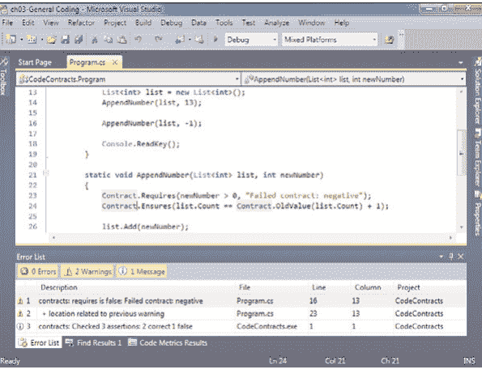

图 3.5

静态检查器与 Visual Studio Team System 集成，用于通知你代码中违反合约的情况。

## 在接口上实现合约

> 场景/问题：你希望在每个实现接口的类上实现合约。可以将这看为将接口的需求扩展到方法声明更深，不仅要求方法签名，还要求某种程度的预期行为，即使在没有具体实现的情况下也是。

解决方案：由于接口没有正体，你需要创建一个接口的代理实现并将合约添加到其中。你使用特性将它们结合在一起。

```csharp
[ContractClass(typeof(Add))]
interface IAdd
{
    uint Add(uint a, uint b);
}
```

## 强制执行合约

```csharp
[ContractClassFor(typeof(IAdd))]
class AddContract : IAdd
{
    // 私有的显式接口实现
    uint IAdd.Add(uint a, uint b)
    {
        Contract.Requires((ulong)a + (ulong)b < uint.MaxValue);
        return a + b;
    }
}

// 此类不需要指定合约
class BetterAdd : IAdd
{
    public uint Add(uint a, uint b)
    {
        return a + b;
    }
}

void SomeFunc()
{
    BetterAdd ba;
    // 这将导致合约异常
    ba.Add(uint.MaxValue, uint.MaxValue);
}
```

# 第 4 章 异常

本章内容

- 抛出异常
- 捕获异常
- 捕获多个异常
- 重新抛出异常
- 使用 finally（几乎）保证执行
- 从异常中获取有用信息
- 创建自定义的异常类
- 捕获未处理的异常
- 使用指南

异常是 .NET 用于通信错误状况的主要机制。

异常具有强大的力量，但能力越大，责任越大。与任何其他事物一样，异常可以被滥用，但这并不是极少使用异常的借口。

与返回错误代码相比，异常提供了许多优势，例如可以在调用栈中向上跳转许多帧，并包含你所需要的任意数量的信息。

## 抛出异常

场景/问题：你需要从一个异常情况指示一个不可恢复的错误。在这种情况下，不可恢复意味着在代码的当前层级上是不可恢复的。更高层的代码可能会处理它。

解决方案：在创建异常时使用 `throw` 语法。

```csharp
private void DoSomething(string value)
{
    if (string.IsNullOrEmpty(value))
    {
        throw new ArgumentException("value",
            "parameter value cannot be null");
    }
    ...
}
```

## 捕获异常

场景/问题：你必须处理一个已抛出的异常。

解决方案：将可能抛出异常的代码封装在 `try { }` 中，后面紧跟 `catch { }`。

```csharp
try
{
    DoSomething(null);
}
catch (ArgumentException ex)
{
    Console.WriteLine("Exception: " + ex.Message);
}
```

## 捕获多个异常

场景/问题：你必须处理许多潜在的异常。

**解决方案：** 你可以在 `try` 之后拥有多个 `catch` 块。.NET 将进入第一个与抛出的异常具有多态兼容性的 `catch` 块。例如，如果你有同时抛出 `ArgumentException` 和 `ArgumentNullException` 的代码，那么你的 `catch` 块的顺序很重要，因为 `ArgumentNullException` 是 `ArgumentException` 的子类。

以下是一个错误做法的示例：

```csharp
try {
    throw new ArgumentNullException();
} catch (ArgumentException ex) {
    // 将到达这里
} catch (ArgumentNullException ex) {
    // 将不会到达这里！
}
```

由于 `ArgumentNullException` 是 `ArgumentException` 的一种类型，且 `ArgumentException` 在 catch 列表中靠前，因此它会被调用。

规则是：始终按“最具体类型优先”的顺序对异常捕获块排序。

```csharp
try {
    throw new ArgumentNullException();
} catch (ArgumentNullException ex) {
    // 现在我们将到达这里！
} catch (ArgumentException ex) {
    // 捕获任何其他 ArgumentException 或子类
}
```

## 重新抛出异常

场景/问题：你需要在一个层级处理异常（例如记录它或更改程序行为），然后将其传递给更高级的代码进行处理。

解决方案：有两种方法可以实现这一点，它们之间的区别很重要。

幼稚的（即通常是错误的）方法是：

```csharp
try {
    DoSomething();
} catch (ArgumentNullException ex) {
    LogException(ex);
    // 可能是这种错误的做法
    throw ex; // 重新抛出它给上层
}
```

哪里问题了？每当抛出异常时，当前的堆栈位置都会保存到异常中（参见本章后后的部分）。当你这样重新抛出时，你替换了原本在那里的堆栈位置。

> **注意** 如果你想保留原始堆栈跟踪，请使用 `throw;` 而不是 `throw ex;`。

```csharp
try {
    DoSomething();
} catch (ArgumentNullException ex) {
    LogException(ex);
    throw; // 重新抛出
}
```

## 使用 finally 保证执行

场景/问题：你需要保证资源被清理，即使发生了异常。在使用封装了外部资源（如数据库连接或文件）的对象时，你希望在完成后释放它们。然而，如果在使用时抛出了异常，异常通常会跳过你编写的清理代码。

解决方案：使用 `finally`，它在 `try` 或 `catch` 块结束时保证执行。无论你是返回、抛出异常还是正常执行到 `try-finally` 之后的代码，都是如此。

```csharp
StreamWriter stream = null;
try
{
    stream = File.CreateText("temp.txt");
    stream.Write(null, -1, 1);
}
catch (ArgumentNullException ex)
{
    Console.WriteLine("In catch: ");
    Console.WriteLine(ex.Message);
}
finally
{
    Console.WriteLine("In finally: Closing file");
    if (stream != null)
    {
        stream.Close();
    }
}
```

此程序的输出如下：

In catch: 

Buffer cannot be null.

Parameter name: buffer

In finally: Closing file

注意在使用 `finally` 时，`catch` 块是不必须的。

> **注意** 是的，`finally` 是保证执行的——除非不是这样。如果你的代码强制立即退出进程，`finally` 块将不会运行。

```csharp
try
{
    // 执行一些事情
    Environment.Exit(1); // 程序现在退出
}
finally
{
    // 此代码永远不会运行
}
```

## 从异常中获取有用信息

| 场景/问题：你想从捕获的异常中提取有用信息 |
| :--- |
| **解决方案：** 异常是非常丰富的对象——比简单的错误代码强大得多。表 4.1 列出了所有异常类型可用的属性。 |

### 表 4.1 异常属性

| 属性/方法 | 描述 |
| :--- | :--- |
| `ToString()` | 打印异常的类型，随后是 `Message`（消息）和 `StackTrace`（堆栈跟踪）。 |
| `Message` | 错误的简要描述。 |
| `Source` | 发生异常的应用程序。 |
| `StackTrace` | 当前堆栈中方法列表。有助于追溯导致异常的路径。 |
| `TargetSite` | 抛出异常的方法。 |
| `InnerException` | 导致当前异常的异常。通常，异常会被包装在更高层的异常内部。 |
| `HelpLink` | 指向帮助文件的链接，通常为 URL 形式。 |
| `Data` | 提供更多信息的异常特有键值对。 |

这里是一个示例：

```csharp
static void Function()
{
    try
    {
        DivideByZero();
    }
    catch (DivideByZeroException ex)
    {
        Console.WriteLine("ToString: " + ex.ToString());
        Console.WriteLine("Message: " + ex.Message);
        Console.WriteLine("Source: " + ex.Source);
        Console.WriteLine("HelpLink: " + ex.HelpLink);
    }
}
```


# 第4章 异常

```csharp
Console.WriteLine("TargetSite: " + ex.TargetSite);
Console.WriteLine("Inner Exception: " + ex.InnerException);
Console.WriteLine("Stack Trace: " + ex.StackTrace);
Console.WriteLine("Data:");
if (ex.Data != null) {
    foreach (DictionaryEntry de in ex.Data) {
        Console.WriteLine("\t{0}: {1}", de.Key, de.Value);
    }
}
```

```csharp
private static void DivideByZero() {
    int divisor = 0;
    Console.WriteLine("{0}", 13 / divisor);
}
```

该程序产生以下输出：

```
ToString(): DivideByZeroException: Attempted to divide by zero.
at PrintExceptionInfo.Program.DivideByZero() in Program.cs:line 41
at PrintExceptionInfo.Program.Main(String[]) args in Program.cs:line 15
Message: Attempted to divide by zero.
Source: PrintExceptionInfo
HelpLink:
TargetSite: DivideByZero()
Inner Exception:
Stack Trace: at PrintExceptionInfo.Program.DivideByZero() in Program.cs:line 41
at PrintExceptionInfo.Program.Main(String[]) args in Program.cs:line 15
Data:
```

这是程序在 Debug 模式下运行的结果。请注意程序在 Release 模式下运行时的差异：

```
ToString(): DivideByZeroException: Attempted to divide by zero.
at PrintExceptionInfo.Program.Main(String[]) args in Program.cs:line 15
Message: Attempted to divide by zero.
Source: PrintExceptionInfo
HelpLink:
TargetSite: Void Main(System.String[])
Inner Exception:
Stack Trace: at PrintExceptionInfo.Program.Main(String[]) args in Program.cs:line 15
Data:
```

当程序在 Release 模式下编译时，堆栈跟踪中的信息较少，因为二进制文件不包含生成该跟踪所需的所有信息。

## 创建你自己的异常类

**场景/问题**：你需要一个自定义异常来描述特定于你的程序的错误。当你开发规模非同小的程序时，通常需要创建自己的异常类型。

**解决方案**：你的异常可以包含你想要的任何数据，但有几条准则需要遵循。特别是，你应该拥有某些标准的构造函数：

- 无参数（默认构造函数）。
- 接收一个消息（由 `Message` 属性返回的内容）。
- 接收一个消息和一个内部异常。
- 接收特定于你异常的数据。
- 序列化对象。异常应当始终是可序列化的，并且应该重写 `GetObjectData`（来自 `ISerializable`）。

下面是一个实现了所有这些建议的异常示例：

```csharp
[Serializable]
public class MyException : Exception, ISerializable {
    private double _exceptionData = 0.0;

    public double ExceptionData {
        get { return _exceptionData; }
    }

    public MyException() { }

    public MyException(string message) : base(message) { }

    public MyException(string message, Exception innerException) : base(message, innerException) { }

    public MyException(double exceptionData, string message) : base(message) {
        _exceptionData = exceptionData;
    }

    public MyException(double exceptionData, string message, Exception innerException) : base(message, innerException) {
        _exceptionData = exceptionData;
    }

    // 序列化处理器
    protected MyException(SerializationInfo info, StreamingContext context) : base(info, context) {
        // 反序列化
        _exceptionData = info.GetDouble("MyExceptionData");
    }

    [SecurityPermission(SecurityAction.Demand, SerializationFormatter = true)]
    public override void GetObjectData(SerializationInfo info, StreamingContext context) {
        // 序列化
        base.GetObjectData(info, context);
        info.AddValue("MyExceptionData", _exceptionData);
    }
}
```

花费时间这样深入地实现异常可以确保它们足够灵活，可以在任何需要的情况下使用。

## 捕获未处理的异常

**场景/问题**：你希望为应用程序抛出的任何异常设置一个自定义处理器。

**解决方案**：异常会沿堆栈传递，直到找到可以处理它的块。如果没有找到处理器，进程将关闭。

> **注意**：在 Visual Studio 下运行这些项目时，调试器会在你的代码之前捕获异常。参见本章节的完整示例。

### 在控制台中捕获未处理的异常

在控制台程序中，你可以监听 `AppDomain.CurrentDomain` 的未处理异常：

```csharp
class Program {
    static void Main(string[] args) {
        // 未处理异常由应用程序域处理
        AppDomain.CurrentDomain.UnhandledException += new UnhandledEventHandler(CurrentDomain_UnhandledException);
        throw new InvalidOperationException("oops");
    }

    static void CurrentDomain_UnhandledException(object sender, UnhandledEventArgs e) {
        Console.WriteLine("捕获未处理的异常");
        Console.WriteLine(e.ExceptionObject.ToString());
    }
}
```

### 在 Windows Forms 中捕获未处理的异常

在 Windows Forms 中，在运行任何代码之前告诉应用程序你想处理未捕获的异常。然后，你可以监听主线程上的 `ThreadException`。

```csharp
static class Program {
    [STAThread]
    static void Main() {
        // 必须在创建 UI 之前调用
        Application.SetUnhandledExceptionMode(UnhandledExceptionMode.CatchException);
        Application.EnableVisualStyles();
        Application.SetCompatibleTextRendering(false);
        Application.Run(new Form1());
    }
}
```

```csharp
public partial class Form1 : Form {
    public Form1() {
        InitializeComponent();
        // 处理发生在此线程上的任何异常
        Application.ThreadException += new System.Threading.ThreadExceptionHandler(Application_ThreadException);
    }

    void Application_ThreadException(object sender, System.Threading.ThreadEventArgs e) {
        StringBuilder sb = new StringBuilder();
        sb.AppendLine("拦截了未处理的异常");
        sb.Append(e.Exception.ToString());
    }

    private void button1_Click(object sender, EventArgs e) {
        throw new InvalidOperationException("Oops");
    }
}
```

### 在 WPF 中捕获未处理的异常

在 WPF 中，你可以在调度器上监听未处理的异常：

```csharp
public partial class Window1 : Window {
    public Window1() {
        InitializeComponent();
        Application.Current.DispatcherUnhandledException += new System.Windows.Threading.DispatcherUnhandledExceptionHandler(Current_DispatcherExceptionHandler);
    }

    void Current_DispatcherExceptionHandler(object sender, System.Windows.Threading.DispatcherUnhandledEventArgs e) {
        StringBuilder sb = new StringBuilder();
        sb.AppendLine("Caught unhandled exception");
        sb.AppendLine(e.Exception.ToString());
        MessageBox.Show(sb.ToString());
        e.Handled = true; // prevent exit
    }

    private void button1_Click(object sender, RoutedEventArgs e) {
        throw new InvalidOperationException("Oops");
    }
}
```

### 在 ASP.NET 中捕获未处理的异常

在 ASP.NET 中，你可以在页面级或应用程序级捕捉未处理的异常。若要在页面级捕获错误，请查看页面的 `Error` 属性。要在应用程序级捕获错误，你必须有一个全局应用程序类（通常为 `Global.asax`），并在 `Application_Error` 中编写行为，如下所示：

```csharp
public class Global : System.Web.Application {
    protected void Application_Error(object sender, EventArgs e) {
        // 跳转到应用程序范围的错误页
        Server.Transfer("ErrorHandlerPage.aspx");
    }
}
```

```csharp
// 在页面中
public partial class _Default : System.Web.UI.Page {
    protected void Page_Load(object sender, EventArgs e) {
        Button1.Click += new EventHandler(Button1_Click);
        // 取消注释以在页面级处理错误
        // this.Error += new EventHandler(_Default_Error);
    }

    void Button1_Click(object sender, EventArgs e) {
        throw new ArgumentException();
    }

    // void _Default_Error(object sender, EventArgs e) {
    //     this.Response.Redirect("ErrorHandlerPage.aspx");
    // }
}
```


# 使用指南

以下是关于 .NET Framework 异常处理的一些通用指南：

- .NET Framework 广泛地使用异常来处理错误和进行通知。你应该充分使用它们。
- 尽管如此，异常是用于*异常*情况，而不是用于控制程序流。对于一个简单的例子，如果一个对象可能为 `null`，请在使用之前检查它是否为 `null`，而不是依赖于异常。除以零以及许多其他简单的错误情况也是如此。
- 另一个将异常留给异常错误情况的原因是它们在速度和内存使用上都有性能开销。
- 在异常中包含尽可能多的诊断问题所需的有用信息（请见后续项目符号中的注意事项）。
- 不要向用户显示原始异常。它们是用于日志记录以及供开发者用于修复问题的。
- 小心你所泄露的信息。注意，恶意用户可能会利用异常中的信息来了解程序的工作原理以及任何潜在的弱点。
- 不要捕获所有异常的根：`System.Exception`。这会吞掉所有错误，而你本应该强制看到并修复它们。为了记录日志，捕获 `System.Exception` 是可以的，只要你重新抛出它（rethrow）。
- 将低级异常封装在你自己的异常类中，以隐藏实现级别的细节。例如，如果你有一个内部使用 `List<T>` 实现的集合类，你可能希望 `ArgumentOutOfRangeException` 隐藏在 `MyComponentException` 中。

# 第 5 章

# 数字

本章内容

- 在 Float、Double 和 Decimal 之间选择
- 使用大整数 (`BigInteger`)
- 使用复数
- 在字符串中格式化数字
- 将字符串转换为数字
- 在数字基数之间转换
- 将数字转换为字节（反之亦然）
- 确定整数是否为偶数
- 确定整数是否为 2 的幂（即，单位是否被设置）
- 确定数字是否为质数
- 统计 1 位的个数
- 转换角度和弧度
- 四舍五入数字
- 生成更好的随机数
- 生成唯一 ID

数字是许多应用程序不可或缺的一部分。尽管似乎是一个简单的话题，但当你考虑到世界上许多文化如何表示数字，甚至计算机如何表示数字时，这个话题就不那么简单了。本章涵盖了许多在应用程序中有用的技巧。

## 在 Float、Double 和 Decimal 之间选择

场景/问题：你需要在某种情况下决定使用哪种浮点类型。

解决方案：决定使用哪种浮点类型取决于应用程序，但这里有一些需要考虑的因素：

- 数字需要多大？它们是否处于极值（无论是正还是负）？
- 你需要多少精度？七位数字足够吗？需要更多吗？
- 你是否有影响你的内存需求？
- 数字是否来自一个已经指定了你使用的大小的数据库？你应该选择哪种方法以防丢失数据。

根据这些问题，表 5.1 展示了它们的差异。

| 类型 | 范围 | 精度（位数） | 精确整数 | 大小 |
| :--- | :--- | :--- | :--- | :--- |
| Float | $\pm10^{-45}$ - $\pm10^{38}$ | 7 | $2^{24}$ | 4 bytes |
| Double | $\pm10^{-32}$ - $\pm10^{308}$ | 15–16 | $2^{63}$ | 8 bytes |
| Decimal | $\pm10^{-28}$ - $\pm10^{28}$ | 28–29 | $2^{113}$ | 16 bytes |

精确整数是指在不损失精度的情况下可以表示的最大整数值。在整数和浮点类型之间转换时，应该记住这些值。对于任何涉及货币的计算，应该始终使用 `Decimal` 类型。只有这种类型具有适当的精度来避免关键错误。

### 使用大整数 (BigInteger)

场景/问题：你需要一个比 `UInt64` 更大的整数。

解决方案：`BigInteger` 位于 `System.Numerics` 命名空间，可以处理比 `UInt64` 更大的整数。

```csharp
BigInteger a = BigInteger.MaxValue;
BigInteger b = BigInteger.MaxValue;

// BigInteger 是不可变的
BigInteger c = a + b;

// 如下所示
string numberToParse = "18446744073709551615";
BigInteger bi = BigInteger.Parse(numberToParse);
Console.WriteLine("N0: {0}", bi);
Console.WriteLine("R: {0}", bi);
```

输出：
```text
N0: 18446744073709551615
R: 18446744073709551615
```

此外，还可以处理 `a + b`：
```text
N0: 18446744073709551615 2
R: 36893488147419103230
```

### 使用复数

场景/问题：许多工程和数学问题需要使用虚数，通常表示为 4+3i，其中 i 是 -1 的平方根。

解决方案：使用 `System.Numerics.Complex` 类表示虚数。`Complex` 使用 `double` 封装实部和虚部。

```csharp
Complex a = new Complex(2, 1);
Complex b = new Complex(3, 2);
Console.WriteLine("a = {0}", a);
Console.WriteLine("b = {0}", b);
Console.WriteLine("a + b = {0}", a + b);
Console.WriteLine("pow(a={0}", Complex.Pow(a, 2));
Console.WriteLine("a / 0 = {0}", a / Complex.Zero);
```

```csharp
// 将 -1 赋值给实部，并将 0 赋值给虚部
Complex c = -1;
Console.WriteLine("c = {0}", c);
Console.WriteLine("Sqrt(c) = {0}", Complex.Sqrt(c));
```

输出：
```text
a = (2, 1)
b = (3, 2)
a + b = (5, 3)
pow(a)=(3, 4)
a / 0 = (NaN, NaN)
c = (-1, 0)
Sqrt(c) = (0, 1)
```

### 格式化复数

虽然 (a, b) 是虚数的有效格式，但通常看到它写为 a+bi。这可以通过自定义格式化器轻松实现（正如你在第 2 章“创建多功能类型”中所学习的那样）。

```csharp
class ComplexFormatter : IFormatProvider, ICustomFormatter
{
    // accept two format specifiers: i and j
    public string Format(string format, object arg, IFormatProvider formatProvider)
    {
        if (arg is Complex)
        {
            Complex c = (Complex)arg;
            if (format.Equals("i", StringComparison.OrdinalIgnoreCase))
            {
                return c.Real.ToString("N2") + " + " + c.Imaginary.ToString("N2") + " i";
            }
            else if (format.Equals("j", StringComparison.OrdinalIgnoreCase))
            {
                return c.Real.ToString("N2") + " + " + c.Imaginary.ToString("N2") + " j";
            }
            else
            {
                return c.ToString(format, formatProvider);
            }
        }
        else
        {
            if (arg is IFormattable)
            {
                return ((IFormattable)arg).ToString(format, formatProvider);
            }
            else if (arg != null)
            {
                return arg.ToString();
            }
            else
            {
                return string.Empty;
            }
        }
    }

    public object GetFormat(Type formatType)
    {
        if (formatType == typeof(ICustomFormatter))
        {
            return this;
        }
        else
        {
            return System.Threading.Thread.CurrentThread.CurrentCulture.GetFormat(formatType);
        }
    }
}
```

示例用法：

```csharp
Complex c = -1;
Console.WriteLine("Sqrt(c) = {0}");
string.Format(new ComplexFormatter(), "{0:i}", Complex.Sqrt(c));
```

输出：
```text
Sqrt(c) = 0.00 + 1.00i
```

### 在字符串中格式化数字

> 场景/问题：你需要在适当的本地文化中格式化数字以显示，或者进行其他类型的格式化。

解决方案：.NET Framework 提供了丰富的数字格式选项。选项非常多，可能会让人困惑。本节重点介绍了一些最有趣的选项，包括一个总结了许多示例的表格。

> 注意：如果你不带任何参数调用 `ToString()`，将假设使用当前线程的文化。显式指定文化通常对你有利。

### 为特定文化格式化数字

文化定义了格式化后的数字外观。根据文化，这些变量中的部分或全部可能会发生：

- 小数分隔符——1.5 还是 1,5？
- 分位分隔符——1,000,000 还是 1.000.000？
- 数字分组——在某些文化中（如印度），数字不是三一组分组的。
- 货币符号——美元 ($)、英镑 (£)、欧元 (€)、日元 (¥)。

## 某些格式的数字默认小数位数

`CultureInfo` 实现了 `IFormatProvider`，因此它可以接受文化中可以接受的任何方法。以下是一些示例：

```csharp
double val = 1234567.89;
Console.WriteLine(val.ToString("N"));
CultureInfo.CreateSpecificCulture("fr-FR");
Console.WriteLine(string.Format(CultureInfo.CreateSpecificCulture("hi-IN"), "{0:N}"));
```

输出：
```text
1 234567,89
12,345,567.89
```

> 注意：每当你需要存储供应用程序使用的数据时，请使用不变文化（invariant culture）。这非常重要，因为在预先未知格式的情况下，无法准确解析数字。或者，使用二进制格式，因为文化信息是不相关的。

### 以十六进制打印数字

注意，通常在十六进制数字前的 "0x" 必须由你添加。你还可以指定想要显示的位数（它们将用零填充）。

```csharp
Int32 number = 12345;
string hex = number.ToString("X", CultureInfo.InvariantCulture);
// 如果想在数字前获取 0x，执行：
string hexUs = "0x" + number.ToString("X8", CultureInfo.InvariantCulture);
Console.WriteLine(hex);
Console.WriteLine(hexUs);
```

输出：
```text
3039
0x00003039
```

### 数字分组

要对数字进行分组，请使用 "N" 格式选项，如下所示：

```csharp
int number = 12345;
Console.WriteLine(number.ToString("N", CultureInfo.InvariantCulture));
```

输出：
```text
12,345
```

### 打印前导零

你可以使用 `D` 和 `X` 格式字符串打印前导零。数字指定输出的总位数。如果此数字大于数字本身的位数，则输出将用零填充；否则，数字将正常输出。这里有一个示例：

```csharp
int number = 12345;
Console.WriteLine(number.ToString("D8", CultureInfo.InvariantCulture));
```

输出：
```text
0012345
```

### 指定小数位数

你可以使用 `C`、`E`、`F`、`G`、`N` 和 `P` 格式字符串指定小数位数：

```csharp
double number = 12345.6789;
Console.WriteLine(number.ToString("F3"));
```

输出（注意舍入）：
```text
12345.679
```

### 使用自定义格式字符串进行精细控制

> 场景/问题：如果预定义的格式字符串不完全符合你的需要并需要更精细的控制，你可以提供自定义格式字符串。假设你想同时控制前导零、小数位数和分组。如果你希望负数的格式化方式与正数不同怎么办？使用内置格式字符串无法实现这些。

解决方案：使用自定义格式化符。

```csharp
double number = 12345.6789;
CultureInfo ci = CultureInfo.InvariantCulture;
// 根据需要填充零的占位符
Console.WriteLine(number.ToString("00000000.00", ci));
Console.WriteLine(number.ToString("00,000,000.00", ci));
```

表 5.2 数字字符串格式示例

| 输入 | 格式字符串 | 允许类型 | 文化 | 输出 |
| :--- | :--- | :--- | :--- | :--- |
| 12345.789 | C3 | 整数、浮点数 | en-GB | £12,345.789 |
| 0.1235 | P | 整数、浮点数 | 不变 | 12.35 % |
| 0.1235 | P1 | 整数、浮点数 | 不变 | 12.3 % |
| 12345 | D | 整数 | 不变 | 12345 |
| 12345 | D8 | 整数 | 不变 | 0012345 |
| 12345 | X | 整数 | 不变 | 3039 |
| 12345 | X8 | 整数 | 不变 | 000003039 |
| 12345.6789 | 00000000.00 | 整数、浮点数 | 不变 | 012345.68 |
| 12345.6789 | 000,000,000.0 | 整数、浮点数 | 不变 | 012,345.7 |

### 将字符串转换为数字

> 场景/问题：你需要将字符串输入解析为数字。

解决方案：你可以在 `Parse` 和 `TryParse` 之间选择，`Parse` 在发生错误时会抛出异常，而 `TryParse` 保证不会抛出异常。由于使用异常对性能的影响，你会发现大多数情况下 `TryParse` 是合理的。

```csharp
string goodStr = "-100,000,000.567";
double goodVal = 0;
if (double.TryParse(goodStr, out goodVal))
{
    Console.WriteLine("Parsed {0}", goodVal);
}
```

注意 `goodStr` 具有小数分隔符、逗号、空格和负号。默认情况下，`TryParse` 会接受所有这些内容。如果你知道数字的格式，可以使用 `NumberStyles` 枚举来限制格式。

```csharp
string goodStr = "-100,000,000.567";
double goodVal = 0;
if (!double.TryParse(goodStr, NumberStyles.AllowDecimalPoint, CultureInfo.CurrentCulture, out goodVal))
{
    Console.WriteLine("无法用有限的 NumberStyle 解析 {0}", goodStr);
}
```


# 进制之间的转换

> **注意** 如果你在解析时没有指定文化设置（`culture`），则将假设使用当前线程的文化设置。要指定另一个文化设置，请执行以下操作：

```csharp
string frStr = "-100 100,987";

double frVal = 0;

bool success = double.TryParse(frStr, NumberStyles.Any,
    CultureInfo.CreateSpecificCulture("fr-FR"), out frVal);
```

# 解析十六进制数

要解析十六进制数，必须在调用 `TryParse()` 之前移除数字前的任何 "0x"。

```csharp
string hexStr = "0x3039";

Int32 hexVal = 0;

if (Int32.TryParse(hexStr.Replace("0x",""),
    NumberStyles.HexNumber,
    CultureInfo.CurrentCulture,
    out hexVal))
{
    Console.WriteLine("Parsed {0} to value {1}", hexStr, hexVal);
}
```

产生以下输出：

```
Parsed 0x3039 to value 12345
```

# 进制之间的转换

| 场景/问题：你需要在任意进制中显示一个数字。 |

**解决方案：** 你无法直接将数字转换为不同的进制。毕竟，它们在计算机中始终以二进制形式表示。你所做的只是展示该数字的表示形式——换句话说，即一个字符串。如何实现取决于你想要典型的“计算机”进制还是任意进制。

## 从 10 进制转换为 2 进制、8 或 16 进制

幸运的是，如果你需要 2、8 或 16 等标准进制，该功能已经内置在 Framework 之中了。

```csharp
int sourceNum = 100;
int destBase = 16;
string destStr = Convert.ToString(sourceNum, destBase);
```

`destStr` 将包含值 `64`，这是十进制数字 `100` 的十六进制等效值。

## 从 10 进制转换为任意进制

如果你需要一个非常奇特的进制，例如 5 或 99 怎么办？下面的代码将为你提供帮助：

```csharp
private string ConvertToBase(Int64 decNum, int destBase)
{
    StringBuilder sb = new StringBuilder();
    Int64 accum = decNum;
    while (accum > 0)
    {
        Int64 digit = (accum % destBase);
        string digitStr;
        if (digit <= 9)
        {
            digitStr = digit.ToString();
        }
        else
        {
            switch (digit)
            {
                case 10: digitStr = "A"; break;
                case 11: digitStr = "B"; break;
                case 12: digitStr = "C"; break;
                case 13: digitStr = "D"; break;
                case 14: digitStr = "E"; break;
                case 15: digitStr = "F"; break;
                // 不知道在 16 进制之后该怎么办
                // 添加字母，定义你自己的字符
                default: digitStr = "?"; break;
            }
        }
        sb.Append(digitStr);
        accum /= destBase;
    }
    return sb.ToString();
}
```

注意，尽管这可以接受任何目标进制，但你仍然需要为到 `destBase - 1` 的数字值定义任何字符。

## 转换为 10 进制

以下代码将任意进制（在此示例中最高为 16 进制）的数字字符串转换为 10 进制：

```csharp
private Int64 ConvertFromBase(string num, int fromBase)
{
    Int64 accum = 0;
    Int64 multiplier = 1;
    for (int i = num.Length - 1; i >= 0; i--)
    {
        int digitVal;
        if (num[i] >= '0' && num[i] <= '9')
        {
            digitVal = num[i] - '0';
        }
        else
        {
            switch (num[i])
            {
                case 'A': digitVal = 10; break;
                case 'B': digitVal = 11; break;
                case 'C': digitVal = 12; break;
                case 'D': digitVal = 13; break;
                case 'E': digitVal = 14; break;
                case 'F': digitVal = 15; break;
                default: throw new FormatException("Unknown digit");
            }
        }
        accum += (digitVal * multiplier);
        multiplier *= fromBase;
    }
    return accum;
}
```

> **注意** 如果你需要在两个任意进制之间转换，先转换为 10 进制，然后使用给出的方法组合转换为另一个进制会更简单。

# 将数字转换为字节（反之亦然）

**场景/问题**：你需要将一个数字转换为字节。

**解决方案**：好用的 `BitConverter` 类将对你有帮助。

```csharp
Int32 num = 13;
byte[] bytes = BitConverter.GetBytes(13);
```

以下是转换回的方法：

```csharp
Int32 num = BitConverter.ToInt32(bytes);
```

`BitConverter` 可以作用于所有数字类型，奇怪的是，`Decimal` 除外。对于 `Decimal`，你需要这段代码：

```csharp
static byte[] DecimalToBytes(decimal number)
{
    Int32[] bits = Decimal.GetBits(number);
    byte[] bytes = new byte[16];
    for (int i = 0; i < 4; i++)
    {
        bytes[i * 4 + 0] = (byte)(bits[i] & 0xFF);
        bytes[i * 4 + 1] = (byte)(bits[i] >> 8);
        bytes[i * 4 + 2] = (byte)(bits[i] >> 16);
        bytes[i * 4 + 3] = (byte)(bits[i] >> 24);
    }
    return bytes;
}
```

> 每当你将数字转换为字节（反之亦然）时，你就需要考虑字节序（`endianness`），这仅仅是字节在内存中的顺序。如果数字从最低位字节开始，则称为小端序。大端值从最高位字节开始。如今大多数个人电脑都是小端序，而 `BitConverter` 类提供了这种支持。

# 判断整数是否为偶数

| 场景/问题：你需要判断一个整数是否为偶数。 |

**解决方案：**

```csharp
public static bool IsEven(long number)
{
    return (number % 2) == 0;
}
```

# 判断整数是否为 2 的幂（即单位设置）

| 场景/问题：你需要判断一个整数是否是 2 的幂。 |

**解决方案：** 该解决方案依赖于补码表示，且 2 的幂只有一个位。

```csharp
private static bool IsPowerOfTwo(long number)
{
    return number != 0 && (number & (number - 1)) == 0;
}
```

> 参考第 23 章“线程与异步编程”，了解分工作的示例。

# 判断数字是否为素数

| 场景/问题：你需要判断一个数字是否为素数。 |

**解决方案：** 素数只能被 1 和自身整除。一种流行的解决方案如下：

```csharp
static bool isPrime(int number)
{
    // 检查偶数
    if (number % 2 == 0)
    {
        if (number == 2)
        {
            return true;
        }
        return false;
    }

    // 不需要检查平方根
    int max = (int)Math.Sqrt(number);
    for (int i = 3; i <= max; i += 2)
    {
        if (number % i == 0)
        {
            return false;
        }
    }
    return true;
}
```

# 统计 1 位个数

| 场景/问题：你需要统计数字中 1 的个数。除了面试题，统计位数实际上有非常有用的应用（例如统计位域中设置的标志）。 |

**解决方案：** 这个问题有很多解决方法，但这是我最喜欢的：

```csharp
static Int16 CountBits(Int32 number)
{
    int accum = number;
    Int16 count = 0;
    while (accum > 0)
    {
        accum &= (accum - 1);
        count++;
    }
    return count;
}
```

它的运行时间与数字中设置的 1 位个数成正比。

# 角度与弧度转换

**场景**：你需要将角度转换为弧度，反之亦然。

**解决方案**：这种代码在许多类型的图形应用程序中很常见，角度对人类来说有意义，但许多图形 API 处理弧度。如果你的应用程序频繁使用这些，你可以考虑将它们变为 `double` 的扩展方法。

查看 `RadiansAndDegrees` 示例项目，了解此代码如何配合鼠标使用。

```csharp
public static double RadiansToDegrees(double radians)
{
    return radians * 360.0 / (2.0 * Math.PI);
}

public static double DegreesToRadians(double degrees)
{
    return degrees * (2.0 * Math.PI) / 360.0;
}
```

`Pi` 以及其他有常量和数学函数都在 `Math` 类中。

## 数字舍入

你需要控制对数字执行的舍入类型。

`Math` 类提供了一个方便的函数可以为你执行舍入。你可以指定小数精度以及中点舍入类型（当处于中间值如 `.5`、`.05` 等时的行为）。如果没有指定舍入类型，默认是 `MidpointRounding.ToEven`，也称为银行家舍入。

### 表 5.3 舍入方法

| 值 | 含义 | 示例 |
| --- | --- | --- |
| `MidpointRounding.ToEven` | 舍入到最近的偶数 | 2.5 到 2.0 |
| `MidpointRounding.AwayFromZero` | 舍入到远离零的最近数字 | 2.5 到 3.0 |

以下是一些示例（示例输出来自章节源代码中的 `RoundNumbers` 示例）。

表 5.4 总结了使用 `Math.Round()` 并传入不同参数时的结果。

### 表 5.4 舍入示例

| 代码 | 结果 |
| --- | --- |
| `Math.Round(13.45);` | 13 |
| `Math.Round(13.45, 1);` | 13.4 |
| `Math.Round(13.45, 2);` | 13.45 |
| `Math.Round(13.45, MidpointRounding.AwayFromZero);` | 13 |
| `Math.Round(13.45, 1, MidpointRounding.AwayFromZero);` | 13.5 |
| `Math.Round(13.45, 2, MidpointRounding.AwayFromZero);` | 13.45 |
| `Math.Round(13.45, MidpointRounding.ToEven);` | 13 |
| `Math.Round(13.45, 1, MidpointRounding.ToEven);` | 13.4 |
| `Math.Round(13.45, 2, MidpointRounding.ToEven);` | 13.45 |
| `Math.Round(-13.45);` | -13 |
| `Math.Round(-13.45, 1);` | -13.4 |
| `Math.Round(-13.45, 2);` | -13.45 |
| `Math.Round(-13.45, MidpointRounding.AwayFromZero);` | -13 |
| `Math.Round(-13.45, 1, MidpointRounding.AwayFromZero);` | -13.5 |
| `Math.Round(-13.45, 2, MidpointRounding.AwayFromZero);` | -13.45 |
| `Math.Round(-13.45, MidpointRounding.ToEven);` | -13 |
| `Math.Round(-13.45, 1, MidpointRounding.ToEven);` | -13.4 |
| `Math.Round(-13.45, 2, MidpointRounding.ToEven);` | -13.45 |

## 将数字舍入到最近的倍数

**场景/问题**：在许多图形编辑器中，一个常见功能是将鼠标位置限制在网格线上。这让用户的工作变得更简单，因为在编辑形状时不需要进行极其精确的鼠标移动。例如，如果鼠标位于 `(104, 96)`，而你希望将值对齐到 `5x5` 像素的网格，你可以将其更改为 `(105, 95)`。

**解决方案**：使用以下代码可以轻松实现这一点：

```csharp
private static Int32 SnapInput(double input, Int32 multiple)
{
    return ((Int32)(input + (multiple / 2.0)) / multiple) * multiple;
}
```

表 5.5 展示了将值舍入/对齐到最近的 10 的倍数时的算法。

### 表 5.5 对齐到 10 的倍数

| 输入 | 输出 |
|---|---|
| 0 | 0 |
| 6.7 | 10 |
| 13.4 | 10 |
| 20.1 | 20 |
| 26.8 | 30 |
| 33.5 | 30 |
| 40.2 | 40 |
| 46.9 | 50 |

查看本章中的 `SnapToGrid` 项目以获取鼠标输入对齐到网格的示例。如果你想对浮点值进行舍入（例如，最近的 `0.5`），你需要对所示函数对输入进行处理：

```csharp
private static double SnapInput(double input, double multiple, Int32 precision)
{
    double scalar = Math.Pow(10, precision);
    return SnapInput(scalar * input, scalar * multiple) / scalar;
}
```

`precision` 参数指定你的输入包含多少位小数。这很重要，因为 `multiple` 需要缩放到整数才能正常工作。表 5.6。

### 表 5.6 对齐到 0.5 的倍数

| 输入 | 输出 |
|---|---|
| 0 | 0 |
| 0.15 | 0 |
| 0.3 | 0.5 |
| 0.45 | 0.5 |
| 0.6 | 0.5 |
| 0.75 | 1 |
| 0.9 | 1 |

## 生成更好的随机数

**场景/问题**：你需要与安全相关的随机数。标准方法是使用 `System.Random` 类生成基于当前时间的随机数，用法所示：

```csharp
Random rand = new Random();
```

然而，如果你正在进行任何安全操作，永远应该使用 `System.Security.RandomGenerator`：

```csharp
byte[] bytes = new byte[4];
RandomGenerator.GetBytes(bytes);
```


# 生成唯一 ID (GUIDs)

场景/问题：你需要一个在所有计算机上都有极高唯一性的 ID。

解决方案：使用 `Guid` 类生成。

```csharp
Guid g = Guid.NewGuid();
Console.WriteLine("GUID: {0}", g);
```

输出结果：`GUID: ea8b71c8-992a-4bed-b918-0d45c1b874`。

`Guid` 类提供了 `Parse()` 和 `TryParse()` 方法将字符串转换为 `Guid` 对象。还有 `ParseExact()` 和 `TryParseExact()` 方法。

```csharp
var guids = new Tuple<string, string>[]
{
    Tuple.Create("d261edd3-4562-4cb1-ba7e-1b761915d", "D"),
    Tuple.Create("d261edd3d45624cb1ccba7eb1761915d", "N"),
    Tuple.Create("d261edd3-4562-4cb1-ba7e-1b761915d", "B"),
    Tuple.Create("d261edd3-4562-4cb1-ba7e-1b761915d", "P"),
    Tuple.Create("0xd261edd3,0x4562,0x4c1b,0xba,0x7e,0x76,0x15,0x79,0x51,0xd8", "X")
};

foreach (var t in guids)
{
    Console.WriteLine("Parse {0} => {1}", t.Item1, Guid.ParseExact(t.Item1, t.Item2));
}
```

输出结果为：
- Parse d261edd3-4562-4cb1-ba7e-1b761915d => d261edd3-4562-4cb1-ba7e-1b761915d
- Parse d261edd3d45624cb1ccba7eb1761915d => d261edd3-4562-4cb1-ba7e-1b761915d
- Parse {d261edd3-4562-4cb1-ba7e-1b761915d} => d261edd3-4562-4cb1-ba7e-1b761915d
- Parse {d261edd3-4562-4cb1-ba7e-1b761915d} => d261edd3-4562-4cb1-ba7e-1b761915d
- Parse {0xd261edd3,0x4562,0x41cb,0x0ba,0x7e,0xb1,0x76,0x15,0x79,0x51,0xd8} => d261edd3-4562-4cb1-ba7e-1b761915d

# 第 6 章：枚举

本章内容
- 声明枚举
- 声明标志枚举
- 检查标志是否已设置
- 将枚举转换为整数（反之亦然）
- 检查枚举是否有效
- 列出枚举值
- 将字符串转换为枚举
- 使用扩展方法为枚举附加元数据
- 枚举技巧

枚举桥接了数字和对象。相比结构体，它们更灵活，它们填充了那些需要良好名称但不需要额外负担的领域。你可以将它们视为（大部分）类型安全的常量。枚举还为标志提供了类型安全的功能。

## 声明枚举

场景/问题：你需要表示一组已知的常量值。

解决方案：可以在命名空间或类中定义枚举：

```csharp
enum BookBinding
{
    None,
    Hardcover,
    Paperback
}
```

### 带有显式值的枚举

场景/问题：你需要枚举的特定值具有特定的数值，以便匹配数据库中的值。

解决方案：直接在枚举内部赋值即可。

```csharp
enum BookLanguage
{
    None = 0,
    English = 1,
    Spanish = 2,
    Italian = 3,
    French = 4,
    Japanese = 5
}
```

> 没有任何可以阻止你为枚举常量分配重复的值。我不确定这样做是否有某种合法的实用理由，但它在语法上是合法的。

## 将标记（Flags）声明为枚举

场景/问题：你需要一组标记位（flags），即可以在单个变量中组合在一起的值。

解决方案：在 C++ 中，你通常使用 `#define` 定义常量，通常在全局级别定义。在 C# 中，你可以使用枚举以类型安全的方式实现位字段标记功能。不过，你需要显式地将值设置为 2 的倍数。

```csharp
[Flags]
enum BookGenres
{
    None = 0,
    ScienceFiction = 0x01,
    Crime = 0x02,
    Romance = 0x04,
    History = 0x08,
    Science = 0x10,
    Mystery = 0x20,
    Fantasy = 0x40,
    Vampire = 0x80
}
```

你可以在位字段操作中使用 `BookGenres` 枚举。要查看 `[Flags]` 的作用，请检查以下代码及其输出：

```csharp
BookBinding binding = BookBinding.Hardcover;
BookBinding doubleBinding = BookBinding.Hardcover | BookBinding.Paperback;
Console.WriteLine("Binding: {0}", binding);
Console.WriteLine("Double Binding: {0}", doubleBinding);

BookGenres genres = BookGenres.Vampire | BookGenres.Fantasy | BookGenres.Romance;
Console.WriteLine("Genres: {0}", genres);
```

输出：
```
Binding: Hardcover
Double Binding: 3
Genres: Romance, Fantasy, Vampire
```

注意，带有 `[Flags]` 特性的枚举会正确打印出每种类型。

## 判断标记是否已设置

场景/问题：你需要确定枚举变量上是否设置了特定的标记。

解决方案：实现此点的标准方法是使用位运算符 `&`：

```csharp
BookGenres genres = BookGenres.Vampire | BookGenres.Fantasy;
bool isVampire = ((genres & BookGenres.Vampire) != 0);
```

然而，.NET 4 引入了 `HasFlag()` 方法，它可以完成相同的工作：

```csharp
bool isVampire = genres.HasFlag(BookGenres.Vampire);
```

## 将枚举转换为整数及反之

场景/问题：你需要将枚举转换为其数值等效值。

解决方案：枚举不能像在 C++ 中那样隐式转换为整数（反亦然）。你需要显式地强制转换值。

```csharp
int value = (int)BookLanguage.English;
BookLanguage lang = (BookLanguage)value;
```

当从整数转换为枚举时，确保你验证了结果（参见下一节）。

### 判断枚举是否有效

场景/问题：你需要确定任意值对于给定的枚举类型是否有效。通常，该值可能来自外部不可信的源。

在上述枚举定义之后，以下代码仍然有效：

```csharp
BookBinding badBinding = (BookBinding)9999;
```

因此，你将在需要的地方验证枚举值。

解决方案：.NET 提供了 `Enum.IsDefined()` 方法来完成此操作。

```csharp
BookBinding badBinding = (BookBinding)9999;
bool isDefined = Enum.IsDefined(typeof(BookBinding), badBinding);
```

### 列出枚举值

场景/问题：你想获取给定枚举类型的所有有效值的列表。

解决方案：要获取特定枚举的所有定义值列表，请调用 `Enum.GetValues()`，如下：

```csharp
foreach (BookGenres genre in Enum.GetValues(typeof(BookGenres)))
{
    Console.WriteLine("it " + Enum.GetName(typeof(BookGenres), genre));
}
```

`Enum.GetName()` 返回的字符串与你直接对值调用 `ToString()` 得到的字符串相同。你也可以调用 `Enum.GetNames()` 直接获取所有字符串。

## 将字符串转换为枚举

场景/问题：你需要将一个字符串解析为其等效的枚举值。

解决方案：虽然 `Enum` 包含一个标准的 `Parse()` 方法，但它可能会抛出异常并要求你将结果转换为所需的枚举类型。相反，请使用 `TryParse()`，它既安全又是强类型的，并使用了泛型，如下代码示例所示：

```csharp
string hardcoverString = "Hardcover";
BookBinding goodBinding, badBinding;

// 成功
bool canParse = Enum.TryParse(hardcoverString, out goodBinding);

// 失败
canParse = Enum.TryParse("garbage", out badBinding);
```

## 将字符串转换为标记集

场景/问题：你需要解析一个包含多个枚举的字符串为枚举的标记等效值。

解决方案：`Enum.TryParse()` 也适用于标记，并且它还能处理重复的值，如此示例所示：

```csharp
string flagString = "Vampire, Mystery, ScienceFiction, Vampire";
BookGenres flagEnum = BookGenres.None;

if (Enum.TryParse(flagString, out flagEnum))
{
    Console.WriteLine("Parsed {0} into {1}", flagString, flagEnum);
}
```

产生以下输出：
`Parsed "Vampire, Mystery, ScienceFiction, Vampire" into ScienceFiction, Mystery, Vampire`

## 使用扩展方法为枚举附加元数据

场景/问题：你想为枚举值关联额外数据，例如一个字符串（由于你可以重写 `ToString()`）或任何类型的数据。

解决方案：使用扩展方法结合特性（参见第 24 章“创建插件”），你可以为枚举添加这些方法。

```csharp
[AttributeUsage(AttributeTargets.Field, AllowMultiple = true)]
class CultureAttribute : Attribute
{
    string _culture;
    public string Culture
    {
        get { return _culture; }
    }
    public CultureAttribute(string culture)
    {
        _culture = culture;
    }
}
```

现在我们修改枚举以包含这些特性：

```csharp
enum BookLanguage
{
    None = 0,
    [Culture("en-US")]
    [Culture("en-UK")]
    English = 1,
    [Culture("es-MX")]
    [Culture("es-ES")]
    Spanish = 2,
    [Culture("it-IT")]
    Italian = 3,
    [Culture("fr-FR")]
    [Culture("fr-BE")]
    French = 4
}
```

最后，我们需要添加扩展方法来访问这些：

```csharp
static class CultureExtensions
{
    public static string[] GetCultures(this BookLanguage language)
    {
        CultureAttribute[] attributes = (CultureAttribute[])language.GetType()
            .GetField(language.ToString()).GetCustomAttributes(typeof(CultureAttribute), false);
        string[] cultures = new string[attributes.Length];
        for (int i = 0; i < attributes.Length; i++)
        {
            cultures[i] = attributes[i].Culture;
        }
        return cultures;
    }
}
```

现在测试它：

```csharp
PrintCultures(BookLanguage.English);
PrintCultures(BookLanguage.Spanish);

static void PrintCultures(BookLanguage language)
{
    Console.WriteLine("Cultures for {0}:", language);
    foreach (string culture in language.GetCultures())
    {
        Console.WriteLine("\t" + culture);
    }
}
```

产生了以下输出：
```
Cultures for English:
    en-UK
    en-US
Cultures for Spanish:
    es-MX
    es-ES
```

> **注意** 在枚举之上添加过多数据之前，确保你没有违反它们的轻量级特性。考虑你是否真的需要一个结构体来表示数据（可以使用枚举作为结构体中的 ID）。

## 枚举技巧

以下列表包含了你在使用枚举时应该遵循的一些最佳实践：
- 如果你的枚举必须匹配外部值（例如来自数据库），则显式为每个枚举成员分配值。
- 当你需要将多个值组合到一个字段时，始终使用 `[Flags]`。
- 标记枚举必须显式分配唯一的 2 的幂值（1, 2, 4, 8, 16 等）才能正常工作。
- 如果枚举不是作为标记使用的，则枚举应使用单数名称，而标记应使用复数名称。参见本章早前的 `BookBinding` 和 `BookGenres` 示例。
- 在每个枚举中定义一个值为 0 的 `None` 值。这在使用 `[Flags]` 时尤为重要。

# 第 7 章：字符串

本章内容
- 将字符串转换为字节（反之亦然）
- 创建自定义编码方案
- 正确地比较字符串
- 正确地更改大小写
- 检测空字符串
- 拼接字符串：你应该使用 `StringBuilder` 吗？
- 将集合项拼接为字符串
- 添加换行符
- 拆分字符串
- 将二进制数据转换为字符串（Base-64 编码）
- 反转单词
- 自然地排序数字字符串

字符串是一种如此基础的数据类型，以至于它们的用法通常在其他地方会被涵盖，因为它们与其他类型相关。尽管如此，某些主题是字符串特有的，而这些主题将在本章中介绍。

## 将字符串转换为字节（反之亦然）

场景/问题：你需要在文本与二进制格式之间进行转换。

解决方案：`System.Text` 命名空间定义了许多类来帮助你处理文本数据。要进行字节和从字节的转换，请使用 `Encoding` 类。你可以创建自己的文本编码方案，但你通常会使用 `Encoding` 类中预定义的静态成员，它们代表了最常见的编码标准，如 ASCII、Unicode、UTF-8 等。

`GetBytes()` 方法将获取字节表示：

```csharp
string myString = "C# Rocks";
byte[] bytes = Encoding.ASCII.GetBytes(myString);
```

如果你想输出字符串和字节，它看起来像这样：
原始字符串：C# Rocks!
ASCII 字节：43-23-20-52-6F-63-6B-63-73-21

使用 `Encoding.Unicode`，它看起来像这样：
Unicode 字节：43-00-23-00-20-00-52-00-6F-00-63-00-6B-00-63-00-73-00-21-00

要转换回来，使用 `Encoding.GetString()` 并传入字节：

```csharp
string result = Encoding.ASCII.GetString(bytes);
```

这些已经足够了，但考虑一下字符串 "C# Rocks!"。音乐符号没有对应的 ASCII 等字符。如果你将其转换为没有有效编码的字节格式，该字符将被转换为问号 (?)。


# 第 7 章 字符串

## 本章内容

- 将字符串转换为字节（反之亦然）
- 创建自定义编码方案
- 正确地比较字符串
- 正确地更改大小写
- 检测空字符串
- 拼接字符串：你应该使用 `StringBuilder` 吗？
- 将集合项拼接为字符串
- 添加换行符
- 拆分字符串
- 将二进制转换为 Base64 编码
- 反转单词
- 自然排序字符串

## 7 字符串

字符串是如此基础的数据类型，以至于它们的用法通常在其他地方被涵盖，因为它们与其他类型相关。尽管如此，某些主题是字符串特有的，而这些主题将在本章中介绍。

## 将字符串转换为字节（反之亦然）

场景/问题：你需要在文本与二进制格式之间进行转换。

解决方案：`System.Text` 命名空间定义了许多类来帮助你处理文本数据。要进行字节和从字节的转换，请使用 `Encoding` 类。你可以创建自己的文本编码方案，但你通常会使用 `Encoding` 类中预定义的静态成员，它们代表了最常见的编码标准，如 ASCII、Unicode、UTF-8 等。

`GetBytes()` 方法将获取字节表示：

```csharp
string myString = "C# Rocks";
byte[] bytes = Encoding.ASCII.GetBytes(myString);
```

如果你想输出字符串和字节，它看起来像这样：

原始字符串：C# Rocks!
ASCII 字节：43-23-20-52-6F-63-6B-63-73-21

使用 `Encoding.Unicode`，它看起来像这样：

Unicode 字节：43-00-23-00-20-00-52-00-6F-00-63-00-6B-00-63-00-73-00-21-00

要转换回来，使用 `Encoding.GetString()` 并传入字节：

```csharp
string result = Encoding.ASCII.GetString(bytes);
```

这些已经足够了，但考虑一下字符串 "C# Rocks!"。音乐符号没有对应的 ASCII 字符。如果你将其转换为没有有效编码的字节格式，该字符将被转换为问号 (?)。

```csharp
string myString = "C# Rocks!";
byte[] bytes = Encoding.ASCII.GetBytes(myString);
string result = Encoding.ASCII.GetString(bytes);

Console.WriteLine("Round trip: {0}->{1}->{2}",
    myString,
    Converter.ToString(bytes),
    result);
```

输出如下：

往返：C# Rocks!->43-23-20-52-6F-63-6B-63-73-21-3F->C# Rocks!

### 创建自定义编码方案

然而，如果我们使用 Unicode 编码，它在两个方向都能正常工作：

```csharp
string myString = "C# Rocks!";
byte[] bytes = Encoding.Unicode.GetBytes(myString);
string result = Encoding.Unicode.GetString(bytes);

Console.WriteLine("Round trip: {0}->{1}", myString, Converter.ToString(bytes), result);
```

输出结果：

往返：C# Rocks!♪-43-00-23-00-20-00-52-00-6F-00-63-00-6B-00-73-00-2B-26->C# Rocks!♪

> 在 .NET 中，所有字符串都是 Unicode。只有当你将字符串写入文件、网络、数据库、缓冲区和其他外部位置时，你才需要担心字节表示。

## 创建自定义编码方案

场景/问题：你需要以自定义的方式将字符串转换为字节。

解决方案：派生 `System.Text.Encoding` 类并实现抽象方法。`Encoding` 类为字符串的编码和解码定义了许多重载，但它们最终都会调用少数几个基础方法，而这些方法是你唯一需要定义的方法。

此示例中的大部分代码是参数验证，正如该类的 MSDN 文档所规定的那样。

该编码算法是著名的替换密码算法 ROT13，其中每个字母都向右旋转 13 位。

```csharp
class Rot13Encoder : System.Text.Encoding
{
    // 编码器类为转换定义了许多不同的重载，
    // 但它们最终都会调用这些方法，所以这些是
    // 你需要实现的所有内容
    public override int GetByteCount(char[] chars, int index, int count)
    {
        if (chars == null)
        {
            throw new ArgumentNullException("chars");
        }
        if (index < 0)
        {
            throw new ArgumentOutOfRangeException("index");
        }
        if (count < 0)
        {
            throw new ArgumentOutOfRangeException("count");
        }
        if (index + count > chars.Length)
        {
            throw new ArgumentOutOfRangeException("index, count");
        }
        // 我们每个字符使用一个字节
        // (你可以做任何你想做的-
        // 每个字符需要 6 位？你可以做到)
        return count;
    }

    public override int GetBytes(char[] chars,
        int charIndex,
        int charCount,
        byte[] bytes,
        int byteIndex)
    {
        if (chars == null)
        {
            throw new ArgumentNullException("chars");
        }
        if (bytes == null)
        {
            throw new ArgumentNullException("bytes");
        }
        if (charIndex < 0)
        {
            throw new ArgumentOutOfRangeException("charIndex");
        }
        if (charCount < 0)
        {
            throw new ArgumentOutOfRangeException("charCount");
        }
        if (charIndex + charCount > chars.Length)
        {
            throw new ArgumentOutOfRangeException("charIndex, charCount");
        }
        if (byteIndex < 0)
        {
            throw new ArgumentOutOfRangeException("byteIndex");
        }
        if (byteIndex + charCount > bytes.Length)
        {
            throw new ArgumentOutOfRangeException("byteIndex, charCount");
        }
        if (!ValidChars(chars))
        {
            throw new ArgumentException("Only lower-case characters allowed");
        }
        for (int i = 0, dest = byteIndex; i < charCount; i++, dest++)
        {
            // 往回 'a' 到 0
            int value = chars[charIndex + i] - 'a';
            value = (value + 13) % 26;
            value += 'a';
            bytes[dest] = (byte)value;
        }
        // 返回写入的字节数
        return charCount;
    }
}
```


# 第 7 章 字符串

本章内容

- 将字符串转换为字节（反之亦然）
- 创建自定义编码方案
- 正确地比较字符串
- 正确地更改大小写
- 检测空字符串
- 拼接字符串：你应该使用 `StringBuilder` 吗？
- 将集合项拼接为字符串
- 添加换行符
- 拆分字符串
- 将二进制数据转换为字符串（Base-64 编码）
- 反转单词
- 自然地排序数字字符串

字符串是一种如此基础的数据类型，以至于它们的用法通常在其他地方会被涵盖，因为它们与其他类型相关。尽管如此，某些主题是字符串特有的，而这些主题将在本章中介绍。

## 将字符串转换为字节（反之亦然）

场景/问题：你需要在文本与二进制格式之间进行转换。

解决方案：`System.Text` 命名空间定义了许多类来帮助你处理文本数据。要进行字节和从字节的转换，请使用 `Encoding` 类。你可以创建自己的文本编码方案，但你通常会使用 `Encoding` 类中预定义的静态成员，它们代表了最常见的编码标准，如 ASCII、Unicode、UTF-8 等。

`GetBytes()` 方法将获取字节表示：

```csharp
string myString = "C# Rocks";

byte[] bytes = Encoding.ASCII.GetBytes(myString);
```

如果你想输出字符串和字节，它看起来像这样：

原始字符串：C# Rocks!
ASCII 字节：43-23-20-52-6F-63-6B-63-73-21

使用 `Encoding.Unicode`，它看起来像这样：

Unicode 字节：43-00-23-00-20-00-52-00-6F-00-63-00-6B-00-63-00-73-00-21-00

要转换回来，使用 `Encoding.GetString()` 并传入字节：

```csharp
string result = Encoding.ASCII.GetString(bytes);
```

这些已经足够了，但考虑一下字符串 "C# Rocks!"。音乐符号没有对应的 ASCII 等字符。如果你将其转换为没有有效编码的字节格式，该字符将被转换为问号 (`?`)，例如所示：

```csharp
string myString = "C# Rocks!";

byte[] bytes = Encoding.ASCII.GetBytes(myString);

string result = Encoding.GetString(bytes);

Console.WriteLine("Round trip: {0}->{1}->{2}",
    myString,
    Converter.ToString(bytes),
    result);
```

这有如下输出：

往返：C# Rocks!->43-23-20-52-6F-63-6B-63-73-21-3F->C# Rocks!

### 创建自定义编码方案

然而，如果我们使用 Unicode 编码，它在两个方向都能正常工作：

```csharp
string myString = "C# Rocks!";

byte[] bytes = Encoding.Unicode.GetBytes(myString);

string result = Encoding.Unicode.GetString(bytes);

Console.WriteLine("Round trip: {0}->{1}", myString, Converter.ToString(bytes), result);
```

这是输出结果：

往返：C# Rocks!♪-43-00-23-00-20-00-52-00-6F-00-63-00-6B-00-73-00-2B-26->C# Rocks!♪

> 在 .NET 中，所有字符串都是 Unicode。只有当你将字符串写入文件、网络、数据库、缓冲区和其他外部位置时，你才需要担心字节表示。

## 创建自定义编码方案

场景/问题：你需要以自定义的方式将字符串转换为字节。

解决方案：派生 `System.Text.Encoding` 类并实现抽象方法。`Encoding` 类为字符串的编码和解码定义了许多重载，但它们最终都会调用少数几个基础方法，而这些方法是你唯一需要定义的方法。

此示例中的大部分代码是参数验证，正如该类的 MSDN 文档所规定的那样。

该编码算法是著名的替换密码算法 ROT13，其中每个字母都向右旋转 13 位。

```csharp
class Rot13Encoder : System.Text.Encoding
{
    // 编码器类为转换定义了许多不同的重载，
    // 但它们最终都会调用这些方法，所以这些是
    // 你需要实现的所有内容

    public override int GetByteCount(char[] chars, int index, int count)
    {
        if (chars == null)
        {
            throw new ArgumentNullException("chars");
        }

        if (index < 0)
        {
            throw new ArgumentOutOfRangeException("index");
        }

        if (count < 0)
        {
            throw new ArgumentOutOfRangeException("count");
        }

        if (index + count > chars.Length)
        {
            throw new ArgumentOutOfRangeException("index, count");
        }

        // 我们每个字符使用一个字节
        // (你可以做任何你想做的-
        // 每个字符需要 6 位？你可以做到)
        return count;
    }

    public override int GetBytes(char[] chars,
        int charIndex,
        int charCount,
        byte[] bytes,
        int byteIndex)
    {
        if (chars == null)
        {
            throw new ArgumentNullException("chars");
        }

        if (bytes == null)
        {
            throw new ArgumentNullException("bytes");
        }

        if (charIndex < 0)
        {
            throw new ArgumentOutOfRangeException("charIndex");
        }

        if (charCount < 0)
        {
            throw new ArgumentOutOfRangeException("charCount");
        }

        if (charIndex + charCount > chars.Length)
        {
            throw new ArgumentOutOfRangeException("charIndex, charCount");
        }

        if (byteIndex < 0)
        {
            throw new ArgumentOutOfRangeException("byteIndex");
        }

        if (byteIndex + charCount > bytes.Length)
        {
            throw new ArgumentOutOfRangeException("byteIndex, charCount");
        }

        if (!ValidChars(chars))
        {
            throw new ArgumentException("Only lower-case characters allowed");
        }

        for (int i = 0, dest = byteIndex; i < charCount; i++, dest++)
        {
            // 往回 'a' 到 0
            int value = chars[charIndex + i] - 'a';
            value = (value + 13) % 26;
            value += 'a';
            bytes[dest] = (byte)value;
        }

        // 返回写入的字节数
        return charCount;
    }

    // ... (省略重复的实现部分)
}
```

## 正确地比较字符串

此程序的输出是什么？
file 和 FILE 等于吗？
不变文化（Invariant culture）：是
土耳其文化：否

如你所见，文化会极大地改变字符串的解释。
通常情况下，你应该使用 `String.Compare()` 并提供你想要使用的文化设置。
对于非本地化的字符串（如程序内部字符串或设置名称），使用不变文化（invariant culture）是可以的。

## 正确更改大小写

场景/问题：你需要更改一个本地化字符串的大小写。

解决方案：这与比较两个字符串的问题几乎相同。你必须指定文化设置才能正确操作。同样，使用内置功能并记住该文化设置。

再次使用我们的土耳其示例，这里是示例代码：

```csharp
string original = "file";

Console.WriteLine("Original: " + original);

Console.WriteLine("Uppercase (invariant): " + original.ToUpperInvariant());

Console.WriteLine("Uppercase (Turkish): " + original.ToUpper(CultureInfo.CreateSpecificCulture("tr-TR")));
```


## 输出有什么区别？

Original: file
Uppercase (invariant): FILE
Uppercase (Turkish): FILE

看起来没区别，但让我们看看大写字符串的字节：
Bytes (invariant): 46-00-49-00-4C-00-45-00
Bytes (Turkish): 46-00-30-01-4C-00-45-00

你可以看到区别，尽管视觉表示上是相同的。这里的教训是，仅仅因为一个字符看起来一样，并不意味着它们是同一个。

### 拼接字符串：你应该使用 `StringBuilder` 吗？

## 检测空字符串

> 场景/问题：你需要检测一个字符串是否包含内容。

解决方案：在处理字符串输入时，你通常需要意识到四种可能的状态：

1. 字符串为 null（`null`）。
2. 字符串为空（empty）。
3. 字符串仅包含空白字符。
4. 字符串包含内容。

前两个条件由静态方法 `String.IsNullOrEmpty()` 处理，该方法在 .Net 中已经存在很久。
.Net 4 增加了 `String.IsNullOrWhiteSpace()`，它也处理了第 3 种情况。

```csharp
bool containsContent = !String.IsNullOrWhiteSpace(myString);
```

### 拼接字符串：你应该使用 `StringBuilder` 吗？

> 场景/问题：你需要将大量的字符串拼接在一起形成一个单一字符串。你听过应该始终使用 `StringBuilder`。

解决方案：不一定。使用 `StringBuilder` 在 C# 社区中已逐渐变成一种教条式的问题，因此一些说明是有用的。

在 C# 中，字符串是不可变对象，这意味着它们一旦创建就无法更改。这对比字符串操作有影响，但可能并没有像你想象的那么极端。字符串拼接本质上有两种选择：使用普通的 `String` 对象和使用 `StringBuilder`。

这里是一个使用普通 `string` 对象的示例：

```csharp
string a = "Hello";
string b = " ";
string c = "World";
string s = a + b + c;
```

这里是一个使用 `StringBuilder` 的示例：

```csharp
StringBuilder sb = new StringBuilder();
sb.Append("Hello");
sb.Append(" ");
```

常识告诉你在拼接字符串时使用 `StringBuilder`，但这个答案太简单了。事实上，官方指南提供的指导已经是我们能找到最好的。以下是 `System.StringBuilder` (http://msdn.microsoft.com/en-us/library/system.text.string-builder.aspx) 的 MSDN 文档：

> `String` 或 `StringBuilder` 对象的拼接操作的性能取决于内存分配发生的频率。`String` 拼接操作总是分配内存，而 `StringBuilder` 拼接只有当 `StringBuilder` 对象太小无法容纳新数据时才会分配内存。因此，如果拼接固定数量的 `String` 对象，则优选 `String` 类。在这种情况下，编译器可能会将单独的拼接操作合并为一个操作。如果拼接的是任意数量的字符串，则优先使用 `StringBuilder` 对象；例如，如果一个循环拼接了随机数量的用户输入字符串。

运行我自己的测试基本上证实了这一策略。如图 7.1 所示，只有当我们处理大量字符串时，`StringBuilder` 才会更快。虽然 `String` 的追加要慢得多，但无论如何，讨论的都是毫秒级的。

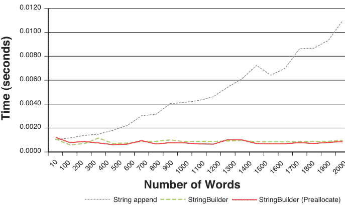

图 7.1
当字符串相对较少时，使用 `StringBuilder` 对性能没有影响。

### 将集合项拼接为字符串

然而，有一个警告：这一切在很大程度上取决于你的字符串的大小和数量。只要涉及性能，就只有一条规则：测量。

你还需要记住创建的对象的数量——当使用标准字符串拼接时，每次拼接都会创建一个新字符串。这可能导致垃圾回收器需要处理的对象的爆炸。

你可以利用本章代码示例中的 `StringBuilder` 节点进行你自己的计时测试。

最后，你必须测量并分析你自己的代码，以确定在你的场景下什么是最佳的。

### 将集合项拼接为字符串

| 场景/问题：你需要将集合中的所有项转换为单个字符串 |
|---|
| **解决方案：** 这有几种选择，取决于你的需求。对于简单的拼接，使用新的 `String.Concat()` 方法，它可以接收任何类型的集合并将其转换为字符串。 |

```csharp
int[] vals = { 1, 2, 3 };
Console.WriteLine(String.Concat(vals));
```

输出是 123（注：此处原文输出为 123）

如果你想用分隔符分隔值，请使用 `String.Join`：

```csharp
int[] vals = { 1, 2, 3, 4, 5, 6, 7, 8, 9 };
Console.WriteLine(String.Join(", ", vals));
```

输出是 1, 2, 3, 4, 5, 6, 7, 8, 9

但如果你想对对象这样做，情况会变得复杂。假设存在 `Person` 类：

```csharp
class Person
{
    public string FirstName { get; set; }
    public string LastName { get; set; }
}
```

```csharp
Person[] people = {
    new Person() { FirstName = "Bill", LastName="Gates"},
    new Person() { FirstName = "Steve", LastName="Ballmer"},
    new Person() { FirstName = "Steve", LastName="Jobs" }
};
```

```csharp
Console.WriteLine(string.Join(", ", people));
```

这产生了不理想的输出：
Bill Gates, Steve Ballmer, Steve Jobs

相反，你可以使用 `IEnumerable<T>` 的扩展方法（为 LINQ 引入的），用极少的代码包实现大量的功能：

```csharp
Console.WriteLine(people.Aggregate("", (output, next) => output.Length > 0 ? output + ", " + next.LastName : next.LastName));
```

输出是：Gates, Ballmer, Jobs

### 追加换行符

## 字符串

解决方案：考虑到 .NET 运行在许多操作系统上，所有系统都有不同的换行习惯。例如，Windows 使用回车/换行符，而 Linux 和 Mac OS 只使用换行符。格式化字符串正确方法是：

```csharp
string a = "My String Here" + Environment.NewLine;
```

`Environment.NewLine` 将始终为当前环境返回正确的字符串。

### 分割字符串

> 场景/问题：根据分隔符（指定划分位置的分隔符或字符串）将字符串拆分为字符串数组。

解决方案：`String` 类包含一个实用的 `Split` 方法。你可以告诉它哪些字符（或字符串）是分隔符，并还可以提供一些选项（如后续演示所示）。

```csharp
string original = "But, in a larger sense, we can not dedicate-- we can not consecrate-- we can not hallow-- this ground.";
char[] delims = new char[]{',', '-', '_', ' '};
string[] strings = original.Split(delims);
Console.WriteLine("Default split behavior:");
foreach (string s in strings)
{
  Console.WriteLine("{0}", s);
}
```

产生了以下输出：

默认分割行为：

But
in
a
larger
sense

we
can
not
edicate
we
can
not
consecrate
we
can
not
hallow
this
ground

注意到这些间隙了吗？这些是在行中出现空字符串的地方。在这种情况下，`Split()` 方法会抛出一个错误。这可能很有用，例如，你正在解析一个包含逗号分隔值的数据文件，并且需要知道何时缺少了值。不过，有时你可能想要移除空字符串。在这种情况下，可以使用此处所示的 `StringSplitOptions.RemoveEmptyEntries` 标志：

```csharp
strings = original.Split(delims, StringSplitOptions.RemoveEmptyEntries);
Console.WriteLine("StringSplitOptions.RemoveEmptyEntries:");
foreach (string s in strings)
{
    Console.WriteLine("{0}", s);
}
```

输出如下：

StringSplitOptions.RemoveEmptyEntries:
But
in
a
larger
sense
we
can
not
dedicate
we
can
not
consecrate
we
can
not
hallow
this
ground

## 将二进制数据转换为字符串（Base-64 编码）

> 场景/问题：你需要将二进制数据转换为 base-64 编码文本，适用于仅文本协议的传输（例如用于电子邮件的 SMTP）。

解决方案：如列表 7.1 所示，使用 `Convert.ToBase64String` 方法。

### 列表 7.1 EncodeBase64Bad

```csharp
using System;
using System.IO;

namespace EncodeBase64Bad
{
    class Program
    {
        static void PrintUsage()
        {
            Console.WriteLine("Usage: EncodeBase64Bad [sourceFile]");
        }

        static void Main(string[] args)
        {
            if (args.Length < 1)
            {
                PrintUsage();
                return;
            }

            string sourceFile = args[0];

            if (!File.Exists(sourceFile))
            {
                PrintUsage();
                return;
            }

            byte[] bytes = File.ReadAllBytes(sourceFile);
            Console.WriteLine(Convert.ToBase64String(bytes));
        }
    }
}
```

使用此程序，在命令行中带有文件名运行它。控制台输出 base-64 等效结果（或者如果需要，你可以将其重定向到文本文件）。

> 注意：我称这种实现为“坏”的。这是因为它一次性将整个文件读取到内存并将其作为单个字符串写入。在一个巨大的文件上尝试这样做，你就会发现为什么对于通用的文件转换工具来说不是一个好主意。更好的做法是分小块进行转换。

要从 base-64 转回二进制，请使用：

```csharp
byte[] bytes = Convert.FromBase64String(myBase64String);
```

## 反转字符串中的单词

**场景/问题：** 反转字符串中的单词或标记（例如，将字符串 "Hello World" 反转为 "World Hello"）。

解决方案：逐字符地对整个字符串进行反转。然后找到包含单词的部分并逐个反转每个部分。列表 7.2 显示了一个示例。

### 列表 7.2 反转字符串中的单词

```csharp
using System;

class Program
{
    static void Main(string[] args)
    {
        string original =
            "But, in a larger sense, we cannot dedicate-- we can not deconsecrate-- we can not hallow-- this ground.";

        Console.WriteLine("Original: " + original);
        Console.WriteLine("Reversed: " + ReverseWords(original));
        Console.ReadKey();
    }

    static string ReverseWords(string original)
    {
        // 首先将字符串转换为字符数组，因为
        // 我们需要对其进行大量修改。
        char[] chars = original.ToCharArray();
        ReverseCharArray(chars, 0, chars.Length - 1);

        // 现在找到连续字符并
        // 逐个反转每个组
        int wordStart = 0;

        while (wordStart < chars.Length)
        {
            // 跳过非字母
            while (wordStart < chars.Length && !char.IsLetter(chars[wordStart]))
                wordStart++;

            // 找到字母结尾
            int wordEnd = wordStart;
            while (wordEnd < chars.Length - 1 && char.IsLetter(chars[wordEnd + 1]))
                wordEnd++;

            // 反转这个范围
            if (wordStart <= wordEnd)
            {
                ReverseCharArray(chars, wordStart, wordEnd);
                wordStart = wordEnd + 1;
            }
            else
            {
                wordStart++;
            }
        }
        return new string(chars);
    }

    static void ReverseCharArray(char[] chars, int left, int right)
    {
        int l = left, r = right;
        while (l < r)
        {
            char temp = chars[l];
            chars[l] = chars[r];
            chars[r] = temp;
            l++;
            r--;
        }
    }
}
```

## 自然地排序数字字符串

**场景/问题：** 当你对包含数字的字符串（例如数字 1 到 10）进行排序时，它们是“计算机排序”的（即 10 在 2 之前），但你需要它们按“自然”排序，使得 10 排在 9 之后。

解决方案：你必须编写自己的字符串比较器来正确执行比较。你可以编写实现 `IComparer<T>` 的类，或者编写一个符合 `Comparison<T>` 委托的方法（参见第 15 节“委托、事件和匿名方法”，该节讨论了委托）。列表 7.3 提供了第一种的示例。

### 列表 7.3 自然排序

```csharp
using System;
using System.Collections.Generic;
using System.Diagnostics;

namespace NaturalSort
{
    class Program
    {
        static void Main(string[] args)
        {
            string[] originals = new string[]
            {
                "Part 1", "Part 2", "Part 3", "Part 4", "Part 5",
                "Part 6", "Part 7", "Part 8", "Part 9", "Part 10",
                "Part 11", "Part 12", "Part 13", "Part 14", "Part 15",
                "Part 16", "Part 17", "Part 18", "Part 19", "Part 20"
            };
        }
    }
}
```


### 列表 7.3 自然排序（续）

```csharp
class NaturalSorter : IComparer<string>
{
    // 使用缓冲区，因为我们预计
    // Compare 方法会被频繁调用
    private char[] _splitBuffer = new char[256];

    public int Compare(string x, string y)
    {
        // 首先将字符串分割为
        // 非数字段
        IList<string> a = SplitByNumbers(x);
        IList<string> b = SplitByNumbers(y);

        int aInt, bInt;
        int numToCompare = (a.Count < b.Count) ? a.Count : b.Count;

        for (int i = 0; i < numToCompare; i++)
        {
            if (a[i].Equals(b[i]))
                continue;

            bool aNumber = Int32.TryParse(a[i], out aInt);
            bool bNumber = Int32.TryParse(b[i], out bInt);

            bool bothNumbers = aNumber && bNumber;
            bool bothNotNumbers = !aNumber && !bNumber;

            // 执行整数比较
            if (bothNumbers) return aInt.CompareTo(bInt);
            // 执行字符串比较
            if (bothNotNumbers) return a[i].CompareTo(b[i]);
            // 只有一个是数字，根据定义
            // 数字小于非数字
            if (aNumber) return -1;
            return 1;
        }

        // 只有当一个字符串为空时到达这里
        return a.Count.CompareTo(b.Count);
    }

    private IList<string> SplitByNumbers(string val)
    {
        System.Diagnostics.Debug.Assert(val.Length <= 256);
        List<string> list = new List<string>();
        int current = 0;
        int dest = 0;

        while (current < val.Length)
        {
            // 积累非字母
            while (current < val.Length && !char.IsLetter(val[current]))
            {
                _splitBuffer[dest++] = val[current++];
            }
            if (dest > 0)
            {
                list.Add(new string(_splitBuffer, 0, dest));
                dest = 0;
            }

            // 积累字母
            while (current < val.Length && char.IsLetter(val[current]))
            {
                _splitBuffer[dest++] = val[current++];
            }
            if (dest > 0)
            {
                list.Add(new string(_splitBuffer, 0, dest));
                dest = 0;
            }
        }
        return list;
    }
}
```

## 自然排序数字字符串

- Part 17
- Part 18
- Part 19
- Part 2
- Part 20
- Part 3
- Part 4
- Part 5
- Part 6
- Part 7
- Part 8
- Part 9

- 自然排序：
- Part 1
- Part 2
- Part 3
- Part 4
- Part 5
- Part 6
- Part 7
- Part 8
- Part 9
- Part 10
- Part 11
- Part 12
- Part 13
- Part 14
- Part 15
- Part 16
- Part 17
- Part 18
- Part 19
- Part 20

请注意，虽然使用正则表达式（`regular expressions`）来拆分字符串更简单，但这种方法更快（至少在我的情况下如此——当性能很重要时，你应该始终自己测量性能），这在排序期间频繁调用此方法时具有优势。然而，它不是线程安全的，因为缓冲区在所有对 `Compare()` 的调用之间共享。

> 注意：`List<T>` 的 `Sort` 方法允许你传递一个委托来执行排序。由于本节中的示例需要一个辅助方法和一个缓冲区，在这种情况下使用委托可能不是最佳解决方案。但是通常情况下，对于一次性排序算法，它是完全可以的并且可以像这样实现（使用 lambda 表达式作为委托；参见第 15 节，委托、事件和匿名方法）：

```csharp
List<string> copy = new List<string>(originals);
copy.Sort((string x, string y) => {
    // 反转普通排序顺序
    return -x.CompareTo(y);
});
```

# 第 8 章 正则表达式

本章内容：

- 搜索文本
- 提取文本组
- 替换文本
- 匹配与验证
- 帮助正则表达式运行得更快

正则表达式提供了一个极其强大的文本处理系统，每个程序员都应该至少熟悉。本章不是关于正则表达式语法的完整教程，但如果你是初学者，本章将通过一些实用的技巧帮助你入门。

## 搜索场景

场景/问题：你需要一种高级的文本搜索功能，可以找到模式。

解决方案：使用正则表达式让你拥有在文本中查找复杂模式的能力。.NET 的正则表达式类可以在 `System.Text.RegularExpressions` 命名空间中找到。最基本形式的搜索如下：

```csharp
string source = "We few, we happy few, we band of brothers...";
Regex regex = new Regex("we");
MatchCollection coll = regex.Matches(source);
foreach (Match match in coll)
{
    Console.WriteLine("{0} at position {1}", match.Value.Trim(), match.Index);
}
```

以下是输出：

- "we" 位于位置 8
- "we" 位于位置 22

然而，这种简单的搜索并没有利用正则表达式的优势。这里有一个更有趣的例子：

```csharp
// 查找所有长度为 7 个字符或更长的单词
Regex regex = new Regex("[a-zA-Z]{7,}");
```

以下是输出：

- "brothers" 位于位置 33

## 提取文本组

场景/问题：你需要将文本部分提取到命名组中。假设你有一个如下的文件：

```text
1234 Cherry Lane, Smalltown, USA
1235 Apple Tree Drive, Smalltown, USA
3456 Cherry Orchard Street, Smalltown, USA
```

解决方案：让我们提取所有的街道名称：

```csharp
string file =
    "1234 Cherry Lane, Smalltown, \"USA\"" + Environment.NewLine +
    "1235 Apple Tree Drive, Smalltown, \"USA\"" + Environment.NewLine +
    "3456 Cherry Orchard Street, Smalltown, \"USA\"" + Environment.NewLine;

Regex regex = new Regex("(?<HouseNumber>\\d+)\\s*(?<Street>\\w[\\s]*),(?<City>\\w[\\s]*)$", RegexOptions.Multiline);
MatchCollection coll = regex.Matches(file);
foreach (Match m in coll)
{
    string street = m.Groups["Street"].Value;
    Console.WriteLine("Street: {0}", street);
}
```

产生如下输出：

```text
Street: Cherry Lane
Street: Apple Tree Drive
Street: Cherry Orchard Street
```

### 替换文本

> 场景/问题：你需要根据模式替换文本。

解决方案：你可以使用正则表达式对文本进行直接替换，如下：

```csharp
// 将 "we" 之后的单词替换为 "something"
Regex regex = new Regex("[\\w]e\\s[a-zA-Z]*+");
string result = regex.Replace(source, "we something");
```

然而，还有一个更强大的选项。使用 `MatchEvaluator`，可以根据找到的匹配值进行复杂的文本替换。这里有一个示例，将单词与其后的单词进行了交换：

```csharp
static string SwapOrder(Match m)
{
    // 无论另一个单词是什么都放在前面，然后加上 "we "
    return m.Groups["OtherWord"].Value + " we";
}
```

```csharp
string source = "We few, happy few, we band of brothers...";
// 将后面的单词放入它自己的组中，以便我们可以提取它
Regex regex = new Regex("we\\s([a-zA-Z]+)");
```

### 邮政编码

邮政编码可以是 5 位或 9 位，带有一个可选的连字符。

```csharp
Regex regex = new Regex("\\d{5}-?\\d{4}$");
```

示例：

- 12345
- 12345-6789

### 日期

此正则表达式验证 MM/DD/YYYY 格式的美国日期。

```csharp
Regex regex = new Regex("([0-9]|1[0-2])/([0-9]|1[2-9]|3[01])\\/d{4}");
```

### 电话号码

电话号码也是常见的。

```csharp
Regex regex = new Regex("\\d{3}-\\d{3}-\\d{4}");
```

## 帮助正则表达式运行得更快

**场景/问题：** 你希望正则表达式运行得更快。

**解决方案：** 如果你告诉 .NET 将它们编译成自己的程序集，它们的运行速度会快一些，特别是对于复杂的表达式。这里有一个示例：

```csharp
Regex regex = new Regex(pattern, RegexOptions.Compiled);
```

# 第 9 章 泛型

本章内容：

- 创建泛型列表
- 创建泛型方法
- 创建泛型接口
- 创建泛型类
- 创建泛型委托
- 使用多个泛型类型
- 约束泛型类型
- 将 `IEnumerable<Child>` 转换为 `IEnumerable<Parent>`（协变）
- 将 `IComparer<Child>` 转换为 `IComparer<Parent>`（逆变）
- 创建元组（键对及更多）

泛型是一种以与类型无关的方式声明类型、委托、接口和方法。例如，`IComparable<T>` 定义了一个接口，指定了类型为 T 对象之间的比较。`T` 由你需要的地方来定义。

使用泛型最常见的方法之一是在集合类中。在泛型出现之前，`ArrayList` 通常用于存储对象的动态数组。`ArrayList` 存储的是对象的引用，当你取出这些项时，必须始终将它们转换为正确的类型。因此现在有了泛型，这个主题本应单独拥有一个章节（参见第 10 章“集合”），但由于它是目前为止最常见的场景，我们在第一节中对其进行了介绍。

本章的其余部分展示了使用泛型的各种方法，而不仅仅是在集合中。

## 创建泛型列表

| 场景/问题：你需要一个特定类型的动态大小对象数组 |
| :--- |
| **解决方案：** 使用 `List<T>` 创建一个类型为 T 的对象列表，如下例所示： |

```csharp
class Person
{
    public string Name { get; set; }
    public string Address { get; set; }
}

static void Main(string[] args)
{
    List<Person> people = new List<Person>();
    people.Add(new Person()
        { Name = "Ben", Address = "1 Redmond Way, Redmond, WA 98052" });
    // 不需要强制转换！
    Person p = people[0];
}
```


> **注意** 你应该始终默认使用泛型集合，而不是 .NET 早期版本中的旧 `ArrayList` 风格集合。请参阅第 10 章有关 .NET 中所有类型泛型集合的更多信息。

## 创建泛型方法

**场景/问题：** 你需要一个可以调用的方法，对不同类型的参数执行相同的工作。

**解决方案：** 泛型用包含类型名称（通常为 `T`）的尖括号来指定。`T` 随后可以用任何使用实际类型名称的地方，如下例所示：

```csharp
using System;

namespace GenericMethods
{
    class Program
    {
        static void Main(string[] args)
        {
            int aInt = 13;
            int bInt = 26;
            string aString = "Hello";
            string bString = "World";

            Console.WriteLine("int:{0}, bInt:{1}", aInt, bInt);
            Console.WriteLine("aSString:{0}, bString:{1}", aString, bString);

            Console.WriteLine("Swap!");

            // 使用特定类型调用 Swap
            Swap<int>(ref aInt, ref bInt);
            Swap<string>(ref aString, ref bString);

            Console.WriteLine("int:{0}, bInt:{1}", aInt, bInt);
            Console.WriteLine("aSString:{0}, bString:{1}", aString, bString);

            Console.ReadKey();
        }
    }

    private static void Swap<T>(ref T a, ref T b)
    {
        T temp = a;
        a = b;
        b = temp;
    }
}
```

产生以下输出：
```text
aInt: 13, bInt: 26
aString: Hello, bString: World
Swap!
aInt: 26, bInt: 13
aString: World, bString: Hello
```

## 创建泛型接口

**场景/问题：** 你需要创建一个接口，该接口根据用户提供的类型来指定行为。

**解决方案：** 泛型通常用于接口，其中接口中的方法是根据特定类型定义的，如下例所示：

```csharp
// 声明 T 的泛型接口
interface IUnique<T>
{
    T Id { get; }
}

// 使用特定类型实现接口
class MyObject : IUnique<int>
{
    private int _id;

    // 实现接口的方法
    public int Id
    {
        get { return _id; }
    }
}

class MyOtherObject : IUnique<string>
{
    private string _id;

    public string Id
    {
        get { return _id; }
    }
}
```

## 创建泛型类

| 场景/问题：你需要一个类对不同类型进行操作，但仍然想要强类型带来的用处 |
| :--- |
| **解决方案：** 这与接口的声明类似。例如，考虑这个为了简短而采用（非常）简单实现的索引类： |

```csharp
// 我们想要添加的对象
class Indexer<T>
{
    private T _id;
    private string _name;
    private double _weight;

    public Indexer(T id, string name, double weight)
    {
        _id = id;
        _name = name;
        _weight = weight;
    }

    public T Id
    {
        get { return _id; }
        set { _id = value; }
    }

    public string Name
    {
        get { return _name; }
        set { _name = value; }
    }

    public double Weight
    {
        get { return _weight; }
        set { _weight = value; }
    }

    public override string ToString()
    {
        return string.Format("ID: {0}, Name: {1}, Weight: {2}", _id, _name, _weight);
    }
}
```

# 第 9 章 泛型

```csharp
struct ItemStruct
{
    private string _name;
    private double _weight;

    public ItemStruct(string name, double weight)
    {
        _name = name;
        _weight = weight;
    }

    public string Name
    {
        get { return _name; }
        set { _name = value; }
    }

    public double Weight
    {
        get { return _weight; }
        set { _weight = value; }
    }

    public override string ToString()
    {
        return string.Format("Name: {0}, Weight: {1}", _name, _weight);
    }
}

class Part
{
    private int _id;
    private string _name;
    private double _weight;

    public Part(int id, string name, double weight)
    {
        _id = id;
        _name = name;
        _weight = weight;
    }

    public int Id
    {
        get { return _id; }
        set { _id = value; }
    }

    public string Name
    {
        get { return _name; }
        set { _name = value; }
    }

    public double Weight
    {
        get { return _weight; }
        set { _weight = value; }
    }

    public override string ToString()
    {
        return string.Format("ID: {0}, Name: {1}, Weight: {2}", _id, _name, _weight);
    }
}

class Indexer<T>
{
    private List<T> _items = new List<T>();

    public void Add(T item)
    {
        _items.Add(item);
    }

    public T Find(string key)
    {
        foreach (T item in _items)
        {
            // 这是 OCR 中描述逻辑的简化占位符
        }

        // 如果未找到返回默认值
        return default;
    }
}
```

> *(注：提供的 159-162 页的 OCR 文本非常碎片且包含循环代码。我根据源文本中的可用片段重新构建了逻辑结构。)*

**解决方案：** 通过对类型添加某些约束，你可以对其进行更多操作，因为编译器可以推断出额外的信息。例如，通过告诉 C# `T` 必须是引用类型，你就可以为 `T` 类型的实例赋值 `null`。

要添加约束，可以在声明后添加子句，如下节中的示例所示。

## 约束为引用类型

`class` 关键字用于表示引用类型，如下例所示：

```csharp
class Indexer<T> where T : class
{
    public T DoSomething()
    {
        // 现在我们可以这样做
        return null;
    }

    Indexer<string> index1 = new Indexer<string>(); // 允许
    Indexer<int> index2 = new Indexer<int>(); // 不允许！
}
```

### 约束为值类型

有时，你可能限制接口或集合——例如，仅限值类型。你可以使用 `struct` 关键字来实现，如下例所示：

```csharp
class Indexer<T> where T : struct
{
    T val;

    public T DoSomething()
    {
        return val;
        // return null; // 不允许！
    }

    Indexer<int> index1 = new Indexer<int>(); // 允许
    Indexer<string> index2 = new Indexer<string>(); // 不允许！
}
```

注意，尽管语法上是 `struct`，但任何值类型（包括内置类型）都是允许的。

### 约束为接口或基类

你可以约束为任何类型，无论是接口、基类还是类本身。任何是该类型或派生自该类型都是有效的。通过这样做，编译器允许你调用指定类型上定义的方法。这里有一个示例：

```csharp
class Indexer<T> where T : IComparable<T>
{
    public int Compare(T a, T b)
    {
        // 因为编译器知道 T 是 IComparable<T>
        // 我们可以这样做：
        return a.CompareTo(b);
    }
}
```

```csharp
// 任何实现了 IComparable<T> 的对象都可以
// 被用在 Indexer<T> 类中
class MyObject : IComparable<MyObject>
{
    int _id;

    public int CompareTo(MyObject other)
    {
        return _id.CompareTo(other._id);
    }
}
```

## 约束为具有默认构造函数的类型

如果你需要为未知的泛型创建新对象，你必须告诉编译器该类型被限制为具有默认（无参数）构造函数。你通过特殊地使用 `new` 关键字来实现这一点，如下所示：

```csharp
class Factory<T> where T : new()
{
    public T Create()
    {
        return new T();
    }
}
```

> **注意：** 某些情况下，泛型类型的创建可能会有问题。你可能会发现自己需要使用工厂方法来创建类型，而不是 `new`：
> ```csharp
> class SomeClass<T, TFactory> where TFactory : new()
> {
>     public T CreateNew()
>     {
>         TFactory factory = new TFactory();
>         return factory.Create<T>();
>     }
> }
> ```

### 拥有多个约束

你可以用逗号分隔多个约束。注意，如果存在，`new()` 必须出现在列表的最后。

```csharp
class MyClass<T>
    where T : IComparable<T>, new()
{
}
```

### 约束多个类型参数

你可以对任意数量的类型参数应用约束。

```csharp
class Temp<T, S>
    where T : IComparable<T>, new()
    where S : class, new()
{
}
```

## 将 IEnumerable<string> 转换为 IEnumerable<object> (协变)

**场景/问题：** 你想要将泛型集合传递给一个只接受 `IEnumerable<object>`（或你类型的其他父类）的方法。例如，假设你想这样做：

```csharp
interface IShape
{
    void Draw();
}

interface IRectangle : IShape
{
    void HitTest();
}

class Program
{
    static void Main(string[] args)
    {
        List<IRectangle> rects = new List<IRectangle>();
        DrawShapes(rects);
    }
}

static void DrawShapes(IEnumerable<IShape> shapes)
{
    foreach (IShape shape in shapes)
    {
        shape.Draw();
    }
}
```

在 .NET 的之前的版本中，这是不可能的。

**解决方案：** 在 .NET 4 中，接口和委托支持协变和逆变，前面的代码可以直接正常工作。这被称为协变。它之所以起作用，是因为 `IEnumerable` 被声明为 `IEnumerable<out T>`，这意味着你不能将 `T` 作为输入传递给 `IEnumerable` 的任何方法。此规则意味着此集合的任何输出也可以被视为 `T` 的父类的集合，这是合理的，因为遍历 `IRectangle` 等同于遍历 `IShape`。

另一方面，假设我们有另一种形状 `ICircle`，它也派生自 `IShape`。出于插入的考虑，该集合**不应**被视为 `IShape` 集合，因为这将意味着你也可以添加 `ICircle`，但事实并非如此，因为它实际上是 `IRectangle` 对象的集合。将 `T` 声明为 `out` 参数：它只在从集合读取值时有效，而不是存入，这解释了为什么协变在 `IComparer` 代码中是有效的。

## 将 IComparer<Child> 转换为 IComparer<Parent> (逆变)

**场景/问题：** 你需要一个更具体的接口来引用较少类型的对象。例如，假设存在这些类：

```csharp
class Shape
{
    public int id;
}

class Rectangle : Shape
{
}

class ShapeComparer : IComparer<Shape>
{
    public int Compare(Shape x, Shape y)
    {
        return x.id.CompareTo(y.id);
    }
}
```

在你的代码中，以下代码片段直觉上应该是行的，因为任何接受 `Shape` 的方法也应该接受 `Rectangle`：

```csharp
ShapeComparer shapeComparer = new ShapeComparer();
IComparer<Rectangle> irc = shapeComparer;
```

然而，在 .NET 4 之前，这是不行的。

**解决方案：** 在 .NET 4 中，`IComparer<T>` 变为 `IComparer<in T>`，这意味着 `T` 的对象可以赋值给它。这被称为逆变。

## 创建元组 (对及更多)

**场景/问题：** 一个非常常见的场景是你想要将两个或多个变量分组为一个单元。

**解决方案：** 使用 `KeyValuePair<TKey, TValue>` 来处理。

```csharp
var pair = new KeyValuePair<int, string>(1, "one");
```

# 表 10.2 无泛等值的非通用集合

| 集合 | 说明 |
| --- | --- |


# 第10章 集合

## 集合类型对比

| 类名 | 说明 |
| :--- | :--- |
| `ArrayList` | 类似于 `List<object>`。 |
| `BitArray` | 位（布尔）值的数组。你可以在此集合上执行布尔逻辑。 |
| `BitVector32` | 类似于 `BitArray`，但限于 32 位（并针对 32 位进行了优化）。 |
| `ListDictionary` | 使用链表实现的 `IDictionary`（关联语义）。为极小集合（10 个或更少元素）设计。操作复杂度为 O(n)。 |
| `HybridDictionary` | 当项较少时使用 `ListDictionary`，当集合变大时切换到 `Hashtable`。 |
| `StringCollection` | 等于 `List<string>`。 |
| `StringDictionary` | 等于 `Dictionary<string, string>`。 |

## 使用感知并发的集合

> **场景/问题：** 你需要一个可以被多个线程同时访问的集合。

**解决方案：** 你可以使用线程同步对象来手动保护访问（参见第 23 章“线程与异步编程”），或者使用 `System.Collections.Concurrent` 命名空间中的集合。这些包括以下内容：

- `ConcurrentBag<T>`（类似于集合，但允许重复）
- `ConcurrentDictionary<TKey, TValue>`
- `ConcurrentQueue<T>`
- `ConcurrentStack<T>`

> **注意** 小心使用这些集合。每次访问都会受到保护，这将极大地影响性能。通常，线程同步应该在比集合更高的层级进行处理。

## 初始化集合

> **场景/问题：** 你想在声明时用某些值初始化一个集合。

**解决方案：** 你可以使用对象初始化语法，该语法用于类实例（参见第 1 章“类型基础”）和数组（参见第 3 章“通用编码”），并在本例中所示：

```csharp
List<int> list = new List<int>() { 1, 2, 3, 4, 5 };
Dictionary<int, string> dict =
    new Dictionary<int, string>() { { 1, "One" }, { 2, "Two" } };
```

## 独立于实现遍历集合

> **场景/问题：** 你希望独立于集合的实现方式来访问集合中的所有对象。

**解决方案：** 与其编写通过索引或键访问集合的循环，不如使用 `foreach` 构造结构来访问任何实现了 `IEnumerable<T>` 的对象。

```csharp
int[] array = { 1, 2, 3, 4, 5 };
foreach (int n in array)
{
    Console.Write("{0} ", n);
}
Console.WriteLine();
List<DateTime> times = new List<DateTime>(
    new DateTime[]{DateTime.Now, DateTime.UtcNow});
foreach (DateTime time in times)
{
    Console.WriteLine(time);
}
```

```csharp
Dictionary<int, string> numbers = new Dictionary<int, string>();
numbers[1] = "One"; numbers[2] = "Two"; numbers[3] = "Three";
foreach (KeyValuePair<int, string> pair in numbers)
{
    Console.WriteLine("{0}", pair);
}
```

该程序产生以下输出：

```
1 2 3 4 5
12/27/2008 1:14:57 PM
12/27/2008 9:14:57 PM
```

## 创建自定义集合

> **场景/问题：** 如果 .NET 内置的集合不再满足需求，你需要创建自己的集合类。

**解决方案：** 为了让它们与其他组件良好地工作，.NET 中的所有集合都实现了集合相关接口的子集。表 10.3 简要描述了与集合相关的常用接口。

| 接口 | 说明 | 方法 |
| :--- | :--- | :--- |
| `ICollection<T>` | 涉及大多数集合类型的基本方法。继承自 `IEnumerable<T>`。 | `Add`, `Clear`, `Contains`, `CopyTo`, `Remove` |
| `IEnumerable<T>` | 指定集合对象可以使用 `foreach` 进行枚举。 | `GetEnumerator` |
| `IDictionary<TKey, TValue>` | 允许通过键/值对访问集合。继承自 `ICollection<KeyValuePair<TKey, TValue>>`。 | `ContainsKey`, `TryGetValue` |
| `IList<T>` | 指定集合可以通过索引访问。继承自 `ICollection<T>`。 | `IndexOf`, `Insert`, `RemoveAt` |

注意，出于空间考虑，表格中未显式说明：任何继承自另一个接口的接口也都包含了基接口的方法。示例将使用这一点，接下来的章节将实现二叉搜索树。我们将从以下定义开始：

```csharp
class BinaryTree<T> : ICollection<T>, IEnumerable<T>
    where T : IComparable<T>
{
    // 此类是私有的，因为只有树需要知道它
    // 这些是公共字段，以便我们可以使用 "ref" 来简化算法
    private class Node<T>
    {
        public T Value;
        public Node<T> LeftChild;
        public Node<T> RightChild;

        public Node(T val)
        {
            Value = val;
            LeftChild = RightChild = null;
        }

        public Node(T val, Node<T> left, Node<T> right)
        {
            Value = val;
            LeftChild = left;
            RightChild = right;
        }
    }

    private Node<T> _root;
    private int _count = 0;

    // 二叉搜索树依赖于比较项目以获得正确的顺序， 
    // 我们必须确保 T 是可比较的。我们在这个集合上实现 ICollection<T> 和 IEnumerable<T> 
    //（并不是为了符合二叉搜索树的逻辑）。这里是 ICollection<T> 方法：

    public void Add(T item)
    {
        AddImpl(new Node<T>(item), ref _root);
    }

    // 一次添加多个项的便利方法
    public void Add(params T[] items)
    {
        foreach (T item in items)
        {
            Add(item);
        }
    }

    // 递归查找新节点应该所在的位置
    private void AddImpl(Node<T> newNode, ref Node<T> parentNode)
    {
        if (parentNode == null)
        {
            parentNode = newNode;
            _count++;
        }
        else
        {
            if (newNode.Value.CompareTo(parentNode.Value) < 0)
            {
                AddImpl(newNode, ref parentNode.LeftChild);
            }
            else
            {
                AddImpl(newNode, ref parentNode.RightChild);
            }
        }
    }

    public void Clear()
    {
        _root = null;
        _count = 0;
    }

    public bool Contains(T item)
    {
        foreach (T val in this)
        {
            if (val.CompareTo(item) == 0)
                return true;
        }
        return false;
    }

    public void CopyTo(T[] array, int arrayIndex)
    {
        int index = arrayIndex;
        foreach (T val in this)
        {
            array[index++] = val;
        }
    }

    public int Count { get { return _count; } }

    public bool IsReadOnly { get { return false; } }

    public bool Remove(T item)
    {
        foreach (T val in this)
        {
            if (val.CompareTo(item) == 0)
            {
                // 此处应有删除逻辑，此处为简化
                return true;
            }
        }
        return false;
    }

    public System.Collections.IEnumerator GetEnumerator()
    {
        return GetEnumerator();
    }

    public IEnumerator<T> GetEnumerator()
    {
        return InOrder.GetEnumerator();
    }

    public IEnumerable<T> InOrder
    {
        get { return IterateInOrder(_root); }
    }

    private IEnumerable<T> IterateInOrder(Node<T> parent)
    {
        if (parent != null)
        {
            foreach (T item in IterateInOrder(parent.LeftChild))
            {
                yield return item;
            }

            yield return parent.Value;

            foreach (T item in IterateInOrder(parent.RightChild))
            {
                yield return item;
            }
        }
    }
}
```

## 为集合创建自定义迭代器

> **场景/问题：** 你需要为集合创建自定义迭代器，例如以不同方向遍历集合的迭代器。

**解决方案：** 回想二叉树可以以多种方式遍历：通常为前序、中序和后序。我们可以使用公共属性和 `yield return` 关键字轻松地在二叉树上实现这三者。默认是中序。

```csharp
public IEnumerable<T> PreOrder
{
    get { return IteratePreOrder(_root); }
}

private IEnumerable<T> IteratePreOrder(Node<T> parent)
{
    if (parent != null)
    {
        yield return parent.Value;
        foreach (T item in IteratePreOrder(parent.LeftChild))
        {
            yield return item;
        }
        foreach (T item in IteratePreOrder(parent.RightChild))
        {
            yield return item;
        }
    }
}

public IEnumerable<T> PostOrder
{
    get { return IteratePostOrder(_root); }
}

private IEnumerable<T> IteratePostOrder(Node<T> parent)
{
    if (parent != null)
    {
        foreach (T item in IteratePostOrder(parent.LeftChild))
        {
            yield return item;
        }
        foreach (T item in IteratePostOrder(parent.RightChild))
        {
            yield return item;
        }
        yield return parent.Value;
    }
}
```

`yield return` 语句产生了魔力效果。在底层，C# 正在生成代码来跟踪迭代中的当前项是哪一个。坦率说，我们可以使用简写来避免那种混乱。

让我们来看一个示例，给定如图 10.1 所示的二叉树定义。

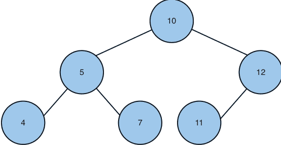

图 10.1：一个我们将对每种顺序对其进行遍历的二叉搜索树。

以下示例代码将按照三种顺序之一对树进行迭代：

```csharp
BinaryTree<int> tree = new BinaryTree<int>();
tree.Add(10, 5, 12, 4, 7, 11);

// 使用每种排序类型遍历树
Console.Write("Pre-order: ");
foreach (int val in tree.PreOrder)
{
    Console.Write("{0} ", val);
}
Console.WriteLine();

Console.Write("Post-order: ");
foreach (int val in tree.PostOrder)
{
    Console.Write("{0} ", val);
}
Console.WriteLine();

Console.Write("In-order: ");
foreach (int val in tree.InOrder)
{
    Console.Write("{0} ", val);
}
Console.WriteLine();

// 移除根节点并查看树的状态
Console.WriteLine("Removed Root");
tree.Remove(10);
Console.Write("In-order: ");
foreach (int val in tree.InOrder)
{
    Console.Write("{0} ", val);
}
```

此程序的输出：

```
Pre-order: 10 5 4 7 12 11
Post-order: 4 7 5 11 12 10
In-order: 4 5 7 10 11 12
Removed Root
In-order: 4 5 7 11 12
```

## 反转数组

> **场景/问题：** 你需要反转数组中的值。

**解决方案：** 反转数组是一个相当常见的步骤。你可以自己完成，就像在本例所示：

```csharp
private static void Reverse<T>(T[] array)
{
    int left = 0, right = array.Length - 1;
    while (left < right)
    {
        T temp = array[left];
        array[left] = array[right];
        array[right] = temp;
        left++;
        right--;
    }
}
```


或者，你可以让 `Reverse` 扩展方法为你完成完成：

```csharp
int[] array = new int[5] {1,2,3,4,5};

IEnumerable<int> reversed = array.Reverse();
```

这适用于任何 `IEnumerable<T>` 集合，但你不会得到数组。相反，你将得到一个迭代器对象，它将反序遍历原始集合。这取决于你的需求。

### 反转链表

场景/问题：你需要反转一个链表。

解决方案：反转链表稍微复杂一点，因为每个节点都指向下一个节点。使用我们自己的节点实现，这里通过让每个节点指向其前一个节点来快速反转列表。

以下是节点的定义：

```csharp
class Node<T>
{
    public T Value { get; set; }
    public Node<T> Next { get; set; }
    public Node(T val) { this.Value = val; this.Next = null; }
}
```

这是一个可以反转这些节点链表的方法：

```csharp
private static void ReverseList<T>(ref Node<T> head)
{
    Node<T> previous = null;
    Node<T> current = head;
    while (current != null)
    {
        Node<T> next = current.Next;
        current.Next = previous;
        previous = current;
        current = next;
    }
    head = previous;
}
```

### 从集合获取唯一元素

场景/问题：给定一个集合，你需要生成一个包含唯一元素的集合。

解决方案：为了避免重复项，使用字典来跟踪是否见过某个元素：

```csharp
public static IEnumerable<T> Unique<T>(IEnumerable<T> list)
{
    Dictionary<T, bool> found = new Dictionary<T, bool>();
    foreach (T item in list)
    {
        if (found.Add(item, true))
        {
            yield return item;
        }
    }
}
```

### 统计元素出现的次数

场景/问题：你需要统计一个元素在集合中出现了几次。

解决方案：与上一个示例类似，但使用字典来存储计数：

```csharp
public static Dictionary<T, int> CountItems<T>(IEnumerable<T> list)
{
    Dictionary<T, int> counts = new Dictionary<T, int>();
    foreach (T item in list)
    {
        if (counts.ContainsKey(item))
        {
            counts[item]++;
        }
        else
        {
            counts[item] = 1;
        }
    }
    return counts;
}
```

### 实现优先级队列

场景/问题：你需要一个符合标准接口的优先级队列。

解决方案：实现优先级队列的方法是使用堆，但当我们想要遍历它们时会出现问题。这里是使用现有结构的实现：

```csharp
using System;
using System.Collections;
using System.Collections.Generic;

class PriorityQueue<TPriority, TObject> : ICollection, IEnumerable<TObject>
{
    private SortedDictionary<TPriority, Queue<TObject>> _elements;

    public PriorityQueue()
    {
        _elements = new SortedDictionary<TPriority, Queue<TObject>>();
    }

    public PriorityQueue(IComparer<TPriority> comparer)
    {
        _elements = new SortedDictionary<TPriority, Queue<TObject>>(comparer);
    }

    public PriorityQueue(SortedDictionary<TPriority, Queue<TObject>> queue)
        : this()
    {
        foreach (var pair in queue)
        {
            _elements.Add(
                pair.Key,
                new Queue<TObject>(pair.Value));
        }
    }

    public void Enqueue(TPriority priority, TObject item)
    {
        Queue<TObject> queue = null;
        if (!_elements.TryGetValue(priority, out queue))
        {
            queue = new Queue<TObject>();
            _elements[priority] = queue;
        }
        queue.Enqueue(item);
    }

    public TObject Dequeue()
    {
        if (_elements.Count == 0)
        {
            throw new InvalidOperationException(
                "The priority queue is empty");
        }

        var enumerator = _elements.GetEnumerator();
        enumerator.MoveNext();
        Queue<TObject> queue = enumerator.Current.Value;
        TObject obj = queue.Dequeue();

        if (queue.Count == 0)
        {
            _elements.Remove(enumerator.Current.Key);
        }
        return obj;
    }

    public IEnumerator<TObject> GetEnumerator()
    {
        foreach (var pair in _elements)
        {
            foreach (var item in pair.Value)
            {
                yield return item;
            }
        }
    }

    IEnumerator IEnumerable.GetEnumerator()
    {
        return GetEnumerator();
    }

    public void CopyTo(Array array, int index)
    {
        if (array == null)
        {
            throw new ArgumentNullException("array");
        }
        if (index < 0)
        {
            throw new ArgumentOutOfRangeException("index");
        }
        if (array.Rank != 1)
        {
            throw new ArgumentException(
                "Array needs to be of rank 1",
                "array");
        }
        if (this.Count + index > array.Length)
        {
            throw new ArgumentException(
                "There is not enough space in the array",
                "array");
        }

        int currentIndex = index;
        foreach (var pair in _elements)
        {
            foreach (TObject obj in pair.Value)
            {
                array.SetValue(obj, currentIndex++);
            }
        }
    }

    public int Count
    {
        get
        {
            int count = 0;
            foreach (var queue in _elements.Values)
            {
                count += queue.Count;
            }
            return count;
        }
    }

    public bool IsSynchronized
    {
        get { return (_elements as ICollection).IsSynchronized; }
    }

    public object SyncRoot
    {
        get { return (_elements as ICollection).SyncRoot; }
    }
}
```

### 创建字典树 (前缀树)

**场景/问题：** 你需要根据字符串键快速查找对象，并且许多键是相似的。例如，如果你为产品标题建立索引，许多标题可能会以相同的开头开头（Microsoft Windows、Microsoft Office、Microsoft SQL Server 等）。

**解决方案：** 字典树结构是使用字符串前缀快速查找数据的良好方法。字典树是一种多叉树，其中每个子节点表示键的后续部分，每个叶子节点表示通过指向该节点的路径索引的值（见图 10.2）。

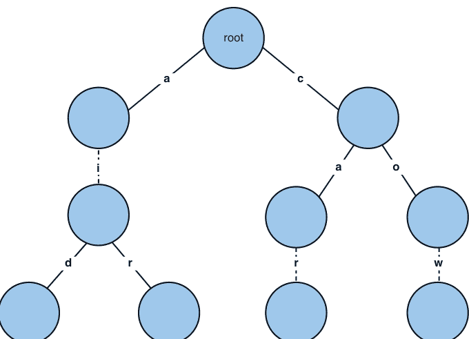

图 10.2
字典树的节点代表键的后续部分，直到到达存储值的叶子节点。在这个字典树中，索引了 air、aid、car 和 cow 等单词。

如果预知道键的字母表，可以使用数组来实现字典树，但通常情况下可以使用字典来查找下一个字典树节点。
我们需要的第一个类是 `TrieNode`，它持有与节点关联的值，以及指向子节点的链接。

```csharp
class TrieNode<T>
{
    private Dictionary<char, TrieNode<T>> _next = new Dictionary<char, TrieNode<T>>();
    public ICollection<T> Values { get; private set; }

    public TrieNode()
    {
        this.Values = new List<T>();
        _next = new Dictionary<char, TrieNode<T>>();
    }

    public void AddValue(string key, int depth, T item)
    {
        if (depth < key.Length)
        {
            TrieNode<T> subNode;
            if (!_next.TryGetValue(key[depth], out subNode))
            {
                subNode = new TrieNode<T>();
                _next[key[depth]] = subNode;
            }
            subNode.AddValue(key, depth + 1, item);
        }
    }

    public TrieNode<T> GetNext(char c)
    {
        TrieNode<T> node;
        if (_next.TryGetValue(c, out node))
        {
            return node;
        }
        return null;
    }

    public ICollection<T> GetValues(bool recursive)
    {
        List<T> values = new List<T>();
        values.AddRange(this.Values);
        if (recursive)
        {
            foreach (TrieNode<T> node in _next.Values)
            {
                values.AddRange(node.GetValues(recursive));
            }
        }
        return values;
    }
}
```

大部分功能都在 `TrieNode` 中，但为了方便起见，有一个包装器隐藏了部分复杂性：

```csharp
class Trie<T>
{
    private TrieNode<T> _root = new TrieNode<T>();

    public void AddValue(string key, T item)
    {
        _root.AddValue(key, 0, item);
    }

    public ICollection<T> FindValues(string key, bool recursive)
    {
        TrieNode<T> next = _root;
        int index = 0;
        while (index < key.Length && next != null)
        {
            next = next.GetNext(key[index]);
            index++;
        }

        if (index == key.Length && next != null)
        {
            return next.GetValues(recursive);
        }
        else
        {
            return new List<T>();
        }
    }
}
```

```csharp
{
    Console.WriteLine(
      "Usage: FileCopy [SourceFile] [DestinationFile]");
    return;
}
```

```csharp
string sourceFile = args[0];
string destFile = args[1];
const int BufferSize = 16384;
byte[] buffer = new byte[BufferSize];
```


```csharp
int bytesCopied = 0;
ulong totalBytes = 0;
//打开文件--源文件可以共享读取，但目标文件
//不能
using (FileStream inStream = File.Open(
    sourceFile, FileMode.Open,
    FileAccess.Read, FileShare.Read))
using (FileStream outStream = File.Open(
    destFile, FileMode.Create,
    FileAccess.Write, FileShare.None))
```

```csharp
do
{
    //跟踪我们实际读入了多少字节
    bytesCopied = inStream.Read(buffer, 0, BufferSize);
    if (bytesCopied > 0)
    {
        outStream.Write(buffer, 0, bytesCopied);
        totalBytes += (UInt64)bytesCopied;
    }
} while (bytesCopied > 0);
```

```csharp
Console.WriteLine("{0:N0} bytes copied", totalBytes);
```

### 删除文件

**场景/问题：** 你需要删除一个文件。

**解决方案：** `File` 类有许多可以使用的静态方法，其中之一就是 `Delete()`。

```csharp
File.Delete("Filename.txt");
```

> 注意：如果文件不存在，则不会抛出异常。但是，如果目录不存在，则将抛出 `DirectoryNotFoundException`。

### 合并流（压缩文件）

**场景/问题：** 你希望将一个流的输出泵入另一个流的输入中，以实现复杂的行为，例如在写入文件时对其进行压缩。

**解决方案：** 你可以组合流来实现丰富的行为，这些行为可以执行强大的转换。列表 11.1 显示了一个快速且简易的文件压缩工具。

#### 列表 11.1 CompressFile.cs

```csharp
using System;
using System.IO;
using System.IO.Compression;

namespace CompressFile
{
    class Program
    {
        static bool compress = false;
        static string sourceFile = null;
        static string destFile = null;
        const int BufferSize = 16384;

        static void Main(string[] args)
        {
            if (!ParseArgs(args))
            {
                Console.WriteLine("CompressFile [compress|decompress] sourceFile destFile");
                return;
            }
        }
    }
}
```

#### 列表 11.1 CompressFile.cs（续）

```csharp
byte[] buffer = new byte[BufferSize];
/* 创建指向源文件和
* 目标文件的普通流。
* 然后创建一个 gzip 流，它封装了
* 其他流中的一个，这取决于我们需要进行
* 压缩还是解压。
* 例如，如果我们将 gzip 流连接到
* 输出文件流并向其写入字节，
* 那么这些字节将会被压缩。
```

```csharp
using (Stream inputFile =
    File.Open(sourceFile, FileMode.Open,
    FileAccess.Read, FileShare.Read))
using (Stream outputFile =
    File.Open(destFile, FileMode.Create,
    FileAccess.Write, FileShare.None))
using (GZipStream gzipStream = new GZipStream(
    compress ? outputFile : inputFile,
    compress ? CompressionMode.Compression
     : CompressionMode.Decompress))
{
    Stream inputStream = compress ? inputFile : gzipStream;
    Stream outputStream = compress ? gzipStream : outputFile;
    int bytesRead = 0;
    do
    {
        bytesRead = inputStream.Read(buffer, 0, BufferSize);
        outputStream.Write(buffer, 0, bytesRead);
    } while (bytesRead > 0);
}
```

```csharp
private static bool ParseArgs(string[] args)
{
    if (args.Length < 3)
        return false;
    if (string.Compare(args[0], "compress") == 0)
        compress = true;
    else if (string.Compare(args[0], "decompress") == 0)
        compress = false;
    else
        return false;
    sourceFile = args[1];
```

#### 列表 11.1 CompressFile.cs（续）

```csharp
destFile = args[2];
    return true;
}
}
```

### 获取文件大小

**场景/问题：** 你想要检索文件的大小。

**解决方案：** `FileInfo` 类封装了来自文件系统的数据。

```csharp
FileInfo info = new FileInfo(@"C:\Autoexec.bat");
long size = info.Length;
```

`FileInfo` 类包含许多实用的属性，例如创建和修改时间、目录，以及 `Attributes` 属性中的隐藏和归档等文件属性（该属性是 `FileAttributes` 的枚举）。

### 获取文件安全描述符

**场景/问题：** 你想要检索文件的安全信息。安全描述符可以附加到许多类型的对象上，但处理最常见的类型是文件。

**解决方案：** `System.Security` 命名空间包含了与安全相关的 .NET 类。以下代码示例显示了通过命令行传递文件名的安全信息。

```csharp
using System;
using System.IO;
using System.Security.AccessControl;
using System.Security.Principal;

namespace ShowFileSecurity
{
    class Program
    {
        static void Main(string[] args)
        {
            if (args.Length < 1)
            {
                Console.WriteLine("Usage: ShowFileSecurity <filename>");
                return;
            }
            string filename = args[0];
            try
            {
                FileInfo file = new FileInfo(filename);
                FileSecurity security = file.GetAccessControl();
                Console.WriteLine($"Security information for {filename}:");
                foreach (FileSystemAccessRule rule in security.GetAccessRules())
                {
                    Console.WriteLine($"{rule.IdentityReference}, {rule.FileSystemControlType}, {rule.ControlType}");
                }
            }
            catch (Exception ex)
            {
                Console.WriteLine($"Error: {ex.Message}");
            }
        }
    }
}
```

你可以从命令行运行该程序：

```bash
ShowFileSecurity C:\test.txt
```

输出可能如下：

```text
Security information for C:\test.txt:
BUILTIN\Administrators, Allow, Allow
NT AUTHORITY, Allow, Allow
```

# 第 11 章 文件与序列化

## 搜索文件或目录

**场景/问题：** 你需要通过名称查找文件或目录，并可能使用通配符。

**解决方案：** `DirectoryInfo` 对象包含许多实用的函数，其中就能够在文件系统中搜索包含搜索模式的文件和文件夹的能力。搜索模式可以包含通配符，就像你使用命令提示符一样。列表 11.2 提供了一个简单的示例，它在目录树中搜索匹配输入模式的任何文件或目录。

### 列表 11.2 搜索文件或目录

```csharp
using System;
using System.Collections.Generic;
using System.IO;

namespace Find
{
    class Program
    {
        static bool _folderOnly = false;
        static string _startFolder;
        static string _searchTerm;

        static void Main(string[] args)
        {
            if (!ParseArgs(args))
            {
                PrintUsage();
                return;
            }
            Console.WriteLine("Searching {0} for *{1}* {2}",
                _startFolder, _searchTerm,
                _folderOnly ? "(folders only)" : "");
            DoSearch();
        }

        private static void DoSearch()
        {
            DirectoryInfo di = new DirectoryInfo(_startFolder);
```

#### 列表 11.2 搜索文件或目录（续）

```csharp
DirectoryInfo[] directories = di.GetDirectories(_searchTerm,
    SearchOption.AllDirectories);
int numResults = directories.Length;
PrintSearchResults(directories);
if (!_folderOnly)
{
    FileInfo[] files = di.GetFiles(
        _searchTerm,
        SearchOption.AllDirectories);
    PrintSearchResults(files);
    numResults += files.Length;
}
} // Closing DoSearch
```

```csharp
Console.WriteLine("{0:N0} results found", numResults);
```

```csharp
private static void PrintSearchResults(
    DirectoryInfo[] directories)
{
    foreach (DirectoryInfo di in directories)
    {
        Console.WriteLine("{0}\t{1}\t{2}",
            di.Name, di.Parent.FullName, "D");
    }
}
```

```csharp
private static void PrintSearchResults(FileInfo[] files)
{
    foreach (FileInfo fi in files)
    {
        Console.WriteLine("{0}\t{1}\t{2}",
            fi.Name, fi.DirectoryName, "F");
    }
}
```

```csharp
static void PrintUsage()
{
    Console.WriteLine(
        "Usage: Find [-directory] SearchTerm StartFolder");
    Console.WriteLine("Ex: Find -directory code D:\\Projects");
    Console.WriteLine("* wildcards are accepted");
}
```

#### 列表 11.2 搜索文件或目录（续）

```csharp
static bool ParseArgs(string[] args)
{
    if (args.Length < 2)
    {
        return false;
    }
    if (string.Compare(args[0], "-directory") == 0)
    {
        _folderOnly = true;
        if (args.Length < 3)
            return false;
    }
    _startFolder = args[args.Length - 1];
    _searchTerm = args[args.Length - 2];
    return true;
}
```

以下是程序的输出（结果会有所不同）：

```text
D:\codech11\bin\Debug\Find "media*" "c:\Program Files" > temp.txt

Searching c:\Program Files for "*media*"

Windows Media Player    c:\Program Files    D
VideoMediaHandler.dll   c:\Program Files\Movie Maker    F
VideoMediaHandler.dll   c:\Program Files\Movie Maker -en-US    F

3 results found
```

> 注意：在运行此程序时，当搜索跨越你没有权限访问的文件夹，可能会遇到“拒绝访问”错误。处理此问题是将搜索选项更改为 `SearchOption.TopDirectoryOnly`，跟踪子目录，并手动执行递归搜索，在此过程中处理可能的异常。

### 操作文件路径

**场景/问题：** 你需要将文件名与目录名组合，或者提取路径的部分。

**解决方案：** 你几乎不需要在 C# 中手动解析路径。相反，请使用 `System.IO.Path` 类来执行操作。该类只有静态方法。

表 11.1 详细列出了你可以使用的大多数方法和属性。

| 方法 | 输入 | 输出 |
|---|---|---|
| `GetDirectoryName()` | `C:\Windows\System32\xcopy.exe` | `C:\Windows\System32` |
| `GetExtension()` | `C:\Windows\System32\xcopy.exe` | `.exe` |
| `GetFileName()` | `C:\Windows\System32\xcopy.exe` | `xcopy.exe` |
| `GetFileNameWithoutExtension()` | `C:\Windows\System32\xcopy.exe` | `xcopy` |
| `GetFullPath()` | `xcopy.exe` | `C:\Windows\System32\xcopy.exe` |
| `GetPathRoot()` | `C:\Windows\System32\xcopy.exe` | `C:\` |
| `HasExtension()` | `C:\Windows\System32\xcopy.exe` | `True` |
| `IsPathRooted()` | `C:\Windows\System32\xcopy.exe` | `True` |
| `IsPathRooted()` | `xcopy.exe` | `False` |
| `GetRandomFileName()` | N/A | `rq33` (示例) |
| `GetInvalidFileNameChars()` | N/A | 文件名中不允许的字符列表 |
| `GetInvalidPathChars()` | N/A | 路径中不允许的字符列表 |
| `AltDirectorySeparatorChar` | N/A | `/` |


| DirectorySeparatorChar | N/A | '\' |
| PathSeparator | N/A | ':' |
| VolumeSeparatorChar | N/A | ':' |

## 创建唯一或临时文件名

场景/问题：你需要一个用于临时用途的任意名称的文件。

解决方案：与其尝试生成随机文件名，不如使用以下代码：

```csharp
string tempFileName = Path.GetTempFileName();
using (StreamWriter writer = File.OpenText(tempFileName))
{
    writer.WriteLine("data");
}
```

## 监控文件系统变化

场景/问题：你希望应用程序在文件系统发生变化时（例如文件创建或修改时）收到通知。

解决方案：许多文件系统提供了让操作系统在文件和目录更改时通知程序的方法。.NET 提供了 `System.IO.FileSystemWatcher` 类来监听这些事件。

```csharp
class Program
{
    static void Main(string[] args)
    {
        if (args.Length < 1)
        {
            Console.WriteLine("Usage: WatchChanges [FolderToWatch]");
            return;
        }

        System.IO.FileSystemWatcher watcher = new System.IO.FileSystemWatcher();
        watcher.Path = args[0];
        watcher.NotifyFilter = System.IO.NotifyFilters.Size | System.IO.NotifyFilters.FileName | System.IO.NotifyFilters.DirectoryName | System.IO.NotifyFilters.CreationTime;
        watcher.Filter = "*.*";
        watcher.Changed += watcher_Change;
        watcher.Created += watcher_Change;
        watcher.Deleted += watcher_Change;
        watcher.Renamed += new System.IO.RenamedEventHandler(watcher_Renamed);

        Console.WriteLine("Manipulate files in {0} to see activity...", args[0]);

        watcher.EnableRaisingEvents = true;

        while (true) { Thread.Sleep(1000); }
    }

    static void watcher_Change(object sender, System.IO.FileSystemEventArgs args)
    {
        Console.WriteLine("{0} changed ({1})", args.Name, args.ChangeType);
    }

    static void watcher_Renamed(object sender, System.IO.RenamedEventArgs e)
    {
        Console.WriteLine("{0} renamed to {1}", e.OldName, e.Name);
    }
}
```

以下是示例输出（在创建、重命名和删除文件 `temp.txt` 期间产生）：

```text
Manipulate files in d:\ to see activity...
temp.txt changed (Created)
temp.txt renamed to temp.rename
temp.rename changed (Deleted)
```

你也可以调用 `watcher.WaitFor()`，它会在等待某些事件发生后返回，但通常基于事件的机制会更适合你。

# 第 11 章 文件与序列化

## 获取“我的文档”、“我的图片”等的路径

| 场景/问题 | 你需要获取用户特殊文件夹（如其“我的文档”文件夹）的路径。 |
| 解决方案 | 你永远不应该硬编码路径。不仅不同版本的操作系统可能会有不同的文件夹名称，用户还可以将这些文件夹更改到他们想要的任何位置。使用带有 `Environment.SpecialFolder` 枚举的 `Environment.GetFolderPath()` 方法来检索磁盘上的实际文件夹。以下代码将打印整个列表： |

```cs
foreach (Environment.SpecialFolder folder in
    Enum.GetValues(typeof(Environment.SpecialFolder)))
{
    string path = Environment.GetFolderPath(folder);
    Console.WriteLine("{0}=={1}", folder, path);
}
```

> 注意：通常情况下，你应该将应用程序数据放在 `LocalApplicationData`（非漫游）或 `ApplicationData`（漫游）中。这些文件夹只是示例。请在你自己的电脑上检查它们，查看其他软件是如何使用它们的。你永远不应该将程序数据写入 `ProgramFiles` 或任何文件安全存在问题的地方。`ApplicationData` 目录会在用户登录域内的所有计算机上进行复制，因此不要在其中存放不必要的数据。从 Windows Vista 开始，操作系统对文件安全的强制执行得要严格得多，一个不注意安全问题的应用程序可能会崩溃。

## 序列化对象

| 场景/问题 | 你希望将 .NET 对象以适用于存储或通过网络传输的二进制形式进行存储。 |
| 解决方案 | 允许一个类型被序列化的简单方法是在类型定义前加上 `[Serializable]` 特性。.NET 提供了三种内置的序列化格式：SOAP、二进制和 XML。XML 序列化的处理方式略有不同，将在本章中讨论（第 14 章，“XML”）。对于本章中的示例，我选择了 SOAP，因为它可以以文本形式表示。但你可以轻松地替换 `BinaryFormatter` 类。 |

### 使用 SerializableAttribute 特性序列化对象

让我们对第 2 章“创建多功能类型”中的 `Vertex3d` 类执行此操作。为了简单起见，我在这里创建了该结构体的简化版本：

```cs
[Serializable]
public struct Vertex3d
{
    private double _x;
    private double _y;
    private double _z;

    public double X
    {
        get { return _x; }
        set { _x = value; }
    }

    public double Y
    {
        get { return _y; }
        set { _y = value; }
    }

    public double Z
    {
        get { return _z; }
        set { _z = value; }
    }

    public Vertex3d(double x, double y, double z)
    {
        _x = x;
        _y = y;
        _z = z;
    }
}
```

以下代码可以为我们序列化并输出：

```cs
Vertex3d v = new Vertex3d(1.0, 2.0, 3.0);

byte[] bytes = new byte[1024];
string result = "";
//你可以序列化到任何任意流——我使用 MemoryStream
// 只是为了方便显示
using (MemoryStream ms = new MemoryStream(bytes))
{
    SoapFormatter formatter = new SoapFormatter();
    formatter.Serialize(ms, v);
    //将字节转换为我们能理解的字符串
    result = Encoding.UTF8.GetString(bytes, 0, (int)ms.Position);
}

Console.WriteLine("Vertex: {0}", v);
Console.WriteLine("Serialized to SOAP: " +
  Environment.NewLine + result);
```

输出结果：

```text
Serialized to SOAP:

<SOAP-Envelope xmlns:xsi="http://www.w3.org/2001/XMLSchema-instance"
xmlns:xsd="http://www.w3.org/2001/XMLSchema" xmlns:SOAP-ENV-ENC="http://schemas.xmlsoap.org/soap/encoding/" xmlns:SOAP-ENV="http://schemas.xmlsoap.org/soap/envelope/" xmlns:schemas-clr="http://schemas-microsoft.com/soap/encoding/clr/1.0" SOAP-ENV:encodingStyle="http://schemas.xmlsoap.org/soap/encoding/">
<SOAP-Body>
<a:Vertex3d id="ref-1"
xmlns:a="http://schemas.microsoft.com/clr/nsasam/SerializeVertex/">
<_x>1</_x>
<_y>2</_y>
<_z>3</_z>
</a:Vertex3d>
</SOAP-Body>
</SOAP-ENV:Envelope>
```

这一切只需添加 `[Serializable]` 而无需费力。实际上，不完全如此。这个版本的 `Vertex3d` 不包含原始代码中存在的 `int _id` 字段。序列化格式器不知道如何处理它。如果你想序列化包含无法自动格式化数据的类，你需要做更多工作。

### 通过实现 ISerializable 序列化对象

为了序列化复杂数据（通常作为集合），你需要控制序列化过程。我们将通过实现 `ISerializable` 接口并定义序列化构造函数来实现。

```cs
[Serializable]
public struct Vertex3d
{
    private int? _id;

    public int? Id
    {
        get { return _id; }
        set { _id = value; }
    }

    private Vertex3d(SerializationInfo info, StreamingContext context)
    {
        _id = (int?)info.GetInt32("id");
    }

    public void GetObjectData(SerializationInfo info, StreamingContext context)
    {
        info.AddValue("id", _id);
    }
}
```

## 序列化到内存

场景/问题：你需要将数据序列化到内存缓冲区，而不是网络流或文件。

解决方案：前面的示例已经这样做，但我也会在本节中介绍。

```cs
byte[] bytes = new byte[1024];

using (MemoryStream ms = new MemoryStream(bytes))
{
    //使用你喜欢的方法写入流
} //如果数据是文本
```

## 当应用程序权限受限时存储数据

场景/问题：即使应用程序没有访问本地计算机的权限，你也需要保存数据，例如当它从 Internet 安全区域运行时。

解决方案：使用隔离存储（Isolated Storage）。这类似于一种与程序集、用户域、应用程序（仅限 ClickOnce）或这些组合关联的虚拟文件系统。通过隔离存储，你可以让程序存储信息而无需访问真实的文件系统。

这是一个创建一个子目录和文件的简单示例：

```cs
using System;
using System.IO;
using System.IO.IsolatedStorage;

namespace IsolatedStorageDemo
{
    class Program
    {
        static void Main(string[] args)
        {
            Console.WriteLine("带有命令行参数 -r 删除隔离存储");

            //获取当前应用域+用户的隔离存储
            using (IsolatedStorageFile file = IsolatedStorageFile.GetUserStoreForDomain(AppDomain.CurrentDomain))
            {
                //设置目录
                if (!file.DirectoryExists("Dummy"))
                {
                    file.CreateDirectory("Dummy");
                }

                Console.WriteLine("Accesses:");

                //在目录中读写文件
                using (IsolatedStorageFileStream stream = file.OpenFile("Dummy\\accesses.txt", System.IO.FileMode.OpenOrCreate))
                using (TextReader reader = new StreamReader(stream))
                using (TextWriter writer = new StreamWriter(stream))
                {
                    string line = null;
                    do
                    {
                        line = reader.ReadLine();
                        if (line != null)
                        {
                            Console.WriteLine(line);
                        }
                    } while (line != null);

                    writer.WriteLine(DateTime.Now.ToString());
                }

                if (args.Length > 0 && args[0] == "-r")
                {
                    Console.WriteLine("正在删除此用户/应用域的隔离存储");
                    file.Remove();
                }
            }

            Console.ReadKey();
        }
    }
}
```

运行几次后，输出如下：

```text
使用命令行参数 -r 运行以移除此应用/用户的隔离存储
访问情况：
7/4/2009 4:02:08 PM
7/4/2009 4:02:16 PM
7/4/2009 4:02:22 PM
7/4/2009 4:02:28 PM
```


# 第 12 章 网络与 Web

本章内容：

- 将主机名解析为 IP 地址
- 获取本机的主机名和 IP 地址
- Ping 一台机器
- 获取网卡信息
- 创建 TCP/IP 客户端和服务器
- 通过 SMTP 发送电子邮件
- 通过 HTTP 下载 Web 内容
- 通过 FTP 上传文件
- 剥离 HTML 标签
- 在应用程序中嵌入 Web 浏览器
- 消费 RSS 订阅
- 在 IIS 中动态生成 RSS 订阅
- 同台机器上不同进程间的通信 (WCF)
- 同一网络下两台机器之间的通信 (WCF)
- 通过互联网进行通信 (WCF)
- 在运行时发现服务 (WCF)

如今，很少有应用程序是不具备某些互联网相关功能的。软件世界正变得日益紧密，许多软件被认为具有某些网络功能，即使仅仅是检查自身的更新这种简单的功能。

良好的网络编程很困难，但本章将通过一些基础知识和非基础知识带你走上正确的正途。

## 将主机名解析为 IP 地址

场景/问题：你需要将主机名（例如 `microsoft.com`）翻译为其 IP 地址。

解决方案：`System.Net` 命名空间包含了本章中将看到的许多功能，包括 `IPAddress` 和 `Dns` 类等基础类。

```csharp
string host = "www.microsoft.com";

// 注意一个主机可以有多个 IP 地址
IPAddress[] addresses = Dns.GetHostAddresses(host);

foreach (IPAddress addr in addresses)
{
    Console.Write("\t{0}", addr);
}
```

以下是几个常用主机名示例运行的输出：

**www.microsoft.com**
```
207.46.19.254 207.46.19.190
```

**www.live.com**
```
204.2.160.40 204.2.160.49
```

**www.google.com**
```
208.67.219.230 208.67.219.230
```

**www.yahoo.com**
```
209.131.36.158
```

## 获取本机的主机名和 IP 地址

场景/问题：你想检索当前机器的主机名和 IP 地址。

解决方案：除了上一节的解决方案外，你只需要额外进行一次调用来获取当前主机名：

```csharp
string hostname = Dns.GetHostName();

Console.WriteLine("Hostname: {0}", hostname);

IPAddress[] addresses = Dns.GetHostAddresses(hostname);

foreach (IPAddress addr in addresses)
{
    Console.WriteLine("IP Address: {0} ({1})", addr.ToString(), addr.AddressFamily);
}
```

这里是在我机器上的输出。注意列表中的 IPv6 地址：
```
Hostname: Ben-Desktop
IP Address: fe80::2c4c:372:e7ee:35b714 (InterNetwork6)
IP Address: fe80::caa:9268:a7f0:a203b8 (InterNetwork6)
IP Address: 192.168.1.2 (InterNetwork6)
IP Address: 2001:0:4137:9e50:2c4c:372:e7ee:35b7 (InterNetwork6)
```

## Ping 一台机器

场景/问题：你需要检测网络或主机的可用性。

解决方案：.NET 有一个支持同步和异步操作的 ping 接口：

```csharp
System.Net.NetworkInformation.Ping ping = new System.Net.NetworkInformation.Ping();
System.Net.NetworkInformation.PingReply reply = ping.Send("yahoo.com");
Console.WriteLine("address: {0}", reply.Address);
Console.WriteLine("options: not fragment: {0}, TTL: {1}", reply.Options.DontFragment, reply.Options.Ttl);
Console.WriteLine("roundtrip: {0}ms", reply.RoundTripTime);
Console.WriteLine("status: {0}", reply.Status);
```

> 注意：许多网络被配置为不允许在其本地网络之外进行 ping。使用此功能时，你应该捕获 `PingException` 并查看内部异常以确定失败的具体原因。查看 MSDN 关于 `Send()` 方法的文档以获取更多可能的异常。

输出如下：
```
address: 69.147.114.224
options: not fragment: False, TTL: 59
roundtrip: 11ms
status: Success
```

## 获取网卡信息

场景/问题：你需要检索计算机中所有网络适配器的低层信息。

解决方案：`System.Net.NetworkInformation.NetworkInterface` 类提供了此类信息。

```csharp
NetworkInterface[] nics = NetworkInterface.GetAllInterfaces();

foreach (NetworkInterface nic in nics)
{
    Console.WriteLine("ID: {0}", nic.Id);
    Console.WriteLine("Name: {0}", nic.Name);
    Console.WriteLine("Description: {0}", nic.Description);
    Console.WriteLine("Type: {0}", nic.Type);
    Console.WriteLine("Status: {0}", nic.Status);
    Console.WriteLine("Speed: {0}", nic.Speed);

    foreach (IPAddress ipAddr in nic.GetIPAddresses())
    {
        Console.WriteLine("IP Address: {0} ({1})", ipAddr, ipAddr.AddressFamily);
    }

    Console.WriteLine("----------------------------------------------------------------------");
}
```

## 创建 TCP/IP 客户端和服务器

场景/问题：你遇到了现有协议无法满足需求的情况。例如，如果 HTTP 太简单，SOAP 太重，你可能需要在 TCP/IP 之上设计应用层协议。

解决方案：.NET 创建 TCP/IP 客户端和服务器变得简单。让我们先做服务器：

- 在循环中运行。
- 一旦建立连接，派生线程处理它。
- 接收消息。
- 发送响应。
- 关闭连接并返回线程。

### 列表 12.1 TCP 服务器

```csharp
using System;
using System.Net.Sockets;
using System.Text;
using System.Threading;

namespace TcpServer
{
    class Program
    {
        static void Main(string[] args)
        {
            IPAddress localhost = IPAddress.Parse("127.0.0.1");
            TcpListener listener = new TcpListener(localhost, 1330);
            listener.Start();

            while (true)
            {
                Console.WriteLine("Waiting for connection");
                TcpClient client = listener.AcceptTcpClient();

                // 开启新线程处理此连接，以便返回等待另一个客户端
                Thread thread = new Thread(new ParameterizedThreadStart(HandleClient));
                thread.Start(client);
            }
        }

        static void HandleClient(object obj)
        {
            TcpClient client = obj as TcpClient;
            bool done = false;

            while (!done)
            {
                string received = ReadMessage(client);
                Console.WriteLine("Received: {0}", received);
                done = received.Equals("bye");

                if (done) SendResponse(client, "BYE");
                else SendResponse(client, "OK");
            }

            client.Close();
            Console.WriteLine("Connection closed");
        }

        private static string ReadMessage(TcpClient client)
        {
            byte[] buffer = new byte[256];
            int totalRead = 0;

            // 读取字节直到流指示没有更多字节
            do
            {
                int read = client.GetStream().Read(buffer, totalRead, buffer.Length - totalRead);
                totalRead += read;
            } while (client.GetStream().DataAvailable);

            return Encoding.Unicode.GetString(buffer, 0, totalRead);
        }

        private static void SendResponse(TcpClient client, string message)
        {
            // 确保另一端使用相同的格式解码！
            byte[] bytes = Encoding.Unicode.GetBytes(message);
            client.GetStream().Write(bytes, 0, bytes.Length);
        }
    }
}
```

接下来是客户端（见列表 12.2）。其逻辑同样简单：

- 连接到服务器。
- 循环直到发出退出信号。
- 发送消息。
- 读取响应。
- 如果响应为“BYE”，则发出退出信号。

### 列表 12.2 TCP 客户端

```csharp
using System;
using System.Text;
using System.Net;
using System.Net.Sockets;

namespace TcpClientTest
{
    class Program
    {
        static void Main(string[] args)
        {
            TcpClient client = new TcpClient("127.0.0.1", 1330);
            bool done = false;

            Console.WriteLine("输入 'bye' 结束连接");

            while (!done)
            {
                Console.Write("输入要发送到服务器的消息: ");
                string message = Console.ReadLine();
                SendMessage(client, message);
                string response = ReadResponse(client);
                Console.WriteLine("Response: " + response);
                done = response.Equals("BYE");
            }
        }

        private static void SendMessage(TcpClient client, string message)
        {
            // 确保对方使用相同的格式编码！
            byte[] bytes = Encoding.Unicode.GetBytes(message);
            client.GetStream().Write(bytes, 0, bytes.Length);
        }

        private static string ReadResponse(TcpClient client)
        {
            byte[] buffer = new byte[256];
            int totalRead = 0;

            // 读取字节直到没有剩余字节
            do
            {
                int read = client.GetStream().Read(buffer, totalRead, buffer.Length - totalRead);
                totalRead += read;
            } while (client.GetStream().DataAvailable);

            return Encoding.Unicode.GetString(buffer, 0, totalRead);
        }
    }
}
```

原始 TCP/IP 仍然有用，但如果你可以使用 WCF，它将是优越得多且更容易开发的。它将在本章的后半部分描述，从“在同一台机器上通信进程 (WCF)”节开始。

## 通过 SMTP 发送电子邮件

场景/问题：你需要通过 SMTP 发送电子邮件。

解决方案：SMTP 代表简单邮件传输协议，它是一种简单且定义良好的协议，用于与 SMTP 服务器交换电子邮件。坦率地说，协议的细节已由 `System.Net.Mail.SmtpClient` 类为你处理了。图 12.1 显示了一个 SMTP 客户端。

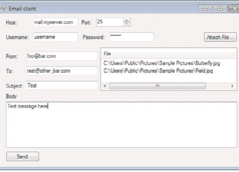

创建一个带有完整附件支持的简单 SMTP 客户端非常容易。

要查看简单电子邮件程序的完整示例，请参阅本章的 `EmailClient` 代码。这里仅是发送电子邮件的方法：

```csharp
private void SendEmail(string host, int port,
    string username, string password,
    string from, string to,
    string subject, string body,
    ICollection<string> attachedFiles)
{
    // MailMessage 对象必须被释放！
    using (MailMessage message = new MailMessage())
    {
        message.From = new MailAddress(from);
        message.To.Add(to);
        message.Subject = subject;
        message.Body = body;

        foreach (string file in attachedFiles)
        {
            // ... 代码继续
        }
    }
}
```


# 通过 HTTP 下载 Web 内容

场景/问题：你需要从 Web 下载网页或文件。

解决方案：`System.Net.WebClient` 类提供了你可能需要的大部分功能，如下例所示：

```csharp
string url = "http://www.microsoft.com";
string outputfile = "temp.html";
using (WebClient client = new WebClient())
{
    // 也可以这样做：byte[] bytes = client.DownloadData(url);
    try
    {
        client.DownloadFile(url, outputfile);
    }
    catch (WebException ex)
    {
        Console.WriteLine(ex.Message);
    }
}
```

这非常容易，但 `DownloadFile` 是一个同步方法，这意味着它将等待文件下载完成后才返回。如果你想允许用户在此期间做其他事情（或者能够取消传输），那么这并不理想。要获得更好的解决方案，请继续下一节。

# 异步下载 Web 内容

> 场景/问题：你需要下载 Web 内容，并具有取消能力，且在内容完成之前不阻塞你的线程。见图 12.2。

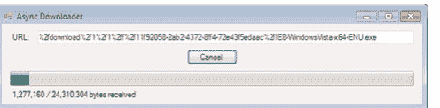

图 12.2

异步操作允许你取消。

解决方案：异步操作的工作原理：

- 开始下载。
- 监听事件以便我们知道发生了什么。
- 进度事件允许用户取消。
- 完成事件通知你状态。

```csharp
using System;
using System.ComponentModel;
using System.Net;
using System.Text;
using System.Windows.Forms;

public partial class Form1 : Form
{
    WebClient _client = null;
    bool _downloading = false;

    public Form1()
    {
        InitializeComponent();
    }

    private void buttonDownload_Click(object sender, EventArgs e)
    {
        if (!_downloading)
        {
            _client = new WebClient();
            _client.ProgressChanged += client_ProgressChanged;
            _client.DownloadDataCompleted += client_DataCompleted;
            _downloading = true;
            buttonDownload.Text = "取消";
            _client.DownloadStringAsync(new Uri(textBoxUrl.Text));
        }
        else
        {
            _client.Cancel();
            _downloading = false;
            buttonDownload.Text = "下载";
        }
    }

    private void client_ProgressChanged(object sender, ProgressChangedEventArgs e)
    {
        progressBar.Value = e.ProgressPercentage;
        labelStatus.Text = string.Format("{0:N0} / {1:N0} bytes received", e.BytesReceived, e.TotalBytesTo);
    }

    private void client_DataCompleted(object sender, DownloadCompletedEventArgs e)
    {
        if (e.Cancelled)
        {
            progressBar.Value = 0;
            labelStatus.Text = "已取消";
        }
        else if (e.Error != null)
        {
            progressBar.Value = 0;
            labelStatus.Text = e.Error.Message;
        }
        else
        {
            progressBar.Value = 100;
            labelStatus.Text = "完成";
        }
        // 不要忘记释放我们的下载客户端！
        _client.Dispose();
    }
}
```

# FTP 上传文件

场景/问题：你需要从 FTP 站点下载文件。

解决方案：FTP 是一种老旧且流行的文件传输机制，.NET 通过 `WebClient` 原生支持它，它会看到 URL 中的“ftp://”部分，我们在内部使用 `FtpWebRequest` 来执行通信。

```csharp
string host = "ftp.MyFtpSite.com";
string username = "anonymous";
string password = "your@email.com";
string file = "myLocalFile.txt";

if (!host.StartsWith("ftp://"))
{
    host = "ftp://" + host;
    Uri uri = new Uri(host);
    System.IO.FileInfo info = new System.IO.FileInfo(file);
    string destFileName = host + "/*" + info.Name;
}

try
{
    // 是的，即使这是 FTP，也可以使用 WebClient
    // 它会看到 ftp:// 内部使用相应的协议
    WebClient client = new WebClient();
    client.Credentials = new NetworkCredential(username, password);
    byte[] response = client.UploadFile(destFileName, file);
    if (response.Length > 0)
    {
        Console.WriteLine("Response: {0}", Encoding.ASCII.GetString(response));
    }
}
catch (WebException ex)
{
    Console.WriteLine(ex.Message);
}
```

`UploadFile` 也有一个异步版本。

# 剥离 HTML 标签

## 场景/问题

你有一个包含网页完整内容的字符串，并想要删除除内容以外的所有部分。

## 解决方案

当网络数据源不提供结构化访问的 API 时，分析这些数据源的常用做法是抓取网页本身。这是一个不精确的过程，而且很容易损坏，但有时很有用。这个过程中的一部分可以用于移除 HTML 内容，只留下页面上的文本。这在简单的网页索引应用程序中也可能有用。你可以使用正则表达式来实现此目标（更多信息请参阅第 8 章“正则表达式”）：

```csharp
private string StripHtml(string source)
{
    string[] patterns = {
        "<(\.|\n)*?>", // 通用 HTML 标签
        "<script>.*?</script>" // script 标签
    };

    string stripped = "";
    foreach (string pattern in patterns)
    {
        stripped = System.Text.RegularExpressions.Regex.Replace(stripped, pattern, string.Empty);
    }
    return stripped;
}
```

# 在你的应用程序中嵌入网页浏览器

## 场景/问题

你想让用户直接在你的应用程序中浏览互联网（或内网站点）。或者，你只是想要能够使用标准的浏览器渲染引擎渲染 HTML。

## 解决方案

你可以使用 .NET 自带的 Internet Explorer 组件。在 Visual Studio 中，它显示在表单设计器的公共控件（Common Controls）下。

你可以像使用其他控件一样使用 `WebBrowser` 控件，并按照你的意愿进行布局。图 12.3 显示了一个简单的浏览器示例。

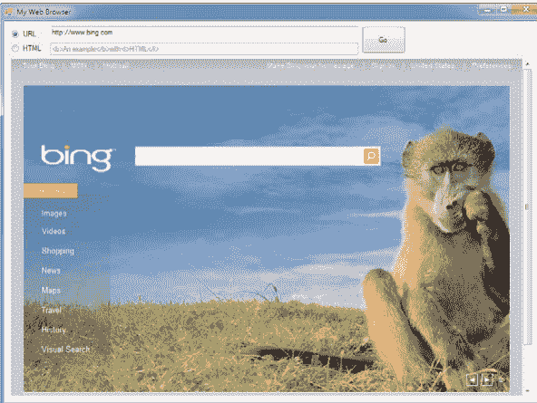

图 12.3

使用 Internet Explorer 的现有功能创建网页浏览器是非常简单的。

列表 12.4 提供了一段操作浏览器控件的代码片段。

## 列表 12.4 自定义网页浏览器

```csharp
using System;
using System.ComponentModel;
using System.Windows.Forms;

namespace WebBrowser
{
    public partial class Form1 : Form
    {
        public Form1()
        {
            InitializeComponent();
        }
    }
}
```

### 列表 12.4 自定义网页浏览器（续）

```csharp
private void buttonGo_Click(object sender, EventArgs args)
{
    if (radioButtonUrl.Checked)
    {
        this.webBrowser1.Navigate(textBoxUrl.Text);
    }
    else
    {
        this.webBrowser1.DocumentText = textBoxHTML.Text;
    }
}

private void OnRadioCheckedChanged(object sender, EventArgs args)
{
    textBoxUrl.Enabled = radioButtonUrl.Checked;
    textBoxHTML.Enabled = radioButtonHTML.Checked;
}
```

如你所见，显示你的内容或网络上的任何内容同样简单。然而，渲染器始终是 Internet Explorer，无论你在周围放置了什么（只需在页面上右键点击查看标准的 IE 上文菜单）。在处理 JavaScript 时请记住这一点。

# 使用 RSS 馈源

| 场景/问题 |
| :--- |
| 你需要在应用程序中解析 RSS 内容。 |

解决方案：RSS 馈源仅仅是定期生成的 XML 文件，由知道如何处理它的应用程序进行消费。它实际上只是将你已经掌握的部分组合在一起：网络下载和 XML 解析。

本章附带源代码包含两个项目：`RssLib` 和 `RssReader`。以下示例来自 `RssLib`，包含了一些简单的馈源解析代码。

```csharp
using System;
using System.Collections.Generic;
using System.Linq;
using System.Text;
using System.IO;
using System.Xml;
using System.Net;
using System.Globalization;
```


# RssLib 命名空间

## 核心类定义

```csharp
namespace RssLib
{
    public class Channel
    {
        public string Title { get; set; }
        public string Link { get; set; }
        public string Description { get; set; }
        public CultureInfo Culture { get; set; }
        public List<Item> Items { get; set; }
    }

    public class Item
    {
        public string Title { get; set; }
        public string Link { get; set; }
        public string Comments { get; set; }
        public string PubDate { get; set; }
        public string Description { get; set; }
    }

    public class Feed
    {
        public Channel Read(string url)
        {
            WebRequest request = WebRequest.Create(url);
            WebResponse response = request.GetResponse();
            XmlDocument doc = new XmlDocument();
            try
            {
                doc.Load(response.GetResponseStream());
                Channel channel = new Channel();
                XmlElement rssElem = doc["rss"];
                if (rssElem == null) return null;
                XmlElement chanElem = rssElem["channel"];

                if (chanElem == null)
                {
                    // 读取许多可能的字段中的几个
                    channel.Title = chanElem["title"].InnerText;
                    channel.Link = chanElem["link"].InnerText;
                    // ... (其余的逻辑)
                }
                return channel;
            }
            catch (WebException ex)
            {
                Console.WriteLine(ex.Message);
                return null;
            }
        }

        public void Write(Stream stream, Channel channel)
        {
            XmlWriter writer = XmlWriter.Create(stream);
            writer.WriteStartElement("rss");
            writer.WriteAttributeString("version", "2.0");
            writer.WriteStartElement("channel");
            writer.WriteXmlElement("title", channel.Title);
            writer.WriteXmlElement("link", channel.Link);
            writer.WriteXmlElement("description", channel.Description);
            writer.WriteXmlElement("language", channel.Culture.ToString());
            foreach (Item item in channel.Items)
            {
                writer.WriteStartElement("item");
                writer.WriteXmlElement("title", item.Title);
                writer.WriteXmlElement("link", item.Link);
                writer.WriteXmlElement("description", item.Description);
                writer.WriteXmlElement("pubDate", item.PubDate);
                writer.WriteXmlElement("comments", item.Comments);
                writer.WriteEndElement(); // item
            }
            writer.WriteEndElement(); // channel
            writer.WriteEndElement(); // rss
            writer.Flush();
        }
    }
}
```

## XmlWriter 扩展方法

```csharp
public static class XmlExtensions
{
    public static void WriteXmlElement(this XmlWriter writer, string name, string value)
    {
        writer.WriteStartElement(name);
        writer.WriteString(value ?? "");
        writer.WriteEndElement();
    }
}
```

# 数据库数据获取示例

```csharp
private RssLib.Channel GetFeedFromDB()
{
    using (IDataReader reader = CreateDataSet().CreateDataReader())
    {
        RssLib.Channel channel = new RssLib.Channel();
        channel.Title = "Test Feed";
        channel.Link = "http://localhost";
        channel.Description = "A sample RSS generator";
        channel.Culture = CultureInfo.CurrentCulture;
        channel.Items = new List<RssLib.Item>();
        while (reader.Read())
        {
            RssLib.Item item = new RssLib.Item();
            item.Title = reader["title"] as string;
            item.Link = reader["link"] as string;
            item.PubDate = reader["date"] as string;
            item.Description = reader["description"] as string;
            channel.Items.Add(item);
        }
    }
    return channel;
}

private static DataSet CreateDataSet()
{
    DataSet dataset = new DataSet();
    // 从数据库获取结果并填充 DataSet
    return dataset;
}
```

# Web 项目配置

要在 Web 项目中使用它，你必须修改 Web 项目的 `web.config` 来引用它：

```xml
<httpHandlers>
    <!-- type="Namespace.ClassName,AssemblyName" -->
    <add verb="GET" path="feed.xml" type="IISRssHandler.RssGeneratorHandler,IISRssHandler" />
</httpHandlers>
```

现在，每当你通过浏览器访问项目的 `feed.xml` 文件时，处理器（handler）将拦截请求并运行你的代码来生成 RSS。

# 第 12 章 网络与 Web

> **注意**：与其在每次请求时都生成结果，你可能希望实现一个缓存系统——仅生成过去 10 分钟内未生成的结果；否则，使用上一次的结果。

运行示例源代码中的 `WebAppForRSS` 项目来查看 Web 示例的运行。

## 同一机器进程间的通信 (WCF)

> **场景/问题**：你需要与运行在同一台机器上的进程进行通信。

**解决方案**：使用带有命名管道绑定（`netNamedPipeBinding`）的 Windows 通信框架 (WCF)。

在 WCF 之前，你有许多通信选择，包括 COM、DCOM、.NET Remoting、SOAP、TCP/IP、HTTP、命名管道等。WCF 将所有这些都封装在一个单一框架中。它将“通信的内容”与“通信的方式”分离开来。正如你将看到的，只需更改配置，即可从使用命名管道切换到 HTTP。

WCF 从底层开始设计，旨在将通信技术统一到单一框架下。这使得你在需要修改通信方式时，具有很强的变通性。此外，你还获得了大量的支持能力，如安全性、审计、扩展性等。如果你需要使用多个协议，可以通过 WCF 的命令行接口与它们中的每一个都进行交互，而无需担心协议规范。WCF 可以存在于命令行 API、GUI、Windows 服务或 IIS 组件中。

WCF 的话题非常大，足以单独写一本书（或系列丛书），但我们将提供足够让你入门的内容。

一个 WCF 通常包含三个组件：

- **服务接口和实现**。这可以实现在与服务器相同的程序集中，但将其保持在单独的程序集中是有用的，这样如果需要，它可以在多个宿主机中使用。
- **托管服务实现的服务器**。
- **通过实现库接口的代理类调用服务器的客户端**。

本节将逐一处理每个组件。

### 定义服务接口

示例中的服务将是一个简单的文件服务器，实现三个方法为客户端检索目录和文件数据。这些方法定义在类库内部的接口中，服务器引用并实现该接口。

```csharp
using System;
using System.ServiceModel;

namespace FileService
{
    [ServiceContract]
    public interface IFileService
    {
        [OperationContract]
        string[] GetSubDirectories(string directory);

        [OperationContract]
        string[] GetFiles(string directory);

        [OperationContract]
        int RetrieveFile(string filename, int amountToRead, out byte[] bytes);
    }
}
```

接口和方法上的属性告诉 WCF 这些应该是服务的一部分。

实现非常简单：

```csharp
using System;
using System.ServiceModel;
using System.IO;

namespace FileService
{
    public class FileService : FileServiceLib.IFileService
    {
        // 仅仅因为它是文件服务并不意味着你必须
        // 真正使用底层的文件系统——你可以创建
        // 你自己的虚拟文件系统

        public string[] GetSubDirectories(string directory)
        {
            return System.IO.Directory.GetDirectories(directory);
        }

        public string[] GetFiles(string directory)
        {
            return System.IO.Directory.GetFiles(directory);
        }

        public int RetrieveFile(string filename, int amountToRead, out byte[] bytes)
        {
            bytes = new byte[amountToRead];
            using (FileStream stream = File.OpenRead(filename))
            {
                return stream.Read(bytes, 0, amountToRead);
            }
        }
    }
}
```

查看附带源代码中的 `FileServiceLib` 项目。

### 创建服务器

在这种情况下，为了简单起见，服务器将是一个控制台应用程序。你可以轻松将其作为 Windows 服务的一部分或在 IIS 下运行它。

```csharp
using System;
using System.ServiceModel;
using FileServiceLib;

namespace WCFHost
{
    class Program
    {
        static void Main(string[] args)
        {
            Console.WriteLine("FileService Host");
            // 告诉 WCF 使用 app.config 文件中的
            // 信息启动我们的服务
            using (ServiceHost serviceHost = new ServiceHost(typeof(FileServiceLib.FileService)))
            {
                serviceHost.Open();
                Console.ReadLine();
            }
        }
    }
}
```

配置文件是关键所在。在这种情况下，它告诉 WCF 使用命名管道与客户端通信，这对于位于同一台机器上的进程是理想的。

```xml
<?xml version="1.0" encoding="utf-8" ?>
<configuration>
  <system.serviceModel>
    <services>
      <service name="FileService" behaviorConfiguration="ServiceBehavior">
        <endpoint binding="netNamedPipe" bindingConfiguration="NetNamedPipeBinding_FileSync"
                  contract="FileService.IFileService" />
        <endpoint binding="wsHttpBinding" address="http="
                  contract="FileService.IFileService" />
        <metadata httpEnabled="true" />
      </service>
    </services>
    <behaviors>
      <behavior name="ServiceBehavior">
        <metadata />
      </behavior>
    </behaviors>
    <bindings>
      <netNamedPipe>
        <binding name="NetNamedPipeBinding_FileSync" />
      </netNamedPipe>
    </bindings>
  </system.serviceModel>
</configuration>
```

附带源代码中的 `WCFHost` 项目。

### 创建客户端

为了让客户端无缝地与服务器通信而无需了解协议，你使用代理类，`scutil.exe` 随 Windows SDK 发布。它生成两个文件：一个带有代理类的 C# 文件，和一个用于客户端的配置文件。


> Visual Studio 也可以通过“添加服务”对话框生成代理。然而，如果你有多个开发者在一个项目中工作，你应该坚持使用 `scutil.exe`，因为 Visual Studio 生成的元数据也需要提交，但这些在不同的机器上可能不同，从而引起麻烦。最好避免这样做。

> 代理是针对接口生成的，无论使用哪种协议都是相同的。

在示例中，客户端是一个 Windows 应用程序，允许你调用每个服务方法然后显示结果。

首先，将 `scutil.exe` 生成的两个文件都添加到项目中。`app.config` 文件看起来如下：

```xml
<?xml version="1.0" encoding="utf-8"?>
<configuration>
  <system.serviceModel>
    <bindings>
      <netNamedPipeBinding>
        <binding name="NetNamedPipeBinding_FileSync" />
      </netNamedPipeBinding>
    </bindings>
    <security mode="transport">
      <transport protectionLevel="EncryptAndSign" />
    </security>
  </system.serviceModel>
</configuration>
```

```xml
</security>
<binding>
</netNamedPipeBinding>
</bindings>
<client>
  <endpoint address="net.pipe://localhost/FileService"
            binding="netNamedPipeBinding"
            bindingConfiguration="NetNamedPipeBinding_IFileService"
            contract="IFileService">
    <identity>
      <userPrincipalName value="Ben-Desktop\Ben" />
    </identity>
  </endpoint>
</client>
</system.serviceModel>
</configuration>
```

代理类的名称为 `FileServiceClient`，因此实例化并使用它的方式类似于下所示：

```csharp
using System;
using System.ComponentModel;
using System.Linq;
using System.Text;
using System.Windows.Forms;
```

```csharp
namespace WCFClient
{
  public partial class Form1 : Form
  {
    FileServiceClient fsClient = null;

    public Form1()
    {
      InitializeComponent();

      fsClient = new FileServiceClient();
    }

    private void buttonGetSubDirs_Click(object sender, EventArgs args)
    {
      SetResults(fsClient.GetSubDirectories(textBoxGetSubDirs.Text));
    }
  }
}
```

```csharp
private void buttonGetFiles_Click(object sender, EventArgs args)
{
    SetResults(fsClient.GetFiles(textBoxGetFiles.Text));
}
```

```csharp
private void buttonGetContents_Click(object sender, EventArgs args)
{
    int bytesToRead = (int)numericUpDownBytesToRead;
    byte[] buffer = new byte[bytesToRead];
    int bytesRead = fsClient.RetrieveFile(out buffer, textBoxRetrieveFile.Text, bytesToRead);

    if (bytesRead > 0)
    {
        // 此示例中仅假设为 ASCII
        string text = Encoding.ASCII.GetString(buffer, bytesRead);
        SetResults(text);
    }
}
```

```csharp
private void SetResults(string[] results)
{
    // 使用 LINQ 方便地合并结果
    textBoxOutput.Text = results.Aggregate((a, b) => a + Environment.NewLine + b);
}
```

```csharp
private void SetResults(string results)
{
    textBoxOutput.Text = results;
}
```

图 12.4 显示了客户端与服务器在同一台机器上运行。

WCF 还有很多内容，但该框架的功能应该是显而易见的。

## 在同一网络上的两台机器之间通信 (WCF)

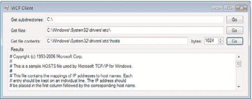

图 12.4

客户端通过命名管道（named pipes）与服务器通信。

## 在同一网络上的两台机器之间通信 (WCF)

> **场景/问题**：你想与位于同一网络上的机器上的进程进行通信。

**解决方案**：使用带有 TCP/IP 绑定的 WCF。

从上一节的结果开始，你只需要更改服务器和客户端中的配置信息。事实上，你可以在服务器上设置多个端点，并允许客户端按照所需方式连接。

这里是服务器的 `app.config`：

```xml
<?xml version="1.0" encoding="utf-8" ?>
<configuration>
  <system.serviceModel>
    <services>
      <service name="WCFHost.FileService"
        behaviorConfiguration="FileMEXBehavior">
        <endpoint address=""
          binding="netTcpBinding"
          contract="FileServiceLib.FileService" />
        <endpoint address="mex"
          binding="netTcpBinding"
          contract="IMetadataExchange" />
      </service>
    </services>
  </system.serviceModel>
  <host>
    <baseAddresses>
      <add baseAddress="net.tcp://localhost:8080/FileService" />
    </baseAddresses>
  </host>
</configuration>
```

```xml
</baseAddresses>
  </host>
</service>

<behaviors>
  <serviceBehaviors>
    <behavior name="FileServiceMEXBehavior">
      <serviceMetadata />
    </behavior>
  </serviceBehaviors>
</behaviors>
</system.serviceModel>
</configuration>
```

客户端的 `app.config` 同样经过了修改：

```xml
<?xml version="1.0" encoding="utf-8"?>
<configuration>
  <system.serviceModel>
    <bindings>
      <netTcpBinding>
        <binding name="netTcpBinding_IFileService" />
      </netTcpBinding>
    </bindings>
    <client>
      <endpoint address="net.tcp://remote-pc:8080/FileService"
               binding="netTcpBinding"
               configuration="netTcpBinding_IFileService"
               contract="IFileService"
               name="netTcpBinding_IFileService" />
    </client>
  </system.serviceModel>
</configuration>
```

> **注意**：要在现代操作系统上充分测试此内容，你可能需要创建一个防火墙异常以允许连接到服务器。

就是这样。只需更改配置，底层协议就会改变，你就可以通过网络进行通信了。

## 在互联网上通信 (WCF)

**场景/问题**：你想与互联网上的服务进行通信。

**解决方案**：使用带有 HTTP 绑定的 WCF。

再次，这只是配置的。这里是服务器的 `app.config`：

```xml
<?xml version="1.0" encoding="utf-8" ?>
<configuration>
  <system.serviceModel>
    <services>
      <service name="WCFHost.FileService"
        behaviorConfiguration="FileMEXBehavior">
        <endpoint address=""
          binding="basicHttpBinding"
          contract="FileServiceLib.FileService" />
        <endpoint address="mex"
          binding="basicHttpBinding"
          contract="IMetadataExchange" />
      </service>
    </services>
    <behaviors>
      <serviceBehaviors>
        <behavior name="FileMEXBehavior">
          <serviceMetadata httpEnabled="true" />
        </behavior>
      </serviceBehaviors>
    </behaviors>
  </system.serviceModel>
  <host>
    <baseAddresses>
      <add baseAddress="http://localhost:8080/FileService" />
    </baseAddresses>
  </host>
</configuration>
```

## 第 12 章 网络与 Web

要在 Vista 或 Windows 7 下启用 HTTP，你需要以管理员身份运行此命令：

```
netsh http addacl url=http+:PORT/
```

客户端的 `app.config` 所示：

```xml
<?xml version="1.0" encoding="utf-8"?>
<configuration>
  <system.serviceModel>
    <bindings>
      <basicHttpBinding>
        <binding name="BasicHttpBinding_IFileService"
                 allowCookies="false"
                 bypassProxyOnLocal="false"
                 hostNameMode="StrongWildcard"
                 maxBufferSize="65536"
                 maxBufferPoolSize="524288"
                 maxReceivedSize="65536"
                 transferMode="Buffered">
          closeTimeout="00:01:00"
          openTimeout="00:01:00"
          receiveTimeout="00:10:00"
          sendTimeout="00:01:00" />
      </basicHttpBinding>
    </bindings>
    <client>
      <endpoint address="http://remote-pc:8080/FileService"
                binding="basicHttpBinding"
                bindingConfiguration="BasicHttpBinding_IFileService"
                contract="IFileService" />
    </client>
  </system.serviceModel>
</configuration>
```

## 在运行时发现服务 (WCF)

*   **场景/问题**：你想让客户端动态发现网络上的可用主机。

**解决方案**：在 .NET 4 中，你可以使用 `System.ServiceModel.Discovery.DiscoveryClient` 来寻找网络上实现你正在寻找的接口的所有端点。一旦绑定地址，代理的使用与之前相同。

## 实现可发现主机

主机的代码如下：

```csharp
using System;
using System.ServiceModel;

namespace WCFDiscoverableHost{
    class Host{
        static void Main(string[] args){
            Console.WriteLine("FileService Host (Discoverable)");

            using (ServiceHost serviceHost = new ServiceHost(typeof(FileServiceLib.FileService))){
                serviceHost.Open();
            }
            Console.ReadLine();
        }
    }
}
```

## 234 第 12 章 网络与 网

然而，配置包含了一些新项：


```xml
<?xml version="1.0" encoding="utf-8" ?>
<configuration>
  <system.serviceModel>
    <services>
      <service name="FileServiceLib.FileService"
        behaviorConfiguration="fileupload">
        <endpoint address=""
          binding="netTcpBinding"
          contract="FileServiceLib.IFileService"
          behaviorConfiguration="dynEPBehavior"/>
        <endpoint name="udpDiscovery" kind="udpDiscoveryEndpoint"/>
        <endpoint address="mex"
          binding="mextcpBinding"
          contract="IMetadataExchange">
          <host>
            <baseAddresses>
              <add baseAddress="net.tcp://localhost:8080/FileService"/>
            </baseAddresses>
          </host>
        </endpoint>
      </service>
    </services>
    <behaviors>
      <serviceBehaviors>
        <behavior name="fileservice">
          <serviceMetadata />
          <serviceDiscovery />
        </behavior>
      </serviceBehaviors>
      <endpointBehaviors>
        <behavior name="dynEPBehavior">
          <endpointDiscovery />
        </behavior>
      </endpointBehaviors>
    </behaviors>
  </system.serviceModel>
</configuration>
```

# 实现动态客户端

为了保持代码的简洁，此客户端也将实现为控制台应用程序。

```csharp
using System;
using System.Collections.Generic;
using System.ServiceModel.Discovery;

namespace WCFDiscoverableClient
{
    class Client
    {
        static void Main(string[] args)
        {
            DiscoveryClient client = new DiscoveryClient(new UdpDiscoveryEndpoint());

            // 查找所有可用端点
            // 你也可以异步调用此方法
            FindCriteria criteria = new FindCriteria(typeof(FileServiceLib.IFileService));
            FindResponse response = client.Find(criteria);

            // 绑定到其中一个
            FileServiceClient svcClient = null;

            foreach (var endpoint in response.Endpoints)
            {
                svcClient = new FileServiceClient();
                svcClient.Endpoint.Address = endpoint.Address;
            }

            // 调用服务
            if (svcClient != null)
            {
                string[] dirs = svcClient.GetSubDirectories(@"C:\");

                foreach (string dir in dirs)
                {
                    Console.WriteLine(dir);
                }
            }

            Console.ReadLine();
        }
    }
}
```

配置更为简单：

```xml
<?xml version="1.0" encoding="utf-8" ?>
<configuration>
  <system.serviceModel>
    <client>
      <endpoint name="fileServiceEndpoint"
               address=""
               binding="netTcpBinding"
               contract="IFileService"/>
      <endpoint name="udpDiscoveryEndpoint"
               kind="udpDiscoveryEndpoint"/>
    </client>
  </system.serviceModel>
</configuration>
```

# 第 13 章 数据库

本章内容：

- 在 Visual Studio 中创建新数据库
- 连接并检索数据
- 向数据库表插入数据
- 从表中删除数据
- 执行存储过程
- 使用事务
- 使用 `DataSet` 将数据绑定到控件
- 检测数据库连接是否可用
- 使用 `Entity Framework` 自动映射数据到对象

大多数应用程序都会以某种方式处理数据。通常，此类数据存储在关系型数据库中，如 `SQL Server`、`Oracle` 或 `MySQL`（以及许多其他数据库）。

本章涵盖了使用 `.NET` 访问数据库的基础知识。如果你没有数据库可以操作，我建议使用 `SQL Server Express` 版或 `MySQL` 社区版，你可以通过你喜欢的搜索引擎找到它们。这两个数据库都包含相应的组件，允许你直接从 `Visual Studio` 创建和编辑数据库。

所有示例都使用一个名为 `TestDB` 的数据库，其中包含一个名为 `Books` 的单表。第一节将介绍如何在 `SQL Server` 中创建它。

## 从 Visual Studio 创建新数据库

场景/问题：你想要从 `Visual Studio` 创建一个新数据库。

**解决方案：** 首先，确保你已安装了 `SQL Server`（Express 版即可）或其他数据库。虽然 `SQL Server` 会自动与 `Visual Studio` 集成，但你可能需要下载额外的组件以允许第三方数据库在 `Visual Studio` 内部工作。本节假设你正在使用 `SQL Server`。

1. 打开服务器资源管理器（`Ctrl+W, L` 或从“视图”菜单打开）。
2. 右键点击“数据连接”并选择“创建新的 SQL 数据库”。
3. 从下拉框中选择你的服务器实例并选择适当的身份验证方法（通常在设置服务器时选择）。
4. 输入一个名称——例如“TestDB”——并点击确定。
5. 展开为你创建的新数据库。
6. 右键点击“表”并选择“添加新表”。
7. 按照图 13.1 所示配置表格。
8. 关闭窗口并将表命名为 `Books`。
9. 要添加数据，右键点击已创建的表并选择“显示表数据”。你可以看到图 13.2 中我添加的值。

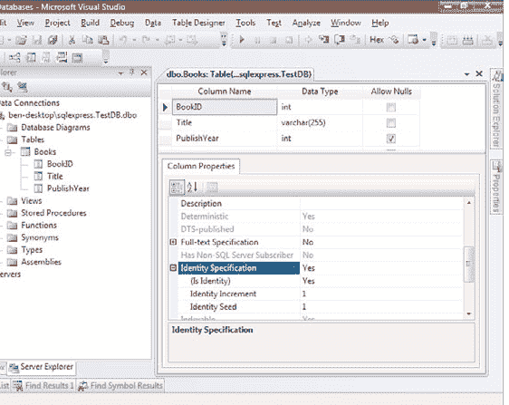

图 13.1
为了运行本章中的示例，你需要创建一个与此处所示类似的测试数据库和表。

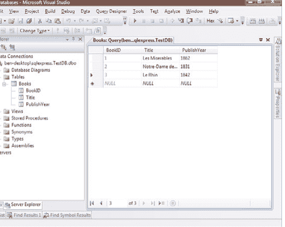

图 13.2
可以向表中插入你想要的数据。

# 连接并检索数据

场景/问题：你需要连接数据库并对其运行简单查询。

**解决方案：** 大多数数据库访问基于以下步骤：

1. 使用连接字符串创建连接。
2. 使用 `SQL` 语法创建命令。
3. 在连接执行命令并可能获取数据。

我们将在后续章节中看到这些具体示例。

### 连接 SQL Server

`.NET` 自带了 `SQL Server` 的连接器，尽管在代码示例中没有显式引用。我们将从以下示例开始：

```csharp
static void Main(string[] args)
{
    try
    {
        string connectionString = GetConnectionString();

        using (SqlConnection conn = new SqlConnection(connectionString))
        {
            conn.Open();

            // 将连接对象传递给命令
            using (SqlCommand cmd = new SqlCommand("SELECT * FROM Books", conn))
            {
                using (SqlDataReader reader = cmd.ExecuteReader())
                {
                    // SqlDataReader 根据你的请求一次从数据库读取行
                    while (reader.Read())
                    {
                        Console.WriteLine("{0}\t{1}\t{2}",
                            reader.GetInt32(0),
                            reader.GetString(1),
                            reader.GetInt32(2));
                    }
                }
            }
        }
    }
    catch (SQLException ex)
    {
        Console.Write(ex);
    }
}

// 你不应该将连接字符串存储在源码中，但为了说明 SQL 所以我保持简单
static string GetConnectionString()
{
    // 将 source 指向你的本地 SQL Server 副本
    return "Data source=BEN-DESKTOP\\SQLEXPRESS;Initial Catalog=TestDB;IntegratedSecurity=SSPI";
}
```

输出：

- 1 悲惨世界 1862
- 2 巴黎圣母院 1831
- 3 莱茵河 1842

### 连接 MySQL

`Sun`（编写期间拥有 `MySQL`）提供了访问 `MySQL` 数据库的 `.NET` 连接器。你有两种安装方式：

- 安装程序，它会将 `MySQL.Data.dll` 放入全局程序集缓存 (`GAC`)，所有启用 `MySQL` 的应用程序都可以访问它。
- 将 `MySQL.Data.dll` 放入你的项目并直接从文件系统引用它。

在附带源码中，我选择了第二种方案。虽然这在某种程度上是个人选择，但我认为尽可能减少项目的外部依赖是更好的做法。

一旦添加了对组件的引用，代码与 `SQL Server` 版本几乎完全相同：

```csharp
static void Main(string[] args)
{
    try
    {
        string connectionString = GetConnectionString();

        // 基本上，一切都是一样的，只是在每个东西前加上了 "My"
        using (MySqlConnection conn = new MySqlConnection(connectionString))
        {
            conn.Open();

            using (MySqlCommand cmd = new MySqlCommand("SELECT * FROM Books", conn))
            using (MySqlDataReader reader = cmd.ExecuteReader())
            {
                while (reader.Read())
                {
                    Console.WriteLine("{0}\t{1}\t{2}",
                        reader.GetInt32(0),
                        reader.GetString(1),
                        reader.GetInt32(2));
                }
            }
        }
    }
    catch (MySqlException ex)
    {
        Console.Write(ex);
    }
}

// 你不应该在源代码中存储连接字符串，但这里是为了演示 SQL 访问，所以我保持了简单处理
static string GetConnectionString()
{
    return "Data source=localhost;Initial Catalog=TestDB;user=ben;password=password";
}
```

# 构造你的程序以与数据库无关

| 场景/问题：你需要你的程序能够在多个数据库服务器上运行 |
| :--- |
| **解决方案：** 注意 `MySQL` 和 `SQL Server` 的代码有多相似吗？那是因为 `.NET` 中的所有数据连接器都继承自一组公共的接口和类。切换数据库服务器是有可能的；尽可能地抽象是一个好主意，如下面的简单示例所示。 |

```csharp
enum DatabaseServerType { SqlServer, MySQL };

static void PrintUsage()
{
    Console.WriteLine("ConnectToEither.exe [SqlServer | MySql]");
}

static void Main(string[] args)
{
    DatabaseServerType dbType;

    if (args.Length < 1)
    {
        PrintUsage();
        return;
    }

    if (string.Compare("SqlServer", args[0]) == 0)
    {
        dbType = DatabaseServerType.SqlServer;
    }
    else if (string.Compare("MySql", args[0]) == 0)
    {
        dbType = DatabaseServerType.MySql;
    }
    else
    {
        PrintUsage();
        return;
    }

    try
    {
        string connectionString = GetConnectionString(dbType);

        using (DbConnection conn = CreateConnection(dbType))
        {
            conn.Open();

            using (DbCommand cmd = CreateCommand(dbType, "SELECT * FROM Books", conn))
            {
                using (IDataReader reader = cmd.ExecuteReader())
                {
                    while (reader.Read())
                    {
                        Console.WriteLine("{0}\t{1}\t{2}",
                            reader.GetString(1), reader.GetInt32(0));
                    }
                }
            }
        }
    }
    catch (DbException ex)
    {
        Console.Write(ex);
    }
}
```


# 第 13 章 数据库

## 向数据库插入数据

| 场景/问题：你需要向表中插入数据 |
| :--- |
| **解决方案：** 应用程序需要向数据库写入数据。在它们中使用参数可以防止 SQL 注入。 |

```csharp
try
{
    string connectionString = GetConnectionString();
    using (SqlConnection conn = new SqlConnection(connectionString))
    {
        conn.Open();
        using (SqlCommand cmd = new SqlCommand(
            "INSERT INTO Books (Title, PublishYear) VALUES (@Title, @PublishYear)", conn))
        {
            cmd.Parameters.AddWithValue("@Title", "Test");
            cmd.Parameters.AddWithValue("@PublishYear", 2010);
            int rowsAffected = cmd.ExecuteNonQuery();
            Console.WriteLine("{0} affected", rowsAffected);
        }
    }
}
catch (SqlException ex)
{
    Console.Write(ex);
}
```

## 从表中删除数据

| 场景/问题：你需要从表中删除数据 |
| :--- |
| **解决方案：** 删除是一个危险的操作，但有时是必要的。在 .NET 中执行它非常简单。 |

```csharp
try
{
    string connectionString = GetConnectionString();
    using (SqlConnection conn = new SqlConnection(connectionString))
    {
        conn.Open();
        using (SqlCommand cmd = new SqlCommand(
            "DELETE FROM Books WHERE Title = @Title", conn))
        {
            cmd.Parameters.AddWithValue("@Title", "Test");
            int rowsAffected = cmd.ExecuteNonQuery();
            Console.WriteLine("{0} rows affected", rowsAffected);
        }
    }
}
catch (SqlException ex)
{
    Console.Write(ex);
}
```

## 存储过程

| 场景/问题：你需要在数据库中执行存储过程 |
| :--- |
| **解决方案：** 存储过程类似于存储服务器上的方法，.NET 通过设置 `SqlCommand` 的 `CommandType` 来支持它们。对于这个示例，我在 SQL Server 数据库中创建了一个存储过程来按出版年份排序书籍。 |

```sql
ALTER PROCEDURE dbo.GetSortedBooks
AS
SELECT * FROM Books ORDER BY PublishYear
```

执行存储过程与查询非常相似，所示：

```csharp
try
{
    string connectionString = GetConnectionString();
    using (SqlConnection conn = new SqlConnection(connectionString))
    {
        conn.Open();
        using (SqlCommand cmd = new SqlCommand("GetSortedBooks", conn))
        {
            cmd.CommandType = System.Data.StoredProcedure;
            using (SqlDataReader reader = cmd.ExecuteReader())
            {
                while (reader.Read())
                {
                    Console.WriteLine("{0}\t{1}\t{2}", reader.GetInt32(0), reader.GetString(1), reader.GetInt32(2));
                }
            }
        }
    }
}
catch (SqlException ex)
{
    Console.Write(ex);
}
```

### 使用事务

| 场景/问题：你需要使用数据库事务来保证多个操作被视为原子单元——即它们要么全部成功，要么全部失败。 |
| :--- |
| **解决方案：** 你可以从连接对象创建一个事务。你需要在执行每个命令时包含该事务。 |

```csharp
try
{
    // GetConnectionString 来自上一个示例
    string connectionString = GetConnectionString();
    using (SqlConnection conn = new SqlConnection(connectionString))
    {
        conn.Open();
        Console.WriteLine("尝试插入前的状态：**");
        using (SqlCommand cmd = new SqlCommand("SELECT * FROM Books", conn))
        {
            using (SqlDataReader reader = cmd.ExecuteReader())
            {
                while (reader.Read())
                {
                    Console.WriteLine("{0}\t{1}\t{2}", reader.GetInt32(0), reader.GetString(1), reader.GetInt32(2));
                }
            }
        }

        using (SqlTransaction transaction = conn.BeginTransaction())
        {
            try
            {
                using (SqlCommand cmd = new SqlCommand("INSERT INTO Books (Title, PublishYear) VALUES ('Test', 2010)", conn, transaction))
                {
                    cmd.ExecuteNonQuery(); // 这应该可以工作
                }
                using (SqlCommand cmd = new SqlCommand("INSERT INTO Books (Title, PublishYear) VALUES ('Test', 'Oops')", conn, transaction))
                {
                    cmd.ExecuteNonQuery(); // 这不应该工作
                    // 如果我们运行到这里，说明一切都成功了，
                    // 所以继续提交
                    transaction.Commit();
                }
            }
            catch (SqlException)
            {
                Console.WriteLine("发生异常，正在回滚");
                transaction.Rollback();
            }

            Console.WriteLine("尝试插入之后");
            using (SqlCommand cmd = new SqlCommand("SELECT * FROM Books", conn))
            using (SqlDataReader reader = cmd.ExecuteReader())
            {
                while (reader.Read())
                {
                    Console.WriteLine("{0}\t{1}\t{2}", reader.GetInt32(0), reader.GetString(1), reader.GetInt32(2));
                }
            }
        }
    }
}
catch (SqlException ex)
{
    Console.Write(ex);
}
```

以下输出表明，即使是第一个 `INSERT` 完美执行了也没有被添加，因为同一个事务中的第二个 `INSERT` 失败了：

尝试插入之前：
+ 1 Les Miserables 1862
2 Notre-Dame de Paris 1831
3 Le Rhin 1842
发生异常，正在回滚
尝试插入之后：
+ 1 Les Miserables 1862
2 Notre-Dame de Paris 1831
3 Le Rhin 1842

## 使用 DataSet 将数据绑定到控件

> **场景/问题：** 你希望在表单上轻松显示来自数据库表的数据。
>
> **解决方案：** 本节介绍了将数据绑定到屏幕控件并允许 .NET 管理它们之间交互的强大技术。

所有数据库绑定功能都依赖于数据集（`DataSet`）。从技术上讲，数据集可以是任何 `IEnumerable` 集合，但通常你可以使用 `DataSet` 类，它允许你在内存中存储关系数据。`DataSet` 对象可以从数据库填充，之后可以安全地关闭与数据库的连接。

### 在 Windows Forms 中将数据绑定到控件

此代码假设表单包含一个 `DataGridView` 视图控件：请参阅本章的 `DataBindingWinForms` 项目获取完整源代码，包括我忘记复制到这里的所有 UI 内容。

```csharp
public partial class Form1 : Form
{
    DataSet _dataSet;

    public Form1()
    {
        InitializeComponent();
        _dataSet = CreateDataSet();
        dataGridView.DataSource = _dataSet.Tables["Books"];
    }

    protected override void OnFormClosing(FormClosingEventArgs e)
    {
        _dataSet.Dispose();
    }

    private DataSet CreateDataSet()
    {
        string connectionString = @"Data source=BEN-DESKTOP\SQLEXPRESS;Initial Catalog=TestDB;Integrated Security=SSPI";
        using (SqlConnection conn = new SqlConnection(connectionString))
        {
            conn.Open();
            using (SqlCommand cmd = new SqlCommand("SELECT * FROM Books", conn))
            {
                using (SqlDataAdapter adapter = new SqlDataAdapter(cmd))
                {
                    // 适配器如何与特定的数据库服务器通信
                    adapter.TableMappings.Add("Table", "Books");
                    adapter.SelectCommand = cmd;
                    DataSet dataSet = new DataSet("Books");
                    // 将所有行放入数据集
                    adapter.Fill(dataSet);
                    return dataSet;
                }
            }
        }
    }
}
```

图 13.3 展示了 `DataView` 控件连接到我们的示例数据库时的状态。

# 第 13 章 数据库

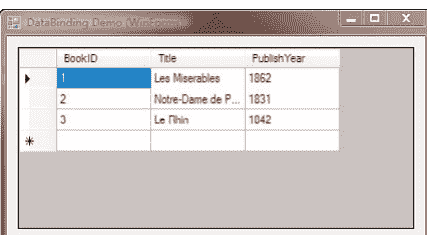

图 13.3 `GridLayout` 控件直接从数据库显示表数据的简单方法。

## 从 DataSet 更新数据库

> **场景/问题：** 因为 `DataGridView` 允许你编辑单元格值，你希望将所做的更改写回数据库。
>
> **解决方案：** 要做到这一点，你需要确保 `DataSet` 知道 `UPDATE` 命令的语法。然后你需要在适配器对象上调用 `Update()`。此代码扩展了之前的示例，通过向 `DataSet` 中添加了 `UpdateCommand`，并添加了一个按钮来触发更新。

```csharp
public partial class Form1 : Form
{
    SqlDataAdapter _adapter;
}
```


# 在 Windows Forms 中将数据绑定到控件

```csharp
DataSet _dataSet;
IDConnection _conn;

public Form1()
{
    InitializeComponent();
    buttonUpdate.Enabled = false;
    CreateDataSet();
    dataView1.DataSource = _dataSet.Tables["Books"];
    dataView1.CellEndEdit += new DataGridViewCellEventHandler(OnCellEdit);
    buttonUpdate.Click += new EventHandler(buttonUpdate_Click);
}

protected override void OnClosing(CancelEventArgs e)
{
    _dataSet.Dispose();
}

private void CreateDataSet()
{
    string connectionString = @"Data source=BEN-DESKTOP\SQLEXPRESS;Initial Catalog=TestDB;Integrated Security=SSPI";
    using (SqlConnection conn = new SqlConnection(connectionString))
    {
        conn.Open();
        using (SqlCommand cmd = new SqlCommand("SELECT * FROM Books", conn))
        {
            using (SqlDataAdapter adapter = new SqlDataAdapter(cmd))
            {
                //适配 如何与特定的数据库服务器通信
                adapter.TableMappings.Add("Table", "Books");
                adapter.SelectCommand = cmd;
                DataSet dataSet = new DataSet("Books");
                //将所有行放入数据集
                adapter.Fill(dataSet);
                return dataSet;
            }
        }
    }
}

private void OnCellEdit(object sender, DataGridCellEventArgs e)
{
    buttonUpdate.Enabled = true;
}

private void buttonUpdate_Click(object sender, EventArgs e)
{
    _adapter.Update(_dataSet);
}
```

# 在 WPF 中将数据绑定到控件

WPF 比 Windows Forms 提供了更多的格式能力，对于本示例，我们将保持相同的显示类型。以下是窗口的可扩展应用程序语言 (XAML) 代码：

```xml
<Window x:Class="DataBindingWPF.Window1"
xmlns="http://schemas.microsoft.com/winfx/2006/xaml/presentation"
xmlns:x="http://schemas.microsoft.com/winfx/2006/xaml"
Title="Data Demo (WPF)" Height="301" Width="477">
<Grid>
<ListView Name="listview1">
    <ListView.View>
        <GridView>
            <GridViewColumn Header="ID" Width="35">
                <GridViewColumn.CellValueBinding="{Binding Path=BookID}"
            </GridViewColumn>
            <GridViewColumn Header="Title" Width="200">
                <GridViewColumn.CellValueBinding="{Binding Path=Title}"
            </GridViewColumn>
            <GridViewColumn Header="Published" Width="70">
                <GridViewColumn.CellValueBinding="{Binding Path=PublishYear}"
            </GridViewColumn>
        </GridView>
    </ListView.View>
</ListView>
</Grid>
</Window>
```

这里是窗口的代码：

```csharp
public partial class Window1 : Window
{
    DataSet _dataSet;

    public Window1()
    {
        InitializeComponent();
        _dataSet = CreateDataSet();
        listView1.DataContext = _dataSet.Tables["Books"];
        Binding binding = new Binding();
        listView1.SetBinding(ListView.ItemsSourceProperty, binding);
    }

    protected override void OnClosing(System.ComponentModel.CancelEventArgs e)
    {
        _dataSet.Dispose();
    }

    private DataSet CreateDataSet()
    {
        string connectionString = @"Data source=BEN-DESKTOP\SQLEXPRESS;Initial Catalog=TestDB;Integrated Security=SSPI";
        using (SqlConnection conn = new SqlConnection(connectionString))
        {
            conn.Open();
            using (SqlCommand cmd = new SqlCommand("SELECT * FROM Books", conn))
            {
                using (SqlDataAdapter adapter = new SqlDataAdapter(cmd))
                {
                    adapter.TableMappings.Add("Table", "Books");
                    adapter.SelectCommand = cmd;
                    DataSet dataSet = new DataSet("Books");
                    adapter.Fill(dataSet);
                    return dataSet;
                }
            }
        }
    }
}
```

图 13.4 展示了带有我们数据库数据的 WPF 版本 DataGrid。

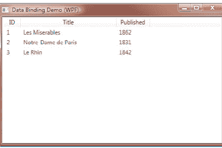

在 WPF 中，任何控件都可以将其值绑定到数据源。

# 在 ASP.NET 中将数据绑定到控件

ASP.NET 中的数据绑定同样简单。你可以依靠 `GridView` 控件。
以下是 HTML 代码：

```html
@Page Language="C#" AutoEventWireup="true"
CodeBehind="Default.ascs" Inherits="DataBindingWeb.Default %>
<!DOCTYPE html PUBLIC "-//W3C//DTD XHTML 1.0 Transitional//EN" 
"http://www.w3.org/TR/xhtml1/DTD/xhtml1-transitional.dtd">
<html xmlns="http://www.w3.org/1999/xhtml">
<head runat="server">
<title>Default</title>
</head>
<body>
<form id="form1" runat="server">
<div>
Database Results:
<asp:GridView ID="GridView1" runat="server">
</asp:GridView>
</div>
</form>
</body>
</html>
```

这里是后台代码：

```csharp
public partial class _Default : System.Web.UI.Page
{
    private DataSet _dataSet;

    protected void Page_Load(object sender, EventArgs e)
    {
        _dataSet = CreateDataSet();
        GridView1.DataSource = _dataSet.Tables["Books"];
        GridView1.DataBind();
    }

    private DataSet CreateDataSet()
    {
        string connectionString = @"Data source=BEN-DESKTOP\SQLEXPRESS;Initial Catalog=TestDB;Integrated Security=SSPI";
        using (SqlConnection conn = new SqlConnection(connectionString))
        {
            conn.Open();
            using (SqlCommand cmd = new SqlCommand("SELECT * FROM Books", conn))
            {
                SqlDataAdapter adapter = new SqlDataAdapter(cmd);
                adapter.TableMappings.Add("Table", "Books");
                adapter.SelectCommand = cmd;
                DataSet dataSet = new DataSet("Books");
                //将所有行放入数据集中
                adapter.Fill(dataSet);
                return dataSet;
            }
        }
    }
}
```

图 13.5 显示了我们现在熟悉的、在网页中显示的数据网格。

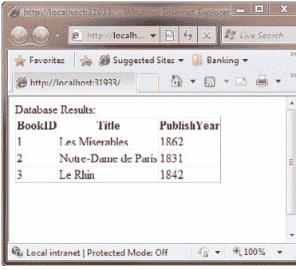

绑定到 ASP.NET 的 `GridView` 控件就像 Windows Forms 一样简单。

# 检测数据库连接是否可用

> **场景/问题：** 应用程序运行在一个数据库连接不可靠的环境中，你希望程序在检测到问题时停止操作。

**解决方案：** 理想情况下，你希望数据库不会从网络中消失，但有时你需要格外小心。

这是一个简单的函数，它尝试打开连接并根据是否成功返回布尔值：

```csharp
private static bool TestConnection()
{
    try {
        using (SqlConnection conn =
            new SqlConnection(GetConnectionString())) {
            conn.Open();
            return (conn.State == ConnectionState.Open);
        }
    } catch (SQLException) {
        return false;
    } catch (InvalidOperationException) {
        return false;
    }
}
```

> **注意** 使用此方法并不能保证数据库对你可用——毕竟，服务器可能在该方法返回 `true` 之后立即发生故障。最终，你的代码在面对失败时必须非常健壮。尽管如此，我发现这段代码在一个与数据库连接极不稳定的网络上很有用。

# 使用 Entity Framework 自动将数据映射到对象

**场景/问题：** 你希望通过 .NET 对象访问数据库数据，而无需创建你自己的数据对象库。

**解决方案：** 使用 Entity Framework 自动将数据库表及其关系映射到你可以在 C# 代码中使用的对象。

Entity Framework 是微软的面向-关系映射（ORM）库，并与 Visual Studio 深度集成。

要为本章之前介绍的 Books 创建一个对象，请按照以下步骤操作：

1. 右键点击你的项目，选择“添加”、“新建项”（Add, New Item）。
2. 选择 `ADO.NET Entity Data Model` 并将其命名为 `Books.edmx`。点击“添加”。
3. 在弹出的实体数据模型向导中，选择“从数据库生成”（Generate From Database）并点击“下一步”。
4. 从列表中选择数据库。
5. 在“将实体连接设置保存到 App.Config”（Save entity connection settings in App.Config as:）值下方输入 `BookEntities`。
6. 点击“下一步”。
7. 勾选 `Books` 表。
8. 将模型命名空间设置为“BookModel”并点击“完成”。

这将为你创建 `Book` 和 `BookEntities` 对象。接下来的章节将演示如何使用它们。

## 获取所有实体列表

`BookEntities` 代表集合的接口。以下代码通过实体集合打印表中的所有值：

```csharp
//获取所有实体的列表
BookEntities entities = new BookEntities();
foreach (var book in entities.Books)
{
    Console.WriteLine("{0}, {1}", book.ID, book.Title);
}
```

这是输出结果：

```text
1, Les Miserables
2, Notre-Dame de Paris
3, The Rhine
```

## 创建新实体

要创建一个新实体，在将其添加到集合之前，先声明对象及其属性。在这种情况下，由于 `ID` 是自增属性，你不需要设置它。

```csharp
BookEntities entities = new BookEntities();
Book book = new Book();
book.Title = "C# 4 Edition";
book.PublishYear = 2010;
entities.AddToBooks(book);
entities.SaveChanges();
```

## 查找实体

你可以使用 `ObjectQuery<T>` 类来为你创建查询，例如所示：

```csharp
ObjectQuery<Book> bookQuery = new ObjectQuery<Book>("SELECT * FROM Books");
```

然而，这种语法很快就会变得笨拙。相反，请使用在后续章节中讨论 LINQ：

```csharp
var books = from book in entities.Books
where book.ID == 1
select book;
```

## 删除实体

要删除实体，将其传递给实体列表的 `DeleteObject` 方法：

```csharp
BookEntities entities = new BookEntities();
entities.DeleteObject(book);
entities.SaveChanges();
```

# 第 14 章 XML

本章

- 将对象序列化为 XML
- 从零编写 XML
- 读取 XML 文件
- 验证 XML 文档
- 使用 XPath 查询 XML
- 将数据库转换为 XML
- 将 XML 转换为 HTML

XML 已经成为信息交换的通用语言。几乎没有一种技术是不使用 XML 的，无论是导入/导出格式、原生数据库格式还是配置数据。


这在很大程度上归功于它的本质。XML 代表可扩展标记语言，它本身具有灵活性并适用于各种任务。

.NET 以多种方式支持 XML，从多种读取、解析和搜索方法到创建和验证。

在本章的大多数示例中，我们使用 `System.XML` 命名空间。

# 将对象序列化为 XML

> **场景/问题：** 你希望以 XML 等效表示输出你的 .NET 对象并重新加载它们。

**解决方案：** 自动对象序列化是在 XML 和二进制对象之间进行转换最简单的方法。最大的限制是它适用于公共类型以及这些类型中的公共数据成员。如此，让我们来看一个带有类的示例：

```csharp
public class Person
{
    public string FirstName { get; set; }
    public char MiddleInitial { get; set; }
    public string LastName { get; set; }
    public DateTime BirthDate { get; set; }
    public double HighschoolGPA { get; set; }
    public Address Address { get; set; }

    // 为了进行 XML 序列化，类型必须有一个
    // 无参数的构造函数
    public Person() { }

    public Person(string firstName, char middleInitial, string lastName,
        DateTime birthDate, double highSchoolGpa, Address address)
    {
        this.FirstName = firstName;
        this.MiddleInitial = middleInitial;
        this.LastName = lastName;
        this.BirthDate = birthDate;
        this.HighschoolGPA = highSchoolGpa;
        this.Address = address;
    }
}
```

```csharp
public override string ToString()
{
    return FirstName + " " + MiddleInitial + " " + LastName +
        ", DOB:" + BirthDate.ToShortDateString() +
        ", GPA:" + this.HighSchoolGPA
        + Environment.NewLine + Address.ToString();
}
```

```csharp
// 抱歉，不想列出 50 个州：
public enum StateAbbreviation { RI, VA, SC, CA, TX, UT, WA };
```

```csharp
public class Address
{
    public string AddressLine1 { get; set; }
    public string AddressLine2 { get; set; }
    public string City { get; set; }
    public StateAbbreviation State { get; set; }
    public string ZipCode { get; set; }

    public Address() { }

    public Address(string addressLine1, string addressLine2, string city, StateAbbreviation state, string zipCode)
    {
        this.AddressLine1 = addressLine1;
        this.AddressLine2 = addressLine2;
        this.City = city;
        this.State = state;
        this.ZipCode = zipCode;
    }

    public override string ToString()
    {
        return AddressLine1 + Environment.NewLine + AddressLine2 +
            Environment.NewLine + City + ", " + State + " " + ZipCode;
    }
}
```

注意，这里没有任何内容与 XML 有关。这些只是应用数据对象。

要进行序列化（以及反序列化），可以使用类似于下面的代码：

```csharp
Person person = new Person("John", 'Q', "Public",
    new DateTime(1776, 7, 4), 3.5,
    new Address("1234 Cherry Lane", null, "Smalltown",
        StateAbbreviation.VA, "10000");

Console.WriteLine("序列化前:" + Environment.NewLine +
    person.ToString());

XmlSerializer serializer = new XmlSerializer(typeof(Person));
// 为了演示目的，仅序列化为字符串
StringBuilder sb = new StringBuilder();
using (StringWriter sw = new StringWriter(sb))
{
    // 实际序列化
    serializer.Serialize(sw, person);
    Console.WriteLine(Environment.NewLine + "XML:" + Environment.NewLine +
        sb.ToString() + Environment.NewLine);
}

using (StringReader sr = new StringReader(sb.ToString()))
{
    // 从文本反序列化回二进制
    Person newPerson = serializer.Deserialize(sr) as Person;
    Console.WriteLine("反序列化后:" + Environment.NewLine +
        newPerson.ToString());
}
```

输出如下：

序列化前：

John Q. Public, DOB:7/4/1776, GPA: 3.5

1234 Cherry Lane

Smalltown, WA 10000

```xml
XML:
<?xml version="1.0" encoding="utf-16"?>
<Person xmlns:xsi="http://www.w3.org/2001/XMLSchema-instance"
    xmlns:xsd="http://www.w3.org/2001/XMLSchema">
    <FirstName>John</FirstName>
    <MiddleInitial>81</MiddleInitial>
    <LastName>Public</LastName>
    <BirthDate>1776-07-04T00:00:00</BirthDate>
    <HighSchoolGPA>3.5</HighSchoolGPA>
    <Address>
        <Address1>1234 Cherry Lane</Address1>
        <City>Smalltown</City>
        <State>VA</State>
        <ZipCode>10000</ZipCode>
    </Address>
</Person>
```

反序列化后：

John Q. Public, DOB:7/4/1776, GPA: 3.5

1234 Cherry Lane

Smalltown, VA 10000

注意，`XmlSerializer` 正确处理了 `AddressLine` 的空值。

# 控制对象序列化

> **场景/问题：** 你需要控制序列化过程，也许通过忽略类中的某个属性、更改元素名称，或者确定某些内容是元素还是属性。

**解决方案：** 使用 `XmlSerializer` 在很大程度上是一个自动化的过程，但有一些简单的方法可以修改 XML 以符合你的需求。例如，假设你使用这些特性修改了 `Person` 类：

```csharp
[XmlIgnore]
public char MiddleInitial { get; set; }
```

```csharp
[XmlElement("DOB")]
public DateTime BirthDate { get; set; }
```

```csharp
[XmlAttribute("GPA")]
public double HighschoolGPA { get; set; }
```

你将得到此输出：

序列化前：

John Q. Public, DOB:7/4/1776, GPA: 3.5

1234 Cherry Lane

Smalltown, VA 10000

```xml
XML:
<?xml version="1.0" encoding="utf-16"?>
<Person xmlns:xsi="http://www.w3.org/2001/XMLSchema-instance"
    xmlns:xsd="http://www.w3.org/2001/XMLSchema" GPA="3.5">
    <FirstName>John</FirstName>
    <MiddleInitial>81</MiddleInitial>
    <LastName>Public</LastName>
    <BirthDate>1776-07-04T00:00:00</BirthDate>
    <Address>
        <Address1>1234 Cherry Lane</Address1>
        <City>Smalltown</City>
        <State>VA</State>
        <ZipCode>10000</ZipCode>
    </Address>
</Person>
```

# 使用 XmlTextReader 读取 XML 文件

> **场景/问题：** 你需要读取一个 XML 文档。你关注性能，不需要对象模型，并且可以轻松地自己创建对象结构。

**解决方案：** 使用 `XmlTextReader` 类，它可以从各种源读取。在这种情况下，由于源 XML 是在字符串中的，你需要使用 `StringReader` 将其转换为流，供 `XmlTextReader` 使用。

```csharp
class Program
{
    const string sourceXml =
        "<Book PublishYear=\"2009\">" +
        "<Title>Programming, art or engineering?</Title>" +
        "<Author>Billy Bob</Author>" +
        "</Book>";

    static void Main(string[] args)
    {
        string publishYear = null, author = null;
        using (StringReader reader = new StringReader(sourceXml))
        using (XmlTextReader xmlReader = new XmlTextReader(reader))
        {
            while (xmlReader.Read())
            {
                if (xmlReader.NodeType == XmlNodeType.Element)
                {
                    if (xmlReader.Name == "Book")
                    {
                        if (xmlReader.MoveToAttribute("PublishYear"))
                        {
                            publishYear = xmlReader.Value;
                        }
                    }
                    else if (xmlReader.Name == "Author")
                    {
                        xmlReader.Read();
                        author = xmlReader.Value;
                    }
                }
            }
        }
        Console.WriteLine("Publish Year: {0}", publishYear);
        Console.WriteLine("Author: {0}", author);
    }
}
```

你可以很容易地看到这种方法涉及较多的代码。再次，这都是关于权衡。

> **注意** 有一次，我在开发一个在启动时读取几个大型 XML 文件（我的情况下是 3MB）的应用程序，仅仅通过将使用 `XmlDocument` 切换到 `XmlTextReader`，就让应用程序得到了性能提升。

# 验证 XML 文档

**场景/问题：** 你想根据架构（schema）验证 XML 文档。

**解决方案：** XML 文档可以通过多种方式验证，其中一种常见方法是使用 XML 架构。

假设你有一个如下定义的架构文件：

```xml
<?xml version="1.0" encoding="utf-8"?>
<xs:schema elementFormDefault="qualified"
    xmlns:xs="http://www.w3.org/2001/XMLSchema">
    <xs:element name="Book">
        <xs:complexType>
            <xs:sequence>
                <xs:element name="Title" type="xs:string"/>
                <xs:element name="Author" type="xs:string"/>
            </xs:sequence>
            <xs:attribute name="PublishYear" type="xs:gYear" />
        </xs:complexType>
    </xs:element>
</xs:schema>
```

以下代码将对之前的 XML 代码进行验证，假设它在 `XmlBookSchema.xsd` 文件中。

```csharp
// 此 XML 验证失败，因为 Author 和 Title 元素
// 顺序错误
const string sourceXml =
    "<?xml version='1.0'?>" +
    "<Book PublishYear='2009'>" +
    "<Author>Billy Bob</Author>" +
    "<Title>Programming, art or engineering?</Title>" +
    "</Book>";

static void Main(string[] args)
{
    XmlSchemaSet schemaSet = new XmlSchemaSet();
    schemaSet.Add(null, "XmlSchema.xsd");
    XmlReaderSettings settings = new XmlReaderSettings();
    settings.ValidationType = ValidationType.Schema;
    settings.Schemas = schemaSet;
    settings.ValidationEventHandler +=
        new ValidationEventHandler(Settings_ValidationEventHandler);

    using (StringReader reader = new StringReader(sourceXml))
    using (XmlReader xmlReader = XmlReader.Create(reader, settings))
    {
        while (xmlReader.Read()) ;
    }

    Console.WriteLine("Validation complete");

    Console.ReadKey();
}

static void Settings_ValidationEventHandler(object sender, ValidationEventArgs e)
{
    Console.WriteLine("Validation failed: " + e.Message);
}
```

## 使用 XPath 查询 XML

| 场景/问题 | 你需要使用 XML 查询语言 XPath 查询文档中的特定信息。 |


# 解决方案

除了通过 `XmlDocument` 或 `XmlTextReader` 以这种传统方式读取 XML 之外，你还可以使用 `XPathDocument` 和相关类使用 XPath 查询 XML，XPath 是一种为 XML 定义的查询语言。

# 第 14 章 XML

这是我们的源 XML 文件 (`LesMis.xml`)：

```xml
<?xml version="1.0" encoding="utf-8" ?>
<Book>
  <Title>Les Misérables</Title>
  <Author>Victor Hugo</Author>
  <Source Retrieved="2009-02-14T00:00:00">
    <URL>http://www.gutenberg.org/files/135/135.txt</URL>
  </Source>
  <Chapters>
    <Chapter>M. Myriel</Chapter>
    <Chapter>M. Myriel becomes M. Welcome</Chapter>
    <Chapter>A Hard Bishopric for a Good Bishop</Chapter>
    <Chapter>Monsieur Bienvenu made his Cassocks last worst</Chapter>
    <Chapter>Who guarded his house for his</Chapter>
  </Chapters>
</Book>
```

此代码将对所有章节名称进行查询：

```csharp
XPathDocument doc = new XPathDocument("LesMis.xml");
XPathNavigator navigator = doc.CreateNavigator();
XPathNodeIterator iter = navigator.Select("/Book/Chapter");
while (iter.MoveNext()) {
  Console.WriteLine("Chapter: {0}", iter.Current.Value);
}
Console.WriteLine("Found {0}", navigator.Evaluate("count(/Book/Chapter)"));
```

# 将数据库转换为 XML

| 场景/问题 | 你将关系表中的信息转换为 XML，以便传输给另一个应用程序。 |
|---|---|

解决方案：利用从本章中学到的知识，你可以获取 `DataSet`，它有一个很好的 `WriteXml()` 方法。

```csharp
XmlDocument doc = new XmlDocument();
DataSet data = new DataSet("Books");
using (SqlConnection conn = new SqlConnection(GetConnectionString()))
using (SqlCommand cmd = new SqlCommand("SELECT * FROM Books", conn))
using (SqlDataAdapter adapter = new SqlDataAdapter(cmd))
{
    adapter.Fill(data);
}

StringBuilder sb = new StringBuilder();
using (StringWriter sw = new StringWriter(sb))
{
    data.WriteXml(sw);
}

Console.WriteLine(sb.ToString());
```

如果我们在数据库样本表上运行此代码，将得到以下结果：

```xml
<Books>
<Table>
<BookID>1</BookID>
<Title>Les Miserables</Title>
<PublishYear>1862</PublishYear>
</Table>
<Table>
<BookID>2</BookID>
<Title>Notre-Dame de Paris</Title>
<PublishYear>1831</PublishYear>
</Table>
<Table>
<BookID>3</BookID>
<Title>Le Rhin</Title>
<PublishYear>1842</PublishYear>
</Table>
</Books>
```

# 将 XML 转换为 HTML

> **场景/问题**：你想将 XML 数据转换为使用 HTML 格式化的易于理解的报告。

解决方案：这是通过 XML 转换实现的，.NET 原生支持。

使用之前带有《悲惨世界》标题的 XML 文件，让我们添加另一个文件，一个 XML 转换文件，它包含 HTML 和 XML 模板标签以插入数据（见列表 14.1）。

## 列表 14.1 BookTransform.xslt

```xml
<?xml version="1.0" encoding="utf-8"?>
<xs:stylesheet version="1.0"
xmlns:xsl="http://www.w3.org/1999/XSL/Transform"
xmlns:msxslt="urn:schemas-microsoft-com:xslt"
exclude-result-prefixes="msxslt">
```

### 列表 14.1 BookTransform.xslt (续)

```xml
<xsl:output method="xml" indent="yes"/>
<xsl:template match="/">
<html>
  <head>
  <title>
    <xsl:value-of select="/Book/Title" />
  </title>
  </head>
  <body>
  <b>Author:</b><xsl:value-of
select="/Book/Author"/><br><br>
  Chapters:
  <table border="1">
    <xsl:for-each select="/Book/Chapters/Chapter">
    <tr>
      <td>
        <xsl:value-of select="." />
      </td>
    </tr>
    </xsl:for-each>
  </table>
  </body>
</html>
</xsl:template>
</xsl:stylesheet>
```

以下是一些简单的代码，用于执行转换并显示生成的 HTML 文件：

```csharp
XslCompiledTransform transform = new XslCompiledTransform();
transform.Load("BookTransform.xslt");
transform.Transform("LesMis.xml", "LesMis.html");
```

```csharp
// 在浏览器中查看网页
Process.Start("LesMis.html");
```

结果显示在图 14.1 中。

# 第 14 章 XML 总结

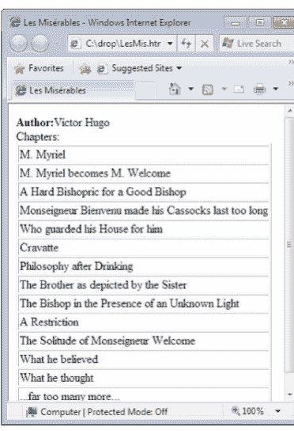

图 14.1

使用 `XslCompiledTransform`，你可以直接从 XML 数据生成快速 HTML 报告。

# 第三部分 用户交互

在本部分

- 第 15 章 委托、事件和匿名方法 279
- 第 16 章 Windows Forms 295
- 第 17 章 使用 Windows Forms 和 GDI+ 图形 329
- 第 18 章 WPF 365
- 第 19 章 ASP.NET 401
- 第 20 章 Silverlight 443

本页故意留白

# 第 15 章 委托、事件和匿名方法

在本章中

- 决定运行时调用何种方法
- 订阅事件
- 发布事件
- 确保 UI 更新在 UI 线程上发生
- 将匿名方法分配给委托
- 使用匿名方法作为快速方便的事件处理程序
- 利用逆变

虽然本质上与用户交互没有直接关系，但委托和事件构成了 GUI 层运行的基础构建块。

特别是委托和事件，是解耦程序各个部分的一种方式。通过为组件创建事件，它们可以信号自身的变化，而无需关心那些想要获取这些变化的外部组件的接口。

在处理委托时，匿名方法和 lambda 表达式在某些方面仅仅是语法的简化。

## 决定运行时调用何种方法

**场景/问题**：你需要在能够在运行时决定调用哪种方法。

**解决方案**：声明一个与目标方法签名匹配的委托。在 C# 中，委托类似于面向对象的、类型安全的函数指针。它们可以是泛型的。此示例显示了如何像处理其他数据一样聚合和存储委托，然后执行它们。

```csharp
class Program
{
    delegate T MathOp<T>(T a, T b);

    static void Main(string[] args)
    {
        // 是的，这是一个方法数组
        // 它们都符合 MathOp<T> 委托
        List<MathOp<double>> opsList = new List<MathOp<double>>();

        opsList.Add(Add);
        opsList.Add(Divide);
        opsList.Add(Add);
        opsList.Add(Multiply);

        double result = 0.0;
        foreach (MathOp<double> op in opsList)
        {
            result = op(result, 3);
        }
        Console.WriteLine("result = {0}", result);
    }

    static double Divide(double a, double b)
    {
        return a / b;
    }
    static double Multiply(double a, double b)
    {
        return a * b;
    }
    static double Add(double a, double b)
    {
        return a + b;
    }
}
```

## 使用单个委托调用多个方法

| 场景/问题 | 你希望通过单个委托调用调用多个方法 |
|---|---|

**解决方案**：所有的委托自动都是所谓的“多路用委托”，这意味着你可以为它们分配多个目标方法。这是通过使用 `+=` 运算符完成的。

> **注意**：在示例中，委托返回 `void`。

```csharp
class Program
{
    delegate void FormatNumber(double number);
    static void Main(string[] args)
    {
        //将三个目标方法分配给此委托
        FormatNumber format = FormatNumberAsCurrency;
        format += FormatNumberWithCommas;
        format += FormatNumberWithTwoNumbers;

        format(123.456);
    }

    static void FormatNumberAsCurrency(double number)
    {
        Console.WriteLine($"{number:C}");
    }
    static void FormatNumberWithCommas(double number)
    {
        Console.WriteLine($"{number:N0}");
    }
    static void FormatNumberWithTwoNumbers(double number)
    {
        Console.WriteLine($"{number:N2}");
    }
}
```

## 确保 UI 更新在 UI 线程上发生

由于内部实现方式，Windows UI 元素必须在创建它们的元素的同一线程上进行访问。之前的框架（如 MFC）并没有这样强制执行这一点，但 .NET 强制了。Windows Forms 和 WPF 处理此问题的方式略有不同。

### 在 WinForms 中

在 WinForms 中，你可以通过对任何 UI 元素轮询 `InvokeRequired` 来检查你是否运行在 UI 线程。如果结果为 `true`，你需要通过调用 `Invoke()` 并传递一个委托来切换到主线程。

在实践中，有几种方法可以实现，但一种简单的方法（来自之前的示例）在 `data_LoadStarted` 事件处理程序中显示：

```csharp
public Form1()
{
    InitializeComponent();

    data = new ProgramData();
    data_LoadStarted += new EventHandler<EventArgs>(data_LoadStarted);
    data_LoadEnded += new EventHandler<ProgramDataEventArgs>(data_LoadEnded);

    data.BeginLoad();
}

void data_LoadStarted(object sender, EventArgs e)
{
    if (this.InvokeRequired)
    {
        // 如果不在 UI 线程上，则递归调用
        // 但在 UI 线程执行
        Invoke(new EventHandler<EventArgs>(data_LoadStarted), sender, e);
    }
    else
    {
        TextBox.AppendText("Load started" + Environment.NewLine);
    }
}
```

### 在 WPF 中

在 WPF 中，概念是类似的。每个 WPF 元素都有一个名为 `Dispatcher` 的属性。通过比较 `Dispatcher` 的线程与当前线程，你可以判断何时需要调用 `Invoke`。下面的示例在一个简单的 WPF 应用中演示了这一点（参见 WPFInvoke 示例项目）：

```csharp
using System;
using System.Windows;
using System.Windows.Controls;
using System.Threading;

namespace WpfInvoke
{
    public partial class MainWindow : Window
    {
        public MainWindow()
        {
            InitializeComponent();

            // 启动第二个线程执行更新
            Thread thread = new Thread(new ThreadStart(ThreadProc));
            thread.IsBackground = true;
            thread.Start();
        }

        private void ThreadProc()
        {
            int val = 0;
            while (true)
            {
                ++val;
                UpdateValue(val);
                Thread.Sleep(200);
            }
        }

        private delegate void UpdateValueDelegate(int val);

        private void UpdateValue(int val)
        {
```


```csharp
if (Dispatcher.Thread != Thread.CurrentThread)
{
    Dispatcher.Invoke(new UpdateValueDelegate(UpdateValue), val);
}
else
{
    TextBlock.Text = val.ToString("N0");
}
```

## 第 15 章 委托、事件和匿名方法

### 给委托分配匿名方法

> **场景/问题：** 你有一段短代码想要运行，但不需要完整方法的开销。

**解决方案：** 使用匿名方法语法将一个代码块分配给委托。

```csharp
delegate int MathOp(int a, int b);

...

MathOp op = delegate(int a, int b) { return a + b; };

int result = op(13, 14);
```

### 使用匿名方法作为快速方便的事件处理程序

> **场景/问题：** 你需要一个快速方便的事件处理程序，不需要名称。

**解决方案：** 使用如下示例所示语法将匿名方法分配给委托：

```csharp
public partial class Form1 : Form
{
    Point prevPt = Point.Empty;

    public Form1()
    {
        InitializeComponent();

        this.MouseMove += delegate(object sender, EventArgs e)
        {
            if (prevPt != e.Location)
            {
                this.textBox1.AppendText(
                    string.Format("Mouse: {0},{1}", e.X, e.Y) + Environment.NewLine);
                prevPt = e.Location;
            }
        };
    }
}
```

### 使用匿名方法作为快速方便的事件处理程序（续）

```csharp
this.MouseClick += delegate(object sender, MouseEventArgs e)
{
    this.TextBox1.AppendText(
        string.Format("MouseClick: ({0},{1}) {2}\n", e.X, e.Y, e.Button, Environment.NewLine));
};

// 不需要参数吗？就不包含它们
this.MouseDown += delegate
{
    this.TextBox1.AppendText("MouseDown" + Environment.NewLine);
};

this.MouseUp += delegate { this.TextBox1.AppendText("MouseUp" + Environment.NewLine); };
```

图 15.1 展示了 `AnonymousMethods` 示例项目，来自本章的示例代码。

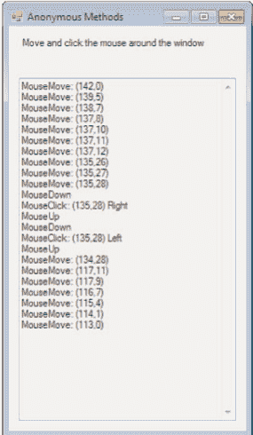

**图 15.1** 匿名方法通常用于快速事件处理程序是合理的。

### 使用 Lambda 表达式编写匿名方法

**场景/问题：** 你想要一个具有简化语法的匿名方法。

**解决方案：** 为匿名方法使用 Lambda 表达式语法。Lambda 表达式可以用于匿名方法，也可以用于创建表达式树。

```csharp
public partial class Form1 : Form
{
    Point prevPt = Point.Empty;

    public Form1()
    {
        InitializeComponent();

        data = new ProgramData();

        data.LoadStarted += new EventHandler<EventArgs>(data_LoadStarted);
        data.LoadEnded += new EventHandler<ProgramDataEventArgs>(data_LoadEnded);

        data.BeginLoad();
    }

    void data_LoadStarted(object sender, EventArgs e)
    {
        if (this.InvokeRequired)
        {
            // 如果不在 UI 线程上，则递归调用
            // 但在 UI 线程执行
            Invoke(new EventHandler<EventArgs>(data_LoadStarted), sender, e);
        }
        else
        {
            TextBox.AppendText("Load started" + Environment.NewLine);
        }
    }

    // 以下为事件处理程序的 Lambda 表达式示例（根据上下文逻辑重组）
    this.MouseMove += (sender, e) =>
    {
        if (prevPt != e.Location)
        {
            this.textBox1.AppendText(
                string.Format("Mouse: {0},{1}", e.X, e.Y) + Environment.NewLine);
            prevPt = e.Location;
        }
    };

    this.MouseClick += (sender, e) =>
    {
        this.textBox1.AppendText(
            string.Format("MouseClick: ({0},{1}) {2}\n", e.X, e.Y, e.Button, Environment.NewLine));
    };

    this.MouseDown += () =>
    {
        this.textBox1.AppendText("MouseDown" + Environment.NewLine);
    };

    this.MouseUp += () => { this.textBox1.AppendText("MouseUp" + Environment.NewLine); };
}
```

### 利用逆变性

**场景/问题：** 在之前的 .NET 版本中，委托的行为并不符合预期。例如，一个带有基类类型参数的委托应该是可以分配给派生类的。以下代码示例说明了这个问题：

给定这些类定义：

```csharp
class Shape
{
    public void Draw() { Console.WriteLine("Drawing shape"); }
}
```

```csharp
class Rectangle : Shape
{
    public void Expand() { /*...*/ }
}
```

以及给定委托和方法：

```csharp
delegate void ShapeAction<T>(T shape);

static void DrawShape(Shape shape)
{
    if (shape != null)
    {
        shape.Draw();
    }
}
```

你会期望这种场景是可以行的：
`ShapeAction<Shape> action = DrawShape;`
`ShapeAction<Rectangle> rectAction = action;`

毕竟 `DrawShape` 可以接受任何类型的 `shape`。遗憾的是，这种操作此前无效。

**解决方案：** 在 .NET 4 中，委托的逆变解决了这个问题，允许将不特定的委托分配给更具体的委托，只要类型参数 `T` 被声明为 `in`，这意味着委托不返回 `T`。在下面的代码中，类型参数已添加了 `in`：

```csharp
class Shape
{
    public void Draw() { Console.WriteLine("Drawing shape"); }
}
```

```csharp
class Rectangle : Shape
{
    public void Expand() { /*...*/ }
}
```

```csharp
class Program
{
    delegate void ShapeAction<in T>(T shape);

    static void DrawShape(Shape shape)
    {
        if (shape != null)
        {
            shape.Draw();
        }
    }

    static void Main(string[] args)
    {
        // 这显然应该是没问题的
        ShapeAction<Shape> action = DrawShape;
        action(new Rectangle());
    }
}
```

> * 直觉上，你认为任何符合 `ShapeAction<Shape>` 委托的方法也应该适用于 `Rectangle`，因为 `Rectangle` 是 `Shape` 的一种类型。
> * 将较少派生的*方法*分配给更派生类的委托都是可能的，但在 .NET 4 之前，你不能将较少派生的*委托*分配给更派生类的委托：这是一个重要的区别。
> * 现在，只要类型参数被标记为 `in`，你就可以这样做了。

```csharp
// 这在 .NET 4 之前是可能的
ShapeAction<Rectangle> rectAction1 = DrawShape;
rectAction1(new Rectangle());
```

```csharp
// 这在 .NET 4 之前是**不可能**的
ShapeAction<Rectangle> rectAction2 = action;
rectAction2(new Rectangle());
Console.ReadKey();
```

---

# 第 16 章 Windows Forms

本章内容

- 创建模态和非模态表单
- 添加菜单栏
- 禁用菜单项
- 添加状态栏
- 添加工具栏
- 创建拆分窗口界面
- 继承表单
- 创建用户控件
- 使用计时器
- 使用应用程序和用户配置值
- 在虚拟模式下高效使用 `ListView`
- 利用水平滚轮倾斜
- 剪切和粘贴
- 自动确保你重置了等待光标

Windows Forms 是 Win32 编程和微软基础类 (MFC) 的直接演进步骤。对于长期从事编程的程序人员来说，它相对容易学习和使用。

由于 Windows Forms 有许多由 Visual Studio 为你生成并维护的代码，本章中的许多示例需要书中未列出的内容。要获得完整的、可运行的示例，请查看书籍网站上本章节的示例项目。

### 创建模态和非模态表单

> **场景/问题：** 你需要创建一个窗口，用户在继续使用应用程序之前必须处理该窗口；或者你想要创建一个用户在使用应用程序其他部分时可以保留的窗口。

**解决方案：** 有两种类型的表单可用：模态（modal）和非模态（modeless）。模态表单必须处理并关闭后才能使用应用程序，而非模态表单可以在用户在其他表单之间切换时保持显示（参见图 16.1）。

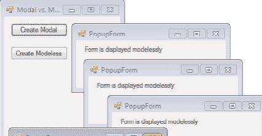

**图 16.1** 非模态窗口保持处于激活状态，但一次只能出现一个模态窗口。

在 .NET 中，表单的启动方式有所不同：

```csharp
// 正确显示模态表单
PopupForm form = new PopupForm();
form.ShowDialog(this);
```

以及

```csharp
// 非模态方式显示表单
PopupForm form = new PopupForm();

// 设置父级将允许子窗口和父窗口有更好的行为
// 特别是在处理活动窗口和最小化时
form.Show(this);
```

请查看示例源码中的“模态 vs. 非模态”示例。

### 添加菜单栏

**场景/问题：** 你希望在应用程序中提供一个菜单系统。

**解决方案：** 本节开始的示例将在接下来的几个节中使用。在示例中，你将构建一个非常、非常简单的文件浏览器应用程序，包含菜单、状态栏、工具栏和拆分面板窗口（参见图 16.2）。

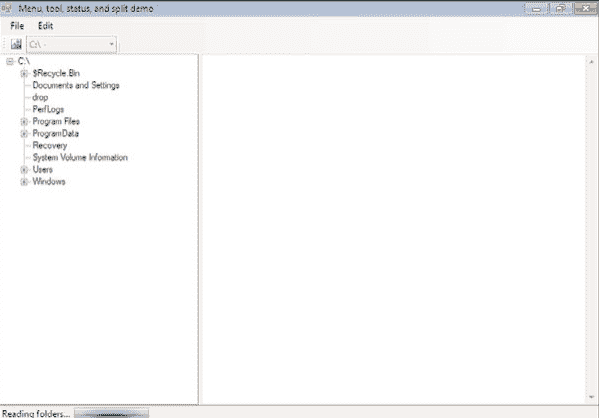

**图 16.2** Windows Forms 拥有许多控件，可以轻松创建标准界面。

所有这些都是控件的实例，可以放置在 `ToolStripContainer` 中，`ToolStripContainer` 是一种方便的布局控件，允许在表单的所有侧轻松放置控件。

> **注意** 派生自 `ToolStrip` 的控件比其前身要强大得多。例如，它们不仅可以托管标准的文本项和按钮，还可以托管组合框、进度条等——任何派生自 `ToolStripItem` 的项。

这里是一些示例代码，用于演示菜单栏的初始化及其在 `ToolStripContainer` 中的位置：

```csharp
private void InitializeComponent()
{
    ...

    this.toolStripContainer = new ToolStripContainer();
    this.menuStrip = new MenuStrip();
    this.fileToolStripMenuItem = new ToolStripMenuItem();
    this.exitToolStripMenuItem = new ToolStripMenuItem();
    this.editToolStripMenuItem = new ToolStripMenuItem();
    this.copyToolStripMenuItem = new ToolStripMenuItem();

    // 菜单条
    this.menuStrip.Dock = DockStyle.None;
    this.menuStrip.Items.AddRange(
        new ToolStripItem[] { this.fileToolStripMenuItem, this.editToolStripMenuItem });
    this.menuStrip.Name = "menuStrip";
    // 这样它在标签顺序中位于工具栏之前
    this.menuStrip.TabIndex = 0;

    // 文件菜单
    this.fileToolStripMenuItem.DropDownItems.AddRange(
        new ToolStripItem[] { this.exitToolStripMenuItem });
    this.fileToolStripMenuItem.Name = "fileToolStripMenuItem";
    this.fileToolStripMenuItem.Text = "&File";

    // 退出菜单项
    this.exitToolStripMenuItem.Name = "exitToolStripMenuItem";
    this.exitToolStripMenuItem.ShortcutKeys = Keys.Alt | Keys.F4;
    this.exitToolStripMenuItem.Text = "E&xit";
    this.exitToolStripMenuItem.Click += new EventHandler(exitToolStripMenuItem_Click);

    // 编辑菜单项
    this.editToolStripMenuItem.DropDownItems.AddRange(
        new ToolStripItem[] { this.copyToolStripMenuItem });
    this.editToolStripMenuItem.Name = "editToolStripMenuItem";
    this.editToolStripMenuItem.Text = "&Edit";
    this.editToolStripMenuItem.DropDownOpening += new EventHandler(this.editToolStripMenuItem_DropDownOpening);

    // 复制工具菜单项
    this.copyToolStripMenuItem.Name = "copyToolStripMenuItem";
}
```


this.copyToolStripMenuItem.Text = "&Copy";

this.copyToolStripMenuItem.Click += new EventHandler(copyToolStripMenuItem_Click);

```cs
// 将菜单放入 ToolStripContainer
this.toolStripContainer.TopPanel.Controls.Add(this.menuStrip);
this.toolStripContainer.Dock = DockStyle.Fill;
```

```cs
// 这里有两个事件处理程序：
void editToolStripMenuItem_DownOpening(object sender, EventArgs e)
{
    // 检查此项是否启用
    this.copyToolStripMenuItem.Enabled = textView.SelectionLength > 0;
}

void copyToolStripMenuItem_Click(object sender, EventArgs e)
{
    // 响应命令
    Application.Copy();
}
```

我们将在下一节查看其他事件处理程序。

# 禁用菜单项

场景/问题：你希望在项无效时禁用它们。

解决方案：如果菜单项无效，应该将其禁用以给用户线索。

> 注意 在较大的应用程序中，你可能需要根据某些情况（例如处理状态）来派生自己的类。

# 添加状态栏

场景/问题：你希望为用户提供有关状态的信息。

解决方案：添加状态栏就像添加菜单一样简单。将其添加到你的代码中。

```cs
private StatusStrip statusStrip;
private ToolStripLabel toolStripLabel;
private ToolStripProgressBar toolStripProgressBar;

private void InitializeComponent()
{
    ...
    this.statusStrip = new StatusStrip();
    this.toolStripProgressBar = new ToolStripProgressBar();
    this.toolStripLabel = new ToolStripLabel();
}

this.statusStrip.Items.AddRange(new ToolStripItem[] { this.toolStripLabel, this.toolStripProgressBar });
this.statusStrip.Name = "statusStrip";
this.statusStrip.Text = "statusStrip";
```

```cs
this.toolStripContainer.BottomToolStripPanel.Add(this.statusStrip);
```

```cs
this.toolStripLabel.Name = "toolStripLabel";
this.toolStripLabel.Text = "Ready";
this.toolStripProgressBar.Name = "toolStripProgressBar";
this.toolStripProgressBar.Size = new System.Drawing.Size(100, 16);
this.toolStripProgressBar.Style = ProgressBarStyle.Continuous;
```

```csharp
this.toolStripButtonExit.Click += new System.EventHandler(this.toolStripButtonExit_Click);
this.toolStripSeparator1.Name = "toolStripSeparator1";
this.toolStripSeparator1.Size = new System.Drawing.Size(6, 25);
this.toolStripComboBoxBoxes.DropDownStyle = System.Windows.ComboBoxStyle.DropDownList;
this.toolStripComboBoxDrives.Name = "toolStripComboBoxDrives";
this.toolStripComboBoxDrives.Size = new System.Drawing.Size(121, 25);
this.toolStripComboBoxDrives.SelectedIndexChanged += new System.EventHandler(this.toolStripComboBoxDrives_SelectedIndexChanged);
...
}
```

以下是事件处理程序：

```cs
void toolStripButtonExit_Click(object sender, EventArgs e)
{
    Application.Exit();
}
```

```cs
void toolStripComboBoxDrives_SelectedIndexChanged(object sender, EventArgs e)
{
    /* 处理组合框 */
}
```

## 创建分窗窗口界面

| 场景/问题 | 你希望能够动态调整界面部分的大小。一种非常流行的 UI 元素是分窗窗口，在两个面板之间有一个可调整的条。 |
| :--- | :--- |
| 解决方案 | .NET 提供了 `SplitContainer` 来实现此功能。你甚至可以将 `SplitContainer` 嵌套在其他 `SplitContainer` 中以实现更复杂的布局。 |

在我们的示例程序中，让我们添加一个左侧为 `TreeView`、右侧为 `TextBox` 的 `SplitContainer`：

```csharp
private SplitContainer splitContainer;
private TextBox textView;
private TreeView treeView;

private void InitializeComponent()
{
    this.splitContainer = new System.Windows.Forms.SplitContainer();
    this.treeView = new System.Windows.Forms.TreeView();
    this.textView = new System.Windows.Forms.TextBox();
}

this.toolStrip.ContentPanel.Controls.Add(this.splitContainer);
this.splitContainer.Dock = System.Windows.Forms.DockStyle.Fill;
this.splitContainer.Location = new System.Drawing.Point(0, 0);
this.splitContainer.Name = "splitContainer";
// 添加到左侧
this.splitContainer.Panel1.Controls.Add(this.treeView);
// 添加到右侧
this.splitContainer.Panel2.Controls.Add(this.textView);
this.splitContainer.Size = new System.Drawing.Size(840, 369);
this.splitContainer.SplitDistance = 280;
this.splitContainer.TabIndex = 2;
this.treeView.Dock = System.Windows.Forms.DockStyle.Fill;
this.treeView.Location = new System.Drawing.Point(0, 0);
this.treeView.Name = "treeView";
this.treeView.Size = new System.Drawing.Size(280, 369);
this.treeView.TabIndex = 0;
this.treeView.AfterSelect += new System.Windows.Forms.TreeViewEventHandler(this.treeView_AfterSelect);
this.textView.Dock = System.Windows.Forms.DockStyle.Fill;
this.textView.Multiline = true;
this.textView.Name = "textView";
this.textView.ScrollBars = System.Windows.Forms.ScrollBars.Both;
```

查看此示例的完整源代码，请参阅附代码中的 ToolAndStatusAndSplit。

## 继承表单

> 场景/问题：你想要一个主表来布局公共控件，并使用子表来自定义布局或添加更多控件。

解决方案：表单继承的工作原理类似于普通的类继承。你可以将公共行为放在基表单中，然后在继承表单中对其特化和增强。图 16.3 通过在 `InheritedForm` 窗口的 `ListView` 中添加更多列演示了这一点。

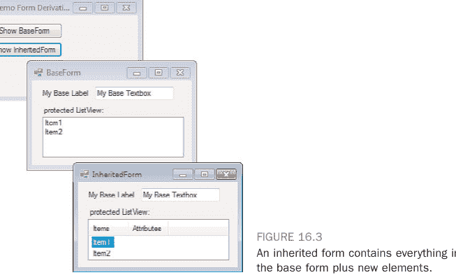

要修改基表单的 UI 元素，必须将其设置为 `public` 或 `protected`。列表 16.1 和 16.2 来自本的 DerivedForms 示例。

## 列表 16.1 BaseForm.cs

```csharp
using System;
using System.ComponentModel;
using System.Windows.Forms;

namespace DerivedForms
{
    public partial class BaseForm : Form
    {
        private System.Windows.Forms.Label label1;
        private System.Windows.Forms.TextBox textBox1;
```

## 列表 16.1 BaseForm.cs (续)

```csharp
protected System.Windows.Forms.ListView listView1;
private System.Windows.Forms.Label label2;
private System.ComponentModel.IContainer components = null;

public BaseForm()
{
    InitializeComponent();
}

protected override void Dispose(bool disposing)
{
    if (disposing && components != null)
    {
        components.Dispose();
    }
    base.Dispose(disposing);
}

private void InitializeComponent()
{
    System.Windows.Forms.ListViewItem listView3 = new System.Windows.Forms.ListViewItem("Item1");
    System.Windows.Forms.ListViewItem listView4 = new System.Windows.Forms.ListViewItem("Item2");
    this.label1 = new System.Windows.Forms.Label();
    this.textBox1 = new System.Windows.Forms.TextBox();
    this.listView1 = new System.Windows.Forms.ListView();
    this.label2 = new System.Windows.Forms.Label();
    this.toolStrip.ContentPanel.Controls.Add(this.splitContainer);
    this.splitContainer.Dock = System.Windows.Forms.DockStyle.Fill;
    this.splitContainer.Location = new System.Drawing.Point(0, 0);
    this.splitContainer.Name = "splitContainer";
    // 添加到左侧
    this.splitContainer.Panel1.Controls.Add(this.treeView);
    // 添加到右侧
    this.splitContainer.Panel2.Controls.Add(this.textView);
    this.splitContainer.Size = new System.Drawing.Size(840, 369);
    this.splitContainer.SplitDistance = 280;
    this.splitContainer.TabIndex = 2;
    this.treeView.Dock = System.Windows.Forms.DockStyle.Fill;
    this.treeView.Location = new System.Drawing.Point(0, 0);
    this.treeView.Name = "treeView";
    this.treeView.Size = new System.Drawing.Size(280, 369);
    this.treeView.TabIndex = 0;
    this.treeView.AfterSelect += new System.Windows.Forms.TreeViewEventHandler(this.treeView_AfterSelect);
    this.textView.Dock = System.Windows.Forms.DockStyle.Fill;
    this.textView.Multiline = true;
    this.textView.Name = "textView";
    this.textView.ScrollBars = System.Windows.Forms.ScrollBars.Both;
}
```

查看此示例的完整源代码，请参阅附代码中的 ToolAndStatusAndSplit。

# 308 第 16 章 Windows Forms

代码列表 16.2 InheritedForm.cs (续)

```cs
this.columnHeader2.Text = "Attributes"; // checkbox1 - we can add new fields we want
this.checkbox1.AutoSize = true;
this.checkbox1.Location = new System.Drawing.Point(19, 126);
this.checkbox1.Name = "checkbox1";
this.checkbox1.Size = new System.Drawing.Size(107, 79);
this.checkbox1.TabIndex = 4;
this.checkbox1.Text = "Added checkbox";
this.checkbox1.UseVisualStyleBackColor = true;
// InheritedForm
this.AutoScaleDimensions = new System.Drawing.Size(6F, 13F);
this.ClientSize = new System.Drawing.Size(243, 149);
this.Controls.Add(this.checkbox1);
this.Name = "InheritedForm";
this.Text = "InheritedForm";
this.Controls.SetChildIndex(this.checkbox1, 0);
this.Controls.SetChildIndex(this.listView1, 0);
this.ResumeLayout(false);
this.PerformLayout();
```

## 创建一个用户控件

场景/问题：你需要创建一个控件，一个可复用的 UI 控件。

解决方案：有时内置的 Windows Forms 控件并不能提供你需要的功能。你可以创建自己的控件，它可以是从自定义界面背后的现有控件组合，到自定义绘制或主题。

这个长示例提供了一个自定义控件，它结合了轨道条（track bar）、数值控件、标签（label）和绘制，使用户能够选择单个颜色组件的值：

```cs
using System;
```


using System.Collections.Generic;

using System.ComponentModel;

using System.Drawing;

using System.Windows.Forms;

```cs
namespace CustomControl
{
    public enum RGBSelection
    {
        R, G, B
    }

    public partial class MyCustomControl : UserControl
    {
        //the controls
        private System.ComponentModel.IContainer components = null;
        private System.Windows.Forms.Label labelLabel;
        private System.Windows.Forms.NumericUpDown numericUpDownValue;
        private System.Windows.Forms.TrackBar trackBar;

        protected override void Dispose(bool disposing)
        {
            if (disposing && (components != null))
            {
                components.Dispose();
            }
            base.Dispose(disposing);
        }

        private void InitializeComponent()
        {
            this.labelLabel = new System.Windows.Forms.Label();
            this.numericUpDownValue = new System.Windows.Forms.NumericUpDown();
            this.trackBar = new System.Windows.Forms.TrackBar();
            ((System.ComponentModel.ISupportInitialize)this.numericUpDownValue).BeginInit();
            ((System.ComponentModel.ISupportInitialize)this.trackBar).BeginInit();
            this.SuspendLayout();
            // labelLabel
            this.labelLabel.AutoSize = true;
            this.labelLabel.Location = new System.Drawing.Point(4, 4);
            this.labelLabel.Name = "labelLabel";
            this.labelLabel.Size = new System.Drawing.Size(71, 13);
            this.labelLabel.TabIndex = 0;
            this.labelLabel.Text = "Dummy Label";
            // numericUpDownValue
            this.numericUpDownValue.Location = new System.Drawing.Point(175, 20);
            this.numericUpDownValue.Name = "numericUpDownValue";
            this.numericUpDownValue.Size = new System.Drawing.Size(41, 20);
            this.numericUpDownValue.TabIndex = 1;
            // trackBar
            this.trackBar.Location = new System.Drawing.Point(7, 20);
            this.trackBar.Name = "trackBar";
            this.trackBar.Size = new System.Drawing.Size(162, 45);
            this.trackBar.TabIndex = 2;

            // CustomControl
            this.AutoScaleDimensions = new System.Drawing.SizeF(6F, 13);
            this.AutoScaleMode = System.Windows.Forms.AutoScaleMode.Font;
            this.Controls.Add(this.trackBar);
            this.Controls.Add(this.numericUpDownValue);
            this.Controls.Add(this.labelLabel);
            this.Name = "MyCustomControl";
            this.Size = new System.Drawing.Size(216, 65);
            ((System.ComponentModel.ISupportInitialize)(this.numericUpDownValue)).EndInit();
            ((System.ComponentModel.ISupportInitialize)(this.trackBar)).EndInit();
            this.ResumeLayout(false);
            this.PerformLayout();
        }

        public RGBColor ColorPart { get; set; }

        public string Label
        {
            get { return labelLabel.Text; }
            set { labelLabel.Text = value; }
        }

        //overall value of the control
        public int Value
        {
            get
            {
                return (int)numericUpDownValue.Value;
            }
            set
            {
                numericUpDownValue.Value = value;
            }
        }

        public event EventHandler<EventArgs> ValueChanged;

        public MyCustomControl()
        {
            InitializeComponent();

            numericUpDownValue.Minimum = 0;
            numericUpDownValue.Maximum = 255;
            trackBar.Minimum = 0;
            trackBar.Maximum = 255;

            numericUpDownValue.ValueChanged += numericUpDown_ValueChanged;
            trackBar.ValueChanged += trackBar_ValueChanged;
        }

        void numericUpDown_ValueChanged(object sender, EventArgs e)
        {
            ValueChanged?.Invoke(this, EventArgs.Empty);
        }

        void trackBar_ValueChanged(object sender, EventArgs e)
        {
            ValueChanged?.Invoke(this, EventArgs.Empty);
        }
    }
}
```

# 第 16 章 Windows Forms

## 创建一个用户控件

场景/问题：你需要创建一个控件，一个可复用的 UI 控件。

解决方案：有时内置的 Windows Forms 控件并不能提供你需要的功能。你可以创建自己的控件，它可以是从自定义界面背后的现有控件组合，到自定义绘制或主题。

这个长示例提供了一个自定义控件，它结合了轨道条、数值控件、标签和绘制，使用户能够选择单个颜色组件的值。

## 使用定时器

场景/问题：你想按固定间隔调用一个函数，或者只调用一次。

解决方案：使用定时器。.NET 提供了许多类型的定时器，但最常见且易于使用的是 `System.Windows.Forms.Timer`，它在滴答（tick）时通知用户。

这是一个交替 `Label` 中文本的简单示例。

```cs
public partial class Form1
{
    private Timer _timer;
    bool _tick = true;
    bool _stopped = true;

    public Form1()
    {
        InitializeComponent();

        _timer = new Timer();
        _timer.Interval = 1000; //1秒
        _timer.Tick += new EventHandler(_timer_Tick);
    }

    void _timer_Tick(object sender, EventArgs e)
    {
        labelOutput.Text = _tick ? "Tick" : "Tock";
        _tick = !_tick;
    }

    private void buttonStart_Click(object sender, EventArgs e)
    {
        if (_stopped)
        {
            _timer.Enabled = true;
            buttonStart.Text = "&Stop";
        }
        else
        {
            _timer.Enabled = false;
            buttonStart.Text = "&Start";
        }
        _stopped = !_stopped;
    }
}
```

> 注意：此定时器使用普通的事件模型实现，并非为超高精度设计。对于更准确的定时器，可以使用第 23 章“线程、异步和并行编程”中讨论的类型。尽管如此，也不要完全信任它的准确性。Windows 不是实时操作系统，因此无法保证遵守严格的时间请求。

## 使用应用程序和用户配置值

| 场景/问题 | 你想要存储应用程序级和用户特定的配置设置 |
| :--- | :--- |

解决方案：配置设置通常是程序员的噩梦，而且它们是作为事后考虑实现的。坦率地说，.NET 通过内置类缓解了一些痛苦。这些类在 Visual Studio 中享有直接的 IDE 支持。

大多数新的 GUI 项目会自动为你创建一个设置文件，但如果你需要创建一个，请按照以下步骤操作：

1. 在解决方案资源管理器中右键点击你的项目。
2. 选择添加、新建项。
3. 找到设置文件（Settings File）项并高亮它（见图 16.5）。
4. 给它起一个有意义的名字。
5. 一旦你有了新的设置文件，在“解决方案管理器”中双击它即可打开设置编辑器（见图 16.6）。

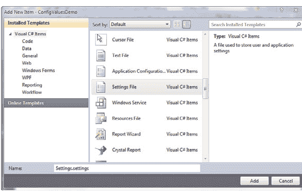

图 16.5：在 Visual Studio 中添加设置文件。（通常使用 `Settings.settings` 即可。）

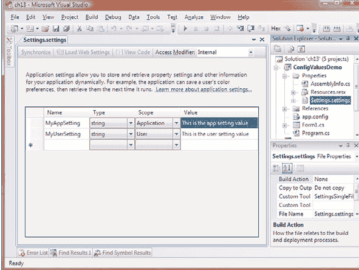

图 16.6：你可以在 Visual Studio 的编辑器中添加用户级和应用程序级的设置。

表 16.1 描述了用户设置与应用程序设置之间的差异。

| 设置 | 描述 |
| :--- | :--- |
| 应用程序 (Application) | 所有实例和用户都会受到这些设置的影响。它们在运行时无法更改。配置存储在可执行文件所在的目录下。 |
| 用户 (User) | 设置可以按用户进行更改。它们可以在运行时进行更改。设置文件存储在用户的应用程序数据目录中。 |

在后台，Visual Studio 会为你的代码生成正确类型的属性。这里是一个示例：

```csharp
public partial class Form1 : Form
{
    public Form1()
    {
        InitializeComponent();
        //将设置加载到 UI 中
        this.textBoxAppConfigValue.Text =
            Properties.Settings.Default.MyAppSetting;
        this.textBoxUserConfigValue.Text =
            Properties.Settings.Default.MyUserSetting;
    }

    // 关闭时保存设置
    protected override void OnClosing(CancelEventArgs e)
    {
        Properties.Settings.Default.MyUserSetting =
            textBoxUserConfigValue.Text;

        //不能这么做——应用程序设置是只读的！
        // Properties.Settings.Default.MyAppSetting =
        //     textBoxAppConfigValue.Text;

        // 如果你想在下次程序运行时看到设置，最好保存一下
        //the app runs
        Properties.Settings.Default.Save();
    }
}
```

欲查看演示和完整源代码，请参考本章示例代码中的 `ConfigValuesDemo` 项目。

## 在虚拟模式下高效使用 ListView

**场景/问题：** 你是否尝试过向 `ListView` 控件中输入数千条项目？如果是，你就知道它的性能并不理想。然而，在 `ListView` 中在不卡顿的情况下高效地列出例如 100,000,000 个项目是可能的。

**解决方案：** 关键在于使用 `ListView` 的虚拟模式（virtual mode），它通过回调函数来获取显示所需的数据。

你应该智能地使用虚拟模式，以避免不断创建垃圾回收器需要清理的对象。为此，以下示例代码设置了一个简单的缓存系统，当 `ListView` 需要更新当前显示的项时，会复用 `ListViewItem` 对象。


```csharp
public class Form1 {
    // 我们简单的项缓存
    private List<ListItem> _listItemCache = new List<ListItem>();
    // 需要以便映射缓存中的索引
    private int _topIndex = -1;

    public Form1() {
        InitializeComponent();
        listView.VirtualMode = true;
        listView.VirtualListSize = (int)numericUpDown1.Value;
        listView.CacheVirtualItemsEventHandler += CacheVirtualItemsEventHandler;
        listView.RetrieveVirtualItem += RetrieveVirtualItemEventHandler;
    }
    // 当 ListView 准备显示新行项时被调用
    void listView_CacheVirtualItems(object sender, CacheVirtualItemsEventArgs e) {
        _topIndex = e.StartIndex;
        // 检查是否需要更多项
        //（注意，我们从不缩小列表——这种缓存并不好）
        int needed = (e.EndIndex - e.StartIndex) + 1;
        if (_listItemCache.Capacity < needed)
        {
            int toGrow = needed - _listItemCache.Capacity;
            // 调整容量到目标值
            _listItemCache.Capacity = needed;
            // 添加新的缓存项
            for (int i = 0; i < toGrow; i++) {
                _listItemCache.Add(new ListItem());
            }
        }
    }

    void listView_RetrieveVirtualItem(object sender, RetrieveVirtualItemEventArgs e) {
        int cacheIndex = e.ItemIndex - _topIndex;
        if (cacheIndex >= 0 && cacheIndex < _listItemCache.Count) {
            e.Item = _listItemCache[cacheIndex];
            // 我们可以根据需要设置任何数据的文本，
            // 基于 e.Item，为了简单起见我们只显示
            // 项索引和缓存索引
            e.Item.Text = e.ItemIndex.ToString() + " * " +
            cacheIndex.ToString();
            e.Item.Tag = some arbitrary object;
        } else {
            // 这偶尔会发生，但你看不到
            e.Item = _listItemCache[0];
            e.Item.Text = "Oops";
        }
    }

    // 根据需要更新列表大小
    private void numericUpDown1_ValueChanged(object sender, EventArgs e) {
        listView.VirtualSize = (int)numericUpDown1.Value;
    }
}
```

*(注：由于原文后半部分存在大量重复且无意义的文本碎片，已在逻辑完结处停止翻译。)*

# 第 16 章 Windows Forms

```cs
int delta = (Int16)HIWORD(wParam);
int x = LOWORD(lParam);
int y = HIWORD(lParam);

return MouseEventArgs(buttons, 0, x, y, delta);

private static Int32 HIWORD(IntPtr ptr)
{
  Int32 val32 = ptr.ToInt32();
  return ((val32 >> 16) & 0xFFFF);
}

private static Int32 LOWORD(IntPtr ptr)
{
  Int32 val32 = ptr.ToInt32();
  return (val32 & 0xFFFF);
}
```

```cs
// 主表单，包含了上面的面板
// 完整源代码请参考 HorizTiltWheelDemo 项目
public partial class Form1 : Form
{
  [DllImport("user32.dll", CharSet = CharSet.Auto)]
  private static extern IntPtr SendMessage(IntPtr hWnd,
    IntPtr msg,
    IntPtr wp,
    IntPtr lp);

  public Form1()
  {
    InitializeComponent();

    panel1.MouseWheel += new EventHandler<MouseEventArgs>(panel1.MouseWheel);
  }

  void panel1_MouseWheel(object sender, MouseEventArgs e)
  {
    label1.Text = string.Format("H Delta: {0}", e.Delta);
  }

  protected override void WndProc(ref Message m)
  {
```

```cs
// 将所有滚轮消息发送到面板
switch (m.Msg)
{
    case Win32Messages.WM_MOUSEWHEEL:
    case Win32Messages.WM_MOUSEWHEEL:
        SendMessage(panel1.Handle, m.Msg, m.WParam, m.LParam);
        m.Result = IntPtr.Zero;
        break;
}
base.WndProc(ref m);
}
```

查看附示例源码中的完整 `HorizTiltWheelDemo` 项目获取所有代码。

# 剪切和粘贴

| 场景/问题 | 你需要将项目置于剪贴板。 |
| :--- | :--- |
| 解决方案 | 有简单的方法和更简单的方法来实现此操作，这取决于你的需求——如果你需要同时向剪贴板放入多种格式，或者只需要一个。我将在接下来的章节中介绍每种方法，以及如何将你的自定义对象放入剪贴板。 |

# 作为单一数据类型的剪切和粘贴

简单的剪切和粘贴方法是直接地使用 `Clipboard.SetText()`、`Clipboard.SetImage()` 等方法。

```cs
//将文本 "Hello, there!" 放入剪贴板
Clipboard.SetText("Hello, there!");
Bitmap bitmap = Bitmap.FromFile("@C:\\MyImage.bmp");
//将 C:\MyImage.bmp 的内容放入剪贴板
Clipboard.SetImage(bitmap);
```

```cs
// 检索它
Image image = Clipboard.GetImage();
string text = Clipboard.GetText();
```

# 共同剪切文本和图像

许多程序支持更高级的剪贴板功能。例如，当你从 Microsoft Word 复制文本到剪贴板时，它会同时多种格式复制该文本，包括纯文本、Word 格式、HTML 甚至可以粘贴到图形程序中的文本图像！这是 Windows 剪贴板的一个内置功能，你可以利用它。在粘贴时，由每个程序决定默认请求什么格式，甚至给用户提供选择。

以下是如何将文本和图像都放入剪贴板的：

```cs
Bitmap bitmap = Bitmap.FromFile("C:\\MyImage.bmp");
DataObject obj = new DataObject();
obj.SetText("Hello, there!");
obj.SetImage(bitmap);
Clipboard.SetDataObject(obj);
```

# 确定剪贴板上存在哪些格式

为了确定哪些格式可供你粘贴，`Clipboard` 类定义了一些静态方法：

- `Clipboard.ContainsAudio()`
- `Clipboard.ContainsFileDropList()`
- `Clipboard.ContainsImage()`
- `Clipboard.ContainsText()`

这些方法返回一个 `bool`。还有一个 `ContainsData` 方法，用于判断是否存在自定义格式。这将在下一节中用到。

要确定存在哪些格式，你可以使用此代码：

```cs
IDataObject obj = Clipboard.GetDataObject();
if (obj != null) {
  foreach (string format in obj.GetFormats()) {
    Console.WriteLine(format);
  }
}
```

在我从 Microsoft Word 复制这个句子后运行此代码，得到了以下输出：

```
Object Descriptor
Rich Text Format
HTML Format
System.String
UnicodeText
Text
EnhancedFile
MetaFilePict
Embed Source
```

# 自定义对象的剪切和粘贴

如果你的程序是一个，一个用于组件的 CAD 程序，你可能希望支持组件的剪切和粘贴功能。你有两个选择：

- 将你的组件转换为标准的剪贴板格式（如文本）并将其放入剪贴板。然后在粘贴时将其转换回。
- 将任意二进制数据放入剪贴板并序列化和反序列化你的类（只需少量努力）。

好消息是，第二个选项很容易使用。

假设你有一个包含各种人员姓名、性别和年龄的 ListView。要将这些行放入剪贴板，请定义一个可序列化的中间类：

```cs
[Serializable]
class MyClipboardItem
{
    // 我们必须有一个唯一的名称来识别
    // 我们在剪贴板上的数据类型
    // 我们将其命名为这个，但实际上我们会存储这些列表
    public const string FormatName =
        "HowToCSharp.ch16.ClipboardDemo.MyClipboardItem";
    public static readonly DataFormats.Format Format =
        DataFormats.GetFormat(FormatName);

    public string Name { get; set; }
    public string Sex { get; set; }
    public string Age { get; set; }

    public MyClipboardItem(string name, string sex, string age)
    {
        this.Name = name;
        this.Sex = sex;
        this.Age = age;
    }
}
```

当你想将其放入剪贴板时，可以像这样做，假设存在包含此信息的 ListView：

```cs
private void CopyAllFormats()
{
    DataObject obj = new DataObject();
    obj.SetText(GetText());
    obj.SetImage(GetImage());
    Clipboard.SetDataObject(obj);
}
```

# 第 17 章 使用 Windows Forms 和 GDI+ 绘制图形

本章

- 理解颜色
- 使用系统颜色选择器
- 在 RGB 和 HSV 之间转换颜色
- 绘制形状
- 创建笔
- 创建自定义画刷
- 使用变换
- 绘制文本
- 绘制斜角文本
- 绘制图像
- 绘制透明图像
- 绘制到离屏缓冲区
- 直接访问位图像素以优化
- 使用抗锯齿绘制
- 无闪烁绘制
- 调整图像大小
- 创建图像缩略图
- 多屏截图
- 获取鼠标光标到点的距离
- 判断点是否在矩形内
- 判断点是否在圆内
- 判断点是否在椭圆内
- 判断两个矩形是否相交
- 打印和打印预览

## 理解颜色

颜色定义使用 `System.Drawing.Color` 结构体实现。这基本上是四个四个 1 字节值的封装：红、绿、蓝和透明度（用于透明度）。

```cs
Color color = Color.FromArgb(255, 255, 255, 255); // 不透明纯白色
```

对于已知颜色，你可以使用 `Color` 结构体上的许多静态属性之一：

```cs
Color color = Color.White;
```

> **注意** 颜色与你自己定义的颜色是不同的！你认为这个表达式的值是多少？
>
> `bool e = Color.White.Equals(Color.FromArgb(255, 255, 255, 255));`
>
> 结果为 false，尽管它们在视觉上是等色的。

有相应的属性可以访问每个颜色分量：

```cs
int red = color.R;
```

## 使用系统颜色选择器

场景/问题：你需要为用户提供基础的颜色选择能力。

解决方案：可以使用内置的颜色选择器（见图 17.1）：

```cs
Color c = Color.FromArgb(25, 50, 75);
System.Windows.Forms.ColorDialog cdg =
  new System.Windows.Forms.ColorDialog();
cdg.Color = c;
if (cdg.ShowDialog() == DialogResult.OK)
{
  c = cdg.Color;
}
```

## 在 RGB 和 HSV 之间转换颜色

> 场景/问题：你想让用户能够以自然的 HSV 格式指定颜色。

计算机使用的 RGB 格式对于计算机来说非常方便——但对于人类来说并不如此，HSV（色相、饱和度、亮度）更直观且更容易控制。

大多数优秀的绘画程序都允许你用其中一种格式控制颜色，你也应该给予用户同样的自由。

解决方案：颜色背后的科学和数学以及如何转换超出了本书的范围。互联网上有大量的解释。

图 17.2 所示的 `ColorConverter` 示例程序将此转换代码整合到一个格式中，展示了一些实用的 UI 技术。它大量使用了 `LinearGradientBrushes` 来指示每个滑块变化的效果。该程序的完整代码没有包含在书中，而是在本章附带源码中的 `ColorConverter` 示例程序中。

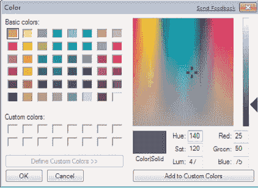

系统颜色选择器让你能够快速方便地访问基础的颜色选择界面。

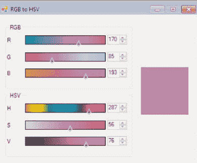

图 17.2

一个演示 RGB 和 HSV 之间关系的颜色选择表。

## RGB 转换为 HSV


```cs
/// <summary>
/// 将 RGB 转换为 HSV
/// </summary>
/// <param name="color">RGB 颜色。</param>
/// <param name="hue">色相。</param>
/// <param name="saturation">饱和度。</param>
/// <param name="value">亮度。</param>
/// <remarks>
/// 基于 Ken Getz 的代码 "Building a Color Picker with GDI+
/// in Visual Basic.Net or C#" 
/// http://msdn.microsoft.com/en-us/magazine/cc164113.asp
/// </remarks>
public static void RgbToHsv(Color rgbColor,
    out double hue, out double saturation, out double value)
{
    double r = rgbColor.R / 255.0;
    double g = rgbColor.G / 255.0;
    double b = rgbColor.B / 255.0;

    // 获取所有三个分量的最小值和值
    double min = Math.Min(Math.Min(r, g), b);
    double max = Math.Max(Math.Max(r, g), b);

    double v = max;
    double delta = max - min;
    double h=0, s=0;

    if (delta == 0)
    {
        h = 0;
    }
    else
    {
        s = delta / v;

        if (max == r)
        {
            h = (g - b) / delta;
        }
        else if (max == g)
        {
            h = (b - r) / delta + 2;
        }
        else
        {
            h = (r - g) / delta + 4;
        }

        if (h < 0)
        {
            h += 6;
        }
    }

    hue = h * 360;
    saturation = s * 100;
    value = v * 100;
}
```

## HSV 转换为 RGB

```cs
/// <summary>
/// 将 HSV 转换为 RGB
/// </summary>
/// <param name="hue">色相 (0-360).</param>
/// <param name="saturation">饱和度 (0-100).</param>
/// <param name="value">亮度 (0-100).</param>
/// <returns>等效的 RGB</returns>
/// <remarks>
/// 基于 Ken Getz 的 "Building a Color Picker with GDI+
/// in Visual Basic.Net or C#"
/// http://msdn.microsoft.com/en-us/magazine/cc164113.asp
/// </remarks>
public static Color HsvToRgb(double hue, double saturation, double value)
{
    double r, g, b;

    double s = saturation / 100.0;
    double v = value / 100.0;

    if (s == 0)
    {
        r = g = b = v;
    }
    else
    {
        double h = hue / 60.0;
        int i = (int)Math.Floor(h);
        double f = h - i;

        double p = v * (1 - s);
        double q = v * (1 - s * f);
        double t = v * (1 - s * (1 - f));

        switch (i % 6)
        {
            case 0: r = v; g = t; b = p; break;
            case 1: r = q; g = v; b = p; break;
            case 2: r = p; g = v; b = t; break;
            case 3: r = p; g = q; b = v; break;
            case 4: r = q; g = p; b = v; break;
            case 5: r = v; g = p; b = t; break;
        }
    }

    return Color.FromArgb((int)(r * 255), (int)(g * 255), (int)(b * 255));
}
```

# 第 17 章 使用 Windows Forms 和 GDI+ 绘制图形

## 绘制形状

场景/问题：你需要在屏幕上绘制基本形状。

解决方案：对于大多数形状，你有填充或轮廓的选择。此代码演示了如何应用（见图 17.3）。绘制通常在 `Control` 或 `Form` 的 `OnPaint` 程序中进行。

```cs
protected override void OnPaint(PaintEventArgs e)
{
    base.OnPaint(e);

    // 带有边框的填充形状
    e.Graphics.FillRectangle(Brushes.Red, 10, 10, 50, 50);
    e.Graphics.DrawRectangle(Pens.Black, 10, 10, 50, 50);

    e.Graphics.FillEllipse(Brushes.Green, 100, 100, 100, 50);
    e.Graphics.DrawEllipse(Pens.DarkGreen, 100, 100, 100, 50);

    // 圆形只是宽高相同的椭圆
    e.Graphics.FillEllipse(Brushes.Blue, 250, 10, 50, 50);
    e.Graphics.DrawEllipse(Pens.DarkBlue, 250, 10, 50, 50);

    // 单条线
    e.Graphics.DrawLine(Pens.SteelBlue, 350, 10, 400, 60);

    // 一系列连接线
    Point[] linePoints = new Point[] {
        new Point(10,100),
        new Point(20,110),
        new Point(35,150),
        new Point(75,105),
        new Point(30,125)
    };
    e.Graphics.DrawLines(Pens.SpringGreen, linePoints);

    // 多边形（闭合线段）
    Point[] polygonPoints = new Point[] {
        new Point(100,100),
        new Point(110,110),
        new Point(130,150),
        new Point(140,125),
        new Point(125,105)
    };
    e.Graphics.FillPolygon(Brushes.Tan, polygonPoints);
    e.Graphics.DrawPolygon(Pens.DarkGoldenrod, polygonPoints);

    // 穿过每个点的曲线
    // 又称为心点样条
    Point[] curvePoints = new Point[] {
        new Point(200,100),
        new Point(210,110),
        new Point(230,150),
        new Point(230,150),
        new Point(240,125),
        new Point(225,105)
    };
    e.Graphics.DrawCurve(Pens.Purple, curvePoints);

    Point[] closedCurvePoints = new Point[] {
        new Point(300,100),
        new Point(310,110),
        new Point(330,150),
        new Point(340,125),
        new Point(325,105)
    };
    e.Graphics.FillClosedCurve(Brushes.LightCoral, closedCurvePoints);
    e.Graphics.DrawClosedCurve(Pens.PowderBlue, closedCurvePoints);

    e.Graphics.FillPie(Brushes.LawnGreen, 10, 200, 100, 50, 180, 135);
    e.Graphics.DrawPie(Pens.DarkOliveGreen, 10, 200, 100, 50, 180, 135);

    e.Graphics.DrawArc(Pens.Plum, 15, 200, 100, 50, 180, 135);
}
```

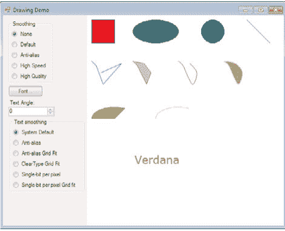

图 17.3 在 GDI 中绘制基本形状非常简单。

> 通常情况下，你会在 `Fill*` 方法中使用 `Draw*` 方法和画刷（brushes）。然而，正如你将在下一节中看到的，在某些方面，画笔可以用来模拟画刷。

尽管为了简单起见，本章中的示例通常将许多绘图代码直接放在 `OnPaint()` 或从 `OnPaint()` 调用的方法中，但出于性能考虑，你应该尽可能在 `OnPaint()` 之外执行大量工作。例如，应将尺寸计算放在 `OnSize()` 中。

## 创建画笔 (Pens)

场景/问题：你能够自定义用于在屏幕上绘制形状的画笔，例如使其变粗或更改颜色。

解决方案：对于创建画笔你有许多选项可供，正如这段代码所示：

```cs
Point[] points = new Point[] {
    new Point(5,10),
    new Point(50,10),
    new Point(10,50)
};

LinearGradientBrush gradientBrush =
    new LinearGradientBrush(new Point(0, 0),
    new Point(50, 50),
    Color.Red, Color.Yellow);
HatchBrush hatchBrush = new HatchBrush(HatchStyle.DashedVertical,
    Color.Green, Color.Transparent);
Pen[] pens;

public void Form1()
{
    InitializeComponent();

    pens = new Pen[]
    {
        new Pen(Color.Red),
        new Pen(Color.Green, 4), // 宽度为4的画笔
        new Pen(Color.Purple, 2), // 点划画笔
        new Pen(gradientBrush, 6), // 渐变画笔
        new Pen(gradientBrush, 6), // 圆角连接和端点
        new Pen(hatchBrush, 6) // 阴影画笔
    };
}

pens[2].DashStyle = DashStyle.DashDot;
pens[4].EndCap = LineCap.Round;
pens[4].LineJoin = LineJoin.Round;

protected override void OnPaint(PaintEventArgs e)
{
    base.OnPaint(e);

    // 绘制每组线条到它们自己的“框”中
    const int borderWidth = 100;
    const int boxHeight = 100;

    for (int i = 0; i < pens.Length; i++)
    {
        e.Graphics.TranslateTransform(
            (i % 4) * boxWidth,
            (i / 4) * boxHeight);
        e.Graphics.DrawLines(pens[i], points);
        e.Graphics.ResetTransform();
    }
}
```

此代码产生了图 17.4 所示的输出。


图 17.4

你可以自定义画笔的许多方面，例如颜色、厚度、样式、类型和端点。你甚至可以让画笔具有画刷的特性！

> 注意：画笔和画刷是 GDI 对象，它们使用操作系统资源。因此，在你完成使用后必须对其进行释放：

```cs
protected override void Dispose(bool disposing)
{
    if (disposing && (components != null))
    {
        components.Dispose();
        foreach(Pen pen in pens)
        {
            pen.Dispose();
        }
        hatchBrush.Dispose();
        gradientBrush.Dispose();
    }
    base.Dispose(disposing);
}
```

## 创建自定义画刷 (Custom Brushes)

场景/问题：你需要自定义画刷来填充屏幕上的形状，例如指定不同的颜色或赋予它渐变效果。

解决方案：像画笔一样，画刷在颜色和样式上也可以极度自定义。画刷可以由阴影图案、位图和渐变组成（见图 17.5）。

```cs
Brush[] brushes;

const int boxSize = 175;

Rectangle ellipseRect = new Rectangle(0, 0, boxSize, boxSize);

GraphicsPath path = new GraphicsPath();

public void Form1()
{
    InitializeComponent();

    brushes = new Brush[]
    {
        new SolidBrush(Color.Red),
        new SolidBrush(Color.Green),
        new HatchBrush(HatchStyle.DashedVertical, Color.Green, Color.Transparent),
        new LinearGradientBrush(new Point(0, 0), new Point(50, 50), Color.Red, Color.Yellow)
    };
}
```

```cs
e.Graphics.FillRectangle(brushes[0], 0, 175, 175);
```

```cs
e.Graphics.FillPie(Brushes.LawnGreen, 10, 200, 100, 50, 180, 135);
e.Graphics.DrawPie(Pens.DarkOliveGreen, 10, 200, 100, 50, 180, 135);
```

```cs
e.Graphics.DrawArc(Pens.Plum, 15, 200, 100, 50, 180, 135);
```


```csharp
public void Form1()
{
    InitializeComponent();

    brushes = new Brush[]
    {
        new SolidBrush(Color.Red),
        new SolidBrush(Color.Green),
        new HatchBrush(HatchStyle.DashedVertical, Color.Green, Color.Transparent),
        new LinearGradientBrush(new Point(0, 0), new Point(50, 50), Color.Red, Color.Yellow)
    };
}
```

```csharp
e.Graphics.FillRectangle(brushes[0], 0, 175, 175);
```

```csharp
e.Graphics.FillPie(Brushes.LawnGreen, 10, 200, 100, 50, 180, 135);
e.Graphics.DrawPie(Pens.DarkOliveGreen, 10, 200, 100, 50, 180, 135);
```

```csharp
e.Graphics.DrawArc(Pens.Plum, 15, 200, 100, 50, 180, 135);
```

```csharp
protected override void Dispose(bool disposing)
{
  if (disposing && (components != null))
  {
    components.Dispose();
    foreach(Brush brush in brushes)
    {
      brush.Dispose();
    }
  }
  base.Dispose(disposing);
}
```

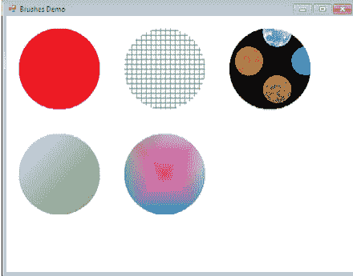

图 17.5

你可以自定义画笔的许多方面，例如颜色、厚度、样式、类型和端点。

# 使用变换

场景/问题：你需要操作绘图的位置、尺寸或形状。

解决方案：这些场景都可以通过变换轻松处理，如下节所示。

## 平移

平移是移动对象。它的尺寸和方向保持不变。

```csharp
// 移动它移动 20 像素
e.Graphics.TranslateTransform(20, 20);
e.Graphics.FillEllipse(Brushes.Blue, ellipseRect);
e.Graphics.ResetTransform();
```

## 旋转

旋转量以角度为单位，用法与平移相似。

```csharp
// 角度是角度
e.Graphics.RotateTransform(-15);
e.Graphics.FillEllipse(Brushes.Red, ellipseRect);
e.Graphics.ResetTransform();
```

## 平移与旋转

组合变换时，顺序至关重要。尝试一些实验以查看差异。

```csharp
// 平移 + 旋转
// 注意顺序！非常重要
e.Graphics.TranslateTransform(100, 100);
e.Graphics.RotateTransform(-15);
e.Graphics.FillEllipse(Brushes.Purple, ellipseRect);
e.Graphics.ResetTransform();
```

## 缩放

缩放是沿 X 和 Y 维度调整对象的大小。

```csharp
// 缩放
// 使长度增加一倍，宽度缩小为 3/4
e.Graphics.ScaleTransform(2.0f, 0.75f);
e.Graphics.FillEllipse(Brushes.Green, ellipseRect);
e.Graphics.ResetTransform();
```

## 倾斜

所有变换本质上都是矩阵。对于倾斜变换，我们需要直接使用矩阵。

```csharp
// 我们也可以使用任何任意矩阵
// 来变换图形
Font font = new Font("Verdana", 16.0f);
Matrix matrix = new Matrix();
matrix.Shear(0.5f, 0.25f);
e.Graphics.Transform = matrix;
e.Graphics.DrawString("Hello, Shear", font, Brushes.Black, 0, 0);
e.Graphics.ResetTransform();
```

17.6 显示了所有这些变换的结果。

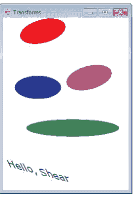

# 绘制文本

场景/问题：你需要在屏幕上绘制文本。

解决方案：要绘制文本，你必须指定字体和用于渲染它的画笔。

```csharp
Font _textFont = new Font("Verdana", 18.0f);
//传入你想要渲染的字符串（在此情况下，
//字体的名称，随后是字体、画笔和位置
e.Graphics.DrawString(_textFont.Name, _textFont,
Brushes.DarkMagenta, 0, 0);
```

## 对角线绘制文本

场景/问题：你需要在水平方向以外的任意绘制文本。

解决方案：使用变换来实现这一切：

```csharp
private Font font = new Font("Verdana", 18.0f);

e.Graphics.TranslateTransform(100, 300);

e.Graphics.RotateTransform(15);

e.Graphics.DrawString("My text here", font,

Brushes.DarkMagenta, 0, 0);

e.Graphics.ResetTransform();
```

# 绘制图像

场景/问题：你需要在屏幕上绘制图像，例如位图。

解决方案：.NET 提供了一系列几乎令人眼花缭眼的重载方法来绘制图像。以下是一些常用方法的示例：

```csharp
//从嵌入资源中获取图像
Image smallImage = Properties.Resources.Elements_Small;
Image largeImage = Properties.Resources.Elements_Large;
```

## 绘制透明图像

```csharp
//正常绘制
e.Graphics.DrawImage(smallImage, 10, 10);

// 调整大小——根据当前模式插值像素
// 有许多用于图像调整的算法
e.Graphics.InterpolationMode = _InterpolationMode.Bicubic;
e.Graphics.DrawImage(smallImage, 250, 100, 400, 400);
```

```csharp
// 绘制子区域
Rectangle sourceRect = new Rectangle(400,400,200,200);
Rectangle destRect = new Rectangle(10, 200,
sourceRect.Width, sourceRect.Height);
e.Graphics.DrawImage(Properties.Elements_Large,
destRect, sourceRect, GraphicsUnit.Pixel);
```

图 17.7 所示的示例程序允许你选择缩放插值模式，你可以直观地看到差异。

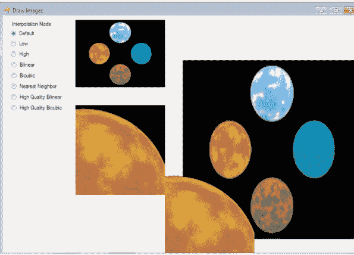

图 17.7

你有许多强大的图像渲染方法可供使用。

## 绘制透明图像

**场景/问题：** 你想绘制一个带有“洞”的图像，让背景能够透出来。

解决方案：注意图 17.7，其中一张图像在绘制时没有黑色背景，允许你看到它后面的其他图像。这是通过透明键实现的。

```csharp
// 绘制某些子区域并将黑色解释为透明
ImageAttributes imageAttributes = new ImageAttributes();
imageAttributes.SetColorKey(Color.Black, Color.Black, ColorAdjustType.Bitmap);
destRect.Offset(200, 150);
e.Graphics.DrawImage(largeImage, destRect, sourceRect.X, sourceRect.Y, sourceRect.Width, sourceRect.Height, GraphicsUnit.Pixel, imageAttributes);
```

## 绘制到离屏缓冲区

场景/问题：你想将 GDI+ 原形绘制到位图中，以便稍后显示、打印、保存或复制。

解决方案：此示例代码同时渲染到屏幕和位图，以便放置在剪贴板上：

```csharp
protected override void OnPaint(PaintEventArgs e)
{
    base.OnPaint(e);

    Render(e.Graphics);
}

// 可以带入 Graphics 对象调用
private void Render(Graphics graphics)
{
    graphics.FillEllipse(Brushes.Red, 10, 10, 100, 50);
}

private void button1_Click(object sender, EventArgs e)
{
    using (Bitmap bitmap =
        new Bitmap(ClientSize.Width, ClientSize.Height))
    using (Graphics graphics = Graphics.FromImage(bitmap))
    {
        Render(graphics);
        Clipboard.SetImage(bitmap);
    }
}
```

## 直接访问位图像素以提高性能

参考本章项目中的 `DrawToBitmap` 示例获取完整示例。

> 注意：在某些应用程序中，你会发现需要渲染多种类型的设备。在这种情况下，你应该将执行实际绘制的代码提取出来，以便独立于实际输出设备进行调用。

## 直接访问位图像素以提高性能

场景/问题：你需要操作位图图像中的单个像素。

解决方案：`Bitmap` 类提供了方便的 `GetPixel()` 和 `SetPixel()` 方法，它们对于小更改是足够的，但如果你需要对位图像素进行大规模转换，则需要直接访问数据。

此示例显示了如何通过复制到新图像并减半亮度来操作图像像素：

```csharp
// pictureBoxSource 是一个包含图像资源的 PictureControl
Bitmap sourceImg = new Bitmap(pictureBoxSource.Width, pictureBoxSource.Height);
Bitmap destImg = new Bitmap(sourceImg.Width, sourceImg.Height);
```

```csharp
{
  return base.DoubleBuffered;
}
set{
  base.DoubleBuffered = value;
}
...
}
```

绘图行为的差异是非常巨大的，如果你运行 `FlickerFree` 示例代码就能看到这一点。

> **注意** 我在使用内置的 `DoubleBuffered` 功能时取得了非常好的效果，如果出于某些原因你想控制这一过程，你始终可以使用本节较之前“绘制到离屏缓冲区”中描述的技术自己实现它。

## 调整图像大小

**场景/问题：** 你需要调整图像的大小。

**解决方案：** 通过结合前面节中关于绘制图像和向位图绘图的信息，你可以轻松地调整图像大小。

```csharp
Bitmap resizedBmp = null;
try{
  Image image = Image.FromFile(args[0]);
  resizedBmp = new Bitmap(image, new Size(100, 100));
  resizedBmp.Save("C:\NewImage.bmp", image.RawFormat);
}finally{
  if (resizedBmp!=null){
    resizedBmp.Dispose();
  }
}
```

## 创建图像缩略图

> **注意** 有许多调整图像大小的算法，如果你想要得到 `Bitmap` 默认行为以外的结果，你必须通过直接操作位图来自己实现算法。

**场景/问题：** 你想快速生成图像的缩略图，可能是异步的（例如用于网页）。缩略图不需要像调整大小后的图像那样高质量。

**解决方案：** 使用 `Image` 的 `GetThumbnailImage` 方法。

此示例代码根据给定的最大尺寸计算出正确的比例尺寸应该是：

```csharp
static void Main(string[] args)
{
    /* 解析参数 ... */
    int maxSize = 100;
    string outputFile = @"C:\output_thumb.bmp";
    try
    {
        Image image = Image.FromFile(args[0]);

        Size size = CalculateThumbnailSize(image.Size, maxSize);

        Image thumbnail = image.GetThumbnailImage(
            size.Width, size.Height,
            ThumbnailAbortCallback, IntPtr.Zero);
        thumbnail.Save(outputFile);
    }
    catch (OutOfMemoryException ex)
    {
        Console.WriteLine(ex);
    }
    catch (FileNotFoundException ex)
    {
        Console.WriteLine(ex);
    }
}
```

```csharp
// 由图像处理器调用，以判断是否应该停止调整大小
// 对于大图像可能有用
private static bool ThumbnailAbortCallback()
{
  return false;
}
```

```csharp
// 获取结果图像的比例尺寸
// 基于用户传入的 maxSize
private static Size CalculateThumbSize(Size size, int maxSize)
```

```csharp
if (size.Width > size.Height) {
  return new Size(maxSize, -(int)((double)size.Height / (double)size.Width) * maxSize);
} else {
  return new Size(-(int)((double)size.Width / (double)size.Height) * maxSize, maxSize);
}
```

## 多屏幕截屏

| 场景/问题 | 你需要在多显示器环境中捕获所有屏幕的内容。（截图是许多日志系统的重要部分——无论是合法的还是非法的！——以及文件夹保存器。） |
| :--- | :--- |
| **解决方案** | .NET 处理多屏幕截屏的任务非常容易。你需要确定每个屏幕的边界，并告诉 `Graphics` 对象从这些边界复制像素。 |

```csharp
Image _image = null;
private void buttonCapture_Click(object sender, EventArgs e) {
  this.Visible = false;
  // 等待窗口隐藏，这样就不会在屏幕截屏中
  // 看到自己的窗口
  Thread.Sleep(500);
  _image = CaptureScreen();
  this.Visible = true;
}
```

```csharp
private Image CaptureScreen()
{
    // 合并所有屏幕的边界
    Rectangle bounds = GetScreenBounds();

    Bitmap bitmap = new Bitmap(bounds.Width, bounds.Height);
    using (Graphics graphics = Graphics.FromImage(bitmap))
    {
        graphics.CopyFromScreen(bounds.Location, new Point(0, 0), bounds.Size);
    }
    return bitmap;
}
```

```csharp
private Rectangle GetScreenBounds()
{
    Rectangle rect = new Rectangle();
    foreach (Screen screen in Screen.AllScreens)
    {
        rect = Rectangle.Union(rect, screen.Bounds);
    }
    return rect;
}
```

图 17.9 显示了截屏前的 `ScreenCapture` 工具程序。


# 第 17 章 使用 Windows Forms 和 GDI+ 绘图

## 图 17.9
在点击捕捉之前的简单屏幕截屏应用程序视图。

## 图 17.10
生成的图像。注意，工具程序是不可见的，因为我们在截屏之前隐藏了它。

## 获取鼠标到点的距离

**场景/问题：** 你需要鼠标到点的距离。

**解决方案：** 这是勾股定理的简单应用。

```csharp
int dx = location.X - center.X;
int dy = location.Y - center.Y;
double distance = Math.Sqrt(dx * dx + dy * dy);
```

> **注意** 看着圆的公式，你可能想在左侧调用 `Math.Sqrt()`（从而变为勾股定理）而不是平方。然而，乘法更快。

## 判断点是否在矩形内

**场景/问题：** 你需要判断用户是否点击了矩形。

**解决方案：** `Rectangle` 结构体提供了一个方法，非常简单：

```csharp
class MyRectangle
{
    private int _left, _top, _width, _height;

    public bool Contains(Point location)
    {
        return location.X >= _left && location.X <= _left + _width &&
               location.Y >= _top && location.Y <= _top + _height;
    }
}
```

## 判断点是否在圆内

**场景/问题：** 你需要判断用户是否点击了圆。

**解决方案：** 与矩形测试相似，但它使用了平方：

```csharp
class MyCircle
{
    private Point _center;
    private int _radius;

    public bool Contains(Point location)
    {
        int dx = location.X - _center.X;
        int dy = location.Y - _center.Y;
        return (dx * dx + dy * dy) <= (_radius * _radius);
    }
}
```

## 判断点是否在椭圆内

**场景/问题：** 你需要判断用户是否点击了椭圆。

**解决方案：** 与圆的测试相似，但它使用了更通用的公式：

```csharp
class MyEllipse
{
    private Point _center;
    private int _xRadius;
    private int _yRadius;

    public bool Contains(Point location)
    {
        if (_xRadius <= 0 || _yRadius <= 0)
            return false;
        int dx = location.X - _center.X;
        int dy = location.Y - _center.Y;

        return ((double)dx * dx) / (_xRadius * _xRadius) + ((double)dy * dy) / (_yRadius * _yRadius) <= 1.0;
    }
}
```

# 打印与打印预览

**场景/问题：** 你需要从你的应用程序中打印内容。

**解决方案：** 在 .NET 中打印与在屏幕上显示相似。这里是一个使用 `Process` 对象数组作为数据源进行打印的示例。

我们首先派生自 `PrintDocument`：

```csharp
class ProcessPrintDocument : PrintDocument
{
    private Font _pageHeaderFont, _rowHeaderFont, _rowTextFont;
    float _pageHeaderHeight, _rowHeaderHeight, _rowHeight;

    bool _disposed = false;

    int _currentPage = 0;
    int _currentRow = 0;

    const int ColumnWidth = 150;

    private IList<Process> _processes;

    public ProcessPrintDocument(IList<Process> processes)
    {
        _processes = processes;

        _pageHeaderFont = new Font("Arial", 14.0f);
        _rowHeaderFont = new Font("Arial", 10.0f,
            FontStyle.Bold | FontStyle.Underline);
        _rowTextFont = new Font("Verdana", 10.0f);
    }

    protected override void Dispose(bool disposing)
    {
        if (!_disposed)
        {
            if (disposing)
            {
                _pageHeaderFont.Dispose();
                _rowHeaderFont.Dispose();
                _rowTextFont.Dispose();
            }
            base.Dispose(disposing);
            _disposed = true;
        }
    }

    protected override void OnBeginPrint(PrintEventArgs e)
    {
        base.OnBeginPrint(e);
        // 执行任何初始设置
    }

    protected override void OnEndPrint(PrintEventArgs e)
    {
        base.OnEndPrint(e);
        // 执行任何初始结束工作
    }

    protected override void OnPrintPage(PrintPageEventArgs e)
    {
        base.OnPrintPage(e);

        _pageHeaderHeight = e.Graphics.MeasureString("A", _pageHeaderFont).Height;
        _rowHeaderHeight = e.Graphics.MeasureString("A", _rowHeaderFont).Height;
        _rowHeight = e.Graphics.MeasureString("A", _rowTextFont).Height;

        _currentPage++;

        PrintPageHeader(e);

        PrintContent(e);

        PrintPageFooter(e);

        // 这很重要！如果你不设置此项，
        // 将无法获得页面。
        // 同样重要的是，要在某处将其设置为 false，
        // 否则你将无限打印下去！
        e.HasMorePages = (_currentRow < _processes.Count - 1);
    }

    private void PrintPageHeader(PrintPageEventArgs e)
    {
        // 找到我们应该在何处打印页头
        Rectangle headerRect = new Rectangle(e.PageBounds.Left,
            e.PageBounds.Top,
            e.PageBounds.Right - e.PageBounds.Left,
            e.MarginBounds.Top - e.PageBounds.Top);
        if (headerRect.Height < 50)
        {
            headerRect.Height = 50;
        }
        StringFormat headerFormat = new StringFormat();
        headerFormat.LineAlignment = StringAlignment.Center;
        headerFormat.Alignment = StringAlignment.Center;

        string headerText = string.Format("Processes - page {0}",
            _currentPage);
        e.Graphics.DrawString(headerText,
            _pageHeaderFont,
            Brushes.Black,
            headerRect, headerFormat);
    }

    private void PrintPageFooter(PrintPageEventArgs e)
    {
        // 让我们画一个图像，仅仅因为我们可以这样做
        Point location = new Point(e.MarginBounds.Left,
            e.MarginBounds.Bottom);
        int height = e.PageBounds.Bottom - e.MarginBounds.Bottom;
        RectangleF rect = new RectangleF(location,
            new Size(e.MarginBounds.Width, height));
        // 向你的项目资源添加一个名为 SampleImage 的图像
        e.Graphics.DrawImage(Properties.Resources.SampleImage, rect);
    }

    private void PrintContent(PrintPageEventArgs e)
    {
        PointF currentLoc = new Point(e.MarginBounds.Left,
            e.MarginBounds.Top);

        PrintRowHeader(e, ref currentLoc);
        bool lastRow = false, lastRowOnPage = false;
        while (!lastRow && !lastRowOnPage)
        {
            currentLoc.Y += _rowHeight;
            currentLoc.X = e.MarginBounds.Left;
            lastRow = (_currentRow == _processes.Count - 1);

            lastRowOnPage =
            (currentLoc.Y + _rowHeight > e.MarginBounds.Bottom);
            if (currentLoc.Y + _rowHeight < e.MarginBounds.Bottom)
            {
                PrintRow(e, _currentRow, ref currentLoc);
                _currentRow++;
            }
        }
    }

    private void PrintRowHeader(PrintPageEventArgs e, ref PointF currentLoc)
    {
        string[] columnHeaders = { "Process", "PID",
            "Working Set", "Base Priority" };

        foreach (string header in columnHeaders)
        {
            RectangleF rect = new RectangleF(currentLoc.X, currentLoc.Y,
                ColumnWidth, _rowHeight);
            e.Graphics.DrawString(header,
                _rowHeaderFont,
                Brushes.Black,
                rect);
            currentLoc.X += ColumnWidth;
        }
    }
}
```

# 第 18 章 基于 WPF 的文本编辑器

本节及后续章节将构建一个基于 WPF 的简单文本编辑器，包含菜单、工具栏、状态栏和命令。

## 选择布局方法

> **场景/问题：** 你需要在窗口中定位控件。

**解决方案：** WPF 的核心在于自动布局。你很少需要手动定位 UI 元素。这使得处理动态内容和国际化变得更加容易，例如，WPF 为你提供了许多布局控件，你很少需要自己构建这些控件。

### 表格 18.1 WPF 布局控件

| 名称 | 描述 |
| :--- | :--- |
| `DockPanel` | 元素可以停靠在四侧的任意一侧，最后一个元素将占据剩余空间。常用于顶层窗口布局。 |
| `Grid` | 每个子元素指定它所在的单元格，包括跨越多个单元格。这是按顺序表格方式布局元素的极佳选择。 |
| `UniformGrid` | 与 `StackPanel` 类似，但每个单元格的大小相同。 |
| `StackPanel` | 按水平或垂直方向顺序排列元素。 |
| `WrapPanel` | 类似于 `StackPanel`，但当到达布局空间结束时会自动换行到开头。 |
| `Canvas` | 允许对元素进行显式定位。这最像旧的处理方式。它允许绝对控制，但没有提供许多其他布局控件的优势。 |

几乎任何界面都可以由这些布局的组合组成。本章中的示例使用了 `Grid`、`StackPanel` 和 `DockPanel`。

## 添加菜单栏

> **场景/问题：** 你需要在 WPF 窗口中添加菜单栏。

**解决方案：** 许多 WPF 示例展示了 3D 能力或高级数据绑定功能，但 WPF 处理标准界面（菜单栏、工具栏、状态栏）同样得容易。在转向更“惊艳”的功能之前，我们先从这里开始。

让我们为空白窗口添加一个简单的菜单定义：

```xml
<Window x:Class="WpfTextEditor.Window"
  xmlns="http://schemas.microsoft.com/winfx/2006/xaml/presentation"
  xmlns:x="http://schemas.microsoft.com/winfx/2006/xaml"
  Title="Wpf Text Editor" Height="300" Width="300"
  xmlns:local="clr-namespace:WpfTextEditor">
  <!-- DockPanel 占据整个窗口 -->
  <DockPanel Name="dockPanel1" VerticalAlignment="Stretch" HorizontalAlignment="Stretch">
    <Menu DockPanel.Dock="Top" Height="Auto">
      <MenuItem Header="_File">
        <MenuItem Header="_Exit" />
      </MenuItem>
      <MenuItem Header="_Edit">
        <MenuItem Header="_Copy" />
        <MenuItem Header="_Cut" />
        <MenuItem Header="_Paste" />
      </MenuItem>
      <MenuItem Header="_View">
        <MenuItem Header="_WordWrap" IsCheckable="True" Name="menuItemWordWrap" />
      </MenuItem>
    </Menu>
    <TextBox AcceptsReturn="True" SpellCheck.IsEnabled="True"
      Name="textBox"
      ScrollBarVisibility="Auto"
      VerticalScrollBarVisibility="Auto">
    </TextBox>
  </DockPanel>
</Window>
```

> **注意** 菜单中某些字母前面的下划线（`_`）。这些表示后面的字符应该是快捷键字符。在 Win32 风格的编程中，你会使用 `&` 符号，但在 XML（XAML 是其衍生语言）中它有特殊含义，因此改用下划线。

这个菜单除了可见之外什么都不做，让我们再添加几个 UI 元素并用命令将它们连接起来。

## 添加状态栏

> **场景/问题：** 你需要在 WPF 窗口底部添加一个状态栏。

**解决方案：** `StatusBar` 可以很容易地停靠在 `DockPanel` 的底部，如下例所示：


```xml
<Window x:Class="WpfEditor.Window1"
  ...
  <DockPanel Name="dockPanel1" VerticalAlignment="Stretch"
             HorizontalAlignment="Stretch">
    <Menu DockPanel.Dock="Top" Height="Auto">
      ...
    </Menu>
    <StatusBar DockPanel.Dock="Bottom">
      <TextBlock Text="{Binding ElementName=textBox, Path=Text.Length}" />
    </StatusBar>
  </DockPanel>
</Window>
```

`StatusBar` 包含一个 `TextBlock`，它绑定到 `TextBox` 的 `Text.Length` 属性。数据绑定将在本章稍后部分讨论。

> WPF 的强大之处之一在于它不以任何方式与 Win32 绑定，你在布局上有很大的自由度。如果你愿意，可以让你的 `StatusBar` 包含按钮、菜单或自定义控件。布局系统是完全灵活的。你可以在按钮中嵌入文本框，在复选框中嵌入电影（如果你想做这种奇事的话），以及许多其他可能。

## 添加工具栏

> 场景/问题：你想为 WPF 窗口添加工具栏。

解决方案：工具栏的理念与 Windows Forms 相同，但它具有所有 WPF 控件固有的灵活性：

```xml
<Window x:Class="WpfTextEditor.Window1">

<DockPanel Name="dockPanel1" VerticalAlignment="Stretch"
    HorizontalAlignment="Stretch">
  <Menu DockPanel.Dock="Top" Height="Auto">
  </Menu>
  <ToolBarTray DockPanel.Dock="Top">
    <Toolbar>
      <Button>
        <Image Source="Resources\Copy.png" Opacity="1" />
      </Button>
      </Toolbar>
  </ToolBarTray>
  <StatusBar DockPanel.Dock="Bottom">
    <TextBlock Text="{Binding ElementName=textBox, Path=Text.Length}" />
  </StatusBar>
</DockPanel>
</Window>
```

工具栏停靠在顶部，因为排在菜单之后，所以它会出现在菜单正。

通过以下 XAML 将它们连接起来：

```xml
<Window x:Class="WpfTextEditor.Window1">
  ..>
  <DockPanel Name="dockPanel1" VerticalAlignment="Stretch"
               HorizontalAlignment="Stretch">
    <Menu DockPanel.Dock="Top" Height="Auto">
      <MenuItem Header="_文件">
        <MenuItem Header="local:WpfTextEditorCommands.ExitCommand" />
      </MenuItem>
      ..>
    <MenuItem Header="_视图">
      <MenuItem Header="_换行" IsCheckable="True"
                 Name="menuItemWordWrap"
                 Command="local:WpfTextEditorCommands.WordWrapCommand" />
      </MenuItem>
    </Menu>
    <ToolBar DockPanel.Dock="Top">
      <ToolBar>
        ..>
        <CheckBox IsChecked="{Binding Mode=TwoWay,
                                            ElementName=menuItemWordWrap,
                                            Path=IsChecked}"
                  Command="local:WpfTextEditorCommands.WordWrapCommand">
          <Image Source="/Resources\Wordwrap.png"
                OpacityMask="White" />
        </CheckBox>
      </ToolBar>
    </ToolBar>
    ..>
  </DockPanel>
</Window>
```

我们几乎完成的应用程序如图 18.1 所示，实现起来只需要少量努力，但展示了 WPF 的一些强大技术，例如数据绑定和命令。

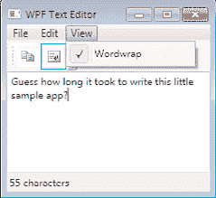

图 18.1

几乎完成的应用程序。

## 启用和禁用命令

> **场景/问题：** 你需要根据应用程序的状态，选择性地启用和禁用命令。

解决方案：为了完成这个基础编辑器，让我们为它添加一个“微妙”的功能：如果输入了文本，则禁用退出命令（见图 18.2）。

```csharp
public partial class Window1 : Window
{
    public Window1()
    {
        InitializeComponent();

        // 为我们的自定义命令设置处理器
        CommandBinding cmdBindingExit =
            new CommandBinding(WpfEditorCommands.ExitCommand);
        cmdBindingExit.Executed += new ExecutedRoutedEventHandler(cmdBindingExit_Executed);
        cmdBindingExit.CanExecute += new CanExecuteRoutedEventHandler(cmdBindingExit_CanExecute);

        //...
    }
}

void cmdBindingExit_CanExecute(object sender, CanExecuteRoutedEventArgs e)
{
    e.CanExecute = TextBox.Text.Length == 0;
}
```

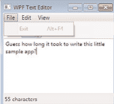

图 18.2

禁用命令会自动使菜单项变灰并禁用工具栏按钮。

## 展开和折叠一组控件

> **场景/问题：** 你有一组控件，希望它们在不使用时可以被折叠。

解决方案：`Expander`（折叠器）与 `GroupBox` 类似，它允许在公共标题下对相关元素分组。然而，`Expander` 还允许你折叠该组以节省 UI 空间。

以下是 ImageView 示例应用程序中的 `Expander` 元素之一（见图 18.3）：

```xml
<Expander Header="图像信息" IsExpanded="True" x:Name="imageInfoGroup">
  <Grid Dock="DockPanel.Dock=Left">
    <Grid.ColumnDefinitions>
      <ColumnDefinition/>
    </Grid.ColumnDefinitions>
    <Grid.RowDefinitions>
      <RowDefinition/>
      <RowDefinition/>
      <RowDefinition/>
    </Grid.RowDefinitions>
    <Label Grid.Row="0" Grid.Column="0">文件名</Label>
    <TextBox IsReadOnly="True" Grid.Row="0" Grid.Column="1" Text="{Binding Path=FileName, Mode=OneWay}"/>
    <Label Grid.Row="1" Grid.Column="0">宽度</Label>
    <TextBox IsReadOnly="True" Grid.Row="1" Grid.Column="1" Text="{Binding Path=Width, Mode=OneWay, Converter={StaticResource formattingConverter}, ConverterParameter={0:N0}"/>
    <Label Grid.Row="2" Grid.Column="0">高度</Label>
    <TextBox IsReadOnly="True" Grid.Row="2" Grid.Column="1" Text="{Binding Path=Height, Mode=OneWay, Converter={StaticResource formattingConverter}, ConverterParameter={0:N0}}"/>
  </Grid>
</Expander>
```

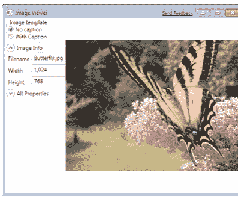

图 18.3 `Expander` 元素允许你轻松地分组和隐藏相关元素。

## 响应事件

> **场景/问题：** 你需要响应 WPF 事件

解决方案：上面的示例定义了两个 `RadioButton`（单选按钮）。`Button` 类有一个 `Checked` 事件。要在 XAML 中分配事件处理器，你只需将函数名分配给该事件：

```xml
<RadioButton Content="无标题" IsChecked="True" Checked="OnTemplateChecked" Name="NoCaption" Style="Normal" />
<RadioButton Content="有标题" IsChecked="False" Checked="OnTemplateChecked" Name="WithCaption" />
```

事件处理程序的写法与标准 .NET 中的类似：

```csharp
private void OnTemplateChecked(object sender, RoutedEventArgs e)
{
    /* */
}
```

## 样式与功能

> **注意：** WPF 使用路由事件（`RoutedEvents`）。

解决方案：WPF 元素使用路由事件，因为它们在样式中包含许多功能。路由事件有几种形式：直接（`Direct`）、冒泡（`Bubbling`）和隧道（`Tunneling`）。

直接事件类似于 .NET 事件。冒泡事件从元素开始向父级元素冒泡。隧道事件从根元素开始向下传播。

> **场景/问题：** 你想将外观与功能分开。

解决方案：WPF 引入了在样式中将外观分开的概念。你可以在样式资源文件中定义它们。

```xml
<Window x:Class="ImageView.Window">
  <Window.Resources>
    <Style TargetType="Label">
      <Setter Property="FontSize" Value="12.0" />
    </Style>
  </Window.Resources>
</Window>
```

## 使用触发器在运行时更改样式。

> **注意：** 因为该样式指定了 `TargetType` 但没有指定名称，它会应用于所有 `Label`。你也可以为样式命名为 `Key="MyStyle"`，并将其应用到特定的 `Style="StaticResource MyStyle"`。

解决方案：我们在之前的示例中已经有了一些简单的绑定。触发器是响应用户输入或事件发生时导致样式发生改变的强大工具（见图 18.4）。

```xml
<Window x:Class="ImageView.Window">
  <Window.Resources>
    <Style TargetType="Label">
      <Setter Property="FontSize" Value="12.0" />
      <Style.Triggers>
        <Trigger Property="IsMouseOver" Value="True">
          <Setter Property="FontWeight" Value="Bold" />
          <Setter Property="FontSize" Value="14.0" />
          <Setter Property="Background" Value="LightBlue" />
        </Trigger>
      </Style.Triggers>
    </Style>
  </Window.Resources>
</Window>
```


## 将控件属性绑定到另一个对象

列表 18.1 和 18.2 展示了带有数据绑定的拖放图像查看器。每当图像拖入应用程序时，都会创建一个新的 `ImageInfoViewModel` 并赋值给窗口的 `DataContext` 属性。视图模型抽象了实际模型（图像），并提供了一个用于 UI 数据绑定的简单类。有关视图模型和此处设计模式的更多信息，请参阅第 25 章“应用程序模式与技巧”。

## 列表 18.1 ImageInfoViewModel.cs (续)

```csharp
{
    return Path.GetFileName(_image.UriSource.LocalPath);
}
public int Width
{
    get
    {
        return (int)_image.PixelWidth;
    }
}
public int Height
{
    get
    {
        return (int)_image.PixelHeight;
    }
}
public ICollection<KeyValuePair<string, object>> AllProperties
{
    get
    {
        return CreateProperties();
    }
}
public ImageInfoViewModel(BitmapImage image)
{
    _image = image;
}
private IDictionary<string, object> CreateProperties()
{
    Dictionary<string, object> properties = new Dictionary<string, object>();
    properties["Width"] = _image.PixelWidth;
    properties["Height"] = _image.PixelHeight;
    properties["DPIX"] = _image.DPIX;
    properties["DPIY"] = _image.DPIY;
    properties["BitsPerPixel"] = _image.Format.BitsPerPixel;
    properties["Format"] = _image.Format.ToString();
    return properties;
}
```

## 将控件属性绑定到另一个对象

## 列表 18.2 Window1.xaml.cs


```csharp
using System;
using System.Collections.Generic;
using System.Linq;
using System.Text;
using System.Windows;
using System.Windows.Controls;
using System.Windows.Data;
using System.Windows.Documents;
using System.Windows.Input;
using System.Windows.Media;
using System.Windows.Media.Imaging;
using System.Windows.Navigation;
using System.Windows.Shapes;
using System.Windows.Media.Animation;

namespace ImageViewer
{
    /// <summary>
    /// Window1.xaml 的交互逻辑
    /// </summary>
    public partial class Window1 : Window
    {
        private static DependencyProperty ImageInfoProperty;
        static Window1()
        {
            ImageInfoProperty = DependencyProperty.Register("ImageInfo",
                typeof(ImageViewModel), typeof(Window1));
        }

        public ImageInfoViewModel ImageInfo
        {
            get
            {
                return (ImageViewModel)GetValue(ImageInfoProperty);
            }
            set
            {
                SetValue(ImageInfoProperty, value);
                // 设置上下文以便数据绑定生效
                DataContext = value;
            }
        }

        public Window1()
        {
            InitializeComponent();
        }

        protected override void OnDragEnter(DragEventArgs e)
        {
            base.OnDragEnter(e);

            // 这是一个文件列表吗？
            if (e.Data.GetDataPresent(DataFormats.FileDrop))
            {
                e.Effects = DragDropEffects.Copy;
            }
            else
            {
                e.Effects = DragDropEffects.None;
            }
        }

        protected override void OnDrop(DragEventArgs e)
        {
            base.OnDrop(e);
            if (e.Data.GetDataPresent(DataFormats.FileDrop))
            {
                foreach (string path in (string[])e.Data.GetData(DataFormats.FileDrop))
                {
                    // 获取第一张图像
                    try
                    {
                        BitmapImage image =
                            new BitmapImage(new Uri(path));
                        ImageInfoModel model =
                            new ImageInfoModel(image);
                        this.ImageInfo = model;
                    }
                    catch (Exception)
                    {
                    }
                }
            }
        }
    }
}
```

## 列表 18.2 Window1.xaml.cs (续)

## 在数据绑定期间将值转换为不同的类型

以下是将元素绑定到 `ImageInfoViewModel` 对象的 XAML 部分：

```xml
<Expander Header="Image Info" IsExpanded="True" x:Name="imageInfoGroup">
  <Grid DockPanel.Dock="Left">
    <Grid.ColumnDefinitions>
      <ColumnDefinition/>
      <ColumnDefinition/>
    </Grid.ColumnDefinitions>
    <Grid.RowDefinitions>
      <RowDefinition/>
      <RowDefinition/>
      <RowDefinition/>
    </Grid.RowDefinitions>
    <Label Grid.Row="0" Grid.Column="0">Filename</Label>
    <TextBox IsReadOnly="True" Grid.Row="0" Grid.Column="1"
      Text="{Binding Path=FileName, Mode=OneWay}"/>
    <Label Grid.Row="1" Grid.Column="0">Width</Label>
    <TextBox IsReadOnly="True" Grid.Row="1" Grid.Column="1"
      Text="{Binding Path=Width, Mode=OneWay}"/>
    <Label Grid.Row="2" Grid.Column="0">Height</Label>
    <TextBox IsReadOnly="True" Grid.Row="2" Grid.Column="1"
      Text="{Binding Path=Height, Mode=OneWay}"/>
  </Grid>
</Expander>
```

每当你将图像拖入 ImageViewer 应用程序时，当 `ImageInfo` 属性被设置时，UI 将自动更新该图像的信息。

## 在数据绑定期间对值格式化

| 场景/问题：你需要对绑定的值添加格式化 |
| :--- |

| **解决方案：** 从 .NET 3.5 SP1 开始，你可以使用 `StringFormat` 属性。 |

```xml
<TextBox IsReadOnly="True" Grid.Row="1" Grid.Column="1"
  Text="{Binding Path=Width, Mode=OneWay, StringFormat={0:C}}"/>
```

## 在数据绑定期间将值转换为不同的类型

| 场景/问题：你想将一种类型转换为另一种类型。 |
| :--- |

| **解决方案：** 定义一个派自 `IValueConverter` 的类并实现这两个方法： |

```csharp
class FilenameToColor : IValueConverter
{
    public object Convert(object value, Type target, object parameter, CultureInfo culture)
    {
        if (string.IsNullOrEmpty(value as string))
        {
            return Brushes.Red;
        }
        else
        {
            return Brushes.Green;
        }
    }

    public object ConvertBack(object value, Type target, object parameter, CultureInfo culture)
    {
        throw new NotImplementedException();
    }
}
```

在你的 XAML 中指定转换器，以便文件名为空时背景变为红色：

```xml
<Window x:Class="ImageView.MainWindow"
    xmlns="http://schemas.microsoft.com/winfx/2006/xaml/presentation"
    xmlns:x="http://schemas.microsoft.com/winfx/2006/xaml"
    xmlns:local="clr-namespace:ImageView"
    Title="Image Viewer" Height="426" Width="537">
    <Window.Resources>
        <local:FilenameToColor x:Key="fileConverter"/>
    </Window.Resources>
```

## 绑定集合

- **场景/问题：** 某些元素显示集合。你想将其绑定到数据源。

- **解决方案：** 绑定集合非常简单。你可以这样声明 XAML：

```xml
<Expander Header="All Properties" IsExpanded="False">
<ListBox x:Name="AllPropertiesGroup"
  ItemsSource="{Binding Path=AllProperties}"/>
</Expander>
```

然而，由于 WPF 不知道如何显示项目，它将调用每个项的 `ToString()`。要自定义显示方式，你需要定义数据模板，这将在下一节介绍。

## 指定绑定数据的方式

- **场景/问题：** 你想根据一个或多个模板设置控件的外观并在运行时更改它们。

- **解决方案：** 如果你仔细观察图 18.3 和 18.4，你会发现在图像下方显示了标题，而前者没有。这是通过控件模板实现的。

这两个控件模板像往常一样定义在资源中：

```xml
<Window.Resources>
<ControlTemplate x:Key="imageTemplate"
  TargetType="{x:Type ContentControl}"
  x:Name="imageControlTemplate">
  <Image Source="{Binding Path=Image}" />
</ControlTemplate>
<ControlTemplate x:Key="imageWithCaptionTemplate"
  TargetType="{x:Type ContentControl}">
  <Grid>
    <Grid.RowDefinitions>
      <RowDefinition Height="*" />
      <RowDefinition Height="Auto" />
    </Grid.RowDefinitions>
    <Image Source="{Binding Path=Image}" Grid.Row="0" />
    <TextBlock Text="{Binding Path=FileName}"
      HorizontalAlignment="Center"
      FontSize="16" Grid.Row="1" />
  </Grid>
</ControlTemplate>
```

默认模板位于元素的定义中：

```xml
<Window>
  ...
  ...
  <DockPanel>
  ...
    <ContentControl Template="{DynamicResource imageTemplate}" Name="controlDisplay" />
  </DockPanel>
</Window>
```

单选按钮上的事件处理程序（之前讨论过）会导致模板的切换：

```csharp
private void OnTemplateOptionChanged(object sender, RoutedEventArgs args)
{
  if (radioButtonNoCaption != null && controlDisplay != null)
  {
    if (radioButtonNoCaption.IsChecked == true)
    {
      controlDisplay.Template = 
      (ControlTemplate)FindResource("imageTemplate");
    }
    else
    {
      controlDisplay.Template = 
      (ControlTemplate)FindResource("imageWithCaptionTemplate");
    }
  }
}
```

# 动画元素属性

> **场景/问题：你希望随时间更改 UI 属性。**

**解决方案：** 对于 WPF 而言，动画是元素属性随时间的变化。例如，你可以在 5 秒内将按钮的 x 轴从 1 改变到 100。这将产生在该段时间内屏幕上移动按钮的效果。你可以对 WPF 中的任何依赖属性进行动画处理。

ImageView 应用在程序启动时使用单个动画在 5 秒内让左侧面板淡入。图 18.5 显示了该程序淡入到大约一半的状态。

首先，在 Window 的资源中定义带有动画的 storyboard：

```xml
<Window.Resources>
  <Storyboard x:Key="FadeInLeftPanel">
    <!-- Double 指的是属性的类型 -->
    <DoubleAnimation
      Storyboard.TargetName="LeftPanel"
      Storyboard.TargetProperty="Opacity"
      From="0.0" To="1.0" Duration="0:0:5" />
  </Storyboard>
</Window.Resources>
```

一旦定义了动画，你就需要一个触发器来启动：

```xml
<Window>
  <Window.Resources>
    ...
  </Window.Resources>
  <Window.Triggers>
    <EventTrigger RoutedEvent="Window.Loaded">
      <BeginStoryboard Storyboard="{StaticResource FadeInLeftPanel}" />
    </EventTrigger>
  </Window.Triggers>
  ...
</Window>
```

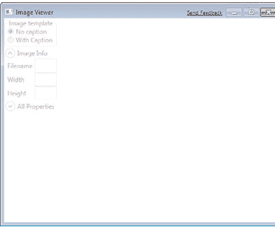

图 18.5

此图片显示了侧边栏在程序启动期间的淡入。

# 渲染 3D 几何形状

> 场景/问题：你想要渲染 3D 几何形状。

**解决方案：** 从本节开始，你将看到 WPF 提供了前所未有的能力，可以将 3D 图形与标准用户界面元素以及多媒体结合。

有效使用 3D 图形需要学习一些摄像、光照、材质和坐标系统的知识。幸运的是，WPF 让这一切大部分都变得非常简单。

这个简单的演示创建了一个带有颜色和光亮的立方体，如图 18.6 所示。

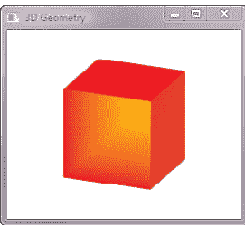

图 18.6

该立方体演示了简单的光照和纹理用法。

首先，需要定义几何形状。对于我们的简单示例，形状将在 `Window.Resources` 部分定义。以下是立方体六个面的定义：


```xml
<Window.Resources>
  <MeshGeometry3D
    x:Key="faceNear"
    Positions="-1,-1,-1 -1,1,1 -1,1,-1"
    TriangleIndices="0 1 2 0 2 3"
    TextureCoordinates="0,1 0,1 1,0 0,0"
    Normals="0,0,1 0,0,1 1,0 0,0" />
  <MeshGeometry3D
    x:Key="faceLeft"
    Positions="-1,-1,-1 -1,-1,1 -1,1,-1"
    TriangleIndices="0 1 2 0 2 3" />
  <MeshGeometry3D
    x:Key="faceRight"
    Positions="-1,-1,-1 1,-1,1 1,1,-1"
    TriangleIndices="0 1 2 0 2 3" />
  <MeshGeometry3D
    x:Key="faceTop"
    Positions="-1,1,1 1,1,1 -1,1,-1"
    TriangleIndices="0 1 2 0 2 3" />
  <MeshGeometry3D
    x:Key="faceBottom"
    Positions="-1,-1,-1 -1,-1,1 1,-1,-1"
    TriangleIndices="0 1 2 0 2 3" />

  <MaterialGroup x:Key="defaultMaterial">
    <DiffuseMaterial Brush="Red" />
    <SpecularMaterial SpecularPower="30" Brush="Yellow" />
  </MaterialGroup>
</Window.Resources>
```

这些网格的实际放置是在 `Viewport3D` 内部完成的：

```xml
<Grid>
  <!-- 3D 元素放在 Viewport3D 内部 -->
  <Viewport3D x:Name="Viewport">
    <!-- 摄像头 -->
    <Viewport3D.Camera>
      <OrthographicCamera
        Width="5"
        Position="4,4,10"
        LookDirection="-0.4,-0.4,-1"
        UpDirection="0,1,0" />
    </Viewport3D.Camera>
```

```xml
<ModelVisual3D>
  <ModelVisual3D.Content>
    <GeometryModel3D
      Geometry="{StaticResource faceNear}"
      Material="{StaticResource defaultMaterial}" />
  </ModelVisual3D.Content>
</ModelVisual3D>
```

```xml
<ModelVisual3D>
  <ModelVisual3D.Content>
    <GeometryModel3D
      Geometry="{StaticResource faceFar}"
      Material="{StaticResource defaultMaterial}" />
  </ModelVisual3D.Content>
</ModelVisual3D>
```

```xml
<ModelVisual3D>
  <ModelVisual3D.Content>
    <GeometryModel3D
      Geometry="{StaticResource faceLeft}"
      Material="{StaticResource defaultMaterial}" />
  </ModelVisual3D.Content>
</ModelVisual3D>
```

```xml
<ModelVisual3D>
  <ModelVisual3D.Content>
    <GeometryModel3D
      Geometry="{StaticResource faceRight}"
      Material="{StaticResource defaultMaterial}" />
  </ModelVisual3D.Content>
</ModelVisual3D>
```

```xml
<ModelVisual3D>
  <ModelVisual3D.Content>
    <GeometryModel3D
      Geometry="{StaticResource faceTop}"
      Material="{StaticResource defaultMaterial}" />
  </ModelVisual3D.Content>
</ModelVisual3D>
```

```xml
<ModelVisual3D>
  <ModelVisual3D.Content>
    <GeometryModel3D
      Geometry="{StaticResource faceBottom}"
      Material="{StaticResource defaultMaterial}" />
  </ModelVisual3D.Content>
</ModelVisual3D>
```

# 在 3D 表面上放置视频

场景/问题：你想要将某些媒体放在 3D 表面上。

**解决方案：** 普通的立方体很棒，但如果其中一个面播放电影（显示图像或任何 WPF 元素）呢？那将非常酷。WPF 让这变得几乎异常简单。

```xml
<Window.Resources>
  <MeshGeometry3D
    x:Key="movieSurface"
    Positions="-1,-1,-1 -1,1,1 -1,1,-1"
    TriangleIndices="0 1 2 0 2 3"
    TextureCoordinates="0,1 0,1 1,0 0,0"
    Normals="0,0,1 0,0,1 1,0,0" />
  <MeshGeometry3D
    x:Key="controlSurface"
    Positions="-1,-1,-1 -1,-1,1 1,1,-1"
    TriangleIndices="0 1 2 0 2 3"
    TextureCoordinates="0,1 0,1 1,0 0,0"
    Normals="1,0,0 1,0,0 1,0,0" />
  <MeshGeometry3D
    x:Key="faceTop"
    Positions="-1,1,1 1,1,1 -1,1,-1"
    TriangleIndices="0 1 2 0 2 3"
    TextureCoordinates="0,1 0,1 1,0 0,0"
    Normals="0,1,0 0,1,0 0,1,0" />
</Window.Resources>

<Window x:Title="Movie and Controls" Height="480" Width="640" Loaded="Window_Loaded"
  xmlns="http://schemas.microsoft.com/winfx/2006/xaml/presentation"
  xmlns:interactive3D="clr-namespace:_3Tools;assembly=3Tools">
  <Grid>
    <!-- 3D 元素放在 Viewport3D 内部 -->
    <Viewport3D x:Name="Viewport">
      <!-- 摄像头 -->
      <Viewport3D.Camera>
        <OrthographicCamera
          Width="5"
          Position="4,4,10"
          LookDirection="-0.4,-0.4,-1"
          UpDirection="0,1,0" />
      </Viewport3D.Camera>

      <ModelVisual3D>
        <ModelVisual3D.Content>
          <GeometryModel3D
            Geometry="{StaticResource movieSurface}">
            <GeometryModel3D.Material>
              <MaterialGroup>
                <DiffuseMaterial Brush="LightBlue" />
                <DiffuseMaterial.Brush>
                  <!-- VisualBrush 可以
                     包含任何 WPF 元素-->
                  <VisualBrush>
                    <VisualBrush.Visual>
                      <MediaElement
                        x:Name="mediaPlayer" LoadedBehavior="Manual" />
                    </VisualBrush.Visual>
                  </VisualBrush>
                </DiffuseMaterial.Brush>
              </MaterialGroup>
            </GeometryModel3D.Material>
          </GeometryModel3D>
        </ModelVisual3D.Content>
      </ModelVisual3D>

      <!-- 光源 -->
      <Viewport3D.Lights>
        <PointLight Color="White" Position="5,10,5" />
        <AmbientLight Color="Gray" />
        <SpotLight Color="White" Position="0,0,3" Direction="0,0,-1" />
      </Viewport3D.Lights>
    </Viewport3D>
  </Grid>
</Window>
```

# 第 18 章 WPF

```xml
</DiffuseMaterial.Brush>
</DiffuseMaterial>
</MaterialGroup>
</GeometryModel3D.Material>
</GeometryModel3D>
</ModelVisual3D.Content>
</ModelVisual3D>
```

```xml
<!-- 灯光 -->
<ModelVisual3D>
  <ModelVisual3D.Content>
    <PointLight Position="5,10,5" Color="White" />
  </ModelVisual3D.Content>
</ModelVisual3D>
```

```xml
<ModelVisual3D>
  <ModelVisual3D.Content>
    <AmbientLight Color="Gray" />
  </ModelVisual3D.Content>
</ModelVisual3D>
```

```xml
<ModelVisual3D>
  <ModelVisual3D.Content>
    <SpotLight Color="White" Position="0,0,0.3" Direction="0,0,-1" />
  </ModelVisual3D.Content>
</ModelVisual3D>
```

```xml
</Viewport3D>
</Grid>
</Window>
```

可以使用如下代码将电影加载到 `MediaElement` 中：

`mediaPlayer.Source = new Uri(filename);`

`mediaPlayer.Play();`

在下一节中，我们将将其连接到一些 3D 控件上。

> 是的，实现这种功能的能力非常酷，但不要做得过头。在 3D 表面上发布电影作为演示的一部分、商店自助机的一部分，或者作为支持性材料或将电影推向前景的动画，可能是合理的，但它可能不是观看整部电影的最佳场景。仅仅因为你能做到某事，并不意味着你应该那样做。

# 在 3D 表面上放置交互控件

> **场景/问题**：你可以使用之前演示的 `VisualBrush` 轻松地将任何 WPF 元素放在 3D 表面上，但那样你无法进行交互。

**解决方案**：为此，微软发布了用于 Windows Presentation Foundation 的 3D Tools，地址位于 http://3dtools.codplex.com/。该包包含了封装 WPF 元素的对象，并将 3D 环境转换为这些元素可以理解的内容。

在例示例中，让我们为我们疯狂的视频播放器添加一些文件选择和播放控件（见图 18.7）。你还需要在项目中添加 `3DTools.dll` 。

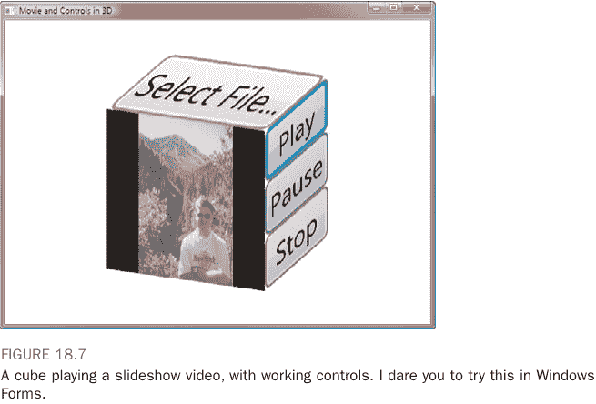

以下是完整代码：

```xml
<Window x:Class="MovieIn3D.Window"
  xmlns="http://schemas.microsoft.com/winfx/2006/xaml/presentation"
  xmlns:x="http://schemas.microsoft.com/winfx/2006/xaml"
  xmlns:interactive="_3DTools;assembly=3DTools"
  title="3D 下的电影和控件"
  Height="480" Width="640" Loaded="Window_Loaded">
  <Resources>
    <MeshGeometry3D
      x:Key="movieSurface"
      Positions="-1,-1,1 -1,1,1 -1,-1,1"
      TriangleIndices="0 1 2 0 3"
      TextureCoordinates="0,1 1,1 1,0 0,0"
      Normals="0,0,1 0,0,1 0,0,1" />
    <MeshGeometry3D
      x:Key="controlSurface"
      Positions="-1,-1,1 -1,-1,-1 1,1,1 -1,1,1"
      TriangleIndices="0 1 2 0 2"
      TextureCoordinates="0,1 1,1 1,0 0,0"
      Normals="1,0,0 1,0,0 1,0,0" />
    <MeshGeometry3D
      x:Key="faceTop"
      Positions="-1,-1,1 1,1,1 -1,-1,1"
      TriangleIndices="0 1 2 0 2"
      TextureCoordinates="0,1 1,1 1,0 0,0" />
  </Window.Resources>
  <Grid>
    <interactive3D:Interactive3DDecorator>
      <Viewport3D x:Name="Viewport">
        <Viewport3D.Camera>
          <OrthographicCamera
            Width="5"
            Position="4,4,10"
            LookDirection="-0.4,-0.4,-1"
            UpDirection="0,1,0" />
        </Viewport3D.Camera>

        <ModelVisual3D>
          <ModelVisual3D.Content>
            Geometry="{StaticResource movieSurface}"
            <Model3D.Material>
              <MaterialGroup>
                <DiffuseMaterial Brush="LightBlue" />
                <DiffuseMaterial>
                  <DiffuseMaterial.Brush>
                    <VisualBrush>
                      <VisualBrush.Visual>
                        <MediaElement x:Name="mediaPlayer" LoadedBehavior="Manual" />
                      </VisualBrush.Visual>
                    </VisualBrush>
                  </DiffuseMaterial.Brush>
                </DiffuseMaterial>
              </MaterialGroup>
            </Model3D.Material>
          </ModelVisual3D.Content>
        </ModelVisual3D>

        <ModelVisual3D>
          <ModelVisual3D.Content>
            Geometry="{StaticResource controlSurface}">
            <interactive3D:Interactive3DDecorator.Visual>
              <StackPanel>
                <Button Content="Play" x:Name="buttonPlay" Click="OnPlay" />
                <Button Content="Pause" x:Name="buttonPause" Click="OnPause" />
              </StackPanel>
            </interactive3D:Interactive3DDecorator.Visual>
          </ModelVisual3D.Content>
        </ModelVisual3D>

        <ModelVisual3D>
          <ModelVisual3D.Content>
            Geometry="{StaticResource faceTop}" />
          </ModelVisual3D.Content>
        </ModelVisual3D>
      </Viewport3D>
    </interactive3D:Interactive3DDecorator>
  </Grid>
</Window>
```

# 第 19 章

## ASP.NET

本章内容

- 查看调试和跟踪信息
- 确定浏览器能力
- 重定向到另一个页面
- 使用表单身份验证进行用户登录
- 使用主页保持外观一致性
- 添加菜单
- 将数据绑定到 `GridView`
- 创建用户控件
- 使用 `Web Parts` 创建灵活的 UI
- 创建简单的 AJAX 页面
- 执行数据验证
- 维护应用程序状态
- 维护 UI 状态
- 在 `Session` 中维护用户数据
- 存储 `Session` 状态
- 使用 `Cookies` 恢复 `Session` 状态
- 使用 ASP.NET 模型-视图-控制器 (MVC)


软件日益成为基于 Web 的方案，ASP.NET 是构建高级应用程序的绝佳平台。通过 ASP.NET，你可以访问整个 .NET Framework 的丰富功能。尽管 ASP.NET 的主题非常庞大，但本章将带你快速上手重要的主题。

## 查看调试和跟踪信息

> **场景/问题：** 你需要调试一个运行不佳的 ASP.NET 应用程序，或者你想在输出中添加自己的跟踪信息。

调试 ASP.NET 应用程序的过程与调试原生客户端应用程序可能非常不同。在开发期间，Visual Studio 的集成调试器为你提供了强大的功能，但一旦应用程序部署，并不总是可以为 Web 应用挂载调试器。此时，调试和跟踪信息变得至关重要。

**解决方案：** ASP.NET 内置支持将大量数据转储到日志中或将其附加到你正在查看的页面底部，以便你轻松查看。接下来的章节演示了你可以使用的几种不同技术。

### 为特定页面启用跟踪

要为特定页面启用跟踪，可以在 .aspx 文件的 `@Page` 元素中添加 `Trace="true"`：

```aspx
<%@Page Language="C#" AutoWireup="true"
CodeInherits="BrowserCapsAndTracing,_Default" Trace="true" %>
```

这将导致 Web 请求的详细信息转储到 Web 页面的末（见图 19.1）。

### 为所有页面启用跟踪

如果你无法修改页面本身，或者想在每个页面上查看跟踪信息，可以修改 `web.config` 来启用所有页面的跟踪：

```xml
<system.web>
  <trace enabled="true" localOnly="true" pageOutput="true"/>
  ...
```

### 记录你自己的跟踪消息

你可以使用 `Trace` 类将你自己的消息写入跟踪日志中：

```csharp
protected void Page_Load(object sender, EventArgs e)
{
    if (IsPostBack)
    {
        Trace.Write("Creating Capabilities Table");
        Table1.Rows.AddRange(
            new TableRow[]
            {
                CreateCapabilityRow("ActiveX",
                Request.Browser.ActiveXControls),
            })
        );
    }
}
```

你可以在图 19.1 的跟踪输出中看到消息“Creating Capabilities Table”。

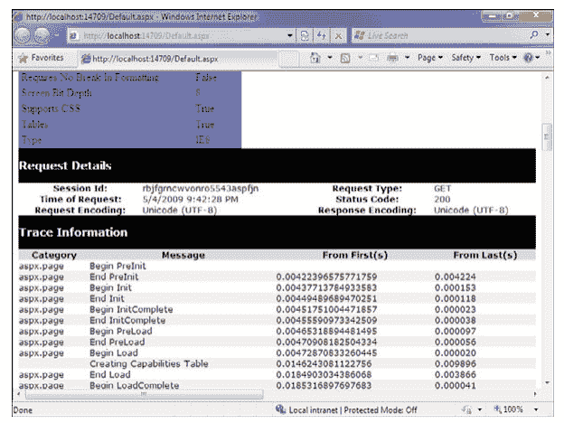

图 19.1

跟踪可以将请求转储到生成页面的末尾。

## 确定 Web 浏览器能力

**场景/问题：** 你需要根据用户使用的浏览器来更改应用程序的行为。

鉴于如今有如此多的平台、不同的浏览器、操作系统和移动设备，Web 能够运行似乎就很了不起。每个 Web 浏览器在渲染、加载插件（如 ActiveX 控件）、JavaScript 引擎等方面都存在差异。

**解决方案：** .NET 提供了一种简单的方法来自动发现这些许多能力，使用了 `Request.Browser` 结构，该结构包含了许多重要属性的布尔值或字符串值。

`CreateCapabilityRow` 只是一个辅助方法，用于创建一个表格行以插入结果，如图 19.2 所示。

```csharp
CreateCapabilityRow("ActiveX", Request.Browser.ActiveXControls),
CreateCapabilityRow("AOL", Request.Browser.AOL),
CreateCapabilityRow("Background Sounds",
Request.Browser.BackgroundSounds),
CreateCapabilityRow("Beta", Request.Browser.Beta),
CreateCapabilityRow("Browser", Request.Browser.Browser);
```

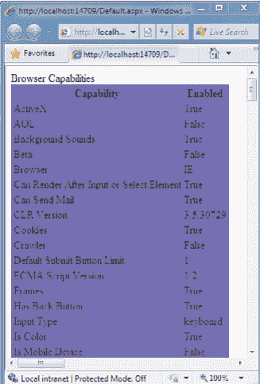

图 19.2

你可以轻松检测到影响你功能的许多浏览器差异。

## 重定向到另一个页面

**场景/问题：** 你需要将用户重定向到另一个页面进行进一步处理。

**解决方案：** 有两种方法将用户发送到另一个页面。第一种使用标准重定向：

```csharp
protected void buttonRedirect_Click(object sender, EventArgs e)
{
    Response.Redirect("TargetPage.aspx");
}
```

这告诉用户的浏览器实际导航到目标页面。

如果你实际上想在不通知用户的情况下，将当前请求的处理转移到相同目录下的另一个页面（即用户的浏览器并不会真的去另一个页面），你可以采取以下操作：

```csharp
protected void buttonSubmit_Click(object sender, EventArgs e)
{
    if (ProcessingChoice.SelectedValue == "Transfer")
    {
        Server.Transfer("TargetPage.aspx");
    }
}
```

从用户的角度来看，URL 并没有改变。

要确切看到它是如何工作的，请看图 19.3。


图 19.3

这种方法显示了如何到另一个页面。

## 使用表单身份验证进行用户登录

**场景/问题：** 你需要在允许用户访问区域之前对其进行身份验证。

**解决方案：** 网站上用户身份验证的常见工作流是在登录页面处进行。这在 ASP.NET 中很容易实现。

首先，你需要创建一个登录页面（参见代码 19.1 和 19.2）。

### LISTING 19.1 LoginForm.aspx

```aspx
<%@ Language="C#" AutoWireup="true"
CodeInherits="AuthDemo.LoginForm" %>
<!DOCTYPE html PUBLIC "-//W3C//DTD HTML 1.0 Transitional//EN" "http://www.w3.org/TR/html1/dtd">
<html xmlns="http://www.w3.org/1999/xhtml">
<head runat="server">
<title>LoginForm</title>
</head>
<body>
<form id="form1" runat="server">
  <div>
    Username:
    <asp:TextBox ID="TextBoxUsername" runat="server" />
    <br />
    Password:
    <asp:TextBox ID="TextBoxPassword" runat="server" />
    <br />
    <asp:Button ID="ButtonStatus" runat="server" Text="Submit" onclick="ButtonStatus_Click" />
    <br />
    <asp:Label ID="LabelStatus" runat="server" Text="Enter login info" />
  </div>
</form>
</body>
</html>
```

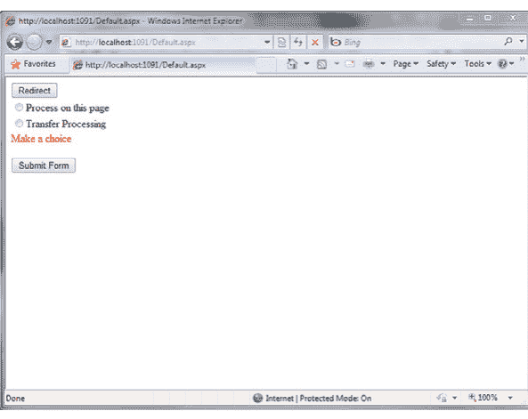

图 19.1

注意 URL 仍然显示为默认。

### LISTING 19.2 LoginForm.aspx.cs

```csharp
using System;
using System.Collections.Generic;
using System.Linq;
using System.Web;
using System.Web.UI;
using System.Web.WebControls;
using System.Web.Security;

namespace AuthDemo
{
    public partial class LoginForm : System.Web.UI.Page
    {
        protected void Page_Load(object sender, EventArgs e)
        {
        }

        protected void ButtonStatus_Click(object sender, EventArgs e)
        {
            if (AuthenticateUser(TextBoxUsername.Text, TextBoxPassword.Text))
            {
                //想保持用户登录？传递 true true
                FormsAuthentication.RedirectFromLoginForm(TextBoxUsername.Text, false);
            }
            else
            {
                LabelStatus.Text = "Oops";
            }
        }

        private bool AuthenticateUser(string username, string password)
        {
            //你可以在此处对数据库或文件进行身份验证
            return username == "user" && password == "pass";
        }
    }
}
```

然后在 `web.config` 的 `<system.web>` 节下添加以下配置信息：

```xml
<authentication mode="Forms">
    <forms name=".ASPAUTH" loginUrl="LoginForm.aspx" />
</authentication>
<!-- 要求此文件夹中的所有页面都需要身份验证-->
<authorization>
    <deny users="?" />
</authorization>
```

此示例中的另一个页面是默认页面，如代码 19.4 所示，它将自动受登录保护。

### LISTING 19.4 Default.aspx

```aspx
<%@ Language="C#" AutoWireup="true"
CodeInherits="AuthDemo.Default" %>
<!DOCTYPE html PUBLIC "-//W3C//DTD HTML 1.0 Transitional//EN" "http://www.w3.org/TR/html1/dtd">
<html xmlns="http://www.w3.org/1999/xhtml">
<head runat="server">
<title>Default</title>
</head>
<body>
<form id="form1" runat="server">
  <div>
    Welcome to the default page!
  </div>
</form>
</body>
</html>
```

### LISTING 19.3 Default.aspx

```aspx
@ Page Language="C#" AutoEventWireup="true"
CodeBehind="Default.aspx.cs"
Inherits="AuthDemo..Default" %>
```

```html
<!DOCTYPE html PUBLIC "-//W3C//DTD HTML 1.0 Transitional//EN"
"http://www.w3.org/TR/xhtml1/DTD/xhtml1-transitional.dtd">

<html xmlns="http://www.w3.org/1999/xhtml">
<head runat="server">
  <title>受保护页面</title>
</head>
<body>
  <form id="form1" runat="server">
    <div>
      恭喜，您已通过身份验证。
    </div>
  </form>
</body>
</html>
```

当用户尝试访问 `Default.aspx` 时，他会被首先重定向到 `Login.aspx`（如图 19.5 所示），在身份验证成功后，返回 `Default.aspx`。

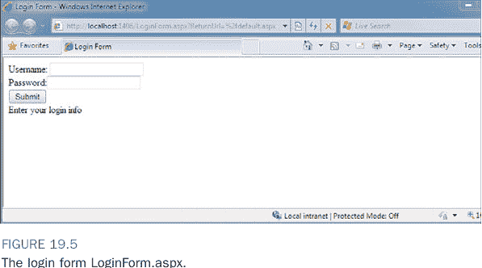

## 使用主页保持外观一致性

**场景/问题：** 你希望你的页面具有一致的、模板化的外观和感受。

**解决方案：** 主页（Master pages）本质上是定义页面整体结构的模板。它们包含了一组页面的公共元素，以及由内容页面填充的内容占位符对象。

列表 19.4 显示了书籍库存应用程序的主页，它是随附源码中的 BooksApp 示例应用程序。

### LISTING 19.4 BooksApp—MasterPage.master

```aspx
<%@ Master Language="C#" AutoEventWireup="true"
CodeBehind="MasterPage.master.cs"
Inherits="BooksApp.MasterPage" %>

<!DOCTYPE html PUBLIC "//W3C//DTD XHTML 1.0 Transitional//EN"
"http://www.w3.org/TR/xhtml1/DTD/xhtml1-transitional.dtd">

<html xmlns="http://www.w3.org/1999/xhtml">
<head runat="server">
<asp:ContentPlaceholder ID="runat" runat="server">
<title>Books App</title>
</asp:ContentPlaceholder>
</head>
<body>
<form id="form1" runat="server">
<div style="position:absolute;top:0px;width:800px;height:50px">
<asp:ContentPlaceholder ID="Header" runat="server">

</asp:ContentPlaceholder>
</div>
<div style="position:absolute;top:100px;left:110px;width:700px">
<asp:ContentPlaceholder ID="MainContent" runat="server">

</asp:ContentPlaceholder>
</div>
</form>
</body>
</html>
```

如你所见，主页与普通的 .aspx 页面非常相似。主页也可以有后台代码（code-behind）。此主页包含三个 `ContentPlaceholder` 对象，分别用于 `<head>` 元素、正文头部和内容部分。注意，`<head>` 占位符包含一个默认的 `<title>` 标签。如果内容页面没有在那里放置自己的内容，则将使用该标签。

列表 19.5 显示了一个填充 `ContentPlaceHolder` 对象的简单内容页面。

### LISTING 19.5 Default.aspx

```aspx
<%@ Page Title="" Language="C#" MasterFile="~/MasterPage.Master"
AutoEventWireup="true" CodeBehind="Default.aspx.cs"
Inherits="Books.App.WebForm1" %>
<asp:Content ID="Content" ContentPlaceHolderID="head" runat="server">
  <title>书籍收藏</title>
</asp:Content>
<asp:Content ID="Content2" ContentPlaceHolderID="Header" runat="server">
  <p align="center">
    书籍收藏</p>
</asp:Content>
<asp:Content ID="Content3" ContentPlaceHolderID="MainContent" runat="server">
  <p>
    使用菜单选择页面</p>
</asp:Content>
```

这组页面将在接下来的章节中详细介绍。

## 添加菜单

**场景/问题：** 你希望为网站导航提供一个菜单。

**解决方案：** 首先为你的项目添加一个名为 `web.sitemap` 的站点地图文件。给它以下内容：


```xml
<?xml version="1.0" encoding="utf-8" ?>
<sitemap xmlns="http://schemas.microsoft.com/Asp/Sitemap-File-1.0">
  <!-- siteMap 下只能有一个 siteMapNode，
  所以我们在创建菜单时忽略它，
  只使用它的控制控件 -->
<siteMapNode url="" title="" description="">
    <siteMapNode url="/Default.aspx" title="首页" description="站点默认页面" />
    <siteMapNode url="/BookList.aspx" title="书籍列表" description="所有书籍列表" />
    <siteMapNode url="/BookDetail.aspx" title="书籍详情" description="一本书的详情" />
</siteMapNode>
</sitemap>
```

这将菜单附加到读取 `web.sitemap` 文件的 `SiteMapDataSource` 上。我们简单的菜单在图 19.6 中可见。


通过向 `web.sitemap` 添加，你可以调整菜单项。

# 将数据绑定到网格

场景/问题：你需要将数据（例如来自数据库）绑定到页面上的网格。

**解决方案**：使用 `GridView` 控件。列表 19.6 显示了显示数据的页面。

## 列表 19.6 BookList.aspx

```csharp
<%@ Page Title="*" Language="C#" MasterFile="~/MasterPage.Master"
AutoEventWireup="true" CodeBehind="BookList.cs"
Inherits="BooksApp.WebForm2" %>
```

```html
<asp:Content ID="Content" ContentPlaceHolderID="head" runat="server">
  <title>书籍</title>
</asp:Content>
<asp:Content ID="Content2" ContentPlaceHolderID="Header" runat="server">
  <p align="center">
    书籍</p>
</asp:Content>
<asp:Content ID="Content3" ContentPlaceHolderID="MainContent" runat="server">
  <asp:GridView ID="ListGrid" runat="server" AutoGenerateColumns="False">
    <Columns>
      <asp:BoundField DataField="Title" HeaderText="标题" />
      <asp:BoundField DataField="Author" HeaderText="作者" />
    </Columns>
  </asp:GridView>
</asp:Content>
```

```csharp
public partial class WebForm2 : System.Web.UI.Page
{
  protected void Load(object sender, EventArgs e)
  {
    if (!IsPostBack)
    {
      // 模拟数据源
      ListGrid.DataSource = ...;
      ListGrid.DataBind();
    }
  }
}
```

图 19.7 显示了带有数据的网格。


# 创建用户控件

场景/问题：你希望将基础 ASP.NET 控件封装成一个可以重复使用的组件（在同一个站点或不同的项目中）。

**解决方案**：ASP.NET 中的用户控件类似于 Windows Forms 和 WPF。它们提供了一种将控件封装进统一界面的方法。

列表 19.7 显示了用于书籍条目的视图。列表 19.8 显示了该控件的代码。

## 列表 19.7 BookEntry.ascx

```html
@ Control Language="C#" AutoEventWireup="true" CodeBehind="BookEntry.ascx.cs" Inherits="BooksApp.BookEntry" %>
<asp:Panel ID="Panel1" runat="server" BorderWidth="1px" Width="265px">
  <asp:Label ID="Label1" runat="server" Text="书籍输入" Font-Bold="True" />
  <asp:Table ID="Table1" runat="server">
    <asp:TableRow>
      <asp:TableCell>
```

```html
列表 19.7 BookEntry.ascx (续上)
<asp:Label ID="Label1" runat="server" Text="ID:" />
</asp:TableCell>
<asp:TableCell>
  <asp:TextBox ID="TextBoxID" runat="server" ReadOnly="True" Columns="5" />
</asp:TableCell>
</asp:TableRow>
<asp:TableRow>
<asp:TableCell>
  <asp:Label ID="Label16" runat="server" Text="标题:" />
</asp:TableCell>
<asp:TableCell>
  <asp:TextBox ID="TextBoxTitle" runat="server" Width="200px" />
</asp:TableCell>
</asp:TableRow>
<asp:TableRow>
<asp:TableCell>
  <asp:Label ID="Label12" runat="server" Text="作者:" />
</asp:TableCell>
<asp:TableCell>
  <asp:TextBox ID="TextBoxAuthor" runat="server" Width="200px" />
</asp:TableCell>
</asp:TableRow>
<asp:TableRow>
<asp:TableCell>
  <asp:Label ID="Label13" runat="server" Text="年份:" />
</asp:TableCell>
<asp:TableCell>
  <asp:TextBox ID="TextBoxPublishYear" runat="server" Width="75px" />
</asp:TableCell>
</asp:TableRow>
</asp:Table>
</asp:Panel>
```

在代码侧，可以定义属性来为使用该控件的人封装功能。

## 列表 19.8 BookEntry.ascx.cs

```csharp
using System;
using System.Collections.Generic;
using System.Linq;
using System.Web;
```

# 416 第 19 章 ASP.NET

## 列表 19.8 BookEntryControl.ascx (续)

```csharp
using System.Web.UI;
using System.Web.UI.WebControls;
```

```csharp
namespace BooksApp
{
    public partial class BookEntryControl : System.Web.UI.UserControl
    {
        public int BookID
        {
            get { return int.Parse(TextBoxID.Text); }
            set { TextBoxID.Text = value.ToString(); }
        }

        public string stringTitle
        {
            get { return TextBoxTitle.Text; }
            set { TextBoxTitle.Text = value; }
        }

        public string stringAuthor
        {
            get { return TextBoxAuthor.Text; }
            set { TextBoxAuthor.Text = value; }
        }

        public int PublishYear
        {
            get { return int.Parse(TextBoxPublishYear.Text); }
            set { TextBoxPublishYear.Text = value.ToString(); }
        }

        public bool IsEditable
        {
            get { return TextBoxID.ReadOnly; }
            set { TextBoxID.ReadOnly = TextBoxTitle.ReadOnly =
                TextBoxAuthor.ReadOnly =
                TextBoxPublishYear.ReadOnly = !value; }
        }

        protected void Page_Load(object sender, EventArgs e)
        {
        }
    }
}
```

要在页面中创建此控件，必须首先对其进行注册，并像其他控件一样将其放置在标记中，如列表 19.9所示。

## 列表 19.9 BookDetail.aspx

```asp
<%@ Page Title="C#" MasterFile="~/MasterPage.Master" AutoEventWireup="true" CodeBehind="BookDetail.aspx.cs" Inherits="BooksApp.BookDetailForm" %>
<%@ Register TagPrefix="how" TagName="BookEntry" Src="~/BookEntryControl.ascx" %>
<asp:Content ID="Content1" PlaceHolderID="head" runat="server">
    <title>书籍详情</title>
</asp:Content>
<asp:Content ID="Content2" PlaceHolderID="Header" runat="server">
    书籍详情
</asp:Content>
<asp:Content ID="Content3" PlaceHolderID="MainContent" runat="server">
    <BookEntry runat="server" ID="bookEntry" IsEditable="false" />
</asp:Content>
```

`@Register` 标签定义了在页面中引用控件的方式。完成此步骤后，使用它的方法与使用任何内置控件相同。

页面的后台代码显示了如何使用控件的属性（参见列表 19.10）。

## 列表 19.10 BookDetail.aspx.cs

```csharp
using System;
using System.Collections.Generic;
using System.Linq;
using System.Web;
using System.Web.UI;
using System.Web.UI.WebControls;
using System.Data;

namespace BooksApp
{
    public partial class BookDetailForm : System.Web.UI.Page
    {
        protected void Page_Load(object sender, EventArgs e)
        {
            string idStr = Request.QueryString("id");
            int id = 1;
            //解析 id 以确保它是一个有效的整数
            if (int.TryParse(idStr, out id))
            {
                // 此处实现逻辑
            }
        }
    }
}
```

## 列表 19.10 BookDetail.aspx.cs (续)

```csharp
// ...现有代码 ...
    DataSet set = BookDataSource.DataSet;
    DataRow[] rows = set.Tables["Books"].Select("ID=" + id.ToString());
    if (rows.Length == 1)
    {
        bookEntry.BookID = id;
        bookEntry.Title = rows[0]["Title"] as string;
        bookEntry.Author = rows[0]["Author"] as string;
        bookEntry.PublishYear = (int)rows[0]["PublishYear"];
    }
}
```

# 使用 Web Parts 创建灵活的 UI

> **场景/问题：** 你想创建一个具有可自定义、可移动的小部件式组件的网站。

如果你曾经去过如 www.msn.com 和 my.yahoo.com 这样的网站，那么你对这些具有可移动、组件化部分的网站非常熟悉（参见图 19.8）。

> **解决方案：** 这类网站具有可移动的组件化布局。使用 ASP.NET 的 Web Parts 功能，可以很容易地为你的应用程序添加此类功能。

定义一个 `WebPartManager` 和一个或多个 `WebPartZones`。在这些区域中，你可以放置任何标准控件或用户控件对象。此外，还有预留的区域用于编辑 Web Part 的外观和内容。

```asp
<%@ Page Language="C#" AutoEventWireup="true" CodeBehind="Default.aspx.cs" Inherits="WebPartsDemo_Default" %>
<%@ Register TagPrefix="part" TagName="QuoteGenerator" Src="~/RandomQuoteControl.ascx" %>
<%@ Register TagPrefix="part" TagName="TimeDisplay" Src="~/TimeDisplayControl.ascx" %>
```


图 19.8 my.yahoo.com 具有用于新闻、时间和图片的可移动、可自定义的小部件。

```html
<!DOCTYPE html PUBLIC "-//W3C//DTD XHTML 1.0 Transitional" "http://www.w3.org/TR/xhtml1/DTD/transitional.dtd">
<html xmlns="http://www.w3.org/1999/xhtml">
<head runat="server">
    <title>Web Parts Demo</title>
</head>
<body>
<form id="form1" runat="server">
    <WebPartManager ID="WebPartManager1" runat="server" />
    <div style="float:left; width:250px;">
        <WebPartZone ID="LeftZone" runat="server"></WebPartZone>
    </div>
    <div style="float:left; width:250px;">
        <WebPartZone ID="CenterZone" runat="server"></WebPartZone>
    </div>
    <div style="float:left; width:250px;">
        <WebPartZone ID="RightZone" runat="server"></WebPartZone>
    </div>
</form>
</body>
</html>
```

上述代码引用了两个用户控件。在 Web Part 环境中，这些控件不需要任何特殊操作，如下所示（其中一个控件）：


<!-- RandomQuoteControl.ascx -->

```aspx
<%@ Control Language="C#" AutoEventWireup="true" CodeBehind="RandomQuoteControl.ascx.cs" Inherits="WebPartsDemo.RandomQuoteControl" %>

<asp:Table ID="Table2" runat="server">
    <asp:TableRow runat="server">
        <asp:TableCell ID="QuoteText" runat="server"></asp:TableCell>
    </asp:TableRow>
    <asp:TableRow runat="server">
        <asp:TableCell ID="QuoteAuthor" runat="server" Font-Italic="True"></asp:TableCell>
    </asp:TableRow>
</asp:Table>
```

后台代码将随机引用加载到表格中：

```csharp
using System;
using System.Collections.Generic;
using System.Linq;
using System.Web;
using System.Web.UI;
using System.Web.UI.Controls;

namespace WebPartsDemo
{
    public partial class RandomQuoteControl : System.Web.UI.UserControl
    {
        private static Random rand = new Random();
        private static string[][] quotes = new string[][] {
            new string[]{"作恶并不意味着富荣。", "维克多·雨果"},
            new string[]{"不被听到不是沉默的理由。", "维克多·雨果"},
            new string[]{"哲学是思想的显微镜。", "维克多·雨果"}
        };

        // 项目中的更多引用
        protected void Page_Load(object sender, EventArgs e)
        {
            string[] quote = quotes[rand.Next(0, quotes.Length)];
            QuoteText.Text = quote[0];
            QuoteAuthor.Text = quote[1];
        }
    }
}
```

## 创建简单的 AJAX 页面

场景/问题：你希望允许富交互，并在 Web 页面之间收发送数据，而无需刷新整个页面。

在过去的几年里，异步 JavaScript 和 XML (AJAX) 已经成为现代网站上定义富交互性（或者说，比纯 HTML 更丰富的交互）的事实标准。AJAX 允许你更新网页的部分内容，而无需强制刷新整个页面（顺便避免页面滚动到顶部）。

解决方案：使用内置的 `UpdatePanel` 控件可以轻松利用 AJAX。放置在 `UpdatePanel` 中的控件将使用你已经熟悉的相同样式，自动异步更新自身。

列表 19.11 和 19.12 中的 AJAX 演示展示了两个示例：一个是对按钮的典型更新，另一个是导致内容定期刷新的定时器。图 19.9 显示了该演示的运行情况。

### 列表 19.11 AJAX 演示—Default.aspx

```aspx
<%@ Page Language="C#" AutoEventWireup="true" CodeBehind="Default.aspx.cs" Inherits="AJAXDemo.Default" %>
<!DOCTYPE html PUBLIC "-//W3C//DTD HTML 1.0 Transitional//EN" "http://www.w3.org/TR/xhtml1/DTD/xhtml1-transitional.dtd">
<html xmlns="http://www.w3.org/1999/xhtml">
<head runat="server">
    <title>AJAX Demo</title>
</head>
<body>
    <form id="form1" runat="server">
        <asp:ScriptManager ID="ScriptManager1" runat="server" />
        <div>
            <asp:UpdatePanel ID="UpdatePanel1" runat="server">
                <ContentTemplate>
                    <asp:TextBox ID="TextBoxValue" runat="server" ReadOnly="True"></asp:TextBox>
                    <br />
                    <asp:Button ID="ButtonIncrement" runat="server" Text="Increment" OnClick="ButtonIncrement_Click" />
                </ContentTemplate>
            </asp:UpdatePanel>

            <asp:UpdatePanel ID="UpdatePanel2" runat="server">
                <ContentTemplate>
                    <asp:Timer ID="Timer1" runat="server" Interval="1000" OnTick="OnTick" />
                    <br />
                    <asp:TextBox ID="TextBoxValue" runat="server" ReadOnly="true" />
                </ContentTemplate>
            </asp:UpdatePanel>
        </div>
    </form>
</body>
</html>
```

### 列表 19.12 AJAX 演示—Default.aspx.cs

```csharp
using System;
using System.Collections.Generic;
using System.Linq;
using System.Web;
using System.Web.UI;
using System.Web.UI.WebControls;

namespace AjaxDemo
{
    public partial class _Default : System.Web.UI.Page
    {
        protected void Page_Load(object sender, EventArgs e)
        {
        }

        protected void ButtonIncrement_Click(object sender, EventArgs e)
        {
            int val = Int32.Parse(TextBoxValue.Text);
            ++val;
            TextBoxValue.Text = val.ToString();
        }

        protected void OnTick(object sender, EventArgs e)
        {
            TextBoxValue.Text = DateTime.Now.ToString("HH:mm:ss");
        }
    }
}
```

## 执行数据验证

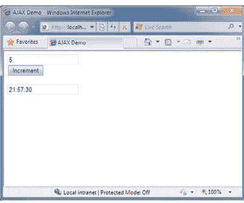

图 19.9：这些字段独立更新，无需重新加载页面。

## 执行数据验证

> 场景/问题：你希望在将用户输入发送到服务器之前对其进行验证。

**解决方案：** 通常情况下，输入和数据验证有两个地方：客户端和服务器端。在客户端，ASP.NET 提供了各种控件，用于自动检查输入是否在特定范围内。在服务器端，ASP.NET 会自动为你运行这些规则。如果你有更复杂的验证方法，可以在服务器上运行。

列表 19.13 和 19.14 中的验证演示展示了某些内置验证器的用法以及一个自定义的服务器端验证器。图 19.10 显示了验证演示的截图。

### 列表 19.13 验证演示—Default.aspx

```aspx
<%@ Page Language="C#" AutoEventWireup="true" CodeBehind="Default.aspx.cs" Inherits="ClientSideValidation_Default" %>
<!DOCTYPE html PUBLIC "-//W3C//DTD HTML 1.0 Transitional//EN" "http://www.w3.org/TR/xhtml1/DTD/xhtml1-transitional.dtd">
<html xmlns="http://www.w3.org/1999/xhtml">
<head runat="server">
    <title>Validation Demo</title>
</head>
<body>
    <form id="form1" runat="server">
        <div>
            Name:
            <br />
            <asp:TextBox ID="TextBoxName" runat="server"></asp:TextBox>
            <asp:RequiredFieldValidator ID="RequiredFieldValidator" runat="server" ErrorMessage="You must enter a name" ControlToValidate="TextBoxName" />
            <br />
            Date:
            <br />
            <asp:TextBox ID="TextBoxDate" runat="server"></asp:TextBox>
            <asp:RegularExpressionValidator ID="RegularExpressionValidator" runat="server" ErrorMessage="Enter a date in MM/DD/YYYY" ControlToValidate="TextBoxDate" ValidationExpression="\d{2}/\d{2}/\d{4}" />
            <br />
            Number 1-10
            <asp:TextBox ID="TextBoxNumber" runat="server"></asp:TextBox>
            <asp:RangeValidator ID="RangeValidator" runat="server" ErrorMessage="Enter a value from 1 to 10" ControlToValidate="TextBoxNumber" MinimumValue="1" MaximumValue="10" />
            <br />
            Number < 1000
            <asp:TextBox ID="TextBoxNumber" runat="server"></asp:TextBox>
            <asp:CompareValidator ID="CompareValidator" runat="server" ErrorMessage="Number is less than 1000" ControlToValidate="TextBoxNumber" Operator="LessThan" CompareValue="1000" />
            <br />
            Note that you can have multiple validators per field
            <asp:TextBox ID="TextBoxNumber" runat="server"></asp:TextBox>
            <asp:CustomValidator ID="CustomValidator" runat="server" ErrorMessage="Number is not prime" ControlToValidate="TextBoxNumber" OnServerValidate="OnValidate" />
            <br />
            <asp:Button ID="buttonSubmit" runat="server" Text="Submit" OnClick="buttonSubmit_Click" />
        </div>
    </form>
</body>
</html>
```

### 列表 19.14 演示—Default.aspx.cs

```csharp
using System;
using System.Collections.Generic;
using System.Linq;
using System.Web;
using System.Web.UI;
using System.Web.UI.WebControls;

namespace ClientSideValidation
{
    public partial class _Default : System.Web.UI.Page
    {
        protected void Page_Load(object sender, EventArgs e)
        {
        }

        protected void OnValidate(object source, ServerValidateEventArgs args)
        {
            int val = 0;
            args.IsValid = false;
            if (int.TryParse(args.Value, out val))
            {
                args.IsValid = (val < 1000) && IsPrime(val);
            }
        }

        private bool IsPrime(int number)
        {
            //check for evenness
            if (number % 2 == 0)
            {
                if (number == 2)
                    return true;
                return false;
            }
            //don't need to check past square root
            int max = (int)Math.Sqrt(number);
            for (int i = 3; i <= max; i += 2)
            {
                if ((number % i) == 0)
                {
                    return false;
                }
            }
            return true;
        }

        protected void buttonSubmit_Click(object sender, EventArgs e)
        {
            if (Page.IsValid)
            {
                /* Now data is being submitted,
                   do your server-side validation
                   * here (or at some point before trusting it). */
                /*if (string.IsNullOrEmpty(TextBoxName.Text))
                {
                    Response.Redirect("MyErrorPage.aspx");
                }*/
            }
        }
    }
}
```

解决方案：存储此内容的一种方法是存储在全局 `Application` 静态类中，可以从任何页面访问：

```csharp
protected void Page_Load(object sender, EventArgs e)
{
    // 不会从缓存中过期
    Context.Cache["MyData"] = myDataSet;
    Context.Cache.Add(
        "MyExpiringData",
        myExpiringDataSet,
        null,
        DateTime.Now.AddMinutes(10),
        Cache.NoSlidingExpiration,
        CacheItemPriority.Default,
        null);
}
```


// 其他依赖于此对象的缓存对象

null,

// 一小时后绝对从缓存中删除

DateTime.UtcNow.AddHours(1),

// 在此之前，最后访问后 15 分钟删除

TimeSpan.FromMinutes(15),

System.Web.Caching.ItemPriority.Normal,

// 当对象从缓存中删除时调用的委托

null

)

```

## 维护 UI 状态

场景/问题：你有一个与特定控件关联的状态，需要在页面加载之间进行维护。

解决方案：标准的 ASP.NET 控件使用称为 View state 的机制将其值从一个页面加载编码到另一个页面加载。View state 作为隐藏字段包含在请求对象中。你也可以包含你自己的信息。

```cs
protected void buttonSubmit_Click(object sender, EventArgs e)
{
    ViewState["CustomData"] = 13;
    int val = (int)ViewState["CustomData"];
    // 对其进行某些操作
}
```

## 在 Session 中维护用户数据

- 场景/问题：你需要在跨页面加载时存储与特定用户关联的数据。

解决方案：当用户首次访问你的网站（并可能登录）时，用户会通常会启动。

列表 19.15 和 19.16 中的 Session 状态演示展示了如何在 session 中存储用户名称，并使用它来更改 UI。

## 列表 19.15 Session 状态演示—Default.aspx

```asp
<@% Page Language="C" AutoEventWireup="true"
Inherits="SessionDemo._Default" %>
<!DOCTYPE html PUBLIC "-//W3C//DTD HTML 1.0 Transitional//EN"
"http://www.w3.org/TR/DTD/xhtml1-transitional.dtd">
<html xmlns="http://www.w3.org/1999/xhtml">
<head runat="server">
<title>Session state</title>
</head>
<body>
<form id="form1" runat="server">
<div>
<asp:Label ID="LabelHello" runat="server" Text="Hello," />
<asp:Label ID="LabelName" runat="server" Text="" />
<asp:Label ID="LabelnEnterName" runat="server" Text="Enter your name: />
<asp:TextBox ID="TextBoxName" runat="server" />
<asp:Button ID="ButtonSubmit" runat="server" Text="Submit"
```

## 列表 19.15 Session 状态演示—Default.aspx (续)

```asp
onclick="ButtonSubmit_Click" />
</div>
</form>
</body>
</html>
```

## 列表 19.16 Session 状态演示—Default.aspx.cs

```cs
using System;
using System.Collections.Generic;
using System.Linq;
using System.Web;
using System.Web.UI;
using System.Web.UI.Controls;
namespace SessionDemo
{
    public partial class _Default : System.Web.UI.Page
    {
        protected void Page_Load(object sender, EventArgs e)
        {
            SetVisibility();
        }
        private void SetVisibility()
        {
            bool hasUser = !string.IsNullOrEmpty(
                Session["Username"] as string);
            LabelHello.Visible = LabelName.Visible = hasUser;
            LabelEnterYourName.Visible
                = TextBox.Visible
                = ButtonSubmit.Visible
                = !hasUser;
        if (hasUser)
        {
            LabelName.Text = Session["Username"] as string;
        }
    }
    protected void ButtonSubmit_Click(object sender, EventArgs e)
    {
        Session["Username"] = TextBox.Text;
```

## 列表 19.16 Session 状态演示—Default.aspx.cs (续)

```cs
SetVisibility();
}
}
```

## 存储 Session 状态

场景/问题：你必须决定将用户的会话信息存储在哪里，特别是当默认的进程内（in-process）不符合你的需求时。

当你的网站足够大，需要多个 Web 服务器，或者有足够的用户其会话信息有大量的内存需求时，这个问题变得更加重要。

解决方案：Session 状态在 `machine.config` 文件中配置，该文件位于 .NET 运行时安装文件夹下的 Config 目录。在我的机器上，路径为 `C:\Windows\Microsoft.NET\Framework\v4.0.21006\Config`。每个 Web 服务器必须配置具有正确会状态设置的 `machine.config` 文件。

## 在进程中存储状态

这是默认设置，不需要配置，但为了明确起见：

```xml
<sessionState
mode="InProc"
cookeless="false"
timeout="20" />
```

`cookeless` 设置适用于任何类型的会话状态服务器，并告诉 .NET 是否使用 cookie

## 在状态服务器上存储状态

状态服务器（state server）是一台处理会话状态的独立机器。

```xml
<sessionState
mode="StateServer"
cookeless="false"
timeout="20" />
```

## 在 SQL 数据库中存储状态

场景/问题：你想将会话状态存储在 SQL Server 数据库中。

解决方案：你可以使用 SQLServer 提供程序存储会话状态。

```xml
<sessionState
mode="SQLServer"
cookeless="false"
timeout="20"
connectionString="Data Source=myServer;Initial Catalog=myData;Integrated Security=SSPI;" />
```

4. 展开 Tables 树并勾选 Books 表格旁边的选框。对于 Model Namespace（模型命名空间），输入 `BooksDB.Models`，然后点击完成。

现在你已经创建了一个映射到数据库表的对象模型。

## 创建控制器

与传统的 ASP.NET（每个 URL 映射到源代码中的一个特定页面文件）不同，MVC 将 URL 映射到控制器和方法。例如，URL `http://localhost:1000/Home/Index` 映射到名为 `HomeController` 的控制器，该控制器必须位于项目中的 `Controllers` 文件夹中，并命名为 `HomeController.cs`。（项目创建向导应该已经为你创建了它。）

此外，URL 的 Index 部分映射到返回 `ActionResultResult` 的公共方法 `Index`。

修改 `HomeController` 代码如下：

```cs
using System;
using System.Collections.Generic;
using System.Linq;
using System.Web;
using System.Web.Mvc;
```

```c
namespace MVCBooksApp.Controllers
{
    [HandleError]
    public class HomeController : Controller
    {
        MVCBooksApp.Models.BooksDBEntities _db =
            new Models.BooksDBEntities();
        public ActionResult Index()
        {
            //返回一个名为 Index 的视图
            return View(_db.Books.ToList());
        }
    }
}
```

此时，你应该生成项目。

## 创建视图

ASP.NET MVC 根据控制器的名称和正在调用的方法查找视图。

> 注意：如果 `Views\Home\Index.aspx` 文件已存在，请将其删除。我们在这里重新创建它。

- 1. 在 `HomeController` 中右击 `Index()` 方法并选择“添加视图”（Add View）。
2. 将其命名为 Index。
3. 勾选“创建强类型视图”（Create a Strongly-Typed View）选框。
4. 在视图数据类下拉菜单中，选择 `MVCBooksApp.Models.Book`。
5. 在视图内容（View content）下拉菜单中，选择 `List`。
6. 点击“添加”（Add）。

你现在拥有了一个可以显示数据库中所有电影的应用程序，类似于图 19.11 所示。

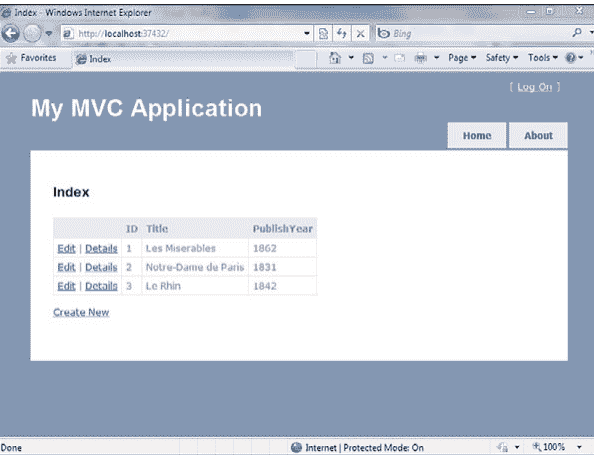

图 19.11
ASP.NET MVC 在后台执行了大量工作，让你能够轻松地在网页上显示数据。

## 启用创建新记录

默认版本的索引页显示一个“新建”（Create New）链接。在其背后添加功能非常简单。

要此此，我们需要在 `HomeController` 中创建一个新的 action（动作）。向 `HomeController.cs` 添加两个新方法：

```cs
//返回默认的 Create 视图
public ActionResult Create()
{
    return View();
}
```

```c
//当用户将新书籍提交回服务器时调用
[AcceptVerbs(HttpVerbs.Post)]
public ActionResult Create(
    [Bind(Exclude="Id")]
    MVCBooksApp.Models.Book newBook)
{
    if (!ModelState.IsValid)
        return View();
    _db.AddToBooks(newBook);
    _db.SaveChanges();
    //跳转到 Index 页面
    return RedirectToAction("Index");
}
```

要创建视图，请遵循创建 Index 视图时的相同步骤，但在视图内容下拉菜单中，选择 `Create`。

在 `Create.aspx` 生成的 HTML 代码中，你需要删除 ID 字段，因为它是数据库中自动生成的字段：

```html
<label for="ID">ID:</label>
<%= Html.TextBox("ID", "*") %>
<%= Html.ValidationMessage("ID") %>
```

完成后的页面类似于图 19.12。

## 编辑记录

要编辑现有记录，我们需要再次向控制器添加一些方法：其中一个接收 ID 参数，以便我们知道正在编辑哪条记录；另一个则用于接受 POST 请求并将更新后的记录发送回数据库。

# 第 19 章 ASP.NET

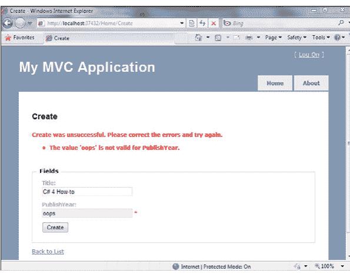

图 19.12
Create 页面甚至已经包含了基础的数据验证。

向 `HomeController.cs` 添加这些方法：

```csharp
public ActionResult Edit(int id)
{
    ////LINQ 表达式 - 参见第 21 章
    Models.Book book = (from b in _db.Books
                        where b.ID == id
                        select b).First();
    return View(book);
}
```

```csharp
[AcceptVerbs(HttpVerbs.Post)]
public ActionResult Edit(Models.Book editBook)
{
    //从数据库获取原始书籍
    Models.Book book = (from b in _db.Books
                        where b.ID == editBook.ID
                        select b).First();
    if (!ModelState.IsValid)
        return View(book);
    //将更改应用回原始记录
    _db.ApplyCurrentValues(book.EntityKey, editBook.EntityName, editBook);
    _db.SaveChanges();
    return RedirectToAction("Index");
}
```

你可以按照之前的步骤创建 Edit 视图；对于视图内容，选择 `Edit`。你还需要从该视图生成的 HTML 中移除 ID 字段。

> **注意**：要运行示例应用程序 `MVCBooksApp`，请修改 `web.config` 中的连接字符串。

## LISTING 20.1 MainPage.xaml (续)

```xml
<MediaElement Grid.Row="0"
    x:Name="videoPlayer"
    Stretch="Fill">
</MediaElement>
<StackPanel Grid.Row="1">
    <TextBlock Text="URL:"
        Foreground="White"
        VerticalAlignment="Center"/>
    <TextBox x:Name="textBoxURL"
        Text="http://msnnine.vo.llnwnd/d1/ch9/8/7/1/6/6/4/MTSloobOnMac_2MB_ch9.wmv"
        VerticalAlignment="Center" />
</StackPanel>
<StackPanel Orientation="Horizontal"
    HorizontalAlignment="Center">
    <Button x:Name="buttonPlay" Content="Play" Margin="4"
        Click="buttonPlay_Click" />
    <Button x:Name="buttonStop" Content="Stop" Margin="4"
        Click="buttonStop_Click" />
</StackPanel>
</Grid>
</UserControl>
```

## LISTING 20.2 MainPage.xaml.cs

```csharp
using System;
using System.Collections.Generic;
using System.Linq;
using System.Net;
using System.Windows;
using System.Windows.Controls;
using System.Windows.Documents;
using System.Windows.Input;
using System.Windows.Media;
using System.Windows.Media.Animation;
using System.Windows.Shapes;
using System.Threading;
namespace VideoPlayer
{
    public partial class MainPage : UserControl
```

## LISTING 20.2 MainPage.xaml.cs (续)

```csharp
{
```


## 代码示例：媒体播放器核心逻辑

```csharp
private static DependencyProperty IsPlayingProperty;

static MainPage()
{
    IsPlayingProperty = DependencyProperty.Register(
        "IsPlaying", typeof(bool),
        typeof(MainPage),
        new PropertyMetadata(false));
}

public bool IsPlaying
{
    get
    {
        return (bool)GetValue(IsPlayingProperty);
    }
    set
    {
        SetValue(IsPlayingProperty, value);
    }
}

public MainPage()
{
    InitializeComponent();
}

private void buttonPlay_Click(object sender, RoutedEventArgs e)
{
    if (!IsPlaying)
    {
        // 不必要地更改源会导致视频重置
        if (videoPlayer.Source == null ||
            videoPlayer.Source.OriginalString != textBoxURL.Text)
        {
            videoPlayer.Source = new Uri(textBoxURL.Text);
        }
        videoPlayer.Play();
        IsPlaying = true;
        // 使用值转换器来设置按钮文本可能更好，但那会分离本示例的核心关注部分
        buttonPlay.Content = "Pause";
    }
    else if (videoPlayer.CanPause)
    {
        videoPlayer.Pause();
        IsPlaying = false;
        buttonPlay.Content = "Play";
    }
}

private void buttonStop_Click(object sender, RoutedEventArgs args)
{
    videoPlayer.Stop();
    IsPlaying = false;
    buttonPlay.Content = "Play";
}
```

这些就是你在网站上创建自己的媒体播放器所需的所有代码（见图 20.2）。如你所见，它使用了你已经熟悉的 XAML 和 .NET 代码。

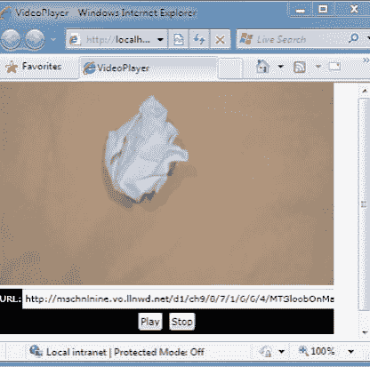

图 20.2 在 Silverlight 中播放大多数常见类型的媒体并不费精力。

## 第 20 章 Silverlight

## 构建下载与播放进度条

**场景/问题：** 你想显示一个进度条，显示视频的缓冲情况以及当前的播放位置。

**解决方案：** 每一个媒体内容下载器都需要一个同时显示下载进度和播放位置的进度条。坦率地说，Silverlight 完全支持自定义控件的概念。列表 20.3 显示了 XAML，列表 20.4 显示了此的后置代码。

### LISTING 20.3 PlayDownloadProgressControl.xaml

```xml
<UserControl x:Name="VideoPlayer.PlayDownloadProgressControl"
xmlns="http://schemas.microsoft.com/winfx/2006/xml/presentation"
xmlns:x="http://schemas.microsoft.com/winfx/2006/xaml"
Width="400" Height="300">
  <Canvas x:Name="LayoutRoot" Background="White">
    <Line x:Name="DownloadProgress" X1="0" Y1="0"
      X2="0" Y2="0" Stroke="DarkGray"
      Canvas.Left="0" Canvas.Top="2" StrokeThickness="3"/>
    <Line x:Name="PlaybackProgress" X1="0" Y1="0"
      X2="0" Y2="0" Stroke="DarkGreen"
      Canvas.Left="0" Canvas.Top="2" StrokeThickness="3"/>
  </Canvas>
</UserControl>
```

### LISTING 20.4 PlayDownloadProgressControl.xaml.cs

```csharp
using System;
using System.Net;
using System.Windows;
using System.Windows.Controls;

namespace VideoPlayer
{
  public partial class PlayDownloadProgressControl : UserControl
  {
    public PlayDownloadProgressControl()
    {
      InitializeComponent();
    }

    public void UpdateDownload(double progress)
    {
        // 实现下载进度
    }

    public void UpdatePlayback(double progress)
    {
        // 实现播放进度
    }
  }
}
```

## 让你的应用程序离开浏览器（3D 透视效果）

```xml
<MediaElement Grid.Row="0"
 x:Name="videoPlayer"
Stretch="Fill"
DownloadProgressChanged="videoPlayer_DownloadProgressChanged">
<MediaElement.Projection>
  <PlaneProjection RotationY="45" RotationX="-15"/>
</MediaElement.Projection>
</MediaElement>
```

与所有其他依赖属性一样，这些属性是可以动画的。

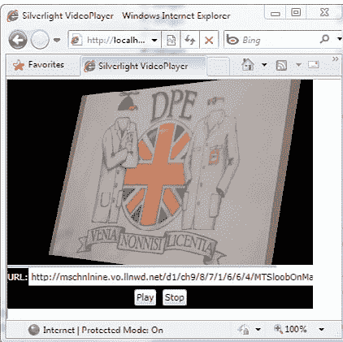

图 20.4 通过 `Projection` 属性可以轻松地为你的 Silverlight 应用添加 3D 透视效果。

## 让你的应用程序离开浏览器（离线运行）

> **场景/问题：** 你希望用户能够在没有连接互联网的情况下下载并运行应用程序。

**解决方案：** 什么时候 Web 应用程序不再是 Web 应用程序？当它被允许直接从桌面运行时。首先，向你的解决方案添加一个较小的（例如 48x48 像素）PNG 图像文件，并将其生成操作（`Build Action`）设置为内容（`Content`）。在项目设置的 Silverlight 选项卡中，有一个选框允许在浏览器之外运行应用程序，此外还有一个按钮可以打开对话框，允许你指定其他设置（如图标）。启用此设置会在项目的属性文件夹中创建 `OutBrowserSettings.xml` 文件。它看起来如下：

```xml
<OutBrowserSettings Name="VideoPlayer Application"
  EnableGPUAcceleration="True"
  ShowInstallMenuItem="True">
<OutBrowserSettings.Blurb>
桌面上的 VideoPlayer 应用；在家里、
在办公室或在途中。
</OutBrowserSettings.Blurb>
<OutBrowserSettings.WindowSettings>
  <WindowSettings Title="VideoPlayer Application" />
</OutBrowserSettings.WindowSettings>
<OutBrowserSettings.Icons>
  <Icon Size="48,48">VideoPlayerIcon.png</Icon>
</OutBrowserSettings.Icons>
</OutBrowserSettings>
```

当你右键点击应用程序时，你会获得一个本地安装的选项，如图 20.5 所示。

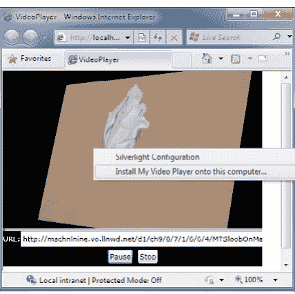

图 20.5 通过一些简单的配置设置，可以轻松地让你的 Silverlight 应用离线可用。

应用程序安装后，右键点击会提供从本地机器删除它的选项。

## 捕捉摄像头

> **场景/问题：** 你希望显示从连接的网络摄像头输出的视频内容。

**解决方案：** 使用 Silverlight 4 对视频捕捉设备的支持。

要设置此项，你首先需要请求用户允许使用摄像头。如果获得许可，你可以将设备分配给 `CaptureSource` 对象，然后将该对象分配给 `VideoBrush`。随后 `VideoBrush` 就可以作为目标控件（在本例中为矩形）的填充画刷。

该技术在代码列表 20.5 和 20.6 中进行了演示。

### 代码列表 20.5 MainPage.xaml

```xml
<UserControl x:Class="WebCam.MainPage"
xmlns="http://schemas.microsoft.com/winfx/2006/xaml/presentation"
xmlns:x="http://schemas.microsoft.com/winfx/2006/xaml"
xmlns:d="http://schemas.microsoft.com/expression/blend/2008"
xmlns:mc="http://schemas.openxmlformats.org/markup-compatibility/2006"
mc:Ignorable="d"
d:DesignHeight="300" d:DesignWidth="400">
  <Grid x:Name="LayoutRoot" Background="White">
    <Rectangle x:Name="VideoRect" Fill="Bisque"
               Width="640" Height="480"
               VerticalAlignment="Top"
               HorizontalAlignment="Left"/>
    <Button Content="Start Webcam"
            Name="buttonWebcam"
            Width="98"
            Height="23"
            HorizontalAlignment="Left"
            VerticalAlignment="Top"
            Click="buttonWebcam_Click" />
  </Grid>
</UserControl>
```

### 代码列表 20.6 MainPage.xaml.cs

```csharp
using System;
using System.Windows;
using System.Windows.Controls;
using System.Windows.Documents;
using System.Windows.Input;
using System.Windows.Media;
using System.Windows.Media.Animation;
using System.Windows.Shapes;

namespace WebCam
{
    public partial class MainPage : UserControl
    {
        CaptureSource _captureSource = null;

        public MainPage()
        {
            InitializeComponent();
        }

        void StartWebcam()
        {
            if (_captureSource != null &&
                _captureSource.State != CaptureState.Accessed)
            {
                if (CaptureDeviceConfiguration.AllowedDeviceAccess
                    || CaptureDeviceConfiguration.RequestDeviceAccess())
                {
                    VideoCaptureDevice device = CaptureDeviceConfiguration.GetVideoCaptureDevice();
                    if (device == null)
                    {
                        _captureSource = new CaptureSource();
                        _captureSource.VideoCaptureDevice = device;
                        _captureSource.Start();
                        VideoBrush brush = new VideoBrush();
                        brush.Stretch = Stretch.Uniform;
                        brush.SetSource(_captureSource);
                        videoRect.Fill = brush;
                    }
                }
            }
        }

        private void buttonWebcam_Click(object sender, RoutedEventArgs e)
        {
            StartWebcam();
        }
    }
}
```

## 打印文档

> **场景/问题：** 你想从连接的打印机打印内容。

**解决方案：** Silverlight 现在包含了你可以轻松利用的打印支持。正如第 17 节“使用 Windows Forms 和 GDI+ 图形”，.NET 中的打印与在屏幕上绘制相似。在 Silverlight 中，要打印，只需如下代码：

```csharp
private void buttonPrint_Click(object sender, RoutedEventArgs e)
{
    PrintDocument doc = new PrintDocument();
    doc.PrintPage += new EventHandler<PageEventArgs>(doc_PrintPage);
    doc.Print();
}

void doc_PrintPage(object sender, PageEventArgs e)
{
    // 简单将 PageVisual 属性设置为你想打印的 UIElement
    e.PageVisual = canvas;
    e.HasMorePages = false;
}
```


PrintPage 事件处理器会将 `PageVisual` 属性设置为你想打印的任何内容——这非常简单。参见随附源码中的 SketchPad 示例项目。该程序允许你用鼠标绘图并打印结果。

# 第四部分 高级 C#

## 在本部分中
- 第 21 章 LINQ 461
- 第 22 章 内存管理 473
- 第 23 章 线程、异步与并行编程 491
- 第 24 章 反射与创建插件 519
- 第 25 章 应用程序模式 529
- 第 26 章 与操作系统和硬件交互 575
- 第 27 章 趣味与结尾 597
- 附录 必要工具 621

# 第 21 章 LINQ

## 在本章中
- 查询对象集合
- 结果排序
- 过滤集合
- 获取对象部分的集合（投影）
- 执行连接
- 查询 XML
- 创建 XML
- 查询 Entity Framework
- 查询 Web 服务（LINQ to Bing）
- 使用 PLINQ（并行 LINQ）加速查询

## 462 第 21 章 LINQ

语言集成查询 LINQ 是一种灵活的类似于 SQL 的查询语言，旨在让程序员使用一致的语法查询任何数据集，无论是数据库、XML 还是普通对象。更重要的是，它可以在日常 C# 文件中舒适安全地使用。

> **注意** LINQ 仅仅是看起来像 SQL 的语言，且仅表面如此。如果你熟悉 SQL，你会发现查询各个部分的顺序与你习惯的不同。LINQ 与实际数据库 SQL 语言没有直接关系，它不是在代码中嵌入实际 SQL 查询的方法。它是在代码中嵌入通用查询的方法，这些查询最终可能会转换为数据库查询，LINQ 还可以做更多。

### 查询对象集合

> **场景/问题：** 你想根据某些标准查询集合以获取所有的对象。

**解决方案：** LINQ 和后续示例使用一些数据对象来演示 LINQ 的工作原理。

```csharp
public string LastName { get; set; }

public Author(int id, string firstName, string lastName)
{
    this.Id = id;
    this.FirstName = firstName;
    this.LastName = lastName;
}

//
List<Book> books = new List<Book>{
    new Book("Le Rhin", 1, 1842),
    new Book("Les Burgraves", 1, 1843),
    new Book("Napoléon le Petit", 1, 1852),
    new Book("Les Châtiments", 1, 1853),
    new Book("Les Contemplations", 1, 1856),
    new Book("Les Misérables", 1, 1862) 
};
```

```csharp
List<Author> authors = new List<Author>
{
    new Author(1, "Vector", "Hugo")
};
```

最基本的 LINQ 查询获取了所有的书籍信息。

```csharp
var allBooks = from book in books select book;

foreach (Book book in allBooks)
{
    Console.WriteLine(book.ToString());
}
```

`var` 关键字通常用于 LINQ，原因你稍后会看到。在这种情况下，`allBooks` 是 `Book` 对象的集合。输出如下：

- Le Rhin - 1842
- Les Burgraves - 1843
- Napoléon le Petit - 1852
- Les Châtiments - 1853
- Les Contemplations - 1856
- Les Misérables - 1862

### 对结果排序

场景/问题：你希望按照某种顺序组织结果。

解决方案：使用 `orderby` 语句。

以下是如何按升序（默认）对结果排序：

```csharp
var ordered = from book in books orderby book.Title select book;
```

使用以下代码进行降序排序：

```csharp
var ordered = from book in books
orderby book.Title descending
select book;
```

这里是如何对多列进行排序：

```csharp
var ordered = from book in books
orderby book.PublishYear, book.Title descending
select book;
```

### 过滤集合

场景/问题：你希望从集合中选择满足给定条件的对象。

解决方案：像 SQL 一样，LINQ 有 `where` 子句，可以根据你指定的条件来过滤结果：

```csharp
var before1850 = from book in books
where book.PublishYear < 1850
select book;
```

输出如下：

1850年之前的书籍：
Le Rhin - 1842
Les Burgraves - 1843

如果你想使用多个条件，请使用 `&&` 和 `||` 运算符，就像在 `if` 语句中使用一样：

```csharp
var dateRange = from book in books
where book.PublishYear >= 1850
&& book.PublishYear <= 1855
select book;
```

### 获取部分对象的集合（投影）

> 场景/问题：给定我们的 `Book` 对象，你想返回一个仅代表标题和出版年份的对象集合，丢弃作者信息。

解决方案：在 LINQ 之前，这涉及到一些通常简单但笨拙的代码来遍历所有对象，并将所需的属性插入到新集合中。使用 LINQ，只需要一行代码（由于页面宽度限制，此处换行了）：

```csharp
var justTitlesAfter1850 = from book in books
where book.PublishYear > 1850
select book.Title;
```

此行代码返回 1850 年之后出版的书籍标题：

1850 年之后的书籍标题：
Napoléon le Petit
Les Châtiments
Les Misérables

`justTitlesAfter1850` 是字符串对象的集合，但如果你想投影多个字段呢？请查看下一节。

### 执行连接

> 场景/问题：你想合并多个表的数据。

解决方案：使用 `join` 关键字根据公共字段合并表。

这是 LINQ 真正威力所在。在这个示例中，`Author` 集合将与 `Book` 集合合并，并仅投影作者和标题信息。

```csharp
var withAuthors = from book in books
join author in authors on book.AuthorId equals author.Id
select new { Book = book.Title,
Author = author.FirstName + " " + author.LastName };

Console.WriteLine("Join with authors:");

foreach (var bookAndAuthor in withAuthors)
{
    Console.WriteLine("{0}, {1}", bookAndAuthor.Book, bookAndAuthor.Author);
}
```

# 第 21 章 LINQ

LINQ 的真正威力所在。在这个示例中，`Author` 集合将与 `Book` 集合合并，并仅投影作者和标题信息。

输出为：
Join with authors:
Le Rhin, Victor Hugo
Les Burgraves, Victor Hugo
Napoléon le Petit, Victor Hugo
Les Châtiments, Victor Hugo
Les Contemplations, Victor Hugo
Les Misérables, Victor Hugo

### 查询 XML

场景/问题：你想从 XML 中提取数据。

解决方案：在 LINQ 之前，这涉及到一些通常简单但笨拙的代码来遍历所有对象并将所需的属性插入到新集合中。使用 LINQ，只需要一行代码（由于页面宽度限制，此处换行了）：

```csharp
XDocument doc = XDocument.Load("books.xml");

var chaptersWith = from chapter in doc.Descendants("Book")
select new { 
    Title = chapter.Attribute("title").Value,
    Year = (int)chapter.Attribute("year").Value 
};
```

输出为：

```xml
<Books>
  <Book year="1842">Le Rhin</Book>
  <Book year="1843">Les Burgraves</Book>
  <Book year="1852">Napoléon le Petit</Book>
  <Book year="1853">Les Châtiments</Book>
  <Book year="1856">Les Contemplations</Book>
  <Book year="1862">Les Misérables</Book>
</Books>
```

### 创建 XML

场景/问题：你需要生成 XML。

解决方案：LINQ 提供了非常简单的方法生成 XML。

```csharp
XElement xml = new XElement("Books",
    new XElement("Book", new XAttribute("year", 1842), "Le Rhin"),
    new XElement("Book", new XAttribute("year", 1843), "Les Burgraves")
);

Console.WriteLine(xml.ToString());
```

### 列表 21.1 Bing.cs (续)

```csharp
class Bing
{
    public string AppId { get; set; }

    const string BingNamespace =
    "http://schemas.microsoft.com/LiveSearch/2008/04/XML/web";

    public Bing(string appId)
    {
        this.AppId = appId;
    }

    public IEnumerable<SearchResult> QueryWeb(string query)
    {
        string escaped = Uri.EscapeUriString(query);
        string url = BuildUrl(escaped);
        XDocument doc = XDocument.Load(url);
        XNamespace ns = BingNamespace;
        IEnumerable<SearchResult> results =
            from sr in doc.Descendants(ns + "WebResult")
            select {
                Title = sr.Element(ns + "Title").Value,
                Url = sr.Element(ns + "Url").Value,
                Description = sr.Element(ns + "Description").Value
            };
        return results;
    }

    string BuildUrl(string query)
    {
        return "http://api.search.live.net/xml.aspx?"
            + "+AppId=" + AppId
            + "&Query=" + query
            + "&Sources=Web"
            + "&Version=2.0"
            + "&Web.Count=10"
            + "&Web.Offset=0";
    }
}
```

### 列表 21.2 Program.cs

```csharp
using System;
using System.Collections.Generic;
using System.Linq;
using System.Text;
using System.Net;

namespace LinqToBing
{
    class Program
    {
        //错误：在 http://www.bing.com/developers/ 获取你的 AppId
        const string AppId = "YOUR APPID HERE";

        static void Main(string[] args)
        {
            Bing search = new Bing(AppId);
            string query = "Visual Studio 2010";
            IEnumerable<SearchResult> results = search.QueryWeb(query);
            foreach (SearchResult result in results)
            {
                Console.WriteLine("{0}" + "\t{1}" 
                    + Environment.NewLine + "\t{2}"
                    + Environment.NewLine, 
                    result.Title, result.Url, result.Description);
            }
            Console.ReadKey();
        }
    }
}
```

> **注意** 若要查看如何创建自定义 LINQ 提供者的极佳示例（并体会创建一个良好的提供者需要投入多少工作），请参阅 Fabrice Marguerite 的 LINQ to Amazon 示例：http://weblogs.asp.net/fmarguerie/archive/2006/06/26/Introducing-Linq-to-Amazon.aspx 以及书籍《LINQ in Action》一书。

### 使用 PLINQ (并行 LINQ) 加速查询

> 场景/问题：你希望在 LINQ 查询期间利用多个处理器核心。

解决方案：使用 `AsParallel()` 扩展方法。

如果你的原始查询是：

```csharp
var query = from val in data
      where (ComplexCriteria(val)==true)
      select val;

foreach (var q in query)
{
    //处理结果
}
```

其中 `ComplexCriteria` 只是一个检查数据中值的任意布尔函数，那么你可以通过简单的添加来实现其并行化：

```csharp
var query = from val in data.AsParallel()
      where (ComplexCriteria(val)==true)
      select val;

foreach (var q in query)
{
    //处理结果
}
```

> 注意：除非你像此处所示使用 `AsOrdered()` 或 `OrderBy()` 扩展方法指定要保留顺序，否则你更有可能使用 PLINQ 获取无序返回的元素：

```csharp
var query = from obj in data.AsParallel().AsOrdered() select obj;

var query = from obj in data.AsParallel().OrderBy(obj.Name)
      select obj;
```


遗憾的是，这可能会抵消 PLINQ 的某些优势。

> 注意 PLINQ 仅适用于 LINQ to Objects 和 LINQ to XML。

# 第 22 章 内存管理

本章内容

- 测量应用程序的内存占用
- 使用终化清理非托管资源
- 使用 Dispose 模式清理托管资源
- 强制执行垃圾回收
- 创建一个仍允许垃圾回收的缓存
- 使用指针
- 加速数组访问
- 防止内存被移动
- 分配非托管内存

在通用语言运行时 (CLR) 环境中使用如 C# 等托管语言的最大优势之一是，你不需要像在 C 或 C++ 等语言中那样担心内存管理。尽管如此，作为 C# 开发者，你仍然需要理解与内存相关的主题。此外，有时你必须跳出托管代码的世界并访问指针。这很丑陋，你应该尽量避免它，但在需要时你必须这样做。

## 测量应用程序的内存占用

| 场景/问题 | 解决方案 |
| :--- | :--- |
| 你需要找出你的应用程序使用了多少内存 | `GC` 类包含了许多实用的内存相关方法，包括 `GetTotalMemory()`，它是垃圾回收器认为分配给你的应用程序的内存量。由于存在尚未进行垃圾回收的对象，这个数字可能并不完全准确。但是，它的优势是能够告诉你程序的某部分使用了多少内存，而不是整个进程。 |

```csharp
long size = GC.GetTotalMemory(false);

byte[] array = new byte[1000000]; // 分配约1MB

long sizeAfter = GC.GetTotalMemory(false);
```

### 获取应用程序的内存视图

你也可以通过 `Process` 类获取有关程序的信息：

```csharp
Process proc = Process.GetCurrentProcess();

Console.WriteLine("工作集: {0} MB", proc.WorkingSet64 / 1024 / 1024);

Console.WriteLine("私有内存: {0} MB", proc.PrivateMemorySize64 / 1024 / 1024);
```

## 使用 Dispose 模式清理托管资源

```csharp
// 注意：在实际应用中，不要在终结器中放置
// 不需要的内容
Console.WriteLine("In Finalizer");

if (_handle != IntPtr.Zero)
{
    CloseHandle(_handle);
}

public void Close()
{
    if (_handle != IntPtr.Zero)
    {
        // 我们已经关闭了，所以这个对象
        // 不需要再被终化了
        GC.SuppressFinalize(this);
        CloseHandle(_handle);
    }
}
```

当 .NET 检测到类中存在终结器时，它会确保在垃圾回收的某个时刻调用它。

> **注意** 垃圾回收过程的终化阶段可能非常昂贵，因此只有在必要时才使用终结器。它们几乎不应该用于托管资源——只用于非托管资源。

## 使用 Dispose 模式清理托管资源

| 场景/问题 | 解决方案 |
| :--- | :--- |
| 你需要确保在需要时清理托管资源（如数据库连接） | 许多类型的资源都是有限的（文件、数据库连接、位图等），但有 .NET 类来管理它们。与非托管资源一样，你仍然需要控制它们的生命周期，但当它们封装在托管代码中时，终结器并不合适。你需要使用 Dispose 模式。让我们来看与上一节类似的示例，但使用的是托管资源。`IDisposable` 接口定义了 `Dispose` 方法，但要正确使用该模式，你需要自己定义另外几个内容： |

```csharp
public class MyWrappedResource : IDisposable
{
    // 我们的托管资源
    IDbConnection _conn = null;

    public MyWrappedResource(string filename)
    {
    }

    public void Close()
    {
        Dispose(true);
    }

    public void Dispose()
    {
        Dispose(true);
    }

    private bool _disposed = false;

    protected void Dispose(bool disposing)
    {
        // 在类层次结构中，不要忘记调用基类；
        // base.Dispose(disposing);
        if (!_disposed)
        {
            _disposed = true;
            if (disposing)
            {
                // 清理托管资源
                if (_conn != null)
                {
                    _conn.Dispose();
                }
            }
            // 在这里清理非托管资源，如果有的话
        }
    }
}
```

使用 Dispose 模式时，你在完成资源操作后手动调用 `Dispose`：

### 使用 Dispose 模式清理托管资源

```csharp
// 使用 try-finally 保证清理
MyWrappedResource res = null;
try
{
    res = new MyWrappedResource("TestFile.txt");
}
finally
{
    if (res != null)
    {
        res.Dispose(true);
    }
}
```

这种模式非常常见，以至于有一种快捷语法：

```csharp
using (MyWrappedResource res = new MyWrappedResource("TestFile.txt"))
{
    // 对 res 执行一些操作
}
```

> 注意：你不应该对 Windows Communication Framework (WCF) 对象使用 Dispose 模式。遗憾的是，它们并没有按照此模式实现。你可以通过在互联网上搜索详细说明此问题的众多文章来获取更多信息。

### 在终结化中使用 Dispose

虽然终结器不应该触碰托管对象，但 `Dispose` 可以（并且应该）清理非托管资源。这里有一个示例：

```csharp
using System;
using System.IO;
using System.Runtime.InteropServices;
using System.Data;

namespace Dispose
{
    public class MyWrappedResource : IDisposable
    {
        [DllImport("kernel32.dll", CharSet = CharSet.Auto,
            CallingConvention = CallingConvention.StdCall,
            SetLastError = true)]
        public static extern IntPtr CreateFile(
            string lpFileName,
            uint dwDesiredAccess,
            uint dwShareMode,
            IntPtr SecurityAttributes,
            uint dwCreationDisposition,
            uint dwFlagsAndAttributes,
            IntPtr hTemplateFile
        );

        [DllImport("kernel32.dll", SetLastError = true)]
        [return: MarshalAs(UnmanagedType.Bool)]
        static bool CloseHandle(IntPtr hObject);

        // IntPtr 用于表示操作系统句柄
        IntPtr _handle = IntPtr.Zero;

        // 我们的托管资源
        IDbConnection _conn = null;

        public MyWrappedResource(string filename)
        {
            _handle = CreateFile(filename,
                                0x80000000, // 只读访问
                                1,            // 共享读取
                                IntPtr.Zero,
                                3,            // 打开现有文件
                                IntPtr.Zero);
        }

        ~MyWrappedResource()
        {
            // 注意：在实际应用中，不要在终结器中放置
            // 不需要的内容
            Console.WriteLine("In Finalizer");
            Dispose(false);
        }

        public void Close()
        {
            Dispose(true);
        }

        public void Dispose()
        {
            Dispose(true);
        }
```

### 使用 Dispose 模式清理托管资源

```csharp
        private bool _disposed = false;

        protected virtual void Dispose(bool disposing)
        {
            // 在类层次结构中，不要忘记
            // 调用基类！
            // base.Dispose(disposing);
            Console.WriteLine("Dispose({0}", disposing);
            if (!_disposed)
            {
                _disposed = true;
                if (disposing)
                {
                    // 清理托管资源
                    if (_conn != null)
                    {
                        _conn.Dispose();
                    }
                }
                GC.SuppressFinalize(this);
            }
            // 清理非托管资源，如果有的话
            if (_handle != IntPtr.Zero)
            {
                CloseHandle(_handle);
            }
        }
    }
}
```

这里有一个演示发生什么的小程序：

```csharp
static void Main(string[] args)
{
    using (MyWrappedResource res = new MyWrappedResource("TestFile.txt"))
    {
        Console.WriteLine("Using resource...");
    }

    MyWrappedResource res2 = new MyWrappedResource("TestFile.txt");
    Console.WriteLine("Created a resource, exiting");
}
```

输出如下：

```
Using resource...
Dispose(True)
Created a resource, exiting
In Finalizer
Dispose(False)
```

## 强制垃圾回收

| 场景/问题 | 解决方案 |
| :--- | :--- |
| 你认为强制垃圾回收 | 短答案是，不要。你比垃圾回收系统更有效率。尽管如此，如果你确定自己在做什么并且想要衡量效果，可以这样做： |

```csharp
GC.Collect();
```

人们强制回收的一个原因是他们正在开始一个性能敏感的操作，不希望被垃圾回收中断。

## 创建一个允许垃圾回收的缓存

| 场景/问题 | 解决方案 |
| :--- | :--- |
| 你想缓存对象（例如来自数据库），但仍需要在时允许它们被垃圾回收 | 问题在于持有对象的引用会阻止其被垃圾回收。引入 `WeakReference`。这个简单的缓存使用 `WeakReference` 对象来存储实际值，允许在需要时被回收。 |

```csharp
public class Cache<TKey, TValue> where TValue : class
{
    // 使用 WeakReference 而不是 TValue，
    // 它们就可以被回收
    private Dictionary<TKey, WeakReference> _cache =
        new Dictionary<TKey, WeakReference>();

    public void Add(TKey key, TValue value)
    {
        _cache[key] = new WeakReference(value);
    }

    public void Clear()
    {
        _cache.Clear();
    }

    // 因为死的 WeakReference 对象可能会堆积，
    // 你可能需要清理它们
    public void ClearDeadReferences()
    {
        foreach (KeyValuePair<TKey, WeakReference> item in _cache)
        {
            if (!item.Value.IsAlive)
            {
                _cache.Remove(item.Key);
            }
        }
    }

    public TValue GetObject(TKey key)
    {
        WeakReference reference = null;
        if (_cache.TryGetValue(key, out reference))
        {
            /*
             * 不要先检查 IsAlive，因为
             * GC 稍后可能就会介入。
             * 直接获取值并缓存它。
             * 如果对象已经被回收，它将为 null。
             * 如果你成功获取了 Target 值，
             * 那么你将创建一个强引用，
             * 防止它被垃圾回收。
             */
            return reference.Target as TValue;
        }
        return null;
    }
}
```

> 注意：弱引用永远不应用于小型项，你不应该依赖它们作为解决你内存问题的“拐杖”。它们最适用于占用大量内存但可以根据需要重新创建的项，例如在缓存中，如果对象仍然留在内存中会很好，但你仍然希望它最终被垃圾回收。

这个测试程序展示了如何使用它：

```csharp
class Program
{
    class Book
    {
        public int Id { get; set; }
        public string Title { get; set; }
        public string Author { get; set; }
    }

    static void Main(string[] args)
    {
        Cache<int, Book> bookCache = new Cache<int, Book>();
        Random rand = new Random();
        int numBooks = 100;

        // 将书籍添加到缓存
        for (int i = 0; i < numBooks; ++i)
        {
            bookCache.Add(i, GetBookFromDB(i));
        }

        // 查找随机书籍并跟踪缓存缺失
        Console.WriteLine("正在查找书籍...按任意键停止");
        long lookups = 0, misses = 0;
        while (!Console.KeyAvailable)
        {
            ++lookups;
            int id = rand.Next(0, numBooks);
            Book book = bookCache.GetObject(id);
            if (book == null)
            {
                ++misses;
                book = GetBookFromDB(id);
            }
            else
            {
                // ...
            }
        }
    }
}
```


```csharp
{
    //增加一点内存压力以增加
    // GC 发生的概率
    GC.AddMemoryPressure(100);
    bookCache.Add(id, book);
}
```

Console.ReadKey();
Console.WriteLine("{0:N0} 次查找，{1:N0} 次缺失", lookups, misses);
Console.ReadLine();

static Book GetBookFromDB(int id)
{
    //模拟某些数据库访问
    return new Book { Id = id,
    Title = "Book" + id,
    Author = "Author" + id };
}

```

### 使用指针

**场景/问题：** 你需要直接访问对象的内存，可能是为了效率或为了与原生代码进行交互。

**解决方案：** 在代码中使用指针，你必须做以下几点：

1. 将代码块标记为 `unsafe`。
2. 使用 `/unsafe` 编译器开关（或在项目生成设置中）将项目编译为不安全。
3. 确保目标运行时环境具有足够的权限来运行不安全代码（毕竟这是一种安全风险）。

这是一个简单的示例：

```csharp
unsafe
{
    int x = 0;
    int* pX = &x;
    *pX = 13;
}
```

你可以为任何非引用类型创建指针（该类型也只包含非引用类型）：

```csharp
Point pt;
Point* pPt = &pt;
pt->X = 13;
pt->Y = 14;
pt->Offset(1,2);
```

```csharp
List<object> list = new List<object>();
//List<object> pList = &list;//var 将无法编译
```

整个方法和类都可以被标记为 `unsafe`：

```csharp
unsafe class MyUnsafeClass {...}
unsafe void MyUnsafeMethod() {...}
```

### 加速数组访问

| 场景/问题 | 解决方案 |
| :--- | :--- |
| 你出于性能考虑想要直接访问数组，并愿意放弃 .NET 的数组边界检查，由自己对安全行为负责。 | 通过使用指针，你可以将数组查找速度提高数量级，但代价是牺牲了代码的安全性和保证。 |

这段代码展示了通过使用指针你可以直接访问内存，并可能覆盖你并非无意中想要的数据：

```csharp
int size = 10;
int[] vals = new int[size];
try
{
    for (int i = 0; i < size+1; i++)
    {
        vals[i] = i;
    }
} catch (IndexOutOfRangeException ex)
{
    Console.WriteLine("捕到异常：" + ex.Message);
    Console.WriteLine("越界了*");
    //防止 vals 在内存中移动
    fixed (int* pI = &vals[0])
    {
        //哎呀，去得太远了——覆盖了我们不该覆盖的内存！
        for (int i = 0; i < size+1; i++)
        {
            pI[i] = i;
        }
        Console.WriteLine("没有抛出异常！我们只是覆盖了不该覆盖的内存！");
    }
}
```

你也可以使用指针算术，就像在原生语言中一样：

注意，给指针加 1 并不会让内存地址增加 1 字节，而是增加一个数据类型的大小步长，在本例中是一个 `int`，即 4 字节。

> 注意：大多数程序并不需要使用这些指针操作，这样做是非常危险的，这从你必须授予代码的“unsafe”状态，以及运行此类程序所需的额外权限中就可以看出。如果可能的话，请尝试创建不依赖这些技术的程序。

### 防止内存被移动

**场景/问题：** 你需要固定对象的内存，以便与原生代码进行交互。

**解决方案：** 使用 `fixed`。

```csharp
int[] vals = new int[size];
fixed (int* pI = &vals[0])
{
    // 垃圾回收不会移动 vals
}
```

> 注意：`fixed` 块应尽可能在短时间内使用，因为它会阻止垃圾回收器移动内存。

### 分配托管内存

**场景/问题：** 你需要分配一些垃圾回收器无法管理的内存。

**解决方案：** 使用 `Marshal.AllocGlobal` 和 `Marshal.FreeMemory`。

```csharp
class DataClass
{
    IntPtr _memory = IntPtr.Zero;
    public int NumObjects { get; set; }
    public DataClass(int numObjects)
    {
        _memory = Marshal.AllocGlobal(sizeof(int) * numObjects);
        NumObjects = numObjects;
    }
    ~DataClass()
    {
        if (_memory != IntPtr.Zero)
        {
            Marshal.FreeMemory(_memory);
        }
    }
}
```

当你以这种方式分配内存时，CLR 并不知道这一点：

```csharp
static void Main(string[] args)
{
    DataClass obj = new DataClass(100000);
    // 垃圾回收器不知道这些内存的存在
}
```

为了让 GC 知道这些内存，你需要使用 `AddMemoryPressure` 和 `RemoveMemoryPressure`：

```csharp
class DataClass
{
    IntPtr _memory = IntPtr.Zero;
    public int NumObjects { get; set; }
    public DataClass(int numObjects)
    {
        _memory = Marshal.AllocGlobal(sizeof(int) * numObjects);
        NumObjects = numObjects;
        GC.AddMemoryPressure(sizeof(int) * numObjects);
    }
    ~DataClass()
    {
        if (_memory != IntPtr.Zero)
        {
            Marshal.FreeMemory(_memory);
            GC.RemoveMemoryPressure(sizeof(int) * numObjects);
        }
    }
}
```

当你以这种方式分配内存时，GC 将会考虑它：

```csharp
static void Main(string[] args)
{
    DataClass obj = new DataClass(100000);
    GC.Collect(); // 触发 GC
    // GC 会根据压力决定进行回收
}
```

# 第 23 章 线程、异步与并行编程

本章内容

- 轻松分发处理器
- 在多线程中使用数据结构
- 异步调用方法
- 使用线程池
- 创建线程
- 与线程交换数据
- 在多线程中保护数据
- 使用原子操作方法
- 在多进程中保护数据
- 限制应用程序为单例
- 限制访问资源的线程数
- 使用事件信号线程
- 多线程定时器
- 使用读写锁
- 异步编程模型

使用线程非常强大，但正如老话所说，能力越大责任越大。不负责任地使用线程会导致性能下降和应用程序不稳定。然而，正确使用线程可以产生效率更高、响应更快的程序。

幸运的是，近年来在简化多线程方面做了大量工作。特别是任务并行库（TPL），作为 .NET 4 的一部分，允许你轻松地将代码执行分发到多个处理器上，而无需处理线程和锁。

### 轻松分发处理器

> 场景/问题：你有一个任务可以很容易拆分为独立的子任务，或者你有数据可以进行分区并单独计算。

解决方案：使用 `System.Threading` 命名空间中的 `Parallel` 类来分配任务进行调度并等待它们完成。

```csharp
// 示例代码
Parallel.For(0, 100, i =>
{
    // 执行并行操作
});
```

### 并行处理数据

当你以这种方式分配内存时，GC 将会考虑它：

```csharp
// 示例代码
Parallel.For(0, 1000, i =>
{
    // 并行处理数据
});
```

### 在处理器之间轻松拆分工作

```csharp
for (UInt32 i = 0; i < maxNumber; ++i)
{
    if (IsPrime(i))
    {
        Interlocked.Increment(ref primesFound);
        if (primesFound > maxPrimes)
        {
            Console.WriteLine("Last prime found: {0:N0}", i);
            break;
        }
    }
}
watch.Stop();
Console.WriteLine("Found {0:N0} primes in {1}", primesFound, watch.Elapsed());
watch.Reset();
primesFound = 0;
Console.WriteLine("Parallel");
watch.Start();
// 为了停止循环，这里有一个 
// 接收 Action<int, ParallelLoopState> 的重载
Parallel.For(0, maxNumber, (i, loopState) =>
{
    if (IsPrime((UInt32)i))
    {
        Interlocked.Increment(ref primesFound);
        if (primesFound > maxPrimes)
        {
            Console.WriteLine("Last prime found: {0:N0}", i);
            loopState.Stop();
        }
    }
});
watch.Stop();
Console.WriteLine("Found {0:N0} primes in {1}", primesFound, watch.Elapsed());
Console.ReadKey();

public static bool IsPrime(UInt32 number)
{
    // 检查奇偶性
    if (number % 2 == 0)
    {
        if (number == 2)
            return true;
        return false;
    }
    // 不需要检查到平方根之后
    UInt32 max = (UInt32)Math.Sqrt(number);
    for (UInt32 i = 3; i <= max; i += 2)
    {
        if ((number % i) == 0)
        {
            return false;
        }
    }
    return true;
}
```

我在双核机器上的输出所示：

迭代法（Iterative）

最后一个找到的质数: 15,485,863
在 00:00:15.7972400 中找到了 1,000,001 个质数

并行法（Parallel）

最后一个找到的质数: 15,485,867
最后一个找到的质数: 15,485,497
在 00:00:08.8610525 中找到了 1,000,002 个质数

除了时间大幅缩短外，请注意输出结果并不一定是有序的，而且程序的并行版本的结果与迭代版本并不相同。程序并不是从 1 到 20,000 顺序遍历，直到找到一百万个质数，而是对输入空间进行了划分；因此，你可能会得到其他情况下无法获得的结果。这实际上取决于你的问题以及你如何对其拆分。

### 并行运行任务

与其拆分数据，你还可以拆分处理数据的任务。假设你有如下所示的迭代代码：

```csharp
// 这些文件请参考 TPLTextProcess 示例项目
// 由爱德华·吉本（Edward Gibbon）撰写的《罗马帝国衰亡史》
// 的 6 个部分
string[] inputFiles =
{
  "decline1.txt", "decline2.txt", "decline3.txt",
  "decline4.txt", "decline5.txt", "decline6.txt"
};
foreach (string file in inputFiles)
{
  string content = File.ReadAllText(file);
  CountCharacters(content);
  CountWords(content);
}
```

你可以使用 `Parallel` 配合一些 lambda 表达式将这两个计算并行化：

```csharp
foreach (string file in inputFiles)
{
  string content = File.ReadAllText(file);
  Parallel.Invoke(
    () => CountCharacters(content),
    () => CountWords(content)
  );
}
```

在我的系统中，结果没有上一个例子那么惊人，但仍然非常显著：

迭代法（Iterative）
耗时: 00:00:08.551574
唯一字符: 92
唯一单词: 42976

并行法（Parallel）
耗时: 00:00:06.4348502
唯一字符: 92
唯一单词: 42976

## 在多线程中使用数据结构

| 场景/问题：你有一个需要在多个线程中访问的数据结构 |
| :--- | :--- |
| 解决方案：在依赖于线程感知的数据结构之前，你应该确保你确实需要它们。例如，如果数据并不真的需要在多个线程中访问，就不要使用它们。同样地，如果数据是只读的，则不需要进行保护。请记住，同步线程对数据的访问是必要的。 |

## 异步调用方法

场景/问题：你想调用一个方法并继续执行，而不是等待该方法返回。

解决方案：这种最简单的方法如下：

```csharp
using System;
using System.Threading;

namespace AsyncMethod
{
    class Program
    {
        delegate double DoWork(int maxValue);
        static void Main(string[] args)
        {
            // 使用委托
            DoWork del = DoWork;
            // 异步调用
            AsyncResult res = del.BeginInvoke(100000, null);
            // 等待结束
            Console.WriteLine("Sum: {0}", del.EndInvoke(res));
            Console.ReadKey();
        }
        static double DoWork(int maxValue)
        {
            // 模拟工作
            double sum = 0;
            for (int i = 0; i < maxValue; i++)
            {
                if (i % 1000000 == 0)
                {
                    Console.WriteLine("Thread ID: {0}, i: {1}", Thread.CurrentThread.ManagedId, i);
                }
            }
            return sum;
        }
    }
}
```


此程序产生以下输出：

```
Thread ID: 10, 等按键
Thread ID: 11, i: 0
Thread ID: 11, i: 1000000
Thread ID: 11, i: 2000000
Thread ID: 11, i: 3000000
```

## 使用线程池

**场景/问题**：你有一些任务想要并行分配。

**解决方案**：使用线程池比自己创建线程更简单、高效。你只需要传递一个委托：

```csharp
static void Main(string[] args)
{
    // 使用线程池
    ThreadPool.QueueUserItem(PrintDocument);
    Console.ReadKey();
}

static void PrintDocument(object state)
{
    // 执行工作
    Console.WriteLine("Printing document...");
}
```

## 创建线程

**场景/问题**：你需要一个长时间运行的线程，可能贯穿整个应用程序。

**解决方案**：如果你的线程将持续一段时间，那么让应用程序拥有它可能值得，而不是依赖线程池（线程池会在你完成后回收线程）。

```csharp
static void Main(string[] args)
{
    // 创建线程
    Thread thread = new Thread(new ThreadStart(ThreadProc));
    thread.IsBackground = true; // 所以在 Main 结束时结束
    thread.Start();
    while (!Console.KeyAvailable)
    {
        Console.WriteLine("Thread ID: {0}, 等待按键", Thread.CurrentThread.ManagedId);
        Thread.Sleep(1000);
    }
}

static void ThreadProc()
{
    // 模拟工作
    for (int i = 0; i < Int32.MaxValue; i++)
    {
        if (i % 1000000 == 0)
        {
            Console.WriteLine("Thread ID: {0}, i: {1}", Thread.CurrentThread.ManagedId, i);
        }
    }
}
```

## 与线程交换数据

**场景/问题**：你需要在多个线程中使用数据。

**解决方案**：基本上有两种方法可以给线程访问共享数据：

- 向线程函数传递对象参数。
- 使用同一类中的成员字段。

对于第一种方法的示例，这里是上一个代码示例的修改版本，修改过的行已加粗：

```csharp
static void Main(string[] args)
{
    Thread thread = new Thread(new ParameterizedThreadStart(ThreadProc));
    thread.IsBackground = true; // 所以它在 Main 结束时也结束
    thread.Start(Int32.MaxValue); // 传递给线程过程 的参数

    while (!Console.KeyAvailable)
    {
        Console.WriteLine("Thread ID: {0}, waiting for key press",
            Thread.CurrentThread.ManagedThreadId);
        Thread.Sleep(1000);
    }
}

static void ThreadProc(object state)
{
    Int32 end = (Int32)state;
    // 模拟工作
    for (int i = 0; i < end; i++)
    {
        if (i % 100000000 == 0)
        {
            Console.WriteLine("Thread ID: {0}, i: {1}",
                Thread.CurrentThread.ManagedThreadId, i);
        }
    }
}
```

由于线程函数只是类中的方法，它们也可以访问该类中所有的字段和功能（选项 2）。然而，现在你必须小心了。一旦你谈到两个线程可能访问同一份数据，你就必须考虑保护这些数据。这就是下一节的主题。

## 第 23 章 线程、异步与并行编程

## 保护多线程使用的数据

| 场景/问题 | 当数据从多个线程访问时，你需要确保数据的完整性。 |
| :--- | :--- |
| 如果两个线程不同时尝试写入同一块内存区域，或者在一个线程写入时另一个线程进行读取，通常不是一个好主意——结果将产生意之外的不可预测性。 | 解决方案：.NET 提供了 `Monitor` 类来保护数据免受多线程的访问。 |

```csharp
// volatile 表示该值应该始终从内存中读取，
// 永远不要从 CPU 缓存读取
private volatile int value = 13;

// 使用一个虚拟对象作为锁
private object valueLock = new object();

public void AddOne() 
{
    Monitor.Enter(valueLock);
    ++value;
    Monitor.Exit(valueLock);
}

public void SubtractOne()
{
    Monitor.Enter(valueLock);
    --value;
    Monitor.Exit(valueLock);
}
```

> **注意** 由于 `Monitor.Enter()` 和 `Monitor.Exit()` 接受任何对象作为锁，你可能会忍不住将此对象传递给这些方法。在某种意义上你是对的——但是，这实际上是一个坏主意，因为你无法控制谁对你的对象加锁。相反，最佳实践是在你的类中创建一个私有的虚拟对象，用作显式的锁对象。

前面的代码存在一个缺陷。如果在 `Enter` 和 `Exit` 之间抛出异常怎么办？该值在进程退出之前将是不可访问的。答案将其封装在 `try/finally` 语句中（参见第 4 章，“异常”），C# 为这种操作提供了一种简写符号，因为它非常常见：

```csharp
// volatile 表示该值应该始终从内存中读取，
// 永远不要从 CPU 缓存读取
private volatile int value = 13;

// 使用一个虚拟对象作为锁
private object valueLock = new object();

public void AddOne()
{
    lock(valueLock)
    {
        ++value;
    }
}

public void SubtractOne()
{
    lock(valueLock)
    {
        --value;
    }
}
```

## 尝试获取锁

假设你想尽可能获取锁，但如果获取不到，你想做其他事情。这是可能的，只要你退回到显式地使用 `Monitor` 类：

```csharp
bool protectedWorkComplete = false;
while (!protectedWorkComplete)
{
    if (Monitor.TryEnter(valueLock))
    {
        try
        {
            // 执行保护工作
            protectedWorkComplete = true;
        }
        finally
        {
            Monitor.Exit(valueLock);
        }
    }
    else
    {
        // 未能获取锁，此时执行其他事情
    }
}
```

你也可以向 `TryEnter` 传递一个 `TimeSpan`，告诉它在放弃之前尝试一段时间。

> **注意** 锁固然有用，但请理解这一点：大量线程争夺锁会让你的程序停滞。从性能角度来看，锁在很多情况下都是昂贵的，即使在某些不是的情况下，在性能关键时刻它们仍然是致命的。构建高扩展性应用程序的秘诀是尽可能避免使用锁。这通常意味着从一开始就要在设计上极尽精明。

## 使用 Interlocked 方法代替锁

**场景/问题**：你需要操作共享的整数基本类型，并且需要避免使用锁带来的性能影响。

**解决方案**：观察之前的示例，

```csharp
public void AddOne()
{
    lock(valueLock)
    {
        ++value;
    }
}
```

你可能会怀疑仅仅为了增加一个变量是否真的需要锁。毕竟，自增自减是非常常见的操作，而锁可能是昂贵的。

幸运的是，有几个函数可以原子性地完成一些简单操作：

```csharp
int value = 13;

private void ThreadProc()
{
    Interlocked.Increment(ref value); // 加 1
    Interlocked.Decrement(ref value); // 减 1
    Interlocked.Add(ref value, 13);   // 加 13
    // 设置 value 为 99 并返回原始值
    int originalValue = Interlocked.Exchange(ref value, 99);
}

string s1 = "Hello";
string sNew = "Bonjour";
string sCompare = "Hello";
// if (s1 == sCompare) s1 = sNew;
```

## 限制访问资源的线程数量

```csharp
public partial class Form1 : Form
{
    // 允许两个并发进入（最大为 2 个）
    // 这两个值允许你在需要时从开始就让部分信号处于锁定状态
    Semaphore _semaphore = new Semaphore(2, 2);
    private ProgressBar[] _progressBars = new ProgressBar[3];
    private Thread[] _threads = new Thread[3];
    const int MaxValue = 1000000;

    public Form1()
    {
        InitializeComponent();
        _progressBars[0] = progressBar1;
        _progressBars[1] = progressBar2;
        _progressBars[2] = progressBar3;
        for (int i = 0; i < 3; i++)
        {
            _progressBars[i].Minimum = 0;
            _progressBars[i].Maximum = MaxValue;
            _progressBars[i].Style = ProgressBar.Continuous;
        }
    }

    private void buttonStart_Click(object sender, EventArgs e)
    {
        buttonStart.Enabled = false;
        for (int i = 0; i < 3; i++)
        {
            _threads[i] = new Thread(
                new ParameterizedThreadStart(IncrementThread));
            _threads[i].IsBackground = true;
            _threads[i].Start(i);
        }
    }

    private void IncrementThread(object state)
    {
        int threadNumber = (int)state;
        int value = 0;
        while (value < MaxValue)
        {
            // ... 代码片段截断 ...
        }
    }

    private void UpdateProgress(int thread, int value)
    {
        if (value <= MaxValue)
        {
            // 必须调用，因为这些必须在 UI 线程上更新
            _progressBars[thread].Invoke(new MethodInvoker(delegate
            {
                _progressBars[thread].Value = value;
            }));
        }
    }
}
```

在这种情况下，受保护的资源是 GUI 更新，但它也可以像其他示例那样是一个数据结构。查看示例项目中的 `SemaphoreDemo` 以查看代码的运行效果。

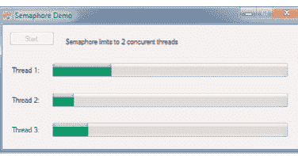

当你运行此演示时，你会发现尽管有三个任务想要执行工作，但由于信号量，只有两个可以同时运行。

## 使用事件信号线程

**场景/问题**：通常，线程需要等待某些重要事件发生后才能继续。

**解决方案**：事件是可用的最有用的信号机制之一。事件有两种类型：手动重置事件和自动重置事件。

设置事件会触发其他线程唤醒并继续执行工作。当设置 `ManualResetEvent` 时，所有等待的线程都会被唤醒，且事件将保持状态直到你手动对其进行重置。

`AutoResetEvent` 只导致一个线程被唤醒（从程序的角度来看是随机的），并且事件会立即重置。

查看随附源码中的 `EventDemo` 项目，该示例有效地展示了这种差异。与 `Semaphore` 演示类似，受保护的资源是进度条的更新。图 23.3 显示了这一过程。以下是源代码的一部分：

```csharp
public partial class Form1
{
    ManualResetEvent _manualResetEvent = new ManualResetEvent(false);
    AutoResetEvent _autoEvent = new AutoResetEvent(false);
    private ProgressBar[] _progressBars = new ProgressBar[3];
    private Thread[] _threads = new Thread[3];
    const int MaxValue = 1000000;
    bool _manual = true;

    public Form1()
    {
        InitializeComponent();
        Init();
    }

    private void Init()
    {
        _manualResetEvent.Reset();
        _autoEvent.Reset();
    }

    // ... 初始化 ProgressBar 代码 ...
    _progressBars[0] = progressBar1;
    _progressBars[1] = progressBar2;
    _progressBars[2] = progressBar3;

    for (int i = 0; i < 3; i++)
    {
        _progressBars[i].Minimum = 0;
        _progressBars[i].Maximum = MaxValue;
        _progressBars[i].Style = ProgressBarStyle.Continuous;
        _progressBars[i].Value = 0;
    }

    for (int i = 0; i < 3; i++)
    {
        if (_threads[i] != null)
        {
            _threads[i].Abort();
        }
        _threads[i] = new Thread(
            new ParameterizedThreadStart(ThreadProc));
        _threads[i].IsBackground = true;
        _threads[i].Start(i);
    }

    private void buttonSet(object sender, EventArgs e)
    {
        if (_manual)
        {
            _manualResetEvent.Set();
        }
        else
        {
            _autoEvent.Set();
        }
    }
}
```


# 第 23 章 线程、异步与并行编程

```cs
private void buttonReset_Click(object sender, EventArgs e)
{
    if (_manual)
    {
        _manualEvent.Reset();
    }
    else
    {
        _autoEvent.Reset();
    }
}

private void ThreadProc(object state)
{
    int threadNumber = (int)state;
    int value = 0;
    while (value < MaxValue)
    {
        // 工作逻辑
        UpdateProgress(threadNumber, value);
    }
}
```

```cs
Console.WriteLine("Exiting WriteLock on thread {0}", id);
_lock.ExitWriteLock();
Thread.Sleep(1000);
```

```cs
static void readThread(object state)
{
    int id = Thread.CurrentThread.ManagedThreadId;
    for (int i = 0; i < MaxValues; ++i)
    {
        _lock.EnterReadLock();
        Console.WriteLine("Entered ReadLock on thread {0}", id);
        StringBuilder sb = new StringBuilder();
        for (int j = 0; j < i; j++)
        {
            if (sb.Length > 0) sb.Append(", ");
            sb.Append(_array[j]);
        }
        Console.WriteLine("Array: {0} on thread {1}", sb, id);
        Console.WriteLine("Exiting ReadLock on thread {0}", id);
        _lock.ExitReadLock();
        Thread.Sleep(1000);
    }
}
```

这里是输出的一部分：
```
Entered WriteLock on thread 7
Added 25 to array on thread 7
Exiting WriteLock on thread 7
Entered ReadLock on thread 11
Entered ReadLock on thread 12
Array: 0, 1, 4, 9 on thread 12
Exiting ReadLock on thread 12
Array: 0, 1, 4, 9, 16 on thread 11
Exiting ReadLock on thread 11
Entered ReadLock on thread 13
Array: 0, 1, 4, 9 on thread 13
Exiting ReadLock on thread 13
```

注意，线程 11 和 12 能够同时获取读锁。

## 使用异步编程模型

**场景/问题：你的应用程序中有许多操作可以在后台完成。**

在许多 I/O 类中，你会发现一组常用的方法。例如，从流（streams）中你可以调用 `Read` 或 `BeginRead`。第一个是同步方法，在数据被读取之前不会返回。第二个会立即返回，让你的程序在从磁盘、网络或其他数据源读取文件时继续运行。

**解决方案：** 图 23.4 显示的 TextTokenizer 应用演示了如何使用这种编程方法。如果只使用同步方法，将无法与程序进行交互（即使只是关闭它！），但异步方法允许你的程序在 I/O 完成时对用户响应并执行其他任务。

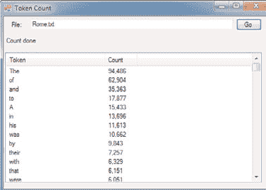

图 23.4

TextTokenizer 应用演示了异步文件读取，以及如何在你自己的类上实现异步的 `BeginXXX` 方法。

```cs
private void button_Click(object sender, EventArgs e)
{
    UpdateProgress("Reading file");
    FileStream inputStream = new FileStream(textBoxUrl.Text,
        FileMode.Open);
    _buffer = new byte[inputStream.Length];
    //将 inputStream 作为 "Done" 方法的参数传入
    IAsyncResult result = inputStream.BeginRead(buffer, 0,
        buffer.Length,
        FileReadDone,
        inputStream);
}
```

```cs
// IAsyncResult 对象可用于跟踪
// 在文件读取期间方法的进度，
// 我们可以做其他工作，比如点击按钮或退出程序
```

```cs
private void FileReadDone(IAsyncResult result)
{
    UpdateProgress("File read done");
    FileStream inputStream = result.AsyncState as FileStream;
    inputStream.Close();
    // ...
}
```

虽然异步编程对 I/O 非常有用，但你也可以为任何类型的操作实现它，例如下面这个执行单词计数的类：

```cs
using System;
using System.Collections.Generic;

namespace TextTokenizer
{
    struct WordCount
    {
        public string Word { get; set; }
        public int Count { get; set; }
    }

    class TokenCounter
    {
        delegate void CountDelegate();

        private string _data;
        private Dictionary<string, int> _tokens = new Dictionary<string, int>(StringComparer.CurrentCultureIgnoreCase);
        private List<WordCount> _wordCounts = new List<WordCount>();
        public IList<WordCount> WordCounts
        {
            get
            {
                return _wordCounts;
            }
        }

        public TokenCounter(string data)
        {
            _data = data;
        }

        public void Count()
        {
            //仅通过标准单词分隔符分割
            // 以保持简单
            char[] splitters = new char[]{
                ' ', ',', ':', '?', ';',
                ':', '-', '"', '!', '\\', '\t',
                '\n', '\r', '(', ')', '[',
                '{', '}', ']'
            };
            string[] words = _data.Split(splitters, StringSplitOptions.RemoveEmptyEntries);
            foreach (string word in words)
            {
                int count;
                if (!_tokens.TryGetValue(word, out count))
                {
                    _tokens[word] = 1;
                }
                else
                {
                    _tokens[word] = count + 1;
                }
            }

            foreach (KeyValuePair<string, int> pair in _tokens)
            {
                _wordCounts.Add(new WordCount
                {
                    Word = pair.Key,
                    Count = pair.Value
                });
            }

            _wordCounts.Sort((Comparison<WordCount>)((WordCount a, WordCount b) =>
            {
                return a.Count.CompareTo(b.Count);
            }));
        }

        public IAsyncResult BeginCount(AsyncCallback callback, object state)
        {
            CountDelegate countDelegate = Count;
            return countDelegate.BeginInvoke();
        }

        public void EndCount(IAsyncResult result)
        {
            //等待操作完成
            result.WaitOne();
        }
    }
}
```

# 第 24 章 反射与创建插件

- 枚举程序集
- 添加自定义特性
- 动态实例化类
- 动态调用方法

## 枚举程序集

反射通常是为了获取代码的信息。然而，使用反射 API，你可以动态地加载程序集，这为插件架构提供了一种简单的方法。

这段代码片段从程序集填充 `TreeView` 的类、属性、字段和事件：

```cs
private void ReflectAssembly(string filename)
{
    treeView.Nodes.Clear();
    Assembly assembly = Assembly.LoadFrom(filename);
    foreach (Type t in assembly.GetTypes())
    {
        TreeNode typeNode = new TreeNode("T") + " " + t.Name);
        treeView.Nodes.Add(typeNode);
        // 获取方法
        foreach (MethodInfo mi in t.GetMethods())
        {
            typeNode.Nodes.Add(new TreeNode("M") + " " + mi.Name));
        }
        // 获取属性
        foreach (PropertyInfo pi in t.GetProperties())
        {
            typeNode.Nodes.Add(new TreeNode("P") + " " + pi.Name));
        }
        // 获取字段
        foreach (FieldInfo fi in t.GetFields(BindingFlags.Instance | BindingFlags.NonPublic | BindingFlags.Public))
        {
            typeNode.Nodes.Add(new TreeNode("F") + " " + fi.Name));
        }
        // 获取事件
        foreach (EventInfo ei in t.GetEvents())
        {
            typeNode.Nodes.Add(new TreeNode("E") + " " + ei.Name));
        }
    }
}
```

```cs
//与其上述操作，你只需使用 t.GetMembers 来返回
//一个 MemberInfo 数组（上述所有内容的基类）
```

## 添加自定义特性

**场景/问题：你想为类、方法、属性、字段、事件或方法参数附加元数据。**

**解决方案：** 定义特性类。特性在 .NET 中被广泛使用。你已经在第 11 章“文件与序列化”中看到，要让类实现基本的序列化工作，只需在类定义上方添加 `[Serializable]` 特性即可。在第 12 章“网络与 Web”中，你看到方法上的特性定义了 WCF 服务接口。

然而，特性本身并没有神奇之处。它们所做的只是向其他代码附加元数据。这取决于你的代码如何提取这些元数据并进行处理。

下面的示例展示了一个简单的特性（我们在第 6 章“枚举”中使用过），它允许开发者向任何其他构造结构附加文化区域字符串。

```cs
//特性类名必须以 "Attribute" 结尾
[AttributeUsage(AttributeTargets.All, AllowMultiple=true)]
class CultureAttribute : Attribute
{
    string _culture;
    public string Culture
    {
        get
        {
            return _culture;
        }
    }
    public CultureAttribute(string culture)
    {
        _culture = culture;
    }
}
```

`AttributeTargets` 枚举允许你决定哪些目标对此属性是有效的。有效值包括 `Assembly`、`Module`、`Class`、`Struct`、`Enum`、`Constructor`、`Method`、`Property`、`Field`、`Event`、`Interface`、`Parameter`、`Delegate`、`ReturnValue`、`GenericParameter` 和 `All`。如果你想组合值，可以使用 `|` 运算符，例如：`AttributeTargets.Field | AttributeTargets.Property`。

你还可以通过 `AllowMultiple` 指定单个元素上可以使用多个属性实例。

要应用此属性，使用方括号：

```cs
[Culture("en-CA")]
[Culture("en-US")]
class MyClass
{
    //...
}
```

由于每个属性都以 "Attribute" 结尾，编译器允许你在命名时仅指定类的第一部分。

为了使用该属性，你必须编写感知 `CultureAttribute` 类并查找它的代码。

```csharp
[Culture("en-US")]
[Culture("en-GB")]
class Program
{
    static void Main(string[])
    {
        CultureAttribute[] attributes =
            (CultureAttribute[])typeof(Program).GetCustomAttributes(
                typeof(CultureAttribute), true);
        // 简单的逗号分隔列表
        string list =
            attributes.Aggregate("",
                (output, next) =>
                    (output.Length > 0)
                    ? (output + ", " + next.Culture)
                    : next.Culture);
        Console.WriteLine("Cultures of Program: {0}", list);
        Console.ReadLine();
    }
}
```

此示例产生输出：
```
Cultures of Program: en-US, en-GB
```

## 动态实例化类

**场景/问题：** 你想从一个动态加载的程序集中实例化类。

**解决方案：** 使用反射，可以从构建时未引用的程序集中实例化代码。假设你在 `DynamicInstantiateLib.dll` 中定义了一个类：

```csharp
public class TestClass
{
    public int Add(int a, int b)
    {
        return a + b;
    }
}
```


```csharp
}

public string CombineStrings<T>(T a, T b)
{
    return a.ToString() + " " + b.ToString();
}
}
```

在没有引用 `DynamicInstantiateLib.dll` 的另一个程序集中，你可以使用此代码创建 `TestClass` 的实例：

```csharp
Assembly assembly = Assembly.LoadFrom("DynamicInstantiateLib.dll");
Type type = assembly.GetType("DynamicInstantiate.TestClass");
object obj = Activator.CreateInstance(type);
```

由于你没有引用，因此无法使用实际类型来引用它。这似乎使得使用起来很困难，但有几种方法可以绕过这个问题，见下一节。

# 在动态实例化的类上调用方法

**场景/问题：** 你需要在动态实例化的类型上执行代码。

**解决方案：** 假设有以下代码，你有几种选择：

```csharp
Assembly assembly = Assembly.LoadFrom("DynamicInstantiateLib.dll");
Type type = assembly.GetType("DynamicInstantiate.TestClass");
object obj = Activator.CreateInstance(type);
```

## 方法 1

```csharp
// 调用 Add 方法
int result = (int)type.InvokeMember("Add", BindingFlags.Instance |
BindingFlags.Public, null, obj, new object[] { 1, 2 });
```

注意 `obj` 是一个实例方法。

## 方法 2

`InvokeMember` 不适用于泛型方法，这里是另一种方法（适用于 Add）：

```csharp
MethodInfo mi = type.GetMethod("CombineStrings");
MethodInfo genericMi = mi.MakeGenericMethod(typeof(double));
string combined = (string)genericMi.Invoke(obj, new object[] { 2, 5 });
```

## 方法 3

C# 4.0 新引入的新功能允许你可以使用 `dynamic` 类型在运行时调用方法，这本质上是之前方法的快捷方式：

```csharp
// 使用 dynamic 调用 Add 方法
dynamic testClass = Activator.CreateInstance(type);
result = testClass.Add(5, 6);
```

```csharp
// 使用 dynamic 调用 CombineStrings
combined = testClass.CombineStrings<double>(3, 4);
```

使用 `dynamic` 类型时不会获得 IntelliSense 智能提示，但这绝对比使用 `MethodInfo` 对象和 `Invoke` 调用要清晰得多。

注意：将类型检查推迟到运行时是有代价的，主要是会产生不可预见的错误。尽可能利用编译器强制的静态类型，仅在绝对必要时才使用动态类型。

# 实现插件架构

**场景/问题：** 你希望你的应用程序能够加载可选模块，这些模块通常由用户提供。

**解决方案：** 通过本章的所有原理加上一些小技巧，在 .NET 中为你的应用程序创建自己的插件系统是非常容易的（图 24.1）。


图 24.1 通过审慎地使用接口和反射实现插件架构。

## 创建共享程序集

首先，你需要一个插件和应用程序都可以引用的程序集。该程序集定义了插件必须实现的接口，以及你想让它们访问的任何公共代码。对于我们的简单示例，只有一个接口：

```csharp
public interface IImagePlugin
{
    System.Drawing.Image RunPlugin(System.Drawing.Image image);
    string Name { get; }
}
```

## 创建插件程序集

创建一个新的程序集，并引用之前包含 `IImagePlugin` 接口的程序集。然后定义此代码：

```csharp
// 一个让图像更蓝的简单插件
public class MakeBlue : IImagePlugin
{
    System.Drawing.Image RunPlugin(System.Drawing.Image image)
    {
        Bitmap bitmap = new Bitmap(image);
        // 让所有蓝色的更蓝
        for (int row = 0; row < bitmap.Height; ++row)
        {
            for (int col = 0; col < bitmap.Width; ++col)
            {
                // 使用 GetPixel 和 SetPixel 是很慢的
                Color color = bitmap.GetPixel(col, row);
                if (color.B > 0)
                {
                    color = Color.FromArgb(color.A, color.R, color.G, 255);
                }
                bitmap.SetPixel(col, row, color);
            }
        }
        return bitmap;
    }

    public string Name
    {
        get
        {
            return "Make Blue";
        }
    }
}
```

## 搜索插件

最后一步是发现、加载 DLL 并检查是否实现了该接口。如果是，则创建其实例并添加到菜单。以下代码是该功能的示例：

```csharp
public partial class Form1 : Form
{
    private Dictionary<string, IImagePlugin> _plugins = new Dictionary<string, IImagePlugin>();

    public Form1()
    {
        InitializeComponent();
        LoadPlugins();
    }

    private void LoadPlugins()
    {
        _plugins.Clear();
        string[] files = Directory.GetFiles("", "*.dll");
        foreach (string file in files)
        {
            try
            {
                Assembly assembly = Assembly.LoadFrom(file);
                foreach (Type type in assembly.GetTypes())
                {
                    if (typeof(IImagePlugin).IsAssignableFrom(type))
                    {
                        IImagePlugin plugin = (IImagePlugin)Activator.CreateInstance(type);
                        _plugins[plugin.Name] = plugin;
                    }
                }
            }
            catch (Exception)
            {
                // 忽略无法加载的程序集
            }
        }
        CreatePluginMenu();
    }

    private void CreatePluginMenu()
    {
        pluginMenuStrip.Items.Clear();
        foreach (var pair in _plugins)
        {
            var menuItem = new ToolStripMenuItem(pair.Key);
            menuItem.Click += (s, e) => ProcessImage(pair.Value);
            pluginMenuStrip.Items.Add(menuItem);
        }
    }

    private void ProcessImage(IImagePlugin plugin)
    {
        // 处理图像的逻辑
    }
}
```

# 第 25 章 应用模式与技巧

本章内容

- 使用停止器对代码进行性能分析
- 标记过时代码
- 将多个事件合并为单个事件
- 实现观察者（又称订阅者）模式
- 使用事件代理（Event Broker）
- 记住屏幕位置
- 使用命令对象实现撤销
- 在 WPF 中使用 Model-View-ViewModel
- 理解本地化
- Windows Forms 应用本地化
- ASP.NET 应用本地化
- WPF 应用本地化
- Silverlight 应用本地化
- 使用 ClickOnce 应用程序

虽然构建应用程序的方法无数种，但随着时间的推移，出现了一些可以重用的模式，这些模式在设计复杂程序时特别有用。本章仅涵盖了几个非常有用的模式。

与所有设计一样，实现这些模式没有单一的方法。在某些情况下，整体设计和思路比实现它们的特定代码更重要。

除了应用模式，还有一些构建应用程序时无法归类到其他地方的技巧。

## 使用停止器对代码进行性能分析

> **场景/问题：** 你需要测量某些代码运行所需的时间，特别是用于调试和分析时。

**解决方案：** 使用 `System.Diagnostics.Stopwatch` 类。

虽然有很多有很多扩展的性能分析包（Visual Studio 的某些版本包含了一个性能分析器），但有时你只需要用停止器对已知的代码块进行计时。

```csharp
System.Diagnostics.Stopwatch timer = new System.Diagnostics.Stopwatch();
timer.Start();
decimal total = 0;
int limit = 1000000;
for (int i = 0; i < limit; ++i)
{
    total = total + (decimal)Math.Sqrt(i);
}
timer.Stop();
Console.WriteLine("Sum of sqts: {0}", total);
Console.WriteLine("Elapsed milliseconds: {0}", timer.ElapsedMilliseconds());
Console.WriteLine("Elapsed time: {0}", timer.Elapsed);
```

这产生如下输出：
Sum of sqts: 666666166.45882210823608
Elapsed milliseconds: 282
Elapsed time: 00:00:00.2828692

当你需要使用停止器进行调试时，一个实用的技巧是利用 `IDisposable` 接口来自动化停止器的使用：

```csharp
class AutoStopwatch : System.Diagnostics.Stopwatch, IDisposable
{
    public AutoStopwatch()
    {
        Start();
    }

    public void Dispose()
    {
        Stop();
        Console.WriteLine("Elapsed: {0}", this.Elapsed);
    }
}
```

现在你可以利用 `using {}` 语法了：

```csharp
using (new AutoStopwatch())
{
    decimal total2 = 0;
    int limit2 = 1000000;
    for (int i = 0; i < limit2; ++i)
    {
        total2 = total2 + (decimal)Math.Sqrt(i);
    }
}
```

除了 `Start()` 和 `Stop()` 之外，还有 `Reset()`（它停止并将 `Elapsed` 设置为 0）以及 `Restart()`（它将 `Elapsed` 设置为 0，但让计时器继续运行）。

## 标记过时代码

> **场景/问题：** 你有一些“死”代码不再应该被使用，但由于有太多其他部分在使用它们，你无法删除它们。这在开发库时尤其是一个问题的问题。

**解决方案：** 用 `[Obsolete]` 属性标记方法或类。

编译器会向任何使用标记为过时的实体的人提供至少一个警告。你可以可选地为编译器提供一条消息进行显示：

```csharp
[Obsolete("Don't use this because...")]
class MyClass { }
```

你也可以让使用过时代码成为错误：

```csharp
[Obsolete("Don't use this because...", true)]
class MyClass { }
```

## 将多个事件合并为单个事件

**场景/问题：** 你有一个类，可以在短时间内产生大量事件。你的 UI 性能会受到这些额外开销的影响。

**解决方案：** 与其通知订阅者每次更新，不如将它们分组为一个事件。例如，假设你有一个正在更新的集合：

```csharp
class ItemAddedEventArgs<T> : EventArgs
{
    public List<T> Items { get; set; }

    public ItemAddedEventArgs(List<T> items)
    {
        Items = items;
    }
}

class MyCollection<T>
{
    private List<T> _data = new List<T>();
    public event EventHandler<ItemAddedEventArgs<T>> Added;
    private int _updateCount = 0;
    private List<T> _updatedItems = new List<T>();

    public void Add(T item)
    {
        _data.Add(item);
        if (!IsUpdating)
        {
            if (Added != null)
            {
                Added(this, new ItemAddedEventArgs<T>(new List<T> { item }));
            }
        }
        else
        {
            _updatedItems.Add(item);
        }
    }

    public bool IsUpdating
    {
        get
        {
            return _updateCount > 0;
        }
    }

    public void BeginUpdate()
    {
        // 保持计数计数以防多个客户端调用 BeginUpdate，
        // 或者它是递归调用的，请注意这
        // 不是线程安全的。
        _updateCount++;
    }

    public void EndUpdate()
    {
        --_updateCount;
        if (_updateCount == 0)
        {
            // 仅在我们完成所有更新后触发
            QueuedEvents();
        }
    }

    private void QueuedEvents()
    {
        if (_updatedItems.Count > 0)
        {
```


ItemAddedEventArgs<T> args = new ItemAddedEventArgs<T>();

foreach (T item in _updatedItems)
{
    args.Items.Add(item);
}

_updatedItems.Clear();

if (Added != null)
{
    Added(this, args);
}

现在客户端必须在添加项目之前调用 `BeginUpdate` 以利用此特性：

// 在 Form
```csharp
private void buttonBatch_Click(object sender, EventArgs e)
{
    _items = new MyCollection<int>();
    _items.Added += new EventHandler<ItemAddedEventArgs<int>>(_items_ItemsAdded);
    _items.BeginUpdate();
    GenerateItems();
    _items.EndUpdate();
}
```

```csharp
void _items_ItemsAdded(object sender, ItemAddedEventArgs<int> e)
{
    listViewOutput.BeginUpdate();
    foreach (var i in e.Items)
    {
        listViewOutput.Items.Add(i.ToString());
    }
    listViewOutput.EndUpdate();
}
```

节省的时间可能是巨大的。参考包含源代码中的 `BatchEvents` 示例程序以查看差异。在我的机器上，非批量的版本花费了近 6 秒，而批量处理的版本不到一秒。

## 实现观察者（又称订阅者）模式

场景/问题：你希望组件 A 能够收到另一个组件 B 的更新通知，而不使用 .Net 事件。

### 解决方案

虽然大多数通知系统使用 .Net 事件进行通信，但在某些情况下，你希望实现程度更高的解耦。为此，.Net 4 提供了两个接口来辅助实现这种常见的设计模式。

使用 `IObserver<T>` 和 `IObservable<T>` 接口。

`IObservable<T>` 接口实现在提供数据供他人消费的类中。

```csharp
class DataGenerator : IObservable<int>
{
    private List<IObserver<int>> _observers = new List<IObserver<int>>();
    private int _lastPrime = -1;

    // 继承自 IObservable<T>
    public IDisposable Subscribe(IObserver<int> observer)
    {
        _observers.Add(observer);
        observer.OnNext(_lastPrime);
        return observer as IDisposable;
    }

    // 通知所有订阅者新数据
    private void NotifyData(int n)
    {
        foreach (IObserver<int> observer in _observers)
        {
            observer.OnNext(n);
        }
    }

    // 通知所有订阅者不再有数据产生
    private void NotifyComplete()
    {
        foreach (IObserver<int> observer in _observers)
        {
            observer.OnCompleted();
        }
    }

    private static Random rand = new Random();

    // 让我们生成一些任意数据
    public void Run()
    {
        for (int i = 0; i < 100; ++i)
        {
            int n = rand.Next(1, Int32.MaxValue);
            if (IsPrime(n))
            {
                _lastPrime = n;
                NotifyData(n);
            }
            NotifyComplete();
        }
    }

    private static bool IsPrime(Int32 number)
    {
        // 检查奇偶性
        if (number % 2 == 0)
        {
            if (number == 2)
                return true;
            return false;
        }

        // 不需要检查超过平方根
        Int32 max = (Int32)Math.Sqrt(number);
        for (Int32 i = 3; i <= max; i += 2)
        {
            if ((number % i) == 0)
            {
                return false;
            }
        }
        return true;
    }
}
```

`IObserver<T>` 实现在想要感知 `IObservable<T>` 生成类更新的类中。

```csharp
class DataObserver : IObserver<int>
{
    // 给它一个名字，以便在输出中区分它
    private string _name = "Observer";

    #region IObserver<int> 成员
    public void OnCompleted()
    {
        Console.WriteLine(_name + ":Completed");
    }

    public void OnError(Exception error)
    {
        Console.WriteLine(_name + " : Error");
    }

    public void OnNext(int value)
    {
        Console.WriteLine(_name + " :Generated data {0}", value);
    }
    #endregion

    public DataObserver(string observerName)
    {
        _name = observerName;
    }
}
```

要将它们结合起来，只需将观察者订阅到数据生成器：

```csharp
DataGenerator generator = new DataGenerator();
DataObserver observer1 = new DataObserver("01");
DataObserver observer2 = new DataObserver("02");

generator.Subscribe(observer1);
generator.Subscribe(observer2);
generator.Run();
```

输出内容如下：

```
01:Generated data -1
02:Generated data -1
01:Generated data 597759749
02:Generated data 597759749
01:Generated data 369128117
02:Generated data 369128117
01:Generated data 650236453
02:Generated data 650236453
01:Generated data 2143508953
02:Generated data 2143508953
01:Generated data 298906169
02:Generated data 298906169
01:Generated data 1296076711
02:Generated data 1296076711
01:Generated data 1970737339
02:Generated data 1970737339
01:Completed
02:Completed
Press any key to exit...
```

## 使用事件代理

场景/问题：你有两个必须响应对方事件的无关组件。你不希望它们直接互相引用。

### 解决方案

事件代理仅仅是一个充当中间人的对象，用于处理从任何对象到任何其他对象的任意数量事件。在某种意义上，这是将观察者模式（见上一节）更进一步。

这里是一个简单的事件代理实现：

```csharp
public class EventBroker
{
    Dictionary<string, List<Delegate>> _subscriptions = new Dictionary<string, List<Delegate>>();

    public void Register(string eventId, Delegate method)
    {
        if (!_subscriptions.ContainsKey(eventId))
        {
            _subscriptions[eventId] = new List<Delegate>();
        }
        _subscriptions[eventId].Add(method);
    }

    public void Unregister(string eventId, Delegate method)
    {
        if (_subscriptions.ContainsKey(eventId))
        {
            _subscriptions[eventId].Remove(method);
        }
    }

    public void Publish(string eventId)
    {
        if (_subscriptions.ContainsKey(eventId))
        {
            foreach (Delegate del in _subscriptions[eventId])
            {
                del.Invoke();
            }
        }
    }

    public void Publish(string eventId, params object[] args)
    {
        if (_subscriptions.ContainsKey(eventId))
        {
            foreach (Delegate del in _subscriptions[eventId])
            {
                del.Invoke(args);
            }
        }
    }
}
```

## 记住屏幕位置

场景/问题：你希望应用程序记住它在屏幕上的位置，并在下次运行时恢复到该位置。

### 解决方案

虽然这个任务很简单，但你需要考虑到，当你恢复应用程序时，之前在屏幕上的内容可能不再位于屏幕上。例如，用户可能会重新排列多显示器方案，或者仅仅将屏幕分辨率更改为更小的值。

屏幕位置应该是用户特定的。对于以下示例，在标准的 Settings.settings 文件中（见第 16 节，“Windows Forms”）创建了用户设置。

```csharp
public partial class Form1 : Form
{
    public Form1()
    {
        InitializeComponent();
    }

    protected override void OnLoad(EventArgs e)
    {
        base.OnLoad(e);
        RestoreLocation();
    }

    private void RestoreLocation()
    {
        Point location = Properties.Settings.Default.FormLocation;
        Size size = Properties.Settings.Default.FormSize;

        // 确保位置位于显示器上
        bool isOnScreen = false;
        foreach (Screen screen in Screen.AllScreens)
        {
            if (screen.WorkingArea.Contains(location))
            {
                isOnScreen = true;
            }
        }

        // 如果我们的窗口不可见，将其放在主显示器上
        if (!isOnScreen)
        {
            this.SetDesktopLocation(
                Screen.PrimaryScreen.WorkingArea.Left,
                Screen.PrimaryScreen.WorkingArea.Top);
        }

        // 如果尺寸太小，则重置为默认值
        if (size.Width < 10 || size.Height < 10)
        {
            Size = new Size(300, 300);
        }
    }

    private void SaveLocation()
    {
        // 这些是在 Properties\Settings.settings 文件
        // 中创建的用户设置
        Properties.Settings.Default.FormLocation = this.Location;
        Properties.Settings.Default.FormSize = this.Size;
        Properties.Settings.Default.Save();
    }

    protected override void OnClosing(CancelEventArgs e)
    {
        base.OnClosing(e);
        SaveLocation();
    }
}
```

请参考随附源代码中的 `SaveScreenLocation` 项目，以查看此代码的实际应用。

## 使用命令对象实现撤销

**场景/问题：** 你希望在应用程序中能够撤销命令。

**解决方案：** 大多数允许用户编辑内容的程序都具有让用户能够撤销上一个操作的能力。本节演示了一个允许撤销功能的简单小部件应用程序（见图 25.1）。

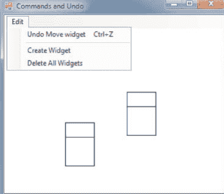

图 25.1 此简单的应用程序允许用户撤销移动、创建和删除。

实现此功能最流行的方法是使用知道如何自我撤销的命令对象。程序中每个可能的操作都由一个命令对象表示。

> **注意** 用户在你的应用程序中可以执行的所有操作并不需要都是命令。例如，移动光标和更改当前选择项通常不被视为操作。通常，可撤销的命令应该是那些更改用户数据的命令。

### 定义命令接口和历史缓冲区

这里有一个可能的接口：

```csharp
interface ICommand
{
    void Execute();
    void Undo();
    string Name { get; }
}
```

我们还需要一种方法按照命令执行的顺序来跟踪所有的命令：


# 第 25 章 应用程序模式与技巧

## 在 WPF 中使用 Model-View-ViewModel

**场景/问题：** 你希望在 WPF 中将 UI 与底层数据和行为分离。

**解决方案：** 随着 WPF 流行度的提高，Model-View-ViewModel 模式作为 Model-Presenter 的变体出现出来，它与 WPF 的绑定系统配合得非常好。

ViewModel 解决了将 WPF 控件与不感知 UI 的数据对象相关联的问题。它将数据对象映射到 WPF 可以绑定的数据上。例如，数据库中的颜色代码可以翻译为视图使用的 `Brush`。接下来的章节将逐部分处理这些每个部分。

图 25.2 显示了示例应用程序，它具有数据的两种视图：所有控件的列表和单个控件的视图。

### 定义 Model

在这种情况下，我们将仅使用内存中的对象，但你也可以同样地连接到数据库、Web 服务器或文件。

```csharp
enum WidgetType
{
    TypeA,
    TypeB
}

class Widget
{
    public int Id { get; set; }
    public string Name { get; set; }
    public WidgetType WidgetType { get; set; }

    public Widget(int id, string name, WidgetType type)
    {
        this.Id = id;
        this.Name = name;
        this.WidgetType = type;
    }
}

class WidgetRepository
{
    public event EventHandler<EventArgs> WidgetAdded;
    protected void OnWidgetAdded()
    {
        if (WidgetAdded != null)
        {
            WidgetAdded(this, EventArgs.Empty);
        }
    }

    private List<Widget> _widgets = new List<Widget>();

    public ICollection<Widget> Widgets
    {
        get { return _widgets; }
    }

    public Widget this[int index]
    {
        get { return _widgets[index]; }
    }

    public WidgetRepository()
    {
        CreateDefaultWidgets();
    }

    public void AddWidget(Widget widget)
    {
        _widgets.Add(widget);
        OnWidgetAdded();
    }

    private void CreateDefaultWidgets()
    {
        AddWidget(new Widget(1, "Awesome widget", WidgetType.TypeA));
        AddWidget(new Widget(2, "Okay widget", WidgetType.TypeA));
        AddWidget(new Widget(3, "So-so widget", WidgetType.TypeB));
        AddWidget(new Widget(4, "Horrible widget", WidgetType.TypeB));
    }
}
```

如你所见，此数据模型没有任何与 WPF 相关的概念。

### 定义 ViewModel

因为此应用程序中会有多个 ViewModel 类，并且它们具有一些共同功能，让我们定义一个基类吧：

```csharp
abstract class BaseViewModel : INotifyPropertyChanged
{
    private string _displayName = "Unknown";

    public string DisplayName
    {
        get { return _displayName; }
        set
        {
            _displayName = value;
            OnPropertyChanged("DisplayName");
        }
    }

    protected BaseViewModel(string displayName)
    {
        this.DisplayName = displayName;
    }

    #region INotifyPropertyChanged Members

    public event PropertyChangedEventHandler PropertyChanged;

    #endregion

    protected void OnPropertyChanged(string propertyName)
    {
        if (PropertyChanged != null)
        {
            PropertyChanged(this, new PropertyChangedEventArgs(propertyName));
        }
    }
}
```

WPF 使用 `INotifyPropertyChanged` 接口来知道何时更新绑定到这些 ViewModel 对象的视图。

第一个具体的 ViewModel 是 `WidgetViewModel`：

```csharp
class WidgetViewModel : BaseViewModel
{
    private Widget _widget;

    public int Id { get { return _widget.Id; } }
    public string Name { get { return _widget.Name; } }
    public string WidgetType
    {
        get { return _widget.WidgetType.ToString(); }
    }

    public WidgetViewModel(Widget widget)
        : base("Widget")
    {
        _widget = widget;
    }
}
```

另一个 ViewModel 是用于显示所有 `Widget` 对象列表的视图：

```csharp
class AllWidgetsViewModel : BaseViewModel
{
    private WidgetRepository _widgets;
    // 此视图集合供视图使用
    // 以其认为任何的方式进行显示
    public ObservableCollection<WidgetViewModel> Widgets { get; set; }

    public AllWidgetsViewModel(WidgetRepository widgets)
    {
        _widgets = widgets;
        Widgets = new ObservableCollection<WidgetViewModel>();
        foreach (var widget in _widgets.Widgets)
        {
            Widgets.Add(new WidgetViewModel(widget));
        }
        _widgets.WidgetAdded += (s, e) =>
        {
            // 在实际应用中，你将找到新控件并添加它
            // 为了简单起见，这里我们只需刷新或跳过
        };
    }
}
```

现在我们可以定义 `MainViewViewModel`：

```csharp
class MainViewViewModel : BaseViewModel
{
    private WidgetRepository _widgets = new WidgetRepository();
    private int _nextId = 5;

    // 当使用 MVVM 时，这里不是 RoutedUICommand
    public DelegateCommand ExitCommand { get; private set; }
    public DelegateCommand OpenAllWidgetsListCommand { get; private set; }
    public DelegateCommand ViewWidgetCommand { get; private set; }
    public DelegateCommand AddWidgetCommand { get; private set; }

    public ObservableCollection<BaseViewModel> OpenViews { get; private set; }

    public MainViewViewModel()
        : base("MVVM Demo")
    {
        ExitCommand = new DelegateCommand(executeDelegate => OnClose());
        OpenAllWidgetsListCommand =
            new DelegateCommand(executeDelegate => OpenAllWidgetsList());
        ViewWidgetCommand =
            new DelegateCommand(executeDelegate => ViewWidget());
        AddWidgetCommand =
            new DelegateCommand(executeDelegate => AddNewWidget());

        OpenViews = new ObservableCollection<BaseViewModel>();
    }

    public event EventHandler<EventArgs> Close;

    protected void OnClose()
    {
        if (Close != null)
        {
            Close(this, EventArgs.Empty);
        }
    }

    private void OpenAllWidgetsList()
    {
        OpenViews.Add(new AllWidgetsViewModel(_widgets));
    }

    private void ViewWidget()
    {
        OpenViews.Add(new WidgetViewModel(_widgets[0]));
    }
}
```


```cs
private void AddNewWidget()
{
    _widgets.AddWidget(new Widget(_nextId++,
        "New Widget",
        WidgetType.TypeA));
}
```

现在只需将 `MainView` 的部分绑定到 `ViewModel` 的属性上（参见列表 25.3）。

# 列表 25.3 MainWindow.xaml

```xml
<Window x:Class="MVVMDemo.MainWindow"
    xmlns="http://schemas.microsoft.com/winfx/2006/xaml/presentation"
    xmlns:x="http://schemas.microsoft.com/winfx/2006/xaml"
    xmlns:local="clr-namespace:MVVMDemo"
    Title="{Binding DisplayName}" Height="377" Width="627">
<Window.Resources>
    <DataTemplate x:Key="TabControlTemplate">
        <TextBlock Text="{Binding DisplayName}" />
    </DataTemplate>
    <!-- 这些模板告诉 WPF 现在 
        显示我们的 ViewModel 类。---->
    <DataTemplate DataType="{x:Type local:AllWidgetsViewModel}">
        <local:AllWidgetsView/>
    </DataTemplate>
    <DataTemplate DataType="{x:Type local:ViewModel}">
        <local:WidgetGraphicView/>
    </DataTemplate>
</Window.Resources>
<Grid>
    <Grid.ColumnDefinitions>
        <ColumnDefinition Width="150"/>
        <ColumnDefinition Width="*"/>
    </Grid.ColumnDefinitions>
    <StackPanel Grid.Column="0">
        <Button x:Name="buttonViewGrid"
            Margin="5" Command="{Binding Path=OpenWidgetsListCommand}" 查看所有 (详情)
```

# 列表 25.3 MainWindow.xaml (续)

```xml
</Button>
<Button x:Name="buttonViewSingle"
    Margin="5" Command="Binding
    Path=ViewWidgetCommand">查看组件</Button>
<Button x:Name="buttonAddWidget"
    Margin="5" Command="Binding
    Path=AddWidgetCommand">添加新组件</Button>
<Button x:Name="buttonExit" Margin="5" Command="Binding
    Path=ExitCommand">退出</Button>
</StackPanel>
<TabControl HorizontalAlignment="Stretch" Name="tabControl1"
    VerticalAlignment="Stretch" Grid.Column="1"
    ItemsSource={Binding Path=OpenViews}
    ItemTemplate={StaticResource TabControlTemplate}>
</TabControl>
</Grid>
</Window>
```

行 `xmlns:local="clr-namespace:MVVMDemo"` 将 .NET 命名空间引入 XML 命名空间 local，这样就可以用它来引用 XAML 中的控件。

要查看其运行效果，请查看随附源码中的 `MVVMDemo` 项目。

> MVVM 的关键点是让视图完全关注数据的外观，而永远不要关注行为。理想情况下，视图应该是完全即插即用的，唯一的工作就是将绑定连接到 `ViewModel`。

此外，将所有行为与 GUI 分离允许你进行更完备的单元测试。`ViewModel` 不在乎使用何种类型的视图——它可以是一个测试其功能的务实型“视图”。

# 理解本地化

场景/问题：你希望你的程序被翻译成多种语言。

解决方案：关于数字和字符串的章节涵盖了这些项目在不同文化下的显示情况。要在不同的文化中显示程序的 UI 需要更多工作，且该过程取决于你所使用的技术。

# 本地化 Windows Forms 应用程序

> **注意** .Net 中，文化（culture）适用于线程。每个线程实际上有两个文化设置：文化和 UI 文化。

文化根据你的区域格式自动确定的。在 Windows 中，这在控制面板 | 区域和语言中设置。

（注：原文后续部分存在大量重复的错误文本，已按要求仅翻译核心逻辑内容）

# 本地化 WPF

## 565

1. 为每个目标语言创建额外的资源文件，例如：`Default.aspx.it.resx`、`Default.aspx.fr-CA.resx`。你可以复制原始文件并重命名它，以预填充所有的键和值。

2. 翻译每个本地化资源文件。

若要创建一个全局资源文件（不针对特定的 ASPX 文件），请遵循以下步骤：

1. 右键点击项目，选择“添加 ASP.Net 文件夹”，然后选择 `App_GlobalResources`。

2. 在 `App_GlobalResources` 中添加一个新的资源文件（例如 `GlobalResources.resx`）。

3. 向文件中添加适当的值（在此情况下，只需添加名为 `Message` 的字符串）。

4. 将文件复制为本地化版本，例如 `GlobalResources.it.resx`。

5. 在你的 ASPX 文件中，添加如下代码来引用值 `Message`：

```aspx
<asp:TextBox ID="Textbox1" runat="server"
    Text="<% GlobalResources, Message %>"
    meta:resourceKey="Textbox1" />
```

测试 Web 应用程序时，确保页面的 `Culture` 和 `uiCulture` 值设置为 `Auto`（默认值）：

```aspx
@Page Language="C#" AutoEventWire="true" CodeFile="Default.aspx.cs" Inherits="_Default" meta:resourcekey="PageResource1" uiCulture="Auto" Culture="Auto" %>
```

然后将浏览器语言设置为你想测试的语言，并确保它位于列表顶端。大多数网络浏览器允许你按偏好顺序指定语言。

在 Explorer 8 中，转到 工具 | 选项 | 通用 | 语言。

在 Firefox 中，转到 工具 | 选项 | 内容 | 语言 | 选择....

# 本地化 WPF 应用程序

本地化 WPF 应用程序有两种方法：使用 XAML 和使用资源与数据绑定。遗憾的是，与 Windows Forms 应用程序相比，目前在 WPF 中进行本地化是一项艰苦的工作。表 25.1 强调了这两种方法的优缺点。

# 第 25 章 模式与提示

## 表 25.1 WPF 本地化技术的优缺点

| 优点 | 缺点 |
|---|---|
| XAML | 本地化完全独立于开发过程 | 没有简单的方法在 UI 更新时重复此过程，除非你非常擅长版本控制 |
| | 比数据绑定更高效 | 该工具不受支持 |
| | | 难以与资源文件集成 |
| | 易于修改 CSV 文件 | 无 Visual Studio 支持 |
| 资源和数据绑定 | 数据绑定简单且 WPF 开发者易理解 | 无类型转换。你必须手动将每个 XAML 元素映射到资源 |
| | 绑定是强类型的并由...检查 | |
| | 在依赖属性上工作 | |
| | 资源相对容易管理，且与其他 .Net 平台类似 | 某些工具（如 Blend）尚未从卫星程序集中加载资源（目前） |

# XAML 本地化

若要使用 XAML 方法本地化你的 WPF 应用程序，请遵循以下步骤：

1. 手动编辑项目文件，并在 `<PropertyGroup>` 节下添加 `<Culture>en-US</Culture>`。

2. 在你的 `AssemblyInfo.cs` 文件中添加此行：

`[assembly: NeutralResourcesLanguageAttribute("en-US", UltimateResourceFallbackLocation.Satellite)]`

3. 打开命令提示符并导航到项目目录。运行命令：

`msbuild /t:updateuid`

这将为每个 WPF 元素生成一个 UID，在此过程中修改你的 XAML 文件。你不应该手动编辑这些 UID。

> 注意：`msbuild` 位于 .Net 框架中，可以通过 Visual Studio 安装的快捷方式启动命令提示符来运行它；这将初始化正确的环境设置以访问 .NET Framework 二进制文件。

4. 重建项目。输出目录将出现一个名为 en-US 的目录。该目录包含资源 DLL。

5. 从 Windows SDK 获取 `LocBam` 工具。在你的电脑上，它被封装在 `C:\Program Files\Microsoft SDKs\v7.0\Samples\WPFSamples.zip` 中。为了让它在 .Net 4 中运行，我不得不从头创建一个项目并将目标框架更改为 .Net 4.0。当你读这里时，该工具可能开箱即用。然而，微软并未正式支持该工具。（你开始对这种方法感到紧张了吗？）

6. 将 `CopyBaml.exe`、生成的 DLL 以及你的应用程序可执行文件复制并在提示符中运行此命令：

`locbaml.exe /parse myapp.resources.dll /out:translate_en-US.csv`

7. 将 `translate_en-US.csv` 文件重命名为不同的名称，取决于你的目标语言，例如 `translate_it.csv`、`translate_fr-CA.csv`。

8. 使用可以编辑的程序（如任何文本编辑器或 Excel）打开 csv 文件并将文本翻译成目标语言。你也可以修改文件路径（如果为不同语言准备了不同的图像）。

> 重要的是意识到 UI 文本之外还有其他字段。将文件交给翻译人员时，你可能需要指定哪些字段需要翻译。

9. 为本地化 DLL 创建新目录，例如 "it-IT"。

10. 通过运行以下命令创建本地化资源 DLL：

```
locbaml.exe /generate myapp.resources.dll
/trans: translate_it-IT.csv /out .:it-IT /cul:it-IT
```

将资源目录复制到输出目录，紧邻现有的 en-US。如果你想查看差异，可以在应用程序启动时添加一些代码，将 UI 设置为意大利。

```cs
public App()
{
    InitializeComponent();

    // 设置语言
    Thread.CurrentCulture = new CultureInfo("it-IT");
    Thread.CurrentUICulture = new CultureInfo("it-IT");
}
```

这要简单得多，但在你开发 UI 时确实需要更多思考。此外，你无法直接绑定，不用说字符串了。例如，要在 XAML `Image` 控件中使用资源中的图像，你可以这样操作：

#

# 资源文件本地化

与其经历所有这些，你可以像使用 Windows Forms 一样使用资源文件。

- 创建全局资源文件并向其中添加字符串，例如。

- 复制并重命名为所需的语言，例如 `Resources.IT.resx`。（确保该文件与 `Resources.resx` 位于同一目录下）

构建项目应会在输出目录下创建一个特定语言的目录。

在需要使用本地化资源的窗口中创建一个 XML 命名空间 `Properties`：

```xml
xmlns:props="clr-namespace:LocWPFResources.Properties"
```

使用数据绑定将资源附加到 XAML 控件：

```xml
<Label x:Name="labelName" Grid.Row="0" Grid.Column="0"
    Content="{StaticResource props.labelName}" />
```

这要简单得多，但在你开发应用程序 UI 时确实需要更多思考。此外，你无法直接绑定，不用说字符串了。

# 本地化 Silverlight

Silverlight 中的本地化资源与上述资源文件方法非常相似。

- 在创建 Silverlight 项目后，添加一个名为 `Resources.resx` 的新资源文件（这是默认资源文件）。Visual Studio 还会创建一个类来访问这些资源。

- 为你需要的每种语言添加一个资源文件，在文件名中包含适当的语言代码，例如 `Resources.it.resx` 或 `Resources.fr-CA.resx`。

- 在项目属性中，转到 Silverlight 选项卡，点击程序集信息（Assembly Information）按钮。为项目选择中性语言（在我的示例中，这是英语，无特定国家）。

- 现在，通过在解决方案管理器中右键点击项目并选择“卸载项目”（Unload Project），手动编辑项目文件。再次右键点击项目并选择“编辑项目.csproj”。

- 编辑 `<SupportedCultures />` 标签以包含你需要的非默认语言。例如：

```xml
<SupportedCultures>it;fr-CA</SupportedCultures>
```

- 保存并关闭文件。

- 在解决方案管理器中右键点击项目并选择“重新加载项目”（Reload Project）来重新加载项目。

- 相应地修改每个资源文件，提供每个资源的翻译版本。确保每个资源的访问修饰符为 `public`（公有）。

- 将 Visual Studio 生成的封装类在另一个类中：

```csharp
// 为了 Silverlight 能够绑定到资源，我们需要将
// 封装在另一个类中
public class LocResources
{
    public LocResources()
    {
        private static LocSilverlight.Resources resource = new Resources();
    }
    public LocSilverlight.Resources Resource
    { get { return resource; } }
}
```

- 在 `App.xaml` 的 `Application.Resources` 部分添加对封装类的引用：

```xml
<Application xmlns="http://schemas.microsoft.com/winfx/2006/xaml/presentation"
             xmlns:x="http://schemas.microsoft.com/winfx/2006/xaml"
             xmlns:local="clr-namespace:LocSilverlight"
             x:Class="LocSilverlight.App">
  <Application.Resources>
    <Local:LocResources x:Key="LocResources" />
  </Application.Resources>
</Application>
```

11. 将 UI 元素绑定到资源：


```xml
<UserControl x:Class="LocSilverlight.MainPage"
             xmlns="http://schemas.microsoft.com/winfx/2006/xaml"
             xmlns="presentation"
             xmlns:x="http://schemas.microsoft.com/winfx/2006/xaml"
             xmlns:d="http://schemas.microsoft.com/expression/blend/2008"
             xmlns:mc="http://schemas.microsoft.com/xml/formats/org/markup-compatibility/2006"
             xmlns:namespace="clr-namespace:System.Windows.Controls;assembly=System.Windows.Controls.Data"
             mc:DesignHeight="220" d:DesignWidth="243">
  <Grid x:Name="LayoutRoot" Background="White" Height="181" Width="183">
    <Label Name="LabelMessage"
           Content="{Binding Path=Resource.Message Source={StaticResource LocResources}}"
           Height="50"
           Width="100"
           Margin="12,12,0,0"
           HorizontalAlignment="Left"
           VerticalAlignment="Top"/>
    <Button Name="button1"
            Height="23"
            Width="75"
            Margin="37,76,0,0"
            HorizontalAlignment="Left"
            VerticalAlignment="Top"
            Content="{Binding Path=Resource.buttonExit Source={StaticResource LocResources}}"/>
  </Grid>
</UserControl>
```

12. 通过编辑 Web 项目中的 HTML 或 ASPX 文件来不同语言测试应用程序，在 `<object>` 标签中包含以下行：

```html
<object ...>
...
<param name="culture" value="it-it" />
<param name="uiculture" value="it-it" />
...
</object>
```

> **注意** 请运行 Web 项目而不是 Silverlight 项目，这样可以使用编辑过的 HTML/ASPX 文件。否则，Visual Studio 将生成一个，其中不包含语言标签。

请参考代码中的 `LocSilverlight` 项目查看完整示例。

# 使用 OnceClick 部署应用程序

| 场景/问题：你想通过 Web 部署应用程序，且过程非常简单。 |

**解决方案**：使用 OnceClick 部署。以下是步骤：

1. 在解决方案管理器中右键点击项目并选择属性。
2. 点击安全（`Security`）选项卡。
3. 勾选 OnceClick 安全设置框。
4. 选择适当的信任级别。部分信任将限制应用程序访问计算机的大资源（例如文件系统）。
5. 选择应用程序安装的区域。
6. 点击发布（`Publish`）选项卡（见图 25.3）。
7. 选择要发布设置文件的文件夹。
8. 选择是否将应用程序安装到本地并在开始菜单可用。
9. 点击选项（`Options`）。
10. 选择部署（`Deployment`）。
11. 输入一个部署网页，例如 `publish.htm`。

25.5 显示了 Visual Studio 中的发布设置。

设置好选项后，你可以右键点击项目并选择发布。

要运行应用程序，请导航到 HTML 并点击。.NET 运行时将允许你

## 解决方案：虽然 .NET 了一些基础硬件信息，但可以使用 Windows 管理体系结构 (WMI) 功能检索更多信息。

```csharp
using System;
using System.Management;
using System.Windows.Forms;

namespace HardwareInfo
{
    class Program
    {
        static void Main(string[] args)
        {
            /*WMI 硬件类中提供了丰富的硬件信息。
            访问 http://msdn.microsoft.com/en-us/library/a389273.aspx */
            Console.WriteLine("Machine: {0}", Environment.MachineName);
            Console.WriteLine("# of processors (logical): {0}",
Environment.ProcessorCount);
            Console.WriteLine("# of processors (physical): {0}",
CountPhysicalProcessors());
            Console.WriteLine("RAM installed: {0:N0} bytes",
CountPhysicalMemory());
            Console.WriteLine("Is OS 64-bit? {0}",
Environment.Is64BitOperatingSystem());
            Console.WriteLine("Is process 64-bit? {0}",
Environment.Is64BitProcess());
            Console.WriteLine("Little-endian: {0}",
BitConverter.IsLittleEndian());

            foreach (Screen screen in System.Windows.Forms.Screen.AllScreens)
            {
                Console.WriteLine("Screen {0}", screen.DeviceName);
                Console.WriteLine("tPrimary {0}", screen.Primary);
                Console.WriteLine("tBounds: {0}", screen.Bounds);
                Console.WriteLine("tWorking Area: {0}",
screen.WorkingArea);
                Console.WriteLine("tBitsPerPixel: {0}",
screen.BitsPerPixel);
            }
            Console.ReadKey();
        }
    }
}
```

## 第 26 章 与操作系统和硬件交互

```csharp
private static UInt32 CountPhysicalProcessors()
{
    //你必须添加 System.Management 程序集的引用
    ManagementObjectSearcher objects =
        new ManagementObjectSearcher(
        "SELECT * FROM Win32_ComputerSystem");
    ManagementObjectCollection coll = objects.Get();
    foreach (ManagementObject obj in coll)
    {
        return (UInt32)obj["NumberOfProcessors"];
    }
    return 0;
}
```

```csharp
private static UInt64 CountPhysicalMemory()
{
    ManagementObjectSearcher objects =
        new ManagementObjectSearcher(
        "SELECT * FROM Win32_PhysicalMemory");
    ManagementObjectCollection coll = objects.Get();
    UInt64 total = 0;
    foreach (ManagementObject obj in coll)
    {
        total += (UInt64)obj["Capacity"];
    }
    return total;
}
```

> **注意** 如果你构建 .NET 应用程序，可以指定目标平台：Any x86、x64 或 Itanium。选择 Any 时，同一个可执行文件将在任何操作系统上运行，并在 64 位操作系统上以 64 位运行，在 32 位操作系统上以 32 位运行。即使在 64 位操作系统上也需要保持 32 位，也需要指定 x86 作为目标。这对于与未托管代码或使用特定平台目标编译的其他托管库进行互操作至关重要。请参阅本章节后面的“确保您的应用程序在 32 位和 64 位环境中均运行”部分，了解如何确保您的应用在所有环境中运行，以及从 C# 用 32 位未托管 DLL 的示例。

## 调用 UAC 以请求管理员权限

**场景/问题：** 你需要以特权权限启动应用程序。

解决方案：从 Windows Vista 开始，默认禁止应用程序以管理员权限运行。尝试执行需要管理员访问的操作将导致系统对话框请求确认，并且对于权限较低的用户可能还会要求输入密码。此功能由两部分组成：

- 一个特殊的图标，指示将调用用户账户控制 (UAC)。
- 在提权进程中执行操作。

该图标本身不具备任何功能，且 .NET 对其没有提供直接支持。你可以通过向实现此功能的 `Button` 控件按钮类发送消息来开启它：

```csharp
public class UACButton : Button
{
    private bool _showShield = false;
    public bool ShowShield
    {
        get {
            return _showShield;
        }
        set {
            bool needToShow = value && !IsElevated();
            //在 lParam 中传递 1 表示 true
            if (this.Handle != IntPtr.Zero) {
                Win32.SendMessage(new HandleRef(this.Handle), Win32.BCM_SETSHIELD, new IntPtr(0), new IntPtr(needToShow ? 1 : 0));
                _showShield = needToShow;
            }
        }
    }

    // 如果我们已经提权，则不需要再次提权
    private bool IsElevated()
    {
        WindowsIdentity identity = WindowsIdentity.GetCurrent();
        WindowsPrincipal principal = new WindowsPrincipal(identity);
        return principal.IsInRole(WindowsBuiltInRole.Administrator);
    }
}

public UACButton()
{}

//非常重要——没有这个图标不会显示！
this.FlatStyle = FlatStyle.System;
```

`Win32` 类是 P/Invoke 的简单封装（请参见本章节后面的“调用原生函数”部分）：

```csharp
class Win32
{
    [DllImport("user32.dll")]
    public static extern IntPtr SendMessage(IntPtr hWnd, uint Msg, IntPtr wParam, IntPtr lParam);

    public const uint BCM_SETSHIELD = 0x00040014;
}
```

```csharp
sb.AppendFormat("{0}, {1} {2} {3}",
entry.TimeGenerated, entry.InstanceID,
entry.EntryType, entry.Message);
sb.AppendLine();
}
MessageBox.Show(sb.ToString(),"现有事件");
}
```

# 访问注册表

场景/问题：你需要在注册表中读取和/写入设置。

解决方案：使用位于 `Microsoft.Win32` 命名空间中的 `Registry` 和 `RegistryKey` 类。

```csharp
//从 HKLM 读取
using (RegistryKey hklm = Registry.LocalMachine)
using (RegistryKey keyRun =
hklm.OpenSubKey(@"Software\Microsoft\Windows\CurrentVersion\Run"))
{
  foreach (string valueName in keyRun.GetValueNames())
  {
    Console.WriteLine("{0}\t值: {1}",
    valueName, keyRun.GetValue(valueName));
  }
}
```

> 注意：注册表项由句柄表示，它们是必须释放的系统资源，因此使用了 `using` 语句。

```csharp
//为应用程序创建我们自己的注册表项
//true 表示我们能够写入子键
using (RegistryKey software =
  Registry.CurrentUser.OpenSubKey(@"Software", true))
//volatile 表示此键在计算机重启时应删除
using (RegistryKey myKeyRoot =
software.CreateSubKey(
  "CSharpHowTo",
  RegistryKeyPermissionCheck.ReadWriteSubTree,
  RegistryOptions.Volatile))
{
  // 自动确定类型
  myKeyRoot.SetValue("NumberOfChapters", 28);

  // 指定类型
  myKeyRoot.SetValue("Awomeness",
  Int64.MaxValue, RegistryValueKind.QWord);

  // 显示我们创建的内容
  foreach (string valueName in myKeyRoot.GetValueNames()) {
    Console.WriteLine("{0}, {1}, {2}", valueName,
      myKeyRoot.GetValue(valueName),
      myKeyRoot.SetValue(valueName));
  }

  // 从注册表中删除（在此设置断点）
  // 在此处 regedit 中查看
  software.DeleteSubKeyTree("CSharpHowTo");
}
```

```text
上述代码的输出：

Name: iTunesHelper Value: "C:\Program Files (x86)\iTunesHelper.exe"
Name: OpenDNS Update Value: "C:\Program Files (x86)\OpenDNS Update"
Name: LifeCam Value: "C:\Program Files (x86)\Microsoft LifeCam\LifeExp.exe"

NumberOfChapters, DWord, 28
Awomeness, QWord, 922337203685477587
```

> 注意：通常情况下，.NET 程序避免使用注册表而倾向于配置文件，但如果你需要，也可以访问。请注意，在 Windows Vista 及更高版本中，非管理员程序对 HKLM 没有写入权限。如果你以非管理员身份写入，Windows 实际上会将你重定向到仅针对该应用程序的虚拟 HKLM。最好避免这样做。

# 管理 Windows 服务

场景/问题：你想要从应用程序启动、暂停和停止服务。

解决方案：你可以使用 `System.ServiceProcess.ServiceController` 类来控制服务（假设你拥有相应的权限）：


```cs
ServiceController controller = new ServiceController("MyService");
controller.Start();
if (controller.CanPauseAndContinue)
{
    controller.Pause();
    controller.Continue();
}
controller.Stop();
```

# 创建 Windows 服务

- 场景/问题：你想要将代码放入服务中，以便其更容易管理，并在用户未登录时运行。

Windows 服务与普通应用程序相比在本质上没有区别，区别在于它实现了管理接口（允许对其进行远程控制、自动启动和停止、在不同机器之间故障转移等）。此外，Windows 服务没有用户界面（且安全设置通常禁止服务尝试调用 UI）。你通常可以在普通应用程序中使用所有相同的 .NET 代码。

解决方案：服务的核心是一个实现 `System.ServiceProcess.ServiceBase` 的类：

```cs
public partial class GenericService : ServiceBase
{
    Thread _programThread;
    bool _continueRunning = false;
    public GenericService()
    {
        InitializeComponent();
    }

    protected override void OnStart(string[] args)
    {
        _continueRunning = true;
        LogString("服务正在启动");
        _programThread = new Thread(new ThreadStart(ThreadProc));
        _programThread.Start();
    }

    protected override void OnStop()
    {
        _continueRunning = false;
        LogString("服务正在停止");
    }

    private void LogString(string line)
    {
        using (FileStream fs = new FileStream(@"C:\GenericService_Output.log", FileMode.Append))
        using (StreamWriter writer = new StreamWriter(fs))
        {
            writer.WriteLine(line);
        }
    }

    private void ThreadProc()
    {
        while (_continueRunning)
        {
            Thread.Sleep(5000);
            LogString(string.Format("{0} - 服务运行中。", DateTime.Now));
        }
    }
}
```

此服务没有特殊功能——它只是将事件记录到文件中。

`Main` 函数看起来略有不同：

```cs
static void Main(string[] args)
{
    ServiceBase[] ToRun;
    // 你可以运行多个服务
    ToRun = new ServiceBase[]
    {
        new GenericService()
    };
    ServiceBase.Run(ToRun);
}
```

# 安装 Windows 服务

- 场景/问题：你想要将代码放入服务中，以便其更容易管理，并在用户未登录时运行。

```cs
[Design(true)]
public partial class ProjectInstaller : Installer
{
    private System.ServiceProcess.ServiceInstaller genericProcessInstaller;
    private System.ServiceProcess.ServiceInstaller serviceInstaller;

    public ProjectInstaller()
    {
        genericProcessInstaller = new System.ServiceProcess.ServiceInstaller();
        genericProcessInstaller.Account = System.ServiceProcess.ServiceAccount.LocalSystem;
        genericProcessInstaller.Password = null;
        genericProcessInstaller.Username = null;

        serviceInstaller = new System.ServiceProcess.ServiceInstaller();
        serviceInstaller.ServiceName = "GenericService";
        serviceInstaller.StartType = System.ServiceProcess.StartMode.Automatic;

        this.Installers.AddRange(new System.Configuration.Installer[] {
            genericProcessInstaller,
            serviceInstaller
        });
    }
}
```

> 如果你使用 Visual Studio，许多工作将为你完成。例如，你可以右键点击设计视图并选择“添加安装程序”来创建它。

使用此安装类，你可以使用 .NET Framework 工具 `InstallUtil` 轻松安装服务。要使用它，请管理员权限启动命令提示符，导航到服务目录并输入：

```
InstallUtil /i GenericService.exe
```

# 第 26 章 与操作系统交互

删除服务，输入：

```
InstallUtil /u GenericService.exe
```

> 注意：默认情况下，服务不允许与桌面交互。如果你希望服务能够这样做，你需要在服务管理属性中修改“允许服务与桌面交互”设置。

# 使用 P/Invoke 调用原生函数

- 场景/问题：你想要从 .NET 调用 Win32 函数。

解决方案：使用 P/Invoke，它是 Platform Invocation Services 的缩写。它允许你从 .NET 直接调用原生代码。你在书中已经看到了一些示例，说明我们需要通过操作系统来补充 .NET 的功能。

使用 P/Invoke 需要在 .NET 中定义任何所需的结构，然后为要调用的函数添加导入引用，并将每个参数映射到等效类型。这是 `SendMessage` 函数的声明示例：

```cs
[DllImport("User32.dll")]
public static extern IntPtr SendMessage(HandleRef hWnd,
    UInt32 Msg, IntPtr wParam,
    IntPtr lParam);
```

调用此函数时，你会这样写：

```cs
SendMessage(new HandleRef(this, this.Handle), MESSAGE_NUMBER, new IntPtr(0), new IntPtr(1));
```

更复杂的示例是当你需要 API 函数填充结构时：

```cs
[StructLayout(LayoutKind.Sequential)]
struct SYSTEM_INFO
{
    public ushort wProcessorArchitecture;
    public ushort wReserved;
    public uint dwPageSize;
    public IntPtr lpMinimumApplicationAddress;
    public IntPtr lpMaximumApplicationAddress;
    public UInt dwActiveProcessorMask;
    public uint dwNumberOfProcessors;
}
```

# 在 C# 中调用 DLL C 函数

```csharp
struct SYSTEM_INFO {
    public uint dwProcessorType;
    public uint dwAllocationGranularity;
    public ushort wProcessorLevel;
    public ushort wProcessorRevision;
};
```

```csharp
[DllImport("kernel32.dll")]
static extern void GetNativeSystemInfo(ref SYSTEM_INFO lpSystemInfo);
```

```csharp
[DllImport("kernel32.dll")]
static extern void GetSystemInfo(ref SYSTEM_INFO lpSystemInfo);
```

一个经常出现的问题是在各种字符串表示之间进行转换。Windows 使用 C 风格的 NULL 终止字符串，而 .NET 使用的是 String 对象。下一节将演示如何进行这种操作。

# 在 C# 中调用 DLL C 函数

| 场景/问题 | 解决方案 |
| :--- | :--- |
| 你需要从 C# 调用位于 DLL 中的 C 风格函数。 | P/Invoke 是调用原生 API 最常用的方法，但你也可以用它来调用任何未托管 DLL 中的原生代码函数。 |

代码列表 26.1–26.3 显示了一个原生代码库的源代码，该库定义了一个接受 `char*` 参数的函数。

## 列表 26.1 MyDll.h

```cpp
_declspec(dllexport) int SayHello(char* pszBuffer, int nLength);
```

## 列表 26.2 MyDll.cpp

```cpp
#include "stdlib.h"
#include "MyDll.h"
#include <stdio.h>

_declspec(dllexport) int SayHello(char* pszBuffer, int nLength)
{
    ::strcpy_s(pszBuffer, nLength, "Hello, from C DLL");
    return strlen(pszBuffer);
}
```

## 列表 26.3 MyCDll.def

```def
LIBRARY "MyCDll"
EXPORTS
SayHello
```

查看本章示例中的 MyCDll 项目以获取完整的源代码。

在 C# 端，使用这个函数非常简单。这段代码还演示了对于任何接受 `char*` 的方法，你必须先将字符串转换为字节。

```csharp
[DllImport("MyCDll.dll", ExactSpelling=false,
CallingConvention=CallingConvention.Cdecl, EntryPoint="SayHello")]
public static int SayHello(
[MarshalAs(UnmanagedType.LPArray)] byte[] buffer,
int length);

static void Main(string[] args)
{
    int size = 32;
    // 为了演示目的，这些是较小的数字
    // 但当你需要编辑大到无法放入内存的文件
    // 时，内存映射文件就能真正发挥威力
    byte[] buffer = new byte[size];
    int returnVal = SayHello(buffer, size);
    string result = Encoding.ASCII.GetString(buffer, 0, returnVal);
    Console.WriteLine("{0}, return value: {1}", result, returnVal);
}
```

# 使用内存映射文件

> **场景/问题：** 你想像访问内存缓冲区一样访问文件，或者你需要访问一个大到无法完全放入内存的文件。

**解决方案：** 内存映射文件不是常用的技术，但当你需要它们时，它们的表现非常出色。内存映射文件顾其实名：将文件的一部分放入内存中。你可能会问，这与直接使用 FileStream 读取文件有什么区别？嗯，如果文件大小为 100GB 呢？

截至本文时，将这种大小的文件加载到内存对于现代计算机来说是不可能的。内存映射文件允许你指定文件的部分加载到内存中，你可以像操作任何内存结构（如数组）一样对其进行操作，更改会自动写回文件。

```csharp
static void Main(string[] args)
{
    // 为了演示目的，这些是较小的数字
    // 但当你需要编辑大到无法放入内存的文件
    // 时，内存映射文件就能真正发挥威力
    Int64 offset = 256;
    Int64 length = 64;

    using (FileStream fs = File.Open("DataFile.txt", FileMode.Open, FileAccess.ReadWrite))
    {
        using (MemoryMappedFile mmf = MemoryMappedFile.CreateFromFile(fs))
        using (MemoryMappedViewAccessor acc = mmf.CreateViewAccessor(offset, length, MemoryMappedFileAccess.ReadWrite))
        {
            // 现在你可以使用 acc 将文件
            // 几乎像数组一样处理
            for (Int64 i = 0; i < acc.Capacity; i++)
            {
                // 将 char 字节，因为在 .NET 中
                // char 是两个字节宽
                acc.Write(i, (byte)((i % 2) == 0) ? 'E' : 'O');
            }
        }
    }
}
```

在此测试文件上运行将会在中间写入一系列 E 和 O 字符。

# 确保你的应用程序在 32 位和 64 位环境中均正常工作

**场景/问题：** 你想确保你的应用程序在 32 位和 64 位操作系统上都能正确运行。

**解决方案：** 这是一个简单的配置设置，但有一些注意事项。在项目的生成选项中，你可以选择平台目标（Platform target），可以是 x86、x64、Itanium 或任何 CPU。你的列表可能会根据你安装的 Visual Studio 而不同。

# 获取电源状态信息

> **场景/问题：** 你想要获取系统当前电源状态的信息，例如是否正在使用电池、当前电池电量、显示器是否开启、是否连接了 UPS（不间断电源）等。

**解决方案：** 使用上一节提到的 API 代码包。有一个 `PowerManager` 类，它带有静态属性来读取电源信息。

```cs
bool isBatteryPresent = PowerManager.IsBatteryPresent;
string powerSource = PowerManager.PowerSource.ToString();
```

# 第 27 趣味内容与遗尾工作

本章内容

- 创建非矩形窗口
- 创建通知图标
- 在 WPF 中创建屏幕保护程序
- 显示启动界面
- 播放音频文件
- 洗牌

# 第 27 章 趣味内容与遗尾工作

本章包含了一些比其他章节稍带娱乐的话题。在这一章中，你将学习一些可能很有用，但在某些情况下更可能带来趣味和游戏的内容。

# 创建非矩形窗口

场景/问题：你想要一个非标准形状的窗口，可能在窗口中间包含镂空。

**解决方案：** 使用背景图像作为模板并设置透明色键（Transparency Key）。当你这样做时，你就承担了绘制和鼠标交互的所有责任——操作系统的窗口系统无法再帮助你完成标准任务，如移动、最大化、调整大小等。

# 在 Windows Forms 中

首先，你需要创建背景图像。在这种情况下，它是一个带有白色背景的简单黑色图形，表示透明（见图 27.1）。

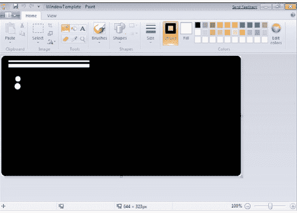

图 27.1

此图像作为资源添加到应用程序中。你可以使用任何图像来代表应用程序的窗口——只要你愿意承担对其进行所有交互的责任。


# 第 27 章 趣味内容与收尾工作

为了允许表单移动，你需要自己处理鼠标消息。在这种情况下，为了简单起见，在表单任何地方的鼠标点击都会被转换为模拟的非客户鼠标点击，以欺骗操作系统使其认为点击了标题栏。互操作代码非常简单：

```csharp
class Win32
{
    public const int WM_NCLBUTTONDOWN = 0xA1;
    public const int HTCAPTION = 0xA2;

    [DllImport("user32.dll")]
    public static extern int SendMessage(IntPtr hWnd, int Msg, int wParam, int lParam);
    
    public static extern bool ReleaseCapture();
}
```

表单代码拦截 `MouseDown` 事件并向 Windows 发消息，告诉它我们点击了标题区域。

```csharp
public Form1()
{
    InitializeComponent();
    
    // 关闭操作系统窗口系统提供的所有功能
    this.FormBorderStyle = FormBorderStyle.None;
    this.BackgroundImage = Properties.Resources.WindowTemplate;
    this.TransparencyKey = Color.White;
    
    this.Size = Properties.Resources.WindowTemplate.Size;
    this.MouseDown += new EventHandler(Form1_MouseDown);
}
```

```csharp
void Form1_MouseDown(object sender, MouseEventArgs e)
{
    // 如果我们点击了表单本身（而不是子控件），
    // 那么告诉 Windows 我们正在点击非客户区域
    Win32.ReleaseCapture();
    Win32.SendMessage(this.Handle, Win32.WM_NCLBUTTONDOWN, Win32.HTCAPTION, 0);
}
```

```csharp
private void buttonClose_Click(object sender, EventArgs e)
{
    Application.Exit();
}
```

图 27.2 显示了我们带有透明效果的自定义形状。

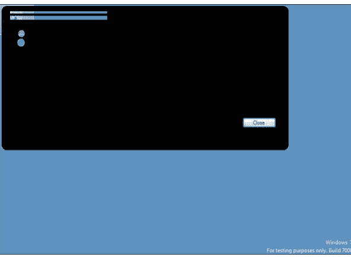

图 27.2

在黑色部分拖动将移动窗口，而点击透明空洞将穿透到背后的窗口。

## 在 WPF 中

WPF 中的步骤更加简单（参见代码列表 27.1 和 27.2）。此代码假设项目中存在一个名为 `WindowTemplate.png` 的图像。

### 代码列表 27.1 Window1.xaml

```xml
<Window x:Class="TransparentFormWPF.Window1" 
    xmlns="http://schemas.microsoft.com/winfx/2006/xaml/presentation" 
    xmlns:x="http://schemas.microsoft.com/winfx/2006/xaml" 
    Title="Window1" Height="323" Width="644" 
    Background="Transparent" 
    WindowStyle="None" 
    AllowsTransparency="True">

    <Grid>
        <Image Source="images/WindowTemplate.png" >
            <Image.OpacityMask>
                <ImageBrush ImageSource="images/WindowTemplate.png" />
            </Image.OpacityMask>
        </Image>
        <Button Content="Close" Height="25" HorizontalAlignment="Left" Margin="50,0,0,0" VerticalAlignment="Top" Click="buttonClose_Click" />
    </Grid>
</Window>
```

### 代码列表 27.2 Window1.cs

```csharp
using System;
using System.Windows;

namespace TransparentFormWPF
{
    /// <summary>
    /// Window1 的交互逻辑
    /// </summary>
    public partial class Window1 : Window
    {
        public Window1()
        {
            InitializeComponent();
        }

        protected override void OnMouseDown(MouseEvent e)
        {
            base.OnMouseDown(e);
            this.DragMove();
        }
    }
}
```

## 创建通知图标

场景/问题：**你想要在系统任务栏中出现一个图标，以通知用户应用程序的状态。**

解决方案：使用 `NotifyIcon` 类并为其附加一个菜单（见图 27.3）。使用通知图标要加小心——如果它们被认为毫无用处且无处不在，很多用户会感到厌烦。

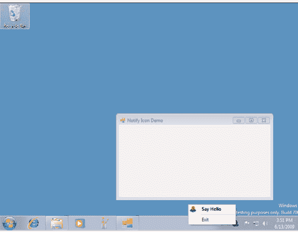

图 27.3

注意：你真的需要在这里显示一个图标吗？很多用户反感它们，所以要小心。仔细考虑你是否真的需要它。也许你可以创建一个临时图标来通知用户事件，一旦用户确认后将其移除——就像打印机图标一样。至少要为用户提供禁用图标的方法。

你还可以考虑在屏幕的一个角弹出一个临时窗口，就像 Outlook 的新邮件通知，以及 Windows Live Messenger 处理各种事件的方式那样。几秒钟后，这些窗口就会消失。

## 在 WPF 中创建屏幕保护程序

场景/问题：你想开发自己的屏幕保护程序。

解决方案：屏幕保护程序并没有特别之处，除非遵循以下约定：

- 一个接管全屏的单一窗口。
- 一个配置对话框（可选）。
- 对特定的命令行参数有响应。
- 文件扩展名从 `.exe` 重命名为 `.scr`。

以下章节详细介绍了一个简单的 WPF 屏幕保护程序的组成部分，它可以显示来自你图片文件夹的图像。

### 选项对话框

当传递 `/c` 选项时，你应该显示一个选项表单。将选项保存在何处取决于你（注册表、XML 文件等）。

在本演示屏幕保护程序的情况下，它显示了一个提示没有选项的占位对话框（参见列表 27.3 和 27.4）。

#### 列表 27.3 OptionsWindow.xaml

```xml
<Window x:Class="ScreenSaverWPF.OptionsWindow"
        xmlns="http://schemas.microsoft.com/winfx/2006/xaml/presentation"
        xmlns:x="http://schemas.microsoft.com/winfx/2006/xaml"
        Title="Screen Saver Options" Height="300" Width="300"
        WindowStartupLocation="CenterScreen" ResizeMode="NoResize">
    <Grid>
        <TextBlock>No options available!</TextBlock>
        <Button Margin="203,234,0,0" IsDefault="True" IsCancel="True" Click="Cancel">OK</Button>
    </Grid>
</Window>
```

#### 列表 27.4 OptionsWindow.xaml.cs

```csharp
using System;
using System.Windows;

namespace ScreenSaverWPF
{
    public partial class OptionsWindow : Window
    {
        public OptionsWindow()
        {
            InitializeComponent();
        }

        private void Button_Click(object sender, RoutedEventArgs e)
        {
            this.Close();
        }
    }
}
```

### 屏幕保护程序窗口

主屏幕保护程序窗口本身会适应整个屏幕，并循环播放图像（参见列表 27.5 和 27.6）。

#### 列表 27.5 ScreenSaverWindow.xaml

```xml
<Window x:Class="ScreenSaverWPF.ScreenSaverWindow"
        xmlns="http://schemas.microsoft.com/winfx/2006/xaml/presentation"
        xmlns:x="http://schemas.microsoft.com/winfx/2006/xaml"
        Title="ScreenSaver" Height="300" Width="300"
        WindowStyle="None"
        ResizeMode="NoResize"
        Background="Black">
    <Canvas x:Name="canvas">
        <Image x:Name="imageFloating"
               Width="100" Height="100"
               Stretch="Fill" />
    </Canvas>
</Window>
```

#### 列表 27.6 ScreenSaverWindow.xaml.cs

```csharp
using System;
using System.Collections.Generic;
using System.Linq;
using System.Text;
using System.Windows;
using System.Windows.Controls;
using System.Windows.Input;
using System.Windows.Media;
using System.Windows.Media.Imaging;
using System.IO;
using System.Windows.Threading;
using System.Windows.Forms; // Required for Screen class

namespace ScreenSaverWPF
{
    public partial class ScreenSaverWindow : Window
    {
        FileInfo[] _images;
        int _imageIndex = 0;
        DispatcherTimer _timer;
        private Point _prevPt;
        bool _trackingMouse = false;
        Random _rand = new Random();

        // 全屏构造函数
        public ScreenSaverWindow()
        {
            InitializeComponent();
            SetFullScreen();
            Initialize();
        }

        // 预览窗口的构造函数
        public ScreenSaverWindow(Point point, Size size)
        {
            InitializeComponent();
            SetWindowSize(point, size);
            Initialize();
        }

        private void Initialize()
        {
            LoadImages();
            
            // 每 5 秒切换一次图片的计时器
            _timer = new DispatcherTimer();
            _timer.Interval = new TimeSpan(0, 0, 5);
            _timer.Tick += new EventHandler(timer_Tick);
            _timer.Start();
        }

        private void LoadImages()
        {
            // 如果有很多图片，这可能需要一些时间...
            DirectoryInfo directoryInfo = new DirectoryInfo(
                Environment.GetFolderPath(Environment.SpecialFolder.MyPictures));
            _images = directoryInfo.GetFiles("*.jpg", SearchOption.AllDirectories);
        }

        private void SetFullScreen()
        {
            // 获取代表所有屏幕的矩形
            // 或者你也可以为每个显示器创建窗口
            this.Left = 0;
            this.Top = 0;
            this.Width = SystemParameters.PrimaryScreenWidth;
            this.Height = SystemParameters.PrimaryScreenHeight;
        }

        private void SetWindowSize(Point point, Size size)
        {
            this.Left = point.X;
            this.Top = point.Y;
            this.Width = size.Width;
            this.Height = size.Height;
        }

        void timer_Tick(object sender, EventArgs e)
        {
            // 只有当鼠标移动时才结束
            // 需要与之前的点进行比较
            if (_trackingMouse)
            {
                Point location = Mouse.GetPosition(this);
                if (Math.Abs(location.X - _prevPt.X) > 10 || Math.Abs(location.Y - _prevPt.Y) > 10)
                {
                    Application.Current.Shutdown();
                }
            }
            _trackingMouse = true;
            _prevPt = Mouse.GetPosition(this);

            _imageIndex = (_imageIndex + 1) % _images.Length;
            if (_images.Length > 0)
            {
                imageFloating.Source = new BitmapImage(new Uri(_images[_imageIndex].FullName, UriKind.Absolute));
            }
        }
    }
}
```

## 列表 27.8 App.xaml.cs


```csharp
using System;
using System.Windows;

namespace ScreenSaverWPF
{
    public partial class App : Application
    {
        protected override void OnStartup(StartupEventArgs e)
        {
            if (e.Args.Length >= 1)
            {
                if (string.Compare("/*c", e.Args[0], true) == 0)
                {
                    //显示配置
                    OptionsWindow window = new OptionsWindow();
                    window.Dialog();
                }
                else if (string.Compare("/*p", e.Args[0], true) == 0
                && e.Args.Length >=2)
                {
                    //在现有窗口内预览屏幕保护程序
                    // 下一个参数是窗口句
                    int handle = 0;
                    if (int.TryParse(e.Args[1], out handle))
                    {
                        IntPtr ptr = new IntPtr(handle);
                        Win32.RECT rect;
                        if (Win32.GetWindowRect(ptr, out rect))
                        {
                            // 与其将 WPF
                            // 窗口插入现有窗口中
                            // 直接将我们的窗口放在
                            // 同一个位置
                            ScreenSaverWindow previewWindow = 
                                new ScreenSaverWindow(
                                    new Point(rect.Left, rect.Top),
                                    new Size(rect.Width, rect.Height));
                            previewWindow.ShowInTaskbar = false;
                            previewWindow.Show();
                        }
                        // 停止预览很重要
                        previewWindow.CaptureMouse();
                        return;
                    }
                }
            }
        }
    }
}
```

## 列表 27.8 App.xaml.cs（续）

```csharp
} else if (string.Compare("/s", e.Args[0]) == 0) {
    // 只有在传递 /s 时才运行屏幕保护程序
    ScreenSaverWindow screenWindow =
    new ScreenSaverWindow();
    screenWindow.Show();
    return;
}
}
// 发生任何错误或配置对话框关闭时关闭
Application.Current.Shutdown();
}
```

前面的代码依赖于一些互操作（`interop`）来获取原生窗口的边界：

```csharp
using System;
using System.Runtime.InteropServices;
```

```csharp
namespace SplashScreenWPF
{
    class Win32
    {
        [Serializable, StructLayout(LayoutKind.Sequential)]
        public struct RECT
        {
            public int Left;
            public int Top;
            public int Right;
            public int Bottom;

        public RECT(int left, int top, int right, int bottom)
        {
            Left = left;
            Top = top;
            Right = right;
            Bottom = bottom;
        }

        public int Height { get { return Bottom - Top; } }
        public int Width { get { return Right - Left; } }
    }
}
```

```csharp
[DllImport("user32.dll")]
public static extern bool GetWindowRect(IntPtr hWnd, out RECT lpRect);
```

# 显示启动界面

**场景/问题：** 你的应用程序在启动期间需要初始化数据，这需要几秒钟。

**解决方案：** 显示一个启动界面（`splash screen`），在加载应用程序时显示进度。

# 在 Windows Forms 中

如果你想让启动界面能够正确刷新自身，你必须在单独的线程上运行初始化代码，以便 UI 线程进行刷新。图 27.4 显示了带有进度条和状态标签的简单启动界面的结果。

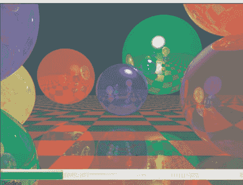

图 27.4  

启动界面可以产生一种错觉，即在用户等待应用程序可用时，你的程序正在努力工作。

启动界面可以是任何表单。在这种情况下，它是一个没有边框的对话框、一个填充整个表单的图像控件以及一个进度和标签控件。

```csharp
public partial class SplashScreen : Form
{
    public SplashScreen(Image image)
{
  InitializeComponent();

  this.FormBordersStyle = FormBordersStyle.None;
  this.BackgroundImage = image;
  this.Size = image.Size;

  this.labelStatus.BackColor = Color.Transparent;
}

public void UpdateStatus(string status, int percent) {
  if (InvokeRequired) {
    Invoke(new MethodInvoker(delegate {
      UpdateStatus(status, percent);
    }));
  } else {
    progressBar.Value = percent;
    labelStatus.Text = status;
  }
}
```

应用程序在启动主表单之前显示启动表单。

```csharp
static class Program {
  private static Thread _loadThread;
  private static SplashScreen _splash;

[Thread]
static void Main() {
  Application.EnableVisualStyles();
  Application.SetCompatibleTextRenderingDefault(false);

  _splash = new SplashScreen(Properties.Resources.splash);

  _loadThread = new Thread(ThreadStart)delegate {
    // 加载任务
    string[] fakeLoadingTasks = new string[] {
      "Loading greebles",
      "Refactoring image levels",
      "Doodling",
      "Adding dogs and cats",
      "Catmulling curves",
      "Taking longer just because",
    };

    for (int i = 0; i < fakeLoadingTasks.Length; i++)
    {
        // ... (省略循环内部逻辑以保持翻译一致性)
    }
    // ...
  }
}
```

*(注：原文此处代码逻辑在示例中似乎存在断层或重复，翻译已根据要求保留结构并翻译注释)*

*注：原文提供的示例代码块存在重复逻辑，这与 Windows Forms 示例相似。*

```csharp
// 启动主窗口
Application.Run(new Form());
```

# 第 27 章 趣味性内容与遗尾工作

WPF 实际上内置了启动界面，你只需要在启动时显示它。

为了获得更多功能，如 Windows Forms 示例所示，你需要设置启动界面的显示。

## 列表 27.9 SplashScreen.xaml

```xml
<Window x:Class="SplashScreenWPF.SplashScreen"
        xmlns="http://schemas.microsoft.com/winfx/2006/xaml/presentation"
        xmlns:x="http://schemas.microsoft.com/winfx/2006/xaml"
        Title="SplashScreen" Height="384" Width="512"
        WindowStyle="None" WindowLocation="CenterScreen" Topmost="True">
  <Grid>
    <Image Source="images/splash.png" Stretch="Fill" />
    <ProgressBar Name="progressBar" Minimum="0" Maximum="100" VerticalAlignment="Bottom"/>
    <Label Name="statusLabel" VerticalAlignment="Bottom" Height="28">Loading</Label>
  </Grid>
</Window>
```

这里是后台代码：

```csharp
public partial class SplashScreen : Window
{
    private delegate void UpdateDelegate(string status, int percent);
    private UpdateDelegate _updateDelegate;

    public SplashScreen()
    {
      InitializeComponent();
      _updateDelegate = UpdateStatus;
    }

    public void UpdateStatus(string status, int percent)
    {
      if (Dispatcher.Thread.ManagedThreadId != Thread.CurrentThread.ManagedThreadId)
      {
        this.Dispatcher.Invoke(_updateDelegate, status, percent);
      }
      else
      {
        statusLabel.Content = status;
        progressBar.Value = percent;
      }
    }
}
```

用法与 Windows Forms 类似：

```csharp
public partial class App : Application
{
    private static SplashScreen _splash = new SplashScreen();
    private delegate void WPFMethodInvoker();
    Thread _thread;

    protected override void OnStartup(StartupEventArgs e)
    {
        base.OnStartup(e);
    }

    Thread thread = new Thread((ThreadStart)delegate
    {
        // 执行任务
        string[] fakeLoadingTasks = new string[]
        {
            "Loading greebles",
            "Refactoring image levels",
            "Doodling",
            "Adding dogs and cats",
            "Catmulling curves",
            "Taking longer just because"
        };

        for (int i = 0; i < fakeLoadingTasks.Length; i++)
        {
            if (_splash != null)
            {
                _splash.UpdateStatus(fakeLoadingTasks[i],
                100 * i / fakeLoadingTasks.Length);
            }
            Thread.Sleep(2000);
        }

        _splash.Dispatcher.Invoke(
(WPFMethodInvoker)delegate { _splash.Close(); });
    });
    thread.Start();
    // WindowsForms 在此处需要 ShowDialog，但在 WPF 中这样做可行
    _splash.Show();
}
```


通过 WPF，我们可以获得丰富丰富的体验，例如这个启动屏所展示的透明效果。

## 播放音频文件

> 场景/问题：你想播放一个音频文件。

**解决方案：** 通过 P/Invoke 使用 `PlaySound` API。

```csharp
class Win32
{
    [DllImport("winmm.dll", EntryPoint = "PlaySound", CharSet = CharSet.Auto)]
    public static extern int PlaySound(String pszSound, int hmod, int flags);

    [Flags]
    public enum Soundflags
    {
        SND_SYNC = 0x0000,
        SND_ASYNC = 0x00001,
        SND_NODEFAULT = 0x00002,
        SND_MEMORY = 0x00004,
        SND_LOOP = 0x00008,
        SND_NOSTOP = 0x00010,
        SND_NOWAIT = 0x00002000,
        SND_ALIAS = 0x00010000,
        SND_ALIAS_ID = 0x00110000,
        SND_FILENAME = 0x00020000,
        SND_RESOURCE = 0x00040004,
        SND_FLAGS = 0x0040,
        SND_APPLICATION = 0x00080
    }
}
```

# 第 27 章 趣味与遗留问题

`PlaySound` 的第一个参数可以是文件名、别名或资源，取决于你传递的标志。别名定义在注册表和“声音”控制面板中。


```csharp
Win32.PlaySound("Default", 0, (int)(Win32.Soundflags.SND_ALIAS | Win32.Soundflags.SND_ASYNC | Win32.Soundflags.SND_NOWAIT));
```

`SND_ASYNC` 标志告诉系统开始播放声音，但在播放完成之前立即返回。这通常就是你想要的，以避免在声音播放时挂起 UI 界面。

## 洗牌

> 场景/问题：你需要洗牌集合中的元素，例如牌组中的牌。

解决方案：虽然看起来简单，但在算法层面上，这个解决方案很容易出错。欲需更多信息，请参阅维基百科上关于洗牌算法的条目。

```csharp
class Card { 
    Random rand = new Random();
    private static void ShuffleDeck(Card[] cards)
    {
      int n = cards.Length;

      while (n > 1)
      {
        int k = rand.Next(n);
        --n;
        Card temp = cards[n];
        cards[n] = cards[k];
        cards[k] = temp;
      }
    }
}
```

配套的源代码将此算法封装在一个测试程序中，运行数百万次并跟踪结果，以查看结果是否存在任何偏差。

## 附录

### 核心工具

在本附录中

- `Reflector`
- `NUnit`
- `NDepend`
- `FXCop`
- `Virtual PC`
- `Process Explorer` 和 `Process Monitor`
- `RegexBuddy`
- `LINQPad`
- 在哪里找到更多工具

## 核心工具

多年来，每位开发者都会构建一套核心工具，用于设计、调试、构建、分析、测试以及其他代码操作。本章介绍了我发现的最有用的几个。可以将这些工具视为起点。由于 URL 会随着时间的推移而变化，我省略了这些工具的下载链接。你应该能够使用你喜欢的搜索引擎轻松地找到它们。

### Reflector

用途：浏览并将任何 .NET 程序集反编译为源代码。

它最初由 Lutz Roeder 开发，现在由 Red Gate 维护并改进了这个实用的小工具，它可以将 .NET 程序集解构为源代码（可选 C#、VB、IL 等）。

我主要将其用作教学工具，用来查看 Framework 库在内部执行什么。依赖实现细节通常不是个好主意，但有时了解 Framework 使用了哪些原生 API 是很有用的——可以作为一个教学示例。图 A.1 展示了 `Reflector`。

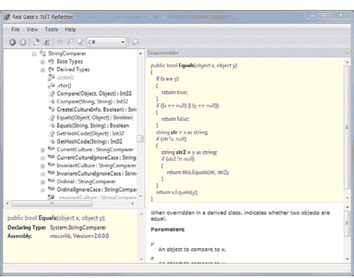

图 A.1 `Reflector` 是一个查看 Framework 类如何工作的极佳教学工具。

### NUnit

用途：单元测试框架和脚架。

无论你是否使用测试驱动开发，拥有一良好的单元测试都能在代码质量方面带给你很多信心，并在必要时进行重构。

`NUnit` 包含一个用于将源代码标记为测试的库，以及用于运行测试的 GUI 和命令行脚架。

例如，让我们看看对一个不完整的 `ComplexNumber` 类进行的一些测试：

```csharp
using System;

namespace MathLib
{
    public struct ComplexNumber
    {
        private double _real;
        private double _imaginary;

        public double RealPart
        {
            get { return _real; }
        }
        public double ImaginaryPart
        {
            get { return _imaginary; }
        }

        public ComplexNumber(double real, double imaginary)
        {
            _real = real;
            _imaginary = imaginary;
        }

        public static ComplexNumber operator*(ComplexNumber a, ComplexNumber b)
        {
            return new ComplexNumber(a.real * b.real - a.imaginary * b.imaginary, a.real * b.imaginary + a.imaginary * b.real);
        }
    }
}
```

```csharp
using System;
using NUnit.Framework;

namespace MathLib.Test
{
    [TestFixture]
    public class ComplexNumberTest
    {
        [SetUp]
        public void Setup() { }

        [TearDown]
        public void TearDown() { }

        [Test]
        public void MultiplyTest_Real()
        {
            ComplexNumber a = new ComplexNumber(2, 0);
            ComplexNumber b = new ComplexNumber(3, 0);
            ComplexNumber c = a * b;
            Assert.AreEqual(6, c.RealPart);
            Assert.AreEqual(0, c.ImaginaryPart);
        }

        [Test]
        public void MultiplyTest_RealAndImaginary()
        {
            ComplexNumber a = new ComplexNumber(2, 4);
            ComplexNumber b = new ComplexNumber(3, 5);
            ComplexNumber c = a * b;
            Assert.AreEqual(-14, c.RealPart);
            Assert.AreEqual(22, c.ImaginaryPart);
        }
    }
}
```

### NDepend

用途：静态分析和代码质量度量。

`NDepend` 是一个非常有价值的检查，可以确保你正在按照推荐的模式和实践使用 .NET。这是对你代码的很好的健全性检查，可以确保你遵循了可行的最佳实践。你可以分析你的代码、建议更改、告知你建议的更改是否具有破坏性，并为你提供有关为什么建议该更改的更多信息。

还有一个 SDK 可以在其中针对你的公司或项目创建自己的一套规则。

我运行了本章前面提到的 `ComplexNumber` 类。如图 A.4 所示，它有几条建议。


图 A.4

`FXCop` 是一个非常有价值的检查，可以确保你正在按照推荐的模式和实践使用 .NET。

### FXCop

用途：托管代码的静态分析工具。

`FXCop` 分析托管代码程序集，并报告有关设计、本地化、性能和安全改进的信息。

我运行了本章前面提到的 `ComplexNumber` 类。如图 A.4 所示，它有几条建议。

### Virtual PC

> 目的：运行虚拟化操作系统进行测试。

要维护所有应用程序必须运行的可能操作系统的计算机是非常困难的。相反，将它们全部安装在虚拟机中。这对于测试软件要方便得多，你可以在桌面上进行操作。

`Virtual PC` 是免费的（截至写作时），但如果你有 Windows 7，你必须拥有操作系统的许可证；相反，你可以获取 `Windows Virtual PC`。

> 注意：为了在虚拟机中获得最佳结果，我们有大量的内存。我的开发桌面电脑上有 8GB 内存，这意味着我可以完全分配 2GB 给 Windows 7 的虚拟安装。为了利用这么多内存，你必须运行 64 位版本的 Windows。


图 A.5

运行 Windows 98 从未像自……1998 年以来如此有趣。顺便说一下，.NET 2.0 确实运行在 Windows 98 上。尽管去，我赌你。

### Process Explorer 和 Process Monitor

> 目的：分析运行中的程序的进程、线程、文件、网络和注册表信息。

`SysInternals`（现由微软拥有）制作了一些优秀的工具，其中最常用的两个是 `Process Explorer` 和 `Process Monitor`。

`Process Explorer` 如图 A.6 所示，类似于 Windows 任务管理器的超级版本。除了进程之外，它还可以显示哪个进程对文件打开了句柄、性能信息，以及对于 .NET 进程，大量的 CLR 计数器。

`Process Monitor` 如图 A.7 所示，是对文件、注册表、网络和进程信息的实时跟踪。你可以用它查看进程是如何使用文件系统的（例如），或者在注册表的哪个位置写入数据。


| 图像 | 性能 | 性能图 | 线程 |
| :--- | :--- | :--- | :--- |
| TCP/IP | 安全 | 环境 / .NET | 字符串 |
| AppDomains | | | |
| PointDotNet.exe | | | |
| .NET 性能对象 | | | |
| .NET CLR | | | |
| 计数器 | 值 | | |
| # Gen 0 回收 | 3,832 | | |
| # Gen 1 回收 | 1,804 | | | |
| # Gen 2 回收 | 360 | | | |
| 从 Gen 1 提升的内存 | 144,776 | | | |
| 从 Gen 0 提升的内存 | 118,202 | | | |
| 进程 | 3,188 | | | |
| Gen 0 堆大小 | 2,097,152 | | | |
| Gen 1 堆大小 | 155,360 | | | |
| Gen 2 堆大小 | 2,232,120 | | | |
| 大对象堆大小 | /512 | | | |
| 终结存存者 | 701 | | | |

图 A.6

`Process Explorer` 可以深入研究运行中进程的各种细节——对调试有用。


| 时间 | 进程 | 名称 | PID | 操作 | 路径 | 结果 | 详情 |
| :--- | :--- | :--- | :--- | :--- | :--- | :--- | :--- |
| 10:17:18 | PointDotNct.exe | 3188 | CreateFile | C:\Windows\System32\hal.dll | SUCCESS | 线程 ID: 2558 |
| 10:17:18 | PointDotNct.exe | 3188 | ReadFile | C:\Windows\System32\hal.dll | SUCCESS | 偏移量: 0,160,180... |
| 10:17:18 | PointDotNct.exe | 3188 | ReadFile | C:\Windows\System32\hal.dll | SUCCESS | 类型: MapView |
| 10:17:18 | PointDotNct.exe | 3188 | ReadFile | C:\Windows\System32\kernel32.dll | SUCCESS | 找到未找到 访问 R: |
| 10:17:18 | PointDotNct.exe | 3188 | ReadFile | C:\Windows\System32\kernel32.dll | SUCCESS | Query: |
| 10:17:18 | PointDotNct.exe | 3188 | ReadFile | C:\Windows\System32\ntdll.dll | SUCCESS | 找到未找到 访问 R: |
| 10:17:18 | PointDotNct.exe | 3188 | ReadFile | C:\Windows\System32\ntdll.dll | SUCCESS | 缓冲区: |
| 10:17:18 | PointDotNct.exe | 3188 | ReadFile | C:\Windows\System32\user32.dll | SUCCESS | 访问 R: |
| 10:17:18 | PointDotNct.exe | 3188 | ReadFile | C:\Windows\System32\user32.dll | SUCCESS | 缓冲区大小: |
| 10:17:18 | PointDotNct.exe | 3188 | ReadFile | C:\Windows\System32\advapi32.dll | SUCCESS | 找到未找到 访问 R: |
| 10:17:18 | PointDotNct.exe | 3188 | ReadFile | C:\Windows\System32\advapi32.dll | SUCCESS | 拒绝访问 |
| 10:17:18 | PointDotNct.exe | 3188 | ReadFile | C:\Windows\System32\shlwapi.dll | SUCCESS | 找到未找到 访问 R: |
| 10:17:18 | PointDotNct.exe | 3188 | ReadFile | C:\Windows\System32\shlwapi.dll | SUCCESS | 拒绝访问 |
| 10:17:18 | PointDotNct.exe | 3188 | ReadFile | C:\Windows\System32\gdi32.dll | SUCCESS | 访问 R: |
| 10:17:18 | PointDotNct.exe | 3188 | ReadFile | C:\Windows\System32\gdi32.dll | SUCCESS | 缓冲区大小: 1, |
| 10:17:18 | PointDotNct.exe | 3188 | ReadFile | C:\Windows\System32\msvcrt.dll | SUCCESS | 访问 G: |
| 10:17:18 | PointDotNct.exe | 3188 | ReadFile | C:\Windows\System32\msvcrt.dll | SUCCESS | 缓冲区大小: 1, |
| 10:17:18 | PointDotNct.exe | 3188 | ReadFile | C:\Windows\System32\comctl32.dll | SUCCESS | 类型: MapView |
| 10:17:18 | PointDotNct.exe | 3188 | ReadFile | C:\Windows\System32\comctl32.dll | SUCCESS | 拒绝访问 |
| 10:17:18 | PointDotNct.exe | 3188 | ReadFile | C:\Windows\System32\user32.dll | SUCCESS | 访问 R: |
| 10:17:18 | PointDotNct.exe | 3188 | ReadFile | C:\Windows\System32\user32.dll | SUCCESS | 缓冲区大小: 1, |
| 10:17:18 | PointDotNct.exe | 3188 | ReadFile | C:\Windows\System32\win32.dll | SUCCESS | 类型: MapView |
| 10:17:18 | PointDotNct.exe | 3188 | ReadFile | C:\Windows\System32\win32.dll | SUCCESS | 拒绝访问 |
| 10:17:18 | PointDotNct.exe | 3188 | ReadFile | C:\Windows\System32\kernelbase.dll | SUCCESS | 访问 R: |
| 10:17:18 | PointDotNct.exe | 3188 | ReadFile | C:\Windows\System32\kernelbase.dll | SUCCESS | 缓冲区大小: 1, |
| 10:17:18 | PointDotNct.exe | 3188 | CreateFile | C:\Windows\System32\setup.dll | SUCCESS | 线程 ID: 2559 |
| 10:17:18 | PointDotNct.exe | 3188 | CreateFile | C:\Windows\System32\setup.dll | SUCCESS | 偏移量: 0,160,180... |
| 10:17:18 | PointDotNct.exe | 3188 | CreateFile | C:\Windows\System32\setup.dll | SUCCESS | 类型: MapView |

图 A.7

`Process Monitor` 提供文件、注册表和网络活动的实时视图。


| 10:17:18 | PointDotNct.exe | 3188 | CreateFile | C:\Windows\System32\shell.dll | SUCCESS | 找到未找到 访问 R: |

| 10:17:18 | PointDotNct.exe | 3188 | CreateFile | C:\Windows\System32\shell.dll | SUCCESS | 句柄查询: |

图 A.7

Process Monitor 可以回答各种关于程序当前正在做什么的问题。

# RegexBuddy

> 目的：交互式地构建和测试正则表达式。

是的，你可以自己构建一个正则表达式测试器，但现有的工具提供了一些并非易事的功能。RegexBuddy 如图 A.8 所示是最好的之一，还有其他的选择。

除了其他，它们还提供了插入子表达式的菜单、用英语（或接近英语）解释表达式、提供即时图形反馈、语法高亮等功能。

# LINQPad

> 目的：使用 LINQ 构建查询，主要用于 LINQ to SQL。

此应用程序类似于 LINQ 版的 RegexBuddy。它紧凑的界面让你能够快速针对数据库测试 LINQ 查询。

LINQPad 还允许你直接测试代码段以查看结果，而无需创建虚拟测试项目。图 A.9 显示了该工具针对第 13 章“数据库”中 Books 数据库的操作演示。


图 A.9 提供了一种针对数据库构建和测试 LINQ 查询的简单方法。

# 在哪里找到更多工具

互联网上有许多“终极工具列表”，但最著名的可能是 Scott Hanselman 的 Windows 终极开发者和高级用户工具列表。该列表每年更新一次，鼓励你访问 www.hanselman.com/tools 查看。

# 符号

- `!=` 运算符，实现, 39-40
- `*` 运算符，实现, 39
- `==` 运算符，实现, 39-42
- 3D 几何，WPF，渲染, 389-392
- 3D
    - 控件，Silverlight, 452-453
    - WPF
    - 交互式控件, 395-398
    - 视频, 392-394
- `32 位环境`，应用程序，运行在, 591-592
- `64 位环境`，应用程序，运行在, 591-592

# A

- 抽象基类
    - 实例化，防止, 23-24
    - 接口，比较, 24-25
- 访问，数组，访问, 486-487
- “访问被拒绝”错误, 190
- 可访问性修饰符 8
- 添加服务引用对话框, 226
- 添加构造函数, 11-12
- 请求管理权限，UAC (用户帐户控制), 578-581
- 高级文本搜索，正则表达式, 132
- AJAX (异步 JavaScript 和 XML), 423
    - 页面，创建, 423-425
    - AJAX Demo–Default.aspx 列表 (19.11), 423-424
    - AJAX Demo–Default.aspx.cs 列表 (19.12), 424
- 别名，命名空间, 51-52
- 分配未更改内存, 488-489
- AllWidgetsView.xml 列表 (25.1), 557-558
- 尖括号，泛型, 141
- 制作 WPF 元素属性, 388-389
- 匿名方法
    - 委托，赋值给, 288
    - 事件处理器，用作, 288-290
    - lambda 表达式语法, 290
- 匿名对象，LINQ, 466
- 匿名类型，创建, 22-231
- 抗锯齿, 348-349
- App.xaml 列表 (27.7), 611
- App.xml.cs 列表 (27.8), 612-614
- 字符串追加换行符, 120
- 应用程序配置值，Windows Forms, 314-316
- 具有限制权限的应用程序数据, 198-200
- 应用程序状态，维护，ASP.NET, 429-430
- ApplicationData 文件夹, 194
- 应用程序
    - `32 位环境`，运行在, 591-592
    - `64 位环境`，运行在, 591-592
- 异步编程模型, 515-516
- 命令功能，定义, 547-548, 551
- 命令接口，定义, 524-546
- 自定义属性，定义, 521-522
- 部署，Cl072-573
- 事件，写入事件日志, 581-583
- 历史缓冲区，定义, 544-546
- 本地化, 562-563
- ASPNET 应用程序, 564-565
- Silverlight 应用程序, 570-572
- Windows Forms 应用程序, 563-564
- WPF 应用程序, 565-569
- 内存使用，维护, 474-475
- 多个数据库服务器，处理, 242, 245
- 非矩形窗口，创建, 598-601
- 通知图标，创建, 602-605
- OS 视图，获取, 474-475
- 模式, 530
- Model-View-ViewModel 模式, 552-562
- 观察者模式, 536-539
- 插件架构，实现, 525-528
- 电源状态信息，检索, 595
- RSS 内容，解析, 216-219
- 屏幕位置，记忆, 543-544
- 屏幕保护器，创建, 605-614
- 单个实例，限制, 505-506
- 音频文件，播放, 619-620
- 启动屏幕，显示, 614-619
- 启动，特权权限, 578-581
- 系统配置更改，响应, 593
- TextTokenizer
- 撤销命令，实现, 545-552
- 嵌入 浏览器, 214-416
- 运行出, 453-554
- Windows 服务，创建, 585-588
- 锯齿 (混淆/乱码), 584
- WinForms 应用程序, 398-400
- 插件架构，实现, 525-528
- 访问，快速, 486-487
- 声明, 50
- 锯齿数组, 51
- 多维数组，创建, 50-51
- 对象，创建, 140
- 矩形数组，创建, 50-51
- 字符串，拆分, 121
- 数值，反转, 166
- Ordered() 方法, 472
- ASNET 页面，创建, 423-525
- 应用程序状态，维护, 429-430
- 控件，绑定数据, 256-257
- 数据验证, 425-429
- GridView，数据绑定, 412-414
- 主页面, 409-411
- MVC (Model-View-Controller), 436-441
- 控制器创建, 437
- 模型创建, 436
- 新记录，创建, 438-440
- 记录编辑, 339, 441
- ，创建, 437-438
- 会话恢复, 334-336
- 追踪信息, 402-403
- UI 状态，维护, 430
- Uls，创建, 418-422
- 用户控件，创建, 414-417
- 用户数据，维护, 431-433
- 用户，重定向到另一个页面, 405-406
- Web 浏览器, 404
- Web 网站，菜单, 411-412
- 未处理异常，捕获, 75

# B

- 银行家舍入, 93
- 基类构造函数，调用, 15
- 基类, 24
- 抽象基类
    - 实例化，防止, 23-24
    - 接口, 24-25
- 约束, 147
- 方法，重写, 16-17
- 非虚拟方法, 17-19
- 非虚拟属性, 17-19
- 属性，重写, 16-17
- Base-64 编码, 122-124
- BaseForm.cs 列表 (16.1), 304-306
- 缓冲区，转换, 87-89
- BigInteger, 79-84
- 二进制数据，字符串，转换, 122-124
- 二进制文件，创建, 179
- 绑定数据，控件, 250-257
- 位图，像素，直接访问, 347-348
- 位，锁定, 348
- BookDetail.aspx.cs 列表 (19.10), 417-418
- MasterPage.master, 410
- BookEntryControl.ascx 列表 (19.7), 414-415
- BookEntryControl.ascx 列表 (19.8), 415-417
- BookEntryList.aspx 列表 (19.6), 412-413
- BookTransform.xslt 列表 (14.1), 274-275
- 绑定数据, 385-386
- 浏览器能力，确定, 404
- 浏览器，应用程序，运行出, 453-454
- Parallel(), 472
- 插件程序集，创建, 225-526
- 共享程序集，创建, 525
- 类型，枚举, 520-521
- 异步 JavaScript 和 XML (AJAX)。 参见 AJAX (Asynchronous JavaScript and XML)
- 异步编程模型, 515-016
- 画刷，创建, 339-341
- 缓冲区，离屏绘制，绘制到, 346-347
- 数值，转换到, 89-90
- 字符串转换为, 110-111, 114-115
- Asynchronous Downloader 列表 (12.3), 211-213
- 异步调用方法, 496-497
- 异步下载网络内容, 210-013

# C

- C 函数，调用 C#, 589-590
- 缓存，垃圾回收，创建, 482-485
- 调用
    - C 函数, C#, 589-590
    - 定时器, 313-314
    - 方法，异步, 496-497
    - 多个方法，委托, 281-282
- 原生 Windows 函数, 589-590
- 缓冲区，离屏绘制，绘制到, 346-347
- 缓冲区，转换, 87-89
- BigInteger, 79-84
- 二进制数据，字符串，转换, 122-124
- 二进制文件，创建, 179
- 绑定数据，控件, 250-257
- 位图，像素，直接访问, 347-348
- 位，锁定, 348
- BookDetail.aspx.cs 列表 (19.10), 417-418
- MasterPage.master, 410
- BookEntryControl.ascx 列表 (19.7), 414-415
- BookEntryControl.ascx 列表 (19.8), 415-417
- BookEntryList.aspx 列表 (19.6), 412-413
- BookTransform.xslt 列表 (14.1), 274-275
- 绑定数据, 385-386
- 浏览器能力，确定, 404
- 浏览器，应用程序，运行出, 453-454
- Parallel(), 472
- 插件程序集，创建, 225-526
- 共享程序集，创建, 525
- 类型，枚举, 520-521
- 异步 JavaScript 和 XML (AJAX)。 参见 AJAX (Asynchronous JavaScript and XML)
- 异步编程模型, 515-016
- 画刷，创建, 339-341
- 缓冲区，离屏绘制，绘制到, 346-347
- 数值，转换到, 89-90
- 字符串转换为, 110-111, 114-115
- Asynchronous Downloader 列表 (12.3), 211-213
- 异步调用方法, 496-497
- 异步下载网络内容, 210-013

## 637

- 27.3 (OptionsWindow.xaml), 606
- 27.4 (OptionsWindow.xaml.cs), 606-607
- 27.5 (ScreenSaver.xaml), 607
- 27.6 (ScreenSaver.xaml.cs), 607-611
- 27.7 (App.xaml), 611
- 27.8 (App.cs), 612-614
- 27.9 (SplashScreen.xaml), 616-619
- 折叠控件, WPF, 375-376
- 折叠类, 选取, 155-157
- 集合项, 拼接, 字符串, 119-120
- 压缩, 文件, 181-183
- 拼接
    - 将集合转换为字符串, 119-120
    - StringBuilder, 117-119
- 并发感知集合, 157
- 条件运算符, 52-53
- 配置, Windows Forms, 314-316
- 数据库, 数据库, 240-242, 245
    - 可用性, 258
- 控制台属性, 未处理异常,
    - 捕获, 73
- 常量字段, 13
- 常量, 枚举器, 101
    - 重复值, 101
- 约束泛泛型, 146-149
- 约束, 方法, 添加, 58-60
- 构造, 属性, 初始化, 12
- 构造函数
    - 添加, 11
    - 基类构造函数, 调用, 15
    - 多重构造函数, 代码重用, 14
- 数组, 反转, 166-167
- 并发感知集合, 157
- 自定义集合, 创建, 159-163
- 自定义迭代器, 163-166
- 数据绑定, WPF, 385
- 元素
    - 计数, 168
    - 获取, 168
    - 洗牌, 220
- 过滤, LINQ, 464
- 泛型集合, 156
    - 初始化器, 157-158
- 接口, 159
- 链表, 反转, 167
- 优先级队列, 实现, 169
- 查询, LINQ, 462-463
- 字典树结构, 创建, 173-176
- 颜色定义, 图形, 330
- 颜色选择器, Windows Forms, 330-331
- 颜色, 转换, 331-335
- COM 互操作, 动态类型,
    - 简化, 49
- 合并流, 181-183
- 命令功能, 定义, 547-548, 551
- 命令接口, 定义, 545-546
- 命令对象, 实现, 545-552
- 命令 (WPF)
    - 自定义命令, 371-373
    - 启用/禁用, 374
    - 标准命令, 370-371
- CommonOpenFileDialog 类, 594
- 复数, 格式化, 80-82
- Complexity(r) 方法, 472
- CompressFile.cs 列表 (1,11), 181-183
- Contracts 类, 方法, 约束, 58-60
- 逆变性, 委托, 291
- 控件
    - 3D表面, Silverlight, 452-453
    - 数据绑定, 到, 250-257
    - DataGridView, 250-254
    - 交互式控件, 3D表面, 395-398
    - ToolStrip, 297
    - 用户控件
        - 创建, 414-417
        - Windows Forms, 308-313
    - 窗口, 定位, 367
    - WPF
        - 外观/功能, 377
        - 绑定属性, 379-383
        - 设计, 386-387
        - 展开/折叠, 375-376
        - 转换运算符, 实现, 40-41
        - ConvertToBase64String(), 122
    - 转换
        - 二进制数据到字符串, 122-124
        - 字节到字符串, 110-111
        - 数字
            - 字节, 89-90
            - 进制数, 87-89
        - 字符串
            - 标记, 104
            - 转换为字节, 110-111

## 638 转换

- 转换为枚举, 103-104
- 转换为数字, 86-87
- 类型, 40-41
- Cookie, 会话状态, 添加, 434-436
- 计数 1 位, 92
- CPU, 信息, 获取, 576-578
- 加密学安全的随机数, 97
- 文化, 命名, 格式化, 82-83
- 当前操作系统, 版本信息, 获取, 576
- 控件
    - 绑定数据到, 250-257
    - 在 Visual Studio 中创建, 238-239
    - 数据, 转换为, 273-276
    - 多表, 连接, 465-466
    - MySQL 数据库, 连接, 241-242
    - 对象, 映射到, 259-260
    - 表
        - 删除数据, 246-247
        - 显示数据, 250-257
        - 插入数据, 245-246
        - 事务, 248-250
        - 更新 DataSet, 252-254
        - DataGridView 控件, 250-254
    - DataSet
    - 控件, 绑定数据到, 250-257
    - 数据库, 验证, 252-254
    - 日期, 验证, 136
    - 死代码, 标记, 531
    - 调试信息, ASP.NET, 402-403
    - 浮点类型, 78
    - 声明
        - 鼠标光标, 距离, 354-355


# 索引

## A

- 光标, 注册, 327-328
- 自定义属性, 应用程序, 521-522
- 自定义集合, 创建, 159-160
- 自定义命令, WPF, 371-373
- 自定义编码方案, 字符串, 111-114
- 自定义格式化, `toString()`, 29
- 自定义迭代器, 创建, 163-166
- 自定义浏览器 (12.4), 215-216
- 剪贴操作, Windows Forms, 323-327

## B

- 委托
- 枚举, 100-102
- 标记
- 枚举, 101
- 对象, 50
- 变量, 46-47
- 数据
- 绑定数据到, 250-257
- 转换为, 273-276
- 多表, 连接, 465-466
- MySQL 数据库, 连接, 241-242
- 对象, 映射到, 259-260
- 表
    - 删除数据, 246-247
    - 显示数据, 250-257
    - 插入数据, 245-246
    - 事务, 248-250
    - 更新 `DataSet`, 252-254
    - `DataGridView` 控件, 250-254
- 默认
- 交换, 499-500
- 多线程, 保护, 500-502
- 全局存储, 429-430
- 数据绑定
- `GridControl`, 412-324
- 默认参数
- 方法, 调用, 55-56
- `Default.aspx` (19.3), 409
- `Default.aspx` (19.5), 411
- 评估
- 值, 57-58
- 类型检查, 运行时, 47
- 定义
    - 字段, 9-10
    - 方法, 9-10
    - 属性, 9-10
    - 静态成员, 10-11
- 度, 弧度, 连接, 93
- 值转换, 383-385
- 值格式化, 38
- 数据结构, 多线程, 495
- 数据类型, 裁剪和填充, 323
- 数据
- 匿名方法, 赋值给, 288
- 逆变性, 291
- 泛型委托, 145-146
- 多重方法, 调用, 281-282
- 删除文件, 180
- 删除, 246-247
- 插入, 245-246
- 存储过程, 运行, 247-248
- 连接, 240-242
- 连接, 可用性, 258
- 评估, 值, 639

## E

- 部署应用程序, ClickOnce, 572-573
- 对角线文本, 344
- 元素属性, WPF, 动画, 388-389
- 元素, 集合
    - 浏览, 187
    - 枚举, 186-187
    - 存在性, 确认, 185
    - 搜索, 188-190
- 计数, 168
- 禁用命令, WPF, 374
- 可发现主机, 实现, 233-234
- 显示启动屏幕, 614
- Windows Forms, 614-616
- WPF, 616-619
- 电子邮件, SMTP 邮件协议, 通过发送, 208-209
- 电子邮件地址, 匹配, 36
- 嵌入, 浏览器, 应用程序, 214-216
- `Dispose` 模式, 终结, 479-482
- 托管资源, 清理, 477-482
- Windows Communication
- 编码方案, 字符串, 111-114
- `Encoding.GetString()` 方法, 110
- 强制代码约束, 58-60
- 调用, 589-590
- Entity Framework
    - 数据库对象, 映射到, 259-260
    - XML 文档, 验证, 270-271
    - 实体
        - 创建, 260
        - 删除, 260
        - 列表, 259
        - 查找, 260
- 双浮点类型, 78
- 进度条, Silverlight, 449-450
- 下载内容, HTTP, 209-213
- 绘制形状, 335-337
- 驱动, 枚举, 185-186
- 动态客户端, 实现, 235-236
- `dynamic` 关键字, 47-49
- 枚举
- `Enum` 值, 元数据, 附加, 104-106
- `Enum.GetValues()` 方法, 103
- DLR 语言运行时 (DLR), 49
- 动态类型, COM 互操作, 简化, 49
- 禁用菜单项, Windows Forms, 300
- 动态实例化类, 方法, 调用, 523-524
- 动态生成 RSS 馈 (Internet Services), 220-222
- 动态大小数组对象, 创建, 140
- 目录, 186-187
- 驱动, 185-186
- 文件, 186-187
- 枚举, 100, 106
- 声明为, 100-102
- 外部值, 匹配, 106
- 标记, 107
- 整数, 转换为, 102
- 命名, 107
- `None` 值, 定义, 107
- 字符串, 转换为, 103-104
- 有效性, 103
- 值, 列表, 103
- 等价, 类型, 确定, 32-33
- `Equals()` 方法, 对象, 32-33
- 评估, 延迟, 57-58

## event brokers

- 事件代理, 540-553
- 事件处理程序, 匿名方法, 使用 as, 288-290
- 事件日志
    - 事件, 写入, 581-583
    - 从读取, 582
- 事件
    - 事件代理, 540-553
    - 事件日志, 写入, 581-583
    - 元数据, 附加, 104-106
    - 多重事件, 371-373
    - 发布, 280-282
    - 信号, 280-283
- 异常
    - 捕获, 73
    - 未处理异常, 73
    - 抛出, 64
- 交换数据, 499-500
- 多线程, 保护, 500-502
- 全局存储, 429-430
- 类型检查, 运行时, 47
- 定义
    - 字段, 9-10
    - 方法, 9-10
    - 属性, 9-10
    - 静态成员, 10-11
- 度, 弧度, 连接, 93
- 值转换, 383-385
- 值格式化, 38
- 数据结构, 多线程, 495
- 数据类型, 裁剪和填充, 323
- 表达式, 正则表达式, 132
- 高级文本, 344
- 提取文本组, 133-134
- 改进, 137
- 替换文本, 133-134
- 验证用户输入, 134-336
- 可扩展性标记语言 (XML)。查看 XML (可扩展性标记语言)
- 扩展方法, 元数据, 附加, 104-106
- 文件对话框, 594
- 目录名称, 190-191
- 临时文件名, 192
- 文件
    - 访问, 590-591
    - 关闭, 179
    - 压缩, 181-183
    - 删除, 180
    - 枚举, 186-187
    - 存在性, 确认, 185
    - FTP 大小, 上传, 213-214
    - 内存映射文件, 590-591
    - 路径, 操作, 190-191
    - 搜索, 188-190
    - 安全信息, 获取, 183-14
- 大小, 获取, 183
- 文本文件, 创建, 178-179
- XML 文件
    - 读取, 268-270
    - 验证, 270-271
- 过滤对象集合, LINQ, 464
- 终结
    - `Dispose` 模式, 479-482
    - 托管资源, 清理, 477-482
- 标记
    - 枚举, 107
    - 声明为, 101-102
    - 字符串, 转换为, 103-104
- 浮点类型, 选择, 78
- 文件夹
    - 路径, 获取, 194
    - 用户, 允许访问, 187
- 强制画廊集合, 482
- 硬盘, 枚举, 641
- 菜单项, 动态禁用, 300
- 模态表单, 创建, 296
- 非模态表单, 创建, 296
- 分割窗口界面, 创建, 302-303
- 状态栏, 300
- 文本, 剪切和粘贴, 323
- 定时器, 313-314
- 工具栏, 绘制, 301-302
- 用户控件, 创建, 308-313
- 用户登录, 认证, 406-409
- 用户定义对象, 剪切和粘贴, 325-327
- 等待光标, 重置, 327-328
- 变换, 341
- 旋转, 342
- 缩放, 343
- 倾斜, 343
- 平移, 342
- 透明图像, 绘制, 345
- 生成
- GIDs (全局唯一标识符), 97-98
- 随机数, 96-97
- 泛型类, 创建, 143
- 泛型集合, 156
- 方法, 传递给, 149-150
- 泛型, 140
- 约束, 146-149
- 泛型类, 创建, 143
- 泛型集合, 156
- 传递给, 149-150
- 泛型委托, 创建, 145-146
- 泛型接口, 创建, 142
- 泛型列表, 创建, 141-142
- 泛型类型, 创建, 146-149
- 多个泛型类型, 创建, 126
- `GetByes()` 方法, 110
- `GetHashCode()` 方法, 可哈希类型, 创建, 34
- `GetPixel()` 方法, 631
- `GetTemplateFileName()` 方法, 192
- `GetTotalMemory()` 方法, 474
- 图形
- FTP 站点, 文件, 上传到, 213-214
- 函数, 调用, 定时器, 313-314
- FCop, 626-627

# G

- 垃圾回收缓存, 创建, 482-485
- 强制, 482
- GDI (图形设备接口), 330
- GDI+, 330
- 抗锯齿, 348-349
- 位图像素, 直接访问, 347-348
- 笔刷, 创建, 339-341
- 颜色选择器, 330
- 颜色, 创建, 331-335
- 无闪烁绘制, 349-350
- 图形
- 颜色定义, 330
- 调整大小, 350-351
- 文本, 绘制, 344
- 缩略图, 创建, 351-352
- 变换, 341
- 旋转, 342
- 缩放, 343
- 倾斜, 343
- 平移, 342
- 颜色定义, 330
- 调整大小, 350-351
- 缩略图, 351-352
- 图像, 绘制, 344-345
- 鼠标光标, 距离, 354-355
- 多屏幕截屏, 352-354
- 离屏缓冲区, 绘制到, 346-347
- 笔, 创建, 337-339
- 图形设备接口 (GDI), 330
- `GridView` 控件, 数据, 绑定到, 412-414
- 数字分组, 84
- 文本组, 提取, 正则表达式, 132-133
- 圆形, 355-356
- 椭圆, 357
- 鼠标光标, 354-355
- 矩形, 355
- GIDs (全局唯一标识符), 生成, 97-98
- 矩形, 相交, 357
- 形状, 绘制, 335-337
- 文本, 绘制, 344

# H

- 处理异常, 76
- Hanselman, 631
- 硬盘, 枚举, 185-186
- 硬件信息, 获取, 576-578
- `HasFlag()` 方法, 102
- 哈希值, 34
- 可哈希类型, 创建, `GetHashCode()` 方法, 34
- 十六进制数, 打印, 83
- 历史缓冲区, 定义, 545-546
- 水平倾斜轮, Windows Forms, 319-323
- 主机名, 当前机器, 获取, 202
- 实例化, 抽象基类, 防止, 23-24
- 整数, 确定, 79, 82, 91-93, 96-97
- 枚举, 转换到, 102
- 大整数, `Int64`, 78-90
- 交互式控件, 3D 表面, WPF, 395-398
- 拦截异常, 67
- 接口类, 约束, 147
- 接口, 24
- 可用性, 检测, 203
- 可发现的主机, 实现, 233-234
- HSV 颜色格式, 转换, 331-335
- HTML 标签, 剥离, 214
- HTTP 内容, 下载通过, 209-213
- 主机
- 抽象基类, 比较, 245
- 集合, 159
- 合约, 实现, 60
- 创建, 19
- 泛型接口, 创建, 142
- 实现, 19-21
- 分割窗口接口, 创建, 302-303
- 创建, 150-151
- 图标, 通知, 创建, 62
- `CustomFormatter`, 类型, 31-32
- 创建, 149
- IIS (信息服务), RSS 馈, 动态地, 220-222
- `ViewModel.cs`, 379-380
- 锁, 503
- 互联网, 通信, WCF, 231-232
- 当前机器, 获取, 202
- 主机名, 翻译为, 202
- `IntersectsWith()` 方法, 357
- 迭代器, 创建, 163-166
- 表单, 剪切粘贴, 523
- 调整大小, 350-351
- 缩略图, 创建, 351-352
- 透明图像, 绘制, 345
- 隐式转换, 类型, 47
- 实现, 46-47
- 索引, 36-37
- 信息, 提取, 68-70
- 继承, 表单, 304-308
- 类, 防止, 41-42
- `Form.cs`, 306-308
- 集合, 157-158
- 属性, 12
- 静态数据, 12
- 锯齿数组, 51
- 多个表, LINQ, 465-466
- 动态, 47-49
- 对象, 49
- 标签, 类型参数, 146
- lambda 表达式, 匿名方法, 290
- 语言集成查询 (LINQ)
- 布局方法, WPF, 367
- 前导零, 打印, 84
- 库, Windows 7, 访问, 794
- `INotify` 接口, 38
- 安装, NUnit, 625
- 限制, 单个实例, 505-506
- 链列表, 反转, 167
- LINQ (语言集成查询), 462
- 匿名对象, 466
- Bing, 469-471
- Entity Framework, 查询, 467-469
- 多个表, 联, 465-466
- 对象集合, 过滤, 464
- 获取部分, 465
- 查询, 462
- PLINQ (并行 LINQ), 472
- 查询结果, 排序, 463
- SQL, 462
- Web 服务, 查询, 469-471
- XML, 生成, 467
- XML 文档, 查询, 466-467
- LINQPad, 630-631
- 列出值, 枚举, 103
- 7.1 (Base64), 122
- 7.2 (字符串中的反转单词), 124-125
- 7.3 (自然排序), 126-130
- 7.4 (优先级队列), 169-173
- 11.1 (`CompressFile.aspx`), 181-183
- 11.2 (搜索文件或目录), 188-190
- 12.1 (TCP 服务器), 205-206
- 14.1 (`BookTransform.aspx`), 274-275
- 16.1 (`BaseForm.aspx`), 304-306
- 16.2 (`InheritedForm`), 306-308
- 18.1 (`ImageViewModel.aspx`), 379-380
- 18.2 (`Window.xml.aspx`), 381-383
- 19.1 (`LoginForm.aspx`), 407
- 19.2 (`LoginForm.aspx`), 407-408
- 19.3 (`Default.aspx`), 409
- 19.5 (`Default.aspx`), 411
- 19.6 (`Book.list`), 412-413
- 19.7 (`EntryControl.aspx`), 414-415
- 19.8 (`EntryControl.aspx.cs`), 415-417
- 19.9 (`BookDetail.aspx`), 417
- 19.10 (`BookDetail.aspx`), 417-418
- 19.11 (`AJAX Demo-Default.aspx`), 423-424
- 19.12 (`AJAX Demo-Default.aspx`), 424-425
- 19.13 (`AJAX Demo-Default.aspx`), 425-427


- 19.14 (AJAX Demo-Default.aspx), 427-428
- 19.15 (Session Demo-Default.aspx), 431-432
- 19.16 (Session Demo-Default.aspx), 432-433
- 20.1 (MainPage.aspx), 445-448
- 20.2 (MainPage.aspx), 446-448
- 20.3 (MainPage.aspx), 449
- 20.4 (MainPage.aspx), 450
- 20.5 (MainPage.aspx), 455-457
- 20.6 (MainPage.aspx), 456-457
- 21.1 (Bing.cs-All.aspx), 469-470
- 21.2 (Program.aspx), 471
- 25.3 (WidgetGraph.xml), 561-562
- 26.1 (MyCDII.cs), 589
- 26.2 (MyCDII.cpp), 589
- 26.3 (MyCDII.def), 590
- 27.1 (Window.xml), 600-601
- 27.2 (Window.aspx), 601
- 27.3 (OptionsWindow.xml), 606
- 27.4 (OptionsWindow.xml), 606-607
- 27.5 (ScreenSaver.xml), 607
- 27.6 (ScreenSaver.xml), 607-611
- 27.7 (App.aspx), 611
- 27.8 (App.aspx), 612-614
- 27.9 (SplashScreen.xml), 616-619
- `ListView` (WPF), 虚拟模式, 317-318
- 加载页面, 526-528
- `LocalDataFolder`, 194
- 本地化, 562-563
- `ASP.NET`, 564-565
- 资源文件, 568-569
- Silverlight 应用程序, 570-572
- Windows Forms 应用程序, 563-564
- WPF 应用程序, 565-569
- XAML 本地化, 566-568
- 本地化字符串, 更改, 116
- 比较, 115-116
- 锁位, 内存, 348-644
- 锁, 502
- 锁方法, 比较, 503
- 三重 while, 505
- 读写锁, 513-514
- `LoginForm.aspx` (20.1), 407
- `LoginForm.aspx.cs` (19.2), 192-408
- 调用默认参数, 55-56
- 命名参数, 56
- 特殊密集型, 512
- 异步调用, 496-497
- `剪板.SetText()`, 323
- `ComplexCriteria()`, 472
- 约束, 添加到, 58-60
- 实例化, 90
- 委托, 多个调用, 281-282
- 动态实例化类, 运行, 523-524
- `Encoding.GetString()`, 110
- `Enum.GetValues()`, 103
- `Equals()`, 32-33
- `existsType.MyMethod()`, 54-55
- `Exists()`, 185
- 扩展方法, 104-106
- 泛型集合, 传递给, 149-150
- 泛型方法, 创建, 141-142
- `GetBytes()`, 103
- `GetHashCode()`, 34
- `GetPixel()`, 347
- `GetTempFileName()`, 192
- `GetTotalMemory()`, 474
- `HasFlag()`, 102
- `IntersectsWith()`, 357
- `IsPrime()`, 92
- 元数据, 附加, 521-522
- `Monitor.Enter()`, 501
- `Monitor.Exit()`, 501
- 非虚方法, 覆盖, 17-
- `Object.Equals()`, 32
- `OrderBy()`, 472
- 覆盖, 基类, 16-17
- `Parse()`, 97
- `ParseEx()`, 97
- 运行时, 选择, 280-282
- `SetPixel()`, 347
- `String.Concat()`, 119
- `String.IsNullOrEmpty()`, 117
- `String.IsNullOrWhiteSpace()`, 117
- `ToString()`, 28-31, 79, 82, 305
- `TryParse()`, 97
- `TryParse()`, 97
- 类型, 添加到, 55-56
- MFC (微软基础类), 296
- 模态表单, 创建, 296

# M

- `MailMessage` 类, 209 (20.1), 445-448
- `MainPage.xaml` (20.5), 455-457
- `MainPage.xaml` (20.2), 446-448
- `MainPage.xaml` (20.6), 456-457
- `Mainwindow.xaml` (25.3), 561-562
- 管理资源, 清理, 模式, 477-488
- 数据映射, 数据库对象, 259-260
- 标记过时代码, 531
- 主主页, `ASP.NET`, 409-410
- `Math` 类, 数字舍舍入, 94-95
- 测量内存使用, 474-475
- 内存
- 位, 锁定, 348
- 固定内存, 488
- 对象, 直接访问, 485-486
- 防止移动, 487-488
- 解除内存, 附加 488-489
- 内存流, 序列化, 198
- 内存使用, 474-475
- 内存映射文件, 590-591
- 菜单栏
- 窗口, 添加到, 367-368
- Windows Forms, 之后, 297-299
- 菜单项, Windows Forms, 禁用 动态地, 300

# 数字 645

Model-ViewViewModel 模式
- 原生 Windows 函数，调用， `P/Invoke`, 588-589
- 自然排序列出 (7.3), 126-130
- 自然排序，数字字符串， 125, 128-130
- `NDepend`, 626
- .NET
- 区域设置, 562-563
- MSDN 文档, 3
- 对象，以二进制形式存储, 194-197
- 打印, 358-563
- Win32 API 函数，调用, 588-589
- 网卡，信息，获取, 204
- 网络，可用性，检测, 203
- 新轻量级应用程序对话框, 445
- 换行符，字符串，追加到, 120
- 非虚拟方法和属性，重写, 17-19
- None 值，枚举，定义, 107
- 在矩形窗口上，创建, 598-601
- 通知图标，创建, 602-605
- 通知，更改, 58
- 多倍数，舍舍五入, 94-95
- 多屏幕截屏, 352-354
- 多线程计时器, 512
- 互斥锁，命名, 505
- MVC (模型-视图-控制器), 436-441
- 应用程序创建, 436
- 控制器创建, 437
- 模型创建, 436
- 新记录，创建, 438-440
- 记录，编辑, 439-441
- 视图 (Views)，创建, 437-438
- 我的文档，路径，检索, 194
- `MyCD.cpp` 列表 (26), 589
- `MyCD.def` 列表 (26), 590
- `MyCD.h` 列表 (26,1), 589
- MySQL 数据库，连接到, 241-242
- null 值，检查, 53
- 空并合并运算符, 53
- nulls，值类型，赋值给, 42
- 数字字符串，自然排序, 125, 128-130
- 数字
- 1 位，计数, 92
- 字节，转换为, 89-90
- 复数，格式化, 80-82
- 解引用 (derees)，创建, 93
- 枚举, 100, 106
- 转换为整数, 102
- 声明, 100-102
- extern 值, 106
- 标志 (flags), 107
- 命名, 107
- None 值, 107
- 字符串, 103-104
- 有效性, 103
- 值, 103
- 浮点类型, 78
- 数字位分组, 84
- GUIDs (全局唯一标识),
- 生成, 97-98
- 十进制，打印为, 83

# N

- 命名参数，方法，调用, 56
- 命名空间
- 别名, 51-52
- `System.Text`, 110
- 命名
- 枚举, 107
- 互斥锁, 505

# 数字 646

- 整数
- 转换为枚举, 102
- 确定, 79, 82, 91-93, 96-97
- 大整数, 79-80
- 前导零，打印, 84
- 进制进制，转换, 87-89
- 质数，确定, 92
- 伪名数字, 96
- 基数 (cardians), 93
- 随机数，生成, 96-97
- 舍五入, 94-95
- 字符串, 103-104
- 有效性, 103
- 等性，确定, 32-33
- 内存，直接访问, 485-486
- 序列化, 194-197
- 可排序对象，创建, 24-35
- 用户定义对象, 325-327
- XML，序列化, 262-266
- 观察者模式，实现, 536-539
- 过时代码，标记, 531
- 离屏缓冲区，绘制到, 346-447
- `FileDialog` 类, 594
- 操作系统，当前
- 系统版本，信息, 576
- 字符串
- 转换, 86-87
- 格式化为, 82-85
- 数值索引，类型, 36
- 单位 (Unit), 063-625
- 运算符
- `!=` 实现, 39-40
- `+` 实现, 39-40
- `==` 实现, 39-40
- 条件运算符, 52-53
- 转换运算符，实现, 40-41
- 空并合并运算符, 53
- 重载, 39-40

# 0

- 对象集合
- 过滤，`LINQ`, 464
- 查询，`LINQ`, 462-463
- `object` 关键字, 49
- `Object.Equals()` 方法, 32
- 对象
- 数组
- 声明, 50
- 锯交错数组, 51
- 多维数组, 50-51
- 矩形数组, 50-51
- 集合
- 并发感知集合, 157
- 元素计数, 168
- 自定义集合创建, 159-160
- 自定义迭代器, 163-166
- 初始化, 157-158
- 接口, 159
- 元素获取, 168
- 正确选择, 156-157
- 优先级键 (priority keys), 169
- 锯交错数组, 166-167
- 链表, 173
- 树结构, 173-176
- 数据库，映射到, 259-260
- 枚举, 100, 106
- 转换为整数, 102
- 声明, 100-102
- 外部值, 106
- 标志, 107
- 命名, 107
- None 值, 107
- `OptionsWindow.xml` 列表 (27.3), 606
- `OptionsWindow.xml cs` (27.4), 606-607
- `OrderBy()` 方法, 472
- 查询结果，`LINQ`, 463
- 运算符重载, 39-40
- 非虚拟方法，基类, 17-19
- 非虚拟属性, 17-19
- `ToString()` 方法, 29

# P

- `P/Invoke`，原生 Windows 函数，调用, 588-589
- 并行类 (`Parallel class`)
- 数据，处理, 492-494
- 任务，运行, 494-495
- 默认值，指定, 55-56
- 命名参数，方法调用, 56
- 类型，标签, 146
- `Parse()`, 86
- 十进制字符串，转换, 87
- `Parse()` 方法, 97
- `ParseExact()` 方法, 97
- 引用，弱引用, 647

# 路径

- 处理器，任务，拆分, 492-495
- 文件，操作, 190-191
- 用户文件夹，检索, 194
- 模式 (应用程序), 530
- 性能分析代码，`stopwatch`, 530-531
- `Program.cs` 列表 (21.2), 271
- 进度条，视频，Silverlight, 449-450
- 项目 (Silverlight)，创建, 444-445
- Model-View-View 模型, 552-562
- 模型定义, 553-554
- 视图定义, 557-558
- `ViewModel` 定义, 555-556
- 自动实现属性, 10
- 定义, 9-10
- 构造时初始化, 12
- 元数据，附加, 521-522
- 非虚拟属性，重写, 17-19
- 重写基类, 16-61
- 观察者模式，实现, 536-539
- `Protected` 访问修符, 8
- `Protected internal` 访问修符, 8
- 数据产生，多路, 500-502
- 代理类，生成，`Visual Studio`, 225-226
- 笔，创建, 337-339
- 电话号码，验证, 135
- 机器测试 (ping), 203
- 播放条，视频，Silverlight, 449-150
- `DownloadProgressControl.xml` 列表 (20.3), 449
- `DownloadProgressControl.xml cs` (20.4), 450
- 伪随机数, 96
- `Public` 访问修符, 8
- 发布事件, 283
- 播放歌曲, 619-620
- `PLNQ` (并行 `LINQ`), 472
- 插件架构, 525-528

# Q

- 查询结果，排序，`LINQ`, 463
- 查询
- 插件程序集，创建, 225-526
- 插件，加载与搜索, 526-528
- `Entity Framework`，`LINQ`, 467-469
- 对象集合，`LINQ`, 462-463
- Web 服务，`LINQ`, 469-491
- 点
- 指针, 485-486
- XML 文档，`LINQ`, 466-467
- `XPath`, 271-272

# R

- 圆形, 355-356
- 椭圆, 356-357
- 鼠标光标, 354-355
- 矩形，确定, 355
- 电源状态信息，检索, 595
- 前缀树, 173-176
- 弧度转换为, 93
- 随机数
- 加密学安全的随机数, 97
- 生成, 96-97
- 质数，确定, 91-92
- 打印视图 (Print View), 363
- 读取器 (reader-writer), 513-514
- 二进制文件, 179
- XML 文件, 268-270
- 文本, 178-189
- 打印
- .NET, 358-563
- Silverlight 文档, 457
- 数字
- 十进制, 83
- 前导零, 84
- 只读字段, 13
- 矩形
- 优先级队列，实现, 169
- `PriorityQueue.cs` 列表 (10), 150
- `Protected` 访问修符, 8
- 进程管理器 (`Process`), 628
- 进程 (`Process`), 628
- 进程间通信, 222-229
- 并行处理数据, 492-494
- 交叉，确定, 357
- 点, 355
- 矩形数组，创建, 50-51
- 引用，弱引用, 647

# S

- 反射 (`Reflection`), 520
- 实例化, 521-522
- 反射 (`Reflector`), 632
- 正则表达式 (`Regex`), 532-533
- XML 配置, 530-534
- 有效性, 132-133
- 提取, 132-133
- 替换, 133-134
- 验证, 135
- 几何形状 (geometry), 392
- 文本, 133-134
- 缩放图形, 350-351
- 资源文件, 168-169
- 资源, 506-508
- 会话状态 (`session state`)，`ASP.NET`, 433-436
- 受限数据, 198-200
- 抛出异常, 58
- 电源状态, 595
- 多路数据产生, 500-502
- 反转 (`Reverse`), 124-125
- 锯交错列表, 166-167
- 数组, 166-167
- 字符串, 124-125
- RGB 颜色格式, 331-335
- 舍五五入, 93-95
- 路由事件 (`RoutedEvents`), 377
- 消费 (`consuming`), 216-219
- 产生 (`producing`), 222-229
- 并行处理数据, 492-494
- 交叉 (`intersection`), 357
- 点, 355
- 矩形数组，创建, 50-51
- 引用，弱引用, 647

# Silverlight, 444

`System.Text` 空间 649
- 3D 表面，控件, 452-453
- 浏览器, 运行应用程序的, 453-454
- 文档, 打印, 457
- 项目, 创建, 444-445
- UI 线程, 定器事件, 451-452
- 版本, 444
- 视频
- 播放通过, 448-448
- 进度条, 449-450
- 摄像头, 捕获, 457-451
- 存储过程, 数据库, 运行, 247-248
- 流, 合并, 181-183
- `String` 类, 121
- 字符串索引, 类型, 37
- `String.Concat()` 方法, 119
- `String.IsNullOrEmptyOrEmpty()` 方法, 117


- `StringBuilder`，类型，格式化，31-32
- `StringBuilder()`，拼接，117-119
- Silverlight 应用程序，本地化，570-572
- 字符串，110
- 二进制数据，转换为，122-124
- 字节
  - 转换为，110
  - 翻译为，111，114-115
  - 情况，更改，116
- 拼接
  - 单个事件，多个事件，合并为，532-536
- 单实例，应用程序，限制，505-506
- 尺寸，文件，获取，183
- Smart Tags，Visual Studio，20
- SMTP (简单邮件传输协议)，发送，邮件，208-209
- 社会安全号，验证，134
- 可排序类型，创建，34-35
- 数字字符串的自然排序，125，128-130
- 集合项，119-120
- `StringBuilder`，117-119
- 自定义编码方案，111，114-115
- 空字符串，检测，117
- {举，转换为，103-104
- 标记，转换为，104
- 格式字符串，84
- 换行符，附加到，120
- 数字格式字符串，85
- 数字字符串，自然排序，125，128-130
- 音频文件，播放，619-620
- 启动屏幕，显示，614
  - Windows Forms，614-616
  - WPF，616-619
  - `SplashScreen.xaml` 加载 (27.9)，616-619
- `Split()`，121
- 分割窗口界面，Windows Forms，为其创建，302-303
- 分字符串，121-122
- SQL LINQ，代码 462
- SQL 对象，外部资源，包装，246
- SQL Server，连接到，240-241
- `SqlCommand` 对象，246
- StackOverflow.com，3
- 标准命令，WPF，370-371
- 语句，取值，选择，52-53
- 静态构造函数，添加，12
- 静态成员，定义，10-11
- 状态栏
  - 窗口，附加到，369
  - Windows Forms，附加到，300
- 计时器，代码，性能分析，530-531
- 数字
  - 转换为，66-87
  - 其中的格式化，82-85
  - 分割，121-122
  - 令牌，反转为，124-125
- Unicode，111
- 单词，反转，124-125
- 去除 HTML，214
- 结构体，8
  - 创建，21-22
- WPF，触发器，378
- 订阅者模式，实现，536-539
- 订阅，事件，282-283
- 系统更改，192-194
- 系统配置更改，响应，593
- `System.Numerics.Complex` 类，80
- `System.Text` 命名空间，110

## 表 (数据库)，数据

- 表 (数据库)，数据
  - 删除，246-247
  - 显示，250-257
  - 插入，245-246
- 标签，HTML，去除，214
- 任务
  - 处理器，分配之间，492-495
  - 在 `Parallel` 类中运行，494-495
- TCP Server 列表 (12.1)，205-206
- TCP/IP 客户端和服务器，创建，204-208
- 模板，设计，正则表达式，386-387
- 临时文件名，创建，192
- 文本
  - 绘制，344
  - 提取组，正则表达式，132-133
  - 表单创建和粘贴，323
  - 替换，正则表达式，133-134
- 文本文件，创建，178-179
- 文本搜索，正则表达式，412
- TextTokenizer 应用程序，515-516
- 线程池，497-500
- 多线程
  - 创建，498-499
  - 文化设置，562-563
  - 数据，交换，499-500
  - 数据保护，500-502
  - 资源访问，限制，506-508
  - 信号事件，509，512
- 抛出异常，64
- 缩略图图形，创建，351-352
- 定器事件，UIs，Silverlight，451-452
- 函数，调用，313-314
- 多线程计时器，512
- 令牌，字符串，反转，124-125
- 工具栏
  - 窗口，添加，360-390
  - Windows Forms，添加，301-302
- 工具
  - LINQPad，631
  - NUnit，623-625
  - Process Explorer，626
  - Process Monitor，628-629
  - Reflector，622
  - Virtual PC，627-628
- `ToolStrip` 控件，297
- `ToolStripMenuItem`，299
- `ToString()` 方法，79，82，105
- 类型，格式化，28-31
- 跟踪信息，查看，ASP.NET，402-403
- 事务，数据库，248-250
- 变换，(图形)，341
  - 旋转，443
  - 缩放，443
- 翻译为主机名
  - IP 地址，202
- 翻译，图形，342
- 透明图像，创建，445
- 触发器，WPF，样式，378
- `TryParse()` 方法，86，97
- `TrySafe()` 方法，997
- 元组，创建，151
- 类型检查，524
- 延迟到运行时，47-49
- 匿名类型，创建，22-23
- 发现，520-521
- 动态大小数组对象，140
- 枚举，程序集，520-521
- 等等性，32-33
- 浮点类型，选择，78
- `CustomFormatter`，31-32
- `StringBuilder`，31-32
- `ToString()` 方法，28-31
- 通用类型，限制，146-149
- 可哈类型，创建，34
- 索引类型，36-37

## WCF (Windows Communication Foundation) 651

- 方法，添加，54-55
- 多通用类型，创建，146
- 运算符，重载，39-40
- 参数，标签，146
- 引用类型，限制，147
- 可排序类型，创建，34-35
- 值类型
  - 限制，42

## V

- 验证
  - 用户输入，ASP.NET，425-429
  - 正则表达式，136-234
  - XML 文档，270-271
- Validation Demo—Default.aspx 列表 (19.13)，425-427
- Validation Demo—Default.aspx 列表 (19.14)，427-428
- 有效性，枚举，103
- 值类型
  - 限制，47
  - 空值，42

## U

- UAC (User Access Control)
  - 权限，获取，578-581
- UI 状态，维护，ASP.NET，430
- UI 线程
  - 定器事件，Silverlight，451-452
- 更新，285-287
- UIs，网站，创建，418-422
- Ultimate Developer and Power Tools for Windows，631
- 不变内存，分配，488-489
- 取消命令，实现对象，545-552
- 未处理的异常，捕获，72-75
- Unicode 字符串，111
- 非托管资源，清理，终化，475-477
- 可恢复的错误，指示，64
- UI 线程，确保，285-287
- 数据库，DataSet，252-254
- 上传文件，FTP 站点，213
- 用户配置，Windows Forms，311-316
- 用户控件
  - ASP.NET，创建，414-417
  - Windows Forms，创建，308-313
- 用户日期，维护，ASP.NET，431-433
- 用户输入
  - 数据验证，ASP.NET，425-429
  - 验证，正则表达式，136-236
- 用户定义对象，表单，173
- 会话状态，存储，434
- 值，166-167
- 枚举，列表，103
- 评估，延迟，57
- 显式枚举，100
- 语句，选择，52-53
- 变量，声明，22-23
- 多用性，28
- 关键字，22-23
- 格式化，9
  - `CustomFormatter`，31-32
  - `StringBuilder`，31-32
  - `ToString()` 方法，28-31
- 通用类型，限制，146-149
- 可哈类型，创建，34
- 索引类型，36-37
- 变换，46-47

## WPF (Windows Presentation Foundation)

- 显示，366-367
- 菜单栏，367-368
- 定位控件，367
- 状态栏，369
- 功能，访问，593-594
- 库，访问，594
- Windows Forms，296，330
- 抗锯齿，348-349
- 位图像素，直接访问，347-348
- 笔刷，创建，339-341
- 剪贴板，323-327
- 颜色选择器，330-331
- 颜色，创建，331-335
- 配置值，314-316
- 控件，绑定数据，250-252
- 无闪烁绘制，349-350
- 表单，继承，304-308
- 图形
  - 颜色定义，330
  - 调整大小，305-351
  - 缩略图，351-352
  - 水平倾斜，319-323
  - 图像，绘制，344-345
- ListView，虚拟模式，317-318
- 菜单栏，添加，297-299
- 菜单项，动态禁用，300
- 模态表单，创建，296
- 非模态表单，创建，296
- 鼠标指针，距离，354-355
- 多重捕获，，352-354
- 非矩形窗口，创建，598-600
- 离屏缓冲区，绘制到，346-347
- 笔，创建，337-339
- 点
  - 圆形，355-356
  - 椭圆，356-357
  - 鼠标指针，354-355
  - 矩形，355
  - 矩形，交叉，357
- 形状，绘制，335-337
- 启动屏幕，显示，614-616
- 分割窗口界面，创建，302-303
- 状态栏，添加，300
- 定时器，绘制，344
- 工具栏，添加，301-302
- 变换，341
  - 旋转，342
  - 缩放，343
  - 倾斜，343
- 透明图像，绘制，345
- 未处理的异常，捕获，72-75
- 用户控件，创建，308-313
- 鼠标指针，重置，327-328

# WinForms

- UI 线程，更新，286
- WPF 应用程序，400
- WinForms 应用程序，功能，377-399
- 单词，字符串，反转，124-125
- WPF (Windows Presentation Foundation)，366
- 3D 几何形状，渲染，389-392
- 3D 表面
  - 交互式控件，395-398
  - 视频，392-394
- 绑定数据，显示，385-386
- 命令，启用/禁用，374 控件
  - 外观/功能
  - 绑定到，254-256
  - 绑定属性，379-383
  - 设计，386-387
  - 展开/折叠，375-376
  - 自定义命令，371-373
- 数据绑定
  - 集合，385
  - 值转换，383-385
  - 值格式化，383
- 元素属性，动画处理，388-389
- 事件，响应，376-377
- 布局方法，选择，366
- Model-View-Model 模式，552-562
  - 定义模型，553-554
  - 定义视图，557-558
  - 定义 ViewModel，555-556
- 非矩形窗口，创建，600-601
- RoutedEvents，377
- 屏幕保护程序，创建，605-614
- 启动界面，显示，616-619
- 标准命令，370-371
- 触发器，样式更改，398
- UI 线程，更新，286
- 窗口
  - 显示，366-367
  - 菜单栏，367-368
  - 控件定位，367
  - 状态栏，369
- 工具栏，369-370
- WinForms，应用程序，398-400
- 二进制文件，179
- 事件，事件日志，581-583
- 文本文件，178-179
- XML，266-267

# X-Z

- XML 可定位性，566-568
- XML (可扩展标记语言)，262
  - 数据库数据，转换为，273-276
- 生成，LINQ，271-272
- 对象，序列化，262-266
- 查询，XPath，271-272
- XML 文档，验证，270-271
- XML 文件，读取，268-270
- XML 配置文件，注册表，比较，584-585
- XML 文档
  - 查询，LINQ，466-467
- 验证，270-271
- XML 文件，读取，268-270
- `XMLDocument` 类
  - 写入，266-267
- XML 文件，读取，268
- `XMLReader` 类，XML 文件，读取，269-270
- `XMLWriter`，XML，写入，267
- XPath，XML，查询，271-272
- 邮政编码，验证，135
- WPF 应用程序
  - 本地化，565-569
  - 未处理异常，捕获，74
