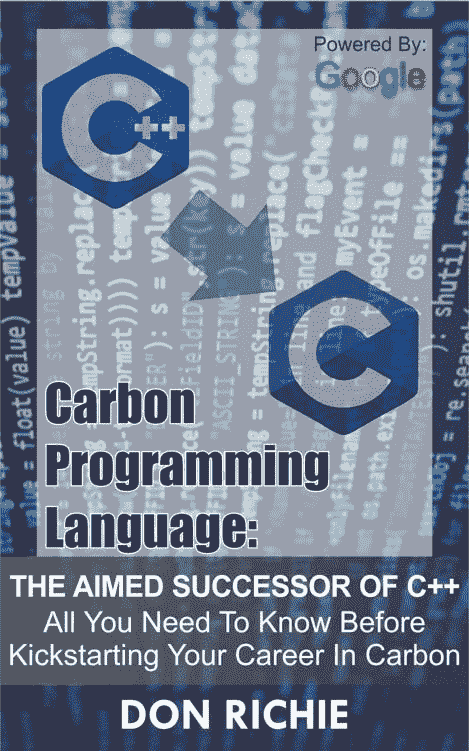

# Carbon 语言：C++ 的目标继任者





## 介绍

Carbon 是 Google 内部创建的一种实验性通用语言，由 Chandler Carruth 在 2022 年 7 月的多伦多 Cpp North 大会上向大家展示。该语言旨在修复 C++ 的某些缺点，同时提供相似的功能集。它设计在 GitHub 上，实现语言为 C++，支持跨平台。网站地址：[`github.com/carbon-language/carbon-lang`](https://github.com/carbon-language/carbon-lang)

## Google 的 Carbon 编程语言旨在取代 C++

| 特性 | 值 |
| :--- | :--- |
| 名称 | Carbon |
| 家族 | C |
| 开发者 | Google |
| 首次出现 | 2022 年 7 月 19 日，几天前 |
| 预览发布版本 | 0.1 / 2022 年 7 月 19 日，几天前 |
| 类型规范 | 静态、名式的、部分推断 |
| 实现语言 | C++ |
| OS 扩展 | 跨平台 |
| 影响因素 | C++, Rust |

## 快速且与 C++ 协作工作

C++ 在 Google 内部有大量使用，在某种程度上也是原始 C 编程语言的继任者。虽然有人可能认为 Rust（一个 Mozilla 项目，现已获得极大的公众关注）是 C++ 的继任者，但 Carruth 疑问这种类比是否仍然成立。它并没有像 Java 和 Kotlin 那样的“双向互操作性”。

## 现代且不断演进

## 欢迎开源社区

## 为什么构建 Carbon?

## 语言目标

## 项目状态

## 泛型

## 内存安全

## 开始使用 Carbon

## Google 的新语言 'Carbon' 能比 Rust 更好地取代 C++ 吗?

## 一个我们都需要答案的问题

## 互操作性哲学与目标

## 背景

## 其他互操作性层

## 哲学

## 语言目标的影响

## 性能关键型软件

## 软件与语言演进

## 于阅读、理解和编写的代码

## 实用的安全保障与测试机制

### 快速且可扩展的开发

### 现代操作系统平台、硬件架构和环境

## 与现有 C++ 代码的互操作及迁移

## 目标

### 支持混合 Carbon 和 C++ 工具链

## 与 C++ 内存模型兼容

## 最少化桥接代码

## C++ 和 Carbon 类型之间意料之外的映射

### 在 Carbon 文件中允许 C++ 桥接代码

## Carbon 从 C++ 类型继承


关于为什么 `C++` 开发者可能想要考虑在他们的代码库中引入 `Carbon`，Carruth 在现场分享了该语言的许多亮点。

除了语言本身的特性外，Carbon 团队还关注了将塑造 Carbon 未来的开发流程。该项目的代码公开托管在 GitHub 上，并开放接受拉取请求（pull requests），同时，Carbon 的文化被概述为对公司员工和个人人士来说都是易于获取且包容的。

尽管如此，`Carbon` 编程语言的一个尚未被特别说明的方面是 Google 的参与。虽然今天的演示是由一名 Google 工程师分享的，且目前的 `Carbon` 项目负责人主要（但并非全部）由 Google 工程师组成，但在其他地方并没有提到 `Carbon` 是 Google 的项目。

这实际上是刻意为之，虽然 `Carbon` 起于 Google 内部，但团队理解并在网上分享，为了取得任何未来的成功，`Carbon` 需要成为“一个独立且由社区驱动的项目”，而不是仅仅由 Google 自身的用途驱动。在同一条评论中，Carruth 进一步强调 `Carbon` 目前仅仅是一个实验，尽管一些公司已经对其表现出早期兴趣。

如果你感兴趣开始使用 `Carbon`，可以下载源代码并在自己的设备上进行实验。或者，得益于与免费的 `Compiler Explorer` Web 应用集成，你可以直接在浏览器中体验 `Carbon` 编程语言。

## Google 的 Carbon 编程语言旨在取代 C++

于 2022 年 7 月 19 日周二发布的所谓 `Carbon` 语言（`C++` 的继承者），据说是 `C++` 的实验性替代方案。

Carruth 表示，尽管许多人可能认为 `Rust` 是 `C++` 的继承者，但它缺乏 `Carbon` 所提供的“双向互操作性”水平。

他说 `Carbon` 旨在与现有的 `C++` 代码完全兼容，并补充说目标是让从 `C++` 到 `Carbon` 的过渡尽可能容易。

Google 新编程语言的亮点包括：

- 引入词和简单的语法法
- 函数输入参数是只读值
- 指针提供间接访问和变异
- 使用表达式为类型命名
- 包是根命名空间
- 通过其包名导入 API
- 显式对象参数声明方法
- 单继承 —— 类默认为 final（不可继承）
- 强大的、定义检查的泛型
- 类型显式实现接口

有趣的是，Google 注意，为了让这种语言成功，`Carbon` 必须是一个“独立的由社区驱动的项目”，而不仅仅供 Google 使用。

因此，虽然 `Carbon` 目前的大多数负责人是 Google 开发者，但尚没有明确信息将其归类为 Google 项目。

`Carbon` 的源代码可以在 GitHub 上获得，并开放拉取请求。

`https://github.com/carbon-language/carbon-lang#carbon-language--an-experimental-successor-to-c`

## 现代且演进

- 坚实的语言基础，易于学习，特别是如果你使用过 `C++`
- `Carbon` 版本之间基于工具的简单升级
- 更安全的基础以及走向内存安全子集的增量路径

## 快速且与 C++ 兼容

- 使用 `LLVM` 性能匹配 `C++`，提供位和地址的底层访问
- 与你现有的 `C++` 代码互操作，从继承到模板
- 快速且可扩展的构建，可与你现有的 `C++` 构建系统协同工作

## 欢迎开源社区

- 明确的目标和优先级，以及稳健的治理
- 致力于做到欢迎、包容和友好的社区
- “电池全备”方法：编译器、库、文档、工具、包管理器等更多

## 为什么要构建 Carbon？

`C++` 仍然是性能关键型软件的主导编程语言，拥有庞大且不断增长代码库和投资。然而，如上述所示，它在改进和满足开发者需求方面正挣扎，这很大程度上归于积累了数十年的技术债。增量改进 `C++` 是极其困难的，既是因为技术债本身，也是因为其演进过程中的挑战。解决这些问题的最佳方法是避免直接继承 `C` 或 `C++` 的遗产，而是从坚实的语言基础开始，如现代泛型系统、模块化代码组织以及一致简单的语法。

现有的现代语言已经提供了优秀的开发者体验：`Go`、`Swift`、`Kotlin`、`Rust` 等。能够使用这些一种现有语言的开发者应该去使用。遗憾的是，这些语言的设计为从 `C++` 采用和迁移构成了巨大的障碍。这些障碍从软件惯用设计的变化到性能开销不等。

`Carbon` 从根本上是一种后继语言方法，而不是对 `C++` 进行增量演变的尝试。它是围绕与 `C++` 的互操作以及针对现有 `C++` 代码库和开发者的大规模采用和迁移而设计的。`C++` 的继承语言需要：

- 性能匹配 `C++`，这对我们的开发者来说是一个基本属性。
- 与 `C++` 进行无缝的双向互操作，使得现有 `C++` 栈中任何地方的库都可以采用 `Carbon` 而无需迁移其他部分。
- 对于 `C++` 开发者具有良好的学习曲线和合理的熟悉度。
- 对现有软件的设计和架构具有相当的表达力和支持。
- 可扩展的迁移，对惯用的 `C++` 代码进行某种程度的源源翻译。

通过这种方法，我们可以在 `C++` 现有生态系统之上构建，并引入现有的投资、代码库和开发者群体。一些语言在其他生态系统中遵循了这种模型，`Carbon` 旨在为 `C++` 扮演类似的角色：

- `JavaScript` → `TypeScript`
- `Java` → `Kotlin`
- `C++` → `Carbon`

## 项目状态

`Carbon` 目前是一个实验性项目。我们想进一步了解是否可以构建一种符合我们继承语言标准的语言，以及该语言是否能在更大的 `C++` 行业和社区内聚集大量的关注。

目前，我们已经完善了项目和语言的几个核心方面：

- 语言和项目的策略。
- 开源项目结构、治理模型和演进流程。
- 基于我们对 `C++` 的经验设计的语言关键和基础方面，以及我们预期的挑战。这包括了：
    - 泛型
    - 类类型
    - 继承
    - 运算符重载
    - 词法语法结构
    - 代码组织和模块结构

一个原型解释器演示，可以运行示例并对 `Carbon` 的特定语义模型和抽象机器进行详细分析。我们将其称为 Carbon Explorer。

我们目前专注于从 `C++` 社区获取更广泛的反馈和参与，完成 0.1 语言设计，并完成该设计的 Carbon Explorer 实现。之后，我们计划优先考虑 `C++` 互性和能够实现 0.1 语言并用于详细评估 Carbon 的现实工具链。

## Carbon 和 C++

如果你已经是一个 `C++` 开发者，`Carbon` 应该具有平缓的学习曲线。它由一组一致的语言结构构建，应该让你很熟悉并且易于阅读和理解。

这样的 `C++` 代码：

对应这段 Carbon 代码：

你可以无开销地从 `C++` 调用 `Carbon`，反之亦然。这意味着你可以在应用程序内部将单个 `C++` 库迁移到 `Carbon`，或者在你现有的 `C++` 投资之上编写新的 `Carbon`。


除了 Carbon 与 C++ 之间的互操作性外，我们还计划支持迁移工具，能够机械地将惯用的 C++ 代码翻译为 Carbon 代码，帮助您将现有的 C++ 代码库迁移到 Carbon。

## 语言目标

我们正在设计 Carbon 以支持：

- 性能敏感型软件
- 软件和语言的进化
- 易读、易懂、易的代码
- 实用的安全测试机制
- 快速且可扩展的开发
- 现代操作系统、硬件架构和环境
- 与现有 C++ 代码的互操作性以及从其迁移

虽然许多语言共享这些目标的子集，但 Carbon 的独特之处在于它们的结合。

我们对 Carbon 也有明确的“非目标”（non-goals），主要包括：

- 整个语言和库的稳定 ABI
- 完美的向后或向前兼容

我们详细的`goals`文档阐述了这些想法，并对我们 Carbon 项目和语言的目标提供了更深入的视角。

## 内存安全

安全性，特别是`内存安全`仍然是 C++ 的关键挑战，也是继任语言需要解决的问题。我们的首要任务和重点是立即解决安全领域中重要的、易手而得的问题：

- 更好地跟踪未初始化状态，加强对初始化的强制执行，并在需要时系统地提供针对初始化 bug 的加固。
- 设计基础 API 和惯用法，以在调试和强化构建中支持动态边界检查。
- 拥有一个默认调试构建模式，即使结合`Address Sanitizer` 也比现有 C++ 构建模式更便宜且更全面。

一旦我们可以将代码迁移到 Carbon，我们将拥有一个简化的语言，在设计空间上有余地添加任何必要的注解或功能，以及像`generics` 这样的基础设施来支持更安全的设计模式。长期来看，我们将在此基础上引入一个安全的 Carbon 子集。这将是一个庞大且复杂的工程，不会包含在`0.1` 设计中。同时，我们正在密切关注并学习向 C++ 中添加内存安全语义的努力，例如受 Rust 启发的`lifetime annotations`。

## Generic 型

Carbon 提供了一个带有检查定义的`现代泛型系统`，同时仍`支持选择性开启`的`templates` 以实现无缝的 C++ 互操作。与 C++ 模板相比，检查过的泛型具有多个优势：

- 泛型定义经过完全类型检查，消除了通过实例化来检查错误的需要，并对代码提供了更大的信心。
- 避免了每次实例化时都重新检查定义的编译开销。
- 当使用定义检查的泛型时，用例错误信息更清晰，直接显示哪些要求未被满足。
- 允许自动的、可选的类型擦除和动态分发，无需单独的实现。这可以减少二进制文件的大小并允许异构容器等结构。
- `强、经过检查的接口`意味着对实现细节的意外依赖减少，并为消费者提供了更清晰的约。

在不牺牲这些优势的情况下，`Carbon generics` 支持特化，以确保它能够完全解决 C++ 模板的性能敏感型用例。有关 Carbon 泛型的更多信息，请参阅其`design`。

除了与 C++ 进行简单且强大的互操作外，Carbon 模板可以被细粒度约束并增量迁移到检查过的泛型，且具有平滑的进化路径。

## 开始使用 Carbon

你可以通过查看代码库并使用 Carbon explorer 来开始尝试 Carbon：

### 使用 Homebrew 安装 bazelisk。

```bash
brew install bazelisk
```

### 使用 Homebrew 安装 Clang/LLVM。
### 许多 Clang/LLVM 版本并未使用我们依赖的选项进行构建。

```bash
brew install llvm
export PATH="$(brew --prefix llvm)/bin:${PATH}"
```

### 下载 Carbon 的代码。

```bash
git clone https://github.com/carbon-language/carbon-lang
cd carbon-lang
```

### 编译并运行 explorer。

```bash
bazel run //explorer -- ./explorer/testdata/print/format_only.carbon
```

## Google 的新语言 'Carbon' 能比 Rust 更好地替代 C++ 吗？

### 我们都需要答案的问题

Google 工程师认为，大型项目将`现有` C++ 代码库转换为 Rust 是困难的——因此他们创建了一个名为 Carbon 的新“实验性”开源编程语言。

Carruth 深入探讨了为什么 Carbon 应该被认为是 C++ 语言强大的继任者的一些原因，包括更简单的语法和更流畅的 API 导入。

Google 的工程师已经在构建将 C++ 翻译成这种新语言的工具。`The New Stack`报道道，“尽管 Carbon 起于 Google 内部项目，但开发团队最终希望在年底之前将 Google 或任何其他单一公司的贡献减少到 50% 以下，”并补充说，Google 最终希望将项目交给一个独立的软件基金会，在那里的开发将`由志愿者领导`：Carruth 在 GitHub 页面上解释道，C++ 长期以来一直是构建性能敏感应用程序的首选语言，但深受许多阻碍现代开发者的问题的困扰。它积累了数十年的技术债，带来了作为其前身 C 语言部分的许多过时做法。Carruth 指责，C++ 的维护者优先考虑向后兼容，以便继续支持 Linux 及其包管理生态等广泛使用的项目。

该语言的进化也受到官僚主义委员会流程的阻碍，该流程围绕标准化而非设计展开。这可能使得添加新功能变得困难。C++ 在很大程度上采用了一种孤立的开发流程，其中`select committee`在可能需要数年的瀑布式流程中做出重要决策。Carruth 写道，“委员会结构的设计是为了确保国家和公司的代表性，而不是建立一个包容、欢迎的专家团队以及积极为语言贡献的人的社区。对委员会和标准的访问受到限制且昂贵，必须参加才能发言，并且决策通过现场投票做出。”

Carruth 想要通过更开放的`社区主导环境`来构建 Carbon。该项目将在`GitHub` 上维护，并在`Discord` 上讨论……设计团队希望在年底前发布一个核心工作版本（“0.1”）。文章指出，Carbon 将拥有`generics` 和内存安全（包括动态边界检查）等现代功能。而且“开发团队还将致力于创建一个内置的包管理器，这是 C++ 极度缺失的。”


Android 开发者深知 Kotlin 是 Java 的继任者，正如 iOS 开发者知道 Swift 是 Objective-C 的继任者一样。来自微软的 TypeScript 彻底增强了 JavaScript，同时保持了易用性，并能够“转译”回 JavaScript。在 Google 内部被大量使用的 C++ 同样被看作原始 C 编程语言的某种继任者。

尽管有人可能认为 Rust（最初是 Mozilla 的项目，现已发展出庞大的公共用户群）是 C++ 的继任者，但 Carruth 怀疑这种类比是否仍然适用。虽然 Rust 无疑是启动新项目的绝佳语言，但它并不具备像 Java 和 Kotlin 那样的“双向互操作性”，这使得稳健的迁移变得困难。

如果 Rust 现在对你行之有效，你就应该使用它。但将 C++ 生态系统迁移到 Rust 是困难的。

为此，尽管 Carbon 与 Rust 有许多共同目标，例如帮助开发者创建“性能密集型软件”，但 Carbon 的设计目标还旨在与现有的 C++ 代码完全互操作。此外，其目标是让如果需要的话，从 C++ 迁移到 Carbon 尽可能容易。

至于为什么 C++ 开发者可能想要考虑在其代码库中引入 Carbon，Carruth 在现场分享了该语言的许多亮点：

- 引入关键字和简单的语法，`Function()` 输入参数是只读值
- 指针提供间接访问与变异
- 使用表达式（expressions）来命名类型
- 包（package）是根命名空间
- 通过其包名导入 API
- 显式对象参数声明方法
- 单继承；类默认为 final（密封）
- 强大的、经过定义检查的泛型
- 类型显式实现接口

除了语言本身的功能外，Carbon 团队还关注了塑造 Carbon 未来的开发过程。该项目代码公开托管在 GitHub 上，并接受拉取请求（pull requests），而 Carbon 的文化被概述为对公司员工和个人都是易于获取且具有包容性的。

尽管如此，Carbon 编程语言的一个尚未特别说明的方面是 Google 的参与情况。虽然今天的演示是由一名 Google 员工分享，且目前的 Carbon 项目负责人主要（但并非全部）由 Google 员工，但除此之外并没有提到 Carbon 是 Google 的项目。

这实际上是刻意为之，因为虽然 Carbon 起于 Google，但团队理解并已在线分享，为了取得任何未来的成功，Carbon 需要成为“一个独立且社区驱动的项目”，而不仅由 Google 自身的需求驱动。在同一条注释中，Carruth 进一步强调 Carbon 目前仅仅是一项实验，尽管一些公司已经表现出了早期的兴趣。

如果你感兴趣开始使用 Carbon，可以下载源代码并在自己的设备上进行实验。或者，得益于与免费的 Compiler Explorer 网页应用的集成，你可以直接在浏览器中感受 Carbon 编程语言。

## Google 的新编程语言名为 Carbon

它还将拥有一种实务上安全的测试机制，该机制将针对高级类型代码进行改进。性能优化也将是 Carbon 编程语言的主要目标。

最后，我担任 C++ 程序员已经很久了，我非常期待看到 C++ 的继任者如何弥补它的缺点。活动还提到它将具有基于 C++ 和 Golang 的底层机制。目前，它仅处于实验阶段，很快将进入 beta 阶段。

你也可以在其官方 GitHub 页面了解更多关于 carbon 的信息并参与其中。

## 互操作性哲学与目标

## 背景

与 C++ 互操作以及从 C++ 迁移是该语言的目标。然而，性能和演进具有更高的优先级。这种优先级的相互作用对于理解 Carbon 的互操作目标和权衡至关重要。

### 其他互操作层

其他可能提供有用示例的语言互操作层包括：

* Java/Kotlin 应该是一个可以比较互操作案例。这两种语言虽然不同，但共享底层运行时。这可能最接近我们对 Carbon 渴望的模型。
* JavaScript/TypeScript 类似于 C/C++，其中一种语言本质上是另一种语言的子集，允许高互操作性。这是一个有趣的参考点，但我们正在寻找一种边界更清晰的方法。
* C++/Java 是需要为桥接层编写专门代码的示例，这增加了开发者的互操作负担。这种方法的负担可以被认为对应语言内存模型和其他语言设计选择之间的差异。无论如何，对于开发者来说，其维护成本可能比我们对 Carbon 要求的高。
* C++/Go 与 C++/Java 类似。然而，Go 特别允许 C++ 桥接代码存在于 `.go` 文件中，这可以简化桥接层的维护，对 Carbon 来说是理想的。

## 哲学

Carbon 的 C++ 互操作层允许从 Carbon 代码访问 C++ API 的子集，同样也允许从 C++ 代码访问 Carbon API 的子集。这要求将一种语言表示为另一种语言的子集。可能需要桥接代码将某些 API 映射到相关的子集中，但表达能力的限制应该足够宽松，以保持此类桥接代码的可持续性。

Carbon 与 C++ 之间互操作的设计依赖于：

* 与各种代码互操作的能力，例如类/结构体和模板，而不仅仅是自由函数。
* 在需要最大化互操作层性能时，愿意将 C++ 的惯用法暴露到 Carbon 代码中，反之亦然。
* 使用封装（wrappers）和泛型编程（包括模板）来最小化或消除运行时开销。

在观察 C++ 中的自定义数据结构如何暴露到 Carbon 中以及反之时，这些元素汇聚了一起。在这两种语言中，拥有自定义的底层数据结构（如关联容器）是合理甚至是常见的。例如，有许多从键映射到值的数据结构可能最适合特定的用例，包括哈希表、链式哈希表、排序向量和 B 树。即使对于给定的数据结构，实现策略也可能发生缓慢但有意义的演变。

结果是，通常将 C++ 数据结构直接暴露给 Carbon 是合理的，无需转换为“原生”或“惯用”的 Carbon 数据结构。虽然接口可能不同，但一个简单的适配器封装（adapter wrapper）就足够了。许多 Carbon 数据结构也应该支持多种实现，并将 C++ 数据结构作为其中一种实现，允许在 Carbon 之后隐藏惯用的 C++ 用法。

反过来情况也是如此。C++ 代码通常不关心，或者可以重构为不关心使用哪种特定的数据结构。Carbon 数据结构可以作为另一种实现暴露在 C++ 中，并封装以匹配 C++ 的惯用法甚至模板。

例如，像 `std::vector<T>` 这样的 C++ 类模板可以在不产生封装代码或运行时开销的情况下使用，并将 Carbon 类型作为 `T` 。生成的类型在 C++ 或 Carbon 代码中同样可用。为 `std::vector<T>` 封装 Carbon 接口应该是容易，以便在惯用的 Carbon 代码中透明使用。


在 Carbon 中，与 C++ 的互操作性将被频繁使用，无论它是 C++ 开发者尝试 Carbon、增量地迁移大型 C++ 代码库，还是长期使用某个 C++ 库。在所有情况下，必须能够以零开销编写互操作代码；不能需要任何拷贝。

### 易于阅读、理解和编写的代码

与互操作性相关的 Carbon 代码可能比其他更符合习惯的 Carbon 代码更难读。这没关系：目标是让 Carbon 代码具有可读性并不意味着它必须变得浅而易懂。同时，互操作性给 Carbon 开发者带来的额外成本应该降到最低。

### 软件和语言演进

互操作性将要求 Carbon 添加一些功能，这些功能主要用于支持互操作性用例。然而，这些功能不应过度影响 Carbon 的整体演进。特别是，只有一部分 Carbon 功能将支持与 C++ 的互操作性。这样做将限制 Carbon 的功能集。

### 与现有 C++ 代码的互操作以及从中迁移

Carbon 互操作性的语言目标将聚焦于对 C++17 的兼容性。语言设计必须考虑到优先顺序；只要对互操作性和 Carbon 整体带来更大的收益，就可以做出可能损害其他目标的权衡。

尽管以下特定的互操作性目标将聚焦于互操作性，但考虑迁移将受到什么影响也很重要。如果互操作性需要复杂的工作（特别是为了避免对性能的影响），它可能会损害将 C++ 代码库增量迁移到 Carbon 的能力。

### 性的安全保证和测试机制

维护互操作代码周围的安全性至关重要，并应尽可能提供缓解措施。然而，安全保证将集中在原生 Carbon 代码上。C++ 代码将无法获得 Carbon 提供的同套安全机制，因此调用 C++ 的 Carbon 代码将面临更高的安全风险。

### 现代操作系统平台、硬件架构和环境

互操作性将适用于 Carbon 和 C++ 都支持的环境的交集。从实用角度来看，Carbon 可能是这里的限制因素。

### 快速且可扩展的开发

互操作层可能会有与 C++ 类似的工具限制。例如，Carbon 的目标是快速编译。然而，C++ 互操作性取决于编译 C++ 代码，而这是相对慢的。使用互操作性的 Carbon 库将面临 C++ 编译时间的瓶颈。改进 C++ 不在 Carbon 的范围之内。

## 目标

### C++ 内存模型

任何 Carbon 互操作代码都必须能够兼容 C++ 内存模型。这并不意味着 Carbon 必须专门使用 C++ 内存模型，只需要支持它即可。

### 在 Carbon 文件中允许 C++ 桥接代码

Carbon 文件应该支持用 C++ 编写的内联桥接代码。在需要桥接代码的地方，这将允许直接在使用它的代码旁边对其进行维护。

### 支持混合 Carbon 和 C++ 工具链

Carbon 工具链将支持编译 C++ 代码。它将包含一个自定义的 C++ 编译器，启用一些更高级的互操作性功能，例如从 C++ 调用 Carbon 模板。

工具链混合也支持双向支持：

*   由非 Carbon 工具链编译的 C++ 库可以在 Carbon 中使用，只要它们与 Carbon 的 C++ 工具链保持 ABI 兼容。
*   Carbon 工具链将支持一种选项，即从 Carbon 库生成 C++ 头文件和对象文件，其 ABI 适用于非 Carbon 工具链。

混合工具链将功能限制在 C++ ABI 可行的范围内。例如，开发者应该预料到，在使用 Carbon 工具链时，可以从 C++ 调用 Carbon 模板，而在混合工具链时将不可用，因为这将需要一个实质然不同且更复杂的互操作实现。这种降级的互操作性对于大多数开发者来说仍然应该是足够的，尽管可能需要更多的桥接代码。

任何在混合工具链下可工作的 C++ 互操作代码，在使用原生 Carbon 工具链时也必须可工作。混合工具链支持不能有语义差异。反之则不然，原生 Carbon 工具链可能具有额外的语言支持和优化。

### 最小化桥接代码

大多数简单的 C++ 函数和类型应该能够从 Carbon 直接使用，而不需要任何自定义桥接代码，也不需要任何运行时开销。这意味着 Carbon 代码应该能够调用大多数 C++ 代码，而无需为了支持互操作而对代码进行任何更改，即使该代码是用非 Carbon 工具链构建的。这包括使用 C++ 类型实例化 Carbon 模板或泛型。

在另一个方向，Carbon 可能需要一些少量的标记来将函数和类型暴露给 C++。这有助于避免要求 Carbon 无条件地生成 C++ 兼容的端点，因为这可能会带来许多情况下不必要的编译和链接开销。此外，它还应该帮助产生错误，指示何时函数或类型可能需要额外的更改以与 C++ 兼容。

Carbon 的开发者应该能够轻松地复用第三方提供的成熟 C++ 库生态系统。第三方库的语言选择不应成为采用 Carbon 的障碍。

即使对于原生库，由于执行和验证源码迁移的人力成本，将 C++ 代码库迁移到 Carbon 通常往往是增量的。预计最小化所需的桥接代码量将简化此类迁移。

### 支持对高级 C++ 特性的使用

应该支持对高级 C++ 特性的多数惯用用法。几个例子是模板、重载 set、属性和 ADL。

尽管这些特性可以被认为是“高级”的，但它们在整个 C++ 代码（包括 STL）中被广泛使用。支持这些特性是 C++ 特性迁移的关键。

### 支持基础的 C 互操作

C 互操作性的支持必须足够让 Carbon 代码调用用 C 编写的流行 API。C 调用 Carbon 的将受到更多限制，限于类似于 C++ 互操作支持的地方。基础 C 互操作将包括函数、基本类型和仅包含成员变量的结构体。

互操作性依赖更高级的 C 特有功能（如模板、继承和类函数）的功能不需要为 C 提供支持。这些需要一个特定的 C 互操作模型，而该模型将不会被包含。

### C++ 与 Carbon 类型之间自然的映射

Carbon 将为常用类型提供意料之外的映射。

基本类型将具有零开销转换的映射。它们被频繁使用，因此互操作代码能够无缝使用它们非常重要。

存储和表示在两种语言中需要是等等的。例如，如果 C++ 的 `__int64` 映射到 Carbon 的 `Int64`，则两种类型的内存布局必须相同。

语义需要相似，但边缘情况的行为不需要相同，这允许 Carbon 灵活地演进。例如，当 C++ 在整数上进行取模回绕时，Carbon 在默认映射的基本类型上可以产生异常行为。

Carbon 可能拥有这些类型的无 C++ 映射的版本，例如 `Int256`。


其他词汇类型通常提供合理但可能存在零开销的转换，以映射到 Carbon 词汇类型。使用这些类型的代码可以选择是否支付转换的开销。它们也可以在 Carbon 代码中直接使用 C++ 类型，反之亦然。

不完整类型必须具有具有相似语义的映射，类似于原始类型。

## Carbon 对 C++ 类型的继承

为了实现互操作性，Carbon 将支持从 C++ 类型进行继承，尽管语法构造看起来可能与 C++ 继承不同。这被认为是必要的，以处理 C++ 库 API 期望用户继承自给定的 C++ 类型的情况。

这可能仅限于纯接口类型；参见开放问题。

## 非目标 (Non-goals)

### 绝不要求桥接代码

`C++` 的边缘情况不会获得与常见情况相同的支持：支持任何给定结构的复杂性必须与该需求的现实需求取得平衡。例如：

* 互操作性将针对 `C++17`。对未来 `C++` 版本的互操作支持（包括 `C++20` 模块等特性）将基于成本效益分析。不应假设会有详尽的支持。
* 支持将集中在广泛开源库或其他关键利益相关者使用的惯用代码、接口和模式上。`C++` 代码将存在边缘情况，此时通过避免复杂的互操作来限制 Carbon 维护成本的收益将大于避免桥接代码的价值。
* 对底层 `C` ABI 的支持可能集中于现代 64 位 ABI，包括 Linux、`POSIX` 和 Windows 调用约定的一小子集。

### 将所有 C++ 类型转换为 Carbon 类型

应仅支持非零开销转换，而绝不强制，以便提供可靠且无意外的性能行为。这并不意味着转换将始终被支持，因为支持是针对特定类型映射的成本效益决策。例如，考虑 `std::vector<T>` 与等效惯用 Carbon 类型之间的转换：

* 使转换达到零开销将要求 Carbon 类型镜像 `std::vector<T>` 的内存布局和实现语义。然而，这样做将限制 Carbon 类型的演进以匹配 `C++`。尽管对于大多数原始类型接受某些限制，但要限制 Carbon 类型以匹配 `C++` 词汇类型实现将给 Carbon 的演进带来巨大负担。
* 这些转换可能并不总是存在，但 `std::vector<T>` 是频繁使用的类型。因此，可以预期会有函数支持到惯用 Carbon 类型的拷贝转换。
* 对于常用类型，可能还会提供一种可以未使用 `std::vector<T>` 或等效惯用 Carbon 类型差异的接口。
* 在 Carbon 代码中不通过转换处理 `C++` 类型仍然是正常现象。开发者应该被赋予何时进行转换的权利。

### 跨语言元编程

Carbon 的元编程设计将比 `C++` 的预处理器宏更具限制性。尽管互操作性应该处理简单情况（例如 `#define STDIN_FILENO 0`），但复杂的元编程库可能需要理解代码重写的深度能力。将这些内容重写为使用 Carbon 的元编程模型是合理的。

### 支持不带桥接代码的 C++ 异常

Carbon 可能不会为 `C++` 异常提供无缝的互操作支持。例如，将 `C++` 异常转换为 Carbon 错误或反之可能需要注解或桥接代码，这些翻译可能会产生一些性能开销或丢失信息。此外，如果 Carbon 代码在没有适当注解或桥接的情况下调用 `C++` 函数，且该函数带异常退出，程序可能会终止。

### 仅 Carbon 工具链与混合 C++/Carbon 工具链之间的完全对等

使混合 `C++`/Carbon` 工具链的支持等同于仅 Carbon 工具链的支持会影响所有互操作性特性。混合工具链的支持将降低，因为完全对等成本太高了。

在从 `C++` 代码中调用 Carbon 模板的功能是分析此选项的关键。模板实例化在编译期间在 `C++` 中无处不在。

使用 Carbon 工具链编译 Carbon 和 `C++` 代码时，可以修改 `C++` 编译器以不同方式处理 Carbon 模板。Carbon 模板可以通过将 Carbon 编译器的 AST 直接暴露给 `C++` 编译器（作为编译器扩展）来处理。虽然这种方法仍然复杂且可能并不总是有效，但它应该提供重大的价值以及将 `C++` 代码迁移到 Carbon 的能力，无需在 `C++` 中并行维护实现。

在混合工具链中，无法修改 `C++` 编译器以不同方式处理 Carbon 模板。支持模板实例唯一方法是将 Carbon 模板转换为 `C++` 头文件中的等效 `C++` 模板；换句话之，模板支持需要源到源的翻译。支持 Carbon 到 `C++` 代码的翻译是一个实现混合工具链完全对等的复杂且高成本的功能。要求混合工具链使用桥接代码是避免这种成本的可能解决方案。

注意，当考虑 Carbon 代码实例化 `C++` 模板的互操作性时，此问题不同。`C++` 模板必须在 `C++` 头文件中以便重用，而这必须与 Carbon 工具链编译以重用构建的 `C++` 代码，无论是否在使用单独的 `C++` 工具链。也可以被视为混合工具链互操作性的限制，但处理更容易且不太可能给开发者带来负担。

总结来说，开发者应该预期虽然大多数功能在混合工具链中工作方式等，但永远不会实现完全对等。

### 为 C++ 外的语言提供等效支持

长期来看，应该预期 Carbon 将增加与非 `C++` 语言的互操作。然而，为了支持语言目标，互操作讨论将集中在 `C++` 上。尽管我们在构建互操作设施时应该考虑扩展性，但预计 `C++` 将拥有更健壮的支持。

许多语言都提供了 C 的互操作层。Carbon 的 C 互操作可能会以 C 为中介提供某种程度的多语言互操作。

## 以后解决的开放问题

### CRTP 支持

尽管 `CRTP` 是 `C++` 中的一种常用技术，但互操作支持可能需要大量工作。基于 `CRTP` 的库为了 Carbon 互操作可能需要桥接代码或重写。

在做出支持决策之前，应对支持 `CRTP` 的成本效益进行更多分析。

### 对象生命

Carbon 的对象生命设计可能与 `C++` 不同。例如，Carbon 可能会选择不同的规则来确定临时对象的生命。这可能会影响 API 的惯用用法，使得在 `C++` 中安全的代码变成不安全的 Carbon 代码，要求开发者学习新的编码模式。

在决定如何在互操作范围内处理对象生命之前，应该对对象生命和潜在的 Carbon 设计进行更多分析。

### Carbon 类型从非纯接口 C++ 类型继承

某些 `C++` API 期望消费者使用继承自 API 提供的类。我们希望 Carbon 能以某种方式支持继承 API 类型，以便使用这些 API。

可能要求父类型是纯接口，并且 API 使用桥接代码或切换实现就足够了。这将稍后决定。

