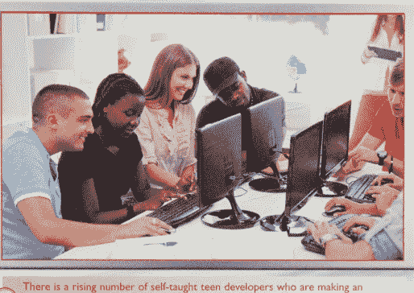
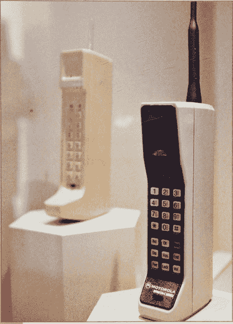
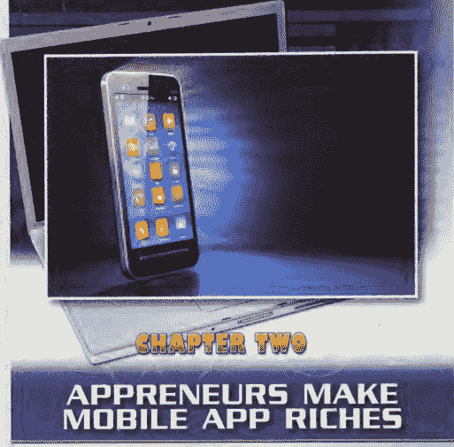
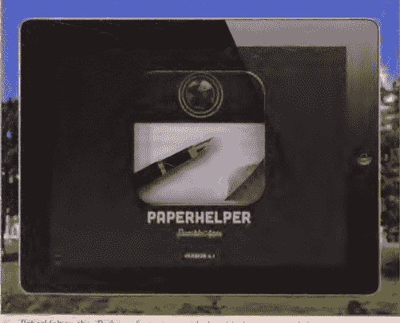
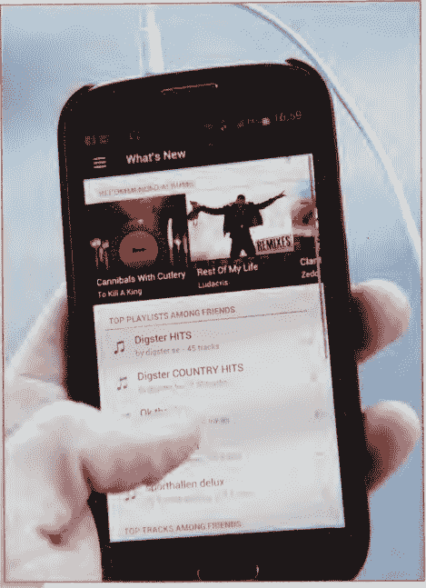
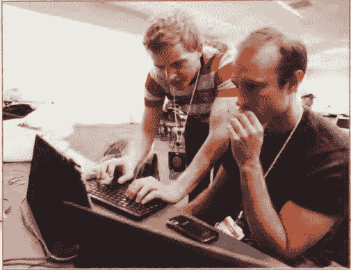
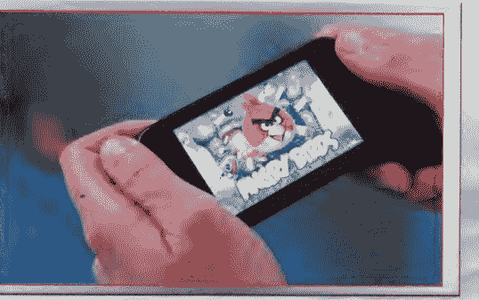
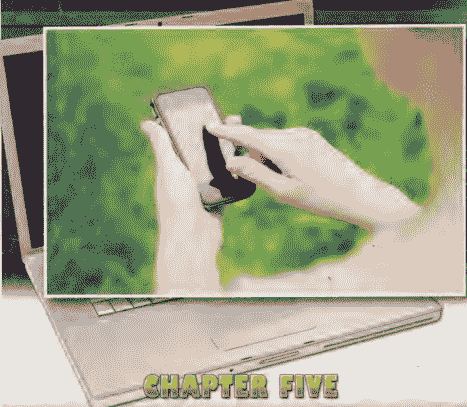
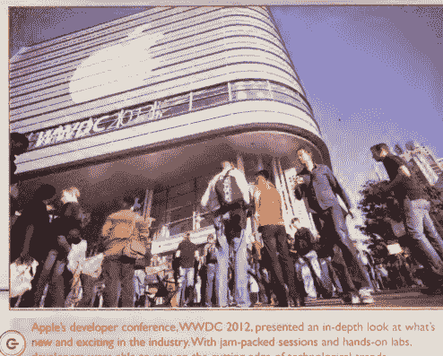
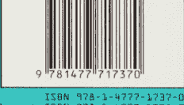

# 通过创建移动应用构建职业生涯（数字职业构建）

ACPL 条目已剔除

由互联网档案馆于2022年数字化，资金来源为Kahle/Austin基金会

> 自学成才的青少年开发者人数不断上升，他们正在对应用开发行业产生令人瞩目的影响。他们的创作新颖且有利可图，激励着这一新兴移动应用经济中的其他青少年。

这些能力可以用游戏和视频娱乐，或分享新闻、天气和财务报告等信息。无论你是想拍摄越野公路旅行的照片、保存最重要的密码、学习一门新语言，还是想知道哪支球队赢得了赛季总决赛，这些功能强大的软件单元都将让世界尽在指尖。

**看一看** 根据克里斯汀·马里诺（Kristin Marino）的文章《如何成为移动应用开发者》，最受欢迎的应用包括游戏（占下载用户的64%）、天气（60%）、社交网络（56%）、地图/导航/搜索（51%）和音乐（44%）。

## 应用的历史

1983年，第一部移动电话摩托罗拉DynaTAC 8000X面向消费者推出时，它与今天的高科技智能手机毫无相似之处。它重1千克（2.2磅），最多可存储30个电话号码，电池续航仅一小时，售价近4000美元。1997年，诺基亚将*贪吃蛇*嵌入其6110移动电话。这款游戏是对20世纪70年代电脑游戏的重制；像素化的爬行动物在绿色背景上细节精细的微型迷宫中滑行时，身体会不断变长。

尽管以今天的标准来看*贪吃蛇*相当基础，但它深受用户欢迎。它的成功促使其他公司在移动设备中加入街机类游戏，包括*乒乓*、*井字棋*和*俄罗斯方块*。它们也开始加入生产力应用，包括计算器、日历、电子邮件功能和铃声。20世纪90年代末和21世纪初，几乎每部移动电话都会大声播放一首排行榜前40名热门歌曲的副歌。

移动服务提供商之间竞争激烈，商业秘密受到严密保护。移动应用只能由内部设计师创建。无线应用协议（WAP）——HTTP的一个类似版本——的开发，正是第三方开发者获得入行机会所需要的。WAP使精简后的网页能够轻松显示在非常小的屏幕上，或通过无线网络向移动设备上的应用提供实时内容。它受到所有操作系统的支持，并能在许多移动设备的存储器和带宽限制内运行。设备上设有WAP接入点后，第三方

# 第一章 踏入数字应用世界

1973年的DynaTAC原型机（左）是第一部便携式蜂窝电话。1984年的摩托罗拉DynaTAC 8000X（右）是世界上第一部商用便携式蜂窝电话。

## 

## 创造应用商店历史

人们去哪里获取最新的移动应用？当然是应用商店。用户只需访问其移动设备的应用商店，就能在成千上万的娱乐、社交媒体、商务和新闻应用中选购。只需轻点按钮，他们就能查看应用图片和评论以及各种价位。第一家创造历史的应有商店是传奇的苹果应用商店。它于2008年7月开业，一周之内就有一千万个移动应用被下载。其中只有25%是免费的，这意味着顾客乐于为定制自己设备的应用付费。

苹果应用商店为其他应用商店进入市场铺平了道路。Android Market于2008年开设虚拟商店，随后是2009年的Ovi Store、2009年的BB App World，以及2010年的Windows Phone Marketplace。如今，苹果应用商店为iPhone、iPad和iPod Touch销售数千款移动应用。事实上，它在2012年春季达到了250亿次下载量。

移动应用市场是独立开发者的数字梦想。开发者可以创建并编写创新移动应用，同时依靠应用商店处理销售应用这一商业环节。作为利润分成——通常为30%——应用商店将负责营销和销售分发。这使开发者得以凭借其创意想法、有吸引力的内容和恰当的实施，成为数字巨星。

各种各样的免费或价格实惠的应用，兼容其他操作系统，如Android、BlackBerry OS、Windows Phone OS和iOS。每种操作系统都要求应用完全用兼容操作系统的语言从头编写。这意味着开发者需要具备特定编程语言的实用知识，例如用于Android和BlackBerry的Java、用于Windows Mobile的C++，以及用于iOS的Objective-C。

## 应用类型

除了众多编程语言外，移动应用还有三种类型：原生应用、移动Web应用和混合应用。原生应用是专为移动设备的操作系统创建的独立应用。大多数移动游戏都是原生应用，例如*割绳子*、*植物大战僵尸*，以及大热作品*愤怒的小鸟*。原生应用必须从应用商店下载。希望创建原生应用的应用开发者可以受益于标准化软件开发工具包（SDK）。SDK由平台制造商提供，包括用户界面元素和开发工具。原生应用虽然速度快且通常保持更新，但构建和维护成本高昂。示例包括用于iOS操作系统设备的*Camera+*，或用于Android设备的*KeePassDroid*。

移动Web应用基于Web，并与其他移动平台兼容。这些应用无需从传统应用商店下载。它们只需从设备的Web浏览器中访问。示例包括*Instagram*、*Dropbox*、*Google Maps*和*YouTube*。想要创建移动Web应用的开发者可以使用一些服务器端语言、Web应用框架或计算机编程代码——HTML5、CSS3或JavaScript——他们可能已经

因为各个应用的来源会定期更新这些应用。不过需要注意的是，离线数据存储空间有限，移动 Web 应用有时也缺乏原生应用那种精致的设计。此外，要让这些应用在智能手机用户可用的众多浏览器上正常运行，也可能很棘手。

混合应用将 Web 技术与原生应用执行方式结合在一起。Facebook、LinkedIn 和 TuneIn Radio 等混合应用，将 HTML5、CSS 或 JavaScript Web 应用的便利性与原生移动框架结合起来。这使用户可以在应用内使用移动 Web 浏览器。混合应用可以从应用商店下载，并可在多个移动平台上使用。用户下载专门针对其平台的应用框架，内容则通过平台无关的在线渠道提供。混合应用甚至可以在设备离线时访问。许多零售商偏爱混合应用。顾客购物时在移动设备上激活其原生应用，但在结账时浏览由 Web 生成的信息。

如今，应用热潮丝毫没有停止的迹象。国际数据公司（IDC）2010年12月的一份报告指出：“2014年全球下载量将达到769亿次，价值350亿美元。” Canalys 2011年6月的一份报告也持相同看法，预测“智能手机和平板电脑上应用销售、应用内购买和订阅带来的直接收入”将在2015年达到367亿美元。移动应用开发是

## 

# 第二章 应用创业者靠移动应用致富

与其他职业相比，移动应用开发相对较新。这意味着顶尖开发者未必有正式的开发者背景。有些人拥有相关领域一长串资历和成就。史蒂夫·德米特（Steve Demeter）是一名 ATM 软件设计师，业余时间开始设计应用。2007年夏天参加一场 iPhone 大会时，他受到启发。他相信，苹果发布 SDK 时为开发者打开了一个充满机遇的世界。这使得第三方应用可以下载到移动设备上，德米特知道这段经历可能为他打开进入这个新兴行业的大门。

史蒂夫·德米特抵达内华达州拉斯维加斯，出席互动艺术与科学学院第12届年度互动成就奖。该学院旨在表彰在电子游戏行业取得杰出成就的人士。

## 创建移动应用

他花了几个月时间构思一款巧妙而又原创的游戏应用。2008年2月，他有了想法。在连续四个月利用晚上和周末不知疲倦地编码后，*Trism* 准备好在2008年于苹果 App Store 首次亮相。头两个月里，德米特就靠这款色彩鲜艳的三角形游戏赚了25万美元。他最终辞去银行工作，创办了游戏开发公司 Demiforce。

一些顶尖开发者利用在线工具自学了构建应用的艺术与科学。互联网不仅提供市场，还包含主要的信息来源和训练营。几乎应用开发的每个步骤都有文字甚至动画教程。成千上万的论坛和网络社区致力于应用开发。自学成才的应用开发者查德·穆雷塔（Chad Mureta）接触移动应用行业的方式则颇为不同。2009年，穆雷塔翻车，惯用手严重受伤。他在医院卧床数周。在漫长的康复期间，一位朋友给了他一篇关于应用制作创业者的文章，这些人被称为“应用创业者”。其中大多数是一两人团队开发应用。他们的启动成本很低，穆雷塔了解到，成功的创业者靠自己的设计赚取数千美元，甚至数百万美元。受到鼓舞，穆雷塔开始从病床上开发应用。他相信这个商业机会能帮他支付巨额医疗账单。经过18个月的康复和无数小时的应用开发，穆雷塔得以离开他的房地产公司。作为应用创业者，他把每周70小时的工作制换成了每周5小时工作制，用 iPhone 在世界任何地方工作。蒂姆·费里斯在 FourHourWorkWeek.com 上引用了穆雷塔的话：

> 仅仅两年多，我就创建并出售了三家应用公司，创造了数百万美元收入。我的第一家公司上线两个月后，其中一款应用平均每月利润达3万美元。2010年12月，公司的月收入已达到12万美元。我一共开发了40多款应用，全球应用下载量超过3500万次。我的应用中超过90%都成功了并实现了盈利。

## 企业与移动应用开发

企业总是在寻找改善运营、提高生产力和带来更多利润的方法。移动应用是实现这些目标的一种有前景的方式。从国际时装公司到高科技企业，各行各业都已将移动应用加入其营销战略，作为品牌建设的一部分。

过去，只有成熟企业才能最大化移动应用带来的好处。如今情况已非如此。各种规模的企业现在都会开发应用用于销售或分发。例如，本地婚礼策划师可以使用一款应用帮助客户筹划他们的重要日子。快递服务公司会创建应用，帮助客户追踪寄往世界各地亲友的包裹。此外，创业者和员工可以通过使用公司应用来完成内部任务。他们可以在几分钟内管理库存、访问客户数据库并填写工时卡，效率以秒计。企业可以利用应用创造收入。许多创业者为希望从免费应用升级的用户提供高级版移动应用。另一些创业者则提供在应用内展示的广告或列表信息。例如，一家出版公司可能会在书店应用中发布其网站或目录的链接。对于认识到移动应用行业益处和优势的精明企业主来说，大量选择正等待着他们。

有兴趣为企业开发移动应用的应用开发者必须了解该公司面临的挑战和期望。该组织想要实现什么？它如何接触新客户和现有客户？一旦应用开发者理解了企业的目标，他或她就可以创建应用。借助移动设备上精致完善的应用，用户可以支付账单、配药，或计划去阳光明媚的墨西哥度假。

## 尼克·达洛伊西奥

神童们也纷纷投身应用开发行业。尼克·达洛伊西奥一直对技术着迷。他八岁时，父母给他买了一台 iPod。第二年，他缠着父母给他买一台 Mac。尼克用他的新台式电脑制作影片，后来在苹果开设 App Store 时转向编程——Final Cut、Final Cut Pro 和 3D 渲染软件。尼克当时只有12岁。

他开发了多款应用，包括 *Fingermill*、*Facemood* 和 *SongStumblr*。15岁的尼克在为历史实验课学习时，发现了流行搜索引擎的低效之处。他开始着手开发更好的东西。在他临时搭建的卧室应用开发控制中心里，他为自己的新 iOS 应用开发了一种算法。这款应用名为 *Trimit*，它能概括杂志和报纸文章，让读者在单个智能手机屏幕上了解要点。该应用于2012年11月推出，受到超过20万用户的欢迎。同年，*Summly* 荣获苹果最佳应用之一称号。尼克这款巧妙的应用引起了李嘉诚及其风投公司维港投资（Horizon Ventures）的注意。这位香港亿万富翁投资了30万美元，其他投资者也加入其中，包括阿什顿·库彻、小野洋子、斯蒂芬·弗莱、伦敦科技城负责人乔安娜·希尔兹，以及 Zynga 创始人马克·平卡斯。

*Summly* 受到国际新闻机构的欢迎。它们对网站获得的额外流量表示赞赏。其中一些机构达成协议，在应用内突出展示其出版物。根据读者身处世界何处，他或她将收到

十七岁时，尼克·达洛伊西奥将他的大热应用 *Summly* 卖给雅虎，登上了世界各地的头条。他的勤奋和创造力激励了同龄青少年尝试成为成功的应用创业者。

新闻集团旗下的一家地方出版物。如果读者在美国，他或她会读到 *《华尔街日报》*；在英国，读到 *《伦敦时报》*；在澳大利亚，读到 *《澳大利亚人报》*。2013年3月，Yahoo! 以3000万美元收购了 *Summly*。*Summly* 将按现状关闭，并被整合进 Yahoo! 的移动体验中。尼克将在完成学业期间到 Yahoo! 伦敦办公室工作。这个非凡的机会为各年龄段的开发者打开了一个充满移动机遇的世界。

## 托马斯·苏亚雷斯

和尼克·达洛伊西奥一样，托马斯·苏亚雷斯对计算机和技术着迷。12岁时，他被称为最年轻的 iPhone 应用开发者，为 iPhone、iPod touch 和 iPad 创建应用。他掌握了 Python、C 和 Java 等编程语言，同时 SDK 让他能够设计应用，其中一款是 *Earth Fortune*。他说服父母拉尔夫和玛格丽特支付99美元，让他的应用登上 Apple 的 App Store。托马斯创作了 *Bustin Jieber*，一款使用贾斯汀·比伯头像的打地鼠游戏。他产生这个想法，是因为他的许多同学都不喜欢这位著名的加拿大歌手。该游戏于2010年假期前发布，售价99美分。迄今为止，这是托马斯最成功——也是最喜爱——的移动应用。他创办了 CarrotCorp，一家销售四款基于 iOS 平台的移动应用的公司。

2011年10月，托马斯在加利福尼亚州的 TEDxManhattanBeach 活动上发言。他的演讲题目是“托马斯·苏亚雷斯：一个12岁孩子的应用”。

斯宾塞尝试将价格翻倍。在24小时内，该应用每天毛收入40美元；此后每天，斯宾塞的应用每天带来100到150美元收入。尽管这些应用因侵犯版权而被下架，斯宾塞却上了瘾。2011年为期两周的假期里，他在酒店商务中心工作，开发并发布了另外两款应用。这些应用的销售收入让他的时间和付出非常值得。斯宾塞对 YoungEntrepreneur.com 的卡拉·昂格伦说：

> 没有多少人知道如何创建能盈利的 iPhone 应用，所以我必须测试、修改、再测试、再修改，并再测试五十次。我今天仍在测试新策略。当你通过外包创建应用时，这个过程包括想出出色的应用创意、找到高技能员工、绘制应用功能流程图、营销以及协调整个过程。

Malibu Apps 被评为《青年企业家》2012年10月月度初创企业。自成立以来，Malibu Apps 已发布超过50款应用，包括 *掌握健康生活的10步营养计划*、*Minecraft 完全指南*、*我最喜欢的犬种* 和 *《愤怒的小鸟季节版》全金蛋*。斯宾塞原本打算空出一年时间，并于2013年进入大学。然而，在第一个财年结束前，他的净收入迅速超过了10万美元。他和父母开始认为大学可能不是最好的选择。他们支持继续发展 Malibu Apps 和 Malibu Microcap LLC 的决定；后者是一家投资并为初创应用公司提供咨询的公司。如今，斯宾塞的理念“打造你自己的梦想，否则别人会雇你去打造他们的梦想”是他创业努力的核心。当被问及给有志年轻创业者的建议时，斯宾塞对 YoungEntrepreneur.com 说：

> 如果有人告诉你你的商业想法很疯狂，你很可能已经抓住了什么。大多数人不具创新精神，习惯按框框思考。虽然这样做很安全，但伟大的事情总是不同思考的结果。除非你尝试，否则你永远不会知道它是不是一个坏主意。如果我最初几个应用没有彻底失败，我永远不会知道该怎样做出不同的尝试，来创建成功的应用业务。

九岁时，托马斯·苏亚雷斯将 iOS 开发者工具包和模拟工具下载到自己的电脑上。他用它自学 Python、Java 和 C。

# 第三章 通过创建移动应用构建职业生涯

> 青少年创业者正在移动应用开发行业产生重大影响。你是否有热情和意愿付出所需努力，打造下一款移动应用爆款？

你准备好把每一个空闲时刻都投入到应用开发中吗，即使这意味着熬到凌晨来完成你独一无二的应用？你愿意错过派对、约会、俱乐部会议和周五晚上的比赛，只为在你最喜欢的应用商店中开发一款顶级应用吗？你是否对应用开发如此痴迷，以至于会凑齐最后一分钱，投资于教育工具、设备或开发团队？

## 各就各位，预备……

### 外包

简单的应用可以在极少协助下设计出来，但更复杂的应用可能需要一些额外帮助。如果你发现自己的技能不足，可以雇用自由职业者，或者自己成为自由职业者，把愿景变为现实。或者，找到合适的人或团队来帮助你创建应用绝非易事。在合作前，务必索要推荐和工作样本。如果任何联系人不赞同，在向自由职业者描述项目时要明确说明，并列出你的期望。在参与之前，明确你偏好的平台以及你拥有的程序。一定要确定他们的优势、劣势以及回复沟通的迅速程度。朋友和家人通常可以在开发过程中提供反馈。在开展任何工作之前，要求签署保密协议以保护你的项目。协议可包括项目细节、期望和付款条款；同时，要求提供源代码、目标编程语言和计算机程序。如果你需要与当前开发公司分道扬镳并雇用另一个团队，你可能需要这些信息。

第三方开发者的收费取决于应用类型及其复杂程度。记事本和计算器等单一功能应用的费用从500美元到10000美元不等。更复杂、包含多种图形和功能的应用费用可高达20万美元。这些估算可能因供应商而异；对于电子商务应用，创建多个平台或跨平台开发的成本和挑战可能相当复杂。许多独立开发者并不熟悉众多移动操作系统和编程语言。第三方开发者可以帮助将你的作品移植到其他系统。

> **快速提示**
>
> 如果你计划发布或开发一款应用，请选择在发布移动应用方面有经验的开发者、营销人员或社交媒体专业人士。这位专家将能给你诚实的反馈和建议，使其变得更好。

卡梅伦·奥尔森和安东尼·巴斯塔是两名青少年开发者，尽管高中学业和社交生活繁忙，他们仍决定构建自己的技术梦想。两人在加利福尼亚州卡拉巴萨斯的 A. E. Wright 中学相识，并对网站设计有着共同兴趣。到17岁时，他们已经在开发 iPhone 和 iPad 应用。

*PaperHelper* 是一款 iPad 应用，具有并排的浏览器和文档查看器，解决了完成作业时切换屏幕的问题。你是否有一个以解决方案为导向的巧妙移动应用创意？

他们的第一款应用是 *QuikSocial*，允许用户同时访问社交网络。后来的应用包括提供血压读数的 *BloodPressurePro*，以及将 iPad 屏幕分成两个显示区的 *PaperHelper*——一个用于文档，另一个用于互联网浏览器。2010年，卡梅伦和安东尼创办了自己的公司 RumbleApps。他们像其他成功的商业高管一样经营这家公司。客户服务问题在学校放假期间处理，而会议和进行中的项目则留到深夜：晚上9点到凌晨2点。

### 规划你的目标

如果你认为自己已经准备好迎接移动应用开发的挑战，那么是时候卷起袖子、规划你的目标了。你想构建什么？你在为谁构建？应用直接面向特定受众，因此你需要了解你的目标市场。例如，孩子们喜欢游戏，而他们的父母更希望孩子玩带有教育元素的游戏。青少年是应用下载量最高的人群，往往选择涉及音乐、视频、约会建议、时尚和好莱坞动态的潮流应用。成人市场可能因年龄和兴趣而异。在规划过程中，不断问自己：“他们为什么会想用我的应用？”以及“它有什么独特之处？”在开始开发之前进行深入的市场调研。你可能会注意到，社交媒体和游戏应用往往在每个平台的应用商店榜单上名列前茅。益智、教育学习和电子商务应用也广受好评。许多成功的应用开发者会下载热门应用

Android 应用 Spotify 是一项瑞典音乐流媒体服务，允许用户分享自己喜爱的曲目。你可以浏览数百万首曲目，并通过即时推荐发现新的心头好，这些推荐已在市场上产生影响。他们研究用户界面，寻找挖掘潜在用户心愿单的方法。

开发移动应用需要多项技术技能。你可能需要理解设备操作系统的功能，并以适当的计算技能应对，如数据库管理、内存分配、安全性和硬件交互。Java 和 C++ 等经典面向对象编程语言是必备技能。移动平台 API——Apple iOS、Android、BlackBerry 和 Windows Mobile——是知识的核心，同时还要理解平台的 SDK。HTML、CSS、JavaScript，甚至 PHP、Perl 和 ASP 等 Web 开发语言也非常宝贵。然后是 Antenna 和 AMP 的跨平台移动套件。如果你决定进行跨平台格式化，然后根据该移动设备的功能构建应当构建的内容，你可能会面临巨大挑战。跨平台格式化是让应用程序兼容不同的移动操作系统。

尽管这看起来可能令人不堪重负，但许多开发者选择将技术责任委托给他人。你可以担任项目经理，监督项目的各个阶段。寻找在业内取得成功的人，并向他们学习。学习他们的流程并效仿他们的模式。资深开发者说，如果你能把想法画在一张纸上，你就能构建一个应用。一旦你有了规划策略，就该起草技术设计原型了。

## 通过创建移动应用打造职业生涯

Julien Beasley（右），来自 Advanced Micro Devices 的图形处理器设计主管，正在参加“黑客马拉松”这一开发活动；Peter Dwersteg（左），一名 Microsoft Windows 8 操作系统开发者，提供协作。

你的应用将如何运作？故事板原型让你在编写代码之前进行测试，从长远来看可以节省时间和金钱。如前所述，有许多技术技能可以帮助你成为全面发展的开发者。如果你计划从零开始开发一个应用，重要的是要注意这并不是一条容易走的路。除了技术技能，应用开发还需要倾听他人、时间管理、灵活性和规划能力。快速推进流程的最佳方式是设定短期和长期目标。你所需要的只是一个绝妙的想法。如果执行得当，它可以改变应用世界。如果你的想法吸引人、方便，并且能在平台和市场内良好运作，那么就该将其付诸行动。你愿意跳进移动应用开发的精彩世界吗？

知识产权是指用于商业的文学和艺术品牌及内容。现有法律保护一个人的知识产权。通过在创建应用之前研究你的类型，你可以避免法律纠纷——以及高昂的法律费用。

# 第四章：……开发！

重要的是要知道，应用开发没有魔法咒语，也没有万无一失的公式。取决于热情、技能水平和资源，开发应用初稿可能需要几小时到几个月不等。从那时起，在取得显著成就之前，你很可能会经历多轮试错。大多数应用开发者在成功之前都会失败。以打造有史以来最受欢迎的移动应用游戏《愤怒的小鸟》的开发公司为例。那是 Rovio 的第五十二款游戏应用，证明开发成功的应用关键在于永不放弃。

由 Rovio Entertainment Oy 设计的《愤怒的小鸟》在发布后的几个月内便风靡全球。它是史上最畅销的付费应用。

## 技术工具

要正确传达你的想法，只需把它画在一张纸上。一些开发者使用 Photoshop 的 Draft 或 Finger Print Security Pro。

在应用开发中，质量是第一位的。你会希望设计一个能在十到十五秒内抓住用户注意力的应用。它需要用户友好、有吸引力且速度快。人们总是在寻找好的应用，但你要确保你的应用能正常工作并且质量很高。避免用过多“花哨功能”绊住用户，这些功能可能会使应用的设计、速度和一致性变得复杂。考虑为每项任务单独提供一个应用，以尽可能最佳的方式提供特定功能。少即是多。

当你有了一个可用的应用版本后，务必让一组来自目标市场的客观代表对其进行测试。大多数经验丰富的应用开发者建议每次发布至少进行三轮用户测试。观察他们与你的原型的互动。应用在执行命令时足够快吗？功能正常吗？还是会弹出错误消息？采访测试者，询问他们在使用应用时的想法。他们期望应用为他们做什么？欢迎反馈，尤其是那些要求改进的意见。然后优先处理错误修正和增强功能。有些改进可以等到应用的第二个版本。

## 设定价格点

既然你闪亮的新应用已经过测试，现在该考虑价格点了。大多数应用是免费的，而许多应用的价格在 99 美分到 5 美元之间。专业应用可以卖到数百或数千美元。这些包括一款 300 美元的钢琴调音应用、一款 900 美元的视频监控应用，或一款为想通过加州律师资格考试的法律人士准备的 1000 美元学习指南。专业应用是例外，因为它们都有明确的市场价值和有限的受众。

以免费或“轻量”版应用开始你的应用开发之旅。通过了解用户对功能和设计的反应，你将获得对未来项目有价值的知识。此外，免费应用往往能带来

## 提交你的应用

将你的应用提交到应用商店可能需要一到两周时间。每家商店对移动平台和操作系统都有自己的要求，有些商店比其他商店更严格。应用商店代表每周会审核数千款应用。他们会考虑整体客户体验，因为他们知道这是成功的关键。审核人员会考虑质量、整体功能、发布日期和固件要求。他们希望避免用户下载应用后才发现自己的设备在技术上无法使用该应用。大多数应用商店对淫秽内容或会损坏移动设备的应用零容忍。

当开发者的应用在应用商店上架时，他们会从中受益。他们不仅能接触国际市场，应用商店还提供免费的分析工具，以便进一步洞察。开发者可以查看下载时间，以确定未来营销工作的战略性时间段。此外，应用商店提供地理信息，披露用户下载应用时的位置。这将有利于你未来的营销和产品工作。

然而，应用开发者并不局限于应用商店。他们可以使用像 GetJar 这样的独立应用商店。GetJar 成立于立陶宛，是一家独立手机应用商店，也是世界上最大的免费应用商店。它为各种平台提供超过 150,000 款应用。GetJar 通过赠送免费奖励来鼓励用户尝试新应用。这可能会吸引更多用户访问你的新应用。最重要的关键是提交你的高质量应用。你提交的位置越多，触达那些愿意下载你的应用或作品的用户的机会就越大。

大多数流量。它们下载速度快，大多数用户难以抗拒免费的益智游戏、食谱页面或会说话的卡通。尽管应用免费，开发者仍能通过应用赚钱。怎么做？他们使用应用内广告。有些甚至收集个人数据卖给其他公司。开发者希望用户如此喜爱免费应用，以至于当“烦人弹窗”出现时，他们会购买升级版。一部分用户会购买付费版或“专业版”，只是为了避开广告打扰。一些应用开发者选择建立订阅模式，向付费用户分发有价值的信息。无论你选择哪种方式，请记住：在努力赢得客户忠诚度和推荐时，质量最重要。

变现合作伙伴可以通过应用内广告帮助你的移动应用实现收入最大化。Google AdMob 就是这样的变现合作伙伴之一。

开发者可以从数千名广告主中选择那些能提升其应用价值的广告主。当用户点击广告时，开发者即可获得付款。在你发布应用后，你可能会在两个月内看到钱进入你的银行账户。

花些时间思考你的应用品牌。它将让你的作品在市场中具有专业而独特的形象。品牌建设从名称开始，并延伸到设计、颜色、字体、音乐和文案。成功的开发者建议研究你所在类别的竞争对手。他们在市场中如何展示自己的应用？然后审视你自己的品牌。你如何将所学运用到整体设计中？接下来是营销，包括应用商店推广、社交媒体活动和发布派对。请记住，不同的目标受众需要不同类型的营销。面向青少年的广告不同于面向退休人员的广告。可能需要整整一周或几个月来打磨一场营销活动。但现实地说，并非每一位出色的程序员都擅长营销。你可能需要一个可靠且同样充满热情的合作伙伴来分担这些责任。

如果你缺乏广告资金并选择以开发者身份推广你的应用，就要有创新精神。此时应解释应用的目的。在发布新应用之前，与受众建立关系。在第一天就通过应用商店获得几十条好评，会吸引其他人点击“购买”按钮。此外，还要提供简洁有力的产品描述。利用免费资源，例如 Facebook 粉丝页、Twitter、YouTube 和博客。每天发送提醒、突发新闻以及评论和评分请求。如果你的应用有趣且独特，你的网友会使用它并分享给他人，帮助建立一个粉丝社区。尝试多种渠道，看看哪些有效，但无论你做什么，都不要停止推广你的应用。如果你有一款高质量的应用，用户会热情地推荐给他人。很快，这款应用就会自己卖自己。

监测应用的网络热度是成功的关键。分析工具将通过记录下载量、独立用户数、页面浏览量和会话时长，帮助你判断应用的成功程度。你可以投资内部分析，以发现用户价值、客户归因模型和变现收益。诸如 *App Annie* 或 *Distimo* 之类的外部分析工具将帮助你决定要瞄准哪些市场和平台。此外，应用商店会提供评分和评论，而 Facebook 的 Insight 会显示你的 Facebook 社区内的用户活动报告、帖子活动和人口统计信息。关键词搜索将确定哪些网站推广你的移动应用。如果某些做法不起作用，就改变它。

应用发布后，还会有一些“漏洞修复”和维护工作需要处理。你的评论者会告诉你哪些功能有效、哪些无效。要快速且专业地回应他们的关切，因为良好的服务始终会影响你未来的销售。此外，还要考虑将来更新你的应用。也许它需要新的醒目设计、更高的用户参与度、更多功能或更具竞争力的定价。快速修改可能只需一分钟，而彻底改造可能需要几个月。

在被 Facebook 以 10 亿美元收购之前，下载量已达 17 亿次。

变现公司利用应用内广告最大化你的移动端收益。虽然它们提供较低的千次展示费用（CPM），但变现公司能为新应用带来认知度。除 AdMob 外，业内还有许多其他移动广告网络，各自有不同的套餐和付款结构。这些包括 AdWhirl、iAd、InMobi、Jumptap、Millennial Media、Mojiva、StartApp 和 Tapjoy。

## 
# 第五章 应用世界等你来

二十年前，最成熟的通信方式是家庭电话。它是一部固定电话，唯一的功能包括呼叫等待或语音信箱。如今，数百万人依赖手机不仅与他人沟通，还获取在线咨询信息——从工作所需到订购一份加双倍奶酪的大号意大利辣香肠披萨。娱乐、商业、流行文化和零售只是不断变化的移动应用市场所提供的部分选择。正因如此，如今比以往任何时候都更需要高素质且充满热情的开发者。

固定电话可能很快就会过时，因为智能手机和平板电脑已成为人际联系的热门选择。用户可以随时随地自由联系个人和职业网络。

Schools.com 为那些有兴趣将应用开发兴趣转化为长期职业的人提供在线教育。

## 开启职业生涯

青少年应用开发者高中毕业后面临许多选择。有些人决定把自己的开发经验作为大学申请的垫脚石。他们可能希望通过大学计算机科学或软件工程的学习来培养技能。由于公立和私立大学都在寻找全面发展的学生，招生人员会青睐开发者具备均衡发展、积极主动和参与课外活动的能力。你想脱颖而出，而学习如何开发移动应用是一个很好的方式。如果你对开发有兴趣和天赋，那就投入进去，开始开发。发布几款不同类别的应用，以展示你的广度。你的应用可以简单，但也必须处于最佳状态，没有错误或粗糙之处。维护一个作品集，向大学招生官展示你的能力。他们会对你通过应用开发获得的其他重要技能印象深刻：专业精神、解决问题能力、责任心、适应力、专注力、沟通技巧和自我激励。许多学校已经开始提供移动应用开发方面的专业课程、认证或学位。一些雇主要求具备这类经验，才能受雇成为他们的全职移动应用开发者。

一些移动应用开发者选择完全不上大学。他们可能选择一条更具冒险精神的数字职业道路，把自己的爱好变成有回报的职业。开发者的职业道路无穷无尽，包括客户经理、全职开发者、顾问、软件工程师、产品和项目经理以及质量保证测试员。作为拥有该领域经验——用户界面设计、计算、编程和商业专长——的开发者，你可以步入这些令人兴奋的职业之一。当然，你可以创办自己的移动

## 走向全球

当你向应用商店提交应用时，系统会要求你填写特定信息，包括分发范围。要敢于设想更大的市场。应用市场远比你的母国市场大得多。中国是一个快速增长的市场，预计在技术支出上将超过美国。新的运营商开始分销智能手机，这意味着更多用户可能接触到你的应用。即使你认为你的应用只适用于某个特定地理细分市场中的某类人群，结果也可能令你惊讶。将你的应用发布范围设置为全球分发，看看它如何吸引众多国际用户。他们可能会发现你的新作品多么有趣、多么方便，并想立刻下载它。

为了实现这种曝光度，可以考虑将你的应用翻译成其他语言。汉语普通话和西班牙语是世界上使用最普遍的语言之列。法语、德语、意大利语、葡萄牙语、俄语、孟加拉语、印度斯坦语和阿拉伯语也可能是扩大市场的其他选择。专业译员可以帮助你将应用文本转换为语法正确的国际语言。一些开发者会在比本国更小的国家发布应用。这些市场让他们能够在本国发布之前测试应用。还要记住，其他国家可能存在法律限制，例如内容版权。务必彻底进行市场调研，以避免任何法律问题。

## 应用世界在等待

面向成千上万的移动应用。Parse 团队知道构建一款应用并不容易，因此定制了其服务，以提供数据存储、社交媒体集成和推送通知，提醒用户即将举行的活动。

### 就业市场

由于对应用开发者的需求很高，薪资和福利具有竞争力。Mashable.com 的 Sam Laird 指出：“根据一项调查，2011 年受雇应用开发者的平均年薪接近 90,000 美元。而根据一些估算，到 2016 年，消费者移动应用的总收入预计将超过 500 亿美元。”这意味着移动应用开发者不仅拥有前景光明的职业，而且如果他们始终站在技术与创意的前沿，还将带来可观的收入。其他福利可能包括灵活的工作时间、自主决定影响自身事务的自由，以及创办自己企业所需的创业知识。

无论你是新手还是经验丰富的开发者，都要加入行业内的网络。志同道合的专业人士之间的共同兴趣将激发热情与创造力，同时为未来项目建立资源。你可以通过在线聊天室或社交媒体论坛来做到这一点，也可以参加年度地区性和全国性会议，例如苹果全球开发者大会（WWDC）。国际 iOS 应用开发者受邀参加会议，以了解即将到来的趋势和前沿技术。多年来，参会者必须年满十八岁。

*苹果开发者大会 WWDC 2012 深入展示了业内新鲜而令人兴奋的动态。凭借排得满满的会议和动手实验室，开发者得以站在技术趋势的前沿。*

然而，在收到许多在 App Store 中拥有多款应用的年轻开发者的请求后，苹果重新考虑了这一限制。2012 年 6 月，全球开发者大会欢迎了 12 至 17 岁的应用开发者。结果，数百名青少年和大学生前往旧金山，进一步了解他们所在的行业。

如果你想走出国门，可以考虑世界移动通信大会（MWC）。这一年度盛会或许是全球同类活动中规模最大的，在西班牙巴塞罗那举行。大会以英语提供主题演讲、专家讨论和展览，面向各类技术人士。

# 术语表

- **算法** 用于解决问题的一段自动化代码。
- **应用商店** 提供应用供移动设备购买和下载的在线商店。
- **品牌塑造** 一个组织在营销和广告活动中经常展现的共同主题。
- **跨平台格式** 应用程序可以在两个或多个移动设备平台上运行的情况。
- **数据库管理** 一组程序，用于控制数据库中数据的存储、修改和提取。
- **创业者** 为营利而创办并管理企业的人。
- **硬件交互** 用于将两台设备连接在一起的结构。
- **内存分配** 在移动设备或计算机上为程序或服务预留特定数量内存空间的过程。
- **变现合作伙伴** 通过在博客、网站或移动应用内使用联盟广告、内容或程序来创造收入的人。
- **提醒弹窗** 一种弹出式提醒，用于告知用户应用的付费版本。
- **网络** 在用户之间传输数据的系统。它包括操作系统、连接线缆、天线、基站和支持硬件。
- **操作系统** 在移动应用与计算机硬件之间提供用户界面的系统。

# 更多信息

苹果全球开发者大会  
1 Infinite Loop  
Cupertino, CA 95014  
美国：(800) 676-2775  
加拿大：(800) 692-7753  
网站：https://developer.apple.com/wwdc  
自 1983 年以来，苹果全球开发者大会（WWDC）一直展示苹果最新的软件和技术。来自世界各地的开发者参加各种动手实践会议，并与其他开发者建立联系。

新闻集团  
1211 Avenue of the Americas  
New York, NY 10036  
(212) 852-7000  
网站：http://www.newscorp.com  
新闻集团是世界上最大的媒体集团之一，在电影、音乐、广播、电视、杂志、报纸和出版领域拥有资产。

Schools.com  
QuinStreet, Inc.  
950 Tower Lane, 6th Floor  
Foster City, CA 94404  
网站：http://www.schools.com  
Schools.com 帮助学生探索本地和全球受认证大学及在线学校的选项。它提供工具、信息和联系方式，以满足教育目标。

TED 会议有限责任公司  
250 Hudson Street, Suite 1002  
New York, NY 10013  
(212) 346-9333  
网站：http://www.ted.com  
自 1984 年以来，TED 在技术、娱乐和设计领域专家的帮助下，一直分享“值得传播的思想”。

世界移动通信大会  
GSMA Head Office, 7th Floor  
5 New Street Square  
New Fetter Lane  
London, EC4A 3BF  
England  
网站：http://www.mobileworldcongress.com  
世界移动通信大会是全球最大的移动行业盛会，包括主题演讲嘉宾、小组讨论、展览和新技术。自 1987 年以来，技术人士一直前往这一年度会议达成交易，并寻求行业和社交机会。

雅虎公司  
701 First Avenue  
Sunnyvale, CA 94089  
(408) 349-3300  
网站：http://www.yahoo.com  
雅虎由杨致远和大卫·费罗于 1995 年创立，是一家在线商务和媒体公司，每月服务超过 3.45 亿客户。雅虎还提供广告、商业、家庭和在线服务。

雅虎加拿大公司  
207 Queens Quay W  
Toronto, ON M5J 1A7  
Canada  
(416) 341-8605  
网站：http://www.yahoo.com  
雅虎是一个全球网络，在加拿大、澳大利亚和美国，以及欧洲、亚洲和拉丁美洲设有办事处。

## 网站

由于互联网链接的不断变化，Rosen Publishing 开发了一个与本书主题相关的网站在线列表。该网站定期更新。请使用以下链接访问列表：

http://www.rosenlinks.com/DCB/CMA

# 延伸阅读

- Anderson, Stephen P. *诱人的交互设计：创造俏皮、有趣且有效的用户体验*（Voices That Matter）。Berkeley, CA: New Riders, 2011.
- Branson, Richard. *像处女一样：商学院不会教你的秘密*。New York, NY: Penguin Group, 2012.
- Burd, Barry. *Java 编程入门达人迷*。Hoboken, NJ: Wiley Publishing, Inc., 2012.
- Burton, Michael, and Donn Felker. *Android 应用开发达人迷*。Hoboken, NJ: Wiley Publishing, Inc., 2012.
- Daley, Michael. *学习 iOS 游戏编程：构建你的第一款 iPhone 游戏的动手实践指南*。Boston, MA: Pearson Education, Inc., 2011.
- DeMarco, M. J. *百万富翁快车道：破解财富密码，一生富足生活*。Phoenix, AZ: Viperion Publishing Corporation, 2011.
- Goldstein, Neal. *iPad 应用开发达人迷*。Hoboken, NJ: Wiley Publishing, Inc., 2012.
- Goldstein, Neal. *iPhone 应用开发达人迷*。Hoboken, NJ: Wiley Publishing, Inc., 2009.
- Goldstein, Neal. *Objective-C 编程达人迷*。Hoboken, NJ: Wiley Publishing, Inc., 2012.
- Goldstein, Neal, and Dave Wilson. *iOS 6 应用开发达人迷*。Hoboken, NJ: Wiley Publishing, Inc., 2013.

# 参考文献

Lee, Shane. *App Store 宝典：揭秘 10 位成功的 iPhone 应用开发者如何在 App Store 上通过销售游戏大获成功.* Seattle, WA: CreateSpace Independent Publishing Platform, 2012.

McWherter, Jeff, and Scott Gowell. *专业移动应用开发.* Hoboken, NJ: Wrox, 2012.

Mureta, Chad. *应用帝国：赚钱、享受生活，让技术为你服务.* Hoboken, NJ: Wiley Publishing, Inc., 2012.

Neil, Theresa. *移动设计模式图鉴：移动应用 UI 模式.* Sebastopol, CA: O’Reilly Media, Inc., 2012.

O’Rourke, Jodie. *傻瓜式 Flash 移动应用开发.* Hoboken, NJ: Wiley Publishing, Inc., 2011.

Pierce, Taylor A. *应用创业者——App Store 成功秘诀.* Seattle, WA: CreateSpace Independent Publishing Platform, 2012.

Warner, Janine, and David LaFontaine. *傻瓜式移动网页设计.* Hoboken, NJ: Wiley Publishing, Inc., 2010.

Welch, Shawn. *从创意到应用：打造 iOS 用户界面、动画与手势（权威之声）.* Berkeley, CA: New Riders, 2011.

Yarmosh, Ken. *应用智慧：将创意变成客户真正想要的 iPad 和 iPhone 应用.* Sebastopol, CA: O’Reilly Media, Inc., 2010.

Zechner, Mario. *Android 游戏开发入门.* New York, NY: Apress Media, LLC, 2011.

Brin, Dinah Wisenberg. “新潮小孩：青少年应用开发者.” 青年企业家, 2013. 2013 年 3 月 20 日检索（http://www.youngentrepreneur.com/startup/start-ups/the-new-cool-kids-teenage-app-developers）.

Chen, Brian X. “iPhone 开发者从赤贫到暴富.” Wired, 2008. 2013 年 4 月 1 日检索（http://www.wired.com/gadgetlab/2008/09/indie-developer）.

Costanzo, Spencer. “我的第一款应用：给新应用开发者的建议.” 2012. 2013 年 3 月 20 日检索（http://www.spencercostanzo.com/2/post/2012/12/my-first-apps-tips-for-new-app-developers.html）.

Ellin, Abby, and Joanna Stern. “12 岁应用开发者获奖.” ABCNews.com, 2012. 2013 年 3 月 20 日检索（http://abcnews.go.com/Technology/12-year-california-app-developer-wins-award/story?id=16230236#.UOegMGnnbIW）.

Entertainment Software Association. “移动游戏的演变.” 2013 年 4 月 1 日检索（http://www.theesa.com/games-improving-what-matters/mobile-games.asp）.

Ferriss, Tim. “如何打造应用帝国：你能创造下一个 Instagram 吗？” 每周工作 4 小时, 2012. 2013 年 3 月 20 日检索（http://www.fourhourworkweek.com/blog/2012/04/22/how-to-build-an-app-empire-can-you-create-the-next-instagram）.

Grandoni, Dino. “17 岁 Summly 创始人尼克·达洛伊西奥的雄心壮志：改变你阅读新闻的方式.” *赫芬顿邮报*, 2012. 2013 年 3 月 20 日检索（http://www.huffingtonpost.com/2012/11/02/summly-nick-daloisio_n_265796.html）.

Kooser, Amanda. “认识康纳，一位 7 岁的 iPhone 应用开发者.” *Cnet.com*, 2011. 2013 年 3 月 1 日检索（http://news.cnet.com/8301-17938_105-20093715-1/meet-connor-a-7-year-old-iphone-app-developer）.

Manoogian, John, III. “免费应用如何比付费应用更赚钱.” *Techcrunch.com*, 2012. 2013 年 3 月 1 日检索（http://techcrunch.com/2012/08/26/how-free-apps-can-make-more-money-than-paid-apps）.

Marino, Kristin. “如何成为一名移动应用开发者.” *Schools.com*, 2012. 2013 年 4 月 1 日检索（http://www.schools.com/visuals/how-to-become-mobile-app-developer.html）.

Michael, Sarah, and AFP. “雅虎！从 17 岁澳英发明家尼克·达洛伊西奥手中收购 Summly 应用.” *News.com.au*, 2013. 2013 年 4 月 1 日检索（http://www.news.com.au/technology/yahoo-buys-app-from-teen-inventor/story-e6frfro-1226605913738#ixzz2PFpOWJSn）.

Mobile Tuxedo. “免费移动应用盈利的 8 种方法.” 2012. 2013 年 4 月 1 日检索（http://www.mobiletuxedo.com/8-ways-to-make-profit-with-free-mobile-apps）.

# 索引

## A

- AdMob, 39, 43
- 广告, 39–43
- 算法, 18
- 分析, 41
- Android, 9, 10, 22, 31
- *愤怒的小鸟*, 10, 23, 34
- 苹果（Apple）, 8, 9, 14, 16, 18, 20, 31, 44, 49–50
- 苹果全球开发者大会（WWDC）, 49–50
- 应用创业者（appreneurs）, 14–24, 47
- 应用发展史, 6–10
- App Store, 8, 9, 16, 18, 20, 22, 50

## B

- 带宽, 6
- Basta, Antony, 28–29
- BB App World, 9
- 黑莓（BlackBerry）, 9, 10, 31
- 博客, 40
- 品牌塑造, 17, 33, 40
- *Bustin Jieber*, 20

## C

- 保密协议, 27
- Costanzo, Spencer, 22–24
- 跨平台格式, 27, 31
- *割绳子*, 10

## D

- D'Aloisio, Nick, 16–20
- 数据库管理, 21
- Demeter, Steve, 14–16
- *你画我猜*, 42
- *Dropbox*, 10

## F

- Facebook, 12, 40, 41, 43
- 自由职业, 27

## G

- GetJar, 36
- 谷歌（Google）, 10, 39

## H

- 硬件交互, 31
- Hatkoff, Craig, 21, 22
- “如何成为一名移动应用开发者”, 5
- 混合应用, 10, 12

## I

- *Instagram*, 10, 42
- 知识产权, 33
- 国际数据公司（IDC）, 12
- 投资者, 19, 47, 51
- iOS, 9, 10, 18, 20, 24, 32, 49
- iPad, 8, 9, 20, 28, 29
- iPhone, 8, 9, 14, 18, 20, 22, 23, 28
- iPod, 8, 9, 18, 20

## J

- Jobs, Steve, 8

## K

- Ka-shing, Li, 19

## M

- MakerBot 3D, 21–22
- Malibu Apps, 23, 24
- 内存分配, 31
- 移动应用创建
  - 与商业, 17
  - 职业发展, 44–51
  - 开发, 34–43
  - 入门, 25–33
  - 全球分发, 48
  - 概述, 4–13
  - 成功案例, 14–24
- 世界移动通信大会（MWC）, 50–51
- 变现合作伙伴, 39–40, 43
- 摩托罗拉（Motorola）, 6
- Mureta, Chad, 16, 18

## N

- 骚扰弹窗, 39
- 原生应用, 10, 12
- 诺基亚（Nokia）, 6

## O

- Oelsen, Cameron, 28–29
- 外包, 27
- Ovi 商店, 9

## P

- Parse, 47, 49
- 个人数据收集, 39
- Pincus, Marc, 19
- *植物大战僵尸*, 10
- 作品集, 46
- 定价, 37–43
- 编程语言, 10, 12, 20, 24, 27, 31

## R

- RumbleApps, 29

## S

- 服务器端语言, 10
- 软件开发工具包（SDKs）, 10, 11, 14, 20, 31
- 源代码, 27
- 专用应用, 37
- Suarez, Thomas, 20–22, 24
- 订阅, 12, 39, 48

## T

- Twitter, 40

## U

- 用户界面（UI）, 8, 10, 31

## W

- Windows, 9, 10, 31
- 无线应用协议（WAP）, 6, 8

## Y

- 雅虎（Yahoo!）, 20
- YouTube, 10, 40

## Z

- Zynga, 19, 42

# 关于作者

艾琳·斯特利（Erin Staley）的工作涵盖非虚构类书籍（罗森出版公司），以及与她的评论搭档共同创建并主持写作工作坊。她居住在墨西哥。

# 图片来源

封面、第 1 页（图标）、第 14 页（插图）© iStockphoto.com/scanrail；封面、第 1、4、14、25、34、44 页（笔记本电脑）© iStockphoto.com/Lisa Thornberg；封面、第 1 页（智能手机）© iStockphoto.com/cotesebastien；封面及内页（鼠标）© iStockphoto.com/abu；第 4 页（插图）© iStockphoto.com/hanibaram；第 5 页 svetkid/E+/Getty Images；第 7、35、38–39 页 Bloomberg/Getty Images；第 11、32 页 © AP Images；第 15 页 Ethan Miller/Getty Images；第 19 页 Rex Features/AP Images；第 21 页 Jemal Countess/Getty Images；第 25 页（插图）© iStockphoto.com/vitchanan；第 26 页 Mark Bowden/E+/Getty Images；第 28 页 © RumbleApps；第 30 页 Jonathan Nackstrand/AFP/Getty Images；第 34 页（插图）© iStockphoto.com/Leontura；第 42 页 Press Association/AP Images；第 44 页（插图）© iStockphoto.com/Anatoly Babiy；第 45 页 Stockbyte/Thinkstock；第 47 页 David Paul Morris/Getty Images；第 50 页 AFP/Getty Images；封面及内页背景图案和图形 © iStockphoto.com/Ali Mazraie Shadi、© iStockphoto.com/MISHA、© iStockphoto.com/Paul Hill、© iStockphoto.com/Charles Taylor、© iStockphoto.com/Daniel Halvorson、© iStockphoto.com/Jeffrey Sheldon。

设计师：Nicole Russo（妮可·拉索）。编辑：Bethany Bryan（贝瑟妮·布莱恩）。研究员：Marty Levick（马蒂·莱维克）。

# 青少年系列新书

- 通过创建移动应用程序开启职业生涯
- 通过使用数字设计工具开启职业生涯
- 通过使用数字出版工具开启职业生涯
- 通过使用数字故事工具开启职业生涯
- 通过使用多媒体艺术和动画工具开启职业生涯
- 通过使用搜索引擎优化技术开启职业生涯

