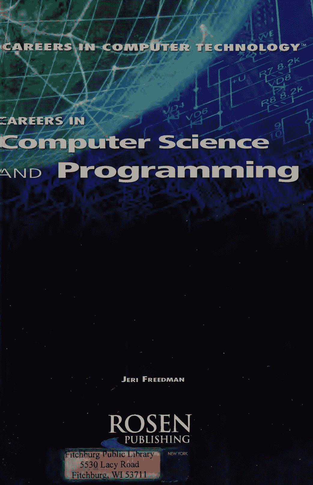
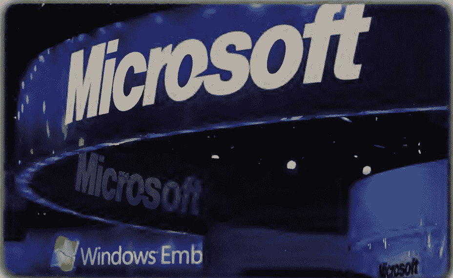
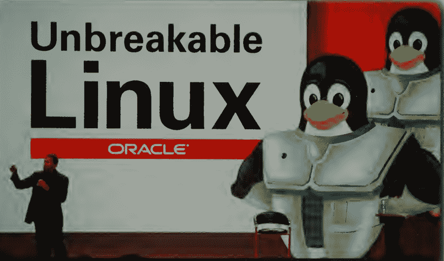
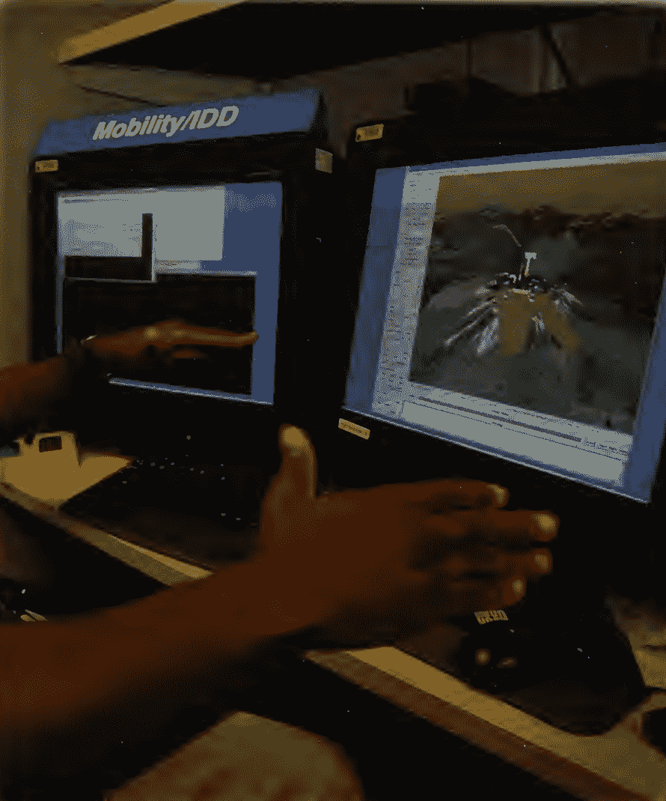
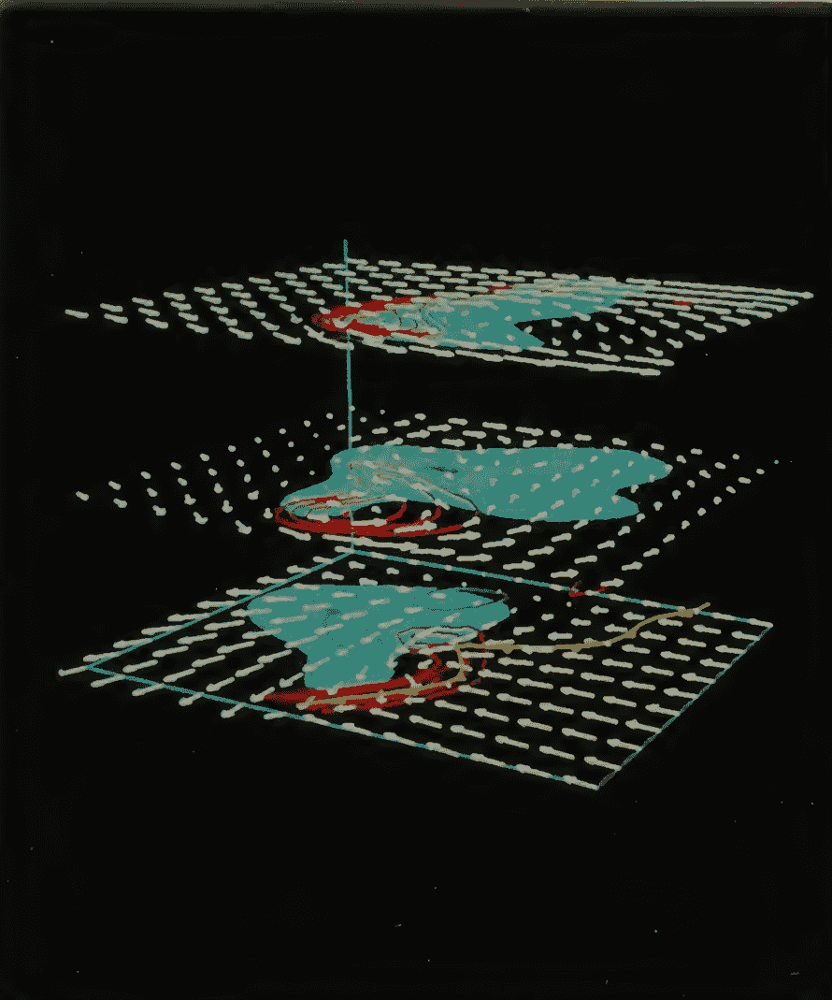

# 计算机科学与编程职业（计算机技术职业）

封面：这名软件工程师于 2009 年在美国华盛顿州柯克兰的 Google 设施内工作。

# 引言

计算机技术是现代生活各个方面不可或缺的一部分。人们依赖计算机技术进行娱乐、获取信息以及与朋友、同事和家人保持联系。电脑游戏、网站、流媒体、可下载音乐、短信以及 Facebook 和 Twitter 等社交网站已成为许多人生活的标准组成。

很少有行业对人们生活的影响像计算机行业这样大，也很少有行业在未来能提供同样的创新前景。计算机技术这个迷人且快速变化的世界激发了许多人对该领域职业的兴趣。本书提供了评估不同类型的计算机科学和编程职业所需的信息。它研究了各种类型的计算机科学和编程工作，并探讨了胜任这些工作所需的教育和培训。此外，它还提供了关于获得每类工作的实用建议。学习过计算机科学和编程的人通常发现，他们的技能适用于许多广泛领域的工作。最后，它还展示了计算机科学和编程工作的日常生活可能是怎样的。

在计算机科学和编程领域工作可能是令人兴奋的，计算机专业人士往往处于新技术突破的前沿。在该领域工作在经济上也是很有回报的，因为这类工作通常薪水很高。同时，计算机科学和编程职业通常要求很高，需要长时间的细致工作和对细节的坚定关注。

市场对具有计算机科学和编程背景的人有持续的需求，这个领域提供的工作安全感比许多其他职业路径更强。大量行业都需要计算机程序员的技能。事实上，对计算机科学和编程专业人才的需求从未如此之大。然而，在该领域工作的人需要不断更新自己的技能。否则，他们面临着由于硬件和软件技术不断进步而失去竞争力的风险。

# 第一章 计算机世界

## 计算机世界

计算机科学和编程领域涵盖软件和系统的创建、修改和维护。该领域的专业人士可能直接从事编程，或依赖计算机语言和计算机工程知识的相关计算机技术领域。

计算机科学和编程的根源追溯到第二次世界大战（1939–1945）。在此期间，第一批现代计算机诞生。这些早期计算机主要供军事使用，不供普通使用。计算机在 20 世纪 50 年代开始进入商业领域，主要供大型机构使用。

这些计算机体型巨大，与今天使用的计算机相比，处理能力非常有限。它们与今天的台式计算机的不同之处在于，它们是主机（或非常大的计算机），用户通过终端与其交互。终端是显示器和键盘单元，自身不具备处理能力。

## 计算机语言

如果没有指令告诉计算机做什么，计算机就是毫无用处的。早期的程序员通过在称为打孔卡的纸板条上打孔来为计算机编制编码指令。随着时间的推移，日益复杂的计算机语言被开发出来，主机也从使用打孔卡升级为使用记录在大型磁带卷上的程序。

喜欢独立工作和解决问题的人通常会被计算机科学和编程职业所吸引。

计算机语言由标准命令组成，这些命令可以组合成告诉计算机如何处理数据的指令。在计算机早期，程序员使用简单的编程语言（如汇编语言），直接在非常基础的层面告诉计算机如何处理数据。早期的编程语言由数字和符号组成，人类很难理解。

在随后的几十年里，计算机变得越来越小，功能越来越强大。Pascal、COBOL 和 Fortran 等编程语言是为了商业和科学应用而开发的。软盘、Zip 驱动器、硬盘、拷贝盘和 DVD 提供了更方便的数据存储。

最常用的计算机是台式个人电脑（PC），数据通常存储在硬盘或 USB 驱动器上。现在，复杂的计算机语言允许程序员只需告诉计算机他们想做什么。编程语言将这些信息翻译成低级指令，简化了软件的创建。

在当今的商业中，将多台 PC 连接在一起以允许用户相互交互并访问中央数据源是常见的。这种安排被称为计算机网络。计算机网络通常将网络中的所有 PC 连接到中央服务器。

服务器是一台强大的计算机，提供比典型台式 PC 更多的存储容量和处理能力。计算机网络需要组织机构以及控制系统访问的特殊安全硬件和软件。

## 编程语言

针对特定应用已经开发了各种特殊编程语言。网站通常使用超文本标记语言（HTML）、可扩展标记语言（XML）、层叠样式表（CSS）、Active Server Pages.NET（ASP.NET）、Java 和 JavaScript 构建。

HTML 包含告诉计算机网页元素在屏幕上如何显示的命令。XML 允许程序员通过识别网页中不同类型的内容为网页提供增强的功能。CSS 提供了格式化网页的命令。ASP.NET、Java 和 JavaScript 允许程序员为网页添加功能，使用户能够与之交互。

数据库（即组织成数字记录和文件的数据集合）经常使用结构化查询语言（SQL）或 Oracle 软件。这些语言不仅允许创建记录，还允许用户查询数据库获取信息。查询是指对信息的询问或请求。

执行特定功能的完整软件程序称为应用程序。常用应用程序示例包括 Microsoft Word、Adobe Reader 和 Google Maps。

每种类型的计算机语言通常都有特定的用途。用于编写计算机应用程序的常用语言包括 C+、C++ 和 Visual Basic。这些都是面向对象的语言，它们将低级指令封装在被称为“对象”的代码单元中。

今天，大多数程序员在开发应用程序时都使用面向对象的编程语言。这些语言允许程序员在编写程序时使用对象来告诉计算机如何执行任务，而不需要程序员详细说明每一项基础活动细节。

### 职业前景

根据美国劳工部 2010–2011 年版手册显示，尽管 2008 年和 2009 年经济出现低迷，但信息技术领域的工作预计在未来十年内将继续增长。提供数据处理服务和托管服务的公司将迎来增长。

托管涉及为那些不想自己维护内部服务器的公司提供并运行服务器。移动计算（或使用无线技术以及智能手机、平板电脑等易于携带的小型设备）可能会产生大量应用程序的需求。

移动设备，如 iPod、上网笔记本以及 iPhone 和黑莓（BlackBerry）等智能手机，都使用由程序员创建的应用程序。公司在未来一段时间内可能还会继续尝试开发新的移动设备。对新应用程序以及从桌面版适配而来的应用程序的需求，将为未来的程序员提供大量工作。计算机网络的普及创造了许多新的编程和计算机科学职业。

很少有行业比计算机科学和编程提供的职业机会更多，而且这些机会在许多不同的行业中不断增加。一个扩张领域是互联网出版和广播。报纸和杂志的在线版本正在取代纸质版。随着出版者想出对其产品收费的方法，他们可能会更多地关注出版物的在线版本。

医疗保健行业一直在持续增长。政府将所有医疗记录电子化的计划，以及医院对提高医疗服务效率日益增长的兴趣，可能会导致对计算机科学和编程专业人才的需求增加。

各层面的安全在未来十年内也可能是一个增长行业。设计、编程和操作电子安全系统将为人们提供充足的就业机会。这些可能包括筛选恐怖分子的大型数据库、生物识别系统（使用物理属性进行识别的电子系统，如掌纹或眼球扫描）或入侵检测系统。

这些只是增长行业中的几个，它们将为计算机专业人士提供就业——特别是那些具有计算机科学和编程背景的人。几乎每个行业都在将计算机技术整合到其流程中。很有可能，如果一个人对在某个行业工作感兴趣，他可以在该领域找到计算机科学或编程工作。

# 第二章 计算机科学与编程领域的职业

有许多不同类型的计算机科学和编程工作。拥有计算机科学和编程背景可以使一个人胜任各种工作。有些人选择寻求学术型职业路径，学习计算机理论。另一些则侧重于将他们的计算机科学和编程知识应用于在各种行业中追求有丰报的职业。

## 程序员

告诉计算机该做什么的软件是由程序员编写的。程序员使用各种编程语言编写软件，这些语言旨在将程序员的指令翻译成计算机可以理解的形式。

程序员可能为生产商业软件的公司工作，也可能在编写软件以运行公司内部计算机系统的公司工作。有些程序员在公司工作，由他们编写运行公司产品的软件。例如，他们可能会编写一个控制工厂自动化机器的程序，或者编写用于汽车的自诊断软件。

每种计算机语言都最适用于特定的应用程序，例如创建业务。

在 Google 等开发不同类型应用程序的公司工作的软件工程师，通常有机会参与各种项目、程序、数据库、视频游戏、专门的科学应用等。程序员学习某些编程语言的程度，取决于他们想要编写什么类型的应用程序。

在大学学习计算机编程的人学习了许多编程语言。然而，具有额外功能的新语言正在不断开发中。因此，为了在职场中保持竞争力，程序员必须通过学习最新的编程语言来不断更新自己的技能。程序员通过参加课程或使用说明书籍和 CD 自学来实现这一目标。

科技巨头微软（Microsoft）是年度消费电子展览会（CES）上的主要参与者，科技公司在那里向公众展示他们的全新产品。

## 信息技术工作

许多具有计算机科学和编程背景的人在信息技术领域找到了工作。“信息技术”指的是使用计算机硬件和软件来传输、存储和分析信息。

今天，大多数公司都有一或多名信息技术（IT）员工，许多公司还设有 IT 部门。以下是信息技术工作的示例。

### 系统或网络管理员

许多公司将他们的计算机配置成网络。通常，网络中的计算机还连接到中央服务器，并与其交换数据。服务器上安装了特殊的网络软件来控制网络。

网络管理员负责构建、监控、维护和保护公司的计算机网络以及运行在上面的软件。网络管理员需要了解各种软件程序，并且必须能够定制软件。系统和网络管理员使用的软件语言和编程工具包括 Active Server Pages、Cognos、Java Server Pages、Microsoft Exchange、Microsoft .NET 语言、Oracle、SQL Server 和 VMware。

系统和网络管理员使用软件监控网络的物理和容量问题、控制网络资源的访问、安装安全系统进行保护、更新网络软件并备份服务器，以防灾难发生时数据丢失。系统管理员还使用软件控制公司数据库、电子记录、服务器和其他数字资源的访问。

除了正式教育外，网络管理员通常从制造网络硬件和软件的公司（如微软）获得专业认证。为了获得专业认证，人员必须学习公司提供的材料并通过证明其了解如何使用该产品的测试。

这类专业认证在找工作时通常会有帮助，因为它们证明了对维护网络运行所需程序的精通。

### IT 经理

雇用许多人的 IT 部门通常由 IT 经理主管。IT 经理有批准下级员工决策的权限。然而，经理通常不参与公司计算机系统的日常实际操作。

相反，经理的工作是监督其员工的工作、做出招聘和解雇决定、与高级层交流以确定公司的计算需求、制定并监控部门预算、向高级层申请必要的采购批准，并执行其他管理任务。

## 计算机科学与编程领域的职业

对于任何追求计算机科学和编程领域职业的人来说，跟上最新技术至关重要。许多计算机组件的主要制造商都提供关于如何使用新技术的实战培训。

管理职位通过参加管理课程来增强他们的业务知识。

## 数据库管理员

公司和组织使用数据库来存储和组织数据。这些数据可能包括会计记录、人力资源记录、产品测试结果和质量保证结果、客户和潜在客户列表、接收和完成的订单、库存信息、采购记录——清单几乎无止尽。

## 探索职业要求

了解各种类型计算机科学和编程工作职责和要求的极好方法是查看招聘广告。最好在还在校期间就开始这样做，在正式开始准备职业生涯之前。

探索这些广告可以让你洞察哪些类型的工作可能具有吸引力。此外，它还能让你了解哪些课程是必修的，或者获得特定类型的工作需要哪些技能。

有很多网站都提供计算机相关工作的列表，例如 Monster.com。要查看未来预测哪些工作会有需求并了解薪资范围，请查阅美国劳工部的《职业展望手册》：<http://www.bls.gov/oco>。

负责组织和维护所有这些信息的人是数据库管理员。数据库管理员的主要职责之一是设计数据库结构。这包括确定哪些信息应该存储在数据库中以及以什么形式存储。

数据库管理员必须对数据库创建软件（如 SQL 或 Oracle）有扎实的知识，并能够与组织的员工互动，以了解他们执行工作需要什么数据。

数据库管理员的其他职责还包括实施适当的安全程序以确保数据安全、备份数据库以防发生灾难时信息安全、控制谁有访问数据库的权限、使用软件监控数据库性能以确保用户在尝试访问数据时不会经历长时间等待，以及解决数据库访问中的问题。

## 计算机服务领域的职业

在 IT 领域工作的另一种选择是为向企业提供计算机相关服务的公司工作。此类公司从全国性连锁店到单人运营不等。

有些计算机服务公司专注于为企业销售计算机网络并进行安装。这些公司可能提供计算机和外围设备，或使用客户提供的设备。他们负责布线、设置网络并安装公司使用的软件。

计算机服务公司还可能提供网络持续支持合同。在这种情况下，当计算机网络出现问题时，计算机专业人员会响应客户的召唤，前往客户所在地修复问题。

其他计算机服务公司则编写定制软件或修改商业软件以满足公司的特定需求。

在计算机服务公司工作需要优秀的人际技巧以及广泛的技术知识。你可能需要向几乎或完全没有技术知识的人解释复杂的技术话题。在处理因计算机系统出现问题而压力巨大的客户时，需要耐心和技巧。

# 第三章 为职业做准备

如今许多学院和大学都提供计算机科学和编程专业。大学提供四年制学士学位课程或适合入门级工作的两年制副学士学位课程。一些学院还提供全日制和兼读的高级课程。

技术学校与其他学院非常相似，区别在于它们提供培训学生从事该领域特定工作的课程。例如，技术学校的课程可能会培训学生如何修理计算机，以便为成为计算机技术员的职业做准备，或者教他们如何设计和构建 Web 网页。

一个人希望从事的计算机科学方面将影响他或她所修的学术课程。

## 选择重点

在决定追求计算机科学的哪个方面时，有必要决定哪种职业看起来很有趣。计算机科学毕业生最常见的身份是程序员或在 IT 领域担任系统或网络管理员。许多人最终也从事计算机硬件工作。

决定在哪些行业工作可能会有回报的同样重要。有些人可能对计算机理论以及与他人合作创建尖端软件程序更感兴趣。另一些人可能对编程工业机器人和工业自动化过程更感兴趣。还有人可能最感兴趣的是利用他们的计算机科学和编程知识最终获得 IT 管理工作。

对于有志成为计算机科学家、程序员和其他计算机专业人士来说，通常有必要在计算机硬件和软件方面都有基础性的知识。计算机科学家和程序员在决定自己最喜欢哪一个行业之前，可以在多个不同的行业中工作。

计算机器协会（ACM）是一个大型计算机行业组织，它定义了计算机科学和编程的若干通用学术领域。以下是提供学位的一些主要学术领域列表。学位的确切名称会因机构而异。

- **计算机科学**：这是一个广泛的类别，学生在其中学习计算机硬件技术和编程。某些学习计划侧重于计算机科学的理论方面，而另一些更侧重于编程。学习计算机科学的学生将学习各种计算机硬件和软件科目。拥有计算机科学学位的人通常可以在许多领域工作。
- **计算机工程**：这一研究领域将计算机科学的研究与电气工程相结合。它为学生提供了设计计算机系统和设备的技能。ACM 列出的某些领域包括消费电子产品、医疗设备开发、军事技术、安全系统和电信。
- **编程**：编程或软件工程强调运行应用程序的程序的创建。这是通过使用各种编程语言来实现的。ACM 的示例包括航空电子、医疗保健应用、加密、交通控制、气象系统等。

# 职业准备

为计算机科学或编程职业做准备，越早越好。如果可以在学校里上计算机课，那么请务必参加。这些课程不仅可以提供实用的技能，还可以为学生提供一个机会，让他们发现自己与计算机工作是否有趣且有成就感。

## 为成功积累技能

初中生和高中生不应只关注学习如何成为计算机专家。在这个阶段，学习对成功至关重要的基础技能非常重要。

例如，对于成为计算机专业人士的人来说，参加一门打字课程是有益的。无论是处理硬件还是软件，计算机科学家和程序员都会花费大量时间在键盘上打字。掌握盲打将极大地提高工作效率。

最重要的是，学习良好的书面和口头交流能力是必要的。如今计算机科学和编程领域的每个主要职位，无论是在 IT、数据分析还是软件设计，都涉及与经理和员工的互动。相反，这项工作是由团队完成的。因此，有能力通过书面和口头向同事和上级交流想法非常重要。良好的沟通技能可以确保个人的想法以清晰的方式传达。

## 在大学学习计算机科学

进入大学学习计算机科学的学生可能会追求一门包含多种课程的学习课程。这些课程可能包括数学和自然科学课程。

他们还将学习计算机科学的通用课程，包括计算机系统导论、数据结构导论、C 和 Unix 等特定语言的编程课程以及计算数学。

## 为职业做准备

学生还可以参加他们感兴趣的计算机科学特定领域的课程，例如多媒体、计算机图形和人工智能。

学生很可能会学习数学，如高等微积分、代数，以及统计学和概率，这些被用于分析事件发生的可能性。

数学和逻辑是计算机编程的基础。理解这些学科是创建管理程序运行算法的关键。掌握实验设计知识是能够设计项目的关键。

学生还可能参加有关伦理以及如何维护数据机密和隐私的课程。学生可能会在实验室工作，在那里执行计算机相关的任务。

除了技术课程外，学生可能被要求参加各种人文和艺术类的选修课。一些大学提供的商业课程可能被证明是极其有用的。

要在现实世界中成功，需要理解不仅仅是技术如何运作。有志计算机科学家和程序员需要扎实的沟通、项目管理和人员管理技能。一个理解如何管理人员和项目的人，比只懂技术的人对公司更有价值。

事实上，大多数计算机科学和编程工作都需要基础技能，例如证明支出合理性的能力。由于这些原因，学生可能想要学习商业、项目管理和财务课程。

最后，大学生能做的最有用的事情之一是养成良好的工作习惯。以彻底和及时的方式完成工作将养成一种习惯，一旦进入职场，将促进学生的职业发展。

## 广博教育的优势

在当今的商业和工业世界，来自不同背景的人共同工作。计算机科学家和程序员发现自己为在多个国家设有分公司的公司工作，服务全球客户并不罕见。计算机专业人士完全可能发现自己与其他国家的人一起工作并出国旅行。计算机科学领域的许多人发现自己在从事国际工作。在这里，计算机专业人士在技术领域的一家大型计算机公司负责项目。在大学学习历史、哲学和心理学课程对于理解整个世界以及人们如何相互互动非常有益。这种背景可以增强一个人对其在职业身份上可能遇到的各种文化和信仰的认知和包容度。

将计算机科学和编程的学习与其他领域的研究结合也是可能的。在当今的几乎每个领域，对精通计算机和软件使用的员工都有巨大需求。因此，即使学生并不希望成为一名专业的计算机科学家，他们也可能希望学习计算机硬件或编程的某些方面。在这些领域拥有技能可以使人在就业市场上更具竞争力，作为员工也更有价值。最有价值的员工是那些不仅理解技术，还理解他们所在公司业务的人，并且能够向管理层、客户、供应商和合作伙伴良好代表公司的人。拥有这种复合知识可以让求职者将自己表现为非常有竞争力的候选人。

## 学校类型和课程

在大学获得计算机科学学位是为该领域的长期职业准备的最有效方法。正式教育使人们掌握广泛的技术和技巧，更好地适应工作场所的需求。通过提供计算机理论知识，它让人们能够理解新技术是如何工作的。大学课程可以训练人们如何有效地处理项目和一般的问题解决。这种培训让有志人士在现实世界中解决问题和处理事务更加成功。获得学位向雇主证明了人能够成功完成目标。高位的 IT 职位更容易获得。

技术学校通常提供四年的学士学位课程和两年的副学学位课程。副学学位课程侧重于特定的技能，例如计算机网络管理和软件开发。它们旨在为学生从事计算机硬件相关的初级职位做准备。

技术学院（例如位于加利福尼亚州阿纳姆的 ITT 技术学院）为学生提供计算机科学的实践教育，让他们能够开启计算机软件领域的职业生涯。在许多情况下，如果拥有副学士学位的人希望继续攻读四年制学士学位，可以为已修过的课程获得学分。在计算机科学和编程领域，学生可以获得计算机科学、软件应用开发、计算机系统安全、电子与通信技术以及电气工程等学位。

许多设有计算机科学学位课程的机构还提供证书课程。证书课程主要为希望扩展计算机科学或编程知识的职场人士设计。这对于那些需要熟悉新技术的人来说尤其如此——例如，用于移动计算编程或网络安全（使用基于计算机的安系统确保人员、物体和建筑的安全）。证书课程通常需要一到两年完成，并且通常以兼职形式提供。

尽管大学毕业生起初可能从事基础的计算机技术或编程任务，这些任务只需要实操经验即可，但随着人在公司中的职位越高，他或她通过正规教育获得的宽广知识基础就越重要。那些对从事设计新型计算机和电子设备等领域的职业感兴趣，或者对在人工智能、机器人和其他前沿技术等领域从事研究感兴趣的人，最好寻求更高层次的教育。除了计算机科学系的学士学位课程外，许多大学还提供硕士和博士学位课程。

## 实习

新求职者面临的最大挑战之一是，他们往往必须与经验更丰富的候选人竞争。过往的经验向雇主证明了某人可以完成工作所需的任务，而初出茅且没有以往经验的人对雇主来说是一个未知数。那么，人在学校期间如何获得经验呢？一种方法就是获得实习。实习是无薪职位，让学生学习在职技能的机会。实习生在执行基本任务的同时，观察领域专业人士的工作。

## 奖学金和助学金

对追求计算机科学教育的学生可能希望查看可以帮助支付费用的奖学金和助学金。电气电子工程师协会（IEEE）维护一个专门的学生网站（`http://www.ieeeusa.org/careers/student.menu`），该网站除其他信息外，还包含了面向大学学生的奖学金、助学金和技术竞赛的信息的链接。美国工程教育协会（ASEE）为中小中学生维护了一个“学生博客”网站（`http://students.egfi-k12.org`）。在其他信息外，它提供了一份为对学习技术和工程感兴趣的学生提供奖学金的列表。

实习让学生获得与计算机、计算机网络和软件工作的实践经验。它们为实习生提供了一个机会，看看他们在大学中学到的工具和技术是如何应用于现实世界的。实习生还可以获得在专业环境中如何执行计算机和软件项目的宝贵经验。如果学生在实习期间表现良好，他们的雇主可能会提供在他们找工作时可以使用的推荐信。此外，实习生的同事在他们准备进入职场时也可以成为宝贵的人脉。

一些大学提供包含一学期实践性实习的课程。对利用额外机会的学生还可以查看计算机机器学会（ACM）在其网站上的“十字路口实习数据库”。该资源列出了提供实习的特定公司，并提供了雇主发布实习信息的通用资源链接。电气电子工程师协会（IEEE）作为另一个主要的科技和工程协会，也通过其学生网站提供许多暑期和临时实习。另一个资源是美国工程教育协会（ASEE）的技术实习网站。

# 第 4 章

## 参与与获得机会

在当今竞争激烈的就业市场上，在开始寻找工作之前获得经验和机会是有益的。在大学甚至高中，与领域的其他人接触并开发作品集有许多方法。参与大型计算机专业人士和软件开发人员社区有若干益处。它提供了一个通过与经验丰富的人士交流来了解该领域的机会。此外，它还提供了将课堂中学到的技能应用于真实项目的机会，以及从已经在该领域工作的人那里学习正确职业行为的机会。

## 构建作品集

求职者向潜在雇主证明其或她胜任该工作的最佳方法是创建一个作品集。作品集是工作样本的集合。例如，程序员的作品集将包含其编程工作的示例。

即使一个人还没有做过任何专业工作，仍然可以为作品集创作内容。其中一种方法是构建 App。Facebook 和 Twitter 等流行的社交媒体支持 App，人们可以练习

## APP

什么是 App？它是“application（应用程序）”一词的缩写。App 通常是提供单一功能的小程序——例如，一个简单的游戏或谜题，或者一个人们对特定话题投票的民调查。苹果 iPhone 等智能手机具有数千个可以下载的 App，其中许多是由用户设计和构建的。

对编程职业感兴趣的人可以通过创建 App 来展示其或她的能力。苹果提供了一个个人可以使用其开发 iPhone App 的接口，这是业余和专业程序员中非常受欢迎的活动。（事实上，设计 iPhone App 是如此流行以至于加利福尼亚州的斯坦福大学提供了一门专门课程。）虽然 App 在通过 App Store 分发之前需要经过苹果的审核，但开发一个 App 就能提供一个方便的作品示例。

谷歌 Nexus One（左）和苹果 iPhone（右）等智能手机为人们创造了巨大的市场，他们通过创建简单的 App 展示编程技能。一些学生还创建热门视频游戏的 Mod（或插件）。Mod 可以为游戏添加额外的关卡、地图或其他元素。许多游戏制造商为对创建 Mod 感兴趣的人提供工具包。热门游戏的网站经常会有 Mod 和模组信息。学生应该利用每一个机会创建展示技能的程序或应用程序，并将其纳入他们的作品集中。

## 成为开源社区的一部分

在计算机科学和编程领域开发证书的另一种方法是参与开源软件社区。这个社区是对创建和共享开源软件感兴趣的人的集合。软件分为两个基本类别：专所有开源。专有软件由创建它的个人或公司版权。例如，微软软件产品（如 Microsoft Word）是专有的。如果不支付许可费用或获得版权所有者的明确许可，就不能使用专有软件。相反，开源软件由它的个人或组织免费供任何人使用。

使用开源软件可能有一些限制，例如同意使用它创建的内容也必须是开源的。但它可以被，

Oracle 首席执行官 Larry Ellison 在 2006 年的 Oracle OpenWorld 大会上发表主旨演讲。这次会议将计算机用户、创新者、专业人士和商业领袖聚集在一起。

可以被任何人随意地增强或修改。开源资源的一个例子是在线百科全书 Wikipedia。任何人都可以为 Wikipedia 做贡献，或者审查和编辑现有条目。开源软件也是如此——程序员可以修改源代码来改进或更改软件。

开源软件最为人知的例子是 Linux。Linux 是一个由 Linus Torvalds 最初开发的 Unix 操作系统软件版本，它是当今商业和工业领域应用广泛的操作系统之一。世界各地的个人都在致力于增强源软件。

## 跟进领域

计算机硬件和软件领域的创新在不断发生。全新的尖端技术、设备和编程语言不断开发中。具有不同应用和功能的现有产品新版本每年都会出来。因此，计算机科学家和程序员跟上该领域至关重要。他们需要关注最新的书籍、行业杂志和在线文章。在 IEEE、ASEE 或 ACM 等专业组织中活跃，是他们不仅跟上新技术开发的绝佳方式，有时还能在这些开发过程中发挥作用。

重要的是，要理解计算机科学和编程并不是一个人获得学位、收起书籍就可以开始过终身职业的领域。如果计算机专业人士不不断更新知识，他们不可避免地会淘汰，就像他们在职业生涯初期学习的编程语言和计算机技术一样。计算机科学职业意味着对学习的终身投入。

新版本和用于它的应用程序不断涌现。开源软件存在于音频视频应用、业务生产力、数据库、数学和科学应用、软件开发、安全、视频游戏等。许多主要的开源程序如 Ubuntu（Windows 操作系统的开源替代方案）和 Firefox 浏览器在它们的网站上维护了开发者论坛的链接，供兴趣参与开发和支持的人士。

属于开源社区的个人独立或成组从事开源软件项目，通过致力于特定类型软件的在线论坛与社区的其他成员交流。在线论坛允许用户交流想法，并互相解答问题和困难。可以与现有程序版本配合使用的个人工具和应用程序通常由其创建者免费提供给开源社区。

参与大型软件社区的另一种方式是通过问题解决论坛。几乎每个主要的软件制造商都设有社区论坛，用户在其中互相帮助解决 Windows 或 Adobe Flash 等商业软件的问题。一些主要的在线网站（如 YouTube）也是如此，它们设有社区帮助论坛。在这些论坛中，参与者可以使用他们的知识帮助他人解决问题。

参与更大的程序员社区可以为个人提供通过处理现实应用来实践其软件技能的机会。成为社区的一部分还让人们了解在其感兴趣领域工作的其他专业人士，并作为对社区做出贡献的人获得认可。一些组织和公司甚至会对在帮助他人使用软件方面做出重大贡献的个人表示认可。例如，微软向通过技术论坛支持微软软件做出重大贡献的人授予“微软最有价值玩家”（MVP）奖。

## 参加专业协会

ACM 和 IEEE 等组织提供学生会员。加入并参与此类组织的活动是展示对该领域兴趣极极方式。通过与微软公司和太阳系统公司等主要软件制造商的合作，ACM 可以为其学生成员提供访问多个软件程序的权限。这些程序为学习和构建示例计算机应用程序提供了极其丰富的工具。ACM 甚至为学生准备了一份特别通讯报。

此外，作为 ACM 或 IEEE 等组织的学生成员提供了了解该领域各个子学科的机会。如果学生希望从事计算机科学或编程项目，他或她将拥有可以提供建议的专家。此外，学生将与该领域的专业人士建立联系，在寻找实习或就业时他们可能提供帮助。IEEE 维护着一个学生网站，提供学生感兴趣的机会信息。

ACM 提供 20 份每份 500 美元的津学金，用于学生参加计算机科学的研究会议。虽然这些津学金主要面向大学生，但高中生也有资格申请。如果他们能够证明对该领域的研究和学习有兴趣，就可以获得资格。

# 第 5 章

## 寻找工作

曾经，人们在找工作时查看报纸招聘广告。今天，软件和计算机行业的大多数公司依赖在线而非纸质广告。通常，只有少数可用职位列在报纸广告中。仅仅查看纸质广告通常是寻找工作效率最低的方法；求职者应该查看其他就业资源。

大公司通常使用招聘机构（有时被称为“猎头”）来寻找员工。这对于技术和管理类职位尤为如此。可以在电话簿中查询招聘机构，或在 Yahoo! 或 Google 等搜索引擎上进行黄页搜索。然而，一旦某人在该领域拥有经验，通过招聘机构获得工作的机会就会更大。

### 找工作策略

许多大学和技术学校设有就业办公室，帮助学生寻找工作。除了帮助学生联系公司外，就业办公室通常提供写简历和其他求职工具。许多专业组织为其成员提供求职资源，包括列出工作机会的在线资源和通讯报。

## 计算机科学与编程职业

寻找好工作的第一步是设定一个具体的奋斗目标。想在计算机科学或编程领域从事职业是一回事，但心中有一个具体的职业路径是另一回事。在开始找工作过程时，识别看起来感兴趣或看起来是好工作地的公司。可以通过浏览在线行业目录、行业协会提供的印刷目录，或许多图书馆提供的标准普尔西（Standard & Poor's）或道琼日报（Dow Jones）通用商业目录来找到。

### 准备简历

找工作最重要的工具是简历。简历是一份列出申请者教育背景、工作经验和其他相关信息的文档。例如，职位申请者可能会在简历上上出他或她完成的实习。简历的目的是获得潜在雇主的面试。因此，它应该包含信息，显示申请者不仅在计算机科学和编程方面具有技能，在其他领域也能使他们成为该职位的价值候选人。

在撰写简历时，最好避免可能影响简历可读性的流行或不寻格式。复杂的的设计会让雇主更难找到信息，例如申请者担任过哪些职位。在面对响应招聘公告收的海量简历时，雇主不太可能花时间在简历中寻找他们想知道的信息。

### 寻找工作

申请者不应仅局限于列出技术技能。他们应该考虑公司所在的行业以及他们正在申请的职位。潜在雇主可能在寻找哪些非技术技能？申请者在简历中列出销售、谈判、主持会议、准备多媒体演示文和预算编制等领域的技能或经验。

申请者在创建简历时，应确保不仅列出自己的工作职责和任务，还应详细说明自己的成就。简历中可能包含此类信息，例如：“建立了试点系统以帮助培训大学人员并证明了使用 AVID 产品满足大学需求的行性”，或“升级了‘大哥哥/大妹妹’计算机系统，使学生能够访问流媒体视频以增强课后学习计划的有效性”。在写简历时，描述申请者成就的句子应该简单、直接，不要有可能偏离重点的冗余词汇。潜在雇主应该理解，申请者不仅具备技术技能，而且具有使用这些技能完成项目的过往经历。

申请者不应在简历中包含无关的个人信息，但包含相关的个人信息可以帮助雇主更好地了解申请者。例如，如果一个职位申请者曾曾在绿色和平（Greenpeace）或西耶拉俱乐部（Sierra Club）等环保组织担任志愿者，那么在申请一家从事替代能源技术公司的工作时，他或她应该提到。通过向慈善机构捐时间和专业知识来磨练技能的申请者也应该在简历中提到这一点。许多公司越来越兴趣在自己的社区中发挥重要作用，而志愿者服务表明申请者是那种愿意帮助他人的人。

简历应该始终专注于特定的职位。我们生活在一个互联网可以轻松获取信息的时代，因此，申请者没有理由不研究他们正在申请的公司。同样，在计算机上定制简历是很容易的，使其表明自己正在申请该公司正试图填补的特定职位，并突出招聘广告中宣传的技能，例如对特定编程语言或技术的了解。

最重要的是，申请者应该确保他们的简历整洁、外专业并经过彻底校对，以确保不包含错误。哪家公司想要雇佣一个粗心的程序员。

### 人脉网络

寻找工作最成功的方法通常是通过与其他人建立人脉，而不是仅仅查看在线或纸质广告。在建立人脉时，人可以联系在该领域认识的人，并请求他们协助寻找工作。大多数工作在报纸或网上发布之前就已经被填了。这就是通过实习、参与开源社区和问题解决论坛以及加入行业组织来建立人脉，可以帮助传播某人正在寻找工作的消息。在建立人脉时，务必获取他人的联系方式。这包括他们的姓名、电子邮件地址以及（如果是面对面会面的）他们的名片。这样，在求职过程中就可以联系他们。

这里是 2009 年的 MacWorld 博览会，由苹果公司每年举行，展示公司的最新产品，以及其他供应商的应用程序和产品。即使他们不知道有职位空缺，他们也可能提供可以帮助的人选。

### 展示作品集

无论申请者如何找到工作机会，专家们都认为，在当今竞争激烈的就业市场上，拥有一份作品集向潜在雇主展示是获得面试的关键。当学生在学校或暑假工作和实习期间项目时，他们应该确保收集他们做过的工作示例。

求职的最新趋势是构建电子作品集。许多人现在在线维护电子作品集，以帮助潜在雇主评估他们。电子作品集包含一个人的工作示例，潜在雇主可以查看，同时还有其作品集中的 CD 或 DVD 上的网页或应用程序样本。简历配合同个人工作的顶尖演示，可以帮助申请者获得工作。记住，在作品集中展示的任何工作都必须是个人能够产出的最高质量的作品。

### 在哪里寻找工作

广泛的行业中存在大量的计算机科学和编程工作。所有这些行业都需要计算机科学家和程序员来构建和维护计算机系统。

### 商业与制造业

计算机和软件在企业中无处不在。大型和小企业的会计工作都在计算机系统上进行。企业使用数据库维护记录，并跟踪销售和营销信息（例如客户数据）。数据库还用于分析有关潜在客户的数据，针对最有可能购买公司产品的人群，并分析广告活动的结果。

许多制造企业依赖数据库系统进行库存管理。他们跟踪货物的收货情况并跟踪库存水平，以便在供应耗尽之前重新订购。采购系统跟踪订单并将收到的货物与采购订单相匹配。销售系统用于跟踪制品的订单和发货信息。

程序员通常被被要求为企业编写自定义数据库程序。这些自定义数据库旨在记录公司需要跟踪和分析的特定类型的信息。此外，程序员经常必须编写自定义软件，以集成公司使用的各种类型软件。例如，一家公司可能需要在其订单输入、财务以及销售营销部门之间交换信息。在这种情况下，程序员有必要编写软件，将每个系统的数据转换为其他系统可以理解的形式。程序员可能会想出一个方法，让库存和采购系统相互“对话”，以便当库存水平下降到预设点时可以重新订购零件。

## 计算机科学与编程职业

计算机系统被用于控制许多制造过程。今天几乎所有的工厂生产线都是自动化的，或者由控制创建最终产品的机器的计算机运行。制造设备的公司需要程序员为他们编写机器自动化软件。他们还需要被要求编写、修改和维护用于在特定制造设施中运行特定过程的自定义软件。在工业的商业和制造方面，都有各种与计算机科学相关的工作。

## 交通

计算机被用于今天运输的每一个阶段。空中交通员使用它们来管理空管，并在飞机中使用它们控制飞行系统本身。程序员编写用于卡车和火车的代码，用于传输车辆及其货物的位置信息，允许公司跟踪货运进度和司机。程序员编写政府用于监控交通模式和评估与交通控制相关问题的代码。他们还编写代码来模拟未来的交通系统。例如，这些程序对交通模式进行建模，以确定拟议公路系统的最佳设计。此外，车辆制造商聘请计算机科学专家来开发控制车辆的电子组件和代码。

除了地面运输，程序员还编写用于航天应用并在国家航空航天局（NASA）提供数据收集和分析功能的代码。

一位美国航空航天局（NASA）火星探测器团队的科学家解释了“精神号”火星器采集的图像和数据是如何被用于创建红色星球景观的虚拟模型的。

## 安全

如今增长最快的领域之一是安全系统。对犯罪和恐怖主义的担忧推动了对集成安全系统日益增长的需求。集成系统将各种设备连接起来形成一个执行复杂功能（如提供安全）的单一系统。集成安全系统可以将视频摄像头、报警器等安全元素与先进计算机相结合，由计算机控制整个安全系统、存储数据并进行分析。这些系统通常包括如卡锁等元素，用于记录谁在何时进入了特定区域的数据。程序员需要编写程序来运行和集成这些系统的程序。他们编写特殊的计算机安全程序，包括如人脸识别软件在内的生物识别程序。他们还帮助创建大型数据库，存储有关危险人物的信息，例如已知的恐怖分子或罪犯。三类安全公司为程序员提供就业机会：制造系统的公司、维护系统并配备人员的公司，以及使用此类系统的机构。

## 能源

计算机控制着维持现代社会运行的流量。巨大的计算机系统控制着电厂的运行以及整个电网的电力分配。所有这些系统都必须网络化并编程。程序员还创建运行先进替代能源系统的软件，例如将阳光转化为电能的光伏电池板阵列。

这个带有正在形成的龙风的风暴计算机模型是由多普勒雷达数据构建的。

## 医学

计算机已成为医疗技术的核心部分。长期以来，它们被用于跟踪患者记录。但很快将会有中心化的医学数据库，跟踪患者的医疗信息，如检查、处方、疾病等。该系统将使医生、护士和其他医疗专业人员轻松访问患者的医疗信息。将所有患者信息存储在一个地方可以简化治疗并减少重复检查的成本。创建和维护这些医疗系统将在未来几年内创造许多编程工作，涵盖在医院内部以及为此目的提供软件的公司中。

目前正在开发一些协助医疗人员识别和诊断医学问题的系统。这些系统通过分析输入计算机的症状来工作。系统随后根据症状指示可能的医学问题并建议适当的检查。此类系统依赖于“知识库”。这些是大型数据集合，由从特定领域的专家处获得的信息组成。构建知识库本身就是另一种编程工作。

## 科学

今天，每种科学都严重依赖计算机。计算机系统在这些领域的两个主要应用是制图和建模，这两者都需要编程。制图涉及从车辆（如飞机或船只）的传感器获取数据，将其下载到计算机，然后创建地图。例如，安装在飞机上的视频摄像头可能会拍摄地形照片，这些图像可以下载到陆地计算机，从而创建出特定区域森林覆盖面积的地图。绕地球运行的卫星照片可以被分析以确定地球臭氧层的健康状况。可以创建地图来显示不同地形的分布或油藏的位置。

建模使用计算机和软件来预测在某些条件下可能发生的情况。建模用于预测飓风和龙卷风等天气事件，以及预测人类活动对全球变暖的影响。它被用于设计工业产品，通过创建“虚拟”对象（如发动机组件），以便在投入资金制造原型或测试版本之前查看最终产品可能如何运行。生物技术和制药公司利用它在现实世界中测试新药之前评估新药的药效。程序员经常被雇佣创建商业性制图和建模软件，并为研究机构正在进行的特定项目定制程序。

## 军事

需要程序员为广泛的军事应用编写程序。军事部门在通信系统中使用计算机来操作远程“无人机”（提供敌方部队和设施位置信息的无人载具），在先进武器系统（如导弹制导系统）以及工程应用等领域中使用计算机。军事并不是每个人的理想的职业选择，特别是当国家处于战争状态时。然而，许多人利用对计算机科学和编程的兴趣投身技术职业，同时为国家服务。选择这一职业路径的人可能有资格通过军队接受计算机培训。

# 第6章 工作预期

计算机专业人士的工作经验将取决于他或她选择工作的行业以及公司规模。有些人倾向于在大型公司工作，这些公司通常提供比小公司提供更高的薪水和更多的福利，例如医疗保险和学费报销。然而，可以注意到在大公司里，一个人的责任可能比在小公司更受限。大公司的规则和程序也可能以正式的形式定义。

许多人更倾向于在小公司工作，这些公司通常提供更灵活的工作时间，且工作环境不那么正式。此外，小型团队成员共同创建新项目时，成员之间的情谊通常比员工众多的工作场所大得多。然而，薪水可能比大公司低，小公司为员工提供的福利也较少。另一方面，小公司有时会向员工提供股票。这些股票可能作为部分工资的替代，或者在公司开始向公众出售股票时提供。eBay、微软和苹果等大公司都是从员工稀少的小公司起家的。对于喜欢结构的人来说，小公司的工作环境可能显得混乱或不稳定。

## 工作预期

虽然大公司在经济不景时期倒闭的概率比小公司低，但如果公司业务状况恶化，员工仍可能被裁员。

有些人倾向于为自己工作，即自由职业。这种方法缺乏固定薪水的保障，但它为自由职业者提供了与许多不同公司合作各种项目的机会。自由职业也可以提供更高的收入，因为自由职业者或顾问不受限于固定的薪水。

个人对行业的选择也会影响其或她的工作环境。显然，如果一个人在军队、电厂或情报机构工作，与在替代能源公司、慈善机构或开发游戏的公司工作相比，工作场所的氛围会有区别。对于渴望成为计算机专业人士的人来说，考虑他们喜欢什么样的环境下工作是非常重要的。

尽管计算机科学和编程领域存在许多不同的工作，但这些示例将让你对在该领域的硬件和软件方面工作的情况有一个大致的了解。

## 程序员的工作

程序员可能会独立工作，也与他人合作。单个程序员可能会创建一个小型程序，或者修改现有的程序。然而，程序员共同工作更为常见。大型应用程序是由一个程序员团队创建的。当程序员以团队形式共同工作时，他们会在成员之间分分配任务。例如，团队中的每位程序员可能负责整个程序的某个特定部分或模块。

在编写任何程序之前，必须确定程序的用户需要它做什么。这被称为“需求收集”。在这一阶段，程序员会与管理层和产品的潜在用户见面，以了解他们希望程序具备哪些功能。他们会研究用户将如何与程序进行交互。这需要良好的观察能力和倾听能力。

仅仅写出一个能执行任务的程序是不够的。程序必须以一种让用户感到自然且舒适的方式执行该任务。因此，在编写任何代码之前，程序员会为程序的功能和运行方式制定一个设计。通常，他或她会制作界面的原型，并与用户和经理一起评审。在开始工作之前，程序员必须获得管理层对设计的批准，以及项目的预算。

## 工作中的预期

程序员经常会为项目管理层提出几个不同的方案，由管理层选择其中一个。

编程项目有时由项目经理负责——项目经理的工作是跟踪项目的进度。项目经理还会跟踪项目产生的成本。这样做是为了确保项目在预算范围内运行，并按计划进行。程序员和项目经理经常使用特殊的项目管理软件来跟踪这些的这些方面。

一旦项目获得批准，程序员将花费大部分时间编写代码。这是一个循环过程。程序员编写代码，然后在测试计算机上运行它，以查看其运行方式是否符合预期。新软件通常包含错误，后来被称为“漏洞（bugs）”。运行软件会暴露出这些漏洞，然后由程序员进行修复。漏洞通常记录在日志中，并附带有关如何修复它们的信息。这样，如果未来出现相同的漏洞，程序员将知道如何修复它。一旦漏洞修复，就会再次运行程序。这个过程会一直重复，直到程序运行且不再产生任何错误。然后，程序将安装在公司的计算机上，用户就可以访问。程序员可能参与教用户如何使用该程序。

除了编写新程序外，程序员可能被要求编写一些小型程序，以扩展现有系统的功能，或使其能够与公司获得的新系统进行数据交换。他们可能被要求编写“补丁”来修复软件安装后发现的问题。

程序员也可以将编程技能应用到其他就业领域。例如，他们可以从事成为软件架构师，设计大型软件项目；管理信息系统经理，负责运行分析大量数据并生成管理层运营公司所需信息的部门；或成为项目经理。

## 系统或网络管理员的工作

系统或网络管理员最重要的工作是保持公司计算机系统的运行，以便用户能够工作。这涉及短期任务和长期任务，管理员在典型的一天中处理这两类任务。

长期任务可能包括备份系统数据，以防计算机故障或灾难发生时数据安全；升级公司计算机上运行的软件以保持其最新状态；以及不断升级安全软件以保护系统。管理员还必须监控为用户服务并存储数据库信息的服务器，以确保它们的运行速度足够快，让用户高效工作。

为了跟踪不同任务何时需要完成，管理员需要具有高度的组织性，并对公司使用的所有软件和硬件保留详细记录。为了监控计算机系统的运行情况，管理员会使用显示系统组件利用率统计数据的软件。

系统或网络管理员还必须不断处理短期需求和问题。管理员负责为用户分配安全权限，允许他们访问某些计算机、软件或数据库。例如，只有人力资源人员可能被允许访问员工记录，而财务部门员工和高级管理人员可能被允许访问公司的财务记录。在典型的一天中，系统或网络管理员可能被要求为新员工在系统中创建账户，阻止离职员工的访问，或者为无法访问系统的销售人员设置智能手机。

管理员还承担通常的管理职责，包括管理预算、获得管理层对新设备和软件的批准，然后进行评估、采购和安装。在大型公司，系统或网络管理员可能还有下属需要他们监督。系统或网络管理员并不异常在不在工作时需要“值班（on call）”。值班意味着他们可能随时被叫回公司处理紧急情况，例如公司的Web服务器停止工作。系统或网络管理员的薪水通常很高，但这项工作要求很大。系统或网络管理员的职业路径通常通向信息技术经理，最终可能成为IT副总裁或首席信息官（负责监督全球所有信息技术部门的高级管理职位）。

## 自由职业的世界

许多在大学学习计算机科学的人毕业后追求富有报酬的自由职业生涯，直接向客户提供服务。他们可能维修计算机、创建计算机网络，或者加入团队为特定项目编写定制软件。自由职业者可以按照意愿安排时间，做自己的老板，并根据吸引客户的能力获得收入。这种自由对于追求自由职业的人来说非常有吸引力；然而，这种自由也伴随着巨大的责任。自由职业者还必须控制支出以确保盈利；他们通常独自工作，缺乏职场中持续的专业社交；他们对自己的服务进行大量的营销以获取客户；他们支付自己的福利（如医疗和牙科保险）；并在建立客户群之前拥有足够的资金。自由职业者遵守项目进度并按时完成工作也很重要。建立可靠工作者的声誉可以自由职业者通过口碑获得工作。对于兴趣在计算机科学和编程领域自由职业的人来说，除了计算机课程外，大学商业和金融课程也将受益匪浅。

## 成为专业人士

我们都喜欢过很多电影和电视剧，其中穿着破牛仔裤和脏T恤的程序员通过黑进计算机系统来拯救世界。然而，在现实世界中，公司更容易尊重并提拔那些外表和行为专业的员工。对于计算机专业人员而言，合适的着装各异，这取决于公司的性质、行业以及所处的职位。

在大公司工作并担任需要与客户接触职位的人，男性可能被要求穿着西装长裤配衬衫和领带，女性则可能需要穿着得体的连衣裙、裙子加外套或裤装套装。对于完全在幕后工作的程序员来说，一条体面的长裤配衬衫或毛衣可能是可以接受的。然而，如果一个人的工作涉及与管理层（尤其是高级管理人员）接触，那么他们衣装整洁至关重要。如果管理层赞赏一名员工的技术能力并认为该员工表现得体，那么他们更有可能被考虑承担责任更大的职位。小型公司，尤其是只有几名员工的公司，对员工的着装要求通常更加灵活。然而，如果员工在这样的公司上班穿得休闲，他们需要意识到客户、有兴趣与他们合作的大型公司代表、甚至是潜在投资者何时可能来访，以便进行恰当着装并留下专业的印象。

不容讨论的是，需要专业且尊重地对待周围的每一个人：管理人员、客户、同事、下属——无论与谁产生接触。员工在工作中应表现得诚实负责任，准时到岗并按计划完成自己的工作。他们应该证明自己能够管理好自己和工作。如果管理层认为一个员工是可靠，他们更有可能将此人提升到责任更大的职位。

最重要的是，计算机专业人员应该尽所能完成工作。无论什么工作，员工都应该完成他们被雇用的任务。表现得专业是在任何领域取得成功的关键。

## 术语表

- `algorithm`（算法）：完成任务的一系列步骤。
- `application`（应用程序）：执行单一功能的计算机程序，例如文字处理程序。
- `artificial intelligence`（人工智能）：计算机科学的一个分支，涉及开发能够学习和做出决策的计算机系统。
- `biometric identification system`（生物识别系统）：一种使用物理属性（如掌纹或眼球扫描）进行身份识别的电子系统。
- `curriculum`（课程）：学术计划中涵盖的课程列表。
- `database`（数据库）：计算机化记录或数据的集合。
- `data mining`（数据挖掘）：分析大量数据以发现显著趋势。
- `drone`（无人机）：用于侦察的无人驾驶军事车辆。
- `e-commerce`（电子商务）：在互联网上进行的业务，例如产品和服务的在线销售。
- `enterprise resource management`（企业资源管理）：将组织的所有计算资源整合在一起，以便为整个公司提供信息。
- `facial recognition software`（面部识别软件）：一种分析人脸形状并将其与照片数据库对比以识别身份的计算机程序。
- `innovation`（创新）：提出新想法或取得进展。
- `integrated system`（集成系统）：将相互连接的设备组合成一个用于特定目的（如安全）的系统。
- `mobile device`（移动设备）：设计为随身携带（包或口袋）、无线连接电子应用程序的计算机设备。
- `module`（模块）：大型系统或程序中的独立部分。
- `multimedia`（多媒体）：结合了不同类型媒体（如视觉图像和音频）的内容。
- `network`（网络）：一组相互连接的计算机。
- `peripheral`（外围设备）：连接到计算机的设备，如打印机。
- `photovoltaic panel`（光伏电池板）：含有太阳能电池的设备，可将阳光转化为电。
- `prototype`（原型）：为了测试和评估目的而生产的产品样品版本。
- `robotics`（机器人学）：机器自动化的科学。
- `server`（服务器）：为网络计算机提供数据和服务的强大计算机。
- `social networking site`（社交网络网站）：设计用于让人们以个人（而非业务）为基础进行互的网站。
- `streaming video`（流媒体视频）：通过互联网持续发送到计算机设备的视频。
- `wireless communication`（无线通信）：通过空气传输的信号（而非电线）连接电话服务、电子邮件和互联网等电子应用程序的技术。

## 更多信息

计算机机器协会（ACM）
2 Penn Plaza, Suite 701
New York, NY 10121-0701
(800) 342-6626
网址：http://www.acm.org

该组织运行针对计算机科学特定领域的特别兴趣小组，维护一个职业中心，并为成员提供在线书籍和课程。它接受学生成员。

美国工程教育协会（ASEE）
1818 N Street NW, Suite 600
Washington, DC 20036-2479
(202) 331-3500
网址：http://www.aseec.org

该组织为K-12学生提供技术教育和职业资源。

计算机历史博物馆
1401 N. Shoreline
Mountain View, CA 94043
(650) 810-1010
网址：http://www.computerhistory.org

除了现场提供展览外，该组织在线维护历史。

Toronto, ON M5V 2L4
(416) 620-7171

该组织提供有关加拿大游戏行业状况的报告，以及与娱乐相关的消息。

加拿大信息技术协会（ITA）
Mississauga, ON L4W 4T9
(905) 602-8345

该组织举办各种IT论坛，以及关于各个方面的研究报告。

网址：http://www.ieee.org
1090 Vermont Avenue, 6th Floor
Washington DC 20005-4095
(202) 289-7442

该组织提供有关软件行业的各种日报和周简报，以及信息会议。

## 网站

由于互联网链接的不断变化，Rosen Publishing开发了一份与本书主题相关的在线网站列表。该网站定期更新。请使用此链接访问列表：http://www.rosenlinks.com/csp

Litchko, James P., Ron Lander, and Lew Wagner. 《威胁等级手册》. Rockville, MD: Know Book Publishing, 2004.

Morris, Michael. “关于网络工程师和CC的更多思考.” Network World, 2007年11月5日. 检索于2010年1月11日（http://www.networkworld.com/community/21969）.

Plotnick, Neil. “产品的测试与规划.” TechTarget, 2005年11月20日。检索于2009年11月16日（`http://searchnetworking.techtarget.com/loginOnly/1,289498,sid7_gci782701,00.html?NextURL=http://searchnetworking.techtarget.com/tip/0,289483,sid7_gci782701,&code=90`）。

Scarpati, Jessica. “企业开始外包时网络风险会倍增.” TechTarget, 2009年10月7日。检索于2009年12月1日（`http://searchnetworking.techtarget.com/news/article/0,289142,sid7_gci137064,00`）。

## 索引

- Adobe, 9, 39
- American Society for Engineering Education (ASEE), 32, 33, 38
- 副学学位, 19, 29–30
- 保持更新, 5, 14, 38
- 工作环境, 4–5, 19, 56–66
- 职业的, 34, 63–66
- 学士学位, 19, 29, 30
- 实验设计, 26
- 层样式表 (CSS), 9
- 计算机工程, 6, 22
- 计算机科学与编程职业, 14, 16–17, 20–31, 62
- 工作行业, 46–55
- 职业人脉, 44–46
- `iPhone`, 10, 23, 35
- 程序员, 6, 8–11, 12–14, 19, 22–23, 44–56, 65
- 项目经理, 59, 61
- 求职策略, 41–42
- 简历, 42–44, 46
- 医学工作在
- 军事工作, 22, 54–55, 57
- 建模, 54
- 科学工作, 9, 28, 52–54, 58
- 社交媒体网站, 5, 34
- 结构化查询语言 (SQL), 9
- 工作环境, 61–63
- 职业展望手册, 18
- `Unix`, 25, 37

# 关于作者

Jeri Freedman 拥有哈佛大学学士学位。在十五年里，她在从事尖端技术的高科技公司工作。她是三十本青少年非虚构类作者，包括《数字职业：皮肤与 Mod》以及《网络公民与网络安全：知识产权》（Rosen出版）。

# 图片致谢

设计：Matthew Cauli

图片检索：Peter Tomlinson

# 职业领域

- 作为网络恐怖主义专的职业
- 互联网安全
- 网络工程
- Web 开发

**ROSEN 出版**
