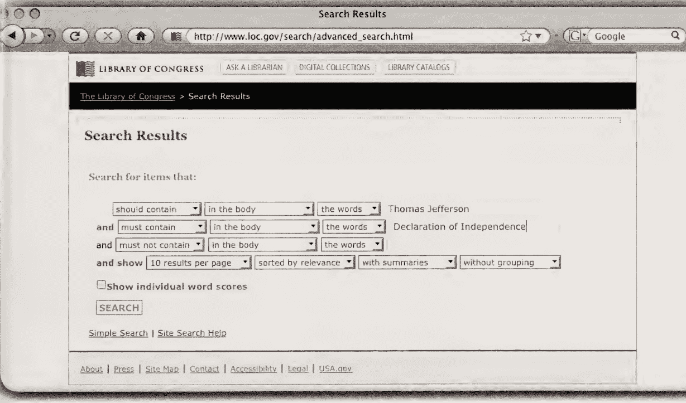

# 数据库设计职业指南


| 用户 | 产品 |
|---|---|
| PK 用户ID | PK PID |
| 姓名 | 产品名称 |
| 姓氏 | 产品描述 |

查询结果


ERIN K. McGuire


McGuire, Erin K.


ERIN K. McGUIRE


献我深爱的 Rowan 和 Malachi，你们让我的世界运转。
由心感谢 Dean Maurice 和 Fred Leskowitz 分享你们的知识和专业见解。


McGuire, Erin K.


引言 4


索引 78

想象一个堆满文件的仓库，文件中的信息与附近的其他信息没有任何关系，其放置也没有任何规律或理由。从那个仓库中获取信息会有多容易？这就像是大海捞针吗！现在想象文件是根据主题排列的。文件按字母顺序排列，并且每个文件都可以与其他文件进行交叉引用。如果信息是以易于管理、可预测的格式组织的，那么提取任何一条信息的任务就不再那么令畏畏。

数据库是一个数字仓库。它可以存储海量的数据或信息。事实上，电子化存储的数据类型没有限制。在计算机数据库中，企业可以保存产品库存、销售交易、客户档案、员工记录和财务记录。图书馆、博物馆、研究机构和政府机构存储大量数据，并向公众共享这些信息。数据可以以文本、数字甚至图片或视频的形式存在。在没有组织系统的计算机中输入这些信息，检索这些数据将变得非常困难。

数据库是一个数字仓库。它可以存储海量的数据或信息。事实上，电子化存储的数据类型没有限制。在计算机数据库中，企业可以保存产品库存、销售交易、客户档案、员工记录和财务记录。图书馆、博物馆、研究机构和政府机构存储大量数据，并向公众共享这些信息。数据可以以文本、数字甚至图片或视频的形式存在。在没有组织系统的计算机中输入这些信息，检索这些数据将变得非常困难。

数据库是一个数字仓库。它可以存储海量的数据或信息。事实上，电子化存储的数据类型没有限制。在计算机数据库中，企业可以保存产品库存、销售交易、客户档案、员工记录和财务记录。图书馆、博物馆、研究机构和政府机构存储大量数据，并向公众共享这些信息。数据可以以文本、数字甚至图片或视频的形式存在。在没有组织系统的计算机中输入这些信息，检索这些数据将变得非常困难。

数据库是一个数字仓库。它可以存储海量的数据或信息。事实上，电子化存储的数据类型没有限制。在计算机数据库中，企业可以保存产品库存、销售交易、客户档案、员工记录和财务记录。图书馆、博物馆、研究机构和政府机构存储大量数据，并向公众共享这些信息。数据可以以文本、数字甚至图片或视频的形式存在。在没有组织系统的计算机中输入这些信息，检索这些数据将变得非常困难。

数据库是一个数字仓库。它可以存储海量的数据或信息。事实上，电子化存储的数据类型没有限制。在计算机数据库中，企业可以保存产品库存、销售交易、客户档案、员工记录和财务记录。图书馆、博物馆、研究机构和政府机构存储大量数据，并向公众共享这些信息。数据可以以文本、数字甚至图片或视频的形式存在。在没有组织系统的计算机中输入这些信息，检索这些数据将变得非常困难。

数据库是一个数字仓库。它可以存储海量的数据或信息。事实上，电子化存储的数据类型没有限制。在计算机数据库中，企业可以保存产品库存、销售交易、客户档案、员工记录和财务记录。图书馆、博物馆、研究机构和政府机构存储大量数据，并向公众共享这些信息。数据可以以文本、数字甚至图片或视频的形式存在。在没有组织系统的计算机中输入这些信息，检索这些数据将变得非常困难。

数据库是一个数字仓库。它可以存储海量的数据或信息。事实上，电子化存储的数据类型没有限制。在计算机数据库中，企业可以保存产品库存、销售交易、客户档案、员工记录和财务记录。图书馆、博物馆、研究机构和政府机构存储大量数据，并向公众共享这些信息。数据可以以文本、数字甚至图片或视频的形式存在。在没有组织系统的计算机中输入这些信息，检索这些数据将变得非常困难。

数据库是一个数字仓库。它可以存储海量的数据或信息。事实上，电子化存储的数据类型没有限制。在计算机数据库中，企业可以保存产品库存、销售交易、客户档案、员工记录和财务记录。图书馆、博物馆、研究机构和政府机构存储大量数据，并向公众共享这些信息。数据可以以文本、数字甚至图片或视频的形式存在。在没有组织系统的计算机中输入这些信息，检索这些数据将变得非常困难。

数据库是一个数字仓库。它可以存储海量的数据或信息。事实上，电子化存储的数据类型没有限制。在计算机数据库中，企业可以保存产品库存、销售交易、客户档案、员工记录和财务记录。图书馆、博物馆、研究机构和政府机构存储大量数据，并向公众共享这些信息。数据可以以文本、数字甚至图片或视频的形式存在。在没有组织系统的计算机中输入这些信息，检索这些数据将变得非常困难。

数据库是一个数字仓库。它可以存储海量的数据或信息。事实上，电子化存储的数据类型没有限制。在计算机数据库中，企业可以保存产品库存、销售交易、客户档案、员工记录和财务记录。图书馆、博物馆、研究机构和政府机构存储大量数据，并向公众共享这些信息。数据可以以文本、数字甚至图片或视频的形式存在。在没有组织系统的计算机中输入这些信息，检索这些数据将变得非常困难。

数据库是一个数字仓库。它可以存储海量的数据或信息。事实上，电子化存储的数据类型没有限制。在计算机数据库中，企业可以保存产品库存、销售交易、客户档案、员工记录和财务记录。图书馆、博物馆、研究机构和政府机构存储大量数据，并向公众共享这些信息。数据可以以文本、数字甚至图片或视频的形式存在。在没有组织系统的计算机中输入这些信息，检索这些数据将变得非常困难。

数据库是一个数字仓库。它可以存储海量的数据或信息。事实上，电子化存储的数据类型没有限制。在计算机数据库中，企业可以保存产品库存、销售交易、客户档案、员工记录和财务记录。图书馆、博物馆、研究机构和政府机构存储大量数据，并向公众共享这些信息。数据可以以文本、数字甚至图片或视频的形式存在。在没有组织系统的计算机中输入这些信息，检索这些数据将变得非常困难。

数据库是一个数字仓库。它可以存储海量的数据或信息。事实上，电子化存储的数据类型没有限制。在计算机数据库中，企业可以保存产品库存、销售交易、客户档案、员工记录和财务记录。图书馆、博物馆、研究机构和政府机构存储大量数据，并向公众共享这些信息。数据可以以文本、数字甚至图片或视频的形式存在。在没有组织系统的计算机中输入这些信息，检索这些数据将变得非常困难。

数据库是一个数字仓库。它可以存储海量的数据或信息。事实上，电子化存储的数据类型没有限制。在计算机数据库中，企业可以保存产品库存、销售交易、客户档案、员工记录和财务记录。图书馆、博物馆、研究机构和政府机构存储大量数据，并向公众共享这些信息。数据可以以文本、数字甚至图片或视频的形式存在。在没有组织系统的计算机中输入这些信息，检索这些数据将变得非常困难。


使用软件程序将数据输入到计算机中。之后，用户可以检索这些信息。

数据库是一个数字仓库。它可以存储海量的数据或信息。事实上，电子化存储的数据类型没有限制。在计算机数据库中，企业可以保存产品库存、销售交易、客户档案、员工记录和财务记录。图书馆、博物馆、研究机构和政府机构存储大量数据，并向公众共享这些信息。数据可以以文本、数字甚至图片或视频的形式存在。在没有组织系统的计算机中输入这些信息，检索这些数据将变得非常困难。

## 什么是数据库设计？

数据库设计是将信息获取并组织成用户易于访问的集合的过程。


# 数据库设计导论

## 良好的设计支持业务增长

想象这样一个场景：一位设计师为一家小型企业创建了一个数据库。该数据库的设计用于跟踪客户和订单。该业务很快获得了巨大的成功，订单开始源源不断。幸运的是，数据库设计师考虑了业务快速增长的潜力。设计师能够快速地在数据库中进行更改，而无需停机。如果网站必须关闭才能重构数据库，那会怎样？在数据库重构期间，该业务可能会失去客户，并损失大量资金。

由于数据库依赖于软件系统的运行，因此数据库设计师必须熟练操作不同的软件应用程序。这有助于设计师了解哪种系统适合特定的数据库。软件设计师和数据库设计师经常紧密合作，对这两个职业都有益处。

## 亦称名称

在本书的语境下，“数据库设计师”（database designer）一词将用于描述组织和维护数据存储的人员。但也可以使用其他职衔，且它们可以互换。然而，在某些情况下，工作的重点存在差异。

数据库设计师有时被称为数据库架构师（database architects）或数据库开发者（database developers）。这些名称源于将数据库模型作为构建数据库的蓝图。数据库管理器（database manager）和数据库管理员（database administrator）等头衔也被用于描述与数据库相关的职位。这些头衔可以涵盖从管理设计过程到处理数据库安全等所有内容。职责可能包括验证数据完整性、故障排除和灾难恢复。

一个人的职衔还取决于所属公司的规模，以及该人是自雇还是受雇。在拥有大型 IT 团队的大型公司工作，可能会有机会专门从事信息技术的某个方面。另一方面，自雇者或在小公司工作的人可能需要兼任许多不同的角色，而不是专注于某一个领域。

数据库安全和数据库性能调优是大型 IT 团队中的两个专业领域。由于有许多人可以访问大量信息，数据库安全领域应需要而演变，以帮助保护隐私和敏感信息。例如，数据库经理等职位在金融机构中很常见。性能调优是一个关注数据库运行的领域。担任此职位的人并不一定参与数据库的设计。负责调优的专业人士确保数据库运行高效。他们还通过解决问题来提高其效率。

# 数据库设计导论


便携式电子设备（如这款 iPad）为数据库设计师提供了另一个工作平台，并增加了对这些专业人士的需求。

## 丰富的选择

具备数据库设计知识的计算机专业人士有许多职业选择。例如，由于通过万维网访问大量信息，数据库设计师可能会选择作为网页设计师工作，或与网页设计师合作。工作要求可能包括设计一个数据库，能够提取业务信息、组织订单和销售并保持数据安全。

随着便携式电子设备变得越来越流行和先进，人们能够在移动中访问信息。因此，数据库设计师可能会在计算机工程领域工作，开发能够在不同设备上获取信息的软件硬件。随着计算机领域不断出现新进展，数据库设计师将不断发现需要他们专业知识的新领域。

# 第二章

是谁这些才华横溢的人让数据，让需要访问信息的人的生活变得更容易一些？这些专业人士具备个人特质和专业技能，能够使设计项目变为现实。

## 个人素质

一个人的个人素质或特质通常会使其更适合某些职业。一些雇主对这些个人属性的重视程度与其教育背景和经验一样。这些特征是计算机领域的任何人（包括数据库设计师）的资产。

乍一看，这个职业似乎像是一场独角戏。然而，取决于工作环境，与其他人的互动可能是日常工作的一个常规部分。例如，许多数据库专业人士在 IT 团队中工作，与软件工程师、网络管理员、计算机程序员或系统管理员紧密合作以完成项目。与团队中的其他人进行口头和书面交流的能力，影响着整个团队的成功。

出色的沟通能力也有助于数据库设计师向不熟悉计算机语言的人传达有关数据库功能的信息。在许多情况下，数据库是为了 IT 部门之外的人构建的，这些人对数据库的实际工作原理可能知之甚少。

## 数据库设计职业


数据库设计师擅长向 IT 团队以及不熟悉计算机术语的人解释设计的细节。随后，指导用户如何实际使用数据库就成了设计师的任务。数据库设计师可能会开发并领导培训课程，这些课程可以一对一或在大组进行。如果数据库设计师在帮助台工作，那么与用户的互动是核心要求。

如果工作涉及编写使用数据库的说明，那么书面沟通技巧将非常有帮助。同样，能够用日常语言解释技术想法是非常重要的，因为用户可能对计算机语言一知甚少或完全不懂。某些工作还需要书面提案或文档。记录为什么要这样设计数据库可以帮助终端用户，增强访问信息的便利性。此外，当出现问题时，文档可以帮助数据库设计师追溯步骤。

在信息系统化的领域，逻辑思维和对细节的关注是必不可少的。数据库设计师必须能够分析信息并说：“它应该是这样的。”在解决如何存储数据的问题时，必须考虑许多细节，以及检索信息的所有可能。。对某些看似无关紧要事的忽视可能会给企业带来高昂代价。如果网站失败，更大的错误甚至可能导致财务崩溃。

计算机技术发展非常快，人们必须不断适应才能在该领域保持前沿。上个月还是标准的计算机平台和软件，下个月可能不再被使用。在一个进展如此快速的领域工作是令人兴奋的。挑战在于跟上新技术。这对于数据库设计师意味着什么？这意味着设计师应该对学习充满渴求，增加其大脑中的信息库。数据库设计师应该能够随时代变化，以确保职业生涯的成功。

## 专业技能

一旦入职，一个人的个人素质将大有益处并补充随经验积累的专业技能。某些专业技能在数据库设计领域尤为重要。例如，最初在有限的时间内完成项目可能是一个挑战。良好的时间管理技能将提高生产力，并使设计师和客户受益。通常，企业或组织依赖于组织系统的快速开发来完成其他任务。如果设计没有及时完成，可能会导致其他工作落后。良好的时间管理意味着确定优先事项，然后决定完成任务的顺序。

除了管理时间，数据库设计师还需要做出快速决定以决定


当数据库设计师面临项目截止日期时，时间是至关重要的。


# 头衔背后的人

作为一个项目，其结果随着时间的推移。当然，随着一个人对自己能力的日益自信，决策能力也会随着时间的增长而提高。然而，研究对于帮助做出良好的决策有很大帮助。为了基于准确的信息做出决策，设计者可能需要研究技术需求、特定业务的历史或某个市场的未来趋势。

另一项可以随着处理多项任务的经验而发展的有益技能是。数据库设计师经常发现自己同时在处理多一个项目，或者在处理一个项目的多个方面。例如，一个数据库设计师在设计数据库的同时，可能还在回答各种问题并学习一个新软件系统。

虽然工作通常在 IT 团队之间分工，但数据库设计师通常需要独立行动。这就是所有这些专业技能（时间管理、决策制定和多任务处理）将很好帮助数据库设计师的地方。

## 设计项目的生命周期

数据库设计师被分配了一个设计项目；现在他或她接下来该如何做？在开始实际设计之前，数据库设计师明确理解数据库的目的和客户的需求是非常重要的。

首先，要对项目中的任何信息进行彻底审查，使设计者充分掌握项目的内容以及他在完成项目中所扮演的角色。有了这种理解，数据库设计师可能会开发一系列问题向客户提问，以填补他对终端用户需求的知识空白。


如果客户对信息技术并不了解，数据库设计师可能需要协助客户确定组织对数据库确切的需求。

一旦这些问题得到了解答，数据库设计师就开始分析最终将输入数据库的信息。通过这个过程，确定了最佳组织方式、数据模型类型以及可以向系统提出的查询。还会考虑用于存放数据库和操纵数据的软件应用程序。在项目的这一阶段，数据库设计师可能与 IT 团队的其他人员（如软件开发人员或项目经理）紧密合作。

接下来，通过数据模型为信息的组织一个具体的形式。这是发生实际设计和解决问题的地方。设计者试图预测可能出现的问题，以防止系统出现故障。他或她还会创建问题解决方案方案，以防系统运行后出现问题。数据库设计师记录设计过程，并制定备份和恢复计划。通过这种方式，可以完全避免问题，或者至少快速补救。

最后，将数据传输到支持数据库的软件应用程序。该软件允许通过手动输入输入数据。然后数据可以在系统内进行操纵和管理。通常，使用一种称为查询语言的特殊计算机语言来访问和更改数据库中的信息。一旦数据库存储在电子设备中，数据库设计师就会监控其性能。如果设计存在缺陷，设计者可能需要回溯。这会增加项目的成本并浪费宝贵的时间。如果数据库设计师足够尽职，系统可能会运行得很顺畅。

数据库设计师向用户提供关于如何使用数据库的说明（书面或口头）。这些说明包括查询数据库以提取信息的最佳方法。现在设计已经完成，数据库已经运行，并交到了用户手中。在这一阶段，数据库设计师可能在支持数据库运行方面继续发挥重要作用。设计者

## 提问正确的问题

以下是数据库设计师在进行设计项目时需要考虑的问题：

1. 数据库将起到什么作用？
2. 该项目的预算是多少？设计如何支持成本效益？
3. 什么软件应用程序最适合支持数据库？
4. 哪些查询可以从数据库中快速、准确地检索信息？
5. 应该如何组织信息以维护数据的完整性（信息的完整性和准确性），即使数据发生了变化也是如此？
6. 随着用户需求的变化（例如通过业务增长），设计可能需要以什么方式演变？
7. 可能会出现哪些问题？如何对系统进行备份？
8. 设计是否有必要随着用户需求的变化（例如通过业务增长）演变？

## 专业简介

随着用户需求的变化（例如通过业务增长），设计可能需要以什么方式演变？

7. 可能会出现哪些问题？如何对系统进行备份？
8. 设计是否有必要随着用户需求的变化（例如通过业务增长）演变？

以下是数据库设计师在进行设计项目时需要考虑的问题：

1. 数据库将起到什么作用？
2. 该项目的预算是多少？设计如何支持成本效益？
3. 什么软件应用程序最适合支持数据库？
4. 哪些查询可以从数据库中快速、准确地检索信息？
5. 应该如何组织信息以维护数据的完整性（信息的完整性和准确性），即使数据发生了变化也是如此？
6. 随着用户需求的变化（例如通过业务增长），设计可能需要以什么方式演变？
7. 可能会出现哪些问题？如何对系统进行备份？
8. 设计是否有必要随着用户需求的变化（例如通过业务增长）演变？

以下是数据库设计师在进行设计项目时需要考虑的问题：

1. 数据库将起到什么作用？
2. 该项目的预算是多少？设计如何支持成本效益？
3. 什么软件应用程序最适合支持数据库？
4. 哪些查询可以从数据库中快速、准确地检索信息？
5. 应该如何组织信息以维护数据的完整性（信息的完整性和准确性），即使数据发生了变化也是如此？
6. 随着用户需求的变化（例如通过业务增长），设计可能需要以什么方式演变？
7. 可能会出现哪些问题？如何对系统进行备份？
8. 设计是否有必要随着用户需求的变化（例如通过业务增长）演变？

以下是数据库设计师在进行设计项目时需要考虑的问题：

1. 数据库将起到什么作用？
2. 该项目的预算是多少？设计如何支持成本效益？
3. 什么软件应用程序最适合支持数据库？
4. 哪些查询可以从数据库中快速、准确地检索信息？
5. 应该如何组织信息以维护数据的完整性（信息的完整性和准确性），即使数据发生了变化也是如此？
6. 随着用户需求的变化（例如通过业务增长），设计可能需要以什么方式演变？
7. 可能会出现哪些问题？如何对系统进行备份？
8. 设计是否有必要随着用户需求的变化（例如通过业务增长）演变？

（注：由于提供的 OCR 文本包含大量重复和破碎的句子，我将提供一个去重后的版本，代表实际预期的文本。）

**最终尝试（去重 OCR 版本）：**

[content]
# 头衔背后的人

作为一个项目，其结果随着时间的推移。当然，随着一个人对自己能力的日益自信，决策能力也会随着时间的增长而提高。然而，研究对于帮助做出良好的决策有很大帮助。为了基于准确的信息做出决策，设计者可能需要研究技术需求、特定业务的历史或某个市场的未来趋势。

另一项可以随着处理多项任务的经验而发展的有益技能是。数据库设计师经常发现自己同时在处理多一个项目，或者在处理一个项目的多个方面。例如，一个数据库设计师在设计数据库的同时，可能还在回答各种问题并学习一个新软件系统。

虽然工作通常在 IT 团队之间分工，但数据库设计师通常需要独立行动。这就是所有这些专业技能（时间管理、决策制定和多任务处理）将很好帮助数据库设计师的地方。

## 设计项目的生命周期

数据库设计师被分配了一个设计项目；现在他或她接下来该如何做？在开始实际设计之前，数据库设计师明确理解数据库的目的和客户的需求是非常重要的。

首先，要对项目中的任何信息进行彻底审查，使设计者充分掌握项目的内容以及他在完成项目中所扮演的角色。有了这种理解，数据库设计师可能会开发一系列问题向客户提问，以填补他对终端用户需求的知识空白。


如果客户对信息技术并不了解，数据库设计师可能需要协助客户确定组织对数据库确切的需求。

一旦这些问题得到了解答，数据库设计师就开始分析最终将输入数据库的信息。通过这个过程，确定了最佳组织方式、数据模型类型以及可以向系统提出的查询。还会考虑用于存放数据库和操纵数据的软件应用程序。在项目的这一阶段，数据库设计师可能与 IT 团队的其他人员（如软件开发人员或项目经理）紧密合作。

接下来，通过数据模型为信息的组织一个具体的形式。这是发生实际设计和解决问题的地方。设计者试图预测可能出现的问题，以防止系统出现故障。他或她还会创建问题解决方案方案，以防系统运行后出现问题。数据库设计师记录设计过程，并制定备份和恢复计划。通过这种方式，可以完全避免问题，或者至少快速补救。

最后，将数据传输到支持数据库的软件应用程序。该软件允许通过手动输入输入数据。然后数据可以在系统内进行操纵和管理。通常，使用一种称为查询语言的特殊计算机语言来访问和更改数据库中的信息。一旦数据库存储在电子设备中，数据库设计师就会监控其性能。如果设计存在缺陷，设计者可能需要回溯。这会增加项目的成本并浪费宝贵的时间。如果数据库设计师足够尽职，系统可能会运行得很顺畅。

数据库设计师向用户提供关于如何使用数据库的说明（书面或口头）。这些说明包括查询数据库以提取信息的最佳方法。现在设计已经完成，数据库已经运行，并交到了用户手中。在这一阶段，数据库设计师可能在支持数据库运行方面继续发挥重要作用。设计者

## 提问正确的问题

以下是数据库设计师在进行设计项目时需要考虑的问题：

1. 数据库将起到什么作用？
2. 该项目的预算是多少？设计如何支持成本效益？
3. 什么软件应用程序最适合支持数据库？
4. 哪些查询可以从数据库中快速、准确地检索信息？
5. 应该如何组织信息以维护数据的完整性（信息的完整性和准确性），即使数据发生了变化也是如此？
6. 随着用户需求的变化（例如通过业务增长），设计可能需要以什么方式演变？
7. 可能会出现哪些问题？如何对系统进行备份？
8. 设计是否有必要随着用户需求的变化（例如通过业务增长）演变？

## 专业简介

Fred Leskowitz 是一个愿意随时代变化的设计师。他目前在汤森路（Thomson Reuters）工作，这是一家为企业提供信息的公司。Leskowitz 的职业始于二十年前，当他在学习科学时。Leskowitz 解释道，“我在学校的第一次实习包含了许多——许多文件——在输入之前。通过对数据的直接理解，我有许多关于如何设计的想法，这对我的下一次实习非常有用。”

在获得艺术学士学位和科学硕士学位后，Leskowitz 进入了科学领域。“我主要处理与科学相关的应用程序，如分类目录、收藏和库存，”他说。他随后开始与一家名为 MicroPatent 的汤森路业务工作。“我经常从其他系统获取信息进行存储和分析，”Leskowitz 提供了一个最近项目的概述：“为客户服务建立了一个按客户/日期/产品的报告窗口。”

通过将自己的兴趣与数据库设计相结合，Leskowitz 获得了新的视角，并让工作变得有趣。他解释道，“我的兴趣在科学，特别是专利和商标。虽然我只处理我们销售产品的财务方面，但因为与该领域相关，总有一些值得考虑的事情。在科学领域卖出了多少专利，或者与音乐，我的爱好？但对自己的兴趣了解可以为如何回答这些问题提供额外的见解。”

他对于未来的数据库设计师的建议是：“选择你感兴趣的行业或专业领域——如果你对汽车感兴趣，请在汽车行业寻找数据库职位。数据库设计的工具和技术是相同的，但你处理的是一个你感兴趣的领域。”

数据库专业人士将个人素质、专业技能、对当前工作的理解，有时甚至是自己的兴趣结合起来完成一个项目。只要个人的素质和兴趣与数据库设计师的总体概况匹配，许多与工作相关的技能就可以学习。


# 第3章
## 万物皆有其：组织数据

数据库设计师的主要目标是组织信息。为了实现这一目标，设计师会使用某些工具。这些工具允许设计师为信息找到一个逻辑存储位置，同时能够轻松地检索信息。与任何清理工作一样，将相关信息放在同一个地方是有意义的。例如，整理房屋时，你不会把牙刷和银餐具放在一起。在数据内部寻找联系，可以使最终用户更方便地访问数据库中的信息。

## 数据库术语

很快就会发现，数据库设计有一套属于自己的词汇。学习该领域使用的技术术语将有助于人们理解数据库的功能以及设计师的工作。许多术语在设计领域是通用的。以下信息提供了对通用数据库设置的概括性介绍。然而，词汇可能会根据数据库系统或模型而异。

当数据库设计师创建数据模型时，许多重要术语会发挥作用。数据库是计算机存储相关信息（或数据）的仓库。这

# 24 数据库设计中的职业

DBMS 是计算机程序的集合，也被称为软件应用程序。它们在数据库的开发和管理中起着作用。通过安装软件，可以在计算机中建立数据库。数据输入是将新信息放入数据库的手段。

另一边是数据的检索。查询（Query）是输入数据库的以提取信息的问题。查询的一个示例是在世界维网搜索引擎中输入一个问题，然后在屏幕上显示数据。设计师必须识别并设置用户查询数据库的最佳方式，以便

```sql
Provider = "Database-DB home; Username,password Database provider"
DB.ConnectConnectionString
SelectSQL1 = " Select id, name, quantity From all "
QuerySQL1 = " where id between decode (name. Sobe 
QuerySQL2 = " group by id, name"
SelectQuery = SelectSQL1 & QuerySQL2
Execute Query; Commit Transaction; Select new data
Form Navigation
If KeyAscii = 13 Then Execute Query Chr(KeyAscii) Like "#" And KeyAscii = &
```

数据使用计算机语言或编码将数据输入到软件系统中。向系统提出查询可以检索信息。

## 万物皆有其：组织数据

获得快速、准确的结果。如果没有有效查询数据库的方法，数据可能无法访问，数据库也会变得过时。

数据库设计师还为数据库设置用户界面。用户界面是用户与计算机之间的通信点。通常，一个人首先通过视觉方式连接到数据库。他在屏幕（如计算机屏幕、手机或其他电子设备）上看到信息。这个人还通过用户界面与数据库交互。除了在文本框中输入文字外，用户可能还可以使用下拉菜单或复选框等工具。数据库



屏幕就是用户界面，即用户与数据库中存储的数据交互的地方。

## 数据库设计的职业

设计师的目标是建立用户界面，使用户能够快速方便地找到他们需要的内容。

数据库设计师使用结构化查询语言（SQL）这种编程语言在数据库中输入和操作数据。SQL 知识是设计师的必备技能，因为它用于关系型数据库，这是最常见的关系型数据库模型类型。

关系型数据库包含许多不同的元素。数据库的结构包含一个或多个表。这些表被称为关系（relations），因为它们由图表形式所示的相关信息组成。例如，考虑一个存储乐队信息的数据库。数据库中的一个表可能列出摇滚乐队的信息，而另一张表可能列出爵士乐队的信息。

在每个表中都有记录（records）和字段（fields）。每条记录包含了表中特定成员的所有信息。在摇滚乐队的示例中，一条记录将包含单个摇滚乐队（如 U2）的所有信息。每个字段提供关于表中乐队的特定部分信息，例如乐队成员的名字或乐队 CD 的名称。

## 从数据模型到数据库：蓝图

数据库设计师的目标是建立用户界面，使用户能够快速方便地找到他们需要的内容。

数据库设计师使用结构化查询语言（SQL）这种编程语言在数据库中输入和操作数据。SQL 知识是设计师的必备技能，因为它用于关系型数据库，这是最常见的关系型数据库模型类型。

关系型数据库包含许多不同的元素。数据库的结构包含一个或多个表。这些表被称为关系，因为它们由图表形式所示的相关信息组成。例如，考虑一个存储乐队信息的数据库。数据库中的一个表可能列出摇滚乐队的信息，而另一张表可能列出爵士乐队的信息。

在每个表中都有记录和字段。每条记录包含了表中特定成员的所有信息。在摇滚乐队的示例中，一条记录将包含单个摇滚乐队（如 U2）的所有信息。每个字段提供关于表中乐队的特定部分信息，例如乐队成员的名字或乐队 CD 的名称。

## 从数据模型到数据库：蓝图

数据库设计师的目标是建立用户界面，使用户能够快速方便地找到他们需要的内容。

数据库设计师使用结构化查询语言（SQL）这种编程语言在数据库中输入和操作数据。SQL 知识是设计师的必备技能，因为它用于关系型数据库，这是最常见的关系型数据库模型类型。

关系型数据库包含许多不同的元素。数据库的结构包含一个或多个表。这些表被称为关系，因为它们由图表形式所示的相关信息组成。例如，考虑一个存储乐队信息的数据库。数据库中的一个表可能列出摇滚乐队的信息，而另一张表可能列出爵士乐队的信息。

在每个表中都有记录和字段。每条记录包含了表中特定成员的所有信息。在摇滚乐队的示例中，一条记录将包含单个摇滚乐队（如 U2）的所有信息。每个字段提供关于表中乐队的特定部分信息，例如乐队成员的名字或乐队 CD 的名称。

## 从数据模型到数据库：蓝图

数据库设计师的目标是建立用户界面，使用户能够快速方便地找到他们需要的内容。

数据库设计师使用结构化查询语言（SQL）这种编程语言在数据库中输入和操作数据。SQL 知识是设计师的必备技能，因为它用于关系型数据库，这是最常见的关系型数据库模型类型。

关系型数据库包含许多不同的元素。数据库的结构包含一个或多个表。这些表被称为关系，因为它们由图表形式所示的相关信息组成。例如，考虑一个存储乐队信息的数据库。数据库中的一个表可能列出摇滚乐队的信息，而另一张表可能列出爵士乐队的信息。

在每个表中都有记录和字段。每条记录包含了表中特定成员的所有信息。在摇滚乐队的示例中，一条记录将包含单个摇滚乐队（如 U2）的所有信息。每个字段提供关于表中乐队的特定部分信息，例如乐队成员的名字或乐队 CD 的名称。

## 万物皆有其：组织数据

## 万物皆有其：组织数据 

| 乐队 | 员 | 乐器 | 类型 |
| :--- | :--- | :--- | :--- |
| 概念模型 | | | |
| 数据库答案 | | | |
| 关系型数据库 | | | |
| 描述 | | | |
| 开始 | | | |
| 名称 | | | |
| 地址 | | | |
| 拨打 | | | |
| 电话 | | | |
| 名称 | | | |
| 类型 | | | |

数据模型基于


组织数据。


数据库

## 不同类型的数据库模型

有不同的数据模型随着时间的推移通过不断的试错演变而来。早期一种简单存储数据的方法是种


平面文件系统。在这样的系统中，数据被简单地放在一个文件中。人们很快发现，这种格式使得访问信息变成了一项挑战，因为搜索必须针对数据非常具体。此外，如果用户在错误的文件中进行搜索，数据将永远无法发现。

后来，人们创建了网络模型和层次结构数据库模型，以使数据更易访问。然而，这些模型要求用户进行“根搜索”。在根搜索中，用户必须从最基础、最宽泛的搜索词开始，而不是输入更详细的信息。例如，假设一个用户正在搜索某个零件。根搜索将要求用户首先输入汽车的型号和品牌才能调出相关信息。用户不能直接查询数据库获取汽车零件。随着关于如何存储信息的更多相关答案逐渐明朗，这些数据库模型正迅速过时。

此外，对象型数据库已经出现，用于存储复杂数据，如照片和视频。在此类数据库中，信息是以对象（数字和代码）的形式存储的，而不是平面数据。

关系型数据库模型的发展改变了数据库设计领域。今天，关系型数据库是最常用的数据库模型。关系型模型由 Edgar F. Codd 发明，并由该领域的其他人员进行了增强，允许用户从数据库结构中的许多地方开始搜索，而不是从根词开始一直到所需信息。该模型还允许一次检索多条信息。在这一模型中，数据是归一化的，这意味着消除了重复信息。通过减少相同信息的多次录入，系统的完整性更容易得以维护。此外，减少了对系统所需的维护工作。目前，关系型数据库是目前最先进的信息存储形式。

一旦选择并创建了数据模型，数据库设计者就会使用 SQL 将数据输入到软件系统中。在良好的设计中，用户可以根据需要继续对数据进行添加或其他更改，而不会降低系统速度。虽然有些设计人员主要处理系统的初始设计，但另一些人发现他们的工作描述包括做出更改并持续管理数据库。

# 第 4 章
存储管理与维护

数据库已经运行了。那么数据库设计师的工作就结束了，对吧？并不一定。数据库设计师的工作通常在此处并没有结束。由于没有人比设计它的人更熟悉这个数据库，大多数公司都会留住设计师以根据需要进行更改，或者至少偶尔请设计师对数据库进行必要的修复。

除了创建和实施初始设计外，数据库设计师的其他职责还可能包括管理数据库的增长和变化、性能调优、故障排除、修改现有数据库、备份和恢复，以及指导他人使用数据库。根据项目的范围，这些职责中的每一项都可以作为一个独立的职位，并由 IT 团队的不同成员负责。然而，在小公司，一个人就是整个 IT 团队。这个人遵循数据库的每一个方面，从设计到管理和维护。

## 增长与变化的管理

随着用户需求和数据库管理系统要求的改变，修改通常是必要的。

## 管理存储与维护

数据的变化会定期发生，设计良好的数据库能够支持这些变化。数据库设计师在数据模型的设计和开发中会考虑未来的变化。例如，数据库设计师可能会预判产品库存信息的变化。同理，数据库设计师可以预见到，随着公司聘用新员工，员工数据将发生变化。

业务增长对数据库中的信息也有影响。许多数据库被用于跟踪业务的客户历史，包括订单。如果订单量增加，数据库应该能够跟上这种增长。数据库设计师还必须考虑更改可能会产生多米诺效应。例如，数据数量的重大变化可能会导致数据库其他领域的混乱。

同样，这些变化在数据库的初始设计中尽可能被预见到，以便采取预防措施。此外，当数据库设计师更新系统内的信息时，他或她会确保其顺利整合，以维护数据完整性。如果系统难以容纳新数据，重构信息可能会变成一项昂贵的工程。它甚至可能导致需要完全全新的数据库设计。

有效管理数据库中的变化非常重要。一个不能随着业务共同演变的数据库管理系统将破坏成功。一个需要关闭的数据库会导致。

## 数据库设计职业


数据库已经运行了。那么数据库设计师的工作就结束了，对吧？并不一定。数据库设计师的工作通常在此处并没有结束。由于没有人比设计它的人更熟悉这个数据库，大多数公司都会留住设计师以根据需要进行更改，或者至少偶尔请设计师对数据库进行必要的修复。

除了创建和实施初始设计外，数据库设计师的其他职责还可能包括管理数据库的增长和变化、性能调优、故障排除、修改现有数据库、备份和恢复，以及指导他人使用数据库。根据项目的范围，这些职责中的每一项都可以作为一个独立的职位，并由 IT 团队的不同成员负责。然而，在小公司，一个人就是整个 IT 团队。这个人遵循数据库的每一个方面，从设计到管理和维护。

# 管理增长与变化

随着用户需求和数据库管理系统要求的改变，修改通常是必要的。

## 管理存储与维护

数据的变化会定期发生，设计良好的数据库能够支持这些变化。数据库设计师在数据模型的设计和开发中会考虑未来的变化。例如，数据库设计师可能会预判产品库存信息的变化。同理，数据库设计师可以预见到，随着公司聘用新员工，员工数据将发生变化。

业务增长对数据库中的信息也有影响。许多数据库被用于跟踪业务的客户历史，包括订单。如果订单量增加，数据库应该能够跟上这种增长。数据库设计师还必须考虑更改可能会产生多米诺效应。例如，数据数量的重大变化可能会导致数据库其他领域的混乱。

同样，这些变化在数据库的初始设计中尽可能被预见到，以便采取预防措施。此外，当数据库设计师更新系统内的信息时，他或她会确保其顺利整合，以维护数据完整性。如果系统难以容纳新数据，重构信息可能会变成一项昂贵的工程。它甚至可能导致需要完全全新的数据库设计。

有效管理数据库中的变化非常重要。一个不能随着业务共同演变的数据库管理系统将破坏成功。一个需要关闭的数据库会导致。

## 数据库安全

不幸的是，在某些情况下问题在数据丢失之前没有解决。为了防止数据丢失，数据库设计师使用备份系统和恢复工具。


## 故障排除场景

数据库发生故障，危及到依赖系统稳定性的业务成功。数据库设计人员该如何应对？首先，他或她必须从问题发生的那一刻起详细收集所有信息。然后，他或她将参考在设计过程中保留的文档和其他记录。最后，数据库设计人员将逐一检查设计元素，以查看故障发生在何处以及如何进行修复。

然而，预防性措施是最佳的行动。鉴于如果不采取任何保护措施就可能会丢失大量宝贵数据，数据备份和恢复是数据库管理系统中不可或缺的一部分。有时，会创建一个与原始数据库管理系统完全相同的备用系统。如果原始系统故障或受到某种损坏，该系统就可以被信赖。

数据丢失的常见原因有硬件故障、如风暴等自然灾害以及人为失误。在这些每种情况下，通过良好的行动计划都可以减少数据丢失。在数据丢失发生前安装的恢复工具可以将系统恢复到损坏发生之前的某个时间点。风险在于系统将丢失在此期间可能进行的更改。备份系统是另一个良好的预防措施，只要定期进行系统备份。如果持续运行备份系统，则对数据的所有更改都将涵盖在内。

数据也可能由于计算机病毒或其他人为攻击而丢失。同样，备份和恢复系统可以有所帮助，但安全措施可以防止人员黑入数据库。此类措施通常涉及安装安全系统。例如，数据库设计人员可以建立授权代码系统，仅允许特定用户查看特定数据。当数据具有机密性（如财务信息）时，安全尤为重要。出于如此，银行和其他金融机构严重依赖安全措施。


数据库设计人员可以专注于数据库安全，评估安全风险并开发安全措施。

## 向用户教授数据库知识

数据库设计人员花费大量时间教育他人如何使用数据库。这既涉及书面也涉及口头交流。指导可能限于解释数据库的基本功能，包括如何提出查询以调出所需信息。然而，如果主要用户不是数据库设计人员，指导还可能包括数据库的管理和维护。

其主要重点是帮助用户的 IT 领域被称为帮助台（help desk）。通过该平台，数据库设计人员通过回答关于数据库的特定问题为用户提供支持，数据库设计人员的沟通技巧成为一项重要资产。这可以通过软件、互联网、电子邮件或呼叫中心完成。在帮助台，数据库设计人员经常会指导那些几乎或完全没有计算机知识的人。数据库设计和计算机语言的复杂概念必须为普通用户进行拆解。

无论是从事数据库系统管理、数据库维护还是用户协助，数据库设计领域都有许多人可以关注的领域。教育和培训提供了人们获得这些不同领域知识的机会，并可能选择一个专业领域。

# 第 5 章
## 进入该领域的途径

人们如何学习数据库设计的工具和技术，并向未来迈步呢？从现在、这里开始吧。对于渴望成为数据库设计师的人来说，有许多不同的课程和其他学习机会。在计算机技能方面建立坚实的基础是第一步，也是职业成功的关键。

## 抢占先机：
中等教育中的计算机学习

首先在高中阶段了解计算机的一般工作原理。大多数高中提供基础计算或技术教育课程。早早学习计算机课程有助于人们决定在计算机科学领域内采取什么方向。在高中期间充分利用这些课程；这可以在以后节省时间，使人们能够进入高级别的课程。高中生还可以通过当地教育部门获得课程。


需要完成教育课程。此外，学生还会通过自己的专业对特定的兴趣领域进行关注。许多数据库设计师选择这条路线，攻读专门数据库设计或数据库管理的学士学位课程。其他人则在计算机科学、工程、信息技术、管理信息系统、数学甚至企业管理等更广泛的范伞下攻读课程。

无论是专科学位还是学士学位都可以作为进入职场的良好跳板。然而，更进一步获得硕士学位对于某些雇主以及那些寻求

更高层级职位的人来说，可能是理想的。


技术学校（例如密苏里州的北州技术高中）提供了丰富的操作数据库管理系统的实操经验。

硕士学位通常在四年制学士学位后需要额外花费两年的时间才能获得。合适的学位可能属于多个类别，包括数据库管理硕士、数据库营销硕士和计算机科学硕士。

个人的受教育程度反映了可能从事的职位。例如，如果一个人无意担任管理职位，那么专科学位或学士学位就足够了。如果想在数据库设计领域的某个特定领域（如性能调优或安全）工作，可以选择攻读以兴趣领域为方向的学士学位。如果确实想追求管理职位，可以在获得学士学位后或在在该领域获得一些经验后立即开始硕士课程。

## 课程选编

在高等等教育（或大学水平教育）的第一年，绝大多数学生被要求修读入门课程，除非他们在高中已经上过允许他们跳过初级课程的课。在这个水平上，大多数课程涉及讲座以及实验室工作。在实验室期间，学生通过计算机获得相关材料的实操经验。学位课程所需的课程各不相同，但以下常见课程包括：

- **基础编程。** 这门入门课程提供了有关软件开发的信息，并让人建立简单数据结构的基础。它也为学习文档规范奠定了基础，因为大多数课程都要求文档作为实验室要求的一部分。

- **计算机科学导论。** 在这门课程中，学生学习计算机工作的基本原理以及解决问题的策略。课程内容包括学习编程。

- **数据库设计与实现。** 学生学习如何分析数据、组织数据并开发搜索。课程内容包括将基础设计结构应用于信息中。

- **万维网导论。** 在这门课程中，学生通常学习如何使用 HTML、JavaScript 和其他基于 Web 的程序开发驱动网站。

- **计算机网络。** 网络是计算机通信和共享信息的手段。通过这门课程，学生将熟悉这一过程。网络操作知识在数据库设计行业非常有价值。通过与不同数据库的连接，发生了大量的网络活动。

- **技术写作。** 这门写作课程让学生理解如何将数据库设计的细节记录在纸上。由于该领域有大量的文档和书面通信，这门课程是大多数学位的必修。

- **微积分/离散数学。** 通过这些数学课程，数据库设计的学生学习如何将解决问题的模型应用于现实情况。学习数学在计算机科学中非常重要，学生将获得对数学分析、逻辑和函数的理解。

以下课程列表涉及关系数据库模型。这种数据模型已变得非常常用，因此学位课程已此类此类设为必修。该领域的课程包括：

- **关系数据库设计。** 修读关系数据库设计课程的学生将理解与关系数据库相关的术和概念。课程要求包括创建数据库表（关系数据库设计中使用的数据结构）以及使用 SQL。

- **数据规范化。** 在这门课程中，学生学习如何从数据管理系统中删除重复数据，以维护数据的完整性并提高整个系统的速度。

- **SQL。** 这门课程教授 SQL，这是数据库设计者必须熟悉的许多编程语言之一。

## 软件认证计划

许多软件公司提供特定系统的认证。可以关注诸如 Oracle 认证专业人员（Oracle Certified Professional）和微软认证数据库管理员（MCDA）等计划。某些特定的认证计划需要该领域的经验。这些计划为职业人士提供了继续教育的资源。计划费用甚至可能由雇主承担。

## 职业认证

另一个选项是获得数据库设计认证代替或补充学位。一些技术机构、学院和大学设有证书计划。这些计划可能需要一时间完成，包括课程和考试。

许多数据库设计师在进入领域工作后会继续接受教育。有些人追求特定系统的认证，这些认证可以通过软件公司获得。利用这些资源可以帮助自己在该领域更具竞争力。然而，这并不是就业的必要条件。根据弗德·莱斯科维（Fred Leskowitz）的话，“要在这个领域开始并向潜在雇主展示你对自己的兴趣是认真的，我绝对建议获得认证。拥有工作经验很重要，但课程和培训可以节省大量时间并提供更好的结果。”

在做出教育和培训决策时，请考虑每条教育路径可能的结果。在脑中想象自己在工作环境中的自己对决策过程非常有帮助。数据库设计师在考虑工作地点、环境和所在行业时有许多选择。良好的教育只会增加这些选择。

# 第 6 章 机遇的海洋

数据库设计领域充满了机会。

就业的可能性是无限的，因为几乎每个可以想象的组织都有需要组织和管理的信息。数据库设计师可以在小型企业、医院、执法机构、政府办公室、金融机构、大学、计算机系统、保险公司、图书馆和大型公司工作。机会与存储在数据库中的信息类型一样多样。

一旦听到“你被录用了！”，数据库设计师的工作生活可能是怎样的？

## 工作环境

作为数据库设计师，可以预计大部分时间都在办公空间或计算机实验室面对计算机工作。数据库设计师的大部分工作在办公桌完成。

与许多计算机领域一样，可能会面临眼睛疲劳、头痛、久坐导致的背部问题以及过度打字导致的腕隧道综合征的风险。在考虑工作地点时，观察工作环境以查看雇主是否采取了保护员工健康的措施是一个主意。例如，光线是否充足，其位置是否减少了


## 丰富的机遇

电脑屏幕的眩光。是否有充足的空间工作？是否提供了相关物品以提高员工的舒适度和效率？如果没有，员工是否可以携带自己的舒适物品去工作场所，例如椅子或手腕垫？允许员工休息几次以以便走走动和伸展？这些考虑将有助于确保积极的工作体验。

虽然这是一份办公室工作，但仍有与人的互动。例如包括与客户会面以确定数据库的需求、教人们如何使用数据库，以及作为信息技术团队的一员进行工作。面对面会议可以在工作场所举行，也可能需要前往客户所在地。出差通常非常少。然而，对于数据库设计师来说，必须前往各个地点与不同的系统合作或为公司提供咨询，这是一个现实。

该领域的一个优势是，如果雇主接受，许多职位允许远程办公。这有时可以使数据库设计师能够灵活地安排自己的工作时间。数据库设计师的工作周平均为四十小时，但如果他们的职责包括故障排除和维护，时间可能会更长。专攻这些领域的专业人士可能需要值班或加班，以便让故障的系统再次恢复正常运行。

## 自雇人士或独立承包商

数据库设计师这一职业提供了许多就业选择。成为组织的员工提供了稳定性，


作为自雇专业人士或独立承包商的数据库设计师会发现，多任务处理是常态，但该领域的某些人选择创业或成为独立承包商。许多数据库设计师创建了成功的公司，为其他企业设计数据库或创建数据库驱动的网站。自雇可能非常有回报，它让数据库设计师能够选择客户和项目。然而，它也要求数据库设计师成为具有商业头脑和技巧的自律者。

许多使人成为优秀数据库设计师的素质对于自雇人士来说也是基础。时间管理能力、对细节的关注和强大的问题解决能力都对企业主有益。与组织员工相比，自雇专业人士对工作环境有更多的控制权，并可能享受更灵活的工作日程。另一方面，该职业的某些方面可能更具挑战性。组织的员工通常医疗、退休储蓄和税务等细节很大程度上由雇主负责。然而，自雇专业人士必须自己做打算。此外，企业主花费大量时间处理业务财务和运营方面，而不是仅仅专注于数据库设计。

独立承包商或自由职业者通常拥有来自各种业务的客户。他们被聘佣为公司完成特定的项目或任务，但他们不是正式员工。他们不享受员工福利，且不预扣税款。作为独立承包商，个人有自由选择自己喜欢的项目并设定自己的工作日程。像企业主一样，独立承包商必须具有良好的工作伦理，以满足客户的需求和截止日期。

## 互联网机遇

万维网的使用为数据库设计专业人士增加了另一个探索领域。数据库人员和网页开发者经常合作创建和维护某些类型的网站。

要理解数据库设计师在万维网功能中起什么作用，必须对存在的不同类型的网页有基本的了解。既有静态网页也有动态网页。静态

## 数据库设计职业的优缺点

所有的职业领域都有需要考虑的正面和负面方面。关键在于选择一个具有你重视的正面方面且至少可以忍受的负面方面的职业。对于数据库设计领域，一些优缺点如下：

- 优点：
- 职业的多样性为数据库设计师在选择工作环境和在该领域内专攻提供了许多选择。
- 数据库设计师在看到自己的设计发挥作用时会有满足感。
- 有自雇的机会。
- 这个职业提供了工作保障和增长潜力。
- 数据库设计师可能有在工作现场或从家里工作的选择。

- 缺点：
- 数据库设计师面临压力，必须创建一个能够经受住时间考验的设计。
- 截止日期通常很紧。
- 数据库设计可能并不总是反映最逻辑或优雅的内容，而是反映对客户成本效益最高的。
- 存在值班和在异常时间工作的可能。
- 技术变化如此迅速，昨天有效的方法明天可能就失效。

## 丰富的机遇

网页每次加载时看起来都一样且包含相同的信息。为了让页面发生变化，有人以不同的方式对其编程然后上传新版本。相比之下，动态网页每次加载时都可以变化。有时用户甚至可以操作页面上的信息并自行更改。

数据库支持的或数据库驱动的网站是一种动态网页。这些网站与数据库连接，其方式允许直接从数据库中提取信息。随着数据库内部信息的变化，网站会反映这些变化。通过适当的数据库设计，这些变化是自动的，无需用户的任何干预。例如一个电子商务网站必须向客户提供关于产品和价格的最新信息。

作为IT团队的成员，数据库设计师和网页开发者经常在数据库支持的网站上共享工作。数据库设计师与网页开发者密切合作，以确保数据易于访问。许多为小型公司工作或自雇的数据库设计师兼任设计师和网页开发者双重角色。

随着这些网站成本降低且管理变得更容易，越来越多的企业依靠数据库设计师帮助创建数据库支持的网站。随着新技术的发布允许从远程访问数据库，数据库设计师的知识和服务需求巨大。这些数据库设计师的挑战在于构建一个跟上数据变化并提供必要安全措施的网站。成就感来自在一个让所有人通过万维网访问数据库设计。

## 寻找合适的工作

有这么多选择，人们如何找到合适的工作？在接受教育和培训期间，个人应该注意数据库设计的方面以及他们认为最有成就感的学习领域。此外，个人应该反思自己的优势、劣势和偏好。例如，拥有卓越沟通能力并喜欢与人合作的人可能非常适合帮助台工作。喜欢跟上潮流的人可能喜欢与计算机工程师合作，设计集成数据库的产品。如果解决问题给人带来巨大的满足感，性能调优或故障排除可能是一个很好的领域。那些纯粹喜欢设计工作和组织信息的人可能会寻找一份初始设计过程构成主要工作量的工作。

正如 Fred Leskowitz 通过将对图书馆科学的兴趣与对设计的兴趣相结合而发现的那样，个人兴趣甚至是爱好有时可以引导进入一个有趣且有回报的行业。进入该领域的人将受益于检查自己的兴趣，并创造性地思考数据库设计如何与这些兴趣相关。例如，体育爱好者可能想处理存储体育统计数据的数据库。

实习为正式成为员工之前探索工作提供了完美机会。实习生是在接受培训并担任临时职位的人。


组织。有时候实习生会获得报酬，但通常他们是以志愿者的身份完成工作。通过实习，人们可以学习一些行业门门，并执行作为数据库设计师所需的任务。这些宝贵的工作经验可以写在简历中，并在面试中讨论。实习还提供了建立人脉的机会，这些关系可能通向就业。通过在多个组织完成实习，或者通过观察同一组织内不同的角色，人们可以对数据库设计不同领域的工作情况有一个直观的了解。

在开始成为数据库设计师的旅程时，记录自己的经验和设计工作至关重要。作品样本以后可以包含在简历或作品集中。这些信息可以帮助人们找到工作，或者找到最适合自己的职位。

# 第 7 章
数据库设计师的演变

随着技术的不断演变，在新的技术系统中存储海量信息的工作也随之变化。因此，专业的数据库设计必须不断演进以跟上时代。

## 跟进新思想和技术

即使是经验最丰富的数据库设计师也需要随时关注技术的变化。特别是，人们必须熟悉最新的应用程序和程序。新的软件程序可以改变数据库的设计方式，或者让数据库更易管理。如果数据库设计师保持在新技术的前沿，他的设计也将与时同步。

学习数据库设计领域的进展可以像初学者采取的方法一样进行：通过阅读计算机科学出版物、加入社区或在线的信息技术小组，以及追求继续教育。例如，加入技术组织为人们提供了与同领域其他人建立联系并分享信息的机会。

也许在该领域获取新知识的最常见之一是继续学习某些学科的课程


通过参加课程、加入技术组织并与 IT 领域的其他人保持联系，人们可以学习与数据库设计相关的创新。继续教育可能涉及完成更高的学位（如硕士学位），也可能简单地参加一个认证课程来学习新的应用程序。如第 5 章所述，此类认证课程可以通过雇主、创建新技术的计算机科学公司提供。它们也可以在学院或大学提供，设有面授或在线课程。终身学习在任何领域都有益处，但在瞬息万变的计算机领域，它是职业晋升的必修。

## 职业发展

数据库设计是一个动态的行业。选择这一职业的人可以期待在就业和专业领域方面有多种选择。凭借深厚的教育背景、经验和管理技能，数据库设计师正处于在该领域晋升的道路上。

高级职位包括首席技术官（CTO）、高级数据库管理员、首席数据库设计师和信息系统经理。正如职称所示，这些职位要求人们担任计算机科学专业人员或 IT 团队的领导。这些职位的人负责数据库的设计、管理和维护。为了做到这一点，他们必须理解随整个过程的所有任务。这些领导是团队的资源，同时兼顾主管职位所带来的其他职责。这些职责可能包括为项目推荐应用最佳技术、确保团队良好协作、向 IT 团队成员分配任务以及记录团队的设计过程。

职场中的晋升机会在很大程度上取决于所工作组织的规模。较大的企业可能会有多个数据库设计师领导不同的团队，而小企业可能没有人担任管理职位。所有设计过程的所有方面和与系统维护相关的职责都可能由一名通用的数据库设计师承担。对于那些愿意追求培训和经验以获得公司内部高级职位的人来说，这些职责包括更高的薪水和更大的工作保障。

该领域的另一个机会是教未来的数据库设计师。人们可以在计算机科学公司担任认证计划的培训师，也可以在学院或大学担任老师或教授。这一职业路径为该行业提供了不同的视角，并有助于更多的社交互动和更少的伏案时间。此外，培训未来设计师的人需要跟上最新的-

## 来自专业人士的建议

Maurice 院长是一位经理。作为经理，他监督着一个计算机科学团队。根据他的经验，持续培训是必须的，而不仅仅是一个机会。“无论学历水平如何，每个人都需要认证和持续培训，”莫里斯解释道。

他还指出，在进入更高级别的职位时，经验和教育是相辅相成的。“许多时候，进入管理层会倾向于拥有硕士学位（MBA 或其他），但在大多数情况下，你需要直接在该领域内工作的经验来管理管理，”他说。

数据库设计领域有许多获得经验的利基市场。莫里斯说，这个领域的多样性是使其产生趣味的原因之一。他说：“数据库设计是一个非常开放的领域，具有许多方面，以及各种产品和工具集。”

## 晋升工具

该领域的进步需要努力、学习和个人特质的结合。以下是一些有助于成功的重要特征和行为：

- 积极的态度：乐观的展望和耐心会很大程度地帮助你。
- 对知识的渴望：对在该领域持续学习的兴趣意味着人们保持信息灵通。
- 乐于精进技能：通过找到利基市场，人们会变得更有价值。
- 建立并维护良好的声誉：以可靠著称的人可能会被认真对待。
- 愿意承担更多责任：通过承担更多任务，人们建立了自己的价值。

莫里斯解释道：“我曾为军事行动创建数据库布局——数据、图像、多源文本。最近，在过去的十年里，我一直参与性能测试、架构和设计评审，还有 DBA 和 DB 开发人员为我或与一起支持 DB 项目。”


此类活动为专业人士提供了跟上进步的机会

## 展望

对于进入数据库设计及相关领域的人来说，未来是光明的。只要世界不断寻找信息，数据库设计师就会有需求。移动设备等新技术允许随地访问大量信息，这进一步增加了对具备组织和维护信息系统知识专业人士的需求。

根据美国工会部的数据，这一职业处于处于一个增长期，预计这种增长将持续到未来。仅数据库管理领域预计在 2006 年到 2016 年间将增长 37%。


思科系统（Cisco Systems）首席技术官 Padmasree Warrior 参加 2009 年 Bangalore IT.biz 的启动仪式。该年度会议通过建立全球专业网络为 IT 行业带来了利益。

取决于专业领域、教育程度以及个人所工作系统的复杂性。有关薪资的最新信息可以在美国劳工统计局网站 http://www.bls.gov 找到。

最初，数据库设计师的工作听起来很简单：组织信息。然而，当考虑到信息量、使用人数以及瞬快速变化的技术时，这项工作的广阔范围就显现出来。数以百万的人在每天的每一秒都依赖数据库设计师的工作来使信息世界井井有序。

# 术语表

**应用程序 (application)** 帮助用户执行特定任务的计算机软件。

**计算机平台 (computer platform)** 运行计算机应用程序的底层操作系统或硬件。

**数据 (data)** 输入到数据库的信息。

**数据库 (database)** 存储相关信息的计算机存储库。

**数据库管理系统 (DBMS)** 一组允许用户组织和管理数据库内信息的计算机应用程序集合。

**数据库模型 (database model)** 用于显示数据库内数据组织形式和关系的图表。

**数据输入 (data entry)** 将信息放入数据库的行为，通常通过在输入表单中输入信息完成。

**扁平文件 (flat file)** 数据库最基本的形式，具有单张信息表。

**帮助台 (help desk)** 一种支持服务，计算机用户可以从计算机专业人员处获得协助。

**信息技术团队 (information technology (IT) team)** 一组共同工作构建、存储和管理数据硬件及软件系统的专业人士。

**接口 (interface)** 用户可以看到并与数据库包含的数据进行交互的地方，通常在屏幕上。

**利基市场 (niche)** 产品或服务的特殊需求领域。

**规范化 (normalization)** 从数据库中删除重复条目的过程。

**性能调优 (performance tuning)** 确保计算机系统（如数据库）以最高效率运行的过程。

**查询 (query)** 向数据库提出的用于提取信息的问题。

**关系 (relation)** 两个或多个事物之间的逻辑关联。

**关系型数据库 (relational database)** 一种数据库结构，允许用户从结构内的任何地方访问信息。

**结构化查询语言 (SQL)** 用于访问和操作关系型数据库中数据的计算机编程语言。

**系统化 (systematize)** 使其有序。

**故障排除 (troubleshooting)** 有条理地寻找计算机系统故障源的行为。

# 更多信息

计算机协会 (ACM)
2 Penn Plaza, Suite 701
New York, NY 10121
(800) 342-6626
网站：http://www.acm.org
除了作为职业资源外，ACM 还拥有一份由学生为学生撰写的杂志《十字路口》（Crossroads）。

信息技术专业人士协会 (AITP)
401 North Michigan Avenue, Suite 2400
Chicago, IL 60611
(800) 224-9371
网站：http://www.aitp.org
AITP 成员有机会与 IT 领域的其他人建立人脉并建立联系。

加拿大信息处理学会 (CIPS)
5090 Explorer Drive, Suite 801
Mississauga, ON 4LW 4T9
Canada
(877) 275-2477
网站：http://www.cips.ca
该组织制定信息技术领域的标准，并就影响行业的问题向专业人士的支持。

计算机科学教师协会 (CSTA)
P.O. Box 30778
New York, NY 10117
(800) 342-6626
网站：http://www.csta.acm.org
CSTA 为教师和学生提供资源，旨在增加学校计算机科学课程的可用性并改进计算机科学课程。

IEEE 计算机学会
2001 L Street NW, Suite 700
Washington, DC 20036-4910
(800) 272-6657
网站：http://www.computer.org
该组织为计算机科学专业人士提供广泛的职业资源，包括认证和出版物。

信息技术联盟 (ITA)
23940 North 73rd Place
Scottsdale, AZ 85255
(480) 515-2003
网站：http://www.italliance.com
ITA 是一个网络组织，成员之间交流信息技术领域的想法和最新信息。

信息技术工业委员会 (ITI)
1101 K Street NW, Suite 610
Washington, DC 20005
(202) 737-8888
网站：http://www.itic.org
该委员会是 IT 社区的倡导者，帮助成员应对政府关系和贸易政策，以及电子回收和可持续性等环境问题。

TechAmerica
1401 Wilson Boulevard, Suite 1100
Arlington, VA 22201
(703) 224-5055
网站：http://www.techamerica.org
TechAmerica 在技术领域制定标准，并作为贸易协会服务。

# 延伸阅读

- **Churcher, Clare.** *数据库设计：职业指南*。Berkeley, CA: Springer, 2007.
- **Daniels, Louis.** “计算机人体工程学”。1996年。
- **Davidson, Charles.** “数据库设计中的10种常见错误”。2007年2月26日。
- **Dice, John.** *数据库设计：从初学者到专家*。Hoboken, NJ: Wiley, 2007.
- **Gillenson, Mark.** *信息技术职业指南*。Hoboken, NJ: Wiley, 2008.
- **Goldberg, Jan.** *计算机网络、系统和数据库管理员*。Chicago, IL: VGM, 2008。由于行业经常更新。
- **Hernandez, Michael James.** *关系型数据库：深入解析*。New York, NY: Addison-Wesley, 2009.
- **Kirk, Amanda.** *数据库设计：官方指南*。Boston, MA: Check, 2006.
- **Kroenke, David, and David J.** *数据库概念：第4版*。New York, NY: Prentice Hall, 2010.
- **Moreira, Paula.** *数据库天才：Oracle*。New York, NY: McGraw-Hill, 2007.
- **Peters, Craig.** *数据库设计：入门*。Boston, MA: Checkmark, 2006.
- **Powell, Gavin.** *入门数据库：互联网搜索*。Hoboken, NJ: Wiley, 2006.
- **Reeves, Diane, Lindsay Gail, and Don.** *信息技术*。New, NJ: Elsevier, 2006.
- **Rob, Peter, and Carlos Coronel.** *数据库系统：设计、实施和管理。第9版*。澳大利亚；美国: Cengage Learning, 2011.
- **Sciore, Edward.** *通俗计算机科学*。New York, NY: Wrox, 2009.
- **Spraul, Rod.** *数据库设计：解决方案*。Hoboken, NJ: Wiley, 2009.
- **Wyckoff, Claire.** *计算机与信息技术*。New York, NY: Ferguson, 2008.


Mullins, Craig S. “数据库趋势：管理数据库变更。”2000年10月。检索于2010年1月15日 (http://www.craigsmullen.com/dbt_1000.htm). 国家科学基金会. “第一章：基础与中等教育——学校信息技术。”2004年科学与工程指标。科学资源统计部，2004年5月。检索于2010年1月15日 (http://www.nsf.gov/statistics/seind04/c1/c1s7.htm). Sol, Selena. “数据库类型。”UK Web Design Company，2010。检索于2010年1月15日 (http://www.theukwebdesigncompany.com/articles/types-of-databases.php). Teorey, Toby J., Sam Lightstone, and Tom Nadeau. 数据库建模与设计：逻辑设计。第4版。荷兰阿姆斯特丹：Elsevier；马萨诸塞州波士顿：Morgan Kaufmann Publishers，2005年。

# A

- 进阶，工具，64
- 学徒制，43
- 授权码，40
- 头衔背后的人物，9–10, 13–22
- 某考虑的问题，20
- 数据库管理系统 (DBMS)，7, 24, 30, 35, 39
- 数据库模型，26–29, 31
- 数据库安全，10, 20, 38–40, 47
- 数据输入，24, 33
- 数据模型，8, 18, 19, 23, 31–33
- 桌面程序，30
- 灾难恢复，10

# B

- 备份与恢复计划，19, 21, 34, 38–40

# C

- 腕隧道综合征，52
- 认证计划，50–51, 62, 63, 65
- 类别，采样，47–49
- Codd, Edgar F., 32
- 计算机科学，42, 44, 46, 48
- 计算机病毒，40
- 客户画像，4, 35

# E

- 员工记录，5

# F

- 财务记录，6, 40
- 扁文件系统，32

# D

- 数据库，定义，4, 6–7
- 数据库设计，定义，8–9
- 进入该领域，42–51
- 简介，4–12
- 行业机会，11–12, 52–59
- 职业的优缺点，56
- 数据库设计师的演变，60–68

# G

- 政府机构，4, 6, 52

# H

- 帮助服务台，14, 41
- 层级数据库，32
- HTML，48

# I

- 独立承包商，53–55
- 信息时代，5

# 索引

- 信息技术 (IT)，5, 6, 10, 13, 14, 17, 19, 34, 41, 46, 53, 57, 62, 65
- 实习期，21, 58–59

# Q

- 查询，19, 24–26, 32, 33, 37, 49

# R

- 关系数据库，26, 32–33, 49
- 研究机构，4
- 根搜索，32

# J

- JavaScript，48

# L

- Leskowitz, Fred, 21–22, 45, 50–51, 58
- 图书馆，4, 22, 42, 52, 58
- 图书科学，21, 22, 58

# M

- Maurice, Dean, 63, 65–66
- 微软，50
- 多任务处理，16, 17
- 博物馆，4

# N

- 网络数据库，32

# O

- 面对象数据库，32
- 甲骨文，50

# P

- 性能调优，10, 34, 37–38, 47
- 便携式电子设备，22
- 高等学历，45–47
- 产品库存，4
- 项目预算，20, 31

# S

- 销售交易，6
- 自雇，10, 53–55, 56, 57
- 服务端应用，30
- 运行运行数据库的软件系统，29, 30
- 存储与维护，管理，5, 7, 24, 34–41
- 结构化查询语言 (SQL)，26, 31, 33, 37, 49

# T

- 技术写作，48–49
- 时间管理，16, 17, 58
- 故障排除，10, 34, 37, 38, 39, 53

# U

- 美国劳工统计局，68
- 美国劳动部，66
- 用户界面，25–26

# W

- Web 型软件，30
- 万维网，11, 24, 30, 44, 54, 55, 57–58, 68

# 关于作者

Erin K. McGuire 是一位在职业和教育资源领域丰富的作家。除了 Rosen 出版的《图形艺术与计算机图形》外，她还在 NextStep 杂志和 Bridges 公司撰过过信息技术和计算机科学的文章。McGuire 与她的儿子 Rowan 和 Malachi 住在康涅狄格州的东汉普顿。

# 图片致谢

封面（背景，正反），第1页（左上角背景）© www.istockphoto.com/Audrey Prokhorov
- 封面（正面插图），14, 16, 28–29, 40 Shutterstock
- 第7页 © www.istockphoto.com/Damir Spanic
- 章节插图 © www.istockphoto.com/Daniel Brunner
- 第9, 20, 30, 39, 50页（内部背景）© www.istockphoto.com/Nicholas Belton
- 第11页 Kimberly White/Reuters/Landov
- 第18页 B. Busco/Getty Images
- 第24页 © www.istockphoto.com/Ermin Gutenberg
- 第36页 Riser/LWA/Getty Images
- 第43, 44, 46, 67页 © AP Images
- 第54页 Marc Romanelli/The Image Bank/Getty Images
- 第61页 Ryan McVay/Stone/Getty Images
- 第65页 David Paul Morris/Getty Images。

设计：Matthew Cauli；编辑：Andrea Slarow；图片检索：Matthew Levick
