# Carpenter 的创新 SAS® 技术指南

献给古代历史爱好者——正如妈妈爸爸乐队（the Mamas and Papas）曾经唱的那样：“谨以此献给我所爱之人。”那就是我的妻子 Marilyn，她在我进行“又一个图书项目”期间支持我（有时是相当字面意义上的支持），并建议在书名中使用“Innovative”一词。

## 关于本书

### 本书的意图

本书的目标是拓宽一系列 SAS 编程工具和技术的使用范围。这是一本非常兼收并蓄的ideas与技巧合集，这些内容多年来由众多用户不断提出。有些内容相当高级；不过，大多数内容只要求对提示所涉及的一般概念有中级理解。例如，如果某项技术涉及使用双重 SET 语句，你应当对 DATA 步及其编译和执行方式有较好的理解。许多技术甚至很简单，本质上只是类似“你知道你可以……吗？”这样的建议。

### 本书不是什么

与任何涉及非常广泛主题的书籍一样，没有哪个单一主题能以所有可能的细节被完整覆盖。例如，本书在多个地方讨论了 SAS Formats；然而，如果你想获得关于 SAS formats 的更多信息，已经有一本完整讨论该主题的专著（Bilenas, 2005）；因此，那本书的内容不会在本书中重复。

除了少数特别高级的主题（由我决定是哪些），对于大多数主题，本书并不试图解释基础知识。市面上有几本非常好的“入门”书，涉及 SAS 的各个方面，本书不是其中之一。如果你想要某个过程或技术的基本操作方法，请查阅这些其他书籍。当然，现实情况是，本书的一些读者会比其他人拥有更多或更少的经验。我已尝试对大多数主题提供简要说明。希望本书的深度足以让你在任何给定主题上朝着正确方向起步，即使它并未彻底覆盖该主题。

就其本质而言，本书并非设计为从前到后线性阅读；相反，我预计读者会将其用作特定技术的参考、学习随机新‘零碎知识’的探索工具，或者也许最有效的是，用作助眠工具。MORE INFORMATION 和 SEE ALSO 部分，以及附录 A 的主题索引和附录 B 的用法索引，应能帮助你找到并导航到相关主题。

### 本书是什么

SAS 软件用户在日常执行分析和生成报告时，确实会使用数百种技术。尽管有时较为晦涩，但大多数技术相对容易学习，并且通常不需要任何专门培训即可实施。不幸的是，这些技术中的大多数只被极少数分析师和程序员使用。它们没有被更频繁地使用，仅仅是因为大多数 SAS 用户没有接触过它们。如果只靠我们自己，往往很难“发现”这些技术的精妙之处，然后从中筛选出具有即时价值的金块。对我自己来说确实如此，因为我几乎每天都在继续学习新技术。我很遗憾我明天学到的金块不会进入本书。

本书介绍并揭开了这一系列金块的神秘面纱。它涵盖了非常广泛的、主要是 Base SAS 的主题，这些主题已被证明对从事数据分析和报告的中级或高级 SAS 程序员有用。目标读者应当具备扎实的 Base SAS 基础。对于大多数所涵盖的主题，本书将介绍有用的技术和选项，但不会“教授该过程”。

我有意避免详细处理其他书籍已涵盖的高级主题。这些主题包括但不限于：统计图形（Friendly, 1991）、高级 ODS 主题（Haworth et al., 2009）、宏语言（Carpenter, 2004）、PROC REPORT（Carpenter, 2007a）、PROC TABULATE（Haworth, 1999）、SAS/GRAPH（Carpenter and Shipp, 1995）以及 annotate 功能（Carpenter, 1999）。

更高级的用户可能会发现他们已经在使用其中一些技术，我希望你正是如此。不过，我相信主题范围足够广泛，每个人都能找到适合自己的内容。可能只需一个金块就足以‘值回书价’。

### 目标读者

本书面向中级和高级 SAS 程序员及 SAS 用户，他们面临大型或复杂的报告与分析任务。它尤其适合那些希望进一步了解在编写高级数据分析和报告代码时使用的、有时较为晦涩的选项和技术的人。SAS 足够复杂，即使对高级用户来说，也很难拥有一个足够多样化的知识库来覆盖所有必要主题。本书的目标是至少以概览层面尽可能覆盖这些多样化主题中的许多内容。

本书不是为 SAS 新手编写的。虽然本书包含大量新手会觉得有价值的内容，但与深入细节的入门书不同，本书中的大多数主题都相当简短，旨在激发读者的兴趣，而不是提供完整参考。前提是本书的大多数读者都将具备足够的背景，以便对他们最感兴趣的主题‘深入挖掘’细节。

### 章节概览

#### 第1部分 数据准备

大多数涉及使用 SAS 的任务都围绕数据展开。分析师通常负责将数据引入 SAS 环境、对其进行处理以便分析，并负责分析前的准备工作本身。尽管并非每个项目或任务都需要数据准备的所有阶段，但分析师必须为*同一主题的各种变体*做好准备。

##### 第1章：移动、复制、导入和导出数据

围绕数据移入和移出 SAS 环境的问题，与数据的类型和来源一样多样。

##### 第2章：处理数据

数据可供 SAS 使用后，可以通过多种方式对其进行处理和准备以供分析。除 DATA 步之外，SAS 还包含多种工具来协助数据准备过程。

##### 第3章：仅在 DATA 步中

有许多工具和技术仅适用于 DATA 步。

##### 第4章：对数据排序

数据表中行的顺序不仅会影响数据的分析方式，还会影响数据的呈现方式。


##### 第5章：处理数据集

很多时候，我们可以对数据表进行一些操作，以辅助分析和报告过程。

##### 第6章：表查找技术

基于另一个变量的值来确定某个变量的值，需要对所需的值进行查找。随着表格变得复杂，查找技术也会变得相当专业化。

## 第2部分 数据汇总、分析与报告

使用SAS进行数据汇总和分析是SAS最擅长的核心工作。当然，由于可做的操作非常多，很难掌握所有可用的技术。本书的这一部分涵盖了一些更有用的技术，以及一些未被充分利用的技术，这些技术要么相对较新，要么有些鲜为人知。

其中一些技术适用于多种不同的过程。相关的讨论分散在本书的不同位置。在所有情况下，这些技术都是我认为SAS高级用户应该了解的。

### 第7章：MEANS和SUMMARY过程

尽管几乎所有的SAS程序都会使用这些过程，但有许多选项和技术常常被忽视。

### 第8章：其他报告和分析过程

几个常用的过程拥有新的和/或未被充分利用的选项，使用这些选项可以大大提高编程效率。

### 第9章：你应该了解的SAS/GRAPH元素——即使你不使用SAS/GRAPH

许多为SAS/GRAPH使用而开发的语句、选项和技术，在SAS/GRAPH之外也可以加以利用。

### 第10章：演示图形——不仅仅是SAS/GRAPH

许多Base SAS过程以及来自SAS/GRAPH以外产品的过程都能生成演示质量的图形。本章讨论了其中一些过程的亮点和功能。

### 第11章：输出传输系统

大多数报告都利用了输出传输系统。关于ODS已有大量论述；本章讨论一些专门的技术。

## 第3部分 技术、工具和接口

除了SAS的编码细节之外，还有许多工具和技术，其中很多超越了SAS本身，对开发者尤其有帮助。本书的这一部分较少涉及DATA步和PROC步，而更多关注它们如何协同工作以及如何与操作系统环境交互。

### 第12章：利用格式

除了控制值的显示之外，格式还能做更多的事情。

### 第13章：与宏语言交互

在构建高级宏语言应用程序时，开发人员应该注意许多事项。

### 第14章：操作系统接口和环境控制

虽然不一定属于传统的SAS范畴，但应用程序程序员必须能够与操作系统交互，而其中的内容远比乍一看要多得多。

### 第15章：杂项主题

有许多孤立的话题，虽然它们不属于其他章节，但确实仍然具有价值。

## 用于开发本书内容的软件

本书基于SAS 9.3。尽管已尽一切努力收录印刷时可用的最新信息，但后续版本中仍会提供新功能。请务必查看SAS网站获取最新更新，并查阅SAS OnlineDoc以了解SAS新版本的增强和变更。

## 如何使用本书

本书的初始出版形式将是传统的纸质书。随着时间和技术的允许，希望本书也能以各种电子形式提供。

### SAS代码和输出的显示

正文大部分使用Times New Roman字体。

大部分代码将显示在带阴影的方框中，并使用Courier New字体。


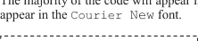

写入SAS日志的文本将显示在带有虚线边框的方框中，与代码框一样，文本使用Courier New字体。

输出传输系统（ODS）用于呈现SAS过程生成的输出。在本书中，通常只显示给定过程的部分输出。写入LISTING目标的输出将显示在无阴影的实线边框方框中，使用Courier New字体。写入其他ODS目标的输出将呈现为适合该目标的屏幕截图图形。虽然大多数ODS样式包含颜色，但本书不会呈现颜色。如果你想查看彩色输出，建议你执行相应章节的示例代码，以便看到完整输出。偶尔，原始数据也会显示在无阴影的实线边框方框中。


SAS术语、关键字、选项等使用大写，数据集和变量名也使用大写。需要强调的术语以斜体书写，SAS常用语中非标准的英文单词（如*fileref*）也是如此。

## 参考文献和链接

全书包含参考文献，以便读者能够找到更多关于各种主题的详细信息。这些参考文献中大多数（但不是全部）显示在**更多信息**和**另请参阅**部分中。

### 更多信息部分

本书大多数章节之后的**更多信息**部分会指出本书中进一步讨论的相关主题。位置通过章节编号标识。

### 另请参阅部分

本书之外的参考资料在**另请参阅**部分中列出。引用来源多种多样。通常，引用会包括作者姓名和出版年份。每条引用的详细信息（包括有效链接）可在参考文献部分找到。

此外还有一些对SAS研究所支持网站（support.sas.com）的引用。不幸的是，该网站的内部地址不断变化，虽然已尽一切努力使所有链接尽可能保持最新，但在验证之前，任何指向该网站的链接都应被视为不可靠。

### 查找参考文献

如果你使用电子设备阅读本书，你会注意到**另请参阅**部分中引用的大多数链接都是有效的。列出的每篇论文或书籍在本书的参考文献部分也都有有效的链接。已尽一切努力确保这些链接是最新的；然而，链接发生变化是网络的本质，尤其是在本书的整个生命周期中。

无论你是使用传统的纸质格式阅读本书，还是使用电子设备，本书中的所有链接，包括参考文献部分中所有引用论文的链接，以及嵌入本书正文中的链接，都已在sasCommunity.org上以本书标题命名的类别下作为有效链接提供。当我发现链接失效或发生变化时，将尽可能在此位置进行更新。如果你发现失效或错误的链接，请告诉我。

### 浏览本书

除了书末的标准单词索引外，还提供了两个附录，帮助你浏览本书并查找相关主题：

- 附录A – 主题索引：按技术或主题查找相关项目
- 附录B – 用法索引：查找示例中使用的语句、选项和关键字。

**更多信息**部分也会引导你找到本书中其他地方的相关主题。

### 使用示例程序和示例数据

本书中的一系列示例程序和数据集可供你使用。这些内容以可下载的ZIP文件形式提供，可以从support.sas.com/authors上本书的作者页面获取，也可以从sasCommunity.org获取。示例程序按章节组织，并按照其描述的章节命名。它们可以直接“开箱即用”；但是，你可能需要建立一些宏变量和库。这一操作在


如果您使用建议的 AUTOEXEC.SAS 程序并采用所假定的文件夹结构，系统将自动为您完成这些操作。

ZIP 文件将包含主文件夹 \\InnovativeTechniques 以及三个子文件夹 \\SASCode、\\Results 和 \\Data。要使用这些 SAS 程序，您需要先按照第 14 章“操作系统接口与环境控制”所述设置 SAS 环境。\\SASCode 目录包含一个 AUTOEXEC.SAS 程序，您应按照第 14.2 节和第 14.1.1 节的说明来利用它。按当前写法，该 autoexec 程序要求 SAS 会话初始化中包含 &SYSPARM 定义（见第 14.1.1 节）。

以下 SAS 目录和数据表由示例程序使用，并通过 ADVRPT 库引用提供；该库引用由 AUTOEXEC.SAS 程序自动建立。

| 数据组 | 数据组 | 成员名称 | 说明 |
|---|---|---|---|
| 临床试验 | 研究数据 | AE | 不良事件 |
|  |  | CLINICNAMES | 诊所名称和位置 |
|  |  | CONMED | 合并用药 |
|  |  | DEMOG | 人口统计学信息 |
|  |  | LAB_CHEMISTRY | 实验室化学结果 |
|  | 研究元数据 | DATAEXCEPTIONS | 数据排除标准 |
|  |  | DSNCONTROL | 数据集级元数据 |
|  |  | FLDCHK | 自动数据字段检查元数据（见第 13.5.2 节） |
| 制造 | 制造数据 | MFGDATA | 制造过程测试数据 |
| 其他 | 函数定义 | FUNCTIONS | 使用 PROC FCMP 的用户定义函数（见第 15.2 节） |
|  | 密码控制 | PASSTAB | 见第 5.4.2 节 |
|  |  | PWORD | 这是 PASSTAB 数据集的简化版本（见第 2.1.2 节） |

临床试验研究数据是为本书虚构的，并不反映任何真实或实际的研究。尽管药物和症状名称名义上是真实的，但数据值不一定反映现实世界情况。仔细检查数据表会发现若干数据问题，本书部分章节会讨论这些问题。虽然我为本书引入了一些数据错误，但 ADVRPT.DEMOG 数据集的大部分由 Software Intelligence Corporation 的 Kirk Lafler 创建，并经其许可使用。

制造数据名义上是实际数据，但为本书使用进行了大量编辑。我建议您不要根据这些数据调整任何过程控制。

| 目录名称 | 成员类型 | 说明 |
|---|---|---|
| FONTS | 字体，图形 | 用户定义的 SAS/GRAPH 字体 |
| PROJFM1 | 格式 | 用户定义格式库 |
| SASMACR | 存储编译宏 | 存储编译宏库（见第 13.9 节） |

### 更正、排印错误与错误

尽管众多审稿人和编辑已尽一切努力找出我的排印错误和技术错误，但书中仍有可能——尽管可能性不大——存在错误。出版后发现的所有 *勘误* 都将收集并发布在 sasCommunity.org 上。请访问 sasCommunity.org 上本书的专用类别。在那里您可以获取最新更新和更正，也可以告诉我您发现的任何问题。您会成为第一个报告问题的人吗？

### 作者页面

您可以在 [http://support.sas.com/authors](http://support.sas.com/authors) 访问本书的作者页面。该页面包含与本书相关的若干功能，包括有关本书和作者的更多信息、书评和图书更新；示例代码和数据等图书附加内容；以及作者和 SAS Press 的联系信息。

### 其他资源

SAS 提供丰富多样的资源，帮助您提升 SAS 技能，探索并充分发挥 SAS 软件的强大功能。无论您身处专业还是学术环境，我们都有学习产品帮助您最大化对 SAS 的投资回报。

|  |  |
|---|---|
| 书店 | [http://support.sas.com/publishing/](http://support.sas.com/publishing/) |
| 培训 | [http://support.sas.com/training/](http://support.sas.com/training/) |
| 认证 | [http://support.sas.com/certify/](http://support.sas.com/certify/) |
| 高等教育资源 | [http://support.sas.com/learn/](http://support.sas.com/learn/) |
| SAS OnDemand for Academics | [http://support.sas.com/ondemand/](http://support.sas.com/ondemand/) |
| 知识库 | [http://support.sas.com/resources/](http://support.sas.com/resources/) |
| 支持 | [http://support.sas.com/techsup/](http://support.sas.com/techsup/) |
| 学习中心 | [http://support.sas.com/learn/](http://support.sas.com/learn/) |
| 社区 | [http://support.sas.com/community/](http://support.sas.com/community/) |
| SAS 论坛 | [http://communities.sas.com/index.jspa](http://communities.sas.com/index.jspa) |
| 用户社区 wiki | [http://www.sascommunity.org/wiki/Main_Page](http://www.sascommunity.org/wiki/Main_Page) |

### 评论或问题？

如果您对本书有评论或问题，可以通过 SAS 按以下方式联系作者：

- **邮件：** SAS Institute Inc.  
  SAS Press  
  收件人：Art Carpenter  
  SAS Campus Drive  
  Cary, NC 27513
- **电子邮件：** [saspress@sas.com](mailto:saspress@sas.com)
- **传真：** (919) 677-4444

来信请注明本书书名。

### SAS 出版新闻

订阅 SAS Publishing News 月度电子通讯，通过电子邮件接收有关所有新 SAS 出版物的最新信息。请访问 [support.sas.com/subscribe](http://support.sas.com/subscribe)。

## 致谢

撰写本书是一段有趣的冒险，也让我有机会与许多才华横溢、乐于助人的人共事。从简短交谈到深入对话，我想感谢所有帮助本书得以问世的人。我尤其要感谢以下 SAS 社区成员，他们为此项工作慷慨付出。

Bob Virgile 和 Peter Eberhardt 都为本书书名提出了若干建议。由于其他人认为他们的建议过于幽默，这些想法最终未被采用；不过，我仍然很喜欢它们，并希望它们能被采纳。

在撰写本书期间，我有幸从几位世界级 SAS 编程传奇人物的贡献和帮助中学习，包括但不限于 Peter Crawford、Paul Dorfman、John King、Art Tabachneck 和 Ian Whitlock。

我要感谢以下 SAS 技术审稿人，他们为本书内容的整体质量作出了重大贡献：Amber Elam、Kim Wilson、Scott McElroy、Kathryn McLawhorn、Ginny Piechota、Russ Tyndall、Grace Whiteis、Chevell Parker、Jan Squillace、Ted Durie、Jim Simon、Kent Reeve 和 Kevin Russell。除 SAS 审稿人外，还收到了 William Benjamin Jr. 和 Peter Crawford 的有益评论和建议。SAS 的 Rick Langston 为格式和函数章节贡献了一些示例和解释。审稿人和编辑工作细致；因此，任何仍然存在的错误或遗漏都仅属于我，绝不反映审稿人在指导我方面缺乏努力。套用默尔·哈格德的话说：“他们曾想更好地引导我，但我拒绝了他们的恳求；我只能怪自己，因为他们努力过。”


## 第 1 部分

## 数据准备

- 第 1 章 移动、复制、导入和导出数据 3
- 第 2 章 处理数据 37
- 第 3 章 仅在 DATA 步中 103
- 第 4 章 对数据排序 185
- 第 5 章 处理数据集 197
- 第 6 章 表查找技术 213


### 第 1 章

### 移动、复制、导入和导出数据

- **1.1 LIBNAME 语句引擎** 4
  - 1.1.1 使用数据访问引擎读取和写入数据 5
  - 1.1.2 使用引擎查看数据 6
  - 1.1.3 与引擎关联的选项 6
  - 1.1.4 替换 EXCEL 工作表 7
  - 1.1.5 恢复 EXCEL 工作表的名称 8
- **1.2 PROC IMPORT 和 EXPORT** 9
  - 1.2.1 使用向导生成示例代码 9
  - 1.2.2 通过使用选项进行控制 9
  - 1.2.3 PROC IMPORT 数据源语句 10
  - 1.2.4 导入和导出 CSV 文件 12
  - 1.2.5 防止导出空白工作表 15
  - 1.2.6 使用命名区域 16
- **1.3 DATA 步 INPUT 语句** 17
  - 1.3.1 用于错误的格式修饰符 18
  - 1.3.2 INPUT 语句的格式修饰符 18
  - 1.3.3 控制分隔输入 20
  - 1.3.4 读取变长记录 24
- **1.4 写入分隔文件** 28
  - 1.4.1 使用带 DLM= 选项的 DATA 步 28
  - 1.4.2 PROC EXPORT 29
  - 1.4.3 使用 %DS2CSV 宏 30
  - 1.4.4 使用 ODS 和 CSV 目标 31
  - 1.4.5 手动插入分隔符 31
- 1.5 SQL 直通 32
  - 1.5.1 向 SQL 步中添加直通 32
  - 1.5.2 直通效率 33
- 1.6 读写 XML 33
  - 1.6.1 使用 ODS 34
  - 1.6.2 使用 XML 引擎 34

数据准备过程中的很大一部分都集中在将数据从一个表移动到另一个表。这种数据传输可能完全由 SAS 控制，也可能发生在不同的数据存储系统之间。尽管本书的大部分重点在于 SAS 的使用，但并非所有数据最初都存储在 SAS 中，甚至最终也未必以 SAS 形式呈现。本章讨论与在表之间移动数据以及将数据移入和移出 SAS 相关的一些方面。

在将数据移入和移出 SAS 时，Base SAS 仅允许您有限地访问其他数据库存储形式。直接访问其他数据库的能力可以通过许可一个或多个各种 SAS/ACCESS 产品来获得。这些产品使您能够使用第 1.1 节中描述的 SAS/ACCESS 引擎，以及可与 IMPORT 和 EXPORT 过程（第 1.2 节）配合使用的扩展数据库列表。

### 另请参见

Andrews（2006）和 Frey（2004）都详细介绍了可用于将数据移入和移出 EXCEL 的各种技术。

#### 1.1 LIBNAME 语句引擎

在 SAS®9 中，LIBNAME 语句可使用多种引擎。这些引擎允许您从 SAS 以外的源读取数据以及向这些源写入数据。这些引擎可以减少对 IMPORT 和 EXPORT 过程的需求。

可用引擎的数量取决于贵公司从 SAS 许可了哪些产品。其中最受欢迎的产品之一是 SAS/ACCESS® Interface to PC Files。

您可以快速确定哪些引擎可供您使用。构建此列表的一种简单方法是通过 NEW LIBRARY 窗口。

在 SAS 资源管理器中，右键单击 LIBRARIES 并选择 NEW。可用引擎会出现在 ENGINE 下拉列表中。

在右侧所示的 ‘New Library’ 对话框中下拉引擎列表框，会显示可供此用户使用的引擎，其中包括 EXCEL 引擎等。

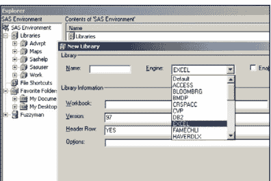

也可以使用 PROC SETINIT 来确定已许可哪些产品。

本节中的示例展示了 EXCEL 引擎的各个方面；不过，所演示的大部分内容也可以应用于其他引擎。

### 另请参见

Choate 和 Martell（2006）更详细地讨论了 LIBNAME 语句上的 EXCEL 引擎。Levin（2004）使用引擎写入 ORACLE 表。

##### 1.1.1 使用数据访问引擎读取和写入数据

在以下示例中，EXCEL 引擎用于创建 EXCEL 工作簿，将 SAS 数据集作为工作表存储在该工作簿中，然后将数据从该工作簿读回 SAS。

```sas
libname toxls excel "&path\data\newwb.xls"; ❶

proc sort data=advrpt.demog
          out=toxls.demog; ❷
    by clinnum;
run;

data getdemog;
    set toxls.demog; ❸
run;

libname toxls clear; ❹
```

- ❶ 使用 EXCEL 引擎会建立 TOXLS 逻辑库引用名，以便用于与 Microsoft Excel 工作簿 NEWWB.XLS 之间进行转换。如果该工作簿尚不存在，则在执行 LIBNAME 语句时创建它。对于本书中的许多示例，假定已定义宏变量 &PATH。它包含适合在您的系统上安装这些示例的路径的上半部分。请参阅本书引言以及示例代码根目录中的 AUTOEXEC.SAS，您可以从 support.sas.com/authors 下载该代码。
- ❷ 写入 TOXLS *逻辑库引用名* 的数据集将作为命名工作表添加到工作簿中。此 OUT= 选项将一个名为 DEMOG 的工作表添加到 NEWWB.XLS 工作簿中。
- ❸ 只需指定工作表名称，就可以从工作簿中读取工作表并将其带入 SAS 环境。
- ❹ 与任何 *逻辑库引用名* 一样，当您不再需要该关联时，应清除该 *逻辑库引用名*。在使用数据引擎时，这一点尤其重要，因为只要该 *逻辑库引用名* 存在，SAS 以外的应用程序对数据的访问就会被阻止。在清除该 *逻辑库引用名* 之前，我们无法使用 Excel 查看或处理该工作簿中的任何工作表。

### 更多信息

LIBNAME 语句引擎还在第 1.1.2 节和第 1.2.6 节中讨论。XML 引擎在第 1.6.2 节中讨论。

### 1.1.2 使用引擎查看数据

一旦通过逻辑库引用名建立了访问引擎，我们几乎可以执行通常对保存在 SAS 逻辑库中的 SAS 数据集所做的所有操作。

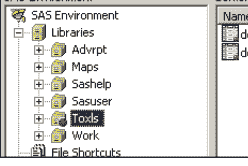

SAS 资源管理器显示该工作簿的内容，其中每个工作表都显示为一个数据表。

当通过 SAS/ACCESS 引擎查看 EXCEL 工作簿时，每个工作表都显示为一个数据集。实际上，您可以对实际上是工作表的内容使用 VIEWTABLE 或 View Columns 工具。请注意，在这张 SAS 资源管理器图像中，DEMOG 工作表出现了两次。后面带有 $ 的工作表名称实际上是命名区域，在 EXCEL 下，它实际上可以是整个工作表的一部分。任何给定工作表都可以有多个命名区域，因此这成为另一种筛选或子集化给定工作表中哪些信息将通过 SAS/ACCESS 引擎带入 SAS 的方法。

### 1.1.3 与引擎关联的选项

SAS/ACCESS 引擎就像两种信息存储方法之间的转换器，有时我们需要能够控制该接口。这通常可以通过使用修改转换过程的选项来实现。其中许多相同的选项在 PROC IMPORT/EXPORT 步骤中作为语句或选项出现。

重要的是要记住，并非所有数据库都像 SAS 那样以相同的关系存储信息。例如，SAS 是基于列的——整列（变量）要么是数值型，要么是字符型。另一方面，EXCEL 是基于单元格的——给定单元格可以被视为数值型，而同一列中它上方的单元格却存储文本。当从 EXCEL 转换为 SAS 时，我们可以使用选项来建立指导原则，以解决诸如此类的模糊情况。

### 连接选项

对于需要用户标识和密码的数据库系统，可以在 LIBNAME 语句中作为选项提供这些信息。

- **USER** 用户标识
- **PASSWORD** 用户密码
- **others** 其他连接选项因您要连接的数据库而异

### LIBNAME 语句选项

这些选项控制如何处理通过接口传递的信息。其中大多数选项是特定于数据库的，并在涉及您的数据库的各节中有所记录。


当使用 EXCEL 时，典型的 LIBNAME 选项可能包括：

- HEADER：确定是否存在标题行，或者是否应将其添加到表中。
- MIXED：某些列同时包含数值和字符信息。
- VER：控制要写入的 EXCEL 的类型（版本）。

### 数据源选项

与 PROC IMPORT（参见第 1.2.3 节）相关的一些选项也可以用于 LIBNAME 语句。这些选项包括：

- GETNAMES：传入的变量名可在传入数据的*第一行*中获得。
- SCANTEXT：通过扫描传入列并确定最大长度，为字符变量分配长度。

##### 1.1.4 替换 EXCEL 工作表

虽然 EXCEL 引擎允许您将 Excel 工作簿中的工作表建立、查看和使用为 SAS 数据集，但您不能在 SAS 中更新、删除或替换该工作表。但是，借助 PROC DATASETS 和 LIBNAME 语句上的 SCAN_TEXT=NO 选项，可以替换工作表的内容。以下示例演示如何替换 EXCEL 工作表的内容。

在第一个 DATA 步中，程序员“意外地”使用了 WHERE 子句❶，该子句将不正确的数据（在本例中为 0 个观测）写入 EXCEL 工作表。简单地更正并重新运行 DATA 步❷是行不通的，因为该工作表已经存在。

```sas
libname toxls excel "&path\data\newb.xls";

data toxls.ClinicNames;
set advrpt.clinicnames;
where clinnames>'X';❶
run;

* Running the DATA step a second time
* results in an error;
data toxls.ClinicNames;❷
set advrpt.clinicnames;
run;
```

我们可以退出 SAS，使用 EXCEL 手动删除错误的工作表，但我们更愿意在 SAS 内部完成。首先，我们必须使用 SCAN_TEXT=NO 选项❸重新建立库引用。然后可以使用 PROC DATASETS 删除该工作表。实际上，该工作表并未真正删除，只是清空了所有内容。由于现在工作表确实为空，并且 SCAN_TEXT 选项设置为 NO，我们现在可以将所需内容替换到空工作表中。

```sas
libname toxls excel
"&path\data\newb.xls"
scan_text=no ❸;
proc datasets library=toxls nolist;
delete ClinicNames;
quit;
```

```sas
data toxls.ClinicNames; ④
   set advrpt.clinicnames;
   run;

libname toxls clear; ⑤
```

现在可以重新运行 DATA 步④，工作表内容将正确。当 SAS 完成对工作簿的操作后，在您可以使用 EXCEL 使用该工作簿之前，需要清除库引用。这可以通过 LIBNAME 语句上的 CLEAR 选项⑤来完成。

### 更多信息

有关 PROC IMPORT 和 PROC EXPORT 中选项和语句的更多信息，请参见第 1.2 节。除了 PROC DATASETS 之外，第 5.4 节还讨论了可用于删除表的其他技术。第 14.4.5 节还有一个使用 PROC DATASETS 删除数据集的示例。

### 另请参阅

Choate 和 Martell (2006) 讨论了这一技术以及可与 EXCEL 一起使用的许多其他技术。

##### 1.1.5 恢复 EXCEL 工作表的名称

尤其是在编写自动化系统时，您可能需要确定工作簿工作表的名称。有几种方法可以做到这一点。

如果您知道相关的库引用，可以在 DATA 步中使用自动视图 SASHELP.VTABLE 查看工作表名称。该视图为当前使用的每个 SAS 库中的每个 SAS 数据集包含一个观测，对于 TOXLS 库引用，工作表名称将显示为数据集名称。

```sas
data sheetnames;
   set sashelp.vtable;
   where libname = 'TOXLS';
run;
```

```sas
proc sql;
   create table sheetnames as
      select * from dictionary.members
         where engine= 'EXCEL' ;
   quit ;
```

当存在多个活动库时，构建此表的过程可能会很长。一般来说，在 PROC SQL 步骤中使用 DICTIONARY.MEMBERS 表有几个优点。它通常比 SASHELP.VTABLE 视图更快，并且它还有一个 ENGINE 列，允许您在不了解特定库引用的情况下进行搜索。

在这些示例中，本可以使用 KEEP 语句或更推荐的 KEEP= 数据集选项来减少变量数量（参见第 2.1.3 节）。

### 更多信息

SASHELP 视图和 DICTIONARY 表将在第 13.8.1 节中进一步讨论。

### 另请参阅

SAS 论坛中的一个帖子包含类似示例。http://communities.sas.com/thread/10348?tstart=0

#### 1.2 PROC IMPORT 和 EXPORT

与第 1.1 节中讨论的 SAS/ACCESS 引擎一样，IMPORT 和 EXPORT 过程用于从各种数据源将数据转换到 SAS 中以及从 SAS 转换出去。SAS/ACCESS 产品（通常通过 SAS 单独许可，但也可能捆绑在 Base SAS 中）控制您可以向哪些数据库移动数据以及从哪些数据库移出数据。即使没有 SAS/ACCESS，您仍然可以使用这两个过程来读写文本文件，例如逗号分隔变量（CSV）文件，以及使用 TAB 和其他分隔符分隔变量的文件。

##### 1.2.1 使用向导构建示例代码

导入/导出向导为导入或导出数据的过程提供了分步指南。该向导非常易于使用，但与所有向导一样，它不适用于自动化或批处理。幸运的是，该向导实际上在后台构建了一个 PROC IMPORT/EXPORT 步骤，您可以捕获完整的代码。对于导入和导出过程，最后一个屏幕都会提示您“创建 SAS 语句”。

```sas
PROC EXPORT DATA= WORK.A ❶
    OUTFILE= "C:\temp\junk.xls"❷
    DBMS=EXCEL❸
    REPLACE❹;
    SHEET="junk";❺
RUN;
```

以下 PROC EXPORT 步骤是使用 EXPORT 向导构建的。简单检查代码即可知道将来应用 EXPORT 过程时需要更改的内容。通常这意味着向导本身不需要频繁运行。

- ❶ DATA= 选项标识要转换的数据集。
- ❷ 在本例中，由于我们要写入 EXCEL ❸，因此 OUTFILE= 标识工作簿。
- ❸ 如果工作表已存在，它将被替换。
- ❹ 也可以提供工作表名称。

将前面的通用步骤转换为创建 CSV 文件的步骤非常简单。

```sas
PROC EXPORT DATA= sashelp.class
    OUTFILE= "&path\data\class.csv"
    DBMS=csv
    REPLACE;
RUN;
```

### 另请参阅

Raithel (2009) 在 sasCommunity.org 的一个技巧中讨论了使用 EXPORT 向导生成代码。

##### 1.2.2 通过选项的使用进行控制

只需指定少数几个选项。其中大多数有趣的选项是在导入数据时使用的（显然，SAS 在导出数据时已经了解所有数据）。

- **DBMS=** 标识传入的数据库结构（包括 .CSV 和 .TXT）。由于数据库结构随软件版本而变化，您应该知道数据库版本。对于某些数据库（尤其是 Microsoft 的 EXCEL 和 ACCESS），在版本级别存在特定的引擎。文档讨论了针对每个软件版本优化的引擎。
- **REPLACE** 确定如果目标（数据集、工作表、表）已存在，是否替换它。

##### 1.2.3 PROC IMPORT 数据源语句

这些语句使您可以额外控制如何读取和解释传入数据。任何给定源语句的可用性取决于传入数据的类型（DBMS=）。

- **DATAROW** — 包含数据的第一个传入行。
- **GETNAMES** — 传入列的名称可在传入数据的*第一行*中获得。当传入表中没有可用的名称时，默认列名为 VAR1、VAR2 等。
- **GUESSINGROWS** — SAS 在确定传入列是数值型还是字符型之前将扫描的行数。这对于混合列尤为重要，并且早期行可能全部为数值型。在早期版本的 SAS 中，需要修改 SAS 注册表来更改用于确定变量类型的行数，幸运的是这不再必要。
- **RANGE 和 SHEET** — 对于电子表格，可以指定特定的工作表名称、命名区域或工作表内的区域。
- **SCANTEXT 和 TEXTSIZE** — PROC IMPORT 通过扫描传入列并确定最大值来为字符变量分配长度。

使用 GETNAMES 从源数据读取列名时，请记住大多数数据库使用与 SAS 不同的命名约定，并且可能具有在导入时会导致问题的列名。默认情况下，PROC IMPORT 会用下划线 (_) 替换非法字符。当您需要原始列名时，系统选项 VALIDVARNAME=ANY（参见第 14.1.2 节）允许更广泛的可接受列名。


将 MIXED= 的值改为 YES ❶ 并不一定足以使 SCALE 成为字符值；但是，如果将 DBMS 选项的值从 EXCEL 改为 XLS ❶，则 MIXED=YES 语句 ❶ 会生效，并且 SCALE 在数据集 SCALEDATA 中会写为字符变量。

```sas
PROC IMPORT OUT= WORK.scaledata
            DATAFILE= "C:\Temp\makescale.xls"
            DBMS=xls REPLACE; ❶
            GETNAMES=YES; ❶
            GUESSINGROWS=800; ❶
RUN;
```

> 当 MIXED=YES 不实用时，有时可以使用 GUESSINGROWS= 语句来成功确定变量的类型。

当 DBMS=EXCEL 时不能使用 GUESSINGROWS，但在 DBMS=XLS 时可以使用。由于 GUESSINGROWS ❶ 会改变在确定列应为数值型还是字符型之前扫描的行数，因此使用它可能会增加读取数据所需的时间和资源。

### 另请参见

SAS 论坛帖子 http://communities.sas.com/thread/12743?start=0 中有一个使用 NAMEROW= 和 STARTROW= 数据源语句的 PROC IMPORT。帖子 http://communities.sas.com/thread/30405?start=0 讨论了命名区域，并且该帖子与帖子 http://communities.sas.com/thread/12293?start=0 展示了多个数据源语句的用法。

##### 1.2.4 导入和导出 CSV 文件

逗号分隔值（CSV）文件多年来一直是在系统之间移动数据的标准文件类型。幸运的是，我们现在有许多更优秀的工具可用，因此不再需要那么频繁地求助于 CSV 文件。尽管如此，它们仍被普遍使用，我们需要了解如何处理它们。

IMPORT 和 EXPORT 过程均可处理 CSV 文件（此功能是 Base SAS 产品的一部分，不需要 SAS/ACCESS 产品）。两者都通过先构建一个 DATA 步，然后执行该 DATA 步来完成转换。

### 构建 DATA 步

当您使用导入/导出向导保存 PROC 步时（参见第 1.2.1 节），生成的 DATA 步不会被保存。幸运的是，您仍然可以通过调出上一次提交的代码来获取生成的 DATA 步。

- 1. 执行 IMPORT/EXPORT 过程。
- 2. 在 Display Manager 中，转到 RUN→Recall Last Submit。

一旦该过程生成的代码加载到编辑器中，您就可以出于其他目的修改它，或者只是从中学习。对于第 1.2.1 节中简单的 PROC EXPORT 步，会生成以下代码：

```sas
%macro rename(headrow=3, rawcsv=, dsn=);
%local lib ds i;
data _null_ ;
   infile "&path\Data\&rawcsv"
      scanover lrecl=32767 firstobs=&headrow;
   length temp $ 32767;
   input temp $;
   i=1;
   do while(scan(temp,i,',') ne ' ');
      call symputx('var'||left(put(i,4.)),scan(temp,i,','),'l');
      i+1;
   end;
   call symputx('varcnt',i-1,'l');
   stop;
run;

%* Determine the library and dataset name;
%if %scan(&dsn,2,.) = %then %do;
   %let lib=work;
   %let ds = %scan(&dsn,1,.);
%end;
%else %do;
   %let lib= %scan(&dsn,1,.);
   %let ds = %scan(&dsn,2,.);
%end;

proc datasets lib=&lib nolist;
   modify &ds;
   rename
   %do i = 1 %to &varcnt;
      var&i = &&var&i
   %end;
   ;
   quit;
%mend rename;

%rename (headrow=3, rawcsv=classwc.csv, dsn=work.classwo)
```

### 另请参见

McGuown (2005) 还讨论了 PROC IMPORT 在读取 CSV 文件时生成的代码。King (2011) 使用数组和哈希表来读取具有未知或可变变量列表的 CSV 文件。这些灵活而高效的技术可以适用于本节所述类型的问题。

##### 1.2.5 防止导出空白工作表

当排除条件从给定工作表 ❶ 中排除所有可能的行时，PROC EXPORT 并不能防止我们写入空白工作表。在下面的示例中，我们无意中要求列出所有 SEX='q' 的学生。

```sas
proc export data=sashelp.class(where=(sex='q'))
    outfile='c:\temp\classmates.xls'
    dbms=excel2000
    replace;
    SHEET='sex: Q';
run;
```

当然没有这样的学生，因此生成的工作表是空白的，除了列标题。

我们可以通过首先识别那些具有一行或多行的 SEX 水平来防止这种情况发生。生成变量值列表的方法有很多；不过，SQL 步非常适合将这些值放入宏变量以供进一步处理。

要导出的数据集名称以及分类变量，作为命名参数传递给宏 %MAKEXLS。

```sas
%macro makexls(dsn=,class=);
%local valuelist listnum i value;
proc sql noprint;
select distinct &class ➋
       into :valuelist separated by ' ' ➌
       from &dsn;
%let listnum = &sqlobs;
quit;

%* One export for each sheet;
%do i = 1 %to &listnum; ➍
  %let value = %scan(&valuelist,&i,%str( )); ➎
  proc export data=&dsn(where=(&class="&value")) ➏
              outfile="c:\temp\&dsn..xls"
              dbms=excel2000
              replace;
              SHEET="&class.&value";
%end;
run;
%mend makexls;
%makexls(dsn=sashelp.class,class=sex)
```

- ➋ 使用 SQL 步构建分类变量的不同值列表。
- ➌ 这些值保存在宏变量 &VALUELIST 中。
- ➍ 使用 %DO 循环遍历各个值，这些值使用 %SCAN 函数从列表 ➎ 中提取。
- ➏ 然后 PROC EXPORT 步为所选值创建工作表。

### 另请参见

在 sasCommunity.org 上的文章“Automatically_Separating_Data_into_Excel_Sheets”中可以找到将数据集拆分为单独工作表的类似示例。
http://www.sascommunity.org/wiki/Automatically_Separating_Data_into_Excel_Sheets

##### 1.2.6 使用命名区域

默认情况下，PROC IMPORT 和 LIBNAME 语句的 EXCEL 引擎期望 EXCEL 数据以某种方式排列（列标题如果存在，位于第一行 A 列；数据从第二行开始）。然而，数据作为报告的一部分或较大表的子集交付并不罕见。一种解决方案是手动将数据剪切并粘贴到空白工作表中，使其符合默认布局。创建命名区域通常要容易得多。

**来自 SASHELP.CLASS 的数据**

| 变量名 | 姓名 | 性别 | 年龄 | 身高 | 体重 |
|---|---|---|---|---|---|
|  | Alfred | M | 14 | 69 | 112.5 |
|  | Alice | F | 13 | 56.5 | 84 |
|  | Barbara | F | 13 | 65.3 | 98 |
|  | Carol | F | 14 | 62.8 | 102.5 |
|  | Henry | M | 14 | 63.5 | 102.5 |
|  | James | M | 12 | 57.3 | 83 |
|  | Jane | F | 12 | 59.8 | 84.5 |
|  | Janet | F | 15 | 62.5 | 112.5 |
|  | Jeffrey | M | 13 | 62.5 | 84 |

此处显示的 EXCEL 电子表格包含 SASHELP.CLASS 数据集（这里仅显示其中一部分）；但是，已添加标题和列。使用默认设置时，PROC IMPORT 将无法成功读取此工作表。

为便于使用此电子表格，为 C3-G22 定义的矩形创建了命名区域。该区域被命名为 'CLASSDATA'。现在可以在从该工作表读取数据时使用此命名区域。

```sas
    libname seexls excel "&path\data\Ei_2_6classmates.xls";

    data class;
       set seexls.classdata; ①
    run;
    libname seexls clear; ②
```

命名区域（CLASSDATA）的使用方式与使用工作表名称 ① 一样。

② 在 LIBNAME 语句中使用引擎时，务必清除 libref，以便您可以在 SAS 之外使用该电子表格。

```sas
    proc import out=work.classdata
        datafile= "&path\data\Ei_2_6classmates.xls"
        dbms=xls replace;
    getnames=yes;
    range='classdata'; ③
    run;
```

使用 PROC IMPORT 读取命名区域时，使用 RANGE= 语句 ③ 指定感兴趣的命名区域。由于命名区域的名称在工作簿中是唯一的，因此不需要工作表名称。

### 更多信息

EXCEL LIBNAME 引擎在第 1.1 节中介绍。

#### 1.3 DATA 步 INPUT 语句

INPUT 语句包含大量选项，使其极其灵活。由于关于基本 INPUT 语句的文章已经很多，这里只收集了少数似乎未充分使用的选项。

### 另请参见

有关使用 INPUT 语句读取原始数据的概述，可在 SAS 文档 http://support.sas.com/publishing/pubcat/chaps/58369.pdf 中找到。Schreier (2001) 简要概述了自动 _INFILE_ 变量，以及有关读取原始数据的其他信息。


虽然尾随与号（&）可能有帮助，但它也可能引入问题。如果数据稍微更复杂一些，甚至这个解决方案也可能不起作用。以下数据还包含城市名。尽管城市未被读取，与姓氏（LNAME）一起使用的尾随 & 会导致城市名与姓氏混淆。

```sas
title '1.3.2b List Input Modifiers';
data base;
length lname $15;
input fname $ dob :mmddyy10. lname $ &;
format dob mmddyy10.;
datalines;
Sam 12/15/1945 Johnson   Seattle
Susan   10/10/1983 Mc Callister New York
;
run;
```

**1.3.2b 列表输入修饰符**

| Obs | lname | fname | dob |
|---|---|---|---|
| 1 | Johnson | Sam | 12/15/1945 |
| 2 | Mc Callister Ne | Susan | 10/10/1983 |

由于尾随 & 以及 LNAME 的长度（$15），第二个观测中城市的一部分（New York）被读入了 LNAME。在第一个观测中，姓氏是正确的，因为 Johnson 和 Seattle 之间用多个空格分隔。即使使用尾随 &，多个空格仍会被成功视为字段分隔符。

在第二个观测中，如果两个字段之间有两个或更多空格，城市就不会与姓氏混淆。

- ❶ 将 FORMAT 语句放在 DATA 步中，会使该格式在后续步骤中与变量 DOB 关联。INFORMAT 语句仅在读取数据时使用。
- ❷ DATALINES 语句使后续记录作为数据读取，直到但不包括包含分号的第一行。在前面的示例中，RUN 语句兼作数据结束标记。许多程序员使用单独的分号来完成此任务。两种风格通常都被认为可接受（只要您使用 RUN 语句结束步骤）。

当姓氏和城市之间只有一个空格时，仅靠尾随 & 不足以帮助 INPUT 语句区分这两个字段。此示例的其他变体可在第 1.3.3 节中找到。

## 更多信息

LIST 输入是一种分隔输入形式，因此这些选项也适用于第 1.3.3 节中讨论的示例。当日期格式不一致时，*任意日期*  informat 之一可能会有帮助。有关这些专用 informat 的使用的更多信息，请参见第 12.6 节。

## 另请参阅

SAS 论坛帖子 [http://communities.sas.com/message/42690](http://communities.sas.com/message/42690) 讨论了列表输入修饰符的使用。

##### 1.3.3 控制分隔输入

从技术上讲，LIST 输入是一种分隔输入形式，默认分隔符为空格。这意味着第 1.3.2 节中显示的修饰符适用于其他形式的分隔输入，包括逗号分隔变量文件、CSV 文件。

### INFILE 语句选项

INFILE 语句上的选项用于控制如何解释分隔符。

- DELIMITER 指定用于分隔字段的字符（默认空格除外）。此选项通常缩写为 DLM=。
- DLMSTR 指定单个多字符字符串作为分隔符。
- DLMOPT 指定 DLMSTR 选项的解析选项。
- DSD 允许使用引号包围的字符字段（通过将逗号设置为分隔符）。两个连续分隔符被解释为单独的分隔符，从而可以适当地分配缺失值。DSD 还会移除引号包围的字符值中的引号。如果逗号不是分隔符，则需要将 DLM= 选项与 DSD 选项一起使用。

某些应用程序（例如 Excel）会构建用引号包围字段的分隔变量文件。如果字段的值可能包含字段分隔符，这可能至关重要。对于默认列表输入（其中空格是分隔符），成功读取包含嵌入空格的字段可能非常困难（请参见第 1.3.2 节，其中讨论了使用尾随 & 读取嵌入空格）。DSD 选项提醒 SAS 注意带引号字符字段的*可能性*。以下示例演示了简单的逗号分隔数据。

```sas
data base;
length lname $15;
infile datalines ❶ dlm=',' dsd; ❸
*infile datalines dlm=',' ❷;
input fname $ lname $ dob :mmddyy10.;
datalines;
'Sam','Johnson',12/15/1945
'Susan','Mc Callister',10/10/1983
;
run;
```

❶ 尽管在使用 DATALINES、CARDS 或 CARDS4 语句时通常不需要 INFILE 语句，但当需要与 INFILE 语句关联的选项时，它可能非常有用。*fileref* 可以是 DATALINES 或 CARDS。

1.3.3a 分隔列表输入修饰符

| Obs | lname | fname | dob |
|---|---|---|---|
| 1 | 'Johnson' | 'Sam' | 12/15/1945 |
| 2 | 'Mc Callister' | 'Susan' | 10/10/1983 |

DLM= 选项用于指定分隔符。在此示例中，字段分隔符被指定为逗号 ❷。

包含字符数据的字段已被引号包围。由于我们实际上不希望引号成为数据字段的一部分，DSD 选项 ❸ 提醒解析器注意这种可能性，引号本身成为分隔符处理过程的一部分。

```sas
infile datalines dlm=',' dsd; ❸
```

使用 DSD 选项会得到不带引号的数据字段。

1.3.3a 分隔列表输入修饰符

| Obs | lname | fname | dob |
|---|---|---|---|
| 1 | Johnson | Sam | 12/15/1945 |
| 2 | Mc Callister | Susan | 10/10/1983 |

### 关于 INPUT 语句

波浪号（~）❶ 可用于修饰格式，与冒号（:）的作用非常相似；但是，这两个修饰符并不完全相同。

```sas
title '1.3.3b Delimited List Input Modifiers';
title2 'Using the ~ Format Modifier';
data base;
length lname $15;
infile datalines dlm=',', dsd;
input fname $ lname $ birthloc $~❶15. dob :mmddyy10. ;
datalines;
'Sam','Johnson','Fresno, CA',12/15/1945
'Susan','Mc Callister','Seattle, WA',10/10/1983
run;
```

波浪号格式修饰符能正确读取 BIRTHLOC 字段；但是，它会保留包围该字段的引号。与冒号一样，波浪号可以放在字符变量的 $ 之前或之后。顺便注意，在此示例中，第一行的数值日期值被引号包围。该字段仍会作为数值 SAS 日期值正确处理。

1.3.3b 分隔列表输入修饰符
使用 ~ 格式修饰符

| Obs | lname | fname | birthloc | dob |
|---|---|---|---|---|
| 1 | Johnson | Sam | 'Fresno, CA' | 12/15/1945 |
| 2 | Mc Callister | Susan | 'Seattle, WA' | 10/10/1983 |

将波浪号 ❶ 替换为冒号（:）会使 BIRTHLOC 值在保存时不带引号。如果我们改为为 BIRTHLOC 提供长度 ❷，则既不需要格式，也不需要波浪号。

```sas
title '1.3.3c Delimited List Input Modifiers';
title2 'BIRTHLOC without a Format Modifier';
title3 'BIRTHLOC Length Specified';
data base;
length lname birthloc $15; ❷
infile datalines dlm=',', dsd;
input fname $ lname $ birthloc $ dob :mmddyy10. ;
datalines;
'Sam','Johnson','Fresno, CA',12/15/1945
'Susan','Mc Callister','Seattle, WA',10/10/1983
run;
```

1.3.3c 分隔列表输入修饰符
BIRTHLOC 不使用格式修饰符
BIRTHLOC 长度已指定

| Obs | lname | birthloc | fname | dob |
|---|---|---|---|---|
| 1 | Johnson | Fresno, CA | Sam | 12/15/1945 |
| 2 | Mc Callister | Seattle, WA | Susan | 10/10/1983 |

### 多个分隔符

可以读取包含多个分隔符的分隔输入流。在以下小示例中，逗号和斜杠这两个分隔符都用于分隔数据值。

```sas
data imports;
infile cards dlm=',/';
input id importcode $ value;
cards;
14,1,13
25/Q9,15
6,D/20
run;
```

| Obs | id | importcode | value |
| --- | --- | --- | --- |
| 1 | 14 | 1 | 13 |
| 2 | 25 | Q9 | 15 |
| 3 | 6 | D | 20 |

请注意，DLM 选项使逗号或斜杠之一被用作字段分隔符，但不会将斜杠和逗号一起作为单个分隔符（请参见下面的 DLMSTR 选项以创建单个多字符分隔符）。

```sas
data imports;
retain dlmvar '/,'; ❶
infile cards dlm=dlmvar;
input id importcode $ value;
cards;
14,1,13
25/Q9,15
6,D/20
run;
```

- ❶ 由于 INFILE 语句针对每个观测执行，分配给 DLM 选项的值不必是常量。它也可以是变量，或可以使用 IF-THEN/ELSE 逻辑更改。在最简单的形式中，此变量可以在 retain 语句中赋值。
- ❷ 这个简单示例演示了随观测变化的分隔符。这里每行的第一个字符是该行要使用的分隔符。该分隔符被读取、存储，然后在 INFILE 语句上使用。这里我们利用了 INFILE 语句的可执行特性。

```sas
data imports;
infile cards;
input dlmvar $1. ❷;
infile cards dlm=dlmvar; ❸
input @2 id importcode $ value;
cards;
,14,1,13
/25/Q9/15
~6~D~20
run;
```

### 使用 DLMSTR

与指定一个或多个分隔符的 DLM 选项不同，DLMSTR 选项声明要用作分隔符的特定字符列表。这里分隔符是字符序列 comma-comma-slash（,,/）。请注意，在 IMPORT 数据集的 LISTING 中，多余的逗号和斜杠被读取为数据。

```sas
data imports;
infile cards dlmstr=',,/' ;
input id importcode $ value;
cards;
14,,/1/,,/13
25,,/Q9,,,/15
6,,/,D,,/20
run;
```

1.3.3g 使用分隔符字符串

| Obs | id | importcode | value |
| --- | --- | --- | --- |
| 1 | 14 | 1/ | 13 |
| 2 | 25 | Q9, | 15 |
| 3 | 6 | ,D | 20 |


> NOTE: 丢失卡片。
> sex=M fname=Adam lname=_ERROR_=1 _N_=6
> NOTE: 从 infile PATLIST 读取了 12 条记录。
>       最小记录长度为 13。
>       最大记录长度为 26。
> NOTE: 当 INPUT 语句越过行尾时，SAS 转到了新的一行。

生成的数据集存在若干数据问题。即使快速检查数据也会发现，数据字段已经发生混淆。

##### 1.3.4a 变长记录

| 观测 | 性别 | 名 | 姓 |
|---:|:---:|:---|:---|
| 1 | F | Linda | M Ronald |
| 2 | F | M Mat | M David |
| 3 | F | Merrie | F June |
| 4 | M | Mery | M Matthew |
| 5 | M | Robert | M Arthur |

我们的 INPUT 语句请求 SAS 从第 18 列开始读取 15 个字符位置；然而，从来不会有 15 列可用（最长的记录是最后一条——Robertson——其姓为 9 个字符）。为满足我们的请求，它会跳到下一条物理记录的第 1 列来读取姓。发生这种情况时，就会生成 LOG 中提到的那些 NOTE 消息。

## INFILE 语句选项（TRUNCOVER、MISSOVER）

有两个 INFILE 语句选项在控制 SAS 如何处理*短*记录时特别有用。

- **MISSOVER** —— 为物理记录末尾之外的变量分配缺失值。部分变量会被设为缺失。
- **TRUNCOVER** —— 为物理记录末尾之外的变量分配缺失值。部分变量会被截断，但不一定设为缺失。
- **FLOWOVER** —— SAS 使用下一条物理记录来完成逻辑记录。这是默认行为。

```
title '1.3.4b Varying Length Records';
title2 'Using TRUNCOVER';
data patients(keep=sex fname lname);
    infile patlist truncover;
    input @2  sex $1.
          @8  fname $10.
          @18 lname $15.;
run;
```

指定了 TRUNCOVER 选项，并且会从每条记录中收集尽可能多的信息；但是，SAS 不会转到下一条物理记录来完成观测。

##### 1.3.4b 变长记录
使用 TRUNCOVER

| 观测 | 性别 | 名 | 姓 |
|---:|:---:|:---|:---|
| 1 | F | Linda | Maxwell |
| 2 | M | Ronald | Mercy |
| 3 | F | Rachel |  |
| 4 | M | Mat | Most |
| 5 | M | David | Nabers |
| 6 | F | Terrie | Nolan |
| 7 | F | June | Olsen |
| 8 | M | Merv | Panda |
| 9 | M | Mathew | Perez |
| 10 | M | Robert | Pope |
| 11 | M | Arthur | Reilly |
| 12 | M | Adam | Robertson |

通常，TRUNCOVER 选项比 $VARYING 信息格式更易于应用，而且即使你认为自己不需要它，在 INFILE 语句中包含 TRUNCOVER 选项也没有坏处。

通过在 INFILE 语句中包含 TRUNCOVER 选项，我们现在已经正确地读取了数据，没有跳过记录，同时为 Rachel 的姓正确分配了缺失值。

## 使用 $VARYING 信息格式

$VARYING 信息格式是为处理可变长度记录而创建的。该信息格式允许我们确定记录长度，然后使用该长度计算要读取多少列。通常，在尝试使用 $VARYING 信息格式之前，应首先尝试在 INFILE 语句上使用更灵活且更易于应用的 TRUNCOVER 选项。

与其他信息格式不同，$VARYING 使用一个辅助值来确定要读取多少字节。该值通常取决于记录的总长度。可以通过 LENGTH= 选项 ❶ 获取记录长度，并使用总记录长度的一部分来读取宽度可变的字段。

下面的示例展示了 $VARYING 信息格式的经典用法，其中记录上的最后一个字段在各条记录之间宽度不一致。这也是 TRUNCOVER 选项所针对的一类数据读取场景。

```
title2 'Using the $VARYING Informat';
data patients(keep=sex fname lname);
    infile patlist lrecl=10; ❶
    input @; ❷
    namewidth = len - 17; ❸
    input @2 sex $1.
          @8 fname $10.
          @18 lname $varying15. namewidth ❹;
run;
```

- ❶ INFILE 语句上的 LENGTH= 选项指定一个临时变量（LEN），用于保存当前记录的长度。
- ❷ 仅带有尾随 @ 的 INPUT 语句用于将记录加载到输入缓冲区。此时会确定长度并将其加载到变量 LEN 中。尾随 @ 会保持该记录，以便可以再次读取它。

##### 1.3.4c 变长记录
使用 $VARYING 信息格式

| 观测 | 性别 | 名 | 姓 |
|---:|:---:|:---|:---|
| 1 | F | Linda | Maxwell |
| 2 | M | Ronald | Mercy |
| 3 | F | M | Mat ❺ |
| 4 | M | David | Nabers |
| 5 | F | Terrie | Nolan |
| 6 | F | June | Olsen |
| 7 | M | Merv | Panda |
| 8 | M | Mathew | Perez |
| 9 | M | Robert | Pope |
| 10 | M | Arthur | Reilly |
| 11 | M | Adam | Robertson |

- ❸ 计算姓的宽度（总长度减去姓名左侧的字符数）。变量 NAMEWIDTH 保存该值，供 $VARYING 信息格式使用。

对于这条特定记录，姓字段的宽度遵循 `$VARYING15.` 信息格式。这里，与 `$VARYING` 信息格式一起使用的宽度是 `LNAME` 可能的最大宽度，同时也确定了该变量的长度。

检查生成的数据可以看出，我们现在读取到了正确的姓；但是，第三行和第四行输入数据仍然存在数据问题。由于第三行数据没有姓，`$VARYING` 信息格式会跳到下一条数据记录。上文讨论的 `INFILE` 语句上的 `TRUNCOVER` 选项成功解决了该问题。

事实上，对于第三条记录，使用 `$10.` 信息格式的变量 `FNAME` 会越过记录末尾，从而导致数据被误读。

```
data patients(keep=sex fname lname namewidth);
    length sex $1 fname $10 lname $15;
    infile patients length=len;
    input @;
    if len lt 8 then do;
        input @2 sex $;
    end;
    else if len le 17 then do;
        namewidth = len-7;
        input @2 sex $
              @8 fname $varying. namewidth;
    end;
    else do;
        namewidth = len-17;
        input @2 sex $
              @8 fname $
              @18 lname $varying. namewidth;
    end;
    run;
```

使用 `LENGTH` 语句声明变量长度，可以避免在信息格式中添加宽度。

名和姓都不包括在内。此代码假定性别（SEX）始终存在。

记录太短，无法包含姓，但必须包含至少一个字母的名。

姓必须至少包含一个字母。

变量 `NAMEWIDTH` 将包含最右侧变量的宽度。该变量的值通常并不重要，但这里保留它，以便你可以看到其值随每个观测而变化。

很容易看出，`$VARYING` 信息格式比 `TRUNCOVER` 或 `MISSOVER` 选项更难使用。不过，`$VARYING` 信息格式仍然可能有帮助。在下面由 John King 建议的简化示例中，没有分隔符，但各列宽度并不固定。更有意思的是，宽度不一致的变量并不在输入字符串的末尾。

```
data datacodes;
    length dataname $15;
    input @1 width 2.
          dataname $varying. width
          datacode :2.;
    datalines;
5 Demog43
2 AE65
13lab_chemistry32
    run;
```

第一个字段（WIDTH）包含第二个字段（DATANAME）中的字符数。该值与 $VARYING 信息格式一起使用，以便正确读取数据集名称，同时不会越过名称而读入下一个字段（DATACODE）。

## 另见

Cates（2001）讨论了 MISSOVER 与 TRUNCOVER 之间的差异。关于这些选项的良好比较也可在 SAS 文档中找到：http://support.sas.com/documentation/cdl/en/basics/58133/HTML/default/viewer.htm#a002645812.htm。

SAS 技术支持示例 #37763 使用 $VARYING. 信息格式在 REPORT 示例中写入零长度字符串：http://support.sas.com/kb/37/763.html。

#### 1.4 写入分隔文件

大多数现代数据库系统利用元数据使数据本身更有用。例如，在向 Excel 传输数据或从 Excel 传输数据时，SAS 可以利用这种元数据。平面文件不具备元数据的优势，因此必须通过程序本身传递更多信息。出于这个原因，在从一个数据库系统向另一个数据库系统传输信息时，分隔数据文件不应成为我们的首选。话虽如此，我们并不总是有这种选择。我们在第 1.3 节中看到了多种读取分隔数据的技术。

由于 SAS 已经了解给定 SAS 数据集的所有信息（它可以访问元数据），因此写入分隔文件要直接得多。

## 更多信息

关于读取分隔数据的许多讨论也适用于写入分隔数据（见第 1.3 节）。

##### 1.4.1 使用带 DLM= 选项的 DATA 步

使用 DATA 步读取分隔数据时，INFILE 语句用于指定若干控制选项。写入分隔文件的过程类似；不过使用的是 FILE 语句。INFILE 语句上出现的许多相同选项也可以在 FILE 语句上使用。这些选项包括：

- DLM=
- DLMSTR=
- DSD

虽然 DSD 选项默认意味着使用逗号作为分隔符，但这两个选项的用法之间存在差异。DSD 选项会使包含内嵌分隔符字符的值被双引号括起来。DSD 选项还会使缺失值显示为两个连续的分隔符，而单独使用 DLM= 时，缺失值会写为句点或空白。


在以下示例中，ADVRPT.DEMOG 数据集中的三列将被写入逗号分隔值（CSV）文件。FILE 语句用于通过 DLM= ❶ 选项指定分隔符。以防其中一个字段包含分隔符（本例中为逗号），还加入了分隔符敏感数据选项 DSD ❷。使用 DSD 选项是一种良好的通用做法。

```sas
filename outspot "&path\data\E1_4_1demog.csv";
data _null_;
    set advrpt.demog(keep=fname lname dob);
    file outspot dlm=',' ❶
         dsd; ❷
    if _n_=1 then put 'FName,LName,DOB'; ❸
    put fname lname dob mmddyy10.; ❹
run;
```

如果还希望第一行包含列名，可以使用条件 PUT 语句 ❸ 来写入这些列名。数据本身也使用 PUT 语句 ❹ 写入。

### 更多信息

1.4.4 节中的示例展示了如何在不显式命名变量的情况下插入表头行。

可以使用语句 `PUT (_ALL_) (=);` 写出 PDV 上的所有变量（见 1.4.5 节）。

##### 1.4.2 PROC EXPORT

虽然灵活性略逊于 DATA 步，但对于简单情况，EXPORT 过程可能更易于使用。然而，它有一些特性，使得当数据稍微不那么简单直接时，使用起来“不那么容易”。

这里展示的 EXPORT 步骤旨在模拟 1.4.1 节中 DATA 步生成的输出文件；然而，它并不成功，我们需要理解原因。

```sas
filename outspot "&path\data\E1_4_2demog.csv";
proc export data=advrpt.demog(keep=fname lname dob) ❶
            outfile=outspot ❷
            dbms=csv ❸ replace;
            delimiter=','; ❹
run;
```

- ❶ 已从 ADVRPT.DEMOG 中选择三个变量，并使用 EXPORT 创建 CSV 文件。
- ❷ OUTFILE= 选项指向与要创建的文件关联的*文件引用*。请注意，文件名的扩展名与所选数据库类型 ❸ 匹配。
- ❸ DBMS= 选项用于声明生成文件的类型。本例中为 CSV 文件。其他选择包括 TAB 和 DLM（如果已许可某个 SAS/ACCESS 产品，还包括其他类型）。
- ❹ DELIMITER= 选项用于指定分隔符。在本例中不需要，因为 CSV 文件的默认分隔符是逗号。当 DBMS 设置为 DLM，并且希望使用除空格（DBMS=DLM 的默认分隔符）以外的其他字符作为分隔符时，此选项最常用。

快速检查 PROC EXPORT 步骤生成的文件可以发现，ADVRPT.DEMOG 数据集中的 **所有** 变量都已包含在文件中；然而，只有 KEEP= 数据集选项中的那些变量有值。当 EXPORT 创建分隔数据时，数据集选项 ❶ 不能与输入数据集一起使用。您要么需要写出所有变量，要么需要在前一步中选择适当的变量（见 1.4.3 节）。这种行为是 PROC EXPORT 写入分隔文件方式所导致的结果。PROC EXPORT 会写入一个 DATA 步，并根据元数据构建变量列表，而忽略数据集选项。然而，当数据实际读入所构建的 DATA 步时，KEEP= 数据集选项会被应用，从而导致缺失值。

| 受试者 | 临床编号 | 姓 | 名 | 社保号 | 性别 | 出生日期 | 死亡 | 种族 | 教育 | 体重 | 身高 | 症状 | death2 |
|---|---|---|---|---|---|---|---|---|---|---|---|---|---|
| | | Adams | Mary | | | 12AUG51 | | | | | | | |
| | | Adamson | Joan | | | | | | | | | | | |
| | | Alexander | Mark | | | 15JAN30 | | | | | | | | |
| | | Antler | Peter | | | 15JAN34 | | | | | | | | |
| | | Atwood | Teddy | | | 14FEB50 | | | | | | | | |

……数据未显示……

##### 1.4.3 使用 %DS2CSV 宏

DS2CSV.SAS 文件是 Base SAS 随附的一个宏，通过 SAS 自动调用机制访问。其最初的编写时间早于第 1.4 节其他部分讨论的许多当前功能。宏调用相当直接；然而，宏代码本身使用了 SCL 函数和列表，超出了本书的范围。

该宏通过一系列命名参数或关键字参数进行控制。这里仅显示参数列表中的一小部分。

```sas
data part;
  set advrpt.demog (keep=fname lname dob); ❶
run;

%ds2csv(data=part, ❷
         runmode=b, ❸
         labels=n, ❹
         csvfile=&path\data\E1_4_3demog.csv); ❺
```

- ❶ 与 1.4.2 节中的 PROC EXPORT 情况一样，如果需要删除观测或列，则需要单独一步。
- ❷ 要处理的数据集被传递给宏。
- ❸ 可以使用 RUNMODE=S 在服务器上执行该宏。
- ❹ 默认情况下，列标题中使用变量标签。通常您会希望将列名传递到 CSV 文件。这通过 LABELS= 参数完成。
- ❺ CSVFILE= 参数用于命名 CSV 文件。此参数不接受*文件引用*。

### 另请参阅

在 SAS 文档中搜索宏名称 DS2CSV，即可找到该宏的文档。

##### 1.4.4 使用 ODS 和 CSV 目标

输出交付系统（ODS）和 CSV 目标可用于生成 CSV 文件。当您想要创建包含列标题的数据 CSV 文件时，可以将 CSV 目标与 PROC PRINT 结合使用。

```sas
ods csv file="&path\data\E1_4_4demog.csv" ❶
   options(doc='Help' ❷
            delimiter=",");❸
proc print data=advrpt.demog
   noobs;❹
   var fname lname dob; ❺
run;
ods csv close; ❻
```

- ❶ 使用 FILE= 选项指定新的分隔文件。
- ❷ TARGET 选项在 OPTIONS 列表中指定。使用 DOC='HELP' 选项可以查看可用选项列表。
- ❸ 可以使用 DELIMITER= 选项将分隔符从逗号更改为其他字符。
- ❹ 使用 NOOBS 选项移除观测编号列。
- ❺ 在 PROC PRINT 步骤中使用 VAR 语句选择变量和变量顺序。
- ❻ 与往常一样，请务必关闭目标。

| 名 | 姓 | 出生日期 |
|---|---|---|
| Mary | Adams | 12AUG51 |
| Joan | Adamson |  |
| Mark | Alexander | 15JAN30 |
| Peter | Antler | 15JAN34 |
| Teddy | Atwood | 14FEB50 |

……数据未显示……

### 更多信息

第 11 章讨论了输出交付系统的多个方面。

### 另请参阅

SAS 论坛上已有若干关于 CSV 目标的帖子。

- http://communities.sas.com/message/29026#29026
- http://communities.sas.com/message/19459

##### 1.4.5 手动插入分隔符

使用 DATA 步创建分隔文件时，1.4.1 节中展示的技术通常就足够了。然而，您有时可能需要更多控制，或者可能希望更直接地控制分隔符。

文献中曾出现过一种建议，即使用 PUT 语句插入分隔符。

```sas
data _null_;
   set advrpt.demog(keep=fname lname dob);
   file csv;
   if _n_=1 then put 'FName,LName,DOB';
   put (_all_) (',');
run;
```

这里使用了 _ALL_ 变量列表快捷方式，以指定要写出所有变量。此快捷方式列表要求为每个变量提供相应的文本、格式或其他修饰符。在本例中，我们指定了逗号，例如 (',') ❶。

这种方法在某种程度上可行，但并非完美，因为每行数据前都会有一个逗号。

FILE 语句 ❷ 上的 DSD 选项隐含使用逗号作为分隔符，不过可以使用 DLM= 选项指定不同的分隔符（见 1.4.1 节）。仍然可以使用 _ALL_ 列表缩写；但是，还必须选择一种中性修饰符。冒号（:）或问号（?）❸ 都可以达到目的。

```sas
data _null_;
    set advrpt.demog(keep=fname lname dob);
    file csv_b dsd; ❷
    if _n_ = 1 then put 'FName,LName,DOB';
    put (_all_) (?) ❸;
run;
```

由于使用了 DSD 选项，当其中一个或多个变量包含内嵌分隔符时，诸如此类的方法也会有效。

#### 1.5 SQL 直通

SQL 直通允许用户通过 SAS SQL 步骤将指令直接传递到另一个数据库的服务器。将代码或 SQL 指令从 SQL 步骤传递到服务器可以带来许多优势，最显著的是效率的大幅提升。

##### 1.5.1 向 SQL 步骤添加直通

直通要成功需要三个要素：

- 必须与服务器/数据库建立连接。❶
- 必须将代码传递到服务器/数据库。❷
- 必须关闭连接。❸

这三个要素将表述为语句（❶ CONNECT 和 ❸ DISCONNECT），或表述为 FROM CONNECTION 短语 ❷ 中的子句。

```sas
proc sql noprint;
    connect to odbc (dsn=clindat uid=Susie pwd=pigtails); ❶

    create table stuff as select * from connection to odbc (
        select * from q.org ❷
            for fetch only
    );

    disconnect from odbc; ❸
quit;
```

然后，在 FROM CONNECTION TO 短语中引用使用 CONNECT 语句 ❶ 建立的连接。

请注意，传递给数据库（而不是 SAS 数据库）的 SQL 代码 ❷ 位于括号内。此代码必须适合接收数据库。在本例中，直通是通过 ODBC 连接访问 DB2 表。

连接类型有很多种，虽然像本例中建立的 ODBC 连接在 Microsoft/Windows 环境中几乎普遍可用，但它们通常比 SAS/ACCESS 连接慢。


##### 1.5.2 传递效率

使用 PROC SQL 创建数据库特定代码并将其传递到 SAS 以外的数据库（如 Oracle 或 DB2）时，务必注意如何处理特定问题的编程方式。根据编码方式的不同，SQL 可能非常高效，也可能非常低效，而当您使用传递技术创建数据子集时，这一点可能更加重要。

从服务器传回信息通常比在服务器上处理更慢。设计传递时应尽量减少返回的信息量。通常，主数据库会存储在具有最大处理能力的位置。请充分利用这种能力。至少，减少需要传回给您的信息量将有助于节省带宽。

在 SQL 中，数据集在内存中处理。这意味着大型数据集连接应在可用内存最大的地方执行。当连接受内存限制时，在连接之前对数据进行子集化会有所帮助。请了解并理解您的数据库和操作系统；有些 WHERE 语句形成的子句是应用于连接结果，而非传入数据集。

即使您不打算写入通过 SQL 传递访问的主数据库，也可能会对该数据表进行额外的过程检查。这些检查可能代价高昂，但可以通过将传入数据表指定为只读来消除。这可以通过多种方式实现。在 DB2 中，在传递给数据库的代码中使用 *for fetch only* 子句可消除对传入表的写入检查。在 1.5.1 节的 DB2 传递示例中，我们只想提取或获取数据。我们通过让数据库知道我们不会写入任何数据（仅获取数据）来加快处理速度。

**更多信息**

使用传递代码的 SQL 步骤可在第 5.4.2 节中找到。

#### 1.6 读写 XML

可扩展标记语言（XML）具有层次结构，而 SAS 数据集基于记录或观测。由于 XML 正迅速成为通用的数据交换格式，SAS 程序员有责任掌握如何在 SAS 与 XML 之间移动信息的工作知识。

XML 引擎（第 1.6.2 节）首次在 SAS 8 版本中引入。后来增加了 ODS XML 目标；但目前已将 XML 目标的功能内置到 ODS MARKUP 目标中（参见第 1.6.1 节）。

由于 XML 基于文本，每一行都包含自己的元数据，因此文件本身可能相当大。

**另请参阅**

可在（Pratter, 2008）中找到关于 XML 及其与 SAS 关系的非常好的概述。其他关于 XML 与 SAS 关系的入门讨论包括：Chapal (2003)、Palmer (2003 和 2004)，以及 SAS 文档中关于“XML Engine with DATA Step or PROC COPY”的部分。

##### 1.6.1 使用 ODS

您可以使用 ODS MARKUP 目标创建 XML 文件。该文件可以包含 XML 格式的过程输出，然后可以将此 XML 文件传递给另一个使用/读取 XML 的应用程序。默认情况下，MARKUP 目标会创建一个 XML 文件。

```sas
title1 '1.6.1 Using ODS MARKUP';
ods markup file="&path\\data\\E1_6_1Names.xml"; ❶

* create a xml file of the report; ❷
proc print data=advrpt.demog;
    var lname fname sex dob;
    run;
ods markup close; ❸
```

- ❶ FILE= 选项用于指定要创建的文件的名称。注意使用了 XML 扩展名。

- ❷ 该过程必须位于 ODS“三明治”内部。

- ❸ 必须关闭该目标后，文件 ❶ 才能在 SAS 外部使用。

**更多信息**

如果您计划与 XML 文件一起使用的应用程序是 Excel，则 EXCELXP 标签集是更优选择（参见第 11.2 节）。

**另请参阅**

LinkedIn 线程 [http://www.linkedin.com/groupItem?view=&srchtype=discussedNews&gid=70702&item=74453221&type=member&trk=eml-anet_dig-b_pdt-ttl-cn&ut=34c4-PQjofGK1](http://www.linkedin.com/groupItem?view=&srchtype=discussedNews&gid=70702&item=74453221&type=member&trk=eml-anet_dig-b_pdt-ttl-cn&ut=34c4-PQjofGK1) 中讨论了使用 ODS 生成 XML 的内容。

##### 1.6.2 使用 XML 引擎

使用 XML 引擎的过程与第 1.6.1 节中所示的过程类似，可用于写入 XML 格式。XML 是一种标记语言，XML 代码存储在文本文件中，SAS 既可以读取也可以写入该文本文件。如上面的示例所示，在 LIBNAME 语句上使用引擎来与执行转换的 SAS 建立链接。建立 fileref 并在 LIBNAME 语句中使用它。

```sas
filename xmlmst "&path\\data\\E1_6_2list.xml";
libname toxml xml xmlfileref=xmlmst; ❶

* create a xml file (E1_6_2list.xml);
data toxml.patlist; ❷
    set advrpt.demog(keep=lname fname sex dob);
    run;

* convert xml to sas;
data fromxml;
    set toxml.patlist; ❸
    run;
```

- ❶ 在包含 XML 引擎的 LIBNAME 语句上，XMLFILEREF= 选项用于指向包含 XML 文件的 fileref，或者如本例所示，指向要写入的文件。

```xml
<?xml version="1.0" encoding="windows-1252" ?>
<TABLE>
  <PATLIST> ③
    <lname>Adams</lname>
    <fname>Mary</fname>
    <sex>F</sex>
    <dob>1951-08-12</dob>
  </PATLIST>
  <PATLIST>
    <lname>Adamson</lname>
    <fname>Joan</fname>
    <sex>F</sex>
    <dob missing="." />
  </PATLIST>
    . . . the remaining observations are not shown . . . .
```

- ② **libref** TOXML 可用于读取和写入 XML 文件。数据集的名称（PATLIST）作为 XML 文件的一部分被记录 ③。这意味着可以将多个 SAS 数据集写入同一个 XML 文件。

所选变量会写入 XML 文件。请注意，每个变量都在各自行上命名，日期已重新编码为 YYYY-MM-DD 格式，并且“Joan Adamson”缺失的 DOB 已使用 `missing=` 表示法写入。

**另请参阅**

Hemendinger 和 Slaughter (2011) 简要描述了 XML 和 XML Mapper 的使用。


### 第 2 章：处理您的数据

- **2.1 数据集选项** 38
    - 2.1.1 REPLACE 和 REEMPT 40
    - 2.1.2 密码保护 41
    - 2.1.3 KEEP、DROP 和 RENAME 选项 42
    - 2.1.4 使用 FIRSTOBS 和 OBS 数据集选项进行观测控制 43
- **2.2 计算表达式** 45
    - 2.2.1 运算符层次结构 45
    - 2.2.2 使用冒号作为比较修饰符 46
    - 2.2.3 赋值语句中的逻辑和比较运算符 47
    - 2.2.4 复合不等式 49
    - 2.2.5 MIN 和 MAX 运算符 50
    - 2.2.6 数值表达式和布尔变换 51
- **2.3 数据验证和异常报告** 52
    - 2.3.1 数据验证 52
    - 2.3.2 写入错误数据集 55
    - 2.3.3 使用宏控制异常报告 58
- **2.4 规范化——转置数据** 60
    - 2.4.1 使用 PROC TRANSPOSE 61
    - 2.4.2 在 DATA 步骤中转置 63
- **2.5 填充稀疏数据** 65
    - 2.5.1 已知行模板 65
    - 2.5.2 双重转置 67
    - 2.5.3 将 COMPLETETYPES 与 PROC MEANS 或 PROC SUMMARY 一起使用 70
    - 2.5.4 使用 CLASSDATA 70
    - 2.5.5 使用预加载格式 72
    - 2.5.6 将 SPARSE 选项与 PROC FREQ 一起使用 73
- **2.6 一些一般概念** 73
    - 2.6.1 变量名称简写 73
    - 2.6.2 理解 ORDER= 选项 77
    - 2.6.3 引号中的引号中的引号 79
    - 2.6.4 设置数值变量的长度 81
- **2.7 WHERE 详情** 82
    - 2.7.1 仅用于 WHERE 的运算符 83
    - 2.7.2 与 BY 语句的交互 86
- **2.8 追加数据集** 88
    - 2.8.1 使用 DATA 步骤和 SQL UNION 追加数据集 88
    - 2.8.2 使用 DATASETS 过程的 APPEND 语句 90
- **2.9 查找和消除重复项** 90
    - 2.9.1 使用 PROC SORT 91
    - 2.9.2 使用 FIRST. 和 LAST. 进行 BY 组处理 92
    - 2.9.3 使用 PROC SQL 93
    - 2.9.4 使用 PROC FREQ 93
    - 2.9.5 使用数据组件哈希对象 94
- **2.10 处理缺失值** 97
    - 2.10.1 特殊缺失值 97
    - 2.10.2 MISSING 系统选项 98
    - 2.10.3 使用 CMISS、NMISS 和 MISSING 函数 99
    - 2.10.4 使用 CALL MISSING 例程 100
    - 2.10.5 当分类变量缺失时 100
    - 2.10.6 缺失值和更多变量 101
    - 2.10.7 填补缺失值 101

在 SAS 中，数据集是大多数分析和报告的核心。这意味着我们能够了解有关数据的各种信息是至关重要的。我们需要的这种能力来自众多的 SAS 工具和技术。本章是这些工具和技术的集合，虽然内容较为多样，但可以帮助我们实现处理数据集的目标。

#### 2.1 数据集选项

数据集选项可用于修改数据集的读取或写入方式。这些选项有三十多种，虽然您通常只会用到其中少数几个，但您应该对它们的范围有很好的了解。


要使用这些选项，请将它们放在所应用的数据集名称后面的括号中。虽然数据集选项几乎可以在数据集被引用的任何时候使用，但其中一些选项取决于具体情况，这意味着在应用之前你需要了解该选项的作用。例如，控制数据集读取方式的选项不应用于DATA语句。

在以下示例中，KEEP数据集选项应用于PROC SORT所使用的数据集。

```sas
proc sort data=advrpt.demog(keep= lname fname ssn)
          out=namesonly;
by lname fname;
run;
```

无论ADVRPT.DEMOG中有多少个变量，SORT过程只需要处理KEEP=选项中指定的三个变量。对于SORT过程来说，这可以大大加快处理速度。

数据集选项仅应用于与之关联的数据集。这里，所有变量

```sas
data yr6_7;
  set year2006
      year2007(keep=subject visit labdt);
run;
```

其中，来自YEAR2006的变量都会包含在内。只有来自YEAR2007的变量才会受到KEEP=数据集选项的限制。

当使用数据集列表缩写时，情况并非如此。

```sas
data yr6_7;
  set year:(keep=subject visit labdt);
run;
```

只会从输入数据集（WORK.YEARxxxxxx）中读取这三个变量。变量列表适用于每个输入数据集；因此，如果其中一个或多个输入数据集中不存在某个变量，就会生成错误。

对于许多数据集选项，可以通过使用DATA步语句或系统选项来获得类似的功能。系统选项最为通用（它们适用于所有数据集）；DATA步语句仅适用于该DATA步内的数据集；而数据集选项最为具体，因为它们只适用于特定的数据集。

### 更多信息

有关将数据集选项与PROC SORT一起使用的更多信息，请参见第4.2节。INDSNAME=选项以及IN=数据集选项将在第3.8.2节中讨论。

##### 2.1.1 REPLACE和REPEMPTY

由于可以创建一个空（零观测）数据集，我们可能需要控制新表是否替换同名已存在的表。在本例中，假设数据集ADVRPT.CLASS已经存在。由于SASHELP.CLASS数据集中没有年龄>25的观测，因此此DATA步中的WHERE子句始终为false，不会写入任何观测，数据集

```sas
data advrpt.class;
   set sashelp.class;
   where age > 25;
run;
```

ADVRPT.CLASS将被一个空数据集替换。

REPLACE和REPEMPTY数据集选项允许我们控制数据集被替换的条件。

- **REPLACE**：REPLACE=NO阻止替换*永久*数据集。此数据集选项会覆盖同名的系统选项。REPLACE=YES是默认值。
- **REPEMPTY**：确定空数据集是否可以覆盖现有数据集。

为了全面保护，这两个选项通常一起使用。通常我们希望能够替换永久数据集，除非新版本为空。在以下DATA步中，没有AGE大于25的观测，因此将返回零个观测。

```sas
data advrpt.class (replace=yes repempty=no);
   set sashelp.class;
   where age > 25;
run;
```

但是，由于REPEMPTY=NO，数据集ADVRPT.CLASS将不会被替换。

传统上，当DATA语句漏写分号时，用空数据集覆盖已有观测的数据集这一问题尤其棘手。在以下DATA步中，由于缺少分号❶，SET语句被掩盖，从而创建了*三个*空数据集（ADVRPT.VERYIMPORTANT、WORK.SET和SASHELP.CLASS）。

```sas
options DATASTMTCHK=NONE;
data advrpt.VeryImportant ❶
   set sashelp.class;
run;
```

❶ 缺少分号会使SAS将SET语句视为DATA语句的一部分。结果是没有任何输入数据集；因此，创建的数据集将没有变量或观测。

❷ DATASTMTCHK系统选项通过不允许使用诸如SET和MERGE之类的名称创建数据集来保护我们免于此问题。将DATASTMTCHK设置为NONE会移除这种保护。

```sas
options DATASTMTCHK=NONE; ❷
data advrpt.VeryImportant (replace=yes repempty=no) ❸
   set sashelp.class;
run;
```

❸ REPEMPTY=NO选项将保护我们非常重要的数据集，但遗憾的是不能保护SASHELP.CLASS数据集。

除非有令人信服的理由，否则我认为DATASTMTCHK的值不应设置为NONE。如果必须更改该选项，请使用REPLACE和REPEMPTY数据集选项❸来提供一些保护。

##### 2.1.2 密码保护

数据集可以同时进行加密和密码保护。密码和加密数据集选项包括：

- **ALTER**：更改数据集的密码
- **ENCRYPT**：加密数据集
- **PW**：指定密码
- **PWREQ**：密码请求窗口
- **READ**：读取数据集的密码
- **WRITE**：写入数据集的密码

以下DATA步创建的数据集不仅经过加密，而且读取和写入需要不同的密码。

```sas
data advrpt.pword(encrypt=yes pwreq=yes
                  read=readpwd write=writepwd);
   DB='DEApp'; UID='MaryJ'; pwd='12z3'; output;
   DB='p127';  UID='Mary';  pwd='z123'; output;
run;
proc print data=advrpt.pword;
   run;
```

在PROC PRINT显示受保护的数据集之前，将出现以下对话框，要求输入READ密码。

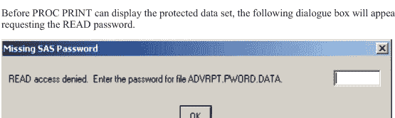

虽然这些密码保护在SAS内部可能很有用，但受保护的文件仍然容易被SAS外部的工具删除或篡改。包含ENCRYPT选项可以增加一层针对非SAS工具的保护。

### 更多信息

更多关于密码保护的信息，包括使用包含密码的数据集（如本节中使用的数据集），将在第5.4.2节中说明。

##### 2.1.3 KEEP、DROP和RENAME选项

在DATA步中使用KEEP、DROP或RENAME时，你可以选择使用数据集选项或DATA步语句。当创建或读取多个数据集时，DATA步语句适用于所有创建的数据集，而数据集选项可以应用于特定的数据集。一般来说，当你有选择余地时，数据集选项优于语句，因为数据集选项可以让你更好地控制，并且代码通常更清晰。

KEEP语句在功能上与DROP语句相反。以下关于KEEP语句和KEEP=数据集选项的讨论同样适用于DROP语句和DROP=数据集选项。我在这里演示KEEP语句和KEEP=数据集选项，是因为我承认自己对DROP语句和DROP=数据集选项有偏见。DROP语句和DROP=数据集选项工作得很好，它们都能完全实现预期功能，并且在需要保留的变量列表很长而需要删除的变量列表很短时，两者都可以为程序员节省打字量。然而，KEEP通过记录程序员确实需要继续考虑哪些变量，向程序员传达了更多信息。

以下示例突出显示了KEEP语句和KEEP=数据集选项之间的区别。下面的KEEP语句❶仅应用于新数据集（WORK.LABS），并且绝不会影响程序数据向量（PDV），也不会影响从输入数据集（ADVRPT.LAB_CHEMISTRY）读取哪些变量。

```sas
data labs;
   set advrpt.lab_chemistry;
   keep subject visit labdt; ❶
   if sodium>'142'; ❷
run;
```

- ❶ KEEP语句的变量列表应用于新的输出数据集。
- ❷ IF语句在整个观测被读取并加载到PDV之后执行。

使用KEEP语句❶与在DATA语句中的数据集上指定KEEP=选项❸完全相同。然而，SET语句上的KEEP=选项❹会在PDV构建之前应用。只有列出的那些变量才会从输入数据集读取并包含在PDV中。

```sas
data labs(keep=subject visit labdt); ❸
   set advrpt.lab_chemistry(keep=subject visit labdt sodium ❹
                            where=(sodium>'142')); ❺
run;
```

- ❸ KEEP=数据集选项仅影响哪些变量将被写入新数据集。
- ❹ 在SET语句中，KEEP=数据集选项应用于输入数据集；因此，该变量列表影响哪些变量会出现在PDV上。由于本示例中SODIUM在WHERE=子句❺中使用，即使它不会被写入新数据集，KEEP=数据集选项也必须包含SODIUM。
- ❺ WHERE=过滤器作为数据集选项指定，并在观测被读取之前应用。

RENAME选项允许您在读取或写入变量时更改变量名。与RENAME语句一样，其语法形式为oldname=newname。将RENAME=选项放在SET语句❻上会在变量写入PDV之前更改其名称。


```sas
data labs(keep=subject visit labdate)❼;
    set advrpt.lab_chemistry(rename=(labdt=labdate))❻;
    if sodium>'142';
run;
```

❻ 原名称（LABDT）被更改为新名称（LABDATE）。

❼ 新名称将用于任何编程语句中，并且它也会出现在 KEEP= 变量列表中。

当 RENAME= 和 KEEP= 选项同时用于同一个数据集时，理解先应用哪一个选项非常重要。在下面的 DATA 步中，输入数据集同时具有 RENAME= 和 KEEP= 选项。

```sas
data labs(keep=subject visit labdate)❼;
    set advrpt.lab_chemistry(rename=(labdt=labdate))❻
        keep=subject visit labdt❽ sodium
        );

    if sodium>'142';
run;
```

❽ 由于 KEEP= 选项先于 RENAME= 选项应用，因此输入 KEEP= 变量列表中使用的是原始变量名。

## 更多信息

当与 PROC SORT 结合使用时，这些数据集选项可能会对处理效率产生巨大影响，请参见第 4.2 节。

##### 2.1.4 使用 FIRSTOBS 和 OBS 数据集选项控制观测

数据集选项 FIRSTOBS 和 OBS 可以单独使用，也可以相互结合使用，以限制读取和/或写入哪些观测。它们的操作与具有相应名称的系统选项类似；但是，作为数据集选项，它们的应用可以更加精细。

- **FIRSTOBS** — 指定要读取的第一个观测的编号
- **OBS** — 指定要读取的最后一个观测（当未同时使用 FIRSTOBS 时，这对应于将要读取的观测数）。

在下面的 PROC PRINT 步中，我们要求只打印前 6 个观测 ❶。

```sas
proc print data=sashelp.class(obs=6); ❶
    run;
```

**2.1.4a obs=6**

| 观测 | 姓名 | 性别 | 年龄 | 身高 | 体重 |
| --- | --- | --- | --- | --- | --- |
| 1 | Alfred | 男 | 14 | 69.0 | 112.5 |
| 2 | Alice | 女 | 13 | 56.5 | 84.0 |
| 3 | Barbara | 女 | 13 | 65.3 | 98.0 |
| 4 | Carol | 女 | 14 | 62.8 | 102.5 |
| 5 | Henry | 男 | 14 | 63.5 | 102.5 |
| 6 | James | 男 | 12 | 57.3 | 83.0 |

FIRSTOBS= 选项 ❷ 指定要打印的第一个观测。

```sas
title1 '2.1.4b firstobs=4';
proc print data=sashelp.class(firstobs=4); ❷
run;
```

**2.1.4b firstobs=4**

| 观测 | 姓名 | 性别 | 年龄 | 身高 | 体重 |
| --- | --- | --- | --- | --- | --- |
| 4 | Carol | 女 | 14 | 62.8 | 102.5 |
| 5 | Henry | 男 | 14 | 63.5 | 102.5 |
| 6 | James | 男 | 12 | 57.3 | 83.0 |
| 7 | Jane | 女 | 12 | 59.8 | 84.5 |
| 8 | Janet | 女 | 15 | 62.5 | 112.5 |
| 9 | Jeffrey | 男 | 13 | 62.5 | 84.0 |
| 10 | John | 男 | 12 | 59.0 | 99.5 |
| 11 | Joyce | 女 | 11 | 51.3 | 50.5 |
| 12 | Judy | 女 | 14 | 64.3 | 90.0 |
| 13 | Louise | 女 | 12 | 56.3 | 77.0 |
| 14 | Mary | 女 | 15 | 66.5 | 112.0 |
| 15 | Philip | 男 | 16 | 72.0 | 150.0 |
| 16 | Robert | 男 | 12 | 64.8 | 128.0 |
| 17 | Ronald | 男 | 15 | 67.0 | 133.0 |
| 18 | Thomas | 男 | 11 | 57.5 | 85.0 |
| 19 | William | 男 | 15 | 66.5 | 112.0 |

当这两个选项一起使用时 ❸，它们彼此独立工作。重要的是要记住，无论 FIRSTOBS 的值是多少，OBS= 选项都从观测 1 开始计数。下面的示例演示了这一点。

```sas
title1 '2.1.4c firstobs=4 obs=6';
proc print data=sashelp.class(firstobs=4 obs=6); ❸
run;
```

只有前 6 个观测可供打印（OBS=6）；但是，第一个要打印的是第四个观测（FIRSTOBS=4）。因此，实际只打印了三个观测。

**2.1.4c firstobs=4 obs=6**

| 观测 | 姓名 | 性别 | 年龄 | 身高 | 体重 |
| --- | --- | --- | --- | --- | --- |
| 4 | Carol | 女 | 14 | 62.8 | 102.5 |
| 5 | Henry | 男 | 14 | 63.5 | 102.5 |
| 6 | James | 男 | 12 | 57.3 | 83.0 |

添加 WHERE 子句 ❸ 会改变计数过程。WHERE 子句首先应用；因此，计数和观测的选择基于观测子集。

```sas
    title1 '2.1.4d firstobs=4 obs=6 where (sex=m)';
    proc print data=sashelp.class(firstobs=4 obs=6
                               where=(sex='M')); ❸
    run;
```

生成的 LISTING 显示，只显示了第四、第五和第六个男性患者。

**2.1.4d firstobs=4 obs=6 where (sex=m)**

| 观测 | 姓名 | 性别 | 年龄 | 身高 | 体重 |
| --- | --- | --- | --- | --- | --- |
| 9 | Jeffrey | 男 | 13 | 62.5 | 84.0 |
| 10 | John | 男 | 12 | 59.0 | 99.5 |
| 15 | Philip | 男 | 16 | 72.0 | 150.0 |

#### 2.2 表达式求值

SAS 表达式包含运算符、常量、函数和变量的组合。表达式有多种使用方式，既可以在 DATA 步中使用，也可以在 PROC 步中使用。通常，当我们遇到“表达式”一词时，最常想到的是比较表达式；然而，它们实际上要通用得多，也可以出现在其他语句中，例如赋值语句。重要的是要记住，无论它们如何被使用，表达式的求值都会遵循一系列步骤或规则。理解这些规则可以让我们更广泛地使用表达式。

##### 2.2.1 运算符层次

运算符就像表达式中的动词。它们告诉 SAS 如何处理常量和变量等内容。为了避免混淆和歧义，运算符被分配了一个层次或应用顺序。该层次由七组运算符构成，在同一个组内，同等优先级的运算符从左到右应用（第 1 组除外，它从右到左应用）。

在简单层面上，我们需要理解为什么表达式 (5+6*2) 等于 17 而不是 22。但是，当我们遇到非标准形式的表达式时，例如第 2.2.2 节和第 2.2.3 节中的一些表达式，如果我们要理解这些表达式为何以这种方式求值，就需要牢固理解这个层次。

| 组 | 运算符 |
|---|---|
| 括号 | 首先执行括号内的运算 |
| 第 1 组（从右到左执行） | 幂运算（\*\*）<br>前缀运算符，例如正号（+）、负号（-）和取负<br>最小值（MIN, ><）和最大值（MAX, &lt;&gt;） |
| 第 2 组 | 乘法（\*）和除法（/） |
| 第 3 组 | 加法（+）和减法（-） |
| 第 4 组 | 连接（\|\|） |
| 第 5 组 | 比较，例如等于（=）和小于（&lt;） |
| 第 6 组 | AND - 布尔比较（&） |
| 第 7 组 | OR - 布尔比较（\|） |

由于这些运算符中的任何一个都可以出现在任何表达式中，无论是在赋值语句还是 IF 语句中，我们需要扩展对表达式应包含内容的认识。

```sas
season = 1*(1 le month(dob) le 3)
       + 2*(4 le month(dob) le 6)
       + 3*(7 le month(dob) le 9)
       + 4*(10 le month(dob) le 12);
```

这里显示的赋值语句创建了变量 SEASON，根据出生日期的月份，它可以包含 0 到 4 中的一个数值。“小于或等于”比较运算符（第 5 组）返回 0 或 1，再与常量相乘。比较运算符只是表达式运算符的另一种形式，非常适合赋值语句以及逻辑表达式。

尽管理解前面赋值语句的逻辑很重要，但使用 CEIL 函数可以更简单地编写它。

```sas
season= ceil(month(dob)/3);
```

然而，这两个语句并不等价。当 DOB 缺失时，第一个赋值语句返回零，而这个语句返回缺失值。

## 更多信息

还有一些 WHERE 语句特有的额外比较运算符（请参见第 2.7.1 节）。MIN 和 MAX 运算符将在第 2.2.5 节进一步讨论。

##### 2.2.2 使用冒号作为比较修饰符

当比较字符值时，冒号（:）可以用作运算符修饰符。

```sas
data Mar;
    set advrpt.demog (keep=lname fname);
    if lname =: 'Mar';
run;
```

冒号允许比较两个长度不等的字符串，并且冒号跟在所选的比较运算符之后。在左侧的示例中，子集 IF 语句将选择所有 LNAME 以“Mar”开头的观测。由于长度较小的值位于等号左侧还是右侧并不重要，因此姓氏为“Ma”的观测也会被选中。确定两侧值的长度，并且较小的


事实上，正如第 2.2.1 节所提到的，没有任何理由说明逻辑运算符和比较运算符不能出现在赋值语句中。使用它们的关键是要记住：逻辑表达式将产生 TRUE 或 FALSE，分别由 1 或 0 表示。对于出生日期在 5 月的情况，前面的等式会按左侧所示的方式进行求值。该表达式为 SEASON 生成的值是 2。当你像这个例子一样，基于逻辑判断生成数值时，你应该能够用与上面类似的形式编写赋值语句。然而，通过一系列效率较低的 IF-THEN/ELSE 语句进行这类赋值也很常见。

```sas
season = 1*(0)
        + 2*(1)
        + 3*(0)
        + 4*(0);
```

尽管前面的例子也可以使用用户自定义格式和 PUT 函数来实现（参见第 6.5 节），但像这里所示的那样，使用一系列 IF-THEN/ELSE 语句为 GROUP 赋值，并不那么容易通过涉及格式的方案来解决。不过，该值可以通过一条赋值语句来确定，这条语句包含与这些 IF-THEN/ELSE 语句中所用逻辑相同的逻辑。由于赋值语句的处理速度往往比 IF-THEN/ELSE 语句更快，因此使用赋值语句很可能可以减少处理时间。这种类型的赋值语句通常也会比 PUT 函数表现更好。

```sas
if sex = 'M' and year(dob) > 1949 then group=1;
else if sex = 'M' and year(dob) le 1949 then group=2;
else if sex = 'F' and year(dob) > 1949 then group=3;
else if sex = 'F' and year(dob) le 1949 then group=4;
```

```sas
group = 1*(sex = 'M' and year(dob) > 1949)
        + 2*(sex = 'M' and year(dob) le 1949)
        + 3*(sex = 'F' and year(dob) > 1949)
        + 4*(sex = 'F' and year(dob) le 1949);
```

由于 True/False 判断的结果总是 0 或 1，因此在为变量赋数值 0 或 1 时，同样的方法可能特别有用。在下面的 DATA 步中，我们希望创建一个标志，用于指示出生日期是否早于 1950 年。这里创建了三个等价的标志来演示三种不同的方法。

```sas
data flags;
  set advrt.demog (keep=lname fname dob sex);
  if year(dob) > 1949 then boomer=1; ❶
  else boomer=0;
  boomer2 = year(dob) > 1949; ❷
  boomer3 = ifn(year(dob) > 1949, 1, 0); ❸
run;
```

- 1. IF-THEN/ELSE 语句非常常用。这些语句的处理速度往往比赋值语句慢。
- 2. 逻辑表达式出现在等号右侧。
- 3. 可以使用 IFN 函数来赋值结果。当要返回的结果不仅仅是 0 或 1 时，该函数具有额外价值。

当你需要创建一个取决于某个项是否在值列表中的标志时，会使用类似的编码结构。这里我们需要确定数字 3 是否包含在变量 X1 到 X4 中的一个或多个变量中。

```sas
data _null_;
input x1-x4;
array a {*} x1-x4;
flag1 = (3 in a); ❹
flag2 = ^^whichn(3,of x:); ❺
put flag1= flag2=;
datalines;
1 2 3 4
5 6 7 8
run;
```

- ❹ **FLAG1** 的创建方式是判断值 3 是否在数组 A 中。如果存在，则存储 1。
- ❺ **WHICHN 函数**在找到第一个参数中的值时返回项编号（否则返回 0）。然后通过双重否定将该值转换为 0 或 1（关于双重否定的更多用法，参见第 2.2.6 节）。

## 更多信息

本节讨论的赋值语句是简单的表查找。第 6 章更详细地讨论了各种不同的表查找技术。IFN 和 IFC 函数将在第 3.6.6 节中进一步讨论。

## 另请参阅

sasCommunity.org 上的提示 http://www.sascommunity.org/wiki/Tips:Creating_a_flag_avoiding_the_If_..._Then_Structure 讨论了在赋值语句中使用这类表达式。讨论标签页包含了可用于 SQL 步的替代形式。用于指示列表中是否存在某个值的标志示例由 Chang Chung 和 Mike Rhoads 提出。他们的示例分别可在以下地址找到：http://www.sascommunity.org/wiki/Tips:Double_negatives_to_normalize_a_boolean_value 和 http://www.listsrv.uga.edu/cgi-bin/wa?A2=ind1101&L=sas-l&D=0&P=9693。

##### 2.2.4 复合不等式

当在表达式中使用复合不等式时，理解该表达式如何求值很重要。带有复合不等式的表达式经常包含一个变量

```sas
if 13 le edu le 16;
```

位于两个值之间，这两个值构成范围的上限和下限。这个复合表达式实际上被解释为两个不同的不等式，它们

```sas
if (13 le edu) and (edu le 16);
```

通过 AND 连接。EDU 的值必须同时满足两个条件，整个表达式才会求值为真。

括号位置错误会完全改变表达式的求值方式。请注意这个 WHERE 语句中括号的位置。括号内的不等式

```sas
where (13 le edu) le 16 ;
```

会被求值为 True 或 False（0 或 1），然后将结果与 16 比较。对于 EDU 的所有值，这个表达式都会为真（0 和 1 都小于 16）。

你可能会想：“好吧，那又怎样，我会小心处理括号。为什么我要在意？”当然，我认为 SAS 对这些表达式的求值方式既有趣又重要，但这样做也有实际好处。

在宏语言中，复合不等式的求值方式并不像我们基于 DATA 步表达式知识所设想的那样。这个 %IF-%THEN 语句中表达式解析后的宏变量表明，该表达式应求值为假；然而，它却求值为 TRUE，并且 %PUT 会执行。

```sas
%let x = 5;
%let y = 4;
%let z = 3;
%if &x lt &y lt &z %then
    %put &x < &y < &z;
```

```sas
%if 5 lt 4 lt 3 %then %put 5 < 4 < 3;
```

发生这种情况是因为宏语言中的复合表达式不会像在 DATA 步中那样被拆分为两个不同的不等式。相反，它会像在比较的第一部分周围有括号一样进行求值。表达式从左到右求值，(&x lt &y) 的结果将是 TRUE 或 FALSE（1 或 0）。无论哪种情况，只要 &Z 大于 1，整个表达式就会为 TRUE。

```sas
%if (&x lt &y) lt &z %then %put &x < &y < &z;
```

在实际应用中，诸如上面所示的复合不等式相当常见。你使用其他形式的复合表达式的可能性要小得多；然而，正如 %IF 语句示例所示，理解表达式如何求值很重要。

##### 2.2.5 MIN 和 MAX 运算符

### 警告

我认为，这两个运算符及其助记符（参见第 2.2.1 节）*绝不*应被使用。将它们包含在本节中，主要是为了给出这一警告。当你想要返回最小值或最大值时，请始终使用 MIN 或 MAX 函数。这些函数没有与这两个运算符相关的任何问题。

MIN 和 MAX 运算符分别返回两个值中的最小值或最大值。

```sas
where x = (y min z);
```

```sas
where x = min(y, z);
```

在这个 WHERE 语句中，变量 Y 和 Z 中较小的值将与变量 X 的值进行比较。MIN 和 MAX 运算符只允许比较恰好两个变量，而更推荐的 MIN 和 MAX 函数可以处理任意数量的变量。

这两个运算符在 WHERE 语句表达式中的行为与在 IF 语句表达式中*并不*相同，而且这些差异很重要。实际上，只有当你打算忽略这一警告并继续使用这些运算符时，这些差异才重要。假设你喜欢冒险，请继续阅读。

### 潜在问题 #1 - 助记符

在 IF 语句中，这两个运算符可以替换为它们的助记符；然而，这些助记符在 WHERE 语句中的工作方式并不相同。


| 运算符 | IF语句助记符 | WHERE语句助记符注意事项 | IF和WHERE子句 | 结果 |
|---|---|---|---|---|
| MIN | >< | 助记符在WHERE中不受支持，尽管MIN在日志中会转换为>< | where x=(y<>z);<br>if x=(y<>z); | WHERE → 错误<br>IF按预期工作 |
| MAX | <> | 在WHERE中助记符被解释为不等于 | where x=(y<>z); | 当X=1且Y不等于Z时为真，或当X=0且Y=Z时为真 |

## 潜在问题 #2 – 负值

当负号与这些运算符关联的第一个值一起使用时，表达式在WHERE和IF语句中的解释方式不同。

| 表达式 | 结果 |
|---|---|
| if -2 = (-5 min 2); | 真 – 负号在MIN运算符之后应用，本质上等同于：if -2 = (-5 min 2); |
| where -2 = (-5 min 2); | 假 – 负号在MIN运算符之前应用，比较等同于：where -2 = -5; |

##### 2.2.6 数值表达式与布尔转换

有时需要将数值转换为布尔值（0或1）。没有单一函数可以完成此操作，而且确切的转换可能因具体情况而异，不适合用特定函数实现。

### 真 / 假

部分由于SAS处理TRUE/FALSE的方式，即假为0或缺失，其他所有值都为真，因此缺失值也必须映射为0。使用双重否定（NOT）来执行此转换：

```sas
x = ^^dob;
```

由于否定是布尔运算符，它会将原始值转换为0或1。

### 更多信息

在12.6.2节的一个示例中，双重否定用于将数字转换为二进制0/1运算符。

### 将缺失值替换为0

出于报告目的，可以使用简单的赋值语句将缺失值替换为0：

```sas
z = coalesce(dob,0);
```

COALESCE函数返回第一个非缺失值。在此示例中，如果DOB缺失，则返回0。在加入COALESCE函数之前，有时使用SUM函数完成同样的操作。

```sas
y = sum(dob,0);
```

像这里这样处理日期时要小心。请记住，尽管缺失日期和日期0都为假，但它们的含义不同。

这两个表达式不会产生布尔值。如果要将所有缺失值转换为0，并将所有其他值（包括0）转换为1，可以使用MISSING函数的否定：

```sas
mval=^missing(val);
```

在此表达式中，除了缺失值外，所有数字的MVAL均为1。

### 确定正值或负值

由于缺失值和0值的存在，在区分正负值时我们有四种不同的可能性。正值和非负值的分组不一定相同。幸运的是，我们可以借助SIGN函数为这四种可能性构建布尔标志，该函数对小于0的值返回-1，对等于0的值返回0，对大于0的值返回1，对缺失值返回缺失。

```sas
data posneg;
  do v=-2 to 2;
    * if positive;
    pos = sign(v)=1;
    * Not positive;
    notpos = (sign(v) in(-1,0));
    * Negative;
    neg = ^sign(v)=-1;
    * Not negative;
    notneg = sign(v) in (0,1);
    output posneg;
  end;
run;
```

##### 2.2.6 布尔转换：正数或负数？

| Obs | v | pos | notpos | neg | notneg |
| --- | --- | --- | --- | --- | --- |
| 1 | . | 0 | 0 | 0 | 0 |
| 2 | -2 | 0 | 1 | 0 | 0 |
| 3 | -1 | 0 | 1 | 0 | 0 |
| 4 | 0 | 0 | 1 | 1 | 1 |
| 5 | 1 | 1 | 0 | 1 | 1 |
| 6 | 2 | 1 | 0 | 1 | 1 |

### 另请参阅

本节中的几个代码示例由Howard Schreier在sasCommunity.org文章中提出：[http://www.sascommunity.org/wiki/Numeric_transformations](http://www.sascommunity.org/wiki/Numeric_transformations)。

#### 2.3 数据验证与异常报告

虽然我们有时有机会处理已经清洗干净的数据，但通常我们工作的很大一部分是数据的准备和清理。对于手工输入的数据或来自不符合你高标准要求的数据源的数据尤其如此。在生物技术/制药行业，大量时间和细致的注意力都花在了数据验证上。

对于大型或复杂的数据集，手动/视觉查找数据错误的方法不切实际。我们需要一些工具来实现验证过程的自动化。

当报告数据中的错误时，你需要能够传达具体问题及其精确发生的位置。通常这意味着你必须识别特定的行和列（观测和变量）。要识别特定行，你需要知道构成数据集主键的所有变量的值（即用于将数据标识到行级别的BY变量）。

### 另请参阅

Wright (2006) 以及 Nelson (2004a, 2004b) 的相关论文讨论了SAS程序验证的方法。Bahler (2001) 总结了多种数据清洗技术。Ron Cody (2008b) 写了一本关于数据清洗技术的完整书籍。

##### 2.3.1 日期验证

由于我们将处理日期，我们需要知道如何检测和处理不完整或不适当的日期值。有几个问题需要理解。

### 使用格式检查日期字符串

格式，无论是用户定义的还是SAS提供的，都可以在搜索不适当、不完整、缺失或超出范围的值时成为强大的工具。

对于某些类型的数据（如调查回复数据），日期可能特别成问题。通常日期以字符串形式收集，然后在转换为SAS日期之前进行检查。

```sas
data visitdates;
   visit=1; v_date_ = '05/25/2004'; output;
   visit=2; v_date_ = '06/XX/2004'; output;
run;

proc print data=visitdates;
   where input(v_date_,mmddyy10.) = .;
run;
```

将它们收集为字符串很重要，这样我们可以记录不完整的日期。在左侧显示的第二个观测中，日期可能来自这样的回复：“我的第二次访问是在2004年6月。我不记得具体是哪一天了。”

##### 2.3.1 日期验证：使用格式

日期错误

| Obs | visit | v_date |
|---|---|---|
| 2 | 2 | 06/XX/2004 |

WHERE语句中的INPUT函数尝试将字符串转换为日期。无效值将导致缺失值，WHERE子句会选中这些缺失值。

```text
9    proc print data=visitdates;
10      where input(v_date_,mmddyy10.) eq .;
11   run;

ERROR: INPUT function reported 'ERROR: Invalid date value'
while processing WHERE clause.
```

当INPUT函数与格式MMDDYY一起用于结构不正确的值时（如第二个观测所示），日志中会发出错误信息。可以通过使用??格式修饰符（见1.3.1节）或NOFMTERR系统选项来抑制此错误信息。

??格式修饰符抑制格式错误信息，可以与INPUT函数中的INFORMAT一起使用，并且比NOFMTERR系统选项更具体，因为它可以应用于特定的输入格式。此步骤中的子集IF语句替换了前面示例中的WHERE语句，因为??输入格式修饰符不能用于WHERE语句。

```sas
data dateerrors;
   set visitdates;
   if input(v_date_,?? mmddyy10.) eq .;
run;
proc print data=dateerrors;
run;
```

因为我们可以抑制错误信息，所以在使用格式重建具有缺失部分的日期时就有了更大的自由度。和之前一样，我们假设传入的日期以字符串形式接收，其中日期或月份可能编码为“XX”。此示例展示了受试者对问题“你何时戒烟？”的回答。通常患者无法记住日期，更不用说具体某天了。在此示例中，我们决定将缺失的日期替换为15日，如果月份缺失，则替换为年中7月1日。此代码假设至少年份是存在的。


```sas
data quit_dates;
    subject=201; q_date = '05/25/1975'; output;
    subject=205; q_date = '10/XX/2001'; output;
    subject=208; q_date = 'XX/XX/1966'; output;
run;

data Qdates(keep=subject q_date _q_date);
    set quit_dates;
    format q_date9.;
    _q_date = q_date;
    q_date = input(q_date, ??mmddyy10.); ❶
    if missing(q_date) then do; ❷
        * Substitute missing day of month with 15;
        if substr(_q_date,4,2)='XX' then substr(_q_date,4,2)='15'; ❸
        q_date = input(_q_date,??mmddyy10.);
    end;
    if missing(q_date) then do; ❹
        * Substitute missing month with 07;
        if substr(_q_date,1,2)='XX' then do; ❺
            substr(_q_date,1,2)='07';
            * reset day of month;
            substr(_q_date,4,2)='01';
        end;
        q_date = input(_q_date,??mmddyy10.); ❻
    end;
run;
```

- ❶ 第一次尝试使用 `INPUT` 函数构建 SAS 日期（Q_DATE）。
- ❷ 如果 SAS 日期缺失，则很可能有一个或多个元素被编码为 XX。我们首先检查月份中的日期。
- ❸ 当月份中的日期被编码为 XX 时，将替换为 15。注意在 `=` 号左侧使用 `SUBSTR` 函数来执行替换（有关使用 `SUBSTR` 函数将字符替换到字符串中的更多信息，请参阅第 3.6.6 节）。
- ❹ 现在再次检查日期，以确定是否存在可能缺失的月份值。
- ❺ 检测到编码为 XX 的月份，并同时替换月份和日期。
- ❻ 将校正后的日期字符串转换为 SAS 日期。

## 检查缺失的日期值

在 ADRVPT.DEMOG 数据集中，变量 DEATH 记录了在诊所护理期间死亡患者的死亡日期（请记住，这是虚构数据，在编写本书时没有患者受到伤害）。我们希望筛选出具有死亡日期的患者。需要记住的是，SAS 日期包含自 1960 年 1 月 1 日（第 0 天）以来的经过天数。此日期之前的日期为负数。

可以使用 `WHERE` 语句，并且可以建议使用几种备选表达形式。我们需要记住，我们筛选的是有效日期。

```sas
where death>0;
```

一种可能的表达式可能是筛选大于零的值；然而，这显然排除了 1960 年 1 月 2 日之前的任何日期，因此不够充分。

由于我们希望排除缺失日期，而缺失值为假，另一种可能的表达式是简单地检查 DEATH 是否为假。这几乎有效，但存在一个微妙的缺陷。在这里，我们会排除有效的死亡日期 1960 年 1 月 1 日，该日期为第 0 天，将被解释为假。

我们真正需要做的是仅排除缺失值，并且应重点关注这一点。可以使用两种表达式。我们可以显式排除缺失值并允许所有其他值，或者我们可以接受任何大于缺失值的值（所有正数或负数均大于缺失值）。

```sas
where death ne .;
```

```sas
where death > .;
```

有时您处理的数据会使用多种类型的缺失值。由于数值变量可以具有多达 28 种类型的缺失值（.、.a、.b、...、.z 和 ._），因此在测试缺失值时可能需要考虑这些类型。在这 28 种数值缺失值类型中，最小的是 ._，次小的是 .，最大的是 .z。因此，要有效测试所有这些缺失值类型，我们需要针对最大值（.z）进行编码。使用 MISSING 函数也可以检测所有缺失值。

```sas
where death > .z;
```

```sas
where ^missing(death);
```

### 更多信息

`WHERE=` 数据集选项在第 2.1.3、2.1.4d 和 2.2.2 节的示例中使用。

### 另请参阅

Hunt (2010) 展示了完成日期的替代方法。SAS 论坛上可以找到完成部分日期的替代解决方案，请参见以下帖子：

[http://communities.sas.com/message/40648#40648](http://communities.sas.com/message/40648#40648)。

##### 2.3.2 写入错误数据集

在尝试识别包含数据错误的观测时，建立一个仅包含这些错误观测的辅助数据集通常很有帮助。通过数据集进行错误报告就像添加条件逻辑和另一个 `OUTPUT` 语句一样简单。

```sas
data medstartdates (keep=subject mednumbr drug
    medstdt medstartdate)
   medstarterr(keep=subject mednumbr drug medstdt);
   set advrpt.conmed(keep=subject mednumbr drug medstdt);
   medstartdate = input(medstdt,?? mmddyy10.);
   if medstartdate = . then output medstarterr;
   output medstartdates;
run;
```

- 1. 错误数据集中的变量列表应包含构成主键的所有变量，以及正在测试的变量。
- 2. 在此示例中，我们将文本日期转换为 SAS 日期。`??` 格式修饰符用于抑制日志中的错误消息，这将在第 2.3.1 节中讨论。
- 3. 不完整的日期，即那些无法转换为有效 SAS 日期的日期，会导致缺失值。
- 4. 在此示例中，数据集 MEDSTARTDATES 将包含所有观测，包括那些有错误的观测。要从该数据集中移除有错误的观测，只需在 `OUTPUT` 语句前面加上 `ELSE` 语句。该语句变为：`else output medstartdates;`

生成的数据表（WORK.MEDSTARTERR）将为每个无法转换为有效 SAS 日期的 MEDSTDT_ 值包含一条观测。

##### 2.3.2a 收集日期错误

| Obs | SUBJECT | mednumber | drug | MEDSTDT_ |
| --- | --- | --- | --- | --- |
| 51 | 206 | 2 | LUPRON | XX/XX/1999 |
| 52 | 206 | 3 | CALCIUM CITRATE | --/--/---- |
| 53 | 206 | 4 | MVI | --/--/---- |
| 54 | 207 | 1 | METOPROLOL | --/--/---- |
| 55 | 207 | 1 | CLONIDINE | --/--/---- |
| 56 | 207 | 1 | LUPRON | XX/XX/1996 |
| 57 | 207 | 2 | DIAZIDE | --/--/---- |
| 58 | 207 | 2 | COUMADIN | XX/XX/1996 |

... 部分表格未显示 ...。

当在不同数据集中测试多个变量或不同变量时，这种错误报告数据集形式不够灵活。这在构建自动化数据验证系统时经常出现。在自动化系统中，异常数据集需要包含足够的信息，以便数据管理员能够追溯到有问题的值。最少的信息应包括：

- DSN — 数据集名称
- *变量列表* — 关键变量及其值
- ERRVAR — 包含异常的变量
- ERRVAL — 被标记的值
- ERRTEXT — 值被标记的原因（异常标准）
- ERRRATING — 异常评级（可能用于识别关键变量）

这种错误数据集形式每个错误有一条观测。它允许多个变量在每个观测上报告，甚至允许来自多个数据集的错误。为了最大化灵活性，考虑将被标记的值设为字符变量。这将需要数值到字符的转换，但增加了灵活性。此外，由于关键变量列表在不同数据集之间可能会变化，来自某些数据集的观测中许多关键变量将会缺失，因为这些变量不属于这些数据集的关键部分。只要在设计原始数据集时小心谨慎，确保出现在多个数据集中的变量始终具有相同的属性，这就不会成为问题。

```sas
title1 '2.3.2b Hardcoded Exception Reporting';

data errrpt(keep=dsn errvar errval errtxt errrating
             subject visit labdt);
    length dsn      $25
           errvar   $15
           errval   $25
           errtxt   $20
           errrating 8;
    set advrpt.lab_chemistry;
    if potassium lt 3.1 then do;
       dsn = 'advrpt.lab_chemistry';
       errvar = 'potassium';
       errval = potassium;
       errtxt = 'Low value(<3.1)';
       errrating= 1;
       output errrpt;
    end;
    if potassium gt 6.7 then do;
       dsn = 'advrpt.lab_chemistry';
       errvar = 'potassium';
       errval = potassium;
       errtxt = 'High value(>6.7)';
       errrating=2;
       output errrpt;
    end;
run;
```

- 1. 错误报告数据表中的变量列表包括构成该数据主键的变量（SUBJECT VISIT LABDT）。
- 2. 读取要检查的数据集。
- 3. 当检测到此特定数据异常时，进入 DO 块。
- 4. 保存正在检查的数据表的名称。
- 5. 保存正在测试的变量的名称。
- 6. 捕获数据值以供进一步检查。当字符值已被转换用于检查时，保存原始或字符值。这允许您查看可能导致字符到数值转换问题的任何文本。
- 7. 错误测试应描述数据中检测到的问题。
- 8. 如果需要，分配错误严重性代码。
- 9. 将此观测写入错误报告数据集（ERRRPT）。
- 10. 第二个异常标准在与第一个 DO 块 3 基本相同的 DO 块中进行测试。

生成的错误报告数据集包含定位、评估和启动纠正过程所需的所有信息。


| 观测 | dsn | errvar | errval | errtxt | errrating | SUBJECT | VISIT | LABDT |
|---:|---|---|---:|---|---:|---:|---:|---|
| 1 | advprt.lab_chemistry | potassium | 6.8 | 高值（>6.7） | 2 | 203 | 4 | 09/29/2006 |
| 2 | advprt.lab_chemistry | potassium | 3 | 低值（<3.1） | 1 | 208 | 10 | 03/09/2007 |

从编码角度看，这种方法的美妙之处在于可以根据需要设置任意数量的检查，而每项检查只需再添加一个 DO 块即可实现。对于大型研究和复杂数据表，其缺点就会显现出来。程序虽然不算极其复杂，但可能变得很大。更重要的是，由于每项检查都实现在程序中，新增或修改标准时就需要重新验证程序本身。这些问题可以通过将检验标准存储在程序之外来解决。一种非常方便的方法是将异常标准存储在数据表中（见 2.3.3 节）。

### 更多信息

非数值会在 3.6.1 节中被检测并写入错误数据集。

##### 2.3.3 使用宏控制异常报告

在示例 2.3.2b 所示的 DATA 步中，会为每项数据检查构造一个 DO 块。由于这些 DO 块彼此非常相似，它们非常适合由宏语言为我们编写。下面的宏 %ERRRPT 将构建这个 DO 块。

```sas
%macro errrpt(dsn=,errvar=,errval=,errtxt=,errrating=);
    dsn = "&dsn";
    errvar = "&errvar";
    errval = &errval;
    errtxt = "&errtxt";
    errrating= &errrating;
    output errpt;
    end;
%mend errrpt;
```

当在 DATA 步中调用 %ERRRPT 宏时，IF THEN/DO 语句变成：

```sas
if potassium lt 3.1 then do;
    %errrpt(dsn = advprt.lab_chemistry,
           errvar = potassium,
           errval = potassium,
           errtxt = %str(Low value(<3.1%)),
           errrating= 1)

if potassium gt 6.7 then do;
    %errrpt(dsn = advprt.lab_chemistry,
           errvar = potassium,
           errval = potassium,
           errtxt = %str(High value(>6.7%)),
           errrating= 2)

run;
```

尽管我们稍微简化了代码，但在编码工作量上仍未实现大幅节省。当然，我们可以让宏语言承担更多工作。如果我们能告诉宏语言需要哪些检查以及需要多少项检查，那么包括 IF THEN/DO 在内的每个单独宏调用都可以由一次宏调用生成。

存储并传递所需信息的一种简便方法是使用 SAS 数据集。我们可以创建一个数据集，其中包含每项数据异常检查的约束条件。然后，每条观测都可以用来构建数据异常和错误捕获报告。对于前面的示例，该数据集可能包含以下内容。

**2.3.3b 带异常标准的数据集**

| 观测 | errtst | errvar | errval | errtxt | errrating |
|---|---|---|---|---|---|
| 1 | lt 3.1 | potassium | potassium | 低值（<3.1） | 1 |
| 2 | gt 6.7 | potassium | potassium | 高值（>6.7） | 2 |

然后，一个宏会使用该数据集来构建一系列宏变量列表。随后处理这些列表（数据集中的每条观测都会成为一个检验或 DO 块）。下面所示的 %ERRRPT 宏使用一个 SQL 步构建这些列表，然后使用列表中的宏变量创建一系列 DO 块，以“填空”。

```sas
%macro errrpt(dsn=, bylist=subject); ❶
%local i chknt;
proc sql noprint;
    select errtst, errvar, errval, errtxt, errrating
        into :errtst1-:errtst99, ❷
        :errvar1-:errvar99,
        :errval1-:errval99,
        :errtxt1-:errtxt99,
        :errrating1-:errrating99
        from vallab; ❸
    %let chknt = &sqlobs; ❹
    quit;
data errrpt(keep=dsn errvar errval errtxt errrating &bylist); ❺
    length dsn     $25
           errvar  $15
           errval  $25
           errtxt $15
           errrating 8;
    set &dsn ❻ ;
%do i = 1 %to &chknt; ❼
    %* Write as many error checks as are needed;
    if &&errvar&i &&errtst&i ❽ then do;
        dsn = "&dsn";
        errvar = "&&errvar&i"; ❾
        errval = &&errval&i;
        errtxt = "&&errtxt&i";
        errrating= &&errrating&i;
        output errrpt;
        end;
%end;
run;
%mend errrpt;
%errrpt(dsn=advrpt.lab_chemistry,
        bylist=subject visit labdt) ❿
```

- ❶ 宏 %ERRRPT 用于控制错误报告过程。宏 %DO 循环必须出现在宏定义内部。
- ❷ 从控制数据集 ❸ 中读取的值会存储在一系列宏变量中。这些宏变量的形式为 &ERRVAL1、&ERRVAL2 等。这段代码最多允许 99 项检验（不能超过）。把这个数字设得太大没有坏处（我喜欢至少多留一个数量级）；不过，如果数字太小，LOG 或其他地方不会给出提示（值只是不会被保存）。
- ❹ 从控制数据集读取的观测数保存在宏变量 &CHKCNT 中。这将是该数据集的总检查数。
- ❺ 构成主键的变量包含在 KEEP= 列表中。
- ❻ 要检查的数据集在 SET 语句中指定。
- ❼ 宏 %DO 循环将按宏变量 &CHKCNT 中包含的数字进行迭代，即对控制数据集中的每条观测迭代一次。每次迭代都会生成一个 DO 块，每个待执行的检验对应一个 DO 块。
- ❽ 对于第二次 %DO 循环迭代，IF 语句变为：

    ```sas
    if potassium gt 6.7 then do;
    ```

- ❾ 各个宏变量通过 &&VAR&i 这种宏变量形式来引用。在宏 %DO 循环的第二轮（&i=2）中，宏变量引用 &&ERRVAR&i 解析为 &ERRVAR2，而后者又解析为 potassium。
- ❿ 宏调用包含要检查的数据集名称及其 BY 变量列表。

### 更多信息

第 13.5 节将进一步讨论使用数据集驱动宏。

#### 2.4 规范化——转置数据

大多数（但并非全部）SAS 过程更倾向于对规范化数据进行操作；规范化数据往往“高而窄”，并且通常包含用于标识各行的分类变量。在下面的数据展示中，每条观测有一个 SODIUM 值，分类变量为 SUBJECT 和 VISIT。

**2.4 规范化数据**

**规范形式**

| 观测 | SUBJECT | VISIT | sodium |
| ---: | --- | ---: | ---: |
| 1 | 208 | 1 | 13.7 |
| 2 | 208 | 2 | 14.1 |
| 3 | 208 | 4 | 14.1 |
| 4 | 208 | 5 | 14.1 |
| 5 | 208 | 6 | 13.9 |
| 6 | 208 | 7 | 13.9 |
| 7 | 208 | 8 | 14.0 |
| 8 | 208 | 9 | 14.0 |
| 9 | 208 | 10 | 14.0 |
| 10 | 209 | 1 | 14.0 |

……表中部分内容未显示……

同一数据也可以以非规范形式呈现；非规范形式通常为某个分类变量的每个水平设置一列。在下面的示例中，每位患者有一条观测，每次访视的钠值占一列。

**2.4 规范化数据**

**非规范形式**

| 观测 | Subject | Visit1 | Visit2 | Visit3 | Visit4 | Visit5 | Visit6 | Visit7 | Visit8 | Visit9 | Visit10 | Visit11 | Visit12 | Visit13 | Visit14 | Visit15 |
| --- | --- | --- | --- | --- | --- | --- | --- | --- | --- | --- | --- | --- | --- | --- | --- | --- |
| 1 | 208 | 13.7 | 14.1 | 14.1 | 14.1 | 13.9 | 13.9 | 14 | 14.0 | . | 14.1 | 14.2 | 14 | 14.1 | 14.1 | 14.1 |
| 2 | 209 | 14.0 | 14.0 | 13.9 | 14.2 | 14.5 | 13.8 | 14 | . | 13.8 | 14 | 14.1 | 14.2 | 14 | 14.1 | 14.1 |

由于我们收到数据时往往无法控制其形式，因此需要能够既把数据从规范形式转换为非规范形式，也能从非规范形式转换为规范形式。这一过程称为数据转置，相关操作通常通过 PROC TRANSPOSE 或在 DATA 步中完成。

PROC TRANSPOSE 是执行转置操作的一种高效而强大的过程。DATA 步可以更灵活；不过，PROC TRANSPOSE 的优点是无需在转置之前知道将有多少个转换后的变量。

### 另请参阅

Toby Dunn（2010）讨论了规范数据形式与非规范数据形式之间的差异，并提出了选择其中一种形式而非另一种形式的编程动机。在转置的同时进行汇总时，MEANS 和 SUMMARY 过程可能非常有用。King 和 Zedb（2010）使用 OUTPUT 语句上的 IDGROUP 选项来控制转置过程。

##### 2.4.1 使用 PROC TRANSPOSE

对大多数用户而言，PROC TRANSPOSE 往往不太直观。编码并不特别困难；然而，对大多数用户来说，通常很难想象结果数据集会是什么样子。这个过程中还有一个陷阱，一旦触发，可能会导致数据损坏。

下面的步骤创建实验室化学数据的非规范版本，演示了一个简单的 PROC TRANSPOSE，并且还将用来演示 PROC TRANSPOSE 的陷阱。

```sas
    proc transpose data=lab_chemistry(keep=subject visit sodium) ❶
        out=lab_nonnormal(keep=subject visit:) ❷
        prefix=Visit; ❸
      by subject; ❹
      var sodium; ❺
    run;
```

- **DATA=** 用于指定输入数据集。
- **转置后的数据集**由 **OUT=** 选项命名。请注意，这里使用冒号来选择所有以字母 **VISIT** 开头的变量名（关于变量名快捷方式的更多内容，见 2.6.1 节）。
- **PREFIX=** 选项用于指定将用来构成新列名的文本。


## 使用 PROC TRANSPOSE

- ❶ 转置过程在 BY 语句中一个（或多个）变量所分的组内进行。在本例中，每个不同的 SUBJECT 将形成一行。
- ❷ 列 SODIUM 被转置为行。

##### 2.4.1a 不完整指定的观测

| 观测 | Subject | Visit1 | Visit2 | Visit3 | Visit4 | Visit5 | Visit6 | Visit7 | Visit8 | Visit9 | Visit10 | Visit11 | Visit12 | Visit13 | Visit14 |
| --- | --- | --- | --- | --- | --- | --- | --- | --- | --- | --- | --- | --- | --- | --- | --- |
| 1 | 208 | 13.7 | 14.1 | 14.1 | 14.1 | 13.9 | 13.9 | 14 | 14.0 | 14.1 | 14.1 | 14.1 | 14.1 | 14.1 | 14.1 |
| 2 | 209 | 14.0 | 14.0 | 13.9 | 14.2 | 14.5 | 13.8 | 14 | 13.8 | 14.1 | 14.2 | 14.1 | 14 | 14.1 | 14.1 |

注意患者 208 在第 3 次和第 9 次访视时的 SODIUM 值。将此结果与 2.4 节所示结果进行比较。如果不仔细检查数据，这一点不会立刻显现，但 TRANSPOSE 的陷阱已经被触发，转置后的数据已被破坏。SODIUM 的值*在某些情况下*与错误的访视关联了起来！

使用 PROC TRANSPOSE 时，有两种方法可确定转置将在哪一行或多行内进行。在前面的示例中使用了 BY 语句。然而，由于每个受试者都有多次访视，每个 SUBJECT 内有多行，而这些行成为新列（VISIT1、VISIT2、VISIT3 等）。问题在于，我们的代码中没有任何内容将 VISIT 变量与新列关联起来，而在本例中，新列将是 VISIT1 到 VISIT14 中的一个变量。患者 208 错过了第 3 次和第 9 次访视，因此其第 9 次访视本应归类为 VISIT11。然而，由于这是患者 208 的第 9 个观测，PROC TRANSPOSE 错误地将数据归类为 VISIT9。请注意，患者 208 和 209 都显示了 VISIT3 的数据，尽管两者实际上都错过了第 3 次访视。

ID 语句（前面的示例中未包含）也可用于帮助标识行。该语句指定一个变量，该变量将用于为新列创建变量名。更重要的是，它还将特定行中的值与指定的新列关联起来。

这类问题可通过以下规则轻松解决：BY 和 ID 语句中的变量组合必须能标识到行级。

在下面的 PROC TRANSPOSE 步骤中，添加了 ID 语句。BY 变量 SUBJECT ❶ 和 ID 变量 VISIT ❷ 构成该数据集的一个唯一键（这两个变量的任意给定组合最多标识一个观测）。

```sas
title2 '2.4.1b BY and ID Form a Unique Key';
proc transpose data=lab.chemistry(keep=subject visit sodium)
               out=lab_nonnormal(keep=subject visit);
   by subject; ❶
   id visit; ❷
   var sodium;
run;
```

与 PROC TRANSPOSE 生成的数据集不同，请注意，即使 VISIT3 未出现在未转置数据中，该数据集也包含 VISIT3 的变量。这是 ARRAY 语句 ❶ 中隐式使用 VISIT3 的结果。

## 在 DATA 步中转置

##### 2.4.2a 行转列

| 观测 | SUBJECT | VISIT1 | VISIT2 | VISIT3 | VISIT4 | VISIT5 | VISIT6 | VISIT7 | VISIT8 | VISIT9 | VISIT10 | VISIT11 | VISIT12 | VISIT13 | VISIT14 | VISIT15 |
| --- | --- | --- | --- | --- | --- | --- | --- | --- | --- | --- | --- | --- | --- | --- | --- | --- |
| 1 | 208 | 13.7 | 14.1 | 14.1 | 13.9 | 14.1 | 14.4 | 14.0 | . | . | . | . | . | . | . | . |
| 2 | 209 | 14.0 | 14.0 | 13.9 | 14.2 | 14.5 | 13.8 | 14 | 14 | 13.8 | 14 | 14.1 | 14.2 | 14.1 | 14 | 14.1 |

### 列转行

你也可以使用 DATA 步对数据集进行规范化。在前面的示例中，我们将两名患者的一些实验室数据从规范形式转换为非规范形式。现在我们将使用类似的 DATA 步将其转换回原始形式。

```sas
title2 '2.4.2b Columns to Rows';
data lab_normal(keep=subject visit sodium);
   set lab_nonnormal(keep=subject visit:); ❻
   by subject;
   array visits {16} visit1-visit16; ❼
   do visit = 1 to 16; ❽
      sodium = visits{visit}; ❾
      output lab_normal; ❿
   end;
run;
```

- ❻ 转换所需的变量保留在传入数据集中。
- ❼ 声明 VISITS 数组，其中每次访视作为一个元素。
- ❽ DO 循环的索引是 VISIT，每次访视时递增。索引变量 VISIT 被添加到程序数据向量中，并将写入新数据集。

##### 2.4.2b 列转行

| 观测 | SUBJECT | visit | sodium |
| --- | --- | --- | --- |
| 1 | 208 | 1 | 13.7 |
| 2 | 208 | 2 | 14.1 |
| 3 | 208 | 3 | . |
| 4 | 208 | 4 | 14.1 |
| 5 | 208 | 5 | 14.1 |
| 6 | 208 | 6 | 13.9 |
| 7 | 208 | 7 | 14.0 |
| 8 | 208 | 8 | 14.0 |
| 9 | 208 | 9 | 14.0 |
| 10 | 208 | 10 | . |
| 11 | 208 | 11 | . |
| 12 | 208 | 12 | . |
| 13 | 208 | 13 | . |
| 14 | 208 | 14 | . |
| 15 | 208 | 15 | . |
| 16 | 208 | 16 | . |
| 17 | 209 | 1 | 14.0 |
| 18 | 209 | 2 | 14.0 |
| 19 | 209 | 3 | . |

表中部分内容未显示

- ❾ 变量 SODIUM 由以 VISIT 作为索引标识的数组元素创建。
- ❿ 由于 OUTPUT 语句位于 DO 循环内，它将为 DO 循环的每次迭代写一个观测。

生成的数据集将为每个患者 × 访视组合各有一个观测。现在这包括原本不存在的组合。

在本例中，SUBJECT 208 现在有 VISIT 3 以及 VISIT 11 至 VISIT16 的观测，并且这些访视的 SODIUM 值都适当地缺失。

通过向 OUTPUT 语句 ❿ 添加 IF 条件，可以轻松删除 SODIUM 值缺失的观测。

```sas
if sodium gt .z then output lab_normal;
```

#### 2.5 填充稀疏数据

有时在录入数据时，只有当存在特定值时才创建观测。仅反映缺失值或计数数据中计数为 0 的观测不会被创建。这会生成更稠密的数据，因为缺失值会更少。根据包含了哪些观测，整个分类水平或分类水平的组合可能从数据中缺失。这意味着数据本身并未反映真实的抽样方案。有时我们需要显示所有可能的水平——而不仅仅是那些具有非缺失值的水平。

创建带有适当缺失值的观测，有时被称为创建稀疏（较不稠密）数据。

本节所示的示例使用 LAB_CHEMISTRY 数据，该数据每个患者每次访视有一行。错过的访视不会在数据中表示，也不会在表格和报告中表示。

LAB_CHEMISTRY 数据中的每位患者（SUBJECT）都应对前 10 次访视中的每一次有一个观测，并且可能有也可能没有第 11 至 16 次访视的后续随访。我们需要确保每位患者对前 10 次访视都有观测。

##### 2.5.1 已知的行模板

当我们知道分类变量应取值的完整列表时，可以构建一个模板并将其合并回原始数据。合并包含分类变量所有可能组合的模板的过程，会将适当的观测添加到数据集中。对于下面的示例，我们希望每个 SUBJECT 至少具有前 10 次访视。

```sas
proc sort data=advrpt.lab_chemistry ❶
        out=lab_chemistry;
    by subject visit;
run;
proc sort data=advrpt.lab_chemistry
        out=sublist(keep=subject) ❷
        nodupkey; ❸
    by subject;
run;
data subvislist;
    set sublist;
    do visit = 1 to 10; ❹
        output subvislist;
    end;
run;
data sparsed;
    merge subvislist ❺
        lab_chemistry;
    by subject visit; ❻
run;
```


##### 2.5.2 双重转置

当分类变量的所有可能水平未知，或者在 DO 循环中不易指定时，通常可以通过执行两个 PROC TRANSPOSE 步骤来创建稀疏数据集。与 2.5.1 节中构建模板数据集的做法不同，我们将让数据本身确定分类水平。应当注意，此方法的结果与 2.5.1 节中获得的结果不一定相同。

第一个 PROC TRANSPOSE 步骤为待稀疏化变量（VISIT）的每个值创建一个列。假设给定访视存在于数据中的某处，那么经过第一个 PROC TRANSPOSE 步骤后，它将表示为一个列。

第二个 PROC TRANSPOSE 步骤将列（每个可能访视对应一列）重新转换为行。此时数据具有原始形式（如同第一个 PROC TRANSPOSE 之前）；但是，现在每个访视列都会表示为每个受试者的一行。

```sas
proc sort data=advrpt.lab_chemistry ❶
         out=lab_chemistry
         nodupkey;
    by subject visit;
run;

proc transpose data=lab_chemistry ❷
         out=labtran
         prefix=Visit; ❸
    by subject; ❹
    id visit; ❺
    var sodium potassium chloride;
run;

proc transpose data=labtran ❻
         out=sparsed(rename=(_name_=Visit)); ❼
    by subject; ❽
    id _name_ ; ❾
    var visit:; ❿
run;
```

- ❶ 输入数据集必须至少按 BY 语句 ❹ 的层级排序。
- ❷ 使用 PROC TRANSPOSE 将待填充的行转换为列。
- ❸ PREFIX= 选项指定用于构成新变量名根部分的文本。
- ❹ BY 语句列出不需要填充的分类变量。
- ❺ 变量 VISIT 将用于标识哪些列由哪些行形成。在此情况下，数值变量 VISIT 将与前缀文本 ❸ 组合以形成新列名。
- ❻ 数据集 LABTRAN 将被转置回原始的行和列集合。
- ❼ 默认情况下，新数据集（SPARSED）中的行将用变量 `_NAME_` 标识。此变量重命名为 VISIT。
- ❽ 输入数据集（LABTRAN）每个 SUBJECT 和 `_NAME_` 组合有一条观测。
- ❾ ID 语句标识包含新列名的变量（`_NAME_`）。
- ❿ 所有以 VISIT 开头的变量都包含在转置中（关于变量列表缩写，参见 2.6.1 节）。

在第一次转置之前，检查 SUBJECT=210 的数据显示，该受试者缺失了访视 3 和 9。

###### 2.5.2 使用双重转置创建稀疏表（第一次转置前）

| Obs | SUBJECT | VISIT | LABDT | potassium | sodium | chloride |
|---:|---:|---:|---|---:|---:|---:|
| 95 | 210 | 1 | 02/19/2007 | 5.0 | 14.0 | 103 |
| 96 | 210 | 2 | 02/28/2007 | 4.0 | 14.2 | 103 |
| 97 | 210 | 4 | 03/14/2007 | 3.9 | 14.1 | 101 |
| 98 | 210 | 5 | 03/09/2007 | 4.7 | 14.4 | 105 |
| 99 | 210 | 6 | 03/16/2007 | 4.7 | 14.5 | 104 |
| 100 | 210 | 7 | 03/26/2007 | 4.7 | 14.3 | 103 |
| 101 | 210 | 8 | 03/28/2007 | 4.4 | 14.1 | 102 |
| 102 | 210 | 10 | 07/10/2007 | 4.3 | 14.2 | 106 |
| 103 | 210 | 11 | 04/06/2007 | 4.1 | 14.2 | 104 |
| 104 | 210 | 12 | 04/17/2007 | 4.0 | 13.9 | 103 |
| 105 | 210 | 13 | 04/19/2007 | 4.4 | 14.2 | 104 |
| 106 | 210 | 14 | 04/26/2007 | 4.1 | 14.1 | 99 |
| 107 | 210 | 15 | 05/22/2007 | 3.8 | 13.8 | 99 |
| 108 | 210 | 16 | 06/27/2007 | 5.2 | 14.3 | 109 |

第一次 PROC TRANSPOSE ❷ 之后，数据（WORK.LABTRAN）如下所示（针对 SUBJECT=210）。现在该受试者有一个 VISIT9 列，即使该受试者在数据中没有 VISIT9；但是，仍然没有访视 3 的列。这是因为整个数据集中没有任何受试者具有 VISIT3。

###### 2.5.2 使用双重转置创建稀疏表（第一次转置）

| Obs | SUBJECT | _NAME_ | Visit1 | Visit2 | Visit4 | Visit5 | Visit6 | Visit7 | Visit8 |
|---:|---:|---|---:|---:|---:|---:|---:|---:|---:|
| 31 | 210 | sodium | 14 | 14.2 | 14.1 | 14.4 | 14.5 | 14.3 | 14.1 |
| 32 | 210 | potassium | 5 | 4.0 | 3.9 | 4.7 | 4.7 | 4.7 | 4.4 |
| 33 | 210 | chloride | 103 | 103.0 | 101.0 | 105.0 | 104.0 | 103.0 | 102.0 |

| Obs | Visit9 | Visit10 | Visit11 | Visit12 | Visit13 | Visit14 | Visit15 | Visit16 |
|---:|---:|---:|---:|---:|---:|---:|---:|---:|
| 31 | . | 14.2 | 14.2 | 13.9 | 14.2 | 14.1 | 13.8 | 14.3 |
| 32 | . | 4.3 | 4.1 | 4.0 | 4.4 | 4.1 | 3.8 | 5.2 |
| 33 | . | 106.0 | 104.0 | 103.0 | 104.0 | 99.0 | 99.0 | 104.0 |

第二个 PROC TRANSPOSE ❻ 使用此数据作为输入，并且由于所有访视都包含在 VAR 语句 ❿ 中，每个访视都会成为新表中的一行。

###### 2.5.2 使用双重转置创建稀疏表（第二次转置）

| Obs | SUBJECT | Visit | sodium | potassium | chloride |
|---:|---:|---|---:|---:|---:|
| 151 | 210 | Visit1 | 14.0 | 5.0 | 103 |
| 152 | 210 | Visit2 | 14.2 | 4.0 | 103 |
| 153 | 210 | Visit4 | 14.1 | 3.9 | 101 |
| 154 | 210 | Visit5 | 14.4 | 4.7 | 105 |
| 155 | 210 | Visit6 | 14.5 | 4.7 | 104 |
| 156 | 210 | Visit7 | 14.3 | 4.7 | 103 |
| 157 | 210 | Visit8 | 14.1 | 4.4 | 102 |
| 158 | 210 | Visit9 | . | . | . |
| 159 | 210 | Visit10 | 14.2 | 4.3 | 106 |
| 160 | 210 | Visit11 | 14.2 | 4.1 | 104 |
| 161 | 210 | Visit12 | 13.9 | 4.0 | 103 |
| 162 | 210 | Visit13 | 14.2 | 4.4 | 104 |
| 163 | 210 | Visit14 | 14.1 | 4.1 | 99 |
| 164 | 210 | Visit15 | 13.8 | 3.8 | 99 |
| 165 | 210 | Visit16 | 14.3 | 5.2 | 104 |

现在该受试者有一行 VISIT9 的数据（值为缺失），即使 VISIT9 不在该受试者的原始数据中。这意味着至少有一个受试者具有 VISIT9。由于 VISIT3 仍未出现，我们可以推断研究中的任何受试者都没有 VISIT3。此方法要求待稀疏化的行（访视 3 和 9）至少一次出现在数据集中某处。

使用 PROC TRANSPOSE 时请记住，*非常*重要的是 BY 和 ID 变量的某种组合能够标识到行级别（参见 2.4.1 节）。

### 更多信息

TRANSPOSE 过程及其一些陷阱（gotchas）可在 2.4.1 节中找到。

##### 2.5.3 将 COMPLETETYPES 与 PROC MEANS 或 PROC SUMMARY 配合使用

COMPLETETYPES 选项可用于 PROC MEANS 或 PROC SUMMARY 语句，以强制该过程为分类变量的所有组合生成统计量。

```sas
proc means data=advrpt.lab_chemistry
             completetypes noprint nway;
  class subject visit;
  var sodium potassium chloride;
  output out=allvisits sum=;
  run;
```

在 2.5.2 节中，使用双重 PROC TRANSPOSE 来确定 SUBJECT 和 VISIT 的所有组合。也可以使用 PROC MEANS 或 PROC SUMMARY 语句上的 COMPLETETYPES 选项来完成此操作。

| Obs | SUBJECT | VISIT | sodium | potassium | chloride |
|---:|---:|---:|---:|---:|---:|
| 151 | 210 | 1 | 14.0 | 5.0 | 103 |
| 152 | 210 | 2 | 14.2 | 4.0 | 103 |
| 153 | 210 | 4 | 14.1 | 3.9 | 101 |
| 154 | 210 | 5 | 14.4 | 4.7 | 105 |
| 155 | 210 | 6 | 14.5 | 4.7 | 104 |
| 156 | 210 | 7 | 14.3 | 4.7 | 103 |
| 157 | 210 | 8 | 14.1 | 4.4 | 102 |
| **158** | **210** | **9** | **.** | **.** | **.** |
| 159 | 210 | 10 | 14.2 | 4.3 | 106 |
| 160 | 210 | 11 | 14.2 | 4.1 | 104 |
| 161 | 210 | 12 | 13.9 | 4.0 | 103 |
| 162 | 210 | 13 | 14.2 | 4.4 | 104 |
| 163 | 210 | 14 | 14.1 | 4.1 | 99 |
| 164 | 210 | 15 | 13.8 | 3.8 | 99 |
| 165 | 210 | 16 | 14.3 | 5.2 | 104 |

SUBJECT 210 没有 VISIT 9 的观测；但是，由于 LAB_CHEMISTRY 数据表中某处至少有一个受试者具有 VISIT 9，因此从 PROC MEANS 结果生成的报表将显示所有受试者的 VISIT 9。

在幕后，PROC MEANS 和 PROC SUMMARY 实际上是同一个过程，因此此方法适用于任一过程。

### 更多信息

COMPLETETYPES 选项也在 7.10 节中讨论。使用预加载格式时，COMPLETETYPES 选项也有影响；参见 12.1.3 节。

##### 2.5.4 使用 CLASSDATA

CLASSDATA 选项与 TABULATE、MEANS 和 SUMMARY 过程一起使用，用于指定包含一个或多个分类变量水平的数据集。如果该数据集包含数据中未找到的水平，则这些水平将包含在生成的汇总中。


###### 2.5.4 使用 CLASSDATA

```sas
proc sort data=advrpt.demog(keep=subject)
    out=subjects nodupkey;
by subject;
run;

data Visits;
    set subjects;
    do visit = 1 to 16; ❶
        output visits;
    end;
run;

proc means data=advrpt.lab_chemistry
        classdata=visits ❷
        noprint ways exclusive;
    class subject visit;
    var sodium potassium chloride;
    output out=allmeans ❸ sum=;
run;
```

数据集 WORK.VISITS 被构造为对 16 个潜在访视中的每一个都有一条观测 ❶。然后，该数据集与 CLASSDATA= 选项 ❷ 以及 PROC MEANS 步骤中的 EXCLUSIVE 选项一起使用。

尽管在 LAB_CHEMISTRY 数据集中没有受试者具有访视 3，且 SUBJECT 210 没有访视 9，但在由 PROC MEANS 创建的汇总数据集 (WORK.ALLMEANS) ❸ 中，每个受试者都将拥有全部十六次访视的汇总行。此处显示的受试者 210 现在同时具有访视 3 ❹ 和访视 9 ❺。

> **旁注：** CLASSDATA 数据集必须包含每个 CLASS 变量。

| 观测 | SUBJECT | VISIT | sodium | potassium | chloride |
|---:|---:|---:|---:|---:|---:|
| 161 | 210 | 1 | 14.0 | 5.0 | 103 |
| 162 | 210 | 2 | 14.2 | 4.0 | 103 |
| **163** | **210** | **3** | **.** | **.** | **.** ❹ |
| 164 | 210 | 4 | 14.1 | 3.9 | 101 |
| 165 | 210 | 5 | 14.4 | 4.7 | 105 |
| 166 | 210 | 6 | 14.5 | 4.7 | 104 |
| 167 | 210 | 7 | 14.3 | 4.7 | 103 |
| 168 | 210 | 8 | 14.1 | 4.4 | 102 |
| **169** | **210** | **9** | **.** | **.** | **.** ❺ |
| 170 | 210 | 10 | 14.2 | 4.3 | 106 |
| 171 | 210 | 11 | 14.2 | 4.1 | 104 |
| 172 | 210 | 12 | 13.9 | 4.0 | 103 |
| 173 | 210 | 13 | 14.2 | 4.4 | 104 |
| 174 | 210 | 14 | 14.1 | 4.1 | 99 |
| 175 | 210 | 15 | 13.8 | 3.8 | 99 |
| 176 | 210 | 16 | 14.3 | 5.0 | 104 |

### 更多信息

CLASSDATA 选项还在第 7.9 节（PROC MEANS 和 PROC SUMMARY）以及第 8.1.4 节（PROC TABULATE）中讨论。

##### 2.5.5 使用预加载格式

对于 TABULATE、MEANS、SUMMARY 和 REPORT 过程，预加载格式可用于向输出表添加行。与第 2.5.4 节所示的 CLASSDATA 选项类似，此方法将稀疏行添加到表中，而不是数据集中。因此，我们既不需要修改原始数据，甚至也不需要制作副本。

```sas
proc format; ❶
value visits
1='1'
2='2'
3='3'
4='4'
5='5'
6='6'
7='7'
8='8'
9='9'
10='10';
run;

ods pdf file="&path\results\E2_5_5.pdf";
proc report data=advrpt.lab_chemistry nowd
    completerows; ❷
    column visit sodium potassium chloride;
    define visit / group
        f=visits. preloadfmt ❸
        "Visit" order=data;
    define sodium /analysis mean f=5.2;
    define potassium /analysis mean f=5.3;
    define chloride /analysis mean f=5.1;
run;
ods pdf close;
```

假设我们需要生成一份实验室访视的实验室化学值均值报告。无论这些访视是否出现在数据中，报告都必须包含前 10 次访视。

- ❶ 创建一个格式，其中包含前 10 次访视中的每一次。
- ❷ PROC REPORT 特有的 COMPLETEROWS 选项用于确保预加载格式中的每一行都会出现在报告中。
- ❸ 使用预加载格式时，PRELOADFMT 选项将始终存在。此处，通过将 PRELOADFMT 选项和要预加载的格式都放在 DEFINE 语句上，使二者相关联。生成的报告的一部分显示在右侧。

### 更多信息

预加载格式还可用于排除观测，并在第 12.1 节中更详细地介绍和讨论。

**2.5.5 使用预加载格式**
**使用 COMPLETEROWS 的 PROC REPORT**

| 访视 | sodium | potassium | chloride |
|---|---|---|---|
| 1 | 14.01 | 4.206 | 100.6 |
| 2 | 14.07 | 4.294 | 101.3 |
| 3 |  |  |  |
| 4 | 14.05 | 4.231 | 102.8 |
| 5 | 14.21 | 4.500 | 101.4 |
| 6 | 14.16 | 4.506 | 100.3 |
| 7 | 14.03 | 4.314 | 100.2 |

此列表将包含从 VISIT1 到 VISIT10（含端点）之间的所有变量。作为一般规则，所有变量是否已经存在于 PDV 上并不重要，并且它们在 PDV 上的顺序也不重要。然而，与任何变量列表一样，这种用法本身可能会产生意外后果。

在下面的 ARRAY 语句中，只有前 10 次访视会包含在数组中；但是，如果其中一个变量尚未存在于 PDV 上，则会添加它。

```sas
array vis [10] visit1 - visit10;
```

KEEP 语句不会建立变量，因此与前面的 ARRAY 语句不同，列表中尚未存在于 PDV 上的变量将导致错误。如果 PDV 上没有 VISIT3 变量，则下面的 KEEP 语句将产生警告。

```sas
keep visit1 - visit10;
```

此类列表可用于任何需要变量列表的地方。这包括 KEEP、DROP、VAR、RETAIN 等语句和选项。接受值列表的函数（例如 MIN、MAX、MEAN）需要使用 OF 运算符，以防止与减法混淆。

```sas
m = max(of visit1 - visit10);
```

### 依赖 PDV 顺序的列表（命名范围）

当 PDV 上变量的顺序已知时，可以使用双连字符来指定列表。与上面显示的公共前缀变量列表不同，PDV 上变量的顺序非常重要，并且这种形式的变量列表不能用于创建变量。以下 PROC CONTENTS 步骤显示 ADVRPT.DEMOG 中的变量及其在 PDV 上的相对位置（通过使用 VARNUM 选项——VARNUM 选项取代了现已过时的 POSITION 选项）。

```sas
title1 '2.6.1 Variable Shorthand Lists';
title2 'List of variables and their positions';
proc contents data=advrpt.demog varnum;
run;
```

生成的列表显示了变量名称、属性及其顺序。

##### 2.6.1 变量简写列表

变量及其位置列表

*CONTENTS 过程*

**按创建顺序排列的变量**

| # | 变量 | 类型 | 长度 | 格式 | 标签 |
|---:|---|---|---:|---|---|
| 1 | SUBJECT | Num | 8 |  |  |
| 2 | CLINNUM | Char | 6 |  | 诊所编号 |
| 3 | LNAME | Char | 10 |  | 姓氏 |
| 4 | FNAME | Char | 6 |  | 名字 |
| 5 | SSN | Char | 9 |  | 社会安全号码 |
| 6 | SEX | Char | 1 |  | 患者性别 |
| 7 | DOB | Num | 8 | DATE7. | 出生日期 |
| 8 | DEATH | Num | 8 | DATE7. | 死亡日期 |
| 9 | RACE | Char | 1 |  | 种族 |
| 10 | EDU | Num | 8 |  | 受教育年限 |
| 11 | WT | Num | 8 |  | 体重（磅） |
| 12 | HT | Num | 8 |  | 身高（英寸） |
| 13 | SYMP | Char | 2 |  | 症状代码 |
| 14 | death2 | Num | 8 | DATE9. |  |

变量列表 `LNAME--SYMP` 包括数据集 `ADVPRT.DEMOG` 中的所有变量（数值型和字符型），但 `SUBJECT`、`CLINNUM` 和 `DEATH2` 除外。

包含列表修饰符 `NUMERIC` 和 `CHARACTER` 可用于将列表限制为仅数值型或仅字符型。同样，该列表依赖于顺序并包含端点，前提是它们类型正确。列表 `DOB--NUMERIC--HT` 排除 `RACE`，而列表 `SEX--character--SYMP` 仅包含三个变量（`SEX`、`RACE` 和 `SYMP`）。

包含错误类型不会导致错误。指定 `death--character--symp` 将正确包含两个变量 `RACE` 和 `SYMP`。

与使用单个连字符的列表缩写（公共前缀编号列表）不同，这种列表形式不能用于创建变量或向 PDV 添加变量。但是，它可以用于其他需要变量列表的地方。

### 警告

由于 PDV 上变量的顺序对大多数 SAS 程序员来说通常次要，因此在使用这些形式的列表时要非常小心。如果变量顺序因某种原因发生变化，列表可能不再是你想要的结果。

### 使用冒号运算符（名称前缀）

以公共前缀命名的变量（带或不带数字后缀）可以通过在前缀后跟冒号来列出。

对于由以下 PROC SUMMARY 生成的数据集 STATS，你可以通过使用列表 `HT_:.` 选择与 HT 关联的所有统计量。


```sas
proc summary data=advrpt.demog;
    class race edu;
    var ht; ❶
    output out=stats
             mean=
             stderr=
             min=/autoname; ❷
run;

proc print data=stats;
    id race edu;
    var ht_; ❸
run;
```

❶ 分析变量 HT 和 WT 用于生成一系列统计量。这些统计量的名称会自动生成 ❷，形式为 *分析变量_统计量*（关于 AUTONAME 选项的更多详细信息见第 7.2 节）。

❸ 为 HT 变量生成的所有统计量列表将使用 VAR 语句中的名称前缀列表打印。

### 更多信息

这个列表缩写用于第 2.5.2 节中的一个 PROC TRANSPOSE 示例。

### 特殊名称列表

存在三种名称列表，允许你按变量类型来引用变量。它们包括：

- `_CHARACTER_` — 所有字符变量
- `_NUMERIC_` — 所有数值变量
- `_ALL_` — PDV 上的所有变量

由于这些列表中的每一个都针对当前变量列表，因此它们不会创建变量。在每种情况下，生成的变量列表将与它们在程序数据向量（Program Data Vector）上的顺序相同。

`_ALL_` 列表缩写用于下面的 DATASETS 步骤中，以从数据集中移除标签和格式属性。此示例由 SAS Sample #25052 提供。

```sas
proc datasets lib=work nolist;
    modify demog;
        attrib _all_ label=' '
                     format=;
        contents;
quit;
```

MODIFY 语句打开 WORK.DEMOG 数据集，并且通过使用 `_ALL_` 列表缩写列出变量，将 ATTRIB 语句应用于该数据集的所有变量。

### 另请参阅

可在 http://support.sas.com/kb/25/052.html 的 SAS Sample 库中找到此示例及进一步说明。

##### 2.6.2 理解 ORDER= 选项

ORDER= 选项可用于大多数对数据进行分类或汇总的过程。它使我们无需物理排序数据即可控制信息的分析顺序和显示顺序。根据过程的不同，该选项可应用于 PROC 语句或一个或多个支持语句（如 CLASS 语句）。

该选项可取以下值：

| 选项值 | 排序依据 |
| --- | --- |
| INTERNAL | 未格式化的值（类似于 PROC SORT） |
| FORMATTED | 格式化后的值 |
| FREQ | 降序频数 |
| DATA | 数据值的顺序 |

对于大多数过程，ORDER= 的默认值为 INTERNAL。

在以下每个示例中，使用带单个分类变量（SYMP）的简单 PROC MEANS 来演示 ORDER= 选项的效果。

### ORDER=INTERNAL

这通常是变量使用 PROC SORT 排序后的顺序，并且通常是该过程的默认值。其别名为 UNFORMATTED。

```sas
    title2 'order=internal';
    proc means data=advrpt.demog
      n mean;
      class symp;
      var ht;
    run;
```

未指定 ORDER= 选项，并且 PROC MEANS 对所有分类变量的默认顺序为 ORDER=INTERNAL。因此，症状按字母顺序出现（SYMP 是字符型）。

**2.6.2 理解 ORDER=**
**order=internal**

**MEANS 过程**

*分析变量：ht 身高（英寸）*

| 症状代码 | N 观测 | N | 均值 |
| --- | --- | --- | --- |
| 01 | 4 | 4 | 67.5000000 |
| 02 | 10 | 10 | 66.8000000 |
| 03 | 4 | 4 | 66.5000000 |
| 04 | 13 | 13 | 68.6923077 |
| 05 | 8 | 8 | 67.5000000 |
| 06 | 11 | 11 | 64.0000000 |
| 09 | 2 | 2 | 68.0000000 |
| 10 | 13 | 13 | 68.5384615 |

### ORDER=FORMATTED

当使用 ORDER=FORMATTED 选项时，值会先格式化，然后再排序。

### ORDER=DATA

分类变量的顺序将反映它们在数据本身中的顺序。检测到的第一个水平将最先写出。数据不必按任何特定顺序排列。

```sas
    title2 'order=data';
    proc means data=advrpt.demog
         n mean
         order=data;
       class symp;
       var ht;
    run;
```

症状 02（咳嗽）是数据中的第一个症状，随后是 10 和 06。

### 更多信息

分类变量的缺失值通常不会包含在表中，参见第 7.1.1 节以更改此行为。ORDER= 选项在第 8.1.5 节中结合 TABULATE 过程进行了讨论。

**2.6.2 理解 ORDER= order=data**

**MEANS 过程**

分析变量：ht 身高（英寸）

| 症状代码 | N 观测 | N | 均值 |
| --- | --- | --- | --- |
| 02 | 10 | 10 | 66.8000000 |
| 10 | 13 | 13 | 68.5384615 |
| 06 | 11 | 11 | 64.0000000 |
| 04 | 13 | 13 | 68.6923077 |
| 03 | 4 | 4 | 66.5000000 |
| 09 | 2 | 2 | 68.0000000 |
| 05 | 8 | 8 | 67.5000000 |
| 01 | 4 | 4 | 67.5000000 |

##### 2.6.3 引号内的引号内的引号

引号用于向解析器标识常量文本。有时，这个带引号的常量文本字符串本身会包含引号。幸运的是，SAS 同时提供单引号和双引号，并且任一种都可以用在另一种内部。但是，如果你需要在内部字符串中调用宏变量，会发生什么？无论内部使用哪种引号类型，宏变量都将位于单引号内，因此很可能不会被解析。

以下三条语句中，每条都在一个带引号的字符串内包含另一个带引号的字符串。并且每条都能成功执行。

REPORT 步骤计算块中的一个 DEFINE 例程：

```sas
    call define(_col_,'style', 'style={flyover="myloc"}');
```

执行 Windows DIR 命令的 X 语句：

```sas
    x 'dir "c:\myloc\*.sas" /o:n /b > c:\myloc\pgmlist.txt';
```

用于重定向 LOG 文件的 DM 语句（见第 14.4.2 节）：

```sas
    dm 'log; file "c:\myloc\logdump1.log"';
```

现在假设我们需要在上述示例中嵌入宏变量。由于宏变量在单引号内使用时不会被解析，我们不仅需要理解这些语句如何被解析和执行，还需要理解如何重新编写它们。

```sas
%let temp = myloc;

call define(_col_,'style', 'style={flyover="&temp"}'); ❶

x 'dir "c:\\&temp\\*.sas" /o:n /b > c:\\&temp\\pgmlist.txt'; ❷

dm 'log; file "c:\\&temp\\logdump1.log"'; ❸
```

简单地将宏变量替换到语句中并不总是有效。有趣的是，它也不一定会失败。

- ❶ 虽然通常情况下，宏变量出现在单引号内时不会被解析，但这并非严格成立。CALL DEFINE 例程仅从 PROC REPORT 计算块（未显示）内部调用，并且由于这些块的执行方式，即使宏变量位于单引号内，它也会被解析。无需做任何特殊处理。

- ❷ X 语句按当前编码方式不会工作；宏变量不会被解析。当我们在 Windows 下向操作系统传递路径时，路径应括在双引号中。在当前版本的 SAS 中，X 语句通常不再需要使用包围要传递给操作系统的命令的引号。

  ```sas
  x dir "c:\\&temp\\*.sas" /o:n /b > c:\\&temp\\pgmlist.txt;
  ```

  这简化了语句并消除了问题。当这不起作用时，可以考虑用于 DM 语句的解决方案之一。

- ❸ 在 DM 语句中，关键字 DM 后面的字符串必须加引号，并且宏变量不会被解析。宏引用函数可以通过暂时屏蔽单引号直到宏变量被解析之后来提供帮助。由于单引号已被

  ```sas
  dm %unquote(%bquote(')log%bquote(;)'file "c:\\&temp\\logdump1.log" %bquote('));
  ```

  屏蔽，用于分隔两个 DM 命令的分号也必须暂时屏蔽。在执行之前，使用 %UNQUOTE 函数移除宏引用。在 FILENAME 语句中可能也需要类似的方法。这里我们使用管道引擎将 DOS 命令的结果路由到一个虚拟（管道）文件。

  ```sas
  filename list pipe %unquote(%bquote(')dir "&temp\\*.rtf" /o:n /b %bquote('));
  ```

事实上，由于我们延迟了对引号的识别，我们甚至不需要同时使用两种引号。在此处显示的 X 语句中，%STR 函数用于延迟识别内部的一对双引号，直到外部的一对双引号被使用之后。

```sas
x "%str(dm %"&temp\\output&"; )";
```

在 SAS 中，通过将字符加倍来延迟解析器对字符的识别并不太罕见。在语言中引入双引号之前，这种技术很常见。要在标题语句中显示撇号，曾使用两个单引号。这之所以有效，是因为解析器看到两个单引号，并在第二次识别时将其解释为单个撇号。

```sas
title1 'Tom''s Truck';
```


解析器的每一趟处理都会将它们转换为单引号（撇号）。这种技术仍然有效，我们可以在一直处理的 DM 语句中利用它。

这里只使用了双引号。注意开头有一个双引号，字符串中间有两个双引号，末尾有三个双引号。这将需要解析器进行三趟处理才能解析所有字符串。与此同时，宏变量将已被解析。

```sas
dm "log; file ""c:\temp\logdump1.log""";
```

这样能奏效，是因为解析器使用引号来“标记”字符串，从而告诉解析器如何处理该字符串。两个双引号在解析器的第二趟处理中会被解析为只是一个“标记”，而到那时宏变量已经被解析。

使用单引号重写 DM 语句只会部分成功。解析器处理引号的解析过程相同；然而，由于第一对单引号仍会解析为一个单引号，这会阻止宏变量的解析。

```sas
dm 'log; file ''c:\temp\logdump1.log''';
```

更少见的情况是，你可能需要第三层引号。对于这个问题，我们真正想要的是第三种引号类型。然而我们只有两种，所以我们可以再次利用解析过程，并将之前的技术用于更多层级。像已经做的那样，用单引号包围整个字符串。然后将每个内部的单引号改为两个单引号（不是双引号）。这会迫使解析器进行第二趟处理。

##### 2.6.4 设置数值变量的长度

虽然我们经常缩减或控制字符变量的长度，但很少对数值变量这样做。在这两种情况下，缩减变量长度都可以是降低数据集存储需求的一种成功策略。然而，缩减数值变量的长度会带来一些特定问题——缩减数值变量（尤其是非整数）的长度会大幅降低变量的精度。与你的 SAS 版本和操作系统相关的文档会涵盖诸如精度损失以及给定长度可存储的整数大小等主题。

那么，如何通过控制长度来最小化存储成本呢？对于字符变量来说很容易；使用可避免截断的最小长度即可。对于数值变量则不那么直接。首先要考虑的因素之一是值本身。如果数值代码只是一个代码，例如诊所编号，并且不会用于计算，那么通常应将其存储为字符变量。例外情况是社会安全号码（SSN）和雇主识别号码（EIN），它们可以作为数值变量存储在 8 字节中，但作为字符变量则至少需要 9 字节。

虽然 SAS 日期始终是整数值，可以安全地存储在四个字节中，但大多数用户和一些公司（作为公司政策）从不缩减（或从不允许缩减）数值变量的长度——“以防万一”。考虑到存储通常很便宜且访问通常很快，我的经验法则是：代码（无论内容如何）都是文本。只有数字才存储为数值。而且我很少缩减数值的长度。

虽然本书的读者可能是个例外，但大多数用户还不够成熟，无法理解缩减数值变量长度的微妙影响。如果他们确实理解并且/或者知道他们只处理整数，那么通过缩减数值变量的长度可以实现一定的存储需求降低。

#### 2.7 WHERE 细节

WHERE 语句（DATA 步和 PROC 步）、WHERE= 数据集选项以及 PROC SQL 的 WHERE 子句提供了原本无法获得的子集化能力。虽然 DATA 步中的子集化 IF 可以具有相似的语法并且常常产生相似的结果，但 WHERE 生成的筛选器在效率、用法、语法和结果方面可能大不相同。这些差异很重要。

在导入或导出数据时，通常需要筛选将要传输的部分数据。有几种方法可以提供这种筛选，而构建 WHERE 子句（可用于各种数据导入和导出场景）是一种核心方法。它既可用于过程步也可用于 DATA 步，并且可以通过语句、选项和子句来生成。牢牢理解 WHERE 的能力在传输大量数据时会产生重大影响。

WHERE 是创建数据子集的主要工具。它可以用作语句、数据集选项以及 SQL 子句。它不仅在使用方式上灵活，而且具有许多固有优势。以下是一些关于 WHERE 的评论，大多属于“你知道吗……”这一类。

在 DATA 步中创建数据子集时，WHERE 通常比子集化 IF 语句更高效。与 IF 语句相关的选择条件应用于 PDV 中的值，这意味着每条观测都会被读取，然后可能被丢弃。另一方面，WHERE 子句在读取观测之前应用，这可以通过最小化 I/O 来节省资源。WHERE 确实有一些额外开销，并且随着被丢弃数据的比例变大，效率提升会首次显现并变得更加明显（与子集化 IF 语句相比）。

显然，WHERE 子句必须评估观测；然而，有时根据 SAS 对数据的了解，可以消除整块观测。当 WHERE 子句应用于索引数据集时，WHERE 子句将利用索引来优化选择过程。

在 DATA 步和过程步中，可以通过使用 WHERE 语句 ❶ 或将 WHERE= 数据集选项 ❷ 应用于输入数据集来建立 WHERE 子句。作为一般规则，最佳实践建议仅当 WHERE= 数据集选项不可用时才应使用 WHERE 语句，因为使用数据集选项往往会使代码更易于理解。以下两个步骤产生数据集 ADVRPT.DEMOG 中相同的观测子集。

```sas
title1 'E1.4a WHERE Statement';
proc print data=advrpt.demog;
   var lname fname sex dob;
   where year(dob)>1960; ❶
run;
```

```sas
title1 'E1.4b WHERE Data Set Option';
proc print data=advrpt.demog(where=(year(dob)>1960))❷;
   var lname fname sex dob;
run;
```

在 PROC SQL 中，有三种使用 WHERE 子句的方式：

- 直通中的 WHERE 子句
- SAS SQL 中的 WHERE 子句
- WHERE= 数据集选项

显然，如果我们编写的代码将通过 SQL 传递到非 SAS 的数据库系统（例如 Oracle），则不能使用 WHERE= 数据集选项。SQL 直通代码中的 WHERE 子句必须适合接收数据库，而 SAS 数据集选项只能应用于 SAS 数据集。关于 SQL 直通效率问题的更多内容将在第 1.4 节讨论。

在 SAS SQL 步中，WHERE 子句和 WHERE= 数据集选项之间可能存在性能差异。如上所述，WHERE= 数据集选项通常针对与索引一起使用进行了优化。根据 JOIN 的类型，WHERE 子句有时会在读取之后应用。

##### 2.7.1 仅用于 WHERE 的运算符

虽然 WHERE 语句的基本语法与子集化 IF 语句相似，但有几个运算符只能与 WHERE（语句、数据集选项或 SQL 子句）一起使用。这些包括：

- BETWEEN 构建包含范围
- CONTAINS 字符串搜索
- IS MISSING 检查缺失值
- LIKE 模式匹配
- SAME WHERE 子句连接
- =* 发音相似

下面的示例都使用 WHERE 语句，但这些运算符也适用于 WHERE= 数据集选项和 SQL WHERE 子句。

###### BETWEEN

BETWEEN 运算符允许我们建立一个包含范围。

```sas
title2 'BETWEEN';
proc print data=advrpt.demog;
    var lname fname edu;
    where edu between 15 and 17; ❶
/*  where 15 le edu le 17;*/ ❷
run;
```

❶ EDU 的可接受范围是 15 到 17（含端点）。

❷ 使用这个复合表达式也可以建立相同的列表，该表达式也可以用于 IF 语句。

通过将 NOT 运算符与 BETWEEN 运算符一起使用，可以请求该范围的反面。以下两个 WHERE 语句彼此等价，并且与上一个 PROC PRINT 步骤中的语句正好相反。

```sas
where edu not between 15 and 17;
where edu lt 15 or edu gt 17;
```


## 目录

CONTAINS 运算符的工作方式与 INDEX 函数非常相似，用于判断一个文本字符串是否能在另一个字符串中找到。单词 CONTAINS 可以替换为其助记符，即问号（?）。

```
title2 'CONTAINS';
proc print data=advrpt.demog;
    var lname fname edu;
    where lname contains 'son';
/*  where lname ? 'son';*/
/*  where index(lname,'son');*/
    run;
```

- 3. 所有包含字母‘son’的姓氏都会被打印出来。与所有字符串比较一样，搜索区分大小写。
- 4. 问号可用于替换 CONTAINS 运算符。
- 5. 也可以使用 INDEX 函数。

在运算符前加上 NOT 或其他否定助记符，即可对 CONTAINS 取反。

###### IS MISSING

IS MISSING 运算符可用于检查缺失值。一个优点是它既可以用于检查数值型缺失值，也可以用于检查字符型缺失值。可以使用 IS MISSING 或 IS NULL 运算符。

```
title2 'IS MISSING';
proc print data=advrpt.demog;
    var lname fname edu symp;
    where edu is missing or symp is missing;
/*  where edu is null or symp is null;*/
/*  where edu = . or symp = ' ';*/
    run;
```

- 6. 数值型变量（EDU）和字符型变量（SYMP）的语法相同。
- 7. 可以使用 IS NULL 代替 IS MISSING。
- 8. 使用“传统”方法检查缺失值时，程序员必须了解变量的类型。

否定通过使用 NOT（或其他否定运算符）构成。NOT 既可以出现在 IS 之前，也可以出现在 IS 与 MISSING 之间。

```
where edu is not missing or symp not is missing;
```

###### LIKE

LIKE 运算符允许进行简单的模式匹配。在适当的情况下，可以使用 RX() 系列函数中的正则表达式完成更复杂的模式匹配。该运算符使用百分号（%）和下划线（_）作为通配符。% 代表任意数量的字符，_ 是恰好一个字符的占位符。

下表展示了一些使用 LIKE 运算符的示例以及等价的替代表达式。

| 使用 LIKE 运算符 | 不使用 LIKE 运算符 | 作用 |
| --- | --- | --- |
| `lname like 'S%'` | `lname =: 'S'`<br>`substr(lname,1,1) = 'S'` | 查找所有以大写 S 开头的姓氏。 |
| `lname like '%ly%'` | `index(lname,'ly') > 0`<br>`lname contains 'ly'` | 查找所有包含‘ly’的姓氏。 |
| `lname like 'Ch__'` | `substr(lname,1,2) = 'Ch' and`<br>`length(lname)<5` | 任何以 Ch 开头的两个、三个或四个字母的姓氏。 |

在 LIKE 运算符中使用 % 和 _ 时，需要小心，因为可能会返回意想不到的值。

- 如果 _ 超出变量的长度，则末尾的 _ 将不会选择任何内容。
- 每当 % 后面跟有其他搜索字符时，务必用单引号将字符串括起来，以防止宏解析器将 % 解释为宏触发器。
- 当被搜索的字符串包含 _ 或 % 时，通配符和实际字符之间可能会产生混淆。务必明确指定你真正想要表达的内容。由于 CONTAINS 运算符不使用通配符，因此当目标字符串包含下划线或百分号时，可以使用它。

LIKE 运算符的否定通过使用标准否定运算符实现。

###### SAME

SAME 运算符允许你通过使用单独的 WHERE 语句来指定一个复合子句。它主要用于交互式处理或运行组处理，在其他编程场景中很少使用，因为该子句无法跨步骤边界保持。

第一个子句按常规方式指定，第二个子句通过 SAME 运算符追加。如果第二个 WHERE 语句中没有包含 SAME 运算符，则第二个子句将替换第一个子句。

```
proc print data=advrpt.demog;
    var lname fname edu symp;
    where lname like 'S%';
    where same edu le 15;
    run;
```

使用 SAME 运算符连接两个 WHERE 子句时，这两个子句实际上是用 AND 连接的（两个子句都必须为真，整体结果才为真）。

```
where lname like 'S%';
where same and edu le 15;
```

通常会在后续的 WHERE 子句中显式指定 AND。这可以减少歧义。

在两种情况下，生成的 WHERE 语句都可以写成：

```
where lname like 'S%' and edu le 15;
```

###### Sounds like

sounds like 运算符使用助记符 =* 编写，它使用与 SOUNDEX 函数相同的算法：

- 保留第一个字母
- 删除元音
- 压缩双写字母
- 其余字母使用一种方案转换为数字，该方案名义上将英语中发音相似的字母分组

##### 2.7.2 WHERE 与 BY 组处理

| Obs | CLINNUM | SYMP | subject |
| --- | --- | --- | --- |
| 1 | 031234 | 01 | 127 |
| 2 | 031234 | 01 | 168 |
| 3 | 031234 | 04 | 110 |
| 4 | 031234 | 04 | 156 |
| 5 | 033476 |  | 148 |
| 6 | 033476 |  | 161 |
| 7 | 033476 | 09 | 116 |
| 8 | 033476 | 09 | 157 |
| 9 | 036321 | 02 | 128 |
| 10 | 036321 | 02 | 147 |
| 11 | 036321 | 06 | 135 |
| 12 | 036321 | 06 | 169 |
| 13 | 038362 |  | 145 |
| 14 | 038362 |  | 175 |
| 15 | 043320 |  | 132 |
| 16 | 043320 |  | 134 |
| 17 | 043320 | 02 | 124 |
| 18 | 043320 | 02 | 152 |
| 19 | 046789 | 10 | 107 |
| 20 | 046789 | 10 | 121 |
| 21 | 049060 | 02 | 101 |
| 22 | 049060 | 02 | 108 |
| 23 | 049060 | 02 | 164 |
| 24 | 049060 | 02 | 165 |

```
if symp ne ' ';
```

使用子集 IF 语句 6 代替 WHERE 语句 1 会改变 BY 组的形成方式。如果使用 IF 语句 6 的 DATA 步没有考虑这一形成过程，结果将不正确。

**2.7.2 WHERE 与 BY 组处理显示计数**

| Obs | CLINNUM | IFsympcnt | Waympcnt |
| --- | --- | --- | --- |
| 1 | 031234 | 2 | 2 |
| 2 | 033476 | 3 | 1 |
| 3 | 036321 | 2 | 2 |
| 4 | 043320 | 3 | 1 |
| 5 | 046789 | 1 | 1 |
| 6 | 049060 | 1 | 1 |

上表显示了其中几家诊所使用这两种方法得到的计数。显然，我们可以看到其中两家诊所的计数不一致，而这种差异的原因正是问题的核心。

检查用于形成计数的数据可以发现，对于每个计数不正确的诊所，变量 SYMP 至少有一个缺失值。

当子集 IF 语句 6 执行时，它会剔除这些行，但更重要的是，这些行同时也是 FIRST.CLINNUM 为真的行。由于该行被剔除，计数器无法重置 7。使用 WHERE 语句 1 时不会发生这种情况，因为 BY 组是在剔除行之后形成的。因此，FIRST.CLINNUM 将可用于测试，并且不会被不恰当地剔除。

你并非只能将 WHERE 与 BY 组处理一起使用，但必须小心。如果我们从 DATA 步中移除子集 IF 语句，并将相同的逻辑添加到统计症状计数的行中，计数问题就会得到纠正。

```
if first.symp & symp ne ' ' then IFsympcnt+1;
```

有趣的是，将 WHERE 语句与使用 IF 语句的已纠正逻辑进行比较，突显了两种方法之间的另一个差异。

**2.7.2 WHERE 与 BY 组处理使用已纠正的 IF 显示计数**

| Obs | CLINNUM | IFsympcnt | Waympcnt |
| --- | --- | --- | --- |
| 1 | 031234 | 2 | 2 |
| 2 | 033476 | 1 | 1 |
| 3 | 036321 | 2 | 2 |
| 4 | 038362 | 0 |  |
| 5 | 043320 | 1 | 1 |
| 6 | 046789 | 1 | 1 |
| 7 | 049060 | 1 | 1 |

注意，一个未出现在上一份报告中的诊所编号（038362）现在出现了。该诊所的所有观测的 SYMP=' '；因此，它被 WHERE 语句和子集 IF 语句 1 6 完全排除在考虑之外。由于修订后的 DATA 步不会剔除


#### 2.8 使用 SQL UNION 追加数据集

这并不十分高效。但是，它可以用最少的编码连接非常大量的数据集。

变量属性由该变量出现的最左侧数据集中的属性决定，在本例中是数据集 BIG。SMALL 数据集特有的变量将被添加到右侧的 PDV，随后添加到数据集 BIGGER。SMALL 数据集中变量的顺序并不重要。❶ 请注意，由数据集 SMALL 贡献的单个观测是列表中的最后一个，并且变量 WT 最后被添加到数据集 BIGGER 的 PDV。❷ Mary 的重复观测在数据集 BIGGER 中正确地出现了两次。

```sas
data bigger;
   set big
       small(rename=(wt=weight));
run;
```

对数据集 SMALL 使用简单的 RENAME= 数据集选项即可纠正此命名问题，数据集便会正确追加。

SQL UNION 子句的用法与前面的 DATA 步骤类似，因为两个数据集中的所有观测都必须被读取（在 SQL 的情况下，它们会先被读入内存），然后再写出。这个 SQL 步骤比 DATA 步骤对变量顺序和类型更敏感。事实上，决定数据集 SMALL 中哪一列与数据集 BIG 中哪一列匹配的，是第二个表中变量的顺序，而不是变量名。这可能会带来灾难性后果。

```sas
proc sql noprint;
   create table bigger as
      select *
         from big
      union
      select *
         from small;
quit;
```

这个 SQL UNION 生成的数据集与上一示例中 SET 生成的数据集几乎相同；然而，这些差异非常重要。

| 观测 | 姓名 | 性别 | 年龄 | 身高 | 体重 |
| --- | --- | --- | --- | --- | --- |
| 1 | Louise | F | 12 | 56.3 | 77 |
| 2 | Mary | F | 15 | 66.5 | 112 ❷ |
| 3 | Philip | M | 16 | 72.0 | 150 |
| 4 | Robert | M | 12 | 64.8 | 128 |
| 5 | Ronald | M | 15 | 67.0 | 133 |
| 6 | Thomas | M | 11 | 57.5 | 85 |
| 7 | William | M | 15 | 66.5 | 112 |
| 8 | fred | m | 5 | 45.0 | 30 ❸ |

在数据集 SMALL 中，变量 HEIGHT 的值为 30，WT 为 45。SQL UNION 忽略了数据集 SMALL 中变量的名称，仅按位置将其值追加到数据集 BIGGER 中。❸

还要注意，MARY 的重复观测已被消除 ❹。如果 SQL UNION 运算符使用了关键字 ALL（UNION ALL），则不会删除该重复观测。CORR 关键字也可以与 SQL UNION 一起使用。该关键字会同时消除重复记录以及两个表中不共有的任何变量（UNION CORR）。

在 SQL 步骤中，我们可以通过命名传入变量来复现 DATA 步骤 SET 语句的结果，同时重命名 WT。❹ 变量顺序由 SELECT 子句决定（Height 列在 Weight 之前，以匹配数据集 BIGGER 中的顺序），并且 ❺ 将 WT 重命名为 WEIGHT。❻ 注意，为了防止消除重复观测，UNION 语句中添加了 ALL 关键字。

```sas
proc sql noprint;
   create table bigger as
      select *
         from big
      union all ❹
      select Name,Sex,Age,Height ❺,
         wt as Weight ❻
         from small;
quit;
```

##### 2.8.2 使用 DATASETS 过程的 APPEND 语句

PROC DATASETS 中的 APPEND 语句旨在高效地追加两个数据表。使用 PROC DATASETS 的 APPEND 语句的主要优势在于，它不会读取 BASE= 选项所命名数据集的任何观测 ❶。

```sas
proc datasets library=work nolist;
   append base=big ❶
          data=small ❷;
   quit;
```

第二个数据集（DATA= 选项 ❷）会被读取并追加到第一个数据集之后。这里不会创建新数据集，而是用追加后的版本替换 BIG 数据集。

APPEND 假定两个数据表具有相同的变量集合，并且这些变量具有相同的属性。上面的 APPEND 语句由于两个 PDV 中的不一致而失败：

- NAME 在 BIG 中为 $8，在 SMALL 中为 $4
- WT 存在于 SMALL 中，但在 BIG 中找不到

BASE= 数据集中存在而 DATA= 数据集中不存在的变量不会造成问题。

在 APPEND 语句中添加 FORCE 选项 ❸，即使存在不一致，也允许该过程进行。

```sas
proc datasets library=work nolist;
   append base=big
          data=small
          force ❸;
   quit;
```

新版本的 BIG 数据集将保留与第一版 BIG 数据集相同的变量和变量属性。

| 观测 | 姓名   | 性别 | 年龄 | 身高 | 体重 |
|---:|--------|:---:|---:|------:|------:|
| 1 | Louise | F | 12 | 56.3 | 77 |
| 2 | Mary | F | 15 | 66.5 | 112 |
| 3 | Philip | M | 16 | 72.0 | 150 |
| 4 | Robert | M | 12 | 64.8 | 128 |
| 5 | Ronald | M | 15 | 67.0 | 133 |
| 6 | Thomas | M | 11 | 57.5 | 85 |
| 7 | William | M | 15 | 66.5 | 112 |
| 8 | fred | m | 5 | 30.0 | . |

新版本数据集 BIG 的列表显示，来自数据集 SMALL 的单个观测已被添加；但是，其 WT 值已丢失。对于每一处不一致，都会向 LOG 发出警告。

APPEND 过程的功能已并入 DATASETS 过程的 APPEND 语句，尽管该过程不再有文档记录。

#### 2.9 查找并消除重复项

在讨论重复项时，我们需要小心术语。重复观测在所有方面都等价——所有变量的值都相同。具有重复键变量（BY 变量）的观测可能是重复观测，也可能不是。对重复键变量的检查（例如 PROC SORT 中的 NODUPKEY 选项）会忽略所有不在 BY 语句中的变量，只比较与键变量关联的值。

检测并消除重复观测可能非常重要，尤其是在处理本不应包含重复项的数据集时。处理重复观测有几种技术；但是，它们的有效性并不相同。同样重要的是要注意，程序作者在区分重复观测和重复键值时，往往没有应有的那么谨慎。

| 观测 | 受试者 | 访视 | 实验室日期 | 钾 | 钠 | 氯 |
|---:|---:|---:|---|---:|---:|---:|
| 1 | 200 | 1 | 07/06/2006 | 3.7 | 14.0 | 103 |
| 2 | 200 | 2 | 07/13/2006 | 4.9 | 14.4 | 106 |
| 3 | 200 | 1 | 07/06/2006 | 3.7 | 14.0 | 103 |
| 4 | 200 | 4 | 07/13/2006 | 4.1 | 14.0 | 103 |

该表显示了实验室化学数据的前几行。变量 SUBJECT 和 VISIT 应构成唯一键（但实际并非如此），并且不应存在重复观测（但实际存在——见上面第 1 和第 3 个观测）。该表将用于下面的示例。

## 另请参阅

Kohli（2006）回顾了本节展示的一些技术，并讨论了其他一些技术。

##### 2.9.1 使用 PROC SORT

PROC SORT 语句上的 NODUPLICATES 选项（又称 NODUPREC 和 NODUPS）经常被误认为可以删除重复观测。实际上，它会消除重复观测，但仅限于一定程度。该选项只有在排序后重复观测彼此相邻时才会消除它们。这意味着，如果你的键（BY）变量不足以将两个重复观测带到彼此相邻的位置，那么重复项将不会被消除。

要绝对确保消除所有重复项，BY 语句必须包含足够的键或数据集中的所有变量（_ALL_）。这通常不太实用，当然也不太高效。我发现，如果你的数据集包含派生变量（例如统计量，如均值或方差），在 BY 语句中包含该变量很可能构成足够的键，从而使 NODUPLICATES 选项确实消除所有重复观测。

本节示例中使用的数据集 ADVRPT.LAB_CHEMISTRY 有 166 个观测。其中包括三对重复观测，以及另外两对具有重复键变量值（SUBJECT VISIT）的观测。

在键不足的情况下使用 NODUPLICATES 选项后，LOG 显示仅消除了 5 个重复观测。

```sas
proc sort data=advrpt.lab_chemistry
          out=none noduprec
          ;
   by subject;
run;
```

```
NOTE: There were 169 observations read from
the data set ADVRPT.LAB_CHEMISTRY.
NOTE: 5 duplicate observations were deleted.
```

然而，使用数据集中的所有变量重新运行 SORT 步骤显示，消除了 6 个重复观测。

```sas
proc sort data=advrpt.lab_chemistry
          out=none nodup;
   by _all_;
run;
```

```
NOTE: There were 169 observations read from
the data set ADVRPT.LAB_CHEMISTRY.
NOTE: 6 duplicate observations were deleted.
```


## 更多信息

FIRST. 和 LAST. 处理的用法在第 3.1.1 节中有更详细的描述。

## 另请参阅

以下 SAS 论坛帖子包含 NODUPKEY、DUPOUT 选项以及 FIRST. 和 LAST. 处理用法的示例：http://communities.sas.com/message/41965#41965。

##### 2.9.3 使用 PROC SQL

我们可以使用 SQL 步骤和 DISTINCT 函数删除重复观测。DISTINCT * 函数中的星号用于指示在查找重复项时应考虑所有变量。由于 SQL 将整个数据集保存在内存中，因此会比较所有观测，而不仅仅是相邻观测。结果数据集将不包含任何重复观测。添加 ORDER BY 子句将使新数据集排序。

```sas
proc SQL noprint;
  create table nodups as
    select distinct *
      from advrpt.lab_chemistry
        order by subject,visit;
quit;
```

如果只想创建唯一键值列表，在 FROM 子句中为输入数据集添加 KEEP= 选项，将限制 DISTINCT 函数检查的变量。SQL 集合运算符 EXCEPT、INTERSECT 和 UNION 也可用于返回唯一行。

##### 2.9.4 使用 PROC FREQ

PROC FREQ 可用于构建一个数据集，其中包含已经唯一或已经非唯一的键变量组合。它也可用于创建键变量的唯一组合。

以下代码不会消除重复项，但与第 2.9.2 节中的第一个示例（FIRST. 和 LAST. 处理）一样，它只选择已经唯一的组合。PROC FREQ 创建一个数据集，其中 SUBJECT 和 VISIT 的每个组合对应一行。变量 COUNT 表示该组合在数据中出现的次数。在 WHERE 子句中使用 COUNT，可以选择键变量（SUBJECT 和 VISIT）的重复组合（COUNT>1）或唯一组合（COUNT=1）。

```sas
proc freq data=advrpt.lab_chemistry;
  table subject*visit / noprint
                         out=unique(where=(count=1));
run;
```

TABLE 语句创建的默认数据集包含键变量的唯一组合列表。使用 KEEP= 选项是保存此唯一组合列表的一种简单方法，而且结果是排序的！

```sas
proc freq data=advrpt.lab_chemistry;
  table subject*visit / noprint
                         out=unique(keep=subject visit);
run;
```

##### 2.9.5 使用数据组件哈希对象

数据组件哈希对象可用于消除重复观测和重复键值。由于哈希对象被加载到内存中，因此它可以作为一种快速替代方案，并且不需要对输入数据集进行排序。

输入数据集可以直接加载到哈希对象中，也可以使用一个或多个为数据组件对象设计的方法一次加载一个观测。

### 确定唯一键

在以下示例中，哈希对象从 SAS 数据集一次一个观测地加载。每个观测使用键变量写入对象，后续观测会覆盖具有相同键值组合的前一个观测。

```sas
data  _null_;
    if _n_=1 then do;
        declare hash chem (ordered:'Y');
        chem.definekey ('subject','visit');
        chem.definedata ('subject','visit','labdt');
        chem.definedone (); 
    end;
    set advrpt.lab_chemistry end=eof;
    rc = chem.replace();
    if eof then chem.output(dataset:'nokeydups');
    run;
```

- 1. 哈希表必须先定义才能使用。这个 DO 块只会执行一次。正是在此时，哈希对象被实例化，其结构被定义。如果将 SET 语句放在一种称为 DOW 循环的特殊 DO 循环中（在第 3.9.1 节介绍，并在本节后面使用），则可以消除这个 IF 语句及其相关开销。

- 2. 建立 CHEM 哈希表。ORDERED: 'Y' 选项使表根据已命名为键变量的变量值按升序写入。

- 3. CHEM 哈希表的键变量使用 DEFINEKEY 方法定义。这些变量用于确定执行 REPLACE 方法时，一个观测将如何写入哈希表。注意使用点号表示法来建立与特定哈希表及其键变量的关联。

- 4. 指定要从 PDV 传输到哈希表的数据变量。在本例中，我们希望构建唯一键变量列表，因此不需要 LABDT。这里包含它是为了更容易看出 REPLACE 方法如何工作。

- 5. CHEM 哈希表的定义完成。

- 6. 使用 SET 语句按顺序读取输入数据集中的观测。

**2.9.5 使用哈希对象**

**消除重复的 KEY 值**

| 观测 | SUBJECT | VISIT | LABDT |
|---:|---:|---:|---|
| 7 | 200 | 8 | 08/11/2006 |
| 8 | 200 | 9 | 09/13/2006 |
| 9 | 200 | 10 | 10/13/2006 |

*表格部分未显示*

- 7. 使用 REPLACE 方法将程序数据向量的内容写入 CHEM 哈希对象。如果当前键变量值组合已存在于哈希表中，它们将被替换，而不是添加。受试者 200 在 VISIT 9 上有三个观测（实验室日期为 9/12 和 9/13——见第 2.9.2 节中的表）。由于使用了 REPLACE 方法，实验室日期为 9/13 的观测覆盖了 9/12 的观测。

- 8. 读取最后一个观测后，CHEM 哈希表的内容被写入数据集 WORK.NOKEYDUPS。

### 消除重复观测

只需稍作修改，前一个示例就可以用于消除重复观测，而不是重复键值。区别在于键变量的定义（9）。

```sas
data _null_;
    if _n_=1 then do;
        declare hash chem (ordered:'Y');
        chem.definekey ('subject','visit','labdt','sodium','potassium','chloride');
        chem.definedata ('subject','visit','labdt','sodium','potassium','chloride');
        chem.definedone ();
    end;
    set advrpt.lab_chemistry end=eof;
    rc = chem.replace();
    if eof then chem.output(dataset:'nodups');
    run;
```

- 9. 键变量列表已扩展为包含所有变量。这与在 PROC SORT 的 BY 语句中使用 _ALL_（参见第 2.9.1 节）非常相似，会强制哈希对象识别并替换重复观测。

虽然前面的代码完成了我们想要的功能，但它可以更高效。有两个 IF 语句（10 和 8）会针对输入数据集中的每个观测执行，但每个只成立一次。我们可以通过使用通常称为 DOW 循环（DO-Whitlock）的方法来消除这两个 IF 语句。该循环以 Ian Whitlock 命名，他通过展示其优势推广了这种方法；它将 SET 语句放在 DO UNTIL 循环内。

```sas
data _null_;
    declare hash chem (ordered:'Y');
    chem.definekey ('subject','visit','labdt','sodium','potassium','chloride');
    chem.definedata ('subject','visit','labdt','sodium','potassium','chloride');
    chem.definedone ();
    do until(eof);
        set advrpt.lab_chemistry end=eof;
        rc = chem.replace();
    end;
    chem.output(dataset:'nodups');
    stop;
    run;
```

由于所有输入观测都在 DO UNTIL 循环内读取，因此执行期间 DATA 步只有一次遍历。这里 STOP 语句不是必需的，因为我们已经读取了输入数据集的最后一个观测。作为一般规则，在使用这种方法处理时，STOP 可提供防止无限循环的保障。

如果想消除重复观测，可以更好地利用哈希对象的属性。在以下 DATA 步中，输入数据使用 DECLARE 语句上的 DATASET: 构造器直接加载到哈希对象中，然后使用 OUTPUT 方法写入数据集 WORK.NODUPS。


```sas
data _null_;
  length subject $3
         visit 8
         labdt 8
         sodium potassium chloride $12;
  declare hash chem (dataset:'advrpt.lab_chemistry', ordered:'Y');
  chem.definekey ('subject','visit','labdt','sodium','potassium','chloride');
  chem.definedata ('subject','visit','labdt','sodium','potassium','chloride');
  chem.definedone ();
  call missing(subject,visit,labdt, sodium,potassium,chloride);
  chem.output(dataset:'nodups');
run;
```

⑩ 由于没有 SET 语句，必须建立由 OUTPUT 方法创建的数据集中变量的属性。在此示例中，属性使用 LENGTH 语句定义。CALL MISSING 例程初始化这些变量并为它们分配缺失值。

使用 LENGTH 语句设置变量属性需要对待传入数据集有一定程度的了解。我们可以避免使用 LENGTH 语句，并利用 SAS 已经知道的信息来使用 MISSING 方法。

在下面的 DATA 步中，SET 语句将永远不会执行（IF 语句中的表达式为假），因此不会读取任何观测；但是，在 DATA 步编译期间，变量的属性会被加载到 PDV 中。由于不会从传入数据集中读取最后一个观测，因此需要 STOP 语句来关闭由 SET 语句创建的隐式循环。

```sas
data _null_;
  if 0 then set advrpt.lab_chemistry(keep= subject visit labdt
                                      sodium potassium chloride);
  declare hash chem (dataset:'advrpt.lab_chemistry', ordered:'Y');
  chem.definekey ('subject','visit','labdt','sodium','potassium','chloride');
  chem.definedata ('subject','visit','labdt','sodium','potassium','chloride');
  chem.definedone ();
  chem.output(dataset:'nodups');
  stop;
run;
```

### 更多信息

DATA 步组件对象在第 3.3 节中有更详细的讨论。

### 另见

Kohli（2006）包含一个使用哈希对象删除重复观测的简短示例。Secosky 和 Bloom（2007）对 DATA 步组件（HASH）对象作了很好的介绍。

#### 2.10 处理缺失值

尽管即使是最初级的 SAS 程序员也熟悉处理缺失值的一般概念，但大多数人并未意识到这个主题还有更多内容。对许多程序员来说，这似乎是一个简单的话题；然而，在 SAS 中处理数据时，充分利用字符型和数值型缺失值的能力至关重要。

### 更多信息

PROC TABULATE 中缺失值的替换将在第 8.1.1 节中单独讨论。

### 另见

Humphreys（2006）包含许多关于缺失值使用的很好的示例和解释。

##### 2.10.1 特殊缺失值

尽管我们通常将句点（.）视为数值缺失值的符号，但实际上有 28 种不同的数值缺失值。除了最常用的句点之外，数值缺失值还可以通过在字母表 26 个字母（a 到 z）中的每一个字母以及下划线前面加上句点来表示。这些不同的值可用于区分不同类型的缺失值，例如丢弃的样本与未采集的样本。

使用这些特殊缺失值时，我们需要知道如何读取它们、如何使用它们以及它们将如何显示。在下面的步骤中，从平面文件读取两个不同的缺失值。然后将它们作为表达式的一部分进行处理。请注意，缺失值通过在句点后跟指定字母来表示。

```sas
data ages;
input name $ age;
if age=.y then note='Too Young';
else if age=.f then note='Refused';
datalines;
Fred 15
Sally .f
Joe .y
run;
```

##### 2.10.2 缺失的数值

| 观测 | name | age | note |
| --- | --- | --- | --- |
| 1 | Fred | 15 |  |
| 2 | Sally | F | Refused |
| 3 | Joe | Y | Too Young |

有趣的是，当打印此数据集时，特殊缺失值会以大写形式显示，并且不带句点。

```sas
data ages;
missing f y;
input name $ age;
if age=.y then note='Too Young';
else if age=.f then note='Refused';
datalines;
Fred 15
Sally f
Joe y
run;
```

当数据编码中字母前没有句点时，可以使用 MISSING 语句将特定字母声明为特殊缺失值。在代码中指定缺失值时仍会使用句点。

##### 2.10.3 使用 CMISS、NMISS 和 MISSING 函数

CMISS 和 NMISS 函数旨在统计具有缺失值的参数数量（分别为字符型和数值型参数），而 MISSING 函数检测其参数（数值型或字符型）是否缺失。

```sas
data cnmiss;
infile cards missover;
input (a b c) ($1.) x y z;
nmisscnt = nmiss(x,y,z);
cmisscnt = cmiss(a,b,c);
missval = missing(x+y+z);
datalines;
abc 1 2 3

de  3 4 .
    . . .
    1 2 . a
ghi
run;
```

此示例使用 NMISS 和 CMISS 函数统计每个观测中数值型和字符型缺失值的数量。用作 MISSING 函数参数的表达式在 X、Y 或 Z 中任意一个值缺失时将返回 1。

| 观测 | a | b | c | x | y | z | nmisscnt | cmisscnt | missval |
| ---: | --- | --- | --- | ---: | ---: | ---: | ---: | ---: | ---: |
| 1 | a | b | c | 1 | 2 | 3 | 0 | 0 | 0 |
| 2 |  |  |  | . | . | . | 3 | 3 | 1 |
| 3 | d | e |  | 3 | 4 | . | 1 | 1 | 1 |
| 4 |  |  |  | . | . | . | 3 | 3 | 1 |
| 5 |  |  |  | 1 | 2 | . | 1 | 3 | 1 |
| 6 | g | h | i | . | . | . | 3 | 0 | 1 |

当您不知道变量名或只是不想列出它们时，仍然可以使用 NMISS 和 CMISS 函数。SAS 论坛的一个帖子建议使用以下表达式的一个变体来执行此计数。

```sas
tot_missing = nmiss(of _numeric_) + cmiss(of _character_, 'a') -1;
```

- 1. 使用 _NUMERIC_ 和 _CHARACTER_ 变量列表缩写（参见第 2.6.1 节）代替显式变量列表。
- 2. 添加了一个非缺失的数值常量作为参数，以防没有数值变量。
- 3. 添加了一个非缺失的字符常量作为参数，以防止在没有字符变量时出错。
- 4. 此时变量 TOT_MISSING 将始终缺失（除非其值被保留），因此它将被 NMISS 计入。因此我们希望将计数减一。

### 更多信息

MISSING 函数在第 2.2.6 节中用于将缺失值转换为 0。

### 另见

以下两个 SAS 论坛帖子讨论了缺失值函数：

[http://communities.sas.com/message/57614](http://communities.sas.com/message/57614)

[http://communities.sas.com/message/57624](http://communities.sas.com/message/57624)。

##### 2.10.4 使用 CALL MISSING 例程

与检测缺失值的 MISSING 函数不同，CALL MISSING 例程分配缺失值。MISSING 例程的参数可以是数值型、字符型或两者兼有。此例程的参数还可以是变量列表、列表缩写，甚至是对数组的调用。

```sas
data annual (keep=year q: totals);
    set sashelp.retail(keep=sales date year);
    by year;
    retain q1-q4 .;
    array annual {4} q1-q4;
    if first.year then call missing(of annual{*});
    annual(qtr(date))=sales;
    if last.year then do;
        totals=sum(of q:);
        output annual;
    end;
run;
```

在此处所示的示例中，CALL MISSING 例程用于通过将数组（ANNUAL）的所有值设置为缺失来清除这些值。与使用 DO 循环一次一个元素地遍历数组来分配缺失值不同，MISSING 例程使我们能够更高效地访问数组值。

### 另见

此示例用于 sasCommunity.org 的一个提示中：

[http://www.sascommunity.org/wiki/Tips:Use_CALL_MISSING_to_Set_a_List_of_Variables_to_Missing](http://www.sascommunity.org/wiki/Tips:Use_CALL_MISSING_to_Set_a_List_of_Variables_to_Missing)。

在以下 SAS 论坛帖子中，CALL MISSING 例程用于避免未初始化变量提示：

[http://communities.sas.com/message/56784](http://communities.sas.com/message/56784)。

##### 2.10.5 当分类变量缺失时

在整个 SAS 中，当分类变量缺失时，其关联的观测会从分析中排除。对于具有显式 CLASS 语句的过程（例如 PROC MEANS 和 PROC GLM），以及具有隐式分类变量的过程（例如 PROC FREQ 和 PROC REPORT），都是如此。有时这正是您想要的行为；然而，通常重要的是不要移除这些观测。MISSING 选项允许缺失值成为分类变量的有效水平。

MISSING 选项可用于大多数具有隐式或显式分类变量的过程。此选项可用于 CLASS 语句或 PROC 语句。在 PROC 语句上使用时，该选项适用于所有分类变量；然而，在 CLASS 语句上使用时，它仅应用于那些特定的分类变量。在 PROC FREQ 中，MISSING 选项还可以用作 TABLES 语句上的选项，而在 PROC REPORT 中，它可以出现在 DEFINE 语句上。

### 更多信息

CLASS 语句上的 MISSING 选项将在第 7.1.1 节中讨论。


##### 2.10.6 缺失值与宏变量

宏语言不支持缺失值的概念。虽然宏变量可以取空白或句点的值，但宏语言不会将这些值视为缺失值。宏变量可以取空值；也就是说，宏变量可以不存储任何内容。而数据集中的变量则不可能这样。

在处理空宏变量时，这种语法起初在 DATA 步程序员看来可能有些奇怪。

```sas
%if &city = %then %do;
```

这个 %IF 语句被认为是将宏变量（&CITY）与空值进行比较的标准语法。由于 DATA 步比较运算符的右侧必须有内容，这种形式会让一些宏程序员感到不安。其他与空值比较的方法包括使用诸如 %STR 之类的引用函数。由于宏变量可以不包含任何内容，%LENGTH 函数可以返回零，这也可用于检测宏变量中的空值。

```sas
%if &city = %str() %then %do;
```

```sas
%if %length(&city) = 0 %then %do;
```

##### 2.10.7 填补缺失值

人们提出了许多用于填补数据集中缺失值的技术。这些技术包括使用样条拟合技术的各种方案，可在 SAS/GRAPH 过程 G3GRID 中找到。SAS/ETS 过程 EXPAND 和 SAS/STAT 过程 STDIZE 也可以估计缺失值。然而，在这些方法中，只有 PROC MI（多重插补）以填补缺失值为主要目标，并且是迄今为止最复杂的方法。

该过程效果很好；但是，用户应当注意一个警告。由于该过程基于相关变量的值来计算值，因此它可能对数据顺序的变化敏感。仅仅改变数据的排序顺序，PROC MI 的结果就可能发生变化，尽管通常变化不大。而且，即使 SEED 值固定，仅仅改变 VAR 语句中变量的顺序，也可能导致插补值发生微小变化。

这两种情况都不值得警惕，除非你遇到它们并且没有预料到。


### 第 3 章

### 尽在 DATA 步中

- **3.1 跨观测处理** 105
  - 3.1.1 BY 组处理——使用 FIRST. 和 LAST. 处理 105
  - 3.1.2 转置为数组 107
  - 3.1.3 使用 LAG 函数 108
  - 3.1.4 使用 MERGE 语句向前查看 110
  - 3.1.5 使用双重 SET 语句向前查看 111
  - 3.1.6 使用双重 SET 语句向后查看 111
  - 3.1.7 构建 FIFO 堆栈 113
  - 3.1.8 关于 SUM 语句的一点说明 114
- **3.2 计算一个人的年龄** 114
  - 3.2.1 简单公式 115
  - 3.2.2 使用函数 116
  - 3.2.3 社会衡量年龄的方式 117
- **3.3 使用 DATA 步组件对象** 117
  - 3.3.1 声明（实例化）对象 119
  - 3.3.2 使用对象的方法 119
  - 3.3.3 使用 HASH 对象进行简单排序 120
  - 3.3.4 遍历哈希表 121
  - 3.3.5 将一个数据集拆分为多个数据集 126
  - 3.3.6 引用哈希表的哈希表 128
  - 3.3.7 使用哈希表更新主数据集 130
- **3.4 进一步使用 INTNX 和 INTCK 函数** 132
  - 3.4.1 间隔乘数 132
  - 3.4.2 移位运算符 133
  - 3.4.3 对齐选项 134
  - 3.4.4 自动日期 136
- **3.5 变量转换 138**
  - 3.5.1 使用 PUT 和 INPUT 函数 138
  - 3.5.2 十进制、十六进制和二进制数转换 143
- **3.6 DATA 步函数 143**
  - 3.6.1 ANY 和 NOT 系列函数 144
  - 3.6.2 比较函数 145
  - 3.6.3 拼接函数 147
  - 3.6.4 查找最大值和最小值 147
  - 3.6.5 变量信息函数 148
  - 3.6.6 新的替代方案和功能更强的函数 154
  - 3.6.7 压缩值的函数 163
- **3.7 连接与合并 165**
  - 3.7.1 BY 变量属性一致性 166
  - 3.7.2 不在 BY 列表中的共同变量 169
  - 3.7.3 重复的 BY 变量 170
  - 3.7.4 无明确键的合并（模糊合并） 171
- **3.8 关于 SET 语句的更多内容 172**
  - 3.8.1 使用 NOBS= 和 POINT= 选项 172
  - 3.8.2 使用 INDSNAME= 选项 174
  - 3.8.3 关于 END= 选项的说明 175
  - 3.8.4 含两个 SET 语句的 DATA 步 175
- **3.9 DO 循环的更多用法 176**
  - 3.9.1 使用 DOW 循环 176
  - 3.9.2 复合循环规范 178
  - 3.9.3 循环规范的特殊形式 178
- **3.10 关于数组的更多内容 180**
  - 3.10.1 数组语法 180
  - 3.10.2 临时数组 181
  - 3.10.3 与数组配合使用的函数 182
  - 3.10.4 隐式数组 183

DATA 步是数据准备和分析过程的核心。SAS 的真正威力正体现在这里。它复杂且功能丰富。一名优秀的 SAS 程序员必须精通 DATA 步。本章将探讨 DATA 步中一些独特之处。

### 另请参阅

Whitlock（2008）对调试程序的过程作了很好的介绍。

下表展示了这些临时变量所取的值。对于 REGION 的每个值，在第一个观测上 FIRST.REGION=1（obs=1、5、11）；而在 REGION 内每次 CLINNUM 发生变化时，FIRST.CLINNUM=1（obs=1、3、5、7、11）。LAST.REGION 和 LAST.CLINNUM 则以类似方式针对组中的最后一个值进行设置。

| 观测 | REGION | CLINNUM | SSN | FIRST.REGION | LAST.REGION | FIRST.CLINNUM | LAST.CLINNUM |
|---:|---:|---:|---:|---:|---:|---:|---:|
| 1 | 1 | 011234 | 345751123 | 1 | 0 | 1 | 0 |
| 2 | 1 | 011234 | 479451123 | 0 | 0 | 0 | 1 |
| 3 | 1 | 014321 | 075312468 | 0 | 0 | 1 | 0 |
| 4 | 1 | 014321 | 190473627 | 0 | 1 | 0 | 1 |
| 5 | 10 | 107211 | 315674321 | 1 | 0 | 1 | 0 |
| 6 | 10 | 107211 | 471094671 | 0 | 0 | 0 | 1 |
| 7 | 10 | 108531 | 366781237 | 0 | 0 | 1 | 0 |
| 8 | 10 | 108531 | 476587764 | 0 | 0 | 0 | 0 |
| 9 | 10 | 108531 | 563457897 | 0 | 0 | 0 | 0 |
| 10 | 10 | 108531 | 743787764 | 0 | 1 | 0 | 1 |
| 11 | 2 | 023910 | 066425632 | 1 | 0 | 1 | 0 |
| 12 | 2 | 023910 | 075345932 | 0 | 0 | 0 | 0 |
| 13 | 2 | 023910 | 091550932 | 0 | 0 | 0 | 1 |

*..... 输出表的部分内容未显示 .....*

这些临时变量可用于检测数据集中组的变化（组边界）。当我们想要统计组内项目数时，这尤其有用，而这正是下面示例中所做的事情。我们的研究是在全国各地的诊所中进行的，而全国被划分为多个地区。我们需要确定每个地区内有多少受试者以及多少家诊所。

```sas
data counter(keep=region clinnct patcnt);
  set regions(keep=region clinnum);
  by region clinnum;
  if first.region then do;
    clinnct=0;
    patcnt=0;
  end;

  if first.clinnum then clinnct + 1;
  patcnt+1;

  if last.region then output;
run;
```

DATA 步必须包含一个 BY 语句 ❶，其中使用构成目标组（地区和诊所）的变量。

每次遇到新地区时，都必须初始化计数累加变量（CLINNCT 和 PATCNT）。该组边界通过 FIRST.REGION ❷ 检测。

像这里这样使用 FIRST.CLINNUM ❸，或者改用 LAST.CLINNUM，可确保我们在每个地区内只对每家诊所计数一次。

在这个输入数据集中，每个观测代表一名唯一患者；因此，每个观测都会使患者计数加一 ❹。

处理（计数）完一个地区内的所有观测后，LAST.REGION=1，最终计数会写入新数据集 COUNTER。❺


我们想计算每个受试者的平均天数，而 FIRST.SUBJECT 用于

```sas
data labvisits(keep=subject count meanlength);
    set advrpt.lab_chemistry;
    by subject;

    array vdate (16) _temporary_;
    retain totaldays count 0;

    if first.subject then do;
       totaldays=0;
       count = 0;
       do i = 1 to 16;
          vdate(i)=.;
       end;
    end;
    vdate(visit) = labdt;
    if last.subject then do;
       do i = 1 to 15;
          between = vdate(i+1)-vdate(i);
          if between ne . then do;
             totaldays = totaldays+between;
             count = count+1;
          end;
       end;
       meanlength = totaldays/count;
       output;
    end;
run;
```

检测每个受试者的初始观测 ❷。这使我们能够初始化数组以及用于生成感兴趣统计量的其他变量。

❸ 访视编号提供数组的索引，日期本身（LABDT）被加载到数组中。

一旦该受试者的所有访视都已加载到数组中（LAST.SUBJECT=1）❹，我们就可以以解决当前问题所需的任何方式处理整个数组。在本例中，我们感兴趣的是确定任意两个名义访视日期之间的天数。计算该差值 ❺ 并求和 ❻，从而可以确定访视之间的平均天数 ❼。

此解决方案只考虑名义访视之间的间隔，而不考虑实际访视之间的间隔。如果受试者错过了第 3 次访视，则不会计算第 2 次和第 4 次访视之间的间隔（两者都缺失，并且由于第 3 次访视被错过，因此不计入间隔数）。将程序改为使用基于实际日期的所有间隔很简单，因为所有访视日期都已经在数组中。尽管此处未显示，但本节示例代码中包含了替代的 DATA 步。

此解决方案的优点在于数组可扩展且处理速度非常快。包含数千个值的数组既常见又合理。

处理数组时（如本例所示），在跨越边界条件时通常需要清空数组 ❷。本例中使用循环将每个值设置为缺失，另一种替代技术是利用 CALL MISSING 例程来避免 DO 循环。

```sas
do i = 1 to 16;
    vdate(i)=.;
end;
```

```sas
call missing(of vdate(*));
```

##### 3.1.3 使用 LAG 函数

LAG 函数可用于跟踪变量在先前观测中的值。这称为回读（look-back read）。实际上，LAG 函数会保留从一个观测到下一个观测的值。该函数本身是可执行的，当函数执行时，值会被加载到内存中。这曾给用户带来一些困惑。在以下示例中，语句 `lagvisit= lag(visit);` ❷ 将 VISIT 的当前值加载到内存中，并与来自前一个观测的值一起保存。只要在表达式中使用变量 LAGVISIT，就会返回前一个观测的 VISIT 值。由于必须为每个观测加载当前值，因此必须为每个观测执行 LAG 函数。当 LAG 函数通过 IF 语句有条件地执行，或在有条件执行的 DO 块内执行时，LAG 函数可能不会返回您期望的结果。

以下示例使用 LAG 函数确定自上次访视以来的天数。

```sas
data labvisits(keep=subject visit lagvisit interval lagdate labdt);
    set labdates;
    by subject;

    lagvisit = lag(visit);
    lagdate = lag(labdt);

    if not first.subject then do;
        interval = labdt - lagdate;
        if interval ne . then output;
    end;
    format lagdate mmddyy10.;
    run;
```

数据已排序，并使用 BY 语句建立 FIRST.SUBJECT 临时变量。LAG 函数用于保存 VISIT 和 LAGDATE 变量的值。每个受试者的第一个观测用于建立基线访视日期，其余观测用于计算距上次访视的间隔长度。对于每个受试者的第一个观测，LAGVISIT 和 LAGDATE 将包含前一个受试者的最后一些值。这些无意义的值不会被使用，因为它们被 IF 语句排除了。

以下结果数据表的 PROC PRINT 列表显示了当前值与滞后值之间的关系。

**3.1.3 使用 LAG 函数**

| 受试者 | 滞后访视 | 访视 | 滞后日期 | 实验室日期 | 间隔 |
|---:|---:|---:|---|---|---:|
| 200 | 1 | 2 | 07/06/2006 | 07/13/2006 | 7 |
|  | 2 | 5 | 07/13/2006 | 07/21/2006 | 8 |
|  | 5 | 6 | 07/21/2006 | 07/29/2006 | 8 |
|  | 6 | 7 | 07/29/2006 | 08/04/2006 | 6 |
|  | 7 | 8 | 08/04/2006 | 08/11/2006 | 7 |
|  | 8 | 9 | 08/11/2006 | 09/12/2006 | 32 |
|  | 9 | 9 | 09/12/2006 | 09/13/2006 | 1 |
|  | 9 | 10 | 09/13/2006 | 10/13/2006 | 30 |
| 201 | 1 | 2 | 07/07/2006 | 07/14/2006 | 7 |
|  | 2 | 5 | 07/14/2006 | 07/21/2006 | 7 |
|  | 5 | 4 | 07/21/2006 | 07/26/2006 | 5 |

....表格部分内容未显示....

DIF 函数旨在计算某个值与其滞后值之间的差值，正如我们在此所做的那样。在前一个示例中，INTERVAL 本可以使用 DIF 函数计算。

```sas
interval= dif(labdt);
```

此解决方案的完整代码见示例程序 E3_1_3b.sas。

## 另请参阅

Schreier（2007）详细讨论了与有条件执行 LAG 函数相关的问题，并展示了如何恰当地执行该函数。

##### 3.1.5 使用双重 SET 语句进行前瞻

在同一个 DATA 步中使用两个 SET 语句可以产生与 MERGE 语句类似的效果。虽然此技术可以为您提供一些额外的控制，但在处理方面也可能有一些额外开销。

与第 3.1.4 节中的示例一样，以下示例计算距下一次访视的天数。读取一个观测 ❶，然后使用第二个 SET 语句有条件地读取前瞻观测 ❹。

```sas
data nextvisit (keep=subject visit labdt days2nextvisit);
    set labdates (keep=subject visit labdt) ❶
        end=lastlab; ❷
    if not lastlab then do; ❸
        set labdates(firstobs=2 ❹
            keep=subject labdt
            rename=(subject=nextsubj labdt=nextdt));
        Days2NextVisit = ifn(subject=nextsubj,nextdt=labdt, ., .); ❺
    end;
    run;
```

- 1. 第一个 SET 语句读取主观测或当前观测。
- 2. SET 语句上的 END= 选项创建临时变量 LASTLAB，仅当读取最后一个观测时该变量才会取值 1。
- 3. 当当前观测不是最后一个时，至少还会有一个前瞻观测。准备读取该前瞻观测。这是第 3.1.4 节中的示例所没有的少量额外开销。
- 4. 通过使用 FIRSTOBS= 数据集选项提供相对于当前观测的初始偏移量来读取前瞻观测。可以更改该值以向前查看不止一个观测。
- 5. 执行前瞻计算。

Jack Hamilton 提出了一个与此处所示类似的解决方案。

## 更多信息

在第 3.8.1 节的第二个示例中，双重 SET 语句与 POINT= 选项一起使用，以同时向前和向后查看。

##### 3.1.6 使用双重 SET 语句进行回读

使用 LAG 函数不容易实现对未知数量观测的回读。可以使用数组（参见第 3.1.2 节），但编码可能很棘手。可以将两个 SET 语句应用于该问题，而无需加载和操作数组。

在本例中，我们希望找到所有介于第一次和第二次钾（POTASSIUM）读数之间的实验室访视，这些读数满足大于或等于 4.2（含 4.2）。读数少于两次的患者不纳入，也不纳入任何不在这两个（第一次和第二次）峰值之间的读数。显然，我们必须找到患者的第二次出现（如果存在），然后回读并收集这两个感兴趣的观测之间的所有观测。这可以使用两个 SET 语句完成。第一个 SET 语句逐条遍历观测并记录峰值的位置。当需要时，使用第二个 SET 语句读取峰值之间的观测。

```sas
data BetweenPeaks(keep=subject visit labdt potassium);
   set labdates(keep=subject labdt potassium);
   by subject labdt;
   retain firstloc .
          found ' ';
   obscnt+1;
   if first.subject then do;
      found=' ';
      firstloc=. ;
   end;
   if found=' ' and potassium ge 4.2 then do;
      if firstloc=. then firstloc=obscnt;
      else do;
         * This is the second find, write list;
         found='x';
         do point=firstloc to obscnt;
            set labdates(keep=subject visit labdt potassium)
                point=point;
            output betweenpeaks;
         end;
      end;
   end;
run;
```

- ❶ 用于跨观测记住信息的变量通过 RETAIN 保留。
- ❷ 对观测进行计数。在本例中，本可以使用 _N_ 代替 OBSCNT；然而，由于 _N_ 统计的是 DATA 步的通过次数，当像这里这样从 DO 循环内读取数据时，它不够稳健。
- ❸ 必须为每个受试者初始化保留变量。
- ❹ 初始化标志变量 FOUND。该变量记录是否已找到第二个峰值。
- ❺ 当为真时，表示已找到第一个或第二个峰值（POTASSIUM 的值 >= 4.2）。
- ❻ 这必定是第一个峰值，并存储当前观测号。如果找到第二个峰值，这将变为读取峰值之间数据的起始点。
- ❼ 标志变量 FOUND 记录已找到第二个峰值，并且我们不再需要为该受试者搜索更多观测。
- ❽ DO 循环索引变量 POINT 在两个峰值之间的观测号之间循环。
- ❾ POINT= 选项用于指示保存要读取的观测号的临时变量（POINT）。


-   ➐ 数组索引使用 MOD 函数计算。该函数是将值轮换进出栈的关键。最新值将始终替换并因此移除栈中最旧的元素。这正是使其成为 FIFO 栈的原因。
-   ➑ 将 POTASSIUM 的值加载到栈中正确的元素。
-   ➒ 计算数组元素（栈中的值）的平均值。

一些编码替代方案可在示例程序 E3_1_7b.sas 中找到。

## 更多信息

第 12.3.2 节使用多标签格式计算移动平均，而无需构建栈。

##### 3.1.8 关于 SUM 语句的一点说明

正如我们在第 3.1 节的其他小节中所看到的，在 DATA 步中，如果我们打算跨观测进行处理，就必须采取一些刻意的步骤。

```sas
data totage;
    set sashelp.class;
    retain totage 0; ①
    totage = totage+age; ②
run;
```

在此 DATA 步中，我们希望保留一个针对 AGE 的累加器。① 该变量必须首先被保留并初始化为 0。② 然后对每条观测，将 AGE 加到总计（TOTAGE）中。

使用 SUM 语句可以简化编码。由于 SUM 语句具有隐含的 RETAIN 语句并自动初始化为 0，因此不需要 RETAIN 语句。

```sas
data totage;
    set sashelp.class;
    totage+age; ③
run;
```

一些程序员认为这两种累加方法是等价的；然而事实并非如此，而且差异并非微不足道。实际上，SUM 语句调用 SUM 函数，该函数会忽略缺失值。如果 AGE 缺失，则 ③ 或 ④ 的累加总计值不会受到影响；然而，② 处的总计将被置为缺失，并且无法进行进一步的累加。

```sas
data totage;
    set sashelp.class;
    retain totage 0;
    totage = sum(totage, age); ④
run;
```

## 更多信息

sasCommunity 提示 http://www.sascommunity.org/wiki/Tips:SUM_Statement_and_the_Implied_SUM_Function 提到了隐含 SUM 函数的使用。

#### 3.2 计算一个人的年龄

计算一个人的年龄可能会有问题。日期通常以天为单位（如果使用日期时间值，则以秒为单位）来衡量，因此我们必须将天转换为年。在某种程度上，我们如何计算年龄取决于我们打算如何使用该值。社会对年龄的概念不同于数学概念。以年计的年龄由于年的定义——地球绕太阳旋转一周——而进一步复杂化。该周期并不能转换为整数天数，因此又因闰年而进一步复杂化。由于大约每四年会多出一天，社会将年作为一个单位的概念并不具有恒定长度。

在我们的社会中，我们在生日时获得一岁年龄。因此，年龄始终是一个整数，并且只在我们生日时递增（这实际上产生了一个阶跃函数）。当我们希望将年龄用作连续变量时，例如在统计分析中作为协变量，使用社会的定义会丢失潜在有价值的信息。相反，我们希望得到一个至少具有几位小数精度的值，并且具有连续变量的特征，而不是阶跃函数的特征。

以下示例使用七种不同公式计算患者在死亡日期时的年龄（这些全是编造的数据——在写这本书的过程中没有真正伤害任何人）。

**3.2 计算年龄**

| 出生日期 | 死亡日期 | age1 | age2 | age3 | age4 | age5 | age6 | age6a | age7 |
|---|---|---:|---:|---:|---:|---:|---:|---:|---:|
| 21NOV31 | 13APR86 | 54.3929 | 54.4301 | 55 | 54 | 55 | 54.3918 | 54.3918 | 54 |
| 03JAN37 | 13APR88 | 51.2745 | 51.3096 | 51 | 51 | 51 | 51.2759 | 51.2740 | 51 |
| 19JUN42 | 03AUG85 | 43.1239 | 43.1534 | 43 | 43 | 43 | 43.1233 | 43.1233 | 43 |
| 19JAN42 | 03AUG85 | 43.5373 | 43.5671 | 43 | 43 | 43 | 43.5370 | 43.5370 | 43 |
| 23JAN37 | 13JUN88 | 51.3867 | 51.4219 | 51 | 51 | 51 | 51.3878 | 51.3863 | 51 |
| 18OCT33 | 21JUL87 | 53.7550 | 53.7918 | 54 | 53 | 54 | 53.7562 | 53.7562 | 53 |
| 17MAY42 | 03SEP87 | 45.2977 | 45.3288 | 45 | 45 | 45 | 45.2986 | 45.2986 | 45 |
| 07APR42 | 03AUG87 | 45.3224 | 45.3534 | 45 | 45 | 45 | 45.3233 | 45.3233 | 45 |
| 01NOV31 | 13APR86 | 54.4476 | 54.4849 | 55 | 54 | 55 | 54.4466 | 54.4466 | 54 |
| 18APR33 | 21MAY87 | 54.0890 | 54.1260 | 54 | 54 | 54 | 54.0904 | 54.0904 | 54 |
| 10APR43 | 21MAY87 | 44.0903 | 44.1205 | 44 | 44 | 44 | 44.0904 | 44.0904 | 44 |

顺便说一句，如果你打算在回归或协方差分析等分析中将年龄（年）用作连续变量，那么从天数转换为年数并没有真正优势（除了单位变化）。考虑使用以天为单位的年龄，以避免与转换为年数相关的问题。

## 另见

关于年龄计算及与这些计算相关问题的出色说明，可在 William Kreuter（2004）的 Sample Tip 24808 中找到。Cassidy（2005）也讨论了一些整数年龄计算。

##### 3.2.1 简单公式

当你需要确定以年为单位的年龄，并且想要分数年龄（连续值）时，一种相当受认可的行业标准用每年四分之一天来近似闰年。

```sas
age1 = (death - dob) / 365.25;
```

取决于闰年相对于死亡日期和出生日期的分布方式，该近似在该区间内的误差可能高达本质上两天。在一个人的一生中，甚至仅仅几年内，两天最多会造成小数点后第三位的误差。

对于以年为单位的年龄，这个公式还有几种其他变化形式，准确性稍差。

| 分组 | 操作说明 |
|---|---|
| `age2 = (death - dob) / 365;` | 忽略闰年。误差约为每四年 1 天。 |
| `age3 = year(death) - year(dob);` | 将出生年份和死亡年份内的所有日期视为相等。 |
| `age4 = year(death-dob) - 1960;` | 与 AGE3 类似的不准确。如果这个公式直觉上说得通，那你可能有更深层的问题，可能需要专业处理。 |

##### 3.2.2 使用函数

INTCK 函数计算两个日期之间的间隔数（关于 INTCK 函数的更多内容，请参见第 3.4.3 节）。当所选间隔为‘year’时，它返回整数年数。由于默认情况下该函数始终从间隔起点开始度量，因此所得计算就如同先将两个日期都移到 1 月 1 日一样。这意味着结果将忽略出生日期和死亡日期，并且可能错到整整一年。AGE3 和 AGE5 给出相同结果，因为它们都忽略年内的日期。

```sas
age5 = intck('year',dob,death);
```

与 INTCK 函数不同，YRDIF 函数不会自动移到区间的起点，并且它会部分考虑闰年。该函数是为证券行业设计的，用于根据行业规则计算固定收益证券的利息，并返回分数年龄。注意第三个参数（基准）的使用，由于有多个可能以字母“act”开头的条目，“act”不是“actual”的可接受缩写。

```sas
age6 = yrdif(dob,death,'actual');
```

当基准为 ACTUAL 时，YRDIF 函数在计算年龄时不会以我们希望的方式处理闰日。2000 年是闰年，2001 年不是。就年龄的计算值而言，我们会期望 TEST2000 和 TEST2001 的值都为 1.0。与上文所示的 AGE1 公式一样，闰日被平均分摊到四年中。如果我们考察一个完整的四年期（恰好有一个闰日），YRDIF 函数会返回正确的年龄年数（age=4.0）。

```sas
data year;
    test2000 = yrdif('07JAN2000'd,'07JAN2001'd,"ACTUAL");
    test2001 = yrdif('07JAN2001'd,'07JAN2002'd,"ACTUAL");
    put test2000=;
    put test2001=;
run;
```

```text
test2000=1.0000449135
test2001=1
```

```sas
test2004 = yrdif('07JAN2000'd,'07JAN2004'd,"ACTUAL");
put test2004=;
```

当处理更长的时间段时，例如一个人的一生，闰日的平均分摊会在该时间段内引入至多 ¾ 天的误差。因此，该函数与简单公式（第 3.2.1 节中的 AGE1）非常接近，后者在同一时间段内最多只会偏差 2 天。这两个公式往往只在小数点后第三位或第四位有差异。


### 基于 ACTUAL 的 YRDIF 注意事项

通常情况下是合适的，YRDIF 函数在计算总天数时不包含区间的最后一天（第二个参数的日期）。SAS Institute 强烈建议，不要使用基于 ACTUAL 的 YRDIF 来计算年龄。http://support.sas.com/kb/3/036.html 和 http://support.sas.com/kb/36/977.html。

### 从 SAS 9.3 开始

YRDIF 函数支持 AGE 的 *基准*。这现在是计算连续年龄（以年为单位）的最准确方法，因为它适当地处理了闰年。

```
age6a = yrdif(dob,death,'age');
```

### 另请参阅

如果你需要更高的精度，请参阅 Adams (2009) 以获得更精确的连续公式。

##### 3.2.3 社会衡量年龄的方式

社会将年龄视为整年，直到生日周年日才给予认可。以下等式以整年为单位衡量年龄。它计算两个日期之间的月数，如果最后一个月尚未跨过日期边界，则减去一个月，然后将月转换为年。

```
age7 = floor(( intck( 'month', dob, death)
             - ( day(death) < day(dob))) / 12);
```

### 注意事项

这个公式，以及我们通常衡量年龄的方式，对于落在 2 月 29 日的生日存在问题。

### 更多信息

此公式用于第 13.7 节中的宏函数。

### 另请参阅

Chung 和 Whitlock (2006) 讨论了这个公式以及一个写成宏函数的版本。示例代码 #36788 使用 FCMP 过程应用此公式 http://support.sas.com/kb/36/788.html。

而示例代码 #24567 在 DATA 步中应用它 http://support.sas.com/kb/24/567.html。

#### 3.3 使用 DATA 步组件对象

DATA 步组件对象与 DATA 步中的其他任何内容都不同。它们是 DATA 步组件接口（DSCI）的一部分，该接口在 SAS®9 中被添加到 DATA 步中。这些对象在 DATA 步内编译，并将特定于任务的方法应用于该对象。

由于其性能优势，了解如何使用 DATA 步组件对象对于处理大型数据集程序员尤为重要。除了性能优势之外，这些对象还可以完成一些否则即使并非不可能也很困难的任务。

两个主要对象（在 SAS 9.1 中只有两个）是 HASH 和 HITER。两者都用于形成内存驻留哈希表，这些表可用于使用键提供高效的数据存储和检索。术语 *哈希* 已被广泛应用于使用键变量值执行数据直接寻址的技术。

哈希对象允许我们将数据表存储在内存中，以便基于键变量的值实现非常高效的读写访问。处理时间方面的优势可能非常巨大，尤其是在处理大型数据集时。这些优势的实现不仅因为所有处理都在内存中完成，还因为键变量用于访问数据的方式。哈希迭代器对象 HITER 与 HASH 对象协同工作，一次一行地遍历对象的行。

在 SAS 9.2 中添加了其他对象，并且可用对象的列表预计将继续增长。其他对象包括：

- Java 对象
- Logger 和 Appender 对象

一旦你开始理解如何使用 DATA 步组件对象，其优势就变得非常明显。包含以下示例是为了让你了解可能性的广度。

### 更多信息

在本书的其他章节中，DATA 步组件对象还用于：

- 在第 2.9.5 节中消除重复观测
- 在第 3.7.6 节中进行多对多合并
- 在第 6.8 节中执行表查找

### 另请参阅

关于哈希总体主题的信息源索引可在 http://www.sascommunity.org/wiki/Hash_object_resources 找到。

哈希文本入门可在 http://support.sas.com/rnd/base/datastep/dot/hash-getting-started.pdf 找到。

关于哈希主题的详细介绍可在 Dorfman 和 Snell (2002 和 2003)；Dorfman 和 Vyverman (2004b)；以及 Ray 和 Secosky (2008) 中找到。此外，Jack Hamilton (2007)、Eberhardt (2010) 以及 Secosky 和 Bloom (2007) 也都对 DATA 步对象提供了良好的介绍。Richard DeVenezia 在他的网站 http://www.devenezia.com/downloads/sas/samples/ 上发布了许多哈希示例。

在哈希总体和 HASH 对象方面，最多产的作者之一是 Paul Dorfman。他关于该主题的非常易懂的论文应被视为必读。从 Dorfman 和 Vyverman (2005) 或稍早的 Dorfman 和 Shajenko (2004a) 开始；这两篇论文都包含许多示例和进一步阅读的参考文献。

SAS 9.2 文档可在 http://support.sas.com/kb/34/757.html 找到，其中对 DATA 步组件对象的描述位于 http://support.sas.com/documentation/cdl/en/lrcon/61722/HTML/default/a002586295.htm。

语法的简要总结和几个简单示例可在 SAS®9 HASH OBJECT 提示表中找到：[http://support.sas.com/documentation/cdl/en/lrcon/61722/HTML/default/a002586295.htm](http://support.sas.com/documentation/cdl/en/lrcon/61722/HTML/default/a002586295.htm)。

Edney (2009) 讨论了栈的构造和其他方法。

##### 3.3.1 声明（实例化）对象

组件对象由 DATA 步中的 DECLARE 语句建立、实例化。每个对象都被命名，并且该名称也在 DECLARE 语句上建立，DECLARE 可缩写为 DCL。

```
declare hash hashname();
```

对象名称后面是括号，括号中可能包含也可能不包含构造函数方法。对象名称（在本例中为 HASHNAME）实际上是 DATA 步 PDV 上的一个变量。该变量包含哈希对象，因此不能以传统方式将其用作变量。

```
dcl hash hashname;
hashname = _new_ hash();
```

你也可以用两条语句实例化该对象。在这里更明显的是，对象名称实际上是一种特殊的 DATA 步变量。虽然它不是传统意义上的变量，但它可以包含有关该对象的信息，这些信息有时可以被我们利用。

当对象被创建（声明）时，你通常希望控制它的一些属性。这是通过使用称为构造函数的参数来完成的。这些参数出现在括号中，后跟冒号，包括以下内容：

- DATASET：要加载到哈希对象中的 SAS 数据集的名称
- HASHEXP：决定键位置（槽）数量的指数
- ORDERED：决定键变量在哈希表中的排序方式

HASH 对象用于创建哈希表，该表使用键变量的值进行访问。当需要顺序访问表时，HITER 对象与哈希表结合使用，以允许在任一方向上顺序读取哈希表。

确定 HASHEXP 的有效值并不简单。这是一个指数，因此值 4 会产生 2⁴ = 16 个位置或槽。每个槽可以容纳无限数量的项；然而，为了最大化效率，需要在槽中的项数与槽数之间取得平衡。默认大小为 8（2⁸=256 个槽）。文档建议，对于一百万个项，512 到 1024 个槽（HASHEXP = 9 或 10）应能提供良好的性能。

##### 3.3.2 对对象使用方法

DECLARE 语句用于创建并命名对象。虽然可以在创建对象时使用构造函数参数指定对象的一些属性，但还有其他方法不仅有助于细化对象的定义，还有助于其使用方式。这些方法相当多，其中几个将在下面的示例中讨论。

方法在调用方式上类似于函数。方法名称后面是括号，括号中可能包含也可能不包含参数。调用时，每个方法返回一个值，指示其操作成功或失败。对于每个方法，成功为 0。与 DATA 步例程一样，你可以选择使用或忽略此返回代码值。


由于在一个 DATA 步中可能定义多个对象，因此有必要将给定的方法调用绑定到相应的对象。这通过点号表示法实现。方法名前面是要关联的对象名，两个名称之间用点号分隔。

方法既用于定义对象的对象定义，也用于对该对象进行操作。用于定义对象的方法跟在 DECLARE 语句之后，包括：

```sas
hashname.definekey('subject','visit');
hashname.definedata('subject','visit','labdt');
hashname.definedone();
```

- **DEFINEKEY** — 构成主键的变量列表
- **DEFINEDATA** — 数据集变量列表
- **DEFINEDONE** — 关闭代码中的对象定义部分

在 DATA 步执行期间，方法也用于读取和写入对象。其中一些方法包括：

- **ADD** — 将 PDV 上的指定数据添加到对象
- **FIND** — 根据键变量的值从对象中检索信息
- **MISSING** — 将 PDV 上的变量列表初始化为缺失值
- **OUTPUT** — 将对象的内容写入 SAS 数据集
- **REPLACE** — 将 PDV 中的数据写入对象；匹配的键变量会被替换

##### 3.3.3 使用 HASH 对象进行简单排序

由于哈希对象可以按键排序，因此可用于对表进行排序。在下面的示例中，我们希望按 clinic number 内的 subject 对数据集 ADVRPT.DEMOG 进行排序。使用 PROC SORT 可以轻松完成此排序；不过，作为演示，也可以使用哈希对象。

```sas
proc sort data=advrpt.demog(keep=clinnum subject name fname dob)
        out=list nodupkey;
  by clinnum subject;
run;
```

使用一个 `DATA _NULL_` 步来定义并加载哈希对象。数据加载到哈希表后，会将其写出到新的已排序数据集。在执行阶段只对 DATA 步进行一次遍历，并且不会使用 SET 语句读取任何数据。

```sas
data _null_;
    if 0 then set advrpt.demog(keep=clinnum subject name fname dob);
    declare hash clin (dataset:'advrpt.demog', ordered:'Y');
        clin.definekey('clinnum','subject');
        clin.definedata('clinnum','subject','name','fname','dob');
        clin.definedone();
    clin.output(dataset:'clinlist');
    stop;
run;
```

- 1. **一个 `DATA _NULL_` 步**用于构建并利用哈希对象。
- 2. **SET 语句**仅在 DATA 步的编译阶段使用，用于将变量、它们的属性以及初始值（缺失值）添加到 PDV。IF 语句永远不可能为真；因此，在 DATA 步执行期间无法读取任何观测。
- 3. **哈希对象**以名称 CLIN 实例化。该对象进一步定义为包含数据集 ADVRPT.DEMOG，并将使用键变量按升序排序。使用 DATASET: 构造方法就足以使整个数据集加载到哈希对象中，该对象保存在内存中。ORDERED: 构造方法可用于指定升序（‘a’、‘ascending’、‘yes’ 或 ‘y’）或降序（‘descending’、‘d’、‘n’ 或 ‘no’）排序。
- 4. **排序键变量**的包含顺序与它们在 PROC SORT 的 BY 语句中的顺序相同。生成的数据集必然不包含重复的键值（PROC SORT 语句上的 NODUPKEY 选项）。
- 5. **列出变量**，这些变量将出现在正在创建的数据集上。在 DEFINEKEY 方法 ❸ 中列出的键变量不会自动包含在此列表中。
- 6. **哈希对象已定义。** 关闭由 DECLARE 语句 ❸ 启动的定义部分。
- 7. **CLIN 哈希对象的内容**使用 OUTPUT 方法和 DATASET: 构造方法写入数据集 WORK.CLINLIST。
- 8. **STOP 语句**关闭由 SET 语句 ❷ 创建的隐式循环。

当像上面的 ❼ 处那样调用 OUTPUT 方法时，会生成一个返回代码。如果你想编写更稳健的步骤，就应该捕获并可能查询这个返回代码。❼ 处的语句变为：`rc=clin.output(dataset:'clinlist');` 尽管在这一步中不是问题，但当方法不成功且无法传回返回代码值时（如示例 ❼ 所示），就会生成错误，导致 DATA 步异常终止。虽然对于用于声明对象的方法来说，这似乎问题不大，但对于那些从哈希对象读取数据以及向哈希对象写入数据的方法（例如 FIND、OUTPUT、ADD）来说，这绝对是个问题。根据我的经验，你应该始终捕获这些方法之一的返回代码，即使你不打算测试或以其他方式使用该返回代码。

### 注意事项

尽管如上所示，HASH 对象可用于对数据表进行排序，但使用 HASH 对象不一定比使用 PROC SORT 更高效。请记住，DATA 步本身有相当大的开销，并且必须先将整个表放入内存，然后才能构造哈希键。虽然对于非常大的数据集，可以将 TAGSORT 选项与 PROC SORT 一起使用，但甚至可能无法将非常大的数据集放入内存。与 SAS 中的大多数工具一样，你必须选择适合当前任务的工具。

##### 3.3.4 遍历哈希表

与上一个示例中数据集被加载后立即从哈希表中转储不同，我们经常需要*逐项*处理哈希表的内容。哈希表的优势在于能够按照基于键变量值的顺序访问其各项。

有几种不同的方法可以遍历哈希表的各项。当你知道键变量的值时，可以使用它们来*查找*并检索感兴趣的项。这是一种表查找形式，以及使用哈希对象进行表查找的更多示例

- 1. 声明 MEDS 哈希表，并定义其键变量和数据变量。
- 2. 使用 DO UNTIL 循环将药物观测读入 MEDS 哈希表。我们没有像第 3.3.3 节那样使用 DATASET: 构造方法，因为我们在该循环中执行 IF-THEN 处理并创建一个附加变量（COUNTER）。
- 3. 因为我们使用 FIRST.SUBJECT 来初始化计数器变量，所以需要 BY 语句。这给输入数据集增加了一个限制——它必须按排序顺序排列。下一个示例展示了一种绕过此限制的方法。
- 4. 建立一个唯一的数值变量 COUNTER 作为键变量。该变量不仅保证来自 ADVRPT.COMNED 的每条观测都存储在哈希表中（每一行都有唯一键），而且我们将能够使用这个计数器逐行遍历表 ❽。对于给定患者，项（行）计数器初始化为 0。
- 5. 对于该患者的每个输入行，行计数器递增，然后使用 ADD 方法将该观测写入 MEDS 对象。
- 6. 建立一个循环，从 ADVRPT.AE 数据集中读取每条观测。对于这些观测中的每一条（它们给出 SUBJECT 编号和事件日期 AESTDT），我们希望查找并检查该受试者位于哈希表中的所有条目。
- 7. 初始化 COUNTER，以便我们将开始检索该特定患者的第一项。
- 8. 将使用 FIND 方法检索与键变量（SUBJECT 和 COUNTER）当前值匹配的项。由于 COUNTER=1，这将是该受试者的第一项。该项以及该受试者的每个后续项都会在 DO WHILE 循环内根据 5 天标准进行检查。
- 9. 如果不良事件的发生日期（AESTDT）在药物开始日期（MEDSTDT）的 5 天内，则将该观测保存到 WORK.DRUGEVENTS。
- 10. 键值递增，并使用 FIND 方法检索下一项。DO WHILE 会一直执行，直到 FIND 方法不再能为该受试者检索到任何更多项，并且 FIND 的返回代码（RC）不再为 0。

在上一个示例中，我们使用每个受试者所用每种药物的唯一计数器来加载 MEDS 哈希表。这个计数器成为第二个键变量。在该示例中，初始化和递增计数器的过程依赖于数据已按患者分组。对于非常大的数据集，排序或分组数据可能都不切实际。

如果我们没有使用 FIRST. 处理，就不需要 BY 语句，因此也就不需要按患者对数据分组。我们可以通过将受试者编号和计数存储在单独的哈希表中来消除这些要求。由于我们实际上只需要为每位患者存储一个值——即到目前为止遇到的药物数量，因此可以将其作为值数组来处理。在下面的示例中，我们通过创建一个将患者编号与该患者遇到的药物数量相匹配的哈希表来实现这一点。


```sas
data drugEvents(keep=subject medstdt drug aestdt aedesc sev);
  * define a hash table to hold the subject counter;
  declare hash subjcnt(ordered:'y'); ❶
    subjcnt.definekey('subject');
    subjcnt.definedata('counter');
    subjcnt.definedone();

  declare hash meds(ordered:'y');
    meds.definekey ('subject', 'counter');
    meds.definedata('subject', 'medstdt','drug','counter');
    meds.definedone ();

  * Load the medication data into the hash object;
  do until(almed);
    set advrpt.commed(keep=subject medstdt drug) end=almed; ❷
    * Check subject counter: initialize if not found,
      otherwise increment;
    if subjcnt.find() then counter=1; ❸
    else counter+1; ❹
    * update the subject counter hash table;
    rc=subjcnt.replace(); ❺
    * Use the counter to add this row to the meds hash table;
    rc=meds.add(); ❻
  end;

  do until(alae);
    .... the remainder of the DATA step is unchanged from the previous example ....
```

哈希表 SUBJCNT 包含在任意给定时间已为每位患者读取的药物数量。当遇到更多药物时，COUNTER 变量的值会递增。

- ❶ 声明一个哈希表，用于保存每位患者（SUBJECT）的计数器。键变量是 SUBJECT，唯一的数据变量是 COUNTER。
- ❷ 从药物数据集中读取一条观测。这会将 SUBJECT 的一个值加载到 PDV 中。
- ❸ 当 SUBJECT 的当前值尚未加载到 SUBJCNT 哈希表中时，COUNTER 被初始化为 1。请记住，成功的 FIND 会返回 0 值。这意味着，当 SUBJECT 的当前值是首次遇到该受试者时，表达式 SUBJCNT.FIND() 将为真。当 SUBJCNT.FIND() 成功返回一个值（这不是第一次从药物数据集中读取该 SUBJECT）时，表达式求值为假，并且 COUNTER 会递增 ❹。**无论哪种情况，SUBJCNT.FIND() 都已执行。**
- ❹ 当在哈希表中找到 SUBJECT 的当前值时，会返回 COUNTER 并将其加载到 PDV 中。随后，这个 SUM 语句会使 COUNTER 递增。
- ❺ 更新后的 COUNTER 值会写入哈希表。REPLACE 方法会使该 COUNTER 值覆盖先前的值。
- ❻ 保存药物信息以及更新后的 COUNTER 值。

```sas
data _null_;
  if 0 then set advrpt.demog(keep=clinnum subject lname fname dob); ❶
  * Hash ALL object to hold all the data;
  declare hash all (dataset:'advrpt.demog', ordered:'Y');
    all.definekey ('clinnum','subject');
    all.definedata ('clinnum','subject','lname','fname','dob');
    all.definedone();
  declare hiter hall('all');

  * CLIN object holds one clinic at a time;
  declare hash clin; ❷

  * define the hash for the first clinic; ❸
  clin = _new_ hash(ordered:'Y');
    clin.definekey('clinnum','subject');
    clin.definedata('clinnum','subject','lname','fname','dob');
    clin.definedone();

  * Read the first item from the full list;
  done=hall.first(); ❹
  lastclin = clinnum;

  do until(done);  *loop across all clinics;
    clin.add(); ❺
    done = hall.next(); ❻
    if clinnum ne lastclin then do;
      * This is the first obs for this clinic or the very last obs;
      * write out the data for the previous clinic;
      clin.output(dataset:'clin'||lastclin); ❽
      * Delete the CLIN hash object;
      clin.delete(); ❾
      clin = _new_ hash(ordered:'Y');
        clin.definekey('clinnum','subject');
        clin.definedata('clinnum','subject','lname','fname','dob');
        clin.definedone();
      lastclin=clinnum; ❿
    end;
  end;
  stop;
  run;
```

- ❶ 在 DATA 步的编译阶段，使用 SET 语句为 PDV 上的变量建立属性。这些属性将用于构建由 OUTPUT 方法 ❽ 写出的数据集。
- ❷ 声明 CLIN 哈希对象，它将一次保存一个诊所的数据。
- ❸ 实例化之前声明 ❷ 的哈希对象 CLIN。该对象将保存每个单独诊所的数据。每个诊所将一次一个地加载到 CLIN 对象中 ❺。
- ❹ 使用 ALL 对象的迭代器对象 HALL，从哈希中检索第一个项（值集合）。将这个诊所编号保存在 LASTCLIN 变量中，以便与后续值进行比较。该值用于检测我们何时跨过诊所边界 ❼。
- ❺ PDV 上的当前值会写入 CLIN 对象。对于从 HALL 对象检索到的第一个项，这些值是由 FIRST 方法 ❹ 读取的；否则，这些值是在此 DO UNTIL (DONE) 循环的上一次迭代中由 NEXT 方法 ❻ 读取的。

- 1. 与 SET 语句上的 END= 选项不同（该选项在处理最后一条观测时被赋为真值），NEXT 方法会返回 0，直到它尝试读取超过最后一项。这意味着，在将从 HALL 对象读出的最后一条观测上，DONE 不为真。还需要再执行一次此循环。我们利用这一行为来写出最后一个诊所编号对应的 CLIN 内容。
- 2. 当刚刚检索到的诊所编号与上一个不同（或者当我们读完项）时，我们就知道该将 CLIN 对象的内容写出到一个数据集了。刚刚由 NEXT 方法加载到 PDV 中的值包含来自不同诊所的项，但它们尚未加载到 CLIN 对象中。
- 3. OUTPUT 方法用于将 CLIN 对象的内容（其中只包含一个诊所的行）写入指定的 SAS 数据集。数据集名称包含存储在该数据集中的诊所编号值，并且数据集名称在语句执行期间确定。
- 4. 我们已经写出了特定诊所的哈希对象（CLIN）❸ 的内容，因此我们已用完它。在此示例中，我们将删除 CLIN，然后为下一个诊所重新建立它。由于我们已经声明了 CLIN ❷，因此可以在赋值语句中使用 _NEW_ 关键字重新创建它。我们也可以使用 CLEAR 方法清除 CLIN 对象，而不是删除后再重新建立它。`rc=clin.clear();`（完整 DATA 步请参见本节附带的示例程序）。
- 5. 保存当前诊所编号，以便与下一个检索到的项 ❻ 进行比较 ❼。如果这是最后一项（DONE=1），则没有必要，但代价很小。

## 更多信息

3.3.6 节中的示例还使用嵌套哈希对象创建多个数据子集。

## 另请参阅

Hamilton（2007）非常详细地讨论了这一主题，包括背景和替代方法。

##### 3.3.6 引用哈希表的哈希表

命名哈希表的变量所持有的值包含该表特有的信息。

```sas
hashnum = _new_ hash(ordered:'Y');
```

左侧所示的赋值语句实例化哈希表 HASHNUM，当它执行时，一个与该对象关联的唯一值会存储在变量 HASHNUM 中。虽然这个变量存在于 PDV 上，但它并不是传统 DATA 步数值/字符意义上的变量——实际上，这个变量所持有的值就是整个哈希对象。这意味着，只要哈希表变量的值发生变化，我们就可以使用同一个名称实例化多个哈希表。

3.3.5 节中的示例使用两个独立的哈希表将一个数据集拆分为多个依赖于数据的表——每个诊所一个表。该解决方案将特定诊所的数据从主哈希表加载到一个哈希表中。一旦加载完成，该数据子集就会写入一个数据集，并删除或清除相关联的哈希表。此过程要求每条观测经历三次 I/O 传递。

- 1. 从传入数据集中读取它，并加载到主哈希表中。
- 2. 从主哈希表中读取给定诊所的数据，并加载到仅包含该诊所数据的哈希表中。
- 3. 使用 OUTPUT 方法将数据写入新的特定诊所数据集。


在以下示例中，各个诊所的数据直接加载到专用于该哈希对象的哈希对象中。虽然使用一个哈希对象来组织和跟踪用于各个诊所的哈希对象，但不需要包含所有数据的主哈希对象。

```sas
data _null_;
   * Hash object to hold just the HASHNUM pointers;
   declare hash eachclin(ordered:'Y'); ❶
      eachclin.definekey('clinnum');
      eachclin.definedata('clinnum','hashnum');
      eachclin.defineDone();
   declare hiter heach('eachclin');

   * Declare the HASHNUM object;
   declare hash hashnum; ❷

   do until(done);
      set advrpt.demog(keep=clinnum subject lname fname dob end=done); ❸
      * Determine if this clinic number has been seen before;
      if eachclin.check() then do; ❹
         * This is the first instance of this clinic number;
         * create a hash table for this clinic number;
         hashnum = _new_ hash(ordered:'Y'); ❺
            hashnum.definekey('clinnum');
            hashnum.definedata('clinnum','subject','lname','fname','dob');
            hashnum.definedone();
         * Add to the overall list;
         rc=eachclin.replace(); ❻
      end;
      * Retrieve this clinic number and its hash number;
      rc=eachclin.find(); ❼
      * Add this observation to the hash table for this clinic.;
      rc=hashnum.replace(); ❽
   end;

   * Write the individual data sets;
   * There will be one data set for each clinic;
   do while(heach.next()=0); ❾
      * Write the observations associated with this clinic;
      rc=hashnum.output(dataset:'clinic'||clinnum); ❿
   end;
   stop;
run;
```

- ❶ EACHCLIN 哈希对象及其关联的迭代器 HEACH 被声明并实例化。EACHCLIN 按其键变量 CLINNUM 排序，并且尽管 CLINNUM 是键变量，它也作为数据元素包含在内。另一个数据变量是 HASHNUM，它将包含一个值，使我们能够访问与保存特定诊所信息的哈希表关联的信息。CLINNUM 仅在后续过程中需要，因为它用于使用 OUTPUT 方法 ❿ 创建的数据表名称中。

- ❷ 哈希对象 HASHNUM 被声明，但直到 ❺ 才实例化。该对象将用于保存各个诊所的数据。DECLARE 语句创建变量 HASHNUM，该变量将包含每个单独哈希对象的唯一标识值。

- ❸ 从传入数据集中读取一个观测，将要添加到哈希对象中的变量值存储在 PDV 中。

- ④ 使用 CHECK 方法确定当前诊所编号 CLINNUM 是否首次出现。如果已经遇到过，则该方法返回 0，并且不执行 DO 块。

- ⑤ 当为这个诊所编号实例化一个哈希对象时，会为该哈希对象给变量 HASHNUM 分配一个值。HASHNUM 也是 EACHCLIN 对象中的一个数据变量。

- ⑥ 由于这是首次遇到该诊所编号，因此将其添加到 EACHCLIN 哈希对象中。EACHCLIN 按 CLINNUM 排序，但也存储关联的 HASHNUM 值，该变量保存当前诊所的哈希对象的值。

- ⑦ 使用 FIND 方法检索与诊所编号（CLINNUM）关联的 HASHNUM 值，该编号由 SET 语句 ③ 添加到 PDV 中。

- ⑧ 该观测被添加到与此诊所关联的哈希对象中。变量 HASHNUM 的值已从哈希对象 EACHCLIN ⑦ 中检索出来，该对象包含特定诊所哈希对象的列表。

- ⑨ 使用 NEXT 方法从 HEACH 迭代器对象中依次检索 HASHNUM 值，该对象为每个诊所编号包含一个项。

- ⑩ 由变量 HASHNUM 标识的、存储在哈希对象中的数据，使用 OUTPUT 方法写入数据集。请注意，数据集名称是在 DO 循环执行期间构造的。变量 HASHNUM 中存储的值是使用 NEXT 方法 ⑨ 从 HEACH 迭代器对象中检索的，当该值与 OUTPUT 对象一起使用时，它标识要写入哪个特定诊所的哈希表。NEXT 方法还返回 CLINNUM 的值，该值用于构造数据集名称。

### 另见

Dorfman 和 Vyrman（2005）的一篇早期论文包含许多示例，其中一个与此示例非常相似。一些最早发表的指向哈希对象的哈希对象示例由 Richard DeVenezia 在 SAS-L 上提出（DeVenezia, 2004）。

##### 3.3.7 使用哈希表更新主数据集

当您想使用事务数据集更新 SAS 数据集时，可以使用 UPDATE 和 MODIFY 语句。UPDATE 要求数据集已排序，而 MODIFY 语句的效率可以通过排序或索引大大提高。使用哈希表可以实现类似的结果。

在此示例中，使用 FNAME 和 LNAME 作为键变量创建了一个事务数据集（TRANS），并且要更新 SEX 的值。为了说明键变量值不正确时会发生什么，Peter Antler 的姓氏被拼错了（该姓名将不会存在于主数据集中）。

```sas
* Build a transaction file;
data trans;
    length lname $10 fname $6 sex $1;
    fname='Mary'; lname='Adams'; sex='N'; output;
    fname='Joan'; lname='Adamson'; sex='x'; output;
    * The last name is misspelled;
    fname='Peter'; lname='Antla';    sex='A'; output;
run;
data newdemog(drop=rc);
    declare hash upd(hashexp:10);
        upd.definekey('lname','fname');
        upd.definedata('sex');
        upd.definedone();
    do until(lasttrans);
        set trans end=lasttrans;
        rc=upd.add();
    end;
    do until(lastdemog);
        set advrpt.demog end=lastdemog;
        rc=upd.find();
        output newdemog;
    end;
    stop;
run;
```

- 1. 键变量定义为 LNAME 和 FNAME。

- 2. 我们要更新的变量被添加到哈希表中。

- 3. 每个事务观测都被添加到 UPD 哈希表中。

- 4. 从主数据集中读取一个观测。

这会将键变量的值加载到 PDV 中。

- 5. 使用此主记录的键值，从 UPD 哈希表中恢复事务记录。如果没有更新记录，则 PDV 不会改变，观测保持不变。

3.3.7 更新主数据集

| 观测 | fname | lname | sex |
|---|---|---|---|
| 1 | Mary | Adams | N |
| 2 | Joan | Adamson | x |
| 3 | Mark | Alexander | M |
| 4 | Peter | Antler | M |

- 6. 写入来自主文件的更新记录。更常见的情况是替换主数据集；这里创建了一个临时副本（WORK.NEWDEMOG）。

- 7. 由于所有处理都在循环内进行，因此需要 STOP 语句来终止 DATA 步。

- 8. 拼写错误的事务（Antla）不会被添加到主数据集中，Peter Antler 的 SEX 值也不会改变。

### 另见

用户 @KSharp 在 SAS 论坛关于 HASH 对象的讨论中提出了类似的解决方案  
http://communities.sas.com/message/53968.

#### 3.4 使用 INTNX 和 INTCK 函数做更多事情

INTNX 和 INTCK 函数用于处理日期、时间和日期时间区间。两者都可以处理相当广泛的区间类型列表；然而，通过使用区间乘数、移位运算符和对齐选项，可以为这两个函数增加更多灵活性。

使用这两个函数并不总是简单直接；但是，您需要了解它们如何确定区间。最重要的是，默认情况下，它们都基于当前区间的起点进行计算。例如，对 2009 年中的任何日期使用 YEAR 区间类型时，当前区间将从 2009 年 1 月 1 日开始。由于区间起点的影响，这里显示的两个函数调用都将返回一年的区间长度。

```sas
twoday = intck('year','31dec2008'd,'01jan2009'd);
twoyr = intck('year','01jan2008'd,'31dec2009'd);
```

### 另见

区间乘数和移位运算符是复杂的主题。幸运的是，INTNX 和 INTCK 函数的文档编写得很好，应查阅以获取更多重要细节。

Cody（2010）对这两个函数进行了详细描述，这是进一步了解本节主题的良好来源。

##### 3.4.1 区间乘数

区间乘数允许您更改区间长度的定义。区间乘数只是作为整数追加到标准区间来实现。区间 ‘WEEK’ 的长度为 7 天，而具有乘数 2 的同一区间（WEEK2）的区间长度将为 14 天。

在下面这个略显简单的示例中，我们希望安排两周（14 天）后的随访检查。使用区间乘数 2 ❶，EXAMDT_2 被计算为未来的一个两周区间。

```sas
data ExamSchedule;
   do visdt = '25may2009'd to '14jun2009'd;
      examdt_2 = intnx('week2'❶,visdt,1);
      examdtX2 = intnx('week',visdt,2 ❷);
      output;
   end;
   format visdt examdt_2 examdtx2 date9.;
run;
```

另一方面，EXAMDTX2 是通过请求两个一周区间 ❷ 来确定的。名义上，我们会期望这两个未来日期相同；然而，由于两个 INTNX 函数都从其各自区间的起点开始度量区间，因此得到的日期并不总是相同。本示例的重点是理解其中的原因。


2009年6月7日是星期日，而由于周区间从星期日开始，这些 INTNX 函数的每次使用都会将日期推进到某个星期日。显然，区间倍数会改变该函数看待区间起始点的方式。

##### 3.4.1 区间倍数

| 观测 | visdt | examdt_2 | examdt x2 |
| --- | --- | --- | --- |
| 1 | 25MAY2009 | 07JUN2009 | 07JUN2009 |
| 2 | 26MAY2009 | 07JUN2009 | 07JUN2009 |
| 3 | 27MAY2009 | 07JUN2009 | 07JUN2009 |
| 4 | 28MAY2009 | 07JUN2009 | 07JUN2009 |
| 5 | 29MAY2009 | 07JUN2009 | 07JUN2009 |
| 6 | 30MAY2009 | 07JUN2009 | 07JUN2009 |
| 7 | 31MAY2009 | 07JUN2009 | 14JUN2009 |
| 8 | 01JUN2009 | 07JUN2009 | 14JUN2009 |
| 9 | 02JUN2009 | 07JUN2009 | 14JUN2009 |
| 10 | 03JUN2009 | 07JUN2009 | 14JUN2009 |
| 11 | 04JUN2009 | 07JUN2009 | 14JUN2009 |
| 12 | 05JUN2009 | 07JUN2009 | 14JUN2009 |
| 13 | 06JUN2009 | 07JUN2009 | 14JUN2009 |
| 14 | 07JUN2009 | 21JUN2009 | 21JUN2009 |
| 15 | 08JUN2009 | 21JUN2009 | 21JUN2009 |
| 16 | 09JUN2009 | 21JUN2009 | 21JUN2009 |
| 17 | 10JUN2009 | 21JUN2009 | 21JUN2009 |
| 18 | 11JUN2009 | 21JUN2009 | 21JUN2009 |
| 19 | 12JUN2009 | 21JUN2009 | 21JUN2009 |
| 20 | 13JUN2009 | 21JUN2009 | 21JUN2009 |
| 21 | 14JUN2009 | 21JUN2009 | 28JUN2009 |

当区间被扩展时，新的区间起始日期将回溯到时间起点（1960年1月1日）。5月24日是星期日，它同时开启了 WEEK 和 WEEK2 区间。因此，对于这两种区间类型，5月25日都被推进到6月7日。然而，5月31日（也是星期日）并没有开启 WEEK2 区间，但它确实开启了一个 WEEK 区间。因此，当基于2009年5月31日至6月6日范围内的日期（观测=7–13）时，这两个 INTNX 函数会给出不同的结果。

如果我们使用区间倍数创建一个三年区间（YEAR3），则区间起始日期将基于第一个三年区间来确定，而该区间将从1960年1月1日开始。

### 更多信息

INTNX 函数提供了对齐选项，当你所测量的区间起始点并非你想要的起点时，这些选项会很有帮助。参见第3.4.3节。

##### 3.4.2 移位运算符

INTNX 和 INTCK 函数默认都从基准区间的起始点开始度量。周从星期日开始，年从1月1日开始，依此类推。移位运算符可用于改变函数确定区间起始点的方式。一周可以从星期一开始，或者一个财政年度可以从7月1日开始。

移位运算符由区间名称末尾小数点后的一个数字来指定。移位的单位取决于区间是如何定义的。周包含七天，并从星期日开始，而星期日的值为1。因此，区间 WEEK.2 将表示从星期一开始的七天一周。下面的示例展示了对周区间进行的一系列移位（2009年6月7日是星期日）。

```sas
data ExamSchedule;
   do visdt = '01Jun2009'd to '15Jun2009'd;
      day = intnx('week',visdt,1);
      day1 = intnx('week.1',visdt,1);
      day2 = intnx('week.2',visdt,1);
      day3 = intnx('week.3',visdt,1);
      day4 = intnx('week.4',visdt,1);
      day5 = intnx('week.5',visdt,1);
      day6 = intnx('week.6',visdt,1);
      day7 = intnx('week.7',visdt,1);
      output;
   end;
   format visdt day: date7.;
run;
```

WEEK 区间从星期日开始，而 WEEK.1 不会改变区间起始点。然而，WEEK.2 会将起始点改为星期一。

对结果数据集使用 PROC PRINT 可以展示日期的推进方式。更重要的是，它向我们表明，日期会先被重置为调整后区间的起始点，然后再推进7天。❶ 在下面的 LISTING 输出中，请注意基于2009年6月3日星期三的 VISDT 所得到的值。DAY4 被推进到6月10日（DAY4 是使用 WEEK.4 定义的，而 WEEK.4 是一个从星期三开始的区间），因此推进7天得到6月10日。另一方面，对于 DAY5（WEEK.5 定义从星期四开始的一周），星期三位于该区间的末尾，度量是从上一个星期四（5月29日）开始的。

| visdt | day | day1 | day2 | day3 | day4 | day5 | day6 | day7 |
|---|---|---|---|---|---|---|---|---|
| 01JUN09 | 07JUN09 | 07JUN09 | 08JUN09 | 02JUN09 | 03JUN09 | 04JUN09 | 05JUN09 | 06JUN09 |
| 02JUN09 | 07JUN09 | 07JUN09 | 08JUN09 | 09JUN09 | 03JUN09 | 04JUN09 | 05JUN09 | 06JUN09 |
| **03JUN09** | **07JUN09** | **07JUN09** | **08JUN09** | **09JUN09** | **10JUN09** | **04JUN09** | **05JUN09** | **06JUN09** |
| 04JUN09 | 07JUN09 | 07JUN09 | 08JUN09 | 09JUN09 | 10JUN09 | 11JUN09 | 05JUN09 | 06JUN09 |
| 05JUN09 | 07JUN09 | 07JUN09 | 08JUN09 | 09JUN09 | 10JUN09 | 11JUN09 | 12JUN09 | 06JUN09 |
| 06JUN09 | 07JUN09 | 07JUN09 | 08JUN09 | 09JUN09 | 10JUN09 | 11JUN09 | 12JUN09 | 13JUN09 |

*……清单的部分内容未显示……*

移位运算符的一个典型用途是创建从7月1日开始的财政年度区间。由于年由月组成，区间 `YEAR.7` 会将一年的起始点移动七个月。区间倍数和移位运算符可以一起使用。一个从7月1日开始的五年区间可以指定为 `YEAR5.7`。

##### 3.4.3 对齐选项

尽管现在 INTNX 和 INTCK 都提供对齐选项，但这两个函数的对齐选项并不相同。

**INTNX 函数的对齐**

由于像第3.4.1节和第3.4.2节那样基于区间起始点来推进值并不总是方便，INTNX 函数能够通过对齐选项改变这一行为。这些选项可以指定为可选的第四个参数，从而改变函数从区间起始点偏移的方式。如果不使用对齐选项，所有位移都从区间起始点开始度量：

```sas
new = intnx('year','03jun2000'd,1);
```

因此，如果我们将日期从2000年6月3日推进一年，结果日期是2001年1月1日。对齐选项允许我们从区间起始点之外的位置来度量位移。

INTCK 函数上的对齐选项有两个设置：

- C 连续
- D 离散（这是默认值）

这两个选项值之间的差异可以通过计算两个日期之间的区间数来演示。在此示例中，区间（周）数是基准日期（START）与 END 之间的数量；START 固定为2011年9月14日星期三，而 END 是一个最远推进到 START 之后一个月的日期。

```sas
data check;
    start = '14sep2011'd; /* the 14th was a Wednesday;
    do end = start to intnx('month',start,1,'s');
        weeks = intck('weeks',start,end);
        weeksc = intck('weeks',start,end,'c');
        weeksd = intck('weeks',start,end,'d');
        output check;
    end;
format start end date9.;
run;
```

生成的数据集包含由 INTCK 函数使用对齐选项计算得到的已流逝周数。变量 WEEKS 和 WEEKSD 都会在每次跨过区间边界时递增（星期日——9月18日和25日）。然而，连续对齐选项会使 WEEKSC 仅在完整区间流逝后才递增——区间边界实际上已被调整为从该区间的起始日期开始。

| 观测 | start      | end        | weeks | weeksc | weeksd |
|---:|------------|------------|-----:|-------:|-------:|
| 1  | 14SEP2011  | 14SEP2011  | 0 | 0 | 0 |
| 2  | 14SEP2011  | 15SEP2011  | 0 | 0 | 0 |
| 3  | 14SEP2011  | 16SEP2011  | 0 | 0 | 0 |
| 4  | 14SEP2011  | 17SEP2011  | 0 | 0 | 0 |
| 5  | 14SEP2011  | 18SEP2011  | 1 | 0 | 1 |
| 6  | 14SEP2011  | 19SEP2011  | 1 | 0 | 1 |
| 7  | 14SEP2011  | 20SEP2011  | 1 | 0 | 1 |
| 8  | 14SEP2011  | 21SEP2011  | 1 | 1 | 1 |
| 9  | 14SEP2011  | 22SEP2011  | 1 | 1 | 1 |
| 10 | 14SEP2011  | 23SEP2011  | 1 | 1 | 1 |
| 11 | 14SEP2011  | 24SEP2011  | 1 | 1 | 1 |
| 12 | 14SEP2011  | 25SEP2011  | 2 | 1 | 2 |

*……清单的部分内容未显示……*

##### 3.4.4 自动日期

尽管 INTNX 函数旨在推进日期或时间值，但它还可以用于许多其他情况，而在这些情况中其直接应用并不那么显而易见。

### 折叠日期

INTNX 函数可用于将一系列日期折叠为单个日期，从而使新日期可用作分类变量。当格式可用时，大多数过程可以使用格式化值来形成分组（ORDER=FORMATTED；参见第2.6.2节）。然而，当格式不可用时，可以使用 INTNX 函数作为替代方案。

为了折叠日期，我们利用该函数的一个特性：将日期调整到区间的起始点（或使用对齐选项调整到中间或末尾）。

```sas
hourgrp = intnx('hour',datetime,0);
```

```sas
twohr = intnx('hour2',datetime,0);
```

如果我们将每个日期推进0个区间，这些日期就会被折叠为单个日期。在制造业数据（ADVRPT.MFGDATA）中，物料正随着制造过程持续构建

时间以日期时间值存储。我们希望将项目按一小时时段分组。使用此处展示的第一个 INTNX 函数调用，同一小时内制造的所有项目将具有相同的 HOURGRP 值。例如，这将把 06:00 到 06:59 之间的所有时间归入同一组（06:00）。如果我们需要创建两小时间隔组，可以使用间隔乘数（TWOHR）。

### 扩展日期

INTNX 函数还可以用于将单个日期或日期时间值扩展为一系列等间隔的值。这种扩展就像 DO 循环一样简单。以下 DATA 步创建了 12 个观测，其中 DATE 取 2007 年每个月的第一天。

```sas
data monthly(drop=i);
    do i = 0 to 11;
        date = intnx('month','01jan2007'd,i);
        output monthly;
    end;
    format date date9.;
run;
```

INTNX 函数的这种用法特意写成这样，以便结果日期总是落在每月的第一天。有时我们需要日期位于区间的中心。对于月份来说这很麻烦，因为月份的长度并不相同。INTNX 函数的中点对齐选项（此处展示以生成 MIDMON）只能在一定程度上起作用。

```sas
midmon = intnx('month','01jan2007'd,i,'m');
```

结果日期将落在 14 日、15 日或 16 日，具体取决于月份的长度。一致性通常比技术上的精确性更重要（相对于中点而言，对于大多数月份来说中点实际上并不存在）。变量 MON15 将始终包含落在每月 15 日的日期。这种一致性是通过在月初加上 14 天实现的：

```sas
mon15 = intnx('month','01jan2007'd,i) + 14;
```

因此，变量 MON15 将始终包含落在每月 15 日的日期。

### 日期间隔或范围

在下面的示例中，宏变量 &DATE 包含一个日期（采用 DATE9. 格式），我们需要对落在同一月份内的所有日期进行数据筛选。目标是指定正确区间的起点和终点，此处即正确年份的正确月份。

```sas
%let date=12jun2007;
data june07;
    set advrpt.lab_chemistry;
    if intnx('month',labdt,0) ❶
        le "&date"d
        le intnx('month',labdt,0,'end'); ❷
run;
```

- ❶ 推进到区间起点是默认行为。此处日期被推进 0 个月——实际上就是当前月的月初。
- ❷ 通过指定 'end' 对齐选项可以获得该月的最后一天。另一种常见的月末日期查找方法是找到下个月的第一天，然后减去一天：

```sas
(intnx('month',labdt,1)-1)
```

### 按名称获取前一个月

INTNX 和 INTCK 函数也可以被宏语言使用。我们将获得一个三字母月份缩写，我们的任务是返回上个月的缩写。为此，我们需要使用 INTNX 函数将月份向前推进一个月。将使用宏函数 %SYSFUNC，使我们能够在 DATA 步之外访问 INTNX 函数。

```sas
%let mo=Mar; ❶
%* Create a date for this month (01Mar2010);
%let dtval = %sysfunc(inputn(&mo.2010,monyy7.)); ❷

%* Previous month;
%let last  = %sysfunc(intnx(month,&dtval,-1)); ❸

%* Determine the abbreviation of the previous month;
%let molast = %sysfunc(putn(&last,monname3.)); ❹
%put mo=&mo dtval=&dtval molast=&molast;
```

- ❶ 创建一个三字母月份缩写。'Mar' 的前一个月是 'Feb'。
- ❷ INPUTN 函数将三字母月份缩写转换为 SAS 日期。这里使用的年份数字并不重要。虽然 PUT 和 INPUT 函数不能与 %SYSFUNC 一起使用，但它们的执行时对应函数可以与 %SYSFUNC 一起使用。这些对应函数是类型特定的。这里使用 INPUTN 函数代替 INPUT 函数，它返回一个数值（此处为 SAS 日期）。
- ❸ &DTVAL 中包含的日期向前推进一个月。请注意，在 %SYSFUNC 中使用 INTNX 函数时，区间名称是常量文本，不加引号。
- ❹ PUTN 函数将 &LAST 中包含的数值型 SAS 日期转换为三字母月份缩写。&MOLAST 现在正确地包含 'Feb'。

```sas
140  %put mo=&mo dtval=&dtval molast=&molast;
mo=Mar dtval=18322 molast=Feb
```

中间宏变量实际上并不需要，但为了说明目的，它们确实简化了代码。不包含这些宏变量的更复杂语句在本节的示例代码中展示。

### 更多信息

在 3.5.1 节中，使用 PUTN 函数从宏变量创建 SAS 日期。与此处所示示例相关的另一个示例也在 3.5.2 节中展示。

### 另请参阅

此代码示例的更复杂版本曾在 SAS 论坛帖子中使用：http://communities.sas.com/message/47615。

#### 3.5 变量转换

当我们使用术语*变量转换*时，通常指的是变量类型从数值型转换为字符型，或从字符型转换为数值型。我们也可以指与变量值相关联的单位的转换。

##### 3.5.1 使用 PUT 和 INPUT 函数

当数值变量用于字符表达式，或字符变量用于数值表达式时，必须先转换变量类型，然后才能计算表达式。默认情况下，这些转换由 SAS 自动处理。然而，每当变量类型被转换时，SAS 都会在日志（LOG）中写入一条注释。尽管这条注释相当无害，但在某些情况下，甚至在某些行业中，仅仅这条注释就足以让人对你的程序产生怀疑。

在下面展示的 DATA 步中，变量 SUBJECT 是字符型的，我们需要创建一个数值型对应变量。由于受试者编号只是一个标识字符串，有人可能会认为它作为字符型更合适。但是，对于这个示例，我想将字符值转换为数值。

```sas
data ae(drop=subjc);
    set advrpt(rename=(subject=subjc));
    length subject 8;
    subject=subjc;
    run;
```

- 1. 变量 SUBJECT 以数值变量的形式添加到程序数据向量（PDV）中。
- 2. 当字符值 SUBJC 被强制赋给数值变量 SUBJECT 时，转换发生。

日志显示：

```sas
NOTE: Character values have been converted to numeric values at the places given by:
      (Line):(Column).
      114:15
```

允许 SAS 执行这些自动转换并无不妥。事实上，有证据（Virgle, 1998）表明这些是最高效的转换。然而，如上所述，在某些编程场景下，即使是日志中这条相当温和的注释也是不可接受的，因此我们需要不产生这条注释的替代方法。PUT 和 INPUT 系列函数提供了所需的替代方案。

当 SAS 执行数值到字符的自动转换时，结果是右对齐的（在幕后使用带 BEST. 格式的 PUT 函数）。通常你会希望字符值是左对齐的，这可以通过 LEFT 函数最简单地实现，该函数作用于字符串。从字符转换为数值时，如上所述，这不成问题。

PUT 和 INPUT 函数可以直接用于从数值到字符以及从字符到数值的转换。通过使用格式（format）可以提供额外的功能。PUT 函数用于从数值到字符的转换，INPUT 函数用于从字符到数值的转换。

- **PUT** — 始终生成一个字符串。格式与输入变量的类型匹配。
- **INPUT** — 生成一个与输入格式（informat）类型相同的变量。

### 更多信息

在 3.4.4 节的宏语言示例中，PUTN 和 INPUTN 函数与 %SYSFUNC 一起使用。

### 字符转数值

在 AE 数据中，subject 被编码为字符型，我们希望将其转换为数值变量。如上所示，通过将字符变量强制赋给数值变量来完成转换可以达成目的；但是，日志中会出现转换消息。


```sas
data ae(drop=subjc);
 set advrpt.ae(rename=(subject=subjc));
 subject = input(subjc,3.);
run;
```

当 INPUT 函数与数值型 informat 一起使用时，传入值（SUBJC）会被转换为数值型，而不会在 LOG 中出现 NOTE 消息。

```sas
data conned;
 set advrpt.conned;
 startdt = input(medstdt,mmddyy10.);
run;
```

字符型日期也以同样的方式转换为 SAS 日期。关键仍在于：数值型 informat 会使 INPUT 函数返回数值型值。informat 的选择取决于字符型日期的形式。

### 另请参阅

SAS 论坛帖子 http://communities.sas.com/message/29331 讨论了涉及特殊字符时的字符到数值转换。

### 数值转换为字符

PUT 函数通常用于将数值转换为字符串。由于使用的是数值型 format，结果字符串为右对齐。通常随后会应用 LEFT 函数来将字符串左对齐。通过使用 format 对齐修饰符可以避免使用 LEFT 函数。如下所示：

```sas
worddt1 = put(medstdt,worddate18.);
worddt2 = left(put(medstdt,worddate18.));
worddt3 = put(medstdt,worddate18.-l);
```

WORDDT1 将是右对齐字符串。WORDDT2 和 WORDDT3 将是左对齐。形成 WORDDT3 时，-L 会使 format 将字符串左对齐，而无需使用 LEFT 函数。

### 使用用户自定义 INFORMAT

在某个 SAS 论坛帖子中发布了以下问题（我在此转述）：“如何将颜色名称转换为数值代码？”其中一个建议解决方案凸显了对 format 和 informat 关系的一种常见误解。

```sas
proc format;
value $ctonum ❶
 'yellow' = 1
 'blue' = 2
 'red' = 3;
run;
data colors;
 color='yellow'; output colors;
 color='blue'; output colors;
 color='red'; output colors;
run;
data codes;
 set colors;
 x = put(color,$ctonum.); ❷
 z = input(x,3.); ❸
run;
```

数据集 COLORS 包含变量 COLOR，其取值为 'yellow'、'blue' 等。

- ❶ 我们定义一个 format（$ctonum.），将颜色转换为数字。该 format 试图通过不在 VALUE 语句中赋值右侧的值外加引号，使结果值为数值型。
- ❷ format $CTONUM 不能与 INPUT 函数一起使用，因此使用 PUT 将数值生成为字符变量。
- ❸ 然后通过使用 INPUT 函数将字符变量 X 转换为数值代码（Z）。

该 format 不能与 INPUT 函数一起使用的原因其实很简单。format 和 informat 之间存在明显区别。INPUT 函数需要的是 informat。通过使用 INVALUE 语句将 CTONUM. 创建为数值型 informat，可以简化前面的示例。

当 INPUT 函数与数值型 informat 一起使用时，结果将是数值型值。因此，我们需要创建一个数值型 informat，将颜色转换为数值代码。

```sas
proc format;
invalue ctonum
  'yellow' = 1
  'blue'   = 2
  'red'    = 3;
run;
data colors;
  color='yellow'; output colors;
  color='blue';   output colors;
  color='red';    output colors;
run;
data codes;
  set colors;
  x = input(color,ctonum.);
run;
```

- ❻ 由于我们要创建数值型 informat，因此 format 名 CTONUM. 前面不加 $。
- ❼ 请注意，要赋的值（等号右侧）没有加引号。在前面的示例 ❶ 中也没有加引号；不过，那里我们创建的是字符型 format（名称中的 $ 表明了这一点），引号被视为隐含的。
- ❽ 数值型 informat CTONUM. 用于将颜色字符串转换为数值代码。变量 X 将是数值型。

### 执行时或运行时版本

通常，当我们使用 PUT 或 INPUT 函数时，我们知道要使用什么 format，并且可以像前面的示例那样指定它。以这种方式指定时，这些 format 会在语句编译时应用。有时，要应用的 format 直到 DATA 步实际执行时才可知。通常这意味着 format 本身对所有观测并不固定，要么由数据本身提供，要么取决于数据。

PUT 和 INPUT 函数各自都有针对数值型和字符型值的执行时对应函数（PUTN、PUTC、INPUTN 和 INPUTC）。对于这四个函数中的每一个，函数所使用的 format/informat 都在函数执行期间确定。

在下面的示例中，传入日期以多种形式提供，每种形式都有一个在转换为 SAS 日期时要使用的 format。日期按字符值读取，转换中要使用的 format 也按字符值读取。变量 FMT 包含转换中要应用的 informat，它成为 INPUTN 函数的第二个参数。

```sas
data dates;
  input @4 cdate $10. @15 fmt $9.;
  ndate = inputn(cdate,fmt);
  format ndate date9.;
  datalines;
01/13/2003  mmddyy10.
13/01/2003  ddmmyy10.
13jan2003   date9.
13jan03     date7.
13/01/03    ddmmyy8.
01/02/03    mmddyy8.
03/02/01    yymmdd8.
run;
```

##### 3.5.1 PUT 和 INPUT 函数

### 使用 INPUTN

| 观测 | cdate      | fmt       | ndate     |
|---:|------------|-----------|-----------|
| 1  | 01/13/2003 | mmddyy10. | 13JAN2003 |
| 2  | 13/01/2003 | ddmmyy10. | 13JAN2003 |
| 3  | 13jan2003  | date9.    | 13JAN2003 |
| 4  | 13jan03    | date7.    | 13JAN2003 |
| 5  | 13/01/03   | ddmmyy8.  | 13JAN2003 |
| 6  | 01/02/03   | mmddyy8.  | 02JAN2003 |
| 7  | 03/02/01   | yymmdd8.  | 01FEB2003 |

##### 3.5.2 十进制、十六进制和二进制数转换

将十进制值转换为十六进制、八进制和二进制，通常通过结合 PUT 和 INPUT 函数使用 format 和 informat 来完成。

从十进制数转换为二进制、十六进制或八进制时，可以将 PUT 函数与相应的 format（BINARY.、HEX. 或 OCTAL.）一起使用。

```sas
data convert;
 length bin $20;
 * Converting from Decimal;
 dec = 456;
 bin = put(dec,binary9.);
 oct = put(dec,octal.);
 hex = put(dec,hex.);
 put dec= bin= oct= hex=;

 * Converting to Decimal;
 bdec = input(bin,binary.);
 odec = input(oct,octal.);
 hdec = input(hex,hex.);
 put bdec= odec= hdec=;
 run;
```

在此示例中，十进制数 456 正在被转换。PUT 语句将这些值写入 LOG，显示转换成功。由于这些是整数转换，小数部分会丢失（通过截断）。

当需要从这些数制之一转换为十进制时，使用 INPUT 函数。转换中也使用与 PUT 函数中所用 format 同名的 informat。在此示例中，再次使用 PUT 函数将值写入 LOG 以确认转换。

```text
dec=456 bin=111001000 oct=710 hex=000001C8
bdec=456 odec=456 hdec=456
```

LOG 显示原始十进制数 456 已转换为其他数制，然后又转换回十进制。

在 SAS/GRAPH 中，RGB 色标和灰度都使用十六进制数来指定特定颜色值。256（16²）种可能的灰度用十六进制数编码。灰度数的代码范围将从 GRAY00 到 GRAYFF。对于 RGB 颜色，红、绿、蓝三原色各有 256 种色调。有些色轮使用十进制值而不是十六进制值，特定颜色值可能需要转换。如上所示，HEX. format 将与 PUT 函数一起使用以提供转换后的值。一个为灰度示例执行一系列此类转换的宏（%PATTERN）可在 Carpenter（2004，第 7.4.2 节）中找到。

函数 ANYXDIGIT 和 NOTXDIGIT 可用于解析字符串中的十六进制数（参见第 3.6.1 节）。ANYXDIGIT 返回第一个数字或字母 A 到 F 中任意一个的位置。NOTXDIGIT 返回功能相反的结果，返回第一个不能作为十六进制数一部分的字符的位置。

#### 3.6 DATA 步函数

在这样一本书的单个章节中，根本不可能列举所有有用且重要的 DATA 步函数。事实上，这个主题足以写成一整本书（Cody，2010），它应当成为每个 SAS 程序员的必读内容。本节只涵盖少数似乎未被充分利用的函数，原因可能是它们较新加入该语言、具有较新的功能，或者只是不太受欢迎。

应当注意，许多较新的函数以及一些老牌常用函数都有额外的修饰符，这些修饰符极大地扩展了函数的实用性和灵活性。一个经典示例是 COMPRESS 函数，它已经可用很长时间了。虽然其默认行为保持不变，但现在它可以做更多事情。即使是高级 SAS 程序员，也应当重新阅读并重新熟悉这些函数，这一点很重要。


## 另见

Cody（2010）是了解函数语法和用法的极好信息来源。

##### 3.6.1 ANY 和 NOT 函数族

ANY 函数族是一组名称以 ANY 开头的字符搜索函数，和 INDEX 函数一样，它们搜索指定目标首次出现的位置并返回该位置。

- ANYALNUM — 第一个字母或数字值
- ANYALPHA — 第一个字母字符
- ANYDIGIT — 第一个数字（数字）
- ANYPNCT — 第一个标点（特殊字符——非字母数字）
- ANYSPACE — 第一个空格（尽管空格的定义比单纯的空白更宽泛）
- ANYUPPER — 第一个大写字母
- ANYXDIGIT — 第一个可能属于十六进制数的字符

在下面的示例中，变量 SODIUM、POTASSIUM 和 CHLORIDE 将从字符型转换为数值型。在转换发生之前，我们希望验证转换能否成功；也就是说，确认没有非数值。直接使用 INPUT 函数将执行转换并正确生成缺失值；但是，无法转换的值（因为它们包含非数值字符）也会在日志中产生错误。通过先用 ANYALPHA 函数检查值，可以消除这些错误。

```sas
data lab_chem_n(keep=subject visit labdt
                 sodium_n potassium_n chloride_n)
   valcheck(keep=subject visit variable value note); ❶
set lab_chem;
length variable $15 value $5 note $25;
array val {3} $6 sodium potassium chloride;
array nval {3} sodium_n potassium_n chloride_n;
do i = 1 to 3;
   if anyalpha(left(val{i})) then do; ❷
      variable = vname(val{i});
      value=val{i};
      note = 'Value is non-numeric';
      output valcheck; ❸
   end;
   else do;
      * Convert value;
      nval{i} = input(val{i},best.); ❹
   end;
end;
output lab_chem_n; ❺
run;
```

- 1. 无法正确转换的值会保存在一个数据集中。
- 2. 使用 ANYALPHA 函数判断转换是否会成功，任何会导致问题的值都会写出到数据集 VALCHECK 以便进一步评估。
- 3. 其余值使用 BEST. 信息格式进行转换。?? 格式修饰符也可以

  ```sas
  nval(i) = input(val(i),?? best.); ❻
  ```

  用于抑制 LOG 中的错误消息；不过，在本例中我们希望得到无效值的通知。
- 4. 包含转换后值的观测会写入新数据集。

此解决方案不适用于包含科学记数法的字符值。虽然 BEST. 信息格式能成功转换包含科学记数法的值，但 ANYALPHA 函数也会标记出 'E'。需要使用额外的逻辑，例如自动调用宏函数 %DATATYP 中所用的逻辑。

NOT 函数族同样包含十几个函数，名义上是 ANY 函数在功能上的相反操作。这些函数用于检测*不*存在的文本。例如，NOTALPHA 函数返回第一个非字母字符的位置。NOTDIGIT 与 ANYALPHA 函数非常相似；但是，NOTDIGIT 不能替代上面 ❷ 处的 ANYALPHA。NOTDIGIT 会检测尾随空格、加号、减号和十进制小数点，即使它们可能是数字的一部分。与上面所示的 ANYALPHA 几乎等效的 NOTDIGIT 用法可以编码为：

```sas
if notdigit(trim(left(compress(val(i),'+-.')))) then do; ❷
```

这两个函数族中的所有函数都有一个可选的第二个参数，这为这些函数能完成的操作增加了很大的灵活性。这个参数是起始位置，可以是正整数或负整数。当为负数时，搜索方向是从右到左，而不是像正数时那样从左到右。无论哪种情况，返回的值都是按从左到右计数的位置。在此处所示的示例中，ANYALPHA 将找到字母 'x' 并返回 5。

```sas
text = '1234x6yz9';
pos = anyalpha(text,-6);
```

## 更多信息

ANYDIGIT 函数用于第 3.6.5 节的一个示例中，第 3.6.6 节的一个示例使用了 ANYALPHA 函数。?? 格式修饰符在第 1.3.1 节中介绍，并在第 2.3.1 节中与 INPUT 函数一起使用。

##### 3.6.2 比较函数

执行不精确的比较一直——嗯——不精确，更不用说还枯燥且困难。传统的比较函数包括 SOUNDEX 和 SPEDIS。这一比较函数族已经扩展，现在提供了多种方法来查看两个字符串之间的相似性或差异。这些附加函数包括：

- COMPARE 比较两个字符串
- COMPLEV 基于相似性计算两个字符串之间的距离
- COMPGED 计算两个字符串之间的广义距离
- COMPCOST — 此例程调整 COMPGED 的比较标准

这些函数中的每一个都支持许多参数，从而允许进行各种类型的比较。

在下面的示例中，数据包含各种可能拼写错误的金属名称。我们需要确定正确的拼写。在尝试匹配名称或药物时也会出现类似问题，这些名称或药物通常还包含缩写。对于此示例，我们有一个包含所有拼写正确的金属的数据集（WORK.METALS）。

为了稍微简化本示例的代码，金属数量（10）和金属名称的最大长度（$9）已被硬编码。

```sas
data perfect (keep=datname value)
    potential (keep=datname name mincost);
  array metals {10} $9 _temporary_;
  do until (done);
    set metals end=done;
    cnt+1;
    metals[cnt] = name;
  end;

  do until(datdone);
    set namelist (keep=datname value)
        end=datdone;
    mincost=9999999;
    do i = 1 to 10;
      cost = compged(datname,metals(i),'il');
      if cost=0 then do;
        output perfect;
        goto gotit;
      end;
      else if cost lt mincost then do;
        mincost=cost;
        name = metals(i);
      end;
    end;
    output potential;
    gotit:
  end;
stop;
run;
```

- ① 完全匹配的观测保存在 WORK.PERFECT 中，而不匹配值的最佳猜测保存在 WORK.POTENTIAL ② 中。
- ③ 定义一个临时数组来保存已知的正确拼写。
- ④ 包含正确拼写的表被加载到数组 ③ 中。
- ⑤ 读取数据（其中变量 DATNAME 包含可能拼写错误的金属名称）。
- ⑥ 进入循环，该循环遍历正确拼写的金属名称列表。
- ⑦ 将当前可能拼写错误的名称与某个正确拼写的名称进行比较，并将它们的相似性度量存储在 COST 中。它们越相似，成本越低。完全匹配的成本为 0。COMPGED 函数的第三个参数用于指定一个或多个比较修饰符。这些包括：
  - I（字母 i）忽略大小写
  - L（字母 L）删除前导空格
- ⑧ 当完全匹配时，COMPGED 函数返回 0。该观测保存在 WORK.PERFECT 中，无需检查任何其他拼写。
- ⑨ 将非零成本与该观测已找到的成本进行比较。如果它小于目前找到的最低成本，则说明我们找到了更好的匹配，并保存其 NAME 和 COST。
- ⑩ 在检查所有 10 种可能性之后，最接近的匹配被写入 WORK.POTENTIAL。可以在构建映射字典的过程中进一步检查此数据集。

使用比较函数而不是直接比较的好处包括：能够使比较不区分大小写、忽略前导空格、比较长度不等的字符串，以及从比较中移除引号。

尽管 COMPBL、COMPRESS 和 COMPOUND 函数也以字母 COMP 开头，但它们不属于这一比较函数族。

## 更多信息

关于带有两个 SET 语句的 DATA 步的进一步讨论可在第 3.8.3 节中找到，DOW 循环的使用可在第 3.9.1 节中找到。

##### 3.6.3 拼接函数

现在可以使用一些函数来执行拼接操作，而无需借助拼接运算符（||）。这些函数包括：

- **CAT** — 与 `||` 相同，它保留前导空格和尾随空格
- **CATQ** — 添加分隔符并给各个项加上引号
- **CATS** — 删除前导空格和尾随空格
- **CATT** — 仅删除尾随空格
- **CATX** — 删除前导空格和尾随空格，但还会在字符串之间添加分隔符（分隔符由你选择）

以下语句曾用于 PROC REPORT 计算块中，它将同时包含均值和标准差的文本字符串放入单个报表项中。生成的值可能类似于：`15.23 (4.567)`。

```sas
_c5_ = cats(put(_c3_,6.2), '(' ,put(_c4_,7.3),')');
```

作为一般规则，CAT 函数被认为优于拼接运算符。

## 另见

CATS 函数在 Feth 和 Carpenter（2007）的一个 CALL EXECUTE 示例中使用。

##### 3.6.4 查找最大值和最小值

在从变量和/或值列表中查找最大值或最小值时，MAX 和 MIN 函数不再是唯一可选择的函数。可以返回最大值和最小值的函数包括：

- **LARGEST** — 从值列表中返回第 n 大的值
- **MAX** — 从值列表中返回最大值
- **SMALLEST** — 从值列表中返回第 n 小的值（忽略缺失值）
- **MIN** — 从值列表中返回最小值（忽略缺失值）
- **ORDINAL** — 从值列表中返回第 n 小的值（包括缺失值）


MAX 和 MIN 函数只能返回单个最大值或最小值。然而，使用 LARGEST 和 SMALLEST 函数时，你可以选择该单个极值以外的其他值。此外，ORDINAL 函数允许将缺失值视为最小值。

在本例中，我们希望确定每个受试者前两次和后两次访视的日期。由于我们需要的不只是每个受试者的最大和最小日期，因此不能使用 MAX 和 MIN 函数。在这个数据集中，我们不能依赖访视编号，因为受试者有时会不按顺序完成访视。

```sas
data Visitdates(keep=subject firstdate seconddate
                 lastdate next2last);
   set advrpt.lab_chemistry;
   by subject;
   array dates (16) _temporary_; ❶
   if first.subject then call missing(of dates(*)); ❷
   * Save dates;
   dates(visit) = labdt; ❸
   if last.subject then do; ❹
      firstdate = smallest(1,of dates(*));
      seconddate = smallest(2,of dates(*)); ❺
      next2last = largest(2,of dates(*));
      lastdate = largest(1,of dates(*));
      output visitdates;
   end;
   format firstdate seconddate
          lastdate next2last date9.;
run;
```

- ❶ 创建一个数组，用于包含（最多 16 个）访视日期。
- ❷ 使用 CALL MISSING 例程为每个新受试者清空该数组。
- ❸ 使用访视编号作为数组索引，将日期加载到数组中。
- ❹ 将 SMALLEST 和 LARGEST 函数应用于该值数组。

❺ SMALLEST（以及 LARGEST）函数的第一个参数决定要选择哪个极值。当该参数为 1 时，这些函数的行为与 MIN 和 MAX 函数相同。在此函数调用中，参数 2 选择第二小的值。

### 更多信息

MAX 和 MIN 函数与 MAX 和 MIN 运算符的对比（以及为什么*绝不*应使用这些运算符），可在第 2.2.5 节中找到。

##### 3.6.5 变量信息函数

变量信息函数可用于在 DATA 步执行期间提供有关数据集中变量特征的信息。通常你在编程时已经知道这些特征；然而，情况并非总是如此。通用宏应用程序通常被设计为处理那些在宏开发期间特征未知的数据集。使用这些函数可以检索其中大部分信息。

变量信息类别中有二十多个函数。以下列表改编自 SAS 文档。

- **VLENGTHX**：返回名称与参数值相同的变量的编译时（分配）大小。
- **VNAME**：返回指定变量的名称。
- **VNAMEX**：验证指定参数的值是否为有效变量名。
- **VTYPE**：返回指定变量的类型（字符型或数值型）。
- **VTYPEX**：返回指定参数值的类型（字符型或数值型）。
- **VVALUE**：返回与你指定的变量关联的格式化值。
- **VVALUEX**：返回与你指定的参数关联的格式化值。

你可能不会立即发现其中许多函数和例程的用途，但当你开始构建需要动态收集数据集信息的程序时，它们可能不可或缺。我认为，你至少应该充分理解它们，以便在确实需要使用它们时知道去查阅。

VNEXT 例程可能特别有用，因为它不仅能返回变量名，还能返回其类型（数值型/字符型）和长度。此外，它可用于逐一遍历数据集中的所有变量（包括临时变量）。

```sas
data labdat;
    set advrpt.lab_chemistry;
    retain p_type ' ' p_len .; ❶
    if _n_=1 then do; ❷
        call vnext(potassium,p_type,p_len); ❸
    end;
run;
```

- ❶ P_TYPE 将用于存储变量 POTASSIUM 的类型（N 或 C）。变量 P_LEN 将保存所选变量的长度。
- ❷ 这些值在整个数据集中保持不变（变量 POTASSIUM 的属性不能更改），因此我们只需调用 VNEXT 例程一次。
- ❸ 请注意，参数是变量名——而不是字符串。

###### 3.6.5 使用变量信息函数

VNEXT 与特定变量

| 观测 | SUBJECT | VISIT | LABDT | potassium | sodium | chloride | p_type | p_len |
|---:|---:|---:|---|---:|---:|---:|---|---:|
| 1 | 200 | 1 | 07/06/2006 | 3.7 | 140 | 103 | C | 3 |
| 2 | 200 | 2 | 07/13/2006 | 4.9 | 144 | 106 | C | 3 |
| 3 | 200 | 1 | 07/06/2006 | 3.7 | 140 | 103 | C | 3 |
| 4 | 200 | 4 | 07/13/2006 | 4.1 | 140 | 103 | C | 3 |

*... 表格的部分内容未显示 ....*

尽管同样可以通过多种方式收集这些信息（例如 PROC CONTENTS、SASHELP.VCOLUMN、DICTIONARY.COLUMNS），但 VNEXT 例程的一个实际用途是构建数据字典的元素。下面的示例是使用 VNEXT 遍历数据集所有变量的首次尝试。

```sas
%let dsn = advrpt.lab_chemistry;
data listvar(keep=dsn name type len);
    if 0 then set &dsn;
    length name $15;
    retain dsn "&dsn" type ' ' len .;
    name=' '; ❹
    do until (name='name');
        call vnext(name,type,len);
        output listvar; ❻
    end;
    stop; ❼
    run;
```

❹ 变量 NAME 将用于保存要由 VNEXT 检索的变量名。由于该变量为空，VNEXT 例程将检索程序数据向量中下一个变量的名称、类型和长度。

❺ 遍历数据集中的所有变量。当 VNEXT 无法检索到另一个变量名时，它将返回空白值。尽管变量 NAME 已初始化为空白 ❹，但 DO UNTIL 循环仍至少执行一次，因为它在循环底部进行求值。

❻ 每个变量的名称、类型和长度都写入数据集 LISTVAR。

❼ 由于我们只关心变量属性（元数据），实际上不需要读取任何数据，因此停止该步。

| 观测 | name      | dsn                 | type | len |
|---:|-----------|---------------------|------|----:|
| 1  | SUBJECT   | advrpt.lab_chemistry | C    | 3   |
| 2  | VISIT     | advrpt.lab_chemistry | N    | 8   |
| 3  | LABDT     | advrpt.lab_chemistry | N    | 8   |
| 4  | potassium | advrpt.lab_chemistry | N    | 8   |
| 5  | sodium    | advrpt.lab_chemistry | N    | 8   |
| 6  | chloride  | advrpt.lab_chemistry | N    | 8   |
| 7  | name      | advrpt.lab_chemistry | C    | 15  |
| 8  | dsn       | advrpt.lab_chemistry | C    | 20  |
| 9  | type      | advrpt.lab_chemistry | C    | 1   |
| 10 | len       | advrpt.lab_chemistry | N    | 8   |
| 11 | _ERROR_   | advrpt.lab_chemistry | N    | 8   |
| 12 | _N_       | advrpt.lab_chemistry | N    | 8   |

❽ VNEXT 例程所使用的变量是程序数据向量的一部分，因此它们也会被 VNEXT 处理。

❾ 在最后一次迭代中，VNEXT 例程未能返回值（name=' '）；但是，OUTPUT 语句 ❻ 不是有条件执行的，因此该观测仍被写入数据集。

请注意，PDV 上的所有变量（包括 _ERROR_ 和 _N_ 等临时变量）也会被 VNEXT 检索。如果存在 BY 语句，FIRST. 和 LAST. 变量也会出现在列表中。

```sas
%let dsn = advrpt.lab_chemistry;
data listvar(keep=dsn name type len);
    if 0 then set &dsn;
    length name $15;
    retain dsn "&dsn" type ' ' len .;
    name=' ';
    do until (name='name'); ❿
        call vnext(name,type,len);
        if name ne 'name' then output listvar;
    end;
    stop;
    run;
```

你可以通过对循环逻辑 ❺ 进行简单修改，将变量列表限制为仅包含传入数据集上的变量。在此代码中，我们一直搜索，直到找到我们为配合 VNEXT 使用而定义的第一个变量，即变量 NAME ❿。由于 OUTPUT 语句是有条件执行的，因此 name='name' 的观测不会被写入数据集。


由于 VNEXT 例程可用于检索变量属性，因此随后可以在 DATA 步执行期间使用这些属性来检索数据本身。在以下示例中，字符变量已存储为代码，并且其关联格式已添加到数据集的元数据中。我们需要创建一个具有相同变量名的新数据集，但我们希望值是格式化后的值，而不是存储为代码。在引出问题中，我们不知道要转换多少个变量，甚至不知道它们的名称。Rosenbloom（2011a）使用宏语言解决方案解决了类似问题。

人口统计学数据集（ADVRPT.DEMOG）中的变量 SEX、SYMP 和 RACE 将使用其关联格式重新编码，这些格式在部分展示于此的示例程序中已定义并添加到元数据中。在下面展示的程序中，我们模拟不知道编码变量（SEX、SYMP 和 RACE）的名称。

##### 3.6.5 使用变量信息函数

### 检索和使用格式

| Obs | lname | fname | sex | symp | race |
|---:|---|---|---|---|---:|
| 1 | Adams | Mary | F | 02 | 2 |
| 2 | Adamson | Joan | F | 10 | 2 |
| 3 | Alexander | Mark | M | 1 | 1 |
| 4 | Antler | Peter | M | 10 | 2 |
| … | … | … | … | … | … |

……列表的部分内容未显示……

这些变量中的每一个都使用以下 FORMAT 语句分配了格式。请注意，格式的名称不一定与其变量名相同。

```sas
proc sort data=advrpt.demog
    (keep=lname fname sex symp race)
    out=codedat;
  by lname fname; ❶
  format sex $gender. symp $symptom. race $race.;
run;
data namelist(keep=lname fname varname varvalue); ❷
  set codedat;
  length varname $15 varvalue $30; ❸
  array vlist{25} $15 _temporary_; ❹
  if _n_=1 then do until (name=' '); ❺
    call vnext(name,type); ❻
    if upcase(name) not in: ('LNAME' 'FNAME' ❼
                             'NAME' 'TYPE'
                             'VARNAME' 'VARVALUE')
       and type='C' then do;
      cnt+1;
      vlist{cnt}=vnamex(name); ❽
    end;
  end;
  do i = 1 to cnt;
    varname = vlist{i}; ❾
    varvalue = vvaluex(varname);
    output namelist;
  end;
run;
```

- 1. ❶ 使用我们已知名称的关键变量对数据进行排序。当我们将数据转置回其原始形式时，排序顺序变得很重要（见下文 ❷）。
- 2. ❷ 只有关键变量和两个派生变量会写入新数据集。该数据集将针对每个原始观测，为每个未知变量各保留一个观测。
- 3. ❸ VARVALUE 的长度必须足够大，以存储可能的最长格式化值。
- 4. 临时数组保存感兴趣变量的名称。维度必须足够大。在此示例中，维度为三就足够了。
- 5. 使用 DO UNTIL 循环遍历未知数量的变量，并将其名称存储在数组中。由于此时我们处理的是元数据，因此只需处理一次此信息。
- 6. VNEXT 例程检索连续的变量名，并将名称和类型存储在变量 NAME 和 TYPE 中。
- 7. 所有字符变量（TYPE='C'）都会被选择加载到变量名数组中，但 DATA 步中使用的变量除外。
- 8. VNAMEX 函数用于将变量 NAME 中包含的值存储到名称列表数组中。该函数允许恢复 NAME 的解析值。VNAME 函数原本会存储未解析的值（NAME）。
- 9. 从数组中恢复变量名并存储在 VARNAME 中。VARNAME 现在包含其代码也需要恢复的变量名。VVALUEX 函数不仅检索该变量的值，还检索该变量的格式化值。由于我们需要格式化值，因此这非常完美。

**VIEWTABLE Work.Namelist**

| Obs | lname | fname | 变量 | 值 |
|---|---|---|---|---|
| 1 | Adams | Mary | sex | 女性 |
| 2 | Adams | Mary | race | 黑人 |
| 3 | Adams | Mary | symp | 咳嗽 |
| 4 | Adamson | Joan | sex | 女性 |
| 5 | Adamson | Joan | race | 黑人 |
| 6 | Adamson | Joan | symp | 呼吸急促 |
| 7 | Alexander | Mark | sex | 男性 |
| 8 | Alexander | Mark | race | 白人 |
| 9 | Alexander | Mark | symp |  |
| 10 | Antler | Peter | sex | 男性 |

NAMELIST 数据集将为每个未知变量保留一个观测。VARNAME 包含原始变量名，VARVALUE 包含其格式化值。

通过使用 PROC TRANSPOSE 将这些行转换为列，可以重建原始数据的通用形式。

```sas
proc transpose data=namelist
    out=original(drop=_name_);
    by lname fname;
    id varname;
    var varvalue;
run;
```

- 10. 保存感兴趣变量名称的变量用作 PROC TRANSPOSE 步中的 ID 变量。

转置步骤之后，数据反映了原始数据的形式；不过，编码值已转换为格式化值。

| Obs | lname | fname | sex | race | symp |
|---|---|---|---|---|---|
| 1 | Adams | Mary | 女性 | 黑人 | 咳嗽 |
| 2 | Adamson | Joan | 女性 | 黑人 | 呼吸急促 |
| 3 | Alexander | Mark | 男性 | 白人 |  |
| 4 | Antler | Peter | 男性 | 黑人 | 呼吸急促 |
| 5 | Atwood | Teddy | 男性 |  | 恶心 |

……列表的部分内容未显示……

## 计数函数

COUNT 家族中的函数返回字符串中项的数量。这些字符串可以是字符字符串或单词字符串。每个函数支持三个参数。第一个始终是要搜索的字符串。第二个参数的用法因这些函数而异，而这些函数的真正强大之处和灵活性通过使用第三个参数实现，第三个参数可以取许多不同的值。

- **COUNT** — 统计特定字符串出现的次数
- **COUNTC** — 统计字符字符串中出现或不出现的字符数
- **COUNTW** — 统计字符串中的单词数

COUNTC 和 COUNTW 函数都支持十多个用于第三个参数的修饰符。这些修饰符允许您将字符或数字添加到列表中、从左侧或右侧计数，以及添加多种不同类型的特殊字符。

这些函数也可以在宏语言中使用。这里，COUNTW 函数与 %SYSFUNC 一起使用，以统计列表中的名称数量。

```sas
proc sql noprint;
select lname
    into :namelist separated by '/'
    from advrpt.demog(where=(lname=:'S'));
quit;
%put &namelist;
%put the number of names is %sysfunc(countw(&namelist,/));
```

```
28    %put &namelist;
Saunders/Simpson/Smith/Stubs
29    %put the number of names is %sysfunc(countw(&namelist,/));
the number of names is 4
```

## 另请参见

COUNTW 函数曾在 SAS 论坛帖子 http://communities.sas.com/thread/14720 中使用。

## DIM 函数

DIM 函数旨在返回数组的维度。这意味着它会计数变量；在过去，在如上所示的 COUNTW 函数出现之前，它曾被用于统计列表中的单词数。

```sas
%macro wcount(list);
%* Count the number of words in &LIST;
%global count;
    data _null_;
        array nlist(*) &list;
        call symput('count', dim(nlist));
    run;
%mend wcount;
%wcount(&namelist)
%put The total number of words in &namelist is: &count;
```

这里，我们通过将单词列表用作变量名来欺骗 DIM 函数。然后 DIM 函数会统计这些单词。这种计数方法比上面展示的 COUNTW 函数限制更多，因为单词必须符合 SAS 变量命名约定：列表必须以空格分隔，&COUNT 宏变量被放在全局符号表上，并且需要 DATA 步。


## 另请参阅

本示例改编自 Cheng（2011）展示的一个示例。该技术本身最早由 Michael Friendly（1991）提出。

## GEOMEAN 函数

存在几种不同类型的平均数。通常，当我们提到平均数时，实际上指的是算术平均值。另一种平均数是几何平均数，它由 GEOMEAN 函数计算。几何平均数公式的一个特点是，它还可以用来计算一个数的 n 次方根。

```sas
title2 'GEOMEAN';
data roots;
do x = 0 to 30 by 5;
   *Square root;
   root2 = sqrt(x);
   nth2  = x**(1/2);
   g2    = geomean(x,1);
   *Cube root;
   nth3  = x**(1/3);
   g3    = geomean(x,1,1);
   *4th root;
   nth4  = x**(1/4);
   g4    = geomean(x,1,1,1);
   output;
end;
run;
```

X 的 5 次方根可编码为 `GEOMEAN(X,1,1,1,1)`，即该值以及一系列 1（1 的个数比根次数少 1）。

## IFC 和 IFN 函数

IFC 和 IFN 函数使我们能够用一次函数调用整合一组特定类型的 IF-THEN/ELSE 语句。通常，这些函数用于单个比较，比较结果为真/假/缺失，进而用于确定变量赋值。

IFN 函数用于返回数值结果，而 IFC 函数返回字符串。对于这两个函数，参数为：

- 第 1 个表达式
- 第 2 个结果：当表达式为真时返回
- 第 3 个结果：当表达式为假时返回
- 第 4 个结果：当表达式缺失时返回（可选）

在以下示例中，患者根据出生年份被划分到 GENERATION 中。

```sas
data generation;
   set advprt.demog(keep=lname fname dob);
   length generation $10;
   if year(dob) = . then generation='Unknown';
   else if year(dob) lt 1945 then generation='Greatest';
   else if year(dob) ge 1945 then generation = 'Boomer';
   run;
```

另一个常见问题是查找或检测一个字符在较大字符串中的所有位置。INDEX 函数只能检测第一个位置。与 INDEX 函数不同，FINDC 函数能够从最左侧位置以外的位置开始搜索。

在此示例中，我们希望枚举字符串中每个分隔符的位置。

```sas
data listloc (keep=id cnt position);
  informat id $30.;
  input id;
  delimiter='!';
  cnt=0;
  position=0;
  do until(position=0);
    position=findc(id,delimiter,position+1);
    cnt + (position > 0);
    if cnt=0 or position ne 0 then output listloc;
  end;
cards;
1!2!3445!!!
!!!
123
run;
```

❻ 声明分隔符。

❼ 添加一个计数器，仅用于统计分隔符出现的次数。当 POSITION=0 时，不向计数器添加任何内容，否则加 1。

❽ 将位置初始化为零。这使我们能够在 FINDC 函数的第三个参数中将其加 1 ❿。

❾ 使用 DO UNTIL 循环遍历字符串。当 FINDC 找不到分隔符的下一次出现时，循环将终止。由于 DO UNTIL 至少执行一次，因此将 position 初始化为零没有问题。

❿ FINDC 函数返回从 POSITION+1 开始的分隔符的下一个位置。如果未找到，则返回零。

**3.6.6 使用其他函数**

**FINDC**

| 观测 | id | 计数 | 位置 |
|---|---|---|---|
| 1 | 1!2!3445!!! | 1 | 2 |
| 2 | 1!2!3445!!! | 2 | 4 |
| 3 | 1!2!3445!!! | 3 | 9 |
| 4 | 1!2!3445!!! | 4 | 10 |
| 5 | 1!2!3445!!! | 5 | 11 |
| 6 | !!! | 1 | 1 |
| 7 | !!! | 2 | 2 |
| 8 | !!! | 3 | 3 |
| 9 | 123 | 0 | 0 |

## 另请参阅

此解决方案的变体由 @ArtT 和 @KSharp 发布，以回应 SAS 论坛帖子 http://communities.sas.com/thread/30629?tstart=0 中的一个问题。

## ROUND 函数

ROUND 函数最常用于将数字四舍五入到最接近的整数；不过，它还有一个较少使用的第二个参数，允许我们四舍五入到任意值。这里，我们研究中个体的体重（体重测量精确到最接近的 50 磅）通过四舍五入到最接近的 50 磅来进行分组。

```sas
data wtgroup;
  set advrpt.demog;
  wtgroup = round(wt,50);
  run;
```

### SUBSTR 函数

SUBSTR 函数不仅能够从字符串中提取一个或多个字符，还可以用于将字符插入现有字符串。这是通过将 SUBSTR 函数放在等号左侧来实现的。在以下示例中，变量 MEDSTDT_ 是一个形式为 mm/dd/yyyy 的字符日期。未知值（例如月份）已使用 XX 记录。IF 语句检查第四个和第五个字符（月中的日）的值，并将任何 'XX' 值替换为 '15'。

```sas
if substr(medstdt_,4,2)='XX' then substr(medstdt_,4,2)='15';
```

当这种替换与格式的使用相结合时，可以看出它真正的强大之处。文本日期 MEDSTDT_ 的前两个位置可能包含月份代码。我们希望用月份数字替换该代码，但当然不希望编写一系列 IF-THEN/ELSE 语句。

```sas
proc format ; ❶
   value $moconv
   'XX', 'xx' = '06'
   'LL', 'll' = '01'
   'ZZ', 'zz' = '12';
   run;

data conned204(keep=subject medstdt_);
   set advrpt.conned(where=(subject='204'));
   if ❷ anyalpha(substr(medstdt_,1,2)) then
      substr(medstdt_,1,2)=put(substr(medstdt_,1,2),$moconv.); ❸
   run; ❹
```

- 1. 创建一个用户定义格式 $MOCONV.，其中包含映射到月份数字的代码。
- 2. 使用 ANYALPHA 函数检测月份字段中的非数值。
- 3. 左侧的 SUBSTR 函数表示将 PUT 的值插入前两列。
- 4. SUBSTR 函数还用于获取要应用到格式的代码。该代码允许我们根据编码值替换开头、中间或末尾的月份。

### 更多信息

第 2.3.1 节中的一个示例也使用等号左侧的 SUBSTR 来替换日期值。该示例还利用了 ?? 格式修饰符。

### TRANWRD 函数

TRANWRD 函数用于将文本字符串中的单词替换为其他文本。该函数的用法很直接；但是，存在一个潜在问题。默认情况下，除非另有指定，返回字符串的长度为 $200。这意味着应确保为接收转换文本的变量指定长度。

```sas
data _null_;
   length newstatement1 $34;
   statement = "I enjoy going to SUGI conferences.";
   newstatement1 = tranwrd(statement,"SUGI", "SGF"); ❺
   newstatement2 = tranwrd(statement,"SUGI", "SGF"); ❻
   len1 = length(newstatement1);
   len2 = length(newstatement2);
   put len1=;
   put len2=;
   run;
```

- ❺ 变量 NEWSTATEMENT1 的长度将为 $34，因为其长度是使用 LENGTH 语句设置的。
- ❻ 另一方面，NEWSTATEMENT2 的长度将为 $200，因为没有另行指定其长度。

## 另请参阅

关于 TRANWRD 函数隐藏陷阱的进一步讨论，可在 sasCommunity.org 上题为“小心 TRANWRD 函数！”的文章中找到：
http://www.sascommunity.org/wiki/Caution_with_the_TRANWRD_Function!

## WHICHN 函数

WHICHN 函数在值列表中搜索特定值，并返回结果的位置。在此示例中，选择最近三次访视（按最新日期），并检查访视编号以判断这些访视是否按顺序进行。

```sas
data Visitdates(keep=subject date visit note);
    set advprt.lab_chemistry;
    by subject;
    array dates {16} _temporary_; ❶
    array maxvis {3} _temporary_; ❷
    if first.subject then call missing(of dates(*));
    * Save dates;
    dates(visit) = labdt; ❸
    if last.subject then do i = 1 to 3;
        date = largest(i,of dates(*)); ❹
        visit = whichn(of date,of dates(*)); ❺
        if i=1 then do;
            call missing(of maxvis(*));
            note=' '; ❻
        end;
        else if visit>=min(of maxvis(*)) then note='*'; ❼
        else note=' ';
        output visitdates;
        maxvis(i)=visit; ❽
    end;
run;
format date date9.;
```

- ❶ 定义用于保存访视日期的数组。
- ❷ 我们只对最近三次访视感兴趣。
- ❸ 使用访视编号作为数组索引，将访视日期加载到 DATES 数组中。最多有 16 次访视。

**3.5.1 PUT 和 INPUT 函数**  
*使用 WHICHN 检查访视顺序*

| 观测 | SUBJECT | VISIT | date | note |
|---:|---:|---:|---|:---:|
|  |  |  | *... 表格部分内容未显示 ...* |  |
| 19 | 206 | 7 | 07FEB2007 |  |
| 20 | 206 | 7 | 07FEB2007 | * |
| 21 | 206 | 8 | 05JAN2007 | * |
| 22 | 207 | 10 | 09MAR2007 |  |
| 23 | 207 | 9 | 31JAN2007 |  |
| 24 | 207 | 8 | 03JAN2007 |  |
| 25 | 208 | 7 | 30MAR2007 |  |
| 26 | 208 | 7 | 30MAR2007 | * |
| 27 | 208 | 10 | 09MAR2007 | * |
| 28 | 209 | 16 | 27JUN2007 |  |
| 29 | 209 | 13 | 07JUN2007 |  |
| 30 | 209 | 15 | 23MAY2007 | * |
|  |  |  | *.... 表格部分内容未显示 ....* |  |

- ❹ 确定三个最新日期。这些应对应最大的访视编号。
- ❺ 使用 WHICHN 函数检测与此日期关联的访视编号。对于检测到的第一个值会被返回，因此对于受试者 206 和 208，对于并列日期中的第二个日期，返回了错误的访视编号。
- ❻ 最后一次（最大）访视不可能顺序错误。
- ❼ 如果此访视编号大于任何先前的访视，则至少有一次访视未按顺序进行，并且此访视应被标记。注意，当前访视尚未添加到 MAXVIS 数组中。
- ❽ 将此访视编号放入与三个最新（最大）日期关联的访视列表中。


### 另请参阅

一个相关的 SAS 论坛主题使用 WHICHN 和 VNAME 函数来检索与最大值相关联的变量名 http://communities.sas.com/thread/30487?tstart=0。

##### 3.6.7 压缩值的函数

有许多字符函数可用于从文本字符串中删除字符。这些函数包括但不限于：

- **COMPRESS** — 从文本字符串中删除字符。
- **COMPBL** — 通过将多个空格转换为单个空格来删除多个空格。
- **%COMPRES** — 与 COMPBL 一样，此宏函数删除多个空格。
- **DEQUOTE** — 从以引号开头的字符串中删除匹配的引号。
- **STRIP** — 删除前导空格和尾随空格。
- **TRANSLATE** — 在字符级别替换文本字符串中的字符。
- **TRANWRD** — 替换字符组。
- **TRANSTRN** — 替换字符组。

修剪并左对齐字符列表的函数也会删除空格。这些函数包括：LEFT、%LEFT、%QLEFT、TRIM、TRIMN、%TRIM 和 %QTRIM。CATS、CAT 和 CATX 函数也可用于删除前导和/或尾随空格。

### COMPRESS 函数

COMPRESS 函数可以从字符串中删除的远不止空格。此函数的第一个参数是要压缩的字符串，第二个参数可用于指定一个或多个要删除或不删除的字符。第三个参数可以指定修饰符，有十多个修饰符可用于指定要删除或保留的字符组或字符类。第二个和第三个参数结合起来提供了一个极其灵活的工具。

```sas
string1 = 'ABCDEABCDE';
string2 = compress(string1,'CAE','k');
```

在此示例中，第二个参数通常指定要删除的字符；但是，由于第三个参数指定为‘k’，它们反而成为要保留的字符。

```text
string1=ABCDEABCDE
string2=ACEAE
```

以下示例使用 COMPRESS 函数，通过统计分号来计数 SAS 程序中的代码行数。在 COMPRESS 函数中，‘k’用于删除除分号之外的每个字符。然后使用 LENGTH 函数统计该物理行中的分号数。

```sas
filename code "c:\sascode\ABC.sas";
data _null_;
  infile code truncover;
  input ;
  justsemi = compress(_infile_,'','k');
  cnt+index(justsemi,';')-1+length(justsemi);
  call symputx('cnt',cnt);
run;
%put line count is: &cnt;
```

由于程序的某些物理行可能没有分号，因此使用 INDEX 函数判断是否存在分号。然后将计数写入宏变量。为加快处理速度，未使用 IF-THEN/ELSE 语句（对每个传入行执行 SYMPUTX 有时比执行 IF 语句检查最后一条观测更高效）。

### 更多信息

在 3.6.1 节的示例中，COMPRESS 函数与 NOTDIGIT 函数一起使用。

### 另请参阅

Murphy 和 Proskin（2006）中有许多示例详细阐述了 COMPRESS 函数第三个参数的用法。

### STRIP 函数

STRIP 函数从字符串中删除前导空格和尾随空格。与 TRIM 和 TRIMN 函数不同，STRIP 函数可能生成长度为零的字符串。STRIP 函数最初旨在与连接运算符一起使用。下面显示的语句在删除所有前导空格和尾随空格后，检测 PRODUCT 的所有恰好为‘0’的值。

```sas
if strip(product) eq "0" then output dontwant;
```

此示例取自 @ArtT 在 SAS 论坛主题 http://communities.sas.com/thread/30382?tstart=0 中提供的答案。

### TRANSLATE 函数

TRANSLATE 函数旨在替换字符，并且替换字符不能具有空长度；因此，此函数通常不会生成更短的字符串。

```sas
data test;
string1 = 'ABCDE';
string2 = translate(string1, ' ', 'A');
string3 = translate(string1, ' ', 'E');
string4 = string3||'x';
put string1=;
put string2=;
put string3=;
put string4=;
len2 = length(string2);
len3 = length(string3);
put len2= len3=;
run;
```

然而，有几种情况并非如此。默认情况下，TRANSLATE 创建的新变量将与原始变量（本例中的 STRING1）具有相同长度。当字符串中的第一个字母被替换为空格时，该空格不会被保留（STRING2），但长度不变，因此我们实际上将空格移到了末尾（该字符串基本上已左对齐）。将最后一个字符转换为空格（STRING3）更为复杂。如 STRING4 所示，尾随空格保留在 PDV 上。但是，当变量写入新数据集时，尾随空格会被截断，变量长度也会调整。

```text
string1=ABCDE
string2=BCDE
string3=ABCD
string4=ABCD x
len2=5 len3=4
```

对于此函数，请记住 to/from 参数的顺序与转换函数家族中的其他函数不同。

### 删除引号——DEQUOTE、COMPRESS 和 TRANSTRN 函数

有时能够从字符串中删除引号会很有帮助。DEQUOTE、COMPRESS 和 TRANSTRN 函数均可用于删除引号，但它们不一定产生相同的结果。DEQUOTE 仅删除成对的引号，但它还会截断字符串的其余部分。COMPRESS 和 TRANSTRN 可以替换所有出现的位置，而无需查找成对的引号。

```sas
data quoteless;
   string1 = "'CA', ""OR"", 'WA'"; ❶
   string2 = "Tom's Truck"; ❷
   dq1 = dequote(string1); ❸
   dq2 = dequote(string2); ❹
   cprs1=compress(string1,"'"""); ❺
   cprs2=compress(string2,"'"""); ❻
   cprs3=compress(string2,'p'); ❼
   trns1=transtrn(string1,'"',trimn('')); ❽
   trns2=transtrn(string2,'"',trimn('')); ❾
   put string1=; ❶
   put string2=; ❷
   put dq1=; ❸
   put dq2=; ❹
   put cprs1=; ❺
   put cprs2=; ❻
   put cprs3=; ❼
   put trns1=; ❽
   put trns2=; ❾
run;
```

- ❶ STRING1 同时包含单引号对和双引号对。
- ❷ STRING2 包含一个不匹配的单引号（撇号）。
- ❸ DEQUOTE 删除 CA 周围的引号，并截断字符串的其余部分。
- ❹ 撇号不匹配，因此 DEQUOTE 不会处理它。
- ❺ ❻ COMPRESS 可以接收一个字符列表，这里是单引号和双引号。所有引号均被删除。

```text
string1='CA', 'OR', 'WA' ❶
string2=Tom's Truck ❷
dq1=CA ❸
dq2=Tom's Truck ❹
cprs1=CA, OR, WA ❺
cprs2=Toms Truck ❻
cprs3=Toms Truck ❼
trns1='CA', 'OR', 'WA' ❽
trns2=Toms Truck ❾
```

- ❼ COMPRESS 函数上的 'p' 第三个参数修饰符（替换标点符号）也会删除单引号和双引号。
- ❽ TRANSTRN 函数可以将字符替换为空字符串（此处用 TRIMN 函数指定），但它不能像 COMPRESS 函数那样替换一系列单个字符。仅删除了双引号。
- ❾ 单引号（撇号）被替换为空字符串。

#### 3.7 连接与合并

尽管合并和连接都常用且通常使用成功，但您应该意识到，在进行此类处理时存在一些注意事项，以及需要牢记的事项。

##### 3.7.1 BY 变量属性一致性

合并和连接非常容易受到连接条件不一致的影响。BY 语句中使用的变量必须具有相同的属性，否则可能发生不幸的情况。

#### BY 变量类型不一致

在以下示例中，我们希望将患者的名和姓添加到实验室数据中。公共变量是 SUBJECT 编号，并且我们在数据集 MERGE 中将 SUBJECT 用作 BY 变量。传入的数据集已经排序，但该步骤无法执行。

```sas
data labnames;
    merge advrpt.demog(keep=subject lname fname)
          advrpt.lab_chemistry(keep=subject visit labdt
                               in=inlab);
    by subject;
    if inlab;
    run;
```

幸运的是，LOG 中的错误消息非常有帮助。

> ERROR: 变量 subject 已被定义为同时为字符型和数值型。

通常，当我们误用变量类型时，例如在算术语句中使用字符变量，SAS 会尝试转换变量类型。当变量位于 BY 语句中时，无法进行转换，该步骤失败。

#### 转换后的类型

在前面的示例中，我们无法执行合并，因为 BY 变量 SUBJECT 在一个数据集中是字符型，而在另一个数据集中是数值型。在下面的 DATA 步骤中，DEMOG 中的数值型 SUBJECT（有三位数字）在用作 BY 变量之前被转换为字符型。

```sas
data demog_c;
    set advrpt.demog(keep=subject lname fname
                     rename=(subject=ptid));
    subject = put(ptid,4.);
    run;

data labnames;
    merge demog_c(keep=subject lname fname)
          advrpt.lab_chemistry(keep=subject visit labdt
                               in=inlab);
    by subject;
    if inlab;
    run;
```

不幸的是，问题只解决了一部分。查看结果数据集，我们发现无法检索到任何姓名。


## 不一致的连接条件

##### 3.7.1b 转换类型

| Obs | lname | fname | subject | VISIT | LABDT |
| --- | --- | --- | --- | --- | --- |
| 1 |  |  | 200 | 1 | 07/06/2006 |
| 2 |  |  | 200 | 2 | 07/13/2006 |
| 3 |  |  | 200 | 1 | 07/06/2006 |
| 4 |  |  | 200 | 4 | 07/13/2006 |
| 5 |  |  | 200 | 4 | 07/13/2006 |

... 表格部分内容未显示 ...

问题出在我们使用 PUT 函数的方式上。当我们将数值转换为字符时，使用了数值格式 4。数值格式会创建右对齐的字符串，因此结果值以空格开头。添加 LEFT 函数本可以解决这个问题，但会引入一个更微妙的问题。

```sas
subject = left(put(ptid,4.));
```

在数据集 ADVRPT.LAB_CHEMISTRY 中，变量 SUBJECT 的长度为 $3；然而，在前面的语句中，结果变量的长度将为 $4。在这个特定示例中，不一致的长度不会造成问题，但如下文所示，在某些情况下它可能导致更难检测的问题。

### 不一致的长度

请记住，当在编译阶段处理 DATA 步时首次遇到某个变量，该变量及其属性就会被添加到 PDV 中。属性一旦确定，即使在编译 DATA 步剩余部分时发现额外或矛盾的信息，它们也不会被更改。下面这个相当简单的示例说明了该问题。

我想使用数据集 WORK.PETS 将家庭宠物添加到 ADVRPT.DEMOG 中的人口统计信息里。

宠物信息包含所有者的名和姓。

**VIEWTABLE: Work.Pets**

| # | lname | FNAME | pet |
| --- | --- | --- | --- |
| 1 | Adams | Joan | Dog |
| 2 | Adams | Mary | Cat |
| 3 | Alexa | Mark | Cat |
| 4 | Antle | Peter | Dog |

**VIEWTABLE: Work.Demogsymp**

| # | subject | lname | fname | symp |
| --- | --- | --- | --- | --- |
| 1 | 200 | Adams | Mary | 02 |
| 2 | 201 | Adamson | Joan | 10 |
| 3 | 202 | Alexander | Mark |  |
| 4 | 203 | Antler | Peter | 10 |

```sas
proc sort data=pets;
    by lname fname;
    run;
proc sort data=advprt.demog (keep=subject lname fname symp)
          out=demogsymp;
    by lname fname;
    run;

data petsymptoms;
    merge pets(keep=lname fname pet)
          demogsymp(keep=subject lname fname symp);
    by lname fname;
    run;
```

在执行合并之前，两个数据集都已排序；然而，DATA 步失败，错误信息中包含“未正确排序”的消息。

```text
WARNING: Multiple lengths were specified for the BY variable lname by
input data sets. This may cause unexpected results.
ERROR: BY variables are not properly sorted on data set WORK.DEMOGSYMP.
lname=Adams FNAME=Mary pet=Cat subject=101 SYMP=02 FIRST.lname=1
LAST.lname=0 FIRST.FNAME=1
LAST.FNAME=1 _ERROR_=1 _N_=2
NOTE: The SAS System stopped processing this step because of errors.
```

在此示例中，发生截断是因为数据集 PETS 中变量 LNAME 的长度（$5）决定了 PDV 上 LNAME 的长度。当读取 DEMOGSYMP 中的值时，结果就是截断。实际上，由于 DEMOGSYMP 数据集中 LNAME 的截断，Joan Adamson 变成了 Joan Adams，而由于 Joan Adams 现在排在 Mary Adams 之后，这些行在物理上不再有序。情况可能更糟。如果 Joan Adamson 的名字按字母顺序排在 Mary 之后，比如 Tricia，那么 Tricia Adams 将按字母顺序排在 Mary 之后，就不会报告排序错误。

```sas
data petsymptoms;
    length lname $10;
    merge pets(keep=lname fname pet)
          demogsymp(keep=subject lname fname symp);
          .... code not shown ....
```

如果在 MERGE 语句之前使用 LENGTH 语句，本可以避免截断问题（DEMOGSYMP 上 LNAME 的长度为 $10）。只需在 MERGE 语句中重新排列两个数据集的顺序，也可以解决这个问题。

## 数值型 BY 变量

如果需要使用数值型 BY 变量，尤其是包含非整数值的变量，必须格外小心。由于数字在计算机中的存储方式，即使是看起来像整数的数字，也可能实际上不是整数。通过创建一个与 1 略有不同的值，就可以简单地证明这一点。

```sas
data similar;
x = 1;
y = 3.00000000000001/3;
if x=y then put 'the same';
put x= best32.;
put y= best32.;
put x= hex16.;
put y= hex16.;
run;
```

```text
x=1
y=1
x=3FF0000000000000
y=3FF0000000000001
```

检查 LOG 可以看出，即使使用 BEST32. 格式，也将该值（Y=）显示为 1。HEX16. 格式确实将这两个数字显示为不同，但实际上你多久会用 HEX 格式来复核整数呢？更糟的是，如果我们像下面这样将此变量用作 BY 变量，这种差异足以破坏合并。LOG 显示数据集 BOTH 有两个观测——Y 的每个值各一个，而如果这些值被视为相等，则只应有一个观测。

```sas
data other;
y=1; a='a';
run;
data both;
merge similar
      other;
by y;
run;
```

```text
NOTE: There were 1 observations read from the data set
WORK.SIMILAR.
NOTE: There were 1 observations read from the data set WORK.OTHER.
NOTE: The data set WORK.BOTH has 2 observations and 3 variables.
```

在某些情况下，模糊规则会起作用，差异小到 SAS 认为它们相等。在此示例中，在 Y 的第一个定义中为小数位数再增加一个零，就足以使合并成功。

要点是，在合并中使用数值型 BY 变量时要非常小心。

## 另请参阅

Ron Cody 撰写了 Sample Note 33-407，讨论与变量属性不一致相关的问题，并建议了一种自动化解决方案 http://support.sas.com/kb/33/407.html。

##### 3.7.2 不在 BY 列表中的共同变量

在合并或连接之后，多个数据集共有的变量在新数据集中只出现一次。这意味着可能存在相互覆盖的变量。

在下面的示例中，我们按 SUBJECT 合并两个数据集。每个数据集还包含变量 DATE；然而，DATE 未包含在 BY 语句中。为了使示例更易于理解，SORT 步骤使用了 NODUPKEY 选项，以便每个 SUBJECT 只出现一次。

```sas
proc sort data=advrpt.lab_chemistry(keep=subject labdt
                                    rename=(labdt=date)) ❶
           out=labchem nodupkey; ❷
  by subject;
run;
proc sort data=advrpt.ae(keep=subject aestdt
                            rename=(aestdt=date)) ❶
           out=ae nodupkey; ❷
  by subject;
run;

data aelab;
  merge labchem(where=(date<'01sep2006'd)) ❸
        ae;
  by subject;
run;
```

**3.7.2 共同变量**

| Obs | SUBJECT | date |
| --- | --- | --- |
| 1 | 200 | 07/28/2006 |
| 2 | 201 | 07/06/2006 |
| 3 | 202 | . ❹ |
| 4 | 203 | 09/13/2006 |
| 5 | 204 | 09/27/2006 |
| ... 表格部分内容未显示 ... |  |  |

❶ 在此示例中，两个日期变量都已重命名为 DATE，然后使用 ❷ NODUPKEY 选项按 subject 排序。

❸ 已在 LABCHEM 数据上放置了一个限制 DATE 的 WHERE 子句；然而，该子句不会更改结果表。

检查数据集 AELAB 可以看出，尽管我们将实验室日期限制为 '01sep2006'd 之前的日期，但似乎出现了不符合条件的日期。实际上，这些是 AE 开始日期，它们覆盖了 LABCHEM 数据集中的日期。❹ LABCHEM 数据集中的 SUBJECT 202 的日期为 '07jul2006'd，但该值已被 AE 中的值替换，而该值是缺失的。

由于 PDV 是从左到右构建的，新数据集中使用的是 LABCHEM 的日期标签。也正是因为最后从最右侧的数据集读取数据，AE 日期覆盖了 LABCHEM 日期。

##### 3.7.3 重复的 BY 变量

合并时，除了 MERGE 语句中指定的至多一个数据集之外，BY 变量应在所有数据集中都能标识到行级别。这意味着至多只有一个输入数据集的键不充分（BY 变量不能标识到行级别）。

当 BY 变量不能为多个数据集构成主键（标识到行级别）时，会向 LOG 发出 NOTE，更重要的是，在 BY 组内，合并会按照一对一合并进行，而这很少是期望的。

> 注意：MERGE 语句中有多个数据集存在 BY 值重复。


#### 3.8 关于 SET 语句的更多内容

尽管大多数 DATA 步都使用 SET 语句，但很少有程序员充分利用它的全部潜力。SET 语句有一些选项，可用于控制数据的读取方式。

- END= 用于检测输入数据集中的最后一个观测（见 3.9.1 节）。
- KEY= 指定读取时使用的索引（见 6.6.2 节）。
- INDSNAME= 用于标识当前数据源（见 3.8.2 节）。
- NOBS= 观测数（见 3.8.1 节）。
- OPEN= 决定何时打开数据集。
- POINT= 指定下一个要读取的观测（见 3.8.1 节）。
- UNIQUE 与 KEY= 一起使用，从索引顶部开始读取（见 6.6.2 节）。

### 更多信息

这些选项中的几个也用于 3.9 节的示例中。

##### 3.8.1 使用 NOBS= 和 POINT= 选项

默认情况下，SET 语句执行顺序读取；也就是说，逐个观测读取，从第一个到最后一个。也可以使用 POINT= 选项执行非顺序读取，以告诉 SET 语句接下来要读取哪个观测。POINT= 选项通常与 NOBS= 选项结合使用，后者在 DATA 步编译时返回数据集中的观测数。

POINT= 选项标识一个临时变量，该变量指示下一个要读取的观测编号。NOBS= 选项同样标识一个临时变量，该变量在 DATA 步编译后保存输入数据集中的观测数。

以下简短示例读取输入数据集中的最后 10 个观测。临时变量 OBS（由 NOBS= 选项定义）将保存可供读取的观测数。然后使用以 PT（由 POINT= 选项定义）为索引变量的 DO 循环来遍历最后几个观测。

```sas
data lastfew;
   if obs ge 10 then do pt=obs-9 to obs by 1;
      set sashelp.class point=pt nobs=obs;
      output lastfew;
   end;
   else put 'NOTE: Only ' obs ' observations.';
   stop;
run;
```

请注意，在读取这 10 个观测后，使用 STOP 语句终止 DATA 步。通常，当读取完输入数据集中的最后一个观测时，DATA 步会自动终止。使用 POINT= 选项会关闭 DATA 步检测其是否已读完输入数据集的能力。

POINT= 选项允许我们以非顺序方式（按任意顺序）读取观测。当要读取的下一个观测的编号随机确定时，就可以抽取一个随机子样本。

```sas
%macro rand_wo(dsn=,pcnt=0);
   * Randomly select observations from &DSN;
   data rand_wo(drop=cnt totl);
      * Calculate the number of obs to read;
      totl = ceil(&pcnt*&obscnt); ❶
      array obsno {10000} _temporary_; ❷

      do until(cnt = totl);
         point = ceil(ranuni(0)*obscnt); ❸
         if obsno(point) ne 1 then do; ❹
            * This obs has not been selected before;
            set &dsn point=point nobs=obscnt; ❺
            output;
            obsno(point)=1; ❻
            cnt+1;
         end;
      end;
      stop; ❼
   run;
%mend rand_wo;
%rand_wo(dsn=advrpt.demog,pcnt=.3);
```

这里展示的 %RAND_WO 宏使用这两个选项，从输入数据集中随机读取（不放回）一部分观测。

由于用户只指定观测总数的比例，宏必须知道可用观测总数，以便计算子集大小。该值存储在临时变量 OBSCNT 中，该变量通过 SET 语句 ❺ 中的 NOBS= 选项定义。

- ❶ 要选择的观测总数按观测总数（OBSCNT）的一定比例计算。虽然看起来 OBSCNT 变量在其定义 ❺ 之前就被使用了，但实际上 OBSCNT 是在 DATA 步编译期间建立并赋值的。
- ❷ 使用数组来跟踪某个观测是否已经被选中。数组的维数必须超过输入数据集中的观测数。此版本的宏最多可容纳 10,000 个观测；不过，数组可以很容易地处理更大的维数。
- ❸ 变量 POINT 被随机生成一个整数值，范围从 1 到数据集中的观测数（OBSCNT）。该变量将用于确定下一个要读取的观测。
- ❹ 对照数组中的标志进行检查，以确定所选观测是否已被读取。如果尚未被选中，则读取该观测。使用数组存储标志是最快的查找形式（见第 6 章）。
- ❺ SET 语句使用 POINT= 和 NOBS= 选项来命名这些临时变量。虽然并非必需，但习惯上通常使用与选项同名的变量名（POINT=POINT 和 NOBS=NOBS）。
- ❻ 当某个观测被选中后，会在数组中设置一个标志。这可以防止该观测被再次读取。这里的标志是数值 1，占用 8 字节存储空间。如果使用字符 $1 标志，则可以将该数组定义为字符数组，从而节省 70,000 字节的内存。
- ❼ 每当在循环中使用 SET 语句时，尤其是在使用 POINT= 选项时，自动检测最后一个观测的功能会被禁用。请务必包含 STOP 语句以防止无限循环。

POINT= 和 NOBS= 选项在执行数据的前向或后向读取时也很有帮助。在下面的示例中，我们需要检测达到特定阈值的观测，然后通过输出前一个观测、后两个观测以及极值来判断该值是否异常。对每个观测进行计数，并使用该计数来确定 POINT 所用的值。

```sas
data surrounded(keep=subject visit sodium);
   set advrpt.lab_chemistry(keep=subject sodium
                             rename=(subject=subl));
   cnt+1; ❶
   if sodium ge 14.4 then do point=(cnt-1) to (cnt+2); ❷
      if 1 le point le nobs then do;
         set advrpt.lab_chemistry point=point nobs=nobs; ❸
         if subl=subject then output surrounded;
      end;
   end;
run;
```

- ❶ 对观测进行计数。CNT 将确定临时变量 POINT 所取的值的范围（观测编号）。
- ❷ 如果某个观测的 sodium 值大于或等于 14.4，我们需要输出前一个观测和后两个观测（最多 4 个观测——在同一受试者内）。
- ❸ 临时变量 POINT 和 NOBS 与同名的 SET 语句选项相关联。

此解决方案没有考虑某个观测是否已写入数据集。可以使用数组在某个观测被使用过一次后进行标记，而不会增加太多额外开销。示例程序 E3_8_1b.SAS 中包含一个利用数组使每个观测只输出一次的程序。

### 另请参阅

Hamilton (2001) 介绍了 NOBS= 选项的局限性和替代方案。Carpenter (2004, 第 11.2.3 节) 中提供了更复杂的 %RAND_WO 宏版本。

##### 3.8.2 使用 INDSNAME= 选项

SAS 9.2 中为 SET 语句增加了 INDSNAME= 选项。该选项存储当前观测所来自的数据集名称。在引入该选项之前，使用 IN= 数据集选项来确定这一点。

在此示例中，我们想要连接两个数据集（BOOMER 和 OTHERS），并创建一个变量（GROUP）来标识数据来源。下面展示并对比了两种解决方案，一种使用 IN=，另一种使用 INDSNAME=。

- ❹ IN= 数据集选项（有关数据集选项的更多信息，见 2.1 节）命名一个临时数值变量，该变量根据某个观测是否来自此数据集而取值 0 或 1。

```sas
data grouped1;
   set boomer(in=inboom) ❹
       others(in=inoth);
   if inboom then group='BOOMER'; ❺
   else if inoth then group='OTHERS';
run;
```


- ❻ IF-THEN/ELSE 处理用于确定数据源，并为变量 GROUP 赋值。

对于大型数据集，IF-THEN/ELSE 可能很耗时，可以通过使用 INDSNAME= SET 语句选项完全避免。

```sas
data grouped2;
   set boomer
        others indsname=dsn; ❸
   length group $6; ❺
   group=scan(dsn,2,'.'); ❹
run;
```

- ❸ INDSNAME= 选项标识一个临时字符变量（DSN），该变量保存当前观测所读取数据集的名称。
- ❹ 由于变量 DSN 将包含两级名称（'WORK.BOOMER'），因此使用 SCAN 函数删除 libref 部分，并将名称部分（第二个词）存储在变量 GROUP 中。
- ❺ 声明 GROUP 变量的长度；否则，SCAN 函数将返回 $200 的长度。

INDSNAME= 选项的默认长度为 $41。如果使用物理路径（作者通常不推荐这样做），这可能不够长。

##### 3.8.3 关于 END= 选项的说明

END= 选项可用于创建一个数值型（0/1）临时变量，用于指示最后一条记录已被读取。在下面的示例中，使用 END= 选项定义的 EOF 变量 ❷ 用于控制何时执行 PUT 语句。

```sas
data a;
   if eof then put total=; ❶
   set sashelp.class end=eof; ❷
   end=eof;
   total+age;
   put 'last ' age= total= eof=;
run;
```

IF 语句 ❶ 仅有一次为真，其操作（PUT 语句）仅在 DATA 步的最后一遍执行。

但是，请注意 IF 语句 ❶ 位于 SET 语句之前。这提醒我们，默认情况下，直到读取最后一条观测后尝试执行 SET 语句时，DATA 步才会完全终止。

```text
last Age=12 total=212 eof=0
last Age=15 total=227 eof=0
last Age=11 total=238 eof=0
last Age=15 total=253 eof=1
total=253
```

##### 3.8.4 包含两个 SET 语句的 DATA 步

正如本章中众多示例所示，DATA 步可以包含多个 SET 语句。多个 SET 语句可以在读取数据的过程中为你提供极大的能力和灵活性。然而，当你控制读取过程时，请务必谨慎，并确保你理解你要求 DATA 步执行什么。

```sas
data new;
   set a;
   set b;
run;
```

这个双 SET 语句的最简单情况本质上是一种带限制的一对一合并。而这些限制（也可以说是条件）非常重要。

在没有其他控制（通常由程序员提供）的情况下，新数据集中的观测数由最小的原始数据集中的观测数决定。一旦 SAS 从**任一数据集读取到最后一条观测，整个 DATA 步就不会再次完整执行。**

你会注意到，在所有其他包含两个 SET 语句的示例中，对于 SET 语句如何执行都有一些限制或控制。通常，我们希望该步按我们的条件终止，而不一定仅仅因为从其中一个数据集读取到了最后一条观测。

与 MERGE 一样，如果存在共同变量，则从最后一个数据集读入的值会替换从较早数据集读入的值。同样与 MERGE 一样，PDV 将包含来自任一输入数据集的所有变量，并且每个变量将根据其在 DATA 步编译期间首次遇到时的情况分配属性。一如既往，从输入数据集读取的任何变量都会自动保留。

如第 3.1.5、3.1.6 和 3.8.1 节所示，能够使用多个 SET 语句是可能的，有时甚至非常有利。只需确保你理解这样做时发生了什么，并确保在控制读取过程时保持谨慎。

### **更多信息**

第 3.8.1 节的第二个示例中使用了两个 SET 语句。第 3.6.2 节中的示例使用 DOW 循环和两个 SET 语句读取两个数据集。

### **另见**

一个 SAS 论坛问题的解决方案使用了包含两个 SET 语句的 DATA 步  
http://communities.sas.com/message/42266。

#### 3.9 使用 DO 循环做更多事情

DO 语句的四种主要形式广为人知，并且通常被应用以取得很大优势。然而，我们还可以用这个语句做更多事情，有时甚至以令人惊讶的方式。本节讨论其中一些技巧。

### **另见**

Paul Dorfman（2002）对 DO 循环做了很好的概述，并演示了它的许多行为。Fehd（2007）讨论了 DO UNTIL 和 DO WHILE 循环之间的差异。可以在 SASCommunity.org 上找到大量参考文献和链接列表：  
http://www.sascommunity.org/wiki/Do_until_last.var。

##### 3.9.1 使用 DOW 循环

虽然 DOW 循环可能最初由 Don Henderson 提出，但 DOW 循环（也称为 DO-W 循环）是以 Ian Whitlock 命名的，他推广了这项技术，并且是最早展示其效率的人之一。DOW 循环通常可用于提高 DATA 步的性能；在其最简单的形式中，DOW 循环会控制 DATA 步的隐含循环。

考虑 DATA 步的隐含循环。在执行阶段，DATA 步中的每个可执行语句都会为输入数据集（WORK.BIG）中的每条观测执行一次。这包括相当多的后台处理。当执行 DATA 语句时，派生变量的值会被清除，临时变量 _N_ 的值会递增。对于此处展示的步，我们并不关心这些事情。通过使用 DOW 循环，我们可以绕过隐含循环。

```sas
data implied;
  set big;
  output implied;
  run;
```

##### 3.9.2 复合循环规范

迭代 DO 循环通常用于遍历一个值列表。较少为人所知的是，我们并不局限于单个列表。这里的变量 COUNT 取值为 1、2、3、5、10、15、20、26 和 33。这个 DO 语句实际上有四个不同的循环规范。第一个（1 to 3）有一个隐含的 BY，最后两个由一个单值组成。事实上，正如最后两个规范所演示的那样，TO 和 BY 并非必需。数字本身不必是数值常量，也可以写成求值为数字的表达式。

```sas
do count=1 to 3, 5 to 20 by 5, 26, 33;
```

为了说明表达式的使用，这个示例包含了一个表达式；然而，迭代 DO 仅限于单个索引变量。在此处展示的 DO 语句中，作者希望先遍历 COUNT（1、2、3），然后遍历 CNT（4、6、8）。然而，实际情况并非如此。

```sas
do count=1 to 3, cnt=4 to 8 by 2;
```

CNT=4 被解释为一个逻辑表达式，其求值为 0 或 1。如果 CNT 不等于 4，则第二个循环规范将使 COUNT 取值 0、2、4、6、8；否则，该规范将得到值 1、3、5、7。实际上，这个 DO 语句的编码方式就好像表达式被括号包围一样。

```sas
do count=1 to 3, (cnt=4) to 8 by 2;
```

由于各个值都是表达式，你也可以使用求值为字符值的表达式。

```sas
do month = 'Jan', 'Feb', 'Mar';
```

##### 3.9.3 循环规范的特殊形式

迭代 DO 循环在循环底部进行求值。每次遍历后，在 END 语句处，循环计数器会递增，然后进行求值。下面的简单循环展示了这一点。

```sas
data _null_;
   do count=1 to 3;
      put 'In loop ' count=;
   end;
   put 'Out of loop ' count=;
run;
```

日志显示，在退出循环之前，该变量已递增到 4。

```text
In loop count=1
In loop count=2
In loop count=3
Out of loop count=4
```

通常这种行为是可以接受的；然而，我们可能希望控制计数器在最后一次是否递增。我们可以向 DO 语句添加 UNTIL，以对循环如何退出提供额外控制。日志显示，UNTIL 子句在计数器（COUNT）递增之前执行。

```sas
data _null_;
   do count=1 to 3 until(count=3);
      put 'In loop ' count=;
   end;
   put 'Out of loop ' count=;
run;
```

```text
In loop count=1
In loop count=2
In loop count=3
Out of loop count=3
```


UNTIL 用法的一种变体也可以在下例中看到，该例统计各诊所（CLINNUM）内的就诊次数。也可以使用 PROC FREQ，而且可能更高效，但这完全不是重点。

```sas
data frq;
   set demog;
   by clinum;
   if first.clinum then cnt=0;
   cnt+1;
   if last.clinum then output frq;
run;
```

处理这类计数问题的一种常见方法是使用 FIRST. 和 LAST. 处理来检测组（诊所编号）边界。该解决方案要求我们跟踪并维护计数器（CNT），并用两个 IF 语句控制流程。我们可以利用 DO 循环简化代码并提高效率。

DO 循环包围 SET 语句（关于 DOW 循环的更多内容见第 3.9.1 节），并使用 UNTIL 终止循环。由于我们不知道循环的上界，请注意

```sas
data frq;
   do cnt = 1 by 1 until(last.clinum);
      set demog;
      by clinum;
   end;
run;
```

循环说明中的迭代部分（cnt=1 by 1）不包含 TO 关键字，这实际上创建了一个无限循环。循环由 UNTIL 终止。这种方法的一个附带好处是，计数器变量 CNT 会自动为我们处理。通过使用 DOW 循环并消除 IF 语句，这个 DATA 步的执行速度将比第一种方法更快。

##### 3.9.3 特殊循环说明

| 观测 | cnt | clinum |
|------|------|---------|
| 1 | 2 | 011234 |
| 2 | 2 | 014321 |
| 3 | 3 | 023910 |
| 4 | 4 | 024477 |
| 5 | 2 | 026789 |
| 6 | 4 | 031234 |
| ……表中部分内容未显示…… | | |

> **另见**
> SAS 论坛帖子
> http://communities.sas.com/message/57412
> 有一个类似的计数示例，并提供了替代解决方案。

在这个示例中，我们需要使用 SYMPUTX 将数据集中最后一个观测的（变量 I 的）值赋给一个宏变量。最佳方法是什么？这里展示了两种典型解决方案。

```sas
data _null_;
   set big;
   call symputx('bigx',i);
run;

data _null_;
   set big end=eof;
   if eof then call symputx('bigx',i);
run;
```

哪一种更高效——对每个观测都执行 SYMPUTX 的步骤，还是对每个观测执行 IF、但只执行一次 SYMPUTX 的步骤？SYMPUTX 的开销甚至比 IF 还大，因此第二种方法更快。然而，在与 John King 讨论这个问题时，他提出了以下更高效的方法。这里展示它主要是为了帮助理解 DATA 步的执行过程。

```sas
data _null_;
    if eof then stop; ❶
    do _n_ = nobs to 1 by -1 until(_error_ eq 0); ❷
        _error_ = 0; ❸
        set BIG point=_n_ nobs=nobs; ❹
        end;
    if _error_ eq 0 then call symputx('bigx',i); ❺
    stop; ❻
    set BIG(drop=_all_) end=eof; ❼
    run;
```

❶ 仅对零观测数据集为真。EOF 变量是通过 ❼ 处的 END= 选项创建的。

❷ 循环先从最后一个观测开始读取。这是使该方法成为此处所示三种方法中最快方法的关键。

UNTIL 强制循环在单次遍历后退出。

❸ _ERROR_ 标志被设置为 0。如果 SET 语句尝试读取下一个观测时出现问题，该标志将被重置。

❹ 指定了 POINT= 和 NOBS= 选项。这里不能声明 END= 选项，因为对于零观测数据集，这个 SET 语句不会被执行。

❺ 使用 SYMPUTX 对变量 I 进行赋值。

❻ 一旦确定了值，就停止 DATA 步。这可以防止执行第二个 SET 语句 ❼。

❼ 第二个 SET 语句保护我们免受零观测数据集的影响。END= 选项在这里声明。由于使用了 DROP= 选项，如果传入数据集没有变量，这一步将失败。

#### 3.10 关于数组的更多内容

本书多个小节的示例中都包含了数组。虽然数组的使用通常似乎相当直接，但其定义和应用中有许多方面并不那么广为人知。

> **另见**
> Stroupe（2007）讨论了数组基础知识，Waller（2010）也是如此，后者还介绍了隐式数组的使用。

##### 3.10.1 数组语法

ARRAY 语句为我们提供了一种使用数字索引来寻址一组值的方法。最常见的数组语法使用变量列表。然而，还有多种替代形式，其中一些可能产生令人惊讶的后果。

```sas
array chem {3} potassium sodium chloride;
```

##### 3.10.3 与数组一起使用的函数

大多数函数会接受数组值作为参数；然而，有些函数是专为与数组一起工作而设计的，另一些函数则在数组方面有特殊用途。其中一些函数已在本书其他小节以及这里展示过。

**DIM 函数**

DIM 函数（在第 3.6.6 节中介绍）返回数组的维度。当程序员在编写程序时不知道数组维度时，它特别有用。

```sas
data newchem(drop=i);
   set advrpt.lab_chemistry
       (drop=visit labdt);
   array chem (*) numeric_; ❶
   do i=1 to dim(chem); ❷
      chem{i} = chem{i}/100;
   end;
run;
```

在这个示例中，我们想把每个化学值除以 100。❶ 我们使用 _NUMERIC_ 快捷方式选择所有数值变量，但不一定知道列表中有多少个数值变量。

❷ 迭代 DO 循环的上界使用 DIM 函数指定。维度在 DATA 步编译期间确定，并在 DATA 步执行期间可供 DIM 函数使用。

**LBOUND 和 HBOUND 函数**

当你想要遍历索引不从 1 开始的数组元素时，LBOUND 和 HBOUND 函数可能特别有帮助。当索引值本身具有含义或作为数据的一部分存储时，通常会使用这种索引方式。

在这个示例中，我们想为任意给定受试者找出所有身高相差不超过一英寸的其他受试者。这个特定解决方案使用两遍数据读取和 DOW 循环。

```sas
data CloseHT;
   array heights (200:276) _temporary_; ❸
   do until(done);
      set advrpt.demog(keep=subject ht) end=done;
      heights(subject)=ht; ❹
   end;
   done=0;
   do until(done);
      set advrpt.demog(keep=subject ht) end=done;
      do Hsubj = lbound(heights) to hbound(heights); ❺
         closeHT = heights(hsubj); ❻
         if (ht-1 le closeHT le ht+1) ❼
            & (subject ne hsubj) then output closeHT;
      end;
   end;
   stop; ❽
run;
```

❸ 使用最低和最高受试者编号来指定数组。

❹ 该受试者的身高被加载到数组中。这里使用了圆括号；不过，我建议数组调用始终使用花括号。

❺ 迭代 DO 循环根据 ARRAY 语句 ❻ 中的范围定义遍历受试者编号。

❻ 从数组中取回另一个受试者（HSUBJ）的身高。

❼ 比较两个身高值是否接近。

❽ 这里并不真正需要 STOP，但包含它是为了视觉上提醒程序员：我们正在使用 DOW 循环控制数据读取。

> **另见**
> SAS 使用说明 #1780（http://support.sas.com/kb/1/780.html）讨论了隐式数组的移除。Waller（2010）讨论了隐式数组的使用。


### 第4章：对数据排序

- **4.1 PROC SORT 选项** 186
  - 4.1.1 NODUPREC 选项 186
  - 4.1.2 DUPOUT= 选项 187
  - 4.1.3 TAGSORT 选项 188
  - 4.1.4 使用 SORTSEQ 选项 188
  - 4.1.5 FORCE 选项 190
  - 4.1.6 EQUALS 或 NOEQUALS 选项 190
- **4.2 将数据集选项与 PROC SORT 一起使用** 190
- **4.3 利用已知或可推知的排序顺序** 191
- **4.4 元数据排序信息** 193
- **4.5 使用线程** 194

对数据排序始终是一项资源密集型操作；因此，明智地使用 PROC SORT 可以为你节省时间和计算开销。幸运的是，既有选项也有策略来帮助你选择更高效（即使不是最优）的方法。

> **更多信息**
> 索引可以作为对数据排序的一种替代方案。第 5.3 节讨论索引的创建和维护。


#### 4.1 PROC SORT 选项

PROC SORT 有许多关联选项，不仅可用于控制该过程的性能和能力，还可控制生成的数据集。其中一个选项 NODUPREC 尤其值得关注，因为误用可能导致意外结果。

##### 4.1.1 NODUPREC 选项

我认为 NODUPREC 选项（以及它的别名 NODUPLICATES 和 NODUP）被使用得过于频繁。虽然它的行为正如文档所述，但它*并不*做许多用户认为它会做的事。因此，当我在别人的代码中看到它时，总会引起我的警觉，让我更仔细地检查数据。该选项的大多数用户认为它会删除所有重复观测，虽然这名义上正是它应该做的事，但它*并不一定*会让 PROC SORT 删除*所有*重复观测。事实上，它*只*删除排序后*相邻的*重复观测。当排序过程产生的数据集中重复观测彼此不相邻（它们不是依次连续出现）时，这些重复观测不会被检测到，也不会被删除。

下面的 PROC SORT 使用 NODUPREC 选项，意图是删除任何重复观测。

```sas
title1 '4.1.1a NODUPLICATES in PROC SORT';
proc sort data=advrpt.lab_chemistry
          out=lab_chem
          noduprec;
   by subject;
run;
```

在结果数据集（lab_chem）的清单中可以看到，观测 1 和 3 是重复的，但 PROC SORT 未检测到它们。

**4.1.1a PROC SORT 中的 NODUPLICATES**

| Obs | SUBJECT | VISIT | LABDT | SODIUM | POTASSIUM | CHLORIDE |
|---:|---:|---:|---|---:|---:|---:|
| 1 | 200 | 1 | 07/06/2006 | 140 | 3.6 | 103✓ |
| 2 | 200 | 2 | 07/13/2006 | 144 | 4.81 | 106 |
| 3 | 200 | 1 | 07/06/2006 | 140 | 3.6 | 103✓ |
| 4 | 200 | 4 | 07/13/2006 | 140 | 4.02 | 103 |
| 5 | 200 | 4 | 07/13/2006 | 140 | 4 | 103 |
| 6 | 200 | 5 | 07/21/2006 | 142 | 4.57 | 104 |
| ……清单的部分内容未显示…… |  |  |  |  |  |  |

当 BY 语句中的关键字段*足以*构成主键时，观测必然会被充分重新排序，从而使 NODUPREC 选项按我们希望的方式工作。在前一个示例中，如果 BY 语句还包含 VISIT 和 LABDT 以及 SUBJECT，那么重复记录就会被删除。

```text
NOTE: There were 169 observations read from the data set
      ADVRPT.LAB_CHEMISTRY.
NOTE: 3 duplicate observations were deleted.
NOTE: The data set WORK.LAB_CHEM has 166 observations and 6
      variables.
```

事实上，日志显示，尽管此示例（4.1.1a）中确实删除了三个观测，但被勾选的两行（观测 1 和 3）也是重复的，且两者都未被删除。

当你没有主键，或者不知道哪些变量将构成主键时，保证删除重复观测的唯一方法是在 BY 语句中列出数据集的所有变量。所有变量列表可以使用 _ALL_ 列表缩写来简写。

```sas
by _all_;
```

在实践中，对于重复观测问题，这往往是一种非常低效的解决方案。虽然低效，但如果你的数据集大小使得额外的排序资源不会对你造成很大影响，那么使用 _ALL_ 至少可行，并且能在使用 NODUPREC 时完成我们需要它做的事。一般来说，虽然并非万无一失，但将派生变量（例如方差或标准差）与可能的主键变量一起包含进来，通常足以成功地重新排序观测，使重复观测位于相邻行。

NODUPKEY 选项没有这个问题，因为在检查重复值时只评估关键字段。

### 更多信息

第 2.9.5 节使用 Hash 对象来消除重复观测。第 4.1.6 节在 NOEQUALS 选项的上下文中也讨论了 NODUPREC 选项。

##### 4.1.2 DUPOUT= 选项

使用 NODUPREC 或 NODUPKEY 选项时，日志会注明何时删除观测；但是，哪些观测被删除并不明显。如果你希望能够看到这些观测，可以使用 DUPOUT= 选项将被消除的观测保存到一个单独的数据表中。

在下面的示例中，BY 语句现在包含了足够的关键字段，可以重新排序上一节提到的有问题的观测。被删除的观测会写入一个单独的数据集（WORK.REMOVEDOBS）。

```sas
title1 '4.1.2 NODUPLICATES and DUPOUT= in PROC SORT';
proc sort data=advrpt.lab_chemistry
          out=lab_chem
          dupout=RemovedObs
          noduprec;
    by subject visit labdt;
run;
proc print data=removedobs(obs=10);
run;
```

由于我们使用足够的关键字段来重新排序上一节提到的有问题的观测，该重复观测现在也被删除了。❶

**4.1.2 PROC SORT 中的 NODUPLICATES 和 DUPOUT=**

| Obs | SUBJECT | VISIT | LABDT | SODIUM | POTASSIUM | CHLORIDE |
|---:|---:|---:|---|---:|---:|---:|
| 1 | 200 | 1 | 07/06/2006 | 140 | 3.6 | 103 ❶ |
| 2 | 200 | 9 | 09/13/2006 | 139 | 4.06 | 103 |
| 3 | 201 | 2 | 07/14/2006 | 140 | 4.15 | 101 |
| 4 | 202 | 6 | 07/29/2006 | 139 | 5.68 | 96 |

尽管我们检测到了这些重复观测，但如果不使用我们已知的足够关键字段，就无法保证这些就是所有重复观测。

## 针对 PTSD 的 EMDR 治疗

眼动脱敏与再加工（EMDR）是一种心理治疗方法，最初旨在减轻与创伤性记忆相关的痛苦。EMDR 治疗促进对创伤性记忆和其他不良生活经历的获取与加工，使其达到适应性解决。

### EMDR 如何工作？

EMDR 治疗采用结构化的八阶段方法，包括：

- 病史采集与治疗计划
- 准备
- 评估
- 脱敏
- 植入
- 身体扫描
- 结束
- 再评估

在脱敏阶段，来访者专注于创伤性记忆，同时经历双侧刺激（通常是眼动）。这被认为有助于大脑以类似快速眼动睡眠期间发生的方式加工记忆。

> “EMDR 并不会抹去记忆，而是改变记忆在大脑中的存储方式，降低其情绪负荷。”

### EMDR 的有效性

EMDR 被 WHO、APA 和 SAMHSA 认可为治疗 PTSD 的有效方法。研究表明，许多患者在 6–12 次治疗后有显著的症状减轻。

```sas
proc sort data=advrpt.clinicnames(keep=region)
          out=regions2
          sortseq=linguistic ❶ (numeric_collation=on) ❷
          nodupkey;
   by region;
run;
```

## 区分大小写的重排序

取决于排序序列，小写字母要么全部排在大写字母之前，要么全部排在其后。本节示例从 ADVRPT.DEMOG 数据集中取出前五个姓名，并将它们复制为全大写和全小写形式，以及原始混合大小写形式。

```sas
proc sort data=names
          out=namesE
          sortseq=ebcdic;
   by lname;
run;
title3 'EBCDIC Sequence';
proc print data=namesE;
run;
```

**EBCDIC 序列**

| Obs | lname |
| --- | --- |
| 1 | adams |
| 2 | adamson |
| 3 | alexander |
| 4 | antler |
| 5 | atwood |
| 6 | Adams |
| 7 | Adamson |
| 8 | Alexander |
| 9 | Antler |
| 10 | Atwood |
| 11 | ADAMS |
| 12 | ADAMSON |
| 13 | ALEXANDER |
| 14 | ANTLER |
| 15 | ATWOOD |

**ASCII 序列**

| Obs | lname |
| --- | --- |
| 1 | ADAMS |
| 2 | ADAMSON |
| 3 | ALEXANDER |
| 4 | ANTLER |
| 5 | ATWOOD |
| 6 | Adams |
| 7 | Adamson |
| 8 | Alexander |
| 9 | Antler |
| 10 | Atwood |
| 11 | adams |
| 12 | adamson |
| 13 | alexander |
| 14 | antler |
| 15 | atwood |

并排比较显示了这两种主要排序序列之间的差异（生成 ASCII 序列的代码在示例程序中）。

```sas
proc sort data=names
          out=namesC
          sortseq=linguistic (case_first=upper); ❸
   by lname;
run;
```

**Case_First=Upper**

| Obs | lname |
| --- | --- |
| 1 | ADAMS |
| 2 | Adams |
| 3 | adams |
| 4 | ADAMSON |
| 5 | Adamson |
| 6 | adamson |
| 7 | ALEXANDER |
| 8 | Alexander |
| 9 | alexander |
| 10 | ANTLER |
| 11 | Antler |
| 12 | antler |
| 13 | ATWOOD |
| 14 | Atwood |
| 15 | atwood |

我们可以使用关键字限定符进一步细化排序。

CASE_FIRST=UPPER ❸ 限定符使大写优先于小写。但请注意，该顺序仍与同样优先处理大写字母的 ASCII 不同。这里的敏感性体现在单词内部，而不是在整个单词列表范围内。CASE_FIRST 关键字限定符也可以取值 LOWER。


##### 4.1.5 FORCE 选项

当 PROC SORT 语句中未使用 OUT= 选项时，输入数据集将被替换为其排序后的对应数据集。如果数据集已建立索引，或者元数据排序指示符（例如由 SORTEDBY= 数据集选项创建的指示符——参见第4.4节）表明数据集已排序，则不会执行排序。对于已建立索引的数据集，这可以保护索引；对于已排序的数据集，这可以节省资源。当这种默认行为不是您所期望的时，可以使用 FORCE 选项。

##### 4.1.6 EQUALS 或 NOEQUALS 选项

通常，当 PROC SORT 根据 BY 变量的水平对观测重新排序时，在给定水平或 BY 组内的观测块的顺序不会改变。一般来说，我们不关心 BY 组内行的顺序；如果我们关心，我们会将另一个变量添加到 BY 列表中。虽然这种默认行为可以在操作系统选项级别使用 SORTEQUALS 或 NOSORTEQUALS 选项进行控制，但也可以在 PROC SORT 步骤级别使用 EQUALS 或 NOEQUALS 选项进行控制。

在早期版本的 SAS 中，从操作角度来看，这种顺序保留是有意义的。将行作为一个块处理所消耗的资源较少。在当前版本的 SAS 中，这种默认行为可能不再是我们的最佳选择。由于 SORT 过程支持多线程，这些块的部分可能会被分配到多个处理器上。当从不同线程返回行时，实际上可能会消耗额外的资源仅仅为了保持块内的顺序，而这个顺序我们可能并不关心。

可以在 PROC SORT 语句中使用 NOEQUALS 选项，让 SAS 不必担心维护组内的原始顺序。通过使用 NOEQUALS 选项允许块内顺序改变（不强制其保持不变）可以节省资源；但是，它也可能产生其他影响。返回的顺序，特别是在涉及多个处理器时，可能会在每次排序之间发生变化。由于 NODUPREC 选项（参见第4.1.1节）依赖于观测顺序，因此当使用 NOEQUALS 选项时，其结果也可能因运行而异。

### 更多信息

与使用 NODUPREC 选项相关的注意事项在第4.1.1节中讨论。

#### 4.2 将数据集选项与 PROC SORT 一起使用

加快程序运行的主要效率技术之一是在数据处理过程中尽早消除变量和/或观测。就像我们去迈阿密时很少会在行李中携带派克大衣一样，我们也不应携带不需要的变量或观测这些额外负担。精简数据会对完成 PROC SORT 所需的时间产生重大影响。

幸运的是，我们可以通过使用数据集选项，在 PROC SORT 步骤本身内完成剔除不需要的变量和观测的过程。

### 更多信息

使用线程提高效率的内容在第4.5节中讨论。MEANS 或 SUMMARY 过程中 BY 语句与 CLASS 语句之间的差异在第7.12节中讨论。

## 预判过程的输出顺序

对于创建输出数据集的过程，数据的顺序通常是已知的或至少是可知道的。了解生成数据的顺序，或者规划过程使其按所需顺序生成数据，可以消除后续使用 PROC SORT 的必要性。为了控制输出数据集的可能顺序，请务必利用 ORDER= 选项。一般来说，输入数据中分类变量的顺序不会影响输出顺序，除非 ORDER= 选项设置为 DATA（参见第2.6.2节）。

即使不支持 CLASS 语句的过程也可能存在隐含的分类变量（例如 PROC FREQ），这些变量的值以及 ORDER= 选项有助于确定任何生成数据集的顺序。

下表是由 PROC SUMMARY 步骤创建的数据集的列表。

| 观测 | race | edu | symp | _TYPE_ | _FREQ_ | 平均身高 |
|---:|---:|---:|---:|---:|---:|---:|
| 1 | . | . | . | 0 | 8 | 66.25 |
| 2 | . | 01 | . | 2 | 2 | 64.00 |
| 3 | . | 02 | . | 2 | 4 | 66.50 |
| 4 | . | 03 | . | 2 | 2 | 68.00 |
| 5 | 12 | . | . | 1 | 4 | 67.50 |
| 6 | 14 | . | . | 1 | 2 | 64.00 |
| 7 | 15 | . | . | 1 | 2 | 66.00 |
| 8 | 12 | 02 | . | 3 | 2 | 67.00 |
| 9 | 12 | 03 | . | 3 | 2 | 68.00 |
| 10 | 14 | 01 | . | 3 | 2 | 64.00 |
| 11 | 15 | 02 | . | 3 | 2 | 66.00 |
| 12 | 1 | . | 4 | 5 | 6 | 67.00 |
| 13 | 4 | . | 4 | 5 | 2 | 64.00 |
| 14 | 1 | 02 | 5 | 7 | 4 | 66.50 |
| 15 | 1 | 03 | 5 | 7 | 2 | 68.00 |
| 16 | 4 | 01 | 5 | 7 | 2 | 64.00 |
| 17 | 1 | 12 | 6 | 7 | 4 | 67.50 |
| 18 | 1 | 15 | 6 | 7 | 2 | 66.00 |
| 19 | 4 | 14 | 6 | 7 | 2 | 64.00 |
| 20 | 1 | 12 | 02 | 7 | 2 | 67.00 |
| 21 | 1 | 12 | 03 | 7 | 2 | 68.00 |
| 22 | 1 | 15 | 02 | 7 | 2 | 66.00 |
| 23 | 4 | 14 | 01 | 7 | 2 | 64.00 |

通过观察，您可以看出排序顺序，甚至可以推断出 CLASS 语句。您还可以推断出 CLASS 语句中每个变量相关联的 ORDER= 选项。

假设分类变量未被格式化，检查此表可得出以下 CLASS 语句（对于此过程，INTERNAL 是 ORDER= 选项的默认值）。

```sas
class race edu symp /
      order=internal;
```

如果要在后续步骤中使用此数据集，则无需先使用 PROC SORT，即可使用以下任一 BY 语句。

```sas
by _type_;
```

```sas
by race edu symp;
```

```sas
by _type_ race edu symp;
```

## 通过使用索引避免排序

索引为您提供了一种对数据集建立一个或多个虚拟排序顺序的方法。虽然必须创建和维护索引，但对于稳定的数据集，与排序然后重新排序数据的成本相比，这种成本可能很小。

创建索引时，它存储在与数据集本身分开的文件中。每当数据集被修改时，即使修改不会改变行的顺序，也必须重新创建索引。索引文件本身会占用存储空间。所需空间的大小取决于多个因素，包括表中的行数、已建立的索引数量以及构成每个索引的变量数。索引的其他好处包括使用 WHERE 子句进行优化搜索，以及无需排序即可执行双 SET 语句合并和表查找（参见第6.4节和第6.6节）。

### 更多信息

索引在第5.3节中有更详细的讨论。

## 使用 PROC SQL 避免排序

当 PROC SQL 对数据表进行操作时，整个表会加载到内存中。虽然这意味着 PROC SQL 在处理较大表时可能受到限制（受可用内存限制），但这也意味着在 SQL 步骤中，输入数据的排序顺序很少成为问题。

DATA 步骤中的匹配合并需要 BY 语句；但 SQL 步骤中等价的 JOIN 则不需要。此外，类似于 CLASS 语句的 GROUP BY 子句在 SQL 步骤中也可用。在排序数据之前，请考虑使用 SQL 步骤是否可能产生相同的结果，同时避免排序以及对数据的额外一次遍历。

如果数据集太大而无法排序，尤其是如果您已经尝试过 TAGSORT 选项，那么它很可能太大而无法由 SQL 步骤有效处理。

#### 4.4 元数据排序信息

当数据被排序或索引时，有关排序的信息会作为表元数据的一部分存储。在此示例中，执行一个简单的 PROC SORT，然后使用 PROC CONTENTS 显示数据集的元数据。

```sas
title1 '4.4a Showing SORT Meta-data';
proc sort data=advrpt.v_lab_chemistry
          out=lab_chem
          noduplicates;
  by subject visit labdt;
run;
proc contents data=lab_chem;
run;
```

其中，关于数据排序方式的信息包含在 PROC CONTENTS 输出的两个不同部分中。

最上面的部分显示内部排序标志 ❶，其值为 YES 或 NO。


#### 4.4a 显示 SORT 元数据

**CONTENTS 过程**

| 属性 | 值 | 属性 | 值 |
|---|---|---|---|
| 数据集名称 | WORK.LAB_CHEM | 观测数 | 165 |
| 成员类型 | DATA | 变量数 | 6 |
| 引擎 | V9 | 索引 | 0 |
| 创建时间 | 2009年11月5日星期四 下午02:26:48 | 观测长度 | 56 |
| 最后修改 | 2009年11月5日星期四 下午02:26:48 | 已删除观测数 | 0 |
| 保护 |  | 压缩 | 否 |
| 数据集类型 |  | 已排序 | **是** ❶ |

当 SORTED 标志 ❶ 包含 YES，表示数据已排序时，PROC CONTENTS 输出中会添加一个附加部分。该部分让我们进一步了解排序条件，包括 BY 变量 ❷ 和排序选项 ❹。

| 排序信息 |
|---|
| **排序依据** SUBJECT VISIT LABDT ❷ |
| **已验证** YES ❸ |
| **字符集** ANSI |
| **排序选项** NODUPREC ❹ |

❸ 当 SAS 执行排序时，VALIDATED 标志被设置为 YES。

### SORTEDBY 数据集选项

当数据已经排序，但不是由 SAS 排序时，SORTED 元数据标志不会更改为 YES，我们可能会错过利用已知排序顺序带来的性能提升。我们可以通过将 SORTED 标志设置为 YES 来让 SAS 知道数据实际上已排序。你可以使用 SORTEDBY 数据集选项直接设置 SORTED 元数据指示标志。

```
title1 '4.4b Using the SORTEDBY Option';
data lab2(sortedby=subject visit);
    set lab_chem;
    run;
proc contents data=lab2;
    run;
```

| 排序信息 |
|---|
| **排序依据** SUBJECT VISIT |
| **已验证** NO ❺ |
| **字符集** ANSI |

SORTED 标志不仅被设置为 YES，而且排序信息部分也已填写完整。但请注意，VALIDATED 指示符仍被设置为 NO ❺。我们被信任，但仅信任到这一步。

#### 4.5 使用线程

计算机中的某些操作是计算密集型的。对于排序操作以及计算大量汇总统计量而言尤其如此。当有多个 CPU 可用时，一些过程会遵循“分而治之”的原则，通过将工作分摊到可用 CPU 上来拆分计算难度大的任务。这种分布式工作负载可以显著缩短完成任务所耗费的时间。

系统选项 THREADS 用于允许 SAS 利用多个 CPU。尽管有些文档以单数形式提及该选项，但它必须是 THREADS。使用多线程时，LOG 中会添加一条说明。

许多 Base SAS 过程以及 SAS/STAT® 中的若干过程支持多线程操作。此外，一些 SAS Enterprise Miner® 过程和某些 SAS/ACCESS® 引擎也提供支持。具备多线程能力的 Base 过程包括：SORT、MEANS、SUMMARY、SQL、TABULATE 和 REPORT。

尽管使用多线程通常会提高处理吞吐量，但情况未必总是如此。由于资源不仅用于创建和维护线程，还用于协调线程之间的信息流，因此使用这些资源可能超过多线程带来的优势。重要的是，要在启用和不启用线程的情况下测试你的环境，以确定哪种性能更好。你应同时测试 THREADS 和 NOTHREADS，并根据你的数据和代码确定哪种更高效。

当系统中有两个以上 CPU 时，你可能不希望所有 CPU 都可供 SAS 使用。系统选项 CPUCOUNT 用于控制 SAS 可以使用多少个可用 CPU。

### 另请参阅

有关多线程的更多信息可在 SAS 研发站点找到  
[http://support.sas.com/rnd/scalability/procs/index.html](http://support.sas.com/rnd/scalability/procs/index.html)。


### 第5章

### 使用数据集

- **5.1 自动化 COMPARE 过程** 198
- **5.2 在 PDV 上重新排列变量** 200
- **5.3 构建和维护索引** 202
  - 5.3.1 索引简介 203
  - 5.3.2 创建简单索引 204
  - 5.3.3 创建复合索引 206
  - 5.3.4 使用 IDXWHERE 和 IDXNAME 选项 206
  - 5.3.5 索引注意事项与考量 207
- **5.4 保护密码** 208
  - 5.4.1 使用 PROC PWENCODE 208
  - 5.4.2 保护数据库密码 209
- **5.5 删除数据集** 211
- **5.6 重命名数据集** 211
  - 5.6.1 使用 RENAME 函数 212
  - 5.6.2 使用 PROC DATASETS 212

虽然我们通常最关注数据值及其生成的分析结果，但有许多操作发生在数据表层面。有时我们需要能够处理整个表，而不仅仅是在观测层面。幸运的是，SAS 为我们提供了一些用于此类处理的工具。

#### 5.1 自动化 COMPARE 过程

`_TYPE_` 指代正在比较的两个数据集。❶

- **BASE** — 由 DATA= 选项标识的数据集
- **COMPARE** — 由 COMPARE= 选项标识的数据集

数据集 WORK.CMPR ❷ 中的每一对行至少有一个差异；然而，在这些成对行中搜索差异只比搜索原始输出稍微容易一点。我们需要进一步分离出不同的单个值。由于我们知道每个 BASE/COMPARE 观测对中至少有一个差异，因此需要在这个观测对内逐一检查每个变量的每一对值。如果我们先转置数据，使每一对值可以被隔离出来，这会更容易实现。

PROC TRANSPOSE 用于创建一个数据集，其中每个观测对中的每一对变量都对应一个观测。同样，BY 和 ID 语句用于隔离关键变量。变量 `_OBS_` 反映原始观测编号，将其添加到 BY 语句中有助于简化识别过程。

```
proc sort data=cmpr; ❸
    by subject visit labdt _obs_;
    run;

proc transpose data=cmpr
                out=tdiff(drop=_label_
                          rename=_name_=_variable_);
    by subject visit labdt _obs_; ❻
    var _numeric_ _character_; ❼
    id _type_; ❽
    run;
```

❻ BY 语句用于向下识别到存在差异的两行。ID 语句 ❽ 进一步向下识别到具体行。

❼ 在 VAR 语句中，我们需要列出所有需要比较的变量。由于我们不一定知道变量名，可以使用变量列表缩写（见第 2.6.1 节）。这里也可以使用 `_ALL_`。当要比较的变量已知时（本例从技术上讲就是这种情况），可以显式命名它们。

❽ ID 变量 `_TYPE_` 包含“BASE”和“COMPARE”，用于命名转换过程中形成的两个新列。当 VAR 语句中的变量全为字符型或为数值型与字符型的混合时，这些新列将是字符变量。当变量类型混合时（如本例所示），LOG 中会写入一条转换说明。

数据集 TDIFF 现在将为每个原始变量包含一行，来自两个原始数据集的值存储在变量 BASE 和 COMPARE 中。通过选择 BASE 和 COMPARE 值不相等的情况，我们可以确定比较过程中检测到的差异。

```
title3 'After Transpose';
proc print data=tdiff(where=(variable ne '_TYPE_'
                           & base ne compare❾));

    run;
```

❾ 变量 BASE 和 COMPARE 现在包含名为 VARIABLE 的变量的原始值，该变量由 `_NAME_` 重命名而来。

```
5.1 Automated Comparisons
Obs with differences
After Transpose

Obs  SUBJECT  VISIT       LABDT       _OBS_  variable  BASE  COMPARE
 6    200       2        07/13/2006      2   SODIUM     144    1A4
14    202       1        07/07/2006     20   SODIUM     139    1A9
```

在本例中，差异仅被打印出来；不过，它们本来很容易存储到数据集中以供进一步处理。

### 更多信息

一个进一步泛化比较过程的宏可以在程序 E5_1b.sas 中找到，该程序位于本书附带的示例程序中。

#### 5.2 在 PDV 上重新排列变量

程序数据向量（PDV）上变量的顺序通常不是 SAS 程序员关心的问题。事实上，语言中并没有专门设计用来在顺序确定后帮助我们更改顺序的工具。尽管这种情况相当少见，但确实存在合理的场合迫使我们了解或更改 PDV 上变量的顺序。

有时当我们创建 EXCEL 电子表格时，生成的列需要按特定顺序排列。PROC EXPORT（见第 1.2 节）将使用变量的 PDV 顺序来确定 EXCEL 列的顺序。要更改此顺序，我们需要更改进入 PROC EXPORT 的变量顺序。

当前变量顺序可以通过多种方式查看。其中一些最直接的方式包括：

- 当使用 PROC PRINT 且没有 ID、BY 或 VAR 语句时，变量按其位置顺序打印。
- Display Manager 中的 VIEWTABLE 按位置顺序显示变量。
- PROC CONTENTS 显示每个变量的位置，并且使用 VARNUM 选项（原 POSITION 选项）时，它还会按位置顺序列出变量。
- Display Manager 中的 COLUMNS 窗口默认按位置顺序显示列。

在 DATA 步中，PDV 上变量的顺序在编译该步时确定。如果该步读取数据集（如使用 SET 语句），则会检查传入的数据集，并按照相同的顺序将其变量添加到 PDV。一旦 PDV 上的顺序确定，它就是固定的，不能更改。如果我们想控制顺序，必须在它固定之前进行。

在 PROC CONTENTS 步中使用 VARNUM 选项，可以显示 ADVPRT.DEMOG 中变量的顺序以及其他属性。最左侧的列是变量编号或位置编号。


#### 5.2 在 PDV 上重排变量

**CONTENTS 过程**

**按创建顺序排列的变量**

| # | 变量 | 类型 | 长度 | 格式 | 标签 |
|---:|---|---|---:|---|---|
| 1 | subject | Num | 8 |  |  |
| 2 | clinnum | Char | 6 |  | 诊所编号 |
| 3 | lname | Char | 10 |  | 姓 |
| 4 | fname | Char | 6 |  | 名 |
| 5 | ssn | Char | 9 |  | 社会安全号码 |
| 6 | sex | Char | 1 |  | 患者性别 |
| 7 | dob | Num | 8 | DATE7. | 出生日期 |
| 8 | death | Num | 8 | DATE7. | 死亡日期 |
| 9 | race | Char | 1 |  | 种族 |
| 10 | edu | Num | 8 |  | 受教育年数 |
| 11 | wt | Num | 8 |  | 体重（磅） |
| 12 | ht | Num | 8 |  | 身高（英寸） |
| 13 | symp | Char | 2 |  | 症状代码 |
| 14 | death2 | Num | 8 | DATE9. |  |

在下面的示例中，只有 ADVRPT.DEMOG 中的少数变量会流入新数据集，并且通过使用 LENGTH 语句改变了这些变量的顺序。

```sas
data demog2(keep=subject lname fname sex ht wt dob symp);
   length lname $10 fname $6 sex $1 symp $2;
   set advrpt.demog(keep=subject lname fname sex edu
                    death ht wt dob symp);
   where death and edu>15;
run;
```

❶ KEEP 和 DROP 语句/选项不会改变或影响 PDV 上变量的顺序。

❷ LENGTH 语句不仅用于为这四个变量指定长度属性，还会将它们添加到 PDV。由于 LENGTH 语句出现在 SET 语句之前，因此这些变量及其关联属性会在 SET 语句贡献任何变量或属性之前被添加到 PDV。对于这些变量中尚未指定的属性（例如格式或标签），将从 SET 语句中指定的输入数据集的元数据中获取。

❸ 尽管变量 DEATH 和 EDU 不会包含在新数据集中，但它们必须存在于 PDV 上，以供 WHERE 语句使用。

| Obs | lname | fname | sex | symp | subject | dob | wt | ht |
|---:|---|---|---|---:|---:|---|---:|---:|
| 1 | James | Debra | F | 05 | 232 | 19JUN42 | 163 | 63 |
| 2 | Manley | Debra | F | 05 | 241 | 19JAN42 | 163 | 63 |

请注意，虽然 LENGTH 语句中的变量顺序发生了变化，但其余变量的顺序与输入数据中的顺序相同。

ARRAY、FORMAT、INFORMAT、RETAIN 和 ATTRIB 语句也可以以类似方式用于在 PDV 上重排变量。KEEP、DROP 和 RENAME 语句不能用于改变变量顺序。通常，重排变量时推荐选择 RETAIN 语句，因为它不需要任何其他属性，也不会以其他方式改变通过 SET 或 MERGE 语句引入 DATA 步的变量的行为。

在前面的示例中，LENGTH 语句 ❷ 本可以替换为 RETAIN 语句，后者不需要额外了解待重排变量的属性。

```sas
retain lname fname sex symp;
```

也可以使用 SQL 步重排变量。这里使用 SELECT 语句 ❶ 指定新的变量顺序。请注意，与 DATA 步不同，必须指定完整的变量列表，除非使用星号（*）❷ 指定所有变量；在这种情况下，你将看到它们按 PDV 顺序排列。

```sas
proc sql ;
create table demog4 as
❶ select lname, fname, sex, symp, subject, dob, wt, ht
  from advrpt.demog(keep=subject lname fname sex
  edu death ht wt dob symp)
  where death and edu>15;
  select * ❷
  from demog4;
quit;
```

在一个步骤中读取多个数据集时，变量顺序在一定程度上由数据集的读取顺序决定。变量按编译器遇到它们的顺序添加到 PDV。从编译器看到的第一个数据集中取得的变量将首先写入 PDV。尚未出现在 PDV 上的变量将按它们在后续数据集中被遇到的顺序添加到 PDV。这意味着，你可以通过控制输入数据集首次出现的顺序，在一定程度上控制变量顺序。

### 更多信息

尽管我并不一定推荐使用这些缩写，但某些变量列表缩写要求你具体了解变量的顺序（参见第 2.6.1 节）。

### 另请参阅

SAS 使用说明 8395 在 http://support.sas.com/kb/8/395.html 讨论了变量重排。

#### 5.3 创建和维护索引

令人有点惊讶的是，实际利用索引的程序员少之又少。诚然，这个话题可能有点复杂；毕竟，已经有一本书专门讨论这个主题（Raithel, 2006）。无论复杂与否，你都不需要大量知识就能利用它们。

索引让我们能够对数据表进行虚拟排序，而无需实际排序。可以为任何给定数据表创建多个索引，并且借助多个索引，可以同时以多种方式有效排序数据集。创建索引后，它允许使用 BY 语句和其他处理技术，就像数据已使用 PROC SORT 排序过一样。索引在取子集和合并场景中也非常有帮助。

##### 5.3.1 索引表的元数据

| CONTENTS 过程 | |
|---|---|
| 数据集名称 | ADVRPT.DEMOG |
| 成员类型 | DATA |
| 引擎 | V9 |
| 创建时间 | Tue, Sep 22, 2009 10:57:37 AM |
| 观测数 | 77 |
| 变量数 | 14 |
| 索引数 | 3 ① |
| 观测长度 | 96 |

**索引和属性的字母顺序列表**

| # | 索引 | 唯一值数 | 变量 |
|---:|---|---:|---|
| 1 | group | 23 | sex race edu |
| 2 | ssn | 76 |  |
| 3 | subject | 77 |  |

索引定义也包含在数据集的元数据中，查看 PROC CONTENTS 生成的列表即可看到。每个索引的名称显示在标有 Index ② 的列下。对于复合索引，变量列表也显示在标有 Variables ③ 的列下。

当选择了一个索引时，其使用情况将在 LOG 中提及。

```text
66  proc print data=advrpt.demog;
67      by sex race edu;
NOTE: An index was selected to execute the BY statement.
      The observations will be returned in index order rather than
      in physical order. The selected index is for the variable(s):

sex
race
edu
```

索引实际上并不存储在数据集本身中。相反，它们驻留在一个单独的文件中。在 Windows 下，索引文件与其关联的数据集具有相同的名称；但是，扩展名不同。

##### 5.3.2 创建简单索引

可以使用 DATASETS 步、SQL 步或 DATA 步创建索引。接下来的三个步骤各创建一个简单索引。在本节后面，这些索引将用于多个 PROC PRINT 步中。

```sas
proc datasets lib=advrpt;
  modify demog;
  index create clinnum; ② ③
quit;
```

- ❶ 指定接收索引的数据集。该数据集可以是永久数据集或临时数据集。
- ❷ 指定要创建的索引。对于简单索引，其名称与用于构成该索引的单个变量相同。
- ❸ 指定用于定义索引的变量（在 SQL 步中单独指定）。

```sas
proc sql noprint;
  create index clinnum ②
    on advrpt.demog ❶ (clinnum) ③;
quit;
```

```sas
data demog2 ❶(index=(clinnum ②③));
  set advrpt.demog;
run;
```

这三种创建索引的方法的效率往往会因具体数据而异。每种创建索引的方法读取和处理数据的方式都不同。

在这三种创建索引的方法中，DATA 步是唯一读取整个数据集的方法。PROC SQL 和 PROC DATASETS 不会以相同方式读取数据；它们主要只是添加索引文件。这意味着使用 DATA 步生成索引的成本可能更高，并且其成本会随着数据量的增长而增长。

当 MSGLEVEL 系统选项设置为 I ❶ 时，使用索引时会向 LOG 写入一条说明。在这个 PROC PRINT 步中，使用 SSN 变量对数据取子集。LOG 显示已选择 SSN 的索引用于 WHERE 子句。

```sas
* Create index on ssn;
proc sql noprint;
   create index ssn
      on advrpt.demog (ssn);
   quit;

options msglevel=i; ❶

* Use the ssn index;
proc print data=advrpt.demog;
   var lname fname;
   where ssn < '3';
   id ssn;
run;
```

```text
139  proc print data=advrpt.demog;
140     var lname fname;
141     where ssn < '3';
INFO: Index ssn selected for WHERE
clause optimization. ❶
```

创建索引后，使用已索引变量的 BY 语句将导致使用该索引。在两个 PROC PRINT 步中，对同一输入数据集使用了两个不同的 BY ❷ 语句。由于这两个变量都有索引，该数据可能并未按两个 BY 变量中的任何一个排序；但是，两个步骤都将成功执行。

```sas
proc print data=advrpt.demog;
   by clinnum; ❷
   id clinnum;
run;

proc print data=advrpt.demog;
   by ssn; ❸
   id ssn;
run;
```

可以通过使用 PROC DATASETS 从数据集中删除索引。要删除的索引通过其在 INDEX 语句上的名称（简单索引或复合索引）以及 DELETE 选项来标识。在此步骤中，简单索引 CLINNUM 正从 ADVRPT.DEMOG 数据集中删除。

```sas
proc datasets lib=advrpt;
   modify demog;
   index delete clinnum;
   quit;
```

```sas
title2 'Without IDXWHERE';
proc print data=advrpt.commed;
    where drug = 'C';
    var drug medspdt;
run;
```

```sas
title2 'With IDXWHERE';
proc print
    data=advrpt.commed
        (idxwhere=yes
         idxname=drugstart);
where drug = 'C';
var drug medspdt;
run;
```

##### 5.3.4 使用 IDXWHERE

*不使用 IDXWHERE*

| 观测 | 药物 | 用药开始日期 |
|---:|---|---|
| 21 | B1-VIT | 01/01/2010 |
| 22 | ACCUPRIL/HCT2 | 01/01/2010 |
| 44 | B1-VIT | 01/01/2010 |
| 45 | ACCUPRIL/HCT2 | 09/09/2006 |
| 67 | B1-VIT | 10/24/2006 |
| 68 | ACCUPRIL/HCT2 | 12/10/2006 |
| 90 | B1-VIT | 01/01/2010 |
| 91 | ACCUPRIL/HCT2 | 01/01/2010 |
| 113 | B1-VIT | 01/01/2010 |
| 114 | ACCUPRIL/HCT2 | 01/01/2010 |
| 136 | B1-VIT | 05/13/2007 |
| 137 | ACCUPRIL/HCT2 | 03/05/2007 |
| 159 | B1-VIT | . |
| 160 | ACCUPRIL/HCT2 | 04/30/2007 |
| 182 | B1-VIT | 08/25/2007 |
| 183 | ACCUPRIL/HCT2 | 09/24/2007 |

##### 5.3.4 使用 IDXWHERE

*使用 IDXWHERE*

| 观测 | 药物 | 用药开始日期 |
|---:|---|---|
| 114 | ACCUPRIL/HCT2 | 01/01/2010 |
| 22 | ACCUPRIL/HCT2 | 01/01/2010 |
| 45 | ACCUPRIL/HCT2 | 09/09/2006 |
| 68 | ACCUPRIL/HCT2 | 12/10/2006 |
| 91 | ACCUPRIL/HCT2 | 01/01/2010 |
| 137 | ACCUPRIL/HCT2 | 03/05/2007 |
| 160 | ACCUPRIL/HCT2 | 04/30/2007 |
| 183 | ACCUPRIL/HCT2 | 09/24/2007 |
| 113 | B1-VIT | 01/01/2010 |
| 136 | B1-VIT | 05/13/2007 |
| 21 | B1-VIT | 01/01/2010 |
| 44 | B1-VIT | 01/01/2010 |
| 67 | B1-VIT | 10/24/2006 |
| 90 | B1-VIT | 01/01/2010 |
| 159 | B1-VIT | . |
| 182 | B1-VIT | 08/25/2007 |

### 另请参阅

在 SQL 连接期间，SAS 将判断使用索引是否最优。_METHOD 选项可用于确定何时使用了索引（Lavery, 2005）。

##### 5.3.5 索引的注意事项与考量

虽然使用索引可以带来许多效率提升，但使用索引并非没有代价。用户应掌握足够的信息，以便就何时构建和使用索引做出明智决策。

请记住，索引与数据集分开存储在不同的文件中。因此，必须有意识地维护索引。如果更新数据集而未更新其索引，索引将丢失。如果复制数据集，也必须复制索引文件。PROC DATASETS 和 PROC COPY 知道查找并复制索引文件，但在操作系统级别进行的数据集复制要求显式复制索引文件。

索引文件会占用空间。占用多少空间取决于多种因素，但容量可能相当可观。构建索引也需要时间，因此索引最适合相当稳定的数据集。这里的稳定性是相对于构建和维护索引的成本与工作量而言的。

#### 5.4 保护密码

当使用 SQL 传递语句访问远程数据库时，我们常常必须将用户标识和密码信息传递给远程数据库。如果我们在程序中使用这些密码，我们的用户 ID 和密码就会暴露出来供所有人查看。很多时候我们需要保护密码，其次才是用户 ID。保护级别因行业而异，但基本原理相同。

幸运的是，有多种方法可以保护我们的密码。

##### 5.4.1 使用 PROC PWENCODE

PWENCODE 过程可用于对密码进行编码或加密。*编码*是一种文本替换技术，通过一系列文本替换来伪装密码。*加密*是比编码更安全的方法（从 SAS 9.2 开始可用），在文本转换中使用数学运算。

我在使用此过程保护密码方面取得的成功非常有限。首先，编码并不是很强的保护，但更重要的是，编码或加密后的文本通常可以代替密码使用。如果坏人可以看到编码后的文本字符串，并且该字符串可以替代密码使用，那么他们无法“看到”实际密码就并不特别重要。

通过 PROC PWENCODE 对密码进行编码或加密，会创建一个文本字符串，然后允许你使用该字符串代替实际密码。它可保护密码不被直接查看，因为只有编码/加密后的字符串可见。但是，请记住，可见字符串虽然不是密码，却仍可用作密码。这意味着我们还需要保护这个编码/加密后的字符串。

```sas
filename pwfile "path\\results\\pwfile.txt";
proc pwencode in="pharmer" out=pwfile;
  run;
```

在此 PWENCODE 步骤中，我们的密码“pharmer”将被加密（在 SAS 9.1 下默认是编码）。该过程执行时，“pharmer”的加密值会写入文本文件（PWFILE.TXT），形式为：`{sas002}81F6943F251507393B969C0753B2D73B`，除此之外不会暴露以供查看。

一旦该值存储在文本文件中，就可以在将来某个时候恢复并使用它。PROC PWENCODE 的 SAS 文档展示了如何将该值存储在宏变量中或写入 LOG。这两种方法都不实用，因为如果用户（或其他人）可以看到编码/加密后的值，他们就可以用它代替真实密码。他们可能不知道你的真实密码，但这无关紧要；他们仍然可以访问你的数据。

我们需要能够使用密码，同时绝不在宏变量或 LOG 中暴露其值。在下面的 DATA 步骤中，LIBNAME 函数用于创建一个 *逻辑库引用*，它建立到 SQL 服务器的 ODBC 连接。密码从文本文件中恢复，并将该值插入 PASSWORD= 选项。

```sas
%macro secretsql(dbname, username);
    %local dd uu pp; ❶
    proc sql noprint nofeedback;
    select dsn, uid, pwd into :dd, :uu, :pp
    from advrpt.passtab(read=readpwd) ❷
    where dsn=trim(symget('dbname')) ❸
      and uid=trim(symget('username'));
    connect to odbc(dsn=%superq(dd) uid=%superq(uu) pwd=%superq(pp)); ❹
    create table mylib.mytable as select * from connection to odbc(
        %passthru ❺ /* contains your pass-thru SQL statement(s) */
    );
    disconnect from odbc;
    quit;
%mend secretsql;

%secretsql(dbname=dbprod, username=John) ❻
```

- ① 将包含敏感信息的宏变量放入临时局部符号表。
- ② 我们将从秘密密码数据集中读取密码。请注意，此宏的用户甚至不需要知道密码数据集的存在。
- ③ 宏变量通过 SYMGET 函数检索，而不是使用更常见的带与号（&UU 或 &DBNAME）的宏变量引用。这样做是因为 SYMGET 函数不会将宏变量值写入 LOG，即使启用了 SYMBOLGEN 等宏调试选项也是如此。
- ④ SYMGET 函数并不总是在 CONNECT 语句中执行。宏引用函数 %SUPERQ 也可以解析宏变量，而不会将其值暴露到 LOG。
- ⑤ 用户创建一个名为 %PASSTHRU 的宏，其中仅包含要由远程数据库处理的那些 SQL 语句。用户不需要看到 %SECRETSQL 宏内部的任何内容。
- ⑥ 宏调用仅包含非敏感信息。

当 %SECRETSQL 宏保存在已存储的编译宏库中时，使用它的人将无法获得源语句（关于保护宏代码本身的信息，请参见第 13.9 节以及 Sun 和 Carpenter（2011））。

### 更多信息

提供数据集保护的数据集选项在第 2.1.2 节中有更详细的描述。SQL 传递在第 1.5 节中介绍。PWENCODE 过程也有可能用于提供密码安全性（参见第 5.4.1 节）。与宏源代码安全性相关的问题也在第 13.9 节中讨论。

### 另请参阅

Sherman 和 Carpenter（2007）更详细地描述了 %SECRETSQL 宏以及许多相关技术。


#### 5.5 删除数据集

有多种方法可以删除数据集，既可以从 SAS 内部删除，也可以从操作系统删除。尽管通常我们不需要在程序执行期间删除数据集，但有时在处理特别大的数据集时，可能需要从 WORK 库中清除数据集以释放磁盘空间。

PROC DATASETS 是 SAS 程序内部最常用的工具。使用 PROC DATASETS 时，有两种基本方式执行删除。

```sas
proc datasets library=work ❶
             memtype=data ❷
             nolist ❸
             kill ❹;

quit;
```

```sas
proc datasets library=work ❶
             memtype=data ❷
             nolist ❸
             delete male female; ❺
quit;
```

- 1. 指定要从中删除项的库。
- 2. 选择要删除的项的类型。数据集的 MEMTYPE=DATA。删除目录时也可以使用 CATALOG 过程。
- 3. NOLIST 选项阻止将删除前的成员列表写入 LOG。
- 4. KILL 选项删除指定类型 ❷ 的所有待删除项。
- 5. DELETE 语句列出一个或多个要从指定库 ❶ 删除的项。

尽管不再有文档记录，DELETE 过程仍然可用。该过程 ❻ 是极少数（如果不是唯一）允许将多个数据集名称与 DATA= 选项关联的过程之一。

```sas
proc delete data=male allgender ❻;
   run;
```

还可以在 SQL 步中使用 DROP TABLE 语句 ❼ 删除数据集。请注意，在 DROP TABLE 语句中可以用逗号分隔表名，从而列出多个表。

```sas
proc sql;
   drop table allgender, male; ❼
quit;
```

**另见**

Rosenbloom 和 Lafler（2011）讨论了使用 PROC DATASETS 删除数据集。

#### 5.6 重命名数据集

可以使用多种方法重命名数据集，包括通过操作系统工具的多种方式。在程序内部重命名数据集也是可行的，并且在某些情况下甚至更可取，因为该过程可以使用宏语言自动化。

##### 5.6.1 使用 RENAME 函数

DATA 步函数 RENAME 可用于重命名数据集、目录甚至文件夹。像大多数 DATA 步函数一样，它也可以由宏语言使用。这里将数据集 WORK.MALE 重命名为 WORK.MALES。

```sas
data male
    female;
    set sashelp.class;
    if sex='M' then output male;
    else output female;
    run;

%let rc=%sysfunc(rename(work.male,Males,data));
%put &RC;
```

请注意，新名称（第二个参数）的 *库引用* 是隐含的，并且*未显式*包含。该函数在重命名操作成功时返回 0。

##### 5.6.2 使用 PROC DATASETS

在 DATASETS 过程中，有两种主要方法用于重命名数据集和目录：

- **CHANGE** 更改或重命名一个数据集
- **AGE** 重命名一组数据集，以形成一系列先前版本

```sas
data current;
    created = datetime();
    format created datetime18.;
run;

proc datasets library=work nolist;
    change current=now;
    quit;
```

CHANGE 语句旨在重命名一个或多个数据集。数据集在 CHANGE 语句中以 OLDNAME=NEWNAME 对的形式列出。在此示例中，数据集 WORK.CURRENT 被重命名为 WORK.NOW。由于数据集是被重命名而不是被复制（复制使用 COPY 语句），旧名称和新名称的库将始终相同。如果已存在具有新名称的数据集，则不会进行重命名。

当你需要保留数据集的一个或多个快照（备份）副本时，可以使用 AGE 语句执行该操作。最旧的数据集将被删除，然后按存在时间顺序逐个重命名数据集。在此示例中，CURRENTV7 将被删除，CURRENTV6 被重命名为 CURRENTV7，依此类推，直到 CURRENT 的最新版本被重命名为 CURRENTV1。

```sas
proc datasets library=mydata nolist;
    age current currentV1 - currentV7;
    quit;
```

如果每天早上执行此 AGE 语句，那么一周中的每一天都会有一个 CURRENT 的备份或“老化”副本。


### 第6章：表查找技术

- **6.1** 一系列 IF 语句——逻辑查找  215
- **6.2** IF-THEN/ELSE 查找语句  215
- **6.3** DATA 步合并与 SQL 连接  216
- **6.4** 使用双 SET 语句进行合并  218
- **6.5** 使用格式  219
- **6.6** 使用索引  221
  - **6.6.1** 使用 BY 语句  222
  - **6.6.2** 使用 KEY= 选项  222
- **6.7** 键索引（直接寻址）——使用数组构成简单哈希  223
  - **6.7.1** 构建唯一值列表  223
  - **6.7.2** 执行键索引查找  224
  - **6.7.3** 使用非数值索引  226
- **6.8** 使用 HASH 对象  227

当你使用一个变量的值（例如诊所编号）来确定另一个变量的值（例如诊所名称）时，就会执行表查找。通常，这第二项信息必须在某个其他辅助表或位置中“查找”。找到适当信息的过程通常很快；然而，随着项和/或观测数量的增加，该过程的效率变得越来越重要。幸运的是，有多种技术可用于执行这些表查找。

这些技术无论从编程复杂性还是性能方面来看都可能截然不同。作为程序员，你不仅会面对多种技术，还会面对性能问题。哪种技术表现最好，甚至是否足够好，都会因情况而异。这意味着对于“我应该使用哪种技术？”这个问题没有简单的答案。但是，可以给你一些一般性指导原则。

在本章中，数据集大小常被用作决定使用这些技术中哪一种的决策依据。但究竟什么是大型数据集？这个答案也取决于具体情况。它在很大程度上取决于你的操作系统和硬件（包括可用内存和处理能力）。当你必须谨慎选择用于处理它的技术时，你就会知道数据集很大。对于表查找，本章将为你提供备选方案。每种方案都是处理效率与编码复杂性之间的折中。每一节都应提供足够的信息，帮助你做出明智的决定。在所有情况下，你可能都希望使用你的数据和硬件测试候选技术。

**6.1 和 6.2 IF – THEN/ELSE**

这是本章讨论的技术中最慢、最不复杂的一种；然而，对于小型数据集和简单查找，这些技术可能已经足够。

**6.3 合并与连接**

这些技术往往比使用格式（6.5）慢；但是，它们确实允许检索多个项。

**6.4 双 SET 语句 DATA 步**

用双 SET 语句替换 MERGE 语句通常能带来性能提升，但这种技术编程工作量更大。

**6.5 格式驱动的查找**

这些技术通常比使用合并和连接快得多。对于从小型到稍大型数据集的大多数情况，这些技术可能是最佳的首选。

**6.6 使用索引**

索引可以提高合并和连接技术的性能，尤其是当索引已经创建时。视情况而定，这些技术可能胜过使用格式。

**6.7 键索引（数组处理）**

使用 DATA 步数组和内存消除了排序的需要。尽管存在潜在的内存限制，键索引通常优于合并和连接，并且对于较大的数据集，优于使用格式。在可以使用它们时，此类数组（直接寻址）技术通常也会优于哈希表技术。

**6.8 哈希表**

哈希表（哈希法）比数组处理技术更灵活，并且除数组处理技术外，这些技术通常是查找技术中最快的。编码需要理解 DATA 步组件哈希对象和方法。对于非常大的数据集，使用哈希表可能是唯一可行的选择。

在本章的每个示例中，我们将使用查找技术根据诊所编号确定诊所名称。

**另见**

Liu（2008）中可以找到查找技术的概述，其中包括几个带有解释的很好的示例。Aker（2002）和 Carpenter（2001b）分别讨论了查找的差异和编程技术，包括匹配合并、格式查找以及数组的使用。Dorfman 和 Vyverman（2004b）中可以找到侧重于哈希表和哈希对象的查找技术概述。关于表查找技术效率的比较论文包括 Stroupe 和 Jolley（2008）以及 Jolley 和 Stroupe（2007）。


#### 6.1 一系列 IF 语句——逻辑查找

最简单的表格查找形式利用 IF-THEN 语句。尽管易于编码，但这是最慢的表格查找方法之一。本质上，该技术通过 IF-THEN 处理创建带关联值的新变量。实际上，我们是在程序内“硬编码”诊所名称。以下 DATA 步演示了该技术。

```sas
data demogname;
  set advrpt.demog(keep=clinnum lname fname);
  length clinnum $35;
  if clinnum='011234' then clinname = 'Boston National Medical';
  if clinnum='014321' then clinname = 'Vermont Treatment Center';
  if clinnum='107211' then clinname = 'Portland General';
  if clinnum='108531' then clinname = 'Seattle Medical Complex';
  if clinnum='023910' then clinname = 'New York Metro Medical Ctr';
  if clinnum='024477' then clinname = 'New York General Hospital';
  run;
```

这种方法的问题在于，如果要查找的代码超过极少数几个，就不实用；此外，它非常低效。SAS 必须执行每个 IF 语句，即使发现较早的 IF 语句为真。更糟的是，IF 语句需要相当多的处理时间。

这是 100% 查找的示例。它是一种顺序搜索，并且无论是否已经找到答案，都会检查每个代码。

#### 6.2 IF-THEN/ELSE 查找语句

比 IF-THEN 快得多的方法是使用 IF-THEN / ELSE 语句组合。以下 DATA 步执行速度比前一个更快，因为一旦发现某个 IF 语句为真，其关联的 ELSE 就不会执行。因此，一旦某个表达式被判断为真，其余 IF-THEN / ELSE 语句都不会执行。如果将更可能的结果放在列表更靠前的位置，该技术可以变得更快一些。

```sas
data demogname;
  set advrpt.demog(keep=clinnum lname fname);
  length clinnum $35;
  if clinnum='011234' then clinname = 'Boston National Medical';
  else if clinnum='014321' then clinname = 'Vermont Treatment Center';
  else if clinnum='107211' then clinname = 'Portland General';
  else if clinnum='108531' then clinname = 'Seattle Medical Complex';
  else if clinnum='023910' then clinname = 'New York Metro Medical Ctr';
  else if clinnum='024477' then clinname = 'New York General Hospital';
  run;
```

就性能效率而言，该技术类似于 DATA 步的 SELECT 语句和 SQL 中的 CASE 语句。在执行表查找时，SELECT 语句与 IF-THEN / ELSE 组合相当。它甚至可以稍快一些（Virgle，1998）。同样，当最可能的匹配位于列表靠前位置时，处理时间会最小化。

```sas
data demogname;
    set advrpt.demog(keep=clinnum lname fname);
    select(clinnum);
       when ('011234') clinname='Boston National Medical';
       when ('014321') clinname='Vermont Treatment Center';
       when ('107211') clinname='Portland General';
       when ('108531') clinname='Seattle Medical Complex';
       when ('023910') clinname='New York Metro Medical Ctr';
       when ('024477') clinname='New York General Hospital';
       otherwise;
    end;
    run;
```

有趣的是，Virgle（1998）发现，有时将整个表达式放在 WHEN 语句上可以增强 SELECT 语句的效率。

```sas
data demogname;
    set advrpt.demog(keep=clinnum lname fname);
    select;
       when(clinnum='011234') clinname='Boston National Medical';
       when(clinnum='014321') clinname='Vermont Treatment Center';
       when(clinnum='107211') clinname='Portland General';
       when(clinnum='108531') clinname='Seattle Medical Complex';
       when(clinnum='023910') clinname='New York Metro Medical Ctr';
       when(clinnum='024477') clinname='New York General Hospital';
       otherwise;
    end;
    run;
```

这些技术有两个首要问题。主要问题是搜索是顺序的。当列表很长时，平均比较次数会迅速增加，即使你仔细排列列表也是如此。第二个但同样重要的问题是，这些技术将值硬编码在程序中。这根本算不上明智的编程。

幸运的是，本章中的其他查找技术不仅完全避免了硬编码，而且最大程度减少了顺序搜索的需求。

#### 6.3 DATA 步合并与 SQL 连接

在 SQL 步中使用连接以及在 DATA 步中使用 MERGE，是通过匹配两个数据集之间的值来执行表查找的另一种非常常见的方式。MERGE 语句（通常与 BY 语句一起使用时）要求数据集已排序或建立索引，而 SQL 步则不需要。两种过程各有优缺点。

### MERGE 语句

MERGE 语句用于合并两个或多个数据集。就本讨论而言，其中一个数据集将包含要查找的信息。BY 语句用于确保观测正确对齐。BY 语句

### SQL 连接

使用 SQL 时，合并过程称为 *连接*。SQL 连接操作不需要排序，并且可能比 DATA 步 MERGE 更高效，除非表太大而无法很好地放入内存。

仅仅因为 SQL 连接不要求输入数据已排序，并不意味着在准备连接（查找）时不会消耗任何资源。在 SQL 步处理内部，查找技术正在被应用，只是对用户不可见。这些后台操作与我们可以在 DATA 步中显式应用和控制的哈希技术非常相似（见 6.7 节和 6.8 节）。

SQL 中有多种不同类型的连接，其中一种与上一步密切匹配的连接如下所示。

在本例中，我们添加了要求（通过使用 WHERE 子句 ❷）：诊所编号必须同时存在于两个数据表中。WHERE 子句用于选择两个输入表中 CLINNUM 值匹配的行。这比上面 ❶ 所示 DATA 步中使用的条件更严格。

```sas
proc sql noprint;
   create table demognames2 as
      select a.clinnum, b.clinname, lname, fname
      from advrpt.demog a, advrpt.clinname b
      where a.clinnum=b.clinnum; ❷
   quit;
```

SQL 不要求两个数据集在连接前排序，并且除非我们明确要求结果数据表排序（ORDER BY 子句），否则它将反映输入数据的顺序。这可以从下面 PROC PRINT 结果中诊所编号的顺序看出。

6.3 通过连接或合并两个表进行查找  
连接后数据的 10 个观测

| 观测 | clinnum | clinname | lname | fname |
|---:|---:|---|---|---|
| 1 | 049060 | 亚特兰大综合医院 | 亚当斯 | 玛丽 |
| 2 | 082287 | 丹佛安全医院 | 亚当森 | 琼 |
| 3 | 066789 | 奥斯汀医疗医院 | 亚历山大 | 马克 |
| 4 | 063742 | 休斯敦综合医院 | 安特勒 | 彼得 |
| 5 | 023910 | 纽约大都会医疗中心 | 阿特伍德 | 特迪 |
| 6 | 066789 | 奥斯汀医疗医院 | 班纳 | 约翰 |
| 7 | 046789 | 坦帕治疗中心 | 巴伦 | 罗杰 |
| 8 | 049060 | 亚特兰大综合医院 | 巴特尔 | 玛丽 |
| 9 | 095277 | 旧金山湾区综合医院 | 布洛克 | 威尔 |
| 10 | 031234 | 贝塞斯达先锋医院 | 坎德尔 | 西德 |

*....表中部分内容未显示....*

#### 6.4 使用双重 SET 语句进行合并

已有许多已发表的方案在同一 DATA 步中使用两个 SET 语句。这些 SET 语句取代单个 MERGE 语句，由程序员负责连接过程（使两个数据集保持同步）。这些技术可能比 MERGE 更快，但更复杂。然而，它们仍然要求两个输入数据集都已排序。


在本例中，两个输入数据集已经按 CLINNUM 排好序。主数据集包含需要获取诊所名称的观测。辅助数据集（CLINICNAMES）仅包含要检索的名称。查找数据集中可能——甚至很可能——包含在主数据集（第一个数据集）中无匹配的值。只要我们对这种可能性做好规划 ❸，这就没有问题。

```sas
data withnames(keep=subject clinum clname);
   set demog(rename=(clinnum=code)); ❶
   * The following expression is true only when
   * the current CODE is a duplicate.;
   if code=clinnum then output; ❷
   do while(code>clinnum); ❸
      * lookup the clinic name using the code (clinnum)
      * from the primary data set;
      set clinicnames(keep=clinnum clname); ❹
      if code=clinnum then output; ❺
   end;
run;
```

- ❶ 从主数据集中读取一个观测。由于 DEMOG 和 CLINICNAMES 都使用变量 CLINNUM 保存诊所编号，因此从 DEMOG 数据集读取时，将其重命名为 CODE。这使我们能够同时访问并比较两个数据集中的诊所编号 ❷❸❹。
- ❷ 将 CODE 的值（来自 DEMOG 的诊所编号）与 CLINNUM 的值进行比较，后者来自第二个数据集（CLINICNAMES）。在第一次迭代时，尚未从 CLINICNAMES 读取任何观测，因此 CLINNUM 将缺失。没有匹配名称的代码不会被写出 ❺。
- ❸ DO WHILE 用于从第二个数据集中连续读取行。
- ❹ CLINICNAMES 数据集中可能存在主数据集（DEMOG）中没有的代码和名称。这些观测的 CLINNUM 必然小于 CODE。此循环 ❸ 会遍历所有多余名称，直到第二个数据集“追上”第一个数据集（CODE=CLINNUM）。
- ❺ 此代码与 CLINNUM 的当前值匹配，并写出该观测。

正如前面所示的 MERGE 示例，在使用上述 DATA 步之前，数据仍必须排序。尽管排序限制与使用 MERGE 语句时相同，但双 SET 的优点是可以显著减少处理时间。

### 更多信息

在一个 DATA 步中使用两个 SET 语句的方法在第 3.8.4 节中介绍，并在第 3.1.5 节和第 3.1.6 节的示例中使用。

#### 6.5 使用格式

使用 FORMATS 使我们能够摆脱赋值语句的逻辑处理，并利用使用 FORMATS 所固有的查找技术。从格式中检索值时，使用的是二分查找，这意味着我们可以在 N 次或更少的尝试中查找 2^n 个项目。通过 10 次猜测即可查找超过 1000 个项目。由于二分查找通过反复将列表对半拆分直到找到目标来运作，因此随着项目数量增加，这类查找往往比顺序查找更快。

对于许多用户，尤其是拥有较小数据集和查找表的用户，这里实现的效率提升可能足以满足大多数（即使不是全部）任务。包含数千个项目的格式已成功用作查找表。

可以通过使用 PROC FORMAT（见第 12 章）构建格式并将其添加到库（永久库或临时库）中。创建格式的过程既快速又直接。以下格式（$CNAME.）包含诊所代码与其名称之间的关联。

```sas
proc format;
    value $cname
      '011234'='Boston National Medical'
      '014321'='Vermont Treatment Center'
      '10721'='Portland General'
      '108531'='Seattle Medical Complex'
      '023910'='New York Metro Medical Ctr'
      ... some code not shown ...
      '024477'='New York General Hospital';
run;
```

手动输入几个值当然不是什么“大问题”；然而，随着条目数量增加，这个过程往往变得繁琐且容易出错。幸运的是，可以直接从 SAS 数据集构建格式。CNTLIN= 选项标识一个包含特定变量的数据集。这些变量存储构建格式所需的信息，并且至少必须包括格式名称（FMTNAME）、输入值（START）以及输入值将要转换成的值（LABEL）。以下 DATA 步构建数据集 CONTROL，它由 PROC FORMAT 使用。请注意 RENAME= 选项和 RETAIN 语句的使用。这种技术的一个优点是控制数据集不需要排序。

由于我们已经有一个包含匹配值对的数据集（ADVRPT.CLINICNAMES），因此它非常适合用来自动构建格式。

```sas
data control; ❶
    set advrpt.clinicnames(keep=clinname clinnum
                          rename=(clinnum=start ❷
                                  clinname=label)); ❸
    retain fmtname '$cname'; ❹
run;

proc format cntlin=control; ❺
    run;
```

- ❶ 基于数据集 ADVRPT.CLINICNAMES 创建包含变量（FMTNAME、START 和 LABEL）的控制数据集。
- ❷ 通过重命名 CLINNUM 创建 START 变量（value 语句中等号左侧）。
- ❸ 通过重命名 CLINNAME 创建 LABEL 变量（value 语句中等号右侧）。
- ❹ 格式名是一个常量，使用 RETAIN 语句创建。
- ❺ 通过使用指向控制数据集的 CNTLIN= 选项，由 PROC FORMAT 创建格式。

定义格式后，可以使用 PUT 函数 ❹ 通过 $CNAME. 格式为变量 CLINICNAME 赋值。

```sas
data fmtnames (keep=subject clinnum clinicname dob);
   set demog (keep = subject dob clinnum);
   clinicname = left(put(clinnum, $cname.)); ❹
run;
```

请记住，PUT 函数始终返回字符串；当需要数值时，可以使用 INPUT 函数。新变量的长度由 PUT 函数中使用的格式决定。如果未指定长度，如本例所示，变量长度将基于格式中最长的值（本例中为 $27）。较短的格式宽度，例如 $CNAME20.，会使变量具有较短的长度（可能会发生截断）。如果某个值比格式中最长的值还长，变量长度也不会超过该最长格式化值。

上述 DATA 步将比前面展示的 IF-THEN/ELSE 或 SELECT 处理步骤显著更快。随着查找列表中的项目数量增加，差异会变得更加显著。查找本身将使用格式 $CNAME.，因此会采用二分查找。根据经验法则，在要查找的项目数量超过约 20,000 个之前，格式查找都应非常高效。

### 更多信息

第 2.2.3 节讨论了一种在创建数值结果时性能优于 PUT 函数查找的赋值语句技术。第 12.7 节使用数据创建用户定义格式。

#### 6.6 使用索引

索引是一种无需物理排序即可在逻辑上对数据排序的方法。如果你发现自己为了完成各种合并而反复排序数据，你可能会发现索引很有帮助。

索引必须创建、存储和维护。它们通常通过 PROC DATASETS（如下所示）或 PROC SQL 创建；不过，也可以在 DATA 步中创建。索引存储数据的顺序，就像数据已经过物理排序一样。一旦索引存在，SAS 就能访问它，即使数据从未经过物理排序，你也可以使用适当的 BY 语句来使用该数据集。

创建索引需要资源，应考虑这些资源。索引存储在单独的文件中，随着索引数量、观测数量以及用于构成索引的变量数量增加，这个文件的大小可能相当可观。

索引可以显著加快处理过程。它们也可能拖慢速度（Virgle, 1998）。并非所有数据集都适合建立索引，也并非所有变量都能构成良好的索引。务必阅读关于索引的内容（有关索引的更多信息，见第 5.3 节），然后在大量投入索引使用之前仔细试验。


以下示例展示为两个感兴趣的数据集创建索引。包含这些数据集的库 ADVRPT 被标识为 ❶。NOLIST 选项阻止 PROC DATASETS 将此库中所有对象的列表写入日志。

```sas
proc datasets library=advrpt nolist; ❶
    modify clinicnames; ❷
        index create clinnum / unique; ❸ ❹
    modify demog; ❷
        index create clinnum; ❸
quit;
```

❷ 然后使用 MODIFY 语句命名将要接收索引的数据集。而 INDEX 语句 ❸ 为每个数据集定义索引。

❹ UNIQUE 选项强制 CLINNUM 的值为唯一值。

## 更多信息

索引的构建、维护和使用在第 5.3 节中进一步讨论。

##### 6.6.1 使用 BY 语句

使用索引可以简单到只需使用 BY 语句。当 BY 变量是索引时，会自动使用该索引，并且数据无需排序。然而，依赖索引执行合并不一定比在已排序数据上合并更快。优势在于我们不必在合并前对数据排序，而执行排序所需的时间应纳入考虑。假设索引已经创建，以下技术之一通常应能比索引合并提供更好的性能。

```sas
data mrgnames;
    merge demog(keep=subject clinnum edu)
          clinicnames(keep=clinnum clinicname);
    by clinnum;
run;
```

##### 6.6.2 使用 KEY= 选项

当索引仅存在于包含要查找值的数据集上时，也可以查找值。SET 语句上的 KEY= 选项标识要使用的索引。

```sas
data keynames;
    set advrpt.demog
        (keep=subject clinnum lname fname); ❺
    set advrpt.clinicnames key=clinnum/unique; ❻
    if _iorc_ ne 0 then clinicname=' '; ❼
run;
```

❺ 从主数据集（可能未排序）读取一个观测。这会将索引变量（CLINNUM）的值加载到 PDV 中。

❻ 从查找数据集读取一个观测。因为指定了 KEY= 选项，所以返回与 CLINNUM 当前值对应的观测。由于这是索引读取，从 ADVRPT.DEMOG 读取的观测可以按任意顺序出现，且 CLINNUM 的值可以重复。

❼ 当成功读取索引值时，临时变量 _IORC_ 将为 0。如果未找到 CLINNUM 的值，_IORC_ 将不等于 0，我们需要为诊所名称提供一个缺失值。否则，CLINNAME 的值将保留自前一个观测。

这种技术称为*键索引*，因为数组的索引是我们想用作查找值的变量值。

数组本身可以是数值型或字符型，取决于要检索的是数值还是字符值。然而，索引必须是数值型（或如本例中可转换为数值型）。大型数组很常见。在本例中，当示例只需要 27 个元素时，却有近一百万个数组元素。内存快速、廉价，并且在大多数现代机器上通常可用，因此这种*过度配置*只是很小的代价。

```sas
data clinames(keep=subject lname fname clinname clinnum);
   array chkname (999999) $35 _temporary_; ❶
   do until(allnames); ❷
      set advrpt.clinicnames end=allnames;
      chkname(input(clinnum,6.))=clinname; ❸
   end;
   do until(alldemog);
      set advrpt.demog(keep=subject lname fname clinnum) ❹
          end=alldemog;
      clinname = chkname(input(clinnum,6.)); ❺
      output clinames;
   end;
   stop; ❻
run;
```

- ❶ 建立一个由临时值组成的字符数组。该数组将保存要检索的值（诊所名称），并以诊所编号（CLINNUM）作为索引。数组元素的长度必须足以容纳插入数组的每个值。
- ❷ 使用循环从包含要查找值的数据集中读取所有观测。由于临时变量 ALLNAMES 是使用 SET 语句上的 END= 选项定义的，因此对于除最后一条观测之外的所有观测，它都将为 0，然后在最后一条观测时被赋值为 1（真）。
- ❸ 诊所名称 CLINNAME 的值存储在由诊所编号标识的数组元素中。INPUT 函数用于将字符变量 CLINNUM 转换为整数。
- ❹ 从主数据集读取一个观测。这会将诊所编号的值加载到程序数据向量 PDV 中，在那里它可用于从 CHKNAME 数组中检索诊所名称。
- ❺ 使用刚从主数据集检索到的诊所编号值，从 CHKNAME 数组中检索诊所名称。
- ❻ 因为我们将 SET 语句放在 DO 循环内部，所以有必要直接终止 DATA 步。

```sas
data control(keep=fmtname start label type); ❶
    set advrpt.clinicnames(keep=clinnum
                           rename=(clinnum=start))
    end=eof;
    retain fmtname 'nam2num' type 'I'; ❷
    label=_n_; ❸
    output control;
    if eof then call symputx('levels',_n_); ❹
    run;

proc format cntlin=control; ❺
    run;

data clinnames(keep=subject lname fname
                     clinnum);
    array chkname {&levels❹} $35 _temporary_;
    do until(allnames);
       set advrpt.clinicnames end=allnames;
       chkname(input(clinnum,nam2num.❻))=clinname;
    end;
    do until(alldemog);
       set advrpt.demog(keep=subject lname fname
                        clinnum)
           end=alldemog;
       clinname = chkname(input(clinnum,nam2num.❻));
       output clinnames;
    end;
    stop;
    run;
```

- ❶ 创建一个控制文件，将用于构建转换格式 NAM2NUM（见第 12.7 节）。
- ❷ TYPE 变量声明这是一个数值格式。
- ❸ 标签是数值计数器。
- ❹ 由于我们正在读取整个数据集（每个唯一诊所编号对应一个观测），因此可以保存可能值的数量。该值可用于为数组提供维度。
- ❺ CONTROL 数据集由 PROC FORMAT 用来创建 NAM2NUM 格式。
- ❻ 该格式用于将字符值转换为可用的数组索引。

#### 6.8 使用 HASH 对象

拥有超大数据集的用户通常受限于内存或处理器速度方面的限制。例如，对超大数据集进行排序通常不切实际，甚至可能无法实现。未排序的数据集不能使用 BY 语句进行合并，除非该数据集已建立索引，而这类合并通常不可行（见第 6.6.1 节）。SQL 中的连接可能可以通过使用 BUFFERSIZE 选项实现，但这仍可能不是有用的解决方案。幸运的是，也有许多技术可以处理这些情况。

在第 6.7.2 节中，数组用于保存和检索值。这是一种简单哈希表的形式。在 SAS®9 中，DATA 步有一个 HASH 对象，它将保存并访问该哈希数组的数组部分。这个哈希对象是一个 DATA 步组件对象（DATA 步组件对象在第 3.3 节中介绍和讨论）。

虽然键索引快速且运行良好，但它确实存在哈希对象可以克服的局限性。

- 键索引要求使用数值作为数组索引。虽然已经开发出一些技术来绕过这一限制，但哈希对象设计用于字符键或数值键。
- 除非使用多维数组，否则键索引只能使用单个键，而哈希对象可以使用复合键。
- 使用哈希对象可以返回多个字段。


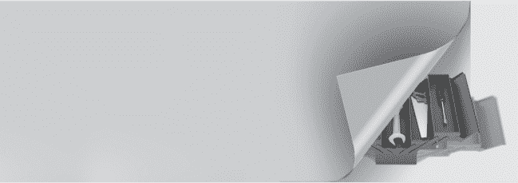

## 第2部分

## 数据汇总、分析和报告

- 第7章 MEANS 和 SUMMARY 过程 233
- 第8章 其他报告和分析过程 257
- 第9章 即使不使用 SAS/GRAPH 也应当了解的 SAS/GRAPH 元素 297
- 第10章 演示图形——不仅仅是 SAS/GRAPH 313
- 第11章 输出交付系统 325


### 第7章：MEANS 和 SUMMARY 过程

- 7.1 使用多个 CLASS 语句和 CLASS 语句选项 234
  - 7.1.1 MISSING 和 DESCENDING 选项 236
  - 7.1.2 GROUPINTERNAL 选项 237
  - 7.1.3 Order= 选项 238
- 7.2 让 SAS 命名输出变量 238
- 7.3 OUTPUT 语句中的统计量指定 240
- 7.4 识别极值 241
  - 7.4.1 使用 MAXID 和 MINID 选项 241
  - 7.4.2 使用 IDGROUP 选项 243
  - 7.4.3 使用百分位数创建子集 245
- 7.5 理解 _TYPE_ 变量 246
- 7.6 使用 CHARTTYPE 选项 248
- 7.7 使用 WAYS 语句控制汇总子集 249
- 7.8 使用 TYPES 语句控制汇总子集 250
- 7.9 使用 CLASSDATA= 和 EXCLUSIVE 选项控制子集 251
- 7.10 使用 COMPLETETYPES 选项 253
- 7.11 使用 LEVELS 和 WAYS 选项识别汇总子集 254
- 7.12 CLASS 语句与 BY 语句 255

MEANS 和 SUMMARY 过程长期以来一直是 Base SAS 的一部分（MEANS 是最初就有的过程），并且这些过程被广泛使用，但许多使用这些过程的用户实际上只利用了其能力的一小部分。这主要是因为相当简单的过程步就能完成大量工作。

随着近期的增强（尤其是在 SAS 8 和 SAS®9 中），MEANS 和 SUMMARY 过程增加了许多额外功能，甚至“经验丰富”的程序员也可能没有接触过它们。本章介绍其中一些更有用的功能。由于这两个过程具有相同的能力且差异很少，本章的大多数示例和文字只重点介绍其中一个。在每种情况下，两个过程中的任意一个都可以使用。

在 SAS 6 之前，MEANS 和 SUMMARY 是能力有重叠的不同过程。目前，无论用户调用哪个过程，后台使用的都是同一软件；因此，它们现在的能力相同。这些过程之间唯一真正的差异体现在默认设置上，并且主要体现在每个过程创建打印表格的方式上。默认情况下，MEANS 总是创建要打印的表格。如果不想要打印表格，必须显式关闭它（NOPRINT 选项）。另一方面，除非特别请求（PRINT 选项），SUMMARY 过程从不创建打印表格。

### 另见

Carpenter（2008）更详细地讨论了这两个过程，包括介绍以及本书未涵盖的其他选项。

#### 7.1 使用多个 CLASS 语句和 CLASS 语句选项

尽管以下关于使用多个 CLASS 语句和 CLASS 语句选项的讨论是在 MEANS 和 SUMMARY 过程的背景下进行的，但它可以推广到大多数使用 CLASS 语句的过程。

```sas
class race sex edu;
```

CLASS 语句可以指定为单个语句，也可以拆分成一系列 CLASS 语句。CLASS 语句的顺序决定分类变量的总体顺序。

```sas
class race sex;
class edu;
```

```sas
class race sex;
class edu / missing;
```

CLASS 语句现在接受选项，并且对于大多数接受 CLASS 语句的过程，单个 CLASS 语句可以被一系列 CLASS 语句替代。这使你可以控制将 CLASS 语句选项应用于特定的分类变量。在 CLASS 语句上，通过在选项前加斜杠来指定一个或多个选项。虽然仅仅为了应用 CLASS 语句选项并不一定需要多个 CLASS 语句，但多个 CLASS 语句允许你以不同方式应用这些选项。例如，当你在 PROC 语句上使用 MISSING 选项时，它应用于所有分类变量。通过使用多个 CLASS 语句并在 CLASS 语句上使用 MISSING 选项，你可以选择哪些分类变量使用 MISSING 选项。

CLASS 语句选项包括：

##### ASCENDING/DESCENDING（第 7.1.1 节）

与 PROC SORT 和其他过程中的 DESCENDING 选项类似，这些选项允许你反转显示值的顺序。

##### GROUPINTERNAL 和 EXCLUSIVE（第 7.1.2 节）

你可以使用这两个选项来控制形成分组时如何使用与 CLASS 变量关联的格式（关于预加载格式的相关主题，参见第 12.1 节）。

##### MISSING（第 7.1.1 节）

分类变量水平缺失的观测通常被排除在分析之外。此选项允许缺失值表示分类变量的有效水平。

##### MLF（第 12.3 节）

多水平格式允许格式化水平重叠。

##### ORDER=（第 7.1.3 节）

此选项允许你控制分类变量水平的顺序。ORDER= 选项将在第 2.6.1 节中更详细地讨论。

##### PRELOADFMT 和 EXCLUSIVE（第 12.1.3 节）

当格式被预加载时，它们可用于在形成分组时建立数据过滤器。

以下示例执行一个简单的 SUMMARY 步骤并生成数据集 STATS。在此步骤中，两个分类变量（RACE 和 EDU）用于汇总两个分析变量（HT 和 WT）的数据。

```sas
title1 '7.1 Single Class Statement';
proc summary data=advrpt.demog;
    class race edu;
    var ht wt;
    output out=stats
        mean= htmean wtmean
        stderr=htse wtse
        ;
run;
proc print data=stats;
run;
```

查看下面的部分列表可以看出，只有 75 个（潜在 77 个中的）观测被用于计算汇总统计量。此时尚不清楚为什么有两个观测被排除在分析之外。

| 观测 | race | edu | \_TYPE\_ | \_FREQ\_ | htmean | wtmean | htse | wtse |
| --- | --- | --- | --- | --- | --- | --- | --- | --- |
| 1 | . | 0 |  | 75 | 67.6000 | 161.200 | 0.40670 | 3.9272 |
| 2 | 10 | 1 |  | 11 | 71.3636 | 194.091 | 0.96552 | 5.7532 |
| 3 | 12 | 1 |  | 19 | 67.0526 | 168.105 | 0.65102 | 6.3628 |
| 4 | 13 | 1 |  | 4 | 70.0000 | 197.000 | 1.15470 | 10.3923 |
| 5 | 14 | 1 |  | 10 | 64.2000 | 108.400 | 0.13333 | 1.4236 |
| 6 | 15 | 1 |  | 7 | 65.2857 | 155.571 | 0.86504 | 11.1160 |
| 7 | 16 | 1 |  | 10 | 70.4000 | 165.200 | 0.54160 | 6.1946 |
| 8 | 17 | 1 |  | 10 | 65.2000 | 145.200 | 0.74237 | 7.9342 |
| 9 | 18 | 1 |  | 4 | 69.0000 | 174.000 | 2.30940 | 15.5885 |
| 10 | 1 | . | 2 | 42 | 68.4762 | 176.143 | 0.58756 | 4.0053 |
| 11 | 2 | . | 2 | 17 | 67.6471 | 162.000 | 0.76668 | 8.1633 |

*... 部分输出未显示 ...*

在接下来的示例中，将使用各种 CLASS 语句选项重复此分析。

### 更多信息

CLASS 语句并不是唯一可以拆分的语句。在 PROC TABULATE 中，VAR 语句和 CLASS 语句通常都会被拆分，以便分配选项；第 8.5.2 节中有一个使用多个 VAR 语句的 PROC PRINT 示例。


##### 7.1.2 GROUPINTERNAL 选项

当分类变量与某个格式关联时，该格式会用于形成分组。在下一个示例中，EDULEVEL 格式将受教育年数映射为教育水平。

```sas
title1 '7.1.2 CLASS Statement Options';
proc format;
    value edulevel
        0-12 = 'High School'
        13-16 = 'College'
        17-high = 'Post Graduate';
run;

title2 'GROUPINTERNAL not used';
proc summary data=advrpt.demog;
    class edu;
    var ht wt;
    output out=stats
        mean= MeanHT MeanWT
        ;
    format edu edulevel.;
run;
proc print data=stats;
run;
```

- 1. EDULEVEL 格式将受教育年数映射为三个范围。
- 2. 在 SUMMARY 步骤中，已使用 FORMAT 语句在 EDU 和 EDULEVEL 格式之间建立关联。
- 3. 未应用 MISSING 选项；因此，EDU 的缺失值不会包含在汇总中。

结果数据表的 PROC PRINT 列表显示，SUMMARY 过程使用该格式将 EDU 的各个水平合并为格式化分类变量的三个水平。

| 观测 | edu | _TYPE_ | _FREQ_ | MeanHT | MeanWT |
|---:|---|---:|---:|---:|---:|
| 1 | . | 0 | 76 | 67.5526 | 160.461 |
| 2 | 高中 | 1 | 30 | 68.6333 | 177.633 |
| 3 | 大学 | 1 | 32 | 67.0938 | 147.438 |
| 4 | 研究生 | 1 | 14 | 66.2857 | 153.429 |

要使用原始数据值（内部值）而不是格式化值来形成分组，可将 GROUPINTERNAL 选项添加到 CLASS 语句中。`class edu/groupinternal;`

| 观测 | edu | _TYPE_ | _FREQ_ | MeanHT | MeanWT |
|---:|---|---:|---:|---:|---:|
| 1 | . | 0 | 76 | 67.5526 | 160.461 |
| 2 | 高中 | 1 | 11 | 71.3636 | 194.091 |
| 3 | 高中 | 1 | 19 | 67.0526 | 168.105 |
| 4 | 大学 | 1 | 4 | 70.0000 | 197.000 |
| 5 | 大学 | 1 | 11 | 64.1818 | 108.091 |
| 6 | 大学 | 1 | 7 | 65.2857 | 155.571 |
| 7 | 大学 | 1 | 10 | 70.4000 | 165.200 |
| 8 | 研究生 | 1 | 10 | 65.2000 | 145.200 |
| 9 | 研究生 | 1 | 4 | 69.0000 | 174.000 |

请注意，尽管使用 EDU 的原始值来形成分组，但显示的仍然是格式化值。在本例中，我们本可以通过使用第 7.1.3 节所示的 ORDER=INTERNAL 选项获得类似结果。

##### 7.1.3 ORDER= 选项

当过程创建有序输出时，通常基于分类变量，可以使用多种不同标准来确定顺序。ORDER= 选项用于建立方案，而方案建立排序标准。ORDER= 选项通常可以出现在 PROC 语句上，此时它适用于所有分类变量（隐式或显式）；也可以作为 CLASS 语句上的选项，此时它可以应用于选定的分类变量。

这些方案包括：

- **DATA** —— 顺序基于传入数据的顺序
- **FORMATTED** —— 先格式化值，再排序
- **FREQ** —— 顺序基于类别水平的频数
- **INTERNAL** —— 与 UNFORMATTED 或 GROUPINTERNAL 相同

默认排序始终是 INTERNAL（无论变量是否已格式化），但 PROC REPORT 除外。在 PROC REPORT 中，格式化变量的默认顺序是 FORMATTED。

在 CLASS 语句上使用 ORDER=FREQ 选项会按最常见的教育水平对表进行排序。

```sas
class edu/order=freq;
```

在此表中，EDU 未格式化。请注意，EDU 各行的顺序基于 FREQ_ 的值。

**7.1.3 CLASS 语句选项**

**使用 ORDER=FREQ**

| 观测 | edu | _TYPE_ | _FREQ_ | MeanHT | MeanWT |
|---:|---|---:|---:|---:|---:|
| 1 | . | 0 | 76 | 67.5526 | 160.461 |
| 2 | 12 | 1 | 19 | 67.0526 | 168.105 |
| 3 | 14 | 1 | 11 | 64.1818 | 108.091 |
| 4 | 10 | 1 | 11 | 71.3636 | 194.091 |
| 5 | 17 | 1 | 10 | 65.2000 | 145.200 |
| 6 | 16 | 1 | 10 | 70.4000 | 165.200 |
| 7 | 15 | 1 | 7 | 65.2857 | 155.571 |
| 8 | 18 | 1 | 4 | 69.0000 | 174.000 |
| 9 | 13 | 1 | 4 | 70.0000 | 197.000 |

#### 7.2 让 SAS 命名输出变量

在第 7.1 节的每个示例中，都明确指定了要计算并写入输出数据集的统计量。但是，并不一定必须指定统计量，也不一定必须为保存计算值的变量提供名称。

##### 未指定统计量的 OUTPUT 语句

当 OUTPUT 语句上未指定统计量时，生成的数据集将包含一组特定的统计量，并且形式会有所不同。统计量不再是一列对应一个统计量，而是以转置形式出现——每个统计量一行。统计量类型在 _STAT_ 列中命名。

此 SUMMARY 步骤使用仅带 OUT= 选项的 OUTPUT 语句。未请求任何统计量；因此，会计算一整套标准统计量（与默认打印统计量列表相同）并将其包含在数据集中。一列（以分析变量命名）保存 _STAT_ 变量下列出的每个统计量的值。

```sas
title1 '7.2 No Statistics Specified';
proc summary data=advrpt.demog;
    class race;
    var ht;
    output out=stats;
run;
```

**7.2 未指定统计量**

| 观测 | race | _TYPE_ | _FREQ_ | _STAT_ | ht |
|---|---:|---:|---:|---:|---:|
| 1 |  | 0 | 76 | N | 76.0000 |
| 2 |  | 0 | 76 | MIN | 62.0000 |
| 3 |  | 0 | 76 | MAX | 74.0000 |
| 4 |  | 0 | 76 | MEAN | 67.6053 |
| 5 |  | 0 | 76 | STD | 3.4989 |
| 6 | 1 | 1 | 42 | N | 42.0000 |
| 7 | 1 | 1 | 42 | MIN | 62.0000 |
| 8 | 1 | 1 | 42 | MAX | 74.0000 |
| 9 | 1 | 1 | 42 | MEAN | 68.4762 |
| 10 | 1 | 1 | 42 | STD | 3.8078 |
|  |  |  |  |  | *……表格的部分内容未显示……* |

虽然这种形式的数据集可能有其用途，但使用时需要小心，因为变量 HT 的每一行包含不同类型的信息。

##### AUTONAME 和 AUTOLABEL 选项

OUTPUT 语句一直使用选项来命名汇总数据集（OUT=），并且通常还命名感兴趣的汇总统计量（例如 MEAN=、N=、MAX=）。第二类选项可以放在 OUTPUT 语句上。这些选项位于 OUTPUT 语句中的斜杠（/）之后，包括：

- **AUTONAME** —— 允许 MEANS 和 SUMMARY 确定所生成变量的名称
- **AUTOLABEL** —— 允许 MEANS 和 SUMMARY 为每个生成的变量提供标签
- **LEVELS** —— 向汇总数据集添加 _LEVELS_ 列（见第 7.11 节）
- **WAYS** —— 向汇总数据集添加 _WAYS_ 列（见第 7.11 节）

当在 OUTPUT 语句上请求某个统计量时，它生成的变量默认使用 VAR 语句中对应分析变量的名称。由于使用默认名称只能生成一个统计量，因此当请求两个或更多统计量时，如果使用默认命名，就会发生命名冲突。因此，下面的 PROC SUMMARY 会因为新数据集 STATS 中的命名冲突而失败。实际上它只是部分失败，这可能更糟。LOG 中会产生错误，但仍会生成部分表。

```sas
proc summary
   data=advrpt.demog;
   class race;
   var ht;
   output out=stats
      n=
      mean=
      stderr=
   ;
run;
```

AUTONAME 选项允许选择多个统计量，而无需为 OUTPUT 表中的结果变量指定名称。生成的名称是唯一的，因此消除了命名冲突。类似地，AUTOLABEL 选项为添加到 OUT= 数据集中的变量创建标签，该标签基于分析变量现有的标签。

```sas
output out=stats
   n=
   mean=
   stderr=/autoname
   ;
```

方便的是，生成的变量名既合理又可预测，形式为 variable_statistic。

**7.2 使用 AUTONAME**

| Obs | race | _TYPE_ | _FREQ_ | ht_N | ht_Mean | ht_Std Err |
| --- | --- | --- | --- | --- | --- | --- |
| 1 | 0 | 1 | 76 | 76 | 67.6053 | 0.40135 |
| 2 | 1 | 1 | 42 | 42 | 68.4762 | 0.58756 |
| 3 | 2 | 1 | 18 | 18 | 67.6667 | 0.72310 |
| 4 | 3 | 1 | 8 | 8 | 65.0000 | 0.65465 |
| 5 | 4 | 1 | 4 | 4 | 64.5000 | 0.28868 |
| 6 | 5 | 1 | 4 | 4 | 66.5000 | 0.86603 |

#### 7.3 在 OUTPUT 语句上指定统计量

当基于 OUTPUT 语句上指定的统计量创建变量时，有多种方式可以命名变量，并将结果变量与原始分析变量关联起来。

```sas
var ht wt;
output out=stats
   n = n_ht n_wt
   mean= mean_HT MEAN_WT
   ;
```

左侧展示了指定统计量并命名所生成变量的最传统方式。指定统计量的选项（此处显示 N= 和 MEAN=）后面跟一个变量列表。这种形式要求程序员确保分析变量列表和保存所选统计量值的新变量列表处于相同位置和顺序。这种形式的缺点包括：

- 统计量的顺序与分析变量的顺序绑定。
- 必须为每个分析变量生成一个统计量；也就是说，为了计算 WT 的均值，还必须计算 HT 的均值（因为 HT 在 VAR 语句中排在第一位）。

```sas
var ht wt;
output out=stats
   n(wt) = n wt ❶
   mean(wt ht) = mean_WT MEAN_HT ❷
   ;
```

这并不是指定统计量及其关联变量的唯一方式，甚至不一定是最实用的方式。分析变量列表可以放在括号中，作为统计量的一部分

选项。这允许您指定分析变量 **1** 的一个子集，如此处使用 N 统计量所做的那样。您还可以使用此技术控制分析变量 **2** 的使用顺序。

也可以拆分所需统计量的指定。一个给定的统计量可以指定多次，每次使用不同的分析变量。这种选项指定形式为您提供了相当大的灵活性，不仅可以控制哪些统计量将针对哪些分析变量计算，还可以控制结果数据集上所生成变量的顺序。

```sas
var ht wt;
output out=stats
        n(wt) = n_wt
        mean(wt) = mean_WT
        n(ht) = n_ht
        mean(ht) = Mean_HT
        ;
```

对左侧 OUTPUT 语句生成的数据集 WORK.STATS 执行 PROC PRINT 会显示变量顺序。您可能还会注意到，SAS 会记住变量名首次定义时的大小写：是 Mean_HT，而不是 mean_WT。

**7.3 拆分 Stat(variables)=**

| Obs | race | _TYPE_ | _FREQ_ | n_wt | mean_WT | n_ht | Mean_HT |
| --- | --- | --- | --- | --- | --- | --- | --- |
| 1 | 0 | 0 | 76 | 76 | 162.237 | 76 | 67.6053 |
| 2 | 2 | 1 | 42 | 42 | 176.143 | 42 | 68.4762 |
| 3 | 3 | 1 | 18 | 18 | 166.333 | 18 | 67.6667 |
| 4 | 3 | 1 | 8 | 8 | 112.000 | 8 | 65.0000 |
| 5 | 4 | 1 | 4 | 4 | 113.500 | 4 | 64.5000 |
| 6 | 5 | 1 | 4 | 4 | 147.000 | 4 | 66.5000 |

在给定的 PROC 步骤中也可以指定多个 OUTPUT 语句。每个 OUTPUT 语句可以具有不同的统计量组合。

#### 7.4 识别极值

处理数据时，希望能够识别包含分析变量最高值或最低值的观测，这完全不足为奇。这些极值会在 PROC UNIVARIATE 输出中自动显示，但在 MEANS 和 SUMMARY 过程中必须请求才会显示。

虽然 MIN 和 MAX 统计量显示极值，但它们并不标识包含该极值的观测。幸运的是，有几种方法可以标识包含 MAX 或 MIN 的观测。

##### 7.4.1 使用 MAXID 和 MINID 选项

OUTPUT 语句中的 MAXID 和 MINID 选项可用于标识具有最大值和最小值的观测（本节示例针对 MAXID；不过，MINID 具有相同的语法）。该选项的一般形式为：

```sas
MAXID(analysis_var_list(ID_var_list))=new_var_list
```

在以下示例中，MAXID 选项用于标识对于任意分类变量的每个值，哪些受试者具有最大值。此选项允许我们向 OUTPUT 数据集添加一个新变量，该变量取最大观测的 ID 变量的值。

```sas
title1 '7.4.1a Using MAXID';
title2 'One Analysis Variable';
proc summary data=advrpt.demo;
    class race;
    var ht;
    output out=stats
        mean=meanHT
        max=maxHt ❶
        maxid(ht (subject))=maxHtSubject ❷
        ;
run;
proc print data=stats;
    run;
```

对每个 RACE 请求分析变量 HT 的最大值 ❶。我们还希望知道哪个 SUBJECT 具有最大 HT ❷（受试者编号将存储在变量 MAXHTSUBJECT 中）。

使用与上一节讨论相同的通用选项语法，此示例中展示的 MAXID 选项语法有几种变体。在本例中，只有一个分析变量和一个 ID 变量。

**7.4.1a 使用 MAXID**

**一个分析变量**

| Obs | race | _TYPE_ | _FREQ_ | meanHT | maxHt | maxHtSubject |
| --- | --- | --- | --- | --- | --- | --- |
| 1 |  | 0 | 76 | 67.6053 | 74 | 209 |
| 2 | 1 | 1 | 42 | 68.4762 | 74 | 209 |
| 3 | 2 | 1 | 18 | 67.6667 | 72 | 201 |
| 4 | 3 | 1 | 8 | 65.0000 | 68 | 215 |
| 5 | 4 | 1 | 4 | 64.5000 | 65 | 244 |
| 6 | 5 | 1 | 4 | 66.5000 | 68 | 212 |

当有多个分析变量时，可以按照第 7.3 节讨论的相同语法规则扩展 MAXID 语句。

在本例中，将显示研究中最高和最重受试者的受试者编号。

```sas
var ht wt;
output out=stats
        mean= meanHT MeanWT
        max=maxHt maxWt
        maxid(ht(subject) wt(subject))=maxHtSubject MaxWtSubject
        ;
```

**7.4.1b 使用 MAXID**

**两个分析变量**

| Obs | race | _TYPE_ | _FREQ_ | meanHT | MeanWT | maxHt | maxWT | maxHtSubject | MaxWtSubject |
| --- | --- | --- | --- | --- | --- | --- | --- | --- | --- |
| 1 |  | 0 | 76 | 67.6053 | 162.237 | 74 | 240 | 209 | 203 |
| 2 | 1 | 1 | 42 | 68.4762 | 176.143 | 74 | 215 | 209 | 208 |
| 3 | 2 | 1 | 18 | 67.6667 | 166.333 | 72 | 240 | 201 | 203 |
| 4 | 3 | 1 | 8 | 65.0000 | 112.000 | 68 | 133 | 215 | 215 |
| 5 | 4 | 1 | 4 | 64.5000 | 113.500 | 65 | 115 | 244 | 230 |
| 6 | 5 | 1 | 4 | 66.5000 | 147.000 | 68 | 147 | 212 | 211 |

由于 OUTPUT 语句中选项结构具有灵活性，前面的 MAXID 选项也可以写成：

```sas
var ht wt;
output out=stats
   mean= meanHT MeanWT
   max=maxHT maxWT
   maxid(ht(subject))=maxHtSubject
   maxid(wt(subject))=maxWtSubject
;
```

当需要多个变量来标识具有极值的观测时，MAXID 支持列表。与之前指定列表时一样，两个列表（ID 变量列表和生成变量列表）之间存在一一对应关系。在此 OUTPUT 语句中，SUBJECT 和 SSN 都用于标识变量列表。因此，在汇总数据集中会为每个标识变量创建一个新变量。

```sas
var ht wt;
output out=stats
   mean= meanHT MeanWT
   max=maxHT maxWT
   maxid(ht(subject ssn))= MaxHtSubject MaxHtSSN
   maxid(wt(subject ssn))= MaxWtSubject MaxWtSSN
;
```

##### 7.4.2 使用 IDGROUP 选项

MAXID 和 MINID 选项只允许捕获单个极值。也可以使用 IDGROUP 选项显示一组极值。

与 MAXID 和 MINID 选项一样，此选项允许您捕获最大值或最小值以及关联的 ID 变量。然而更重要的是，您可以选择的不只是单个极值。

```sas
proc summary data=advrpt.demog;
   class race;
   var wt;
   output out=stats
      mean= MeanWT
      max(wt)=maxWT ❶
      idgroup (max(wt) out[2] (subject sex)=maxsubj) ❷❸❹
      ;
run;
```

在本例中，使用 MAX 统计量请求了最大 WT ❶。此外，还请求了 IDGROUP 选项，以标识具有最大 WT ❹ 值的两个 ❷ 个体（通过 SUBJECT 和 SEX ❸ 标识）。

❶ 将保存最大体重对应 SUBJECT 编号的变量名前缀是 MAXSUBJ。由于 SEX 没有对应的前缀，将使用原始变量作为前缀。由于我们只有一个分析变量，因此不会出现命名冲突；但是，通常应避免不指定新变量的名称。即使启用了 /AUTONAME 选项，对于仅中等复杂且未命名新变量的 IDGROUP 选项，也可能出现命名冲突。

由于我们请求了前两个 ❷ 值，这些值会写入 MAXSUBJ_1、MAXSUBJ_2、SEX_1 和 SEX_2。请注意，表示相对位置的数字会追加到变量名后。在本例中，我们可以看到研究中第二重的受试者编号为 236，SEX 为 M。

**7.4.2a 使用 IDGROUP**

| Obs | race | _TYPE_ | _FREQ_ | MeanWT | maxWT | maxsubj_1 | maxsubj_2 | sex_1 | sex_2 |
| --- | --- | --- | --- | --- | --- | --- | --- | --- | --- |
| 1 | 0 |  | 76 | 162.237 | 240 | 203 | 236 | M | M |
| 2 | 1 | 1 | 42 | 176.143 | 215 | 208 | 216 | M | M |
| 3 | 2 | 1 | 18 | 166.333 | 240 | 203 | 236 | M | M |
| 4 | 3 | 1 | 8 | 112.000 | 133 | 215 | 256 | M | M |
| 5 | 4 | 1 | 4 | 113.500 | 115 | 230 | 240 | F | F |
| 6 | 5 | 1 | 4 | 147.000 | 147 | 211 | 212 | M | M |

IDGROUP 中对 MAX 的请求实际上独立于在 ❶ 处发出的 MAX= 请求。

在前一个示例中，我们能够看到第二重的受试者是谁，但由于我们使用了 MAX 选项，而该选项只显示一个值——最重的值，因此我们无法看到第二重个体的体重。对 IDGROUP 选项稍作修改，这个问题就会消失。

在以下示例中，我们希望标识每个组内最年长的两个个体

```sas
proc summary data=advrpt.demog;
   class race;
   var dob;
   output out = stats
      idgroup (min(dob)out[2] (dob ❸ subject sex)=
         MinDOB OldestSubj OldestGender)
   ;
run;
```

（DOB 的最小值）。由于我们希望查看最年长的两个个体各自的出生日期，因此已将 DOB ❸ 包含在 ID 变量列表中。请注意，原本只会显示一个 DOB 的 MIN 统计量完全没有使用。

**7.4.2b 使用 IDGROUP 并包含分析变量**

| Obs | race | _TYPE_ | _FREQ_ | MinDOB_1 | MinDOB_2 | OldestSubj_1 | OldestSubj_2 | OldestGender_1 | OldestGender_2 |
| --- | --- | --- | --- | --- | --- | --- | --- | --- | --- |
| 1 | 0 |  | 76 | 03NOV21 | 05NOV24 | 252 | 269 | M | M |
| 2 | 1 | 1 | 42 | 03NOV21 | 05NOV24 | 252 | 269 | M | M |
| 3 | 2 | 1 | 18 | 15JAN34 | 15AUG34 | 203 | 236 | M | M |
| 4 | 3 | 1 | 8 | 02JUL46 | 11JUN47 | 234 | 268 | F | F |
| 5 | 4 | 1 | 4 | 13FEB48 | 28FEB49 | 230 | 240 | F | F |
| 6 | 5 | 1 | 4 | 18FEB51 | 18JUN51 | 212 | 214 | M | M |

## 另请参阅

IDGROUP 选项在 King 和 Zdeb（2010）中用于转置数据。它还在 SAS 论坛帖子 http://communities.sas.com/message/102002 的一个取子集问题中使用。


##### 7.4.3 使用百分位数创建子集

百分位数统计量可用于为潜在的异常值边界创建搜索界限。可用的百分位数统计量包括 1% 和 5% 的边界。在本例中，我们想知道是否有任何观测值落在 1% 百分位数之外。

```sas
title1 '7.4.3 Using Percentiles';
proc summary data=advrpt.lab_chemistry;
    var potassium;
    output out=stats
        p1= /autoname ❶
        p99= /autoname;
    run;

data chkoutlier;
    set stats(keep=potassium_p1 potassium_p99); ❷
    do until (done);
        set advrpt.lab_chemistry ❸
            (keep=subject visit potassium)
            end=done; ❹
        if potassium_p1 ge potassium
            or potassium ge potassium_p99 ❺
            then output chkoutlier;
    end; ❻
run;
options nobyline; ❼
proc print data=chkoutlier;
    by potassium_p1 potassium_p99; ❽
    title2 'Potassium 1% Bounds are #byval1, #byval2'; ❾
run;
```

- 1. ❶ 第 1 和第 99 百分位数被计算并保存到数据集 STATS 中。
- 2. ❷ WORK.STATS 的单条观测被添加到程序数据向量（PDV）中。
- 3. ❸ 在 DO UNTIL 循环中，每次读入分析数据的一行。SET 语句上的 END= 选项创建数值型 0/1 变量 DONE，用于结束循环。
- 4. ❹ 检查当前 POTASSIUM 读数是否高于或低于第 1 和第 99 百分位数。
- 5. ❺ 没有使用 STOP 语句。虽然 SET 语句位于 DO UNTIL 循环内，但不需要 STOP，因为来自 STATS 数据集的所有观测已被读取。
- 6. ❻ NOBYLINE 系统选项从 PRINT 生成的表中删除 BY 变量的值。
- 7. ❼ 使用 BY 语句，以便将值载入 TITLE 语句中的 #BYVAL 选项。
- 8. ❽ 由于边界是常量，使用 #BYVAL 选项将其放入标题中。通常 TITLE 语句放在 PROC 步骤之外；不过为了更加清晰，当我使用 #BYVAR 和 #BYVAL 选项时，我倾向于将 TITLE 语句移到 BY 语句之后。

### 更多信息

TITLE 语句选项 #BYVAL 将在 15.1.2 节中介绍。

#### 7.5 理解 _TYPE_ 变量

自动包含在汇总数据集中的变量之一是 `_TYPE_`。默认情况下这是一个数值变量，可用于帮助跟踪汇总级别，并区分统计量组。然而，要预测其值并非直观明显。

```sas
proc summary
    data=advrpt.demog
        (where=(race in ('1','4')
                & 12 le edu le 15
                & symp in ('01','02','03')))
    ;
    class race edu symp;
    var ht;
    output out=stats
           mean= meanHT
    ;
run;
```

在此 SUMMARY 步骤中，CLASS 语句中有三个变量（RACE、EDU 和 SYMP）。

查看数据集 STATS 的列表可以发现，`_TYPE_` 的取值范围是 0 到 7（8 个不同值）。`_TYPE_`=0 对应于汇总整个数据集的那一行（忽略所有三个分类变量），而 `_TYPE_`=7 汇总所有三个分类变量的交互作用（使用所有三个分类变量）。`_TYPE_` 的其余值表示分类变量的其他组合，具体取决于哪些变量被使用、哪些被忽略。

| Obs | race | edu | symp | `_TYPE_` | `_FREQ_` | mean HT |
|---:|---:|---:|---:|---:|---:|---:|
| 1 | . | . | . | 0 | 8 | 66.25 |
| 2 | . | . | 01 | 1 | 2 | 64.00 |
| 3 | . | . | 02 | 1 | 4 | 66.50 |
| 4 | . | . | 03 | 1 | 2 | 68.00 |
| 5 | . | 12 | . | 2 | 4 | 67.50 |
| 6 | . | 14 | . | 2 | 2 | 64.00 |
| 7 | . | 15 | . | 2 | 2 | 66.00 |
| 8 | . | 12 | 02 | 3 | 2 | 67.00 |
| 9 | . | 12 | 03 | 3 | 2 | 68.00 |
| 10 | . | 14 | 01 | 3 | 2 | 64.00 |
| 11 | . | 15 | 02 | 3 | 2 | 66.00 |
| 12 | 1 | . | . | 4 | 6 | 67.00 |
| 13 | 4 | . | . | 4 | 2 | 64.00 |
| 14 | 1 | . | 02 | 5 | 4 | 66.50 |
| 15 | 1 | . | 03 | 5 | 2 | 68.00 |
| 16 | 4 | . | 01 | 5 | 2 | 64.00 |
| 17 | 1 | 12 | . | 6 | 4 | 67.50 |
| 18 | 1 | 15 | . | 6 | 2 | 66.00 |
| 19 | 4 | 14 | . | 6 | 2 | 64.00 |
| 20 | 1 | 12 | 02 | 7 | 2 | 67.00 |
| 21 | 1 | 12 | 03 | 7 | 2 | 68.00 |
| 22 | 1 | 15 | 02 | 7 | 2 | 66.00 |
| 23 | 4 | 14 | 01 | 7 | 2 | 64.00 |

下表总结了上面 LISTING 中这三个分类变量的八种可能组合。在分类变量下方，0 表示计算汇总统计量时忽略该分类变量的水平，1 表示使用该分类变量。将这些 0 和 1（分别代表每个分类变量）放在一起，就构成一个 3 位二进制数（三个分类变量每位对应一个数字）。当此二进制值转换为十进制时，结果就是 `_TYPE_`。

**分类变量**

| 观测编号 | RACE | EDU | SYMP | 二进制值 | `_TYPE_` |
|---|---|---|---|---|---|
| 1 | 0 | 0 | 0 | 000 | 0 |
| 2 - 4 | 0 | 0 | 1 | 001 | 1 |
| 5 - 7 | 0 | 1 | 0 | 010 | 2 |
| 8 - 11 | 0 | 1 | 1 | 011 | 3 |
| 12 - 13 | 1 | 0 | 0 | 100 | 4 |
| 14 - 16 | 1 | 0 | 1 | 101 | 5 |
| 17 - 19 | 1 | 1 | 0 | 110 | 6 |
| 20 - 23 | 1 | 1 | 1 | 111 | 7 |
|  | 2²=4 | 2¹=2 | 2⁰=1 |  |  |

将二进制数转换为十进制需要用到 2 的幂。二进制值 110 = 1*2² + 1*2¹ + 0*2⁰ = 1*4 + 1*2 + 0*1 = 6 = `_TYPE_`。

NWAY 选项将输出数据集限制为最高阶交互，因此只会显示 `_TYPE_` 的最高值。

### 更多信息

有趣的是，一些 SAS 程序员觉得将二进制数转换成十进制数很不方便。CHARTYPE 选项（参见 7.6 节）则使得这种转换不再必要。

#### 7.7 使用 WAYS 语句

| Obs | race | edu | symp | `_TYPE_` | `_FREQ_` | mean HT |
|---:|---:|---:|---:|---:|---:|---:|
| 1 |  | . |  | 0 | 8 | 66.25 |
| 2 |  | 12 | 02 | 3 | 2 | 67.00 |
| 3 |  | 12 | 03 | 3 | 2 | 68.00 |
| 4 |  | 14 | 01 | 3 | 2 | 64.00 |
| 5 |  | 15 | 02 | 3 | 2 | 66.00 |
| 6 | 1 | . | 02 | 5 | 4 | 66.50 |
| 7 | 1 | . | 03 | 5 | 2 | 68.00 |
| 8 | 4 | . | 01 | 5 | 2 | 64.00 |
| 9 | 1 | 12 | . | 6 | 4 | 67.50 |
| 10 | 1 | 15 | . | 6 | 2 | 66.00 |
| 11 | 4 | 14 | . | 6 | 2 | 64.00 |

#### 7.8 使用 TYPES 语句控制汇总子集

与 WAYS 语句类似，TYPES 语句可用于选择和限制数据的汇总汇总。额外的好处是，TYPES 语句在很大程度上免除了理解和使用 `_TYPE_` 自动变量的需要。WAYS 语句（参见 7.7 节）列出所需的汇总级别，而 TYPES 则指定具体的汇总级别（效应和交互作用）。

```sas
proc summary data=advrpt.demog
            (where=(race in ('1','4')
                   & 12 le edu le 15
                   & symp in('01','02','03')));
class race edu symp;
var ht;
types edu race*symp;
output out=stats
       mean= meanHT
       ;
run;
```

此处使用的 TYPES 语句明确要求仅计算 EDU 的主效应以及 RACE 与 SYMP 之间的交互作用的统计量。其他任何效应或汇总都不会被计算。

#### 7.8 使用 TYPES 语句

| Obs | race | edu | symp | `_TYPE_` | `_FREQ_` | mean HT |
|---:|---:|---:|---:|---:|---:|---:|
| 1 |  | 12 |  | 2 | 4 | 67.5 |
| 2 |  | 14 |  | 2 | 2 | 64.0 |
| 3 |  | 15 |  | 2 | 2 | 66.0 |
| 4 | 1 | . | 02 | 5 | 4 | 66.5 |
| 5 | 1 | . | 03 | 5 | 2 | 68.0 |
| 6 | 4 | . | 01 | 5 | 2 | 64.0 |

对于以下 CLASS 语句：

```sas
class race edu symp;
```

TYPES 语句的变体还可以包括：

- `types ();` — 总体汇总
- `types race*edu symp;` — 两个二因子交互作用
- `types race*(edu symp);` — 两个二因子交互作用
- `types race*edu*symp;` — 三因子交互作用 — 与 NWAY 相同

#### 7.9 使用 CLASSDATA= 和 EXCLUSIVE 选项控制子集

WAYS 和 TYPES 语句控制要汇总的分类变量的组合，同时，你也可以通过创建包含所需组合和水平的数据集，来指定分类变量的哪些水平将出现在报告或输出数据集中。该数据集甚至可以包含数据本身不存在的分类变量水平，但这些水平仍要出现在数据集或报告中。

```sas
data setlevels (keep=race edu symp);
  set advrpt.demog
        (where=(race in ('1','4')
                & 12 le edu le 15
                & symp in('01','02','03')));
  output;
  * For fun, make some nonexistent levels;
  if _n_=1 then do;
    edu=0;
    race='0';
    symp='00';
    output;
  end;
run;
```

此 DATA 步骤构建了一个将与 CLASSDATA= 选项一起使用的数据集。作为演示，它还针对每个分类变量添加了一个数据中并不存在的水平。

**显示 SETLEVELS 数据**

| Obs | race | edu | symp |
|---:|---:|---:|---:|
| 1 | 0 | 0 | 00 |
| 2 | 1 | 12 | 02 |
| 3 | 1 | 12 | 03 |
| 4 | 1 | 15 | 02 |
| 5 | 4 | 14 | 01 |

用 CLASSDATA 选项指定的数据集，成为进入分析的数据的复杂过滤器。

CLASSDATA= 选项可以与 EXCLUSIVE 选项搭配使用，从而彻底改变可用于该过程的观测值。当不使用 EXCLUSIVE 选项时，存在于分析数据中或 CLASSDATA= 数据集中的分类变量的所有水平都会包含在汇总数据集中。由于我们特意为每个分类变量包含了一个数据中不存在的水平，因此应该会看到这些水平在汇总数据集中被汇总。

```sas
proc summary data=advrpt.demog
             classdata=setlevels;
  class race edu symp;
  var ht;
  output out=stats mean= meanHT;
run;
```


**不带 EXCLUSIVE 的 CLASSDATA**

| Obs | race | edu | symp | _TYPE_ | _FREQ_ | meanHT |
|---|---|---|---|---|---|---|
| 1 | . | . | 0 |  | 63 | 67.2381 |
| **2** | . | . | 00 | 1 | 0 | . |
| 3 | . | 01 | 1 | 4 |  | 67.5000 |
| 4 | . | 02 | 1 | 10 |  | 66.8000 |
| ... | ... | ... | ... | ... | ... | ... |

在正在汇总的数据中，变量 SYMP 从未取值为 '00'，但由于它是 CLASSDATA= 数据集中 SYMP 的一个值，因此它会出现在汇总数据中。

当 EXCLUSIVE 选项与 CLASSDATA= 选项一起使用时，汇总数据集的构成可能会发生显著变化。EXCLUSIVE 选项强制只有 CLASSDATA= 数据集中存在的水平才会出现在汇总报表中。这包括数据集中不存在的分类变量水平。

```sas
proc summary data=advrpt.demog
    classdata=selectlevels
    exclusive;
    class race edu symp;
    var ht;
    output out=stats mean= meanHT;
run;
```

#### 7.9 使用 CLASSDATA 和 EXCLUSIVE 选项

| Obs | race | edu | symp | _TYPE_ | _FREQ_ | meanHT |
|---|---|---|---|---|---|---|
| 1 | . | . | 0 |  | 8 | 66.25 |
| **2** | . | . | 00 | 1 | 0 | . |
| 3 | . | 01 | 1 | 2 |  | 64.00 |
| 4 | . | 02 | 1 | 4 |  | 66.50 |
| 5 | . | 03 | 1 | 2 |  | 68.00 |
| **6** | . | 0 | 2 |  | 0 | . |
| 7 | 12 | . | 2 | 4 |  | 67.50 |
| 8 | 14 | . | 2 | 2 |  | 64.00 |
| 9 | 15 | . | 2 | 2 |  | 66.00 |
| ... | ... | ... | ... | ... | ... | ... |

观测 2 和 6 的汇总行表示数据中不存在的分类变量水平。它们是通过 CLASSDATA= 数据集与 EXCLUSIVE 选项组合生成的。

通过使用这两个选项，我们能够为分类变量创建精细的筛选器。这种组合不仅使我们能够删除水平，还能添加水平。

在运行时添加水平而不修改分析数据集的能力具有一些潜在巨大优势。首先，我们可以通过更改 CLASSDATA= 数据集来修改筛选器，而无需更改使用该数据集的程序。其次，我们无需在分析前对数据执行“稀疏化”（有关其他稀疏化技术，请参见第 2.5 节），从而提高程序效率。

### 更多信息

CLASSDATA= 和 EXCLUSIVE 选项也可在 TABULATE 过程中使用（参见第 8.1.4 节）。

#### 7.10 使用 COMPLETETYPES 选项

分类变量的所有组合可能并不都存在于数据中，因此这些组合不会出现在汇总表中。如果需要所有可能的组合，无论它们是否存在于数据中，都可以在 PROC 语句上使用 COMPLETETYPES 选项。

```sas
proc summary data=advrpt.demog
                (where=(race in('1','4')
                       & 12 le edu le 15
                       & symp in('01','02','03')));
   class race edu symp;
   var ht;
   output out=stats mean= meanHT;
run;
```

在数据（ADVRPT.DEMOG）中，没有同时满足 EDU=12 和 SYMP='01' 的观测；但是，由于这两个水平都存在于数据中的某处（单独存在或与另一个分类变量组合存在），COMPLETETYPES 选项会使该组合出现在汇总数据集中（obs=8）。

**7.10 使用 COMPLETETYPES 选项**

| Obs | race | edu | symp | _TYPE_ | _FREQ_ | meanHT |
|---:|---:|---:|---:|---:|---:|---:|
| 1 | . | . |  | 0 | 8 | 66.25 |
| 2 | . | 01 |  | 1 | 2 | 64.00 |
| 3 | . | 02 |  | 1 | 2 | 66.50 |
| 4 | . | 03 |  | 1 | 2 | 68.00 |
| 5 | 12 | . |  | 2 | 4 | 67.50 |
| 6 | 14 | . |  | 2 | 4 | 64.00 |
| 7 | 15 | . |  | 2 | 2 | 66.00 |
| 8 | 12 | 01 |  | 3 | 0 | . |
| 9 | 12 | 02 |  | 3 | 2 | 67.00 |
| 10 | 12 | 03 |  | 3 | 2 | 68.00 |
| 11 | 14 | 01 |  | 3 | 2 | 64.00 |
| 12 | 14 | 02 |  | 3 | 0 | . |
| 13 | 14 | 03 |  | 3 | 0 | . |
| 14 | 15 | 01 |  | 3 | 0 | . |
| 15 | 15 | 02 |  | 3 | 2 | 66.00 |

... 表中部分内容未显示 ...

### 更多信息

第 2.5.3 节也使用 COMPLETETYPES 来创建稀疏数据。

REPORT 和 TABULATE 过程也能够显示不存在的组合。有关 TABULATE 的示例，请参见第 8.1 节。预加载格式也可用于类似目的，有关 MEANS、SUMMARY、TABULATE 和 REPORT 过程的示例，请参见第 12.1 节。

#### 7.11 使用 LEVELS 和 WAYS 选项识别汇总子集

LEVELS 和 WAYS 是可在 OUTPUT 语句上使用的选项。它们分别将变量 _LEVEL_ 和 _WAY_ 添加到生成的数据表中。这些变量可以一起使用或单独使用，以帮助浏览汇总数据集。

```sas
proc summary data=advrpt.demog;
   class race edu;
   var ht;
   output out=stats
          mean= meanHT /levels ❶
                         ways; ❷
run;
```

LEVELS 选项 ❶ 将变量 _LEVEL_ 添加到 OUT= 数据表中。这个数值变量包含给定 _TYPE_ 值内各行的顺序计数器。在处理 _TYPE_ 内的行时，这可能很有用。_TYPE_ 和 _LEVEL_ 的组合不仅为新数据集形成唯一排序键，而且为了进一步取子集和后续汇总，当 FIRST._TYPE_ 为真时，_LEVEL_ 必然等于 1。

WAYS 选项 ❷ 将变量 _WAY_ 添加到 OUT= 数据表中。这个数值变量等于用于计算每个观测的分类变量个数。两个分类变量之间的双向交互将具有 _WAY_=2。

| Obs | race | edu | _WAY_ | _TYPE_ | _LEVEL_ | _FREQ_ | meanHT |
|-----|------|-----|-------|--------|---------|--------|--------|
| 1 | . | . | 0 | 0 | 1 ❶ | 75 | 67.6000 |
| 2 | . | 10 | 1 | 1 | 1 | 11 | 71.3636 |
| 3 | . | 12 | 1 | 1 | 2 | 19 | 67.0526 |
| 4 | . | 13 | 1 | 1 | 3 | 4 | 70.0000 |
| 5 | . | 14 | 1 | 1 | 4 | 10 | 64.2000 |
| 6 | . | 15 | 1 | 1 | 5 | 7 | 65.2857 |
| 7 | . | 16 | 1 | 1 | 6 | 10 | 70.4000 |
| 8 | . | 17 | 1 | 1 | 7 | 10 | 65.2000 |
| 9 | . | 18 | 1 | 1 | 8 | 4 | 69.0000 |
| 10 | 1 | . | 1 | 2 | 1 | 42 | 68.4762 |
| 11 | 2 | . | 1 | 2 | 2 | 17 | 67.6471 |
| 12 | 3 | . | 1 | 2 | 3 | 8 | 65.0000 |
| 13 | 4 | . | 1 | 2 | 4 | 4 | 64.5000 |
| 14 | 5 | . | 1 | 2 | 5 | 4 | 66.5000 |
| 15 | 1 | 10 | 2 | 3 | 1 | 11 | 71.3636 |
| 16 | 1 | 12 | 2 | 3 | 2 | 16 | 67.2500 |
| 17 | 1 | 13 | 2 | 3 | 3 | 4 | 70.0000 |
| 18 | 1 | 15 | 2 | 3 | 4 | 5 | 64.2000 |
| 19 | 1 | 16 | 2 | 3 | 5 | 2 | 71.0000 |
| 20 | 1 | 17 | 2 | 3 | 6 | 2 | 63.0000 |

*... 表中部分内容未显示 ...*

#### 7.12 CLASS 语句与 BY 语句

尽管 CLASS 和 BY 语句通常会产生相似的结果，但用户应了解这两个语句在性能和功能上的差异。

从一般操作来看，BY 语句要求输入数据已排序。在数据已排序的情况下，数据按 BY 组处理——一次处理一组。与使用 CLASS 语句时相比，这需要更少的内存和处理资源。但是，当数据尚未排序时，对数据本身进行排序通常会超过 BY 语句的性能优势。

使用 CLASS 语句时，可以计算分类变量之间任意可能的交互作用。使用 BY 组处理时则无法做到这一点。我们可以在 BY 变量的每个唯一组合内检查统计量，但不能跨 BY 变量检查。

当分类变量取缺失值时，整个观测会从分析中删除（有关使用 MISSING 选项改变此行为的信息，请参见第 7.1.1 节）。BY 变量的缺失水平被视为有效水平，不会被消除。

由于 MEANS 和 SUMMARY 过程允许多线程处理，如果你在服务器或具有多个 CPU 的机器上执行 SAS，你可能会看到使用 BY 语句与 CLASS 语句时的性能差异。该过程将对两种汇总类型都利用多线程；但是，其内部实现不一定相同。你可能想在自己的系统上做一些实验。


- 4.8.10 有条件执行 LINE 语句 290
- **8.5 使用 PROC PRINT** 291
  - 8.5.1 同时使用 ID 和 BY 语句 291
  - 8.5.2 将 STYLE= 选项与 PROC PRINT 一起使用 292
  - 8.5.3 使用 PROC PRINT 生成目录 295

许多 Base SAS 过程提供了多种分析和汇总技术。尽管有些过程具有相似的能力，但每个过程也都有一些独特的功能。其中一些功能依赖于较新的选项或较少使用的语句。本章将讨论其中一些选项和语句。

### 更多信息

MEANS 和 SUMMARY 过程在第 7 章中讨论。

### 另见

Cynthia Zender（2008）讨论了许多用于生成复杂报告的技术。

#### 8.1 扩展 PROC TABULATE

多年来，PROC TABULATE 一直让该过程的新用户感到困惑。实际上，不仅仅是新用户，任何刚接触 TABULATE 的用户都会如此。这在很大程度上是因为 TABLE 语句——该过程的主要语句——的构造方式与任何其他过程语句都不同。理解 TABLE 语句的结构是成功编写 TABULATE 步骤的关键。幸运的是，构成 TABLE 语句主要语法结构的构建块并不难掌握。一旦理解了基础知识，就能更成功地处理更复杂的主题。

### 另见

关于此过程的权威必备参考书是 Lauren Haworth 1999 年的著作*《PROC TABULATE 实例》*。此外，Dianne Rhodes（2005）非常清晰地解释了 TABULATE 的起源以及 TABLE 语句各元素之间的关系。Carpenter（2010a）不仅介绍了 TABULATE 的入门元素，还讨论了许多本书未涵盖的高级技术。

##### 8.1.1 入门需要了解的内容

与大多数过程一样，PROC TABULATE 有许多语句用于定义该过程如何汇总数据。在这些语句中，几乎每个 TABULATE 步骤都会包含以下三个：

- **CLASS** 变量，用于在行或列内形成分组
- **VAR** 数值变量，即要汇总的变量
- **TABLE** 表定义

TABLE 语句是 TABULATE 步骤的核心。正是 TABLE 语句的复杂性往往会让刚接触该过程的用户受挫。使用它的关键在于记住它包含多个部分（维度），并且这些部分内部还有定义。一次拆解一个部分，就会更容易理解。

TABLE 语句首要的基本构建块是表*维度*。TABULATE 生成的表在其定义中最多可以有三个以逗号分隔的维度：*页*、*行*和*列*。这些维度始终按页、行、列的顺序出现：

- **页** — 定义各个页面如何形成（使用较少）
- **行** — 定义每个页面内表的行（几乎总是存在）
- **列** — 定义行和页面内的列（始终存在）

你始终至少会有一个列维度，并且如果没有同时具有行和列维度，就不能有页维度。因此，TABLE 语句的一般构成大致如下。非常重要的一点是，这三个维度以逗号分隔。这是 TABLE 语句中唯一使用逗号的地方；逗号分隔这三个维度（定义部分）。

```sas
table page, row, column;
```

通常你会希望整个表都在一页上；这样更易读，因此不会有页维度，你的 TABLE 语句如下所示：

```sas
table row, column;
```

要构建各个页、行和列维度，你将组合使用选项和元素短语。三种短语类型是：

- **单个** — 当需要一个元素时使用
- **连接** — 多个元素使用空格连接
- **嵌套** — 一个元素使用星号嵌套在另一个元素中

有几个符号或运算符常用于处理这些各种元素。包括以下内容：

| 运算符 | 作用 |
|---|---|
| *空格* | 形成连接 |
| `*` | 嵌套元素—形成层次结构 |
| `()` | 形成元素组 |
| `'text'` | 添加文本 |
| `F=` | 分配格式 |

### 单元素

顾名思义，单元素包含单个变量。在下面的表语句中，行维度中有一个分类变量（RACE），列维度中有一个分析变量（WT）。

```sas
ods pdf file="&path\results\E8_1_1a.pdf"
    style=journal;
title1 '8.1.1a Proc Tabulate Introduction';
title2 'Singular Table';

proc tabulate data=advrpt.demog;
    class race;
    var wt;
    table race,wt;
run;
ods pdf close;
```

**8.1.1a PROC TABULATE 简介：单元素表**

| 种族 | 体重（磅）（求和） |
| --- | --- |
| 1 | 7398.00 |
| 2 | 2994.00 |
| 3 | 896.00 |
| 4 | 454.00 |
| 5 | 588.00 |

分析变量 WT 在 VAR 语句中指定，并且将为基于 WT 的统计量生成一列，其标题显示该变量的标签。

由于没有专门请求任何统计量，因此显示默认统计量（SUM）。

### 连接元素

连接表使我们能够轻松地在列和/或行内组合多个元素。当同一维度中包含两个或更多以空格分隔的元素时，就形成了连接定义。

```sas
proc tabulate data=advrpt.demog;
    class race sex;
    var ht wt;
    table sex race,wt ht;
run;
```

此示例通过添加第二个分类变量和第二个分析变量，扩展了上一个示例（8.1.1a）中的表。默认情况下，与每个分析变量关联的标签用于列标题。

**8.1.1b PROC TABULATE 简介：连接表**

| 患者性别 | 体重（磅）（求和） | 身高（英寸）（求和） |
| --- | --- | --- |
| F | 4481.00 | 2017.00 |
| M | 7849.00 | 3121.00 |
| 种族 |  |  |
| 1 | 7398.00 | 2876.00 |
| 2 | 2994.00 | 1218.00 |
| 3 | 896.00 | 520.00 |
| 4 | 454.00 | 258.00 |
| 5 | 588.00 | 266.00 |

分析变量和分类变量可用于页、行或列维度。

### 嵌套元素

嵌套定义使我们能够创建表中的表。嵌套元素可以是分类变量、分析变量、统计量、选项和修饰符；并且通过使用星号将其指定为嵌套元素。

❺ KEYLABEL 语句允许你为统计量和关键字 ALL 分配文本标签。

在示例 8.1.1c 中，RACE 4 没有男性，RACE 5 也没有女性。这反映在 N 和 MEAN 的缺失值中。缺失值可以用 MISSTEXT= 选项 ❻ 替换。

```sas
proc tabulate data=advrpt.demog;
   class race sex;
   var wt;
   table race,
         sex*wt='Pounds'*(n mean)
         / mistext='0' ❻;
run;
```

注意，每个缺失值都已被零替换。

**8.1.1 PROC TABULATE 简介：MISSTEXT——用 0 替换缺失值**

| 种族 | F：N | F：均值 | M：N | M：均值 |
|---:|---:|---:|---:|---:|
| 1 | 14 | 159.00 | 28 | 184.71 |
| 2 | 10 | 148.60 | 8 | 188.50 |
| 3 | 3 | 105.00 | 5 | 116.20 |
| 4 | 4 | 113.50 | 0 | 0 |
| 5 | 0 | 0 | 4 | 147.00 |

患者性别：F / M；测量：磅

（我们本可以选择其他文本，例如星号）。在此示例中，N 为零是合适的；然而，均值实际上并不是零。我们需要一种方法来表明它不是可计算的值。

幸运的是，可以使用用户定义的格式为读者提供必要的提示。

```sas
proc format;
   value mzero
      .='----' ❼
      other=[6.2];
run;

proc tabulate data=advrpt.demog;
   class race sex;
   var wt;
   table race, ❽
         sex='Gender'*wt=' '(n mean*f=mzero.)
         /box='Weight in Pounds'
         misstext='0'; ❾
run;
```

**8.1.1 PROC TABULATE 简介：用格式替换缺失值**

| 种族 | F：N | F：均值 | M：N | M：均值 |
|---:|---:|---:|---:|---:|
| 1 | 14 | 159.00 | 28 | 184.71 |
| 2 | 10 | 148.60 | 8 | 188.50 |
| 3 | 3 | 105.00 | 5 | 116.20 |
| 4 | 4 | 113.50 | 0 | ---- |
| 5 | 0 | ---- | 4 | 147.00 |

体重：磅；性别：F / M

- ❼ MZERO. 格式会将缺失值转换为四个短横线。
- ❽ MZERO. 格式与均值关联。
- ❾ 由于格式在 MISSTEXT 选项之前应用，我们仍然可以使用 MISSTEXT=0 来替换 N 的缺失值。

##### 8.1.2 使用 PROC TABULATE 计算百分比

由于需要确定分母，在 TABULATE 过程中计算百分比可能会比较麻烦。尽管在某些情况下，分母的确定必须在 TABULATE 步骤之外完成，但该过程确实提供了许多工具，使这种必要性变得不那么常见。


## PCTN 和 PCTSUM 选项

PCTN 和 PCTSUM 选项用于请求基于尖括号指定分母的百分比计算。PCTN 基于计数（N）计算百分比，而 PCTSUM 基于分析变量的总计计算百分比。

以下示例请求基于计数的百分比。此步骤不需要分析变量（VAR 语句），因为百分比基于计数，且未请求其他统计量。

```sas
proc tabulate data=advrpt.demog;
   class race edu;
   table (race all)*pctn<edu>='%' ❶,
         edu; ❷
run;
```

- ❶ 在 RACE 的每个值内，计算 EDU 每个值的观测百分比。由于 PCTN 嵌套在 RACE 内，分母 <EDU> 是该 RACE 值的总计数。

**8.1.2a 使用尖括号的 Proc Tabulate 百分比**

**受教育年限**

| 种族 |  | 10 | 12 | 13 | 14 | 15 | 16 | 17 | 18 |
|---|---|---|---|---|---|---|---|---|---|
| **1** | **%** | 26.19 | 38.10 | 9.52 | | 11.90 | 4.76 | 4.76 | 4.76 |
| **2** | **%** | | 17.65 | | | | 35.29 | 47.06 | |
| **3** | **%** | | | | 75.00 | 25.00 | | | |
| **4** | **%** | | | | 100.00 | | | | |
| **5** | **%** | | | | | | 50.00 | | 50.00 |
| **全部** | **%** | 14.67 | 25.33 | 5.33 | 13.33 | 9.33 | 13.33 | 13.33 | 5.33 |

- ❷ 列维度基于分类变量 EDU。没有分析变量；因此，计数被转换为百分比。

尽管在此示例中分母的确定很直接，但通常会更复杂。该过程的文档和 Haworth (1999) 给出了更复杂的示例。

## 百分比生成统计量

有时使用尖括号可能难以获得正确的分母。幸运的是，还有几种百分比生成统计量。对于这些统计量中的每一个，分母（可以基于报表、页、行或列）都是预先确定的。

| 百分比适用于： | 百分比频数（N） | 百分比总计（SUM） |
|---|---|---|
| 报表 | reppctn | reppctsum |
| 页 | pagepctn | pagepctsum |
| 列 | colpctn | colpctsum |
| 行 | rowpctn | rowpctsum |

在以下示例中，百分比针对列而不是行。显示的百分比同时使用 N（COLPCTN）和 WT 总计（COLPCTSUM）计算。

```sas
proc tabulate data=advrpt.demog;
   class race;
   var wt;
   table race all,
         wt*(n colpctn mean colpctsum);
run;
```

**8.1.2b Proc Tabulate 列百分比**

**体重（磅）**

| 种族 | N | ColPctN | Mean | ColPctSum |
|---|---:|---:|---:|---:|
| 1 | 42 | 55.26 | 176.14 | 60.00 |
| 2 | 18 | 23.68 | 166.33 | 24.28 |
| 3 | 8 | 10.53 | 112.00 | 7.27 |
| 4 | 4 | 5.26 | 113.50 | 3.68 |
| 5 | 4 | 5.26 | 147.00 | 4.77 |
| 全部 | 76 | 100.00 | 162.24 | 100.00 |

以下示例汇总调查数据。这里的响应变量（RESP）取值为 0 或 1（否或是）。

```sas
proc tabulate data=survey;
   class question;
   var resp;
   table question,
         resp='responses'*(n='total responders' *f= comma7. ❻
         sum='total yes' *f= comma7. ❻
         pctsum='response rate for this question'*f=5.1
         pctn='rate of Yes over whole survey' *f= 5.
         mean='mean Q resp' * f=percent7.1
         ) / rts=40;
run;
```

**8.1.2c 使用 PCTSUM 和 PCTN 的 Proc Tabulate 百分比**

**响应**

| 问题 | 总响应者 | 总“是” | 此问题的响应率 | 整个调查中“是”的比率 | Q 响应均值 |
|---|---:|---:|---:|---:|---:|
| 1 | 10 | 7 | 26.9 | 22 | 70.0% |
| 2 | 8 | 4 | 15.4 | 18 | 50.0% |
| 3 | 9 | 6 | 23.1 | 20 | 66.7% |
| 4 | 7 | 2 | 7.7 | 16 | 28.6% |
| 5 | 11 | 7 | 26.9 | 24 | 63.6% |

请注意，与第一个示例不同，PCTSUM 和 PCTN 的分母未指定。在此 TABULATE 步骤中，假定的分母将跨越整个报表。

- ❻ COMMA7. 格式已应用于这两个统计量。对于 LISTING 目标，在形成列宽时将考虑格式的宽度。对于其他目标（例如此处显示的 PDF（style=minimal）），格式宽度仅用于数字本身的显示，不会影响列宽。

## 另请参阅

在 SAS 论坛帖子 [http://communities.sas.com/message/42094](http://communities.sas.com/message/42094) 中，使用替代编码结构讨论了该调查示例。

##### 8.1.3 在 PROC TABULATE 中使用 STYLE= 选项

TABULATE 过程是接受 STYLE 覆盖选项的三个过程之一。它在 TABULATE 中的用法与在 PRINT（参见第 8.5.2 节）和 REPORT（参见第 8.4.6 节）过程中的用法相似，但不完全相同。此选项允许用户通过覆盖 ODS 样式属性来控制表格各个方面的显示方式。

样式可以应用于表格内的多个区域，从一般的整体属性到特定单元格的属性。这些区域包括：

| # | 表格区域 | STYLE= 用于 |
|---|---|---|
| 1 | 框单元格 | BOX= 选项 |
| 2 | 分类标题 | CLASS 语句 |
| 3 | 分类水平 | CLASSLEV 语句 |
| 4 | 分析变量标题 | VAR 语句 |
| 5 | 统计量标题（关键字） | KEYWORD 语句 |
| 6 | 值单元格 | PROC 和 TABLE 语句 |
| 7 | 单个单元格 | PROC 和 TABLE 语句 |

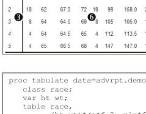

左侧是一个相当典型的 TABULATE 表格。表格上的标注数字与上方的标注说明相对应。

以下代码用于生成此示例表格。请注意，RTS= 选项仅适用于 LISTING 目标。此处未显示 ODS 语句，但它们包含在本书的示例代码中。参见 http://support.sas.com/authors。

```sas
proc tabulate data=advrpt.demog;
    class race;
    var ht wt;
    table race,
        (ht wt)*(n*f=2. min*f=4. median*f=7.1 max*f=4.)
        /rts=6;
run;
```

**8.1.3b 使用 Journal 样式的 TABULATE**
*各种 STYLE= 属性已更改*

| 种族 | 身高（英寸）N | 身高（英寸）Min | 身高（英寸）Median | 身高（英寸）Max | 体重（磅）N | 体重（磅）Min | 体重（磅）Median | 体重（磅）Max |
|---:|---:|---:|---:|---:|---:|---:|---:|---:|
| 1 | 42 | 62 | 69.0 | 74 | 42 | 109 | 177.0 | 215 |
| 2 | 18 | 62 | 67.0 | 72 | 18 | 98 | 158.0 | 240 |
| 3 | 8 | 64 | 64.0 | 68 | 8 | 105 | 105.0 | 133 |
| 4 | 4 | 64 | 64.5 | 65 | 4 | 112 | 113.5 | 115 |
| 5 | 4 | 65 | 66.5 | 68 | 4 | 147 | 147.0 | 147 |

- 4. 在 VAR 语句上，STYLE= 选项更改与变量标题关联的属性。
- 5. 通过将 N 统计量的标签加粗来调整它。请注意，其他统计量的标题保持不变。
- 6. 仅与 N 统计量关联的单元格属性被加粗。

##### 8.1.4 使用 CLASSDATA 选项控制表格内容

TABULATE 过程生成的表格内容在很大程度上受数据中分类变量水平的影响。通过使用 CLASSDATA 选项，我们可以指定一个辅助数据集，以进一步影响表格外观。

对于本节中的示例，数据集 SYMPLS 仅包含变量 SYMP，该变量仅取值为 ‘00’、‘01’ 和 ‘02’。但应注意，在要分析的数据（ADVRPT.DEMOG）中，变量 SYMP 从未取值为 ‘00’，除此之外范围为 ‘01’ 到 ‘10’。

### 将 CLASSDATA 与 EXCLUSIVE 选项一起使用

CLASSDATA= 选项和 EXCLUSIVE 选项在 TABULATE 步骤中的行为和应用与在 MEANS 和 SUMMARY 过程中非常相似（参见第 7.9 节）。CLASSDATA= 选项指定一个包含分类变量水平的数据集。这些水平可能存在于分析数据中，也可能不存在，并可用于强制将水平加入表格或将水平从表格中排除。

当 CLASSDATA= 选项与 EXCLUSIVE 选项一起使用时（如下例所示），仅显示 CLASSDATA= 数据集中的那些水平（包括分析数据集中不存在的任何水平）。

```sas
proc tabulate data=advrpt.demog;
             classdata=symplevels exclusive;
  class symp;
  var ht wt;
  table symp,
        (ht wt)*(n*f=2. min*f=4. median*f=7.1 max*f=4.);
run;
```


##### 8.1.4a 将 CLASSDATA= 与 EXCLUSIVE 一起使用

| 症状代码 | 身高（英寸）：N | 身高（英寸）：最小值 | 身高（英寸）：中位数 | 身高（英寸）：最大值 | 体重（磅）：N | 体重（磅）：最小值 | 体重（磅）：中位数 | 体重（磅）：最大值 |
|---|---:|---:|---:|---:|---:|---:|---:|---:|
| 00 | 0 | . | . | . | 0 | . | . | . |
| 01 | 4 | 64 | 67.5 | 71 | 4 | 115 | 138.5 | 162 |
| 02 | 10 | 66 | 67.0 | 67 | 10 | 131 | 155.0 | 155 |

症状代码“00”在分析数据中不存在，但被包含在表中。症状代码“03”到“10”未出现在数据集 SYMPLEVELS 中，因此被排除在表外。

当使用 CLASSDATA= 选项而不使用 EXCLUSIVE 选项时，来自 CLASSDATA= 数据集或分析数据的分类变量的所有水平都会包含在表中。

EXCLUSIVE 选项也可以出现在 CLASS 语句中；但是，只有当它在 PROC 语句中使用时，它才会与 CLASSDATA= 选项一起起作用。

### 不使用 EXCLUSIVE 选项使用 CLASSDATA

```sas
proc tabulate data=advrpt.demog
              classdata=symplevels;
  class symp;
  var ht wt;
  table symp,
        (ht wt)*(n*f=2. min*f=4.
                 median*f=7.1 max*f=4.);
run;
```

当不使用 EXCLUSIVE 选项时，CLASSDATA 数据集的水平仍可用于向结果表添加行。这里已从上一个示例中移除 EXCLUSIVE 选项。

##### 8.1.4b 不使用 EXCLUSIVE 使用 CLASSDATA=

| 症状代码 | 身高（英寸）：N | 身高（英寸）：最小值 | 身高（英寸）：中位数 | 身高（英寸）：最大值 | 体重（磅）：N | 体重（磅）：最小值 | 体重（磅）：中位数 | 体重（磅）：最大值 |
|---|---:|---:|---:|---:|---:|---:|---:|---:|
| 00 | 0 | . | . | . | 0 | . | . | . |
| 01 | 4 | 64 | 67.5 | 71 | 4 | 115 | 138.5 | 162 |
| 02 | 10 | 66 | 67.0 | 67 | 10 | 131 | 155.0 | 155 |
| 03 | 4 | 65 | 66.5 | 68 | 4 | 147 | 154.5 | 162 |
| 04 | 13 | 62 | 68.0 | 74 | 13 | 98 | 187.0 | 195 |
| 05 | 8 | 63 | 69.0 | 69 | 8 | 163 | 177.0 | 201 |
| 06 | 11 | 63 | 64.0 | 65 | 11 | 105 | 105.0 | 177 |
| 09 | 2 | 68 | 68.0 | 68 | 2 | 133 | 133.0 | 133 |
| 10 | 13 | 62 | 68.0 | 72 | 13 | 158 | 160.0 | 240 |

在此示例中，SYMP='00' 水平已添加到表中；但是，没有排除任何行。

### 更多信息

第 12.1.2 节讨论了将预加载格式与 PROC TABULATE 一起使用以实现类似结果。

##### 8.1.5 对分类水平标题排序

与许多使用分类变量的过程一样，水平标题的默认顺序是 ORDER=INTERNAL。与 REPORT 过程不同，对于带格式的变量，默认顺序不会改变。

```sas
proc format;
    value $SYMPTOM
        '01'='Sleepiness'
        '02'='Coughing'
        '03'='Limping'
        '04'='Bleeding'
        '05'='Weak'
        '06'='Nausea'
        '07'='Headache'
        '08'='Cramps'
        '09'='Spasms'
        '10'='Shortness of Breath';
run;
```

此处显示的格式 $SYMPTOM 与变量 SYMP 一起使用。无论是否应用格式，标题值都反映 SYMP 值的 INTERNAL 顺序。只有当分配了格式并且指定了 ORDER=FORMATTED 时，标题才会按格式化顺序排列。

```sas
proc tabulate data=advrpt.demog
              order=formatted;
    class symp sex;
    var wt;
    table sex*wt=' '*n=' '
          ,symp
          /box='Patient Counts'
          row=float
          misstext='0';
    format symp $symptom.;
run;
```

**8.1.5 控制顺序**  
**ORDER=FORMATTED**

| 患者计数 | 出血 | 咳嗽 | 跛行 | 恶心 | 气短 | 嗜睡 | 痉挛 | 虚弱 |
|---|---:|---:|---:|---:|---:|---:|---:|---:|
| **患者性别** |  |  |  |  |  |  |  |  |
| F | 5 | 6 | 2 | 7 | 5 | 2 | 0 | 2 |
| M | 8 | 4 | 2 | 4 | 8 | 2 | 2 | 6 |

处理日期值时，通常更倾向于使用内部顺序或日期值的顺序，而不是格式化顺序。在以下示例中，访问日期按月计数；但是，我们希望按时间顺序（INTERNAL）查看每月总计。在此示例中，如果我们使用了 MONNAME. 或 MONTH. 格式，则这两年的月份将会混淆。

```sas
proc tabulate data=advrpt.lab_chemistry;
  class labdt / order=internal;
  table labdt, n*f=2.;
  format labdt monyy.;
run;
```

| 实验室检测日期 | N |
|---|---:|
| JUL06 | 19 |
| AUG06 | 7 |
| SEP06 | 11 |
| OCT06 | 14 |
| NOV06 | 7 |
| DEC06 | 15 |
| JAN07 | 7 |
| FEB07 | 8 |
| MAR07 | 21 |
| APR07 | 12 |
| MAY07 | 13 |
| JUN07 | 15 |
| JUL07 | 9 |
| AUG07 | 6 |
| SEP07 | 3 |
| OCT07 | 1 |
| NOV07 | 1 |

### 更多信息

ORDER= 选项在第 2.6.2 节中详细讨论。PROC FORMAT 中的 VALUE 语句具有 NOTSORTED 选项，它允许你既格式化变量又控制值顺序，并在第 12.4 节中描述。

### 另请参阅

在将 TABULATE 复制到 Excel 之前对其进行格式化，已在 sasCommunity.org 的一篇文章中讨论，网址为 [http://www.sascommunity.org/wiki/Proc_Tabulate:_Making_the_result_table_easier_to_copy_to_Excel](http://www.sascommunity.org/wiki/Proc_Tabulate:_Making_the_result_table_easier_to_copy_to_Excel)。

缩进行标题在 SAS 论坛的一个帖子中讨论，该帖子还包含指向其他论文的链接，网址为 [http://communities.sas.com/message/45339](http://communities.sas.com/message/45339)。

#### 8.2 扩展 PROC UNIVARIATE

在最近几个 SAS 版本中，此过程的功能都得到了扩展，即使是经验丰富的程序员也只部分了解它现在能做的所有事情，这并不罕见。本节概述其中一些较新或较少为人知的功能。

##### 8.2.1 生成演示质量的图

许多演示质量的图形（例如由 SAS/GRAPH 生成的图形）也可以由 PROC UNIVARIATE 生成。某些绘图功能需要 SAS/GRAPH 的存在，即使没有调用 SAS/GRAPH 过程。图形通过一系列语句实现，包括：

- HISTOGRAM — 构建直方图
- INSET — 向图形添加图例和文本
- PROBPLOT — 创建概率图
- QQPLOT — 创建分位数-分位数图

以下示例通过构建叠加正态分布的直方图来展示这些语句的一些灵活性。在此示例中，UNIVARIATE 生成的图将写入文件。

```sas
filename out821a "&path\results\g821a.emf";
goptions device=emf
         gsfname=out821a;
title1 '8.2.1 Plots by PROC UNIVARIATE';
proc univariate data=advrpt.demog;
   class race sex;
   var ht;
   histogram / nrows=5 ncols=2
              interbar=1 cfill=cyan vscale=count
              normal
              vaxislabel='Count';
   inset mean='Mean Height: ' (5.2) / noframe position=ne
                                      height=2 font=swissxb;
run;
quit;
```

1. 图将保存为 EMF 文件。如果图要按创建时的状态导入文字处理文档，EMF 和较旧的 CGM 文件通常被认为是最好的。EMF 文件类型还有一个额外优势，即可以在 Microsoft Image Editor 中修改和编辑图形。

2. DEVICE 图形选项指定要创建的文件类型。

3. GSFNAME 图形选项标识指向要生成文件的 fileref。

4. 分类变量 RACE 和 SEX 基于 RACE 的 5 个值和 SEX 的 2 个值形成 10 种组合。这些组合构成图的行和列。

5. 在直方图的彩色表示中，垂直条形为青色。

6. 垂直轴的刻度将基于患者计数。刻度的其他选择可以包括：PERCENT 和 PROPORTION。

7. 为五个直方图中的每一个的垂直轴指定标签。

8. INSET 语句将文本（包括各种统计量）插入图形中。此处，HT 的 MEAN 使用 5.2 格式和 SAS/GRAPH 字体 SWISSB 写在每个图形的右上角（NorthEast）。请注意，标题的默认字体和 INSET 所选字体（SWISSB）并不是特别好的选择。在 Windows 下，大多数 Windows 字体都可用于此类图形。或者，字体可以指定为 font='Arial Narrow /b'。下一个示例中使用了 ARIAL。


##### 8.2.1a 使用 PROC UNIVARIATE 绘制图形

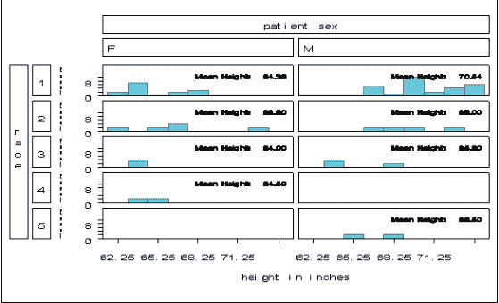

由 HISTOGRAM 语句生成的直方图可以叠加若干不同统计分布中的一种。这些分布包括：

- 正态分布
- 对数正态分布
- 伽马分布
- Weibull 分布

在本示例中，将正态分布叠加到数据的直方图上。

```sas
title1 f=arial
      '8.2.1b Normal Plots by PROC UNIVARIATE';
proc univariate data=advrpt.demog;
   var wt;
   histogram /midpoints=100 to 250 by 15 ❶
             cfill=cyan vscale=count
             vaxislabel='Count' ❷
             normal (l=2 color=red); ❸
   inset mean='Mean: ' (6.2)/position=nw
                         height=4 font=arial;
   run;
   quit;
```

❶ MIDPOINTS 选项用于同时指定要绘制的值的范围，以及直方图条所代表的各个分箱的宽度。该 MIDPOINTS 选项与 PROC GCHART 中使用的选项相同，其语法类似于迭代 DO 循环。

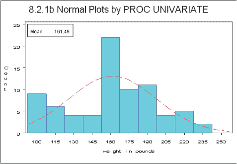

❸ 将正态分布（基于数据的均值和方差）叠加到直方图上。线型设为虚线（L=2），线条颜色设为 RED。

INSET 语句用于将均值写在左上角（NorthWest）。

注意标题字体的质量。TITLE 语句指定了 ARIAL 字体，它在 EMF 文件中比 SWISSB 渲染得更好（关于向 TITLE 语句添加选项的更多内容，见第 9.1 节）。

尽管本示例中未展示，但可以使用 OUTHISTOGRAM= 选项收集每个中点的实际观测百分比和预测观测百分比。该选项指定一个数据集名称，该数据集将包含每种分布的预测百分比。

尽管 UNIVARIATE 不是 SAS/GRAPH 过程，但它生成的图形可以利用 SAS/GRAPH 的其他一些功能。它将识别若干 SAS/GRAPH 语句，包括 AXIS 和 SYMBOL 语句。此外，它遵循 ANNO= 选项，因此可以利用 SAS/GRAPH 的 ANNOTATE 功能。

### 更多信息

第 9.2 节讨论了可在 SAS/GRAPH 之外使用的其他 SAS/GRAPH 选项和语句。在某些情况下，为图形各部分选择的默认字体会导致文本几乎无法阅读。第 8.2.1a 节图形中的部分文本非常难以阅读。可以通过使用 FTEXT 选项来缓解，第 9.2 节也讨论了该选项。

##### 8.2.2 使用 CLASS 语句

与许多其他汇总和分析过程一样，支持多个 CLASS 语句和 CLASS 语句选项（见第 7.1 节）。然而，与其他汇总过程不同，最多只能指定两个分类变量。

专门与 UNIVARIATE 一起使用的 CLASS 语句选项之一是 KEYLEVEL= 选项。该选项可用于通过为分类变量指定主值或键值来控制绘图顺序。选定的键级别将首先显示。

```sas
title1 f=arial
      '8.2.2 KEYLEVEL Plots by PROC UNIVARIATE';
proc univariate data=advrpt.demog;
class race sex/keylevel=('3' 'M');
var ht;
histogram /nrows=5 ncols=2
          intertile=1 cfill=cyan vscale=count
          vaxislabel='Count';
run;
quit;
```

这里使用的单个 CLASS 语句可以改写为两个语句，每个分类变量一个。

```sas
class race / keylevel='3';
class sex  / keylevel='M';
```

使用 CLASS 语句时，打印输出也会按分类变量的每种组合进行拆分。

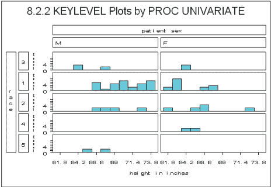

在图中，请注意 RACE 级别 ‘3’ 和 SEX 级别 ‘M’ 被放在最前面——它们已被指定为 KEYLEVEL。

此图形中的其他一些文本也非常难以阅读，而且不仅仅是因为本页中图形的大小。

当未显式声明字体时，有时会选择默认硬件字体，而这些字体并非在所有设备上都能良好渲染。第 9.2 节讨论的 FTEXT= 选项可用于显式指定默认字体。

##### 8.2.3 概率图与分位数图

除直方图外，UNIVARIATE 还能生成概率图和分位数-分位数图。这些类型图的语法和生成的图形相似。通常，这些图用于将数据与已知或假设分布进行比较。概率图最适合用于百分位数的图形估计，而分位数-分位数图（也称为 QQPlot）更适合用于分布参数的图形估计。

### 概率图

概率图可以通过使用 PROBPLOT 语句生成。

```sas
    title1 f=arial '8.2.3a Probability Plots';
    symbol1 v=dot c=blue; ❶

    proc univariate data=advrpt.demog;
       var wt;
       probplot /normal(mu=est sigma=est ❷
                    color=red l=2 w=2); ❸
       inset mean='Mean: ' (6.2)
          std ='STD: ' (6.3) / position=nw
                    height=4 font=arial;
    run;
```

- 1. SYMBOL 语句可用于控制百分位数的绘图符号。这里请求的绘图符号是蓝色圆点。
- 2. 概率图将与正态分布进行比较。可以指定均值和标准差（MU 和 SIGMA），也可以像这里所做的那样从数据中估计它们。
- 3. 估计的分布将用一条厚度为 2 的红色虚线（L=2）表示。

随着数据分布接近理论分布，数据百分位点应落在虚线上。

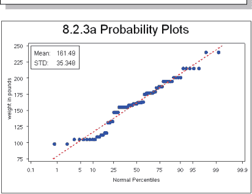

### QQ 图

分位数图不使用百分位数作为水平轴，而是将水平轴划分为分位数范围。

```sas
proc univariate data=advrpt.demog;
   var wt;
   qqplot / normal(mu=est sigma=est
                   color=red l=2 w=2);

   inset mean='Mean: ' (6.2)
         std ='STD: ' (6.3) / position=nw
                                height=4 font=arial;
run;
```

此 QQPLOT 语句使用与百分位数概率图相同的选项。

生成的图形通常非常相似。

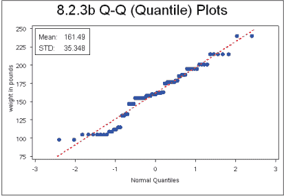

##### 8.2.4 使用 OUTPUT 语句计算百分比

UNIVARIATE 现在支持使用 OUTPUT 语句。其语法与 MEANS 和 SUMMARY 过程中使用的语法基本相同；但是，有许多统计量仅在 UNIVARIATE 过程中可用。这些统计量包括若干未包含在打印输出中的检验统计量。还可以生成范围更广的百分位数。与 CLASS 语句一起使用时，输出数据集包含每个分类水平组合对应的一条观测。没有汇总层级；结果基本上与在 MEANS 或 SUMMARY 过程中使用 NWAY 选项时预期的一致。

这里展示的示例使用 OUTPUT 语句创建一个数据集，其中包含一系列在 MEANS 或 SUMMARY 过程中不易获得的百分位数。

```sas
proc freq data=advrpt.demog
    (where=(race in ('1','2')));
    table race*sex/chi;
    output out=FreqStats
        all;
run;
```

**race 与 sex 列联表的统计量**

| 统计量 | 自由度 | 值 | 概率 |
|---|---:|---:|---:|
| 卡方 | 1 | 2.5926 | 0.1074 |
| 似然比卡方 | 1 | 2.5636 | 0.1093 |
| 连续性校正卡方 | 1 | 1.7493 | 0.1860 |
| Mantel-Haenszel 卡方 | 1 | 2.5494 | 0.1103 |
| Phi 系数 |  | -0.2079 |  |
| 列联系数 |  | 0.2035 |  |
| Cramer's V |  | -0.2079 |  |

**Fisher 精确检验**

|  | 值 |
|---|---:|
| 单元格 (1,1) 频数 (F) | 14 |
| 左侧 Pr <= F | 0.0935 |
| 右侧 Pr >= F | 0.9706 |
| 表概率 (P) | 0.0642 |
| 双侧 Pr <= P | 0.1517 |
| 样本量 | 60 |

- 1. CHISQ 选项为 RACE 和 SEX 定义的表请求一系列列联表统计量。
- 2. 将创建数据集 WORK.FREQSTATS。
- 3. 这里不是按名称选择特定统计量，而是将 TABLE 语句上 CHISQ 选项生成的所有统计量都包含在数据集中。由于 ALL 关键字请求了未包含在 CHISQ 选项中的统计量，该选项会生成一条警告。如果将 ALL 替换为 CHISQ，或者将 ALL 请求的附加统计量包含在 TABLES 语句中（MEASURES、CMH、N），则不会发出该警告。

这里显示了由 CHISQ 选项生成的表的一部分。

其中许多相同的值都可以在下面的数据集中找到。

**8.3.1 在 FREQ 中使用 OUTPUT 语句**

| 观测 | N | _PCHI_ | DF_PCHI | P_PCHI | _LRCHI_ | DF_LRCHI | P_LRCHI | _AJCHI_ | DF_AJCHI | P_AJCHI | _MHCHI_ | DF_MHCHI | P_MHCHI | XPL_FISH | XPR_FISH | XP2_FISH | _PHI_ | _CONTGY_ | _CRAMV_ |
|---:|---:|---:|---:|---:|---:|---:|---:|---:|---:|---:|---:|---:|---:|---:|---:|---:|---:|---:|---:|
| 1 | 60 | 2.59259 | 1 | 0.10736 | 2.56359 | 1 | 0.10935 | 1.74934 | 1 | 0.18596 | 2.54938 | 1 | 0.11034 | 0.093531 | 0.97063 | 0.15174 | -0.20787 | 0.20352 | -0.20787 |


##### 8.3.2 使用 NLEVELS 选项

PROC FREQ 语句中的 NLEVELS 选项会生成一个汇总表，显示 TABLES 语句中包含的每个分类变量的水平数（包括缺失水平）。

```sas
proc freq data=advrpt.demog
           nlevels;
   table _all_/noprint;
   run;
```

在此示例中，TABLES 语句请求统计数据集中所有变量的水平数。NOPRINT 选项阻止打印所有表，但由 NLEVELS 选项生成的表除外。

**8.3.2 在 FREQ 语句中使用 NLEVELS 选项**

**FREQ 过程**

| 变量 | 标签 | 水平数 | 缺失水平数 | 非缺失水平数 |
|---|---|---:|---:|---:|
| subject |  | 77 | 0 | 77 |
| clinicnum | 门诊编号 | 27 | 0 | 27 |
| lname | 姓氏 | 75 | 0 | 75 |
| fname | 名字 | 61 | 0 | 61 |
| ssn | 社会安全号码 | 76 | 0 | 76 |
| sex | 患者性别 | 2 | 0 | 2 |
| dob | 出生日期 | 74 | 1 | 73 |
| death | 死亡日期 | 9 | 1 | 8 |
| race | 种族 | 6 | 1 | 5 |
| edu | 受教育年数 | 9 | 1 | 8 |
| wt | 体重（磅） | 22 | 0 | 22 |
| ht | 身高（英寸） | 13 | 0 | 13 |
| symp | 症状代码 | 9 | 1 | 8 |
| death2 |  | 9 | 1 | 8 |

生成的表显示 ADVRPT.DEMOG 中的所有变量以及每个变量的不同值数量。

了解变量的不同水平数在编写自动化程序时可能会有帮助。可以使用 ODS OUTPUT 目标将 NLEVELS 表中包含的数据写入数据集，一旦写入，就可以将其作为元数据提取出来供宏语言使用。

```sas
ods output nlevels=varcnts;
proc freq data=advrpt.demog
           nlevels;
   table _all_/noprint;
   run;
```

### 更多信息

ODS OUTPUT 目标将在第 11.1 节中更详细地讨论。

### 另请参阅

SAS 提示编号 30867 在 http://support.sas.com/kb/30/867.html 中讨论了 NLEVELS 选项。

#### 8.4 更充分地利用 PROC REPORT

与 PROC TABULATE 一样，REPORT 过程并未被许多分析人员充分利用。其用法细节可参见 *Carpenter 的 SAS REPORT 过程完全指南*（Carpenter，2007a）。本节不会介绍该过程，而是涵盖几个已知容易出问题的主题。

许多困惑都集中在计算块的使用上，而计算块是 PROC REPORT 独有的。因此，本节中的大多数示例都涉及计算块的使用。Carpenter（2007a）给出了许多更详细的示例，涉及计算块的语法、用法和执行顺序。本书还附有 Russ Lavery 的“REPORT 过程计算块动画指南”的 Microsoft PowerPoint 副本。

### 更多信息

使用 PROC REPORT 预加载格式创建报表子集的方法可在第 12.1.1 节中找到。

##### 8.4.1 PROC REPORT 与 PROC TABULATE 对比

REPORT 和 TABULATE 过程都可以创建汇总报表，并且两者对标准汇总统计量集的访问权限基本相同。

与 TABULATE 不同，REPORT 过程既能提供明细报表功能，也能提供汇总报表功能。REPORT 还具有额外的灵活性，可以基于报表中的其他列计算并显示信息列。

由于 TABULATE 过程构建报表表的方式很独特，因此它在将组、子组和统计量呈现为行或列方面具有大得多的灵活性。对于垂直拼接报表尤其如此，这类报表在 TABULATE 中非常直接，而在 REPORT 中则很困难（有关使用 PROC REPORT 创建垂直拼接报表的详细信息，请参见 Carpenter，2007a，第 10.1 节）。

##### 8.4.2 在计算块中命名报表项（变量）

计算块是 REPORT 过程独有的。虽然它们与 DATA 步有许多相似之处，但差异也足够多，不仅在语法上，更重要的是在执行方式上，因此本书有必要讨论它们。

在 DATA 步中，您会按名称显式命名程序数据向量（PDV）上的项（变量）。虽然术语 *变量* 常用于指代计算块中的值，但更准确地说，它们称为 *报表项*。在计算块中，命名报表项的规则远不如在 DATA 步中那样直接。计算块中没有 PDV，并且计算块可用于引用实际上并非变量的报表项。

有四种不同情况决定如何在计算块中命名报表项。这些情况形成了三种不同的报表项命名约定。

### 另请参阅

在计算块中命名报表项这一主题在 Carpenter（2006a 和 2007a）中有专门讨论。

### 显式按名称命名

在 DATA 步中，变量名是显式使用的。虽然同样的命名约定在计算块中 *有时* 可行，但您需要了解它何时可行、何时不可行。当变量或报表项满足以下条件时，名称会被显式使用：

-   其定义用法为 `GROUP`、`ORDER`、`COMPUTED` 或 `DISPLAY`
-   是临时变量，仅在计算块中创建和使用
-   是名为 `_BREAK_` 的自动临时变量
-   是报表项别名（见下文）

### 使用复合名称

当报表项的定义用法为 `ANALYSIS` 时，需要使用复合变量名，这意味着它已被用于计算某个统计量（默认是 `SUM`）。复合名称由变量名和其用于计算的统计量组合而成。

```sas
compute wt;
   wt.mean = wt.mean/2.2;
endcomp;
```

一般形式为 *变量名.统计量*，在计算块中，您可以像左侧所示那样引用变量 WT 的均值。

### 使用别名时直接引用

创建报表项的别名可以让您以多种方式使用该报表项。以下 COLUMN 语句为 HT 分析变量生成一系列别名。每个别名将用于计算不同的统计量。

```sas
column region
   ht=htmin  ht=hmax
   ht=htmean ht=htmedian;
```

```sas
compute after;
   line @3 'Minimum height is ' htmin 6.1;
endcomp;
```

在计算块中使用别名时，会显式命名该别名。这里，HT 的别名 HTMIN 在 LINE 语句中使用。

### 使用绝对列号时间接引用

ACROSS 的定义类型会创建一系列列。这些列，实际上报表中的任何列，都可以通过使用列号作为间接列引用来引用。

这种伪变量名始终采用 `_Cxx_` 的形式，其中 xx 是从左到右读取的报表列号。列计数甚至包括最终不会打印的任何列，例如使用 NOPRINT 或 NOZERO 定义的列。

当一个或多个报表项的定义用法为 ACROSS 时，无法按名称引用转置后的列。要引用这些列，必须使用绝对列号。

### 更多信息

第 8.4.3 节的示例中使用了绝对列引用。

##### 8.4.3 理解计算块执行

在以下示例中，使用计算块将平均体重从磅转换为千克。由于 WT 嵌套在 SEX 下，而 SEX 的定义用法为 ACROSS，因此将有两个与 WT 关联的列。因此，在执行转换的计算块中必须使用绝对列号 ③。

尽管此步骤执行时没有任何语法错误，但它包含一个**巨大的逻辑错误**。为了理解该错误及其原因，我们需要先理解计算块的执行方式。

```sas
proc report data=advrpt.demog nowd;
  column edu sex,wt allwtmean;
  define edu / group 'Years/Ed.';
  define sex / across order=formatted;
  define wt / mean 'Mean' format=5.1;
  define allwtmean / mean 'Mean' format=5.1;

  compute wt;
    _c2_ = _c2_/2.2;
    _c3_ = _c3_/2.2;
  endcomp;

  compute allwtmean;
    allwtmean = allwtmean/2.2;
  endcomp;
run;
```

-   ① 患者体重嵌套在 SEX 中，SEX 的定义用法为 ACROSS。还声明了 WT 的别名 ALLWTMEAN。
-   ② 在 WT 的计算块中，两种性别的值都从磅转换为千克。
-   ③ `_C2_` 保存女性患者的平均体重，并且是报表中的第二列（从左到右计数）。
-   ④ ALLWTMEAN（忽略 SEX 的平均体重）是一个计算得到的报表项，并直接按名称引用。

**8.4.3a 展示带计算块的 ACROSS：将 LB 转换为 KG**

| 受教育年数 | 女性均值 | 男性均值 | 均值 |
|---:|---:|---:|---:|
| 10 | . | 88.2 | 88.2 |
| 12 | 31.4 | 81.7 | 76.4 |
| 13 | 44.4 | 86.8 | 89.5 |
| 14 | 22.7 | 47.7 | 49.1 |
| 15 | 34.0 | 60.5 | 70.7 |
| 16 | 32.6 | 75.9 | 75.1 |
| 17 | 29.5 | 70.5 | 66.0 |
| 18 | . | 79.1 | 79.1 |

在此示例中有两个计算块，一个与 WT 关联，另一个用于别名 ALLWTMEAN。由于 SEX 内的 WT 有两个关联列（两种性别各一列），WT 的计算块将对报表中的每一行执行两次。事实上，算上用于 ALLWTMEAN 的那个计算块，每个报表行会发生**三次**计算块执行。

由于 WT 的计算块将对每个报表行执行**两次**，这会导致一个**非常严重的**错误。请注意，在女性平均体重中，这些值被除以 2.2 两次。如果将 `_C2_` 和 `_C3_` 的计算放入 ALLWTMEAN 的计算块中，该问题就会消失，因为该计算块对每一行只执行一次。

⑤ ALLWTMEAN 的计算块将只执行一次。任何给定的计算块都可以引用 COLUMN 语句中位于其左侧的任何报表项，因此将全部三列的引用放在这个单一计算块中是没有问题的。


```sas
proc report data=advrpt.demog nowd;
    column edu sex,wt wt=allwtmean;
    define edu / group 'Years/Ed.';
    define sex / across order=formatted;
    define wt / mean 'Mean' format=5.1;
    define allwtmean / mean 'Mean' format=5.1;

    compute allwtmean;
        _c2_ = _c2_/2.2;
        _c3_ = _c3_/2.2;
        allwtmean = allwtmean/2.2;
    endcomp;
run;
```

生成的报表现在显示，女性的平均体重已成功转换为千克。

##### 8.4.3b 在计算块中展示 ACROSS

将 LB 转换为 KG

患者性别：M / F

| 教育年限 | 平均值 | M 平均值 | F 平均值 |
|---:|---:|---:|---:|
| 10 | . | 88.2 | 88.2 |
| 12 | 69.1 | 81.7 | 76.4 |
| 13 | 97.7 | 86.8 | 89.5 |
| 14 | 49.9 | 47.7 | 49.1 |
| 15 | 74.8 | 60.5 | 70.7 |
| 16 | 71.8 | 75.9 | 75.1 |
| 17 | 64.9 | 70.5 | 66.0 |
| 18 | . | 79.1 | 79.1 |

##### 8.4.4 使用虚拟列合并计算块

在上一节中，我们通过利用与问题列右侧的报表项相关联的计算块，解决了一个棘手的问题。当右侧没有计算块时，可以基于虚拟列使用计算块来计算这三个平均值。在本例中，ALLWTMEAN 位于其他列的左侧。因此，在 COLUMN 语句中，它的计算块不能用于计算其右侧的报表项。

```sas
proc report data=advrpt.demog nowd;
    column edu wt=allwtmean sex,wt dummy ❶;
    define edu / group 'Years/Ed.';
    define allwtmean / mean 'Overall Mean' format=7.1;
    define sex / across order=formatted;
    define wt / mean 'Mean' format=5.1;
    define dummy / computed noprint ❷;

    compute dummy;
        _c4_ = _c4_/2.2; ❸
        _c3_ = _c3_/2.2;
        allwtmean = allwtmean/2.2;
    endcomp;
run;
```

- ❶ DUMMY 列必须是 COLUMN 语句中最靠右的列。或者至少它必须位于计算块中使用的任何列的右侧。

##### 8.4.4 使用 DUMMY 列合并计算块

| 教育年限 | 总体平均值 | 患者性别 F 平均值 | 患者性别 M 平均值 |
| --- | --- | --- | --- |
| 10 | 88.2 |  | 88.2 |
| 12 | 76.4 | 69.1 | 81.7 |
| 13 | 89.5 | 97.7 | 86.8 |
| 14 | 49.1 | 49.9 | 47.7 |
| 15 | 70.7 | 74.8 | 60.5 |
| 16 | 75.1 | 71.8 | 75.9 |
| 17 | 66.0 | 64.9 | 70.5 |
| 18 | 79.1 |  | 79.1 |

- ❷ 在 DUMMY 的 DEFINE 语句中出现了 NOPRINT 选项，因为我们不希望显示该列。

- ❸ 男性和女性值的列号现在发生了变化（_C3_ 现在是女性的平均体重）。由于这三个转换彼此独立，因此可以按任意顺序执行。

##### 8.4.5 合并列

有时，我们希望将多个报表项中包含的信息显示在单个列中。这样做可以让我们对报表项的外观有额外的控制。在下面的示例中，我们希望显示平均值及其标准误差，并将值显示为 *平均值*（*标准误*）。

```sas
proc report data=advrpt.demog nowd;
    column edu sex, (wt wt=wtse meanse ❶);
    define edu / group 'Years/Ed.';
    define sex / across order=formatted; ❷
    define wt / mean noprint; ❸
    define wtse / stderr noprint;
    define meanse / computed 'Mean (SE)' format=$15.; ❸

    compute meanse/char length=15; ❹
        _c4_ = cat(put(_c2_,5.2), ' (',put(_c3_,5.2),')'); ❹
        _c7_ = cat(put(_c5_,5.2), ' (',put(_c6_,5.2),')'); ❹
    endcomp;
run;
```

- ❶ WT、其别名 WTSE 以及计算报表项 MEANSE 都嵌套在 SEX ❷ 之下，SEX 的 define 用法为 ACROSS。

- ❷ WT 和 WTSE 的值不会被打印。它们仅用于构成拼接后的值（MEANSE）。

- ❸ 定义了计算报表项 MEANSE。

- ❹ 计算变量 MEANSE 被定义为长度为 15 的字符型。

- ❹ 女性的平均值（_C2_）和标准误（_C3_）被拼接成单个值（_C4_）。

###### 8.4.5 在 ACROSS 变量内合并列

性别内的体重

| 教育年限 | F 平均值（标准误） | M 平均值（标准误） |
|---:|---:|---:|
| 10 | . ( . ) | 194.1 ( 5.75) |
| 12 | 152.0 ( 9.71) | 179.8 ( 6.73) |
| 13 | 215.0 ( . ) | 191.0 (12.00) |
| 14 | 109.9 ( 1.78) | 105.0 ( 0.00) |
| 15 | 164.6 (13.72) | 133.0 ( 0.00) |
| 16 | 158.0 ( 0.00) | 167.0 ( 7.70) |
| 17 | 142.8 ( 9.84) | 155.0 ( 0.00) |
| 18 | . ( . ) | 174.0 (15.59) |

计算报表项 MEANSE 是在计算块中通过拼接 MEAN 和 SE 构建的，两者均不单独打印。这也允许我们添加括号。

由于 SEX 的 define 用法为 ACROSS，因此必须在计算块中使用绝对列引用。

##### 8.4.6 在 LINES 中使用 STYLE= 选项

当写入 PDF、RTF 和 HTML 等输出目标时，可以使用 STYLE= 选项覆盖 ODS 样式中的值，而无需使用 PROC TEMPLATE 重新定义样式本身。此选项可用于 REPORT、TABULATE 和 PRINT 过程。在 REPORT 中，它可以与计算块中的 LINE 语句一起使用。

```sas
proc report data=advrpt.demog nowd;
    column edu sex, wt (wt=wtse) wt=n wt=allwt;
    define edu / group 'Years/Ed.';
    define sex / ' ' across order=formatted;
    define wt   / mean 'Mean' F=5.1;
    define wtse / stderr 'StdErr' F=5.2;
    define n    / n noprint;
    define allwt / mean 'Overall/Mean' F=5.1;

    compute after/style(lines)={just=center
                                font_face=Arial
                                font_style=italic
                                font_size=10pt};
        line ' ';
        line @10 'Overall Statistics:';
        line @15 n 3. 'Subjects had a mean weight of ' allwt 5.1 ' pounds';
    endcomp;
run;
```

此处使用样式覆盖选项来更改 LINE 语句所写入文本的对齐方式、字体、字体样式和字体大小。

在 LINE 语句中，@10 和 @15 控制文本的最左侧起始位置。这些值在除 LISTING 之外的目标中会被忽略，而 STYLE 选项在 LISTING 目标中会被忽略。

###### 8.4.6 在 COMPUTE 语句上使用 STYLE

患者体重

*患者性别：F / M*

| 教育年限 | F 平均值 | F 标准误 | M 平均值 | M 标准误 | 总体平均值 |
|---|---:|---:|---:|---:|---:|
| 10 | . | . | 194.1 | 5.75 | 194.1 |
| 12 | 152.0 | 9.71 | 179.8 | 6.73 | 168.1 |
| 13 | 215.0 | . | 191.0 | 12.00 | 197.0 |
| 14 | 109.9 | 1.78 | 105.0 | 0.00 | 108.1 |
| 15 | 164.6 | 13.72 | 133.0 | 0.00 | 155.6 |
| 16 | 158.0 | 0.00 | 167.0 | 7.70 | 165.2 |
| 17 | 142.8 | 9.84 | 155.0 | 0.00 | 145.2 |
| 18 | . | . | 174.0 | 15.59 | 174.0 |

*总体统计：*

*76 名受试者的平均体重为 160.5 磅。*

在计算块中也可以使用 LINE 语句进行内联格式化，但是，随着格式变得越来越复杂，有几点需要注意。由于 LINE 语句在执行前被合并，你可能无法在计算块内的 LINE 语句级别更改样式属性。在此示例中，STYLE 选项将应用于每个 LINE 语句。

如果确实需要在单个行上更改属性，则内联格式化可能必须在单独的计算块中完成。如果你正在使用 COMPUTE AFTER（报表末尾）计算块，这可能会带来问题。

在下面的示例中，引入了一个人工变量 PAGEFLAG。由于它是一个常量，COMPUTE AFTER PAGEFLAG 块和 COMPUTE AFTER 块都将在报表末尾执行。这将允许使用具有两种不同样式的 LINE 语句。

```sas
* Show the use of the inline formatting;
ods rtf file="&path\results\E8_4_6b.rtf";
ods escapechar='^'; ❶
title1 '8.4.6 Using Inline Formatting';
title2 '^S={just=r} Patient Weight'; ❷
data demog;
set advrpt.demog;
pageflag=1; ❸
run;

proc report data=demog(where=(sex='F')) nowd;
  column pageflag edu sex, (wt wt=wtse) wt=n wt=allwt;
  define pageflag / group noprint; ❹
  . . . . Define statements not shown . . . .
  compute after pageflag;
    line '^S={just=l background=pink} Females Only';
  endcomp;
  compute after/style(lines)={just=center ❺
                              font_face=Arial
                              font_style=italic
                              font_size=10pt};
    line ' ';
    line @10 'Overall Statistics:';
    line @15 n 3. ' Subjects had a mean weight of '
                 allwt 5.1 ' pounds';
  endcomp;
run;
ods rtf close;
```

- ❶ 指定一个转义字符，用于内联格式化序列。

- ❷ 使用内联格式化将标题右对齐。

- ❸ 创建一个常量变量，使我们能够在报表末尾有第二个计算块。

- ❹ 此报表项不会被打印，但由于它的 define 用法为 GROUP，因此可以将计算块与它关联。


## 另请参阅

*《Carpenter SAS REPORT 过程完全指南》*第 7.5 节（Carpenter 2007a）详细讨论了 CALL DEFINE 例程。

##### 8.4.8 日期中的日期

当报表项自身嵌套时，生成的表通常不尽如人意，除非采取一些预防措施。

处理日期可能尤其麻烦，因为同一日期可能同时属于多个范围。给定日期具体属于某一年、某一季度和某个月。当你想创建

```sas
data visits;
    set advrpt.lab_chemistry
        (keep=visit labdt sodium);
    year=year(labdt);
    qtr = qtr(labdt);
    run;
```

同时针对多个日期层级进行汇总时，可以为每个层级创建哑变量，然后使用这些层级作为分类变量进行汇总。这需要额外步骤，如左侧所示；使用 PROC REPORT 时我们可以避免这一步骤。

在上一个 DATA 步骤中，变量 LABDT 用于创建两个不同的汇总层级。同一日期同时以两种不同方式使用。在 REPORT 步骤中，可以通过创建别名来执行同类型的汇总；然而，每当将一个变量嵌套在其自身之下时，都应当注意该技术的一些陷阱。

以下报表按季度和年份统计每种访视类型所接诊的患者数量。同一变量 LABDT 同时用于季度和年份汇总。

```sas
proc report data=advrpt.lab_chemistry nowd;
    column visit ('Patient Counts Within Quarter'
                 labdt=year, labdt,sodium,n); ❶
    define visit    / group 'Visit';
    define year     / across format=year. order=formatted ❷;
    define labdt    / across format=yyq6. order=internal ' '; ❹
    define sodium   / display ' '; ❺
    define n        / ' ' format=2. nozero ❺
                  style={just=center}; ❻
run;
```

- 1. 为报表定义跨列文本。
- 2. 实验室日期嵌套在实验室日期的别名（YEAR）之下。N 统计量嵌套在 SODIUM 之下，而 SODIUM 又嵌套在日期之下。
- 3. 日期将合并到每个出现的年份中。顺序由格式化值决定。
- 4. 季度嵌套在年份内，并且每个季度——无论属于哪一年——都会出现在每一年之下。这意味着‘2007Q1’会出现在 2006 年下且没有任何值。我们可以通过使用 NOZERO 选项消除这些空列。
- 5. 任何始终为空的列都会被 NOZERO 选项完全消除。

### 使用原始日期变量

### 季度内的患者计数

| 访视 | 2006Q3 | 2006Q4 | 2007Q1 | 2007Q2 | 2007Q3 | 2007Q4 |
|---:|---:|---:|---:|---:|---:|---:|
| 1 | 6 | 4 | 3 | 3 | 1 | . |
| 2 | 6 | 4 | 3 | 2 | 1 | . |
| 3 | 4 | 4 | 3 | 2 | 1 | . |
| 5 | 3 | 6 | 3 | 2 | 1 | . |
| 6 | 4 | 6 | 3 | 2 | 1 | . |
| 7 | 4 | 4 | 5 | 2 | 1 | . |
| 8 | 3 | 3 | 6 | . | . | . |
| 9 | 5 | 1 | 5 | 2 | 1 | . |
| 10 | . | 4 | 5 | 3 | 2 | . |
| 11 | . | . | 5 | 1 | . | . |
| 12 | . | . | 5 | 1 | . | . |
| 13 | . | . | 3 | 3 | . | . |
| 14 | . | . | 3 | 2 | 1 | . |
| 15 | . | . | 3 | 2 | 1 | . |
| 16 | . | . | 3 | 2 | 1 | . |

⑥ STYLE= 选项用于将每个季度内的计数居中。

当嵌套变量（例如将日期嵌套在其自身之下）时，使用 NOZERO 选项是一项关键技术。如果不使用 NOZERO 选项，就必然会出现若干空列。

此示例统计 SODIUM 值非缺失的患者数量。虽然 N 统计量可用于实验室日期，但 NOZERO 选项对分组变量不起作用。因此，需要一个中间分析变量 SODIUM。在此例中，SODIUM 并不是我们特别感兴趣的变量，但它允许我们使用 N 统计量。

在此示例中，季度排序适当，因此不需要 ORDER=INTERNAL 选项 ④。如果不是使用季度，而是使用月份名称对日期进行分组，则可以使用该选项按日期顺序而不是字母顺序排列各列。

##### 8.4.9 对齐小数点

与 PROC PRINT 不同，REPORT 过程默认不会在输出列的列内对齐小数点。这可以在以下示例中看到，该示例输出 LAB_CHEMISTRY 数据集中的 SODIUM 值。

```sas
ods pdf file="path\\results\\e8_4_9a.pdf"
         style=journal;
title2 'Unaligned Decimals';
proc report data=advrpt.Lab_chemistry
            nowd;
  column subject visit labdt sodium;
run;
ods pdf close;
```

### 未对齐的小数点

| 患者 ID | 访视编号 | 实验室检测日期 | 钠 |
|---:|---:|---:|---:|
| 200 | 1 | 07/06/2006 | 14 |
| 200 | 2 | 07/13/2006 | 14.4 |
| 200 | 1 | 07/06/2006 | 14 |
| 200 | 4 | 07/13/2006 | 14 |
| 200 | 5 | 07/21/2006 | 14.2 |

有几种简单方法可以对齐 SODIUM 列中的小数点。当输出到 RTF 或 PDF 目标（如本例所示）时，可以在 DEFINE 语句中使用 JUST= 样式属性。

```sas
proc report data=advrpt.Lab_chemistry nowd;
  column subject visit labdt sodium;
  define sodium / style(column)={just=d};
run;
```

### 已对齐的小数点

| 患者 ID | 访视编号 | 实验室检测日期 | 钠 |
|---:|---:|---:|---:|
| 200 | 1 | 07/06/2006 | 14 |
| 200 | 2 | 07/13/2006 | 14.4 |
| 200 | 1 | 07/06/2006 | 14 |
| 200 | 4 | 07/13/2006 | 14 |
| 200 | 5 | 07/21/2006 | 14.2 |

虽然列已对齐，但小数点并不总是显示。当可以使用格式（通常都可以）时，格式不仅会使小数点对齐，还会显示小数点。

这里使用格式而不是样式覆盖来对齐小数点。

```sas
proc report data=advrpt.lab_chemistry nowd;
   column subject visit labdt sodium;
   define sodium / f=4.1;
run;
```

### 使用格式对齐小数点

| 患者 ID | 访视编号 | 实验室检测日期 | 钠 |
|---:|---:|---|---:|
| 200 | 1 | 07/06/2006 | 14.0 |
| 200 | 2 | 07/13/2006 | 14.4 |
| 200 | 1 | 07/06/2006 | 14.0 |
| 200 | 4 | 07/13/2006 | 14.0 |
| 200 | 4 | 07/13/2006 | 14.0 |
| 200 | 5 | 07/21/2006 | 14.2 |

##### 8.4.10 有条件地执行 LINE 语句

与 DATA 步骤中可以有条件地执行 PUT 语句不同，PROC REPORT 计算块中类似的 LINE 语句不能有条件地执行。不过，我们可以有条件地为 LINE 语句要写入的值赋值。下面的第一次尝试演示了这个问题。

在此示例中，我们希望在 SEX 的每个层级之后写入一条消息。如果计数为 35 或更多，我们希望显示平均体重；然而，对于低于 35 的计数，我们只想显示一条说明计数偏低的注释。

```sas
proc report data=advrpt.demog nowd;
   column sex race wt wt=n analysis n 'Patient Count';
   define sex / group;
   define race / group;
   define wt / analysis n 'Patient Count';
   define meanwt / analysis mean 'Mean Weight' f=5.1;
   compute after sex;
      if wt.n ge 35 then do;
         line 'Overall mean weight is: ' meanwt 5.1;
      end;
      else line 'Patient Count Below 35';
   endcomp;
run;
```

- 1. 文本将写入报表项 SEX 的每个分组之后。
- 2. 如果总 N 大于 34，我们希望使用 LINE 语句写入均值。
- 3. 文本使用 LINE 语句写入。
- 4. 对于较小的数字，我们只希望写入这段固定文本。

### 尝试进行条件执行

| 患者性别 | 种族 | 患者计数 | 平均体重 |
|---|---:|---:|---:|
| F | 1 | 14 | 159.0 |
| F | 2 | 10 | 148.6 |
| F | 3 | 3 | 105.0 |
| F | 4 | 4 | 113.5 |
|  |  | **总体平均体重为：144.5** |  |
|  |  | **患者计数低于 35** |  |
| M | 1 | 28 | 184.7 |
| M | 2 | 8 | 188.5 |
| M | 3 | 5 | 116.2 |
| M | 5 | 4 | 147.0 |
|  |  | **总体平均体重为：174.4** |  |
|  |  | **患者计数低于 35** |  |

显然，LINE 语句并没有被有条件地执行。事实上，对于报表项 SEX 的每个层级，两条语句都被执行了！这显然不是我们想要的结果，但实际发生了什么？


在计算块（compute block）内对各语句进行求值的过程中，LINE 语句实际上会被移到步（step）的末尾。上面的计算块实质上就变成了这里所示的代码块。这种行为和我们在 DATA 步中看到的任何行为都完全不同。

```sas
compute after sex; ①
    if wt.n ge 35 then do; ②
    end;
    else;
    line 'Overall mean weight is: ' meanwt 5.1; ③
    line 'Patient Count Below 35'; ④
endcomp;
```

因此，我们不能有条件地执行 LINE 语句；但我们可以有条件地构建将由 LINE 语句显示的内容。

```sas
compute after sex;
    if wt.n ge 35 then do;
        text='Overall mean weight is: '||put(meanwt,5.1); ⑤
    end;
    else text = 'Patient Count Below 35'; ⑤
        line text $31.; ⑥
endcomp;
```

- ⑤ 这里我们创建一个临时变量（TEXT），它将承载要显示的目标值。
- ⑥ 然后执行 LINE 语句。

## 另请参阅

SAS 示例 #37763 中讨论了 PROC REPORT 中 LINE 语句的条件执行，参见 http://support.sas.com/kb/37/763.html。

##### 8.4.10 LINE 语句的条件准备

| 患者性别 | 种族 | 患者数量 | 平均体重 |
|---|---:|---:|---:|
| F | 1 | 14 | 159.0 |
| F | 2 | 10 | 148.6 |
| F | 3 | 3 | 105.0 |
| F | 4 | 4 | 113.5 |
|  |  | **患者数量低于 35** |  |
| M | 1 | 28 | 184.7 |
| M | 2 | 8 | 188.5 |
| M | 3 | 5 | 116.2 |
| M | 5 | 4 | 147.0 |

总体平均体重为：174.4

#### 8.5 使用 PROC PRINT

PROC PRINT 是每个人都会经常使用的过程之一。它旨在转储数据，通常不用于生成漂亮的输出。然而，你可以通过 PRINT 做一些事情，即使这个标准过程也能变得更有用。

##### 8.5.1 同时使用 ID 和 BY 语句

尽管 PRINT 过程没有 CLASS 语句，但你可以结合使用 BY 和 ID 语句来将各组分隔开。这两个语句共有的变量将对 PROC PRINT 生成的标准报告产生两个更改。

```sas
title1 '8.5.1 PRINT with BY and ID Statements';
proc print data=advrpt.clinicnames;
  by region;
  id region;
  var clinum clinnname;
run;
```

在左侧的 PRINT 步骤中，BY 和 ID 语句都使用了变量 REGION。以这种方式同时使用时，REGION 的值对于每个区域只写入一次（这是 PROC REPORT 对 GROUP 和 ORDER 变量的默认行为）。此外，在每个 REGION 之后插入了一个空行。

**8.5.1 带 BY 和 ID 语句的 PRINT**

| 区域 | 诊所编号 | 诊所名称 |
|---:|---:|---|
| 1 | 011234 | Boston National Medical |
|  | 014321 | Vermont Treatment Center |
| 10 | 107211 | Portland General |
|  | 108531 | Seattle Medical Complex |
| 2 | 023910 | New York Metro Medical Ctr |
|  | 024477 | New York General Hospital |
|  | 026789 | Geneva Memorial Hospital |
| ... | ... | *此表的部分内容未显示 ...* |

当 BY 语句中的所有变量也以相同顺序出现在 ID 语句的开头时，就会生成这种专门的 PROC PRINT 布局。

##### 8.5.2 将 STYLE= 选项与 PROC PRINT 一起使用

STYLE= 选项（在第 8.1.3 和 8.4.6 节中讨论）也可以与 PROC PRINT 一起使用。这是一个样式覆盖选项，用于更改所选 ODS 样式生成的属性。

在下面显示的通用语法中，请注意属性被花括号括起来。

```
style<(location)>={attribute=attribute_value}
```

在当前的 SAS 版本中，你可以使用方括号代替花括号。

*位置*的指定是可选的，因为省略时会有一个默认赋值。然而，你通常需要指定位置，因为它用于控制属性赋值应用到何处。支持的位置包括：

- **数据** — 单元格（也即 COLUMNS 或 COL）
- **小计** — 子总计（用于 SUM 语句）
- **总计** — 整体总计（用于 SUM 语句）
- **表头** — 列标题（也即 HEAD 和 HDR）
- **N** — 当指定 N 选项时使用
- **观测** — OBS 列中的单元格
- **观测表头** — OBS 列的标题
- **表** — 控制表格结构，如单元格宽度

STYLE= 选项可以应用于 PROC PRINT 语句以及其他过程步语句。指定的位置与包含该选项的语句的组合，将决定该选项修改表格的哪一部分。

并非所有样式选项位置都适用于所有 PRINT 语句。下表显示了可用的位置以及可以应用它们的语句。

| PROC 语句 | 支持的样式位置 |
|---|---|
| PROC PRINT | data header, n, obs, obsheader, table |
| BY | 无 |
| ID | header, data |
| VAR | header, data |
| SUM | header, data, total, grandtotal |

可以修改的样式属性包括：

- BACKGROUND
- BORDERCOLOR
- BORDERCOLORDARK
- BORDERCOLORLIGHT
- FONT_FACE
- FONT_WEIGHT
- FOREGROUND

### 在 PROC 语句中

当 PROC 语句上使用 STYLE= 选项时，这些属性往往控制着这个特别迷人的表格的整体外观。

```sas
title1 'Using STYLE= with PRINT';
title2 '8.5.2a on the PROC Statement';
proc print data=advrpt.demog(obs=5)
             style(column)=[background=cyan]
             style(header)=[background=yellow
                            font_weight=bold]
             style(obs)=[background=pink]
             style(obsheader)=[background=cyan]
             ;
    var clinnum subject sex dob;
run;
```

- 1. 每列中的所有数据值的背景色都被重置。
- 2. 列标题的两个属性被重置。
- 3. OBS 列的背景色设置为粉红色。
- 4. OBS 列标题的背景色更改为青色。

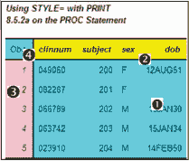

### 支持语句

尽管与 PROC 语句一起使用的样式属性通常应用于整个表格，但在支持语句上应用的 STYLE= 选项可以让你进行更具体的控制。此外，这些属性往往覆盖在 PROC 语句上设置的属性。

与 CLASS 语句（参见第 7.1 节）类似，可以拆分为多个语句，PRINT 的几个允许变量列表的语句也可以拆分为多个语句。

```sas
proc print data=advrpt.demog(obs=5)
              style(column)=[background=cyan]
              style(header)= [background=yellow
                              font_weight=bold]
              ;
  id clinnum / style(hdr data)=(background=blue
                                 foreground=white);
  var subject / style(header)=(background=red
                                foreground=white)
                style(column)=(background=red
                               foreground=white);
  var sex dob edu;
  sum edu / style(grandtotal)=(font_weight=bold
                                background=blue
                                foreground=white);
run;
```

这允许你为不同的变量指定不同的选项。在应用 STYLE= 选项 ❸❹ 时，我们可以利用这一能力。

- ❶ PROC 语句上的 STYLE= 选项会覆盖与 ODS 样式 JOURNAL 关联的默认值。

**在支持语句上使用 STYLE= 与 PRINT 8.5.2b**

| 诊所编号 | 受试者 | 性别 | 出生日期 | 教育程度 |
|---|---:|---:|---|---:|
| 024960 | 200 | F | 12AUG51 | 17 |
| 082287 | 201 | F | — | 16 |
| 066789 | 202 | M | 15AUG30 | 12 |
| 063742 | 203 | M | 15JUN34 | 12 |
| 023910 | 204 | M | 14FEB? | 14 |
|  |  |  | 总计 | 59 |

- ❷ 为 ID 变量指定了两个位置。注意，HEADER 位置被缩写为 HDR。
- ❸ 指定了两个 STYLE= 选项，每个都有自己的位置。由于两者具有相同的属性，它们可以像 ❷ 中那样合并。
- ❹ VAR 语句被拆分为两个语句。这些变量没有样式覆盖，将使用在 PROC 语句 ❶ 中指定的属性。
- ❺ 列总计收到了三个属性覆盖。

## 更多信息

用于产生交通灯效果的样式覆盖选项在第 11.5.4 节中讨论。


### 第9章

### 即使不使用 SAS/GRAPH，也应了解的 SAS/GRAPH 元素

- 9.1 将标题选项与 ODS 一起使用 298
- 9.2 设置和清除图形选项与设置 300
- 9.3 将 SAS/GRAPH 语句与非 SAS/GRAPH 过程一起使用 303
  - 9.3.1 使用 SYMBOL 语句更改绘图符号 303
  - 9.3.2 控制坐标轴和图例 306
- 9.4 使用 ANNOTATE 增强图形 309

输出交付系统（ODS）赋予我们大量所需的控制能力，以便生成别人期望我们提供的各类报表和表格。尽管我们经常会在表格中加入图形元素，但事实证明，即使我们并不创建图形，也可以利用许多与 SAS/GRAPH 相关的选项、语句和技术为我们服务。在本章中，你将学习即使不使用 SAS/GRAPH，如何利用这些图形元素。

本章描述的一些选项和语句在你的站点未获得 SAS/GRAPH 许可时不可用。如果你无法使用 SAS/GRAPH，请尝试让你的站点获得其许可；否则，就进行试验。本章展示的许多内容无论如何都会起作用，但并非所有内容都如此！

### 另请参阅

Carpenter (2010b) 中包含许多其他相关示例。

#### 9.1 将标题选项与 ODS 一起使用

对于支持字体和颜色属性的目标，输出交付系统（ODS）支持许多 SAS/GRAPH 标题和脚注选项。

一些传统的 TITLE/FOOTNOTE 语句选项包括：

- `Color=` 颜色指定
- `BColor=` 背景色指定
- `Height=` 文本高度（通常以磅为单位指定）
- `Justify=` 文本对齐方式（左、居中、右）
- `Font=` 字体指定（可包括硬件和软件字体）

这些选项大多可以缩写。对于上面显示的选项，你可以使用选项名中的大写字母作为缩写。

还有一些字体修改选项。包括：

- `BOLD` 将文本加粗
- `ITALIC` 将文本设为斜体
- `UNDERLINE` 给文本加下划线

颜色可以包括大多数标准颜色名称，以及适合输出目标的任何 RGB 或灰度颜色。

这些选项列在 Base SAS TITLE 语句文档以及 SAS/GRAPH 文档中；然而，许多 SAS/GRAPH TITLE 语句选项在图形环境之外不受支持。以下示例使用与 RTF 报表关联的标题演示其中一些 TITLE 语句选项。

```sas
title1  f='times new roman' ❶
        h=15pt c=blue ❷
        bc=yellow ❸
        '9.1a Using TITLE Options';

ods rtf file="&path\\results\\E9_1a.rtf"
          style=rtf;

title2 f='Arial' h=13pt c=red
       j=l ❹
       bold ❺
       'English Units';

proc report data=advrpt.demog nowd split='*';
      ...portions of the REPORT step are not shown...
```

- ❶ 你可以使用系统可用的任何字体。由多个单词组成的字体必须用引号括起来。

- ❷ 字体大小设置为 15 磅。这可能是一个相当名义上的大小，因为实际大小可能取决于目标及其显示方式。

- ❸ 背景色设置为黄色。

- ❹ `JUSTIFY=LEFT` 已被缩写。

- ❺ 字体已加粗。

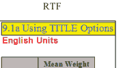

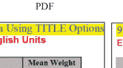

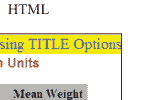

在 RTF 目标中使用 RTF 样式时，更改背景色（BC=）会在标题周围添加一个框。

在 RTF 中，默认情况下，导入表格时，标题和脚注会添加到文档的 HEADER 和 FOOTERS 中。脚注位于物理页面的底部，而不一定是表格的底部。通过使用 BODYTITLE 选项，可以使标题/脚注成为表格本身的一部分。对于较短的表格，这可以将脚注移到表格底部。

```sas
ods rtf file="&path\results\E9_1b.rtf"
    style=rtf
    bodytitle;
```

通过使用背景色选项（BCOLOR），你可以更改标题文本后面的背景色。此选项还可用于创建彩色水平线。➊ BCOLOR 选项指定背景色。➋ 必须指定一些文本，哪怕只是一个空格。

```sas
title1 '9.1c Horizontal Lines';
title2 h=5pt bcolor=blue ' '; ➊
footnote h=5pt bcolor=blue ' '; ➋
ods html file="&path\results\E9_1c.html";
proc print data=sashelp.class(obs=4);
run;
ods html close;
```

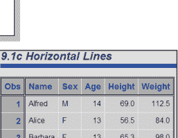

还有许多其他 SAS/GRAPH TITLE 语句选项。其中大多数选项在 SAS/GRAPH 之外会被忽略。取决于目标和样式，一些 SAS/GRAPH TITLE 语句选项有时不会被忽略（当你认为它们应该被忽略时）。在这些情况下，它们往往会产生意想不到的结果。

### 另请参阅

水平线示例源自 Don Henderson 在 sasCommunity.org 上提供的提示，网址为 http://www.sascommunity.org/wiki/Tip_of_the_Day:April_26。

TITLE / FOOTNOTE 选项也记录在 http://support.sas.com/documentation/cdl/en/lrdict/64316/HTML/default/viewer.htm#a000220968.htm（有关这些选项的具体用法，请参见示例 3）。

#### 9.2 设置和清除图形选项与设置

大多数具有图形功能的过程也可以利用许多图形选项和设置。并非所有图形选项都会在 SAS/GRAPH 环境之外被使用，因此你可能需要进行一些试验，以确定哪些图形选项适用于你的操作系统、SAS 版本、ODS 目标以及所关注的过程。

图形选项通过 GOPTIONS 语句设置。与 OPTIONS 语句一样，这个全局语句用于设置一个或多个图形选项。由于高分辨率图形的准备和呈现涉及许多方面，因此必然有大量图形选项。

这里显示了一些较常用的选项。

| 选项 | 示例值 | 作用 |
|--------|---------------|--------------|
| htext= | 2.5 | 设置文本大小 |
| ftext= | Arial | 为文本字符设置默认字体 |
| border | noborder border | 确定是否在图形周围放置边框 |
| device= | emf | 标识用于渲染图形的指令集 |
| gsfname= | *fileref* | 将图形写入此位置的文件 |

```sas
goptions reset=symbol;
```

由于这些选项和设置的作用域是整个会话，因此如果你处于交互式会话中，并执行两个或多个使用或更改其中某些选项的程序，那么一个程序的选项干扰下一个程序的选项并不罕见。你可以通过在每个程序开始时使用 RESET= 选项将选项设置或重置为其默认值来减轻这种干扰。

RESET= 图形选项可用于重置若干组不同的图形设置。下表显示了其中一些组。

| RESET= | 作用 |
|---|---|
| all | 重置所有图形选项和设置。还会重置其他一些语句中的值（见下文）。 |
| goptions | 仅将图形选项重置为其默认值 |
| symbol | 清除所有 symbol 语句定义 |
| legend | 清除所有 legend 语句定义 |
| title | 清除所有标题定义；与 `title1;` 相同 |
| footnote | 清除所有脚注定义；与 `footnote1;` 相同 |

以下是一组相当典型的 GOPTIONS 语句。

```sas
FILENAME fileref "&path\results\FinalReport.emf";

goptions reset=all border ❶;
         ftext=simplex; ❷
GOPTIONS GSFNAME=fileref GSFMODE=replace ❸;
         DEVICE=emf; ❹
*goptions device=win ❺;
         targetdevice=emf; ❻;
```

- ❶ RESET=all 选项清除所有图形选项并将其设置为默认值。然后打开图形周围的边框。

- ❷ FTEXT= 选项用于设置图形文本的默认字体。SIMPLEX 与 ARIAL 类似；但是，如果你的站点未获得 SAS/GRAPH 许可，则此 SAS/GRAPH 字体可能不可用。

- ❸ 图形流文件选项（GSF）用于将图形路由到文件。
  - GSFNAME= 指向图形的目标位置（在本例中为名为 `FILEREF` 的 `fileref`）。
  - GSFMODE= 如果图形文件已存在，REPLACE 表示将替换该图形。

- ❹ DEVICE= 选项用于为适当的物理或虚拟目标构造图形。当图形要包含在文字处理文档中时，EMF 是一个很好的设备。

- ❺ 在程序开发期间，你会希望看到图形显示在监视器上（DEVICE=WIN）；但是，你可能希望查看它最终在最终目标上的显示效果。TARGETDEVICE= 选项 ❻ 尝试使用最终设备的约束（TARGETDEVICE=）在显示设备（DEVICE=）上向你显示图形。在这个生产示例中，此开发语句已被注释掉。


FTEXT= 在使用诸如 PROC UNIVARIATE 等过程生成图形时可能特别重要。在 8.2.1a 节中出现的示例图（此处也一并展示）中，有些文本几乎无法阅读。这可能是由于自动默认选择了无法适当缩放的硬件字体。FTEXT= 选项

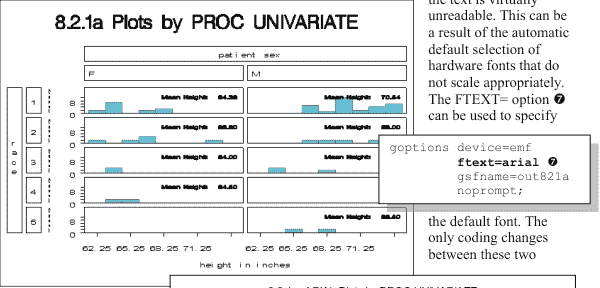

```sas
goptions device=emf
         ftext=arial
         gsfname=out821a
         noprint;
```

默认字体。这两个版本的图形之间，代码的唯一变化是使用了 FTEXT= 选项。请注意，包括文本方向和可读性在内，出现了若干变化。请注意，内部图形所使用的字体并未改变。

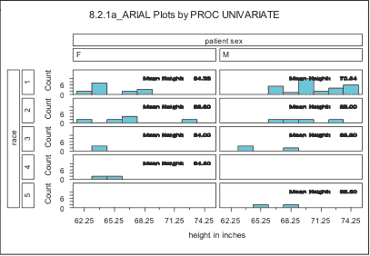

当这些选项与 ODS 一起使用时，您可能希望控制它们是否应覆盖所选样式。从 SAS 9.2 开始，可以通过使用 ODS USEGOPT 语句来限制其中某些选项的应用。当 USEGOPT 生效时，以下图形选项的设置将优先于 ODS 样式，并会影响您的所有 ODS 输出，包括表格和图形选项。受影响的图形选项包括：

FTEXT=、CTEXT=、HTEXT=、FTITLE=、CTITLE=、HTITLE=。

当 ODS NOUSEGOPT 生效时，这些图形选项的设置不会覆盖 ODS 输出中样式定义里的值。

## 更多信息

尽管本书正文所含代码中通常未展示，但第 9 章和第 10 章的示例中使用了图形选项。请查看示例代码，以了解更多使用图形选项的示例。

#### 9.3 在非 SAS/GRAPH 过程中使用 SAS/GRAPH 语句

还有许多其他过程，虽然不属于 SAS/GRAPH，但在生成高分辨率图形时仍能利用 SAS/GRAPH 语句。

我发现一些较常用且具备高分辨率图形功能的过程包括：

- **Base**
  - PROC UNIVARIATE（参见第 8.2 节）
- **SAS/QC**
  - PROC CAPABILITY
  - PROC SHEWHART（参见第 10.1.3 节）
- **SAS/STAT**
  - PROC BOXPLOT（参见第 10.1.1 节）
  - PROC PROBIT
  - PROC REG

本节余下部分非常简要地介绍一些可在 SAS/GRAPH 之外使用的语句。关于 SAS/GRAPH 更好、更完整的介绍可在众多论文以及若干书籍中找到。

## 注意

如果您无法访问 SAS/GRAPH，并且取决于您的 SAS 版本，本节描述的一些技术和功能可能不可用。即使您没有使用 SAS/GRAPH 过程，也是如此。

## 更多信息

第 8.2.3 节中 PROC UNIVARIATE 生成的概率图和 QQ 图可以利用 SYMBOL 语句（参见第 9.3.1 节）。

第 9.1 节演示了在 TITLE 和 FOOTNOTE 语句中使用 SAS/GRAPH 选项，因为这些选项可应用于 Output Delivery System 生成的输出。

## 另请参阅

专门介绍 SAS/GRAPH 的书籍包括 Carpenter and Shipp (1995)、Carpenter (1999) 和 Miron (1995)。

##### 9.3.1 使用 SYMBOL 语句更改绘图符号

SYMBOL 语句用于控制图形区域内各项的外观。正如您所料，这包括绘图符号，但它也控制线条的外观，以及点如何与这些线条连接。所有绘图符号和线条都有属性，例如颜色、大小、形状、粗细。这些属性均由 SYMBOL 语句控制。

最多可以有 99 个带编号的 SYMBOL 语句。要控制的属性通过选项来指定。选项通过其名称指定，并且在大多数情况下，名称可以缩写。

```
    symbol1 color = blue h = .8 v=dot;
```

该 SYMBOL 语句请求将绘图符号（一个点）设为蓝色，大小（高度）为 .8 个单位。

幸运的是，由于 SYMBOL 语句使用频繁，应用起来通常相当直接。快速查阅文档通常可以作为初步指导。然而，就像 SAS 中的许多事情一样，在更复杂的情况下应用 SYMBOL 语句时，有一些陷阱需要注意。

下表中显示了众多 SYMBOL 语句选项中的几个。

| 选项 | 选项缩写 | 示例值 | 作用 |
| --- | --- | --- | --- |
| color= | c= | blue | 设置符号或线条的颜色 |
| height= | h= | 1.5 | 指定符号的大小 |
| value= | v= | star | 标识图中要使用的符号 |
| interpol= | i= | join | 指示绘图符号如何连接 |
| line= | l= | 1 | 分配线号；1、2 和 3 最有用 |
| width= | w= | 2.1 | 标识线宽；默认值通常为 1 |

### SYMBOL 定义是累积的

尽管 SYMBOL 语句与 TITLE 和 FOOTNOTE 语句一样是带编号的，但在定义建立方式上，这大概是唯一的相似之处。指定 TITLE3 语句时，TITLE3 的定义会被完全替换。给定的 TITLE 语句不仅是该标题的完整定义，而且同一个 TITLE3 语句会自动清除标题 4 到 10。另一方面，SYMBOL 语句定义是累积的，每个带编号的语句都独立于其他编号的语句。

左侧的两个 SYMBOL 语句可以改写为一系列语句。

```
    symbol1 color = blue v=none
        i=box10 bwidth=3;
    symbol2 color = red  v=dot
        i=join line=2 h=1.2;
```

```
    symbol2 v=dot i=join;
    symbol1 color = blue;
    symbol2 color = red;
    symbol1 v=none i=box10 bwidth=3;
    symbol2 line=2 h=1.2;
```

可以在 GOPTIONS 语句中使用图形选项 RESET 来清除 SYMBOL 语句定义。

```
    goptions reset=symbol;
```

### SYMBOL 定义的选择并非由用户主导

当图中要使用符号或线条时，该过程首先检查是否存在任何用户定义的符号定义（当然，在未使用 SYMBOL 语句时，所有内容都有默认值）。然后，该过程会选择下一个可用的符号定义。这意味着，如果刚刚使用了 SYMBOL2，该过程将查找 SYMBOL3 定义。

遗憾的是，通常无法将给定的 SYMBOL 语句直接关联到给定的线条或符号。这意味着您至少需要对计划使用的过程中的符号定义选择有基本了解。

以下示例使用 PROC REG 对 DEMOG 数据集中的 HT 和 WT 执行回归分析。PLOT 语句可用于创建分析结果的图。

```sas
options reset=all; ❶

title f=arial bold 'Regression of HT and WT'; ❷
title2 '9.3.1a No SYMBOL Statement';

proc reg data=advrpt.demog;
model ht = wt; ❸
plot ht*wt/conf; ❹
run;
quit;
```

- ❶ 所有图形选项均设置为其默认值。
- ❷ 使用 TITLE 语句选项选择粗体 ARIAL 作为第一个标题的字体。
- ❸ HT 用作因变量。
- ❹ 使用 CONF 选项请求绘制置信区间和预测值。

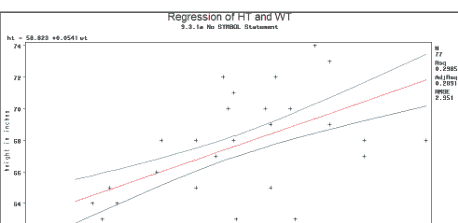

尽管该过程为预测值线和置信区间选择了颜色和线型，但数据是使用加号 '+' 绘制的。

我们可以使用 SYMBOL 语句来控制绘图符号。

- ❺ 对于数据点，使用 SYMBOL1 语句选择绘图符号属性。在本例中，选择颜色和符号（V=）。
- ❻ 指定估计线的颜色。您需要进行试验，以确定图形的哪个方面将使用哪个 SYMBOL 语句。

```
title2 '9.3.1b With SYMBOL Statements';
symbol1 c=blue v=dot; ❺
symbol2 c=red; ❻
symbol3 c=green r=2; ❼
```


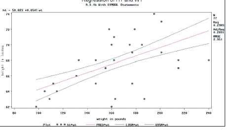

- 7. 置信线被着成绿色。R= 选项导致此符号定义被第二次重用。否则，我们本可以指定 SYMBOL4 定义与 SYMBOL3 定义相同。

颜色和绘图符号显示在图形底部的图例中。你可以通过使用 LEGEND 语句来控制图例（参见第 9.3.2 节）。尽管 PROC REG 不支持，但对于某些过程，你可以使用 NOLEGEND 选项完全消除图例。

##### 9.3.2 控制坐标轴和图例

可以通过使用 AXIS 语句获得对水平和垂直坐标轴任何及所有方面的控制。这个全局语句可能是 SAS/GRAPH 中最复杂的语句之一，甚至可能是 SAS 本身中最复杂的语句之一，并且显然超出了本书的范围，本书只能部分描述该语句。在语法上与 AXIS 语句密切相关的是 LEGEND 语句，它用于控制图形图例的外观。以下是对这两个语句的简要介绍。

与 SYMBOL 语句一样，你最多可以有 99 个带编号的 AXIS 和 LEGEND 语句。同样与 SYMBOL 语句一样，坐标轴和图例定义是累积的。坐标轴和图例定义都可以用 RESET= 选项清除。

```sas
options reset=axis;
options reset=legend;
```

### AXIS 语句

AXIS 语句可用于控制坐标轴线、刻度线、刻度线文本和坐标轴标签。你可以为所有文本指定字体和颜色。对于任何线条，你可以控制样式（线条类型）、粗细、颜色和长度。

坐标轴定义通过一系列选项构建。其中一些选项本身会有选项，而选项套选项的层次常常可以达到三层深。更令人感兴趣的是，一些选项会以多种方式出现，其效果取决于位置和用法。显然，仅仅知道如何应用这些选项以及如何嵌套它们就可能很复杂。

可以出现在语句多个不同方面的大多数选项是文本外观选项。大多数选项类似于用作 TITLE 和 FOOTNOTE 语句选项的那些选项（参见第 9.1 节），并且与 SYMBOL 语句中使用的选项也有一些重叠。一些更常见的文本外观选项包括：

| 选项 | 选项缩写 | 示例值 | 作用 |
|---|---|---|---|
| height= | h= | 10pct | 将大小设置为 10% |
| color= | c= | cxdedede | 将颜色设置为一种灰色 |
| font= | f= | Arial | 将字体设置为 ARIAL |
| 'text string' |  | 'Units are mg' | 将文本字符串分配给选项 |

第一层选项控制坐标轴的主要方面。这些包括诸如：

- ORDER= 要包含的值的范围
- LABEL= 坐标轴标签
- VALUE= 刻度线控制
- MAJOR= 主刻度线（带文本的刻度线）
- MINOR= 次刻度线

构建 AXIS 语句时，括号用于形成子选项组，而对每个选项层级进行缩进有助于跟踪哪些选项与什么对应。

```sas
axis2 order =(3 to 6 by 1) ❶
   label =(h=2 ❷
          font='Times New Roman' ❸
          "Potassium Levels") ❹
   minor =(n=1) ❺
          angle=90 ❻
          rotate=0 ➐ ;
axis1 minor=(n=4) ❺
      color=black
      label=("BMI")
      order=(15 to 40 by 5);
```

这是一个相当典型的 AXIS 语句。注意选项的值在括号中。这允许你指定子选项。

- ❶ ORDER= 限制坐标轴范围；数据可能被排除。这里坐标轴的范围限制为 3 到 6 之间的值，主刻度线位于整数处。VALUE= 选项（显示在 LEGEND 示例中）指定主刻度线的属性。
- ❷ H= 将标签文本的高度设置为 2 个单位（默认单位是单元格）。
- ❸ FONT= 指定字体。包含多个单词的字体应加引号。
- ❹ 'text' 指定标签的文本，这会覆盖变量的标签。
- ❺ MINOR= 指定次刻度线的数量。关键字 NONE 可用于关闭次刻度线。

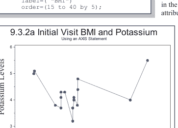

- ❻ ANGLE= 将整个标签旋转 90 度（从水平到垂直）。Angle=0 是水平。
- ➐ **ROTATE=** 分别旋转一行文本中的字母。
- ➑ 各个 AXIS 定义通过 PLOT 语句上的选项分配给绘图或图形上的某个坐标轴。

### LEGEND 语句

AXIS 语句的一般语法、语句结构，甚至许多选项都与 LEGEND 语句共享。在第 9.3.1 节的回归图中，图例出现在图形底部。我们可以更改其位置以及外观。

```sas
legend1 position=(top left inside)
        value=(f='arial' t=1 'Height'
                       t=2 'Predicted'
                       t=3 'Upper 95'
                       t=4 'Lower 95')
        label=none
        frame
        across=2;

proc reg data=advrpt.demog;
model ht = wt;
plot ht*wt/conf
             legend=legend1;
run;
```

- 1. 图例可以位于图形区域的内部或外部。它也可以垂直和水平移动。
- 2. VALUE= 选项控制与图例中四个单独项关联的文本。
- 3. LABEL=NONE 选项关闭图例的标签。
- 4. FRAME 选项在图例周围添加一个框。其他选项允许你更改边框的宽度、颜色和底纹。
- 5. ACROSS=2 选项允许图例中每行最多 2 个项目。
- 6. LEGEND= 选项标识合适的图例语句。

对于此图形，尤其是在以黑白显示时，图例相当多余。许多过程都有一个选项（NOLEGEND），可用于阻止显示图例。PROC REG 不支持 NOLEGEND 选项。因此，当使用任何导致显示多个项目的 PLOT 语句选项（如 CONF）时，无法阻止图例出现。以下示例使用 LEGEND 语句来最小化图例的影响。

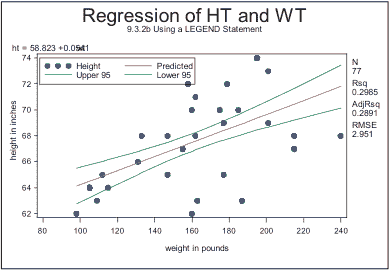

```sas
legend2 value= none ❼
          label=none ❽
          shape=symbol(.001,.001); ❾

proc reg data=advrpt.demog;
model ht = wt;
plot ht*wt/conf
             legend=legend2; ❿
run;
```

- ❼ 各个值的文本被关闭。

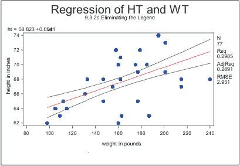

- ❽ 标签被关闭。
- ❾ 各个符号元素无法关闭（SHAPE 不支持 NONE）；因此，这些值被设置得非常小。
- ❿ 选择使用 LEGEND2 定义。

### 更多信息

AXIS 语句在第 10.1.1 节的一个示例中使用。

#### 9.4 使用 ANNOTATE 增强图形

注释设施使我们能够自定义过程生成的输出。巨大的优势在于自定义可以依赖于数据，而无需重新编码。该过程的关键是注释数据集。此数据集包含要传递给注释设施的指令。数据集中的每个观测是一条指令，而且通常该指令相当原始，例如，拿起一支笔。

数据集中的指令通过使用 ANNOTATE= 选项传递给正在生成图形的过程。当过程支持此选项或其缩写 ANNO= 时，你就可以判断该过程能否利用注释设施。

由于注释设施将注释数据集的每个观测解释为一条指令，它使用特定变量的值来形成指令的意图。你不能选择变量的名称，但你对变量所取的值有很大影响。为了让指令为注释设施提供有效指令，变量及其值必须回答三个主要问题。


| 要问的问题 | 用于回答这些问题的可能变量 |
|---|---|
| 要做什么？ | FUNCTION（此变量将始终存在） |
| 在哪里做？ | X、Y、XSYS、YSYS |
| 如何做？ | COLOR、SIZE、STYLE、POSITION |

变量 FUNCTION 的值始终要指定，该值决定指令执行时 annotate 将使用哪些其他变量。FUNCTION 应为长度为 8 的字符变量。FUNCTION 有二十多个可能取值；这里展示了三个常用取值。

| FUNCTION 的取值 | 作用 |
|---|---|
| label | 向图形添加文本标签 |
| move | 将指针移动到图形上的另一位置而不绘制任何内容 |
| draw | 从当前位置向图形上的新位置绘制一条线 |

其他常用的 annotate 函数包括用于以下操作的工具：

- 生成多边形、条形和饼图扇区
- 绘制符号、箭头和线条
- 包含文本和图像

对于与图形上某个位置关联的 annotate 操作，使用变量来指定该位置。为了标识一个位置，需要指定坐标系（例如 XSYS、YSYS）以及该坐标系中的位置（例如 X、Y）。

```sas
data bmilabel(keep=function
                  xsys ysys x y
                  text color style
                  position size);
  set advrpt.demog;

  * Define annotate variable attributes;
  length color function $8;
  retain function 'label'
         xsys ysys '2'
         color 'red'
         style 'arial'
         position '2'
         size .8;

  * Calculate the BMI. Note those outside of
  * the range of 18 – 26;
  bmi = wt / (ht** 2) * 703;
  if bmi lt 18 or bmi gt 26 then do;
    * Create a label;
    text = put(bmi,4.1);
    x=wt;
    y=ht;
    output bmilabel;
  end;
run;
```

在此示例中，计算身体质量指数（BMI），然后使用 annotate 功能将其添加到 PROC REG 生成的回归图中（见第 9.3 节）。

- ❶ annotate 数据集命名为（WORK.BMILABEL），并指定它将包含的变量。
- ❷ 为 annotate 变量 FUNCTION 和 COLOR 指定长度以避免截断。这始终是个好主意。
- ❸ 对所有指令（观测）都保持恒定的 annotate 变量，使用 RETAIN 为其赋值。


### 第 10 章：演示图形——不仅仅是 SAS/GRAPH

- 10.1 **生成箱线图** 314
    - 10.1.1 使用 PROC BOXPLOT 314
    - 10.1.2 使用 PROC GPLOT 和 SYMBOL 语句 315
    - 10.1.3 使用 PROC SHEWHART 316
- 10.2 **SAS/GRAPH 专项技术与过程** 317
    - 10.2.1 构建自己的图形字体 317
    - 10.2.2 使用 JUSTIFY= 拆分文本行 319
    - 10.2.3 使用 Windows 字体 319
    - 10.2.4 使用 PROC GKPI 320
- 10.3 **PROC FREQ 图形** 323

SAS/GRAPH 软件自推出以来就具备创建演示质量图形的能力。目前 SAS 内有多个图形系统，其中一些最新创新与 ODS Statistical Graphics 相关。在这两个图形系统之外，还有许多过程具有可与 SAS/GRAPH 相媲美的绘图和制图能力。一个知识全面的程序员会了解这些系统中的每一个，并能利用各自的优势。本章简要讨论一些不属于 SAS/GRAPH 的过程的绘图能力。

### 更多信息

PROC UNIVARIATE（见第 8.2.1 至 8.2.3 节）和 PROC REG（见第 9.3 和 9.4 节）的绘图能力在本书其他章节中演示。

本章通篇使用的 SYMBOL、AXIS 和 LEGEND 语句的回顾见第 9 章。

### 另请参阅

Carpenter（2010b）演示了其中若干过程以及各种能力。SAS 具有本书未涵盖的广泛图形能力。SAS/GRAPH 的介绍可见于 Carpenter（1999）、Shipp（1995）和 Miron（1995）。annotate 功能在 Carpenter（1999）中介绍。ODS Graphics 和 Statistical Graphics 在 Kuhfeld（2010）以及 Matange 和 Heath（2011）的书中有所描述。

#### 10.1 生成箱线图

箱线图是一种用于在单张图上显示超过两个维度信息的图形。与某些同样试图显示超过两个维度的其他图形技术不同，箱线图可以做到这一点，而不会造成可能误导读者的视觉失真（Carpenter 1994 和 Carpenter 1995，第 5.7 节）。尽管在某些学科中被大量使用，但遗憾的是在其他学科中却被忽视。

传统上，在 SAS 中生成箱线图的方法相当有限。用户编写的程序很常见，其中一些更复杂的已发表示例由 Michael Friendly 提供（Friendly，1991）。SAS/GRAPH 中的 SYMBOL 语句也可用于生成箱线图；然而，即使增加了近期选项，这仍然是一种有限的技术。SAS 较新的增补提供了可用于生成箱线图的过程。其中，唯一专门用于生成箱线图的过程是 PROC BOXPLOT（见第 10.1.1 节），它是 SAS/STAT 软件的一部分。可生成此类数据展示变体的其他过程包括：

- PROC GPLOT — SAS/GRAPH（使用 SYMBOL 语句，见第 10.1.2 节）
- PROC MIXED — SAS/STAT
- PROC SHEWHART — SAS/QC（见第 10.1.3 节）

### 另请参阅

Michael Friendly 的书（Friendly，1991）中的程序和宏编写良好且解释充分。所描述的技术提供了一种灵活性，即使在更新的过程中也难以超越。

##### 10.1.1 使用 PROC BOXPLOT

PROC BOXPLOT 是 SAS/STAT 软件中较新的增补，用于创建多种类型的箱线图。PLOT 语句用于提供主要控制；除下面示例中显示的选项外，PLOT 语句选项还包括：

- BOXSTYLE — 指示要显示的箱体类型
- BOXWIDTH — 用于控制箱体宽度
- BOXWIDTHSCALE — 允许箱体宽度根据组大小的函数变化
- NOTCHES — 绘制带缺口的箱体
- SYMBOLLEGEND — 附加图例语句（见第 9.3.2 节）

尽管这是一个 SAS/STAT 过程，但它能够使用通常与 SAS/GRAPH 关联的语句。这些包括 SYMBOL、AXIS 和 LEGEND 语句（见第 9.3 节）。

```sas
symbol1 color = blue h = .8 v=dot;
axis1 minor=none color=black
      label=(angle=90 rotate=0);

proc boxplot data=demog;
   plot wt*symp / cframe = cxdedede
                 boxstyle = schematicid
                 cboxes = red
                 cboxfill = cyan
                 vaxis = axis1
                 ;
   id race;
run;
```

- ❶ 使用颜色 CXdedede 将边框内的背景色设置为灰色。
- ❷ 箱体有多种样式。SCHEMATICID 使须线之外的点在此图中使用 ID 变量 RACE ❹ 进行标注。
- ❸ AXIS 语句用于控制垂直轴的各个方面。AXIS 语句可应用于水平轴 HAXIS= 或垂直轴 VAXIS=（见第 9.3 节）。

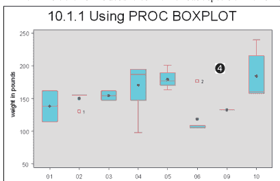

- ❹ ID 语句指定用于标识离群点的变量。

在此示例中，SYMBOL 语句用于控制表示均值的颜色和符号（蓝色圆点）。中位数用水平线表示，箱体的上下限为第 25 和第 75 百分位数。

##### 10.1.2 使用 PROC GPLOT 和 SYMBOL 语句

SYMBOL 语句（见第 9.3.1 节）可用于在 GPLOT 过程中直接生成箱线图。控制通过使用 INTERPOL= 选项实现，该选项通常缩写为 I=。当 I= 取值为 BOX 时，对于水平变量（SYMP）的恒定值，数据被压缩为箱线图。

```sas
symbol1 color = blue v=none i=box10 bwidth=3;
symbol2 color = red  v=dot i=none h=1.2;

axis1 minor=none color=black
      order=(50 to 250 by 50)
      label=(angle=90 rotate=0);
axis2 order = ('00' '01' '02' '03' '04' '05'
               '06' '07' '08' '09' '10' '11')
      value = (t='1' ... t='12' , '');

proc gplot data=demog;
   plot wt*symp/ haxis = axis2
                 vaxis = axis1
                 ;
run;
```


##### 10.1.2 使用 I= 选项绘制箱线图

❶ 构成箱线图的箱体由该 SYMBOL 语句定义。这些选项构成箱体的特征：

- `Color=` 指定轮廓颜色
- `Value=` 表示不需要绘图符号
- `Interpol=` 请求使用 BOX 选项绘制箱线图；`BOX10` 的须线位于第 10 和第 90 百分位数处
- `bwidth=` 指定箱体的宽度

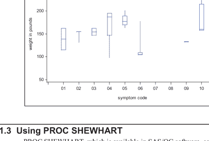

❷ 声明水平轴的主刻度线。‘00’ 和 ‘01’ 不出现在数据中，并且使用 VALUE 选项 ❸ 将它们的标签设置为空白。它们用于提供水平间距控制。

##### 10.1.3 使用 PROC SHEWHART

PROC SHEWHART 可在 SAS/QC 软件中使用，可用于生成多种过程控制图，而箱线图是受支持的图表形式之一。

以下代码可用于使用 PROC SHEWHART 创建箱线图。请注意，水平绘图变量必须为字符型。

```sas
symbol1 color = blue v=dot i=box10 bwidth=3;
symbol2 color = red  v=dot i=none h=1.2;

axis1 minor=none color=black
      order=(50 to 250 by 50)
      label=(angle=90 rotate=0);
axis2 order = ('00' '01' '02' '03' '04' '05'
               '06' '07' '08' '09' '10' '11')
      value = (t=1 ' ' t=12 ' ');

proc shewhart data=demog;
   boxchart wt*symp/
      haxis = axis2
      vaxis = axis1
      stddeviations nolimits
      ;
run;
```

AXIS 语句用于增强坐标轴。尽管 SHEWHART 和 CAPABILITY 不是 SAS/GRAPH 过程，但它们支持 AXIS、SYMBOL 和 PATTERN 语句。

###### 10.1.3 使用 PROC SHEWHART 绘制箱线图

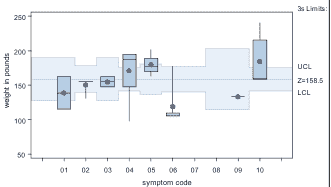

还可以将这些过程与 ANNOTATE 功能配合使用。

#### 10.2 SAS/GRAPH 专用技术与过程

SAS/GRAPH 软件作为 SAS 软件的产品已有很长时间。在此期间，不仅其功能不断扩展，而且它所支持的技术也在不断扩展。因此，多年来已有大量图形问题得到解决。以下是一些比较有趣的例子。

##### 10.2.1 构建自己的图形字体

尽管通过 SAS/GRAPH 软件可用的绘图符号通常足以满足我们的绘图需求，但有时你可能希望针对特定需求定制绘图符号。GFONT 过程可用于创建绘图符号。该过程绘制符号形状的方式与使用 ANNOTATE 功能绘图的方式非常相似，即从一个坐标绘制到下一个坐标。

在本例中，我们对 DOT 符号“凹凸不平”的外观不满意，希望创建一个更平滑的符号。图中这一部分使用标准 DOT 符号生成。


```sas
symbol1 color = blue v=dot h=2;
```

我们可以通过使用 PROC GFONT 生成自己的符号来使圆形更平滑。

首先在 DATA 步中生成一个绘制字体字符（在本例中只是一个圆）的控制数据集。与 ANNOTATE 数据集类似，使用特定变量将信息传递给 GFONT 过程。这里我们使用 721 条短线段绘制一个圆的轮廓。然后，将该控制数据集传递给 GFONT。

```sas
data fontdata(keep=char seg x y lp ptype);
retain char 'c'             /* 1 */
       seg 1                /* 2 */
       lp 'p';              /* 3 */
ptype='w'; x=10; y=110; output fontdata; /* 4 */
ptype='v'; x=100; y=50; output fontdata; /* 5 */
do deg = 0 to 360 by 5;
   rad = deg*arcos(-1)/180;
   x=50*cos(rad)+50;
   y=50*sin(rad)+50;
   output fontdata;           /* 6 */
end;
run;
libname gfont0 "path\data"; /* 7 */
proc gfont data=fontdata
          name=mydot           /* 8 */
          filled               /* 9 */
          resolution=3;        /* 10 */
run;
symbol1 f=mydot c=blue v='c' h=1;
```

- 1. 变量 CHAR 用于保存键盘字符 ‘c’，该字符用于在 MYDOT 字体中指定其符号。
- 2. 符号段允许你创建具有不连接部分（段）的符号。该符号只有一个段，因此该值为常量。
- 3. 这将是一个多边形图形。
- 4. 字符宽度（PTYPE='w'）。该符号宽度为 100 个单位。为字符间距预留约 10% 的额外空间。
- 5. 这是绘图符号的第一个坐标（PTYPE='v'）。
- 6. 该段写入控制数据集。
- 7. 生成的字体存储在名为 FONTS 的目录中。SAS/GRAPH 软件在名称以 GFONT 开头的编号库引用中搜索该目录。
- 8. 命名该字体。
- 9. 我们希望填充该形状。
- 10. 提高字体分辨率。你可能会注意到值 1 和 3 之间几乎没有差异或没有差异。

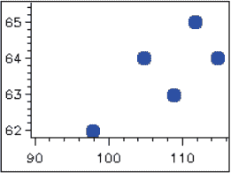

生成的圆点稍微更平滑。在此屏幕截图中，图像复制到本文档时出现了一些像素化。

## 另见

Carpenter（1995）使用 PROC GFONT 创建徽标和向日葵符号，这些符号根据绘图值自我调整。有关绘图符号分辨率的进一步讨论以及其他解决方案，见 SAS 论坛帖子：http://support.sas.com/forums/thread.jspa?threadID=12547&start=0&start=0。

##### 10.2.2 使用 JUSTIFY= 拆分文本行

在 SAS/GRAPH 软件中，你可以使用文本对齐选项来拆分文本行。通常，在否则无法拆分文本行的情况下可以使用此技术。你只需重复对齐选项。第二次出现将导致行拆分。

```sas
title1 f=arial h=1.2 justify=left '10.2.2'
                  justify=center 'Splitting Text';
symbol1 c=blue v=dot h=1.5;
symbol2 c=red v=dot h=1.5;
axis1 reflabel = (h=1.5
                  t=1 c=red j=left 'Overweight'
                                      j=l ' '
                                      j=l c=blue 'Normal');
axis2 order=(1920 to 1970 by 10)
       label=j=c 'Birthyear';
```

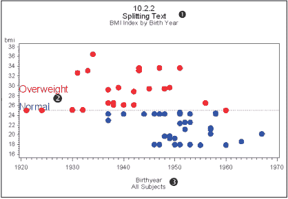

- 1. 对齐选项可以写为 JUSTIFY，或缩写为 J。位置（Left、Center 或 Right）也可以缩写。此处重复的对齐选项导致标题文本拆分。
- 2. 垂直参考线上的参考标签已拆分为三行文本。
- 3. 水平轴标签已拆分为两行。

##### 10.2.3 使用 Windows 字体

SAS/GRAPH 软件有许多内置字体。此外，如果你在 Windows 环境中执行，还可以使用 Windows TrueType 字体。

GOPTIONS 语句（见第 9.2 节）用于指定图形选项，其中一个选项 FTEXT= 可用于指定字体。在标题上，也可以使用 FONT= 选项（见第 9.1 节）指定字体。

```sas
goptions reset=all noborder
         device=emf
         gsfname=image gsfmode=replace
         ftext='Arial';
title1 f=arial 'This is a Title';
```

- 1. 已选择 Arial 作为所有图形文本的默认字体。作为一般规则，非 SAS/GRAPH 字体在作为图形选项命名时应加引号。当名称包含多个单词时，必须加引号。
- 2. 也可以指定标题的字体（有关 TITLE 语句选项的更多信息，见第 9.1 节）。在 TITLE 语句中不必给字体名称加引号，除非字体名称包含多个单词，例如 'Times New Roman'。

你可以通过选择 Windows 控制面板中的 FONTS 项来查看可用字体及其替代名称的列表。选择“开始”→“控制面板”→“字体”。

有些字体具有包含粗体和斜体的命名变体（'Arial Bold'）。你可能还需要指定字体修饰符。在三个可用的字体修饰符中，粗体（/bold 或 /bo）和斜体（/italics 或 /it）最常用。

```sas
axis1 label=(f='arial/bo' angle=90 rotate=0 'Patient Weight');
```

SAS/GRAPH 软件包含许多符号集。对于默认符号集之外的符号集，需在 SYMBOL 语句中使用 FONT=（或 F=）选项指定符号集名称。对于非 SAS/GRAPH 特殊字符的特殊字符（即没有映射到键盘值的字符），通常可以从字符映射表（如右图所示）插入该字符。选择“开始”→“程序”→“附件”→“系统工具”→“字符映射表”。

- 1. 选择感兴趣的字符；如右图所示，已选择 Wingdings 2 字体中的星爆图案。
- 2. 按复制按钮将代码放入粘贴缓冲区。
- 3. 将该值粘贴到适当位置（此处显示的是 SYMBOL 语句上的 V= 选项）。

请注意，该符号在 SAS 程序中显示的样子可能与在图形中不同。

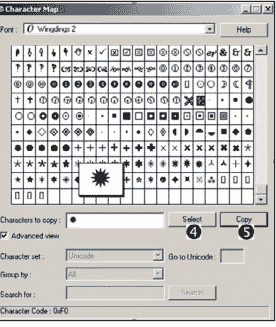

```sas
symbol1 c=blue
        f='wingdings 2' v='❸'
        i=box10 bwidth=3;
```

**警告：** 如果你选择仅本地计算机可用的非标准字体，SAS 程序的可移植性会降低。

##### 10.2.4 使用 PROC GKPI

GKPI（关键绩效指标）过程对 SAS/GRAPH 来说相当新。该过程允许你快速构建指标条或仪表盘，以显示指定范围内某个值的相对状态。此过程提供几种类型的绩效指标。此处显示的是水平滑块（HBULLET）。你可以指定值范围、用于分隔范围的颜色以及当前值。

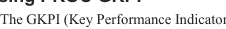


❾ CALL EXECUTE 例程用于构建一系列宏调用——每个传入观测对应一个宏调用。宏 %SLIDER 会接收每个特定受试者所需的参数（受试者编号和关联的 BMI 值）。这些信息足以让 PROC GKPI 生成该受试者的特定指标。

```sas
%slider(G200,24.3)
%slider(G201,21.4)
%slider(G202,25.1)
%slider(G203,36.5)
%slider(G204,18.0)
%slider(G205,25.1)
%slider(G206,23.0)
%slider(G207,24.3)
```

在宏 %SLIDER 的所有调用执行完毕后，将生成一系列 PNG 文件❺。这些文件的命名方式为❾，以便 PROC REPORT ❿ 能够按正确顺序导入它们。

```sas
ods pdf file="&path.\results\E10_2_4.pdf" style=default;
title font=arial '10.2.4 Using GKPI';
proc report data=bmi nowd;
column subject gname ht wt bmi slider;
                 ...code not shown....
define slider / computed;
compute slider;
  compute slider/char length=62;
  slider=' ';
  imgfile = "style='postimage='c:\temp\"||trim(left(gname))||".png')";
  call define('slider','style',imgfile);
endcomp;
run;
ods pdf close;
```

##### 10.2.4 使用 GKPI

| 受试者编号 | 身高 | 体重 | 体重指数 | 指标 |
|---:|---:|---:|---:|:---|
| 200 | 67 | 155 | 24.3 | ███ |
| 201 | 72 | 158 | 21.4 | ███ |
| 202 | 70 | 175 | 25.1 | ███ |
| 203 | 68 | 240 | 36.5 | ███ |

❿ REPORT 步骤会创建一个计算报表项（SLIDER），用于存放指标图像。临时变量 IMGFILE 包含指向 PNG 文件❺的指针，该文件包含图像。对于受试者 200，IMGFILE 包含：

```sas
style='postimage='c:\temp\G200.png'
```

此处显示了所得 PDF 文件的一部分。

#### 10.3 PROC FREQ 图形

FREQ 过程现在已被列入可通过 ODS Statistical Graphics 例程生成图形的基础过程列表。TABLE 语句支持 PLOT= 选项，该选项可用于生成多种图形。

有多种不同类型的图可用，尤其是在计算检验统计量时，例如使用 CHISQ 选项生成的图。PLOTS= 选项用于提出绘图请求。你可以像下面这样指定特定类型的图，也可以请求所有图（plots=all）。

```sas
ods graphics on;
ods pdf file="&path\results\E10_3.pdf";
proc freq data=advrpt.demog;
   table wt / plots=cumfreqplot(scale=freq); ❶
   table sex*race/plots=freqplot(scale=percent); ❷
run;
ods pdf close;
```

- ❶ CUMFREQPLOT 可用于生成频数和累积频数直方图。还有许多修饰符选项可以进一步细化绘图请求。这里我们明确要求垂直轴为频数。

  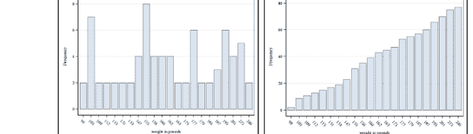

  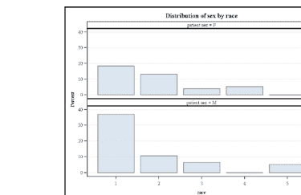

- ❷ 对于双向表，我们通常需要查看各值组合的频数之间的关系。在此绘图请求中，我们要求绘制 RACE 和 SEX 之间关系的频数图。该绘图请求已被修改为让垂直轴显示百分比。

### 第11章 输出交付系统

- **11.1 使用 OUTPUT 目标** 326
  - 11.1.1 确定对象名称 326
  - 11.1.2 创建数据集 327
  - 11.1.3 使用 MATCH_ALL 选项 330
  - 11.1.4 使用 PERSIST= 选项 330
  - 11.1.5 将 MATCH_ALL= 与 PERSIST= 选项一起使用 331
- **11.2 将报表写入 Excel** 332
  - 11.2.1 EXCELXP 标签集文档和选项 333
  - 11.2.2 生成多工作表工作簿 334
  - 11.2.3 检查样式 335
- **11.3 使用转义字符序列进行内联格式设置** 337
  - 11.3.1 第 X 页，共 Y 页 338
  - 11.3.2 上标、下标和剑号 340
  - 11.3.3 更改属性 341
  - 11.3.4 使用序列代码控制缩进、间距和换行 342
  - 11.3.5 发出原始 RTF 特定命令 344
- **11.4 创建超链接** 345
  - 11.4.1 使用样式覆盖创建链接 345
  - 11.4.2 使用 LINK= TITLE 语句选项 347
  - 11.4.3 链接图形元素 348
  - 11.4.4 创建内部链接 350
- **11.5 交通灯** 352
  - 11.5.1 用户定义格式 352
  - 11.5.2 PROC TABULATE 353
  - 11.5.3 PROC REPORT 354
  - 11.5.4 使用 PROC PRINT 实现交通灯 355
- **11.6 ODS LAYOUT 语句** 356
- **11.7 其他一些有用的 ODS 小技巧** 358
  - 11.7.1 使用 ASIS 样式属性 358
  - 11.7.2 ODS RESULTS 语句 358

输出交付系统（ODS）有太多复杂细节，这里只能提及其中很少一部分。事实上，已经有多本书以 ODS 为主要主题或重要次要主题。本章旨在重点介绍一些有用的主题。

### 另见

ODS 的经典首选文档是 Haworth、Zender 和 Burlew（2009）所著的 *输出交付系统：基础与进阶*。可在以下网址找到 ODS 提示表：
http://support.sas.com/rnd/base/ods/scratch/ods-tips.pdf

Lund（2006）涵盖了本章中的大量主题，并对 ODS 属性及其适用目标做了很好的总结。

#### 11.1 使用 OUTPUT 目标

虽然大多数过程都有一个或多个选项可用于将过程结果路由到数据集，但并非所有值都能通过这种方式捕获。OUTPUT 目标允许我们将过程结果捕获为数据。当没有可用选项将特定统计量写入数据集，或者某个过程不具备生成输出数据集的能力时，该目标尤其有用。

每个过程的输出被组织成一个或多个对象。这些对象有一系列属性，包括名称和标签。该名称（或标签）可在 ODS OUTPUT 语句中作为选项使用，以创建输出数据集。

本节示例使用 PROC UNIVARIATE；不过，大部分讨论也适用于大多数其他过程。

##### 11.1.1 确定对象名称

在其最简单的形式中，UNIVARIATE 过程会创建五个输出对象，而我们至少需要对象名称才能使用 OUTPUT 目标。

```sas
ods trace on;
proc univariate data=advrpt.demog;
    var ht wt;
    run;
ods trace off;
```

PROC UNIVARIATE 为每个分析变量生成的五个基本对象的标签可在 RESULTS 窗口中看到。如果右键单击标签，可以检查对象的属性，包括名称。

由于使用了带 ON 选项❶的 ODS TRACE 语句，这些属性也会显示在 LOG 中。右侧显示的 LOG 部分展示了五个对象中两个对象的属性。TRACE 语句通过 OFF 选项❷关闭。

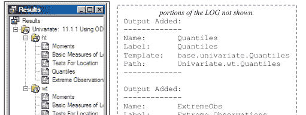

##### 11.1.2 创建数据集

输出对象的名称（或其标签）在 ODS OUTPUT 语句中作为选项使用，用于命名要创建的数据集。在此示例中，我们希望收集关于具有极端值的观测的信息。默认情况下，PROC UNIVARIATE 会标识包含分析变量最大值和最小值的五个观测。

```sas
    ods listing close; ❶
    title1 '11.1.2a Naming the OUTPUT Data Set';
    ods output extremeobs=maxmin; ❷
    proc univariate data=advrpt.demog;
       id lname fname; ❸
       var ht wt; ❹
    run;

    ods listing; ❺
    proc print data=maxmin;
    run;
```

- ❶ 在本例中，我们只希望 PROC UNIVARIATE 创建数据集（不输出打印结果），因此除 OUTPUT 之外的所有目标都被关闭。我们不能只使用 NOPRINT 选项，因为它也会阻止 OUTPUT 目标创建数据集的能力。
- ❷ 一个或多个输出对象的名称（EXTREMEOBS）在 ODS OUTPUT 语句中作为选项使用，用于命名要创建的数据集（WORK.MAXMIN）。
- ❸ ID 语句命名一个或多个有助于标识所选观测的变量。
- ❹ 指定了两个分析变量。
- ❺ LISTING 目标已重新打开，并使用 PROC PRINT 显示由 OUTPUT 目标构建的数据集。

所得数据集（WORK.MAXMIN）的 LISTING 输出显示了每个分析变量五个最大值和最小值对应的观测编号和标识变量。


##### 11.1.2a 命名 OUTPUT 数据集

| 观测 | 变量名 | 低值 | lname_Low | fname_Low | LowObs | 高值 | lname_High | fname_High | HighObs |
|---:|---|---:|---|---|---:|---:|---|---|---:|
| 1 | ht | 62 | Moon | Rachel | 51 | 74 | Lawless | Henry | 38 |
| 2 | ht | 62 | Karson | Shawn | 36 | 74 | Mercy | Ronald | 50 |
| 3 | ht | 62 | Cranston | Rhonda | 18 | 74 | Rhodes | David | 53 |
| 4 | ht | 62 | Carlile | Patsy | 11 | 74 | Panda | Merv | 56 |
| 5 | ht | 63 | Temple | Linda | 72 | 74 | Taber | Lee | 70 |
| 6 | wt | 98 | Karson | Shawn | 36 | 215 | Mann | Steven | 43 |
| 7 | wt | 98 | Carlile | Patsy | 11 | 215 | Marks | Gerald | 44 |
| 8 | wt | 105 | Stubs | Mark | 69 | 215 | Rose | Mary | 63 |
| 9 | wt | 105 | Maxwell | Linda | 49 | 240 | Antler | Peter | 4 |
| 10 | wt | 105 | Leader | Zac | 39 | 240 | King | Doug | 37 |

## 使用 CLASS 和 BY 变量

当在 PROC 步中添加 CLASS 或 BY 变量时，生成的数据集将扩展以包含这些变量。

```sas
title1 '11.1.2b CLASS Variable Present';
ods output extremeobs=maxclass(keep=sex varname high_obs lname_high fname_high);
ods listing close;
proc univariate data=advrpt.demog;
    class sex;
    id lname fname;
    var ht wt;
run;
```

- ⑥ 命名新数据集时，可以包含数据集选项（参见第 2.1 节）。
- ⑦ 使用一个或多个分类变量时，会针对每种水平组合将这些变量添加到新数据集中。BY 语句会产生类似结果；不过，观测值和变量的顺序都会不同。

##### 11.1.2b 存在 CLASS 变量

| 观测 | 变量名 | sex | 高值 | lname_High | fname_High |
|---:|---|---:|---|---|
| 1 | ht | F | 68 | East | Jody |
| 2 | ht | F | 68 | Rose | Mary |
| 3 | ht | F | 68 | Wills | Norma |
| 4 | ht | F | 72 | Adamson | Joan |
| 5 | ht | F | 72 | Olsen | June |
| 6 | ht | M | 74 | Lawless | Henry |
| 7 | ht | M | 74 | Mercy | Ronald |

*……本列表的部分内容未显示……*

## 使用对象的标签

在 ODS OUTPUT 语句中，可以使用对象的标签代替对象名。这里重复 11.1.2a 中的示例，使用带引号的标签（extreme observations）⑧ 代替对象名。

```sas
ods output 'extreme observations'=extobs;
```

## 驱动自动化流程

任何数据集，甚至任何按行和列排列的信息，都可以用作自动化流程的驱动信息。在创建依赖外部信息进行决策的应用程序和程序时，SAS 宏语言尤其强大。

在本例中，该外部信息将是通过 ODS 和 OUTPUT 目的地创建的数据集。此处展示的示例流程是我们希望多次执行的流程，它是一个简单的 PROC PRINT，但实际上它可以是任意数量的 DATA 和 PROC 步。在本例中，我们希望针对分类变量的每个水平执行一次 %PROCESS 宏（在本例中，分类变量必须是字符型）。控制将通过 WHERE 子句 ❶ 实现，该子句将在控制宏（%DOPROCESS）❷ 中构建。

```sas
%macro process(dsn=,whr=);
    proc print data=&dsn;
        where &whr; ❶
    run;
%mend process;
```

控制宏 %DOPROCESS 使用带有 OUTPUT 目的地 ❷ 的 PROC FREQ 来形成数据集，其中包含分类变量（&CVAR）的每个不同值对应的一个水平。

```sas
%macro doprocess(dsn=, cvar=);
    ods output onewayfreqs=levels; ❷
    proc freq data=&dsn;
        table &cvar;
    run;
    data _null_;
        set levels; ❸
        whr = cats("&cvar=", &cvar, ""); ❹
        call execute('%nrstr(%process(dsn='||"&dsn"||',whr='||whr||'))'); ❺
    run;
%mend doprocess;

%doprocess(dsn=advrpt.demog, cvar=sex) ❻
```

- ❷ 使用 ODS OUTPUT 和 PROC FREQ 创建数据集（WORK.LEVELS），该数据集将包含分类变量（&CVAR）的每个唯一值对应的一行。
- ❸ 由 OUTPUT 目的地创建的数据集将作为 DATA _NULL_ 步的输入被读取。
- ❹ 构建 WHERE 条件并将其放入变量 WHR，该变量将作为文本添加到宏调用 ❺ 中。
- ❺ 使用 CALL EXECUTE 构建一系列对宏 %PROCESS 的调用；分类变量的每个水平对应一次调用。
- ❻ 使用感兴趣的数据集和分类变量调用 %DOPROCESS 宏。

### 更多信息

在本例中，也可以使用 SQL 步来创建数据集 WORK.LEVELS，但情况并非总是如此。在第 11.2.2 节的第二个示例中，使用 PROC SQL 创建不同值的列表。

##### 11.1.4 使用 PERSIST 选项

尽管 OUTPUT 目的地默认会从单个 PROC 步生成数据集，但您可能希望基于两个或更多步（通常是同一过程）的结果创建数据集。与其先分别创建数据集，然后再在辅助 DATA 步中合并它们，不如直接使用 PERSIST= 选项 ❶ 合并它们。

```sas
title '11.1.4 Using the Persist Option';
ods output extremeobs(persist=proc ❶)=pmatched;
ods listing close;

proc univariate data=advrpt.demog;
   class sex;
   id lname fname;
   var ht wt;
run;

proc univariate data=advrpt.demog;
   class edu;
   id lname fname;
   var ht wt;
run;

ods output close; ❷
```

- ❶ 使用 PERSIST=PROC 可使选择列表在步边界之后继续保留。数据集会保持打开，直到目的地关闭 ❷ 或列表以其他方式清除。这允许 ODS 将多个过程的结果写入同一数据集（WORK.PMATCHED）。
- ❷ 此 ODS 目的地已关闭。使用 PERSIST= 选项时，关闭此目的地很重要。在本例中，也可以使用 CLEAR 代替 CLOSE；不过，CLEAR 只是将 SELECT/EXCLUDE 列表重置为 EXCLUDE=ALL。

两个 PROC UNIVARIATE 步生成的变量列表几乎相同。由于分类变量不同，每个步都会将其分类变量作为新数据集（WORK.PMATCHED）中的一列贡献出来。实际上，两个过程步分别创建的数据集已被串联起来。添加 MATCH_ALL 选项则会产生单独的数据集（参见第 11.1.5 节）。

### 另请参见

Bryant、Muller 和 Pass（2003）讨论了 PERSIST= 选项。

##### 11.1.5 将 MATCH_ALL= 与 PERSIST= 选项一起使用

当 MATCH_ALL= 选项和 PERSIST= 选项一起使用时，可以生成一系列具有相似程序数据向量（Program Data Vector）的相关数据集。

```sas
ods output extremeobs(match_all=series ❶
                    persist=proc ❷)=HT_WT ❸;
ods listing close;

proc univariate data=advrpt.demog;
   class sex;
   id lname fname;
   var ht wt;
run;

proc univariate data=advrpt.demog;
   class edu;
   id lname fname;
   var ht wt;
run;

ods output close;
```

在本例中，MATCH_ALL= 会生成一系列数据集，形式为 ❸ WORK.HT_WT、WORK.HT_WT1、WORK.HT_WT2 等。由于我们结合分类变量使用多个过程 ❸，数据集的数量可能不容易知道。❹ 使用 MATCH_ALL= 选项生成的数据集名称列表可以存储在宏变量（&SERIES）❹ 中。

对于本例，我们可以使用 `%PUT` 语句将该宏变量的值写入 LOG。

```
64    %put &series;
HT_WT HT_WT1 HT_WT2 HT_WT3 HT_WT4 HT_WT5 HT_WT6 HT_WT7 HT_WT8
HT_WT9 HT_WT10 HT_WT11 HT_WT12 HT_WT13 HT_WT14 HT_WT15
HT_WT16 HT_WT17 HT_WT18 HT_WT19
```

在较早版本的 SAS 中，此列表常与 SET 语句一起使用来串联数据集。这为我们提供了一些额外的控制。在串联这些数据集的 DATA 步中，使用了 IF 语句 ❹ 来对数据取子集。不能使用 WHERE 语句，因为变量 EDU 目前只存在于第二个 PROC UNIVARIATE 步生成的那些数据集中。SET 语句也可以不使用宏变量，而通过数据集列表缩写来编写。

```sas
data HT_WT_all;
    set &series;
    if edu < '13'; ❹
    run;
```

使用当前版本的 SAS 时，不再需要 MATCH_ALL= 选项来生成串联数据集。在本例中，包含 PERSIST=❷ 而不包含 MATCH_ALL=❶（参见第 11.1.4 节）将生成单个数据集（WORK.HT_WT），其中包含两个 PROC UNIVARIATE 步的输出。

```sas
set ht_wt;
```

#### 11.2 将报告写入 Excel

有几种方法可以将报告和过程输出直接写入 EXCEL 表格。结果各不相同，方法选择应取决于所需结果。

| 目标 | 文件类型 | 文件特征 |
|---|---|---|
| HTML | HTML | 使用 HTML4 标签集生成 HTML 4.0 文件。并非所有样式属性都会传输到 EXCEL。 |
| HTML3 | HTML | HTML 3.2 标准文件。曾是 SAS 8 下唯一的 HTML 目的地。属性处理方式与 SAS®9 下的 HTML 目的地不同。 |
| MSOFFICE2k | HTML | （标签集）支持导入 SAS/GRAPH 图像。针对 MSOffice 2k 环境进行了优化。 |
| EXCELXP | XML | （标签集）重点在数据而非文本。支持写入 EXCEL 工作簿和多个工作表。 |

迄今为止，最灵活的方法也是唯一支持 XML 标准的方法，是使用 EXCELXP 标签集。该标签集处于持续开发中，会定期添加新功能。该标签集的最新版本以及一些支持性论文和示例可从 http://support.sas.com/rnd/base/ods/odsmarkpu/ 下载。


```sas
ods tagsets.excelxp
        style=default
        path="&path\\results"
        body="E11_2.xls";
title1 '11.2 Using the EXCELXP Tagset';
title2 "Using the ExcelXP Tagset";

proc report data=work.advrpt.demog
             nowd split='*';
```

*PROC REPORT 步骤的部分内容未显示*

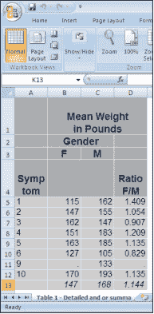

❶ EXCELXP 是 MARKUP 目标中的一个标签集。你也可以在 ODS MARKUP 语句上将该标签集作为选项来指定 ❷。

```sas
ods markup tagset=excelxp ...
```

该标签集的重点在于数据，而不一定在于文本。请注意，使用默认设置时，这两个标题甚至不会出现在 Excel 电子表格中。当然，可以通过使用内嵌的 `titles='yes'` 选项来包含标题。这只是众多可用选项之一。要查看当前可用选项列表，请使用 DOC='help' 选项 ❸，它会将选项列表写入 LOG。

```sas
ODS tagsets.excelxp file="&path\\results\\test.xml"
    options(doc="help");
```

### 另请参阅

EXCELXP 标签集在（Andrews, 2008）中得到了进一步讨论。Eric Gebhart（Gebhart, 2010）撰写了多篇关于该标签集的论文。Vince DelGobbo 撰写了十几篇关于 EXCELXP 标签集的论文。Vince 论文的总索引可在 http://www.sas.com/events/cm/evotms/ExcelXP/ExcelXPpaperIndex.pdf 找到，他和其他 SAS 作者的完整论文列表可在 http://support.sas.com/rnd/papers/index.html 找到。

##### 11.2.1 EXCELXP 标签集文档与选项

EXCELXP 标签集的操作通过使用选项来控制。这些选项通过 OPTIONS 选项实现，选项本身括在括号中并跟在 OPTIONS 关键字之后。此处使用 DOC= 选项将标签集的完整文档写入 LOG。如果你想了解该标签集的近期更改，CHANGELOG 选项（doc="changelog"）会显示更改时间以及新功能摘要。

```sas
ODS tagsets.excelxp
    path="&path\\results"
    body="E11_2.xls";
    options(doc="help");
```

### 另请参阅

EXCELXP 标签集不断更新和完善。如果你使用的是 SAS 随附的 EXCELXP 标签集版本，它不太可能是最新版本。你可以阅读 SAS Note #32394（位于 [http://support.sas.com/kb/32/394.html](http://support.sas.com/kb/32/394.html)）来了解如何下载并安装最新版本的 EXCELXP 标签集。

##### 11.2.2 生成多工作表工作簿

在将报表或数据集写入 Excel 时，常常需要将其拆分成多个部分，分别写入工作簿中的各个工作表。这可以通过几种不同的方式实现。这里展示的两种技术之间的主要区别在于，你是将报表还是仅将数据发送到电子表格。

将报表写入 Excel 时，EXCELXP 标签集是最灵活的选择。本示例通过 PROC PRINT 演示了这一点。该技术利用 BY 组处理来拆分报表。

```sas
%macro multisheet(dsn=,bylist=);
ods tagsets.excelxp
            style=default
            path="&path\\results"
            body="E11_2_2a.xls"
            options(sheet_name='none'
                    sheet_interval='bygroup'
                    embedded_titles='no');
proc sort data=&dsn out=sorted;
    by &bylist;
proc print data=sorted;
    by &bylist;
    run;
ods tagsets.excelxp close;
%mend multisheet;
%multisheet(dsn=advrpt.demog,bylist=race)
```

- 1. 选择使用 EXCELXP 标签集。
- 2. 让标签集决定工作表名称。
- 3. `SHEET_INTERVAL` 选项决定如何拆分工作表。
- 4. 报表中不会包含标题。这是默认设置。
- 5. 使用 `SHEET_INTERVAL` 选项 `BYGROUP` ③ 时，必须指定 BY 语句。

对于这个宏调用，RACE 的每个水平都会创建一个工作表，包括 RACE 的任何缺失值。

将数据集拆分为多个工作表时，我们不需要动用 EXCELXP 标签集的能力。相反，我们可以使用 PROC EXPORT。这里的 EXPORT 步骤位于 `%DO` 循环内，该循环会针对所选分类变量的每个水平执行一次。

```sas
%macro multsheet(dsn=,cvar=);
    %local varcnt type string i;
    proc sql noprint; ❸
        select distinct &cvar
            into :idvar1 - :idvar&sysmaxlong
            from &dsn;
        %let varcnt = &sqlobs;
    quit;

data _null_; ❹
    if 0 then set &dsn;
    call symputx('type',vtype(&cvar),'l');
    stop;
run;

%do i = 1 %to &varcnt;
    %if &type=N %then %let string=&idvar&i; ❺
    %else %let string="&idvar&i";
    proc export
        data=&dsn(where=(&cvar=&string)) ❻
        outfile="&path\results\E11_2_2b.xls"
        dbms= excel
        replace;
        sheet = "&cvar._&idvar&i"; ❿
    run;
%end;
%mend multsheet;
%multsheet(dsn=advrpt.demog,cvar=race)
```

- ❸ 使用 PROC SQL 创建一系列宏变量，以保存分类变量（&CVAR）的不同水平。
- ❹ 使用 DATA _NULL_ 步骤判断分类变量是数值型还是字符型。
- ❺ 针对数值型和字符型变量分别建立 WHERE 条件。
- ❻ 使用在 ❺ 中建立的 WHERE 条件对数据集进行子集化。
- ❿ 工作表名称由变量名及其值组合而成。

### 另请参阅

关于该主题必读的论文由 Vince DelGobbo（2007）撰写。这里展示的 PROC EXPORT 示例改编自 SASCommunity.org 上的一篇文章，该文章展示了一个通用性较低的程序，用于将数据集拆分为单独的 EXCEL 工作表 [http://www.sascommunity.org/wiki/Automatically_Separating_Data_into_Excel_Sheets](http://www.sascommunity.org/wiki/Automatically_Separating_Data_into_Excel_Sheets)。

##### 11.2.3 查看样式

除了你或你的公司可能创建的自定义样式之外，SAS 还随附了 40 多种预定义样式。由于可供选择的样式如此之多，并且在使用 EXCELXP 标签集将报表写入 Excel 时，并非所有样式属性都会传递到 Excel 电子表格中，因此能够针对每个当前定义的样式可视化你的报表就变得很重要。

%SHOWSTYLES 宏使用宏语言为每个可用样式向 Excel 写入一次报表。

```sas
title1 '11.2.3 Showing Style in Excel';

%macro showstyles;
%local i stylcnt;
proc sql noprint;
   select scan(style,2,'.')
      into: style1-stylemaxlong
      from sashelp.vstyle;
   %let stylcnt = &sqlobs;
quit;

%do i = 1 %to &stylcnt;
   ods markup tagset=excelxp
      path="&path\\results"
      file="&&style&i...xml"
      style=&&style&i
      options(sheet_name="&&style&i"
              embedded_titles='yes');

      title2 "Using the &&style&i Style";
      proc report data=sashelp.class nowd;
         column name sex age height weight;
         define age / analysis mean f=4.1;
         define height / analysis mean f=4.1;
         define weight / analysis mean f=5.1;
         rbreak after / summarize;
         run;
   ods markup close;
%end;
%mend showstyles;
ods listing close;

%showstyles
```

- 1. 使用 SQL 步骤为每个唯一样式名创建一个宏变量。
- 2. 找到的样式数量保存在 `&STYLCNT` 中。
- 3. 在 `%DO` 循环内部，样式名将包含在宏变量引用 `&&STYLE&I` 中。因此，文件名中包含样式名。
- 4. 感兴趣的样式在 STYLE= 选项上指定。
- 5. 工作表名称将是样式名。
- 6. 每个样式的报表代码完全相同。
- 7. 调用 %SHOWSTYLES 宏。

#### 11.3 使用转义字符序列进行内联格式设置

有些类型的格式设置很难或无法直接使用 ODS 样式和选项来实现。然而，通过使用转义字符，可以将目标特定的命令直接传递给构建输出的目标。转义字符会提醒 ODS：相关的格式设置字符序列不应由 ODS 直接使用，而应传递给接收目标。

转义字符应当是你在 SAS 程序中不另外使用的字符。由于我倾向于不将波浪号用作否定助记符，因此它是一个很好的转义字符。转义字符通过 ODS ESCAPECHAR 选项指定。

```sas
ods escapechar='~';
```

转义字符用于标记一个转义序列，该序列可能包含一个或多个目标命令或函数。语法因命令类型而异。

| 类型 | 一般形式 | 用于 | 小节 |
|---|---|---|---|
| 格式设置函数 | `~{function text}` | 控制分页、上标、下标。 | 11.3.1<br>11.3.2 |
| 样式修改 | `~S={attribute characteristics}`<br>`~{style elements and attributes}` | 分配样式属性。 | 11.3.3 |
| 序列代码 | `~code` | 操作换行、折行和缩进。 | 11.3.4 |
| 原始文本插入 | `~R/destination "rawtext"`<br>`~R "rawtext"` | 插入目标特定代码。 | 11.3.5 |

### 另请参阅

Carpenter（2007a，第 8.6 节）在 PROC REPORT 步骤的背景下讨论了内联格式设置。

Haworth、Zender 和 Burlew（2009）讨论了转义字符和内联格式设置序列在各种用法中的使用。

Zender（2007）在这篇易读的 SAS Global Forum 论文中涵盖了内联格式设置的所有基础知识。如果你想了解更多，这应该是你阅读的关于该主题的第一篇论文。


## 更多信息

#BYVAL 和 #BYVAR 标题与脚注选项也在第 7.4.3 节中使用，并在第 15.1.2 节中讨论。

## 另请参阅

用法说明 15727 讨论了将 BODYTITLE 选项与 PAGEOF 序列一起使用。

## PDF 和 RTF 目标 - 使用 THISPAGE 和 LASTPAGE

PAGEOF 序列仅适用于 RTF 输出目标；但是，通过使用 THISPAGE 和 LASTPAGE 格式序列，你可以为 RTF 和 PDF 输出目标创建更灵活的分页。与 PAGEOF 序列一样，这些序列设计用于标题和脚注，并且在将 BODYTITLE 选项与 RTF 输出目标一起使用时，可能会出现意外结果。

```sas
ods pdf file="&path\\results\\E11_3_1b.pdf"
             style=printer;
ods rtf file="&path\\results\\E11_3_1b.rtf"
            style=rtf;

title1 '11.3.1b Using In-line Formatting';
title2 '#byvar1 #byval1';
title3 'THISPAGE and LASTPAGE';
title4 h=10pt
       'This is Page ~{thispage} of a Total of ~{lastpage} Pages';
proc means data=demog n mean;
   by symp;
   class sex;
   var wt ht;
   run;
ods _all_ close;
```

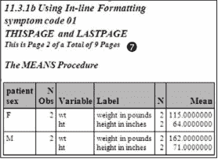

LASTPAGE 序列的行为类似于 RTF 输出目标中的 PAGEOF。在导入表后，你可能需要执行打印预览或向下滚动几页，才能观察到总页数。

##### 11.3.2 上标、下标和匕首符号

除了分页信息之外，你还可以使用内联格式添加上标、下标和匕首符号来突出特定文本。内联格式函数包括：

- `~{super 1}` 使 1 成为上标
- `~{sub 14}` 使数字 14 成为下标
- `~{dagger}` 可以使用匕首符号代替数字。

```sas
title1 '11.3.2 In-line Formatting';
ods escapechar='^';
ods pdf file="&path\results\E11_3_2.pdf"
        style=printer;
title2 'Superscripts and a Dagger ~{dagger}'; ❶
proc report data=adprt.demo nowd split='*';
  column symp wt ht;
  define symp / group 'symptom' order=data;
  define wt   / analysis mean format=6.1
               'Weight~{super 1}' ❷;
  define ht   / analysis mean format=6.1
               'Height~{super 2}' ❸;
  compute after;
    line @1 '~{super 1} ❹Pounds';
    line @1 '~{super 2} ❹Inches';
    line @1 '~{dagger} ❹Using inline formatting';
  endcomp;
run;
ods _all_ close;
```

- ❶ 匕首符号放在标题中。该符号本身在所有输出目标中外观并不相同。
- ❷ 上标用于标注测量单位。在此 PROC REPORT 步骤中，它们同时应用于 DEFINE 语句和 LINE 语句。
- ❸ 列放置表示法（@1）在大多数输出目标中并不可靠，尤其是在使用比例字体时。@1 可以可靠地将文本左对齐；但是，使用类似 @5 的写法不一定能使跨行文本对齐。

**11.3.2 内联格式**

*上标和匕首符号 †*

| 症状 | 体重^1 | 身高^2 |
|---|---|---|
| 02 | 150.2 | 66.8 |
| 10 | 184.4 | 68.5 |
| 06 | 118.8 | 64.0 |
| 04 | 170.8 | 68.7 |
| 03 | 154.5 | 66.5 |
| 09 | 133.0 | 68.0 |
| 05 | 179.5 | 67.5 |
| 01 | 138.5 | 67.5 |

^1 磅  
^2 英寸  
† 使用内联格式

（@1）在大多数输出目标中并不可靠，尤其是在使用比例字体时。@1 可以可靠地将文本左对齐；但是，使用类似 @5 的写法不一定能使跨行文本对齐。

## 更多信息

可以使用内联格式序列代码实现跨行文本对齐；参见第 11.3.4 节。同一示例也演示了匕首符号的用法。

##### 11.3.3 更改属性

与文本关联的属性可以使用内联样式修饰符更改。由 ODS 样式设置的大多数标准属性都可以修改。样式修饰符几乎可以用在任何指定文本的地方。这不仅包括标题和脚注，还包括格式化值的标签，甚至数据本身。样式修饰符有两种通用形式。

在 SAS 9.2 之前，唯一可用的形式是：

```sas
~S={attribute=value}
```

注意，大写 S= 跟在转义字符之后并位于花括号之前。典型用法是更改标题中文本的属性。

```sas
title2 '~S={font_face="times new roman"} ❶ Initial'
       '~S={font_style=roman} ❷ Coded'
       '~S={} ❸ Symptoms';
```

##### 11.3.3a 内联格式

初始编码症状

1. 默认的 title2 字体更改为 Times New Roman。
2. 将默认字体样式从斜体更改。
3. 关闭更改并恢复默认值。

从 SAS 9.2 开始，引入了更灵活的样式修饰符形式。通用形式是：

```sas
~{style [element=attribute] text}
```

样式元素及其属性括在方括号内，它们一起位于要应用元素/属性对的文本之前。注意，花括号既括住文本，也括住样式元素。

以下 TITLE 语句生成与上一示例的 TITLE 语句相同的标题行。

```sas
title2 '~{style [font_face="times new roman"]Initial}'
       '~{style [font_style=roman] Coded}'
       ' Symptoms';
```

由于修改后的属性仅应用于花括号内的文本，因此默认属性应用于“Symptoms”。

##### 11.3.3b 内联格式

初始编码症状

两种类型的样式修改序列都可以在 TITLE 和 FOOTNOTE 语句之外使用。

```sas
compute after;
  line @3 '~{style [font_weight=bold font_size=3] ~{super 1} Pounds}';
  line @3 '~{style [font_weight=light] ~{super 2} Inches}';
endcomp;
```

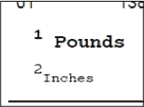

事实上，它们可用于大多数显示文本的地方。这包括数据、标签和格式化值。此处，样式修改序列应用于 PROC REPORT 计算块内的 LINE 语句中。

## 另请参阅

Haworth、Zender 和 Burlew（2009，第 268 页）基于数据值创建了几个样式修改序列。

##### 11.3.4 使用序列代码控制缩进、间距和换行

对于某些输出目标，可以将一系列序列代码与转义字符一起使用，以控制换行、缩进和间距。这些代码对每个主要输出目标的效果可能并不相同，并且性能可能取决于所使用的 SAS 版本。

| 代码序列 | 作用 | 备注 |
|---|---|---|
| `~m` | 缩进位置标记。 | |
| `~2n` | 强制换行（会考虑 `~m`）。 | |
| `~xn` | 强制 *x* 次换行（不考虑 `~m`）。 | *x* = 换行数 |
| `~w` | 可选换行的建议位置。 | |
| `~_` | 创建不间断空格。 | 下划线 |
| `~xz` | 插入四种错误代码之一。 | *x* = 1、2、3 或 4 |

```sas
proc format;
   value $genttl
      'f','F'='Female~2nSubjects'
      'm','M'='Male~2nSubjects';
   run;

title1 "Controlling Line Breaks";
proc report data=drvpt.demog nowd;
   columns sex ht wt;
   define sex / group format=$genttl.
                  'Subject~w Gender';
   define ht  / analysis mean
                  format=5.2
                  'Height~{dagger}';
   define wt  / analysis mean
                  format=6.2
                  'Weight~{dagger}';
   rbreak after / summarize;

   compute after;
      line @1 '~{dagger} English Measures'
         ' ~2nHeight(in.) ~2nWeight(lbs.)';
      line @1 'All ~2nsubjects were screened during'
         ' ~2n intake session at visit one.';
   endcomp;
run;
```

1. ~m 用于标记由 ~2n 序列指定的换行所对应的对齐位置（缩进）。
2. 使用 ~2n 表示法强制换行。如果不强制这些换行，表的宽度将由 LINE 语句决定。
3. ~w 表示可选换行。这意味着如果需要换行，这将是首选的换行位置。在此表中，无论是否使用 ~w，文本都会在空格处换行。
4. 添加匕首符号，以将列标签与单位脚注关联起来。

**控制换行**

| 受试者性别 | 身高† | 体重† |
|---|---:|---:|
| 女性受试者 | 65.06 | 144.55 |
| 男性受试者 | 69.24 | 172.91 |
|  | 67.56 | 161.49 |

† 英制测量  
身高（英寸）  
体重（磅）  
所有受试者在第一次访视的入组环节中接受了筛查。


##### 11.3.5 发出原始 RTF 特定命令

RTF 表格或报表是使用一系列特定于 RTF 目的地的命令、控制字和域代码生成的（第 15.3 节对 RTF 代码有更详细的介绍）。通常我们不需要了解这些命令的任何内容，因为它们是由 ODS 为我们编写的。然而，当格式化序列不可用于特定任务**并且**你知道该目的地相应的底层命令时，你可以从 SAS 传递原始 RTF 目的地特定的控制代码，以便在目的地执行。

你可以使用以下内联格式化函数之一来发出这些原始目的地特定命令。虽然 SAS 9.1.3 中使用的语法在 SAS 9.2 中仍然有效，但从 SAS 9.2 开始提供了更新的首选语法。转义字符（这里使用波浪号）必须使用 ODS ESCAPECHAR 选项声明：

**SAS 9.1.3（及更早版本）**

```sas
~R/destination 'command'           especially useful when multiple destinations are open ~R 'command'
```

**SAS 9.2**

```sas
~{raw 'command'}
~{dest[destination] 'command'}
```

在以下示例中，原始 RTF 命令既通过格式传递，也在 TITLE 语句中传递。命令本身前面有一个反斜杠，后面跟一个空格。多个原始命令可以串联在一起，并且通过在控制代码后跟一个 0（零）来关闭它们。

```sas
ods escapechar = '~';
proc format;
   value $gender
      'f','F'='~{raw \b F\b0\i emale}' ❶;
      'm','M'='~{raw \b M\b0\i ale}' ❷;
run;
title1 "~{raw '11.3.5 \i0 Using \b\ul RTF\b\ul0 Codes'}"; ❸
title2 "~{raw '\i0 Italics off'}";
proc report data=advrpt.demog nowd;
   columns sex ht wt;
   define sex   / group format=$gender.;
      ... code not shown ...
```

在此示例中，报表汇总了每种症状（SYMP）的数据。其构造方式是，单击症状编号即可链接到该症状的报表。

```sas
%macro symprpt;
title1 '11.4.1 Hyperlinks Using Style Overrides';

ods html file="&path\results\E11_4_1.htm" ❶
    style=journal;
title2 'Symptoms';
proc report data=advrpt.demog nowd split='*';
    column symp wt ht;
    define symp / group 'Symptom' order=internal
                missing;
    define wt  / analysis mean format=6.1 'Weight';
    define ht  / analysis mean format=6.1 'Height';
    compute symp;
        stg = 'E11_4_1_'||trim(left(symp))||'.htm'; ❷
        call define(_col_,'url',stg);
    endcomp;
run;
ods _all_ close;

proc sql noprint;
    select distinct symp
        into: sym1-sym999 ❸
        from advrpt.demog;

%do s=1 %to &sqlobs; ❹
ods html file="&path\results\E11_4_1_&&sym&s..htm"
    style=journal;
title2 "Symptom &&sym&s";
proc report data=advrpt.demog(where=(symp="&&sym&s")) ❺
    nowd split='*';
    column sex wt ht;
    define sex / group 'Sex' order=internal
                style(header)={url='E11_4_1.htm'}; ❻
    define wt  / analysis mean format=6.1 'Weight';
    define ht  / analysis mean format=6.1 'Height';
run;
ods _all_ close;
%end;
%mend symprpt;

%symprpt
```

- ❶ 主 HTML 文件被命名，然后使用 PROC REPORT 创建。
- ❷ SYMP 的每个单独值都与一个文件相关联，该文件将包含该症状的汇总。CALL DEFINE 用于将 URL 与该症状关联。
- ❸ 使用 SQL 步骤将 SYMP 的不同值分配给宏变量。
- ❹ 宏 %DO 循环用于遍历症状的各个值（&&SYM&s）。
- ❺ 保存特定症状的宏变量（&&SYM&s）用于对数据取子集。
- ❻ 样式覆盖选项用于将 URL 属性分配给表头，表头现在将链接回主表。

**11.4.1 使用样式覆盖的超链接**

**症状**

| 症状 | 体重 | 身高 |
|---|---:|---:|
| - | 177.8 | 69.5 |
| 01 | 138.5 | 67.5 |
| 02 ② | 150.2 | 66.8 |
| 03 | 154.5 | 66.5 |
| 04 | 170.8 | 68.7 |
| 05 | 179.5 | 67.5 |
| 06 | 118.8 | 64.0 |
| 09 | 133.0 | 68.0 |
| 10 | 184.4 | 68.5 |

**11.4.1 使用样式覆盖的超链接**

**症状 02**

| 性别 ⑥ | 体重 | 身高 |
|---|---:|---:|
| F | 147.0 | 66.7 |
| M | 155.0 | 67.0 |

### 更多信息

样式覆盖在第 8.1.3 节（TABULATE）、8.4.6 节（REPORT）和 8.5.2 节（PRINT）中介绍并进一步讨论。CALL DEFINE 例程在第 8.4.7 节中介绍。

##### 11.4.2 使用 LINK= TITLE 语句选项

在 TITLE 和 FOOTNOTE 语句中，LINK= 选项可用于指定要链接到的文件。该选项可以指向内部锚点位置、本地文件，甚至可能包含完全限定的路径。

```sas
title1 '11.4.2 LINK= Option';
ods pdf file="&path\results\E11_4_2.pdf"
    style=journal;
title2 'Patient List Report';
title3 link='E11_4_1.htm'
    'Symptom Report';
proc print data=advrpt.demog;
    var lname fname sex dob symp;
run;
ods _all_ close;
```

在此示例中，LINK= 选项 ① 用于指回第 11.4.1 节中创建的主文件。

**11.4.2 LINK= 选项**

**患者列表报表**

**症状报表** ①

| 观测 | 姓 | 名 | 性别 | 出生日期 | 症状 |
|---:|---|---|---|---|---|
| 1 | Adams | Mary | F | 12AUG51 | 02 |
| 2 | Adamson | Joan | F |  | 10 |
| 3 | Alexander | Mark | M | 15JAN30 |  |

### 更多信息

其他 TITLE 和 FOOTNOTE 语句选项在第 9.1 节中描述。

##### 11.4.3 链接图形元素

大多数图形元素可以创建为查看者可以单击它们，然后“钻取”到另一个图形或报表。可链接的图形元素包括但不限于直方图条形、散点图线条和符号、地图、饼图切片以及图例元素。可链接元素可以通过 annotate 工具以及此处展示的技术来启用。

虽然报表可以在三个主要目的地（MARKUP、PDF、RTF）之间链接，但从图形元素链接需要为 Web 查看设计的文件，例如 GIF 或 PNG，并带有标记覆盖层，例如 HTML。这必然意味着这些技术不适用于 LISTING 目的地。

关键在于生成一个字符变量，其中包含该元素要链接到的文件名。以下程序创建一个垂直直方图。单击任意一个条形将显示所选教育年限的研究参与者报表。

```sas
filename e1143 "&path\results\e11_4_3.png"; ❶

* Initialize graphics options;
goptions reset=all border
         ftext=swiss
         htext=1;
goptions device=png
         gsfname=E1143; ❶

data demog;
    set advrpt.demog(keep=edu wt);
    drilled=cat('href=E11_4_3.pdf#',
                left(put(edu,2.))); ❷

    run;

                 .... code not shown ....

* Create a chart that links to the summary report;
ods html path="&path\results" (url=none) ❸
         body='E11_4_3.html';

PROC GCHART DATA=demog;
    VBAR edu / type=mean sumvar=wt
               discrete
               patternid=midpoint
               html=drilled ❹
               raxis=axis1
               ;
run;
quit;
ods html close;
```

- 1. 将由 PROC GCHART 创建 PNG 直方图。该文件本身不会包含可链接元素。
- 2. 变量 DRILLED 包含我们将要链接到的文件名。在此示例中，所有报表都在一个带有内部锚点标签的单个文件中，因此路径都是相互相对的。此变量可以包含完全限定的路径。
- 3. 创建覆盖文件，其中包含与图形 ❶ 关联的可链接元素。
- 4. 包含“链接到”文件名 ❷ 的变量使用 HTML 选项标识。

当图例元素要变为可链接时，可以使用 HTML_LEGEND 选项。

直方图的条形将链接到一系列报表，每个垂直条形（EDU 的值）对应一个报表。

```sas
%macro BldRpt;
ods pdf file="&path\results\e11_4_3.pdf"; ⑤
        style=journal;

proc sql noprint; ⑥
   select distinct edu
      into :edu1 - :edu99
      from advrpt.demog (keep=edu);
   %let educnt=&sqlobs;
   quit;

%do i = 1 %to &educnt; ⑦
   ods pdf anchor="&&edu&i"; ⑧
   ods proclabel "Symptom Summary"; ⑨
   title3 "&&edu&i Years of Education";
   proc report data=advrpt.demog
               (where=(edu=&&edu&i)) ⑦
               contents="&&edu&i Years" ⑩
               nowd;
      columns symp sex,wt;
      define symp / group;
      define sex   / across 'Gender';
      define wt    / analysis mean;
      run;
%end;
ods pdf close;
%mend bldrpt;
%bldrpt
```

- ⑤ 我们从直方图链接到的各个报表将存储在这一个 PDF 文件中。
- ⑥ 使用 SQL 步骤确定 EDU 的各个值，并将其存储在宏变量列表中。
- ⑦ 宏循环创建一系列报表——每个 EDU 值对应一个报表。
- ⑧ 钻取变量 ② 包含 PDF 文件内的锚点标签引用。此标签使用 ANCHOR= 选项创建。ANCHOR 点通过使用宏变量引用 &&EDU&i 进行协调。
- ⑨ ODS PROCLABEL 语句用于将 PDF 书签中的过程名替换为用户指定的文本。
- ⑩ PDF 书签值使用 CONTENTS= 选项更改。


单击与接受12年教育的受试者相关联的垂直条（左起第二个），将在适当的锚点处打开指定的PDF文件。

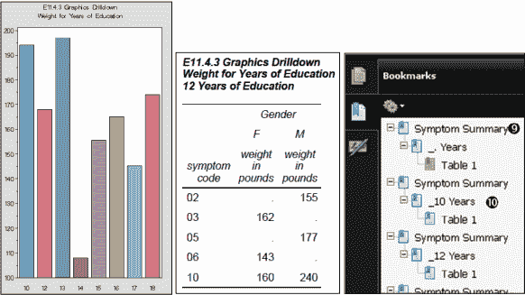

### 更多信息

内部链接将在11.4.4节中进一步讨论。

##### 11.4.4 创建内部链接

虽然超链接通常指向文件的开头，但链接指向文件内部位置的情况也并不少见。这可以是当前查看文件以外的文件内部位置，也可以是同一文件内的另一个位置。这被称为内部链接。在11.4.3节的示例（见**2**）中，形成的其中一个链接就是内部链接。

内部链接使用井号（#）指定。指向本地目录中文件内部位置的指针可命名为：`E11_4_3.pdf#_15`。内部位置使用 ANCHOR= 选项进行标记。

```sas
ods pdf anchor=_15;
```

在以下示例中，创建了一个PDF文档，其中包含一个 PROC TABULATE 过程和两个 PRINT 过程步骤的输出。这三个报表通过内部位置进行链接。

#### 11.5 交通灯

交通灯是一种允许程序员根据所呈现的值自动更改报表属性的技术。传统上，背景颜色会被更改为红/黄/绿——因此得名。然而，任何属性都可以更改；最常用的是使用样式覆盖来更改属性值。该过程的关键是用户自定义格式，用于将显示值映射到要更改的属性。

### 更多信息

样式覆盖在8.1.3节（TABULATE）、8.4.6节（REPORT）和8.5.2节（PRINT）中介绍并进一步讨论。CALL DEFINE 例程在8.4.7节中介绍。

##### 11.5.1 用户自定义格式

用户自定义格式用于将 ODS 属性值与要在表中显示的值相关联。一旦建立，该格式即可供 TABULATE、REPORT 或 PRINT 过程使用。

```sas
proc format;
    value $serious_f
       'YES','yes' = 'white';
    value $serious_b
       'YES','yes' = 'red';
    value $severity_f
       '3','4','5' = 'black';
    value $severity_b
       '3','4','5' = 'yellow'
       '4','5' = 'red';
run;
```

虽然传统的*交通灯*技术用于更改颜色，但该概念的扩展使得我们可以更改多个属性，包括链接、字体、字号和加粗等单元格属性。

VALUE 或 INVALUE 语句的指定方式与往常一样，但格式的标签（等号右侧的文本）是属性值。然后，该格式与要应用它的属性一起使用。通常，关联将使用样式覆盖选项创建，形式为*属性=格式*。

##### 11.5.2 PROC TABULATE

虽然在使用 PROC TABULATE 时，样式覆盖选项可以应用于表格的所有方面，但对于交通灯，我们通常希望突出显示统计量值或从数据派生的值。为此，样式覆盖选项将嵌套在其所应用到的统计量下。

```sas
proc format;
   value MaxWT_f ❶
      235-high = 'white'; ❷
   value MaxWT_b ❸
      235-high = 'red'; ❹
   value MinWT_f
      low-<100 = 'white';
   value MinWT_b
      low-<100 = 'red';
run;

title1 '11.5.2 Traffic Lighting: TABULATE';
title2 'Weight Compliance';
ods listing close;
ods pdf file="&path\results\e11_5_2.pdf"
   style=journal;
proc tabulate data=advrpt.demog
              (where=(clinnum in: ('05','06')));
   class clinnum;
   var wt;
   table clinnum,
         wt*(min*(style={background=minwt_b.
                          max*(style={background=maxwt_b. ❷}
                               foreground=maxwt_f. ❶)}));
run;
ods pdf close;
```

在该研究的方案中，受试者的初始体重应在100至235磅之间。此表突出显示了那些招募了不合规受试者的诊所。

❶ MAXWT_F. 格式将用于更改最大体重的文本（前景）颜色 ❷。背景颜色（红色 ❹）由 MAXWT_B. ❸ 格式更改。

| 诊所编号 | 最小值 | 最大值 |
|---|---:|---:|
| 051345 | 215.00 | 215.00 |
| 054367 | 160.00 | 160.00 |
| 057312 | 158.00 | 158.00 |
| 059372 | **98.00** | 98.00 |
| 063742 | 201.00 | **240.00** |
| 063901 | 187.00 | 187.00 |
| 065742 | 147.00 | 155.00 |
| 066789 | 175.00 | 175.00 |

生成的表显示至少有两名患者被招募但不符合体重标准。通常你不会喜欢深色背景上的深色文本，这就是为什么当背景颜色更改为红色时，前景颜色被更改为白色。

### 另请参阅

Carpenter (2010a) 有一个使用样式覆盖选项进行交通灯的 PROC TABULATE 示例。

##### 11.5.3 PROC REPORT

使用 PROC REPORT 时，样式覆盖选项可以通过两种方式应用。第一种，直接应用诸如11.5.2节示例中使用的语句选项。第二种，在 PROC REPORT 中，CALL DEFINE 例程允许我们有条件地应用样式覆盖。

本节中的示例使用了11.5.1节中建立的格式。在此报表中，我们希望突出显示严重（SER='YES'）或严重程度大于3的不良事件。

```sas
proc report data=advrpt.ae(where=(sev>'1')) nofs;
   column subject aestdt ser sev aedesc;
   define subject / order;
   define aedesc / order;
   define aestdt / display;
   define ser / display
          style(column) ={background=$serious_b. ❶
                          foreground=$serious_f.};
   define sev / display
          style(column) ={background=$severity_b. ❷
                          foreground=$severity_f.};
run;
```

**11.5.3a 交通灯：REPORT**
**不良事件列表**

| 患者ID | AE 开始日期 | AE 是否严重 | AE 严重程度 | AE 描述 |
|---|---|---|---|---|
| 201 | 09/20/2006 | NO | 2 | BILATERAL SHOUL... |
|  | 09/06/2006 | NO | 3 | LEFT GROIN PAIN |
|  | 09/10/2006 | NO | 4 | LEFT HYDROCELE |
|  | 07/25/2006 | NO | 2 | LEG CRAMPS (INC... |
| 203 | 09/26/2006 | NO | 2 | BILAT. ANKLE EDEM... |
|  | 09/26/2006 | NO | 2 | GROSS HEMATUR... |
|  | 11/21/2006 | NO | 2 | INCREASED WEAK... |
|  | 09/13/2006 | NO | 2 | UTI (URINE-BACTE... |
| 204 | 11/21/2006 | NO ❶ | 2 | CIRCUMFERENTIAL... |
|  | 11/06/2006 | YES | 3 | DVT-RIGHT LEG (SA... |
|  | 10/24/2006 | NO | 2 | INCREASED NOCT... |
|  | 11/08/2006 | NO | 2 | MENTAL CONFUSI... |
| 205 | 11/17/2006 | NO | 2 | PAIN LEFT MID-BAC... |
| 206 | 01/30/2007 | YES | 4 | RIGHT SUBDURAL... |
|  | 11/17/2007 | NO | 1 | BACTEREMIA |

前景和背景颜色的格式应用于事件严重性（SER ❶）和严重程度（SEV ❷）值的显示。

在示例11.5.3a（左侧）的图中，无论事件是否严重，严重程度代码为3及以上的都被突出显示。这两种格式彼此独立，并且都应用。请注意，受试者201有两个被突出显示的事件（SEV>2），但这两个事件均未被评定为严重（SER=NO）。

由于 CALL DEFINE 是可执行的，我们可以使用 IF-THEN/ELSE 处理来有条件地分配格式。在下一个示例中，用于严重程度的交通灯样式覆盖被移至 CALL DEFINE，并且仅对严重事件（SER=YES）应用。❸ CALL DEFINE 的结果应用于当前列 ❹，即 SEV，因为我们正在执行 SEV 计算块。样式覆盖被选中 ❺，要应用的样式属性与上一个示例中应用的相同 ❻。

```sas
define ser / display
   style(column) ={background=$serious_b. ❶
                   foreground=$serious_f.};
define sev / display;
compute sev;
   if ser='YES' then ❷
      call define(_col_, ❸
         'style', ❹
         'style ={background=$severity_b. ❺
                   foreground=$severity_f.}');
endcomp;
```

此处显示了 PROC REPORT 步骤的一部分。

- 严重程度的格式仅在事件严重（SER="YES"）时应用。

**11.5.3b 交通灯：REPORT 不良事件列表**

| 患者ID | AE 开始日期 | AE 是否严重 | AE 严重程度 |
|---|---|---|---|
| 201 | 09/20/2006 | NO | 2 |
|  | 09/06/2006 | NO | 3 |
|  | 09/10/2006 | NO | 4 |
|  | 07/25/2006 | NO | 2 |
| 203 | 09/26/2006 | NO | 2 |
|  | 09/26/2006 | NO | 2 |
|  | 11/21/2006 | NO | 2 |
|  | 09/13/2006 | NO | 2 |
| 204 | 11/21/2006 | NO | 2 |
|  | 11/06/2006 | YES | 3 |

### 另请参阅

在 Carpenter (2006b) 中详细介绍了将交通灯与 PROC REPORT 结合使用。

##### 11.5.4 使用 PROC PRINT 实现交通灯

与 PROC TABULATE 和 PROC REPORT（参见11.5.2和11.5.3节）一样，使用 PROC PRINT 实现交通灯是通过样式覆盖选项应用的。正如8.5.2节所讨论的，该节介绍了 PRINT 过程的样式覆盖选项，该选项可以应用于 VAR 语句。以下示例使用了11.5.1节中创建的格式，其输出模仿了11.5.3节中 REPORT 过程生成的第一份输出。

```sas
ods pdf style=journal file="&path\results\E11_5_4a.pdf";
proc print data=advrpt.ae(where=(sev='1'));
   by subject;
   id subject;
   var aestdt;
   var ser / style(column)={background=$serious_b. ❶
                           foreground=$serious_f.};
   var sev / style(column)={background=$severity_b. ❷
                           foreground=$severity_f.};
run;
ods pdf close;
```

请注意，样式覆盖选项是作为 VAR 语句上的选项应用的 ❶ ❷。通过将 VAR 语句拆分为两个语句，您可以差异化地应用交通灯格式。


```sas
%let text1 = ~S={font_face=arial font_weight=bold}11.6 Using ODS LAYOUT~S={font_face=arial}~nMean Weight and Height;
%let text2 = ~n for Symptom and Years of Education;
title1;

ods pdf file="&path\results\E11_6.pdf"
    style=journal
    startpage=never;
ods escapechar='~';
ods layout start width=7in height=10in;

ods region x=1in y=1in width=7in height=.5in;
ods pdf text="&text1&text2";

ods region x=0.5in y=1.5in width=7in height=4in;
proc report data=advpvt.demog nowd;
        ...... REPORT code not shown.....
ods _all_ close;
ods layout end;
```

左侧的布局建立了三个区域。一个用于由 TEXT= 选项写入的标题，另两个用于并排的 PROC REPORT 表。

- 1. 页面标题保存在宏变量中，以便与 ODS PDF 的 TEXT= 选项一起使用。内联格式序列（~n、~S）在第 11.3 节中描述。
- 2. 打开 PDF 目标。
- 3. 限制 PDF 在转到新过程时开始新页。
- 4. 打开布局空间并定义整体大小。
- 5. 定义第一个区域，用于容纳存储在宏变量 &TEXT1 和 &TEXT2 中的标题文本。
- 6. 将文本写入第一个区域。
- 7. 和 8. 定义两个 PROC REPORT 步骤所使用的区域。
- 9. 关闭 PDF 目标。实际上这里关闭了所有目标。
- 10. 关闭 ODS LAYOUT 部分。

#### 11.6 使用 ODS LAYOUT
*按症状和受教育年限统计的平均体重与身高*

| 症状 | 体重 | 身高 | 受教育年限 | 女性体重 | 女性身高 | 男性体重 | 男性身高 |
|---|---:|---:|---:|---:|---:|---:|---:|
| 01 | 138.5 | 67.5 | 11 | 152.0 | 64.5 | 179.8 | 68.9 |
| 02 | 150.2 | 66.8 | 12 | 215.0 | 68.0 | 191.0 | 70.7 |
| 03 | 154.5 | 66.5 | 13 | 109.9 | 64.3 | 105.0 | 64.0 |
| 04 | 170.8 | 68.7 | 14 | 164.6 | 64.2 | 133.0 | 68.0 |
| 05 | 179.5 | 67.5 | 15 | 158.0 | 72.0 | 167.0 | 70.0 |
| 06 | 118.8 | 64.0 | 16 | 142.8 | 64.8 | 155.0 | 67.0 |
| 09 | 133.0 | 68.0 | 18 |  |  | 174.0 | 69.0 |
| 10 | 184.4 | 68.5 |  |  |  |  |  |

### 另见

Rob Nelson（2010）创建了一个类似但更复杂的布局。Dan O’Conner 和 Scott Huntley（2009）在讨论许多其他 ODS 选项的同时，详细讨论了绝对布局和网格布局选项。Chen（2005）介绍了网格布局。

#### 11.7 其他一些有用的 ODS 小技巧

这里的选项和语句太多，无法在此完整描述。不过，有几项你至少应该了解。

##### 11.7.1 使用 ASIS 样式属性

HTML 目标会移除空格以提供“更好”的显示。当你想保留值周围的空格时，ASIS 选项可以阻止这种行为。

```sas
proc print data=advrpt.demog(obs=5);
   id lname;
   var fname ht wt;
   format wt 8.1;
run;
```

| lname | fname | ht | wt |
|---|---|---:|---:|
| Adams | Mary | 67 | 155.0 |
| Adamson | Joan | 72 | 158.0 |
| Alexander | Mark | 70 | 175.0 |
| Antler | Peter | 68 | 240.0 |
| Atwood | Teddy | 64 | 105.0 |

尽管用于 WT 的格式宽度为 8，但数字周围的空格仅反映单元格边距。我们可以通过使用 ASIS 样式属性来保留该空格；不过，此属性也可能影响底部边距属性。

```sas
var fname ht;
var wt /style(data)={asis=yes}
        style(header)={just=c};
```

| lname | fname | ht | wt |
|---|---|---:|---:|
| Adams | Mary | 67 | 155.0 |
| Adamson | Joan | 72 | 158.0 |
| Alexander | Mark | 70 | 175.0 |
| Antler | Peter | 68 | 240.0 |
| Atwood | Teddy | 64 | 105.0 |

VAR 语句已拆分为两个语句，以便我们可以将 STYLE 覆盖选项与变量 WT 关联。表头也已居中。

请注意，ASIS 属性还增加了单元格的底部边距。

##### 11.7.2 ODS RESULTS 语句

当我们在某些操作系统与 Microsoft Office 版本的组合下创建 RTF 文件时，SAS 查看器尝试打开新的 RTF 文件时会发出提示。当这些文件作为自动化系统或应用程序的一部分生成时，这可能尤其麻烦。

一种解决方案是关闭结果的自动查看。在交互式环境中，可以通过更改首选项设置手动完成。运行 SAS Display Manager 时，转到：

工具 → 选项 → 首选项 → 结果

取消选中“View results as they are generated”（在生成结果时查看结果）框。

结果的自动查看也可以通过使用 ODS RESULTS 语句来控制。要覆盖通过“首选项”对话框选择的偏好，可以使用以下任一方式：

- ods results on; 打开结果的自动查看（通常为默认值）。
- ods results off; 关闭结果的自动查看。

### 另见

其他方法以及对该问题的更深入陈述已在 SAS 论坛帖子 [http://communities.sas.com/message/42066#42066](http://communities.sas.com/message/42066#42066) 中讨论。


## 第 3 部分：技术、工具和接口

- 第 12 章 利用格式 363
- 第 13 章 与宏语言接口 397
- 第 14 章 操作系统接口与环境控制 437
- 第 15 章 杂项主题 473


### 第 12 章：利用格式

- **12.1 使用预加载格式修改报表内容** 364
  - 12.1.1 将预加载格式与 PROC REPORT 一起使用 365
  - 12.1.2 将预加载格式与 PROC TABULATE 一起使用 367
  - 12.1.3 将预加载格式与 MEANS 和 SUMMARY 过程一起使用 369
- **12.2 使用 Picture 格式做更多事情** 370
  - 12.2.1 日期指令与 DATATYPE 选项 371
  - 12.2.2 处理小数值 373
  - 12.2.3 使用 MULT 和 PREFIX 选项 374
  - 12.2.4 基于值范围显示粒度——限制有效数字 376
- **12.3 多标签（MLF）格式** 377
  - 12.3.1 一个简单的 MLF 377
  - 12.3.2 计算滚动平均值 378
- **12.4 使用 NOTSORTED 选项控制顺序** 381
- **12.5 扩展格式转换的使用** 382
  - 12.5.1 过滤缺失值 382
  - 12.5.2 映射重叠范围 383
  - 12.5.3 处理数值中的文本 383
  - 12.5.4 在格式定义中使用 Perl 正则表达式 384
  - 12.5.5 将值作为格式标签传递给函数 384
- **12.6 ANYDATE 输入格式** 388
  - 12.6.1 读取混合日期 389
  - 12.6.2 转换混合 DATETIME 值 389
- **12.7 从数据集构建格式** 390
- **12.8 使用 PVALUE 格式** 392
- **12.9 格式库** 393
  - 12.9.1 永久保存格式 393
  - 12.9.2 搜索格式 394
  - 12.9.3 串联格式目录和库 394

格式的使用对于数据分析和报告过程至关重要。用户不仅必须扎实掌握格式的基本应用，还要掌握更深入、鲜为人知的方面。格式的强大功能可以在各种情况下加以利用。用户有责任充分理解这些能力。

### 更多信息

第 3.5.1 节讨论了格式与输入格式之间的区别，以及它们在字符值转换为数值时的用途。

### 另见

Carpenter（2003a）介绍了关于使用用户编写格式的若干主题。Ron Cody（2008a）提供了许多用户编写格式的示例，这些示例演示了本章描述的若干选项和技术。Bilenas（2005）是一本专门讨论 SAS 格式主题的书。

#### 12.1 使用预加载格式修改报表内容

通常，当数据中未包含分类变量的某个水平时，该水平不会出现在基于该数据的任何报表或分析中。预加载格式提供了一种机制，不仅可以强制包含这些缺失的分类水平，还可以用于过滤或移除不需要的水平。

预加载格式可用于 REPORT、TABULATE、MEANS 和 SUMMARY 过程。预加载格式通过使用选项来调用，并且可用选项及其用法因每个过程而异。对于每个过程，正是这些选项的交互作用决定了生成的表。对于本节中的示例，请研究选项各种组合的结果，然后尝试使用其他组合。

对于这些过程，使用的两个主要选项是 PRELOADFMT 和 EXCLUSIVE：

- **PRELOADFMT**——在执行前加载格式水平。使用预加载格式时，此选项将始终存在。
- **EXCLUSIVE**——只有格式定义中包含的数据水平才会出现在表中。


```sas
proc format;
    value $regx
        '1'='1'
        '2'='2'
        'X'='X';
    value $Genderu
        'M'='Male'
        'F'='Female'
        'U'='Unknown';
    value $symp
        '00'='Unspecified'
        '01'='Sleepiness'
        '02'='Coughing'
        '03'='Limping';
run;
```

顾名思义，预加载格式基于通常是用户定义的格式。这里定义的格式 $REGX、$GENDERU 和 $SYMP 将在后续示例中使用。每个格式都包含一个数据中不存在的水平，而 $REGX 和 $SYMP 都排除了数据中存在的水平。格式 $REGX. 与变量 REGION 一起使用，其取值范围为 ‘1’ 到 ‘10’。格式 $SYMP. 与变量 SYMP 一起使用，其取值范围为 ‘01’ 到 ‘10’。格式 $GENDERU. 与变量 SEX 一起使用，其取值为 ‘F’ 和 ‘M’。

##### 12.1.1 将预加载格式与 PROC REPORT 一起使用

当使用 REPORT 过程预加载格式时，PRELOADFMT 以及（如果使用）EXCLUSIVE 选项应用在 DEFINE 语句上。

除了 PRELOADFMT 和 EXCLUSIVE 选项外，REPORT 过程还可以利用 COMPLETEROWS 和 COMPLETECOLS 选项：

- **COMPLETEROWS** 表示格式水平的所有行都将出现在报表中。
- **COMPLETECOLS** 表示格式水平的所有列都将出现在报表中。

以下示例展示了这些选项的各种组合。尽管它们没有讨论 COMPLETECOLS 的用法，但其行为与这里讨论的 COMPLETEROWS 类似。通过在这些相同示例中将这两个选项应用于报表项 SEX，可以很容易地演示这一点。

请记住，对于每个要预加载格式的报表项，都必须在 DEFINE 语句上应用 PRELOADFMT 选项。

### 使用 PRELOADFMT 与 EXCLUSIVE

使用 EXCLUSIVE 选项进行预加载时，只允许那些既在格式中又在数据中的水平。在 PROC REPORT 中，这些选项应用在 DEFINE 语句上。

```sas
title2 'Using PRELOADFMT with EXCLUSIVE';
proc report data=demo nowd;
    column region sex,(wt=n wt);
    define region / group
                   format=$regx6.
                   preloadfmt exclusive;
    define sex     / across format=$Genderu. 'Gender';
    define n       / analysis n format=2.0 'N';
    define wt      / analysis mean format=6.2 'Weight';
run;
```

| 地区 | 女性 N | 女性体重 | 男性 N | 男性体重 |
|---|---:|---:|---:|---:|
| 1 | . | . | 4 | 195.00 |
| 2 | 6 | 109.67 | 3 | 105.00 |

将格式 $REGX. 与这两个选项一起使用，只会使地区 1 和地区 2 出现在报表中，因为这是仅有的两个既在格式中又在数据中的地区。

### 使用 COMPLETEROWS 但不使用 EXCLUSIVE

COMPLETEROWS 选项用在 PROC 语句上，它强制**所有**出现在数据中或格式中的水平都出现在报表中。

```sas
title2 'Using COMPLETEROWS with PRELOADFMT and without EXCLUSIVE';
proc report data=demo5 nowd completerows;
   column region sex,(wt=n wt);
   define region / group format=$regx6.
                     preloadfmt
                     order=data;
   define sex  / across        format=$Genderu. 'Gender';
   define n    / analysis n    format=2.0 'N';
   define wt   / analysis mean format=6.2 'Weight';
run;
```

| 地区 | 女性 N | 女性体重 | 男性 N | 男性体重 |
|---|---:|---:|---:|---:|
| 1 | 0 | . | 4 | 195.00 |
| 2 | 6 | 109.67 | 3 | 105.00 |
| X | 0 | . | 0 | . |
| 3 | 5 | 127.80 | 5 | 163.80 |
| 4 | 4 | 143.00 | 10 | 165.60 |
| 5 | 5 | 146.20 | 3 | 177.00 |
| 6 | 3 | 187.00 | 6 | 205.33 |
| 7 | 0 | . | 4 | 151.00 |
| 8 | 4 | 160.00 | 0 | . |
| 9 | 2 | 177.00 | 7 | 187.00 |
| 10 | 2 | 163.00 | 4 | 177.00 |

在此示例中，DEFINE 语句上还出现了 ORDER=DATA 选项。在 SAS 9.2 之前，ORDER= 选项是预期的，尽管并非*总是*必需。请注意，所有三个格式水平都出现了。除了数据中不存在的 REGION 'X' 之外，输出现在按数据顺序排列（数据已按 CLINNUM 排序，这名义上也对地区进行了排序）。

格式化报表项的默认顺序是 ORDER=FORMATTED。

### 使用 COMPLETEROWS 与 EXCLUSIVE

如前所示，使用 EXCLUSIVE 而不使用 COMPLETEROWS 选项只会产生那些既在格式中又在数据中的水平。将 EXCLUSIVE 选项*与* COMPLETEROWS 选项一起使用会创建一个报表，其中包含格式中的每个值，无论它们是否在数据中。

```sas
title2 'Using COMPLETEROWS with PRELOADFMT and EXCLUSIVE';
proc report data=demog nowd completerows;
    column region sex,(wt n);
    define region / group format=$regx6.
                  preloadfmt exclusive;
    define sex    / across    format=$Genderu. 'Gender';
    define n      / analysis n format=2.0 'N';
    define wt     / analysis mean format=6.2 'Weight';
run;
```

| 地区 | 女性 N | 女性体重 | 男性 N | 男性体重 |
|---|---:|---:|---:|---:|
| 1 | 0 | . | 4 | 195.00 |
| 2 | 6 | 109.67 | 3 | 105.00 |
| X | 0 | . | 0 | . |

只有格式中的那些水平（无论它们是否在数据中）才会包含在报表中。

##### 12.1.2 将预加载格式与 PROC TABULATE 一起使用

当使用 TABULATE 过程预加载格式时，PRELOADFMT 和 EXCLUSIVE 选项应用在 CLASS 语句上。与 REPORT 过程一样，这两个选项会相互作用。

### PRELOADFMT 与 EXCLUSIVE

本节中的每个示例都使用用户定义的格式 $SYMP。该格式在第 12.1 节中定义，仅包含数据中可能出现的 10 个值中的三个，以及一个数据中不存在的附加值。

```sas
title2 'Using PRINTMISS with the EXCLUSIVE option';
proc tabulate data=rawprt.demog;
    class symp / preloadfmt exclusive; ❶
    var ht wt;
    table symp,
          (ht wt)*(n*f=2. min*f=4.
                    median*f=7.1 max*f=4.)
            / printmiss; ❷
    format symp $symp.; ❸
run;
```

❶ PRELOADFMT 和 EXCLUSIVE 选项出现在与要接收预加载格式的分类变量关联的 CLASS 语句上。

❷ PRINTMISS 选项允许在 PROC TABULATE 表中显示缺失值。如果不包括此选项，由预加载格式添加的水平（必然始终缺失）将不会显示。

❸ 将适当的格式分配给分类变量。

| 症状代码 | 身高（英寸）：N | 最小值 | 中位数 | 最大值 | 体重（磅）：N | 最小值 | 中位数 | 最大值 |
|---|---:|---:|---:|---:|---:|---:|---:|---:|
| 未指定 | 0 | . | . | . | 0 | . | . | . |
| 嗜睡 | 4 | 64 | 67.5 | 71 | 4 | 115 | 138.5 | 162 |
| 咳嗽 | 10 | 66 | 67.0 | 67 | 10 | 131 | 155.0 | 155 |
| 跛行 | 4 | 65 | 66.5 | 68 | 4 | 147 | 154.5 | 162 |

PRELOADFMT 和 EXCLUSIVE 选项一起使用会消除所有不在格式中的 SYMP 值，同时包括格式中那些不在数据中的值。

由于使用了 PRINTMISS 选项，“未指定”行会以适当的 N 值出现在表中。

### 使用 PRELOADFMT 但不使用 EXCLUSIVE

使用 PRELOADFMT 选项而不使用 EXCLUSIVE 选项，可以拥有所有可能的行，包括没有数据的行以及未包含在格式中的行。

```sas
title2 'Without the EXCLUSIVE option';
proc tabulate data=advprt.demo;
    class symp /preloadfmt;
    var ht wt;
    table symp,
          (ht wt)*(n*f=2. min*f=4.
                    median*f=7.1 max*f=4.)
          /printmiss;
    format symp $symp.;
run;
```

生成的表显示了 SYMP 中所有在数据中或在格式中的值。这包括数据中不存在的 SYMP 水平。

| 症状代码 | 身高（英寸）：N | 最小值 | 中位数 | 最大值 | 体重（磅）：N | 最小值 | 中位数 | 最大值 |
|---|---:|---:|---:|---:|---:|---:|---:|---:|
| 未指定 | 0 | . | . | . | 0 | . | . | . |
| 嗜睡 | 4 | 64 | 67.5 | 71 | 4 | 115 | 138.5 | 162 |
| 咳嗽 | 10 | 66 | 67.0 | 67 | 10 | 131 | 155.0 | 155 |
| 跛行 | 4 | 65 | 66.5 | 68 | 4 | 147 | 154.5 | 162 |
| 04 | 13 | 62 | 68.0 | 74 | 13 | 98 | 187.0 | 195 |
| 05 | 8 | 63 | 69.0 | 69 | 8 | 163 | 177.0 | 201 |
| 06 | 11 | 63 | 64.0 | 65 | 11 | 105 | 105.0 | 177 |
| 09 | 2 | 68 | 68.0 | 68 | 2 | 133 | 133.0 | 133 |
| 10 | 13 | 62 | 68.0 | 72 | 13 | 158 | 160.0 | 240 |

## 更多信息

预加载格式还会结合 REPORT 过程（见第 12.1.1 节）以及 MEANS 和 SUMMARY 过程（见第 12.1.3 节）进行讨论。

EXCLUSIVE 选项还可以与 CLASSDATA 选项一起使用；见第 8.1.4 节。

## 另请参阅

Carpenter (2010a) 讨论了预加载格式与 TABULATE 过程一起使用的情况。


##### 12.1.3 在 MEANS 和 SUMMARY 过程中使用预加载格式

与 PROC TABULATE 的情况一样（参见第 12.1.2 节），当 PRELOADFMT 和 EXCLUSIVE 选项与 MEANS 和 SUMMARY 过程一起使用时，它们出现在 CLASS 语句上。

### 将 PRELOADFMT 与 EXCLUSIVE 一起使用

使用 CLASS 语句选项 PRELOADFMT ❶ 和 EXCLUSIVE ❷ 进行预加载，会将分类变量的水平限制为既在格式中又在数据中的水平。本质上，该格式充当过滤器，而无需借助子集 IF 语句或 WHERE 子句。

```sas
title2 'Using the EXCLUSIVE option';
proc summary data=advprdt.demog;
    class symp / preloadfmt ❶
                  exclusive ❷;
    var ht;
    output out=withexclusive
           mean=meanHT;
    format symp $symp.;
    run;
proc print data=withexclusive;
    run;
```

| 观测 | symp | _TYPE_ | _FREQ_ | meanHT |
|---:|---|---:|---:|---:|
| 1 |  | 0 | 18 | 66.8889 |
| 2 | 嗜睡 | 1 | 4 | 67.5000 |
| 3 | 咳嗽 | 1 | 10 | 66.8000 |
| 4 | 跛行 | 1 | 4 | 66.5000 |

请注意，与 PROC TABULATE 不同，这种 CLASS 语句选项组合不会为数据中不存在的 SYMP 格式化值（SYMP='00'）插入一行。要使用 MEANS 和 SUMMARY 过程添加此水平，还必须包括 COMPLETETYPES 选项。

### 将 COMPLETETYPES 与 PRELOADFMT 和 EXCLUSIVE 一起使用

PROC 语句选项 COMPLETETYPES（此选项在第 7.10 节中介绍）将与 PRELOADFMT 和 EXCLUSIVE 选项交互。由于这种交互，不在数据中但在格式中的分类变量水平现在会包含在汇总中。但是，不在格式中的水平不会包含在表中。

```sas
title2 'With EXCLUSIVE and COMPLETETYPES';
proc summary data=advprdt.demog;
    class symp / preloadfmt
                  exclusive;
    var ht;
    ... code not shown . . . .
```

| 观测 | symp | _TYPE_ | _FREQ_ | meanHT |
|---:|---|---:|---:|---:|
| 1 |  | 0 | 18 | 66.8889 |
| 2 | 未指定 | 1 | 0 | . |
| 3 | 嗜睡 | 1 | 4 | 67.5000 |
| 4 | 咳嗽 | 1 | 10 | 66.8000 |
| 5 | 跛行 | 1 | 4 | 66.5000 |

现在，SYMP 的“未指定”水平会出现在报告中，即使它不在数据中（_FREQ_=0）。

### 不使用 EXCLUSIVE 而使用 COMPLETETYPES

当使用 COMPLETETYPES 选项而不使用 EXCLUSIVE 选项时，分类变量的所有水平都会出现，无论它是在数据中还是仅在预加载格式中。

```sas
title2 'Two Classification Variables';
title3 'COMPLETETYPES Without EXCLUSIVE';
proc summary data=vrpt.demo completetypes;
    class symp sex / preloadfmt ;
    var ht;
    output out=twoclass mean=ht;
    format symp $symp.
           sex $genderu.;
run;
proc print data=twoclass;
run;
```

这里显示了由两个分类变量 SYMP 和 SEX（它们具有预加载格式）生成的表格的一部分。请注意，每个不与数据关联的格式水平都会出现，未格式化水平也会出现（此部分表格仅显示 SYMP='04'）。

**12.1.3 使用预加载格式与 MEANS/SUMMARY**  
**两个分类变量**  
**不使用 EXCLUSIVE 的 COMPLETETYPES**

| 观测 | symp | sex | _TYPE_ | _FREQ_ | meanHT |
|---:|---|---|---:|---:|---:|
| 1 |  |  | 0 | 65 | 67.2000 |
| 2 |  | 女性 | 1 | 29 | 65.0690 |
| 3 |  | 男性 | 1 | 36 | 68.9167 |
| 4 |  | 未知 | 1 | 0 | . |
| 5 | 04 | 未指定 | 2 | 0 | . |
| 6 | 04 | 嗜睡 | 2 | 4 | 67.5000 |
| 7 | 04 | 咳嗽 | 2 | 10 | 66.8000 |
| 8 | 04 | 跛行 | 2 | 4 | 66.5000 |
| 9 | 04 |  | 2 | 13 | 68.6923 |

#### 12.2 使用 PICTURE 格式做更多事情

尽管一般来说 PICTURE 格式只是名义上的高级主题，但它们远未被充分利用，而且 PICTURE 格式特有的一些概念常被误解。

PICTURE 语句用于构建本质上是由零、九和其他也要显示的字符组成的模板。零和九用作占位符。九表示该位置必须放置数字，即使该数字为零。零占位符表示如果数字非零，则在该位置放置数字（嵌入的零会显示）。

### 另请参阅

书籍 *PROC FORMAT 的力量*（Jonas Bilenas，2005）是了解一些更入门的 PICTURE 格式主题的良好来源。

PICTURE 语句的文档清晰描述了将格式应用于要格式化的值的过程。在处理小数值之前，应充分理解这一应用过程。

##### 12.2.1 日期指令和 DATATYPE 选项

PICTURE 语句上的 DATATYPE= 选项可用于构建特定于日期的格式。此选项允许使用“指令”，这些指令告诉 PICTURE 语句如何相对于要解释的数据类型进一步构造或格式化该值。

指令是单个区分大小写的字母，用于指示 DATE、TIME 或 DATETIME 值的特定部分。有超过 15 个指令，并且用作指令的字母大小写很重要：

| 指令 | 含义 | 指令 | 含义 |
|---|---|---|---|
| Y | 年 | M | 分钟 |
| m | 月 | S | 秒 |
| d | 日 | b | 月份缩写 |
| H | 小时 | B | 月份名称 |

在 PICTURE 语句中，指令前面有一个百分号（%），它充当转义字符。使用单引号可防止将 % 解释为宏语言触发符。

以下格式用于以可在 DB2 中使用的格式显示 SAS 日期时间值。

```sas
proc format;
   picture dbdate
      other = '%Y-%0m-%0d:%0H:%0M:%0S' (datatype=datetime); ❶ ❷
run;

data _null_;
   now = '11sep2010:15:05:27'dt;
   put now=;
   put now= dbdate.;
   call symputx('selldate',now); ❸
run;
```

❶ 与其他 PICTURE 格式一样，零可用作占位符。

❷ DATATYPE 选项决定如何解释传入值。选项值指示该格式将用于的数据类型。这些数据类型包括：

- DATE：SAS 日期值
- TIME：SAS 时间值
- DATETIME：SAS 日期时间值
- DATETIME_UTIL：专用于公用事业行业的 SAS 日期时间值（SAS 9.3）

日志显示：

```text
now=1599836727
now=2010-09-11:15:05:27
```

在上面的 DATA 步中创建了宏变量 &SELLDATE ❸。格式化后，该宏变量可用于将此 DATETIME 值写入要传递到 DB2 服务器的 SQL 代码中。%SYSFUNC 调用 PUTN 函数，该函数将呈现格式化值。

```sas
%put %sysfunc(putn(&selldate,dbdate.));
```

由于指令种类繁多且 DATATYPE 选项可用，生成的格式具有很大灵活性。这意味着可以为三种日期时间数据值类型中的任何一种生成格式。通过为 MONNAME. 格式（只能用于 DATE 值）创建替代格式，可以展示这种灵活性。这里创建的 MONTHNAME. 和 MONTHABB. 格式用于 DATETIME 值。

```sas
proc format;
  picture monthname
    other = '%B' (datatype=datetime); ❶
  picture monthabb
    other = '%b' (datatype=datetime); ❷
run;

data _null_;
  now = '11sep2010:15:05:27'dt;
  put now=;
  put now= monthname.;
  put now= monthname3.; ❸
  put now= monthabb.;
run;
```

- ❶ %B 指令返回月份名称。定义格式时，请确保为最长的月份（September）留出足够空间，否则月份名称可能会被截断。
- ❷ 小写 %b 指令返回月份名称的前三个字母的大写形式。同样要留出三个空格（包括指令和转义字符）。
- ❸ 如果希望使用混合大小写的缩写月份名称，可以在完整名称的格式中包含宽度值。

```text
now=1599836727
now=September ❹
now=Sep ❺
now=SEP ❻
```

### SAS 9.3 日期指令增强

在 SAS 9.3 之前，小数秒会被截断（即使对 PICTURE 格式应用了 ROUND 选项）。从 SAS 9.3 开始，小数秒会被舍入。尽管通常关系不大，但这可能会改变距午夜半秒以内的时间值所对应的日期。

```sas
proc format;
  picture myDayT (round)
    low - high = '%0d%b%0Y:%0H:%0M:%0S' (datatype=datetime)
  ;
run;
```

|  | 显示值 |  |
|---|---|---|
| 日期时间常量 | MYDAYT.（SAS 9.3 之前） | MYDAYT.（SAS 9.3 及之后） |
| '01apr2011:12:34:56.7'dt | 01APR2011:12:34:56 | 01APR2011:12:34:57 |
| '01apr2011:23:59:59.7'dt | 01APR2011:23:59:59 | 02APR2011:00:00:00 |

公用事业行业通常希望将午夜日期引用为 24:00:00 而不是 00:00:00。新的 DATATYPE= 值 DATETIME_UTIL 允许这样做。

```sas
proc format;
  picture ymdtme (default=19)
    other='%Y-%0m-%0d %0H:%0M:%0S' (datatype=datetime_util);
run;
```


##### 12.2.2 显示小数的 PICTURE 格式

处理小于 1 的值时，请务必通过使用 9 作为格式标签中的占位符来强制至少显示一位有效数字。

截断是处理 PICTURE 格式时另一个需要额外考虑的方面。不适合 PICTURE 模板（格式标签）的值会被截断。本例中的变量 X 的范围从小数到超过一千的值。

```sas
proc format;
  picture showdec
    other = '09.00.'; ❶
  run;
data x; ❷
do x = .007,.017,.123,1.234, 12.345, 1234; ❸
  y=x;
  output;
end;
format y showdec. x 8.3; ❹
run;
```

❶ 该格式定义为两位小数，并在个位使用 9。请注意，用于 X 的隐含格式没有足够的范围来同时显示最大值和最小值。类似 8.3 的格式本来有范围显示所有值。

| 观测值 | x | y |
| --- | --- | --- |
| 1 | 0.007 | 0.00 ❷ |
| 2 | 0.017 | 0.01 |
| 3 | 0.123 | 0.12 |
| 4 | 1.234 | 1.23 |
| 5 | 12.345 | 12.34 ❸ |
| 6 | 1234.000 | 34.00 ❹ |

- ❷ 小于 .01 的值（该格式允许的最小值）不出所料地被截断。
- ❸ 三个最低有效位中只能显示两个。X 的显示值经过舍入，而 Y 的千分位被截断。
- ❹ 我们只允许最大到 99.99 的值。超过 100 的值其最高有效位被截断。

舍入和截断问题可以在格式定义中解决。此处显示的 SHOWDECR. 格式既允许舍入，也允许最大到 99999.99 的数字。

```sas
proc format;
  picture showdecr (round) ❼
    other = '00009.00.'; ❽
run;
```

❼ ROUND 选项使格式对小数部分进行舍入。

##### 12.2.2 处理显示小数的小数值

| 观测值 | x | y |
| --- | --- | --- |
| 1 | 0.007 | 0.01 |
| 2 | 0.017 | 0.02 |
| 3 | 0.123 | 0.12 |
| 4 | 1.234 | 1.23 |
| 5 | 12.345 | 12.35 |
| 6 | 1234.000 | 1234.00 |

❽ 务必包含足够数量的占位符，以容纳最大的数字。

##### 12.2.3 使用 MULT 和 PREFIX 选项

虽然要包含在格式化值内部或之后的文本可以作为 PICTURE 定义的一部分，但位于显示值之前的文本会被忽略。当你希望前置文本成为显示值的一部分时，可以使用 PREFIX= 选项。

MULT= 选项允许应用乘数。该值会与输入值相乘，并显示结果。

处理小数值的一种常见替代方案涉及使用 MULT= 和 PREFIX= 选项。

```sas
proc format;
   picture showdec;
      0           = '9'
      0 < _ < .01 = '9'       (prefix='<.01')
      .01 - <1    = '99'      (prefix='0.' mult=100)
      other       = '00000.0';
run;
data x;
   do x = 0, .001, .012, .123, 1.234, 12.345, 1234;
      y=x;
      output;
   end;
   format y showdec.;
run;
```

- 1. 零单独处理。
- 2. 小于 .01 的值会添加一个包含 <.01 文本的前缀值。
- 3. 对于从 .01 到小于 1 的值，将该值乘以 100，并添加“0.”前缀。

| 观测值 | x | y |
| ---: | ---: | ---: |
| 1 | 0.00 | 0 |
| 2 | 0.00 | <.01 |
| 3 | 0.01 | 0.01 |
| 4 | 0.12 | 0.12 |
| 5 | 1.23 | 1.23 |
| 6 | 12.35 | 12.34 |
| 7 | 1234.00 | 1234.00 |

- 4. 确保有足够的有效数字。
- 5. 由于我们没有使用 (ROUND) 选项，此值已被截断。

由于本例中的数字有两位小数，将它们乘以 100（10^n，其中 n 是要显示的有效数字位数）会将数字变为整数。然后通过 PICTURE 格式插入小数点。

在下面的示例中，美元被转换为英镑（本例使用的换算常数为 0.635，这几乎肯定不是当前的货币换算常数）。

```sas
title2 'Using the MULT and PREFIX options';
proc format;
   picture pounds
      1 - 10   = '9,00'   (mult=63.5  prefix='£');
      10< - 100 = '9,0'    (mult=6.35  prefix='£');
      100< - high = '000.00' (mult=.635 prefix='£');
run;

data money;
   do dollars = 1.23, 12.3, 123, 1230, 12300;
      pounds = dollars;
      output;
   end;
   format dollars dollar10.2 pounds pounds.;
run;

proc print data=money;
   run;
```

- 6. 显示值模板指定两位小数（使用欧洲风格，用逗号分隔整数部分和小数部分）。
- 7. 乘数通过 MULT= 选项指定。
- 8. PREFIX= 选项用于指定一个或多个前置符号。

这里该选项应用于每个值/标签对；不过，它不必像本例中那样保持不变。

##### 12.2.3a 使用 MULT 和 PREFIX 选项的 PICTURE 格式

| 观测值 | 美元 | 英镑 |
| --- | --- | --- |
| 1 | $1.23 | £0,78 |
| 2 | $12.30 | £7,8 |
| 3 | $123.00 | £78 |
| 4 | $1,230.00 | £781 |
| 5 | $12,300.00 | £7.810 |

❶ 乘数会变化，以适应小数位数。

本例中使用的英镑符号 £ 在大多数美国键盘上并不出现。由于大多数字体中都存在这样的特殊字符，因此在 SAS 中使用它们相当简单。从文字处理软件中将所选的字符或符号插入文档。从文档中复制它，然后粘贴到 SAS 编辑器中，现在就可以在代码中使用它了。

在下面 POUNDS. 格式的扩展中，我们允许包含负值以及 0 到 1 之间的值。

```sas
picture pounds
  -1 - <0 = '99' (mult=63.5 prefix='£-0,') ❷
   0   = '9'  (prefix='£')
  0 < - <1 = '99'  (mult=63.5 prefix='£0,')
  1   - 10 = '9,00'(mult=63.5 prefix='£')
 10< - 100 = '99,0'(mult=6.35 prefix='£')
100< - high= '000.000.000' (mult=.635 prefix='£');
```

❷ 由于对映射值取绝对值，负号也必须作为前缀字符添加。

##### 12.2.3b 使用 PREFIX 和 MULT 选项并包含负值

| 观测值 | 美元 | 英镑 |
| --- | --- | --- |
| 1 | $-0.12 | £-0,07 |
| 2 | $0.00 | £0 |
| 3 | $0.12 | £0,07 |
| 4 | $1.00 | £0,63 |
| 5 | $1.23 | £0,78 |
| 6 | $12.30 | £07,8 |
| 7 | $123.00 | £78 |
| 8 | $1,230.00 | £781 |
| 9 | $12,300.00 | £7.810 |

另见

Chapman（2003）给出了许多使用 MULT= 选项的 PICTURE 格式示例。

##### 12.2.4 基于值范围的显示粒度——限制有效数字

有时我们希望显示值的精度随着数字大小的变化而自动调整。上一节的示例中展示了这一点，但并未真正加以说明。在下面的示例中，我们希望将显示值限制为不超过 6 位数字；然而，这些值本身的范围从 0 到数十亿。

```sas
title2 'Limiting Significant Digits';
proc format;
   picture Tons
      other = '9'
      0< -    <1 = '99' (prefix='0.' mult=100)
      1 - <10 = '9.99'
      10 - <1000 = '000.9'
      1000 - <1e06 = '000,000' ❶
      1e06 - <1e09 = '000.999M' ❷ (mult=1e-03) ❸
      1e09 - <1e12 = '000.999B' ❹ (mult=1e-06);
run;

data imports;
   do tons = 0, .15, 1.5,1.5e2, 1.5e4, 1.5e7, 1.5e10;
      fmttons = tons;
      output;
   end;
   format fmttons tons.;
   run;
proc print data=imports;
   run;
```

- ❶ 1000 到 1,000,000（1e6）之间的值显示时不带任何小数位。
- ❷ 对于数百万范围内的值，在 6 位最高有效数字之后显示一个“M”。
- ❸ 我们将小数点移动了六位；不过，只丢失了三位。
- ❹ 现在小数点移动了 9 位，其中只有三位显示在小数点之前。因此乘数为 1e-06。

| 观测值 | 吨数 | 格式化吨数 |
| ---: | ---: | ---: |
| 1 | 0.00 | 0 |
| 2 | 0.15 | 0.15 |
| 3 | 1.50 | 1.50 |
| 4 | 150.00 | 150.0 |
| 5 | 15000.00 | 15.000 |
| 6 | 15000000.00 | 15.000M |
| 7 | 15000000000.00 | 15.000B |

这种格式在图形上特别有用，因为我们需要控制轴上刻度标记值的宽度。

#### 12.3 多标签（MLF）格式

创建格式时，通常不允许格式范围重叠。多标签格式克服了这一限制；然而，只有选定的过程能够使用这种特殊类型的格式。多标签格式通过在 VALUE 语句上使用 MULTILABEL 选项来创建。

##### 12.3.1 一个简单的 MLF

在下面的示例中，我们将受教育年限汇总为高中和大学。同时，我们希望查看上大学人群中研究生院的子集。这可以通过使用多标签格式轻松实现。


#### 12.4 使用 NOTSORTED 选项控制顺序

通常，创建用户自定义格式时，该格式会在内部按排序顺序放置。因此，值/标签配对在 VALUE 语句中指定的顺序并不特别重要。然而，可以通过在 VALUE 语句上使用 NOTSORTED 选项来防止这种重新排序 ❶。应用后，格式的内部顺序保持为其定义时的顺序。当对使用 NOTSORTED 选项创建的格式应用 ORDER=FORMATTED 选项时，将使用格式定义中配对的顺序。

在第 12.3 节的 PROC TABULATE 示例中，“College”最先出现，因为它按字母顺序排在最前。这里使用 NOTSORTED 选项创建格式。由于在下面的 PROC FORMAT 中“High School”的级别列在最前，因此在报表中“High School”将出现在“College”之前。

```sas
proc format;
    value edlevel (notsorted) ❶
        9-12 = 'High School'
        13-high='College';
    run;

proc tabulate data=advrpt.demog;
    class edu sex;
    var wt;
    table edu all,
        sex*wt*(n*f=2. mean*f=5.1 stderr*f=6.2);
    format edu edlevel.; ❷
    run;
```

- ❶ 当在 VALUE 语句上使用 NOTSORTED 选项时，各项对在 VALUE 语句中定义的顺序会被保留。
- ❷ 该格式照常使用。

### 注意

创建格式时，会在内部对其进行优化，以使赋值过程尽可能高效。使用 NOTSORTED 选项会抵消部分优化；不过，对于值对少于十来个的格式，这通常几乎没有实际差别。对于非常大的格式（数百或数千个项），使用 NOTSORTED 选项时可能会出现一些性能访问问题。对较大的格式使用此选项时，请务必在你的数据和操作系统上进行试验。

**12.4 使用 NOTSORTED 定义的格式**

| 受教育年限 | F：体重（磅），N | F：体重（磅），均值 | F：体重（磅），标准误 | M：体重（磅），N | M：体重（磅），均值 | M：体重（磅），标准误 |
|---|---:|---:|---:|---:|---:|---:|
| 高中 | 8 | 152.0 | 9.71 | 22 | 187.0 | 4.59 |
| 大学 | 23 | 142.0 | 7.02 | 23 | 156.6 | 6.96 |
| 全部 | 31 | 144.5 | 5.76 | 45 | 171.4 | 4.75 |

#### 12.5 扩展格式转换的用途

用户自定义格式可用于指向另一个二级格式，或者在 SAS 9.3 中甚至指向一个函数。这使我们能够创建自定义格式，保留另一个格式或函数的特性。格式或函数调用以不加引号的形式出现在等号右侧（标签区域）的方括号中。

##### 12.5.1 筛选缺失值

```sas
proc format;
    value missdate
        . = 'Unknown' ❶
        other=[date9.]; ❷
    run;

proc print data=advrpt.demog;
    var lname fname dob;
    format dob missdate.; ❸
    run;
```

我们需要创建一个格式，以不同于非缺失值的方式处理缺失日期值。在左侧的 MISSDATE. 格式中，缺失值映射为单词“Unknown”，而所有其他值使用 DATE9. 格式进行格式化。

**12.5 嵌套格式**

| 观测 | 姓 | 名 | 出生日期 |
|---:|---|---|---|
| 1 | Adams | Mary | 12AUG1951 |
| 2 | Adamson | Joan | **未知** |
| 3 | Alexander | Mark | 15JAN1930 |
| 4 | Antler | Peter | 15JAN1934 |
| ... | ... | ... | ... |

*……列表中未显示的部分……*

- ❷ “other”类别的标签是二级或嵌套格式。它用方括号括起来，而不是引号。
- ❸ 嵌套格式像任何其他格式一样使用。

PROC PRINT 生成的列表的前几行显示出生日期已被格式化。由于 Joan Adamson 的出生日期缺失，它显示为“Unknown”。

```sas
proc format;
    value pctzero
        .='0.00'
        other=[6.2];
    run;
```

类似的嵌套格式可用于检查有效数据或可格式化的数据。PCTZERO. 格式就是这种情况，它用于为报告目的将缺失值映射到特殊字符。这里缺失值映射为“0.00”，而非缺失值使用 6.2 格式显示。

##### 12.5.2 映射重叠范围

嵌套格式的另一个用途是定义包含多个范围的区间或分组。请注意，这里的“Secondary”和“Out of Range”组跨越了“Primary”组。更改一个组的定义也需要更改另一个组的定义。

```sas
proc format;
   value agegrps
      low - 40   = 'Out of Range'
      40 - <48   = 'Secondary'
      48 - 52    = 'Primary'
      52<- 65    = 'Secondary'
      65<- high  = 'Out of Range'
      other      = 'Unknown';
   run;
```

相反，我们可以创建一系列相互调用的嵌套格式。虽然最初设置可能更费事，但这些格式提供了更大的灵活性，因为每个组的范围完全自包含。最先调用最内层范围（PRIMARY.）的格式，如果值在主范围之外，则调用次级范围格式（SECOND.）。请注意，次级范围跨越主范围。在自动化系统中，这可能是一个巨大的优势。

```sas
proc format;
   value primary
      48 - 52   = 'Primary'
      other     = [second.];
   value second
      40 - 65   = 'Secondary'
      other     = [OOR.];
   value oor
      low - high = 'Out of Range'
      other      = 'Unknown';
   run;
```

在赋值语句中，该格式像任何其他格式一样使用：

```sas
agegroup = put(startage,primary.);
```

##### 12.5.3 处理数值中的文本

SAS 最多支持 28 种数值缺失值（见第 2.10.1 节）。这些缺失值有时需要与数据中的代码关联。从原始文本文件导入数据时，代码本身可能作为非数值插入数值字段。我们需要能够将该列作为数值读取，同时区分各种代码。

```sas
proc format;
   invalue image
      y, yz = .y
      s, ss = .s
      other = [.];
   run;
data surveyAge;
   input patcode $
         age image.;
   datalines;
1 45
2 yz
3 36
4 ss
5 y
   ;
run;
```

信息格式 IMAGE. 将选定的代码转换为特定缺失值 .S 和 .Y。所有其他非数值代码将映射到标准数值缺失值（.）。数据集 SURVEYAGE 包含以下值。请记住，特殊数值缺失值打印时不带句点。

| 观测 | 患者代码 | 年龄 |
| --- | --- | --- |
| 1 | 1 | 45 |
| 2 | 2 | Y |
| 3 | 3 | 36 |
| 4 | 4 | S |
| 5 | 5 | Y |

### 更多信息

特殊数值缺失值的用法在第 2.10.1 节中讨论。第 6.7.3 节中从数据集创建了一个与此类似的数据信息格式。

### 另请参阅

位于 http://communities.sas.com/message/48729 的 SAS 论坛主题讨论了在读取混合字段时避免错误的各种方法。

##### 12.5.4 在格式定义中使用 Perl 正则表达式

从 SAS 9.3 开始，REGEXPR 选项可以出现在值/标签对的等号的值一侧。该选项跟在带引号的 Perl 正则表达式之后，使格式实际上像 PRXCHANGE 函数一样起作用。

这里展示的 $ABC2DEF. 信息格式用于将字母组合“abc”转换为“def”。

```sas
proc format;
    value $abc2def (default=20) ❶
        's/abc/def/' (REGEXPR) ❷ = _same_❸;
run;

data _null_;
x=input('abc',$abc2def.);  put x=; ❹
x=input('xabcy',$abc2def.);  put x=; ❹
x=input('xyz',$abc2def.);  put x=; ❺
x=input('def',$abc2def.);  put x=; ❺
run;
```

- ❶ 信息格式 $ABC2DEF. 定义为默认长度 20。
- ❷ 定义了 PRX 字符串，其后跟随 REGEXPR 选项，这使 PRX 字符串被解释为 Perl 正则表达式。
- ❸ 使用特殊的 _SAME_ 运算符将 PRX 字符串的结果传递给格式的标签。
- ❹ 日志显示，单独出现的“abc”和嵌入出现的“abc”都被转换为“def”。
- ❺ 除“abc”之外的字母组合不会更改，因此会“原样”通过该格式。

```text
x=def  ❹
x=xdef ❹
x=xyz   ❺
x=def   ❺
```

##### 12.5.5 将值作为格式标签传递给函数

从 SAS 9.3 开始，可以通过格式将值传入函数。巨大的优势在于，嵌入格式中的函数可在 DATA 步之外使用，并且可以在使用格式的任何地方使用。

```sas
proc format;
    value fcnname (default=10)
        other=[myfunc()];
run;
```

函数调用出现在值/标签对的标签部分，并用方括号括起来。规范包括：

- 函数最多只能接受一个参数。
- 数值函数返回数值。
- 字符函数返回字符值。
- 应使用 DEFAULT= 选项以确保合适的宽度。
- 函数可以由 SAS 提供，也可以通过使用 PROC FCMP 由用户提供（见第 15.2 节）。


- ❽ DATEN. 和 $DATEC. 格式正确返回当前日期值。
- ❾ DPARTN. 和 DPARTC. 格式以天数形式返回日期时间值的日期部分。变量 Z 已包含一个日期值。$DPARTC. 格式将该值解释为秒数，并返回日期值 0（01jan1960）。这表明，尽管该值是字符型，但函数仍可将其作为数值处理。

```text
x=1636995477.6  y=1636995477.6  z=18946  a=18946
x=18946         x=18946         x=10
y=18946         y=18946         y=12
z=18946         z=0             z=12
```

- ❿ LENGTH 函数应用于传入值。请注意，对于变量 X，应用的是数值格式（LENN.），并且只计算整数部分的数字个数（10）。字符格式（$LENC.）应用于同一数字时返回 12。

## 使用用户定义函数

当与用户定义函数结合使用时，通过格式将值插入函数的能力可能尤其强大。

在此示例中，用户定义函数 C2FF() 和 F2CC() 用于在摄氏度和华氏度之间进行转换。这两个字符函数会将刻度符号添加到结果值中。第 15.2.2 节中创建了不添加刻度符号的类似数值函数。

```sas
proc fcmp
    outlib=Advprt.functions.Conversions;
    function c2ff(c) $;
        return(cats(((9*c)/5)+32,'°F'));
    endsub;

    function f2cc(f) $;
        return(cats((f-32)*5/9,'°C'));
    endsub;
    run;
options cmplib=(advprt.functions);
data _null_;
    f=c2ff(100); put f=;
    c=f2cc(212); put c=;
    run;
```

- ❶ OUTLIB= 选项指定将包含此函数定义的数据集和包（CONVERSIONS）。
- ❷ FUNCTION 语句命名新函数及其参数。$ 用于指定该函数返回字符值。
- ❸ RETURN 语句包含函数要返回的值。在此情况下，转换等式的结果会与温度刻度符号拼接在一起。
- ❹ FUNCTION 定义以 ENDSUB 语句结束。
- ❺ CMPLIB 选项用于指向包含函数定义的数据集（ADVPRT.FUNCTIONS）。
- ❻ 使用 C2FF() 函数转换一个常量值（100°C），并使用 PUT 语句显示转换后的值。

```text
f=212°F
c=100°C
```

这两个函数可以在任何可使用函数的地方使用；但是，由于大多数过程不接受函数的使用，它们不像格式那样通用。下面通过格式调用这两个函数，以便它们可以在任何可使用格式的地方使用。这包括在 PUT 语句中，在那里预期使用格式，而函数不可调用。

由于 C2FF() 和 F2CC() 函数不超过一个参数，因此它们可以直接用在用户定义格式的标签部分。尽管在此示例中格式名和函数名相同，但这绝不是一项要求。

```sas
proc format;
    value c2ff (default=10)
        other=[c2ff()];
    value f2cc (default=10)
        other=[f2cc()];
run;

data _null_;
    c=100; put c=c2ff.;
    f=212; put f=f2cc.;
run;
```

- ❼ 在标签中使用函数时，最好设置默认显示宽度。
- ❽ 通过将函数括在方括号中，从标签内部调用该函数。
- ❾ 在 PUT 语句中请求该格式。此请求会导致函数执行，并在 LOG 中生成此文本。

```text
c=212°F
f=100°C
```

这些函数的初始版本由 SAS 软件开发高级经理 Rick Langston 编写。

## 返回不带年份的季度（Qq 而非 yyQq）

在第 15.2.1 节中，创建了 QNUM() 函数，用于去除 YYQ. 格式返回的值中的年份部分。在该示例中，需要第二个 DATA 步，然后才能在 PROC FREQ 步中使用该函数的结果。通过将该函数用于格式中，我们可以直接在 PROC 步中使用该格式，从而避免额外遍历一次数据。

```sas
proc format;
    value qfmt other=[qnum()];
run;

options cmplib=(advrpt.functions);
proc freq data=advrpt.lab_chemistry
    order=formatted;
    table visit*labdt;
    format labdt qfmt.;
run;
```

这里在格式标签中使用了 QNUM() 函数。然后该格式在 PROC FREQ 步中使用。减少步骤几乎总能提高处理效率。

##### 12.5.5 将函数用作格式标签

**FREQ 过程**

**VISIT 与 LABDT 的表格**

**LABDT（实验室检测日期）**

| VISIT（访视编号） | 统计量 | Q1 | Q2 | Q3 | Q4 | 合计 |
|---|---|---|---|---|---|---|
| 1 | 频数 | 3 | 3 | 7 | 4 | 17 |
| 1 | 百分比 | 1.78 | 1.78 | 4.14 | 2.37 | 10.06 |
| 1 | 行百分比 | 17.65 | 17.65 | 41.18 | 23.53 |  |
| 1 | 列百分比 | 8.33 | 7.50 | 12.73 | 10.53 |  |
| 2 | 频数 | 3 | 2 | 7 | 4 | 16 |
| 2 | 百分比 | 1.78 | 1.18 | 4.14 | 2.37 | 9.47 |
| 2 | 行百分比 | 18.75 | 12.50 | 43.75 | 25.00 |  |
| 2 | 列百分比 | 8.33 | 5.00 | 12.73 | 10.53 |  |

信息格式也可以与作为标签的函数一起使用。这是一个用户想要 TRAILSGN 信息格式的功能，但该信息格式不处理隐含小数规格的案例。在此示例中，数据中的数字输入时没有小数点（值 12 应为 .12）。该函数将使用 TRAILSGN 信息格式，然后除以 100 并返回结果。

```sas
proc fcmp outlib=work.functions.smd;
   function tsgn(text $);
      put 'in tsgn: ' text=;
      x = input(text, trailsgn10.);
      x = x/100;
      return(x);
   endsub;
run;
options cmplib=(work.functions);
proc format;
   invalue tsgn(default=10)
      other=[tsgn()];
run;
data _null_;
   input x : tsgn.;
   put x=;
cards;
1
1-
12-
123-
123+
1+
0
run;
```

```text
1    x=0.1
1-   x=-0.01
12-  x=-0.12
123- x=-1.23
123+ x=1.23
1+   x=0.01
0    x=0
```

## 更多信息

有关使用 PROC FCMP 创建用户定义函数的详细信息，请参见第 15.2 节。

#### 12.6 ANYDATE 信息格式

ANYDATE 信息格式（从 SAS 9 开始可用）旨在允许你读入各种混合日期格式，包括：

- DATE、DATETIME 和 TIME
- DDMMYY、MMDDYY 和 YYMMDD
- JULIAN、MONYY 和 YYQ。

这些信息格式有多种形式：

- ANYDTDATE. — 提取日期部分
- ANYDTDTM. — 提取日期时间部分
- ANYDTIME. — 提取时间部分

##### 12.6.1 读入混合日期

此示例展示了这些信息格式的灵活性。这里将 ANYDTDTE10. 信息格式应用于多种不同的日期形式。DATESTYLE 系统选项 ❶ 用于通过声明日期中月/日/年部分的默认顺序，来解决一些可能存在的歧义。

```sas
options datestyle=mdy; ❶
data new;
  input date anydtdte10.;
  format date date9.;
datalines;
01/13/2003
13/01/2003
13jan2003 ❷
13jan03
13/01/03 ❸
01/02/03
03/02/01
run;
```

| 观测 | 日期 |
| --- | --- |
| 1 | 13JAN2003 |
| 2 | 13JAN2003 |
| 3 | 13JAN2003 ❷ |
| 4 | 13JAN2003 |
| 5 | 03JAN2013 ❸ |
| 6 | 02JAN2003 |
| 7 | 02MAR2001 |

对该数据集执行 PROC PRINT 表明，这些日期值已作为 SAS 日期读入数据集。支持的日期形式非常多样，包括 DATE9. ❷。应注意，DATESTYLE= 选项无法完全解决所有歧义，因此某些日期可能会被误解。由于 13 不是有效的月份数字 ❸，该信息格式假定值的顺序已改变，并猜测正确顺序为 YMD。由于信息格式可以检测无效值，并对日期部分的正确顺序做出有依据的猜测，因此用户要么非常了解数据，要么至少准确理解输入值可能如何被误解，这一点非常重要。在此示例中，❸ 很可能应读作 dd/mm/yy，而不是 yy/mm/dd。

##### 12.6.2 转换混合 DATETIME 值

当输入字符串不仅包含日期，还包含时间值时，转换过程会变得更加复杂。对于时间部分（以下内容同样适用于 SAS 时间值），小时可以使用 24 小时制指定，也可以使用包含 AM/PM 的 12 小时制指定。

日期时间字符串可能包含右侧所示的值。除了带有两位数年份的歧义日期 ❶ 之外，ANYDTDTM 信息格式将正确解释这些字符串的日期时间部分。但是，它无法利用 AM/PM 代码，这些代码会被忽略。

```text
10/13/2011:15:45:12
2011-03-01T15:20:45
9/13/2011 11:52:54 AM
9/13/2011 11:52:54 PM
13/09/2011 11:52:54 PM
11/09/12 11:52:54 AM ❶
2011/09/12 11:52:54 PM
```

幸运的是，MDYAMPM. 信息格式可用。该信息格式会正确解释日期时间值中的 AM/PM 部分；但是，它要求日期部分采用 MDY 顺序。


由于没有一种信息格式能有效结合 ANYDTDTM. 信息格式的灵活性与解释 AM/PM 的能力，可以使用以下调整。❷

```sas
dt_plus = input(datetime, anydtdtm.) ❶
        + (43200 ❸
        * (index(upcase(datetime), 'PM') > 0) ❹);
```

## 12.6 ANYDTDTM 信息格式

### 转换混合 DATETIME 值

| 观测 | datetime | dt_plus |
|---:|---|---|
| 1 | 10/13/2011:15:45:12 | 13OCT2011:15:45:12 |
| 2 | 2011-03-01T15:20:45 | 01MAR2011:15:20:45 |
| 3 | 9/13/2011 11:52:54 AM | 13SEP2011:11:52:54 |
| 4 | 9/13/2011 11:52:54 PM | 13SEP2011:23:52:54 |
| 5 | 11/09/2011 11:52:54 PM | 09NOV2011:23:52:54 |
| 6 | 9/13/12 11:52:54 AM | 13SEP2012:11:52:54 |
| 7 | 2011/09/12 11:52:54 PM | 12SEP2011:23:52:54 |

ANYDTDTM. 信息格式用于转换日期时间字符串。INPUT 函数以秒为单位返回日期时间值。如果存在“PM”，我们需要向日期时间值加上 12 小时对应的秒数（43,200 = 12*60*60）。❸ INDEX 函数搜索“PM”的出现位置，并将该位置转换为二进制 0/1 值，再乘以要添加的秒数。❹

#### 12.7 从数据集构建格式

VALUE、INVALUE 和 PICTURE 语句通常用于创建用户定义的格式或信息格式。随着值对数量变大，编写这些语句变得不方便（对我来说，所谓的大可能还不到一打）。幸运的是，你也可以使用数据集定义格式和信息格式。

PROC FORMAT 接受一个数据集来控制格式或信息格式的定义。该过程期望特定的变量，并使用数据集的观测值来形成值对。至少，用于控制格式形成的数据集必须包含变量 FMTNAME、START 和 LABEL ❶。它还可以包含二十多个其他变量，用于定义格式。

在此示例中，数据集 CNTLRFMT 将用于创建字符格式（$CL_REG.），该格式会将诊所编号（CLINNUM）映射到区域（REGION）。

```sas
data cntrlfmt (keep=fmtname start label) ❶;
    set advrpt.clinicalnames(rename=(clinnum=start ❷
                                     region=label));
    retain fmtname '$cl_reg'; ❸
run;
proc format cntlin=cntrlfmt; ❹
run;
```

❶ 你可以保留不会被 PROC FORMAT 使用的变量。无关变量将被忽略。

❷ 变量 START 包含要映射的数据值（值对的左侧），而 LABEL 是映射结果中将出现的值。

❸ 字符变量 FMTNAME 包含要创建的格式的名称。

❹ CNTLIN= 选项用于指定包含格式定义的数据集。

控制数据集可以定义多个格式定义；但是，如果这样做，数据集必须按格式名称排序（或至少按格式名称分组）。在以下示例中

```sas
data cntrlfmt(keep=fmtname start label);
   set advrpt.clinicalnames(rename=(clinnum=start));
   length fmtname $8 label $40;
   fmtname = '$cl_reg';
   label = region;
   output cntrlfmt;
   fmtname = '$cl_name';
   label = clinname;
   output cntrlfmt;
run;
proc sort data=cntrlfmt;
   by fmtname start;
run;
proc format cntlin=cntrlfmt;
run;
```

每个传入观测用于构建两个格式（$CL_REG 和 $CL_NAME）。请注意，在将控制数据集传递给 FORMAT 过程之前，已按格式名称对其排序。

控制数据集中可供 PROC FORMAT 使用的潜在变量列表相当广泛；虽然它们有详细文档，但你可以使用 PROC FORMAT 和 CNTLOUT= 选项，通过将格式定义写入数据集来呈现它。这将揭示格式定义中可以使用的变量名，并能让你很好地了解它们的用法。

```sas
proc format cntlout=control(where=(fmtname='CL_NAME'));
run;
proc print data=control;
run;
```

| 观测 | FMTNAME | START | END | LABEL | MIN | MAX | DEFAULT | LENGTH | FUZZ | PREFIX | FILL | TYPE | NOEDIT | SEXCL |
|---:|---|---|---|---|---:|---:|---:|---:|---:|---:|---:|---|---|---|
| 1 | CL_NAME | 011234 | 011234 | 波士顿国家医疗 | 1 | 40 | 27 | 27 | 0 | 0 | 0 | C | N | N |
| 2 | CL_NAME | 014321 | 014321 | 佛蒙特治疗中心 | 1 | 40 | 27 | 27 | 0 | 0 | 0 | C | N | N |
| 3 | CL_NAME | 023910 | 023910 | 纽约都会医疗中心 | 1 | 40 | 27 | 27 | 0 | 0 | 0 | C | N | N |
| 4 | CL_NAME | 024477 | 024477 | 纽约综合医院 | 1 | 40 | 27 | 27 | 0 | 0 | 0 | C | N | N |
| 5 | CL_NAME | 026789 | 026789 | 日内瓦纪念医院 | 1 | 40 | 27 | 27 | 0 | 0 | 0 | C | N | N |

```sas
libname oldfmt 'c:\temp1';
libname newfmt 'c:\temp2';
libname allfmt (newfmt oldfmt);

proc format library=oldfmt;
  value yesno 1 = 'Yes'
              0 = 'No';
  value generation
    low - <1950 = 'Greatest'
    1950 - high = 'Boomer';
run;

proc format library=newfmt;
  value gender 1 = 'Female'
               0 = 'Male';
  value yesno 1 = 'No'
              0 = 'Yes';
run;

title1 '12.9.3 Display Format names';
proc catalog cat=allfmt.formats;
  contents;
quit;

options fmtsearch=(allfmt work);
```

- 1. 对*库引用* ALLFMT 的任何引用都将指向另外两个位置。
- 2. YESNO. 格式同时出现在两个格式库中。请注意，这两个定义*不*相同。
- 3. 此处使用 PROC CATALOG 来显示格式的位置。LEVEL 列指包含该格式的目录所在的库。
- 4. 在使用 ALLFMT 库中的任何格式之前，必须将该库包含在搜索路径中。ALLFMT 中的格式将先于 WORK 库中任何同名格式被找到。在 ALLFMT 内部，目录从左到右搜索。将使用 NEWFMT 库中 YESNO. 格式的版本。

CATALOG 过程生成的输出显示，各种格式可以在串联库 ALLFMT 中找到。它还显示，在 OLDFMT 和 NEWFMT 目录中都定义的 YESNO. 格式，正从列表中的第一个目录（NEWFMT – LEVEL=1）中选取。

##### 12.9.3 显示格式名称

| # | 名称 | 类型 | 级别 | 创建日期 | 修改日期 | 描述 |
|---:|---|---|---:|---|---|---|
| 1 | GENDER | FORMAT | 1 | 11Dec11:14:40:49 | 11Dec11:14:40:49 | |
| 2 | GENERATION | FORMAT | 2 | 11Dec11:14:40:49 | 11Dec11:14:40:49 | |
| 3 | YESNO | FORMAT | 1 | 11Dec11:14:40:49 | 11Dec11:14:40:49 | |


### 第 13 章：与宏语言交互

- 13.1 避免宏变量冲突——让你的宏变量成为 %Local 398
- 13.2 使用 SYMPUTX 例程 400
  - 13.2.1 与 CALL SYMPUT 比较 401
  - 13.2.2 使用 SYMPUTX 保存选项值 402
  - 13.2.3 使用 SYMPUTX 构建宏变量列表 402
- 13.3 通用程序——主题变奏 403
  - 13.3.1 程序泛化的步骤 403
  - 13.3.2 泛化层次与宏语言理解层次 405
- 13.4 使用宏库 406
  - 13.4.1 建立自动调用库 406
  - 13.4.2 跟踪自动调用宏位置 408
  - 13.4.3 使用存储的已编译宏库 408
  - 13.4.4 宏库搜索顺序 409
- 13.5 元数据驱动程序 409
  - 13.5.1 跨数据集处理 409
  - 13.5.2 控制数据验证 410
- 13.6 硬编码——不要这样做 415
- 13.7 编写宏函数 417
- 13.8 宏信息来源 420
  - 13.8.1 使用 SASHELP 和 Dictionary 表
  - 13.8.2 检索系统选项和设置 422
  - 13.8.3 访问 SAS 数据集的元数据 424


- **13.9 宏安全与保护** 426
  - 13.9.1 隐藏宏代码 426
  - 13.9.2 执行特定宏版本 427
- **13.10 使用宏语言 IN 运算符** 430
  - 13.10.1 可能出什么问题 430
  - 13.10.2 使用 MINOPERATOR 选项 431
  - 13.10.3 使用 MINDELIMITER= 选项 432
  - 13.10.4 这些选项的编译与执行 432
- **13.11 使用 MFILE 系统选项** 433
- **13.12 宏引用浅谈** 434

关于宏语言已经有很多著述。SAS Institute 提供的文档很好，而且已经有两本 SAS Press 的书专门讨论这个主题：*Carpenter 的 SAS 宏语言完全指南，第 2 版*（Carpenter，2004）和 *SAS 宏编程轻松入门，第 2 版*（Burlew，2006）。因此，本书对宏语言的论述必然只能限于少数几个主题。

## 另见

Russ Tyndall 是 SAS Institute 负责 DATA 步和宏语言的首席技术支持分析师，他撰写了 TS739（Tyndall，2005），其中包含许多高级技巧以及宏语言的一些较新功能。

#### 13.1 避免宏变量冲突——让宏变量成为 %Local

“在宏内部创建的宏变量将局部于该宏”这一经验法则是一条非常危险的规则，原因恰恰在于它通常是对的。在编程世界里，偶尔才出现的问题是最难发现和修复的问题之一。仅仅知道符号表赋值的规则（而知道这些规则绝非易事）是不够的。大多数符号表赋值取决于宏程序员通常不知道、甚至更常见的是无法知道的情况。符号表赋值的规则在 Carpenter，2004，第 13.6 节，第 395 页中描述。

当宏变量赋值被写入非预期的符号表，并意外覆盖现有宏变量的值时，就会发生宏变量冲突。这种情况经常发生在同一个宏变量名被无意中用于一系列嵌套宏中的多个宏时。

```sas
%macro primary;
.... code not shown....

  %do i = 1 %to &dsncnt; ❷
    %chksurvey(&dsn&i);
  %end;

.... code not shown....
%mend primary;
```

这里展示的程序片段中包含一个微妙的宏变量冲突示例，这种冲突可能造成可怕的错误，却让程序员浑然不觉。在这个例子中，一个次级宏（%CHKSURVEY）从 %PRIMARY 中的 %DO 循环内被调用。

```sas
%macro chksurvey(dset);
.... code not shown....

  %do i = 1 %to 5; ❶

.... code not shown....
%mend chksurvey;
```

%PRIMARY 中的 %DO 循环似乎运行无误。但更仔细地检查内部宏 %CHKSURVEY，就会发现一个隐藏的问题。

❶ %CHKSURVEY 中的 %DO 循环使用 &I 作为索引变量。这个变量通常会局部于 %CHKSURVEY；然而，由于 &I 已经存在于调用宏的更高层符号表中，它就不会是局部的。当 %CHKSURVEY 执行时，它会修改 %PRIMARY 更高层符号表中 &I 的值。❷

在这个例子中，如果 &DSNCNT ❷ 小于或等于 6，%PRIMARY 中的循环将只执行一次。如果程序员运气好，&DSNCNT 会大于 6，从而产生无限循环。这算是幸运的，因为这样程序员至少会知道要查找问题！

不幸的是，我们无法保护符号表中的宏变量不被外层宏所调用的宏覆盖。但是，我们可以通过强制将所有宏变量放入 LOCAL 符号表来保护更高层符号表。这是通过使用 %LOCAL 语句完成的。在使用嵌套宏调用（即调用宏的宏）时，一定要始终使用 %LOCAL 来防止冲突！！在前面的例子中，只需将 %LOCAL 语句添加到 %CHKSURVEY，就可以避免冲突。❸ 顺带说一句，我们无法确定 %PRIMARY 中的宏变量 &I 不会同样对更高层符号表造成问题，因此该宏中也应当包含 %LOCAL 语句。

```sas
%macro chksurvey(dset);
  %local i;
.... code not shown....

  %do i = 1 %to 5;

.... code not shown....
%mend chksurvey;
```

在上一段中，我建议你始终使用 %LOCAL 语句。其他人认为这种说法过于强硬，%GLOBAL 语句和全局符号表存在是有原因的——就是为了让我们使用它们。毕竟，这种观点认为，在某些情况下，你希望将值从局部符号表传出并传入全局环境。虽然我承认这种需求，甚至可能承认自己也曾以这种方式使用全局符号表，但恕我直言，我的看法带有偏见：这不应当成为首选方案；它通常是在本章讨论的某种替代技术不可行，或者更可能是尚未被充分理解时采用的解决方案。话虽如此，只要程序员完全理解风险并正确、成功地缓解了这些风险，使用全局符号表传递值并没有什么错。

使用全局符号表的问题在于，它并不存在于嵌套宏所隐含的父子层级中。调用宏是父宏，被调用宏是子宏。我们可以利用这种关系。

避免冲突的最佳方式是直接控制符号表的放置位置。我们通过在宏定义中放置 %LOCAL 语句做到了这一点。另一种不使用全局符号表的方法，是定义你的宏变量，以及符号

##### 13.2.1 与 CALL SYMPUT 的比较

SYMPUTX 例程相对于 SYMPUT 有两个主要优点和一个次要缺点。SYMPUTX 相对于 SYMPUT 的唯一缺点是，它的名称多了一个需要输入的字母，而这个字母是 x！实际上，这并不算多大的缺点。

SYMPUTX 相对于 SYMPUT 的优点：

- 自动转换数值输入（不会在 LOG 中产生提示）。❶
- 在将数值型第二个参数转换为字符值时，使用最多 32 个字符的字段宽度。CALL SYMPUT 使用最多 12 个字符的字段宽度。
- 赋值前会移除值的前导空格和尾随空格。❸
- 能够强制将宏变量放入局部或全局符号表。❹

SYMPUTX 相对于 SYMPUT 的优点足够大，以至于通常所有新代码都

```sas
data _null_;
   set advrpt.demog(where=(subject=205));
   call symput('EDU205a',edu); ❶
   call symput('EDU205b',left(put(edu,3.))); ❷
   call symputx('EDU205c',edu); ❸
run;
%put &edu205a| &edu205b| &edu205c|;
```

优先使用 SYMPUTX 而不是 SYMPUT 来编写。这些优点在这个示例中得到了展示：该示例将受试者 205 的数值变量 EDU 的值写入三个宏变量。❶ 使用数值变量 EDU 会在 LOG 中生成一条转换提示，并会存储一个右对齐的字符串。

❷ 使用 SYMPUT 时，必须使用 PUT 函数转换数值，以避免在 LOG 中出现提示。这里本可以使用 TRIM 函数来避免存储尾随空格。

❸ SYMPUTX 例程解决了 ❶ 和 ❷ 中展示的两个问题。

LOG 显示：

```text
NOTE: Numeric values have been converted to character values at the
      places given by: ❶
      (Line):(Column).
      47:26
NOTE: There were 1 observations read from the data set ADVRPT.DEMOG.
      WHERE subject=205;
NOTE: DATA statement used (Total process time):
      real time           0.06 seconds
      cpu time            0.00 seconds

51   %put &edu205a| &edu205b| &edu205c|;
      12| 12| ❶ 12| ❷
```

SYMPUTX 例程的可选第三个参数可用于将宏变量

```sas
call symputx('EDU205c',edu,'l' ❸);
```

放入局部（'l' 或 'L'）或全局（'g' 或 'G'）符号表 ❸。在试图避免宏变量冲突时，控制符号表赋值的能力尤为重要（见第 13.1 节）。当宏变量的名称像本例中那样已知时，使用 %LOCAL（或 %GLOBAL）语句同样容易。然而，当宏变量的名称是在程序执行期间派生出来时，并不总是能够使用 %LOCAL 语句。


### 更多信息

13.2.2 节和 13.2.3 节中的 SYMPUTX 示例使用第三个参数来完成符号表赋值。

##### 13.2.2 使用 SYMPUTX 保存选项的值

宏 %SCALEPOS 用于重新缩放 SAS/GRAPH 的 VPOS 和 HPOS 图形选项。这些选项的值存储在通过调用 SYMPUTX 例程生成的宏变量中。

```sas
%macro ScalePos(hvscale=2.5);
data _null_;
   set sashelp.vgopt(keep=optname setting);
   where optname in ('HPOS','VPOS');
   call symputx(optname,setting,'G'); ❶
run;

options hpos=%sysevalf(&hpos * &hvscale)
       vpos=%sysevalf(&vpos * &hvscale);
%mend scalepos;
options reset=all dev=win;
%scalepos(hvscale=1.5)

   . . . . code not shown . . . .

* Reset the HPOS and VPOS graphics options;
options hpos=&hpos vpos=&vpos; ❷
```

-   ❶ 要创建的宏变量的名称存储在变量 OPTNAME 中，因此 SYMPUTX 例程的第一个参数不是常量。第三个参数可以是大写或小写，它允许我们将这些宏变量放入全局符号表。
-   ❷ 这些宏变量可在稍后用于将图形选项重置回其原始值。

这种将变量传递到全局符号表的技术假设我们知道宏变量 &HPOS 和 &VPOS 要么尚不存在，要么宏 %SCALEPOS 可以更改它们的值。如果不是这种情况，那么我们就有可能发生宏变量冲突（参见 13.1 节）。

### 另见

检索、存储和重新建立选项及其值的其他方法可在 Carpenter (2004, 第 10.3.1 节) 中找到。

##### 13.2.3 使用 SYMPUTX 构建宏变量列表

在宏语言中处理项目列表非常常见，并且有多种方式可以创建和处理这些列表中的项目（Fehd and Carpenter, 2007）。创建宏变量列表的一种常见方式是使用 SYMPUTX。

以下 DATA 步是某个宏的一部分，该宏创建 SAS 数据集中所有属于同一类型（数值型或字符型）的变量列表。要创建的宏变量的名称将采用 &VARNAME1、&VARNAME2 等值。

```sas
data _null_;
  set sashelp.vcolumn(where=(libname="&upcase(&lib)" &
      memname="&upcase(&mem)" &
      type="&type")) end=eof;
  call symputx('varname'||left(put(_n_,9.)),name,'L');
  if eof then call symputx('varcnt',_n_);
run;
```

通过使用 CATS 函数执行拼接，CALL SYMPUTX 本来可以有所简化。

```sas
call symputx(cats('varname',_n_),name,'L');
```

使用 DATA 步并不是创建带编号宏变量列表的唯一方式，甚至也不一定是最简单的方式。有关 PROC SQL 示例，请参见本节附带的示例代码。

### 更多信息

在 13.5 节中，使用 PROC SQL 步创建宏变量列表。

### 另见

在宏语言中，处理列表有四种主要方式。Fehd 和 Carpenter (2007) 讨论了这些方式。Rozhetskin (2010) 给出了许多清晰而直接的示例，说明如何使用列表处理来完成各种任务。Crawford (2006) 介绍了一个简化列表处理的宏。

#### 13.3 通用程序——同一主题的变体

宏语言首先是一种代码生成器。因此，它的优势之一是创建并存储可重用代码。接下来的两节讨论通用化过程。随着你对宏语言越来越熟练，并且对过程本身越来越得心应手，你可能会发现本节中展示的某些步骤会被压缩甚至省略。

##### 13.3.1 程序通用化的步骤

由于宏程序可能难以调试，通常更容易从可工作的（非宏）步或程序开始。然后检查代码并使用以下步骤修改它：

-   识别那些在不同使用场景中会发生变化的内容。
-   将这些项目转换为宏语言元素。
-   使用带有合理默认值的命名参数。

```sas
proc means data=advrpt.demog noprint;
  class sex;
  var ht wt;
  output out=stats
    n=
    mean=
    stderr= / autoname;
run;
```

考虑以下简单的 PROC MEANS 步。我们希望将该步通用化，以便能够针对任何数据集以及任何分类变量和分析变量列表进行处理。我们可能还希望允许用户选择该过程是否生成打印输出。代码中的加粗部分是我们需要使用宏语言元素控制的内容。这些是依赖于运行时条件的项目。

```sas
proc means data=&dsn &print;
  class &classlst;
  var &varlst;
  output out=&outdsn
    n=
    mean=
    stderr= / autoname;
run;
```

然后，这些依赖项被转换为宏语言元素，在本例中为宏变量。这些宏变量的值可以通过多种不同方式提供。对于简单、最直接的情况，可以在宏调用中作为参数提供这些值。

宏 %MYMEANS 使用关键字参数来指定宏参数。此外，该宏还执行一些逻辑检查。

```sas
%macro mymeans(dsn=advrpt.demog,
        classlst=sex,
        varlst=ht wt,
        outdsn=stats,
        print=noprint ❶);
proc means data=&dsn
%if &outdsn = %then print; ❷
%else &print; ❸
%if &classlst ne %then %do; class &classlst;%end; ❹
%if &varlst ne %then %do; var &varlst; %end; ❺
%if &outdsn ne %then %do; ❻
  output out=&outdsn n= mean= stderr= / autoname;
%end;
run;
%mend mymeans;
```

-   ❶ 默认情况下不会写入打印输出；但是，如果没有指定汇总数据集 ❷，则会自动生成打印输出。
-   ❷ 用户可以通过将 &PRINT 设置为 PRINT 来同时请求打印输出和汇总数据集。第二个分号用于结束 PROC 语句。
-   ❸ 仅当指定了一个或多个变量时，才会写入 CLASS 和 VAR 语句。此处并非真的需要 %DO 块，但它们消除了使用双分号的需要，例如在 %ELSE ❸ 上使用的那种双分号。
-   ❹ 当提供了汇总数据集的名称时，就会写入 OUTPUT 语句。

以下对 %MYMEANS 宏的调用展示了其灵活性。

这次对 %MYMEANS 的调用将更改数据集和分析变量，使用默认分类变量，并且不会生成打印输出。

```sas
%mymeans (dsn=sashelp.class, varlst=height weight)
```

```sas
%mymeans (outdsn=)
```

这里仅使用该宏的所有标准默认值生成打印输出。

两个系统选项 MAUTOSOURCE 和 SASAUTOS= 用于控制自动调用库的使用。访问自动调用库的能力通过 MAUTOSOURCE 系统选项开启（默认情况下该选项为开启状态）。自动调用库的物理位置使用 SASAUTOS= ❶ 系统选项指定。

```sas
* Default option settings;
options mautosource
    ❶sasautos=sasautos❷;
```

默认情况下，SASAUTOS= 选项的值是一个自动复合文件引用（fileref），其名称也是 SASAUTOS ❷。该文件引用指向多个位置（具体是哪些位置以及有多少个，在某种程度上取决于你的 SAS 版本以及你发布的产品）。这些位置用于存放 SAS 提供的自动调用宏定义。

你可以将自己的宏定义添加至自动调用库：将它们存储在一个或多个位置，然后将这些位置添加到 SASAUTOS= 选项。注意使用的是 FILENAME 语句，而不是 LIBNAME ❸ 语句。在基于目录的系统中，文件引用将指向目录层级，而在 zOS 下则指向分区数据集。

```sas
filename mymacs "<phys path to my macro definitions>";
filename prjmacs "<phys path to the project macro definitions>";
filename comacs "<phys path to the company wide macro definitions>";
options mautosource
    ❶sasautos=(mymacs prjmacs comacs sasautos ❷);
```

唯一的进一步约束是宏名称必须与包含该定义的文件的名称匹配。如果要为宏 %ABC 创建定义，则从 %MACRO ABC 语句到 %MEND ABC 语句应存储在名为 ABC.SAS 的文件中（在 zOS 下则是名为 ABC 的成员名）。在 UNIX 操作系统上，存储宏定义的文件的名称必须全部为小写字符（abc.sas）。

调用 %ABC 宏时，SAS 将按照 SASAUTOS= 选项中指定的位置（从左到右）搜索程序 ABC.SAS。找到该文件后，会包含宏定义，编译从 %MACRO 到 %MEND 的宏定义，然后执行 %ABC 宏。

虽然包含宏定义的文件可以包含除 %MACRO 到 %MEND 语句之外的代码，但这样做并不是好主意。通过分离代码，使给定文件只包含以其命名的宏的定义，宏定义会变得更容易查找和控制。

使用自动调用库时，有几点注意事项需要留意。首先，务必包含自动文件引用 SASAUTOS ❷。否则将导致无法使用 SAS 提供的自动调用宏。其次，务必使用文件引用（fileref）而不是库引用（libref）来指定库位置。即使你指向的是一个位置而不是特定文件，也要使用 FILENAME 语句。虽然使用库引用指定 SASAUTOS= 选项时不会发出错误，但在访问该库时使用库引用 ❸ 会导致问题。

```sas
* WRONG WAY TO SPECIFY THE LIBRARY!!!;
libname ❸ comacs "c:\temp";
options mautosource
    sasautos=(comacs ❸ sasautos ❷);

%silly
```


## 参见

Heaton 和 Woodruff (2009) 讨论了建立公司级自动调用库的选项。Peter Crawford 编写的 SAS 示例代码 24-841 讨论了一个宏，该宏将 *fileref* 插入到 SASAUTOS= 位置列表中 [http://support.sas.com/kb/24/841.html](http://support.sas.com/kb/24/841.html)。

##### 13.4.2 跟踪自动调用宏的位置

正如在第 13.4.1 节中所讨论的，自动调用库指向多个位置的情况并不少见。当某个宏被调用时，SAS 会依次搜索每个位置，并执行遇到的第一个宏副本。您可能需要知道哪个位置包含被调用宏的代码。MAUTOLOCDISPLAY 系统选项❶（默认值为 NOMAUTOLOCDISPLAY）会在从自动调用库中检索到宏并随后使用时，写入宏定义的物理位置❷。

在此示例中，%OBSCNT 宏的定义位于 *fileref* MYMACS 所示的目录中。每次调用该宏时，日志都会显示包含宏定义的程序（OBSCNT.SAS）的路径。

```sas
filename mymacs "&path\sascode\sasmacros";
options mautosource
        sasautos=(mymacs sasautos)
        mautolocdisplay; ❶

%put There are %obscnt(sashelp.shoes) obs in sashelp.shoes;
```

```text
451  %put There are %obscnt(sashelp.shoes) obs in sashelp.shoes;
MAUTOLOCDISPLAY(OBSCNT): This macro was compiled from the autocall file
    C:\AdvTechniques\sascode\sasmacros\obscnt.sas ❷
There are 395 obs in sashelp.shoes
```

##### 13.4.3 使用存储的编译宏库

存储的编译宏库仅在通过 MSTORED 系统选项启用时可用。然后使用 SASMSTORE= 选项来分配存储的编译宏库。

```sas
libname complib "&path\sascode\storedmacros";
options mstored
        sasmstore=complib;
```

尽管 SASMSTORE 选项只接受一个 *libref*，但与该 *libref* 关联的库可以是连接库或复合库。

如果存储的编译宏库可用，则 %MACRO 语句上的 /STORE 选项可用于将编译后的宏定向到永久的 COMPLIB.SASMACR 目录。

```sas
%macro def / store;
  %put Stored compiled Version of DEF;
%mend def;
```

```sas
%macro printall;
  %local i dsncount;
  * Build lists of macro vars;
  proc sql noprint;
  select dsn,keyvars,critvars
    into :dsn1 - :dsn999,
         :keyvar1 - :keyvar999,
         :critvar1 - :critvar999
      from advprt.dsncontrol;
  %let dsncount = &sqlobs;

  %do i = 1 %to &dsncount;
    title2 "Critical Variables for &dsn&i";
    proc print data=advprt.&dsn&i;
      id &keyvar&i;
      var &&critvar&i;
    run;
  %end;
%mend printall;

%printall
```

当我们要处理研究中的所有数据集，或者需要特定于数据集的信息（例如 BY 变量）时，可以使用此表。%PRINTALL 宏需要数据集的名称、其 BY 变量以及其关键变量列表。

- 1. 从控制文件中选择包含感兴趣元数据值的这三个变量。
- 2. 创建宏变量列表。SQL 步骤不支持 SYMPUTX 例程，而是使用 INTO : 子句将宏变量写入符号表。
- 3. 控制数据集被读入 SQL 步骤。
- 4. 数据集的数量，即控制数据集中的观测数，保存在 &DSNCOUNT 中。
- 5. %DO 循环遍历 &DSNCOUNT 个数据集，&I 作为数据集计数器。
- 6. 形式为 &&VAR&I 的宏变量引用列表中的第 I 个元素。对于 &I=2，&&CRITVAR&I 解析为 LABDT。

请注意 %PRINTALL 宏中使用了星号样式注释。SAS 建议使用 /* */ 样式的注释。在宏内部使用星号样式注释来注释掉宏语言元素可能会导致问题（Carpenter， 2004，第 13.3.5 节）。最低限度的规则应该是使用宏注释来注释掉或注解宏代码。请参阅第 13.5.2 节和第 13.7 节中的示例。

## 更多信息

在此示例和下一节的示例中，元数据是手动生成的。元数据可以来自多种来源，其中一些来源是自动可用的。第 13.8 节讨论了其中一些信息来源。

##### 13.5.2 控制数据验证

在第 2.3.3 节中，讨论了使用一个简单数据集来填充特定于数据集的错误检查宏的宏参数。使用类似的技术，可以根据要验证的数据来构建检查本身。

此处显示的元数据包含数据集名称以及与该检查关联的检查信息。

**13.5.2 元数据驱动的字段检查**

| Obs | dsn | var | chkrating | chktype | chktext |
|---|---|---|---|---|---|
| 1 | demog | subject | 1 | notmiss |  |
| 2 | demog | RACE | 2 | list | ('1','2','3','4','5','6') |
| 3 | conmed | medstdt_ | 4 | datefmt | mmddyy10. |
| 4 | lab_chemistry | potassium | 2 | maximum | 6.7 |

如果元数据被设计为包含足够的信息，则可以轻松扩展以容纳对任意数量数据集上的任意数量检查，并且可以对任何给定变量执行多个检查。检查的数量和种类仅受程序员想象力的限制。

在第 2.3.3 节的示例中，我们开发了一个数据验证和错误报告宏，该宏利用元数据执行简单的数据检查。我们可以利用此处显示的元数据类型来扩展该宏。在此示例中，检查在所有数据集上执行，检查本身是根据元数据中的信息构建的。

可以有任意数量的不同检查类型；此处仅展示几个示例，让您了解各种可能性（元数据中的变量 CHKTYPE）：

- **notmiss** — 该变量不能包含缺失值。
- **list** — 该值必须位于 CHKTXT 中的值列表中。
- **datefmt** — 变量的格式化值（使用 CHKTXT 中的格式）不能缺失。
- **maximum** — 该值必须小于或等于 CHKTXT 中的值。

使用这种方法，可以对给定变量或数据集执行任意数量的检查。添加和更改检查不需要修改代码，除非引入了全新的检查。如果我们想引入最小值检查，则需要稍微修改代码。

```sas
%macro errrpt(dsn=, keyvars=subject); ❶
%local i;
data _null_; ❷
  set advrpt.fldchk(where=(upcase(dsn)=upcase("&dsn")));
  fldcnt+1;
  cnt = left(put(fldcnt,6.));
  call symputx('errd',cnt, 'l');
  call symputx('ervar',var,'l');
  call symputx('errtxt',chktext,'l');
  call symputx('errtype',chktype,'l');
  call symputx('errtxt',chktext,'l');
  call symputx('chkcnt',cnt,'l');
run;
data errrpt&dsn ❸
     (keep=dsn
           &keyvars
           ervar erval errtxt erratng);
  length dsn     $25
         ervar   $15
         erval   $25
         errtxt  $25
         erratng 8;
  set advrpt.&dsn;

%do i = 1 %to &chkcnt; ❹
  /* Write as many error checks as are needed; */
  if ❺
  /* Determine the error expression; */
  %if %upcase(&errtype&i) = NOTMISS %then ❻
     missing(&ervar&i); ❼
  %else %if %upcase(&errtype&i) = LIST %then
     &ervar&i not in(&errtxt&i); ❼
  %else %if %upcase(&errtype&i) = DATEFMT %then
     input(&ervar&i,&errtxt&i) eq .; ❼
  %else %if %upcase(&errtype&i) = MAXIMUM %then
     &ervar&i gt &errtxt&i; ❼
  then do; ❸
    dsn = "&dsn";
    ervar = "&ervar&i";
    erval = &ervar&i;
    errtxt = "&errtxt&i";
    erratng= &erratng&i;
    output errrpt&dsn;
  end;
  %end;
run;

title2 "Data Errors for the &dsn data set";
proc print data=errrpt&dsn;
run;
%mend errrpt;
```

- ❶ %ERRRPT 宏接收要检查的数据集名称以及该数据集的关键变量。
- ❷ 使用 DATA _NULL_ 步骤读取适用于要检查的数据集的错误元数据。
- ❸ 定义一个包含数据错误的数据集。此处将其写入 WORK 目录，其名称包含被检查的数据集名称。
- ❹ 使用宏 %DO 循环遍历此数据集元数据中请求的检查。
- ❺ 用于检测数据错误的表达式将由宏 %IF 为 DATA 步骤的 IF 语句编写，并基于元数据。IF 语句以 ❸ 处的 THEN DO/END 结束。
- ❻ 使用 %IF 语句确定要编写的错误比较类型。
- ❼ 写入元数据中指定的错误条件。


❽ 错误信息写入错误报告数据集。这个 THEN DO/END 终止了从 ❺ 开始的 IF 语句。

对于每个需要验证数据的数据集，宏 %ERRRPT 都会被调用一次。研究中使用的数据集列表及其关键变量也可以放在元数据中。对于本示例中正在检查的研究数据，用于描述研究数据集的元数据可在 ADVPRT.DSNCONTROL 中找到（见第 13.5.1 节）。

对于 DEMOG 数据集上的检查，%ERRRPT 宏编写了以下 DATA 步。请注意，仅包含了元数据中与该数据集关联的两个检查，并且在检查中使用了适当的变量。

```sas
data errptdemog (keep=dsn subject errvar errval errtxt errrating);
length dsn $25 errvar $15 errval $25 errtxt $25 errrating 8;
set advrpt.demog;
if missing(subject) ❼ then do;
dsn = "demog";
errvar = "subject";
errval = subject;
errtxt = "";
errrating= 1;
output errptdemog;
end;
if RACE not in('1','2','3','4','5','6') ❼ then do;
dsn = "demog";
errvar = "RACE";
errval = RACE;
errtxt = "('1','2','3','4','5','6')";
errrating = 2;
output errptdemog;
end;
run;
```

ERRRPTDEMOG 数据集将包含任何检测到的错误（在本例中发现了一个错误——变量 RACE 的缺失值）。

##### 13.5.2 元数据驱动的字段检查

demog 数据集的数据错误

| 观测 | dsn | errvar | errval | errtxt | errrating | subject |
|---:|---|---|---|---|---:|---:|
| 1 | demog | RACE |  | ('1','2','3','4','5','6') | 2 | 204 |

宏 %DATAVAL 读取 DSNCONTROL 元数据，然后构建数据集名称和 BY 变量的宏变量列表。然后使用这些宏变量列表为每个数据集调用 %ERRRPT 宏（如上所示）。

```sas
%macro dataval;
%local i;
* Determine list of data sets to check;
data _null_; ❾
  set advrpt.dsncontrol;
  cnt = left(put(_n_,5.));
  call symputx('dsn'||cnt,dsn,'l');
  call symputx('keyvars'||cnt,keyvars,'l');
  call symputx('dsncntr',cnt,'l');
run;

%* Perform data validation checks on
%* each data set;
%do i = 1 %to &dsncntr; ❿
  %if %sysfunc(notdigit(&keyvars&i)) %then %do;
    %errrpt(dsn=&&dsn&i, keyvars=&&keyvars&i)
  %end;
%end;
%mend dataval;
%dataval
```

❾ 使用 DATA 步创建宏变量列表。这种类型的列表通常使用 SQL 步更容易创建。

❿ 使用迭代 %DO 循环遍历数据集列表进行处理。

```sas
%macro dataval2;
* Determine list of data sets to check;
proc sql noprint;
  select dsn,keyvars
    into :dsn1-:dsn999,
         :keyvars1-:keyvars999
    from advrpt.dsncontrol;
  %let dsncntr=&sqlobs;
quit;

%* Perform data validation checks;
%* on each data set;
%do i = 1 %to &dsncntr;
  %errrpt(dsn=&&dsn&i, bylist=&&keyvars&i)
%end;
%mend dataval2;
```

在某些情况下，您可能希望将验证公式本身存储在元数据中。尽管从技术上讲这可能更具挑战性，但该方法是对上述技术的扩展。

%DATAVAL 宏中的 DATA _NULL_ 步可以替换为 PROC SQL 步。最终结果相同，区别在于我们无法同样轻松地控制所派生宏变量的符号表。

通过使用 CALL EXECUTE 例程，可以完全避免生成宏变量列表。

由于 CALL EXECUTE 是 DATA 步例程，因此可以使用 DATA 步变量为每个观测直接生成 %ERRRPT 宏调用。CALL EXECUTE 将宏调用放入一个栈中，该栈在 DATA 步执行后执行。

```sas
%macro dataval3;
  * Determine list of data sets to check;
  data _null_;
    set advrpt.dsncontrol;
    call execute('%nrstr(%errrpt(dsn='||dsn||', keyvars='||keyvars||'))');
  run;
%mend dataval3;
%dataval3
```

## 更多信息

第 2.3.3 节介绍了一个使用元数据驱动数据验证宏的示例。第 13.5.1 节介绍了 ADVPRT.DSNCONTROL 数据集的使用。

## 另见

Feld 和 Carpenter（2007）以及 Rozhetskin（2010）讨论了处理元数据值列表的几种不同方法。

尽管并不直接适用于元数据的使用，但有关如何将公式存储为数据值并在后续 DATA 步中动态执行的讨论，可以在 SAS 论坛帖子 [http://communities.sas.com/message/48498](http://communities.sas.com/message/48498) 和 [http://communities.sas.com/message/46975#46975](http://communities.sas.com/message/46975#46975) 中找到。

#### 13.6 硬编码——不要这样做

当研究或数据特定信息直接作为代码插入我们的程序时，就会发生硬编码。不幸的是，这是一种非常常见的做法，可能给研究人员带来许多问题：

- 代码内嵌了数据依赖关系。
- 对依赖关系的更改需要修改*所有*具有该依赖关系的程序的代码。
- 每个修改过的程序都必须重新验证。

硬编码数据依赖的一个简单示例是在分析中排除某个受试者。在本例中，当从 ADVPRT.COMED 读取数据时，我们需要排除受试者 202。

```sas
data comed;
  set advrpt.comed(where=(subject ne '202'));
  ... code not shown....
  run;
```

通过使用 WHERE= 数据集选项创建 WHERE 子句来执行排除是相当容易的；然而，为保持一致性，必须在每个使用包含该受试者数据的程序中执行排除，而且排除列表很可能不会保持不变。跟踪哪些程序使用了哪些数据相关排除可能会变得繁琐且容易出错。通过有意识地开发避免使用硬编码的工具，我们可以避免硬编码的噩梦。

宏语言可用于替换硬编码的异常列表。最简单的解决方案就是将异常编码移到一个宏 ❶ 中，任何需要处理数据异常的程序都可以调用该宏 ❶。虽然不是很灵活，但将宏放在宏库中可以使所有程序从单一且可更改的来源获得这些异常。

```sas
%macro exceptions;
  where=(subject ne '202') ❶
%mend exceptions;

data comed;
  set advrpt.comed(%exceptions ❶);
run;
```

当然，现实生活很少如此简单。异常可能只适用于某些数据集，并且可能还需要仅在特定情况下应用的数据调整。这两种情况都非常适合创建和使用元数据来控制过程。使用元数据驱动过程在第 13.5 节中描述。

前一个示例的一个简单扩展可能包含如下所示的元数据文件。该数据集仅包含数据集名称和一个或多个异常。

```sas
data advrpt.DataExceptions;
  length dsn $12 exception $35;
  dsn='AE';    exception="(subject le '204')"; output;
  dsn='comed'; exception="(subject ne '202')"; output;
  dsn='comed'; exception="(subject ne '208')"; output;
run;
```

使用这种方法可以轻松实现其他表达式。

在这个版本的 %EXCEPTIONS 宏中，元数据用于构建一个 WHERE= 数据集选项，该选项可用于对传入数据进行子集化。❺ 使用 SQL 步读取数据异常元数据。

```sas
%macro exceptions(dsn=ae);
  * Build exception list;
  proc sql noprint;
    select exception into :explist separated by '&' ❺
      from advrpt.dataexceptions ❻
      where upcase(dsn)=upcase("&dsn"); ❻
  quit;
  %if &explist ne %then %let explist=where=(&explist); ❻
%mend exceptions;

%let explist = ; ❻
%exceptions(dsn=comed) ❻
%put &explist;
proc print data=advrpt.comed(&explist) ❻;
  run;
```

❺ 选择与目标数据集关联的观测，并将变量 EXCEPTION 的值添加到宏变量 &EXPLIST ❻ 中。

❻ 在宏变量中使用与号时需要小心，就像这里所做的那样。在这个宏中，各个子句被括号包围，因此 & 不会被视作宏语言触发符。

❺ 数据异常列表以 WHERE= 数据集选项的形式存储。宏变量 &EXPLIST 不会写入 %EXCEPTIONS 宏的局部符号表，而是会写入上一级符号表（其中 &EXPLIST 已经以空值建立）❻。


- 8. 宏变量被初始化为空值。这不仅确保该宏变量不包含来自 %EXCEPTIONS 上一次执行的值，还会将该宏变量添加到最局部的符号表中（就我们这里看到的代码而言，这可能是全局符号表）。因此，在 %EXCEPTIONS 内部生成的 &EXPLIST 的值将被写入这个更高层的符号表，而不是 %EXCEPTIONS 的局部表。这有助于控制宏变量与更高层符号表中宏变量 &EXPLIST 的值发生冲突的可能性。

- 9. 执行 %EXCEPTIONS 宏，并为宏变量 &EXPLIST 分配一个值。日志显示了生成的 WHERE 子句。

```sas
15 %put &explist;
where=(subject ne '202') and (subject ne '208')
```

- 10. 使用数据集时，会添加带有例外项的 WHERE= 数据集选项。当给定数据集没有例外项时，&EXPLIST 将为空值，并且不会排除任何观测。

### 更多信息

第 13.1 节专门讨论宏变量冲突。

#### 13.7 编写宏函数

宏函数（Chung 和 Whitlock（2006）使用术语*函数式宏*）是一种编写成模仿函数行为的宏。SAS 提供的若干 Autocall 宏（包括 %LEFT、%QTRIM 和 %VERIFY）实际上就是宏函数。编写宏函数并不十分困难，但要让宏成功地像函数一样工作，需要遵循三条规则。

函数返回一个特定的关注值，而且只返回该关注值。由于宏语言首先是代码生成器，我们要确保函数生成的唯一代码就是将要返回的值。当然，我们还希望宏具有健壮性，并且不干扰与宏函数一起使用的任何其他代码。以下三条规则可确保你的宏像函数一样运行，并且不会干扰其他代码。

你的宏函数应当：

- 只使用宏语言元素：不使用 DATA 步或 PROC 步。
- 不创建任何非该宏局部的宏变量。
- 解析为要传出函数的值。

按照这些规则编写后，你的宏函数既可用于 DATA 步，也可与宏语言元素一起使用。下面是一个相当经典的宏函数，它是对 Carpenter，2004（第 11.5.1 节）中出现的同名宏稍作修改的版本。该宏函数通过打开并检查 SAS 数据集的元数据，返回该数据集中的观测数。

下面的宏 %AGE 由 Ian Whitlock 编写，并出现在 Chung 和 Whitlock（2006）中，它是一个返回一个人年龄（以年为单位）的宏函数。该宏函数设计为既可在 DATA 步中使用，也可在 PROC 步的 WHERE 子句中使用。

```sas
%macro age(begdate,enddate);
  (floor((intck('month',&begdate,&enddate)-(day(&enddate)<day(&begdate)))/12))
%mend age;
```

该宏假定 &BEGDATE 和 &ENDDATE 要么是 SAS 日期值，要么是保存日期值的变量。这里使用 %AGE 宏列出截至指定日期年龄超过 45 岁的受试者。

```sas
proc print data=advrpt.demog;
  * select subjects over 45 as of Feb 18, 1998;
  where %age(dob,'18feb1998'd) gt 45;
  var fname lname dob;
run;
```

该函数返回的值是表达式本身（不是其解析后的值——解析后的值在执行时确定）。与上一个示例 %WORDCOUNT 一样，该宏只包含一个表达式，而不是一条完整语句。

### 更多信息

计算年龄的其他方法可在第 3.2 节中找到。

由于宏函数也可用于返回值，宏调用本身可以作为宏语句的一部分。宏 %NEXTDOG 确定下一个以字母 DOG 开头的可用宏变量名。

```sas
%let dog=scott;
%let dog1=bill;
%let dog2=george;
%let dog3=notsue; ❹

%macro nextdog;
%local cnt;
%let cnt=;
%do %while(&symexist(dog&cnt)); ❺
  %let cnt=%eval(&cnt+1); ❻
%end;
&cnt ❼
%mend nextdog;

%put nextdog is &nextdog;
%let dog&nextdog=Johnny; ❽
%put nextdog is &nextdog;
```

- ❹ 宏变量 &DOG3 已定义。下一个可用名称将是 &DOG4。
- ❺ 使用 %SYMEXIST 函数确定给定宏变量当前是否存在于全局符号表上。
- ❻ 递增计数器，并检查下一个宏变量。
- ❼ 当未找到给定宏变量时 ❺，%DO %WHILE 循环终止，并将下一个可用值传出该宏。
- ❽ 使用下一个可用编号自动分配下一个可用宏变量。

### 另见

Carpenter（2002）和 Carpenter（2004：第 7.5.2 节）都涵盖了与创建宏函数相关的规则。

Chung 和 Whitlock（2006）使用的原始年龄公式由 Kreuter（2004）设计。

%NEXTDOG 宏曾用于在 SAS 论坛帖子 http://communities.sas.com/thread/14805 中演示一个概念。

#### 13.8 宏信息来源

如果宏足够复杂，能够在不依赖用户输入的情况下寻找并利用其所需的信息，那么它在灵活性和能力上都具有很大优势。为了编写这些宏，我们必须了解这些信息来源，以及如何、何时使用它们。

幸运的是，宏语言可以轻松访问大量信息。

##### 13.8.1 使用 SASHELP 和 Dictionary 表

一系列视图和按需表已被构建，用于提供大量关于 SAS 及其运行环境的信息。这些主要有两种类型：

- DICTIONARY 表 —— 仅在 SQL 步中可用。
- SASHELP 视图 —— 可在任何可以使用数据集或视图的地方使用。

SASHELP 视图和 DICTIONARY 表的完整列表可在 SAS 文档中找到。以下列表是我发现最有帮助的部分内容摘选。

*DICTIONARY 表及关联的 SASHELP 视图*

| DICTIONARY 表 | SASHELP 视图 | 描述 |
|---|---|---|
| CATALOGS | VCATALG | 包含关于已知 SAS 目录的信息。 |
| COLUMNS | VCOLUMN | 包含关于所有已知表中的列的信息。 |
| DICTIONARIES | VDCTNRY | 包含关于所有 DICTIONARY 表的信息。 |
| ENGINES | VENGINE | 包含关于 SAS 引擎的信息。 |
| EXTFILES | VEXTFL | 包含关于已知外部文件的信息。 |
| FORMATS | VFORMAT<br>VCFORMAT | 包含关于当前可访问格式和输入格式的信息。 |
| GOPTIONS | VGOPT<br>VALLOPT | 包含关于当前定义的图形选项（SAS/GRAPH 软件）的信息。SASHELP.VALLOPT 包括 SAS 系统选项以及图形选项。 |
| INDEXES | VINDEX | 包含关于已知索引的信息。 |
| LIBNAMES | VLIBNAM | 包含关于当前定义的 SAS 库的信息。 |
| MACROS | VMACRO | 包含关于当前定义的宏变量的信息。 |
| MEMBERS | VMEMBER<br>VSACCES<br>VSCATLG<br>VSLIB<br>VSTABLE<br>VSTABVW<br>VSVIEW | 包含关于当前定义的 SAS 库中所有对象的信息。SASHELP.VMEMBER 包含所有成员类型的信息；其他 SASHELP 视图特定于某些成员类型（如表或视图）。 |
| OPTIONS | VOPTION<br>VALLOPT | 包含关于 SAS 系统选项的信息。SASHELP.VALLOPT 包括图形选项以及 SAS 系统选项。 |
| STYLES | VSTYLE | 包含关于已知 ODS 样式的信息。 |
| TABLES | VTABLE | 包含关于已知表的信息。 |
| TITLES | VTITLE | 包含关于当前定义的标题和脚注的信息。 |
| VIEWS | VVIEW | 包含关于已知数据视图的信息。 |

要详细了解某个 SASHELP 视图，只需像探索任何数据集一样探索它。通常，用 PROC CONTENTS 或 VIEWTABLE 快速查看该视图，就足以理解该视图包含的内容。

DICTIONARY 表必须使用 SQL 步来探索。DESCRIBE 语句可用于将列名和属性写入 LOG，而 SELECT 语句会将表内容写入任何打开的 ODS 目标。

```sas
proc sql;
   describe table dictionary.tables;
```

```sas
select * from dictionary.members;
```

然后，这些表中的信息可以传输到宏变量中，供宏语言处理。这可以在 DATA 步或 SQL 步中完成。在这个 PROC SQL 步中，ADVRPT 库中所有数据集名称的逗号分隔列表被写入宏变量 &TABLELIST。

```sas
title2 'Build a list of data sets';
proc sql noprint;
   select memname
      into :tablelist separated by ', '
      from dictionary.members
         where libname='ADVRPT';
%put &tablelist;
quit;
```

### 更多信息

使用 SASHELP.VTABLE 和 DICTIONARY.MEMBERS 的示例可在第 1.1.5 节中找到。


##### 13.8.2 检索系统选项和设置

宏在宏执行期间需要调整系统选项或设置的值并不罕见。如果宏在执行期间更改系统设置（例如选项），则应在宏执行完成时将这些设置恢复为原始值。这意味着必须捕获、保存和恢复原始设置。

第 13.8.1 节提到的 SASHELP 视图和 DICTIONARY 表是此类信息的一种来源。SAS 系统选项设置的来源包括：

- SASHELP.VOPTIONS
- SASHELP.VALLOPT
- SASHELP.VGOPT
- DICTIONARY.GOPTIONS
- DICTIONARY.OPTIONS
- GETOPTION 函数

此处显示的宏 `%SECURECODE` 的这一部分会获取系统选项 MPRINT、SYMBOLGEN 和 MLOGIC 的当前设置，将它们保存在名称以 HOLD 开头的宏变量中，然后关闭这些选项，以便宏中使用的代码不会在 LOG 中暴露。

```sas
%macro securecode;
data _null_;
  set sashelp.voption
      (where=(optnam in ('MPRINT','MLOGIC','SYMBOLGEN')));
  call symputx('hold'||left(optnam),optnam,'l');
run;
options nomprint nomlogic nosymbolgen;

/* secure code goes here */

options &holdmprint &holdmlogic &holdsymbolgen;
%mend securecode;
```

在宏结束时，这三个选项会重置为原始值。

也可以通过使用函数来收集设置值。可用于获取此类信息的函数非常多，高级宏程序员必须熟悉哪些函数可能有用。

文档按类别对函数进行分组，其中一些类别包含对获取系统设置信息特别有用的函数。这些类别包括：

- 外部文件
- SAS 文件 I/O
- 特殊

以下示例使用 PATHNAME 函数 ❸ 检测文件的位置（假设宏程序员在调用宏时只知道 fileref，而不知道实际的物理位置）。该宏使用此信息通过 FILENAME ❹ 函数创建一个新的 fileref，它指向同一位置中的另一个文件（&NEWNAME）。请注意，当与 %SYSFUNC 一起使用时，FILENAME 函数的第一个参数应为宏变量，并且不使用 &。

```sas
filename super 'c:\temp\super.pdf';

%macro newref(locref=, newlocref=, newname=);
   %local origref origname nameloc newloc rc;
   %let origref = %sysfunc(pathname(&locref)); ❸
   %let origname= %scan(&origref,-1,\);
   %let nameloc = %sysfunc(indexw(&origref,&origname,\));
   %let newloc = %substr(&origref,1,&nameloc-1)&newname;
   %let rc = %sysfunc(filename(&newlocref,&newloc)); ❹
   %put %sysfunc(fileexist(&newlocref));
%mend newref;
%newref(locref=super,newlocref=silly,newname=freqplot.pdf)
```

一旦检索到物理路径 ❸，就可以对其进行分析。从字符串末尾提取文件名（&ORIGNAME），并记录其起始位置（&NAMELOC）。使用此位置，可以将新名称（&NEWNAME）追加到路径的位置部分。构造出新路径后，可以使用 FILENAME 函数 ❹ 建立新的 fileref（&NEWLOCREF）。

GETOPTION 函数（在函数列表的“特殊”类别中）可用于检索当前系统选项设置。此处显示的 `%FINDAUTOS` 宏用于检索自动调用宏库的物理位置并将其写入 LOG。

```sas
%macro findautos;
 %local autoref i ref refpath;
 %let autoref = %sysfunc(getoption(sasautos));❺
 %let i=0;
 %do %until(&ref eq);
   %let ref = %qscan(&autoref,&i+1);
   %if &ref eq %then %return;
   %let refpath=%sysfunc(pathname(&ref)); ❻
   %let i = %eval(&i + 1);
   %put &i &ref &refpath; ❼
 %end;
%mend findautos;
```

与自动调用库关联的 fileref 存储在 SASAUTOS 系统选项中。由于使用 %QSCAN 解析位置列表，此宏假设 SASAUTOS 系统选项的定义中使用的是 fileref，而不是文件的物理名称（后者可能包含会被解释为单词分隔符的字符）。

- ❺ 此选项或任何其他系统选项的值都可以使用 GETOPTION 函数检索。
- ❻ 然后可以一次一个地将 fileref 列表传递给 PATHNAME 函数。
- ❼ 在此宏中，结果路径（在本例中包括复合位置）会写入 LOG。

```sas
%put %sysfunc(getoption(sasautos));
%findautos
```

```
44   %put %sysfunc(getoption(sasautos));
     (advmac, sasautos)
45   %findautos
1 advmac C:\AdvTechniques\sascode\sasmacros
2 sasautos (
'C:\Program Files\SAS\SASFoundation\9.2\core\sasmacro'
'C:\Program Files\SAS\SASFoundation\9.2\accelmva\sasmacro'
'C:\Program Files\SAS\SASFoundation\9.2\dummy\sasmacro'
   ... portions of the SASAUTOS definition are not shown ...
```

### 更多信息

第 3.3.6 节的一个相关示例中使用了 DATA 步 SCAN 函数。与确定正在执行的程序位置相关的示例可在第 14.6 节中找到。

### 另请参阅

Carpenter (2008b) 演示了检索文件物理位置的各种方法，即使文件位于具有映射驱动器的服务器上。

##### 13.8.3 访问 SAS 数据集的元数据

第 13.8.1 节中描述的若干 SASHELP 视图和 DICTIONARY 表提供了有关数据集属性的信息（例如变量名、格式、变量类型）。这些信息中的大部分都可以通过使用 PROC CONTENTS 或 DATA 步函数来获取。根据你打算做什么，这些方法之间可能存在明显的性能差异。进行实验——结果可能会因具体情况而异。

### 使用 PROC CONTENTS

CONTENTS 过程上的 OUT= 选项可用于创建包含所需信息的数据集。与第 13.8.1 节中的示例一样，一旦这些信息以数据集形式存在，就可以通过多种技术进行提取和使用。

在宏 `%VARLIST` 中，用户可以请求将数值变量或字符变量列表写入 LOG。CONTENTS 过程返回的列 TYPE 对数值变量为 1，对字符变量为 2。

```sas
%macro varlist(dsn=sashelp.class, type=1);
  %* TYPE 1=numeric
  %*       2=character;
  %local varlist;
  proc contents data=&dsn
    out=cont(keep=name type ❶
       where=(type=&type))
    noprint;
  run;
  proc sql noprint;
    select name
      into :varlist separated by ' ' ❷
      from cont;
  quit;
  %put The list of type &type variables is:
      &varlist; ❸
%mend varlist;
%varlist(dsn=advrpt.demog, type=1)
```

- ❶ 使用 OUT= 选项写出包含元数据的数据集。该数据集的形式是数据集中每个变量对应一个观测。
- ❷ 满足数值/字符属性的、以空格分隔的变量名列表会写入宏变量 &VARLIST。
- ❸ 然后，变量名列表会写入 LOG。

如果要创建库中所有数据集的汇总，可以使用关键字 `_ALL_`。这个 PROC CONTENTS 步骤将创建一个表（CONT），其中包含库 ADVRPT 中每个数据集与变量组合各对应一个观测。

```sas
proc contents data=advrpt._all_
    out=cont
    noprint;
run;
```

PROC CONTENTS 是生成元数据属性列表的一种快速方法。然而，它也有局限性。由于使用了两个 PROC 步骤，因此无法在要模拟宏函数的宏中使用此技术（参见第 13.7 节）。将 DATA 步函数与 %SYSFUNC 宏函数结合使用可以消除此限制、提高性能，并且通常可以简化宏编码。

### 使用 DATA 步函数

可以使用 DATA 步函数直接访问 SAS 数据集的元数据。尽管这些函数几乎从不在 DATA 步内使用，但在宏语言中访问元数据时，它们非常有用。

这些函数允许我们打开和关闭数据集，以及查询关于元数据本身的各种信息。我们甚至可以操作数据本身；然而，这很少有必要。

在此处显示的 `%MAKELIST` 宏中，我们同样需要返回数值变量或字符变量列表。该宏没有使用 PROC 或 DATA 步来访问元数据，而是直接访问来源。

```sas
%macro makelist(dsn=sashelp.class, type=N);
%* TYPE = N for numeric
%*        C for character;
%local dsid i varlist rc;
%let dsid = %sysfunc(open(&dsn)); ❶
%do i = 1 %to %sysfunc(attrn(&dsid,nvar)); ❷
   %if %sysfunc(vartype(&dsid,&i))=upcase(&type) %then ❸
      %let varlist=&varlist %sysfunc(varname(&dsid,&i)); ❹
%end;
%let rc = %sysfunc(close(&dsid)); ❺
&varlist ❻
%mend makelist;
%put Char vars are: %makelist(dsn=advrpt.demog,type=c); ❼
```

1. 打开感兴趣的数据集以供检查。打开的数据集会被分配一个非零标识号（此处保存在 &DSID 中），许多其他函数都会使用该标识号。一旦打开，就可以对元数据甚至数据本身应用一系列函数。
2. ATTRN 函数特别有用。它从元数据中检索数值属性。其第一个参数是已打开数据集的标识号，第二个参数用于选择感兴趣的属性。这里使用 NVAR 参数来选择数据集中存储的变量数。这个数字成为 %DO 循环的上界，该循环遍历数据集中的变量。
3. VARTYPE 函数返回第 i 个变量的类型（N=数值，C=字符）。此值会与请求的变量类型进行比较。


- ❼ VARNAME 函数返回第 &i 个变量的名称。
- ❽ 从元数据中检索到信息后，数据集被关闭。
- ❾ 这是一个宏函数，返回变量名列表。
- ❿ 调用 %MAKELIST 宏，请求获取字符变量（type=c）的名称。

### 更多信息

返回变量特征的 DATA 步函数可在第 3.6.5 节中找到。

#### 13.9 宏安全与保护

有时，例如在受控环境中执行宏或作为更大应用程序的一部分执行宏时，可能需要限制用户访问我们宏编码的各个方面。有时我们需要防止专有代码的传播。另一些时候，我们需要强制使用特定版本的宏。

当经验丰富的 SAS 程序员讨论与控制相关的问题时，常见主题包括：

- 正在执行的是哪个版本的宏？
- 我们如何控制以确保使用正确版本？
- 我们如何避免宏变量冲突，并保护我们的宏变量、已编译宏和源代码？

### 更多信息

Sherman 和 Carpenter（2007）讨论了在 SAS 内访问外部数据库时对用户 ID 和密码的保护。第 5.4.2 节也较简略地讨论了该主题。

### 另见

Sun 和 Carpenter（2011）讨论了宏代码、宏操作和宏变量的控制与保护的多个方面。

##### 13.9.1 隐藏宏代码

使用已存储的已编译宏时，%MACRO 语句上的 SOURCE 选项可用于将宏的定义（即代码本身）与已编译宏一起存储在目录中。然后可以使用 %COPY 语句从目录中重新取回该代码。当然，如果用户能看到宏的源代码，他们就可以反向工程你的宏。显然，这绝对不是隐藏宏源代码的最佳方式。

```sas
%macro abc/store source;
```

NOMCOMPILE 会阻止编译新宏，但不会阻止使用已存储在库中的宏。该选项可解决用户编写的宏替换我们某个宏的问题 ❶ ❸。然而，它也会阻止用户编译任何新的宏定义。另请注意，存储在自动调用库中的宏定义 ❷ 不受 NOMCOMPILE 影响。

```sas
options nomcompile;

* Attempt to compile an autocall macro (%OBSCNT);
* The macro compiles!!; ❶
%put OBS count for DEMOG is %obscnt(advert.demog);

* Because of NOMCOMPILE
* macro MYGHI does not compile; ❷
%macro myghi;
%put compile from within program;
%mend myghi;
%myghi

* Because of NOMCOMPILE
* Included macro definitions do not compile; ❸
%inc "&path&sascode\Chapter13\frominc13_9_2.sas";
%frominc13_9_2

* Because of NOMCOMPILE
* The macro is not stored or compiled; ❹
%macro storeghi / store;
%put macro was compiled and stored;
%mend storeghi;
%storeghi
```

部分 LOG 显示，由于 NOMCOMPILE 选项，宏 %MYGHI 未被编译，也无法执行。

```text
1563 %macro myghi;
ERROR: Macro compilation has been disabled by the NOMCOMPILE option. Source code
   will be discarded until a corresponding %MEND statement is encountered.
1564 %put compile from within program;
1565 %mend myghi;
1566 %myghi
-
180
WARNING: Apparent invocation of macro MYGHI not resolved.
```

```sas
options mcompile nomreplace;

* Compile the autocall macro GHI;
* Definition is stored in WORK.SASMACR; ❷
* (entry GHI.MACRO does not already exist);
%ghi

* Unauthorized version of GHI
* does not replace version from the
* autocall library;
%macro ghi; ❶
%put Unauthorized version of GHI;
%mend ghi;
%ghi
```

NOMREPLACE 系统选项用于防止替换已编译并驻留在 WORK.SASMACR 中的宏定义。它对已存储的已编译宏库没有影响，因此无法保护我们免受用户覆盖已存储的已编译宏库中宏的官方版本这一情形 ❸。

当一起使用时，这两个系统选项可为我们的授权宏版本提供一定保护，使其免受上述三种情况的影响。不幸的是，使用 NOMCOMPILE 会严重限制用户编写宏的使用。

```text
ERROR: The macro GHI will not be compiled because the NOMREPLACE option is set. Source code
   will be discarded until a corresponding %MEND statement is encountered. ❹
```

由于最大的问题之一是首先搜索 WORK.SASMACR 目录，因此这是我们所需关注的目录。如果我们在程序/应用程序一开始就将已存储的已编译宏库中的所有宏复制到 WORK.SASMACR，那么 NOMREPLACE 选项就会保护我们的授权宏定义！宏 %COPYSASMACR 可以放在我们的库中，然后在 WORK.SASMACR 存在之前，在 autoexec.sas 程序中调用。在 NOMREPLACE 选项生效但 NOMCOMPILE 不生效的情况下，用户将可以自由创建自己的宏，但不能创建与我们的任何已验证宏同名的宏。

```sas
%macro copysasmacr/store;
proc catalog catalog=advrpt.sasmacr;
   copy out=work.sasmacr;
   quit;
%mend copysasmacr;
```

如果 WORK.SASMACR 目录已经存在，%COPYSASMACR 宏将无法工作。由于编译任何宏（即使是要保存为已存储的已编译宏的宏）都会创建 WORK.SASMACR，因此对 %COPYSASMACR 的调用需要是 AUTOEXEC 程序中最早执行的操作之一。

顺便说一句，SAS 使用内部指针来跟踪 WORK.SASMACR 是否存在。使用 %COPYSASMACR 不会重置该指针。这通常无关紧要，因为用户执行的任何宏也会存在于已存储的已编译库中，而实际执行的将是该版本（ADVRPT.SASMACR），而不是 WORK.SASMACR 目录中的版本。一旦用户编译或尝试编译任何宏，指针就会被重置，宏设施将开始首先检查 WORK.SASMACR 中的宏定义。

另一种方法是在运行应用程序之前，从 WORK.SASMACR 目录中清除任何与你的某个受保护宏同名的宏。虽然 WORK.SASMACR 目录不能删除，但其成员可以删除。宏 %PURGEWORK 从 WORK.SASMACR 目录中删除一个或多个条目。

```sas
%macro purgework(macname=);
proc catalog cat=work.sasmacr
     entrytype=macro;
   delete &macname;
   quit;
%mend purgework;
%purgework(macname=abc def ghi myghi);
```

要删除的条目列表可能包含不在目录中的宏，这些宏会在 LOG 中产生 ERROR；但是，其余宏条目仍会被删除。应当注意，虽然这种技术似乎有效，但从 WORK.SASMACR 目录中删除宏并不是 SAS Institute 支持的技术。从 SAS 9.3 开始，有一个名为 %SYSMACDELETE 的新语句，允许你从 WORK.SASMACR 目录中删除宏。

在 PROC CATALOG 语句上加入 FORCE 选项，允许你覆盖 WORK.SASMACR 目录中现有的已编译宏。

```sas
%macro vercopy(verlist=)/store;
proc catalog c=compilb.sasmacr
     force
     et=macro;
   copy out=work.sasmacr ;
   select &verlist;
   quit;
%mend vercopy;
```

这里对 %VERCOPY 宏进行了增强，使得可以将一个或多个选定的宏条目从已存储的已编译宏库复制到 WORK.SASMACR 目录。与 %COPYSASMACR 不同，%VERCOPY 宏可以在 WORK.SASMACR 目录建立之后执行。如果它就在使用你的某个受控宏之前被调用，你就可以确信将使用你自己版本的待调用宏。

这里 %BIGSTEP 宏将调用 %CLEANUP 和 %GHI。为了确保这两个宏的我们的版本存在于 WORK.SASMACR 目录中，我们调用 %VERCOPY。

```sas
%macro bigstep;
  %vercopy(verlist=cleanup ghi)
  %cleanup
  %* do other things;
%mend bigstep;
```

### 另见

Sun 和 Carpenter（2011）提供了关于保护宏和宏代码的若干附加技术的更多细节。

#### 13.10 使用宏语言 IN 运算符

IN 比较运算符可在 DATA 步中用于形成要检查的值列表。对于宏语言，IN 运算符曾在 SAS®9 初始版本中短暂可用，并在 SAS 9.2 中带着一些差异回归。

尽管语法略有不同，宏语言 IN 比较运算符在功能上类似于可在其他地方（例如 DATA 或 SQL 步中）使用的 IN 比较运算符。运算符符号是井号（#），也可以使用助记符 IN。默认情况下，该比较运算符在 SAS 9.2 中不可用，但可以通过使用 MINOPERATOR 选项使其可用。

### 另见

使用说明 35591 http://support.sas.com/kb/35/591.html 讨论了 IN 运算符；使用说明 31322 http://support.sas.com/kb/31/322 也讨论了该运算符，其中展示了如何将 IN 运算符与 NOT 一起使用。文档中的示例可在 http://support.sas.com/documentation/cdl/en/mcroref/61885/HTML/default/viewer.htm#a003092012.htm 找到。

Warren Repole 在其系列文章“不要做 SAS 恐龙：让您的 SAS 程序现代化”中给出了 IN 运算符的示例，网址为 http://www.repole.com/dinosaur/separatedby.html。

##### 13.10.1 可能出现的问题

IN 运算符在 SAS 9.1 中不可用的原因之一，是助记符 IN 与印第安纳州的邮政缩写（也是 IN）之间存在混淆。在 SAS®9 初始版本中，此处显示的宏 %BROKENIN 会失败，因为在表达式求值之前，&STATE 会解析为 IN。在表达式求值期间，IN 被视为 IN 运算符的助记符。在 SAS 9.1 中不存在混淆，因为 IN 运算符不可用。在 SAS 9.2 中该运算符回归，但带有一些有助于消除混淆的选项。在 SAS 9.2 中，IN 运算符默认不可用，%BROKENIN 将正确执行。

```sas
%macro BrokenIN;
  %let state=in;
  %if &state=CA %then %put California;
  %else %put Not California;
  %mend brokenin;
%brokenin
```


无论 SAS 的版本如何，也无论 MINOPERATOR 选项的状态如何，都可以通过使用引用函数来屏蔽 IN，使其不被解释为 IN 运算符的助记符。这里使用 %BQUOTE 来屏蔽 &STATE 的解析值，直到表达式求值之后，此时就不会再引起问题。对于这个特定示例，%BQUOTE 还会防止俄勒冈州（OR）和内布拉斯加州（NE）出现解析错误。

```
%if %bquote(&state)=CA %then %put California;
```

##### 13.10.2 使用 MINOPERATOR 选项

从 SAS 9.2 开始，你可以选择是否让 IN 运算符可用。选择通过 MINOPERATOR 选项完成（默认是 NOMINOPERATOR）。该选项可以作为系统选项应用，或者——这是我的建议——作为宏语句上的选项应用。

在 13.10.1 节中，宏 %BROKENIN 被展示为在 SAS 9.2 中可正确工作；但是，当 MINOPERATOR 选项打开时，它在 SAS 9.2 中将会失败。与其在系统级别应用 MINOPERATOR，如果在宏级别应用它，你就可以获得更精细的控制程度。在本节剩余示例中，该选项将始终在宏级别设置，并假定系统选项保持关闭（NOMINOPERATOR）。

```
option minoperator;
%macro BrokenIN;
%let state=in;
%if &state=CA %then %put California;
%else %put Not California;
%mend broken;
%brokenin
```

尽管我们通常将字母（IN）称为运算符符号，但 IN 实际上是助记符，而井号（#）才是该运算符的实际符号。如果我们能够关闭助记符并只使用 # 符号，上面讨论的一些混淆就会消失，但目前这并不是一个可选项。

宏 %TESTIN 可用于演示 IN 运算符的使用。这里已设置 NOMINOPERATOR 系统选项 ❶，以模拟默认值（SAS 9.2）。由于我们希望在宏中使用该运算符，所以通过 %MACRO 语句上的 MINOPERATOR 选项 ❷ 将其打开，且仅在执行 %TESTIN 时打开。在此比较中，表达式检查解析后的值是否

```
* system option default value;
option nominoperator; ❶

%macro testIN(dsn=demog) /minoperator; ❷
%if %upcase(&dsn) # AE CONMED DEMOG ❸ %then %do;
%put &dsn count &obscnt(advrpt.&dsn);
%end;
%mend testin;
%testin(dsn=ae)
```

&DSN 位于运算符右侧的可接受值列表 ❸ 中。当值列表用括号括起来时，表达式通常更易读。# 可以替换为助记符。IN 运算符解析为真或假（1 或 0），因此使用隐式的 %EVAL 函数。

```
%upcase(&dsn) in (AE CONMED DEMOG)
```

##### 13.10.3 使用 MINDELIMITER= 选项

默认情况下，IN 运算符期望值列表以空格分隔；但是，可以使用 MINDELIMITER= 选项为列表指定替代分隔符。与 MINOPERATOR 选项一样，MINDELIMITER= 选项可以在系统选项级别或宏级别指定，并且再次建议始终在 %MACRO 语句上应用它，而不是在系统级别应用。这里已将 MINDELIMITER= 选项添加到 %MACRO 语句 ❶，以允许使用逗号分隔的值列表 ❷。

```sas
%macro testIN(dsn=demog) /minoperator
    mindelimiter=','; ❶
  %if %upcase(&dsn) in (AE,CONMED,DEMOG) ❷ %then %do;
    %put &dsn count %obscnt(advrpt.&dsn);
  %end;
%mend testin;
%testin(dsn=demog)
```

通过将列表括在括号中并使用 IN 助记符（如这里所做的那样），宏表达式更接近地模仿了 DATA 步的 IN 运算符所使用的语法。

##### 13.10.4 这些选项的编译与执行

当使用 MINOPERATOR 和 MINDELIMITER= 的系统选项版本时，理解宏的编译与执行之间的差异很重要。如果你打算在 %MACRO 语句上使用这些选项（正如我所建议的），而不是作为系统选项使用，那么下面讨论的问题不会影响你，因为在编译和执行期间，%MACRO 语句上声明的值都会覆盖系统选项。

### MINDELIMITER= 系统选项

MINDELIMITER= 选项的值在宏编译时设置。此后对该选项的更改不会影响宏的执行。

```sas
options minoperator mindelimiter=','; ❶
%macro testIN(dsn=demog);
  %if %upcase(&dsn) in (AE,CONMED,DEMOG) %then %do;
    %put &dsn count %obscnt(advrpt.&dsn);
  %end;
  %else %PUT &DSN not on the list;
%mend testin;
* change in mindelimiter does not break the macro;
options minoperator mindelimiter=' '; ❷
%testin(dsn=conmed)
```

- ❶ MINDELIMITER= 选项已在宏 %TESTIN 编译之前设置。
- ❷ 在执行之前，MINDELIMITER= 选项的值已改为空白。

尽管 MINDELIMITER= 选项的值已经更改 ❷，%TESTIN 宏仍将正确运行。这意味着，在编译依赖于 MINDELIMITER= 系统选项的宏之前，你必须知道该选项的当前值，或者在编译宏之前显式设置该系统选项。但是，在执行宏时，你不需要知道当前设置。

### MINOPERATOR 系统选项

对于 MINOPERATOR 系统选项，应用的是宏执行时生效的值。无论是 MINOPERATOR 还是 NOMINOPERATOR 在

```
77  options nominoperator; ❽
78  %testin(dsn=comed)
ERROR: Required operator not found in expression:
upcase(&dsn) in (AE,COMED,DEMOG)
ERROR: The macro TEST will stop executing.
```

宏编译期间设置，都无关紧要；但是，如果在调用宏时 NOMINOPERATOR 生效，则宏将失败。这里显示的 LOG 表明，在前一示例 ❼ 中成功执行的宏 %TEST，在 MINOPERATOR 选项关闭 ❽ 时失败。

请记住，如果你始终将这些系统选项的值设置为 %MACRO 语句上的选项，就无需担心它们的当前设置。

#### 13.11 使用 MFILE 系统选项

通常，在调试宏时，选项 MPRINT、SYMBOLGEN 和 MLOGIC 足以找到代码中的问题。当宏嵌套时，你还可以使用 MLOGICNEST 和 MPRINTNEST 选项。不过，有时你只是需要一把更大的锤子。MFILE 系统选项为我们提供了另一种查看宏结果的方式。

宏语言主要是一种代码生成器，而 MFILE 系统选项允许我们保存由宏生成的代码。保存的代码将完全不含任何宏引用。这里为演示目的，宏 %PRINTIT 执行一个简单的 PROC PRINT。

```sas
%Macro PRINTIT(dsn,varlist=,obs=);
proc print data=&dsn
  %if &obs ne %then (obs=&obs);
  %if &varlist ne %then var &varlist;;
  run;
%mend printit;

options mprint mfile; ❶
filename mprint ❷ "&path\\sascode\\Chapter13\\E13_11_mfile.sas" ❸;
%printit(dsn=advrpt.demog,varlist=subject lname fname dob,obs=4)
```

- ❶ 为了使用 MFILE 系统选项，还必须打开 MPRINT 选项。
- ❷ 生成的 SAS 代码写入与文件引用 MPRINT 关联的文件（它必须是 MPRINT；你不能选择此文件引用的名称）。

生成的 SAS 代码写入文件（E13_11_mfile.sas ❸），并在所有宏引用和逻辑都已解析并执行后包含如下 PROC PRINT：

```
proc print data=advrpt.demog (obs=4);
var subject lname fname dob;
run;
```

宏引用函数有若干个。每个都略有不同，而且差异往往相当细微。幸运的是，为了屏蔽特殊字符，你不需要完全理解各种引用函数中的每一个。几乎所有的引用需求都可以通过 %BQUOTE 和 %NRSTR 引用函数满足。下表简要总结其中一些函数。

| 引用函数 | 此函数的超能力 |
|---|---|
| %STR | 易于输入——能引用大多数常见特殊字符。 |
| %BQUOTE | 能引用比 %STR 更多的字符。 |
| %NRSTR | 屏蔽 & 和 %，并阻止它们被解析或执行。 |
| %UNQUOTE | 移除宏屏蔽字符。 |

每个返回文本的宏函数（例如 %LEFT、%UPCASE、%TRIM、%SYSFUNC）都有一个引用类似函数（其中一些可能以 Q 开头），它返回屏蔽了特殊字符的文本。这包括宏语言触发符 & 和 %。例如，函数调用 %LEFT(A&P) 会尝试将 &P 解析为宏变量，而引用类似函数（%QLEFT）则不会。无论在使用这些函数之前字符是否已被屏蔽，它们都会在返回文本中被取消屏蔽，除非使用了引用类似函数。

```sas
%let p = proc;
%let store=
   %nrstr( My favorite store is the A&P. );
%put |&store|;
%put %left(&store);
%put %qleft(&store);
```

```text
7  %put |&store|;
   | My favorite store is the A&P. |
8  %put %left(&store);
My favorite store is the A&P.
9  %put %qleft(&store);
My favorite store is the A&P.
```

%NRSTR 允许保留前导和尾随空格，并且还会屏蔽 &P，从而不会尝试将其解析为宏变量。

&STORE 的值包含前导和尾随空格以及一个被屏蔽的 &P。

%QLEFT 将文本左对齐，并允许解析 &P。（&P 被替换为字母 proc）。注意，句点被视为宏变量名称的一部分，并且也会被替换。

%QLEFT 将文本左对齐，但不会移除 A&P 周围的屏蔽字符。

在工作中，我通常倾向于使用 %BQUOTE 和 %NRSTR 引用函数，几乎排除了其他函数。对于文本函数，我的一般规则是使用 Q 对应版本，除非有理由不这样做。

## 另见

Whitlock（2003）介绍并讨论了宏引用的方方面面——如果你是宏引用的新手，可以从这里开始。Rosenbloom 和 Carpenter（2011b）专门讨论了与包含特殊字符的宏变量相关的问题。Carpenter（2004，第 7.1 节）详细讨论了宏引用。


### 第 14 章：操作系统接口与环境控制

- **14.1** 系统选项 ................................ 438
  - 14.1.1 初始化选项 438
  - 14.1.2 数据处理选项 441
  - 14.1.3 保存 SAS 系统选项 444
- **14.2** 使用 AUTOEXEC 程序 446
- **14.3** 使用配置文件 446
  - 14.3.1 更改 SASAUTOS 位置 447
  - 14.3.2 控制 DM 初始化 449
- **14.4** 在显示管理器中 449
  - 14.4.1 在 ViewTable 中显示列名 450
  - 14.4.2 使用 DM 语句 451
  - 14.4.3 增强编辑器选项和快捷键 452
  - 14.4.4 增强编辑器的宏缩写 456
  - 14.4.5 向应用程序工具栏添加工具 461
  - 14.4.6 向下拉菜单和弹出菜单添加工具 463
  - 14.4.7 向 KEYS 列表添加工具 466
- **14.5** 使用 SAS 编写和发送电子邮件 467
- **14.6** 恢复物理位置信息 468
  - 14.6.1 使用 PATHNAME 函数 468
  - 14.6.2 SASHELP.VIEWS 和 DICTIONARY 表 468
  - 14.6.3 确定正在执行的程序名称和路径 469
  - 14.6.4 检索 UNC（通用命名约定）路径 470

我们使用 SAS 与操作系统（OS）交互时，很大一部分工作往往涉及这种接口。幸运的是，有许多工具和技术可以帮助我们让这种接口更顺畅。通常，这只是在操作系统和 SAS 之间传递信息。其他时候，能够让 SAS 直接执行操作系统命令会很有帮助。本章收录了我发现有用的一些技术。

本章不讨论的一个重要接口是 SAS Enterprise Guide。Slaughter 和 Delwiche（2010）已对该主题进行了全面介绍。其他较少使用的接口也不在本章讨论，包括：SAS/ASSIST、SAS Desktop 和 SAS/INSIGHT。

### 更多信息

大量关于 SAS 与操作系统接口的信息可在各种形式的元数据中获取（见第 13.8 节）。

### 另请参阅

Peter Crawford（2006b）讨论了许多显示管理器技术。

#### 14.1 系统选项

大多数系统选项要么控制 SAS 环境，要么控制 SAS 与操作系统交互的方式。虽然其中大多数选项使用起来相当直接，但至少需要了解它们。此外，有些选项已被证明特别有用。下面列出属于上述一个或多个类别的一些选项。

#### 另请参阅

Hurley（2007）介绍了初始化选项的用法。

##### 14.1.1 初始化选项

初始化选项在调用 SAS 时指定，通常与调用 SAS 可执行文件的脚本一起指定。虽然所有操作系统都提供初始化选项，但其语法和应用方式因操作系统而异。这里展示的大多数示例针对 Windows 操作系统；不过，在其他操作系统上的实现应当也相当直接。

在 Windows 操作系统下，以交互方式执行时，这些选项在 SAS 快捷方式属性的“目标”行中声明。选项本身前面带一个短横线（-）。这里的 -CONFIG 初始化选项就在“目标”行中指定。请注意，所有路径都括在*双引号*中（Microsoft 要求所有包含空格的路径都使用双引号）。

本节中展示的大多数选项也可以在配置文件中指定（见第 14.3 节）。

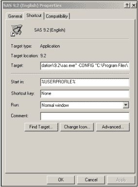

##### -SASINITIALFOLDER 选项

此初始化选项控制当显示管理器将 SAS 程序载入编辑器时，SAS 首次打开的默认位置。只需在该选项后跟上所需文件夹的路径。

```
-sasinitialfolder "folder location"
```

对于与本书相关的示例代码，-SASINITIALFOLDER 选项可能包含：

```
-sasinitialfolder "C:\InnovativeTechniques\SASCode"
```

在此上下文中，“属性”对话框上的“起始位置：”作用有限。它可用于指定基本路径信息，但不一定指定所需 SAS 代码的位置。

##### -SYSPARM 选项

-SYSPARM 选项用于将信息传入 SAS 程序，在程序中使用自动宏变量 &SYSPARM 访问该信息。这里，在初始化 SAS 时，将路径的一部分传入 SAS 会话 ❶。在 SAS 会话内，可使用自动宏变量 &SYSPARM ❷ 访问该信息。与初始化选项 ❶ 一起使用的引号不会与 &SYSPARM ❷ 一起存储。

```
-sysparm "c:\temp" ❶
```

```
libname adrvpt v9 ❷ "&sysparm\InnovativeTechniques\Data";
```

##### -SPLASHLOC 选项

此选项趣味性大于实用性。它允许你指向一个位图图像（BMP 文件），以替换加载 SAS 时显示的常规启动画面。这样，你看到的不是 SAS 标志，而是你最喜欢的狗、猫或驼鹿的可爱图片。当然，该图像显示的时间不会很长。除了 4 月 1 日之外，我所见过的唯一实际应用，是用于你希望通过视觉方式标识的特定工具或程序。

##### -AUTOEXEC 选项

-AUTOEXEC 选项指定 SAS 启动时要自动执行的 SAS 程序的路径和名称（见第 14.2 节）。该程序在配置文件之后执行，在设置针对特定应用定制的 SAS 环境时可能极其有用。

##### -CONFIG 选项

-CONFIG 选项指定 SAS 配置文件的路径和名称（见第 14.3 节）。这不是一个 SAS 程序，而是在初始化过程中用于设置基础 SAS 环境。许多 SAS 安装会限制修改此文件。

##### -ALTLOG 选项

使用此选项，你可以将 LOG 的单独副本写入你选择的文件。这成为使用 PROC PRINTTO 的一种替代方法。

##### -SYSIN 选项

在批处理模式下运行 SAS 程序时，可以使用 -SYSIN 选项指定要执行的特定 SAS 程序。使用此选项后，就无需更改启动 SAS 的位置。你只需指定要执行的程序的路径。

#### 另请参阅

sasCommunity.org 上 Ron Fehd 的文章“Windows 下的批处理”给出了使用 -SYSIN 和其他初始化选项的示例

http://www.sascommunity.org/wiki/Batch_processing_under_Windows

##### -RTFCOLOR 选项

我不记得是从哪里听说这个选项的，也没有找到相关文档，但它似乎可以在 Windows 的交互式会话中起作用。使用此初始化选项，你可以将日志写入 RTF 文件，并保留颜色（注释、警告和错误）。

在 SAS 会话期间或从 SAS 程序内部，发出带有 WRTFSAVE 选项的 DM 语句。或者，当 LOG 窗口处于活动状态时，也可以从命令行发出 WRTFSAVE 命令。

```
DM 'log; WRTFSAVE "c:\temp\mylog3.rtf";';
```

即使指定了 -RTFCOLOR，使用 PROC PRINTTO 和 -ALTLOG 初始化选项生成的日志也不会保留其颜色。

**警告** 请谨慎使用此选项，不要编写依赖它的应用程序，因为此选项未记录在文档中，不能保证、甚至不太可能继续存在，更不用说在 SAS 的未来版本中得到支持。

##### -INITSTMT 和 -TERMSTMT 选项

-INITSTMT 和 -TERMSTMT 选项通常一起使用，它们提供了一种在 SAS 会话开始和结束时自动执行 SAS 语句的机制。-INITSTMT 选项指定在 AUTOEXEC 执行后立即执行的语句，而 -TERMSTMT 选项指定在会话关闭前执行的语句。当 SAS 语句是宏调用时，整个宏会在适当的时间执行。

由于宏变量存储在内存中，它们的值不会从一个 SAS 会话保留到下一个 SAS 会话。此示例使用 -INITSTMT 和 -TERMSTMT 选项在 SAS 会话之间保存和恢复宏变量值。这些选项指定对 %GETGLOBAL 和 %SAVEGLOBAL 的宏调用，二者都是自动调用宏。

```
-initstmt='%getglobal' -termstmt='%saveglobal'
```

%GETGLOBAL 宏从数据集 ADVRPT.GLOBALVARS 中恢复保存的值，并使用 SYMPUTX 例程将它们重新建立为全局宏变量。

```
%macro GetGlobal;
data _null_;
    set advrpt.globalvars(where=(name ne 'PATH'));
    call symputx(name,value,'g');
    run;
%mend getGlobal;
```

由于 %GETGLOBAL 宏定义位于由 AUTOEXEC 建立的自动调用库中，因此该宏可以由 -INITSTMT 选项立即执行。


%SAVEGLOBAL 宏将在 SAS 会话终止时执行。当前定义为全局作用域的所有宏变量都会写入数据集 ADVRPT.GLOBALVARS，在那里它们可供下一次 SAS 会话使用。对于交互式会话，必须执行 ENDSAS 语句，才能触发 -TERMSTMT 选项。

```sas
%macro SaveGlobal;
  data advrpt.GlobalVars (keep=name value);
    set sashelp.vmacro(where=(scope='GLOBAL'));
  run;
%mend saveglobal;
```

### -NOWORKINIT 和 -NOWORKTERM 选项

默认情况下，WORK 位置在 SAS 会话开始时初始化，并在 SAS 会话结束时清除。通常这正是你希望发生的情况；然而，偶尔你可能希望跨 SAS 会话保留 WORK 位置。-NOWORKINIT 选项阻止 SAS 在 SAS 会话开始时初始化 WORK 位置，而 -NOWORKTERM 阻止 SAS 在 SAS 终止时清除 WORK 位置。

这两个选项彼此独立，但通常会一起使用，因为它们允许你跨会话边界保留 WORK 空间。

##### 14.1.2 数据处理选项

有一些 SYSTEM 选项被误用或未充分利用。这绝不是一份详尽的列表，只是我遇到过的一些选项。其中一些只应由充分了解其使用后果的高级用户使用。

### MERGENOBY 选项

除非以非常审慎的方式进行，否则执行不带 BY 语句的 MERGE（一对一合并）可能非常危险。当无意中这样做时，结果几乎总不是所期望的。更糟的是，这些错误往往并不明显，并且可能不会在 LOG 中产生任何警告、注释或错误消息。MERGENOBY 选项可用于改变这种行为。MERGENOBY 决定当使用 MERGE 语句而没有对应的 BY 语句时应采取什么操作。

- **NOWARN**：进行合并且不发出警告（**这是默认值**）
- **WARN**：进行合并并发出警告
- **ERROR**：不进行合并，并向 LOG 写入错误

MERGENOBY=WARN 指定 ❶ 会导致向 LOG 发出警告。我认为 MERGENOBY 选项应设置为 ERROR，并且只有在出现特定迫切需求时才重置为 WARN 或 NOWARN。MERGENOBY=WARN 会在 LOG 中产生以下警告。请注意，尽管发出了警告，MERGE 仍然会进行。

```sas
options mergenoby=warn; ❶
data aemed;
  merge advrpt.ae
        advrpt.conmed;
run;
```

```text
WARNING: No BY statement was specified for a MERGE statement.
NOTE: There were 127 observations read from the data set ADVRPT.AE.
NOTE: There were 199 observations read from the data set ADVRPT.CONMED.
NOTE: The data set WORK.AEMED has 199 observations and 13 variables.
```

### 更多信息

不带 BY 的 MERGE 语句出现在第 3.1.4 节的一个“前瞻”示例中。与该示例关联的代码会更改并随后重置 MERGENOBY 选项的当前设置。

### DATASTMTCHK 选项

此选项通过限制某些数据集名称的使用，保护用户免于因遗漏分号而覆盖数据集。默认值是 COREKEYWORDS，它阻止你将数据集命名为 UPDATE、MERGE、RETAIN 或 SET。

- **COREKEYWORDS**：数据集不得使用与核心关键字对应的名称（**默认值**）
- **ALLKEYWORDS**：还排除所有可作为 SAS DATA 步语句开头的名称（即 ARRAY、DO、OUTPUT）
- **NONE**：无限制（*事实上的* V7 之前默认值）

在这个 DATA 步中，DATA 语句 2 后遗漏了分号。实际上，我们试图创建三个数据集：WORK.AE、WORK.SET 和 ADVRPT.AE。幸运的是，DATASTMTCHK 选项的 COREKEYWORDS 设置保护了我们。在 V6 中，或将该选项设置为 NONE 时，这三个数据集都会被创建为 0 个观测和 0 个变量——我们的永久数据集 ADVRPT.AE 将被抹掉！！我认为不应将此选项重置为匹配 V6 标准（DATASTMTCHK=NONE）。

```sas
data ae
set advrpt.ae;
run;
```

```text
22   data ae
23      set advrpt.ae;
     --
56
ERROR 56-185: SET is not allowed in the DATA statement when option
DATASTMTCHK=COREKEYWORDS.
     Check for a missing semicolon in the DATA statement, or use
DATASTMTCHK=NONE
```

顺便说一句，无论数据集名称如何，只要其中包含 *逻辑库引用名*，COREKEYWORDS 和 ALLKEYWORDS 值都不会标记该数据集。因此，将数据集命名为 WORK.UPDATE 是可能的，尽管其实用性值得怀疑；而如果不带 *逻辑库引用名* 将其命名为 UPDATE，则会失败。

### VALIDVARNAME 选项

VALIDVARNAME 选项用于确定有效的变量命名约定，以及如何处理变量名。

- **V6**：变量名必须符合 V6 约定（最多 8 个字符）。此选项值不再记录在文档中，但仍适用于当前版本的 SAS。
- **V7**：允许最多 32 个字符的名称，并记住变量定义时的大小写（默认值）。
- **UPCASE**：不记住也不使用大小写。
- **ANY**：允许非标准命名约定。非标准命名约定在 Base SAS 和 SAS/STAT 之外用途有限。

### VALIDVARNAME=V6 选项

```sas
options validvarname=v6;
data a;
    abcdefghig= 5;
    run;
```

当你创建必须符合 V6 命名约定的数据集时很有用。虽然对于 VALIDVARNAME 的所有其他值都可以接受，但当 VALIDVARNAME=V6 时，以下 DATA 步会失败，因为变量名超过 8 个字符。VALIDVARNAME= 选项的这个值在未来的 SAS 版本中可能不受支持。在 SAS 9.2 中，它未被包含在 VALIDVARNAME 选项的文档中。尽管 V6 值限制变量名的长度，但它不像 SAS V6 那样限制数据集名称的长度。

VALIDVARNAME= 选项在未来的 SAS 版本中可能不受支持。在 SAS 9.2 中，它未被包含在 VALIDVARNAME 选项的文档中。尽管 V6 值限制变量名的长度，但它不像 SAS V6 那样限制数据集名称的长度。

### VALIDVARNAME=ANY 选项

此设置允许来自其他来源（如 ORACLE 或 EXCEL）的变量名，这些来源不使用与 SAS 相同的命名约定。我们通过使用命名文字量来访问这些非标准变量；只要名称包含非标准字符，就需要使用命名文字量。一旦数据导入 SAS，通常建议将这些变量重命名，以符合标准 SAS 命名约定。当数据集包含使用命名文字量定义的变量以包含非标准字符时，必须始终先将 VALIDVARNAME= 设置为 ANY，然后才能使用该数据集。此外，每当你访问任何包含非标准字符的变量时，都必须始终使用命名文字量来命名该变量。

命名文字量用引号括起，引号字符串后跟字母 n。

```sas
options validvarname=any;
proc print data=aexls;
  var subject 'ae-date'n 'ae#type'n;
  run;
```

命名文字量的使用方式与其他任何变量名一样。左侧的 VAR 语句中包含三个变量。

使用 VALIDVARNAME=ANY 的应用可以通过 EXCEL 文件 E14_1_2AE.XLS 来展示。此电子表格的列标题不符合 SAS 命名标准。

|   | Subject | AE-date | AE#type |
|---|---:|---|---:|
| 2 | 201 | 24-Apr-06 | 1 |
| 3 | 202 | 15-May-06 | 2 |

可以使用 PROC IMPORT 将此 EXCEL 表转换为 SAS 数据集。由于使用了 GETNAMES=YES 选项，SAS 将尝试将列标题用作变量名。如果未先指定 VALIDVARNAME=ANY，非标准字符将被转换为下划线。

在此示例中，这不会产生很大影响；然而，可能会产生命名冲突。通过使用 VALIDVARNAME=ANY，可以确定列在 SAS 数据集（WORK.AEXLS）中将采用的名称。查看 WORK.AEXLS 的属性可以看到，SAS 正在使用这些非标准名称。

```sas
options validvarname=any;
PROC IMPORT OUT= WORK.Aexls
    DATAFILE= "gpath\\data\\E14_1_2AE.xls"
    DBMS=EXCEL REPLACE;
    SHEET="Sheet1$";
    GETNAMES=YES;
    MIXED=NO;
    SCANTEXT=YES;
    USEDATE=YES;
    SCANTIME=YES;
RUN;
```

| 列名 | 类型 | 长度 |
|---|---|---:|
| Subject | 数值 | 8 |
| AE-date | 数值 | 8 |
| AE#type | 数值 | 8 |


非标准数据集名称通常只在 Base SAS 和 SAS/STAT 中得到支持，因此通常最好尽快重命名这些变量。在这种情况下，变量的标签将反映原始名称。

当使用非标准名称时（如本例的 RENAME 选项中所做的那样），会使用命名文字量

- 变量名用引号括起来，引号后紧跟字母 n。

```sas
data ae;
   set aexls(rename=('ae-date'n=AEDate
                     'ae#type'n=AEType));
   run;
```

##### 14.1.3 保存 SAS 系统选项

通常，SAS 系统选项的设置会在当前作业或当前 SAS 会话期间持续有效。但是，可以将当前系统选项设置保存在注册表或数据集中。保存后，可以在将来的会话或作业中检索它们。将选项保存在数据集中更灵活，因为它允许其他用户获取相同的选项设置，其中可以包括宏库和格式库控制。

并非所有系统选项都可以保存；最值得注意的是初始化选项和包含密码的选项。

可以使用过程或命令来保存和检索这些选项。

### 更多信息

第14.1.1节中描述的 -INITSTMT 和 -TERMSTMT 系统选项，也可以采用与该节所示捕获和保存宏变量值类似的技术，来捕获和保存系统选项。

### 另请参阅

SAS 论坛帖子 http://communities.sas.com/message/101546 讨论了多种收集和重新建立系统选项的方法。

### 使用 PROC OPTSAVE 和 OPTLOAD

OPTSAVE 过程用于将当前选项设置写入 SAS 数据集。

```sas
proc optsave out=advrpt.current_settings;
   run;
```

该数据集与其他数据集类似，由两列（OPTNAME 和 OPTVALUE）组成。此处显示数据集 ADVRPT.CURRENT_SETTINGS 的一部分。请注意第155行❶中的 SASAUTOS 选项。

14.1.3 保存系统选项

使用 PROC OPTSAVE 保存的选项

| Obs | OPTNAME | OPTVALUE |
| --- | --- | --- |
| 148 | REPLACE | 1 |
| 149 | REUSE | NO |
| 150 | RIGHTMARGIN | 0.000 IN |
| 151 | RSASIOTRANSERROR | 1 |
| 152 | S | 0 |
| 153 | S2 | 0 |
| 154 | S2V | 0 |
| 155 | SASAUTOS | (advmac, sasautos) ❶ |
| 156 | SASCMD |  |

*...表格的部分内容未显示...*

在下面的代码中，SASAUTOS 选项被“无意中”更改❷。我们可以使用 PROC OPTIONS ❸ ❹ 观察该更改，并使用 PROC OPTLOAD ❺ 恢复该选项的原始设置。

```sas
33    proc options option=sasautos;
         run;

      SAS (r) Proprietary Software Release 9.2  TS2M2

      SASAUTOS=      Search list for autocall macros
NOTE: PROCEDURE OPTIONS used (Total process time):
      real time                 0.00 seconds
      cpu time                  0.00 seconds

35    proc optload data=advrpt.current_settings
         (where=(optname='SASAUTOS'));
36       run;

NOTE: PROCEDURE OPTLOAD used (Total process time):
      real time                 0.12 seconds
      cpu time                  0.01 seconds

37    proc options option=sasautos;
         run;

      SAS (r) Proprietary Software Release 9.2  TS2M2

      SASAUTOS=(advmac, sasautos)
                     Search list for autocall macros
NOTE: PROCEDURE OPTIONS used (Total process time):
      real time                 0.00 seconds
      cpu time                  0.00 seconds
```

**PROC OPTIONS** 用于查看 SASAUTOS 选项的当前设置。

这里我们恢复了单个选项的设置。如果没有使用 WHERE 子句，则会使用数据集 ADVRPT.CURRENT_SETTINGS 中的选项设置。

### 使用 DMOPTSAVE 和 DMOPTLOAD 命令

DMOPTSAVE 和 DMOPTLOAD 命令与上述 PROC 步骤类似。作为命令，它们设计为在显示管理器的 DM 命令行中执行，但这也意味着它们既可以在 KEYS 窗口中分配一个按键（见第14.4.7节），也可以在 DM 语句中执行。由于 DM 语句通常最灵活，因此此处展示相应代码。

```sas
dm 'dmoptsave advrpt.current_settings';
options sasautos=adv2;
proc options option=sasautos;
   run;
dm "dmoptload advrpt.current_settings
            (where=(optname='SASAUTOS'))";
   run;
proc options option=sasautos;
   run;
```

**当前系统选项设置使用 DMOPTSAVE 命令保存。**

**SASAUTOS 选项被意外更改。**

**新的 SASAUTOS 选项值已准备好使用。** 这里我们只是演示它已被更改。

SASAUTOS 选项的*原始*值被恢复。

### 更多信息

DM 语句也在第14.4.2节中讨论。

#### 14.2 使用 AUTOEXEC 程序

当 SAS 初始化并开始执行时，它会自动查找并执行（如果存在）名为 AUTOEXEC.SAS 的程序。默认情况下，只有当 AUTOEXEC.SAS 程序位于 !SASROOT 目录中时才会被找到。通过使用 -AUTOEXEC 初始化选项（见第14.1.1节），你可以指向任意位置中的任意 SAS 程序。

AUTOEXEC.SAS 可以是任何普通的 SAS 程序。它通常用于设置宏库、系统选项、*librefs* 和 *filerefs*。尽管该程序可以命名为任何名称（如 Fred.jpg），但 AUTOEXEC.SAS 更不容易让人困惑。

此处展示的 AUTOEXEC.SAS 可用于设置用于访问本书相关数据的 *libref*。它假定在调用 SAS 时，自动宏变量 &SYSPARM ❶ 已被赋予路径结构的上半部分（关于 -SYSPARM 初始化选项的更多用法，见第14.1.1节）。

```sas
* Autoexec.sas *;
%let path = ❶ &sysparm\InnovativeTechniques;
libname advrpt v9 "&path\Data"; ❷
filename advmac "&path\sasdoc\sasmacros";
options nodate nonumber noncenter; ❸
options sasautos=(advmac, sasautos); ❹
```

❷ 然后建立 *libref*，并声明系统选项 ❸，包括建立自动调用宏库 ❹。这个特定的 AUTOEXEC 很短，但它同样可以包含任意数量的宏调用，甚至启动一个应用程序。

通常，我的 Windows 桌面上会为每个活跃的客户/项目放置不同的 SAS 图标。每个图标都有自己唯一的 autoexec 程序。这确保我为每个项目使用正确的数据和正确的程序。如果你安装并使用本书示例代码附带的 AUTOEXEC.SAS 程序，示例程序所使用的 *libref* 和自动调用宏库将自动可供你使用。

#### 14.3 使用配置文件

当 SAS 初始化时，配置文件会在 autoexec 程序*之前*执行。配置文件不是 SAS 程序，如果要进行更改，必须小心编辑。一些公司使用配置文件为站点内所有 SAS 安装提供通用设置说明，因此不允许修改此文件。

如果你确实想自定义此文件，我建议不要修改原始版本，原始版本可在 !SASROOT 位置找到。相反，你可以复制一份，然后编辑副本。然后使用 -CONFIG 初始化选项（见第14.1.1节）指向修改后的配置文件。

此文件的默认名称是 SASV9.CFG。位置会因操作系统和安装情况而异。在标准 Windows 安装下，你可能会在以下位置之一找到它：

- SAS 9.1   C:\Program Files\SAS\SAS 9.1\nls\en
- SAS 9.2   C:\Program Files\SAS\SASFoundation\9.2\nls\en
- SAS 9.3   C:\Program Files\SASHome\SASFoundation\9.3

常见自定义包括：

- 向 SASAUTOS 添加宏库位置
- 更改 WORK 目录的位置
- 修改其他默认值，如内存分配和宏符号表大小

##### 14.3.1 更改 SASAUTOS 位置

配置文件的以下部分向 SASAUTOS 库列表添加一个目录 ❶。将此目录添加到 SASAUTOS 的定义中意味着它将自动包含在自动调用宏库中，而无需在 SASAUTOS= 系统选项中指定它。

```sas
/* Setup the SAS autocall library definition */
-SET SASAUTOCALL ("\\groupserver\sascode\macros" ❶
                 "!sasroot\core\sasmacro"
                 "!sasext0\inttech\sasmacro"
                 "!sasext0\access\sasmacro"
                 "!sasext0\assist\sasmacro"
                 "!sasext0\eis\sasmacro"
                 "!sasext0\ets\sasmacro"
                 "!sasext0\graph\sasmacro"
                 "!sasext0\iml\sasmacro"
                 "!sasext0\or\sasmacro"
                 "!sasext0\qc\sasmacro"
                 "!sasext0\share\sasmacro"
                 "!sasext0\stat\sasmacro"
                 )
```

在配置文件中，-SET 关键字用于建立环境变量，稍后该变量将被解释为 fileref。

除了修改原始 CONFIG 文件（或如上所述修改副本）之外，还可以调用第二个定制的配置文件，以扩充或覆盖原始文件的选定部分。下面展示的配置文件使得在定义自动调用宏库时无需修改 SASAUTOS 选项。它通过将位置直接插入 SASAUTOS 系统选项来实现这一点。

使用 CONFIG.CFG 文件中的 INSERT 选项将位置插入自动调用宏库曾存在问题。幸运的是，以下技术由 Crawford Software Consultancy Limited 的 Peter Crawford 设计出来。

```sas
-set advtech "C:\InnovativeTechniques\SASCode" ❷
-sasautos (sasautos) ❸
-insert sasautos !advtech\ProdMacros\ ❹
-insert sasautos !advtech\SasMacros\ ❺
```

❷ 为方便起见，创建 ADVTECH 环境变量，并在 ❹ ❺ 处将其用作路径缩写。

❸ 使用 SASAUTOS 选项重新建立 SAS Institute 的自动调用宏库。此步骤必须首先完成，因为 SASAUTOS 选项的原始值在指定时没有使用括号。此定义将用包含括号的值替换 SASAUTOS 的默认值。当需要指定多个位置时（如 ❹ ❺ 处所做），需要使用括号。

❹ 生产自动调用宏库的物理路径被插入 SASAUTOS 选项。-INSERT 选项将文本写入列表开头。APPEND 选项（未展示）可以将文本放在列表末尾。请注意环境变量 !ADVTECH 的使用，它通过感叹号来标识。

❺ 第二个自动调用宏库被插入 SASAUTOS 选项。由于它是第二个插入的，因此它会出现在 PRODMACROS 库 ❹ 之前。


❻ 通过执行行上的第二个 -CONFIG 初始化选项来指向定制的配置文件：

```text
-config "C:\\InnovativeTechniques\\SASCode\\Chapter14\\E14_3_1.cfg"
```

此选项通常是在标准配置文件之外额外使用的，而标准配置文件也会使用 -CONFIG 选项。

```sas
proc options option=sasautos;
   run;
%put %sysget(advtech);
```

❼ 我们可以使用 PROC OPTIONS 确认 SASAUTOS 选项中的值。

❽ 可以使用 %SYSGET 宏函数显示 ADVTECH 环境变量的值。

LOG 显示 SASAUTOS 选项已被修改，并且 ADVTECH 环境变量具有预期的值。请注意，在 LOG 中 SASAUTOS 的 fileref 没有被引号括起来 ❼。如果我们插入附加位置时没有先插入括号，这段文本就会被引号括起来，而自动调用库的该部分将不可用。

```text
5    proc options option=sasautos;
6       run;

     SAS (r) Proprietary Software Release 9.2  TS2M2

SASAUTOS=('!advtech\\SASMacros\\' '!advtech\\ProdMacros\\' sasautos ) ❼
                         Search list for autocall macros
NOTE: PROCEDURE OPTIONS used (Total process time):
      real time           0.00 seconds
      cpu time            0.00 seconds
7
8    %put %sysget(advtech);
C:\\InnovativeTechniques\\SASCode ❽
```

可以在这个第二配置文件中声明的其他常见初始化选项包括：

- `-SASINITIALFOLDER`（见第 14.1.1 节）
- `-AUTOEXEC`（见第 14.1.1 节和第 14.2 节）
- `-VERBOSE` 在初始化时在日志中显示选项设置

### 另请参阅

SAS Problem Note 44791 讨论了与插入自动调用位置相关的问题，但没有给出 Peter Crawford 所研究出的解决方案 http://support.sas.com/kb/44/791.html。示例代码 42360 演示了 APPEND 选项的用法 http://support.sas.com/kb/42/360.html。

##### 14.3.2 控制 DM 初始化

当显示管理器初始化时，你可以在很大程度上通过初始化选项控制外观和可用工具。当你正在执行应用程序（可能是通过 SAS/AF 或 SAS/EIS）并且需要控制用户访问 SAS 的能力时，这种控制级别通常最受关注。

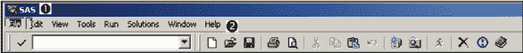

- 整个顶行可以通过以下方式关闭：

```text
-AWSCONTROL NOTITLE
```

或者，你可以将标题从默认值（SAS）改为你选择的标题：

```text
-AWSTITLE "ABC Project"
```

- 下拉菜单列表可以通过使用 -NOAWSMENU 初始化选项关闭。

```sas
/* Prep for AF start up application */
-initcmd   af=ccontrol.Control.wrapper.frame af;
           toolclose;
           zoom;
           command close;
           wstatus off;
           wwindow off;"
```

-INITCMD 选项允许你在执行应用程序（例如 SAS/AF）时指定控制命令。这里展示的初始化选项会启动一个 SAS/AF 应用程序，并关闭用户对 SAS 其余部分的大部分访问权限。

#### 14.4 在显示管理器中

显示管理器具有极强的可定制性。其中许多可能的定制有点过头，但也有一些非常有帮助。

### 另请参阅

Richard DeVenezia 的网站有一个有用的章节，介绍你可能考虑添加到资源管理器窗口的“操作” http://www.devenezia.com/downloads/sas/actions/

##### 14.4.1 在 ViewTable 中显示列名

默认情况下，VIEWTABLE 窗口将变量标签显示为列标题。我觉得这非常烦人，因为我几乎总是希望看到变量名。幸运的是，可以更改默认设置，改为显示列名而不是标签。

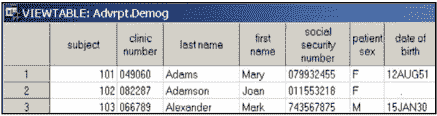

尽管以下步骤基本相同，但其中一些对话框的设置会因操作系统和 SAS 版本而异。

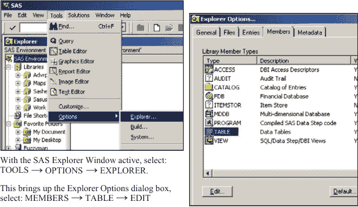

在 SAS Explorer 窗口处于活动状态时，选择：TOOLS → OPTIONS → EXPLORER

这会打开 Explorer Options 对话框，选择：MEMBERS → TABLE → EDIT

编辑 ACTION 为 &OPEN 的那一行，并添加 colheading= name。现在 VIEWTABLE 的默认设置将显示变量名。对 VIEWS 重复此过程。

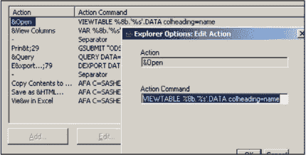

### 更多信息

除了更改默认行为之外，你也可以在调用 ViewTable 时更改此设置。第 14.4.2 节展示了一条 DM 命令，该命令使用列名而不是标签来调用 ViewTable。

##### 14.4.2 使用 DM 语句

DM 语句允许你在 SAS 程序内执行一条或多条显示管理器命令。以下是一些可以在命令框中、命令行上或从 KEYS 窗口使用的命令。

```sas
DM <windowname> 'action' <windowname>;
```

如果你不需要指定或更改活动窗口，只需要操作即可。在批处理程序中执行 DM 任务时，这很常见。

以下命令可用于清空 LOG 窗口。

```sas
dm log 'clear';
```

通过用分号将多条 DM 命令串联起来，可以将它们包含在单条 DM 语句中。这条 DM 语句会关闭程序编辑器并执行一个 SAS/AF 程序，使 SAS/AF 窗口成为活动窗口。

```sas
dm af "pgm off; af cat = appls.allproj.passwd.program";
```

你也可以像使用 PROC PRINTTO 那样，将 LOG 重定向。

```sas
dm 'log; file "&path\\logdump1.log"';
```

POST 命令可用于向用户屏幕发送消息框。与仅仅向 LOG 发送消息相比，这可以更有力地吸引注意。

```sas
dm 'post "this is a message"';
```


增强型编辑器通过 WEDIT 命令指定；如果后面跟文件名，则可以加载并打开特定文件进行编辑。

```sas
dm 'wedit "C:\InnovativeTechniques\sascode\chapter14\e14_3_1.sas"';
```

也可以使用 VIEWTABLE 或 VT 命令调用 ViewTable。这里打开数据集 ADVPRT.DEMOG，并将变量名显示为列标题（COLHEADING=LABELS 是默认值）。

```sas
dm "viewtable advprt.demog colheading=names";
```

DM 语句还可用于将特定命令分配给功能键（见第 14.4.7 节）。KEYDEF 命令用于完成分配。这里将 F12 键分配给清空日志。

```sas
dm 'keydef f12 "log;clear"';
```

对于组合击键，也要将键定义括在引号中。现在 SHIFT F9 键将关闭下一个打开的 ViewTable 窗口。通过连续选择，可以关闭一系列打开的 ViewTable 窗口。

```sas
dm 'keydef "shf f9" "next VIEWTABLE;"; end';
```

### 更多信息

DM 语句用于执行第 14.1.3 节中的 DMOPTSAVE 和 DMOPLOAD 命令。第 14.4.7 节讨论了通过热键分配执行 DM 命令。

### 另请参阅

DM 语句和 WEDIT 命令在 SAS Forum 帖子 http://communities.sas.com/thread/12520 中进行了讨论。Rosenbloom 和 Lafler（2011c）将一个宏调用分配给了一个功能键。

##### 14.4.3 增强型编辑器选项和快捷键

增强型编辑器有许多可用的选项和快捷键。也可以进行相当多的自定义。

### 增强型编辑器设置

只有少数几个设置首选项我建议你更改。对于典型用户来说，大多数默认值都很好。当编辑器是活动窗口时，可以找到增强型编辑器的选项。使用 TOOLS → Options → Enhanced Editor。这会打开 Enhanced Editor Options 对话框。

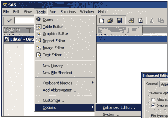

我喜欢选择“显示行号”，因为这能让大型程序的处理更轻松。更重要的是，务必勾选“用空格插入制表符”和“打开文件时将制表符替换为空格”。这两个选项都有助于更轻松地维护文本

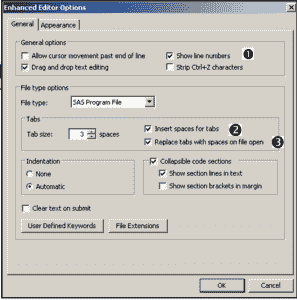

即 SAS 程序在程序员之间传输时的格式。


## 增强编辑器按键

该编辑器已设置了许多快捷键组合。根据您的工作方式和常做的事情，其中一些按键组合可能非常有用。您可以通过“增强编辑器按键”下拉菜单查看并了解更多这些按键组合。当“增强编辑器”为活动窗口时，转到 工具 → 选项 → 增强编辑器按键。

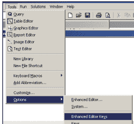

浏览随后出现的对话框，找到对您最有用的按键组合。我特别喜欢使用：

- `Ctrl+/` — 添加注释
- `Ctrl+Shift+/` — 删除注释
- `Ctrl+F2` — 在程序中标记一行
- `F2` — 跳转到下一个标记行
- `Shift+F2` — 跳转到上一个标记行

已定义的按键组合不仅非常有用，而且您还可以重新定义这些组合并添加新的按键操作。请注意，BEEP 命令没有分配任何按键组合，因此不可用。虽然 BEEP 可能并不特别有用，但其他操作可能有用；您可以向下滚动可用操作列表，直到找到感兴趣的操作。这里已高亮显示“对选定行排序”。接下来按“分配按键…”按钮。

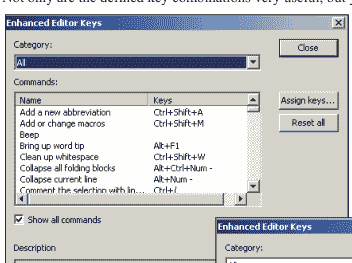

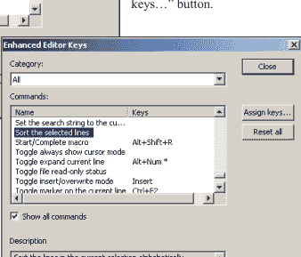

##### 14.4.4 增强编辑器的宏缩写

增强编辑器使您能够为编辑器构建缩写。与其他应用程序中的缩写非常相似，您可以输入一个单词或单词的一部分，然后通过一次按键替换为其他（通常更长的）文本。

就本示例而言，假设您希望在每个程序顶部输入以下头部块。输入一次没问题，但输入多次就会变得繁琐。让我们创建一个宏缩写来替我们输入。

```sas
* xxx.sas
*
* Purpose:
*
* Written by:
*     Art Carpenter
*     06Nov2011
*     (907)865-9167
*
* Inputs:
*
* Outputs:
*
* Notes:
*
* Modifications:
*
************************
```

当“增强编辑器”为活动窗口时，使用下拉菜单 工具 → 添加缩写（或编辑器快捷键 Ctrl+Shift+A）。这会打开“添加缩写”对话框。

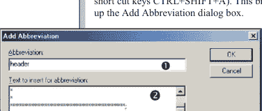

在“添加缩写”对话框中，为新缩写（header）输入名称 ❶。这会成为一个键盘宏，因此必须选择尚未使用过的名称。然后将替换文本输入（更实际地说是粘贴）到“要为缩写插入的文本”对话框区域 ❷。按“确定”按钮即可创建并存储该缩写。

要使用缩写，只需在增强编辑器中输入该缩写的名称。一旦输入该缩写的最后一个字母，就会显示一个小型弹出式“提示”文本框，其中包含该缩写的前几个字符。此时如果按 TAB 或 ENTER 键，缩写名称将被所存储的文本替换。

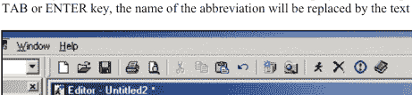

以下截图显示，已在增强编辑器中输入 HEADER 缩写的名称，并且弹出式“提示”框中显示了要替换文本的前几个字符。按 TAB 或 ENTER 键会使缩写名称被存储的文本替换。

创建后，宏缩写可以像任何其他键盘宏一样编辑或删除。使用下拉菜单 工具 → 键盘宏 → 宏 打开“键盘宏”对话框。

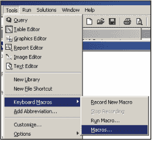


使用此对话框，您还可以导出/导入宏缩写，以便在工作组中实现标准化。使用“导出”按钮创建扩展名为 KMF 的文件。然后其他 SAS 用户可以使用“导入”按钮导入该文件。sasCommunity.org 网站 [http://www.sascommunity.org/wiki/Abbreviations/Macros](http://www.sascommunity.org/wiki/Abbreviations/Macros) 收集了许多 KMF 文件。

上面显示的 HEADER 缩写中的日期是静态的。我们可以对键盘宏应用许多预定义编辑（请记住，宏缩写是键盘宏的一种特殊形式）。其中一些预定义编辑允许插入日期值。使用这些编辑，我们可以自动插入执行该缩写时的当前日期时间戳。以下步骤重新建立 HEADER 缩写，用当前日期时间值替换静态日期（06Nov2011）。

编辑 HEADER 键盘宏（它已被建立为缩写；使用 工具 → 键盘宏 → 宏）。选择 HEADER 并按“编辑”按钮。


原来的 HEADER 定义将被替换，因此删除以“Insert the string . . .”开头的那一行。这将完全清除该缩写定义。目前这样可以。我们即将插入新文本。重要的是 HEADER 已经建立为缩写。

“编辑键盘宏”对话框左侧的命令可以插入到宏中。删除定义后，向下滚动命令列表，直到找到“插入字符串”。选择它，然后按对话框中间的雙箭头，将命令移到右侧框中。


将头部文本中直到静态日期之前（不包括该静态日期）的部分粘贴到“插入字符串”对话框中，然后选择“确定”。


选择所需的日期或日期时间值。这里已选择“插入当前日期和时间”命令。我们希望后续文本从下一行开始，因此还选择了“插入回车符”命令。

现在可以使用“插入字符串”命令插入头部文本的其余部分。


再次选择“插入字符串”命令，并将文本的其余部分输入或粘贴到“插入字符串”对话框中。

在退出每个对话框时选择“确定”。修改后的 HEADER 缩写现在可以使用了。

```sas
* xxx.sas
*
* Purpose:
*
* Written by:
*   Art Carpenter
*   Thursday, November 17, 2011 20:49:54
*   (907)865-9167
*
* Inputs:
*
* Outputs:
*
* Notes:
*
* Modifications:
*
*
*********************************;
```

现在，HEADER 缩写会将当前日期时间戳插入到头部文本中。

该缩写的名称现在也会出现在“增强编辑器按键”对话框中（在第 14.4.3 节中介绍）。您可以使用此对话框分配一组按键来执行该缩写。

选择该缩写（HEADER），然后按“分配按键. . .”按钮。高亮显示“按新快捷键：”框中的文本，然后按所选的快捷键。这里选择了 Ctrl+Shift+H 键。此按键组合现在将执行 HEADER 缩写，而不再调出帮助。


### 另请参阅

Carpenter (2003b) 介绍了这个创建宏缩写的示例。在 sasCommunity.org 的文章 [http://www.sascommunity.org/wiki/Abbreviations/Macros](http://www.sascommunity.org/wiki/Abbreviations/Macros) 中可以找到缩写集合以及指向其他更多信息参考文献的链接。

##### 14.4.5 将工具添加到应用程序工具栏

与大多数具有下拉菜单和工具栏的应用程序一样，可以修改或自定义可用工具列表。一种常见用法是，当您有一个经常运行的程序或代码片段，并希望它随时可用时。通过修改工具栏，您可以添加一个可立即执行程序的图标。

请考虑以下程序，它将删除 WORK 目录中的所有数据集。

```sas
proc datasets library=work
             memtype=data
             kill
             nolist;

quit;
```

我们希望在增强编辑器关联的工具栏上添加一个图标，用于执行此步骤。该图标可以放在 DM 中的任一工具栏上；放在这个工具栏上似乎最合理。

在增强编辑器为活动窗口时，使用下拉菜单选择 工具 → 自定义（或右键单击工具栏本身）。

此时会显示用于工具栏的“自定义工具”对话框。从这里可以添加或删除工具栏上的项目。我们希望添加一个图标来执行 PROC DATASETS 程序。


- ❶ 将滑块移到图标的大致位置（最终位置可稍后调整）。
- ❷ 添加一个空白图标（分隔符有助于使内容更清晰）。
- ❸ 为工具选择一个图标。
- ❹ 调整位置。
- ❺ 在命令行上，输入要执行的文本。在下面的示例中，我们将执行 GSUBMIT 命令。
- ❻ 应添加帮助和提示文本。


用于执行 PROC DATASETS 步骤的工具栏图标如下所示。垃圾桶图标 ❼ 已从提供的图标列表 ❸ 中选用于工具栏。


GSUBMIT 命令是 DM 语句的一种衍生用法。它允许你在原本需要命令的位置插入代码。在此示例中，整个步骤都被放入了 GSUBMIT 命令中。如果该步骤再长一些，这会相当不方便。实际上，GSUBMIT 命令只允许 500 多个字符。对于更长的步骤，请考虑提交宏调用或 %INCLUDE 语句。

如果程序所在位置的路径包含宏变量，%INCLUDE 就会有点问题。这是一个问题，因为与 GSUBMIT 命令关联的字符串必须加引号。然而，%INC 也期望一个带引号的字符串或一个文件引用（fileref）。字符串嵌套字符串对宏语言元素来说常常是个问题，因为在某些时候外层字符串需要放在单引号内。幸运的是，在这种情况下，由于该行的解析方式，使用单引号不会屏蔽宏变量。

宏变量（例如 &PATH）将位于单引号内。

```sas
gsubmit "%inc \"&path\sas\code\chapter14\e14_4_5.sas\";"
```

GSUBMIT 命令只是可在 Display Manager 中发出的长长命令列表中的一项。其他有用的命令包括调出其他 DM 窗口的命令，例如：

- KEYS
- LIBNAME
- LOG
- FILENAME
- TITLE

### 另见

Howard（2004）展示了这个示例以及一些类似示例。PMENU 过程可用于设计、构建和保存自定义下拉菜单和工具栏。Charlie Huang 在 2011 年 9 月 11 日的博客文章“Add 10 buttons to enhance SAS 9.3 environment”（添加 10 个按钮以增强 SAS 9.3 环境）中建议了若干可添加到工具栏的按钮：http://www.sasanalysis.com/2011/09/10-buttons-to-tweak-sas-93-environment.html。

## CARGO（基因组对象的容器与检索）

CARGO 是一种高性能、低延迟的数据检索系统，专为基因组数据集设计。它满足了在 PB 级规模下查询基因组变异、注释和覆盖度数据的规模与性能要求。

CARGO 利用带有列式压缩的分层存储引擎和缓存优化索引，支持交互式基因组分析工作负载。

### 主要特性

- **快速检索**：针对变异级查询的亚毫秒级查找
- **压缩感知索引**：可将存储占用减少最多 80%
- **可扩展**：针对大规模批处理和点查询进行了优化
- **灵活的查询 API**：通过 JDBC 兼容接口支持类 SQL 查询
- **多租户**：为共享基础设施中的并发访问而构建

该系统跨分区数据分片运行，使用分布式缓存层来降低频繁访问的基因组区间的延迟。

### 架构概览


请注意，EXPLORER OPTIONS: TABLE OPTIONS 对话框用于构成你在 SAS 数据表上右键单击时看到的主弹出菜单（参见本节第一幅图）。此对话框中 ACTION COMMANDS 部分的项目值得仔细查看。注意 VIEWTABLE、VAR、GSUBMIT 和 QUERY 命令的使用。表名通过 &b（用于 libref）和 '&DSN'N（用于数据集名）带入脚本。


我们将使用 ADD 操作按钮 ➌ 向此菜单添加一个 GSUBMIT 项。高亮显示下方要插入新命令的项，然后按 ADD 操作按钮 ➌。这会调出 ADD ACTION 对话框。在这里，我们输入操作名称以及要执行的操作（gsubmit "proc print data=&b..'&DSN'N;run;"）。使用 OK 退出每个对话框。现在，一个标题为 'Listing' ➌ 的新条目将出现在与 SAS 数据集关联的弹出菜单上。选择 'Listing' 条目将对高亮显示的数据集执行 PROC PRINT。


插入一个 PROC PRINT 有点多此一举。如果你注意到 'table options' 列表中的第三项，你会看到它已经包含一个用于 PROC PRINT 的 GSUBMIT，而该 PROC PRINT 利用了 ODS。

在下面的示例中，我们不是为 PROC 步骤插入 GSUBMIT，而是用它提交宏语言元素。

由于脚本在数据集名中使用了百分号，因此在 GSUBMIT 内调用宏语言元素时必须小心。通过添加对 %OBSCNT 宏的调用来演示这一点，该宏返回 SAS 数据集中的观测数。如果我们在 %PUT 语句中使用它，观测数将写入 LOG。

```sas
gsubmit "%put Obs count is %obscnt(dsn=&b..'&DSN'N);"
```

%OBSCNT（参见第 13.4.2 节）是一个自动调用宏，属于本书相关程序附带的自动调用库的一部分。注意，与宏语言关联的百分号被双写。这会延迟对它们的解释，直到宏语句被提交，而提交发生在数据集名插入之后。对于数据集 WORK.NEW，最终提交的 %PUT 语句将变为：

```sas
%put Obs count is %obscnt(dsn=work.new);
```

TABLE OPTIONS 对话框显示了此定义，并且 ObsCount 条目现在出现在弹出菜单上。


上一个示例使用 %PUT 语句将观测数写入 LOG。你本来也可以同样轻松地将数据集名传递给宏来执行。GSUBMIT 基本上会相同。

```sas
gsubmit "%nrstr(%printit(dsn=&b..'&DSN'N));"
```

以下 GSUBMIT 对显示的数据集执行 %PRINTIT 宏。宏引用函数 %NRSTR 用于延迟对宏调用的解释，当宏位于已存储的编译宏库中时可能需要使用它。

```sas
gsubmit "%nrstr(%printit(dsn=&b..&DSN));"
```

对于大多数标准数据集名，通常可以通过去掉数据集名（&DSN）周围的引号来简化此代码。

### 另见

Art Trabnachek 等人（2010）演示了其他更广泛的技术。

##### 14.4.7 向 KEYS 列表添加工具

KEYS 窗口（TOOLS → OPTIONS → KEYS，或按 F9，或在命令行输入 KEYS）列出了已预先分配给特定键组合（包括功能键和鼠标按钮）的 DM 命令。键分配可由用户修改，并且可以包括 Display Manager 命令甚至宏调用。


KEYS 窗口的前几个键定义如左图所示。注意，多个命令可以用分号连接。


你可以输入新命令，既可以覆盖现有命令，也可以在任何可用空白处输入。还可以使用 DM 语句中的 KEYEDEF 命令将命令插入键定义（参见第 14.4.2 节）。

```sas
%macro MakeTEMPWORK;
%local rc;
%let rc=%sysfunc(fileexist("c:\tempwork"));
%if &rc=0 %then %do;
    %sysexec md "c:\tempwork";
    %let rc=%sysfunc(libname(tempwork,c:\tempwork));
%end;
%mend maketempwork;

%macro ClearTEMPWORK;
%local rc;
%let rc=%sysfunc(fileexist("c:\tempwork"));
%if &rc ne 0 %then %do;
    %let rc=%sysfunc(libname(tempwork));
    %sysexec del /Q "c:\tempwork\*.*";
    %sysexec rd /Q "c:\tempwork";
%end;
%mend cleartempwork;
```

与第 14.4.6 节一样，如果要提交代码，可以使用 GSUBMIT 命令。CTL+F2 和 CTL+F3 已被指定用于提交 %MAKETEMPWORK 和 %CLEARTEMPWORK 宏调用。宏定义已保存在自动调用库中，以便在选择相应键组合时加载它们。

%MAKETEMPWORK 宏创建一个目录，并将 libref TEMPWORK 分配给该目录。当不再需要该库时（也许在会话结束时），用户可以按 CTL+F3，这会执行宏 %CLEARTEMPWORK，进而清空目录内容并删除该目录。由于这些宏使用 %SYSEXEC 宏函数，应声明系统选项 NOXWAIT，以防止操作系统弹出提示。

修改后，可以使用 SAVE 命令保存新的键定义。键定义作为目录条目存储，其条目类型为 keys。已保存的定义可以通过使用 COPY 命令恢复。

### 更多信息

Display Manager 命令也可以通过使用 DM 语句来执行（参见第 14.1.3 节和第 14.4.2 节）。


### 另请参阅

Rosenbloom 和 Lafler (2011c) 在将不同的宏赋值给 KEYS 时使用了 SUBMIT 而不是 GSUBMIT。

#### 14.5 使用 SAS 编写和发送电子邮件

在程序处理期间或之后，你可以使用 SAS 生成电子邮件。这些可以是错误条件或程序成功终止的通知。电子邮件甚至可以包含附件。这个简单的示例将帮助你入门。阅读“另请参阅”中的参考文献，了解该技术的改进细节。

```sas
options emailsys=SMTP emailid="sam@caloxy.com"
        emailhost="caloxy.com" EMAILPORT=25;

* Define the fileref with the email engine;
FILENAME genmail email
        subject="Patient 205 ConMeds"
        to      = "Fred@caloxy.com"
        from    = "Sam@caloxy.com"
        attach  = "&path\\results\\E14_5.pdf";

ods pdf file="&path\\results\\e14_5.pdf"
        style=journal2;
proc print data=advrptv.connected
        (where=(subject='205'));
    id subject;
    var medstdt medspdt drug;
run;

ods pdf close;

data _null_;
    file genmail;
    put "Here are the ConMeds for Subject 205";
run;
```

- 1. 此电子邮件 ID 的邮件服务器属性在 options 语句中指定。这些选项也可以在配置文件中指定。EMAILID= 和 EMAILHOST= 选项将使用特定于你的邮件服务器的值。
- 2. 使用 FILENAME 语句定义电子邮件文件引用（GENMAIL）。注意 EMAIL 引擎的使用。
- 3. SUBJECT= 选项定义主题行。
- 4. 收件人的电子邮件地址使用 TO= 选项指定。
- 5. FROM= 选项指定发件人的电子邮件。这通常与 EMAILID 匹配。
- 6. ATTACH= 选项指定要附加的文件。
- 7. 生成要附加的文件。
- 8. 使用 data _NULL_ 步生成电子邮件正文。当 DATA 步编译时，开始生成电子邮件的过程就会发生。DATA 步中语句的条件执行可以更改电子邮件正文，但请记住，如果 DATA 步被编译，就会生成一封电子邮件。
- 9. FILE 语句指向使用 EMAIL 引擎生成的文件引用（GENMAIL）。
- 10. 电子邮件的文本使用 PUT 语句生成。

### 另请参阅

关于使用 SAS 通过电子邮件发送结果，已有不少论文。Hunley (2010) 提供了许多扩展示例，包括关于短信的讨论。Whitworth (2010) 有一个示例，涉及在发送电子邮件之前压缩文件。Rosenbloom 和 Lafler (2011d) 提供了一个简短的电子邮件示例。

SAS Jedi（Mark Jordan）写了几篇关于使用 SAS 以电子邮件发送文档的博客：http://blogs.sas.com/sastraining/index.php?/archives/81-Jedi-SAS-Tricks-Email-from-the-Front-Part-2.html。他还在 YouTube 上创建了一个相关视频：http://www.youtube.com/watch?v=qPobPZg2osc&feature=related。

SAS 论坛的两个帖子包含了对电子邮件使用的讨论：http://communities.sas.com/thread/10467 和 http://communities.sas.com/thread/11086。

#### 14.6 获取物理位置信息

在 WINDOWS 操作系统下，你可以使用多种技术，利用 SAS 可用的信息来查找数据集或文件的物理位置。

### 另请参阅

Carpenter (2008b) 更详细地讨论了这些和其他技术。

##### 14.6.1 使用 PATHNAME 函数

PATHNAME 函数返回给定 *文件引用* 或 *库引用* 的物理路径。尽管在 DATA 步中很少使用，但它已被证明在宏语言中非常宝贵。很多时候，即使我们知道 *库引用* 或 *文件引用*，也不一定知道物理路径。在此处，物理路径被加载到一个宏变量中，并在 LOG 中显示。

```sas
filename saspgm "&path\\sascode\\e14_6.sas";

%let pgmpath = %sysfunc(pathname(saspgm));
%put &pgmpath;
```

```text
C:\InnovativeTechniques\sascode\e14_6.sas
```

你甚至可以将其用于串联的 *文件引用*，例如自动调用库。要收集 SASAUTOS *文件引用* 中所有位置的当前位置，你可以指定：

```sas
%sysfunc(pathname(sasautos))
```

### 更多信息

第 13.8.2 节中的一个示例使用 PATHNAME 函数获取了一些位置信息。

##### 14.6.2 SASHELP 视图和 DICTIONARY 表

现有 *库引用* 和 *文件引用* 的路径信息可以通过查看 SASHELP 视图和 SQL DICTIONARY 表来收集。在这里，你不仅可以找到 PATHNAME 函数返回的路径，还可以找到其他内容，如 ENGINE。

### SASHELP.VLIBNAM 和 DICTIONARY.LIBNAMES

视图 SASHELP.VLIBNAM（注意拼写）中的每一行都包含每个 *库引用* 的 *库引用* 和路径信息（对于串联的 *库引用*，有不止一行）。列表的一部分

环境变量的值可通过使用 %SYSGET 宏函数来访问。返回的值然后可以被加载到宏变量中，或者像这里所做的那样直接写入 LOG。

```sas
%put %sysget(SAS_EXECFILENAME);
```

E14_6.sas

当你想要不带 SAS 扩展名的程序名时，可以使用 %SCAN 或 %QSCAN 函数轻松地将其去除。

```sas
%put %qscan(%sysget(SAS_EXECFILENAME),1,.);
```

E14_6

当我们不仅需要知道 SAS 程序的名称，还需要知道其位置时（从增强编辑器执行时，这是正在执行的程序被检索到的位置），我们可以使用 SAS_EXECFILEPATH 环境变量。这里，该值由宏 %GRABPATHNAME 检索，然后写入 LOG。

```sas
%macro grabpathname;
   %sysget(SAS_EXECFILEPATH)
%mend grabpathname;

%put &grabpathname;
```

```text
114  %put &grabpathname;
C:\InnovativeTechniques\SASCode\Chapter14\E14_6.sas
```

##### 14.6.4 获取 UNC（通用命名约定）路径

当程序驻留在网络服务器上时，服务器名称通常会映射到驱动器号。由于此驱动器号可以是用户特定的，因此知道程序位于 F:\ 驱动器上对某位用户来说并不一定对其他用户有帮助。正如使用所有先前方法所显示的，返回的总是映射驱动器；因此，需要一种不同的方法来获取实际的或 UNC 路径。虽然 UNC 路径信息并不存储在 SAS 可直接访问的位置，但仍然有可能获得此信息——只是过程更具挑战性。

当然，我们知道操作系统必须知道映射驱动器号与实际 UNC 位置之间的关系。在 Windows 下，此信息存储在动态链接库（DLL）中。Windows 有用于访问 DLL 中包含的信息的内部工具，并且可以在 SAS 中使用 CALL MODULE 例程来访问这些工具（也可以使用 MODULEN 和 MODULEC 函数）。要使这些工具可供 CALL MODULE 例程使用，我们必须首先创建一个 CATALOG SOURCE 条目，以使其运行。该条目包含传入和传出 Windows DLL 例程的参数，该例程用于获取 UNC 路径，名为 WNetGetConnectionA（请注意，此名称区分大小写）。

参数本身是每个例程所特有的。WNetGetConnectionA 例程需要三个参数。在此，SOURCE 条目已被写入 WORK 目录中的一个 catalog 中；但是，你通常会使它永久化，这样你只需运行此步骤一次。

```sas
filename sascbtbl catalog "work.temp.attrfile.source"; ❶

data _null_;
   file sascbtbl; ❷

   put "routine WNetGetConnectionA module=mpr minarg=3 maxarg=3 ❸ stackpop=called returns=long;";
   put "  arg 1 char input byaddr format=$cstr200.;";
   put "  arg 2 char update byaddr format=$cstr200.;";
   put "  arg 3 num update byaddr format=pib4.;";
run;
```

- ❶ 通过使用 DATA _NULL_ 步将 WNetGetConnectionA DLL 所需的属性写入一个 CATALOG SOURCE 条目来指定它们。文件引用必须是 SASCBTBL，并且必须指定 CATALOG 引擎。
- ❷ 例程属性使用 PUT 语句写入。DLL 名称区分大小写，必须完全按照所写指定。

然后可以使用 CALL MODULE 例程来访问 WNetGetConnectionA 例程并获取位置。

```sas
%macro grabdrive; ❺
  %qtrim(%qleft(%qscan(%sysget(SAS_EXECFILEPATH),1,\)))
%mend grabdrive;

%MACRO getUNC;
  %local dir path;
  %* Determine the UNC path for the SAS program being executed.;
  DATA _NULL_;
    length input_dir $200 output_dir $200;

    * The input directory drive letter: ONLY e.g. j: ;
    input_dir = "&grabdrive"; ❻
    output_dir = ;
    output_len = 200;
    call module("WNetGetConnectionA",
      input_dir, ❼
      output_dir,
      output_len);

    call symputx('dir',input_dir,'l'); ❽
    call symputx('path',output_dir,'l'); ❾
  RUN;

  %* Get the name for the program of execution.;
  %put drive letter is &dir; ❿
  %put path is &path; ⓫
  %put name is &grabpathname; ⓬
%MEND getunc;
```

- ❺ %GRABDRIVE 宏只返回驱动器号。
- ❻ %GRABDRIVE 宏获取带有冒号的映射驱动器号，例如 F:。这成为 DLL 的输入。第二个参数（OUTPUT_DIR）将包含返回的 UNC 路径。


- ⑤ 通过将变量 INPUT_DIR 中包含的映射驱动器号传递给 MODULE 例程来调用该例程。WNetGetConnectionA 通过将 UNC 路径存储到 OUTPUT_DIR 中将其传回。

- ⑥ 输入驱动器号存储在宏变量 &DIR 中。

- ⑦ UNC 路径放入宏变量 &PATH 中。请注意，这是一个局部宏变量。如果它是全局变量，我们就会覆盖本书大多数示例中使用的 &PATH。

- ⑧ 将映射驱动器号写入 LOG。

  ```text
  drive letter is F: ❽
  path is \\CALOXYDELL\InnovativeTechniques ❾
  name is F:\sascode\Chapter14\e14_6_showUNC.sas ❿
  ```

- ⑨ 将 UNC 路径写入 LOG。这是已映射到驱动器号（本例中为 F:\）的路径部分。

- ⑩ 将程序名写入 LOG。

  ```sas
  %* Place this program in a mapped
  %* drive (NOT the C: drive);
  %getunc
  ```

宏 %GETUNC 由不在 C: 驱动器上的程序调用。在本例中，该程序位于 F:\ 驱动器上。UNC 路径 ❾ 表明 F:\ 驱动器号已映射到 \\CALOXYDELL 服务器上的 \InnovativeTechniques 目录。


### 第 15 章 杂项主题

- 15.1 一些杂项提示 474
  - 15.1.1 自定义 NOTE、WARNING 和 ERROR 474
  - 15.1.2 使用 #BYVAL 和 #BYVAR 选项增强标题和脚注 475
  - 15.1.3 执行操作系统命令 477
- 15.2 使用 PROC FCMP 创建用户定义函数 479
  - 15.2.1 构建自己的函数 479
  - 15.2.2 存储和访问函数 481
  - 15.2.3 与宏语言交互 482
  - 15.2.4 查看函数定义 483
  - 15.2.5 删除函数 484
- 15.3 将 RTF 作为数据读取 485
  - 15.3.1 RTF 图补全 486
  - 15.3.2 模板准备 486
  - 15.3.3 RTF 作为数据 487

仿佛本书中的所有内容还不够兼收并蓄，不足以构成一整本杂项主题书，最后一章便是这本兼收并蓄的杂项书中的杂项章节。

#### 15.1 一些杂项提示

这里仅列出众多提示中的几个。

**另请参阅**

如果你想获得更多提示，请阅读 sasCommunity.org 上的“每日提示”。你甚至可以让提示通过推文发送给你。

##### 15.1.1 自定义 NOTE、WARNING 和 ERROR

PUT、PUTLOG 和 %PUT 语句可用于在 LOG 中生成自定义的注释、警告和错误。由于这些语句是可执行的，因此可以使用逻辑来有条件地执行它们。当语句关键字后面紧跟以下内容之一时，写入 LOG 的文本遵循系统约定：

- NOTE：注释以蓝色书写。
- WARNING：警告以绿色书写。
- ERROR：错误以红色书写，并与其他错误一起汇总。

关键字必须大写，并且必须紧跟冒号。

```sas
lock sashelp.class;
%put NOTE: class should be locked;
```

```text
41    lock sashelp.class;
NOTE: SASHELP.CLASS data is now locked for exclusive access by you.
42    %put NOTE: class should be locked;
NOTE: class should be locked
```

你还可以在单词 NOTE、WARNING 或 ERROR 后面使用破折号而不是冒号。自定义消息仍将以适当的颜色出现在 LOG 中；但是，单词 NOTE、WARNING 或 ERROR 将不会出现。

**另请参阅**

Don Henderson 在 sasCommunity.org 上写了一篇讨论此主题的提示 http://www.sascommunity.org/wiki/Tips:Using_NOTE,_WARNING,_ERROR_in_Your_Program%27s_Generated_Messages。

##### 15.1.2 使用 #BYVAL 和 #BYVAR 选项增强标题和脚注

当你的 PROC 步骤使用 BY 语句时，BY 变量的值甚至变量名本身都可以插入标题或脚注中。尽管 #BYVAL、#BYVAR 和 #BYLINE 选项也可用于少数其他位置，但它们是为在 TITLE 和 FOOTNOTE 语句中使用而设计的。

#BYVAR 选项用于将变量名放入标题，而 #BYVAL 选项用于放入该 BY 变量的值。#BYVAL 和 #BYVAR 选项都有两种从 BY 变量列表中指定特定 BY 变量的方式。这两种形式（隐式和显式）可以互换使用。隐式命名使用与 BY 变量列表（从左到右）相对应的数字：#BYVAR1 和 #BYVAL1 都将引用变量列表中的第一个变量。显式命名在括号中使用变量名。该变量必须在 BY 列表中：#BYVAR(RACE) 和 #BYVAL(RACE)。括号内只能使用一个变量。

这里使用 #BYVAR 和 #BYVAL 选项在 PROC FREQ 步骤中标识 RACE。

```sas
options nobyline;
title2 'Summary for #byvar1 #byval1';
proc freq data=demog;
    by race;
    table sex;
run;
```

> ❶ 由于 BY 变量信息将出现在标题中，因此不需要该过程的 BY 行。

**15.1.2 标题中的 BY 值 — race 2 的摘要**

*FREQ 过程*

**患者性别**

| 性别 | 频数 | 百分比 | 累积频数 | 累积百分比 |
|---|---:|---:|---:|---:|
| F | 10 | 55.56 | 10 | 55.56 |
| M | 8 | 44.44 | 18 | 100.00 |

> ❷ #BYVAR 和 #BYVAL 选项都被使用，并且变量是隐式选择的。请注意，这些选项可以用于单引号或双引号内。

相同的标题语句也可以使用带有显式规范的这些选项来编写。

```sas
title2 'Summary for #byvar(race) #byval(race)';
```

这些选项与宏语言配合良好，但请确保与上面的标题不同，你要使用双引号，以便正确解析宏语言元素。

在上面显示的 PROC FREQ 中，该过程会为 BY 变量的每种组合自动创建单独的一页。这确保任何给定页面的标题和 BY 变量值将同步。某些过程不一定为每个 BY 组生成单独的一页；在这种情况下，标题和实际 BY 变量值可能看起来不正确。

PROC PRINT 仅在使用 PAGEBY 语句时才为每个 BY 组生成新页。不使用 PAGEBY 语句时，输出将使用 BY 组组合进行分隔；但是，由于多个组合可以出现在同一页上，或者给定组合可以跨页，因此很容易看出标题为何不能反映页面上实际内容。以下示例对此进行了演示。

```sas
title2 'BY Information #byline';
proc print data=demo;
    by race sex;
    var lname fname dob;
run;
```

#BYLINE 选项用于标题语句中，以插入每个 BY 变量及其值。

#BYLINE 在标题中同时显示 BY 变量及其值，并模仿该过程生成的 BY 行。

此行文本是该过程生成的 BY 行，在本例中它已从上一页延续而来，并且与标题不匹配。

当前页开始的 BY 组反映在标题中。

**15.1.2 标题中的 BY 值**

BY 信息 race=2 患者性别=F

race=1 患者性别=M
（续）

| 观测 | 姓 | 名 | 出生日期 |
|---:|---------|--------|---------|
| 42  | Thomas  | Daniel | 23MAY38 |
| 43  | Uno     | Robert | 21MAR44 |

race=2 患者性别=F

| 观测 | 姓 | 名 | 出生日期 |
|---:|---------|-------|---------|
| 44  | Adams   | Mary  | 12AUG51 |
| 45  | Adamson | Joan  | ...     |
| 46  | Batell  | Mary  | 12JAN37 |

*……报告的部分内容未显示……*

**更多信息**

第 7.4.3 节以及 11.3.1 节中的示例在 TITLE 语句上使用了 #BYVAL 选项。

**另请参阅**

Carpenter（1998）详细讨论了这些选项。Mary Rosenbloom 撰写的 sasCommunity.org 提示演示了这些选项 http://www.sascommunity.org/wiki/Tips:Use_BYVAL_to_Write_Better_Titles


##### 15.1.3 执行操作系统命令

在 SAS 中执行操作系统命令有几种方式。可以在 DATA 步中执行这些操作系统命令，也可以通过使用全局语句或宏语言语句来执行，这些语句在此上下文中本质上是全局性的。

### 全局执行

三个全局语句包括：

- `X`
- `%SYSEXEC`
- `SYSTASK COMMAND`

这里展示的 Windows 示例收集 C:\TEMP 目录中所有 SAS 控制文件的名称。这些名称存储在一个文本文件中，然后读入 SAS 数据集。当我们想要创建一个要存储在宏变量中的列表时，这类操作很常见。首先使用 X 语句显示完整步骤，X 语句可能是执行操作系统命令和语句时最常用的语句。

```sas
x 'dir "c:\temp\*.sas7*" /b/o > c:\temp\SASFiles.txt';

filename flist 'c:\temp\SASFiles.txt';
data filelist;
infile flist truncate;
input name $20.;
run;
```

- **1.** X 语句用于指定并将 DIR 命令传递给操作系统。注意，要传递的命令被括在引号中。
- **2.** DOS 的 DIR 命令生成文件列表。即使当前操作系统不是用 DOS 编写的，DOS 命令在 Windows 下仍然可用。
- **3.** DIR 命令只选择 SAS 控制的实体。微软要求 Windows 路径必须用双引号括起来。
- **4.** 使用开关来限制结果，只显示文件名。
- **5.** `>` 符号用于将 DIR 命令的结果重定向到文件。
- **6.** 包含项目列表的文件被命名。
- **7.** 使用 FILENAME 语句指向包含列表的文本文件。

%SYSEXEC 语句是宏语言语句，可以在开放代码中执行。因此，它本质上是全局性的。在宏语言中，引号不用于解析字符；因此，DIR 命令不加引号。

```sas
%sysexec(dir "c:\temp\*.sas7*" /b/o > c:\temp\SASFiles.txt);
```

SYSTASK COMMAND 语句也是可用于执行操作系统命令的全局语句。其语法与 X 语句基本相同。

```sas
systask command 'dir "c:\temp\*.sas7*" /b /o > c:\temp\SASFiles.txt';
```

当临时文件（C:\temp\sasfiles.txt）只是达到目的的一种手段且没有持久价值时，我们可以虚拟创建它，避免实际创建物理文件。FILENAME 语句中使用 PIPE 设备类型，本质上将文件路由到内存。这里 DIR 命令包含在 FILENAME 语句中。结果不路由到文件，DATA 步可直接使用。

```sas
filename flist pipe 'dir "c:\temp\*.sas7*" /b /o';
```

### DATA 步执行

在 DATA 步中，可以使用 SYSTEM 函数和 CALL SYSTEM 例程执行操作系统命令。这种技术的一个优点是它是可执行的，这意味着可以有条件地执行。在此 DATA 步中，CALL SYSTEM 例程用于生成相同的文件列表，但仅在验证目录存在之后。

```sas
data _null_;
  if fileexist('c:\temp') then do;
    call system('dir "c:\temp\*.sas7*" /b /o > c:\temp\SASFiles.txt');
  end;
run;
```

### 子会话执行说明

除了 SYSTASK COMMAND 语句外，执行这些语句时，默认会启动并打开一个操作系统子会话命令窗口。在 Windows 下，这显示为 DOS 命令窗口。必须先关闭此窗口（DOS 命令是 EXIT），SAS 才能继续执行下一条语句或操作。此行为由 XWAIT 系统选项控制。将该选项改为 NOWAIT 后，命令执行完毕将自动关闭此窗口。

你可能会注意到，即使设置了 NOWAIT 选项，黑色命令窗口至少仍会闪烁。虽然闪烁的窗口不是问题，但可能有点烦人。使用 SYSTASK COMMAND 语句可以完全避免打开窗口，但还有其他细微差别。XMIN 选项可用于最小化命令框和简短的命令消息框。通过使用 NOWAIT、NOXSYNC 和 XMIN 选项，命令框不会闪烁。

```sas
options nowait xmin noxsync;
x 'dir *.*';
```

```sas
proc fcmp outlib=work.myfuncs.tmp;
   function qnum(date) $;
      length yyq4 $4;
      yyq4=put(date,yyq4.);
      if substr(yyq4,3,1)='Q'
         then return(substr(yyq4,3,2));
      else return(yyq4);
   endsub;
run;
options cmplib=(work.myfuncs);
data qlabs;
   set advrpt.lab_chemistry
              (keep=subject labdt);
   qtr=qnum(labdt);
run;
title2 'Quarters without years';
proc freq data=advrpt.lab_chemistry;
   table qtr*visit;
run;
```

- **①** 编译后的函数保存在一个特殊的数据集中，该数据集包含一个 *包（packet）*，此例中名为 TMP。
- **②** FUNCTION 语句为函数命名，在括号中列出其参数，如果函数返回字符值，则在分号前加 $。
- **③** 使用 YYQ. 格式将日期转换为季度。
- **④** 如果使用 YYQ. 格式成功转换了日期，则第三个字符将是 'Q'。
- **⑤** 使用 RETURN 语句指定函数要返回的值。SUBSTR 函数用于去除格式化值中的年份（YY）部分。
- **⑥** 对于 YYQ. 格式来说，该日期必定是缺失或非法的。
- **⑦** FUNCTION 语句总是以 ENDSUB 语句结束。
- **⑧** CMPLIB 选项用于指向包含 TMP '包'的数据集，该包保存函数定义。

**按 VISIT 的 qtr 表**

| qtr | 1 | 2 | 4 | 5 | 6 | 7 | 8 | 9 | 10 | Total |
|---|---|---|---|---|---|---|---|---|---|---|
| Q1 | 3<br>2.21<br>8.33<br>17.65 | 2<br>2.21<br>8.33<br>18.75 | 2<br>2.21<br>8.33<br>18.75 | 2<br>2.21<br>8.33<br>20.00 | 2<br>2.21<br>8.33<br>18.75 | 5<br>3.68<br>16.49<br>31.25 | 4<br>4.41<br>16.67<br>50.00 | 3<br>3.68<br>13.89<br>35.71 | 5<br>3.68<br>13.89<br>35.71 | 36<br>26.47 |
| Q2 | 2<br>2.21<br>16.67<br>17.65 | 1<br>1.47<br>11.11<br>16.67 | 1<br>1.11<br>11.11<br>11.11 | 1<br>1.11<br>11.11<br>13.33 | 1<br>1.11<br>11.11<br>12.50 | 1<br>1.11<br>11.11<br>25.00 | 0<br>0.00<br>0.00<br>0.00 | 1<br>1.11<br>11.11<br>14.29 | 2<br>1.67<br>16.67<br>21.43 | 18<br>13.24 |
| Q3 | 7<br>5.15<br>15.22<br>41.18 | 7<br>5.15<br>15.22<br>43.75 | 5<br>5.15<br>37.25<br>45.00 | 4<br>2.94<br>8.70<br>26.67 | 5<br>3.68<br>10.87<br>31.25 | 5<br>3.68<br>10.87<br>29.85 | 3<br>3.68<br>5.13<br>25.00 | 3<br>2.21<br>8.33<br>42.86 | 1<br>1.47<br>4.35<br>14.29 | 46<br>33.82 |
| Q4 | 4<br>2.94<br>11.11<br>23.53 | 4<br>2.94<br>11.11<br>23.53 | 4<br>2.94<br>11.11<br>26.67 | 4<br>4.41<br>16.67<br>16.67 | 4<br>3.68<br>16.67<br>25.00 | 2<br>2.21<br>5.13<br>11.11 | 3<br>3.68<br>8.33<br>37.50 | 3<br>2.21<br>8.33<br>27.78 | 4<br>2.94<br>11.11<br>28.57 | 36<br>26.47 |
| Total | 17<br>12.50 | 16<br>11.76 | 16<br>11.76 | 15<br>11.03 | 16<br>11.76 | 16<br>11.76 | 12<br>8.82 | 14<br>10.29 | 14<br>10.29 | 136<br>100.00 |

- **⑨** 使用 QNUM 函数创建了一个长度为 $2 的新字符变量（QTR）。实验室日期作为唯一参数传递给函数。
- **⑩** 新变量在 TABLE 语句中使用。

### 更多信息

QNUM 函数的一种变体在第 12.5.5 节中讨论，第 15.2.2 节提供了简化形式。

### 参见

一个调用包含 PROC FREQ 的宏的函数示例位于 http://tech.groups.yahoo.com/group/sas_academy/message/438。创建了 FCMP CALL 例程，位于

你很可能在多个数据集中存储了多个函数。要使所有这些函数都可用，必须在 CMPLIB= 系统选项上列出每个数据集。

这里列出了两个数据集。这两个数据集所有包中的所有函数都将可用。但多个同名函数除外。与大多数库搜索不同，跨多个函数库的搜索顺序是从右到左。在此示例中，首先找到 WORK.MYFUNCS 中的函数。包未在 CMPLIB 选项中命名；因此，如果同一个函数名在同一数据集中的两个不同包中使用，则难以预测将使用哪个。我建议函数名在数据集内唯一。

```sas
options cmplib=(advprt.functions work.myfuncs);
```

##### 15.2.3 与宏语言的交互

使用 PROC FCMP 创建的函数和例程通常从 DATA 步内部调用；然而，也可以通过使用宏函数 %SYSFUNC 和宏语句 %SYSCALL 从宏语言中调用它们。

还可以使用 RUN_MACRO 函数从函数或例程内部调用或执行宏。下面这个有些傻气的示例演示了从函数或例程内部调用宏时的一些问题。

```sas
proc fcmp outlib=advprt.functions.utilities;
subroutine prnt(dsn $, kvar $, cvar $);
  rc=run_macro('printit',dsn, kvar, cvar);
endsub;
run;
%macro printit();
  %let dsn = %sysfunc(dequote(&dsn));
  %let kvar = %sysfunc(dequote(&kvar));
  %let cvar = %sysfunc(dequote(&cvar));
  title2 "&dsn";
  proc print data=advprt.&dsn;
    %if &kvar ne %then id &kvar;
    %if &cvar ne %then var &cvar;
  run;
%mend printit;

options cmplib=(advprt.functions);
title1 '15.2.3 Macro Language Interface';
data _null_;
  set advprt.dsncontrol;
  call printit(dsn, keyvars, critvars);
  put 'Print ' dsn keyvars critvars;
run;
proc print data=advprt.dsncontrol;
run;
```

- **1.** SUBROUTINE 语句声明这是例程的定义。与 FUNCTION 语句一样，例程被命名。字符参数名后跟 $。
- **2.** RUN_MACRO 函数的第一个参数是要调用的宏的名称。其余参数是该宏的参数。
- **3.** 位置宏参数不在 %MACRO 语句上命名。参数名将从 RUN_MACRO 函数一直传递到宏 %PRINTIT。
- **4.** 宏参数的值以带引号的形式到达。由于在此所示的应用中我们需要它们不带引号，因此调用 DEQUOTE 函数。
- **5.** 当 PROC PRINT 执行时，将显示 TITLE2。虽然 TITLE1 语句已执行，但在编译例程可用的域中，其定义不可用，因此它仍然未定义。
- **6.** 宏 %PRINTIT 中的 PROC PRINT 是用宏参数构建的。
- **7.** 指定函数库。


- 8. TITLE1 在调用该例程的 DATA 步之前定义；但是，该标题将不会提供给由 PRNTCRIT 例程执行的宏。

- 9. PRNTCRIT 例程使用来自 ADVRPT.DSNCONTROL 数据集的三个变量进行调用。例程调用中的变量必须与它们定义的顺序相同 ❷。对于传入数据集中的每个观测，都会调用 PRNTCRIT 例程。该例程调用并执行宏 %PRINTIT。与 CALL EXECUTE 例程（将宏调用推入堆栈）不同，%PRINTIT 将立即执行。

- 10. TITLE1 会被遵守，但 TITLE2 将未定义。

由于函数和例程会被编译，我们不能在函数定义中直接使用宏调用。如果我们尝试像这里所示的那样直接指定宏调用，那么 %PRINTIT 会在 PRNTCRIT 例程被编译时执行。

```sas
proc fcmp outlib=advrpt.functions.utilities;
subroutine prntcrit(dsn$, kvar $,cvar $);
    %printit(dsn,kvar,cvar);
. . . . . .
```

像这样的宏调用将用于生成例程或函数代码。应在函数执行期间执行的宏应使用 RUN_MACRO 函数来指定，如上所示。

## 更多信息

DQUOTE 函数在 3.6.7 节中介绍。

## 参见

《Carpenter 的 SAS® 宏语言完全指南（第 2 版）》（Carpenter, 2004）中的第 8 章讨论了在编译代码上下文中宏和宏变量的使用。

##### 15.2.4 查看函数定义

用户自定义函数不会出现在 SASHELP.VFUNC 视图或 DICTIONARY.FUNCTIONS 表中。但是，在 Windows 下，您可以通过 FCMP 函数编辑器查看可用函数列表及其属性。

要启动此编辑器，请转到“解决方案”→“分析”→“FCMP 函数编辑器”。可用数据集及其包含的函数的列表显示在左侧窗格中。选择某个函数会弹出编辑器对话框，您可以在其中查看函数定义的详细信息。


##### 15.2.5 删除函数

虽然函数和例程存储在数据集中，但您不能使用标准数据管理技术来删除某个函数或例程实例。幸运的是，FCMP 过程提供了 DELETEFUNC 和 DELETESUBR 语句，可用于此目的。

就本示例而言，我们假设函数 START 的一个版本已存储在两个不同的位置（两个不同的数据集）。多个数据集的搜索顺序是*从右到左*（这与跨库搜索的顺序相反，例如格式、自动调用）。START 函数将被编写为返回指定间隔类型的第一个日期。

```sas
proc fcmp outlib=work.funcs.dates; ❶
   function start(int$,date);
      return(intck(int,date,0,'b'));
   endsub;
run;
proc fcmp outlib=advrpt.functions.dates; ❷
   function start(int$,date);
      return(intnx(int,date,0,'b')); ❸
   endsub;
run;
options cmplib=(advrpt.functions work.funcs ); ❹
```

- 1. 建立一个临时位置来保存 START 函数。不幸的是，此函数使用 INTCK 函数被错误地指定，将会失败。
- 2. 指定用于收集 DATES 包中函数的永久数据集。

❸ 使用 INTNX 函数的正确版本 START 存储在永久位置。

❹ CMPLIB 选项指定将首先搜索 WORK.FUNCS 数据集，这意味着错误的 START 函数版本 ❶ 将被找到并使用。

我们需要能够从 WORK.FUNCS.DATES 中删除 START 的错误定义。这可以使用 DELETEFUNC 语句来完成。

```sas
proc fcmp outlib=work.funcs.dates;
    deletefunc start; ❻
run;
```

❺ 调用 PROC FCMP 时，OUTLIB 选项指向包含 START 错误定义的包。

❻ 然后可以使用 DELETEFUNC 语句删除特定函数。

使用上面定义 ❹ 的函数库，ADVRPT.FUNCTIONS.DATES 中的 START 版本现在将是唯一可用的版本。

```sas
data list;
  do d = '01jan2010'd to '05feb2010'd;
    styr = start('year',d); ❼
    stmo = start('month',d); ❽
    output;
  end;
  format d styr stmo date9.;
run;
```

❼ START 函数返回包含 D 中存储日期的年份的第一天。

❽ START 函数返回包含 D 中日期的月份的第一天。

## 更多信息

您还可以使用 FCMP 函数编辑器删除函数和例程（参见 15.2.4 节）。

#### 15.3 将 RTF 作为数据读取

RTF 是微软公司于 20 世纪 80 年代末开发的一种专有文档文件格式。与 MS Word 的 .DOC 二进制文件不同，RTF 文件可以被文本编辑器读取。这意味着如果我们把 RTF 文件当作文本处理，就可以使用 SAS 将 RTF 文件作为数据读取和写入，这为使用 SAS DATA 步和 SAS 宏语言带来的强大功能和灵活性打开了大门。

本节中的示例通过填写空白来修改一份“临床试验报告统一标准”（CONSORT）流程图。

## 参见

这些具体示例在 Carpenter 和 Fisher（2011）中有更详细的介绍。

##### 15.3.1 RTF 图表补全

CONSORT 表的布局取决于研究设计，包括研究组（ARMS）的数量和研究阶段。然而，本节讨论的技术完全独立于研究设计。此过程的第一步是创建 CONSORT 表的模板形式。该 RTF 表将包含所有需要的信息，并带有空白字段。此图显示了 CONSORT 表的“入组”（Enrollment）部分，该部分将显示受试者数量及其相对于研究的状态。通常，N= 值在确定后会被手工填写。


##### 15.3.2 模板准备

模板通过使用唯一代码填写每个单独字段来为 SAS 使用做好准备。在这里，前六个字段的唯一代码是 TOTASSESSED、TOTEXCL、INELIG、DECLIN、EXCLOTH 和 NRAN。就我们的目的而言，我们假设这些名称在表中不会在其他地方出现。除了唯一性之外，您选择的代码并不重要，但对于更复杂的表，字段代码名称可用于帮助确保值被插入到正确的位置。


##### 15.3.3 RTF 作为数据

幸运的是，我们几乎不需要了解 RTF 代码，就可以使用 SAS 处理它。快速查看上一节中生成该图的部分 RTF 代码，可以看到一种大多不可读的文本语言。然而，仔细检查会发现我们指定的关键字之一（DECLIN）。

```text
\par }{\rtlch\fcs1 \af0\afs16 \ltrch\fcs0 \f3\fs16\lang0\langfe1033\langnp0
\fs16\lang4105\langfe1033\langnp15\insrsid260155\harchdist516310 }{\rt
\f1\fs20\lang4105\langfe1033\langnp15\insrsid519091\loch\fcs1 \fcs
\par }{\rtlch\fcs1 \af0\afs16 \ltrch\fcs0 \f3\fs16\lang0\langfe1033\langnp0
```

我们的方法是让 SAS 读取 RTF 文本字符串，找到相应的代码，用感兴趣的值替换这些代码，然后写回修改后的 RTF 文本字符串。搜索和替换操作将使用 TRANSTRN 函数处理，该函数将第二个参数的所有出现位置替换为第三个参数。就我们的目的而言，每个代码应该只出现一次。

用于读取和写入 RTF CONSORT 表的 DATA 步相当简单。

```sas
filename confile1 "C:\temp\CONSORT_Diagram1.rtf";
filename confile2 "C:\temp\CONSORT_Diagram2.rtf";

data _null_;
  infile confile1 lrecl=3000;
  input;
  _infile_ = transtrn(_infile_,'TOTASSESSED','345');
  _infile_ = transtrn(_infile_,'TOTEXCL','56');
  _infile_ = transtrn(_infile_,'INELIG','35');
  _infile_ = transtrn(_infile_,'DECLIN','17');
  _infile_ = transtrn(_infile_,'EXCLOTH','4');
  _infile_ = transtrn(_infile_,'NRAN','289');
  file confile2 lrecl=3000;
  put _infile_;
run;
```

RTF 没有固定的最大记录长度；但是，长度通常低于 500 个字符。这里将 LRECL 设置为 3000——以防万一。传入的 RTF 文件由 fileref CONFILE1 指定。新版 CONSORT 表写入 CONFILE2 fileref 指定的文件中。

_INFILE_ 我们将每个 RTF 行读作一个完整的实体。然后对这个字符串进行搜索并替换相应的代码。在此示例中，TRANSTRN 函数将文本“TOTASSESSED”替换为我们提供的相应数字（345）。在左侧的图中，我们可以看到在模板版本表中使用的占位符代码已被 SAS 程序中提供的值替换。在上面引用的论文（Carpenter 和 Fisher, 2011）中，展示了提供自动化元数据驱动编码解决方案的宏代码。


## 附录 A

### 主题索引

| 主题 | 主要描述见： | 另见： |
|---|---|---|
| 跨观测值处理 | 3.1 | |
| 年龄计算 | 3.2 | |
| Annotate 功能简介 | 9.4 | |
| CSV 文件；导入/导出 | 1.2.4 | 1.4.2 |
| DATA 步组件对象（参见 HASH） | 1.3, 1.4 | |
| 分隔文件；导入/导出 | | 14.3.2 |
| Display Manager 定制 | | |
| &nbsp;&nbsp;&nbsp;&nbsp;添加工具栏工具 | 14.4.5 | |
| &nbsp;&nbsp;&nbsp;&nbsp;添加功能键 | 14.4.6 | |
| DOW 循环 | 3.9.1 | 2.9.3, 3.3.4, 3.6.2, 3.8.1, 3.9.3, 3.10.3, 6.4, 6.7.2, 6.7.3, 7.4.3 |
| 重复项消除 | 2.9 | |
| 通过电子邮件发送 SAS 结果 | 14.5 | |
| 引擎；在 LIBNAME 语句上 | 1.1 | 1.6.2 |
| 引擎；在 FILENAME 语句上 | | 2.6.3 |
| 增强编辑器定制 | 14.4.3 | |
| &nbsp;&nbsp;&nbsp;&nbsp;宏缩写 | 14.4.4 | |
| EXCEL | 1.1 | 1.2.5 |
| &nbsp;&nbsp;&nbsp;&nbsp;命名区域 | 1.2.5 | |
| &nbsp;&nbsp;&nbsp;&nbsp;编写报告 | 11.2 | |
| FIFO 堆栈 | 3.1.7 | |
| FIRST. 和 LAST. 处理 | 3.1.1 | 2.9.2, 3.1.7 |
| 格式修饰符 | 1.3.1 | |
| 格式，预加载（参见 Preloaded） | | |
| 格式，用户定义 | 第 12 章 | 2.6.2, 3.6.6, 6.5, 6.7.3,<br>7.1.2, 8.1.1, 8.1.5 |
| 格式，基于数据构建 | 12.7 | 6.5, 6.7.3, 12.3.2 |
| 函数，用户定义 |  |  |
| &nbsp;&nbsp;DATA 步 | 15.2 | 12.5.5 |
| &nbsp;&nbsp;宏 | 13.7 |  |
| 模糊合并 | 3.3.1, 3.7.4 |  |
| 哈希对象 | 3.3 | 2.9.5, 6.8 |
| 超链接，创建 | 11.4 |  |
| 初始化 SAS 会话 | 14.1.1 | 14.1.3 |
| &nbsp;&nbsp;自动执行 | 14.2 | 14.1.1 |
| &nbsp;&nbsp;配置 | 14.3 | 14.1.1 |
| &nbsp;&nbsp;Display Manager | 14.3.2 |  |
| 内联格式设置 | 11.3 | 8.4.6 |
| LAST，（参见 FIRST 处理） |  |  |
| 库，格式 | 12.9.3 |  |
| 库，函数 | 15.2.2 | 12.5.5 |
| 库，宏 | 13.4 |  |
| 前瞻读取、回看读取 | 3.1 | 3.8.1 |
| MEANS/SUMMARY，使用 | 第 7 章 |  |
| &nbsp;&nbsp;理解 \_TYPE\_ | 7.5 |  |
| 元数据 | 13.5, 13.8.3 |  |
| 缺失值 | 2.10 |  |
| 移动平均计算 | 3.1.7, 12.3.2 |  |
| 密码保护 | 2.1.2, 5.4.2, 13.9 | 5.4.1 |
| 预加载格式 | 12.1 | 2.5.5 |
| 程序泛化 | 13.3 |  |
| 引用 | 2.6.3 | 13.12 |
| SET，使用双重 SET 语句 | 3.8.4 | 3.8.1, 3.1.5, 3.1.6, 3.8.1,<br>3.10.3, 6.4, 7.4.3 |
| SQL：生成宏变量 |  | 2.3.3, 13.5.1, 13.5.2,<br>13.6, 13.8.1, 13.8.3 |
| SQL：连接表 | 3.7.4 | 6.3 |
| SQL：传递 | 1.5, 5.4.2 |  |
| 稀疏数据，创建 | 2.5 |  |
| 样式覆盖 | 8.1.3 |  |
| 表查找技术 | 第 6 章 |  |
| 交通灯式着色 | 11.5 |  |
| 转置数据 | 2.4 |  |
| XML | 1.6 |  |


## 附录 B

### 用法索引

本书讨论的所有过程、语句和选项中，本附录仅列出对本书所述技术特别重要的那些。

- **全局语句和选项** 492
  - 语句，全局 492
  - 宏语言 493
  - GOPTIONS，图形 493
  - 选项，系统 493
  - 选项，数据集 495
- **过程：步骤、语句和选项** 495
  - 过程 495
- **DATA 步：语句和选项** 500
  - 语句，DATA 步 500
  - 格式修饰符 501
  - 函数 501
  - 哈希对象 504
- **输出交付系统，ODS** 504
  - ODS 目标和标记集 504
  - ODS 属性 505
  - ODS 选项 505
  - ODS 语句 506
- **SAS Display Manager** 506
  - Display Manager 命令 506

### 全局语句和选项

#### 语句，全局

| 语句、选项 | 主要描述见： | 另见： |
|---|---|---|
| AXIS | 9.3.2 | 10.1.1, 10.1.2, 10.1.3, 10.2.3 |
| &nbsp;&nbsp;&nbsp;&nbsp;LABEL | 9.3.2 | 10.1.1, 10.1.2, 10.2.3 |
| &nbsp;&nbsp;&nbsp;&nbsp;MAJOR | 9.3.2 | 10.1.1 |
| &nbsp;&nbsp;&nbsp;&nbsp;MINOR | 9.3.2 | 10.1.2, 10.1.3 |
| &nbsp;&nbsp;&nbsp;&nbsp;ORDER | 9.3.2 | 1.2, 10.1.3, 10.2.2 |
| &nbsp;&nbsp;&nbsp;&nbsp;REFLABEL | 10.2.2 |  |
| &nbsp;&nbsp;&nbsp;&nbsp;VALUE | 9.3.2 | 10.1.2, 10.1.3, 10.2.2 |
| DM | 14.4.2 | 2.6.3, 14.1.1, 14.1.3 |
| FILENAME |  | 2.6.3, 5.4.1, 9.2, 11.4.3, 13.9.1, 4.2, 15.3.3 |
| &nbsp;&nbsp;&nbsp;&nbsp;CATALOG | 13.9.1 | 14.6.4 |
| &nbsp;&nbsp;&nbsp;&nbsp;EMAIL | 14.5 |  |
| &nbsp;&nbsp;&nbsp;&nbsp;ATTACH | 14.5 |  |
| &nbsp;&nbsp;&nbsp;&nbsp;FROM | 14.5 |  |
| &nbsp;&nbsp;&nbsp;&nbsp;SUBJECT | 14.5 |  |
| &nbsp;&nbsp;&nbsp;&nbsp;TO | 14.5 |  |
| &nbsp;&nbsp;&nbsp;&nbsp;EXCEL | 1.6.2 |  |
| &nbsp;&nbsp;&nbsp;&nbsp;PIPE | 15.1.3 | 2.6.3 |
| LEGEND | 9.3.2 |  |
| &nbsp;&nbsp;&nbsp;&nbsp;ACROSS | 9.3.2 |  |
| &nbsp;&nbsp;&nbsp;&nbsp;FRAME | 9.3.2 |  |
| &nbsp;&nbsp;&nbsp;&nbsp;LABEL | 9.3.2 |  |
| &nbsp;&nbsp;&nbsp;&nbsp;SHAPE | 9.3.2 |  |
| &nbsp;&nbsp;&nbsp;&nbsp;VALUE | 9.3.2 |  |
| LIBNAME |  | 1.1.1, 1.1.3, 1.2.5, 10.2.1, 14.2 |
| &nbsp;&nbsp;&nbsp;&nbsp;串联库 | 12.9.3 |  |
| &nbsp;&nbsp;&nbsp;&nbsp;SCAN_TEXT | 1.1.3 | 1.1.4 |
| &nbsp;&nbsp;&nbsp;&nbsp;V9 |  | 14.2 |
| SYMBOL | 9.3.1 | 10.1.1, 10.1.2, 10.1.3, 10.2.1, 10.2.2 |
| SYSTASK COMMAND | 15.1.3 |  |
| TITLE | 9.1 | 10.2.2, 10.2.4, 11.3.3, 11.3.5 |
| &nbsp;&nbsp;&nbsp;&nbsp;BOLD | 9.1 |  |
| &nbsp;&nbsp;&nbsp;&nbsp;BCOLOR | 9.1 |  |
| &nbsp;&nbsp;&nbsp;&nbsp;#BYLINE | 15.1.2 |  |
| &nbsp;&nbsp;&nbsp;&nbsp;#BYVAL | 15.1.2 | 7.4.3, 11.3.1 |
| &nbsp;&nbsp;&nbsp;&nbsp;#BYVAR | 15.1.2 | 11.3.1 |
| &nbsp;&nbsp;&nbsp;&nbsp;COLOR | 9.1 | 11.4.4 |
| &nbsp;&nbsp;&nbsp;&nbsp;FONT | 9.1 | 10.2.2, 10.2.4 |
| &nbsp;&nbsp;&nbsp;&nbsp;HEIGHT | 9.1 | 10.2.2, 11.3.1 |
| &nbsp;&nbsp;&nbsp;&nbsp;ITALIC | 9.1 | |
| &nbsp;&nbsp;&nbsp;&nbsp;JUSTIFY | 9.1 | 10.2.2 |
| &nbsp;&nbsp;&nbsp;&nbsp;LINK | 11.4.2 | 11.4.4 |
| &nbsp;&nbsp;&nbsp;&nbsp;UNDERLINE | 9.1 | |
| &nbsp;&nbsp;&nbsp;&nbsp;X | 15.1.3 | |

#### 宏语言

| 语句和选项 | 主要描述见： | 另见： |
|---|---|---|
| IN 运算符 (#) | 13.10 | |
| %LOCAL | 13.1 | 13.7, 13.8.2, 14.6.4 |
| MINDELIMITER | 13.10.3 | |
| MINOPERATOR | 13.10.2 | |
| SECURE | 13.9.1 | |
| SOURCE | 13.9.1 | |
| STORE | 13.9.1 | |
| %SYSEXEC | 15.1.3 | 14.4.7 |

#### GOPTIONS，图形

| 图形选项 | 主要描述见： | 另见： |
|---|---|---|
| BORDER | 9.2 | 10.2.3, 10.2.4, 11.4.3 |
| DEVICE | 8.2.1 | 9.2, 10.2.3, 10.2.4, 11.4.3 |
| FTEXT | 9.2 | 10.2.3, 10.2.4, 11.4.3 |
| GSFNAME | 8.2.1 | 9.2, 11.4.3 |
| GSFMODE | | 10.2.3 |
| HTEXT | 9.2 | 11.4.3 |
| RESET | 9.2 | 9.3.1, 10.2.3, 10.2.4, 11.4.3 |
| TARGETDEVICE | 9.2 | |
| XPIXELS | 10.2.4 | |
| YPIXELS | 10.2.4 | |

#### 选项，系统

| 选项 | 主要描述见： | 另见： |
|---|---|---|
| *一般* | 14.1 | |
| CENTER | | 14.2 |
| CMPLIB | 12.5.5, 15.2.2 | 15.2.3 |
| CPUCOUNT | 4.5 | |
| DATASTMTCHK | 14.1.2 | |
| DATE | | 14.2 |
| EMAILHOST | 14.5 | |
| EMAILID | 14.5 | |
| EMAILPORT | 14.5 | |
| EMAILSYS | 14.5 | |
| FMTERR | | 2.3.1 |
| FMTSEARCH | 12.9.2 | 12.9.3 |
| *初始化* | | |
| &nbsp;&nbsp;&nbsp;&nbsp;ALTLOG | 14.1.1 | |
| &nbsp;&nbsp;&nbsp;&nbsp;AUTOEXEC | 14.1.1 | |
| &nbsp;&nbsp;&nbsp;&nbsp;AWSCONTROL | 14.3.2 | |
| &nbsp;&nbsp;&nbsp;&nbsp;AWSTITLE | 14.3.2 | |
| &nbsp;&nbsp;&nbsp;&nbsp;CONFIG | 14.1.1 | 14.3.1 |
| &nbsp;&nbsp;&nbsp;&nbsp;INITCMD | 14.3.2 | |
| &nbsp;&nbsp;&nbsp;&nbsp;INITSTMT | 14.1.1 | |
| &nbsp;&nbsp;&nbsp;&nbsp;RTFCOLOR | 14.1.1 | |
| &nbsp;&nbsp;&nbsp;&nbsp;SASINITIALFOLDER | 14.1.1 | |
| &nbsp;&nbsp;&nbsp;&nbsp;SPLASHLOC | 14.1.1 | |
| &nbsp;&nbsp;&nbsp;&nbsp;SYSIN | 14.1.1 | |
| &nbsp;&nbsp;&nbsp;&nbsp;SYSPARM | 14.1.1 | |
| &nbsp;&nbsp;&nbsp;&nbsp;TERMSTMT | 14.1.1 | |
| &nbsp;&nbsp;&nbsp;&nbsp;VERBOSE | | 14.3.1 |
| MAUTOLOCDISPLAY | 13.4.1 | |
| MAUTOSOURCE | 13.4.1 | 13.4.2 |
| MCOMPILE | 13.9.2 | |
| MERGENOBY | 14.1.2 | |
| MFILE | 13.11 | |
| MINDELIMITER | 13.10.3 | |
| MINOPERATOR | 13.10.2 | |
| MISSING | 2.10.2 | |
| MLOGIC | | 13.8.2 |
| MLOGICNEST | | 13.11 |
| MPRINT | | 13.8.2, 13.9.1 |
| MPRINTNEST | | 13.11 |
| MREPLACE | 13.9.2 | |
| MSGLEVEL | 5.3.2 | |
| NOWORKINIT | 14.1.1 | |
| NOWORKTERM | 14.1.1 | |
| NUMBER | | 14.2 |
| SASAUTOS | 13.4.1 | 13.4.2, 14.2, 14.3.1 |
| SORTEQUALS | | 4.1.6 |
| SYMBOLGEN | | 13.8.2 |
| THREADS | 4.5 | |
| VALIDVARNAME | 14.1.2 | 1.2.3 |
| XMIN | 15.13 | |
| XSYNC | 15.13 | |
| XWAIT | 15.13 | |


## 选项、数据集

| 选项 | 主要描述见： | 也出现于： |
| --- | --- | --- |
| ALTER | 2.1.2 | 5.4.2 |
| DROP | 2.1.3 | 5.1 |
| ENCRYPT | 2.1.2 | 5.4.2 |
| FIRSTOBS | 2.1.4 | 3.1.4, 3.1.5 |
| KEEP | 2.1.3 | 2.1, 2.3.2, 3.1.4, 3.1.5, 4.2, 5.2,<br>11.1.2, 12.7, 13.5.2 |
| IDXNAME | 5.3.4 | |
| IDXWHERE | 5.3.4 | |
| IN | | 3.8.2, 3.7.1 |
| INDEX | 5.3.2 | |
| OBS | 2.1.4 | 8.5.2 |
| PW | 2.1.2 | |
| PWREQ | 2.1.2 | 5.4.2 |
| READ | 2.1.2 | 5.4.2 |
| RENAME | 2.1.3 | 3.1.4, 3.1.5, 3.7.2, 5.1, 6.4, 12.7 |
| REPEMPTY | 2.1.1 | |
| REPLACE | 2.1.1 | |
| SORTEDBY | 4.4 | |
| WHERE | | 2.1.3, 2.1.4d, 2.2.2, 3.7.2, 5.1,<br>7.7, 7.8, 11.5.3, 13.2.3, 13.6,<br>14.1.1 |
| WRITE | 2.1.2 | 5.4.2 |

## 过程：步骤、语句和选项

### 过程

| 语句和选项 | 主要描述见： | 也出现于： |
| --- | --- | --- |
| *通常（跨过程）* | | |
| &nbsp;&nbsp;CLASS | 7.1 | 7.1.2, 8.2.2 |
| &nbsp;&nbsp;&nbsp;&nbsp;DESCENDING | 7.1.1 | |
| &nbsp;&nbsp;&nbsp;&nbsp;GROUPINTERNAL | 7.1.2 | |
| &nbsp;&nbsp;&nbsp;&nbsp;MISSING | 7.1.1 | |
| &nbsp;&nbsp;&nbsp;&nbsp;ORDER | 7.1.3 | |
| &nbsp;&nbsp;EXCLUSIVE | 12.1 | |
| &nbsp;&nbsp;MISSING | 2.10.5, 7.1.1 | |
| &nbsp;&nbsp;ORDER | 2.6.2, 8.1.5 | 2.5.5, 8.4.5 |
| &nbsp;&nbsp;PRELOADFMT | 12.1 | 2.5.5 |
| BOXPLOT | 10.1.1 | |
| CATALOG | | |
| &nbsp;&nbsp;CONTENTS | | 12.9.3 |
| &nbsp;&nbsp;COPY | | 13.9.2 |
| &nbsp;&nbsp;ENTRYTYPE | | 13.9.2 |
| &nbsp;&nbsp;DELETE | 13.9.2 | |
| &nbsp;&nbsp;FORCE | 13.9.2 | |
| &nbsp;&nbsp;SELECT | | 13.9.2 |
| COMPARE | 5.1 | |
| &nbsp;&nbsp;COMPARE | 5.1 | |
| &nbsp;&nbsp;OUT | 5.1 | |
| &nbsp;&nbsp;OUTBASE | 5.1 | |
| &nbsp;&nbsp;OUTCOMP | 5.1 | |
| &nbsp;&nbsp;OUTNOEQUAL | 5.1 | |
| CONTENTS | | 2.6.1, 5.3.1, 13.8.3 |
| &nbsp;&nbsp;_ALL_ | 13.8.3 | |
| &nbsp;&nbsp;OUT | 13.8.3 | |
| &nbsp;&nbsp;NOPRINT | | 13.8.3 |
| &nbsp;&nbsp;VARNUM | 2.6.1 | |
| DATASETS | | 2.6.1 |
| &nbsp;&nbsp;AGE | 5.6.2 | |
| &nbsp;&nbsp;CHANGE | 5.6.2 | |
| &nbsp;&nbsp;CONTENTS | | 2.6.1 |
| &nbsp;&nbsp;DELETE | 5.5 | |
| &nbsp;&nbsp;INDEX CREATE | 5.3.2 | 5.3.3, 6.6 |
| &nbsp;&nbsp;INDEX DELETE | 5.3.2 | 5.3.3 |
| &nbsp;&nbsp;KILL | 5.5 | 14.4.5 |
| &nbsp;&nbsp;MODIFY | 5.3.2 | 2.6.1, 5.3.3, 6.6 |
| &nbsp;&nbsp;NOLIST | 5.5 | 5.6.2, 6.6 |
| DELETE | 5.5 | |
| EXPORT | 1.2 | 1.4.2, 11.2.2 |
| &nbsp;&nbsp;SHEET | 1.2.3 | 1.2.1, 11.2.2 |
| FCMP | 15.2 | 12.5.5 |
| &nbsp;&nbsp;DELETEFUNC | 15.2.5 | |
| &nbsp;&nbsp;ENDSUB | 15.2.1 | 12.5.5 |
| &nbsp;&nbsp;FUNCTION | 15.2.1 | 12.5.5 |
| &nbsp;&nbsp;OUTLIB | 15.2.2 | |
| &nbsp;&nbsp;RETURN | 15.2.1 | 12.5.5 |
| &nbsp;&nbsp;RUN_MACRO | 15.2.3 | |
| &nbsp;&nbsp;SUBROUTINE | 15.2.3 | |
| FORMAT | | |
| &nbsp;&nbsp;CNTLIN | 12.7 | 6.5, 6.7.3, 12.3.2 |
| &nbsp;&nbsp;CNTLOUT | 12.7 | |
| &nbsp;&nbsp;DEFAULT | | 12.5.4, 12.5.5 |
| &nbsp;&nbsp;格式作为标签 | 12.5.1 | 12.5.2, 12.5.3, 12.8 |
| &nbsp;&nbsp;函数作为标签 | 12.5.5 | |
| &nbsp;&nbsp;INVALUE | | 12.5.3 |
| &nbsp;&nbsp;LIBRARY | 12.9.3 | |
| &nbsp;&nbsp;NOTSORTED | 12.4 | |
| &nbsp;&nbsp;MULTILABEL | 12.3 | |
| &nbsp;&nbsp;PICTURE | 12.2 | |
| &nbsp;&nbsp;&nbsp;&nbsp;DATATYPE | 12.2.1 | |
| &nbsp;&nbsp;&nbsp;&nbsp;指令 | 12.2.1 | |
| &nbsp;&nbsp;&nbsp;&nbsp;MULT | 12.2.3 | |
| &nbsp;&nbsp;&nbsp;&nbsp;PREFIX | 12.2.3 | |
| &nbsp;&nbsp;&nbsp;&nbsp;ROUND | 12.2.2 | |
| &nbsp;&nbsp;REGEXP | 12.5.4 | |
| &nbsp;&nbsp;_SAME_ | 12.5.4 | |
| &nbsp;&nbsp;VALUE | 12.7 | 2.6.2, 3.6.6, 7.1.2, 8.1.1, 8.1.5, 11.3.4, 11.3.5, 11.4.4, 11.5.1, 11.5.2, 12.1, 12.8 |
| FREQ | | |
| &nbsp;&nbsp;NLEVELS | 8.3 | 2.5.6, 2.9.4, 10.3 |
| &nbsp;&nbsp;OUTPUT | 8.3.2 | |
| &nbsp;&nbsp;ALL | 8.3.1 | |
| &nbsp;&nbsp;SPARSE | 8.3.1 | 2.5.6 |
| &nbsp;&nbsp;TABLE | | |
| &nbsp;&nbsp;&nbsp;&nbsp;ALL | | 8.3.2 |
| &nbsp;&nbsp;&nbsp;&nbsp;CHISQ | | 8.3.1 |
| &nbsp;&nbsp;&nbsp;&nbsp;PLOTS | 10.3 | |
| GFONT | 10.2.1 | |
| GKPI | 10.2.4 | |
| GPLOT | 10.1.2 | |
| IMPORT | 1.2 | 14.1.2 |
| &nbsp;&nbsp;DATAROW | 1.2.3 | |
| &nbsp;&nbsp;DBMS | | 14.1.2 |
| &nbsp;&nbsp;GETNAMES | 1.2.3 | 1.2.5, 14.1.2 |
| &nbsp;&nbsp;GUESSINGROWS | 1.2.3 | |
| &nbsp;&nbsp;MIXED | 1.2.3 | 14.1.2 |
| &nbsp;&nbsp;RANGE | 1.2.3 | 1.2.5 |
| &nbsp;&nbsp;SCANTEXT | 1.2.3 | 14.1.2 |
| &nbsp;&nbsp;SCANTIME | 1.2.3 | 14.1.2 |
| &nbsp;&nbsp;SHEET | 1.2.3 | 1.2.1, 14.1.2 |
| &nbsp;&nbsp;TEXTSIZE | 1.2.3 | 14.1.2 |
| &nbsp;&nbsp;USEDATE | | |
| MEANS/SUMMARY | 第 7 章 | 2.5.3, 2.5.4, 2.5.5, 13.3.1 |
| &nbsp;&nbsp;CHARTTYPE | 7.6 | |
| &nbsp;&nbsp;CLASS | | |
| &nbsp;&nbsp;&nbsp;&nbsp;EXCLUSIVE | 12.1.3 | |
| &nbsp;&nbsp;&nbsp;&nbsp;MLF | | 12.3.2 |
| &nbsp;&nbsp;&nbsp;&nbsp;PRELOADFMT | 12.1.3 | |
| &nbsp;&nbsp;CLASSDATA | 7.9 | 2.5.4 |
| &nbsp;&nbsp;COMPLETETYPES | 7.10 | 2.5.3, 12.1.3 |
| &nbsp;&nbsp;EXCLUSIVE | 7.9 | |
| &nbsp;&nbsp;MISSING | 7.1.1 | |
| &nbsp;&nbsp;NWAY | | 7.6, 7.7 |
| &nbsp;&nbsp;OUTPUT | 7.3 | 7.1 |
| &nbsp;&nbsp;&nbsp;&nbsp;AUTONAME | 7.2 | 5.3.3, 7.4.3 |
| &nbsp;&nbsp;&nbsp;&nbsp;AUTOLABEL | 7.2 | |
| &nbsp;&nbsp;&nbsp;&nbsp;GROUPID | 7.4.2 | |
| &nbsp;&nbsp;&nbsp;&nbsp;LEVELS | 7.2, 7.11 | |
| &nbsp;&nbsp;&nbsp;&nbsp;MAXID | 7.4.1 | |
| &nbsp;&nbsp;&nbsp;&nbsp;MINID | 7.4.1 | |
| &nbsp;&nbsp;&nbsp;&nbsp;WAYS | 7.2, 7.11 | |
| &nbsp;&nbsp;TYPES | 7.8 | |
| &nbsp;&nbsp;WAYS | 7.7 | |
| OPTIONS | | 14.3.1 |
| OPTLOAD | 14.1.3 | |
| OPTSAVE | 14.1.3 | |
| PRINT | 8.5 | 11.5.4, 11.7.1 |
| &nbsp;&nbsp;BY | 8.5.1 | 11.5.4 |
| &nbsp;&nbsp;ID | 8.5.1 | 11.5.4 |
| &nbsp;&nbsp;STYLE | 8.5.2 | 11.5.4 |
| PWENCODE | 5.4.1 | |
| REG | | 9.3.1, 9.3.2, 9.4 |
| REPORT | 8.4 | 2.5.5, 10.2.4, 11.2.3, 11.3.1, 11.3.2, 11.3.3, 11.3.4, 11.3.5, 11.4.1, 11.5.3 |
| &nbsp;&nbsp;绝对列引用 | 8.4.2 | 8.4.3, 8.4.5 |
| &nbsp;&nbsp;别名规范 | 8.4.3 | 8.4.2, 8.4.5, 8.4.7, 12.1.1 |
| &nbsp;&nbsp;CALL DEFINE | 8.4.7 | 10.2.4, 11.4.1, 11.5.3 |
| &nbsp;&nbsp;COMPLETECOLS | 12.1 | |
| &nbsp;&nbsp;COMPLETEROWS | 12.1, 12.1.1 | 2.5.5 |
| &nbsp;&nbsp;&nbsp;&nbsp;计算块 | 8.4.3 | |
| &nbsp;&nbsp;&nbsp;&nbsp;CONTENTS | 11.4.3 | |
| &nbsp;&nbsp;&nbsp;&nbsp;DEFINE | | |
| &nbsp;&nbsp;&nbsp;&nbsp;&nbsp;&nbsp;&nbsp;&nbsp;EXCLUSIVE | 12.1.1 | |
| &nbsp;&nbsp;&nbsp;&nbsp;&nbsp;&nbsp;&nbsp;&nbsp;NOPRINT | 8.4.4 | 8.4.6 |
| &nbsp;&nbsp;&nbsp;&nbsp;&nbsp;&nbsp;&nbsp;&nbsp;PRELOADFMT | 12.1.1 | |
| &nbsp;&nbsp;&nbsp;&nbsp;&nbsp;&nbsp;&nbsp;&nbsp;ORDER | 8.4.5 | 8.4.8 |
| &nbsp;&nbsp;&nbsp;&nbsp;&nbsp;&nbsp;&nbsp;&nbsp;NOZERO | 8.4.8 | |
| &nbsp;&nbsp;&nbsp;&nbsp;LINE | 8.4.10 | 8.4.6, 11.3.2, 11.3.3, 11.3.4 |
| &nbsp;&nbsp;&nbsp;&nbsp;STYLE 覆盖 | 8.4.6 | 8.4.8, 11.5.3 |
| SHEWHART | 10.1.3 | |
| SORT | 4.1 | |
| &nbsp;&nbsp;&nbsp;&nbsp;DUPOUT | 4.1.2 | |
| &nbsp;&nbsp;&nbsp;&nbsp;EQUALS | 4.1.6 | |
| &nbsp;&nbsp;&nbsp;&nbsp;FORCE | 4.1.5 | |
| &nbsp;&nbsp;&nbsp;&nbsp;NODUPKEY | | 2.5.1, 6.7.1 |
| &nbsp;&nbsp;&nbsp;&nbsp;NODUPLICATES (NODUPREC) | 4.1.1 | 2.9.1, 4.1.2, 4.4 |
| &nbsp;&nbsp;&nbsp;&nbsp;SORTSEQ | 4.1.4 | |
| &nbsp;&nbsp;&nbsp;&nbsp;TAGSORT | 4.1.3 | |
| SQL | 1.5 | 2.8.1, 2.9.3, 3.7.4, 5.2, 5.4.2, 11.2.2, 11.2.3, 11.4.1, 11.4.3, 13.5.1, 13.5.2 |
| &nbsp;&nbsp;&nbsp;&nbsp;CONNECT | 1.5.1 | 5.4.2 |
| &nbsp;&nbsp;&nbsp;&nbsp;CREATE INDEX | 5.3.2 | 5.3.3 |
| &nbsp;&nbsp;&nbsp;&nbsp;DESCRIBE | 13.8.1 | |
| &nbsp;&nbsp;&nbsp;&nbsp;DISCONNECT | 1.5.1 | 5.4.2 |
| &nbsp;&nbsp;&nbsp;&nbsp;DISTINCT | 2.9.3 | |
| &nbsp;&nbsp;&nbsp;&nbsp;DROP TABLE | 5.5 | |
| &nbsp;&nbsp;&nbsp;&nbsp;ORDER BY | | 2.9.3 |
| &nbsp;&nbsp;&nbsp;&nbsp;UNION | 2.8.1 | |
| &nbsp;&nbsp;&nbsp;&nbsp;WHERE | 2.2.2 | |
| TABULATE | 8.1 | 11.4.4, 11.5.2 |
| &nbsp;&nbsp;&nbsp;&nbsp;CLASS | 8.1.1 | 11.5.2 |
| &nbsp;&nbsp;&nbsp;&nbsp;&nbsp;&nbsp;&nbsp;&nbsp;EXCLUSIVE | 12.1.2 | |
| &nbsp;&nbsp;&nbsp;&nbsp;&nbsp;&nbsp;&nbsp;&nbsp;MLF | 12.3.1 | |
| &nbsp;&nbsp;&nbsp;&nbsp;&nbsp;&nbsp;&nbsp;&nbsp;PRELOADFMT | 12.1.2 | |
| &nbsp;&nbsp;&nbsp;&nbsp;CLASSDATA | 8.1.4 | |
| &nbsp;&nbsp;&nbsp;&nbsp;CLASSLEV | 8.1.3 | 11.4.4 |
| &nbsp;&nbsp;&nbsp;&nbsp;EXCLUSIVE | 8.1.4 | |
| &nbsp;&nbsp;&nbsp;&nbsp;KEYLABEL | 8.1.1 | |
| &nbsp;&nbsp;&nbsp;&nbsp;KEYWORD | 8.1.3 | |
| &nbsp;&nbsp;&nbsp;&nbsp;ORDER | 8.1.5 | |
| &nbsp;&nbsp;&nbsp;&nbsp;TABLE | 8.1.1 | 11.5.2 |


## 过程

| 语句和选项 | 主要描述于： | 也出现在： |
| --- | --- | --- |
| TABULATE (continued) | | |
|   BOX | 8.1.1 | 8.1.3, 12.3.1 |
|   MISSTEXT | 8.1.1 | |
|   percentages | 8.1.2 | |
|   PRINTMISS | 12.1.2 | |
|   RTS | 8.1.3 | |
|   VAR | 8.1.1 | 11.5.2 |
| TRANSPOSE | 2.4.1 | 2.5.2, 3.6.5, 5.1 |
| UNIVARIATE | 8.2 | 11.1.1, 11.1.2 |
|   CLASS | 8.2.2 | |
|     KEYLEVEL | 8.2.2 | |
|   HISTOGRAM | 8.2.1 | |
|   INSET | 8.2.1 | |
|   OUTPUT | 8.2.4 | |
|   PROBPLOT | 8.2.1, 8.2.3 | |
|   QQPLOT | 8.2.1, 8.2.3 | |

## DATA 步：语句和选项

### 语句，DATA 步

| 语句和选项 | 主要描述于： | 也出现在： |
| --- | --- | --- |
| ARRAY | 3.10.1 | 2.2.3, 2.4.2, 2.10.4, 3.1.7, 3.6.1, 3.6.6, 3.10.3 |
| ARRAY, implicit | 3.10.4 | 3.1.2, 3.6.2, 3.6.4, 3.6.5, 3.6.6, 3.8.1, 3.10.3, 6.7.1, 6.7.2, 6.7.3, 2.6.2 |
| ARRAY, temporary | 3.10.2 | |
| CLASS | | |
| DO | 3.9 | 14.5, 15.3.3 |
| FILE | | 5.4.1, 15.3.3 |
| INFILE | 1.3.3 | |
|   DELIMITER | 1.3.3 | |
|   DLM | 1.3.3, 1.4.1 | |
|   DLMSTR | 1.3.3, 1.4.1 | |
|   DSD | 1.3.3, 1.4.1 | |
|   FLOWOVER | 1.3.4 | |
|   LRECL | | 15.3.3 |
|   MISSOVER | 1.3.4 | |
|   TRUNCOVER | 1.3.4 | 5.4.1 |
| INPUT | 1.3 | 5.4.1 |
|   See also informat modifiers | | |
|   \_INFILE\_ | | 15.3.3 |
| LENGTH | | 3.7.1, 3.8.2, 3.10.3, 5.2, 5.4.1… |
| MERGE, one-to-one | | 3.1.4 |
| PUT, %PUT | 15.1.1 | |
| MISSING | 2.10.1 | |
| RETAIN | | 5.2, 6.7.3 |
| SET, options and usage | 3.8 | |
|     END | 3.8.1, 3.8.3 | 2.9.5, 3.1.5, 3.6.2, 3.9.1, 3.9.3, 3.10.3, 6.7.2, 6.7.3, 7.4.3, 13.3.2 |
|     INDSNAME | 3.8.2 | |
|     KEY | 3.8, 6.6 | |
|     NOBS | 3.8.1 | 3.9.3 |
|     POINT | 3.8.1 | 3.1.6, 3.9.3 |
| SET, double | | 3.1.5, 3.1.6, 3.6.2, 6.4 |
| SUM | 3.1.8 | 3.1.1, 3.1.6, 3.1.7, 3.3.4, 3.8.1 |
| WHERE | 2.7 | 2.3.1 |
| X | | 2.6.3 |

### 格式修饰符

| 格式修饰符 | 主要描述于： | 也出现在： |
| --- | --- | --- |
| ? | 1.3.1 | 1.4.5 |
| ?? | 1.3.1 | 2.3.1, 2.3.2, 3.6.1 |
| & | 1.3.2 | |
| \| | 1.3.2 | 1.3.3 |
| ~ | 1.3.2 | 1.3.3 |

### 函数

| 函数 | 主要描述于： | 也出现在： |
| --- | --- | --- |
| ANYALNUM | 3.6.1 | |
| ANYALPHA | 3.6.1 | 3.6.6 |
| ANYDIGIT | 3.6.1 | 3.6.5 |
| ANYPUNCT | 3.6.1 | |
| ANYSPACE | 3.6.1 | |
| ANYUPPER | 3.6.1 | |
| ANYXDIGIT | 3.6.1 | 3.5.2 |
| ARCOS | 3.6.6 | |
| ATTRN | 13.8.3 | 13.7 |
| %BQUOTE | 13.12 | 2.6.3, 3.6.7, 13.10.1 |
| CALL DEFINE | | 2.6.3 |
| CALL EXECUTE | | 10.2.4, 11.1.2 |
| CALL MISSING | 2.10.4 | 2.9.3, 3.1.2, 3.6.6, 3.10.3 |
| CALL MODULE | 14.6.4 | |
| CALL SYMPUTX | 13.2 | 6.7.3, 11.2.2, 13.5.2, 13.8.1, 14.1.1, 14.6.4 |
| CALL SYSTEM | 15.1.3 | |
| CAT | 3.6.3 | |
| CATQ | 3.6.3 | |
| CATS | 3.6.3 | 10.2.4, 11.1.2 |
| CATT | 3.6.3 | |
| CATX | 3.6.3 | |
| CEIL | | 2.2.1, 3.8.1 |
| CLOSE | 13.8.3 | 13.7 |
| COALESCE | 3.6.6 | 2.2.6 |
| COMPARE | 3.6.2 | |
| COMPLEV | 3.6.2 | |
| COMPGED | 3.6.2 | |
| COMPCOST | 3.6.2 | |
| COMPRESS | 3.6.7 | 3.6.1 |
| CONSTANT | 3.6.6 | |
| COUNT | 3.6.6 | |
| COUNTC | 3.6.6 | |
| COUNTW | 3.6.6 | 13.7 |
| CMISS | 2.10.3 | |
| DAY | | 3.2.3 |
| DEQUOTE | 3.6.7 | 15.2.3 |
| DIF | | 3.1.3 |
| DIM | 3.10.3 | 3.6.6 |
| IFC | 3.6.6 | |
| IFN | 3.6.6 | 2.2.3, 3.1.4, 3.1.5 |
| INDEX | 3.6.6 | |
| INDEXC | 3.6.6 | |
| INDEXW | 3.6.6 | 13.8.2 |
| INPUT | 3.5.1 | 2.3.1, 2.3.2, 3.5.2, 6.7.2 |
| INPUTC | 3.5.1 | |
| INPUTN | 3.5.1 | 3.4.4 |
| INTCK | 3.4 | 3.2.2, 3.2.3 |
| INTNX | 3.4 | 3.5.1 |
| FILEEXIST | | 13.8.2, 14.4.7, 15.1.3 |
| FILENAME | 13.8.2 | |
| FIND | 3.6.6 | |
| FINDC | 3.6.6 | |
| FINDW | 3.6.6 | |
| FLOOR | | 3.2.3 |
| GEOMEAN | 3.6.6 | |
| GETOPTION | 13.8.2 | |
| HBOUND | 3.10.3 | |
| LAG | 3.1.3 | |
| LARGEST | 3.6.4 | 3.6.6 |
| LBOUND | 3.10.3 | |
| LEFT | | 3.5.1, 3.6.1, 3.7.1, 6.5 |
| %LEFT | 13.12 | 14.6.4 |
| LENGTH | | 3.6.7 |
| LIBNAME | | 5.4.1, 14.4.7 |
| MAX | 3.6.4 | 2.2.5 |
| MIN | 3.6.4 | 2.2.5, 3.6.6 |
| MISSING | 2.10.3 | 2.2.6, 2.3.1, 13.5.2 |
| MOD | 3.1.7 | |
| MONTH | | 2.2.1, 2.2.3 |
| NMISS | 2.10.3 | |
| NOTDIGIT | 3.6.1 | |
| NOTXDIGIT | | 3.5.2 |
| %NRSTR | 13.12 | 11.1.2, 14.4.6 |
| OPEN | 13.8.3 | 13.7 |
| ORDINAL | 3.6.4 | |
| PATHNAME | 14.6.1 | 13.8.2 |
| PUT | 3.5.1 | 3.5.2, 3.6.3, 6.5, 12.5.2 |
| PUTC | 3.5.1 | |
| PUTN | 3.5.1 | 3.4.4, 12.2.1 |
| QTR | | 8.4.8 |
| RANUNI | | 3.8.1 |
| RENAME | 5.6.1 | |
| ROUND | 3.6.6 | |
| SCAN, %SCAN | 3.6.6 | 3.8.2, 13.8.2, 14.6.3 |
| SIGN | 2.2.6 | |
| SMALLEST | 3.6.4 | |
| %STR | 13.12 | 2.6.3 |
| STRIP | 3.7.6 | |
| SUBSTR, %SUBSTR | 3.6.6 | 2.3.1, 3.6.5, 3.6.6, 13.8.2 |
| SUM | | 2.2.6, 3.1.8 |
| %SYMEXIST | 13.7 | |
| %SYSFUNC | | 3.4.4, 3.5.1, 3.6.6, 12.2.1, 13.7, 13.8.2, 13.12, 14.4.7, 14.6.1, 15.2.3 |
| SYMGET | 5.4.2 | |
| %SYSGET | 14.6.3 | |
| %SYSRC | 6.6.2 | |
| SYSMSG | | 5.4.1 |
| TRANSLATE | 3.6.7 | |
| TRANSTRN | 3.6.7 | 15.3.3 |
| TRANWRD | 3.6.6 | |
| TRIM, %TRIM | | 2.2.2, 3.6.1, 14.6.4 |
| TRIMN | | 3.6.7 |
| %UNQUOTE | 13.12 | 2.6.3 |
| %UPCASE | | 13.10.2 |
| VARNAME | 13.8.3 | |
| VFORMATX | 3.6.5 | |
| VNAME | 3.6.5 | 3.6.1, 3.10.3 |
| VNAMEX | 3.6.5 | |
| VNEXT | 3.6.5 | |
| VVALUEX | 3.6.5 | |
| WHICHIN | 3.6.6 | 2.2.2, 3.10.3 |
| YEAR | | 2.2.3, 3.2.1, 3.5.1, 3.6.6, 8.4.8 |
| YRDIF | 3.2.2 | |

### 哈希对象

| 语句和方法 | 主要描述于： | 也出现在： |
| --- | --- | --- |
| ADD | 3.3.2 | 3.3.4, 3.3.5, 3.3.7 |
| CHECK | 3.3.6 | |
| DECLARE HASH | 3.3.1 | 2.9.5, 3.3.3-3.3.7, 6.8 |
| DECLARE HITER | 3.3.4 | 3.3.5, 3.3.6 |
| DEFINEDATA | 3.3.2 | 2.9.5, 3.3.3-3.3.7, 6.8 |
| DEFINEDONE | 3.3.2 | 2.9.5, 3.3.3-3.3.7, 6.8 |
| DEFINEKEY | 3.3.2 | 2.9.5, 3.3.3-3.3.7, 6.8 |
| DELETE | 3.3.5 | |
| FIND | 3.3.4 | 3.3.6, 3.3.7, 6.8 |
| FIRST | 3.3.4 | 3.3.5 |
| NEXT | 3.3.4 | 3.3.5, 3.3.6 |
| OUTPUT | 3.3.2 | 2.9.5, 3.3.6 |
| REPLACE | 3.3.2 | 2.9.5, 3.3.4, 3.3.6 |

## 输出交付系统，ODS

### ODS 目标与标记集

| ODS 目标与标记集 | 主要描述于： | 也出现在： |
| --- | --- | --- |
| CSV | 1.4.4 | |
| HTML | | 10.2.4, 11.4.1, 11.4.3 |
| LISTING | | 11.1.2 |
| MARKUP | | 1.6.1, 11.2, 11.2.3 |
| OUTPUT | 11.1 | 8.3.2 |
| PDF | | 2.5.5, 8.4.9, 10.2.4, 10.3, 11.3.1, 11.3.2, 11.4.2, 11.4.3, 11.5.2, 11.5.4, 11.6, 14.5 |
| RTF | | 8.4.6, 9.1, 11.3.1, 11.3.5, 11.4.4 |
| TAGSET.EXCELXP | 11.2, 11.2.1 | 11.2.2 |
| OPTIONS | 11.2.2 | 11.2.3 |

### ODS 属性

| 属性 | 主要描述于： | 也出现在： |
| --- | --- | --- |
| ASIS | 11.7.1 | |
| BACKGROUND | 8.1.3 | 8.4.7, 8.5.2, 11.5.2, 11.5.3, 11.5.4 |
| CELLWIDTH | 8.4.7 | |
| FLYOVER | | 2.6.3 |
| FONT_FACE | 8.1.3 | 8.4.6 |
| FONT_SIZE | 8.1.3 | 8.4.6 |
| FONT_STYLE | 8.1.3 | 8.4.6 |
| FONT_WEIGHT | 8.1.3 | 8.5.2 |
| FONT_WIDTH | 8.1.3 | |
| FOREGROUND | 8.1.3 | 8.5.2, 11.5.2, 11.5.3, 11.5.4 |
| hyperlinks | 11.4 | |
| in-line formatting | 11.3 | 8.4.6 |
|     attributes | 11.3.3, 11.3.4 | 11.6 |
|     DAGGER | 11.3.2 | |
|     LASTPAGE | 11.3.1 | |
|     PAGEOF | 11.3.1 | |
|     raw commands | 11.3.5 | |
|     subscript | 11.3.2 | |
|     superscript | 11.3.2 | |
|     THISPAGE | 11.3.1 | |
| JUST | | 8.1.3, 8.4.6, 8.4.8, 8.4.9, 11.7.1 |
| links, forming | 11.4 | 8.5.3 |
|     URL | 11.4.4 | |

### ODS 选项

| 选项 | 主要描述于： | 也出现在： |
| --- | --- | --- |
| ANCHOR | 11.4.3, 11.4.4 | |
| BODYTITLE | 9.1 | |
| DELIMITER | 1.4.4 | |
| PROCLABEL | 11.4.3 | 11.4.4 |
| STARTPAGE | 11.6 | |
| STYLE override | | 2.6.3 |
|     TABULATE | 8.1.3 | 11.4.4, 11.5.2 |
|     PRINT | 8.5.2 | 11.5.4, 11.7.1 |
|     REPORT | 8.4.6 | 11.4.1 |


## ODS 语句

| 语句 | 主要描述见： | 亦见于： |
|---|---|---|
| ODS \_ALL\_CLOSE | | 11.4.2, 11.6 |
| ODS ESCAPECHAR | 11.3 | |
| ODS GRAPHICS | 10.3 | |
| ODS LAYOUT | 11.6 | |
| ODS REGION | 11.6 | |
| ODS RESULTS | 11.7.2 | |
| ODS TRACE | 11.1.1 | |

## SAS 显示管理器

### 显示管理器命令

| 命令 | 主要描述见： | 亦见于： |
|---|---|---|
| AF | | 14.3.2 |
| CLEAR | | 14.4.2 |
| COMMAND | | 14.3.2 |
| DMOPTLOAD | 14.1.3 | |
| DMOPTSAVE | 14.1.3 | |
| GSUBMIT | 14.4.5 | 14.4.6, 14.4.7 |
| KEYDEF | | 14.4.2 |
| POST | | 14.4.2 |
| TOOLCLOSE | | 14.3.2 |
| VIEWTABLE | | 14.4.2 |
| WEDIT | | 14.4.2 |
| WSTATUSLN | | 14.3.2 |
| *窗口名称* | 14.4.2 | |
| WINDOWBAR | | 14.3.2 |
| ZOOM | | 14.3.2 |

## 参考文献

本节中显示的链接旨在成为有效链接；但是，如果您在传统纸张上阅读本书，这些链接当然无法生效。下面显示的链接以及全书显示的链接均可在 sasCommunity.org 上以电子形式获取，在那里链接可以生效。查找与本书标题相关的类别。

### 用户出版物

- Adams, John H.，2010，“新的 SAS 9.2 FCMP 过程，未来有哪些函数？”，*制药行业 SAS 用户组会议论文集*（PharmaSUG），2010，北卡罗来纳州卡里：SAS Institute Inc.，论文 AD02。http://www.lexjansen.com/pharmasug/2010/ad02.pdf
- Adams, Sara, and Chris Colby，2009，“年龄只是一个数字：准确计算整数年龄和连续年龄”，发表于 *西部 SAS 软件用户会议论文集*（WUSS），北卡罗来纳州卡里：SAS Institute Inc.，论文 COD-Adams。http://www.wuss.org/proceedings/09/WUSS09proceedings/papers/cod/COD-Adams.pdf
- Aker, Sandra Lynn，2000，“使用 KEY= 进行表查找”，发表于会议 *第二十五届 SAS 用户组国际年会论文集*，SUGI，北卡罗来纳州卡里：SAS Institute Inc.，论文 234-25。http://www2.sas.com/proceedings/sugi25/po/25p234.pdf
- Aker, Sandra Lynn，2002，“使用匹配合并 DATA 步之外的技术进行表查找”，发表于会议 *第二十七届 SAS 用户组国际年会论文集*，SUGI，北卡罗来纳州卡里：SAS Institute Inc.，论文 195-27。http://www2.sas.com/proceedings/sugi27/p195-27.pdf
- Andrews, Rick，2006，“SAS® 到 Excel® 再返回”，发表于 sasCommunity.org。http://www.sascommunity.org/mwiki/images/9/93/CMSUG-0603-Excel.pdf
- Andrews, Rick and Tom Kress，2006，“SQL 与 SAS®：泰坦之战”，发表于 sasCommunity.org。http://www.sascommunity.org/mwiki/images/5/52/CMSSUG-0506-SQL.pdf
- Andrews, Rick，2008，“让可打印电子表格变得简单：利用 SAS® Excel XP 标签集”，*第 21 届东北部 SAS 用户组年会论文集*，NESUG，北卡罗来纳州卡里：SAS Institute Inc.，论文 AP06。http://www.nesug.org/Proceedings/nesug08/ap/ap06.pdf
- Bahler, Caroline，2001，“数据清洗与 Base SAS 函数”，发表于 *第二十六届 SAS 用户组国际年会论文集*（SUGI），北卡罗来纳州卡里：SAS Institute Inc.，论文 56-26。http://www2.sas.com/proceedings/sugi26/p056-26.pdf
- Benjamin, Jr., William E.，2007，“快！！！快！！！快来。使用‘神奇复合 WHERE 子句’消除 DATA 步、减少处理步骤、加快作业周转，并让你的朋友大为惊奇。”，*SAS 全球论坛 2007 会议论文集*，北卡罗来纳州卡里：SAS Institute Inc.，论文 034-2007。http://www2.sas.com/proceedings/forum2007/034-2007.pdf
- Bilenas, Jonas V.，2005，*PROC FORMAT 的力量*，北卡罗来纳州卡里：SAS Institute Inc.。http://www.sas.com/apps/pubscat/bookdetails.jsp?catid=1&pc=59498
- Bryant, Lara, Sally Muller, and Ray Pass，2000，“ODS，YES！可憎，NO！——SAS 输出交付系统简介”，发表于会议 *第二十五届 SAS 用户组国际年会论文集*，SUGI，北卡罗来纳州卡里：SAS Institute Inc.，论文 149-25。http://www2.sas.com/proceedings/sugi25/25/hand/25p149.pdf
- Burlew, Michele，2006，*SAS 宏编程轻松学*，第二版，北卡罗来纳州卡里：SAS Institute Inc.，426 页。https://support.sas.com/pubscat/bookdetails.jsp?pc=60560
- Carpenter, Arthur L.，1994，“应避免的技术：妈妈本该告诉你的 SAS/GRAPH 知识”，发表于 *第十九届 SAS 用户组国际年会论文集*（SUGI），北卡罗来纳州卡里：SAS Institute Inc.。亦发表于 *第二届西部 SAS 软件用户会议论文集*（WUSS），1994，北卡罗来纳州卡里：SAS Institute Inc.。http://www.sascommunity.org/sugi/SUGI94/Sugi-94-222%20Carpenter.pdf
- Carpenter, Arthur L. and Charles E. Shipp，1995，*使用 SAS/GRAPH® 软件快速获得结果*，北卡罗来纳州卡里：SAS Institute Inc.，249 页。http://www.sas.com/apps/pubscat/bookdetails.jsp?catid=1&pc=55127
- Carpenter, Arthur L.，1998，“更好的标题：使用 #BYVAR 和 #BYVAL 标题选项”，发表于 *第二十三届 SAS 用户组国际年会论文集*（SUGI），北卡罗来纳州卡里：SAS Institute Inc.。http://www2.sas.com/proceedings/sugi23/Coders/p75.pdf
- Carpenter, Arthur L.，1999，*Annotate：基础如此简单*，SAS Institute, Inc.，北卡罗来纳州卡里：94 页。http://www.sas.com/apps/pubscat/bookdetails.jsp?catid=1&pc=57320
- Carpenter, Arthur L.，2001a，“构建和使用宏库”，*第九届西部 SAS 软件用户会议论文集*，北卡罗来纳州卡里：SAS Institute Inc.。亦见 *第二十七届 SAS 用户组国际年会论文集*（SUGI），2002，北卡罗来纳州卡里：SAS Institute Inc.，以及 MWSUG 2001、PharmaSUG 2002 和 PNSWUG 2002 与 2005 的论文集。http://caloxy.com/papers/45-p17-27.pdf
- Carpenter, Arthur L.，2001b，“表查找：从 IF-THEN 到键索引”，发表于 *第九届西部 SAS 软件用户会议*（2001 年 9 月）和 *第二十六届 SAS 用户组国际年会*，SUGI，（2001 年 4 月），以及太平洋西北 SAS 用户组会议（2005 年 11 月）。该论文发表于上述各会议的论文集。http://www2.sas.com/proceedings/sugi26/p158-26.pdf
- Carpenter, Arthur L.，2002，“宏函数：如何创建——如何使用”，*第二十七届 SAS® 用户组国际年会论文集*，北卡罗来纳州卡里：SAS Institute Inc.，论文 100-27。亦见制药行业 SAS® 用户组会议论文集，北卡罗来纳州卡里：SAS Institute Inc.，2002，论文 CC06，第 87-91 页，以及 *中西部 SAS 用户组会议论文集*（MWSUG），2005，北卡罗来纳州卡里：SAS Institute Inc.。http://caloxy.com/papers/46-ts200.pdf
- Carpenter, Arthur L.，2003a，“构建和使用用户自定义格式”，*第十一届西部 SAS 软件用户会议论文集*，北卡罗来纳州卡里：SAS Institute Inc.。亦见 *第二十九届 SAS 用户组国际年会论文集*（SUGI），2004，北卡罗来纳州卡里：SAS Institute Inc.，论文 236-29。http://caloxy.com/papers/53-TU02.pdf
- Carpenter, Arthur L.，2003b，“为增强编辑器创建显示管理器缩写和键盘宏”，*第二十八届 SAS® 用户组国际年会论文集*，北卡罗来纳州卡里：SAS Institute Inc.，论文 108-28。亦见 *制药行业 SAS® 用户组会议论文集*（PharmaSUG），北卡罗来纳州卡里：SAS Institute Inc.（2003），论文 CC025，第 127-130 页。http://www2.sas.com/proceedings/sugi28/108-28.pdf
- Crawford, Peter，2006a，“列表处理——让 SAS® 中的列表处理变得轻松”，发表于 *第三十一届 SAS 用户组国际年会论文集*，SUGI，2006，北卡罗来纳州卡里：SAS Institute Inc.，论文 012-31。http://www2.sas.com/proceedings/sugi31/012-31.pdf
- Crawford, Peter，2006b，“个性化触感：作为 SAS® 用户控制你的环境”，发表于 *第三十一届 SAS 用户组国际年会论文集*，SUGI，2006，北卡罗来纳州卡里：SAS Institute Inc.，论文 237-31。http://www2.sas.com/proceedings/sugi31/237-31.pdf
- Davison, John W. Jr.，2006，“SAS® 设计——一种有纪律的方法”，发表于 *第三十一届 SAS 用户组国际年会论文集*，SUGI，2006，北卡罗来纳州卡里：SAS Institute Inc.，论文 003-31。http://www2.sas.com/proceedings/sugi31/003-31.pdf
- DelGobbo, Vincent，2007，“使用 SAS® 轻松创建多工作表 Excel 工作簿”，*SAS 全球论坛会议论文集*，2007，北卡罗来纳州卡里：SAS Institute Inc.，论文 120-2007。http://support.sas.com/rnd/papers/sgf07/sgf2007-excel.pdf
- DeVenezia, Richard A.，2004，最初在 SAS-L 上展示的 SAS 程序。http://www.devenezia.com/downloads/sas/samples/hash-6.sas
- Dorfman, Paul M.，2000a，“数据仓库中的私人侦探：键索引、位图映射和哈希”，发表于 *第二十五届 SAS 用户组国际年会论文集*，SUGI，北卡罗来纳州卡里：SAS Institute Inc.，论文 129-25。http://www2.sas.com/proceedings/sugi25/25/dw/25p129.pdf
- Dorfman, Paul M.，2000b，“通过直接寻址进行表查找：键索引、位图映射、哈希”，发表于 *东南部 SAS 用户组会议论文集*，SESUG，2000 年 6 月。http://analytics.ncsu.edu/sesug/2000/p-105.pdf
- Dorfman, Paul M.，2002，“壮丽的 DO”，发表于 *东南部 SAS 用户组会议论文集*，SESUG，2002，北卡罗来纳州卡里：SAS Institute Inc.，论文 TU05。http://www.devenezia.com/papers/other-authors/sesug/2002/TheMagnificentDO.pdf
- Dorfman, Paul M. and Gregg P. Snell，2002，“哈希再探”，发表于 *第二十七届 SAS 用户组国际年会论文集*，SUGI，2002，北卡罗来纳州卡里：SAS Institute Inc.，论文 12-27。http://www2.sas.com/proceedings/sugi27/p012-27.pdf
- Dorfman, Paul M. and Gregg P. Snell，2003，“哈希：世代”，发表于 *第二十八届 SAS 用户组国际年会论文集*，SUGI，2003，北卡罗来纳州卡里：SAS Institute Inc.，论文 004-28。http://www2.sas.com/proceedings/sugi28/004-28.pdf
- Dorfman, Paul M. and Lessia S. Shajenko，2004a，“使用哈希对象进行 DATA 步编程”，发表于 *第十七届东北部 SAS 用户组年会论文集*，NESUG，2004，北卡罗来纳州卡里：SAS Institute Inc.，论文 PM06。http://www.nesug.org/Proceedings/nesug04/pm/pm06.pdf
- Dorfman, Paul M. and Koen Vyverman，2004b，“哈希组件对象：动态数据存储与表查找”，发表于 *第二十九届 SAS 用户组国际年会论文集*，SUGI，2004，北卡罗来纳州卡里：SAS Institute Inc.，论文 238-29。http://www2.sas.com/proceedings/sugi29/238-29.pdf
- Dorfman, Paul M. and Koen Vyverman，2005，“作为编程工具的 DATA 步哈希对象”，发表于 *第三十届 SAS 用户组国际年会论文集*，SUGI，2005，北卡罗来纳州卡里：SAS Institute Inc.，论文 236-30。http://www2.sas.com/proceedings/sugi30/236-30.pdf
- Dorfman, Paul M. and Koen Vyverman，2009，“展开的 DOW 循环”，发表于 *SAS 全球论坛会议论文集*，2009，北卡罗来纳州卡里：SAS Institute Inc.，论文 038-2009。http://support.sas.com/resources/papers/proceedings09/038-2009.pdf


- Dunn, Toby 和 Chang Y. Chung，2005，“保留、滞后、领先与交错数据”，发表于*医药行业 SAS 用户组会议论文集*，PharmaSUG，北卡罗来纳州卡里：SAS Institute Inc.，论文 TU09。 [http://www.pharmasug.org/2005/TU09.pdf](http://www.pharmasug.org/2005/TU09.pdf)

- Dunn, Toby，2010，“效率：你的数据结构如何帮到你或害了你！！！”发表于*中南地区 SAS 用户组会议论文集*，SCSUG，北卡罗来纳州卡里：SAS Institute Inc.。 [http://www.scsug.org/SCSUGProceedings/2010/Dunn_3/Efficiency-How_Your_Data_Structure.pdf](http://www.scsug.org/SCSUGProceedings/2010/Dunn_3/Efficiency-How_Your_Data_Structure.pdf)

- Eberhardt, Peter，2010，“SAS 哈希对象：是时候用 .find() 找到你的方法了”，发表于*医药行业 SAS 用户组会议论文集*，PharmaSUG，北卡罗来纳州卡里：SAS Institute Inc.，论文 HW01。 [http://www.pharmasug.org/cd/papers/HW/HW01.pdf](http://www.pharmasug.org/cd/papers/HW/HW01.pdf)

- Eberhardt, Peter，2011，“一杯咖啡和 PROC FCMP：没有它们我无法运作”，发表于*医药行业 SAS 用户组会议论文集*，PharmaSUG，北卡罗来纳州卡里：SAS Institute Inc.，论文 TU07。 [http://www.pharmasug.org/proceedings/2011/TU/PharmaSUG-2011-TU07.pdf](http://www.pharmasug.org/proceedings/2011/TU/PharmaSUG-2011-TU07.pdf)

- Edney, Shawn，2009，“使用存储在 DATA 步哈希对象中的列表创建公共信息结构”，*SAS 全球论坛会议论文集，2009*，北卡罗来纳州卡里：SAS Institute Inc.，论文 011-2009。 [http://support.sas.com/resources/papers/proceedings09/011-2009.pdf](http://support.sas.com/resources/papers/proceedings09/011-2009.pdf)

- Fehd, Ronald J.，2007，“做哪个？循环、Until 还是 While？DATA 步与宏算法综述”，*SAS 全球论坛会议论文集，2007*，北卡罗来纳州卡里：SAS Institute Inc.，论文 067-2007。 [http://www2.sas.com/proceedings/forum2007/067-2007.pdf](http://www2.sas.com/proceedings/forum2007/067-2007.pdf)

- Fehd, Ronald J. 和 Arthur L. Carpenter，2007，“列表处理基础：创建和使用宏变量列表”，*SAS 全球论坛会议论文集，2007*，北卡罗来纳州卡里：SAS Institute Inc.，论文 113-2007。 [http://caloxy.com/papers/72/Lists.pdf](http://caloxy.com/papers/72/Lists.pdf)

- Fehd, Ronald J.，2009，“在开放代码中使用 SYSFUNC 和 IFC 函数有条件地执行语句”，*SAS 全球论坛会议论文集，2009*，北卡罗来纳州卡里：SAS Institute Inc.，论文 054-2009。 [http://support.sas.com/resources/papers/proceedings09/054-2009.pdf](http://support.sas.com/resources/papers/proceedings09/054-2009.pdf) 支持性文章可在 sasCommunity.org 上找到 [http://www.sascommunity.org/wiki/Conditionally_Executing_Global_Statements](http://www.sascommunity.org/wiki/Conditionally_Executing_Global_Statements)

- First, Steven，2008，“SAS INFILE 和 FILE 语句”，*SAS 全球论坛会议论文集，2008*，北卡罗来纳州卡里：SAS Institute Inc.，论文 166-2008。 [http://www2.sas.com/proceedings/forum2008/166-2008.pdf](http://www2.sas.com/proceedings/forum2008/166-2008.pdf)

- Frey, Gerald，2004，“SAS 出类拔萃”，于 2004 年在 MWSUG 上展示，[http://www.sys-seminar.com/pdfs/sas_excels.pdf](http://www.sys-seminar.com/pdfs/sas_excels.pdf)。

- Friendly, Michael，1991，*SAS® 统计图形系统*，北卡罗来纳州卡里：SAS Institute Inc.，697 页。 [http://www.sas.com/apps/pubscat/bookdetails.jsp?catid=1&pc=56143](http://www.sas.com/apps/pubscat/bookdetails.jsp?catid=1&pc=56143)

- Gebhart, Eric，2010，“ODS ExcelXP：Tag Attr 就是它！在 ExcelXP 标签集中使用并理解 TAGATTR= 样式属性”，*SAS 全球论坛会议论文集，2010*，北卡罗来纳州卡里：SAS Institute Inc.，论文 031-2010。 [http://support.sas.com/resources/papers/proceedings10/031-2010.pdf](http://support.sas.com/resources/papers/proceedings10/031-2010.pdf)

- Hamilton, Jack，2001，“我的数据集里有多少个观测？”，发表于*第26届 SAS 用户组国际年会论文集*，SUGI，2001，北卡罗来纳州卡里：SAS Institute Inc.，论文 095-26。 [http://www2.sas.com/proceedings/sugi26/p095-26.pdf](http://www2.sas.com/proceedings/sugi26/p095-26.pdf)

- Hamilton, Jack，2007，“使用哈希对象一次遍历创建数据驱动的数据集名称”，发表于*东南地区 SAS 用户组会议论文集*，SESUG，北卡罗来纳州卡里：SAS Institute Inc.，论文 SD04。 [http://analytics.ncsu.edu/sesug/2007/SD04.pdf](http://analytics.ncsu.edu/sesug/2007/SD04.pdf)

- Kreuter, William，2004，“示例 24808：仅用一行代码准确计算年龄”，北卡罗来纳州卡里：SAS Institute Inc. http://staff.washington.edu/billyk/TechTips_SCQ498.pdf，另见 http://support.sas.com/lo/24808.html。

- Kuhfeld, Warren F.，2010，*SAS 中的统计图形：图形模板语言与统计图形过程简介*，北卡罗来纳州卡里：SAS Institute Inc.，211 页。 https://support.sas.com/pubscat/bookdetails.jsp?catid=1&pc=63120

- Lavery, Russ，2005，“SQL 优化器项目：SAS® 9.1 中的 \_Method 和 \_Tree”，发表于*第30届 SAS 用户组国际年会论文集*，SUGI，2005，北卡罗来纳州卡里：SAS Institute Inc.，论文 101-30。 http://www2.sas.com/proceedings/sugi30/101-30.pdf

- Levin, Lois，2004，“将 SAS® 数据存储到 Oracle 表中的方法”，发表于*第29届 SAS 用户组国际年会论文集*，SUGI，2004，北卡罗来纳州卡里：SAS Institute Inc.，论文 106-29。 http://www2.sas.com/proceedings/sugi29/106-29.pdf

- Li, Arthur，2011，“有效利用数组处理的多种方法”，发表于*SAS 全球论坛会议论文集*，2011，北卡罗来纳州卡里：SAS Institute Inc.，论文 244-2011。 http://support.sas.com/resources/papers/proceedings11/244-2011.pdf

- Liu, Zeng，2008，“SAS® 哈希对象：决策树中的高效表查找”，发表于*东南地区 SAS 用户组会议论文集*，SESUG，北卡罗来纳州卡里：SAS Institute Inc.，论文 CS-057。 http://analytics.ncsu.edu/sesug/2008/CS-057.pdf

- Lund, Pete，2006，“PDF 可以相当花哨——ODS PDF 目标的提示与技巧”，*第31届 SAS 用户组国际年会论文集*，SUGI，2006，北卡罗来纳州卡里：SAS Institute Inc.，论文 092-31。 http://www2.sas.com/proceedings/sugi31/092-31.pdf

- Matange, Sanjay 和 Dan Heath，2011，*统计图形过程示例：使用 SAS 制作有效图形*，北卡罗来纳州卡里：SAS Institute Inc.，357 页。 https://support.sas.com/pubscat/bookdetails.jsp?catid=1&pc=63855

- McQuown, Gary，2005，“别具一格的 PROC IMPORT”，*第30届 SAS 用户组国际年会论文集*，SUGI，2005，北卡罗来纳州卡里：SAS Institute Inc.，论文 038-30。 http://www2.sas.com/proceedings/sugi30/038-30.pdf

- Miron, Thomas，1995，*SAS/GRAPH 软件操作指南*，北卡罗来纳州卡里：SAS Institute Inc.，286 页。 http://www.sas.com/apps/pubscat/bookdetails.jsp?catid=1&pc=55203

- Murphy, William C.，2006，“从数据中榨取信息”，*第31届 SAS 用户组国际年会论文集*，SUGI，2006，北卡罗来纳州卡里：SAS Institute Inc.，论文 028-31。 http://www2.sas.com/proceedings/sugi31/028-31.pdf

- Nelson, Greg Barnes、Danny Grasse 和 Jeff Wright，2004a，“自动化测试与实时事件管理：企业通知系统”，*第29届 SAS 用户组国际年会论文集*，SUGI，2004，北卡罗来纳州卡里：SAS Institute Inc.，论文 228-29。 http://www2.sas.com/proceedings/sugi29/228-29.pdf

- Nelson, Greg Barnes，2004b，“SASUnit：面向 SAS 的自动化测试。”，*医药行业 SAS 用户组会议论文集*，PharmaSUG，北卡罗来纳州卡里：SAS Institute Inc.，论文 DM10。 http://www.lexjansen.com/pharmasug/2004/datamanagement/dm10.pdf

- Nelson, Rob，2010，“使用 ODS LAYOUT 创建出版质量的 STD 监测数据 PDF 报告”，发表于*SAS 全球论坛会议论文集*，2010，北卡罗来纳州卡里：SAS Institute Inc.，论文 216-2010。 http://support.sas.com/resources/papers/proceedings10/216-2010.pdf


- Rosenbloom, Mary F. O. 与 Kirk Paul Lafler，2011d，“最佳实践：清理数据以避免遗留问题”，发表于 *第十九届西部 SAS 软件用户年度会议论文集*，WUSS，北卡罗来纳州卡里：SAS Institute Inc.，论文 76114。[http://www.wuss.org/proceedings11/Papers_Rosenbloom_M_76114.pdf](http://www.wuss.org/proceedings11/Papers_Rosenbloom_M_76114.pdf)
- Rozhetskin, Dmitry，2010，“选择在 SAS® 中存储和操作列表的最佳方式”，发表于 *第十四届西部 SAS 软件用户会议论文集*，WUSS，北卡罗来纳州卡里：SAS Institute Inc.，论文 COD-Rozhetskin。[http://www.wuss.org/proceedings10/coders/2972_9_COD-Rozhetskin.pdf](http://www.wuss.org/proceedings10/coders/2972_9_COD-Rozhetskin.pdf)
- Scerbo, Marge、Craig Dickstein 与 Alan C. Wilson，2001，*医疗保健数据与 SAS® 系统*，北卡罗来纳州卡里：SAS Institute Inc.，274 页。[http://www.sas.com/apps/pubscat/bookdetails.jsp?catid=1&pc=57638](http://www.sas.com/apps/pubscat/bookdetails.jsp?catid=1&pc=57638)
- Schreier, Howard，2001，“现在 `INFILE` 是自动变量——那又怎样？”，发表于 *第十四届东北部 SAS 用户组年度会议论文集*，北卡罗来纳州卡里：SAS Institute Inc.，论文 cc4018bw。[http://www.nesug.org/proceedings/nesug01/cc/cc4018bw.pdf](http://www.nesug.org/proceedings/nesug01/cc/cc4018bw.pdf)
- Schreier, Howard，（2003），“将数据集与自身交错：如何做以及为什么？”，*第十六届东北部 SAS 用户组（NESUG）年度会议论文集*，2003。www.nesug.org/proceedings/nesug03/cc/cc002.pdf
- Schreier, Howard，2007，“条件滞后并不一定危险”，*第二十届东北部 SAS 用户组年度会议论文集*，NESUG，北卡罗来纳州卡里：SAS Institute Inc.，论文 CC33。[http://www.howles.com/saspapers/CC33.pdf](http://www.howles.com/saspapers/CC33.pdf)
- Secosky, Jason 与 Janice Bloom，2007，“DATA 步哈希对象入门”，发表于 *SAS 全球论坛 2007 会议论文集*，北卡罗来纳州卡里：SAS Institute Inc.，论文 271-2007。[http://www2.sas.com/proceedings/forum2007/271-2007.pdf](http://www2.sas.com/proceedings/forum2007/271-2007.pdf)
- Secosky, Jason，2007，“用户编写的 DATA 步函数”，发表于 *SAS 全球论坛 2007 会议论文集*，北卡罗来纳州卡里：SAS Institute Inc.，论文 008-2007。[http://www2.sas.com/proceedings/forum2007/008-2007.pdf](http://www2.sas.com/proceedings/forum2007/008-2007.pdf)
- Sherman, Paul D. 与 Arthur L. Carpenter，2007，“秘密续篇：让你的密码远离 LOG”，*制药行业 SAS 用户组会议（PharmaSUG）论文集*，2007，北卡罗来纳州卡里：SAS Institute Inc.，论文 TT07。另见 *SAS 全球论坛 2009 会议论文集*，北卡罗来纳州卡里：SAS Institute Inc.，论文 013-2009。[http://caloxy.com/papers/74Secret.pdf](http://caloxy.com/papers/74Secret.pdf)
- Shostak, Jack，2005，*制药行业中的 SAS® 编程*，北卡罗来纳州卡里：SAS Institute Inc.，332 页。[https://support.sas.com/pubscat/bookdetails.jsp?catid=1&pc=59827](https://support.sas.com/pubscat/bookdetails.jsp?catid=1&pc=59827)
- Slaughter, Susan J. 与 Lora D. Delwiche，*Enterprise Guide 4.2 的 SAS 小书*，北卡罗来纳州卡里：SAS Institute Inc.，371 页。[https://support.sas.com/pubscat/bookdetails.jsp?catid=1&pc=61861](https://support.sas.com/pubscat/bookdetails.jsp?catid=1&pc=61861)
- Steven, David C.，2007，“让你的数据库密码远离明文：快速简单的自我保护技巧”，发表于 *太平洋西北部 SAS 用户组会议论文集*，PNWSUG，2007，北卡罗来纳州卡里：SAS Institute Inc.。[http://www.lexjansen.com/pnwsug/2007/Dave%20Steven%20-%20Keep%20your%20database%20passwords%20out%20of%20the%20clear.pdf](http://www.lexjansen.com/pnwsug/2007/Dave%20Steven%20-%20Keep%20your%20database%20passwords%20out%20of%20the%20clear.pdf)
- Stroupe, Jane，2003，“开始使用 SAS® 宏的九个步骤”，发表于 *第二十八届 SAS 用户组国际年度会议论文集*，SUGI，2003，北卡罗来纳州卡里：SAS Institute Inc.，论文 56-28。[http://www2.sas.com/proceedings/sugi28/056-28.pdf](http://www2.sas.com/proceedings/sugi28/056-28.pdf)
- Stroupe, Jane，2007，“数组历险记：入门教程”，发表于 *SAS 全球论坛 2007 会议论文集*，北卡罗来纳州卡里：SAS Institute Inc.，论文 178-2007。http://support.sas.com/rnd/papers/sgf07/arrays1780.pdf
- Stroupe, Jane 与 Linda Jolley，2008，“高效使用表查找技术”，发表于 *SAS 全球论坛 2008 会议论文集*，北卡罗来纳州卡里：SAS Institute Inc.，论文 095-2008。http://www2.sas.com/proceedings/forum2008/095-2008.pdf
- Sun, Eric 与 Arthur L. Carpenter，2011，“保护宏和宏变量：关键在于控制”，*2011 年在制药行业 SAS 用户组会议上展示*，PharmaSUG，论文 AD17。http://www.pharmasug.org/proceedings/2011/AD/PharmaSUG-2011-AD17.pdf
- Tabachneck, Arthur S.、Randy Herbison、Andrew Clapson、John King、Roger DeAngelis、Tom Abernathy，2010，“自动复制和粘贴变量名”，发表于 *SAS 全球论坛 2010 会议论文集*，北卡罗来纳州卡里：SAS Institute Inc.，论文 046-2010。http://support.sas.com/resources/papers/proceedings10/046-2010.pdf
- Tyndall, Russ，2005，“让你的宏代码彻底改头换面：即使是最资深的宏程序员也适用的技巧”，技术支持提示 739，北卡罗来纳州卡里：SAS Institute Inc.。http://support.sas.com/techsup/technote/ts739.pdf
- Varney, Brian，2008，“看看这些管道：从 SAS® 中使用 Microsoft Windows 命令”，发表于 *SAS 全球论坛 2008 会议论文集*，北卡罗来纳州卡里：SAS Institute Inc.，论文 092-2008。http://www2.sas.com/proceedings/forum2008/092-2008.pdf
- Virgile, Robert，1998，*效率：提升 SAS 应用程序的性能*，北卡罗来纳州卡里：SAS Institute Inc.，232 页。https://support.sas.com/pubs/cat/bookdetails.jsp?catid=1&pc=55960
- Vora, Premal P.，2008，“使用 PROC EXPAND 轻松计算滚动统计量”，发表于 *SAS 全球论坛 2008 会议论文集*，北卡罗来纳州卡里：SAS Institute Inc.，论文 093-2008。http://www2.sas.com/proceedings/forum2008/093-2008.pdf
- Waller, Jennifer L.，2010，“如何使用 ARRAYs 和 DO 循环：我该用 DO OVER 还是 DO i？”，*SAS 全球论坛 2010 会议论文集*，北卡罗来纳州卡里：SAS Institute Inc.，论文 158-2010。http://support.sas.com/resources/papers/proceedings10/158-2010.pdf
- Walsh, Irina，2009，“X 命令与 SYSTASK 命令的优缺点”，发表于 *西部 SAS 软件用户会议（WUSS）论文集*，北卡罗来纳州卡里：SAS Institute Inc.，论文 COD-Walsh。http://www.wuss.org/proceedings09/09WUSSProceedings/papers/cod/COD-Walsh.pdf
- Whitlock, Ian，2003，“认真审视宏引用”，发表于 *第二十八届 SAS 用户组国际年度会议论文集*，SUGI，2003，北卡罗来纳州卡里：SAS Institute Inc.，论文 11-28。http://www2.sas.com/proceedings/sugi28/011-28.pdf
- Whitlock, Ian，2008，“调试的艺术”，*SAS 全球论坛 2009 会议论文集*，北卡罗来纳州卡里：SAS Institute Inc.，论文 165-2008。http://www2.sas.com/proceedings/forum2008/165-2008.pdf
- Whitworth, Ryan，2010，“使用 SAS® 压缩和通过电子邮件发送文件，以减少错误并简化文档工作”，*SAS 全球论坛 2010 会议论文集*，北卡罗来纳州卡里：SAS Institute Inc.，论文 084-2010。http://support.sas.com/resources/papers/proceedings10/084-2010.pdf
- Wright, Jeff，2006，“反向编程：使用 FUTS 进行测试驱动开发”，发表于 *第三十一届 SAS 用户组国际年度会议论文集*，SUGI，2006，北卡罗来纳州卡里：SAS Institute Inc.，论文 004-31。http://www2.sas.com/proceedings/sugi31/004-31.pdf
- Zender, Cynthia L.，2007，“我代码中的有趣 $tuff：使用 ODS ESCAPECHAR”，SAS 全球论坛 2007 会议论文集，北卡罗来纳州卡里：SAS Institute Inc.，论文 099-2007。[http://www2.sas.com/proceedings/forum2007/099-2007.pdf](http://www2.sas.com/proceedings/forum2007/099-2007.pdf)
- Zender, Cynthia L.，2008，“创建复杂报表”，SAS 全球论坛 2008 会议论文集，北卡罗来纳州卡里：SAS Institute Inc.，论文 173-2008。[http://www2.sas.com/proceedings/forum2008/173-2008.pdf](http://www2.sas.com/proceedings/forum2008/173-2008.pdf)

## 总体不错的阅读材料——还有很多要学

去哪里可以获取更多信息？有许多网站和机会提供种类丰富的信息。这里收集了其中一些。当然还有许多其他资源，包括本书出版以来新出现的资源。这些链接及其他链接将发布在 sasCommunity.org 上（搜索本书书名）。你可以在那里添加自己最喜欢的链接与他人分享。

在 sasCommunity.org 的“SAS Traps”类别下可以找到许多有趣的文章。[http://www.sascommunity.org/wiki/Category:SAS_Traps](http://www.sascommunity.org/wiki/Category:SAS_Traps)

SAS-L 上的一个“技巧与提示”主题帖包含许多绝对值得了解的内容。[http://listserv.uga.edu/cgi-bin/wa?A2=ind1001d&L=sas-l&F=&S=&P=5105](http://listserv.uga.edu/cgi-bin/wa?A2=ind1001d&L=sas-l&F=&S=&P=5105)

### SAS 文档

- [使用 DATA 步或 PROC COPY 的 XML 引擎](http://support.sas.com/documentation/cdl/en/movefile/59598/HTML/default/xmlchap.htm)

### SAS 使用说明

- 使用说明 15727：在 RTF 中写入 PAGE X OF Y 无法与 BODYTITLE 配合使用 [http://support.sas.com/kb/15/727.html](http://support.sas.com/kb/15/727.html)

### 讨论论坛

讨论论坛不仅让你接收信息，还可以发布问题。正是这种有来有往使这些网站如此有价值。

- SAS-L 可以说是运行时间最长的在线帮助论坛。你可以参与，也可以只是旁观 [http://listserv.uga.edu/archives/sas-l.html](http://listserv.uga.edu/archives/sas-l.html)。
- 由 SAS 赞助的 SAS 论坛让你可以提问和回答问题 [http://communities.sas.com](http://communities.sas.com)。
- LinkedIn 有 600 多个在描述中包含 SAS 的群组，其中许多鼓励论坛式讨论 [http://www.linkedin.com/groupsDirectory](http://www.linkedin.com/groupsDirectory)。
- SAS Professionals 提供论坛讨论网站 [http://www.sasprofessionals.net/](http://www.sasprofessionals.net/)。
- Stack Overflow 包含几乎涵盖所有计算相关主题的讨论论坛。其中包括许多与 SAS 相关的论坛 [http://stackoverflow.com/questions/tagged/sas](http://stackoverflow.com/questions/tagged/sas)。
- 在 Google Groups 上，群组 comp.soft-sys.sas [http://groups.google.com/group/comp.soft-sys.sas/topics?hl=en](http://groups.google.com/group/comp.soft-sys.sas/topics?hl=en) 拥有大量与 SAS 相关的条目和大量关注者。


## 学习 SAS

SAS Institute 提供多种类型的学习机会，从讲师授课到基于计算机的学习，可在此处获取：[http://support.sas.com/training/](http://support.sas.com/training/)

奥尔巴尼大学公共卫生学院：Mike Zdeb 整理的链接集合可在此处找到 [http://www.albany.edu/~msz03/](http://www.albany.edu/~msz03/)

## 索引

### A

- 绝对列引用 281
- ACROSS 选项
  - DEFINE 语句（REPORT）281–282, 284
  - LEGEND 语句 308
- ACTUAL= 选项，HBULLET 语句（GKPI）321
- “添加缩写”对话框 456
- “添加操作”对话框 464
- ADD 方法 120, 123
- 年龄计算
  - 概述 114–115
  - 用于年龄计算的函数 116–117, 419
  - 简单公式 115–116
  - 社会对年龄的衡量 117
- %AGE 宏函数 419
- AGE 语句，DATASETS 过程 212
- 别名，报表项与 281
- 对齐
  - 小数点 289–290
  - 跨行文本 341
- ALL 关键字 89, 261–262, 278
- _ALL_ 列表缩写
  - DATASETS 过程 76
  - 手动插入分隔符 31–32
  - SORT 过程与 187
- ALTER 数据集选项 41
- -ALTLOG 初始化选项 439–440
- & 符号（&）19–20, 434–435
- ANALYSIS 选项，DEFINE 语句（REPORT）281
- ANCHOR= 选项，ODS PDF 语句 349–351
- 锚标记（HTML）295
- AND 运算符 85
- ANGLE= 选项，AXIS 语句 307
- ANNO= 选项 273, 309–311
- annotate 功能 273, 309–311
- ANNOTATE= 选项 309
- ANYALNUM 函数 144
- ANYALPHA 函数 144–145, 161
- ANYDATE 格式 388–390
- ANYDIGIT 函数 144
- ANYDTDTE. 输入格式 388
- ANYDTDTE10. 输入格式 389
- ANYDTDTM. 输入格式 388–390
- ANYTIME. 输入格式 388
- ANYPUNCT 函数 144
- ANYSPACE 函数 144
- ANYUPPER 函数 144
- ANYXDIGIT 函数 143–144
- APPEND 选项，CONFIG=CFG 文件 447
- APPEND 语句，DATASETS 过程 90
- Appender 对象 118
- 追加数据集 88–90
- 应用程序工具栏，向其中添加工具 461–462
- ARCOS 函数 154
- ARRAY 语句
  - 键索引与 224
  - 在 PDV 上重排变量与 202
  - 简写变量命名与 73–74
  - 语法 180–181
  - 临时数组 181
  - 转置数据示例 64
- 数组
  - 概述 180
  - 其中使用的函数 182–183
  - 隐式 183–184
  - 键索引与 223–227
  - 简写变量命名与 73–74
  - 语法 180–181
  - 表查找技术 214
  - 临时 181
  - 转置数据 64, 107–108
- ASCENDING 选项
  - CLASS 语句（MEANS）234
  - CLASS 语句（SUMMARY）234
- ASCII 排序序列 188
- ASIS 样式属性 358
- “分配键”对话框 454, 460
- 赋值语句中的逻辑运算符和比较运算符 47–49
- 星号（*）202, 410
- at 符号（@）26, 340
- ATTACH= 选项，FILENAME 语句 467
- ATTRIB 语句
  - DATASETS 过程 76
  - 在 PDV 上重排变量与 202
- ATTRN 函数 425
- 自动调用宏库 406–408
- -AUTOEXEC 初始化选项 439, 448
- AUTOEXEC.SAS 程序 446
- AUTOLABEL 选项，OUTPUT 语句 239–240
- 自动日期 136–138
- 自动变量
  - 参见具体的自动变量
- 自动化流程 198–200, 329
- AUTONAME 选项，OUTPUT 语句 239–240
- AutoSave 功能（增强型编辑器）455
- AVG. 格式 379
- AXIS 语句
  - 概述 306
  - ANGLE= 选项 307
  - COLOR= 选项 307
  - FONT= 选项 307
  - 生成箱线图 315, 317
  - HEIGHT= 选项 307
  - LABEL= 选项 307
  - MAJOR= 选项 307
  - MINOR= 选项 307
  - ORDER= 选项 307
  - ROTATE= 选项 308
  - UNIVARIATE 过程与 273
  - VALUE= 选项 307

### B

- %B 指令 372
- %BIND 指令 372
- BACKGROUND= 属性 266
- BCOLOR= 选项
  - FOOTNOTE 语句 298–299
  - TITLE 语句 298–299
- BEEP 命令 453
- BEST. 格式 139
- BEST32. 格式 169
- BETWEEN 运算符 83
- BINARY. 格式 143
- 二进制数转换 143
- BMI（身体质量指数）310–311, 321, 481
- BMP 文件 439
- 身体质量指数（BMI）310–311, 321, 481
- BODYTITLE 选项，ODS RTF 语句 299, 338–339
- BOLD 选项
  - FOOTNOTE 语句 298
  - TITLE 语句 298
- 布尔变换 51–52
- BORDER 图形选项 300
- BOX= 选项，TABLE 语句（TABULATE）261, 265
- 箱线图，生成 314–317
- BOXPLOT 过程
  - 概述 314–315
  - 高分辨率图形与 303
  - PLOT 语句 314–315
- BOXSTYLE 选项，PLOT 语句（BOXPLOT）314
- BOXWIDTH 选项，PLOT 语句（BOXPLOT）314
- BOXWIDTHSCALE 选项，PLOT 语句（BOXPLOT）314
- %BQUOTE 宏函数 435
- _BREAK_ 自动变量 281
- BYWIDTH= 选项，SYMBOL 语句 316
- BY 组处理
  - 消除重复观测 92–93
  - FIRST. 处理与 92–93, 105–107, 123
  - 索引与 203
  - LAST. 处理与 92–93, 105–107
  - WHERE 语句与 86–88
- BY 语句
  - CLASS 语句与 255
  - ID 语句与 291–292
  - 索引与 222
  - MERGENOBY= 系统选项与 441
  - 百分位统计示例 245
  - PRINT 过程 291–292
  - SORT 过程 121
  - 表查找技术 216, 222
  - TRANSPOSE 过程 199
  - UNIVARIATE 过程 328
- BY 变量
  - 属性一致性 166–169
  - 数据集共有 169–170
  - FREQ 过程与 475
  - 重复 170–171
  - UNIVARIATE 过程与 328
- #BYLINE 选项，TITLE 语句 476
- #BYVAL 选项
  - FOOTNOTE 语句 475–476
  - TITLE 语句 245, 338–339, 475–476
- #BYVAR 选项
  - FOOTNOTE 语句 475–476
  - TITLE 语句 245, 338–339, 475–476

### C

- 计算
  - 移动平均 107, 113–114, 378–380
  - 个人年龄 114–117, 419
- CALL DEFINE 例程
  - REPORT 过程与 79
  - 样式属性与 287–288
  - 样式覆盖与 345–346
  - 红绿灯式高亮与 354–356
- CALL EXECUTE 例程 414–415, 483
- CALL MISSING 例程
  - 概述 100, 148
  - 数组与 183
  - 构建 FIFO 栈 113
  - 消除重复观测 96
  - 将数据转置为数组 108
- CALL MODULATE 例程 470–472
- CALL PRX 例程 483
- CALL SYMPUTX 例程
  - 概述 400
  - 构建宏变量列表 402–403
  - CALL SYMPUT 例程与 401–402
  - %SYGLOBAL 宏与 440
  - IF 语句处理与 163, 179–180
  - 保存选项值 402
- CALL SYSTEM 例程 478
- CAPABILITY 过程 303, 317
- CARDS 语句 21
- CARDS4 语句 21
- 笛卡尔积 171
- 区分大小写的重排序 189
- CASE 语句，SQL 过程 215
- CASE，FIRST 关键字 189
- CAT 函数 147
- CATALOG 过程 211, 395
  - 目录
    - 连接 394–395
    - 删除 211
    - 重命名 212
    - 保存格式 393
    - 保存输入格式 393
- CATQ 函数 147
- CATS 函数 147, 163, 403
- CATT 函数 147, 163, 295
- CATX 函数 147, 163
- CELL 函数 46
- CELLWIDTH= 属性 287
- C2F 函数 481
- C2FF 函数 386–387
- CHANGE 语句，DATASETS 过程 212
- CHARACTER 列表修饰符 75
- _CHARACTER_ 变量名列表 76, 99
  - 字符变量
    - CMISS 函数与 99–100
    - 简写命名 75–76
    - 变量转换与 138–142
- CHARTYPE 选项
  - MEANS 过程 247–248
  - SUMMARY 过程 247–248
- CHECK 方法 130
- CHISQ 选项，TABLE 语句（FREQ）278, 323
- CLASS 语句，GLM 过程 100
- CLASS 语句，MEANS 过程
  - ASCENDING 选项 234
  - BY 语句与 255
  - DESCENDING 选项 234
  - EXCLUSIVE 选项 235, 369–370
  - 泛化程序示例 404
  - GROUPINTERNAL 选项 235, 237
  - 缺失分类变量与 100
  - MISSING 选项 100, 234–236
  - MLF 选项 235
  - ORDER= 选项 78, 235, 237–238
  - 有序数据与 191–192
  - PRELOADFMT 选项 235, 369
  - 排序注意事项 191–193
- CLASS 语句，SUMMARY 过程
  - ASCENDING 选项 234
  - BY 语句与 255
  - DESCENDING 选项 234, 236
  - EXCLUSIVE 选项 235, 369–370
  - GROUPINTERNAL 选项 235, 237
  - MISSING 选项 100, 234–236
  - MLF 选项 235
  - ORDER= 选项 178, 192, 235, 237–238
  - 有序数据与 191–192
  - PRELOADFMT 选项 235, 369


- CLASS 语句，TABULATE 过程
  - 关于 258
  - EXCLUSIVE 选项 367-368
  - MLF 选项 378
  - PRELOADFMT 选项 367-368
  - 拆分语句 235
  - STYLE= 选项 265
- CLASS 语句，UNIVARIATE 过程
  - 关于 279
  - KEYLEVEL= 选项 274
- CLASS DATA= 选项
  - MEANS 过程 70-71, 251-252
  - SUMMARY 过程 70, 251-252
  - TABULATE 过程 70, 252, 267-268
- 分类变量 100, 236
- CLASSLEV 语句，TABULATE 过程 265-266, 351
- CLEAR 方法 126, 128
- CLEAR 选项
  - LIBNAME 语句 8
  - ODS LISTING 语句 331
- %CLEARMACRO 宏 466
- $CLNAME，格式 391
- CLOSE 选项，ODS LISTING 语句 331
- $CLREG，格式 391
- CMISS 函数 99-100
- CMPLIB 系统选项
  - 访问函数 481-482
  - 指向函数定义 386, 480
  - 移除函数 485
- $CNAME，格式 220-221
- $CNAME20，格式 221
- CNTLIN= 选项，FORMAT 过程 220, 227, 390
- CNTLOUT= 选项，FORMAT 过程 391
- COALESCE 函数 51, 154
- 代码生成，宏语言 403-406
- 代码替换 405
- Ron Cody 169
- 合并日期 136-137
- 冒号 (:)
  - 作为比较修饰符 46-47
  - 作为格式修饰符 18, 22
  - 在构造函数中 119
  - 简写变量命名与 75-76
- COLOR 选项
  - AXIS 语句 307
  - FOOTNOTE 语句 298
  - SYMBOL 语句 304, 316
  - TITLE 语句 298
- VIEWTABLE 中的列名 450-451
- COLUMN 语句，REPORT 过程 281-284
- 报表中的列
  - 绝对列引用 281
  - 列放置表示法与 340
  - 合并 284-285
  - 虚拟列 283-284
- COLUMNS 窗口（Display Manager） 200
- 逗号 (,) 21
- COMMAT，格式 264
- 逗号斜杠 (/,) 23
- 宏中的注释 410, 418
- COMPARE 函数 145
- COMPARE= 选项，COMPARE 过程 198-199
- COMPARE 过程
  - 关于 198
  - 自动化过程 198-200
  - COMPARE= 选项 198-199
  - DATA= 选项 198-199
  - OUT= 选项 198
  - OUTBASE= 选项 198
  - OUTCOMP 选项 198
  - OUTNOEQUAL 选项 198
- 比较函数 145-147
- 比较运算符
  - 其中的冒号修饰符 46-47
  - 在赋值语句中 47-49
- COMPBL 函数 147, 163
- COMPCOST 函数 145
- COMPGED 函数 145-146
- COMPLETECOLS 选项，REPORT 过程 365
- COMPLETEROWS 选项，REPORT 过程 72, 365-367
- COMPLETETYPES 选项
  - MEANS 过程 70, 253, 369-370
  - SUMMARY 过程 70, 253, 369-370
- COMPLEV 函数 145
- 复合索引 203, 206
- COMPOUND 函数 147
- 复合不等式 49-50
- 复合变量名 281
- COMPRESS 函数 143, 147, 163-165
- %COMPRESS 宏函数 163
- 压缩
  - 关于 280
  - 用于合并的虚拟列 283-284
  - 执行概述 281-283
  - 在其中命名报表项 280-281
- COMPUTED 选项，DEFINE 语句（REPORT） 281
- 连接
  - 格式目录 394-395
  - 表 260
- 连接函数 147
- 连接运算符 (||) 147
- -CONFIG 初始化选项 438-439, 446, 448
- CONFIG 文件 447
- 配置文件
  - 关于 446-447
  - 更改 SAS/AUTOS 位置 447-448
  - 常见自定义 447
  - 控制 DM 初始化 449
  - 默认名称 446
  - 位置 446
- CONNECT 语句，SQL 过程 32, 210
- CONSORT 流程图 485-487
- CONSTANT 函数 154
- 构造函数
  - 关于 119
  - 其中的冒号 119
  - DATASET: 95, 119, 121
  - HASHEXP: 119
  - ORDERED: 119, 126
- CONTAINS 运算符 83-84
- CONTENTS= 选项，REPORT 过程 349
- CONTENTS 过程
  - 索引与 203-204
  - 宏信息源与 421
  - 元数据排序信息与 193-194
  - OUT= 选项 424-425
    - 重定向 PDV 上的变量 200
  - VARNUM 选项 74, 200
- COPY 过程 207
- %COPYSASMACR 宏 429
- CORR 关键字 89
- COUNT 函数 155
- COUNTC 函数 155
- COUNTF 函数 155
- COUNTW 函数 155
- CPUCOUNT 系统选项 195
- Peter Crawford 408, 447-448
- CREATE INDEX 语句，SQL 过程 204
- CREATE 选项，INDEX 语句（DATASETS） 204
- CSN 目标 31
- DO WHILE 循环 123
- DOC 文件 485
- 美元符号 ($) 6, 386
- %DOPROCESS 宏 329
- Paul Dorfman 118
- DOS 命令窗口 477-478
- 点表示法 120
- DOT 符号 317-318
- 双重否定 51
- 双 SET 语句
  - 关于 175-176
  - 前瞻技术与 111
  - MERGE 语句与 111, 176, 218-219
  - 表查找技术 214
- 双重转置 67-69
- DOW（Do-While）循环 94-95, 176-177
- DPARTC: 格式 386
- $DPARTC: 格式 386
- DPARTN: 格式 386
- DROP= 数据集选项 42, 201
- DROP 语句
  - DROP= 数据集选项与 42
  - 在 PDV 上呈现变量 201-202
  - 简写变量命名与 73
- DROP TABLE 语句，SQL 过程 211
- DSCI（Data Step Component Interface）
  - 关于 117-119
  - 访问对象内的方法 119-120
  - 更多信息 118-119
  - 拆分数据集 126-128
  - 声明对象 119
  - 哈希表引用哈希表 128-130
  - 哈希表更新主数据集 130-131
  - 使用 HASH 对象进行简单排序 120-121
  - 遍历哈希表 121-126
- %DS2CSV 宏 30
- DSD 选项
  - FILE 语句 28-29, 32
  - INFILE 语句 21
- %DTEST 宏 427
- 虚拟列 283-284
- 重复观测
  - 关于 90-91
  - 消除 90-96
  - FIRST. 处理 92-93
  - FREQ 过程与 93
  - HASH 对象与 94-96
  - LAST. 处理 92-93
  - SORT 过程与 91-92
  - SQL 过程与 93
- DUPOUT= 选项，SORT 过程 187-188
- 动态链接库 (DLL) 470-471
- 动态宏编程 405-406

### E

- 电子邮件，撰写与发送 467-468
- EBCDIC 排序序列 188
- Edit Keyboard Macro 对话框 458-459
- ELSE 语句
  - DLM 选项与 23
  - 其中的逻辑和比较运算符 48-49
  - OUTPUT 语句与 55
- EMAIL 引擎 467
- EMAILHOST= 系统选项 467
- EMAILID= 系统选项 467
- ENCRYPT 数据集选项 41
- END 选项，ODS LAYOUT 语句 356
- END 语句
  - 关于 172, 175, 245
  - 拆分数据集示例 128
  - DO 循环示例 177, 180
  - 前瞻示例 111
- END SAS 语句 441
- ENDSUB 语句，FCMP 过程 480
- 增强编辑器（Display Manager）
  - 向应用程序工具栏添加工具 461-462
  - 更多信息 455
  - 自动保存功能 455
  - 宏缩写 456-460
  - 选项和快捷键 452-455
- Enhanced Editor Keys 对话框 453
- Enhanced Editor Options 对话框 452
- 环境变量 447, 469-470
- EQT 运算符 47
- EQUALS 选项，SORT 过程 190
- _ERROR_ 自动变量 18, 151, 180
- 错误处理
  - 控制数据验证 410-415
  - 用宏控制 58-60
  - 自定义 474
  - 写入错误数据集 55-58
- %ERRRPT 宏 58-60, 412-415
- 转义字符序列
  - 更改文本属性 341-342
  - 控制缩进 342-343
  - 控制换行 342-343
  - 控制间距 342-343
  - 剑号符号 340-341
  - 内联格式与 286, 337-345
  - 第 x 页，共 Y 页 338-339
  - 上标 340-341
- %eval 宏函数 431
- 求值表达式
  - 关于 45
  - 更多信息 49
  - 布尔变换 51-52
  - 比较运算符中的冒号 47-49
  - 赋值语句中的比较运算符 47-49
  - 复合不等式 49-50
  - 数据验证 52-55
  - 异常报告 52, 55-60
  - MIN 和 MAX 运算符 50-51
  - 数值表达式 51-52
  - 运算符层次 45-46
- EXCEL 引擎
  - 关于 5
  - 更多信息 5
  - 用其替换 Excel 工作表 7-8
  - 使用命名区域 16-17
- Excel 工作表和工作簿
  - 删除 7
  - 生成多工作表 334-335
  - 命名注意事项 6
  - 防止导出空白 15-16
  - 恢复其名称 8
  - 用数据引擎替换 7-8
  - 使用命名区域 16-17
  - 将报表写入表 332-336
- EXCELXP 目标 332
- EXCELXP 标签集
  - 关于 332-333
  - 更多信息 333-334
  - 文档和选项 333-334
  - 生成多工作表工作簿 334-335
  - OPTIONS 选项 333
  - SHEET_INTERVAL 选项 334
- EXCEPT 运算符（SQL） 93


- 异常报告
  - 控制数据验证 410-415
  - 使用宏控制 58-60
  - 自定义 474
  - 写入错误数据集 55-58
- %EXCEPTIONS 宏 416-417
- EXCLUSIVE 选项
  - CLASS 语句 (MEANS) 235, 369-370
  - CLASS 语句 (SUMMARY) 235, 369-370
  - CLASS 语句 (TABULATE) 367-368
  - MEANS 过程 71, 251-252, 364
  - REPORT 过程 364-367
  - SUMMARY 过程 70, 251-252, 364
  - TABULATE 过程 252, 267-268, 364
- EXIT 命令 (DOS) 478
- EXPAND 过程 101, 380
- 扩展日期 137
- Explorer 选项：表选项对话框 464-465
- Explorer 选项对话框 463
- Explorer 窗口 463
- EXPORT 过程
  - 关于 9
  - 其他信息 335
  - DATA= 选项 9
  - DBMS= 选项 10, 29
  - DELIMITER= 选项 29
  - EXCELXP 标记集和 335
  - 导出 CSV 文件 12-15
  - OUTFILE= 选项 9, 29
  - 防止导出空白工作表 15-16
  - 在 PDV 上对变量重新排序 200
  - REPLACE 选项 9-10
  - SHEET= 语句 9
  - 写入分隔文件 29-30
- 导出 CSV 文件 12-15
- 表达式，求值
  - *参见表达式求值*
- 可扩展标记语言 (XML)
  - EXCELXP 标记集和 332
  - MARKUP 目标 34
  - 读入和写入 33
  - XML 引擎 34-35

### F

- F= 选项
  - *参见 FONT= 选项*
- F2C 函数 481
- F2CC 函数 386-387
- FCMP 函数编辑器 483-485
- FCMP 过程
  - 关于 479
  - 其他信息 480-481
  - 年龄计算公式和 117
  - DELETEFUNC 语句 484-485
  - DELETESUB 语句 484
  - ENDSUB 语句 480
  - FUNCTION 语句 386, 480, 482
  - 与宏语言交互 482-483
  - OUTLIB= 选项 386, 481, 485
  - 向函数传递值和 384
  - RETURN 语句 386, 480
  - SUBROUTINE 语句 482
- FIFO 堆栈 113-114
- FILE= 选项
  - ODS CSV 语句 31
  - ODS MARKUP 语句 34
- FILE 语句
  - DLM= 选项 28-29
  - DLMSTR= 选项 28
- DSD 选项 28-29, 32
  - EMAIL 引擎和 467
  - LRECL= 选项 487
- FILENAME 函数 423
- FILENAME 语句
  - ATTACH= 选项 467
  - 执行操作系统命令 477
  - FTP= 选项 467
  - PIPE= 选项 467, 478
  - SUBJECT= 选项 467
  - TO= 选项 467
- FILENAME 窗口 462
- 筛选缺失值 382
- FIND 函数 157
- FIND 方法
  - 关于 120
  - 哈希表引用哈希表 130
  - 逐步遍历哈希表 122-125
  - 表查找技术 228-229
- %INCLUDE 宏 423
- FIND 函数 157, 159
- FINDW 函数 157
- FIPSTATE 函数 385
- FIRST. 处理
  - BY 组处理和 92-93, 105-107, 123
  - 消除重复观测 92-93
  - 将数据转置为数组 108
- FIRST 方法 125, 127
- FIRSTOBS= 数据集选项 42-45, 110-111
- FLOOR 函数 117
- FLOWOVER 选项，INFILE 语句 25
- FLYOVER= 属性 79-80
- FMTSEARCH= 系统选项 394
- FONT 目录
  - FONT= 选项 318
  - AXIS 语句 307
  - FOOTNOTE 语句 298
  - TITLE 语句 298
- FONT_FACE= 属性 266
- 字体
  - 构建 317-318
  - 默认选择 273
  - FONT 目录和 318
  - TrueType 319-320
  - FONT_SIZE= 属性 266
  - FONT_STYLE= 属性 266
  - FONT_WEIGHT= 属性 266
  - FONT_WIDTH= 属性 266
- FOOTNOTE 语句
  - BCOLOR= 选项 298-299
  - BOLD 选项 298
  - #BYVAL 选项 475-476
  - #BYVAR 选项 475-476
  - COLOR= 选项 298
  - FONT= 选项 298
  - HEIGHT= 选项 298
  - JUSTIFY= 选项 298
  - LINK= 选项 347
  - ODS 支持的选项 298
  - PAGEOF 格式序列 338
  - UNDERLINE 选项 298
- FORCE 选项
  - APPEND 语句 (DATASETS) 90
  - SORT 过程 190
- FOREGROUND= 属性 266
- FORMAT 目录条目类型 393
- 格式库
  - 关于 393
  - 连接格式目录 394-395
  - 永久保存格式 393-394
  - 搜索格式 394
- 格式修饰符
  - 关于 18
  - 检查日期字符串 53
  - 用于 INFILE 语句 18-20, 22
- FORMAT 过程
  - CNTLIN= 选项 220, 227, 390
  - CNTLOUT= 选项 391
  - INVALUE 语句 141, 352, 390
  - LIBRARY= 选项 393-394
  - PICTURE 语句 370-377, 390
  - REGEXPE 选项 384
  - 表查找技术 219-221
  - VALUE 语句 270, 352, 377-378, 381, 384, 390
- FORMAT 语句
  - 在 DATA 步中 20
  - 在 PDV 上对变量重新排序，以及 202
  - SUMMARY 过程 237
  - TABULATE 过程 381
  - 变量信息和 152
- 格式转换
  - 关于 382
  - 筛选缺失值 382
  - 处理含数值的文本 383-384
  - 映射重叠范围 383
  - 将值传递给函数 384-388
- FORMATC 目录条目类型 393
- 格式
  - 另请参见内联格式
  - ANYDATE 输入格式和 388-390
  - 从数据集构建格式 390-392
  - 使用格式检查日期字符串 53-54
  - 有条件地分配格式 354
  - 使用 NOTSORTED 选项控制顺序 381
  - 显示小的概率值 392-393
  - 多标签 377-380
  - 将值传递给格式 384-388
  - 图片格式 370-377
  - 预加载 72, 364-370
  - 在目录中保存格式 393
  - 永久保存格式 393-394
  - 搜索格式 394
  - 表查找技术 214, 219-221
  - 将公式存储为数据值 415
  - 小数值，图片格式 373-374
- FRAME 选项，LEGEND 语句 308
- FREQ 过程
  - 关于 277
  - BY 变量和 475
  - %DOPROCESS 宏和 329
  - 重复观测和 93
  - 图形和 323
  - NLEVELS 选项 278
  - OUTS=OUTPUT 语句 329
  - OUTPUT 语句 277-278
  - QNLM 函数和 387
  - SPARSE 选项 73
  - TABLE 语句 73, 93, 100, 236, 277-279, 323
- Friendly, Michael 156, 314
- FROM CONNECTION 短语 (SQL) 32
- FROM= 选项，FILENAME 语句 467
- FROM 语句，SQL 过程 93
- FTEXT= 图形选项
  - 迁移文本 273
  - 设置字体 274, 300-301, 319
  - UNIVARIATE 过程和 302
- FTITLE= 图形选项 302
- 函数编辑器 (FCM) 483-484
- FUNCTION 语句，FCMP 过程 386, 480, 482
- 函数
  - 另请参见特定函数
  - 替代方案 154-163
  - ANY 系列 144-145
  - 通过函数收集设置值 422-424
  - 比较函数 145-147
  - 连接函数 147
  - 计数函数 155
  - 用于年龄计算 116-117, 419
  - 与宏语言交互 482-483
  - 宏函数 417-419
  - NOT 系列 144-145
  - 将值传递给函数 384-388
  - 强大而灵活 154-163
  - 删除函数 484-485
  - 存储和访问函数 481-482
  - 未充分利用的函数 143-165
  - 用户自定义函数 386-387, 479-485
  - 变量信息和 148-154
  - 查看函数定义 483-484
- 模糊合并 171

### G

- GCHART 过程 272, 348
- Gebhart, Eric 333
- GENDERU. 格式 365
- GEOMEAN 函数 156
- GET 运算符 47
- %GETDATA 宏 400
- %GETFILENAME 宏 472
- %GETGLOBAL 宏 440
- %GETNAMES 选项，LIBNAME 语句 7
- %GETNAMES= 语句，IMPORT 过程 10-11, 13, 443
- GETOPTION 函数 110, 422-423, 469
- GFONT 过程 317-318
- GIF 文件 348
- GKPI 过程 320-322
- GLM 过程 100
- %GLOBAL 语句 399, 401
- GOPTIONS 过程 300-302, 319
- GPLOT 过程 314-316
- %GRABDRAWFILE 宏 471
- %GRABPATHNAME 宏函数 470
- 图形元素，链接 348-350
- 图形字体，构建 317-318
- 图形流文件 (GSF) 301
- GROUP 选项，DEFINE 语句 (REPORT) 281
- GROUPINTERNAL 选项
  - CLASS 语句 (MEANS) 235, 237
  - CLASS 语句 (SUMMARY) 235, 237
- GSF (图形流文件) 301
- GSFMODE= 图形选项 301
- GSFNAME= 图形选项 271, 300-301
- GSUBMIT 命令 461-466
- GUESSINGROWS= 语句，IMPORT 过程 10-12

### H

- 硬编码问题 415-417
- HASH 对象
  - 关于 94, 118
  - 其他信息 118-119
  - 定义和加载 120-121
  - 确定唯一键 94-95
  - 消除重复观测 94-96
  - 多对多合并和 171


- 使用 120–121 的简单排序
- 表查找技术 227–229
- 井号（#）350–351、430–431
- 哈希表
  - 概述 118
  - 创建 119
  - 键索引，223–227
  - 引用哈希表 128–130
  - 遍历哈希表 121–126
  - 表查找技术 214、227–229
  - 更新主数据集 130–131
- HASHEXP= 构造函数 119
- 霍沃思，劳伦 258
- HAXIS= 选项，PLOT 语句（BOXPLOT）315
- HBOUND 函数 182–183
- HBULLET 语句，GKR 过程 320–321
- HEADER 选项，LIBNAME 语句 7
- HEIGHT= 选项
  - AXIS 语句 307
  - FOOTNOTE 语句 298
  - SYMBOL 语句 304
  - TITLE 语句 298
- 亨德森，唐 176、474
- HEX. 格式 143
- HEX16. 格式 169
- 十六进制数转换 143
- 隐藏宏代码 426–427
- 运算符的优先级层次 45–46
- HISTOGRAM 语句，UNIVARIATE 过程
  - 概述 270
  - MIDPOINTS 选项 272
  - OUTHISTOGRAM= 选项 273
- 直方图
  - 链接到报表 348–349
  - UNIVARIATE 过程及 270、272–273
- HITER 对象
  - 概述 118
  - 访问哈希表 119
  - 遍历哈希表 122、125–126
- HPOS 图形选项 402
- HTEXT= 图形选项 300、302
- HTITLE= 图形选项 302
- HTML 锚标签 295
- HTML 目标
  - 概述 332
  - ASIS 样式属性，358
  - 链接图形元素 348
- HTML3 目标 332
- HTML 选项，VBAR 语句（GCHART）348
- HTML4 标签 332
- HTML_LEGEND 选项，VBAR 语句（GCHART）348
- 黄，查理 462
- 亨特利，斯科特 357
- 超链接
  - 概述 345
  - 创建内部链接 350–351
  - 链接图形元素 348–350
  - 样式覆盖，345–347
- 连字符（-）438–441
- I= 选项，SYMBOL 语句 315–316
- ID 语句
  - PRINT 过程 291–292
  - TRANSPOSE 过程 62、153、199
  - UNIVARIATE 过程 327
- IDGROUP 选项，OUTPUT 语句 61、243–244
- IDXNAME 数据集选项 206–207
- IDXWHERE 数据集选项 206–207
- IF 语句
  - CALL SYMPUTX 例程比较 163、179–180
  - 按条件分配格式 354
  - DLM 选项，23
  - 其中的逻辑和比较运算符 48–49
  - MIN 和 MAX 运算符，50–51
  - 负值，51
  - 表查找技术 214–216
- IFC 函数 156–157
- IFN 函数 156–157
- 隐式数组 183–184
- IMPORT 过程
  - 概述 9
  - 数据源语句 10–12
  - DATAROW 语句 10
  - DBMS= 选项 10、12
  - GETNAMES 语句 10–11、13、443
  - GUESSINGROWS= 语句 10–12
  - 导入 CSV 文件 12–15
  - MIXED= 语句 11–12
  - NAMEROW= 语句 12
  - RANGE= 语句 10、17
  - REPLACE 选项 10
  - SCANTEXT 语句 10
  - SHEET= 语句 10
  - STARTROW= 语句 12
  - TEXTSIZE 语句 10
  - 使用命名区域 16–17
- 导入 CSV 文件 12–15
- IN 比较运算符
  - DATA 步，47、430
  - 在宏语言中 430–433
  - SQL 过程，47、430
- IN= 数据集选项 383
- %INCLUDE 语句 406、462
- 缩进 342–343
- INDEX 函数
  - 概述 157、159
  - ANY 系列函数及 144
  - 混合日期示例 390
  - 分号，163
- INDEX 语句，DATASETS 过程
  - 概述 222
  - CREATE 选项 204
  - DELETE 选项 205
- INDEXC 函数 157
- 索引
  - 概述 193、202–204
  - BY 语句 222
  - 注意事项和考虑事项 207
  - 复合 203、206
  - KEY= 选项，SET 语句 203、222–223
  - 简单 203–205
  - 表查找技术 214、221–223
- INDEXW 函数 157
- 指示条和仪表盘 320–322
- INDIRECT 选项，%LET 语句 172、174–175
- 不等式，复合 49–50
- _INFILE_ 自动变量 17
- INFILE 语句
  - DELIMITER 选项 21
  - DLM= 选项 21、23–24
  - DLMOPT 选项 21
  - DLMSTR= 选项 21、23–24、28–29
  - DSD 选项 21
  - FLOWOVER 选项 25
  - LENGTH= 选项 26
  - MISSOVER 选项 25、27–28
  - TRUNCOVER 选项 25、28
- INFMT 目录条目类型 393
- 映射重叠范围 383
- MARKUP 目标
  - 概述 33-34
  - EXCELXP 标签集 333
  - 从其中链接报表 348
- MATCH ALL 选项，ODS OUTPUT 语句 330-332
- MAUTOLOCDISPLAY 系统选项 408
- MAUTOSOURCE 系统选项 407
- MAX 函数 50、147-148
- MAX 运算符 50-51、86
- MAX 统计量 241-243
- MAXID 选项，OUTPUT 语句 241-243
- 最大值
  - 查找 147-148
  - MAX 函数 50、147-148
  - MAX 运算符 50-51、86
- MAXWT_B 格式 353
- MAXWT_F 格式 353
- MDYAMPM 输入格式 389
- MEAN= 选项，OUTPUT 语句 240-241
- MEANS 过程
  - 概述 233-234
  - CHARTYPE 选项 247-248
  - CLASS 语句 78、100、191-192、234-238、255、404
  - CLASSDATA= 选项 70-71、251-252
  - COMPLETETYPES 选项 70、253、369-370
  - EXCLUSIVE 选项 71、251-252、364
  - 泛化程序示例 404
  - 识别极值 241-245
  - 命名输出变量 238-240
  - NWAY 选项 247、276
  - ORDER= 选项 77-79
  - OUTPUT 语句 238-245、254
  - 预加载格式，72、364、369-370
  - THREADS 系统选项，195
  - 转置数据，61
  - TYPE_ 自动变量，246-248
  - TYPES 语句 250-251
  - VAR 语句 404
  - WAYS 语句 249-250
- MEMTYPE= 选项，DATASETS 过程 211
- %MEND 语句 407
- MERGE 语句
  - 双重 SET 语句，111、176、218-219
  - 在连接和合并中 168
  - 前瞻技术，110
- MERGENOBY= 系统选项，441
  - 重复 BY 变量，170
  - 表查找技术 216-218
- MERGENOBY= 系统选项 110、441-442
- 合并和连接
  - 参见连接和合并
- 元数据
  - 概述 409
  - 访问数据集的元数据 424-426
  - 控制数据验证 410-415
  - 宏语言及 409-415
  - 跨数据集处理 409-410
  - 排序注意事项 193-194
  - 信息来源 410
- 方法
  - 概述 119
  - 在对象内访问 119-120
  - 点表示法及 120
  - 返回代码 121、126
- MFILE 系统选项 433
- Mf 过程 101
- MIDPOINTS 选项，HISTOGRAM 语句（UNIVARIATE）272
- MIN 函数 50、147-148
- MIN 运算符 50-51、86
- MIN 统计量 241-243
- MINIDELIMITER= 系统选项 431-432
- MINID 选项，OUTPUT 语句 241-243
- 最小值
  - 查找 147-148
  - MIN 函数 50、147-148
  - MIN 运算符 50-51、86
- MINOPERATOR 系统选项 430-433
- MINOR= 选项，AXIS 语句 307
- MISSDATE 格式 382
- MISSING 函数
  - 概述 99-100
  - 检查缺失日期值 55
  - 其否定 51
- MISSING 方法 120
- MISSING 选项
  - CLASS 语句（MEANS）100、234-236
  - CLASS 语句（SUMMARY）100、234-236
  - DEFINE 语句（REPORT）100
  - TABLE 语句（FREQ）100
- MISSING 例程
  - 参见 CALL MISSING 例程
- MISSING 语句 97
- MISSING 系统选项 98
- 缺失值
  - 附加信息 97
  - CALL MISSING 例程 96、100
  - 检查缺失日期 54-55
  - 分类变量 100
  - CMISS 函数，99-100
  - 筛选 382
  - 插补 101
  - 宏变量，101
  - MISSING 函数，51、55、99-100
  - MISSING 系统选项 98
  - NMISS 函数，99-100
  - 数值 383-384
  - 用零替换 51
  - 特殊 97-98
  - SUM 函数，114
- MISSOVER 选项，INFILE 语句 25、27-28
- MISSTEXT= 选项，TABLE 语句（TABULATE）262
- MIXED 选项，LIBNAME 语句 7
- MIXED 过程
  - MIXED= 语句，IMPORT 过程 11-12
- MLF（多标签）格式 377-380
- MLF 选项
  - CLASS 语句（MEANS）235
  - CLASS 语句（SUMMARY）235
- MLF 选项，CLASS 语句（TABULATE）378
- MLOGIC 系统选项 422、433
- MLOGICNEST 系统选项 433
- MMDDY_ 格式 53
- MOD 函数 113-114
- MODIFY 语句
  - 数据集过程 76、222
  - 哈希表更新主数据集 130
- MODULEC 函数 470
- MODULEN 函数 470
- MONNAME_ 格式 142、372
- MONTH 函数 46-47
- MONTHABB_ 格式 372
- MONTHNAME_ 格式 372
- 移动平均计算 107、113-114、378-380
- MPRINT 系统选项 422、427、433
- MPRINTNEST 系统选项 433
- MSLEVEL= 系统选项 203、205
- MSG_LOGC2 目标 352
- MSTORED 系统选项 408


- ODS MARKUP 语句
  - EXCELXP 标签集及 333
  - FILE= 选项 34
  - STYLE= 选项 336
- ODS NOUSEGOPT 语句 302
- ODS OUTPUT 语句
  - 创建数据集 329
  - 数据集选项及 326
  - MATCH_ALL 选项 330–332
  - 对象标签及 328
  - PERSIST= 选项 330–332
- ODS PDF 语句 349–351, 357
- ODS PROCLABEL 语句 349, 351
- ODS REGION 语句 356
- ODS RESULTS 语句 358–359
- ODS RTF 语句 299, 338–339
- ODS TRACE 语句 327
- ODS USEGOPT 语句 302
- OPEN= 选项，SET 语句 172
- 运算符层次结构 45–46
- OPTIONS 语句
  - EXCELXP 标签集 333
  - ODS CSV 语句 31
- OPTIONS 过程 300, 444–445
- OPTLOAD 过程 444–445
- OPTSAVE 过程 444–445
- ORDER BY 语句，SQL 过程 93
- ORDER= 选项
  - 关于 77–79
  - AXIS 语句 307
  - CLASS 语句 192, 235, 237–238
  - CLASS 语句（MEANS）78, 235, 237–238
  - CLASS 语句（SUMMARY）78, 192, 235, 237–238
  - DEFINE 语句（REPORT）281, 366
  - MEANS 过程 77–79
  - TABULATE 过程 269–270
  - TITLE 语句 77
- ORDERED= 构造器 119, 126
- ORDINAL 函数 147–148
- OS 命令
  - 附加信息 479
  - DATA 步执行 478
  - 全局执行 477–478
  - 子会话执行命令 478–479
- OTHER= 选项
  - COMPARE 过程 198
  - CONTENTS 过程 424–425
  - OUTPUT 语句（SUMMARY）239
  - SORT 过程 5
  - TRANSPOSE 过程 61
- OUTBASE 选项，COMPARE 过程 198
- OUTCOMP 选项，COMPARE 过程 198
- OUTFILE= 选项，EXPORT 过程 9, 29
- OUTHISTOGRAM= 选项，HISTOGRAM 语句（UNIVARIATE）273
- OUTLIM= 选项，FCMP 过程 386, 481, 485
- OUTNOM= 选项，COMPARE 过程 198
- 输出交付系统
  - 参见 ODS（Output Delivery System）
- OUTPUT 目标
  - 关于 326
  - 创建数据集 327–329
  - 确定对象名称 326–327
  - MATCH_ALL 选项 330–332
  - NLEVELS 选项及 279
  - PERSIST= 选项 330–332
- OUTPUT 方法
  - 拆分数据集 126–128
  - 哈希表引用哈希表 128–130
  - 简单排序示例 120–121
- OUTPUT 语句
  - 另请参见 ODS OUTPUT 语句
  - AUTOLABEL 选项 239–240
  - AUTONAME 选项 239–240
  - 有条件执行 151
  - ELSE 语句及 55
  - FREQ 过程 277–278
  - IDGROUP 选项 61, 243–244
  - ID 语句及 64
  - LEVELS 选项 254
  - MAXID 选项 241–243
  - MEAN= 选项 240–241
  - MEANS 过程 238–245, 254
  - MINID 选项 241–243
  - N= 选项 240–241
  - 命名输出变量 238–240
  - PCTLPRE= 选项 277
  - PCTLPTS= 选项 277
  - 统计量指定 240–241
  - SUMMARY 过程 238–245, 254
  - UNIVARIATE 过程 276–277
  - WAYS 选项 254
  - 输出变量，命名 238–240
- OUTSIDE 选项，LEGEND 语句 308
- 重叠范围，映射 383

### P

- PAGEBY 语句，PRINT 过程 476
- PAGEOF 格式化序列 338–339
- 圆括号 () 119
- 直通（SQL）32–33, 208, 210
- 将值作为格式标签传递 384–388
- PASSWORD 选项，LIBNAME 语句 6
- 密码保护 41, 208–210
- PATHNAME 函数 423, 468
- PATTERN 语句 317
- PCTLPRE= 选项，OUTPUT 语句（UNIVARIATE）277
- PCTLPTS= 选项，OUTPUT 语句（UNIVARIATE）277
- PCTZERO 格式 382
- PDF 目标 339, 348
- 百分号 (%) 84–85, 434–435
- 百分比，计算 262–264, 276–277
- 百分位统计量 245
- 句点 (.) 97–98
- Perl 正则表达式 384
- PERSIST= 选项，ODS OUTPUT 语句 330–332
- 物理文件位置信息 468–472
- PICTURE 格式
  - 关于 370
  - 附加信息 370
  - 日期指令及 370–372
  - 显示粒度及 376–377
  - 小数值及 373–374
  - 前置文本及 374–376
  - 值范围及 374–376
- PICTURE 语句，FORMAT 过程
  - 关于 370, 390
  - DATATYPE= 选项 371–373
  - 小数值及 373–374
  - MULT= 选项 374–377
  - PREFIX= 选项 374–376
  - ROUND 选项 372, 374
- PLOT 语句
  - BOXPLOT 过程 314
  - REG 过程 305
  - 绘图符号 303, 318
  - 另请参见 SYMBOL 语句
- PLOTS= 选项，TABLE 语句（FREQ）323
- PMENU 过程 462
- PNG 文件 348
- POINT= 选项，SET 语句
  - 关于 172-174
  - DO 循环及 180
  - 前瞻技术及 111-113
- POINTLABEL 选项，SYMBOL 语句 311
- 弹出菜单，向其中添加工具 463-465
- 正值，确定 52
- 井号 (#) 350-351
- POUNDS 格式 376
- PREFIX= 选项
  - PICTURE 语句（FORMAT）374-376
  - TRANSPOSE 过程 61, 67
- 前缀变量列表 73-74
- 预加载格式
  - 关于 72, 364
  - MEANS 过程 72, 364, 369-370
  - 使用其修改报表内容 364-370
  - REPORT 过程及 72, 364-367
  - SUMMARY 过程 72, 364, 369-370
  - TABULATE 过程 72, 364, 367-368
- PRELOADFMT 选项
  - CLASS 语句（MEANS）235, 369
  - CLASS 语句（SUMMARY）235, 369
  - CLASS 语句（TABULATE）367-368
- %PRIMARY 语句 399-400
- PRINT 过程
  - 关于 291
  - BY 语句 291-292
  - 筛选缺失值 382
  - 生成目录 295
  - ID 语句 291-292
  - NOOBS 选项 291
  - PAGEBY 语句 476
  - 在 PDV 上重新排列变量 200
  - STYLE= 选项 292-294
  - 样式覆盖及 345-347
  - TITLE 语句 245
  - 交通灯式着色及 352, 355-356
  - VAR 语句 31, 294, 355
  - WHERE 语句 351
- %PRINTALL 宏 409-410
- %PRINTTO 宏 465,483
- PRINTMISS 选项，TABLE 语句（TABULATE）367-368
- PRINTTO 过程 439-440
- 概率图 275,303
- 概率值，显示 392-393
- PROBIT 过程 303
- PROBPLOT 语句，UNIVARIATE 过程 270,275
- 流程自动化 198-200,329
- 过程控制图，生成 316-317
- %PROCESS 宏 329
- PRXCHANGE 函数 384
- PCTN 选项，TABLE 语句（TABULATE）263-264
- PCTSUM 选项，TABLE 语句（TABULATE）263-264
- 下拉菜单，向其中添加工具 463-465
- %PURGEWORK 宏 429
- PUT 函数
  - 关于 139
  - CALL SYMPUT 例程及 401
  - 执行注意事项 141
  - 在连接和合并中 167
  - %SYSFUNC 函数及 138
  - 表查找技术 221
  - 变量转换 138-142
- PUT 语句
  - 条件执行 29
  - 自定义写入日志的文本 474
  - 生成电子邮件 467
- 手动插入分隔符 31
  - 变量转换 143
- %PUT 语句 465,474
- PUTC 函数 141
- PUTLOG 语句 474
- PUTN 函数
  - 自动日期及 138
  - 执行注意事项 141
  - %SYSFUNC 函数及 139,142,371
- PYVALUE 格式 392-393
- PW 数据集选项 41
- PWENCODE 过程 208-210
- PWREQ 数据集选项 41

### Q

- %QLEFT 宏函数 163,435
- QNUM 函数 387,479-481
- QQPLOT 语句，UNIVARIATE 过程 270,276
- %QSCAN 宏函数 423,470
- %QSYSFUNC 函数 434
- QTR 函数 288
- %QTRIM 宏函数 163,406,417
- 分位数图（Qplots）276,303
- QUERY 命令 464
- 问号 (?)
  - 作为格式修饰符 18
  - CONTAINS 运算符及 84
- 引号 (")
  - 关于 79-81
  - DSD 选项及 21
  - 宏语言及 434-435,475
- %QUOTE 宏函数 427

### R

- %RANDOM 宏 173
- RANGE 格式 393
- RANGE= 语句，IMPORT 过程 10,17
- RANUNI 函数 173
- READ 数据集选项 41
- 读取数据
  - 在可变长度记录中 24-28
  - 前瞻技术 105,110-111
  - 回看技术 105,108-109,111-113
  - 混合日期及 389
  - 读取到 XML 33-35
  - 使用数据访问引擎 5
- REG 过程
  - NOLEGEND 选项及 308
  - PLOT 语句 305
  - SAS/GRAPH 支持 303
- REGEXP 选项，FORMAT 过程 384
- 正则表达式（Perl）384
- SAS/GRAPH 363
- SAS/GRAPH 语句
  - 关于 42-43,444
  - 追加数据集 89
  - RENAME 语句及 42
  - 表查找技术 220
- RENAME 函数 209,212
- RENAME 语句 42,202
- 重命名
  - 目录 212
  - 数据集 211-212
- 重新排序
  - 区分大小写 189
  - 数字字符串 188-189
  - PDV 上的变量 200-202
- REPEMPTY 数据集选项 40-41


- REPLACE 数据集选项 40–41
- REPLACE 方法 94–95, 120, 124
- REPLACE 选项
  - EXPORT 过程 9–10
  - IMPORT 过程 10
- Repole, Warren 430
- 报表项 280–281
- REPORT 过程
  - 关于 280
  - 对齐小数点 289–290
  - CALL DEFINE 例程 287–288
  - COLUMN 语句 281–284
  - COMPLETEROWS 选项 72, 365–367
  - 计算块与 280–291
  - 合并列 284–285
  - CONTENTS= 选项 349
  - DEFINE 语句 100, 281–282, 288–289, 340, 365–366
  - EXCLUSIVE 选项 366–367
  - 指示条和仪表盘 321–322
  - LINE 语句 281, 285–287, 290–291, 340, 342
  - 嵌套日期 288–289
  - 预加载格式与 72, 364–367
  - 样式覆盖与 345–347
  - TABULATE 过程 280
  - THREADS 系统选项 195
  - 交通灯式着色与 352, 354–355
- 报表
  - 使用预加载格式修改内容 364–370
  - 写入 Excel 表 332–336
- RESET= 图形选项 301, 304
- RETAIN 语句
  - 在 PDV 上重新排列变量与 202
  - SUM 语句与 114
  - 表查找技术 220
- 返回代码（方法）121, 126
- RETURN 语句，FCMP 过程 386, 480
- Rhodes, Dianne 258
- Rhodes, Mike 110
- 滚动平均值计算 107, 113–114, 378–380
- Rosenbloom, Mary 476
- ROTATE= 选项，AXIS 语句 308
- ROUND 函数 159–160
- ROUND 选项，PICTURE 语句 (FORMAT) 372, 374
- RTF 目标
  - 发出原始 RTF 特定命令 344–345
  - LASTPAGE 格式序列 339
  - 从中链接报表 348
  - PAGEOF 格式序列 338–339
  - THISPAGE 格式序列 339
- RTF 文件格式 485–487
- RTFCOLOR 初始化选项 440
- RTS= 选项，TABLE 语句 (TABULATE) 265–266
- RUN 语句 280
- RUN_MACRO 函数 482

### S

- SAME 运算符 83, 85
- _SAME_ 运算符 384
- SAS/ACCESS 引擎 4, 6
- SAS/AF 应用程序 449
- SAS/GRAPH 应用程序
  - 关于 297, 303, 313–314
  - 注释功能 273, 309–311
  - 构建指示条和仪表盘 320–322
  - 使用 SYMBOLD 语句更改绘图符号 303–306
  - 控制坐标轴和图例 306–309
  - FREQ 过程 323
  - 生成箱线图 314–317
  - 图形选项和设置 300–302
  - 专用技术和过程 317–322
  - 拆分文本行 319
  - 标题/脚注选项 298–300
  - UNIVARIATE 过程与 270, 273
- SAS/SQL 应用程序 303, 314, 316–317
- SAS/STAT 应用程序 303, 314
- SASAUTOS= 系统选项
  - 自动调用库与 407, 423
  - 更改 SASAUTOS 位置 447–448
  - 保存系统选项与 444–445
- SAS_EXECFILEPATH 环境变量 469–470
- SASHELP 视图
  - 附加信息 8
  - 数据集属性与 424
  - 列表 420–421
  - 记录物理位置信息 468–469
- SASHELP.VALL 视图 420–422
- SASHELP.VCATALOG 视图 420
- SASHELP.VCFORMAT 视图 420
- SASHELP.VCOLUMN 视图 151, 420
- SASHELP.VDCTNRY 视图 420
- SASHELP.VENGINE 视图 420
- SASHELP.VEXTFL 视图 420, 469
- SASHELP.VFORMAT 视图 420
- SASHELP.VFUNC 视图 483
- SASHELP.VOPT 视图 420, 422
- SASHELP.VINDEX 视图 420
- SASHELP.VLIBNAM 视图 420, 468–469
- SASHELP.VMACRO 视图 420
- SASHELP.VMEMBER 视图 421
- SASHELP.VOPTION 视图 421–422
- SASHELP.VSACCES 视图 421
- SASHELP.VSCATLG 视图 421
- SASHELP.VSLIB 视图 421
- SASHELP.VSTABLE 视图 421
- SASHELP.VSTABV 视图 421
- SASHELP.VSTYLE 视图 421
- SASHELP.VVIEW 视图 421
- SASHELP.VTABLE 视图 8, 421
- SASHELP.VTITLE 视图 421
- SASHELP.VVIEW 视图 421
- -SASINITIALFOLDER 初始化选项 439, 448
- SASMORE= 系统选项 408–409
- SASROOT 目录 446
- SASV9.CFG 文件 446
- SAVE 命令 466
- %SAVEGLOBAL 宏 440–441
- %SCALEPOS 宏 402
- SCAN 函数 160, 424
- %SCAN 宏函数 16, 470
- SCAN_TEXT 选项，LIBNAME 语句 7
- SCANTEXT 语句，IMPORT 过程 10
- Schreier, Howard 52, 105
- 宏库的搜索顺序 409
- 搜索格式 394
- Secosky, Jason 479
- %SECRETSQL 宏 209–210
- SECURE 选项，%MACRO 语句 427
- %SECURECODE 宏 422
- 安全注意事项
  - 宏语言与 426–430
  - 密码保护 41, 208–210
- SELECT 语句
  - DATA 步 215, 421
  - SQL 过程 202, 410, 421
- 分号 (;)
  - %DO 块与 404
  - INDEX 函数与 163
  - 排查缺失的分号 40
- 发送电子邮件 467–468
- -SET 关键字 447
- SET 语句
  - 关于 172
  - 拆分数据集示例 127
  - 双重 SET 111, 175–176, 214, 218–219
  - END= 选项 111, 128, 172, 175, 177, 245
  - HASH 对象与 228–229
  - INDSNAME= 选项 172, 174–175
  - KEEP= 数据集选项与 42
  - 键索引查找 225
  - KEY= 选项 172, 203, 222
  - 前瞻技术与 111
  - 回溯技术与 111–113
  - NOBS= 选项 172–174, 180
  - OPEN= 选项 172
  - POINT= 选项 111–113, 172–174, 180
  - 在 PDV 上呈现变量与 201
  - 简单排序示例 120–121
  - UNIQUE 选项 172
- SETINIT 过程 5
- SHAPE= 选项，LEGEND 语句 309
- SHEET= 语句
  - EXPORT 过程 9
  - IMPORT 过程 10
- SHEET_INTERVAL 选项，EXCELXP 标签集 334
- 工作表
  - 参见 Excel 工作表和工作簿
- SHEWHART 过程 303, 314, 316–317
- 移位运算符 132–134
- 简写变量列表 73–76
- SHOWDECR. 格式 374
- %SHOWSTYLES 宏 336
- SHOWVAL. 格式 373
- SIGN 函数 52
- 斜杠 (/) 239
- %SLIDER 宏 322
- SMALLEST 函数 147–148
- SORT 过程
  - BY 语句 121
  - 数据集选项与 190–191
  - DESCENDING 选项 234
  - 重复观测与 91–92
  - DUPOUT= 选项 187–188
  - EQUALS 选项 190
  - FORCE 选项 190
  - 元数据排序信息 193–194
  - NODUPKEY 选项 66, 92, 121, 169–170, 187, 223
  - NODUPLICATES 选项 91
  - NODUP 选项 186–187, 190
  - NOEQUALS 选项 190
  - OUT= 选项 5
  - 简单示例 120–121
  - 排序顺序注意事项 191–193
  - SORTSEQ 选项 188–189
  - 表查找技术 217
  - TAGSORT 选项 121, 188
  - THREADS 系统选项与 195
- SORTEDBY 数据集选项 194
- SORTEQUALS 系统选项 190
- SORTSEQ 选项，SORT 过程 188–189
- SOUNDEX 函数 85–86, 145
- 发音相似运算符 85–86
- SOURCE 目录项 470–471
- SOURCE 选项，%MACRO 语句 426–427
- 间距 342–343
- 稀疏数据
  - 关于 65
  - CLASS DATA= 选项与 70–71
  - COMPLETETYPES 选项与 70
  - 双重转置 67–69
  - 已知行模板 65–66
  - 预加载格式与 72
  - SPARSE 选项与 73
- SPARSE= 选项，TABLE 语句 (FREQ) 73
- SPDEDIST 函数 145
- SPLASH 选项，初始化选项 439
- -SPLASHLOG 初始化选项 439
- SQL 过程
  - CASE 语句 215
  - CONNECT 语句 32, 210
  - CREATE INDEX 语句 204
  - 创建索引 203–205, 221
  - DESCRIBE 语句 421
  - DICTIONARY 表与 8, 421
  - DISCONNECT 语句 32
  - DROP TABLE 语句 211
  - 重复观测与 93
  - FROM 语句 93
  - IN 比较运算符与 47, 430
  - 连接操作 218
  - ORDER BY 语句 93
  - 传递与 32–33, 208–210
  - SELECT 语句 202, 410, 421
  - 排序注意事项 193
  - THREADS 系统选项与 195
  - WHERE 子句 82–83
- START 函数 484–485
- START 选项，ODS LAYOUT 语句 356
- STARTROW= 语句，IMPORT 过程 12
- STDIZE 过程 101
- STOP 语句 121, 131
- /STORE 选项，%MACRO 语句 408
- 存储的已编译宏库 406, 408
- 存储
  - 将公式作为数据值 415
  - 函数 481–482
- %STR 宏函数 101, 435
- 字符串
  - 参见文本字符串
- STRIP 函数 163–164
- STUDYID. 格式 392
- 样式属性
  - 关于 335–336
  - CALL DEFINE 例程与 287–288
  - 更改文本样式 341–342
  - PRINT 过程与 292–294
  - 样式修饰符 341–342
- STYLE= 选项
  - CLASS 语句 (TABULATE) 265
  - CLASSLEVEL 语句 (TABULATE) 266, 351
  - 创建链接 345–347
  - LINE 语句 (REPORT) 285–287
  - ODS MARKUP 语句 336
  - PRINT 过程 292–294
  - TABLE 语句 (TABULATE) 265–266, 353
  - VAR 语句 (PRINT) 355
  - VAR 语句 (TABULATE) 267
- SUBJECT= 选项，FILENAME 语句 467
- SUBROUTINE 语句，FCMP 过程 482
- 下标 340–341
- 子集
  - CLASS DATA= 选项与 251–252
  - EXCLUSIVE 选项与 251–252
  - LEVELS 选项与 254
  - 创建百分位数 245
  - TYPES 语句与 250–251


### S

- 子集
  - WAYS 选项 254
  - WAYS 语句 249
  - IF 语句的子集选择 87
- SUBSTR 函数
  - 关于 161
  - 检查日期字符串示例 54
  - 条件执行 158
  - 操作日期 480
  - 变量信息函数 154
- SUM 函数 114
- SUM 语句 114
- SUMMARY 过程
  - 关于 233–234
  - CHARTYPE 选项 247–248
  - CLASS 语句 78, 100, 191–192, 234–238, 255
  - CLASSDATA= 选项 70, 251–252, 364
  - COMPLETETYPES 选项 70, 253, 369–370
  - EXCLUSIVE 选项 70, 251–252, 364
  - FORMAT 语句 237
  - 识别极值 241–245
  - 命名输出变量 238–240
  - NWAY 选项 247, 276
  - OUTPUT 语句 238–245, 254
  - 预加载格式 72, 364, 369–370
  - 简写变量命名 75–76
  - THREADS 语句选项 195
  - 转置数据 61
  - _TYPE_ 自动变量 246–248
  - TYPES 语句 250–251
  - VAR 语句 76
  - WAYS 语句 249–250
- 向日葵符号 318
- %SUPERQ 宏函数 210
- 上标 340–341
- SYMBOL 语句
  - BWIDTH= 选项 316
  - 更改绘图符号 303–306
  - COLOR= 选项 304, 316
  - 生成箱线图 314–315
  - GPLOT 过程 315–316
  - HEIGHT= 选项 304
  - I= 选项 315–316
  - INTERPOL= 选项 304, 315–316
  - LINE= 选项 304
  - POINTLABEL 选项 311
  - 概率图 275, 303
  - 分位数图 303
  - UNIVARIATE 过程 273
  - VALUE= 选项 304, 316
  - WIDTH= 选项 304
- SYMBOLGEN 系统选项 210, 422, 433
- SYMBOLGEN 选项，PLOT 语句（BOXPLOT）314
- %SYMEXIST 宏函数 419
- SYMFGET 函数 210
- SYMPP. 格式 365, 367
- SYMPUT 例程 401–402
- SYMPUTX 例程
  - 参见 CALL SYMPUTX 例程
- %SYSCALL 语句 482
- %SYSEXEC 宏函数 466, 477
- %SYSFUNC 宏函数
  - 关于 418, 482
  - 访问数据集的元数据 425
  - COUNTW 函数 155
  - FILENAME 函数 423
  - IFC 函数 157
  - IFN 函数 157
  - INPUT 函数 138
  - INPUTN 函数 139
  - INTNX 函数 137–138
  - PUT 函数 138
  - PUTN 函数 139, 142, 371
  - 引号 434–435
- %SYSGET 宏函数 448, 470
- -SYSIN 初始化选项 439–440
- SYSIN 系统选项 469
- %SYSMACDELETE 语句 429
- %SYSMACEXIST 宏函数 209
- %SYSPARM 自动宏变量 439
- -SYSPARM 初始化选项 439
- %SYSRC 宏函数 223
- SYSTASK COMMAND 语句 477–479
- SYSTEM 函数 478
- 系统选项
  - 另请参阅特定选项
  - 关于 39, 438
  - 附加信息 444
  - 数据处理选项 441–444
  - 初始化选项 438–441
  - 宏语言 422–424
  - 保存 444–445

### T

- 表查找技术
  - 关于 213–214
  - 数组处理 214
  - BY 语句 216, 222
  - 直接寻址 214, 223–227
  - 双 SET 语句 214, 218–219
  - 格式驱动 214, 219–221
  - 哈希表 214, 227–229
  - IF 语句 214–216
  - 索引 214, 221–223
  - 连接和合并 214, 216–218
  - 键索引 214, 223–227
- 目录，生成 295
- TABLE 语句，FREQ 过程
  - 关于 93, 277–278
  - CHISQ 选项 278, 323
  - 分类变量 236
  - MISSING 选项 100
  - NOPRINT 选项 279
  - PLOTS= 选项 323
  - SPARSE 选项 73
- TABLE 语句，TABULATE 过程
  - 关于 258–259
  - BOX= 选项 261, 265
  - 元素组合 261–262
  - 连接的元素 260
  - LABEL= 选项 266
  - MISSING= 选项 262
  - 嵌套元素 260–261
  - PCTN 选项 263–264
  - PRINTMISS 选项 367–368
  - PCTSUM 选项 263–264
  - RTS= 选项 265–266
  - 单一元素 259–260
  - STYLE= 选项 265–266, 353
- 表
  - 从 CSV 文件构建 13–15
  - 连接的 260
  - 维度组成部分 259
  - 哈希 118–119
  - 嵌套的 260–261
  - 将报表写入 332–336
- TABULATE 过程
  - 关于 258–262
  - 附加信息 258, 270

### U

- UNIVARIATE 过程
  - OUTPUT 目标 327–332
  - OUTPUT 语句 276–277
  - 概率图 275
  - PROBPLOT 语句 270, 275
  - QQPLOT 语句 270, 276
  - 分位数图 276
  - SAS/GRAPH 支持 303
- 通用命名约定 (UNC) 470–472
- %UNQUOTE 宏函数 80, 435
- %UPCASE 宏函数 435
- UPDATE 语句 130
- URL= 样式属性 346
- USER 选项，LIBNAME 语句 6

### V

- 验证数据
  - 关于 52
  - 检查日期字符串 53–54
  - 在元数据驱动的程序中 410–415
- VALIDVARNAME= 系统选项 10, 442–444
- VALUE= 选项
  - AXIS 语句 307
  - LEGEND 语句 308
  - SYMBOL 语句 304, 316
- VALUE 语句，FORMAT 过程
  - 关于 390
  - DEFAULT= 选项 384
  - MULTILABEL 选项 377–378
  - NOTSORTED 选项 270, 381
  - 交通灯 352
- VAR 命令 464
- VAR 语句
  - MEANS 过程 404
  - PRINT 过程 31, 294, 355
  - 简写变量列表 73, 76
  - SUMMARY 过程 76
  - TABULATE 过程 235, 258, 265, 267
  - TRANSPOSE 过程 69, 199
- 变量信息函数 148–154
- 变长记录，读取 24–28
- 变量名，简写列表 73–76
- 变量
  - 另请参阅数值变量
  - 字符 75–76, 99–100, 138–142
  - 分类 100, 236
  - 转换 138–142
  - 环境 447, 469–470
  - 宏 80, 101, 398–403
  - 在计算块中命名 280–281
  - 输出 238–240
  - 简写 73–76
  - 临时 92–93, 105–107, 222–223
- VARNAME 函数 426
- VARNUM 选项，CONTENTS 过程 74, 200
- VARRAY 函数 149
- VARRAYX 函数 149
- VARTYPE 函数 425
- VARYING15. 输入格式 27
- VARYING. 输入格式 26–28
- VAXIS= 选项，PLOT 语句（BOXPLOT）315
- VBAR 语句，GCHART 过程 348
- VER 选项，LIBNAME 语句 7
- -VERBOSE 初始化选项 448
- %VERIFY 宏函数 406, 417
- 版本，宏 427–430
- VFCHECK 函数 149
- VFORMATD 函数 149
- VFORMATDX 函数 149
- VFORMATN 函数 149
- VFORMATNX 函数 149
- VFORMATW 函数 149
- VFORMATWX 函数 149
- VFORMATX 函数 149, 154
- View Columns 工具 6
- VIEWTABLE 命令 451, 464
- VIEWTABLE 窗口（显示管理器）
  - 关闭 452
  - SASHELP 视图 421
  - 显示列名 450–451
- VINARRAY 函数 149
- VINARRAYX 函数 149
- VINFORMAT 函数 149
- VINFORMATD 函数 149
- VINFORMATDX 函数 149
- VINFORMATN 函数 149
- VINFORMATNX 函数 149
- VINFORMATW 函数 149
- VINFORMATWX 函数 149
- VINFORMATX 函数 149
- VLABEL 函数 149
- VLABELX 函数 149
- VLENGTH 函数 149
- VLENGTHX 函数 150
- VNAME 函数
  - 关于 150, 183
  - 附加信息 163
  - 使用示例 153
- VNAMEX 函数 150, 153
- VNEXT 函数 149–154
- VPOS 图形选项 402
- VT 命令 451
- VTYPE 函数 150, 154
- VTYPEX 函数 150
- VVALUE 函数 150
- VVALUEX 函数 150, 153

### W

- -w 序列代码 342–343
- WAITFOR 语句 479
- 警告，自定义 474
- WAYS 选项，OUTPUT 语句 254
- WAYS 语句
  - MEANS 过程 249–250
  - SUMMARY 过程 249–250
- WEDIT 命令 452
- WHERE= 数据集选项
  - 冒号运算符 47
  - 创建 WHERE 子句 415–417
  - 在 DATA 步骤中 82–83
  - SORT 过程 191
- WHERE 语句
  - 关于 83
  - BY 组处理 86–88
  - 检查日期字符串 53
  - 冒号比较运算符修饰符 47
  - 复合不等式 49
  - 创建 415–417
  - 数据集选项 45
  - MIN 和 MAX 运算符 50–51
  - 负值 51
  - 支持的运算符 83–86
  - PRINT 过程 351
  - 在 PDV 中重新排序变量 201
- WHICHCNT 函数 49, 162–163, 183
- Whitlock, Ian 95, 176, 419, 427
- WIDTH= 选项，SYMBOL 语句 304


<!-- no content -->
