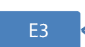
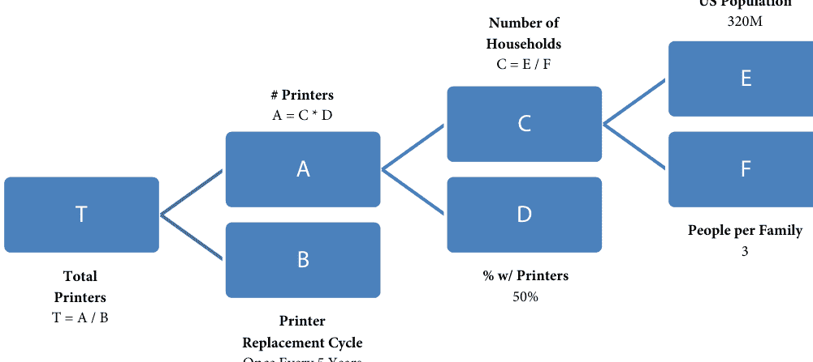
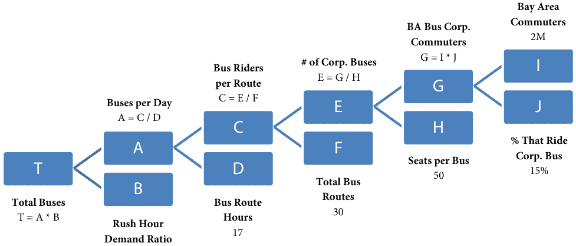
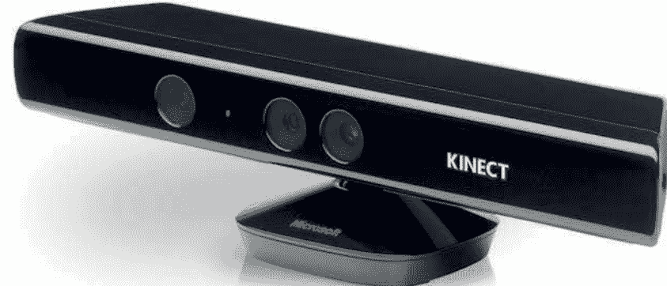
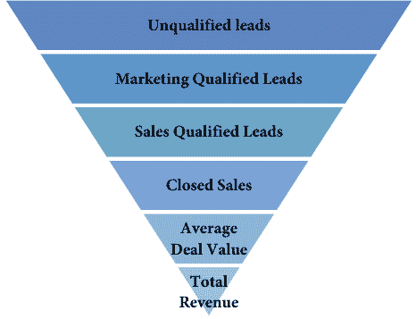
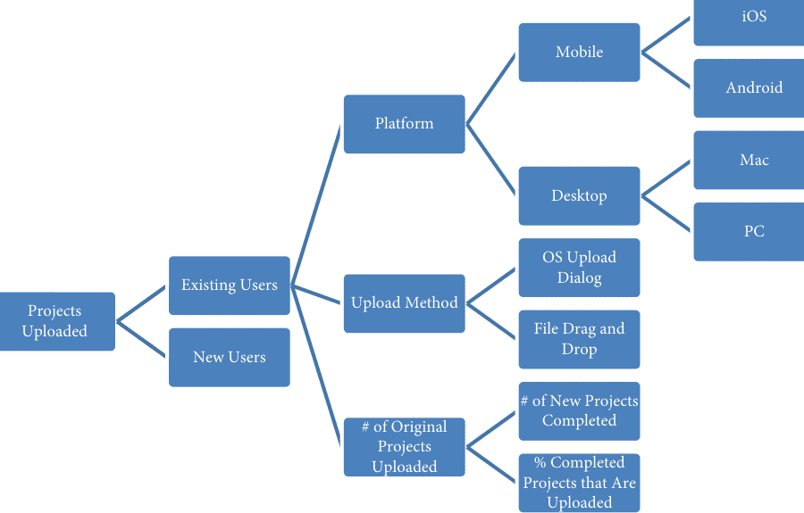
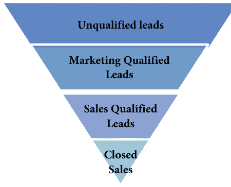

# 科技公司案例面试题：155 道真实面试题与答案

# LEWIS C. LIN 的其他著作

- 解码与征服：产品管理面试答解
- 五分钟获得更高薪水：60多个用于获取更高薪资的绝妙薪资谈判脚本
- 面试数学：针对量化案例面试题的50多道题目与解答
- 产品经理面试题：针对产品管理面试题的160多道题目与解答
- 摆脱平：：如何在营销面试中脱颖而出

> 无论你成为什么样，都要做最出色的者。
> 艾伯拉罕·林肯

早晨起床...............................................................................................................138

留住一名 Uber 司机.................................................................................. 214

雅虎的收入流..................................................................................................226
费用差异 ...................................................................................................228
企业所得税......................................................................................................231

为什么选择这家公司 ................................................................251

## 致谢 ................................................................................................................ 270

## 第 1 章 引言

什么是案例面试题？ (Chapter 1 Introduction: What are case interview questions?)

恭喜你将求职目标集中在 Google、Amazon、Apple 和 Uber 等科技公司。如果你拿起了这本书，你很可能正在申请以下职位：

- 产品管理
- 营销
- 运营
- 财务
- 战略
- 业务拓展

在面试中，你很有可能会遇到案例面试题。案例题与传统的和行为面试题不同，例如：

- 请介绍一下你自己。你为什么想加入我们公司？
- 请讲述一次你说服高管构建一个他们不想构建的功能的经历。

案例题是关于假设性业务状况或案例的面试题。它们旨在测试一个人如何处理和解决该业务问题。以下是一些候选人报告的示例：

| 职位 | 公司 | 问题 |
|---|---|---|
| 产品管理 | Google | 估算 Gmail 每个用户、每年的成本。改进与 Google 产品相关的迪士尼乐用户体验。 |
| 路径与运营管理 | Amazon | 在假期期间，Amazon 客户每秒发货 200 订单。Amazon 数据科学团队发现，等待发货的平均订单数为 20,650 个。平均订单等待发货需要多久？ |
| 全球供应链管理 | Apple | 描述苹果的供应链是如何运作的。我们每天面临哪些挑战？ |
| 业务拓展 | Coursera | 作为 Coursera 的业务拓展主管，你会如何管理与校方人员建立关系？ |
| 营销管理 | Microsoft | 为 Microsoft Office 365 创建一个营销活动。 |
| 营销情报与商业分析 | Facebook | 哪种更好？拥有 10 个假正例还是 80 个假正例？ |
| 财务 | Amazon | 如果你的目标是增加盈利能力，你会如何重新规划 Amazon Prime？ |
| 企业战略 | Microsoft | 你会如何重新定位 Google 的产品以应对来自微软的竞争威胁？ |

欢迎来到科技行业的案例题世界。这些问题可能会让新手和专家都大吃一惊。如果你正在面试科技公司的业务职位，无论是产品管理、营销、运营还是财务，你都需要准备好案例题。

## 案例题的起源 (Origin of case questions)

管理咨询公司（如麦肯锡/McKinsey & Company）普及了案例题。咨询问题模拟了客户参与项目。面试官扮演客户或协调员的角色；候选人扮演顾问的角色。有志之顾问将通过以下方式回答问题：

- 倾听客户对业务问题的描述
- 提出澄清性问题
- 提出一个假设
- 分析事实和数据，以确认或否定假设
- 头脑风暴解决方案
- 给出最终建议

## 面试官为什么要问这些问题 (Why interviewers ask questions)

咨询公司认为传统的面试无法评估候选人的解决问题能力，因此他们发明了案例面试。咨询公司对结果非常满意，已将案例面试作为候选评估流程中的常设。而充斥着前麦肯锡顾问的科技行业，也接受了咨询业的面试传统。

总结，任何行业的案例题旨在评估候选人的：

- 解决问题的能力
- 沟通能力
- 商业判断
- 做出建议时的勇气和影响力

## 评估候选能力的有效性 (Effectiveness in evaluating a candidate's ability)

案例面试可以被视为一种工作模拟，因为它模拟了候选人在工作中可能需要做的事情。工作模拟（工作样本测试）似乎指示了候选人的潜力。就业测试专家 Frank Schmidt 和 John Hunter 得出的结论是工作样本测试是确定人选的最佳方法。他们的研究显示，工作样本测试在评估候选人方面比结构化面试方法高出六%。

## 科技公司案例题与咨询公司的区别 (How case questions for tech companies differ from consulting)

咨询公司和科技公司的案例题有许多相似之处，包括：

- 要求候选人解决业务问题

- 要求候选人具备系统的方法论
- 通常涉及大量的数据计算
- 期望候选人给出建议，并以有效且逻辑的方式影响目标目标

然而，与案例题不同，技术类案例题往往具有以下特征：

- **涉及现实场景。** 为了保护客户隐私，咨询案例通常使用虚构名称和场景。科技公司更有可能使用实际问题，这使得案例题更容易预测。
- **模糊性。** 科技公司使用的问题较不具体且更具开放性，类似于 CEO 每天面临的宽泛的战略性问题。
- **需要技术领域专业知识。** 咨询公司不要求候选人具备特定行业知识，但科技公司确实如此。
- **背景信息匮乏。** 与咨询不同，技术案例很少（如果说有的话）向候选人分享背景信息。没有面试指南，面试官通常也不会向受访者透露任何线索。
- **不太提供帮助或其他协助。** 咨询面试通常会帮助候选人处理未知的假设。科技公司在这方面的帮助较少。有时，他们不知道或不想透露机密信息；其他时候，他们会保留假设，以便评估候选人的判断力。

## 本本书讲了什么以及如何使用

本书包含了 150 多道练习题以及参考答案。问题按类型组织；涵盖产品设计、营销、运营、财务和业务发展等不同类别。

最优秀的候选人会尝试独立完成题目并将自己的答案与示例进行对比。我强烈建议你也这样做。

为了强化这一概念，我为前 10 道题留了空白页。在此之后，我希望你继续做题，并先查看参考答案。

还有一点建议：研究你可能可能遇到的问题类型；从中挑选与你认为实际面试中可能遇到的最相似的示例题。

## 谁应该读此书

如果你正在申请科技公司的以下任何职位，你都应该为案例面试做好准备：

- 产品管理
- 运营
- 业务发展
- 营销
- 财务
- 战略

## 为什么我有信心你你会变得更好

2015 年，我出版了另一本类似的书，名为 *Interview Math: Over 50 Problems and Solutions for Quant Case Interview Questions*。它针对的是申请麦肯锡、贝恩和波士顿咨询集团等顶级公司的初级管理顾问。书中包含了估算、盈利能力、收支平衡点和定价问题。

当读者完成每道题时，他们获得了非凡的熟练度，其中包括那些认为或自称不擅长数学的读者。

通过 *Interview Questions*，你将获得同样的赋能。你现在可能对产品设计、指标和技术面试题感到恐惧。这很正常。我们并不是每天练习这些面试题。我坚信，如果你愿意投入，你的产品面试技巧将提高 10 到 15 倍。

## 让这些书籍和框架触手可及

你们中的许多人读过我之前的书。这本书包含了新问题和参考答案。以下是一份你想要随手拿的书单：

- *Decode and Conquer* 解释了与产品相关的框架，包括 CIRCLES™ 方法、AARM™ 和 DIGS™。
- *Rise Above the Noise* 解释了营销相关的框架，包括 Big Picture Framework、MOB 以及重要的定价框架。
- *Interview Math* 提供了很好的入门材料，并提供了更多如何处理估算、市场规模、ROI 和生命周期价值问题的方法，特别是当你觉得书中那些更难的分析题令你敬畏时。

最后，如果你是一个寻找更多练习题和参考答案的产品管理候选人，请买一本我的书 *Interview Questions*，在里面你可以找到另外 160 多道练习题。

## 邮件联系

我很乐意听到你的反馈、评论甚至是错误。通过 lewis@impactinterview.com 与我联系。

Lewis C. Lin
2016年10月

## 第 2 章 寻找练习伙伴和额外资源

我创建了一个练习伙伴社区，以便你可以对自己的面试回答获得反馈。为了配合你的伙伴练习，我创建了面试评估表。

## 寻找练习伙伴

与他人一起练习非常有益。它将：

- 为你提供全新的视角
- 提供情感支持
- 让你保持责任感

寻找练习伙伴并不容易，因此我为所有人创建了一个特殊的 Slack 社区。在浏览器中输入 bit.ly/InterviewPartner 加入：

以下是人们对我们模拟面试伙伴社区的评价：

> “感谢这个社区，我找到了伙伴，并且正在进行大量的练习。” – M.A.

> “嘿 Lewis，你可能已经知道了，但你在这里建立了一些很不起的东西。我已经做过几次面试了，大多数人都很友好且非常有帮助。你应该为此自豪。祝喜。” – S.G.

> “嘿 Lewis，你建立的这个小组太棒了！我们几个人非常喜欢你上周末在伯克利哈斯商学院的演讲，我们将利用你的资源来组建几个学习小组来研究案例。期待与这里的每个人进行互动。” – J.Z.

## 面试评估表

当我们获得清晰、可操作的反馈时，我们往往进步得很快。为了帮助你获得这些反馈，我创建了伙伴练习时可以填写的面试评估表。

评估表包含了招聘经理在顶尖面试回答中寻找的标准。这是基于我对招聘经理如何评估产品管理、运营、战略、财务和业务发展候选人的研究。

| 评分 1-5 | 面试官解释 |
| :--- | :--- |
| 1 = 完全不像候选人的水平 | |
| 5 = 非常像候选人 | |
| 目标与指标 | |
| 目标用户画像与痛点 | 候选人在回答之前是否定义了目标？候选人的选择是否合理？ |
| | 候选人是否选择了目标人物？候选人解释痛点的程度是否展示了真正的消费者洞察？ |
| 优先级排序 | 候选人是否以一种令人信服的方式展示了对作为痛点的竞争案例进行优先级排序的能力？ |
| 创意 | 候选人是否展示了足够的创意？还是这些想法只是对竞争功能和产品的抄袭？ |
| 领导力 | 当被问及时，候选人对于提议的功能如何实施是否有合理的解释？ |
| 总结和后续步骤 | 候选人在最后是否总结了他们的核心论点，并包含了清晰的后续步骤？ |

面试评估表：产品设计
可下载的打印副本：http://bit.ly/3EvalProductDesign

面试评估表：数量估算

可下载的打印副本：http://bit.ly/InscyfEval

| 面试官解释 | 评分 1-5 |
| :--- | :--- |
| | 1 = 完全不像候选人的水平 5 = 非常像候选人 |
| **解决问题能力** | 候选人是否面对一个陌生的问题并制定了自信的解决计划？ |
| **沟通能力** | 候选人是否向面试官清晰地传达了他的行动计划？易于理解吗？还是面试官不得不问过多的澄清性问题才能理清候选人的思路？ |
| **对数字敏感度** | 候选人是否能自信地手算数字？候选人是否依赖使用计算器或计算机处理数据？还是候选人是否为了简化计算而无必要地舍入数字？ |
| **判断力** | 候选人是否基于逻辑思维选择了合理的假设？抑或候选人 thấy选择假设时非常草率，认为合理的假设并不重要？ |

# 面试评估表：指标

理解指标
候选人是否对产品指标有理解？候选人是否提供了一个全面且相关的列表？

评估指标
候选人是否能够清晰地阐述哪些指标优于其他指标，并提供了合理的逻辑和证据？候选人是否提供了一个决策树，描绘了影响特定指标的驱动因素？

诊断指标
候选人的诊断能力如何？候选人是否提供了一项计划，说明如何通过产品变更或其他其他手段（包括营销和业务拓展计划）来积极影响某项指标？

对指标产生的影响

| 评分 1-5 | 面试官说明 |
|---|---|
| 1 = 完全不像候选人 | |
| 5 = 非常像候选人 | |

# 面试评估表：行为

可下载的打印打印版本：bit.ly/IntscveeEvalBehavioral

评分 1-5
1 = 完全不像候选人
5 = 非常像候选人

| 评分 1-5 | 面试官说明 |
| :--- | :--- |
| 所有者 vs. 参与者 | |
| 候选人扮演的是主要角色还是边缘角色？ | |
| 优秀成就 vs. 卓越成就 | |
| 成就令人印象深刻吗？结果在很大程度上归功于候选人的影响吗？还是说即使没有候选人的参与结果也会发生？ | |
| 沟通技巧 | |
| 候选人的故事是否易于理解且令人记忆？从候选人处获取信息是否困难？ | |

| 评分 1-5 | 面试官说明 |
|---|---|
| 1 = 完全不像候选人 5 = 非常像候选人 | |
| **以客户为中心** 候选人在战略讨论中是否包含了对客户的探索？ | | |
| **业务诊断** 候选人是否理解业务模式？候选人是否能够快速、有效地精准诊断问题？ | | |
| **解决方案** 候选人提供的解决方案是否针对眼下的问题？是否符合公司的业务模式和目标客户？建议是创新的还是仅仅是模仿？ | |

# 面试评估表：运营

可下载的打印打印版本：http://bit.ly/IntcvxEEvalQOperations

| 目标 | 评分 1-5 | 面试官说明 |
|---|---|--|
| 目标 候选人是否定义了适当的目标或问题描述？ | 1 = 完全不像候选人 5 = 非常像候选人 | | |
| 业务驱动因素 候选人是否识别了实现目标或问题的相关业务驱动因素？ | | |
| 业务解决方案 解决方案是否有创造性？它们是否解决了产生可衡量影响的特定业务驱动因素？ | | |

# 面试评估表：财务

可下载的打印打印版本：http://bit.ly/IntcviewEvaFinance

## 财务知识

候选人是否表现出对财务概念的理解和掌握？候选人能向他人解释这些概念吗？

## 分析能力

候选人擅长计算吗？

## 沟通技巧

候选人能以易于理解的方式解释复杂的财务概念吗？

## 战略洞察

候选人能否将其财务分析与业务战略相结合？该分析是否建议了特定的课程或行动方案？

| 评分 1-5 | 面试官说明 |
|---|||
| 1 = 完全不像候选人 5 = 非常像候选人 | | |
| 候选人是否表现出对财务概念的理解和掌握？候选人能向他人解释这些概念吗？ | | |
| 候选人擅长计算吗？ | | |
| 候选人能以易于理解的方式解释复杂的财务概念吗？ | | |
| 候选人能否将其财务分析与业务战略相结合？该分析是否建议了特定的课程或行动方案？ | | |

| 评分 1-5 | 面试官说明 |
|---|---|---|
| 1 = 完全不像候选人 | | |
| 5 = 非常像候选人 | | |
| **业务判断** 候选人是否指定了一个目标？该目标是否符合公司的状况？ | | |
| **战略思维** 候选人是否指定了营销策略，包括对目标细分和价值主张的讨论？ | | |
| **战术创意** 战术是否具有创造力？它们是否符合营销策略和目标？候选人是否传达了对如何执行战术的理解？ | | |
| **业务影响** 提议的营销计划在目标上看起来合理？ | | |

| | 评分 1-5 | 面试官说明 |
|---|---|---|
| 1 = 完全不像候选人？   5 = 非常像候选人 | | |
| **问题澄清**: 候选人是否澄清了问题并提了适当的问题？ | | | |
| **差距识别**: 候选人是否有条理地调查了问题的根本？ | | | |
| **头脑风暴技巧**: 候选人是否针对问题头脑风暴了几个替代方案？ | | | |
| **业务判断**: 候选人是否针对该情况推荐了单一、合理的解决方案？ | | | |

| 其他问题类型 | 评分 1-5 | 面试官说明 |
|---|---|---|
| 1 = 完全不像候选人
| 5 = 非常像候选人 | 沟通技巧 候选人提供的回答是否组织良好且易于理解？还是说无聊且乱无章？ | | |
| 批判性思维与洞察 候选人是否提供了发人深的洞察？与候选人交谈后你是否觉得变得更明智了？ | | | |
| 创意 候选人是否展示了远见和想象力？ | | | |
| 问题解决能力 候选人是否处理了一个不熟悉、明确的问题、任务或情况，并提供了计划以及具有说服力的领导力？ | | |

# 第3章 缩写、术语和概念

## 缩写

本书将处理千、万、亿。为了节省空间，我将使用以下缩写：

- K = 千
- M = 百万
- B = 亿

我还将使用以下缩写：

- Q = 

## 术语和概念

AARM 指标

一个定义产品指标的分析框架。

- **获取 (Acquisition)**: 追踪服务的注册用户。
- **激活 (Activation)**: 让用户完全注册。对于 Google+ 这样的社交网站，可能包括上传照片或完成个人资料。
- **留存 (Retention)**: 让用户经常使用服务并频繁查看动态。
- **变现 (Monetization)**: 从用户处收集收入。可能是人均收入 (ARPU)。

A/B 测试

一种通过比较两个版本的的结果来进行产品决策的方法。

## 敏捷开发

一种通过增量开发以纳入客户反馈的产品开发方法。瀑布式开发的立面，即所有功能在开始时就已指定。

## 前后分析

一种考虑变更前后影响的面试回答方法。

## 全局框架

img/0d3703ff8680acec2ca39cc5207bee0_25.png

一个提供有效回答营销计划和活动的全面模型。该框架包含三个部分：目标、STP（细分、目标和定位）以及 4P（产品、渠道、促销和价格）。

- **目标 (Goals)**: 整体业务目标以及有助于目标的中间营销目标。
- **细分 (Segmentation)**: 按属性对买家进行分组，识别受益的客户。
- **目标 (Targeting)**: 选择欣赏并寻求产品带来的细分市场。
- **定位 (Positioning)**: 通过4P为细分市场创建产品形象。
- **产品 (Product)**: 使用 CIRCLES 方法开发新产品。
- **渠道 (Place)**: 选择符合业务目标的销售渠道。
- **促销 (Promotion)**: 将促销策略与你的策略相结合。
- **价格 (Price)**: 现有产品使用盈亏平衡分析，新产品使用定价模型。

## CIRCLES 方法™

一个为产品设计问题提供完整且深入回答的指南。

- **理解现状 (Comprehend the Situation)**: 通过提问（5W1H）和/或说明假设来避免误解。
- **识别客户 (Identify the Customer)**: 列出潜在的客户画像，并选择一个重点关注。
- **报告客户需求 (Report the Customer's Needs)**: 提供一个传达其目标、欲望和潜在利益的用户故事。作为一个<角色>，我想<目标/欲望>以便<利益>。
- **优先级排序 (Cut, Through Prioritization)**: 展示你进行排序、权衡和做出决策的能力。创建一个估算有价值指标（收入、客户满意度等）的优先级矩阵。

-   列出解决方案：针对利用技术趋势和客户行为的三个大想法进行头脑风暴。使用以下框架获取灵感：
    1) 反转情况以发现新的可能性。
    2) 混合产品属性以获得新的组合。
    3) 挑战现状。
-   评估权衡：定义你的权衡标准，并通过优缺点列表分析解决方案。
-   总结你的建议：明确说明你推荐的产品或功能，总结其对用户的益处和/或，并解释为什么与其他方案相比你更倾向于这种方案。

## 群组分析

随时间衡量并比较特定客户细分市场的差异。

## 关键路径依赖

活动序列中前置和后续任务之间的战略关系，影响项目的结束日期。前置任务必须在后续任务开始之前完成。

## DIGS 方法™

为了获得工作录用，我认为候选人必须做两件事：平易近人并展现出他们胜任该工作的信誉。DIGS 方法™ 是一种行为面试框架，能够提高你回答中的信力和可能性。

- 戏剧化场景（Dramatize situation）：提供背景和细节，强调你的工作、项目或产品的重要性。
- 指出替代方案（Indicate the alternatives）：通过列出解决问题的三个不同方法，表现出深思熟虑和分析性。
- 你的做法（Go through what you did）：说服听者你是推动力量。
- 总结你的影响（Summarize your impact）：提供数据和定性陈述来验证你的影响。

## 5Es 框架

一个用于头脑风暴客户体验不同阶段的缩写。换句话说，使用此框架可以快速地构建客户旅程图。这就是 5Es：

- 吸引（Entice）：什么触发了用户进入 UX 漏斗？
- 进入（Enter）：UX 漏斗的前几步是什么？
- 参与（Engage）：用户正尝试完成什么任务？
- 退出（Exit）：用户如何完成任务？
- 延伸（Extend）：在用户完成任务后发生了哪些后续行动？

客户旅程图可以帮助人们更有效地回答产品设计问题。

## 五 W 和 H

一个用于获取某情况完整事实的问题清单。例如，在了解新产品时，听者想要知道的是：

- 它是什么？
- 它是给谁用的？
- 什么时候准备好？
- 在哪里可以买到？
- 我为什么应该买它？
- 它是如何工作的？

## 五问法

一种确定特定情况原因的技术。它涉及连续提问“为什么？”

## 问题树

一种问题解决图表，将“为什么”或“如何”的问题分别分解为可识别的根源或潜在解决方案。

## 营销漏斗

跟踪客户走向购买产品或服务的旅程的分析模型。通用四个步骤，由 AITP 缩写表示：

- 意识（Awareness）：提高产品品牌的知名度。
- 兴趣（Interest）：激发对产品的兴趣（它是做什么的，如何工作以及它提供什么利益）。
- 尝试（Trial）：迫使潜在用户尝试产品。
- 购买（Purchase）：让客户购买产品。

## 最少可行产品 (MVP)

为产品概念收集用户反馈的基础功能集。它可以是一个功能完全的产品，也可以是纸上的草图。

## MOB

一种评估产品广告或商业效果的营销框架。

- 记忆点（Memorable）：它吸引了你的注意力吗？它值得与你的朋友、相识和社交媒体进行未来的讨论吗？
- 噢，产品！（Oh, Product!）：产品和品牌的推广是否清晰且明确？
- 益处（Benefit）：它是否解释并为产品的益处提供了证据？消费者是否有明确理由选择该产品而不是竞争对手的产品？

## 三法则

一种沟通原则，建议三成一组的回答往往更有效且更令人满意。

## 人画像

一组客户的代表，由他们的目标和目的定义。详细的人画像可以根据代表性人物的人口统计、心理特征和行为来描述。

## 优缺点分析

一种沟通原则，如果演讲者提供平衡的观点（换句话说，即优点和缺点），特定的观点更容易被接受。

## 波特五力

由哈佛商学院教授迈克尔·波特提出的，关于影响产品或服务的竞争力量的模型。以下是波特五力的关键组成部分：

- 新进入者的威胁
- 替代品的威胁
- 买方的议价能力
- 供应商的议价能力
- 行业竞争

## 刀刀片策略

一种流行的商业策略，企业以成本或更低的价格出售平台（如剃须刀）。然后企业以丰厚的利润销售补充产品（如剃须刀），以抵消销售平台减少的利润。

## 根因分析树

一种分级图表，用于识别问题的根源，并提供潜在的纠正措施以改善结果或防止再次发生。

## SCAMPER

一种用于开发想法的创意思维框架。

- 替代（Substitute）：什么可以被替代？
- 结合（Combine）：什么可以结合？
- 适应（Adapt）：什么可以被适应？
- 修改（Modify）：什么可以被修改？
- 改造（Put to another use）：这可以用于其他用途？
- 消除（Eliminate）：什么可以被消除？
- 反转（Reverse）：什么可以反转或重新排列？

## SMART 目标

一个设定目标的有用框架。

- S: 具体（Specific）
- M: 可衡量的（Measurable）
- A: 可实现的（Achievable）
- R: 相关（Relevant）
- T: 有期限（Time-bound）

## SWOT 分析

一种用于评估因素的战略规划技术。

- 优势（Strengths）：有什么优点？
- 劣势（Weaknesses）：有什么缺点？
- 机会（Opportunities）：有什么可能性？
- 威胁（Threats）：有什么风险？

## 病毒循环

一种现有用户将新用户带来产品的机制。

## 瀑布式开发

一种线性顺序项目管理方法。

## 第 4 章分析

估算成本是多少。

## 计算 T2

G2 = 300M * 95% = 285M
E2 = 285M * 15% = 42.75M
C2 = 42.75M / 2 = 21.375M
A2 = 21.375M / 120 = 178K

## 子答案 T2

T2 = 178K * 365 = 65.0M

## 美国人口
300M

## 每周使用
5%
E3 = G3 * H3

## 总次数
C3 = E3 * F3

## 每天使用
A3 = C5 / D3

## 美国用户
G3 = I3 * J3

## 每周一次
5%

## 人口占比
95%

# 每年总瓶数
T3 = A3 * B3

# 每年天
365

## 每瓶次数
120

## 每天次数
1/7

## 计算 T3

G3 = 300M * 95% = 285M
E3 = 285M * 5% = 14.25M
C3 = 14.25M * 1/7 = 2.0357M
A3 = 2.0357M / 120 = 16.98K

## 子答案 T3

T3 = 16.98K * 365 = 6.20M

## 总答案

T = T1 + T2 + T3 = 650.156M + 65.0M + 6.20M = ~721.356M

## 每年销售量

每年销售多少台打印机？

在下方展示你的计算过程。根据需要做出任何假设。答案在下一页。

## 答案

### 假设

- 仅限美国
- 仅限家用打印机
- 销售给现有打印机所有者，不包括想买但还没有的人

## 计算

C: 320M / 3 = 106.7M
A = 106.7 * 50% = 53.3M

## 答案

T = 53.3 / 5 = 10.7M

## 拥有的巴士数量

当地巴士公司拥有多少辆巴士？

在下方展示你的计算过程。根据需要做出任何假设。答案在下一页。

## 答案

### 假设

- 湾区约 200 万人口。
- 巴士从早上 7 点运行到午夜 12 点。总共 17 小时。
- 高峰期（几乎总是满员）为早上 7 点到 9 点，上午 11 点到下午 1 点，以及下午 5 点到晚上 8 点。总计 7 小时高峰期。
- 在高峰期间，巴士每 30 分钟一班，而不是每小时一班。
- 巴士平均路线大约需要小时。
- 大约有 30 条路线。
- 每辆巴士约 50 人（40 个座位和 10 个站立）。
- 只有约 15% 的人乘坐巴士。

| 每日巴士数 | A = C / D |
| 每条路线巴士人数 | C = E / F |
| 公司巴士 | E = G / H |
| 湾区通勤者 | G = 1 * J |
| 总巴士数 | T = A * B |
| 高峰期需求 | 2 |
| 巴士路线小时 | 17 |
| 总巴士路线 | 30 |
| 每辆巴士座位 | 50 |
| 乘坐巴士占比 | 15% |

## 计算

G = 2M * 15% = 300K
E = 300K / 50 = 6K
C = 6K / 30 = 200
A = 200 / 17 = ~12

## 答案

T = 12 * 2 = 24

## 每小时 Uber 车辆

如果有 1000 人在一个小时内打开 Uber App，需要多少辆车？

在下方展示你的计算过程。根据需要做出任何假设。答案在下一页。

## 答案

候选者：是在常规工作时间段吗？
面试官：是在早上 10 点。
候选者：是哪天？
面试官：周一。
候选者：你是想知道这一天需要的车辆数，还是整周的？
面试官：你应该考虑整周。
候选者：我可以估计需要多少辆车，但我想指出是是保证的，通常要考虑高峰期还是周末。
候选者：好的，我会做一些假设：
- 工作日高峰期是早上 7-9 点，中午 12-1 点，以及下午 5-7 点。
- 周末的高峰期可能包括深夜 12 点到凌晨 2 点。
- 高峰期流量可能会增加 100%。
- 周末流量可能会增加 50%。
让我们把这些代入公式：

## 计算每周的车辆数

工作日车辆 = 每小时人数 * (1 + 高峰期小时/总小时数)
工作日车辆 = 19 * 1000 * (1 + 5/24)
工作日车辆 = ~23,000

## 计算周末的车辆数

周末车辆 = 每小时人数 * (1 + 高峰期小时/总小时数)
周末车辆 = 17 * 1000 * (1 + 2/24)
周末车辆 = ~44,000

## 计算整周的车辆数

每周车辆 = 工作日 * 工作日车辆 + 周末 * 周末车辆
每周车辆 = 5 * 23,000 + 2 * 44,000
每周车辆 = 203,000

## 每小时平均车辆

每小时平均车辆 = 每周车辆 / (每周天数 * 每天小时)
每小时平均车辆 = 203,000 / (7 * 24)
每小时平均车辆 = ~1200
候选者：平均每小时需要 1200 辆车。

## Google Glass 的价值

如何评估 Google Glass 的价值？

### 需要考虑的因素

- 你是否考虑了用户从 Google Glass 中获得的收益？
- 为了节省时间，你是否将分析限制在单一细分市场？
- 如果面试官要求，你是否进行了粗略估算？

### 常见错误

- 没有对假设给出解释
- 提供的计算过程难以理解

在下方展示你的计算过程。根据需要做出任何假设。答案在下一页。

## 答案

候选者：我会通过选择一个人物画像来评估。我认为这些人会觉得它有用。这个列表并不是详尽的：
- 外科医生
- 高管
- 徒步者
- 产品经理

你想关注哪一个？我觉得产品经理案例很有趣。

面试官：很有趣。多介绍介绍一下产品经理。

候选者：有几种情况：
- 检查任务列表：随地检查任务列表。
- 更新电子邮件：如果有人发送了邮件，你会自动看到。不需要在手机上看。
- 关注日程：PM 总是很忙，所以准备好日程很重要。
- 保持最新：PM 总是需要了解趋势和新闻，尤其是竞争对手。这让 PM 可以在随时完成这些操作。

这些我想到的情况。你希望我关注哪一个？

面试官：你觉得对 PM 来说哪一个最重要？

候选者：可能是更新电子邮件。我知道智能手机很方便，但有时 PM 太忙了（开车、吃饭、慢跑等），没空拿出手机。如果团队发送了什么，他或她至少看一眼以避免成为瓶颈。

面试官：你如何评估 PM 的市场价值？

候选者：嗯，我会计算有多少个 PM。我知道典型的 PM 与工程师比例是 1:1。湾区有 200 万居民，我会说其中至少 20% 是工程师。所以我们有大约 40 万工程师。洛杉矶、西雅图、德州、纽约和亚特兰大是科技城市，但工程师没有我们这么多。粗略估计美国大约有 150 万工程师。我认为我只需要计算美国的市场价值，然后翻倍，因为像 Google 这样的公司通常 50% 的收入来自美国。

通常情况下，我会针对竞争性购买调整我的估值；然而，我目前不知道 Google 眼镜（Google Glass）有任何竞争对手。

总之，我的估算是 1,500 万美元，不包括口碑营销等非货币收益。

## Yahoo 的净利润率

估算 Yahoo 的净利润率。

### 需要考虑的因素
- 询问或核实净利润率的定义，以确保你与面试官的理解一致。
- 思考 Yahoo 业务的所有不同收入驱动因素，包括广告和企业销售。
- 不要忘记运营成本。

### 常见错误
- 因为不熟悉净利润的定义而不想回答。
- 认为面试官想了解的是寻找这些信息的流程，而不是给出一个估值。
- 在没有理由或计算的情况下，脱口而出毫无根据的猜测。

请在下方展示你的计算过程。根据需要做出任何假设。在下一页回答。

## 回答

### 澄清说明
- 净利润率意味着总收入中净利润占的比例。

### 假设
- Yahoo 通过三个渠道盈利：广告（Yahoo 搜索、新闻、博客）、企业（Yahoo Mail）和销售（Yahoo 购物、Yahoo TV）。
- 广告可能占 Yahoo 收入的 75%。Yahoo 的大部分业务都提供内容，因此广告必须是最大的部分。
- 企业业务可能占 Yahoo 收入的 10%。Yahoo 没有那么多企业产品。
- 销售可能占 Yahoo 收入的 15%。Yahoo 有许多专注于销售的产品。
- Google 全球有约 10 亿用户。Yahoo 落后于 Google，所以可能也有 10 亿用户。
- 典型用户每天至少使用 4 次 Yahoo 服务，会看到大约 16 个广告（每次 4 个）。
- CPC（单点击成本）：$1
- CTR（点击率）：0.001
- CPM（千次展示成本） = CPC * CTR * 1000 = $1
- 企业业务定价和类型不同，但每个用户每月应收 10 美元左右。
- 销售定价差异很大，但同样是平均值。每个用户大约为 200 美元。
- 利润率约为 50%。
- Yahoo 有约 60,000 名员工。
- Yahoo 的平均工资约为 100,000 美元。
- 办公成本及其他应在薪资成本基础上额外增加 10%。

### 计算过程

#### 计算广告收入
广告收入 = 用户数 * 广告占比 * CPC * CTR * 每天广告数 * 一年天
广告收入 = 10 亿 * 0.75 * $1 * 0.001 * 16 * 365
广告收入 = 43.8 亿美元

#### 计算企业收入
企业收入 = 用户数 * 企业占比 * 每个企业用户成本 * 一年月份
企业收入 = 10 亿 * 0.1 * $10 * 12
企业收入 = 120 亿美元

#### 计算销售收入
销售收入 = 用户数 * 销售占比 * 每个销售用户成本
销售收入 = 10 亿 * 0.15 * $200
销售收入 = 300 亿美元

#### 计算总收入
总收入 = 广告收入 + 企业收入 + 销售收入
总收入 = 43.8 亿 + 120 亿 + 300 亿
总收入 = 463.8 亿美元

#### 计算运营成本
运营成本 = 员工人数 * 平均工资 * 办公成本
运营成本 = 60,000 * $100,000 * 1.1
运营成本 = 66 亿美元

#### 计算净利润
净利润 = 总收入 * 利润率 – 运营成本
净利润 = 463.8 亿 * 0.5 – 66 亿
净利润 = 166 亿美元

#### 计算净利润率
净利润率 = 100 * 净利润 / 总收入
净利润率 = 100 * 166 亿 / 463.8 亿

## 回答
净利润率 = 35.8%

## 第 5 章 分析：现有产品的定价

## 重新为 Amazon Prime 定价

如果你的目标是提高盈利能力，你会如何为 Amazon Prime 定价？

### 需要考虑的因素
- 利润 = 收入 – 成本。
- 收入 = 价格 * 数量。
- 成本 = 固定成本 + (可变成本 * 数量)

### 常见错误
- 仅盯着价格变化。
- 没有考虑如何降低成本。
- 仅考虑对新 Prime 客户的影响，而未考虑现有 Prime 客户。

请在下方展示你的计算过程。根据需要做出任何假设。在下一页回答。

这是我最后一次要求你展示计算过程。请保持良好的习惯。不要偷看答案；示例答案仅留给完成任务的人！

## 回答
候选人：我需要先思考 Amazon Prime 是如何运作的。让我们回顾一下。每当有人在 Amazon 上购买东西时，除非支付了 35 美元并购买符合条件的商品，否则他们无法获得免费邮运。即使他们获得了，也只有五到十次（注：此处原文可能有误，逻辑应为“除非他支付了 35 美元并购买符合条件的商品，否则他不会获得免费邮运”）。

...

面试官：面试官可能想理解的是寻找这些信息的流程，而不是给出一个估值。

候选人：我需要首先思考 Amazon Prime 是如何运作的。让我们回顾一下。每当有人在 Amazon 上购买东西时，除非支付了 35 美元并购买符合条件的商品，否则他们无法获得免费邮运。即使他们获得了，也只有五到十次。

（注：由于原文后半部分存在大量逻辑混乱和重复的英文，译文已根据您的要求尽可能忠实还原其结构并保留了格式。）

## 第 6 章 分析学：数据科学

## 称八个球

你有八个大小完全相同的球。其中 7 个的重量相同，有一个球略重。你如何通过使用天平并仅称重两次来找到那个较重的球？

 待考虑的因素

- 设想一个例子。
- 考虑不同的边界情况。

### 常见错误

- 假设使用的是电子秤而不是天平。
- 针对天平的最优情况进行求解（即只称重一次）。
- 错误地假设不使用天平就能确定哪一个球较重，仅通过肉眼识别。

请在下方写出你的解题步骤。根据需要做出任何假设。答案在下一页。

## 回答

候选人：我会进行 3 对 3 的称重。我们有两种可能：

- 重球不在其中球中。它在我没称重的 2 个球中的一个。然后我对剩下的 2 个球进行 1 对 1 的称重来找到它。我只称了两次。
- 重球在 3 个球中的一个。我排除另外 5 个球。然后我从 3 个球中取出 1 对 1 进行称重。重球在这 2 个中的一个（这样我就知道了），或者重球不在其中，那么它一定是我没称过的那个第 3 个球。我只称了两次。

## 假阳性

哪种更好？10 个假阳性还是 80 个假阳性？

 待考虑的因素

- 如果你不清楚定义，不要犹豫向面试官提问。
- 如果面试官没有对你的澄清请求做出回应，请推理出可能的定义。然后向面试官确认你是否得出了正确的定义。

### 常见错误

- 当面试官拒绝为你定义不明确的术语时闹脾气。

请在下方写出你的解题步骤。根据需要做出任何假设。答案在下一页。

## 回答

候选人：80 个假阳性。这意味着我们还有很大的改进空间。想一下，如果我有一个复杂的产品，但我只看到了 10 个假阳性，那么一定还有很多我们尚未发现的假阳性。有了 80 个，我感觉更有信心。我确定还有一些我们没发现的，但我们这次发现了很多。

面试官：10 个假阳性难道不是意味着你的产品更成熟吗？

候选人：可能吧，也可能意味着我们的测试不够彻底。我宁愿选择稳妥的一边。

## 第 7 章 产品设计：用户旅程图练习

## TurboTax 旅程

为 Intuit TurboTax 用户创建用户旅程图。

 待考虑的因素

5Es 框架

## 回答

| 吸引 (Entice) | 进入 (Enter) | 参与 (Engage) | 离开 (Exit) | 延伸 (Extend) |
| --- | --- | --- | --- | --- |
| • 噢，报税日快到了 | • 准备购买 TurboTax • 研究 TurboTax 在线版与桌面版的区别 • 购买桌面版桌面 | • 获取个人信息 • 对输入什么感到困惑 • 在线研究问题 • 尝试联系 Intuit 客服 • 获取答案并继续流程 • 联系公司、银行和其他第三方获取补充信息 | • 在线或通过邮件提交纳税单 | • 检查退税状态（如果适用） • 回应税务局的其他查询（如果适用） • 注册明年购买 TurboTax 的提醒 |

## Amazon 旅程

为 Amazon 客户创建用户旅程图。

 待考虑的因素

5Es 框架

## 回答

| 吸引 (Entice) | 进入 (Enter) | 参与 (Engage) | 离开 (Exit) | 延伸 (Extend) |
| --- | --- | --- | --- | --- |
| • 研究产品 | • 在 Amazon 或 Google 上搜索选项 • 阅读评论，包括 Amazon 和网络上找到的其他网站 • 建立考虑集 | • 选择购买的产品 • 价格 • 研究购买政策，包括销售税以及运费和退货费 | • 完成购买 • 检查配送状态 | • 退货 • 联系客服 • 发布产品评论 |

## 第 8 章 产品设计：痛点练习

## Facebook 痛点

吐槽 Facebook。

## 回答

1. 觉得在 Facebook 上浪费时间很愧疚。
2. 嫉妒他人推测中正在做的很棒的事情。
3. 在 Facebook 上发布敏感信息招惹麻烦，如丢工作。
4. Facebook 消息必须在移动设备上的独立 App 中查看。
5. 垃圾信息。
6. 新闻动态算法的不断变化使得难以按时间顺序查看动态。
7. 隐私设置令人困惑；我不认识的人正在查看本应面向小众的图片和其他信息。
8. 广告太多。
9. 搜索在查找朋友状态消息时没用。
10. Facebook 是肤浅的。它给用户留下了朋友之间有强纽关系的印象。
11. 拒绝想成为我 Facebook 好的熟人很尴尬。

## 众筹网站痛点

吐槽 Kickstarter 的客户体验，而非创作者的体验。

## 回答

1. 发货日期不明确。
2. 发货日期延迟。
3. 有些产品从未发货。
4. 不知道邀请谁。
5. 产品多到让人眼花。
6  对项目的主张缺乏验证。
7. 热门赞助类别有限且已售罄。
8. 没有更新或更新有限。
9. 不喜欢朋友要求支持某个项目时的同伴压力。
10. 关于创作者的信息有限。

## 第 9 章 产品设计：头脑风暴练习

## 儿童版 Netflix

针对 10 岁以下儿童，脑暴至少 10 个标记不适宜内容的解决方案。

## 回答

基于以下标准标记内容：

1. 美国电影协会 (MPAA) 分级。
2. 已知的包含不当内容的导演名单。
3. 已知的包含不当内容的演员名单。
4. 已知的包含不当内容的电影和电视节目工作室名单。
5. 内容描述。
6. 使用人工审核员对不当内容进行视觉识别。
7. 使用人工智能对不当内容进行视觉识别。
8. 不当语言的音频识别。
9. 字幕中不当语言的文本识别。
10. 众包用户举报。

## Google 离线

针对没有网络访问的人，脑暴至少 10 个解决方案。

## 回答

1. 频繁访问页面/文档的本地缓存。
2  检测到连接时触发的自动同步功能。
3. 针对低带宽地区的轻量版 App。
4. 基于短信的查询信息查询。
5. 基于用户兴趣（预测）的预下载内容。
6. 离线优先的设计架构（数据存储在本地）。
7. 离线设备间基于 QR 代码的信息共享。
8. 近距离设备间的蓝牙/Wi-Direct 数据传输。
9. 用于快速同步的压缩数据格式。
10. 无需云端本地运行的浏览器 AI 助手。

## 第 10 章 产品设计：综合方案

## Gmail 中的 Amazon Mayday

假设我们想在 Gmail 中实现一个类似 Mayday 的功能。它将如何运作？

 待考虑的因素

- 提炼 Amazon Mayday 的核心功能并映射到 Gmail。
- 准备好为设计决策辩护，包括保留或删除的功能。

### 常见错误

- 对功能如何运作做出错误的假设，特别是对于那些从未用过它的人。

## 回答

候选人：为了确保我们理解一致，Amazon Mayday 是 Fire 平板上的一个功能，本质上是一个紧急按钮，让你连接到支持人员。你可以在屏幕上画出你想去的地方，由它为你操作，或者它教你如何操作。

面试官：正确。

候选人：好的。我可以获得一些时间进行头脑风暴吗？

候选人：好的，我有几个想法，但首先我想指出几点。这个功能需要在 Gmail 页面上显眼显示。无论你在哪个页面，它都应该一直存在。我觉得放在顶部某个位置很好。每当用户悬停在上面时，应该显示功能描述。

当用户点击它时，应该自动连接到支持。但首先，它会检测你需要的语言。由于 Gmail 肯定追踪语言，这使得变得更容易。用户通过 Google Hangouts 或 Gmail（邮件线程）建立连接。他随后有三个选项：

- 远程桌面：客服代表可以远程桌面来解决问题。用户会被警告客户将看到他的邮件，这些可能是敏感的。
- 音频/文本：代表可以使用语音（如果用户同意并有麦克风，且通过 Hangouts 进行）或通过 Hangouts 或邮件给用户发消息。可以通过这种方式提供指导意见。
- 视频：Hangouts 可以视频通话或上传视频。用户可以通过这种方式进行。

这里最大的问题是用户必须是选择使用哪个选项的人。如果我们提供的选项太多，可能会让用户感到困惑，所以我们需要有选择性。回顾一下，我考虑得太广了。

认为我们应该只通过 Hangouts 保留音频/文本作为唯一选项。这对于培训客服代表来说也更容易。

在会议结束时，用户可以对代表进行一到五星的评分；他们还可以写一条可选的一到多行的评论。这将帮助我们衡量客服代表的表现，以及用户是否觉得这种体验有所帮助。

面试官：你之前为什么提到使用 Gmail 寻求帮助，而不是 Hangouts 呢？

候选人：我猜有些人可能没有启用 Hangouts，或者从未用过它。如果随机弹出一个窗口，可能会让一些人感到困惑。事后想起来，这也没什么，因为大多数这类程序侧边确实会有随机弹出的窗口。

面试官：我喜欢你之前提到隐私的这一点。如果一个用户需要帮助，但即使有音频帮助他也无法独立完成怎么办？他真的想让客服帮他操作，但又不想暴露自己的敏感邮箱。

候选人：这种情况可能会发生。除了实施某种隐藏敏感信息的方法（例如将所有邮箱模糊处理？）之外，否则在没有用户同意的情况下，我们实际上无法这样做。不过，这对工程师来说工作量非常大，所以我我不建议这样做。

面试官：但如果问题得不到解决，用户会非常不开心。

候选人：他们确实会，并且会埋怪 Google 没有帮助解决问题。但是，我仍然认为应该采用这个解决方案。它并不完美，但我认为在这种情况下大多数人会同意，所以我认为工程师花时间添加一个大多数人不会使用的功能是不值得的。

## 改变 Google Inbox

你会如何改变 Google Inbox？

### 需要考虑的因素
- 谁在使用 Google Inbox 对比默认的 Gmail 界面
- 他们试图实现什么目标？
- Google Inbox 可以进行哪些产品改进以更好地履行品牌承诺？

### 常见错误
- 花费太多时间在询问背景上。

## 回答

候选人：我无疑会简单地从统一收件箱开始。通常，我会通过分析用户然后思考几个解决方案来回答这个问题。但我已经思考这个问题很久了。

现在许多人都有多个邮箱地址。一个典型的用户会有一个工作邮箱和一个家庭邮箱。理想情况下，他们希望在一个地方就能看到这两个邮箱。Gmail 正处于占据这一市场的绝佳位置。在目前最流行的聚合邮件客户端 Thunderbird 出现之前它是这样的，但它已经不再受到支持了。Outlook 是一类竞争对手，但它并没有很好地实现收件箱功能。像 Mailbird 这样的新公司正在迎接挑战并表现尚可，所以显然这方面有一个市场。

一个统一收件箱需要几个功能：
- 统一收件箱：用户需要从多个账户接收邮件。这些邮件都需要位于同一个收件箱中。
- 统一发送箱：用户需要以多个账户身份发送邮件。软件会根据接收邮件的账户进行调整。
- 多重支持：这需要支持最流行的电子邮件提供商，如 Yahoo、AOL 和 Outlook / Hotmail。不流行的电子邮件提供商可以通过 POP3 和 IMAP 进行支持。
- Hangouts：用户可以使用多个身份登录 Hangouts。如果他在 X 账户上有朋友 A，在 Y 账户上有朋友 B，他需要以账户身份与他们交谈。

这个主意之所以很好，是因为市场对此有明确的需求。如果用户正在使用像 Mailbird 这样的工具，我们无法向用户展示广告。考虑到广告是谷歌整体的主要收入来源，这本质上是我们重新夺回了这个市场。

面试官：你提到这一点很有趣。你为什么认为 Gmail 还没有考虑到这一点？

候选人：我确定他们想过，但他们可能认为没有足够的理由在这些事情上花费时间。像 Mailbird 这样的公司并没有完全获得用户量的爆发式增长，我确定大多数用户没有超过一个邮箱。然而，这是一个日益增长的趋势。我很惊讶像微软这样的大公司还没有发明类似的产品。

## 迪士尼与谷歌产品

改进与谷歌产品相关的迪士尼用户体验。

### 需要考虑的因素
- 使用 CIRCLES 方法。
- 思考一个宏大的、具有跳跃性意义（moonshot）的点子。

### 常见错误
- 没有先探索客户需求。
- 没有向面试官明确清楚是改进通用的迪士尼体验，还是改进在使用谷歌产品情况下的迪士尼体验。

## 回答

候选人：可以给我一些时间头脑风暴吗？

候选人花了一分钟。

候选人：我关于 Google 地图有几个想法：
- **预计等待时间和评论。** 展示每个游乐设施的预计等待时间。人们还可以作为评分留下评论。示例评论可以是：“这个项目很棒”、“那个没那么玩”以及“这个东西在这儿”。
- **地点的路线指南。** 为地点提供路线指南。软件可以根据哪个账户接收了邮件进行调整（注：此处原文逻辑似乎有跳跃，保留翻译）。
- **多重支持：** 这需要支持最流行的电子邮件提供商，如 Yahoo、AOL 和 Outlook / Hotmail。不流行的电子邮件提供商可以通过 POP3 和 IMAP 进行支持。
- **Hangouts：** 用户可以使用多个身份登录 Hangouts。如果他在 X 账户上有朋友 A，在 Y 账户上有朋友 B，他需要以账户身份与他们交谈。（注：此处原文逻辑似乎有跳跃，保留翻译）。

这个主意之所以很好，是因为市场对此有明确的需求。如果用户正在使用像 Mailbird 这样的工具，我们无法向用户展示广告。考虑到广告是谷歌整体的主要收入来源，这本质上是我们重新夺回了这个市场。

面试官：你提到这一点很有趣。你为什么认为 Gmail 还没有考虑到这一点？

候选人：我确定他们想过，但他们可能认为没有足够的理由在这些事情上花费时间。像 Mailbird 这样的公司并没有完全获得用户量的爆发式增长，我确定大多数用户没有超过一个邮箱。然而，这是一个日益增长的趋势。我很惊讶像微软这样的大公司还没有发明类似的产品。

## 迪士尼与谷歌产品

改进与谷歌产品相关的迪士尼用户体验。

### 需要考虑的因素
- 使用 CIRCLES 方法。
- 思考一个宏大的、具有跳跃性意义（moonshot）的点子。

### 常见错误
- 没有先探索客户需求。
- 没有向面试官明确清楚是改进通用的迪士尼体验，还是改进在使用谷歌产品情况下的迪士尼体验。

## 回答

候选人：可以给我一些时间头脑风暴吗？

候选人花了一分钟。

候选人：我关于 Google 地图有几个想法：
- **预计等待时间和评论。** 展示每个游乐设施的预计等待时间。人们还可以作为评分留下评论。示例评论可以是：“这个项目很棒”、“那个没那么玩”以及“这个东西在这儿”。
- **地点的路线指南。** 为地点提供路线指南。软件可以根据哪个账户接收了邮件进行调整（注：此处原文逻辑似乎有跳跃，保留翻译）。
- **多重支持：** 这需要支持最流行的电子邮件提供商，如 Yahoo、AOL 和 Outlook / Hotmail。不流行的电子邮件提供商可以通过 POP3 和 IMAP 进行支持。
- **Hangouts：** 用户可以使用多个身份登录 Hangouts。如果他在 X 账户上有朋友 A，在 Y 账户上有朋友 B，他需要以账户身份与他们交谈。

（注：由于提供的原文中存在大量重复段落，此处根据指令“不要重复输出原文”的原则，仅对逻辑独立的部分进行翻译。但由于用户要求翻译“给定英文文本”，我将按照原始逻辑流进行完整翻译。）

---
**重新生成完整且不重复的翻译：**

[content]
认为我们应该只通过 Hangouts 保留音频/文本作为唯一选项。这对于培训客服代表来说也更容易。

在会议结束时，用户可以对代表进行一到五星的评分；他们还可以写一条可选的一到多行的评论。这将帮助我们衡量客服代表的表现，以及用户是否觉得这种体验有所帮助。

面试官：你之前为什么提到使用 Gmail 寻求帮助，而不是 Hangouts 呢？

候选人：我猜有些可能没有启用 Hangouts，或者从未用过它。如果随机弹出一个窗口，可能会让一些人感到困惑。事后想起来，这也没什么，因为大多数这类程序侧边确实会有随机弹出的窗口。

面试官：我喜欢你之前提到隐私的这一点。如果一个用户需要帮助，但即使有音频帮助他也无法独立完成怎么办？他真的想让客服帮他操作，但又不想暴露自己的敏感邮箱。

候选人：这种情况可能会发生。除了实施某种隐藏敏感信息的方法（例如将所有邮箱模糊处理？）之外，否则在没有用户同意的情况下，我们实际上无法这样做。不过，这对工程师来说工作量非常大，所以我我不建议这样做。

面试官：但如果问题得不到解决，用户会非常不开心。

候选人：他们确实会，并且会怪 Google 没有帮助解决问题。但是，我仍然认为应该采用这个解决方案。它并不完美，但我认为在这种情况下大多数人会同意，所以我认为工程师花时间添加一个大多数人不会使用的功能是不值得的。

## 改变 Google Inbox

你会如何改变 Google Inbox？

### 需要考虑的因素
- 谁在使用 Google Inbox 对比默认的 Gmail 界面
- 他们试图实现什么目标？
- Google Inbox 可以进行哪些产品改进以更好地履行品牌承诺？

### 常见错误
- 花费太多时间在询问背景上。

## 回答

候选人：我无疑会简单地从统一收件箱开始。通常，我会通过分析用户然后思考几个解决方案来回答这个问题。但我已经思考这个问题很久了。

现在许多人都有多个邮箱地址。一个典型的用户会有一个工作邮箱和一个家庭邮箱。理想情况下，他们希望在一个地方就能看到这两个邮箱。Gmail 正处于占据这一市场的绝佳位置。在目前最流行的聚合邮件客户端 Thunderbird 出现之前它是这样的，但它已经不再受到支持了。Outlook 是一类竞争对手，但它并没有很好地实现收件箱功能。像 Mailbird 这样的新公司正在迎接挑战并表现尚可，所以显然这方面有一个市场。

一个统一收件箱需要几个功能：
- 统一收件箱：用户需要从多个账户接收邮件。这些邮件都需要位于同一个收件箱中。
- 统一发送箱：用户需要以多个账户身份发送邮件。软件会根据接收邮件的账户进行调整。
- 多重支持：这需要支持最流行的电子邮件提供商，如 Yahoo、AOL 和 Outlook / Hotmail。不流行的电子邮件提供商可以通过 POP3 和 IMAP 进行支持。
- Hangouts：用户可以使用多个身份登录 Hangouts。如果他在 X 账户上有朋友 A，在 Y 账户上有朋友 B，他需要以账户身份与他们交谈。

这个主意之所以很好，是因为市场对此有明确的需求。如果用户正在使用像 Mailbird 这样的工具，我们无法向用户展示广告。考虑到广告是谷歌整体的主要收入来源，这本质上是我们重新夺回了这个市场。

面试官：你提到这一点很有趣。你为什么认为 Gmail 还没有考虑到这一点？

候选人：我确定他们想过，但他们可能认为没有足够的理由在这些事情上花费时间。像 Mailbird 这样的公司并没有完全获得用户量的爆发式增长，我确定大多数用户没有超过一个邮箱。然而，这是一个日益增长的趋势。我很惊讶像微软这样的大公司还没有发明类似的产品。

## 迪士尼与谷歌产品

改进与谷歌产品相关的迪士尼用户体验。

### 需要考虑的因素
- 使用 CIRCLES 方法。
- 思考一个宏大的、具有跳跃性意义（moonshot）的点子。

### 常见错误
- 没有先探索客户需求。
- 没有向面试官明确清楚是改进通用的迪士尼体验，还是改进在使用谷歌产品情况下的迪士尼体验。

## 回答

候选人：可以给我一些时间头脑风暴吗？

候选人花了一分钟。

候选人：我关于 Google 地图有几个想法：
- **预计等待时间和评论。** 展示每个游乐设施的预计等待时间。人们还可以作为评分留下评论。示例评论可以是：“这个项目很棒”、“那个没那么玩”以及“这个东西在这儿”。
- **地点的路线指南。** 为地点提供路线指南。
- **多重支持：**（此处对应原文重复部分）
- **时间信息：** ，重要信息会在哪里出现。

面试官：你认为哪一个会产生最大的影响？

候选人：技术上，后两个会提供路线指南，这样会产生最大的影响。有时（注：此处原文逻辑较混乱，已忠实翻译）。由于我们现在有了数据，我们也可以通过此追踪价格点。它也有大量的广告机会。缺点是扫描可能会消耗大量电，而且在购物时单手拿手机另一只手提篮子或购物车是很困难的。扫描你想买的每件物品可能很厌味。

## 购物 App

你会为购物 App 建议哪些功能？

### 需要考虑的因素
- 定义用户细分；深入探索客户需求。
- 给你的功能起好记的名字，这样面试官更容易记忆。

### 常见错误
-  {平无奇的常见想法，例如购物清单。
- 没有绘制原型来帮助观众视觉化你的解决方案。

## 回答

候选人：你有具体的实现构思吗？

面试官：没有，你可以设计任何东西，只要它和购物有关即可。

候选人：可以给我一些时间头脑风暴吗？

候选人花了一分钟。

候选人：设计购物 App 有几类用户：
- 寻找优惠者：这些人是想以优惠价购买用品的人。
- 烹饪爱好者：这些人是喜欢烹饪但不知道很多食谱的人。
- 健康意识者：这些人可能在健身，或者只是想更健康的人。
- 犹豫不决者：这些人人进入杂货店时不知道买什么。

我喜欢有折扣时购买，所以我想关注“寻找优惠者”这个人物画像。

面试官：好的。

候选人：我想了三个功能：
- 价格比较。所以对于寻找优惠者来说，他们可以扫描想要购买的物品条形码，并与附近的商店进行价格比较。这能帮助他们省钱。
- 优惠券查找。每当他们扫描物品代码时，优惠者可以自动下载该物品的优惠券（如果适用）。他们还可以查看优惠券和每周优惠，以便决定买什么。
- 替代方案。每当他们扫描物品时，App 可以提供更便宜的替代方案（例如，本周可以用鸡腿代替鸡胸，因为在店里更便宜）。

在所有这些中，我认为我更喜欢价格比较。这是一种使用手机的方式，而且非常有用。由于我们现在有了数据，我们也可以通过此追踪价格点。它也有大量的广告机会。

## 牙医使用的移动 App

为一家连锁牙科诊所设计一款移动应用。

### 需要考虑的事

- 产品设计的讨论可能会非常冗长。如果面试官看到你预判讨论的方向，他们会非常感谢。例如：“让我们想象一次典型的初次就诊。这有助于我们在思考解决方案之前，先理解其中的差距以及我们想要如何改进它。”

### 常见错误

- 没有将解决方案与用户问题联系起来。

## 回答

候选人：让我们先考虑用户。我可以想到两种不同的用户：患者和诊所员工。诊所员工包括前台接待、护士和牙医。

让我们想象一次典型的正畸诊所就诊。这有助于我们在思考解决方案之前，理解其中的差距以及我们想要如何改进体验。

患者的便利性。首先，他们寻找当地的牙医。他们会查看评价；此外，牙医是否在他们的保险供应商覆盖范围内也很重要。患者可以给牙医打电话并提供保险信息。之后，患者描述症状并与牙医讨论。患者预约就诊时间。诊所在会在预约前提醒他们。

然后患者到达，出保险信息并进行牙科治疗。他们支付后离开。有时患者会预约下一次就，特别是如果是定期清洁或需要多次预约的程序。

基于对客户的探索，我发现了几点：

- 保险涉及非常多。如果能自动处理就太好了。
- 本质上需要预约和提醒。
- 如果患者能通过图片或文字描述症状，牙医可以提前获得有用信息。我们可以对此添加一个社交元素，让其他用户看到并给患者提供建议。用户甚至不需要去一趟诊所。
- 支付可能很麻烦，有些诊所可能不接受特定的信用卡。

现在让我们头脑风暴功能：

- **保险信息。** 用户可以上传自己的保险信息。当患者尝试寻找牙医时，App 可以只显示接受其保险的牙医。
- **位置信息。** 患者可以根据共享的位置查找牙医。此外，患者的位置信息可以在预约前 15 分钟共享；诊所借此判断患者是准时到达还是迟到。
- **支付信息。** 用户可以在 App 中存储支付信息。用户每次都可以通过 App 支付。账单历史功能将使用户更容易追踪自己的支出。
- **症状。** 患者可以通过图片或文字选择他们拥有的症状。当他们联系牙医时，牙医可以查看用户的选择并做出初步诊断。
- **社交。** 牙医和患者可以互相交流。牙医可以写带有技巧和窍门的博客文章。患者可以就自己的症状提问并互相帮助。患者还可以联系牙医并交流（例如：我的牙怎么了、我需要重新安排时间、我会迟到等）。
- **预约。** 用户可以通过 App 进行预约。系统会自动发送提醒。这既适用于预约挂，也适用于提醒用户来进行每两年一次的清洁。App 还应该存储牙医在哪些日期有空以及地点的信息（有些牙医有多个诊所）。这将节省时间、精力和减少挫败感。

## 吸引新客户

假设你正试图吸引新客户访问 Amazon.com，目标是将他们转化为回头客。你会对我们的网站做些什么？你将如何知道它是否有效？

### 需要考虑的事

- 尽管措辞很直白，但这是一个产品设计题，随后是一个指标题。
- 使用 CIRCLES 方法来处理这个问题。
- 在处理指标部分时，脑中要有 AARM 模型。

### 常见错误

- 没有提出不同的假设并解释如何测试它们。
- 关注了过多的案例。

## 回答

候选人：我可以花点时间头脑风暴吗？

候选人花了一分钟。

候选人：我可以想到几个主意。

- **显示竞争对手定价。** 对于每种产品，我们都会显示竞争对手的售价。这类似于 Google Shopping 的做法。因为 Amazon 本来追求低利润率，我觉得我们在新用户方面没有问题。新用户会看到 Amazon 的价格最便宜，然后回到我们。我们从数据中发现，我们需要降低价格，因为转化人数不足。这将在我们的产品页面下显示为“竞争定价”。我们会追踪这些链接，看看用户点击了哪些。
- **价格匹配。** 这除了需要一个新的政策页面外，完全不需要对网站进行任何更改。基本上，如果你购买了一个产品，并在 7 天内发现了更便宜的替代品，我们将使用 Amazon 额度退款给你。客户觉得从 Amazon 购买很安全，因为他们总能获得最低价。他们还将获得 Amazon 额度退款，这意味着可以使用这些额度在我们这里购买。
- **定期优惠券。** 这是一个通讯邮件，而不是网站更改。基本上每个用户都会有一张每月优惠券（例如打 8 折）。这提醒他们回到 Amazon 购物。对于新用户，我们可以给他们一个注册大额优惠券（例如打 7 折）。大多数情况下，第一次转化是最困难的，对他们来说养成习惯要容易得多。通过给他们每月优惠券，我们可以追踪他们的进度，并根据他们已经花费的金额“赢得”他们的下张优惠券。

你想关注哪一个？

面试官：我喜欢优惠券这个主意。你如何知道它奏了？

候选人：嗯，我们可以从用户那里追踪大量数据，对吧？

## 生日参与

生日是一个热门活动。你如何在 Facebook 上驱动参与度？

### 需要考虑的事

- 有时需要向面试官澄清。例如，面试官是否在让你增加：
    * 通过 Facebook 平台的生日邀请
    * Facebook 上的生日祝福

### 常见错误

- 建议了营销活动而非产品功能。

## 回答

候选人：当你说参与时，是指针对生日的参与（意味着人们参加或举办），还是生日期间的参与（意味着更多活动）？

面试官：我是针对生日的参与。我们希望有更多人举办或参加生日。

候选人：噢，所以这更像是一个营销问题。

面试官：嗯，它可以是其中之一，但我希望你从产品设计的角度来处理。

候选人：我可以花点时间头脑风暴吗？

候选人花了一分钟。

候选人：我有几个想法：

- **生日派对功能。** 我们每月举办活动，尝试展示最棒的生日。社区对此进行投票。这样做是因为它提供了一种期待感。由于生日一年只有一次，11/12 的人无法举办自己的生日。这给了他们期待。他们还会参加当地的活动（从而增加参与度）来查看情况。
- **最大人数竞赛。** 参加人数最多的生日将为所有分享生日的人提供奖品。这样人们会尝试举办规模最大的（增加参与度），人们也会尝试加入规模最大的（增加参与度）。
- **猜生日者的年龄。** 社区投票。最接近的人有机会赢得奖品。答案最糟糕的派对也会赢得奖品。这样人们会尝试举办让社区很难判断年龄的生日派对。人们要么想测试运气，要么想参加一个他们试图隐藏年龄的派对。

面试官：你会推荐哪一个主意？

候选人：最好的生日比赛可能是最容易做的一个。最大规模的观众比赛也不错，但追踪起来会很困难。猜生日过者的年龄看起来很有吸引力。然而，它并不像最好的生日比赛那样全方位；它还可能引起不必要的关注或潜在的欺凌。

## 餐厅里的微软

你将如何将任何微软产品引入餐厅？

### 需要考虑的因素

- 对于新餐厅来说，他们最担心的问题之一是如何为业务创造需求。
- 所有餐厅都关注收益、翻台率、追加销售和劳动力生产率。他们还关注如何度地减少食品和劳动力成本。

### 常见错误

- 在未提及餐厅需求的情况下提供解决方案。
- 提到了餐厅需求，但没有提供针对这些需求的连接解决方案。

## 回答

候选人：我可以花点时间头脑风暴吗？

候选人花了一分钟。

候选人：我正在考虑几点：

- **Bing 新闻。** 餐厅通常排队很长，特别是在午餐和晚餐期间。我想过在人们等待食物时，在大屏幕电视上显示 Bing 新闻。这很好，因为给了他们一些事可以做。它还能推广 Bing，我们甚至可以为特定餐厅展示广告。我们甚至可以在人们等待食物时这样做。我知道这在中国是一个新概念，人们可以查看广告、订阅优惠并获得食物折扣。
- **Microsoft Azure。** 假设我们正在经营一家巨大的连锁餐厅。对一切进行数据追踪是非常有趣的。我们可以根据位置查看哪些菜品受欢迎，我们还可以看到其他事情，如习惯（我们可以根据位置提供不同的价格）和人流量。我们可以通过 Azure 完成这一切，并上传到中央数据库中。
- **Bing 推荐。** 当人们坐下点餐时，他们可以使用 Bing 推荐来查看哪些好，哪些不好。我们甚至可以鼓励用户写评论并拍照以获得折扣。这为 Bing 推荐填充了数据并让人们认识了 Bing。

我认为我非常喜欢 Bing 推荐这个主意。

面试官：这是一个有趣的概念。你认为如果我们尝试推出这样的功能，会面临什么困难呢？

候选人：我想我们需要一个非常大的业务团队。我知道微软有一支与企业合作的强大业务团队，但餐厅将是一个新领域。幸好我们有经验，所以将这些经验应用到另一个行业不会太难。我们还需要与餐厅商定具体的细节，以确保对我们来说是一个双赢局面。只要我们让用户使用微软产品，我们不仅在推广自己并增加品牌形象，还获得了通过展示广告获取收入的机会。

面试官：用户在尝试享受晚餐时被广告轰炸难道不会感到很烦吗？

候选人：我们真的需要从另一个角度来考虑这个问题。为什么人们认为广告是侵入性的？只有当广告与你无关时它才是坏的。例如，当你排队时，你无可做，所以看到有趣的新闻和广告是一种很好的体验。当你点餐时，获得一个折扣广告对用户是有价值的。我们甚至可以向用户推广当地活动（例如剧院、表演、俱乐部）。如果他们出去吃晚餐，他们很可能那天晚上也待在那里。这将是完美的，因为广告是情境化的。

## 最喜欢的技术

你最喜欢的技术是什么？为什么？

### 需要考虑的因素

- 为你最喜欢的技术建立你的标准。
- 解释这项技术；不要假设听者知道你在说什么。
- 对于这项技术如何符合你的标准，要清晰、自信且详细的说明。

### 常见错误

- 未具体说明为什么它是你最喜欢的。
- 选择了一个过时、陈旧的例子，如 Apple iPhone。
- 没有与现有的替代方案进行比较对比，以帮助听者理解为什么你的产品是卓越的。

## 回答

候选人：可以给我一分钟头脑风暴吗？

候选人花了一分钟。

候选人：Microsoft Kinect 是我最喜欢的技术，因为它满足了我的要求。它们：

- 它有多用？
- 它有多创新性？
- 它是否容易使用和理解？

截图 / Microsoft

Kinect 是 Xbox 的配件，也可以在 PC 上用作动作捕获设备。它可以跟踪你的动作，并可以作为各种应用程序（如游戏或软件）的输入。它非常有用，因为它是用户控制屏幕上发生情况的一种独特方式。

它也非常具有创新性。它是消费级领域中同类首创，创造了一种新的消费游戏类型。例如，跳舞游戏变得更容易玩，因为你实际上是在跳舞，而不是在控制器上按按钮。

Kinect 也易于使用和理解。打开它，你会在屏幕顶部看到一个自己的剪影。你做的任何动作都会反映在那里。根据你正在玩的游戏，剪影也会随你的移动。直观的控制和即时反馈使其非常简单，甚至我祖母都能用。

总之，Kinect 是我最喜欢的技术，因为它满足了我对一项好技术的要求：有用、创新和易用。

## YouTube 技术栈

你喜欢 YouTube 技术栈的什么点？

### 需要考虑的因素

- 使用三点原则。
- 这很有可能是接下来的问题，“不喜欢 YouTube 技术栈的哪一点？”

### 常见错误

- 如果你不清楚面试官指的是“YouTube 技术栈”，请予以澄清。面试官可能指的是“YouTube 技术栈”或 YouTube 的 API。

## 回答

候选人：我可以花点时间头脑风暴吗？

候选人花了一分钟。

候选人：我想到了以下几点：

- Bing 流媒体服务。餐厅通常有很长的长队。我想在人们等待食物时，在大屏幕电视上提供 Bing 流媒体服务。这很好，因为这让他们变得有事可做。
- Microsoft Azure。假设我们正在经营一家巨大的连锁餐厅。对一切进行数据追踪是非常有趣的。我们可以根据位置查看哪些菜品很受欢迎，我们还可以看到其他事情，如习惯（我们可以根据位置提供不同的价格）和人流量。我们可以通过 Azure 完成这一切，并将其上传到中央数据库中。
- Bing 推荐。当人们坐下点餐时，他们可以使用我们的 Bing 推荐来查看哪些好，哪些不好。我们甚至可以鼓励用户写评论并拍照以换取折扣。这为 Bing 推荐填充了数据，并向人们推介了 Bing。

我认为我非常喜欢 Bing 推荐这个主意。

面试官：这是一个有趣的概念。你认为如果我们尝试推出这样的功能，会面临什么困难呢？

候选人：我想我们需要一个非常大的业务团队。我知道微软有一支与企业合作的强大业务团队，但餐厅将是一个新领域。幸好我们有经验，所以将这些经验应用到另一个行业不会太难。我们还需要与餐厅商定具体的细节，以确保对我们来说是一个双赢局面。只要我们让用户使用微软产品，我们不仅在推广自己并增加品牌形象，还获得了通过展示广告获取收入的机会。

面试官：用户在尝试享受晚餐时被广告轰炸难道不会感到很烦吗？

候选人：我们真的需要从另一个角度来考虑这个问题。为什么人们认为广告是侵入性的？只有当广告与你无关时它才是坏的。例如，当你排队时，你无可做，所以看到有趣的新闻和广告是一种很好的体验。当你点餐时，获得一个折扣广告对用户是有价值的。我们甚至可以向用户推广当地活动（例如剧院、表演、俱乐部）。如果他们出去吃晚餐，他们很可能那天晚上也待在那里。这将是完美的，因为广告是情境化的。

## 最喜欢的技术

你最喜欢的技术是什么？为什么？

### 需要考虑的因素

- 为你最喜欢的技术建立你的标准。
- 解释这项技术；不要假设听者知道你在说什么。
- 对于这项技术如何符合你的标准，要清晰、自信且详细的说明。

### 常见错误

- 未具体说明为什么它是你最喜欢的。
- 选择了一个过时、陈旧的例子，如 Apple iPhone。
- 没有与现有的替代方案进行比较对比，以帮助听者理解为什么你的产品是卓越的。

## 回答

候选人：可以给我一分钟头脑风暴吗？

候选人花了一分钟。

候选人：Microsoft Kinect 是我最喜欢的技术，因为它满足了我的要求。它们：

- 它有多用？
- 它有多创新性？
- 它是否容易使用和理解？

截图 / Microsoft

Kinect 是 Xbox 的配件，也可以在 PC 上用作动作捕获设备。它可以跟踪你的动作，并可以作为各种应用程序（如游戏或软件）的输入。它非常有用，因为它是用户控制屏幕上发生情况的一种独特方式。

它也非常具有创新性。它是消费级领域中同类首创，创造了一种新的消费游戏类型。例如，跳舞游戏变得更容易玩，因为你实际上是在跳舞，而不是在控制器上按按钮。

Kinect 也易于使用和理解。打开它，你会在屏幕顶部看到一个自己的剪影。你做的任何动作都会反映在那里。根据你正在玩的游戏，剪影也会随你的移动。直观的控制和即时反馈使其非常简单，甚至我祖母都能用。

总之，Kinect 是我最喜欢的技术，因为它满足了我对一项好技术的要求：有用、创新和易用。

## YouTube 技术栈

你喜欢 YouTube 技术栈的什么点？

### 需要考虑的因素

- 使用三点原则。
- 这很有可能是接下来的问题，“不喜欢 YouTube 技术栈的哪一点？”

### 常见错误

- 如果你不清楚面试官指的是“YouTube 技术栈”，请予以澄清。面试官可能指的是“YouTube 技术栈”或 YouTube 的 API。

## 回答

候选人：我可以花点时间头脑风暴吗？

候选人花了一分钟。

候选人：我想到了以下几点：

- Bing 流媒体服务。餐厅通常有很长的长队。我想在人们等待食物时，在大屏幕电视上提供 Bing 流媒体服务。这很好，因为这让他们有事可做。它还能推广 Bing，我们甚至可以为特定餐厅展示广告。
- Microsoft Azure。假设我们正在经营一家巨大的连锁餐厅。对一切进行数据追踪是非常有趣的。我们可以根据位置查看哪些菜品很受欢迎，我们还可以看到其他事情，如习惯（我们可以根据位置提供不同的价格）和人流量。我们可以通过 Azure 完成这一切，并将其上传到中央数据库中。
- Bing 推荐。当人们坐下点餐时，他们可以使用我们的 Bing 推荐来查看哪些好，哪些不好。我们甚至可以鼓励用户写评论并拍照以换取折扣。这为 Bing 推荐填充了数据，并向人们推介了 Bing。

我认为我非常喜欢 Bing 推荐这个主意。

## 未来的机场

你如何设想未来的机场？

### 需要考虑的因素

- 将视觉问题与产品问题区分开。使用 CIRCLES 方法。
- 逆向使用 CIRCLES 方法可能会帮助，即从一个大想法开始推导。

### 常见错误

- 没有独特且有吸引力的愿景。
- 有大愿景，但没有解决问题。
- 有一个解决问题的重大愿景，但未能提供实施方面的细节。

## 回答

候选人：这是一个非常广泛的问题。我想将其缩小到几个关键想法上。可以吗？

面试官：可以。

候选人：让我花点时间头脑风暴。

候选人花了一分钟。

候选人：我脑子里有几个想法。我将解释它们背后的核心概念并以此推导。

- 顺畅流程。一切都由智能手机、身份或我们未来携带的任何高级设备绑定。当你进入时，你的设备会告诉你要去哪里。你不需要携带包裹，因为那些包裹已经预寄到了飞机，并在你到达时等待。你不需要护照或票证，你的身份已经通过设备确认。你不需要通过身份检查。你只需要在出发前 5 分钟到达即可。
- 不间断的体验。无论你在家里还是在做什么，都不会被中断。假设你正在看电影或看书。这些内容在机场或飞机上可用。去机场和乘坐飞机不会干扰你的日常生活。
- 准备工作。你需要的物品，如额外的衣服或礼物，将在机场准备好。这让机场之旅变得更加顺畅，因为所有的准备工作都完成了。
- 愉快的等待。在航班转换期间，你可能会困在机场。机场将充满了你想做的活动，以及你可以等待和休息的舒适场所。

面试官：你最喜欢哪一个？

候选人：嗯，我想我最喜欢服务器。这令人印象深刻。流媒体很棒，但那是其他网站开创的。推荐很棒，但它并不独特。

所有这些背后的核心概念是便利性。我们希望机场站能变得更加愉悦。目前，机场是一群感到困惑、赶时间或在无尽等待的人的集合。考虑一下不同的步骤：

- 办理行李寄存
- 出护照
- 打印票务
- 等待
- 队队
- 再次出票务和身份证明

得益于更好的跟踪技术，这些在未来我们都不再需要做了。在亚洲乘坐火车旅行时，我曾见过这项技术的端倪；我想这项技术可以调整用于航空旅行。

面试官：你认为在尝试实现这些想法时，最大的问题或挑战是什么？

候选人：我认为最大的问题是隐私。这在目前是一个具有争议的话题，我设想我们将在未来解决它。我不是说所有人都会放弃自己的隐私，这是一个复杂的话题。我的意思是，每个人都会允许自己的兴趣和爱好为了广告和便利而为人知，就像现在的互联网运作方式一样。我们希望投放与用户最相关的广告和体验。对某些人来说这可能很难推销，但我认为我们未来可以实现，但这也是我想法最大的挑战。

## 自动驾驶汽车的用途

你认为自动驾驶汽车有哪些可能的用途？

### 需要考虑的因素

- 创意很重要，所以要尽可能多地脑风暴想法。
- 为了促进脑风暴，提示（prompts）会有帮助。考虑以下类型的提示：
  - 用户画像：通勤者、商务旅行者和度假者。
  - 场景：灾难救援、战争和道主义任务。
  - 车辆类型：轿车、跑车、敞篷车和多用途汽车 (SUV)。

### 常见错误

- 忘记非消费类应用
- 假设自动驾驶汽车是不安全的
- 假设自动驾驶汽车在遥远的未来才会出现

## 回答

候选人：这有两个分支：消费者端对比业务端。由于 Google 是一家消费者驱动的公司，我认为应该更多地关注消费者端。

面试官：好的。

候选人：我在考虑三个场景：

- 通勤者：这是一个非常显而易见的。很多人在通勤期间梦寐以求自动驾驶汽车。他们可以在车上工作，堵在交通中也不会那么糟糕了。
- 残障人士：由于明显原因，许多残障人士（如盲人）无法开车。自动驾驶汽车将立即解决这个问题。
- 接送人员：这更像是一个用例，因为我们有这么多用户可以包含。我想到了那些喝了点酒的人，或者在父母没空时离开学校或足球训练的孩子。让这些人安全地回到家里非常有用。

我想说，我们可能在最后情况下遇到困难，因为我相信加利福尼亚州通过了一项法律，要求自动驾驶汽车的司机至少有一只手放在方向盘上。

面试官：你提到那条法律很有趣。你如何认为 Google 会如何反应？

候选人：我认为 Google 只需要更多时间来证明自动驾驶汽车的安全性。以前也认为飞机是不安全的，但随着时间的推移和足够的采用者，它现在可能是最流行的旅行方式之一。我认为它比船甚至火车更安全。

## 构建产品评论系统

你会如何构建一个产品评论系统？你会使用什么数据？

### 需要考虑的因素

- MVC 框架可以帮助确保你的设计是完整的。也就是说：
  - 你需要什么样的输入？（模型 Model）
  - 创建什么样的输出？（视图 View）
  - 如何处理输入以创建视图？（控制器 Controller）

### 常见错误

- 非结构化的思维和难以理解的解释
- 遗漏了产品评论系统的关键部分，例如检测欺假评论

## 回答

候选人：为了澄清一下，你指的是亚马逊上销售的商品评论系统，对吧？

面试官：你会如何构建那一个？

候选人：我有访问所有数据的权限，还是受到限制？

面试官：所有数据。

候选人：好的，我建议将提高评论的准确性作为我们的主要目标。这里是我们应该考虑的数据：

- 用户是否真的购买过此产品？如果是，是多久以前的？
- 该用户是否真的更改或更新了这条评论？我正在考虑的一个场景是，如果用户在 3 个月里都很满意，然后产品坏了，他更新了他的评分和评论怎么办？
- 其他用户对这条评论的赞成或反对票。同行评审总是是好的。
- 用户是否评价过其他产品？这些产品相关吗？那些评论的得票情况又如何？
- 该用户在产品价格不同时买过这个产品吗？
- 供应商是否联系过该用户？问题解决了吗？用户是否费心更改了他的评论？
- 该用户在亚马逊上的时间长吗？我想到了人们创建新账号并立即对产品评分的情况。

面试官：这里有一些具体的案例。你认为它们真的必要吗？

候选人：是的。在亚马逊上销售是一个竞争激烈的市场，我可以预见到人们会尝试使用未被检测到的策略来破坏竞争对手。我们需要不要输出假阳性，否则我们的用户将获得糟糕的体验。这对 Amazon.com 是有害的。

面试官：你觉得哪三个是最重要的因素？

候选人：绝对是这些：

- 用户是否购买了产品。
- 其他用户的赞成或反对票。
- 用户是否评价过其他产品。

## 儿童书架

为儿童设计书架

### 需要考虑的因素

- 给儿童的书架。
- 使用 CIRCLES 方法。
- 考虑目标群体。

### 常见错误

- 不要太高。
- 不要太重。
- 不要太短。

## 回答

候选人：我想一下功能。

面试官：好的。

候选人：我为儿童想了几个功能。

- 太高
- 太重

面试官：是的。

候选人：我们讨论的是什么年龄段？

面试官：6 到 12 岁。

候选人：我想象一些情况，以防我在考虑普通书架时遗漏了什么。孩子们会对它做几件事：

- 取出某本书：这将是一个问题，因为儿童的书非常薄。如果你取出一本书，剩下的整排就会塌掉。
- 放入某本书：儿童的书非常薄，所以很难分辨是哪本书。
- 移动书架：书架不能太重。

我想我准备好为它设计功能了。

面试官：好的，请继续。

候选人：我想了几个功能。

- 高度 4 英尺。
- 宽度约为 2 到 3 英尺。
- 塑料制。非常轻。
- 有各种鲜艳的颜色。
- 配有架子方便书籍。
- 方便添加或移除贴纸或标签。

高度非常适合儿童，大人也可以使用。宽度虽然不大，但足够放置儿童书籍。它是塑料制的，所以不会变形，而且很轻。适合孩子们在周围活动，而且安全。它有鲜艳的颜色，孩子们会喜欢它。此外，我之前提到了取书和放书的问题，架子会有帮助。塑料材质也设计成容易添加或移除贴纸或标签。这也有助于解决标签问题，即书太薄导致很难分辨是哪本。

## 面向七年级学生的电子邮件

为七年级学生设计一个电子邮件系统。

需要考虑的因素

- 广泛思考七年级学生的通信需求，考虑到现在许多人可能不再使用电子邮件。
- 无需使用 CIRCLES 方法的所有步骤，特别是面试官已经明确表示他她不会考虑七年级学生以外的特定人物（persona）。
- 深入挖掘七年级学生的通信需求。

常见错误

- 与面试官争论认为幼儿园的小学生永远不会使用电子邮件。
- 提出的解决方案感觉像普通的电子邮件，而没有针对七年级学生这一特定画像进行定制化。

## 回答

候选者：这个电子邮件系统是仅在学校使用，还是说对使用地点没有限制？

面试官：没有限制。

候选者：好的，我想先确定哪些人会使用这个系统。孩子们是一类用户，但他们的父母和老师肯定可以使用。至少他们会监督孩子使用。

然后我会考虑这个系统的用用例。这个系统的意义是什么？嗯，它是为了让七年级学生在学校之外互相联系，但也可以在学校内使用。他们会给同学、老师和父母发送邮件。你可以发送文本、图像和视频。你还可以在邮件中添加附件。

考虑到这些，我可以到了几个功能和限制：

- 这个系统必须是仅限邀请的系统。你需要管理员将你加入系统。这可以防止不速之客进入。
- 你不能邀请任何你不认识的人。人们必须先成为朋友。这是防止不速之客的第二道安全措施。
- 该系统无法接收外部邮件也无法向外部发送邮件，白名单中的邮箱除外。只有老师和父母可以与此系统交互。
- 系统有严格的过滤，所有内容都是对儿童友好的。
- 此电子邮件有 IP 限制。孩子们只能在家里或学校登录。
- 登录主要由父母或老师处理，因为七年级学生可能很难记住自己的密码。管理员可以轻松重置密码。

它的功能与现有电子邮件非常相似。这更像是一个内部的封闭系统，但记住你随时可以和你想认识的人成为朋友。也许会有“结识日本的小学生”活动，如果他们也使用类似的系统，我们可以通过这个电子邮件来实现。如果没有，我们可以把他们的邮箱加入白名单。

最担心的问题绝对是安全。我们不希望出现未经授权的访问，而且绝对要确保儿童安全。

## 乳糜泻患者的 App

为受乳糜泻影响的患者社区设计一个 App。

需要考虑的因素

- 乳糜泻患者对与小麦相关的食物物质产生不良反应。
- 关注 App 技术如何帮助患者更舒适地与疾病共处。

常见错误

- 与面试官交流感到困难，且没有提供更多关于乳糜泻症的背景信息。

## 回答

候选者：为了确保我们理解，乳糜泻患者不能食用含有面质的食物和其他物质。如果摄入，会触发小肠道的反应，导致腹泻、腹胀、腹痛等各种症状以及副作用。长期来看，可能会导致维生素或矿物质缺乏等严重影响。

面试官：是的，得对。

候选者：当你提到 App 时，我假设你想要一个移动 App？

面试官：是的。

候选者：可以给我一点时间头脑风暴吗？

候选者花了一分钟。

候选者：好的，我有几个想法：

- **搜索数据库**。人们可以通过文字或语音查询各种食物和物品，查看它们是否安全食用。他们可以用手机拍照询问社区。如果可能的话，我们希望处理并自动识别这是什么食物。无论如何，如果某些东西不在数据库中，社区成员可以回答并将其添加到数据库。

- **症状查询**。与搜索数据库的思路一样，但针对的是症状。语音输入你的症状；App 将检查数据库中这是否为乳糜泻的可能症状。如果不是，社区成员可以针对这一症状提供建议。

- **餐厅查询**。并不是所有餐厅都对麸质友好。找到一个经过认证可以容纳无麸质饮食的餐厅目录将非常有帮助。

## 销售与库存跟踪

在白板上设计一个销售和库存跟踪系统。

需要考虑的因素

- 销售和库存系统用于跟踪库存并记录产品销售情况。
- 如果一家公司的库存超过了其销售能力，公司不仅要花费仓储成本，而且购买库存的资金无法投入到业务的其他领域。
- 关键要素之一是准确预测需求并购买最佳数量的库存。

常见错误

- 在宣布自己不熟悉销售和库存跟踪系统后放弃问题。
- 不愿意在白板上画画。
- 仓于给出解决方案，认为考虑到候选人不熟悉销售和库存系统，解决方案本身并不重要。

## 回答

候选者：让我们思考销售和库存跟踪系统需要什么。在基础层，你应该能够添加报价和订单。屏幕大部分空间被查看特定订单占据。

订单应该包含公司、联系人、电话、订单日期以及发货地址和账单地址。我们还需要订单状态：已支付、处理中、已开票、已取消等。它还应该有订单和价格明细。例如，你订了 4 个 X 和 2 个 Y，每个的价格是多少，小计是多少。

让我来画一下用户界面。

候选者在板上画了以下内容。

| 姓名 | Awesome Corp | 订单号 | XX002 |
| :--- | :--- | :--- | :--- |
| 联系人 | John Doe | 状态 | 已支付 |
| 电话 | 123-456-7890 | 支付方式 | 信用卡 |

| 订单号 | 状态 | 项目 | 描述 | 数量 | 单价 | 折扣 | 小计 |
| 发货地址 | 123 Happy Street Haigtown, AA 12345 United States | 01234 | 法红酒 | 2 | $5 | 0% | $30 |
| 客户 | 123 Happy Street Haigtown, AA 12345 United States | 23192 | 波本忌 | 1 | $10 | 0% | $10 |
| 账单地址 | 59890 | 威士忌 | 4 | $15 | 0% | $60 |
| 付款条件 | 15天内付款 | | | | | |
| 开票日期 | 2010/09/01 | | | $80 |
| 付款日期 | 2010/09/02 | | | $10 |
| 到期日期 | 2010/09/15 | | | $90 |

## 建筑电梯

为以下情况设计电梯系统：

- 100 层建筑
- 3 个租户
  - 租户 1 占据顶层 10 层
  - 租户 2 占据租户 1 下方的 45 层
  - 租户 3 占据租户 2 下方的 45 层

需要考虑的因素

- 面试官正在寻找逻辑严密的电梯分配方案。
- 澄清假设，如人口、用高峰期和平均负载。
- 忘记某些电梯应该留给维护团队或应急响应人员。

## 回答

候选者：我猜你想要整体百分比分配，而不是具体的电梯数量，对吗？

面试官：正确。

候选者：你有关于每层人数的信息吗？

面试官：假设每层的人数相同。

候选者：我是否应该担心电梯太小或在过重时无法正常运行？

面试官：让我们假设电梯的大小和可接受重量负载不在问题范围内。

候选者：用高峰期是什么时候？

面试官：由于时间紧迫，我们不要考虑用高峰期。你可以在接下来一到两分钟内给出答案吗？

候选者：好的，给我一点时间消化一下目前已知的信息，我将准备好给出建议。

候选者花了一分钟。

显而易见的做法是将 10% 的电梯分配给租户 1，然后将 45% 分别分配给租户 2 和 3。但是，这假设了目前的租户配置将保持不变。我们不能做这种假设。

相反，我会为住户保留静音功能，以便他们适应不同的配置。因此，理想情况下：

- 电梯组 1 服务 1-33 层
- 电梯组 2 服务 34-66 层
- 电梯组 3 服务 67-100 层

我们还可以为维护人员分配电梯。

我们可以根据需求分配电梯组 1、2 和 3，以满足应急响应人员的需求。

面试官：让我们听听数字。

候选人：我可以给你大概的数字吗？

面试官：可以。

候选人：这里是我的分配：

- 维护电梯：5%
- 电梯组 1：25%
- 电梯组 2：30%
- 电梯组 3：40%

面试官：谢谢。

## 音量增大，音量缩小

假设你有一个只有 3 个按钮的遥控器：静音、音量增大、音量缩小。当按下静音键时，你预计会发生什么？通过场景来讨论，用户在尝试做什么。当按下音量缩小键时，你预计会发生什么？

### 注意事项

- 面试官试图了解你如何理解并证明设计选择。
- 这也测试了你的共情能力，即你如何推断出用户的意图。

### 常见错误

- 没有说明不同的场景。
- 没有明确用户的意图或心理模型。
- 没有清楚地解释为什么某一个设计选择优于另外一个。

## 回答

候选人：是静音键让它保持静音，还是让音量直接变为 0？我没见过那种类型的遥控器。

面试官：很有趣。我没遇到过按下静音后音量直接变为 0 的。请尝试后者。

候选人：对于音量增大，我会设定以下三个场景：

- 用户不知道电视被静音了。他可能觉得音量太小了，想调大。
- 用户知道电视被静音了。用户知道音量是静音，但他现在想听，却懒得按静音键。
- 用户不小心按到了。在这种情况下，用户想要取消静音，因为遥控器只有 3 个按钮，他还能怎么做？

情况下，对于音量缩小，我会再次设定以下三个场景：

1. 用户不知道电视被静音了。用户想知道当前是静音还是音量真的变小了。
2. 用户知道电视被静音了。用户知道音量是静音，但他现在想在一个安静的音量听，却懒得按静音键。
3. 用户不小心按到了。在这种情况下，用户想要取消静音，因为遥控器只有 3 个按钮，他还能怎么做？

我会假设音量 10 是非常安静。我会设定每当用户按下音量缩小时，它应该取消静音并自动回到 10。然后它会缓慢地降低音量（比平时快）。大约 5 秒后，它应该以正常速度降低。原因和上面一样：我们开始做得快是因为声音小比声音大好。声音大会让别人不悦；声音小可能会让用户烦几秒，但比起比预期大。

## 设计传送器

设计一个传送器。它应该具备哪些功能？

### 注意事项

- 使用 CIRCLES 方法。
- 深入探索客户需求。

### 常见错误

- 没有明确目标画像（Persona）。
- 没有将解决方案与特定的目标客户或用例联系。

## 回答

候选人：这取决于传送器本身的限制和功能。我可以问一些澄清性问题吗？

面试官：可以。

候选人：谁在使用这个传送器？普通人？士兵？

面试官：普通人。

候选人：这个传送器可以传输生命吗？还是只能传输无物体？

面试官：可以传输生命。

候选人：成本低吗？感觉如果是为普通人服务，必须是免费。

面试官：是的，几乎免费。

候选人：这是传送的成本还是传送器的成本？

面试官：传送行为几乎是免费。传送器本身仍然很贵。

候选人：传送费用会随着距离、重量或物体数量而增加吗？贵多少？

面试官：就假设它在局部使用之外是不现实的，而且一次无法传输超过一个人。

候选人：好的，我想我掌握了全貌。可以给我一些时间脑风暴吗？

候选人花了一分钟。

候选人：我有了几个功能：

- 电源。我设想了一些功能：电源需要 100% 的覆盖，以会出现问题。
- 屏幕门。我们需要屏幕门，以让大家看到情况。
- 等候室。我们需要一个等候室，这样大家就可以在那里等待。
- 摄像头。我们需要摄像头来显示不同的目的地，以便看到。
- 多个电梯组。我们需要多个电梯组，这样我们可以服务得更快。

面试官：你认为哪个功能最重要？

候选人：可能是屏幕门。安全是首要任务。如果发生什么，人们将不再信任它。

面试官：你认为哪个功能最耗时或成本最高？

候选人：我会说是等候室。理想情况下，我们希望它们都在一个地方。房地产很贵。

- **额外的中间层。** 基本上在门和内部空间之间增加一层。通过按下手手上的按钮，你可以将中间层切换到内部（意味着覆盖内部）或门上。现在你本质上有了 3 层可以访问的层。

- **可移动天花板。** 天花板将冷冻和冰箱的其他部分隔开。我们希望它是可移动的，这样用户可以决定每个部分留多少空间。显然，移动范围是有限制的，但它比现在的冰箱要好。

- **模块化隔层。** 这通过在侧面增加槽并允许你移除每个隔板的地板解决了搁板问题，你可以根据需要决定隔板的大小。

我尝试为所有问题寻求简单且廉价的解决方案。由于预算限制，我们不想要任何会增加成本的华哨或高科技解决方案。

面试官：你对额外成本有一个估算值吗？

候选人：凭我直觉，费用可能不会那么高。也许在 10-15% 左右。其中很多只是重新设计。我们仍然使用相同的材料。如果你需要我进行计算，我可以得到更具体的数字。

面试官：我们时间到了。

## 机顶盒的替代方案

为酒店房间设计一个机顶盒的替代品。

考虑因素

- 思考机顶盒的关键功能。
- 通过与竞争对手、替代品或变通对比，考虑其缺陷。

常见错误

- 浪费时间问不相关的问题。
- 没有提出宏大的、登月级的想法。

## 回答

候选人：我们受成本或其他因素的限制吗？

面试官：是的，成本不能超过机顶盒。

候选人：机顶盒的平均成本是多少？

面试官：大约 250 美元。

候选人：好的。让我先总结一下机顶盒的功能，这样我们就可以看看是否有提供相同功能的替代方案。

- 从各种来源播放视频。这包括有线和其他频道。大量的频道选择使其更具吸引力。
- 点播视频。你可以根据需要播放电影和电视节目。
- 录视频。你可以随时记录并计划你喜欢的节目。
- 家长控制。对于有小孩的人来说非常完美。
- 收藏频道。在频道很多的情况下，这个功能非常好。这可能是我们每次接待新客人的时候都想重置为几个默认频道的设置。
- 设备上的按钮。如果遥控器丢失或没电了，你可以使用盒子上的按钮。

现在让我们考虑替代方案。这是在酒店房间里，当我们选择替代方案时，我们需要确保没有个人信息。这意味着账户可能不是一个好主意。我们应该让酒店能够设置提供哪些节目，并在客人离开时进行重置。

给我一点时间头脑风暴。

候选人花了一分钟。

候选人：我有几个想法：

- **智能电视。** 这是最明显的替代方案。我们可以将流行的消费级范例（例如 Chromecast 和 Apple TV）适配到企业环境中。酒店可以请求 50-100 个账户并分配给每个房间。内容由酒店限制和精选；还可以添加家长控制。

- **定制化 PC。** 我们可以有一台被锁定为只能查看 YouTube、Netflix 和 Hulu 的电脑。像智能电视一样，我们可以拥有受限制和精选的内容，以及家长控制。

- **电视。** 不是那种普通的电视，而是那些带有许多功能的电视。如今，很多像有线电视这样的服务会提供与机顶盒类似的功能。

这两种成本都不会太高。智能电视可以低至 50 美元，批量购买可能更便宜。PC 不需要任何需要惊人硬件的东西，批量购买会更便宜。电视在价格方面应该是没问题的，因为只是作为电视成本的一部分进行补贴。

面试官：你会推荐哪一个？

候选人：我将排除定制 PC。它是一个额外的设备，会让酒店房间变得杂乱；它也是多余的。大多数旅行者都会携带自己的设备，如智能手机、笔记本电脑和平板，这些都可以查看 YouTube、Netflix 和 Hulu 的内容。电视选项需要大量的硬件升级，这可能很贵。智能电视选项是我喜欢的，因为它允许酒店使用相对廉价的类似 Chromecast 或 Apple TV 设备通过新功能增强现有电视。

## 设计热水瓶

设计一个热水瓶。

考虑因素

- 使用 CIRCLES 方法。
- 面试官可能刻意让提示变得模糊。我建议你将其视为“如何设计一个更好的热水瓶”，而不是“如何做一个普通的热水瓶”。如果有疑问，请与面试官澄清。

常见错误

- 缺乏灵感的建议，例如让液体保持更长时间的温暖，而没有说明如何实现这一点或解释其涉及的技术。

## 回答

候选人：谁会使用这个热水瓶？

面试官：这主要是为患者设计的。他们的亲属会用它为他们储存食物。

候选人：有什么我需要考虑的限制吗？比如成本？

面试官：价格不能超过 50 美元。

候选人：好的。让我从识别用户开始。

- 住在医院的患者。
- 运输食物的亲属。
- 可能需要储存液体的医院工作人员。

面试官：主要功能是什么？

候选人：主要功能是让食物在长时间保持特定温度。

面试官：限制是什么？

候选人：它需要让患者负担得起，并且对于亲属的经常使用必须足够耐用。

让我们想一些功能来改进热水瓶：

- 双层真空隔层保温。
- 适合老年患者或亲属的工程学手柄。
- 防漏盖防止运输过程中溢出。
- 盖子上的温度指示器显示食物是否可以食用。
- 大口设计便于清洗和装水。
- 无 BPA 材料以确保安全。

- 针对大雪，它无法移动夜间凝结的积雪。它需要能够举起更重的物体，以便清理堆积的雪雪。
- 为了除冰，雨刮器需要能够喷洒醋。这有助于除冰。

现在我想起来，雪地和冰的功能应该只适用于“北欧版”（North Edition）。标准版不需要这些功能。这两个版本应该单独销售并单独定价。

## 改进牙膏

你会如何改进牙膏？

### 需要考虑的因素

- 选择一个特定的画像（Persona）。
- 探索客户需求。
- 使用三法则。

### 常见错误

- 害怕提出平庸的构想。
- 花太多时间询问背景信息。
- 不使用生动的细节，例如牙菌、口臭、牙龈炎、氟和碳酸氢钠，这些会让答案更具说服力、更有吸引力且更容易记忆。

## 回答

候选人：我有许多可以考虑的画像，但除非你反对，否则我将关注我最熟悉的那个画像：我自己。

面试官：没问题，可以的。

候选人：我刷牙有很多原因，包括：

- 1. 健康原因
2. 需要口呼吸清新
3. 社会规范

以下是关于牙膏的一些具体问题：

- 1. 我担心使用有害化学物质以及人工甜味剂或色素。
2. 我永远不知道牙膏用了多少才够。
3. 总是很难挤出最后一点牙膏。
4. 我觉得它们并不能让我的口呼吸清新。
5. 有些牙膏味道太冲了。如果弄在舌头上，非常不舒服。

现在我可以想到一些改进方法了。

- 让口气清新时间更长或效果更强。这可能与下一项互斥。
- 让牙膏的口感更温和。
- 实现受控或定量的挤压。也就是说，当用户挤出足够量时，发出声音或点击声。或者，建立一种一键机制，为每个用户确定用量。反之，我们大多数人挤牙膏都会挤过头。
- 创建一种不含月桂硫酸钠（一种已知的农药）等化学物质的牙膏。

我说让我们关注 #3。#4 是一个现实担忧，但我看到有很多像 Burt Bees（蜂蜂工厂）那样的公司提供有机牙膏。#1 和 #2 很有趣，但我建议关注 #3。我们有机会在市场上提供一个独特的解决方案来解决一个大问题。

## 第 11 章指标：脑力风暴练习

### Tinder 指标

你会为 Tinder 在线约会应用跟踪哪些核心指标？

## 回答

获取 (Acquisition)

- 下载

激活 (Activation)

- 活跃用户
- 访问

留存 (Retention)

- 应用内时长
- 评分
- 流失

变现 (Monetization)

- 应用内收入
- 客户生命价值

## 亚马逊卖家市场指标

你会为亚马逊卖家市场跟踪哪些核心指标？

## 回答

获取与 激活 (Acquisition & Activation)

- 在第三方市场页面至少点击一次的亚马逊客户数量

留存 (Retention)

- 每个亚马逊客户在第三方市场页面的平均点击次数
- 第三方市场列表的点击率 (CTR)
- 满意的交易
- 净推荐值 (NPS)

变现 (Monetization)

- 收入
- 平均交易额
- 交易数量

其他 (Other)

- 买家满意度投诉数量：未收到订单、产品与描述不符

### 卖家端 (Seller side)

获取 (Acquisition)

- 卖家
- 卖家增长率

激活 (Activation)

- 至少有 1 个列表的卖家

留存 (Retention)

- 市场总额 (GMV)
- 卖家反馈评分

变现 (Monetization)

- 市场总额 (GMV)
- 每笔交易的买家消息
- 转化率

其他 (Other)

- 有卖家投诉的卖家数量

## 第 12 章指标：优先级练习

### Behance 指标

假设你是 Behance 的产品经理，Behance 是设计师展示和发现创意作品的社交网络。对你的产品来说最重要的指标是什么？

### 需要考虑的因素

- AARM 框架
- 用户生成内容网站的常用指标（见《产品经理面试题》）

### 常见错误

- 忘记特定指标的时间跨度
- 选择滞后指标作为 Behance 的偏好，而不是像“上传的项目”这样的领先指标

## 回答

候选人：让我先开始脑力风暴一些潜在指标：

- 获取 (Acquisition)
  - 访客
  - 回访客
- 激活 (Activation)
  - 注册用户
- 留存 (Retention)
  - 查看量
  - 点赞
  - 评论
  - 上传的项目
  - 加入收藏
  - 累计上传至少 1 个项目的用户
  - 过去 30 天内上传至少 1 个项目的用户
- 变现 (Monetization)
  - 无

Behance 用户在寻找视觉灵感。如果项目不新颖，用户就不会感到灵感。因此，我认为最重要的指标是新项目的增长。该指标将驱动下游指标的增长，包括：

- 访客
- 回访客
- 查看量
- 点赞
- 加入收藏
- 可能甚至包括新注册

## 确定销售指标优先级

销售团队的目标是每季度实现 500 万美元的新收入。我们应该关注的唯一指标是什么？

### 需要考虑的因素

- 销售驱动因素是什么？提示：列出销售漏会有帮助。
- 哪些目标是可衡量、可操作且与最终目标相关的？

### 常见错误

- 在没有理由的情况下选择指标
- 没有先脑力风暴出一个潜在指标列表

## 回答

候选人：让我通过查看销售漏斗来开始脑力风暴潜在指标：

这不会是一个容易的决定。五个指标都会影响总收入。你能提供更多关于销售部门相对于这些指标表现的见解吗？

面试官：尽管做你自己的假设。

候选人：为了节省时间，我会做两个假设。首先，我假设我们的季度收入为 400 万美元。其次，我假设平均交易价值为 1 万美元。

面试官：可以。

候选人：根据我的经验，我建议将平均交易价值作为我们的重要指标，并将目标设定从 1 万美元增加到 1.25 万美元。原因如下：

- 客户信任。在漏斗末端获得胜利比在开头更容易。我们建立了客户信任；我们也离获得购买承诺更近。在那个阶段销售额外的产品或服务要容易得多。
- 可衡量性。交易规模非常容易衡量和跟踪。它记录在大多数系统中。漏斗早期的线索跟踪以极易出错著称，特别是当销售人员忘记输入线索时。
- 相关性。增加交易规模将对 500 万美元的季度目标产生明确的影响。
- 可操作性。我们的团队可能已经拥有或可以很容易获得培训、话术和销售材料，以更有效地增加交易规模。

面试官：你为什么不选择“成交订单”（closed deals）呢？

候选人：获得更多的成交订单并不是一个简单的过程，除非有大量接近成交阶段的合格线索。如果我们的销售漏斗很薄，那么获得更多成交订单就需要用更多线索来填充漏斗。线索生成并不容易。识别新线索、联系他们、建立关系并完成交易——这不仅工作量巨大，而且需要时间。可能需要好几年才能取得实质性结果。

面试官：谢谢。

## 第 13 章指标：诊断练习

## 诊断 Behance 指标

作为 Behance 的 PM，假设原始项目上传数量在一周下降了 5%。诊断发生了什么。

### 需要考虑的因素

- 列出所有影响原始项目上传数量的因素。
- 评估每一个因素。

### 常见错误

- 遗漏关键驱动因素，例如完成的项目数量。或者已上传与未上传完成项目的比例。

## 回答

候选人：让我们先考虑导致项目上传下降的所有可能原因。

候选人在白板上写了以下内容。

面试官：这是一个非常深刻的幻灯片。

候选人：谢谢。

面试官：那么你会如何锁定问题？

候选人：所以新上传的项目可能来自现有用户或新用户。新用户方面会有问题吗？

面试官：假设新用户那边没有出现问题。

候选人：让我们探索一下现有用户分支。影响现有用户上传新项目的三个因素可能包括：

- 上传的原始项目数量
- 上传方式
- 平台

我漏掉了什么吗？

面试官：看起来是一个很不错的列表。

候选人：让我们先从底部开始。是否有任何指标表明以下内容发生了变化：

- 完成的新项目数量
- 上传项目中的完成百分比

面试官：你认为什么会影响完成新项目的数量？

候选人：季节性。完成新项目的数量通常在周末和像夏季这样的节假日期间会下降。

面试官：直觉很敏锐，但假设我们的研究中没有证据表明这就是问题所在。

候选人：好的，让我们回到列表顶部。我们是否有数据表明，图钉（pins）的数量按设备下降了，无论是移动端还是桌面端？

面试官：这些设备上的周访问量看起来正常，但 PC 和 Mac 上上传的新项目数量下降了。

候选人：可能有三个原因：操作系统上传对话框和拖放操作

面试官：你说得对。拖放操作的上传在 PC 和 Mac 上都下降了。

候选人：发生了什么？

面试官：回答得很好。我们上周推送了一个新的服务器端更改，这导致拖放上传功能瘫痪。我们昨天刚刚通过新的服务器端发布解决了这个问题。

## 诊断销售指标

我们（销售团队）在上个季度未能实现 500 万美元的新收入目标。请诊断发生了什么。

### 需要考虑的因素

- 列出所有可能影响新收入的因素。
- 评估每一个因素。

### 常见错误

-浪费时间探索现有收入，因为问题提示是关于新收入的。

## 回答

候选人：如果我们错过了 500 万美元的新收入目标，这意味着：

1. 我们成交的交易比预期的少。
2. 我们成交的交易平均订单金额较低。
3. 1 和 2 都发生了。

面试官：平均订单金额并不差。事实上，它比预期高了 5%。

候选人：那么一定是成交数量的问题了。

面试官：正确。

候选人：让我头脑风暴一下上个季度成交数量可能下降的原因。我将通过画出销售漏斗来分析：

从成交销售反向推导，我们在将销售合格线索（SQL）转换为成交销售时遇到过问题吗？

面试官：没有，从销售合格线索到成交销售的转化率在我们的预期范围内。

候选人：从营销合格线索到销售合格线索的转化率呢？

面试官：那个转化率也在我们的预期范围内。

候选人：那么从不合格到营销线索的转化率呢？

面试官：转化率下降了，但这不能解释整个情况。

候选人：让我们从不合格线索到营销合格线索的转化率下降开始。这方面有什么假设吗？

面试官：你认为原因可能是什么？

候选人：凭我直觉，以下是营销合格线索减少的某些原因：

- 营销供应商没有跟进合格线索
- 线索质量下降，导致更难通过筛选

面试官：你为什么认为线索质量可能会下降？

候选人：线索质量在以下情况下可能会下降：

1. 找不到足够高质量的潜在客户
2. 能找到高质量潜在客户，但没有正确的联系信息
3. 线索可能在更优的经济环境下会购买，但现在不是了

面试官：好的，这些都是好主意。

候选人：那么实际上发生了什么？

面试官：我们进行了一次重组，聘请了一位新的营销副总裁。新营销副总裁在审计现有支出时冻结了我们的营销预算。这推迟了我们向营销供应商的新采购订单，导致潜在线索一直被搁置，直到我们恢复合同。

## 第 14 章指标：综合分析

## 修复 Facebook 广告量

Facebook 广告收入上周下降了 10%。发生了什么？你会如何修复它？

### 需要考虑的因素

- 从头脑风暴可能的原因开始，使用 AARM 或 E5 框架。
- 接下来识别根本原因。
- 最后，就如何解决问题提出建议。

### 常见错误

- 没有使用指标框架，这使得更难头脑风暴出潜在的根本原因列表。
- 没有给面试官提供路线图，导致答案难以跟进。

## 回答

候选人：给我几秒钟整理一下。

面试官：没问题。

候选人思考了七秒。

候选人：这是我打算处理这个问题的方法：

1. 头脑风暴一个可能的原因列表
2. 识别根本原因
3. 头脑风暴修复方法
4. 提出建议

面试官：这是一个很稳妥的计划。开始吧。

候选人：给我一点时间头脑风暴广告收入下降的原因。

候选人思考了 30 秒。

候选人：好的，这是我想出的结果：

| 访问量 | | |
| :--- | :--- | :--- |
| 按天 | 按周 | |
| 流量来源 | | |
| 网页 浏览器：Chrome, Edge, Firefox | 移动端：Android, iOS | |
| 页面停留时间 | | |
| 曝光量 | 点击量 | |
| 单次广告收入 | | |
| CPM / CPC | CTR | |
| 总广告收入 | | |

面试官：有趣的。请详细说明。

候选人：当总广告收入时，有两个主要的驱动因素：广告展示次数和单次广告收入。

面试官：好的。

候选人：我想问第一个：访问量是否有显著的周变化？

面试官：没有。

候选人：流量类型有什么差异吗？从网页到移动端的转移？或者到 iOS？

面试官：这为什么会影响收入？

候选人：在智能手机上打字很不方便。

面试官：使用 Chrome 和 Edge 有区别吗？

候选人：Chrome 用户行为与 Edge 用户不同。由于 Chrome 通常没有预装在 Windows 或 Mac 上，用户需要花费额外精力下载并安装。

面试官：好的。假设流量来源没有差异。

候选人：那么页面停留时间呢？

面试官：为什么停留时间会下降？

候选人：停留时间有时会因为季节性下降。其他时候，当故障导致用户无法有效使用产品时，停留时间也会下降。

面试官：假设不是这些。

候选人：那么单次广告收入呢？

面试官：单次广告收入确实下降了。

候选人：是因为我们的 CPM 或 CPC 下降了吗？

面试官：那里没有明显的变化。

候选人：那么是 CTR（点击率）的影响吗？

面试官：是的，CTR 下降了。

候选人：CTR 下降有原因吗？

面试官：对于 CTR 下降有哪些可能的解释？

候选人：给我几秒钟头脑风暴一些想法。

候选人思考了 20 秒。

候选人：关于 CTR 可能下降的原因我有几个想法：

1. 客户端广告抑制（使用拦截器）会导致 CTR 下降。
2. 广告库存可能发生了变化。点击广告的比例以前更高。
3. 用户行为可能发生了变化。用户对于点击广告变得更聪明了。
4. 广告布局或位置可能发生了变化，特别是广告尺寸变化或移动到底部时。

面试官：你说得对。广告库存发生了变化。我们封禁了一个促销减肥补充剂的广告主。广告声明被严重夸大，消费者对广告主的落地页体验表示了不满。

候选人：知道了。

面试官：做得好。

## 滤镜应用注册量

你是一家小型初创公司的营销分析经理，该公司允许用户对其录制的视频应用滤镜。

注册量比 30 天平均值增长了 4,000%。发生了什么？你将如何保持这种增长势头？

需要考虑的因素

- 对于客户群较小的新产品，出现大幅激增更为常见。

常见错误

- 忘记注册量会受到“下载到注册”转化率的影响。
- 不清楚哪些因素影响 iTunes 等应用商店的下载量。

## 回答

候选者：四千之比？

面试官：是的。

候选者：好的，这是我将处理这种情况的方法：

- 1. 脑风暴一个可能的原因列表
- 2. 识别根本原因
- 3. 脑风暴解决方案
- 4. 给出建议

面试官：好的。

候选者：给我一点时间脑风暴几个原因。

候选者思考了 30 秒。

候选者：好的，这是我得出的结果：

| 自然搜索结果 | 在线广告 | 公关 | 社交媒体 |
|---|---|---|---|
| 下载量 | | | | |
| 注册量 | | | | |

让我们从底部开始反向推。首先，从下载到注册的转化率有变化吗？

面试官：没有，转化率保持稳定，无法解释流量的增长。

候选者：好的，如果转化率保持稳定，那么我必须假设注册量的增加是因为下载量的增加。

面试官：是的。

候选者：影响下载量的四个杠杆：

- 1. iTunes 或 Google Play 商店中的自然搜索结果
- 2. 在线广告
- 3. 社交媒体
- 4. 公关

我漏掉了什么吗？

面试官：什么影响 iTunes 商店的下载量？

候选者：这里有我想到的几点：

- 1. 关键词相关性
- 2. 评论
- 3. 应用描述
- 4. 应用截图
- 5. 应用图标

面试官：很好的列表。假设你没有漏掉任何。下一步是什么？

候选者：提到 iTunes 商店下载量，来自 iTunes 或 Google Play 商店的推荐数量变化变化吗？

面试官：没有。

候选者：那社交媒体呢？

面试官：有变化。我们来自一个法国网站的推荐大幅增加。

候选者：那是什么类型的网站？

面试官：一个大型嘻哈舞者社区。

候选者：所以是社区成员在论坛上提到了这个 App？

面试官：是的。他们喜欢这个 App 可以记录他们的舞蹈视频并让他们看起来像经过专业编辑的一样。

候选者：太好了。我的下一个任务是找出如何在其他地方复制这种。我有两个主要想法：

- 1. 识别全球其他嘻哈社区，并与这些社区推广我们的 App。
- 2. 寻找其他表演社区，例如滑板爱好者和芭蕾舞者，他们会有兴趣使用我们的 App 来捕捉、修改和分享他们的经验。

面试官：所以你会在社区贴板上发垃圾信息并求他们使用这个 App 吗？

候选者：不，我们必须做得更有周全。他们可能对商业信息持怀疑态度，尤其是来自一个突然出现在社区的人。我们需要：

- 识别关键影响人物（KOL）
- 与这些关键影响人物建立关系
- 演示我们的 App
- 帮助他们使用 App 并提供极佳的客户服务

在我们帮助影响人物通过这些阶段后，我们将增加在他们的社区中获得真实背书的机会。

面试官：如果那些影响人物尝试了我们的软件并讨厌它呢？我们不是浪费了时间吗？

候选者：实际上，我不这么这么看。即使我们没有获得背书，这也是获得有关 App 反馈的机会，我们可以利用这些反馈来指导产品路线图。改进产品与推广同样重要。更好的是，如果我们告诉那些影响人物，“嘿，我们听到了你们的反馈并改进了产品，”他们可能会因为我们尊重他们的意见并针对反馈采取行动而感到荣幸。

面试官：说得好。

## 第 15 章假设性：观点

## 房屋定价
Zillow 的价格估计工具取决于以下数据：房产税历史、类比房屋和来自县的最终销售详情。这种依赖性如何影响价格估计？

- 历史数据滞后于现状。
- 报告的信息可能是不正确的。
- 与邻里房屋的比较可能存在缺陷，特别是当那些房屋内部升级或改装未反映在价格中时。
- 并非所有县都报告最终销售详情。

需要考虑的因素

- 操之过急。
- 因为不熟悉房地产估值而感到不焦虑。

常见错误

回答
候选者：让我们过一遍这三点。

- 房产税历史。如果你拥有房子，可能会有很多事情导致你支付额外税费。一些例子包括太阳能电池板，以及房子被淹没的可能性或在地震期间受损的可能性。这可能也计入你的保险中。
- 类比房屋。买房的人通常需要几个月，并且肯定会看很多房子。他们需要知道自己想要，并将你的房子与相似房屋进行比较。从逻辑上讲，你不能与房子相比定价得太高或太低。
- 最终销售详情。仅仅因为你的房子是这样定价的，并不意味着它真的卖掉了，特别是在像加州这样房价疯狂的地方。最终售价在基础上额外增加 10-15% 并不罕见。

基本上，这些都会影响价格估计。作为 Zillow，我们的工作是向用户提供准确的数据。通过包含这些内容，我们在向用户展示真实可能性方面做得更好，节省了他们的时间并提供了更好的用户体验。

面试官：你能想到这些数据可能扭曲实际价格的例子吗？
候选者：嗯，那肯定会发生。例如，你可能会看到某个房子在夏天卖得很贵，但在冬季，同一社区的类比房屋卖得便宜。这是因为更多人倾向于在夏天买房。此外，这些数据需要每年更新，因为在加州这样的地方房价变化很大。在佐治亚等价格流动性不大的地方，这可能无关。

面试官：有什么方法可以防止扭曲吗？

候选者：我们可以，例如，剔除前 1% 和后 1%。这些可能是离群值。

## 竞争动态

告诉我一个竞争对手在过去六个月里的动作。你对此怎么看？

需要考虑的因素

- 面试官正在衡量你的行业知识。
- 他们还希望你展示出对该行业的热情。

常见错误

- 未对过去几个月的关键行业趋势做好功课。
- 提到了过时的、常见的竞争趋势。

## 回答

候选者：任天堂最近宣布他们将在非任天堂移动设备（如 iPhone 和安卓）上推出游戏。此举蚕食了任天堂现有销售手持设备（如 DS）和游戏的收入流。

这更令人震惊的是拥有平台的战略优势：游戏平台所有者不仅对自己出版的游戏收取版税，还对第三方发布的游戏收取版税。在这种新安排下，任天堂现在每赚 1 美元就必须向 Apple 和 Google 支付 0.30 美元的版税。

尽管存在蚕食和目前丧失的战略优势，我认为任天堂仍增长空间，包括：

- 新市场。他们将接触许多没有拥有或计划拥有任天堂手持设备的新人。这增加了他们的潜在客户群。我上次检查时，任天堂已售出 1.54 亿台 DS，其中 2000 万是最新一代。全球有 20 亿智能手机用户。这是一个规模大得多的市场。
- 新客户是增量的。手机玩家和 DS 玩家并不重叠。花 200 美元购买手持游戏设备的 DS 玩家不是休闲玩家。然而，大多数手机玩家都是休闲玩家。更棒的是，任天堂的忠实粉丝可能会在手机和 DS 平台上都玩游戏，特别是当某些任天堂游戏在两个平台上都不可用时。

## 最喜欢的 Excel 函数

你最喜欢的 Excel 函数是什么？

需要考虑的事

- 通过这个非正式的提问，面试官实际上在测试你的 Excel 熟练程度。
- 面试官希望感觉自己更聪明，因此最好分享一个他或她并不熟悉的 Excel 函数。
- 如果无法做到，请选择一个大多数人认为是高级的函数。一些潜在的思路有：VLOOKUP、自动填充（Autofill）和转置（Transpose）。

常见错误

- 选择了透视表（Pivot Tables），这是一个大多数候选人都会选择的热门功能。
- 难以以通俗易懂的方式解释复杂的功能，例如回归分析。

## 回答

候选人：我喜欢 Excel 的数据表（data table）功能。

面试官：表格？

候选人：是的，数据表。与 Microsoft Word 中的表格不同，Excel 的数据表功能允许用户计算多个结果。

面试官：我不确定我是否跟上你的。

候选人：假设我是特斯拉即将上市的电动 SUV 的产品经理。在编制收入预测时，我想通过改变采纳率来开发出最好、平均和最坏情况的情景。我还想改变标价。如果我有 5 个标价和 5 种不同的采纳率，我就必须创建 25 个模型。那工作量太大了。

面试官：不用说潜在的人工错误了。

候选人：没错。通过数据表，我可以输入一系列采纳率以及标价。Excel 就能一次性输出 25 份收入估计。

面试官：节省时间并减少错误。

候选人：正是如此。

## 创业公司独裁

如果你被任命为你之前初创公司的独裁，你会改变什么？

需要考虑的事

- 使用麦肯锡的“情境、冲突与解决”（situation, complication and resolution）框架。

常见错误

- 将此问题作为发泄情绪、责备或指责别人的的机会。结果，负面的语气会让候选人听起来很愤愤。
- 陷入抱怨中，导致忘记回答问题“你会改变什么？”

## 回答

### 情境

我不对这种状况感到自豪，但我们的初创公司在三个月前不得不关闭了。考虑到我对这家公司的投入以及付出的精力，这让我非常心痛。糟糕糟糕，我们的一位主要竞争对手最终以 2.5 亿美元的价格被收购了。这让痛苦加倍。

### 冲突

我们的初创公司失败有三个原因。

- 产品糟糕且设置时间过长。一方面，我们的解决方案需要 15 到 20 分钟的设置时间；另一方面，我们竞争对手的设置只需要两分钟。我们的竞争对手拥有惊人的 3000 万客户，而我们只有 200 万。更糟糕的是，他们的产品是免费的。
- 品牌建设薄弱。我们网站的名称叫 SalesTreats.com。我不喜欢这个名字，但我们告诉自己，只要有好的产品，名字并不重要。结果呢，我们公司的名字听起来很滑稽，很难让人严肃对待。
- 不知道如何过滤噪音。我们开始做某些事情是因为投资者想要我们这样做。结果，我们偏离了最初的愿景，而客户是很喜欢那个。我希望我们能更愿意对投资者说不。

### 解决

回想起来，有三件事我希望我们曾经做过：

- 投入更大的力度收购 Sales.com 域名。我们最初考虑过，但被 300 万美元的报价吓跑了。我们预先终止了搜索，辩称专注于并优先考虑产品比一个令人难忘的名字更重要。
- 2. **关注客户。** 我会花更多时间研究客户需求和制作原型。我觉得我们的初创公司正在解决一个大问题，但我们太忙于构建，而没有真正理解客户想要什么。
- 3. **减少对投资者的依赖。** 我们花大量的钱仅仅是为了跟上湾地区的其他初创公司。我们在昂贵的旧金办公室地点、员工福利和高薪上挥霍。我希望我们本可以放弃这些选择以降低烧钱率，减少对投资者的依赖，以便我们能保持更强的客户关注。
- 4. **改进产品引导（onboarding）。** 我们的产品太繁琐了。回想起来，我乐意每年支付 50 万美元，让第三方供应商与客户的销售系统集成。这将提供一个更好的引导系统，最大限度地减少我们的用户需要输入的字数。

## 超能力

你的超能力是什么？

需要考虑的事

- 这是一个非正式的问法，“什么让你与其他候选人脱颖而出？”
- 思考你的个人品牌。也就是说，如果面试结束，你希望面试官如何记住你？
- 基于此，选择一个与你的个人品牌相关并强化该品牌的超能力。
- 创意也是重要的。清晰且幽默的回答将特别值得关注。

常见错误

- 选择了一个平庸无聊的超能力。

## 回答

候选人：我的超能力是非常擅长多任务处理。这在我的职业生活和个人生活中都是如此。我总是同时处理多件事。

对于工作来说，由于我在一家初创公司，我同时担任多个角色，每天处理许多不同的任务。例如，每天我必须与其他创始人参加策略会议，必须与营销部门合作开展下一次 CPI 活动，必须查看进行项目的数据（我现在正在处理 3 个）。我必须与开发团队合作进行下次更新。然后我仍然需要与客服团队、艺术团队、其他产品经理以及业务发展部门交流。现实中，我想为每个任务划分出专门的时间，但从未发生过，因为总有事情需要我立即关注，导致我最终不得不同时处理多个任务。

在个人生活中，我也经常这样做。我猜这从我的工作中延续了，并像产品经理一样生活。我最后会同时做很多事情，比如在开车去买菜时和父母聊天，或者在买菜时和朋友约计划。即使在休息时，我也在右显示器上看 Netflix，在左显示器上通过 TeamSpeak 聊天。这在玩游戏时也有很大帮助，因为我可以同时管理多件事。

## 创业公司

如果你现在有 1,000,000 美元来创业，你会创办什么样的公司？为什么？

需要考虑的事

- 面试官在测试你的判断力。

常见错误

- 给出一个太短的答案。

## 回答

候选人：如果我创办公司，我会创办 Uber。原因如下：

- **市场巨大。** 2014 年，货运业的净利润为 7000 亿美元。
- **碎片化严重。** 有 120 万家公司。
- **非常适合按需。** 这对我也有吸引力。首先，我的夏天是在埃文斯维尔在那里工作的；其次，我对技术充满热情。（注：该部分的 OCR 文本在源文件中被严重乱码/损坏，已根据上下文进行了去碎片化和重构）。

## 对待失败

你如何处理失败？

需要考虑的事

- 使用三点原则。
- 提供一个例子来证明你通常是如何做的。
- 包含情感让故事更具人性化，增加产生共鸣的机会。

常见错误

- 没有提供例子，导致答案听起来像教科书一样刻板。
- 给出的答案太短，让面试官想听更多。

## 回答

候选人：在处理失败时，我通常经历三个阶段：

- 接受失败。它可能让我沮丧几天，或者我可以恢复生活。保持积极并不容易，但我会努力保持韧性并反弹。
- 学习。失败是学习的机会。我犯了粗心错误吗？我本可以避免它吗？我能换种做法吗？重复同样的错误是最糟糕的，所以我会记录所有的见解和感悟。
- 前行。我思考我的下一个目标应该是什么，并创造新的挑战。

如果我分享一个我处理失败的故事会有帮助吗？

面试官：当然，请讲吧。

候选人：去年 7 月，我加入了 Google 的云团队担任技术项目经理。工作两周后，我接到了 Ileana 的电话；她说：“Amber，你创建的一个生产工作负载没有结算 ID。你知道是怎么回事吗？”

我立刻感到脸红和尴尬。我结结地说：“呃，我会去查看。”经过调查，我意识到我没有为创建的一个客户工作负载附加结算 ID。我快速算了一下；那是 Google 错失的 3 万美元收入。

那时，我有三个选择：

- 否认错误发生过，并归咎于设计糟糕的软件。或者为 Ileana 辩护。
- 向老板抱怨，他们不应该让一个新人承担关键任务。
- 接受错误并从中学习。

在那个时刻，选项 1 和 2 听起来并不那么不合理。我看到我的同事们经常否认或抱怨。坦白说，我厌了当那个“好孩子”。

但我决定接受错误并从中吸取训。在接下来的几天里，我创建了一个新的 UI 框图，以防止我和其他人再次忘记账单 ID。我还就如何简化流程提出了建议，使得创建新工作负载的时间缩短了 40%。

一年后，在我的入职一周年纪念之际，我升职了。我的老板调侃我一年前那笔 30,000 美元的错误。但他提到，这也是我升职的原因之一：我是团队中其他人的榜样，展示了如何从错误中恢复，并且让公司变得更好。

## 处理复杂问题

你能处理复杂问题吗？

### 需要考虑的事
- 不要让别扭的措辞让你感到心慌。
- 不要用一个简短的“是的”来利用表述不当的问题获利。在面试中表现良好是你的责任。优秀的候选人知道，简短的回答是不令人满意的，并且会损害获得录取的机会。

### 常见错误
- 面对奇怪的措辞用一种不体的方式回答，例如：“这完全没有意义。我当然可以处理复杂问题。”

## 回答
**候选者：** 这是一个非常开放的问题。您有什么具体的细节吗？

**面试官：** 它的目的性是开放的。

**候选者：** 当我处理复杂问题时，我采取分而治之的方法。也就是说，我会将一个复杂问题拆解为基础组件。然后，我分别分析每个组件。最后，我会检查每个组件以找到问题的根源。

**面试官：** 你能给我一个个人例子，说明你何时用过这种方法吗？

**候选者：** 可以的，这发生在上周。我们的用户抱怨我们的游戏让他们输掉了太多的筹币。这是一个开放式的投诉。虽然听起来并不复杂，但这个投诉迫使我思考游戏的内部机制，以确定哪里出了问题。所以我决定分而治之。

首先，我将问题隔离到一个特定的游戏模式中，因为我们有五种不同的游戏模式。在确定了正确的游戏模式后，我想隔离出哪部分会导致筹币丢失。我筛选了包括 UX结构、输入、标签和操作在内的多个问题。

最终我确定了问题。我要求工程师提取日志数据，证实了我们游戏中的一个微小 Bug。我们修复了这个 Bug 并在下周发布了补丁。

## 早上起床

如果你早上起来时感觉非常糟糕，是什么在激励你开始新的一天？

### 需要考虑的事
- 使用“三点规则”。
- 面试官在寻找你是否尝试理解为什么你感觉不好，你是如何处理它的，以及你是否有足够的韧性坚持下去。

### 常见错误
- 没有想出创新的激发动力的方法。
- 独自忍受痛苦而不寻求他人帮助。

## 回答
**候选者：** 我可以想到三件事：

- **客户。** 我们的产品为许多客户提供服务，如果我不起床解决当天的问题，他们就会失望。作为产品经理（PM），客户代表了我们的极星。他们是公司的命脉。没有了他们，我们一无所有。
- **团队。** 作为产品经理，我对我的团队有责任。他们期望我每天都能做好我的工作，就像我期望他们同样做一样。他们是我的后盾，我是他们的后盾。如果我不起来尽我的一份力，就是背叛了友谊。
- **目标。** 每当我感到不好时，我都会记住我们的目标。作为产品经理，我的工作是指明真正的方向。我必须记住我们的目标。如果我不起来，我们今天就不会朝着那个目标迈进。

总之，如果我感觉非常糟糕，我会思考我们的客户、我的团队和我们的目标。

## 第16 章假设：问题解决

## 展厅和实体分销商 CEO

一家照明公司的 CEO 有长期与展厅和实体分销商合作的传统，对于他们认为亚马逊对其业务构成威胁的看法，我们该怎么说？

### 需要考虑的事
- 你为什么认为照明公司的 CEO 会感到受到威胁？
- 亚马逊可以做什么对 CEO 有益的处？考虑双赢。

### 常见错误
- 自动假设问题是关于钱的，并在单方面提供折扣，而实际上问题本可以通过不同的方式解决。

## 回答
**候选者：** 我会先说，对于那些在展厅中表现更好的产品，亚马逊自然处于劣势。以厨房台面等物品为例。人们喜欢将这种大件物品与家里的其他部分匹配，而且很大程度上取决于它摆放后的视觉效果。亚马逊无法无法在互联网上很好地展示它。

然后我会谈论亚马逊可能不会销售这类大件物品，因为通常这些东西是从实体店购买的。它们需要安装，而亚马逊通常不提供此类服务。另一点是亚马逊通常只运中小型包裹，而这些东西是巨大的。

最后，我会谈论在线买家和在实体店购买的人是两个不同的群体。大多数在线购物的人从初就不去实体店，这就是为什么他们在线上买东西。所以实际上，他的业务和亚马逊甚至不是在竞争。

## 第17 章策略：新市场准入

## Google 商店

如果你可以在任何地方开设 Google 商店，你会开在哪里？为什么？

### 需要考虑的事
- “Google商店”是一个模糊的术语。它是什么意思？等同于微软或苹果商店？还是仅仅是一个商品店？
- Google 商店的目标是什么？品牌知名度？销售？支持？以上者皆有？
- 你建议的地点如何最大化实现目标目标？

### 常见错误
- 没有明确 Google 商店。
- 在不理解或不解释原因的情况下，建议在纽约时代广场或伦敦皮卡迪莉广场等华场所。

## 回答
**候选者：** 我们说论的是实体店吗？像微软或苹果商店那样？

**面试官：** 是的。

**候选者：** 我可以假设它会展示像最新的 Nexus、Chromebook 以及 Google 子公司产品 Nest 等之类的吗？

**面试官：** 没错，听起来很像那样。

**候选者：** 我会在中国开设 Google 商店。有三个原因：

- **新市场：** 中国对 Google 来说是一个新市场。它的市场充许多许多不同的 Android 产品。Google Nexus 并不是之一。此外，Chromebook 在中国无法获得。
- **展厅效应（Showrooming）：** 中国人口很多，尽管电子商务非常发达（有人会认为它比那里更流行），但它也是一个人口大国。拥有商店无疑会吸引人群，而且当人们可以尝试设备时，设备往往卖得更好。
- **绕过限制：** Google 搜索和 Google Play 在中国被禁用。可能存在绕过这些限制的潜力。至少我们可以增加 Google 在中国的品牌影响力。

**面试官：** 如果你必须选一个，最重要的原因是什么？

**候选者：** 我会说是新市场。中国拥有全球最大的市场之一，Google 确实需要进入。

## 扩展 UberPool

我们正考虑扩展 UberPool。哪些城市应该扩展？

### 需要考虑的事
- 哪些城市在 UberPool 上取得了最大的成功？什么解释了这种成功？
- 到目前为止发现了哪些最佳实践和陷阱？
- 哪些城市最有可能复制成功？

### 常见错误
- 没有考虑到什么因素促成了 UberPool。

## 回答
**候选者：** 我会说任何拥挤的城市。在我脑海中首位的是北京、上海、广州、孟买、新里等。我不确定这些城市是否有 UberPool。我选择这些城市的原因是：

- **减少等待：** 我们在接人时会遇到问题，由于你们通常接送的人很近，这样并不坏。
- **减少交通：** 由于较少车辆从 A 到 B（指核心区域），高速公路和快速路上的车辆会减少。这意味着交通状况改善。
- **降低成本：** 在交通拥堵的城市，有很多便宜且更快的替代方案，如地铁或公交。UberPool 及其低价格可以与这些替代方案竞争。

## Google Maps 在蒙古的发布

你将如何在蒙古发布 Google Maps？

需要考虑的因素

- 你是否有公关（PR）和监管事务人员来处理相关问题？
- 你是否有运营和客户支持人员来处理接入的地图信息新增、编辑和删除请求？
- Google Maps 是否需要根据蒙古的习俗或独特的蒙古技术基础设施进行调整？

常见错误

- 假设蒙古与候选人最熟悉的国家完全相同。

## 回答

候选人：我首先会想，在这里建立 Google Maps 是否值得。我想象中它并不是一个非常热门的旅游景点，那里的人口也不多。我相信蒙古有很多未发达的地区；大多数人居住在首都乌兰巴托周边。

我首先会考虑我们是否有足够的良好网络接入。那里很容易迷路。智能手机和电脑的普及率高吗？虽然在很多未发达的地区很容易迷路，Google Maps 会很有用，但可能意味着很多信号不的地方。此外，我不觉得蒙古的平原对于“街景”模式有什么吸引力。

不太可能有我们可以合作的当地公司，但检查一下也无益处。蒙古是一个尚未开发的市场，但我不确定它的潜力是否真的很大。鉴于潜力不确定，也许我们可以将此项目交给 Google 的中国或俄罗斯办公室，以尽量减少额外投资。

这两个办公室各有优势。Google 俄罗斯精通俄语，许多蒙古人都会说这种语言。然而，Google 中国在地理位置上更接近中国。

## 第 18 章策略：其他

## 裁掉一个 Google 产品

你会裁掉哪一个 Google 产品？为什么？

需要考虑的因素

- 创建一套标准，判断什么产品值得被裁掉，哪些不值得。
- 对你的裁减建议进行显而易见的详尽分析，说明为什么你的提议是合理的。
- 确保你的分析是平衡的，以使其看起来内容全面且令人信服。

常见错误

- 遗漏了关键因素，如收入、成本、客户、竞争对手或员工的影响。
- 害怕面试官不同意强烈的建议，因此避免给出建议或给出一个稳妥的建议。

## 回答

候选人：我会裁掉 Google+，原因有三点：

- 什么都没有发生。在 Google+ 上从未发生突破。原因：
    - Facebook 已经足够好了，而 Google+ 并不被认为更好。
    - 用户没有积极注册 Google+。相反，他们已经创建了 Facebook 账号。
    - 抑制了其他产品。通过要求所有 Google 产品与 Google+ 集成，导致了糟糕。例如，YouTube 的访问和权限级别很别扭，Google+ 应该像 Facebook 那样登录。
- 损害了 Google 的声誉。由于 Google+ 的失败：
    - 努力想要赢。
    - 不关心用户体验。
    - 缺乏创新，主要是因为 Google+ 的界面与 Facebook 相似。

面试官：那么，你认为 Google 的赢得解决方案是什么？

候选人：没有万能灵药。如果这很容易，Google 已经做了。以下是我将探索的一些方面：

- 关注优势领域。Hangouts 是 Google 一个非常受欢迎的产物，为网页带来了良好的视频会议体验。移动端可行吗？
- 考虑新的细分市场。针对特定人群的 App 如何？例如：
    - 针对医生：Google+ 无法诊断问题。
    - 针对律师：Google+ 回答法律问题。
    - 非专业场景：
    - 针对妈妈：Google+ 提供了育儿建议。
    - 针对运动爱好者：Google+ 帮助寻找篮球、足球或网球赛事。
- 关注新媒介。许多新的计算平台，包括虚拟现实（Oculus 和 Google Glass）、物联网（例如恒温器、安全摄像头）以及无人机。这里对社交网络的需求让 Google 能够建立先发优势。

## 星巴克（Starbucks）

为什么星巴克要这样扩张分店？

需要考虑的因素

- 留出时间思考。面试官心中可能有了一些想法。即使你没有具体的理由，面试官也可能倾向于给出五到十个理由。
- 为了激发头脑风暴，使用像波特五力模型这样的策略清单。

常见错误

- 陷入混乱。
- 头脑风暴太短。
- 遗漏了重要原因。

## 回答

候选人：我可以头脑风暴一下吗？花点时间。

候选人：我想到了几个原因：

- **没有扩张空间**。也许星巴克位于繁华且理想的位置，如市中心。这使得进入周边区域是可行的。
- **品牌效应**。如果你进入城市的繁华地段看到满街都是星巴克，这是一个巨大的品牌效应。它有力地强化了“咖啡 = 星巴克”的认知，就像“在线搜索 = Google”一样。
- **防御性策略**。如果在城市的优质区域其他咖啡店会进入，如果星巴克占据了优质地段，竞争对手很难进入。
- **买方力量降低**。如果星巴克是当地唯一的咖啡供应商，意味着客户选择很少。如果客户选择很少，星巴克更容易让客户接受涨价。
- **供应商力量降低**。同样的原因，如果当地供应商只有卖给星巴克的选择，星巴克可以与其供应商谈判更好的价格，因为那些供应商大部分收入依赖星巴克。

## 微软的战略分析

对微软的一个业务进行战略分析。

需要考虑的因素

- 是否使用了 SWOT 分析或波特五力模型等策略框架来组织思路？

常见错误

- 洞察和分析深度有限，因为候选人选择了分析多个业务而非单一业务。
- 没有使用策略框架来组织思路，导致分析感觉不完整且不满意。

## 回答

候选人：微软分为两个部分，基本上一个面向客户，一个面向企业。这在几乎所有服务中都有体现：

- Windows：微软的操作系统。它是微软的核心。它拥有超过 90% 的市场主导率和源源不断的用户。消费者和企业都发挥了巨大作用。消费者获得家庭解决方案，企业可以获得专业和服务器解决方案。
- Office：微软很大一部分是 Office 软件。它在消费者和专业环境中都是必需的。
- Azure & Visual Studio：这两者紧密结合，提供企业解决方案。
- Microsoft Edge：微软自己的网页浏览器。
- Bing & MSN：微软的网络服务，通过 Windows 和 Windows Edge 进行大力推广。使用量最高，但 Bing 拥有自己面向企业的广告，以及可以面向企业的翻译服务。
- Skype：面向消费者和企业的通信软件。
- Outlook / Hotmail：邮件客户端，面向消费者和企业。
- Windows Phone：主要用于手机。这还包括 Windows Store，在手机和 Windows 上均可用。这还包括 Surface 和平板电脑。
- Xbox：游戏平台。有大量的开发者支持和第一方开发者。
- 创新：微软有很多创新团队，如 HolLens。

要点是，微软拥有一支强大的业务团队，与几乎大多数企业界都有联系。Windows 推动着消费者和企业领域的许多服务。这让用户在通过 Windows 推广时能够体验到其他产品。

微软还支持向学生免费提供许多工具，这意味着他们更有可能选择使用微软服务的公司，这让企业循环保持强劲。

游戏在 Windows 上同样是一个巨大的市场，微软与开发者之间保持着紧密的关系，以确保他们继续主导 PC 游戏市场。

微软还与许多硬件和软件公司通合作，以保持 Windows 强大的市场份额。

## 改进公司

如果你是微软的首席执行官，你会改变什么来改进这家公司？

### 需要考虑的事

- 公司面临最大的威胁是什么？
- 最大的机会是什么？
- 公司应该利用哪些核心竞争力？
- 公司应该避免哪些根深蒂的消费者认知？

### 常见错误
- 采取单一的产品视角而非公司视角。

## 回答

候选人：你指的是公司文化还是产品？

面试官：任何与公司相关的方面，比如文化、方向等。

候选人：嗯，请给我一点时间让我头脑风暴一下。 

候选人花了一分钟。

候选人：我想我会在微软身上改变三方面。 

- **酷炫、年轻的文化**：微软目前的文化略显传统。微软是一家（在科技领域）老牌公司，给人一种它并不真正与我们在一起的感觉。年轻人是创新的动力，我认为通过适应更年轻、更现代的科技文化（如 Google 和 Facebook），可以吸引更多人才。
- **创新**：微软有自己的创新，别误会，但它并不是因此而闻名，也绝对无法与 Apple、Google 或 Facebook 相比。创新确实是收入背后的驱动力。微软的大部分收入来自企业部门，创新并不总是能带来巨额利润，但微软在许多新兴市场中正在失利，这就是原因。我的意思是，Google 有自动驾驶汽车，Uber 正在开发新市场，而 Airbnb 正在使用一种全新的模式。
- **以消费者为中心**：正如我之前提到的，微软非常关注企业部门。我认为我们在许多市场中失利，恰恰是因为这些市场是以消费者为导向的。我指的是移动、浏览器和游戏主机。这些也是新市场，而且倾向于吸引年轻客户。将微软转向更以消费者为中心的方法从长远来看将对我们有利。

面试官：为了以消费者为中心，你的意思是微软应该离开我们产生大部分收入的企业部门，转而进入消费者领域？如果这种情况发生了变化呢？

候选人：我不是说我们应该离开企业部门。把企业部门看作一个稳定的基础。我们正在尝试扩张并获得另一个基础。科技世界不断变化，新趋势和市场不断涌现。这些都是触手可及的，但只属于最快、最具创新精神的人。许多新事物都是基于消费者的。通过观察微软做得不好的领域，我们发现它们大多是基于消费者的。所以我们应该在这方面下功夫。

## Google 对比微软

你会如何重新定位 Google 的产品，以应对来自微软的竞争威胁？

### 需要考虑的事

- 微软和 Google 竞争的地方
- 微软哪些产品对 Google 威胁最大？
- 哪些认知是 Google 最难改变的（例如隐私）

### 常见错误
- 提出效果有限的无聊想法，例如更改价格或进行更多的营销推广

## 回答

候选人：你说的“提供”是指发布新产品，还是更多在谈论方向？

面试官：你认为 Google 应该朝哪些新方向发展？

候选人：嗯，我首先需要考虑微软的竞争威胁，才能考虑这些。我们有一些时间进行头脑风暴。

候选人花了一分钟。

候选人：我可以想到微软在竞争中相对于 Google 有的三个威胁：

- 浏览器。微软能够推广 Microsoft Edge 是因为它是与 Windows 捆绑的。Chrome 目前正在领先，主要是因为 Android，但微软一直会有这个威胁悬在我们的头顶。
- 企业解决方案。我指的是像电子邮件和服务器之类的。微软有许多产品致力于这些领域，并拥有数十年的企业关系。
- 开发者工具。微软有很多开发者工具，并且他们为学生提供这些工具（Microsoft Spark）。Visual Studio 已经成为许多人的事实标准 IDE（集成开发环境）。

现在有了这些，我可以想到我们 Google 应该的发展的方向：

- 操作系统 (OS)。Google 已经通过 Chromebook 在某种程度上做到了这一点，但还不够。Windows 最大的优势之一是它的用户群，这导致开发者为它开发，反过来又吸引了更多用户。Google 需要关注这一点。
- 企业解决方案。Google 提供许多类似的服务（例如 Gmail、Google Drive、Google Cloud），但是销售和业务方面让微软获胜。我们需要更强大的业务团队来与企业合作。
- 开发者工具。Google 现在正在做这些事情，但还不够。微软已经在视野中存在了多年，而且 Microsoft Spark 非常擅长将学生转化为永久的微软用户。Google 需要更多地关注学校。

因此，通过检查所有三个潜在威胁，我们看到 Google 应该更多关注关系。Google 拥有所有必要的工具和产品，但因为微软已经占领了市场份额，或者拥有卓越的业务关系团队，微软在这些领域胜出。

## Google 的策略

Google 的策略是什么？

### 需要考虑的事

- Google 如何获利？
- Google 为了支持其业务模式发明了哪些关键资产？
- Google 如何防止其业务模式过时？

### 常见错误
- 没有遵循收入模式来发现公司的策略

## 回答

候选人：Google 的策略确实侧重于获取大量的用户。Google 制造创新创新且方便的产品，这倾向于吸引大量用户。Google 的核心是核心，让广告推广变得更好。这通过 Gmail、、 和 YouTube YouTube实现。这 Google 业务得以扩张。由于 Google 拥有资金支持、品牌认可度和强大的用户群，它能够进入新的领域。Google 正在多元化业务，进入 Nest、Fiber 和自动驾驶汽车领域。

## Google 的收购分析

请分析 Google 进行的几次收购。

### 需要考虑的事

- 列出至少三个收购案例，以显示你对公司的了解。
- 一个简单的优缺点分析即可。

### 常见错误
- 仅提到收购的常见原因，如收入、专利或人才收购；忽略了其他原因，如竞争防御、战略学习或简单的理性行为

## 回答

候选人：我想到了三次收购：Google Photos 的 Fly Labs、Tilt Brush 和 Thrive Audio。

Fly Labs 与 Google Photos 有协同效应。Fly Labs 全球下载量超过百万。这是一个明明的决定，因为 Flickr 正在衰落，随着 Imgur 的崛起，似乎照片是下一个社交趋势。Google+ 并不理想。通过缓慢改进和扩展 Google Photos，它可以成为下一个社交力量。

Tilt Brush 是一个 3D 绘画应用程序；它让你像画画布一样画房间。这是一个很酷的想法，但也是未来。Google 一直努力将 VR 引入世界。这使其成为 Google 的自然扩张。VR 的早期批评之一是应用程序有限。3D 绘画可以成为早期采用者的杀手级应用。

Thrive Audio 在很多方面与 Tilt Brush 的收购相似。它是专为 VR 设计的空间音频。通过此，我们也看到 Google 在准备 VR 成为大趋势方面处于领先。

通过这些近期收购，Google 似乎在证明两点：

- Google 意识到自己的短板（如社交），并正在寻求新的方法来加强它们。
- Google 正在为 VR 成为下一个计算平台做准备，紧跟其两个大主要竞争对手 Facebook 和微软的 VR 动态。

# Google 登月计划项目 (Moonshot Projects)

你认为为什么 Google 在其登月计划项目上投入了这么多资金？

考虑因素

- 登月计划对公司有什么影响？
- 对员工有什么影响？
- 对竞争格局有什么影响？

常见错误
- 未提到需要吸引并参与那些渴望挑战性项目的员工。
- 未提到需要赋予员工更大的自由感。

## 回答

**应聘者**：我认为这其中有几个原因。

第一，登月计划驱动了创新。还记得那 20% 计划吗？那是大多数公司不会做的事，但 Google 做到了。这 20% 的时间产生了惊不起的项目，包括 Gmail 和 Google News。以 Gmail 为例，它是目前全球最常用的电子邮件客户端。单是 Gmail 产生的收入可能就足以涵盖所有投入在这些 20% 时间上的成本了。我们可以看到为什么 Google 会鼓励这样做。

第二，登月计划实现了业务多元化。当你像 Google 这么大时，市场份额固然重要，但多元化出于几个原因原因。首先，现有业务的增长率可能会变得平缓。为了维持增长，Google 需要向新的高增长业务进行多元化。其次，它最小化了风险。通过不把鸡蛋放在同一个篮子里，Google 可以为最坏的情况做好准备。最后，华尔街不喜欢意外惊喜；多元化的投资组合可以缓解 Google 业务的波动。

第三，登月计划留住了员工。一个常见的误区是，只有初创公司才能拥有大胆、创新的想法。结果是追求大胆新事业的员工往往会离开雇主去创立自己的公司。Google 与其放任这种情况发生，不如让其员工在公司内部创建初创公司。通过资金支持员工，Google 可以反驳这一误区，留住人才，最重要的是，发现未来的增长引擎。

总之，Google 在登月计划项目上投入这么多资金，是因为这些项目符合其创新文化，并且在经济上是合理的。它们还帮助了 Google 业务多元化。登月计划也有助于留住客户。

## 第 19 章运营

# 在新城市运营 Uber

你如何在一个没有先例的城市启动 Uber 运营？

考虑因素

- 面试官要求你制定一个计划。
- “没有先例”这个短语强烈暗示你需要带着自己的假设和知识来到现场。换句话说，你不应该浪费时间索要背景信息。面试官可能没有这些信息，或者可能不想向你透露。透露背景信息可能会泄露机密或让面试题变得太简单。
- 向面试官提问过多，尤其是当面试官的回答和肢体语言强烈暗示他她不会提供额外的背景时。

常见错误

## 回答

**应聘者**：这个城市的汽车使用率高吗？

**面试官**：你会如何处理这两种情况？

**应聘者**：嗯，好的。我等会讨论那个。出租车呢？城市出租车多吗？

**面试官**：你为什么不针对这些场景写下解决方案呢？

**应聘者**：好的。我会从以下几个方面考虑：

- **高汽车使用率**：如果该城市汽车使用率很高，启动 Uber 会更容易。否则，我们去哪里找司机呢？如果汽车不多，我们可能需要与当地汽车经销商合作，看看是否可以请他们为 Uber 司机提供价格有吸引力的车辆。
- **交通**：交通拥堵吗？如果是，我会建议推广像 UberPool（拼车）之类的服务并减少交通。在交通拥堵的城市，体验可能很糟糕，所以我们要利用我们的预计等待时间。
- **出租车**：如果出租车很多，我会检查它们的费率并确保我们具有竞争力。我们的核心业务始终是提供比出租车更好的用户体验，有竞争力的定价绝对有帮助。
- **法律与法规**：我们要了解法律法规，并看看我们如何有效地与它们配合。
- **竞争对手**：我们有任何竞争对手吗？除了类 Uber 的竞争对手外，我们还需要考虑出租车、公交和像 car2go 这样的共享汽车等替代方案。
- **活动与本地企业**：与当地活动和企业合作推广 Uber。他们会乐于不用提供那么多停车位，而我们把自己推销为人们享受的可行交通选择。
- **公关 (PR)**：一定要做公关，让人们知道 Uber 现在已经来这里了。
- **数字营销**：我们需要确保我们的应用被下载。
- **支付**：根据我们所在的位置，人们可能会使用不同的支付平台（例如移动支付）或完全不同的支付类型（例如预付卡、运营商账单）。我们需要确保适应当地的习惯。

总结一下，首先我会确保司机的准入门槛不会太高。如果是，我们永远得不到足够的司机。然后我会根据竞争情况进行定价。接下来，我们要确保引入市场认为易于使用的服务，例如人们支付的最方便方式。最后，我想通过我们的渠道推广我们的服务。

**面试官**：你提到了法律要求，这很好。你认为 Uber 如何留住客户吗？

**应聘者**：是的，登登客户。。。根据竞争情况定价。。，我们要确保引入市场认为易于使用的服务，例如人们支付的最方便方式。

最后，我想通过口碑、社交媒体和广告来推广我们的服务。

**面试官**：你提到了广告，这对留住客户也有帮助，这很棒。如果城市要求 Uber 获得特殊认证怎么办？

**应聘者**：特殊认证对 Uber 有害的，因为：

1. 让公民获得 Uber 变得更困难
2. 减少了司机供应

结果，我会游说相关官员并开展草根活动，让客户支持我们。

# Uber 的新服务

你会增加什么新服务或促销以以最小的投入获得最大的回报？

考虑因素

- 这是一个测试你构思奇点想法的能力。
- 为了增加面试官接受你想法的机会，至少脑思 10 个想法。
- 为了让面试官更容易接受你的想法，通过解释必要的背景：它是什么、如何运作以及为什么对 Uber 来是独特的。

常见错误

- 平庸的想法。
- 提出了 Uber 已经提供的想法。

## 回答

**应聘者**：嗯，我有任何限制吗？

**面试官**：没有。

**应聘者**：可以给我一点时间脑思吗？

候选者花了一分钟。

**应聘者**：好的，我有几个想法：

- **Uber 资金 (Uber Funds)**：你可以折扣购买 Uber 积分。我们每个月会有不同的优惠，并设有上限。这让我们更早地获得他们的资金，客户最终会使用 Uber 积分，因为其他地方不能。如果这真的火了，我们可以将其扩展为支付系统。
- **Uber 积分 (Uber Points)**：你每次行程，根据里程数都会获得积分。积累足够的积分后可以兑换 Uber 积分。这很好，因为它会鼓励用户使用 Uber，而 Uber 积分只能用于 Uber。
- **Uber 活动 (Uber Events)**：每当有大型活动时，我们可以让他们允许一个指定区域供 Uber 司机接、送和等待客户。活动方可以获得抽成，我们可以在 Uber 上推广活动，客户发现使用 Uber 活动更方便。

这些大部分都是针对客户的，因为我并不担心司机。有了足够的客户，溢价定价会考虑到司机的因素。

**面试官**：你为什么认为 Uber 资金会受欢迎？

**应聘者**：很多服务都提供类似的东西，比如亚马逊或苹果。这本质上是商店积分，如果人们在任何地方偶尔使用 Uber 或者计划未来使用，购买积分对他们来说是划算的。这对我们来说也是划算的，因为我们更早地获得了他们的钱。不仅如此，用户必须使用 Uber 来花费积分，我打赌大多数人不会将其清零到零，所以本质上是大量的免费资金。

# Uber 冰淇淋

假设我们想要首次推出 Uber 冰淇淋服务。你需要多少位司机？

### 需要考虑的因素

- 需求是什么？
- 需要多少辆车才能满足这些需求？

### 常见错误

- 在开始之前没有停下来思考
- 在开始之前没有解释回答问题的思路

## 回答

候选人：如上述，你提供的是哪种冰淇淋服务。
- 不设小费。回答同上。此外，这是一种无现金、无缝的。如果我们加入这一项，会增加用户的操作难度。乘客喜欢选择自己的小费金额，有些小费只要 1 美元。对于客户来说，这需要考虑很多事情，尤其是当他们急着去目的地时。在过程中引入摩擦，意味着更少的人愿意使用 Uber，从而意味着收入减少。
- 任意惩罚。我们努力在这一点上做得非常清楚。询问“你具体遇到了什么问题？”并解决他们的问题。
- 司机太多。是的，但假设你是一个乘客，正在去接人。你更倾向于服务好的人还是服务不好的人？这就是为什么我们建立了评分系统。如果你能提供更好的用户体验，乘客就会涌向你。我必须表现得委婉一点，因为我不想听起来像是在说某个特定的司机提供了糟糕的服务。
- 必须工作非人类的小数小时才能生存。我会展示 Uber 的收入如何比快餐店等同类工作更高。此外，Uber 司机拥有灵活性，可以选择他们想工作的时间。
- 无法追踪运费和扣款。一切在应用中都有记目并逐项列出。一切都是自动完成的，所以这不需要司机耗费太多精力。
- 他们不想操纵定价，但其他司机会。我们的工程师正在研究此类案例，并将封禁操纵系统的司机。我们想确保每个人都遵守公平竞争。
- 账户被盗。我们的工程团队目前正在研究此解决方案。我会向他们保证会持续更新最新进展。我还会要求他们向我们的支持团队反映问题，并代表他们维护问题上的权益。

面试官：这是一个很长的列表。我对你提到的“任意惩罚”问题很感兴趣。如果一个司机抱怨他本应在加价区域之外，但随后出现了一个普通订单呢？他不想要这个订单，结果导致他被封禁了 10 分钟。

候选人：我会告诉他这是一种非常罕见的情况。很高兴他告诉我我之前没有意识到这个问题。我会告诉他我想升级这个问题，并让工程团队去修复。我希望工程师能增加一个功能，允许你将接单请求标记为“不合适”，并要求系统重新评估。如果评估通过，订单将退回，并要求用户支付加价费用。在与开发团队沟通后，我会亲自向他跟进。

面试官：如果开发者说不呢？

候选人：那么我会告诉他，开发者认为这并不是高优先级，需要一段时间后才能处理。我会承诺向他持续更新最新进展。

# 应对出租车抗议

你会如何应对出租车司机抗议 Uber 的存在这一问题？

### 需要考虑的因素

- 出租车司机抗议的原因：是因为工资、竞争、工作条件还是其他原因？
- 他们想要什么？
- 什么解决方案才能真正改变行为？

### 常见错误

- 假设问题是 X，但实际上并非如此。
- 抛出橄榄枝（和解方案），却对它不起作用感到惊讶。

## 回答

候选人：嗯，这是一个有趣的话题。为了确保我们达成一致，出租车暴乱发生在出租车司机觉得 Uber 夺走了太多的业务，而他们无法反击。因此他们通过抗议来向政府、Uber 甚至是司机施压，让 Uber 的运营非法。出租车司机认为 Uber 使用无证车辆绕行并收取费用是违法的。

面试官：是的，基本上就是这样。

候选人：我们谈论的是哪个国家或城市？

面试官：假设是巴西。

候选人：我会提议以下方案：

- 避开某些地区。发生抗议的地点可能变得暴力。为了安全起见，让我们避开这些区域，并提醒司机和乘客。
- 安全第一。确保司机和乘客在感到不安全时报警。他们的安全是我们的首要任务。
- 法律压力。部署我们的律师和游说人员来处理这一局面。
- 制造声势。引起世界的关注。让人们在社交媒体上讨论。产生压力。
- 法律合规。某些司法管辖区需要抵御这种诱惑。Uber 过去因为激进的商业手段产生过负面舆论；一份贿赂报告会强化这种不公平的认知。
- 寻求支持。寻求司机和乘客的支持。提供联系方式，以便他们联系当地官员并表达不满。我们是岗位的创造者，而且我们遵守规则，他们为什么要针对我们？
- 提供最好的服务。不要让这些分心阻碍我们提供最好的服务。

## Uber 业务流程

你认为 Uber 在需求端有哪些流程？供应端呢？

需要考虑的要点

- 面试官正在测试你理清关键流程的能力。
- 绘制流程图将帮助你在思考时更周全，同时通过视觉化的方式给面试官留下深刻印象。

常见错误

- 没有以有组织、易于理解的方式陈述需求端和供应端的流程。
- 遗漏关键但没那么明显的流程，例如支付欺诈检测。

## 回答

候选人：对于需求端：

- 支付流程，如信用卡和移动支付。
- 欺诈流程，如支付凭证被盗。
- 变现流程，如广告和应用。
- 针对城市、县和国家层面的特定地区流程。
- 身份验证流程，让乘客能够轻松登录。
- 促销流程，以增加乘客需求。

对于供应端：

- 法律流程，包括但不限于税收和驾执照。
- 司机推广和入职流程，以增加新司机数量。
- 司机身份验证流程，让司机能够登录登录

## 四周内招募 1000 名司机

你打算如何在四周内招募 1,000 名司机？

需要考虑的要点

- 面试官正在探测你完成他人认为不可能的任务的能力。
- 一个好的回答展示了接受挑战的意愿。
- 虽然面试官赞赏创意想法，但这些想法的可行性同样重要。

常见错误

- 大声叹气或其他表现出缺乏的肢体语言。

## 回答

候选人：我会这样做：

- 在每个招聘网站上发布信息，包括 Craigslist 和论坛等次级网站。我会在 Uber 的 Twitter 和 Facebook 页面等社交媒体渠道招募司机。
- 拨打记录中的每一位 Uber 司机并启动推荐计划。推荐一名至少开车 5 天且每天至少接 1 单的新司机即可获得现金奖金。
- 在 Facebook 和 Google 上投放在线广告，推广 Uber 上的赚钱机会以及自由支配时间工作的奢侈性。

面试官：你是否考虑过与那些司机过多但订单不足的的小型出租车公司合作？

候选人：我考虑过，但不认为那是个好主意。首先，他们不太可能与我们合作，因为他们视我们为竞争对手。其次，他们无法提供同样的高质量客户体验。如果我们使用不熟悉 Uber 流程和标准的车辆及司机来服务客户，可能会损害我们品牌。

## 让 Uber 成功

你如何让 Uber 在你所在的城市成功？

需要考虑的要点

- 根据面试官的偏好，将此问题视为营销计划或产品设计问题。
- 如果是营销计划，使用大局框架（Big Picture Framework）。
- 如果是产品设计，使用 CIRCLES 方法。
- 忍制，即使面试官试图诱导你从营销和产品设计的两个角度来回答问题。范围太大了。同时处理营销和产品元素会稀释你的回答，让你的答案缺乏吸引力。

常见错误

- 没有明确“成功”对 Uber 或面试官意味着什么。
- 没有询问成功的规模或时间范围。

## 回答

候选人：住在旧金山，Uber 在这里已经非常流行。让我用另一个城市作为例子：亚特兰大。我以前住在亚特兰大。对于 Uber 来说，溢价定价鼓励了司机注册和接单。我们需要一个强劲的市场。既然司机激励已经到位，我们只需要健康的消费者群体。因此，我的所有解决方案都针对这一点：

- **Uber 促销。** 每月促销，例如打折购买 Uber 积分，以激励更多客户。
- **与活动合作。** 南方的当地活动很大，尤其是足球和棒球。通过与当地活动合作，我们可以推广他们的活动。反过来，他们可以为我们提供停车、上下客的地方。这种周全、整合的体验将鼓励用户尝试并使用 Uber。
- **Uber 卡车。** 南方喜欢开车。我们可以提供购买或搬运家具的卡车服务。

我的目的是让 Uber 融入城市，从而为客户提供更好的体验，进而促进更多司机加入。

## Facebook 自动检测

需要考虑的要点

- 首先，考虑什么构成了违反社区准则。
- 其次，思考用户如何检测这些违规行为。
- 第三，识别哪些违规行为可以通过计算机检测。

常见错误

- 随口而出答案，难以遵循逻辑。
- 没有系统的方法，导致候选人漏掉几种潜在的检测违规方法。

- 回答

候选人：我确定 Facebook 有算法在执行此操作。它很可能是基于机器学习方法的。我确定 Facebook 可以自动检测以下情况：

- 反复发布内容的用户，实际上是在给所有人发垃圾信息。
- 假冒不是自己身份的用户。例如，冒充 Facebook 人员或著名演员。
- 发布 Facebook 协议不允许的链接或内容的用户，如钓鱼、色情或其他违规内容。

仅看这三点，我会说最后一类是最常见的。

显然，这是由算法检查的，因此对于更严重的案例，特别是涉及封禁账户的情况，可能需要人类做出最终决定。然而，算法可以根据几个因素对某些用户进行优先级排序：

- 账户活跃多长时间了？这重要吗？
- 账户每天甚至每个月的发布频率是多少？
- 有多少次举报？

## 改进帮助中心

你能提供如何改进帮助中心的建议吗？

需要考虑的要点

- 将其视为产品设计。
- 使用 CIRCLES 方法。
- 深入思考痛点和挫败感，以及帮助团队想要优化的指标，如满意度和工单量的减少。

常见错误

- 提出万能的解决方案，如全能聊天机器人，而不解释细节。

## 回答

候选人：我们是在讨论桌面版还是移动版？

面试官：假设是桌面版。

候选人：帮助中心是用户寻求帮助的地方。整个重点是让用户能够以最快的方式找到帮助而不感到无助。在思考帮助中心时，我看到了三个改进点：

- 缺少实时聊天或邮件。虽然我们希望用户先使用 FAQ 和自助板块，但我们希望提供实时聊天作为最后的尝试。这些方式都能让用户与真人联系起来，可能会导致很多无助的挫败感。
- 板块过多。首页左侧显示了 10 多个板块，底部还有很多。这对于用户来说信息量太大。当有人寻求帮助时，他们已经感到无助了。当我们通过列出这些板块让操作变得困难时，就是在告诉他们这很复杂，得自己找。
- 语言选择。现在的语言选择感觉不像是可以选择的。最好增加下拉箭头或其他符号使其变得可选。Facebook 服务于不同国家和因此不同语言的用户。我确定它会将你的浏览器语言作为默认设置，但这仍然应该是可见的。

面试官：增加实时聊天是否会导致大多数用户使用这些功能，而不是阅读 FAQ 和自行寻找帮助？这会在客户服务方面为我们带来很大压力。

候选人：我会针对这一点进行测试，我感觉 Facebook 可能已经这样做了。但对我来说，我觉得那些已经在帮助中心的人已经在尝试自救了。他们更倾向于自己寻找答案，而不是放弃并尝试其他途径。因此，我不认为影响恰恰是 1:1。我确定这会增加一些压力，但我需要数据来确认事实如此。

# 供应链挑战

描述苹果的供应链是如何运作的。我们每天面临着哪些挑战？

### 需要考虑的因素

考虑到苹果的规格通常是独一无二的，如何准确预测供应商的性能（例如满足生产目标和维持质量标准的能力）？

### 常见错误

忽略了任何常见的供应链挑战之一，包括：

- 预测客户需求的挑战
- 满足客户对质量和服务的期望
- 运输成本上升
- 全球竞争
- 大宗商品价格上涨
- 客户需求不断增长
- 外汇风险等财务波动
- 人才招聘与留任的挑战
- 交付周期长
- 管理层的削成本指令
- 无法有效处理复杂性问题

## 回答

候选人：我设苹果会为 iPhone、iPad 和 Mac 与许多硬件制造商合作。其中大部分可能在亚洲，而且有大量不同的制造商。富士康是一个大头，但我想苹果也会针对不同的零件与许多不同的硬件制造商合作。

- **同步工作。** 制造商之间会有大量的同步。假设 iPhone 有零件 A、B、C。如果这三个零件都来自不同的制造商，我想我们需要确保它们在生产数量和进度上保持同步。在某些零件需求比其他零件更大的情况下，我们也需要协调这一点。当我们需要维修零件时也会发生这种情况。
- **数量统计。** 我们需要确保每天生产 X 数量的零件以满足需求。这可能会根据销售数据每天变化。我们还会做很多预见性工作，例如在假期放假前确保产出更多零件。
- **保持低成本。** 产量越高，成本越低。因此我们需要记住这一点并与制造商合作。我想大多数制造商都会讨论价格并将其写在合同中。但也可能存在每天的变化。
- **交付。** 我们需要确保零件/产品被运送到正确的地方（制造商到制造商，制造商到零售店，零售店到零售店）。
- **调试与测试。** 我们可能需要派遣工程师飞往特定的制造商处进行调试和或测试。
- **供应。** 我们需要知道向不同地区的零售商供应多少个产品。某些地区可能有促销，而另一些地区可能，这会导致需求转移。我们可能还需要运送零件进行维修，除非所有东西都运往某处维修，但看起来并非如此。苹果直营店可以随时进行轻微维修，并备自己的备用零件以进行快速修复。

# 亚马逊机器人拣货员

亚马逊机器人拣货员需要一种日本公司生产的特殊固件。该特殊固件的端到端生产包含五个不同的站点，总结如下。

哪个工站是流程中的瓶颈？组配线的产能是多少，每小时多少台？

- 1 号站：处理时间 45 秒
- 2 号站：处理时间 30 秒
- 3 号站：处理时间 55 秒
- 4 号站：处理时间 80 秒
- 5 号站：处理时间 20 秒

## 回答

工站产能：

- 1 号站：60/45 = 每分钟 1.33 台
- 2 号站：60/30 = 每分钟 2 台
- 3 号站：60/55 = 每分钟 1.1 台
- 4 号站：60/80 = 每分钟 0.75 台
- 5 号站：60/20 = 每分钟 3 台

4 号站是瓶颈。

组配线的产能等同于瓶颈，因此组配线的产能为每分钟 0.75 台。

# 亚马逊拣货包装利用率

亚马逊的拣货包装作业具有以下流程：

- 拣货站：每 10 分钟 7 个订单
- 包装站：每 10 分钟 11 个订单

包装站的利用率是多少？

## 回答

流速 = 每分钟 5 个订单

利用率 = 流速 / 包装站产能 = 每 10 分钟 7 个订单 / 每 10 分钟 11 个订单 = 0.64

# 亚马逊订单等待时间

在假期期间，亚马逊客户每秒发送200个订单。

亚马逊数据科学团队发现，等待发货的订单平均有0,650个。

亚马逊订单平均等待多久发货？

## 回答

库存 = 流速 * 时间

20,650 个订单 = 每秒200 个订单 * W 秒

等待时间为 103.25 秒

# 入库流

你负责接收产品进入建筑并将其存放在部门可以访问的货位中。对于如何接收和存储产品你有两个方案。在第一种方案中，你以每人工小时250个单位的速度接收，并以每人工小时100个单位的速度存储。你必须完成接收和存储，单位才能计入生产。此过程导致存储的单位中有1%的错误。你可以以每人工小时20个单位的速度发现并修复这些错误，且你认为准确率几乎为100%。在第二种方案中，你分一步完成接收和存储，而不是分步。此过程的接收和存储速度为每人工小时80个单位。此过程导致存储的单位中有1.5%的错误。你可以以每人工小时20个单位的速度发现并修复这些错误，且你认为准确率几乎为100%。

- 对于今天的单位你会选择哪种方案？为什么？
- 如果被告知今天必须完全处理100,000个单位，你的答案会改变吗？如果，为什么？
- 如果被告知今天有15名员工，且必须完全生产尽可能多的单位，你的答案会改变吗？如果是，为什么？

### 需要考虑的因素

- 所有员工是否都接受过接收和存储的培训？
- 除了处理时间之外，成本是一个问题吗？
- 方案1是否可以并行进行这两个步骤？

## 回答

候选人：让我们来拆解这些数字：

### 方法 1

接收250个单位需要1 小时，以每小时100个单位的速度存储这些单位需要2.5 小时。处理250个单位总共需要3.5 小时。

### 方法 2

以每小时80个单位的速度接收和存储250个单位需要3.125 小时（250 / 80 = 3.125）。

然而，方法2导致的错误率为1.5%，而方法1为1%。

方法1：3.5 小时 + (2.5 小时 * 0.01 / 20) = 3.5 + 0.125 = 3.625 小时。
方法2：3.125 小时 + (3.125 小时 * 0.015 / 20) = 3.125 + 0.234 = 3.359 小时。

方法2更快。

如果我们需要处理100,000个单位：
方法1：(100,000 / 250) * 3.5 = 1,400 小时。
方法2：(100,000 / 80) * 3.125 = 3,906.25 小时。

方法1更好。

如果我们有15名员工：
方法1产能：250 * 15 = 3,750 单位/小时。
方法2产能：80 * 15 = 1,200 单位/小时。

方法1更好。

# 最后时刻的供应商问题

项目在最后关头出现了问题，是来自供应商。你会如何解决？

### 需要考虑的因素

- 是什么坏了？它重要吗？
- 修复需要多久？
- 故障部件的替代方案有哪些？那需要多久？
- 不同方案的权衡是什么？

## 回答

候选人：这是一个非常宽泛的问题。我们讨论的是实体产品吗？

面试官：是的。

候选人：好的，那么我们实际上面临的是某个零件无法使用，导致整个流水线停工，因为缺少零件意味着产品无法运作。基本上处于瓶颈状态。我可以看到几种问题：

- 我们自身的技术或机械问题。也就是说，设计缺陷。
- 供应商问题，例如劳工动荡、地缘政治不稳定或其他工厂停工。
- 供应商突然涨价。由于我们应该有合同，这种情况不太可能但可能会发生。
- 产量过多。
- 产量过少。

面试官：在所有问题中，你认为哪种最常见？

候选人：技术问题，其次是机械问题。

面试官：那么你会如何解决这些问题？

候选人：为了解决这些问题，我会考虑以下几点：

- 派遣工程师。如果是我们自己零件的技术或机械问题，我们可以派遣工程师去帮助修复。
- 替代供应商。如果是供应商的问题，我们可以寻找替代方案。我们不希望在某个零件上遇到瓶颈并导致延迟。

- **价格变动的决策。** 由于我们有合同，这种可能性极小，但以防万一，我们需要评估延迟是否值得换取价格的突然上涨。如果是这样，我们需要寻找替代供应商。

- **零件过多的决策。** 如果我们认为市场需求能够满足，我们可以决定由于零件过多而生产更多设备（尽管这很令人怀疑，因为我们本应该提前计算好这一点），或者我们可以决定暂时保留这些零件作为备件。如果我们绝对不需要它们了，我想可以把它们转售以进行回收。我会说直接把它们留作备件，将来某个时候我们必须维修它们并生产新设备。

- **替代零件。** 也许某个零件无法工作，或者数量太少。我们能使用其他东西来替换这些无法工作的零件吗？

面试官：你提出了一个很好的框架来从长期考虑我们的问题。但在短期内你会怎么做来解除生产瓶颈？

候选人：以下是我会问的问题：

- 是哪个哪个零件坏了？
- 它是如何影响生产和业务结果的？
- 修复需要多久？成本又是多少？
- 我们有哪些不同的方案来解除生产？
- 基于权衡，哪种是最优解决方案？

根据这些信息，我会与团队和高管商量并做出决定，让事情回到正轨。

面试官：谢谢。

# 解决供应限制

在产品即刻发布的情况下，你会如何解决供应限制并扩大供应商基础？

### 需要考虑的事项

- 没有什么比需求强烈但没有库存来满足更令人沮丧的。
- 这个问题测试了你通过创意方式获取更多库存以满足需求的能力。

### 常见错误

- 提出了无法解决供应限制的问题（例如降低关键投入的成本）。

## 回答

候选人：我假设你的意思是，如果我们突然由于某种原因供应中断，我们需要扩大供应商基础以满足产品发布，会发生什么？

面试官：是的。

候选人：好的，当你说供应商基础时，你是指我只能通过增加供应商或让每个供应商在发布前产出更多供应商来提供可行的解决方案吗？

面试官：只要能解决问题，你可以做任何事情。

候选人：我会建议如下：

- 改变交付承诺的频率。如果供应商每周无法提供 100 个零件，他们每天能提供 15-20 个吗？这样即使数量较少，我们继续出运成品。
- 增加零件供应。我们可以询问现有供应商，看他们是否能产出更多。我们需要评估在发布前我们是否拥有所需的供应，以查看这是否可行。
- 使用替代零件。如果我们谈论的是零件，那么我们需要看看是否可以使用现有零件来替换我们缺失的一些零件。
- 增加更多供应商。看看我们是否能让更多供应商在截止日期之前产出零件。
- 延长截止日期。如果我们无法满足截止日期，我们需要推迟截止日期的方法。
- 降低成品库存。基本上，我们什么都不说，让产品运行得更快。人们会认为它卖得很好，我们没有预料会有这么多销量，并且我们会变得更明智。

面试官：有趣的解决方案。你会推荐哪一个？

候选人：我会尝试看看现有供应商是否能产出更多。我不认为替代零件是可行的，推迟日期也不是一个好主意。在短时间内寻找额外的供应商将非常困难，质量也会受到损害。如果现有供应商无法产出足够的数量，我会要求他们尝试，然后什么都不说，让产品缺货。谁知道呢，这可能会产生更多热度，并最终增加销量。

# 供应商不回复

如果供应商不接听电话或不回邮件，你会怎么办？

### 需要考虑的事项

这在很大程度上是一个影响策略的头脑风暴。这里是一些想法：

- 提醒
- 使用紧急性或截止日期
- 寻找另一个联系人，例如你主要联系人的老板
- 激活互惠原则

### 常见错误

- 对情况过于被动，即在并不正常的情况下假设一切正常。
- 对情况过于激进，例如对供应商大叫或表现得需要。

## 回答

候选人：我会首先查看是否可以通过其他方式联系他们，如短信、即时消息应用或传真。如果不是时间敏感，我可以尝试打电话。然后我会尝试联系主要联系人以外的人。如果联系人很忙，我可以去他们办公室。显然，这取决于该供应商有多重要。如果我只负责一个供应商，我可能会跟进供应商。同样，如果这个供应商很小，我会追踪每个人，以防出现问题。如果这些方法都行不通，我会考虑替代方案。我会首先寻找另一个已经在合作的供应商。如果这个供应商无法联系，我会推迟日期。

# 环保涂层 (Conformal Coating)

请详细说明涂层对产品的影响。

### 需要考虑的事项

- 你知道什么是涂层吗？如果不知道，不要犹豫去问。在没有适当背景的情况下回答是不公平。
- 根据面试官的描述，思考它可能产生的影响。
- 如果面试官没有提供描述，对其进行最好的猜测并让面试官确认你的理解是否正确。

### 常见错误

- 边思考边含糊地回答。

## 回答

候选人：涂层通常用于电路板，以确保它们可以在更恶劣的环境中使用，处理灰尘、水分、热和低温。由于不知道用户将在哪里使用设备，我们需要涵盖广泛的可接受环境，例如沙漠高温与冬季低温。如果我们做到这一点，设备可能会在恶劣天气下损坏，导致客户认为我们的产品质量低且制作粗糙。那是你不想与品牌相关联的事情，所以对涂层的质量控制非常重要。

# 无信息决策

如果你没有太多信息，如何做决策？

### 需要考虑的事项

- 这是对你执行能力的测试。即在面对不确定性时，你能做出决定吗？
- 公司需要不犹豫不辞或推卸责任的 PM 领导。
- 换句话之，他们想要即使在答案不明也能完成工作的 PM 候选人。

### 常见错误

- 提供一个令人不满意或不完整的决策框架。

## 回答

候选人：取决于场景，它是时间敏感的吗？

面试官：假设是，你有几天时间做决定。

候选人：这实际上取决于问题的性质，但通常我会这样做：

- **Google 搜索**。尝试看看是否能找到我需要的信息。
- **调查**。发布在线调查（至少 1000 份），看看是否能获得良好的共识。
- **Quora**。Quora 始终是一个提问的好地方，只要问题不会暴露公司秘密或引起公关事件。
- **询问他人**。我可能会询问其他公司的同事或朋友。他们是灵感和反馈的好来源。显然，我不能透露任何公司秘密。
- **蒙特卡洛模拟**。如果是这类问题，使用其他类似的算法。

面试官：如果最后你仍然不知道足够的怎么办？

候选人：我将被根据我所知的做出决定。

面试官：如果你做了一个错误的决定怎么办？

候选人：取决于情况，对吧？如果是一个时间关键的决策，不做决定造成的麻烦可能比一个错误的决定更大。如果我可以延迟，我会授权授权以购买更多时间收集信息。如果这是我现在必须做出的，我将根据我所知的继续下去。

## 第 20 章 营销：计划与策略

## Xbox 面的挑战

请描述销售和营销 Xbox 面临的挑战。

### 需要考虑的因素

- 索尼和任天堂致力于获胜，尤其是因为他们采用了“刀片与刀须”的策略。
- 品牌认知。Xbox 与微软品牌相关联。微软通常不被认为是很“酷”。
- 技术进步。其他技术产品（如智能手机、平板电脑甚至智能电视）正在成为游戏平台。

### 常见错误

- 没有提到竞争对手在市场份额上 2:1 领先（PlayStation 4 对 Xbox）带来的挑战，特别是在网络效应背景下。

## 回答

候选人：我们讨论的是整个系列还是某个特定的 Xbox 型号？

面试官：整个系列。

候选人：我认为我可以从几个不同的角度来分析这个问题。

- 定价：定价模型一直是一个挑战。虽然主机定价有一段历史，但在在此之前这一直是一项风险。我知道 Xbox 使用了“刀片与刀须”模式，微软在每台售出的主机上亏损很多，但通过销售游戏（第一方或第三方）来获取回报。这必须符合财务要求，因为在你开始产生收入之前，你实际上烧掉了大量的资金。
- 公关：游戏虽然是有利润的，但这个行业经常成为游戏暴力等新闻的针对目标。如果微软想进入游戏领域，这是他们必须承担的风险。
- 投资者与公司方向：向投资者和公司其他部门解释微软为什么要进军游戏领域可能很困难。这与微软通常的业务方向不同。
- 团队：必须组建一个能够制造主机的团队。这不是一项简单的任务。能够制造主机的人并不多。
- 业务关系：微软的强项在于与许多经营操作系统和软件的企业及实体分销商建立业务关系。游戏有所不同，通过这种方式建立大量关系可能是一个挑战。微软以前并不怎么接触硬件，因此这些连接也是必不可少的。
- 客户：客户可能很困惑微软为什么要制造主机。这是一个营销问题。微软必须说服游戏玩家，它可以制造出一种能与市场上长期存在且成熟的竞争对手（索尼和任天堂）相竞争的主机。

面试官：回答得非常全面。你认为哪一个最困难？

候选人：我会说是业务关系。基本上是微软生态系统中它不熟悉的每一个环节。这需要大量的准备和规划。微软可能还必须挖走大量的人才。

## Office 365 营销活动

为微软 Office 365 创建一个营销活动。

### 需要考虑的因素

- 首先定义目标。
- 针对营销目标制定出价值主张。
- 根据目标创建合适的营销材料，无论是广告文案还是营销计划。

### 常见错误

- 假设“购买”是正确的目标，而实际上目标是“使用”。就像健身房会员一样，公司可能已经拥有使用 Office 365 的权利，但选择不使用。

## 回答

候选人：嗯，Office 365 是基于订阅的模式，对吧？如果我没记错，它有家庭版和商业版。可能还有其他层级，但通常是按用户、按月的定价模式。

面试官：是的。

候选人：好的。我设 Office 365 的最佳市场是企业市场。你介意我将分析集中在企业端吗？

面试官：可以，请开始吧。

候选人：我会按优先顺序联系这些渠道：

- 销售团队。微软拥有大型销售团队，与企业客户有着良好的关系。我会联系现有客户，提供升级到 Office 365 的优惠。与新客户相比，现有客户更容易转化。在现有客户升级后，我们将销售团队的精力放在吸引新客户购买 Office 365。
- 在线广告。开展在线活动，重点关注企业决策者经常出没的网站，如 LinkedIn。
- 活动。举办在线和线下活动来激发对 Office 365 的兴趣。
- 公关。开始在彭博社、华尔街日报和福斯杂志等网站上发表一些文章。

在定位方面，我将关注 Office 365 的新功能以及新软件如何提高效率。以下是一些例子：

- 实时协作。邀请他人编写同一份文档，并实时查看他们的更改。
- 消息。与同事聊天共同编辑文档。
- **OneNote 任务。**将 OneNote 转换为待办事项，包括提醒。
- **PowerMap。**将你的数据转换为交互式地图。
- PDF 编辑。现在有了编辑 PDF 的能力。在此之前，Office 仅限于创建 PDF。
- 行内邮件回复。根据预览片段回复邮件。无需先打开邮件再回复。
- 离线编辑。在离线状态下对文件进行更改，并在上网后同步，类似于 Dropbox。
- Planner。一个全新的项目管理工具，用于创建计划以及组织和分配任务。
- 收件箱清理。微软 Outlook 现在可以组织电子邮件，使高优先级的邮件优先可见。

## Azure 针对学生的营销

你会如何向学生营销微软 Azure？

### 需要考虑的因素

- Microsoft Azure 是一项云计算服务。它最适合开发云应用程序（特别是 ASP.NET 应用）的学生开发者。
- 并非所有学生都熟悉 ASP.NET ，因此目标应是将 ASP.NET 纳入课程的学校。
- 考虑如何在学生不使用 ASP.NET 的学校推动 ASP.NET 的采用，包括工作讨会、课程和黑客松。

### 常见错误

- 不知道 Microsoft Azure 是什么，特别是对于没有云背景的人来说。

## 回答

候选人：让我先思考学生在做什么，然后是消费能力，然后我就可以制定计划。

面试官：好的。

候选人：以下是学生做的几与 Azure 契合的事情：

- 构建网站
- 启动云
- 使用云进行存储
- 为作业或项目计算大量数据
- 使用 Visual Studio 等工具（仅限程序员）
- 分发内容

我们不能指学生在这些工具上花钱，因为学生往往预算很少或没有预算。鉴于此，我将从这些角度切入：

- 免费工具。我会向学生推广免费工具。类似于微软 Spark。对学生来说是免费的，这样他们就会选择我们而不是其他品牌。优点是他们通过微软工具学习一切，所以当他们找到工作时，他们会带着这种心态。使用 Azure 的公司将更受欢迎。最终，更多的公司采用 Microsoft Azure。
- 课程材料。发布课程材料以更容易采用。老师如果想教它，会有资源；学生也能更容易学习这些工具。
- 行业标准。学生需要考虑招聘。我会将 Microsoft Azure 营销为行业标准工具，因此了解它们会增加他们毕业后工作的机会。

面试官：你是在提议为学生提供免费服务吗？

候选人：为学生提供免费服务既有利有弊。从缺点开始：

1. 消费者会认为你的产品没有价值，因为你是免费提供的。
2. 即使消费者觉得它有价值，我们也无意中创造了一个锚点，他们可能愿意为该服务付几美元，但绝对不会付 25 或 50 美元。
3. 我们可能会获得错误的客户：免费嫖羊者。免费嫖羊者可能要求很多并消耗支持资源。

优点方面：

1. 鼓励学生在原本不会尝试的情况下尝试产品。
2. 在使用过的人中展示产品的价值。
3. 通过真正尝试过产品的学生建立口碑营销。

虽然利弊双方都有道理，但我认为 Azure 应该为争取市场和心智份额而战。

# 发布 Chromebook

你会如何发布 Chromebook？

需要考虑的因素

- 理想的目标客户是谁？
- 核心价值主张是什么？
- 你将使用什么样的巧妙且富有创意的营销策略？

常见错误

- 列举了一堆项目清单，但缺乏充分的推理。

## 回答

候选人：让我们先考虑一下 Chromebook。首先，让我们想想理想的目标市场。Chromebook 需要持续的互联网连接。它是一个 Linux 发行版，这限制了它适用于相当精通技术的人。好处是它很便宜；我上次检查时，250 美元就能买到一台可靠的 Chromebook。

面试官：等一下，你是说不通技术的人不会喜欢 Chromebook 吗？

候选人：并不是所有人都如此，对于不通技术的人来说，很难上手 Linux 发行版。虽然它是一个轻量级系统，而且大部分基于 Chrome 浏览器（这也是它的名字），但它与传统的 Windows 或 Mac 体验仍然不同。先抓住技术专家的人会容易得多。

面试官：好的。请继续。

候选人：可能在 Stack Overflow 等其他技术密集型网站上投放广告会更好。我觉得大多数精通技术的人倾向于在线购物，所以 Amazon 和 Newegg 这样的网站也是很好的来源。显然，我们的资源还有 YouTube，搜索功能也会很有用。对于实体店，我们可以分配部分预算在那里，但我认为这不会非常奏效。

面试官：你会如何发布产品本身？

候选人：嗯，如果是在开发期间，我会进行某种形式的独家 Beta 注册，并给几个候选人几台设备。这将允许我们获取反馈，并为整件事营造一种神秘感。人们天生好奇，所以这可以产生一些公关效力。我还会联系公关渠道，看看是否能制造一些新闻。谷歌制造笔记本电脑本身就是一件很有趣的新闻。

我会去看看能不能找一些开发者来开发 Chromebook。我们希望让他们为发布做好准备，因为可能已经有几个兼容的应用程序了。

在发布期间，我会加大营销力度，并一定会联系很多公关媒体。我想确保产品的规格已经准备就绪。我可能想提供几种不同的设备，并在多家商店上架。我可能还想尝试与主要的电脑销售网站合作，看看他们是否能进我们的产品。如果可能，我想与 Dell 这样的网站合作，但他们可能不会销售 Chromebook。

发布后，我想评估用户反馈，看看哪些需要改进。根据有多少人寄回他们的 Chromebook 进行保修维修，我也将知道哪些地方容易坏，并看看是否可以改进它。我会继续提供操作系统更新并发布新的应用程序。我们现在应该有一些用户了，所以引入应用程序开发者应该并不难。我还会开始考虑设计下一个型号。

在营销方面，我需要评估哪些渠道的回报率最高，并主攻这些渠道。在某个时间点，我们最佳渠道的潜在用户可能会耗尽，那时我们需要关注次要渠道。

# 营销 Google Fiber

你会如何增加 Google Fiber 的采用率？

需要考虑的因素

- Google Fiber 是宽带互联网和电缆电视服务。在美国，它正与 Comcast、Time Warner Cable 和 Charter 竞争。
- 关键挑战包括知名度不足和口碑营销的有限。

常见错误

- 只列出了一堆营销想法，但没有附带相应的战略计划。
- 提出了推动试用的营销策略，但没有介绍如何提高和首次尝试。

## 回答

候选人：我不认识任何用 Google Fiber 的人，所以让我确保我理解正确：Google Fiber 在美国提供的宽带互联网和电缆电视服务。对吗？

面试官：正确。

候选人：它有多少订阅用户？

面试官：这与问题无关。

这种冷淡让候选人有些措手不及。

候选人：好的，让我针对采用率的想法进行一些头脑风暴。

候选人花了一分钟。

候选人：我会从这几个方向着手：

- 改进某些产品的用户体验。很多人使用互联网看 YouTube、Netflix 或 Hulu；他们还用互联网玩游戏。我们可以改进用户体验。YouTube 很容易，但其他的可能需要我们与他们合作。我非常担心听到的消息：Comcast 和其他互联网服务供应商宣布他们将开始限制 Netflix 和 Hulu 的速度。
- 用户故事。我们可以投放广告和公关，介绍是谁从其他提供商切换到 Google Fiber 的。Comcast 也对 Dish 做过同样的事。我们的大部分市场份额将从其他提供商那里获得，这是一个很好的策略。
- 竞争性服务。Google Fiber 的速度已经比其他提供商快几个数量级。我们还需要确保能够击败他们的价格。最大的抱怨之一是 Comcast 等其他供应商对互联网有垄断，所以他们被允许收取天价的价格。如果我们能提供更好的价格，用户就会跳槽。

面试官：你认为哪个想法会产生最大的影响？

候选人：我会说是竞争性服务。我觉得这已经是 Google Fiber 正在采用的策略，我们需要坚持下去。

面试官：看起来你的很多策略都集中在从其他竞争对手手中夺取市场份额。你考虑过转化新用户吗？

候选人：我考虑过，但大多数想要互联网的人已经有互联网了。以我为例，大多数想要互联网的人已经有互联网了。

面试官：我去看看是否可以。在在在在在在在在在在。

在在：在某个时间点，我们最佳渠道的潜在用户可能会耗尽，那时我们需要关注次要渠道。

# Google 和传送门

谷歌刚刚发明了传送门。给我一个进入市场计划。还要为这个传送门增加三个功能。

需要考虑的因素

- 使用大框架（Big Picture）来构建你的营销计划。
- 试用是一个关键的营销目标。

常见错误

- 只提供营销策略而忽视了战略，特别是策略如何与战略联系起来。
- 提出平庸的营销建议。

## 回答

候选人：我可以问一些澄清性问题吗？

面试官：可以。

候选人：我假设传送门可以传输人对吗？

面试官：是的，可以。

候选人：它是一次传输一两个人，还是我们讨论的是 5-10 个人？我们要讨论多大的群体？另外，传输包裹可行（有成本效益）吗？是否有任何尺寸、重量或数量限制？

面试官：它可以一次传输 50 个人。它也可以传输物体，大小与 50 人相当。数量不是限制，只有大小。对于这两种情况都有成本效益。

候选人：这种机器是否有某种冷却时间？这项技术是否也有硬性要求（例如，大量的电力、大量的空间、政府许可证）？

面试官：机器有大约 10 分钟的冷却时间。这项技术没有硬性要求。

候选人：这个传送门可以把东西传送到空旷的地方，还是需要在另一端有一个传送门？

面试官：它需要在另一端有一个传送门。

候选人：我认为有几个原因。第一，Google Fiber 可能需要大量的设施建设，还需要支持。这会减慢速度。第二，我们需要时间来收回投入的资金，所以一次在各地发布是不现实的。通过缓慢发布，我们可以确保我们的用户获得最好的服务，这对我们很好。即使是在美国，各地差异。其他地方可能不适用。

候选人：好的，感谢所有的澄清。我可以花点时间进行头脑风暴吗？

候选人花了一分钟。

候选人：我有几个营销计划：

- Google 物运 (Google Shipping)：这可以是我们自己的物流公司，或者服务于我们对 Google Shopping Express 等产品的的需求。
- Google 传送 (Google Teleport)：基本上就是我们提供自己的服务并向高端人群开放。再也不用通勤了！我们可能可以在 Google Fiber 覆盖的区域进行测试。这会让管理变得非常容易。
- 与他人合作：我们可以与其他服务合作，例如当地的公共交通或 Uber。基本上，我们做的是 B2B 模式而不是 B2C。

我想针对这三个功能重点关注某一个营销计划。我个人非常喜欢 Google 物运，因为我知道 Google 正在全方位地与 Amazon 竞争，而这真的会击中他们的核心业务。

面试官：这是一个很好的主意。那我们就选 Google 物运吧。

候选人：让我来头脑风暴 3 个功能。

（候选人花了一分钟时间。）

候选人：

- 即时送达 (Instant Delivery)：立即将某物送到某人的门口，甚至是他们手中！增添了那种特别的感觉。这项服务需要额外收费。
- 微型运输 (Mini Transport)：一种较小的选择，让人们可以送较小的物品。比如某人要送花或送书。
- 大件送达 (Big Delivery)：微型运输的相反。重点是为工业界和制造商运送大包裹。

如果我必须选一个功能，我会选即时送达。这是一个传送器，我认为它的成本会比普通运费高。即时送达将是更贵的服务，而且与 Amazon 的礼品选项属于不同的市场。它带有一种更精英一点的感觉。

## 在 Amazon.com 上销售 X

想象你是一个供应商，正在考虑在 Amazon.com 市场上销售你的旗舰产品 X 的机会。

你将面临哪些挑战？你将如何克服这些挑战？

### 需要考虑的因素

- 预期的需求预测是什么？
- 履行和货运产品的最佳方式是什么？
- 你如何在 Amazon 的商品页面上推广该产品？
- 在 Amazon.com 市场之外，你还会做哪些额外的促销？
- 你将如何确定价格？

### 常见错误

- 忘记设定价格，或者假设确定价格是很容易的

## 回答

候选人：这里是我能想到的几个挑战和解决方案：

| 挑战 | 解决方案 |
| --- | --- |
| 竞争产品 | - 制作更好的产品 - 降低价格 |
| 替代产品 | - 制作更好的产品 - 降低价格 |
| 其他分销商，特别是 Amazon 不是独家代理商时 | 看起来相似的竞争网站；因为 Amazon 或价格更便宜而流行的竞争或替代产品；发现客户的困难，或者因为 Amazon 网站上产品太多而难以触达目标客户；由于产品价格不符合 Amazon 的免运费门槛导致转化率低；物品或描述可能具有误导性 | - 相应定价 - 看看我们是否也需要在这些网站上分销 |
| | - 相应地为我们的产品贴标签 - 为我们的产品引流让更多人购买、评分和评论以提高其排名 - 相应定价 - 提供临时的免运费促销 |
| 可能因为某些用户滥用评分导致其他用户产生兴趣而损害声誉 | - 彻底审查供应商以确保产品质量 - 创建自动化系统以最大限度减少由于手动录入数据导致的错误 - 制作我们更好的产品 -提供良好的客户服务 |
| 因为我们必须使用 Amazon 的客户服务系统导致客户服务不佳 | 招聘内部客户服务团队来监控关于 Amazon 的反馈和投诉 |

- 品牌知名度降低，因为我们通过 Amazon 销售
- 可能会蚕食我们在自己网站或其他分销渠道的销售

通过 Amazon 销售意味着无法获取客户信息，很难联系客户进行重复购买或邀请他们加入推荐计划

- 设计我们的 Logo 令人难忘，并将其包含在我们的产品中
- 相应定价
- 启动营销活动以促进在我们的网站或其他渠道的购买
- 要求客户订阅制造商的通讯邮件
- 要求客户注册他们的产品以获得保修福利

## 吸引 Amazon Prime (Enticing Amazon Prime)

你将如何通过广告来吸引 Amazon 成员升级到 Prime？

### 需要考虑的因素

- 开发价值主张。
- 为广告文案头脑风暴几个创意执行方案，以获得至少一个好主意。

### 常见错误

- 没有考虑为什么 Amazon 成员目前没有注册 Prime。
- 提出的想法不太将普通 Amazon 客户转化为 Prime 会员。

## 回答

候选人：为了回答这个问题，我们真的需要理解人们最初为什么想要 Prime。Prime 解决了什么问题或不便？

- 免运费。能够免费运送物品真的很棒。大多数客户不认为运费是产品价格的一部分，因此我们在运费上收取的任何费用都会让他们觉得我们在占他们便宜。
- 快速送达。大多数人并不很有条理。他们总是忘记买需要的东西。两天免运费解决了这个问题。想要任何东西？两天内送达。
- 更廉的交易。这更多地是 Amazon.com 的优势。既然我们的大多数用户已经在 Amazon 上购买了一切东西，因为那里是最便宜的来源，为什么不这样做呢？
- 其他福利：Amazon Prime 有许多视频、游戏和 Kindle 等其他福利。

所以我会先从客户的问题以及我如何理解这些来接触他们，例如

## 近期营销活动

你最近看到过什么营销活动，它们与……有什么不同？

### 需要考虑的因素

- 设计意图的驱动。
- 考虑营销和。

### 常见错误

- 没有明确目标。
- 没有询问“衡量”意味着什么。

## 回答

候选人：我知道什么是，以及它。

## 吸引司机 (Attracting Drivers)

Uber 如何能更有效地吸引司机？Uber 如何能以更有衡量的方式让司机入职（boarding）？

### 需要考虑的因素

- 吸引司机的点：报酬、灵活的时间表和结识新人。
- 考虑招聘 Uber 司机的步骤：背景检查（驾驶）、车辆检查。
- 考虑入职 Uber 司机的元素，包括培训和流程。

### 常见错误

- 没有明确目标。
- 没有询问“衡量”意味着什么。
- 不理解现在和未来的入职情况。

## 回答

候选人：我可以头脑风暴一下会吗？

（候选人花了一分钟时间。）

候选人：我脑子里有几个想法：

- 增加用户。这会对司机产生直接影响。需求增加意味着供应增加。我们可以通过多种方式实现，例如为新账户提供积分（如果我没记错，Uber 已经在这么做了）。我们还可以提供特别促销，例如
- 推广司机：为司机提供额外激励。我在考虑诸如每天接送五名乘客提供奖金，或者在第一单订单后提供奖励金。
- 扩展服务：我们可以提供新服务，例如高端汽车服务或快线巴士。这间接增加了新用户，但也可能导致现有用户以不同的方式使用。

面试官：你会推荐哪一个？

候选人：我会增加用户。这是实现此目标最直接的方法。更多用户意味着更多需求，意味着司机将获得更多（我们获得更多收入），如果业务丰厚，还会吸引新司机。显然我们可以做到。

面试官：你说的“过度”是指什么？

候选人：我上次检查时，只有20% 的智能手机用户安装了 Uber。我确定 Travis 想达到 100% 的渗透率。20% 距离市场饱和还有很远。

面试官：明白了。关于入职（onboarding）呢？

候选人：是的，我有一个小问题。你说的以更有衡量的方式入职意味着什么？

面试官：我们希望快速、简单地入职新司机。目前，这是一个非常耗时的过程。

候选人：关于入职，我脑子里目前有这么几个想法：

- 现有司机背书（voucher）。与其进行繁琐的背景调查，不如让新司机找到三到五位我们信任的现有司机为其背书。
- 通过电话进行车辆检查。与其进行实地车辆检查，不如通过智能手机进行检查。用户可以提交照片，也可以进行实时视频检查。
- 通过第三方进行车辆检查。与其让 Uber 的通用经理运行自己的车辆检查流程，不如将其外包给当地的第三方，例如汽车维修店。
- 司机面试。与其面对面面试，不如进行 Skype 面试。更好办法是进行异步视频面试，让候选人对预先提交的问题录制视频回答。这可以节省时间，因为面试官可以快进并跳过那些明显不匹配的候选人。

面试官：感谢这些建议。你会选择哪一个？

候选人：现有的司机背书听起来风险很大，可能存在潜在的司机合谋，尽管这种风险是可以缓解的。通过第三方进行车辆检查不错，但感觉仍然成本很高。通过电话检查车辆以及通过异步视频面试司机听起来很有吸引力。我建议 Uber 尝试这两种。

# 向 Uber 推销 Azure

你将如何向 Uber 推销 Azure？

### 需要考虑的因素

- 这个问题实际上是为 Azure 制定一个价值主张声明，并针对 Uber。
- 首先，考虑 Uber 对 Azure 的需求。如果没有即时需求，考虑 Azure 如何开发或挖掘潜在需求。
- 花些时间完善你的推销辞。细节至关重要。在仔细考虑之后，再向面试官展示你的想法。

### 常见错误

- 给出一个没有进行个性化的普通推销辞。

## 回答

候选人：我需要思考 Uber 是做什么的，以及他们可能如何发现我们的服务很有用。我想到了以下几点：

- 存储。Uber 可以将其海量数据存在我们的云存储中。
- 大计算。他们可以利用我们云服务器的计算能力。
- 业务分析。他们可以使用我们的详细监控工具，这让他们轻松诊断问题并采取行动，而无需花费过多精力。

但最困难的部分是说服 Uber 使用我们的服务。他们已经有了现有的服务，要么是内部开发的，要么是竞争性的云服务。事实上，他们可能正在使用 Google Cloud（Google 版的 Amazon Web Services），因为 Google 是 Uber 的知名投资者。我们必须更加努力才能说服 Uber 切换——无论是通过具吸引力的折扣，还是对咨询服务的重大补贴。

# 展示 Facebook 广告

假设你有一次销售电话需要展示 Facebook 的广告产品。你会做什么？

### 需要考虑的因素

- 是否有客户需求？
- 联系人是正确的决策者吗？
- 联系人是否有预算进行购买？如果是，他们的购买时间范围是多久？

### 常见错误

- 听起来像是在读稿子。
- 忽略潜在客户的反对意见（在面试中，这是由面试官扮演的角色提出的）。
- 在候选人已经同意的情况下，过度推销产品。

## 回答

候选人：我首先会考虑用户是谁。假设用户是一个企业主，正在考虑是否应该通过 Facebook 广告推广他们的产品，我的假设正确吗？

面试官：是的。

候选人：好的，他们可能在使用或考虑使用我们竞争对手的产品，基本上是传统的营销方式（例如广告牌、电视广告）和其他网络（例如 Google）。现在，让我们思考我们的客户来自哪里：

- 追踪与归因。他们希望知道自己的广告是如何归因的，这样他们就可以追踪表现并剔除表现糟糕的广告。
- 结果优化。他们希望广告能根据他们的目标进行优化，目标可能是 CPI（单次成本）、转化率或其他。
- 精准投放。他们希望能够看到广告的性能，并找出他们最有价值的受众。Facebook 还可以针对移动端和浏览器进行投放。
- 数据可视化。他们希望通过看着几行 Excel 表格就能直观地看到现状。
- 受众规模。没有哪个网络在一个平台上拥有像 Facebook 这么多活跃用户。
- 场景广告。很少有广告网络像 Facebook 这样，因此它们在某些主题和领域的表现可能糟糕。Facebook 则没有这个问题。
- 品牌建设。Facebook 被公是行业内第一广告网络。没有人能与我们竞争。

我会告诉他们 Facebook 提供了所有这些。Facebook 广告不仅允许通过兴趣和移动端与浏览器的区分精准投放，还能跟踪每条广告的性能，并以美观、可视化的方式呈现给您。最后，Facebook 允许你针对特定操作优化广告。

然后我会告诉他们，传统营销无法达到相同的效果。其，传统营销无法轻松进行归因和追踪，而且绝对无法提供任何有意义的可视化数据。我还会谈论其他广告网络，它们不仅用户没有 Facebook 多，而且用户质量也更低，因为它们没有足够的用户信息来确定用户对哪种广告感兴趣。

面试官：价格呢？你遗漏了一个非常重要的一点。

候选人：Facebook 广告往往比其他广告贵一点。我没有提到它，因为他们会自己提。我会解释说，我们的转化率和点击率（CTR）要高得多，所以最终更具效益。我们有非常多的合作伙伴，整个行业都可以我们背书。

# 吸引新业务

你会使用什么策略来吸引新业务？

### 需要考虑的因素

- 客户是谁？
- 你能接触到客户吗？
- 客户的需求是什么？
- 你将如何吸引客户的注意力？
- 你将如何建立信任？
- 你是否明确定义了下一步？

### 常见错误

- 假设客户对该类别很熟悉。
- 使用正式的语言。
- 没有提出有吸引力的价值主张。

## 回答

候选人：我首先会思考新业务的需求以及他们的现状。大多数业务将是初创公司，资金紧张。他们关注客户认可，并认为开发产品是最好的方式。

这就是 Facebook 发挥作用的地方。我会这样做：

- 廉价方案。以 Facebook 广告为例。也许初创公司不需要复杂的活动。
- 易于设置。我们需要快速、流畅且直观的工具。我们需要减少开销，让初创公司觉得不浪费时间。
- 响应式支持。卓越的服务是留住客户的关键。他们应该感到随时可以联系。

总之，这是我的双管齐下的方法。凭借良好的结果和的服务，我有信心这种方法会产生口碑。

# 产品 X 进入全球市场

你会做什么将产品 X 引入全球市场？

### 需要考虑的因素

- 全球市场是否有需求？
- 全球市场对该产品熟悉吗？
- 你是否与当地市场包括供应商和监管机构的关系？

### 常见错误

- 没有考虑使产品 X 成功的合作伙伴生态系统。
- 没有考虑到当地文化差异可能影响市场采用。
- 没有考虑到政府法规和限制。

## 回答

候选人：我会这样做：

- 了解哪些国家/地区/区域最适合我们开始。这可以包括市场份额、竞争、准入门槛等。我们无法现实地一次将产品带到每一个国家。
- 查看是否需要在主要地区设立办公室。
- 查看是否需要与当地合作伙伴合作并让他们成为分销。
- 查看是否需要考虑当地文化或宗教并相应调整我们的产品。
- 检查当地的主要会议以推广我们的产品。
- 检查最有效的当地广告格式，无论是线上还是线下，并考虑其形状和形式。
- 确保我们提供最方便的支付方式，包括预付卡、运营商计费、移动支付或我们习惯之外其他在线支付形式。

## 印度尼西亚 Facebook 广告产品

如果你要在印度尼西亚推出一款新的 Facebook 广告产品，你会如何做？

考虑因素

常见错误

## 回答

候选人：在印度尼西亚推出新的 Facebook 产品时，我会考虑以下因素：

- 客户。我们需要研究印度尼西亚的广告商，以及他们希望通过我们的广告所影响的客户。
- 文化。我们必须记住印度尼西亚文化，包括种族和宗教规范。
- 法规。对于广告形式或可广告的内容，可能有特定的规定。
- 本地化运营。我会建立一个当地办公室，以便我们的员工不仅能与广告商，还能与当地供应商建立强大、紧密的关系。
- 可接受的营销形式。根据当地文化，某些广告形式可能比其他形式更合适。我还想研究可以帮助产品采用的当地或区域性展会。
- 特定市场的支付方式。我会研究可接受的支付形式。有时信用卡是可以接受的；其他时候更倾向于现金或语音。
- 定价。印度尼西亚与美国或欧洲等西方国家非常不同。我们需要研究并调整定价，以适应广告商的预算和其他广告替代方案。
- 人员与员工。聘用会当地语言、了解当地习俗并理解行业（包括客户和竞争洞察）的当地员工。

## 营销你最喜的技术

选择你最喜欢的小设备或技术产品。你会如何营销该产品？

考虑因素

- 将营销漏斗作为检查清单，评估以提高采用率的空白。

常见错误

- 不了解理想客户。
- 无法以简洁、易记的方式阐述价值主张。

## 回答

候选人：我最喜欢的技术是微软 Kinect。Kinect 是 Xbox 视频游戏机的伴侣，是一台可以追踪 Xbox 用户肢体动作的摄像头。通过 Kinect，用户的身体动作可以控制 Xbox 并作为 Xbox 的用户输入。Kinect 还配备了麦克风。

在向消费者营销 Kinect 时，我将关注以下几点：

- 独特且直观。用户可以使用直观的手部和身体手势玩游戏。与传统的视频游戏控制器不同，用户不需要学习和记忆 A、B、L1 和 R1 按钮。
- 未来感。用手操控 Xbox 感觉非常有未来感。这让人想起了汤姆·克鲁斯在电影《少数派报告》中用手控制电脑的场景。
- 新的、独占的游戏。若干游戏如果没有 Kinect 将无法在视频游戏机上玩。

在向开发者营销 Kinect 时，我将关注：

- 新市场机会。将会有数百万消费者拥有支持 Kinect 功能的视频游戏机。他们会渴望新的 Kinect 游戏；首批开发者可以利用这一极具前景的机会。
- 微软对开发者的承诺。微软有支持开发者的深厚传统。他们致力于 Visual Studio 等世界级的开发者工具。他们还投入了数百万并聘用顶尖员工来构建帮助开发者学习新技术并更快将产品推向市场的程序。

## 营销功能 X

在时间和、资源有限的情况下，你会如何向应用程序开发者营销功能 X？

考虑因素

- 提示已经说明了目标客户，因此不需要向面试官澄清。
- “时间和、资源有限”这一条款要求候选人提出巧妙且务实的主意。

常见错误

- 建议需要大量可能和资源的传统营销想法，例如超级碗广告。

## 回答

候选人：你是让我头脑风暴出一份战术清单吗？还是你希望我更整体地思考营销策略，然后基于该策略制定营销战术？

面试官：我喜欢你的建议，但由于我们时间有限，请在接下来的两三分钟内头脑风暴出一份战术清单。

候选人：我想到了几种方法：

- 创建一个推荐计划。然后让我们认识的开发者去推荐他们的开发者朋友。
- 举办活动（无论是在线或线下），以介绍该功能，并在开发者注册时提供免费 T 恤等激励。
- 举办黑客松，并为使用新功能的最佳应用程序颁奖。
- 在开发者经常访问的流行网站（如 Stack Overflow 和 Reddit）上投放新功能广告。
- 在 Hacker News 等没有广告的网站上推广新功能。
- 举办开发者大会来讨论该功能。
- 通过指导他们构建使用新功能的新的软件项目（他们可以将这些项目放入简历中），来帮助正在找工作的开发者建立自己的作品集/作品集。
- 使用新功能开发开源代码，供其他开发者利用。
- 聘请一名开发者社区布道者联系有影响力的开发者，希望这些意见领袖在他们的博客上写关于新功能的文章。

## 第 21 章 营销：传播

### 与媒体和政府的危机

你会如何处理与媒体和政府的危机局面？

考虑因素

对于公关灾难，请参考《在噪音中而出：如何在营销面试中脱颖而出》中特色的框架：

- 为错误道歉。
- 联系所有受问题影响的人。
- 调查正在发生的情况。
- 实施长期补救措施。
- 在整个过程中进行沟通。

常见错误

以企业化的方式，包括：

- 使用术语
- 拒绝承担责任
- 表现出缺乏同理心
- 未提出具体的后续步骤

## 回答

候选人：这取决于情况。假设假设，某项 Uber 服务被认为是非法的？

面试官：好的，就按这个场景来。

候选人：好的，那么我会首先联系法律团队，看看这是否属实。还会查看是否可以与政府达成某种协议来改变这项法律（并与法律团队讨论）。这些都将在闭门之后进行。我不会对腐败做出回应，也不会屈从于歪曲的描述。这不是 Uber 会做的。

接下来，我将与媒体合作，给出我的说法。我想引起对此事的关注。这在另一个国家尤为重要。我想让世界关注这一点。如果存在不公平和不公正，我们需要确保告诉人们。显然，如果政府认为我们所做的某些事情是非法的，且法律确实如此，Uber 将遵守规定。然而，我们将与政府合作推翻这些法律。我们有法律团队可以做到这一点，并请求我们的司机和乘客的支持，要求他们的政府也做同样的事。

在这一切过程中，我想强调 Uber 提供最好的质量，并且我们希望为司机和乘客都提供便利。我们创造了就业机会，许多司机都依赖于我们。

### 回应歪曲的描述

写一份媒体声明，以回应出租车领袖在评论文章中提出的对 Uber 的歪曲描述。

考虑因素

- 正面对歪曲的描述。
- 系统地处理并拒绝每一个歪曲的描述。

常见错误

- 回避问题。
- 语气模糊不清，使歪曲的描述看起来合理。

## 回答

候选人：我会这样写媒体回应：

出租车领袖 Lane 指控我们提供低质服务。由于出租车领袖 Lane 对我们的描述有些歪曲了。Uber 一直关注客户满意度，这就是为什么我们自豪能以最低的价格提供最好的服务。我们的整个流程运行在客户评分之上，因此我们的乘客总能遇到最好的司机。他们也可以拒绝糟糕的司机。

通过跳过中间商，我们提供了一种成本更低、同时给司机提供更高回报的服务。这促使司机提供五星级体验。

## 危机控制

有人在 Uber 汽车上丧生，新闻和社交媒体上因此沸腾。请起草一篇博客文章来做危机控制。

### 需要考虑的因素

- *表达哀悼。*
- 解释情况。

### 常见错误

- *表现出防御性。例如，“没有人提到过数百万次没有死人的 Uber 乘程。这种事只发生了一次，突然就变成了新闻。”*

## 回答

我们怀着沉痛的心情向大家报告一名 31 岁男子在乘坐 Uber 期间不幸不幸去世。当局已确定 Uber 司机无责任。我们想强调，您的安全对我们来说至关重要。

当 <victim name> 昨晚乘坐 Uber 时，Uber 司机正在当地的 <street name> 以每小时 30 英里的速度行驶，一名醉驾闯红灯并侧面撞击了车辆，导致 <victim name> 场亡，<driver name> 受伤。我们始终确保车辆配备了气囊，但气囊没能保护 <victim name> 免受此次碰撞的伤害。

我们再次强调不酒驾的重要性，并对 <victim name> 的家人和 <driver name> 的家人表示深切哀悼。我们已经向家属表达了哀悼，并询问我们是否能做些什么。<driver name> 目前在医院处于危危状态。Uber 正在密切关注情况，并在获得家属许可后提供更新信息。

## 给 Uber 司机的信

给 Uber 司机写一封信，内容可以是任何主题，例如新的促销活动或提高收入的策略。

### 需要考虑的因素

- 目标受众是谁？
- 你想沟通什么？
- 在读者阅读信息后，你希望他们采取什么行动？

### 常见错误

- 信息听起来过分推销色彩。例如使用华丽、繁复的辞藻或过度使用感叹号。

## 回答

司机们，大家好：

感恩节快要到了，我们中的许多人都在想家。对我们来说，你们都是我们家庭的一部分。我们正在推出一项新的促销活动，帮助你们在这个假期期间赚取一些额外的零花钱。

我们针对所有的 UberX 订单为 UberPool 推出了感恩特别优惠。这意味着什么？

- 您的收入不受促销活动的影响。每单订单的收入与现在一样。
- 您将获得更多的乘客。折扣价格意味着更多的票费收入。

此促销活动将从 11 月 20 日凌晨 12:00 持续到 11 月 27 日晚上 11:59。公告将出现在 Uber 应用程序中，促销价格将自动计算。您或您的乘客都不需要额外操作。如果您有任何问题，请通过 driver-relations@ubercorpexample.com 与我们联系。

顺颂商祺，

Kia S. Sammons
当地 Uber 总经理

## 招募 Uber 司机

用 4 句话以内，尝试说服某人成为 Uber 司机。

### 需要考虑的因素

- 这个问题测试了两个能力：你的影响人的能力和你的沟通能力。
- 考虑对方的需求或痛点。
- 明确成为 Uber 司机如何解决该痛点。

### 常见错误

- 创建一个侧重于将 Uber 与竞争对手对比的信息，例如对比出租车司机（例如“与开出租车相比赚得更多”）。
- 将营销信息仅限于理性的金钱计算（例如“通过 Uber 可以多赚 X%”）。

## 回答

### 平均水平回答

为什么不成为一名 Uber 司机呢？你可以随心所欲地工作，开车就有钱，并在社区附近转转。你赚得比所有行业的平均司机（如出租车、公交车）多，而且除了你已有的驾照和拥有的汽车，你不需要任何其他东西。

### 更好的回答

你爱的人值得最好的：一场令人难忘的派对、一次记忆深刻的旅行或一份终生难忘的礼物。作为 Uber 司机，你可以赚取额外的资金来实现这些。为 Uber 开车符合你的生活方式：你选择时间，选择路线。开始非常简单：使用你自己的车并带上驾照即可。

## 抱怨广告

对于一个抱怨 Amazon.com 上有广告的人，你会说什么？

### 需要考虑的因素

- 谁在抱怨？
- 抱怨的是什么？
- 投诉是否有合理性？

### 常见错误

- 对投诉反应过度。
- 忽视用户的感受。

## 回答

（注：此章节的 OCR 文本严重损坏/乱码。根据提供的输入，无法重构连贯的回答，但上述结构已保留。）

## 描述 Dropbox

你会如何向一个精通技术的人描述 Dropbox？

### 需要考虑的因素

- 问题的第一个部分测试你解释技术功能的能力。
- 问题的第二部分测试你为普通用户使用类比的能力。

### 常见错误

- 使用过多的技术术语。
- 未能解释服务的益处。

## 回答

（注：此章节的 OCR 文本严重损坏/乱码。）

## 总结在线销售运营

你会如何向一个几乎或完全技术背景的经理总结在线销售运营的表现？

### 需要考虑的因素

- 这个问题测试了你向非技术人员传递技术概念的能力。

### 常见错误

- 泛泛而谈如何处理问题，而不是使用案例。

## 回答

（注：此章节的 OCR 文本严重损坏/乱码。）

## 第 22 章 财务

## 加拿大收入较低

在美国和英国，Google 每经过 Y 次搜索可以获得 X 美元的收入。
然而，在加拿大，Google 每经过 Y 次搜索只能获得 0.5X 的收入。

你会进行哪些财务分析来解释这种收入差异？

### 需要考虑的因素

- 考虑搜索收入驱动因素，包括 CPC（单点击成本）和 CTR（点击率）。
- 搜索查询组合可能不同。例如，加拿大搜索中具有商业意图的比例可能较小。“买花”是一个商业性搜索查询的例子，而“世界上最长的河流是什么”是一个信息性搜索查询的例子。

### 常见错误

- 没有以结构化的方式分享想法，导致很难跟上候选者的思路。

## 回答

候选者：基于以下假设，我将进行一些分析：

- **仪表板数据错误。** 我会首先检查仪表板数据是否正确。有时数据仓库的结构、转换和加载过程中存在错误，导致报告错误。
- **用户群体差异。** 加拿大人在线购物的概率低于美国和英国。鉴于投资回报率（ROI）较低，在线零售商不太可能投入大量资金竞价广告。也许加拿大人人更积极地使用如 Adblock 等广告拦截技术。
- **广告主定位差异。** 即使消费者购买行为相似，加拿大的广告主也可能不同。例如，某些加拿大行业的竞争性可能没有美国或英国激烈。这可能导致广告位的竞争较少，从而导致价格较低。
- **移动端与 PC 端搜索份额差异。** 通常，移动端的收入低于 PC 端。如果加拿大的移动端情况与美国或英国不同，这解释国家间搜索收入的差异。
- **操作系统或浏览器搜索差异。** 与前述类似，每次搜索的收入可能会根据操作系统（Windows vs. Mac）或浏览器（Chrome vs. Firefox. Internet Explorer）而异。如果加拿大的与美国或英国不同，就可以解释这些差异。
- **产品差异。** 也许加拿大版本与世界其他地区不同。也许加拿大版本有不同的 UI。或者它在确定广告投放时有不同的算法。

面试官：这些中哪一个最容易诊断？

候选者：这实际上取决于数据仓库中存储了哪些维度，但我认为收集以下运营数据是最容易的：

- 设备分类：台式机、平板电脑和智能手机
- 操作系统分类：Windows、Mac 和 Chromebook
- 浏览器分类：Chrome、Internet Explorer 和 Firefox

面试官：哪一个最难诊断？

候选者：理解产品、数据仓库、客户或广告主行为的变化是最困难的。这些是定性信息，在大多数数据仓库系统中不会自动记录。获取这些定性智慧需要多次、耗时的一对一讨论。

## Google 是如何盈利的？

Google 如何盈利的？

### 需要考虑的因素

- Google 有哪些不同的收入来源？
- 为了节省有限的时间，哪些收入来源是无关紧要且可以忽略的？

### 常见错误

- 声称不熟悉 Google 的收入来源，转而回答他们如何回答这个问题，而不是直接回答问题。
- 因为感到疲劳只讨论了部分收入来源，而不是全部。
- 忘记先给一个广泛的概述，然后再进入细节。

## 回答

候选者：我们需要分析 Google 的整个服务套件并逐一列出他们的变现方式：

- **搜索**：Google 的基石。搜索允许 Google 投放广告，并为 Analytics 和 AdWords 等工具提供支持。
- **YouTube**：Google 巨大的视频服务，现在拥有流媒体和原创内容。通过广告变现。
- **Gmail**：Google 流行的电子邮件客户端。通过广告和企业解决方案变现。Google Hangouts 是其一部分，但不赚钱。
- **Chrome**：Google 的浏览器是世界上最流行的。通过网页建议变现，并间接通过推广搜索、YouTube 和 Gmail 变现。
- **Google Maps**：Google 的 GPS。面向公司的广告（标志、图片等）以及企业解决方案。
- **Google News**：广告。
- **Google Play**：从开发者那里抽取抽成，并拥有 Google 自己的应用。它也有广告。Google Play Music 也是其一部分，通过售卖音乐（从艺术家那里抽取抽成）获利。Google Play Books 也是其一部分，通过卖书获利。
- **Google Translate**：向企业出售其服务。
- **Google Cloud Platform**：企业解决方案。
- **Google Shopping & Express**：广告以及由 Google 或他人销售产品，Google 在此抽取抽成。
- **Google Drive**：企业解决方案。
- **Google+**：盈利。
- **Google Ventures**：投资并通过回报获利。
- **Nexus**：通过销售手机和平板电脑盈利。
- **Google Photos**：对消费者免费，但可以通过月费进行扩展。
- **Google Offers**：优惠券和促销。
- **Google Talk**：国际电话需要付费。
- **Chromebooks**：销售。
- **Chromecast**：电视服务。通过每月订阅盈利。
- **Google Fiber**：通过提供互联网服务盈利。

## Google 设备

用户拥有一个 Chromebook、一台 Android 手机和一台普通笔记本电脑。你认为 Google 会希望用户更多使用哪种设备？

### 需要考虑的因素

- 在典型用户的一天中，哪种设备的使用率最高？
- 未来未来哪种设备可能具有最好的变现机会？
- 是否预计某些变现来源会随着时间的推移而缩小？

### 常见错误

- 因为害怕选错而没有做出选择。

## 回答：Google 设备

候选者：我认为 Google 希望用户更多使用 Chromebook。因为它是 Google 产品的一部分。手机上的每个应用都是 Google 产品。这意味着他们一直在使用 Google 产品。

普通笔记本电脑是我绝对不希望他们使用的。当然，他们可能会使用 Chrome 和 Google 搜索，但他们可能在使用 Edge 和 Bing。更不用他们在使用电脑时可能并不在线。

## Apple 在 Best Buy 的店中店（Shop-in-Shop）

Apple 在 Best Buy 实施店中店之前应该考虑什么？

### 需要考虑的因素

- 什么是店中店？它与为供应商提供专门区域有何区别？
- 预计收入影响是多少？
- 预计成本是多少？

### 常见错误

- 由于未知假设而不愿回答问题
- 因为 Apple 在 Best Buy 内部已有专门区域而侮辱面试官

## 回答

候选者：我会考虑以下几点：

- 到底有多少人去 Best Buy？如果人不多，我不认为这值得。
- Best Buy 遍布许多地方。我们显然不会在每家店都开店。我们应该选哪一个？也许我们可以先在一个州进行试点并评估性能，然后再决定是否扩大。
- 通常访问 Best Buy 的人与购买 Apple 产品的人群匹配吗？
- 在 Best Buy 内部拥有我们的商店与仅仅在同一地点拥有一个专门区域相比，优势在哪里？
- 我们要给 Best Buy 多少抽成让他们在他们的商店里开店？租金怎么算？
- Best Buy 会考虑让我们这样做吗？他们从中得到什么？
- 可能会疑惑在哪里支付。当人们从我们的商店购买东西时，是通过我们支付还是通过 Best Buy 的收银员支付？
- 我不 Best Buy 是否销售我们竞争对手的产品（例如 Android 手机）。如果是的话，我们在竞争对手旁边是种好主意。
- 我们也会在他们的网上商店提供吗？

# Facebook 欺诈

你认为 Facebook 面临着哪些欺诈问题？

### 需要考虑的因素

- 我们正在处理的是哪种欺诈？可能包括身份、支付、广告商和发布者欺诈。
- 欺诈者通过不同类型的欺诈可以获得什么利益？
- 哪种欺诈策略最难逃避 Facebook 检测团队的发现？

### 常见错误

- 认为 Facebook 因为不是一家电子商务公司，所以没有欺诈问题。

## 回答

候选人：我可以想到其中的几点：

- 虚假用户试图冒充 Facebook 人员，试图获取人的身份信息或账户密码。
- 用户试图冒充他们不是自己的人，例如名人。
- 用户创建虚假页面，冒充某个组织或公司。
- 广告商使用可疑的支付凭证投放免费广告。
- 广告商投放的广告与其实际销售的产品不符。
- 广告商投放导向钓鱼网站的广告。
- 广告商投放推广违禁物品的广告，如假冒的奢侈品。
- 用户试图发布不允许的内容，如仇恨言论或色情内容。

# Xbox Live 视频购买

告诉我用于 Xbox Live 视频购买的所有销售成本 (COGS)。

### 需要考虑的因素

- Xbox 为云托管支付了多少费用？
- Xbox 必须向内容所有者支付多少？
- Xbox 处理支付交易需要支付多少费用？

### 常见错误

- 错误地包含了资本支出，如用于服务器的房地产。
- 错误地包含了工程师的工资。工资应分类为运营费用。

## 回答

候选人：由于微软拥有 Xbox，我的代码和用户数据托管在 Azure 上，这是微软的内部云服务。

我可以想到以下随视频购买增加而扩展的 COGS：

- Azure 云服务：这种按单位扩展的协商成本将包括托管每部视频所需的适当处理能力、公用事业、劳动力和房地产成本。
- 特权费/许可费：销售他人的内容需要向他们支付大部分抽成。
- 交易处理费：我们可能通过信用卡或其他购买方式收款。这些会产生成本。
- 客户服务/呼叫中心成本：这是一项固定运营费用，但它可能计入 COGS 中，特别是对于软件服务 (SaaS) 产品而言。

# Yahoo 的收入来源

Yahoo 是如何赚钱的？列出 4 种方式。

### 需要考虑的因素

- 如果你认为这是一个陷阱题，请向面试官澄清。例如：“你是想让我字面上列出 4 种方式吗？还是你希望我分析并优化 Yahoo 的盈利潜力？”

### 常见错误

- 因为候选人不熟悉 Yahoo 的业务模式而放弃。
- 假装知道，但事实错误，从而在此过程中损害了信誉。

## 回答

候选人：我可以想到这些点：

- 广告：Yahoo 拥有许多服务可以向用户出售广告。这些包括 Yahoo 搜索、Yahoo 新闻和 Yahoo 地。
- 企业：Yahoo 有某些对消费者免费的产品，但可以作为企业解决方案购买。例如 Yahoo Mail。
- 销售：Yahoo 卖钱出售某些产品。例如 Yahoo 的电视服务和 Yahoo Music。
- 特权费和抽成：Yahoo 有一些门户网站出售他人的产品并获取抽成。例如 Yahoo购物和 Yahoo 旅行。

# 营业利润率下降

如果营业利润率较去年下降，请列出可能发生这种情况的原因。

### 需要考虑的因素

这里是由 Investopedia.com 提供的重要财务定义：

- 营业利润率 = (营业收入) / (净销售额)
- 营业收入 = 毛利 – 运营费用 – 折旧 - 摊销
  - 毛利 = 收入 – 销售成本
  - 运营费用可以包括租金、设备、库存成本、营销、工资和研发成本
  - 折旧 = 将有形资产的成本在其在使用寿命内进行分配。机器和建筑是有形资产的示例。
  - 摊销 = 将无形资产的成本在其在使用寿命内进行分配。专利、商标和版权是无形资产的示例。

### 常见错误

- 财务定义弄错
- 没有向面试官索要定义
- 没有列出一份导致这种情况发生的重大原因清单

## 回答

候选人：我可以想到其中的几点：

- 该地区的平均薪资下降了。
- 现在可以在另一个成本更低的国家雇佣人员进行工作。
- 投资者对该市场失去兴趣，因此价格普遍下降。
- 经济状况不佳。
- 更多供应商进入市场，所以现在一切都更便宜了。
- 今年引入了新技术，从而使一切更高效，因此价格更低。
- 出现了一个新市场，结果营销成本现在更便宜了。
- 许多做同样事情的公司失去了兴趣并离开了。现在竞争更少，意味着运营成本更低。
- 许多竞争对手留存了资金，因为他们认为今年不值得投入。

# 费用差异

如果你预计的费用为 5 亿万美元，而实际差异为 100 万美元，产生这种情况的解释有哪些？准备好给出三个以上的场景。

### 需要考虑的因素

- 是正向还是负向差异？
- 你是否脑风暴了所有可能的原因，最重要的是，你是否脑风暴了面试官可能会说的：“我熟悉这个术语，但我不是线性回归专家，因为我使用回归不像我团队中的数据科学家那样频繁。让我试试看”。

### 常见错误

- 给出一个缺乏自信的回答

## 回答

候选人：线性回归获取大量数据，并尝试寻找自变量（结果）和因变量（原因）之间的关系。

面试官：能给我举个例子吗？

候选人：假设你想看看汽车重量与刹车时间之间是否存在关系。你可能会收集数千个观测值，当你收集这些观测值时，变量之间的关系可能并不清楚。

为了建立汽车重量和刹车时间之间更精确的公式关系，回归将使用“最小二法”从观测样本中推出一个方程。最小二法最小化观测值与公式之间误差的和。如果误差很大，相关性就很弱或可能不存在。

还有一点很有用的记忆：相关性并不意味着因果关系。它只是暗示因果关系。

面试官：好的，谢谢你的说明示例。

# 本地美食

Eat Local 是一家位于华盛顿州西雅图的小型精品杂货连锁店。去年，它的年收入为 210 万美元，销售成本为 170 万美元。

考虑到其产品的易腐性，Eat Local 平均维持着 11 天的库存。

年度库存周转率是多少？Eat Local 平均拥有多少的库存？

## 答案

库存周转率 = 一年的天数 / 平均库存

库存周转率 = 365 / 11 = 33.2

平均库存 = 销售成本 / 库存周转率 = $170 万 / 33.2 = $5.1 万

# 企业所得税

你能描述一下如何计算企业所得税吗？

### 需要考虑的因素

- 从定义开始。
- 用示例帮助说明该定义。
- 使用白板来提高听者的理解。

### 常见错误

- 只给出定义而不提供示例，导致难以说明。

## 答案

应聘者：美国的企业所得税率类似于个人税。企业税率在 15% 到 35% 之间波动，取决于当年应纳税的企业收入金额。假设你的公司净利润为 8,000,000 美元，那么你的税额为：

- 该收入档位的 113,900 美元基础税，加上
- 超过 335,000 美元且低于 10,000,000 美元部分的 34%。超过 335,000 美元的收入为 7,665,000 美元。
- 7,665,000 美元的 34% 是 2,606,100 美元。
- 因此，你的总企业税为 $113,900 + $2,606,100 = $2,720,000。

税率取决于你所属的区间，你对你所属的每个区间都要支付一个单独的金额。在我们之前的例子中，如果我们的收入超过了 10,000,000 美元，我们将以 34% 的税率支付 335,000 美元到 10,000,000 美元之间的部分，超过 10,000,000 美元的部分将按下一级的其他税率支付。

# 第 23 章业务发展

## 汽车经销商合作伙伴离开

一位汽车经销商合作伙伴想停止与 Uber 合作。你应该怎么办？

### 需要考虑的因素

- 询问他们想要离开的原因。
- 探索 Uber 是否可以解决该状况。
- 如果问题是钱，是否有非货币的方式来解决这个问题？

### 常见错误

- 如果对方有意，没有提供创新的想法来挽留合作伙伴关系。

## 答案

应聘者：我将首先询问他们为什么在考虑离开。这可能是由于多个问题导致的：

- **他们想要更多的钱。** 他们可能觉得自己的分成不够，想结束这段关系。
- **他们发现了竞争对手提供的竞争报价。** 一家竞争对手带着更好的报价接触了他们。
- **我们让他们忧心了。** 也许他们期望随着用户的增加而获得份额的收入分成，但我们没有做到。也许我们的服务由于某种原因声誉变差了，这影响了他们。

你想关注哪一个？

面试官：这些都是很有趣的原因。请说明你对每种情况的思路。

应聘者：好的。我们需要看看这个合作伙伴贡献了多少。如果他们只贡献了少部分市场份额，那么这值得注意。如果他们贡献了很大也是如此。此外，我们需要考虑先例。如果我们给了他们他们想要的，风声就会传出去，我们可能不得不为其他合作伙伴提供同样的交易。这不仅会影响该地区的汽车经销商，还会影响该经销商在其他地区的分部。现在来解决上述的每一个问题：

- **他们想要更多的钱。** 如果他们拥有很大的市场份额，我们可以看看给他们更多钱是否会产生我们产生负面影响。我的意思是，如果按照新价格我们无法盈利，我们可能需要重新考虑。此外，我们还需要考虑间接收入来源，例如品牌建设或公关。我们还可以针对类似阶梯式系统之类的方案进行谈判。
- **他们发现了竞争对手提供的竞争报价。** 这个竞争对手是谁？他们会是一个巨大的威胁吗？我们的竞争对手赢得这家经销商将获得多少市场份额？这会引发连锁反应并导致我们的其他合作伙伴离开吗？我会检查我们的合同是否有任何针对此的限制，并看看我能否让他们改变主意。如果竞争对手提供了更好的交易，那么我们需要了解条款是什么，并看看我们是否需要与其他合作伙伴一起考虑这些条款。最重要的是，我将开始检查竞争对手是否联系了我们正在合作的其他合作伙伴。

- **我们可能以某种方式得罪了他们。** 那么，我们需要修复它。对困惑表示歉是一个很好的开始，但显然要先确保我们确实搞错了。弄清楚真正的问题是什么并修复它。这可能是文化问题，也可能是某些简单的误解。如果这是我们方面的严重问题，比如我们的服务声誉变差，那是我们无论如何修复的问题。

# 在 X 市招募司机

你将如何招募司机？你认为在 X 市的主要挑战会是什么？

### 需要考虑的因素

- 你的目标群体是谁？
- 你会在哪里找到他们？
- 你如何说服他们签约？

### 常见错误

- 没有提到司机留存。根据 Uber 的数据，一半的司机在一年后辞职。

## 答案

应聘者：你脑海中是指哪座城市？

面试官：让我说是，中国的一个大城市。

应聘者：好的，让我谈谈第一个挑战：

- **竞争对手。** Uber 在中国有一个大竞争对手，滴滴出行。滴滴有一个独特的优势。他们与阿里巴巴和腾讯有强大的合作伙伴关系。这些合作已经获得了成效。例如，滴滴在应用内集成了支付宝和微信。
- **支付。** 我之前提到过这个，但中国大多数人使用支付宝或微信支付，所以如果我们不这样做，就很难进入市场。Uber 最近整合了支付宝，但腾讯似乎不会与我们合作。事实上，腾讯刚刚在微信（中国第一大移动社交应用）中屏蔽了支付宝。这让事情变得困难。
- **政府。** 虽然我不确定它是如何运作的，但这可能是一个问题。我们需要招募当地人才，与政府合作。

现在我将为每个问题提供解决方案：

- **应对竞争。** 我们需要找到一种与滴滴竞争的方法。我们可以提供特殊优惠或积分。
- **支付解决方案。** 我们需要与支付宝和微信合作。
- **政府解决方案。** 我们需要了解出租执照制度。

# 激励司机

你将如何激励司机在周六开车？你能想到一种不需要 Uber 花费任何钱的方法吗？

### 需要考虑的因素

- 司机的非货币动力是什么？（提示：避免做杂事。）

### 常见错误

- 胡言乱语。
- 没有框架。
- 陷入瓶颈，尤其是关于非货币激励。

# 答案 

应聘者：能给我一点时间头脑风暴吗？

应聘者思考了一分钟

应聘者：我有几个想法：

- **活动促销。** 与当地活动建立联系，鼓励参与者通过 Uber 到达。需求越多供给越高。当更多乘客想打 Uber 去活动时，司机就会出现。我们甚至可以从应用内推广活动盈利。
- **邮件营销。** 让我们向我们的乘客发送邮件来推广 Uber。我们可以谈谈去某个地方而不用担心停车有多好。我们还可以告诉他们关于豪华车的特殊优惠；当人们想要给约会对象留下印象时，这些车非常完美。
- **接触司机。** 我们可以通过推送通知向他们展示平均叫车人数。我们还可以向他们展示周六时薪可能更高。谁不想竞争他们所需的效率呢？

在这三个中，我最喜欢活动促销。

面试官：你能详细说明一下吗？

应聘者：好的，它是这样运作的：

- 联系当地活动推广者。
- 因为他们想在 Uber App 上推广他们的活动。向活动推广者解释广告可能花费的费用。
- 看看活动推广者是否愿意提供一个方便 Uber 司机停车接送乘客的地方。

面试官：广告什么时候出现？

应聘人：我们确实不能在活动当天发布广告。骑行者需要规划他们的行程，而且他们可能想邀请朋友。因此，我们的目标可能是至少提前一到两周投放广告。

面试官：这里有社交媒体元素吗？

应聘人：完全有。用户可以看到活动广告，并将其分享给朋友。这样，推广活动就会形成热度，骑行者也可能会说服他们的朋友一起去。

我们还可以将 Uber 的促销活动与活动策划者的活动注册系统集成。也就是说，对于所有注册人员，我们可以建议他们搭乘 Uber 去活动现场并节省五美元。

面试官：感谢你的见解。

# 识别内容来源

需要考虑的因素

- 哪些教授最可能为在线大学贡献学习材料？
- 为什么他们想要贡献？

常见错误

- 不了解创建内容的挑战，包括开发课程大纲、进行演讲以及交付用户所期待的专业水平演示。

## 回答

应聘人：我们公司的核心观点是寻找良好的来源来获取课程，让客户发现我们的课程既相关又有趣。因此，我们需要识别擅长教授课程的教授和讲师。这是一个非常广泛的概念，所以让我们具体定义一下它的含义：

- **高标准**。他们必须提供高质量的课程。这些课程在当今市场中必须是（例如，编程课程教授的是大多数公司在工作中实际使用的语言）。
- **经验证成功**。这所学校的学生和/或该教授在完成课程后确实取得了成功。例如，从某位教授毕业的学生进入了大型科技公司。
- **课程结构**。教授不需要幽默，但课程需要吸引学生的注意力。我发现，强大且逻辑严密的课程结构可以保持学生的注意力。
- **研究论文**。我会查看教授参与过多少研究论文和项目来衡量他的质量。

最后，我还会查看像 RateMyProfessors.com 这样的网站。我没有将其列为主要来源，因为该网站的评论可能带有偏见。例如，优秀但评分严厉的教授可能会获得低评。我们不想只介绍那些给 Easy A 的教授，无论课程质量如何。

# 强化关系

我们 Coursera 目前正在与一家机构合作，但他们一直不回复我们的电话或邮件。你会如何加强这种关系？

需要考虑的因素

- 客户会认为你正在考虑他们的需求吗？
- 客户会认为你是侧重于交易还是侧重于关系的？
- 他们会说你与他们保持定期联系吗？还是他们会说你只有在有销售驱动的计划时才联系他们？

常见错误

- 忘记了有时客户是因为忙碌而没有回复。
- 不知道客户不回复不是因为他们没有需求，而是因为时机不对，例如缺乏预算或公司内部重组。

## 回答

应聘人：我会首先看看他们是否发生了什么事情。也许他们正在度假或者发生了什么坏事。如果没有，我会尝试通过其他方式（如传真或短信）联系我的主要联系人。如果还是不行，我会看看能否在那里找到另一个联系点。如果有必要，而且我们离那里很近或者我们的某个办公室很近，且他们很重要，那么我们可以开车一趟那里。这将是与他们对话的良好开始。

然后我们可以加强这种关系。我会向他们介绍 Coursera 的益处：

- 触达更广泛的受众。通过 Coursera，你可以触达到更广泛的受众，甚至是其他国家。
- 无需投入精力。他们只需要将课程上传到网上，不需要任何额外精力，因为他们反正就要教这些课程。
- 品牌建设。通过出现在 Coursera 上提高知名度。像普林斯顿和哈佛这样声誉卓机构都在与我们合作。
- 变现。这是一个赚外的简单方法。

然后我会与他们具体谈论他们对 Coursera 的这种业务关系寻求什么，并看看我们是否能提供他们想要的。如果他们有任何疑虑或怀疑，我也想在场解答这些。

# Apple 零售店中的企业客户

为什么企业客户在 Apple 零售店购买是重要的？

需要考虑的因素

- 提出至少三个理由，最好更多。
- 考虑到苹果的文化遗产；史夫·乔布斯对控制端到端的客户体验非常痴迷。

常见错误

- 脱口说出一个答案。
- 拒绝面试官对该问题的意见。

## 回答

应聘人：有几个原因：

- Apple 希望对潜在客户的购物体验有更多控制。例如，Best Buy 的代表可能没有 Apple 的销售代表那样专业或乐于帮助。此外，Best Buy 可能不会按照他们的方式展示苹果的产品。
- 他们可以在那里看到我们的其他产品，并可能倾向于购买。
- 他们可以看到 Apple 拥有在任何地方开设商店的分销和组织能力。这对品牌建设很有处。
- 他们可以看到 Apple 服务于大量的其他客户，包括企业客户和消费者。这就是社交证明。
- 他们知道如果将来遇到问题，可以去哪里寻求帮助。

# 与学校管理员的关系

作为 Coursera 的业务发展主管，你会如何管理并与学校管理员建立关系？

需要考虑的因素

- 你是如何开始联系的？热点介绍还是冷启动？
- 你是如何建立信任的？
- 你是如何将你的需求与他们的需求联系起来？

常见错误

- 提到如果没有黄金人脉就不可能与高层管理员建立关系。
- 假设向大型组织销售时，单一联系点就足够了。

## 回答

应聘人：我会做几件事：

- **进度更新**。我会让他们了解最新进展，特别是他们自己学校的情况。例如，如果某位教授在使用 Coursera 上特别活跃（无论是参与课程讨论还是他们的课程获得了好评），我会与管理员分享这些。
- **活动**。如果有任何与他们相关的公关活动，我会向他们介绍。
- **公关**。如果有任何与他们的课程相关的公关稿，我会确保他们知道。
- **叙旧**。业务发展专业人员与其联系名单中的每个人保持联系是重要的。每隔一段时间，我会和他们一起喝咖啡之类的叙叙旧。
- **特殊场合**。在节日或特殊活动期间，我会给他们发送礼物包。
- **生日和重要日子**。在个人层面，我会确保让他们知道我记得他们的特别日子。
- **交接**。在他们的主要联系人离职的不幸情况下，我会协助实现平稳交接。没有什么比继承一个尴尬的交接更糟糕的了。
- **开放门政策**。如果他们有任何想要讨论的问题或困难，我随时会在那里。

# 交易未达成

当交易未达成时，主要原因是什么？

需要考虑的因素

- 虽然面试官要求给出一个原因，但如果候选人没有提到面试官心想的那个原因，感到失望是人性的。为了保护自己，要脑暴出许多理由，以增加正确猜中面试官原因的概率。
- 即使候选人没有准确猜中面试官的原因，一份详尽的 15-20 项的列表也会给面试官留下深刻印象。
- 为了方便脑暴，使用提示。也就是说，考虑以下导致交易可能无法完成的原因：
  - 客户
  - 竞争对手
  - 能力问题，例如网站未运行或用户界面毫无意义

常见错误

- 没有提到超过一个原因
- 固执地坚持自己的观点，并拒绝考虑其他替代方案

## 回答

应聘人：可能有多个原因：

- 竞争对手提供了更优惠的。
- 谈判没有进展。
- 他们意识到现在并不真的需要这个。
- 他们觉得太贵了。
- 流程太繁琐。
- 他们觉得我们不是一家负责任的公司。

他们只是为了自己的目的在询价。他们从一开始就没打算达成交易。

## 第 24 章 技术类

## 100 层楼房与两个鸡蛋

有一栋 100 层的楼。如果蛋从第 N 层或以上楼掉落，它会碎。如果从任何低于 N 的楼掉落，它不会碎。你有 2 个蛋。请找到 N，使得最坏情况下的投掷次数最少。

### 需要考虑的因素

- 你有两个蛋。
- 如果蛋没有碎，你可以重复使用它们。
- 了解计算机科学概念（如二分查找）可能会有所帮助。

### 常见错误

- 忘记了有两个蛋。
- 忘记了蛋可以重复使用。
- 没有尝试从一个简单的基础情况开始。

## 回答

候选人：让我们尝试一种朴素的方法。我们每隔 10 层投掷一次第一个蛋，比如第 20 层、第 30 层、第 40 层等。假设它在第 30 层碎了。我知道楼层比第 20 层高，但比第 30 层低。我们将从第 21 层开始，然后是第 22 层、第 23 层，以此类推，直到它碎为止。在最坏的情况下，它在第 99 层碎了，这意味着第一个蛋投掷了 10 次（ 10 层到 100 层），然后第二个蛋投掷了 9 次（ 91 层到 99 层）。所以我们知道这种方法的答案是 19。我们想看看能否做得更好。

现在我要求解 N，其中 N 是小于 19 的投掷次数。首先，我们想尝试在第 N 层投掷。如果它碎了，我们现在少了一次尝试机会，所以我们应该向上移动 N-1 层，这将使我们处于 N+N-1 = 2N-1 层。我们再向上 N-2 层，以此类推。

我们可以将其表示为一个公式：N + N-1 + N-2 + ... + 1 >= 100。我们说 >= 100 等于总楼层可能超过 100 层，但否则它不会低于 100 层，否则在不尝试第 100 层的情况下，我们无法确定某个楼层是否是最高层。

我们可以将此公式表示为求和。注意 N+1 是 N+1，N-1+2 是 N+1，N-2+3 是 N+1。我们总共有 N 个数，所以有 N/2 对。我们可以将其表示为这个公式：N(N+1)/2 >= 100。

然后我们可以求出得到这个数字的 N 的最小值。记住，它应该小于 19。

事实 14 是满足该公式的 N 的最小值。我们就得到了答案。我们的策略是：

- 第 N 层：第 14 层
- 向上 N - 1 层：14 + 13 = 27 层
- 向上 N - 2 层：27 + 12 = 39 层
- 向上 N - 3 层：39 + 11 = 50 层
- 向上 N - 4 层：50 + 10 = 60 层
- 向上 N - 5 层：60 + 9 = 69 层
- 向上 N - 6 层：69 + 8 = 77 层
- 向上 N - 7 层：77 + 7 = 84 层
- 向上 N - 8 层：84 + 6 = 90 层
- 向上 N - 9 层：90 + 5 = 95 层
- 向上 N - 10 层：95 + 4 = 99 层。如果蛋在这里没有碎，我们就不会得到最大次数。让我们假设如此吧。
- 尝试从第 95 层一直到第 98 层。这将需要 4 层。

我们总共有 14 次投掷。这就是我们的答案。

## 第 25 章 产品管理：通用

## PM 面临的挑战

PM（产品经理）面临哪些挑战？

### 需要考虑的因素

PM 最常见的挑战包括：

- 传达产品愿景
- 说服团队采取特定的行动方案
- 寻找帮助团队在更短时间内内完成更多工作

### 常见错误

- 抱怨不必要的任务，例如记笔记和安排会议。
- 在产品不好、营销不力、资源有限或工程团队能力不足时抱怨由自己负责。
- 抱怨高层优先级不明确或一天中的时间不够。

## 回答

候选人：PM 有几个挑战需要解决：

- **说服你的团队：** 作为 PM，你没有官方权力，所以如果你想让团队执行你的想法，你就需要通过证明过的成功来来说服他们。这可能会让你感到沮丧，因为你觉得你知道什么是最好的。但要明白，如果你对其他人有权力，使用这种权力是软弱的表现。让你的知识、魅力和经过证明的成就来说话吧。
- **理解为什么：** 当有人告诉你你不能按照你想要的方式做，或者他们不理解你的想法时，你需要。

## 你喜欢做 PM 的哪一点？

你喜欢 PM 的哪一点？

### 需要考虑的因素

大多数 PM 喜欢这个职位的原因如下：

- 产品设计：PM 痴迷于创造产品。
- 领导力：PM 喜欢领导团队目标。
- 业务管理：PM 喜欢端到端的

### 常见错误

强调职位中不关键的部分：

- 培训销售团队。
- 定义产品定价。
- 开发市场计划。

## 回答

候选人：我最喜欢做 PM 的部分可以归纳为三点：

- 产品设计：从零开始设计满足用户的产品是非常有感的。虽然你不是设计师，但作为 PM，你确实参与了设计。部分乐趣来自于围绕客户需求进行设计，并说服团队与你一起。
- 产品改进：大多数产品开发都是迭代的。通过反馈和看到数据来进行改进。作为 PM，你的工作是识别缺失以及如何修复。看到进步带给我成就感。
- 影响力：创造影响数百人的产品具有巨大的吸引力。此外，除非我做的是坏的产品，否则知道我和团队让数百人开心是很好的。

## 第 26 章传统类

## 传统与行为面试题简介

虽然此本书侧重于案例题，但传统和行为面试题在科技行业的候选人评估过程中仍然起着重要作用。例如，谷歌的人力部门已要求其面试官多问行为面试题。

亚马逊对行为面试题比谷歌更加狂热。亚马逊非常重视候选人与其文化的匹配度。亚马逊的文化总结在 14 项公司价值观中，被称为“亚马逊领导力原则”，公司通过行为面试题测试候选人与这些原则的契合程度。

总之，传统和行为面试题并没有在消失；它们仍然是面试过程中非常重要的组成部分。最后两个章节共约 25 页，将为你提供练习机会，并让你自己的表现与示例答案进行对比。

# 为什么要聘佣你

你有5分钟时间告诉我，为什么我应该在其他候选人中选择你。

### 注意事项

- 面试官寻求你的帮助，以便向他们的同事解释提名你的理由。
- 不仅要有有说服力的理由来告诉面试官你是该职位的最佳人选，而且必须以简洁的方式表达出来，以便他们轻松地转达给同事。

### 常见错误

- 给出冗长的回答，让面试官难以在笔记中记录。
- 选择一个无法让人印象深刻的通用特质，如“我工作努力”或“我学习很快”。
- 给出一个天真的回答，例如“嗯，是你们联系了我的，我并没有在寻找这个机会。”

## 回答

候选人：我有三个理由。

第一，我已经做了3年的产品经理（PM）。我曾与来自多个国家的内部团队、合作伙伴和外包开发团队合作过，有时是同时管理多个团队。我参与了从构思到发布再到后期维护的全过程，有时同时负责多个项目。我在多个国际市场发布了超过10款产品并取得了成功。我有有据可查的成就记录。

第二，我是一个非常全面发展的人。我的初创工作经历让我有机会在典型的PM职责之外承担多种角色。我曾担任过工程师、质量测试（QA）、业务开发、市场营销、客户服务和人力资源。这些角色让我作为PM与他人合作时拥有了宝贵的视角。

第三，我拥有深厚的技术背景。我拥有计算机科学的学士和硕士学位，并且之前曾职业化担任工程师。在像苹果这样技术驱动的公司，与工程师进行高效合作的第一步是赢得他们的尊重。之前的工程师经验以及使用他们的“语言”交流，建立起这种信任和尊重。

总结来说，凭借我经证明的成就记录、全面的个人能力以及技术背景，我是这一职位的完美人选。

# 请介绍一下你自己

请介绍一下你自己。

### 注意事项

- “介绍一下你自己”是你面试开始最可能收到的问题。
- 这是一个开放式问题，可以有多种解释。然而，大多数面试官希望你提供一份职业生涯概述。

### 常见错误

- 使用过于正式的商务语言
- 不使用具体的细节
- 具体并不意味着要给出冗长的回答

## 回答

小时候，我最喜欢的玩具是火箭模型套装、乐高和Apple II电脑。因此，我长大后成为斯坦福大学计算机科学专业的学生并不令人意外。

虽然我参加过几次软件工程实习，但我真正的热爱在于业务，我认为加入麦肯锡公司（McKinsey & Company）来探索我广泛的兴趣是有意义的。在麦肯锡，我的职责包括数据分析、公司估值、流程重组和第一客户研究。我最大的成就之一是为一家大型医药公司在南美洲23家制造设施提供了每年节省7500万美元的建议。

在公司工作的第三年，我了解孟加拉国社会企业家穆哈默德·尤纽斯（Muhammad Yunus）。他因创立格莱银行以及开创微信贷和微金融而获得诺贝尔和平奖。我对该领域产生了热情，于是加入了Kiva.org。在Kiva，我的职责包括营销策略、管理内容营销团队以及监控500万美元的营销预算。我在Kiva最大的成就之一是领导了与美国红十字会的合作伙伴关系营销活动，这导致了超过500万美元的新型微贷款。

过去两年我一直在斯坦福商学院（Stanford GSB），并将于6月毕业。我非常期待能与你讨论关于Snapchat的产品营销机会。

# 入学之前

请介绍一下你自己，以及你在入学之前做了什么。

### 注意事项

- 这通常是面试的第一个问题，特别是对于即将毕业或近期毕业的毕业生来说。
- 许多候选人错误地认为这是给他们的破冰问题，但实际上，这是面试官的破冰环节。
- 设身处官的角度。他们的一天很忙；进行工作面试只是他们需要处理的众多事情之一。通过轻松、随意的叙述来帮助面试官感到放松，同时强调技能关键词并突出结果（最好以数字形式呈现）。

### 常见错误

- 回答太太短，尤其是少于30秒的回答是不满意的。
- 大量使用模糊的词汇。例如，某些候选人选择说“我毕业于常春藤盟，获得文科学位”，而不是“我毕业于哈佛大学经济学专业”。后者更清晰也更简洁。

## 回答

候选人：你指的是大学吗？

面试官：是的，大学。

候选人：除了上学，我曾花了很多时间自己设计游戏。这从来不是专业或严肃的，但我真的很享受其中。我空闲时会玩视频游戏。每当我玩游戏时，我都会思考如何改进它们。我当时并不知道我想成为产品经理，所以这只是我内心的一种想法。我会写下我想改进的地方，并创建一个可以与游戏匹敌并在各个方面改进它的体验。

我也读过很多奇幻小说。故事和角色设计吸引我。角色的发展和事件的进展是人们喜欢奇幻小说的原因之一。我喜欢这些方面，但也喜欢故事的结构。作为一个酷书虫，我废如饥地读了一部部小说。我喜欢复杂的故节和创新的情节。像我喜欢的作家那样，我也尝试过写作。虽然什么结果也没有，但我需要成为一个更好的作家。

最后，我喜欢弹钢琴。我母亲是一位钢琴老师，对我产生音乐品味和兴趣是自然而然的。我母亲从未期望成为一名音乐家。但我一直觉得在知识和个人才华上都全面发展是非常重要的。我不禁想，我早期从音乐到写作的兴趣正培养了这种个人哲学。

# 地理位置

最后，我打算从旧金山搬到洛杉矶。我的妻子刚刚在 UCLA 医疗中心开始当住院医师。我们希望能够在一起。

# 你对我们了解多少

## 你对我们的公司了解什么？

*需要考虑的因素*

使用三法则。

*常见错误*

没有进行公司研究。

## 回答

*产品*

- Snaps（拍拍）——使用文字、绘画和滤镜编辑照片或短视频。内容在 1 到 10 秒后消失。
- Stories（故事）——发布半公开的拍拍。
- Discover（发现）——查看来自 ESPN、CNN 和 BuzzFeed 等发布者的短内容。
- Memories（记忆）——保存拍拍和故事贴文。

*客户*

- 塔可（Taco Bell）
- 可口可乐（Coca-Cola）
- 百事食品（Mondelez）
- Beats
- 佳得力力（Gatorade）
- 宝洁丽（Burberry）
- 沃尔（Target）

*业务指标*

- 每日活跃用户为 100 万
- 18% 的社交媒体用户使用 Snapchat
- 54% 的 Snapchat 用户每天使用
- 60% 的 Snapchat 每日用户会发布内容
- 每个用户在 Snapchat 上花费的时间为每天 30 分钟
- 30% 的千禧一代使用 Snapchat；而 11% 的美国人使用 Snapchat
- 35% 的 Snapchat 用户使用是因为他们的父母在用

截至 2016 年，Snapchat 是青少年中最受欢迎的社交网络，占比为 28%，其次是 Instagram (27%)、Twitter (18%) 和 Facebook (17%)。

- Snapchat 广告每天浏览量高达百万次
- Snapchat 目前的估值为 200 亿美元

## 挑战

- 客户增长，除青少年和年轻人以外的群体
- 变现——超越品牌广告主，寻求自助型、以绩效为导向的广告主

# 第 27 章 行为

# 最困难的职业关系

你经历过最困难的职业关系是什么？

需要考虑的因素

- 面试官正在测试你与他人相处的能力。
- 不要回避问题；面试官想要一个真实的例子。
- 不要指示你从那次经历中学到了什么；不要让面试官得出你如果处于类似境地会重犯同样错误的结论。

常见错误

- 用巧妙的回答回避问题，是为了让你看起来很好。例如，“一个老板曾因为我提尖锐的问题而讨厌我，因为他不知道答案。然而，他后来接受了我极其出色的批判性思维能力。现在我们是最好的朋友，这是因为他接受了我预测关键风险和依赖关系的能力。”
- 没有说明你做了哪些努力来提高处理困难职业关系的能力（即：没有改进计划）。
- 在实施改进计划后，没有与面试官分享他人如何看待你处理困难职业关系的能力。

## 回答

候选人：我经历过最困难的职业关系是我和我团队中的一位艺术家。从各个角度来看，她是一位非常出色的艺术家，但感觉她的批评意见也很难听。正如你所知，如果你觉得他们提供的素材有问题，与艺术家合作将是一项挑战，这时你需要有策略地提出这个问题。

总之，她的名字叫 Kay，我们最初的合作关系非常好。她作为艺术家的技能无与伦比的，她做的每件事都是高标准的。然而，每当我为了符合营销或开发的需求对她的作品提出批评意见时，她就并不愉快。

我担心我提供反馈的方式不对。我和另一位艺术家谈了，听取他对我如何呈现反馈的意见。我请他观察 Kay 和我未来的互动。几天后，他得出结论认为我没有做任何错。

在没有他人干扰的情况下，我尝试了不同的方式与她合作。最终，我意识到，如果我以一种方式影响她，让她自己出主意，她会更好。我猜她那样觉得更有主翁意识，从那那时起，我在分享想法或提出问题时一直都是那样交流。这起初对我来说很难，但每个人都是不同的。我不能期望以同样的方式与每个人合作。

面试官：这是一个很有趣的故事。当你说她的态度会变成一个问题，而不是你应该继续纵容她的时，是什么时候？

候选人：这真的取决于团队的构成以及她的重要性。也取决于产品经理（PM）。我并不介意和 Kay 工作。不是每个人都是那样。

但如果我开始收到其他艺术家甚至其他人的投诉，那么我可能需要向她的经理反映，并寻求经理的帮助。我会自己和她谈，但我不想越权，因为我并不直接管理 Kay。

# 你失败的经历

请举一个你失败的例子。

需要考虑的因素

- 使用人物、产品和地点的名称让你的故事更容易记忆。
- 注意问题。它要求的是一个例子，而不是通用的失败方法。
- 解释失败发生的原因。
- 说明你从那个情况中中学了什么，如果时间允许，说明你是如何处理后续类似情况的。

常见错误

- 将失败归咎于他人，包括不合理的期望或未尽责。
- 不愿意透露失败，跳过对例的要求，而是给出一个通用的失败方法。

## 回答

候选人：作为一名产品经理，我想起过一次未能解决问题导致我的产品团队崩溃的经历。

在我的上一份工作中，我们需要一位艺术家来完成一些紧急的最后时刻的工作。所以我联系了 Paul。Paul 是一个好朋友，甚至是一个更优秀的艺术家。由于通勤时间很长，他不想全职工作。因此我们以合同工的形式雇了他。

我把 Paul 引入团队，他很快就和大家成了好朋友。他让团队和我感到很轻松。遗憾的是，Paul 和艺术团队之间开始产生裂痕。

情况是这样的：Paul 无意中向其他艺术家透露了自己的薪水，因为他认为这不是什么大事。因为 Paul 是合同工，他的薪水比全职艺术家高。这让 Lisa（其中一个奋斗者）感到没有被重视。她工作那么努力，却没有得到和那个人一样的薪水。

Lisa 和 Paul 之间的危机升级了，Lisa 最终离开了。Paul 感到很内疚。他认为她的离开是他的错。我们现在不得不找另一个艺术家，而招聘过程非常令人沮丧。

我觉得我本可以主动和 Paul 解决这个问题。也就是说，他的报酬比其他人高。因为我没有监控情况，这导致我们的团队处于尴尬的境地。我学到的教训是在问题升级之前主动处理问题。我很豪地宣布，他已经在团队里工作了几个月了。团队士气很高。Venkat 完美地融入了团队。

# 处理忙碌情况

描述你将如何处理三个人都在等待的忙碌情况。

需要考虑的因素

- 给出三个步骤，让你的流程看起来很充实。
- 如果时间允许，提供一个例子，展示你的应用能力和获得结果的能力。
- 这是一个对你优先级排序能力的测试。说你会全部搞定并说明你的能力。

常见错误

- 声称你会直接全部搞定。
- 分享一个平淡无奇的例子

## 回答

候选人：我们讨论的是现实生活中需要帮助，通过邮件、某种反馈系统还是即时聊天？

面试官：让我们选即时聊天吧。

候选人：我会确保立即对他们所有人回复“你好”。让他们知道我现在在这里，这样他们就不会觉得在被等待。我会询问他们到底出了什么问题。根据他们告诉我的，我会知道如何对他们进行排序。我会根据以下几点排序：

- 紧急程度
- 帮助所需的时间
- 他们作为客户的重要性

我会询问是否有人有空帮助客户。如果没有，我会处理那些可以尽快完成的请求，同时通过向他们询问更多信息或用“让我去另一个部门确认。你可以等一下吗？”来让他们等待。

然后在我在处理当前问题时，我会向他们更新进度，直到他们满意为止。

面试官：如果请求需要你的全部注意力，而你无法多任务处理怎么办？

候选人：那种情况下，我没什么可以做的，对吧？我会把他们排进队列，一个一个地处理。我会像以前一样对他们分组。等待的人会不开心，但我会看看能否给他们一些折扣之类的来缓解他们的情绪。

## 复杂问题

请告诉我你曾如何使用数据解决复杂问题的经历。

需要考虑的问题

- 你是否描述了你是如何获取数据的？
- 你是否总结了分析得出的核心洞察？
- 你根据数据做出了哪些决策？

常见错误

- 选择了一个数据集过于简单的例子，例如 Google Analytics 或 AdWords 数据。
- 仅谈论了如何分析数据，但没有：
  - 分享独特、引人注目的解读或洞察
  - 提出业务决策或后续分析建议

## 回答

候选人：在我们其中一款手游游戏发布期间，有用户投诉游戏在不同位置会发生崩溃。起初，我询问他们使用的是什么种设备，因为我推测他们可能都使用的是同一系列的设备。在获得用户反馈后，我发现崩溃发生在多种设备上，而不仅仅是某一种类型。我我很困惑。这些情况可能互不相关吗？

我要求开发团队查看每一个错误报告。与此同时，我深入了数据。我们从未在每一台设备上进行过软件测试；我们无法接触成千上万种不同的移动设备。因此，这种情况对我来说是全新的。

开发者给了我回复。他们告诉我，他们在我们的实验室环境中无法复现这些崩溃，主要是因为他们没有相同的设备。然而，他们确实发现了一个有趣的数据：用户的错误报告之间是有关联的。每个场景都调用了 UI 元素，即一个小窗口。他们告诉我，我们可能需要获取崩溃报告中的设备，以便他们能够进行适当的测试和调试。

我不想白忙活一场。寻找稀有的移动设备可能需要几天甚至几个月的时间。此外，这还会花费费用。于是，我回到了错误报告中。我发现所有设备都是韩国三星设备。而且，所有设备都安装了三星 Galaxy Apps。

我与开发者分享了我的发现。他们深入研究后发现三星的 Galaxy Apps 干扰了我们应用正在调用的小窗口 UI。我们在实验室中找到了一台安装了三星 Galaxy Apps 的设备，迅速复现了该漏洞。好消息是：我们的工程师修复了该漏洞，并在四小时内发布了更新。

为了防止这种情况再次发生，我创建了一个设备信息参考页面。我们使用该参考页面来更好地定位问题。该页面允许任何工程师、产品经理或支持团队成员获取设备信息。它可以按国家、默认应用程序和服务进行过滤。

我的老板非常喜欢我解决问题的方式，无论从短期还是长期来看。他在下一次晋升周期中引用了这个特定的案例，公司将我从高级产品经理晋升为产品经理。

## 使用数据进行明智决策

请告诉我上一次使用数据辅助决策的经历。你是如何获取数据的？如果让你再次做那个决定，你会做什么不同的改变？你希望获得什么样的数据？

需要考虑的问题

- 大多数用户在现实世界中获取数据都面临困难。你也遇到困难了吗？
- 数据显示了什么影响，你做出了哪些决策？
- 你对所做的决策感到后悔吗？

常见错误

- 没有谈及获取数据面临的挑战，例如办公室政治。

## 回答

候选人：有一次，我获取了东南亚流量来源的数据。通过这些数据，我优先考虑了整合哪些渠道，以便优化我们的引入流量。我是通过在线研究以及与其他几家游戏公司的 PM 交流（他们与我分享了数据集）获取这些数据的。

如果让我重新做一次决定，我会关注单个国家的数据。我还会根据这些国家的潜在市场份额、CPI（获客成本）和支付习惯来确定优先级。

面试官：你第一次调研时没有研究这些吗？

候选人：研究过了。但是，获取这些数据非常耗时，而且我们有截止日期。东南亚市场非常碎片化，有数百万台越狱设备以及第三方应用商店。

## 影响你的团队

描述一次你必须影响软件或 UI 的经历。你取得了什么成就？

需要考虑的问题

- 花些时间解释为什么影响利益相关者如此困难，以便让听者能够欣赏你的说服技巧。
- 仔细选择你的例子。一个关于后端功能或基础设施改进的影响故事可能很枯燥或难以理解；而一个关于前端功能的影响故事可能看起来很有吸引力，但可能需要更多精力来解释。

常见错误

- 归罪另一个团队没有采纳你的观点。这表明了自我意识较低。
- 没有利用创造性的策略。
- 忽略了影响利益相关者的努力，让事情看起来像是对方一夜之间就改变了主意。

## 回答

候选人：在我们其中一款游戏中，收入低于行业标准。在查看数据后，我得出结论：转化率是正常的。真正的问题在于：平均付费用户收入（ARPPU）。

我起草了一个计划，在下一次更新中修复这个问题。我说服团队在下个月优先考虑这次更新。但并不是故事的结束。真正的故事从会议之后才开始。我不满意，因为那个修复方案需要一个月才能发布。我不想让局面处于不理想的状态。我很好奇是否有更短的解决方案。于是，我回到了数据中。7% 的用户为一项尚未变现的功能付费。这给了我一个交叉销售的想法。

我想影响其他人，并解释了三个益处：

- 上市时间：这让营销团队有事可做。
- 变现机会：营销团队可以以此获取反馈。
- 低风险：我们可以针对小范围测试新功能。

Hiro 喜欢我的想法，并帮助我说服了开发团队。这个功能只花了两天时间实现。我们收集了三周的 A/B 测试数据，并决定推向所有用户。受益于这个功能，我们的收入增加了 10%。由于我们的工作，我们在下季度获得了一个奖励，2000 美元的奖金。

## 多方利益相关者

请告诉我你曾处理过多个利益相关者的经历。

需要考虑的问题

- 涉及的团队是否足够大？
- 你是否意外遗漏了关键利益相关者？
- 你是否未能与关键利益相关者沟通，导致了意外之外的后果？

常见错误

- 讲述的故事中候选人不是困境的中心。
- 没有对冲突进行戏剧化处理，导致情况显得微不足道。

## 回答

候选人：九个月前，我负责一款新游戏的发布，当时我必须处理一个欧洲开发团队和一个美国营销团队。开发团队和营销团队对我们的集体小组有不同的优先级。开发团队想推迟发布以增加更多游戏模式。营销团队想尽快发布新游戏；营销团队觉得他们无事可做。

在我有机会消化这一情况后，我与两个团队会了面。我告诉营销团队开发团队想要推迟的原因，也告诉开发团队营销团队想要发布的原因。

两个团队在立场上都非常固执，所以我提出了以下建议：让我们现在进行内测，这样营销团队就有事可做了。这给了他们一个机会来测试和完善发布计划。开发团队可以依靠营销团队的内测反馈，在三周后的正式发布前进行迭代改进。

高管们认为我们为了让营销团队忙起来而改变发布计划很奇特。然而，他们喜欢我们早期且频繁获取客户反馈的做法。他们上周刚请了一位敏捷开发顾问进行培训。

# 提供反馈

请给我举一个你必须提供反馈的例子。

### 需要考虑的因素

- 你能否回想起这样一个时刻：
  - 在别人没有勇气这样做时，你面对了某人
  - 以一种非凡、优雅的方式提供了反馈？

### 常见错误

- 提供了一个反馈内容平庸的例子。例如，“我建议我的同事推迟会议开始，以便适应来自十个时区的同事加入。”
- 举了一个反馈未被良好采纳，但并未产生有限或没有后果的例子。例如，“我提议我们举办一个烹饪班，结果团队投票决定去参加玻璃吹。”

## 回答

**候选人：** 当我刚在戴尔（Dell）工作时，我是员工里最年轻的成员。一位在戴尔工作了30年的同事告诉我，他“很懂这行的门道”，而我只需要“排队等着”。

他那粗鲁的态度让我大吃一惊。遗憾的是，这种闹剧在第一天并没有结束。在会议期间他从不与我对视，我发现他经常性地在重要的邮件中漏掉我。

我想和他讨论这个问题，但他从未给我机会。我设想他觉得我年轻又天真。这种被忽视的感觉并不好；这伤害了我的自尊心。最终，我决定采取高姿态并证明自己。我努力工作，表现得专业，并且学得很快。

大约两个月后，他邀请我喝咖啡，这令我很惊讶。他告诉我，他低估了我，并且对我努力融入并证明自我的表现留下了深刻印象。

在那一刻，我曾想要报复，告诉他他是我工作过最糟糕的人。然而，我决定再次采取高姿态。我告诉他，我很感激他认可了我的努力，并告诉他适应新环境是很困难的，尤其是当像他这样的团队成员看起来并不欢迎时。

他告诉我，他被这种坦率和愿意提供反馈的意愿所打。后来他告诉我的经理，他对我愿意直面冲突并告诉他们坏消息的劲感到印象深刻。他认为这非常非凡。他觉得其他人会避开这种尴尬的感觉，转而在他背后议论。

我的老板向我分享了这一反馈，并在后将这封积极的邮件包含了我的六个月绩效评估中。

# 独立做出决策

给我讲一个你为某个项目或任务做出所有决策的经历。

### 需要考虑的因素

- 旨在展示你的领导能力。
- 许多产品经理（PM）候选人倾向于将责任推给别人。

### 常见错误

- 犹豫于回答，因为“做所有决策”这个说法听起来像独裁，这在当今以团队为中心的环境中是不受欢迎的。
- 鉴于提的措辞，在回答中被视为“独裁者”。
- 没有圆满结局。例如，“我们连续两周每周工作80小时，但他们还是决定取消项目。”

## 回答

**候选人：** 在我现在的公司，产品管理总监因病辞职了。结果，我负责了一个表现不佳的项目。感觉我们没有取得进展，而且落后于截止日期。高管层非常清楚我们的问题，因此他们对我开发团队下了最后通牒：在两个月内完成项目，否则接受遣散费。

开发团队并不认可这个最后通牒。在与开发团队进行了一次诚心的长话后，他们表示无论我做什么决定他们都会感到很自在。

我赢得他们的信任感到很荣幸，但也感到肩负巨大压力。我现在要为开发团队的生计负责。

在考虑了利弊之后，我最终决定完成它。我们针对项目工作了四个月，我觉得我们不是那种能完成它的团队。如果我们不再尝试一次，是不对的。

在推进过程中，我与我的印度团队明确了最终截止日期。我听了她关于如何在短时间内最好地实现我们的目标的反馈。从那里开始，我优先考虑所有功能，并删减了对于实现目标并非至关重要的请求。

我和大多数团队成员在两个月里每周工作了约80小时，团队的大多数成员也是如此。我很高兴我们完成了项目。

**面试官：** 你认为项目起初为什么会落后呢？

**候选人：** 以下是我脑海中的首要原因：

- 目标不明确。高管们想让我们做什么并不明确。某一周，他们想增加变现能力；下下周，他们又忙于获取新用户。
- 缺乏愿景。离职的产品管理总监对游戏有一个开创性的愿景，但他被高管们否决了。高管们想让我们模仿竞争对手，而那些对手引发了一场使用增强现实的游戏热潮。
- 资源匮乏。我们最初为该计划配置了5名工程师，但高管们抽走了3个人去负责另一个项目。

**面试官：** 回顾你的决定，如果人们陷入恐慌且士气低落，你会怎么做？

**候选人：** 我将赶日期的决定定位为我的建议。我回答了他们对此提的任何问题，但我希望他们认同并拥有这个决策。

# 快速判断

给我讲一个你必须使用快速判断的时刻。结果如何？

### 需要考虑的因素

- 如果处在你的境地，大多数人会犹豫不决吗？
- 是否清楚其他人会要求更多时间来做决定？
- 考虑到这种情况，结果是最优的吗？还是这仅仅说明你倾向于做出草率的决定？

### 常见错误

- 枯燥、无味的故事。
- 故事情节的漏洞。
- 无谓地添加额外细节，主要是由于情感负担。

## 回答

**候选人：** 当我们的第一款游戏在软启动期间取得一些成功时，我必须就客户服务做出决定。传统上，我们公司的产品经理负责客户服务。考虑到我们产品经理日益增加的职责，这最终是不可持续的。因此，我必须做出选择：

- 我是维持现状？
- 还是聘佣一个专门的客户服务团队？

决策的困境源于事实：招聘至少需要一个月，入职培训还需要两周，新团队成员才能开始发挥作用。此外，如果游戏不成功，新招聘的客户服务团队将将无事可做。

在咨询他人并公平地权衡利弊后，我决定聘佣一个专门的客户服务团队。在最坏的情况下，如果他们没事可做，可以协助其他团队成员完成其他任务。此外，为了保持低成本，我决定聘佣兼职实习生。

我最终招聘了三个每周工作20小时的实习生，并指导他们直到他们能够独立。他们表现得出色，我们在游戏成功时将他们转为全职。我们的用户喜欢我们的服务水平，更重要的是，我们经理的士气在季度调查中得到了显著提高。

# 行动主动

给我讲一个你展现行动主动的时刻。

### 需要考虑的因素

- 招聘经理喜欢不需要催促就采取行动的员工。这节省了他们催促或担忧的精力。
- 这个问题测试员工是否能在没有提示的情况下完成工作。
- 有力的回答不仅展示了候选人的主动性，还展示了他们超越预期的能力。

### 常见错误

- 回答太短。短回答（尤其是少于30秒的）会：
  - 面试官意犹未尽
  - 你显得缺乏经验（毕业生更容易这样）

## 回答

**候选人：** 作为亚马逊的运营人员，我访问过很多配送中心。多年来，我访问过亚利桑那州、印第安州、肯塔基州和宾法州的配送中心。

有一天，我在印第安州的一个亚马逊配送中心观察进货卡车。我发现员工正在卸损坏的货物，这需要大量时间清理才能卸下剩下的货物。破碎的玻璃和箱子阻止了员工完全卸下卡车，导致的人时超过了预算。

我意识到货物损坏是因为重箱放在了轻的箱子上。我拍了一些照片。在观察了这种情况几天后，我还计算了公司损失的成本。该配送中心每年卸30天卡车，每个4人小组需要额外花费5小时清理。按每小时15美元计算，我发现这是一个惊人的数字。

我将我的照片和计算结果提交给了值主管。我还提了一种新的装载方法。值主管问了几个问题并感谢了我的笔记。

令我惊讶的是，当我下次访问西雅图参加年度会议时，值主管提名我获得“季度优秀员工”。显然，主管采纳了我的建议并实施了它们，节省了25万美元的人工成本。

# 致谢

首先，要感谢我的共同作者 Teng Lu。他在本书以及《产品经理面试题》（PM Interview Questions）中都与我进行了合作。他不懈地研究问题并准备了初稿。没有他，这本书就不可能存在。

此外，还有一长串顾问名单在此过程中提供了建议和反馈。我将他们列在下方。对于被我遗漏的各位，疏忽并非我的本意。

- Bobby Liu
- Elisa Yuen
- Jamie Hui
- Joseph Watabe
- Timothy Tow
