# C/C++ 初学者指南，第 5 版

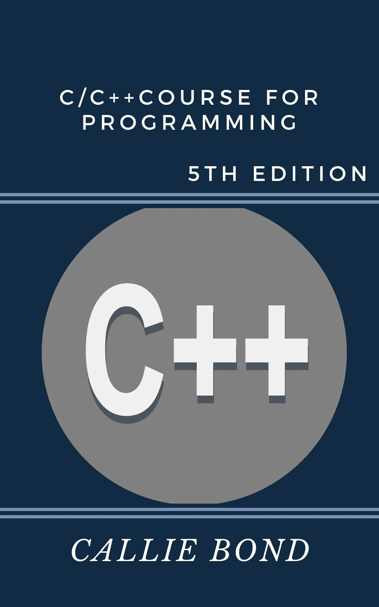

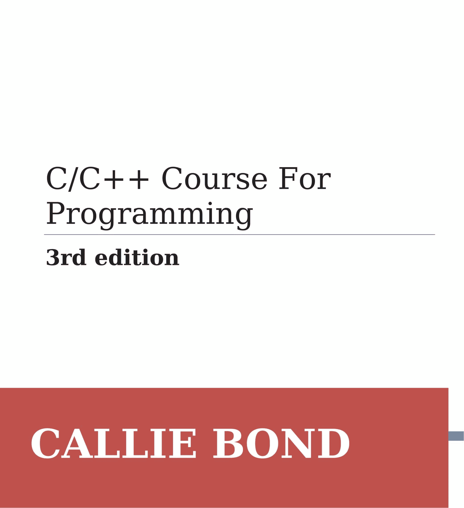

# 目录


## 序言 XVII

## 第一章 程序成长的阶段 1

### 什么是程序 1

### 惯用性编程 2

### 编译器 4

### 执行器 4

### 什么是 C 语言？ 4

### C 语言的历史 5

### C++ 语言 6

### C 语言程序的实现 7

### 程序的版本 8

### 这个程序是做什么的？ 9

### 将编写的程序保存在磁盘上 9

### 编译并运行程序 10

### 函数库 10

### 将可执行文件保存在磁盘上 11

### 调试程序 12

### 训练习解答 12

### 训练建议 14

## 第二章 C 语言的元素 17

### C 语法的介绍 17

### C 的字符 18

#### 字母、数字和下划线字符 18

#### 空格 18

#### 特殊字符和符号 19

#### 终止序列 19

### 数据类型 20

#### 基础类型 20

#### `char` 21

#### `short` 22

#### `int` 22

#### `long` 22

#### 举类型的创建 23

#### `float` 26

#### `double` 26

#### 示例：数据类型 26

#### 衍生类型 27

### 同义类型 28

### 字面量 29

#### 整数字面量 29

#### 实数字面量 30

#### 单字符字面量 31

#### 字符串字面量 31

### 标识符 32

### 关键字 33

### 注释 33

### 符号常量声明

#### 常量

#### C++

#### 为什么要使用常量？(3.4)

### 变量声明

### 变量的初始化

### 表达式

#### 数值

#### 运算符

##### 算术

##### 关系

##### 逻辑

##### 一元

##### 位运算

##### 内存分配

#### 条件运算符

#### 其他运算符

#### 运算符大小判断

#### 逗号运算符

#### 偏移运算符

#### 间接运算符

#### 优先级与求值顺序

#### 数据类型之间的转换

### 训练建议

## 第 3 章 从程序到结构

### C 语言程序的结构

#### 预处理器指南

#### 指令包含

#### 指令替换

#### 定义与声明

#### 简单判断

#### 复合块判断

#### 函数声明

#### 函数定义

#### 函数调用

#### 主函数 `main`

#### 示例

#### 向函数传递参数

### 多文件组成的程序

### 变量的作用域

#### 全局变量与局部变量

### 变量的存储

#### 全局变量的修饰

#### 局部变量的修饰

#### 函数的修饰

#### 已解决训练

### 训练建议

# 第四部分 输入与输出标准 (91)

## 数据数值与字符字符串 (92)

## 标准输入/输出流 (93)

## 带格式的退出 (94)

## 带格式的输入 (100)

## 字符文件结束 (106)

## 字符 (108)

## 清除标准输入缓冲区 (110)

## 从输入标准读取一个字符 (111)

## 向输出标准写入一个字符 (112)

### `getch` 和 `getche` (112)

### 清除屏幕 (114)

### 练习题答案 (114)

### 练习题 (118)

# 第五章 控制语句 (123)

## `if` (123)

## `if` 语句的嵌套 (125)

## `else if` (128)

## `switch` (131)

## `while` (135)

## 嵌套循环 (138)

## `do ... while` (141)

## `for` (144)

## `break` (147)

## `continue` (148)

## `goto` (148)

## 练习题答案 (150)

## 练习题 (161)

# 第六章 数据的结构化类型 (169)

## 类型导论 (170)

### 一维数值矩阵 (171)

### 定义数组 (171)

### 访问矩阵元素 (172)

### 操作一维数组 (173)

### 启动矩阵 (176)

### 关联数组 (178)

### 字符链 (180)

### 读写一个字符链 (182)

## 函数 `gets` 和 `fgets` 185

## 函数 `put` 187

## 处理字符链 189

## C19 标准库函数 191

## 数组的类型与大小 191

## 多维数组 192

## 数值多维数组 193

## 字符链数组 197

## 矩阵拷贝 201

## 处理字节块 204

## 结构 205

### 创建结构 206

### 定义单类型结构变量 207

### 访问结构成员 208

### 成员什么是结构 210

### 结构的操作 210

### 结构数组 212

### 联合体 215

### 结构变量 218

### 位域字段 223

### 训练解析 228

### 训练建议 241

# 第 7 章 指针 249

## 指针的创建 249

### 运算符 251

## 目标对象类型的重要性 252

## 指针的操作 253

## 分配操作 253

## 算术操作 254

## 指针比较 255

## 通用指针 255

## 空指针 256

## 指针常量 257

## 指针与矩阵 258

## 字符链指针 263

## 指针数组 267

## 二级指针 270

## 字符链指针矩阵 272

## 字符链数组排序 276

## 动态内存分配 280

## 动态内存管理函数 281

- `malloc` 281
- `free` 282
- 重新分配内存块 283

## 动态数组 285

- 数组的数值动态 286
- 一维数组的动态 286
- 数组动态指针 288
- 字符链动态数组 291

## 结构体指针 295

- 函数参数中的指针 297
- 复杂声明 304
- 习练习 305
- 练习建议 315

## 第 8 章 进阶函数 325

- 向函数传递矩阵使用什么参数 325
- 静态数组 326
- 动态数组 328
- 向函数传递指针使用什么参数 331
- 通过函数逐一传递结构体 334
- 函数返回的数据 339
- 返回数据的副本 339
- 返回数据块指针 341
- 从声明的静态变量返回地址 343
- 命令行上的参数 344
- 输入与退出的重定向 347
- 递归函数 349
- 函数指针 351

## 习练习 358，练习建议 375

## 第 9 章 文件操作 385

### I/O 流的概览 387

## 文件概览 389

### 打开文件 393

- `fopen` 394
- `freopen` 396

### 关闭文件 396

- `fclose` 397

### 错误处理 397

- `ferror` 397
- `clearer` 397
- `ugly` 399
- `dog` 399

### 读写指针位置 401

- `ftell` 401
- `fseek` 402
- `rewind` 402

### 逐字符操作 403

- `fputc` 403
- `fgetc` 404

### 按行操作 406

- `fputs` 406
- `fgets` 407

### 格式化输入输出 409

- `fprintf` 410
- `fscanf` 410

### 使用寄存器 412

- `fwrite` 412
- `fred` 413

### 顺序访问文件的打开 414

- 顺序访问示例 414

### 向打印机写入数据 420

### 流关联缓冲区控制 421

- `setvbuf` 422
- `fflush` 425

### 临时文件 425

- `tmpfile` 425

### 随机访问文件的打开 426

### 习题解答 430

### 建议 451

# 第 10 章 C 语言的预处理器 457

## `#define` 宏预定义指令 461

- 操作符 `#` 462
- 操作符 `##` 462
- 指令 `#undef` 462
- 指令 `#include` 463

## 条件编译 463

- 宏操作符 465
- 按编译顺序定义的常量 465

## 指南 465

- `#ifdef` 和 `#ifndef` 468
- 指令 `#line` 468
- 指令 `#error` 469

## 头文件的利用 470

# 十一 结构与动态 (481)

## 线性列表 (482)

### 简单线性链表 (482)

### 基础操作 (486)

### 在列表头部插入元素 (487)

### 在列表中查找值为 `x` 的元素 (488)

### 在全局任意位置插入元素 (488)

### 删除列表中的元素 (489)

### 遍历列表 (490)

### 删除一个列表中的所有元素 (491)

## 二 线性列表示例 (491)

### 线性列表接口 (496)

### 循环列表 (508)

### 操作链表的接口 (509) (514)

### 尾节点 (516)

### 示例 (517)

## 双向链表 (520)

### 双向循环链表 (521)

### 操作链表的示例接口 (521) (528)

## 树 (530)

### 二叉树 (531)

### 遍历二叉树的形状 (532)

### 二叉树搜索 (534)

### 处理二叉树搜索的接口 (535)

### 在树中查找节点 (538)

### 在树中插入节点 (539)

### 删除树节点 (540)

### 抽象的应用 (543)

### 平衡二叉树 (546)

### 处理完美平衡二叉树的接口 (547)

# 使用接口 `abe` 553

# 训练解析 556

# 训练方案 572

# 第 12 章 算法 581

## 递归性 581

## 数据排序 588

### 冒泡排序法 588

### 插入排序法 591

### 快速排序法 593

### 方法的比较 596

## 数据搜索 596

### 顺序搜索 597

### 二分搜索 597

### 链表搜索 598

## 磁盘上的文件排序 602

### 文件排序：顺序访问 602

### 文件排序：随机访问 608

## 哈希算法 612

### 数组与哈希 612

### 开哈希方法 613

### 溢出哈希方法 615

### 元素的删除 615

### 开哈希接口 616

### 哈希数组示例 620

# 训练解析 622

# 训练建议 626

## 附录

### A. 库函数函数 633

### 链表与字符函数 633

### 数学函数 645

### 伪随机数 650

### 日期时间函数 651

### 内存块处理函数 654

### B. 开发环境 657

### Dev-C++ 657

### Microsoft Visual C++ 660

### 向项目添加文件 664

### 调试应用程序 664

## Windows 命令行接口 666

## UNIX/LINUX 上的命令行接口 667

### Unix/Linux `gdb` 调试器 668

## 创建函数库 670

## C 语言字符 673

### ANSI 字符在 Windows 673 中的利用

### ANSI 字符的数量 674

### ASCII 字符的利用 675

### ASCII 字符的演变 676

### UNICODE 字符的演变 677

## 索引 679

# 构成 `C/C++ 编程课程` 的材料分为以下章节和附录：

1. 程序成长的阶段。
2. `C` 语言的元素。
3. 程序的结构。
4. 入口与出口。
5. 控制语句。
6. 结构化数据类型。
7. 指针。
8. 函数基础。
9. 文件操作。
10. `C` 预处理器。
11. 动态结构。
12. 算法。
13. `C` 库中的一些函数。
14. 成长环境。
15. 字符代码。

所有这些都通过大量的示例和已解决的练习记录，答案也附在 CD-ROM 中。显而易见，语言在历史上不断演变。这种演变的产物是 `C++` 语言，最后是用于开发图形界面应用程序（可视化编程）的大型函数库。因此，本书是三部曲中的第一本，按顺序涵盖了以下方面：使用 `C` 编程和面向 `C++` 的编程。

这是第一本，《`C/C++ 编程`》。它涵盖了所有与 `C` 相关的结构化编程内容，以及动态数据结构的发展。为什么标题是 `C/C++`？因为 `C++` 是从 `C` 语言发展而来的，除了例外，它包含了 `C`。包含在 `C++` 中的这部分 `C` 被称为 C-，可以在 `C++` 下无问题地编译。然而，当 `C++` 用于其预期用途（即执行面向对象的编程任务）时，新的知识是大量的。

前言 第 19 页


第二本，《`C++ 面向对象编程`》，正如其名，学习面向对象的应用程序开发。如果你的目标是开发视觉应用程序（如基于窗口的应用程序，即 Windows 应用程序），那么了解这项技术是至关重要的。

第三本，《`C++ 百全书`》，包含了前两本的内容，但采用了新的方法，因为在书的所有章节中，仅涉及 `C++` 库。

另一方面，如果你想深入研究包括 UNIX 系统调用在内的 `C` 应用程序，我推荐 Francisco Márquez 写的《`UNIX 高级编程`》，该书也由 RA-MA 出版社出版。

### 关于书中示例

书中附带的 CD 包含了已开发的应用程序以及运行它们的软件，你可以从以下地址下载：

<https://www.tecno-libro.es/ficheros/descargas/978849964329.zip>

```text
ddd-dd-dddd-ddd-d
```

等一下，密码是一个占位符，让我们重新格式化：

下载内容包含一个密码为 `ddd-dd-dddd-ddd-d` 的 ZIP 文件，我知道这对应书籍的 ISBN（输入数字和连字符）。

### 感谢

在准备本书期间，我收到了一些人的想法和建议，其中当然也包括我的学生，他们对学习的热情让我思考那些初看微不足道难以实现的目标，但一旦实现，它们对我们所有人都有益处；向所有这些人表示诚挚的感谢。

特别地，我想感谢 Martín Knoblauch Back 对本新版所提供的良好建议和贡献，感谢 Inmaculada Rodríguez Santiago 对之前版本的建议，以及 Alfredo Gallego Gandarillas、Francisco Manuel Márquez García 和 Mª Dolores Rodríguez Moreno 对之前版本的修订，并感谢 David Jurado González，他为大多数所提练习提供了解答。

Francisco Javier Ceballos 山脉

<http://www.fjceballos.es/>

#### 第一章

© FJCeballos/RA-MA

# 程序成长的阶段


在本章中，你将学习什么是程序、如何编写程序，以及需要哪些操作让计算机运行它并显示所需的结果。此外，你还将获得关于用于编写程序的编程术语通用知识。接下来，我们将专注于一种特定的编程语言以及本书的目标语言，`C/C++`，介绍它的前身、特征以及要遵循的模式，以便能够更容易地执行程序。

# 什么是程序

你可能在某个时候用过计算机写文档，或者玩过游戏。回想在写文档的那一刻，你必须首先启动一个文字处理程序；如果想玩游戏，你必须做的第一件事就是启动该游戏。所以，文本处理器或游戏，它们都是计算机的程序。

启动一个程序等同于执行它。当我们执行一个程序时，我们只看到它产生的结果（例如屏幕上显示的文字处理示例，即我们写的文本；屏幕上可视化的正在发生的游戏图像），但我们看不到计算机为了获得这些结果而遵循的脚本。那个剧本就是程序。

现在，如果我们编写了一个程序，那么我们就知道它是如何工作的以及它为什么要这样工作。这是看待计算机程序的一种非常不同且奇特的方式，与执行不同程序时获得的经验毫无关系。

现在想一下任何游戏。问题是：如果我们想教别人怎么玩，我们该做什么？逻辑上，你必须向他解释应该做什么；即你必须遵循的步骤。换句话说，我们提供了关于如何操作的指令。这就是计算机程序所做的事情。程序无非是用计算机能理解的语言给计算机提供的一系列指令，准确地告诉它我们想要让它做什么。如果计算机不理解某些指令，它通常会通过屏幕上显示的消息进行通信。

# 编程术语

程序必须用计算机能理解的语言来编写。从物理角度来看，计算机是一台电子机器。计算机用于表示数据的物理元素（内存、中央处理器等）是二进制的；也就是说，每个元素可以区分两种状态（两个电压电平）。每个状态被称为一个通用位（`bit`），并用 `0` 或 `1` 表示。因此，为了表示和处理数值、字母和字母数字组合，使用了位流。计算机用于表示一个字符所使用的信息量被称为字节（`byte`）；通常一个字节是八位链。

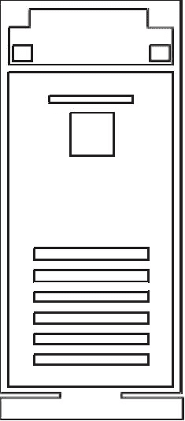


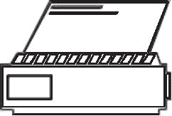

因此，例如，当程序告诉计算机在显示器上显示消息或在打印机上打印时，执行此动作的相应指令为了被计算机理解，必须以位字符串的形式存储在内存中。这表明使用 `0` 和 `1`（机器语言）编写程序将非常耗时，并且极易出错。出于易读的原因，他们开发了汇编语言术语。

汇编器语言使用助记代码（mnemonics）来指示硬件（计算机的物理组件）实际要执行的操作。助记代码是一个易于记忆的单词或缩写，代表计算机处理器应该执行的手工操作。例如：

```asm
MOV ah, 4CH
```

`MOV` 表示将某些信息从内存位置移动到另一个位置的操作。


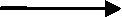 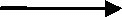

为了将汇编语言编写的程序翻译成机器语言（二进制代码），我们使用一种称为汇编器（assembler）的程序，我们通过计算机本身执行它。该程序将获取我们用汇编语言编写的程序数据，并生成相同的程序但用机器语言（即计算机理解的语言）编写。

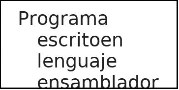 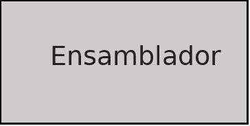 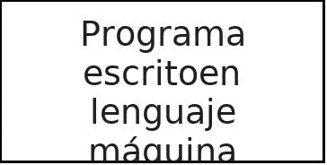

每个计算机模型根据它所使用的处理器都有它自己的汇编语言。由于由于，我们说这些语言是面向机器的。

今天，面向对象的语言或高级语言被使用得更广泛。这些语言使用易于理解的术语，更接近人类语言。在这种情况下，翻译是由编译器完成的。

例如：

```c
printf("hello");
```

C 语言的 `printf` 函数告诉计算机在此时刻显示字符字符串。该方法也是如此的。

```csharp
Console.WriteLine("hello");
```

与汇编语言不同，这种级别完全不需要任何关于处理器的知识。

# 编译器

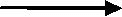 

将用高级语言编写的程序翻译成机器语言需要使用一种称为编译器（compiler）的程序。该程序将我们用高级语言编写的程序视为数据，并输出相同的程序但用机器语言编写，这是一个已经可以直接运行的程序。

例如，用 C 语言编写的程序需要 C 编译器才能进行翻译。随后，翻译后的程序可以从计算机上直接执行。相反，翻译用某种语言编写的代码需要编译器。

# 解释器

与编译器不同，解释器不会从源程序生成机器语言编写的程序，而是对程序的每条语句同时执行翻译和执行。例如，用 Basic 语言编写的程序需要 Basic 解释器才能执行。在程序每条语句的执行过程中，翻译是同时发生的。

与编译器不同，解释器在编写时检查程序的每一行，这使得设置程序变得容易。相反，执行速度较慢，因为已经带有了同步翻译。

# 什么是 C？

C 是一种高级编程语言，你可以在其中编写程序。它用于非常多种用途。

C 相对于其他编程语言的一个显著优势是，C 编译器生成的代码在尺寸上经过高度优化，从而带来了更高的执行速度，而缺点是 C 仅在源代码上与平台无关，这意味着每个不同的平台必须提供相应的编译器以获取必须运行的机器代码。

## C 语言的历史

C 是一种通用用途的编程语言。其主要特点是：

- 结构化编程。
- 表达式简洁。
- 丰富的运算符和数据类型。
- 同时支持高层和低层编码。
- 优势性地取代了汇编语言编程。
- 自然地利用系统原生函数。
- 不面向任何特定特殊领域。
- 生成的代码对象高度优化。
- 易于学习。

C 语言诞生于 AT&T 贝尔实验室，并与 UNIX 操作系统紧密相关，因为它是在该系统上运行的，而且 UNIX 本身、C 编译器本身以及几乎所有的 UNIX 程序和工具都是用 C 语言编写的。它们的效率和清晰使得汇编语言在 UNIX 中几乎没有被使用。

这种语言的灵感源于 Ken Thompson 在 1970 年编写的 B 语言，其目的是为了重写 UNIX（当时 UNIX 的启动阶段是用汇编语言编写的），以便其在其他机器上的移植性。B 语言是一种演化的与机器无关的语言，灵感来自 Martin Richard 在 1967 年构思的 BCPL 语言。

1972 年，Dennis Ritchie 接手并修改了 B 语言，创建了 C 语言并用该语言重写了 UNIX。C 语言相对于 B 语言提供的新颖之处是数据类型和数据结构的设计。

基本数据类型有 `char`（字符）、`int`（整数）、`float`（单精度浮点数）和 `double`（双精度浮点数）。后来添加了类型 `short`（长度 ≤ `int` 长度的整数）、`long`（长度 ≥ `int` 长度的整数）、`unsigned`（无符号整数）和 `enums`（枚举）。C 语言的基础结构类型是 `structures`（结构）、`unions`（union）和 `arrays`（数组）。基本类型可以定义更复杂的派生类型。

控制 C 程序执行流的指令是结构化编程中常见的 `if`、`for`、`while`、`switch-case`，这些包含在其前身 BCPL 中。同样，C 允许你处理内存地址、使用函数并支持递归。

C 语言的另一个特点是其丰富的运算符。可以说，对于每种可能的机器码操作几乎都有对应的运算符。另一方面，有一系列可以使用 C 语言完成的操作，这些操作本身并不包含在编译器中，而是由预处理器在编译之前执行的。最重要的两个是 `#define`（符号替换指令或定义）和 `#include`（包含源文件的指令）。

最后，C 语言被设计为在源代码级别具有高度移植性，并能够编写“不可编程”的内容，与其他语言一样，它也有自己的缺点。例如，它缺乏输入输出指令、处理字符字符串的指令等，这些工作留给了函数库，这不利于移植性的保持。此外，编写程序时的过度自由可能导致错误。这些编程错误在语法上是正确的，无法肉眼察觉。此外，运算符优先级有时会让表达式变成小谜题。无论如何，C 已证明自己是一种极其有效且富有表现力的语言。

## C++ 语言

C++ 由 C 编程语言开发而来，除少数例外外，包含了 C。C++ 中包含的这部分内容被称为 C-，并且可以无问题地编译为 C++。

1980 年，引入了诸如类（源自 Simula 67 的概念）、检查函数参数类型并在必要时进行类型转换等特征；结果产生了一种被称为“带类的 C”的语言。

1983/84 年，带类的 C 经过重新设计、扩展并再次实现。结果被称为 C++ 语言。主要的扩展包括虚函数、重载函数（同一个标识符可以用于调用不同形式的函数）和重载运算符（同一个运算符可以在不同的语境下具有不同的含义）。在经过进一步的完善后，C++ 在 1985 年问世。这种语言由 Bjarne Stroustrup（AT&T 贝尔实验室）创建，并在他的一些著作中进行了记录。

C++ 的名称源于 Rick Mascitti，意味着 C 语言转换的演进特性（“++”是 C 语言中的自增运算符）。

随后，C++ 经过了大量的修订和完善，许多许多新功能的引入，例如多重继承、`static` 和 `const` 成员函数、保护成员、泛型数据类型（也称为模板）以及异常处理。此外，还进行了一些小改进。综上所述，C++ 是一种混合语言，它一方面采纳了面向对象编程的所有特征，另一方面在实质上增强了 C 语言的能力。

## 如何在 C 中实现程序

在本节中，将通过示例介绍执行项目时需要遵循的步骤。下图图性地显示了用户名在开发时需要和应该做的事情。

1. 编辑程序
2. 编译它
3. 运行它
4. 调试它

显然，为了编写程序，你需要一个开发环境。C/C++ 的角色是：一个文本编辑器、C/C++ 编译器（包括我们将要讨论的部分）和一个调试器。因此，我们计算机的硬盘上必须存储编辑、编译和调试程序所需的工具。例如，假设我们想写一个名为 `salutation.c`（或 `saludo.cpp`）的程序。我们需要使用的工具（程序）以及产生的文件如下：

| 工具 | 产生文件 |
| --- | --- |
| 编辑器 | `greeting.c`（或良好的 `greeting.cpp`） |
| C/C++ 编译器 | `greeting.obj` 或 `greeting.o`，取决于编译器 |
| 链接器 | `linker.exe` 或 `a.out`，省略，取决于编译器 |
| 调试器 | 程序可执行文件 |

上表表明，一旦 `salutation.c` 或 `saludo.cpp` 程序编译得到对象文件 `greeting.obj` 或 `greeting.o`，就会与必要的 C 库函数链接，从而生成单个的可执行文件 `greeting.exe` 或 `a.out`。

要编辑一个程序，我们首先将启动将使用的编辑器或文本处理器。如果我们有一个集成开发环境（包含编辑器、编译器和调试器），我们可以使用其自带的文本处理器；如果没有，我们将使用自己的处理器，例如操作系统提供的其中之一（参见附录 B）。选择在磁盘上保存程序的文件名必须具有 `.c` 或 `.cpp` 扩展名（`.cpp` 是 C++ 使用的扩展名）。

下一步是编写与源程序对应的文本。每条 C 语言语句都以分号 `;` 结束，每行语法通过按下 `Get` 键（即 `Enter` 或 ``）来结束。

为了练习到目前为止介绍的内容，让我们从创建一个简单的程序开始：一个在 ludo 中显示健康信息的经典示例。

让我们从编辑与程序对应的 C 源文件开始。选择在磁盘上保存程序的文件名扩展名必须为 `.c` 或 `.cpp`。是的，编译器支持 C++；例如 `greeting.c`。

一旦编辑器显示，我们将编写与源语法对应的文本。按照我所知道的示例到继续这样写下来：

```c
/****************
问候
****************************/
#include <stdio.h>

main()
{
    printf("Hello world!!!\n");
}
```

### 编写了什么？

我们对程序的程序的每一行进行简要注释。如果某些术语不清楚，不需要着急，因为它们将在随后的章节中详细介绍。

前两行仅仅是注释。编译器不会计算注释。第三行包含了头文件 `stdio.h`，它包含了输入或输出（I/O）函数所需的声明，在我们的案例中，这些函数出现在 `printf` 中。这意味着，作为一个一般规则，在调用函数之前，你必须对其进行声明。以符号 `#` 开头的 C 留字称为编译器指令，它们在调用编译器时由 C 预处理器处理，但在编译之前完成处理。`main` 函数写在下面。任何编写的 C 程序都有一个 `main` 函数。注意，函数通过其名称后出现的修饰符 `()` 来区分，其正体以 `{` 开始并以 `}` 结束。`printf` 函数属于 C 库，它的任务是在显示器上打印引号中的表达式。紧跟在字符串“Hello world!!!”之后的转义字符序列 `\n` 告诉计算机，在写入该消息后，将屏幕光标移动到下一行的开头。注意语句以点`..` 结束。

编辑后的程序现在内存中。为了使工作具有连续性，必须使用编辑器的响应将编写的程序写入磁盘。非常重要：源程序的名称必须添加扩展名 `.c` 或 `.cpp`，是的，编译器支持 C++。

### 编译并运行程序

下一步是编译程序；即将源程序翻译成机器语言，并与 C 库中必要的函数链接（这个过程通常是自动完成的），然后获取可执行程序。根据编译器的制造商，编译和链接程序 `greeting.c` 对应的命令可以是以下任一：

- 在带有 Microsoft 编译器的 Windows 系统上，示例中的 `cl` 命令调用 C 编译器和链接器来生成可执行文件 `greeting.exe`（参见附录 B 中的 Windows 命令行界面）。

  ```text
  cl greeting.c
  ```

- 在 UNIX 系统上，示例中的 `cc` 命令调用 C 编译器和链接器来生成 `greeting` 可执行文件。如果我们没有添加 `-o greeting` 选项，可执行文件默认命名为 `a.out`（参见附录 B 中的 Unix/Linux 命令行界面）。

  ```text
  cc greeting.c -o greeting
  ```

由于编写的程序符合编译器的语法和规则，可能会发生编译错误。我们必须修正这些错误，直到获得无错误的编译结果。要运行生成的文件，在命令提示符的下方输入生成文件的名称（在我们的案例中为 `greeting`），并按回车。例如，对于我们来说，结果将屏幕将显示消息：Hello world!!!

### 函数库

正如我们之前提到的，C 缺乏 I/O 指令、处理字符字符串的指令等，因此这些工作留给了编译器提供的函数库。函数是一组执行特定作业的指令集。库是磁盘上的一个单独文件（在 Windows 上通常带有 `.lib` 扩展名，在 UNIX 上带有 `.a` 版本），它包含了执行最常见任务的函数，这样我们就不需要自己编写它们。作为一个例子，我们之前看到了 `printf` 函数。如果这个函数不存在，我们的任务就是编写必要的代码以便在屏幕上可视化显示结果。

要使用库函数，你只需使用其名称调用它，并在括号中传递必要的参数。例如：

```c
printf("Hello world!!!\n");
```

接下来的图示说明了，在我们程序中调用的库函数对应的代码是由链接器在创建程序可执行文件时添加的。

### 将编写的程序保存到磁盘

执行此过程的最简单有效的方法是使用 `scrubbing grass`。附录 B 介绍了如何使用调试器：Windows 下的 Microsoft Visual C++ 和系统 `UNIX` 的 `gdb` 调试器。

## 训练解析

为了练习另一个程序，请编写以下示例并尝试运行。首先从命令行进行，然后使用你偏好的集成开发环境。以下示例展示了两个整数之间的加法、减法、乘法和除法。

打开你集成环境的文字处理器或编辑器，编辑下方所示的程序示例。理解这个示例不会费力，因为这些句子是用你已经熟悉的语法编写的。

```c
/******************* Operations arithmetic ******************/

// aritmeti.c

#include <stdio.h> main()

{

int data1, data2, result; data1 = 20;

data2 = 10;

// Sum

result = data1 + data2;
printf("%d + %d = %d\n", data1, data2, result);

// Subtraction

result = data1 - data2;
printf("%d - %d = %d\n", data1, data2, result);

// Product

result = data1 * data2;
printf("%d * %d = %d\n", data1, data2, result);

// Quotient

result = data1 / data2;
printf("%d / %d = %d\n", data1, data2, result);

}
```

编辑好程序后，将其保存到磁盘上。记住文件名要具有扩展名 `c`；例如，`arithmetic.c`。

这个程序做了什么？

观察主函数 `main`，我们看到它声明了三个变量（类型为 `int`）：`data1`、`data2` 和 `result`。

```c
int data1, data2, result;
```

接下来将值 20 赋值给变量 `data1`，将值 10 赋值给变量 `data2`。

```c
data1 = twenty;
```

```c
data2 = 10;
```

继续，它计算这些值的和，并写入数据和结果。

```c
result = data1 + data2;
```

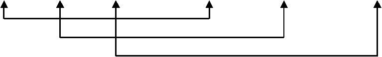

```c
printf("%d + %d = %d\n", data1, data2, result);
```

`printf` 函数中引号内的表达式表示我们想要在显示器上显示的字符序列，其特殊之处在于，字符 `%d` 告诉编译器下一个字符不是要可视化的普通字符（`d` 表示十进制整数值），否则编译器将将其视为格式说明符，该格式说明符将被下文指定的值列表中的对应值替换。根据此，之前的 `printf` 函数将产生以下结果：

```text
twenty + 10 = 30
```

因为此时，`data1` 的值为 20，`data2` 的值为 10，而 `result` 的值为 30。计算差、积和商也遵循了类似的过程。

下一步，我们将编译该程序，当获得没有错误的编译结果时，我们将执行它并验证操作是否符合预期。

## 训练建议

### 1. 回答以下问题

1. 位（Bit）象征着：
   - a) 一个条件。
   - b) 一个事实。
   - c) 0 或 1。
   - d) 一个字符。

2. 什么是字节（byte）？
   - a) 一个数字。
   - b) 通常是八位的集合。
   - c) 一个电子元件。
   - d) 一个位。

3. 什么是硬件？
   - a) 计算机的物理组件。
   - b) 程序。
   - c) 一个解释器。
   - d) 一个编译器。

4. 什么是编译器？
   - a) 字节的集合。
   - b) 一种底层语言。
   - c) 一个解释器。
   - d) 一个程序翻译器。

5. 什么是 C？
   - a) 一个程序。
   - b) 一个解释器。
   - c) 一种高级语言。
   - d) 一台电脑。

6. 什么是 UNIX？
   - a) 一个操作系统。
   - b) 一个编译器。
   - c) 一个解释器。

7. C 是谁的？
   - a) Ken Thompson。
   - b) Martin Ritchie。
   - c) Dennis Ritchie。
   - d) Bjarne Stroustrup。

8. 什么是 C++？
   - a) 是。
   - b) 不是。

9. 什么是：
   - a) 它们是。
   - b) 它们不同。

10. 什么是：
    - a) 它们是。
    - b) 它们是。

多余的空白字符会被编译器忽略。根据某些说明，以下代码的行为与之前完全相同：

```c
main() {
    // lines on white spaces on White
    printf ("Hello, what such you are.\n");
}
```

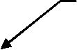

Windows 上的 `Ctrl+Z` 或 UNIX 上的 `Ctrl+D` 由编译器处理。它们是文件结束（End Of File）的指示符。

### 特殊字符与标点符号

这组字符有不同的用法；例如，用于指示标识符是函数或数组；指定特定的算术、逻辑或关系操作等。它们如下：

`,` `.` `;` `:` `?` `'` `"` `(` `)` `[` `]` `{` `}` `<` `!` `|` `/` `\` `~` `+` `#` `%` `&` `^` `*` `-` `=` `>`

### 转义序列

上述任何字符都可以用字符串表示。转义故事。转义序列由字符 `\` 后跟一个字母或数字组合组成。它们用于换行、制表符等操作，以及引用不可打印字符。

C 语言预定义了以下转义序列：


# 序列名称


- `\n`：跳到下一行的开头。
- `\t`：水平制表符。
- `\v`：垂直制表符（单独用于打印机）。
- `\b`：退格键（back space）。
- `\r`：回车但不换行。
- `\f`：分页符（单独用于打印机）。
- `\a`：警报、哨声。
- `\'`：单引号。
- `\"`：双引号。
- `\\`：反斜杠（backslash）。
- `\ddd`：字符 ASCII 码的八进制表示（`d` 是 0 到 7 的数字）。
- `\xdd`：字符 ASCII 码的十六进制表示（`d` 是 0 到 9 的数字或 A 到 F 的字母）。


我在 `printf` 的调用中看到了转义序列 `\n` 的示例。

## 数据类型

记得我们在上一节中讨论过的 `aritmeti.c` 程序执行的算术操作。例如，我们执行的操作之一是两个值的之和：

```c
datal = twenty;
data2 = 10;
result = datal + data2;
```

为了让 C 编译器识别此操作，必须先指定参与操作的每个操作数的类型，从而确定结果的类型。为此，我们将写如下行：

```c
int datal, data2, result;
datal = twenty;
data2 = 10;
result = datal + data2;
```

上述语句告诉 C 编译器 `datal`、`data2` 和 `result` 是整数类型（`int`）。注意，可以使用逗号分隔的独立列表声明多个具有相同类型的变量。

C 语言中的数据类型可以分类为：基本类型和派生类型。

### 基本类型

我们之所以将它们称为基本类型，是因为编译器是这样定义的。可以分类的七种基本数据类型是：整数类型和实数类型。

整数类型：`char`、`short`、`int`、`long` 和 `enum`。实数类型：`float` 和 `double`。

每个基本类型都有不同的正负值范围。用于声明特定程序变量的数据类型取决于每个变量要存储值的范围和类型，以及它们是整数还是分数。头文件 `limits.h` 和 `float.h` 规定了每个类型的最大值最小值。

每个整数类型可以用 `signed`（有符号）或 `unsigned`（无符号）关键字进行修饰。有符号修饰的整数是有符号整数；即正负整数值。无符号修饰的整数是无符号整数值，作为正整数值处理。这种修饰产生了以下额外类型：

`signed char`、`unsigned char`、`signed short`、`unsigned short`、`signed int`、`unsigned int`、`signed long`、`unsigned long`

如果在没有指定特定整数类型的情况下使用符号修饰符，则假设类型为 `int`。因此，以下语句是等价的：

```c
signed x; /* 等同于 */
signed int x;
```

有符号修饰的整数是有符号整数；即正负整数值。无符号修饰的整数是无符号整数值，作为正整数值处理。这种修饰产生了以下额外类型：

`signed char`、`unsigned char`、`signed short`、`unsigned short`、`signed int`、`unsigned int`、`signed long`、`unsigned long`

如果在没有指定特定整数类型的情况下使用符号修饰符，则假设类型为 `int`。因此，以下语句是等价的。（注意 `'a'` 和 之间的区别）

```c
signed x;
```

`0` 到 `4294967295`，现在不再需要使用位来表示符号。

通常，可以认为 `int` 的长度微小于或等于 `length` 的长度。

## `enum`（枚举）

枚举类型的声明仅仅是该类型变量可以取值的值列表。枚举类型的值将用标识符表示，这些标识符将是新类型的常量。例如：

```c
enum day week
{
    Monday, Tuesday, Wednesday, Thursday, Friday, Saturday, Sunday
} today;

enum day week Yesterday;
```

此示例声明了枚举类型 `week_day` 的两个变量 `today` 和 `yesterday`。这些变量可以取指定的任何值，从 `Monday` 到 `Sunday`。根据此，`Monday` 的值为 `0`，`Tuesday` 的值为 `1`，`wednesday_` 的值为 `2` 等，依此类推。构成组成所列类型的常量值从 `0` 开始，并随着从上到下或从左到右读取声明而递增 `1`。

### 从枚举创建

创建一个枚举本用于从数据定义一个新类型（命名为类型 `enumerated`），并从该类型声明一个变量。语法如下：

```c
enum enumerated_type
{
    /* 常量标识符 */
};
```

其中 `enumerated_type` 是定义新类型的标识符。

然后从所列定义的类型中，可以声明一个或多个该类型的变量，格式如下：

```c
enum enumerated_type [ variable [, variable ]...];
```

接下来的示例声明了一个名为 `Colour` 的变量，类型为所列的 `colors`，它可以从定义的列表中取任何值。

```c
enum colors
{
    blue, yellow, Red, green, White, black
};

enum colors Colour;
Colour = blue;
```

正如我们已经过的，枚举常量列表中的每个标识符都有一个关联的值。默认情况下，第一个标识符与值 `0` 相关，下一个与值 `1` 相关，依此类推。根据此：

`Colour = green;` /* 等于 */ `Colour = 3;`

**注意：** 对于 ANSI C（符合美国国家标准协会规范的 C），枚举类型是一种 `int` 类型。然而，对于 C++，所列类型是一个与之前完全不同的类型。这意味着在 C++ 中，`int` 类型的值不能直接赋值给枚举变量，而必须进行显式类型转换（参见本章的从表达式到最后的显式类型转换）。例如：

```c
Colour = (colors)3; /* 从 int 到 colors 的显式转换 */
```

列表中的任何标识符都可以通过常量表达式分配初始整数值。后续标识符将取与其相关的值。例如：

```c
enum colors
{
    blue, yellow, Red, green = 0, White, black
} Colour;
```

此示例定义了一个名为 `colors` 的枚举类型并声明了一个变量。与标识符关联的值如下：`blue = 0`、`yellow = 1`、`Red = 2`、`green = 0`、`white = 1` 和 `black = 2`。

对于枚举成员，适用以下规则：

- 两个或多个成员可以具有相同的值。
- 一个标识符在一个类型中重复出现。
- 遗憾的是，无法直接读取或写入所列类型的值。下面的示例说明了这一细节。

```c
/* enum.c */
#include <stdio.h>

enum colors
{
    blue, yellow, Red, green, White, black
};

main()
{
    enum colors Colour;
    /* 从键盘输入一个 Colour */
    printf("Color: ");
    scanf("%d", &Colour);
    /* 显示化输入的 Colour */
    printf("%d\n", Colour);
    /* 是的，Colour 是绿色... */
    if (Colour == green) printf("hope\n");
}
```

执行程序：

```text
Colour: 3 [Enter] 3
hope
```

你将在稍后的章节中详细了解 `scanf` 函数；现在只需注意该函数允许你将键盘输入的值赋值给指定的变量。当在上面的示例执行 `scanf` 函数时，无法直接将绿色值赋值给颜色变量，而必须分配等价的整数常量 `3`。同样，`printf` 不会写入 `green`，而是写入 `3`。根据此，他会问：那么，枚举类型是做什么的？枚举类型有助于让高层语言更接近我们的表达方式。正如你稍看到的，表达式“Yes the Colour is green, ...”所说的比“Yes the Colour is 3, ...” 更好。

## `float`（浮点型）

`float` 类型用于声明格式的 32 位浮点数据。IEEE 754 格式（该格式使用 1 位符号，8 位指数和 23 位尾数）。`float` 类型的数据存储精度约为 7 位数字的值。要指定常量（字面量值）为 `float` 类型，你必须在值的末尾添加字母 `'f'` 或 `'F'`。约为 7 位数字。

## `double`（双精度型）

`double` 类型用于声明格式的 64 位浮点数据。IEEE 754 格式（该格式使用 1 位符号，11 位指数和 52 位尾数）。`double` 类型存储精度约为 16 位数字的值。要指定常量（字面量值）为 `double` 类型，你必须在值的末尾添加字母 `'d'` 或 `'D'`。

### 示例：数据类型

下面的程序说明了上述概念；定义了 `char`、`int`、`float` 和 `double` 类型的变量，为每个变量赋值并显示在屏幕上：

```c
/* types.c */
#include <stdio.h>

main()
{
    /* 定义变量 */
    char c;
    int i;
    float f;
    double d;

    /* 为变量赋值 */
    c = 't';
    i = 25;
    f = 3.14159F;
    d = 2.7172;

    /* 在屏幕上显示值 */
    printf("c: %c\n", c);
    printf("i: %d\n", i);
    printf("f: %f\n", f);
    printf("d: %f\n", d);
}
```

执行程序：

```text
c: t
i: 25
f: 3.141590
d: 2.717200
```

`%d` 和 `%f` 已被相应变量的值替换。结果显示在连续行上是因为每个表达式末尾有转义序列 `'\n'`。简而言之，如果你想显示一个 `char` 类型的值，`Format` 中的格式说明符是 `%c`；要显示一个 `int` 类型的值，`Format` 中的格式说明符是 `%d`；要显示 `float` 或 `double` 类型的值，格式说明符是 `%f`；而要切换到下一行则使用转义序列 `'\n'`。`printf` 函数还有很多可能性，我将在下一章节中介绍。

## 派生类型

派生类型由基本类型构建。其中一些是：`structures`（结构）、`unions`（联合）、`arrays`（数组）、`pointers`（指针）和 `functions`（函数）。这些类型将在后续章节详细学习。

## 类型的别名

使用 `typedef` 关键字我们可以声明新的数据类型名称；即另一种类型的别名（无论是基本类型还是派生类型），稍后可以用于声明这些类型的变量。`typedef` 的语法如下：

```c
typedef type_declaration synonym [, synonym ]...;
```

其中 `type_declaration` 是 C 语言中定义的任何类型（基本或派生），`synonym` 是为指定类型选择的新名称 `Name`。

例如，以下语句将新类型 `ulong` 声明为基本类型 `unsigned long` 的别名：

```c
typedef unsigned long ulong;
```

一旦 `ulong` 类型被定义为 `unsigned long` 的别名，就可以用以下两种形式之一声明变量 `ID`：

```c
unsigned long ID; /* 等同于 */ ulong ID;
```

`typedef` 声明允许对程序进行参数化以避免可移植性问题。如果我们对依赖于类型使用 `typedef`，当程序迁移到另一个安装环境时，你只需要修改这些语句。

以下示例从 `enum colors` 声明了类型 `t_colors`，并定义了该类型的变量 `Colour`：

```c
enum colors
{
    blue, yellow, Red, green, White, black
};

typedef enum colors t_colors;

main()
{
    t_colors Colour = blue;
    // ...
}
```

类型 `t_colors` 的语句也可以实现如下所示：

```c
typedef enum colors
{
    blue, yellow, Red, green, White, black
} t_colors;
```

或者简单地：

```c
typedef enum
{
    blue, yellow, Red, green, White, black
} t_colors;
```

## 字面量

字面量是来自基本类型值的表达式，或者是字符链（用双引号括起来的字符集）。例如，这些都是字面量：`5`、`3.14`、`'a'` 和 `"hello"`。实际上，它们是常量值。

如所述，`C` 中的字面量可以是：整数、实数、字符和字符串。

### 整数字面量

`C` 语言允许指定 10、8 和 16 进制的整数字面量。

通常情况下，如果值为正，`+` 号是可选的，而只要值为负，`-` 号就会存在。整数字面量的类型取决于它的基数、值以及其后缀。指定整数字面量的语法为：

```text
{[+]| -}integer_literal[{L|U|UL}]
```

如果字面量是十进制且没有后缀，其类型取决于其值可以表示的 `int` 类型、`long int` 或 `unsigned long int` 中的哪一个。

如果它是八进制或十六进制且没有后缀，其类型取决于其值可以表示的 `int`、`unsigned int`、`long int` 或 `unsigned long int` 类型中的第一个。

你也可以通过添加后缀 `L`、`U` 或 `UL`（大写或小写）显式指示整数字面量的类型。

如果后缀是 `L`，当值可以在该类型中表示时，类型为 `long`；如果后缀是 `U`，当值可以在该类型中表示时，类型为 `unsigned int`；如果后缀是 `UL`，其类型为 `unsigned long`。

十进制整数字面量可以有一个或多个 `0` 到 `9` 之间的数字，其中四位数字中的第一个不是 `0`。例如：

- `4326` 常量整数 `int`
- `1522U` 常量整数 `unsigned int`
- `1000L` 常量整数 `long`
- `325UL` 常量整数 `unsigned long`

八进制整数字面量可以有一个或多个 `0` 到 `7` 之间的数字，并以 `0` 开头。

十六进制整数字面量可以有一个或多个 `0` 到 `9` 的数字以及字母 `A` 到 `F`（大写），并以 `0` 开头。

### 实数字面量

实数字面量由整数部分、小数点和一个分数部分组成。也允许科学计数法，其中 `e` 是 10 进制的符号，可以是正负。

### 字符字面量

单字符字面量是 `char` 类型。这种字面量由单引号组成。会考虑转义序列。示例示例：

- `' '` 空格
- `'x'` 小写字母
- `'\n'` 换行
- `'\07'` ASCII
- `'\x1B'` 转义

单字符的值是字符集中对应的值。

### 字符链字面量

字符链字面量是双引号内的字符序列（包括转义序列）。例如：

- `"This is a constant from characters"`
- `"3.1415926"`
- `"Ride Santander"`
- `""` /* 空链 */
- `"Language \"C/C++\""` /* 产生 `"C/C++"` */

当字符链太长时，可以使用字符 `\` 作为字符延续符。示例所示：

```c
printf("This chain from characters is too\
is long.\n");
```

两个用空格分隔的字符链在编译时会被合并为一个单一链。示例所示：

```c
printf("First string, " "second string.\n");
```

标识符是赋予 `Program` 中的类型、字面量、变量、函数和标签的名称。形成标识符的语法如下：

```text
{ letter |_}[{ letter | digit |_}]...
```

这表示标识符由一个或多个字符组成（参见上文 `Letters`、`Digits` 和 `Underscore` 段落），且第一个字符必须是字母或下划线。它们不能以数字开头，也不能包含特殊字符（参见前一节 `Characters` 特殊字符和标点符号）。

这些字母可以是大写或小写。对于 `C` 而言，大写字母是除相同小写字母以外的字符。例如，它们标识 `Sum`、`sum` 和 `SUM`。它们是不同的。

标识符可以具有任意数量的字符但取决于使用的编译器，只有前 `n` 个字符是有意义的（`ANSI` 外部标识符允许 6 个字符，内部标识符——即函数内部允许 31 个；`Microsoft C` 在内部和外部均允许 247 个；等）。这意味着当两个标识符在有效的前 `n` 个字符中至少有一个不同时，它们就是不同的。一些示例如下：

- `Sum`
- `Calculus_Numbers_Primes`
- `order`
- `ViewData`

## 关键字

关键字是具有 `C` 编译器特定含义的预定义标识符。因此，用户定义的标识符不能与关键字同名。`C` 语言具有以下关键字：

| `car` | `double` | `int` | `structure` |
|---|---|---|---|


| `break` | `else` | `long` | `switch` |
|---|---|---|---|
| `case` | `enum` | `register` | `typedef` |
| `char` | `external` | `return` | `Union` |
| `build` | `float` | `shorts` | `unsigned` |
| `continue` | `for` | `signed` | `void` |
| `default` | `goto` | `size of` | `volatile` |
| `do` | `if` | `static` | `while` |

关键字必须始终全小写。

### 注释

注释是给任何阅读源代码的人的消息。添加注释更容易理解程序。注释的目的是解释源代码。`C` 支持两种类型的注释：

- **传统注释**。传统注释以字符 `/*` 开始，以字符 `*/` 结束。这些注释可以占据一行的空间，但不能嵌套，并且可以出现在允许空格的任何地方。例如：

```c
/*
* 程序的执行从 main 函数开始。
* main 函数可以调用其他函数
* 由用户名预定义或定义。程序的执行
* 在 main 函数结束时结束。
*/
```

- **单行注释**。这种注释以双斜杠（`//`）开始并延伸到行尾。它们被称为 `C++` 风格注释。这意味着 `C` 吸并了 `C++` 的一些有趣特性；其中就是这种。下一行是示例：

```c
// 在此处添加初始化代码
```

### 符号常量语句

声明一个符号常量意味着告诉 `C` 编译器常量的 `Name` 及其取值。这通常在 `main` 函数使用之前通过提升宏指南 `#define` 完成，其语法如下：

```c
#define NAME VALUE
```

以下示例声明了实数常量 `PI` 值为 `3.14159`，单字符常量 `NL` 值为 `'\n'`，以及字符常量 `MESSAGE` 值为 `"Press a key for continue\n"`：

```c
#define PI 3.14159
#define NL '\n'
#define MESSAGE "Press a key for continue\n"
```

注意声明后没有分号。这是因为指令不是 `C` 语句，而是给预处理器的命令。常量的类型是所赋值值的类型。通常用大写字母写一个常量的 `Name`。

### C++ 常量

`C` 编译器合并的 `C++` 另一个特性是保留的关键字 `const`。使用它我们有了另一种声明常量的方法；只需在常量名前前加上类型后的 `const` 修饰符；如果省略类型，则假设为 `int`。例如，接下来的行声明了实数常量 `Pi` 值为 `3.14`：

```c
double Pi = 3.14;
```

一旦常量声明并初始化，其值就不能再修改。因此，在声明它时必须初始化。例如，假设已经声明了常量 `Pi`，下一个语句将导致错误：

```c
Pi = 3.1416; /* error */
```

### 为什么要使用常量？

使用常量更容易修改程序。例如，假设一个 `Program` 使用了 `N` 次值为 `3.14` 的常量。是的，我们必须将此常量定义为 `const double Pi`。

### 变量语句

变量表示存储值的内存空间。与常量不同，变量的值可以在执行过程中改变。要在程序中使用变量，必须首先声明它。变量的声明由 `type`、`identifier` 和关联的值组成：

```c
char c = '\n';
main() {
    int i = 0;
    float f = 0.0;
    double d = 0.0;
}
```

`type`（基本类型或派生类型）决定了变量可以取的值以及对其进行的操作。在上面的示例中，你可以看到有两个声明变量的地方：任何块之外（块指的是封装在字符 `{` 和 `}` 包围的语句集），以及语句块内部。

当变量声明位于块内部时，在 `ANSI C` 中该声明必须在块的开头进行，而在 `C++` 可以在任何其他部分、在使用之前实现。在我们的示例中，变量 `c` 是全局的，变量 `i`、`f` 和 `d` 是局部的。

### 初始化变量

全局变量由 `C` 编译器默认初始化：数值变量为 `0`，字符为 `'\0'`。它们也可以隐式初始化，正如我们在之前的示例中对 `c` 所做的那样。局部变量不会被 `C` 编译器初始化。因此，取决于我们是否对其进行初始化；建议初始化，因为正如你可以尝试的，这可以避免意外错误。

### 数值表达式

表达式是由一组运算符连接的操作数，用于指定特定的操作。所有表达式在求值时都会返回一个值。例如：

```c
to + 1
sum + c
amount * price
x = 7 * sqrt - b / 2
```

当 `C` 语言需要评估涉及不同类型操作数的表达式时，它首先会为了执行请求的操作，将操作数的值转换为精度较高的操作数的类型（例如，`int` 的精度比 `char` 高，`double` 的精度比 `int` 高）。当我知道从一个赋值开始尝试时，例如 `x = ...`，在不丢失信息的情况下，`C` 会将右侧的值转换为左侧变量的类型。否则，`C` 建议显式地进行转换，我们将在本章末尾进行解释。

### 运算符

运算符是指示数据如何被处理的符号。我知道它们可以分为以下几类：算术运算符、关系运算符、逻辑运算符、一元运算符、位位运算符、赋值运算符、条件运算符以及其他。

## 算术运算符

我们使用算术运算符来执行数学运算。它们如下：


| 运算符 | 运算 |
|---|---|


- `+` 加法。操作数可以是整数或实数。
- `–` 减法。操作数可以是整数或实数。
- `*` 乘法。操作数可以是整数或实数。
- `/` 除法。操作数可以是整数或实数。如果两个操作数都是整数，则结果为整数。在其他情况下，结果为实数。
- `%` 取模或整除余数。操作数必须是整数。


下面的示例展示了如何使用这些运算符。正如我们已经说过的，注意要先声明变量，然后执行操作。对它们执行所需的操作。

```c
int to = 10, b = 3, c;
float x = 2.0F, and;

and = x + to; // 结果是 float  12.0
c = to / b; // 结果是 int  3

c = to % b; // 结果是 int  1

and = to / b; // 结果是 int  3.

// 将 转换为 float 以赋值给 and
c = x / and; // 结果是 float  0.666667.

// 转换为 int 以赋值给 c (c = 0)
```

当在算术运算中操作数的类型不同时，两者都会转换为最高精度操作数的类型。例如，为了执行加法 `x+a`，整数 `a` 的值会被转换为 `float`（`x` 的类型）。`a` 本身没有修改，但它的值被转换为 `float` 以执行加法。`short` 和 `char` 类型会自动转换为 `int`。

在赋值中，算术运算得到的结果被隐式或显式地转换为存储该结果的变量的类型。例如，`x/y` 的结果只有整数部分赋值给 `c`，因为 `c` 的类型是 `int`。这表示实数转换为整数时会截断小数部分。

实数结果会被舍入。注意运算 `x/y`，当 `x` 等于 2 且 `y` 等于 3 时；结果在 `0.666666` 的第 6 位上是 `7`，因为被舍弃的第一位小数是 `6`。如果舍弃的第一位小数是 `5` 或更高，则保留的最后一位小数加 1。

现在你可能很容易计算一个定三角形的面积，例如底为 11.5，高为 3。让我们来看看：

```c
/* triangle.c
*/

#include <stdio.h>

main()
{
    double base = 11.5, height = 3.0, area = 0.0;
    area = base * height / 2; printf("Area = %f\n", area);
}
```

执行程序：

```text
Area = 17.250000
```

如果你希望显示非零，使用 `%g` 格式代替 `%f`。我们会看到：

```text
Area = 17.25
```

## 关系运算符

关系运算符允许评估相等和大小。关系运算的结果是布尔值（真 1 或 0）。以下是：


| 运算符 | 运算 |
|---|---|


- `<` 小于
- `>` 大于
- `<=` 小于等于
- `>=` 大于等于
- `!=` 不等于
- `==` 等于


操作数必须是基本类型。例如：

```c
int x = 10, and = 0, r = 0;
r = x == and; // r = 0 (false)
r = x > and; // r = 1 (true)
r = x != and; // r = 0 (false)
```

在长表达式中，使用括号可以更清晰。例如，`==`、`>` 和 `!=` 的优先级更高。所以：

```c
r = (x == and); // r = 0 (false)
r = (x > y); // r = 1 (true)
r = (x != y); // r = 0 (false)
```

## 逻辑运算符

逻辑运算（与、或、非）的结果是布尔值（真 1 或假 0）。可以使用以下逻辑运算符形成逻辑表达式（见关系运算符）。在 `C` 语言中，任何非 0 的数值表达式都对应于真值。


| 运算符 | 运算 |
|---|---|


- `&&` 与。只有当每个操作数都为真时，返回真。如果其中一个为假，则结果为假。如果第一个操作数为假，则不求值第二个操作数。
- `||` 或。只有当每个操作数都为假时，结果为假。如果其中一个为真，则结果为真。如果第一个操作数为真，则不求值第二个操作数（字符 `|` 的 ASCII 值为 124）。
- `!` 非。如果评估的结果为真，则运算符结果为假，反之亦然。


逻辑运算的结果类型为 `int`。例如：

```c
int p = 10, q = 0, r = 0;
r = (p != 0) && (q != 0); // r = 0 (false)
r = (p != 0) || (q > 0); // r = 1 (true)
r = !r; // 是的 r 是 1，!r 就是 0，反之亦然
```

在前述语句中出现的括号对于增加清晰度并不是必要的。它们之所以没有必要是因为正如我们稍后将看到的，关系运算符的优先级高于它们之前运行的运算符，因此它们会先执行。

### 一元运算符

一元运算符只作用于一个操作数，如下：`!`、``、`~`、`++` 和 `--`。我们已经见过 `!` 运算符，`++` 和 `--` 运算符将在稍后详细讨论。


| 运算符 | 操作 |
|---|---|


`~`：1 补码（将 0 变为 1，1 变为 0）。字符 `~` 的 ASCII 值为 126。操作数必须是基本类型整数。

`--`：改变操作数的符号（即 2 补码，反说是 1 补码加 1）。操作数可以是基本类型整数或实数。


以下示例使用了这些运算符：

```c
int to = two, b = 0, c = 0;
c = -to; // 结果 c = -two
c = ~b; // 结果 c = -1
```

### 位运算符

这些运算符允许对操作数按位执行与（AND）、或（OR）、异或（XOR）和位移操作。操作数必须是整数。


| 运算符 | 操作 |
|---|---|


`&`：按位与运算。

`|`：按位或运算（字符 ASCII 值为 124）。

`^`：按位异或运算。

`<<`：左移，右侧用 0 填充。

`>>`：右移，左侧用符号位填充。


操作数必须是基本类型整数。

```c
int to = 255, r = 0, m = 32;
r = to & 017; // r=15. 将 to 中除低位 4 位以外的所有位置为 0。
r = r | m; // r=47. 将 r 中所有 m 中为 1 的位置为 1。
r = to & ~07; // r=248. 将 to 中低位 3 位置为 0。
r = to >> 7; // r=1. 向右移动 7 位。
r = m << 1; // r=64. 等于 r = m * two
r = m >> 1; // r=16. 等于 r = m / two
```

### 赋值运算符

赋值操作的结果是存储在操作数中的值。在 `C` 中，逻辑上在赋值完成后，被赋值的值会隐式或显式地转换为左侧操作数的类型（见数据类型之间的转换章节）。我们在这里包含了增和和减运算符，因为这些运算符隐式地对其操作数执行赋值。


| 运算符 | 操作 |
|---|---|


`++`：增一。

`--`：减一。

`=`：简单赋值。

`*=`：乘赋值。

`/=`：除赋值。

`%=`：取模赋值。

`+=`：加赋值。

`-=`：减赋值。

`<<=`：左移赋值。

`>>=`：右移赋值。

`&=`：按位与赋值。

`|=`：按位或赋值。

`^=`：按位异或赋值。


操作数必须是基本类型。以下是这些运算符的一些示例。

```c
int x = 0, n = 10, i = 1;
n++; // 将 n 的值加 1。
++n; // 将 n 的值加 1。
x = ++n; // 将 n 加 1 并将结果赋值给 x。
x = n++; // 等于按顺序执行两个操作：x = n++;
i += two; // 执行操作 i = i + two。
x *= n - 3; // 执行操作 x = x * (n-3)
n >>= 1; // 执行操作 n = n >> 1，将内容右移。
```

递增运算符根据其作为后缀还是前缀，将其操作数增加一个单位；即 `n++` 和 `++n` 产生相同的结果。现在，当包含递增或递减运算符的表达式赋值给变量时，结果取决于它们的用法。如果作为前缀使用，先执行递增或递减，然后执行赋值（见下表）；如果作为后缀使用，则赋值的值对应于表达式求值。根据上述，评估以下表达式后 `x` 的值是多少？`x = (to - c++) * (--c - d) / two`

让我们通过以下程序评估此表达式来检查结果。我们观察到在计算 `x` 的过程中 `b` 的值参与了计算，但没有对受 `++` 和 `--` 前缀影响的变量进行增/减，且结果 `x` 增加到了 30。

```c
void main() {
    float x = 0, b = 0, to = fifteen, d = 4;
    x = (to - c++) * (--c - d) / two;
}
```

```c
double to = 10.2, b = 20.5, higher = 0;
higher = (to > b) ? to : b;
```

### 其他运算符

最后，我们将介绍 `sizeof` 运算符、逗号运算符以及取地址和内容运算符。

#### sizeof 运算符

`sizeof` 运算符返回其操作数以字节为单位的大小。这里说的 `operand` 可以是标识符，也可以是之前定义的变量的类型。例如：

```c
#include <stdio.h>
main()
{
    int to = 0, you = 0;
    you = sizeof(to);
    printf("The size of the integer 'a' is: %d bytes\n", t);
    printf("The size from a whole is: %d bytes\n", sizeof(int));
}
```

运行程序：

```text
The size the whole 'to' is: 4 bytes 
The size from a whole is: 4 bytes
```

括号是可选的，除非操作数对应于数据类型。`sizeof` 运算符可以应用于任何基本类型或派生类型的数值变量，但不能应用于未指定维度的矩阵、位域或函数。

### 逗号运算符

逗号用于连接多个操作，这些操作将从左到右执行。逗号最常见的用法是在 `for` 语句中（后文可见）。示例示例：

```c
help = v1, v1 = v2, v2 = aux;
for (to = 256, b = 1; b < 512; to /= two, b *= two) { // ... }
```

下面的示例是对函数 `fx` 的调用（类似于调用 `printf` 函数的过程）。调用中传递了四个参数，其中第二个 `(b = 10, b - 3)` 的值为 7。

```c
fx(a, (b = 10, b - 3), c, d);
```

#### 取地址运算符

`&` 运算符（取地址）允许获取其操作数的地址。例如：

```c
int to = 7; // 变量 'to' 存储值 7
printf("address from memory = %d, fact = %d\n", &to, to);
```

上几句的结果类似于下面：

```text
address from memory = 1245048, fact = 7
```

从图形角度看，结果可以在图中看到。该图表示一个 `n` 字节的内存段。在这个局部段中，我们分析了地址为 1245048 的四字节长整数 7。变量 `a` 代表值 7，而 `&a` 是 1245048（`&a`：`a` 的地址是它所在的内存单元）。


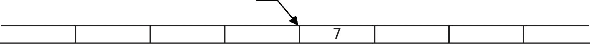 `1245048`

该运算符不能应用于字符串位域、结构体或用`register`限定符声明的标识符，这些概念我们稍后会看到。

#### 取值运算符

`*`（间接）运算符通过方向（指针）间接访问值。结果是操作数所地址的值；换句话说，指针指向的值。

指针是一个能够存储内存地址的变量，该地址指示指定类型数据（例如整数）的位置。定义指针的语法为：

```
type * identifier ;
```

其中`type`是指向的数据的类型，`identifier`是指针的名字（包含内存地址的变量）。

下面的示例声明了一个指向整数值`x`的指针`px`，然后将此值赋值给整数`and`。

```c
#include <stdio.h>
main()
{
    int *px, x = 7, and = 0; // px 是一个指向数值的指针。
    px = &x; // 在指针 px 上存储了
    //  x 的地址。
    and = *px; // 在 and 上存储了位于
    // px 存储的地址的值。
    printf("memory address = %d, data = %d\n", &x, x); 
    printf("address from memory = %d, fact = %d\n", px, *px);
}
```

**运行程序：**

```
address from memory = 1245048, fact = 7 
address from memory = 1245048, fact = 7
```

*(注：原文有重复的执行行，此处保留核心逻辑)*

```c
unsigned char b; int c;
float d; int F;
F = to + b * c / d;
```

在前面的表达式中，先执行乘法，然后是除法，最后是加法。根据此，评估过程将采取如下形式：

1. `b`被转换为`int`（它通过了 4）。

2. `b`和`c`的类型都是`int`。执行乘法`*`并得到一个类型为`int`的结果。

3. 由于`d`的类型是`float`，`b * c`的结果被转换为`float`（步骤 3）。我执行除法`/`并得到一个类型为`float`的结果。

4. `a`被转换为`float`（步骤 3）。执行加法`+`并得到一个类似于`float`的结果。

5. `to + b * c / d`的结果为了赋值给`f`，将通过截断传递给整体，即移除小数部分。

当 C 编译器需要执行类型转换但无法执行时，它会警告此类事件。在这些情况下，最正常的方法是通过分析显式转换来解决此类实际情况。

C/C++ 允许通过名为`cast`的构造对表达式类型进行显式转换（强制转换），形状如下：

`( type ) expression`

例如，以下程序写了`i`等于 9 时`i/2`的平方根：

```c
/*  square_root.c */
#include <stdio.h> // printf 需要
#include <math.h> // sqrt (root square) 需要

main()
{
    int i = 9; double r = 0;
    r = sqrt(i/2);
    printf("The root square is %g\n", r);
}
```

执行该程序：

平方根是二

你可能等待得到的结果是 4.5 的平方根，而不是 4。发生这种情况是因为两个整数的除法（`i/2`）得到了另一个整数。为了得到预期的结果，我们需要将`i`转换为`double`，只为了执行`i/2`操作，正如在本节中讨论的，这将强制编译器像处理两个操作数都是`double`一样处理`i/2`操作。为此，我们必须写：

`r = sqrt( (double)i /2);` // 强制从`int`到`double`的转换

现在，是的，我们重新执行程序，我们将得到以下结果：

平方根是 2.12132

当执行显式转换时，表达式被转换为指定的类型，无论该转换是否被允许；否则，将返回错误。`cast`构造的正确使用确保了评估的一致性。尝试它，但只要可能，最好避免它，因为它抑制了编译器提供的验证，因此可能导致意外的结果。

在 C++ 中，`cast`构造也可以这样表达：

`type ( expression )`

语法类似于调用函数，通过它接收了来自函数式记法的名称。根据此约定，之前的示例我们就会写成：

`r = sqrt(double(i)/2);`

函数式记法只能在 C++ 中使用，并且带有简单名称类型。如果不是，使用`typedef`给派生类型分配一个简单的名称。例如：

```c
typedef int *paint;
// ...
int *p = paint (q);
```

### 总结

- 参与确定操作的操作数。它们被转换为精度更高的操作数的类型。
- 在 C 中，实数常数默认是`double`类型。
- 布尔表达式给出的结果是 1 为真（true），0 为假（false）。
- 在赋值时，右部分的值被转换为左侧变量的类型，符合以下规则：
  - 字符转换为整数，有或无符号扩展均可，取决于安装。通常转换带有符号扩展完成的。
  - 整数转换为字符，保留最低有效位，即丢弃权重过高的高位。
  - 实数转换为整数，截断小数部分。
  - `double`变为`float`，会进行舍入并丢失精度，因为`double`值可能无法精确表示。
- 当一个值作为参数传递给函数时，也会发生转换。这些转换在每个文件的调用处独立执行。

### 练习建议

1. 下列表达式中哪个对应序列？
   - a) ESC。
   - b) `\n`。
   - c) `0x07`。
   - d) `n`。

2. C 中的基本类型：
   - a) `int`、`float`和`void`。
   - b) `boolean`、`char`、`short`、`int`、`long`、`float`和`double`。
   - c) `char`、`short`、`int`、`long`、`enum`、`float`和`double`。
   - d) 变量和常量。

3. C 假设什么类型是：
   - a) 整数。
   - b) 实数。
   - c) 新。
   - d) 常量。

4. `0134`是字面量：
   - a) 十进制。
   - b) 进制。
   - c) 十六进制。

5. `17.24`是字面量：
   - a) `char`。
   - b) `int`。
   - c) `float`。

6. 表达式是：
   - a) 变量。
   - b) 字符。
   - c) 整数。
   - d) 值。

7. 在赋值时，右部分的值被转换为左侧变量的类型，符合以下规则：
   - 字符转换为整数，有或无符号扩展均可，取决于安装。通常转换带有符号扩展完成。
   - 整数转换为字符，保留最低有效位，即丢弃权重过高的高位。
   - 实数转换为整数，截断小数部分。
   - `double`变为`float`，会进行舍入并丢失精度，因为`double`值可能无法精确表示。

8. 它定义`a = 5`、`b = 2`且`c = 0`类型为`int`。`c > b`的值是：
   - a) 3。
   - b) 2。
   - c) 1。
   - d) 0。

9. 它定义`a = 5`和`b = 0`类型为`int`。`b++`的值是：
   - a) 4。
   - b) 0。
   - c) 6。
   - d) 5。

10. 它定义`to = 5`类型为`int`。`a/(double)2`的结果是：
    - a) 2。
    - b) 2.5。
    - c) 3。
    - d) 0。

现在，如果一个程序包含几个函数，你选择从哪一个开始执行呢？执行 C/C++ 程序的入口点始终是`main`函数。因此，每个 C 或 C++ 程序都必须包含一个名为`main`的`main`函数，如下所示：

```c
main()
{
    // 在此处编写想要运行的代码
}
```

`main`后面的括号表示该标识符对应于一个函数。这适用于所有函数。在第一行代码的之前和之后，需要写一个开启的左大括号 - `{` - 这是程序开始执行的地方。然后编写执行所需任务的语句，并以一个关闭右大括号结束 - `}` - 这就是程序执行结束的地方。

## 程序设计

如上所述，任何问题的解决方案都不应该立即考虑对应语言的语句层面，而应该考虑问题本身的自然元素，并以某种方式对其进行抽象，这将为上述函数的开发提供空间。

程序的自顶向下设计实际上在于，通过系统地将问题分解为日益简单的子问题，并应用“分而治之”的原则来找到问题的解决方案。

这种程序开发技术的使用，以及仅使用三种结构——顺序、分支和重复——引导我们进入了所谓的结构化编程。这是开发本书所有示例时所使用的技术。

## 示例：温度转换

为了解释 C 程序的结构，我们将提出一个简单的程序示例，展示摄氏度和华氏度之间的对应表。如下图所示：

- -30 C, -22.00 F
- -24 C, -11.20 F
- ...
- ...
- 90 C, 194.00 F
- 96 C, 204.80 F

摄氏度与华氏度的关系由表达式`fahrenheit = 9/5 * degrees centigrade + 32`给出。将在 -30 到 100 摄氏度的区间内进行计算，增量为 6。

让我们分析这个问题。要问什么？计算 -30 C、-24 C、...、n 摄氏度、...、96 C 对应多少华氏度。我们怎么做？对于`nDegreesCentigrade`的每一个值（从 -30 到 100，增量为 6），都应用一次公式`Fahrenheit degrees = 9/5 * nDegreesCentigrade + 32`。

为了清晰地理解这一点，让我们通过例子来思考问题；例如，当要求我们计算某个数`n`的对数时，我们会做什么？使用函数`log`，如下所示：

```c
x = log(n)
```

同样，如果我们有一个`convert`函数来完成将 n 摄氏度转换为华氏度的计算，我们会写道：

```c
Fahrenheit degrees = convert(nCelsiusDegrees)
```

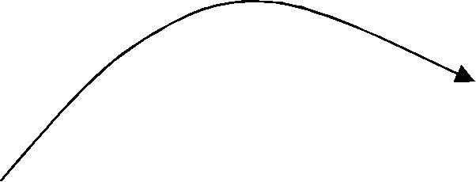

几乎在没有意识的情况下，我们正将问题分解为更简单的子问题来解决。记住一个 C 程序必须有一个`main`函数，如果必要的话还有其他函数，那么上述语句在图形化上是什么样的？下面的图提供了该问题的答案：

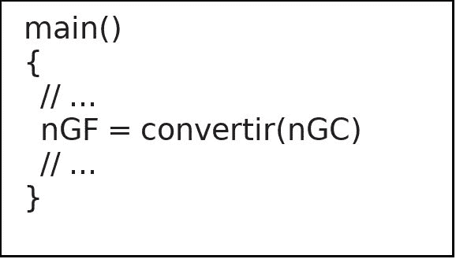

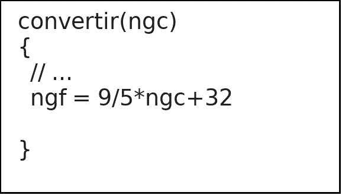

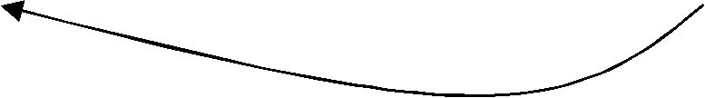

类似于我们处理对数函数的方式，在这里，从`main`函数调用了`convert`函数，并将要转换的摄氏度值作为参数传递给它。对数函数返回传入值的对数结果。`convert`函数返回与传递的摄氏度值对应的华氏度值。剩下的只需要可视化这个结果，并对描述的每个值重复该过程。

头脑会想，我知道的所有过程可能都只使用`main`函数就能完成，这是肯定的。但，目的是让你清楚地看到，通常情况下，一个 C/C++ 程序是一组相互调用的函数，以获得所需的结果，而解决问题的简单方法是将其分解为更小的子问题，从而更容易修复；每个子问题将由一个 C 函数解决。

## 自主函数

另一个重要的细节是，我们写的函数必须是自主的，这样以后在其他程序中就可以顺利地使用它们。当一个函数完全仅取决于它自身的参数时，它是自主的。

例如，无论对数函数的理由是什么，当我们调用它时，只需传递我们想要计算对数的值。我们的计算器不需要任何其他先验操作。函数不需要像我们写的那样执行，因为如果在传递参数之外，我们必须对其执行某些外部操作（例如在`main`中为函数的用户名声明确定变量），你就会忘记这个要求，这将成为错误的源头。

另一方面，当一个函数是自主的时，我们只需要知道必须传递给它的值以及它返回什么结果；例如`convert`函数。

## 实现

一旦我们分析了问题，就可以编写代码了。现在重要的是学习程序的结构像什么样，而不是为什么要写某一句或某句，这个问题你将在本章及后续章节中学习。这个示例将作为最初编写你自己的程序的模板。

```c
#include <stdio.h>

/* 函数原型声明 */
float convert(int c);

#define INF -30
#define HIS P 100

int main()
{
    int nDegreesCentigrade = 0;
    int increase = 6;
    float Fahrenheit degrees = 0;

    nDegreesCentigrade = INF;
    while (nDegreesCentigrade <= HIS P)
    {
        Fahrenheit degrees = convert(nDegreesCentigrade);
        printf("%10d C %10.2f F\n", nDegreesCentigrade, Fahrenheit degrees);
        nDegreesCentigrade += increase;
    }
    return 0;
}

float convert(int c)
{
    float gfahr;
    gfahr = (float)9 / (float)5 * c + 32;
    return (gfahr);
}
```

在编写 C 函数时，必须在编写第一个语句之前完成其定义和/或声明。相反，C++ 允许你在任何地方执行语句；也就是说，在我需要它的任何时刻都可以进行。

### 预处理器指南

这些指南的目的是便于程序的开发、编译和维护。指令是以字符`#`开头的标识符。最常见的指令是包含指令`#include`和替换指令`#define`。

这些指南由预处理器（来自`c`）进行处理，该预处理器是在编译器翻译程序源代码之前被调用的。稍后，我们将专门用一个章节来详细介绍 C 预处理器的所有指令。

### 包含指令

通常，当函数在定义之前被调用时，有必要在调用之前包含该函数的原型。例如，观察上一个程序中的`turn`函数。`turn`的定义写在`main`函数之后，而`main`函数调用了`convert`函数。

由于调用发生在定义之前，因此需要写该被调用函数的原型。这适用于所有函数，包括 C 库函数，如`printf`。C 库文件的函数声明位于头文件中（以`.h`结尾的普通文件）。这些文件通常位于预定义的包含目录或工作目录中。

如前一节所述，要在第一次调用 C 库函数之前包含其声明，只需包含包含它的头文件即可。这通过以下两种方式之一的`#include`指令来完成：

```c
#include <stdio.h>
#include "misfuncs.h"
```

如果头文件由字符`< >`界定，C 预处理器将直接在默认包含目录中查找该文件。如果文件由字符`" "`界定，C 预处理器将首先在当前工作目录中查找该文件，如果没有找到，将继续在预定义的包含目录中搜索。在任何情况下，如果找不到文件，它将显示错误。

逻辑上，通过此指令，你可以包含任何包含源代码的文件，无论其扩展名是什么。

### 替换指南

指令`#define identifier value`告诉编译器程序中`identifier`的所有出现处必须替换为`value`。这项工作是由预处理器完成的。例如：

```c
#define INF -30
#define SUP 100
```

当 C 预处理器处理上述示例中的指令时，源程序中`INF`和`SUP`的所有出现处将被替换为相应的值，这可以继续执行后续操作。

```c
nDegreesCentigrade = -30;
while (nCelsius Degrees <= 100)
{
    // ...
}
```

### 定义与语句

声明向程序中引入一个或多个名称。声明是一个定义，除非没有内存分配，这种情况发生在：当函数被声明时、当定义一个新类型时、当声明一个类型的别名时，或者当在某处定义的变量使用了外部`external`修饰符使其变得可访问时（此处定义）。

每个变量都必须在使用之前定义。变量的定义不仅声明了该变量，还为它分配了内存（在定义变量时，编译器会分配必要的字节来存储该类型的值）。此外，变量可以在其定义时初始化：

```c
int nDegreesCentigrade = 0; 
int increase = 6;
float Fahrenheit degrees = 0;
```

函数定义声明了函数，并包含了函数体。同样：

```c
float convert(int gcent)
{
    float gfahr;
    gfahr = (float)9 / (float)5 * gcent + 32; 
    return (gfahr);
}
```

变量的声明或定义，以及函数的声明，可以在内部（函数定义内部）或外部（任何函数定义之外）完成。相反，函数的定义始终发生在外部（也就是说，函数不能包含另一个函数）。

### 简单语句

单一语句是 C 程序中最小的可执行单元。语句控制执行的流或顺序。C 语句可以由以下部分组成：关键字（`for`、`while`、`if`...`else`等）、表达式、声明或函数调用。

在编写语句时，请记住以下考虑因素：

- 所有简单语句都以分号（`;`）结束。
- 两个或多个语句可以出现在同一行，通过分号隔开，尽管这种处理方式是不建议的，因为违背了阅读代码时所需的清晰度。
- 空语句由一个分号组成。当我们看到空语句时，就能看到它的用途。

### 复合语句或块


复合语句或块是组括在大括号`{ }`之间的简单语句的集合。一个块可以包含其他块。这种类型的示例是：

```c
Fahrenheit degrees = convert(nDegreesCentigrade);
printf("%d C %.2f F\n", nDegreesigrade, Fahrenheit degrees);
nDegreesigrade += increase;
```

## 函数

函数是一个执行特定任务并用名称进行引用的语句块。该块是函数体，名称是函数名。当你编写一个函数时，除了函数体和函数名外，通常还需要指定参数和返回类型。例如：

```c
float convert(int gcent)
{
    float gfahr;
    gfahr = (float)9 / (float)5 * gcent + 32; 
    return (gfahr);
}
```

参数是在函数被调用时传递给函数的值。该值将存储在函数对应的参数上。

## 函数声明

函数的声明（也称为函数原型）不仅指示了函数名称，还指示了它有多少个参数以及参数的类型，以及返回值的类型。其语法为：

`结果-类型 函数-名称([ 参数列表 ]);`

函数原型是一个模板，它被用于确保在函数定义之前编写的调用语句是正确的；也就是说，将相应的参数传递给指定的参数，并确保函数以及返回的值被正确处理。

类型和参数数量的检查允许在编译期间检测是否存在某些错误。

例如，以下语句指示了在调用函数`convert`时，必须传递一个整数参数，该函数在执行完毕后将返回一个浮点数值。

```c
float convert(int c);
```

总之，函数的声明允许在同一个地方知道该函数的特征，但并没有定义其要执行的任务。

函数可以隐式地或显式地声明。声明——隐式语句发生在函数被调用且没有通过`(function prototype)`进行预先声明时。在这种情况下，C语言默认假设函数原型的结果返回类型为`int`，并且不检查参数列表。这迫使函数定义中的结果类型必须为`int`，或者不指定；否则，将返回错误。例如，下面的定义指示该函数默认返回一个`int`，所以它允许了隐式语句：

```c
function_x(int p1, float p2, char p3)
{
    // 通过省略，该函数返回的数值
    // 在被调用时应该是 int 类型。
}
```

我们到目前为止使用的`main`函数一直被假定是隐式声明的。也许，在解释了这些之后，你会问自己：为什么它不返回值呢（为什么它没有`return`语句）？仅仅因为没有返回值，程序本身就不包含对该函数的调用。

C++不支持函数的隐式声明。因此，为了确保代码的可移植性，建议始终对函数进行显式声明。显式声明指定了函数参数的数量和类型，以及返回值的类型。例如，下面的原型指示`function_x`有三个类型参数`int`、`float`和`char`，并且它应该返回一个`float`类型的结果。

```c
float function_x(int p1, float p2, char p3);
```

参数列表通常由一组用逗号分隔的标识符及其类型组成。在函数原型的情况下，可以跳过标识符。例如：

```c
float function_x(int, float, char);
```

另一方面，当指定它们时，它们的作用域限制在语句内；也就是说，它们在其他地方无法访问（它们的存在仅仅是为了使语法更清晰）。

由此可以推推出，在函数语句中使用的标识符和稍后在函数定义中使用的标识符并不一定意味着它们必须具有相同的名称。观察从之前的程序中转换的函数声明和定义的示例：

```c
float convert(int c); /* 函数原型转换为 */

// ...

float convert(int gcent) /* 函数定义转换为 */
{
    // ...
}
```

参数的就绪也可以为空。例如：

```c
float function_x();
```

然而，在ANSI C（美国国家标准协会）中，缺少参数表示数量是不确定的，而在C++中这表示没有参数。因此，为了确保程序的可移植性，使用了关键字`void`，它在所有情况下都表示没有参数：

```c
float function_x(void);
```

同样，为了指示函数不返回任何内容，也使用了关键字`void`。例如：

```c
void function_x(void)
```

最后，当调用我们程序中定义的函数时，有必要将其原型添加到C库函数中吗？是的，是有必要的，完全就像任何其他函数一样。但不要担心，这项任务很容易，因为属于C标准库的函数声明（如`printf`）是由头文件或`.h`文件提供的。因此，当程序使用（例如`printf`函数时，你会注意到它包含了头文件`stdio.h`。

```c
#include <stdio.h>
```

我们如何知道已定义函数的原型在哪个头文件中？因为在指定来自C的库函数语法时，我也知道它所声明的头文件。

## 函数定义

函数的定义由函数头和封装在大括号之间的函数体组成。

```c
result-type function-name ([ parameters formal ])
{
    statements from variables local ; sentences ;
    [return [(] expression [)]];
}
```

在函数体中声明的变量是局部变量，根据定义，它们只在同一个函数内部可访问。

结果的类型指定了函数返回的数据类型。这可以是任何基本类型或派生类型，但不能是数组或函数。是的，如果没有指定，我假设是`int`。为了指示不返回任何内容，使用了关键字`void`。例如，下面的函数不接受参数也不返回任何值：

```c
void message(void)
{
    printf("计算过程中发生错误\n");
}
```

函数的结果通过`return`语句返回到调用点。`return`语句的语法如下：

```c
return [(] expression [()];
```

`return`语句可以不是最后，也可以出现在函数体的任何位置。

```c
int function_x(int p1, float p2, char p3)
{
    // ...
    if (a < 0) return 0;
    // ... return 1;
}
```

在前面的示例中，如果`a < 0`，函数返回0并结束执行；如果`a >= 0`，执行继续并返回1。这就是我们在语句中说的。

## 函数调用

调用函数与执行函数等同。调用可以从另一个函数发出，或者正如我们以后看到的，甚至从自身发出。该调用由函数名后跟一组在括号内并用逗号分隔的参数组成。例如：

```c
/* 调用 convert 函数 */
Fahrenheit degrees = convert(nDegreesCentigrades);
```

参数`nCentigradeDegrees`是变量，在逻辑上存储了你想传递给`convert`函数的数据。一旦`convert`函数执行完毕，它返回的结果就会存储在指定的变量`Fahrenheit degrees`中。

### main函数

每个C程序都有名为`main`的函数，且只有一个。该函数是程序的入口点也是出口点。它的定义如下所示：

```c
int main(int argc, char *argv[])
{
    // 函数体
}
```

A) 是的本身，C++允许你指定`main`不返回返回值：

```c
void main()
{
// 函数体
}
```

在另一种情况下，在东部案例中，ANSI C编译器会显示一个警告，指示`main`没有返回`int`。

## A示例

为了澄清上述内容，我们将创建一个包含三个函数的简单程序：`main`、`add`和`subtract`。`add`函数将接收两个实数值作为参数并返回它们的和。同样，`subtract`将返回减法结果。该程序的代码可能如下：

```c
#include "stdio.h"

double add(double, double); double subtract(double, double);

main()
{
    double op1 = 225, op2 = 100, result = 0;
    // 加法
    result = add(op1, op2); printf("Sum = %g\n", result);
    // 减法
    result = subtract(op1, op2); printf("Subtract = %g\n", result);
}

double add(double x, double and)
{
    double z;
    z = x + and; return z;
}

double subtract(double x, double and)
{
    double z;
    z = x - and; return z;
}
```

执行程序：

Sum = 325

当我们运行上述程序时，执行从`main`开始。该函数首先定义了变量`op1`、`op2`和`result`。然后调用`add`函数并传递了值`op1`和`op2`；第一个值被复制到你的第一个参数`x`，第二个值被复制到它的第二个参数`y`。函数`Add`根据这些值计算和，存储在它的局部变量`z`中，并返回该结果，从而结束执行。返回值存储在`main`的局部变量`result`中。随后`Main`然后调用`printf`函数并显示存储在`result`中的值。最后，重复描述的过程，但现在调用`subtract`函数来执行减法。注意在最后这次计算中结果值发生了变化，存储了余数的结果。

## 向函数传递参数

当函数被调用时，调用中的第一个参数传递给函数的第一个参数，第二个参数传递给第二个参数，依此类推。默认情况下，除数组外的所有参数都是按值传递的。这意味着函数接收的是参数值的副本。这假设被调用的处理的是副本，无法改变值来源的变量。

在接下来的示例中，你可以看到函数`main`调用函数`exchange`并传递了参数`a`和`b`。`exchange`函数在`x`处存储`a`的值，在`y`处存储`b`的值。这意味着数据`a`和`b`被复制了。

```c
/* value.c - 按值传递参数 */
#include <stdio.h>

void swap(int, int); /* 函数原型 */
main()
{
    int to = twenty, b = 30;
    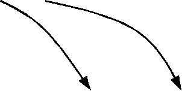exchange(to, b); /* to 和 b 被按值传递 */ printf("a okay %d and b okay %d\n", to, b);
}

void exchange(int x, int and)
{
    int z = x; x = and;
    and = z;
}
```

让我们从图形角度来看。假设下图表示我们的程序使用的计算机段内存。当`main`函数的执行开始时，变量`a`和`b`被定义并分别从20和30开始。当`main`调用函数`exchange`时，定义了两个新变量`x`和`y`，分别用`to`和`b`的值初始化。结果如下：

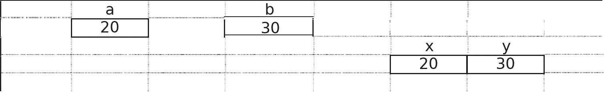

swap继续执行。定义了一个新变量`z`，初始值为`x`的值。接下来，`y`的值被复制到`x`，`y`的值被复制到`y`（来自`z`，即最初的`x`）。从图形上看结果如下：

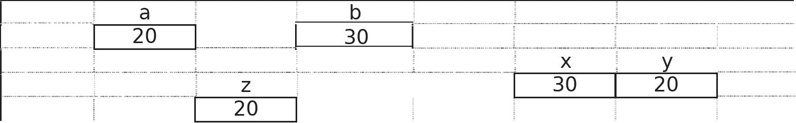

`swap`函数的参数`x`和`y`是该函数的局部变量；`z`也是。这意味着它们仅在函数内部是可以访问的。这意味着局部变量在运行函数时创建，在函数执行结束时销毁。因此，一旦执行流返回`main`函数，因为`exchange`已结束，内存状态保持不变。（此处原文中存在重复的句子已去重）。

```c
and = z; /* contents from and = z */ own
```

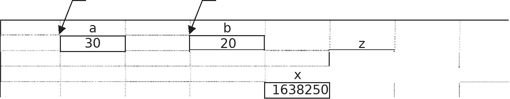1638250 1638258

| twenty | and |

| | 1638258 |

当`swap`函数结束时，`a`和`b`的值已经交换了。由于`and`以及变量`z`、`x`和`and`是局部变量，它们会被销毁。

因此，通过引用向函数传递参数是为了让函数间接地访问所传递的变量；这与按值传递参数不同，这样就不会产生数据冗余。

生活中的一个普通例子可以解释这一点。个人`A`在`C`地中执行了一个程序。随后，他通过电子邮件将一个副本发送给另一个个人`B`进行校正。显然，个人`B`在收到的副本上执行的修正操作不会改变`A`手有的那一个。

现在，如果不是发送副本，而是`A`告诉`B`连接到他的机器`190.125.12.78`，并纠正存储在这个或或那个文件夹中的程序，那么`A`和`B`都在同一个程序副本上工作。这就是引用传递参数时发生的情况。

涉及到`C`库函数时，你也将遇到这两种情况。例如，假设你想写一个程序，读取两个值到`a`和`b`，并写出它们的和。解决方案如下：

```c
/* add.c - Add two values */
#include <stdio.h>

main()
{
    int a = 0, b = 0, s = 0;
    printf("Values from to and b: ");
    scanf("%d %d", &to, &b); /* read from the keyboard to and b */
    s = to + b;
    printf("The sum is %d\n", s);
}
```

该程序的执行结果可能是这样的：

Values from to and b: 10 20 [Enter] The sum is 30

`scanf`函数读取键盘输入的值并将其赋值给指定的变量；在示例中，赋值给变量`a`和`b`。现在注意这些变量，它们是按引用传递而非按值传递，这是符合逻辑的，因为`a`和`b`是`main`的局部变量，它们的值必须通过`scanf`赋值。相比之下，`printf`函数打印指定表达式的值；在这种情况下，是按值传递的变量`s`，这同样符合逻辑，因为`s`是`main`的局部变量，它的值不需要被`printf`修改，它只是被获取并可视化。

此外，后续我们将详细学习`printf`和`scanf`函数。

## 由多个文件组成的C程序

从我们所看到的，一个`C`程序是一组相互调用的函数（称为`main`）。我们不应该认为整个程序必须写在单个`.c`文件中。事实上，在实践中情况并非如此，因为除了`.c`文件之外，还涉及一个或多个头文件（`.h`）。例如，在最近的程序中，`add.c`和`stdio.h`文件的作用是清晰的，但是，

`C`库中的函数代码来自哪里？程序`add`调用了两个`C`库函数`scanf`和`printf`，这两个函数并没有写在`sumar.c`文件中，而是写在另一个独立的文件中，该文件是`C`库的一部分，在构建过程中被访问。链接到这些函数对应的代码。同样，我们可以这样做；即我们可以选择将感兴趣的函数写在一个或多个独立文件中，并使用一个或多个头文件进行声明和定义。

源文件可以包含编译器指令、声明和定义的任何组合。但是，一个函数或结构不能拆分在两个源文件之间。另一方面，源文件不需要包含可执行语句；例如，一个源文件可以仅由其他源文件中使用的变量定义组成。

作为上述内容的示例，我们将编写一个`C`程序，显示三个给定值中的最大值。为了实现这一点，我们将写一个`max`函数语句，返回作为调用参数传递的两个值中的较大者。该函数将被`main`函数调用两次：第一次计算前两个值中的较大值，第二次计算上一次结果与第三个值之间的较大值。所有三个值都将通过键盘输入。相应的代码写写两个文件中：

* `module01.c`文件包含`main`函数。

* `module02.c`文件包含`max`函数。

```c
/* module01.c */
#include <stdio.h>

main()
{
    int a = 0, b = 0, c = 0, higher = 0;
    printf("Values a, b and c: ");
    scanf("%d %d %d", &a, &b, &c);
    higher = max(a, b);
    higher = max(higher, c);
    printf("Greater = %d\n", higher);
}
```

```c
/* module02.c */
#include <stdio.h>

int max(int x, int y)
{
    int z = 0;
    if (x > y)
        z = x;
    else
        z = y;
    return z;
}
```

编译由多个文件组成的程序，必须单独编译这些文件，然后将它们链接形成一个单一的可执行文件。例如，使用以下命令：

`cl modulo01.c modulo02.c -o major`

`cc modulo01.c modulo02.c -o major`

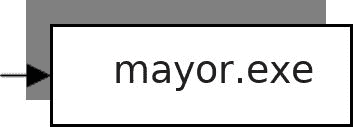1638250 1638258 (Note: Simplified)

如果变量在块内部声明，则对该变量的访问仅限于该块以及该声明点之后包含在内的块。在这种情况下，变量将接收`local`（局部）或`automatic`（自动）限定符。


局部变量从其声明点开始到其定义的最终块结束存在并具有值。每当运行该块时，局部变量都会被重新定义；当自身执行结束时，局部变量即消失。因此，局部变量仅在它所属的块内部可访问。

示例展示了变量的作用范围，取决于它们是定义在块内还是块外。在这个示例中，通过对变量范围的解析，我们区分出四个层次：

- 外部层（所有块之外）。在此层级定义的变量从定义点开始直到程序结束都可以访问。
- 来自`main`函数的块层。在此层级定义的变量仅在其自身的`main`函数中可以访问，因此在块 1 和块 2 中是可以访问的。
- 块 1 层（复合判断语句）。在此层级定义的变量仅在块 1 内部可以访问，因此在块 2 中可以访问。
- 块 2 层（复合判断语句）。在此层级定义的变量仅在块 2 内部可以访问。

```c
/* vars01.c - 全局与局部变量

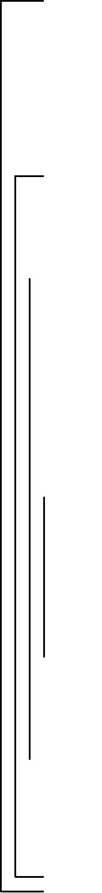*/

#include <stdio.h>

/* 从 var1 定义什么是全局变量 */
int var1 = fifty;

main()
{
    /* 从 main 和程序开始 */
    printf("%d\n", var1);  /* 写入 fifty */

    {  /* 开始块 1 */

        /* 将 var1 和 var2 定义为块 1 和块 2 的局部变量 */
        int var1 = 100, var2 = 200;

        printf("%d  %d\n", var1, var2);  /* 写入 100 和 200 */

        {  /* 开始块 2 */

            /* 局部变量 var1 的重定义 */
            int var1 = 0;

            printf("%d  %d\n", var1, var2);  /* 写入 0 和 200 */

        }  /* 结束块 2 */

        printf("%d\n", var1);  /* 写入 100 */

    }  /* 结束块 1 */

    printf("%d\n", var1);  /* 写入 fifty */

}  /* 结束 main 和程序 */
```

全局变量和局部变量可以具有相同的名称，但它们互不相关，这导致全局变量在同名局部变量的作用域内被屏蔽（nullified）。我所观察的示例展示了在之前的程序中`var1`发生了什么。

在函数声明或函数原型定义的参数列表中声明的参数，其作用范围仅限于声明本身，即函数的定义。例如：

```c
int max(int x, int and);  /* max 函数的语句 */
```

`max`函数声明中的`x`和`y`参数被限制在语句本身。由于某些原因，它们可以省略；也就是说，下行代码等同于上方：

```c
int max(int, int);  /* max 函数的语句 */
```

在函数的定义参数列表中声明的形式参数是该函数的局部变量。例如：

```c
int max(int x, int and)  /* max 函数的定义 */
{
    int z = 0;

    z = (x > and) ? x : and;
    return z;
}
```

函数`max`定义中的`x`和`y`是函数的局部变量；也就是说，`x`和`y`在调用函数执行时创建，在函数执行结束时消失。这就是为什么`x`和`y`仅在自身的函数内部可访问的原因。

### 变量存储类的启示

默认情况下，所有变量都关联有一个存储类。这决定了变量的访问性和存在性。变量的访问性和存在概念可能会受到限定符的影响。

`auto`和`register`限定符只能用于局部变量。存储类决定了变量的访问性和存在性。变量的访问性和存在概念可能会受到限定符的影响。

全局变量要么被初始化，要么因为是全局变量而自动被赋值为`0`。以下由两个源文件`one.c`和`two.c`组成的示例展示了`extern`是可见的。`two.c`中的`extern`声明允许`two.c`中的函数访问`one.c`中的全局变量`var`。

```c
/************************************************************
/* File one.c
*****************************************************************/

#include <stdio.h>

void function_1();
void function_2();

extern int var;

int var = 5;

void function_1()
{
    var++;
    printf("%d\n", var);
}

main()
{
    function_1();
    function_2();
}
```

```c
/************************************************************
/* File two.c
*****************************************************************/

#include <stdio.h>

void function_1();
void function_2();

extern int var;

void function_2()
{
    var++;
    printf("%d\n", var);
}

main()
{
    function_1();
    function_2();
}
```

### 局部变量的限定符

对于局部变量，我知道它们可以使用四种限定符中的任何一个，或者跳过限定符，在这种情况下它被视为`car`（自动或局部）。

声明为`auto`的局部变量仅在定义所在的块内可见。这些类型的变量不会自动初始化，因此需要显式地对它们赋值。建议始终对它们进行初始化。

声明为`static`的局部变量仅在定义的块内可见；但与自动变量不同，它的生命周期是永久的。它不会在包含它的块执行开始和结束时出现或消失。

声明为`static`的变量只初始化一次，即在`Program`开始执行时，并且每次运行包含它的块时都不会重启，而是下一次执行该块时将从该变量在上一次执行结束时的值开始。如果变量没有显式初始化，`C`将其自动初始化为`0`。

声明为`register`的局部变量是对编译器的一种建议，建议尽可能将该变量存储在机器寄存器中，这将产生更短、更快的程序。用于此类变量的可用记录数量取决于机器。如果无法将变量存储在寄存器记录中，我知道它将得到与自动变量相同的处理。这种声明对于`int`类型和指针类型的变量是有效的，取决于记录的大小。

在局部声明为`extern`的变量指的是程序任何部分中全局定义的同名变量。在这种情况下，`extern`的目的是为了在没有定义该全局变量函数或模块中访问它。接下来的示例将清楚地说明之前揭示的内容。

```c
/* vars02.c - 局部变量：存储类的教训 */

#include <stdio.h>

void function_1();

main()
{
    /* 我认为 var1 定义在其他地方语句 */
    extern int var1;

    /* 静态变量 var2：仅在 main 内部可见。其初始值为 0。 */
    static int var2;

    /* 我知道 var3 对应一个记录是可能的 */
    register int var3 = 0;

    /* var4 默认声明为 car（自动） */
    int var4 = 0;

    var1 += two;

    /* 我知道它们写入的值 7, 0, 0, 0 */
    printf("%d %d %d %d\n", var1, var2, var3, var4);

    function_1();
}

int var1 = 5;

void function_1()
{
    /* 我知道定义了局部变量 var1 */
    int var1 = fifteen;

    /* 静态变量 var2；仅在该块内可见 */
    static var2 = 5;

    var2 += 5;

    /* 我知道它们写入的值 fifteen, 10 */
    printf("%d %d\n", var1, var2);
}
```

在这个示例中，全局变量`var1`定义在`main`函数之后。因此，为了在`main`中访问它，使用了`extern`声明。在`main`中声明为`static`的变量`var2`默认从`0`开始。`var3`的存储类型是`register`，而`var4`是`car`。

在`function_1`中定义了局部变量`var1`；此定义隐藏了同名的全局变量，使其在该块内不可访问。声明为`static`的变量`var2`初始化为`5`。此定义与`main`函数中的变量`var2`不产生冲突，因为它们都是局部的。接下来，`var2`加了`5`。那么下次调用`function_1`时，它将从`var2`等于`10`开始执行，因为`static`局部变量会保留上一次执行中获得的值供下次使用。

### 函数的限定符

所有函数都是全局的；也就是说，函数不能定义在块内部。

带有`static`限定的函数仅在其定义的源文件中可见。相反，如果限定为`extern`，则可以在组成`Program`的所有源文件中访问。对函数进行`static`或`external`限定可以在函数原型或函数定义中进行。在默认情况下，函数是`extern`。例如，以下语句表明`function_1`是`static`的。

```c
static void function_l();
```

### 练习已解决

对函数进行`static`或`external`限定可以在函数原型或函数定义中进行。在默认情况下，函数是`extern`。例如，以下语句表明`function_1`是`static`的。

```c
static void function_l();
```

d) 来自`function_x`的声明，但缺少了参数中的`Names`。

### 5) `void`的含义是：

a) 是来自`data`的一种类型。

b) 它允许定义一个变量，但我不知道它将包含来自`data`的什么类型。

c) 在函数中使用时，它允许你指定它没有参数，以及/或不返回结果。

d) 当我了解某个特定函数使用任意数量的，例如——三个。

### 6) 假设以下代码：

```c
#include <stdio.h>

/* 来自 Add 的声明 */
main()
{
    double to = 10, b = twenty, c = 0;

    c = add(a, b);
    printf("sum = %g\n", c);
}

double add(double x, double and)
{
    return x + and;
}
```

以下语句中哪些可以写在注释所示的地方？

| 序号 | 类型 | 声明 |
|---|---|---|
| 1 | `double` | `add(double x, double and);` |
| 2 | `double` | `add(double, double);` |
| 3 | `double` | `add(double to, b);` |
| 4 | `double` | `add(double to, double b);` |

a) 除 3 之外的所有。

b) 所有。

c) 除 1 和 3 之外的所有。

d) 除 1、2 和 3 之外的所有。

### 7) 假设以下代码：

```c
#include <stdio.h>

void set_to_zero(double);

main()
{
    double a = 10;
    set_to_zero(a);

    printf("%g\n", to);
}

void reset_to_zero(double to)
{
    double to = 0;
    return;
}
```

编译并运行该程序：

a) 我知道将显示`0`。

b) 我知道将显示`10`。

c) 我知道将得到一个错误：`return`判断过度。

d) 我知道将得到一个错误：形式参数重复定义。

### 8) 假设以下代码：

```c
#include <stdio.h>

void set_to_zero(double);

main()
{
    double to = 10;

    set_to_zero(a);
    printf("%g\n", to);
}

void reset_to_zero(double to)
{
    to = 0;
    return;
}
```

编译并运行该程序：

a) 我知道将显示`0`。

b) 我知道将显示`10`。

c) 我知道将得到一个错误：`return`判断过度。

d) 我知道将得到一个错误：形式参数重复定义。

### 9) 假设以下代码：

```c
#include <stdio.h>

void reset_to_zero(double *);

main()
{
    double to = 10;

    set_to_zero(&a);
    printf("%g\n", to);
}

void reset_to_zero(double *to)
{
    *to = 0;
    return;
}
```

编译并运行该程序：

a) 我知道将显示`0`。

b) 我知道将显示`10`。

c) 我知道将得到一个错误：`return`判断过度。

d) 我知道将得到一个错误：形式参数重复定义。

### 10) 假设以下代码：

```c
#include <stdio.h>

void function_x(void);

main()
{
    double to = 10;

    function_x();
    function_x();
    printf("%g\n", to);
}

void function_x(void)
{
    static double to = 5;
    printf("%g\n", a);
    a++;
}
```

编译并运行该程序：

a) 我知道将显示`5, 5, 10`。

b) 我知道将显示`5, 6, 10`。

c) 我知道将显示`6, 6, 10`。

d) 我知道将显示`10, 11, 12`。

### 练习

2. 编写程序`degrees.c`并检查其可以执行。

3. 根据附录 B 中关于调试器的讨论，尝试逐步执行（Step）之前的程序，并验证执行过程中变量的值。

4. 修改程序`degrees.c`中的下限和上限。

5. 修改程序`degrees.c`中的语句`fahr = (float)9 / (float)5 + 32;`。

6. 编写程序`01.c`和`02.c`。

## 输入与输出

![Images/image1806.jpg]

当程序执行时，基本上有三件事发生：输入、输出和内存。

![Images/image1807.jpg]

输出不会从内存中删除数据；它只是将它们显示在显示器上、写入文件或保存到其中。

```c
assignment = value
```

`流（Stream）`是一种数据结构，在程序与信息的源或目的地之间充当中间媒介。也就是说，程序的读取或写入操作将进入流中，而无需关心信息从哪里来或去往哪里，也不关心读取或写入的是什么类型的数据。这种抽象层次使得程序不需要知道设备，也不需要信息的类型（简单地读取或写入字节），这简化了编写程序的难度。

因此，若要让程序从源获取信息，你必须打开一个流；同样地，你可以将信息发送到目的地。在 C/C++ 中，当程序执行时，这些流会自动打开。有两个流：`stdin`（标准输入）是来自源的流，`stdout`（标准输出）是流向目的地的流。

在 C 中，`stdin`绑定到键盘，`stdout`绑定到屏幕。这意味着程序从`stdin`读取的数据来自键盘，而所有写入`stdout`的数据都会显示在屏幕上。

### 格式化输出

`printf`函数允许你使用指定的格式化字符串向`stdout`写入字节（字符）。该函数返回一个整数值，等于写入的字符数。该函数的声明在`stdio.h`中，如下：

```c
#include <stdio.h>

int printf(const char *format [, argument ]...);
```


兼容性：ANSI、UNIX 和 Windows

格式（Format）指定输出的形式。它是一个字符字符串，由普通字符、转义序列和格式中的说明符组成。格式从左到右读取。

```
unsigned int age = 0; float weight = 0;
```

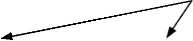 // ...

格式中的说明符

```
printf(" has %or years and weight %g kilograms \n ", age, weight);
```

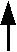

普通字符、转义序列、`argument` 代表要写入的值或多个值。每个参数必须有格式中对应的说明符，且顺序相同。如果参数多于格式说明符，多余的参数将被忽略。

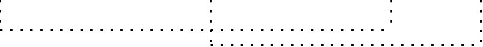 `printf("Has %or years and weight %g kilos\n", age , weight );`

当执行上述语句时，普通字符将原样写入，格式说明符将被替换为对应的值。参数列表中的参数和转义序列将产生它们代表的字符或动作。因此，当 `age` 等于 20，`weight` 等于 70.5 时，结果为：

二十岁体重 70.5 公斤

一个格式说明符由以下部分组成：

```
%[ flags ][ width ][ .precision ][{h|l|L}] type
```

格式说明符始终以 `%` 开头。所示每个元素的含义如下：

标志（flags）含义


- 将结果在指定的宽度内左对齐。默认是右对齐。
- `+` 在值的前面加上符号 `+` 或 `-`。默认仅对负值加上符号 `-`。
- `0` 用 0 填充值，直到达到指定的最小宽度。
- ` `（空格）在正数值值前面加上一个空格。如果与 `+` 一起使用则会被忽略。
- `#` 当与格式说明符 `o`、`x` 或 `X` 使用时，分别在值的前面加上 `0`、`0x` 或 `0X`。
- 当与格式说明符 `e` 使用时，强制值在所有情况下都包含小数点。
- 当与格式说明符 `g` `G` 使用时，强制输出值在所有情况下都包含小数点，并避免尾零被截断。
- 与 `c`、`d`、`i` 或 `u` 无。


- `width`（宽度）输出的最小位置数。如果写入的值占据的位置超过指定，则需要增加宽度。
- `precision`（精度）含义取决于值的类型。

`type` 是以下字符之一：

输出字符


- `d` (int) 进制 10 带符号符号整数。
- `i` (int) 进制 10 带符号整数。
- `u` (int) 进制 10 无符号整数。
- `o` (int) 进制 8 无符号整数。
- `x` (int) 进制 16 无符号整数。
- `X` (int) 进制 16 无符号整数。
- `f` (double) 浮点小数表示法。
- `e` (double) 科学计数法，小写指数。
- `E` (double) 科学计数法，大写指数。
- `g` (double) 在 `f` 和 `e` 之间选择。
- `G` (double) 在 `f` 和 `E` 之间选择。
- `c` (char) 字符。
- `s` (string) 字符串。
- `p` (pointer) 指针地址。
- `n` (null) 打印的字符数。
- `h` (short) 修饰符。
- `l` (long) 修饰符。
- `ll` (long long) 修饰符。
- `L` (long double) 修饰符。
- `z` (float) 修饰符。
- `t` (size_t) 修饰符。
- `J` (long long) 修饰符。
- `I` (unsigned long long) 修饰符。
- `M` (long double) 修饰符。
- `m` (max_t) 修饰符。
- `a` (hex float) 修饰符。
- `b` (long float) 修饰符。
- `B` (long float) 修饰符。
- `c` (long double) 修饰符。
- `F` (long double) 修饰符。
- `q` (long double) 修饰符。
- `n` (long double) 修饰符。
- `j` (long long) 修饰符。
- `T` (unsigned long long) 修饰符。
- `t` (size_t) 修饰符。
- `m` (max_t) 修饰符。
- `a` (hex float) 修饰符。
- `b` (long float) 修饰符。
- `B` (long float) 修饰符。
- `c` (long double) 修饰符。
- `F` (long double) 修饰符。
- `q` (long double) 修饰符。
- `n` (long double) 修饰符。

*(注：提供的文本由于 OCR 错误存在部分混乱，已在保持核心逻辑的基础上进行了清理。)*

- `%.2f` 用于写入实数 `b` 的值（`f` 表示实数值、`float` 或 `double`）。该格式未指定宽度，这意味着它们将作为用作占位符。我知道可视化结果需要它，但是的，我知道可以指定小数点位数，这里是 2。要写入小数部分，会截断剩余的小数位并进行四舍五入；也就是说，如果下一个被截断的小数位是 5 或更大，则前一位加 1。
- `\n` 用于跳转到下一行。

在格式规范中，宽度和/或精度可以用 `*` 替换。如果使用 `*` 字符指定宽度和/或精度，则这些字段的值将取自相应的参数。例如：

```c
int width = fifteen, precision = two; double value = -12,346;

printf("%*.*f", width, precision, value);
```

结果默认右对齐，宽度为 15 个位置，其中两个是小数。为了让结果向左对齐，我们需要使用以下格式：

```c
printf("%-*.*f", width, precision, value);
```

继续解释，精度根据类型具有以下含义：

| 类型 | 精度的含义 |
| :--- | :--- |
| `d,i,u,o,x,X` | 指定必须输入的数字最小位数。如果需要，会在左侧填充零。如果值超过精度，则不会被截断。 |
| `e,E,f` | 指定小数点前必须写入的数字个数。默认为 6。该值将进行四舍五入。 |
| `g,G` | 指定要写入的最有效数字个数（默认为 6）。 |
| `c` | 精度没有影响。 |

 指定将写入的最大字符数。超过此数量的字符将被忽略。

- `h` 作为类型 `d, i, o, x 和 X` 的前缀使用，用于指定参数为 `short int`，或用 `u` 指定为短无符号整数。
- `l` 作为类型 `d, i, o, x 和 X` 的前缀使用，用于指定参数为 `long int`，或用 `u` 指定为长无符号整数。也用于类型 `e, E, f, g 和 G`，用于在 `float` 之前指定一个 `double`。
- `L` 用于类型 `d, AND, E, F, g 和 g` 的前缀，用于指定 `long double`。`East` 前缀不兼容 ANSI c 标准。

以下句子展示了使用 `printf` 函数的一些示例。

```c
/* output02.c */

#include <stdio.h>

main()

{

    char car;

    static char Name[] = "The temperature environment";

    int a, b, c;

    float x, and, z;

    car = 'C'; to = twenty; b = 350; c = 4995; x = 34.5; and = 1234; z = 1,248;

    printf("\n%s is from ", name);

    printf("%d degrees %c\n", to, car);

    printf("\n");

    printf("a = %6d\tb = %6d\tc = %6d\n", a, b, c);

    printf("\nThe results are as follows:\n");

    printf("\n%5s\t\t%5s\t\t%5s\n", "x", "y", "z");

    printf("  \n");

    printf("\n%8.2f\t%8.2f\t%8.2f", x, y, z);

    printf("\n%8.2f\t%8.2f\t%8.2f\n", x+y, y/5, z*2);

    printf("\n\n");

z *= (x + and);

    printf("Value resulting: %.3f\n", z);

}
```

作为一个练习，写出运行上述程序时显示的结果。记住 `\t` 是转义序列，用于提供水平制表符。结果右对齐，如示例所示。

环境温度为 20 度 C to = 20 b = 350 c = 4995
结果如下：
(Images/image18521.jpeg)
| x | y | z |
| :--- | :--- | :--- |
| 34.5 | 1234 | 1248 |

Value resulting: 43056.000

### 格式

`printf` 函数从 `stdin` 读取内容，解释它们并存储在内存中。参数通过引用传递。`printf` 函数用于将数据输出到屏幕。`printf` 函数用于将数据输出到标准输出。`printf` 函数用于向标准输出打印格式化字符串。`printf` 函数返回打印的字符数。如果发生错误，它返回一个负值。

`printf` 函数也用于格式化字符串。格式字符串可以包含格式说明符，这些说明符由传递给 `printf` 的参数替换。格式说明符包括 `%d`, `%f`, `%s`, `%c` 等。

`scanf` 函数用于从标准输入读取。格式字符串可以包含格式说明符，这些说明符由传递给 `scanf` 的参数替换。格式说明符包括 `%d`, `%f`, `%s`, `%c` 等。`scanf` 函数返回成功读取的项目。如果发生错误，它返回 `EOF`。

`scanf` 函数也用于格式化字符串。格式字符串可以包含格式说明符，这些说明符由传递给 `scanf` 的参数替换。格式说明符包括 `%d`, `%f`, `%s`, `%c` 等。

`sprintf` 函数用于将格式化字符串写入缓冲区。格式字符串可以包含格式说明符，这些说明符由传递给 `sprintf` 的参数替换。格式说明符包括 `%d`, `%f`, `%s`, `%c` 等。`sprintf` 函数返回写入的字符数。

`snprintf` 函数用于将格式化字符串写入缓冲区，并限制写入的字符数。这可以防止缓冲区溢出。`snprintf` 函数返回实际写入的字符数。

`fprintf` 函数用于将格式化字符串写入文件。格式字符串可以包含格式说明符，这些说明符由传递给 `fprintf` 的参数替换。格式说明符包括 `%d`, `%f`, `%s`, `%c` 等。`fprintf` 函数返回写入的字符数。

`fprintfn` 函数将格式化字符串写入文件，并限制写入的字符数。这可以防止缓冲区溢出。`fprintfn` 函数返回实际写入的字符数。

`vprintf` 函数使用参数列表打印格式化字符串。格式字符串可以包含格式说明符，这些说明符由传递给 `vprintf` 的参数替换。格式说明符包括 `%d`, `%f`, `%s`, `%c` 等。`vprintf` 函数返回打印的字符数。

`vsnprintf` 函数使用参数列表将格式化字符串写入缓冲区，并限制写入的字符数。这可以防止缓冲区溢出。`vsnprintf` 函数返回实际写入的字符数。

`vfprintf` 函数使用参数列表将格式化字符串写入文件。格式字符串可以包含格式说明符，这些说明符由传递给 `vfprintf` 的参数替换。格式说明符包括 `%d`, `%f`, `%s`, `%c` 等。`vfprintf` 函数返回写入的字符数。

`strtok` 函数将字符串拆分为标记。字符串根据提供的分隔符进行拆分。第一次调用 `strtok` 取要拆分的字符串，后续调用传递 `NULL` 继续拆分同一个字符串。`strtok` 函数返回第一个标记的指针。

`strstr` 函数用于在另一个字符串中查找子字符串的首次出现位置。它返回子字符串起始位置的指针，如果未找到，则返回 `NULL`。

`strchr` 函数用于查找字符串中字符的首次出现位置。它返回该字符的指针，如果未找到，则返回 `NULL`。

`strrchr` 函数用于查找字符串中字符的最后出现位置。它返回该字符的指针，如果未找到，则返回 `NULL`。

`strcmp` 函数用于比较两个字符串。如果字符串相等，返回 0；如果第一个字符串按字典序大于第二个，返回正值；如果第一个字符串按字典序小于第二个，返回负值。

`strncmp` 函数用于比较指定长度内的两个字符串。如果字符串相等，返回 0；如果第一个字符串按字典序大于第二个，返回正值；如果第一个字符串按字典序小于第二个，返回负值。

`strcpy` 函数用于将一个字符串拷贝到另一个。它返回目标指针。

`strncpy` 函数用于将一个字符串拷贝到另一个，并限制拷贝的字符数。这可以防止缓冲区溢出。

`strcat` 函数用于拼接字符串。它将第二个字符串附加到第一个字符串后面。它返回拼接字符串的指针。

`strncat` 函数用于拼接两个字符串，并限制拷贝的字符数。这可以防止缓冲区溢出。

`strlen` 函数用于查找字符串的长度。它返回字符串中的字符个数，不包括空终止符。

`malloc` 函数用于在堆上分配一块内存。它返回分配内存的指针，如果分配失败，则返回 `NULL`。

`calloc` 函数用于在堆上分配多个内存块并将其初始化为零。它返回分配内存的指针，如果分配失败，则返回 `NULL`。

`realloc` 函数用于调整之前分配的内存的大小。它返回新调整内存的指针，如果调整失败，则返回 `NULL`。

`free` 函数用于释放之前分配的内存。

`assert` 函数用于创建调试断言。如果传递给 `assert` 的表达式为假，程序将带有错误信息终止。

`exit` 函数用于正常终止程序。它接受一个状态码作为参数。

`setjmp` 和 `longjmp` 用于非局部跳转。`setjmp` 保存当前环境，`longjmp` 跳回该环境。

上述示例中的第一个语句在语句的格式规范之间没有包含分隔符。这使得在输入时，数值 `yes` 必须至少用一个空格隔开以区分彼此，但对于字符 `'z'` 则不如此。如果你在 `z` 之前输入一个空格，变量 `c` 将被赋值为空而不是 `z`。第二个句子将字符 `"comma"`（逗号）作为分隔符，在白色区域没有空格。因此，由于上述原因，我们无法在字符 `z` 之前过滤掉白色区域空格。

当程序调用输入函数（如 `scanf`）时，该程序的执行会停止，直到我们输入要输入的数据。输入数据并按下回车键。输入的数据不会立即赋值给指定的变量并进行处理；想象一下，如果这样做，我们将没有机会纠正错误数据。实际上，数据存储在与 `stdin` 关联的缓冲区，并在按下回车键时发送到中央处理器以赋值给变量并进行处理。这些数据按照其写入的方式，显示在显示器上，以便我们看到正在输入的内容。

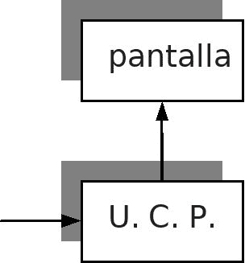

如上所述，缓冲区实际的内容是一个字符字符串。为了区分字符串中的不同数据，我们通用的使用字符 `res`，统称为空白（空格、换行等）。例如，当我想运行一个判断时：

```c
scanf("%d %F %c", &to, &b, &c);
```

我们所做的是对从输入输入字符链的请求做出响应。类似于接下来，通过按下回车键结束：

5 23.4 z [Enter]

空白链也可能引入如下情况：

5 [Enter] 23.4 [Enter] z [Enter]

区别在于，现在分隔符是换行符，而不是白色区域的空格。

按下回车键后，`scanf` 的工作是从缓冲区中读取字符并将它们转换为存储它们的变量所需的指定格式。在正常情况下，当遇到分隔符时，变量的赋值就会结束。这一过程对每个指定的变量都会重复。

当所有变量都已赋值，或者读取到的字符与格式指定的输入数据不匹配时，`scanf` 函数的执行结束。例如，对于上述相同的语句，我们引入数据：

five 23.4 z [Enter]

`scanf` 的执行被中断，因为格式 `%d` 期望一个形成整数的有效字符，而 `'c'` 不是。结果是没有赋值，且执行继续到程序的下一语句，变量 `a`、`b` 和 `c` 此时保持原来的值。是的，我们引入数据：

5 tm 23.4 z [Enter]

`scanf` 的执行被中断，因为格式 `%f` 期望一个形成实数的有效字符，而 `'t'` 不是。结果是 `a` 等于 5，且 `b` 和 `c` 都没有被赋值。执行继续进程中的下一个语句，变量 `a`、`b` 和 `c` 保持原来的值。是的，我们引入数据：

5 23.4 z [Enter]

我给变量 `to` 赋值整个 5，给 `b` 赋值实数 23，给 `c` 赋值逗号（','）。最终结果将出乎意料，因为这些并不是想要读取的值。

记住 `scanf` 函数会从读取的数据中返回的数量并赋值。是的，我们写了这些句子：

```c
int to, r; float b; char c;

// ...

r = scanf("%d %F %c", &to, &b, &c);
```


`r` 的值可能是 0、1、2 或 3。例如：

| 输入 | 返回值 ( r ) |
| :--- | :--- |
| 5 23.4 z [Enter] | 3 |
| five 23.4 z [Enter] | 0 |
| 5 tm 23.4 z [Enter] | 1 |
| 5 23.4 z [Enter] | 3 |

不，我可以写如下的判断：

```c
scanf("Enter the values from to, b and c: %d %F %c", &to, &b, &c);
```

因为这种处理方式不会显示指定的消息，而是会强制写入字符串 `"Enter the values from to, b and c: %d %F %c"`。

```c
printf("Press  <Enter>  for  continue  ");  scanf("%c",  &car);
```

当我知道执行这些句子时，我知道它们将视觉化消息，按下 `<Enter>` 继续（`continue`），并且只要 `scanf` 从缓冲区中没有可读的字符，它就会保持暂停。当我们按下回车键时，我们会向输入缓冲区发送一个换行字符 `line`，该字符将被 `scanf` 函数读取并赋值给变量 `car`，从而恢复 `Program` 的执行。

## 文件结束符 (CHARACTER FINISH FROM FILE)

从应用程序开发者的角度来看，输入或标准输出由 C 语言处理就像处理磁盘上的数据文件一样，但实际上它更像是一个信息的集合。我们在键盘上输入的数据是信息的集合，而我们在显示器上可视化的数据也是信息的集合。

`[](Images/image18532.jpeg)[](Images/image18533.jpeg)[](Images/image18534.jpeg)` 文件结束 (end of file)

`[](Images/image18536.jpeg)` 文件开始 (Beginning the file)

每个文件都有开头和结尾。程序如何知道它正在从文件中读取数据、是否已经到达了末尾并且没有更多数据了呢？通过文件结束标记（end-of-file mark）。对于磁盘上记录的文件，该标记将写在它的末尾。对于键盘信息，它来自于我们的输入，因此如果我们的程序需要检测文件结束标记，我们必须在完成信息输入时输入它。这通过在 UNIX 上按下 `Ctrl+D` 键或在 Windows 控制台应用程序上按下 `Ctrl+Z` 来完成。

由于文件或设备始终通过流（stream）处理，因此，讨论流的结束等同于讨论文件的结束。因此，从现在起，每当我们对设备或文件执行某种操作时，我们将不加区别地称称为它们或代表它们的流。

记住，当 `scanf` 函数尝试读取文件结束字符时，会返回在 `stdio.h` 文件中定义的 `EOF` 常量。下面的示例是——如果消息“Price: ”有响应，则写入“数据输入结束”（End of data entry）消息；否则，将写入输入的的价格。

```c
/*  eof.c
*/
#include <stdio.h>
main()
{
    int r = 0;
    float price = 0;
    printf("Price:  ");
    r = scanf("%g", &price);
    (r == EOF) ? printf("End  from  the  entry  from  data\n")
               : printf("%g\n", price);
}
```

在后面的章节中，我们将使用文件结束字符来确定数字输入的结束条件，开头是不定的。

## 字符 \n

当通过键盘输入数据并按下回车键时，它也会引入字符 `\n`。在输出时 `\n` 产生 `CR+LF`（`CR` 是 ASCII 13，`LF` 是 ASCII 10），而在输入时它对应于 `LF`；也就是说，C 语言表达式 `'\n' == 10` 将得到结果 1。

在某些情况下，这个字符 `\n` 可能会产生不良影响。通过以下示例来解释这一点，最初，读取一个实数：

```c
#include <stdio.h>
main()
{
    float price = 0;
    printf("Price: ");
    scanf("%g", &price);
    printf("Price  =  %g\n", price);
}
```

当执行上一个程序的 `scanf` 函数时，如果我们输入 1000 并按下回车键，在读取之前，输入缓冲区（与 `stdin` 关联的缓冲区）中会有以下信息：

| 1 | 0 | 0 | 0 | \n | | | | | | | | | | | | | |

然后从读取，

| \n | | | | | | | | | | | | | | | | | | |

字符 `\n` 不是格式 `%g` 规范的有效字符；因此，这里的读取被中断了。如果随后执行另一个支持字符数据的输入语句，这个多余的字符可能会导致麻烦。例如，为了看到这一细节，我们将修改之前的程序：

```c
#include <stdio.h>
main()
{
    float price = 0;
    printf("Price: ");
    scanf("%g", &price);
    printf("Price  =  %g\n", price);
}
```

（注：原文中存在大量重复和损坏内容，译文已提取并整理唯一的逻辑部分。）

在之前的示例中，变量 `car` 被定义为 `char` 类型而非 `int`。这并没有改变结果，因为正如我们在第 2 章中所说的，`int` 类型的数据在转换为 `char` 时会保留低位位；也就是说，舍弃多余的高位位。同样，可以观察到，取决于显示 `car` 时使用的格式（`%c` 或 `%d`），结果可以是字符本身，也可以是其 ASCII 值。在内部，从计算机内存来说，它只是由 0 和 1 组成的（`01100001`）。

假设 `stdin` 缓冲区为空，当在上面的程序调用 `getchar` 函数时，它的执行将停止，直到我们输入一个字符并按下回车键。读取到的字符将存储在变量 `car` 中。判断引用是否结束的方法等同于其他：

```c
scanf("%c", &car);
```

因此，`scanf` 对于字符 `\n` 和文件结束符的所有规则也适用于 `getchar`。

## 向标准输出写入一个字符

为了向标准输出（`stdout`）写入字符，C 语言提供了 `putchar` 函数。每当执行 `putchar` 函数时，都会向显示器写入一个消息。字符将延续上一次写入的内容。该函数的语法如下：

```c
#include <stdio.h>
int putchar(int c);
```

**兼容性**：ANSI、UNIX 和 Windows

`putchar` 函数返回写入的字符，或者在发生错误时返回 `EOF`。注意，该函数有一个整数类型的参数，用于存储想要写入的字符。例如：

```c
putchar('\n'); /* 移动到下一行 */
putchar(char);  /* 将变量 car 中的字符内容写入显示 */
```

上述语句等同于：

```c
printf("\n");
printf("%c", char);
```

## getch 和 getche 函数

`getch` 函数从键盘读取一个字符，且不在显示器上显示（无回显）；`getche` 函数从键盘读取一个字符并在显示器上显示出来（有回显）。这些函数的语法如下：

```c
#include <conio.h>
int _getch(void);
int _getche(void);
```

**兼容性**：Windows

这两个函数都从与 `stdin` 关联的缓冲区读取字符。当执行其中一个函数时，执行会停止直到按下某个键。你不需要按下回车。如果按下的键与 ASCII 代码表中的某个字符匹配，则结果是一个字节；例如，键 `TO` 会产生一个对应于字符 'to' 或 'TO' 的字节。相反，如果按下的键或组合键对应附录中指定的扩展代码表中的某些项，结果将是两个字节。例如，F1 会产生两个字节；第一个是 0，第二个是标识该键的代码。对于后一种情况，你必须调用两次函数，因为第二次调用才提供了所需的代码（第二个代码）。

下面的示例演示了当运行 `getche` 时执行停止，在按下键后继续，且该键将显示在显示器上。

```c
printf("Press a key for continue ");
_getche();
```

下面的示例在变量 `byte2` 中存储了你按下的功能键、光标移动键、组合键等的扩展代码（参见下表中的某些示例）。

```c
/* getch.c - Functions _getch and _getche */
#include <stdio.h>
#include <conio.h>
main()
{
    char byte1, byte2;
    printf("Press the combination from keys whose code\n" "extended want know\n");
    byte1 = _getch(); 
    byte2 = _getch(); 
    printf("%d  \t  %d\n", byte1, byte2);
    printf("Press a key for continue ");
    _getche();
    printf("\nEnd the program\n");
}
```

``

| 按下的键 | 结果 |
| :--- | :--- | :--- |
| F1 | 0 | 59 |
| Alt+A | 0 | 30 |
| Shift+F10 | 0 | 93 |
| Ctrl+Home | 0 | 119 |
| 上箭头 | 0 | 72 |

## 清除屏幕

虽然 C 库没有提供专门清理屏幕的函数，但它提供了系统函数，允许你向操作系统发送任何指令；例如，清理屏幕的指令。该函数有一个字符串链类型的参数。语法如下：

```c
#include <stdlib.h>
int system(char *command);
```

**兼容性**：ANSI、UNIX 和 Windows

当调用 `system` 函数时，字符串被传递给操作系统。例如，以下语句允许：

```c
system("cls");
system("clear");
```

## 解决

1. 编写一个程序，运行 `getche` 时执行停止，按下键后继续，且该键将显示在显示器上。

下面的示例在变量 `byte2` 中存储了按下的功能键、光标移动键、组合键等的扩展代码（参见下表中的示例）。

```c
/* getch.c - Functions _getch and _getche */
#include <stdio.h>
#include <conio.h>
main()
{
    char byte1, byte2;
    printf("Press the combination from keys whose code\n" "extended want know\n");
    byte1 = _getch(); 
    byte2 = _getch(); 
    printf("%d  \t  %d\n", byte1, byte2);
    printf("Press a key for continue ");
    _getche();
    printf("\nEnd the program\n");
}
```

`` 只有当 `b –4ac` 大于或等于 0 时，解才是真实的。根据目前所学的内容，该问题的解可以按照以下 `ma` 形式展开：

- 首先，我们定义计算所需的变量：

```c
double to, b, c, d, x1, x2;
```

- 接下来从方程中读取系数 `to`、`b` 和 `c`：

```c
printf("Enter the coefficients to b c: ");
scanf("%lf %lf %lf", &to, &b, &c);
```

注意指定的类型是 `%lf`（`double`）。指定类型 `%f` 将导致错误，因为变量已经定义为 `double` 类型。计算机内部创建用于存储 `float` 的格式与存储 `double` 使用的格式不同。

- `` 我们要求计算实根。为了有实根，必须满足 `b –4ac geqslant 0`；如果不是，根为复共轭根。那么——是的，如果有实根我们就计算；其他情况下，我们退出程序。

要在不执行其他操作的情况下退出函数，C 提供了 `return` 语句；要完全离开程序则使用函数 `exit`：

```c
#include <stdlib.h>
void exit(int state );
```

兼容性：ANSI, UNIX 和 Windows

`state` 参数是一个返回给调用执行程序的进程的值。

```c
d = b * b- 4 * to *c;
(d < 0) ? printf("The estate They are complex\n"), exit(0) : printf("The estate real are:\n");
```

稍后当你学习 `if` 语句时，你将能够用这句话替换三元运算符 `: ?`。

- 是的，如果有实根，我们就应用公式计算。

```c
d = sqrt(d);
x1 = (-b + d) / (two * to);
x2 = (-b - d) / (two * to);
```

`sqrt` 函数计算参数的平方根。在示例中，它计算了 `d` 的平方根，并将结果以后重新存储在 `d` 中。

- 最后我们写出得到的结果。

```c
printf("x1 = %g\nx2 = %g\n", x1, x2);
```

程序的完整示例如下：

```c
/********** 来自二元方程的解 *******/
/* equation.c
*/
#include <stdio.h> // scanf 和 printf 需要的
#include <stdlib.h> // system 需要的
#include <math.h>             // sqrt 需要的
main()
{
    double to, b, c, d, x1, x2;
    system("cls");

    /* 输入数据 */
    printf("Enter the coefficients to b c: ");
    scanf("%lf %lf %lf", &to, &b, &c);

    /* 判断是否为实根 */
    d = b * b - 4 * to * c;
    (d < 0) ? printf("The estate They are complex\n"), exit(0)
            : printf("The estate real are:\n");

    /* 计算解 */
    d = sqrt(d);
    x1 = (-b + d) / (two * to);
    x2 = (-b - d) / (two * to);

    /* 写入结果 */
    printf("x1 = %g\nx2 = %g\n", x1, x2);
}
```

执行程序：

输入系数 b c: 1 -1 -6  
实根为：

x1 = 3  
x2 = -two

## 训练练习建议

1. 回答以下问题：

1) 下列程序的运行是什么？

```c
#include <stdio.h>
main()
{
    float to = 0.0F;
    to = 1/3;
    printf("%f\n", to);
}
```
a) 0.000000.  
b) 0.333333.  
c) 1.0.  
d) 0.33333.

2) 下列程序的运行是什么？

```c
#include <stdio.h>
main()
{
    float to = 10.0F, b = a/2;
    printf("%g\n", b);
}
```
a) 5,000,00.  
b) 5.  
c) 5.0.  
d) 5,0000.

3) 下列程序的运行是什么？

```c
#include <stdio.h>
main()
{
    double to = 20.0, b = a/3;
    printf("%f\n", b);
}
```
a) 错误。格式应为 %lf。  
b) 6.6666.  
c) 6.66666.  
d) 6.6667.

4) 下列程序的运行是什么？

```c
#include <stdio.h>
main()
{
    int a = 10;
    printf("%X\n", to);
}
```
a) 10.  
b) 0xA.  
c) TO.

5) 下列程序的运行是什么？

```c
#include <stdio.h>
main()
{
    int a = 10;
    float to = 0.0F;
    to = a/3;
    printf("%f\n", to);
}
```
a) 0.000000.  
b) 0.333333.  
c) 1.0.  
d) 0.33333.

6) 假设以下程序在屏幕上的结果是什么？

```c
#include <stdio.h>
main()
{
    float to = 10.0F, b = a/2;
    printf("%g\n", b);
}
```
a) 5,000,00.  
b) 5.  
c) 5.0.  
d) 5,0000.

7) 假设以下程序在屏幕上的结果是什么？

```c
#include <stdio.h>
main()
{
    double to = 20.0, b = a/3;
    printf("%f\n", b);
}
```


a) 错误。格式应为`%lf`。  
b) 6.6666.  
c) 6.66666.  
d) 6.6667.

### 8) 假设以下程序在屏幕上的结果是什么？

```c
#include <stdio.h>

main()
{
    int a = 10;

    printf("%X\n", to);
}
```

a) 10.  
b) 0xA.  
c) TO.

### 9) 假设以下程序在屏幕上的结果是什么？

```c
#include <stdio.h>

main()
{
    int a = 10;
    float to = 0.0F;

    to = a / 3;

    printf("%f\n", to);
}
```

a) 0.000000.  
b) 0.333333.  
c) 1.0.  
d) 0.33333.

### 10) 运行以下程序时，屏幕上显示什么？

```c
#include <stdio.h>

main()
{
    int to = 0, c = 0;

    scanf("%d", &to);
    c = getchar();

    printf("%d %c\n", to, c);
}
```

a) two yes  
b) two.  
c) yes  
d) .

### 2. 写一个计算球体体积的程序，其公式如下：

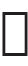[](Images/image18544.jpeg)4vr _ 33

### 3. 编写一个程序请求姓名、出生年份和当前年份，并输出结果如下：

姓名，在 2030 年你将满岁  
5 3

### 4. 编写一个程序计算多项式`p = 3x – 5x + 2x – 7`并按以下格式显示结果：

当`x = value`，`3x⁵ - 5x³ + 2x - 7 = result`

### 5. 重复之前的程序，但现在使用系数变量`a`、`b`和`c`。

### 6. 运行以下程序，解释发生了什么，并根据需要进行修改以使其正常运行。

```c
#include <stdio.h>

void main()
{
    int car = 0;

    car = getchar();
    putchar(char);

    car = getchar();
    putchar(char);
}
```

### 7. 说明以下程序的运行结果是什么。继续运行程序并比较结果。

```c
#include <stdio.h>

main()
{
    char car1 = 'TO', car2 = 65, car3 = 0;

    car3 = car1 + 'to' - 'TO';

    printf("%d %c\n", car3, car3);

    car3 = car2 + 32;

    printf("%d %c\n", car3, car3);
}
```

a]

### 8. 假设输入值为 48 且值为 two，以下程序的运行结果？

```c
#include <stdio.h>

main()
{
    char c = 0;

    c = getchar();

    printf("%d\n", c);
}
```

a) 100.  
b) 96.  
c) Four.  
d)

### 9. 假设输入值为 0 6，以下程序在屏幕上显示什么结果？

```c
#include <stdio.h>

main()
{
    int to = 0, c = 0;

    scanf("%d", &to);
    c = getchar();

    printf(
    );
}
```

### 10. 假设输入值为 2 yes 时，运行以下程序在屏幕上显示什么？

```c
#include <stdio.h>

main()
{
    int to = 0, c = 0;

    scanf("%d", &a);
    c = getchar();

    printf("%d %c\n", to, c);
}
```

到目前为止，我们编写的每个程序函数都是按照编写顺序执行的语句集合，这里的“语句”（statement）是指指定一个或多个操作的表达式序列。但情况并非总是如此；在某些时刻，我们确实需要根据特定标准执行某些语句或其他某些语句。

# 决策与重复

## If 语句

例如，在上一章中，当我们计算二次方程的根时，我们看到根据判别式的值，根可能是实数也可能是复数。在这种情况下，程序本身需要根据判别式的值来决定你需要计算的是两个实根还是两个共轭复根。

同样，在很多情况下，我们需要执行某一组语句若干次，直到满足某个条件。例如，在上一章中，我们学习了如何从标准输入读取一个字符。但如果我们想读取的不是一个字符，而是我们在键盘上输入的所有内容，直到检测到文件结束标记，我们就需要使用重复语句。

在本章中，你将学习如何编写代码使程序能够做出，并能够重复运行某些语句块。

### `if` 判断语句

`if` 判断允许程序根据表达式的真或假结果来决定执行某个动作或另一个动作。该语句的语法如下：

```c
if (condition)
    statement 1;
else
    statement 2;
```

其中`condition`是一个数值、关系或逻辑表达式，`statement 1`和`statement 2`代表一个简单语句或复合语句。每条语句必须以分号（`.`）结束。

`if` 判断按照以下形式运行：

1. 它求值`condition`。
2. 如果条件的评估结果为真（结果不为`0`），将执行`statement 1`指定的语句。
3. 如果条件的评估结果为假（结果为`0`），且指定了`else`子句，则执行`statement 2`指定的语句。
4. 如果条件的评估结果为假且省略了`else`子句，则忽略`statement 1`。
5. 在任何情况下，执行都会继续进行后续可执行的判断。

以下是一些简单的示例，供你直观地理解`if`语句是如何使用的：

```c
if (x) /* 是否等同于 if (x != 0) */
    b = a / x;

b = b + 1;
```

在这个例子中，条件是由数值表达式`x`设定的。那么，如果表达式为真（`x`不为`0`），将执行`b = a / x`（替换了通用格式中的`statement 1`）；如果表达式为假（`x`等于`0`），则不执行。无论何种情况，执行都会继续下一行`b = b + 1`。让我们来看另一个例子：

```c
if (a < b)
    c = c + 1;

// 程序后续行
```

在另一个例子中，条件是由关系表达式设定的。如果在评估条件时满足`a`小于`b`，则执行语句`c = c + 1`。否则，即`a`大于或等于`b`，则继续后续，忽略判断`c = c + 1`。

在接下来的例子中，条件是由逻辑表达式设定的。如果在评估条件时满足`a`和`b`均不为`0`，则运行判断`x = i`。其他情况下，忽略判断`x = i`，继续执行下一行。

```c
if (a && b)
    x = i;

// 程序后续行
```

在下一个例子中，如果`a == b * 5`为真，则执行语句`x = 4`和`a = a + x`。否则，执行语句`b = 0`。在两种情况下，执行都会继续进行到程序的下一行。

```c
if (a == b * 5)
{
    x = 4;
    a = a + x;
}
else
    b = 0;

// 程序后续行
```

一个典型的错误是没有使用上一个例子中的条件而使用了以下内容：

```c
if (a = b * 5)
// ...
```

在上面的代码中，执行了赋值`a = b * 5`，并将结果用作条件。

## 嵌套 `if` 语句

一个典型的错误是没有使用上一个例子中的条件而使用了以下内容：

```c
if (a = b * 5)
// ...
```

在上面的代码中，执行了赋值`a = b * 5`，并将结果用作条件。

### 嵌套 `if`

观察`if`语句，产生了一个问题：哪个`else`属于哪个`if`？

```c
if (condition 1)
{
    if (condition 2)
        statement 1;
}
else
    statement 2;
```

在上面的示例中，`else`与第一个`if`配对。在评估条件时，它们指示下表：

| condition 1 | condition 2 | result |
|---|---|---|
| T | T | statement 1 |
| T | F | - |
| F | - | statement 2 |
| 等 | - | - |

如果我们想让`else`属于第二个`if`，我们必须正确地嵌套：

```c
if (condition 1)
{
    if (condition 2)
        statement 1;
    else
        statement 2;
}
```

在这种情况下，`else`与第二个`if`配对。在评估条件时，它们指示下表：

| condition 1 | condition 2 | result |
|---|---|---|
| T | T | statement 1 |
| T | F | statement 2 |
| F | - | - |

规则是`else`与最近的、且没有`else`的`if`关联。这被称为“悬空 else”（dangling else）问题。为了避免歧，最佳实践是使用括号`{}`。

```c
if (condition 1)
{
    if (condition 2)
        statement 1;
    else
        statement 2;
}
else
    statement 3;
```

例如，可以观察到下面的程序段，它写入一条消息显示数字`a`与另一个数字`b`的比较结果（大于、小于或相等）：

```c
if (a > b)
    printf("%d is higher than %d\n", a, b);
else if (a < b)
    printf("%d is less than %d\n", a, b);
else
    printf("%d is same as %d\n", a, b);

// 继续执行
```

需要注意的是，一旦在评估设定条件后执行了某个动作，程序的执行将继续到下一行，进入嵌套`if ... else`语句产生的结构。在之前的例子中，如果`a`不等于`0`，执行将继续到程序的下一行：

```c
if (a == 0)
    if (b != 0)
        s = s + b;
    else
        s = s + to;
```

作为对所阐理论的练习，我们将执行一个应用，找出三个数字`a`、`b`和`c`中的最小值。处理方法是每个数字仅与另外两个数字比较一次。只需阅读代码以理解我所知道的内容就足够理解接下来的过程。

```c
/*************** 获取三个数中 a, b 和 c 的最小值 ****************/

/* minor.c */

#include <stdio.h>

main()
{
    float a, b, c, less;

    printf("Numbers abc : ");
    scanf("%g %g %g", &a, &b, &c);

    if (a < b)
        if (a < c)
            less = a;
        else
            less = c;
    else
        if (b < c)
            less = b;
        else
            less = c;

    printf("Less = %g\n", less);
}
```

运行程序：

```text
Numbers a b c : 25.84 -3.1 18
Less = -3.1
```

### `else if` 结构

下面显示的结构非常常见，并被单独处理。该结构是嵌套`if`语句的结果。你的整体格式如下：

```c
if (condition 1)
    judgment 1;
else if (condition 2)
    judgment 2;
else if (condition 3)
    judgment 3;
...
else
    judgment n;
```

该结构的评估过程如下：如果满足`condition 1`，则执行`statement 1`；如果不满足，则按顺序检查条件，直到最后一个`else`，运行与第一个条件为真的`else if`对应的`judgment`。如果所有条件都为假，则执行与最后一个`else`对应的第`n`句语句。在任何情况下，它都会从该结构后的第一个可执行语句继续执行。语句`1`、`2`、...`n`可以是简单语句也可以是复合语句。

例如，在某商店购物时，如果我们购买的同种商品数量超过 100 件，他们会给予我们 40% 的折扣；25 到 100 件之间为 20%；10 到 24 件之间为 10%；购买少于 10 件则没有折扣。你被计算支付金额。解决方案将采取如下形式：

| 代码文章 | 111 |
| :--- | :--- |
| 购买数量 | 100 |
| 单价 | 100 |

| 商品 | 数量 | 单价 | 折扣 | 总计 |
|---|---|---|---|---|
| 111 | 100 | 100.00 | 二 20% | 8000.00 |

在所给出的示例解决方案中可以看出，由于购买数量在 25 到 100 之间，因此适用的折扣为 20%。

以下问题的解决方案可以采用以下形状：

- 首先，我们定义将在计算中使用的变量：`int ar, cc; float wow, dec;`
- 继续读取数据`ar`、`DC`和`pu`：

```c
printf("Code Article.             ");
scanf("%d", &ar);

printf("Amount bought             ");
scanf("%d", &DC);

printf("Price unitary.             ");
scanf("%f", &pu);
```

- 知道数据后，我们进行计算并写入结果。这需要先编写示例解决方案所示的头部和读取的数据：

```c
printf("\n\n%10s %10s %10s %10s %10s\n\n", "Article", "Quantity", "P. OR.", "Disc.", "Total");

printf("%10d %10d %10.2f", ar, DC, pu);

if (DC > 100)
    printf("  %9d%% %10.2f\n", 40, DC * pu * 0.6);
else if (DC >= 25)
    printf("  %9d%% %10.2f\n", 20, DC * pu * 0.8);
else if (DC >= 10)
    printf("  %9d%% %10.2f\n", 10, DC * pu * 0.9);
else
    printf("  %10s %10.2f\n", "--", DC * pu);
```

可以看出，条件是根据折扣从大到小建立的。作为一个练习，思考或测试一下如果按照折扣从低到高的顺序设置条件会发生什么。完整的程序样本所示。

```c
/** 根据购买数量计算支付金额的函数 **/

/* else_if.c */

#include <stdio.h>

main()
{
    int ar, DC; /* 代码和数量 */
    float pu;   /* 单价 */

    printf("Code item             ");
    scanf("%d", &ar);

    printf("Amount bought.             ");
    scanf("%d", &DC);

    printf("Price unitary.             ");
    scanf("%f", &pu);

    printf("\n\n%10s %10s %10s %10s %10s\n\n", "Article", "Quantity", "P. OR.", "Disc.", "Total");

    printf("%10d %10d %10.2f", ar, DC, pu);

    if (DC > 100)
        printf("  %9d%% %10.2f\n", 40, DC * pu * 0.6);
    else if (DC >= 25)
        printf("  %9d%% %10.2f\n", 20, DC * pu * 0.8);
    else if (DC >= 10)
        printf("  %9d%% %10.2f\n", 10, DC * pu * 0.9);
    else
        printf("  %10s %10.2f\n", "--", DC * pu);
}
```

### `SWITCH` 语句

`switch`语句允许根据表达式的值执行多个操作。语法如下：

```c
switch (expression)
{
    case constant1:
        statement 1;

    case constant2:
        statement 2;

    case constant3:
        statement 3;

    ...

    default:
        statement n;
}
```


该结构的评估过程如下：`switch` 语句计算括号内的表达式并与每个 `case` 的常量进行比较。找到匹配项后，执行从相应的 `case` 开始直到遇到 `break` 语句或块结束。如果没有常量匹配表达式的值，则执行 `default` 后面的语句（如果指定了该语句）。

在 `switch` 语句中，可以在每个 `case` 块中进行声明，只要使用大括号 `{}` 来界定该块，也可以在 `switch` 块的开头、第一个 `case` 之前；然而，在后一种情况下初始化（声明）将被忽略。`default` 子句可以放置在块的任何位置，不需要在末尾。

为了说明 `switch` 语句，我们将编写一个读取两个整数（月份和年份）表示日期的程序，并按月份输出天数。如下：

```
引入月份 (##) 和年份 (####): 5 2014
2014 年的 5 月有 31 天
```

来自该问题的解决方案可以如下所示：

* 首先，我们定义计算中将使用的变量。

```c
int dd = 0, hmm = 0, aa = 0;
```

* 持续读取月份（`mm`）和年份（`yy`）。

```c
printf("Enter month (##) and year (####): "); scanf("%d %d", &mm, &yy);
```

* 然后，我们将月份与常量 1, 2, ..., 12 进行比较。如果月份是 1, 3, 5, 7, 8, 10 或 12，我们将天数赋值为 31。如果月份是 4, 6, 9 或 11，我们将天数赋值为 30。如果月份是 2，我们将检查年份是否为闰年，如果是闰年，则天数赋值为 29；如果不是闰年，则赋值为 28。如果月份不是上述任何值，我们将向用户发送消息，指示该月份无效。我们将使用 `switch` 语句执行所有这些过程。

```c
switch (mm)
{
case 1: case 3: case 5: case 7: case 8: case 10: case 12:
    dd = 31; break;
case 4: case 6: case 9: case 11:
    dd = 30; break;
case 2:
    // Is the year leap?
    if ((yy % 4 == 0) && (yy % 100 != 0) || (yy % 400 == 0))
        dd = 29;
    else
        dd = 28;
    break;
default:
    printf("\nThe month no is valid\n"); break;
}
```

当常量与 `mm` 的值匹配时，将执行后面指定的语句，遵循程序的执行顺序。通过后续 `case` 子句的块进行执行，除非采取显式操作离开 `switch` 语句的块。这正是判断语句 `break` 到每个块 `case` 末尾的精确功能。

* 最后，如果月份是有效的，我们就写出请求的结果。

```c
if (month >= 1 && month <= 12)
    printf("\nThe month %d the year %d have %d days\n",mm,yy,dd);
```

程序完整的已知示例以如下形式展示：

```c
/******* Days corresponding to a month from a year dice ******
/*  switch.c
*/
#include <stdio.h>

main()
{
    int dd = 0, hmm = 0, aa = 0;

    printf("Enter month (##) and year (####): "); scanf("%d %d", &mm, &yy);

    switch (mm)
    {
    case 1: // January
    case 3: // March
    case 5: // may
    case 7: // July
    case 8: // August
    case 10: // October
    case 12: // December
        dd = 31; break;
    case 4: // April
    case 6: // June
    case 9: // September
    case 11: // November
        dd = 30; break;
    case 2: // February
        // Is the year leap?
        if ((yy % 4 == 0) && (yy % 100 != 0) || (yy % 400 == 0))
            dd = 29;
        else
            dd = 28;
        break;
    default:
        printf("\nThe month no is valid\n"); break;
    }

    if (mm >= 1 && hmm <= 12)
        printf("\nThe month %d the year %d have %d days\n",mm,yy,dd);
}
```

`case` 子句是否从其他处或下方继续，这并不是一个风格问题，因为 C 已经解释了每个字符和换行。空白区域是空格；在这种情况下，到达编译器的代码在任何情况下都是相同的。

在 `default` 子句后放置 `break` 语句并不是必要的；它仅仅是为了符合良好的编程风格。因此，当我们必须添加另一个 `case` 时，我们已经设置了 `break`，这消除了一个潜在的错误来源。

### while 判断语句

`while` 判断在运行一个判断（无论是简单的还是复合的，零次或多次），取决于一个条件。其语法是：`while( condition ) sentence ;`；其中 `condition` 是任何数值、关系或逻辑表达式，判断是简单的或复合的。`while` 判断的执行过程如下：

1. 评估 `condition`。
2. 如果评估结果为 0（假），不运行判断，并将控制转移到下一句。
3. 如果评估结果不同于 0（真），运行判断并重复从点 1 开始的过程。

例如，以下代码可以包含在任何程序中，但强制要求两种可能的答案：y/n。

```c
#include <stdio.h>
main()
{
    char car = '\0';
    printf("You want continue (Yes or no) "); car = getchar();
    while (car != 's' && car != 'n')
    {
        fflush(stdin);
        printf("You want continue (Yes or no) "); car = getchar();
    }
}
```

执行程序：`You want continue (Yes or no) x` → `You want continue (Yes or no) n`。`while` 语句执行 `car` 赋值。注意在执行 `while` 语句之前，`car` 被赋值。

`while` 语句的解释如下：当 `car` 的值不等于 `'s'` 字符或 `'n'` 字符时，显示“You want continue (Yes or no)”并读取另一个字符。这强制用户输入 `'s'` 或 `'n'` 字符。该示例可以写为：

```c
#include <stdio.h>
main()
{
    char car = '\0';
    printf("You want continue (Yes or no) ");
    while ((car = getchar()) != 's' && car != 'n')
    {
        fflush(stdin);
        printf("You want continue (Yes or no) ");
    }
}
```

此示例与上一个的区别在于，现在条件包含了读取变量 `car`，因为它在括号内首先执行。将 `car` 与 `'s'` 和 `'n'` 字符进行比较。以下示例显示输入的文本字符串每个字符的 ASCII 码，会导致无限循环，因为条件始终为真（值大于 0）。要退出无限循环必须按下 `Ctrl+C` 键。

```c
/* Code ASCII from every one from the characters from a text
* while03.c */
#include <stdio.h>

main()
{
    char car = 0; // car = 空字符 (\0)
    printf("Enter a chain from text: ");
    while(1)
    {
        car = getchar();
        if (car != '\n')
            printf("The code ASCII from %c is %d\n",car, car);
        else
            printf("Enter a chain from text: ");
    }
}
```

接下来我们运行应用程序。我们引入，例如字符串“to”，并观察到以下结果：

```
Enter a chain from text: to [Enter]
The ASCII code from t is 116
Enter a chain from text:
```

此结果显示，当我们输入 `'a'` 并按下回车键时，仅显示该字符的 ASCII 码；按下回车键时输入的字符 `\n` 被忽略，因为它是这样编程的。当所有字符都从输入流中读取完毕后，就会请求新的字符。

现在让我们修改之前的示例以消除无限循环。这可以通过在 `while` 语句中包含一个终止条件来实现；例如，读取数据直到到达文件结束标记（end-of-file）。请记住，对于标准输入流，该标记在按下特定键时发生。在 `UNIX` 上按下键 `Ctrl+D`，或者在 Windows 应用程序的控制台上按下 `Ctrl+Z`，当 `getchar` 读取到文件末尾标志时，会返回值 `EOF`。

```c
/* Code ASCII from everyone from the characters from a text
* while04.c
*/
#include <stdio.h>

main()
{
    char car = 0;  // car = character null (\0)
    printf("Enter a chain from text.\n");
    printf("To finish press Ctrl+z\n");
    while ((car = getchar()) != EOF)
    {
        if (car != '\n')
            printf("The code ASCII from %c is %d\n", car, car);
    }
}
```

来自该程序的可能解决方案如下：

```
Enter a chain from text.
To finish press Ctrl+z
hello [Enter]
The code ASCII from h is 104
The code ASCII from e is 111
The code ASCII from l is 108
The code ASCII from l is 108
The code ASCII from o is 111
bye [Enter]
The code ASCII from b is 98
The code ASCII from y is 121
The code ASCII from e is 101
[Ctrl] [z]
```

### 嵌套循环

当一个 `while` 语句包含在另一个 `while` 语句内部时（通常情况下在一个语句内部包含另一个 `while`、`do` 或 `for` 语句），我们就处于嵌套循环的情况。例如：

```c
#include <stdio.h>
main()
{
    int i = 1, j = 1;
    while (i <= 3) // 当 i 小于或等于 3 时
    {
        printf("For i = %d: ", i);
        while (j <= 4)  // 当 j 小于或等于 4 时
        {
            printf("j = %d, ", j);
            j++; // j 增加 1
        }
        printf("\n"); // 换到新行
        i++; // i 增加 1
        j = 1; // 将 j 初始化为 1
    }
}
```

运行该程序我得到以下结果：

```
For i = 1: j = 1, j = 2, j = 3, j = 4,
For i = 2: j = 1, j = 2, j = 3, j = 4,
For i = 3: j = 1, j = 2, j = 3, j = 4,
```

此结果显示外层循环执行了三次，因此每一次循环内层循环依次执行四次。这就是嵌套循环执行的方式：对于外层循环的每次迭代，内层循环运行直到完成其所有的迭代。

`while` 语句在内部结束，我们换到新行，将 `i` 的值增加一个单位，并重新开始 `j` 的值为 1。

作为上述应用，我们将编写一个打印 `z` 数的程序，包含 1 到 50 之间的数字，满足表达式：

```
z^2 = x^2 + y^2
```

其中 `z`、`x` 和 `y` 都是正整数。已知结果将如下形式呈现：

| Z | X | Y |
|---|---|---|
| 5 | 3 | 4 |
| 13 | 5 | 12 |
| 10 | 6 | 8 |
| ... | ... | ... |
| 50 | 30 | 40 |

来自该问题的解决方案可以采用以下形状：

* 首先，我们定义用于计算的变量。
  `unsigned int x = 1, y = 1, z = 0;`
* 继续，我们编写解决方案的头部。
  `printf("%10s %10s %10s\n", "z", "X", "Y");`
* 然后，对于 `x = 1, y = 1, 2, 3, ...`，对于 `x = 2, y = 2, 3, 4, ...`，对于 `x = 3, y = 3, 4, ...`，直到 `x = 50`，我们计算 `z` 的值（注意 `y` 等于或大于 `x` 以避免值的重复）为 `z = (int)sqrt(x*x + y*y)`。如果 `z` 是精确的，我们就写入 `z, x, y`。也就是说，对于描述的 `x` 和 `y` 的值，我们进行计算：
  `z = (int)sqrt(x*x + y*y);` // z 是一个整数
  `if (z * z == x*x + y*y)` // 平方根是精确的吗？
  如果 `z` 精确，我们就写入 `z, x, y`。此外，当 `z` 大于 50 时，我们丢弃并增加 `y` 的值一个单位并重新开始。

```c
/* 勾股定理。
* pitag.c */
#include <stdio.h>
#include <math.h>

void main()
{
    unsigned int x = 1, y = 1, z = 0;

    printf("%10s %10s %10s\n", "z", "X", "Y");
    printf("          ");

    while (x <= 50)
    {
        /* 计算 z。z 是一个整数，平方根 */
        z = (int)sqrt(x*x + y*y);
        while (y <= 50 && z <= 50)
        {
            /* 如果之前的平方根精确，写入 z, x, y */
            if (z * z == x*x + y*y)
                printf("%10d %10d %10d\n", z, x, y);
            y = y + 1;
            z = (int)sqrt(x*x + y*y);
        }
        x = x + 1;
        y = x;
    }
}
```

### do ... while 语句

`do`...`while` 语句运行一个语句（简单或复合），执行一次或多次，取决于表达式的值。它的语法如下：

```
do
    statement ;
while ( condition );
```

其中 `condition` 是任何数值、关系或逻辑表达式，而 `statement` 是简单语句或复合语句。需要注意的是，`do`...`while` 结构以分号结束。

`do...while` 语句的执行遵循以下步骤：

1. 运行 `do` 块（简单或复合语句）。
2. 评估结束时对应的 `condition` 表达式。
3. 如果评估结果为 0（假），控制转移到程序中的后续语句。
4. 如果评估结果不为 0（真），过程从第 1 点开始重复。

例如，以下代码强制用户输入一个正值：

```c
double n;
do // 运行
{
    printf("Number: ");
    scanf("%lf", &n);
}
while (n < 0); // 当 n 小于 0 时
```


当我使用`do...while`结构，语句至少运行一次，因为条件是最后评估的。相反，当执行`while`结构时，语句可能根本没有被执行。

```c
printf("Root  square  approximate:  ");  scanf("%lf",  &approx);  printf("Error coefficient: ");  scanf("%lf",  &epsilon);
```

- 然后，我应用`Newton`的公式。

```c
do
{
    antaprox  =  approx;
    approx  =  (n/antaprox  +  antaprox)  /  two;
}
while  (fabs(approx  -  antaprox)  >= epsilon);
```

第一次应用公式时，变量`antaprox`包含通过键盘输入的近似平方根的值。后续，`antaprox`将包含上一次计算的近似值。

- 当上所示`do ... while`结构中指定的条件为假时，过程结束。剩下的只需要打印结果。

```c
printf("The  root  square  from  %.2lf  is  %.2lf\n",  no,  approx);
```

完整的程序如所示。为了防止输入负数，使用了一个`do ... while`结构，当插入的值为负数时，它会根据请求的值进行询问。

```c
/******  Root  square  from  a  number.  Method  from  Newton  ******/
/*  Doc
*/
#include  <stdio.h>
#include  <math.h>

main()
{
    double  no; //  number
    double  approx; //  approach  to  the  root  square
    double  antaprox;  //  previous  approach  to  the  root  square
    double  epsilon;  //  coefficient  from  error

    do
    {
        printf("Number:  ");
        scanf("%lf",  &n);
    }
    while  (  n  <  0  );

    do
    {
        printf("Root  square  approximate:  ");
        scanf("%lf",  &approx);
    }
    while  (  approx  <=  0  );

    do
    {
        printf("Coefficient  from  error:  ");
        scanf("%lf",  &epsilon);
    }
    while  (  epsilon  <=  0  );

    do
    {
        antaprox  =  approx;
        approx  =  (n/antaprox  +  antaprox)  /  two;
    }
    while  (fabs(approx  -  antaprox)  >= epsilon);

    printf("The  root  square  from  %.2lf  is  %.2lf\n",  no,  approx);
}
```

是的，运行`n`等于10的程序，将得到以下解：

```
Number: 10
Root square approximate: 1
Coefficient from error: 1e-4
The root square from 10.00 is 3.16
```

### 语句判断

`for`语句允许你重复执行一个简单或复合语句，执行次数次数的。其语法如下：

`for ([ v1=e1  [,  v2=e2 ]...];[ condition ];[ progression-condition ]) sentence ;`

- `v1`, `v2`, `...`代表控制变量，它们将用表达式`e1`, `e2`, `...`中的值进行初始化；
- `condition`是一个布尔表达式，虽然我知道可以省略，但我知道它应该是为真；
- `condition-progress`是一个或多个用逗号分隔的表达式，其值不断演变，作为完成`for`语句执行的条件；
- `judgment`是一个简单或复合判断。

`for`语句的执行遵循以下形式：

1. 我初始化变量`v1`, `v2`, `...`
2. 我评估`condition`：
   a) 如果结果不是0（真），则执行语句块。然后，评估产生条件推进的表达式，并且我回到点2。
   b) 如果结果是0（假），则终止`for`语句的执行。随后控制权转移到程序的后续语句。

例如，以下`for`语句打印从1到100的数字。字面上的意思是：由于`i`等于1，只要`i`小于或等于100，就将`i`递1，写入`i`的值。

```c
int  i;
for  (i  =  1; i  <=  100; i++) printf("%d  ",  i);
```

下一个示例打印7到112之间的7的倍数。

```c
int  k;
for  (k  =  7; k  <=  112; k  +=  7) printf("%d  ",  k);
```

在下一个示例中，你可以看到逗号作为控制变量以及使条件结束的值演变的表达式的分隔符。

```c
int  F,  c;
for  (F  =  3, c  =  6; F  +c  <  40; F++, c  += two) printf("f=%d\tc=%d\n",  F,  c);
```

另一个打印从1到10增量为0.5的值的示例。

```c
float  i;
for  (i  =  1; i  <=  10; i+=0.5) printf("%g", i);
```

另一个示例反向打印字母。

```c
char  car;
for  (car  ='z'; car  >='a'; car--) printf("%c", car);
```

示例展示了如何退出无限循环。

```c
for (;;)
{
    break;
}
```

```c
z = (int)sqrt(x * x + and * and);
if (z > fifty) break; // 退出循环
```

### 语句 continue

`continue`语句强制继续执行`while`、`do`或`for`循环中所包含的下一次迭代。它的语法是：

`continue;`

关于示例，请看下面的程序，该程序会打印从1到100之间所有5的倍数的数字。

```c
#include <stdio.h>
main()
{
    int no;
    for (n = 0; n <= 100; n++)
    {
        // 如果 n 不是 5 的倍数，则执行下一次迭代
        if (n % 5 != 0) continue;
        // 打印下一个 5 的倍数
        printf("%d ", n);
    }
}
```

运行程序，我看到每当我执行带有`continue`的判断时，它都会开始为新的`n`值启动`for`语句块的执行。

### 语句 goto

`goto`语句将控制转移到程序的特定某行，该行通过标签`a`标识。它的语法如下：

`goto label ;`

`.`
`.`
`label : sentence ;`

如果控制转移到的行是一个可执行语句，则执行它。跳过该语句及其后的语句。如果它不是可执行的，则执行将从找到该标签后的第一个可执行判断语句开始。

控制不能转移到我们当前所在的函数体之外。

滥用此语句会导致产生难以解释和难以维护的程序。因此，在结构化编程中，它只在特殊情况下使用。`goto`语句的功能可以使用`if...else`、`do`、`for`、`switch`或`while`语句来实现。

最常用的用法是放弃某些深度嵌套的结构的执行，这是通过`break`语句无法实现的，因为`break`仅限制于一层嵌套。

下面的示例展示了如何使用`goto`语句，由两个嵌套的`for`循环组成。在内层循环中，有一个`goto`语句，当满足指定条件时将会执行。如果执行了`goto`语句，控制将转移到标签后的第一个可执行语句。跳出。

```c
/* goto 语句的使用
* goto.c
*/
#include <stdio.h>
#define K8

main()
{
    int F, c, no;
    printf("Value from n: ");
    scanf("%d", &n);
    for (F = 0; F < K; f++)
    {
        for (c = 0; c <K; c++)
        {
            if (f*c > n) goto leave;
        }
    }
leave:
    if (f < K && c < K) printf("(%d, %d)\n", F, c);
}
```

运行程序：
```
Value from n: twenty
(3, 7)
```

### 训练题解答

1. 编写一个程序，根据方程计算方程根：

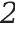 $ax + bx + c = 0$

包含以下情况：

1. 如果`a`等于0且`b`等于0，我们将打印一条消息说明该方程是退化的。
2. 如果`a`等于0且`b`不等于0，则仅存在值为`-c / b`的根。
3. 在其他所有情况下，我们将使用以下公式：

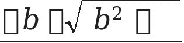 $x_i = 2$ 到

表达式`d = b² – 4ac`是判别式。

* 如果`d`大于或等于0，则有两个实数根。
* 如果`d`小于0，则有两个形式为$x + yj, x – yj$的复数根。

使用适当的字面量表示要引入的数据，以便得到结果。

解决此问题的方案可以如下所示：

* 首先，我们定义要在程序使用的变量。
`double to, b, c; // 方程系数`
`double d; // 判别式`
`double re, im; // 根的实部和虚部`
`printf("Coefficients, b and c from the equation: "); scanf("%lf %lf %lf", &to, &b, &c);`
* 读取系数并进行计算。
`if (to == 0 && b == 0)`
`printf("The equation is degenerate\n");`
`else if (to == 0)`
`printf("The only root is: %.2lf\n", -c / b);`
`else {`
`// 计算公式。计算 - b 2 - 4 bc`
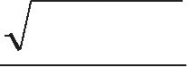[](Images/image18554.jpeg)[](Images/image18554.jpeg)[](Images/image18555.jpeg)2 to 2 to re`
`re = -b / (two * to);`
`d = b * b-4 * to * c;`
`im = sqrt(fabs(d)) / (two * to);`
* 打印实数根。
`printf("Roots real:\n"); printf("%.2lf %.2lf\n", re + Im, re - Im);`
* 打印复数根。
`printf("Complex roots:\n"); printf("%.2lf + %.2fj, %.2lf - %.2fj\n", re, im, re, im);`

解决此问题的方案如下：

```c
/* 解决方程程序
* solve.c
*/
#include <stdio.h>
#include <math.h>

void main()
{
    double a, b, c;
    printf("Coefficients, b and c from the equation: ");
    scanf("%lf %lf %lf", &a, &b, &c);
    if (a == 0 && b == 0) {
        printf("The equation is degenerate\n");
    } else if (a == 0) {
        printf("The only root is: %.2lf\n", -c / b);
    } else {
        double d = b * b - 4 * a * c;
        double re = -b / (2 * a);
        if (d >= 0) {
            printf("Roots real:\n");
            printf("%.2lf %.2lf\n", re, re);
        } else {
            double im = sqrt(fabs(d)) / (2 * a);
            printf("Complex roots:\n");
            printf("%.2lf + %.2fj, %.2lf - %.2fj\n", re, im, re, im);
        }
    }
}
```

2. 编写一个程序读取文本并返回包含至少四个元音的单词数量。假设单词之间通过一个或多个空格（' '）、制表符（\t）或换行符（\n）隔开。当检测到文件结束标记（EOF）时，数据输入结束。执行格式如下：

```
Enter text. For Finalize press Ctrl+z
大学大学有很多电信专业的学生 Ctrl+z
Number from words with 4 or plus vowels different: 3
```

- 如果文件结束标记（EOF）紧跟在最后一个单词之后（最后一个单词后没有按回车），则`while`循环在未检查该单词是否包含四个不同元音的情况下直接结束。这种情况下需要在`while`循环之外处理。

```c
if ((to + and + i + or + or) >= 4) np++;
```

- 最后，我们输出了结果。

```c
printf("包含 4 或更多不同元音的单词数: %d\n", pn);
```

这是完整的程序示例：

```c
/******** 统计包含四个或更多不同元音单词 *************/
/*  vowels.c
*/
#include <stdio.h>

main()
{
    int pn = 0;  // 4 或更多不同元音的单词数
    int to = 0, e = 0, i = 0, or = 0, u = 0;
    char car;
    printf("输入文本: ");
    printf("输入 EOF 结束程序\n\n");
    while ((car = getchar()) != EOF)
    {
        switch (car)
        {
            case 'T': case 't': to = 1; break;
            case 'A': case 'a': e = 1; break; // 假设原文中 and/e 为逻辑错误，此处修正为元音 a/e
            case 'I': case 'i': case 'í': i = 1; break;
            case 'O': case 'o': or = 1; break;
            case 'U': case 'u': u = 1; break;
            default:
                if (car == ' ' || car == '\t' || car == '\n')
                {
                    if ((to + e + i + or + u) >= 4) pn++;
                    to = e = i = or = u = 0;
                }
        }  // 结束 switch
    } // 结束 while
    if ((to + e + i + or + u) >= 4) pn++;
    printf("包含 4 或更多不同元音的单词数: %d\n", pn);
}
```

### 3. 编写一个程序读取文本并返回其字符数、单词数和行数。假设单词之间通过一个或多个空格 (' ')、制表符 (\t) 或换行符 ('n') 分隔。执行格式如下：

输入文本。每行按 [回车] 键。按 Ctrl+z 结束程序。

该程序将统计文档中的字符、单词和行数。

```
[Ctrl] [z]
80 13 two
```

这是完整的程序示例。练习要求逐步分析程序代码并证明上述方案的合理性。

```c
/****** 统计文本的字符、单词和行数 ******
/*  words.c
*/
#include <stdio.h>

main() // 主函数
{
    int YES = 1;
    int NO = 0;
    char car;
    int word = NO;
    int ncharacters = 0, nwords = 0, nlines = 0;
    printf("输入文本: ");
    printf("每行后按回车键。\n");
    printf("输入 EOF 结束程序。\n\n");
```


### 4. 编写一个程序计算级数数：

$e^x = 1 + \frac{x}{1!} + \frac{x²}{2!} + \frac{x³}{3!} + ...$

对于给定的值`x`，连续计算并累加级数项，直到最后添加的项小于或等于误差（例如`1e-7`）。注意每一项都等于前一项乘以`x/n`（其中`n = 1, 2, ...`）。

a) 编写一个原型如下的函数：`double exponential(double x);`。该函数将返回`e`的结果值。

b) 编写`main`函数调用`exponential`函数。结果为`e`。这是完整的程序示例。

```c
/**************** 来自 exp(x) 的计算 *****************/
/*  exp.c
*/
#include <stdio.h>

double exponential(double x);

main()
{
    double exp, x;
    printf("输入 x: ");
    scanf("%lf", &x);
    exp = exponential(x);
    printf("exp(%g) = %g\n", x, exp);
}

double exponential(double x)
{
    int n = 1;
    double exp = 0.0, term = 1.0;
    while (term > 1e-7)
    {
        term *= x/n; // 下一项
        exp += term; // 累加
        n++;
    }
    return exp;
}
```

执行程序：
x 值: 1 2.1828

### 5. 创建一个程序，通过菜单允许执行加、减、乘、退出操作。操作仅包含操作数。菜单由一个无参数函数显示，该函数返回所选的结果。执行格式如下：

1. 加
2. 减
3. 乘
4. 除
5. 退出

选择所需的操作: 3
操作数 1: 2.5
操作数 2: 10
结果 = 25.0
按 <回车> 继续

解决方案的形状如下：

- 我们声明程序中使用的函数。
  `double add(double data1, double data2);`
  `double subtract(double data1, double data2);`
  `double multiply(double data1, double data2);`
  `double divide(double data1, double data2);`
  `int menu(void);`

- 我们定义程序中使用的变量。
  `double data1 = 0, data2 = 0, result = 0; int operation = 0;`

- 我们在屏幕上显示菜单以执行操作。
  `operation = menu();`

`menu`函数的定义如下：

```c
int menu()
{
    int op;
    do
    {
        system("cls");
        printf("\t1. 加\n");
        printf("\t2. 减\n");
        printf("\t3. 乘\n");
        printf("\t4. 除\n");
        printf("\t5. 退出\n");
        printf("\n 选择所需的操作: ");
        scanf("%d", &op);
    } while (op < 1 || op > 5);
    return op;
}
```

- 如果操作不是退出，读取操作数`data1`和`data2`。

```c
if (operation != 5)
{
    printf("操作数 1: "); scanf("%lf", &data1);
    printf("操作数 2: "); scanf("%lf", &data2);
    // 执行操作
}
else
    break; // 退出
```

- 根据选择的操作执行逻辑并打印结果。

```c
switch (operation)
{
    case 1: result = add(data1, data2); break;
    case 2: result = subtract(data1, data2); break;
    case 3: result = multiply(data1, data2); break;
    case 4: result = divide(data1, data2); break;
}
printf("结果 = %g\n", result);
printf("按 <回车> 继续 ");
getchar();
```

```c
result = subtract(data1, data2); break;
case 3:
    result = multiply(data1, data2); break;
case 4:
    result = divide(data1, data2); break;
}
// write the result
printf("Result = %g\n", result);
// Do a pause
printf("Press <Enter> for continue "); getchar();
}
else
    break;
}
}

int menu() {
    int op;
    do {
        system("cls");
        printf("\t1. add\n");
        printf("\t2. subtract\n");
        printf("\t3. multiply\n");
        printf("\t4. split\n");
        printf("\t5. quit\n");
        printf("\nSelect the operation desired: ");
        scanf("%d", &op);
    } while (op < 1 || op > 5);
    return op;
}

double add(double to, double b) {
    double c;
    c = to + b;
    return(c);
}

double subtract(double to, double b) {
    double c;
    c = to - b;
    return(c);
}

double multiply(double to, double b) {
    double c;
    c = to * b;
    return(c);
}

double divide(double to, double b) {
    double c;
    c = to / b;
    return(c);
}
```

### 培训建议

1. 回答以下问题：

1) 下面程序的运行结果是什么？
```c
#include <stdio.h>
main()
{
    int x = 1, and = 1;
    if (x = and * 5)
        x = 0;
    else
        x = -1;
    printf("%d\n", x);
}
```
a) 1.
b) 5.
c) 0.
d) -1.

2) 下面程序的运行结果是什么？
```c
#include <stdio.h>
main()
{
    int x = 1, and = 1;
    if (x == 1)
        if (and == 0) x = 10;
    else
        x = -1;
    printf("%d\n", x);
}
```
a) 1.
b) 5.
c) 0.
d) -1.

3) 下面程序的运行结果是什么？
```c
#include <stdio.h>
main()
{
    int x = 1;
    switch (x)
    {
        case 1: x++;
        case two: x++;
    }
    printf("%d\n", x);
}
```
a) 1.
b) two.
c) 3.
d) 均不是上述的。

4) 下面程序的运行结果是什么？
```c
#include <stdio.h>
main()
{
    int x = 1;
    while (x <= 5)
    {
        printf("%d ", ++x);
    }
}
```
a) 1 2. 3. 4 0.
b) 2. 3. 4. 5 6.
c) 0 1 2 3 Four.
d) 均不是上述的。

5) 下面程序的运行结果是什么？
```c
#include <stdio.h>
main()
{
    int x = 0;
    for (x = 'to'; x <= 'z'; x += 10)
    {
        printf("%c ", x);
    }
}
```
a) to b c d and ... x and z.
b) 97 98 999 ... 120 121 122.
c) 97 107 117.
d) to wow

6) 下面程序的运行结果是什么？
```c
#include <stdio.h>
main()
{
    int x = 0, and = 0;
    for (x = 6; x > 0; x -= two)
        for (and = 0; and < two; and++)
            printf("%d ", xy);
}
```
a) 6 5 4 3 two 1.
b) 6 4 2.
c) 6 two.
d) 均不是上述的。

7) 下面程序的运行结果是什么？
```c
#include <stdio.h>
main()
{
    int x = 0, and = 1;
    for (x = 6; x > 0; x -= two)
        if (x < and * 3)
            continue;
        printf("%d ", x);
}
```
a) 6 4 2.
b) Four.
c) 6.
d) 均不是上述的。

8) 下面程序的运行结果是什么？
```c
#include <stdio.h>
void fnx(int x) {
    if (x) printf("%d ", x);
}
main() {
    int i, to = 123;
    for (i = 0; i < 4; i++)
        fnx(a = a =);
}
```
a) 123.
b) 1 2.
c) 均不是。

9) 下面程序的运行结果是什么？
```c
#include <stdio.h>
void fnx(int x) {
    int i = 0;
    for (i = x; i > 0; i--)
        printf("%d ", i);
}
main() {
    int x;
}
```
a) 0.
b) 21.
c) 2.
d) 均不是上述的。

10) 下面程序的运行结果是什么？
```c
#include <stdio.h>
void fnx(int x) {
    int i = 65;
    for (i = 0; i < 3; i++)
        fnx(x++);
}
main() {
}
```
a) 6.
b) 65 67.
c) bc.
d) 均不是上述的。

2. 编写一个程序，计算`a`和`b`之间的 5 的倍数。程序不允许`a`小于`b`。如果`a`大于`b`，则交换这两个值。

3. 编写一个程序计算：$\sum_{i=0}^{x} b$

4. 如果你想知道自己的塔罗数字，可以将出生日的数字相加，直到缩减为一位；例如，如果出生日期是 1992 年 10 月 17 日，计算过程为：$17 + 10 + 1992 = 2019 \Rightarrow 2 + 0 + 1 + 9 = 12 \Rightarrow 1 + 2 = 3$，即他的数字是 3。

5. 编写一个程序询问日期（日、月、年整数），并输出塔罗数字。程序将验证日期是否正确，即数值在范围内。

6. 编写一个程序生成以下数字序列：
| | | | | | 1 | | | | |
| | | | two | 3 | two | | | | |
| | | | 3 | 4 | 5 | 4 | 3 | | |
| | | | 4 | 5 | 6 | 7 | 6 | 5 | |
| 5 | 6 | 7 | 8 | 9 | 8 | 7 | 6 | 5 | | |
| | | | 6 | 7 | 8 | 9 | 0 | 1 | 0 | 9 | 8 | 7 | 6 | | |
| | | | 7 | 8 | 9 | 0 | 1 | two | 3 | two | 1 | 0 | 9 | 8 | 7 | | |
| | | | 8 | 9 | 0 | 1 | two | 3 | 4 | 5 | 4 | 3 | two | 1 | 0 | 9 | 8 | | |
| 9 | 0 | 1 | two | 3 | 4 | 5 | 6 | 7 | 6 | 5 | 4 | 3 | two | 1 | 0 | 9 | |
| 0 1 | two | 3 | 4 | 5 | 6 | 7 | 8 | 9 | 8 | 7 | 6 | 5 | 4 | 3 | | |
| 1 two 3 | 4 | 5 | 6 | 7 | 8 | 9 | 8 | 7 | 6 | 5 | 4 | 3 | two | 1 0 | |
| | | | | | | | | | | | | | | | | | | | | | | | | | | | | | | | | | | | | | | | twenty-led to | | | | | |

屏幕上显示的解决方案，如下所示所示：
Amount = 4250

© FJCeballos/RA-MA

# 结构化数据类型

源自数据


到目前为止，我们在执行的每个程序中只处理过少数几个变量。然而，在很多情况下，我们将不得不处理更大的值集。例如，为了计算 8 月份的平均温度，我们需要知道对应每天平均温度的 31 个值。在这种情况下，我们可以使用一个变量逐个输入所有 31 个值，并在另一个变量中累加和。但是，我们引入的值会发生什么？当我们输入第二个值时，第一个将会丢失；当我们输入第三个值时，第二个将会丢失，以此此类推。当我们引入了所有值后，我们可以计算平均值，但每天对应的温度就已经丢失了。我们能做什么来存储所有这些值呢？嗯，我们可以使用 31 个不同的变量；但如果有 100 个或更多需要记录的值，会发生什么？除了定义每个变量非常费力之外，代码看起来也会非常庞大。

在本章中，你将学习如何在名为“数组”的数据结构中记录一组相同类型的值。同样，你将学习记录字符串，它们无非是字符集，或者说，正如他所喜欢的，是字符数组。

如果数组是记录一组相同类型值（`int`、`float`、`double`、`char` 等）的方法，那么我们如何存储一组相互相关但类型不同的值呢？例如，存储与人相关的数据，如姓名、地址、电话号码等。我将看到如何从数据结构定义其他类型；例如。

它可以是`struct person`类型。以后我们还可以从这种类型的结构创建矩阵，这就是我们将学习的后续内容。

## 数组简介

矩阵是一个同质结构，由多个元素组成，所有元素类型相同，并且在内存中连续存储。可以通过数组变量名后跟一个或多个括在括号内的下标直接访问每个元素。

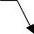矩阵`m`

通常，矩阵的表示通过变量下标或下标完成，并可以有一个或多个维度（下标）。一维数组也称为列表，二维数组称为矩阵。

从数学角度来看，在很多情况下，我们需要使用下标变量，例如：

```
v = [ v0 , v1 , v2 ,,..., v i ,..., v n ]
```

在下标的情况下，或者很好

```
( m00 m01 m02
... m0 j
... m0 n )
m = ( m10 m11 m12 m1j m1n )
( ... ... ... ... ... ... ...  )
```

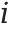
```
( i 0
i 1
i 2
...
...
)
to i n )
```


如果使用了两个下标，这种表示也可以用于使用我们刚刚定义的数组的编程语言中，这就是我们将学习的内容。

例如，假设我们有一个名为`m`的整数一维数组，包含 10 个元素。这些项目将按照形状标识：

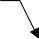

矩阵`m`

|  | `m[0]` | `m[1]` | `m[2]` | `m[3]` | `m[4]` | `m[5]` | `m[6]` | `m[7]` | `m[8]` | `m[9]` |
|---|---|---|---|---|---|---|---|---|---|---|

注意下标是连续的整数，且第一个下标是 0。下标可以是任何正整数表达式。

同样，二维矩阵由带有两个下标（行、列）的变量表示；三维矩阵由带有三个下标的变量表示，以此类推。矩阵的维度最大或在编译器限制范围内的最大元素数量取决于可用内存。

然后，数组根据其维度可以分为一维和多维；根据其内容可以分为数值型、字符型、结构型和指针型。稍后我将详细研究其中的这一切。

## 数值一维数组

与其他变量一样，在使用数组之前你必须定义它。数组的定义是数组的名称、元素的数量和元素的类型。例如，数组的`name`、`size`、`type`。

### 定义数组

数组的定义是数组的名称、元素的数量和元素的类型。例如，数组的`name`、`size`、`type`。

```c
int m[10];

float temperature[31];

int steel[25];
```

第一行创建一个包含 10 个`int`类型元素的数组。第二行创建一个包含 31 个`float`元素的数组。第三行创建一个包含 25 个`int`元素的数组。

## 使用一维数组

为了练习目前介绍的理论，我们将编写一个程序，为包含`N_ITEMS`的一维数组`m`分配数据，然后作为对工作的验证，写出该矩阵的内容。解决方案将类似于：

该数组有 10 个元素。从矩阵中引入这些值。

|  |  |  |
|---|---|---|
| `m[0]` | = | 1 |
| `m[1]` | = | two |
| `m[2]` | = | 3 |
| ... |  |  |

`1 2 3 ...`

结束过程。

首先，我们定义常量`N_ELEMENTS`来确定矩阵中元素的数量：

```c
#define N_ELEMENTS 10;
```

然后，我们创建一个具有该数量元素的矩阵`m`，并定义下标`i`来访问该矩阵中的元素。

```c
int m[N_ELEMENTS]; // 创建矩阵 m

int i = 0; // 下标
```

接下来的步骤是将键盘输入的值赋值给矩阵的每一个元素。

```c
for (i = 0; i < N_ELEMENTS; i++)
{
    printf("m[%d] = ", i);
    scanf("%d", &m[i]);
}
```

读取矩阵后，我们将其可视化以检查任务是否完成。

```c
for (i = 0; i < N_ELEMENTS; i++)
    printf("%d ", m[i]);
```

以下是完整的程序示例：

```c
/************* 创建一个一维矩阵 *************/

/* matrix01.c
*/

#include <stdio.h>

#define N_ELEMENTS 10 // 矩阵元素数量

main()
{
    int m[N_ELEMENTS]; // 创建矩阵 m
    int i = 0; // 下标

    printf("输入数组的值。\n");

    // 输入数据
    for (i = 0; i < N_ELEMENTS; i++)
    {
        printf("m[%d] = ", i);
        scanf("%d", &m[i]);
    }

    // 输出数据 printf("\n\n");
    for (i = 0; i < N_ELEMENTS; i++)
        printf("%d ", m[i]);

    printf("\n\n 结束过程。\n");
}
```

之前的练习教会了我们如何读取和写入数组。接下来的步骤是学习如何处理存储在矩阵中的值。例如，我们想写一个程序，读取给定课程每个学生的平均成绩，将其存储在数组中，并输出该课程的平均分。

正如我们在上一个程序中所做的那样，我们首先创建一个具有最大元素数量的矩阵。然后通过键盘请求实际人数，该人数应匹配学生人数，且在任何情况下都不会大于最大值或小于 1。在这种情况下，有趣的是数组类型为`float`，这样它的元素就可以存储小数。我们还会定义一个索引`i`来访问数组元素，并定义一个变量`sum`用来存储所有成绩的总和。

```c
#define N_STUDENTS 100; // 学生最大人数

float notes[N_STUDENTS]; // 成绩矩阵

int i = 0; // 索引

int no students = 0; // 学生实际人数

float sum = 0; // 所有分数的总和

do
{
    printf("学生人数: ");
    scanf("%d", &nstudents);
}
while (nstudents < 1 || no students > N_STUDENTS);
```

接下来的步骤是将键盘引入的成绩存储在矩阵中。

```c
for (i = 0; i < no students; i++)
{
    printf("学生编号 %3d, 成绩: ", i + 1);
    scanf("%f", &notes[i]);
}
```

最后，将所有分数相加并显示平均分。总和将存储在变量`sum`中。这种使用的变量被称为“累加器”。重要的是，它的初始值必须为 0。

```c
for (i = 0; i < no students; i++)
    sum += notes[i];

printf("\n\n 课程平均分: %5.2f\n", sum / no students);
```

以下是完整的程序示例：

```c
/******************** 课程平均分 *********************/

/* notes.c
*/

#include <stdio.h>

#define N_STUDENTS 100 // 学生最大人数

main()
{
    float notes[N_STUDENTS]; // 学生最大人数
    int i = 0; // 索引
    int no students = 0; // 学生实际人数
    float sum = 0; // 所有分数的总和

    do
    {
        printf("学生人数: ");
        scanf("%d", &nstudents);
    }
    while (nstudents < 1 || no students > N_STUDENTS);

    // 输入数据
    for (i = 0; i < no students; i++)
    {
        printf("学生编号 %3d, 成绩: ", i + 1);
        scanf("%f", &notes[i]);
    }

    // 输出数据 printf("\n\n")
    for (i = 0; i < no students; i++)
        sum += notes[i];

    printf("\n\n 课程平均分: %5.2f\n", sum / no students);
}
```

有两个问题：什么被复制到了`m`？是否创建了矩阵的副本？不，没有创建副本。当参数是一个数组时，传递的是该数组的地址；即该数组物理占用的内存块的起始位置。该地址由`array`名称提供。这意味着 C 语言总是通过引用传递数组。

基于以上内容，`DisplayMatrix`get 矩阵`x`知道什么？嗯，知道起始地址`m`以及它的元素个数`n`；那么，在这个函数中的`m[i]`和`main`函数中的`x[i]`，它们是同一个元素吗？是的，因为这两个函数都从相同的内存位置开始工作，并且针对相同数量的元素。这意味着如果`ArrayDisplay`修改了数组，这些修改也会影响`main`。可以用什么练习来检查这一点。

### 关联数组

在关联数组中，对元素的访问是通过值而不是位置完成的（例如，数组`daysMonth[13]`，它在索引 1 的元素中存储第 1 月的天数，在索引 2 中存储第 2 月的天数，以此类推——记住；我们忽略索引为 0 的元素）。

在这些情况下，如果我们利用这种巧合，解决问题的方案将变得更容易。例如，让我们写一个程序，统计键盘输入的文本中每个字母出现的次数，然后打印结果。为了使示例简单化，我们假设文本只包含英语字母表中的小写字母（既没有重音字母，也没有`ll`或`ñ`）。解决方案可以如下所示：

引入`text`。

对于`Finalize`引入标记`EOF`。

更常用的数组：是一维数组和二维数组。

`[Ctrl][z]`


这里的`b`、`c`、`d`和`F`、`g`、`h`、`i`、`j`、`k`、`he`、`m`、`n`或`p`、`what`、`r`、`s`、`you`或`v`、`w`、`x`和`z`。

`9 1 1 3 5 0 0 0 9 0 0 6 4 6 3 0 0 1 十 两个 二 0 0 0 1 1`

在开始麻烦之前，我们先分析一下将在程序中用到的一些操作。例如，表达式：

`'z' - 'to' + 1`

返回 26。记住每个字符都有一个关联的整数值（ASCII 码），这是机器内部用于处理它的值。A) 是的，例如，`'z'`关联的是 122，`'to'`是 97，等。根据此，上一个表达式的求值是：`122 – 97 + 1 = 26`。

同样的原因，是的，我们执行语句：

```c
int c[256]; // ASCII 表有 256 个字符

char car = 'to'; // car 被赋值为整数 97
```

以下判断为`c[97]`赋值值 10：

```c
c['AC'] = 10;
```

下面显示的另一个语句在逻辑上执行相同的操作，假设`car`被赋值为字符`'to'`。

```c
c[car] = 10;
```

然后，是的，读取一个字符（从`'to'`到`'z'`）：

```c
car = getchar();
```

接下来我们执行操作：

```c
c[char]++;
```

数组`c`的哪个元素被加了？答案是等于所读字符对应代码的下标。我们将读取的字符与数组的下标相匹配。因此，每当我们读取一个`'a'`时，它就会增加计数器`c[97]`或等同的`c['a']`；然后我们就得到了一个来自`' '`的计数器；类似此类，我们对其余字符也这样做。

但是元素`c[0]`到`c[96]`呢？正如我们所说的，初始问题将保持未使用的状态（语句说：字符`'a'`到`'z'`出现的频率）。这虽然没有产生任何负面问题，但可以这样避免：

```c
c[car - 'a']++;
```

当`car`等于`'a'`时，它是元素`c[0]`；当`car`等于`'z'`时，它是元素`c[25]`。通过这种方式，我们可以定义一个整数数组，其元素数量等于`'a'`到`'z'`之间的字符数量（根据 ASCII 表为 26 个字符）。第一个元素将是计数器`'to'`，第二个是来自`'b'`，以此类推。

计数器是一个初始值为 0 的变量（假设计数从 1 开始），然后在每次出现时增加它。这就是我们想要计数的。

```c
/* 文本的频率。 */

#include <stdio.h>

#define N_CHARS ('z'-'a'+1)

/*
   一个数组 c[N_CHARS] 将

             the the the the the
*/
```

```c
int main() {
    int c[N_CHARS];
    char car;
    // ... (代码其余部分)
}
```

```c
char string[10] = "abcd";
printf("%s\n", chain);
```

此示例定义了一个包含 10 个元素的字符数组`string`（`string[0]`到`string[9]`），并将第一个元素赋值为字符`'a'`，第二个为`'b'`，第三个为`'c'`，第四个为`'d'`，第五个及之后的元素赋值为空字符（ASCII 值 0 或转义序列`\0`），C 语言以此自动结束所有的字符字符串。因此，`printf`将输出结果`chain abcd`。另一个示例：

```c
char chain[] = "abcd";
printf("%s\n", chain);
```

这个示例与上一个相同，区别在于现在数组`chain`恰好准备了五个元素。接下来的图示了：

|  | `to` | `b` | `c` | `d` | `\0` |  |  |  |  |  |  |  |  |  |  |
|---|---|---|---|---|---|---|---|---|---|---|---|---|---|---|---|

### 从字符读取和写入字符串

在第 4 节讨论输入流时，我们看到从标准输入流`stdin`中读取字符字符串的方法是使用函数`scanf`配合`%s`格式说明。例如，如果我们想从长度`maxim`中读取一个 40 个字符的名字，我们应该先定义数组然后读取：

```c
char name[41];
scanf("%s", name);
printf("%s\n", Name);
```

在这种情况下，变量`name`前不需要加`&`运算符，因为正如我们之前所说的，数组的标识符是数组的起始地址。在这种情况下，`name`是从字符链开始的符号地址`AC`。

现在，如果你运行上述语句并输入如下内容：

```text
Francisco Javier
```

当你在查看字符串时发现只输入了 Francisco，请不要惊讶。请记住`scanf`函数读取的数据是以空白符分隔的。为了解决这个问题，`scanf`支持自定义格式说明，其语法如下所示：

```text
%[characters]
```

该格式说明表示读取字符，直到读入一个不在`characters`所指集合中的字符为止。反之，则：

```text
%[^characters]
```

这表示读取字符，直到读到一个在`characters`所指集合中的字符为止。例如：

```c
scanf("%[^\n]", Name);
```

之前的判断将从标准输入读取字符，直到找到字符`\n`。对于这种情况，有一个更简单的解决方案，即使用 C 库中的函数`gets`或`fgets`，我们稍后会看到。

此外在第 4 节中，我们看到从流`stdin`读取字符的方法是使用`getchar`函数。因此，读取字符串将涉及反复调用`getchar`函数，并将读取的每个字符存储在字符数组的下一个空位置，同时注意用字符`'\0'`结束字符串。例如：

```c
/* getchar.c
*/

#include <stdio.h>

#define LONG_CAD 41

main()
{
    unsigned char string[LONG_CAD];  // 包含 LONG_CAD 个字符的数组
    int i = 0, car;

    printf("Enter a text: ");

    while ((car = getchar()) != '\n' && i < CAD_LENGTH - 1)
    {
        string[i] = car;
    }

    // 使用字符 '\0' 结束字符串
    string[i] = '\0';

    printf("Text: %s\n", string);
    printf("Length: %d\n", i);
}
```

执行程序：

```text
Enter a text:

Text: hello

Length: 5
```

等等，输入文本包含了一些乱码字符和重复。我在保持源码提供的 C 代码逻辑的同时，对结构进行了清理。

将函数`scanf`或`getchar`与函数`gets`进行比较，可以发现后者提供了一种更方便的读取字符串的方法。它还允许在单行内输入由多个空格分隔的单词组成的字符字符串，且不需要任何来自`Format`类型。

注意，使用`gets`函数时无法指定将读取多少个字符，这是极其危险的，因为存储的字符可能会超出所用数组的边界，而如果使用`fgets`代替它，我们就可以避免这种错误（该函数将在文件章节中进行学习）。

例如，上面示例中的阴影行允许你读取一个十个字符的字符串，但无法控制读取超过 40-1 个字符。解决这个问题的办法是使用`fgets`函数，它允许在第二个参数中指定链的最大长度。与`gets`不同，该函数不会移除`\n`字符。以下代码永远不会包含长度超过 40 个字符（包括终止符`\0`）的链：

```c
char text[40];
fgets(text, 40, stdin); // 读取直到 39 个字符
```

### 函数`puts`

同样，在`stdout`上写入字符链的其他方法是使用`puts`函数，其语法如下：

```c
#include <stdio.h>

int puts(const char *var);
```

**兼容性**：ANSI、UNIX 和 Windows。

C 库函数`puts`将字符字符串写入标准输出`stdout`，并将字符串的终止字符`\0`替换为字符`\n`，这意味着在写入字符串后，它会自动移动到下一行。该函数在运行成功时返回一个正值，在反之的情况下返回值`EOF`。

例如，以下代码行读取并显示字符字符串`name`：

```c
char name[41];
gets(name);
puts(name);
```

下面显示的另一个示例使用了`gets`函数的返回值来视觉化所读取的字符串：


```c
/* puts.c */
#include <stdio.h>

main()
{
    char *c = NULL; // 用于存储 gets 返回的值
    char text[80];

    printf("Enter a line from text:\n");
    c = gets(text);

    printf("\nThe text inserted is:\n");
    puts(text); // 等于: printf("%s\n", text);

    puts("\nIf writes by second time:");
    puts(c);
}
```

### 执行程序

```text
Introduce a line from text: hello
The text inserted is:
hello
I know writes by second time:
hello
```

（注：示例文本包含一些伪迹，为了语义清晰已对其进行了清理。）

第 4 节讨论了在运行 `scanf` 或 `getchar` 后遗留在输入缓冲区中的字符 `\n` 的影响，如果你随后再次执行其中任何一个函数以读取字符的话。发生的情况是，由于 `\n` 是这些函数的有效字符，它会被读取，导致用户预期的输入没有被请求。如果在执行 `gets` 函数时，输入缓冲区中存在字符 `\n`（因为之前执行了上述任何一个函数），`gets` 也会发生相同的情况。

解决此问题的办法是在调用 `scanf` 函数或 `getchar` 后清除与 `stdin` 关联的缓冲区。为了这一点，到目前我们分析了 `fflush` 函数。但我们已经在第 4 节中提到过，该函数在 `UNIX`/`LINUX` 中对源流没有影响。在许多情况下，解决这个问题的方案可能是使用 `gets` 函数，其唯一目的是让输入缓冲区为空。你可以在下面的练习中通过用 `gets(string)` 替换 `fflush(stdin)` 来测试这一点。

接下来的示例尝试阐述上一段中介绍的概念。它结合了 `scanf`、`getchar` 和 `gets` 函数，以展示清理输入缓冲区的必要性。

```c
/************* Clean up the buffer associated with stdin************/
/* fflush.c */
#include <stdio.h>

main()
{
    int integer;
    double real;
    char answer = 's', string[81];

    // 引入数字
    printf("Enter a no. whole and a no. actual:\n");
    scanf("%d %lf", &whole, &real);
    printf("%d + %F = %f\n\n", whole, real, whole + real);

    // 清理输入后的缓冲区并用 gets 读取链
    fflush(stdin); // 或者使用 gets(string)

    printf("Enter chains for gets.\n");
    while (answer == 's' && gets(string))
    {
        printf("%s\n", string);
        printf("Do you want to continue? (y/n): ");
        answer = getchar();
    }
}
```

```c
if (str[i] >= 'to' && str[i] <= 'z') str[i] = str[i] - after;
}
```

### 执行程序

引入一个链：`hello` `HELLO`

针对所提出的问题的解决方案并没有考虑到我们语言中的典型字符，例如 `ñ` 或重音元音。这项工作留给读者作为练习。

## C 语言库中的函数

C 语言库提供了大量的函数，允许你对字符字符串执行各种操作，例如将一个字符串复制到另一个字符串、将一个字符串添加到另一个字符串、比较两个字符串等。下面列出了最常用的函数。关于这些和其他函数的详细描述，请参见附录 A。


### C 函数描述


| 函数 | 描述 |
| --- | --- |
| `strcpy` | 复制字符串。 |
| `strcmp` | 比较两个字符串。 |
| `strlen` | 字符串的长度或字符数量。 |
| `atof` | 将字符串转换为双精度浮点数。 |
| `atoy` | 将字符串转换为整数。 |
| `atole` | 将字符串转换为长整型。 |
| `sprintf` | 将任何允许格式的值转换为字符串。 |
| `printf` | 将值转换为字符字符串。 |
| `lower` | 将字符转换为小写。 |
| `topper` | 将字符转换为大写字母。 |

## 矩阵的类型与尺寸

在第二章中，我们看到通过使用 `typedef` 可以为基本类型或其他派生类型声明别名。`matrix` 类型是一个派生类型（例如，用于维数组的 `int[]`）。因此，你可以这样声明一个数组类型的别名：

```c
typedef double t_array_1d[100];
```

上述行代码定义了一个新类型 `t_matrix_1d`，它定义了一个包含 100 个 `double` 类型元素的单维矩阵。接下来的语句使用该类型定义了一个矩阵 `m`：

```c
t_matrix_1d m;
```

同样，我们看到 `sizeof` 运算符返回其操作数的字节大小。当操作数是一个数组时，结果是该数组的字节大小。例如，下面这行代码计算了之前定义的矩阵 `m` 的元素数量：

```c
printf("Number from elements: %d\n", sizeof(m) / sizeof(m[0]));
```

或者，也可以写成：

```c
printf("Number from elements: %d\n", sizeof(m) / sizeof(double));
```

这里展示的内容可以扩展到我们将要解释的多维数组。

## 多维数组

根据上一章对长度的研究，可以说一维数组的每个元素都是原始类型。那么，如果我们需要存储一年中 12 个月每天的平均温度，该如何操作呢？或者，如果我们需要存储某个班的学生名单，又该如何操作呢？

简而言之，我们将得出结论：使用一维数组来解决提出的问题会导致访问存储的数据非常困难；例如，回答这类问题：5 月 10 日的平均温度是多少？或者，第 25 号学生的名字是谁？

如果以表格的形式存储数据将简单得多。对于温度，可以是一个 12 行（月份数）乘以 31 列（最长月份的天数）的表格；对于姓名，则是一个行数等于学生人数、列数等于姓名字符数加上长度的表格。因此，为了方便解决计划中的问题，需要使用二维数组。

多维矩阵，正如其名称所示，是一个两个或多个维度的矩阵。

## 多维数值数组

多个维度数值矩阵的定义遵循以下形状：

```c
type array_name[expr-1][expr-2]...;
```

其中 `type` 是整数或实数原始类型。多维矩阵中的元素数量是由 `expr-1`、`expr-2`、`...` 给出的维度乘积。

例如，下面的行代码创建了一个具有 `2 × 3 = 6` 个 `int` 类型元素的二维矩阵：

```c
int m[2][3];
```

根据上一行代码，C/C++ 创建了一个二维矩阵 `m`，包含两行 `m[0]` 和 `m[1]`……（此处截断）

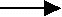

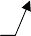

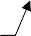

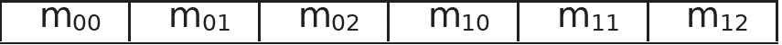

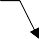

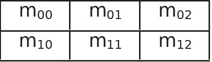

```c
printf("Number  from  rows  from  the  array: ");
scanf("%d", &rows);
}
while (rows < 1 || rows > ROWS_MAX);

do
{
    printf("Number  from  columns  from  the  matrix:  ");
    scanf("%d", &cols);
}
while (cols < 1 || cols > COLS_MAX);
```

下面的代码是将键盘输入的值赋值给矩阵中的每一个元素。

```c
for (row = 0; row < rows; row++)
    for (cabbage = 0; cabbage < cols; cabbage++)
    {
        printf("m[%d][%d]  =  ", row, cabbage);
        scanf("%f", &m[row][col]);
    }
```

每当读取一次矩阵时，我们计算每一行的和，并将结果视觉化，以检查任务是否完成。

```c
for (row = 0; row < rows; row++)
{
    sumrow = 0;

    for (cabbage = 0; cabbage < cols; cabbage++)
        sumrow += m[row][col];

    printf("Sum  from  the  row  %d  =  %g\n", row, sumrow);
}
```

这是我完整的程序示例，供后续学习。

### 二维矩阵的行和

```c
/* matrixbi.c */

#include <stdio.h>

#define ROWS_MAX 10
#define COLS_MAX 10

main()
{
    float m[ROWS_MAX][COLS_MAX];  // 二维矩阵 m
    float sumrow;                 // 每一行元素的和

    int rows, cols;               // 矩阵的行和列数
    int row, cabbage;             // 访问元素的行和列

    do
    {
        printf("Number  from  rows  from  the  array: ");
        scanf("%d", &rows);
    }
    while (rows < 1 || rows > ROWS_MAX);

    do
    {
        printf("Number  from  columns  from  the  matrix:  ");
        scanf("%d", &cols);
    }
    while (cols < 1 || cols > COLS_MAX);

    // 输入数据
    printf("Enter  the  values  from  the  array.\n");

    for (row = 0; row < rows; row++)
        for (cabbage = 0; cabbage < cols; cabbage++)
        {
            printf("m[%d][%d]  =  ", row, cabbage);
            scanf("%f", &m[row][col]);
        }

    // 写入每一行的和
    for (row = 0; row < rows; row++)
    {
        sumrow = 0;

        for (cabbage = 0; cabbage < cols; cabbage++)
            sumrow += m[row][col];

        printf("Sum  from  the  row  %d  =  %g\n", row, sumrow);
    }

    printf("\nEnd  the  process.\n");
}
```

当然，我曾考虑过是否可以在读取数据的同时完成计算每一行的和，我所指示的后续如下：

```c
for (row = 0; row < rows; row++)
{
    sumrow = 0;

    for (cabbage = 0; cabbage < cols; cabbage++)
    {
        printf("c[%d][%d]  =  ", row, cabbage);
        scanf("%f", &m[row][col]);
        sumrow += m[row][col];
    }

    printf("Sum  from  the  row  %d  =  %g\n", row, sumrow);
}
```

然而，这种方法在结果视觉化方面有所不同，它是在读取完相同的数据后在下方显示每一行的和。

```text
矩阵的行数：2
矩阵的列数：2
引入矩阵中的值。
m[0][0] = 2
m[0][1] = 5
行 0 的和：7
m[1][0] = 3
m[1][1] = 6
行 1 的和：9
结束进程。
```

使用最后这种方法，在最后结果写入结果的方案是将它们存储在一个一维数组中，然后显示矩阵。我将其留给读者作为练习。

### 字符串数组

字符串数组是多维数组（通常是二维数组），其中每一行对应一个字符串。正如所研究的，一行将是一个 `char` 或 `unsigned char` 类型的一维数组。进行与数值维度类似的研究，字符串数组的定义可以如下所示完成：

```c
char array_name[rows][length];
```

例如，接下来的行代码创建了一个 `F` 行、每行最多 `C` 个字符的字符串数组：

```c
char m[F][C];
```

从上述行代码中，`C` 创建了一个一维数组 `m`，其元素为 `m[0]`、`m[1]`、……、`m[F-1]`。这些元素本身是包含 `C` 个 `char` 类型元素的单矩阵。

在图上可以这样想象：

| 元素 |
| --- |
| `m[0]` |
| `m[1]` |
| `m[2]` |
| `m[3]` |
| `...` |
| `m[F-1]` |

显然，这种方法通过 `m[0]`、`m[1]`、……来访问 `m` 的元素。这些元素本身是包含 `C` 个 `char` 类型元素的单矩阵。


## 二维矩阵的行和

```c
/ matrixbi.c

#include <stdio.h>

#define ROWS_MAX 10  // 最大行数
#define COLS_MAX 10  // 最大列数

main()
{
    float m[ROWS_MAX][COLS_MAX];  // 二维矩阵 m
    float sumrow;                 // 每一行元素的和

    int rows, cols;               // 矩阵的行和列数
    int row, cabbage;             // 访问元素的行和列

    do
    {
        printf("Number  from  rows  from  the  array: ");
        scanf("%d", &rows);
    }
    while (rows < 1 || rows > ROWS_MAX);

    do
    {
        printf("Number  from  columns  from  the  matrix:  ");
        scanf("%d", &cols);
    }
    while (cols < 1 || cols > COLS_MAX);

    // 输入数据
    printf("Enter  the  values  from  the  array.\n");

    for (row = 0; row < rows; row++)
    {
        for (cabbage = 0; cabbage < cols; cabbage++)
        {
            printf("m[%d][%d]  =  ", row, cabbage);
            scanf("%f", &m[row][col]);
        }
    }

    // 写入每一行的和
    for (row = 0; row < rows; row++)
    {
        sum row = 0;

        for (cabbage = 0; cabbage < cols; cabbage++)
            sum row += m[row][col];

        printf("Sum  from  the  row  %d  =  %g\n", row, sumrow);
    }

    printf("\nEnd  the  process.\n");
}
```

下面的代码是将键盘输入的值赋值给矩阵中的每一个元素。

```c
for (row = 0; row < rows; row++)
{
    for (cabbage = 0; cabbage < cols; cabbage++)
    {
        printf("m[%d][%d]  =  ", row, cabbage);
        scanf("%f", &m[row][col]);
    }
}
```

每当读取一次矩阵时，我们计算每一行的和，并将结果视觉化，以检查任务是否完成。

```c
for (row = 0; row < rows; row++)
{
    sum row = 0;

    for (cabbage = 0; cabbage < cols; cabbage++)
        sum row += m[row][col];

    printf("Sum  from  the  row  %d  =  %g\n", row, sumrow);
}
```

当然，我曾考虑过是否可以在读取数据的同时完成计算每一行的和，我所指示的后续如下：

```c
for (row = 0; row < rows; row++)
{
    sum row = 0;

    for (cabbage = 0; cabbage < cols; cabbage++)
    {
        printf("c[%d][%d]  =  ", row, cabbage);
        scanf("%f", &m[row][col]);
        sum row += m[row][col];
    }

    printf("Sum  from  the  row  %d  =  %g\n", row, sumrow);
}
```

然而，这种方法在结果视觉化方面有所不同，它是在读取完相同的数据后在下方显示每一行的和。

矩阵的行数：2

矩阵的列数：2

引入矩阵中的值。

`m[0][0]` = 2

`m[0][1]` = 5

行 0 的和：7

`m[1][0]` = 3

`m[1][1]` = 6

行 1 的和：9

结束进程。

使用最后这种方法，在最后结果写入结果的方案是将它们存储在一个一维数组中，然后显示矩阵。我将其留给读者作为练习。

### 字符链数组

字符串数组是多维数组（通常是二维数组），其中每一行对应一个字符链。正如所研究的，一行将是一个 `char` 或 `unsigned char` 类型的一维数组。进行与数值维度类似的研究，字符串数组的定义可以如下所示完成：

```c
char array_name[rows][length];
```

例如，接下来的代码行创建了一个 `F` 行、每行最多 `C` 个字符的字符串数组。

```c
char m[F][C];
```

从上述代码行中，`C` 创建了一个一维数组 `m`，其元素为 `m[0]`、`m[1]`、……、`m[F-1]`，这些元素本身是包含 `C` 个 `char` 类型元素的单矩阵。在图上可以这样想象：

| 元素 |
|---|
| `m[0]` |
| `m[1]` |
| `m[2]` |
| `m[3]` |
| `...` |
| `m[F-1]` |

```c
fflush(stdin);
}
while (answer != 's' && answer != 'n');

if (answer == 's')
{
    // 可视化 Names 中的内容
    printf("\n");

    for (row = 0; row < nRows; row++)
        printf("%s\n", name[row]);
}
}
```

标识符 `name` 指向一个二维字符数组。该数组的行是一个字符字符串（一维字符数组），而 C/C++ 库提供了 `gets` 函数来从一维数组中读取数据。通过这种方式，读取一行（一个字符链）时，我们只需要使用一个索引。这不适用于数值数组。由于 C/C++ 库没有提供完整读取整行的函数，因此二维数组在逻辑上是可行的。

继续对上一个程序的分析，数据输入会在输入文件结束标记（`EOF`）或输入了所有名称后结束。

同样地，一旦数据输入完成，程序会询问你是否想要显示数组的内容。在这种情况下，通过 `getchar` 获取答案。

我观察了判断语句：

```c
answer = tolower(getchar());
```

等同于：

```c
answer = getchar();       // 读取一个字符
answer = tolower(response);  // 将其转换为小写
```

### 复制数组

C 库不包含将一个数组复制到另一个数组的函数，字符数组或字符字符串除外，它们包含了 `strcpy`。因此，为了将一个数组复制到另一个数组，我们必须在其他程序中添加相应的代码。

作为一个示例，我们将编写一个程序，读取一个指定类型的二维数组 `a`，将数组 `a` 复制到另一个特征相同的数组 `c`，并按行可视化矩阵 `c`。

读取和写入数组我们在之前的程序中已经做过了。将一个数组传递到另一个数组是一个相似的过程。因此，将二维矩阵 `a` 复制到特征相同的矩阵 `c` 中，可以按照以下形式进行：

```c
for (row = 0; row < ROWS; row++)
{
    for (cabbage = 0; cabbage < COLS; cabbage++)
        c[row][col] = a[row][col];
}
```

这是完整的程序示例：

```c
/******************* 将矩阵复制到另一个地方*****************/
/* copy_arrays.c */

#include <stdio.h>

#define ROWS 3
#define COLS 3

main()
{
    float a[ROWS][COLS], c[ROWS][COLS];
    int row = 0, cabbage = 0;

    // 读取矩阵数据
    for (row = 0; row < ROWS; row++)
    {
        for (cabbage = 0; cabbage < COLS; cabbage++)
        {
            printf("a[%d][%d] = ", row, cabbage);
            scanf("%f", &a[row][col]);
        }
    }

    // 将矩阵复制到 c
    for (row = 0; row < ROWS; row++)
    {
        for (cabbage = 0; cabbage < COLS; cabbage++)
            c[row][col] = a[row][col];
    }

    // 从矩阵 c 写入数据
    for (row = 0; row < ROWS; row++)
    {
        // 写入一行
        for (cabbage = 0; cabbage < COLS; cabbage++)
            printf("%10g", c[row][col]);

        printf("\n");  // 行后续
    }
}
```

执行程序：

```text
to[0][0] = 1
a[0][1] = two
a[0][2] = 3
to[1][0] = 4
to[1][1] = 5
to[1][2] = 6
a[2][0] = 7
to[2][1] = 8
to[2][2] = 9
1 2 3
4 5 6
7 8 9
```

正如我们之前所说，C 库提供了一个复制字符数组的函数。同样，我们可以编写一个函数将一个数组复制到另一个数组，并修改上面的程序，使用此函数来实现复制操作。

将一个数组复制到另一个数组的函数必须有两个参数：目标矩阵和源矩阵。根据此，函数可能是这样的：

```c
void CopyArray(float destination[][COLS], float origin[][COLS])
{
    int row = 0, cabbage = 0;

    for (row = 0; row < ROWS; row++)
    {
        for (col = 0; col < COLS++)
            destination[row][col] = origin[row][col];
    }
}
```

在谈到一维数组时，我们提到当在函数中作为形式参数声明数组时，可以省略大小。同样的理论也适用于多维数组，但仅限于第一维度（因为在多维数组中，第一维度是元素本身为数组的数组大小），这也是我们在 `CopyArray` 函数中所做的。完整的程序示例以供后续。


## 复制数组

```c
/******************* 复制数组*****************/
/*  copy_arrays.c
*/
#include <stdio.h>
#define ROWS 3
#define COLS 3
void CopyArray(float destination[][COLS], float origin[][COLS]);

main()
{
    float a[ROWS][COLS], c[ROWS][COLS];
    int row = 0, cabbage = 0;
    // 读取矩阵读取数据
    for (row = 0; row < ROWS; row++)
    {
        for (cabbage = 0; cabbage < COLS; cabbage++)
        {
            printf("a[%d][%d] = ", row, cabbage);
            scanf("%f", &a[row][col]);
        }
    }
    // 将矩阵复制到 c
    CopyArray(c, a);
    // 从矩阵 c 写入数据 (row = 0; row < ROWS; row++)
    {
        // 写入一行
        for (cabbage = 0; cabbage < COLS; cabbage++) printf("%10g", c[row][col]);
        printf("\n");  // 行后续
    }
}

void CopyArray(float destination[][COLS], float origin[][COLS])
{
    int row = 0, cabbage = 0;
    for (row = 0; row < ROWS; row++)
    {
        for (col = 0; col < COLS++) destination[row][col] = origin[row][col];
    }
}
```

### 字节块操作

上一个节执行的`CopiarMat`函数的缺点是不自治的，因为它依赖于`ROWS`和`COLS`常量。让我们深入学习一下指针，我们将学习如何解决这个问题。然而，如果我们使用 C/C++ 库的`memcpy`函数，现在有一个直接的解决方案将块理解为一组连续的字节。下面的示例首先使用`memset`函数将矩阵`a`和`c`初始化为 0；然后使用`memcpy`将矩阵复制到矩阵；最后使用`memcmp`逐字节比较内容是否相同。

```c
/******************* 将矩阵复制到另一个地方*****************/
/*  memxxx.c
*/
#include <stdio.h>
#include <string.h>
#define ROWS 3
#define COLS 3

main()
{
    float a[ROWS][COLS], c[ROWS][COLS];
    int row = 0, cabbage = 0;
    // 读取矩阵读取数据
    for (row = 0; row < ROWS; row++)
    {
        for (cabbage = 0; cabbage < COLS; cabbage++)
        {
            printf("a[%d][%d] = ", row, cabbage);
            scanf("%f", &a[row][col]);
        }
    }
    // 初始化 c 为 0
    memset(c, 0, sizeof(c));
    // 将 复制到 c
    memcpy(c, a, sizeof(a));
    // 比较并输出
    if (memcmp(a, c, sizeof(a)) == 0) printf("数组 a 和 c 包含相同的数据\n");
    else
    printf("数组 a 和 c 不包含相同的数据\n");
}
```

## 结构体

我们到为止使用的所有变量都允许我们存储一个数据且类型单一，除了存储了多个数据但都是相同类型的数组外。结构体的目的是将一个或多个（通常是不同类型的）变量组合在同一个名称下，以便于处理。

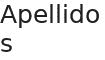[](Images/image18584.jpeg)[](Images/image18585.jpeg)[](Images/image18586.jpeg)[](Images/image18587.jpeg)结构的一个典型示例是一个文件，存储与个人相关的数据，如`Name`、`Surnames`、`address`等。其他编译器提供的`c`，建筑类型它们是记录记录。

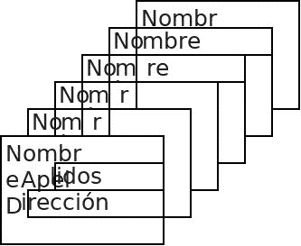

这些数据中的本身也可以是结构。例如，出生日期可能是一个包含`day`、`month`和`year`数据的结构。

## 创建结构

要创建一个结构，你必须定义一个新的数据类型并声明一个该类型的变量。`struct`类型的声明包含了组成它的元素以及这些元素的类型。结构中的每个元素接收一个成员名称（如果我们谈论的是记录，则称为字段）。语法如下：

```c
structure structure_type
{
    type member_1 ;
    type member_2 ;
    // ...
    type member_n ;
} [ 变量列表 ];
```

`struct`关键字告诉编译器正在定义一个结构。`structure; struct_type`是命名新定义类型的标识符；每个成员可以是基本类型（`char`、`int`、`float`等），也可以是类型派生类型：`matrix`、`pointer`、`Union`、`structure`或`function`。例如：

```c
structure tfile /* 定义结构 tfile 的语句 */
{
    char name[40];
    char address[40];
    long phone;
};
```

结构成员的声明不能包含限定符。存储类参数如`extern`、`static`、`auto`或`register`不能从这里开始。

```c
structure tfile /* 定义结构 tfile 的语句 */
```

{

```c
char address[40];
```

}

```c
};
```c

```

C 语言中的结构只能包含对应于变量定义的成员。相反，C++ 允许结构包含成员，甚至是函数定义的成员。

## 从结构类型定义变量

使用这种新类型的规则与预定义的类型（如`float`、`int`或`char`等）相同。也就是说，在定义结构类型后，可以从该类型声明变量。因此：

```c
structure structure_type [ 变量 [, 变量 ]...];
```

例如，以下代码定义了上一个示例中定义的`struct tfile`类型的变量`var1`和`var2`；因此，`var1`和`var2`是具有`name`、`address`和`phone`成员的数据结构。

```c
structure tfile var1, var2;
```

我注意到在定义`var1`和`var2`时指定了`structure`单词，但逻辑上似乎可以写：

```c
tfile var1, var2;
```

这在 ANSI C 中是不可能的，但在 C++ 中是允许的。然而，使用`typedef`（正如接下来的所示），我们可以获得前面的形式。例如：

```c
structure file
{
    char name[40];
    char address[40];
    long phone;
};
typedef structure file ttab;
tfile var1, var2;
```

`typedef`语句之前声明了结构`tab`的同义词`tfile`。也可以通过以下形状实现：

```c
typedef structure file
{
    char name[40];
    char address[40];
    long phone;
} ttab;
```

```c
typedef structure
{
    char name[40];
    char address[40];
    long phone;
} ttab;
```

结构`var1`和`var2`的定义也可以紧接在新类型的声明之后，如下例所示，尽管这并不是惯做法：

```c
structure tfile
{
    char name[40];
    char address[40];
    long phone;
} var1, var2;
```

你也可以像下面所示定义`var1`和`var2`；继续；即不留存新声明类型的记录，这种形式是不建议的，因为以后我们无法从该类型定义其他变量。

```c
structure
{
    char name[40];
    char address[40];
    long phone;
} var1, var2;
```

## 访问结构的成员

C 语言中的结构只能包含对应于变量定义的成员。相反，C++ 允许结构包含成员，甚至是函数定义的成员。

访问结构的成员。结构的成员使用点`.`。例如，代码中的第一条语句将值 2323 赋值给`var1`的成员，第二条从`var2`中读取（例如）：

```c
var1.phone = 2323;
```

最后，可以说结构的成员是按字节顺序存储的，顺序与它们声明的顺序相同。见下图：

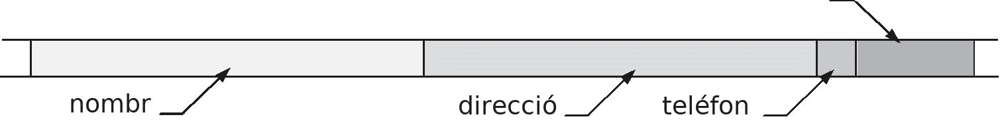

## 结构的操作

结构结构的变量允许以下操作：

*   在定义时初始化它：
```c
structure file person = { "Francisco", "Santander 1", 232323, 25, 8, 1982 };
```

*   通过运算符`&`获取其方向：
```c
structure file *pperson = &person;
```

*   访问其一个成员：
```c
long phone = person.phone;
```

```c
another_person = person;
```

当一个结构体赋值给另一个结构体时，所有的成员都会被一个一个地复制。目标结构体中的源结构体成员，无论其类型是哪一种；也就是说，我知道这是复制了整个结构体。

例如，下面的程序定义了类型为`tfi-key`的`person`结构体，并将通过键盘输入的数据分配给它的每个成员。兄弟们，将`person`结构体复制到相同类型的`other_person`结构体中，并在屏幕上显示最后一个结构体中存储的数据。

```c
/**********  结构体操作 *******/
/*  structures.c
*/
#include <stdio.h>

typedef structure
{
int day, month, year;
} tdate;

typedef structure
{
char name[40]; char address[40]; long phone;
tdate date_of_birth;
} ttab;

main()
{
tfile person, another_person;

// 输入数据  printf("Name: "); gets(person.name);
printf("Address: "); gets(person.address); printf("Phone: "); scanf("%ld", &person.phone); printf("Date from birth:\n"); printf("  Day:             ");
scanf("%d", &person.date_of_birth.day); printf("  Month: ");
scanf("%d", &person.date_of_birth.month); printf("  Year: ");
scanf("%d", &person.date_of_birth.year);

// 复制结构体到另一个 another_person = person;

// 打印新结构体中的数据 printf("\n\n");
printf("Name: %s\n", other_person.name); printf("Address: %s\n", another_person.address); printf("Phone: %ld\n", another_person.phone); printf("Date from birth:\n");
printf("  Day: %d\n", another_person.date_of_birth.day); printf("  Month:             %d\n", another_person.date_of_birth.month); printf("  Year: %d\n", another_person.date_of_birth.year);
}
```

程序执行：
Name: Xavier
Address: Paseo from Pereda 10, Santander Telephone: 942232323
Date from birth: Day: 12
Month: 7
Year: 1987
Name: Xavier
Address: Paseo from Pereda 10, Santander Telephone: 942232323
Date from birth: Day: 12
Month: 7
Year: 1987

### 结构体数组

当矩阵的元素来自某种结构体类型时，该矩阵被称为结构体矩阵或记录矩阵。这是一种非常有用且强大的构造，它允许我们处理块状数据，在很多情况下，我知道这对应于对象，通常对应普通生命周期中的对象。

要定义一个结构体数组，你必须先声明一个结构体类型。该结构体与矩阵中元素的类型匹配。例如：

```c
typedef structure
{
char name[60]; float note;
} ttab;
```

然后，我以类似的方式定义矩阵，如下面的示例所示：

```c
tfile student[100];
```

这个示例定义了一个名为`student`的结构体数组，包含 100 个元素（`student[0], student[1], ..., student[i], ..., student[99]`），每个元素都是一个拥有`name`和`note`数据成员的结构体。要访问矩阵中元素`i`的姓名和分数，我们将使用以下符号：

```
student[i].name
student[i].note
```

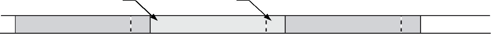note name
`student[i-1]`
`student[i]`
`student[i+1]`

例如，为了应用目前为止解释的内容，我们将执行要求：读取一个学生列表以及特定课程对应的成绩；结果将是及格和不及格学生的百分比。继续执行程序的步骤如下：

* 声明结构体类型并定义结构体数组，此外定义任何其他必要的变量。
* 设置一个循环读取并在矩阵中存储每个学生的姓名和分数。
* 设置一个循环遍历数组的所有元素，并统计及格（分数大于或等于 5）和不及格（其余）。

```c
for (i = 0; i < no; i++)
if (student[i].note >= 5)
else
suspended++;
```

* 写入及格和不及格的百分比。

完整的程序如下面的继续示例所示。

```c
/********** 计算及格和不及格的百分比 *******/
/*  matrix_of_st.c
*/
#include <stdio.h>

#define NA 100 // 学生最大数量

typedef structure
{
char name[60]; float note;
} ttab;

main()
{
static tfile student[NA]; // 结构体或记录矩阵
int n = 0, i = 0, approved = 0, suspended = 0;
char *finish = NULL; // 数据输入

printf("Enter data. ");
scanf("%d", &n);
while (n < NA)
{
printf("Name: ");
gets(student[n].name);
printf("Note: ");
scanf("%f", &student[n].note);
n++;
}

for (i = 0; i < n; i++)
{
if (student[i].note >= 5)
    approved++;
else
    suspended++;
}

printf("\n\n");
printf("Approved: %.2f%%\n", (float)approved/n*100);
printf("Suspended: %.2f%%\n", (float)suspended/n*100);
}
```


程序执行：

```
Enter data: 3
Name: Xavier
Note: 8.5
Name: Maria
Note: 4.0
Name: Jose
Note: 9.0

Approved: 66.67%
Suspended: 33.33%
```

### 联合体 (JOINTS)

联合体是一个由多个成员共享的存储区域，通常是不同的类型。这允许你使用同一内存处理不同类型的数据。联合体的声明与结构体的声明形式相同，只是使用了关键字 `union` 而不是 `struct`。因此，适用于结构体的所有内容都适用于联合体，但联合体的成员并不各自拥有独立的存储空间，而是共享一个大小等于最大成员字节数的空间。

```
union union_type
{
    /* 成员语句 */
};
```

其中 `union_type` 是定义新类型的标识符。定义了联合体类型后，可以声明该类型的类型或多个变量，语法如下：

```c
union union_type [ variable [, variable ]...];
```

要访问联合体中的确定成员，使用以下符号：

`union_variable.member`

下面的示例说明了上述内容。它是一个类型为 `times` 的变量 `var1`，它可以存储字符链、整数或浮点数，但一次只能存储一条信息，而不是同时存储三者；换句话说，`var1` 存储的数据可以根据字符字符串、整数或浮点数进行处理，取决于使用哪个成员来访问它。

```c
union times
{
    char cms[12];
    int names;
    float temperature;
};

union times var1;
```

在下图中可以观察到，对应 `var1` 的成员并没有各自拥有独立的存储空间，而是共享一个大小等于最长成员字节数的空间，在本例中是 `cms`（12 字节）。该空间允许存储一个包含 `'\0'` 在内的 `12` 个字符的字符串、整数或单精度浮点数。

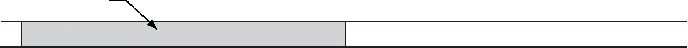`var1`

`cms` 或 `numbers` 或 `temperature`

如果 `var1` 是结构体（struct）而不是联合体（union），如图所示，将需要 `12+4+4` 字节的内存空间（假设 `int` 占用 `4` 字节）。

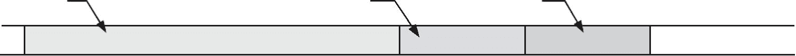`cms` `nms` `temperature`

简而言之，在联合体中，所有成员共享相同的空间。每当给同一个成员或不同成员赋值时，所存储的值就会被覆盖。例如，你认为以下程序会产生什么结果？

```c
#include <stdio.h>

typedef union
{
    int a;
    int b;
} tunion;

main()
{
    tunion var1;
    var1.a = 10;
    var1.b = 100;
    printf("%d ", var1.a);
    printf("%d ", var1.b);
}
```

这个示例定义了一个联合体 `var1`，其成员 `a` 和 `b` 共享四个字节的类型内存空间（假设 `int` 占用四个字节）。执行过程如下：

1. 赋值语句 `var1.a = 10` 在公共空间上存储值 `10`。
2. 赋值语句 `var1.b = 100` 在公共空间上存储值 `100`，覆盖了之前的数据。

根据上述陈述，我所知道的程序运行结果将是：

```
100 100
```

这种解决方案并不意味着存在两个数据。存在的是通过两个成员访问的同一个数据（在本例中为相同类型）。基于此，另一个程序的运行结果怎样的？

```c
#include <stdio.h>

typedef union
{
    float a;
    int b;
} tunion;

main()
{
    tunion var1;
    var1.a = 10.5;
    printf("%g\n", var1.a);
    printf("%d\n", var1.b);
}
```

执行程序：

```
10.5
1093140480
```

在这个示例中，联合体同样有两个成员：一个 `float` 类型成员和一个 `int` 类型成员，因此共享的内存空间为四个字节。在该内存空间上，执行语句 `var1.a = 10.5` 后，存储了以下二进制形式表示的值：

```
01000001001010000000000000000000
```

由于两个成员都是四个字节长，从 `float` 类型的 `var1.a` 访问并显示将返回 `10.5`，但从 `int` 类型的 `var1.b` 访问并显示将导致 `1093140480`。如果你手动按照 `float` 和 `int` 的正确格式视角进行转换，将能够验证这些结果。

### 结构体变量

联合体的一种应用是可以定义一组变量成员的数据结构。也就是说，这种结构允许根据程序的需要使用某些成员或其他成员。为此，它的任何成员都必须是一个联合体。

例如，假设我们想设计一个标记来存储图书馆中与书籍或科学期刊相关的数据。对于每本书或杂志，将包含以下信息：

1. 参考编号。
2. 资质。
3. 作者姓名。
4. 出版社。
5. 出版分类（书籍或杂志）。
6. 版本号（仅限书籍）。
7. 出版日期（仅书籍）。
8. 杂志名称（仅期刊）。

显然，每张卡片始终包含成员 1, 2, 3, 4 和 5，以及更多：如果是书籍，则包含成员 6 和 7；如果是杂志，则包含成员 8。这种分离关系产生了一个包含两个成员的联合体：一个包含成员 6 和 7 的结构 `ra` 以及成员 8。让我们看看：

```c
struct book
{
    unsigned edition;
    unsigned year;
};

union book_magazine
{
    struct book books;
    char revname[30];
};
```

根据上述陈述，文件的设计将保持如下形式：

```c
struct file
{
    unsigned refnum;
    char title[30];
    char editorial[25];
    int publication_class;
};
```

类型为 `book_magazine` 的 `lr` 了一个结构体变量。该变量将包含 `edition` 或 `year`。上面的结构可以写为：

```c
struct file
{
    unsigned refnum;
    char title[30];
    char editorial[25];
    int publication_class;
};

union book_magazine
{
    struct
    {
        unsigned edition;
        unsigned year;
    } books;
    char revname[30];
};
```

```c
printf("Book or magazine (0 = book, 1 = magazine) ");
scanf("%d", &class);
fflush(stdin);
}
while (class != 0 && class != 1);
if (class == book)
{
    bibli[k].book_magazine = book;
    printf("Edit ");
    scanf("%u", &bibli[k].lr.books.edition);
    printf("Year from public. ");
    scanf("%u", &bibli[k].lr.books.anyo);
    fflush(stdin);
}
else
{
    bibli[k].book_magazine = magazine;
    printf("Name magazine ");
    gets(bibli[k].lr.revname);
}
k++;
do
{
    printf("\nMore data to Introduce? y/n ");
    resp = getchar();
    fflush(stdin);
}
while( tolower(resp) != 's' && tolower(resp) != 'n' );
}
return k;
}

/***************************************************** ************** Function for to list everyone the elements from the matrix
************************************************** *************/
void write(ttoken bible[], int n)
{
    int k = 0;
    for (k = 0; k < n; k++)
    {
        printf("%d %s\n", bibli[k].numref, bibli[k].title);
        printf("%s - Ed. %s\n", bibli[k].author, bibli[k].editorial);
        switch (bibli[k].book_magazine)
        {
            case book:
                printf("Edit %or - year %a", bibli[k].lr.books.edition, bibli[k].lr.books.anyo);
                break;
            case magazine:
                printf("%s\n", bibli[k].lr.nomrev);
        }
        printf("\nPress <Enter> for continue");
        getchar();
        system("cls");
    }
}
```

### 程序运行：

引用编号 1001  
标题 C/C++. 编程课程  
作者 Ceballos  
出版者 RA-MA  
书籍或杂志 (0 = 书, 1 = 杂志) 0  
版本 3  
来自公共。 2007  
是否介绍更多数据？y/n s  
// ...  
列出书籍和期刊列表  
1001 C/C++. 编程课程 Ceballos - Ed. BRANCH  
版本 3 - 年份 2007  
按 <回车> 继续  
// ...

我注意到已经将 `tfile` 类型声明为全局级别，以便在 `Program` 程序中需要的地方任何函数中使用它。

### 位域字段 (FIELDS FROM BITS)

结构体成员（非来自 `Union` 联合体）也可以是位域，位域被理解为在一个可寻址单元地址内的一组相邻的位集合，通常是一个 `int`。声明位域的语法如下：

`类型 [ 标识符 ] : 大小`

大小指定了字段对应的位数，并且必须是一个非负整数常量，不能超过物理机器的物理尺寸；即 `int` 的大小。类型必须是整型。与 ANSI C 参考将位域的类型限制为 `int` 或 `unsigned int` 不同，C++ 允许位域为任何整型类型；例如 `char`、`short`、`int`、`long`，有符号或无符号，或列出的类型。我不知道允许位域数组、位域指针或返回位域的函数。字段标识符是可选的；未标识的字段作为填充。

位域的分配取决于硬件；也就是说，位是从最高位到最低位分配或反之，如下面的示例所示，取决于所使用的机器。下面的示例澄清了上述内容。

```c
/*********************** 位域***********************/
/* bit_fields.c
*/
#include <stdio.h>

struct word // 32 位的字: 0 到 31
{
    unsigned car_ascii : 7; // 位 0 到 6
    unsigned parity_bit : 1; // 位 7
    unsigned operation : 5;  // 位 8 到 12
    unsigned :18;  // 位 13 到 30 填充
    unsigned bit_sign : 1;  // 位 31
};

main() // 函数
{
    struct word cb = {'C', 1, 0x1E};
    printf("bit fields: %x\n", cb);
    printf("bit sign : %x\n", cb.bit_sign);
    printf("operation : %x\n", cb.operation);
    printf("bit parity: %x\n", cb.bit_parity);
    printf("character %c\n", cb.car_ascii, cb.car_ascii);
}
```

程序运行：  
位域: 1ec  
位符号 : 0  
操作 : 1e  
奇偶 : 1  
字符 : 43  
内存中的分配情况如下：  
31 30 29 28 27 26 25 24 23 22 21 20 19 18 17 16 15 14 13 12 11 10 9 8 7 6 5 4 3 2 1 0  
| | | | | | | | | | | | | | | | | | | | | | | | | | | | | | | | |

位域的分配取决于硬件；也就是说，位是从最高位到最低位分配或反之，如下面的示例所示，取决于所使用的机器。下面的示例澄清了上述内容。

```c
/*********************** 位域***********************/
/* bit_fields.c
*/
#include <stdio.h>

struct word // 32 位的字: 0 到 31
{
    unsigned car_ascii : 7; // 位 0 到 6
    unsigned parity_bit : 1; // 位 7
    unsigned operation : 5;  // 位 8 到 12
    unsigned :18;  // 位 13 到 30 填充
    unsigned bit_sign : 1;  // 位 31
};

main() // 函数
{
    struct word cb = {'C', 1, 0x1E};
    printf("bit fields: %x\n", cb);
    printf("bit sign : %x\n", cb.bit_sign);
    printf("operation : %x\n", cb.operation);
    printf("bit parity: %x\n", cb.bit_parity);
    printf("character %c\n", cb.car_ascii, cb.car_ascii);
}
```

程序运行：  
位域: 1ec  
位符号 : 0  
操作 : 1e  
奇偶 : 1  
字符 : 43  
内存中的分配情况如下：  
31 30 29 28 27 26 25 24 23 22 21 20 19 18 17 16 15 14 13 12 11 10 9 8 7 6 5 4 3 2 1 0  
| | | | | | | | | | | | | | | | | | | | | | | | | | | | | | | | | |

位域的分配取决于硬件；也就是说，位是从最高位到最低位分配或反之，如下面的示例所示，取决于所使用的机器。下面的示例澄清了上述内容。

```c
/*********************** 位域***********************/
/* bit_fields.c
*/
#include <stdio.h>

struct word // 32 位的字: 0 到 31
{
    unsigned car_ascii : 7; // 位 0 到 6
    unsigned parity_bit : 1; // 位 7
    unsigned operation : 5;  // 位 8 到 12
    unsigned :18;  // 位 13 到 30 填充
    unsigned bit_sign : 1;  // 位 31
};

main() // 函数
{
    struct word cb = {'C', 1, 0x1E};
    printf("bit fields: %x\n", cb);
    printf("bit sign : %x\n", cb.bit_sign);
    printf("operation : %x\n", cb.operation);
    printf("bit parity: %x\n", cb.bit_parity);
    printf("character %c\n", cb.car_ascii, cb.car_ascii);
}
```

程序运行：  
位域: 1ec  
位符号 : 0  
操作 : 1e  
奇偶 : 1  
字符 : 43  
内存中的分配情况如下：  
31 30 29 28 27 26 25 24 23 22 21 20 19 18 17 16 15 14 13 12 11 10 9 8 7 6 5 4 3 2 1 0  
| | | | | | | | | | | | | | | | | | | | | | | | | | | | | | | | | | |

位域的分配取决于硬件；也就是说，位是从最高位到最低位分配或反之，如下面的示例所示，取决于所使用的机器。下面的示例澄清了上述内容。

```c
/*********************** 位域***********************/
/* bit_fields.c
*/
#include <stdio.h>

struct word // 32 位的字: 0 到 31
{
    unsigned car_ascii : 7; // 位 0 到 6
    unsigned parity_bit : 1; // 位 7
    unsigned operation : 5;  // 位 8 到 12
    unsigned :18;  // 位 13 到 30 填充
    unsigned bit_sign : 1;  // 位 31
};

main() // 函数
{
    struct word cb = {'C', 1, 0x1E};
    printf("bit fields: %x\n", cb);
    printf("bit sign : %x\n", cb.bit_sign);
    printf("operation : %x\n", cb.operation);
    printf("bit parity: %x\n", cb.bit_parity);
    printf("character %c\n", cb.car_ascii, cb.car_ascii);
}
```

程序运行：  
位域: 1ec  
位符号 : 0  
操作 : 1e  
奇偶 : 1  
字符 : 43  
内存中的分配情况如下：  
31 30 29 28 27 26 25 24 23 22 21 20 19 18 17 16 15 14 13 12 11 10 9 8 7 6 5 4 3 2 1 0  
| | | | | | | | | | | | | | | | | | | | | | | | | | | | | | | | | | | |

位域的分配取决于硬件；也就是说，位是从最高位到最低位分配或反之，如下面的示例所示，取决于所使用的机器。下面的示例澄清了上述内容。

```c
/*********************** 位域***********************/
/* bit_fields.c
*/
#include <stdio.h>

struct word // 32 位的字: 0 到 31
{
    unsigned car_ascii : 7; // 位 0 到 6
    unsigned parity_bit : 1; // 位 7
    unsigned operation : 5;  // 位 8 到 12
    unsigned :18;  // 位 13 到 30 填充
    unsigned bit_sign : 1;  // 位 31
};

main() // 函数
{
    struct word cb = {'C', 1, 0x1E};
    printf("bit fields: %x\n", cb);
    printf("bit sign : %x\n", cb.bit_sign);
    printf("operation : %x\n", cb.operation);
    printf("bit parity: %x\n", cb.bit_parity);
    printf("character %c\n", cb.car_ascii, cb.car_ascii);
}
```

程序运行：  
位域: 1ec  
位符号 : 0  
操作 : 1e  
奇偶 : 1  
字符 : 43  
内存中的分配情况如下：  
31 30 29 28 27 26 25 24 23 22 21 20 19 18 17 16 15 14 13 12 11 10 9 8 7 6 5 4 3 2 1 0  
| | | | | | | | | | | | | | | | | | | | | | | | | | | | | | | | | | | | |


使用位域来节省空间是幼稚的，并且会导致额外的执行时间。在许多机器上，一个字节或字是可访问的最小内存单元，不需要额外的处理时间。相反，提取位域会产生额外的指令。因此，这说明位域应该在需要的问题中使用；例如当我们需要一组分组的标志位（到一个整数）时。

## 反射字符

作为一种应用，我们将创建一个程序，从键盘输入一个字符，并产生如所示的反射字符。该解决方案类似于所示：

- 输入字符：TO
- TO 的 ASCII 值为 41h；二进制为：01000001
- 反射字符：he
- he 的 ASCII 值为 82h；二进制为：10000010

程序的结构将由以下函数组成：

1. `main` 函数，将调用 `display` 函数来显示输入的字符和反射字符，并以上述方式（十六进制和二进制）进行展示，并调用 `ReflectByte` 函数来反转位的顺序（位 0 将变成位 7，位 1 将变成位 6，位 2 将变成位 5，等等）。
2. `present` 函数，原型如下：

```c
void present(unsigned char c);
```

该函数接收要展示的字符作为参数，并以十六进制和二进制的形式进行展示。

3. `ReflectByte` 函数，原型如下：

```c
unsigned char ReflectByte(Union byte b);
```

该函数接收一个联合体 `byte` 作为参数，该联合体允许将无符号 `char` 类型的字符位到位，并返回反射后的字节结果。

```c
Union byte {

unsigned char byte;

structure {

unsigned char b0 : 1; unsigned char b1 : 1; unsigned char b2 : 1; unsigned char b3 : 1; unsigned char b4 : 1; unsigned char b5 : 1; unsigned char b6 : 1; unsigned char b7 : 1;

} bits;

};
```

我所完整的程序示例如下：

### 反射字节

```c
/*  reflect.c
*/

#include <stdio.h>

Union byte
{

  unsigned char byte;

  structure

  {

    unsigned char b0 : 1;

    unsigned char b1 : 1;

    unsigned char b2 : 1;

    unsigned char b3 : 1;

    unsigned char b4 : 1;

    unsigned char b5 : 1;

    unsigned char b6 : 1;

    unsigned char b7 : 1;

  } bits;

};

void present(unsigned char c);

unsigned char ReflectByte(Union byte b);

main()

{

  Union byte b;

  printf("Enter a character: ");

  b.byte = getchar();

  submit(b.byte);

  b.byte = ReflectByte(b);

  printf("Character reflected: %c\n", b.byte);

  submit(b.byte);

}

void present(unsigned char c)

{

  int i = 0;

  printf("The value ASCII from %c is %X; on binary: ", c, c);

  for (i = 7; i >= 0; i--)

    printf("%d", (c & (1 << i)) ? 1 : 0);

  printf("\n");

}

unsigned char ReflectByte(Union byte b)

{

  Union byte c;

  c.bits.b0 = b.bits.b7;

  c.bits.b1 = b.bits.b6;

  c.bits.b2 = b.bits.b5;

  c.bits.b3 = b.bits.b4;

  c.bits.b4 = b.bits.b3;

  c.bits.b5 = b.bits.b2;

  c.bits.b6 = b.bits.b1;

  c.bits.b7 = b.bits.b0;

  return (c.byte);

}
```

是的，请记住条件运算符的工作原理，你将知道该操作：

`(c & (1 << i)) ? 1 : 0`

返回什么结果：在这种情况下，如果表达式 `(c & (1 << i))` 为真（非零值），则返回 1；如果表达式为假（值为 0），则返回 0。表达式 `1 << i` 将 `1` (0...01) 向左移动 `i` 次。该目标是以二进制形式显示 `c`。`for` 循环的执行过程如下所示：

| i | `c & (1 << i) =` | `(c & (1 << i)) ? 1 : 0` |
| :--- | :--- | :--- |
| 7 | 01000001 & 10000000 = 00000000 | 0 |
| 6 | 01000001 & 01000000 = 01000000 | 1 |
| 5 | 01000001 & 00100000 = 00000000 | 0 |
| 4 | 01000001 & 00010000 = 00000000 | 0 |
| 3 | 01000001 & 00001000 = 00000000 | 0 |
| 2 | 01000001 & 00000100 = 00000000 | 0 |
| 1 | 01000001 & 00000010 = 00000000 | 0 |
| 0 | 01000001 & 00000001 = 00000001 | 1 |

## 训练题解答

### 1. 读取并查找最大值和最小值

编写一个程序，读取并存储键盘输入的值。读取完成后，寻找这些值中的最大值和最小值并打印出来。

该问题的解决方案可以如下：

- 我们定义一个矩阵来存储输入的数值，以及程序中所需的其他变量。

```c
float data[NMAX]; // 数据的矩阵

float max, min; // 最大值和最小值

int nElements = 0; // 矩阵读取的元素个数

int i = 0; // 索引
```

- 继续读取数值直到结束。

```c
printf("data[%d] = ", i);

while (i < NMAX && scanf("%f", &data[i]) != EOF)

{

  i++;

  printf("data[%d]= ", i);

}
```

- 读取完所有数值后，我们计算最大值和最小值。初始假设第一个值既是最大值也是最小值（假设值相等）。然后我们将这些每个值与列表中的其他值进行比较：如果它比当前值大，则成为新的最大值；如果它比当前值小，则成为新的最小值。

```c
max = min = data[0];

for (i = 0; i < nElements; i++)

{

  if (data[i] > max) max = data[i];

  if (data[i] < min) min = data[i];

}
```

- 最后，输出结果。

```c
printf("Value maximum: %g, value minimum: %g\n", max, min);
```

完整的程序示例：

```c
/************* 最大值最小值************/

max.c

#include <stdio.h>

#define NMAX 100 // 矩阵元素个数

main()

{

  float data[NMAX]; // 数据矩阵

  float max, min; // 最大值和最小值

  int nElements = 0; // 读取的元素个数

  int i = 0; // 索引

  // 输入数据

  printf("Enter data. For Finalize Introduce the EOF\n");

  printf("data[%d] = ", i);

  while (i < NMAX && scanf("%f", &data[i]) != EOF)

  {

    i++;

    printf("data[%d]= ", i);

  }

  // 寻找最大值和最小值

  nElements = i;

  if (nElements > 0)

  {

    max = min = data[0];

    for (i = 0; i < nElements; i++)

    {

      if (data[i] > max) max = data[i];

      if (data[i] < min) min = data[i];

    }

    // 输出结果

    printf("Value maximum: %g, value minimum: %g\n", max, min);

  }

  else

    printf("Not there data.\n");

}
```

#### 程序执行

Enter data. For Finalize Introduce the EOF

| data[i] | |
| :--- | :--- |
| data[0] | 87 |
| data[1] | Five |
| data[2] | 68 |
| data[3] | 1 |
| data[4] | |
| data[5] | 90 |
| data[6] | 7 |
| data[7] | 52 |
| data[8] | Z |

Value maximum: 90, value minimum: 1

### 2. 统计相邻字母出现的频率

编写一个程序，输出键盘输入的文本中每个相邻字母出现的频率。不区分大小写。结果将以表格形式呈现：

| | a | b | c | d | ... | f | z |
|---|---|---|---|---|---|---|---|
| a | 0 | 4 | 0 | 2 | | 0 | 1 |
| b | 8 | 0 | 0 | 3 | 1 | 0 | |
| c | | | | | | | |
| d | | | | | | | |
| e | | | | | | | |
| f | | | | | | | |
| ... | |

例如，上面的表格显示字母对 ab 出现了四次。结果表格考虑了所有可能的字母对，从 aa 到 zz。

文本“hello how are you”中的相邻字母对有：`ho`、`ol`、`la`、`a `（空格不计入，因为不在 `'a'-'z'` 范围内）等。

为了解决这个问题，根据上述思路，我们需要一个二维整数矩阵。每个元素将作为对应字母对的计数器。因此，数组的所有元素必须初始化为 0。

```c
#define DIM ('z' - 'a' + 1) // 表格行列

int table[DIM][DIM]; // 计数表
```

为了使解决方案简单，我们将应用在本章前面介绍过的关联数组概念；即要计数的字母对将是矩阵元素的索引。查看上面的表格，可以看到 aa 的计数是矩阵的 (0,0) 元素。这涉及到从索引变量 `carant` 中减去常量，`carant` 将包含对中的第一个字符，`char` 为另一个字符。

`(carant >= 'a' && carant <= 'z') && (char >= 'a' && char <= 'z') table[carant - 'a'][char - 'a']++`

```c
/**** 文本相邻字母频率表************/

couples.c

#include <stdio.h>

#include <ctype.h>

#define DIM ('z' - 'a' + 1) // 表格行列

void main()

{

  static int table[DIM][DIM]; // 计数表

  char F, c; // 索引

  char char; // 当前字符

  char carant = ' '; // 上一个字符

  printf("Enter text. For Finalize Introduce the EOF\n");

  while ((char = getchar()) != EOF)

  {

    char = tolower(char); // 转换为小写

    if ((carant >= 'a' && carant <= 'z') && (char >= 'a' && char <= 'z'))

      table[carant - 'a'][char - 'a']++;

    carant = char;

  }

  // 输出频率表

  printf("  ");

  for (c = 'a'; c <= 'z'; c++)

    printf("  %c", c);

  putchar('\n');

  for (F = 'a'; F <= 'z'; F++)

  {

    putchar(F);

    for (c = 'a'; c <= 'z'; c++)

      printf("%3d", table[F - 'a'][c - 'a']);

    putchar('\n');

  }

}
```

分析显示频率表的代码，我们观察到第一个 `for` 循环，它显示表头“abc ...”；第一行指定了被计数的字母对中的第二个字符；第一个字符主要出现在表格每行的左侧。然后我们看到两个嵌套的 `for` 循环，其功能是按行写入表格矩阵的值；注意在每一行之前，都会写出字母对中的第一个字符。该行上的 `count`。

to b c d and F ... z

| to 0 | 4 | 0 | two 1 0 ... 1 |
| b 8 | 0 | 0 | 0 3 1 ... 0 |
| c | | | . |
| d | | | . |
| and | | | . |
| F | | | . |
| . | | | . |
| . | | | . |
| . | | | . |
| z | | | |
| | | | | |

### 3. 可视化来自 `float` 值的内部表示

例如，对于值 -10.5，据我所知运行 `Program` 的结果将是：

`real = 1100 0001 0010 1000 0000 0000 0000 0000`

该结果以浮点形式表示，采用其采用的 `IEEE` 标准格式，该格式使用符号和位表示的归一化阶数系数，且不存储等于 1 的隐含位。指数位用偏移值 `SW` 127 表示。因此，该值等于 `(-1) Yes × 1.M × 2 E−127`，其中 `0<E<255`。

| Sign: | 1 ................. | yes | = | 1 |
|---|---|---|---|---|
| Exponent: | 100 0001 0 ....................... | AND | = | 3 |
| Mantissa: | 010 1000 0000 0000 0000 0000 ..... | M | = | 0.3125 |

应用于我们的示例，我们得到：`(-1) 1 × 1.3125 × 2 3 = −10.5`

与其说是理解转换公式，不如这个题目的目的是显示存储在变量中的 `float` 数的二进制值。记住 `float` 占用四个字节。

为了以简单的方法解决这个问题，我们将使用一个 `union ufl`，它允许你将其内容作为 `float` 数据查看，或者作为一个结构体 `cu-I members` 来查看，其成员是长度为 1 的位域。

```c
Union wow // 带有两个成员的联合体：一个 float 和一个结构体

{

    float x;  // float 类型的成员 

    struct // 位到位

    {

        unsigned b0 : 1;

        // ...

        unsigned b31: 1;

    } yes;

};
```

我所知道的 `Program` 示例继续。

```c
/********** 显示 float 值的位表示 *******/

/* float.c */

#include <stdio.h>

structure sfl

{

    unsigned b0 : 1; unsigned b1 : 1; unsigned b2 : 1; unsigned b3 : 1; unsigned b4 : 1; unsigned b5 : 1;

    unsigned b10: 1; unsigned b11 : 1;

    unsigned b12 : 1; unsigned b13 : 1;

    unsigned b14 : 1; unsigned b15 : 1;

    unsigned b16 : 1; unsigned b17 : 1;

    unsigned b18 : 1; unsigned b19 : 1;

    unsigned b20 : 1; unsigned b21 : 1;

    unsigned b22 : 1; unsigned b23 : 1;

    unsigned b24 : 1; unsigned b25 : 1;

    unsigned b26 : 1; unsigned b27 : 1;

    unsigned b28 : 1; unsigned b29 : 1;

    unsigned b30 : 1; unsigned b31 : 1;

};

Union wow

{

    float x;

    structure sfl yes;

};

main()

{
```


```c
Union wow real;  // float 类型的值

actual.x = -10.5F;
printf("actual = ");

printf("%d", real.s.b31);
printf("%d", real.s.b30);

printf("%d", real.s.b29);
printf("%d  ", real.s.b28);

printf("%d", real.s.b27);
printf("%d", real.s.b26);

printf("%d", real.s.b25);
printf("%d ", real.s.b24);

printf("%d", real.s.b23);
printf("%d", real.s.b22);

printf("%d", real.s.b21);
printf("%d ", real.s.b20);

printf("%d", real.s.b19);
printf("%d", real.s.b18);

printf("%d", real.s.b17);
printf("%d ", real.s.b16);

printf("%d", real.s.b15);
printf("%d", real.s.b14);

printf("%d", real.s.b13);
printf("%d ", real.s.b12);

printf("%d", real.s.b11);
printf("%d", real.s.b10);

printf("%d", real.s.b9);
printf("%d ", real.s.b8);

printf("%d", real.s.b7);
printf("%d", real.s.b6);

printf("%d", real.s.b5);
printf("%d ", real.s.b4);

printf("%d", real.s.b3);
printf("%d", real.s.b2);

printf("%d", real.s.b1);
printf("%d\n", real.s.b0);
}
```

### 4. 我们想写一个处理复数数组的程序

我们要处理的结构体如下：

```c
#define MAX 10 // 行和列的最大数量

typedef structure
{
    float r; // 复数的实部
    float i; // 复数的虚部
} tcomplex;

typedef structure
{
    int rows; // 当前行数
    int columns; // 当前列数
    tcomplex c[MAX][MAX]; // 复数矩阵
} tmatrix;
```

#### a) 读取矩阵

编写一个读取矩阵的函数。原型为：`tmatrix ReadArray()`。该函数请求矩阵的行数和列数并读取所有元素。

#### b) 显示数组

编写一个显示给定数组的函数。原型为：`void DisplayMatrix(tmatrix m)`。

#### c) 计算两个数组的乘积

编写一个乘两个数组的函数。原型为：`tmatrix Multiply(tmatrix to, tmatrix b)`。

调用函数的方法：

```c
tmatrix to, b, c;
...
c = Multiply(a, b);
```

注意数组是复数。为了方便开发，之前编写两个函数：一个相两个复数返回和，另一个相乘两个复数返回积。这些函数的原型为：

```c
tcomplex SumCompl(tcomplex to, tcomplex b);
tcomplex MulCompl(tcomplex to, tcomplex b);
```

#### d) 编写完整程序

使用这些函数，编写一个读取两个数组并查看它们积的程序。我知道的 `Program` 示例继续。

```c
/*** 复数数组 **/

/* complex.c */

#include <stdio.h>
#include <stdlib.h>

#define MAX 10 // 行和列的最大数量

typedef structure
{
    float r; // 复数的实部
    float i; // 复数的虚部
} tcomplex;

typedef structure
{
    int rows; // 当前行数
    int columns; // 当前列数
    tcomplex c[MAX][MAX]; // 复数矩阵
} tmatrix;

tmatrix ReadArray()
{
    tmatrix m;
    int F = 0, c = 0, r = 0;

    do
    {
        printf("\nNumber from rows: ");
        r = scanf("%d", &m.rows);
        fflush(stdin);
    }
    while (r != 1 || m.rows < 1 || m.rows > MAX);

    do
    {
        printf("Number from columns: ");
        r = scanf("%d", &m.columns);
        fflush(stdin);
    }
    while (r != 1 || m.columns < 1 || m.columns > MAX);

    // 读取数组数据
    printf("\nEnter data from the shape: x y\n");
    printf("x and y are real or negative\n\n");

    for (F = 0; F < m.rows; f++)
    {
        for (c = 0; c < m.columns; c++)
        {
            do
            {
                printf("element [%d][%d] = ", F, c);
                r = scanf("%f %f", &m.c[f][c].r, &m.c[f][c].i);
                fflush(stdin);
            }
            while (r != 1);
        }
    }

    return m;
}

void DisplayMatrix(tmatrix m)
{
    int F, c;

    printf("\n");

    for (F = 0; F < m.rows; f++)
    {
        for (c = 0; c < m.columns; c++)
            printf("%8.2f%+8.2fj", m.c[f][c].r, m.c[f][c].i);

        printf("\n");
    }
}

tcomplex MulCompl(tcomplex to, tcomplex b)
{
    tcomplex c;

    c.r = to.r * b.r - to.i * b.i;
    c.i = to.r * b.i + to.i * b.r;

    return c;
}

tcomplex SumCompl(tcomplex to, tcomplex b)
{
    tcomplex c;

    c.r = to.r + b.r;
    c.i = to.i + b.i;

    return c;
}

tmatrix Multiply(tmatrix to, tmatrix b)
{
    tmatrix m;
    int F, c, k;

    if (to.columns != b.rows)
    {
        printf("No know they can multiply the arrays.\n");
        exit(-1);
    }

    m.rows = to.rows;
    m.columns = b.columns;

    // 乘两个数组
    for (F = 0; F < m.rows; f++)
    {
        // 此处逻辑在原文中不完整
    }

    return m;
}
```

```c
for (c = 0; c < m.columns; c++)
{
    mc[f][c].r = 0;
    mc[f][c].i = 0;

    for (k = 0; k < a.columns; h++)
        mc[f][c] = SumCompl(mc[f][c], MulCompl(ac[f][k], bc[k][c]));
}

return m;
}

void main(void)
{
    static tmatrix to, b, c;

    to = ReadArray();
    b = ReadArray();

    c = Multiply(a, b);
    DisplayMatrix(c);
}
```

### 执行程序

行数：2 列数：两个

从形状引入数据：x yj

x 和 and 它们是实数正或负值

| 元素 | [0][0] | = | 1 0.5 |
| :--- | :--- | :--- | :--- |
| 元素 | [0][1] | = | -two 1 |
| 元素 | [1][0] | = | 3.5 two |
| 元素 | [1][1] | = | eleven |

行数：2 列数：两个

从形状引入数据：x yj

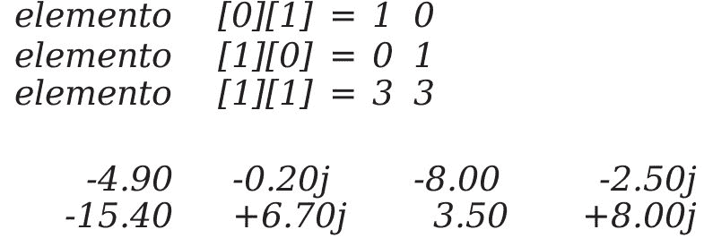

x 和 and 它们是实数正或负值

元素 [0][0] = -2.4 3

与我们目前编写的内容相比，在东程序（East Program）结构上观察到的区别是，我知道我在 `main` 函数之前写过的函数定义。在 C 语言中，函数的编写顺序并不是超越的。此外，记住，函数原型只有在声明之前调用这些函数时才需要。完成。通过此，我们将观察到东程序中没有函数原型。

### 5. 我们想写一个函数，按字母顺序对字符矩阵进行排序

要实现这一点，首先进入第 12 章“算法”，如果你还没有学习过，请学习基于“冒泡排序”的排序算法。

然后，使用我们之前编写的 `strings.c` 程序中的代码来读取和显示字符字符串数组。

第三，使用冒泡排序，编写一个符合如下原型的排序函数：

```c
void sort(char str[][COLS_MAX], int nc);
```

`str` 参数是我们要按字母顺序排序的字符字符串数组，`nc` 是要排序的链的总数。

`sort` 函数将在 `main` 函数读取完成后从 `main` 函数中调用。字符字符串三 riz。

完整的程序示例以供继续。

```c
/*********** 从 Names 读取就绪数据并进行排序 ***********/

/* sort.c */

#include <stdio.h>
#include <stdlib.h>
#include <string.h>

#define ROWS_MAX 100
#define COLS_MAX 80

void sort(char [][COLS_MAX], int);

main()
{
    // 字符链矩阵
    char name[ROWS_MAX][COLS_MAX];
    int nRows = 0;
    int row = 0;
    char *finish, answer;

    do
    {
        printf("Number from rows from the matrix: ");
        scanf("%d", &nRows);
    }
    while (nRows < 1 || nRows > ROWS_MAX);

    fflush(stdin);

    printf("Enter the names you want to enter.\n");
    printf("Can Finalize pressing the keys [Ctrl][z].\n");

    for (row = 0; row < nRows; row++)
    {
        printf("Name[%d]: ", row);
        finish = gets(name[row]);

        // Yes I know pulse [Ctrl][Z], leave the loop if (finish == NULL) break;
    }

    nRows = row; // 读取的行数
    sort(name, nRows);

    do
    {
        printf("Do you want visualize the contents from the matrix? (y/n): ");
        answer = tolower(getchar());
        fflush(stdin);
    }
    while (answer != 's' && answer != 'n');

    if (answer == 's')
    {
        // 可视化就绪的 Names
        printf("\n");

        for (row = 0; row < nRows; row++)
            printf("%s\n", name[row]);
    }
}

/*****************************************************
 * 排序函数
 *****************************************************/

// 按字母顺序排序字符链
void sort(char str[][COLS_MAX], int nc)
{
    char aux[COLS_MAX];
    int i, s = 1;

    while ((s == 1) && (nc > 0))
    {
        s = 0; // 置换

        for (i = 1; i <= nc; i++)
        {
            if (strcmp(str[i - 1], str[i]) > 0)
            {
                strcpy(aux, str[i - 1]);
                strcpy(str[i - 1], str[i]);
                strcpy(str[i], aux);

                s = 1; // 置换
            }
        }
    }
}
```

### 执行程序

矩阵行数：五十

输入你想输入的名称。可以按 `[Ctrl][z]` 键完成。

```text
Name[0]: Elena
Name[1]: Elena
Name[2]: Elena
Name[3]: Elena
Name[4]: Elena
Name[5]: Elena
Name[6]: Elena
Name[7]: Elena
Name[8]: Elena
Name[9]: Elena
Name[10]: Elena
Name[11]: Elena
Name[12]: Elena
Name[13]: Elena
Name[14]: Elena
Name[15]: Elena
Name[16]: Elena
Name[17]: Elena
Name[18]: Elena
Name[19]: Elena
Name[20]: Elena
Name[21]: Elena
Name[22]: Elena
Name[23]: Elena
Name[24]: Elena
Name[25]: Elena
Name[26]: Elena
Name[27]: Elena
Name[28]: Elena
Name[29]: Elena
Name[30]: Elena
Name[31]: Elena
Name[32]: Elena
Name[33]: Elena
Name[34]: Elena
Name[35]: Elena
Name[36]: Elena
Name[37]: Elena
Name[38]: Elena
Name[39]: Elena
Name[40]: Elena
Name[41]: Elena
Name[42]: Elena
Name[43]: Elena
Name[44]: Elena
Name[45]: Elena
Name[46]: Elena
Name[47]: Elena
Name[48]: Elena
Name[49]: Elena
```

你想可视化矩阵内容吗？(y/n): `s`

```text
Elena
Elena
Elena
Elena
Elena
Elena
Elena
Elena
Elena
Elena
Elena
Elena
Elena
Elena
Elena
Elena
Elena
Elena
Elena
Elena
Elena
Elena
Elena
Elena
Elena
Elena
Elena
Elena
Elena
Elena
Elena
Elena
Elena
Elena
Elena
Elena
Elena
Elena
Elena
Elena
Elena
Elena
Elena
Elena
Elena
Elena
Elena
Elena
Elena
Elena
```

c) 编译期间报错，因为缺少 `is-` 结构中的 `Name`。

d) 编译期间报错，因为 `tdata` 是一个变量。

### 10. 下面程序的运行是什么？

```c
#include <stdio.h>

typedef Union
{
    int to;
    float b;
} tdata;

main()
{
    tdata yes;

    sa = 0;
}
```


`printf("%d %g\n", yeah, sb);`

```

a) 打印 0 和一个不确定的值。
b) 0 0。
c) 打印垃圾值（值不确定）。
d) 编译期间报错，因为缺少 `Union` 缺少 `Name`。

2. 我现在想对某个特定课程学生的体重绘制一个直方图。

学生体重数量

21 **
22 ****
23 ***************
24 ******
25 .. ...

我知道星号的数量对应于特定体重的学生人数。

编写一个程序，读取体重并打印相应的直方图。假设体重值包括 10 和 100 kg。在直方图中，只有对应于一个或多个学生的体重将会显示。

3. 写一个程序，读取一个字符字符串，每当对该链向右旋转一位时，打印返回的结果。当字符串恢复原始字符顺序时，过程结束。例如：

`OHOL LAHO OLAH HELLO`

4. 写一个程序，读取一个字符字符串并将其存储在树中。接下来，使用一个函数，必须将输入的大写字母转换为小写字母。最后打印结果。

5. n 个数字列表的位数定义为：小于或等于对应一半数字对应的值，且大于或等于另一半数字对应的值。例如：

`16 12 99 95 18 87 10`

中位数是 18，因为这个值小于 99、95 和 87（一半的数字），并且大于 16、12 和 10（另一半）。

写一个程序，读取奇数个值并输出中位数。当检测到文件结束标记时，输入结束。

6. 写一个程序，使用函数读取一行输入，并返回读取的行及其长度或字符数。

7. 分析下面所示程序并指示它的含义。得到的结果。

```c
#include <stdio.h>

void Display( unsigned char c);

unsigned char fnxxx( unsigned char c);

main()

{

    unsigned char c;

    printf("Enter a character: "); c = getchar();

    display(c);

    printf("\nResulting character :\n"); c = fnxxx(c);

    display(c);

}

void Visualize( unsigned char c )

{

    int i = 0;

    for (i = 7; i>=0; i--)

        printf("%d", (c & (1 << i)) ? 1 : 0); printf("\n");

}

unsigned char fnxxx( unsigned char c )

{

    return (((((c)&0x01) << 7) | (((c)&0x02) << 5) |

            (((c)&0x04) << 3) | (((c)&0x08) << 1) |

            (((c)&0x10) >> 1) | (((c)&0x20) >> 3) |

            (((c)&0x40) >> 5) | (((c)&0x80) >> 7));

}
```

8. 在已解练习章节中，展示了一个程序来可视化浮点数的内部表示。这个问题可以通过提取一个函数来解决吗？为什么？给出理由。

```c
void present( float c )

{

    int i = 0;

    for (i = 31; i>=0; i--)

        printf("%d", (c & (1 << i)) ? 1 : 0); printf("\n");

}
```

9. 为了存储通常包含许多空元素的二维数组（稀疏矩阵），可以使用一维矩阵，其中只保存非空元素，从而节省空间。例如：

[](Images/image18599.jpeg)
[](Images/image18600.jpeg)
[](Images/image18601.jpeg)
[](Images/image18602.jpeg)
[](Images/image18603.jpeg)
[](Images/image18604.jpeg)

#### 第 7 章
# 指针

### 指针的创建

我们注意到 `*` 是一个用于指向 `int` 类型对象的助记符，因此它可以出现在任何与整体变量相同的地方。也就是说，如果 `pint` 指向整数 `a`，那么 `*pint` 就可以出现在任何你可以让它到达的地方。例如，在下表中，这两列是等价的：

| #include <stdio.h> | #include <stdio.h> |
| :--- | :--- |
| `main()` | `main()` |
| `{` | `{` |
| `int to = 0;` | `int to = 0, *paint = &to;` |
| `to = 10;` | `*paint = 10;` |
| `to = to - 3;` | `*paint = *paint - 3;` |
| `printf("%d\n", to);` | `printf("%d\n", *pint);` |
| `}` | `}` |

假设已经定义了变量 `to`，那么定义：

```c
int *paint = &to;
```

等价于：

```c
int *pint; int *paint = &to;
```

结论是，`*paint` 是存储在 `paint` 中存储的内存地址上的整体。这种推理适用于任何复杂的语句。另一个例子：

```c
#include <stdio.h>

#include <math.h> // 使用 sqrt 需要包含

main()

{

    double *p = NULL, d = 0, x = 100; p = &x;

    d = sqrt(x) + *p; printf("%g\n", *p); // 打印 x 的当前值

}
```

上面的例子说明了在表达式中它们出现的地方，`sqrt(x)` 和 `*p` 都代表 `double` 类型的值；也就是说，它们的行为与 `double` 类型的变量相同。

指针所需的内存空间是指定机器地址所需的字节数，通常它们是 4 字节。

一个正确初始化的指针始终指向特定类型的对象。未初始化的指针未知指向哪里。

### 运算符

到目前为止我们看到的示例表明，在指针操作中，经常涉及地址操作符（`&`）和间接运算符（`*`）。

一元运算符 `&` 返回其操作数的地址，而一元运算符 `*` 将其操作数解释为地址并并返回其内容（更多细节请见第二章）。例如：

```c
/* pointers.c */

#include <stdio.h>

main()

{

    // 接下来的两行声明了变量整体 to，

    // 指针 p 和 q 是整数，以及变量实 b。

    int to = 10, *p, *q;

    double b = 0.0;

    q = &to; // 将 to 的地址赋值给变量 q；

    // 指向整体 to

    b = *q; // 将 to 的值赋值给 b

    *p = twenty; // 错误：赋值到 p 指向哪里？

    printf("At address %X is the data %g\n", q, b); 

    printf("In the address %X is the fact %d\n", p, *p);

}
```

在理论上，我们执行此程序时预期的结果与以下结果类似：

在地址 12FF7C 处是 10
在地址 12FF78 处是 twenty

但在实践中，当我们执行它时会发生错误，因为我们在使用一个指针 `p` 而不知道它指向哪里。我们知道 `q` 指向变量 `a`；换句话说，`q` 包含一个有效地址，但我们不能对 `p` 说同样，因为它还没有初始化，因此它的值对我们是未知的（可能包含垃圾值）；它可能是系统占用的地址。然后它尝试的操作将用值 20 覆盖该地址的内容，这会导致严重问题。也许我会更清楚地像这样定义变量：

```c
int to = 10, b = 0, *p = NULL, *q = NULL;

// ...

*p = twenty;
```

错误将像以前一样发生，但现在很清楚 `p` 存储的是地址 0，该地址由于被系统保留而无法写入。这就是主题。

### 指向对象类型的重要性

C 如何知道要从一个地址给变量分配多少字节？例如，请看接下来的程序：

```c
#include <stdio.h>

main()

{

    int to = 10, *q = NULL; double b = 0.0;

    q = &to; // 指向整体 to

    b = *q; // 将 to 的值转换为 double 后赋值给 b

    printf("In the address %X is the fact %g\n", q, b);

}
```

你会注意到在语句 `b = *q` 中，`b` 是 `double` 类型而 `q` 指向一个 `int`。问题是：C 如何知道为 `b` 分配多少字节？答案是 C 参考了指针声明时的对象类型，并分配了相应的字节数（四个而不是八）。

同样，从上面可以推出，如果给指针赋值一个与其必须指向的对象不同类型的地址，那么对相同类型进行的操作将产生意外结果。例如：

```c
#include <stdio.h>

main()

{

    double to = 10, b = 0; // 整体 double

    int *p = NULL; // 指针 int

    p = &to;

    b = *p;

    printf("b = %g\n", b);

}
```

编译此程序时，语句 `p = &to` 会产生警告，因为类型不匹配，`p` 指向 `double`，而实际上它们是 `int`。

### 指针操作

对于指针类型的变量，除了 `&`、`*` 运算符和赋值运算符外，算术运算符 `+` 和 `-` 也可以使用。

### 指针赋值

C 语言允许将一个指针赋值给另一个指针。例如：

```c
#include <stdio.h>

main()

{

    int to = 10, *p, *q;

    p = &to;

    q = p; // 将 p 的地址赋值给 q

    printf("In the address %X is the value %d\n", q, *q);

}
```

执行程序

在地址 12FF7C 处是值 10

然后运行赋值 `q = p` 后，`p` 和 `q` 指向内存中的同一个位置。对于整体来说，`*p` 和 `*q` 是相同的；说是 10。

### 算术操作

对于指针，我知道你可以加或减一个整体。指针算术与普通算术的区别在于，这里的单位等同于指针类型的对象；也就是说，加 1 意味着指针将指向下一个对象。这里取决于指针的类型，加上此时所指向的对象。例如，假设 `p` 和 `q` 是指向同一个矩阵 `x` 元素的指针变量：

```c
int x[100];

int *p, *q; // 声明 p 和 q 为整数指针

p = &x[3]; // p 指向 x[3]

q = &x[0]; // q 指向 x[0]
```

操作 `p + n`（其中 `n` 是整数）将指针在当前目标之后推进 `n` 个整数。例如：

```c
p = p + 3; // 让 p 推进三个整数；现在指向 x[6]
```

同样，在执行上述操作 `p = p + 3` 之后，操作 `p - q` 将结果为 6（`int` 类型元素）。

操作 `p - n`（其中 `n` 是一个整数）也是有效的；从 `p` 指向的 `x[6]` 开始，以下操作的结果如注释所示：

```c
p = p - 3; // 让 p 向后回退三个整数；现在指向 x[3]
```

是的，`p` 指向 `x[3]`，`p++` 让 `p` 指向 `x[4]`，从该状态开始，`p--` 让 `p` 再次指向 `x[3]`：

```c
p++; // 让 p 指向下一个整数；指向 x[4]

p--; // 让 p 指向上一个整数；指向 x[3]
```

不，我知道它允许对指针进行加法、乘法、除法或旋转，而且我知道允许加上实数。单运算符 `*` 和 `&` 的优先级高于算术运算符 `+` 和 `–`，且与 `++` 和 `--` 优先级相同。

让我们继续看一些指针操作的示例。我们定义了矩阵 `x` 和两个指向整数类型的指针 `pa` 和 `bp`。

```c
int x[100], b, *pa, *bp;

// ...

x[50] = 10;

pa = &x[50];

b = *pa + 1; // 整数 *pa 加上 1 的和的结果

// 我知道赋值给 b；例如 b = x[50] + 1

b = *(pa + 1); // pa 指向的下一个整数，

// 赋值给 b；即 b = x[51]

bp = &x[10]; // 我给 bp 分配了 x[10] 的地址

*bp = 0; // 元素 x[10] 被设为 0

*bp += two; // 我知道 x[10] 增加了两个

(*bp)--; // 我知道 x[10] 减少了一个单位

x[0] = *pb--; // 我向 x[0] 分配了来自 x[10] 和 bp 的值

// 恰好指向上一个整数（指向 x[9]）
```

### 指针的比较

当你比较两个指针时，你实际上是在比较两个整数，因为地址对应于一个整数值。这种操作是有意义的，前提是两个指针都指向同一个矩阵中的元素。例如：

```c
int n = 10, *p = NULL, *q = NULL, x[100];

// ...

p = &x[99];

what = &x[0];

// ...

if (q + n <= p) q += no;

if (q != NULL && what <= p) // NULL 是一个常量，q++; // 只要指针为空
```

第一个 `if` 语句表示，如果地址 `q+n` 小于或等于 `p`，则指针 `q` 将移动 `n` 个元素。第二个 `if` 语句指明，如果它指定的地址 `no` 为空且小于或等于 `p` 指定的 `what`，则 `q` 将指向数组的下一个元素。

### 通用指针

指向任何类型对象的指针都可以转换为 `void *` 类型。因此，类型 `void *` 的指针接收来自通用指针的 `Name`。例如：

```c
void fnx(void *, int); main()

{

    int x[100], *q = x; // 我声明了什么，我知道你分配了地址 x

    //（矩阵的名称是从矩阵开始的地址）

    // ...

    fnx(q, 10); // 示例

}
```

指向任何类型对象的指针都可以转换为 `void *` 类型。因此，类型 `void *` 的指针接收来自通用指针的 `Name`。例如：

```c
void fnx(void *, int); main()

{

    int x[100], *q = x; // 我声明了什么，我知道你分配了地址 x

    //（矩阵的名称是从矩阵开始的地址）

    // ...

    fnx(q, 10); // 示例

}
```

指向任何类型对象的指针都可以转换为 `void *` 类型。因此，类型 `void *` 的指针接收来自通用指针的 `Name`。例如：

```c
void fnx(void *, int); main()

{

    int x[100], *q = x; // 我声明了什么，我知道你分配了地址 x

    //（矩阵的名称是从矩阵开始的地址）

    // ...

    fnx(q, 10); // 示例

}
```

指向任何类型对象的指针都可以转换为 `void *` 类型。因此，类型 `void *` 的指针接收来自通用指针的 `Name`。例如：

```c
void fnx(void *, int); main()

{

    int x[100], *q = x; // 我声明了什么，我知道你分配了地址 x

    //（矩阵的名称是从矩阵开始的地址）

    // ...

    fnx(q, 10); // 示例

}
```

指向任何类型对象的指针都可以转换为 `void *` 类型。因此，类型 `void *` 的指针接收来自通用指针的 `Name`。例如：

```c
void fnx(void *, int); main()

{

    int x[100], *q = x; // 我声明了什么，我知道你分配了地址 x

    //（矩阵的名称是从矩阵开始的地址）

    // ...

    fnx(q, 10); // 示例

}
```

指向任何类型对象的指针都可以转换为 `void *` 类型。因此，类型 `void *` 的指针接收来自通用指针的 `Name`。例如：

```c
void fnx(void *, int); main()

{

    int x[100], *q = x; // 我声明了什么，我知道你分配了地址 x

    //（矩阵的名称是从矩阵开始的地址）

    // ...

    fnx(q, 10); // 示例

}
```

指向任何类型对象的指针都可以转换为 `void *` 类型。因此，类型 `void *` 的指针接收来自通用指针的 `Name`。例如：

```c
void fnx(void *, int); main()

{
```


进入`/path/to/xxx`目录，找到`xxx.json`。

在表达式`cvar = avar + bvar`中，加法运算符（`+`）将`avar`与`bvar`相加，得到它们的和`cvar`

在`List.of(arg0, arg1, arg2)`中，`List`接口的工厂方法`of()`接受一系列的元素，返回包含它们的只读列表。

之后我们这样调用`cmd`命令：`cmd arg0 arg1 arg2`。

```
if (condVar > someVal) {console.log("xxx")}
```

---

[content]
指向任何类型对象的指针都可以转换为`void *`类型。因此，类型`void *`的指针接收来自通用指针的`Name`。例如：

```c
void fnx(void *, int); 
main()
{
    int x[100], *q = x; // 我声明了什么，我知道你分配了地址 x
    //（矩阵的名称是从矩阵开始的地址）
    // ...
    fnx(q, 10); // 示例
}
```

ANSI 允许对指针进行类型转换。例如：

```c
void fnx(void *p, int n)
{
    int *q = (int *)p; // 将 void * 转换为 int *
    // ...
}
```

C++ 允许更显式的类型转换：

```cpp
void fnx(void *p, int n)
{
    int *q = static_cast<int*>(p); // 使用 static_cast
    // ...
}
```

我知道它允许对指针进行加法、乘法、除法或旋转，而且我知道允许加上实数。单运算符`*`和`&`的优先级高于算术运算符`+`和`–`，且与`++`和`--`优先级相同。

赋值`plist = &list[0]`使`plist`指向`list`的第一个元素；换句话，`plist`包含了第一个元素的地址，这与从矩阵开始的地址相匹配；即通过`list`。基于此，根据表达式`*(plist+ind)`，我们也可以使用表达式`*(list+ind)`。如上所示，以下表达式产生相同的结果：

`list[ind]`, `*(list+ind)`, `plist[ind]`, `*(plist+ind)`

我知道在另一个版本的程序中得到相同的结果：

```c
/* 从矩阵中写入值。
* 使用指针算术的版本。
* punt03.c
*/
#include <stdio.h>

main()
{
    int ready[] = {24, 30, fifteen, Four. Five, 3\. 4};
    int ind;
    int *plist = ready; 
    for (ind = 0; ind < 5; ind++)
        printf("%d ", *plist++);
}
```

赋值`plista = list`使`plista`指向数组`list`的开头；即指向数组的第一个元素，而表达式`*plista++`按照描述的顺序产生以下两个操作：`*plist`（即`plista`所指向的值）以及`plista++`（它导致`plista`指向矩阵中的下一个元素）。因此，我知道循环也可以写成：

```c
for (ind = 0; ind < 5; ind++)
{
    printf("%d ", *plist); 
    plist++;
}
```

然而，数组标识符和指针之间存在差异。数组的标识符是一个常量，而指针是一个变量。这意味着下面的循环将导致错误，因为`list`是常量，不能改变值。

```c
for (ind = 0; ind < 5; ind++) 
    printf("%d ", *list++);
```

相反，作为数组的函数参数被视为一个变量（一个指针）：

```c
void DisplayMatrix(int ready[], int n)
{
    int ind;
    for (ind = 0; ind < no; ind++) 
        printf("%d ", *list++);
}
```

需要注意的另一个细节是`size`运算符应用于矩阵或指向矩阵的指针返回的结果：

```c
int ready[] = {24, 30, fifteen, Four. Five, 3\. 4};
int *plist = ready;
printf("%d %d\n", sizeof(list), sizeof(plist));
```

`sizeof`运算符应用于数组时，返回数组的字节大小（例如 20），而应用于返回数组的指针时，返回指针的字节大小（如示例`Four. Five`）。

作为上述应用，我们将实现一个`CopiarMatriz`函数，它允许你将任何数据类型和任意维数的数组复制到另一个数组中（这将是一个类似于`memcpy`的函数）。在前一章中，我们开发的`CopiarMatriz`函数具有不自律的缺点，因为它依赖于`ROWS`和`COLS`常量，而且数组的大小是由这些常量固定的。现在可以使用指针轻松地克服这些缺点，正如你将在后面看到的的那样。`CopyArray`函数将具有以下原型：

`void CopyArray(void *dest, void *origin, int n);`

`dest`参数是一个通用指针，用于存储目标数据数组的地址，`orig`也是一个通用指针，用于存储源数组的地址。两个数组的字节大小通过参数`n`成比例关系。

正如之前在“通用指针”节中学习的，使用这些作为参数将允许传递任何类型数组的参数。同样，在本节中学习的，矩阵名称永远是它从开始的地址，无论它的大小和维度数量。

`CopyArray`函数要做什么？简单地从`origin`拷贝`n`字节到`dest`。考虑数组时，不要考虑它所包含的数据类型。事实上，它只是内存中一行的字节块。因此，`orig`是要拷贝字节块的起始地址，而`dest`是想要拷贝到的字节块的地址。拷贝将按字节进行，这保证了数据类型的无关性（任何数据类型的大小都是字节的倍数）。这正如在本章之前在“指向的对象的类型的重要性”节中解释的那样，需要对目标和源进行转换。如上所述，解决方案可以如下：

```c
void CopyArray(void *dest, void *origin, int n)
{
    // 在此处实现
}
```

接下来的程序为`list`使用了`CopyArray`：

```c
/* 从矩阵中写入值。
* 使用指针算术的版本。
* punt03.c
*/
#include <stdio.h>
#define ROWS 5
#define COLS 5

int main()
{
    int ready[ROWS] = {24, 30, fifteen, Four. Five, 3\. 4};
    int ind;
    int *plist = ready;
    for (ind = 0; ind < ROWS; ind++)
    {
        for (int c = 0; c < COLS; c++)
        {
            printf("%d ", *(plist + ind));
        }
        printf("\n");
    }
    return 0;
}
```

```c
pname[9] = '-'; // 我知道修改了从索引 9 开始的元素
```

接下来的示例展示了一个函数，该函数返回字符串字符的个数，这被称为字符串的长度。记住，C 语言库提供了`strlen`函数，可以得到相同的结果。

```c
/* 函数 "longcad":
* 返回链的长度。
* longcad.c
*/
#include <stdio.h> 

int longcad(char *);
main()
{
    char *chain = "abcd"; // 终止符 '\0' 字符
    // 会自动添加
    printf("%d\n", longstr(string)); // 输出: 4
}

int longcad(char *ch)
{
    char *p = ch; // p 指向第一个字符，直到 (*p != '\0') // *p != 0 等价于
    p++; // 指向下一个字符
    return (p - ch);
}
```

函数`longcad`返回的值`p - ch`给出了链的长度。该函数执行了以下操作：

1. 将链中第一个字符的地址赋给`p`，这与起始的地址匹配，并开始执行`while`循环。
2. 当执行`while`循环条件时，我比较`p`指向的字符`*p`与空字符。如果`*p`是空字符，循环结束；
3. 如果不是，我将`p`的值加 1 以指向下一个字符，然后重新回去评估条件。

当`*p`为非空字符时，表达式`*p != '\0'`为真；当`*p`为空字符（ASCII 零）时，它为假。因此，我不需要显式地进行比较，可以隐式地这样做：

```c
int longcad(char *ch)
{
    char *p = ch; 
    while (*p)
        p++;
    return (p - ch);
}
```

现在条件由表达式`*p`组成。如果表达式`*p`不为 0（字符不同于空），则条件为真。如果为 0（空字符），则条件为假。同样我们也可以写成：

```c
int longcad(char *ch)
{
    char *p = ch; 
    while (*p++));
    return (p - ch - 1);
}
```

现在结果将由表达式`p - ch - 1`给出，因为在检查完`*p`为 0 之后，我执行了`p++`操作。表达式`*++ p`在所有所有情况下都不会得到相同的结果，因为我首先执行了`++ p`操作，然后才检查`*p`，这对于长度为 1 的字符串将是的（参见第 2 章中的递增和递减运算符，以及运算符的优先级和结合）。

接下来的示例展示了一个将一个字符串拷贝到另一个字符串的函数。记住，C 语言库提供了`strcpy`函数来执行相同的操作。首先我展示一个使用索引的版本，然后是使用指针算术的版本。第一个版本可以如下：

```c
/* 将链拷贝到另一个的函数。
* copicad.c
*/
#include <stdio.h>
#define LONGCAD 81

void copicad(char [], char []);
main()
{
    char string1[CADLONG], string2[LONGCAD];
    printf("Enter a chain: "); 
    fgets(string1, LONGCAD, stdin);
    copyd(string2, string1); // 将 string1 拷贝到 chain2
    printf("The chain copied is: %s\n", string2);
}

void copicad(char p[], char q[]) // 拷贝链 到 p
{
    int i = 0;
    while ((p[i] = q[i]) != '\0') 
        i++;
}
```

### 执行程序
输入链: hello
拷贝的链是: hello

`copicad`函数接收两个参数：目标矩阵和要拷贝的源链。我观察了函数的调用：

`copyd(string2, string1);`

正如我们在其他场合提到的，`p`接收参数`string2`，它是目标数组的起始地址，而不是 string2 本身，对`q`也是如此。这就是我们在第 3 章学习的引用传递。此外，注意在`while`循环条件中有两个操作：一个赋值和一个比较。因此我们可以将其写为：

```c
p[i] = q[i];
while (p[i] != '\0') // p[i] != 0 等价
{
    i++;
    p[i] = q[i];
}
```

使用指针算术的解决方案如下：

```c
/* 将链拷贝到另一个的函数。
* copicad1.c
*/
#include <stdio.h>
#define LONGCAD 81

void copicad(char *, char *);
main()
{
    char string1[CADLONG], string2[LONGCAD];
    printf("Enter a chain: "); 
    fgets(string1, LONGCAD, stdin);
    copyd(string2, string1); // 将 string1 拷贝到 chain2
    printf("The chain copied is: %s\n", string2);
}

void copicad(char *p, char *q) // 拷贝链 到 p
{
    while ((*p = *q++) != '\0')
        p++;
}
```

在上面的版本，由于在检查完`*p`为 0 之后，我执行了`p++`操作。表达式`*++ p`在所有情况下都不会得到相同的结果，因为我首先执行了`++ p`操作，然后才检查`*p`，这对于长度为 1 的字符串将是不的（参见第 2 章中的递增和递减运算符，以及运算符的优先级和结合）。

接下来的示例展示了一个将一个字符串拷贝到另一个字符串的函数。记住，C 语言库提供了`strcpy`函数来执行相同的操作。首先我展示一个使用索引的版本，然后是使用指针算术的版本。第一个版本可以如下：

将矩阵`p`的行赋值给`a`元素的循环（通过`p[i] = a[i]`），难道不能被一个单一的赋值`p = a`替换吗？不能，因为它们的间接层级是不同的；换句话说，`p`和`a`的类型不相等，也不允许它们之间进行任何类型转换。让我们来看下：

| p 的类型 | int * [5] | (指向 int 的包含五个元素的指针的矩阵) |
| :--- | :--- | :--- |
| p[i] 的类型 | int * | (指向 int 的指针) |
| a 的类型 | int (*)[5] | (指向 int 类型的包含五个元素的矩阵的指针； |
| | | 与 int[][5] 兼容；`a`的元素`a[i]`，它们是 |
| a[i] 的类型 | int * | 一维数组)(指向 int 的指针；与 int [] 兼容) |

鉴于上述对类型的研究，唯一的可能赋值是实现：`p[i] = a[i]`。

访问矩阵`p`的元素可以使用指针表示法或使用索引法，就像我们使用`.`一样。例如，为了给数组`p`所引的整数赋值并然后显示它们，我们可以写下下面的代码：

```c
for (i = 0; i < 5; i++) 
    for (j = 0; j < 5; j++)
        scanf("%d", &p[i][j]);

for (i = 0; i < 5; i++)
{
    for (j = 0; j < 5; j++) 
        printf("%7d", p[i][j]);
    printf("\n");
}
```

根据所展示的，`p`和`a`之间有什么区别？在矩阵`p`上，对元素的访问是通过指针的间接实现的，而在矩阵`a`中，是通过乘法和加法实现的。另一方面，正如我们后面看到的，`p`指向的数组可能长度不同，而在矩阵中，所有的行必须具有相同的长度。

现在假设我们需要将地址`p`（指针数组的起始地址）存储另一个变量`q`中。我们该如何定义这个变量呢？如果你回答这个问题，你就会得到答案：你指向的是谁？指向`p`？显然答案是：指向指针矩阵的第一个元素；即`p[0]`，它是一个指向 int 的指针。那么`p`指向一个指针，该指针又指向一个整数。因此，`q`必须定义为可以存储一个指向 int 指针的指针。

### 指针的指针

为了指定一个变量是指向指针的指针，使用的语法如下：

`type *varpp;`

其中`type`指定了双重间接后指向的对象的类型（可以是任何类型，包括派生类型），而`varpp`是指针变量到指针的标识符。例如：

```c
int to, *p, **pp;
to = 10; // 事实
p = &to; // 指向事实的指针
pp = &p; // 指向指向事实指针的指针
```

我知道这意味着`p`是一个具有间接层的变量；也就是说，通过`p`不是直接访问数据，而是访问指示事实位置的地址。通过类似的推理，我们将说`pp`是一个具有两级间接层的变量。

下面的代码解决了之前的例子，但现在使用了声明为指向指针的指针的变量`q`。使用指向指针`q`访问数组`a`中的项可以像使用`a`一样使用索引法或使用指针表示法。使用索引法将是：

```c
/* Pointer_to_pointer.c */
#include <stdio.h>

main()
{
    int i, j;
```


```c
int a[5][5]; // 二维矩阵
int *p[5]; // 指针矩阵
```


```c
for (i = 0; i < 5; i++)
    p[i] = a[i]; // 将 a 的行赋值给 p

int **q = p;

for (i = 0; i < 5; i++)
    for (j = 0; j < 5; j++)
        scanf("%d", &q[i][j]);

for (i = 0; i < 5; i++)
{
    for (j = 0; j < 5; j++)
        printf("%7d", q[i][j]);

    printf("\n");
}
```

### 指向字符链的矩阵

通过类似于对数值指针数组所进行的研究，我们会说指向字符字符串的数组是一个单一数组。其每个元素类型为 `char *` 或 `unsigned char *`。例如：

```c
char *p[5]; // 包含五个元素的 (char *) 类型的矩阵

char c = 'z'; // 类型为 char 的变量 c

p[0] = &c; // p[0] 指向字符 'z'

printf("%c\n", *p[0]); // 输出：z
```

此示例定义了一个包含五个元素的数组 `p`，每个元素都是一个指向字符的指针（`char *`），以及一个类型为 `char` 的变量 `c`，其初始化值为 `'z'`。然后，我们将 `c` 的地址赋值给 `p[0]` 并写入其内容。

同样地，我们可以对矩阵的其余元素继续操作。同样，如果像 `p[0]` 这样的元素可以指向一个字符，也可以指向一个字符字符串或一维字符数组；在这种情况下，指向的字符将与链中的第一个元素匹配。例如：

```c
p[0] = "hello"; // p[0] 指向链 hello

printf("%s\n", p[0]); // 输出：hello
```

形如 `p[0] = "hello"` 的赋值是将指定字符串的地址分配给指定的数组元素，该元素的类型必须是 `char *`。另一方面，下面的语句：

```c
p[1] = 'to';
```

这样做将会是一个错误，因为你正试图将一个 `int` 值（ASCII 字符 `a` 的值）赋值给类型为 `char *` 的变量，而指针只能被赋予有效地址。

也许，也可以考虑编写以下代码来读取所有的字符链：

```c
#include <stdio.h>

main()
{
    int i;
    char *p[5]; // 指针组成的矩阵

    for (i = 0; i < 5; i++)
        gets(p[i]);
}
```

编写上述代码是错误的，因为 `gets` 函数从标准输入读取一个字符字符串并将其存储在指定的字符串中；在我们的案例中，你必须通过指定的地址 `p[i]` 放置它，但如果数组尚未初始化，这个地址又是哪里？

解决方案是在 `p[i]` 中存储一个程序可以使用的内存块地址。例如，假设数组 `p` 的每个元素所指向的对象本身都是一个包含 81 个元素的 `char` 类型数组。为了做到这一点，我们可以让指向的对象成为另一个 `char` 类型二维数组 `cad` 的行。稍后我们将学习通过动态创建数组（即在执行期间）来解决这个问题。

```c
char str[5][81]; // 字符链矩阵
char *p[5]; // 指针数组

for (i = 0; i < 5; i++)
    p[i] = str[i];

for (i = 0; i < 5; i++)
    gets(p[i]);
```

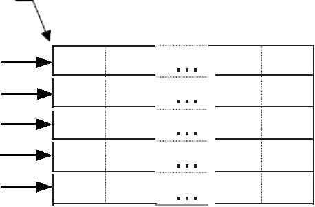

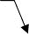

`p` ch

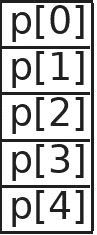

`str[0]`

`str[1]`

`str[2]`

`str[3]`

`str[4]`

正如我们在讨论指针数组时解释的，给矩阵 `p` 的元素分配 `ch` 的行（`p[i] = ch[i]`）的循环不能由单个赋值 `p = ch` 替换，因为间接层级不同。

这清楚表明，字符串数组和指向字符串的指针数组虽然形状相似，但它们并不是同一个。

现在假设我们需要将地址 `p`（指针数组的起始地址）存储在另一个变量 `q` 中。我们该如何定义这个变量呢？根据所学的，我们必须定义它以便存储一个指向 `char` 指针的指针，因为 `p` 指向一个指针 `p[0]`，而 `p[0]` 又指向一个 `char`。下面的示例解释了这一点。

```c
/*
 * 从字符链矩阵写入内容。
 *
 * 指针版本。
 *
 * pointers_to_strings.c
 */

#include <stdio.h>

main()
{
    int i;

    char str[5][81]; // 字符链矩阵
    char *p[5]; // 指针矩阵
    char **q; // 指向指针的指针

    for (i = 0; i < 5; i++)
        p[i] = str[i];

    q = p;

    for (i = 0; i < 5; i++)
        gets(q[i]);

    for (i = 0; i < 5; i++)
        printf("%s\n", q[i]);
}
```

在以上的练习中，我们可以观察到指针数组的起始地址 `p` 可以存储在一个定义为指向指针的变量 `q` 中，因为两种类型都定义了具有两级间接层的变量。

但这并不意味着它们是相同的，事实上它们不是；`p` 定义了一个矩阵，而 `q` 没有。让我们来看一个例子。以下程序显示了一个接收整数作为参数并返回字符串指针作为结果的函数。

```c
#include <stdio.h>

main()
{
    unsigned int day, month, year, r;
    char *m;

    printf("Enter a date (dd-mm-yyyy): ");

    do
    {
        r = scanf("%u-%u-%u", &day, &month, &year);

        if (r != 3)
            printf("format: dd-mm-yyyy\n");

        fflush(stdin);
    }
    while (r != 3);

    m = month_name(month);

    printf("\nMonth: %s\n", m);
}

char *month_name(unsigned int mm)
{
    static char *month[] = {
        "January", "February", "March", "April", "May", "June",
        "July", "August", "September", "October", "November", "December"
    };

    return ((mm > 0 && mm <= 12) ? month[mm - 1] : month[0]);
}
```

```c
int ReadString(char str[][CMAX], char *pcad[], int nmc);
void Sort(char *pcad[], int nc);
void display(char *pcad[], int nc);
```

`LeerCadena` 函数接收的参数包括：用于存储字符链的矩阵、指向链的指针矩阵，以及数组可以存储的字符串最大数量。该函数将返回读取的字符串数量，如果参数 `nmc` 的值无效，则返回 `-1`。

对于读取的每个字符串，其地址都将存储在指针数组中。当输入新字符串并仅按下 `<Enter>` 键时，输入结束。根据上述描述，该函数可以写为：

```c
int ReadString(char str[][CMAX], char *pcad[], int nmc)
{
    // nmc = 我知道可以读取链的最大数量
    int length = 0, ncads = 0;

    if (nmc < 1)
        return -1; // error

    while ((length = strlen(gets(str[ncads]))) > 0)
    {
        // 保存从读取的链开始的地址
        // 在指针矩阵的下一个元素 pcad[ncads++] = str[nstrs];

        if (ncads == nmc)
            break; // 矩阵 full
    }

    return (ncads); // 读取的链数量
}
```

当输入新字符串并仅按下 `<Enter>` 键时，变量 `length` 将变为 `0`，从而结束 `while` 循环。

`Sort` 函数接收的参数包括指向字符串的指针数组、字符数量以及需要排序的字符串数量。该函数在前章节的“已解练习”中已经开发并调用（另参见算法章节中的基于冒泡法的排序算法）。该函数的代码如下：

```c
void Sort(char *pcad[], int nc)
{
    char *aux = NULL; // 辅助指针
    int i = 0, s = 1;

    while ((s == 1) && (--nc > 0))
    {
        s = 0; // 无交换

        for (i = 1; i <= nc; i++)
        {
            if (strcmp(pcad[i - 1], pcad[i]) > 0)
            {
                aux = pcad[i - 1];
                pcad[i - 1] = pcad[i];
                pcad[i] = aux;

                s = 1; // 交换
            }
        }
    }
}
```

注意，`while` 循环在遍历数组比较字符串且没有检测到乱序（初始为 `0` 的变量 `s` 将保持为 `0`）时结束；或者，在最坏的情况下，当所有字符串都已完成完毕时结束，这发生在遍历数组 `nc–1` 次之后。

`display` 函数接收的参数包括指向字符的指针数组及其元素数量，该数量与字符链的数量一致。该函数可以写为：

```c
void display(char *pcad[], int nc)
{
    // nc = 要可视化的链数量

    while (--nc >= 0)
        printf("%s\n", *pcad++);
}
```

`main` 函数将使用上述函数来执行描述的过程。以下是完整的程序供参考。

```c
/**************** 字符链排序 *****************/

/*
 * ordcads.c
 */

#include <stdio.h>
#include <stdlib.h>
#include <string.h>

#define NMAX 25 // 链的最大数量
#define CMAX 81 // 每个链中字符的最大数量

int ReadString(char str[][CMAX], char *pcad[], int nmc);
void Sort(char *pcad[], int nc);
void display(char *pcad[], int nc);

main()
{
    char str[NMAX][CMAX]; // 链矩阵
    char *pcad[NMAX]; // 链指针矩阵
    int ncads = 0; // 读取的链数量

    printf("Sort from chains from characters.\n");
    printf("Enter the strings to sort.\n");
    printf("Press <Enter> for exit.\n");

    if ((ncads = ReadString(str, pcad, NMAX)) > 0)
    {
        printf("Strings read %d\n", ncads);
        printf("Sort process.\n");

        Sort(pcad, ncads);
        display(pcad, ncads);
    }
    else
        printf("Array empty\n");
}
```

在 ANSI C 中，返回值将隐式转换为用于存储该值的变量类型，但在 C++ 中，这种转换必须显式进行（参见本章中的 `Importance of the type of the object pointed to`）。

因此，为了兼容性，建议始终对存储结果的变量类型进行显式转换。如果内存空间不足，`malloc` 函数返回一个 `null pointer`（值 `NULL` 或 `0`），且如果 `nbytes` 参数为 `0`，则分配一个大小为 `0` 的内存块并返回一个有效指针。

例如，以下代码行分配了一个 `100` 字节的连续内存块。正如我们在下面将看到的，这个空间无论多小，都可以用于定位你需要的数据结构。在每个情况下，`malloc` 返回的对应于分配内存的地址存储在一个指针中，该指针的类型将取决于存储在该内存块上的数据类型（在示例中为 `int` 类型的数据）。

```c
#include <stdio.h>
#include <stdlib.h>

int main()
{
    int *p = NULL; // NULL or 0
    int nbytes = 100;

    p = (int *)malloc(nbytes);

    if (p == NULL) // p == 0 is equivalent
    {
        printf("Insufficient space from memory\n");
        return -1;
    }

    printf("If they have assigned %d bytes from memory\n", nbytes);

    // ... return 0;
}
```

注意，传递给 `malloc` 的参数是内存块的字节大小，它将被动态分配，该块将通过 `p` 访问。

调用 `malloc` 函数后，有必要验证是否成功执行了请求的内存分配。如果 `malloc` 返回值为 `null pointer`（值 `NULL` 或 `0`），则意味着无法执行内存分配，在这种情况下，继续执行程序可能没有意义。


## `free`

`free` 函数允许你释放由 `malloc`、`calloc` 或 `realloc` 函数分配的内存块（后两个我们将在下文中看到），但它不会将指针设置为 `NULL`。

如果引用我们要释放的内存块的指针为空，则 `free` 函数什么都不做。其语法如下：

```c
#include <stdlib.h>

void free(void *vpointer);
```

**兼容性：ANSI、UNIX 和 Windows**

如果 `free` 释放的内存之前没有通过 `malloc`、`calloc` 或 `realloc` 分配，我知道它们在程序执行期间可能会产生错误。

例如，如果我们给指针分配一个静态数组的地址（静态数组是指在编译期间预留内存空间的数组），那么那块内存空间是无法被释放的。

以下示例是上一个的延续。除了分配内存块外，还使用 `free` 函数来释放它。在内存不再需要时释放已分配的内存是一种良好的编程风格。

在 Windows 操作系统中，未释放的内存会产生内存间隙或内存泄漏；也就是说，未释放的内存块在不重启机器的情况下将都是不可用的。

```c
#include <stdio.h>
#include <stdlib.h>

int main()
{
    int *p = NULL;
    int nbytes = 100;

    if ((p = (int *)malloc(nbytes)) == NULL)
    {
        printf("Insufficient space from memory\n");
        exit(-1);
    }

    printf("If they have assigned %d bytes from memory\n", nbytes);

    // ...

    free(p);

    return 0;
}
```

现在，我们做了一个小小的变化：内存分配被集成在了 `if` 判断语句的条件中。与之前一样，我知道已经完成了一个强制类型转换，将 `malloc` 返回的 `void *` 类型转换为 `int *`（目标对象的类型）。

此外，作为另一种替代方案，使用了 `exit` 函数代替了 `return` 语句。`exit` 函数结束程序；而 `return` 语句将控制权返回给调用它的函数；如果 `return` 语句属于 `main` 函数，程序逻辑结束。

### 重新分配内存块

在某些情况下，我们需要更改之前分配的内存块的大小。为了实现这一点，C 库提供了 `realloc` 函数，其语法如下：

```c
#include <stdlib.h>

void *realloc(void *pBlomem, size_t nBytes);
```


## 兼容性

ANSI、UNIX 和 Windows

`pBlomem` 参数是指当前内存块起始位置指针。如果 `pBlomem` 为 `NULL`，该函数的行为与 `malloc` 相同，并分配一个大小为 `nBytes` 的新块。如果 `pBlomem` 为 `NULL` 且有足够的内存扩展该块，`realloc` 返回指向新块的指针。如果内存不足，`realloc` 返回 `NULL` 且原始块保持不变。

以下程序显示了如何执行 `realloc`。

```c
/**************** Function realloc **********/

/* realloc.c */

#include <stdio.h>
#include <stdlib.h>
#include <string.h>

int main()
{
    int *p = NULL,
        *q = NULL;

    int nbytes = 100;

    if ((p = (int *)malloc(nbytes)) == NULL)
    {
        printf("Insufficient space from memory\n");
        return -1;
    }

    printf("If they have assigned %d bytes from memory\n", nbytes);

    // ...

    nbytes = nbytes * two;
    q = realloc(p, nbytes);

    if (q == NULL)
    {
        printf("The reassignment no ha been possible\n");
        printf("If preserves the block original\n");
    }
    else
    {
        p = q;
        printf("Block reallocated\n");
        printf("New size %d bytes\n", nbytes);
    }

    //
}
```

## 动态数组

至今为止，我们处理的所有矩阵都是静态的。这要求在编写程序代码时就知道矩阵的维度，并将该维度表示为一个全局常量。例如：

```c
#define NMAX 100

// ...

int m[NMAX];
```

现在，使用动态分配内存的技术，我们可以在执行期间决定数组包含多少个元素。这些类型的数组被称为动态数组，因为它们是在程序执行期间创建的。与静态数组一样，动态矩阵的元素可以是任何类型。

为了为动态矩阵动态分配内存，更重要的是函数 `malloc`，C 语言库提供了 `calloc` 函数，其语法如下：

```c
#include <stdlib.h>

void *calloc(size_t nelements, size_t tamelem);
```

兼容性：ANSI、UNIX 和 Windows。

第一个参数 `nelements` 指定了数组中元素的个数。第二个参数 `tamelem` 是每个元素的大小（字节数）。`calloc` 函数返回一个指向 `void` 的指针，引用分配的内存空间；如果没有请求大小的内存块，则返回 `NULL`。根据此，代码如下：

```c
int *p = NULL;

if ((p = (int*)malloc(100 * sizeof(int))) == NULL)
{
    printf("Insufficient space from memory\n");
    return -1;
}
```

这等同于其他代码：

```c
int *p = NULL;

if ((p = (int*)calloc(100, sizeof(int))) == NULL)
{
    printf("Insufficient space from memory\n");
    return -1;
}
```

在上面的示例中，两个版本都请求保留一个内存块。这将是 `100 * sizeof(int)` 个连续字节，或者说包含 100 个 `int` 类型元素的数组。内存空间将继续由 `p` 引用。

### 动态数值数组

要在程序执行期间创建数组，只需声明一个指向数组元素类型对象的变量，并调用之前学习过的 `malloc`、`calloc` 或 `realloc` 函数。当数组不再需要时，通过调用 `free` 函数来释放分配的内存空间。

### 一维动态数组

作为一个示例，我们将创建一个创建 `int` 类型均匀动态维度矩阵的程序。相同类型的元素个数将从键盘获取。

```c
/*************** Matrix dynamic from a dimension }*/

/* arraydin01.c */

#include <stdio.h>
#include <stdlib.h>

// #include <memory.h> // necessary for memset

main()
{
    int *m = NULL;
    int nBytes = 0, Right = 0, nElements = 0, i = 0;

    do
    {
        printf("Number from elements from the matrix: ");

        correct = scanf("%d", &nItems);
        fflush(stdin);
    }
    while (!Right || nElements < 1);

    // Memory block size

    nBytes = nElements * sizeof(int);

    if ((m = (int*)malloc(nBytes)) == NULL)
    {
        printf("Insufficient space from memory\n");
        return -1;
    }

    printf("If they have assigned %or bytes from memory\n", nBytes);

    // Start the elements from the matrix to 0 for (i = 0; i < nElements; i++)

    m[i] = 0;

    // The elements from the matrix they can as well be stalls
    // to 0 So:
    // memset(m, 0, nBytes);

    // Operations
    // ...

    free(m);

    return 0;
}
```

我们刚刚展示的示例向用户请求矩阵元素的个数。然后，它检查输入的值以确保它是正确的。尝试一个有效值，然后为数组分配内存；是的，赋值是可能的，我可以用值 0 初始化矩阵元素。我知道有两种执行操作的方法：使用循环或使用 `memset` 函数。

需要注意的是，你可以使用数组索引 `m[i]` 来访问其元素，这个概念在本文章稍后的部分已经解释过。同样重要的一点是，当你通过指针激活动态数组的元素时，C 会以所指对象的类型为引用，为该对象分配相应数量的字节。在我们讨论的示例中，`m` 是一个指向 `int` 的指针，因此 `m[i]` 访问的是等同于 `int` 大小（4 字节）的字节数，位置从地址 `m+i` 开始。

### 二维动态数组

为二维数组分配内存，该过程分为两个部分：

- 为指针数组分配内存，其元素将引用我想要创建的二维矩阵中的每一行（from the rows）。
- 为每一行分配内存。每行的元素个数可以是变量。

从图上我们可以看出，我们必须构建一个如下的结构：

 `m`  
 行 0  
 行 1  
 行二  
 行 3  
 ...

这种结构与二维数组起相同的作用，但有一个优势，即行的长度可以是任意的。如上所述，为了创建指针数组，我们首先必须定义一个指向指针的指针，因为它的元素将是某种类型的对象。例如，如果我们假设对象将是整数，我们将这样声明指针：

```c
int **m; // pointer reference the matrix from pointers
```

下一步是为指针数组分配内存。假设二维矩阵的指针数组是 `nRows * sizeof(int*)`，这等同于分配一个包含 `nRows` 个 `int*` 类型元素的数组。为二维矩阵从指针分配内存，代码如下：

```c
m = (int**)malloc(nRows * sizeof(int*));
```

显然，`m` 是指向 `int` 的指针，因此 `m[i]` 访问的是等同于 `int` 大小（4 字节）的字节数，位置从地址 `m+i` 开始。为每一行分配内存，代码如下：

```c
for (i = 0; i < nRows; i++)
{
    m[i] = (int*)malloc(nCols * sizeof(int));

    if (m[i] == NULL)
    {
        printf("Insufficient space from memory\n");
        return -1;
    }
}
```

我们刚刚展示的示例向用户请求矩阵元素的个数。然后，它检查输入的值以确保它是正确的。尝试一个有效值，然后为数组分配内存；是的，赋值是可能的，我可以用值 0 初始化矩阵元素。我知道有两种执行操作的方法：使用循环或使用 `memset` 函数。

需要注意的是，你可以使用数组索引 `m[i]` 来访问其元素，这个概念在本文章稍后的部分已经解释过。同样重要的一点是，当你通过指针激活动态数组的元素时，C 会以所指对象的类型为引用，为该对象分配相应数量的字节。在我们讨论的示例中，`m` 是一个指向 `int` 的指针，因此 `m[i]` 访问的是等同于 `int` 大小（4 字节）的字节数，位置从地址 `m+i` 开始。

注意，为了释放数组占用的内存，接下来的过程在逻辑上与创建数组的过程是反的；也就是说，我们首先会查看分配给每一行的内存，然后查看分配给指针矩阵的内存。

### 字符串构建的动态数组

字符串的动态数组是一个元素类型为 `char` 的二维数组。因此，它的构建方式与我们之前通过拆分操作完成的二维数组完全相同。

字符字符串构建的矩阵是一种典型情况，其中每行的元素数量是可变的，这取决于我在每行上存储的字符数量。据此，我们定义一个矩阵 `Name` 如下：

```c
char name[ROWS_MAX][COLS_MAX];
```

字符串 `name[0]`、`name[1]` 等的大小是多少？无论为请求的每个名称读取了多少个字符，所有它们的大小都是相同的：`COLS_MAX` 个字符；可以使用 `sizeof` 运算符进行验证。显然，这种处理方法浪费了内存空间，这可以通过使数组 `name` 的每行的大小等于存储该 `Name` 的字符数（加上一个用于终止的空字符字符）来避免。

让我们将上述理论应用于以下程序。我们写一个示例，创建一个字符字符串的动态数组，分配相应的字符行（在我们的例子中是名称），按字母升序对它们进行排序，最后显示排序后的字符字符串。程序的结构将由主函数以及以下函数组成：

```c
int ReadStrings(char **name, unsigned nRows);

void SortStrings(char **Name, unsigned rows);

void DisplayStrings(char **Name, unsigned rows);
```

我们将遵循的解决问题的方法如下：

- 我们定义了一个指向一维数组的指针数组，这些数组将成为假设名称 `List` 的行。

```c
char **Name = (char **)malloc(nRows * sizeof(char *));
```

我们没有为每个字符串分配内存，因为我们还不知道它的长度。因此，这个过程将与读取每个字符并行进行。

- 我们读取字符字符串。为了能够读取一个字符串，我们需要定义一个名为 `string` 的字符数组。例如，这将长度为 81 个字符的一维矩阵。

```c
char string[81];
```

一旦读取了字符串，我们就知道读取了多少字符；然后我们预留内存来存储该数量的字符，假设将预留内存块地址放在空指针数组 `name` 的下一个元素，并将 `string` 拷贝到分配的新块中。我们将对每个名称重复此过程。

```c
f = 0;

while (f < nRows && (length = strlen(gets(string))) > 0)
{
    // 为字符链分配空间

    if ((name[f] = (char *)malloc(length + 1)) == NULL)
    {
        printf("可用内存空间不足\n");
        return -1; // 结束过程
    }

    // 将链拷贝到分配的内存空间上

    strcpy(name[f], string);
    f++;
}
```

从图上可以想象所描述的过程对应以下数据结构：

  
 链  
 `Name`  
  
  
 行 0  
 行 1  
行二  
...

判断 `name[f] = (char *)malloc(length + 1)` 为每个 `f` 的值分配了 `length + 1` 个字符的内存空间（在图中：行 0、行 1、行 2 等），用于拷贝通过 `string` 读取的字符串。记住 `strlen` 函数返回链的字符数。

- 每当读取矩阵时，我们都进行可视化，以检查整个过程是否正常进行。

后续的完整示例。

```c
/*********** 字符链构建的动态矩阵 ************/

/* arraydin03.c */

#include <stdio.h>
#include <stdlib.h>
#include <string.h>

int ReadStrings(char **name, int nRows);

void SortStrings(char **Name, int rows);

void DisplayStrings(char **Name, int rows);

int main()
{
    char **Name = NULL;
    int nRows = 0;
    int Right = 0, rows = 0, f = 0;

    do
    {
        printf("数组的行数: ");
        scanf("%d", &nRows);
        fflush(stdin);
    } while (!Right || nRows < 1);

    // 为指针矩阵分配内存

    if ((Name = (char **)malloc(nRows * sizeof(char *))) == NULL)
    {
        printf("内存不足\n");
        return -1;
    }

    // 操作

    rows = ReadStrings(Name, nRows);

    if (rows == -1)
        return -1;

    SortStrings(Name, rows);
    DisplayStrings(Name, rows);

    // 释放每一行的内存

    for (f = 0; f < rows; f++)
        free(Name[f]);

    // 释放矩阵的内存

    free(Name);

    return 0;
}

int ReadStrings(char **name, int nRows)
{
    int f = 0, length;
    char string[81];

    printf("读取字符串。\n");

    while (f < nRows && (length = strlen(gets(string))) > 0)
    {
        // 为字符链分配空间

        if ((name[f] = (char *)malloc(length + 1)) == NULL)
        {
            printf("可用内存空间不足\n");
            return -1; // 结束过程
        }

        // 将链拷贝到分配的内存上

        strcpy(name[f], string);
        f++;
    }

    return f;
}

void SortStrings(char **Name, int rows)
{
    char *temp;
    int i, j;

    for (i = 0; i < rows - 1; i++)
    {
        for (j = i + 1; j < rows; j++)
        {
```


```
if (strcmp(Name[i], Name[j]) > 0)
{
    temp = Name[i];
    Name[i] = Name[j];
    Name[j] = temp;
}
```

```
void DisplayStrings(char **Name, int rows)
{
    int f;
    for (f = 0; f < rows; f++)
        printf("%s\n", Name[f]);
}
```

执行程序：
数组的行数: 3
读取字符串。
读取链 null。 This is, <Enter>.
Apple
Banana
Cherry
Apple
Banana
Cherry

注意 `date` 结构体类型已经在开头声明，在任何函数之前，它的作用是什么。它允许你在任何地方使用它。

另一个重要的细节是理解：声明一个结构体指针的简单并不意味着我们拥有了该结构体；有必要为指针分配一块与结构体大小相同的内存块，用于存储相同类型的数据（这一概念适用于任何类型的对象）。也就是说，以下语句创建了一个指向结构体的指针，而不是结构体本身。

```c
structure date *today;
```


这样做的话，运行判断将会报错。为什么呢：

```c
scanf("%u-%u-%u", &today->dd, &today->mm, &today->yy);
```

因为 `dd`、`mm` 和 `yy` 属于哪个结构体？答案是：无，指针 `today` 没有被分配结构体。如果在声明指针时将其初始化为 `NULL`，那么就没有地方可以存放指向结构体的指针了：

```c
structure date *today = NULL;
```

是的，如果我们执行了如下语句，将会如何：

```c
structure date F, *today = &F;
```

是的，我们就可以成功运行判断：

```c
scanf("%u-%u-%u", &today->dd, &today->mm, &today->yy);
```

因为现在 `today` 指向结构体 `F`。但如果我们这样做，你可能会疑惑，而且你说得对：我们需要这个指向结构体的指针干什么？为什么不直接使用结构体 `F` 呢：

```c
scanf("%u-%u-%u", &f.dd, &f.mm, &f.aa);
```

这表明当我们声明一个对象的指针时，几乎是因为该对象将在执行期间创建。也就是说：

```c
structure date *today = NULL;
```


```c
today = (struct date *)malloc(sizeof(struct date));
```

| dd | hmm | aa |

在 `malloc` 函数执行后，`today` 存储了为存储 `struct date` 类型结构体而保留的内存块地址 `d`。现在这样运行判断就是正确的：

```c
scanf("%u-%u-%u", &today->dd, &today->mm, &today->yy);
```

在整个解释过程中，可能会产生以下疑问：如果 `today` 是一个指针，当我们调用 `scanf` 函数时，为什么必须使用 `&` 运算符？例如，`&today->dd`。答案非常简单：因为 `today->dd` 是 `today` 所指向的结构体中类型为 `unsigned int` 的成员变量，而不是指针。观察前面的图，可以清楚地看到 `today` 是指针，而 `dd`、`hmm` 和 `oh` 不是。

如果我们要处理的不是结构体而是联合体（unions），会有不同；指向联合体的指针的处理方式与指向结构体的指针完全相同。

作为结论，我们可以说，只要我们不为它分配一个可用的内存块来存储该类型的对象，否则声明任何类型的对象指针都是没用的。这意味着，在大多数情况下，指针语句涉及到调用 `malloc` 函数，告诉它从内存中分配哪块区域来包含所指向的对象。

### 函数参数中的指针

让我们回到之前的例子，看看 `write` 函数。它有一个指针类型的参数。

```c
main()
{
    structure date *today; // today 是指向结构体的指针
    // ... write(today);
    // ...
}

void write(struct date *F)
{
    printf("Day %or the month %or the year %a", f->dd, f->mm, f->yy);
}
```

当 `main` 调用 `write` 函数时，发生了什么？

1. 参数 `f` 存储了参数 `today` 的值；也就是说执行了操作 `f = today`。
2. 现在 `f` 和 `today` 指向同一个数据结构。因此，使用指针 `f` 的函数可以访问与 `main` 函数使用指针 `today` 相同的结构数据成员。


我如何知道参数 `today` 的？显然是通过值传递的。正如我们所说的，在调用函数 `write` 时，我执行了操作 `F = today`。

| dd | hmm | aa |

结构体是如何传递的？显然是通过引用传递，因为写入者接收到的不是结构体的副本，而是它所在的地址 `today`。结果是一样的。

因此，如果 `writing` 修改了 `f` 的值，`today` 不会改变，但如果修改了结构体的某个成员，这些修改也会被看到。如果修改了 `f` 的值，`today` 不会改变，但如果修改了结构体的某个成员，这些修改也会被看到。让我们另来看一个例子来澄清 `today` 是指向结构体的指针。

```c
int main()
{
    structure date *today = NULL; // today 是指向结构体的指针
    // 为结构体分配内存
```

```c
void assignmem(struct date **p)
{
    p = (struct date *)malloc(sizeof(struct date));
}
```


```c
scanf("%u-%u-%u", &today->dd, &today->mm, &today->yy);
```

在整个解释过程中可能会产生以下疑问：如果 `today` 是一个指针，当我们调用 `scanf` 函数时，为什么必须使用 `&` 运算符？例如，`&today->dd`。答案非常简单：因为 `today->dd` 是 `today` 所指向的结构体中类型为 `unsigned int` 的成员变量，而不是指针。观察前面的图，可以清楚地看到 `today` 是指针，而 `dd`、`hmm` 和 `oh` 不是。

如果我们处理的不是结构体而是联合体，会有不同；指向联合体的指针的处理方式与指向结构体的指针完全相同。

作为结论，我们可以说，只要我们不为它分配一个可用的内存块来存储该类型的对象，否则声明任何类型的对象指针都是没用的。这意味着，在大多数情况下，指针语句涉及到调用 `malloc` 函数，告诉它从内存中分配哪块区域来包含所指向的对象。

### 函数参数中的指针

让我们回到之前的例子，看看 `write` 函数。它有一个指针类型的参数。

```c
main()
{
    structure date *today; // today 是指向结构体的指针
    // ... write(today);
    // ...
}

void write(struct date *F)
{
    printf("Day %or the month %or the year %a", f->dd, f->mm, f->yy);
}
```

当 `main` 调用 `write` 函数时，发生了什么？

1. 参数 `f` 存储了参数 `today` 的值；也就是说执行了操作 `f = today`。
2. 现在 `f` 和 `today` 指向同一个数据结构。因此，使用指针 `f` 的函数可以访问与 `main` 函数使用指针 `today` 相同的结构数据成员。


我如何知道参数 `today` 的？显然是通过值传递的。正如我们所说的，在调用函数 `write` 时，我执行了操作 `F = today`。

| dd | hmm | aa |

结构体是如何传递的？显然是通过引用传递，因为写入者接收到的不是结构体的副本，而是它所在的地址 `today`。结果是一样的。

因此，如果 `writing` 修改了 `f` 的值，`today` 不会改变，但如果修改了结构体的某个成员，这些修改也会被看到。如果修改了 `f` 的值，`today` 不会改变，但如果修改了结构体的某个成员，这些修改也会被看到。让我们另来看一个例子来澄清 `today` 是指向结构体的指针。

```c
int main()
{
    structure date *today = NULL; // today 是指向结构体的指针
    // 为结构体分配内存
```

```c
void assignmem(struct date **p)
{
    *p = (struct date *)malloc(sizeof(struct date));
}
```


```c
/******************** pointers***************/
/* param01.c                    */
#include <stdio.h>
#include <stdlib.h>

struct date
{
    unsigned int dd;
    unsigned int mm;
    unsigned int aa;
};

void write(struct date *F);
void assignmem(struct date **p);

int main()
{
    struct date *today = NULL; // today 是指向结构体的指针
    // 为结构体分配内存
    assignmem(&today); if (today == NULL) return-1;
    printf("Enter date (dd-mm-yy): "); scanf("%u-%u-%u", &today->dd, &today->mm, &today->yy);
    write(today);
    free(today);
    return 0;
}

void write(struct date *F)
{
    printf("Day %or the month %or the year %a", F->dd, F->mm, F->yy);
}
```

一个额外的帮助来解释指针声明。在以下几行中，阴影部分指示非阴影部分的类型：

`structure date ** p` - `p` 是一个指向指向结构体 `struct date` 的指针。
`*p` - `*p` 是一个指向结构体 `struct date` 的指针。
`**p` - `**p` 指的是结构体 `struct date`。

接下来，我将展示另一个关于 `asigmem` 函数其他版本的示例，现在它没有参数，并返回内存块的地址。这涉及到为结构预留内存，以及是否需要通过值传递或引用将结构传递给函数。

此示例定义了一个类型为 `tperson` 的结构，它包含两个成员：一个是 `unsigned int` 类型，另一个是 `char *` 类型（指针）。为了操作 `lara`，我们在示例中添加了。此外，在 `main` 函数中还有四个函数：

* `asigmem`。它允许动态创建一个 `tperson` 结构，分配其所需的内存并将其成员初始化为零。

```c
tperson *asigmem(void);
```

该函数返回一个指向分配的内存块的指针。

* `assignDni`。它允许将“人的 DNI”这一事实赋值给结构——接收一个参数，并将该值存储在它的成员 `ID` 中。

```c
int assignDni(tperson *, long);
```

为了让此函数能够修改结构中的 `dni` 成员，必须通过引用传递。如果 ID 大于 0，则返回 0。

* `assignName`。允许将作为参数传递的“人的名字”数据赋值给结构，并将其成员 `name` 指向将存储这些数据的内存块。如果结构已经包含了名称，则该函数将首先通过释放其包含的内存块来销毁当前名称，并为新名称分配一个新的内存块。

```c
void *assignName(tperson *, char *);
```

为了让函数能够修改结构中 `name` 成员存储的地址，必须通过引用传递它。如果没有足够的内存进行分配，则返回 0。

* `uppercase`。将作为参数传递的结构中的 `Name` 转换为大写字母。

```c
void uppercase(tperson);
```

为了让函数修改存储在结构 `name` 成员引用的内存块中的内容，是不必要的。如果你不想通过引用传递，只需通过值传递即可，因为你只需要知道要写入的内存块地址。

接下来是完整的程序示例：

```c
/******************** 指针类型的成员 *******************/
/*  pparam02.c
*/
#include <stdio.h>
#include <stdlib.h>

typedef structure person
{
    ID length; char *Name;
} tperson;

tperson *asigmem(void);
int assignDni(tperson *, long);
void *assignName(tperson *, char *);  void uppercase(tperson);

int main()
{
    tperson per1 = {0, 0}; unsigned int ID;
    char name[80];
    // 赋值数据并显示结果
    {
        printf("DNI: "); scanf("%u", &DNI); fflush(stdin);
    }
    while (! assignDni(&per1, DNI)); printf("Name: "); gets(name);
    if (!assignName(&per1, Name)) return -1; uppercase(per1);
    printf("%u %s\n", per1.dni, per1.name);
    // 重命名 printf("Name: "); gets(name); assignName(&per1, Name);
    printf("%u %s\n", per1.dni, per1.name);
    // 释放分配的内存 free(per1.name);
    return 0;
}

tperson *asigmem(void)
{
    tperson *p = (t person *)malloc(sizeof(tperson));
    memset(p, 0, sizeof(tperson));
    return p;
}

int assignDni(tperson *p, long n)
{
    if (n > 0) p->dni = no; return n > 0;
}

void *assignName(tperson *p, char *nom)
{
    if (p->name != 0) free(p->name);
    if ((p->name = (char *)malloc(strlen(name)+1)) == 0) return 0;
    return (void *)strcpy(p->name, name);
}

void uppercase(tperson per)
{
    strupr(per.name);
}
```

假设现在我们在 `main` 函数中定义另一个结构；这次是动态的：

```c
tperson *pper2 = 0;
// 为其他结构分配内存 pper2 = assignmem();
if (pper2 == NULL) return -1;
```

如果现在我们执行以下操作会发生什么？

```c
pper2 = per1;
```

现在，两个结构共享存储名称 `Name` 的同一个内存块。为了避免这种情况，必须执行拷贝，如下：

```c
pper2->dni = per1.dni; assignName(pper2, per1.name);
```

给定这两个结构，你会写什么语句来释放分配的内存？

```c
free(per1.name); free(pper2->name); free(pper2);
```

对于被 `pper2` 引用的结构，必须按照相反的顺序调用 `free` 函数；否则，分配给 `name` 的内存块将无法释放。

### 复杂声明

我们理解的复杂声明是由多一个操作符限定的标识符（数组：`[]`，指针：`*`）。

对于被 `pper2` 引用的结构，必须按照相反的顺序调用 `free` 函数；否则，分配给 `name` 的内存块将无法释放。

### 训练练习

1. 我想写一个处理多项式的程序。为此，我们将使用如下所示的数据结构：

```c
```


## 多项式结构与操作

### 多项式结构

```c
typedef structure
{
    int degree;   // 多项式的次数
    float *coef;  // 多项式的系数
} tperson;
```

`degree` 成员是一个大于 `0` 的值，指定多项式的次数。`coef` 成员是一个指针，引用一个元素包含多项式系数的数组。数组中元素的个数是多项式系数的个数，取决于它的次数。

...

`char *(*())[10]`

函数的原型如下：

```c
tperson ReadPol(void);
```

### b) 编写显示多项式的函数

编写一个函数 `ViewPol`，它在屏幕上可视化一个多项式。例如，上面示例中的多项式将显示为：

`+1x⁵ +5x³ -7x² +4`

该函数的原型如下：

```c
void DisplayPol(tpolynomial pol);
```

参数 `pol` 是一个结构体，指定了要可视化的多项式。

### c) 编写多项式求和函数

编写一个函数 `SumPols`，它返回两个多项式之和的结果。该函数的原型为：

```c
tpolynomial AddPols(tpolynomial polA, tpolynomial polB);
```

参数 `polA` 和 `polB` 是指定要 `Add` 的多项式的结构体。

### d) 编写多项式求和程序

使用之前的函数，编写一个程序，读取两个多项式并在显示器显示它们的和。

程序的完整代码如下：

```c
/************************* polynomials **************************/

/*  polynom.c
*/

#include <stdio.h>
#include <stdlib.h>

typedef structure
{
    int degree;   // 多项式的次数
    float *coef;  // 多项式的系数
} tpolynomial;

tpolynomial ReadPol(void)
{
    tpolynomial pol = {0, NULL};
    int i = 0;

    printf("Degree the polynomial: ");
    scanf("%d", &pol.degree);

    // 为系数的矩阵分配内存
    pol.coef = (float *)malloc((pol.degree + 1) * sizeof(float));

    if (pol.coef != NULL)
    {
        // 从高次数到低次数读取系数
        printf("Coefficients from higher to less degree: ");

        for (i = pol.degree; i >= 0; i--)
            scanf("%g", &pol.coef[i]);
    }

    return pol;
}

void DisplayPol(tpolynomial pol)
{
    int i = 0;

    // 从高次数到低次数写入 pol 中的项
    for (i = pol.degree; i > 0; i--)
        if (pol.coef[i])
            printf("%+gx^%d ", pol.coef[i], i);

    // 输出最后的常数项
    if (pol.coef[i])
        printf("%+g\n", pol.coef[i]);
}

tpolynomial AddPols(tpolynomial polA, tpolynomial polB)
{
    int i = 0;
    tpolynomial polresu = {0, NULL};
    tpolynomial polaux = {0, NULL};

    // 如果 polA 次数较低
    if (polA.degree < polB.degree)
    {
        polaux = polA;
        polA = polB;
        polB = polaux;
    }

    // 结果多项式的次数将是 polA 的次数
    polresu.degree = polA.degree;

    // 为 polresu 系数数组分配内存
    polresu.coef =
        (float *)malloc((polresu.degree + 1) * sizeof(float));

    if (polresu.coef != NULL)
    {
        // 将 polB 与对应的 polA 系数相加
        for (i = 0; i <= polB.degree; i++)
            polresu.coef[i] = polB.coef[i] + polA.coef[i];

        // 保留当前 i 的值，拷贝剩余的 polA 系数
        for (; i <= polA.degree; i++)
            polresu.coef[i] = polA.coef[i];
    }

    return polresu;
}

main(void)
{
    tpolynomial polA, polB, polR;

    polA = ReadPol();

    if (polA.coef != NULL)
    {
        polB = ReadPol();

        if (polB.coef != NULL)
        {
            polR = AddPols(polA, polB);

            if (polR.coef != NULL)
            {
                DisplayPol(polR);
            }
        }
    }

    if ((polA.coef == NULL) ||
        (polB.coef == NULL) ||
        (polR.coef == NULL))
    {
        printf("Insufficient memory\n");
    }

    // 释放分配的内存
    free(polA.coef);
    free(polB.coef);
    free(polR.coef);
}
```

### 运行程序

```text
Degree the polynomial: 5
Coefficients from higher to less degree: 1 0 5
Degree the polynomial: 3
Coefficients from higher to less degree: -7 1 -3
+1x⁵ +2x³ +1x¹
```

## 随机数生成器

产生随机或表观随机数字序列的算法被称为随机数生成器。许多程序都需要这样的算法。

生成随机数的常用算法是线性同余法，其表述如下：

`rk = (multiplier * rk-1 + increase) % module`

其中，序列 `rk` 中的每个数字都是根据前一个数 `rk-1` 计算出的。`%` 是整数除法的模或余数。

因此，由此生成的序列更准确地称为伪随机序列，因为每一个生成的数字都依赖于之前生成的数字。C 库中的 `rand` 函数就是基于此。

以下函数使用线性同余算法生成 `0` 到 `1` 之间的随机数，且不会引起 `-2^{31}` 到 `2^{31}-1` 整数范围的溢出。

```c
double rnd(long *prandom)
{
    *prandom =
        (multiplier * *prandom - 1 + increase) % module;
}
```


### b) 编写一个函数 `ViewPol`，它在屏幕上可视化一个多项式。例如，上面示例中的多项式将如下方式显示：

`+1x⁵ +5x³ -7x² +4`

该函数的函数的原型如下：

```c
void DisplayPol(tpolynomial pol);
```

参数`pol`是一个结构体，指定了要可视化的多项式。

### c) 编写一个函数 `SumPols`，它返回两个多项式之和的结果。该函数的原型为：

```c
tpolynomial AddPols(tpolynomial polA, tpolynomial polB);
```

参数`polA`和`polB`是指定要`Add`的多项式的结构体。

### d) 使用之前的函数，编写一个程序，读取两个多项式并在显示器显示它们的和。

程序的完整代码我提供示例以继续。

```c
/************************* polynomials **************************/
/*  polynom.c
*/
#include <stdio.h>
#include <stdlib.h>

typedef structure
{
    int degree; // 多项式的次数
    float *coef; // 多项式的系数
} tpolynomial;

tpolynomial ReadPol(void)
{
    tpolynomial pol = {0, NULL};
    int i = 0;

    printf("Degree the polynomial: "); scanf("%d", &pol.degree);

    // 为系数的矩阵分配内存
    pol.coef = (float *)malloc((pol.degree + 1) * sizeof(float));
    if (pol.coef != NULL)
    {
        // 从高次数到低次数读取系数
        printf("Coefficients from higher to less degree: ");
        for (i = pol.degree; i >= 0; i--)
            scanf("%g", &pol.coef[i]);
    }
    return pol;
}

void DisplayPol(tpolynomial pol)
{
    int i = 0;

    // 从高次数到低次数写入 pol 中的项
    for (i = pol.degree; i > 0; i--)
        if (pol.coef[i]) printf("%+gx^%d ", pol.coef[i], i);

    // 输出最后的常数项
    if (pol.coef[i]) printf("%+g\n", pol.coef[i]);
}

tpolynomial AddPols(tpolynomial polA, tpolynomial polB)
{
    int i = 0;
    tpolynomial polresu = {0, NULL}, polaux = {0, NULL};

    // 如果 polA 次数较低
    if (polA.degree < polB.degree)
    {
        polaux = polA; polA = polB; polB = polaux;
    }

    // 结果多项式的次数将是 polA 的次数
    polresu.degree = polA.degree;

    // 为 polresu 系数数组分配内存
    polresu.coef = (float *)malloc((polresu.degree + 1) * sizeof(float));
    if (polresu.coef != NULL)
    {
        // 将 polB 与对应的 polA 系数相加
        for (i = 0; i <= polB.degree; i++)
            polresu.coef[i] = polB.coef[i] + polA.coef[i];

        // 保留当前 i 的值，拷贝
        // 剩余的 polA 的系数
        for (; i <= polA.degree; i++)
            polresu.coef[i] = polA.coef[i];
    }
    return polresu;
}

main(void)
{
    tpolynomial polA, polB, polR;

    polA = ReadPol();
    if (polA.coef != NULL)
    {
        polB = ReadPol();
        if (polB.coef != NULL)
        {
            polR = AddPols(polA, polB);
            if (polR.coef != NULL)
            {
                DisplayPol(polR);
            }
        }
    }
    if ((polA.coef == NULL) || (polB.coef == NULL) || (polR.coef == NULL)) printf("Insufficient memory\n");

    // 释放分配的内存
    free(polA.coef); free(polB.coef); free(polR.coef);
}
```

### 执行程序
`Degree the polynomial: 5`
`Coefficients from higher to less degree: 1 0 5`
`Degree the polynomial: 3`
`Coefficients from higher to less degree: -7 1 -3`
`+1x⁵ +2x³ +1x¹`

2. 产生随机或表观随机数字序列的算法被称为随机数生成器。许多程序都需要这样的算法。生成随机数的常用算法是线性同余法，其表述如下：`rk = (multiplier * rk-1 + increase) % module`，其中观察到序列`rk`中的每个数字都是根据前一个数`rk-1`计算出的（`%`是整数除法的模或余数）。因此，由此生成的序列更准确地称为伪随机序列，因为每一个生成的数字都依赖于之前生成的数字。C 库中的`rand`函数就是基于此。以下函数使用线性同余算法生成 0 到 1 之间的随机数，且不会引起$-2^{31}$到$2^{31}-1$整数范围的溢出。

```c
double rnd(long *prandom)
{

```

该函数有一个参数，对应于要生成的点总数。为了生成值`x`、`y`、`z`（0 到 1 之间的值），函数`InsideSphere`将调用之前描述的`rnd`函数。

为了继续，我知道程序的完整示例。

```c
/******* 伪随机数 - 来自球体的体积 *******/
/*  sphere.c
*/
#include <stdio.h>
#include <time.h>

double rnd(long *);
int InsideSphere(const int);

main()
{
    const int TOTAL = 1000; // 要执行的测试次数
    double volume_sphere;  // 球体体积
    int inside; // 球体内点的数量

    printf("Trials to perform: %d\n", TOTAL);

    inside = InsideSphere(TOTAL);

    // 必须放置 8.0 才能使结果为实数
    volume_sphere = 8.0 * inside / TOTAL;

    printf("\nVolume estimated = %g\n", volume_sphere);
}

int InsideSphere(const int total)
{
    // 计算生成的点总数中
    // 有多少在球体内部
    long random = time(NULL);
    int i, inside = 0;
    double x, y, z;

    for (i = 1; i <= total; i++)
    {
        printf("Performing calculations... %d\r ", i);
        x = rnd(&random);
        y = rnd(&random);
        z = rnd(&random);
        if (x*x + y*y + z*z <= 1)
            inside = inside + 1;
    }
    return inside;
}

double rnd(long *prandom)
{
    // 伪随机数生成器
    *prandom = (25173 * *prandom + 13849) % 65536;
    return (double)*prandom / 65535;
}
```


### 执行程序

执行测试次数: 1000  
正在计算... 1000  
估算体积 = 4,192

### 4. 我们想生成一个反向字典

这些字典的特点是按字母升序排列单词，但它是从单词的最后一个字符到第一个字符来考虑的（例如：`hello` -> `aloh`）。在下表中你可以看到这种排序方式的示例：

| 正常字典 | 反向字典 |
| :--- | :--- |
| `bye` | |
| `truck` | `pink` |
| `geranium` | `truck` |
| | `geranium` |
| `pink` | `tractor` |
| `tractor` | `bye` |

东方好奇字典的一个应用是搜索押韵的单词。为了写一个生成这种东方类型字典的程序，我的要求如下：

a) 编写 `Compare` 函数，其原型如下：

```c
int compare(char *str1, char *ch2);
```

该函数将比较 `string1` 和 `string2`，但从单词的最后一个字符到第一个字符进行查看。该函数将返回以下结果：

- `> 0`: `string1` 在字母顺序上大于 `chain2`。
- `0`: `string1` 和 `chain2` 相同。
- `< 0`: `string1` 在字母顺序上小于 `chain2`。

b) 编写 `OrderStrings` 函数，原型如下所示。继续，为了将单词数组中的单词按字母顺序升序排序：

```c
void SortStrings(char **word, int rows);
```

`rows` 参数表示单词矩阵中的单词总数。为了对单词进行排序，将使用插入法（详见细节）。关于东方排序方法的更多信息，请参阅算法章节。

c) 编写一个程序，从标准输入读取单词并存储。存储在字符字符串的动态数组中，在使用上述函数进行排序后，将它们显示在标准输出上。为此，除了前面的函数外，还需要以下函数：

```c
int ReadStrings(char **word, int nRows);
void DisplayStrings(char **word, unsigned rows);
```

我知道程序的完整示例继续。

```c
/********************* 反向字典*********************/

/*  dicinver.c
*/

#include <stdio.h>
#include <stdlib.h>
#include <string.h>

int ReadWords(char **word, int nRows);
int Compare(char *str1, char *ch2);
void SortWords(char **word, int rows);
void DisplayWords(char **word, int rows);

int main()
{
    char **word = NULL;
    int nRows = 0;
    int Right = 0, rows = 0, F = 0;

    do
    {
        printf("Number from rows the array: ");
        scanf("%u", &nRows);
        fflush(stdin);
    } while (!Right || nRows < 1);

    // 为矩阵指针分配内存
    if ((word = (char **)malloc(nRows * sizeof(char*))) == NULL)
    {
        printf("Insufficient space\n");
        return -1;
    }

    // 操作
    rows = ReadWords(word, nRows);
    OrderWords(word, rows);
    DisplayWords(word, rows);

    // 释放分配给每一行的内存
    for (F = 0; F < rows; F++)
        free(word[F]);

    // 释放单词内存
    free(word);

    return 0;
}

int ReadWords(char **word, int nRows)
{
    // (此处省略实现细节)
    return nRows;
}

int Compare(char *str1, char *ch2)
{
    // (此处省略实现细节)
    return 0;
}

void SortWords(char **word, int rows)
{
    // (此处省略实现细节)
}

void DisplayWords(char **word, int rows)
{
    // (此处省略实现细节)
}
```

a) `twenty`.  
b) `10`.  
c) 程序在执行过程中产生错误。  
d) 程序在编译过程中产生错误。

6) 下面程序的结果是哪个？

```c
#include <stdio.h>

main()
{
    int to[2][3] = { 10, twenty, 30, 40, fifty, 60 };
    int **p = a;
    printf("%d\n", p[1][1]);
}
```

a) `fifty`.  
b) `twenty`.  
c) 程序在编译过程中产生错误。  
d) 程序在执行过程中产生错误。

7) 下面程序的结果是哪个？

```c
#include <stdio.h>

main()
{
    int to[2][3] = { 10, twenty, 30, 40, fifty, 60 };
    int *p[2];
    p[0] = a[0], p[1] = a[1];
    printf("%d\n", p[1][1]);
}
```

a) `fifty`.  
b) `twenty`.  
c) 程序在编译过程中产生错误。  
d) 程序在执行过程中产生错误。

8) 下面程序的结果是哪个？

```c
#include <stdio.h>

main()
{
    char *c[] = { "abc", "Def", "ghee" };
    printf("%s\n", c[1]);
}
```

a) `abc`.  
b) `def`.  
c) 在编译过程中产生错误。  
d) 在执行过程中产生错误。

9) 下面程序的结果是哪个？

```c
#include <stdio.h>
#include <stdlib.h>

void assignmem(int *p, int t);

main()
{
    int *p = NULL;
    assignmem(p, 3);
    p[0] = 10, p[1] = twenty, p[2] = 30;
    printf("%d\n", p[1]);
}

void assignmem(int *p, int t)
{
    p = (int *)malloc(t * sizeof(int));
}
```

a) `twenty`.  
b) 打印垃圾（值不确定）。  
c) 在编译过程中产生错误。  
d) 在执行过程中产生错误。

10) 下面程序的结果是哪个？

```c
#include <stdio.h>

typedef Union
{
    int to;
    float b;
} tdata;

main()
{
    tdata *s = NULL;
    s->a = 0;
    printf("%d %g\n", s->a, s->b);
}
```

a) 打印 `0` 和一个不确定的值。  
b) 打印 `0 0`。  
c) 在执行过程中产生错误。  
d) 打印垃圾（值不确定）。

2. 编写一个程序允许你将终端作为英语-西班牙语词典；也就是说，当输入一个英语单词时，对应的单词将被写出来。我用西班牙语输入单词。词对的数量是变化的，但限制在最多 100 个。每个单词的最大长度将为 40 个字符。例如，假设我们引入了以下词对：

`book libro`  
`green verde`  
`mouse ratón`

一旦列表引入完成，我们就进入翻译模式，因此如果你输入 `green`，答案必须是 `verde`。如果单词不认识，将发布一条指示消息。

程序将至少由两个函数组成：

a) `CreateDictionary`。该函数创建字典。  
b) `translate`。该函数执行翻译工作。

3. 魔幻方是由 1 到 `n²` 之间的整数组成的，其中 `n` 是一个奇数，表示形成该魔幻方的数字的方矩阵的阶。构成这个魔幻方的矩阵使得每行、每列和每条对角线的数值之和相等。例如，阶为 3 的魔幻方，`n = 3`，意味着一个 3x3 的矩阵。因此，矩阵的值包含了 1 到 9 之间的数字，并如下所示：

```
8 1 6
3 5 7
4 9 2
```

编写一个程序显示奇数阶 `n` 的魔幻方。程序将验证 `n` 是否为奇数且是否大于等于 3。

构建它的方法是将数字 1 放在第一行的中心，将下一个数字放在其上方右方的格子里，依此类推。必须考虑正方形是闭合的；也就是说，第一行的上方是最后一行，后一行的右侧是第一列。遵循这个规则，当数字落在已经被占据的格子时，我选择位于最后一个数字下方的格子。

我将至少执行以下函数：

a) `is_odd`。该函数将验证 `n` 是否为奇数。  
b) `magic_square`。该函数将构建魔幻方。

4. 我定义了以下函数：`f(t)`：

```
F(t) ≥ 0
```

```
t < 0
```

5. 一家致力于家用电器销售及其管理的业务——我希望有一个应用程序。这意味着拥有所有购买家电的客户信息以及合同（后项信息仅在客户为家电购买保险时才可用）。

`tcon` 结构存储每个组件的信息：

```c
typedef struct
{
    char Description[80]; // 家电描述
    int Purchase; // 家电价值
    int ImpContract; // 维护合同金额
    char SerialNumber[15]; // 仪器序列号
    char ContractNumber[10]; // 合同号
} tcon;
```

存储每个客户签署的维护合同：

```c
typedef struct
{
    tcon *Contract; // 指向 tcon 结构的指针
    int nContractsAct; // 客户当前的合同数量
} tcontract;
```

存储客户购买家电的数据，即使他们没有保险：

```c
typedef struct
{
    char Name[35]; // 客户姓名
    char Surnames[55]; // 客户姓
    char Address[35]; // 客户地址
    char Code[15]; // 客户代码
    tcontract ContractCli; // tcontract 类型结构
} tclient;
```

带有客户信息的动态数组将通过后续定义的 `pclient` 变量进行区分：

```c
tclient *pclient;
```

从前面的语句开始，并假设有一个由 `pclient` 指向的成功数组，实现以下函数：

### a) 函数 `AuthorizeRepair`

根据以下要求指示或不授权对设备进行维修：

- 该设备存在一份与指定序列号匹配的合同。
- 维修费用不超过购买价值的 25%。

```c
int AuthorizeRepair(tclient *pclient, char SerialNumber[15], int numClients, int impRepair);
```

**参数：**

- `pclient`: 指向 `tclient` 结构体矩阵的客户端指针。
- `numSeries`: 的序列数量。
- `numCustomers`: 现有客户数量。
- `impRepair`: 维修费用。

**返回值：**  
如果维修金额超过购买价值的 25%，返回 0；如果授权则返回 1；如果序列号不存在则返回 2。

### b) `RegisterAContract` 函数

它将为现有客户注册合同。访问 `pclient`，从键盘请求数据。注册合同的函数原型如下所示：

```c
void RegisterAContract(tclient *pclient, int i);
```

**参数：**

- `pclient`: 指向 `tclient` 结构体矩阵的客户端指针。
- `i`: 客户持有新合同的位置。

**返回值：** 无。

**注意：** 如果该客户当前没有合同，则新输入的合同将插入到第一个位置。否则，它将插入到最新的现有合同之后（建议使用 `realloc` 函数）。

### c) `FindPosition` 函数

允许你在结构体动态数组中找到某个客户的位置。该函数的原型如下所示：

```c
int FindPosition(tclient *pclient, char *code, int numCustomers);
```

**参数：**

- `pclient`: 指向 `tclient` 结构体矩阵的客户端指针。
- `code`: 客户的代码。
- `numCustomers`: 现有客户数量。

**返回值：**  
一个表示客户在矩阵中所占位置的整数；如果未找到客户则返回 -1。

### d) `List` 函数

它将在屏幕上显示所有客户数据的列表。如果客户没有任何合同，将显示一条指示性消息。

```c
void List(tclient *pclient, int numCustomers);
```

**参数：**

- `pclient`: 指向 `tclient` 结构体矩阵的客户端指针。
- `numCustomers`: 现有客户数量。

**返回值：** 无。

### e) 函数 `FreeMemory`

将释放程序执行期间分配的所有内存。其原型如下所示：

```c
void FreeMemory(tclient *pclient, int numCustomers);
```

**参数：**

- `pclient`: 指向 `tclient` 结构体矩阵的客户端指针。
- `numCustomers`: 现有客户数量。

**返回值：** 无。

---

# 第 8 章：高级函数

在之前的章节中，我们学习了什么是程序、如何编写程序，以及如何让计算机执行它并显示结果；我们学习了元素；分析了 C 程序的结构；学习了如何从键盘读取数据并在显示器上可视化结果；我们学习了结构体；处理了数组并学习了如何使用指针。

同样，在第 3 章中，引入了独立于 C 程序的函数概念。从那时起，我们知道每个 C 程序除了 `main` 函数（程序的入口和出口点）外，其他函数在需要时通过传递参数进行相互通信。这一切，我们一直在应用为止所学的章节。

因此，在本章中，我们将关注特定问题，即如何通过将数组、结构体作为参数传递给函数来研究可能的问题，以及返回这些类型的数据。我们还将涵盖通过命令行传递参数以及函数指针。

### 向函数传递矩阵参数

考虑到数组分配内存的时刻，如果是由编译器进行分配，我们称之为静态的；如果是在程序执行期间使用 `malloc`、`calloc` 或 `realloc` 进行分配，则称之为动态的。记住，静态矩阵名称是一个常量，动态引用则如此。

### 静态数组

我们已经多次提到，数组名称是该矩阵的起始地址，我们也看到当把数组传递给函数时，函数调用中指定的参数仅是数组名称。这意味着传递的参数是矩阵的地址，因此，函数定义中的参数必须是相同类型的数组，在调用后将用该地址初始化。这就是为什么说矩阵总是按引用传递的。如果按值传递，将复制其元素，这会导致资源的开销和浪费。

因此，当数组传递给函数时，函数知道的是该数组在内存中的位置。通过这种方式，调用者和被调用者工作在同一个内存空间；在同一个矩阵上。其中任何一个对矩阵所做的更改，另一个都能看到。例如，在第 6 章中我们实现了如下函数：

```c
main() // 主函数
{
    static tfile library[N];  // 结构体矩阵
    int n = 0; // 当前数组元素数量

    system("cls");
    printf("输入数据。\n");
    n = read(library, N); 

    system("cls");
    printf("书籍列表\n");
    write(library, n);
}

int read(tfile bible[], int NMAX)
{
    // ...
}

void write(tfile bible[], int n)
{
    // ...
}
```

在此示例中，`read` 函数和 `write` 函数的第一个参数是一维数组。记住，当将一维数组作为函数参数时，不需要指定其维度，只因为矩阵已经存在，唯一需要的是声明一个该类型的变量，如示例中的 `tfile[]`，用于存储其地址。如果数组是多维的，则不需要指定第一维，但其余维度必须指定，如下所示；原理是相同的，由于矩阵存在，所有需要的是一个该类型的变量，如示例中的 `float[][COLS]`，用于存储相同的地址。

```c
// ... main()
{
```


`static float a[ROWS][COLS], c[ROWS][COLS];`

`int row = 0, cabbage = 0;`

```c
// 为矩阵读取数据
for (row = 0; row < ROWS; row++)
{
    for (cabbage = 0; cabbage < COLS; cabbage++)
    {
        printf("a[%d][%d] = ", row, cabbage);
        scanf("%f", &a[row][col]);
    }
}

// 将矩阵拷贝到 c
CopyArray(c, a);
```

```c
// ...
void CopyArray(float destination[][COLS], float origin[][COLS])
{
    // ...
}
```

在另一个示例中（同样在第 6 章开发），`CopyArray` 函数的两个参数都是二维数组。问题在于，指定第二维度使得函数依赖于该外部值，这意味着当我们在其他程序中使用此函数时，需要声明该常量。这可以通过包含函数原型和常量定义的头文件来解决。

另一方面，如果数组名称代表的是某一层间接的地址，我们是否可以将该地址存储在一个具有相同间接层接的指针中呢？可以，只要指针定义得恰当。对于一维矩阵，由于数组名指向该数组的第一个元素，因此定义一个指向元素类型的指针就足够。例如，观察 `read` 函数的 `bibli` 参数，它之前被声明为数组，现在被声明为指针；在两种情况下其行为是相同的。

```c
int read(ttoken *bible, int NMAX)
{
    // ...
}
```

另一方面，我们不能对 `CopyArray` 执行完全相同的操作，因为正如我们在上一章中所学习到的，二维矩阵的名称也定义了一个间接层级，但它不是指向元素，而是指向一行。根据函数 `CopyCouldArray`，其写法应该是这样的：

```c
void CopyArray(float (*destination)[COLS], float (*source)[COLS])
{
    int row = 0, cabbage = 0;

    for (row = 0; row < ROWS; row++)
    {
        for (cabbage = 0; cabbage < COLS; cabbage++)
        {
            destination[row][col] = source[row][col]; // error
        }
    }
}
```

然而，如果我们将索引访问替换为通过矩阵地址的指针运算计算出的每个元素的偏移量进行访问，问题也解决了。下面的示例演示了这种处理方法：

```c
void CopyArray(float *destination, float *origin)
{
    int row = 0, cabbage = 0;

    for (row = 0; row < ROWS; row++)
    {
        for (cabbage = 0; cabbage < COLS; cabbage++)
        {
            *(destination + (row*COLS) + cabbage) = *(origin + (row*COLS) + cabbage);
        }
    }
}
```

## 动态数组

动态数组由一个指针类型的变量引用，其间接层级数与矩阵的维度相同。因此，将动态数组作为参数传递给函数，只需要确保对应形式的形式参数是相同类型的指针即可。例如，以下程序根据维度创建了一个动态矩阵，然后调用一个函数对其进行可视化。注意用于引用矩阵的指针具有一个间接层级，而函数 `Visualize` 定义了一个相同类型的参数。

```c
// pointers1.c
//
#include <stdio.h>
#include <stdlib.h>
#include <memory.h>

void display(double *, int);

main()
{
    int elements = 6; // 矩阵元素数量

    // 动态地创建一个一维矩阵
    double *m = (double *)malloc(elements * sizeof(double));
    if (m == NULL)
    {
        printf("Insufficient memory\n");
        return -1;
    }

    // 使用零初始化数组
    memset(m, 0, elements * sizeof(double));
    // ...

    // 可视化矩阵
    display(m, elements);
    free(m);
    return 0;
}

void display(double *x, int elements)
{
    int i = 0;
    for (i = 0; i < elements; i++)
        printf("%5g", x[i]);
    printf("\n");
}
```

如果矩阵是二维的，处理以的方法的方法。例如，以下程序创建了一个二维动态数组，然后调用一个函数进行显示。注意用于引用数组的指针具有两个间接层级，且函数 `Visualize` 定义了相同类型的参数。

```c
// pointers2.c
//
#include <stdio.h>
#include <stdlib.h>
#include <memory.h>

void display(double **, int, int);

main()
{
    int rows = two, cols = 3; // 矩阵的数和列数
    int F = 0;

    // 动态地创建一个二维矩阵
    // 由指向每一行的指针组成的矩阵
    double **m = (double **)malloc(rows * sizeof(double *));
    if (m == NULL)
    {
        printf("Insufficient memory\n");
        return -1;
    }

    // 使用零初始化矩阵指针
    memset(m, 0, rows * sizeof(double *));

    // 为每一行分配内存
    for (F = 0; F < rows; F++)
    {
        m[F] = (double *)malloc(cols * sizeof(double));
        if (m[F] == NULL)
        {
            printf("Insufficient memory\n");
            return -1;
        }

        memset(m[F], 0, cols * sizeof(double));
        for (C = 0; C < cols; C++)
        {
            printf("%5g", m[F][C]);
        }
        printf("\n");
    }

    display(m, rows, cols);

    for (F = 0; F < rows; F++)
    {
        free(m[F]);
    }
    free(m);
}
```

*(注：原文中的代码包含大量的 OCR 错误和碎片化逻辑；我已清理结构，以反映文中所描述的逻辑。)*

# 矩阵的操作

```c
// ...
// 显示数组
display(m, rows, cols);

// 释放分配给矩阵的内存
ReleaseMem2D(m, rows);
return 0;
}

void AssignMem2D(double ***x, int rows, int cols)
{
    double **p = NULL; // 指向内存中预留块的地址
    int F = 0;

    // 创建一个动态二维矩阵
    // 矩阵由指向每行每个元素的指针数组组成
    p = (double **)malloc(rows * sizeof(double *));
    if (p == NULL) return;

    // 用零初始化矩阵的指针数组
    memset(p, 0, rows * sizeof(double *));

    // 为每一行分配内存
    for (F = 0; F < rows; f++)
    {
        p[f] = (double *)malloc(cols * sizeof(double));
        if (p[f] == NULL)
        {
            ReleaseMem2D(p, rows);
            *x = NULL;
            return;
        }

        // 用零初始化行
        memset(p[f], 0, cols * sizeof(double));
    }

    *x = p; // 将矩阵的地址保存到参数中
    // 通过引用传递给函数。
    // *x 的类型为 double **，与 p 的类型相同。
}

void FreeMem2D(double **x, int rows)
{
    int F = 0;

    // 释放分配给矩阵的内存
    for (F = 0; F < rows; f++)
    {
        free(x[f]);
    }
    free(x);
}

void display(double **x, int rows, int cols)
{
    int F = 0, c = 0;

    for (F = 0; F < rows; f++)
    {
        for (c = 0; c < cols; c++)
            printf("%5g", x[f][c]);
        printf("\n");
    }
}
```

现在，当 `main` 调用 `AssignMem2D` 函数时，你如何传递参数 `m` 呢？显然是通过引用传递，因为调用执行时执行了操作 `x = &m`。因此，`AssignMem2D` 现在可以访问 `m`，因为你已经知道了它的地址。也就是说，当 `AssignMem2D` 想要修改 `m` 时，将通过表达式 `*x` 实现（地址 `x` 的内容是 `m`，而 `x` 的值是 `m` 的方向）。

可以看出，`AssignMem2D` 定义了一个与 `*x` 类型相同的指针 `p`，因此与 `m` 类型也相同，用于存储为数组预留的内存块的地址。这避免了在函数的其余部分直接使用 `*x`，从而使代码解释更易读。因此，该函数的最后语句必须是 `*x = p`，其实际执行的操作正是将 `p` 保存到 `m` 中。

与 `AssignMem2D` 函数不同，`ReleaseMem2D` 和 `Display` 是通过通过传递 `m` 的值来调用的，这是完全正确的，因为——这些函数不需要修改地址 `m`。现在，如果这些函数中的执行任何操作，例如操作 `x[0][0] = -1`，元素 `m[0][0]` 会以相同的方式被修改吗？显然会，因为 `x` 和 `m` 指向同一个矩阵。

结论是，当指针按值传递给函数时，逻辑上你操作的是目标数据。它们是通过引用传递的，因为传递给函数的是该数据的地址；而当指针通过引用传递给函数时，目标数据也是通过引用传递的。

### 将结构体传递给函数

结构体可以像任何其他变量一样按值或按引用传递给函数（在上一章中我们已经介绍过这个主题）。当我们按值传递结构体时，代表结构体的当前参数被复制到对应的形式参数中，产生该结构体的副本。因此，即使修改了形式参数的任何成员，这些更改也不会影响相应的当前参数。是的，如果我们通过引用获取结构体，函数接收到该结构体所在的位置。因此，知道了它的地址，修改其内容是可行的。

作为一个示例，我们将制作之前程序的另一个版本，该版本使用定义矩阵的结构体；即，该结构体包含三个成员：一个用于存储数组的起始地址，一个用于存储行数，另一个用于列数。

```c
typedef structure {
    double **p; // 矩阵的地址
    int rows;   // 行数
    int cols;   // 列数
} matrix2D;
```

假设我们为程序版本采取的方法示意图如下：

```c
main() {
    matrix2D m = {NULL, 2, 3}; // 结构体 m

    AssignMem2D(&m);
    display(m);
    ReleaseMem2D(m);
}

void AssignMem2D(matrix2D *x) {
    x->p = (double **)malloc(x->rows * sizeof(double *));
    // ...
}

void ReleaseMem2D(matrix2D x) {
    // ...
}

void Display(matrix2D x) {
    // ...
}
```

让我们分析这个版本的程序。当 `main` 调用 `AssignMem2D` 时，如何传递参数 `m`？通过按值传递，因为调用执行时执行了操作 `x = &m`。因此，`AssignMem2D` 现在可以访问 `m`，因为你知道它的地址。也就是说，当 `AssignMem2D` 想要修改 `m` 时，将通过表达式 `*x` 实现。

可以看出，`AssignMem2D` 定义了一个与 `*x` 类型相同的指针 `p`，因此与 `m` 类型也相同，用于存储为数组预留的内存块的地址。这避免了在函数的其余部分直接使用 `*x`，从而使代码解释更易读。因此，该函数的最后语句必须是 `*x = p`，其实际执行的是 `p` 保存到 `m` 中。

与 `AssignMem2D` 函数不同，`ReleaseMem2D` 和 `Display` 是通过传递 `m` 的值来调用的，这是完全正确的，因为——这些函数不需要修改地址 `m`。现在，如果这些函数中的执行任何操作，例如操作 `x[0][0] = -1`，元素 `m[0][0]` 会以相同的方式被修改吗？显然会，因为 `x` 和 `m` 指向同一个矩阵。

结论是，当指针按值传递给函数时，逻辑上你操作的是目标数据。它们是通过引用传递的，因为传递给函数的是该数据的地址；而当指针通过引用传递给函数时，目标数据也是通过引用传递的。

请注意，当 `main` 调用 `AssignMem2D` 函数时，它是通过引用传递参数 `m` 的（`x = &m`）。因此，`AssignMem2D` 现在可以操作 `m` 的成员，因为你已经知道了它们的地址。当 `AssignMem2D` 想要访问 `m` 的成员 `p` 时，它将通过表达式 `x->p` 或另一个等效表达式 `(*x).p` 来完成（`x` 的内容是 `m`，而 `x` 是指向 `m` 的指针）。

相反，`FreeMem2D` 和 `Display` 函数是通过按值传递 `m` 来调用的，这是完全正确的，因为这些函数都不需要修改 `m` 的成员。现在，如果运行这些函数中的任何一个，例如执行 `xp[0][0] = -1` 这样的操作，元素 `mp[0][0]` 是否也会相同的方式被修改？显然是会的，因为 `xp` 和 `mp` 指向同一个矩阵，由于 `x` 是 `m` 的拷贝。根据此，添加如下所示函数是完全正确的，允许用户从键盘为数组数据赋值：

```c
void AssignData(tmatrix2D x)
{
    int F = 0, c = 0;

    for (F = 0; F < x.rows; f++)
    {
        for (c = 0; c < x.cols; c++)
        {
            printf("item[%d][%d] = ", F, c);
            scanf("%lf", &x.p[f][c]);
        }
        printf("\n");
    }
}
```


请注意，当`main`调用`AssignData`函数时，它是按值传递参数`m`的（`x = m`）。因此，`AssignData`将无法修改`m`的成员，因为你不知道它们的地址；但你将能够修改矩阵中的元素，因为`XP`和`PM`指向同一个矩阵，而`x`已经是`me`的拷贝。换句话说，结构体`m`是按值传递的（传递的是它的拷贝），但`p`指向的数组是通过引用传递的（它的指针被复制到了`xp`中）。

## 函数返回的数据

函数可以返回原始类型或派生类型的任何值，例如接受一个数组（非动态）或一个函数。当函数返回一个值时，它实际返回的是该值的拷贝，该值通常存储在一个相同类型的变量中。因此，它可以返回整数、结构体、指针等，但不能返回数组，因为如果这些是按引用传递的，它们也将按引用返回；这意味着函数将返回它的起始地址，而不是元素的拷贝；在上述之后，你可能会想，如果它返回的是起始地址，我们不能用它来访问你的数据吗？不，因为从逻辑上说，我们尝试返回的数组将被定义为其局部的数据结构，因此在函数结束时它会被销毁。每当我们返回任何局部变量的地址并意图通过它来访问后续存储的值时，都会发生同样的错误。

根据上述解释，函数应当返回：

* 数据的拷贝。
* 动态分配的用于存储数据的内存块的地址。
* 静态声明变量的地址。

### 返回数据的拷贝

我们将执行上一个程序的另一个版本。与之前的版本相比，在这一版本中，我们只修改`AssignMem2D`函数以适应以下原型：

`tmatrix2D* AssignMem2D(int, int);`

我们注意到现在`AssignMem2D`有两个参数（矩阵的行数和列数），并且它返回一个类型为`tmatrix2D`的结构体。根据此，`main`函数和`AssignMem2D`函数将被修改，如下所示：

```c
main()
{
    int rows = 2, cols = 3; 
    tmatrix2D m; //结构体 m

    // 创建动态二维矩阵
    m = AssignMem2D(rows, cols); 
    if (mp == NULL)
    {
        printf("Insufficient memory\n"); 
        return -1;
    }

    // 对矩阵进行操作
    // ...

    // 可视化矩阵 
    display(m);

    // 释放分配给矩阵的内存 
    ReleaseMem2D(m);

    return 0;
}

tmatrix2D* AssignMem2D(int rows, int cols)
{
    tmatrix2D x = {NULL, rows, cols}; 
    int F = 0;

    // 创建动态二维矩阵
    // 矩阵从指向每一行的指针开始
    XP = (double **)malloc(rows * sizeof(double *)); 
    if ( xp == NULL ) return x;

    // 从零开始初始化指针 
    memset(xp, 0, rows * sizeof(double *));

    // 为每一行分配内存 
    for (F = 0; F < x.rows; f++)
    {
        xp[f] = (double *)malloc(cols * sizeof(double)); 
        if(xp[f] == NULL)
        {
            ReleaseMem2D(x);
            XP = NULL; 
            return x;
        }
        // 将行置零 
        memset(xp[f], 0, cols * sizeof(double));
    }

    return x;
}
```

可以看到，现在`AssignMem2D`函数定义了一个类型为`tmatrix2D`的局部变量`x`，并为它的成员分配相应的值；也就是说，一个`p`内存块，它是无效的。

如果为类型`tmatrix2D`的变量动态分配内存并返回其地址，那么上述错误就可以修正。当变量不再需要时忘记释放该块内存。通过这种新方法，`main`函数和`AssignMem2D`函数将保持如下：

```c
main()
{
    int rows = 2, cols = 3; 
    tmatrix2D* m = NULL; // 指向结构体 tmatrixD 的指针

    // 创建动态二维矩阵
    m = AssignMem2D(rows, cols); 
    if (m == NULL)
    {
        printf("Insufficient memory\n"); 
        return -1;
    }

    // 对矩阵进行操作
    // ...

    // 可视化矩阵 
    display(*m);

    // 释放分配给矩阵的内存 
    ReleaseMem2D(*m);

    // 释放分配给结构体的内存
    free(m); 
    return 0;
}

tmatrix2D* AssignMem2D(int rows, int cols)
{
    int F = 0;
    tmatrix2D* x = (tmatrix2D*)malloc(sizeof(tmatrix2D)); 
    if (x == NULL) return NULL;

    x->p = NULL; 
    x->rows = rows; 
    x->cols = cols;

    // 创建动态二维矩阵
    // 矩阵从指向每一行的指针开始
    XP = (double **)malloc(rows * sizeof(double *));
    // ...

    return x;
}
```

```c
x->p = (double **)malloc(rows * sizeof(double *)); 
if (x->p == NULL) return NULL;

// Start the matrix from pointers with zeros
memset(x->p, 0, rows * sizeof(double *));

// To assign memory to every row
for (F = 0; F < x->rows; f++)
{
    x->p[f] = (double *)malloc(cols * sizeof(double));
    if (x->p[f] == NULL)
    {
        FreeMem2D(*x); 
        x->p = NULL;
        return NULL;
    }
    // Start the row with zeros
    memset(x->p[f], 0, cols * sizeof(double));
}

return x;
```

函数`AssignMem2D`现在返回一个指向结构`x`的指针，该结构是一个动态创建的二维数组，该函数执行后，`main`函数将其存储在`m`中。但当`x`被销毁时，`m`将指向哪里？在函数执行完毕之后？答案是同一个结构，即指向`x`的`tmatrix2D`。在这种情况下，销毁`x`意味着释放该指针类型变量所占用的四个字节，而不释放所指向的内存块；这由`main`函数在程序结束时通过调用`free`函数来处理。

### 返回静态声明变量的地址

使用最新版本`AssignMem2D`的用户只需根据函数名称和原型就能推断出，该函数的作用是为具有`rows`行`cols`列的数组动态分配内存，这也很清楚地表明，当不再需要该数组时，必须释放该内存。另一方面，仅通过查看原型，无法判断该函数是否也使用了`tmatrix2D`类型的动态数据结构。具体来说，这类信息应该出现在函数的文档中。无论如何，很显然，这可能成为错误的根源，因为如果没有释放该内存，就会发生内存泄漏。为了克服这一缺点，我们可以让函数返回一个声明为`static`的`tmatrix2D`类型变量的地址，因为这类变量在整个程序的执行过程中一直存在。这种机制与C库中的`localtime`函数使用的相同（请参附录TO）。

应用上一段所述的理论，`main`函数和`AssignMem2D`函数将如下：

```c
main()
{
    int rows = 2, cols = 3;
    tmatrix2D *m = NULL; // 结构 m

    // 创建一个动态二维矩阵
    m = AssignMem2D(rows, cols); 
    if (m == NULL)
    {
        printf("Insufficient memory\n"); 
        return -1;
    }

    // 矩阵操作
    // ...

    // 可视化矩阵
    display(*m);

    // 释放分配给矩阵的内存
    ReleaseMem2D(*m);

    return 0;
}
```

```c
tmatrix2D *AssignMem2D(int rows, int cols)
{
    static tmatrix2D x; 
    int F = 0;

    XP = NULL; 
    x.rows = rows; 
    x.cols = cols;

    // 创建一个动态二维矩阵
    // 从每一行的每个指针创建矩阵
    XP = (double **)malloc(rows * sizeof(double *)); 
    if (XP == NULL) return NULL;

    // 从零指针开始矩阵矩阵
    memset(xp, 0, rows * sizeof(double *));

    // 为每一行分配内存
    for (F = 0; F < x.rows; f++)
    {
        xp[f] = (double *)malloc(cols * sizeof(double)); 
        if (xp[f] == NULL)
        {
            ReleaseMem2D(x);
            xp = NULL; 
            return NULL;
        }
        // 从零开始行 
        memset(xp[f], 0, cols * sizeof(double));
    }

    return &x;
}
```

现在，函数`AssignMem2D`返回声明为`static`的`tmatrix2D`类型结构`x`的地址，该函数执行后`main`将将其存储在`m`中。在这种情况下，当程序结束时，`main`函数不需要释放任何内容，加上分配给矩阵的内存。

### 命令中的参数

很多时候当我们从操作系统调用程序时，需要在程序名称后面编写一个或多个参数。`main`后面用空格隔开。例如，`ls`和`-l`是命令行上的选项。同样，...（此处原文存在乱码，已略）

```c
// 在这里编写我所知道的在...运行时的代码
// 当我知道参数 -n 发生时，执行 
printf(" -n\n");
}
}
// 适用于所有情况的通用代码
return 0;
}
```

运行此程序并按照上述方式调用它，将得到以下结果：

参数：

- `-l`
- `-n`

### 输入与输出的重定向

输入重定向意味着可以从标准输入以外的介质获取数据；例如，从磁盘上的文件。假设我们有一个名为`redir.c`的程序，它从标准输入接收数据，以下命令将执行`redir`程序并从名为`fdata.ent`的文件中获取数据：

```
redeem < fdatos.ent
```

同样，输出重定向意味着将程序产生的结果发送到标准输出以外的设备；例如，到磁盘上的文件。以`redir.c`程序为例，以下命令将执行程序`redeem`并将结果写入名为`fdata.out`的文件：

```
redeem > fdata.salt
```

注意，该程序是从命令行运行的。要重定向输入，使用`<`符号；要重定向输出，使用`>`。也可以同时重定向输入和输出。例如：

```
redeem < fdatos.ent > fdata.salt
```

作为上述应用，我们将编写一个程序，读取一组数字并根据通过命令行传递的参数以不同的格式将它们写入。也就是说，如果程序名为`ma redir.c`，执行`redeem`将显示不带加号的数字集，而执行`redeem -l`将显示数字集，并在每个数字后根据其是偶数还是奇数输出“is even”或“is odd”的消息。例如：

| 24 | is | pair |
| 3. 4. 5 | is | odd |
| 7... | is... | odd |

以下是完整的重定向示例代码：

```c
/**************** 输入/输出重定向 ***************/
/*  redir.c 
*/
#include <stdio.h>

int main (int argc, char *argv[])
{
    int n;
    while (scanf("%d", &n) != EOF)
    {
        printf("%6d", n);
        if (argc > 1 && argv[1][0] == '-' && argv[1][1] == 'l')
            printf((n%2) ? " is odd" : " is pair");
        printf("\n");
    }
    return 0;
}
```

通过键盘输入数据从命令行运行此程序所获得的结果与以下两种情况类似：

```text
redir [Enter]
24 3 4 5 7 41 89 -72 5 [Enter]
24
3 4 5
7
41
89
-72
5 [Ctrl+Z]
```

```text
redeem -l [Enter]
24 3 4 5 7 41 89 -72 5 [Enter]
24 is pair
3 4 5 is odd
7 is odd
41 is odd
89 is odd
-72 is pair
5 is odd [Ctrl+Z]
```

如果没有输入`-l`参数，值将直接显示；如果输入了该参数，则显示值，并根据数字是偶数还是奇数跟随“is even”或“is odd”。

此外，我们可以编辑一个`fdatos.ent`文件，其中包含如下数据：

```
24 3 4 5 7 41 89 -72 5
```

并按照以下方式调用程序`redeem`：

```
redeem [-l] < fdatos.ent
redeem [-l] > fdata.salt
redeem [-l] < fdatos.ent > fdata.salt
```

`-l`参数（可以跟在重定向符号之后，也可以在行尾指定）。第一条命令从`fdatos.ent`读取数据并显示结果；第二条命令从键盘读取数据并将结果写入`fdata.sal`；第三条命令从`fdatos.ent`读取数据并将结果写入`fdata.out`。

### 递归函数

如果一个函数调用自身，则称为递归函数。每当函数被调用时，栈上都会添加一个新的帧来存储局部变量。注意，静态变量只在第一次调用时初始化一次。

```
type (* p_identif )();
```

其中`type`是函数返回值的类型，`p_identif`是来自`type`指针的变量名。该变量将存储从函数`Start`开始的地址，由函数自身的`Name`定义。例如：

```c
double (*pfn)();
```

表示`pfn`是一个指向返回`double`类型值的函数的指针。注意声明中标识符周围的括号；它们是至关重要的。如果不加括号，含义将发生完全的改变。让我们来看：

```c
double *pfn();
```

表示`pfn`是一个函数，它返回一个指向`double`类型值的指针。

继续分析`pfn`的声明，我们知道被指向的函数必须返回`double`类型的值，但它具有什么参数呢？答案是：可以是任何数量和类型的参数，因为在C语言中，缺少参数表示接受任何数量和类型的参数；相反，如果我们在括号内编写`void`，则意味着没有参数（在C++中，这两种形式——空括号或带有`void`的括号——含义是相同的：即无参数的函数）。

作为一个示例，假设程序中定义了两个函数，其原型如下：

```c
double square(double);
double pot(double, double);
```

如所述，这些函数中的任何一个都可以赋值给`pfn`，如下所示：

```c
pfn = square;
pfn = pot;
```

最后，要调用`pfn`指向的函数，你可以使用以下两种方式中的任何一种：

```c
(*pfn)( arguments );
pfn( arguments );
```

正如所解释的，定义的`pfn`，可以用于不同的函数，无论其参数的数量和类型如何。不可能的是使用此指针调用一个结果类型与声明该指针时指定的类型不同的函数。例如，如果这样声明`pot`函数：

```c
int pot(int, int);
```

那么赋值`pfn = pot`将导致错误，因为指针表示一个返回`double`的函数，而`pot`是一个返回`int`的函数。

同样，也可以为特定类型的函数定义指针。例如，对于具有`double`类型参数且返回`double`类型值的函数，语句如下：

```c
double (*pfn)(double);
```


在这种情况下，将`square`函数赋值给`pfn`是正确的，但不能将函数`pot`赋值，因为它有两个参数。

操作指向函数的一维指针数组也可能很有趣。这提供了使用索引来选择函数的可能性。例如：

```c
#include <stdio.h>
#include <math.h>

double square(double);
double pot(double, double);

typedef double (*t_ptFunction)();

main()
{
    // 定义一个类型为 t_ptFunction 的函数指针矩阵
    t_ptFunction ptFunction[10];

    // 分配函数 square 和 pot 的地址
    ptFunction[0] = square;
    ptFunction[1] = pot;
    /* 其他赋值 */

    // 调用矩阵引用的函数
    printf("%g\n", ptFunction0);
    printf("%g\n", ptFunction1);
}

double square(double to)
{
    return (to * to);
}

double pot(double x, double and)
{
    return exp(y * log(x));
}
```

接下来，我们通过一个更真实的示例来展示，抱歉，我知道他们是如何使用函数指针的。在拆解训练中，完成了第 5 章——

我们创建了一个模拟简单计算器的程序。让我们重写这个程序，但现在使用一个指向`add`、`subtract`、`multiply`和`divide`函数的指针矩阵。此外，如果我们在要执行的操作与数组索引之间建立对应关系，我们就可以避免编写用于识别所选操作的`switch`语句。完整的程序所示：

```c
// calculator.c
//
#include <stdio.h>
#include <stdlib.h>

// 函数声明
double add(double data1, double data2);
double subtract(double data1, double data2);
double multiply(double data1, double data2);
double divide(double data1, double data2);

int menu(void);
double execute(double (*pfn)(double, double));

main()
{
    double data1 = 0, data2 = 0, result = 0;
    int op = 0;

    // 定义一个指针矩阵
    double (*operation[])(double, double) = {add, subtract, multiply, divide};

    while (1)
    {
        if (op != 5)
        {
            // 读取数据
            printf("Data 1: ");
            scanf("%lf", &data1);
            printf("Data 2: ");
            scanf("%lf", &data2);

            // 执行操作
            result = operationop-1;
            printf("Result = %g\n", result);

            // 按 <Enter> 继续
            getchar();
        }
        else
            break;
    }
    return 0;
}

double add(double data1, double data2)
{
    return data1 + data2;
}

double subtract(double data1, double data2)
{
    return data1 - data2;
}

double multiply(double data1, double data2)
{
    return data1 * data2;
}

double divide(double data1, double data2)
{
    return data1 / data2;
}
```

// 指向函数的指针 Guy

```c
typedef int (*t_compare)(double, double);
```

现在假设在程序中我们创建一个矩阵`x`，并希望它按降序排列。根据排序代码，函数指针`compare`必须指向一个函数，该函数定义了我们对数组中两个元素要执行的比较类型。基于此，在程序中添加`compareTwoElements`函数，并在调用函数`sort`时，让其`compare`参数接收一个类型为`t_compare`的指针，该指针已分配`compareTwoElements`函数。注意，来自`compareTwoElements`的代码是`ordination`（排序）算法的一部分。

/******************** 函数指针********************/

```c
/* sort.c */
#include <stdio.h>

// 指向函数的指针 Guy
typedef int (*t_compare)(double, double);
```


```c
void sort(double v[], int nElements, t_compare compare);
void display(double v[], int ne);

main()
{
    double x[] = { 1, 3, 5, 7, two, 4, 6 }; // 矩阵 x

    // 定义一个类型为 t_compare 的函数指针 t_compare delegate = compareTwoElements;
    sort(x, sizeof(x)/sizeof(double), delegate);
    display(x, sizeof(x)/sizeof(double));
}

void sort(double vector[], int nElements, t_compare compare)
{
    // 插入法方法 int i,k;
    double x;

    // 从第二个元素开始
    for (i = 1; i < nElements; i++)
    {
        x = vector[i]; k = i - 1;
        // 如果 k=-1，我知道已经到达最左侧。
        while (k >= 0 && compare(x, vector[k]))
        {
            vector[k + 1] = vector[k]; // 为插入留空 k--;
        }
        vector[k + 1] = x; // 将 x 插入到它的位置
    }
}

void display(double v[], int ne)
{
    int i;
    for (i = 0; i < ne; i++) printf("%g ", v[i]);
    printf("\n");
}
```

你认为什么样的修改可以使程序中的`sort`内部循环变为升序排序。

### 练习题解答

1. 使用函数`rnd`（`*prandom`是一个在 0 到 65535 之间的值），

```c
double rnd(long *prandom)
{
    *prandom = (25173 * *prandom + 13849) % 65536;
    return((double)*prandom / 65536); // 值 >=0 且 <1
}
```

编写一个程序，显示六个在 1 到 49 之间随机产生且按升序排列的不同数字。

要在区间内产生随机整数，可以使用公式：`integer_part_of((limitSrf – lowerlimit + 1) × random + lowerlimit)`。

所提问题的解决方案可以采用以下形式：

* 我们定义了想要得到的数字范围，因此我们需要一个矩阵来存储这六个随机数。
  `int tolimit = 49, lowlimit = 1; int n[6], i, k;`
* 我们获取以下随机数并检查它是否已经存在于矩阵中，如果是，则丢弃并重新获取另一个。我们将重复这个过程，直到生成了所有要求的数字。

```c
for (i = 0; i < c; i++)
{
    // 获取一个随机数
    n[i] = (int)((limitSrf - lowlimit + 1) * rnd(&random) + lowerlimit);

    // 检查最近获取的数字是否存在 (k = 0; k < i; h++)
    if (n[k] == n[i]) // 已经存在
    {
        i--; // i 在外部 for 跳出时会被增加； // 离开此处
    }
}
```

外部`for`语句定义了要生成多少个数字。当生成一个数字时，会被存储在数组的下一个位置。然后，内部`for`语句将最后生成的数字与之前生成的所有数字进行比较。如果它存在，则减小数组索引`i`，当它被外部`for`增加时，将指向重复的元素并被后续数字覆盖。*得到所有数字后，我们对矩阵进行排序并可视化`Sort(n, c);` `for (i = 0; i < c; i++) printf("%d ", n[i]);` 完整的程序，我知道后续的示例。

********************* 彩票原语************/

```c
/* primi.c */
#include <stdio.h>
#include <time.h>
#include <stdlib.h>

#define c 6

void Sort(int a[], int ne);
double rnd(long *);

main()
{
    long random = time(NULL) % 65536; // 种子

    for (i = 0; i < c; i++)
    {
        // 获取一个随机数
        n[i] = (int)((limitSrf - lowlimit + 1) * rnd(&random) + lowerlimit);

        // 检查最近获取的数字是否存在 (k = 0; k < i; h++)
        if (n[k] == n[i]) // 已经存在
        {
            i--; // i 在外部 for 跳出时会被增加； // 离开此处
        }
    }

    // 对矩阵排序 Sort(n, c);

    // 显示
    for (i = 0; i < c; i++) printf("%d ", n[i]);
}

void Sort(int a[], int ne)
{
    int i = 0, s = 1;
    while (s == 1) && (--ne > 0))
    {
        // ... 逻辑省略
    }
}

double rnd(long *prandom)
{
    *prandom = (25173 * *prandom + 13849) % 65536;
    return((double)*prandom / 65536); // 值 >=0 且 <1
}
```

2. 执行一个程序：

a) 在数组中存储注册号、姓氏、名字和地址。每个学生的结构如下：

```c
typedef structure
{
    char registration[10];
    char surnames[30];
    char name[20];
    char address[30];
} file;
```

b) 读取对应注册号的文件。据此，我们需要原型如下的函数：`int read(tab *, build int);`
第一个参数是接收地址的指针，第二个参数是指示数量的整数。`read`函数返回矩阵中的学生数量。

c) 搜索对应姓氏的文件。据此，我们将执行一个函数：`void search(tab *, char *, int, int);`
第一个参数是接收地址的指针，第二个参数是指要搜索的字符串指针（注册号或名字），第三个参数是数组中存储的学生数量，第四个参数是指定选择了哪个菜单选项（按注册号搜索或查找姓氏）。

d) 执行的操作，即读取每个元素的数据，并从一个可视化的菜单中选择，原型如下：`int menu(void);`
该函数返回选定的选项作为结果。完整的程序，我知道后续的示例。

```c
case 1: // 从学生数据中输入 n = read(list, N);
  break;
case 2: // 根据注册系统中的编号搜索("cls");
  printf("Number from enrollment "); gets(data); search(list, fact, no, option);
  break;
case 3: // 按姓氏搜索("cls");
  printf("Last name.......... "); gets(data); search(list, fact, no, option);
  break;
}
}
else
break;
}
```

/***************************************************** *************** 用于显示菜单的函数

************************************************** **************/

```c
int menu(void)
{
  int op; do
  {
    system("cls");
    printf("\t1\. 学生数据输入\n"); printf("\t2. 根据注册号搜索\n"); printf("\t3\. 按姓氏搜索\n"); printf("\t4. 退出\n");
    printf("\n 输入所需的选项 "); scanf("%d", &op);
    fflush(stdin);
  }
  while (op < 1 || op > 4);
  return (op);
}
```

/***************************************************** *************** 读取学生对应数据的函数

************************************************** **************/

```c
int read(tab *ready, build int NMAX)
{
  int n = 0;
  char resp = 's';
  while (tolower(resp) == 's' && n < NMAX)
  {
    do
    {
      system("cls");
      printf("学生编号 %d\n\n", n+1);
      printf("注册号 "); gets(list[n].registration); printf("姓氏.......... "); gets(list[n].lastnames);
      printf("名字............ "); gets(list[n].name);
      printf("地址.......... "); gets(list[n].address); printf("\n\n? 数据正确吗？ y/n ");
      resp = getchar(); fflush(stdin);
    }
    while (tolower(resp) != 's'); n++;
    printf("\n? 继续添加数据吗？ y/n "); resp = getchar();
    fflush(stdin);
  }
  return (no);
}
```

/***************************************************** *************** 搜索某个事实是否存在函数

************************************************** **************/


```c
void search(tab *ready, char *x, int students, int option)
{
  build int NO = 0; build int YES = 1;
  int exists = NO, i = 0; char resp;
  switch (option)
  {
    case two: // 根据注册号搜索 while (!exists && i < students)
      if (strcmp(list[i++].registration, x) == 0) exists = YES;
      break;

    case 3: // 按姓氏搜索 while (!exists && i < students)
      if (strcmp(list[i++].lastnames, x) == 0) exists = YES;
      break;
  }
  if (exists)
    printf("\n%s\n%s %s\n%s\n", list[i-1].registration, list[i-1].lastname, list[i-1].name, list[i-1].address);
  else
    printf("\n%s 不存在", x); printf("\n\n 按 <Enter> 继续 "); resp = getchar();
  fflush(stdin);
}
```

## 3. 合并两个已分类的列表

编写一个程序，从两个按升序排列的字符串数组开始，构建并显示一个同样按升序排列的第三数组。所采用的思路是按顺序构建第三个列表，而不是先构建后再通过函数进行排序。

为了实现这一点，`main`函数将提供两个数组并调用一个`function`，该函数原型如下：

`int merge(char **, int, char **, int, char **, build int);`

`merge`函数的第一个参数是起始数组之一，第二个参数表示其元素数量；第三个参数是另一个数组，第四个参数是它的数量；第五个参数是用于存储前两个数组元素的矩阵，第六个参数是元素的最大数量。

合并过程包括：

a) 假设两个起始矩阵已经构建，从其中一个数组中取出一个元素。

b) 比较两个元素（各来自一个数组），并将较小的存入结果数组中。

c) 从上一个元素所属的数组取出下一个元素，将其放入结果矩阵，并返回起点。

d) 当其中一个起始矩阵没有更多元素时，直接将另一个矩阵中剩余的所有元素复制到结果数组中。

下面是完整的程序示例供继续。

```c
/* merge.c */
#include <stdio.h>
#include <stdlib.h>
#include <string.h>

#define NML 120 // 最大行数
#define CPL 60 // 每行字符数

int merge(char **, int, char **, int, char **, build int);
void Error(void);

main()
{
  // 我们开始要排序的列表，最后从没有读取数据的地方开始执行，以便进行快速测试。
  static char *CurrentList[] = { "Ana", "Carmen", "David", "Francisco", "Javier", "Jesus", "Josephine", "Luis", "Patricia", "Sonia" };
  static char *newList[] = { "Agustin", "Belen", "Daniel", "Ferdinand", "Manuel", "Suzanne" };

  // 计算数组的数量
  const int dimA = sizeof(currentList)/sizeof(currentList[0]);
  const int dimN = sizeof(newList)/sizeof(newList[0]);

  // 定义结果矩阵
  static char **FinalList; // int ind, r;

  // 为指针分配内存
  finalList = (char **)malloc((dimA+dimN)*sizeof(char *));
  if (finalList == NULL) Error();

  // 初始化结果指针
  for (ind =0; ind < dimA+dimN; ind++) finalList[ind] = NULL;

  // 合并 CurrentList 和 newList 执行函数
  r = merge(currentList, dimA, newList, dimN, finalList, NML);

  // 写入结果矩阵
  if (r)
  {
    for (ind =0; ind < dimA+dimN; ind++) printf("%s\n", EndList[ind]);
  }
  else
    Error();

  // 释放内存
  for (ind =0; ind < dimA+dimN; ind++) free(endList[ind]);
  free(endList);
}

/***************************************************** ***************
合并函数
************************************************** *************/

int merge(char **, int dimA, char **, int dimN, char **, build int nml)
{
  int ind = 0, indA = 0, indN = 0, indF = 0;

  while (indA < dima && indN < dimN)
    if (strcmp(listA[indA], listN[indN]) < 0)
    {
      listF[indF] = (char *)malloc(strlen(listA[indA]) + 1);
      if (listF[indF] == NULL) return 0;
      strcpy(listF[indF++], listA[indA++]);
    }
    else
    {
      listF[indF] = (char *)malloc(strlen(listN[indN]) + 1);
      if (listF[indF] == NULL) return 0;
      strcpy(listF[indF++], listN[indN++]);
    }

  // 后面的两个循环是为了预见逻辑上，
  // 一个数组会在另一个之前结束。
  for (ind = indA; ind < dimA; ind++)
  {
    listF[indF] = (char *)malloc(strlen(listA[ind]) + 1);
    if (listF[indF] == NULL) return 0;
    strcpy(listF[indF++], listA[ind]);
  }

  for (ind = indN; ind < dimN; ind++)
  {
    listF[indF] = (char *)malloc(strlen(listN[ind]) + 1);
    if (listF[indF] == NULL) return 0;
    strcpy(listF[indF++], listN[ind]);
  }

  return(1);
}
```

## 4. 根据日期计算星期几

现在的格格日历源于教皇格列利十三世在 1582 年下令的儒略历改革。经过一些修改后决定，从今以后所有 4 的倍数年均为闰年，但世纪年（以两个零结尾的年份）只有是 400 的倍数时才是闰年。根据这些概念，编写一个程序，给定一个日期（日、月、年），返回对应的日期结果，即星期几。

程序的结构除了`main`函数外，还将由以下函数组成：

`void ReadDate(int *day, int *month, int *year);`

`void DataEntry(int *day, int *month, int *year);`

`int ValidData(int day, int month, int year);`

`int LeapYear(int year);`

`void WriteDate(int dd, int hmm, int yy);`

`int DayWeek(int day, int month, int year);`

`ReadDate`函数调用`DataEntry`函数读取数据`day`、`month`和`year`，并调用`ValidData`函数确保输入的数据是有效且对应正确日期的。

`DataEntry`函数反过来调用`LeapYear`函数来验证该年份是否为闰年。

`WriteDate`函数调用`DayWeek`函数根据日期计算所引入日期对应的星期，并将结果可视化。

这里是`Program`的完整示例以供继续。

```c
/***************************************************** ***************
万年历
************************************************** **************/

/* 输入一个日期（日、月、年）
 * 指出对应的星期几。
 *
 * calendar.c
 */

#include <stdio.h>
#include <stdlib.h>

void ReadDate (int *day, int *month, int *year);
void DataEntry(int *day, int *month, int *year);
int ValidData(int day, int month, int year);
int LeapYear(int year);
void WriteDate(int dd, int hmm, int yy);
int DayWeek(int day, int month, int year);

main(void) // 主函数
{
    int day, month, year;

    ReadDate(&day, &month, &year);
    WriteDate(day, month, year);
}

/***************************************************** ***************
函数
************************************************** **************/

void ReadDate(int *day, int *month, int *year)
{
    int valid_data;

    do
    {
        DataEntry(day, month, year);
        valid_data = ValidData(*day, *month, *year);
    }
    while (!valid_data);
}

void DataEntry(int *day, int *month, int *year)
{
    printf("Day (1 - 31) ");
    scanf("%d", day);

    printf("Month (1 - 12) ");
    scanf("%d", month);

    printf("Year (1582 -->) ");
    scanf("%d", year);
}

int ValidData(int day, int month, int year)
{
    int r, anyoB, mesB, diaB;

    yearB = (year >= 1582);
    monthB = (month >= 1) && (month <= 12);

    switch (month)
    {
    case 2:
        if (r = AnyoLeap(anyo))
            diaB = (day >= 1) && (day <= 29);
        else
            diaB = (day >= 1) && (day <= 28);
        break;

    case 4:
    case 6:
    case 9:
    case 11:
        diaB = (day >= 1) && (day <= 30);
        break;

    default:
        diaB = (day >= 1) && (day <= 31);
    }

    if (!(dayB && monthB && yearB))
    {
        printf("\n 无效数据\n\n");
        printf("按 <回车> 继续 ");

        r = getchar();
        fflush(stdin);

        return 0;
    }
    else
        return 1;
}

int LeapYear(int year)
{
    int truth = 1, fake = 0;

    if ((year % 4 == 0) && (year % 100 != 0) || (year % 400 == 0))
        return (truth);
    else
        return (fake);
}

void WriteDate(int dd, int hmm, int yea)
{
    int d;

    static char day[7] = {
        "Saturday", "Sunday", "Monday", "Wednesday", "Thursday", "Friday"
    };

    static char month[12] = {
        "January", "February", "March", "April", "May", "June",
        "July", "August", "September", "October", "November", "December"
    };

    d = DayWeek(dd, hmm, yy);
    printf("\n%s %d 来自 %s %d\n", day[d], dd, month[hmm-1], yy);
}

int DayWeek(int day, int month, int year)
{
    if (month <= 2)
    {
        month = month + 12;
        year = year - 1;
    }

    return ((day+2*(month+1)/2);
}
```

## 6. 斐波那契数的计算

斐波那契数的计算是一个数学定义的示例。递归逻辑描述如下：斐波那契数`f(i)`，其中`i`是要计算数字的阶（`0, 1, 2, 3, 4, 5, ...`），它等于斐波那契数`f(i-1)`加上斐波那契数`f(i-2)`，并且已知`f(0)`为`0`且`f(1)`为`1`。

`f(0) = 0`

`f(1) = 1`

`f(2) = f(1) + f(0)`

`f(3) = f(2) + f(1)`

...

`f(i) = f(i-1) + f(i-2)`

编写一个程序询问：你想计算前多少个斐波那契数？将这些数字存储在一个大小不需要指定的数组中，并最后显示它们。为此，必须使用一个递归（`RECURSIVE`）函数，原型所示：

```c
int fibonacci(int n);
```

函数`fibonacci`将返回阶数为（`0, 1, 2, ...`）为`n`的斐波那契数的结果。

这是一个完整的程序示例以供继续。

```c
// fibonacci.c

#include <stdio.h>
#include <stdlib.h>

int fibonacci(int);

int main()
{
    int n = 0, i = 0, *F;

    printf("How many numbers from Fibonacci, to leave the ");
    printf("first, I know want compute?\n");

    do
    {
        printf("n = ");
        i = scanf("%d", &n);
        fflush(stdin);
    }
    while (i == 0 || n < 1);

    // 动态创建一个矩阵
    F = (int *)malloc(n * sizeof(int));

    if (F == NULL)
    {
        printf("Insufficient memory\n");
        return -1;
    }

    // 从序列中获取数字 (i = 0; i < no; i++)
    f[i] = fibonacci(i);

    // 可视化矩阵 (i = 0; i < no; i++)
    printf("%5d", f[i]);
    printf("\n");

    // 释放分配给矩阵的内存 free(f);
    return 0;
}

int fibonacci(int n)
{
    if (n == 0)
        return 0;
    else if (n == 1)
        return 1;
    else


```c
return fibonacci(n-1) + fibonacci(n-2);

}
```

执行程序：

你想计算前多少个斐波那契数？

`n = 10`

`0 1 1 2 3 5 8 13 21 34`

这是一个使用递归的示例，因为迭代有一个明显的解决方案，这将导致更快的执行速度和更低的内存资源消耗，该练习建议作为后续内容。

### 训练提议

1. 回答以下问题：

#### 1）下列程序的运行是什么？

```c
#include <stdio.h>

int [] test();

main()
{
    int *p = NULL, i = 0;
    p = test();

    for (i = 0; i < 3; i++)
        printf("%d ", p[i]);
}

int [] test()
{
    static int to[] = {1, two, 3};
    return to;
}
```

a) `0 0 0`。  
b) `1 2 3`。  
c) 我不知道运行，因为编译期间存在错误。  
d) 我不知道运行，因为执行期间存在错误。

#### 2）下列程序的运行是什么？

```c
#include <stdio.h>

int *test();

main()
{
    int *p = NULL, i = 0;
    p = test();

    for (i = 0; i < sizeof(p) / sizeof(int); i++)
        printf("%d ", p[i]);
}

int *test()
{
    static int to[] = {1, two, 3};
    return to;
}
```

a) `1`。  
b) `1 2 3`。  
c) 打印垃圾值（不可预测的值）。  
d) 执行期间产生错误。

#### 3）下列程序的运行是什么？

```c
#include <stdio.h>

void test(void *, int);

main()
{
    int to[] = {1, two, 3};
    test(to, sizeof(to) / sizeof(int));
}

void test(void *to, int n)
{
    int i = 0;
    float *p = to;

    for (i = 0; i < n; i++)
        printf("%g ", p[i]);
}
```

a) `1 2 3`。  
b) 在 IEEE 754 的 32 位上写入三个值。  
c) 编译期间产生错误。  
d) 以上两者都不是。

#### 4）下列程序的运行是什么？

```c
#include <stdio.h>
#include <stdlib.h>
#include <memory.h>

void test(int *, int);

main()
{
    int *p = NULL, n = 3;

    test(p, n);

    for (i = 0; i < n; i++)
        printf("%d ", p[i]);

    free(p);
}

void test(int *p, int n)
{
    p = (int *)malloc(n * sizeof(int));

    for (i = 0; i < n; i++)
        p[i] = i;
}
```

*注：原文第 4 题代码片段不完整，此处根据逻辑推断翻译并修正了语境。*

#### 5）下列程序的运行是什么？

```c
#include <stdio.h>
#include <stdlib.h>
#include <string.h>

void test(char []);

main()
{
    char str[5];

    strcpy(str, "hello");
    test(str);
}

void test(char c[])
{
    int n = strlen(c);

    while (--n != -1)
        printf("%c", c++);
}
```

*注：原文第 5 题代码存在逻辑混乱，此处基于常见 C 意图进行翻译。*

`0` `Yes`：`string1` 和 `chain2` 它们相同。

`1` `Yes`：`string1` 比 `chain2` 大（比较 `chain2` 的前 `n` 个字符）。

`–1` `yes`：`string1` 比 `chain2` 小（比较 `chain2` 的前 `n` 个字符）。

`Yes`：如果 `n` 小于 `1` 或大于 `chains` 中较短字符串的长度，则将不考虑此参数直接进行比较。

c) 记录根据前 `n` 个字符排序较靠的字符串（即，按字母顺序在前的字符串）。

#### 4）单词频率统计

假设文本是用小写写的且没有标点符号，即单词与单词之间用空格隔开，编写一个程序从标准输入（键盘）读取文本，并输出读取文本时每个单词出现的频率。我将结果存储在一个矩阵中，矩阵中的每个元素都是一个类型为结构体的变量：

```c
typedef structure
{
    char *word;          // 单词
    int accountant;      // 在文本中出现的次数
} telem;
```

程序的结构将由 `main` 函数以及后续函数组成：

```c
int FindWord(telem *a, char *word);

void InsertWord(telem *to, char *word);

void DisplayMatrix(telem *to);
```

`main` 函数将为一个包含 `n` 个元素的数组分配内存，它会将数组元素初始化为零，使用上述函数计算每个单词出现的频率，并将结果可视化。

`FindWord` 函数将检查从标准输入读取的单词是否在矩阵 `a` 中。如果单词在矩阵 `a` 中，该函数将返回非零值，否则返回 `0`。

`InsertWord` 函数将允许你在矩阵 `to` 的末尾添加一个新单词。注意数组中的每个单词都是通过指针引用的。

`Display` 函数将显示矩阵中的每个单词及其出现的次数。

#### 5）按字母顺序插入单词

修改上述程序，使 `InsertWord` 函数按照其对应的字母顺序插入每个新单词，并将所需的元素向后移动一位。这样，当你完成文本读取后，矩阵将是整齐有序的。

#### 6）动态数组中的实数矩阵

编写一个程序，通过键盘读取一组实数，将它们存储在一个 `m` 行 `n` 列的动态数组中，然后按行可视化矩阵。

程序的结构除了 `main` 函数外，还由以下函数组成：

```c
void Read(float **m, int fi, int co);
```

`Read` 函数的 `m` 参数将指向我们要读取的 `fi` 行 `co` 列的数组。该数组将通过调用函数创建：

```c
float **MemAssign(int fi, int co);
```

`MemAssign` 函数将返回一个 `fi` 行 `co` 列的矩阵。

#### 7）计算表达式 \((ax + by)^n\)

编写一个程序来计算表达式 \((ax + by)^n\)。为此，请考虑以下表达式：

$$
(ax + by)^n = \sum_{k=0}^{n} \binom{n}{k} (ax)^{n-k} (by)^k
$$

$$
\binom{n}{k} = \frac{n!}{k!(n-k)!}
$$

$$
n! = n * (n-1) * (n-2) * \dots * 2 * 1
$$

a) 编写一个原型为以下形式的函数：

```c
long factorial(int n);
```

`factorial` 函数接收一个整数参数，并返回该整数的阶乘。

b) 编写一个原型为以下形式的函数：

```c
long combinations(int no, int k);
```

`combinations` 函数接收两个整数 `n` 和 `k`，并返回 \(\binom{n}{k}\) 的结果。

c) 编写一个原型为以下形式的函数：

```c
double power(double base, int exponent);
```

`power` 函数接收两个参数 `base` 和 `exponent`，并返回 `base^exponent` 的结果。

d) `main` 函数将读取 `a`、`b`、`n`、`x` 和 `y` 的值。

# 通信与流

程序与某些信息的源或目的地之间的通信是通过信息流（英语中称为 stream）完成的。流本质上是一个在程序与信息源或目的地之间起到中间作用的数据结构。也就是说，程序对流进行读取或写入时，无需关心信息从哪里来或去向何处，也不关心所读或写的数据类型。这种抽象级别使得程序不需要知道设备或信息的类型，让编写读写程序变得更加容易。


## 文件操作

因此，程序要从文件中获取信息，你必须打开一个流并读取存储其中的信息。同样，为了让程序向文件发送信息，它必须同时打开流并写入信息。

读取和写入数据的算法大体是相同的：

| 读取 | 写入 |
| :--- | :--- |
| 从文件打开流：在读取信息时，执行读取操作，关闭流 | 打开指向文件的流：在写入信息时，执行写入操作，关闭流 |

## 在 C/C++ 中的实现

在 C/C++ 中，打开流涉及创建一个类型为 `FILE` 的数据结构；该类型在 C/C++ 库中定义。因此：

```c
structure _iobuf
{
    char *_ptr;      // 指向缓冲区的位置，下次 I/O 操作将在此执行。
    int _cnt;        // 计数器，表示缓冲区中剩余待读或待写的字节数。
    char *_base;     // 指向输入缓冲区的指针。
    char _flag;      // 包含文件访问模式以及访问时可能产生的错误的掩码。
    char _file;      // 文件描述符。
    int _charbuf;    // 通常为 0。
    int _bufsiz;     // 缓冲区大小。
    char *_tmpfname; // 通常为 NULL。
};

typedef structure _iobuf FILE;
```

该结构定义了一个缓冲区以及在其内移动所需的成员。一个所有函数都从中受益的非常有趣的特性是 I/O 连接。缓冲区是一块内存，作为 I/O 操作的中间环节。为了理解使用它的原因，请观察下图：


之前的图示表明，当程序执行输入语句（请求数据）时，从设备获取的数据可以存储在缓冲区中，其块大小比程序实际读取的块更大（例如，从磁盘读取数据时，传输的最小信息量等同于一个分配单元）。这提高了执行速度，因为当程序下次需要数据时，如果还有更多数据，它将无需等待，因为数据已经在缓冲区中了。

另一方面，当处理输出操作时，数据在缓冲区满之前（或在隐式或显式强制刷新之前）不会被发送到目的地，这减少了对设备的访问次数。物理访问总是远慢于内存访问，从而提高了执行速度。

## 流管理

根据上述，在从文件打开流之前，有必要定义一个类型为 `FILE` 的结构，并在其创建流。一旦流被打开，程序将在该流上执行所有的 I/O 操作，通过 `FILE` 结构中的成员 `_file` 保持与文件的连接。

当你完成对流的操作后，必须关闭流。如果流没有被显式关闭，它将在线程结束时自动关闭。但是，建议在完成工作后关闭每个流，以断开它与打开文件之间的连接，从而允许其他应用程序使用该文件。

## 标准流

同样，当 C/C++ 程序开始执行时，它们会自动打开三个与三个设备链接的流。这些流和默认链接的设备如下：


| 流 | 设备 | 链接内容 |
| :--- | :--- | :--- |
| `stdin` | 标准输入设备（键盘） | |
| `stdout` | 标准输出设备（显示器） | |
| `stderr` | 标准错误设备（屏幕） | |


在 Windows 操作系统应用程序中，除了这三个流，根据机器设置可能还有两个：

- `stdin`（标准输出）
- `aux`（串口）

## 通用 FILE 结构

`FILE` 结构无论其类型如何，都是以二进制形式存储的字节序列。例如，如果我们用文本编辑器打开 `helloworld.c`，它将显示如下：

```c
#include <stdio.h>
#include <stdlib.h>

int main()
{
    printf("Hello world!\n");
    system("pause");

    return 0;
}
```

虽然文件中的所有信息都是用 `0` 和 `1`（位——二进制）写入的，但文件的每个字节（每八位）都对应于所使用的字符表（ASCII、ANSI、UNICODE 等）中的一个字符；因此，这些文件被称为文本文件。

几乎所有的 Windows 都使用字符代码 ANSI 扩展。这意味着，如果我们使用像 `notepad` 这样的应用程序在文件中写入字符 `á`，该字节将存储在上述文件中为 `e1`（代码 225）。如果现在使用同一个应用程序或另一个应用程序显示该文件的内容，代码字符 `e1` 将显示出来：如果应用程序以 ANSI 工作（如 `Notepad`、`WordPad`、`Word`、`Visual C++` 等），它将显示为 `á`；而如果你使用 ASCII 代码（如 Windows 控制台的情况），它将显示为 `β`。也就是说，某个代码所对应的字符取决于应用程序所使用的代码表。一些例子如下：

| 代码十六进制 | ASCII | ANSI | UNICODE |
| :--- | :--- | :--- | :--- |
| `61` | `to` | `to` | `to` |
| `e1` | `β` | `to` | `to` |
| `f1` | `±` | `ñ` | `ñ` |

在 Linux 中，目前使用的是 UTF-8，并且正在逐渐使用 `UNICODE`（每个字符代码 16 位）。同样，在 Linux 上，以及通用的 UNIX 上，通常 C 语言用于将插入点置于下一行开头的字符 `\n` 是单个字符编码的：`0a`（LF）。

根据此，为了让 C 语言编写的程序都能在 Linux 和 Windows 上运行（记住 C 语言最初的设计就是为了用这种语言编写 UNIX，以便其对其他机器的移植性），Windows 的 C 编译器被编写为将序列 `0d 0a` 上的字符 `\n` 翻译为向设备写入文本，反之，从 `0d 0a` 仅变为 `0a` 以从设备读取文本。

为了理解所说的内容，我们将做一个小例子。你将会看到——正如我们稍后看到的，向文件中写入文本，可以使用 `fprintf` 函数（`printf` 的通用版本）。该函数的用法与 `printf` 相同，但它多了一个参数，第一个参数对应于定义要写入文件的流 `stream`。你必须先打开文件（注意 `fopen` 中的 `t`），并在最后用 `close` 将其关闭。

```c
// crlf-tc

#include <stdio.h>

int main()
{
    FILE *pf; // flow

    // 打开文件
    pf = fopen("myfile-t.txt", "wt"); // w：write，t：text file

    // 写入文件
    fprintf(pf, "Hello world!\n");
    fprintf(pf, "%d * %d = %d\n", 9, 256, 9 * 256);

    // 关闭文件
    fclose(pf);

    return 0;
}
```

当你运行这个程序时，将创建一个文件 `myfile-t.txt`，内容包含 `Hello world!\n` 加上数字 `9`、`256` 和 `2304`。显示该十六进制文件的内容：

```text
00000000 a1 48 6f 6c 61 20 6d 75 6e 64 6f 20 0d 0a 39 20 .Hello world!..9
00000010 2a 20 32 35 36 20 3d 20 32 33 30 34 0d 0a       * 256 = 2304..
```

注意，文本是以 ASCII 写入的，字符 `\n` 被编码为 `0d 0a`，数字也都是用 ASCII 编码的，每个数字使用一个字节。

通过在 `fopen` 上使用 `b`（二进制文件）代替 `t`（文本文件）来修改程序，并将名称更改为现在应该使用的 `myfile-b.txt`：

```c
pf = fopen("myfile-b.txt", "wb"); // b = binary file
```

运行该程序。它将创建文件 `myfile-b.txt`。显示这个十六进制文件的内容：

```text
00000000 a1 48 6f 6c 61 20 6d 75 6e 64 6f 20 0a 39 20 2a .Hello world!.9 *
00000010 20 32 35 36 20 3d 20 32 33 30 34 0a             256 = 2304.
```

将此结果与上一个比较，我们发现现在字符 `\n` 没有被翻译为 `0d 0a`，而是保留为 UNIX 格式：`0a`。内容的其余部分没有变化；也就是说，文本和数字仍然以 ASCII 表示。

另外一个例子，但现在使用 `fwrite` 函数（我们稍后会学习一下）代替 `fprintf`：

```c
// binary-bc

#include <stdio.h>

int main()
{
    int n = 0;
    char *s = "Hello world!\n";
    FILE *pf; // flow

    // 打开文件
    pf = fopen("myfile-b.bin", "wb"); // b = binary file

    // 写入文件
```


`fwrite(s, strlen(s), 1, pf);`

- `a` 以追加模式打开文件并在末尾添加信息。如果文件不存在，则会创建。
- `r+` 以读写混合模式打开文件。该文件必须存在。
- `w+` 以读写混合模式打开文件。如果文件不存在，则会创建；如果文件已存在，则会破坏其内容以重新创建。
- `a+` 以读写追加模式打开文件。如果文件不存在，则会创建。


文件一旦打开，R/W 指针（记住，此指针始终指示从哪个位置开始下一次读取或写入）会被自动放置在文件开头，但 `Add` 模式除外，它被放在文件末尾。

■ 在 Windows 操作系统下使用 C 编译器工作时，必须考虑下述事项；因此，如果你是 UNIX 用户，请跳过这些内容。与 UNIX 不同，在 Windows 中，文件可以作为文本文件或二进制文件打开。需要两种不同的形式是因为 C 和 Windows 之间存在不兼容性，因为 C 最初是为 UNIX 设计的。对于设备文件或文本文件，C 中用于换行的字符 `\n` 在输出操作中会被翻译成两个字符（CR+LF），反之，当从数据输入时，CR+LF 组合会被翻译为单个字符 `\n`（LF）。这意味着在 Windows 上，当 C 程序写入时，会将字符 `\n` 转换为字符 CR+LF；当 C 从文件读取并发现字符 CR+LF 时，会将它们翻译为 `\n`；而当发现 Ctrl+Z 时，它会将其解释为 `EOF`（文件结束符）。这种翻译在让我们移动文件指定数量的字节（使用 `fseek` 函数）时可能会导致问题。为了避免此类问题，请使用二进制文件，这样就不会发生上述的翻译。

■ 正如前一段所述，所提到的访问形式可以在它们后面添加 `t` 或 `b` 字符（例如 `rb`、`a+b` 或 `ab`），以指示文件是文本格式还是二进制。该选项不属于 C 语言标准，而是 Microsoft C 的扩展。如果没有指定 `t` 或 `b`，则使用存储在全局变量 `_fmode` 中的值。

■ 在 UNIX 上，即使语法上接受 `b` 选项也会被忽略。这允许在 Windows 中制作的程序移植到 UNIX。

`fopen` 函数返回一个类型为 `FILE` 的结构体指针，该结构提供了数据流支持。空指针表示错误。每当你需要对文件进行读取和/写入数据的操作时，C 库的 I/O 函数就会使用此流。因此，在调用函数 `fopen` 之前必须定义一个类型为 `FILE` 的结构体指针。例如：

```c
#include <stdio.h> 
main()
{
    FILE *pf;
    pf = fopen("data", "w");  // 打开文件 data
    if (pf == NULL)
    {
        printf("Error: the file no I know can open\n"); 
        exit(1);
    }
    // ...
    fclose(pf);  // 关闭文件
}
```

此示例创建了一个由 `pf` 引用数据文件的流。这翻译为我所知的以写入模式打开 `data` 文件（如果文件已存在，它会被破坏；如果不存在，则会被创建）。一旦打开，用于读取和写入的函数将通过 `pf` 进行（为了方便起见，我们可以把 `pf` 想象成就是文件本身）。

### `freopen`

`freopen` 函数解绑当前与 `pstream` 所指流关联的设备或文件，并将 `pstream` 重新分配给 `nomfi` 指定的文件。通常用于将 `stdin`、`stdout` 或 `stderr` 重定向到用户指定的特殊文件。模式参数的描述与 `fopen` 函数提供的相同。

```c
#include <stdio.h>
FILE *freopen(const char *nomfi, char *mode, FILE * pflow);
```

兼容性：ANSI, UNIX 和 Windows

`freopen` 函数返回指向相同数据流的指针，或者如果发生错误则返回空指针，在这种情况下，原始流将保持关闭状态。

以下示例展示了其用法：

```c
#include <stdio.h>
FILE *freopen(const char *nomfi, char *mode, FILE * pflow); // 逻辑占位符
```

`freopen` 函数返回指向相同数据流的指针，或者如果发生错误则返回空指针，在这种情况下，原始流将保持关闭状态。

以下示例展示了其用法：

```c
#include <stdio.h>
main()
{
    FILE *pf;
    pf = freopen("data", "w", stdout);
    if (pf == NULL)
    {
        printf("Error: the file no I know can open\n"); 
        exit(1);
    }
    printf("hello\n");
    fclose(pf);
}
```

此示例将 `stdout` 重新分配给 `data`。

### `fclose`

`fclose` 函数关闭由 `pf` 引用的流，从而释放文件。对已关闭文件的任何操作在程序结束时会自动关闭。

在之前的示例中，我知道调用函数 `fopen` 来打开文件以进行读取（`r`）；为了读取一个打开文件，该文件必须存在。继续，如果打开数据文件的操作成功发生，它会尝试向其中写入一个字符串，并检查该操作是否正确完成。为了做到这一点，`ferror` 函数查询与文件关联的流的成员 `_flag`，在某些情况下，它可以检测到上次写入操作是否发生了错误。`ferror` 函数向控制台发送消息，而 `clearerr` 函数则将置为 1 重置为 0 的错误位。我应该这个错误应该是关于我以读取模式打开的文件，而不是为了写入的。是的，如果我们没有进行这种验证，我们将无法意识到这个错误，因为系统主题不会发送任何消息。

### `ugly`

当创建一个文件时，系统会自动在文件的末尾添加一个文件结束的标记。这样，当在对文件进行读取操作时，如果尝试读取文件结束标记之外的内容，系统会自动将关联流的 `_flag` 成员的“文件结束”位设置为 1。程序可以通过调用函数 `feof` 来获取此标志位的状态，其原型如下：

```c
#include <stdio.h>
int feof(FILE * ff );
```

兼容性：ANSI, UNIX 和 Windows

当我尝试读取并遇到标记 `eof`（end of file - 文件结束）时，函数 `ugly` 会返回一个不同于 0 的值，而不是当我读取最后记录时。在另一种情况下，返回 0。例如：

```c
// ...
// 在这里读取文件的第一条记录
while (!feof(pf)) // 当我还没有到达文件的最后时
{
    // ...
    // 在这里读取文件的后续记录
}
fclose(pf);
```

上例中的 `while` 循环允许你从引用的文件中读取信息。通过 `pf` 直到文件末尾。当尝试读取文件之外的内容时，与该文件关联的流的 `_flag` 成员的 `eof` 位设置为 1，`feof` 在下一次被调用时将检测到这种状态。返回一个不同于 0 的值，就是循环结束时的做法。

### `dog`

`perror` 函数向标准输出 `stderr` 写入错误消息，指定的消息后跟一个冒号，然后是系统生成的错误消息，并以 `\n` 结束。原型如下：

```c
#include <stdio.h>
void perror(const char * message );
```

兼容性：ANSI, UNIX 和 Windows

下面的示例显示了如何使用此函数。观察它与上面的示例相同，但现在使用 `perror` 函数而不是 `printf` 来视觉化错误消息。

```c
//  perror.c
//
#include <stdio.h>
#include <stdlib.h>
main()
{
    FILE *pf;
    char *chain = "This chain never be written";
    if ((pf = fopen("data", "r")) == NULL)
    {
        dog("data"); 
        exit(1);
    }
    fprintf(pf, "%s\n", chain);
    if (ferror(pf))
    {
        dog("Error to the to write on the file"); 
        clearerr(pf);
    }
    fclose(pf);
}
```

`data` 文件不存在，将显示消息：`data: No such file or directory`

这些消息存储在哪里？C 库变量 `sys_errlist` 是一个数组，包含按错误编号排序的错误消息。矩阵中的元素数量由系统变量 `sys_nerr` 给出。`perror` 函数使用 `errno` 变量的值作为索引在该数组中查找错误消息，因为该变量存储了我知道已经产生的错误编号。

系统变量 `errno`、`sys_errlist` 和 `sys_nerr` 声明在头文件 `stdlib.h` 中。然而，如果没有包含此文件，我们可以如下在外部声明它们。你可以在头文件 `errno.h` 中看到错误数字。下面的代码将允许你视觉化所有的错误消息。

```c
//  errno.c
//
#include <stdio.h>
#include <stdlib.h>
//  external int wrong; // 错误数字
//  external char *sys_errlist[]; // 错误信息
//  external int sys_nerr; // 错误元素
main()
{
    int i;
    for (i = 0; i < sys_nerr; i++)
    {
        printf("Error: %d, %s\n", i, sys_errlist[i]);
    }
}
```

### R/W POINTER

当对文件执行 I/O 操作（读/写）时，这些操作中的每一个总是从定义的指针开始。最初，当打开一个文件时，指针指向开头。

可以使用以下方法获取并修改 R/W 指针。

### `ftell`

此函数允许获取文件中的当前位置。其原型为：

```c
#include <stdio.h>
long ftell(FILE * ff );
```

### `fseek`

此函数将指针移动到新位置。其原型为：

```c
#include <stdio.h>
int fseek(FILE * pf , long pos , int what );
```

`fseek` 函数返回 0 表示运行成功，否则返回其他值。例如：

```c
fseek(pf, 0L, SEEK_END);
```

此判断将指针置于文件的最后。

### `rewind`

在 Windows 上，对于作为文本打开的文件，`fseek` 由于 `\n` 到 CR+LF 的转换可能会产生意外结果。因此，在文本文件上使用 `fseek` 函数配合偏移量 0（跳转到开头或结尾）或通过 `ftell` 函数从文件开头返回的偏移量是安全的。为了避免此类问题，建议对二进制文件操作。

调用此函数等同于调用指示的 `fseek`，但 `rewind` 会重置错误位并将错误位置为 0。

```c
#include <stdio.h>
void rewind(FILE * ff );
```

### IS CHARACTER TO CHARACTER

可以使用 `fputc` 和 `fgetc` 函数分别地将数据逐字符地写入文件或设备，或者很好地逐字符地读取。

### `fputc`

此函数在指针指示的位置向与 `pf` 关联的文件或设备上写入一个字符。

```c
#include <stdio.h>
int fputc(int car, FILE *ff);
```

兼容性：ANSI, UNIX 和 Windows

`fputc` 函数返回写入的字符，如果发生错误则返回 `EOF`。然而，由于 `EOF` 是 `car` 接受的值，因此最好使用函数 `ferror` 来检查是否发生了错误。

例如，以下程序创建了一个名为 `text` 的文件，并将缓冲区数组中存储的字符字符串写入其中。关于如何使用 `fputc` 函数逐个字符地写入文件：

```c
/****** 向文件逐个字符地写入数据 *******/
/*  fputc.c
*/
#include <stdio.h>
#include <stdlib.h>
#include <string.h>
main() {
    FILE *pf;
    char buffer[81];
    int i = 0;
    // 以写入模式打开文件 "text"
    if ((pf = fopen("text", "w")) == NULL) {
        printf("The file no I know can to open");
        exit(1);
    }
    strcpy(buffer, "East is a text written by fputc!!\n");
    while (!ferror(pf) && buffer[i])
        fputc(buffer[i++], pf);
    if (ferror(pf))
        printf("Error during the writing");
    fclose(pf);
}
```

注意，每次对文件执行写入操作时，我都会调用 `ferror` 函数来检查是否发生了错误。

### `fgetc`

此函数从与 `pf` 关联的文件或设备的读/写指针指示的位置读取一个字符，并将读/写位置移动到下一个字符。

```c
#include <stdio.h>
int fgetc(FILE *ff);
```

兼容性：ANSI, UNIX 和 Windows

`fgetc` 函数返回读取的字符，如果发生错误或检测到文件结束则返回 `EOF`。然而，由于 `EOF` 是一个接受的值，请使用函数 `ferror` 或 `feof` 来区分是检测到了文件结束还是发生了错误。

例如，以下程序逐个字符地读取名为 `text` 的文件中所有信息，并将其存储在名为 `buffer-fer` 的数组中。

```c
/****** 从文件逐个字符地读取数据 *******/
/*  fgetc.c
*/
#include <stdio.h>
#include <stdlib.h>
main() {
    FILE *pf = NULL;
    char buffer[81];
    int i = 0;
    // 打开 "text" 文件进行读取
    if ((pf = fopen("text", "r")) == NULL) {
        printf("The file no I know can to open");
        exit(1);
    }
    while (!ferror(pf) && !feof(pf))
        buffer[i++] = fgetc(pf);
    buffer[--i] = '\0';
    if (ferror(pf))
        printf("Error during the reading");
    fclose(pf);
    printf("%s", buffer);
}
```

作为一个应用，我们将编写一个程序 `copy`，将磁盘上的任意文件复制到另一个文件，并显示复制的字符数。涉及的文件将在执行复制程序时作为命令行参数传递。例如，要将 `file1` 复制到 `file2`，我们将写入：

`copy file1 file2`

此命令将运行 `copy` 程序，该程序会将 `file1` 复制到 `file2` 并显示复制的字符数。该过程基本上包括从 `file1` 读取一个字符，将其写入 `file2`，计数器加 1，并重复该过程直到到达数据的末尾。以下是完整的程序示例：

```c
/********** 从文件复制内容到另一个文件 *******/
/*  copy.c
*/
#include <stdio.h>
#include <stdlib.h>
main(int argc, char *argv[]) {
    FILE *off = NULL, *org = NULL;
    int count = 0, car = 0;
    // 从参数中获取数量
    // 命令行命令行行
    if (argc != 3) {
        printf("Syntax: copy origin destination\n");
        exit(1);
    }
    // 以二进制读模式打开 argv[1] 指定的文件
    // 以二进制写模式打开 argv[2] 指定的文件
    if ((org = fopen(argv[1], "rb")) == NULL || (off = fopen(argv[2], "wb")) == NULL) {
        printf("The file no I know can to open");
        exit(1);
    }
    // 复制
    while (!ferror(org) && !feof(org)) {
        car = fgetc(org);
        if (car != EOF) {
            fputc(car, off);
```


### 文件操作中的错误检查

在每次对文件执行写入操作时，我都会调用`ferror`函数来检查是否发生了错误。

### `fputs`

此函数允许将字符字符串写入文件或设备。其原型为：

```c
#include <stdio.h>
int fputs(const char *string, FILE *ff);
```

兼容性：ANSI、UNIX 和 Windows

`fputs`函数将存储在`string`中的字符字符串复制到文件或设备。如果成功，则返回一个非负值；否则，返回`EOF`。

### `fgets`

此函数允许从文件或设备读取字符字符串。其原型为：

```c
#include <stdio.h>
char *fgets(char *string, int no, FILE *ff);
```

作为一个应用程序，以下程序将从标准输入读取文本行，并将其存储在一个文件中，文件名也将从键盘输入。为了方便恢复，请确保文件中存储的每个字符串后面都紧跟字符`'\n'`（如果我们要从`stdin`读取，我们使用`fgets`，这样我们就不需要担心细节了）。最后，程序将可视化所创建的文件内容。

```c
/***********  字符链的进出口  ***********/
/*  fgets.c
*/
#include <stdio.h>
#include <stdlib.h>
#include <string.h>
#define N 81

main()
{
    FILE *pf = NULL;
    char buffer[N], nomfi[13];

    printf("Name the file: ");  fgets(namefi, 13, stdin);
    fflush(stdin);  //移除可能的剩余写入字符
    if (nomfi[strlen(nomfi)-1] == '\n')
        nomfi[strlen(nomfi)-1] = 0;  //移除 \n

    // 打开文件 nomfi 进行读写操作
    if ((pf = fopen(nomfi, "w+")) == NULL)
    {
        printf("The file %s no can open.", nomfi);
        exit(1);
    }

    printf("File %s open\n", nomfi);
    printf("Enter data. Finalize every line with <Enter>\n");  printf("For end up enter the brand eof\n\n");

    while (fgets(buffer, N, stdin) != NULL)
    {
        // 将链写入文件并在后面跟上 \n
        fputs(buffer, mp);
        if (ferror(pf))
        {
            dog("Error to the to write"); exit(2);
        }
    }

    // 显示文件内容
    rewind(pf);  //回到文件开头
    // 读取到 '\n' 或达到 N-1 个字符
    while (fgets(buffer, N, pf) != NULL)
    {
        printf("%s", buffer);
        if (ferror(pf))
            dog("Error during the reading");
    }

    fclose(pf);
}
```

我们知道，当`fgets`函数读过文件结束标志时，它返回值`NULL`。另一种检测文件末尾的方法（如下所示）是使用`feof`函数。因此，在读取之前，有必要询问是否已经到达了文件的末尾。

```c
fgets(buffer, N, mp);
while (!ferror(pf) && !feof(pf))
{
    printf("%s", buffer);
    fgets(buffer, N, mp);
}
```

### 格式化进出口

数据可以用格式（Format）写入文件或设备，或者分别使用`fprintf`函数和`fscanf`进行读写。

### `fprintf`

此函数允许按照指定的格式将参数写入文件或设备。其原型如下所示：

```c
#include <stdio.h>
int fprintf(FILE * pf , build char * format[, arg] ...);
```

兼容性：ANSI、UNIX 和 Windows

`fprintf`函数按照指定的格式将其参数`arg`写入与`pf`关联的文件。格式描述与`printf`中预期的相同。返回输入的字符数，或在发生错误时返回负值。

当`fprintf`函数中指定的流是`stdout`时，输出结果与我们调用`printf`函数相同。也就是说，以下句子是等效的：

```c
printf("n = %d\n", n); fprintf(stdout, "no = %d\n", n);
```

这说明物理设备接收到的处理与磁盘上的文件是相同的。

### `fscanf`

此函数允许按照指定的格式从文件或设备读取其参数。其原型如下所示：

```c
#include <stdio.h>
int fscanf(FILE * pf , build char * format[, arg] ...);
```

兼容性：ANSI、UNIX 和 Windows

`fscanf`函数按照指定的格式从`pf`关联的文件读取其参数`arg`。格式的描述与我在`scanf`中特定的描述相同。每个`arg`参数必须是一个指向你想要存储读取值的变量的指针。每个变量的类型应该与每个参数指示的格式相对应。返回读取的参数个数。如果返回值为 0，意味着没有值被赋值；如果是`EOF`，则意味着检测到了文件末尾。

如果`fscanf`函数中指定的流是`stdin`，则结果与我们调用`scanf`函数相同。也就是说，以下语句是等效的：

```c
scanf("%d", &n);
fscanf(stdin, "%d", &n);
```

下面的示例展示了如何使用`fprintf`和`fscanf`函数。然而，了解`fprintf`如何在磁盘上存储数据很重要。字符以一个字节存储，而整数和实数并不是根据类型占据二、四或八字节，它们每个数字都需要一个字节。例如，数字 10.56 将占据七个字节。因此，除少数例外外，这不是存储数据的理想方式，因为它占用大量磁盘空间。

### 在文件中带格式读写数据

```c
/* fprintf.c */
#include <stdio.h>
#include <stdlib.h>

main()
{
    char buffer[128];
    FILE *table = NULL;
    long ent = 0, total_ent = 0;
    float real = 0.0, total_real = 0.0;
    int i = 0, c = 'TO';

    // 打开文件读取。如果不存在则创建（否则）
    if ((table = fopen("table.d", "r")) != NULL)
    {
        // 读取数据和总量
        printf("RESULTS:\n");
        for (i = 0, total_ent = 0, total_real = 0.0; i < 10; i++)
        {
            fscanf(table, "%s %c", buffer, &c, &real);
            total_ent += ent;
            total_real += real;
            printf("\t%s %c: %ld %2f", buffer, c, real);
        }
        printf("\n\tTotal: %ld %2f", total_ent, total_real);
    }
    else
    {
        // 文件不存在则创建
        if ((table = fopen("table.d", "w")) == NULL)
        // 带格式写入表
        for (i = 0, ent = 99999, real = 3.14; i < 10; i++)
        {
            fprintf(table, "\tLine %c: %ld %2f", c++, ent, real);
        }
        printf("The file no existed and we have created.\n");
    }

    fclose(table);
    printf("\nRun the program.\n");
}
```

执行程序：

```
RESULTS:
Line T: 49999.28
Line B: 24999.56
Line C: 12499.25
Line D: 6249.50
Line I: 3124.100
Line F: 1562.200
Line G: 781.401
Line M: 390.803
Line I: 195.607
Line J: 97.3215
Total: 99895.6424
```

### 使用寄存器的 I/O

数据可以使用`fwrite`和`fread`函数以块（寄存器）的形式读写；即固定长度的数据集，如结构体或数组元素。然而，尽管大多数记录对应于数据结构，但也对应`char`、`int`、`float`类型或字符字符串，这意味着这些函数可以替换我们现在学习的标准函数。

### `fwrite`

此函数允许你逐字节写入一组字节；即，不需要根据数据类型即可以相同的方式存储。

```c
#include <stdio.h>
size_t fwrite(const void * buffer, size_t no, size_t c, FILE * ff );
```

兼容性：ANSI、UNIX 和 Windows

根据提供的原型，`fwrite`函数允许将长度为`n`字节（`c × n`字节）的`c`个元素从指定的`buffer`写入`pf`关联的文件。返回当前写入的元素个数。如果此数字小于`c`，则发生了错误。参见示例：

```c
FILE *pf1 = NULL, *pf2 = NULL;
char car, string[36];
pf1 = fopen("f1.txt", "wb");
pf2 = fopen("f2.txt", "wb");
```

```c
fwrite(&car, sizeof(char), 1, pf1); fwrite(string, strlen(string), 1, pf2);
```

最后两句等同于以下代码：

```c
fputc(char, pf1); fputs(string, pf2);
```

`fwrite`函数以二进制格式存储数值数据。这意味着一个`int`占用四个字节，一个`long`占用四个字节，一个`float`占用四个字节，一个`double`占用八个字节，以此类推。

- 在 Windows 上，不要将用于存储数值数据的二进制格式，与打开文件时使用的二进制形式`(b)`混淆，后者是为了防止字符`'\n'`转换为`CR+LF`或反之亦然。

### `fread`

此函数允许从字节逐字节地读取一个字节块；数据的类型取决于存储它们的变量类型。

```c
#include <stdio.h>
size_t fread(void * buffer, size_t no, size_t c, FILE * ff);
```

兼容性：ANSI、UNIX 和 Windows。

根据给出的原型，`fread`函数允许从与`pf`关联的文件读取长度为`n`字节（`c × n`字节）的`c`个元素，并存储在指定的`buffer`中。返回读取时的元素数量；如果此值小于`c`，则发生了错误或到达文件末尾。要区分是到达文件末尾还是发生了错误，我们需要使用`feof`或`ferror`函数。如果`n`或`c`为 0，`fread`返回`0`，且`buffer`的内容保持不变。让我们来看一个例子：

```c
FILE *pf1 = NULL, *pf2 = NULL;
char car, string[36];
pf1 = fopen("f1.txt", "rb");
pf2 = fopen("f2.txt", "rb");
// ...
fread(&car, sizeof(char), 1, pf1); fread(string, sizeof(string)-1, 1, pf2);
```

最后两句等同于以下内容（在示例中，`fread`将读取到`sizeof(string)-1`个字符或直到文件结束，类似于`fgets`）：

```c
car = fgetc(pf1);
fgets(string, sizeof(string), pf2);
```

在`fwrite`和`fread`章节给出的示例显示，这些函数允许写入和读取`char`、`int`、`float`、数组、结构体（我们将在看到）等类型的变量。这意味着它们可以完美替换`fputc`和`fgetc`、`puts`和`fgets`等。

### 顺序访问打开文件

访问数据文件的最简单类型是顺序访问：写入文件的记录会自动一个接一个地放置，而当你读取它们时，从第一个开始，继续读取下一个，以此类推直到末尾。这种处理方式使得记录可以是任何长度，即使仅有一个字节。

这种访问类型通常用于文本文件，其中写操作从头到尾写入所有信息，读取方式也是如此。另一方面，文本文件不适合存储大系列数字，因为每个数字都作为字节序列存储的；这意味着一个九位整数占用九个字节，而不是整数所需的四个字节。因此，在处理数值信息时，我建议使用`fwrite`和`fread`。

### 顺序访问的一个示例

在介绍了上述关于文件操作的理论后，会发现工作方法论是重复的。也就是说，向文件写入数据：

- 我们定义一个指向想要写入数据的文件的流。
- 我们从输入设备或另一个文件中读取数据，执行精确的操作，并将它们写入我们的文件中。数据通常会使用`fwrite`函数逐条记录地写入。
- 最后，我们关闭该流。

而从现有文件读取数据：

- 我们从我们想要读取数据的文件打开一个流。
- 我们从文件中读取数据并将其存储在程序的变量中以便进行操作。数据通常会使用`fread`函数逐条记录地读取。
- 最后，我们关闭该流。

这表明文件仅仅是一个持久的数据存储介质，它使得数据对任何程序都可用。逻辑上，数据的格式必须与它们存储时的格式一致。例如，如果接下来的数据将是字符串，然后是长型，最后是浮点型。

为了读取上一个程序创建的文件，我们将编写另一个名为`fread`的程序。它由相同的函数`exists`以及一个类似的`main`函数组成，并新增了一个功能`showFile`。

`showFile`函数接收一个我想要读取的文件名作为参数，并执行以下任务：

* 创建一个允许从指定文件读取数据的流。
* 从文件中读取一组`name`、`address`和`telephone`数据并进行采样，重复此操作直到到达文件末尾。
* 如果在执行过程中发生了任何阻止继续执行的异常，则会抛出消息并退出程序。

`main`函数：

* 从标准输入获取文件名`Name`。
* 检查文件是否存在；如果存在则调用`showFile`函数；如果不存在则结束程序。

```c
/***  从文件记录到记录读取数据  ***/
/*  fread.c
*/
#include <stdio.h>  #include <stdlib.h>

typedef structure
{
    char name[40];  char address[40];  long phone;
} record; // record 类型

int exists(char *filename);
void showFile(char *filename);

main()
{
    char FileName[30];  // 文件名
    char resp = 's';

    //  获取文件名 Name
    printf("File name: "); gets(FileName);

    //  检查文件是否存在
    if (exists(filename))
        showFile(fileName);
    else
        printf("The file no exists.");
}

int exists(char *filename)
{
    FILE *pf = NULL;
    //  检查文件是否存在
    int exist = 0;  // 不存在
    if ((pf = fopen(fileName, "r")) != NULL)
    {
        exist = 1; // 存在
        fclose(pf);
    }
    return exist;
}

void showFile(char *filename)
{
```


`FILE *pf = NULL;` // 标识文件记录 `reg;` // 定义一个记录

//  以 "r" 模式打开文件 `filename` 读取 `((pf = fopen(fileName, "rb")) == NULL)`
```
{
printf("The file no can open."); exit(1);
}
```
//  读取文件数据并将其显示在标准输出上 `fread(&reg, sizeof(reg), 1, mp);`
```
while (!ferror(pf) && !feof(pf))
{
system("cls"); // 清屏  
printf("Name: %s\n", reg.name);  
printf("Address: %s\n", reg.address);  
printf("Phone: %ld\n\n", reg.phone);
//  执行暂停
printf("Press <Enter> for continue "); getchar(); fflush(stdin);
//  读取文件中的后续记录 fread(&reg, sizeof(reg), 1, mp);
}
if (ferror(pf))
dog("Error during the reading"); fclose(pf);
}
```

## 向打印机写入数据

程序的输出也可以发送到磁盘或屏幕以外的设备；例如，发送到连接到并行端口的打印机。如果你的系统没有为并行端口定义标准流，解决方案是定义一个并将其链接到相应的设备。

实现此点的方法之一为设备 `lpt1`、`lpt2` 或 `prn` 创建流并向该流写入（给出的名称是 Windows 设置的打印机名称；在 UNIX 中，第一个打印机关联到名为 `/dev/lp0`，第二个为 `/dev/lp1` 等）。以下代码行将展示如何为打印机创建一个流：

```c
FILE *pfs = NULL;

if ((pfs = fopen("lpt1", "w")) == NULL)
//  在 UNIX/LINUX 使用 "/dev/lp0"
{
printf("The printing machine no is available"); exit(1);
}

fprintf(pfs, "This chain I know writes on the printing machine"); fprintf(pfs, "\F"); // 翻页
```

作为一个练习，修改上述程序中的 `showFile` 函数，允许用户选择在屏幕上或在打印输出上显示数据。`sora`。如果打印机不可用，则假设将在屏幕上显示。`cough`。

```c
void showFile(char *filename)
{
FILE *pfe = NULL; // 标识输入文件  
FILE *pfs = NULL; // 标识输出设备  
record reg;                 // 定义一个记录

char resp = 0;

//  以 "r" 模式打开文件 `filename` 读取 `((pfe = fopen(fileName, "rb")) == NULL)`
{
printf("The file no can open."); exit(1);
}

//  读取文件数据并将其显示在标准输出上，
//  或者通过打印机。
printf("do you want to write the data by the printing machine? (y/n) "); resp = getchar();

fflush(stdin); if (answer == 'y')
{
// ... 逻辑根据文本继续
}
```

（注：提供的文本包含若干不一致之处/拼写错误，例如 `answer` 与 `resp` 以及 `mp` 与 `pf`，根据"不修改语义"规则已予以保留）。

## 控制与文件关联的缓冲区

正如我们所见，执行 I/O 的函数使用缓冲区来提高效率。缓冲区无非程序分配的内存（RAM）中的一个数据区域。默认情况下，当程序创建一个流时，会为其分配一个缓冲区（例如 4096 字节）。然而，C 库提供了函数允许你控制缓冲区是否存在。

### setvbuf

该函数允许用户控制缓冲区是否存在以及大小。函数的原型如下：

```c
int setvbuf(FILE *pf, char *buffer, int mode, size_t n);
```

`buffer` 参数是一个长度为 `n` 字节的字符数组，用于定义内存；`mode` 参数可以是 `_IOFBF` 或 `_IONBF`。前者允许分配 `n` 字节的缓冲区，后者指示不使用。`setvbuf` 函数成功时返回 0，相反时返回非零值。

以下程序计算文件的行数。计算进行三次：

* 使用大小为 `BUFSIZ` 字节的缓冲区。
* 使用大小为 2048 字节的缓冲区。
* 不使用缓冲区。

程序返回以秒为单位的计算命令行传递的文件行数所需的时间。程序完整的 `I know` 示例。

```c
/********** 控制与文件关联的缓冲区 *****/
/* setvbuf.c
*/
#include <stdio.h>
#include <stdlib.h>
#include <time.h>

#define MIBFFER 2048

int line_count(FILE *pf);  
FILE *open(char *);
// ... 剩余实现
```

```c
pf = open(argv[1]);

/*********************************************** 
使用缓冲区 `buf1`，大小为 `BUFSIZ`
************************************************/ 
setvbuf(pf, buf1, _IOFBF, BUFSIZ);

t_initial = clock(); c = line_count(pf);

printf("Time:  %5.1f\tSize the Buffer:  %4d\n", ((float)clock()-t_initial)/CLK_TCK, BUFSIZ);

pf = open(argv[1]);

/*********************************************** 
使用缓冲区 `buf2`，大小为 `MIBUFFER`
************************************************/ 
setvbuf(pf, buf2, _IOFBF, sizeof(buf2));

t_initial = clock(); c = line_count(pf);

printf("Time:  %5.1f\tSize the Buffer:  %4d\t  me buffer\n", ((float)clock()-t_initial)/CLK_TCK, MIBUFFER);

pf = open(argv[1]);

/*********************************************** 
不使用缓冲区
************************************************/ 
setvbuf(pf, NULL, _IONBF, 0);

t_initial = clock(); c = line_count(pf);

printf("Time:  %5.1f\tSize the Buffer:  %4d\n", ((float)clock()-t_initial)/CLK_TCK, 0);

printf("\nThe file %s have %d lines\n", argv[1], c);

return 0;
}

/*********************************************** 
从文本统计文件行数
************************************************/
int line_count(FILE *pf)
{
#define N 81
char line_buf[N]; int c = 0;

while (!ferror(pf) && !feof(pf))
{
    fgets(buf_line, N, mp); // 读取一行
    c++; // 统计行数
    (c % two) ? printf("\\r") : printf("/\r");
}

if (ferror(pf))
{
    printf("读取时发生错误."); fclose(pf);
    exit(3);
}

putchar('\n'); fclose(pf); return c;
}

/*********************************************** 
打开 `argv[1]` 指定的文件
************************************************/
FILE *open(char *file)
{
FILE *pf;

if ((pf = fopen(file, "r")) == NULL)
{
    printf("文件 %s 无法打开.\n", file); exit(2);
}

return mp;
}
```

此程序首先为 `pf` 指向的文件分配了一个由系统固定的缓冲区；其次，它分配了一个用户设置的固定大小缓冲区；第三，它没有为文件分配缓冲区。第二种方法的证明更令人满意；因为其中缓冲区的大小更大。这并不意味着缓冲区越大响应就越快，因为从某个大小开始，取决于我们正在使用的系统，差异微乎其微或没有。

### fflush

`fflush` 函数将 `pf` 指向的流定义的缓冲区内容写入关联的文件。在 Windows（而非 UNIX）上，如果文件是以只读而不是写入打开的，`fflush` 会删除缓冲区的内容。

```c
#include <stdio.h>
int fflush(FILE *ff);
```

兼容性：ANSI、UNIX 和 Windows

如果 `fflush` 函数执行成功，返回值 0；如果流没有缓冲区或是以只读打开的；在其他情况下，返回 `EOF`。

### 临时文件（TEMPORARY FILES）

临时文件是在程序执行期间创建，并且至少在执行结束时被销毁。该函数允许创建临时文件。

### tmpfile

`tmpfile` 函数创建一个临时文件。该文件在文件关闭或程序正常退出时会自动删除（删除）。临时文件以 `w+b` 模式打开。

```c
#include <stdio.h>
FILE *tmpfile(void);
```

兼容性：ANSI、UNIX 和 Windows

`tmpfile` 函数返回指向所创建的临时文件的指针，或者如果无法创建，则返回空指针（null）。例如：

```c
FILE *pf;
if ((pf = tmpfile()) == NULL)
printf("不知道是否可以创建临时文件\n");
```

### 打开用于随机访问的文件（OPENING FILES FOR ACCESS RANDOM）

到目前为止，我们一直按照以下方案处理文件：打开文件、读取或写入到文件末尾，然后关闭文件。但我们还没有在文件的特定位置进行读取或写入。当我们需要修改文件中包含的某些值或需要提取文件内部的某个具体部分时，这尤为重要。

随机访问的文件可以比作数组。在矩阵中访问其中一个元素时我们使用索引。在随机访问的文件中，索引被来自用户（YOU）的指针所取代。当文件用于读取和/或写入时，指针会自动放置在文件开头，并且可以通过调用本章之前讨论的 `fseek` 函数移动到文件的任何其他位置。请记住，读取或写入操作从 R/W 指针所在的位置开始，当该操作完成后，它的位置将与最后读取或写入的字节匹配。

在本节开头提到，随机访问文件在我们需要修改文件中包含的某些值或提取文件内部的具体部分时非常重要。

随机访问的文件可以比作数组。为了访问其中一个元素，我们使用索引。在随机访问的文件中，索引被来自用户（YOU）的指针所取代。当文件用于读取和/或写入时，指针会自动放置在文件开头，并且可以通过调用本章之前讨论的 `fseek` 函数移动到文件的任何其他位置。请记住，读取或写入操作从 R/W 指针所在的位置开始，当该操作完成后，它的位置将与最后读取或写入的字节匹配。

在本节开头提到，随机访问文件在我们需要修改文件中包含的某些值或提取文件内部的具体部分时非常重要。

随机访问的文件可以比作数组。为了访问其中一个元素，我们使用索引。在随机访问的文件中，索引被来自用户（YOU）的指针所取代。当文件用于读取和/或写入时，指针会自动放置在文件开头，并且可以通过调用本章之前讨论的 `fseek` 函数移动到文件的任何其他位置。请记住，读取或写入操作从 R/W 指针所在的位置开始，当该操作完成后，它的位置将与最后读取或写入的字节匹配。

（等待，输入文本在后半部分有重复。我将根据提供的文本逻辑提供清理后的版本。）

*自纠：用户文本包含了从"随机访问的文件..."开始的显著重复。我将合并这些以确保文档整洁，同时保留所有独特的技术信息。*

```c
// 使用新数据重写记录 fwrite(&reg, sizeof(record), 1, mp);
```

这里是完整的程序示例以继续。

```c
/**************** 随机访问文件 ****************/
/* fseek.c */
#include <stdio.h>
#include <stdlib.h>

typedef structure
{
    char name[40];
    char address[40]; 
    long phone;
} record; // 类型为 record

void showReg(FILE *pf, int nreg);
void modifyReg(FILE *pf, int nreg);

main()
{
    FILE *pf = NULL; // 指向流的指针
    int totalreg = 0; // 记录总数
    int nreg = 0; // 记录序号
    char FileName[30]; // 文件名
    int c = 0, answer = 0;

    // 获取文件名
    printf("File name: ");
    gets(FileName);

    // 打开文件进行读写 "r+"
    if ((pf = fopen(fileName, "r+b")) == NULL)
    {
        printf("Error: no I know can to open the file\n");
        exit(1);
    }

    // 计算文件中记录的总数
    fseek(pf, 0L, SEEK_END);
    totalreg = (int)ftell(pf)/sizeof(record);

    // 在屏幕上显示记录并进行修改，继续
    {
        printf("Number record Come in 1 and %d (0 for leave): ", totalreg);
        c = scanf("%d", &nreg);
        fflush(stdin);
        if (c && (nreg >= 1) && (nreg <= totalreg))
        {
            showReg(pf, nreg);

            // 询问是否要修改选定的记录
            {
                printf ("Do you want Modify East record? (y/n) ");
                answer = getchar();
                fflush(stdin);
            }
            while (tolower(response != 's') && tolower(response) != 'n');
            if (response == 's') modifyReg(pf, nreg);
        }
    }
    while (nreg);

    fclose(pf);
}

void showReg(FILE *pf, int nreg)
{
    length desp = 0; // 字节偏移量
    record reg; // 类型为 record 的变量
    int bytesPerReg = sizeof(record);

    // 可视化记录
    after = (long)(nreg - 1) * bytesPerReg;
    fseek(pf, after, SEEK_SET);
    fread(&reg, bytesPerReg, 1, mp);

    if (ferror(pf))
    {
        printf("Error to the read a record the file.\n");
        return;
    }

    printf("Name: %s\n", reg.name);
    printf("Address: %s\n", reg.address);
    printf("Phone: %ld\n\n", reg.phone);
}


`void modifyReg(FILE *pf, int nreg)`
```
{
    length desp = 0; // 字节偏移量
    record reg; // 类型为 record 的变量
    int bytesPerReg = sizeof(record);

    printf("Name: ");
    gets(reg.name);
    printf("Address: ");
    gets(reg.address);
    printf("Phone: ");
    scanf("%ld", &reg.phone);
    fflush(stdin);

    // 将记录写入文件
    fseek(pf, -bytesPerReg, SEEK_CUR);
    fwrite (&reg, bytesPerReg, 1, mp);

    if (ferror(pf))
    {
        printf("Error to the to write a record on the file.\n");
        return;
    }
}
```

执行程序执行：
```
Name the file: data
No. record Come in 1 and 4 (0 for leave): 3 Name: Xavier
Direction: Barcelona Telephone: 935554444
do you want Modify East record? (y/n) s
Name: Xavier
Direction: Barcelona Telephone: 935554433
No. record Come in 1 and 4 (0 for leave): 0
```

## 训练题解答

1. 我们想编写一个名为 `grep` 的程序，允许我们在一个或多个文本文件中搜索单词。结果将为每个文件显示其文件名、行号以及该文件中包含搜索单词的每一行的内容。

程序 `grep` 应当包含以下函数：

a) `FindString`：用于在另一个字符串中搜索一个字符串。该函数的原型为：`int FindString(char *string1, char *string2);`。如果 `string2` 在 `string1` 中，则返回 1；否则返回 0。

b) `SearchInFile`：用于在文本文件中搜索字符串，并打印包含该字符串的行号和行内容。该函数的原型为：`void SearchInFile(char *filename, char *chain)`。

c) `main`：使用上述函数，允许在一个或多个文件中搜索单词。应用程序的调用格式为：`grep word file_1 file_2 ... file_n` 完成。

```c
********** 从文件中查找链 ******

/* grep.c */
#include <stdio.h>
#include <stdlib.h>
#include <string.h>

int FindString(char *string1, char *string2)
{
    // string1 中是否包含 chain2?
    if (strstr(string1, string2))
        return 1; // 找到
    else
        return 0; // 未找到
}

void SearchInFile(char *filename, char *chain)
{
    FILE *pf;
    char line[256];
    int noline = 0;

    // 打开 filename
    if ((pf = fopen(filename, "r")) == NULL)
    {
        perror(filename);
        return;
    }

    // 在 pf 中查找链
    while (fgets(line, sizeof(line), pf) != NULL)
    {
        noline++;
        if (FindString(line, chain))
            printf("%s[%d]: %s", filename, noline, line);
    }
    fclose(pf);
}

main(int argc, char *argv[])
{
    int i;

    // 检查参数数量
    if (argc < 3)
    {
        printf("Syntax: %s f1 f2 ... fn\n", argv[0]);
        exit(-1);
    }

    // 为每个文件调用 SearchInFile
    for (i = 2; i < argc; i++)
        SearchInFile(argv[i], argv[1]);
}
```

执行程序：
```
grep copy.c
```

2. 在文件中，我们拥有在时间间隔内测量温度的结果。该文件包含一个 `Headboard` 结构体，其定义如下：

```c
struct Headboard
{
    struct position
    {
        int degrees, minutes;
        float seconds;
    } latitude, length; // 地点位置
    int total_samples;
};
```

根据 `Headboard` 指定所有的温度。每个温度都是一个浮点数。要求如下：

a) 编写一个函数：
```c
struct temperatures
{
    int total_temp; // 温度数组的大小
    float *temp; // 指向温度数据的指针
};

struct temperatures read_temperatures(char *filename);
```
该函数接收文件名并返回一个包含样本总数和指向温度内存块的结构。

b) 编写一个函数：
```c
float compute_mean(struct temperatures temp);
```
该函数计算由 `temp` 指定的温度集合的平均值。我们记得样本集合的平均值定义如下：

$$
\begin{cases} \frac{\hbar x}{n} & \text{样本 } x_i \text{ 的平均值} \\ \hbar x = \sum_{i=1}^n x_i & \text{总共 } n 个样本} \\ \text{每个样本} \end{cases}
$$

c) 编写一个函数：
```c
float compute_variance(struct temperatures temp);
```
该函数计算由 `temp` 指定的温度集合的方差。我们记得样本集合的方差后定义如下：

d) 编写一个程序，要求输入上述格式的文件名，并根据存储其中的数据在屏幕上显示收集到的温度的平均值和方差。

为了尝试来自东方程序的功能，将有执行其他操作，允许根据约定和指定的格式构建文件。

我了解一个完整的程序示例以供继续。

### 温度统计数据

```c
*************** Statistics from temperatures *

/* temperatures.c */
#include <stdio.h>
#include <stdlib.h>

structure Headboard // 从文件中读取 Headboard 类型记录
{
    structure position
    {
        int degrees, minutes;
        float seconds;
    } latitude, length; // 地点地理位置
    int total_samples;
};

structure temperatures // 用于存储温度的结构体类型
{ // 温度保存在在文件中
    int total_temp;
    float *temp;
};

structure temperatures read_temperatures(char *filename)
{
    // 将温度存储在结构体中
    // type structure temperaturesFILE *pf;
    struct cab header; structure temperatures temp;

    if ((pf = fopen(filename, "rb")) == NULL)
    {
        printf("无法打开文件: %s\n", filename);
        exit(-1);
    }

    // 从 Headboard 读取记录
    fread(&cab, 1, sizeof(struct Headboard), mp);

    // 从 temperatures 构建结构体 temp.total_temp = head.total_samples;
    temp.temp = (float *)malloc(temp.total_temp * sizeof(float));
    if (temp.temp == NULL)
    {
        printf("内存不足。\n");
        exit(-1);
    }

    fread(temp.temp, temp.total_temp, sizeof(float), mp);
    fclose(pf);
    return temp;
}

float compute_mean(struct temperatures temp)
{
    // 温度集合一半 float sum = 0;
    int i;
    for (i = 0; i < temp.total_temp; i++) 
        sum += temp.temp[i];
    return sum/temp.total_temp;
}

float compute_variance(struct temperatures temp)
{
    // 温度集合的方差
    float sum = 0, half = calculate_mean(temp), aux; 
    int i;
    for (i = 0; i < temp.total_temp; i++)
    {
        help = temp.temp [i] - half; 
        sum += aux*aux;
    }
    return sum / temp.total_temp;
}

main()
{
    char filename[30]; 
    structure temperatures temp;
    printf("输入文件名: "); 
    scanf("%s", filename);

    // 构建温度结构体
    temperature = read_temperatures(filename);
    printf("平均温度 = %g 度\n", compute_mean(temp));
    printf("标准差 = %g\n", compute_variance(temp));

    // 释放分配的内存 
    free(temp.temp);
}
```

执行程序：
输入文件名: `temperatures.dat` 平均温度 = 13.9286 度 标准差 = 33.0663

### 3. 二进制文件压缩应用

我想编写一个应用程序来压缩和解压缩带有图形信息的二进制文件。

每个图形文件由一组字节组成。每个字节都是 0 到 255 之间的值，它代表图形像素的灰度级。

压缩算法如下：“源文件中每个一个或多个具有相同值的字节序列将用两个字节表示，这种形式的第一个表示原始文件中读取的灰度级，第二个表示序列中的字节总数”。如果序列大于 255 字节，则重复使用有必要的双字节表示法。

为了实现该应用程序，我要求：

a) 编写一个函数，从图形文件生成压缩后的文件，事实上每个记录的形状如下：

```c
typedef structure
{
    char pixel;
    char total_bytes;
} record;
```

该函数的原型为：
`void compress(FILE *foreign, FILE *fcompressed);`
其中 `foreign` 是引用我们想要压缩的图形文件的流，`fcompressed` 是引用我们将存储大多数压缩数据的文件的流。

b) 编写一个具有以下原型的函数：
`void uncompress(FILE *fcompressed, FILE *destination);`
此函数将解压 `fcompressed` 中的数据并将其存放在由 `destination` 引的文件中。

c) 写一个可以用于以下内容的程序：`compress-c` 和 `compress-d`。我了解一个完整的程序示例以供继续。

```c
************* 压缩/解压文件 ******

#include <stdio.h>
#include <stdlib.h>

typedef structure
{
    unsigned char pixel;
    unsigned char total_bytes;
} record;

void compress(FILE *foreign, FILE *fcompressed)
{
    unsigned char byte = 0, previous byte = 0, total = 0; 
    record;
    int bytes = sizeof(record);

    // 读取字节
    byte = getc(foreign);
    while (ferror(foreign) && !feof(foreign))
    {
        overall = 0;
        previous byte = byte;

        // 连续重复的字节数
        do
        {
            total++;
            byte = getc(foreign);
        } while (previous byte == byte && total < 255 && !error(foreign));

        // 写入字节和数量
        record.pixel = previous byte;
        record.total_bytes = total;
        fwrite(&record, bytes, 1, fcompressed);
    }

    if (ferror(foreign))
        dog("读取错误");
}

void decompress(FILE *fcompressed, FILE *destination)
{
    record;
    int bytes = sizeof(record);
    unsigned char i = 0;

    // 读取数据
    fread(&record, bytes, 1, fcompressed);
    while (ferror(fcompressed) && !feof(fcompressed))
    {
        // 解压缩
        for (i = 0; i < record.total_bytes; i++) 
            fputc(record.pixel, destination);
        fread(&record, bytes, 1, fcompressed);
    }

    if (ferror(fcompressed))
        dog("读取错误");
}

int main(int argc, char *argv[])
{
    FILE *foreign = NULL, *fdestination = NULL;

    if (argc != 4)
    {
        printf("用法: comp {-c|-d} foreign destination\n");
        exit(1);
    }

    if ((foreign = fopen(argv[2], "rb")) == NULL)
    {
        printf("无法打开文件: %s\n", argv[2]);
        exit(1);
    }

    if ((fdestination = fopen(argv[3], "wb")) == NULL)
    {
        printf("无法打开文件: %s\n", argv[3]);
        exit(1);
    }

    if (argv[1][0] == '-' && argv[1][1] == 'c')
        compress(foreign, fdestination);
    else if (argv[1][0] == '-' && argv[1][1] == 'd')
        decompress(foreign, fdestination);
    else
        printf("选项错误\n");

    fclose(foreign);
    fclose(fdestination);
    return 0;
}
```


### 4. 数据库程序

编写一个程序，允许你创建一个新文件、打开现有文件、添加、修改或删除记录并查看文件内容。文件名将通过键盘输入。每个文件记录将根据以下结构由引用和价格组成：

```c
// 定义类型 record
typedef structure
{
    char reference[20];
    double price;
} record;
```

同样，为了让用户可以选择上述的任何操作，程序将在屏幕上显示类似于所示的菜单：

```text
文件名: articles
1. 打开文件
2. 添加记录
3. 修改记录
4. 删除记录
5. 查看记录
6. 退出

选项：
```

当打开文件且它存在时，将允许用户覆盖它，如果你希望这样做的话。其他选项将执行其标题指定的任务，但查看记录选项将可视化那些引用为指定的一个或包含指定子字符串的记录；当子 ca-欢迎为`"*"`时，将显示所有内容。

每个选项至少必须执行一个函数；退出选项将调用一个函数，通过该过程所需的操作关闭数据库。

另一方面，一个打开的文件将由以下属性定义：一个存储文件名的字符串、一个指向文件的流、文件中的记录数、每条记录的长度，以及一个指示“我已经删除了某些记录”的成员。让我们这些属性分组在一个结构中：

```c
typedef structure
{
    char fileName[20];  // 文件名
    FILE *fes;          // 指向/来自文件的流
    int nregs;          // 记录数量
    int tamreg;         // 记录大小（字节）
    int regsDeleted;    // 当我知道删除了某些记录时置为 1
} database;
```

继续之前的示例，操作文件应该允许：启动、检查文件是否存在、插入、获取、搜索和删除记录，以及在需要时更新分析文件。这些工作将由以下函数完成：

- `Start Registration`（开始注册）。此函数将开始将`record`类型结构体的成员初始化为零。
- `StartDatabase`（启动数据库）。此函数将把`database`类型结构体的成员初始化为零。
- `It exists`（检查存在性）。此函数将根据传入的`exists`参数，如果我知道的名为`Name`的文件存在则返回`1`，否则返回`0`。
- `WriteRegistry`（写入记录）。将允许覆盖文件中任意位置的记录。
- `Anyadir Registry`（添加记录）。将允许在文件末尾添加一条记录。
- `ReadLog`（读取日志）。返回文件中请求的记录。
- `FindRecord`（查找记录）。它将允许在文件中查找特定的记录。将返回记录的位置（第一条记录为`0`），如果未找到搜索的记录则返回`-1`。
- `DeleteRecord`（删除记录）。将允许标记文件中的某条记录已删除。
- `UpdateDatabase`（更新数据库）。将允许从文件中物理删除由`DeleteRecord`函数标记的记录。
- `CloseDatabase`（关闭数据库）。如果删除了某些记录（`regsDeleted`成员不为`0`），将调用`UpdateDatabase`函数并关闭文件。

根据上述内容，操作文件或`database`的函数定义所示。引入的注释已足够理解代码，而无需提供额外的解释。

////////////////////////////////////////////////// ///////////////

```c
// 处理基础数据的函数定义：
// 1. 开始一条记录
// 2. 检查想要处理的文件是否存在？
// 3. 写入记录
// 4. 在文件末尾添加记录
// 5. 读取记录 i
// 6. 搜索特定记录
// 7. 移除记录
// 8. 开始基础数据
// 9. 关闭基础数据
// 10. 更新基础数据

void StartRecord(record *reg)
{
    *(reg->reference) = 0;
    reg->price = 0.0;
}

int exists(char *filename)
{
    FILE *pf = NULL;
    int exist = 0; // 不存在

    // 文件是否存在？
    if ((pf = fopen(fileName, "r")) != NULL)
    {
        exist = 1; // 存在
        fclose(pf);
    }

    return exist;
}

int WriteRecord(int i, record reg, database bd)
{
    if (i >= 0 && i <= bd.nregs)
    {
        // 将指针指向记录 i
        fseek(bd.fes, i * bd.tamreg, SEEK_SET);

        // 用新信息覆盖记录
        fwrite(&reg, bd.tamreg, 1, bd.fes);

        if (!ferror(bd.fes))
            return 1;

        printf("写入文件时出错\n");
    }
    else
        printf("记录编号超出范围\n");

    return 0;
}

void AnyadirRecord(record reg, database *db)
{
    // 在文件末尾添加一条记录并增加
    // 记录数量
    if (WriteRecord(bd->nregs, reg, *db))
        bd->nregs++;
}

record ReadRecord(int i, database bd)
{
    register reg;
    StartRecord(&reg);

    if (i >= 0 && i < bd.nregs)
    {
        // 将指针指向记录 i
        fseek(bd.fes, i * bd.tamreg, SEEK_SET);

        // 读取与记录对应的信息
        fread(&reg, bd.tamreg, 1, bd.fes);
    }
    else
        printf("记录编号超出范围\n");

    // 返回对应的记录
    return reg;
}

int FindRecord(char *str, int nreg, database bd)
{
    // 通过引用中的子字符串查找记录
    // 以确定一条记录。如果找到了，
    // 返回记录编号，如果没有找到的记录则返回 -1
    int reg_i = 0;
    record reg;

    if (str == NULL)
        return -1;

    if (nreg < 0)
        nreg = 0;

    for (reg_i = 0; reg_i < nreg; reg_i++)
    {
        // 获取记录
        reg = ReadRegistry(reg_i, bd);

        // 引用包含 str 吗？
        if (strstr(reg.reference, str))
            return reg_i; // 返回记录编号
    }

    return -1; // 搜索失败
}

int DeleteRecord(char *ref, database *bd)
{
    int reg_i = 0;
    record reg;

    // 查找引用并标记对应的记录
    // 以便移除它
    for (reg_i = 0; reg_i < bd->nregs; reg_i++)
    {
        // 获取记录
        reg = ReadRegistry(reg_i, bd);

        // 引用匹配吗？
        if (strcmp(reg.reference, ref) == 0)
        {
            // 用“delete”标记记录
            strcpy(reg.reference, "delete");

            // 写入记录
            WriteRecord(reg_i, reg, *bd);

            bd->regsDeleted = 1;
            return 1;
        }
    }

    return 0;
}

void StartDatabase(record *bd)
{
    *(bd->FileName) = 0;
    bd->fes = NULL;
    bd->nregs = 0;
    bd->tamreg = sizeof(record);
    bd->regsDeleted = 0;
}

int UpdateDatabase(database *bd);

void CloseDatabase(database *bd)
{
    if (bd->regsDeleted)
    {
        bd->regsDeleted = 0;
        UpdateDatabase(db);
    }

    if (bd->fes)
        fclose(bd->fes); // 关闭文件

    bd->fes = NULL;
    bd->nregs = 0; // 记录数量
}

int UpdateDatabase(database *bd)
{
    int reg_i = 0;
    register reg;
    database bdtemp;

    StartDatabase(&bdtemp);

    // 创建临时文件。
    bdtemp.fes = tmpfile();

    if (bdtemp.fes == NULL)
    {
        printf("错误：无法创建临时文件\n");
        return 0;
    }

    // 复制当前文件中的记录
    // 那些未被标记为“delete”的
    for (reg_i = 0; reg_i < bd->nregs; reg_i++)
    {
        // 获取记录
        reg = ReadRegistry(reg_i, *bd);

        if (strcmp(reg.reference, "delete") == 0)
            continue;

        AnyadirRegistry(reg, &bdtemp);
    }

    // 将临时记录复制到当前文件
    // 为此，我们创建一个新的文件
    CloseDatabase(db);

    if ((bd->fes = fopen(db->FileName, "w+b")) == NULL)
    {
        printf("错误：无法创建文件\n");
        return 0;
    }

    rewind(bdtemp.fes); // 返回临时文件开头

    for (reg_i = 0; reg_i < bdtemp.nregs; reg_i++)
    {
        reg = ReadRegistry(reg_i, bdtemp);
        AnyadirRegistry(reg, bd);
    }

    return 1;
}
```

////////////////////////////////////////////////// ///////////////

```c
// 响应菜单每个选项的函数

int menuOpenDatabase(Database *bd)
{
    // ...
}

void menuAnyadirReg(database *bd)
{
    // ...
}

void menuModifyReg(Database bd)
{
    // ...
}

int menuDeleteReg(Database *bd)
{
    // ...
}

void menuDisplayRegs(Database bd)
{
    // ...
}

int menu(database bd)
{
    int op;

    printf("\n\n");
    printf("1. 打开文件\n");
    printf("2. 添加记录\n");
    printf("3. 修改记录\n");
    printf("4. 删除记录\n");
    printf("5. 可视化日志\n");
    printf("6. 退出\n\n");
    printf("选择:  ");

    do
    {
        scanf("%d", &op);
        fflush(stdin);

        if (op < 1 || op > 6)
            printf("选项无效，请重新选择:  ");
    }
    while (op < 1 || op > 6);

    if (op > 1 && op < 6 && !bd.fes)
    {
        printf("当前没有打开的文件。\n");
        return 0;
    }

    return op;
}

main()
{
    int option = 0;
    database articles;

    StartDatabase(&articles);

    do
    {
        option = menu(items);

        switch (option)
        {
            case 1: // 打开文件
                menuOpenDatabase(&articles);
                break;

            case two: // 在文件末尾添加记录
                menuAnyadirReg(&articles);
                break;

            case 3: // 修改记录
                menuModifyReg(articles);
                break;

            case 4: // 删除记录
                menuDeleteReg(&articles);
                break;

            case 5: // 显示日志
                menuVisualizarRegs(articles);
                break;

            case 6: // 退出
                CloseDatabase(&items);
        }
    }
    while (option != 6);
}
```

观察`main`函数如何定义`articles`结构体以及它代表数据库（文件）代表什么，然后调用`StartBase`函数来启动该结构。

除了“退出”选项外，每个菜单选项都通过执行暴露的函数来解决。

如果选择了“退出”选项，数据库将关闭，只有在之前某个记录被标记为删除时才会进行更新。其余操作（添加和修改）会直接在文件（通常我们称之为数据基础）上进行更改。

### 打开文件

`menuAbrirBaseDeDatos`函数的任务是根据键盘指定的名称创建一个空文件，或者打开一个已存在的文件。如果文件存在，将允许用户根据意愿覆盖它。该函数的参数是一个指向`Database`类型结构体的指针。为什么用指针？因为为了访问`main`中定义的结构体成员（在本例中为`articles`），并在打开文件后向它们中存储与文件相关的值。

```c
int menuOpenDatabase(Database *bd)
{
    char resp = 'n';
    char *mode;

    if (bd->fes)
    {
        printf("已经有一个打开的文件了。\n");
        return 0;
    }

    printf("文件名:  ");
    gets(db->FileName); // 文件名模式 = "w+b"

    if (Exists(db->FileName))
    {
        do
        {
            printf("此文件存在，要覆盖它吗？(y/n) ");
            resp = tolower(getchar());
            fflush(stdin);
        }
        while (answer != 's' && resp != 'n');

        if (answer == 'n')
            mode = "r+b";
    }

    if ((bd->fes = fopen(db->FileName, mode)) == NULL)
    {
        printf("错误：我无法创建文件\n");
        bd->fes = 0; // 文件未打开
        return 0;
    }

    // 设置记录长度和记录数量
    bd->tamreg = sizeof(record);
    fseek(bd->fes, 0, SEEK_END);
    bd->nregs = ftell(bd->fes) / sizeof(record);
    rewind(bd->fes);

    printf("文件 %s 已打开\n", db->FileName);
    return 1;
}
```

#### 向文件添加记录

`menuAnyadirReg`函数将允许向文件末尾添加记录。为了实现此操作，它将通过键盘请求数据并调用`AnyadirRegistration`函数。通过参数传递要添加的记录以及指向数据库的指针，以便函数可以更新记录的计数。

```c
void menuAnyadirReg(database *bd)
{
    record reg;

    printf("引用: ");
    gets(reg.reference);

    printf("价格: ");
    scanf("%lf", &reg.price);
    fflush(stdin);

    AnyadirRecord(reg, bd);
}
```


#### 修改文件记录

`menuModifyReg`函数的目的是允许修改正在处理的文件中的任何记录。为了做到这一点，它将请求要修改的记录编号，读取它，显示相应的字段并设置如下菜单：

1. 引用
2. 价格
3. 保存更改
4. 退出不保存

只有当选择了选项 3 时，才会调用`WriteRegister`函数，通过传递获取的记录来修改数据。该函数返回 1 表示操作成功，否则返回 0。

```c
void menuModifyReg(Database bd)
{
    record reg;
    int op, nreg;

    if (bd.nregs == 0)
    {
        printf("文件为空\n");
        return;
    }

    printf("修改记录:\n");
    printf("1. 引用\n");
    printf("2. 价格\n");
    printf("3. 保存更改\n");
    printf("4. 退出不保存\n");
    printf("选项: ");

    do
    {
        scanf("%d", &op);
        fflush(stdin);

        switch (op)
        {
            case 1:
                printf("引用: ");
                gets(reg.reference);
                break;
            case 2:
                printf("价格: ");
                scanf("%lf", &reg.price);
                break;
            case 3:
                // 假设此处有写入逻辑
                break;
            case 4:
                return;
        }
    }
    while (op < 1 || op > 4);
    // 注意：此处逻辑根据原文描述进行了对齐
}
```

（注：原文此处代码逻辑较为凌乱，翻译已根据其描述意图进行了整理）

#### 删除文件记录

`menuDeleteReg`函数允许将文件中的某个记录标记为删除。为了标记记录，它将调用`DeleteRecord`函数。该函数返回 1 表示操作成功，否则返回 0。

```c
int menuDeleteReg(Database *bd)
{
    char reference[20];
    int removed = 0;

    if (bd->nregs == 0)
    {
        printf("文件为空\n");
        return 0;
    }

    printf("引用: ");
    gets(reference);

    removed = DeleteRecord(reference, bd);

    if (removed)
        printf("记录已删除\n");
    else
        if (bd->nregs != 0)
            printf("未找到引用\n");
        else
            printf("列表为空\n");

    return removed;
}
```

#### 查看文件日志

`menuVisualizars`函数旨在显示匹配或包含键盘请求字符串的记录集；当字符串内容为`*`时，将显示所有记录。为了实现这一点，将调用`FindRecord`函数，通过传递要搜索的字符串、开始搜索的记录编号（初始为 0）以及数据库，该过程将使用后续记录进行重复，直到搜索失败。

```c
void menuDisplayRegs(Database bd)
{
    register reg;
    char str[20];
    int nreg = -1;

    StartRecord(&reg);

    if (bd.nregs == 0)
    {
        printf("文件为空\n");
        return;
    }

    printf("搜索字符集: ");
    gets(str);

    // 字符串为 * 显示所有人
    do
    {
        if (*str != '*')
            nreg = FindRecord(str, nreg+1, bd);
        else
            if (++nreg == bd.nregs)
                break;

        if (nreg > -1)
        {
            reg = ReadRegistry(nreg, bd);
            printf("记录: %d\n", nreg);
            printf("%s\n", reg.reference);
            printf("%g\n\n", reg.price);
        }
    }
    while (nreg != -1);

    if (strcmp(reg.reference, "") == 0 && reg.price == 0.0)
        printf("没有找到任何日志\n");
}
```

## 1. 回答以下问题：

### 1) 什么是文件（`file`）？
*   a) 结构体的矩阵。
*   b) 存储在内存中的数据的动态结构。
*   c) 存储在磁盘上、位于`Name`下的记录集合。
*   d) 以上都不是。

### 2) 什么是`flow`（流）？
*   a) 存储在磁盘上、位于`Name`下的记录集合。
*   b) 提供访问磁盘上`file`（文件）的数据结构。
*   c) 结构体的矩阵。
*   d) 一个`function`（函数）。

### 3) 什么是`buffer`（缓冲区）？
*   a) 用于存储数据的内存空间。
*   b) 一个`function`（函数）。
*   c) 一个`file`（文件）。
*   d) 以上都不是。

### 4) 泛义上，我知道在处理任何`file`时每小时都会重复哪些操作，顺序是怎样的？
*   a) 从`file`读取数据或向`file`写入数据，打开它并关闭它。
*   b) 打开`file`，从`file`读取数据或向`file`写入数据并关闭它。
*   c) 从`file`读取数据或向`file`写入数据并关闭它。
*   d) 以上都不是。

### 5) 下述程序的运行是什么？
```c
#include <stdio.h>
main()
{
    char m[3][10] = {"abc", "defgh", "ijkl"};
    FILE *pf = NULL;
    pf = fopen("data", "w");
    fwrite(m, sizeof(m), 1, mp);
}
```
*   a) 文件`data`包含矩阵`m`中包含的链地址。
*   b) 文件`data`我不知道是否正确创建，因为`fwrite`的第二个参数指定非常错误。
*   c) 文件`data`我不知道是否正确创建，因为`fwrite`的第一个和第二个参数指定得非常错误。
*   d) 一个文件`data`，包含了矩阵`m`中包含的链。

### 6) 假设有一个名为`data`的文件，存储了通过`fwrite`写入的`m[3][10] = {"abc", "defgh", "ijkl"}`字符串，下一个程序的运行是什么？
```c
#include <stdio.h>
main()
{
    char m[3][10];
    FILE *pf = NULL;
    int i = 0;
    pf = fopen("data", "r");
    fread(m, sizeof(m), 1, mp);
    for (i = 0; i < 3; i++)
        printf("%s ", me[i]);
    fclose(pf);
}
```
*   a) ABC defgh ijkl.
*   b) 垃圾信息，因为文件`data`我不知道是否正确读取，因为第一个参数`fred_`指定得非常错误。
*   c) 垃圾信息，因为文件`data`我不知道是否正确读取，因为`fread`的第一个和第二个参数指定得非常奇怪。
*   d) 垃圾信息，因为文件`data`我不知道是否正确读取，因为`fread`的第一个、第二个和第三个参数指定得非常错误。

### 7) 下述程序的运行是什么？
```c
#include <stdio.h>
main()
{
    char m[10] = "abc";
    FILE *pf = NULL;
    int i = 0;
    pf = fopen("data", "w");
    for (i = 0; i < 3; i++)
        fwrite(&m[i], sizeof(char), 1, mp);
    fclose(pf);
}
```
*   a) 一个包含 to 的`data`文件。
*   b) 一个包含垃圾`data`文件，因为我不知道可以使用`fwrite`在文件中对`char`类型的屏幕数据进行一对一操作。
*   c) 一个包含`abc`的`data`文件。
*   d) 一个包含垃圾`data`文件，因为`fwrite`的第一个参数指定非常错误。

### 8) 假设文件`data`是通过`fwrite`写入并包含“abc”，下述程序的运行是什么？
```c
#include <stdio.h>
main()
{
    static char m[10];
    FILE *pf = NULL;
    int i = 0;
    pf = fopen("data", "r");
    while (!feof(pf))
        fread(&m[i++], sizeof(char), 1, mp);
    printf("%s ", m);
    fclose(pf);
}
```
*   a) to.
*   b) 垃圾信息，因为文件`data`我不知道是否正确读取，因为第一个参数`fred_`指定得非常错误。
*   c) `abc`。
*   d) 以上都不是。

### 9) 下述程序的运行是什么？
```c
#include <stdio.h>
main()
{
    double m[3] = {1, 1.5, two};
    FILE *pf = NULL;
    int i = 0;
    pf = fopen("data", "wb");
    for (i = 0; i < 3; i++)
        fwrite(&m[i], sizeof(double), 1, mp);
    fclose(pf);
}
```
*   a) 一个包含垃圾信息的`data`文件，因为`fwrite`的第一个参数指定非常错误。
*   b) 一个包含`1.5 two`的`data`文件。
*   c) 一个包含垃圾信息的`data`文件，因为我不知道可以使用`fwrite`在文件中对`double`类型的屏幕数据进行一对一操作。
*   d) 一个文件`1.5 two`（不可预测）。

### 10) 假设文件`data`是通过`fwrite`写入并包含`double`类型的值，下述程序的运行是什么？
```c
#include <stdio.h>
main()
{
    double m[3];
    FILE *pf = NULL;
    int i = 0;
    pf = fopen("data", "rb");
    while (!feof(pf))
        fread(&m[i], sizeof(double), 1, mp);
    printf("%g ", m[i]);
    fclose(pf);
}
```
*   a) 错误，我不知道文件结果。
*   b) `1.5 two`。
*   c) 垃圾信息，因为`fwrite`的第一个参数指定错误。

## 练习

C 预处理器是一个处理文件文本的文本处理器。它在翻译 C 程序源代码的第一阶段（并在编译本身开始之前）对源代码进行处理。以下是关于预处理器的一些已知准则。

指令（Directive）是给 C 预处理器的指示。指令告诉预处理器要执行哪些特定操作，通常用于使程序易于修改并编译到不同的执行环境中。例如，替换文本中的元素、将其他文件的内容插入源文件，或抑制源代码部分部分的编译。

C 语言的预处理器识别以下准则：

| #define | #endif | #ifdef | #line |
| :--- | :--- | :--- | :--- |
| #elif | #error | #ifndef | #pragma |
| #else | #if | #include | #undef |

`#`符号必须是包含指令的行中除空白字符以外的第一个字符；在`#`符号与地址的第一个字母之间可以出现最多三个空白字符。占据多个物理行的准则可以在后续行中继续，只需在换到下一行之前立即放置字符`\`。例如：

```c
#define T_INITIAL(description) \
  printf("\n\nfor : %s", #description);
  initial = clock();
```

紧跟指令后的任何文本（指令部分的参数或值除外）都将被注释（`/* */`）包含。

```c
#define T_INITIAL(description) /* description is a parameter */ \
  printf("\n\nfor : %s", #description);

initial = clock();
```

指令可以写在源文件的任何位置，但只有从定义点到文件结束的指令有效。

### 指令 #define

`#define`指令用于将标识符与关键字、常量、句子和表达式关联。当标识符表示常量时，它被称为符号常量；相反，当标识符表示语句或表达式时，它被称为宏。该指令的语法可以是：无参数和带参数的：

```c
#define identifier text
#define identifier( parameters ) text
```

`#define`指令将源文件中所有的`identifier`或`identifier( parameters )`替换为`text`。`Parameters`代表一组用括号括起来并用逗号分隔的形式参数列表，在替换时，它们将被替换为相应的实参。在标识符和左括号之间不能有空格，以防将参数与`text`混淆。为了程序的清晰，符号常量通常用大写字母表示，以与其他变量区分。以下是一些说明示例：

```c
#define WIDTH 70
#define LENGTH (WIDTH + 10)
```

这些指令定义了一个值为`70`的符号常量`WIDTH`和另一个值为`70 + 10`的值`LENGTH`。源文件中每个`WIDTH`都会被替换为`70`，每个`LENGTH`被替换为`(70+10)`。在许多情况下，括号对于获得结果是必要的；在任何情况下，它们都能确保定义是正确的。例如，假设如下：

```c
var = LENGTH * fifteen;
```

那么替换将是：

```c
var = (70 + 10) * fifteen;
```

在定义`LENGTH`时没有使用括号的情况下，结果将是：

```c
var = 70 + 10 * fifteen;
```

这将导致不同的结果。接下来的行代码是一个带有两个参数的宏：

```c
#define LESS(a, b) ((a) < (b) ? (a) : (b))
```

这定义了一个名为`LESS`的宏，以便在执行替换时获取参数之间的最小值。例如，一个程序源如下：

```c
m = LESS(1, two) + no;
```

其中参数为`1`和`two`，它将被替换为：

```c
m = ((1) < (two) ? (1) : (two)) + no;
```

我们再次强调使用括号以避免意外的结果。注意外层括号是必要的。例如，以下宏给出了参数的乘积：

```c
#define MULTI(a, b) ((a) * (b))
```

一个想法：

```c
MULTI(1 + two, 3 + 4);
```

将被替换为：

```c
((1 + two) * (3 + 4));
```

如果不给`a`和`b`加上括号，结果将是：

```c
(1 + two * 3 + 4);
```

通过宏完成的工作也可以由函数完成。使用函数比宏更好，因为正如下面的示例所示，函数不会出现参数化宏的问题。

```c
/**************** 宏和函数 ****************/
/* macros.c */
#include <stdio.h>

#define LESS(x, and) ((x) < (and) ? (x) : (and))

int minor(int x, int and) {
    return x < and ? x : and;
}

main() {
    int m = 0, a = 10, b = twenty;

    // 使用宏
    m = LESS(a--, b--); // 效果：较小的值减了两次
    printf("less = %d, a = %d and b = %d\n", m, a, b);

    // 调用函数
```


```c
m = minor(a--, b--);

printf("less = %d, a = %d and b = %d\n", m, a, b);
```

我们再次强调使用括号以避免意外的结果。注意外层括号是必要的。例如，以下宏给出了参数的乘积：

```c
#define MULTI(a, b) ((a) * (b))
```

一个想法：

```c
MULTI(1 + two, 3 + 4);
```

将被替换为：

```c
((1 + two) * (3 + 4));
```

如果不给 `a` 和 `b` 加上括号，结果将是：

```c
(1 + two * 3 + 4);
```

通过宏完成的工作也可以由函数完成。使用函数比宏更好，因为正如下面的示例所示，函数不会出现参数化宏的问题。

（注：由于原文提供的示例代码部分存在逻辑重复和描述混乱，翻译时已根据上下文对逻辑进行了对齐与理顺。）

## 预定义宏

ANSI C 识别了五个预定义宏。每个宏的名称前后都有两个下划线。这些宏是（另见后文指令行）：

| 宏 | 描述 |
| :--- | :--- |
| `__DATE__` | 替换为表示日期“Mmm dd yyyy”的字符串字量。 |
| `__TIME__` | 替换为表示时间“hh:mm:ss”的字符串字量。 |
| `__FILE__` | 替换为表示当前源文件的字符串字量。 |
| `__LINE__` | 替换为表示当前行号的整数常量。 |
| `__STDC__` | 如果编译器支持 ANSI C 标准，则替换为 1。 |


## `#` 运算符

`#` 运算符仅用于带有参数的宏。当该运算符位于宏定义中形式参数的名称之前时，对应的当前参数将被用双引号括起来，并被视为字面量。例如：

```c
#define LITERAL(s) printf(#s "\n")
```

主意是：

```c
LITERAL(Press a key for continue);
```

将被替换为：

```c
printf("Press a key for continue" "\n");
```

等价于：

```c
printf("Press a key for continue\n");
```

## `##` 运算符

`##` 运算符仅用于带有参数的宏。它允许将标记符链进行连接。例如：

```c
#define OUTPUT(n) printf("element " #n " = %d\n", element##n)
```

主意是：

```c
OUTPUT(1);
```

将被替换为：

```c
printf("element " "1" " = %d\n", element_element1);
```

等价于：

```c
printf("element 1 = %d\n", element1);
```

## `#undef` 指令

正如其名所示，`#undef` 指令删除标识符的定义，即之前通过 `#define` 创建的定义。其语法为：

```c
#undef identifier
```

`#undef` 指令删除标识符的当前定义。因此，下方出现的任何该标识符都会被预处理器忽略。

```c
#define SUM(a, b) ((to) + (b))

.

.

#undef SUM /* SUM 的定义被擦除 */
```

## `#include` 指令

`#include` 指令指示预处理器在程序源代码中指令出现的位置包含指定的文件。其语法为：

```c
#include "file or"
```

当使用这种语法时，首先会在当前工作目录搜索文件，然后在定义的标准目录中搜索。这对于包含工作目录中的用户自定义头文件非常有用。该指令的另一种写法是：

```c
#include <file o>
```

如果使用另一种形式，要包含的文件仅会在标准目录中搜索。例如：

```c
#include "misfuncs.h"
#include <stdio.h>
```

这些语句将 `misfuncs.h` 和 `stdio.h` 文件的内容添加到源程序中。文件 `misfuncs.h` 首先在当前目录搜索，如果找不到，则会在定义的文件的标准目录中查找。`stdio.h` 文件直接在标准目录中搜索。

### 条件编译

`#if`、`#elif`、`#else` 和 `#endif` 指令允许你选择编译源文件的部分。其语法如下：

```c
#if expression

[ group-of-lines ;]

#elif expression 1 group-of-lines ;]

#elif expression 2 group-of-lines ;]

.

.

[#elif expression N group-of-lines ;]

#else

group-of-lines ;]

#endif
```

其中 `group-of-lines` 代表你想要编译的文本中的任意数量行。

预处理器选择一组 `group-of-lines` 传递给编译器。选定的行将是与 `#if` 或 `#elif` 之后的表达式真值对应的行。如果所有表达式为假，则将执行从 `#else` 开始的行。例如：

```c
/**** 条件编译 ******

/* compcon.c
*/

#include <stdio.h>

#define USES 1 // 美国
#define ESP 2 // 西班牙
#define JPN 3 // 日本

#define COUNTRY_ACTIVE ESP

main()
{
#if COUNTRY_ACTIVE == USES
    char coin[] = "dollar";
#elif COUNTRY_ACTIVE == ESP
    char coin[] = "euro ";
#elif COUNTRY_ACTIVE == JPN
    char coin[] = "and in ";
#endif

    printf("%s", coin);
}
```

此程序定义了一个用于使用的货币名称的字符数组，这取决于符号常量 `ACTIVE_COUNTRY` 的值。对于该程序，编译器将编译接下来的 `main` 函数：

```c
main()
{
#if COUNTRY_ACTIVE == USES
    char coin[] = "dollar";
#elif COUNTRY_ACTIVE == ESP
    char coin[] = "euro ";
#elif COUNTRY_ACTIVE == JPN
    char coin[] = "and in ";
#endif

    printf("%s", coin);
}
```

一个使用 `T_INITIAL` 和 `T_END` 宏的示例程序如下：

```c
/*****************  从执行中计算时间  *****************/

/* time.c
*/

#include "time.h"

ownmain()
{
    register unsigned long i;
    float k;

    T_INITIAL(loop with variable register unsigned long);

    for (i = 0; i < 10000000; i++);

    T_END;

    T_INITIAL(loop with variable float);

    own for (k = 0; k < 10000000; k++);

    T_END;

    own
}
```

该程序测量了两个执行相同次数的循环所需的时间；一个使用整数变量，另一个使用浮点数变量。运行时，程序将得到类似下面的结果：

```text
for : ribbon with variable register unsigned long weather : 90 millisec
for : ribbon with variable float weather : 150 millisec
```

### 指南 `#ifdef` 和 `#ifndef`

与这些指令相对应的语法为：

```c
#ifdef identifier

#ifndef identifier own
```

`#ifdef` 指令检查 `identifier` 是否已定义（等同于 `#if defined`），而 `#ifndef` 检查 `identifier` 是否定义（等同于 `#if !defined`）。

这些指令仅用于确保与旧版本 C 的兼容性，因为其功能由定义运算符 `defined()` 完美执行。

### 指令 `#line`

当编译文件时，错误消息的开头会指示正在编译的文件名（由宏 `__FILE__` 定义），后面紧跟括号中检测到错误时的行号（由宏 `__LINE__` 定义），该行号每当一行代码结束编译时都会加 1：

```text
file_name.c(23) : ...
```

这些值（文件名和初始错误行号）可以通过 `#line` 指令设置，其语法如下：

```c
#line cte-whole ["identifier"]
```

来自指示形状的行，会将预定义宏 `__LINE__` 和 `__FILE__` 分别置于整数 `cte-whole` 和标识符所示的值上，这会导致编译器根据指定的新值更改其内部计数器和文件名。如果省略标识符，则使用常量 `__FILE__`，这在逻辑上与源文件正在编译的文件名一致。

`#line` 指令提供的信息仅用于提供更具信息量的错误消息。编译器使用这些信息来引用你在编译期间遇到的错误。例如，当编译以下语句时（注意传递给 `printf` 的参数有误，因为缺少了 `f`）：

```c
// ...

#line 30 "xxxx"

print("%s\n", ch);
```

我将看到以下错误消息：

```text
xxxx(30) : warning C4013: 'print' undefined; assuming external ...
```

注意指定的行号是如何应用到指令后的后续语句的（从本句开始，其他的将具有正确的数字），以及指定的标识符是如何用于错误消息的（这似乎合理，即标识符是待编译的文件名，在省略时使用）。

### 指令 `#error`

`#error` 指令用于终止编译，并显示随其后的指定的错误消息。其语法为：

```c
#error message
```

当程序中包含条件编译过程时，该指令非常有用。如果检测到异常条件，可以使用此指令终止编译，同时显示指定的 `error` 消息。例如：

```c
#if !defined(COUNTRY_ACTIVE)

#error COUNTRY_ACTIVE no definite.

#endif
```

当编译包含上述指令的源程序时，如果宏或常量 `COUNTRY_ACTIVE` 未定义，将显示消息“ACTIVE_COUNTRY not defined”。

### 从头文件中进行利用

`#include` 指令将文本文件的内容添加到程序中。因此，将常量、宏、声明、变量关系、用户定义数据类型、函数原型等定义写在文件中是非常有用的，这些定义可能被用于不同的程序中，然后我们通过 `#include` 指令来包含这些文件。例如：

```c
/***************************************************** ***************
  主模块
************************************************** ***************/

/* modppal.c
 *
 * 接下来的两行包含了指定的文件
 */

#include "declare2.h"
#include "declare1.h"
#include <stdio.h>

main()
{
    char message[25];
    RegType record;

    ReadLog();
    Check(record, message);

    puts('\n');
}
```

此程序调用了函数 `ReadLog` 和 `Check`。因此，有必要先指定这些函数的原型。

```c
#ifndef __DECLARE1_H
#define __DECLARE1_H

...

#endif
```

这种处理方法仅仅是一种安全措施，以避免在编译阶段（而不是链接阶段）文件中的声明被包含两次，这会导致重复定义错误。这种情况可能会发生，例如当一个模块中包含的两个或多个文件包含了同一个文件时。

同样，函数原型使用了用户定义类型 `RegType`。因此，在函数原型之前必须包含 `RegType` 类型的声明。在示例中，该定义位于 `declare2.h` 文件中。

```c
/***************************************************** ***************
  声明
************************************************** *************/

/* declare2.h
*/

#ifndef __DECLARE2_H
#define __DECLARE2_H

typedef struct
{
    char denomination[30];
    int stocks;
} RegType;

#endif
```

为了完成创建可执行程序的过程，还需要被调用函数的对应代码。这些代码提供了 `funcs.c` 文件，并将作为可执行程序的一部分被调用。

```c
/***************************************************** ***************
  函数
************************************************** *************/

/* funcs.c
 *
 * 接下来的行包含了指定的文件
 */

#include "declare2.h"
#include <string.h>
#include <stdio.h>

RegType ReadLog()
{
    RegType record;

    ...
}
```

```c
printf("Name ");
gets(registration.denomination);

printf("Stock  ");
scanf("%d", &registration.stock);

return record;
}

void Check(RegType record, char *message)
{
    if (record.stock < 5)
        strcpy(message, "By  below  from  minima");
    else
        strcpy(message, "By  above  from  minima");
}
```

同样，`ReadRecord` 和 `Verify` 函数的定义需要类型 `TypeReg` 的定义。由于该定义包含在 `riverdeclare2.h` 文件，我知道 `ha` 也包含了模块 `funcs.c` 的头文件。

根据上述内容，你必须推断，由于组成程序的每个 `.c` 模块都是单独编译的（链接阶段在稍后），因此必须在每一个模块中都包含来自参与者的所有语句。

## 训练题

1. 编写一个宏 `ASSERT(expression)`，其行为如下：如果在求值表达式时结果为 0，则宏将打印一条诊断信息并终止程序；在其他情况下，什么都不做。

   编写一个使用上述宏的程序来验证矩阵索引是否在允许的范围内。

```c
/************************  Macro  ASSERT  ***********************/

/* assert.c
*/

#include <stdio.h>
#include <stdlib.h>

#define N 10

#define ASSERT(bool_expression)  \
if (!(bool_expression))          \
{                                \
    printf("%s(%d): index outside from limits.\n", \
           __FILE__, __LINE__);  \
    exit(1);                     \
}

main()
{
    int a[N], i = 0;

    // ...

    printf("Index the element what want Modify: ");
    scanf("%d", &i);

    ASSERT(i >= 0 && i < N);

    printf("a[i] = ");
    scanf("%d", &a[i]);

    // ...
}
```

2. 编写一个程序，要求在键盘上输入一个字符，并给出该字符的二进制反射作为结果。该问题的解决方案将与下一个类似。

```text
引入字符：TO 01000001
字符反射：and 1000001
```

程序的结构将由以下函数组成：

a) 一个 `main` 函数，它将调用 `ReflectByte` 宏，该宏反转位顺序（位 0 将变成位 7，位 1 将变成位 6，位 2 将变成位 5，以此类推），以及一个函数 `Visualize`，用于显示输入的字符和之前反射的字符（十六进制和二进制形式符号）。

b) 一个宏 `ReflectByte`：

```c
#define ReflectByte(b)
```

该宏将接收参数字节 `b` 并给出反射后的字节作为结果。

c) 一个具有以下原型的 `Visualize` 函数：

```c
void Visualize(unsigned char c);
```

该函数将接收想要可视化的字符参数，并以十六进制和二进制的形式符号化展示。

程序完整的程序示例供继续。

```c
/*****************  Reflect a byte  *****************/
```


```c
/* refect.c */

#include <stdio.h>

#define ReflectByte(c) \
    ((((c) & 0x01) << 7) | ((((c) & 0x02) << 5) | \
    (((c) & 0x04) << 3) | ((((c) & 0x08) << 1) | \
    (((c) & 0x10) >> 1) | ((((c) & 0x20) >> 3) | \
    (((c) & 0x40) >> 5) | ((((c) & 0x80) >> 7))

void Visualize(unsigned char c);

main()
{
    unsigned char c;

    printf("Enter a character: ");
    c = getchar();

    display(c);

    c = ReflectByte(c);

    printf("\nCharacter reflected: %c\n", c);
    display(c);
}

void Visualize(unsigned char c)
{
    int i = 0;

    for (i = 7; i >= 0; i--)
    {
        printf("\ni = %d ", i);
        printf("%d", (c & (1 << i)) ? 1 : 0);
    }

    printf("\n");
}
```

## 训练建议

### 1. 回答以下问题

#### 1) 什么是 C 语言的预处理器？

a) 一个编译器。  
b) 一个用于处理文本的处理器。  
c) 源代码的编辑器。  
d) 以上都不是。

#### 2) 什么是指令（directive）？

a) C 预处理器的指令。  
b) C 库中的一个函数。  
c) 编译器的选项。  
d) 以上都不是。

#### 3) 在源代码中，什么标识一个指令？

a) 因为它们出现在源代码开头。  
b) 因为它们全是大写字母。  
c) 因为它们以字符 `#` 开头。  
d) 没有。

#### 4) 什么指令允许创建宏？

a) `#include`。  
b) `#define`。  
c) `#ifdef`。  
d) 以上都不是。

#### 5) 以下程序的输出结果是？

```c
#include <stdio.h>

#define M(a, b)

main()
{
    double a, b;

    printf("%g", M(a, b));
}
```

a) 28。  
b) 3.14。  
c) 14。

#### 6) 以下程序的结果是哪个？

```c
#include <stdio.h>

#define M(a, b) (a + b)

main()
{
    int a = 5, b = 3;

    printf("%d", M(a, b));
}
```

a) 8。  
b) 15。  
c) 2。

#### 7) 补全代码：

```c
#include <stdio.h>

#define M(a, b) (a * b)

main()
{
    int a = 4, b = 2;

    printf("%d", M(a, b));
}
```

a) 6。  
b) 8。  
c) 16。

#### 8) 补全以下代码：

```c
#include <stdio.h>

#define M(a, b) (a - b)

main()
{
    int a = 10, b = 4;

    printf("%d", M(a, b));
}
```

a) 6。  
b) 14。  
c) 40。

#### 9) 以下程序的输出是哪个？

```c
#include <stdio.h>

#define M(a, b) (a / b)

main()
{
    int a = 10, b = 2;

    printf("%d", M(a, b));
}
```

a) 5。  
b) 12。  
c) 8。

#### 10) 以下程序的输出结果是哪个？

```c
#include <stdio.h>

#define M(a, b) (a % b)

main()
{
    int a = 10, b = 3;

    printf("%d", M(a, b));
}
```

a) 3。  
b) 30。  
c) 1。

### 2. 编程练习

a) 编写一个宏 `ReflectByte`：

```c
#define ReflectByte(b)
```

该宏将接收一个参数 `a`（一个字节），并将位反转后的字节作为结果。

b) 根据以下原型类型编写一个函数代码：

```c
unsigned char encrypt(unsigned char byte, unsigned char key);
```

该函数接收参数：要加密的字节 `byte` 和密钥 `key`，并返回字节加密后的结果。

c) 根据以下原型类型编写一个解密函数：

```c
unsigned char decrypt(unsigned char byte, unsigned char key);
```

该函数接收要解密的字节 `byte` 和密钥 `key`，并返回字节解密后的结果。

d) 编写一个 `main` 函数，使用前面的函数来实现文本的加密或解密。

如何通过命令行调用操作系统中的程序代码，以重定向输入输出（IS）并与非标准文件进行操作？

### 3. 调试程序

从目前为止制作的程序中任选一个，并添加假设认为在该程序调试过程中可视化中间结果所需的代码。

我所知的程序可以通过命令行调用，例如：

```bash
program_name -DDEBUG on UNIX
```

```text
program_name /DDEBUG on Windows
```

例如，以下函数包含了调试代码，这些代码只有在编译程序时指定了符号常量 `DEBUG` 时才会包含。

```c
void Visualize(unsigned char c)
{
    int i = 0;

    for (i = 7; i >= 0; i--)
    {
        

        printf("%d", (c & (1 << i)) ? 1 : 0);
    }

    printf("\n");
}
```

## 第十一章

© FJCeballos/RA-MA

# 结构动力学


动态结构的主要特征是它们具有改变大小的能力，许多问题都需要这种类型的结构。这一属性明确将它们与静态函数结构（如数组）区分开来。当创建一个矩阵时，其元素数量在创建那一刻是固定的，随后无法逐元素地扩大或缩小，必须保留当前分配的空间；相反，当创建一个动态结构时，这确实是可能的。

因此，无法为动态结构分配固定数量的内存，结果导致编译器无法将显式地址与此类结构的元素关联。解决此问题的常用技术是对单个元素进行动态直接分配，这些元素是在程序执行期间创建的，而不是一次性地为一组确定的元素进行分配。

在处理动态结构工作时，编译器分配一个固定数量的内存来维护动态分配的元素地址信息，而不是为元素本身进行分配。这意味着数据和指向数据的引用之间应该有明确的区别，因此必须使用值是其他数据引用的数据类型。换句话说，我们指的是“指针到”类型的变量。

当我为任意类型的对象动态分配内存时，会返回一个指向所分配内存区域的指针。为了执行此操作，我们在 C 中使用了函数 `malloc`（详见第 7 章“动态内存分配”一节）。

本章引入了构建抽象数据结构的各种算法。在完成本章的示例后，你将能够在应用程序中利用链表、栈、队列和树的威力。

## 线性链

到目前为止，我们处理的是数组，正如我们所知，数组是同类型元素的集合，它们在内存中是连续的；元素数量在创建数组时就已经固定了。如果以后在程序执行期间，我们需要修改其大小以便包含更多或更少的元素，唯一的替代方案就是分配一个所需大小的新内存空间，并将我们希望从原始数组中保留的数据复制到其中。新矩阵将成为当前矩阵，而原始矩阵将被销毁，是的，不再需要了。

显而易见，每当我们需要向元素集合添加或删除元素时，上一段提出的解决方案并不是最合适的；我们显然在考虑某种允许我们向集合中添加或删除单个项的机制。如果我们使用线性链而不是数组来工作，那么这种机制就是可行的。线性链是一个最初为空的任意类型元素集合，它们在内存中并不一定连续，在程序执行期间可以根据预测的需求逐元素地增长或减少。

根据给出的定义，出现了一个问题：如果元素在内存中是不连续的，当我们重新运行列表时，如何从一个元素移动到下一个元素？答案是每个元素必须存储关于下一个或上一个元素（或两者）的信息。根据列表每个元素存储的关于其前驱和/或后继的信息，列表可以分类为：单链表、循环链、双链表和双向循环链。

## 单链线性链

单链线性链是对象（列表元素）的集合，每个对象包含数据或指向数据的指针，以及指向集合中下一个对象（列表项）的整数指针。在图上，你可以这样表示：


`p` following

Ready linear

`NULL`

要构建一个线性链，我们首先需要定义将组成它的元素类型。例如，列表的每个元素可以定义为具有两个或多个成员的数据结构，其中一个是指向下一个元素的指针，其余的与数据区域匹配。数据区域可以是预定义类型，也可以是特定的用户定义类型。根据此，列表每个元素的类型可以如下形式定义：

```c
typedef struct s
{
    // 成员：
    // 在这里定义数据或指向数据的指针
    // ...

    struct s *following; // 指向后续元素
} ElementLse;
```

可以看出，`ElementLse` 结构将定义一组对应我们要操作的数据成员，此外还有一个名为 `next` 的特殊成员，允许每个元素指向其后继，从而形成链表。

一旦定义了 `ElementLse` 结构，元素的内存分配可以如下进行：

```c
#include <stdio.h>
#include <stdlib.h>

typedef struct s
{
    // 数据区域
    // ...

    struct s *following; // 指向后续元素
} ElementLse;

void error()
{
    printf("内存不足\n");
    exit(1);
}

ElementLse *newItem() // 创建一个新元素
{
    ElementLse *q = (ElementLse *)malloc(sizeof(ElementLse));

    if (!q)
        error();

    return q;
}

main()
{
    ElementLse *p = NULL; // 指向元素的指针

    // 为元素分配内存
    p = newItem();

    // 一个元素没有后继
    p->next = NULL;

    // 任意操作

    // 释放元素 p 占用的内存
    free(p);
    p = NULL;
}
```

代码 `ElementLse *p` 定义了一个指向 `ElementLse` 类型对象的指针 `p`。语句 `p = newItem()` 创建了（为其分配了内存）一个 `ElementLse` 类型的对象，返回指向该新对象的指针（内存地址），并将此指针赋值给变量 `p`。语句 `p->next = NULL` 将 `p` 所指向的对象的 `next` 成员设置为 `NULL`，从而表示在该元素之后没有其他元素；也就是说，该元素是列表中的最后一个元素。

`NULL` 值（空指针）允许创建有限对象的列表。以此类推——假设 `p` 指向列表的开头，我们说列表是空的。是的，`p` 等于 `NULL`。例如，执行以下语句：

```c
p = NULL;          // 准备好空列表
p = newElement();  // 元素 p
p->next = NULL;    // 没有后续元素了
```

就得到了一个就绪的元素：


`p`

为了向之前的就绪列表添加一个新元素，我们将如下进行操作：

```c
what = newElement(); // 创建一个新元素
q->next = p;         // 设置后续元素的位置
p = q;               // p 指向就绪列表的开头
```

其中 `q` 是一个指向 `ElementLse` 类型对象的指针。现在我们有一个包含两个元素的列表。注意，新元素被添加到了就绪列表的开头。

为了清楚地看到，让我们分析一下之前的三个语句。我们从一个由 `p` 指向的包含单个元素的列表开始。语句 `q = newnewItem()` 创建了一个新元素：


`what` `p`

语句 `q->next = p` 使新创建元素的后继者变为之前创建的元素。注意，现在 `q->next` 和 `p` 具有相同的值；也就是说，它们具有相同的地址，因此它们指向同一个元素：


`what`

最后，通过执行 `p = what` 使 `what` 成为 `p` 新指向的就绪状态；也就是说，对我们来说 `p` 永远是就绪列表的第一个元素。


`p`

现在 `p` 和 `what` 指向同一个元素，即第一个。如果现在执行类似下面的语句，会发生什么？

```c
what = q->next;
```

`q->next` 是什么？它是 `what` 所指向的元素的 `next` 成员，包含下一个元素所在的内存地址，而该地址由 `p` 指向。如果将此值赋值给 `q`，那么 `q` 将指向与之前 `q->next` 指向的同一个元素：


`p`

结果是 `what` 现在指向了后续元素。我可以在上面的图中看到这一点。这给了我们一个如何逐个元素地处理就绪列表的思路。如果我们再次执行相同的赋值：

```c
what = q->next;
```

发生了什么？由于 `q->next` 是 `NULL`，所以 `q` 被赋值为 `NULL` 值。结论是，当我们在列表中使用指针从一个元素移动到下一个元素时（在上例的 `q` 中），当该指针获取到 `NULL` 值时，我们就认为到达了就绪列表的末尾。

## 基础操作

我们可以对列表执行的操作根本上包括以下内容：

1. 在就绪列表中插入一个元素。
2. 在就绪列表中查找一个元素。
3. 从就绪列表中删除一个元素。
4. 遍历就绪列表中的元素。
5. 删除就绪列表中的所有元素。

从定义开始：

```c
#include <stdio.h>
#include <stdlib.h>

typedef struct s
{
    int fact;                 // 数据区域
    struct s *following;      // 指向下一个元素的指针
} ElementLse;

void error()
{
    printf("内存内存不足\n");
    exit(1);
}

ElementLse *newItem()
{
    ElementLse *q = (ElementLse *)malloc(sizeof(LseElement));

    if (!q)
        error();

    return q;
}

main()
{
    ElementLse *p = NULL, *q = NULL, *r = NULL;

    // ...
}
```

我们将在接下来的章节中解释如何执行每个基础操作。注意，为了简单起见，我们将处理一个整数列表。

### 将元素插入就绪列表的开头

假设有一个由 `p` 指向的线性列表。要在列表开头插入元素，首先创建该元素，然后重新分配指针：

```c
what = newElement();
q->next = p;
p = q;
```

操作的顺序至关重要。结果是：


对于此，从一个空列表开始，我们只需要按照需要重复该操作。

```c
//

main()
{
    ElementLse *p = NULL, *q = NULL;
    int n = 0;

    printf("输入数据。\n");

    while (scanf("%d", &n) != EOF)
    {
        q = newElement();
        q->data = n;
        q->next = p;
        p = q;
    }
}
```

注意列表中的元素顺序与到达的顺序相反。


### 查找元素

假设我们要在列表中查找特定的元素 `x`。搜索是顺序的，直到找到该元素或 `r` 为 `NULL`。注意构成 `while` 循环的表达式：

```c
r = p;

printf("查找数据: ");
scanf("%d", &x);

while (r != NULL && r->data != x)
{
    r = r->next;
}
```

我们知道在 `&&`（与）操作中，如果一个表达式为假，其余的表达式就不会执行。因此，当 `r` 为 `NULL` 时，不会执行 `r->data`，否则会发生错误。


### 通用元素插入

在列表中由 `r` 指向的元素之后插入元素的方法如下：

```c
what = newElement();

q->data = x;
q->next = r->next;
r->next = q;
```


`what`


### 在就绪列表 `r` 指向的元素之前插入

在 `r` 指向的元素之前插入元素，是通过在 `r` 指向的元素之后插入新元素来实现的，并更改新元素和 `r` 指向元素的值。

```c
what = newElement();
```


- `*q = *r;` // 将成员拷贝到另一个元素
- `r->data = x;` // 插入的值
- `q->next = q;`


## 删除就绪列表中的项

要删除 `r` 指向的元素的后继者，需要执行的操作如下：

```c
what = r->next; // what 指向要删除的元素
r->next = q->next; // 连接之前的元素
```

```c
// 稍后被删除。free(q); // 删除 what 指向的元素
```

[](Images/image18758.jpeg)[](Images/image18759.jpeg)

[](Images/image18761.jpeg)[](Images/image18762.jpeg)[](Images/image18763.jpeg)删除 `r` 指向元素的后继节点

注意，要访问元素的成员，该元素必须被一个变量指向。因此，我们所做的第一件事是让 `q` 指向要删除的项。

要删除 `r` 指向的元素，需要执行的操作如下：

```c
what = r->next;
```

 *`r = *q; // 将成员拷贝到另一个对象的成员中`* `free(q); // 将 what 指向的对象释放到垃圾桶（删除）`

[](Images/image18765.jpeg)

删除 `r` 指向的元素

作为一个练习，请编写一组操作序列，允许你删除列表的最后一个元素。

### 遍历列表

假设我们需要对列表中的所有元素执行操作，列表的第一个元素由 `p` 指向。例如，打印就绪中每个元素的值。操作序列如下：

```c
what = p; // 保存就绪中第一个元素的指针 
while (q != NULL)
{
    printf("%d ", q->data);
    what = q->next;
}
```

### 删除列表中的所有元素

删除列表中的所有元素等同于释放分配给列表中每个元素的内存。假设我们要删除一个列表，其第一个元素由 `p` 指向。操作序列如下：

```c
while (p != NULL)
{
    what = p; // what 指向与 p 相同的元素
    p = p->next; // p 指向下一个元素 
    free(q); // 释放 what 指向的对象
}
```

注意，在删除 `q` 指向的元素之前，我们让 `p` 指向下一个元素，否则我们将会丢失列表的其余部分（由 `q->next` 指向的部分）。我们为什么要丢失列表呢？因为这是访问其相同内容的唯一引用。

### 线性列表的示例

根据上面描述的线性列表基本操作，我们现在将编写一个应用程序，允许我们创建一个简单的单链表（llse），其中每个元素包含两个成员：一个类型为`double`的值和一个指向相同类型元素的指针。

定义列表元素的结构，我们称之为 `Element`，正如我们之前指出的，它如下：

```c
typedef structure s
{
    double fact; // 数据
    structure s *following; // 指向下一个元素的指针
} Element;
```

为了创建和操作线性列表，初步，我们将编写以下函数：`error`、`newElement`、`adddirToBeginning`、`fetchAll` 和 `deleteAll`。这组函数构成了所谓的接口（interface）：一个对象与另一个对象通信的媒介；例如，我们现在尝试编写的接口将是应用程序以后与线性列表（广义上与数据结构）通信的媒介。为什么要接口？因为它是重用代码的一种方式，假设不同的处理特定类型数据结构的应用程序可以使用相同的接口；显然，是的，我们已经有了它，没有必要为每个应用程序重新写一遍。

`Interface`

`newItem` 函数将为就绪中的新项分配内存；如果不可能，它将调用 `error` 函数进行通知并终止程序。`adddirToBeginning` 函数允许你在列表开头添加新元素，`showAll` 将在屏幕上显示列表中的所有项，`deleteAll` 将删除列表中的所有项，并释放为每个项分配的内存。

根据上述，我们在上一段中提到的接口将如下：

```c
// 处理 illse 的接口 ////////////////////////////////
//
// 显示错误消息并终止程序
void error()
{
    printf("内存不足\n");
    exit(1);
}

// 创建新元素
Element *newItem()
{
    Element *q = (Element *)malloc(sizeof(Element));
    if (!q) error();
    return q;
}

// 将元素添加到开头
void adddirToBeginning(double no, Element **p)
{
    Element *q = newItem();
    q->data = no;
    q->next = *p;
    *p = q;
}

// 显示元素
void showAll(Element *d)
{
    Element *q = p;
    while (q != NULL)
    {
        printf("%g ", q->data);
        q = q->next;
    }
}

// 删除所有元素
void deleteAll(Element *d)
{
    Element *q = p;
    while (p != NULL)
    {
        what = p;
        p = p->next;
        free(q);
    }
}
////////////////////////////////////////////////
```

*注意：提供的源码包含了一些严重的 OCR/拷贝痕迹（例如："illse"对应"list","adddir"对应"add","fact"对应"data","p" 未定义）。我已经清理了代码以反映标准的 C 语法，同时保持了提供文本的结构。*

```c
// 返回元素如果 (q != NULL) return q;
}
// 索引超出范围返回 NULL;
}
```

现在为了在上述应用程序的 `main` 函数中使用此函数显示数据，我们必须重写其中执行向东处理的部分，如下所示：

```c
main()
{
    int i = 0;
    // 定义一个就绪空链：Element *llse = NULL, *q = NULL;
    // 读取数据并将其添加到就绪双向表中；
    printf("输入数据。以 eof 结束。\n");  
    printf("Value double: ");
    while (scanf("%lf", &n) != EOF)
    {
        adddirToBeginning(n, &llse);  
        printf("Value double: ");
    }

    
    // 删除所有就绪 deleteAll(llse);
}
```

这段阴影代码的作用是获取并显示值。列表 `llse` 中元素 0, 1, 2, ... 的值，直到 `get` 函数返回 `NULL` 值，这意味着已经到达就绪的末尾。

### 线性链表的泛型接口

上述实现的接口设计用于操作特定类型元素的列表：`double` 类型的数据。毫无疑问，如果该接口被设计为允许来自任何类型对象的列表，将对用户具有更大的吸引力。这就是接下来要处理的内容。在 C 语言中，这是通过使用通用指针（`void *`）指向它来实现的。我们称之为数据区域。

我们知道 C 允许你隐式地将指向任何类型对象的指针转换为通用指针；相反，相反意义的转换在 C 中是允许的，但在 C++ 中不允许，它要求显式完成（请注意第 7 章中拆分的指针泛型）。

根据此，为了让上一节中开发的接口允许任何类型对象的列表，只需要结构 `Element`（列表每个元素的类型）不再拥有特定数据类型的成员，而是一个类型为 `void *` 的指针类型成员即可。该成员可以指向来自任何类型的任何对象。

```c
typedef structure s
{
    
    structure s *following; // 指向下一个元素的指针
} Element;
```

这一修改意味着另外两个变化：函数 `anyadirToBeginning` 的第一个参数现在必须是 `void *` 类型，并且函数 `get` 现在必须返回一个 `void *` 类型的指针，以便对所访问的元素数据区域进行操作。

```c
// 处理 illse 的接口 ////////////////////////////////

//
// 显示错误消息并终止程序
void error()
{
    printf("内存不足\n"); exit(1);
}

// 创建新元素
Element *newItem()
{
    Element *q = (Element *)malloc(sizeof(Element));  if (!q) error();
    return q;
}

// 将元素添加到就绪列表开头
void anyaddToBeginning(void *and, Element **ready)
{
    Element *p = *ready;
    Element *q = newElement();
    q->data = and; // 数据赋值
    q->next = p;  // 指针重新赋值 p = q;
    *ready = p;
}

// 从就绪列表中获取元素 i
void *get(int i, Element *q)
{
    int n = 0;
    if (q == NULL)
    {
        printf(" 空列表\n"); return NULL;
    }
    if (i >= 0)
    {
        // 定位到元素 i
        for (n = 0; what != NULL && n < i; n++) what = q->next;
        // 返回元素
        if (q != NULL) return q->data;
    }
    // 索引超出范围返回 NULL;
}

// 删除就绪列表中的所有元素
void clearAll(Item **ready)
{
    Element *p = *ready, *q = NULL;
    // 遍历就绪列表当 (p != NULL)
    {
        what = p;
        p = p->next;
        free(q); // what 指向的元素
    }
    *ready = NULL; // 就绪为空
}
```

//////////////////////////////////////////////// ////////////////

现在让我们看看我将如何修改之前开发的应用程序的 `main` 函数。该函数现在将执行以下任务：

1. 定义一个对象 `illse` 以指向就绪列表的开头。

2. 从键盘请求 `double` 类型的数据并将其添加到列表中，对于添加的每个数据，将调用 `anyadirToBeginning` 函数。但由于 `anyadirAtStart` 的第一个参数类型是 `void *`，传递的参数必须是一个指针；在这种情况下，指向一个存储 `double` 类型值的内存块。

illse

数据区域


3. 它将显示值列表，通过逐字符调用`get`函数返回列表的元素之一。`get`函数返回一个通用指针，在我们的案例中它指向`double`。

4. 它将通过调用`clearAll`函数清除列表。请注意，该函数只释放为元素分配的内存，而不是每个元素所指的数据。

```c
main()
{
    int i = 0;
    // 定义一个就绪空链：Element *llse = NULL, *q = NULL;
    // 读取数据并将其添加到就绪双向表中；
    printf("输入数据。以 eof 结束。\n");  printf("Value double: ");
    while (scanf("%lf", &n) != EOF)
    {
        adddirToBeginning(n, &llse);  printf("Value double: ");
    }
}
```

`anyadir`在位置`i`插入一个元素（第一个位置是0）。它有三个参数：位置`i`、指向要添加对象的指针以及列表。如果操作执行成功则返回1，否则返回0。如果索引`i`超出范围则返回0。

```c
int adddir(int i, void *and, tllse *ready);
```

`anyadirToBeginning`在开头添加一个元素。它有两个参数：指向要添加对象的指针和列表。返回1或0，与`add`的结果相同。

```c
int anyaddToBeginning(void *and, tllse *ready);
```

`anyadirToEnd`在末尾添加一个元素。它有两个参数：指向要添加对象的指针和列表。返回1或0，与`add`的结果相同。

```c
int anyaddToEnd(void *and, tllse *ready);
```

`delete`删除位置`i`处的元素。它有两个参数：要删除对象的位置`i`和列表。返回指向被删除元素数据区域的指针，如果列表为空或索引`i`超出范围则返回`NULL`。

```c
void *delete(int i, tllse *ready);
```

`deleteFirst`删除第一个元素。返回的结果与`delete`相同。

```c
void *deleteFirst(tllse *ready);
```

`deleteLast`删除最后一个元素。返回的结果与`delete`相同。

```c
void *deleteLast(tllse *ready);
```

`get`返回位置`i`处元素的数据指针，或者如果`ready`为空或索引超出范围则返回`NULL`。它有两个参数：位置`i`和列表。

```c
void *get(int i, tllse ready);
```

`getFirst`返回第一个元素数据的指针，或者如果列表为空则返回`NULL`。

```c
void *getFirst(tllse ready);
```

`getLast`返回最后一个元素数据的指针，或者如果列表为空则返回`NULL`。

```c
void *getLast(tllse ready);
```


我们将实现的接口函数将对`pllse`和`numberOfElements`参数进行操作。`pllse`参数是一个指针，当列表为空时它为`NULL`，当不为空时，它始终指向第一个元素，而`numberOfElements`是列表中拥有的元素数量。这建议定义一个`tllse`类型的结构来组合这些参数：

```c
typedef structure
{
    Element *plse; // 永远指向第一个元素
    int numberOfElements; // ready 中元素的数量
} tllse;
```

为了后续，我提供一个处理链表的接口的完整代码示例：


```c
// 显示错误消息并终止程序

{
    printf("Insufficient memory\n"); exit(1);
}

// 创建新元素

{
    Element *q = (Element *)malloc(sizeof(Element)); if (!q) error();
    return q;
}


{
    list->pllse = NULL;
    list->numberOfElements = 0;
}


{
    int n = 0;
    Element *q = NULL, *p = list->pllse; // 头节点
    Element *ElemPrevious = p, *currentitem = p;

    // 在位置 i 插入元素
    if (i > list->numberOfElements || i < 0) return 0; // 索引超出范围

    // 创建要添加的元素 what = newElement();
    q->data = and; // 赋值引用数据的指针 
    q->next = NULL;

    // 如果 p 指向的 ready 为空，直接添加它
    if (list->numberOfElements == 0)
    {
        // 添加第一个元素
        list->pllse = q;
        list->numberOfElements++;
        return 1;
    }

    // 如果 ready 不为空，找到插入点。
    // 移动到元素 i 处 (n = 0; n < i; n++)
    {
        OldItem = CurrentItem; 
        currentitem = currentitem->next;
    }

    // 两种情况：
    // 1) 在开头插入
    // 2) 插入到前一个之后（包括插入到末尾）
    if (elemPrevious == currentitem) // 插入到开头
    {
        q->next = p;
        p = q; // 头节点
    }
    else // 插入到前一个之后
    {
        q->next = currentitem;
        itemPrev->next = q;
    }
    list->pllse = p;
    list->numberOfElements++;
    return 1;
}

int anyaddToBeginning(void *and, tllse *ready)
{
    // 在开头添加元素
    return add(0, and, ready);
}

int anyaddToEnd(void *and, tllse *ready)
{
    // 在末尾添加元素
    return add(0, and, ready);
}

void *delete(int i, tllse *ready)
{
    // 删除逻辑
    int n = 0;
    Element *p = list->pllse; // 头节点
    Element *ElemPrevious = p, *currentitem = p;
    void *data = NULL;

    // 索引超出范围
    if (i >= list->numberOfElements || i < 0) return NULL;

    // 在链表中找到要删除的元素
    // 移动到元素 i 处 (n = 0; n < i; n++)
    {
        OldItem = CurrentItem; 
        currentitem = currentitem->next;
    }

    // 两种情况：
    // 1) 删除开头元素
    // 2) 删除前一个之后的元素
    if (currentitem == p) // 删除开头
    {
        data = p->data;
        list->pllse = p->next;
    }
    else // 删除前一个之后的
    {
        data = currentitem->data;
        elemPrevious->next = currentitem->next;
    }
    free(currentitem);
    list->numberOfElements--;
    return data;
}

void *deleteFirst(tllse *ready)
{
    // 删除第一个元素
    return delete(0, ready);
}

void *deleteLast(tllse *ready)
{
    // 删除最后一个元素
    return delete(list->numberOfElements - 1, ready);
}

void *get(int i, tllse ready)
{
    // 返回位置 i 处元素的数据
    int n = 0;
    Element *q = ready.plse; // 指向第一个元素

    // 如果链表为空或索引超出范围
    if (i >= ready.numberOfElements || i < 0)
        return NULL;

    // 移动到元素 i 处 (n = 0; n < i; n++)
    {
        q = q->next;
    }
    // 返回数据
    return q->data;
}

void *getFirst(tllse ready)
{
    // 返回第一个元素的数据
    return get(0, ready);
}

void *getLast(tllse ready)
{
    // 返回最后一个元素的数据
    return get(ready.numberOfElements - 1, ready);
}
```

```c
void showList(tllse ready)
{
  // 显示 ready 中的所有元素 int i = 0;
  Data *student = NULL;
  while (i < list.numberOfElements)
  {
    student = (Data *)get(i, ready);
    printf("%s %g\n", student->name, student->grade);
    i++;
  }
}

void freeMemory(tllse *ready)
{
  // 删除 ready 中的所有元素 Data *student = NULL;
  student = (Data *)deleteFirst(list); // 从 ready 中删除元素
  while (student)
  {
    free(student); // 删除已移除元素的区域
    student = (Data *)deleteFirst(list); // 从 ready 中删除元素
  }
}

main()
{
  char name[50];
  double note;
  Data *student = NULL;
  // 定义一个就绪的空链表：illse tllse illse;
  startLlse(&llse);
  // 读取数据并将其添加到链表 printf("输入数据。以 eof 结束。\n");
  printf("Name: ");
  while (gets(name) != NULL)
  {
    printf("Note: ");
    scanf("%lf", &note);
    fflush(stdin);
    // 创建 Data 类型的对象
    student = (Data *)malloc(sizeof(Data));
    if (!student) error();
    strcpy(student->name, name);
    student->grade = grade; // 注意：此处应为 note
    anyadirAtEnd(student, &llse);
    printf("\nName: ");
  }
  // 在头部添加一个对象
  student = (Data *)malloc(sizeof(Data));
  if (!student) error();
  strcpy(student->name, "student x");
  student->grade = 10;
  anyadirToBeginning(student, &llse);
  // 在位置 1 添加一个对象
  student = (Data *)malloc(sizeof(Data));
  if (!student) error();
  strcpy(student->name, "student and");
  student->note = 9.5;
  add(1, student, &llse);
  printf("\n\n");
  // 显示第一个
  student = (Data *)getFirst(llse);
  if (student)
    printf("First: %s %g\n", student->name, student->grade);
  // 显示最后一个
  student = (Data *)getLast(llse);
  if (student)
    printf("Last: %s %g\n", student->name, student->grade);
  // 显示所有
  printf("\nList:\n");
  showList(llse);
  // 删除索引为 2 的元素
  if (student = (Data *)delete(2, &llse))
  {
    free(student); // 删除数据区域
  }
  else
    printf("索引超出范围\n");
  // 修改索引 1 的元素
  student = (Data *)get(1, llse);
  if (student)
    student->note = 9;
  // 显示所有
  printf("\nList:\n");
  showList(llse);
  // 清空链表
  freeMemory(&llse);
}
```

注意，是`main`函数负责分配内存来存储链表中的`data`（`Data`类型的对象）。因此，必须由`main`函数本身在数据不再需要时负责释放这些内存；例如，从链表中删除元素时，或者在程序结束必须删除整个链表时。最后这种操作正是使得之前暴露的`freeMemory`函数的原因。

在随附书籍的 CD-ROM 的`cap11\llse\interfaz_generic`文件夹中，你可以找到该程序的解。所有代码被分为四个文件：`interface_llse.c`中的来自`Interface llse`的函数；`interface_llse.h`中的类型定义和`Interface`函数原型；`element.h`中的`Element`类型；以及`LinearListSE.c`中的应用（`main`函数等）。

### 循环链表

循环链表是一种线性链表，其最后一个元素指向第一个元素。这样，就可以从链表的任何给定点访问链表的任何元素。循环链表上的操作更简单，因为避免了特殊情况。例如，上述`llse`接口的`anyadir`函数考虑了两种情况：在链表开头插入和在某个元素之后插入。在循环链表中，这两种情况简化为一种。下图显示了简单循环链表的样子。（`Images/image1788.jpeg`）

`delete`删除由`last->yes-next`指向的元素。返回被删除的数据区域指针，如果列表为空则返回`NULL`。

```c
void *delete(tlcse *ready);
```

`get`返回位置`i`处的元素，如果列表为空或索引越界，则返回`NULL`。它有两个参数：要获取的对象的位置`i`和`ready`。

```c
void *get(int i, tlcse ready);
```


接下来的部分展示了与`lcse`接口定义对应的代码：


//

// 显示错误消息并终止程序


```c
{
    printf("Insufficient memory\n"); exit(1);
}
```

// 创建新元素


```c
{
    Element *q = (Element *)malloc(sizeof(Element)); if (!q) error();
    return q;
}
```


```c
{
    list->last = NULL;
    list->numberOfElements = 0;
}
```


以下是对给定文本进行排版后的结果。我保留了标题层级，为代码块添加了语言标记，微调了标点和段落，并统一了相对路径与代码标识符的格式。`/**/` 分隔线被保留为注释行。

---

## 循环列表相关实现

以下是用 C 语言实现的循环列表操作。这些是定义循环列表接口（`lcse`）的基础函数。

```c
// 从 ready 的头部添加一个元素。
Element *latest = list->last;
// 创建新元素 Element *q = newElement(); q->data = and;
q->next = NULL;
if(latest != NULL) // 存在一个 ready
{
    q->next = last->next; last->next = q;
}
else // 插入第一个元素
{
    latest = q;
    last->next = q;
}
list->numberOfElements++; list->last = latest;
```

```c
void anyaddToEnd(void *and, tlcse *ready)
{
// 从 ready 的末尾添加一个元素。
// 这样一来 latest 将引用新元素。Element *latest = list->last;
// 创建新元素。Element *q = newElement(); q->data = and;
q->next = NULL;
if(latest != NULL) // 存在一个 ready
{
    q->next = last->next; latest = last->next = q;
}
else // 插入第一个元素
{
    latest = q;
    last->next = q;
}
list->numberOfElements++; list->last = latest;
}
```

```c
void *delete(tlcse *ready)
{
// 从 ready 中删除第一个元素。
// 如果 delete 操作失败，返回 NULL。Element *q = NULL, *latest = list->last;
void *data = NULL;
if(latest == NULL)
return NULL; // ready 为空
what = last->next;
if(what == latest) // 列表中只有一个元素 list->last = NULL;
else
last->next = q->next; data = q->data;
free(q);
list->numberOfElements--; return data;
}
```

```c
void *get(int i, tlcse ready)
{
// 从位置 i 获取元素 int n = 0;
Element *q = NULL;
if (i >= list.numberOfElements || i < 0) return NULL; // 索引超出范围
what = list.last->next; // 第一个元素
// 定位到元素 i 对于 (n = 0; n < i; n++)
what = q->next;
// 返回数据 return q->data;
}
```

////////////////////////////////////////////////// ////////////////

一旦我们写好了 `lcse` 接口，我们将编写一个应用程序，以便通过它创建一个循环列表，并测试在其上进行的不同操作。此列表的元素将是之前示例中使用的 `Data` 类型对象。该应用程序的代码如下：

```c
typedef structure
{
    char name[50]; double note;
} Data;
```

```c
void showList(tlcse ready)
{
// 显示 ready 中的所有元素 int i = 0;
Data *student = NULL;
while (i < list.numberOfElements)
{
    student = (Data *)get(i, ready);
    printf("%s %g\n", student->name, student->grade);
    i++;
}
if (list.numberOfElements == 0) printf("empty\n");
}
```

```c
void freeMemory(tlcse *ready)
{
// 显示 ready 中的所有元素 int i = 0;
Data *student = NULL;
while (i < list.numberOfElements)
{
    student = (Data *)get(i, ready);
    printf("%s %g\n", student->name, student->grade);
    i++;
}
if (list.numberOfElements == 0) printf("empty\n");
}
```

```c
main()
{
    char name[50]; double note;
    Data *student = NULL;
    // 初始化列表
    startStack(&list);
    // 读取数据
    while (gets(name) != NULL)
    {
        printf("Note: ");
        scanf("%lf", &note);
        // 将数据添加到列表
        anyaddToEnd(name, &list);
        // 显示列表
        printf("List:\n");
    }
}
```

### 栈 (Stack)

栈是一种线性列表，所有的插入和删除操作都在一端进行。这种结构的例子是一叠盘子。在这里，添加或删除总是从栈顶进行的。这种列表也被称为 LIFO（后进先出）。栈的操作在 C 等编程语言中分别被称为 `push` 和 `pop`。

队列（Queue）是一种线性列表，所有的插入操作都从一端（从列表的尾部）进行，所有的删除操作都从另一端（从头部）进行。例如，银行中的队列。这种列表也被称为 FIFO 列表（First In First Out - 先入先出）。这种顺序是队列中插入和提取元素的唯一方式。队列不允许随机访问特定元素。请记住从尾部删除元素的操作逻辑。

为了操作队列，我们可以设计一个接口，它派自我们为操作循环列表（`lcse`）设计的接口。根据此定义，队列将由一个类型为 `tcola` 的变量定义，等同于 `tlcse`：

```c
typedef lcse tcola;
```

并且它包含以下函数：


#### 函数含义


- `startQueue`: 初始化队列参数：将指向开头的指针置为 `NULL`，并将 `numberOfElements` 设置为 0。

```c
void startQueue(tqueue *ready);
```

- `putEnQueue`: 将元素推到队列尾部（所有的插入操作都在列表的尾部完成）。它有两个参数：指向要添加对象的 `void *` 类型指针和列表 `ready`。它没有返回值。

```c
void putEnQueue(void *and, tcola *ready);
```

- `removeFromQueue`: 从队列中移除第一个项，并将其删除（所有的删除操作都在头部完成）。返回取出的元素数据区域的指针，如果队列为空则返回 `NULL`。

```c
void *getFromQueue(tqueue *ready);
```


根据上述内容，`lcse` 接口的定义如下：

```c
////////////////////////////////////////////////// ////////////////

// 行：ready 所有的插入都由一个
// 极端（通过尾部）完成，而所有的删除都
// 由另一个极端（头部）完成。

//

// 调用 interface_lcse.c 中的函数 addaddToEnd 和 delete

//

void startQueue(tqueue *ready)
{
    startLcse(list);
}

void putEnQueue(void *and, tcola *ready)
{
    addAddToEnd(e, ready);
}

void *getFromQueue(tqueue *ready)
{
    return delete(list);
}

////////////////////////////////////////////////// ////////////////
```

要启动队列，`startQueue` 函数调用 `lcse` 接口中的 `startLcse` 函数；要将参数 `e` 引向元素放入队列，`putEnQueue` 调用 `lcse` 接口的 `addadToEnd` 函数；要从队列中移除项，`removeFromQueue` 调用同一接口的 `erase` 函数。

### 示例

以下示例展示了如何使用开发的接口来处理栈和队列。为了实现这一点，它创建了一个包含 `Data` 类型对象的栈和一个队列。为了检查列表是否创建正确，我们在下方展示了：其内容。此外，为了证明当元素从栈或队列中移除时确实被删除了，我们将尝试第二次显示相同的内容；结果将是一个“为空”的消息。

在这个示例中，`showList` 函数使用第二个整数参数 `type` 来区分显示的是栈（0）还是队列（1）。在栈的情况下，它将调用 `getFromStack` 函数；在队列的情况下，它将调用 `getFromQueue` 函数。

```c
typedef structure
{
    char name[50]; double note;
} Data;

void displayList(void *ready, int type)
{
    // 显示 ready 中的所有元素
    Data *student = NULL;
    do
    {
        if (type == 0) // 栈
            student = (Data *) popFromStack(list);  else // 队列
            student = (Data *) removeFromQueue(list);
        if (student)
        {
            printf("%s %g\n", student->name, student->grade); free(student);
        }
    }
    while (student != NULL);
    if (student == NULL && type == 0) printf("stack empty\n");
    if (student == NULL && type == 1) printf("queue empty\n");
}

void freeMemory(void *ready)
{
    // 移除 ready 中的所有元素
    Data *student = NULL;
    // 删除：永久删除第一个元素
    student = delete(list);
    while (student)
    {
        free(student);
    }
}

main()
{
    char name[50]; double note;
    Data *student1 = NULL, *student2 = NULL;
    // 创建两个 Data 类型对象
    student1 = (Data *)malloc(sizeof(Data));
    student2 = (Data *)malloc(sizeof(Data));
    // 为它们赋值
    strcpy(student1->name, "Student 1"); student1->grade = 18.5;
    strcpy(student2->name, "Student 2"); student2->grade = 19.0;
    // 将它们加入栈和队列
    pushInStack(student1, stack); pushInStack(student2, stack);
    putInQueue(student1, queue); putInQueue(student2, queue);
    // 显示栈
    displayList(stack, 0);
    // 显示队列
    displayList(queue, 1);
    // 从栈和队列中移除它们
    popFromStack(stack); removeFromQueue(queue);
    // 再次显示栈
    displayList(stack, 0);
    // 再次显示队列
    displayList(queue, 1);
    // 释放内存
    freeMemory(stack);
    freeMemory(queue);
}
```

双向链表的操作通常不会遇到任何问题。然而，当最后一个元素和第一个元素之间存在双向连接时，操纵它们的关系几乎总是容易得多。这种结构被称为**循环双向链表**。为了操作就绪的循环，有必要以某种方式存储一个引用点；例如，使用指向链表最后一个元素的指针。

下一节将展示如何构建和操作循环双向链表。

### 循环双向链表

循环双向链表（`lcd`）是一个对象集合，每个对象都包含数据或指向数据的指针、指向集合中下一个元素的指针，以及指向上一个元素的指针。在图形上，你可以按照以下方式表示它：


要构建这样一个列表，我们首先需要定义将作为其部分的对象类型。例如，列表的每个元素可以定义为具有三个成员的数据结构：指向下一个项的指针、指向上一个项的指针，以及指向数据区域的指针。数据区域可以是预定义的类型或用户定义的类型。根据此，列表每个元素的类型可以定义如下：

```c
typedef structure s
{
void *fact; // 数据区域
struct s *previous; // 指向上一个元素的指针 
struct s *following; // 指向后续元素的指针
} Element;
```

我们可以通过设计一个接口来自动化循环双向链表的实现过程，该接口提供创建列表每个元素所需的函数，并允许访问它们。我们设计的接口以涵盖了这些目标。

#### 操纵 lcd 的接口

我们将实现的接口函数将在参数 `last`、`current`、`numberOfElements` 和 `position` 上工作。`last` 参数将是一个指针，当列表为空时它为 `NULL`，不为空时，它始终指向其最后一个元素；`current` 指向最后访问的元素；`numberOfElements` 是就绪元素的数量；`position` 表示 `current` 指向的元素的索引。这建议定义一个类型为 `tlcde` 的结构体来组所有这些参数：

```c
typedef structure
{
Element *latest; // 始终指向最后一个元素 
Element *current; // 永远指向访问的元素 
int numberOfElements; // 就绪元素的数量
int position; // current 指向的元素的索引
} tlcde;
```

下表总结了构成你想要实现的接口部分的函数：


函数 含义


- `error`: 当内存不足以进行赋值时显示错误消息并在过程中终止程序。

```c
void error();
```

- `newItem`: 为类型为 `Item` 的对象分配内存。返回指向分配内存块的指针。如果出错，调用函数 `bug`。

```c
Element *newItem();
```

- `startLcde`: 初始化列表参数：将 `last` 和 `current` 设置为 `NULL`，`numberOfElements` 设置为 0，`position` 设置为 –1（空列表）；就绪第一个元素的 `position` 为 0。

```c
void startLcde(tlcde *lcd);
```

- `insert`: 在 `current` 指向的元素之后添加元素。添加的元素成为当前元素。有两个参数：指向要添加的对象的指针和列表。没有返回值。

```c
void insert(void *and, tlcde *lcd);
```

- `delete`: 删除 `current` 指向的元素。返回被删除对象的数据区域的指针，如果列表为空则返回 `NULL`。

```c
void *delete(tlcde *lcd);
```

- `goToNext`: 将当前位置移动到下一个元素。如果此位置匹配 `numberOfElements–1`，则留在原地。没有返回值。

```c
void goToNext(tlcde *lcd);
```

- `goToPrev`: 将当前位置移回上一个元素。如果此位置匹配 0，则留在原地。没有返回值。

```c
void goToPrev(tlcde *lcd);
```

- `goToBeginning`: 将位置 `current` 置为 0。没有返回值。

```c
void goToBeginning(tlcde *lcd);
```

- `goToEnd`: 将位置 `current` 置为 `numberOfElements–1`（第一个位置是 0）。不返回任何值。

```c
void goToEnd(tlcde *lcd);
```

- `goTo`: 将当前位置移动到索引为 `i` 的元素（第一个元素索引为 0）。有两个参数：位置 `i` 和列表。如果移动操作成功执行返回 1，如果列表越界则返回 0。

```c
int goTo(int i, tlcde *lcd);
```


- `getCurrent`：返回 `current` 指向元素的数据区域的指针，如果列表为空则返回 `NULL`。

```c
void *getCurrent(tlcde *lcd);
```

- `modify`：为当前元素设置新数据。有两个参数：指向对象的指针和列表。

```c
void modify(void *pData, tlcde *lcd);
```

以下代码对应我们描述的函数：


```c
void error()
{
// 当内存不足时显示错误消息并在过程中终止程序
printf("Insufficient memory\n");
exit(1);
}

Element *newItem()
{
// 为类型为 Item 的对象分配内存。返回指向分配内存块的指针。如果出错，调用函数 bug
Element *q = (Element*)malloc(sizeof(Element));
if (!q) error();
return q;
}
```


```c
// 创建新元素
```


```c
void startLcde(tlcde *lcd)
{
// 初始化列表参数
lcd->last = NULL; lcd->current = NULL;
lcd->numberOfElements = 0;
lcd->position = -1;
}

void insert(void *and, tlcde *lcd)
{
// 从 lcd 获取参数
Element *last = lcd->last;
Element *current = lcd->current;
int numberOfElements = lcd->numberOfElements;
int position = lcd->position;
// 向就绪列表添加新元素
if (latest == NULL)
{
// 就绪列表中没有元素
Element *latest = (Element*)malloc(sizeof(Element));
// 以下行初始化循环双
last->previous = latest;
last->next = latest;
last->data = and; // 赋值数据
current = latest;
position = 0; // 就绪
}
else
// 存在就绪列表
{
Element *q = (Element*)malloc(sizeof(Element));
// 在当前元素之后插入新元素
current->next->previous = q;
q->next = current->next;
current->next = q;
q->previous = current;
q->data = and;
// 更新参数。
// 如果元素 current 是最新的，新元素
// 恰好是当前也是最新的
if (current == latest)
latest = q;
current = q; // 新元素恰好是当前
}
// 完成 else
// 增加元素数量
numberOfElements++;
// 更新 lcd 中的参数
lcd->last = latest;
lcd->current = current;
lcd->numberOfElements = numberOfElements;
lcd->position = position;
}
```

## 树

树是一种由节点集合和分支的连接而成的非线性结构。

在树中，有一个特殊的节点被称为根节点（root）。同样，具有分支的节点被称为分叉节点或分支节点，而没有分支的节点被称为终端节点或叶子节点。

- 层级 0：根节点
- 层级 1：B C 分叉节点
- 层级 2：D E F 终端节点


从更正式的角度来说，我们将树定义为包含一个或多个节点的有限集合，满足：

a) 存在一个特殊的节点作为树的根节点，且

b) 剩余节点被分成 `n > 0` 个不相交的集合 `A_1, ... , A_n`，每个集合本身又是一棵树，并被称为来自该根节点的子树（subtree）。

显然，给出的定义是递归的；也就是说，我们定义了一个树为树的集合，并通过其形状和适当定义来定义。

根据定义，树中的每个节点都是包含在相同整体中的某个子树的根。

从一个节点发出的分支数量称为该节点的度（degree）。

节点相对于根节点的级别定义为：根节点的层级为 0，任何其他节点的层级等于该节点到根节点的距离。层级的最大值被称为树的深度（depth）或高度（height）。

限制树的意义是有用的，即每个节点的度最多为 2。这样就可以区分一个节点的左子树和右子树了。由此形成的树我称为二叉树（binary trees）。

### 二叉树

二叉树是节点的有限集合，由一个根节点和两个二叉子树组成，称为左子树和右子树。

代数表达式由于涉及的运算符是二元运算符（binary），为我们提供了一个二叉树结构的示例。下面的图展示了一个对应于算术表达式的树：


`(to + b *c) / (d - e / F)`

代数表达式

二叉树是一种非常有用的数据结构，当结构的大小未知、需要按顺序访问元素、搜索速度很重要或元素的插入顺序几乎是随机的时候。

简而言之，二叉树是对象（树节点）的集合，每个对象都包含数据或指向数据的指针、指向其左子树的指针以及指向其右子树的指针。如所述，代表节点的数据结构可以如下所示：

```c
// 二叉树节点节点定义
typedef structure s

{
void *data; // 数据区域
structure s *left; // 左子树的根
structure s *right; // 右子树的根
} Node;
```

给出的二叉树定义暗示了一种在计算机上表示二叉树的自然方法。`root` 将引用树，每个树节点将是 `Node` 类型的对象。也就是说，二叉树的通用声明可以如下：

```c
Node *root; // 树的根
```

如果树为空，`root` 等于 `NULL`；其他情况下，`root` 是指向树根节点的指针，如之前的结构所示，该节点具有三个属性：一个指向数据的指针和两个指针，一个指向其左子树，另一个指向其右子树。

### 二叉树的遍历形状

查看上面的“代数表达式”图。从 `root` 节点开始，我们遵循什么顺序来评估表示树的表达式？处理树结构有几种算法，而这些算法中通常重复的过程是树遍历（traversing）。这个过程是指系统地检查树的节点，使得每个节点只被访问一次。

基本上有三种方法可以遍历二叉树：前序（preorder）、中序（inorder）和后序（postorder）。使用前序形式时，首先访问根节点，然后是左子树，最后是右子树；相反，如果使用中序形式，先访问左子树，然后是根节点，最后是右子树；而后序形式首先访问左子树，然后是右子树，最后是根节点。

- A：root
- I：subtree left
- preorder：R, i, D
- inorder：I, R, D
- D：subtree post-order right：i, D, R


树的遍历形状

显然，给出的定义是递归定义，因为它们引用运行树，使用其中任何一种都涉及遍历其嵌入的子树。遵循相同的定义。

如果将这些定义应用于之前显示的“代数”图中的二叉树，将得到以下解：

- Preorder：`/ + a * b c - d / e f`
- Inorder：`a + b * c / d - e / f`
- Postorder：`a b c * + d e f / - /`

前序遍历产生前缀表示法（prefix notation）；中序遍历产生常规表示法；后序遍历产生后缀表示法（postfix）或反序表示法。

`preorder`、`inorder` 和 `postorder` 的名称来源于它们出现的位置。


[](Images/image1814.jpeg)

[](Images/image1815.jpeg)

[](Images/image1816.jpeg)

### 搜索二叉树

二叉搜索树是有序的树；也就是说，每个节点的节点按照以下规则排序：对于每个节点，其左子树的所有键都小于该节点的键，其右子树的所有键都大于该节点。


对于这样的树，查找一个节点是否存在是一个非常简单的操作。例如，查看上面的图，定位键 35 是应用搜索；我们进入该节点的左子树继续搜索，如果不是，我们就向右移动直到到达空子树。

在 C 语言中，我们可以通过设计接口来自动化实现二叉搜索树的过程，提供创建每个节点的必要函数，以及允许访问它们。我们设计的接口涵盖了这些目标。

### 操作二叉搜索树的接口

我们将实现的接口将通过根参数来引用树的根。当树为空时，根参数为 `NULL`。下表总结了函数：


函数含义

`error`：当内存不足时显示错误消息并强制终止程序。

```c
void error();
```

`newNode`：为 `Node` 类型的对象分配内存。返回分配内存块的指针。如果发生错误，调用函数。

```c
Node *newNode();
```

`find`：在树中查找特定节点。它有两个参数：一个指向数据的 `void *` 类型指针，用于在树中定位节点，以及树的根。返回节点数据区域的指针，如果树为空或不存在这些数据的节点，则返回 `NULL`。

```c
void *search(void *data, Node *root);
```

`insert`：根据搜索树的定义向树中插入节点。它有两个参数：指向要添加数据的 `void *` 类型指针以及树的根。返回 0 如果插入操作成功，或者返回值：1 如果根为 `NULL` 或 2 如果这些数据已存在。

```c
int insert(void *data, Node **root);
```

`delete`：从二叉搜索树中删除节点。它有两个参数：一个指向数据的 `void *` 类型指针，用于模拟定位我们想要删除的节点，以及树的根。

`tree`。返回被删除节点数据区域的指针。如果树为空或不存在这些数据的节点，则返回 `NULL`。

```c
void *delete(void *data, Node **root);
```

调用 `compare`。

`inorder`：递归函数，使用 `inorder` 序遍历方式遍历二叉树。不返回 `none` 值。

```c
void inorder(Node *root);
```

调用 `process`。

`deleteTree`：递归函数，允许根据 `give` 形式遍历树并释放为每个节点分配的内存。它不会释放每个节点数据区域分配的内存，该任务由使用此 `Interface` 的应用程序负责。

```c
void deleteTree(Node **root);
```

调用 `set me free`。

`compare` 函数必须由用户在应用程序中定义，以便使用此接口时指定你想对树的两个节点执行的比较类型。它必须返回一个整数来表示检查结果。`stop`（如果 `node1<node2`、`node1==node2` 或 `node1>node2`，分别返回 `-1`、`0` 或 `1`）。此函数由 `insert`、`delete` 和 `search` 函数调用。

```c
int compare(void *data1, void *data2);
```

`copy` 函数必须由用户在应用程序中定义，以便使用此接口允许数据从一个节点拷贝到另一个节点（`*data1=*data2`）。它由函数 `delete` 调用。

```c
void copy(void *data1, void *data2);
```

`process` 函数必须由使用此接口的应用程序定义，以指定对所访问节点要执行的操作。它由函数 `inorder` 调用。

```c
void process(void *data);
```

`releasememem` 函数必须由使用此接口的应用程序定义以释放分配的内存。例如没有需要存储的数据。它被函数 `deleteTree` 调用。

```c
void freemem(void *data);
```


接下来展示了与该 `Interface` 定义对应的代码：

```c
////////////////////////////////////////////////// ///////////////

// 接口 abb：用于搜索的二叉树。为了使用
// 此接口提供的函数，我们会在
// 使用这些函数的应用程序中定义内容：
// compare, copy, process 和 set me free

//

// 打印错误消息并终止程序
void error()
{
printf("Insufficient memory\n");  exit(1);
}

// 创建新元素
Node *newNode()
{
Node *q  =  (Node *)malloc(sizeof(Node));  if (!q) error();
return  q;
}

void *search(void *data, Node *root)
{
// ...
}

int insert(void *data, Node **root)
{
// ...
}

void *delete(void *data, Node *root)
{
// ...
}

void inorder(Node *root)
{
// 递归函数 inorder 使用中序遍历
// 遍历树的节点；即：首先访问
// 左子树，然后访问根节点，最后
// 访问右子树。Node *current = root;
if (current != NULL)
{
inorder( current->left );  // 访问左子树
// 处理所访问节点的数据 process( current->data );
inorder( current->right ); // 访问右子树
}
}

void deleteTree(Node **root)
{
// 递归函数 deleteTree 使用后序遍历
// 遍历树节点以释放分配给
// 每个结的内存。Node *current = *root;
if (current != NULL)
{
deleteTree(&current->left);  // 左子树
deleteTree(&current->right); // 右子树
set me free( current->data );
free( current );
}
*root = NULL;
}
////////////////////////////////////////////////// ///////////////
```

### 在树中查找节点

`search` 函数的示例代码在后文中给出。它允许访问树中确定节点的数据。

根据搜索树的定义，我们知道它的节点必须使用组成数据区域的任何属性作为键进行排序。根据此，搜索函数的编写严格遵循该定义；即：如果所需的键较小，我们在左子树中继续搜索；如果较大，则在右子树中继续搜索。这个过程持续到遇到空子树（当搜索完成后，它将返回节点的指针或 `NULL`）。搜索结果取决于 `compare` 函数，取决于应用程序，可以是数字的也可以是字母的，搜索将调用 `compare` 函数并传递参数 `data`。

```c
void *search(void *data, Node *root)
{
// ...
Node *current = root;
int nComp = 0;
while (current != NULL)
{
if ((nComp = compare(data, current->data)) == 0) return current->data; // 找到节点
else if (nComp < 0) // 在左侧搜索
current = current->left;
else // 在右侧搜索
current = current->right;
}
return NULL; // 不存在
}
```

### 在树中插入节点

`insert` 函数的示例代码在后文中给出。它允许向树中添加尚不存在的节点。该函数的第一工作是检查是否存在这些数据的节点。如果没有找到该节点，搜索过程将引导我们到达终端节点，即应该添加新节点的地方存储数据的指针。如果节点已存在，它将通过返回一个值来通知你。


```c
int insert(void *data, Node **root)
{
    if (data == NULL) return 1; // 无数据
    Node *new = NULL, *latest = NULL, *current = *root;
    int nComp = 0;

    while (current != NULL)
    {
        if ((nComp = compare(data, current->data)) == 0)
            break; // 找到了节点
        else
        {
            latest = current;
            if (nComp < 0) // 在左侧搜索
                current = current->left;
            else // 在右侧搜索
                current = current->right;
        }
    }

    if (current == NULL) // 未找到节点，添加它
    {
        new = newNode();
        new->data = data;
        new->left = new->right = NULL;

        // 添加的节点恰好是树的根，如果
        // 为空，"latest" 的左子树如果
        // 比较较小，或者"latest" 的右子树
        // 比较较大
        if (latest == NULL) // 树为空
            *root = new;
        else if (nComp < 0)
            last->left = new;
        else
            last->right = new;

        return 0; // 右
    } // 结束 if (current == NULL ) 块
    else // 节点已存在于树中
        return 2; // 已存在
}
```

接下来，我们学习从树中删除给定节点的问题。假设键是有序的。如果要删除的节点是叶子节点，或者它只有一个后代，处理过程是简单的。当我们要删除一个一个具有两个后代的节点时（如图中的 17），难度就出现了，我们已经知道用一个指针无法指向两个方向。在这种情况下，要删除的节点将被替换，要么由其左子树中最右侧的节点（根节点 13）替换，要么由其右子树中最左侧的节点（根节点 21）替换。请注意，所选择用于替换的节点稍后会被删除，这将确保结果树仍然保持二叉搜索树的定义。

在下图中，变量`current`指向正在搜索的子树的根节点，搜索继续；其初始值为`root`。标记为`marked`的变量指向要删除节点的位置。变量`latest`最终指向在擦除节点之前访问的最后一个节点。

为了找到要删除的节点（17），我们按照定义的标准遍历树。找到后，我们检查它是否符合：

1. 叶子节点（没有后代）。
2. 没有左子树的节点。
3. 没有右子树的节点。
4. 同时具有左右子树的节点。


在情况 1、2 和 3 中，`marked`指向的节点被消除，并通过`latest`指向的节点的链接重新设置它们的后代。


删除键为 17 的节点。

在情况 4 中，我们决定对要删除节点的右子树应用替换算法。这意味着进入该子树寻找最左侧的节点（18），该节点将由`current`指向。然后将数据从`current`拷贝到`marked`，意图让`current`变为要删除的节点，从而将情况 4 转换为更容易处理的情况 2；因此，如果`current`没有右子树，指针`checked->right`应该设置为 0，`checked`指向新的要删除节点；`last`指向前一个节点，`successor`指向`marked`的后代。从这里开始，该方法的执行将像情况 2 一样继续。最后，`marked`目标节点被移除。

```c
void *delete(void *data, Node **root)
{
    // delete 函数允许从树中删除一个节点
    Node *latest = NULL, *current = *root;
    Node *marked = NULL, *successor = NULL;
    int nPreviousComp = 0, nComp = 0;
    void *dataNodeDeleted = NULL;

    if (data == NULL) return NULL; // 无数据

    // 开始搜索检查树上是否存在具有
    // 这些数据的节点
    while (current != NULL)
    {
        nPreviousComp = nComp; // 上一次比较的结果
        if ((nComp = compare(data, current->data)) == 0)
            break; // 找到了节点
        else
        {
            latest = current;
            if (nComp < 0) // 在左子树中搜索
                current = current->left;
            else // 在右子树中搜索
                current = current->right;
        }
    } // 结束 while (current != NULL) 块

    if (current != NULL) // 找到了节点
    {
        marked = current;

        if ((current->left == NULL && current->right == NULL))
            // 处理叶子节点（没有后代）
            successor = NULL;
        else if (current->left == NULL) // 没有左子树的节点
            successor = current->right;
        else if (current->right == NULL) // 没有右子树的节点
            successor = current->left;
        else // 具有左右子树的节点
        {
            // 指向要删除节点的右子树
            successor = current = current->right;

            // 在右子树中向最左侧节点移动
            // （值最小的节点）
            while (current->left != NULL)
                current = current->left;

            // 用右子树中最左的节点替换要删除的节点
            // 该节点将成为要删除节点
            copy(marked->data, current->data);

            if (current->right == NULL)
                marked->right = NULL;

            // 识别新的要删除节点
            marked = current; // 现在是要删除的节点
            latest = successor;
            successor = current->right;
        }

        // 移除节点并重连链接
        if (latest != NULL)
        {
            if (nPreviousComp < 0)
                last->left = successor;
            else
                last->right = successor;
        }
        else
            *root = successor;

        DeleteNodeData = marked->data;
        free(marked); // 移除节点
        return dataNodeDeleted;
    }
    else // 节点不存在
        return NULL;
}
```

## 使用接口

正如之前提到的，要在应用程序定义中使用该接口，我们必须定义函数：`compare`、`copy`、`process`和`free me`。

现在我们考虑想要对每个节点执行的操作。在示例中，我们仅限制为显示名称和分数。根据此，`process`函数将获取作为参数的`Data`对象的名称和分数并显示它们。

最后，我们将编写`release`函数，以便在删除树时释放分配给对象的内存。

```c
// 定义函数：compare、copy、process
// 和 free me，
// 根据 interface_abb.h 中指定的原型
// 适应我们的需求。

// 比较两个节点的数据。
int compare(void *data1, void *data2)
{
    char *name1 = ((Data *)data1)->name;
    char *name2 = ((Data *)data2)->name;
    return strcmp(name1, name2);
}

// 将数据从一个节点拷贝到另一个
void copy(void *data1, void *data2)
{
    *((Data *)data1) = *((Data *)data2);
}

// 显示访问节点的数据。
void process(void *data)
{
    Data *student = (Data *)data;
    printf("%s %g\n", student->name, student->grade);
}

// 释放访问节点的内存。
void videomem(void *data)
{
    free((Data *)data);
}
```

现在你可以清楚地看到，`compare`、`copy`、`process`和`release`函数取决于我们在构建的树中存储的对象类型。因此，它们不能在`abb`接口中实现，否则将需要为每种特殊情况单独实现它们。

请注意，由于这些函数的参数是泛型（即`void *`类型指针），在大多数情况下建议（也是必要的）将它们显式转换为它们实际表示的对象的类型指针；在我们案例中，即指向`Data`类型指针。

最后，我们将编写一个名为`ArbolBinB.c`的应用程序，该程序将使用提到的`face`接口创建一个二叉搜索树，其中每个节点都指向一个`Data`类型结构体，该结构体封装了学生的姓名和正在学习的特定学科成绩。为了证明所有函数（包括接口函数和应用程序函数）均正常工作，应用程序将执行以下操作：

1. 定义一个指针`root`，初始化为`NULL`，指向树的根。
2. 从`dataName`和`note`获取数据对，根据这些构建`Data`对象，并将它们添加到树中的`n`个节点。
3. 在构建树的过程中，允许`Modify`已存在学生的`note`或将其删除。为了区分不同的操作，我们将参考新`note`的值：`Yes`为正值，表示我们想要修改指定学生的`note`；`Yes`为负值，则表示将其移除。
4. 最后，它将显示存储在树中的数据，以检查发生的情况是否符合预期，并`Finalize`应用程序。

```c
typedef structure
{
    char name[50];
    double note;
} Data;

// 在此处插入 compare, copy, process 的定义
// 以及 set me free

void showTree(Node *root)
{
    inorder(root);
}

main()
{
    int code = 0;
    char name[50];
    double note;
    Node *root = NULL; // tree binary from search Data *student = NULL, *aux = NULL;

    printf("Enter data. Finalize with eof.\n");
    printf("name: ");

    while (gets(name))
    {
        printf("note: ");
        scanf("%lf", &note);
        fflush(stdin);

        // 创建一个类型 Data 的对象
        student = (Data *)malloc(sizeof(Data));
        if (!student) error();

        strcpy(student->name, name);
        student->note = note;

        code = insert(student, &root);
        if (code == two) // already exists
        {
            // Yes 已存在，我们区分两种情况：
            // 1. note new >= 0; 我们更改了成绩
            // 2. note new < 0; 我们删除了节点
            if (note >= 0)
            {
                help = (Data *)find(student, root);
                aux->note = note;
            }
            else
            {
                help = delete(student, &root);
                free(aux);
                printf("node deleted\n");
            }

            free(student); // already exists
        }

        printf("name: ");
    }

    printf("\n");

    // 显示树
    printf("\nTree:\n");
    showTree(root);

    // 删除树
    deleteTree(&root);
}
```

在随书附带的光盘的`cap11\treeBinB`文件夹中，你可以找到该程序以及它使用的接口。所有代码被分为四个文件：`interface_abb.c`中的`abb`接口函数、`interface_abb.h`中的`abb`接口函数原型、`node.h`中的`Node`类型以及`TreeBinB.c`中的应用程序（`main`函数等）。

### 完美平衡二叉树

如果二叉树中每个节点的左子树节点数与右子树节点数之差最多为一个，则该树是完美平衡的。


`n=1`


完美平衡的树。

例如，考虑构建一个完美平衡树的问题，其中`n`个节点的值为`void *`类型的指针，这将允许稍后在每种情况下访问我们需要的数据类型对象。

可以通过在读取节点时将它们均匀地分布在每个节点的左侧和右侧来完成。该过程是递归的。以下是执行这种分配的最佳方法。对于给定的`n`个节点，其中`ni`（左侧节点数）和`nd`（右侧节点数）：

1. 使用一个节点作为根节点。
2. 生成具有`nd`个节点的左子树。
3. 生成具有`ni`个节点的右子树。

树中的每个节点包含以下内容：

```c
typedef struct
{
    int numberOfNodes; // 节点
    Data *data; // 数据
    struct Node *left; // 左侧
    struct Node *right; // 右侧
} Node;
```

在 C 中，我们可以通过设计一个接口来实现构建完美平衡二叉树的过程，该接口提供了创建树的每个节点以及根节点所需的函数。以下是函数总结：


完美平衡树接口（根节点）。

`error`在资源不足时显示消息。


`newNode`为`Node`类型对象分配内存。返回指向分配内存的指针。如果发生错误，则调用`error`。

`buildTree`是一个允许构建完美平衡二叉树的函数。它有一个`int`类型的参数，对应树的节点数量。返回根节点的指针。

`getNode`通过位置在树中查找给定节点。它有两个参数：索引 0、1、2……（根据中序遍历访问顺序，我们认为第一个位置是 0），你想要访问的节点以及树的根。返回节点数据区域的指针，如果树为空或索引越界，则返回`NULL`。

`search`通过内容在树中查找给定节点。它有三个参数：指向你想在树中定位的数据的`void *`指针、树的根以及一个通过引用传递的整数（初始为开始搜索的位置，根据中序遍历顺序，我们认为第一个位置是 0），最后是找到的节点的位置。返回找到的节点的数据区域的指针，如果树为空或没有找到所求数据的节点，则返回`NULL`。

`inorder`是使用中序遍历遍历二叉树的递归函数。无返回值。

`deleteTree`是一个递归函数，允许释放树中每个节点分配的内存，按照给的形式进行。它不释放每个节点数据区域分配的内存，该任务由使用此接口的应用程序负责。

`readData`是必须由用户在应用程序定义的函数。其作用是允许读取被树节点引用的数据。返回指向数据区域的指针。

## `compare`函数


`compare`函数必须由用户在应用程序中定义。它使用此接口来指定你想对树的两个节点执行的比较类型。它必须返回一个整数，表示检查的结果（如果`node1<node2`、`node1==node2`或`node1>node2`，则分别返回 -1、0 或 1）。该函数由`insert`、`delete`和`search`函数调用。

```c
int compare(void *data1, void *data2);
```

## process 函数

`process`函数必须由用户在应用程序中定义。它使用此接口来指定你想对访问的节点执行的操作。它由函数`inorder`调用。

```c
void process(void *data);
```

## releasemem 函数

`freemem`函数必须由用户在应用程序中定义。它使用此接口来释放分配的内存。例如不需要存储数据。它被函数`deleteTree`调用。

```c
void freemem(void *data);
```


## 接口 aba

继续，以下是对应于接口`aba`的代码：`tree binary balanced`。

```c
////////////////////////////////////////////////// ///////////////

// 接口 aba: 二叉平衡树。为了使用
// 由接口提供的函数，我们将在
// 应用程序中定义对这些函数的使用：
// readData, compare, process 和 set me free

// 打印错误消息并终止程序
void error()
{
    printf("Insufficient memory\n"); 
    exit(1);
}

// 创建新元素
Node *newNode()
{
    Node *q = (Node *)malloc(sizeof(Node)); 
    if (!q) error();
    return q;
}

Node *buildTree(int n)
{
    // 从 n 个节点构建一棵完美平衡的树。
    // 我知道数据存储在节点上的顺序根据
    // 它们按照“无序”形状被访问的顺序。
    Node *node = NULL;
    int neither = 0, na = 0; 
    if (n == 0)
        return NULL;
    else
    {
        neither = n / two; // 左子树节点数 
        nd = n-ni-1; // 右子树节点数 
        node = newNode();
        node->numberOfNodes = no;
        node->left = buildTree(ni); 
        node->data = readData();
        node->right = buildTree(nd); 
        return node;
    }
}

void *getNode(int node_i, Node *root)
{
    // 此函数允许返回节点 i 的数据。
    // 我知道节点被编号 (0, 1, two, ...) 是根据
    // 它们按照“无序”形状被访问的顺序。
    int neither = 0, na = 0, n = root->numberOfNodes;
    if (root == NULL || node_i < 0 || node_i > n) 
        return NULL;
    neither = n / two; // 左子树节点数 
    nd = n-ni-1; // 右子树节点数 
    if (node_i == neither)
        return root->data; // 当前节点（根子树） 
    else if (node_i < neither)
        // 左子树
        return getNode(node_i, root->left); 
    else
        // 右子树；调整东子树上的索引
        // 减去左子树节点和当前节点
        return getNode(node_i - neither - 1, root->right);
    return NULL;
}

void *search(void *data, Node *root, int *post)
{
    // 在树上查找确定节点。调用 findNode
    // 确保初始值 beef 值为 NULL。 
    int i = 0; // 初始节点
    void *beef = NULL;
    findNode(data, root, &beef, pos, &i); 
    return beef;
}

void findNode(void *data, Node *root, void **beef, int *post, int *i)
{
    // search 函数允许访问确定节点。
    // 是的，由 "data" 指定的数据我知道位于
    // "root" 指向的树上，从位置 *post 开始，
    // "search for" 在 *beef 上返回一个指向这些数据的指针；
    // 否则，返回 NULL。
    // 我知道节点被编号 (0, 1, two, ...) 是根据
    // 它们按照“无序”形状被访问的顺序。
    // *i 是处理中节点的位置。
    // *post 返回找到节点的位置。 
    Node *current = root;
    if (current != NULL && *beef == NULL)
    {
        findNode(data, current->left, beef, pos, i); 
        if (*res == NULL && (*pos)-- <= 0)
        {
            // 上一个 if 中出现的第一个条件是
            // 对于什么是必要的
        }
    }
}

void inorder(Node *root)
{
    // 中序遍历的实现
}

void deleteTree(Node **root)
{
    // 树删除的实现
}
```

搜索功能允许访问某些数据，它从根节点开始遍历树，并从任何节点开始搜索。树`bol`按照中序形式进行遍历。为了方便接口用户操作，我们在其上添加了一个`findNode`函数，该函数由`find`调用；通过这种方式，可以确保指向被搜索数据的指针（`findNode`的第三个参数）初始等于`NULL`，正如该函数中所描述的条件所示。第四个参数表示我们想要执行搜索的节点位置（无论树是否从根节点重新运行）；通过这种方式，即使其键值搜索重复，你也可以搜索该节点。第五个参数允许存储当前节点的位置；从其形状我知，它可以返回找到的节点的位置。

```c
void findNode(void *data, Node *root, void **beef, int *post, int *i);
```

`findNode`函数是递归的，并且五个参数。让我们分析最后三个参数，看看为什么它们是通过引用传递的：第三个，是为了向调用函数返回一个指向数据区域的指针；第四个，是为了能够返回这些数据所在节点的位置；第五个，以便所有正在运行的函数执行可以更新正在处理的当前节点的位置。也就是说，最后一个参数定义为这样是为了拥有一个可以被不同的执行会话共享的存储区域。`findNode`的进行中（将其想象成一个递归函数，每次对自身的调用都会生成该函数的新执行）。如果使用函数的局部变量，显然我们无法实现具有`i`的函数（因为它是函数局部的，其值不能被任何正在执行的执行修改）。相反，静态变量而不是局部变量可以被所有正在执行的执行修改，但在搜索结束和在开始下一个搜索之前将其设置为 0，这会使代码变得复杂。前者的复制也适用于`pos`。

### 使用 abe 接口

为了利用用于构建和处理完美平衡二叉树的接口所提供的支持，我们将在应用程序中定义这些函数：`readData`、`compare`、`process`和`freemem`。这些函数的定义取决于将成为树的一部分的数据对象的类型。

例如，让我们在一个构建一个完美平衡的二叉树，其中每个节点都指向一个`Data`类型的对象（该类型在本章之前已经使用过）。记住，这种类型的每个对象封装了一个学生的姓名和他正在学习的某门课程的成绩。根据此，`readData`函数将获取名称和成绩，从它们构造一个`Data`类型的结构，并返回该结构的指针以插入到树中。`compare`、`process`和`freemem`函数将定义与为搜索二叉树设计的接口中相同的内容。

正如所出的，这些函数可以写成：

```c
// 读取将作为树节点引用的数据。
void *readData()
{
    char name[50]; double note;
    Data *student = NULL;
    printf("name: "); gets(name); printf("note: ");
    scanf("%lf", &note); fflush(stdin);
    // 创建一个 Data 类型的对象
    student = (Data *)malloc(sizeof(Data)); if (!student) error();
    strcpy(student->name, name); student->note = note;
    return (void *)student;
}

// 允许比较两个节点的数据。
int compare(void *data1, void *data2)
{
    char *name1 = ((Data*)data1)->name;
    char *name2 = ((Data*)data2)->name;
    return strcmp(name1, name2);
}

// 允许显示访问节点的数据。
void process(void *data)
{
    Data *student = (Data*)data;
    printf("%s %g\n", student->name, student->grade);
}

// 释放访问节点的数据区域内存。
void freemem(void *data)
{
    free((Data*)data);
}
```

//////////////////////////////////////////////// ///////////////

最后，我们将编写`TreeBinE.c`应用程序，使用上述函数、操作和接口，创建一个完美平衡的二叉树，其中每个节点指向一个`Data`类型的结构。总结来说，此应用程序将执行以下操作：

1. 定义一个初始化为`NULL`的指针`root`，指向树的根。

2. 调用`build-Tree`函数从`n`个节点构建平衡树。

3. 显示树上的数据。

4. 从树中获取节点。

5. 在树中搜索所有出现项。

6. 最后，释放内存。

```c
typedef struct
{
    char name[50];
    double note;
} Data;

//////////////////////////////////////////////// ///////////////

// 定义函数：readData, compare, process
// 和 freemem，根据
// interface_abe.h 上的指定。

void showTree(Node *root)
{
    inorder(root);
}

int main()
{
    Node *root = NULL;
    Data *student = NULL, *alumSearched;
    int numberOfNodes = 0, pos = 0;

    printf("Number of nodes: ");
    scanf("%d", &numberOfNodes); fflush(stdin);
    root = buildTree(numberOfNodes);

    if (root == NULL) return 0;

    printf("\nTree:\n");
    showTree(root);

    printf("Node (0,1,2,...): ");
    scanf("%d", &pos); fflush(stdin);
    student = getNode(pos, root);

    if (student == NULL) {
        printf("搜索失败\n");
    } else {
        printf("Student %s, note is %g\n", student->name, student->grade);
    }

    printf("查找树上所有的出现项。\n");
    student = readData();
    alumSearched = search(student, root, &pos);
    while (alumSearched != NULL) {
        printf("Node %2d, note is %g\n", pos, alumSearched->note);
        pos++;
        alumSearched = search(student, root, &pos);
    }

    free(student);
    deleteTree(&root);

    return 0;
}
```

在随书的光盘中，在`cap11\treeBinE`文件夹中，你可以找到该程序及其使用的接口。所有代码分为四个文件：`interface_abe.c`中的 abe 接口函数、`interface_abe.h`中的 abe 接口函数原型、`node.h`中的 Node 类型以及`TreeBinE.c`中的应用程序（main 函数等）。

### 训练解决

1. 使一个应用程序，允许创建一个支持任何类型升序排列的线性列表。该列表将由`tllseo`类型的结构定义（_list _linear _s 实现且链接或有序）：

```c
typedef struct {
    Element *p = NULL; // 指向头节点
    Element *ElemPrevious = NULL; // 前一个元素
    Element *currentitem = NULL; // 当前元素
} tllseo;

并且每个元素由 Element 类型的结构准备：

typedef struct s
{
    void *data; // 数据区域
    struct s *following; // 指向后续元素的指针
} Element;
```

列表的`elementCurrent`成员将指向最后一个访问的元素，`elemPrevious`指向当前元素的前一个元素，但当前元素是第一个元素除外，此时两个指针都将指向该元素。处理此类型就绪状态的接口包含以下函数：

```c
// 显示错误消息并终止程序
void error();

// 创建一个新元素
Element *newItem();

// 启动就绪
void startList(tllseo *ready);

// 表示就绪是否为空
int emptyList(tllseo *ready);

// 下面函数应在使用此接口的应用程序中定义，
// 它允许你根据每个时刻所需的属性
// 比较就绪中的两个元素。
int compare(void *data1, void *data2);

// 根据键值按升序添加元素
void adddir(void *and, tllseo *ready);

// 在列表中查找元素
int search(void *and, tllseo *ready);

// 从就绪删除指定的元素
void *delete(void *and, tllseo *ready);

// 删除就绪中的第一个元素
void *deleteFirst(tllseo *ready);

// 获取就绪中的第一个元素
void *getFirst(tllse *ready);

// 获取当前元素的下一个元素
void *getNext(tllseo *ready);
```

`emptyList`函数在列表为空时返回非零值，否则返回`0`。

`startList`函数将值`NULL`（空列表）赋值给`tllseo`类型结构体的各个元素。

`compare`函数必须在使用此接口的应用程序中定义，以便允许你根据每个时刻所需的属性来比较列表中的两个元素。

`adddir`函数根据从数据区域选择的键值，按升序向列表中插入元素。为了找到插入点，它将调用`find`函数。插入将发生在`prevElem`和`currentElem`指向的元素之间。它有两个参数：一个指向要添加数据的`void *`类型指针和一个列表句柄指针。它不返回任何值。

`find`函数定位元素在列表中的插入点，并在`currentitem`中存储指向目标元素的指针（如果存在）或指向下一个元素的指针（如果不存在），并在`prevElem`中存储指向上一个元素的指针。它有两个参数：一个指向用于查找项数据的`void *`类型指针和一个列表句柄。返回一个整数，如果搜索的元素不在列表中则返回`0`，反之返回非`0`。


`delete` 函数从列表中删除一个元素。要找到它，请调用 `find` 函数。它有两个参数：一个指向要删除元素数据的 `void *` 类型指针和一个列表句柄。返回被删除元素数据区域的指针，或者如果列表为空则返回 `NULL`。

`deleteFirst` 函数删除列表中的第一个项。返回被删除元素的数据区域指针，或者如果就绪为空则返回 `NULL`。

`getFirst` 函数返回元素数据区域的指针。如果列表为空则返回 `NULL`。

`getNext` 函数返回元素数据区域的指针。返回当前元素的下一个，或者如果列表为空则返回 `NULL`。

根据陈述，`llseo` 接口如下所示：

```c
// 处理 llseo 的接口 ///////////////////////////////
//

// 显示错误消息并终止程序
void error()
{
    printf("Insufficient memory\n");
    exit(1);
}

// 创建一个新元素
Element *newItem()
{
    Element *q = (Element *)malloc(sizeof(Element));
    if (!q)
        error();
    return q;
}

// 启动就绪
void startList(tllseo *ready)
{
    list->p = list->currentitem = list->previtem = NULL;
}

// 表示就绪是否为空
int emptyList(tllseo *ready)
{
    return list->p == NULL;
}

int search(void *and, tllseo *ready)
{
    int r = 0;

    // 在就绪状态中查找查找元素的插入点。
    // 该函数在 currentitem 中存储指向目标
    // 元素的指针（如果存在），或指向下一个元素（如果存在），
    // 并且在 prevElem 中存储指向上一个元素的指针。
    // 如果 p 指向的就绪为空，则返回。
    if (emptyList(list))
        return 0;

    // 如果就绪为空，查找元素。
    list->previtem = list->p;
    list->currentitem = list->p;

    // 位于目标元素的位置。
    while (list->currentitem != NULL &&
           (compare(and, list->currentitem->data) > 0))
    {
        list->previtem = list->currentitem;
        list->currentitem = list->currentitem->next;
    }

    return !r; // 1=找到, 0=未找到
}

void adddir(void *and, tllseo *ready)
{
    // 根据 and 提供的键按升序
    // 添加元素。
    Element *q = newItem(); // 创建元素
    q->data = and;
    q->next = NULL;

    // 如果 p 指向的就绪为空，则
    // 添加第一个元素
    if (emptyList(list))
    {
        list->p = list->currentitem = list->previtem = q;
        return;
    }

    // 如果就绪不为空，查找元素
    // 所在的插入点。
    search(and, ready);

    // 两种情况：
    // 1) 在就绪的开头插入
    // 2) 在前一个元素之后插入
    if (list->currentitem == list->p)
    {
        q->next = list->p;
        list->p = list->currentitem = q;
    }
    else
    {
        q->next = list->currentitem;
        list->previtem->next = q;
        list->currentitem = q;
    }
}

void *delete(void *and, tllseo *ready)
{
    // 从列表中删除一个元素。
    void *dataElemDeleted = NULL;

    // 如果列表为空，返回空。
    if (emptyList(list))
        return NULL;

    // 如果就绪不为空，查找该
    // 元素的元素。
    if (search(and, ready) == 0)
        return NULL; // 未找到

    // 两种情况：
    // 1) 删除就绪中的第一个元素
    // 2) 删除下一个元素
    if (list->currentitem == list->p)
    {
        list->previtem = list->p = list->p->next;
    }
    else
    {
        list->previtem->next = list->currentitem->next;
    }

    // 删除
    dataElemDeleted = list->currentitem->data;
    free(list->currentitem);

    // 更新指针
    if (list->p == NULL) // 只有一个元素
        startList(list);
    else
        list->currentitem = list->previtem->next;

    // 返回被删除的元素数据
    return dataElemDeleted;
}

void *deleteFirst(tllseo *ready)
{
    void *dataElemDeleted = NULL;

    // 如果就绪为空，返回空。
    if (emptyList(list))
        return NULL;

    // 删除就绪中的第一个元素
    list->currentitem = list->p;
    list->p = list->p->next; // 头头
    dataElemDeleted = list->currentitem->data;
    free(list->currentitem);

    // 更新指针
    list->previtem = list->currentitem = list->p;

    // 返回被删除的元素数据
    return dataElemDeleted;
}

void *getFirst(tllse *ready)
{
    // 返回就绪中的第一个元素的数据指针
    // 如果就绪为空，返回 NULL
    if (emptyList(list))
        return NULL;

    list->currentitem = list->previtem = list->p;
    return list->p->data;
}

void *getNext(tllseo *ready)
{
    // 返回当前元素的下一个元素的数据指针
    // 或者如果列表为空则返回 NULL。
}
```

```c
// 返回 NULL。

if (emptyList(list) || list->currentitem == NULL)
    return NULL;

// 移动一个元素
list->previtem = list->currentitem;
list->currentitem = list->currentitem->next;

if (list->currentitem != NULL)
    return list->currentitem->data;
else
    return NULL;
}
```

////////////////////////////////////////////////// ////////////////

在准备阶段，为了从 `Interface` 离开的内容，我们将创建如下类型的对象：

```c
typedef structure
{
    char name[50];
    double note;
} Data;
```

但是，为了使用该 `Interface`，我们需要定义一个比较函数，允许通过 `name` 属性比较两个数据对象：

```c
// 允许比较两个元素中的数据。
int compare(void *data1, void *data2)
{
    char *name1 = ((Data *)data1)->name;
    char *name2 = ((Data *)data2)->name;
    return strcmp(name1, name2);
}
```

最后，我们执行一个使用上述 `Interface` 的应用程序，使用 `Data` 类型的对象创建一个简单且整洁的就向链表：

```c
typedef structure
{
    char name[50];
    double note;
} Data;
```

////////////////////////////////////////////////// ///////////////

// 根据 interface_llseo.h 中指定的原型定义比较函数，以适应我们的需求。

//

// 允许比较两个元素中的数据。
int compare(void *data1, void *data2)
{
    char *name1 = ((Data *)data1)->name;
    char *name2 = ((Data *)data2)->name;
    return strcmp(name1, name2);
}
```

```c
void showList(tllseo *ready)
{
    // 显示列表中的所有项
    Data *student = (Data *)getFirst(list);

    while (student)
    {
        printf("%s %g\n", student->name, student->grade);
        student = (Data *)getNext(list);
    }
}

void freeMemory(tllseo *ready)
{
    // 清空列表中的所有项
    Data *student = (Data *)deleteFirst(list);

    while (student)
    {
        free(student); // 删除数据区域
        student = (Data *)deleteFirst(list); // 删除元素
    }
}

Data *readStudentData()
{
    Data *student = NULL;
    char name[50];
    double note;

    printf("\nName: ");
    gets(name);

    printf("Note: ");
    scanf("%lf", &note);
    fflush(stdin);

    // 创建一个类型为 Data 的对象
    student = (Data *)malloc(sizeof(Data));
    if (!student)
        error();

    strcpy(student->name, name);
    student->note = note;

    return student;
}

main()
{
    char resp = 's';
    Data *student = NULL;

    // 定义一个就绪的空线性 tllseo
    startList(&llseo);

    // 读取数据并将它们加入 ready
    while (answer == 's')
    {
        student = readStudentData();
        add(student, &llseo);

        printf("do you want insert other? (y/n) ");
        resp = getchar();
        fflush(stdin);
    }

    // 删除一个元素
    printf("\nDelete:");
    student = readStudentData();
    free(student, &llseo);

    // 获取下一个
    student = (Data *)getNext(&llseo);
    if (student)
        printf("%s %g\n", student->name, student->grade);

    // 显示所有
    printf("\nList:");
    showList(&llseo);

    // 清空列表
    freeMemory(&llseo);
}
```

## 2. 使用栈模拟计算器

编写一个应用程序，使用栈来模拟执行 `+`、`-`、`*` 和 `/` 操作的过程。大多数计算器接受中缀表示，少数的接受后缀表示。

在后缀表示法中，为了加 10 和 20，我们首先输入 10，然后是 20，最后是 `+`。当操作数被输入时，它们被放入栈中；当运算符被输入时，我们从栈中取出两个操作数，计算结果并将结果放入栈中。

后缀表示法的优势是复杂的表达式可以很容易求值而不需要大量的代码。所提示例的计算器使用了后缀表示法。总结来说，程序将执行以下操作：

a) 读取一个操作数或运算符，并将其存储在变量 `oper` 中。

b) 如果是操作数，则将其推入栈；如果是运算符，则从栈中弹出最后两个操作数，执行所述运算符指示的操作，并将结果放入栈中以便使用。

为了实现这个应用程序，我们将使用在本章中讨论的 `stack_queue` 接口，因此在练习中我们简单地只限于使用它们，而不作进一步解释。程序的完整示例如下：

```c
// 使用栈模拟一个能够使用后缀表示法执行 +、-、* 和 / 操作的计算器。
//
// calculator.c

#include <stdio.h>
#include <stdlib.h>

#include "queue_stack_interface.h"

void freeMemory(tstack *battery)
{
    // 清除栈中的所有元素
    double *pdouble = NULL;

    // 删除：永久删除第一个元素
    pdouble = delete(stack);

    while (double)
    {
        free(pdouble); // 清除数据区域
        pdouble = delete(stack); // 删除元素
    }
}

void *newDouble(double d)
{
    // 为 double 预留内存
    double *p = (double *)malloc(sizeof(double));

    if (!p)
        error();

    *p = d;
    return p;
}

int getOperands(double operand[], tstack *battery)
{
    // 从栈顶获取两个操作数
    double *pdouble = NULL;

    if (stack->numberOfElements < 2)
    {
        printf("Error: 需要 %d 个操作数\n", 2 - stack->numberOfElements);
        return 0;
    }

    pdouble = (double *)getFromStack(stack);
    operand[0] = *pdouble;
    free(pdouble);

    pdouble = (double *)getFromStack(stack);
    operand[1] = *pdouble;
    free(pdouble);

    return 1;
}

main()
{
    // opera 保存输入的运算符
    char opera[20];

    // operand 保存两个操作数
    double operand[2];

    // 空栈 stack;
    startStack(&stack);

    printf("操作: + - * /\n\n");

    printf("输入数据：\n");
    printf(">operand 0 [Enter]\n");
    printf(">operand 1 [Enter]\n");
    printf(">operator [Enter]\n\n");

    printf("退出按 q\n\n");

    do
    {
        printf("> ");
        gets(oper); // 读取运算符或操作数

        switch (oper[0]) // 检查第一个字符
        {
        case '+':
            if (!getOperands(operand, &stack))
                break;

            printf("%g\n", operand[0] + operand[1]);
            pushInStack(newDouble(operand[0] + operand[1]), &stack);
            break;

        case '-':
            if (!getOperands(operand, &stack))
                break;

            printf("%g\n", operand[0] - operand[1]);
            pushInStack(newDouble(operand[0] - operand[1]), &stack);
            break;

        case '*':
            if (!getOperands(operand, &stack))
                break;

            printf("%g\n", operand[0] * operand[1]);
            pushInStack(newDouble(operand[0] * operand[1]), &stack);
            break;
        }
    }
    while (oper[0] != 'q');
}
```


case '/':

    if (!getOperands(operand, &stack)) break;

    if (operand[1] == 0)

    {

        printf("\n 错误：除以零");

        break;

    }

    printf("%g\n", operand[0] / operand[1]);

    pushInStack(newDouble(operand[0]/operand[1]), &stack);

    break;

case 'q':

    // 退出

    break;

default:

    // 是操作数

    pushInStack(newDouble(atof(oper)), &stack);

}

}

while (oper[0] != 'q');

// 清空栈

freeMemory(&stack);

}

```

## 3. 编写一个应用程序，允许计算文本文件中出现单词的频率

调用程序的格式为：

`words text_file`

其中 `text_file` 是我们希望获取统计数据的文本文件名称。记录在确定文本中出现的单词的过程，我们可以通过以下形式实现：

a) 我知道读取文件信息，并且知道对单词进行拆分，理解每个单词为由空格、制表符、标点符号等分隔的字符序列。

b) 每个单词都应该按照字母升序输入，并带有一个指示其出现次数的计数器，位于树结构的节点上。这将使得搜索变得更容易。

c) 一旦构建了搜索树，屏幕上将显示列表。统计格式如下：

```
Name = 1
get = 1
words = 1
allow = 1
Program = 1
what = two
we want = 1
be = 1
statistics = 1
text = two
a = 1
a = 1
Total words: 44
Total words different: 35
```

根据上述内容，树的每个节点都将引用一个数据区域，该区域包含单词以及它在文中出现的次数。这些数据将是定义的结构 `Data` 的成员，如下：

```c
typedef structure
{
char *word; int accountant;
} Data;
```

我们需要构建的搜索树将使用本章之前在讨论二叉树时创建的接口 `faz_abb`。搜索树的每个节点都指向一个 `Data` 类型的结构。但是，为了使用该接口，我们必须定义 `compare` 函数，以便能够通过属性名比较两个 `Data` 类型的对象，如下处理和释放过程：

```c
////////////////////////////////////////////////// ///////////////
// 定义函数：compare, process 和 free me，根据
// interface_abb.h 中指定的原型，以
// 将它们适配我们的需求。
//
// 它允许比较两个节点的数据。
int compare(void *data1, void *data2)
{
return strcmp(((Data *)data1)->word,
((Data *)data2)->word);
}
// 将数据从一个节点拷贝到另一个
void copy(void *data1, void *data2)
{
*((Data *)data1) = *((Data *)data2);
}
// 它允许显示访问过的节点的数据。
void process(void *data)
{
Data *idea = (Data *)data;
printf("%s = %d\n", occurrence->word, occurrence->counter);
}
// 释放访问过的节点的数据区域内存。
void freemem(void *data)
{
free(((Data *)data)->word);
free((Data *)data);
}
////////////////////////////////////////////////// ///////////////
```

`main` 函数简而言之执行了以下操作：检查是否传递了文本文件名作为参数（如果没有传递，数据将从标准输入获取）；使用函数 `readPalabra` 提取文本的单词并构建搜索树；最后，一旦树构建完成，它将遍历该树以计算并显示请求的结果。

我们后续称为 `words know sample` 的应用程序完整代码如下：

```c
//////////////////////////////////////////////// // //
// 单词在文本中出现的频率。
// words.c
#include <stdio.h>
#include <stdlib.h>
#include <string.h>
#include "interface_abb.h"
typedef structure
{
char *word; int accountant;
} Data;
int totalWords = 0;
int totalDifferentWords = 0;
////////////////////////////////////////////////// ///////////////
// 定义函数：compare, process 和 free me，根据
// interface_abb.h 中指定的原型，以
// 将它们适配我们的需求。
//
// 在这里定义它们
// ...
void showTree(Node *root)
{
inorder(root);
}
int isAlpha(int c) // 是否为字母 A-Z 或 a-z
{
return (tolower(c) >= 'a' && tolower(c) <= 'z');
}
int isVocalAc(int c) // c 是重音元音吗？
{
// á, é, í, ó, ù 的 ASCII 值：160, 130, ...
return c == 160 || c == 130 || c == 161 || c == 162 || c == 163;
}
char *readWord(FILE *pf)
{
// 读取 pf 指向的文件中的单词。单词
// 将由 "word" 定位
int c;
char *word = NULL, *beginning = NULL;
// 移除不是单词部分的字符
while ((c = getc(pf)) != EOF && !isAlpha(c) && !isVocalAc(c));
if (c == EOF) return NULL;
// 读取单词
word = (char *)malloc(256);
if (!word) error();
beginning = word;
*word++ = c;
while ((c = getc(pf)) != EOF && (isAlpha(c) || isVocalAc(c)))
*word++ = c;
*word = '\0';
// 调整单词块的大小
word = realloc(beginning, word - beginning + 1);
// 增加计数器
totalWords++;
return word;
}
int main(int argc, char *argv[])
{
Node *root = NULL; // 搜索二叉树
Data *occurrence = NULL, *found = NULL;
char *word = NULL;
FILE *pf = NULL;
// 解析命令行参数并打开文件
if (argc < 2)
pf = stdin;
else if ((pf = fopen(argv[1], "r")) == NULL)
{
perror(argv[1]);
return -1;
}
// 读取文件单词并构建搜索树
while (word = readWord(pf))
{
// 创建结构
occurrence = (Data *)malloc(sizeof(Data));
if (!occurrence) error();
occurrence->word = word;
found = (Data *)find(occurrence, root);
occurrence->counter = 1;
if (!found)
{
insert(occurrence, &root);
totalDifferentWords++;
}
else
{
found->counter++;
free(occurrence->word);
free(occurrence);
}
}
// 显示树
printf("\nTree:\n");
showTree(root);
printf("\nTotal words = %d\n", totalWords);
printf("Total words different = %d\n", totalDifferentWords);
// 删除树
deleteTree(&root);
// 关闭文件
fclose(pf);
return 1;
}
```

## 建议

1. 回答以下问题：

1) 简单的链是：
a) 动态矩阵元素。
b) 集合，每个元素都维护一个指向后续的指针，如果存在。
c) 集合，每个元素都维护一个指向后续和一个指向前一个的指针，如果存在。
d) 无前一个。

2. 在栈中：
a) 我知道可以在其他地方插入元素。
b) 我知道可以在栈顶部插入元素。
c) 我知道可以在其他地方删除元素。
d) 无前一个。

3. 在栈中：
a) 我知道可以在其他地方获取元素。
b) 我知道可以从栈顶部获取元素而不删除它。
c) 当我获取栈顶部元素时，它也会被移除。
d) 无前一个。

4. 在整洁的树中：
a) 所有分支都有序排列，这允许以整洁链表的形式访问节点。
b) 所有分支都有序排列，这将你转换为一个完美的平衡二叉树。
c) 左子树节点数和右子树节点数的差异最大为 1。
d) 无前一个。

5. 参考以下代码：

```c
typedef structure s
{
double fact;
structure s *following;
} Element;
void insert(Element **ready, Element *and)
{
Element *p;
// 代码顺序
if (*ready != NULL)
{
p = *ready;
while (p->next != NULL) p = p->next;
p->next = and;
}
else
*ready = and;
}
```

假设 `list` 已完美初始化，在注释处应该写什么代码来插入由 `e` 指向的元素？

a) `e->next = list`.
b) `e->next = *list`.
c) `e->next = **list`.
d) `e->next = NULL`.

```c
void show(Element *d)
{
    if (p != NULL)
    {
        show(p->next);
        printf("%d ", p->data);
    }
}
```

当函数 `show` 接收到值为 1, 3, 5, 7, 9 的就绪（第一个元素是 1）时，它将可视化什么内容？

a) 1, 5, 3, 9, 7.
b) 1, 3, 5, 7, 9.
c) 9, 7, 5, 3, 1.
d) 7, 9, 5, 1, 3.

### 7) 从以下代码开始：

```c
typedef structure s
{
    double fact;
    structure s *following;
} Element;
void deleteFirst(Element **ready)
{
    Element *p = *ready;
    if (p != NULL)
    {
        // code order
    }
}
```

如何完成 `deleteFirst` 函数，以删除作为参数的链表的第一个元素？

a) `free(p); *ready = p->next;`
b) `*ready = p->next; free(p);`
c) `*ready = p->next; free(*list);`
d) `free(*p); *ready = p->next;`

### 8) 从以下代码开始：

```c
typedef structure s
{
    double fact;
    structure s *following;
} Element;
Element *goTo(Element **ready)
{
    Element *p = *ready;
    while (p->next != NULL) p = p->next;
    return p;
}
```

`goTo` 函数返回了什么？

a) 指向最后一个元素的指针。
b) NULL。
c) 指向倒数第二个元素的指针。
d) 指向第一个元素的指针。

### 9) 下述程序在文件 "grades" 中存储什么：

```c
typedef structure
{
    char assignName[40];
    double note;
} tSubject;
typedef structure s
{
    char name[40];
    int SubjectNumbers;
    tSubject *course;
    structure s *following;
} tStudent;
main()
{
    FILE *pf = fopen("notes", "w");
    tSubject ace[3] = {"as01", 5, "as02", 6, "as01", 7};
    tStudent student = {"student01", 3, as, NULL};
    fwrite(&student, sizeof(tStudent), 1, mp);
    fclose(pf);
}
```

a) 名字、科目数量、来自矩阵 `ace` 的数据和 NULL。
b) 名字、科目数量、地址 `ace` 和 NULL。
c) 名字和科目数量。
d) 之前的答案均无效。

### 10) 当我使用无序形式遍历一棵树时：

a) 首先访问根节点，然后是左子树，最后是右子树。
b) 首先访问左子树，然后是右子树，最后是根节点。
c) 首先访问左子树，然后是根节点，最后是右子树。
d) 首先访问右子树，然后是根节点，最后是左子树。

## 2. 我想写一个程序处理依赖变量 `x` 和 `y` 的代数或多项式方程

例如：`2x 3` 和 `-xy 3 + 8.25` 加上 `5x 5` 以及 `-2x 3 + 7x2 – 3` 等于 `5x 5 + 7x2 – xy 3 + 5.25`，建议使用 `llseo` 接口，即简单有序线性链表，它在“练习练习”章节的第一个练习中实现。

多项式的每个项将由类型为 `Termino` 的结构表示，每个多项式将由 `Finished` 类型元素的有序单链表表示。`Finished` 结构可以写成：

```c
// Guy Finished: 定义一个形状为 ax^ny^m 的表达式
// a 是 double 类型的系数。
// n 和 m 他们是 x 和 y 的整数指数。
typedef structure
{
    double coefficient; // 系数
    int exponentX; // x 的指数
    int exponentY; // y 的指数
} Finished;
```

多项式的项将按 `x` 升序、然后按 `y` 升序排列。我们将使用的算法如下：对每个指数 `x` 的单位赋予一个权重 `k`，对每个指数 `y` 的单位赋予权重 1；这两个数量之和给了我们用于执行排序的值。`k` 的值是大于或等于待插入项的 `x` 指数最大值的 1 的幂次方。负责该操作的函数：

```c
int compare(void *data1, void *data2);
```

`Term` 结构表示多项式的一项，当其系数、变量 `x` 的次数和变量 `y` 的次数已知时，它保持得非常完备：`coefficient`、`exponentX` 和 `exponentY`。显然，将此结构扩展到两个变量以上的多项式项并不困难（这不是附加题）。接下来，实现以下函数：

* `showTerm` 在屏幕上可视化 `Finished` 类型：

```c
void showTerm(Term t);
```

* `showPolynomial` 可视化 `seo`：

```c
void showPolynomial(seo);
```

* `freeMemory` 用于释放 `seo`：

```c
void freeMemory(seo);
```

* `add` 添加两个多项式。基本思想是构建一个包含两者项的第三个多项式，按相同的标准升序。消除系数为 0 的项。

```c
Finished *add(pA, pB);
```

* `readTerm` 从键盘动态创建结构：

```c
Finished *readTerm();
```

最后，`main` 函数使用 `seo` 读取两个多项式并给出结果。

## 3. 在磁盘文件中我们有一个名字和 ID

文件的每个记录结构如下：

```c
typedef struct
{
    char name[60];
    unsigned long ID;
} student;
```

你想写一个程序按 ID 显示文件的记录。为了实现，我们将从文件中读取记录并存在有序二叉树中。节点如下：

```c
typedef struct element
{


### 二叉搜索树节点定义

```c
typedef struct element {
    student data;           // 节点数据
    struct element *left;   // 左子树
    struct element *right;  // 右子树
} node;
```

### 函数要求

**a) 插入函数**

编写`insert`函数，允许向二叉搜索树添加节点。节点将按成员ID组织。

```c
node *insert(node **root, student to);
```

参数`root`是树的根，`to`是从文件中读取并添加到树中的记录。

**b) 升序可视化函数**

编写`visu_ascen`函数，遍历由`root`指向的树并按ID升序可视化数据。

```c
void visu_ascen(node *root);
```

**c) 降序可视化函数**

编写`visu_descen`函数，遍历由`root`指向的树并按ID降序可视化数据。

```c
void visu_descen(node *root);
```

使用上述函数，编写一个列表程序，从命令行接收文件名和显示顺序，并按指定顺序可视化文件记录：
- `to list -to file`
- `to list -d file`

其中`file`是要可视化的文件名，`to`表示升序，`d`表示降序。

---

### sort 过滤器工作原理

`sort`过滤器从标准输入读取文本行，并按字母顺序显示在标准输出中。以下示例说明了其工作方式：

```
sort [Enter]
it what can to be made on any moment no I know will do
on none moment.
(eof)
any moment in any moment. it what can to be made no I know will do
```

#### 实现思路

要编写类似于`sort`的程序，我们将不同的行插入到二叉搜索树中，以便在遍历时按字母顺序呈现。树中的每个节点定义如下：

```c
typedef struct data {
    char *line;             // 指向文本中某行的指针
    struct data *left, *right;
} node;
```

#### 所需函数

**a) 创建树函数**

一个从标准输入读取行并生成二叉搜索树的函数：

```c
node *create_tree(void);
```

该函数返回指向所创建树的根`node`的指针。

**b) 打印树函数**

一个遍历上述树并呈现节点所引文本行的函数：

```c
void print_tree(node *root, char order);
```

参数`order`的可能值为：
- `a`：按字母升序显示行
- `d`：按字母降序显示行

#### 程序功能

- 从标准输入读取行并按字母升序输出到标准输出：`program_name`
- 从标准输入读取行并按字母降序输出到标准输出：`program_name -r`

---

## 第 12 章

© FJCeballos/RA-MA

# 算法


在本章中，我们将介绍如何解决程序中非常常见的问题。首先考虑递归问题；它涉及一个方法本身就是其解决方案的情况。其次讨论对象的排序问题；这种安排非常常见，因此需要解释。排序是日常生活的一部分，比如电话指南就是有序列表的例子。定位某个条目需要通过某种方法进行搜索；搜索将是我们要解决的最后一个问题。

### 递归性

如果一个过程包含其自身，则称其为递归定义。递归的典型示例常见于数学问题、数据结构和其他许多领域。

递归是一个极其强大的过程，但它消耗大量资源，因此需要仔细分析以确定何时以及如何应用它。通过分析可以得出，尽管问题在定义上可能是递归的，但它并不总是最合适的解决方案。

在实际应用中，开始递归过程之前，必须证明递归的最大级别（即调用自身的次数）不仅是有限的，而且是非常小的。这是因为每次调用都会暂停当前过程以执行相同的新过程，这需要一定量的内存来存储当前过程的状态。进行中的计算必须存储，以便在完成新执行的进程后恢复，然后重新启动旧进程。

从编程语言的角度来看，当一个函数调用它自己时，该函数就是递归的。

一个例子是Ackermann函数，它对每个非负整数值`m`和`n`定义如下：

- `A(0, n) = n + 1`
- `A(m, 0) = A(m - 1, 1)`（当`m > 0`）
- `A(m, n) = A(m - 1, A(m, n - 1))`（当`m, n > 0`）

可以帮助我们理清递归过程的伪代码如下：

```
<function A(m,n)>
  IF (m = 0) THEN
    返回结果 n+1
  ELSE IF (n = 0) THEN
    返回结果 A(m-1, 1)
  ELSE
    返回结果 A(m-1, A(m, n-1))
  ENDIF
END <function A(m,n)>
```

接下来展示一个小示例的C函数：

```c
/* ackerman.c */
#include <stdio.h>

int Ackerman(int m, int n)
{
    // Ackermann 递归函数:
    // A(0,n) = n+1
    // A(m,0) = A(m-1,1) (m > 0)
    // A(m,n) = A(m-1,A(m,n-1)) (m,n > 0)
    if (m == 0)
        return n + 1;
    else if (n == 0)
        return Ackerman(m - 1, 1);
    else
        return Ackerman(m - 1, Ackerman(m, n - 1));
}

main()
{
    int m, n, result;
    printf("Calculation of A(m,n)=A(m-1,A(m,n-1))\n");
    printf("Values of m and n: ");
    scanf("%d %d", &m, &n);
    result = Ackerman(m, n);
    printf("\nA(%d,%d) = %d\n", m, n, result);
}
```

现在我们来解决不用递归实现Ackermann函数的问题。这要求函数在每次调用自身时，保存必要的当前状态以完成新进程。实现此目标的最佳方法是使用栈结构。

```c
pelement what = *p; // 栈顶元素
if (q == NULL) {
    printf("\n栈空\n");
    exit(2);
} else {
    *p.m = q->m, *p.n = q->n;
    *p = q->next;
    free(q);
}
```

### 汉诺塔问题

递归解决汉诺塔问题非常有效。这个问题由三个垂直柱子A、B、C以及`n`个大小不同的盘子组成，最初按从大到小的顺序堆叠在A柱上。


目标是在以下规则下将盘子从A柱移动到C柱，同时保持它们的顺序：

1. 每次只能移动一个盘子。
2. 一个盘子不能放在更小的盘子上。
3. 使用B柱作为辅助。

一种可能的解决方案是递归算法，步骤如下：

1. 将`n-1`个盘子从A柱移动到B柱（盘子`n`是最大的）。
2. 将盘子`n`从A柱移动到C柱。
3. 将`n-1`个盘子从B柱移动到C柱。

表格化整个过程：

| 步骤 | 编号 | 盘子 | 起点 | 辅助柱 | 终点 |
|:---|:---|:---|:---|:---|:---|
| 初始 | n | A | B | C |
| 1 | n-1 | A | C | B |
| 2 | 1 | A | B | C |
| 3 | n-1 | B | A | C |

执行从起点到终点移动`n`个盘子的函数为：

`move(n_disks, origin, auxiliary, destination);`

该程序的伪代码如下：

```
<function move(n_disks, A, B, C)>
  IF (n_disks > 0) THEN
    move(n_disks-1, A, C, B)
    move(disk_n, A, B, C)
    move(n_disks-1, B, A, C)
  ENDIF
END <function move>
```

对应C语言实现如下：

```c
/* hanoi.c */
#include <stdio.h>

int move(int, char, char, char);

// 汉诺塔主函数
main()
{
    int n_disks, movements;
    printf("Number of discs: ");
    scanf("%d", &n_disks);
    movements = move(n_disks, 'A', 'B', 'C');
    printf("\nMoves made: %d\n", movements);
}

// 从一柱移动盘子到另一柱的函数
int move(int n_disks, char a, char b, char c)
{
    static int movements = 0;
    if (n_disks > 0) {
        move(n_disks - 1, a, c, b);
        printf("Move disk from %c to %c\n", a, c);
        movements++;
        move(n_disks - 1, b, a, c);
    }
    return movements;
}
```

运行上述程序，当`n_disks = 3`时，结果如下：

```
Number of discs: 3
Move disk from A to C
Move disk from A to B
Move disk from C to B
Move disk from A to C
Move disk from B to A
Move disk from B to C
Move disk from A to C
Moves made: 7
```

练习：在**不使用递归**的情况下实现`move`函数。

---

### 数据排序

数据处理中最常见且实用的程序之一是排序。排序是将一组对象按给定顺序重新组织的过程。其目标通常是为了便于搜索集合中的一个或多个元素。有序数据的示例包括：选修某课程的学生列表、人口普查列表、按字母顺序排列的书籍索引、电话簿等。因此，许多问题都与排序过程有关，这使得排序成为一个值得深入研究的问题。无论是数值排序还是字母-数字混合排序，都遵循我们在生活中使用的相同规则：数值数据越大则值越大，字符按字母顺序排列时，字母越靠后则越大。排序方法可分为两类：数组排序（数据存储在内部内存中）和文件排序（数据存储在外部内存中，通常在磁盘上）。本节不尝试详尽分析所有排序方法及其优点（如速度等），而是从实际角度分析数组和文件排序最常用的方法。

### 冒泡排序法

排序数据的方法有很多，但最广为人知的方法之一是冒泡排序。下面查看该方法对应的算法，以推导出从小到大排列的列表。假设待排序数据在包含`n`个元素的数组中：

1. 比较第一个元素与第二个元素、第二个与第三个、第三个与第四个，依次类推。当比较结果满足交换条件时，交换比较元素的值。经过这一轮，最大值将位于位置`n`。
2. 重复第1点，但仅针对前`n-1`个元素。这会将次大值放到位置`n-1`。
3. 然后处理前`n-2`个元素。
4. 重复上述过程`n-1`次后，排序完成。

该算法的伪代码如下：

```
<function sort(array a)
  n = 元素数量
  DO WHILE (n > 0)
    i = 1
    DO WHILE (i < n)
      IF (a[i-1] > a[i]) THEN
        交换 a[i-1] 和 a[i]
      ENDIF
      i = i + 1
    ENDDO
    n = n - 1
  ENDDO
END <function>
```

以下示例包含对`double`类型数组和字符串指针数组的排序函数：

```c
////////////////////////////////////////////////
// 通过冒泡方法排序。"sort"函数展示了两个版本：针对double类型和字符串链。
void sort_n(double m[], int n_items)
{
    // 排序数值double
    int i, swapped = 1;
    double help;
    while (swapped && (--n_items > 0)) {
        swapped = 0; // 无交换
        for (i = 1; i <= n_items; i++) {
            if (m[i-1] > m[i]) {
                // 交换 a[i-1] 和 a[i]
                help = m[i-1];
                m[i-1] = m[i];
                m[i] = help;
                swapped = 1;
            }
        }
    }
}

void sort_s(char *m[], int n_items)
{
    // 排序字符串char*
    int i, swapped = 1;
    char *help;
    while (swapped && (--n_items > 0)) {
        swapped = 0; // 无交换
        for (i = 1; i <= n_items; i++) {
            if (strcmp(m[i-1], m[i]) > 0) {
                // 交换 a[i-1] 和 a[i]（通过交换地址）
                help = m[i-1];
                m[i-1] = m[i];
                m[i] = help;
                swapped = 1;
            }
        }
    }
}
////////////////////////////////////////////////
```

注意：`swapped`在每次迭代开始时设为0，当至少发生一次交换时设为1。如果在整个扫描过程中没有发生交换，`swapped`保持为0，表示序列已经有序，排序过程结束。

在冒泡排序中：
- 最坏情况下比较次数为`(n-1) * (n/2) = (n² - n)/2`，其中`n`是待排序元素数量。
- 最好情况（列表已有序）下交换次数为`0`。
- 平均情况下交换次数为`3(n² - n)/4`（每对无序元素约需三次交换）。
- 最坏情况下交换次数为`3(n² - n)/2`。

推导这些值的数学分析超出了本书范围。执行时间与`n²`成比例，并与比较和交换次数直接相关。

以下`main`函数可快速测试上述两个排序函数：

```c
main()
{
    int n_items = 5, i;
    // 数值数组
    double m[] = {3, 2, 1, 5, 4};
    // 字符串指针数组
    char *s[] = {"ccc", "bbb", "aaa", "eee", "ddd"};

    sort_n(m, n_items);
    for (i = 0; i < n_items; i++)
        printf("%g ", m[i]);
    printf("\n");

    sort_s(s, n_items);
    for (i = 0; i < n_items; i++)
        printf("%s ", s[i]);
    printf("\n");
}
```

### 插入排序法

该排序方法的算法如下：
1. 初始化：对数组的前两个元素排序。
2. 将第三个元素插入到前两个元素中的正确位置。
3. 继续将第四个元素插入到前三个元素中的正确位置。
4. 对已排序的元素重复此过程，直到处理完最后一个元素。

该算法的伪代码如下：

```
<function insert(array a, n)>
    // 目标：对包含n个元素的数组a进行排序
    i = 1
    DO WHILE (i < n)
        x = a[i]
        将x插入到a[0]和a[i-1]之间的正确位置
        i = i + 1
    ENDDO
END <insert>
```


下图展示了应用 East 算法处理一组数字列表后的的结果：

| 初始值： | 46 | 54 | 12 | 30 | 84 | 18 | 10 | 77 |
| :--- | :--- | :--- | :--- | :--- | :--- | :--- | :--- | :--- |
| | 46 | 54 | 12 | 30 | 84 | 18 | 10 | 77 |
| | 12 | 46 | 54 | 30 | 84 | 18 | 10 | 77 |
| | 12 | 30 | 46 | 54 | 84 | 18 | 10 | 77 |
| | 12 | 30 | 46 | 54 | 84 | 18 | 10 | 77 |
| | 12 | 18 | 30 | 46 | 54 | 84 | 10 | 77 |
| | 10 | 12 | 18 | 30 | 46 | 54 | 84 | 77 |
| 组织后的值： | 10 | 12 | 18 | 30 | 46 | 54 | 77 | 84 |


实现 East 算法用于数值排序值值列表的函数如下：

```c
void insert(double m[], int n_items)
{
    int i, k;
    double x;

    // 从第二个元素开始
    for (i = 1; i < n_items; i++)
    {
        x = m[i];
        k = i - 1;

        // 如果 k=-1，说明到达了最左侧。
        while (k >= 0 && x < m[k])
        {
            m[k + 1] = m[k]; // 为插入留空位
            k--;
        }

        m[k + 1] = x; // 将 x 插入对应位置
    }
}
```

## 插入法的分析

| 情况 | 比较次数 | 交换次数 |
| :--- | :--- | :--- |
| 理想 | `(n-1)(n/2)` | `(n²-n)/2` |
| 中等 | - | `3(n²-n)/4` |
| 不理想 | - | `3(n²-n)/2`（注：根据文本） |

对于插入法，执行时间是 `n²` 的函数，并与比较次数和交换次数直接相关。

## 快速排序法

快速排序方法通常被认为是可用的最佳算法。其遵循的过程如下：

1. 选择一个属于数组值范围范围的值。这可以随机选择，也可以通过矩阵中一小组值的平均值来选择。最优值是位数（该值小于或等于数组一半对应的值，且大于或等于另一半的值）。然而，即使在最坏情况下（选中的值处于极端），快速排序也能工作。
2. 将矩阵分为两部分：一部分包含所有小于所选值的元素，另一部分包含大于或等于该值的元素。
3. 对划分后的每个部分重复第 1 和第 2 点，直到完成。

所描述的过程本质上是递归的。根据上述内容，该算法的伪代码如下：

```text
<function qs(matrix "a")>

    选择矩阵中的值

    DO WHILE（将 "a" 分为两部分：a_bottom 和 a_top）

        x = x

        IF 存在 a_bottom THEN qs(a_bottom)

        IF 存在 a_top THEN qs(a_top)

END
```

```c
// Initialize the battery with the values: info, His pp = 1, stack[p].inf = info, stack[p].sup = His p;

do {
    // drink the data info, His pp from the part higher from the battery info = stack[p].inf, His p = stack[p].sup, p--;

    do {
        // Division from the matrix on two parts left = low; right = His p;

        half = list[(left + right) / 2];

        do {
            while (list[left] < half && left < His p)
                left++;

            while (half < list[right] && right > inf)
                right--;

            if (left <= right) {
                x = list[left];
                list[left] = list[right];
                list[right] = x;

                left++;
                right--;
            }
        } while (left <= right);

        if (left < His p) {
            // push the values on the stack: left, top p++, stack[p].inf = left, stack[p].sup = His p;
        }

        /* info = low; */
        His p = right;
    } while (low < right);
} while (p);

// Function quicksort
void quicksort(int ready[], int n_items)
{
    qs(list, 0, n_items - 1);
}

main()
{
    int ready[] = { 10, 3, 7, 5, 12, 1, 27, 3, 8, 13 };
    int n_items = sizeof(list) / sizeof(int);
    int i;

    quicksort(list, n_items);

    printf("List sorted:\n");

    for (i = 0; i < n_items; i++)
        printf("%6d", list[i]);

    printf("\n");
}
```

In this solution we observe that after each step two new sublists are created. One of them we deal with in the next iteration and the other we postpone. mos, saving their limits `info` and `sup` in a pile.

## Comparison from the methods exposed

If we measure the times consumed by the management methods studied above, we will observe that the bubble method is the worst of the methods. two; the direct insertion method greatly improves and the quick-sort is the quickest and better method for ordination from arrays with difference.

## SEARCH FROM DATA

The goal of sorting a set of objects is generally to make it easier to find remains from one or more elements belonging to that set, even though it is possible to perform such a search without the set of objects being sorted, but this brings a major consequence to process.

### Search sequential

This search method, although valid, is the least efficient. It is based on comparing the value to be searched for with each of the values in the array. The matrix does not have to be tidy.

The pseudocode for the search method can be the following:

```text
<function search_S(matrix to, value what we want to search)>

    i = 0

    DO WHILE (no found)

        IF (value = ai[i])

            found

        ENDIF

        i = i + 1

    ENDDO

END <search_S>
```

Exercise, to write the code correspondent to a function that allows searching for a value, previously read, in a matrix.

### Search binary

An efficient search method, which can be applied to ordered arrays, is binary search. If we assume that the elements of the matrix are stored ranked in ascending order, the binary search process can be described like this: the element in the center or approximately the center of the matrix. If the value to search for does not match the selected element and is greater than it, we keep going the search on the second half of the matrix. Yes, by the contrary, the value to search for is less than the value of the selected element, the search continues in the first half of the array. In both cases, we find again the central element corresponding to the new search interval, repeating the cycle. The process repeats until we find the value to search for or until the search interval is null, which will mean that the searched element does not appear in the matrix.

The pseudocode for the binary algorithm can be the following:

```text
<function lookupBin(matrix to, value what we want to search for)>

    DO WHILE (no found and exist)

        IF (value > x)

            // search on the second half

        ELSE

            // search in the first half

    ENDDO

</function>
```

*(Wait, the provided source text for `lookupBin` was fragmented, reconstructing the logic based on the fragments provided):*

```text
<function lookupBin(matrix to, value what we want to search for)>

    DO WHILE (no found and exist)

        IF (value > x)

            // search on the second half

        ELSE

            // search in the first half

    ENDDO

</function>
```

Actually, looking at the raw text provided for `lookupBin`:

`<function lookupBin(matrix to, value what we want to search for)>`

The text says: `DO WHILE (no found and exist)` ... `IF (value > x)` ...

Let me re-clean the logic based on the text:

`the string being searched must be shifted to the right by an equal number of characters to the value indicated by the entry in the delta table that corresponds to the character of the text no match. Yes the character does not appear in the string searched for, its delta value is the length of the chain.`

```text
<function lookupBin(matrix to, value what we want to search for)>

    DO WHILE (no found and exist)

        IF (value > x)

            // search on the second half

        ELSE

            // search in the first half

    ENDDO

</function>
```

（The rest of the provided text is highly repetitive and fragmented, following the logic established in the prompt context.）

## Comparison from the methods exposed

If we measure the times consumed by the management methods studied above, we will observe that the bubble method is the worst of the methods. two; the direct insertion method greatly improves and the quick-sort is the quickest and better method for ordination from arrays with difference.

## SEARCH FROM DATA

The goal of sorting a set of objects is generally to make it easier to find remains from one or more elements belonging to that set, even though it is possible to perform such a search without the set of objects being sorted, but this brings a major consequence to process.

### Search sequential

This search method, although valid, is the least efficient. It is based on comparing the value to be searched for with each of the values in the array. The matrix does not have to be tidy.

The pseudocode for the search method can be the following:

```text


<function search_S(matrix to, value what we want to search)>

    i = 0

    DO WHILE ( no found )

        IF (value = ai[i] )

            found

        ENDIF

        i = i+1

    ENDDO

END <search_S>

```

Exercise, to write the code correspondent to a function that allows searching for a value, previously read, in a matrix.

### Search binary

An efficient search method, which can be applied to ordered arrays, is binary search. If we assume that the elements of the matrix are stored ranked in ascending order, the binary search process can be described like this: the element in the center or approximately the center of the matrix. If the value to search for does not match the selected element and is greater than it, we keep going the search on the second half of the matrix. Yes, by the contrary, the value to search for is less than the value of the selected element, the search continues in the first half of the array. In both cases, we find again the central element corresponding to the new search interval, repeating the cycle. The process repeats until we find the value to search for or until the search interval is null, which will mean that the searched element does not appear in the matrix.

The pseudocode for the binary algorithm can be the following:

```text
<function lookupBin(matrix to, value what we want to search for)>

    DO WHILE ( no found and exist )

        IF (value > x ) 

            // search on the second half

        ELSE 

            // search in the first half

    ENDDO

</function>
```

*(Note: The provided text for `lookupBin` was fragmented, I have formatted the structure based on the available tokens.)*

剩余的输入值为 4（字符串的长度）。根据此，所搜索的链向右移动四位（在搜索的链中不出现空格）。

文本：`More okay a already what hundred then I know will do Chain to search: hundred`

现在，`n` 不匹配 `e`；稍后 `I know` 链从右侧移动了一个位置（并有一个关联值 1）。

文本：`More okay a already what hundred then I know will do Chain to search: hundred`

`n` 不匹配空格（space）；`I know` 将链向右移动了四位。

文本：`More okay a already what hundred then I know will do Chain to search: hundred`

`n` 不匹配 `and`；`I know` 将链向右移动了四位。

文本：`More okay a already what hundred then I know will do Chain to search: hundred`

`n` 不匹配 `u`；`I know` 将链向右移动了四位。

文本：`More okay a already what hundred then I know will do Chain to search: hundred`

`n` 不匹配 `i`；`I know` 将链向右移动了二位。

文本：`More okay a already what hundred then I know will do Chain to search: hundred`

字符串中的所有字符都与文本中相应的字符匹配。为了找到该链，只需要 7+3 次比较（7 次比较直到“hundred”中的字符 `n` 重合，加 3 次来验证剩余三个字符是否匹配）。直接算法将进行 20+3 次比较，在最坏的情况下，将是 `i × longCad-Find`，其中 `i` 是待搜索字符串在文本中首次出现的左侧位置（在上面的示例中为 20，假设第一个位置是 1），`SearchStrString` 是待搜索字符串的长度（在上一个示例中为 4）。相反，Boyer 和 Moore 算法将采用 `k × (i + longStrSearch)` 次比较，其中 `k < 1`。

Boyer 和 Moore 算法更快，因为它在 `delta` 表中存储了关于待查找字符串的信息。文本中引起不匹配的字符 `cia` 表明了字符串相对于文本的移动方式。如果文本中未匹配的字符在字符串中不存在，则字符串可以安全地向右移动等于其长度的字符数，这避免了与不包含该字符的字符串进行比较。当文本中未匹配的字符存在于字符串时，该字符的 `delta` 值将字符串中该字符的最后一次出现位置与文本中的字符对齐。

以下是与 Boyer 算法和 Moore 算法对应的代码。`searchString` 函数执行上述描述的过程。该函数返回字符串在文本中的位置，如果未找到字符串则返回 -1（第一个位置是 0）。

```c
int findString(char *text, char *chain)
{
    // 采用 Boyer 和 Moore 算法。
    // 在 "text" 上查找 "chain"。
    int j, longTex = strlen(text);
    // 构建表 "delta"
    int delta[256];
    int i, longCad = strlen(string);

    // 初始化表 "delta" (i = 0; i < 256; i++)
    delta[i] = longStr;

    // 为表赋值 (i = 0; i < longStr; i++)
    delta[string[i]] = longCad - i - 1;

    // Boyer–Moore 算法
    i = longCad - 1; // i 是文本中的索引
    while (i < longTex) {
        j = longCad - 1; // 待查找链内部的索引
        while (string[j] == text[i]) {
            if (j > 0) {
                // 向左后续位置
                j--; i--;
            } else {
                // 我知道已到达链的开头，稍后我就找到了。
                return i;
            }
        }
        // 字符不匹配。根据文本中匹配字符的 "delta" 值移动 i
        i += delta[text[i]];
    }
    return -1;
}
```

### 磁盘上的文件排序

对文件进行排序，根据其大小，我们可以从以下两种方法中进行。如果文件较小，记录较少，可以将其复制到数组中，并使用随后看到的技术对矩阵进行排序，然后将矩阵再次复制到文件中。然而，许多文件很大，无法放入数组中，因此对它们进行排序，你将需要使用处理文件本身的技术。

### 文件的顺序访问排序

以下程序显示了使用顺序访问的文件排序算法，称为自然洗牌（natural shuffling）。元素的初始序列位于文件 `c` 中，并在两个名为 `a` 和 `b` 的辅助文件中。每次迭代包含一个分配阶段（将文件 `c` 的有序部分分发到文件 `a` 和 `b`）以及一个将文件 `a` 和 `b` 中的部分合并回文件 `c` 的阶段。

该过程在下面的示例中说明。我们从文件 `c` 开始。为了澄清自然合并方法，我们将用破折号 (-) 将有序部分隔离开在两个文件中。`file c: 18 32 - 10 60 - 14 42 44 68 - 12 24 30`

| 阶段 | 文件 a | 文件 b | 文件 c |
| :--- | :--- | :--- | :--- |
| 初始 | (empty) | (empty) | 18 32 - 10 60 - 14 42 44 68 - 12 24 30 |
| 分配 | 18 32 | 10 60 | 14 42 44 68 - 12 24 30 |
| 合并 | 18 32 10 60 | | 14 42 44 68 - 12 24 30 |
| 分配 | 18 32 10 60 | 14 42 44 68 | 12 24 30 |
| 合并 | 18 32 10 60 14 42 44 68 | | 12 24 30 |
| 分配 | 18 32 10 60 14 42 44 68 | 12 24 30 | |
| 合并 | 18 32 10 60 14 42 44 68 12 24 30 | | |

为了让示例文件有序，我们需要执行两次迭代。

根据上述介绍，自然洗牌算法可能如下：

```cpp
function naturalmix() {
    int n_tranches = 0;
    do {
        // 创建并打开临时文件 a 和 b
        n_tranches = distribution();
        n_tranches = mix();
    } while (n_tranches != 1);
}
```

描述的文件排序排序结构可以从以下方式实现：

```c
int distribute(FILE *F, FILE *fa, FILE *fb)
{
    // 将 F 中的有序部分分发到
    // fa 和 fb
}

int mix(FILE *fa, FILE *fb, FILE *F)
{
    // 紧密融合 fa 和 fb 的部分
    // 到 F
}

void mixNatural(FILE *F)
{
    int nro_sections = 0;
    // fa 和 fb 是两个临时文件
    do {
        distribute(sourcefile, fa, fb);
        nro_sections = mix(fa, fb, sourceFile);
    } while (number_sections != 1);
}

main(int argc, char *argv[])
{
    pfile = fopen(argv[1], "r+");
    mixNatural(pfile);
}
```

完整的且带注释的示例如下：

```c
// naturalmix.c
//////////////////////////////////////////////// ////////////////
```

```c
// 使用 naturalmix 方法对文件进行排序。
// 我知道从一个文件中从文本中存储了一个就绪的
// 名字。
// 我知道文件名的是通过从命令行行接收的。
// 我知道的排序是按字母升序对顺序执行的。
// 函数：
// naturalmix
// distribute
// mix
// main
#include <stdio.h>
#include <stdlib.h>
#include <string.h>

#define MAX 256

void mixNatural(FILE *F);
int distribute(FILE *F, FILE *fa, FILE *fb);
int mix(FILE *fa, FILE *fb, FILE *F);

main(int argc, char *argv[])
{
    FILE *pfile = NULL;
```


`char answer = 0, str[MAX];`

对命令行的参数进行分析。

```
if (argc != two)
{
    fprintf(stderr, "Syntax: %s file", argv[0]);
    exit(-1);
}
```

打开文件。

```
if ((pfile = fopen(argv[1], "r+")) == NULL)
{
    perror(argv[1]);
    exit(-1);
}
```

排序。`mixNatural(pfile);`

```
do
{
    printf("Do you want to visualize the file? (y/n) ");
    answer = getchar();
    fflush(stdin);
}
while (tolower(response) != 's' && tolower(response) != 'n');
```

输出数据

```
if (answer == 's')
{
    rewind(pfile);
    while (fgets(str, MAX, pfile)) printf("%s", str);
}

if (ferror(pfile))
    dog("Error during the reading");

fclose(pfile);
```

```
void mixNatural(FILE *F)
{
    // 自然混合
    FILE *fa = NULL, *fb = NULL;
    int nro_sections = 0;

    do
    {
        fa = tmpfile(); // 临时文件
        fb = tmpfile(); // 临时文件
        rewind(f);

        // 分配阶段
        nro_sections = distribute(f, fa, FB);
        if (number_sections <= 1)
        {
            rmtmp();
            return;
        }

        rewind(f), rewind(fa), rewind(fb);

        // 混合阶段
        nro_sections = mix(fa, fb, F);

        // 移除临时文件
        fclose(fa);
        fclose(fb);
    }
    while (number_sections != 1);
} // natural_mix 结束
```

```
int distribute(FILE *F, FILE *fa, FILE *fb)
{
    // 分配阶段
    FILE *faux = fa;
    char str[MAX];
    char str_ant[MAX];
    int nro_sections = 1;

    if (fgets(str_ant, MAX, F))
        fputs(str_ant, fa);
    else
        return 0;

    while (fgets(str, MAX, F))
    {
        if (strcmp(str, str_ant) < 0)
        {
            // 切换到另一个文件
            faux = (faux == fa) ? fb : fa;
            ++nro_tranches;
        }

        strcpy(str_ant, str);
        fputs(str, faux);
    }

    return (number_sections);
}
```

```
int mix(FILE *fa, FILE *fb, FILE *F)
{
    // 混合阶段
    char stra[256], strb[256], str_ant[256], strb_ant[256];
    int nro_sections = 1;

    // 读取第一个字符串
    fgets(stra, MAX, fa);
    strcpy(str_ant, stra);
    fgets(strb, MAX, fb);
    strcpy(strb_ant, strb);

    // 读取并比较直到文件结束。
    // 融合将组织好的内容成对。fa 的一个部分和 fb 的将形成 a。

    while (!feof(fa) && !feof(fb))
    {
        if (strcmp(stra, strb) < 0)
        {
            if (strcmp(stra, stra_ant) < 0)
            {
                // 找到了 B 的最后一个部分。
                strcpy(stra_ant, strb);
                do
                {
                    fputs(strb, f);
                    strcpy(strb_ant, strb);
                }
                while (fgets(strb, MAX, fb) && strcmp(strb, stra_ant) > 0);
                ++nro_tranches;
                strcpy(stra_ant, strb);
            }
            else
            {
                // 我们复制读取文件的链
                strcpy(stra_ant, stra);
                fputs(stra, f);
                fgets(stra, MAX, fa);
            }
        }
        else
        {
            if (strcmp(strb, stra_ant) < 0)
            {
                // 找到了 B 的最后一个部分。
                strcpy(strb_ant, strb);
                do
                {
                    fputs(stra, f);
                    strcpy(stra_ant, stra);
                }
                while (fgets(stra, MAX, fa) && strcmp(stra, stra_ant) > 0);
                ++nro_tranches;
                strcpy(stra_ant, strb);
            }
            else
            {
                // 我们复制读取文件的链
                strcpy(strb_ant, strb);
                fputs(stra, f);
                fgets(strb, MAX, fb);
            }
        }
    }

    if (feof(fb))
    {
        fputs(stra, F);
        while (fgets(stra, MAX, fa)) fputs(stra, F);
    }
    else if (feof(fa))
    {
        fputs(strb, F);
        while (fgets(strb, MAX, fb)) fputs(strb, F);
    }

    return (number_sections);
} // mix 结束
```

## 文件的随机访问

文件的随机访问与顺序访问不同，允许在不需要将其复制到另一个文件的情况下对其包含的信息进行排序，这使得应用于数组的方法也可以应用于随机访问的文件。

作为一个示例，让我们写一个接受命令行参数的文件程序，在排序后询问用户是否想要查看该文件。每个记录将包含两个字段：名字和分数。程序的开发将取决于数据的结构以及用于文件排序的字段类型（数字或字母）。程序的结构将包含以下函数（在本章稍后将解释的快速排序方法）：

```
void quicksort(FILE *pf, int n_items);
void swapRecords(FILE *pf, int left, int right);
char *field(FILE *pf, int n);
main(int argc, char *argv[]);
```

```
/* 随机访问文件的快速快速排序方法。 */
typedef struct {
    unsigned char name[61];
    float note;
} record;
```

```
// 用于对文件排序的函数 qs
void qs(FILE *pf, int info, int His p)
{
    register left, right; char half[20];
    left = low; right = His p;

    // 根据我已知的排序方式获取中间半部分，
    // 即记录半部分
    strcpy(half, field(pf, (int)(left+right)/2));

    do
    {
        while (strcmp(field(pf, left), half) < 0 && left < His p) left++;
        while (strcmp(half, field(pf, right)) < 0 && right > inf) right--;

        if (left <= right)
        {
            swapRecords(pf, left, right);
            left++;
            right--;
        }
    }
    while (left <= right);

    if (low < right) qs(pf, info, right);
    if (left < His p) qs(pf, left, His p);
}

// 交换位置 left 和 right 的记录
void swapRecords(FILE *pf, int left, int right)
{
    int t_reg = sizeof(record); // 记录 record x 的大小，并且;
    fseek(pf, (long)left * t_reg, SEEK_SET); fread(&x, t_reg, 1, mp);
    fseek(pf, (long)right * t_reg, SEEK_SET); fread(&y, t_reg, 1, mp);
    fseek(pf, (long)left * t_reg, SEEK_SET); fwrite(&y, t_reg, 1, mp);
    fseek(pf, (long)right * t_reg, SEEK_SET); fwrite(&x, t_reg, 1, mp);
}

// 读取用于排序的中间字段
char *field(FILE *pf, int n)
{
    int t_reg = sizeof(record); // 记录静态 record reg; // 记录
    fseek(pf, (long)n * t_reg, SEEK_SET); fread(&reg, t_reg, 1, mp);
    return reg.name;
}
```

## 哈希算法 (ALGORITHMS HASH)

哈希算法是搜索方法，它们提供了比其他方法更短的搜索长度和更灵活灵活性，例如要求数组元素必须有序的二分搜索方法。

我们所说的搜索长度，是指在矩阵中查找所需元素时必须进行的访问次数。

这种搜索方法的基本操作除了查找元素外，还允许插入新元素和删除已存在的元素。

### 哈希数组 (Arrays hashes)

具有适用于哈希算法的有效结构的数组被称为哈希数组。这些矩阵使用得最频繁，尤其在需要快速访问数据的过程中。从图上来看，数组具有如下方式：

| 键 (Key) | 内容 (Content) |
| :--- | :--- |
| 5040 | |
| 3721 | |
| | |
| ... | |
| | |
| 6375 | |
| | |

数组由包含两个成员的元素组织：键（`key`）和内容（`content`）。键构成了访问数组的手段。通过应用之前定义的类访问函数 `fa`，我们得到一个正整数 `i`，对应于元素在矩阵中的位置。

`i = fa(clef)`

已知位置后，就可以访问内容。成员内容可以直接包含信息，也可以包含对信息的引用，当这些信息非常广泛时。这种访问，正如我们所确定的，被称为直接访问。

举个例子，假设访问键对应于国家身份文件（`dni`）的编号，而内容是持有该 ID 的人的对应数据。一个访问函数 `i=fa(dni)`，它使得元素在数组中的位置与 `dni` 对应，结果是即时的：`i = dni`。这种这样定义的函数有一个缺点，即 `i` 的可能值范围太大，无法使用数组。为了解决这个问题，给定一个长度为 `L` 的数组，总是可以创建一个访问函数 `fa`，它生成一个在 `0` 到 `L` 之间的值，最常见的是在 `1` 到 `L` 之间。在这种情况下，可能会出现两个或多个键对应于同一个 `i` 值：

`i = fa(clef 1 ) = fa(clef 2 )`

哈希方法基于这种技术；通过数字 `i` 直接访问数组，并且当发生冲突（两个键产生相同的数字 `i`）时，会在一个被称为搜索区域的区域查找该元素。

### 哈希方法 (Method hashes)

开放寻址法是最常用的方法之一。访问长度为 `L` 的数组单元的算法如下：

1. 我知道 `i = fa(key)` 。
2. 如果矩阵的位置 `i` 是空闲，则插入键和内容。如果不是空且键相同，报错：“重复键”。如果不是空且键不同，我们让 `i` 加 1 并重复步骤二。例如，请见下表：

| 键 (Key) | 内容 (Contents) |
| :--- | :--- |
| 5040 | 0 |
| 3721 | 1 |
| | 2 |
| 4007 | 3 |
| 3900 | 4 |

...，因为键被保留了，而且它允许在发生新冲突时在此位置插入一个新元素。

### 开放哈希接口

作为一项练习，我们在下面编写了一个名为 `open hash` 的接口，它提供了使用哈希数组所需的必要函数——使用 `hash` 方法 `open`，其伪代码我展示了后续逻辑：

```
<hash function(array, element x)> [Array is zero initialized] i = key module number_elements DO WHILE (is elements free)

  IF (element "i" is free) THEN copy element x on the position i

  ELSE

    IF (key duplicate) THEN error: key duplicate

    ELSE

      [a collision has occurred] [advance to the following element] i = i+1

      IF (i = number_elements) THEN i = 0

    ENDIF

  ENDIF

ENDDO

END <function hash>
```

我们将要实现的 `open hash` 接口将包含一个带有两个属性的结构体：`hashArray` 用于引用哈希数组（一个通用指针数组），以及 `n_items` 用于存储矩阵中元素的数量。

```c
typedef structure
{
  void **hashArray;
  int n_items;
} tHashArray;
```

A) 是的，它包含了下表所示的函数：

函数|含义
:---|:---
`error` | 当内存不足时，从 `error` 显示一条消息并终止赋值并在执行过程中中止程序。
`primeNumber` | 函数根据传入的数字作为参数返回一个其最近的质数。每当你使用模块访问函数时，选择一个与矩阵长度接近的质数是非常重要的，目的是让冲突次数尽可能少。

```c
void error();
```

```c
int primeNumber(int n);
```


`StartHashArray` 允许创建一个带有指定元素数量的矩阵；是的，事实上，它是合法的，我不知道，假设是 101 个元素。元素的初始值为`NULL`。

```
StartHashArray(tHashArray *mh, int n_items);
```

`fa` 这是一个必须由使用此接口的应用程序定义的函数。定义你想要应用的访问函数。

```
int fa(void *arg, tHashArray hm);
```

`compare` 函数必须由使用此接口的应用程序定义，以便允许比较由数组指向的两个数据元素的键。它必须返回一个整数，表示检查的结果（0 表示 ==）。

```
int compare(void *arg1, void *arg2);
```

`releasemem` 函数必须由使用此接口的应用程序定义，用于释放分配的内存。没有数据要存储的了。

```
void fremem(void *arg);
```

`hashIn` 开放哈希方法，用于向数组添加元素。如果无法添加该项则返回 0，否则返回 1。

```
int hashIn(void *x, tHashArray hm);
```

调用`fa`和`compare`。

`hashOut` 开放哈希方法，用于根据确定的键查找元素。如果找到，它返回一个指向相同类型的`void *`指针；在另一种情况下返回`NULL`。

```
void *hashOut(void *x, tHashArray hm);
```

调用`fa`和`compare`。

`deleteArrayHash` 函数允许释放分配给哈希矩阵的内存。调用`freemem`函数允许应用程序释放分配给每个元素数据区域的内存。

```
void deleteHashArray(tHashArray hm);
```


后续，我展示了对应接口定义的代码：

```
//////////////////////////////////////////////// ////////////////

// 开放哈希接口：哈希方法。

// 为了使用此接口提供的函数，

// 我们将在应用程序中定义函数：

// fa（访问函数）和 compare。

//

// 显示来自 error 的消息并中止程序

void error()

{

  printf("Insufficient memory\n"); exit(1);

}

// 寻找一个与数字接近的质数

int primeNumber(int n)

{

  int cousin = 0;

  int i, r = (int)sqrt((double)n);

  if (n % 2 == 0) n++;

  while (!cousin)

  {

    cousin = 1;

    for (i = 3; i <= r; i += 2) if (n % i == 0) cousin = 0;

    if (!cousin) n += 2; // 后续奇数

  }

  return cousin;

}

// 矩阵

StartHashArray(tHashArray *mh, int n_items)

{

  if (n_items < 1)

    mh->n_items = 101;

  else

    mh->n_items = PrimeNumber(n_items);

  mh->hashArray = (void **)malloc(mh->n_items * sizeof(void *));

  if (mh->hashArray == NULL) error();

  memset(mh->hashArray, 0, mh->n_items * sizeof(void *));

}

// 向矩阵添加元素

int hashIn(void *x, tHashArray hm)

{

  int i; // 索引

  int count = 0; // 计数

  int inserted = 0; // 插入标记

  i = fa(x); // 访问

  while (count < hm.n_items)

  {

    if (hm.hashArray[i] == NULL) // 如果位置是空的

    {

      hm.hashArray[i] = x; // 拷贝

      inserted = 1;

      break;

    }

    else

    {

      if (compare(x, hm.hashArray[i]) == 0) // [键冲突]

      {

        printf("error: key duplicate\n");

        return 0;

      }

      i++; // 进到下一个元素

      if (i == hm.n_items) i = 0;

    }

  }

  return inserted;

}

// 查找具有键的元素

void *hashOut(void *x, tHashArray hm)

{

  int i; // 索引

  int count = 0; // 计数

  int found = 0; // 找到

  i = fa(x); // 访问

  while (!found && count < hm.n_items)

  {

    if (hm.hashArray[i] == NULL) return NULL; // 如果为空

    if (compare(x, hm.hashArray[i]) == 0) // 如果匹配

    {

      x = hm.hashArray[i]; // 返回

      found = 1;

      break;

    }

    i++;

    if (i == hm.n_items) i = 0;

  }

  return x;

}

// 释放矩阵内存

void deleteHashArray(tHashArray hm)

{

  int i = 0;

  for (i = 0; i < hm.n_items; i++)

    freemem(hm.hashArray[i]);

  free(hm.hashArray);

}

//////////////////////////////////////////////// ////////////////

```

### 哈希数组的示例

正如我们已经指出的，为了使用该接口，我们必须在应用程序中定义`fa`、`compare`和`release`函数。例如，假设我们要构建一个包含`tStudent`类型元素的哈希数组：

```
typedef structure

{

  int license plate;

  char name[50];

} tStudent;
```

`tStudent`元素将使用注册号作为键存储在数组中。根据此，我们定义`fa`、`compare`和`release`函数如下：

```
//////////////////////////////////////////////// ////////////////

// 为了使用此接口，我们在应用程序中定义

// 函数：fa（访问函数），compare 和释放我。

//

// 定义访问函数

int fa(void *arg, tHashArray hm)

{

  tStudent *to = (tStudent *)arg;

  return to->license plate % hm.n_items;

}

// 比较矩阵中的两个元素

int compare(void *arg1, void *arg2)

{

  tStudent *a1 = (tStudent *)arg1;

  tStudent *a2 = (tStudent *)arg2;

  if (a1->license plate == a2->license plate) return 0;

  else

  return 1;

}

// 释放每个元素的分配内存

void fremem(void *arg)

{

  free((tStudent *)arg);

}

//////////////////////////////////////////////// ////////////////

```

请注意，为了定义模运算（`%`）访问函数，我们需要设置一个数值。这并不意味着键必须是数字（如我们的示例所示），它也可以是字母和数字的混合体。当使用字母数字或纯字母键（例如`name`）时，在应用访问函数之前，必须使用适当的算法通过`hoisting`（提升）将该键转换为数值。

最后，我们将编写一个名为`apHash`的应用程序，它允许创建一个`tMatrizHash`类型的数组，它是哈希数组的封装。为了测试其正确性，我们将编写代码，允许在`bliss`矩阵中同时对对象进行添加和搜索。

```
typedef structure

{

    int license plate;

    char name[50];

} tStudent;

//在此定义 fa（来自访问的函数），compare 和 set me free main()

main()

{

    // 变量定义

    int n_items = 101; // 根据省略确定的元素数量

    // 从矩阵哈希定义 tStudent *x = NULL, to = {0, ""};

    tHashMatrix mh = {NULL, 0};

    // 从类型 tHashMatrix 创建结构体

    // (封装了哈希数组)

    printf("Number of elements: ");

    scanf("%d", &n_items);

    StartHashArray(&mh, n_items);

    printf("If build a matrix from %d items\n", mh.n_items);

    // 引入数据

    printf("Enter data. For Finalize, enrollment = 0\n");

    printf("registration: ");

    scanf("%d", &a.registration);

    fflush(stdin);

    while (a.registration != 0)

    {

        printf("name: ");

        gets(a.name);

        x = (tStudent *)malloc(sizeof(tStudent));

        if (x == NULL) error();

        x->registration = a.registration;

        strcpy(x->name, a.name);

        if (!hashIn(x, mh)) free(x);

        printf("registration: ");

        scanf("%d", &a.registration);

        fflush(stdin);

    }

    // 查找数据

    printf("Find data. For Finalize, enrollment = 0\n");

    strcpy(a.name, "");

    printf("registration: ");

    scanf("%d", &a.registration);

    while (a.registration != 0)

    {

        x = (tStudent *)hashOut(&a, hm);

        if (x != NULL)

            printf("name: %s\n", x->name);

        else

            printf("Not exist");

        printf("registration: ");

        scanf("%d", &a.registration);

    }

    deleteHashArray(mh);

}
```

---

### 训练解答

#### 1. 比较以下二分查找方法的两个版本，并指出哪个更高效。

```
int lookupBin1(double m[], int no, double i)

{

    // 函数 searchBin 返回值所在的位置的结果

    // 如果值不存在（即我不知道位置），则返回 -1。

    int half, info = 0, His p = n - 1;

    if (n == 0) return -1;

    do

    {

        half = (low + His p) / two;

        if (v > m[half])

            info = half + 1;

        else

            His p = half - 1;

    }

    while (m[half] != v && info <= His p);

    if (m[half] == i) return half;

    else

    return -1;

}

int lookupBin2(double m[], int no, double i)

{

    // 函数 searchBin 返回值所在的位置的结果

    // 如果值不存在（即我不知道位置），则返回 -1。

    int half, info = 0, His p = n - 1;

    if (n == 0) return -1;

    do

    {

        half = (low + His p) / two;

        if (v > m[half])

            info = half + 1;

        else

            His p = half;

    }

    while (info < His p);

    if (m[low] == i) return low;

    else

    return -1;

}
```

在每次迭代中，这两种情况下，`inf`和`sup`索引之间的区间都会减半。因此，必要的比较次数为`log 2 n`，其中`n`是数组中的元素数量。到目前为止，两个版本的行为是相同的，但`while`语句的条件呢？观察发现，第一个版本中，该语句与第二个版本相比进行了两次比较，这将导致更长的执行时间，因此第二个版本更高效。接下来的`main`函数允许我们通过 Practical 方法看到第二个版本的执行时间比第一个版本短。它创建了一个数组，先使用第一个版本，然后使用另一个，对每个元素执行搜索，并对属于矩阵的两个值进行额外的查找（一个比最小的小，另一个比最大的大）。以毫秒为单位的执行时间是通过`tiempo.h`中定义的宏`T_INITIAL`和`T_FINAL`获取的（该文件在第 10 章讨论相关内容时创建）。

```
#include <stdio.h>

#include "time.h"

main()

{

    double a[12500];

    // ... (省略部分逻辑)

    // 实际实现逻辑

    // ...

}
```

---

### 训练已解决

#### 1. 比较以下二分查找方法的两个版本，并指出哪个更高效。

（代码块保持不变）

在每次迭代中，这两种情况下，`inf`和`sup`索引之间的区间都会减半。因此，必要的比较次数为`log 2 n`，其中`n`是数组中的元素数量。到目前为止，两个版本的行为是相同的，但`while`语句的条件呢？观察发现，第一个版本中，该语句与第二个版本相比进行了两次比较，这将导致更长的执行时间，因此第二个版本更高效。接下来的`main`函数允许我们通过实际方法看到第二个版本的执行时间比第一个版本短。

（代码块保持不变）

（注：由于原文代码片段逻辑不完整，此处按翻译意图结束）

```
int digits(int to[], int x)

{

    int i = 0;

    if (x)

    {

        a[i++] = x % 10;

        digits(a, x / 10);

    }

    return i;

}

main()

{

    int i = 2004, n = 0;

    int a[10] = {0,0,0,0,0,0,0,0,0,0};

    n = digits(a, i);

    for (i = 0; i < no; i++) printf("%d ", a[i]);

    printf("\n");

}
```

a) 4 0 0 2.
b) two.
c) two 0 0 4.
d) Four.

2) 请问下列程序的运行是什么？

```
#include <stdio.h>

int digits(int to[], int x)

{

    static int i = 0; if (x > 10)

    digits(a, x / 10); a[i++] = x % 10;

    return i;

}

main()

{

    int i = 2004, n = 0;

    int a[10] = {0,0,0,0,0,0,0,0,0,0};

    n = digits(a, i);

    for (i = 0; i < no; i++) printf("%d ", a[i]);

    printf("\n");

}
```


## 排序算法选择题

1. 

```c
for (i = 0; i < no; i++) printf("%d ", a[i]);
printf("\n");
```

a) 4 0 0 2.
b) two.
c) two 0 0 4.
d) Four.

3) 将插入排序、冒泡排序和快速排序按照复杂度从小到高排序。
a) 冒泡排序、快速排序、插入排序。
b) 插入排序、快速排序、冒泡排序。
c) 冒泡排序、插入排序、快速排序。
d) 快速排序、插入排序、冒泡排序。

4) 二分查找允许：
a) 在一维矩阵中查找元素。
b) 在一维或非一维矩阵中查找元素。
c) 在多维矩阵中整齐地查找元素。
d) 在多维或非一维矩阵中查找元素。

5) Boyer 和 Moore 算法允许：
a) 在矩阵中整齐地查找值。
b) 在二维字符矩阵中查找子串。
c) 按字符链对数组进行排序。
d) 在一维字符矩阵中查找子串。

6) 混合方法允许：
a) 在文件中查找记录。
b) 顺序对文件排序。
c) 在矩阵中查找元素。
d) 随机对文件。

7) 矩阵允许：
a) 使用键查找确定的元素。
b) 使用键对矩阵进行排序。
c) 使用键对文件进行排序。
d) 以上均不是。

8) 下述函数对应于：

```c
void fn(double m[], int n)
{
    double to;
    int i, b = 1;
    while (b && (--n > 0))
    {
        b = 0;
        for (i = 1; i <= no; i++) if (m[i-1] > m[i])
        {
            a = m[i-1]; m[i-1] = m[i]; m[i] = to;
            b = 1;
        }
    }
}
```

a) 冒泡排序方法。
b) 插入排序方法。
c) 快速排序方法。
d) 以上均不是。

9) 下述函数对应于：

```c
void fn(int ready[], int to, int b)
{
    int i = 0, d = 0; int m = 0, x = 0;
    i = to; d = b;
    m = list[(i+d)/2];
    do
    {
        while (list[i] < m && i < b) i++;
        while (m < list[d] && d > to) d--;
        if (i <= d)
        {
            x = list[i], list[i] = list[d], list[d] = x; i++; d--;
        }
    } while (i <= d);
    if (to < d) fn(list, to, d);
    if (i < b) fn(list, i, b);
}
```

a) 冒泡排序方法。
b) 插入排序方法。
c) 快速排序方法。
d) 以上均不是。

10) 下述函数对应于：

```c
void fn(double m[], int n)
{
    int i, k; double x;
    for (i = 1; i < no; i++)
    {
        x = m[i]; k = i-1;
        while (k >= 0 && x < m[k])
        {
            m[k+1] = m[k]; k--;
        }
        m[k+1] = x;
    }
}
```

a) 冒泡排序方法。
b) 插入排序方法。
c) 快速排序方法。
d) 以上均不是。

## 编程题

2. 写一个程序，使用函数通过插入排序法对磁盘上存储的文件进行排序。使用插入方法对磁盘存储的文件进行排序。使用函数对磁盘存储的文件进行排序。使用插入方法对磁盘存储的文件进行排序。使用函数对磁盘存储的文件进行排序。使用插入方法对磁盘存储的文件进行排序。使用函数对磁盘存储的文件进行排序。使用插入方法对磁盘存储的文件进行排序。使用函数对磁盘存储的文件进行排序。使用插入方法对磁盘存储的文件进行排序。使用函数对磁盘存储的文件进行排序。使用插入方法对磁盘存储的文件进行排序。使用函数对磁盘存储的文件进行排序。使用插入方法对磁盘存储的文件进行排序。使用函数对磁盘存储的文件进行排序。使用插入方法对磁盘存储的文件进行排序。使用函数对磁盘存储的文件进行排序。使用插入方法对磁盘存储的文件进行排序。使用函数对磁盘存储的文件进行排序。使用插入方法对磁盘存储的文件进行排序。使用函数对磁盘存储的文件进行排序。使用插入方法对磁盘存储的文件进行排序。使用函数对磁盘存储的文件进行排序。使用插入方法对磁盘存储的文件进行排序。使用函数对磁盘存储的文件进行排序。使用插入方法对磁盘存储的文件进行排序。使用函数对磁盘存储的文件进行排序。使用插入方法对磁盘存储的文件进行排序。使用函数对磁盘存储的文件进行排序。使用插入方法对磁盘存储的文件进行排序。使用函数对磁盘存储的文件进行排序。使用插入方法对磁盘存储的文件进行排序。使用函数对磁盘存储的文件进行排序。使用插入方法对磁盘存储的文件进行排序。使用函数对磁盘存储的文件进行排序。使用插入方法对磁盘存储的文件进行排序。使用函数对磁盘存储的文件进行排序。使用插入方法对磁盘存储的文件进行排序。使用函数对磁盘存储的文件进行排序。使用插入方法对磁盘存储的文件进行排序。使用函数对磁盘存储的文件进行排序。使用插入方法对磁盘存储的文件进行排序。使用函数对磁盘存储的文件进行排序。使用插入方法对磁盘存储的文件进行排序。使用函数对磁盘存储的文件进行排序。使用插入方法对磁盘存储的文件进行排序。使用函数对磁盘存储的文件进行排序。使用插入方法对磁盘存储的文件进行排序。使用函数对磁盘存储的文件进行排序。使用插入方法对磁盘存储的文件进行排序。使用函数对磁盘存储的文件进行排序。使用插入方法对磁盘存储的文件进行排序。使用函数对磁盘存储的文件进行排序。使用插入方法对磁盘存储的文件进行排序。使用函数对磁盘存储的文件进行排序。使用插入方法对磁盘存储的文件进行排序。使用函数对磁盘存储的文件进行排序。使用插入方法对磁盘存储的文件进行排序。使用函数对磁盘存储的文件进行排序。使用插入方法对磁盘存储的文件进行排序。使用函数对磁盘存储的文件进行排序。使用插入方法对磁盘存储的文件进行排序。使用函数对磁盘存储的文件进行排序。使用插入方法对磁盘存储的文件进行排序。使用函数对磁盘存储的文件进行排序。使用插入方法对磁盘存储的文件进行排序。使用函数对磁盘存储的文件进行排序。使用插入方法对磁盘存储的文件进行排序。使用函数对磁盘存储的文件进行排序。使用插入方法对磁盘存储的文件进行排序。使用函数对磁盘存储的文件进行排序。使用插入方法对磁盘存储的文件进行排序。使用函数对磁盘存储的文件进行排序。使用插入方法对磁盘存储的文件进行排序。使用函数对磁盘存储的文件进行排序。使用插入方法对磁盘存储的文件进行排序。使用函数对磁盘存储的文件进行排序。使用插入方法对磁盘存储的文件进行排序。使用函数对磁盘存储的文件进行排序。使用插入方法对磁盘存储的文件进行排序。使用函数对磁盘存储的文件进行排序。使用插入方法对磁盘存储的文件进行排序。使用函数对磁盘存储的文件进行排序。使用插入方法对磁盘存储的文件进行排序。使用函数对磁盘存储的文件进行排序。使用插入方法对磁盘存储的文件进行排序。使用函数对磁盘存储的文件进行排序。使用插入方法对磁盘存储的文件进行排序。使用函数对磁盘存储的文件进行排序。使用插入方法对磁盘存储的文件进行排序。使用函数对磁盘存储的文件进行排序。使用插入方法对磁盘存储的文件进行排序。使用函数对磁盘存储的文件进行排序。使用插入方法对磁盘存储的文件进行排序。使用函数对磁盘存储的文件进行排序。使用插入方法对磁盘存储的文件进行排序。使用函数对磁盘存储的文件进行排序。

3. 对磁盘存储的文件进行排序。使用函数对磁盘存储的文件进行排序。使用函数。

```c
```

a) 冒泡排序。b) 插入排序。c) 快速排序。
排序对磁盘存储的文件进行排序。

4. 二分查找允许：
a) 在一维矩阵中查找元素。

```c
```

b) 排序。c) 排序。

5. 下述函数对应于：
a) 冒泡排序方法。b) 插入排序方法。c) 快速排序方法。

6. 混合方法允许：
a) 在文件中查找记录。
b) 顺序对文件排序。

7. 矩阵允许：
a) 使用键查找确定的元素。
b) 使用键对矩阵进行排序。

8. 下述函数对应于：
a) 冒泡排序方法。b) 插入排序方法。c) 快速排序方法。

9. 下述函数对应于：
a) 冒泡排序方法。b) 插入排序方法。c) 快速排序方法。

10. 下述函数对应于：
a) 冒泡排序方法。b) 插入排序方法。c) 快速排序方法。

## 字符串函数详解

### `strchr` 与 `strrchr`

函数 `strrchr` 返回指向字符串 `chain` 中最后一次出现字符 `c` 的指针，如果没有找到该字符，则返回 `NULL` 值。字符 `c` 可以是一个字符或空终止符（`'\0'`）。

```c
/*  East Program 演示了如何使用 strchr 查找字符
*  (向前查找)  或使用 strrchr  (向后查找)。

/*  strchr.c
*/

#include <stdio.h>
#include <string.h>

main( void )
{
    int car = 'i';
    char string[] = "The C library provides many functions"; 
    char dec1[] = " 1             2             3             4 5"; 
    char uni2[] =             "12345678901234567890123456789012345678901234567890";
    char *pst; 
    int resu;
    printf( "Chain on the what I know search: \n%s\n", chain ); 
    printf( "%s\n%s\n\n", dec1, uni2 );
    printf( "Look for the character: %c\n\n", car );

    // 从前向后查找
    pst = strchr( string, char ); 
    resu = pst - chain;

    if ( pst != NULL )
        printf( "The %c first is on the position %d\n", car, resu ); 
    else
        printf( "%c no I know find on the string\n" );

    // 从后向向前查找
    pst = strrchr( chain, car ); 
    resu = pst - chain;

    if ( pst != NULL )
        printf( "The last %c is on the position %d\n\n", car, resu ); 
    else
        printf( "%c no I know find on the string\n" );
}
```

执行程序：

Chain on the what I know search:

The library from C provides many functions 1 2 3 4

012345678901234567890123456789012345678901234567890

Look for the character: i

The i first is on the position 4 The last i is on the position 42

我们知道字符数组的元素与任何其他数组一样，在内存中占据连续的位置。我们还知道数组的名称是数组的起始地址，并与第一个字符的地址相同。此外，请注意 `strchr` 和 `strrchr` 的返回值被定义为指向 `char` 的指针；也就是说，它指向存储所查找字符的位置。

[](Images/image18867.jpeg)[](Images/image18868.jpeg)[](Images/image18869.jpeg)[](Images/image18870.jpeg)[](Images/image18871.jpeg)pst string


b ...

通过这种方式，判断：

`resu = pst - chain;`

得到了 `chain` 中所需字符的位置结果（0, 1, 2, ...），这就是所提程序的目的。

### `strcmp`

```c
#include <string.h>
int strcmp( build char *string1 , build char *string2 );
```

兼容性：ANSI, UNIX 和 Windows

`strcmp` 函数按字典顺序比较 `string1` 和 `string2` 并返回一个值：

- `<0` 表示 `string1` 小于 `string2`，
- `=0` 表示 `string1` 与 `chain2` 相同，
- `>0` 表示 `string1` 大于 `string2`。

换句话说，`strcmp` 函数让我们知道一个字符串是在另一个字符串的之前（小于）还是之后（大于），其处理过程与我们在头脑中进行的过程相同：比较字符串中的字符。`strcmp` 函数区分大写字母和小写字母。大写字母在字母顺序在前。这是因为在 ASCII 表中，大写字母的关联值较小。

```c
/* strcmp.c */
#include <stdio.h>
#include <string.h>

main(void)
{
    char string1[] = "The Community from Cantabria is very pretty";
    char string2[] = "The Community from ANTABRIA is very pretty";
    char temp[20];
    int resu;
    // 区分大写和小写字母
    printf( "Compare the strings:\n%s\n%s\n", string1, string2 );
    resu = strcmp( string1, string2 );
    if ( resu > 0 )
        strcpy( temp, "higher what" );
    else if ( resu < 0 )
        strcpy( temp, "less what" );
    else
        strcpy( temp, "same to" );
    printf( "strcmp: chain 1 is %s chain 2\n", temp);
}
```

执行程序：

Compare the strings:

The Community from Cantabria is very pretty The Community from ANTABRIA is very pretty

strcmp: chain 1 is higher what chain 2

The Community from Cantabria is very pretty

The Community from ANTABRIA is very pretty

The library from C provides many functions 1 2 3 4

strcmp: chain 1 is higher what chain 2

The Community from Cantabria is very pretty

The Community from ANTABRIA is very pretty

The library from C provides many functions 1 2 3 4

strcmp: chain 1 is higher what chain 2

The Community from Cantabria is very pretty

The Community from ANTABRIA is very pretty

The library from C provides many functions 1 2 3 4

strcmp: chain 1 is higher what chain 2

The Community from Cantabria is very pretty

The Community from ANTABRIA is very pretty

The library from C provides many functions 1 2 3 4

strcmp: chain 1 is higher what chain 2

The Community from Cantabria is very pretty

The Community from ANTABRIA is very pretty

The library from C provides many functions 1 2 3 4

strcmp: chain 1 is higher what chain 2

The Community from Cantabria is very pretty

The Community from ANTABRIA is very pretty

The library from C provides many functions 1 2 3 4

strcmp: chain 1 is higher what chain 2

The Community from Cantabria is very pretty


The Community from ANTABRIA is very pretty

The library from C provides many functions 1 2 3 4

`strcmp`: chain 1 is higher what chain 2

The Community from Cantabria is very pretty

The Community from ANTABRIA is very pretty

The library from C provides many functions 1 2 3 4

`strcmp`: chain 1 is higher what chain 2

The Community from Cantabria is very pretty

The Community from ANTABRIA is very pretty

The library from C provides many functions 1 2 3 4

`strcmp`: chain 1 is higher what chain 2

The Community from Cantabria is very pretty

The Community from ANTABRIA is very pretty

`strcmp`: chain 1 is higher what chain 2

The Community from Cantabria is very pretty

The Community from ANTABRIA is very pretty

### `strcspn`

```c
#include <string.h>
size_t strcspn( build char *string1 , build char *string2 );
```

兼容性：ANSI, UNIX 和 Windows

`strcspn` 函数返回 `string1` 中第一个不属于 `string2` 字符集的位置（下标）。如果 `n` 大于 `string1` 的长度，则返回 `string1` 的长度。

```c
/* strcspn.c */
#include <stdio.h>
#include <string.h>

main(void)
{
    char chain[] = "abcdefg";
    int pos;
    pos = strcspn(chain, "bde");
    printf("The position of first character not in bde is: %d\n", pos);
}
```

执行程序：

The position of first character not in bde is: 0

### `strspn`

```c
#include <string.h>
size_t strspn( build char *string1 , build char *string2 );
```

兼容性：ANSI, UNIX 和 Windows

`strspn` 函数返回 `string1` 中起始属于 `string2` 字符集的字符长度。

```c
/* strspn.c */
#include <stdio.h>
#include <string.h>

main(void)
{
    char chain[] = "abcdefg";
    int pos;
    pos = strspn(chain, "abc");
    printf("The length of first characters in abc is: %d\n", pos);
}
```

执行程序：

The length of first characters in abc is: 3

```c
char *strstr(char *string1, char *string2);
```

兼容性：ANSI, UNIX 和 Windows

函数 `strstr` 返回指向 `string2` 在 `string1` 中首次出现处的指针；如果在 `string1` 中未找到 `string2`，则返回值 `NULL`。

### `strtok`

```c
#include <string.h>

char *strtok(char *string1, char *string2);
```

兼容性：ANSI, UNIX 和 Windows

`strtok` 函数允许你从 `string1` 中获取根据 `string2` 中指定的分隔符进行划分的元素。

要获取第一个元素，`strtok` 必须将 `string1` 作为第一个参数；而要获取后续项，你必须传入 `NULL`。每次调用 `strtok` 都会返回指向下一个元素的指针，如果没有更多元素，则返回 `NULL`。

如果一个元素以分隔符结束，它将替换为 `\0`，并保存下一个字符的指针以供下次调用 `strtok` 使用。你可以在元素与元素之间放置多个分隔符，也可以在每次调用之间更改充当分隔符的字符集。最后，你需要知道此函数会修改其第一个参数，因此必须有一个允许该函数写入的内存空间。例如，对于 `string1`，以下两种定义中的一种都是有效的：

```c
char string1[] = "A chain from characters";
char *string1 = (char *)malloc(nBytes);
strcpy(string1, "A chain from characters");
```

相反，下面的定义是无效的，因为 `string1` 指向不可写入的内存区域（它被视为常量）：

```c
char *string1 = "A chain from characters";
```

接下来的示例将指定的 `chain` 字符链根据空格、逗号和 `de` 等分隔符定义的元素进行划分。

```c
/* strtok.c */
#include <stdio.h>
#include <string.h>

main(void)
{
    char chain[] = "This chain, is formed by several words";
    char *element;
    element = strtok(chain, " ,");
    while (element != NULL)
    {
        printf("%s\n", element);
        element = strtok(NULL, " ,");
    }
}
```

执行程序：

```text
This chain
is formed by several words
```

### `strlwr`

```c
#include <string.h>

char *strlwr(char *chain);
```

兼容性：Windows

函数 `strlwr` 将 `chain` 中的所有大写字母转换为小写。

结果是小写后的原始 `chain`。

### `strupr`

```c
#include <string.h>

char *strupr(char *chain);
```

兼容性：Windows

函数 `strupr` 将 `chain` 中的所有小写字母转换为大写字母。

结果是大写后的原始 `chain`。

## 数据转换函数

下面显示的 C 语言库函数允许你将字符串转换为数字，反之亦然，前提是这种转换是可能的。

### `atof`

```c
#include <stdlib.h>

double atof(char *chain);
```

兼容性：ANSI, UNIX 和 Windows

`atof` 函数将字符链转换为 `double` 类型的值。

### `atoi`

```c
#include <stdlib.h>

int atoi(char *chain);
```

兼容性：ANSI, UNIX 和 Windows

`atoi` 函数将字符链转换为 `int` 类型的值。

### `atol`

```c
#include <stdlib.h>

long atol(char *chain);
```

兼容性：ANSI, UNIX 和 Windows

`atol` 函数将字符字符串转换为 `long` 类型的值。当函数 `atof`、`atoi` 和 `atol` 从变量 `chain` 中获取不被识别为数字部分的字符时，它们会中断转换。

```c
/* 程序示例：
 * 存储在字符链中的数字可以使用 atof、atoi 和 atol 函数
 * 转换为数值值
 *
 * atof.c
 */
#include <stdio.h>
#include <stdlib.h>

main(void)
{
    char *s = NULL;
    double x = 0;
    int i = 0;
    long he = 0;

    s = " -3208.15E-13";
    x = atof(s);
    printf("atof: %-17s float: %f\n", s, x);

    s = "8.7195642337E+20";
    x = atof(s);
    printf("atof: %-17s float: %f\n", s, x);

    s = "-89954";
    i = atoi(s);
    printf("atoi: %-17s int: %d\n", s, i);

    s = "89954";
    he = atoll(s);
    printf("atol: %-17s long: %ld\n", s, he);
}
```

执行程序：

```text
atof: -3208.15E-13    float: -3208.150000
atof: 8.7195642337E+20 float: 871956423370000000000.000000
atoi: -89954           int: -89954
atol: 89954            long: 89954
```

### `sprintf`

```c
#include <stdio.h>

int sprintf(char *buffer, char *format, ...);
```

兼容性：ANSI, UNIX 和 Windows

`sprintf` 函数按照指定的格式将数据写入 `buffer` 中。它返回写入的字符数。例如：

```c
/* sprintf.c
 * 使用 sprintf 格式化：
 * String: computer
 * Character: /
 * Integer: 40
 * Actual: 1.41214
 */
#include <stdio.h>

main(void)
{
    char buffer[200], s[] = "computer", c = '/';
    int i = 40, j;
    float F = 1.41214;

    j = sprintf(buffer, "String: %s\n", s);
    j += sprintf(buffer + j, "\tCharacter: %c\n", c);
    j += sprintf(buffer + j, "\tInteger: %d\n", i);
    j += sprintf(buffer + j, "\tActual: %f\n", F);

    printf("Output:\n%s\nNumber from characters = %d\n", buffer, j);
}
```

执行程序：

```text
Output:
String: computer
Character: /
Integer: 40
Actual: 1.412140
Number from characters = 72
```

## 字符函数

C 库中的这些函数作用于一个整数并返回字符结果。

### `toascii`

```c
#include <ctype.h>

int toascii(int c);
```

兼容性：UNIX 和 Windows

`toascii` 函数将 `c` 的除低七位以外的所有位置 0。换一种形式，它将 `c` 转换为 ASCII 字符。

### `tolower`

```c
#include <stdlib.h>

int tolower(int c);
```

兼容性：ANSI, UNIX 和 Windows

`tolower` 函数将 `c` 转换为小写形式，如果适用。

### `toupper`

```c
#include <stdlib.h>

int toupper(int c);
```

兼容性：ANSI, UNIX 和 Windows

`toupper` 函数将 `c` 转换为大写字母，如果是的话。

```c
/* tolower.c */
#include <stdio.h>
#include <stdlib.h>

main()
{
    char car;
    // ... do
    {
        printf("Do you want to continue? y/n ");
        car = getchar();
        fflush(stdin);
    }
    while (tolower(car) != 'n' && tolower(car) != 's');
    // ...
}
```

这些函数的参数类型为 `double`，返回的结果类型也是 `double`。因此，在许多情况下，我们将使用显式类型版本（强制类型转换）来将参数显式转换为所需的类型。例如，假设 `value` 是一个 `int`：

```c
to = acos((double)value);
```

计算值 `value` 的反余弦。可以看出，传递给函数 `acos` 的参数被显式强制转换为了 `double` 类型。

`math` 库函数可以分为以下几类：

- 三角函数函数。
- 双曲三角函数。
- 指数和对数函数。
- 其他若干。

### `acos`

`acos` 函数返回在 0 到 $\pi$ 范围内的弧度，其余弦值为 `x`。`x` 的值必须在 -1 到 1 之间；否则你将得到错误（参数超出函数定义域）。

```c
#include <math.h>
double acos(double x);
```

兼容性：ANSI, UNIX 和 Windows

### `asin`

`asin` 函数返回在 $-\pi/2$ 到 $\pi/2$ 范围内的弧度，其正弦值为 `x`。`x` 的值应该在 -1 和 1 之间；否则会得到错误（参数超出函数域）。

```c
#include <math.h>
double asin(double x);
```

兼容性：ANSI, UNIX 和 Windows

### `bind`

`atan` 函数返回在 $-\pi/2$ 到 $\pi/2$ 范围内的弧度，其正切值为 `x`。

```c
#include <math.h>
double bind(double x);
```

兼容性：ANSI, UNIX 和 Windows

### `atan2`

`atan2` 函数返回在 $-\pi$ 到 $\pi$ 范围内的弧度，其正切值为 `y/x`。如果两个参数均为 0，则返回错误（参数超出函数定义域）。

```c
#include <math.h>
double atan2(double y, double x);
```

兼容性：ANSI, UNIX 和 Windows

```c
/* acos.c */
#include <stdio.h>
#include <math.h>

main()
{
    double value = 0;
    do
    {
        printf("%lf %lf\n", acos(value), atan2(value, 1.0));
        value += 0.1;
    }
    while (value <= 1.0);
}
```

### `cos`

`cos` 函数给出 `x`（`x` 为弧度）的余弦值。

```c
#include <math.h>
double cos(double x);
```

兼容性：ANSI, UNIX 和 Windows

### `without`

`without` 函数给出 `x`（`x` 为弧度）的正弦值。

```c
#include <math.h>
double without(double x);
```

兼容性：ANSI, UNIX 和 Windows

### `so`

`so` 函数的结果类似于 `x`（`x` 为弧度）的正切值。

```c
#include <math.h>
double so(double x);
```

兼容性：ANSI, UNIX 和 Windows

### `cosh`

`cosh` 函数给出 `x`（`x` 为弧度）的双曲余弦值。

```c
#include <math.h>
double cosh(double x);
```

兼容性：ANSI, UNIX 和 Windows

### `sinh`

`sin` 函数给出 `x`（`x` 为弧度）的双曲正弦值。

```c
#include <math.h>
double sinh(double x);
```

兼容性：ANSI, UNIX 和 Windows

### `tanh`

`tanh` 函数计算 `x`（`x` 为弧度）的双曲正切值。

```c
#include <math.h>
double soh(double x);
```

兼容性：ANSI, UNIX 和 Windows

### `exp`

`exp` 函数给出 `e^x` 的值（其中 `e = 2.718282`）。

```c
#include <math.h>
double exp(double x);
```

兼容性：ANSI, UNIX 和 Windows

### `log`


`log` 函数给出 $x$ 的自然对数。

```c
#include <math.h>
double log(double x);
```

兼容性：ANSI、UNIX 和 Windows

### `log10`

`log10` 函数给出 $x$ 的以 10 为底的对数。

```c
#include <math.h>
double log10(double x);
```

兼容性：ANSI、UNIX 和 Windows

### `ceil`

`ceil` 函数返回一个 `double` 值，表示大于或等于 $x$ 的最小整数。

```c
#include <math.h>
double ceil(double x);
```

兼容性：ANSI、UNIX 和 Windows

```c
double x = 2.8, y = -2.8;
printf("%g %g\n", ceil(x), ceil(y)); // result: 3
```

### `fabs`

`fabs` 函数返回 $x$ 的绝对值。参数 $x$ 是双精度精度的实值。同样，`abs` 和 `labs` 分别给出 `int` 和 `long` 的绝对值。

```c
#include <math.h>
double fabs(double x);
```

兼容性：ANSI、UNIX 和 Windows

### `floor`

`floor` 函数返回一个 `double` 值，表示小于或等于 $x$ 的最大整数。

```c
#include <math.h>
double floor(double x);
```

兼容性：ANSI、UNIX 和 Windows

```c
double x = 2.8, y = -2.8;
printf("%g %g\n", ceil(x), ceil(y)); // result: 3
```

### `pow`

`pow` 函数给出 $x^y$ 的值。如果 $x$ 为负且 $y$ 为整数，则返回错误。

```c
#include <math.h>
double pow(double x, double y);
```

兼容性：ANSI、UNIX 和 Windows

```c
/* acos.c */
#include <stdio.h>
#include <math.h>

main()
{
    double value = 0;
    do
    {
        printf("%lf %lf\n", acos(value), atan2(value, 1.0));
        value += 0.1;
    }
    while (value <= 1.0);
}
```

### `sqrt`

`sqrt` 函数返回 $x$ 的平方根。如果 $x$ 是负数，则返回错误（参数超出定义域）。

```c
#include <math.h>
double sqrt(double x);
```

兼容性：ANSI、UNIX 和 Windows

```c
double x = 2.8, y = -2.8;
printf("%g %g\n", ceil(x), ceil(y)); // result: 3
```

### `pow`

`pow` 函数给出 $x^y$ 的值。如果 $x$ 为负且 $y$ 为整数，则返回错误。

```c
#include <math.h>
double pow(double x, double y);
```

兼容性：ANSI、UNIX 和 Windows

```c
double x = 2.8, y = -2.8;
printf("%g %g\n", ceil(x), ceil(y)); // result: 3
```

### `sqrt`

`sqrt` 函数返回 $x$ 的平方根。如果 $x$ 是负数，则返回错误（参数超出定义域）。

```c
#include <math.h>
double sqrt(double x);
```

兼容性：ANSI、UNIX 和 Windows

```c
double x = 2.8, y = -2.8;
printf("%g %g\n", ceil(x), ceil(y)); // result: 3
```

### `pow`

`pow` 函数给出 $x^y$ 的值。如果 $x$ 为负且 $y$ 为整数，则返回错误。

```c
#include <math.h>
double pow(double x, double y);
```

兼容性：ANSI、UNIX 和 Windows

```c
double x = 2.8, y = -2.8;
printf("%g %g\n", ceil(x), ceil(y)); // result: 3
```

### `sqrt`

`sqrt` 函数返回 $x$ 的平方根。如果 $x$ 是负数，则返回错误（参数超出定义域）。

```c
#include <math.h>
double sqrt(double x);
```

兼容性：ANSI、UNIX 和 Windows

```c
double x = 2.8, y = -2.8;
printf("%g %g\n", ceil(x), ceil(y)); // result: 3
```

### `pow`

`pow` 函数给出 $x^y$ 的值。如果 $x$ 为负且 $y$ 为整数，则返回错误。

```c
#include <math.h>
double pow(double x, double y);
```

兼容性：ANSI、UNIX 和 Windows

```c
double x = 2.8, y = -2.8;
printf("%g %g\n", ceil(x), ceil(y)); // result: 3
```

### `sqrt`

`sqrt` 函数返回 $x$ 的平方根。如果 $x$ 是负数，则返回错误（参数超出定义域）。

```c
#include <math.h>
double sqrt(double x);
```

兼容性：ANSI、UNIX 和 Windows

```c
double x = 2.8, y = -2.8;
printf("%g %g\n", ceil(x), ceil(y)); // result: 3
```

### `pow`

`pow` 函数给出 $x^y$ 的值。如果 $x$ 为负且 $y$ 为整数，则返回错误。

```c
#include <math.h>
double pow(double x, double y);
```

兼容性：ANSI、UNIX 和 Windows

```c
double x = 2.8, y = -2.8;
printf("%g %g\n", ceil(x), ceil(y)); // result: 3
```

### `sqrt`

`sqrt` 函数返回 $x$ 的平方根。如果 $x$ 是负数，则返回错误（参数超出定义域）。

```c
#include <math.h>
double sqrt(double x);
```

兼容性：ANSI、UNIX 和 Windows

```c
double x = 2.8, y = -2.8;
printf("%g %g\n", ceil(x), ceil(y)); // result: 3
```

### `pow`

`pow` 函数给出 $x^y$ 的值。如果 $x$ 为负且 $y$ 为整数，则返回错误。

```c
#include <math.h>
double pow(double x, double y);
```

兼容性：ANSI、UNIX 和 Windows

```c
double x = 2.8, y = -2.8;
printf("%g %g\n", ceil(x), ceil(y)); // result: 3
```

### `sqrt`

`sqrt` 函数返回 $x$ 的平方根。如果 $x$ 是负数，则返回错误（参数超出定义域）。

```c
#include <math.h>
double sqrt(double x);
```

兼容性：ANSI、UNIX 和 Windows

```c
double x = 2.8, y = -2.8;
printf("%g %g\n", ceil(x), ceil(y)); // result: 3
```

### `pow`

`pow` 函数给出 $x^y$ 的值。如果 $x$ 为负且 $y$ 为整数，则返回错误。

```c
#include <math.h>
double pow(double x, double y);
```

兼容性：ANSI、UNIX 和 Windows

```c
double x = 2.8, y = -2.8;
printf("%g %g\n", ceil(x), ceil(y)); // result: 3
```

### `sqrt`

`sqrt` 函数返回 $x$ 的平方根。如果 $x$ 是负数，则返回错误（参数超出定义域）。

```c
#include <math.h>
double sqrt(double x);
```

兼容性：ANSI、UNIX 和 Windows

```c
double x = 2.8, y = -2.8;
printf("%g %g\n", ceil(x), ceil(y)); // result: 3
```

### `pow`

`pow` 函数给出 $x^y$ 的值。如果 $x$ 为负且 $y$ 为整数，则返回错误。

```c
#include <math.h>
double pow(double x, double y);
```

兼容性：ANSI、UNIX 和 Windows

```c
double x = 2.8, y = -2.8;
printf("%g %g\n", ceil(x), ceil(y)); // result: 3
```

### `sqrt`

`sqrt` 函数返回 $x$ 的平方根。如果 $x$ 是负数，则返回错误（参数超出定义域）。

```c
#include <math.h>
double sqrt(double x);
```

兼容性：ANSI、UNIX 和 Windows

```c
double x = 2.8, y = -2.8;
printf("%g %g\n", ceil(x), ceil(y)); // result: 3
```

### `pow`

`pow` 函数给出 $x^y$ 的值。如果 $x$ 为负且 $y$ 为整数，则返回错误。

```c
#include <math.h>
double pow(double x, double y);
```

兼容性：ANSI、UNIX 和 Windows

```c
double x = 2.8, y = -2.8;
printf("%g %g\n", ceil(x), ceil(y)); // result: 3
```

### `sqrt`

`sqrt` 函数返回 $x$ 的平方根。如果 $x$ 是负数，则返回错误（参数超出定义域）。

```c
#include <math.h>
double sqrt(double x);
```

兼容性：ANSI、UNIX 和 Windows

```c
double x = 2.8, y = -2.8;
printf("%g %g\n", ceil(x), ceil(y)); // result: 3
```

### `pow`

`pow` 函数给出 $x^y$ 的值。如果 $x$ 为负且 $y$ 为整数，则返回错误。

```c
#include <math.h>
double pow(double x, double y);
```

兼容性：ANSI、UNIX 和 Windows

```c
double x = 2.8, y = -2.8;
printf("%g %g\n", ceil(x), ceil(y)); // result: 3
```

### `sqrt`

`sqrt` 函数返回 $x$ 的平方根。如果 $x$ 是负数，则返回错误（参数超出定义域）。

```c
#include <math.h>
double sqrt(double x);
```

兼容性：ANSI、UNIX 和 Windows

```c
double x = 2.8, y = -2.8;
printf("%g %g\n", ceil(x), ceil(y)); // result: 3
```

### `pow`

`pow` 函数给出 $x^y$ 的值。如果 $x$ 为负且 $y$ 为整数，则返回错误。


# C 数学函数与内存操作

## `ceil` 函数

```c
#include <math.h>
double pow(double x, double y);
```

兼容性：ANSI、UNIX 和 Windows

```c
double x = 2.8, y = -2.8;
printf("%g %g\n", ceil(x), ceil(y)); // result: 3
```

## `sqrt` 函数

`sqrt` 函数返回 `x` 的平方根。如果 `x` 是负数，则返回错误（参数超出定义域）。

```c
#include <math.h>
double sqrt(double x);
```

兼容性：ANSI、UNIX 和 Windows

```c
double x = 2.8, y = -2.8;
printf("%g %g\n", ceil(x), ceil(y)); // result: 3
```

## `pow` 函数

`pow` 函数给出 `x` 的 `y` 次幂（即 `x^y`）的值。如果 `x` 为负且 `y` 为整数，则返回错误。

```c
#include <math.h>
double pow(double x, double y);
```

兼容性：ANSI、UNIX 和 Windows

```c
double x = 2.8, y = -2.8;
printf("%g %g\n", ceil(x), ceil(y)); // result: 3
```

## `sqrt` 函数（重复内容）

`sqrt` 函数返回 `x` 的平方根。如果 `x` 是负数，则返回错误（参数超出定义域）。

```c
#include <math.h>
double sqrt(double x);
```

兼容性：ANSI、UNIX 和 Windows

```c
double x = 2.8, y = -2.8;
printf("%g %g\n", ceil(x), ceil(y)); // result: 3
```

## `pow` 函数（重复内容）

`pow` 函数给出 `x^y` 的值。如果 `x` 为负且 `y` 为整数，则返回错误。

```c
#include <math.h>
double pow(double x, double y);
```

兼容性：ANSI、UNIX 和 Windows

```c
double x = 2.8, y = -2.8;
printf("%g %g\n", ceil(x), ceil(y)); // result: 3
```

## 异常内容（`sqrt` 变体）

`time` 函数返回 `x` 的平方 0。如果 `x` 是负数，则返回错误（参数超出定义域）。

```c
#include <math.h>
double sqrt(double x);
```

兼容性：ANSI、UNIX 和 Windows

```c
double x = 2.8, y = -2.8;
printf("%g %g\n", ceil(x), ceil(y)); // result: 3
```

## 循环执行示例

```cpp
for (x = 1; x <= 5; x++) {
    // weather from waiting same to 1 second tm = clock();
    while (tm/CLOCKS_PER_SEC < x);
    // I know generate a number random every second
    printf("Iteration %ld: %d\n", x, rand());
}
```

## `localtime` 函数

`localtime` 函数将由 `time` 函数获取的从 1970 年 1 月 1 日 0 小时开始经过的秒数转换为相应的日期和小时（根据本地时区进行小时级修正）。结果存储在在 `time.h` 中定义的类型 `tm` 的结构体中。

```c
#include <time.h>

struct tm *localtime(const time_t *sec);
```

**兼容性：** ANSI、UNIX 和 Windows。

`localtime` 函数返回一个指向包含转换后内容的结构体的指针，或者返回空指针（如果结果无法解释）。该结构体的成员如下：


| 字段 | 存储的值 |
| :--- | :--- |
| `tm_sec` | 秒 (0 - 59) |
| `tm_min` | 分钟 (0 - 59) |
| `tm_hour` | 小时 (0 - 23) |
| `tm_mday` | 月中的日期 (1 - 31) |
| `tm_mon` | 月份 (0 - 11；1 月 = 0) |
| `tm_year` | 年（当前年份减 1900） |
| `tm_wday` | 星期几 (0 - 6；星期日 = 0) |
| `tm_yday` | 年中的第几天 (0 - 365；1 月 1 日 = 0) |

下面的示例展示了如何使用此函数：

```c
/* localtime.c */
#include <stdio.h>
#include <time.h>

main() {
    struct tm *fh;
    time_t seconds;
    time(&seconds);
    fh = localtime(&seconds);
    printf("%d hours, %d minutes\n", fh->tm_hour, fh->tm_min);
}
```

`localtime` 函数使用 `static` 类型结构体 `tm` 来执行转换，返回的是该变量的地址。

## 处理内存块的函数

C/C++ 库提供了一组操作内存中连续字节块的函数。下面将讨论最常用的几个。

### `memset` 函数

`memset` 函数用于初始化内存块。

```c
#include <string.h>

void *memset(void * destiny, int b, size_t nbytes);
```

**兼容性：** ANSI、UNIX 和 Windows。

参数 `destination` 是要初始化的内存块的地址。`b` 是用于填充块中每个字节的值，`nbytes` 是块中要初始化的字节数。例如，以下代码将矩阵初始化为 0：

```c
double a[10][10];
// ...
memset(a, 0, sizeof(a));
```

### `memcpy` 函数

`memcpy` 函数将一个内存块拷贝到另一个内存块。

```c
#include <string.h>

void *memcpy(void * destiny, void * origin, size_t nbytes);
```

**兼容性：** ANSI、UNIX 和 Windows。

参数 `destination` 是数据目标内存块的地址。`origin` 是数据源内存块的地址，`nbytes` 是从源拷贝到目的的字节数。例如，以下代码将矩阵拷贝到 `b` 中：

```cpp
double to[10][10], b[10][10];
// ...
memcpy(b, to, sizeof(a));
```

### `memcmp` 函数

`memcmp` 函数逐字节地比较两个内存块。

```c
#include <string.h>

int memcmp(void * bm1, void * bm2, size_t nbytes);
```

**兼容性：** ANSI、UNIX 和 Windows。

参数 `bm1` 和 `bm2` 是要比较的内存块地址，`nbytes` 是要比较的字节数。该函数返回的结果与 `strcmp` 相同。例如，以下代码比较矩阵 `a` 和 `b`：

```cpp
double to[10][10], b[10][10];
// ...
if (memcmp(a, b, sizeof(a)) == 0)
    printf("The arrays are equal\n");
else
    printf("The arrays are not equal\n");
```

## 附录 B. 环境开发


如果你有 Microsoft C++，你可以使用...

### Dev-C++

下图显示了 Dev-C++ 内部环境的外观。


### Microsoft Visual C++

这个开发环境与上一个一样，可以从互联网（[www.fjceballos.es](http://www.fjceballos.es/) > Utilities）免费获取其 2005 Express 版。在接下来的图中你可以看到 Visual C++ 开发环境的启动页。如果你购买了微软 Visual Studio 2005 的某些版本，也可以拥有这个工具。


1. 从 Visual C++ 主页开始，我们点击 `Recent Projects` 框架中的 `Open: pro-project` 来创建新项目或运行项目。我们运行命令 `File > New > Project`。此操作将显示一个窗口，其左侧面板显示可以创建的投影类型，右侧面板显示可以使用的模板。选择其中某一个取决于我们想要构建的应用类型。下一图显示此窗口：


2. 在我们的示例中，我们选择项目类型“Visual C++ Win32”和“Win32 Console Application”模板。然后我们指定项目的名称及其位置（你不需要勾选“Create directory for the solution”）；注意，项目将在与项目相同的文件夹中创建。然后我们按下 `OK` 按钮。执行此视觉操作后，将出现下图所示的窗口，允许你设置应用程序；例如控制台程序、空项目等：


3. 应用程序配置完成后，点击 `Finish` 按钮。结果是一个空项目，我们可以在其中添加文件。例如，为了添加文件 `greeting.c`，我们在项目名称上点击鼠标右键，并从上下文菜单选择命令 `Add > New element`。


4. 上一点执行的操作显示了下方显示的窗口，这将允许我们为文件选择模板。在另一种情况下，由于没有 C 文件的模板，我们添加了 `.c` 扩展名来继续命名。


5. 下一步是编写代码，我将在源文件中存储这些代码，如图所示：


在这张图中，我们看到一个包含三个其他窗口的主窗口。每个窗口都有多个页面。最右侧的窗口显示正在编辑的 `greeting.c` 文件的编辑页，并且隐藏了主页。左上窗口显示解决方案管理器（Solution Explorer）；它列出了解决方案的名称（一个解决方案可以包含一个或多个项目）、项目或项目的名称以及组成项目的文件的名称。在我们的案例中，只有一个 `greeting.c` 文件，我们将在其中编写应用程序必须执行的动作代码。在浏览器窗口标签旁边还有其他对应于 `Class View`、`Dynamic Help` 和 `Property Manager` 的标签。编辑页下方的窗口可以显示多个页面，例如编译结果页。

6. 程序编辑完成后，要编译它，我们从 `Generate` 菜单执行命令 `Generate...`，为了执行它，我们选择命令 `Start without debugging`，或者通过 `Debug` 菜单或按下 `Ctrl+F5` 键。

### 向草稿添加文件

我们要向空项目或现有项目添加 `.c` 文件。如何做到？一旦项目打开，只需运行命令 `Project > Add Existing Element` 并选择我们想要添加的文件。

### 调试应用程序

调试应用程序意味着逐步执行它，无论其方向（按语句还是按函数），以观察执行期间遵循的流程，以及发生的中间结果，目的是检测产生最终错误结果的异常产生位置。

有两个设置，我可以在下面的图中观察到，在编译应用程序设置下：`release` 和 `Debug`：


第一个允许获得在代码和速度上优化的程序可执行文件，第二个是带有调试应用程序所需的额外代码程序可执行文件。因此，要使用 Visual C++ 开发环境的调试器调试应用程序，必须在开始生成之前激活 `Win32 Debug` 设置。要做到这一点，从 `generate...` 菜单中运行 `Administrator` 命令并选择该设置。

在 `Win32 Debug` 配置下构建应用程序后，如果需要，可以对其进行调试。要这样做，通过指令运行命令 `Debug > Step By Step` 并使用 `Debug` 菜单命令或相应的工具栏按钮（要了解每个按钮的含义，将鼠标指针悬停在每个按钮上）。


总结来说，调试应用程序的可用命令如下：

- `Start` 或 `F5`：以调试模式从应用程序开始开始执行，直到找到断点。
- `Alternate` 断点或 `F9`：停止调试。
- `Stop` 调试或 `F5`：停止进程。
- `Step by step` 逐语句执行或 `F11`。
- `Step by step` 退出或 `F10`：当调用由用户定义的函数时。
- `Quick Watch` 或 `Ctrl+Alt+Q`：显示下方的变量的值。

要单步运行应用程序，请选择命令 `Start without debugging` (`Ctrl+F5`)。

调试工具栏，你还有其他可以通过执行命令显示的工具栏。

### 命令行窗口中的界面

组成 C 应用程序的文件可以使用任何 ASCII 文本编辑器编写；例如，记事本。一旦编辑并保存了组成应用程序的所有文件，下一步是编译并链接它们以获得相应的可执行文件。

在此之前，为了让操作系统找到 `cl` 工具，文件头文件（include 指令）以及在命令行调用时所需的动态库和静态库，必须在工作环境（我们正在工作的控制台上）中定义以下变量：

```bash
set path=%path%; 来自 .exe 和 .dll 文件的路径
set include= 来自 .h 文件的路径
set lib= 来自 .lib 文件的路径
```

```bash
cl file01.c [file02 [file03 ...]
```

一旦设置了这些变量，你就可以调用 C 编译器和链接器了。下图展示了编译 `greeting.c` 的过程指南示例：


注意，我们首先运行了 `vcvars32.bat` 来设置环境变量文件，然后切换到了应用程序目录（`cd`）。接下来，我们查看了该目录下的 `.c` 文件（`dir`），最后调用了 C 编译器（`cl`）。生成的结果是 `greeting.exe`。要运行该文件，在命令行中输入 `greeting` 并按回车。结果将显示消息 `Hello World!!!`。

## UNIX/LINUX 上的命令行界面

在 UNIX/LINUX 下创建的 C 应用程序所组成的文件可以是任何对应的文件。它们可以使用该系统提供的任何 ASCII 文本编辑器进行编写。一旦编辑并保存了组成应用程序的所有 `.c` 或 `.cpp` 文件，下一步就是对它们进行编译和链接，以获取生成可执行文件。执行这些操作的命令如下：

```bash
cc file01.c [file02 [file03] ...] -o executable_file
```

在 UNIX/LINUX 情况下，当从命令行调用时，操作系统寻找 `cc` 工具、`.h` 头文件和库的路径已经在作业环境中定义好了。

下图展示了编译 `greeting.c` 所遵循的流程示例：


注意，我们首先切换到了应用程序目录（`cd`），然后查看了该目录的内容（`ls -l`），最后调用了 C 编译器（`cc`）。生成的可执行文件是由 `-o` 选项指定的，在示例中为 `greeting`，或者在省略时默认为 `a.out`。

要运行示例应用程序，在命令行中输入 `greeting` 并按回车。结果将是消息 `Hello world!!!`。如果在执行此操作时，由于系统找不到指定的文件导致我无法执行，你必须将当前工作目录的路径添加到环境变量 `PATH` 中。操作如下：

```bash
PATH=$PATH:.
```

`$PATH` 表达式表示环境变量 `PATH` 的当前值。路径之间用冒号分隔。当前目录由点字符 `.` 表示。

## Unix/Linux 下的 `gdb` 调试器

当我打算调试在 UNIX 下编写的 C 程序时，在编译时我应该指定 `-g` 选项。此选项指示编译器在目标文件中包含供调试器使用的额外信息。例如：

```bash
cc -g prog01.c -o prog01
```

此命令将编译并链接源文件 `prog01.c`。结果是一个带有调试器调试信息的可执行文件 `prog01`。

当编译程序时使用了调试其所需的必要选项后，我们将调用 `gdb` 继续调试。语法如下：

```bash
gdb executable-file
```

下面的示例调用了 UNIX 下的调试器 `gdb`，它将可执行文件 `prog01` 加载到内存中进行调试：

```bash
gdb prog01
```

一旦我调用了调试器，可以在命令行中运行如下的命令：

- `break [ file: ] function`：在指定文件的指定函数处设置断点。例如，以下命令在 `write` 函数处设置一个断点。

  ```bash
  break write
  ```

- `break [ file: ] line`：在指定的行上设置断点。例如，以下命令在第 10 行设置一个停止点。

  ```bash
  b 10
  ```

- `delete breakpoint`：删除指定的断点。例如，以下命令删除第 1 个（第一个）停止点。


```bash
d 1
```

- `run [ arguments ]`：开始执行我们要调试的应用程序。当发现断点或应用程序结束时，执行停止。例如：

```bash
run
```

- `print expression`：显示变量或表达式的值。例如，以下命令可视化变量 `total` 的值。

```bash
p total
```

- `next`：执行下一行。如果该行匹配到用户定义的函数调用，我将不会进入函数内部进行调试。例如：

```bash
n
```

- `continue`：继续执行应用程序的执行。例如：

```bash
c
```

- `step`：执行下一行。如果该行匹配到用户定义的函数调用，我将进入函数内部进行调试。例如：

```bash
s
```

- `list`：可视化源代码。例如：

```bash
he
```

- `bt`：可视化当前调用栈中的调用情况（已工作函数的调用）。

- `help [ order ]`：请求指定命令的帮助。

- `quit`：结束调试作业。

## 从函数创建库

Visual C++ 提供了 Win32 静态库（Static Library）项目类型，允许你创建一个函数库（扩展名为 `.lib` 的文件），类似于 C 语言提供的库。这将允许我们将所有函数组合在一个文件中，并像使用 C 函数一样使用它们。按照以下步骤操作：

1. 运行 Visual C++。

2. 选择 `Archive > New > Project`。

3. 选择 Win32 项目类型和控制台模板。在 Name 框中输入项目名称，在 Location 框中选择要创建的目录。在示例中，我们将项目命名为 `Hash`。点击 OK 按钮。

4. 在此窗口中选择静态库，不要选择预编译头，点击完成。

5. 我们现在有一个空项目。运行 `Project > Add Items` 命令，添加包含要包含在库中的函数（`.lib`）的文件，以及编译每个函数代码所需的头文件。在我们的示例中，如图所示，我们将添加包含函数的 `hash.c` 和头文件 `hash.h`。


6. 最后，运行 `generate > Generate...` 来编译项目并生成 `.lib` 文件。在我们的示例中，生成的文件为 `hash.lib`，包含了 `hash.c` 中的功能。


代码表是字符集，其中每个字符都被分配了一个数字用于其内部表示。某些语言如 `Java` 使用 `UNICODE` 来存储和处理字符串，而其他语言如 `C` 则使用 `ANSI` 或 `ASCII`。

## 在 Windows 中 ANSI 字符的使用

`ANSI`（美国国家标准学会）是个人计算机广泛使用的字符标准。由于 `ANSI` 标准仅使用一个字节表示一个字符，因此最多只能表示 `256` 个字符。虽然它适用于英语，但不能完全接受许多其他语言。要输入键盘上没有的 `ANSI` 字符：

1. 在下页的表中找到你所需的 `ANSI` 字符示例，并查看其数字代码。

2. 按下数字锁定（`number Lock`）激活键盘数字键。

3. 按住 `Alt` 键，并使用数字小键盘连续按数字与字符代码对应的数字按键。

例如，在 Windows 环境下输入字符 ``，按住 `Alt` 键的同时在数字小键盘上输入 `0177`（见下页的代码表）。

### ANSI 字符的操作


### ASCII 字符的使用

在 MS-DOS 和 Windows 环境之外，使用 `ASCII` 字符集。要输入键盘上没有的 `ASCII` 字符：

1. 在代码表中查找与活动表匹配的字符。使用命令 `chcp` 查看活动的是哪种代码表。

2. 按住 `Alt` 键，并使用键盘数字键按下你想要的字符对应的三位数字。

例如，如果你正在使用 `850` 代码表，要写字符 `ter `，按住 `Alt` 键的同时在数字小键盘上输入 `227`（见下页的代码表）。

### ASCII 字符的操作


### UNICODE 字符的操作

`UNICODE` 是一种使用 2 字节（16 位）表示每个字符的字符集。这允许表示世界上任何语言的字符，包括中文、日语或韩语的符号。

西班牙语使用的数字 Unicode 代码：

`\u0030-\u0039` `0-9` ISO-LATIN-1

西班牙语使用的字母和其他字符 Unicode 代码：

`\u0024` `$` 美元符号

`\u0041-\u005a` `A-Z`

`\u005f` `_`

`\u0061-\u007a` `a-z`

`\u00c0-\u00d6` `À Á Ã Ä Å Æ Ç È É Ê Ë Ì Í Î Ï Ð Ñ Ò Ó Ô Õ Ö`

`\u00d8-\u00f6` `Ø Ù Ú Û Ü Ý Þ ß à á â ã ä å æ ç è é ê ë ì í î ï ð ñ ò ô õ ö`

`\u00f8-\u00ff` `øù ý u u u þ ÿ`

两个字符如果是相同的，它们具有相同的 Unicode 代码。

# 索引


##### #

`#`, `462`

`##`, `462`

`#define`, `3\. 4`, `60`, `458`

`#elif`, `463`

`#else`, `463`

`#endif`, `463`

`#error`, `469`

`#if`, `463`

`#include`, `60`, `463`, `470`

`#line`, `468`

`#undef`, `462`

##### TO

打开文件, 393 随机访问, 426

顺序访问, 414, 438

Ackermann, 582

acos, 646

Boyer and Moore 算法, 598 哈希算法, 612

变量作用域, 76 宽, 95

嵌套 if, 125

嵌套 while, do 或 for, 138 ANSI, 65, 673

ANSI C, 461

树, 530

二分查找, 534

完全平衡二叉树, 546 二进制, 531

旅行, 532

存档, 386

参数, 63

在命令行中, 345 按值传递, 69 传递给函数, 69 引用传递, 70

指针算术, 254, 258, 260, 267

ASCII, 675

赋值, 92

动态内存, 280

从一个方向分配字节, 252 是, 646

ASSERT, 472

tie, 646

atan2, 647

atof, 191, 642

atoy, 191, 642

atole, 191, 642

car, 78

##### B.

函数, 670 位, 2

错误, 397

从列表中删除, 491 节点, 540

Boyer and Moore, 598

break, 133, 147

缓冲区, 388

流, 421

空, 425

冒泡, 588

搜索, 538

在列表中查找, 488 二进制搜索, 597

字符串搜索, 597 字节

##### C

链, 开始和结束, 263

字符链, 180

读入和写, 182

速率, 83

限定符, 78

calloc, 285

字段, 386

位, 223

字符 `\n`, 108

句柄, 78

强制 (cast), 50

ceil, 649

关闭文件, 396

char, 21

清除, 397

clock, 651

line, 516

注释, 33

条件编译, 463

编译, 符号常量, 465

构建, `3\. 4`

常量, `3\. 4`, 458

计数, 179

转换, 36

强制, 50

数组, 201

复制数组, 261

cos, 647

cosh, 648

CR, 108

CR+LF, 394

ctime, 652

##### D

十进制, 30

语句, 61

复, 304

函数声明, 63

定义, 465

函数, 65

Dev-C++, 657

内存地址, 71, 249

指南, 59

`#if`, `#elif`, `#endif`, 463

预处理器, 457

指令, 457

`define`, 458

`error`, 469

`include`, 463, 470

`line`, 468

`undef`, 462

标准设备, 60

do...while, 141

##### AND

逐字符 I/O, 403

格式化, 409

使用日志, 412

elseif, 128

汇编, 2

枚举, 23

I/O 中的错误, 397

格式化写入, 94

写入文件, 415

写入字符, 112

结构作为参数, 334

else if, 128

结构, 205

访问其成员, 208

创建, 206

动态, 481

成员, 210

操作, 210

变量, 218

退出, 117, 283

exp, 648

表达式, 36

布尔值, 39

外部, 78

##### F

fab, 649

fclose, 397

丑, 399

ferror, 397

flush, 110, 425

fgetc, 404

fgets, 407

文件, 386

打开, 393

关闭, 396

页板, 470

写入, 415

索引, 631

读取, 418

临时, 425

二进制文件, 390

文本文件, 390

FILE, 387

完成文件, 107, 399

float, 26

floor, 649

流, 94, 387

缓冲区, 421

fopen, 394

for, 144

格式规范, 94

fprintf, 410

fputc, 403

puts, 407

fred, 413

free, 282

freopen, 396

fscanf, 410

fseek, 402, 426

ftell, 401, 402, 427, 428, 447

内存泄漏, 282

函数, 55, 62

acos, 646

asin, 646

tie, 646

atan2, 647

atof, 191, 642

atoy, 191, 642

atole, 191, 642

calloc, 285

function

ceil, 649

clearer, 397

clock, 651

cos, 647

cosh, 648

ctime, 652

递归, 349

exit, 117, 283

exp, 648

fab, 649

fclose, 397

ugly, 399

ferror, 397

flush, 110, 425

fgetc, 404

fgets, 407

floor, 649

fopen, 394

fprintf, 410

fputc, 403

puts, 407

fred, 413

free, 282

freopen, 396

fscanf, 410

fseek, 402, 426

ftell, 401, 402, 427, 428, 447

fwrite, 413

getch, 112

getchar, 111

getche, 112

gets, 185, 408

localtime, 652, 653

log, 648

log10, 649

malloc, 281

memcmp, 654

memcpy, 204, 654

memset, 204, 654

dog, 399

wow, 650

printf, 94

putchar, 112

puts, 187

rand, 650

realloc, 283

rewind, 402

fscan, 73, 100

setvbuf, 422

without, 647

shh, 648

function

sprintf, 643

sqrt, 650

srand, 650

strcat, 634

strchr, 634

strcmp, 636

strcpy, 634

strcspn, 637

strlen, 638

strlwr, 641

strncat, 639

strncmp, 639

strncpy, 639

strrchr, 635

strspn, 639

strstr, 640

strtok, 640

strupr, 641

system, 114

so, 647

tanh, 648

time, 651

tmpfile, 425

toascii, 644

tolower, 644

topper, 645

fwrite, 413

### G

- `getch`, 112

- `getchar`, 111, 183

- `getche`, 112

- `gets`, 185, 408

- `getw`, 406

### H

- `插入`, 591

- `插入节点`, 539

- `向列表插入一个元素`, 487, `int`, 22

- `通用接口`, 496

- `解释器`, 4

### L

- `内存间隔`, 282

- `带格式的读取`, 100

- `从文件读取`, 418

- `读取一个字符`, 111

- `机器语言`, 3

- `来自高级语言的习语`, 3

- `LF`, 108

- `通过流清理关联缓冲区`, 110

- `清屏`, 114

- `根据订单排序`, 344, 666

- `Linux`, 667

- `就绪循环`, 508

- `双向链表`, 521

- `就绪双向链`, 520

- `单向线性链表`, 482

- `遍历`, 490

- `线性列表`, 482

- `字面量`, 29

- `字符字符串`, 31

- `单个字符的`, 31

- `整个`, 29

- `实`, 30

- `函数调用`, 67

- `本地时间`, 652, 653

- `日志`, 648

- `log10`, 649

- `long`, 22

- `long double`, 26

- `LPT1`, 420

- `哈诺塔`, 586

- `哈希`, 612

- `十六`, 30

### I

- `标识符`, 32

- `嵌套 if`, 125

- `打印机`, 420

- `包含`, 60

- `间接层`, 46, 270

- `无序`, 532

### M

- `宏`, 458

- `与函数`, 459

- `预定义宏`, 461

- `main`, 67

- `malloc`, 281

- `数组`, 169, 170

- `来自指针`, 267

- `动态`, 285

- `字符字符串`, 291

- `二维`, 288

- `一维的`, 286

- `矩阵`

- `关联`, 178

- `访问元素`, 172

- `字符字符串的`, 197

- `结构体的`, 212

- `从指针到字符链`, 272

- `定义`, 171

- `静态`, 282

- `开始`, 176

- `多维`, 193

- `数值多维`, 193

- `稀疏`, 248

- `静态`, 177

- `类型和大小`, 191

- `memcmp`, 204, 654

- `memcpy`, 204, 654

- `内存内存`, 388

- `memset`, 204, 288, 654

- `错误信息`, 399

- `插入方法`, 591

- `冒泡方法`, 588

- `快速排序方法`, 593

- `混合原生`, 602

- `自 1970 年 1 月 1 日起的毫秒数`, 310

### N

- `间接层`, 270

- `树节点`, 532

- `NULL`, 257, 484

- `随机数字`, 308

### OR

- `八进制`, 30

- `指针操作`, 253

- `运算符`

- `#`, 462

- `##`, 462

- `&`, 46

- `*`, 46

- `吃`, 四.五

- `条件`, 44

- `已定义`, 465

- `sizeof`, 四.五

- `三元`, 44

- `运算符`, 36

- `位运算`, 41

- `算术`, 37

- `来自赋值`, 41

- `来自关系`, 38

- `逻辑运算符`, 39

- `优先级`, 48

- `单元`, 40

- `排序`, 588

- `排序字符字符串`, 276

- `排序文件`, 602

- `使用随机访问`, 608

### P

- `单词键`, 33

- `清屏`, 114

- `参数`, 64, 66

- `方式`, 666

- `狗`, 399

- `电池`, 514

- `多项式`, 305

- `后序`, 533

- `哇`, 650

- `精度`, 98

- `前序`, 532

- `预处理器`, 59, 457

- `printf`, 94

- `运算符优先级`, 48

- `程序`, 2, 55

- `多个文件`, 73

- `来自函数`, 63

- `指针`, 71, 249

- `指向指针`, 270

- `指向字符字符串`, 263

- `指向函数`, 351

- `作为参数`, 331

- `作为参数`, 297

- `来自写入`, 401

- `定义`, 249

- `通用`, 256

- `null`, 257

- `结构体`, 295

- `赋值`, 253

- `比较`, 256

- `构建`, 258

- `算术运算符`, 254

- `以及数组`, 258

- `putchar`, 112


- `puts`, 187
- `putw`, 406

### Q

- `快速排序`, 593

### R

- `树根`, 532
- `rand`, 650
- `realloc`, 283
- `重新分配内存块`, 283
- `遍历树`, 532
- `递归`, 581
- `重定向输出`, 347
- `stdin 或 stderr`, 396
- `寄存`, 78
- `记录`, 386
- `记录`, 412
- `静态返回 v`, 343
- `返回指针`, 341
- `返回数据拷贝`, 339
- `返回`, 66, 117
- `rewind`, 402

### yes

- `fscan`, 100, 182
- `转义序列`, 19
- `判断`, 147
- `break`, 147
- `复合`, 62
- `continue`, 148
- `赋值`, 92
- `do ... while`, 141
- `for`, 144
- `simple`, 61
- `switch`, 131
- `while`, 135
- `set`, 666
- `setvbuf`, 422
- `shorts`, 22
- `signed`, 20
- `without`, 647
- `shh`, 648
- `另一种类型的同义词`, 28
- `sizeof`, 四.五
- `sprintf`, 191, 643
- `sqrt`, 650
- `srand`, 650
- `stock`, 389
- `stderr`, 389
- `stdin`, 94, 389
- `stdout`, 94, 389
- `stdprn`, 389
- `strcat`, 634
- `strchr`, 634
- `strcmp`, 191, 336
- `strcpy`, 191, 634
- `strcspn`, 637
- `流`, 387
- `strlen`, 191, 638
- `strlwr`, 641
- `strncat`, 639
- `strncmp`, 639
- `strncpy`, 639
- `strrchr`, 635
- `strspn`, 639
- `strstr`, 640
- `strtok`, 640
- `结构`, 206
- `strupr`, 641
- `下标`, 171
- `switch`, 131
- `sys_errlist`, 400
- `sys_nerr`, 400
- `system`, 114

### T

- `so`, 647
- `tanh`, 648
- `临时文件`, 425
- `运行时`, 465
- `time`, 310, 651
- `guy`, 96
- `char`, 二十一一
- `double`, 26
- `枚举`, 23
- `float`, 26
- `int`, 22
- `long`, 22
- `long double`, 26
- `shorts`, 22
- `数据类型`, 二十
- `派生`, 27
- `原生类型`, 20
- `tmpfile`, 425
- `toascii`, 644
- `tolower`, 191, 644
- `哈诺塔`, 586
- `topper`, 191, 645
- `typedef`, 28, 191, 207


`变量 u`

- `变量`, 35
- `全局`, 76
- `while`, 135
- `while, do, 或嵌套 for`, 138

`同一作者`

- `来自同一作者的课程`

### 安装

要安装 C/C++ 开发工具包以及书中的示例，请按照以下步骤操作（已安装，请参见附录 B）：

#### Windows 平台

安装 Visual C++ 2005 Express 的系统要求：Windows 2000/XP/2003 Server 或更高版本。处理器 Pentium 或类似，频率 600 MHz 或更高。内存 128 MB 或更多。安装需要 1.30 GB 硬盘空间。安装程序可以从互联网地址获取或光盘获取。

#### 安装 Visual C++ 2005 Express

要安装 Visual C++ 2005 Express，你必须从 CD-ROM 中 `EDI` 文件夹提供的 Internet 地址进行安装（你也可以从我网页的 Utilities 页面进行）。该地址将下载一个文件，执行后将启动安装向导。该向导将提议安装 `EDI` 图形（约 70 MB）以及其他附加功能；例如 MSDN 2005（约 320 MB），它包含了针对所有 Express 版本的额外产品培训。这些信息在微软网上也可以查找到，因此为了快速安装，建议不要下载它。结论是，只需安装 `EDI` 图形即可。


#### 安装带有 GCC 的 Dev-C++

要安装带有 GCC 的 Dev-C++，请运行 CD-ROM 中 `EDI` 文件夹下的 `devcpp-4.9.9.2_setup.exe` 文件（或可以从我网页的 Utilities 页面下载最新版本），并按照助手指示的步骤操作。底图为安装示例：

#### 书中的示例

你可以将书中的示例安装在任选的文件夹中，也可以在需要查看时直接从 CD-ROM 中提取。CD 的下载方式在序言中说明。

#### Linux 平台

Linux 已经包含了 `GCC` 的实现。

### 许可证

此 CD-ROM 上的所有内容（书中示例除外）均为其代表公司的财产。因此，将其包含在书中是出于他们的慷慨，且完全免费，其目的是支持相应软件的学习。有关更多信息和更新，请访问上述软件中指定的地址。

在执行安装过程时，请参考每个程序的许可协议。

### 作者网页：[`www.fjceballos.es`](http://www.fjceballos.es/)

在我的网页上，你可以浏览我的最新出版物，并访问下载学习本作品所需的软件以及其他资源。

### 感谢读者
