# CCNA Cisco认证网络助理（语音）学习指南（考试640-460和642-436）（认证出版社）

## 作者简介

Tom Carpenter是技术专家中的专家。他教授关于Microsoft技术、无线网络、语音与数据通信、安全，以及项目管理、团队领导和面向技术专业人员的沟通技巧等职业发展技能的深度课程。Tom持有CWNP项目中的CCNA、CCNA Voice、CCNA Security、Convergence+、CWNA、CWSP和CWTS认证，同时也是Microsoft认证合作伙伴。Tom每年提供的“无线网络”“Windows管理”和“IT项目管理”训练营，提供IT专业人员取得成功所需的深入知识。他与可爱的妻子Tracy结婚，并与她和他们的四个孩子Faith、Rachel、Thomas和Sarah住在俄亥俄州。他的公司SYSEDCO在美国各地提供培训和咨询服务。欲了解有关Tom及其公司所提供服务的更多信息，请访问 www.SYSEDCO.com。

### 技术编辑简介

Jim Geier是Wireless-Nets, Ltd.的创始人，也是该公司的首席顾问。他拥有25年经验，包括为全球的市政机构、企业、机场、零售店、制造设施、仓库和医院分析、设计、开发、安装和支持众多基于无线网络的系统。Jim著有十几本书，包括 *设计与部署802.11无线网络*（Cisco Press）、*实施802.1X安全解决方案*（Wiley）、*部署无线局域网语音*（Cisco Press）、*无线局域网*（SAMS）、*无线网络——第一步*（Cisco Press）、*无线网络手册*（Macmillan）和 *网络重构*（McGraw-Hill）。他为 www.Wi-FiPlanet.com 和其他出版物撰写了大量教程。Jim一直活跃于Wi-Fi联盟，负责认证802.11（Wi-Fi）无线局域网的互操作性。他也一直是IEEE 802.11工作组的积极参与者，该工作组负责制定无线局域网国际标准。他曾担任IEEE计算机学会代顿分会主席，以及IEEE无线局域网实施国际会议主席。他是多家领先无线局域网公司的顾问委员会成员。Jim的教育背景包括电气工程学士和硕士学位，以及工商管理硕士学位。

联系Jim Geier：jimgeier@wireless-nets.com

### 关于 LearnKey

LearnKey提供自定进度学习内容和多媒体交付解决方案，以提升个人技能和企业生产力。LearnKey声称拥有最大的富流媒体培训内容库，通过包含视频片段、音频、全动态图形和动画插图的动态富媒体教学吸引学习者。可在 www.LearnKey.com 上找到LearnKey。


## 前言

本学习指南的目标是通过让你熟悉考试所测试的技术或知识体系，帮助你准备 640-460 和 642-436 考试。由于本书的主要重点是帮助你通过考试，我们并不总是涵盖相关技术的每个方面。有些技术方面仅覆盖到足以帮助你理解通过考试所需知识的程度，但我们希望本书在考试之后仍能作为有价值的职业资源为你服务。

### 本书内容

本书的组织方式是为有经验的 Cisco 专业人员和 Cisco 技术新手提供对 640-460 IIUC 和 642-436 CVOICE Cisco 考试的深入复习。每章涵盖考试的一个主要方面，并强调使用和支持 Cisco VoIP（Voice over IP）技术的“为什么”以及“如何做”。

### 关于 CD

有关 CD-ROM 的更多信息，请参阅本书后面的附录“关于 CD-ROM”。

### 考试准备清单

在引言末尾，你会找到一份考试准备清单。该表旨在让你将官方考试目标与本书中呈现和涵盖的目标进行交叉参考。该清单还允许你在学习之初评估自己在每个目标上的专业水平。这应能让你检查自己的进度，并确保在较难或不熟悉的部分投入所需时间。已提供目标的引用，完全按照供应商呈现的方式，以及学习指南中涵盖该目标的章节和页码参考。

### 每章内容

我们创建了一组章节组件，用于提醒你注意重要事项、强化重点，并提供有用的考试提示。看看你会找到什么：

- **认证目标**——通过考试中涉及本章主题的部分所需了解的内容。目标标题标明本章内的目标，因此你看到目标时总能识别出来！

- **考试观察**注释提醒注意考试相关信息及潜在陷阱。这些有用提示由已参加考试并获得认证的作者编写——还有谁更适合告诉你该担心什么？他们知道你即将经历什么！

> **考试观察**
>
> PSTN 网络信令可分为三类。第一类是用于端点定位的寻址信令。第二类是用于接入和终止与网络连接的监视信令。最后一类是信息信令，包括拨号音、忙音和呼叫等待通知等信息反馈。

- **分步练习**贯穿各章。它们通常设计为动手练习，让你体验通过考试所需的真实世界经验。它们帮助你掌握可能成为考试重点领域的技能。不要只是通读练习；它们是动手实践，你应能轻松完成。在实践中学习是提高产品能力的有效方法。

- **实际工作**注释描述现实环境中经常出现的问题。它们提供关于认证和产品相关主题的有价值视角。它们指出常见错误，并解答在工作讨论和经验中产生的问题。

- **考试内幕**边栏突出学生在参加真实考试时遇到的一些最常见、最令人困惑的问题。这些内容旨在预测考试将强调什么，深入考试内部将帮助确保你了解通过考试所需知道的内容。通过额外关注这些边栏，你可以在如何应对那些难以理解的问题上占据先机。

- 认证总结是对本章的简明回顾，并重述与考试相关的要点。
- 每章末尾的“两分钟训练”是本章要点清单。它可用于最后一刻的复习。
- 自测提供与认证考试中类似的问题。这些问题的答案以及答案解释可在每章末尾找到。完成每章后参加自测，你将在熟悉考试题型结构的同时强化从该章学到的内容。
- 自测部分末尾的实验题提供独特且富有挑战性的题型，要求读者理解多个章节概念才能正确回答。这些问题比其他问题更复杂、更全面，因为它们测试你将从本章阅读中获得的所有知识应用于复杂现实情境的能力。这些问题旨在比考试中遇到的问题更难。如果你能回答这些问题，就证明你掌握了该主题！

### 一些提示

读完本书后，留出一些时间进行彻底复习。你可能想多次回到本书，并利用它提供的所有复习材料的方法：

1. 重读所有“两分钟训练”，或让某人考考你。你也可以把这些训练作为考前快速突击的方式。你可能想用写有“两分钟训练”材料的 3×5 英寸索引卡制作一些抽认卡。
2. 重读所有“考试观察”注释和“考试内幕”内容。记住，这些注释由已参加并通过考试的作者编写。他们知道你应该预期什么——以及你应该留意什么。
3. 重做自测。读完一章后立即做测试是个好主意，因为问题有助于强化你刚学到的内容。然而，更好的做法是稍后回头一次性做完本书中的所有问题。假装你在参加真实考试。第一次做这些问题时，应把答案标在另一张纸上。这样，你可以根据需要多次浏览这些问题，直到对材料感到得心应手。
4. *完成练习。* 你通读每章时做练习了吗？如果没有，就去做！这些练习旨在覆盖考试主题，没有比练习更好的方式来了解这些材料。确保你理解为什么在每个练习中执行每一步。如果有不清楚的地方，重读该章中的那一节。

## 引言

VoIP（Voice over IP）技术已席卷电话世界。当然，大多数新的电话网络部署都基于 VoIP，而且大多数模拟 PBX 系统正在升级，或者已制定未来升级计划。最近发布的 802.11 高速无线数据标准将为跨无线局域网（LAN）的 VoIP 提供更大支持。因此，了解 VoIP 技术是当今网络管理员的一项非常重要的任务。

本书旨在帮助你准备 IIUC 或 CVOICE 考试，以便你获得 CCNA Voice 认证，并有可能继续获得更高级的 CCVP 认证。本书将为你的认证准备过程提供极佳补充。在许多情况下，本书的深度超过认证要求，并且在所有情况下都会为你的学习指明正确方向。尽管没有什么能替代对这些技术的动手经验，但本书可以作为你准备过程的指南。

在准备 IIUC 或 CVOICE 考试时，务必使用引言末尾提供的“考试准备清单”。这些清单将让你快速找到书中讨论特定目标的部分。

你将做出的最重要决定之一是参加 IIUC 还是 CVOICE 考试。这个决定应该很简单。如果你计划销售和支持小型 VoIP 网络，或在公司中实施小型 VoIP 网络，IIUC 考试是最佳选择，你无需再进一步。但是，如果你最终想获得 CCVP 认证资格，则应选择 CVOICE 路线。成为 CCVP 需要 CVOICE 考试，但不需要 IIUC 考试。


## 考试 640-460 (IIUC)

| 官方目标与学习指南覆盖范围 | 章号 | 页码 | 初级 | 中级 | 专家 |
| --- | --- | --- | --- | --- | --- |
| **描述 Cisco Unified Communications 架构的组件** |  |  |  |  |  |
| 描述 UC 环境中基础设施的功能 | 2, 9 | 38, 249 |  |  |  |
| 描述 UC 环境中端点的功能 | 9 | 252 |  |  |  |
| 描述 UC 环境中呼叫处理代理的功能 | 9 | 253 |  |  |  |
| 描述 UC 环境中消息传递的功能 | 9 | 255 |  |  |  |
| 描述 UC 环境中自动话务员和 IVR 的功能 | 9 | 257 |  |  |  |
| 描述 UC 环境中联络中心的功能 | 9 | 257 |  |  |  |
| 描述 UC 环境中可用的应用，包括移动性、呈现和网真 | 9 | 258 |  |  |  |
| 描述统一通信各组件如何协同工作以创建 Cisco Unified Communications 架构 | 9 | 260 |  |  |  |
| **描述 PSTN 组件和技术** |  |  |  |  |  |
| 描述 PSTN 提供的服务 | 3 | 92 |  |  |  |
| 描述时分复用和统计复用 | 14 | 381 |  |  |  |
| 描述监控、信息和地址信令 | 2, 14 | 107, 385 |  |  |  |
| 描述编号计划 | 3 | 112 |  |  |  |
| 描述模拟电路 | 14 | 380 |  |  |  |
| 描述数字语音电路 | 14 | 381 |  |  |  |
| 描述 PBX、中继线、按键系统和专线 | 3 | 113 |  |  |  |
| **描述 VoIP 组件和技术** |  |  |  |  |  |
| 描述语音分组化过程 | 4 | 131 |  |  |  |
| 描述 RTP 和 RTCP | 5 | 161 |  |  |  |
| 描述编解码器的功能及其差异 | 4 | 145 |  |  |  |
| 描述 H.323、SIP、MGCP 和 SCCP 信令协议 | 6, 7, 8 | 193, 216, 236 |  |  |  |
| **描述并配置网关、语音端口和拨号对等体，以连接 PSTN 和服务提供商网络** |  |  |  |  |  |
| 描述拨号计划的功能和应用 | 13 | 362 |  |  |  |
| 描述语音网关的功能和应用 | 14 | 376 |  |  |  |
| 描述网关中语音端口的功能和应用 | 14 | 378 |  |  |  |
| 描述呼叫腿的功能和操作 | 14 | 364 |  |  |  |
| 描述并配置语音拨号对等体 | 14 | 387 |  |  |  |
| 描述 PSTN 与互联网电话服务提供商电路之间的差异 | 14 | 386 |  |  |  |
| **描述并配置 Cisco 网络以支持 VoIP** |  |  |  |  |  |
| 描述 VLAN 在 VoIP 环境中的用途 | 2 | 77 |  |  |  |
| 描述支持 VoIP 的环境考虑因素 | 2 | 79 |  |  |  |
| 配置交换基础设施以支持语音和数据 VLAN | 2 | 79 |  |  |  |
| 描述 PoE 的用途和操作 | 2 | 70 |  |  |  |
| 识别影响语音质量的因素 | 1 | 21 |  |  |  |
| 描述 QoS 如何解决语音质量问题 | 17 | 477 |  |  |  |
| 识别 QoS 在 UC 基础设施中的部署位置 | 17 | 479 |  |  |  |
| **使用 Cisco Configuration Assistant 实施 UC500** |  |  |  |  |  |
| 描述 Cisco Configuration Assistant 的功能和操作 | 10 | 283 |  |  |  |
| 配置 UC500 设备参数 | 10 | 284 |  |  |  |
| 配置 UC500 网络参数 | 10 | 287 |  |  |  |
| 配置 UC500 拨号计划和语音信箱参数 | 10 | 290 |  |  |  |
| 配置 UC500 SIP 中继参数 | 10 | 288 |  |  |  |
| 配置 UC500 语音系统功能 | 10 | 289 |  |  |  |
| 配置 UC500 用户参数 | 10 | 290 |  |  |  |

## 考试 642-436 (CVOICE)

| 官方目标与学习指南覆盖范围 | 章号 | 页码 | 初级 | 中级 | 专家 |
| --- | --- | --- | --- | --- | --- |
| **描述网关的组件** |  |  |  |  |  |
| 描述网关的功能 | 14 | 377 |  |  |  |
| 描述 DSP 功能 | 11 | 376 |  |  |  |
| 描述不同类型的语音端口及其用途 | 14 | 378 |  |  |  |
| 描述拨号对等体类型 | 14 | 378 |  |  |  |
| 描述编解码器及编解码器复杂度 | 4 | 142 |  |  |  |
| **描述拨号计划** |  |  |  |  |  |
| 描述编号计划 | 13 | 362 |  |  |  |
| 描述数字操纵 | 13 | 365 |  |  |  |
| 描述路径选择 | 13 | 364 |  |  |  |
| 描述呼叫权限 | 13 | 365 |  |  |  |
| 描述呼叫覆盖 | 13 | 365 |  |  |  |
| **描述 VoIP 呼叫涉及的基本操作和组件** |  |  |  |  |  |
| 描述 VoIP 呼叫流程 | 13, 14 | 364, 377 |  |  |  |
| 描述 RTP、RTCP、cRTP 和 sRTP | 5, 18 | 176, 535 |  |  |  |
| 描述 H.323 | 6 | 188 |  |  |  |
| 描述 MGCP | 8 | 233 |  |  |  |
| 描述 SIP | 7 | 206 |  |  |  |
| 识别给定情况下合适的网关信令协议 | 14 | 395 |  |  |  |
| 描述语音质量考虑因素 | 1 | 26 |  |  |  |
| 为给定情况选择适当的编解码器 | 4 | 148 |  |  |  |
| **实施网关** |  |  |  |  |  |
| 描述网关呼叫路由过程 | 14 | 380 |  |  |  |
| 配置数字语音端口 | 14 | 383 |  |  |  |
| 描述 PBX 集成的考虑因素 | 14 | 383 |  |  |  |
| 配置拨号对等体 | 14 | 383 |  |  |  |
| 配置寻线组和中继组 | 14 | 393 |  |  |  |
| 配置数字操纵 | 14 | 393 |  |  |  |
| 配置呼叫权限 | 14 | 393 |  |  |  |
| 验证拨号计划实施 | 14 | 388 |  |  |  |
| 在网关上实施传真和调制解调器支持 | 16 | 432 |  |  |  |
| 配置网关以提供 DTMF 支持 | 15 | 411 |  |  |  |
| **描述 IP 通信网络中网守的功能和互操作** |  |  |  |  |  |
| 描述网守的功能和类型 | 14 | 389 |  |  |  |
| 描述设备与网守的互操作 | 14 | 389 |  |  |  |
| 描述网守信令 | 14 | 390 |  |  |  |
| 描述与网守的动态区域前缀注册 | 14 | 393 |  |  |  |
| 描述网守冗余 | 14 | 393 |  |  |  |
| **实施网守** |  |  |  |  |  |
| 配置设备向网守注册 | 14 | 393 |  |  |  |
| 配置网守以提供拨号计划解析 | 14 | 395 |  |  |  |
| 配置网守以提供呼叫准入控制 | 14 | 395 |  |  |  |
| 验证网守操作 | 14 | 396 |  |  |  |
| **实施 IP-to-IP 网关** |  |  |  |  |  |
| 描述 IP-to-IP 网关的特性和功能 | 15 | 408 |  |  |  |
| 配置网守以支持 IP-to-IP 网关 | 15 | 414 |  |  |  |
| 配置 IP-to-IP 网关以提供地址隐藏 | 15 | 416 |  |  |  |
| 配置 IP-to-IP 网关以提供协议和媒体互通 | 15 | 416 |  |  |  |
| 配置 IP-to-IP 网关以提供呼叫准入控制 | 15 | 418 |  |  |  |
| 验证 IP-to-IP 网关实施 | 15 | 419 |  |  |  |


## 1 VoIP 市场

### 认证目标

| 目标 | 描述 | 活动 |
| --- | --- | --- |
| 1.01 | 640-460：识别影响语音质量的因素 | ✓ 两分钟演练 |
| 1.02 | 642-436：描述语音质量考虑因素 | 问答自测 |

> 拥有新想法的人，在想法成功之前都是怪人。
>
> ——马克·吐温

IP 语音（VoIP）已席卷商界。很少有公司仍在抵制 VoIP 并继续使用传统 PBX 系统。绝大多数公司至少在小部门中实施了 VoIP，而许多公司则利用它构建覆盖全球的电话网络。但 VoIP 究竟是什么，为什么它对大众如此有吸引力？本章将回答这两个问题。此外，我们还将探讨 VoIP 将对你的网络提出的要求。本章提供的语音质量信息对于 CCNA（Cisco Certified Network Associate）Voice 考生来说是必备知识，无论你计划参加 IIUC（Implementing Cisco IOS Unified Communications）还是 CVOICE（Cisco Voice）考试，因为这两项考试都要求你理解语音质量问题。

事实上，正是这些语音质量信息使我们能够在大规模上有效实施 VoIP。没有它，早在 20 世纪 90 年代，许多人就说这种称为 IP 电话的新事物永远不会起飞。然而，得益于更好的质量管理，20 世纪 90 年代的新想法如今已司空见惯。因此，在马克·吐温的支持下，让我们开始探索这一新的通信领域。

### VoIP 定义

IP 语音（VoIP），也称为 IP 电话，使用 IP 数据网络传输基于音频或声音的通信。传统语音网络将语音转换为电信号，然后沿线路传递这些信号；而 VoIP 网络首先将语音转换为数据。数据仍会被转换为电信号，并通过有线或无线网络传递，但将语音转换为数据（具体而言是 IP 数据包）这一新增步骤，是 VoIP 网络引入的新因素。

在本节中，你将了解用于构建 VoIP 网络的技术，以及 VoIP 的优势和应用。如果你将本书作为 CCNA Voice 认证的备考工具，那么其中一些信息将是对你早期 CCNA 学习的复习。如果你将本书作为理解 Cisco 网络中 VoIP 的学习工具，那么这些信息将成为你学习过程的基础。


### VoIP 所用技术

VoIP 网络依赖两项主要技术：传统数据组网和 VoIP 专用协议。以下各节将回顾这两项技术；不过，第 2 章至第 8 章会对它们进行更详细的介绍，这些章节提供了全面理解 Cisco VoIP 解决方案所需的 VoIP 基础。

### 传统数据组网

网络是一组相互连接或互相关联的人或物。当我们这些从事技术工作的专业人士听到“网络”一词时，往往会立刻想到计算机网络，但这只是网络的一种类型。知名网站 LinkedIn（www.linkedin.com）就是一个社交网站，它允许人们基于共同的喜好、厌恶、经历，或仅仅是建立联系的愿望而相互建立联系。“网络营销”这个说法已经使用多年，指的是一种利用个人与他人的关系网络进行营销的形式，这类似于在 LinkedIn 网站上建立的网络。关键在于，网络是相互连接的实体的集合，并不局限于现代计算机网络。

事实上，公共电话系统就是一个完美的例子，它不同于我们在组织中作为局域网（LAN）和广域网（WAN）实现的典型计算机网络。它有时被称为公共交换电话网（PSTN），是一个由电话端点以及这些端点之间使用的电缆和设备组成的网络。该网络使我们能够使用传统固定电话，给城镇另一头的朋友或相隔几个州的大家庭成员打电话。

当两个网络以某种方式合并或连接时，就说这两个网络已经融合。很多年前，我们使用原本为传输人声而非数据而设计的 PSTN，在模拟电话线上调制 TCP/IP（传输控制协议/互联网协议）通信（数据通信）（在美国农村地区甚至小企业中，有些人仍然这样做）。这种调制的目的是实现一种连接，使人们能够使用标准电话线在互联网上进行通信。如今，我们在原本为传输计算机数据而非人声而设计的 IP 网络上将人声数字化。最终，在实施 VoIP 时，IP 网络最终会（在许多情况下）连接到 PSTN，以便将呼叫路由到 IP 网络之外，并连接到仅接入标准固定电话的其他电话。IP 网络与传统电话网络之间的这个连接点，就是我们所说网络已经融合的一种体现。此外，语音数据如今在原本为计算机数据设计的网络上传输，这也表明发生了融合。我们可以说这两种数据类型已经融合。计算机数据可能包括文字处理文档或电子邮件；语音数据是人类产生的声波的数字化版本。最终，这两种数据类型都会成为 IP 分组，IP 分组又（在以太网上）成为以太网帧，而以太网帧则在所使用的通信介质——无论有线还是无线——上成为 1 和 0。

至少在语音和数据领域有两个融合点。第一个是我们的 IP 网络连接到传统电话网络的点。第二个是将语音和计算机数据等上层数据统一到 IP 分组等共享的底层通信中。随着你阅读本书，这一切都会变得清晰。你将明白，为什么对于现代网络工程师或管理员来说，在语音和数据已经融合的情况下，理解数据组网和电话技术都如此重要。

让我们探讨信息网络的历史发展。简要回顾这一过程中的重大进展，将帮助你理解当今事物为何如此运作，以及如何最好地利用现有技术。

电报机是现代电子或数字信息网络的前身。虽然其他网络，如驿马快信或 Claude Chappe 的非电力电报，在电报机之前就已存在，但它们需要人持续参与，要么全程参与，要么在两端参与。电报机是一次革命性飞跃，因为它最终使消息能够发送到远程地点，并以与摩尔斯电码相对应的凸起点和划记录在纸带上。

有趣的是，多年间人们进行了许多测试，以验证电力在通信中的潜力。1746 年，Jean-Antoine Nollet 让大约 200 名修道士排成一条蜿蜒长队。他让每个人握住一根 25 英尺长铁线的一端，将其与队伍中的下一名修道士连接起来。然后，他毫无预警地向线路中通入电流。近 1 英里长的队伍中的修道士们同时惊呼自己确实受到了电击，这一事实表明电能够非常迅速地传播很长距离。当然，今天我们拥有更加人道的测试方法，但这些早期测试确实揭示了最终促成高速电报机发展的知识。

到 1861 年，美国正在建设横贯大陆电报，这使得全国范围内的近乎即时通信成为可能。正如我们在 IPv4 网络之外并行部署 IPv6 一样，横贯大陆电报线也是沿着现有的驿马快信路线铺设的。一旦电报投入使用，驿马快信就变得过时并被解散。我们中的一些人期待 IPv6 对 IPv4 也产生同样效果的那一天。

快速跳到电报时代的鼎盛时期：在电报诞生后的 30 年内，超过 65 万英里的电线已经铺设到位，约 2 万个城镇接入了该网络。你可以在短短几分钟内从伦敦向孟买发送消息，或从纽约向萨克拉门托发送消息。此前，这类通信需要数周或数月。电报表明，电子通信确实是远距离发送信息的方式。

利用电力发送电报消息，最终促成了电子语音通信的使用。电话发明于 19 世纪晚期；它在发送端将声波转换为电信号，然后在接收端将电信号转换为声波。声音传播的平均速度约为每秒 1,130 英尺（344 米），而电磁波传播速度约为每秒 186,400 英里（300,000 公里）。这意味着以电子方式发送的消息在一秒内可以绕地球七圈多。通过将声波转换为电磁波再转换回来，我们可以非常迅速地传输人声，这就是为什么你可以与地球另一端的人进行几乎没有延迟的对话。

电话系统继续演变为我们今天使用的公共交换电话网。同样，新的信息传递形式也在发展，接近 20 世纪末时，已经演化出两种截然不同的网络：语音网络和数据网络。语音网络允许传输人类对话，数据网络允许传输所有其他类型的信息。有时我们的数据网络以语音网络作为基础设施相互连接，有时我们的语音网络以分组交付的形式跨过数据网络；然而，随着新千年的到来，人们对语音网络与数据网络融合的兴趣也大大增加。

> *如果你想进一步了解电报和电话的历史，我建议从 Tom Standage 所著的《维多利亚时代的互联网》（Walker & Company，2007）一书开始。研究这些历史发展可以帮助你更好地理解我们今天使用的技术，以及为什么融合对数据网络的未来很重要且有益。*

### VoIP 协议

VoIP 中的“IP”代表“Internet Protocol”（互联网协议）。互联网协议（IP）是所有现代网络运行的基础。当今使用最广泛的协议套件是本章唯一会介绍的套件。该套件就是 TCP/IP 协议套件。

重要的是要记住，实际上并不存在所谓的 TCP/IP 协议。TCP 是一个协议，IP 也是一个协议（尽管它们曾是相同的

传输控制协议从1974年到1978年，当时单一的TCP解决方案被拆分为用于主机到主机通信的TCP和用于网络路由的IP）。名称“TCP/IP”表示TCP段作为IP数据包在网络中传输。TCP运行在IP之上，就像FTP（文件传输协议）运行在TCP之上，以及SNMP（简单网络管理协议）运行在UDP（用户数据报协议）之上一样。这里我们处理的是分层概念，它们与OSI（开放系统互连）模型非常相似。因此，理解TCP/IP模型而不是OSI模型很重要（以防你自CCNA或其他学习以来已经忘记了OSI模型，第2章将回顾它）。

与OSI模型的七层不同，TCP/IP模型只包含四层。TCP/IP模型的四层是：

- 应用层
- 传输层
- 网际层
- 链路层

可以说，TCP/IP应用层涵盖了OSI模型的应用层和表示层。TCP/IP模型的第4层执行OSI模型第6层和第7层所需的服务。RFC 1122规定了两类应用层协议：用户协议和支持协议。用户协议包括FTP、SMTP（简单邮件传输协议）和HTTP（超文本传输协议）等常见协议。这些协议都用于向用户提供直接服务。FTP允许用户在两台机器之间传输文件。SMTP允许用户发送电子邮件消息。HTTP允许用户从网站查看网页。支持协议包括DNS（域名系统）、DHCP（动态主机配置协议）和BOOTP（引导协议）等常见协议。DNS为用户请求提供名称解析。例如，如果用户请求浏览 www.TomCarpenter.net 的主页，DNS支持服务会将网站的域名解析为IP地址以进行实际通信。由于这是为用户提供的间接服务，因此它被视为支持服务，而不是用户服务。DHCP和BOOTP都用于在无需用户干预的情况下配置IP协议——可能还配置其他TCP/IP参数。

TCP/IP传输层提供主机到主机或端到端的通信。传输层协议可以提供可靠或非保证的数据交付。TCP是传输层协议的一个例子，它提供可靠的数据交付（通常称为段），而UDP是提供非保证数据交付（通常称为数据报）的协议示例。请注意，我没有说TCP提供保证的数据交付。这是因为没有任何网络协议能够提供保证的数据交付；然而，可靠协议确实会提供未交付数据的通知，而UDP不提供此类通知。在本章后面，我将解释为什么非保证数据交付模型非常有用，以及它如何在IP语音网络中发挥重要作用。

下一层是TCP/IP网际层。网际层利用主机标识来将TCP段和UDP数据报路由到相应的终端设备。在TCP/IP模型中，所有应用层和传输层协议使用的协议是网际协议（IP）。IP提供路由功能，从而能够实现非常大的局域网以及跨互联网的通信。你将在接下来介绍IP的部分中了解更多关于此协议的内容。除IP之外，互联网控制消息协议（ICMP）被视为IP不可分割的一部分，尽管它实际上像TCP和UDP一样使用IP进行通信。因此，由于ICMP在基于IP的通信中不可或缺，它被视为网际层协议。

TCP/IP模型的最后一层或最底层是链路层。在这里，上层TCP/IP协议套件与下层物理传输介质接口。有人说链路层相当于OSI模型的数据链路层，而在TCP/IP各层中，这可能是所有对应关系中最准确的一种。事实上，当TCP/IP运行在以太网上时，TCP/IP并没有提供真正的链路层；相反，IEEE 802.3协议的MAC（媒体访问控制）和PHY（物理层协议）为TCP/IP套件提供了TCP/IP链路层的功能。同样有趣的是，像ARP（地址解析协议）和RARP（反向地址解析协议）这样实际上服务于IP协议的协议，本身并不是链路层协议。相反，它们似乎存在于链路层和网际层之间的某个神秘地带。我建议它们只是网际层的一部分，你可以将网际层表示为具有上层管理子层（ICMP、IGMP等）、路由子层（IP）和路由服务子层（ARP和RARP）；然而，这只是我的想法，并不是标准TCP/IP模型的真正组成部分。

多年来，人们一直在争论ARP是存在于OSI模型的第2层还是第3层，或者TCP/IP模型的链路层还是网际层。我认为这种争论存在是因为ARP确实在这两层之间工作。事实上，ARP用于在已知IP地址（第3层地址）时解析MAC地址（第2层地址）。可以说，ARP在这两层之间提供服务，这可能就是争论的焦点。无论你决定将该协议放在哪里，都要知道你很可能会遇到反对你观点的人。

### 图 1-1

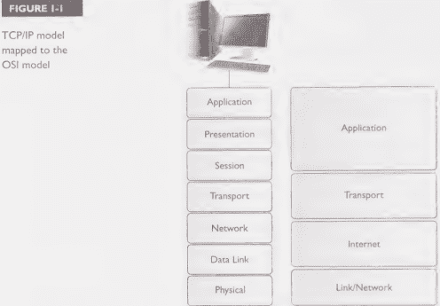

图1-1展示了TCP/IP模型到OSI模型的一种常见映射。再次提醒，请记住这只是为了帮助理解而进行的映射，TCP/IP协议套件并不尝试也不声称以此方式进行映射。这只是一种有助于思考该套件功能的方式。

### 考试提示

无论你选择参加哪门认证考试，了解TCP/IP的细节对CCNA Voice考试都很重要。虽然TCP/IP并未列为直接目标之一，但请记住CCNA认证是前提条件，而且CCNA认证会深入涵盖TCP/IP。我在这里包含了TCP/IP协议套件的摘要，以帮助你在CCNA Voice考试前复习记忆。

要完全理解TCP/IP的工作原理，研究核心协议是必不可少的。在以下各节中，我将解释IP、TCP以及对我们而言其他重要TCP/IP协议的基本功能。

在以太网中，地址用于标识以太网上的每个节点。这些地址称为MAC地址，是通常烧录到设备中的物理地址；但是，某些设备（例如无线局域网适配器）确实支持可配置的MAC地址。现代网络中每个节点拥有的另一种地址是称为IP地址的第3层地址。MAC地址是第2层地址，IP地址是第3层地址。这一点稍后会变得非常重要。

网际协议（IP）是解决节点标识问题的网络层（OSI）或网际层（TCP/IP）方案。该协议负责寻址、数据路由，并为TCP/IP套件中的上层提供服务。问题是：为什么除了第2层地址之外，我还需要第3层地址？

要理解这个问题的答案，你必须理解*网络拥塞、网络分段和网络路由*的概念。当网络上的带宽不足以满足网络所承受的需求时，就会发生网络拥塞。换句话说，单个网络上可能有太多节点。这种拥塞可能对VoIP网络有害，导致呼叫失败或质量受损。

设想一个只有三台计算机连接到100 Mbps（兆比特每秒）交换机的网络。这些计算机将能够非常快速地相互通信。现在，假设你再添加三台计算机，使网络规模翻倍。现在每台计算机平均可用的吞吐量将只有网络上仅有三台计算机时可用吞吐量的一半。指导原则是：*网段*（我稍后会定义它）上通信节点每翻一番，每个节点的平均吞吐量就会减半。如果我们将网络再翻四番，网络上将有96个节点。每个节点平均可用的吞吐量约为1 Mbps。这可能足够，也可能不够，而且它确实可能导致网络拥塞问题，因为现在更有可能有许多节点使用超过其“公平份额”的网络带宽。

那么，当一个网段上有太多节点时，你能做什么？创建更多网段。*网络分段*是将网络划分为大小合理的*广播域*的行为。*广播域*是一种共享介质，其中所有设备无需路由或桥接设备即可相互通信。最常实施的网络分段协议是IP协议。它可以与路由器一起使用，将任何网络分割成越来越小的网段，甚至小到每个网段只有一个节点——但这并不实际或有益。

当然，如果你正在实施网络分段，就必须实施*网络路由*。网络路由是将数据从一个网络

从一个网段传到另一个网段，以使数据到达与源节点分离的网络或网段上的目标节点。IP 负责这些数据的路由。有一个概念称为路由协议，但不应将其与路由本身混淆。路由协议用于动态创建允许进行路由的路由表。真正执行路由的是 IP，它使用这些路由表。请记住：RIP（路由信息协议）和 OSPF（开放最短路径优先）之类的路由协议创建路由表，而 IP 使用路由表来确定将数据包送达目的地的最佳可用路由。这些路由表存储在称为路由器的设备内存中。路由器可以是一台配有多块网络接口卡（NIC）并充当路由器的计算机，也可以是专用的路由设备。

### 考试注意

请记住，路由器通常会在通信过程中引入延迟。虽然 Cisco 等厂商可能宣称线速交换或路由，但事实是，不可能在不引入延迟的情况下“执行额外步骤”。处理器至少需要花费几毫秒来处理传入帧，并将它们转发到沿途的下一跳。通信设备之间路由器过多可能会导致 VoIP 通信出现问题。

IP 地址本身是一个 32 位地址，分为四个八位组或四组 8 位。例如，以下位表示一个有效的 IP 地址：

```
00001010.00001010.00001010.00000001
```

这有时称为“二进制表示法”，但它是 IP 地址实际采用的形式。要理解这种表示法，你需要了解如何将二进制位转换为十进制；我相信你已经习惯看到前面的 IP 地址显示为 10.10.10.1。这些 IP 地址由四个八位组组成，可包含 0 到 255 的十进制值。让我们看看如何将 8 位二进制数转换为我们已经习惯的十进制版本。

以太网帧使用位来表示有效载荷数据和以太网帧头信息。实际情况是，任何数据都可以用二进制位表示。只需要有人设计出应该有多少位，以及这些位应表示什么。要让这一切正常工作，字节的发送方和接收方必须就字节将如何转换达成一致。换句话说，信息要有意义，双方必须对含义达成一致。人类语言也是如此。如果我说一种对我有意义的语言，但你听不懂那种语言，那么它对你来说就没有意义，通信也就没有发生。当计算机收到无法解释为任何有意义内容的信息时，它会将该信息视为噪声或损坏的数据。

要理解八位组中的二进制位如何转换为 ASCII 十进制代码，请参见表 1-2。在这里你可以看到，第一位（最右边的位）表示数字 1，第二位表示数字 2，第三位表示数字 4，依此类推。表中的示例是 00110001。当某位为 0 时，该位关闭；当某位为 1 时，该位开启。我们根据每个位所代表的数字，将换算行中的数值相加，得到结果 49，因为我们只统计位等于 1 的数值。这就是二进制八位组 00110001 表示 ASCII 十进制代码 49 的方式，而 49 在 ASCII 表中表示数字 1。

**表 1-2——将字节转换为十进制值**

| 位位置 | 8 | 7 | 6 | 5 | 4 | 3 | 2 | 1 |
|---|---:|---:|---:|---:|---:|---:|---:|---:|
| 表示的十进制数 | 128 | 64 | 32 | 16 | 8 | 4 | 2 | 1 |
| 示例二进制数 | 0 | 0 | 1 | 1 | 0 | 0 | 0 | 1 |
| 换算结果 | 0 | 0 | 32 | 16 | 0 | 0 | 0 | 1 |

那么这一切如何应用于 IP 编址呢？IP 版本 4 地址由四个 8 位字节或四个八位组组成。现在，你可以记住并处理像 `00001010.00001010.00001010.00000001` 这样的 IP 地址，也可以处理像 `10.10.10.1` 这样的地址。我不知道你怎样，但后者对我来说肯定更容易；然而，前者不仅更便于你的计算机处理，而且也是你的计算机唯一的思考方式。因此，IP 地址可以用点分十进制表示法表示，以便人类更容易处理。点分十进制表示法如下所示：`10.10.10.1`。

IP 版本 4（当前广泛使用的实现）地址的每个八位组不能是任意数字。请记住，只有 8 位可用，因此每个八位组中的数字必须是一个 8 位数字。这意味着它将是 0 到 255 的十进制值，总共有 256 个有效数字。没有以 0 开头的 IP 地址。换句话说，你永远不会看到像 0.0.0.1 这样的地址被分配给设备。事实上，地址 0.0.0.0 被保留用于表示默认网络和/或默认设备。在此上下文中，“default”（默认）一词应根据上下文来理解。例如，IP 地址 0.0.0.23 将指当前（默认）网络中的主机标识 23；反过来，IP 地址 192.168.12.0 则指整个网络这一集合。同样，255.255.255.255 被保留用于表示所有节点或主机。当然，在互联网上，255.255.255.255 实际上会指数百万台联网设备中的每一台，并且它从未用于任何实际目的。

另一个你需要了解的重要特殊地址是环回地址。它是 IP 地址 127.0.0.1。例如，如果你使用 PING 命令与 127.0.0.1 通信，你实际上是在与你自己的 TCP/IP 网络协议栈或协议实现通信。这有时称为 ping 自己，用于排查本地 TCP/IP 实现的问题，并确保其正常工作。

一个称为互联网号码分配局（IANA）的组织管理公共 IP 地址空间。RFC 1166 简要描述了应如何划分 IP 地址空间以进行分配。它规定了三类对我们的讨论很重要的地址：A 类、B 类和 C 类。D 类地址用于多播实现，E 类地址保留用于测试目的。表 1-3 显示了三个主要地址类别的细分情况。

| IP 地址类别 | 十进制表示范围 | 网络数量 |
| :--- | :--- | :--- |
| A | 1.0.0.0–126.255.255.255 | 126 |
| B | 128.0.0.0–191.255.255.255 | 16,384 |
| C | 192.0.0.0–223.255.255.255 | 2,097,152 |

然而，在过去十年中，IP 编址一直在从有类编址转向无类编址。事实上，IANA 甚至在其许多网页中将这些类别称为“原 B 类”和“原 C 类”，这表明有类 IP 编址的时代正在迅速过去。通过取消类别，IP 地址空间可以得到更有用的管理和分配。此外，许多公司现在内部使用私有 IP 地址，只使用少量真实的互联网地址进行外部通信。这是通过称为网络地址转换（NAT）的机制实现的。

归根结底，全局分配的 IP 地址与私有 IP 地址之间存在很大区别。全局分配的地址由 IANA 或为 IANA 服务的机构之一分配。私有地址可以由组织以任何其希望的方式分配，只要该组织已实施能够支持这些地址的网络基础设施。私有地址的好处在于，它们由 IANA 预留，并保证永远不会成为实际“互联网上”主机的目的地。这意味着你可以在自己的网络上使用与我网络上相同的 IP 地址，而我们仍然可以通过互联网相互通信，只要我们都实施 NAT 解决方案，并且根据具体情况可能还需要端口转发。

这些私有 IP 地址分为三个不同的范围，最初根据 A、B 和 C 类预留。这些地址范围是：

- 10.x.x.x
- 172.16.x.x–172.31.x.x
- 192.168.x.x

A 类私有地址空间的范围从 10.0.0.1 到 10.255.255.254，提供约 1670 万个 IP 地址，并且可以使用无类子网划分划分为数千个网络。B 类私有地址空间的范围从 172.16.0.0 到 172.31.255.254，提供约 100 万个 IP 地址，并且可以划分为数百个网络。最后，C 类私有地址空间的范围从 192.168.0.1 到 192.168.0.254，提供 65,536 个地址，也可以划分为数百个网络。

你会注意到，B 类私有地址范围是唯一提供多个起始十进制值集合的范围。例如，所有 A 类私有地址都以 10 开头，所有 C 类私有地址都以 192.168 开头。B 类私有地址范围可以以 172.16 到 172.31 之间的任意数字开头。

归根结底，全局分配的 IP 地址与私有 IP 地址之间存在很大区别。全局分配的地址由 IANA 或为 IANA 服务的机构之一分配。私有地址可以由组织以任何其希望的方式分配，只要该组织已实施能够支持这些地址的网络基础设施。私有地址的好处在于，它们由 IANA 预留，并保证永远不会成为实际“互联网上”主机的目的地。这意味着你可以在自己的网络上使用与我网络上相同的 IP 地址，而我们仍然可以通过互联网相互通信，只要我们都实施 NAT 解决方案，并且根据具体情况可能还需要端口转发。

可以想象，使用“10 空间”（指 10.x.x.x 范围内私有 IP 地址的一种说法）的私有网络可能相当大。为了减少单个网段上的网络流量，我们可以对网络进行子网划分并提高性能。为此，你需要使用子网掩码实施适当的子网划分方案。

子网掩码是一个二进制层面的概念，用于将 IP 地址划分为网络标识符（ID）和主机 ID。网络 ID 标识主机所在的网络，主机 ID 标识该网络中的唯一设备。子网划分的两种基本类型是有类和无类。

有类（也写作“classful”）子网划分只是识别 IP 地址的类别，并使用与该类别匹配的子网掩码。例如，A 类 IP 地址会将前 8 位用于网络 ID，因此子网掩码将是：


11111111.00000000.00000000.00000000

请注意，IP地址中属于网络ID的部分全部为1，而属于主机ID的部分全部为0。例如，如果IP地址为10.12.89.75，并且我们使用的是有类子网划分，则子网掩码为11111111.00000000.00000000.00000000，以点分十进制表示即为255.0.0.0。再举一个例子，考虑一个C类IP地址192.168.14.57。那么有类子网掩码应该是什么呢？正确，它应该是11111111.11111111.11111111.00000000。这是因为C类IP地址使用前24位来定义网络ID，使用后8位来定义主机ID。以点分十进制表示即为255.255.255.0。

大多数配置界面允许您以点分十进制形式输入IP地址和子网掩码。这使得配置更加容易；但是，如果您想执行无类子网划分，您需要理解我们现在讨论的二进制层面。

*无类域间路由（CIDR）*是有类寻址和子网划分的标准替代方案。无类子网划分允许您在二进制层面拆分网络ID和主机ID，因此可以直接在一个八位组的中间进行拆分。例如，您可以认为10.10.10.1在一个网络上，而10.10.10.201在另一个网络上。如何做到这一点？让我们看看二进制层面。以下是两个IP地址的二进制形式：

00001010.00001010.00001010.00000001 (10.10.10.1)

00001010.00001010.00001010.11001001 (10.10.10.201)

要使用CIDR并指示最后一个八位组应一分为二，使1到127的所有内容位于一个网络，128到254的所有内容位于另一个网络，我们将使用以下子网掩码：

11111111.11111111.11111111.10000000

您可能想知道这个子网掩码是如何工作的。为了理解它，请参见表1-4。表中的第一行（除了位位置标识行之外）是IP地址10.10.10.1，第三行是IP地址10.10.10.201。第二行是CIDR子网掩码。如果您仔细数一下列，您会发现前25个位置为1，后7个位置为0。在1的位置，IP地址必须匹配，否则它们位于不同的网络ID上。当您逐行阅读并比较第一行与第三行时，您会注意到它们在读取到第25位之前是完全相同的。在第25位，第一行为0，第三行为1。它们不同，因此位于不同的网络ID上。这就是CIDR的实际应用。

**表1-4** 使用CIDR进行子网划分

| B1 | B2 | B3 | B4 | B5 | B6 | B7 | B8 | B9 | B10 | B11 | B12 | B13 | B14 | B15 | B16 | B17 | B18 | B19 | B20 | B21 | B22 | B23 | B24 | B25 | B26 | B27 | B28 | B29 | B30 | B31 | B32 |
|---|---|---|---|---|---|---|---|---|---|---|---|---|---|---|---|---|---|---|---|---|---|---|---|---|---|---|---|---|---|---|---|
| 0 | 0 | 0 | 0 | 1 | 0 | 1 | 0 | 0 | 0 | 0 | 0 | 1 | 0 | 1 | 0 | 0 | 0 | 0 | 0 | 1 | 0 | 1 | 0 | 0 | 0 | 0 | 0 | 0 | 0 | 0 | 1 |
| 1 | 1 | 1 | 1 | 1 | 1 | 1 | 1 | 1 | 1 | 1 | 1 | 1 | 1 | 1 | 1 | 1 | 1 | 1 | 1 | 1 | 1 | 1 | 1 | 1 | 0 | 0 | 0 | 0 | 0 | 0 | 0 |
| 0 | 0 | 0 | 0 | 1 | 0 | 1 | 0 | 0 | 0 | 0 | 0 | 1 | 0 | 1 | 0 | 0 | 0 | 0 | 0 | 1 | 0 | 1 | 0 | 1 | 1 | 0 | 0 | 1 | 0 | 0 | 1 |

由于CIDR子网划分允许掩码覆盖部分八位组，您会看到像255.255.255.128这样的子网掩码（这是表1-4中子网掩码行的十进制等效值）。子网掩码除了用十进制表示外，常常直接附加在IP地址的末尾。例如，表1-4中的IP地址和子网掩码组合可以表示为10.10.10.1/25。这种表示方式有时称为可变长子网掩码（VLSM）表示法或CIDR表示法，正变得越来越普遍。它表示IP地址为10.10.10.1，而网络ID（有时称为“子网”或“子网络”）是IP地址的前25位。

此时，您可能开始疑惑所有这些子网划分到底有什么意义。除了可以用来缩小网络段的规模（这可能是有益的也可能不是，具体取决于您所实施的基础设施类型）之外，它还能使IP路由正常工作。为了将这一过程简化到您真正需要了解的级别以处理融合网络，设备上的本地TCP/IP实现需要一种方法来确定它是可以直接将数据发送到最终IP地址，还是需要通过路由器发送。

回到子网掩码讨论中的示例，假设IP地址10.10.10.1正试图向IP地址10.10.10.201发送一个数据包。10.10.10.1上的机器如何知道它是否需要路由器（也称为“默认网关”）？答案是它确定自己地址的网络ID，并查看目标地址是否具有相同的网络ID。如果网络ID匹配，则可以使用地址解析协议（ARP）来发现目标IP地址的MAC地址，因为它们位于同一网络上。如果网络ID不匹配，则使用ARP发现路由器的MAC地址，并将IP数据包发送给路由器。本地设备假定路由器知道如何到达世界上的任何IP地址。在路由器内部，它必须找到通往目标IP的最佳路径。一旦确定，路由器就会发现该路径上最近路由器的MAC地址，并转发IP数据包。这个过程一直持续到到达目标终端节点。然而，这一切都始于第一台设备根据子网掩码评估IP地址，并确定它需要本地路由器或默认网关的帮助。图1-2展示了这一过程。

虽然IP用于在互联网络上移动数据，直到数据到达其预期目标，但传输控制协议（TCP）既用于为这些传输提供可靠性，也用于确定应在接收设备上处理数据的应用程序。可靠性通过分段、传输、重传和聚合上层数据来提供。应用程序的确定则通过使用TCP端口来完成。

TCP协议从上层获取数据，并将这些数据分段为可传输和管理的更小单元。由于IP有时会因拥塞而丢弃IP数据包，并且数据包可能通过不同路由到达目的地，因此某些TCP段（通过IP发送）可能乱序到达目的地，或者根本不到达。因此，TCP在数据乱序到达时提供重新排序，并重发未能到达目的地的数据。这提供了数据的可靠传输，使TCP在文件传输、电子邮件和NNTP（网络新闻传输协议）等解决方案中非常有用。这些应用都需要可靠传输，这意味着TCP是主要候选者。

除了可靠传输，TCP还使用端口来确定应接收到达数据的上层应用程序。一些端口号是众所周知的，一些是已注册的，还有一些是未分配或私有的。常见端口包括FTP的21、HTTP的80和SMTP的25。由于防火墙的大量部署，了解服务使用哪个端口在现代网络中变得非常重要。防火墙通常会阻止所有互联网流量，除非是某些特定端口。如果您不知道服务尝试使用的端口号，您将不知道需要在防火墙中创建什么例外。

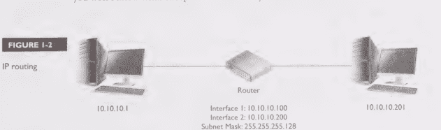

### 考试要点

### 为什么TCP/IP很重要？

TCP/IP是互联网的基础协议。现代私有网络也主要使用该协议。如果您不了解IP、TCP以及该协议族中其他协议的基础知识，您将无法管理现代网络。

TCP/IP的成功主要归功于其在互联网上的使用。如果您想浏览网页、从FTP站点下载或阅读gopher站点的文本，您必须运行TCP/IP协议。许多早期网络既运行TCP/IP，也运行其他协议，如IPX/SPX（互联网分组交换/顺序分组交换）或Banyan Vines。首先，网络供应商开始在其专有协议旁边支持TCP/IP，最终他们将系统不仅发展到支持TCP/IP协议族，而且依赖它。如今，Novell、Microsoft、Unix、Linux和Apple计算机都将TCP/IP作为主要通信协议。

与IP协议相关的一个非常渐进的转变正在发生。IPv6已经可用多年，操作系统也已慢慢将其纳入其可用协议中。Windows Vista和Windows Server 2008都内置支持IPv6。Unix和Linux机器已经支持它有一段时间了，Apple的Mac OS X也支持它。一旦绝大多数计算机都支持IPv6，我们很可能会看到它在我们的网络上得到越来越多的使用；然而，根据截至2010年末的既定目标，CCNA Voice考试不会测试您对此协议的了解。

哦，TCP/IP是所有VoIP通信的基础。当然，这正是本书和CCNA Voice考试的全部内容。

*实时传输协议（RTP）*是一种专为在运行IP的互联网络上传输音频和视频数据而设计的协议。与TCP不同，RTP的重点不是可靠性，而是快速传输。当所传输的数据必须及时到达否则价值不大时，就会使用它。例如，一封电子邮件可能需要两三分钟才能到达，一旦到达，您就可以正常阅读；然而，通过VoIP电话说出的五秒钟的话不能花两三分钟才到达。那五秒钟的话会被分成许多数据包，它们必须非常快速地到达。如果它们的到达时间存在很大的间隔，通话将会丢失，或者听者将无法清晰地听到消息。RTP运行在UDP之上，这将在后面章节讨论。


实时传输控制协议（RTCP）与 RTP 配合使用。它用于收集和报告有关网络通信的性能信息。人们已经开发了一些管理应用程序，使支持专业人员能够监控媒体通信问题，如延迟、抖动和数据包丢失。这些问题将在后续章节中——讨论。

由于 RTP 和 RTCP 使用 UDP，因此了解一下这个协议的作用是个好主意。UDP 负责无连接通信。请记住，TCP 是一种面向连接的协议。UDP 则不同；它只是将数据丢到线路上，然后说：“希望你能到达。”乍一看，你可能认为这样的协议毫无用处；然而，该协议对我们的融合网络非常重要，因为它允许及时交付信息，并且完全忽略可靠性。UDP 不在乎数据能否到达，甚至不期望接收方做出确认。

这就是为什么这是一件好事。由于 UDP 无需处理确认，它可以持续保持数据流传输。接收端也不必确认收到。最终结果是发送方和接收方的处理负担都更轻。另一个好处是，由于传输的数据包更少，网络拥塞得以减轻。最后，由于 UDP 报头小于 TCP 报头，所传输的数据包也更小。UDP 报头为 8 字节，而 TCP 报头为 24 字节。这意味着使用 TCP 时必须多传输 16 字节的额外信息，这对于必须将延迟和数据包丢失保持在最低限度的语音通信来说是不利的。

> **考试提示：** UDP 是一种无连接协议，非常适合 VoIP 通信。流式语音数据不允许存在重新发送数据包所需的延迟。UDP 数据报是“发后即忘”的数据包，接收方只需根据它收到的任何数据包生成语音音频。

VoIP 网络中使用的其他协议包括：

- **SIP** — 会话发起协议（Session Initiation Protocol）是一种用于流式数据通信的协议，通常用于拨打 VoIP 电话。
- **H.323** — H.323 是一种用于流式语音或多媒体（如视频）的协议，也常用于拨打 VoIP 电话。
- MGCP 媒体网关控制协议是一种用于将电路交换网络与基于 IP 的网络连接起来的协议。
- SCCP 瘦客户端控制协议是一种思科专有协议，用于通过 IP 网络进行 VoIP 呼叫以及视频或音频会议。

这些附加协议将在第 6 章到第 8 章中详细介绍。

### VoIP 的优势与应用

最后，我们来讨论 VoIP 的优势与应用。首先，我将阐述其优势，然后涵盖其应用。

与传统基于 PBX（专用交换机）的电话系统相比，VoIP 的优势有很多。以下仅举几例：

- 升级不需要更换硬件。
- VoIP 的扩展性远优于传统 PBX 解决方案。
- VoIP 可以跨互联网运行，对许多服务提供商来说无需额外服务费用。
- VoIP 解决方案可以从供应商处购买，或从互联网上的开源社区免费获取。
- 在较小的部署中，VoIP 可以在现有硬件上运行，例如思科集成多业务路由器（ISR），无需额外硬件。
- 只要你选择所有基于标准的 VoIP 客户端电话和软件，VoIP 就永远不会把你锁定在特定的供应商上。

当然，VoIP 最常被提及的优势是它带来的成本降低。事实上，许多组织通过使用 VoIP，可以节省数千甚至数十万美元的电话费。此外，使用 VoIP 而非基于 PBX 的系统来实现内部电话网络，其成本通常也要低得多。这种成本降低通常基于这样一个事实：你使用与数据网络相同的线缆、路由器和交换机来构建电话网络。

VoIP 提供的应用同样令人印象深刻。你可以将 VoIP 用于以下任何任务：

- 使用互联网作为载体，在世界任何地方拨打电话。你只需要在连接的两端各有一个 VoIP“服务器”。

### 为什么 VoIP 网络中的质量是一个问题

VoIP 网络中的质量之所以是一个主要关注点，原因有二。首先，用户期望他们的电话通话具有某种音质。他们期望达到自己习惯的质量。这是一种感知质量，值得庆幸的是，借助现代 VoIP 协议以及 TCP/IP 协议套件中的服务质量（QoS）解决方案，我们可以达到甚至超越这种质量。其次，我们不希望用户的生产力受到影响。如果通话质量差，用户就会不断要求对方重复信息，这既耗时又令人沮丧。此外，质量差还可能导致通话中断，从而需要重新拨号。如果质量更差，通话可能根本无法完成。所有这些结果都会导致用户生产力下降，进而给组织带来成本。

### 质量的定义

在深入讨论之前，让我们先探讨一下质量的含义。电话网络的语音质量意味着用户能够完成呼叫、维持通话会话，并清楚地理解这些会话中进行的通信。如果这三个因素中的任何一个出现问题，我们就不能说质量得到了保证。

VoIP 行业有几种分析和定义质量的方法。一种常见的方法是平均意见得分（MOS）评级。例如，可以为 VoIP 编码方法分配一个 MOS 评级。表 1-5 显示了不同常见编码方法（编解码器，即编码器-解码器）的不同得分。

在表 1-5 中，MOS 较高的编解码器（如 G.711 和 G.726）具有较高的语音质量水平。MOS 的确定方法是让一组人聆听音频，并按 1 到 5 的等级进行评分，其中 5 分为最佳。通常，MOS 达到 4.0 或以上被认为是长途级质量。关键在于要注意到，虽然 G.729 的 MOS 低于 G.711，但它消耗的带宽仅为后者的八分之一。正因为如此，G.729 被用于当今绝大多数 VoIP 电话呼叫。它能提供长途级质量的通话，并且比 G.711 或 G.726 消耗更少的带宽。

**表 1-5**

**编解码器、比特率和 MOS**

| 编解码器 | 比特率 | MOS |
| --- | --- | --- |
| G.711 | 64 kbps | 4.3 |
| G.726 | 32 kbps | 4.0 |
| G.728 | 16 kbps | 3.9 |
| G.729 | 8 kbps | 4.0 |

### 质量不佳的原因

延迟是衡量数据通过网络从一个点移动到另一个点所需时间的指标。就我们的目的而言，延迟通常是从端点到端点来测量的。在 VoIP 实现中，延迟是指 VoIP 数据包从发送电话传输到接收电话（无论是基于硬件的电话还是基于软件的电话）所需的时间。这种延迟也称为传播延迟，因为它衡量的是数据信号从一个端点传播到另一个端点所需的时间。

延迟受到多种因素的影响。这些因素包括带宽、效率和利用率。带宽会影响延迟，因为它限制了可以在网络中传输的数据总量。当在给定的时间窗口内能够通过网络移动更多数据时，每次传输的延迟通常会降低。

效率对延迟有着巨大影响，因为即使使用的是非常高速率的布线和信令技术，缓慢的路由器或交换机也可能导致延迟大幅增加。归根结底，并非所有千兆交换机和路由器都是一样的。例如，我有一个被其供应商归类为企业级路由器的路由设备，但它的性能远不如同一时期按照相同信令标准（100 兆比特以太网）制造的廉价 Netgear 路由器。你不能因为所有制造商的设备支持相同的标准，就认为它们的性能都相同。这种困境正是为什么测试对实际需要实施该技术的人员如此重要的原因。

当然，利用率会通过大数的简单数学原理影响延迟。你可以把它想象成一条高速公路。如果你有一条特定的通勤路线，而且已经走了几年，你可能会注意到拥堵越来越严重（至少在大城市是这样）。为什么会出现这种拥堵？这是大数的数学原理。与几年前相比，如今有更多的汽车试图到达相同的相对区域。假设车道数量没有变化，那么汽车要么必须更高效地行驶，要么需要更长时间才能到达目的地。要点很简单：当更多的汽车行驶在你通勤的同一条路线上时，你的延迟就会增加。我们看到实践中采用了四种解决方案：

- 增设更多普通车道。
- 将一个或多个车道标记为高乘载车道。
- 教人们更好地驾驶。
- 引导交通沿替代路线行驶。

增设更多普通车道将增加车道宽度（类似于网络带宽）并减少你的延迟。然而，这种解决方案成本非常高昂

并且，在增建车道期间会减缓交通。如果我们将这一概念应用于数据网络，也会面临同样的负面因素。如果已安装的布线无法支持更高速率，那么拆除 100-Mbps 基础设施并安装 1-Gbps 基础设施可能非常昂贵。此外，升级期间可能发生重大服务中断。必须考虑这些因素。

第二种方案是为高乘载车辆标记一条车道（HOV 车道），其影响不如增加更多车道，但成本低得多，并且在初始实施期间不应造成那么多延迟。安装 HOV 车道类似于在网络上实施 QoS。QoS 无法增加可用带宽，但可以表明特定流量类型具有更高优先级。

第三种方案在现实生活中可能最难。教人们更好地驾驶，是一种委婉说法，意思是我们要教人们协同配合，使所有驾驶员都能在相对为所有驾驶员所接受的时间窗口内到达目的地。换句话说，不会出现某位驾驶员获得优势而让其他驾驶员更加延误的情况。归根结底，我们谈论的是实施更好的协作驾驶算法。值得庆幸的是，虽然这项任务对于高速公路上的真人驾驶员来说非常困难，但对于通过网络传输的数据来说却相当简单。

第四种也是最后一种方案可能效果很好，但如果没有规则或法律要求他们改走不同路线，驾驶员可能干脆忽略这一建议。值得庆幸的是，使用拨号对等体（dial peers，这是思科网关内的配置元素，用于指示通往 VoIP 目的地的路径），我们可以规定呼叫应走的路线。该技术可用于引导 VoIP 通信避开网络中原本流量繁忙的区域。

考虑这样一个事实：无线 IEEE 802.11g 标准提供比 IEEE 802.11b 更高的吞吐量和数据速率，尽管它们使用相同的 22 MHz 频带宽度。你可以说 802.11g 和 802.11b 都使用 22 条车道进行数据传输，但 802.11g 传输的数据量几乎多五倍。这种吞吐量差异怎么可能存在？答案是 802.11g“驾驶”得更好。

我相信你开始看到这些不同术语之间如何相互关联。带宽或数据速率提供数据吞吐量的上限，而实际吞吐量是带宽、开销和效率共同作用的结果。延迟受带宽和效率影响。网络利用率也会对延迟产生很大影响。最终，这三者（带宽、吞吐量和延迟）相互关联，你很少能在不影响其他某一项的情况下影响其中一项。例如，如果你想降低延迟，你所采取的措施很可能也会提高吞吐量——即使带宽没有改变；然而，如果你增加带宽，吞吐量和延迟通常也会受到影响。

VoIP 实施必须从多个角度处理延迟。实际上，延迟被分解为多个组成部分，并在这一组件层面加以考虑。因此，你需要从三个方面认识延迟：

- 编码延迟
- 打包延迟
- 网络延迟

到目前为止，我所描述的概念是网络延迟和打包延迟，其中重点最多的是网络延迟。在 VoIP 系统中，我们必须记住，所测量的真实延迟是发生在一位用户对着电话说出词语到另一位用户从她的扬声器（桌面扬声器、听筒扬声器、耳机等）听到这些词语之间的延迟。因此，我们还必须考虑编码延迟。编码 G.711 音频流所需的时间不同于编码 G.729 音频流所需的时间。然而，G.729 音频流以更小的数据包大小通过 VoIP 网络发送相同的声波。因此，我们看到 G.729 的编码延迟增加，而网络延迟减少。现实情况是，网络延迟的减少通常远大于编码延迟的增加，因此从延迟角度看，G.729 将是更好的 VoIP 协议。

打包延迟——此前我只是略微提到——是将语音数据放入 UDP 和 IP 数据包所产生的延迟。你可以而且通常会在一个 IP 数据包中放入不止一个语音帧（记得 HOV 车道的类比）。当单个 IP 数据包中有更多语音帧时，打包延迟会增加；然而，由于带宽消耗减少，相同音频数据量所需的 UDP 和 IP 报头在网络中传输得更少，因此网络延迟会降低。当单个 IP 数据包中的语音帧更少时，打包延迟会降低，但由于需要更多 UDP 和 IP 报头，网络延迟可能增加。

延迟是衡量数据从端点到端点传输所需时间的指标，而抖动是这种延迟中出现的方差。在任何不是两个端点之间独占专用网络的网络中，都会存在抖动。因此，必须考虑并解决抖动。我将抖动定义为延迟的变化；然而，其他人经常将抖动定义为流中的数据包到达接收端点之间时间的变化。我们基本上说的是同一件事。我关注延迟，而另一种定义关注到达流数据包之间的实际时间跨度。如果流中数据包之间的时间跨度存在变化，那是因为延迟存在变化。如果延迟存在变化，就会导致流中到达数据包之间的时间跨度发生变化。

为什么抖动是个问题？抖动在 VoIP 网络中是个问题，因为它可能导致通话掉线（如果变化太大），并且可能导致质量很差。你是否曾在电话中听别人说话，同时等待自己说话的机会？如果是这样，你可能有过不小心打断别人的经历。你以为他们因为异常长的停顿已经说完了，但他们实际上只是喘口气或试图想出合适的词。由于抖动，VoIP 网络中也会发生同样的事情。抖动可能造成音频流中断，从而导致人为的停顿。结果是，你开始在对方说话时插话。

*丢包*或简称为*丢失*，是用来描述流中缺失数据包的术语。在接收端，可以通过分析序列号来检测丢失的数据包。丢包可能导致语音质量差，甚至通话掉线。例如，如果无线用户位于信号覆盖差或干扰较高的区域，许多数据包可能会丢失。无论你采用何种服务质量措施，糟糕的无线信号仍会降低 VoIP 通信质量。这些丢包会导致通信中断，而无线链路上的重传会导致延迟。

### 认证目标 1.02

### 642-436：描述语音质量考量因素

在下一节中，你将探讨上一节所提出问题的解决方案。这些解决方案有助于改善你网络中 VoIP 的服务质量。

### 改善语音质量的方法

要实现语音质量，我们必须应对延迟、抖动和丢包。以下各节概述了我们可用于解决这些问题的各种方法。

### 延迟解决方案

在计算机网络领域，*服务质量（QoS）*可以定义为“管理网络流量以提供网络用户所要求的性能的工具和技术”。正如 Andre Godin 所说：“期望的质量决定我们行动的质量。”我将为这句话注入不同的含义。以下是对这句话的转述：“The


“你的需求的准确性决定了你努力的收益。”如果质量需求不准确，你实施的 QoS 解决方案不太可能对用户有益。事实上，设计不佳的 QoS 解决方案可能带来的麻烦比它解决的还要多。因此，成功的 QoS 实施始于质量需求的制定。

当你清楚了解了网络中的质量需求后，就可以开始考虑各种可以帮助你满足这些需求的 QoS 工具。这些工具旨在减少延迟、抖动和时延，它们可能通过使用优先级、排队和专用连接来实现这些目标。你可以将 QoS 工具视为一组能够让你更高效地使用任何物理网络的技术。QoS 工具无法让网络更快，但可以强制或建议更好地使用网络。

有几种 QoS 类型可用，将在第 4 章和第 17 章中深入介绍。目前，你只需知道 QoS 解决方案可以解决大多数现代网络上的时延问题。你只需要启用它并正确配置它以优先处理语音数据。如果你当前的网络是纯计算机数据网络，那么极不可能已实施或配置任何 QoS 解决方案。

### 抖动解决方案

在大多数情况下，抖动缓冲区在接收端工作。抖动缓冲区并不会立即将语音帧发送给处理程序，而是将传入的语音帧保持很短的一段时间，然后开始以固定的时间间隔将其发送给处理程序，从而通过扬声器输出平滑的音频流。保持时间或延迟非常短，通常远低于 200 毫秒（ms）。大多数情况下，抖动缓冲区为 100 毫秒或更短。

图 1-3 说明了抖动缓冲区的概念。注意，传入的数据包具有可变的延迟。第一个数据包进入缓冲区与第二个数据包之间的延迟为 30 毫秒，而第二个与第三个数据包之间的延迟为 15 毫秒。在抖动缓冲区内部，数据包被存储并以 20 毫秒的间隔发送出去。


理解静态抖动缓冲区与动态抖动缓冲区之间的区别非常重要。静态抖动缓冲区的大小是固定的。这种固定大小意味着缓冲区无法存储超出其容量的数据包；同时，如果缓冲区内的数据包过少，就可能无法为电话或软件提供所需的上游速率。使用动态抖动缓冲区可以解决这个问题。动态抖动缓冲区会评估传入延迟并相应地调整缓冲区大小。虽然动态缓冲区可能会消耗接收设备更多的处理能力，但由于它能够在利用率多变的网络中发挥最佳作用，因此通常更受青睐。

### 丢包解决方案

当发生丢包时，可以使用不同的技术来解决。这些技术包括：

- **忽略丢包** — 这种解决方案实际上是大多数 VoIP 实现的做法。与其尝试适应丢失的数据包或重传它们，不如在达到指定阈值之前简单地忽略丢失的数据包。
- **插值丢失的数据包** — 插值是根据已知值和模式估计未知值的过程。插值可能非常消耗处理器资源，并可能增加延迟。根据所使用的编解码器，插值可能不是一种可选方案。
- **重传数据包** — 重传在标准数据传输中非常常见；然而，对于 VoIP 流来说，它并不是很有用，因为重传的数据很可能会超出同步范围太多。由于使用 UDP，接收方必须向发送方发送请求以重传数据。这种解决方案意味着发送方必须将已发送的数据包缓冲一段时间，同时也意味着发送方和接收方之间的延迟必须极低。由于这些原因，在 VoIP 系统中，重传很少用于丢失的数据包。
- **初始时传输冗余数据包** — 重传的替代方案是一直传输同一数据的多个副本。问题在于

### 场景与解决方案

| 场景 | 解决方案 |
|---|---|
| 你遇到了通话掉线的问题。这看起来是由于数据包传输中的可变延迟速率造成的。哪种技术可以帮助解决这种情况？ | 抖动缓冲区可以帮助解决这种情况。抖动缓冲区用于应对网络通信中可变延迟（抖动）的影响。它试图将到达的数据包以固定的时间间隔而非可变的速率传送给音频处理器。 |

当你查看帮助时，你会注意到可以使用 -w 开关来确定等待回复的时间长度。一旦此时间过期，pathping 命令就会假定没有回复即将到来，并将无回复视为一个丢失的数据包。

### 使用 pathping 命令

1. 输入 `pathping -w 50 www.sysedco.com` 并按 ENTER。
2. 输入 `pathping www.sysedco.com` 并按 ENTER。

你应该会看到与图 1-4 类似的结果。注意在图 1-4 中，第一次有 19 个数据包被丢弃，但第二次没有数据包被丢弃。这是因为我们第一次输入的等待时间非常低，只有 50 毫秒。然而，这展示了一种查找丢弃数据包的简单方法，即指定你可以接受的等待时间。例如，你可能想以 150 毫秒的等待时间再次尝试同样的命令，这更接近 VoIP 通信所需的等待时间。

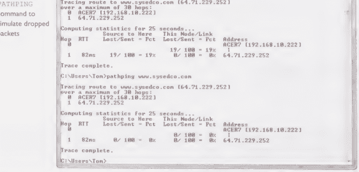

```text
C:\Users\Tom>pathping -w 50 www.sysedco.com

Tracing route to www.sysedco.com [64.71.229.252]
over a maximum of 30 hops:
  0  BCER7 [192.168.10.222]
  1  64.71.229.252

Computing statistics for 25 seconds...
            Source to Here   This Node/Link
Hop  RTT    Lost/Sent = Pct  Lost/Sent = Pct  Address
  0                                           BCER7 [192.168.10.222]
  1   82ms   19/ 100 = 19%     0/ 100 =  0%   64.71.229.252

Trace complete.

C:\Users\Tom>pathping www.sysedco.com

Tracing route to www.sysedco.com [64.71.229.252]
over a maximum of 30 hops:
  0  BCER7 [192.168.10.222]
  1  64.71.229.252

Computing statistics for 25 seconds...
            Source to Here   This Node/Link
Hop  RTT    Lost/Sent = Pct  Lost/Sent = Pct  Address
  0                                           BCER7 [192.168.10.222]
  1   82ms    0/ 100 =  0%     0/ 100 =  0%   64.71.229.252

Trace complete.

C:\Users\Tom>
```

### 认证总结

在本章中，你开始了掌握 VoIP 的旅程。你了解了 VoIP 的优势及其为用户提供的应用。你还复习了 TCP/IP 网络的基础知识，因为这些信息是 CCNA Voice 考试中假定你已经掌握的知识。最后，你探讨了与 VoIP 通信相关的质量因素。你了解了为什么 VoIP 对网络通信质量有特殊要求，以及如何应对影响这种质量的常见障碍。在下一章中，你将从一个 VoIP 专业人员的角度回顾基础网络技术。

### 两分钟速览

### 640-460：识别影响语音质量的因素

- [ ] 延迟是数据在网络上从一点到另一点所花费的时间。
- [ ] 抖动是网络上延迟的变化。
- [ ] 抖动会导致语音质量不佳，甚至掉线。

### 642-436：描述语音质量的注意事项

- [ ] 抖动缓冲区有助于应对抖动对 VoIP 通话的影响。
- [ ] 必须解决丢包问题，VoIP 网络才能正常工作。
- [ ] 重传丢失的数据包并不是解决 VoIP 通信中丢包的可行方案。
- [ ] 在同时承载 VoIP 呼叫的 IP 网络上，必须使用服务质量（QoS）解决方案。


### 自测

以下问题将帮助你衡量对本章所述内容的理解。请仔细阅读所有选项，因为正确答案可能不止一个。请为每个问题选择所有正确答案。

### 640-460：识别影响语音质量的因素

- 1. 用于定义基于 IP 的网络中延迟变化的术语是什么？
    - A. 丢包
    - B. 抖动
    - C. RTT
    - D. 量化
- 2. 可以使用什么技术来抵消抖动对语音通信的影响？
    - A. 802.1X
    - B. 802.1Q
    - C. 抖动缓冲器
    - D. 延迟缓冲器
- 3. 用于定义 IP 数据包在网络中从一点到另一点所需时间的术语是什么？
    - A. 延迟
    - B. 抖动
    - C. 变化
    - D. 丢包
- 4. 什么解决方案有助于提高 IP 网络上高优先级数据包的吞吐量？
    - A. 服务质量
    - B. 抖动缓冲器
    - C. 数据包再生器
    - D. 数字信号处理器

### 自测答案

### 640-460：识别影响语音质量的因素

- 1. ☑ B 正确。抖动指的是到达数据包的延迟变化。例如，如果流中的第一个数据包到达后，第二个数据包在 32 ms 后到达，第三个数据包在 38 ms 后到达，则抖动为 6 ms。
  
    ☒ A、C 和 D 不正确。丢包指的是未能到达目的地的被丢弃数据包。RTT 是往返时间，指的是从 A 点到 B 点再返回所需的时间。量化与 IP 网络上的数据传输无关。
- 2. ☑ C 正确。抖动缓冲器通过在开始音频流之前先排队几个数据包，试图抵消网络上的抖动。
  
    ☒ A、B 和 D 不正确。802.1X 是一种安全协议。802.1Q 是一种桥接和 VLAN 协议。VoIP 系统中没有定义延迟缓冲器。
- 3. ☑ A 正确。延迟定义数据包穿越网络所需的时间，并以毫秒（ms）为单位量化。
  
    ☒ B、C 和 D 不正确。抖动是延迟的变化。变化是两个值之间的差异。丢包指的是被丢弃的数据包。
- 4. ☑ A 正确。服务质量（QoS）有助于提高吞吐量。它不会增加带宽，但会更有效地利用带宽。
  
    ☒ B、C 和 D 不正确。抖动缓冲器有助于抵消抖动的影响。数据包再生器，例如 Cisco 系统中的 PLC 算法，可以尝试再生丢失的音频。数字信号处理器（DSP）在 Cisco ISR 中用于对音频流进行编码。

### 642-436：描述语音质量注意事项

- 5. ☑ D 正确。PLC 可以纠正 20-50 ms 的丢失音频；因此，上限是 50 ms。
  
    ☒ A、B 和 C 不正确。由于 50 ms 是上限，因此 20、10 和 40 不正确。
- 6. ☑ A 正确。通常认为低于 10% 的丢包率是可以接受的。
  
    ☒ B、C 和 D 不正确。超过 10%（其中包括低于 20% 或 25% 的情况）将是不可接受的。
- 7. ☑ C 正确。重传不是可行的解决方案。在语音通信中，数据流必须连续。因此，不可能等待重传的数据。
  
    ☒ A、B 和 D 不正确。假设丢包率低于 10%，QoS、PLC 和抖动缓冲器都是可能的解决方案。
- 8. ☑ C 正确。VoIP 实际上与你的计算机数据使用同一网络。
  
    ☒ A、B 和 D 不正确。与基于 PBX 的解决方案相比，答案 A、B 和 D 中列出的所有项目都是 VoIP 的有效优势。

### 实验答案

答案可能有所不同，但你很可能会实施服务质量（QoS）。通过实施 QoS，你可以进一步优化网络以允许语音流量。始终要记住，当你在网络上实施 VoIP 时，现有网络应用和流量必须允许 VoIP 通信。这可能要求进行更大程度的网络分段，但几乎总是要求实施和配置 QoS 解决方案。


## 2 从 VoIP 视角看网络

### 认证目标

- **2.01** 640-460：描述 UC 环境中基础设施的功能。
- **2.02** 640-460：描述 VoIP 环境中 VLAN 的用途。
- **2.03** 640-460：配置交换基础设施以支持语音和数据 VLAN。
- ✓ 两分钟演练
- 问答自测

将不同技术相互关联，并以正确的方式实施正确的技术。你会在 Cisco 以及其他厂商的供应商文献中看到对 OSI 模型的引用，因此理解这些引用的含义很重要。

根据 ISO/IEC 7498-1 文档（即“OSI 基本参考模型”标准文档），OSI 模型提供了“用于系统互连目的的标准化开发协调的共同基础，同时允许将现有标准置于整体参考模型的视角中”。该模型对于正在开发的新标准以及思考现有标准都很有用。使用 OSI 模型的一种常见方式是将 TCP/IP 协议套件与 OSI 模型的各层关联起来。尽管 TCP/IP 是在 OSI 模型之前开发的，但它可以相对于该模型置于恰当的视角中。

### 实际工作中

> **你可以从 ECMA 网站下载“OSI 基本参考模型”文档，网址为 http://www.ecma-international.org/activities/Communications/TG11/s020269e.pdf。**

OSI 模型让我们能够以块或层的方式思考网络。你可以专注于保护每一层、优化每一层以及对每一层进行故障排除。这使你能够将一个非常复杂的通信过程拆解开来，并评估其各个组成部分。要理解这一点，你需要知道 OSI 模型分为七层。这七层（从上到下）是：

- 应用层
- 表示层
- 会话层
- 传输层
- 网络层
- 数据链路层
- 物理层

每一层都被定义为向其上下的层提供服务并从其上下的层接收服务。例如，数据链路层向物理层提供服务，并从物理层接收服务。这是怎么回事？简而言之，数据链路层为物理层将数据包转换为帧，物理层则将这些帧作为比特在所选介质上传输。物理层从所选介质上读取比特，并为数据链路层将这些比特转换为帧。

分层模型允许抽象。较高层不一定必须知道较低层如何完成其工作。此外，较低层也不一定必须知道较高层实际上如何使用较低层工作的结果。这种抽象意味着，无论较低层连接是拨号调制解调器、高速 Internet 连接，还是介于两者之间的某种连接，你都可以使用相同的 Web 浏览器和 HTTP 协议在 Internet 上通信。最终速度或性能当然会有所不同，但功能将保持不变。

图 2-1 说明了 OSI 模型的概念。如你所见，数据向下经过各层，穿过介质，然后在接收机器上向上经过各层。请记住，大多数网络标准允许替换几乎任何数据链路层和物理层。虽然此示例展示了两台机器之间的有线以太网连接，但它同样可以很容易地是使用 IEEE 802.11 和 IEEE 802.3 标准来描述数据链路层和物理层的无线连接。此示例使用 IEEE 802.3 以太网标准和 IEEE 802.2 LLC 标准（数据链路层内的一个层）作为较低层。重点在于，最流行的上层协议套件 TCP/IP 可以跨大多数较低层标准工作，例如 IEEE 802.2（逻辑链路控制）、802.3（以太网）、802.5（令牌环）、802.11（无线局域网）和 802.16（WiMAX）。

为了充分理解 OSI 模型并能够在本书其余部分中与之关联，评估每一层很重要。你需要理解每一层的基本描述及其为网络过程提供的服务。我将定义每一层，然后给出其使用示例，从最顶层即应用层开始，因为这是标准中记录它们的顺序。

### 考试提示

> OSI 模型在 CCNA Voice 或 CVOICE 考试中不会占很大比重；但是，你将不得不像参加 CCNA 考试时那样再次接触相关术语。在现代网络考试中，不可能绕开 OSI 模型。本章可能有助于你更好地理解 OSI 模型，并将其应用到你正在学习的新语音技术中。


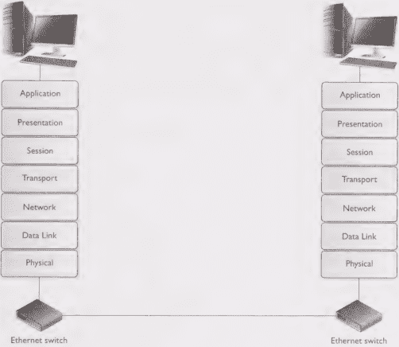

### 应用层

OSI模型的七层定义在ISO/IEC 7498-1文档的第7条中。应用层在子条款7.1中被定义为参考模型中的最高层，并且是访问OSIE（开放系统互连环境）的唯一途径。换句话说，应用层是为应用程序提供访问其他OSI层的接口，也为其他OSI层提供访问应用程序的接口。不要将应用层与泛指“应用程序”的普通词语混淆，后者用于指代Microsoft Excel、Corel WordPerfect等程序。应用层是这些应用程序在需要通过网络发送或接收数据时所通信的OSI层。可以说，应用层是应用程序需要与之通信的高级协议。例如，Microsoft Outlook可能需要与SMTP协议通信以传输电子邮件；VoIP电话可能需要与SIP或H.323接口通信以发起和处理呼叫。

应用层协议和功能的示例包括HTTP、FTP和SMTP。超文本传输协议（HTTP）用于将HTML、ASP（活动服务器页面）、PHP（PHP：超文本预处理器）及其他类型的文档从一台机器传输到另一台机器。HTTP是互联网上使用最频繁的应用层协议，甚至可能是全球范围内使用最多的协议。文件传输协议（FTP）用于在服务器和客户端之间传输二进制文件和ASCII文件。HTTP和FTP协议都可以传输任何文件类型。简单邮件传输协议（SMTP）用于在服务器之间移动电子邮件消息，通常与其他协议配合进行邮件存储。

应用层进程通常分为两大类：用户应用程序和系统应用程序。电子邮件（SMTP）、文件传输（FTP）和网页浏览（HTTP）功能属于用户应用程序类别，因为它们直接为用户使用的应用程序（如Outlook Express（电子邮件）、WS_FTP（文件传输）和Firefox（网页浏览））提供结果。请注意，用户使用的应用程序或程序实际上利用的是应用层（第7层）中的应用服务。换句话说，Outlook Express利用了SMTP。Outlook Express并不位于第7层，但SMTP位于第7层。系统应用的示例包括DHCP和DNS。动态主机配置协议（DHCP）提供动态TCP/IP配置，域名服务（DNS）协议提供名称到IP地址的解析。这两者都被视为系统级应用，因为它们通常不直接由用户访问（这一点尚有争议，因为管理员也是用户，而且他们经常使用命令行工具或程序直接访问这些服务）。

根据OSI模型标准，在应用层运行的进程被称为*应用实体*。标准将*应用实体*定义为“一个活动元素，它体现了一组与OSI相关并为应用层定义的能力”。换句话说，*应用实体*是运行在第7层并与更低层通信的服务，同时为本地计算设备上运行的应用程序暴露OSI模型的入口点。SMTP是一个*应用实体*，HTTP和其他第7层协议也是如此。

在本章中，我们将使用电子邮件作为OSI模型的简单演示。至此，你可能还未完全了解VoIP技术，但你应该能从你的CCNA以及其他网络学习和工作中理解基本的电子邮件操作。假设你正在使用简单邮件传输协议（SMTP）发送一封电子邮件，这是发送电子邮件最流行的方法。你的电子邮件应用程序将连接到SMTP服务器以发送邮件消息。有趣的是，从电子邮件应用程序的角度来看，它直接连接到SMTP服务器，并且完全不知道允许此连接发生的所有其他操作层。图2-2显示了在第7层时的电子邮件。

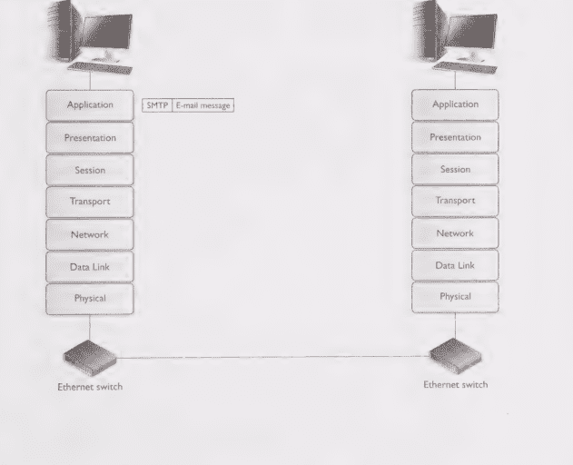

### 表示层

表示层在标准的子条款7.2中被定义为OSI模型的第六层，它为上面的应用层和下面的会话层提供服务。表示层（第6层）负责表示由应用实体传达或引用的信息。并非所有网络通信都会使用表示层；它以及应用层和会话层，类似于TCP/IP模型中的单个应用层。表示层提供语法管理和转换以及加密服务。语法管理是指确保发送和接收主机使用共享的语法或语言进行通信的过程。当你理解了这一概念，你就会明白为什么加密通常在这一层处理。毕竟，加密实际上是对数据的一种修改，这种修改必须在接收端进行逆转。因此，发送方和接收方都必须理解加密算法，以便向网络中发送或接收数据的程序提供正确的数据。

### 实战笔记

*不要因为发现TCP/IP模型有自己不同于OSI模型的应用层而惊慌。TCP/IP协议在OSI模型发布之前就已存在。因此，我们将TCP/IP协议族与OSI模型联系起来，但不能说它直接符合该模型。同样重要的是要记住这个现实：TCP/IP协议是一个已实现的模型，而OSI模型是一个“参考”模型。这一定义仅意味着我们以它作为参考来理解我们的网络和网络通信。*

表示层协议和功能的示例包括许多数据表示和加密协议。例如，如果你选择使用HTTPS而不是HTTP，就表示你想使用安全套接层（SSL）加密。SSL加密与表示层（即OSI模型的第6层）相关。

第6层至少部分负责三个主要过程：数据表示、数据安全和数据压缩。数据表示是确保以有用的方式将数据呈现给第7层，并以可被更低层处理的方式传递给第5层的过程。数据安全通常包括身份验证、授权和加密。身份验证用于验证发送方和接收方的身份。有了可靠的身份验证，我们就获得了一种称为不可否认性的好处。不可否认性简单来说就是发送方不能否认数据的发送。这种区分通常用于审计和事件处理目的。授权确保只有合法用户才能访问正在被访问的数据，而加密则确保数据在传输过程中的隐私和完整性。

在OSI模型文档中，运行在第6层的进程被称为表示实体。因此，可以说应用实体依赖于表示实体的服务，而表示实体服务于应用实体。

当你的电子邮件消息向下移动到表示层时，由于它使用SMTP，默认情况下以明文发送。如今，这种传输通过第6层的多用途互联网邮件扩展（MIME）表示协议完成，该协议允许SMTP消息携带二进制附件。这意味着表示层正在将你的电子邮件消息（无论其来源如何）转换为标准的MIME格式或语法。如果你想要保护消息安全，还可以使用安全/多用途互联网邮件扩展（S/MIME）协议。S/MIME协议仍然在第6层运行，它使用加密来保护数据在网络中传输时的安全。这种加密数据有时被称为封装数据。现在你可以在图2-3中看到在第6层时的电子邮件。

**图2-3** 到达第6层后的SMTP电子邮件

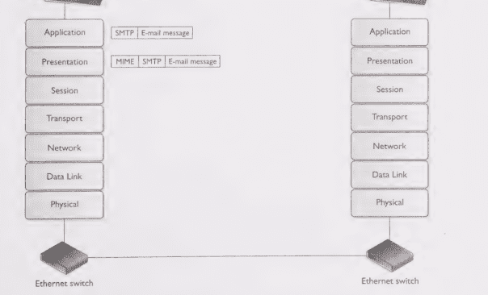


### 会话层

标准第7.3条将会话层定义为“为协作的表示实体提供必要手段，以组织和同步其对话并管理其数据交换。”这种交换通过在两个通信的表示实体之间建立连接来完成。其结果是为有序的数据交换和会话终止提供了简单的机制。

会话包括通信的约定以及通信将遵循的规则。会话被创建、通信发生，然后会话被销毁或结束。第5层负责建立会话、管理端点之间的对话，并正确关闭会话。

会话层协议和功能的示例包括 iSCSI（Internet Small Computer Systems Interface，互联网小型计算机系统接口）协议、RPC 和 NFS。iSCSI 协议提供对远程计算机或服务器上 SCSI 设备的访问。该协议允许将 SCSI 命令发送到远程设备。远程过程调用（RPC）协议允许在远程计算机上执行子程序。程序员可以开发一个应用程序，以与调用本地子程序相同的方式调用该子程序。RPC 抽象了网络层，使运行在第7层之上的应用程序能够执行该子程序，而无需知道它实际上运行在远程计算机上。网络文件系统（NFS）协议用于提供对远程计算机上文件的访问，就像这些文件位于本地计算机上一样。NFS 实际上使用一种称为 Open Network Computing RPC（ONC RPC）的 RPC 实现来工作，该实现由 Sun Microsystems 开发用于 NFS；不过，自那时起，ONC RPC 也被其他系统使用。请记住，这些协议只是作为第5层可用协议的示例提供的（正如为第6层和第7层提到的其他协议一样）。通过学习在各层运行的协议的功能，你可以更好地理解每一层的操作。

在第5层运行的服务和进程称为会话实体。因此，RPC 和 NFS 将是会话实体。这些会话实体将由传输层提供服务。

在会话层，你的电子邮件消息可以开始被传输到接收邮件服务器。实际情况是，SMTP 电子邮件使用 TCP/IP 协议族中的 TCP 协议来发送电子邮件，因此这里的类比并不完美。模型比较中的这种不完美是因为 TCP/IP 协议并不直接映射到 OSI 模型，你将在下一章学到这一点。目前，只需知道第5层用于在这些表示实体之间建立会话。在 Windows 中，Winsock API 提供对 TCP/IP 协议族的访问。因此，我们可以说，你的电子邮件在这里的第5层通过 Winsock 传递到 TCP/IP 协议族。图2-4显示了电子邮件在第5层通过 Winsock API 传递时的情形。

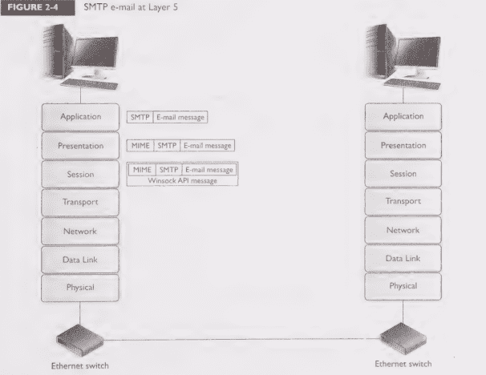

### 传输层

第4层是传输层，其定义是提供“会话实体之间的透明数据传输，并使它们不必关心可靠且经济有效的数据传输是如何具体实现的。”这个定义简单来说就是，传输层正如其名，是数据根据服务质量（QoS）要求和共享介质访问要求被分段以实现有效传输的层。

传输层协议和功能的示例包括 TCP 和 UDP。传输控制协议（TCP）是 TCP/IP 协议族中用于面向连接数据传输的主要协议。HTTP、SMTP、FTP 和其他重要的第7层协议依赖 TCP 来可靠地发送和接收数据。用户数据报协议（UDP）用于无连接数据通信。例如，当通信速度比可靠性更重要时，经常使用 UDP。因为语音数据要么到达要么不到达（而不是延迟到达），所以 UDP 经常用于传输语音和视频数据。

TCP 和 UDP 是第4层传输实体的示例。这些传输实体将由网络层提供服务。在传输层，如有必要，数据会被分成段。如果数据能够放入一个段，那么该数据就成为单个段。否则，数据会被分割成多个段进行传输。

传输层从会话层获取有关你的电子邮件消息的信息，并开始将其划分（分段）为可管理的块（数据包），以便由较低层传输。图2-5显示了在传输层处理之后的电子邮件。

**图 2-5** 第4层处理后的电子邮件

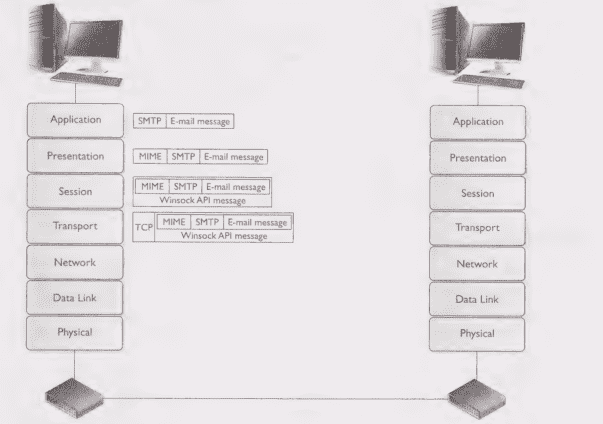

### 实际应用

> *你可能听说过 TCP 和 UDP 端口。例如，端口80用于 HTTP 和 TCP 协议，端口21用于 Telnet，等等。端口用于指示（上层中）应处理传入数据的应用程序。应用程序监听这些分配的端口。*

### 网络层

网络层定义为提供“在传输实体之间进行无连接模式（UDP）或连接模式（TCP）传输的功能和过程手段，从而使传输实体无需考虑路由和中继问题。”换句话说，网络层对传输层说：“你只需把要传输的段交给我，并告诉我你想把它们送到哪里。其余的我处理。”这种通信分离正是路由器无需将数据扩展到第3层以上就能正确路由数据的原因。例如，IP 路由器不关心它路由的是电子邮件消息还是语音对话。它只需要知道数据包目的地的 IP 地址以及任何相关的 QoS 参数，以便将数据包继续传送。

网络层协议和功能的示例包括 IP、ICMP 和 IPSec（Internet Protocol Security，互联网协议安全）。互联网协议（IP）用于数据包的寻址和路由，使它们能够到达目的地。该目的地可以在本地网络上，也可以在远程网络上。除需要知道离开本地机器网络的出口点或默认网关外，本地机器从不关心此事。互联网控制消息协议（ICMP）用于测试 TCP/IP 通信以及处理第3层内的错误消息。最后，IP 安全（IPSec）是一种通过对每个 IP 数据包进行认证和/或加密来保护 IP 通信的解决方案。虽然 SSL、TLS（传输层安全）和 SSH（安全外壳）等安全协议在 OSI 模型的第4层至第7层运行，但 IPSec 稳稳地位于第3层。其好处在于，由于 IPSec 位于第4层之下，任何运行在第4层或更高层的协议都可以利用这一安全基础。因此，自1995年首次定义以来，IPSec 变得越来越流行。

在网络层运行的服务和处理称为网络实体。这些网络实体依赖数据链路层提供的服务。在网络层，传输层的段变成数据包。这些数据包将由数据链路层处理。

在网络层，在第4层被分成段的电子邮件消息现在会附加适当的目的地和源地址信息，以确保它到达目的地。第3层处理的结果如图2-6所示。

**图 2-6** —— 第3层 SMTP 电子邮件

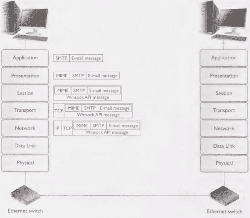

### 数据链路层

数据链路层定义为在无连接模式或连接模式的网络实体之间提供通信。此方法可包括为连接-建立、维护和释放连接。


网络实体。数据链路层还负责检测物理层内可能发生的错误。因此，数据链路层向第 3 层和第 1 层提供服务。数据链路层（即第 2 层）还可以自动纠正物理层中检测到的错误。

数据链路层协议和功能的示例包括以太网、PPP（点对点协议）和 HDLC（高级数据链路控制）。以太网是局域网（LAN）中使用最广泛的协议，也是你在使用大多数现代 LAN 技术时会遇到的 LAN 类型。以太网有许多不同的实现，从 10 Mbps（兆比特每秒，即每秒百万比特）到常见实现中的 1,000 Mbps。如今，更快的以太网技术正在开发中，并已在小规模范围内实施。点对点协议（PPP）通常用于跨模拟线路的广域网（WAN）链路，以及跨数字线路的其他隧道用途。高级数据链路控制（HDLC）协议是由 ISO 创建的、用于面向位的同步通信的无连接协议。它是一种非常流行的 WAN 链路协议，也是许多 Cisco 路由器的默认 WAN 链路协议。

IEEE 已将数据链路层划分为两个子层：逻辑链路控制（LLC）子层和介质访问控制（MAC）子层。实际上，许多传输协议（如 TCP）并不使用 LLC 子层。各种 IEEE 标准规定了数据链路层内 MAC 子层以及 PHY 层的行为。IEEE 定义了几个重要的 MAC 层：

- **IEEE 802.3** — 这是以太网 MAC 层规范。它用于从 10 Mbps 一直到数 Gbps 的有线网络。
- **IEEE 802.11** — 这是 Wi-Fi 或无线 MAC 层规范。截至 2009 年 9 月 802.11n 获得批准，该标准用于从 1 Mbps 一直到潜在 600 Mbps 的无线网络。
- **IEEE 802.15** — 这是无线个人区域网的 MAC 层标准。它通常用于 ZigBee 实现。
- **IEEE 802.16** — 这是著名的 MAC 层标准，也称为 WiMAX，用于无线城域网协议。

第 2 层处理的结果是：数据包变成帧（在分片阈值较低的无线网络中，也可能变成多个帧），准备好由物理层（即第 1 层）重新传输。因此，段在第 3 层变成了数据包，而现在数据包又变成了帧。请记住，这只是我们使用的一组术语；数据自始至终都是贯穿 OSI 各层的 1 和 0 的集合。每一层只是对这些 1 和 0 进行操作或添加内容，以执行该层的服务。与之前的其他层一样，数据链路层内的服务和进程以该层命名，称为数据链路实体（data-link-entities）。

数据链路层将必要的头部添加到从第 3 层收到的电子邮件数据包中，你的电子邮件消息（无论是一个部分还是多个部分）现在都是一个帧或一组帧。这些帧已准备好由物理层传输。在图 2-7 中，我们看到数据链路层处理完成后的电子邮件消息。

### 物理层

物理层（有时称为 PHY）负责提供机械、电气、功能或过程手段，以在数据链路实体之间建立物理连接。所有其他层之间的连接实际上都是逻辑连接，因为唯一能导致真正数据传输的真实物理连接发生在第 1 层——物理层。

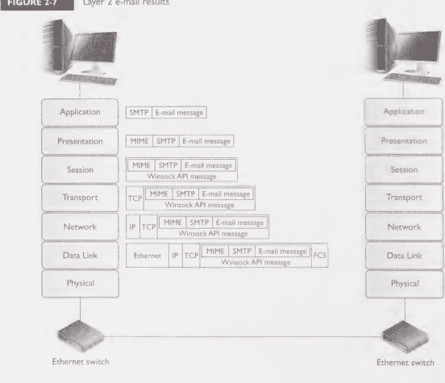

例如，我们说当用户浏览 Internet 网站时，客户端上的第 7 层 HTTP 协议会与 Web 服务器上的第 7 层 HTTP 协议建立连接；然而，实际上这种连接是逻辑连接，真正的连接发生在物理层。

想到我正在用来输入这些文字的计算机连接到我办公室里的一个无线接入点（AP），该 AP 连接到我的本地网络，而本地网络又连接到互联网，这真是令人惊叹。通过这些连接——可能既有有线也有无线——我可以将信号（这就是第 1 层发生的事情）发送到地球另一端的设备。想到这些设备与数百万其他设备之间存在潜在的电连接路径，确实非常令人惊叹。

第 1 层负责从第 2 层取出数据帧，并以二进制位（1 和 0）的形式在通信介质上传输它们。这种介质可以是有线或无线的。它可以使用电信号或光脉冲（两者实际上本质上都是电磁的）。无论你在第 1 层选择使用什么，只要硬件和驱动程序对该层进行抽象，使其提供上层协议所需的服务，上层就可以通过它进行通信。

物理层协议和功能的示例包括以太网、Wi-Fi 和 DSL。你可能注意到以太网被提到作为数据链路层协议的一个示例。这是因为以太网既定义了第 2 层内 MAC 子层的功能，也定义了第 1 层的 PHY。Wi-Fi 技术（IEEE 802.11）类似，其标准中同时规定了 MAC 和 PHY。因此，数据链路层和物理层经常在标准中一起定义。可以说，第 2 层充当第 3 层到第 7 层之间的中介，使你能够在多种网络类型上运行 IPX/SPX（尽管如今几乎没有人使用这种协议）或 TCP/IP（这里的网络类型可理解为不同的 MAC 和 PHY 规范，例如 802.3 和 802.11）。

你的电子邮件终于开始在网络中传输。先是一个 1，然后是一个 0，接着可能又是另一个 1 或 0，如此继续，直到整个电子邮件消息传输完毕。图 2-8 显示了最终结果：电子邮件现在被拆分成帧，正在介质上传输。

这个电子邮件传输的示例与实际情况相比已经简化。例如，每个数据包（来自第 3 层）都会由第 1 层传输（在第 2 层将其转换为帧之后），然后可能发送下一个数据包，或者网络接口卡（NIC）可能需要处理传入数据。传入数据可能是对之前发出的某个数据包的确认（该数据包是电子邮件消息的一部分），可能是重试请求，也可能是完全无关的数据。由于底层第 1 层技术各不相同，实际传输可能因网络而异。然而，这个示例以简单的方式说明了数据在向下经过 OSI 模型时是如何被修改的。

**图 2-8——第 1 层电子邮件传输**

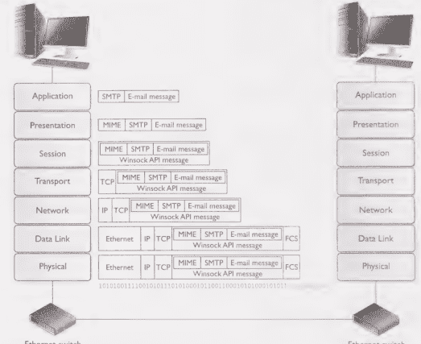

### 场景与解决方案

你正在向 FTP 服务器发送文件。要传输的数据需要加密。OSI 模型的哪一层最可能是执行此操作的区域？

表示层。这是因为加密、压缩和语法经常在这一层应用。需要记住的是，加密也可能发生在其他层。例如，IPSec 在第 3 层加密数据。

有关源和目的 MAC 地址的信息正被添加到数据包中。OSI 模型的哪一层正在执行此操作？

数据链路层。数据包在网络层创建。一旦下送到数据链路层，就会在帧头中添加源 MAC 地址和目的 MAC 地址。

现在，在接收端机器上，会发生完全相反的过程。换句话说，帧变成数据包，数据包变成段，段再变成数据；这些数据可能需要先经过表示、解压缩或解密，然后才能向上转发给用户程序。发送数据时，会对其进行格式化、分块并传输。在接收端，数据被接收、聚合，并可能重新格式化。这个顺序就是 OSI 各层为我们完成的工作。许多实际的网络协议（如 TCP/IP）也为我们完成同样的工作。

### 考试内幕

### 为什么 OSI 模型很重要？

OSI 模型不仅仅是你为认证考试而记忆的一组事实。它已成为引用所有网络相关概念的最常用方法。许多资源都假定你理解这个模型，并在不加解释的情况下引用它。你可能会读到这样的表述：

> “Web 认证是一项第 3 层安全功能，它使控制器不允许来自特定客户端的 IP 流量（DHCP 相关数据包除外），直到该客户端正确提供有效的用户名和密码。当你使用 Web 认证来认证客户端时，必须为每个客户端定义用户名和密码。当客户端尝试加入无线局域网（WLAN）时，其用户必须在登录窗口提示时输入用户名和密码。”

这段话引自 Cisco 网站上的一篇文章。文章没有解释第 3 层是什么意思。它假定你知道这是什么意思。因此，OSI 模型已成为任何希望从事计算机或数据网络行业的人所必需的基础知识。许多认证考试不会直接测试 OSI 模型，但会以这样的方式表述问题：你必须理解 OSI 模型——以及其他一些事实——才能正确回答问题。

例如，经常可以看到这样的问题：“你是一家制造公司的网络管理员。你想在第 3 层启用安全的 IP 语音通信。你可以使用哪些技术来实现这种安全？”

可能的答案当然是一组协议。你必须知道这些协议中哪些既提供安全性又运行在 OSI 模型的第 3 层。虽然你不会在 CCNA Voice 或 CVOICE 考试中看到完全像这样的问题，但比 CCNA 要求更深入地学习 OSI 模型，对你的认证考试和日常工作都将大有裨益。更不用说，你实际上将能够理解所有那些提及 OSI 模型各层的文章、白皮书和书籍。


### OSI 模型通信过程

既然你已经了解了 OSI 模型的各层，那么理解该模型内部所使用的通信过程对你来说就很重要。每一层都被认为与另一台设备上的对等层进行通信。这个过程意味着，一台设备上的应用层正在与另一台设备上的应用层通信。同样，每一层都与其对等层通信。这种虚拟通信是通过分段和封装实现的。

*分段*是将数据分段或分离成可管理或允许传输大小的过程。举例来说，标准以太网帧可以包含不超过 1,500 个八位组的有效载荷（实际要传输的数据）。一个八位组是八位，通常称为一个字节。因此，大于 1,500 字节的数据在传输之前需要被分段成 1,500 字节或更小的块。这种分段从第 4 层开始，在这一层创建 TCP 分段，并可能在第 3 层继续，在这一层可能发生 IP 分片以减小数据包大小，从而使它们能够被第 2 层作为以太网帧处理。

*封装*是将信息包封在报头中的过程，以便信息能够跨越各种网络传递。例如，IP 数据包（也称为数据报）被封装在以太网帧内部，以便在以太网上传递。这种封装意味着 IP 数据包被报头和可能的报尾信息包围，这些信息使数据能够被传输。以太网帧由报头组成，报头包含目的 MAC 地址、源 MAC 地址以及报头中的帧类型。这些帧还有一个报尾，报尾由用于纠错的帧校验序列（FCS）组成。图 2-2 至图 2-8 展示了数据沿 OSI 模型向下传输时发生变化的方式；请注意，封装如何在第 5～7 层以一种几乎模糊的方式开始出现（因为 TCP/IP 与 OSI 模型之间没有直接映射），然后在我们接近第 1～4 层时变得非常清晰。

关于所有这些内容，最重要的一点是要记住：实际上，一台设备上的应用层从不直接与另一台设备上的应用层对话，尽管它们被称为对等层。相反，通信在到达最终目的地的途中会经过许多中间层（OSI 层）。这种分层效果与人类通信其实并无不同。在人类互动中也能看到分层现象。

*注意*，在图 2-9 中，有两个人在通信。通信的背后是一个需要从弗雷德传递给巴尼的初始想法。这个想法可能已经是用弗雷德和巴尼都懂的语言表达的，也可能不是。在这种情况下，我们假设弗雷德的母语是法语，巴尼的母语是英语。结果是，弗雷德的想法是法语，他必须在开口之前将其翻译成英语。想法被翻译成英语后，他的大脑必须向声带和口腔发送信号，以传输最终形成英语发音的声音信号。现在，这些信号（声波）通过说话时所处的环境传播，直到到达巴尼的耳朵。耳膜接收这些信号，并将接收到的信息发送到大脑。在这里，信息被解读，而且可能被正确接收，也可能没有。巴尼可以发回一个信号（口头、视觉或动觉），让弗雷德知道巴尼的理解情况，以便弗雷德能确认巴尼是否正确接收了通信。

你看到相似之处了吗？正如会话层以远程机器能够理解的方式表示数据一样，弗雷德的大脑必须将最初的法语想法翻译成一种共享语言。正如物理层必须在有线网络上传输电信号一样，声带和口腔必须将信号作为声波传输到巴尼的耳朵。关键在于，我们可以将人类通信分解成与 OSI 模型中所定义的层类似的层。此外，这里的目标是提供从大脑的“思维区域”到另一个人的“思维区域”的对等通信。

你需要记住的最重要的一点是，OSI 模型是一种参考模型，而不是实际的实现。同样有用的一点是，要记住数据在发送机器上沿 OSI 模型向下传输，而在接收机器上沿 OSI 模型向上传输。最后，请记住，网络上的每台设备并不需要提取封装数据中的所有内容才能完成自己的工作。例如，第 3 层路由器只需提取到第 3 层数据的位置，仍然可以正常路由数据包。


### 实际工作中

> 你会听到许多不同的技巧，用于记忆 OSI 模型的各层。虽然这些技巧可能有所帮助，但我鼓励你充分理解 OSI 参考模型内发生的通信过程。当你记住每一层的作用时，你几乎会自动地按正确顺序记住这些层。这种对应关系是因为通信应当按照各层定义它们的顺序发生。记住一个故事真的很容易，所以可以想象一封电子邮件消息沿协议栈向下、穿过网络到达目的地的故事。

### 交换机

在 VoIP 基础设施中，两项主要技术是交换机和路由器。交换机用于为同一子网或网络中的设备提供通信，而路由器用于为不同子网或网络中的设备提供通信。以下信息简要概述了这些技术。

电信网络可以实现两种主要的交换方式：电路交换和分组交换。电路交换用于在两个需要通信的端点之间预留一条路由或路径。由于电路已被预留，整个通信会按顺序发送，接收端无需重组数据，因为数据肯定会按顺序到达。当然，这种预留意味着带宽不能被任何其他可能需要它的设备使用，并且会使电路交换在当今分组交换世界中相当昂贵。电路交换的优点是连接始终存在，并且只要连接存在，带宽就有保证。较早的公共交换电话网络（PSTN）通信完全使用电路交换。

分组交换（也称为“数据报交换”）用于将消息分段成小部分，然后将这些部分通过共享网络发送。第一部分实际传输的路由可能与第二部分不同，并可能在第二部分之后到达目的地。本书主要关注的 VoIP 实现依赖分组交换，而不是电路交换。这种设计确实会带来一些问题，因为语音数据必须快速到达目的地，否则通话可能被中断，音质也可能受损。你将在第 4 章和第 17 章学习如何处理这些问题，这些章节介绍了服务质量（QoS）技术。

“交换”一词也可以表示网络交换机执行的操作。事实上，网络交换机是一种为分组交换网络执行数据包转发的设备。交换机可以将数据包从入站端口转发到必要的出站端口，使数据包能够到达其目的地。大量 QoS 处理正是在这些交换机以及我接下来要讨论的路由器内部完成的。交换机可以提取帧，并判断它是否带有 QoS 参数；如果带有，就相应地处理它。你将在第 10 章更详细地了解 Cisco 交换机。

为了帮助你理解以太网交换机为网络带来的好处，让我们回顾一下以太网中用于访问介质的方法。回忆你在 CCNA 学习中的内容：以太网使用 CSMA/CD，即载波侦听多路访问/冲突检测。正如人类通信有礼仪规则一样（尽管这些规则有时是默认的，并未真正被教授），以太网也有通信规则。

每个以太网设备都遵守 CSMA/CD 规则。这些设备需要能够在尝试将介质用于自己的通信之前检测介质上的活动。这种方法就像在会议中，在你自己开始说话之前用耳朵倾听其他对话。此外，以太网设备即使开始通信，也需要有检测冲突的方法。换句话说，连接到同一介质的两台以太网设备有可能在完全相同或几乎相同的时刻开始通信。这种情况会导致冲突。发生这种冲突时，介质上会发送阻塞信号，让所有设备知道已经发生冲突，并且它们都应在再次尝试通信之前开始退避操作。再联系到人类会议，这一事件就像你与另一位参会者同时开始说话。你们双方都会察觉到这种“冲突”，并且根据许多可能的参数，你们中的一个人会退避，让另一个人说话。

问题来了：如果一个房间里有 200 个人，两个人同时开始说话的可能性是更大还是更小？答案显然是更大。以太网中也是如此。当更多节点连接到共享介质时，该介质上就更可能出现冲突。目标是减少介质上的节点数量。这项任务可以通过使用路由器实现更小的冲突域来完成，但还有另一种方法。

如果你能实现一个永远不会发生冲突的网络，会怎样？你可以做到，而这样的网络就是使用交换机的网络。正是这种需求，使得集线器几乎已从企业级网络中消失，并由交换机取而代之。交换机被定义为一种网络设备，它根据每个帧的目的 MAC 地址来过滤、转发或泛洪以太网帧

帧。要最好地理解交换机，你应当理解单播、多播和广播流量之间的区别：

- **单播流量**是从一个点（源）移动到另一个点（目的地）的流量。该流量或帧旨在发往单个端点。
- **多播流量**是从一个点移动到多个指定点的流量。该流量或帧旨在发往已定义或列出的多个端点。
- **广播流量**是从一个点移动到广播域中所有其他点的流量。该流量或帧旨在发往所有端点，而不是一组端点或单个已定义端点。

理解这三种流量类型至关重要，因为它们都由交换机处理。交换机可以处理广播和多播流量，但其强大之处在于处理单播流量的方式。集线器如今已是过时设备，它在每个端口上接收帧，并将这些帧泛洪到所有其他端口。曾经出现过一些称为交换式集线器的设备，但它们实际上是简单的交换机；出于某种原因，人们觉得很有必要在名称中保留“集线器”一词。交换机在每个端口上接收帧，然后分析该帧，以确定它是单播、多播还是广播帧。

我将在下一节“功能”中解释接下来会发生什么；不过，你务必理解这一准则：交换机实现的（数据链路层）网段数量等于其提供的端口数量，并且这些网段不会发生冲突。当然，该准则假设你使用的是全双工通信。这一假设是因为全双工通信使用一对线向交换机发送数据，并使用另一对线从交换机接收数据。由于这种配置相当于一对单向通道，因此不会发生冲突，也不使用 CSMA/CD。与管理开销相比，这种设计极大地提高了实际数据吞吐量。它还允许你将网段扩展得大得多（尽管这些网段是逻辑上的，因为就单播数据而言，每条全双工连接本身就像一个网段）。许多企业网络的网段上有多达 500 个节点。我当然不建议将网段规模扩展得比这更大。

图 2-10 展示了一个 Cisco 交换机系列示例。3560V2-24PS 和 3560V2-48PS 型号支持以太网供电（PoE），可用于为 Cisco IP 电话供电。Cisco 交换机和设备是本书的重点；其他流行的交换机厂商包括 3Com、HP、Nortel 和 Foundry Networks。即使你正在备考 Cisco 认证，在现实世界中，你也很可能遇到混合使用不同厂商交换机的环境。

**图 2-10** Cisco 3560-X 交换机系列（由 Cisco Systems, Inc. 提供。未经许可不得使用。）

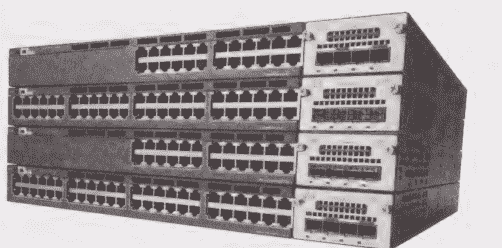

### 功能

那么交换机是如何施展其魔力的呢？首先需要知道的是，交换机是一种学习型设备。当数据进出交换机时，交换机会在发送设备通过某个特定端口传输数据时注意到该设备的 MAC 地址。由于该设备是通过那个端口将数据发送给交换机的，交换机便知道可以通过同一个端口到达该设备（或其 MAC 地址）。这一学习过程反复进行，并在内存中形成一个数据库，用于跟踪各种 MAC 地址以及可到达这些地址的端口。

现在，当目的地为已知 MAC 地址的帧进入交换机时，交换机会将该帧转发到相应端口。当目的地为未知 MAC 地址的帧进入交换机时，交换机会将该帧泛洪到所有端口。归根结底，交换机实际上就是一个多端口网桥。传统且如今已过时的网桥在大多数实现中有两个端口。一个端口位于一个网络上，另一个端口位于另一个网络上。每个端口学习网桥该侧的 MAC 地址，而网桥只将从一侧发往另一侧且实际目的地为另一侧设备的帧转发过去。交换机实现相同的基本功能；只不过交换机内部有多个“虚拟网桥”。事实上，大多数交换机声称支持 IEEE 802.1D 标准，而该标准并不是交换标准，而是网桥标准。Cisco 交换机实现 IEEE 802.1D 生成树协议（STP）。

就像路由器以及所有其他计算设备一样，交换机也是一台计算机。

### 常见特性

网络交换机支持许多常见特性，下面列出了其中最常见的特性：

- 自动感测
- 自动协商
- ASIC 处理器
- LED
- 可管理/不可管理
- VLAN

自动感测交换机是一种自动确定每个端口速度的交换机。有些交换机是 10/100，另一些是 10/100/1000，还有些仅支持 10/1000。关键在于，任何端口都可以接受任何有效速度。大多数交换机不会回退到所连接的最慢设备的速度，但有些会，这一点是需要考虑的重要因素。

当交换机进行自动协商时，意味着交换机可以确定通信采用半双工还是全双工。半双工通信使用同一对线进行发送和接收，结果是数据吞吐量降低。全双工通信使用两条线发送、两条线接收，从而有可能充分利用可用吞吐量。在全双工安装中，不使用 CSMA/CD，因此管理开销得以降低。交换机基本上在每个端点和交换机端口之间创建了一个单独的 LAN。

专用集成电路（ASIC）是为特定目的设计的特殊处理器。路由器倾向于像台式 PC 一样使用通用处理器。交换机可能使用通用处理器，但大多数交换机使用 ASIC 处理器。由于该处理器实际上是为交换目的而创建的，因此它执行任务时快得多。事实上，许多交换机能够提供线速交换。这种能力意味着——假设交换机中没有执行其他会延迟处理的操作——帧可以进入端口、被处理，并以与通过节点间直连交叉线传输时相同的速度从正确端口发送出去。当然，线速交换是一种概念，很少成为现实，因为多个帧可能同时从多个端口进入交换机。

大多数交换机还具有发光二极管（LED），用于指示交换机的运行情况。每个端口可能有一个 LED，用于指示通信、速度、双工和其他参数。此外，通常还有一组 LED，可用于判断交换机运行状况和利用率的许多因素。例如，通常只需查看 LED，就能看出交换机容量实际被利用了多少。

然而，最大的管理和行政能力来自交换机管理界面。有些交换机是*可管理的*，另一些则是*不可管理的*。你在当地电脑商店购买的消费级交换机传统上是不可管理交换机。这一区别仅仅意味着，除了物理设备本身可能有的上行链路或双工切换按钮外，交换机没有配置选项。实际上，很少存在基于软件的配置界面。这一规则有例外，但作为一般准则，较便宜的交换机没有管理特性。

企业级交换机通常是可管理交换机。这一功能意味着它们具有基于软件的管理界面。该界面可能是通过标准 Web 浏览器访问的基于 Web 的界面，也可能是自定义管理应用程序。有些交换机还支持通过自定义应用程序进行集中管理。这些交换机通常可以批量管理，有时甚至可以组合在一起，形成一个用于管理目的的极大型（数百或数千个端口）虚拟交换机。

可管理交换机还支持 QoS 标记，这对于正常的 VoIP 运行至关重要。Cisco 交换机支持一种称为 AutoQoS 的 QoS 特性，它大大简化了网络的 QoS 配置。

最后，还可能支持*虚拟局域网*，即 VLAN。VLAN 是一种逻辑局域网，仅存在于交换机和/或路由器的内存中。它们可以独立于物理 LAN 实现而存在。例如，一个物理上位于某栋建筑中的节点，与另一个物理上位于另一栋建筑中、且相隔三台路由器的节点，可以处于同一个 VLAN。它们将具有相同的 IP 网络 ID 和不同的主机 ID。VLAN 用于管理目的。你可以对 VLAN 应用策略、限制等。例如，你可以规定，处于某个特定 VLAN 上的用户只能访问 Internet，但不能访问任何内部服务器。这种限制流量的能力对于网络中的访客非常有用。VLAN 将在本章后续名为“描述 VLAN 在 VoIP 环境中的用途”的认证目标中更详细地讨论。

### 物理安装选项

交换机的安装方式与路由器非常相似。它们通常存在于分层网络模型的分布层和接入层，不过也可能存在于核心层，因为现代三层和四层（或更高层）交换机正在模糊交换机和路由器之间的界限。


### 配置过程

配置交换机可能非常简单，也可能同样复杂。在简单安装中，你只需将线缆插入正确的端口并为交换机通电。这样就完成了。在复杂安装中，你需要配置访问控制列表、策略、VLAN、服务质量和其他参数。你将在后续章节中更详细地了解这些不同参数。

### 路由器

路由是将数据包从一个网络移动到另一个网络的过程。从计算设备传输的数据包可能能够直接移动到同一网络上的另一台设备，也可能需要通过路由器转发到另一个网络。这是路由器的主要工作：连接原本彼此断开的网络。

有一个很好的方法可以记住交换机和路由器之间的区别：如果你将多台交换机连接在一起，你只是创建了一个更大的物理网段。路由器则不是这样。事实上，你确实应该把路由器视为相互连接在一起的设备。更确切地说，路由器具有两个或更多接口。如图 2-11 所示，一个接口将连接到一个网络，另一个接口将连接到另一个网络。这种分界使路由器可以在网络 A 中的设备想要向网络 B 中的设备发送数据包时，作为数据包路由设备使用。你将在第 10 章中了解更多关于 Cisco 专用路由器以及交换机和其他基础设施设备的详细信息。

路由器是一种网络设备，能够根据所实现的网络协议，使用不同算法将数据从一个网络移动到另一个网络。LAN 中最常用的路由器类型是 IP 路由器。此外，路由器还用作连接 WAN 服务提供商的接口，因此它们有一个接口在 LAN 上运行，另一个接口在 WAN 上运行。当数据需要传输到远程网络时，它会通过 LAN 接口进入，并通过 WAN 接口出去。在远程网络上，

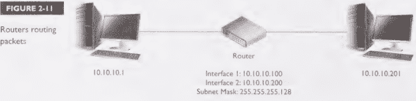

你也可以使用计算机来执行路由器的功能。这之所以可行，原因很简单：所有路由器本质上都是计算机。如果你拆开一台 Cisco 路由器，你会看到处理器、内存，有时甚至还有硬盘（例如用于语音邮件存储的硬盘）。这台计算机可能运行 Windows 2000 Server，并且可以通过使用两块网卡在两个网络之间启用路由。当 IP 地址例如为 10.10.1.5 的计算机需要与例如 10.10.2.7 的计算机通信时，它必须通过作为路由器的这台计算机进行通信。Windows 2000 Server 在 10.10.1.1 的网卡上接收通信，并从 10.10.2.1 的网卡将其发送出去，以便到达 10.10.2.7 的目的地。由于此路由过程发生在运行 Windows 2000 Server 的计算机上，路由速度可能较慢，因为该服务器不太可能是专用路由器。这台服务器可能还在提供 DHCP 服务、DNS 服务、域服务或 Windows Server 支持的任何其他服务。这种额外开销正是我们通常使用专用设备作为路由器的原因。

专用设备至少有两个主要优点。第一，处理速度很可能更快，因为它专用于路由过程。第二，正常运行时间很可能更长，因为你需要执行的升级更少，遇到的硬件故障也更少（记住，没有活动部件）。关于第一点，处理速度更快不仅是因为整个设备专用于路由，还因为软件针对该用途进行了优化。对于运行支持路由的操作系统的普通 PC，该操作系统很可能在做许多与路由无关的不必要事情。

在大多数情况下，路由器路由 IP 流量。IP 协议在 OSI 模型中工作在哪一层？第 3 层或网络层。这说明路由器是第 3 层设备。路由器最常见的用途是连接交换机（在大多数实现中，交换机是第 2 层设备），从而形成比原本所能创建的更大的网络。重要的是要知道，一些路由器可以通过添加组件来执行交换功能，而一些交换机可以执行路由功能。不过，就本文的目的而言，我们会将二者视为完全独立的设备，并忽略当今供应商提供的定制路由器和交换机。

### 常见功能

无论供应商是谁，路由器都共享一组常见功能，包括：

- CPU
- 内存
- NVRAM
- ROM 或 BIOS

路由器。事实上，有时消费级设备与企业级设备之间的唯一区别就在于所运行的软件。这种差异类似于 20 世纪 90 年代末家用 PC 运行 Windows 98，而许多企业计算机运行 Windows NT Workstation。消费级 PC 完全可能运行企业级操作系统，但它提供的复杂性超过了普通家庭用户的期望。

**接口** 路由器通常自带一个或多个内置接口，并能够通过附加模块添加更多接口。每个供应商对这些附加模块使用的术语各不相同，但你可以将它们视为台式计算机的 PCI（外设组件互连）卡。就像你可以向计算机添加一块 PCI 无线网卡，然后——噗——计算机现在就有了无线能力一样，你也可以向路由器添加新卡以提供额外能力。Cisco 通常将这些模块称为网络模块或接口卡。

这些附加接口通常用于在以太网与某些其他串行技术（如 HDLC、PPP 或 ISDN（综合业务数字网））之间进行路由。例如，你可能需要在本地网络与蜂窝网络提供商提供的 EVDO（演进数据优化）网络之间进行路由。通常可以购买路由器的附加组件，使其能够跨 EVDO 提供商的网络将内部用户路由到互联网。有些路由器带有两个以太网端口，并且没有可用于更换或升级端口的功能。在这些情况下，你将被迫按原样使用路由器，这意味着你只能用它在一个以太网子网与另一个以太网子网之间进行路由。在许多情况下，这类路由器用于通过企业级 DSL 或电缆互联网服务，将本地网络路由到互联网。我在我的家庭办公室使用一台 TP-LINK TL-R480T 路由器。其市价低于 120 美元，对于拥有 5 到 50 个节点的 SOHO（小型办公室/家庭办公室）安装环境来说，这款设备是一台非常强大的路由器。该设备既是路由器又是交换机。它有一个用于本地 LAN 的四端口交换机和一个用于 WAN 的单个以太网端口。这款廉价路由器不可升级，配置选项也有限。然而，大多数 Cisco 设备都可升级，并且根据你所运行的互联网操作系统（IOS），拥有几乎无限的配置选项。

**管理方法** 说到管理路由器，可选项几乎无穷无尽。你可以通过以下任一方式管理大多数企业级路由器：

- **控制台** 此连接使用串行接口和终端仿真程序，允许对路由器进行命令行管理。
- **Telnet** 此应用程序为你提供与控制台相同的选项（只要启用了 Telnet），只不过你是跨网络管理路由器。
- **基于 Web** 使用 Web 浏览器，你可以连接到路由器，并使用图形管理界面进行配置。
- **自定义应用程序** 一些供应商提供可在 Windows、Linux 或 Mac OS 上运行的自定义应用程序，可用于配置路由器。第三方公司有时也提供此类应用程序。
- **SNMP** 简单网络管理协议可与某些路由器一起使用，以大规模配置它们。

现实情况是，这些只是最常见的配置和管理选项。对于你所部署的路由器，你可能还可以使用 SSH、SFTP（安全文件传输协议）和其他方法。关键在于了解最安全、最高效的方法。如果你实施不安全的解决方案，例如通过未加密通道使用 Telnet，管理账户就会暴露，黑客就能轻易进入你的网络。当你学习安全内容时，将在本书最后两章中了解更多相关信息。

你应该考虑下载来自两三家供应商的两三款路由器的手册，以接触可用的各种配置选项。通常，仅阅读初始安装和配置部分就足以让你了解与该设备交互的基础知识。在选择阅读材料时，请确保获取企业级硬件供应商的文档，因为它们的配置选项与消费级设备的配置选项非常不同。大多数消费级路由器实际上都是宽带互联网路由器，它们在可配置性和管理界面方面非常有限。在大多数情况下，如果你想体验路由器的命令行界面（CLI），就需要使用企业级路由器。

### 物理安装选项

大多数企业级路由器设计为可安装到机架中，因为机架安装方式常用于数据中心和配线间。SOHO 级路由器可能只是搁架式设备，即放置在架子上，但即便是这些设备，通常也附带安装硬件（或可单独购买），以便将其安装到墙上甚至机架中。安装它们时需要考虑的重点事项包括：

- **距离** 路由器到交换机、互联网连接或其他路由器的距离。你必须确保布线不会因长度增加而产生信号损耗。


- **电源** 安装路由器的位置必须有电源。某些设备可能支持PoE（以太网供电），但大多数路由器不支持，因为它们是核心基础设施设备。
- **易于访问** 如果你需要测试端口、更换线缆或更换接口，你会希望能够轻松地接触到路由器。

图2-12展示了一台典型的思科路由器。这是一台思科3825系列路由器，多年来一直是非常受欢迎的设备。对于最繁重的现代操作（例如语音QoS和千兆以太网数据速率），它的性能不够强大，但它仍然是路由器最常用的示例之一。

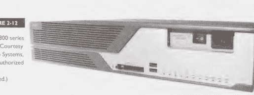

### 配置过程

配置思科路由器的完整细节超出了本书范围，这些内容已在你的CCNA学习中学过。不过，在安装和配置任何基础设施设备（包括路由器）时，应遵循一个基本流程。那就是先离线配置，然后再将其连接到网络。基本流程如下：

- 1. 拆开路由器包装，将其放在平稳的表面上进行初始配置。
- 2. 将路由器连接到电源。
- 3. 使用适当的机制（控制台、以太网等）连接到路由器。
- 4. 打开路由器电源。
- 5. 如有必要，更新路由器软件。
- 6. 对接口执行基本配置，使其能在你的网络中正常工作。
- 7. 执行所需的任何安全配置步骤。
- 8. 保存配置。
- 9. 关闭路由器电源。
- 10. 将路由器安装到实际部署位置并通电。

此时，你已经配置并安装了路由器，它应该按照为你的网络所做的配置运行。你会希望测试网络并确保配置正确。你能否从每一侧访问路由器另一侧的网络？是否只有那些应该能够通过路由器的节点确实能够通过？这些因素和其他因素都应加以验证。

### IP路由与路由协议

正如我之前所述，路由器在三层执行其最重要的任务。这一层是IP协议运行的地方，而在当今网络中，IP路由是三层路由器的主要功能。理解路由器如何施展其魔力对你非常有用。一切从第一层开始，也在第一层结束。要理解这个概念，请看图2-13。

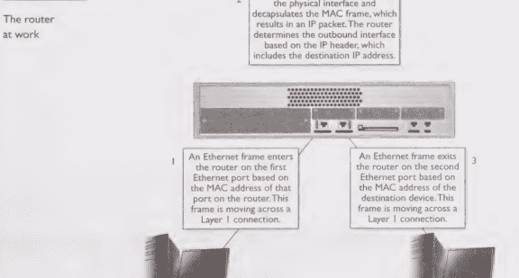

路由器的工作可以总结如下：

- 1. 在每个接口上接收传入帧。
- 2. 从传入帧中提取IP数据包。
- 3. 评估IP报头，以确定数据包的目的地。
- 4. 查找路由表，以确定到达目的地的最佳路由。
- 5. 将IP数据包封装到新帧中，并在连接到路由下一步的接口上传输。
- 6. 处理下一个接收到的帧。

如你所见，这个过程其实相当简单。路由器必须从以太网帧中移除前导码、MAC帧头和FCS，从而得到原始IP数据包。只要不使用动态标记，这个原始IP数据包在从源到目的地的过程中将保持不变。IP数据包的报头包含目的地址和源地址。路由器可以使用目的地址来确定到达该目的地址所在网络的最佳方式。为完成此任务，它将使用其路由表。

路由器的路由表是已知网络及通往这些网络的路由的列表。最简单的路由表可能类似于表2-1。每个条目将包含一个IP地址和一个子网掩码。这两个值用于确定目的网络。同一个IP地址可以搭配不同的子网掩码多次列出，并且根据子网掩码会得到不同的网络。示例表中的“经由”列表示通往目的网络或主机的“路径”。例如，基于此路由表，如果路由器收到一个目的地址为192.168.15.73的IP数据包，它会将该数据包转发到192.168.5.2。现在，考虑子网掩码，我们知道192.168.15.73与192.168.5.2不在同一网络，但该节点（它是另一台路由器）知道如何到达目的地址。

这些路由表可以手动构建，也可以自动构建。如果是手动构建的，则称为静态路由；如果是自动构建的，则称为动态路由。静态路由由了解网络结构的管理员输入。静态路由的优点是，它们让你（管理员）完全控制路由过程。静态路由的问题是，每当网络发生变化时，都必须手动修改它们。这项任务可能变得耗时且繁重。

**表2-1：IP路由表示例**

| IP地址 | 子网掩码 | 经由 |
| --- | --- | --- |
| 192.168.13.0 | 255.255.255.0 | 192.168.5.1 |
| 192.168.15.0 | 255.255.255.0 | 192.168.5.2 |
| 192.168.20.0 | 255.255.255.0 | 192.168.5.2 |

这里就轮到路由协议登场了。不要对“路由协议”这个术语感到困惑。路由协议是一种发现路由器周围相邻网络，并动态构建IP路由表以供路由决策使用的协议。关键是要记住，路由协议并不执行路由。IP负责实际路由，而路由协议为IP提供信息，以便IP做出最佳决策。

路由协议有很多，但最流行的有

- BGP
- IS-IS
- OSPF
- IGRP
- EIGRP
- RIP

路由协议通常分为内部路由协议或外部路由协议。在上述列出的协议中，只有边界网关协议（BGP）被视为外部路由协议。BGP用于互联网上的路由，是一种距离矢量路由协议。距离矢量协议根据数据包到达目的地必须经过的跳数或路由器数量来选择最佳路由。

IS-IS（中间系统到中间系统）是一种内部路由协议（内部路由协议用于本地网络内部），并且是一种链路状态协议，而不是距离矢量协议。链路状态协议实际上会查看连接的状态。例如，链路是up还是down？此外，链路状态协议通常可以测量链路质量和链路速度，以真正找到最佳路由。因此，在企业网络中，链路状态协议通常比距离矢量协议更受青睐。

考虑以下场景。假设三台路由器互连，使得路由器A同时连接到路由器B和C，而路由器B和C也都相互连接。这种设计形成一个逻辑三角形。现在，进一步假设这三台路由器都通过另一个接口连接到本地子网。此配置如图2-14所示。注意，路由器A和B之间的链路是一条128 kbps链路。现在注意，A和C之间以及C和B之间的链路实际上是1.5 Mbps链路。当子网A上的用户想要与子网B上的用户通信时，哪条路由最快？距离矢量协议会说使用从路由器A直接到路由器B的链路，因为跳数最低；然而，现实情况是，最快路由是通过路由器C在快得多的连接上增加跳数来到达路由器B。链路状态路由协议可能会发现这一点，并在路由表中对该路由条目给予适当偏好。

OSPF（开放最短路径优先）是另一种链路状态内部路由协议。它借鉴了IS-IS的一些特性，可能是现代网络中使用最流行的链路状态协议。

IGRP（内部网关路由协议）和EIGRP（增强型IGRP）都是思科开发的距离矢量路由协议。IGRP由思科在20世纪80年代创建，以克服RIP协议的一些局限性，RIP协议过去和现在都限制一条路由最多16跳。这一限制影响了网络的整体规模。此外，RIP只支持单一度量：跳数。IGRP增加了新的度量，例如网络间延迟和负载。这一增加使路由计算类似于链路状态协议。EIGRP只是IGRP的增强版本，创建于20世纪90年代，以提高效率。最大的变化在于，EIGRP不会向所有相邻路由器周期性发送其路由表更新。相反，它会发现邻居并直接与它们通信，从而大大提高网络效率。

RIP，即路由信息协议，是至今仍在使用的最古老的距离矢量路由协议之一。对于只有两到三台路由器的小型网络，RIP和RIPv2是极佳的解决方案。在较大的……中使用它们的主要问题

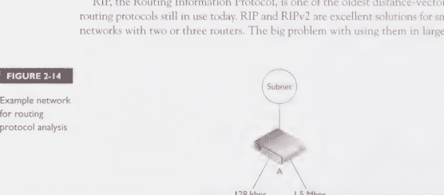


网络的问题是，它们会向所有相邻路由器发送广播，无论路由表中是否有任何变化。这种设计效率不高。此外，这两个版本在一条路由中都限制为 16 跳。这个数字无论如何都会把网络规模限制在中型组织。中型组织使用 OSPF 或 EIGRP 会好得多，应避免使用 RIP。

### VoIP 基础设施解决方案

既然你已经探讨了构成网络基础设施的两个核心组件，现在该看看网络中需要使用的特定 VoIP 组件了。这些组件包括：

-   网关
-   网守
-   呼叫管理器
-   VoIP 电话

### 网关

如果你只需要在内部端点之间提供电话呼叫，就不需要网关。不过，这种实现方式很少见，更常见的是将本地 VoIP 网络与另一个电话服务提供商对接。这个电话服务提供商也可能使用 VoIP，也可能使用传统 PSTN 技术。无论哪种情况，让你能够与另一个电话网络通信的设备就是网关。网关提供网外呼叫（VoIP 网络内的呼叫被视为网内呼叫）。在 Cisco 领域，语音网关是一台路由器，它将 VoIP 数据包转换为传统电话网络信号，并将传统电话网络信号转换为 VoIP 数据包。第 14 章将深入介绍网关。

**考试注意**

网关用于将你的 VoIP 网络连接到 PSTN 和基于 PBX 的电话网络。如果你的组织使用 PBX 系统，可以将 Cisco 路由器配置为 PBX 电话网络与 VoIP 网络之间的网关。在从传统 PBX 系统向新 VoIP 系统过渡期间，这非常有用。

### 网守

网守在 H.323 网络中有两个用途。第一，它们允许端点（IP 电话）进入网络。H.323 网守使用注册、准入和状态（RAS）消息进行网络准入。第二，网守执行地址转换。例如，网守可以将 Tom.Carpenter@sysedco.com 转换为 192.168.12.14。第 14 章也会更深入地介绍网守。

### 呼叫管理器

呼叫管理器用于在 VoIP 网络中发起呼叫、管理呼叫并终止该呼叫。Cisco 呼叫管理器包括 Cisco Unified Communications Manager（CUCM）和 Cisco Unified Communications Manager Express（CME）。此外，小型办公室/家庭办公室（SOHO）市场产品是 Unified Communications 500（UC500）系列，它包含呼叫管理能力。在第 9、12 和 13 章中，你将深入探讨这些呼叫管理器。

### VoIP 电话

你可能想知道为什么 VoIP 电话会列在基础设施部分。原因很简单：许多 Cisco VoIP 电话既是客户端，也是网络的接入点。电话作为电话使用时，是网络的客户端；电话作为客户端设备的交换机端口使用时，则是接入点。电话为连接到其交换机端口的客户端计算机实现 VLAN 中继。这允许客户端计算机位于一个 VLAN，而 VoIP 电话本身位于另一个 VLAN。Cisco 电话有三个端口：

-   用于连接 Cisco 交换机的外部以太网端口，它提供实际的基础设施网络连接
-   用于连接 PC 的外部以太网端口，它为 VoIP 电话工作区域中的 PC 提供网络功能
-   用于 VoIP 流量的内部以太网端口，它是电话内部的虚拟端口，用于区分 VoIP 流量和 PC 流量

Cisco VoIP 电话支持 802.1Q 标记以进行 VLAN 识别。它们不支持交换机间链路（ISL）封装。此外，有些 Cisco 电话不支持 PC 以太网端口。如果此功能对你的实现很重要，请务必选择支持 PC 端口的电话型号。7940G、7960G 和 7970G 型号都支持 PC 端口。它们还支持为 PoE 供电解决方案提供内联供电。7910G 型号不支持 PC 端口；不过，7910G+SW 型号支持，其中 +SW 表示该型号集成了交换机。此外，7905G 型号不支持 PC 交换机端口，但 7912G 型号支持。如你所见，Cisco 电话种类繁多。Cisco 销售并支持有线和无线 IP 电话，第 10 章将更详细地介绍这些内容。

### 认证目标 2.02

### 640-460：描述 VLAN 在 VoIP 环境中的作用

Cisco 交换机以及大多数企业交换机都支持 VLAN。VLAN 在 VoIP 环境中很有用，你需要为 CCNA Voice 和 CCVOICE 考试理解其原理。你应该理解什么是 VLAN、VLAN 中继协议如何工作，以及 VLAN 在 VoIP 网络中的用途。

### VLAN 与 VoIP

VLAN 在单台交换机内，或在由多台相连交换机组成的交换机环境中，提供多个广播域。通常，在没有 VLAN 的情况下，如果广播被发送到某个交换机端口，它会被转发到所有其他交换机端口。VLAN 允许你将这些端口拆分为逻辑交换机。此功能的妙处在于，VLAN 甚至可以使用 VLAN 中继协议跨越多台交换机。

举例来说，假设你有一台小型 12 端口交换机。你希望其中六个端口配置从 10.10.10.14 到 10.10.10.19 的 IP 地址。你希望另外六个端口配置从 10.10.11.14 到 10.10.11.19 的 IP 地址。虽然你可以在不需要 VLAN 的情况下静态配置 IP 地址，但这不会产生单独的广播域。实现此配置的最佳方式如下：

-   为 10.10.10.x 网络创建一个 VLAN，为 10.10.11.x 网络创建另一个 VLAN。
-   将适当的交换机端口分配到每个 VLAN。
-   使用 DHCP 或静态配置适当地配置 IP 地址。

此方法会同时产生单独的 IP 网络和单独的广播域。现在，如果从 10.10.10.17 的 PC 向交换机发送广播 IP 消息，它只会被转发到 10.10.10.14、.15、.16、.18 和 .19 地址。它不会被转发到 10.10.11.x 网络中的六个端口。

除了这种可极大提高网络性能的广播域隔离之外，VLAN 还可以改善可管理性和安全性。基于功能而非位置对设备进行逻辑分组，可以简化管理。之所以能形成这种逻辑分组，是因为你不再受限于单台交换机充当广播域。相反，你可以让一台交换机上的三个端口、另一台交换机上的五个端口以及另一台交换机上的四个端口都参与同一个 VLAN。

VLAN 可以提高安全性，因为它们可以在网络中提供隔离或分离。例如，当不安全的客户端连接时，可以将其放置在对其余网络访问受限的 VLAN 中（通过路由器中的 ACL，或者仅仅因为缺少路由配置）。你还可以为访客创建“仅互联网”VLAN，使他们能够访问互联网但不能访问其他任何内容。

但这一切如何帮助 VoIP 网络呢？VLAN 允许将语音通信与标准数据通信分开，并对二者区别对待。事实上，较新的 Cisco 交换机支持一种特定类型的 VLAN，称为语音 VLAN。VLAN 基于 VLAN 标记工作。为了使 VLAN 正常工作，从发起 VLAN 标记的点到剥离点的通信路径上的所有设备都必须使用相同的标记协议，例如 802.1Q。

在 Cisco 网络中，VoIP 电话在启动期间使用 Cisco 发现协议（CDP）来确定正确的语音 VLAN。当 Cisco 电话包含以太网交换机时，它会用语音 VLAN 标记来标记语音通信，并让源自 PC 的帧保持未标记。实际的基础设施交换机仍可能为这些 PC 帧打标签，以进行正常的 VLAN 操作。

**考试注意**

请记住，VLAN 中继协议（VTP）用于使所有 Cisco 交换机上的 VLAN 数据库保持最新。VTP 不是实际的中继协议（实际是 802.1Q），但它是一种用于跨交换机维护 VLAN 信息的 Cisco 协议。


### 认证目标 2.03

### 640-460：配置交换基础设施以支持语音和数据VLAN

最终，如果你想要支持Cisco VoIP网络，仅仅知道理论是不够的。你需要了解如何实际配置网络以支持VoIP。本节提供在Cisco交换机上创建语音VLAN的说明。别担心，这个过程简单且轻松。

> **考试提示**
>
> Cisco交换机有一个默认VLAN，称为VLAN 1。默认情况下，所有交换机端口都位于此VLAN中。如果不指定其他VLAN，所有数据通信都将在此VLAN上进行。

### 配置语音VLAN

在实际配置任何VLAN之前，你需要做一些规划。你必须确定要在网络上使用的VLAN ID。你可能只有两个VLAN：一个语音VLAN和一个数据VLAN。但是，你可能会有多个用于不同目的的VLAN。例如，考虑以下可能性：

- 一个用于语音的VLAN
- 一个用于经过认证的以太网数据用户的VLAN
- 一个用于经过认证的无线数据用户的VLAN
- 一个用于访客的VLAN

在这个简单的示例中，我们已经有了四个VLAN。在Cisco交换机中，你可以同时配置VLAN ID和VLAN名称。假设我们的网络将使用表2-2中的简单VLAN配置。

| 名称 | 用途 | ID |
|---|---|---:|
| 数据 | 标准数据通信 | 20 |
| 语音 | VoIP通信 | 30 |

要实现此配置，你可以在Cisco交换机上执行以下命令：

```
Switch# configure terminal
Switch(config)# vlan 20
Switch(config-vlan)# name DATA
Switch(config-vlan)# exit
Switch(config)# vlan 30
Switch(config-vlan)# name VOICE
Switch(config-vlan)# exit
Switch(config)# exit
Switch# show vlan brief
```

最后一个命令用于查看交换机中的VLAN配置。你应该会看到一个名为DATA的VLAN和另一个名为VOICE的VLAN存在，DATA VLAN是VLAN 20，而VOICE VLAN是VLAN 30。既然VLAN已经存在，你就可以将端口分配到相应的VLAN。例如，假设端口Fa0/2应配置为支持带有集成交换机（用于PC连接）的VoIP电话。你可以按如下方式配置交换机端口：

```
Switch# configure terminal
Switch(config)# interface fa0/2
Switch(config-if)# switchport mode access
Switch(config-if)# switchport access vlan 20
Switch(config-if)# switchport voice vlan 30
```

现在，当电话连接到交换机端口并通电时，电话将被放入VLAN 30以进行VoIP通信，而连接到电话以太网交换机端口的PC则会被交换机放入VLAN 20。

你还应该知道，可以使用interface range FA0/2 - 4命令结构将一系列端口分配给VLAN。例如，要同时配置接口FA0/5到FA0/12，并应用我们之前仅应用于FA0/2的相同配置，请执行以下命令：

```
Switch# configure terminal
Switch(config)# interface range fa0/5 - 12
Switch(config-if)# switchport mode access
Switch(config-if)# switchport access vlan 20
Switch(config-if)# switchport voice vlan 30
```

### 认证总结

在本章中，你回顾了支持VoIP通信的基础设施技术。你从参考模型的角度探讨了重要的OSI模型，并回顾了交换机、路由器、网关、网守、呼叫管理器和VoIP电话的基本操作。接下来，你了解了VLAN及其在VoIP网络中的重要性，最后，你学习了如何在Cisco交换机上配置语音VLAN。

### 两分钟速记

### 640-460：描述UC环境中基础设施的功能

- 交换机为VoIP电话提供以太网连接，也可能为电话供电。
- 以太网供电（PoE）是一种用于从较新的Cisco交换机为Cisco电话供电的技术，基于802.3-2005标准。
- 路由器为IP层提供网络通信，使得不同网络上的设备可以相互通信。
- 网关允许不同类型的网络进行通信。
- VoIP网关与PSTN和基于PBX的电话网络接口。
- 许多不同的Cisco集成多业务路由器可以作为VoIP网关。
- 网守提供对VoIP网络的访问以及通信的地址转换。
- 网守用于H.323网络。
- 呼叫管理器发起、管理和终止呼叫。Cisco Unified Communications Manager和Cisco Unified Communications Manager Express是两个主要的Cisco呼叫管理器解决方案。
- Unified Communications 500（UC500）系列用于SOHO部署中的集成通信管理。

### 640-460：描述VLAN在VoIP环境中的功能

- VLAN在交换机或交换环境中提供独立的广播域。
- VLAN提供增强的管理，因为设备基于分组或功能来表示，而不是基于物理连接点。
- VLAN提供增强的安全性，因为在不启用路由配置的情况下，一个VLAN无法与另一个VLAN通信。
- 在现代融合网络中，VLAN通常用于分离语音和数据流量。

### 640-460：配置交换基础设施以支持语音和数据VLAN

- 在Cisco交换机上，IOS `vlan` 命令用于从配置模式创建VLAN。
- `name` 命令在config-vlan模式下用于提供VLAN名称。
- 使用 `switchport` 命令将端口分配给VLAN。
- 在特权模式下，可以使用 `show vlan brief` 命令查看交换机上的当前VLAN数据库。

6. 通过VoIP网关可以连接哪些类型的网络？（选择所有适用项。）

- A. PSTN
- B. IP
- C. 基于PBX的
- D. Banyan Vines

7. 标准以太网交换机在OSI模型中的最高工作层是哪一层？

- A. 应用层
- B. 数据链路层
- C. 物理层
- D. 网络层

### 640-460：描述VLAN在VoIP环境中的目的

8. VLAN会创建什么？

- A. 广播域
- B. IPSec子网
- C. OSPF服务器
- D. 冲突域

9. 以下哪些是VLAN提供的好处？（选择所有适用项。）

- A. 改进的管理
- B. 改进的安全性
- C. 改进的SSL加密
- D. 改进的性能

### 640-460：配置交换基础设施以支持语音和数据VLAN

10. 哪个IOS命令用于将端口分配给VLAN？

- A. vlan
- B. show vlan
- C. switchport
- D. name

11. 哪个IOS命令用于创建VLAN？

- A. vlan
- B. show vlan
- C. switchport
- D. name

12. 许多Cisco IP电话的什么功能允许电话为台式机或笔记本电脑提供连接？

- A. 集成无线AP
- B. 集成交换机
- C. 集成路由器
- D. 集成DHCP服务器

### 实验问题

你在一个小型组织工作，有一台48端口的Cisco交换机。你想在交换机上配置一个VLAN ID为50的语音VLAN。你将使用默认VLAN进行所有非语音通信。端口FA0/6到FA0/10应配置为允许Cisco IP电话自动放入语音VLAN。目前，尚未创建任何VLAN。你将在交换机上输入哪些命令以启用此配置？

### 自测答案

### 640-460：描述UC环境中基础设施的功能

- 1. ☑ **C正确。** 交换机可以为Cisco IP电话提供电力。提供电力的交换机支持PoE或Cisco专有供电解决方案。所有较新的Cisco电话和交换机都支持PoE标准，建议使用基于标准的供电解决方案。
  - ☒ **A、B和D不正确。** 路由器不提供电力。呼叫管理器软件运行在专用服务器或集成多业务路由器（ISR）上，也不能提供电力。网守位于专用服务器上，不能提供电力。

- 2. ☑ **A正确。** 路由器在网络层提供通信。当一个IP子网上的设备需要与另一个IP子网上的设备通信时，会使用路由器。
  - ☒ **B、C和D不正确。** 呼叫管理器、交换机和网守不会执行路由作为这些指定角色的功能。呼叫管理器和网守也可以用作路由器，但这不是呼叫管理器或网守功能的意图。

- 3. ☑ **D正确。** 截至802.3-2005整合版本，PoE标准在802.3规范中定义为第33条。
  - ☒ **A、B和C不正确。** 802.2是逻辑链路控制（LLC）层的定义。802.1Q定义了VLAN标记。802.1X定义了有线和无线网络的基于端口的安全性。

- 4. ☑ **C正确。** UC500设备系列为VoIP、无线和有线网络提供一体化服务解决方案。
  - ☒ **A、B和D不正确。** CUCM服务器、CME ISR和Cisco 3560交换机用于较大的环境，不提供一体化解决方案。

- 5. ☑ **A和D正确。** 网守在H.323网络中提供地址解析和准入控制。
  - ☒ **B和C不正确。** 呼叫发起和呼叫终止是呼叫管理器（如CUCM或CME）的职责。

- 6. ☑ **A和C正确。** 充当VoIP网关的Cisco ISR可以连接PSTN网络和基于PBX的电话系统。
  - ☒ **B和D不正确。** VoIP网关不需要与IP网络通信，因为标准IP路由即可工作。VoIP网关并非为连接旧的Banyan Vines协议而生产。


- 7. ☑ B 正确。交换机在网络层（可理解为 IP 层）以下运行，因此最高工作在数据链路层。当然，它们也在物理层运行。
  
  ☒ A、C 和 D 不正确。三层交换机可能工作在网络层，但大多数交换机止步于数据链路层。

### 640-460：描述 VoIP 环境中 VLAN 的用途

- 8. ☑ A 正确。VLAN 实现了一个唯一的广播域。
  
  ☒ B、C 和 D 不正确。VLAN 不会实现 IPSec 子网、OSPF 服务器或冲突域。

- 9. ☑ A、B 和 D 正确。管理通过分组得到改善。安全性通过隔离得到改善。性能通过实现可能小于可用交换机端口数的广播域得到改善。
  
  ☒ C 不正确。SSL 加密不受 VLAN 影响，因为它在数据链路层和网络层之上运行，而 VLAN 影响的是这两层。

### 640-460：配置交换基础设施以支持语音和数据 VLAN

- 10. ☑ C 正确。switchport 命令用于将端口分配到 VLAN。
  
  ☒ A、B 和 D 不正确。vlan、show vlan 和 name 命令用于不同的功能。

- 11. ☑ A 正确。vlan 命令用于在 Cisco 交换机上创建 VLAN。
  
  ☒ B、C 和 D 不正确。show vlan、switchport 和 name 命令用于不同的功能。

- 12. ☑ B 正确。集成交换机允许电话位于一个 VLAN，而连接的 PC 位于另一个 VLAN。
  
  ☒ A、C 和 D 不正确。Cisco IP 电话不提供集成无线 AP、集成路由器或 DHCP 服务器。


## 3

## 3 传统电话

### 认证目标

- 3.01 640-460：描述 PSTN 提供的服务
- 3.02 640-460：描述编号计划
- 3.03 640-460：描述 PBX、中继线、键控系统和专用线

- ✔ 两分钟演练
- 问答自测

> 沃森先生，过来，我需要你。
>
> ——亚历山大·格雷厄姆·贝尔

公共交换电话网（PSTN）是我们近 100 年来用来拨打电话的主要方式。尽管如今情况确实在变化，大大小小的组织都在转向越来越多的 VoIP 解决方案，但我们通常仍必须与 PSTN 互连，才能呼叫其他组织，或者可能呼叫我们组织内的其他地点。本章向你介绍 PSTN 及其提供的功能。你还将了解北美编号计划。内容涵盖 PBX 系统与键控系统之间的差异。你还将了解用于将 PBX 系统连接在一起、形成某种广域网式电话网络的中继线和专用线。

### 认证目标 3.01

### 640-460：描述 PSTN 提供的服务

要理解 PSTN 及其提供的服务，我们需要先了解人声如何变成电话线上的信号。在本节中，你将学习声音如何变成信号，并了解 PSTN 提供的功能。

### 电话与人声

在你理解电话和现代 IP 电话之前，必须理解声波以及人类说话时产生声波的方式。这些知识将使你更好地理解电话系统的实现方式。一旦掌握了声波和语音通信的基础知识，你将学习我们如何将声波转换为电波（或信号）并再转换回来。到本节结束时，你将理解电话如何与物理定律配合，从而为我们提供远距离通信设备。

### 声波简介

要完全理解语音通信，你必须对波理论有基本了解，特别是声波。*波*被定义为在空间或物质中传播的*振荡*（来回运动或上下运动）。定义波的另一种方式是：它是一种穿过空间或物质而不永久改变传输介质的扰动。物质或真空都可能是波传播的介质。

例如，考虑海洋中的波。想象一个球漂浮在海面上。当波经过时，你会注意到球不会随波移动。球随水流移动，这完全是另一回事；不过，我们确实看到波从球下方经过，并把球留在原地。也可以说，声波穿过空间或物质，但实际上并不使物质移位。声波穿过“它”，但不会把“它”带走。实际情况是，波可能随时间将球向某个方向移动，但球不会附着在单个波上并随它一起前进。

对水中波的观察促成了这样的理论：声音也以类似的波形传播。声波像海浪一样穿过空间和物质；然而，它们不会对物质造成永久改变。当你听到声音时，你听到的是周围空气中的扰动。你的耳朵是换能器，将气压变化转换为大脑可以作为声音处理的信号。麦克风的工作方式大致相同。麦克风使用各种技术，将声波转换为电信号，并充当换能器。*换能器*是将能量从一种形式转换为另一种形式的任何设备，例如将声波转换为电信号。令人惊奇的是，人耳有鼓膜，通过振动耳内的小骨来处理声波，而这些小骨将振动转换为可称为电脉冲的东西——尽管在人体中我们称它们为神经脉冲。因此，耳朵充当换能器，因为它将声波转换为神经脉冲。

将声波转换为电信号的过程使我们能够进行远距离通信。例如，想象你住在纽约，你的第一个孩子出生了。你的父母住在加利福尼亚，你想告诉他们这件事。如果你尝试不使用任何转换而直接用声波做到这一点，你将不得不产生巨大的音量，并且会给纽约和加利福尼亚之间的每个人带来极大痛苦。事实上，等这些声波到达加利福尼亚时，它们很可能已经不过是隆隆声了。假设全国都是干燥天气、气温 70°F，这些声波从纽约传到加利福尼亚大约需要 3.5 小时。显然，即使这可行，这样的时间也会在对话中造成巨大延迟。

如果我们把这些声波转换为电信号，以电信号形式从纽约传输到加利福尼亚，然后在到达后再转换回声波，会怎样？这种方法效果好得多。首先，中间的人不会受苦。其次，电信号从纽约传到加利福尼亚大约只需 0.013 秒。这比眨眼或飞驰的子弹还快。这一惊人结果基于光波和电磁波以大约每秒 3 亿米的速度传播。声波传播得慢得多。通过将声波转换为电信号，我们实现了非常快速的传输。问题变成：我们如何将声波转换为电信号？为了回答这个问题，我将先解释被称为人声的人类发声系统实际上如何工作。

### 人体乐器

人声的三大组成部分（除空气外）是喉、声道和发音器官。图 3-1 借用自荷马·达德利 1940 年的论文“语音的载波特性”。该图将声带或喉显示为一个反向的吃豆人式实体。当然，我们知道声带像嘴一样让空气通过，但它们也会振动。正是在这一点上，当空气通过声带时，声音开始形成。

需要注意的是，声音的振幅取决于从肺部通过声带推出的气压。例如，当某人喊叫时，他或她会更用力地收紧膈肌，以便更快地从肺部排出更多空气。这一动作会产生振幅更大的声音。然而，你可以想喊多大声就喊多大声，但如果你闭着嘴，声音会被声道和发音器官衰减，因此尽管在通过声带处的振幅更大，音量却很低。

要点很简单：人声产生的最终声音，是作用于声带的气压、声带的形状、通向发音器官的声道形状，以及个人对发音器官的操控等因素的独特组合。例如，要体验发音器官（唇、齿和舌）的影响，发出“s”音并降低舌头，同时仍从声道排出相同的气压。你会注意到“sssss”声很快变成“uhhhh”或“ahhhh”声。这是因为产生的声音受到发音器官的很大影响。


### 图3-1：人体发声器官

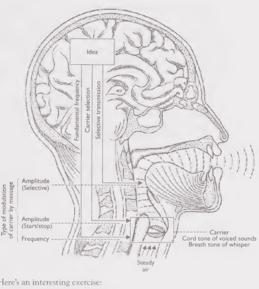

这里有一个有趣的练习：

- 1. 在密切关注你的发音器官（记住，牙齿、嘴唇和舌头）相互之间的位置或关系时，发出一个“ck”音。
- 2. 现在，试着把你的发音器官放在发“ck”音的位置，同时发出一个“s”音。

发生了什么？无论你多么努力，当发音器官处于“ck”的位置时，你都无法发出“s”音。但是，为什么所有这些动作对VoIP技术专业人员来说很重要？答案是，你必须理解人类声音是如何产生声音的，才能充分理解语音系统为何以它们的方式工作。例如，为什么电话网络只关注大约300 Hz到3,400 Hz的频率？因为如果我们捕获这些声音频率，人类声音通常可以被另一个人的耳朵处理和理解。然而，将频率限制在这个范围内确实会降低声音质量。低于300 Hz和高于3,400 Hz的声音频率根本不会被处理，这种去除会导致低音和高音被移除，从而产生电话通信中那种“尖细”的声音。

在阅读下一节“通过电子方式聆听声音”之后，你会更好地理解这个概念。现在，只需知道声波是由气压、声带、声道和发音器官产生的。其结果是在发出声音的人与接收仪器之间形成空气扰动，接收仪器可能是人，也可能是机械设备，你将在下一节中看到。

### 通过电子方式聆听声音

要理解声音是如何被机械处理的，你应该了解一些与声音理论相关的术语。这些术语是

- 频率
- 振幅
- 衰减

声波的*频率*是声波每秒振动的周期数。音调更高的声音或音调以更高的频率速率振动，而音调更低的声音以更低的频率速率振动。这种差异就是为什么钢琴键盘上更高的音符具有更高的频率速率，如图3-2所示。你会注意到，调到标准音高的钢琴，其中央C的频率为261 Hz。这个数字只是意味着钢琴上那个键产生的声音每秒振动或经过一个波周期261次。


这个周期的结果是，频率随时间的变化等于一种声音。虽然我们听到的大多数声音，包括人类声音产生的声音，都是多个频率的复杂组合，但这一概念仍然成立：那些独立声音中的每一个都是在给定时间范围内以给定速率进行的振动。

简单声音（单一频率声音）的声波可以用传统的正弦波表示，如图3-3所示。在此图中，垂直刻度表示声波的振幅，水平刻度表示时间。A点表示声波的第一个波峰，B点表示第二个波峰。波的一个完整周期包括第一个波峰——向上拱起——以及第一个波谷或向下拱起。因此，标准调音钢琴上的中央C在一秒内会循环经过261个这样的波峰和波谷。

当我在西弗吉尼亚长大时，我的许多叔叔和阿姨都演奏乐器。据我所知，他们都说自己是“凭耳朵演奏”。这句话是什么意思？意思是他们把自己从某个来源听到的声音，在他们选择的乐器上重现出来。例如，我的鲍勃叔叔几乎能演奏任何带弦的乐器。他可以听收音机里的一首歌，然后在他的吉他上弹奏出来。他不需要乐谱告诉他何时该弹哪个和弦。

根据物理学和人类生物学，鲍勃叔叔实际上在做什么？他在听声波，或者更具体地说，是在听声波的频率，然后用他的吉他、班卓琴或曼陀林重现相似或兼容的声波。这些音乐家经常谈到需要训练你的耳朵。他们的意思是，你必须学会把一个乐器——比如小号——的频率与另一个乐器——比如吉他——联系起来。他们能听出两种声音何时兼容，不需要乐谱来告诉他们手指该放在哪里。


以类似的方式，机械装置可以被调校为只接受某些频率或拒绝某些频率。它们还可以被编程为比较和对比频率。后一种能力是麦克风和耳机中许多主动降噪技术的核心。

频率可以描述声音的音高，而振幅决定声音的响度。鲍勃叔叔最喜欢的消遣之一，是把他的电吉他连接到放大器上，演奏他最珍爱的曲调。放大器从吉他接收电信号，并在通过内置扬声器重新产生声音时增大音量。吉他利用内置麦克风拾取声波，这些麦克风将声波转换为电信号，供放大器使用。这种转换就是主动放大的一个例子。声波被转换为电信号，信号被放大，然后通过扬声器转换回声波。

鲍勃叔叔还喜欢弹他的吉普森蜂鸟吉他。这把吉他有一个中空的琴体，前面有一个孔。吉他琴弦产生的声音通过这个孔进入吉他的中空琴体，并在琴体内部回响，然后被推回吉他外部。其结果就是声波的被动放大。如果你有一把这样的空心吉他，在琴弦后面的孔前放一块厚纸板，然后拨动吉他。你会注意到音量大大减弱，并且你会体验到声波的被动放大可以有多么强大。

这种被动放大真正做的是重新引导声能。通常，如果发出声音的实体周围的空气或空间是开放的，声波会从该实体向各个方向传播。通过在琴弦后面创造一个回声腔，空心吉他可以接收许多向后传播的声波，并把它们从吉他前部推出去。其结果既是感知振幅增加（尽管在这种情况下原始声波并没有真正增强），又是旋律性的声音（因为相同频率的声音会不止一次地以略微不同的环境感击中你的耳膜）。

为什么这些信息很重要？它在为VoIP部署选择耳机时很重要，在考虑是否要在电话网络上主动放大信号时也很重要。当你在源头放大信号时，你不太可能放大干扰或环境噪声。当你在更靠近目的地的地方放大信号时，你更可能放大结果中的噪声。然而，主要考虑因素将是你用于VoIP通信的耳机（如果使用耳机）中的麦克风。图3-4显示了放大和衰减对简单声波的影响，且未考虑干扰（干扰实际上会导致复杂声音而不是简单声音）。


当声波被衰减时，振幅会降低。声波在穿过空气时会被衰减，而当它们穿过更坚固的材料时，可能会被严重衰减。这就是为什么关门可以让房间安静下来。门比开阔空气更能衰减声波。声波不能在真空中传播，因为它们需要一个介质来扰动才能传播。你在外太空科幻电影中听到的那些精彩爆炸永远不会发生，因为没有介质可供声波传播。那个古老的问题——“如果一棵树在森林里倒下，但没人在那里听到，它会发出声音吗？”——可以回答“会”，但这个问题——“如果一艘宇宙飞船向另一艘宇宙飞船发射相位炮轰击，但没人在那里听到，它会发出声音吗？”——则会回答“不会！”


从技术上讲，你可以争辩说，如果没有人听到树倒下，那么这棵树只是产生了扰动；但无论是否被感知，这种扰动都是一种压缩波和稀疏波。现在我们已经可以理解声音如何变成电信号。如果声波是穿过介质的扰动或振动，那么我们应该能够制造出机械装置，根据声波如何撞击（扰动）该机械装置来检测这些声波。这种检测正是电话所做的工作。电话检测扰动并将其转换为电信号。让我们看看电话是如何施展这一魔法的。

### 电话

传统电话由五个主要部件组成：

- 麦克风
- 扬声器
- 振铃器
- 叉簧
- 拨号装置

除振铃器外，这些部件如图3-5所示。第一个元件是麦克风，或称送话器。该部件将声波转换为电信号。它执行此操作的方式因所用麦克风的类型而异，但我将解释传统的碳粒式方法，这种方法至今仍在某些电话中使用。

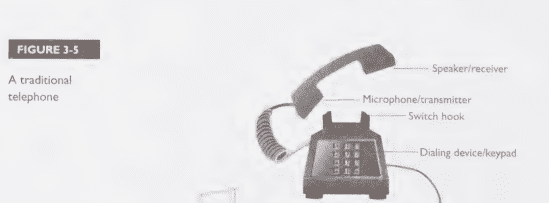

电话听筒内部有一个膜片，它对声波引起的气压变化非常敏感。该膜片随声波而运动。膜片的运动压缩并扩张其后方碳粒所在的空间。这些碳粒导电的方式不同，具体取决于膜片造成的压缩。最终结果是，我们可以以恒定的输入速率让电流通过碳粒，但输出速率将根据声波撞击膜片所造成的压缩而变化。当输出与输入相同时，我们可以认为此时是静音。当输出与输入不同时，就有声音。

由于送话器（麦克风）将声音检测为作用于膜片的振动，并将其转换为电信号，因此受话器（扬声器）必须做相反的事情。它必须接收电信号（频率变化的电能），并将其转换回声波。这项任务通过将电信号传递给磁铁来完成，磁铁使膜片以电信号所代表的速率振动。该膜片在空气中产生扰动，而不是被空气中的声波所扰动。结果是，人脑会感知到从耳朵进入的声音。

如果你将两部电话直接相连，这就足够了；然而，在现实世界中，我们将电话连接到称为公共交换电话网（PSTN）的网络，而且我们必须有一种方式向该网络表明我们希望拨打电话。这时叉簧就派上了用场。叉簧向PSTN表明，你即将拨号，意图与该号码所代表的设备建立连接。

当你的电话在电话线上检测到20 Hz的80伏交流电（AC）时，它就会使用电话所实现的任何振铃机制来振铃。无论它是播放音乐、说出你的名字，还是使用传统的铃声，都无关紧要。电话只需配置为在20 Hz信号到来时振铃即可。虽然某些系统可能使用不同的频率和电压进行信令传输，但概念仍然相同。特定频率表示电话应该振铃。

当你拿起听筒时，叉簧基本上会闭合一个电路；当你放回听筒时，它会断开一个电路。如果电路闭合，PSTN会将该电路检测为活动连接，中心局（CO）会返回拨号音。这种连接发生得如此之快，以至于拨号音似乎是瞬间出现的，但在此过程中会有微秒级的延迟。请记住，电信号以大约光速传输，因此通信发生得非常迅速。当你放回听筒时，电路断开，CO便可以结束连接。

### 考试内幕

### 电话如何指示连接目标？

这个问题的答案因电话类型而异。旋转拨号电话使用脉冲，按键式电话使用频率组合，手机使用数字数据包，而IP电话在连接另一部IP电话时可能使用IP地址。旋转拨号电话的工作方式是：针对目标地址或目标电话号码中的每一位数字，将电路断开并闭合指定次数。我在这里不再详述它们，因为它们的使用越来越少。

按键式电话在模拟网络上使用双音多频（DTMF）音。DTMF音是音调或频率的组合。这些组合如下：

- 1 = 1,209 Hz 和 697 Hz
- 2 = 1,336 Hz 和 697 Hz
- 3 = 1,477 Hz 和 697 Hz
- 4 = 1,209 Hz 和 770 Hz
- 5 = 1,336 Hz 和 770 Hz
- 6 = 1,477 Hz 和 770 Hz
- 7 = 1,209 Hz 和 852 Hz
- 8 = 1,336 Hz 和 852 Hz
- 9 = 1,477 Hz 和 852 Hz
- * = 1,209 Hz 和 941 Hz
- 0 = 1,336 Hz 和 941 Hz
- # = 1,477 Hz 和 941 Hz

如你所见，标准拨号键盘上最上面一排数字都使用相同的水平频率697 Hz。此外，最左一列数字都使用相同的垂直频率1,209 Hz。1,209 Hz与697 Hz的交点对应数字1，而1,209 Hz与941 Hz的交点对应星号（*）。

当你按下星号按钮时，频率为1,209和941的音调会同时生成。由于这些音调按水平和垂直方式彼此配对，因此只需七个音调就可以表示全部12个按钮。此外，所使用的音调在自然界中很少（如果有的话）以纯音形式出现。请记住，人声通常在低频端为50–100 Hz，在高频端为4,000–5,000 Hz，但发出的声音是复杂的频率组合。它们并不是完美落在某个唯一频率上的纯音。

最终，CO会检测这些音调，将其作为目标节点在PSTN上的电话号码指示。一旦收到足够多的数字以拨打电话（在美国，本地电话可能是七位，长途电话可能是十位），CO交换机就可以使用SS7网络来确定目的地的位置和路由。

### 本地交换局

本地交换局包括从客户所在地到CO的所有设施。该服务包括电缆设施和CO处的电缆室。电缆设施一词通常用于指代电缆或架空连接、连接或链接它们的结构，以及将客户连接到PSTN所涉及的任何其他组件。网络接口设备（NID）就是你房屋侧面那个连接到电缆设施的盒子。事实上，在大多数情况下，那个盒子归本地交换局所有。当然，在企业环境中，NID要复杂得多，并支持更多线路，但概念是相同的。

从NID到电缆设施的线路将在地下敷设，或者更常见的是，架空连接到电话杆。来自所有房屋的线路在终端盒中汇集在一起，然后返回CO。沿途，线路会根据需要使用所谓的“接头盒”拼接在一起。这些只是保护拼接点免受天气暴露影响的容器。

在企业或组织的商业安装中，线路进入客户建筑物，通常直接连接到该组织的电话交换机（PBX系统）。

CO是所有电缆设施汇聚的地方。线路通过电缆室进入CO。电缆室是放置电力系统或电池的地方，这些电力系统或电池使本地交换局得以运行。例如，它们为网络上的信令提供电力。

为了帮助你理解所有这些组件在本地交换局内如何工作，请考虑在连接到同一本地交换局的两部电话之间拨打电话的流程。当你拿起听筒并拨号时，交换机会判断该号码是否位于本地交换局内。在本例中，该号码位于本地交换局内，因此交换机会向目标电话发送振铃信号。假设目标电话被接听，交换机便会在两个节点之间创建一条虚拟电路。此时，语音通信开始。只要两个节点都保持电路连通，交换机就会维持该电路。在大多数现代网络中，任一节点都可以断开电路，从而断开连接。

除了上一段所强调的局内呼叫之外，你还可以拨打局间呼叫。这些呼叫会从一个本地交换局传递到另一个本地交换局。这些呼叫可能由多交换机处理，或者可能需要在不同CO之间通信。无论哪种方式，区别在于，现在你的语音通信必须经过一条通常比局内电话呼叫更复杂的路由。语音信号在本地交换局中是模拟信号，为了穿越PSTN网络，可能会被转换为数字信号。然后，当它到达远程本地交换局时，又必须转换回模拟信号。这种转换需要额外时间，但由于强大的处理器和其他现代技术，延迟通常非常低，以至于通信双方不会察觉到这种延迟。这

使用蜂窝基站时延迟可能更大，因为涉及更多转换。要实际观察这种延迟，你可以用手机拨打自己的固定电话。做这个测试时，你就能感知到从你对着手机说话到在固定电话中听到声音之间发生的延迟。再次说明，这种延迟主要因为沿途必须进行的转换，而不是实际信号的速度。信号以光速传输，但转换和排队系统并没有那么快。

### 局间交换

如前所述，从中心局（CO）到用户的大多数连接是模拟的；然而，如今中心局之间的连接大多是数字的。这些中心局到中心局的网络构建在环形结构的光纤线路上。呼叫通过连接到光纤环的交换机从一个中心局传递到另一个中心局。这些交换机通过中继单元（TU）连接到环上。当一个呼叫从一个中心局连接到另一个中心局时，虚拟电路按以下路径建立：从用户到中心局，从中心局到环，从环到目的中心局，最后从目的中心局到目的用户。

中心局的交换机和 TU 使用 7 号信令系统（SS7）来根据用户的长途提供商选择以及到目的用户所需路径，确定应使用哪个网络。

### 考试内幕

### 一次呼叫究竟如何通过 PSTN 工作？

让我们完整梳理一次通过 PSTN 拨打的电话呼叫过程。拨打电话的第一步是产生摘机状态。这意味着拿起电话听筒。当你拿起听筒时，与中心局之间的本地环路电路闭合，电流流过你的本地环路。中心局交换机几乎立即检测到该电流，并在你的线路上返回拨号音（该音是一种电信号，由你电话中的听筒或扬声器转换为声波）。

实际上，中心局交换机可能会在返回拨号音之前执行线路测试，以确保线路处于能够支持语音呼叫的状态。不过，这项测试发生得很快，你几乎不会遇到拿起一部正常工作且连接到本地环路的电话却不能立即听到拨号音的情况。

现在你有了拨号音，就可以开始输入你想呼叫的节点的电话号码。当你按下按钮时，DTMF 信号会通过本地环路发送回中心局交换机。请记住，这些信号在你的听筒中是声波，但它们是电信号

当组织部署 PBX 时，必须以某种方式连接到 PSTN。这些到 PSTN 或中心局的连接点称为中继线。中继线通常是模拟 FXO 线路或数字 T1 或 ISDN 线路，并可配置为支持呼入、呼出或双向呼叫。所需的呼入中继线数量取决于必须支持的线路数量。例如，电话营销公司需要的呼出线路会比客户服务部门多得多；然而，客户服务部门可能需要的呼入线路会比电话营销公司更多。

好消息是，单条呼入线路或双向线路通常可以支持多部实际的内部电话。之所以可行，是因为用户并非一直在使用电话（可能前面提到的电话营销公司除外）。例如，某个地点可能有 1,000 名用户在办公室里有电话。然而，你可能会确定，在任意给定时刻，其中只有 125 人在使用电话。你还可能进一步确定，峰值呼叫量约为 400 个活动连接。这个比例意味着，你不需要 PBX 与中心局之间具备支持 1,000 个并发呼叫的带宽能力。你只需要支持 400 个并发呼叫。

同样重要的是要记住，对于内部呼叫，你不需要为中心局提供带宽。内部用户之间的呼叫（本例中即这 1,000 名用户之间的呼叫）可以由 PBX 在内部路由。

### 语音传输

要跨 PSTN 传输语音，必须要有用于建立呼叫、路由呼叫和管理呼叫的方法。这些方法称为信令。你需要了解的两个主要信令领域是本地环路和数字 PSTN 网络。本地环路是你与中心局之间的连接。数字 PSTN 网络使用 SS7 信令系统进行通信。这里我将为你概述这两者。

> **考试提醒**
>
> PSTN 网络信令可分为三类。第一类是用于定位端点的地址信令。第二类是用于接入网络和终止与网络连接的监控信令。最后一类是信息信令，包括拨号音、忙音和呼叫等待通知等信息反馈内容。

### 本地环路信令

在本章前面，你学习了创建电话呼叫所使用的基本过程。你了解了通过闭合电路来产生摘机状态。该电路是用于建立电话呼叫的第一个信号。电路闭合向中心局交换机发出信号，表示你即将尝试发起呼叫。交换机则返回拨号音，这也可以称为一种信号，因为它确实向你表明可以开始拨打目标电话号码。

除这一步之外，你还记得拨号盘或键盘会将 DTMF 信号发送回中心局交换机，以便连接到目标电话。如果目标电话连接到同一台交换机，交换机可能会向目标发送振铃信号。交换机还可能将振铃声回送给拨号电话。这些都是发生在本地环路中的信号。

### SS7

当你需要连接到本交换机之外的电话，尤其是当你需要连接到本区域之外的电话时，PSTN 会使用 7 号信令系统（SS7）交换标准；该标准由 ITU-T（国际电信联盟——电信标准化部门）于 1981 年制定，ITU-T 的前身是 CCITT（Comite Consultatif International de Telegraphique et Telephonique [国际电报电话咨询委员会]）。SS7 是一种带外信令架构。这种架构意味着信号使用与语音数据不同的频率范围发送。它也可以意味着信号通过不同于语音数据的导线发送。带内信令（如本地环路信令）实际上是利用信道中有限的可用带宽发送的。在 SS7 系统中，则使用单独的线路，或使用完全独立的网络。

> **考试提醒**
>
> 请记住，SS7 用于 PSTN 中的网络元素之间，而不是用于你的电话与中心局之间。请记住，SS7 使用带外信令，即在一个信道上发送信号，而在另一个信道上路由呼叫。最后，不要忘记 SS7 是数字的且基于分组的。

在北美，为 SS7 信号开发了一种独特的架构。这种架构称为北美信令架构。北美信令架构规定了一个独立的信令网络。该网络由以下三个组件构成，并通过信令链路连接：

- 信号交换点（SSP）
- 信号传输点（STP）
- 信号控制点（SCP）

SSP 负责中心局与 SS7 网络之间的通信。STP 是允许 SSP 相互通信的分组路由器。最后，SCP 基本上是呼叫处理特性和能力的数据库。与互联网一样，网络要正常运行就必须有冗余。因此，充当 STP 和 SCP 的硬件是冗余的，因而具有容错能力。

要理解这些不同的 SS7 组件如何互操作，请参考图 3-6 中的示意图。如你所见，本地环路连接到 SSP，SSP 是一台能够与 SS7 网络中的 STP 通信的中心局交换机。当区号 937 的用户尝试呼叫区号 206 的用户时，呼叫会通过 SS7 网络路由。

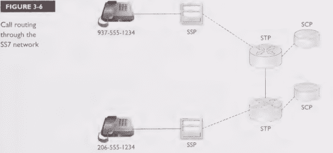


固定电话。当有人使用号码 555-1234 呼叫你的固定电话时，电话可能会快速响两声，然后暂停，再快速响两声，如此反复。当有人呼叫 555-4321 这个号码时，电话可能只响一声，然后像普通电话铃声一样暂停。你可以根据铃声判断拨入的是哪个号码。这种差异使你能够在电话以一种方式响铃时将其作为一个逻辑实体来接听，而在以另一种方式响铃时将其作为另一个逻辑实体来接听。

### 来电显示

当你订阅来电显示功能后，你能够识别主叫方的电话号码，通常还能识别其姓名。如果你使用过 1200 波特的调制解调器，那么你就体验过使来电显示得以工作的技术。电话调制解调器使用一种称为频移键控（FSK）的编码机制，其中一种频率表示 1，另一种频率表示 0。这使得调制解调器能够传输它们想要的任何二进制或数字数据。来电显示技术使用的 FSK 算法与旧式 1200 波特调制解调器完全相同。这条用 FSK 编码的消息会在第一声和第二声铃响之间发送。正因为如此，你通常会注意到来电显示信息直到第二声铃响前不久才出现，有时它看起来会与第二声铃响同时出现。要使来电显示能够跨不同运营商工作，运营商之间必须通过 SS7 连接。幸运的是，绝大多数电话服务提供商都以这种方式连接。来电显示也称为主叫号码传送（CND）。

### 屏蔽

有两种屏蔽对你来说很重要。第一种是来电显示屏蔽，第二种是号码屏蔽。第一种在你作为主叫方时保护你的位置身份，第二种则保护你免遭来自特定位置或号码的呼叫。

来电显示屏蔽与禁用呼叫等待类似，是通过在拨打目标电话号码之前拨打你的电话服务提供商分配的特殊代码来实现的。这个代码通常是 \*67。实际上，来电显示屏蔽就是不允许前述来电显示部分所描述的调制解调器技术发送电话号码。

使用号码屏蔽功能，你可以指定不希望接听某些特定电话号码的来电。当指定号码的人尝试呼叫你时，你的电话不会响铃，而在大多数情况下，他们会收到一段录音消息。除这项服务外，许多电话服务提供商现在还提供隐私管理服务。该服务将让你可以选择禁止任何未知、匿名或被屏蔽的呼叫。相反，主叫方会收到一条消息，告诉他们如果想接通，就解除其呼叫屏蔽。它还可能给他们机会输入特殊接入码以便仍然接通。

### 认证目标 3.02

### 640-460：描述编号计划

稍加思考就会明白，PSTN 上使用的编号计划必定存在某种结构。如果没有结构，号码就会被重复使用，PSTN 将无法正确路由呼叫。在美国，使用的是北美编号计划（NANP）。下一节将描述这一编号计划。

### 北美编号计划

北美编号计划管理局（NANPA）负责管理北美可用的电话号码。我将简要介绍他们的编号计划，作为编号计划如何运作的一个示例。北美编号计划（NANP）由编号计划区域（NPA）、中心局代码（COC）和主叫识别码（CIC）组成。

NPA 更常被称为区号，长度为三位数字。某些特定区号不允许用于一般用途，如下所示：

- **N11** N11 区号或前缀保留用于特定目的。当然，在美国最广为人知的实现是 911 代码。在 N11 代码中，N 可以是 2 到 9 的任意数字。FCC 只认可 211、311、511、711、811 和 911，但 411 已作为查号信息实现，611 通常作为维修请求线路实现。请注意，611 特定于拥有你用于连接 PSTN 的线路的运营商，并会将你连接到他们的服务中心。
- **N9X** N9X 代码保留用于未来扩展。N 可以是 2 到 9 的任意数字，X 可以是 0 到 9 的任意数字。当然，其中的 9 只能是 9。这就是为什么你从不会看到像 497 或 598 这样的区号。
- **37X 和 96X** 这两个各含十个 NPA 的号码块被预留，以备未来因某些未定义原因需要时使用。同样，X 可以是 0 到 9 的任意数字。

COC 采用 NXX 的格式。这意味着 COC 的第一位可以是 2 到 9 的任意数字，第二位和第三位可以是 0 到 9 的任意数字。这意味着 218 是可能有效的 COC，但 187 不是。COC 也常被称为“本地交换号码”。

最后，CIC 是电话号码的最后四位数字，可以包含 0 到 9 的任意数字。因此，NANP 编号计划的格式是 NPA-NXX-XXXX，其中 NPA 是根据前面指定的约束条件确定的有效代码。

在北美的一些地区，即使是本地呼叫，你也可能需要输入 NPA。在这些情况下，你通常不需要包含国家代码。美国和加拿大的国家代码（CC）是 1，墨西哥的 CC 是 01。在该国的其他地区，NPA 可能会为你自动添加。此功能称为*数字转换*。数字转换根据预定义规则更改拨出的号码，主要用于将专用网络上的内部号码转换为 PSTN 上兼容的外部号码。

拨打国际电话时，你可能需要输入国家代码。确实存在例外，例如在加拿大和美国之间拨号，因为两者都使用 NANP 编号系统。国际编号计划由国际电信联盟（ITU）作为 E.164 文件进行管理。E.164 编号计划确定了要使用的国家代码。E.164 编号计划在其结构中确定了三个组成部分：

- 国家代码（CC）：1–3 位数字
- 国家目的代码（NDC）：0–15 位数字（可选）
- 用户代码（SC）：1–15 位数字

虽然 ITU 管理 CC 列表，但 NDC 和 CC 数据库由所涵盖的国家或地区管理，例如 NANP 所涵盖的地区。要查看国家代码列表，请访问 http://www.itu.int/publ/T-SP-E.164D-2009。

### 认证目标 3.03

### 640-460：描述 PBX、中继线、键控系统和直连线路

专用小交换机（PBX）在很大程度上之于电话通信，就如同网络地址转换之于 IP 网络。虽然它们并非完全等同，但 PBX 系统确实允许你运行一个具有各种功能的专用电话网络

它是多个原始信号的组合。在链路的接收端，解复用器会根据时序将信号分离为原始的各个信号。实际上，链路的每一端都会有一个复用器和一个解复用器，以提供双向通信。

TDM 链路通常以 T 线路或 E 线路实现，并允许同时在链路上发起多个呼叫。传统或遗留 PBX 系统使用这些 T 线路和 E 线路连接到 PSTN，并使用 TDM 在链路上进行通信。在内部，专用直连线路通常从端点（电话）连接到中央 PBX，而 TDM 通信则通过中继线进行；这些中继线要么连接到 PSTN，用于组织网络之外的电话呼叫，要么连接到组织内的其他 PBX 系统，用于内部电话呼叫。

TDM 也被称为*时域复用*，因为它在时域内进行复用；而*频分复用*，也称为“频域复用”，则在频域内进行复用。

中心局（CO）与世界各地更大的电话设备网络相连。TDM PBX 或遗留 PBX 用于连接到传统电话网络。它通过 CO 中继线连接，PBX 系统在连接到 CO 以进行外部通信时，其作用很像你公司的 CO。每部电话或端点设备都连接到 PBX，并拥有自己的 ID 或分机号。在大多数情况下，这些内部电话将是使用 1 和 0 与 PBX 通信的数字电话。

然而，如果其中一部电话拨打了表示需要外线的号码（通常是数字 9），PBX 会抓取一条可用线路，并再次向用户返回拨号音，或者用户可以直接继续拨号。如果组织内的一位用户想要与组织内的另一位用户通信，则可以通过 PBX 建立连接，而不需要外线。

> **考试关注**
>
> **用于连接 PBX 与 CO 以便与外部电话系统通信的中继线通常称为 CO 中继线。** 将同一组织拥有的两个 PBX 系统连接在一起的中继线通常称为中继线或联络线。将一个 CO 与另一个 CO 连接起来的中继线通常称为局间中继线。

你也可以使用所谓的*联络线*连接不同办公室的 PBX 系统。通过用联络线连接 PBX 系统，你可以让一个城市中的用户只需拨打另一位用户由 PBX 分配的内部扩展号，就能呼叫另一个城市中的用户。这些联络线通常经由 CO 路由，并可能通过不同提供商互连，但它们为各个位置的 PBX 系统之间的直接通信提供专用通道。


### 仅 IP

许多现代 PBX 系统都是仅 IP 系统。这些系统将所有语音信号转换为 IP 数据包，并通过优化后的 IP 网络进行路由。它们通常提供与 TDM PBX 系统相同的传统功能，例如呼叫等待和语音邮件，而且通常还提供增强功能。许多服务提供商现在支持语音数据包的纯 IP 路由，使整个企业基础设施能够使用 IP 电话，同时仅将必须通过 PSTN 路由的呼叫转换为传统语音呼叫。

### 混合

通过结合 TDM 和 IP，可以构建混合 PBX 系统。当今市场上的绝大多数硬件设备都是混合 PBX 系统。要找到纯 TDM PBX，或者至少找到无法扩展以支持 IP 电话的 TDM PBX，正变得越来越困难。Avaya 和 Nortel 等公司通过新线路卡提供升级到混合系统的方案，从而保护了客户投资。这种升级选项避免了推倒重来式实施的需要（叉车式升级或实施是指必须替换整个系统的情况）。

混合 PBX 系统通常支持通过 TDM 中继线和专用于运行 IP 电话的线路连接到 PSTN。这些 IP 电话线路可用于连接同一企业的不同站点。归根结底，混合 PBX 系统是带有 VoIP 网关以提供 IP 电话支持的传统 TDM PBX 系统，或者该系统使用特殊处理器卡代替 TDM 处理器。特殊处理器卡允许电话作为传统数字话机运行，但 PBX 的核心现在基于 IP，而不是基于传统电话技术。

### 常见 PBX 功能

有些功能是大多数 PBX 系统共有的，而少数功能或功能的实现方式有助于区分不同供应商的产品。以下列表包含 PBX 解决方案提供商提供的最常见功能：

- 自动话务员
- 自动查号
- 自动回铃
- 通话计费
- 呼叫转移
- 呼叫穿透
- 呼叫转接
- 呼叫等待
- 回拨/呼叫回拨
- 电话会议
- 分机拨号
- 跟我走
- 保持音乐（MOH）
- 语音邮件
- 语音识别

### 自动话务员

*自动话务员*功能提供这样一种能力：外部呼叫者拨打一个单一号码，然后可以从预定义的选项中进行选择。呼叫者可以选择输入目标个人的分机号，并直接连接到该分机。如果 PBX 系统支持目录服务，呼叫者可以选择在目录中查询个人或部门的分机。此外，其他选项可能包括收听预录消息等。

### 自动查号

当呼叫者不知道具体分机号时，可以让他或她访问公司目录。这项服务通常是按姓名拨号目录，客户开始输入目标姓名的字母，直到找到匹配项，或者直到施加足够的限制，使潜在目标数量少于某个上限阈值。例如，如果有 5 个人的姓氏为 Carpenter，6 个人的姓氏为 Carrel，那么在输入前三个字母“Car”时，会得到 11 个匹配的人。一旦在序列中加入字母 p，总数就被限制为 5 个人。现在我们可以将五位 Carpenter 分别分配到键盘数字 1 到 5，并请呼叫者从该列表中选择预期目标。选定姓名后，还可以告知呼叫者实际分机号，供以后参考。

少数 PBX 系统会自动处理这项任务。用户首次设置电话时，会被要求输入自己的姓名，并录制自己姓名的音频文件。这样，当某人呼入并尝试拼写姓名时，该用户的姓名就会出现在列表中。呼叫者实际听到的是用户说出自己的姓名，而不是某种电子合成语音。这要愉快得多，而且呼叫者可能认出接收者的声音。

### 自动回铃

自动回铃可以解决一个常见困境：试图联系某个正在通话中的人。不必一次又一次地重拨，你只需选择让 PBX 系统在线路空闲时回铃给你。这项服务节省大量时间，并极大提高用户生产力。

### 通话计费

对许多部门来说，能够跟踪实际通话时间非常重要。销售经理喜欢查看其销售人员拨打了多少电话。客户服务经理喜欢查看其客户服务代表接听了多少电话。每个组织都需要能够通过监控拨打了哪些电话并确保电话系统不被滥用来进行成本管理。例如，我记得 20 世纪 90 年代在一家组织工作时，一名来自其他国家的人拨打长途电话回国，每月给公司造成超过 300 美元的费用。这个例子只是通话计费非常重要的原因之一。它还可以用来审计服务提供商，确保你不会为自己订阅的服务被多收费。

### 呼叫转移

呼叫转移就像我们的家庭电话系统一样，用于将呼入某个分机的呼叫转发到另一个分机。例如，你可能需要离开办公室工作一段时间。你的办公室可能有固定电话，但你也可能有一部移动 VoWLAN（无线局域网语音）电话。你可以利用此功能让系统将所有拨打到你固定电话的呼叫转移到你的 VoWLAN 电话。当你长时间开会并预计那段时间会有重要电话呼入时，将电话转移到会议中心也很常见。

### 呼叫穿透

一些组织向出差的销售人员和其他人员提供呼叫穿透功能，希望他们能够先拨入 PBX 再拨打电话。为此通常会使用免费电话号码。因此，出差员工可以拨入 1-800 号码，然后输入授权码，从而获得外线。现在他们可以拨打 PBX 允许的任何号码。最终结果是，他们通过 PBX 进行呼叫。

### 呼叫转接

我相信你经历过接到并非找你的电话。在 PBX 系统的早期，你通常不得不请呼叫者重新拨打才能联系到正确的分机；然而，大多数现代 PBX 系统允许你转接呼叫（不过，根据我的经验，普通用户并不太擅长这样做，至少从我多次被“挂断”的经历来看是这样）。

### 呼叫等待

这项 PBX 功能很像你家里可能有的呼叫等待功能。当你正在通话时，电话会发出特定提示音，表示有另一个电话呼入。此外，大多数电话系统还会在电话的 LCD 上显示电话号码和任何其他主叫号码信息，以便你更好地决定是否应接听该呼叫。

### 回拨/呼叫回拨

此功能允许你重拨最后呼叫你分机的号码。这可能同时适用于内部和外部，也可能仅适用于内部，具体取决于实现方式。如果你刚收到某人要你回电的消息，但对方没有留下号码，这会非常有用。许多电话系统还允许你向前滚动查看之前的呼叫列表，但这通常是电话终端的功能，而不是 PBX 系统本身的功能。这就是为什么你的家庭电话来电显示中会有此功能。CO 不会为你保留此列表。该列表存储在电话的内存中。这也是为什么电话断电后该列表会消失。

### 电话会议

现实是，在商业中仅靠两个人参与很少能完成大事。有时让所有人参与一个问题或

同时通过电话进行沟通的解决方案。当人们处于不同的物理区域时，尤其如此。过去几十年里，电话会议一直是解决方案，大多数现代 PBX 系统都支持此功能。根据 PBX 系统的不同，您可能只能将 PBX 系统控制范围内的分机纳入会议，也可能可以将 PSTN 号码纳入电话会议。后者在大多数现代 PBX 解决方案中都是可行的。

### 分机拨号

PBX 系统允许连接到该系统的用户通过输入简单的四位数或五位数号码，拨打连接到该系统的其他用户。这既使呼叫保持在 PBX 系统内部，又使拨号更高效。

### 随行转接

电话系统的*随行转接*功能与呼叫转移略有不同。呼叫转移将电话呼叫转到一个指定的其他号码，而随行转接包含一个号码列表，PBX 会继续依次振铃列表中的号码，直到列表中的号码全部试完，或者您接听了其中一个。虽然您可以通过将电话转移到另一部电话、再转移到另一部、再转移到另一部来实现类似效果，但您实现的效果并不完全相同。在后一种场景中——在大多数实现中——实际振铃的唯一电话是转移链中的最后一部电话。使用随行转接时，列表中的所有电话都会振铃，您可以在自己所在的位置接听。

### 保持音乐（MOH）

当然，如果 PBX 系统不能在呼叫者保持等待时播放音乐和其他消息，它还有什么价值呢？有些组织使用 MOH 只是作为一种通知，告知呼叫者他或她确实仍然处于连接状态。其他组织则非常有策略地使用它。例如，我在 20 世纪 90 年代末打电话给一家 ISP，至今仍记得那段保持等待消息。内容大致是这样的：“我们感谢您的惠顾，并希望帮助您充分利用您的互联网连接。因此，我们认为您宁愿获得一些关于如何更充分利用互联网的提示，而不是听您并不特别喜欢的音乐。您的来电将在接下来五分钟内得到应答，但这里是您在等待时的第一条提示……。”我觉得这很聪明，越来越多的组织也意识到这是他们应该利用的东西。当然，您必须小心。我知道，当我在为已经向他们购买的东西投诉而保持等待时，我不希望公司试图向我推销东西。我想最终这关乎平衡，但这只是 MOH 除了单纯播放音乐之外还可以用于什么的一个例子。

### 语音信箱

除了电子邮件之外——而且语音信箱出现的时间更早——语音信箱可能是当今使用的最重要的业务工具之一。我并不是说它总是被用好，但我们中的许多人已经在许多日常事务中依赖它。现代 PBX 系统不仅为您提供语音信箱，其中许多还允许将语音信箱消息以音频文件链接或嵌入式音频文件的形式发送到您的电子邮件。来自同事的内部语音信箱消息通常只需按正确的按键进行回复，然后对着电话说出您的回复即可。这样您就不必在不需要时记下分机号或其他信息。

当然，带有语音信箱系统的 PBX 就是带有硬盘的 PBX。这些音频数据必须存储在某个地方，这意味着您要处理的是更复杂的 PBX 解决方案。在某些情况下，PBX 系统会链接到外部语音信箱应用，而不是提供自己的语音信箱解决方案，但我不知道有哪种现代 PBX 解决方案不以某种方式提供语音信箱服务。

### 语音识别

有些 PBX 系统自带语音识别功能，或允许通过扩展来包含语音识别。这提供了您可能遇到过的功能：自动话务员允许您“按 1 或说 1”，这只是一个简单的例子。不用说，这些系统并非万无一失，但它们确实已经取得了很大进步。十年前或十五年前，您绝不可能以今天这样的规模实施灵活的语音识别技术。理解单个人类声音的能力已经够难了，但如今，识别系统在数百人说出特定词语或短语时已经能识别得相当好。我仍然感到惊讶的是，我可以读出我整张信用卡的信息，而公司能够处理它——并不是说我会这么做，因为附近可能有人在听，但这仍然令人印象深刻。

### 特殊 PBX 功能

除了常见功能外，特殊场景还对 PBX 系统提出了特殊要求。例如，呼叫中心可能需要自动呼叫分配（ACD），将单个呼入号码映射到任意数量的内部代表。这样的系统很可能还需要队列，以减少处理呼叫量所需员工总数。我记得我在信息技术领域的第一份工作是帮助台技术支持人员。大概有 20 个人接听来电，我们可以在电话的液晶显示屏上看到队列中等待的呼叫数量。显然，这些功能在传统 PBX 解决方案中已经存在一段时间了。

### PBX 的硬件组件

如果您要使用 PBX 系统，了解构成 PBX 的硬件和软件组件很重要。除了电话线之外，这些系统还使用专用组件。PBX 会有线路卡和中继卡。线路卡提供到您电话的连接，中继卡用于连接到 CO。混合 PBX 解决方案还会有用于连接到数据网络的网络接口卡。

PBX 的控制复合体是系统的逻辑处理部分。这是 PBX 真正控制能力所在。这个智能组件提供呼叫等待、呼叫转移等功能。此外，PBX 将有一个交换背板，用于在电话端点之间建立连接。请记住，您很可能需要使用与制造 PBX 的同一供应商的电话，以便它们能与 PBX 正确通信。较新的 IP PBX 解决方案可能例外，因为它们使用许多标准化协议进行通信。

当然，PBX 必须配有电源和冷却风扇，因为它基本上是一台计算设备，无论它是 TDM PBX、纯 IP PBX 还是混合 PBX。

总之，可以说 PBX 以较小的规模提供了 CO 的所有组件。最终结果是，您能够将电话系统作为独立系统实施，但它也能连接到 CO 以实现 PSTN 连接。

### 认证小结

在本章中，您学习了与 CCNA Voice 考试相关的三个重要主题。首先，您了解了传统电话如何通过将模拟声波转换为电信号并再转换回来来工作。您还了解了电话如何向网络发送信号，表明它需要获取线路并拨打电话。接下来，您通过北美编号计划的示例了解了编号计划。最后，您了解了 PBX 和按键系统，以及它们为传统内部管理电话提供的功能。在下一章中，您将开始学习传统 PSTN 和新的 VoIP 网络如何协同工作。

### 两分钟演练

### 640-460: 描述 PSTN 提供的服务

- PSTN 或 POTS 提供公共呼叫路由所经过的网络。
- PSTN 在其网络内使用 SS7 信令。
- 当用户拿起 PSTN 电话听筒时，会发生环路启动信令。
- 在 PSTN 等模拟电话网络中，识别出三类信令：地址信令、监控信令和信息信令。

### 640-460: 描述编号计划

- 编号计划用于标准化一个区域内或国际上使用的寻址系统。
- ITU E.164 编号计划定义了用于国际拨号的国家代码。
- ITU E.164 体系定义了三种代码：国家代码（CC）、国家目的地代码（NDC）和用户代码（SC）。
- NANP 编号系统在加拿大和美国使用。
- 加拿大与美国之间的国际呼叫不需要国家代码。
- 北美编号计划（NANP）由编号计划区（NPA）、中心局代码（COC）和呼叫方标识码（CIC）组成。

### 640-460：描述 PBX、中继线、键控系统和直连线路

- 小型企业或组织可能选择安装按键系统。按键系统允许每部电话使用系统可用的所有 PSTN 线路。
- 使用按键系统时，用户按下希望接听或用于拨打电话的线路按钮。
- 较大的组织使用 PBX 系统。PBX 系统通过交换基础设施与用户共享多条 PSTN 线路。


- 使用 PBX 系统时，用户表示需要外线（通常通过按 9），PBX 系统会选择一条可用的 PSTN 线路；如果没有可用线路，则拒绝呼叫。
- 中继线用于从 PBX 或键控系统向 PSTN 提供一个或多个连接。
- 直连线路或中继直连线路用于将同一组织运营的两个地点直接连接起来，以便进行内部呼叫。

### 640-460：描述编号计划

- **6.** 哪种编号计划标识国际国家代码？
  - A. H.323
  - B. NANP
  - C. E.174
  - D. E.164

- **7.** ITU E.164 编号计划中标识了哪三种代码？（选择三项。）
  - A. CC
  - B. NDC
  - C. NPA
  - D. SC

- **8.** 加拿大和美国使用哪种 PSTN 电话编号系统？
  - A. NANP
  - B. 十进制
  - C. 十六进制
  - D. NAPN

- **9.** NANP 由哪些已标识的号码或代码组成？（选择所有适用项。）
  - A. COC
  - B. NPA
  - C. NDC
  - D. CC

- **10.** 传统电话中的哪个组件用于标准化区域内使用的寻址系统？
  - A. SS7
  - B. 环路启动
  - C. 编号计划
  - D. 碳纤维

### 640-460：描述 PBX、中继线、键控系统和直连线路

- **11.** 以下哪种企业最有可能部署键控系统？
  - A. 一家雇用约 25 名员工的公司
  - B. 一家雇用约 250 名员工的公司
  - C. 一家雇用约 2,500 名员工的公司
  - D. 一家雇用约 1,250 名员工的公司

- **12.** 哪种内部电话系统使用的电话可直接访问每条可用 PSTN 线路？
  - A. PBX
  - B. VoIP
  - C. 键控系统
  - D. 蜂窝电话

- **13.** 哪种 PBX 系统同时支持 IP 电话和传统模拟电话？
  - A. 仅 TDM
  - B. 仅 IP
  - C. TDM-over-IP
  - D. 混合式

### 实验题

你为美国西南部的一家小型组织工作。你必须为 12 名用户提供电话服务。用户已告知你，最多可能有五个人需要在任意给定时间使用电话进行外部呼叫。应始终保留一条额外线路用于接听来电。你可能会推荐哪种传统电话系统，为什么？

### 自测答案

### 640-460：描述 PSTN 提供的服务

- **1.** ☑ **B 和 D 正确。** 公共交换电话网被称为公共交换电话网（PSTN）或普通老式电话系统（POTS）。
  ☒ **A 和 C 不正确。** PBX 和键控系统指的是内部电话系统的类型。

- **2.** ☑ **A 正确。** 7 号信令系统（SS7）用于 PSTN 内部的信令。
  ☒ **B、C 和 D 不正确。** 本地环路信令用于中心局（CO）和最终用户之间。摩尔斯电码不用于电话系统中的任何地方，RJ-45 是一种电缆连接器类型。

- **3.** ☑ **B 正确。** 当电话摘机时，会发生环路启动信令。
  ☒ **A、C 和 D 不正确。** 环路停止、挂机停止和摘机启动不是电话网络中定义的信令方法。

- **4.** ☑ **A 正确。** 解析不是电话网络已知的信令类型。
  ☒ **B、C 和 D 不正确。** 地址、监视和信息是有效的信令类型。

- **5.** ☑ **C 正确。** 拨号音和忙音属于信息信令。
  ☒ **A、B 和 D 不正确。** 监视信令涉及呼叫建立和拆除。地址信令用于指示所拨号码。SS7 用于 PSTN 网络内部。

### 640-460：描述编号计划

- **6.** ☑ **D 正确。** ITU E.164 编号计划标识国家代码。
  ☒ **A、B、C 不正确。** H.323 不是编号计划，E.174 也不是。NANP 标识北美范围内的电话地址。

- **7.** ☑ **A、B 和 D 正确。** 国家代码（CC）、国家目的地代码（NDC）和用户代码（SC）均在 E.164 中定义。
  ☒ **C 不正确。** 编号计划区域（NPA）在 NANP 中定义。

- **8.** ☑ **A 正确。** 北美编号计划（NANP）在加拿大和美国使用。
  ☒ **B、C 和 D 不正确。** 这些都不是编号计划。

- **9.** ☑ A 和 B 正确。中心局代码和编号计划区域（NPA）在 NANP 编号系统中定义。
  ☒ C 和 D 不正确。NDC 在 E.164 中定义，CC 也在 E.164 中定义。

- **10.** ☑ C 正确。编号计划用于标准化电话系统中使用的地址或电话号码。
  ☒ A、B 和 D 不正确。SS7 是用于 PSTN 网络内部的信令解决方案。环路启动是一种从端点连接到 PSTN 的信令系统。碳纤维用于传统电话中，将声波转换为电信号。

### 640-460：描述 PBX、中继线、键控系统和直连线路

- **11.** ☑ A 正确。较小的企业更有可能实施键控系统电话解决方案，因为它们需要更少的线路。
  ☒ B、C 和 D 不正确。所有这些组织都更有可能实施 PBX，因为它们将需要许多线路。

- **12.** ☑ C 正确。键控系统为用户提供对每条可用线路的直接访问。用户按下一个按钮来选择希望使用的线路或接听正在振铃的线路。
  ☒ A、B 和 D 不正确。PBX 系统用作交换机，使较少数量的线路能够与内部电话动态共享。VoIP 系统理论上允许无限数量的电话，但不会为用户提供对 PSTN 线路的直接访问。蜂窝电话不直接连接到传统 PSTN，而是先经过分配的蜂窝网络。

- **13.** ☑ D 正确。混合式 PBX 可以同时支持 IP 电话（VoIP）和 TDM 或传统电话。
  ☒ A、B 和 C 不正确。仅 TDM 和仅 IP 会支持其中一种，而不是两者都支持。TDM-over-IP 不存在。

### 实验题答案

答案可能有所不同，但你很可能实施键控系统。对于这么小的网络，PBX 解决方案会过于昂贵。具有六条或更多线路的键控系统将满足需求。五名用户可以占用线路，同时保留第六条线路空闲。为了给未来需求增长留出空间，也可以选择十线路系统，并在将来根据需要购买适当的 PSTN 连接。


## 4

## 4 它们相遇——数据与语音融合

### 认证目标

- 4.01 640-460：描述语音分组化过程
- 4.02 642-436：描述编解码器及编解码器复杂性
- 4.03 640-460：描述编解码器的功能及差异
- 4.04 642-436：为给定情况选择合适的编解码器
- ✓ 两分钟演练
- 问答自测

## 欢迎使用新版 Bing

你的网页 AI 助手

提问。聊天以优化结果。获得更好的答案。


### 搜索

- 聊天
- 搜索
- 图片
- 视频
- 地图
- 新闻

头条新闻

查看更多新闻

例如，如果你正在使用 FTP 向服务器发送文件，那么少数数据包乱序到达，或者一个数据包到达与下一个数据包到达之间的延迟超过某个特定阈值，都没有关系。当然，延长的延迟会减慢通信，但数据最终会到达目的地。语音流量则不能容忍这种情况。如果出现延长的延迟，通话将被中断，或者质量会受损。稍加思考，你就会明白为什么这种低容忍度是真实存在的。

人类位于 IP 语音（VoIP）通信链路的两端。他们既会说话也会聆听，而他们的期望已由模拟电话网络设定。如果他们在某段不确定长度的时间内听不到任何声音，就会认为通话已中断，或者对方已断开连接。如果声音质量较差，尤其是差到他们无法相互理解的程度，他们可能会放弃对话。VoIP 数据必须满足质量期望，而传统上其他数据类型并不要求这些期望。事实上，我们经常提到“运营商级”或“运营商质量”的 VoIP 通信。这个术语意味着我们已经实现了至少等同于传统 PSTN 的声音质量和通信速度。

由于我们通过与传统数据包相同的物理网络传输 VoIP 数据包（想想电子邮件、数据库访问、文件传输、打印等），我们可以说我们是在数据网络之上叠加语音。我们使用与传统数据相同的网络设备、电缆和软件来传输语音数据。这种叠加对网络提出了新的要求。该要求是数据网络必须能够区分不同的数据包类型，并优先处理语音数据，以满足 VoIP 用户的质量期望。所需的技术称为服务质量（QoS）。QoS 提供队列管理和流量优先级划分，以便让最重要的流量先行通过。

由于语音流量必须在网络中快速移动，而且传输中损坏或丢失不会带来好处，我们使用 UDP 发送大多数 VoIP 数据包。你会记得前面章节讲过，UDP 是一种无连接协议，与 TCP 不同。TCP 的开销太大，无法以语音数据包必须达到的速度传输它们。

你可能想知道为什么重发损坏或丢失的语音数据包没有好处。原因很简单。想一想你说出“don’t”这个词需要多长时间。如果你像我一样，那会远不到一秒。现在，想象你正在用 VoIP 电话交谈，并说出以下句子：“Don’t push the button. Pull the lever.” 再想象“don’t”这个词在传输中丢失了，而系统决定重发它。由于排序问题，另一端的用户听到的是：“Push the button. Don’t pull

拉杆。”这种重新排序理论上可能发生，因为短语“按下按钮”通过了，而单词“don’t”（不要）没有通过。当单词“don’t”（不要）被重新传输时，它被放在短语“拉动拉杆”之前。结果与原本要传达的信息完全相反：“你明白为什么重新传输丢失的音频包会毫无用处，甚至可能造成损害吗？”

相反，听者只会听到单词“don’t”（不要）；然而，实际情况要更复杂一些。听者更可能听到类似“D---t pu—the ---ton。Pu----ce over。”的声音。所有破折号代表无法听清的声音或完全静音。要点在于，网络通常不会恰好丢弃完整的单词，而是丢弃远小于一个完整单词的音频片段，从而造成我们通常所说的“连接不良”。

### 将语音转换为数据

将语音转换为数据的过程实际上包含五个步骤。这些步骤可描述如下：

- 1. 将声波转换为模拟电信号。
- 2. 将模拟电信号转换为数字信号。
- 3. 如有需要，压缩数字信号。
- 4. 从信号数据创建数据包。
- 5. 在数据网络上传输数据包。

以下各节将逐一探讨该过程中的每个步骤。

### 将声波转换为电信号

在第 3 章中，你学习了设备如何通过使用麦克风以电的方式“听见声音”。那一章介绍了已在电话中使用了一个多世纪的碳基麦克风。此外还存在其他类型的麦克风，并可能用于现代电话中。

根据第 3 章所学，你知道声音实际上是空气中的压力差。这些压力变化被人耳拾取并转换为神经冲动，再由大脑感知为声音。正如人耳检测这些压力变化一样，麦克风使用各种技术来检测同样的变化。麦克风不产生神经冲动，而是生成随其内部或周围检测到的压力变化而变化的电信号。当然，麦克风很重要，因为它们是用于将声波转换为 IP 语音数据包的第一个元件。

最早的麦克风是一个简单的金属振膜，直接连接在一根针上，针在另一块可延展金属上留下压痕。压痕会根据振膜上的压力差而变化。当你让针沿着压痕回放时，就会产生一种与原声相似但音质严重不足的声音。如果你熟悉老式黑胶密纹唱片，这一切对你来说可能并不陌生。如今，我们有几种不同类型的麦克风，其中许多用于电话：

- **碳纤维** 碳纤维麦克风使用碳纤维来改变导电性，从而改变麦克风输出的信号。当声压变化发生时，振膜压迫碳纤维，导致不同的导电水平。从反面来说，压缩会改变碳纤维的电阻，从而改变电流，产生一个代表麦克风周围声音的信号。

- **电容式** 电容式麦克风使用电容器来检测麦克风周围空气压力的变化。电容式麦克风需要电池或其他电源供电。电容式麦克风的工作原理是使用两块板，板间存在电压。一块板充当振膜，当声波击中它时，它会靠近或远离另一块板，改变充电和放电，从而产生信号。

- **动圈式** 动圈式麦克风使用一个线圈和振膜后面的磁体来生成电信号。当以某种方式连接到振膜的线圈在磁体附近移动时，会产生电变化。这种电变化就是代表麦克风拾取到的声音的信号。

你可能已经注意到这些麦克风中的共同模式。每种类型都使用振膜生成电信号。每个振膜的运动——这是我们检测声波的唯一方式（甚至我们的耳朵也用微小的骨头遵循同样的基本概念）——会引起电流、电压或其他某种电气因素的变化，而这些变化就充当信号。图 4-1 所示的 Cisco 7960G VoIP 电话使用电容式麦克风。

麦克风通常位于两个位置之一或两者兼有。第一个位置是电话听筒，第二个位置是用于免提功能的底座单元。此外，大多数 Cisco 电话支持外部耳机连接器，从而可以使用耳机内置的麦克风。该麦克风是用于生成 VoIP 数据的第一个元件。电信号离开麦克风，被传送到 Cisco VoIP 电话，进入下一阶段处理。

### 图 4-1

Cisco 7960G 电话采用电容式麦克风（由 Cisco Systems, Inc. 提供。未经许可不得使用。）


### 将电信号转换为数字信号

既然麦克风已经生成了电信号，VoIP 电话就可以将这些模拟电信号转换为数字信号或信息。这是通过称为采样和量化的过程完成的。采样是指从电信号中选择足够多的值读数，以便有效地用数字方式表示它。请记住，来自麦克风的电信号是模拟的——可以想象为随时间发生的平滑而非常渐进的变化（尽管发生在纳秒级）——我们必须将这种模拟信息转换为数字信息。由于模拟信号是平滑的，我们实际上可以无限采样，这意味着需要一种更好的方法。奈奎斯特定理就在这里发挥作用。

哈里·奈奎斯特和克劳德·香农提出了这样的理论：只要每秒采集的样本数是信号中最高频率的两倍，就可以用数字格式表示模拟信号。例如，如果最高频率是 4,000 赫兹（Hz），即每秒 4,000 个周期，那么你可以用每秒 8,000 个样本以数字方式表示该信号。PSTN 通过将信号传输频率设定在约 4,000 Hz，确立了语音质量标准，如今通常称为长途电话质量。因此，如果我们每秒采样 8,000 次，就可以生成大致相当于 PSTN 质量的 VoIP 流。请记住，PSTN 有意将频率降低到 4,000 Hz 以节省带宽。人类语音产生的频率大约为 20 到 20,000 Hz。借助 VoIP 提供的更大潜在带宽，未来我们实际上可能通过质量更好的连接与人通信。我们只需以每秒 18,000 个样本或更高频率进行采样。表 4-1 列出了与电话及其他音频录制和转换过程中的声音和声音处理相关的常见频率。

**表 4-1** 频率、范围和应用

| 频率描述 | 频率范围 | 应用 |
|---|---|---|
| 人类语音 | 200–9,000 Hz | 电话；音频录制；AM 和 FM 无线电 |
| PSTN 信道 | 300–3,400 Hz | 电话；会议 |
| 人耳（生物麦克风） | 20–20,000 Hz | 聆听 |
| 奈奎斯特定理 | 300–4,000 Hz | 电话及其他音频采集场景 |

### 实际工作中

你可能已经注意到将支持频率降低到 4,000 Hz 的影响。你是否曾在网络研讨会或在线虚拟课堂中，注意到演讲者听起来像是在 AM 广播电台里？这通常是因为演讲者使用固定电话（PSTN 电话）拨入会议。

量化是将样本匹配到电压标度的过程。在语音通信中，每秒必须将 8,000 个样本匹配到电压电平。大多数电话网络使用脉冲编码调制（PCM），它将每个样本分配为一个 8 位值。因此，8,000 个样本乘以 8 位等于 64,000 比特，即 64 千比特。由于这每秒都会发生，我们说带宽是 64 kbps（千比特每秒）。只需记住，量化是用于将样本转换为实际数据位的过程。

### 考试提示

量化是将从模拟电信号中采集的样本转换为数字数据的过程。大多数电话网络使用 PCM，并为每个样本生成一位数据，相当于 64 kbps 的数据速率。

编解码器将在本章后面完整定义；不过目前只需知道，它们是定义语音信号如何量化和压缩的因素。最常用的编解码器之一 G.711 使用 PCM 系统。其他编解码器可能使用不同的量化或编码技术。本章后面题为“编解码器定义”和“编解码器复杂度”的章节将更详细地介绍 G.711。另一种量化技术是自适应差分 PCM（AD-PCM），它只需要 32、24 或 16 kbps。AD 算法利用人类语音模式的可预测性，使用更少的数据来表示相同的模拟电信号。AD-PCM 不会像 PCM 那样精确，但带宽会降低。在许多情况下，你可能无法察觉 G.711 和 G.726 之间的质量差异，但本章后面题为“选择最佳编解码器”的章节会进一步讨论这一概念。


### 压缩数字信号

对生成的数字信号进行压缩是一个可选步骤。一些编解码器执行压缩，而另一些则不执行。例如，G.711 不压缩数据，而 G.729 会压缩。基于人类语音模式，基于压缩的编解码器可以减少所需的网络带宽。理解这种压缩的最简单方法是考虑一个例子。想象你想通过 VoIP 电话链路对某人说“horse”这个词。如果你以正常语速说话，说出“horse”大概需要一秒。现在请记住，这一秒内说出的词必须被分解为 8,000 个不同的采样。但从听觉和理解的角度来看，这个词里到底有多少个声音？首先，我们有“hhh”音，接着是“or”音，最后以“ss”音结束。三个基本声音。当然，实际情况比这更复杂，但你可以理解这个概念。现在，G.729 编解码器中的压缩方法可以直接对远端说：“请播放‘hhh’音 0.2 秒，然后播放‘or’音 0.6 秒，最后播放‘sss’音 0.2 秒。”你能看出这如何节省数据传输吗？我们不必发送 64 kb 的数据，而是可以为每个声音发送可能 2 kb 的数据，再加上 1 kb 的播放指令数据，总共只有 9 kb 的数据。现在，这是对实际发生情况的简化，但你可以从中看出压缩如何为你带来好处。

> **注意**
>
> 对于 CVOICE 或 CCNA Voice 考试，不要求你了解任何编解码器中所用压缩算法的具体细节；但是，你应该理解压缩可能是语音编解码器的一部分，并且在为网络选择编解码器时应考虑这一点。

### 创建语音数据包

语音到数据过程的下一步是创建语音数据包。正如你将在下一节中看到的，语音数据包在网络上以 UDP 数据包形式传输；但是，我们必须考虑几个会影响每个传输数据包中数据量的因素。采样大小、所选编解码器以及每个数据包中的采样数量，都会影响网络上传输的总数据包大小。在较大的网络中，数据包必须沿途经过多个路由器和交换机才能到达目的地，数据包大小将影响丢包和延迟。

在 Cisco VoIP 实现中，语音使用 VoIP 网关上的数字信号处理器（DSP）资源进行打包。此外，Cisco IP 电话在语音离开电话并进入交换网络时对其进行打包。VoIP 电话执行*打包*，并将语音数据包发送到网络上。语音网关对来自 FXO 和 FXS 端口的模拟数据进行打包，并将 VoIP 数据包转换为这些端口的模拟信号。语音网关还可能重新打包 VoIP 数据包。例如，来自 Cisco VoIP 电话的 G.711 流可能必须由网关转码（重新打包）为 G.729 流，以便连接到互联网电话服务提供商。在 Cisco 环境中，集成多业务路由器（ISR）通常是语音网关。

打包过程可以分为三个基本步骤：

- 1. 捕获数字数据。
- 2. 如有必要，聚合数据。
- 3. 将数据放入数据包。

在第一步中，捕获数字数据，这一步在电信号转换为数字数据时执行，然后进行压缩（如果使用基于压缩的编解码器）。下一步是将这些数据聚合在一起。使用 Cisco DSP 时，语音信息会数字化 10 毫秒（采样周期），并存储为一个集合语音样本。默认情况下，其中两个 10 毫秒块会一起放在单个数据包中发送，因此每个数据包包含 20 毫秒的信息。

你可能记得，例如 G.711 编解码器每秒使用 8,000 个采样。由于 10 毫秒是 1/100 秒，因此每个采样周期得到 80 个采样。每个采样为 8 位或 1 字节，因此每个采样周期产生 80 字节数据。由于两个块合并在一起，每个数据包包含 160 字节的语音信息。

除了 160 字节的语音信息外，数据包还需要 RTP（实时传输协议）头部信息，这需要 12 字节的数据。此时，我们有一个相当于 172 字节数据的语音容器，已准备好放入 UDP 数据包。UDP 头部为 8 字节，使我们在传输层或 OSI 模型的第 4 层达到总共 180 字节的数据。

现在我们有一个准备好的 UDP 数据包，可以使用 IP 第 3 层协议发送它。这需要一个 IP 头部，大小为 20 字节。如果你已经算过，就会知道我们现在总共达到 200 字节，而且我们还需要进入数据链路层或 OSI 模型的第 2 层。假设我们使用以太网传输 IP 数据报，我们必须增加 18 字节的额外开销。最终，我们的

### 将数据转换为语音

在前面的页面中，你学习了语音如何变成数据；现在你必须理解数据如何再次变成语音。一旦数据穿过网络并到达目的电话，语音数据包必须转换回模拟信号，这种信号能够使扬声器振动并产生与原始声波相同——或至少非常接近——的声波。归根结底，这个概念与将声音录制到 CD 上然后再播放回来没有什么不同。唯一的区别是 VoIP 电话通话的实时性。

在接收端，VoIP 电话必须以稳定流的形式回放音频。为实现这一点，通常会使用缓冲区。这个缓冲区称为抖动缓冲区，它会缓存最初的几个数据包，然后开始流式传输音频。如果传输过程中丢失少量数据包，音频质量可能会下降，但通话可以继续。如果丢失过多数据包，电话可能会终止通话。带有抖动缓冲区的 VoIP 端点示例是图 4-2 所示的 Cisco 7920 无线 IP 电话。该电话支持自适应抖动缓冲区。


**图 4-2**

带自适应抖动缓冲区的 Cisco 7920 电话（由 Cisco Systems, Inc. 提供。未经许可不得使用。）

### 认证目标 4.02

### 642-436：描述编解码器及编解码器复杂度

在上一节中，“编解码器”一词出现了多次。讨论模拟声音到数字数据包的转换时，很难不提到编解码器。编解码器是与 VoIP 网络相关的较重要概念之一，本章其余部分将重点介绍与这些编解码器相关的必备知识。在本节中，你将了解编解码器是什么，以及编解码器复杂度这一主题的全部内容。

### 编解码器定义

“codec”一词来自“coder”（编码器）和“decoder”（解码器），这两个词代表了编解码器的功能。编解码器对信息进行编码，然后对信息进行解码。归根结底，它与压缩程序、加密程序或调制解调器没有太大区别。压缩程序压缩和解压缩数据，目的是节省空间。加密程序加密和解密数据，目的是保护数据隐私。调制解调器将信息调制到模拟电话线路上，并从线路上解调信息，目的是通过模拟载波进行数字通信。编解码器对音频信息进行编码以便传输或存储，并对音频信息进行解码以便接收或回放，目的是传输或存储声音信息。

存在多种不同的编解码器，你必须根据需求选择合适的编解码器。编解码器具有以下特性：

- **带宽** 编解码器带宽通常以 kbps 表示。例如，G.711 编解码器工作在 64 kbps，G.729 编解码器工作在 8 kbps。
- **采样大小** 编解码器采样大小通常以字节表示。在 Cisco 设备中，G.711 可能使用 160 字节或 240 字节的采样大小。G.729 可能使用 40 字节或 20 字节的采样大小。
- **平均意见得分（MOS）** MOS 表示使用编解码器时通话的感知质量。最高分为 5.0，4.0 或更高的分数被认为等同于 PSTN 或长途质量。G.711 编解码器的 MOS 为 4.1，G.729 编解码器的 MOS 为 3.92。
- **压缩** 一些编解码器支持压缩。例如，G.729 编解码器使用压缩将带宽从 64 kbps 降低到 8 kbps，同时仅将 MOS 从 4.1 降低到 3.92。G.711 编解码器不使用压缩。


### 表4-2 Cisco支持的编解码器及特性

| 编解码器 | 带宽 (kbps) | 采样大小 (ms) | MOS | 压缩 | 每秒数据包数 |
|---|---|---|---|---|---|
| G.711 | 64 | 240 | 4.1 | 否 | 33 |
| G.711 | 64 | 160 | 4.1 | 否 | 50 |
| G.726r32 | 32 | 120 | 3.85 | 是 | 33 |
| G.726r32 | 32 | 80 | 3.85 | 是 | 50 |
| G.726r24 | 24 | 80 | 不适用 | 是 | 25 |
| G.726r24 | 24 | 60 | 不适用 | 是 | 33 |
| G.726r16 | 16 | 80 | 不适用 | 是 | 25 |
| G.726r16 | 16 | 40 | 不适用 | 是 | 50 |
| G.728 | 16 | 80 | 3.61 | 是 | 13 |
| G.728 | 16 | 40 | 3.61 | 是 | 25 |
| G.729 | 8 | 40 | 3.92 | 是 | 25 |
| G.729 | 8 | 20 | 3.92 | 是 | 50 |
| G.729a | 8 | 40 | 3.7 | 是 | 25 |
| G.723r63 | 6 | 48 | 3.9 | 是 | 16 |
| G.723r63 | 6 | 24 | 3.9 | 是 | 33 |
| G.723r53 | 5 | 48 | 3.65 | 是 | 17 |
| G.723r53 | 5 | 24 | 3.65 | 是 | 33 |

表4-2列出了Cisco支持的编解码器以及每种编解码器的适用特性。

除了表4-2中的编解码器之外，Cisco设备还支持Internet低比特率编解码器（iLBC）。但是，只有部分Cisco设备支持此编解码器。iLBC在30毫秒采样率下提供13.33 kbps的带宽，在20毫秒采样率下提供15.20 kbps的带宽。

**考试注意**

考试前一定要了解不同的编解码器特性。你可能会被要求为给定场景选择最佳编解码器，你需要了解这些特性才能完成任务。

iLBC受Cisco AS5400XM和AS5350XM通用网关支持。这些网关必须具有语音特性卡（VFC）或使用无转码或会议功能的IP到IP网关。iLBC的一个关键特性是内置错误纠正功能。这些功能允许在高丢包网络中使用。

### 编解码器复杂度

不同的编解码器需要或多或少的处理能力来实现其效果。最不密集的是G.711编解码器，因为它不执行压缩。其他编解码器执行不同级别的压缩和错误纠正，这些操作增加了编解码器复杂度。随着编解码器复杂度的增加，对执行编码和解码的设备CPU的需求也增加。在Cisco ISR硬件中，数字信号处理器（DSP）负责这种编码和解码。DSP看起来很像传统的台式机内存芯片，通常以PVDM模块形式用于ISR。较旧的DSP以分组语音/数据模块（PVDM）形式出现，较新的DSP是第二代模块，缩写为PVDM2。当您必须处理更多呼叫或实现更大的编解码器复杂度时，您将需要更多DSP资源，这意味着更多的PVDM，并且一旦您的ISR达到其呼叫容量限制，可能还需要更多ISR。

**工作实践**

*如果你使用Cisco网站提供的DSP计算器，你的工作会简单得多。请访问 http://www.cisco.com/cgi-bin/Support/DSP/dsp-calc.pl 使用此计算器。它会告诉你所需的DSP数量以及提供资源的PVDM或PVDM2模块。你必须拥有有效的CCO（Cisco Connection Online）账户才能访问此资源。*

编解码器复杂度通过Cisco IOS `codec complexity`命令配置。您必须首先在配置模式下访问语音卡。然后，对于C549 DSP，您可以将编解码器复杂度设置为以下两个选项之一：

- **高** 高复杂度是G.728、G.723和G.729所必需的。
- **中** 中复杂度用于G.711、G.726和G.729a。

使用较新的C5510 DSP时，您可以将编解码器复杂度设置为高或中，还可以设置另外两个级别：

- **灵活** 灵活复杂度允许根据呼叫类型按需使用DSP资源。根据编解码器，每个DSP的呼叫量可以为6到16个。更复杂的编解码器会减少呼叫量。
- **安全** 安全复杂度使用安全RTP（sRTP）来认证和加密语音呼叫和语音数据流。

要配置编解码器复杂度，请在Cisco IOS命令提示符下输入以下命令：

```
Router(config)#voice-card 1
Router(config-voicecard)#codec complexity high
```

上述命令会将1号语音卡的复杂度设置为高。要将复杂度设置为其他三个选项之一，只需将关键字high更改为medium、flex或secure。您可以在启用模式下使用`show voice dsp`命令查看当前编解码器设置。

语音压扩是指发送端压缩音频、接收端扩展音频的过程。“压缩”加上“扩展”等于“压扩”。我知道，这听起来像是我6岁孩子会造出来的词，但它是IP电话的重要组成部分。

G.711定义了两种不同的压扩算法。每种算法都基于数学公式或定律，并以该定律命名。第一种是μ律（发音为mew-law），第二种是A律。μ律是用于脉冲编码调制（PCM）的数学算法。该算法将模拟幅度值表示为紧凑的数字代码。三个二进制位表示八个不同幅度值范围之一。另外四位用于表示前三位指定范围内的幅度值。μ律算法用于美国的T1线路和日本的J1线路。

A律也是一种数学算法。其规格与μ律相同，前三位表示范围，后四位表示该范围内的幅度。A律压扩主要用于欧洲的E1线路。

**考试注意**

配置G.711编解码器时，您应该知道它使用两种不同的编码方法，即μ律和A律。μ律用于美国和日本，A律用于其他地方。它们只是编码方式不同——实际上，它们的编码方式完全相反。

### 认证目标 4.03

### 640-460：描述编解码器的功能与区别

在本节中，您将探讨众多编解码器之间的相似之处和不同之处。您将探讨前一节中提到的特性的优点，以便能够最好地选择适当的编解码器，这将在本章后面的“选择最佳编解码器”部分中介绍。

### 编解码器比较

编解码器之间的主要区别与质量和带宽的平衡有关。没有压缩时，G.711编解码器提供最佳质量。Cisco硬件设备因此使用G.711编解码器。建议您对LAN VoIP通信使用G.711编解码器；然而，即使在LAN上，网络也可能会非常繁忙，您可能会发现使用具有压缩功能的编解码器可以提高VoIP功能的性能。现在，让我们看看表4-2中表示的编解码器的每个特性，并讨论该特性的影响。

第一个特性是带宽。每种编解码器对带宽的要求不同，并且在一种编解码器内可能支持多种带宽。G.711编解码器仅支持一种带宽，即64 kbps。其他编解码器通过使用压缩或简单的降低采样率来使用较低的带宽级别。较低的带宽意味着网络上传送相同语音信息的流量更少；然而，这也意味着质量降低，如表4-2中的MOS值所示。

第二个重要特性是采样大小。采样大小影响网络上每秒所需传输的数据包数量。较大的采样大小意味着更少但更大的数据包。较小的采样大小意味着更多但更小的数据包。调整采样大小的选项很有用，因为碰撞率较高的网络可以从较小的数据包中受益，而碰撞率较低的网络可以利用较大的数据包并减少管理开销。请记住，每个数据包都有有效载荷和开销信息。如果您可以在每个数据包中传输更多有效载荷，就可以减少网络上的总体吞吐量消耗。

我们在这里考虑的第三个也是最后一个特性是MOS。MOS或平均意见得分用于衡量编解码器的质量。数值越高意味着质量越好。MOS的质量衡量纯粹是感知性的，这意味着人类对音频质量给出自己的意见，然后取这些意见的平均值（平均数）得到MOS。尽管MOS是主观的，但它仍然是衡量编解码器质量的宝贵方法，因为毕竟，是人类在收听使用您所选编解码器的所有VoIP呼叫。

一般来说，MOS 4.0或以上被认为是长途质量。“长途质量”这个短语只是意味着VoIP系统提供等于或优于PSTN的质量。它并不表示这是可能的最佳质量。根据ITU-T建议P.800，可以使用以下MOS值解释：


尽管 G.729 具有不错的 MOS 评分，但必须记住，MOS 评分只能确保良好的语音质量。如果要使用保持音乐（MoH），G.729 的质量会非常差。其采用的压缩针对的是语音通信，而不是音乐声中呈现的多样性。此外，当信息通过标准的 G.729 编码连接传输时，传真通信通常会失败。

### 认证目标 4.04

### 642-436：为给定情况选择合适的编解码器

在本章最后一节中，你将运用迄今学到的知识，为给定场景选择合适的编解码器。这种能力对于部署性能良好的 VoIP 网络至关重要。

### 选择最佳编解码器

借助本章提供的信息，你已充分准备好为给定环境选择合适的编解码器。选择编解码器时必须考虑多个因素，包括：

- **设备支持** 网络上的所有设备都必须支持该编解码器，否则你必须提供网关，以在不同设备之间进行转换。为此在整个网络中使用网关可能导致延迟，并且必然会增加成本。通常最好选择所有硬件都支持的编解码器。所有 Cisco 语音设备都支持 G.711 和 G.729。
- **网络活动** 在引入 VoIP 之前，你必须考虑网络上的活动情况。如果网络已经繁忙，VoIP 流量只会增加当前负载。在无法升级的拥塞网络中，采用压缩的编解码器可能是不错的选择。当然，首选方案是升级网络。
- **网络丢包** 还必须考虑丢包问题。有些网络即使整个网络并未拥塞或繁忙，也会发生丢包。这可能是因为存在网络*瓶颈点*（不同网段汇聚的点，例如连接所有网段的单台路由器）。在这种情况下，你可以使用带宽更低的编解码器，但同样，首选方案是通过硬件升级或更换来消除瓶颈点。
- **采样大小** 你必须考虑编解码器所使用的采样大小。除压缩之外，采样大小还会影响数据包大小以及传输一秒语音数据所需的数据包数量。数据包负载较高的网络可以配置为使用更多但更小数据包的编解码器。

更深入地讨论最后一个要点很重要。在为 VoIP 基础设施选择编解码器时，理解数据包大小对网络通信的影响是一个重要因素。

多媒体数据包有各种不同的大小。我们通常会说长数据包或短数据包，每种数据包类型都有其优点和缺点。由于管理信息与每个帧或数据包相关，因此较长的数据包产生的开销较少。这个结论是简单的数学计算。如果你有一定总量的数据要传输，并且用短数据包传输这些数据，就会产生更多开销。同样数量的数据若用长数据包发送，由于数据包数量更少，产生的开销也更少。为了清楚理解这一概念，请考虑下表中的虚构数据包大小：

| 总数据量 | 数据包大小 | 每包管理开销 | 总数据包数 | 总管理开销 |
|---|---|---|---|---|
| 100 KBps | 10 KBps | 1 KBps | 10 | 10 KBps |
| 100 KBps | 2 KBps | 1 KBps | 50 | 50 KBps |

如表所示，假设每个有用数据包的管理数据为虚构的 1k 度量，则 10 KBps 的数据包大小会产生 10 KBps 的管理开销。然而，2k 的数据包大小会使管理开销增加五倍（有趣的是，这与它减小数据包大小的倍数相同）。由此得出的原则是：长数据包通常比短数据包产生更少的管理开销。

长数据包还能降低数据包处理负载。在网络中转发数据包的设备必须从帧中解封装数据包，并重新封装后再将其发送到目的地。使用长数据包的结果是，每个总数据载荷所需的解封装和重新封装过程迭代次数更少。回想一下那张列出长数据包相对于短数据包的管理开销的表。同样的倍数在这里也适用。长数据包配置只需要 10 次数据包处理迭代，而短数据包则需要 50 次迭代。

长数据包的另一个可能优势是可以实现更高的网络负载率。更多时间用于发送数据，而不是确定将数据发送到哪里。这种更强的负载能力意味着网络带宽可能被更均匀地消耗，并且网络性能可能更可预测。

长数据包的缺点正是短数据包的优点。发生丢包时，长数据包确实会造成更多问题。由于单个数据包中包含大量数据，仅丢失一个数据包就可能极大影响视频或音频流的质量。在这种情况下，较短数据包的危害较小。事实上，在某些场景中，即使丢失一个数据包，用户也几乎察觉不到。

使用较长数据包时，延迟会增加。延迟衡量的是从数据包发出到同一数据包到达之间的时间差。大多数流式视频和音频技术以及一般 VoIP 都对延迟变量设有必须遵守的上限。降低延迟的一种方法是缩短数据包大小。较小的数据包需要传输的比特更少，因此能更快地通过网络，并且 QoS 处理可以更容易地“容纳”较小数据包。

最后，短数据包对分片的需求较少。如果上层（OSI）数据对于下层 TCP、UDP 或 IP 层来说过大，就必须对其进行分块或分片。分片会给发送方和接收方都带来额外处理，并可能导致不必要的延迟。消除大部分分片的一种简单方法是，将应用程序设置为发送能产生较小数据包的数据块，从而减少分片。

归根结底，可以用一个简单的公式来帮助你确定网络带宽，以及从带宽角度选择最佳编解码器。用于确定带宽的公式如下：

```
Bytes_Per_Second = Packet_Size_Bytes(sample_size * samples_in_packet *
codec_bit_length / 8 + mgt_overhead) * Packets_Second(1 / sample_size
/ samples_in_packet)
```

你可能已经注意到，我说这是一个简单的公式，然后却给出了一个相当长的公式。当你把公式拆解成各个组成部分时，它就相当简单了。让我们从 Packet_Size_Bytes 公式开始，逐一查看每个部分：

```
Packet_Size_Bytes(sample_size * samples_in_packet * codec_bit_length / 8 +
mgt_overhead)
```

这一部分非常简单。我们取采样大小（例如 10 ms 或 .01 秒），将其乘以每个数据包中的样本数（例如 2），再乘以编解码器比特长度（例如 G.711 中的 64,000），最后除以 8（该操作将比特转换为字节），从而得到载荷字节数。计算过程如下：

```
Payload = .01 * 2 * 64,000 / 8
Payload = .02 * 64,000 / 8
Payload = 1280 / 8
Payload = 160 bytes
```

现在，我们只需将管理开销加到载荷上，即可确定以字节为单位的数据包大小。管理开销因网络而异。例如，以太网为 20 字节，帧中继为 4 到 6 字节，PPP 为 6 字节，等等。IP 报头再增加 20 字节，UDP 报头增加 8 字节。最后，RTP 报头再增加 12 字节。假设我们使用以太网，最终结果如下：

```
Packet_Size_Bytes = 160 + 20 (Ethernet) + 20 (IP) + 8 (UDP) + 12 (RTP)
Packet_Size_Bytes = 220
```

现在你理解了原始公式的第一部分。第二部分非常简单：

```
Packets_Second(1 / sample_size / samples_in_packet)
```

假设使用 G.711 编解码器，采样大小为 10 ms，每个数据包包含 2 个样本，则公式计算如下：

```
Packets_Second = 1 / .01 / 2
Packets_Second = 100 / 2
Packets_Second = 50
```

最后，我们得到了带宽公式的两个组成部分。结果如下：

```
Bytes_Per_Second = 220 * 50
Bytes_Per_Second = 11,000
```

如你所见，结果是每秒 11,000 字节，即大约 11 KBps。这是每次呼叫所需的吞吐量，因此你必须确定并发呼叫数，以便计算所需的总带宽。此外，在某些场景中还必须考虑额外的带宽因素。例如，VPN 会增加额外开销。


### 认证总结

在本章中，你了解了语音（声波）转换为 VoIP 网络数字数据的方式。你了解到，编解码器用于对语音数据进行编码和解码。你还了解了不同编解码器之间的差异，以及在为你的环境选择编解码器时必须考虑的因素。

### 两分钟演练

### 640-460: 描述语音分组化过程

- 采样是用于收集表示从麦克风接收到的电信号的数值数据的过程。
- 奈奎斯特定理规定，采样次数必须达到声音中最高频率的两倍。
- 大多数人类语音包含最高达 4,000 Hz（即 4 kHz）的频率。因此，每秒 8,000 次采样非常适合人类语音采样。
- 量化是用于为采样分配代码的过程，这些代码表示采样中的音频信息。

### 642-436: 描述编解码器及编解码器复杂度

- 编解码器用于对音频信息进行编码和解码，以便存储或传输。
- 编解码器复杂度是指执行编解码器所要求的操作所需的处理能力。
- 压缩和纠错等更复杂的处理会增加编解码器复杂度。
- 编解码器复杂度提高会增加 DSP 资源需求，但会降低网络带宽消耗。
- Cisco IOS 的 codec complexity 命令用于设置复杂度级别。
- codec complexity 命令可用于将复杂度级别设置为 high、medium、flex 和 secure。

### 640-460: 描述编解码器的功能及其差异

- G.711 编解码器以 64 kbps 运行，G.729 编解码器以 8 kbps 运行。
- G.711 编解码器不使用压缩，在 Cisco 硬件中属于中等复杂度编解码器。
- 平均意见得分（MOS）是用于衡量编解码器质量的常用评分。
- G.711 编解码器的 MOS 为 4.1 或更高。
- G.729 编解码器的 MOS 为 3.92。

### 642-436: 为给定情况选择合适的编解码器

- 选择编解码器时必须考虑可用的网络带宽。
- 选择编解码器时必须考虑网络延迟。
- 你必须确保所有设备都支持所选编解码器；否则，你将需要部署网关，以在不同设备之间进行转换。

### 自测

以下问题将帮助你衡量对本 chapter 所呈现材料的理解。请仔细阅读所有选项，因为可能有不止一个正确答案。为每个问题选择所有正确答案。

### 640-460: 描述语音分组化过程

- 1. 在 VoIP 电话通话中将语音转换为 IP 数据包的第一步是什么？
  - A. 将声波转换为模拟电信号
  - B. 将模拟电信号转换为数字信号
  - C. 从声波创建数据包
  - D. 压缩声波

- 2. 为什么大多数电话网络只处理最高 4,000 Hz 的频率？
  - A. 因为处理过程无法处理更高频率
  - B. 因为大多数人类语音落在 300 Hz 到 3,400 Hz 之间
  - C. 因为 PSTN 最高支持 4,000 Hz
  - D. 因为 Cisco ISR 中的 DSP 无法设计为支持更高频率

- 3. 用于将采样转换为数字数据的过程名称是什么？
  - A. 采样
  - B. 压缩
  - C. 量化
  - D. 加密

### 642-436: 描述编解码器及编解码器复杂度

- 4. 以下哪些因素可能增加编解码器的复杂度？（选择所有适用项。）
  - A. 压缩
  - B. MOS
  - C. 纠错
  - D. 抖动缓冲区

- 5. 哪种编解码器的 MOS 为 3.92，同时所需的带宽是 G.711 的八分之一？
  - A. G.726
  - B. G.723
  - C. G.728
  - D. G.729

### 640-460: 描述编解码器的功能及其差异

- 6. 以下哪种编解码器支持压缩，并可能使用 32 kbps 带宽？
  - A. G.711
  - B. G.726
  - C. G.729
  - D. G.728

- 7. 以下哪种编解码器属于 Cisco 硬件实现中的中等复杂度编解码器？
  - A. G.729
  - B. G.728
  - C. G.729a
  - D. G.723

- 8. 用于设置编解码器复杂度以允许动态选择编解码器复杂度的 Cisco IOS 命令是什么？
  - A. codec complexity high
  - B. codec complexity medium
  - C. codec complexity dynamic
  - D. codec complexity flex

- 9. 你希望使用具有较小数据包的编解码器，即使这会导致一秒音频产生更多数据包。该编解码器应支持什么特性？
  - A. 更小的采样大小
  - B. 更大的采样大小
  - C. 更高的 MOS
  - D. 更低的 MOS

- 10. 编解码器的 MOS 如何计算？
  - A. 通过对收听该编解码器所呈现音频的人类所给出的评分求平均值
  - B. 通过使用确保评分准确性的复杂数学算法
  - C. 通过将该编解码器的音量级别（dB 值）与已知高质量编解码器进行比较
  - D. 通过计算该编解码器所需的带宽

### 642-436: 为给定情况选择合适的编解码器

- 11. 选择 VoIP 编解码器时，以下哪些是重要考虑因素？（选择所有适用项。）
  - A. 设备支持
  - B. 网络丢包
  - C. 用户培训
  - D. 网络活动

- 12. 用于计算给定编解码器每秒所需数据包数量的公式是什么？
  - A. `1 / sample_size / samples_in_packet`
  - B. `Packet_Size * Packets_Per_Second`
  - C. `sample_size * samples_in_packet * codec_bit_length / 8 + mgt_overhead`
  - D. `100 / 5 * 6`

- 13. 用于计算给定编解码器每个数据包大小的公式是什么？
  - A. `1 / sample_size / samples_in_packet`
  - B. `Packet_Size * Packets_Per_Second`
  - C. `sample_size * samples_in_packet * codec_bit_length / 8 + mgt_overhead`
  - D. `100 / 5 * 6`

### 实验题

你已为 Cisco VoIP 网络选择 G.729 编解码器。网络中任意时刻最多可发起七个通话。你必须计算三个值：每秒所需的数据包数量、每个数据包的大小，以及最大通话负载下消耗的总带宽。环境中的 Cisco 设备采样均使用所有默认设置。假设不使用 cRTP，且使用以太网作为第 1 层和第 2 层技术，你对这些问题的答案是什么？

### 自测答案

### 640-460: 描述语音分组化过程

- 1. ☑ **A 正确。** 与模拟 PBX 系统上的 PSTN 一样，你必须始终先将声波（语音）转换为电信号。通过对电信号进行测量，创建声波的数字表示。
  - ☒ **B、C 和 D 不正确。** 只有在声波已转换为模拟电信号之后，才能将模拟电信号转换为数字信号。不能直接从声波创建数据包。必须先将声波转换为可测量的状态，例如模拟电模式或信号。压缩针对数字数据执行，而不是直接针对声波执行。

- 2. ☑ **B 正确。** 大多数人类语音落在 300 Hz 到 3,400 Hz 之间，PSTN 也使用这一范围。
  - ☒ **A、C 和 D 不正确。** 如果有益，处理器可以处理更高频率。PSTN 最高支持 3,400 Hz。如果人类语音有需求，DSP 可以设计为支持不同频率。

- 3. ☑ **C 正确。** 量化用于将采样转换为数字数据。
  - ☒ **A、B 和 D 不正确。** 采样用于为量化收集样本。压缩用于减少表示数据所需的空间。加密用于提供数据隐私。

### 642-436: 描述编解码器及编解码器复杂度

- 4. ☑ **A 和 C 正确。** 压缩和纠错会增加处理需求，因此可能增加编解码器的复杂度。
  - ☒ **B 和 D 不正确。** MOS 是对编解码器质量的测量，并不会在编解码器内部产生任何东西。事实上，G.711 的 MOS 高于 G.723，但 G.723 被认为更复杂。抖动缓冲区与编解码器没有直接关系，但它用于缓冲传入数据包，以实现更一致的处理。

- 5. ☑ **D 正确。** G.711 编解码器需要 64 kbps，而 G.729 编解码器只需要 8 kbps，但 G.729 编解码器的 MOS 仍为 3.92。
  - ☒ **A、B 和 C 不正确。** G.726 的 MOS 最高为 3.85，G.723 的 MOS 为 3.9，G.728 的 MOS 为 3.61。


### 640-460：描述编解码器的功能与差异

- **6.** ☑ B 正确。G.726，特别是 G.726r32，使用 32 kbps 的带宽速率并支持压缩。
  
  ☒ A、C 和 D 不正确。G.711 使用 64 kbps 的带宽速率，不支持压缩。G.729 使用 8 kbps 的带宽速率，并且支持压缩。G.728 使用 16 kbps 的带宽速率，并且支持压缩。

- **7.** ☑ C 正确。G.729a 是一种中等复杂度编解码器。
  
  ☒ A、B 和 D 不正确。G.729 不是中等复杂度编解码器；它是高复杂度编解码器。G.723 和 G.728 也是高复杂度编解码器。

- **8.** ☑ D 正确。codec complexity flex 命令用于根据发起呼叫时使用的编解码器启用动态复杂度选择。
  
  ☒ A、B 和 C 不正确。高复杂度和中等复杂度是固定的，只允许高复杂度或中等复杂度编解码器。Cisco IOS 设备中不存在动态复杂度。

- **9.** ☑ A 正确。较小的采样大小会导致较小的数据包大小和每秒更多的数据包。
  
  ☒ B、C 和 D 不正确。较大的采样大小会导致较大的数据包和每秒更少的数据包。较高和较低的 MOS 分数并非基于数据包数量或大小，而是基于最终呈现的音频流质量。

- **10.** ☑ A 正确。MOS 分数是主观的，通过一组收听用户的平均值计算得出。
  
  ☒ B、C 和 D 不正确。确定 MOS 时不使用复杂的数学算法。音量水平与 MOS 无关。所需带宽与 MOS 无关。

### 642-436：为给定情况选择合适的编解码器

- **11.** ☑ A、B 和 D 正确。所有设备都必须支持你选择的编解码器；否则，你将需要部署网关来从一种编解码器转换（转码）到另一种编解码器。应考虑网络丢包。在高丢包网络中，可能首选较小的数据包大小。还应考虑网络活动，因为它会影响为给定编解码器选择的设置。
  
  ☒ C 不正确。选择编解码器时，用户培训并不重要，因为编解码器在 VoIP 网络内部使用，并且用户无需以任何方式配置或管理编解码器。

- **12.** ☑ A 正确。通过用 1 秒除以采样大小，再将结果除以放入一个数据包中的样本数，你可以确定某个编解码器每秒所需的数据包数。
  
  ☒ B、C 和 D 不正确。这些公式不能确定给定编解码器每秒所需的数据包数。

- **13.** ☑ C 正确。单个数据包大小可以通过以下方式计算：用采样大小乘以一个数据包中的样本数，然后将该值乘以编解码器位长（例如 G.711 为 64,000 位），再除以 8 转换为字节。最后，加上管理开销以确定网络上的总大小。
  
  ☒ A、B 和 D 不正确。这些公式无助于你确定单个数据包的大小。

### 实验答案

在本实验中，答案不应有差异。Cisco 设备使用 10 毫秒的样本，并在每个数据包中放置其中两个样本。应首先计算数据包大小。为此，我们处理以下公式：

```
Payload_Bytes = .02 * 8000 / 8 = 20
```

我们从 G.729 协议的带宽得到 8,000 这个值，如本章表 4-2 所示。结果是 20 字节的有效载荷信息。我们需要加上管理开销来确定数据包大小：

```
Packet_Size = Payload_Bytes (20) + Ethernet(20) + IP(20) + UDP(8) + RTP(12) = 80
```

结果是 80 字节的数据包大小。我们实验的第一部分完成。

接下来，我们应计算每秒所需的数据包数。这通过以下公式完成：

```
Packets_Per_Second = 1 / .02 = 50
```

传输一秒音频将需要每秒 50 个数据包。我们实验的第二部分完成。

最后，我们需要计算在最大呼叫负载（7 个呼叫）情况下的总带宽消耗。这个值可以用几种方式表示，但这里我们来看 kbps 额定值。为确定该额定值，我们使用以下公式：

```
Max_Bandwidth = Packet_Size (80) * Packets_Per_Second(50) * Max_Load(7) = 28,000
```

这个数字是每秒 28,000 字节。要将其转换为每秒比特数（bps），我们只需乘以 8，得到 224,000 bps 或 224 kbps。

> 在这个国家，电报凭借其庞大的线缆网络和出色的通信传输设施，已经发展到这样的程度：就通过它发送的信息量而言，几乎可以与邮件相匹敌。
>
> ——劳伦斯·特恩布尔（Laurence Turnbull），*《电磁电报》*，出版于 1852 年

正如电报及其与邮件服务的竞争一样，VoIP 现在在许多方面与 PSTN 相匹敌。一些人已经宣称传统电话已死，另一些人则预测它将迅速消亡。无论模拟电话何时消亡，甚至现在两种技术并存之时，都必须有某种东西在数据网络上承载所有语音流量。对于当今大多数 VoIP 实现而言，这个东西就是实时传输协议，而它正是本章的主题。

用于承载语音流量的协议常常与用于管理呼叫建立、报告和拆除的协议相混淆。例如，H.323 和 SIP 建立呼叫并报告呼叫终止。它们并不承载语音本身。语音使用一种非常简单的协议来承载，称为实时传输协议（RTP）。此外，一种称为实时传输控制协议（RTCP）的管理协议为 RTP 连接提供管理信息。较新的技术允许加密和压缩，这可以保护通信安全并防止窃听。最后两项功能由安全 RTP（sRTP）和压缩 RTP（cRTP）协议提供。本章以足够的深度涵盖所有四种协议，使你能够理解它们并在 Cisco VoIP 实现中使用它们。本章是四章中的第一章，这些章节重点介绍使 VoIP 得以工作的协议。

### 认证目标 5.01

### 640-460：描述 RTP 和 RTCP

CCNA Voice 考试（640-460 考试）侧重于小型 VoIP 实现。因此，它只要求你理解 RTP 和 RTCP。本节第一部分将讨论这两种协议。本章后面，你将读到 cRTP 和 sRTP，这是 CVOICE 考试（642-436 考试）所需的内容。在本节中，你将首先了解 RTP 协议的目的及其实现。然后你将了解 RTP 有效载荷的结构。最后，你将了解 RTCP 协议及其功能和优势。

### RTP

RTP，正如其名称所示，是一种传输协议。与 FTP 和许多其他协议不同，RTP 通常使用 UDP 协议而不是 TCP 实现。TCP 是面向连接的，并且比 UDP 有更多开销。UDP 通常是一种发送后不管的协议，非常适合传输语音信息。重发语音数据包不仅无用，而且还会造成不必要的网络消耗。因此，RTP 用于传输信息流，即电话交谈中的语音数据。

RTP 最初于 1996 年作为 RFC 1889 发布；然而，RFC 3550 取代了 RFC 1889，并定义了 RTP 的当前标准。RFC 3550 发布于 2003 年 7 月，定义了一种用于在互联网络上传输音频和视频的标准化数据包格式。RTP 的重点是实时应用。根据该 RFC：

> RTP 提供端到端的网络传输功能，适用于通过组播或单播网络服务传输实时数据（如音频、视频或仿真数据）的应用。RTP 不处理资源预留，也不保证实时服务的服务质量。

这段引文包含两个你应该知道的关键事实。第一，RTP 用于两个或多个端点之间。端到端这一术语表示它用于这些端点之间的实时数据传输。第二，RTP 没有内部 QoS 机制，也不确保其运行所需的资源。然而，RTP 分层于 IP 协议之上，而 IP 协议确实提供 QoS 能力。RTP 可以利用 IP 协议实现中的 QoS 能力。RFC 3550 为实时信息传输提供四项基本服务：

- **有效载荷类型标识** 因为 RTP 可以承载任何实时信息，RTP 头部提供了一个用于有效载荷标识的字段。该字段可以标识所使用的编解码器和采样率。它是一个 7 位字段。
- **序列编号** 每个 RTP 数据包的序列号存储在数据包头部内的一个两八位组（两字节）字段中。序列号允许检测丢弃的数据包或乱序数据包。


（注意，序列号并非用于重传，因为 RTP 不提供可靠服务，而在 VoIP 数据流中重传并无用处。）

- **时间戳** 时间戳是一个 32 位字段，用于确定当前数据包的数据在流中的定时。这样可以对乱序编码的数据包进行正确排序（例如，序列号并不反映实际所需的播放顺序）。

- **投递监控** 投递监控及所有其他监控均通过 RFC 3550 中定义的 RTCP 组件提供。本节稍后将介绍 RTCP。

你应熟悉 RFC 3550 中定义的以下带项目符号的术语，以便充分理解 RTP 和 RTCP 的功能。这些定义直接摘录自该 RFC（经许可），文中对章节的任何引用均指 RFC 本身，而非本书。（版权所有 © 互联网协会 2003。保留所有权利。）

- **RTP 负载** RTP 在数据包中传输的数据，例如音频采样或压缩视频数据。负载格式及其解释不属于本文档的讨论范围。

- **RTP 数据包** 一种数据包，由固定的 RTP 头、可能为空的贡献源列表（见下文）以及负载数据组成。某些底层协议可能要求定义 RTP 数据包的封装方式。通常，底层协议的一个数据包包含一个 RTP 数据包，但如果封装方法允许，也可以包含多个 RTP 数据包（见第 11 节）。

- **RTCP 数据包** 一种控制数据包，由与 RTP 数据包类似的固定头部分，以及随 RTCP 数据包类型而变化的结构化元素组成。其格式在第 6 节中定义。通常，多个 RTCP 数据包会作为一个复合 RTCP 数据包一起放在底层协议的单个数据包中发送；这通过每个 RTCP 数据包固定头中的长度字段实现。

- **端口** “传输协议用来区分给定主机内多个目的地的一种抽象。TCP/IP 协议使用小的正整数标识端口。”[12] OSI 传输层使用的传输选择符（TSEL）等同于端口。RTP 依赖低层协议提供某种机制（例如端口）来复用某个会话的 RTP 和 RTCP 数据包。

- **传输地址** 网络地址与端口的组合，用于标识传输层端点，例如 IP 地址和 UDP 端口。数据包从源传输地址传输到目的传输地址。

- **RTP 媒体类型** RTP 媒体类型是可在单个 RTP 会话中承载的负载类型的集合。RTP 配置文件将 RTP 媒体类型分配给 RTP 负载类型。

- **多媒体会话** 在一组共同参与者之间的一组并发 RTP 会话。例如，视频会议（一种多媒体会话）可以包含一个音频 RTP 会话和一个视频 RTP 会话。

- **RTP 会话** 使用 RTP 通信的一组参与者之间的关联。参与者可以同时参与多个 RTP 会话。在多媒体会话中，每种媒体通常承载在单独的 RTP 会话中，并具有自己的 RTP 数据包，除非编码本身将多种媒体复用为单个数据流。参与者通过使用不同的目的传输地址对接收不同会话来区分多个 RTP 会话，其中一对传输地址由一个网络地址加上用于 RTP 和 RTCP 的一对端口组成。RTP 会话中的所有参与者可以共享一个共同的目的传输地址对，如 IP 组播情形；或者每个参与者的地址对可以不同，如各个单播网络地址和端口对情形。在单播情况下，参与者可以使用同一对端口接收会话中所有其他参与者的数据，也可以为每个参与者使用不同的一对端口。RTP 会话的显著特征是，每个会话都维护一个完整且独立的 SSRC 标识符空间（下文定义）。一个 RTP 会话所包含的参与者集合由那些能够接收任一参与者所发送的 SSRC 标识符的参与者组成，该标识符可以在 RTP 中作为 SSRC 发送，也可以在 RTCP 中作为 CSRC（同样在下文定义）发送。例如，考虑一个使用单播 UDP 实现的三方会议，每个参与者在不同的端口对上接收另外两方的数据。如果每个参与者仅将关于从另一个参与者接收到的数据的 RTCP 反馈发送回该参与者，那么该会议由三个独立的点对点 RTP 会话组成。如果每个参与者将其对另一个参与者的接收情况的 RTCP 反馈提供给另外两个参与者，那么该会议组成一个多方 RTP 会话。后一种情况模拟了三个参与者之间进行 IP 组播通信时会发生的行为。RTP 框架允许此处定义的这些变化，但特定的控制协议或应用设计通常会对这些变化施加约束。

- **同步源（SSRC）** RTP 数据包流的源，由 RTP 头中携带的 32 位数字 SSRC 标识符标识，因此不依赖于网络地址。来自同一同步源的所有数据包构成同一时间和序列号空间的一部分，因此接收方按同步源对数据包进行分组以进行播放。同步源的示例包括：发送源自麦克风或摄像头等信号源的数据包流的发送方，或 RTP 混音器（见下文）。同步源可以随时间改变其数据格式，例如音频编码。SSRC 标识符是一个随机选择的值，旨在特定 RTP 会话内全局唯一（见第 8 节）。参与者不必为多媒体会话中的所有 RTP 会话使用相同的 SSRC 标识符；SSRC 标识符的绑定通过 RTCP 提供（见第 6.5.1 节）。如果参与者在单个 RTP 会话中生成多个流，例如来自不同摄像头的流，则每个流都必须标识为不同的 SSRC。

- **贡献源（CSRC）** RTP 数据包流的一种源，该流已对 RTP 混音器生成的组合流作出贡献（见下文）。混音器将参与生成特定数据包的源的 SSRC 标识符列表插入该数据包的 RTP 头中。该列表称为 CSRC 列表。一个示例应用是音频会议，其中混音器指出其语音被组合以生成输出数据包的所有发言者，使接收方能够指示当前发言者，即使所有音频数据包都包含相同的 SSRC 标识符（即混音器的标识符）。

- **端系统** 一种应用，它生成要通过 RTP 数据包发送的内容和/或消费所接收 RTP 数据包的内容。端系统可以在特定 RTP 会话中充当一个或多个同步源，但通常只充当一个。

- **混音器** 一种中间系统，它从一个或多个源接收 RTP 数据包，可能改变数据格式，以某种方式组合这些数据包，然后转发一个新的 RTP 数据包。由于多个输入源之间的定时通常不会同步，混音器将在各流之间进行定时调整，并为组合流生成自己的定时。因此，源自混音器的所有数据包都将被标识为以该混音器作为其同步源。

- **转换器** 一种中间系统，它转发 RTP 数据包并保持其同步源标识符不变。转换器的示例包括在不混音的情况下转换编码的设备、从组播到单播的复制器，以及防火墙中的应用级过滤器。

- **监控器** 一种应用，它接收 RTP 会话中参与者发送的 RTCP 数据包，特别是接收报告，并估计当前服务质量，用于分发监控、故障诊断和长期统计。监控功能很可能内置于参与会话的应用中，但也可能是单独的应用程序，该程序不参与其他活动，也不发送或接收 RTP 数据包（因为它们位于单独的端口上）。这些称为第三方监控器。第三方监控器也可以接收 RTP 数据包，但不发送 RTCP 数据包，也不以其他方式计入会话中。

- **非 RTP 手段** 除 RTP 之外可能需要的协议和机制，以提供可用的服务。特别是在多媒体会议中，控制协议可以分发组播地址和加密密钥、协商要使用的加密算法，并为没有预定义负载类型值的格式定义 RTP 负载类型值与其所表示的负载格式之间的动态映射。此类协议的示例包括会话发起协议（SIP）（RFC 3261 [13]）、ITU 建议 H.323 [14] 以及使用 SDP（RFC 2327 [15]）的应用，例如 RTSP（RFC 2326 [16]）。对于简单应用，也可以使用电子邮件或会议数据库。此类协议和机制的规范不属于本文档的讨论范围。

为帮助你更好地理解 RTP 协议的工作方式，让我们来看一下 RTP 头并讨论各部分的功能。图 5-1 以 ASCII 表示形式展示了 RTP 头的结构，与 RFC 中显示的一致。

如果你从未读过 RFC，RFC 3550 可能是一份不错的入门读物。与许多其他 RFC 相比，它读起来较为容易。然而，无论你是否阅读它，大多数 RFC 在需要表示网络协议的帧格式或数据包结构时，都会使用类似图 5-1 中的格式。


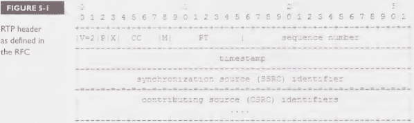

关于 RTP 帧结构，我想说明的第一件事对所有网络帧都成立。这个事实就是：所有帧都是一系列比特。帧是组织起来的 1 和 0 的集合。载荷本身也只是 1 和 0 的集合，但承载协议（此处为 RTP）实际上不需要以任何方式解释载荷数据。承载协议提供正确传输和处理载荷信息所需的信息。如 RFC 所定义并在图 5-1 中所示，RTP 报头提供了这些所需信息。

> **考试提示**
>
> 请为考试日记住不同的 RTP 报头字段及其用途。你可能会遇到关于 RTP 数据包中这些信息的问题。

以下说明涉及 RTP 报头中的每个字段：

- **版本（V）** 第一个 2 比特字段用于指示正在使用的 RTP 版本。目前，版本 2 是最新版本。版本 1 是草案标准，版本 0 是更专有的解决方案。由于该字段为 2 比特，它可以包含十进制 0 到 3 中的任意数字。
- **填充（P）** 当数据包末尾包含填充字节时，会设置该 1 比特字段。填充字节不是载荷的一部分，用于需要固定块大小的加密算法。在下层协议中承载多个 RTP 数据包时，也可能需要填充字节。由于该字段为 1 比特，它可以包含值 0（无填充八位组）或 1（包含填充八位组）。
- **扩展（X）** 扩展位是一个 1 比特字段。当扩展位被设置（值为 1 而不是 0）时，报头之后必须跟随一个报头扩展。RTP 报头扩展用于允许针对特定用途配置对 RTP 报头进行自定义。
- **CSRC 计数（CC）** CC 字段指定固定报头之后的 CSRC 标识符数量。这是一个 4 比特字段。
- **标记（M）** 标记字段的解释因配置而异。RTP 基于配置工作，这些配置标识不同的使用场景（例如 VoIP 或视频流）。标记字段为 1 比特，用于标识数据包流中的帧边界等重大事件。
- **载荷类型（PT）** PT 字段为 7 比特，用于指示 RTP 载荷的格式以及接收应用应如何处理该载荷。RFC 3551 规定了音频和视频载荷的默认映射。例如，RFC 3551 建议 G.729 应为 PT 18，G.723 应为 PT 4。表 5-1 列出了基于 RFC 3551 的不同协议的默认 PT 值。如果接收方不知道已定义的 PT，标准规定必须忽略该数据包，这提供了更好的安全性。
- **序列号** 序列号是 RTP 报头中的一个字段，是一个 16 比特值。每发送一个 RTP 数据包，序列号递增 1。接收方可以使用该编号检测丢失的数据包，或在数据包乱序到达时恢复数据包顺序。标准建议初始序列号值由随机算法确定。

### 表 5-1 RFC 3551 载荷类型（PT）映射

| 编解码器 | PT 值 |
|---|---|
| GSM | 3 |
| G.723 | 4 |
| G.728 | 15 |
| G.729 | 18 |
| G.726(16) | 动态 |
| G.726(24) | 动态 |
| G.726(32) | 动态 |
| G.726(40) | 动态 |
| H.263 | 34 |

- **时间戳** 时间戳字段为 32 比特。时间戳反映 RTP 数据包中第一个八位组的采样时刻。采样时刻必须从随时间单调且线性递增的时钟导出，以便进行同步和抖动计算。
- **同步源（SSRC）** 这个 32 比特字段定义同步源。该源被随机标识，以便同一 RTP 会话中没有两个源会具有相同的 SSRC 标识符。由于随机算法可能生成相同的值（尽管对于 32 位数字来说可能性较小），RTP 协议必须实现检测和解决冲突的算法。RFC 3550 第 8 节提供了冲突检测和解决机制，并指出两个源具有相同标识符的概率约为 10^-4。此 RTP 报头字段列表之后的代码清单是 RFC 3550 建议的算法。
- **贡献源（CSRC）** CSRC 字段可包含 0 到 15 个项，每项 32 比特。该列表定义数据包中载荷的贡献源，适用于合并多个音频流的会议场景。当包含超过 15 个 CSRC 时，只能标识 15 个。CSRC 由混音器（会议服务器）添加，并使用各个 SSRC。

```c
if (SSRC or CSRC identifier is not found in the source identifier table)
{
    create a new entry storing the data or control source
    transport address, the SSRC or CSRC and other state;
}
/* Identifier is found in the table */
else if (table entry was created on receipt of a control packet
    and this is the first data packet or vice versa)
{
    store the source transport address from this packet;
}
else if (source transport address from the packet does not match
    the one saved in the table entry for this identifier)
{
    /* An identifier collision or a loop is indicated */
    if (source identifier is not the participant's own)
    {
        /* OPTIONAL error counter step */
        if (source identifier is from an RTCP SDES chunk
            containing a CNAME item that differs from the CNAME
            in the table entry)
        {
            count a third-party collision;
        }
        else
        {
            count a third-party loop;
        }
        abort processing of data packet or control element;
        /* MAY choose a different policy to keep new source */
    }
    /* A collision or loop of the participant's own packets */
    else if (source transport address is found in the list of
             conflicting data or control source transport
             addresses)
    {
        /* OPTIONAL error counter step */
        if (source identifier is not from an RTCP SDES chunk
            containing a CNAME item or CNAME is the
            participant's own)
        {
            count occurrence of own traffic looped;
        }
        mark current time in conflicting address list entry;
        abort processing of data packet or control element;
    }
    /* New collision, change SSRC identifier */
    else
    {
        log occurrence of a collision;
        create a new entry in the conflicting data or control
        source transport address list and mark current time;
        send an RTCP BYE packet with the old SSRC identifier;
        choose a new SSRC identifier;
        create a new entry in the source identifier table with
        the old SSRC plus the source transport address from
        the data or control packet being processed;
    }
}
```

由于 RTP 用于传输数据包，并且不提供会话建立或管理，因此需要另一种协议来监控数据流。RTCP 协议正是在此发挥作用。

### RTCP

RTP 控制协议（RTCP）用于提供四项基本功能。第一项也是主要的功能是提供关于数据分发质量的反馈。所提供的信息可用于控制动态或自适应编码方案，并且对于分发系统内的故障检测（如帧丢失、抖动和延迟）至关重要。第二项功能是为每个 RTP 源传输一个持久的传输层 ID，称为规范名称或 CNAME。CNAME 类似于 Internet 上的 DNS 名称。SSRC 可能因冲突而改变；然而，CNAME 将保持不变。这种构造类似于 IP 地址可能改变而 DNS 主机名保持不变的方式。RTCP 的前两项功能对于媒体传输网络的运行至关重要，并且在会议或多播音频和视频流等多播环境中最为重要。

RTCP 的第三项功能是速率管理，以便所有参与者都能发送 RTCP 数据包。发送数据包的速率直接取决于通信中的参与者数量。第四项功能是可选的，用于传送会话控制信息。该信息可能包括参与者标识。生成会话控制信息的方法超出了本书或 RFC 3550 的范围。

RFC 3550 定义了五种主要的 RTCP 数据包类型。这五种类型是

- **发送方报告（SR）** 发送方报告包括通信中活动参与者的发送和接收统计信息。RTCP 报头通过将 PT 字段设置为 200 来标识 SR 数据包。
- **接收方报告（RR）** 接收方报告包括通信中非活动参与者（例如无法讲话的音频流听众）的接收统计信息。RTCP 报头通过将 PT 字段设置为 201 来标识 RR 数据包。
- **源描述（SDES）** 源描述项，例如 CNAME。CNAME 是必需的，但也可以包含其他可选项目。这些项目包括 NAME（个人姓名）、EMAIL（参与者的电子邮件地址）、PHONE（参与者的电话号码）、LOC（用户的地理位置）、NOTE（通知或状态信息）、TOOL（生成流的应用或工具名称）以及 PRIV（用于应用特定 SDES 值的私有扩展）。RTCP 报头通过将 PT 字段设置为 202 来标识 SDES 数据包。
- **BYE** 用于结束对 RTP 会话的参与。RTCP 报头通过将 PT 字段设置为 203 来标识 BYE 数据包。


**APP** 提供应用特定功能。RTCP 头通过将 PT 字段设置为 204 来标识 APP 包。

与 RTP 包一样，RTCP 包以固定头部开始，然后根据 RTCP 包类型以灵活长度结束。所有 RTCP 包必须能被 32 位整除。设定这一约束是为了使多个 RTCP 包可以堆叠并组成复合 RTCP 包。

> **请务必记住，应用程序可以利用此信息动态调整编解码器以及 RTP 数据流的其他参数。**
>
> **RTCP 发送方和接收方报告用于监控 RTP 数据流，并且**

在这些 RTCP 包中，最重要的是发送方报告和接收方报告。这些报告用于调整 RTP 流，以适应网络上的实际运行情况。它们还可用于定位问题来源（在本地网络、广域网等上）。发送方报告包含以下有用信息：

- **NTP 时间戳** — 报告发送时的实际时间（挂钟时间）。与 RTP 时间戳一起用于计算往返时间和其他值。
- **RTP 时间戳** — 与 NTP 时间戳相关，但以与被监控数据包中的 RTP 时间戳相同的单位和随机偏移量定义。
- **发送方数据包计数** — 自开始传输以来发送的 RTP 数据包总数。
- **发送方八位组计数** — 自开始传输以来在 RTP 包载荷中发送的八位组（字节）总数。
- **丢失分数** — 自上一个发送方报告或接收方报告以来丢失的 RTP 数据包数量。
- **累计丢失包数** — 自传输开始以来丢失的数据包总数。
- **到达间隔抖动** — 对 RTP 数据包到达时间方差的估计。

接收方报告包含相同的信息，但去掉了 NTP 和 RTP 时间戳以及发送方的数据包和八位组计数器。根据 RFC 3550，可以针对发送方和接收方报告进行一些有价值的计算。以下文本经许可引自 RFC 3550。（版权所有 © 互联网协会 2003。保留所有权利。）

可以预期，接收质量反馈不仅对发送方有用，而且对其他接收方和第三方监视器也有用。发送方可以根据反馈修改其传输；接收方可以确定问题是局部的、区域性的还是全局性的；网络管理员可以使用与配置文件无关的监视器，这些监视器仅接收 RTCP 包而不接收相应的 RTP 数据包，以评估其网络用于组播分发的性能。

累计计数器在发送方信息和接收方报告块中均有使用，以便可以计算任意两份报告之间的差值，从而在短时间和长时间段内进行测量，并提供对报告丢失的恢复能力。最近收到的两份报告之间的差值可用于估计近期的分发质量。包含 NTP 时间戳是为了可以根据两份报告之间的间隔从这些差值计算速率。由于该时间戳独立于数据编码的时钟速率，因此可以实现与编码和配置文件无关的质量监视器。

一个示例计算是两份接收报告之间间隔内的数据包丢失率。累计丢失包数的差值给出该间隔内丢失的数量。收到的扩展最后序号之差给出该间隔内期望的数据包数量。两者之比即为该间隔内的数据包丢失分数。如果两份报告连续，则此比率应等于丢失分数字段，否则可能不同。每秒丢失率可以通过将丢失分数除以 NTP 时间戳之差（以秒为单位）得到。收到的数据包数量等于期望的数据包数量减去丢失的数量。期望的数据包数量也可用于判断任何丢失估计的统计有效性。例如，丢失 5 个中的 1 个比丢失 1000 个中的 200 个显著性更低。

根据发送方信息，第三方监视器可以在不接收数据的情况下计算一段时间间隔内的平均载荷数据速率和平均包速率。两者之比给出平均载荷大小。如果可以假设数据包丢失与包大小无关，那么特定接收方收到的数据包数量乘以平均载荷大小（或相应的包大小）即为该接收方可用的表观吞吐量。

除了允许利用报告之间的差值进行长期数据包丢失测量的累计计数之外，丢失分数字段还提供来自单个报告的短期测量。当会话规模扩大到可能无法为所有接收方保留接收状态信息，或者报告间隔变得足够长以至于可能仅从某个特定接收方收到一份报告时，这一点变得更加重要。

到达间隔抖动字段提供网络拥塞的第二种短期度量。数据包丢失跟踪持续拥塞，而抖动度量跟踪瞬时拥塞。抖动度量可能在拥塞导致数据包丢失之前就指示出拥塞。到达间隔抖动字段仅仅是报告时抖动的快照，并不打算用于定量分析。而是用于比较一个接收方在一段时间内发出的多份报告或来自多个接收方的报告，例如在同一网络内同一时间的报告。为了允许跨接收方进行比较，所有接收方都按照相同公式计算抖动非常重要。

由于抖动计算基于 RTP 时间戳，该时间戳表示包中第一个数据被采样的时刻，因此采样时刻与数据包发送时间之间的任何延迟变化都会影响计算出的抖动结果。对于持续时间不同的音频包，会出现这种延迟变化。视频编码也会出现这种情况，因为一帧的所有包具有相同的时间戳，但这些包并非在同一时间全部发送。传输前的延迟变化确实会降低抖动计算作为网络自身行为度量的准确性，但考虑到接收方缓冲区必须容纳这种变化，将其纳入计算是合适的。当抖动计算用作比较度量时，由传输前延迟变化引起的（恒定）分量会被抵消，因此除非变化相对较小，否则可以观察到网络抖动分量的变化。如果变化很小，则可能无关紧要。

### 认证目标 5.02

### 642-436：描述 RTP、RTCP、cRTP 和 sRTP

除了 RTP 和 RTCP 协议之外，您还应了解这两种协议的两个特殊补充，它们可提高通信效率和安全性。压缩 RTP（cRTP）提供了更高的效率，而安全 RTP（sRTP）提供了更高的安全性。

### cRTP

RTP 通信流的核心是尽可能快地将音频和/或视频数据从网络中的一个节点传送到另一个节点。问题在于，当您将 IP、UDP 和 RTP 三重头部都包含在内时，头部本身就有 40 字节。RTP 头部本身为 12 字节，UDP 头部为 8 字节，IP 头部至少为 20 字节。当您考虑到几秒钟的语音通话可能需要数百个 RTP 包时，您就会意识到这种头部开销可能非常可观。cRTP 可以将这 40 字节的头部减少到最少 2 字节（无 UDP 校验和）或 4 字节（有 UDP 校验和）。

在实际环境中，cRTP 会在路由器上产生处理开销。因此，您必须仔细考虑其价值。在大多数情况下，cRTP 用于广域网链路，而不用于内部链路。内部带宽通常足以容纳未压缩 RTP 所需的额外 36–38 字节。

> **工作提示**
>
> *由于 cRTP 可能会导致 Cisco 路由器上的处理器利用率上升，因此最好检查路由器中处理器的利用率水平。您可以在特权执行模式下使用 `show processes CPU IOS` 命令查看 Cisco 路由器上的处理器利用率。当路由器利用率超过 70% 时，应避免使用 cRTP。*

所使用的压缩方法很简单。IP、UDP 和 RTP 头部中的许多数据是静态的。说数据是静态的，只是意味着它在各个包之间不会变化。由于这些数据保持不变，一旦流开始，就没有必要在每个包中重复它。cRTP 中使用的头部压缩技术基于 RFC 1144 中定义的 TCP/IP 头部压缩。cRTP 在 RFC 2508 中定义。


### 场景与解决方案

| 场景 | 解决方案 |
|---|---|
| 你正在配置 RTP 以用于一条 WAN 链路。从安全角度来看，该 WAN 链路是可信的，但其带宽有限。你应该启用 cRTP、sRTP，还是两者都启用？ | 由于该 WAN 链路是可信的，因此不需要 sRTP；不过，可以利用 cRTP 来减少 RTP 通信所消耗的带宽。 |

应将 cRTP 与算法压缩技术区分开来，例如 PKWare 开发的 ZIP 算法或用于压缩图像的 JPEG 算法。ZIP 是一种无损的数学压缩算法，但需要通过非常复杂的数学计算来实现。JPEG 是一种有损算法，会永久破坏数据以减小图像大小。cRTP 既不是无损的，也不是计算密集型的。例如，可以从 IP 报头中移除若干字段。事实上，只需包含数据包 ID。对于 UDP 报头，使用校验和时必须传输它，但大多数其他字段要么与 IP 字段冗余，要么是静态的。在 RTP 报头中，SSRC ID 在给定通信流中是常量，因此可以移除。通常，在 RTP 报头中，只有序列号和时间戳会随数据包不同而变化。

如你所见，从前一段的简要概述中可以看出，IP/UDP/RTP 报头链的压缩可以在完全不丢失数据的情况下实现。它并不计算密集；然而，如果路由器必须做额外的工作来缓存完整报头，以便重建未来的压缩报头，这确实会引入开销。正因如此，cRTP 通常只用于 WAN 连接。

> **考试注意**
> 
> 请记住，cRTP 通过移除冗余信息来压缩 RTP、UDP 和 IP 报头，而不是通过实现某种算法压缩方案（例如 PKZIP、Arj 和其他压缩应用程序所使用的方案）来压缩。

在 Cisco 路由器上，可以在接口配置模式下启用 RTP 报头压缩（cRTP）。例如，你可以先在串行接口上进入接口配置模式，然后执行以下命令，从而在该接口上启用 cRTP：

```
ip rtp header-compression
```

可选地，你可以在命令末尾添加 passive 关键字（使命令成为 `ip rtp header-compression passive`），以启用被动模式下的 cRTP 行为。在被动模式下，只有当同一接口上的传入数据包也被压缩时，路由器才会压缩传出的 RTP。省略 passive 关键字时，所有发送到所配置接口的 RTP 通信都会被压缩。

Cisco IOS 还允许你控制接口上允许的压缩连接数。此配置有助于限制对处理器利用率的影响。默认允许的 cRTP 连接数为 16。使用以下命令修改此值：

```
ip rtp compression connections number
```

变量 number 表示允许的连接数。例如，要将允许的 cRTP 连接数设置为 20，请在相应接口的接口配置模式下执行以下命令：

```
ip rtp compression connections 20
```

### sRTP

安全 RTP（sRTP）用于保护 RTP 数据有效载荷的安全。通常，RTP 数据以明文形式发送（除非在 VPN 隧道内传输），并且使用协议分析器或专门的 VoIP 黑客工具很容易读取。sRTP 允许对此 RTP 数据进行加密。此外，sRTP 还提供身份验证和重放攻击防护。定义 sRTP 的 RFC 3711 将该协议的目标表述如下：

- RTP 和 RTCP 有效载荷的机密性
- 整个 RTP 和 RTCP 数据包的完整性，以及针对重放数据包的保护

当然，在计算机和网络安全领域，每当你看到“机密性”这个词时，就知道加密正在发挥作用。当你看到提及完整性时，很可能使用了哈希算法或校验和。

你可能记得，RTP 设计为允许使用配置文件（profile）来为 RTP 提供特定使用场景。sRTP 实际上是 RTP 的一个标准化配置文件，规定了安全解决方案。安全 RTCP（sRTCP）也有定义，它像 sRTP 为 RTP 提供服务那样为 RTCP 提供安全服务。该标准指出，sRTP 和 sRTCP 充当“协议栈中的插入层”，以便在发送侧截获 RTP 数据包，并向接收方发送一个等效的 RTP 数据包。接收方截获 sRTP 数据包并剥离安全保护，将标准 RTP 数据包向上层发送给应用程序。sRTCP 的行为也是如此。其好处是，现有应用程序有可能在使用 RTP 时无需意识到它的使用。

RFC 3711 标准包含使用 AES（高级加密标准）作为分组密码算法。基于哈希的消息认证码安全哈希算法 1（HMAC-SHA1）可用于完整性和身份验证。

> **考试注意**
> 
> **请记住，sRTP 提供的不仅仅是加密。** 它还提供身份验证、加密和重放攻击防护。

### 认证总结

在本章中，你学习了实时传输协议（RTP）以及它所需要和使用的支持协议。RTP 用于传输数据流。RTP 控制协议（RTCP）用于监控这些 RTP 数据流。压缩 RTP（cRTP）可用于通过移除 RTP 报头中的冗余来提高效率。安全 RTP（sRTP）可用于加密 RTP 数据流。所有四种协议都被定义为 RFC 标准，并通常实现在 Cisco 等厂商的 VoIP 解决方案中。

### 自测

以下问题将帮助你衡量对本章所述材料的理解程度。请仔细阅读所有选项，因为可能有不止一个正确答案。为每个问题选择所有正确答案。

### 640-460：描述 RTP 和 RTCP

- 1. 在 VoIP 网络中，使用什么协议来传输实时数据？
  - A. H.323
  - B. SIP
  - C. RTP
  - D. RTCP
- 2. 在 VoIP 网络中，使用什么协议来监控实时数据的传输？
  - A. SCCP
  - B. RTP
  - C. cRTP
  - D. RTCP
- 3. 可以创建什么来扩展 RTP 在特定应用场景中的使用？
  - A. 配置文件
  - B. 加密算法
  - C. 哈希算法
  - D. 压缩算法
- 4. 哪两种 RTCP 数据包类型可用于提供有关 RTP 数据流的有用信息，例如抖动和丢包？（选择两项。）
  - A. BYE
  - B. SR
  - C. RR
  - D. SDES
- 5. 哪种 RTP 数据包类型主要用于传输 CNAME 信息，但也可能包含电子邮件地址、电话号码和其他特定应用信息？
  - A. BYE
  - B. SR
  - C. RR
  - D. SDES

- C. `ip rtp header-compression`
- D. `ip rtp header-compression passive`

- 12. 你希望在串行接口上启用 cRTP 压缩。你希望同一时间只有 10 个连接使用压缩。你希望仅当传入连接使用 cRTP 时才压缩流。你会输入什么命令来启用压缩并限制连接数？（选择两项。）
  - A. `ip rtp compression connections 10`
  - B. `ip rtp header-compression`
  - C. `ip rtp header-compression passive`
  - D. `ip rtp compression limit 10`
- 13. 哪种协议是 RTP 的配置文件扩展，可为 RTP 通信提供安全保障？
  - A. cRTP
  - B. sRTP
  - C. RTSP
  - D. DES
- 14. sRTP 使用的默认加密算法是什么？
  - A. DES
  - B. RC4
  - C. AES
  - D. Blowfish
- 15. sRTP 为 RTP 数据流提供哪些安全特性？（选择所有适用项。）
  - A. 机密性
  - B. 身份验证
  - C. 物理安全
  - D. 生物识别

### 实验题

你正在为网络基础设施和 WAN 连接配置 RTP。你希望为 VoIP 实施启用这些协议的最高效使用方式。该网络由两条 WAN 连接（serial 0 和 serial 1）以及 12 个以太网路由器接口组成。你可以选择在哪些接口上实施（如果有的话）？请解释你选择或未选择这些接口的原因。


### 自测答案

### 640-460：描述 RTP 和 RTCP

- 1. ☑ C 正确。实时传输协议（RTP）用于在 VoIP 网络中传输数据。它也用于视频和多媒体流式传输及会议。
- ☒ A、B 和 D 不正确。H.323 和 SIP 是呼叫建立和管理协议，并不实际用于传输实时语音数据。RTCP 用于监视 RTP 通信。

- 2. ☑ D 正确。RTP 控制协议（RTCP）用于监视和报告 RTP 数据流。
- ☒ A、B 和 C 不正确。SCCP 用于建立和管理语音呼叫。RTP 用于传输数据流，并由 RTCP 监视。RTCP 用于压缩 RTP 数据流的报头。

- 3. ☑ A 正确。配置文件用于扩展 RTP 以支持特定应用功能。例如，SRTP 是一种配置文件，可为 RTP 数据流和 RTCP 通信提供安全性。
- ☒ B、C 和 D 不正确。加密算法提供机密性，并且可以在配置文件中指定，但它们本身不会扩展 RTP。哈希算法和压缩算法也是如此。

- 4. ☑ B 和 C 正确。发送方报告（SR）和接收方报告（RR）数据包包含有关 RTP 流的有用监视信息。所包含的信息包括抖动、延迟、丢包和其他标识符类型信息。
- ☒ A 和 D 不正确。BYE 数据包用于结束对 RTP 流的参与。SDES 数据包用于传达 CNAME 和其他与 RTP 流的实际监视数据无关的可选信息值。

- 5. ☑ D 正确。源描述（SDES）数据包用于传输规范名称（CNAME）、个人名称（NAME）、地理位置（LOC）、电子邮件地址（EMAIL）和电话号码（PHONE），以及其他一些可能的值。
- ☒ A、B 和 C 不正确。BYE 数据包用于结束对 RTP 流的参与。发送方报告（SR）和接收方报告（RR）数据包包含有关 RTP 流的有用监视信息。

- 12. ☑ **A 和 C 正确。** `ip rtp compression connections 10` 命令将 RTP 连接数限制为 10。`ip rtp header-compression passive` 命令确保只有在收到压缩数据包的接口上发送的 RTP 数据包才会被压缩。
- ☒ **B 和 D 不正确。** `ip rtp header-compression` 命令将压缩路由器发出的所有数据包，这不是期望的结果。`ip rtp compression limit 10` 命令不是有效的 Cisco IOS 命令。

- 13. ☑ **B 正确。** 安全 RTP（SRTP）协议是一种配置文件扩展，可为 RTP 数据流和 RTCP 通信提供安全性。
- ☒ **A、C 和 D 不正确。** cRTP 为 RTP 数据流提供压缩。RTSP 未被定义为与 RTP 相关，而是用于多媒体流式传输的流协议。DES（数据加密标准）是一种加密算法。

- 14. ☑ **C 正确。** 高级加密标准（AES）是 SRTP 通信中使用的默认加密算法。
- ☒ **A、B 和 D 不正确。** SRTP 默认不使用 DES，尽管应用程序可以扩展 RTP 协议以使用 DES 加密算法。RC4 和 Blowfish 也不是 SRTP 默认使用的算法。

- 15. ☑ **A 和 B 正确。** 机密性通过加密提供；但是，SRTP 标准确实允许空加密算法，这会导致没有机密性。认证通过使用 HMAC-SHA1 的完整性检查来提供。
- ☒ **C 和 D 不正确。** 物理安全是指用于监视和保护网络运行所在物理环境的措施。SRTP 不提供任何有助于物理安全的措施。生物识别可用于对 VoIP 系统进行身份验证，但 SRTP 与此类安全解决方案没有直接交互。

### 实验答案

答案可能有所不同，但在大多数网络中，cRTP 只会用于 WAN 链路。做出这一决定的原因很简单：虽然 cRTP 可以更有效地利用网络，但它会给路由器增加处理器开销。在低带宽 WAN 链路上，这种权衡是值得的。在 100 Mbps 或 1 Gbps 等快速连接上，通常不值得付出处理器成本。


## 6 H.323

### 认证目标

- 6.01 642-436：描述 H.323
- 6.02 640-460：描述 H.323 信令协议
- ✓ 两分钟练习
- 问答自测

> 1968 年夏天，来自最初四个站点的代表多次会面，讨论了 HOST 软件和网络上的初始实验。
>
> —RFC 1，提到 ARPA 网络的最初四个站点，该网络最终演变为互联网。

虽然 RTP 是所有 VoIP 通信背后的核心协议，但它不提供发起呼叫、管理呼叫或终止呼叫所需的管理功能。对于这些操作，必须使用另一种协议。主要的 VoIP 呼叫管理协议是 H.323、SIP、MGCP 和 SCCP。本章介绍 H.323 协议套件，接下来的两章将介绍 SIP、MGCP 和 SCCP。自从最初四个站点连接到小小的 ARPA（高级研究计划局）网络以来，互联网已经取得了长足的发展，现在我们可以使用 H.323、SIP、MGCP 和 SCCP 等协议，在由数千甚至数百万个网络组成的互联网上进行电话通话。

### 认证目标 6.01

### 642-436：描述 H.323

与 RTP 不同，RTP 在单个 RFC 中定义并作为单个协议更新，而 H.323 是一个包含许多协议的标准。与 TCP/IP 非常相似，我们经常将 H.323 称为协议套件，因为在 H.323 保护伞下定义了多个协议。H.323 是一个标准，定义了通过 IP 或分组网络进行多媒体通信的组件（角色和设备）和协议。多媒体通信包括 VoIP 以及实时视频或数据（例如视频会议服务）。在本节中，您将学习协议套件以及 H.323 网络上运行的设备。

### H.323 协议套件

H.323 协议套件包括用于三个主要目的的协议。第一个是端点或终端控制与管理。这些协议允许您建立呼叫并管理该呼叫可用的功能。第二个是音频和视频协议。这些协议包括用于编码以及可能压缩呼叫数据的编解码器。第三组协议用于数据通信，这里不作详细介绍。这些协议允许传输数据文件和信息，并使用它们自己的专有第 4 层解决方案（T.123）。图 6-1 详细描述了 H.323 协议套件。

重要的是您要了解每个协议的基本用途。以下列表应有助于您记住每个协议的用途及其在 VoIP 网络中的作用：

- **IP** 互联网协议（IP）是所有 VoIP 网络上使用的第 3 层协议；因此，VoIP 中的“IP”即互联网协议。IP 用于跨路由网络或跨 LAN 段传输 TCP 和 UDP 数据包。IP 同时用于路由网络和非路由网络。
- **TCP** 当上层协议需要传输验证时，使用传输控制协议（TCP）。对于 H.323，TCP 用于使用 H.225.0（或简称 H.225）和 H.245 进行初始呼叫建立。
- **UDP** 当上层协议不需要传输验证时，使用用户数据报协议（UDP）。对于 H.323，UDP 用于 H.225 RAS 消息、RTCP 数据包以及实际数据流（音频或视频编码数据包）。

**图 6-1** H.323 协议套件

| 数据协议 | 端点控制与管理 |  |  |  | 音频和视频协议 |  |
| --- | --- | --- | --- | --- | --- | --- |
| T.124 | H.245 | H.225.0 | H.225 RAS | RTCP | G.711<br>G.729<br>G.723.1<br>G.728 | H.261<br>H.263 |
| T.125 |  |  |  |  | RTP |  |
| T.123 | TCP |  |  |  | UDP |  |
| IP |  |  |  |  |  |  |


- **H.245** H.323 端点（终端）之间的控制信令通过 H.245 执行。控制信令包括能力或特性交换、流控制消息传递、媒体流逻辑信道的启动和终止，以及其他通用命令或通知。在 Cisco VoIP 网络中，H.245 的关键用途是特性通信。
- **H.225** 两个 H.323 端点之间的初始连接使用 H.225 实现。当使用 H.323 网守时，协议消息在端点之间或端点与网守之间打开的呼叫信令信道上交换。
- **H.225 RAS** H.225 注册、准入和状态（RAS）用于在端点与网守之间传送消息。注册、准入控制、状态消息、带宽变更和呼叫终止过程均由 H.225 RAS 处理。通常仅在 VoIP 网络上存在 H.323 网守时使用 H.225 RAS。
- **RTP** 实时传输协议（RTP）用于在 H.323 VoIP 网络上传输实际语音数据。RTP 使用 UDP 进行通信。有效载荷标识、时间戳、传输监控和序列编号均由 RTP 提供。
- **RTCP** 实时传输控制协议（RTCP）用于与 RTP 相关的控制服务。提供反馈是 RTCP 的主要功能。RTCP 提供的质量测量可用于调整网络通信以改善 QoS。
- **G.7xx** G.7xx 系列编解码器被规定为 ITU-T 标准。H.323 终端必须至少支持 G.711 编解码器，并且可以支持其他编解码器，如 G.722、G.723、G.728 和 G.729。
- **H.26x** 当 H.323 终端提供视频服务时，它们将使用 ITU-T 的 H.26x 系列标准。对于支持视频通信的 H.323 终端，H.261 建议是最低要求。H.263 和 H.264 是 H.323 终端可能支持的附加建议。

> **考试注意**
>
> 确保你记住这些协议以及它们在 H.323 网络中所扮演的角色。特别要记住，UDP 承载语音数据，而 TCP 用于呼叫建立。UDP 还用于呼叫报告和信令（H.225 RAS 消息）。

除这些协议外，H.323 VoIP 网络还将使用几种不同的设备类型。这些设备将在下一节中介绍。

### H.323 设备

H.323 网络上可以使用多种设备。H.323 标准建议使用四种主要设备：

- 终端
- 网关
- 网守
- 多点控制单元（MCU）

### 终端

终端是使用 H.323 协议相互通信的设备或软件应用程序。终端可以是专用设备，例如 Cisco IP 电话，也可以是运行基于软件的 H.323 终端的台式机或笔记本电脑，例如 Cisco SoftPhone。H.323 终端必须支持一组最低要求，才能作为基于标准的终端。这些要求是

- 支持 H.245 以进行终端能力或特性交换以及媒体通信信道的创建
- 支持 H.225 以进行呼叫信令和呼叫建立
- 当存在网守时，支持 H.225 RAS 以进行注册、准入控制和带宽管理
- 支持 RTP/RTCP 以进行音频和/或视频分组排序和传输
- 支持 G.711 编解码器以进行音频编码

对 H.225 RAS 的要求基于以下事实：当网络上存在 H.323 网守时，所有 H.323 终端都必须使用它。H.323 是一种对等协议，也支持通过网守进行集中管理和呼叫建立。如果使用网守，呼叫建立会采用更像客户端/服务器模型的架构（尽管音频流仍然直接从一个终端传输到另一个终端，而不经过网守）。如果不使用网守，H.323 终端以纯对等模式工作。

除最低要求外，还可以支持若干可选项目。这些可选项目包括

- 附加 G.7xx 编解码器
- T.120 数据会议解决方案
- 多点控制单元对会议的支持

### 网关

H.323 网关旨在为呼叫建立以及与其他网络的通信提供协议转换。通常，网关连接两种不同类型的网络，以便它们之间可以进行通信。例如，H.323 网关可以通过 T1、模拟或 ISDN 线路将本地 VoIP 网络与 PSTN 连接起来。

网关将在第 14 章中更详细地介绍。

### 网守

网守就像 H.323 网络的中央大脑。当不使用网守时，所有 Cisco Communications Manager Express（CME）路由器都必须知道所有其他 CME 路由器的位置。当使用网守时，它会维护一个包含 CME 路由器及其可访问分机的中央数据库。这大大简化了拨号对等体配置和一般 VoIP 网络设置。然而，它也在网守中引入了潜在的中央单点故障。因此，应提供某种形式的冗余，以便在发生硬件或软件故障时 VoIP 网络仍能继续运行。

与网关一样，网守将在第 14 章中更详细地介绍。

### 多点控制单元

当会议涉及三个或更多用户时，MCU 提供多用户会议支持。MCU 管理会议中使用的资源，并在呼叫建立期间协商最佳编解码器。在 Cisco 领域，MCU 需要 DSP（数字信号处理器）资源来合并音频信号。MCU 从所有参与者接收音频信号，并将它们合并为单个输出音频信号。结果就是电话会议。

虽然网关、网守和 MCU 在 H.323 规范中被定义为逻辑上独立的组件，但它们可以由单个设备实现。例如，单个 Cisco ISR 可以充当 VoIP 网络的网关和网守。随着 VoIP 网络规模扩大，它们更可能将不同的 H.323 组件实现为独立的物理实体。

> **考试注意**
>
> 记住 H.323 网络的四个关键组件是终端、网关、网守和 MCU。还要记住，网守是可选的，但当实施网守时，所有终端都必须使用它进行呼叫处理。

### 认证目标 6.02

### 640-460：描述 H.323 信令协议

既然你已经了解了构成 H.323 整体的各个部分，现在是时候探索 H.323 呼叫如何处理了。在本节中，你将了解使用 H.225.0 协议和 H.245 协议处理呼叫的方式。这两个协议构成 H.323 VoIP 网络的核心。

### H.323 呼叫建立

作为 VoIP 管理员，理解如何使用 H.323 协议套件实际建立和管理呼叫非常重要。该过程从 H.225 协议开始。当你有一部 VoIP 电话连接到 Cisco 交换机，该交换机连接到 H.323 网关（Cisco IOS 路由器），该网关又连接到另一台交换机，而另一台交换机连接到另一部 VoIP 电话时，必须使用某种协议来启动通信。就像你使用传统 PSTN 线路电话拿起听筒并使用 PSTN 信令方法拨打电话一样，在 VoIP 网络上你也必须有某种信令方法。这就是 H.225 的作用。

当你拿起 VoIP 电话听筒并拨打另一部 VoIP 电话时，H.225 协议用于向远端电话发送振铃通知，并向原呼叫方电话发送响应。在这个初始呼叫建立完成并且接听方拿起听筒后，H.245 协议开始介入，协商呼叫的特性或能力。这些特性通常包括要使用的编解码器。假设双方电话都同意使用 G.711 编解码器，那么就可以使用该编解码器开始通话。

现在，重要的是你要理解所有这些都发生得非常快。尽管直到被叫方拿起听筒才协商特性，但这种协商发生得如此之快，以至于被叫方可以立即开始说话，而音频仍会通过 VoIP 网络到达主叫方。这种现实之所以存在，是因为我们的网络以毫秒（或纳秒）思考，而我们以秒或分钟思考。

**考试注意** 如果 H.245 内的特性协商失败，Cisco IP 电话可能只是在主叫方和被叫方的扬声器上播放忙音。在大多数情况下，这两部电话没有正确配置以支持共享编解码器。

### H.323 呼叫信令阶段

根据 H.323 建议（ITU-T 称之为“标准”），呼叫处理或信令发生在五个阶段中。这五个阶段称为阶段 A 到阶段 E，最后阶段是呼叫终止。以下列表概述了五个阶段中每个阶段发生的情况：

- **阶段 A：呼叫建立** 呼叫建立使用 H.225.0 进行。虽然此阶段不要求带宽请求，但 H.323 标准建议它们在最早阶段发生。当不存在网守时，使用简单的四步过程来为阶段 B 建立信道。当存在网守时，需要八个步骤，因为网守充当双方之间的中间方或代理。


- 阶段 B：初始通信与能力交换。阶段 A 建立 H.245 控制通道，该控制通道在阶段 B 期间用于能力（特性）交换。终端会同时传达发送能力和接收能力。接收能力限制可发送给该终端的内容。发送能力限制可从该终端发送的内容。主要传达的能力是呼叫所支持的编解码器。

- 阶段 C：音频/视频通信的建立。一旦能力协商完成，阶段 C 即可开始，第一步是为信息流建立逻辑通道。标准规定，音频和视频流应使用不可靠协议（如 RTP 和 UDP）传输，而使用 H.245 本身传输的数据应使用可靠协议（如 TCP）传输，如图 6-1 所示。

- 阶段 D：呼叫服务。在呼叫服务阶段，活动的 VoIP 呼叫正在进行；不过，仍可能需要执行管理操作。例如，端点可能请求更改带宽。如果分配了新的带宽，端点将使用 H.245 将此新允许量告知另一端点。此外，在此阶段可能会发送 H.225.0 Information Request/Information Request Response 消息以进行状态更新。

- 阶段 E：呼叫终止。最后一个阶段是呼叫终止。H.323 规范定义了两种呼叫终止过程。第一种可视为“非正常终止”，因为媒体通道的关闭是隐含的，而不是明确请求的。第二种包含关闭媒体通道的明确请求。当网络包含网守时，端点必须向网守发送 H.225.0 Disengage Request 消息。网守以 Disengage Confirm 消息响应。

除 H.323 呼叫处理的标准阶段外，标准中还规定了故障处理。如果端点检测到故障，并希望确定远程端点是否仍在运行并连接到网络，它可以使用 H.245 roundTripDelayRequest 消息作为测试。如果端点响应，则它仍处于活动状态。如果发生传输错误，则基础设施可能已故障，或者端点不再连接到网络。

最后，H.323 可以成为 Cisco VoIP 网络的可靠协议。它同时提供 VoIP 和 IP 视频功能，并且还包含会议支持。

有关 H.323 协议本身的更多信息，请考虑访问以下任一网站：

- http://en.wikipedia.org/wiki/H.323
- www.itu.int/rec/T-REC-H.323-200606-S/en

### 认证总结

本章中，您了解了 H.323 协议及其各种组件和功能。您了解到 H.323 是一种伞形协议，其核心包含 H.225 和 H.245 协议。H.323 网络仍然依赖 RTP 进行音频流传输，并仅分别在 H.225 和 H.245 协议中提供呼叫建立和管理。您还了解了四个主要的 H.323 组件：终端是 H.323 VoIP 网络中的 VoIP 电话。网关是将 H.323 网络连接到其他 H.323 网络或不同网络类型（如 PSTN）的设备。网守是可选组件，它集中了 H.323 网络的大部分管理功能。MCU 是允许电话会议和视频会议进行传输的设备。

### 两分钟演练

### 642-436：描述 H.323

- H.323 与其说是具体的协议定义，不如说是其他协议的聚合，以及关于它们如何互操作的规范。
- H.323 指定 H.225.0 用于呼叫建立。
- H.323 指定 H.245 用于特性协商和呼叫管理。
- H.323 仍依赖 RTP 和 RTCP 进行语音数据传输。
- H.225.0 RAS 用于与 H.323 网守通信。
- 在 H.323 术语中，VoIP 电话是终端或端点。
- 网关也可视为 H.323 网络上的端点。
- H.323 网关提供到不同 H.323 网络或完全不同网络类型的连接。
- H.323 网守是可选组件；但是，如果实施了网守，则网络上的所有终端都必须使用它。
- 多点控制单元（MCU）用于将多个传入流聚合为单个传出流，以进行音频和/或视频会议。

### 640-460：描述 H.323 信令协议

- 当您首次拿起 Cisco VoIP 话机并拨打另一个分机时，H.225.0 协议用于与远程 VoIP 电话建立呼叫。
- 当您接起正在振铃的话机时，H.245 协议用于在您的电话与主叫电话之间协商能力（特性）。
- 在 H.323 建议文档中，H.323 呼叫过程分为五个阶段。
- 如果端点检测到故障，它可以发送 H.245 roundTripDelayRequest 作为测试。
- 在阶段 A 期间，使用 H.225.0。
- 在阶段 B 期间，使用 H.245。
- 在阶段 C–E 期间，可能同时使用 H.225.0 和 H.245。

### 自测

以下问题将帮助您衡量对本 chapter 所介绍材料的理解。请仔细阅读所有选项，因为可能有多个正确答案。为每个问题选择所有正确答案。

### 642-436：描述 H.323

- 1. 哪种 H.323 网络设备或软件提供视频和/或音频会议？
  - A. 多点控制单元
  - B. 网守
  - C. 网关
  - D. 终端

- 2. 哪种 H.323 网络设备提供 RAS 服务？
  - A. 多点控制单元
  - B. 网守
  - C. 网关
  - D. 终端

- 3. 哪种 H.323 设备是 VoIP 电话或视频会议端点？
  - A. 多点控制单元
  - B. 网守
  - C. 网关
  - D. 终端

- 4. H.323 网关的主要功能是什么？
  - A. 将 H.323 呼叫定向到适当的端点或网守
  - B. 向 H.323 网络提供 RAS 服务
  - C. 提供音频会议服务
  - D. 充当 VoIP 电话

- 5. 对 H.323 建议的最佳描述是什么？
  - A. H.323 是定义 VoIP 数据传输的协议。
  - B. H.323 是一种规范，建议使用多种其他协议进行 VoIP 网络信令和管理。
  - C. H.323 是允许 Internet 电子邮件的协议。
  - D. H.323 是在使用网守时执行 RAS 信令的协议。

- 6. 当 H.323 网络中安装了网守时，唯一用于与网守通信的协议是什么？
  - A. H.245
  - B. H.225.0 RAS
  - C. RTP
  - D. RTCP

- 7. 除了 VoIP 电话之外，还有哪种设备可被视为 H.323 网络中的端点？
  - A. MCU
  - B. 网守
  - C. 网关
  - D. 交换机

- 8. H.323 网络中用于传输音频和视频流的协议是什么？
  - A. H.225.0
  - B. H.245
  - C. H.225.0 RAS
  - D. RTP

- 9. H.323 网络中用于能力或特性协商的协议是什么？
  - A. H.245
  - B. H.225.0 RAS
  - C. H.225.0
  - D. RTCP

- 10. 您已经实施了 H.323 网守。根据 H.323 建议，H.323 网络上的哪些设备必须能够与该网守通信？
  - A. 所有已注册的 VoIP 电话
  - B. 所有 PBX 系统
  - C. 所有 PSTN 电话
  - D. 所有模拟电话

- 11. 您正在实施 H.323 网络。H.323 网关将连接到哪些网络并路由或接收呼叫？（选择所有适用项。）
  - A. 其他 H.323 网络
  - B. 非 H.323 语音网络
  - C. ARPA 网络（ARPANET）
  - D. Commodore 64 网络


### 640-460：描述 H.323 信令协议

12. 你拿起 Cisco VoIP 电话的话筒。听到拨号音，并找到网络上另一部 VoIP 电话的分机。该网络使用 H.323 协议。使用什么协议来发起与远程 VoIP 电话的连接？

- A. H.245
- B. H.225.0
- C. RTP
- D. RTCP

13. 你的 Cisco VoIP 电话响了。你拿起话筒。该网络使用 H.323 协议。使用什么协议来确定将用于该呼叫的编解码器？

- A. H.245
- B. H.225.0
- C. RTP
- D. RTCP

14. 如果 H.323 端点检测到故障，它可能在 H.323 网络上发送什么来测试远程终端的连通性？

- A. H.245 roundTripDelayRequest
- B. H.225 roundTripDelayRequest
- C. H.245 roundTripPINGRequest
- D. H.225 roundTripPINGRequest

15. 根据 H.323 建议，呼叫处理涉及多少个阶段？

- A. 1
- B. 3
- C. 5
- D. 7

### 实验题

你正在使用 Cisco 设备实施一个 H.323 VoIP 网络。你希望确保所有 VoIP 电话都必须向网络注册，才能与网络上的任何其他电话通信。你希望避免在充当 H.323 网关的所有 Cisco IOS 路由器上配置所有分机。如何以最简单的方式通过集中管理实施该网络？

### 自测答案

### 642-436：描述 H.323

- 1. ☑ **A 正确。** MCU（多点控制单元）提供音频/视频会议。MCU 接收多个传入音频流，并将它们合并为一个传出流。它还可以将合并后的传入流生成象限或其他视频布局方法的视频流，以用于视频会议；然而，视频会议超出了本书或 CCNA Voice 考试的范围。
  
  ☒ **B、C 和 D 不正确。** 网守提供 H.323 网络访问和呼叫路由信息。网关提供与其他网络的连接。终端是 VoIP 电话。

- 2. ☑ **B 正确。** 网守使用 H.225.0 RAS 消息，并充当 RAS 服务提供者。网守可以提供 H.323 网络注册（R）服务、准入（A）或访问服务，以及呼叫监控或状态（S）服务。
  
  ☒ **A、C 和 D 不正确。** MCU 提供音频/视频会议服务。网守提供与其他网络的连接。终端是 VoIP 电话。

- 3. ☑ **D 正确。** 终端是 VoIP 电话。终端可以是基于硬件的电话，例如 Cisco 7960G，也可以是基于软件的电话，例如用于 Windows 的 Cisco IP SoftPhone。
  
  ☒ **A、B 和 C 不正确。** MCU 提供音频/视频会议服务。网守向 H.323 网络提供 RAS 服务。网关提供与其他网络的连接。

- 4. ☑ **A 正确。** 网关将 H.323 呼叫引导到同一网络或另一网络上的正确端点或网守。因此，其主要目的是呼叫的引导或路由。
  
  ☒ **B、C 和 D 不正确。** 网守向 H.323 网络提供 RAS 服务。MCU 提供音频会议服务。终端充当 VoIP 电话。

- 5. ☑ B 正确。H.323 建议（或标准）本身并不是一个协议规范。相反，H.323 引用其他标准，例如用于呼叫建立的 H.225.0 建议和用于功能协商的 H.245 建议。它还建议在媒体网络中使用 RTP 和 RTCP 进行音频和视频数据传输。
  
  ☒ A、C 和 D 不正确。H.323 不定义 VoIP 数据的传输；传输在 RTP 和 RTCP 标准中定义。H.323 不是用于发送或接收互联网电子邮件的协议；SMTP 是用于此类目的的标准。H.323 实际上不执行 RAS 信令；H.225.0 RAS 执行 RAS 信令，并被 H.323 引用。

- 6. ☑ B 正确。H.225.0 RAS（注册、准入和状态）协议用于与网守通信。
  
  ☒ A、C 和 D 不正确。H.245 用于功能协商，并且可以在 H.323 网络上的多个组件之间使用。然而，H.225.0 RAS 仅在网络上有网守时使用。RTP 和 RTCP 用于在端点之间传输和监控 VoIP 数据流。

- 7. ☑ C 正确。H.323 网关也被视为网络上的端点。事实上，通常充当网关的 Cisco IOS 路由器甚至可以出于测试目的向 VoIP 电话发起呼叫。
  
  ☒ A、B 和 D 不正确。MCU、网守和交换机不被视为端点，因为它们促进通信，但并非通信的端点。

- 8. ☑ D 正确。实时传输协议（RTP）用于在 VoIP 网络中传输音频流，无论信令协议是什么。使用 H.323、SIP 或 SCCP 时，RTP 仍用于实际的 VoIP 数据传输。
  
  ☒ A、B 和 C 不正确。H.225.0 用于呼叫建立，本身不具备传输数据的能力。它将创建 RTP 协议可以在其中操作的通道。H.245 提供功能协商，并确定 RTP 流中使用的编解码器，但 RTP 仍是传输协议。当 H.323 网络上有网守时，使用 H.225.0 RAS，但 RTP 是语音数据的数据传输协议。

- 9. ☑ A 正确。H.245 用于五阶段 H.323 呼叫处理结构中阶段 B 的功能协商。
  
  ☒ B、C 和 D 不正确。H.225.0 RAS 不用于功能协商，而是在网络上安装网守时用于访问 H.323 网络。H.225.0 用于在五阶段流程的阶段 A 中建立呼叫。实时传输控制协议（RTCP）用于监控 RTP 通信流。


## 7 SIP

### 认证目标

- 1. **7.01** 642-436：描述 SIP
- 2. **7.02** 640-460：描述 SIP 信令协议

- ✓ 两分钟练习
- 问答自测

> “NWG [网络工作组] 说明的最短长度是一句话。”
>
> —Steve Crocker，RFC 3，1969，在定义 RFC 文档标准时

会话发起协议（SIP）是用于媒体网络的应用层控制或信令协议。它是现代 VoIP 实现中使用的主要协议。与 H.323 一样，SIP 是点对点协议，并且可以利用代理服务器与不同局域网段或完全不同的网络上的设备通信。在本章中，你将学习 SIP 协议的基础知识，以及实施 SIP 时使用的信令过程。SIP 的美妙之处，就像基于 RFC 的互联网标准总体的美妙之处一样，在于其实现简单，却能实现看似复杂的结果。

### 认证目标 7.01：642-436 描述 SIP

会话发起协议（SIP）是 H.323 的现代替代方案。H.323 最初于 1996 年开发，而 SIP 于同一年开始开发，并于 1999 年最终确定。SIP 当前的 RFC（RFC 3261）于 2002 年最终确定。由于 SIP 的开发较晚，作者能够从 H.323 中学习并纳入已有的良好组件。在本节中，你将学习 SIP 协议的基础知识。你可以在 www.ietf.org 在线阅读任何 RFC。事实上，你可以使用以下 URL 语法直接访问 RFC：

```
www.ietf.org/rfc/rfc####.txt
```

只需将 #### 替换为 RFC 的编号。例如，要查看 RFC 3261，请访问 www.ietf.org/rfc/rfc3261.txt。

SIP 由互联网工程任务组（IETF）创建。SIP 由若干其他协议构建而成，并增加了新功能。例如，SIP 构建在 HTTP、SMTP、DNS 和 RTP 之上。在本节中，你将学习一些关键的 SIP 定义，研究 SIP 的功能，并探索 SIP VoIP 网络中的常见组件。


- **对话** 对话是两个 UA 之间持续一段时间的对等 SIP 关系。对话由 SIP 消息建立，例如对 INVITE 请求的 2xx 响应。对话由呼叫标识符、本地标签和远程标签标识。对话在 RFC 2543 中曾被称为呼叫支路。

- **下游** 事务内消息转发的一个方向，指请求从用户代理客户端流向用户代理服务器的方向。

- **最终响应** 终止 SIP 事务的响应，与之相对的是不终止事务的临时响应。所有 2xx、3xx、4xx、5xx 和 6xx 响应都是最终响应。

- **头部** 头部是 SIP 消息的组成部分，用于传达关于该消息的信息。它由一系列头字段构成。

- **头字段** 头字段是 SIP 消息头的组成部分。一个头字段可以表现为一行或多行头字段行。头字段行由头字段名称和零个或多个头字段值组成。给定头字段行上的多个头字段值用逗号分隔。某些头字段只能有一个头字段值，因此总是表现为单行头字段行。

- **头字段值** 头字段值是一个单一值；一个头字段由零个或多个头字段值组成。

- **归属域** 为 SIP 用户提供服务的域。通常，这是注册的地址记录（address-of-record）中 URI 里出现的域。

- **信息性响应** 与临时响应相同。

- **发起方、主叫方、呼叫者** 使用 INVITE 请求发起会话（和对话）的一方。呼叫者从发送建立对话的初始 INVITE 时起，直到该对话终止，始终保留此角色。

- **邀请** 一个 INVITE 请求。

- **被邀请方、被邀请用户、被叫方、被叫者** 为建立新会话而接收 INVITE 请求的一方。被叫者从收到 INVITE 时起，直到该 INVITE 所建立对话终止，始终保留此角色。

- **位置服务** 位置服务由 SIP 重定向服务器或代理服务器用于获取关于被叫者可能位置的信息。它包含地址记录键到零个或多个联系地址的绑定列表。这些绑定可以通过多种方式创建和移除；本规范定义了一种用于更新绑定的 REGISTER 方法。

- **循环** 到达代理、被转发、随后又回到同一代理的请求。当它第二次到达时，其 Request-URI 与第一次相同，并且影响代理操作的其他头字段未改变，因此代理会对该请求做出与第一次相同的处理决定。循环请求是错误，协议描述了检测和处理这些请求的过程。

- **松散路由** 如果代理遵循本规范中定义的用于处理 Route 头字段的过程，则称该代理为松散路由。这些过程将请求的目的地（存在于 Request-URI 中）与沿途需要访问的代理集合（存在于 Route 头字段中）分开。符合这些机制的代理也称为松散路由器。

- **消息** 作为协议的一部分在 SIP 元素之间发送的数据。SIP 消息要么是请求，要么是响应。

- **方法** 方法是请求旨在在服务器上调用的一项主要功能。方法承载在请求消息本身中。示例方法有 INVITE 和 BYE。

- **出站代理** 从客户端接收请求的代理，即使它可能不是由 Request-URI 解析出的服务器。通常，UA 会手动配置出站代理，或者可以通过自动配置协议获知出站代理。

- **并行搜索** 在并行搜索中，代理在收到传入请求时向可能的用户位置发出若干请求。与顺序搜索中先发出一个请求、然后等待最终响应后再发出下一个请求不同，并行搜索发出请求时不会等待先前请求的结果。

- **临时响应** 服务器用来表示进展但不终止 SIP 事务的响应。1xx 响应是临时响应，其他响应被视为最终响应。

- **会话** 根据 SDP 规范：“多媒体会话是一组多媒体发送方和接收方，以及从发送方流向接收方的数据流。多媒体会议是多媒体会话的一个例子。”（RFC 2327 [1]）（为 SDP 定义的会话可以包括一个或多个 RTP 会话。）按照定义，一个呼叫可以被不同的呼叫多次邀请加入同一会话。如果使用 SDP，则会话由 SDP 用户名、会话 ID、网络类型、地址类型以及 origin 字段中的地址元素拼接定义。

- **SIP 事务** SIP 事务发生在客户端和服务器之间，包括从客户端发送给服务器的第一个请求，直到服务器发送给客户端的最终（非 1xx）响应之间的所有消息。如果请求是 INVITE，且最终响应是非 2xx，则该事务还包括对该响应的 ACK。对 INVITE 请求的 2xx 响应的 ACK 是一个单独的事务。

- **螺旋** 螺旋是一种 SIP 请求：它被路由到某个代理、被继续转发，并再次到达该代理，但这次有所不同，从而导致与原始请求不同的处理决定。通常，这意味着该请求的 Request-URI 与其先前到达时不同。与循环不同，螺旋不是错误状况。一个典型原因是呼叫前转。用户呼叫 joe@example.com。example.com 代理将其转发到 Joe 的 PC，后者又将其转发到 bob@example.com。该请求被代理回 example.com 代理。然而，这不是循环。由于该请求以不同用户为目标，因此被视为螺旋，并且是有效状况。

- **有状态代理** 一种逻辑实体，在处理请求期间维护本规范定义的客户端和服务器事务状态机，也称为事务有状态代理。有状态代理的行为在第 16 节中进一步定义。（事务）有状态代理与呼叫有状态代理不同。

- **无状态代理** 一种逻辑实体，在处理请求时不维护本规范定义的客户端或服务器事务状态机。无状态代理将它收到的每个请求向下游转发，并将它收到的每个响应向上游转发。

- **严格路由** 如果代理遵循 RFC 2543 的 Route 处理规则以及该 RFC 的许多代理工作草案版本中的规则，则称该代理为严格路由。该规则导致代理破坏……的内容

### SIP 特性

SIP 使用基于文本的通信。换句话说，SIP 消息使用 ASCII 字符集进行通信。由于这种格式，SIP 比大多数其他网络协议更容易分析和理解。我们不必担心头部中表示特定数据的比特数，而是查看清楚表明含义的纯文本。消息仍然被认为具有头部，但头部采用 ASCII 文本格式，而不是二进制比特格式。

与 H.323 相比，SIP 是一种简化协议。这种简化源于以下事实：SIP 包含了建立 VoIP 呼叫所需的一切，而不是使用一种协议进行呼叫建立（H.323 网络中的 H.225.0）、另一种协议进行特性协商（H.323 网络中的 H.245）。许多人认为这总是使 SIP 成为更好的选择；然而，也可以认为 H.323 的组件化特性使其在实现上更灵活。无论你持哪一方观点，为了 Cisco CVOICE 和 CCNA Voice 考试，你都必须理解这两种协议的基础知识。

谈到 SIP 寻址（定位 SIP 端点）时，这些地址可能看起来非常熟悉。例如，Tom Carpenter 的地址可能如下所示：

SIP://Tom.Carpenter@SysEdCo.com

这种地址格式在技术上称为 URI（统一资源标识符）。URI 提供了一种在互联网网络上引用资源的标准方式。以下是 URI 的其他一些示例：

HTTP://www.SysEdCo.com
FTP://ftp.download.com

你能认出这些吗？你很可能认得，因为它们在整个互联网上都被使用。URI 适用于 HTTP、FTP、SIP，甚至 Gopher（尽管 Gopher 如今不如从前流行）。你还可以使用安全 SIP 协议（利用 TLS）通过如下 URI 安全地访问 SIP 设备：

SIPS://Tom.Carpenter@SysEdCo.com

如你所见，甚至 SIP 世界中使用的寻址也基于互联网标准。SIP 协议之所以能够超越其前辈取得成功，最重要的特性似乎就是尽可能使用现有互联网标准。


### SIP 组件

在考虑 SIP 网络中使用的组件时，首先必须认识到，必须存在网络基础设施来支持 SIP 专用组件。换言之，SIP 并不定义 DNS，但它将依赖 DNS 进行名称解析。DNS 必须已经存在于你的网络基础设施中，或者至少可被该基础设施访问。

除网络基础设施外，还应了解以下基本 SIP 组件。这些组件已在前面 RFC 的定义列表中定义；不过，我将在这里用简化的实际定义来说明它们，并引用将扮演这些组件角色的实际 Cisco 硬件和软件。

- **用户代理（UA）** 当使用 SIP 实现 VoIP 时，UA 是网络上的 VoIP 电话。例如，使用 Cisco 7960G 电话时，UA 可能是硬件；而使用 Cisco IP SoftPhone 时，UA 可能是软件。此外，网关也可以被视为 SIP UA，因为它使用 SIP 协议进行通信。Cisco VoIP 电话同时充当 UAC 和 UAS。SIP 标准建议 UAC 和 UAS 角色是 UA 内的独立实体。
- **用户代理客户端（UAC）** UAC 是使用 SIP 协议发送请求消息的 UA。例如，发送 INVITE 消息以开始呼叫的 UA 就是 UAC。实际示例是拨打呼叫或发起呼叫的 Cisco IP 电话。
- **用户代理服务器（UAS）** UAS 是使用 SIP 协议响应请求消息的 UA。实际示例是接收呼叫的 Cisco IP 电话。
- **服务器** 在 SIP 协议术语中，服务器可以是若干组件之一。当 UA 充当 UAS 时，它可以是该 UA。它可以是注册服务器、代理服务器或重定向服务器。
- **SIP 代理** SIP 代理是对一个 UA（或另一个代理）充当服务器、对另一个 UA（或另一个代理）充当客户端的组件。在 Cisco 领域，SIP 代理是一台基于 Linux 的服务器，运行 Cisco 提供的专用软件。不要将 Cisco SIP Proxy Server 与 Cisco IOS ISR 路由器混淆。ISR 路由器可以指向 SIP Proxy Server，但它们不能扮演代理服务器的角色。
- **注册服务器** —— 注册服务器管理注册数据库。注册数据库包含本地网络的 UA 到地址映射。Cisco SIP Proxy Server 也执行此功能。
- **重定向服务器** —— 重定向服务器是一种 SIP 服务器，当目标未在位置数据库（由位置服务管理）中管理时，它能够利用关于目标的信息将 UA 引导到适当的服务器。此功能也在 Cisco SIP Proxy Server 中实现。
- **位置服务** —— 位置服务使用轻量目录访问协议（LDAP）作为 UA 位置的目录源。Microsoft 的 Active Directory 也使用 LDAP。位置服务运行在 Cisco SIP Proxy Server 中，并可能使用外部 LDAP 目录进行名称解析。

从这些组件定义中要掌握的关键因素是，Cisco SIP Proxy Server 容纳了 SIP 所需的整个服务器角色集。支持 SIP 的 Cisco 电话在该网络中充当 UA。Cisco ISR 路由器可以指向 Cisco SIP Proxy Server，但它们不能充当代理服务器。

> **务必记住**，Cisco 的 SIP Proxy Server 是一台基于 Linux 的服务器，并且不会像呼叫管理器和拨号对等体那样集成到 ISR 路由器中。

### Cisco IOS SIP 支持

从 Cisco IOS 12.1(1)T 开始，Cisco 在其支持语音的 ISR 中支持 SIP 网关功能。SIP 功能在 IOS 12.1(3)T 及后续版本中得到了增强。SIP 网关功能允许 ISR 充当 SIP UA（同时作为 UAC 和 UAS）。该网关允许 SIP VoIP 网络连接到传统电话网络以及其他 VoIP 网络，例如 H.323。

Cisco SIP 网关提供多项功能，包括：

- 支持 ISDN、PRI 和 CAS 信令。
- 支持多种硬件接口，包括 FXS、FXO、T1 和 E1 接口。
- 实现基于 TCP 和 UDP 的 SIP。
- 支持 DNS SIP 名称解析。
- 实现用于媒体传输的 RTP 和 RTCP。
- 支持 SIP 重定向消息，并与 SIP 代理服务器交互。
- SIP 呼叫支持多种编解码器，包括 G.711、G.723、G.726、G.728 和 G.729。
- SIP 信令消息可以使用 IP 安全（IPSec）进行保护。
- 实现了若干功能扩展，包括呼叫保持、呼叫转移、主叫号码隐藏以及对第三方呼叫控制的支持。

### 认证目标 7.02

### 640-460：描述 SIP 信令协议

在上一节中，你了解了 SIP 协议的基础知识，包括其特性和组件。在本节中，你将了解 SIP 呼叫处理。具体来说，你将了解 SIP 标准中使用的分层架构、SIP 头部、用于通信的方法以及 SIP 响应类别。

### SIP 呼叫处理

要理解 SIP 呼叫如何建立，你需要理解四个基本概念。首先，必须理解 SIP 分层架构。其次，应当了解 SIP 头部及其工作方式。第三，需要了解 SIP 方法或命令。最后，需要理解 SIP 响应及响应类别。一旦你在基本层面上理解了这些概念，就可以探索典型的 SIP 呼叫过程了。

### SIP 分层架构

根据 RFC 3261，SIP 被结构化为一种分层协议。分层使得 SIP 操作可以分块解释，或按大多相互独立的处理阶段来解释。SIP 标准定义了四层：

- 语法与编码
- 传输
- 事务
- 事务用户（TU）

以下各节将描述每一层。

### 语法与编码

语法与编码层被视为第一层或最低层。SIP 编码使用巴科斯-诺尔范式（BNF）文法。BNF 文法也在 RFC 2234 中定义。对于 Cisco 认证，不要求你理解 BNF 文法；不过，你可以在 BNF RFC 和 SIP RFC 第 25 节中找到更多信息。最终，这一层只是定义了可在 SIP 对话中传输的消息和命令的格式。

### 传输

第二层是传输层。该层定义了客户端如何发送请求和接收响应，以及服务器如何通过网络接收请求和发送响应。传输层在 SIP RFC 第 18 节中有详细描述。与传输层相关的关键事实是必须实现 UDP 和 TCP。虽然 SIP 可能使用其他协议，但符合标准的实现必须使用 UDP 和 TCP。

### 事务

事务层是 SIP 架构中的第三层。该层负责应用层重传、将响应与请求匹配以及处理应用层超时。UA 执行的所有任务都在一系列事务中进行。并非所有 SIP 元素都存在事务层。SIP 元素是 SIP 的组件，例如 UA、代理或注册服务器。SIP 代理有两种形式：无状态和有状态。有状态代理维护 UA 与远程元素之间的状态或会话。无状态代理不维护此状态。无状态代理不包括事务层，因为它们只是转发消息，并且不维护用于事务处理的状态。

### 事务用户（TU）

第四层也是最后一层是事务用户（TU）层。TU 层是逻辑实体，它使用 SIP RFC 中规定的语法和编码为传输创建事务。除无状态代理外，所有 SIP 实体或元素都可被视为 TU。

### SIP 头部

如果你曾经执行过 HTTP 调试或分析，那么你就能很好地理解 SIP 头部。SIP 头部与 HTTP 头部非常相似，因为它们以 ASCII 文本而非二进制数字构造。对于 SIP，

每个头字段包含一个字段名，后跟一个冒号，然后是一个或多个字段值。多个值可以用逗号分隔输入。标准建议字段名后紧跟冒号，冒号后紧跟一个空格，然后是字段值，如下例所示：

```
Field Name: Value
```

头字段也可以输入在多行中，方法是在额外行前面加一个空格或制表符。以下两个示例将被解释为相同：

```
Sentence: The cow jumped over the moon.
Sentence: The cow
  jumped over
  the moon.
```

因为第二个示例在第二行和第三行前面加了两个空格，它们将被处理为第一行值的延续。

头字段的顺序并不严格，可以按任何所需顺序输入。然而，标准建议代理服务器需要的字段应放在列表顶部，以便更快地检索和处理。

SIP RFC 规定了几种头字段作为有效 SIP 请求所必需的字段。这些字段包括：

- **TO** TO 头字段指定请求的逻辑接收者。例如，1937644909@marysville.oh.us 或 Tom.Carpenter@SysEdCo.com。该字段的格式如下：

    ```
    To: Tom <sip:Tom.Carpenter@SysEdCo.com>
    ```

- **FROM** FROM 头字段指示请求的发送者。它使用与 TO 头字段类似的格式。该字段的格式如下：

    ```
    FROM: Dale <sip:Dale.Thomas@SysEdCo.com>;tag=a48s
    ```

- **CSEQ** CSEQ 头字段用于标识通信中的事务并对其进行排序。它包含一个序列号以及正在处理的方法。例如，对于 INVITE 方法，格式如下：

    ```
    CSEQ: 5623 INVITE
    ```

- **CALL-ID** CALL-ID 头字段是将一系列消息分组在一起的唯一标识符。对于对话中涉及的 UA 发送的所有请求和响应，它必须相同。此头字段的格式如下：

    ```
    CALL-ID: f81d4fae-7dec-11d0-a765-00a0c91e6bf6@SysEdCo.com
    ```

- **MAX-FORWARDS** MAX-FORWARDS 头字段用于限制请求在到达目的地途中可以经过的连接数或跳数。它基于整数，在路径中每经过一站都会减一。如果 MAX-FORWARDS 值在到达目的地之前达到 0，则消息将被拒绝，并返回错误 483，表示跳数过多。该字段的格式如下：

    ```
    MAX-FORWARDS: 10
    ```

- **VIA** VIA 头字段指定事务使用的传输协议以及应发送响应的位置。格式如下：

    ```
    VIA: SIP/2.0/UDP srv1.SysEdCo.com;branch=zh9hG4bKjh8sass877
    ```

其他可选头字段包括 contact、accept、content-length 以及专有头字段规范。

### SIP 方法

SIP 方法是 UA 采取的操作，或者说是它们发出的请求。例如，当 SIP 电话发起呼叫时，它使用 INVITE 方法邀请另一部 SIP 电话加入会话。SIP 协议支持多种方法。这些方法在表 7-1 中列出并附有描述。

**表 7-1. SIP 方法与描述**

| SIP 方法 | 描述 |
|---|---|
| INVITE | 在 UA 之间开始 SIP 会话 |
| BYE | 结束呼叫或拒绝呼叫 |
| CANCEL | 终止任何请求 |
| ACK | 确认收到 INVITE |
| REGISTER | 向 SIP 注册服务器注册 |
| OPTIONS | 获取关于服务器能力的信息 |
| INFO | 在 SIP 会话或呼叫内执行信令 |

### SIP 响应

SIP 响应用于响应方法或报告状态或错误信息。响应被分组为类别，这些类别列在表 7-2 中。虽然描述表示的是按 100 分组的范围，但该范围内的所有值并不都必须在 SIP 通信中使用。你会认出访问过的网站中常见的响应，例如 404 Not Found 错误。SIP 响应以 HTTP 响应为基础，并在列表中增加了若干项。

**表 7-2 SIP 响应**

| SIP 响应类别 | 描述 | 示例 |
| :--- | :--- | :--- |
| 1xx | 包含 100 到 199 的响应；用于信息目的 | 100 Trying, 180 Ringing |
| 2xx | 包含 200 到 299 的响应；用于成功响应 | 200 OK, 202 Accepted |
| 3xx | 包含 300 到 399 的响应；用于重定向 | 302 Moved Temporarily |
| 4xx | 包含 400 到 499 的响应；用于失败响应 | 404 Not Found |
| 5xx | 包含 500 到 599 的响应；用于服务器失败消息 | 501 Not Implemented |
| 6xx | 包含 600 到 699 的响应；用于全局失败问题 | 603 Decline |

### 典型 SIP 呼叫

现在你已经了解了使 SIP 成为可行的 VoIP 信令解决方案的各部分，我们简要探讨一个典型的 SIP 呼叫。以下列表概述了不涉及代理服务器时的基本流程：

- 1. 主叫方向被叫方发送 INVITE 消息。
- 2. 被叫方以 TRYING (100) 响应进行回复。
- 3. 当电话开始振铃时，被叫方以 RINGING (180) 响应进行回复。
- 4. 主叫方电话播放振铃音。
- 5. 当被叫方拿起听筒时，向主叫方发送 OK (200) 消息。
- 6. 主叫方向被叫方发送 ACK 消息。
- 7. RTP/RTCP 会话开始以进行媒体流传输。

虽然这个过程可能看起来相当漫长，但请记住，所有七个步骤都以计算机时间而非人类时间发生。在你读完这句话所需的时间内，整个过程可能已经完成（假设被叫方迅速应答）。

当使用代理服务器时，唯一的区别是双方的报文首先发送到代理，然后代理将报文转发到相应的端点。最终，RTP 和 RTCP 会话仍然直接在电话之间用于媒体流。务必记住，媒体流（RTP/RTCP）不会经过代理服务器。

### 考试要点

### 为什么使用 SIP？

就 VoIP 协议而言，SIP 是相对于 H.323 或 MGCP（参见第 8 章）的重大变革。虽然思科在其认证考试或培训课程中并未强调 SIP，但作为一家公司，他们已开始更多地投资于将 SIP 集成到其产品线中。显然，SIP 是 VoIP 市场近期的发展趋势。

在这个阶段，你应该了解 SIP 功能的基础知识及其提供的特性。CCNA Voice 或 CVOICE 考试不要求你理解 Cisco SIP 代理服务器（基于 Linux 的服务器）。

在实际环境中为你的网络选择 VoIP 协议时，请记住 SIP 的以下优点。首先，它是一个开放标准，这意味着任何人都可以扩展和实现它。其次，它使用互联网或类似 Web 的通信方式，这使得它在开发过程中易于使用。第三，也是最后一点，大多数 VoIP 供应商都支持它。SIP 在本世纪头十年中人气激增，并且似乎已为未来的持续增长做好了准备。在不久的将来，你很难遇到任何供应商的新 VoIP 电话不支持 SIP 的情况。

### 认证总结

在本章中，你学习了会话发起协议（SIP）。你了解到它是一个由 RFC 3261 定义的互联网工程任务组（IETF）标准。本章还介绍了 SIP 的功能和架构，以及 SIP 的方法和响应。

### 两分钟复习

### 642-436：描述 SIP

- SIP 定义于 RFC 3261，该 RFC 于 2002 年被接受为标准。
- SIP 的实现借鉴了 HTTP、SMTP、DNS 和 RTP，并在需要时扩展了这些其他标准的特性。
- SIP 呼叫只是两个或多个 SIP 对等端之间的通信。
- SIP 发起者发起呼叫，SIP 被邀请方接收呼叫。
- SIP 位置服务用于获取关于被叫方可能位置的信息。
- SIP 方法是 SIP 请求所要调用的功能。
- SIP 代理可用于两个 SIP 对等端之间。
- SIP 注册服务器是接受 REGISTER 方法请求并将注册信息存储在位置服务中的服务器。
- SIP 服务器是接收请求的 SIP 设备。
- SIP 客户端是发送请求的 SIP 设备。
- 用户代理（UA）是充当服务器（UAS）或客户端（UAC）的逻辑实体。
- UAS 和 UAC 可以在同一设备中运行。
- SIP 使用基于 ASCII 文本的消息进行请求。
- SIP 使用 URI 进行寻址。
- Cisco SIP 代理服务器是基于 Linux 的服务器，不集成到 ISR 中。

### 640-460：描述 SIP 信令协议

- SIP 使用四层架构，这些层分别是语法和编码、传输、事务和事务用户。
- 语法和编码层定义了 SIP 消息的结构方式。
- 传输层定义了消息应如何发送和接收。
- 事务层定义了对话应如何进行。
- 事务用户层定义了应用程序如何与较低层交互。


- SIP 头部使用 ASCII 文本编码中的字段和值。
- 标准 SIP 实现中有若干必需字段，包括 TO、FROM、CSEQ、CALL-ID、MAX-FORWARDS 和 VIA。
- SIP 方法包括 INVITE、BYE、CANCEL、ACK、REGISTER、OPTIONS 和 INFO。
- SIP 响应分为信息类（1xx）、成功类（2xx）、重定向类（3xx）、失败类（4xx）、服务器失败类（5xx）和全局失败类（6xx）。
- 一旦建立 SIP 呼叫，无论是否使用代理服务器，RTP/RTCP 通信都直接在端点之间进行。

### 自测

以下问题将帮助你衡量对本章所讲材料的理解。请仔细阅读所有选项，因为正确答案可能不止一个。请为每道题选择所有正确答案。

### 642-436：描述 SIP

- 1. SIP 从哪个其他协议借用响应代码？
  - A. 以太网
  - B. IP
  - C. RTP
  - D. HTTP

- 2. 什么构成 SIP 呼叫？
  - A. 两个端点之间的加密 TLS 通道
  - B. 两个端点之间的加密 SSL 通道
  - C. 两个 SIP 对等端之间的通信
  - D. 两个 SIP 对等端之间的 IPSec 关联

- 3. 使用什么服务来获取被叫方位置的信息？
  - A. 位置服务
  - B. 注册服务器
  - C. 代理服务器
  - D. UAS

- 4. 在 SIP 中，什么定义了 SIP 请求所调用的功能？
  - A. 响应
  - B. 方法
  - C. 注册服务器
  - D. 代理服务器

- 5. 接收 SIP 请求的通用组件的正式名称是什么？
  - A. UAS
  - B. UAC
  - C. 注册服务器
  - D. 重定向服务器

- 12. 哪一类 SIP 响应包含成功响应？
  - A. 1xx
  - B. 2xx
  - C. 3xx
  - D. 4xx

- 13. 在 SIP 响应类别中，400 到 499 属于哪种响应？
  - A. 失败
  - B. 成功
  - C. 信息类
  - D. 服务器失败

- 14. 你使用了一台 SIP 代理服务器。两台 Cisco SIP IP 电话之间正在进行 SIP 呼叫。在两部电话之间传输音频数据时，代理是如何使用的？
  - A. 它以仅转发模式使用。
  - B. 它以缓存并转发模式使用。
  - C. 它不被使用。
  - D. 它以缓存、加密并转发模式使用。

### 实验题

你正在使用安全 SIP，并使用 URI 作为端点地址。你使用的标准 URI 看起来很像网址。当向 xyznabc.net 域中的 Joe Thomas 发起呼叫时，URI 会是什么样子，为什么？

### 自测答案

### 642-436：描述 SIP

- 1. ☑ D 正确。SIP 协议借用了 HTTP 代码。例如，404 Not Found 错误响应既被 HTTP 使用，也被 SIP 使用。
  
  ☒ A、B 和 C 不正确。SIP 可在运行于以太网局域网的 RTP/IP 网络上运行，但 SIP 中使用的响应代码借用自 HTTP，而不是来自以太网、IP 或 RTP。

- 2. ☑ C 正确。SIP 呼叫简单地定义为两个 SIP 对等端或端点之间的通信。
  
  ☒ A、B 和 D 不正确。SIP 呼叫可以使用 TLS，但并非必需。在大多数实现中，SIP 呼叫使用 TLS 而不是 SSL。当然，IPSec 可用于 SIP 呼叫，但由于需要额外的开销，很少使用。

- 3. ☑ A 正确。位置服务用于获取 SIP 端点的可能位置——即 SIP 会话中的“被叫方”。
  
  ☒ B、C 和 D 不正确。注册服务器将信息放入位置服务中。如果存在代理服务器，代理服务器会使用位置服务。用户代理服务器（UAS）就是被叫方。

- 4. ☑ B 正确。方法定义了所调用的功能。INVITE、CANCEL、REGISTER、OPTIONS、BYE、INFO 和 ACK 都是有效方法。
  
  ☒ A、C 和 D 不正确。SIP 响应是在发出请求时返回的消息。注册服务器是负责将 SIP UA 添加到位置服务器的服务器。SIP 代理可以在 SIP UA 建立呼叫时充当它们之间的中间方。

- 5. ☑ A 正确。接收 SIP 请求的组件是用户代理服务器（UAS）。用户代理（UA）扮演 UAS 和用户代理客户端（UAC）的角色。
  
  ☒ B、C 和 D 不正确。用户代理客户端（UAC）是请求的发送方。注册服务器负责接收注册请求，并将 SIP UA 添加到位置服务数据库。重定向服务器可用于将 UA 定向到另一域中 UA 的适当网络或位置。

- 6. ☑ B 正确。用户代理（UA）可以扮演 UAS（接收方）或 UAC（调用方）的角色。
  
  ☒ A、C 和 D 不正确。注册服务器负责接收注册请求，并将 SIP UA 添加到位置服务数据库。UAS 是用户代理服务器，只接收请求并对其作出响应。UAC 是用户代理客户端，它发起请求。

- 7. ☑ **B 正确。** SIP 头使用简单的基于 ASCII 文本的编码。头部由字段/值对组成。
  
  ☒ **A、C 和 D 不正确。** SIP 头既不使用二进制编码，也不使用 HEX 编码。使用 ASCII 编码，并保持类似 SMTP 的简单头格式。AES 是一种加密算法，头部并不按照加密算法进行格式化。

### 640-460：描述 SIP 信令协议

- 8. ☑ **A 正确。** 虽然 OSI 模型确实包含会话层（OSI 模型的第 6 层），但 SIP 架构只包含四个层：语法与编码层、传输层、事务层和事务用户层。
  
  ☒ **B、C 和 D 不正确。** 语法与编码层负责 SIP 消息的格式。事务层管理 SIP 通信中发生的事务。传输层负责将消息送达适当的 UA。

- 9. ☑ **C 正确。** 传输层将负责将 SIP 请求送达 SIP 服务器（UAS），因为它负责投递所有 SIP 消息（包括请求和响应）。
  
  ☒ **A、B 和 D 不正确。** 事务层确保 SIP 通信中的事务得到正确管理。事务用户是利用 SIP 协议的逻辑实体。会话层是 OSI 模型的一层，而不是 SIP 的一层。

- 10. ☑ **A、B 和 C 正确。** FROM 字段是必需的，它表示 SIP 消息的发送方。To 字段是必需的，它表示 SIP 消息的目标。MAX-FORWARDS 字段是必需的，它表示到 SIP 消息接收方的路由中允许的最大跳数。
  
  ☒ **D 不正确。** CONTACT 头字段是 SIP 消息中的可选头字段。

- 11. ☑ **B 正确。** INVITE 方法用于发起 SIP 呼叫。
  
  ☒ **A、C 和 D 不正确。** 不存在名为 INVOKE 的方法。REGISTER 方法用于向 SIP 注册服务器注册。INFO 方法用于在活动 SIP 呼叫会话内执行信令。

- 12. ☑ **B 正确。** 200 到 299（2xx）的消息保留用于成功响应。例如，响应代码 200 表示 OK。
  
  ☒ **A、C 和 D 不正确。** 1xx 响应代码是信息类。3xx 响应代码用于重定向响应。4xx 响应代码是失败响应。

- 13. ☑ A 正确。4xx 响应代码表示一般性失败，例如 404 Not Found 响应。
  
  ☒ B、C 和 D 不正确。成功代码在 2xx 范围内。信息类代码在 1xx 范围内。服务器失败代码在 5xx 范围内。

- 14. ☑ C 正确。实际语音数据或音频数据使用 RTP 传输；因此，在实际音频数据的传输过程中不使用 SIP 代理。
  
  ☒ A、B 和 D 不正确。当 SIP 代理是无状态代理时，它以仅转发模式使用，但它仅用于信令——音频数据使用 RTP 在对等端之间直接发送。SIP 代理不提供缓存并转发模式；标准中不存在缓存、加密并转发模块。

### 实验题答案

URI 可能看起来像下面这样：

```
SIPS://JoeThomas@xyznabc.net
```

SIPS 部分将协议标识为安全 SIP，而不是不使用加密或身份验证的标准 SIP。JoeThomas 部分标识用户。@xyznabc.net 部分标识域。


## 8 SCCP 与 MGCP

| 认证目标 | 活动 | 类型 |
|---|---|---|
| 8.01 642-436：描述 MGCP | ✓ | 两分钟练习 |
| 8.02 642-436：描述 SCCP | 问答 | 自测 |
| 8.03 640-460：描述 MGCP 与 SCCP 信令协议 |  |  |

> 此前，很少有技术能向如此多的人承诺如此之多。如果你相信所读到的内容，所谓的“客户端/服务器”计算机系统将降低信息技术成本，使计算机更易于使用，提供前所未有的计算能力，加速系统开发，并改变组织形态以及管理性质。
>
> —Damon Beyer, Marvin Newell, Ian Hurst, *《麦肯锡季刊》*，1994年第3期

为什么用一句关于客户端/服务器计算的引语来开启关于VoIP信令协议的一章？很简单。本章介绍媒体网关控制协议（MGCP），它是一种客户端/服务器呼叫管理协议。SIP本质上是点对点的。H.323在不使用网守时完全是点对点的。MGCP无法在点对点实现中运行。它只支持客户端/服务器方法。MGCP的优点是所有客户端控制和管理都集中化。当然，MGCP的缺点也是如此，如果这个集中功能出现故障，可能会阻止呼叫的建立。

在本章中，你将学习MGCP和瘦客户端控制协议（SCCP）。这两种协议要么是思科专有的（SCCP），要么是在思科的深度参与下开发的（MGCP）。SIP和H.323都是在没有思科参与或很少参与的情况下开发的。因此，你可以说，本章侧重于思科专有技术和思科开发的技术。你将首先阅读MGCP和SCCP的基本用途，然后了解协议操作。

有趣的是，MGCP和SCCP协议并没有改变“组织形态”，而是随着SIP和H.323的普及而逐渐淡出人们的视野。然而，正如你将在本章中看到的，MGCP和SCCP当然可以与更流行的SIP和H.323协议共存。

### 认证目标 8.01

### 642-436：描述 MGCP

### MGCP

MGCP的最新规范定义在RFC 3435和3661中。最初的RFC是2705和3660，但已被最新的规范文档所取代。新RFC明确指出，网关类型可能不互斥，但供应商可以选择在一个单元中同时实现PBX网关和VoIP网关。思科ISR就是可以这样实现的网关示例。

使用MGCP时，拨号计划完全由思科统一通信管理器（UCM）内部控制，因为UCM了解MGCP网关中的所有语音端口。拨号计划包括呼叫路由和连接的定义。这种智能集中化使MGCP网关的配置更加简单；但是，配置仍必须在UCM中进行管理。

UDP协议用于在UCM和MGCP网关之间通过UDP端口2427发送ASCII文本消息。由于采用ASCII消息格式，MGCP消息的监控和调试与SIP一样简单。

多款思科设备支持MGCP，包括思科2600XM系列ISR、思科2800系列ISR、3700/3800系列ISR和思科VG224模拟电话网关。同样重要的是，思科统一通信管理器快速版（CME）和思科小型企业通信系统（SBCS）不支持MGCP。

> **考试要点**
>
> 请记住，CME和SBCS不支持MGCP。由于这些解决方案面向小型网络使用，因此假定H.323或SIP就足够了，并且不需要增强的网关管理。

### 认证目标 8.02

### 642-436：描述 SCCP

瘦客户端控制协议（SCCP）是思科的一种协议，用于思科IP电话（硬件和软件电话）与思科统一通信管理器（UCM）服务器之间的通信。本节将向你介绍SCCP协议。

### SCCP

瘦客户端控制协议（SCCP）是一种思科专有协议。这种专有性质意味着该协议主要在思科设备中实现，且其他供应商不支持该协议。如果你的环境全部使用思科设备，这不是问题。事实上，即使你使用其他供应商的H.323或SIP电话，SCCP电话仍可在同一VoIP网络上与它们通信。在这种情况下，网关只需协商呼叫即可。

### 实际工作

> 从某个角度来看，使用SCCP这样的专有协议可能是一个优势。这个角度与更新速度有关。供应商可以非常快速地更新自己的协议，因为无需像标准协议那样经过正式的多方审查流程。

SCCP用于思科UCM和思科IP电话终端之间。当思科SCCP电话摘机时，会向UCM发送一个信号以指示该操作。UCM指示电话播放拨号音。每一个操作都会与UCM进行通信交换。这使得SCCP在大规模网络中难以维护。因为所有智能都在UCM中，而不是在电话中，所以会产生密集的网络通信。

SCCP电话在H.323环境中运行。SCCP电话连接到思科UCM时，可以呼叫H.323电话。这意味着你可以在支持SCCP的电话上实现SCCP协议（用于简单和集中管理），而在不支持SCCP的电话上实现H.323协议。事实上，混合环境很常见。

> **考试要点**
>
> SCCP电话可以与H.323电话通信。思科UCM允许两种不同类型端点之间建立连接。

### 认证目标 8.03

### 640-460：描述 MGCP 与 SCCP 信令协议

在前面的章节中，你了解了MGCP和SCCP信令协议的基本用途和描述。在本节中，你将了解使用这些协议时实际发生的信令或呼叫交换。

### MGCP 信令

与SIP一样，MGCP以纯文本或ASCII文本形式发送其消息。这些消息包括表8-1中列出的命令。从这个命令列表中，你可以看到电话呼叫的所有基本操作都已涵盖。

**表8-1.** MGCP消息

| 消息 | 描述 |
|---|---|
| AUEP | 审计端点 |
| AUCX | 审计连接 |
| CRCX | 创建连接 |
| DLCX | 删除连接 |
| MDCX | 修改连接 |
| RQNT | 通知请求 |
| NTFY | 通知 |
| RSIP | 进行中重启 |

图8-1展示了使用住宅网关的呼叫连接示例。该示例也提供在定义MGCP的RFC 3435中。

### 图8-1

一个MGCP呼叫过程示例


基于图8-1，以下步骤概述了呼叫过程：

- 1. 电话摘机，并向CA发送NTFY消息。CA以ACK消息响应。
- 2. CA向网关发送RQNT消息。主叫电话播放拨号音，住宅网关向CA发送ACK消息。
- 3. 主叫电话将数字发送到网关，网关向CA发送NTFY消息，CA以ACK消息响应。
- 4. CA向网关发送RQNT消息，网关以ACK消息响应。
- 5. CA向网关发送CRCX消息，网关以ACK消息响应。主叫电话进入仅接收模式。
- 6. 向被叫电话发送CRCX消息，并向CA发送ACK消息。被叫电话进入发送/接收模式。
- 7. CA向主叫电话的网关发送MDCX消息，该网关发送ACK，主叫电话保持仅接收模式。


- 8. CA 向主叫电话的网关发送 RQNT 消息，网关以 ACK 响应，主叫电话播放回铃音。
- 9. CA 向被叫电话的网关发送 RQNT 消息，网关以 ACK 响应，被叫电话振铃。
- 10. 当被叫用户接听时，被叫电话向网关发送 OffHook 消息，网关向 CA 发送 NTFY 消息。CA 以 ACK 消息响应。
- 11. CA 向被叫网关发送 RQNT 消息，被叫网关以 ACK 响应。
- 12. CA 向主叫网关发送 RQNT 消息，主叫网关以 ACK 响应。
- 13. CA 向主叫网关发送 MDCX 消息，主叫网关以 ACK 响应，主叫电话进入发送/接收模式。
- 14. 现在可以通过 RTP 发送通话音频。

使用 H.323 时，网关能够识别拨号方案，并知道如何在 VoIP 网络中到达各个目标端点。MGCP 没有这种对网关中拨号方案的感知能力。MGCP 依赖呼叫代理（Call Agent）来处理所有呼叫管理。在 Cisco 环境中，这个呼叫代理就是 UCM。

> **考试提示**
>
> MGCP 广泛用于 Cisco VoIP 电话与完整版 Cisco Unified Communications Manager 之间；但它不用于 CME（Communications Manager Express）。因此，640-460 考试不太可能要求对 MGCP 有深入的了解。642-436 考试将要求对 MGCP 有更多的理解。

### SCCP 信令

当 SCCP 电话首次上线时，它会向 Communications Manager（CM）注册，该 CM 可以是 UCM 或 CME。电话首先向 CM 通告自身，并指明其站点 IP 端口（用于 RTP 通信的 UDP 端口）。CM 确认注册并向电话请求其能力信息。电话以其能力信息响应，并向 CM 请求软件版本。CM 以软件版本响应，然后

### 认证摘要

在本章中，你学习了 MGCP 和 SCCP 的基础知识。MGCP 用作多种不同网络类型的网关，包括数字连接（如 T1 或 E1 线路上的 DS0）、其他 VoIP 网络，以及 PSTN（公共交换电话网）、POTS（普通老式电话系统）或模拟线路。MGCP 可用于通过住宅网关和商业连接建立呼叫。SCCP 用于电话与呼叫管理器（UCM 或 CME）之间建立呼叫。SCCP 与 MGCP 一样是客户端/服务器协议。由于所有智能都集中在呼叫管理器中而不是电话中，SCCP 几乎为每个操作都来回发送消息。

- C. PSTN
- D. DS0

- 6. 当使用 SCCP 建立呼叫时，使用哪种协议来承载音频流？
  - A. SCCP
  - B. RTP
  - C. MGCP
  - D. SIP

### 640-460：描述 MGCP 和 SCCP 信令协议

- 7. 使用 MGCP 协议发送哪种类型的消息？
  - A. 二进制
  - B. 十六进制
  - C. ASCII
  - D. 加密

- 8. 在 MGCP 呼叫建立中，RTP 何时使用？
  - A. 呼叫建立之后
  - B. 呼叫建立之前
  - C. 呼叫建立的第一阶段
  - D. 呼叫建立的第二阶段

- 9. 以下哪些协议是客户端/服务器 VoIP 协议？（选择所有适用项。）
  - A. SIP
  - B. MGCP
  - C. SCCP
  - D. H.323

- 10. 哪个 MGCP 消息或动词用于修改现有连接？
  - A. CRCX
  - B. DLCX
  - C. MDCX
  - D. AUCX

- 11. 哪个 MGCP 消息或动词用于请求通知？
  - A. NTFY
  - B. AUEP
  - C. RSIP
  - D. RQNT

- 12. 当 SCCP 端点电话离线时，会向呼叫管理器发送什么消息？
  - A. Off-hook
  - B. Keypad Button
  - C. Start Tone
  - D. Stop Tone

### 实验问题

你正在规划一个 Cisco VoIP 网络。该网络将在一家小型企业中实施。大约 30 部电话将连接到网络，Cisco 2811 ISR 将用作网关和 CME 服务器。你必须选择 MGCP 或 H.323 作为信令协议。你将连接到 IP 服务提供商。你会使用这两种协议中的哪一种？为什么？

### 自测答案

### 642-436：描述 MGCP

- 1. ☑ **A 正确。** RFC 3435 定义了 MGCP 标准。RFC 2705 是 1999 年的原始标准，但已被 2003 年的 RFC 3435 标准所取代。
  
  ☒ **B、C 和 D 不正确。** RFC 2705 是 1999 年的原始 MGCP 标准，不是最新标准。RFC 3452 定义了用于组播网络的前向纠错（FEC），与 MGCP 没有直接关系。RFC 2507 定义了 IP 头部压缩。

- 2. ☑ **C 正确。** MGCP 在端口 2427 上使用用户数据报协议（UDP）。
  
  ☒ **A、B 和 D 不正确。** 端口 23、2705 和 3435 是 MGCP 的无效端口指定。

- 3. ☑ **A 正确。** UCM 控制拨号方案，并在与 MGCP 网关的客户端/服务器关系中充当服务器。
  
  ☒ **B、C 和 D 不正确。** CME 不用于 MGCP，因为它不支持该协议。网关依赖 UCM 来管理拨号方案。Gatekeeper 用于 H.323 环境。

### 642-436：描述 SCCP

- 4. ☑ **D 正确。** Skinny Client Control Protocol（SCCP）是 Cisco 开发的专有协议。
  
  ☒ **A、B 和 C 不正确。** H.323、SIP 和 MGCP 是独立于 SCCP 的标准，而 SCCP 是专有的。虽然 MGCP 是互联网标准，但其最新版本（RFC 3435）由 Cisco Systems 工程师提交。

- 5. ☑ **B 正确。** SCCP 电话必须连接到 UCM，才能与 H.323 电话建立连接。
  
  ☒ **A、C 和 D 不正确。** SCCP 电话可以与不支持 H.323 连接的网关一起工作。UCM 必须专门可用于这种互操作性。不需要连接到 PSTN 或通过 DS0 中继线。

- 6. ☑ **B 正确。** 实时传输协议（RTP）用于为 H.323、SIP、MGCP 和 SCCP 传输电话通话的音频流。
  
  ☒ **A、C 和 D 不正确。** SCCP、MGCP 和 SIP 都是信令协议。它们用于建立连接，但 RTP 用于传输音频流。


## 9

## 9 理解 Cisco 统一通信

### 认证目标

- 9.01 640-460：描述 Cisco 统一通信架构的组件

- ✓ 两分钟复习
- 问答自测

> 通信必须高效、易于使用，并提供灵活性以适应各种方法，帮助企业让员工更高效。
>
> —Zig Serafin

现代商务专业人士每周都要与数十人沟通，有些人则每天如此。为了使这些沟通更简单、更高效，我们必须尽可能地将不同的沟通渠道紧密地整合在一起。这种将沟通渠道整合在一起的做法就是我们所说的统一通信。统一通信或统一消息让我们能够在同一个位置查看电子邮件、语音邮件、传真和博客评论。这个位置可以是我们的桌面电子邮件应用程序、无线蜂窝电话，也可以是我们的桌面 Cisco IP 电话。无论设备或软件是什么，统一通信都将是 IT 专业人员未来职责的重要组成部分。

Cisco 对统一通信有一个愿景，即 Cisco 统一通信架构。这一愿景围绕 Cisco VoIP 技术构建。在本章中，你将了解 Cisco 统一通信架构以及该架构中使用的几项技术。在下一章中，你将了解实现这一切所用具体硬件的更多细节。在阅读本章时你会看到，要使通信高效、简单和灵活所需的技术本身相当复杂。目标是为用户简化通信，即使对实施者来说复杂性仍然存在。这个现实并不一定是坏消息。毕竟，如果实现统一通信简单到任何人都能做到，那我们就不需要训练有素的 IT 专业人员了，那将意味着许多充满热情的技术爱好者将无法找到从事自己热爱工作的工作。值得庆幸的是，技术似乎总会有新的趋势，而现在的趋势正集中在统一通信上。


### 认证目标 9.01

### 640-460：描述 Cisco 统一通信架构的组件

Cisco 统一通信架构是基础设施、端点设备和软件的集合，可在 Cisco 环境中实现简化的呼叫处理和消息服务。本节将介绍 UC 环境中的基础设施、端点、呼叫处理代理、统一通信（UC）功能以及应用程序。

### UC 基础设施

对于任何网络技术而言，基础设施都包括构成网络通信所经“高速公路”的设备。你可以把网络接口卡看作进入高速公路的入口匝道，把交换机端口看作允许数据包进入实际高速公路的汇入车道。一旦数据包上了高速公路（位于接入层交换机的内存中），基础设施就会确保该数据包到达适当的目的地。虽然你在第 2 章已经详细学习了网络基础设施，但在这里总结 UC 基础设施必须提供的关键特性很重要。这些特性包括：

-   可靠交付
-   可接受的正常运行时间

### 可靠交付

可靠交付通过 QoS 机制实现。应为 VoIP 流量创建优先车道，很像美国各地常见的多乘员车辆（HOV）车道。在网络基础设施中，这些优先车道通过 QoS 标记创建，以便路由器能够将流量识别为 VoIP 流量，并使其优先于标准数据流量进行路由。还应从性能角度考虑可靠交付。我们不仅希望数据到达目的地，还希望它在可接受的时间内到达目的地。QoS 也可以帮助实现这种期望的性能。

### 可接受的正常运行时间

可接受的正常运行时间这一要求也可以表述为可容忍的停机时间。真正的问题是，你能容忍电话系统有多少停机时间？传统 PBX 系统每年提供的正常运行时间为 99.99% 到 99.999%。在朝九晚五的环境中，这一等级相当于每年约 125 分钟的停机时间。这是你对 VoIP 网络的要求吗？如果是，那么冗余和质量设备将是成功的关键。从冗余的角度看，你必须同时考虑网络硬件冗余和电源冗余。所谓“质量设备”，我仅指你需要能够连续运行数月而无需重启的硬件。这通常意味着选择可信赖的供应商，例如提供稳定硬件的 Cisco。

为实现网络硬件冗余，你需要部署比让网络启动并运行所需数量更多的路由器。例如，图 9-1 显示了一个非冗余网络，它本来可以正常工作。然而，我们有一台设备构成了单点故障。如果 Router1 发生故障，网络 A 无法与网络 B 通信，反之亦然。在图 9-1 的情况下，单台路由器和交换机就是网络基础设施。

现在，考虑图 9-2。同一网络通过使用额外路由器实现了冗余。如果 Router1 发生故障，网络中的设备可以使用 Router2 进行通信。它们只需配置多个网关即可。现在网络基础设施由两台路由器和交换机共同提供。交换机仍然是单点故障；但是，通过使用端口更少的多个交换机，可以减少交换机故障时可能受影响的用户数量。例如，在子网上可以使用八台 20 端口交换机而不是三台 50 端口交换机来容纳 150 个用户。如果一台交换机发生故障，受影响的是 20 个用户，而不是 50 个用户。

### 图 9-1

非冗余网络基础设施

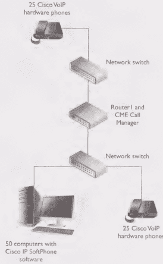

### 实际工作中

> 许多人会认为交换机不属于基础设施的一部分。在 Cisco 领域，如果端点不直接连接到交换机，交换机通常被视为基础设施的一部分。连接端点的交换机位于接入层或网络边缘，很像高速公路上的汇入车道。

一种专用设备，外观与传统模拟 PBX 电话完全相同。基于软件的 IP 电话运行在计算设备上，例如手持计算机、笔记本电脑或台式 PC 或 Mac。Cisco IP SoftPhone 是一种基于计算机的软件包，充当网络上的 VoIP 端点。

UC 端点充当 VoIP 网络上音频流的入口点和端点。从传输角度看，IP 电话根据通过 IP 电话听筒麦克风或外接麦克风（例如耳机中包含的麦克风）接收到的传入模拟信号，创建数字音频流。从接收角度看，IP 电话根据传入的 VoIP 数据创建模拟音频流，并将模拟数据发送到 IP 电话中的扬声器。

除音频处理外，IP 电话还发送和接收管理信息。例如，许多 IP 电话配有 LCD 屏幕，用于显示当前连接的电话、日期和时间以及 VoIP 网络的状态信息等信息。大多数较新的 Cisco 电话现在支持 XML 数据，因此可以开发应用程序，在 LCD 屏幕上显示几乎任何你能想象到的内容。

Cisco IP 电话提供多项功能，使其能够在 UC 实施中良好运行。这些功能包括：

-   支持多种编解码器，例如 G.711 和 G.729
-   支持以太网供电（PoE），由交换机提供在线供电
-   用于显示消息信息的 LCD 接口
-   用户可自定义快速拨号和其他按键

第 10 章提供了有关在 Cisco 网络中实现 IP 电话所用硬件的更多信息。

### 呼叫处理代理

呼叫处理代理负责处理呼叫。这个定义听起来可能很简单，但这正是呼叫处理代理必须做的事情。呼叫处理包括以下任务：

-   接收呼叫请求。
-   找到合适的 dial-peer 来发起呼叫。
-   建立呼叫连接，或根据所使用的协议（H.323、SIP、MGCP 或 SCCP）提供该连接所需的信息。
-   监视呼叫并报告通信的性能和质量。
-   终止呼叫。

除这些基本任务外，呼叫处理代理还可以提供呼叫消息功能，以便用户能够收到有关新语音邮件、来电以及可能发送到电话的其他警报的通知。呼叫处理代理还应识别任何已连接的消息系统，包括语音邮件、传真和电子邮件。Cisco 提供多种呼叫处理代理解决方案，包括：

-   **Cisco Unified Communications Manager Express（CME 或 CUCME）**  CME 解决方案运行在 ISR 上，例如 Cisco 2800 系列或 3800 系列。它也可在 1800 系列上运行。较旧版本的 CME 还可运行在 1700、2600 和 3600 系列 ISR 上。CME 解决方案面向与基于 PSTN 和 IP 的服务提供商连接的中小型组织。CME 可以从 IOS 命令行或基于 Web 的 GUI 界面进行管理。CME 最多支持 250 部 IP 电话。
-   **Cisco Unified Communications Manager（CUCM）**  CUCM 解决方案能够扩展到超大型网络，并支持 Cisco 呼叫处理代理的完整功能集。CUCM 运行在 Cisco 7800 系列 Media Convergence Server 上，这些服务器是获准并专用于运行 Cisco UC 解决方案的服务器。CUCM 提供比 CME 或 CUCM Business Edition 更高的可用性。CUCM 可以安装在集群中，每个集群最多可支持 30,000 部电话，并允许集群之间互连。
-   **Cisco Unified Communications Manager Business Edition**  CUCM 的 Business Edition 比 CME 更高一级，并在专用服务器上运行。CUCM Business Edition 是一种基于 Linux 的设备服务器，最多支持 500 部 IP 电话。
-   **Cisco Smart Business Communications System（SBCS）**  SBCS 解决方案通过 UC500 系列设备实现。这些设备是专用路由器，内置呼叫处理代理以及网络路由和交换功能。根据所购买的许可证和型号，可能包含对 8 到 48 部电话的支持。

表 9-1 提供了这些 Cisco 呼叫处理代理的对比参考。


**表9-1** Cisco 呼叫处理代理比较

| 呼叫处理代理 | 支持的电话数 | 平台 |
| --- | --- | --- |
| Cisco Unified CallManager Express (CME) | 最多250部 | 集成多业务路由器（ISR） |
| Cisco Unified Communications Manager (CUCM) | 每个集群最多30,000部电话，支持多个集群 | 媒体融合服务器 |
| Cisco Unified Communications Manager Business Edition | 最多500部电话 | 媒体融合服务器 |
| Cisco Smart Business Communications System (SBCS) – UC500系列 | 最多48部电话 | UC500系列中的专用路由器 |

### 消息传递

为了向 VoIP 用户提供语音邮件、电子邮件、日历和传真服务，Cisco 提供了 Unity 系列解决方案。Unity 产品有三个级别：Cisco Unity Express、Cisco Unity Connection 和 Cisco Unity。

### Cisco Unity Express

Cisco Unity Express 最多支持 275 个邮箱，并集成了语音邮件、传真和交互式语音应答（IVR）解决方案。Unity Express 是特定 Cisco ISR 的附加组件。它配有闪存或硬盘驱动器用于存储消息数据。闪存版本采用高级集成模块（AIM）外形规格。硬盘驱动器型号则采用网络模块（NM）外形规格。

Unity Express 模块（AIM 和 NM）通过运行在路由器上的基于 Linux 的界面进行配置。进入 Unity Express 配置模式后，你将不再使用传统的 IOS 命令行，而是使用基于 Linux 的命令行来配置 Unity Express。

> **考试重点**
>
> 请记住，Unity Express 模块使用的是运行在 IOS 路由器上的基于 Linux 的命令行，而不是内置的 IOS 操作系统命令行。

Cisco Unity Express 提供以下功能：

- 语音留言和问候服务，改善客户服务和员工沟通
- 通过 TimeCardView 进行工时卡数据管理
- 电话提示和基于 Web 的界面，提供快速便捷的语音邮件、自动值守和交互式语音应答（IVR）管理
- 能够使用 Cisco Unified IP Phone 显示屏或电子邮件客户端查看、排序、搜索和播放语音消息
- 可扩展性：最多支持 24 路并发语音邮件或自动值守呼叫以及 275 个邮箱

Cisco Unity Express 面向分布式企业、分支机构或中小企业（SMB）市场。由于闪存可用内存有限，Unity Express 的 AIM 版本仅支持 50 个邮箱。

### Cisco Unity Connection

下一级别是 Cisco Unity Connection。Unity Connection 每台服务器最多支持 20,000 个邮箱。Unity Connection 可作为 CUCM Business Edition 安装的附加组件，最多支持 500 个用户。更大的组织可以互连多个 Unity Connection、Unity Express 或 Unity 消息产品，以支持数千名用户。

Cisco Unity Connection 提供以下功能：

- 具有高级功能的语音留言
- 支持语音的消息传递，用于界面导航和消息管理
- 通过 Web 界面、IMAP 电子邮件客户端或支持可视语音邮件的 Cisco IP Phone 上的可视语音邮件，从计算机桌面访问消息
- 与 Cisco Unity 互连，使两个系统能够协同工作，实现无缝通信

Cisco Unity Connection 面向企业、商业和中小企业市场。

### Cisco Unity

有趣的是，根据 Cisco 的文献，Cisco Unity 仅面向企业市场和商业市场，每台服务器最多支持 15,000 个邮箱，而 Cisco Unity Connection 支持 20,000 个。然而，通过多台服务器，Cisco Unity 可以扩展到总共 250,000 个网络用户，而 Cisco Unity Connection 只能扩展到总共 100,000 个网络用户。

Cisco Unity 有不同的版本，可与不同的电子邮件服务器产品集成。例如，用于 Microsoft Exchange 的 Cisco Unity 适用于 Microsoft 的电子邮件服务器，用于 Lotus Domino 的 Cisco Unity 适用于 IBM 的电子邮件服务器。Cisco Unity 和 Cisco Unity Connection 都运行在专用服务器或服务器设备上，而 Cisco Unity Express 运行在 ISR 上。

### 工作现场

> 始终查看 Cisco 网站以获取最新信息。许多早期书籍会标明支持的邮箱数量较低，例如这里提到的 15,000 个。然而，这里的信息基于本书编写时 Cisco 关于 Unity 产品第 8 版的文档。

### 自动话务员

Cisco VoIP 产品的交互式语音应答（IVR）功能允许设备或服务器通过播放录制的消息与来电用户进行通信。例如，当你致电任何公司的客户服务时，你经常会收到录音消息，告知你按 1 获取特定服务，按 2 获取另一项服务，等等。这些录制的消息由 IVR 驱动。

自动话务员通常利用 IVR 的功能与用户通信，并允许用户在语音网络上自助导航。换句话说，用户无需接线员协助即可与你组织内的个人联系。你可以支持自动话务员功能，用于直接拨打分机或访问部门。例如，来电者可能按 3 联系财务部，这会将呼叫路由到一组潜在终端，其中第一部空闲电话会振铃，然后会计接听并帮助来电者。

### 联络中心

较大的公司通常设有呼叫中心或联络中心，作为所有来电的接入枢纽。一名或多名操作员或前台接待员可能接听这些来电，并将其转接至相应的部门或终端。要运营这样的联络中心，必须实施支持呼叫分配、队列管理和呼叫报告的软件。

Cisco 的 Unified Contact Center（UCC）提供了联络中心所需的功能。这些功能包括：

- **自动呼叫分配（ACD）** — ACD 功能允许将呼叫分配给适当的用户或用户组。ACD 通常也会与 IVR 解决方案集成。
- **计算机电话集成（CTI）** — CTI 还可用于在接听用户的计算机屏幕上显示有关来电者的信息。如果提供了来电显示数据，这些信息可能包括来电者的电话号码和姓名。
- **协作功能** — Cisco UCC 还提供协作功能，例如聊天、电子邮件和 Web 协作。

Cisco UCC 分为 Express 版和 Enterprise 版。UCC Express 版最多支持 300 个坐席。更大的呼叫中心将需要 UCC Enterprise 版。

### UC 环境中的应用

CUCM 和 CME 可以提供多项功能，以增强用户在使用 VoIP 网络时的体验。其中最重要的功能是移动性、在线状态和 TelePresence。

### 移动性

Cisco Unified Mobility（或简称为“移动性”）允许用户将呼叫从 CUCM 重定向到多达四个不同的客户端设备，例如手机或有线和无线 IP 电话。此功能也称为“单号联系”或“单一商务号码联系”。Cisco Unified Mobility 提供的解决方案包括：

- **设备移动性** — Cisco Mobile Connect 服务是 Cisco Unified Mobility 的一部分，允许移动工作人员在 IP 桌面电话上继续之前在另一部电话（如手机）上开始的通话，反之亦然。
- **移动语音接入** — 可以从任何地方发起呼叫，就像用户直接连接到企业总部一样。用户从手机或固定电话拨入 Cisco Mobile Voice Access 线路，然后通过 VoIP 网络发起呼叫。
- **基于 Web 的管理** — 用户可以访问他们的


在一个站点中，你可以实现一个跨站点的集群。需要高度可靠的 WAN 连接。发布服务器将位于中心站点，大多数管理操作都在该站点执行。每个站点都将有一台订阅服务器。

你选择的拓扑将取决于 WAN 链路、预算和可用的管理人员。

**考试提示**

请记住，多站点/集中式处理模型和 WAN 集群模型都依赖于高度可靠的 WAN 链路。

### 认证总结

在本章中，你了解了 Cisco 统一通信架构及其各种组件。你首先回顾了网络基础设施在 UC 实施中的重要性。接下来，你探讨了 UC 端点提供的功能，包括硬件和软件 IP 电话。随后介绍了呼叫处理代理，你了解了 CME、CUCM 和 SBCS 代理之间的差异。最后，你了解了 Cisco 环境中提供的语音邮件和其他 UC 功能，以及 VoIP 网络实施可用的拓扑。

### 两分钟演练

### 640-460：描述 Cisco 统一通信架构的组件

- UC 网络基础设施包括用于将 IP 数据包通过网络传输到目的地的硬件和软件。
- VoIP 网络基础设施必须提供语音数据包的可靠传输，以及用于保障可用性的网络冗余。
- 网络冗余可以通过部署冗余路由器来实现。
- 电源冗余可以通过使用 UPS 系统来实现。
- UC 端点负责生成发送的音频流并呈现接收的音频流。
- UC 端点可以是硬件设备（例如 Cisco IP 电话），也可以是软件解决方案（例如 Cisco IP Softphone）。
- CallManager Express（CME）运行在 ISR 上，面向最多 250 部 VoIP 电话的较小网络。
- Cisco Unified Communications Manager（CUCM）Business Edition 面向最多 500 部电话的中型组织。
- CUCM 面向大型组织，每个 CUCM 集群最多支持 30,000 部电话。
- UC500 系列面向拥有 8 到 48 部 IP 电话的小型企业。
- Cisco 的 Unity 产品为 VoIP 网络提供消息服务。
- Cisco Unity Express 面向较小组织或分支机构。
- Cisco Unity Connection 面向大型企业和中小型企业（SMB）。
- Cisco Unity 仅面向大型企业。
- 交互式语音应答（IVR）系统向呼叫者播放录制的消息，并允许其通过按键进行响应。
- 自动总机功能允许呼叫者通过直拨功能自行转接到部门或分机。
- 联络中心包含提供 ACD、CTI 和协作功能的组件。
- 使用 Cisco 产品实施 VoIP 网络时有多种拓扑可用，包括单站点/集中式处理、多站点/集中式处理、多站点/分布式处理和 WAN 集群。
- 多站点/集中式处理拓扑和 WAN 集群拓扑需要高度可靠的 WAN 链路。

### 自测

以下问题将帮助你衡量对本章所讲材料的理解。请仔细阅读所有选项，因为可能有多个正确答案。为每个问题选择所有正确答案。

### 640-460：描述 Cisco 统一通信架构的组件

- 1. 你必须实施一个最多支持 15 部电话的呼叫处理代理。以下哪一种代理（作为单个设备或服务器实施）能在不过度增加成本的情况下满足你的需求？
    - A. CME
    - B. CUCM Business Edition
    - C. UC500
    - D. CUCM

- 2. 你必须实施一个最多支持 4,300 部电话的呼叫处理代理。以下哪一种代理能在不过度增加成本的情况下满足你的需求？
    - A. CME 4.2
    - B. UC500
    - C. CUCM
    - D. CME 4.3

- 3. 运行 Cisco UC 的 UC500 系列路由器最多支持多少部电话？
    - A. 8
    - B. 16
    - C. 32
    - D. 48

- 4. 以下哪些是 Cisco 提供的 IP 电话的一般类别？（选择两项。）
    - A. 模拟
    - B. 硬件
    - C. 软件
    - D. 令牌环

- 5. 在 UC 架构中，可以使用哪些设备为基础设施设备提供电源冗余？
    - A. UPS
    - B. CME
    - C. CUCM
    - D. Cisco Presence

- 6. 哪种 Cisco 产品能够提供模拟面对面会议的会议通话？
    - A. Cisco Unified Presence
    - B. Cisco Unity Express
    - C. Cisco TelePresence
    - D. CME

- 7. 带闪存的 Cisco Unity Express 采用哪种外形规格？
    - A. NM
    - B. AIM
    - C. MCS
    - D. PVDM

- 8. 哪种 Cisco Unity 产品仅用于大型组织内部？
    - A. Cisco Unity
    - B. Cisco Unity Express
    - C. Cisco Unity Connection
    - D. Cisco Unity Enterprise

- 9. 哪种 UC 架构拓扑要求高度可靠的 WAN 链路，并且始终使用 CUCM 发布服务器和订阅服务器？
    - A. 多站点/分布式处理
    - B. 多站点/集中式处理
    - C. WAN 集群
    - D. 单站点/集中式处理

- 10. 哪种 UC 架构拓扑在 WAN 环境中的每个站点都实施呼叫处理代理，但不依赖于高度可用的 WAN 链路？
    - A. 多站点/分布式处理
    - B. 多站点/集中式处理
    - C. WAN 集群
    - D. 单站点/集中式处理

- 11. 在 Cisco UC 环境中，哪种功能允许呼叫者自行转接到分机或部门？
    - A. 自动总机
    - B. 语音邮件
    - C. TelePresence
    - D. Presence

- 12. 哪种功能使用录制的消息提示呼叫者按键？
    - A. IVR
    - B. 自动总机
    - C. Presence
    - D. 移动性

- 13. Cisco UC 环境的哪种功能允许用户指定最多四部不同的电话，用于接收发往单个分机或电话号码的来电？
    - A. IVR
    - B. 自动总机
    - C. Presence
    - D. 移动性

- 14. 以下哪些是联络中心管理软件通常提供的功能？（选择所有适用项。）
    - A. ACD
    - B. IP 路由
    - C. CTI
    - D. Presence

- 15. Cisco CME 解决方案在什么平台上运行？
    - A. 媒体融合服务器
    - B. 集成服务路由器
    - C. 网络模块
    - D. 高级接口模块

### 实验题

你正在配置一个 VoIP 网络，并且必须在路由基础设施中提供冗余。需要连接三个网段。一个网段使用 10.1.0.0 网络块。另一个使用 10.2.0.0 块。最后一个网段使用 10.3.0.0 块。每个网段将拥有大约 120 部 IP 电话。为确保这些网络之间的冗余（即所有网络都至少有两台路由器可用来连接到其他网络），你需要多少台路由器？请解释你为何选择答案中指定的路由器数量。

### 自测答案

### 640-460：描述 Cisco 统一通信架构的组件

- 1. ☑ A 正确。Cisco Communications Manager Express（CME）最多可支持 250 部电话，因此它将在为所需的 15 部电话提供必要支持的同时，给你的组织带来最低成本。

    ☒ B、C 和 D 不正确。CUCM Business Edition 支持的电话数量远超场景要求，会产生不必要的成本。CUCM 也是如此。UC500 系列设备最多可支持 48 部电话，因此需要三台设备才能满足场景需求。与三台运行独立 VoIP 网络的 UC500 设备相比，单台运行 CME 的 ISR 成本更低。

- 2. ☑ C 正确。在此场景中必须使用 CUCM，以容纳所需的大量电话（4,300 部）。

    ☒ A、B 和 D 不正确。无论成本如何，任何版本的 CME 和 UC500 系列设备都无法按需处理 4,300 部电话。

- 3. ☑ D 正确。虽然 UC500 系列设备可支持 8 到 48 部电话，但最大值为 48 部。

    ☒ A、B 和 C 不正确。UC500 系列设备可支持 8、16 或 32 部电话；但是，支持的最大数量是 48 部。

- 4. ☑ B 和 C 正确。Cisco 同时提供基于硬件和基于软件的电话。基于硬件的电话看起来像传统模拟 PBX 电话，但使用 VoIP 协议工作。基于软件的电话是 Cisco IP SoftPhone，它运行在 PC 上，并且需要麦克风和扬声器才能正常工作。

    ☒ A 和 D 不正确。Cisco 不销售模拟电话；不过，Cisco 确实提供可将模拟电话连接到 VoIP 网络的网关。Cisco 不提供令牌环电话。Cisco 的 IP 电话基于以太网。

- 5. ☑ A 正确。不间断电源（UPS）可用于为基础设施设备提供电源冗余。

    ☒ B、C 和 D 不正确。CME 和 CUCM 软件解决方案需要通电的机器才能运行。Cisco Unified Presence（不是简单的 Cisco Presence）功能不是供电功能。


### 实验答案

答案可能不唯一，但如果你的目标是在提供冗余的同时使用最少的路由器，可以使用两台各带三个接口的路由器。10.1.0.0 网络将连接每台路由器上的一个接口，10.2.0.0 和 10.3.0.0 网络也是如此。结果将是到任何潜在目的地的两条路由。如果你计划使用 CME，根据电话数量（36 部？），你将不得不在不止一台路由器上实施它，然后配置适当的分机和拨号对等体，以允许各个分离网络之间通信。


## 10 Cisco VoIP 硬件与软件

### 认证目标

- 10.01 640-460：使用 Cisco Configuration Assistant 实施 UCS500
- 10.02 640-460：使用 Cisco Unity Express 实施语音邮件功能
- ✓ 两分钟演练
- 问答自测

> 硬件：公司软件部门的人会告诉你问题出在哪里。
>
> 软件：公司硬件部门的人会告诉你问题出在哪里。
>
> ——戴夫·巴里，*《一路攀爬至顶峰》*

如果你计划实施 VoIP 网络，选择和实施正确的硬件非常重要。由于 Cisco 硬件差异很大，CVOICE 考试目标中并未提及特定的路由器、交换机和网关。然而，CCNA Voice 考试（640-460）确实提到了面向小型办公室/家庭办公室（SOHO）市场的非常具体的硬件。因此，本章介绍 UC500 系列设备及其可用的配置选项。本章还介绍 Cisco Unity Express，这是 Cisco 语音邮件和消息解决方案面向小型企业或分支机构的版本。在深入这些特定硬件组件之前，我们先看看在小型和大型组织中都发挥作用的传统 Cisco 硬件。

### 传统 Cisco 硬件

虽然这两门考试都不像 CCNA 考试那样深入覆盖传统 Cisco 硬件，但假定你对此类硬件知识仍记忆犹新。本节将回顾使 VoIP 网络得以运行的 Cisco 基础设施设备（路由器和交换机）的基础知识。接下来，你将回顾 Cisco IP 电话选项——包括硬件电话和软件电话。

### 用于 VoIP 的 Cisco 基础设施设备

网络基础设施中使用的设备可分为两大类：路由器和交换机。甚至语音网关也不过是运行特殊软件以执行 VoIP 网关操作的路由器。因此，我们将分两节探讨 Cisco 基础设施设备：一节介绍路由器，另一节介绍交换机。讨论重点将是这些设备在 VoIP 中的使用。有关路由器和交换机通用用途的更多信息，请参阅 Richard Deal 所著的 *《CCNA Cisco Certified Network Associate 学习指南（考试 640-802）》*。

### 交换机

Cisco 交换机在 VoIP 实施中的主要功能有四项。第一，它们提供网络接入，这当然是必不可少的。第二，它们使用 Cisco Discovery Protocol（CDP）为 VoIP 电话配置 VLAN 设置。第三，Cisco 交换机可以通过以太网供电（PoE）为 IP 电话供电。最后，第四项功能是 QoS 实施。虽然可以信任电话来指定 QoS 设置，但当帧进入网络时，也可以在交换机上执行这些设置。

有多种交换机可用于 VoIP 网络；不过，你很可能希望选择至少具备三项功能的交换机：

- 用于为 Cisco IP 电话供电的以太网供电（PoE）
- 至少 100 Mbps 的数据速率
- 满足你需求的足够端口

绝大多数 Cisco 交换机也提供可配置的 QoS 支持。但是，如果你购买零售商店销售的新款 Cisco 交换机，请记住其中许多是不可配置的。“非管理型交换机”这一说法常被用来表示无法配置交换机这一点的正面意义。营销的要点是：你不必管理它——只需安装好它就能工作。是的，它确实能工作。它按出厂配置的方式工作，而你无法让它以任何不同方式工作。在大多数企业网络中，你会希望避免使用这些非管理型交换机。

图 10-1 展示了 Cisco 3550 交换机系列，它提供前面提到的所有功能以及更多功能。Cisco 3550 曾是一款常用交换机，用于同时提供网络接入和 VoIP 操作。该交换机已停产，无法再从 Cisco 购买新品。Cisco 3750 系列交换机是推荐的替代产品；不过，其功能集足够接近，因此你可以在实验室中使用 3550 交换机学习，并且仍能在生产环境中正确配置 3750。在 2012 年或 2013 年之前，你很可能仍会在生产环境中遇到 3550 交换机，尽管其官方支持将于 2011 年结束。

图 10-2 所示的 2950 交换机是另一款适用于 VoIP 网络的有用交换机示例。2950 被认为是固定配置交换机，因为它不支持附加模块。Cisco 文献中使用的“固定配置”一词不应被理解为与“非管理型”含义相同。Cisco 2950 交换机运行 IOS，可从 CLI 或通过 Cisco Network Assistant（CNA）应用程序等各种 GUI 工具进行全面管理。


**图 10-1**

Cisco 3550 交换机（由 Cisco Systems, Inc. 提供。未经授权不得使用。）

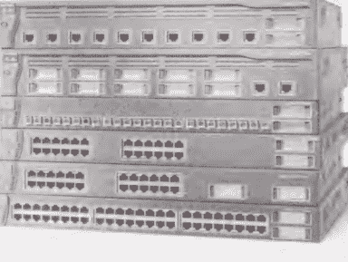

为在 VoIP 网络中使用而配置交换机所需的常见任务包括：

- 为语音和数据配置 VLAN
- 为语音接入配置交换机端口
- 在适当的交换机端口上启用 CDP 协议
- 配置 QoS 设置

**图 10-2**

Cisco 2950 交换机（由 Cisco Systems, Inc. 提供。未经授权不得使用。）


以下命令表示 Cisco 2950 交换机上的典型操作：

```text
Switch>enable
Switch#configure terminal
Enter configuration commands, one per line.  End with CNTL/Z.
Switch(config)#interface fastethernet 0/4
Switch(config-if)#switchport mode access
Switch(config-if)#

             cdp                 Global CDP configuration subcommands
             channel-group       EtherChannel/port bundling configuration
             channel-protocol    Select the channel protocol (LACP, PAgP)
             description         Interface specific description
             duplex              Configure duplex operation.
             exit                Exit from interface configuration mode
             mac-address         Manually set interface MAC address
             mls                 Mls interface command
             no                  Negate a command or set its defaults
             shutdown            Shutdown the selected interface
             spanning-tree       Spanning Tree Subsystem
             speed               Configure speed operation.
             storm-control      Storm configuration
             switchport          Set switching mode characteristics
             tx-ring-limit       Configure PA level transmit ring limit
Switch(config-if)#cdp enable
Switch(config-if)#mls ?
 qos  qos command keyword
Switch(config-if)#mls qos trust ?
 cos       cos keyword
 device    trusted device class
 dscp      dscp keyword
 <cr>
Switch(config-if)#mls qos trust device cisco-phone
Switch(config-if)#exit
```

### 路由器

用于 VoIP 服务的 Cisco 路由器也称为集成服务路由器（ISR）。多年来，Cisco 推出了多个路由器系列。较旧的 Cisco 设备，包括 1700 系列、2600 系列和 3600 系列路由器，仍可用于实施和测试 VoIP 实验。较新的 800、1800、2800 和 3800 系列路由器也可用于语音服务。800 系列实际上仅适用于在网络中路由语音数据包，因为无法在路由器本身上管理语音服务。1800 到 3800 系列路由器可执行 VoIP 操作。图 10-3 展示了 Cisco 2851 路由器，配有 IP 电话和用于 Cisco Unity Express 部署的 AIM-CUE 卡。

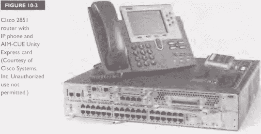

### 工作现场

> 我最喜欢的 Cisco 路由器之一是 2801 ISR。这款路由器几乎可用于现代 Cisco 考试所需的任何学习。通过这款入门级 2800 系列设备，您可以实施安全功能、语音功能、Security Device Manager、Call Manager Express 以及更多功能。它具有四个扩展槽、对板载 PVDM 模块的支持、基于 CompactFlash 的存储器（用于 IOS 存储）以及两个内置快速以太网端口。

Cisco 路由器在 VoIP 网络中执行的常见任务包括：

- 充当 VoIP 网关
- 充当 H.323 网守
- 执行 IP 路由
- 实施模拟和数字端口

Cisco 路由器上的常见配置任务包括：

- 安装 Call Manager Express（CME）软件
- 通过 CLI 或 Web 界面配置 CME
- 配置外部交换站（FXS）和外部交换局（FXO）端口
- 配置 T1 和 E1 端口
- 配置基本 IP 接口

### Cisco IP 电话

路由器和交换机就位后，您就可以开始连接 Cisco IP 电话。Cisco IP 电话有两种基本版本：硬件版和软件版。基于硬件的 IP 电话看起来就像我们组织中已使用数十年的传统 PBX 电话。基于软件的 IP 电话在 PC 上运行，并模拟基于硬件的 IP 电话的功能。

Cisco 提供的基于软件的电话现在称为 Cisco IP Communicator，以表明它不仅仅是一部电话。图 10-4 展示了在 Windows 机器上运行的 Cisco IP Communicator 软件的界面。您可以看到，它看起来很像传统电话。

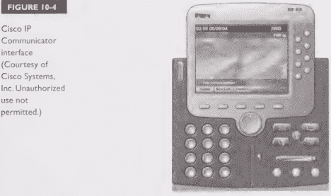

根据 Cisco IP Communicator 2.1 版的 Cisco 数据表，提供以下设计功能：

- **八个线路键**——这些键提供电话线路和对电话功能的直接访问。
- **五个软键**——这些键动态为您提供呼叫功能选项。
- **消息**——此键提供对语音邮件消息的直接访问。
- **目录**——Cisco IP Communicator 识别传入消息并在屏幕上对其进行分类，使您能够使用直接回拨功能快速有效地回电。公司目录与轻量级目录访问协议第 3 版（LDAP3）标准目录集成。
- **设置**——此键允许您从大量铃声和背景图像中进行选择。
- **服务**——Cisco IP Communicator 允许您快速访问各种信息，例如天气、股票、每日名言或任何其他基于 Web 的信息。该电话使用 XML 提供通向不断增长的功能和信息世界的门户。
- **帮助**——联机帮助功能为您提供有关电话按键、按钮和功能的信息。

除设计功能外，还支持以下呼叫功能：

- 多条线路或目录号码
- 可配置快速拨号
- 主叫姓名和号码显示
- 呼叫等待
- 呼叫前转
- 呼叫转移
- 三方通话（会议）
- 呼叫驻留
- 呼叫代接
- 重拨
- 呼叫保持
- 强插
- 回叫
- 分机移动性

由于 Cisco IP Communicator 在 Windows PC 上运行，考虑硬件要求很重要。对于 Windows 2000 和 Windows XP，Cisco 指定以下要求：

- Microsoft Windows 2000 Professional（Service Pack 4）或 Windows XP Professional（Service Pack 2）
- Pentium P4 1.0 GHz 或同等处理器（建议 Pentium P4 1.5 GHz 或更高）
- 1 GB RAM
- 100 MB 可用磁盘空间
- 非 ISA 全双工声卡（集成或基于 PCI）或 USB 声音设备
- 800×600×16 位屏幕分辨率（建议 1024×768×16 位或更好）
- 128 kbps 网络连接

对于 Windows Vista 或 Windows 7，必须满足以下要求：

- 性能分数为 3 或更高
- 200 MB 可用磁盘空间
- 1 GB RAM
- 非 ISA 全双工声卡（集成或基于 PCI）或 USB 声音设备
- 10/100 Mbps 以太网网络接口卡
- SVGA 视频卡
- 800×600×16 位屏幕分辨率（建议 1024×768×16 位或更好）

**图 10-5**

Cisco 基于硬件的 IP 电话

（由 Cisco Systems, Inc. 提供。未经授权不得使用。）


基于硬件的 IP 电话相比基于 PC 的 IP 电话具有多项优势。首先，它们不在 PC 上运行，因此不会占用其他计算操作的资源。其次，基于硬件的 IP 电话具有传统听筒，可以像家庭 PSTN 电话一样使用。第三，基于硬件的 IP 电话的界面对用户来说非常熟悉，因为从拨号、接听和基本操作的角度来看，它的工作方式与他们习惯的传统电话完全相同。图 10-5 展示了几部 Cisco 基于硬件的 IP 电话。另请注意 UC500 系列一体化路由器/交换机/语音网关，以及显示在所示显示器上运行的 Cisco Configuration Assistant（CCA）应用程序。

### 认证目标 10.01

### 640-460：使用 Cisco Configuration Assistant 实施 UC500

UC500 系列设备面向 SOHO 市场。它们附带实施有线网络、无线网络和 VoIP 网络所需的大多数端口、软件和其他组件。在本节中，您将了解 UC500 系列的功能和型号，然后探索可用的配置选项。

### UC500 简介

统一通信（UC）500 系列是智能商业通信系统（SBCS）解决方案的一部分。UC500 系列面向小型企业、分支机构和家庭办公室，并提供多种不同版本。有关 SBCS 解决方案的详细信息，请访问 http://www.cisco.com/go/sbcs。


Cisco SBCS解决方案提供以下功能：

- 电话呼叫处理软件，具有自动话务员、语音邮件和基本呼叫分配功能
- 面向各类商务人士的全系列商务电话，具备传统和高级功能，如支持视频
- 寻呼、会议和视频通话
- 集成无线接入（部分型号）
- 集成业务生产力应用程序
- 可选功能：查看同事是否正在使用电话或PC的在线状态
- 可选集成Microsoft或Salesforce.com的流行客户关系管理(CRM)应用程序
- 可选集成专业第三方应用程序，以提高员工生产力
- 内置设置和管理工具

SBCS解决方案不仅包含UC500系列设备。表10-1列出了SBCS解决方案系列中的组件明细。

**表10-1** SBCS组件

| 组件 | 描述 |
|---|---|
| UC500系列 | 在单个单元中实现语音、数据和无线通信。可通过嵌入式Web软件、受限CLI或Cisco配置助手(CCA)进行管理。 |
| ESW500交换机 | 为小型企业和分支机构提供经济实惠的交换服务。可通过嵌入式Web软件或CCA进行管理。 |
| 500系列路由器 | 500系列中的设备，提供VPN连接、互联网接入、增强安全性和可选无线功能。可通过嵌入式Web软件、受限CLI或CCA进行管理。 |
| 500系列AP | 500系列中的无线接入点(AP)。支持用于更大网络的集群技术。 |
| SPA500系列IP电话 | 具有宽带音频、XML应用程序和可自定义菜单的小型企业IP电话。这些电话与UC500系列语音网关、SIP语音网关和托管服务提供商兼容。 |
| 7900系列IP电话 | 用于大型VoIP网络的同款电话可以在使用UC500系列设备的VoIP网络上运行。 |

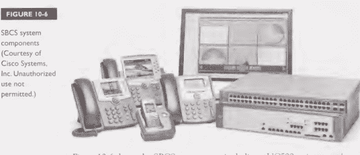

图10-6显示了SBCS组件，包括UC500系列路由器/网关、ESW540交换机、SPA524型号的Cisco SPA系列IP电话，以及SPA525G和7925无线IP电话。

在UC500系列路由器/网关设备中，提供了三个主要产品线。表10-2列出了这三个产品线及其提供的功能。

**表10-2** UC500系列产品线及功能

| | UC520 | UC540 | UC560 |
|---|---|---|---|
| **功能** | • 支持8到64个IP电话站点<br>• 4到8条模拟中继或2到4条BRI数字中继<br>• 可选单T1/E1语音接口（PRI和CAS）<br>• 集成语音邮件<br>• 16小时语音邮件存储<br>• 自动话务员<br>• 集成业务生产力应用程序<br>• 集成安全性<br>• 保持音乐<br>• 可选板载无线接入<br>• 简单的系统配置和管理 | • 支持8到32个电话站点<br>• 4到8条模拟中继或2到4条BRI数字中继<br>• 可选单T1/E1语音接口（PRI和CAS）<br>• 集成语音邮件<br>• 32小时语音邮件存储<br>• 自动话务员<br>• 集成业务生产力应用程序<br>• 集成安全性<br>• 保持音乐<br>• 包含板载无线<br>• 简单的系统配置和管理 | • 支持16到104个电话站点<br>• 4到12条模拟中继或2到6条BRI数字中继<br>• 可选一个或两个T1/E1语音接口（PRI和CAS）<br>• 集成语音邮件<br>• 32或64小时语音邮件存储<br>• 自动话务员<br>• 集成业务生产力应用程序<br>• 集成安全性<br>• 保持音乐<br>• 通过Cisco AP 500系列无线接入点提供无线支持<br>• 简单的系统配置和管理 |

### Cisco配置助手简介

虽然UC500系列路由器和网关支持有限的CLI，但主要的配置选项是基于Web的界面或Cisco配置助手(CCA)。CCA是一个基于Windows、依赖Java的应用程序，可用于配置SBCS系列中的设备。CCA可免费下载，网址为 http://www.cisco.com/en/US/products/ps7287/index.html。CCA提供以下功能：

- 为Cisco智能商务通信系统提供配置、部署和持续网络管理支持
- 设置向导
- 多网络视图
- 简化的网络报告
- 拖放式软件更新
- 故障排除

由于CCA是本地应用程序（安装在您的Windows桌面上），安装过程非常简单。您只需指定要安装的目录，其他所有默认设置均可接受。安装CCA后，您将启动CCA应用程序并配置一个站点以开始使用管理工具。CCA的系统要求列于表10-3中。

使用CCA的第一步是配置客户站点。不要让“客户站点”这个词吓到您。CCA在组织中使用，客户站点指您作为IT支持团队所服务的场所。当然，CCA也可以被咨询机构用来管理外部客户站点，但这并不是Cisco如此命名的本意。图10-7显示了“连接”对话框，该对话框用于配置和管理客户站点，或者直接连接到设备而无需指定客户站点。

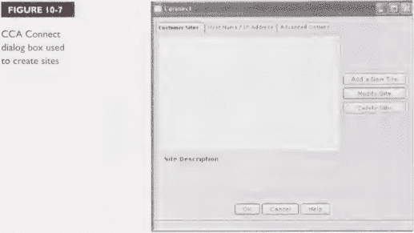

**表10-3** CCA系统要求

| 组件 | 要求 |
|---|---|
| 操作系统 | Windows：Windows XP Professional（Service Pack 1或更高版本）或Windows Vista Ultimate（32位或64位）；Microsoft Internet Explorer 6.0或更高版本，需安装Adobe Flash Player 10或更高版本；支持Mac OS（需要虚拟化软件） |
| 磁盘空间 | 最小200 MB，建议400 MB |
| 硬件 | 配备快速以太网或更高LAN端口的PC |
| 内存 | 最小512 MB，建议1024 MB |
| 处理器 | 1 GHz奔腾IV或更高 |
| 屏幕分辨率 | 最小1024×768，建议1280×1024 |

当您连接到设备或站点时，将看到仪表板。图10-8提供了该仪表板的缩小视图。在此处，您可以访问设备或站点的监控统计信息，也可以查看事件和警报。

**图10-8** CCA仪表板


> **工作现场**
>
> *有关使用CCA的更详细信息，请从 http://www.cisco.com/en/US/docs/net_mgmt/cisco_configuration_assistant/version2_11/administration_guide/cca2.1_sbcs_admin_guide.pdf 下载Cisco Configuration Assistant SBCS管理员指南。*

### 配置UC500设备

首次安装UC500设备时，您需要配置多个参数和功能。大多数配置操作都可以在CCA GUI界面中完成，因此过程很简单。本节提供了配置这些不同参数的建议。要访问语音设备配置界面，只需连接到具有语音接口的UC500系列设备，然后选择Configure | Telephony | Voice。图10-9显示了“Devices”对话框中可用的选项卡。根据您连接的设备，您在“Devices”对话框中会看到不同的已启用选项卡，但可用的选项卡包括：

- Device
- System
- Network
- AA & Voicemail
- SIP Trunk
- Voice Features
- Dial Plan
- Users


如果您仔细查看CCNA Voice（考试640-460）的目标，您会注意到配置要求与这些选项卡几乎完全对应。以下各节讨论每个选项卡中的选项。

> **考试提示**
>
> 如果您计划参加640-460考试，请务必通过CCA和UC500设备获得一些配置这些设置的动手经验。
>
> 如果您计划改考CVOICE考试，本节中的信息将是有益的复习，但您不需要了解CCA界面。

### 设备参数

设备参数包括硬件配置和语音系统类型部分。在“硬件配置”部分，您可以查看路由器平台，该平台指示您可以支持的许可用户数量。您还可以查看以下参数：

- **内置组件** 此部分包括Unity Express模块、FXO端口、FXS端口和交换端口。
- **VIC** 此部分显示已插入的VIC卡（如果使用）。
- **无线** 此部分显示UC500系统中的无线AP（如果使用）。

在“语音系统类型”部分，您可以在两个选项之间选择：

- **配置为PBX** 这是默认选项。来电被路由到自动话务员或人工接线员，然后连接到被叫方。
- **配置为按键电话系统** 这不是默认选项。可以在任何电话上接听来电。


### 系统参数

在 System 选项卡上，您可以配置区域设置，这些设置会影响呼叫音、电话语言、日期和时间格式以及语音邮件语言。您还可以在此处配置系统范围的快速拨号设置。

### 网络参数

可配置的网络参数包括 UC500 设备的 IP 信息和 VLAN 信息。与 SOHO 路由器（例如 Linksys 和 D-Link 设备）非常相似，UC500 系列提供了 DHCP 服务器和呼叫管理器（Cisco 领域中的 CME）IP 地址的简单配置。以下参数可以在 Devices 对话框的 Network 选项卡上配置：

- **VLAN 编号** 可以是 1 到 1001 之间的数字。这是将配置为语音 VLAN 的 VLAN。
- **DHCP IP 地址池** 定义要自动分配给客户端的地址范围。支持字段包括 Subnet Mask、Exclude Address From 和 To 字段。DHCP IP Address Pool 字段将包含子网标识符，例如 192.168.1.0。Subnet Mask 字段将包含适合该子网标识符的掩码，例如 255.255.255.0。Exclude Address From 和 To 字段将包含定义不应由 DHCP 服务器分配的地址范围的起始地址和结束地址，例如 192.168.1.50 到 192.168.1.59。
- **CME IP 地址** 这是 Communications Manager Express (CME) 呼叫管理器服务器的 IP 地址。支持字段是 Subnet Mask 字段，用于标识 CME 服务器所在的网络。

### 自动总机和语音邮件

可以在 AA & Voicemail 选项卡上配置多个字段。要配置的部分包括自动总机、脚本参数和语音邮件。在自动总机部分，您可以配置自动总机服务的电话分机。这通常是组织的主分机电话号码。您还可以配置用于到达自动总机的外部号码（PSTN 号码）。最后，您可以使用默认 AA 脚本，或选择您开发的自定义脚本。

如果选择默认 AA 脚本，则不使用脚本参数部分。选择自定义脚本时，您可以指定按下不同键盘数字时要播放的音频文件。可以配置数字 0 到 9。语音邮件部分允许您配置拨打语音邮件系统时所用的分机和 PSTN 号码。

**考试注意：** 请记住，您可以在 Devices 对话框的 AA & Voice mail 选项卡中配置按下 0 到 9 键盘数字时要播放的音频文件，并且这些选项仅在使用了自定义或非默认 AA 脚本时才适用。

### SIP 中继

如果您通过 FXO 端口或数字线路使用到 PSTN 的模拟连接，则不会配置 SIP 中继。如果您使用互联网电话服务提供商（ITSP），则需要配置到该 ITSP 的 SIP 中继。要在 Devices 对话框的 SIP Trunk 选项卡上配置 SIP 中继，请配置您的 ITSP 提供的参数。在编写本书时，最新的 UC500 系列软件和 CCA 支持以下服务提供商：

- AT&T
- Broadview
- British Telecom (BT)
- Cbeyond
- Covad
- Fibernet
- Nuvox
- One Communications
- PAETEC
- XO Communications

**考试注意：** 由于服务提供商会不断变化，因此对于 640-460 考试，您不需要记住这份服务提供商列表。

### 语音系统功能

Voice Features 选项卡包括配置以下参数的能力：

- **保持音乐** 只需选择您要为 MoH 播放的音频文件。
- **对讲** 如果选中 Enable Intercom 复选框，则可以启用电话用于对讲。
- **寻呼** 可以启用寻呼组，最多四个寻呼组扩展，每个扩展包含三个目录号码（DN）。
- **寻线组** 可以启用寻线组并设置超时值，该值表示对寻线组中每个号码尝试振铃的次数。还可以指定寻线类型。寻线类型包括顺序、最长空闲和对等。顺序寻线类型将呼叫发送到寻线组中的第一个 DN，并且仅当第一个 DN 在超时窗口内未应答时，才继续尝试下一个 DN。最长空闲寻线类型将呼叫发送到空闲时间最长（未通话时间最长）的 DN。对等寻线类型将呼叫发送到寻线组中紧跟在最近应答呼叫的 DN 之后的下一个 DN（轮询）。
- **组代接** 可在此处直接启用组代接。启用后，用户可以在其电话上输入代码，以代接同一代接组中其他人的电话。启用组代接后，最多可以指定八个代接组。
- **主叫 ID 阻止代码** 此设置指定用户在拨打另一个号码之前必须拨打的号码，以阻止其主叫 ID。当用户拨打时，主叫 ID 阻止号码前面会带有一个 \*。
- **呼出呼叫阻止号码列表** 此列表包含您不允许内部用户拨打的号码。
- **呼叫驻留** 呼叫驻留允许用户将呼叫保持，并从另一部电话恢复该呼叫。呼叫驻留槽位配置为在特殊分机上工作。
- **多方（临时）会议** 默认支持最多八个电话会议，每个会议最多三个参与者。此外，所有呼叫者必须使用 G.711 或 G.729 以降低处理成本。但是，如果 DSP 资源可用，您可以在此处启用混合模式。混合模式允许会议中同时混合使用 G.711 和 G.729 用户。

**考试注意：** **记住 CCA 中可配置的三种寻线类型：** 顺序、最长空闲和对等。还要务必记住它们的工作方式。顺序寻线类型只是先振铃列表中的第一个号码，然后尝试下一个，直到某个号码应答。

**最长空闲** 始终振铃最长时间未通话的号码。**对等** 始终振铃寻线组中紧跟在最近应答呼叫的号码之后的号码。

### 拨号计划

Dial Plan 选项卡允许您设置要在 VoIP 网络上使用的拨号计划。您可以设置多个拨号计划参数，包括：

- 分机号码位数
- 呼出呼叫编号计划
- 区号长度
- 本地外部号码长度
- 拨打长途呼叫所需的一位或多位数字
- 拨打国际呼叫的要求
- 外呼接入码号码
- 紧急号码配置
- 入站 FXO 呼叫处理
- 直接拨入（DID）配置

### 用户参数

Users 选项卡用于创建用户和电话。只需单击 New 按钮即可开始该过程。您可以指定 MAC 地址、电话类型、主 DN（分机）、用户名字和姓氏、用户 ID、密码以及电话特定设置。

*CCA 界面可能会发生变化。在编写本书时，选项卡和选项按此处定义的方式可用。但是，您应查看 Cisco 网站上的文档，了解最新版本的 CCA，以确保您了解在所用版本中配置这些选项的位置和方式。*

### 认证目标 10.02

### 640-460：使用 Cisco Unity Express 实现语音邮件功能

Cisco Unity 平台是 Cisco 提供的语音邮件和消息传送解决方案。它有许多不同的版本，但对于 640-460 考试，您需要了解 Cisco Unity Express 640-460 版的基础知识。在本节中，您将了解 Cisco Unity Express 硬件选项以及系统内可用的基本配置设置。

### 介绍 Unity Express

Cisco Unity Express (CUE) 是 Cisco 语音邮件和消息传送解决方案的小型企业版。在大多数实现中，CUE 最多可为 250 个用户提供语音邮件服务。您可以使用命令行界面（CLI）或 GUI 来管理 CUE 模块和服务。要完全理解 CUE，您需要学习以下内容：

- Unity Express 硬件实现
- Unity Express 的功能

### Unity Express 硬件

CUE 硬件有三种基本版本：

- **AIM-CUE** 此外形规格采用子卡格式，并使用闪存模块作为 Linux 文件系统和消息存储。AIM-CUE 版本最多支持 50 个邮箱、六个语音会话以及总计 14 小时的邮箱存储。
- **NM-CUE** 此外形规格采用网络模块格式，如图 10-10 所示。硬盘驱动器用于 Linux 文件系统和消息存储。最多可创建 100 个邮箱，支持八个语音会话和 100 小时的邮箱存储。
- **NM-CUE-EC** NM-CUE 版本的扩展容量增加了对最多 250 个邮箱、16 个语音会话和 300 小时邮箱存储的支持。


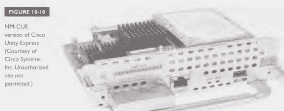

三个版本都安装在 CME 路由器中，NM 版本提供一个用于连接 CUE 服务器的网络接口。有趣的是，尽管 NM 版本安装在 CME 路由器中，但内部网络接口并不用于与其通信。NM 版本实际上充当一台恰好安装在 CME 网关路由器中的 Linux 设备。

### Unity Express 功能

CUE 系统支持标准语音邮件功能。Cisco 基于 CUE 的语音邮件系统支持以下功能：

- 命令行界面（CLI）或 GUI 管理工具。
- CUE 可与多个 CME 站点集成（仅 NM-CUE 版本支持最多十个）。
- CUE 模块具有自己嵌入式的基于 Linux 的操作系统和处理器。
- 可定时将语音邮件消息备份到安全 FTP 服务器。
- CUE 模块支持增量升级，而不必更新整个操作系统。
- 可购买 TimeCardView 附加组件，以便在组织中进行工时卡管理。
- 用于群组语音信箱的通用投递邮箱（GDM）。
- 常见语音邮件功能，包括回复、转发、保存、为隐私或紧急而标记消息、备用问候语、暂停、快进和快退。
- 实时回复允许语音邮件用户根据消息信封中的信息（主叫方 ID 信息），要么回送一条语音邮件消息，要么呼叫留言所在的分机。
- 分发列表允许将语音邮件发送给群组而不是个人。
- CUE 桌面消息传递允许用户在 Outlook、Outlook Express 和 Lotus Notes 中将语音邮件消息作为音频文件检索。

### 配置 Unity Express

在 CCNA Voice 考试目标中，CUE 的配置分为三个基本部分。首先，您需要通过配置 CME 服务器中的必需设置来准备环境，以支持 CUE。其次，您将配置自动总机功能。最后，您将执行语音邮件配置任务。以下各节将分别介绍这三部分。

### 准备环境

在成功执行 CUE 安装和配置之前，您需要准备 CME 路由器。首先，您需要确定包含 CUE 模块的服务引擎插槽。show interfaces 命令将显示接口，其中会列出 CUE 模块所在的服务引擎插槽。现在，您可以配置服务引擎以及必须配置的内部环回接口，以便一切正常工作。以下命令适用于大多数插入了 CUE 模块的 CME 路由器：

```
interface loopback 0
 ip address 10.10.3.1 255.255.255.0
interface service-engine1/0
 ip unnumbered loopback 0
 service-module ip address 10.10.3.2 255.255.255.0
 service-module ip default gateway 10.10.3.1
ip route 10.10.3.2 255.255.255.255 service-engine1/0
```

您只需更改 IP 地址配置设置以匹配您的环境。将这些命令加入运行配置后，您就可以使用服务模块或 CUE 接口了。

除了 CUE 模块的 IP 配置之外，您可能还希望启用 HTTP 服务器，以便可以使用 GUI Web 服务器界面来操作该模块。为此，请在配置模式下执行以下命令：

```
ip http server
ip http path flash:
```

最后，您需要配置适当的 ephone-dn ID 和一个 dial-peer，用于 CME 路由器与 CUE 服务器之间的通信。以下命令提供示例配置：

```
dial-peer voice 2900 voip
destination-pattern 29..
session protocol sipv2
session target ipv4:10.10.3.2
dtmf-relay sip-notify
codec g711ulaw
no vad
exit
ephone-dn 19
 number 2999
 mwi
exit
ephone-dn 20
 number 2998
 mwi off
exit
```

dial-peer ID 和 ephone-dn ID 以及号码和 IP 地址都可以更改。但是，重要的是要知道，要使 CME 和 CUE 正常通信，codec g711ulaw 和 no vad 命令是必需的。

现在 CME 已设置为使 CUE 模块可以运行，您可以在 CLI 中完成标准的初始配置。这些设置包括主机名、DNS 服务器地址、NTP 服务器地址、时区配置以及管理员用户名和密码。对于 CUE 模块，应配置与完整 Cisco 路由器相同的基本参数。

### 语音邮件配置

CUE 模块的初始配置通过初始化向导执行。初始化向导通过基于 Web 的界面访问。以下步骤概述了所涉及的过程：

- 1. 连接到 CUE 模块的 Web 服务器。您将使用分配给 CUE 模块的 IP 地址，并使用 HTTP 协议连接到它。
- 2. 输入用于访问该模块的用户名和密码。这将是初始 CLI 设置期间配置的管理员用户名和密码。
- 3. 显示网页后，选择“运行初始化向导”选项。
- 4. 验证主机名、用户名和密码，然后单击“下一步”。
- 5. 导入您希望从 CME 路由器导入的任何用户名和密码，然后单击“下一步”。
- 6. 配置邮箱默认值，例如语言、邮箱大小（以秒为单位）、最大消息大小（以秒为单位）和消息过期时间（以天为单位），然后单击“下一步”。
- 7. 配置呼叫处理过程，例如语音邮件号码、话务员分机、AA 接入号码和话务员，然后单击“下一步”。
- 8. 查看您选择的设置，然后单击“完成”。

向导完成后，将向您显示“初始化向导状态”报告，列出已执行的任务以及这些任务是成功还是失败。假设一切成功，此时语音邮件服务器已激活，可供您的用户使用。

### 自动总机配置

CUE 基于 Web 的管理界面提供了用于自动总机（AA）配置的 GUI。当您访问基于 Web 的管理界面时，选择“语音邮件 | 自动总机”以使用 AA 功能。在此处，您可以启用和禁用默认 AA 脚本。您不能修改默认脚本，但如果需要，可以单击“添加链接”按钮创建自己的脚本。可为 AA 配置的基本参数包括：

- AA 配置名称
- 要使用的脚本
- 呼入号码
- 最大活动会话数
- AA 是启用还是禁用

> 请记住，您只能修改自定义 AA 脚本。您可以启用或禁用默认脚本，但不能删除、修改或下载它。

### 认证总结

在本章中，您学习了 VoIP 网络中使用的基本 Cisco 硬件。您首先回顾了交换机和路由器等传统硬件。然后，您探索了 UC500 系列设备以及用于配置任务的 Cisco Configuration Assistant。最后，您学习了用于语音邮件和消息传递功能的 Cisco Unity Express 解决方案。


### 两分钟演练

### 640-460：使用 Cisco Configuration Assistant 实现 UC500

- Cisco Configuration Assistant（CCA）用于配置和管理 UC500 系列设备。
- CCA 可从 Cisco.com 免费下载，并可安装在 Windows 2000 或更高版本的计算机上。
- 客户站点用于将受管设备分组在一起以进行监控和管理。
- 自动总机功能可以使用自定义脚本以及映射到 0 到 9 小键盘按钮的音频文件进行配置。
- 启用组拾取后，最多可定义八个拾取组。
- 支持三种寻线组类型，包括顺序、最长空闲和对等。
- 呼叫驻留功能允许用户将呼叫置于保持状态，并在另一部电话上恢复该呼叫。
- 默认情况下，UC500 系列设备支持八个会议，每个会议有三名主叫方。
- 如果 DSP 资源可用，可以使用更多会议和混合模式会议。
- 网络参数包括用于语音连接的 VLAN、DHCP 池配置以及 CME 服务器的位置。

### 640-460：使用 Cisco Unity Express 实现语音邮件功能

- CUE 的 NM-CUE 版本可支持与最多十个 CME 站点集成。
- 在配置 CUE 模块之前，您必须通过为模块配置 IP 设置并启用 HTTP 服务器来准备 CME 路由器。
- 必须创建 dial-peer 和一组 ephone-dn ID，以便 CME 与 CUE 服务器之间正常通信。


### 自测

以下问题将帮助你衡量对本章所介绍内容的理解。请仔细阅读所有选项，因为正确答案可能不止一个。为每个问题选择所有正确答案。

### 640-460：使用 Cisco Configuration Assistant 实施 UC500

1. 主要使用什么应用程序来配置 SBCS 设备（包括 UC500 系列）？
   - A. PuTTY
   - B. CCA
   - C. SDM
   - D. IPsec

2. 哪些操作系统可以原生运行 Cisco Configuration Assistant？（选择所有适用项。）
   - A. MAC OS X
   - B. Windows XP
   - C. Windows Vista
   - D. Linux

3. 在 CCA 中为 AA 配置自定义脚本时，可以将多少个键盘数字与音频文件关联？
   - A. 9
   - B. 10
   - C. 0
   - D. 16

4. 什么功能允许用户将呼叫保持，并在另一部电话上恢复该呼叫？
   - A. 呼叫驻留
   - B. 呼叫转接
   - C. 通话费用
   - D. 语音邮件

5. UC500 系列设备默认允许的会议数量是多少？
   - A. 3
   - B. 5
   - C. 4
   - D. 8

12. 使用什么 IP 地址访问 CUE 服务模块？
    - A. CME 路由器的 FastEthernet0/1 接口地址
    - B. CME 路由器的虚拟接口地址
    - C. CUE 服务模块的 IP 地址
    - D. DNS 服务器的 IP 地址

13. 不能删除默认 AA 脚本，但可以对其执行哪两个操作？（选择两个。）
    - A. 下载
    - B. 修改
    - C. 启用
    - D. 禁用

14. 在从 CME 路由器与 CUE 服务模块通信的 dial-peer 中，需要哪两条命令？（选择两个。）
    - A. no vad
    - B. codec g711ulaw
    - C. codec g728
    - D. vad

15. 使用什么命令来操作服务模块，而不是 Cisco IOS 接口命令？
    - A. service-module
    - B. service-engine
    - C. module-interface
    - D. engine-interface

### 实验题

必须在 Cisco ISR 中启用 HTTP 服务器，以便使用 Unity Express 模块。应使用哪两条命令，每条命令的作用是什么？

### 自测答案

### 640-460：使用 Cisco Configuration Assistant 实施 UC500

1. ✓ B 正确。Cisco Configuration Assistant 用于整个 SBCS 产品线，包括 UC500 系列。
    ✗ A、C 和 D 不正确。PuTTY 是 telnet 客户端，可用于获取 CLI 访问。Security Device Manager (SDM) 用于传统 ISR 路由器。IPsec 是一种 IP 安全协议解决方案。

2. ✓ B 和 C 正确。CCA 可以运行在任何 Windows 操作系统上，从 Windows 2000 到 Windows 7。
    ✗ A 和 D 不正确。必须使用虚拟 Windows 操作系统才能在 MAC OS 或 Linux 中运行 CCA。

3. ✓ B 正确。因为数字 0–9 可以分配给音频文件，所以最多可关联 10 个。
    ✗ A、C 和 D 不正确。这些答案就是错误的。

4. ✓ A 正确。呼叫驻留功能允许用户将呼叫保持，然后在另一个分机上再次拾取。
    ✗ B、C 和 D 不正确。呼叫转接允许用户将呼叫发送给另一用户。通话费用指的是通话成本，不是特定功能。语音邮件允许主叫为用户留言。

5. ✓ D 正确。默认最多可同时进行 8 个会议。
    ✗ A、B 和 C 不正确。这些答案就是错误的。

6. ✓ A 正确。默认最多 3 个主叫可参加单个会议。
    ✗ B、C 和 D 不正确。这些答案就是错误的。

7. ✓ C 正确。需要数字信号处理器（DSP）资源来增加会议数量或允许混合模式会议。
    ✗ A、B 和 D 不正确。会议限制在 CCA 中配置，但由 UC500 系列设备中的硬件和软件施加。UC560 系列不是特定要求，但可用 DSP 资源是。千兆接口不是更多会议呼叫所必需的。

8. ✓ C 正确。peer hunt group 类型使用轮询方法。
    ✗ A、B 和 D 不正确。sequential hunt group 类型在第一个号码未接听后使用下一个号码。looped hunt 类型不存在。longest idle hunt 类型将呼叫定向到最长时间未接听呼叫的分机。

9. ✓ A 正确。sequential hunt group 类型在第一个号码未接听后使用下一个号码。
    ✗ B、C 和 D 不正确。looped hunt 类型不存在。peer hunt group 类型使用轮询方法。longest idle hunt 类型将呼叫定向到最长时间未接听呼叫的分机。

### 640-460：使用 Cisco Unity Express 实施语音邮件功能

10. ✓ D 正确。最多可将 10 个 CME 站点集成到单个 CUE 模块中。
    ✗ A、B 和 C 不正确。这些答案就是错误的。

11. ✓ C 正确。消息过期以天为单位设置，而不是秒。
    ✗ A、B 和 D 不正确。邮箱大小和消息长度都以秒为单位指定，语言也是邮箱默认设置。

12. ✓ C 正确。服务模块有自己的 IP 地址，该地址用于访问 CUE 模块。
    ✗ A、B 和 D 不正确。这些答案就是错误的。

13. ✓ C 和 D 正确。只能启用或禁用默认 AA 脚本。
    ✗ A 和 B 不正确。不能下载、修改或删除默认 AA 脚本。

14. ✓ A 和 B 正确。必须包含 no vad 和 codec g711ulaw 命令。
    ✗ C 和 D 不正确。不需要 codec g728 命令，也不需要 vad 命令。

15. ✓ A 正确。service-module 命令用于操作 CUE 模块。
    ✗ B、C 和 D 不正确。这些答案无效。

### 实验题答案

必须使用 ip http server 和 ip http path flash: 命令。第一条命令启用 HTTP Web 服务器。第二条命令配置用于访问 Web 服务器文件的位置。

> 一台机器可以完成五十个普通人的工作。
> 没有机器能完成一个非凡之人的工作。
>
> ——埃尔伯特·哈伯德

如果你接触计算机很长时间，就会知道如今计算机中使用了许多不同类型的专用处理器。20 世纪 90 年代，引入了数学协处理器，以从机器的主 CPU 分担大量数学处理工作。20 世纪 90 年代末至今，图形处理器（GPU）用于分担图形处理工作，并增强计算机的图形显示能力。同样，可以使用特殊处理器从 Cisco ISR 的主处理器分担 VoIP 网络所需的大量语音处理工作。正如我在其他章节所说，Cisco ISR（集成多业务路由器）本质上是一台带有特殊硬件和软件的计算机，用于路由和语音呼叫管理功能。本章介绍这些网关的一个组件，称为数字信号处理器（DSP），它可以减轻路由器 CPU 的负担，而且实际上是实现某些 VoIP 功能所必需的。

“工作”可以定义为为完成某个目标而执行脑力或体力行动。CPU 是通用的，并未针对特定任务进行优化。经过优化的处理器就像埃尔伯特·哈伯德所说的“非凡之人”，因为以相同成本，它能比通用 CPU 完成更多专门工作。这种优化就是 DSP 在语音处理中的角色，也是本章的主题。

### 认证目标 11.01

### 642-436：描述 DSP 功能

要规划使用 Cisco ISR 作为网关的 VoIP 实施，你需要了解数字信号处理器（DSP）。DSP 是一种专为处理数字信号而设计的特殊处理器或微处理器。在本节中，你将了解什么是 DSP、如何为你的 ISR 选择合适的 DSP、购买后如何安装该 DSP，以及如何使用 Cisco IOS 命令验证和配置 DSP 资源。


### 数字信号处理器简介

DSP 是专门用于处理数字信号的处理器。它们不仅专门用于处理数字信号，而且还为此进行了优化。为了理解这种优化的好处，可以考虑一下我（一名计算机网络工程师）和一名木匠（我指的不是名义上的，比如我自己）之间的区别。我的大脑不一定比木匠的优越，但我搭建计算机网络的速度比木匠快很多倍。木匠的大脑不一定比我的优越，但他盖房子的速度肯定比我快很多倍。经过多年的经验和学习，我们的大脑已经变得专业化，虽然它们可能以相同的速度工作，但它们并不能让我们俩都同样擅长做同一件事。

DSP 看起来很像你会在台式电脑中安装的内存芯片。然而，它们上面不是简单的内存芯片，而是包含处理器。图 11-1 显示了一个典型的 PVDM2（分组语音/数据模块版本 2）模块，其中包含四个 DSP。

在 Cisco 网关中，DSP 资源以四种主要方式使用（所有四种方式都归类为媒体处理）：

- **转码**：在某些网络中，网关连接两个不同的 VoIP 网络，甚至连接同一网络上使用不同编解码器的设备。例如，如果需要将 G.729 转换为 G.711，或者反之亦然，则需要 DSP 资源。
- **会议**：当呼叫中有两个以上端点参与时，就会进行语音会议。需要某种设备将多个传入音频流混合或混音成单个传出流，然后发送给会议参与者。DSP 提供这种会议功能。


**图 11-1**
Cisco Systems PVDM2-64，包含四个 DSP（由 Cisco Systems, Inc. 提供。未经许可不得使用。）

确定会议呼叫所需的 DSP 资源基于两个主要因素。第一个是所使用的硬件模块或机箱。例如，NM-HDV2 模块可以处理一到四个 PVDM2 模块。每个模块可以是以下类型之一：

- PVDM2-8（1/2 DSP）
- PVDM2-16（1 DSP）
- PVDM2-32（2 DSP）
- PVDM2-48（3 DSP）
- PVDM2-64（4 DSP）

第二个因素是会议中使用的编解码器。例如，如果所有用户都使用 G.711 编解码器，则可以同时处理的会议呼叫数量多于用户使用 G.729 时的数量。事实上，如果在会议呼叫中只有一个用户使用 G.729 编解码器，则包含此类用户的同时呼叫数量会下降 75%。使用单个 PVDM2-8 模块，运行纯 G.711 会议的 ISR 可以同时处理最多四个会议。如果一个或多个参与者使用 G.729，则使用相同模块一次只能处理一个会议。

上述信息基于 NM-HDV2 模块。但是，当使用其他模块，或者使用内置支持 DSP 模块的路由器时，计算会发生变化。如果您无法访问前面提到的 DSP 计算器，则应考虑访问以下网页：http://www.cisco.com/en/US/prod/collateral/routers/ps5854/product_data_sheet0900aecd8016e845_ps3115_Products_Data_Sheet.html，其中包含不同 PVDM 模块的通道密度表。

编解码器复杂性也会影响 DSP 的数量，因此也会影响您需要购买的 PVDM 模块。例如，G.711 和 G.726 等中等复杂性编解码器允许每个 DSP 支持四次呼叫。G.728 和 G.723 等高复杂性编解码器仅允许每个 DSP 支持两次呼叫。一般来说，您会使用较低复杂性的编解码器来从 DSP 资源中获得更多收益；但是，您必须使用较高复杂性的编解码器来减少网络带宽消耗。

影响您选择 DSP 资源的最后一个因素是您使用的 ISR 网关。例如，如果您使用 1700 系列路由器（1751 或 1760），它们开箱即用地内置支持最多两个 PVDM 模块。2800 系列路由器也包含此支持。对于不支持板载 PVDM 模块的路由器，您需要购买网络模块，例如允许安装 PVDM 模块的 NM- 模块。

```
Cisco 2801 (revision 7.0) with 239616K/22528K bytes of memory.
Processor board ID FTX1140WZK
2 FastEthernet interfaces
1 Virtual Private Network (VPN) Module
2 Voice FXS interfaces
1 DSP, 8 Voice resources
DRAM configuration is 64 bits wide with parity disabled.
191K bytes of NVRAM.
500472K bytes of ATA CompactFlash (Read/Write)
```

注意其中一行显示 `1 DSP, 8 Voice resources`。此行表明 PVDM 模块已被检测到。

要开始使用 DSP 资源，必须将它们分配给 DSP 固件组。这可以通过在语音卡配置模式下使用 `dsp services dspfarm` 命令来完成，如图 11-3 所示。

将 DSP 资源与 DSP 固件组关联后，您可以创建 DSP 固件组配置文件。这些配置文件在 dspfarm-profile 配置模式下创建，它们分配允许的编解码器、最大会话数以及与 VoIP 协议（如 SCCP）的关联。然后，使用 `no shutdown` 命令将固件组配置文件上线。图 11-4 显示了转码设置中的此配置。

**图 11-2** **show voice dsp** 命令的输出

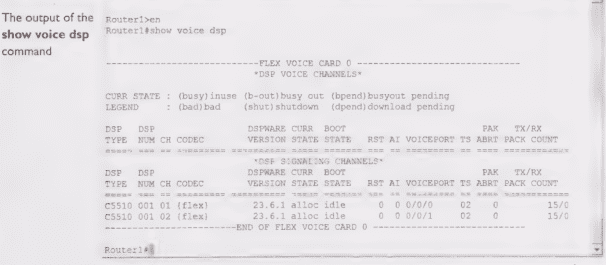

### 考试须知
如果问到如何从现有 DSP 资源中获得更多会议呼叫，一个关键方法是降低编解码器复杂性。当配置文件在语音卡上处于活动状态时，您无法降低编解码器复杂性。首先，关闭配置文件，然后在语音卡配置模式下使用 `codec complexity` 命令降低编解码器复杂性。

### 认证总结

在本章中，您了解了数字信号处理器（DSP）及其为 Cisco VoIP 网关提供的资源。您了解了 DSP 的功能以及如何根据您的需求选择 DSP。接下来，您学习了如何安装 DSP，并在 Cisco ISR 路由器/网关上验证和配置它们。

- 6. 什么命令用于创建 ID 为 5 的转码 DSP 固件组配置文件？
  - A. `dspfarm profile 5 transcode`
  - B. `dspfarm profile transcode 5`
  - C. `create dspfarm profile 5 transcode`
  - D. `create dspfarm profile transcode 5`

- 7. 在 dspfarm profile 配置模式下执行什么命令可以将会话最大允许并发数设置为 5？
  - A. `maximum sessions 5`
  - B. `session 5`
  - C. `max-sessions 5`
  - D. `maximum dsp sessions 5`

- 8. 什么命令用于设置编解码器复杂性以允许中等和高复杂性编解码器？
  - A. `codec complexity medium high`
  - B. `codec complexity high medium`
  - C. `codec complexity medium and high`
  - D. `codec complexity flex`

- 9. 什么命令用于将 DSP 资源分配给 DSP 固件组？
  - A. `dsp services dspfarm`
  - B. `dspfarm consume all`
  - C. `dspfarm services assign`
  - D. `dsp assign dspfarm`

- 10. 假设所讨论的卡是卡 1，什么命令用于访问语音卡进行 DSP 固件组配置？
  - A. `voice-card 1`
  - B. `voicecard 1`
  - C. `voice card 1`
  - D. `voice 1`

### 实验题

您刚刚在 Cisco 2800 系列路由器中安装了一个新的 PVDM2-64 类型 DSP 模块。配置 DSP 应执行哪三个步骤？将使用什么命令？此外，您可以使用什么命令来验证 DSP 是否已正确安装和配置？

### 自测题答案

### 642-436: 描述 DSP 功能

- 1. ☑ **B 正确。** 在 Cisco 环境中，DSP 资源通常需要称为 PVDM 模块的附加模块。DSP 资源用于数字信号处理。
  - ☒ **A、C 和 D 不正确。** 这些答案与 Cisco VoIP 实现中 DSP 资源的功能无关。

- 2. ☑ **C 正确。** Cisco 路由器使用内置处理器执行 IP 路由，此操作不需要 DSP 资源。
  - ☒ **A、B 和 D 不正确。** 转码确实需要 DSP 资源。转码是从一种编解码器转换为另一种编解码器。语音终接也需要 DSP 资源。语音终接发生在入站 PSTN 呼叫必须转换为基于 VoIP 编解码器的呼叫的位置。MTP（媒体终接点）确实需要 DSP 资源。

- 3. ☑ **B 正确。** 在大多数情况下，第一个配置步骤应该是设置语音卡上的编解码器复杂性。编解码器复杂性决定了路由器将如何使用 DSP 资源。
  - ☒ **A、C 和 D 不正确。** 您应该配置一个 DSP 固件组配置文件，但这实际上是第三步，而不是第一步。假设路由器中有 FastEthernet 0 接口，则其配置不在 DSP 资源配置范围内。将 DSP 资源分配给 DSP 固件组是该过程中的第二步。

- 4. ☑ **A 和 D 正确。** 转码和会议都需要 DSP 资源。DSP 资源用于通过转码从一种编解码器转换为另一种编解码器。DSP 资源用于通过会议将多个音频流合并为一个。
  - ☒ **B 和 C 不正确。** RTP 流传输不需要 DSP 资源。DSP 资源可能在数据流式传输之前用于编码，但 DSP 资源本身并不流式传输数据。ACL 处理完全不需要 DSP 资源。

- 5. ☑ **C 正确。** `show voice dsp` 命令可用于查看路由器上的 DSP 资源。您可以查看可用资源和已配置的编解码器复杂性。您还可以使用 `show voice dsp detail` 命令获取更多信息。
  - ☒ **A、B 和 D 不正确。** `show running-config` 和 `show startup-config` 命令用于查看内存中的配置和启动时配置。在 running-config 中，您可以看到已配置的 DSP 固件组，但无法从硬件层面查看有关 DSP 资源的实际信息。`show dsp` 命令是无效命令。


6. ☑ **A 正确。** `dspfarm profile 5 transcode` 命令是正确的。该命令中的正确顺序是 `dspfarm profile`，后跟配置文件 ID，然后是配置文件类型，可以是 conference、mtp 或 transcode。

   ☒ **B、C 和 D 不正确。** 命令 `dspfarm profile transcode 5` 的配置文件 ID 和配置文件类型顺序错误。Cisco IOS 中不存在 `create dspfarm` 命令。

7. ☑ **A 正确。** `maximum sessions 5` 命令是正确的。此命令应在 dspfarm-profile 配置模式下输入。

   ☒ **B、C 和 D 不正确。** 命令 `session 5`、`max-sessions 5` 和 `maximum dsp actions 5` 不是有效的 IOS 命令。

8. ☑ **D 正确。** flex 模式同时允许中等和高复杂度编解码器，因此命令 `codec complexity flex` 是正确的。

   ☒ **A、B 和 C 不正确。** 这三个命令完全无效。应改用 `codec complexity flex` 命令。

9. ☑ **A 正确。** `dsp services dspfarm` 命令将 DSP 资源分配或分配给 DSP farm。该命令应在 voice-card 配置模式下输入。

   ☒ **B、C 和 D 不正确。** 这三个命令无效。

10. ☑ **A 正确。** 如果语音卡是语音卡 1，正确的命令是 `voice-card 1`。该命令始终是 `voice-card` 后跟卡号。这个简短命令将路由器置于指定语音卡的 voice-card 配置模式。

    ☒ **B、C 和 D 不正确。** 这三个命令无效。

### 实验答案

配置 DSP farm 的三个基本步骤是：配置编解码器复杂度、将 DSP 资源分配给 DSP farm，以及配置 DSP farm 配置文件。例如，要使用 DSP 资源进行转码，应使用图 11-5 中的命令。

现在 DSP 资源已配置，你可以使用 `show voice dsp` 命令查看 DSP 资源的信息，如图 11-6 所示，其中使用了 detail 选项。

你还可以使用 `show running-config` 命令查看 DSP 配置文件，配置如图 11-7 所示。

**图 11-7**

在运行配置中查看 DSP 配置文件配置

```
voice-port 0/0/0
voice-port 0/0/1

dspfarm profile 1 transcode
 codec g711alaw
 codec g729ar8
 codec g729abr8
 maximum sessions 4
 associate application SCCP

gatekeeper
 shutdown
```


## 12 Communications Manager Express

### 认证目标

| 目标 | 主题 | 活动 |
|---|---|---|
| 12.01 | 640-460：使用 CLI 实施 Cisco Unified Communications Manager Express 以支持端点 | ✓ 两分钟演练<br>问答自测 |

> 消息灵通的人知道通过电线传输语音是不可能的。
> 即使可能，也没有实际价值。
> ——《波士顿邮报》，1865 年

在电话技术的早期，一位活生生的接线员会坐在房间里，等待客户在家中或大楼里拿起电话听筒，以便接线员将线缆插入正确的插孔位置来完成呼叫。这位接线员就是人工呼叫管理器，负责管理呼叫的建立。一旦呼叫建立，主叫方和被叫方就可以直接通信，但需要接线员来建立呼叫。Cisco Unified Communications Manager Express（以前称为 CallManager Express）扮演的就是这位传统接线员的角色。在本章中，你将了解 Communications Manager Express 的功能和特性，以及如何在 Cisco 集成服务路由器（ISR）上实施该软件。

### 认证目标 12.01

**640-460：使用 CLI 实施 Cisco Unified Communications Manager Express 以支持端点**

在小型网络中，不太可能需要完整的 Unified Communications Manager。Cisco 提供了一种替代解决方案，称为 Cisco Unified Communications Manager Express，简称 CME，可满足小型 VoIP 网络和分支机构的需求。在本节中，你将了解 CME 的特性、实施过程，以及使用 CME CLI 配置各种语音功能所需的配置命令。

### Communications Manager Express (CME) 简介

Cisco 的 CME 运行在集成服务路由器（ISR）上，例如 2600、3600、2800 和 3800 系列设备。不需要专用服务器，因为 CME 软件运行在路由器的内存和处理器中。支持的手机数量取决于所使用的 ISR。表 12-1 列出了各种 ISR 型号以及在运行 CME 版本 4.3（现代 VoIP 网络中非常流行的版本）时这些型号支持的手机数量。

**表 12-1** ISR 与最大电话支持数

| ISR 型号 | 最大支持电话数 |
|---|---|
| UC500 系列 | 48 |
| 1861 | 8 |
| 2801 | 25 |
| 2811 | 35 |
| 2821 | 50 |
| 3825 | 175 |
| 3845 | 250 |

> 请记住，CME 软件运行在 ISR 上，而不是运行在专用的特殊服务器上。还要记住，不同的 ISR 型号支持不同数量的电话。

除了支持的手机数量之外，了解支持哪些手机也很重要。CME 版本 4.3 支持以下任意手机：

- SIP 3911
- 7906G
- 7911G
- 7920/7921G
- 7931G
- 7940G/7941G/7941G-GE/7942G/7945G
- 7960G/7961G/7961G-GE/7962G/7965G
- 7970G/7971G-GE/7975G
- 7985G 视频电话
- 7936/7937 会议站

> **注意** 新的 CME 版本 8 在 Cisco 3945E ISR 上最多支持 450 部电话；但是，当前的 CCNA Voice 和 CVOICE 考试不太可能考到该版本。

CME 可以充当电话/呼叫管理器、中继管理器，以及到 Cisco Unity 和 Cisco Unity Express 等语音邮件解决方案的连接器。根据 Cisco 的 CME 4.3 数据表，CME 4.3 支持以下电话功能：

- 每个系统最多 250 部电话
- 每部电话最多 34 个线路外观
- 使用 Cisco Unified IP Phone Expansion Module 7914 的接线员控制台功能
- 快速转接：盲转或咨询转
- 忙灯
- 静音振铃选项
- 外呼自动线路选择
- 忙时、无应答和全部呼叫转移（内部或外部）
- 呼叫全部转移限制控制
- 请勿打扰（DND）
- 设置 DND 时的功能振铃
- IP 电话显示 DND 状态
- 在 SIP 电话上加载拨号计划模式
- 将呼叫直接转至语音邮件
- 自定义软键
- 按线路启用和禁用呼叫等待通知
- 带叠加目录号码的呼叫等待
- 呼叫等待振铃
- 每个按钮双路或 8 路呼叫线路外观
- 非工作时间长途限制覆盖
- 使用耳机的自动应答
- 欧洲日期格式
- 跨模拟 PSTN 中继的拍叉传递
- 空闲 URL：定期在 IP 电话上推送消息或图形
- 末位号码重拨
- 实时录制到 Cisco Unity Express 邮箱
- 本地名称目录查询
- 摘机拨号
- 通过 IP 电话进行配置更改的站点快速拨号
- 10,000 个号码的系统快速拨号
- 静音和功能振铃选项
- 基于 SIP 的线路侧订阅，提供电话状态的基本呈现
- 转至语音邮件软键
- 在共享线路上进行有隐私的呼叫强插
- 使用软键或功能访问码访问功能
- 远程远程工作者 IP 电话支持
- 动态加入或离开寻线组
- 在 SCCP 模式下使用 Cisco ATA 186 模拟电话适配器或 Cisco VG224 模拟电话网关支持模拟电话
- 在外汇局（FXS）端口或使用 H.323、SCCP 或 SIP 的 ATA 上支持传真机
- Cisco Unified IP 显示电话上的 XML 应用服务
- 使用 Cisco Unified Video Advantage 或 Cisco Unified IP Phone 7985G 视频端点进行站点到站点的带语音视频
- 单站点内的分机移动性
- 宽带音频（G.722）和 iLBC（Internet 低比特率编解码器）

由于 CME 运行在用作通往其他网络网关的 ISR 路由器上，因此还支持以下中继功能：

- 模拟外汇局（FXO）环路启动和接地启动
- 耳和口（E&M）
- 基本速率接口（BRI）和主速率接口（PRI）支持（NI2、4ESS、5ESS、EuroISDN、DMS100 和 DMS250），并且 Cisco IOS 软件目前还支持其他几种交换机类型
- 主叫 ID 名称和号码


**图 12-1** 选择所需功能

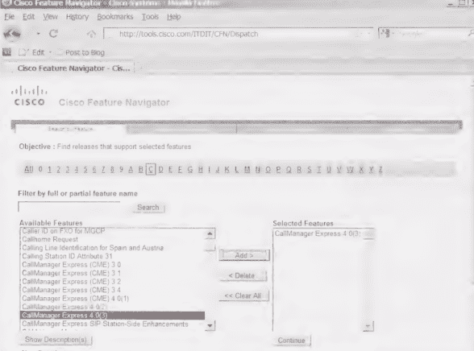

3. 单击“继续”以筛选 2801 路由器的结果。
4. 在结果页面上，在平台下拉列表中选择 2801 路由器。
5. 从主版本下拉列表中选择 12.4T，如图 12-2 所示。

**图 12-2** 筛选路由器和 IOS 版本

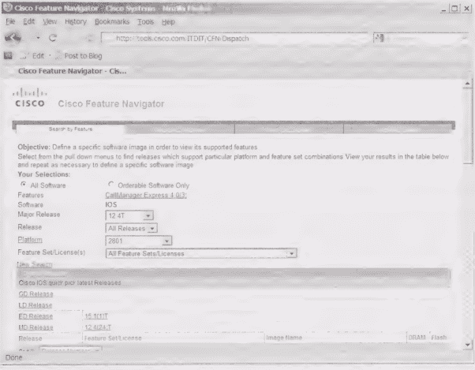

执行步骤 1–5 后，您应该会看到可以运行 Cisco Unified CME 的 IOS 功能集列表。

- **CME 软件**  CME 软件可以通过两种模式获取。基本模式仅包含 CME 软件和最常用的 IP 电话加载文件（加载文件用于在语音网络上配置和启用电话）。完整模式包含 CME 软件以及当前支持的所有电话加载文件。

- **IP 电话加载文件**  IP 电话加载文件或固件必须放在 TFTP（简单文件传输协议）服务器上，以便 Cisco 电话能够加载软件并在网络上运行。在大多数情况下，ISR 同时用作 CME 路由器和 TFTP 服务器。当您使用 CME-full 软件包时，将不需要单独的电话加载文件。

> **_包含 CME 软件和所有 IP 加载文件并包含 CME 软件版本 4.3 的文件名为 cme-full-4.3.0.0.tar，如果您拥有客户账户并已购买 CME 软件许可证，可以从 Cisco 软件下载网站下载。_**

安装 CME 的基本步骤如下：

1. 将适当的 IOS 映像加载到路由器上。
2. 配置基本路由器设置，例如接口的 IP 地址和主机名。
3. 使用 archive tar 命令将 CME 归档文件解压到路由器的闪存中。

这些步骤将在路由器上安装 CME，但要真正让路由器作为呼叫管理器工作，还需要做更多的工作。您需要配置以下参数：

- 将路由器设置为充当 TFTP 服务器。此配置步骤在配置模式下使用 **tftp-server** 命令执行。
- 配置 CME 的源 IP 地址。此步骤在 telephony-service 配置模式下使用 **ip source-address xxx.xxx.xxx.xxx** 命令执行。
- 配置 ephone 和 DN 的最大数量。此步骤使用 **max-ephone #** 和 **max-dn #** 命令执行，其中 # 是所需的最大数量。
- 设置 CME 要使用的固件加载文件。此步骤在 telephony-service 配置模式下使用 `load phone file` 命令完成，其中 *phone* 是电话型号，*file* 是指定电话的文件名。例如，7945 电话的命令将是 `load 7945 SCCP45.8-3-3S.loads`。
- 为电话创建 CNF 文件。CNF 文件是电话配置文件，加载了 CME 的 ISR 可以在 telephony-service 配置模式下使用 `create cnf-files` 命令创建一组默认的 CNF 文件。

### 为 CME 操作配置 DHCP 和 NTP

Cisco IP 电话必须从 DHCP 服务器接收其 IP 配置。您当然可以使用基础设施中现有的 DHCP 服务器，但更常见的做法是让 CME 路由器为语音 VLAN 电话租用 IP 地址。您还需要确保网络时间服务器可用。此时间服务器使用网络时间协议（NTP）。

在 Cisco 路由器上实现 DHCP 服务器功能时，您将执行以下操作：

1. 配置 DHCP 排除地址。这些地址不会分配给网络上的 IP 电话。
2. 使用网络、DNS 服务器、默认路由器等参数以及 TFTP 服务器的附加选项（选项 150）创建 DHCP 池。
3. 如有需要，设置 IP 助手地址。

> **考试注意**
>
> 请记住，在 Cisco 领域中，您先创建 DHCP 排除地址，然后再创建 DHCP 池。这与许多网络管理员使用过的 Microsoft DHCP 服务器不同。

要将 CME 路由器配置为分发电话的 IP 地址配置，请使用以下示例命令：

```text
Router1> enable
Router1# configure terminal
Router1(config)# ip dhcp excluded-address 10.1.1.50 10.1.1.100
Router1(config)# ip dhcp pool Voice_Pool
Router1(dhcp-config)# network 10.1.1.0 255.255.255.0
Router1(dhcp-config)# default-router 10.1.1.1
Router1(dhcp-config)# dns-server 4.2.2.2
Router1(dhcp-config)# option 150 ip 10.1.1.1
Router1(dhcp-config)# exit
Router1(config)# exit
Router1# show running-config | section dhcp
```

在前面的命令列表中，ip dhcp excluded-address 命令用于向路由器指示从 10.1.1.50 到 10.1.1.100 的地址不应分配给客户端。ip dhcp pool 命令用于创建池或进入现有 DHCP 池的配置模式，具体取决于命名池是否已存在。然后，我们使用 network 命令设置 DHCP 池的网络，并使用 default-router 命令指定网关。DNS 服务器地址使用 dns-server 命令指定。最后，option 150 命令用于指定将托管电话加载文件的 TFTP 服务器的 IP 地址。

最后的 show running-config | section dhcp 命令将列出 DHCP 配置，其内容应类似于以下内容：

```text
ip dhcp excluded-address 10.1.1.50 10.1.1.100
!
ip dhcp pool Voice_Pool
 network 10.1.1.0 255.255.255.0
 default-router 10.1.1.1
 option 150 ip 10.1.1.1
 dns-server 4.2.2.2
```

> **只有较新的 IOS 映像才允许将 section 过滤器与 show running-config 命令一起使用。对于较旧的 IOS 映像，只需使用标准的 show running-config 命令，并滚动到 DHCP 配置部分。**

如果您在与 CME 路由器不同的单独路由器上实现 DHCP，则可能需要配置 IP 助手地址。当 CME 路由器收到它无法服务的 IP 请求（例如，广播 DHCP 租约请求）时，将使用 IP 助手地址。IP 助手地址使用 ip helper-address 命令配置。

配置 DHCP 服务器池后，您可以确保 NTP 服务已正确配置。可以将 NTP 设置为使用 Internet 时间服务器，也可以简单地将一台内部服务器指定为 NTP 主服务器。要在 Internet 上查找 NTP 服务器，只需访问 ntp.org 网站。NTP 服务器在配置模式下使用 ntp server server.address 命令指定。在这种情况下，server.address 可以是 DNS 名称，也可以是 IP 地址。要使 Cisco 路由器成为 NTP 主服务器，只需在配置模式下执行 ntp master 命令。

> **考试注意**
>
> 请记住，ntp server 命令用于指定 NTP 服务器。您可以使用 FQDN 或 IP 地址来指定 NTP 服务器。

### 了解键控系统和 PBX 模型

CME 可以在三种模型中运行。第一种是 PBX 模型。第二种是键控或按键系统模型。第三种是混合模型，它是 PBX 和键控系统模型在单一环境中的混合。

这三种模型以模拟语音系统的传统方式运行。PBX 模型的作用类似于 PBX。这意味着呼叫被路由到特定分机或 ACD 队列，而不是使用专用线路。键控系统模型使用专用线路，每部电话可以接听任何线路。混合模型允许一些电话按照键控系统概念运行，而另一些电话按照 PBX 概念运行。

### 了解 ephone 和 ephone-dn

Cisco CME 使用 ephone 和 ephone-dn 在 CME 路由器内部实现电话。*ephone* 是物理电话的逻辑表示。例如，您将为语音网络上的每部物理电话创建一个 ephone 条目。许多 Cisco IP 电话支持多条虚拟线路。ephone-dn（ephone 目录号码）是这些不同线路的配置。因此，单个 ephone 可以具有多个 ephone-dn。

默认情况下，ephone-dn 是单线路。如果要配置双线路电话，必须使用 **ephone-dn # dual-line** 语法，其中 # 是 ephone-dn 标识号。要将双线路配置更改为单线路配置，必须删除现有的 ephone-dn 并将其替换为新的 ephone-dn。

有趣的是，您先创建 ephone-dn，然后再创建 ephone。ephone-dn 定义线路，ephone 将这些线路纳入（或捕获）到特定电话的配置中。以下示例代码将创建一个标识号为 1、分机为 5001 的 ephone-dn：

```text
Router1# configure terminal
Router1(config)# ephone-dn 1
Router1(config-ephone-dn)# number 5001
```


```text
Router1(config-ephone-dn)# exit
Router1(config)# exit
```

现在我们已经创建了一个 ephone-dn，可以通过使用 ephone 命令将其捕获到 ephone 配置中。这通过以下命令完成：

```text
Router1# configure terminal
Router1(config)# ephone 1
Router1(config-ephone)# mac-address 00cc.00cc.00cc
Router1(config-ephone)# button 1:1
Router1(config-ephone)# exit
Router1(config)# exit
```

从上面的命令列表中，您可以看到必须知道电话的 MAC 地址。如果您使用自动注册，可以使用 `show ephone` 命令查看已注册电话的 MAC 地址。一旦您将 ephone 映射到 MAC 地址，这些设置将保存在路由器的配置中。

button 命令用于标识当线路振铃时应点亮的电话按钮。在上面的命令示例中，`button 1:1` 命令表示当拨打分机 5001（ephone 1）时，按钮 1 应点亮。当您按下按钮 1 接听线路时，您也将从分机 5001（ephone 1）拨出电话。button 命令有更多选项。第一个数字始终是电话按钮，第二个数字始终是与该电话按钮关联的 ephone-dn；但是，冒号可以替换为不同的字符。例如，命令 `button 1s1` 表示静默振铃而不是普通振铃。表 12-2 列出了使用 button 命令时第二个空格或分隔符的选项。

**button 命令的分隔符选项**

| 分隔符 | 含义 |
|---|---|
| `:` | 普通振铃 |
| `b` | 呼叫等待提示音，无振铃 |
| `c` | 叠加线路（带呼叫等待） |
| `f` | 特色振铃 |
| `m` | 监控模式 |
| `o` | 叠加线路（无呼叫等待） |
| `s` | 静默振铃 |
| `w` | 监视模式 |
| `x` | 叠加扩展/滚动 |

### 验证 CME 终端

一旦您配置了 ephone 和 ephone-dn，终端应反映此配置。如果它们没有显示正确的线路配置，您可能需要重置或重启电话。

reset 命令是稳妥的选择，但耗时更长。当您重置电话时，就像关闭电话电源再重新打开。重启将重新加载固件、用户位置、网络位置和所有参数。

restart 命令是强度较低的选项，但可能无法捕获所有配置更改。重启应处理电话按钮、电话线路或快速拨号号码的更改。它不需要从 TFTP 服务器重新加载固件，也不需要获取新的 DHCP 租约。

您可以在 ephone 配置模式或 telephony-service 配置模式下执行 reset 和 restart 命令。在 ephone 配置模式下使用时，仅重启当前正在配置的电话。在 telephony-service 配置模式下使用时，所有 ephone 都将重启。


### 配置呼叫转接

虽然您可以将呼叫转接归类为下一节介绍的话音生产力功能之一，但由于其配置频率很高，因此值得单独用一节进行详细说明。当然，呼叫转接是一种允许您将进行中的呼叫从一部电话转移到另一部电话的功能。例如，我可能正在与客户通话，需要将客户转给另一位内部员工以进一步协助他。必须为每个 ephone 适当配置呼叫转接选项，此功能才能正常工作。

呼叫转接选项实际上是在 ephone 的 ephone-dn 设置中配置的。用于设置呼叫转接的命令是 transfer-mode，有三种转接模式可用：

- **完全盲转（Full-blind）** 完全盲转可用于单线路 ephone-dn，它在不与接收方（呼叫被转接到的电话）通话的情况下转接呼叫。
- **完全协商（Full-consult）** 完全协商仅可用于双线路 ephone-dn。发送方可以在转接呼叫之前与接收方通话。
- **本地协商（Local-consult）** 本地协商是 Cisco 专有方法，仅在仍使用较旧 Cisco 电话时应使用。

要配置呼叫转接，请使用类似以下的命令：

```text
Router1# configure terminal
Router1(config)# ephone-dn 1
Router1(config-ephone-dn)# transfer-mode blind
Router1(config-ephone-dn)# exit
Router1(config)# exit
```

### 配置话音生产力功能

运行 CME 的 Cisco 路由器提供了多项话音生产力功能。这些功能通过增加的扩展能力提升了用户体验。在本节中，您将了解寻线组、呼叫驻留、呼叫代答、寻呼以及保留音乐。

### 寻线组

*寻线组*是一种表示多个分机的 ephone 类型。当拨打寻线组分机时，寻线组中的分机会依次振铃，直到有人接听其中一部电话。寻线组算法决定下一次呼叫时首先振铃的分机。支持三种算法，这些算法在第 10 章中已介绍。这些算法分别为最长空闲（longest-idle）、对等（peer）和顺序（sequential）。

要配置寻线组，您必须知道以下信息：

- **引导号码（Pilot number）** 这是用于拨打寻线组的分机号码。
- **算法类型（Algorithm type）** 三种算法类型之一，包括最长空闲、对等和顺序。
- **成员列表（Member list）** 应包含在寻线组中的 ephone-dn。
- **跳数（Hops）** 寻线组将尝试振铃的分机数量。
- **超时（Timeout）** 一个分机在转到下一个分机之前振铃的时间长度。
- **最终号码（Final number）** 达到跳数限制后尝试的号码。

要配置寻线组，请根据获取的用于定义寻线组的信息，使用类似以下的命令：

```text
Router1# configure terminal
Router1(config)# ephone-hunt 13 peer
Router1(config-ephone-hunt)# pilot 5050
Router1(config-ephone-hunt)# ephone 5001 5002 5003
Router1(config-ephone-hunt)# hops 2
Router1(config-ephone-hunt)# timeout 15
Router1(config-ephone-hunt)# final 5004
Router1(config-ephone-hunt)# repeat
Router1(config-ephone-hunt)# exit
Router1(config)# exit
```

在上面的命令示例中，当寻线组扩展号 5050 收到呼叫时，分机 5001 到 5004 都可能被拨打。每部电话将振铃 15 秒，然后转到下一部电话。将尝试两部电话，然后分机 5004 处的电话将一直振铃直到有人接听。在最初的 ephone-hunt 命令中，您还可以看到这是寻线组 13，并且它使用对等算法。

### 呼叫驻留

Cisco CME 的呼叫驻留（call park 或 call parking）功能允许您将呼叫置于保持状态，但将呼叫移动到不同的分机。例如，您可能在分机 5001 处通话，并希望移动到 5002 来接听该呼叫。为此，您需要在 ephone-dn 配置中创建驻留槽。这样，分机 5002 处的电话就可以在指定槽位接听呼叫。以下命令说明了这一概念：

```text
Router1(config)# ephone-dn 35
Router1(config-ephone-dn)# number 4001
Router1(config-ephone-dn)# park-slot
Router1(config-ephone-dn)# exit
```

完成此配置后，Cisco IP 电话上的驻留按钮将正常工作。但是，呼叫将始终驻留在槽 4001 中。一旦呼叫驻留在该槽中，其他呼叫就无法再驻留。您可以通过简单地创建多个驻留槽来解决此问题。驻留功能将自动使用下一个可用的驻留槽，并向驻留呼叫的电话报告实际使用的驻留槽。

> **注意** 请记住，代答组只需将 ephone-dn 添加到组中即可配置。当第一个 ephone-dn 添加到组中时，代答组即被创建。

### 对讲、寻呼及寻呼组

对讲功能主要用于关键系统 CME 实现中。理解对讲功能的最佳方式是将其视为带自动接听的快速拨号。对讲呼叫的接收方无需接听呼叫。扬声器会自动启用，呼叫者可以开始讲话。对讲功能需要两部电话配置为对讲通信。以下命令提供了对讲配置的示例：

```text
Router1# configure terminal
Router1(config)# ephone-dn 25
Router1(config-ephone-dn)# number A200
Router1(config-ephone-dn)# intercom A201
Router1(config-ephone-dn)# exit
Router1(config)# ephone-dn 26
Router1(config-ephone-dn)# number A201
Router1(config-ephone-dn)# intercom A200
Router1(config-ephone-dn)# exit
Router1(config)# ephone 1
Router1(config-ephone)# button 2:25
Router1(config-ephone)# exit
Router1(config)# ephone 2
Router1(config-ephone)# button 2:26
Router1(config-ephone)# exit
```

在上面的命令示例中，创建了两个 ephone-dn（25 和 26）。请注意分机号码中使用了字母 A。这可以防止意外拨打对讲号码。您可以为此目的使用字母 A、B、C 或 D。还要注意，ephone-dn 25 拨打分机 A201 进行对讲，而 ephone-dn 26 拨打分机 A200。它们是反向配置的。最后，我们将按钮 2 分配给 ephone 1 上的 ephone-dn 25，并将按钮 2 分配给 ephone 2 上的 ephone-dn 26。

既然您已经理解了对讲，理解寻呼就会很容易。这是因为寻呼是一种单向对讲。您通过创建一个寻呼号码，然后将 IP 电话分配到该寻呼号码来实现寻呼。每当使用寻呼号码时，这些电话将自动通过扬声器播放寻呼音频。


> **考试要点**
>
> 一台电话只能分配到一个寻呼 ephone-dn。不过，寻呼组可以包含多个 ephone-dn。寻呼组还可以包含其他寻呼组。

寻呼可以配置为单播寻呼或组播寻呼。使用单播寻呼时，最多可以配置十台接收设备。组播寻呼允许超过十台接收设备。原因很简单：向每部电话发送单播流时，数据必须在网络上多次传输，这效率太低，无法一次处理超过十台接收设备。

配置寻呼组时，首先创建一个寻呼 ephone-dn。创建寻呼 ephone-dn 后，可以将 ephones 添加到定义为寻呼的 ephone-dn 中，此时该 ephone-dn 称为 paging-dn。要配置将作为 paging-dn 的 ephone-dn，请使用如下命令：

```
Router1# configure terminal
Router1(config)# ephone-dn 17
Router1(config-ephone-dn)# number 5151
Router1(config-ephone-dn)# paging
Router1(config-ephone-dn)# exit
```

输入上述命令后，paging-dn 17 即已存在。现在，要配置 ephones 使用该 paging-dn，请为相应的 ephones 执行以下命令：

```
Router1# configure terminal
Router1(config)# ephone 1
Router1(config-ephone)# paging-dn 17
Router1(config-ephone)# exit
Router1(config)# ephone 2
Router1(config-ephone)# paging-dn 17
Router1(config-ephone)# exit
```

输入上述命令后，在本例中，您已将 ephones 1 和 2 分配给寻呼组 5151（即 paging-dn 17）。此外，如果用户拨打号码 5151，分配给 ephones 1 和 2 的电话分机会激活其扬声器，并播放主叫用户麦克风中的音频。

### 两分钟速记

### 640-460：使用 CLI 实现 Cisco Unified Communications Manager Express 以支持终端

- 传真机可以连接到运行 CME 的路由器上的 FXS 端口，并且可以实现传真中继或透传。
- CME 3.4 每个系统最多支持 250 部电话。
- 运行 CME 需要三个软件组件：具有相应功能集的 IOS 镜像、CME 软件和 IP 电话加载文件。
- 路由器充当 TFTP 服务器，以便电话可以下载固件镜像和配置。
- `tftp-server` 命令用于指定 TFTP 服务器提供的文件。
- `max-ephone` 和 `max-dn` 命令必须输入到运行配置中，以确定要维护的 ephones 和目录号码的最大数量。
- `create cnf-files` 命令用于创建默认的电话配置文件。
- 创建 DHCP 地址池时，首先使用 `ip dhcp excluded-address` 命令创建 DHCP 排除地址。
- `ip dhcp pool` 命令用于创建 DHCP 地址池。
- 使用 `ntp server` 命令指定 NTP 服务器，`ntp master` 命令可用于使 ISR 成为 NTP 主服务器。
- Ephones 代表物理 IP 电话，使用 `ephone` 命令创建。
- Ephone-dn 代表电话线路或分机，使用 `ephone-dn` 命令创建。
- `button` 命令用于将特定的 ephone-dn 与多呼叫 Cisco IP 电话上的按钮关联。
- 当您想完全重启并重新加载 Cisco IP 电话时，请执行 `reset` 命令。
- 如果您想应用新的按钮配置，请执行 `restart` 命令。
- `reset` 和 `restart` 命令可以在 ephone 配置模式或 telephony-service 配置模式下执行。
- 呼叫转接可以配置为全盲转（转接呼叫时无需与接听方通话）或全咨询转（转接呼叫前先与接听方通话）。
- `transfer-mode` 命令用于为 ephone-dn 配置呼叫转接模式。
- 寻线组用于允许来电依次响铃多部电话。
- 呼叫驻留允许使用驻留槽位将呼叫置于保持状态，并在另一部电话上接听。
- 呼叫代接允许用户接听位于不同位置的正在响铃的电话。

- 12. 在 DHCP 配置模式下，哪个命令用于将 DHCP 地址池的默认路由器指定为 10.1.1.1？

  - A. `gateway 10.1.1.1`
  - B. `default-gateway 10.1.1.1`
  - C. `router 10.1.1.1`
  - D. `default-router 10.1.1.1`

- 13. 哪个 ephone-dn 配置模式命令用于指示某个 ephone-dn 实际上是用于呼叫驻留的驻留分机？

  - A. `park-slot`
  - B. `call-park`
  - C. `call-hold`
  - D. `park-point`

### 实验题

您想配置一个 ID 为 12、MAC 地址为 001c.23??.???? 的 ephone。按钮 1 应映射到 ephone-dn 12，按钮 2 应映射到 ephone-dn 13，两者均使用普通响铃。ephone-dn 12 应配置分机 5001，ephone-dn 13 应配置分机 5002。您将在路由器上输入哪些命令？

### 自测答案

### 640-460：使用 CLI 实现 Cisco Unified Communications Manager Express 以支持终端

- 1. ☑ D 正确。内部通信功能是双向的，能够满足此场景的需求。
  
  ☒ A、B 和 C 不正确。呼叫驻留用于将呼叫置于驻留槽位中的保持状态，以便可以在另一部电话上接听。呼叫代接用于接听除您自己的分机以外的响铃分机。寻呼用于实现到多个接收电话的单向内部通信呼叫。

- 2. ☑ B 正确。寻呼用于实现到多个接收电话的单向内部通信呼叫。
  
  ☒ A、C 和 D 不正确。Unicom 不是 Cisco CME 功能。呼叫驻留用于将呼叫置于驻留槽位中的保持状态，以便可以在另一部电话上接听。呼叫代接用于接听除您自己的分机以外的响铃分机。

- 3. ☑ A 正确。您可以在另一部电话上按下代接按钮，然后输入驻留槽位 ephone-dn 号码。
  
  ☒ B、C 和 D 不正确。没有电话被专门配置为驻留槽位接听电话。您不能将耳机直接插入运行 CME 的 ISR。保持按钮不用于接听驻留的呼叫。

- 4. ☑ B 正确。一部电话只能分配到一个寻呼 ephone-dn；但是，paging-dn 可以属于另一个 paging-dn，从而通过层次结构使电话可以属于多个寻呼组。
  
  ☒ A、C 和 D 不正确。这些答案根本不正确。

- 5. ☑ B 和 D 正确。保持音乐可以使用 WAV 或 AU 格式的音频。
  
  ☒ A 和 C 不正确。MP3 和 QuickTime MOV 格式均不受支持。

- 6. ☑ A 正确。moh 命令用于在 telephony-service 配置模式下配置 MoH 音频文件。
  
  ☒ B、C 和 D 不正确。无论路由器上是否安装了 CME，这三个命令都不是有效的 IOS 命令。

- 7. ☑ B 正确。after-hours exempt 命令可用于指示特定 ephone 不应受非工作时间规则的限制。
  
  ☒ A、C 和 D 不正确。这些不是有效的 IOS 命令。

- 8. ☑ A 正确。电话配置文件称为 CNF 文件。`create cnf-files` 命令将创建默认配置文件。
  
  ☒ B、C 和 D 不正确。这些不是有效的 IOS 命令。

- 9. ☑ D 正确。寻线组用于允许一组电话按顺序工作，即第一部电话振铃，如果超时后无人接听，则另一部电话振铃，依此类推。
  
  ☒ A、B 和 C 不正确。会议呼叫将用于实现电话会议。呼叫前转允许在您一段时间内不在您的分机旁时将呼叫转接到其他分机。全盲转是一种呼叫转接模式，不允许转接方在呼叫转接前与接听方通话。

- 10. ☑ A 正确。全盲转是一种呼叫转接模式，不允许转接方在呼叫转接前与接听方通话。
  
  ☒ B、C 和 D 不正确。全咨询转允许转接方在呼叫转接前与接听方通话。全自动转接和全延迟转接不是有效的呼叫转接模式。

- 11. ☑ B 正确。选项 150 定义 TFTP 服务器，因此正确的命令是 `option 150 ip 10.1.1.4`。
  
  ☒ A、C 和 D 不正确。这三个命令都不是在 DHCP 地址池中配置 TFTP 服务器的有效命令。

- 12. ☑ D 正确。`default-router 10.1.1.1` 命令为 DHCP 地址池配置默认路由器。
  
  ☒ A、B 和 C 不正确。这些不是有效的 IOS 命令。

- 13. ☑ A 正确。`park-slot` 命令用于指示 ephone-dn 是呼叫驻留分机。
  
  ☒ B、C 和 D 不正确。这些不是 ephone-dn 配置模式下有效的 IOS 命令。


### 实验答案

答案可能有所不同，但以下在运行 CME 的 ISR 路由器上执行的 Cisco IOS 命令应能提供所需的配置：

```cisco
Router1# configure terminal
Router1(config)# ephone-dn 12
Router1(config-ephone-dn)# number 5001
Router1(config)# ephone-dn 13
Router1(config-ephone-dn)# number 5002
Router1(config-ephone-dn)# exit
Router1(config)# ephone 12
Router1(config-ephone)# mac-address 0c0c.0c0c.0c0c
Router1(config-ephone)# button 1:12 2:13
Router1(config-ephone)# exit
Router1(config)# exit
```


## 第13章

## 第13章 Unified Communications Manager

### 认证目标

| 目标 | 复习 | 自测 |
|---|---|---|
| 13.01 642-436：描述拨号计划 | ✓ 两分钟速览 | 问答自测 |

> *如果电话不响，那是我。*
> ——吉米·巴菲特歌曲标题

前一章介绍了 Cisco 呼叫管理解决方案的 CME 版本。在本章中，你将了解完整的 Unified Communications Manager 服务器的功能。你将学习用于操作基于服务器的 Unified Communications Manager 的基本实施流程和管理工具。此外，一个同时适用于 Unified Communications Manager 和 CME 的概念是拨号计划，本章也将讨论这一主题。

如果像巴菲特先生那样，你的 VoIP 网络中的电话不响，那就是你的问题——与他不同的是，你必须找出电话不响的原因。本章为你提供规划拨号基础设施（即拨号计划）所需的信息，以便你的电话能够正常响铃。

### Unified Communications Manager

Cisco Unified Communications Manager（CUCM 或 UCM）是 Cisco 呼叫管理解决方案的企业完整版。UCM 可用于小型企业和分支机构，但其可扩展性使其成为大型企业的合适解决方案。在本节中，你将了解 UCM 的实施和管理。在学习实施的过程中，你将了解 UCM 解决方案的功能和要求。

### UCM 实施

实施 UCM 涉及选择合适的版本，并确保所选版本满足相关要求。为此，你需要了解不同 UCM 版本提供的功能。此外，你还必须了解部署要求，包括许可要求和硬件要求。

### UCM 版本

Cisco UCM 呼叫管理解决方案提供三种基本版本或发行形式。第一种是基于服务器的完整 UCM 服务器软件部署。第二种是基于设备的部署。第三种是 UCM Business Edition（商业版），这是 UCM 软件的一个特殊版本。

基于服务器的版本需要特定的服务器硬件。你不能简单地将其安装在你组织中任何满足某些最低要求的服务器上。相反，服务器必须是 Cisco 7800 系列 Media Convergence Server（MCS）或经认证的第三方服务器。虽然受支持的服务器有限，且你必须在受支持的服务器上运行 UCM，但这些服务器实际上只是普通服务器。它们只是经过 Cisco 批准，能够提供 VoIP 呼叫管理服务器所需的正常运行时间。

基于设备的版本于 2006 年首次发布。使用这种部署模型，无需进行安装。该设备预配置了 UCM 解决方案。UCM 数据库、设备驱动程序和通用软件全部捆绑在该设备中，以简化部署和支持。

UCM 设备版本支持维护分区。该设备包含两个分区：活动分区和非活动分区。活动分区是为 VoIP 网络提供服务的分区。非活动分区是活动分区的精确实时副本。当你想要应用更新时，可以将更新应用于非活动分区，然后执行分区切换重启。重启需要 10–15 分钟，这比传统更新单个 UCM 实例所需的停机时间要短得多。

UCM Business Edition（BE）面向中型组织。Cisco 表示，BE 最适合拥有最多 20 个站点、100–350 名员工的组织。从技术上讲，UCM BE 最多可支持 500 名电话用户。UCM BE 的关键在于它包含了呼叫管理、语音邮件，甚至 WebEx。UCM BE 运行在 MCS 设备上，占用服务器机架中的 1 个 RU（机架单位）空间。

### UCM 功能

根据 Cisco UCM 8.0 的数据表，系统支持以下用户功能：

- 缩位拨号
- 应答及应答释放
- 自动应答和内部通信
- 从电话访问 HTML 帮助
- 用于电话服务的 HTTPS；例如，Extension Mobility（分机移动性）
- 保持恢复
- 立即转接至语音邮件
- 带耳语功能的内部通信
- 跨线路加入
- 上次号码重拨（网内和网外）
- 呼叫组登录和注销
- 恶意呼叫 ID 和追踪
- 经理-助理服务（Cisco Unified Communications Manager Assistant 应用程序）代理线路支持：
  - 经理功能：立即转接或转移、免打扰、转移所有呼叫、呼叫拦截、按主叫线路标识过滤呼叫、内部通信和快速拨号
  - 助理功能：内部通信、立即转接或转移、转移所有呼叫，以及通过助理控制台应用程序处理经理呼叫
- 经理-助理服务（Cisco Unified Communications Manager Assistant 应用程序）共享线路支持：
  - 经理功能：立即转接或转移、免打扰、内部通信、快速拨号、插入、直接转移和加入
  - 助理功能：处理经理的呼叫；查看经理状态和呼叫；为常用号码创建快速拨号；在目录中搜索人员；处理自己线路上的呼叫；立即转接或转移、内部通信、插入、隐私、每线路多呼叫、直接转移和加入；从控制台发送 DTMF 数字；以及确定经理电话的 MWI 状态
- 经理-助理服务（Cisco Unified Communications Manager Assistant 应用程序）系统能力：每位助理支持多位经理（最多 33 条线路）以及冗余服务
- 经理-助理服务现可在运行 Cisco Unified Communications Manager 6.0 的 Cisco Unified IP 电话上使用
- MWI（视觉和音频）
- 多方会议：即兴会议并附带预设式 meet-me 功能
- 每线路外观支持多个呼叫
- 每部电话支持多条线路外观
- MoH（保持音乐）
- 免提和听筒静音功能
- 挂机拨号
- 从语音邮件转移时显示原始主叫方信息
- 隐私
- 通过 HTTP 浏览器到电话的实时 QoS 统计信息
- 最近拨号列表：拨入电话、拨出电话、自动拨号和编辑拨号
- 服务 URL：单键访问 IP 电话服务
- 单键插入
- 单一目录号码和多部电话：桥接线路外观
- 快速拨号：每部电话支持多个快速拨号
- 话机音量控制（音频和铃声）
- 转接：盲转、咨询转接以及线路两方的直接转接
- 用户通过 Web 访问配置快速拨号和呼叫转接
- 视频（SCCP、H.323 和 SIP）
- IP 电话上的 VPN 客户端
- 从电话访问 Web 服务
- Web 拨号器：点击拨号
- 宽带音频编解码器支持：专有 16 位分辨率；16 kHz 采样率编解码器

除了这些共享功能之外，你还应该了解 Cisco UCM 各版本之间的功能差异。表 13-1 列出了 UCM 各版本之间的关键能力差异。

**表 13-1 — UCM 版本能力比较**

| UCM 版本 | 用户数 | 部署模型 |
|---|---:|---|
| Cisco UCM | 每个集群 30,000 | 集中式部署，单个系统最多包含 100 台 UCM 服务器 |
| Cisco UCM BE | 500 | 集中式部署 |
| Cisco UCM 设备版 | 每个集群 30,000 | 集中式部署，单个系统最多包含 100 台设备 |


### UCM 要求

Cisco UCM 的早期版本可运行于 Windows 或 Linux。较新版本只能运行在 Linux 上。4.x 及更早版本可运行于 Windows 服务器，并且仍在生产环境中大量使用。使用 Cisco UCM 一体机版本时，由于硬件随软件一起提供，要求就不再是问题了。

要确保你拥有适合计划运行的 UCM 版本的硬件，请查看 Cisco 网站上的要求。要了解可与 UCM 配合使用的第三方服务器，请访问此网页：http://www.cisco.com/go/snowly。

### UCM 管理

将 UCM 以一体机或服务器形式安装到你的环境后，你可以使用基于 Web 的管理界面来管理服务器。还可以使用命令行界面（CLI）通过 Telnet 或 SSH 进行管理。图 13-1 显示了基于 Web 的管理界面主页。

**图 13-1** Cisco UCM 管理主页

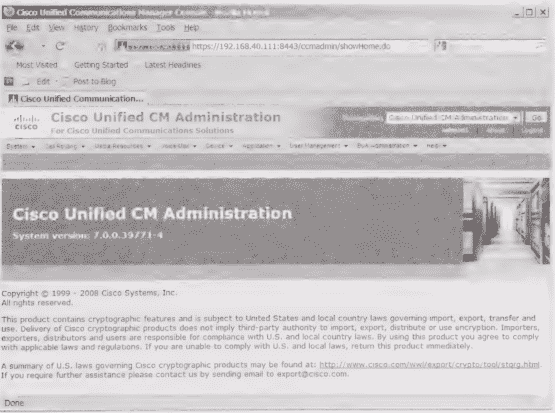

图 13-2 显示了 UCM 服务器的常规配置界面。请注意，屏幕截图中的自动注册处于禁用状态。自动注册默认是禁用的。如果要启用自动注册，必须取消选中显示的复选框，并添加一个结束目录号码（DN）。

图 13-3 显示了用户创建界面。你可以指定用户 ID 和密码，以及用于语音邮件访问的 PIN。可以同时添加电话并将其与用户关联，还可以指定分机和分机掩码。

**图 13-2** UCM 常规配置页面

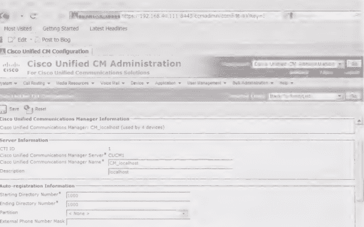

展示这些屏幕界面的目的是让你看到使用基于 Web 的界面进行管理是多么简单。无论是 CCNA Voice 考试还是 CVOICE 考试，都不会要求你掌握 UCM 配置。

**图 13-3** 用户和电话添加页面

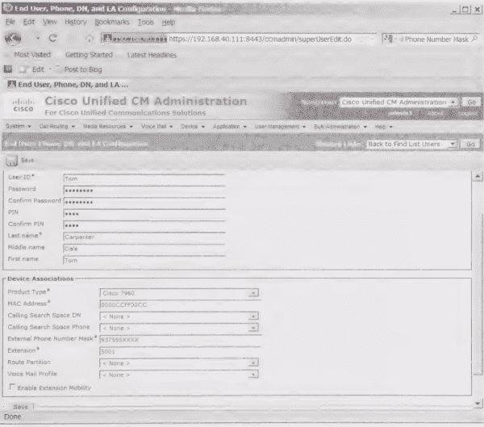

### 认证目标 13.01

### 642-436：描述拨号计划

拨号计划定义了呼叫通过网络进行连接和通信的方式。多个部分共同构成拨号计划，包括：

- 编号计划
- 路径选择
- 数字处理
- 呼叫权限
- 呼叫覆盖

本节涵盖所有拨号计划组件。

### 编号计划

编号计划有多种形式。内部编号计划定义了如何在语音网络中实施电话分机。PSTN（公共交换电话网）中同样存在编号计划。在北美洲，使用北美编号计划（NANP），它提供了我们在美国使用的电话号码，例如 1-937-555-4547 或 1-800-555-4545。在世界其他地区，使用不同的编号计划。编号计划通常分为以下组成部分：

- 国家代码
- 地区或区域代码
- 节点地址或电话号码
- 受限数字

国家代码由 ITU-T 定义，你可以在 http://en.wikipedia.org/wiki/List_of_country_calling_codes 找到国家代码列表。一些示例国家代码包括：美国/加拿大为 +1，希腊为 +30，英国为 +44，日本为 +81。

地区或区域代码由该地区使用的编号计划定义。例如，北美使用 NANP 计划，英国使用国家电话号码计划（NTNP）。

相反，你只能为那部电话分配分机 151。结果是用户会感到困惑。你应该始终为每个站点留出增长空间。更好的计划可能如下所示：

- 站点 1：分机 1000–1999
- 站点 2：分机 4000–4999
- 站点 3：分机 7000–7999

你能看出这个计划如何为增长留出空间吗？首先，如果每个站点只有不到 50 个分机，那么你已经可以将站点扩展 20 倍。其次，在 2000、3000、5000 和 6000 分机号段还有空间容纳更多站点。关键原则是留出增长空间。

### 路径选择

路径选择（即呼叫路由）涉及确定为呼叫处理和连接使用的最佳通信路径。路径选择也可以称为“语音呼叫流向确定”。被叫号码将决定呼叫连接所遵循的路径。在容错实现中，可能存在多条路径。例如，呼叫可以通过纯 IP 网络进行路由，也可以通过 PSTN 呼叫段进行路由。各呼叫段共同构成完整的呼叫路径。

图 13-4 显示了一个 VoIP 呼叫路径示例。请注意，呼叫从模拟电话进入网关中的 FXS 端口。该呼叫通过 IP 网络到达另一台连接着 VoIP 电话的网关。这个基本示例中表示了三个呼叫段。从电话到网关 FXS 端口的链路是第一个呼叫段。当呼叫从模拟电话发起时，路由器或网关将此视为*入站*呼叫段。路由器分析该入站呼叫，确定呼叫应通过哪个接口进行路由，并确定*出站*呼叫段。第一台路由器上的*出站*呼叫段成为第二台路由器上的*入站*呼叫段。第二台路由器查看*入站*呼叫段，确定呼叫应通过哪个接口进行路由，并确定*出站*呼叫段，在该场景中最终到达 VoIP 电话。


呼叫段将在拨号对等体中定义。例如，图 13-4 中的路由器 1（最左侧的路由器）将配置一个拨号对等体，当有呼叫到达由路由器 2 管理的 VoIP 电话时，该拨号对等体允许将呼叫路由到路由器 2。存在两种基本的拨号对等体类型。第一种是 POTS 拨号对等体，用于连接 PSTN、PBX 或模拟设备。第二种是 VoIP 拨号对等体，用于连接 H.323、SIP 或 SCCP 电话。创建拨号对等体的过程将在第 14 章中介绍。

### 数字处理

数字处理用于更改拨打的数字，以匹配适当的目的地。例如，对于入站呼叫，可能需要剥离号码中的某些数字，或完全更改以符合内部编号计划。对于出站呼叫，可能需要添加区号和国家代码。这些基本操作就是数字处理所涉及的概念。

在 Cisco 环境中可以使用多种数字处理技术，包括：

- **数字剥离** 数字剥离涉及去除目标网络或节点不需要的数字，并在选择出站拨号对等体之后、通过该拨号对等体发送数字之前执行。
- **转发数字** 转发数字技术只是将数字发送到目标网络或节点。转发数字仅适用于 POTS 拨号对等体。
- **前缀数字** 前缀数字方法在拨打的号码开头添加数字。例如，外线号码可能需要加 9 前缀。
- **号码扩展** Cisco 网关使用正则表达式执行号码扩展。号码扩展用于有效地将拨打的号码替换为另一个号码。

### 呼叫权限

呼叫权限决定允许用户呼叫哪些目的地。非工作时间权限属于此类别，已在第 12 章中介绍。

### 呼叫覆盖

呼叫覆盖包括两种功能：

- 转发
- 寻线

### 两分钟冲刺练习

### 642-436：描述拨号计划

- [ ] 编号计划定义了语音网络中节点如何被寻址。
- [ ] 北美编号计划（NANP）用于北美的 PSTN。
- [ ] 应仔细规划内部编号计划，以适应当前需求和未来发展。
- [ ] 路径选择或呼叫路由涉及确定呼叫段以及每个呼叫段的适当拨号参数。
- [ ] 数字处理用于将拨打的数字转换为不同网络或端点可接受的数字。
- [ ] 数字剥离用于从拨打的号码中移除数字。
- [ ] 前缀数字会添加到拨打的号码开头，例如为外线添加 9。
- [ ] 可以应用转发数字规则，将拨打的数字直接转发到下一个呼叫段。
- [ ] 号码扩展可用于将拨打的数字替换为适合该拨叫号码的数字。
- [ ] VoIP 呼叫流中的任何路由器都可以执行数字处理。
- [ ] 呼叫权限涉及用户在特定时间拨打特定电话的能力。
- [ ] 呼叫覆盖包括呼叫转发和呼叫寻线或寻线组。


### 自测

以下问题将帮助你衡量对本 chapter 所介绍材料的理解。请仔细阅读所有选项，因为正确答案可能不止一个。对于每个问题，请选择所有正确答案。

### 642-436：描述拨号计划

1. 以下哪些是 Cisco VoIP 电话环境中拨号计划的组成部分？（选择所有适用项。）

- A. 编号计划
- B. 数字操作
- C. 路径选择
- D. DHCP

2. 为 Cisco VoIP 网络制定编号计划时，必须考虑哪两个因素？

- A. 网关的 IP 地址
- B. 当前需求
- C. 未来需求
- D. 实施该计划所在的时区

3. 北美使用哪种编号计划？

- A. NTNP
- B. NNP
- C. NANP
- D. 拨号对等体

4. 当向连接到同一路由器或网关的另一个 VoIP 端点发起 VoIP 呼叫时，存在多少条呼叫支路？

- A. 1
- B. 2
- C. 3
- D. 0

5. 当从一个网关上的 FXS 端口向连接到另一个网关的 VoIP 电话发起呼叫时，如果两个网关之间存在可用的直接连接，则存在多少条呼叫支路？

- A. 1
- B. 2
- C. 3
- D. 0

6. 与最初拨打的号码相比，哪种数字操作技术可能导致号码完全改变？

- A. 前缀数字
- B. 转发数字
- C. 数字剥离
- D. 号码扩展

7. 哪种数字操作技术会在最初拨打的号码开头添加一位或多位数字？

- A. 前缀数字
- B. 转发数字
- C. 数字剥离
- D. 号码扩展

8. 哪种数字操作技术会将数字未经修改地发送到远程网络？

- A. 前缀数字
- B. 转发数字
- C. 数字剥离
- D. 号码扩展

9. 什么决定了用户可以呼叫的目的地？

- A. 呼叫覆盖
- B. 呼叫权限
- C. 数字操作
- D. 编号计划

10. 什么功能提供转发或寻线，或两者兼有？

- A. 呼叫覆盖
- B. 呼叫权限
- C. 数字操作
- D. 编号计划

11. 如果呼叫路径包含三个运行 Cisco CME 的网关，哪个（些）网关可以通过数字操作修改拨打的号码？

- A. 最接近呼叫发起点的网关
- B. 最远离呼叫发起点的网关
- C. 中心网关
- D. 路径中的任何网关

12. 你需要为每个拨打外线的呼叫在开头添加 9。应配置哪种数字操作？

- A. 前缀
- B. 数字剥离
- C. 转发数字
- D. 对讲

13. 以下哪些是 NANP 编号计划的一部分？（选择所有适用项。）

- A. 节点代码
- B. 国家代码
- C. 地区代码
- D. 受限数字

### 实验题

你正在为一个拥有四个地点的组织创建拨号计划。除一个地点需要 245 个分机外，每个地点将需要 120 个分机。你希望确保将来可以轻松扩展网络，以在每个地点包含更多分机，并有可能包含更多地点的分机。该组织预计员工人数每年增长 10-15%，并且你必须实施一个至少在未来十年内无需升级（假设不发生硬件故障）或未来扩展即可运行的网络。你会推荐什么基本编号计划，为什么？在你的答案中包括每个地点的分机范围以及选择这些分机范围的原因。

6. **D 正确。** 号码扩展用于在号码上增加内容，或完全更改号码。正则表达式与号码扩展一起使用，对于 CCNA Voice 或 CVOICE 考试，不要求你理解它们的使用。

**A、B 和 C 不正确。** 前缀数字用于需要在拨打的号码开头添加数字时。转发数字用于将整个拨打的号码不加更改地发送到远程网络或网关。数字剥离用于在转发前删除数字。

7. **A 正确。** 前缀数字用于需要在拨打的号码开头添加数字时。例如，当需要拨打外线时，你可以使用前缀数字添加 9。

**B、C 和 D 不正确。** 转发数字用于将整个拨打的号码不加更改地发送到远程网络或网关。数字剥离用于在转发前删除数字。号码扩展用于在号码上增加内容，或完全更改号码。

8. **B 正确。** 转发数字用于将整个拨打的号码不加更改地发送到远程网络或网关。

**A、C 和 D 不正确。** 前缀数字用于需要在拨打的号码开头添加数字时。数字剥离用于在转发前删除数字。号码扩展用于在号码上增加内容，或完全更改号码。

9. **B 正确。** 呼叫权限可用于限制可以呼叫的目的地。呼叫权限可以在所有时段或特定时段限制某些号码（基于通配符）。

**A、C 和 D 不正确。** 呼叫覆盖用于提供转发或寻线。数字操作用于修改拨打的号码，以便正确完成呼叫。编号计划定义内部扩展的编号，以及你如何与外部语音网络互连。

10. **A 正确。** 呼叫覆盖用于提供转发或寻线。

**B、C 和 D 不正确。** 呼叫权限可用于限制可以呼叫的目的地。数字操作用于修改拨打的号码，以便正确完成呼叫。编号计划定义内部扩展的编号，以及你如何与外部语音网络互连。

11. **D 正确。** 任何网关都可以在接口上接收呼叫，然后在将呼叫转发到下一个出站呼叫支路之前，根据需要执行数字操作。网关不必执行数字操作，但在需要时可以执行。

**A、B 和 C 不正确。** 因为路径中的任何网关都可以执行数字操作，所以这些答案不正确。

12. **A 正确。** 前缀数字配置可用于在将数字发送到下一跳或最终目的地之前，向拨打的号码开头添加前缀。

**B、C 和 D 不正确。** 数字剥离将用于删除数字，而不是添加数字。转发数字将不加更改地发送拨打的数字。对讲不是一种数字操作技术，而是用于将音频发送到另一部 IP 电话的免提电话。

13. **B、C 和 D 正确。** 国家代码定义特定国家/地区，例如美国或加拿大。地区代码定义该国家/地区内的一个区域。受限数字限制可在生成的电话号码的特定位置使用的号码或数字。

**A 不正确。** NANP 编号计划中未定义节点代码。

### 实验答案

答案会有所不同，但以下计划和说明应与你制定的计划类似：

- 地点 A：分机 1000–1999
- 地点 B：分机 2000–2999
- 地点 C：分机 3000–3999
- 地点 D（较大的站点）：分机 4000–4999

选择这些分机范围是因为，如果增长率保持最高 15% 不变，三个较小地点从 120 个分机开始，十年后将达到 485 个分机。虽然这是很高的增长率，但它是实验中指定的增长率。即使在十年后，每个站点可用的 1,000 个分机也完全足以容纳增长。

从 245 个分机开始的较大地点，在 15% 的增长率下，十年后将增长到 991 个分机。这个数字小于可用的 1,000 个；然而，即使它更高，也可以通过向上使用 5000–5999 分机范围来容纳增长。因此，为较大地点选择了 4000–4999 范围。

最后，如果多年来新增站点，我们始终可以使用 6000–6999、7000–7999 等范围。该解决方案既满足当前需求，也满足未来需求。


## 14 网关与网守

### 认证目标

- **14.01** 642-436：描述网关的组件
- **14.02** 642-436：实现网关
- **14.03** 640-460：描述和配置网关、语音端口和拨号对等体，以连接到 PSTN 和服务提供商网络
- **14.04** 642-436：描述网守在 IP 通信网络中的功能与互操作
- **14.05** 642-436：实现网守
- ✓ 两分钟练习
- Q&A 自测

> 斯米戈尔知道霍比特人不能走这条路。哦，是的，斯米戈尔知道。
>
> ——斯米戈尔在《指环王》中谈到通往魔多的黑门时所说

网关和网守为你的 VoIP 网络提供不同类型的门。门被定义为进入一个空间或资源的入口点，例如《指环王》中通往魔多的黑门。网关是一条可以访问该空间或资源的路径。网守则确保只有合适的人才能通过网关，并且他们只能携带受保护的空间或资源所允许携带的物品。进入魔多的网关就是通往黑门的道路。网守就是驻扎在门口的哨兵。

在 Cisco 路由器中，网关是允许两个语音网络相互通信的路由器软件和硬件。网关内部的门就是连接到远程网络（如 PSTN）的接口。网守也是运行在 Cisco 路由器上的软件。本章将比前面的任何章节更详细地解释网关和网守。你将首先阅读关于网关的内容，然后是关于网守的内容。

### 认证目标 14.01

### 642-436：描述网关的组件

语音网关连接不同的语音网络。例如，它们可以将你的 VoIP 网络连接到 PSTN，或者通过基于 IP 的广域网将两个基于 PBX 的语音网络连接在一起。这些连接是通过语音端口和拨号对等体建立的。在本节中，你将了解基本的网关功能以及用于实现这些网关的语音端口和拨号对等体。

### 网关功能

Cisco 语音网关可以是数字网关或模拟网关。数字网关通过 ISDN、T1 或 E1 线路连接到电话服务提供商。模拟网关连接到电话服务提供商或模拟电话设备。语音端口通常用于网关中，以提供以下连接类型：

- 电话到广域网
- 电话到 PSTN
- 通过广域网的 PBX 到 PBX

在实现电话到广域网连接时，你要么支持内部模拟电话，要么支持 VoIP 电话，通过广域网连接到你组织中的远程位置或你所连接的其他组织。图 14-1 展示了电话到广域网实现的概念。VoIP 电话将通过标准以太网端口连接到网关，而广域网连接通常使用数字线路。如果支持内部模拟电话，它们可以直接通过 FXS（外部交换站）端口连接到网关，或通过某种模拟到 VoIP 转换设备连接。

**图 14-1** 电话到广域网实现


电话到 PSTN 模型在组织内部使用模拟电话或 VoIP 电话，并连接到 PSTN 而不是广域网链路。图 14-2 说明了电话到 PSTN 的实现。在电话到 PSTN 模型中，内部电话通过以太网通信（VoIP 电话）或 FXS 端口（模拟电话）与网关通信。网关使用模拟或数字接口与 PSTN 通信。如果只需要几条线路，可以使用多个 FXO（外部交换局）端口连接到 PSTN。如果需要多条线路或信道，则可能需要 T1 或 E1 线路。


对于通过广域网的 PBX 到 PBX 模型，Cisco 网关用于形成广域网连接，PBX 系统通过此连接相互通信，如图 14-3 所示。

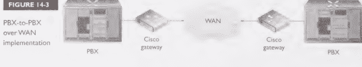

### 语音端口及用途

前一节提到了几种语音端口。FXS 和 FXO 端口作为模拟端口被提及，T1 和 E1 线路作为数字端口被提及。ISDN 连接也属于数字端口类别。当你阅读本章其余内容时，你将获得根据你的情况选择正确语音端口类型所需的知识。表 14-1 列出了语音端口及其用途。

### 拨号对等体及拨号对等体类型

在将 Cisco 路由器（作为语音网关）连接到服务提供商之前，必须先安装语音端口接口。请务必查看 Cisco 网站，以确保计划购买的接口与你计划安装它的路由器兼容。例如，Cisco 2801 路由器具有 WIC 接口端口，但并非所有 WIC 卡都能在该路由器中工作。请务必选择适用于你设备的适配器。

**表 14-1 — 语音端口及用途**

| 语音端口 | 类型 | 用途 |
|---|---|---|
| 外部交换站 (FXS) | 模拟 | 连接模拟电话和传真机 |
| 外部交换局 (FXO) | 模拟 | 连接到 PSTN 或 PBX 系统 |
| T1 | 数字 | 通过多信道连接到服务提供商 |
| E1 | 数字 | 通过多信道连接到服务提供商 |
| ISDN | 数字 | 通过多信道连接到服务提供商，但信道数少于 T1 或 E1 线路 |

安装 T1/E1、ISDN 或模拟语音端口后，你需要使用 `voice-port` 命令配置语音端口。但即使配置了语音端口，网关仍未完全配置。你必须配置拨号对等体。拨号对等体告诉网关何时使用语音端口，以及何时在本地网络上建立呼叫。拨号对等体将拨打的数字匹配到适当的目的地。对于电话通信，拨号对等体有两种类型：

- **VoIP** VoIP 拨号对等体用于通过基于数据包的网络连接到其他设备。这些网络包括基于 IP 的广域网链路、内部局域网，甚至 VPN 隧道。VoIP 拨号对等体定义了一个号码可以到达或经由其到达的 IP 地址。
- **POTS** POTS 拨号对等体用于连接到传统电话网络或设备。这些网络和设备包括 PSTN 和 PBX 系统。当一个 FXS 端口上的电话与同一路由器/网关或不同路由器/网关上的另一个 FXS 端口上的电话通信时，也会使用 POTS 拨号对等体。

### 认证目标 14.02

### 642-436：实现网关

在上一节中，你了解了网关的组件。在本节中，你将学习更多关于网关呼叫路由以及 Cisco 路由器中用作语音网关的模拟和数字端口的细节。你还将学习 POTS 拨号对等体的配置命令。

### 网关呼叫路由

网关结合两个因素来确定如何路由呼叫。第一个因素是传入的拨打数字。第二个因素是网关上的拨号对等体和目的地信息，或者通过网守可获得的信息。拨打数字从内部电话发送到网关，并且可以在传输到远程语音网络之前进行处理。根据目的地，拨号对等体配置为语音或 POTS 拨号对等体。利用这些信息，网关可以为呼叫确定最佳路由，并传递正确的数字，最终在两个端点之间建立呼叫。

呼叫可以通过模拟或数字端口路由出去，这些端口将在以下各节中介绍。模拟端口管理单个信道，例如 FXO 端口。数字端口管理多个信道，例如 ISDN、T1 或 E1 连接。即使是多信道连接也会连接到 Cisco 路由器上的单个端口。例如，一条 T1 线路可能是具有 24 个信道的完整 T1 线路，但它连接到一个端口，该端口看起来很像路由器上的以太网端口。这些信道通过时间片或频率差进行分离，但它们运行在同一条线路上。

### 了解模拟端口

模拟端口连接到模拟电路提供商，例如 PSTN 电话公司。当连接到电话公司或 PBX 时，这些端口通常使用 FXO 接口连接；当直接连接到模拟电话或传真机时，则使用 FXS 接口。这些模拟端口或电路将使用为模拟通信设计的信令机制。以下是常见的模拟信令方法：

- **环路启动** — 当电流流动时，电话交换机占用一条线路以传送拨打的数字。当用户拿起传统电话上的听筒时，交换机会闭合电路并开始电流流动。
- **接地启动** — 当电话将电路中的振铃线接地时，电话交换机占用一条线路以传送拨打的数字。接地只持续片刻，一旦检测到接地，就使环路变为活动状态以进行拨号。
- **E&M 闪烁启动** — 当 E&M 电路的极性反转时，一条线路被占用以传送拨打的数字。


### 实际工作

如需了解有关模拟端口配置和选项的更多信息，请访问 Cisco.com 网站，网址为 http://www.cisco.com/en/US/docs/ios/voice/voiceport/configuration/guide/vo_cfg_analog_vps_ps6441_TSD_Products_Configuration_Guide_Chapter.html。

根据路由器型号的不同，您将在全局配置模式下使用不同的命令来访问语音端口。在某些型号上，您将使用 *voice-port port* 命令。在其他型号上，您可能会使用 *voice-port slot/port* 命令。还有一些型号，您可能会使用 *voice-port slot/subunit/port* 命令。进入 *voice-port* 配置模式后，您就可以配置信令类型、音调信令声音、拨号类型、振铃频率、振铃次数、振铃节奏和描述。某些配置选项仅在 FXS 端口上可用，这些选项包括振铃频率、振铃次数和振铃节奏。拨号类型仅在 FXO 端口上可用。

### 了解数字端口

数字端口主要有两种形式：T1/E1 和 ISDN。T1 线路最多可有 24 个信道，其中 23 个信道可用于语音通信。E1 线路最多可有 32 个信道，其中 30 个信道可用于语音通信。完整 T1 线路的总数据速率为 1.544 Mbps，带宽为 1.536 Mbps；完整 E1 线路的总数据速率为 2.048 Mbps，带宽为 1.984 Mbps。每个信道包含 64 Kbps 的带宽。

在数字电路或端口上，可以使用时分复用（TDM）。TDM 模型为特定信道使用时间片，通信信道轮流进行，并且仅在其分配的时间片内进行通信。为了在线路上复用（组合）多个信号，时间在所需信道之间进行分配。在 T1 线路上，假设购买了完整的 T1，则提供 24 个不同的时间片或信道。

统计 TDM 仅在需要时隙进行数据传输时才在线路上保留时隙。统计 TDM 允许在电路上进行超额订阅，而传统 TDM 不允许此功能。统计 TDM 也称为分组模式复用。

### 考试要点

请记住，统计 TDM 可以被超额订阅，而传统 TDM 则不能。传统 TDM 为信道使用分配的时隙，并且分配不会改变。统计 TDM 仅在需要时请求时隙。

频分复用（FDM）也可用于数字电路或端口。FDM 使用不同的频率在同一线路上发送多个信号（信道）。在光纤通信中，可以使用密集波分复用（DWDM），这是一种使用不同频率光波的 FDM 形式。

数字电路可以使用两种信令类型之一。第一种是公共信道信令（CCS），第二种是随路信道信令（CAS）。很容易记住这些信令类型的工作方式。CCS 有一个公共信道，供所有其他信道用于信令。在通常使用 CCS 的 ISDN 连接中，数据或 D 信道专用于信令（是的，信号被称为数据，而语音数据则不是）。额外的承载或 B 信道用于发送实际的语音信息。CCS 不仅用于 ISDN 连接；它也用于 T1 和 E1 主速率接口（PRI）连接。

随路信道信令（CAS）使用语音信道上的比特进行信令。每个信道有 64 Kbps 的带宽。CAS 占用其中 8 Kbps 的带宽用于信令。CAS 在线路上可以使用两种编码类型之一。第一种是超帧（SF），它较旧且效率较低。第二种是扩展超帧（ESF），它是较新且更高效的方法。表 14-2 提供了 CCS 和 CAS 在 T1 PRI 或 T1 线路上使用时的比较。

### 考试要点

为了便于记住每种信令类型使用的方法，只需记住"CCS"代表"公共信道信令"，即单个信道在所有其他信道之间共享（公共）用于信令。对于 CAS，信令与信道"关联"，即它与语音信息一起在信道上的带内发送。

### 表 14-2 T1 CAS 与 T1 PRI CCS 的比较

| T1 CAS | T1 PRI CCS |
| --- | --- |
| 全部 24 个信道可用于语音；带内信令可能会降低质量 | 语音通话可使用完整的 64 Kbps；只有 23 个信道可用于语音 |
| 每个信道 56 Kbps 语音带宽 | 每个信道 64 Kbps 语音带宽 |
| 24 个语音信道可用 | 23 个语音信道可用 |
| 使用 SF 或 ESF 进行帧同步 | 使用 Q.931 进行帧同步 |

当您订阅数字线路服务时，服务提供商会为您提供配置 Cisco 网关上数字端口所需的全部信息。

### 配置 POTS 拨号对等体

在这一点上，了解一些实际的配置步骤非常重要。在本示例中，假设两部模拟电话连接到单个 Cisco 路由器上的两个语音端口（FXS 端口）。要配置这些端口以支持这两部模拟电话，必须执行以下操作：

- 1. 配置 FXS 端口。
- 2. 创建相应的 POTS 拨号对等体。

本节中的命令适用于安装了 VIC2-2FXS 模块的 Cisco 2801。该模块在单个模块中提供两个 FXS 端口。您应该做的第一件事是确定用于与 FXS 模块和端口通信的端口。图 14-4 显示了提供端口信息的 voice port summary 命令。

从图 14-4 中的输出可以看出，端口 0/0/0 和 0/0/1 可用。通过 show voice port 命令可以查看有关每个语音端口的更多详细信息。

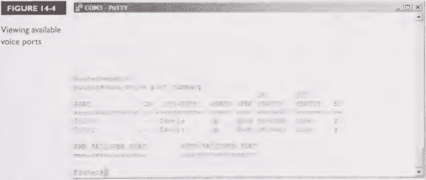

要配置这些语音端口，您必须进入全局配置模式，然后使用 voice-port 命令访问这些端口。每个端口都应单独配置。图 14-5 显示了 Cisco 2801 路由器上 FXS 端口 0/0/0 的配置。对于大多数电话，不需要振铃频率，默认设置 25 Hz 就足够了。

图 14-5 中的第一个配置命令是 description。此属性只是描述端口，以便您记住其用途。第二个命令是 signal 命令，它定义 loopstart 或 groundstart 信令。接下来，我们设置 cptone 或使用的信令音调，例如拨号音。由于此电话将在美国使用，因此为 cptone 参数选择了 US。

振铃频率参数通常可以保留不变，因为默认值为 25 Hz，这适用于大多数电话。如果您有一部较旧的电话连接到 FXS 端口但无法正常工作，请尝试将振铃频率设置为 50 Hz。振铃节奏决定振铃时间长度和振铃之间的静默长度。您可以自定义此参数或使用默认值。pattern01 值是美国 PSTN 电话的默认值。station-id name 值用于来电显示目的，以便您在呼叫另一方时可以识别您的姓名。

**图 14-5 — 配置 FXS 端口**

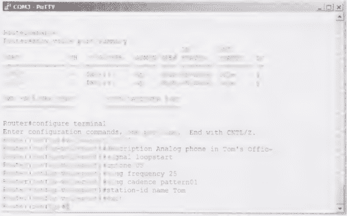

### 认证目标 14.03

### 640-460：描述和配置网关、语音端口和拨号对等体，以连接到 PSTN 和服务提供商网络

在关于网关的最后一节中，您将了解 VoIP 拨号对等体的配置选项以及用于确保网关配置正确的验证命令。首先，您将回顾第 13 章中介绍的基本拨号计划组件。

### 拨号计划组件和网关实现

在前一章中，您了解了拨号计划及其组件。虽然拨号计划包括您将在内部使用的编号计划，但网关负责使此内部编号计划与外部网络（如 PSTN）协作。例如，您可能需要在网关上实施数字操作命令，将简短的内拨号码转换为完整的外部 PSTN 号码。或者，您可能需要将内部分机缩减为仅保留最后四位数字，这四位数字即用作内部分机。这两种操作都将使用数字操作来执行，这也在第 13 章中介绍过。

请记住，第 13 章中的基本拨号计划组件包括：

- 编号计划
- 路径选择
- 数字操作
- 呼叫权限
- 呼叫覆盖

网关是允许您的编号计划与您所连接的电话网络的编号计划不同的组件。同时，正是网关利用拨号对等体来确定内部和外部呼叫的路径选择。网关将在需要时应用数字操作，并且还可能控制呼叫权限。显然，Cisco 网关在您的 VoIP 网络中发挥着重要作用。


### 配置 VoIP 拨号对等体

在本章前一节中，您学习了创建 POTS 拨号对等体。您必须学习的最后一种拨号对等体类型是 VoIP 拨号对等体。使用的是同一个 dial-peer voice 命令。为了更好地理解 VoIP 拨号对等体，假设有一个如图 14-7 所示的网络。请注意，VoIP 电话位于分机 2001 和 2002。

要为这些电话创建能够相互通信的拨号对等体，必须在每台路由器上各创建一个拨号对等体。192.168.10.1 上的路由器需要知道它可以通过 192.168.10.2 到达分机 2002。反之亦然，192.168.10.2 上的路由器必须知道它可以通过 192.168.10.1 到达分机 2001。图 14-8 显示了 192.168.10.1 上的路由器所需的配置。

在 192.168.10.2 路由器上应输入相同的基本配置命令，不过这些命令要反过来。例如，会话目标将改为 192.168.10.1，目标模式将改为 2001。

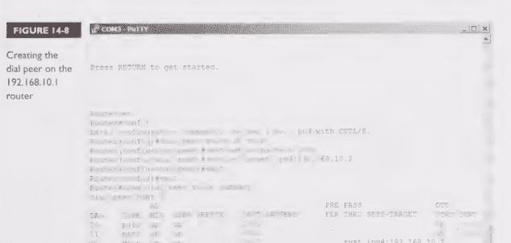

### 验证拨号计划实现

Cisco 提供 show voice port summary 命令来查看语音端口。此命令可用于查看连接到 Cisco 网关的已配置 T1 或 ISDN 线路的信令类型、通道和状态。

使用 show dial-peer voice summary 命令，可以查看所有拨号对等体的列表。要查看某个拨号对等体的详细信息，请使用 show dial-peer voice tag 命令，其中 tag 是与该拨号对等体关联的编号。请考虑以下 show dial-peer voice summary 输出：

```text
Router1# show dial-peer voice summary
dial-peer hunt 0
```

                                                   PASS

| 标记 | 类型 | 管理状态 | 运行状态 | 前缀 | 目标模式 | 优先级 | 直通 | 会话目标 |
|---|---|---|---|---|---|---|---|---|
| 110 | pots | up | up | 0 | 0 |  |  |  |
| 111 | voip | up | up |  | 5550112 | 0 | syst | ipv4:10.10.1.1 |
| 112 | voip | up | up |  | 5550134 | 0 | syst | ipv4:10.10.1.1 |
| 95 | voip | up | down | 0 | 0 | syst |  |  |
| 30 | pots | up | down | 0 | 0 |  |  |  |

show gateway 命令用于查看网关的当前状态。show gateway 命令的结果将有所不同，具体取决于网关是否已注册到网守。如果已注册到网守，将显示类似以下内容的输出：

```text
Router1# show gateway
Gateway gateway2 is registered to Gatekeeper gk2
Gateway alias list
H323-ID gateway2
H323 resource thresholding is Enabled and Active
H323 resource threshold values:
    DSP: Low threshold 60, High threshold 70
    DS0: Low threshold 60, High threshold 70
```

当网关未注册到网守时，将显示类似以下内容的输出：

```text
Router2# show gateway
Gateway gateway1 is not registered to any gatekeeper
Gateway alias list
H323-ID gateway1
H323 resource thresholding is Enabled but NOT Active
H323 resource threshold values:
    DSP: Low threshold 60, High threshold 70
    DS0: Low threshold 60, High threshold 70
```

### 认证目标 14.04

### 642-436：描述 IP 通信网络中网守的功能与互操作

网守用于 H.323 VoIP 网络。网守有多种用途，本节将概述网守的术语和功能。您将首先了解网守的功能或其用途。然后，您将探讨 H.323 网守术语。

### 网守功能

在 Cisco 环境中，H.323 网守通常是由 Cisco 路由器充当网守。网守是可选的，但当 H.323 网络上存在网守时，所有终端或端点都必须使用它。网守充当网络中网关和端点的中央数据库访问引擎。其结果是拨号计划和用户账户的集中配置位置。VoIP 网络的智能被放置在网守中，而不是分布到所有呼叫管理器。

H.323 网守提供特定功能，包括四项必备功能：

- 地址解析
- 带宽控制
- 准入控制
- 区域管理

一旦将网守添加到网络，地址解析就通过 H.323 网守完成。网守知道每个端点连接到哪个呼叫管理器或路由器，从而能够为呼叫建立确定到达该端点的最佳路由。

带宽控制用于管理端点的带宽需求。H.225 注册、准入和状态（RAS）消息用于带宽控制。端点向网守发送带宽请求（BRQ）。网守以带宽确认（BCF）或带宽拒绝（BRJ）消息进行响应。

网守还负责通过准入控制来确定哪些端点可以参与 VoIP 网络。网守使用 H.225 RAS 消息进行准入控制。当端点想要加入网络时，它会向网守发送准入请求（ARQ）消息。网守以准入确认（ACF）或准入拒绝（ARJ）消息进行响应。

> **考试**
>
> **注意**
>
> 请记住，ARQ 消息是请求接入 H.323 网络的准入请求，ACF 消息是确认响应，而 ARJ 是拒绝响应。

H.323 网守还提供区域管理。区域是一组 H.323 节点，包括注册到网守并由网守管理的网关和端点。每个区域有一个活动网守，一个区域可以跨越 IP 子网。区域管理功能包括控制区域内端点注册过程。

除了这四项必备功能外，还可以实现若干可选功能：

- 带宽管理：允许网守在带宽不足时拒绝接入 H.323 网络
- 呼叫授权：允许实施分时段限制策略
- 呼叫控制信令：允许网守在 H.323 端点之间路由网守路由呼叫信令（GKRCS）消息
- 呼叫管理：允许监视端点活动，以跟踪忙端点或做出呼叫重定向决策

### 考试内幕

### 用类比理解 H.323 区域

最好通过类比来理解 H.323 区域。我已不记得第一次在哪里听到这个类比，但我知道它不是我自己想出来的。无论创造者是谁，都感谢其对 H.323 区域的出色说明。

H.323 区域很像组织内的部门。部门经理负责其权限下的员工。可能有二十名员工为这位经理工作，而经理是中心联络点。经理了解每位员工的状况，并促进与其他部门的通信。经理是部门内的中心联络点。

部门就像 H.323 区域，经理就像 H.323 网守。每个区域有一个网守主动负责。呼叫可以通过网守在区域内（区域内部呼叫）和区域之间（区域间呼叫）发起。当在区域之间发起呼叫时，网守代表发起呼叫的端点与远程区域的网守通信。

与部门经理一样，网守了解区域内的所有端点。网守是用于提供区域准入和区域控制的中央服务器。网守将跟踪端点和网关的状态。网守了解网络中的通信路径以及用于区域间通信的远程区域网守。

最终，网守管理区域，而区域充当一组端点的授权边界。每个区域可以有一个或多个网关以及至少一个端点（或终端）。

### 网守术语

H.323 标准定义了若干适用于 H.323 网络和网守的术语。以下术语对于正确理解和实施 H.323 网守很重要：

- **呼叫** H.323 端点之间的点对点多媒通信。呼叫从呼叫建立过程开始，并以呼叫终止过程结束。呼叫由一组可靠和

端点之间不可靠的通道。呼叫可以直接发生在两个端点之间，也可能包括其他 H.323 实体，例如网守或 MC（多点控制器）。在与某些端点通过网关互通的情况下，所有通道都终止于网关，并在网关处转换为适合终端系统的表示形式。通常，呼叫是两个用户之间为通信目的而建立的，但也可能包括仅信令呼叫。一个端点可能能够支持多个同时呼叫。

- **端点** H.323 终端、网关或 MCU。端点可以呼叫和被呼叫。它生成和/或终止信息流。

- **网守** 网守是网络上的 H.323 实体，提供地址转换并控制 H.323 终端、网关和 MCU 对网络的访问。网守还可以为终端、网关和 MCU 提供其他服务，例如带宽管理和定位网关。

- **H.323 实体** 任何 H.323 组件，包括终端、网关、网守、MC、MP（多点处理器）和 MCU。

- **多点控制单元** 多点控制单元（MCU）是网络上的端点，提供三个或更多终端和网关参与多点会议的能力。它还可以在点对点会议中连接两个终端，该会议随后可能发展为多点会议。MCU 通常以 H.231 MCU 的方式运行；但是，音频处理器不是必需的。MCU 由两部分组成：必需的 Multipoint Controller (MC) 和可选的 Multipoint Processors (MPs)。在最简单的情况下，MCU 可以仅由一个没有 MP 的 MC 组成。MCU 也可以由网守将其带入会议，而无需其中一个端点显式呼叫它。

- **终端** H.323 终端是网络上的端点，提供与另一个 H.323 终端、网关或多点控制单元的实时双向通信。这种通信包括两个终端之间的控制、指示、音频、运动彩色视频图像和/或数据。终端可以提供仅语音、语音和数据、语音和视频，或语音、数据和视频。

- **区域** 区域是由单个网守管理的所有终端、网关和多点控制单元（MCU）的集合。一个区域有且仅有一个网守。区域可以独立于网络拓扑，并且可以包括使用路由器或其他设备连接的多个网段。

在 Cisco H.323 网络领域中，还有几个附加术语很重要。首先，*区域前缀*是定义区域内可用分机号的数字前缀。一个区域可以包括多个前缀。区域前缀可以定义特定分机号，或基于通配符（如 3... 或 4...）的前缀，分别表示从 300 到 399 或从 400 到 499 的任何分机号。

其次，可以使用技术前缀。*技术前缀*是一个可选参数，用于定义前缀，以指示正在使用特定技术，并且呼叫应路由到理解该技术的服务器。例如，前缀 3# 可用于指示正在发起传真呼叫，并且呼叫可路由到可处理传真的服务器或网关。

第三，当呼叫无法通过技术前缀解析时，使用*默认技术前缀*。默认技术前缀在网守配置模式下使用 gw-type-prefix 命令分配。例如，以下命令表示如果网守无法识别号码或特定技术前缀，则应使用注册用于处理 1# 呼叫的网关：

```text
Router1(config-gk)# gw-type-prefix 1# default-technology
```

> **考试提示**
>
> 请记住，区域前缀定义区域内可用的分机号。技术前缀用于指定特定技术，例如传真或调制解调器。如果用户未输入技术前缀，则使用默认技术前缀。

### 认证目标 14.05

### 642-436：实现网守

实现网守实际上是一个三步过程。首先，你需要在网守上设置区域和前缀。其次，你需要配置网关以使用网守。最后，你应该验证网守的配置适合你的需求。

### 配置区域

区域可以配置为本地区域或远程区域。本地区域是由创建它的网守所控制的区域。远程区域是由其他网守管理的区域。zone local 命令用于创建本地区域。zone remote 命令用于指定远程区域。以下命令提供了区域配置示例：

```text
Router1(config)# gatekeeper
Router1(config-gk)# zone local gk1 sysedco.com
Router1(config-gk)# zone remote gk2 sysedco.com 10.1.4.1 123 cost 25 priority 35
Router1(config-gk)# no shutdown
Router1(config-gk)# exit
```

在前面的示例中，zone local 命令将 zone-name 参数配置为 gk1，将 domain-name 参数配置为 sysedco.com。结果是一个名为 gk1.sysedco.com 的本地区域。zone remote 命令将远程 zone-name 参数设置为 gk2，将 domain-name 参数设置为 sysedco.com。结果是一个名为 gk2.sysedco.com 的远程区域。此外，可通过 IP 地址 10.1.4.1 访问该远程区域，成本为 25，优先级为 35。cost 和 priority 参数均可设置为 1 到 100 之间的任意数字，未指定时的默认值为 50。配置多个远程区域时，cost 和 priority 用于选择第一个要尝试的远程区域。较低的成本和较高的优先级会使该区域先于其他区域被使用。

启用区域后，你现在必须配置一个或多个区域前缀。你可以停留在由 (config-gk) CLI 提示符表示的网守配置模式下，同时配置这些前缀；也可以再次进入网守配置模式，如下例所示：

```text
Router1(config)# gatekeeper
Router1(config-gk)# zone prefix gk1 2...
Router1(config-gk)# exit
```

前面的示例表明，gk1 网守负责从 2000 到 2999 的所有分机号。如果区域包含多个分机号，只需使用通配符为每个分机号或分机号块输入一条额外的 zone prefix 命令。

最后，你可以限制应包含在区域中的 IP 子网。此操作会强制某个子网上的 IP 电话使用特定网守，从而参与该网守的区域。zone subnet 命令用于配置这些限制，如下例所示：

```text
Router1(config)# gatekeeper
Router1(config-gk)# zone subnet gk1 10.1.1.0 255.255.255.0 enable
Router1(config-gk)# exit
```

除了接受特定子网外，你还可以使用 zone subnet gatekeeper_name default 命令将网守配置为接受所有子网。

既然网关已配置为使用网守，就必须创建单个拨号对等体，以指示所有四位分机号都应使用网守。前一个示例中的 dial-peer 命令执行此操作。请特别注意 session target ras 命令，它指示所有四位分机号应使用网守（即 RAS 服务器）。

### 验证网守配置

按照上一节所述，在网关配置为使用网守之后，可以验证网守操作。有几个 show 命令可用于验证，包括：

- **show gatekeeper status** — 此命令显示网守状态、区域名称、计费是启用还是禁用、安全功能以及带宽限制和利用率。

- **show gatekeeper calls** — 此命令显示当前正在进行的、通过网守建立的所有呼叫。

- **show gatekeeper endpoints** — 有趣的是，此命令会显示网关，因为 H.323 标准将它们视为端点。重要的是要记住，此命令并不限于显示 IP 电话。

- **show gatekeeper zone** — 此命令显示区域配置信息，包括前缀和子网。

> **考试提示**
>
> 务必知道哪些 show 命令在网守配置和操作验证方面分别起什么作用。它们很可能出现在 CVOICE 考试中。


### 认证总结

在本章中，你学习了网关和网守。这两个组件在 VoIP 网络上非常重要。你学习了网关所扮演的角色，以及如何通过配置语音端口和拨号对等体来实现网关。然后，你学习了网守的功能，如何配置网守，以及如何配置网关以使用网守。

### 两分钟演练

### 642-436：描述网关的组件

- Cisco VoIP 网关通常作为 IOS 的组件运行在 ISR 上，也可能作为 CME 呼叫管理器的组件运行。
- 网关通常提供电话到 WAN、电话到 PSTN，或通过 WAN 的 PBX 到 PBX 连接。
- FXS 和 FXO 端口是模拟语音端口。
- ISDN、T1 和 E1 线路及端口是数字语音端口。
- VoIP 拨号对等体用于跨基于分组的网络连接到其他 VoIP 设备。
- POTS 拨号对等体用于连接到 PSTN、PBX 系统或模拟电话设备。

### 642-436：实现网关

- 网关根据呼叫目的地通过模拟或数字端口路由呼叫。
- 网关使用拨号对等体来确定正确的呼叫路径或呼叫路由。
- 模拟端口使用环路启动、接地启动或 E&M 闪烁启动信令。
- 在 Cisco ISR 中，语音端口有三种引用方式：端口、插槽/端口或插槽/子单元/端口。
- T1 线路在单条线路上使用 24 个信道，每个信道提供高达 64 Kbps 的带宽。
- voice-port 命令用于进入语音端口配置模式并配置 FXS 或 FXO 端口。
- dial-peer voice # pots 命令用于创建 POTS 拨号对等体。

### 640-460：描述并配置网关、语音端口和拨号对等体，以连接到 PSTN 和服务提供商网络

- VoIP 拨号对等体使用 dial-peer voice # voip 命令创建。
- VoIP 拨号对等体使用 session target 参数来定义该拨号对等体目标的 IP 地址。
- show dial-peer voice summary 命令用于查看已配置拨号对等体的基本列表。
- show gateway 命令用于查看网关的状态。

### 642-436：描述 IP 通信网络中网守的功能与互操作

- H.323 网守负责网络准入控制、地址解析、带宽控制和区域管理。
- H.323 区域由单个网守管理，包含至少一个终端，并且可能包含多个网关。
- ARQ 消息发送到网守以请求接入 H.323 网络，网守可以用 ACF 或 ARJ 消息响应。

### 642-436：实现网守

- zone local 命令用于在路由器/网守上实现本地区域。
- zone remote 命令用于通过 IP 地址引用远程区域和网守。
- 区域前缀使用 zone prefix 命令创建。
- zone subnet 命令用于指定由网守管理的 IP 子网。
- 在接口配置模式下配置网关以使用网守。
- h323-gateway 命令允许在网关上配置网守设置。
- show gatekeeper 命令用于验证网守配置。

### 自测

以下问题将帮助你衡量对本章所述材料的理解。请仔细阅读所有选项，因为可能有不止一个正确答案。为每个问题选择所有正确答案。

### 642-436：描述网关的组件

1. 当一部电话通过网关与另一部电话通信，并且网关通过 WAN 链路连接到另一个网络时，网关提供的是哪种连接类型？
   - A. 电话到 WAN
   - B. 电话到 PSTN
   - C. PSTN 到电话
   - D. 通过 WAN 的 PBX 到 PBX

2. 哪个语音端口用于通过模拟连接连接到 PSTN 或 PBX 系统？
   - A. FXS
   - B. FXO
   - C. T1
   - D. E1

3. 你正在实现一个 VoIP 拨号对等体。你可能通过该拨号对等体连接到什么设备？
   - A. PBX
   - B. 传真机
   - C. 模拟电话
   - D. H.323 电话

### 642-436：实现网关

4. 以下哪些是模拟端口上使用的有效信令方法？（选择所有适用项。）
   - A. Q.931
   - B. 环路启动
   - C. E&M 闪烁启动
   - D. 接地启动

5. 当 T1 PRI CCS 线路作为完整 T1 线路购买时，有多少个信道可用于语音呼叫？
   - A. 24
   - B. 23
   - C. 3
   - D. 2

6. 你在 T1 线路上使用 CAS 信令。每个信道中有多少带宽可用于语音呼叫？
   - A. 64 Kbps
   - B. 48 Kbps
   - C. 8 Kbps
   - D. 56 Kbps

7. 你想为连接到端口 0/1 的模拟电话配置一个 POTS 拨号对等体。你希望该电话使用分机 1504。应在 dial-peer 配置模式下输入哪条配置命令来分配所需的分机号？
   - A. port 1504
   - B. session target 1504
   - C. destination-pattern 1504
   - D. extension 1504

### 640-460：描述并配置网关、语音端口和拨号对等体，以连接到 PSTN 和服务提供商网络

8. 在实现 VoIP 拨号对等体时，以下哪一项是用于创建并进入 dial-peer 配置模式的有效命令？
   - A. dial-peer voice 15 voip
   - B. dial-peer voice 15 voice
   - C. dial-peer voice 15 pots
   - D. dial-peer voip 15 voice

9. 什么命令用于在不显示详细信息的情况下显示机器上的语音端口？
   - A. show voice port
   - B. show voice port 0
   - C. show voice port summary
   - D. show voice port brief

15. 你将在什么配置模式下配置网关以使用网守？
   - A. 网关配置模式
   - B. 网守配置模式
   - C. 接口配置模式
   - D. 语音端口配置模式

### 实验题

你已经配置了一个网守，并且需要验证网守配置是否正确。你将输入哪些命令来验证配置，以及为什么要输入这些命令？

12. ☑ B 正确。发送 ARQ 消息是为了请求接入 H.323 网络。

    ☒ A、C 和 D 不正确。ACF 消息是响应 ARQ 消息而发送的准入确认。HELLO 消息不是网守协议的一部分。ARJ 消息是响应 ARQ 消息而发送的准入拒绝。

13. ☑ A 正确。区域前缀用于定义给定区域中管理的电话分机。

    ☒ B、C 和 D 不正确。端点、MCU 和终端绝不会定义分机。端点和终端可以被分配分机，但区域前缀决定区域内管理的分机。MCU 用于将多个语音流聚合成一个，并在网络上执行其他语音操作。

### 642-436：实现网守

14. ☑ C 正确。zone local 命令用于定义由路由器上的本地网守服务管理的一个或多个本地区域。

    ☒ A、B 和 D 不正确。zone remote 命令用于配置由其他网守管理的远程区域，以便访问这些区域。zone current 和 current zone 是无效命令。

15. ☑ C 正确。接口配置模式用于配置网守。你还需要在 dial-peer 配置模式下创建适当的拨号对等体，但该模式不是列出的选项。

    ☒ A、B 和 D 不正确。网关配置模式用于配置各种网关设置，但网守的使用是在接口配置模式中定义的。网守配置模式用于使路由器成为网守。语音端口配置模式用于配置语音端口。

### 实验答案

答案可能有所不同；可以使用以下命令：

- **show gatekeeper status** 显示网守状态、区域名称、计费是启用还是禁用、安全功能，以及带宽限制和利用率。
- **show gatekeeper calls** 显示当前通过网守建立且正在进行的任何呼叫。
- **show gatekeeper endpoints** 显示网关，因为 H.323 标准将它们视为端点。需要记住的是，此命令并不限于显示 IP 电话。
- **show gatekeeper zone** 显示区域配置信息，包括前缀和子网。


> 很多人拥有 Atari 视频游戏机。因此，想法是，也许你可以拿一台 Atari 视频游戏机——人们把游戏卡带插进去，再插上调制解调器，并将其连接到电话——从而本质上把那台游戏机变成一个交互式终端。
>
> ——史蒂夫·凯斯，美国在线联合创始人

正如你在前面章节中所学到的，网关是一种连接到不同网络的设备。这些网络可能在类型上不同，或者只是在管理上不同。IP 到 IP 网关连接两个 IP 网络。其中一个 IP 网络是你的内部网络。另一个 IP 网络是服务提供商的网络。IP 到 IP 网关的作用是连接这两者。这种功能类似于将你的 Atari 连接到在线网络或服务。如果没有通过卡带建立的连接，Atari 就独立运行（仅限内部通信）；然而，当你加入在线卡带后，你就可以与整个世界通信。你也许可以说，那款计划中的旧 Atari 卡带是一种通往在线发现新世界的网关。

本章中，你将学习 IP 到 IP 网关。首先，你将了解其特性和用途。然后，你将学习使 IP 到 IP 网关在 VoIP 网络中启动并运行所需的各种配置命令和操作。最后，你将学习用于验证网关配置正确的命令。

### 认证目标 15.01

### 642-436：描述 IP 到 IP 网关的特性与功能

IP 到 IP 网关连接两个 IP 网络，并且可以在它们之间转换 VoIP 信令协议。本节中，你将了解 IP 到 IP 网关的特性及其提供的基本功能。

### IP 到 IP 网关特性

在 Cisco 领域，IP 到 IP 网关被称为 Cisco Unified Border Element（UBE）。就硬件而言，UBE 与其他网关类似，它可以是多种 Cisco ISR 中的任意一种。UBE 网关不使用语音卡（FXO、T1 或 E1）和信令，而是使用到服务提供商的 IP 连接。

> **注意**
>
> 虽然 CVOICE 考试的目标表明你应该理解 IP 到 IP 网关，但 Cisco 不再用这个名称称呼其解决方案。曾经称为 Cisco Multiservice IP-to-IP Gateway 的产品现在称为 Cisco Unified Border Element（UBE）。

Cisco UBE 位于两个 IP 网络之间，并终接和发起 VoIP 呼叫的信令与媒体流。在某些方面，UBE 充当代理。呼叫在 UBE 处终接并重新发起。信令的重新发起包括 SIP 和 H.323 以及二者之间的转换。媒体流的重新发起包括 RTP 和 RTCP。UBE 是 Cisco IOS 的一项功能，也称为会话边界控制器（SBC）。用最简单的话说，UBE 连接 VoIP 拨号对等体。入站拨号对等体与出站拨号对等体相连，而这些拨号对等体可能与不同的端口或目标 IP 地址相关联。

重要的是要知道，只有特定的 IOS 映像支持 UBE 功能。支持 UBE 的功能集列于表 15-1。请注意，特殊的 IPIPGW IOS 映像甚至就是根据这种支持来命名的。

**表 15-1. 支持 UBE 的 Cisco IOS 功能集**

| IOS 功能集 | 说明 |
|---|---|
| INT VOICE/VIDEO, IPIPGW, TDMIP GW, AES | 在 IOS 映像文件名中由代码 `adventerprisek9_ivs` 引用。具有 AES 加密能力的 IP 服务。 |
| INT VOICE/VIDEO, IPIPGW, TDMIP GW | 在 IOS 映像文件名中由代码 `ipvoice_ivs` 引用。提供完整的 VoIP 功能以及基本路由功能。 |
| ADVANCED ENTERPRISE SERVICES | 在 IOS 映像文件名中由代码 `adventerprisek9` 引用，且未附加 `_ivs` 代码。IOS 的一体化功能集版本。 |
| SP SERVICES | 在 IOS 映像文件名中由代码 `spservicesk9` 引用。供服务提供商网络使用。 |
| IP VOICE | 在 IOS 映像文件名中由代码 `ipvoice` 引用，且未附加 `_ivs` 代码。提供基本 VoIP 服务和功能以及基本 IP 路由功能。 |

### 考试内幕

### Cisco IOS 功能集？

由于 CVOICE 考试要求你理解配置 IP 到 IP 网关或 Cisco UBE 的基础知识，因此理解功能集很重要。例如，你可能有一台 Cisco 2801 ISR，但仍然无法将其作为 Cisco UBE 实施，因为它运行的是错误的 IOS 功能集。当然，你可以购买所需功能集的许可证，或从你的 Cisco 账户下载它（假设你拥有适当的支持级别），但在实施 Cisco UBE 时，这仍然是一个重要的考虑因素。

如果你对 Cisco 领域相对陌生，但多年来一直使用 Windows 服务器和客户端，那么通过将 IOS 功能集与 Windows 版本联系起来，你可能会更容易理解它们。例如，Windows Server 2008 有多个版本，包括 Web、Standard、Enterprise 和 Datacenter。当你逐步使用更高级的版本时，会增加更多功能和能力。例如，Web 版不能充当域控制器。

虽然其运行的硬件可以充当域控制器，但功能受所运行版本的限制。要使该机器成为域控制器，你至少需要将操作系统升级到 Standard 版。

Windows 客户端也是如此。例如，Windows 7 有多个版本，包括 Home、Home Premium、Professional、Enterprise 和 Ultimate。如果你使用的是 Home 版，则无法将该机器加入域。要执行此操作，你至少需要升级到 Professional 版。总之，不同版本的 Windows 服务器和客户端提供不同的功能。

我分享这个比较是为了帮助你看到，Cisco 所做的在业界其实并没有什么新意或独特之处。如果你想要某一组功能，就必须确保拥有正确版本的软件。Cisco IOS 也不例外。这不仅适用于 Cisco UBE 实施，也适用于许多其他语音功能。

Cisco UBE 网关设备将支持网关和一般 VoIP 通信所需的大多数 VoIP 功能。表 15-2 列出了 UBE 网关的主要功能。

**表 15-2 — Cisco UBE 功能**

| 功能 | 详细信息 |
|---|---|
| 协议 | H.323 和 SIP |
| 媒体模式 | 媒体流经和媒体绕过 |
| 媒体支持 | RTP 和 RTCP |
| 传输模式 | TCP、UDP 以及 TCP 到 UDP 互通 |
| 传真支持 | T.38 传真中继、传真直通和 Cisco 传真中继 |
| 调制解调器支持 | 调制解调器直通和 Cisco 调制解调器中继 |
| 双音多频（DTMF） | H.245 字母数字、H.245 信号、RFC 2833、SIP 通知和按键标记语言（KPML） |
| 呼叫准入控制（CAC） | 资源预留协议（RSVP）、每条中继最大呼叫数、基于 IP 电路的 CAC、基于总呼叫数或 CPU 使用率或内存使用阈值的 CAC |
| 服务质量（QoS） | IP 优先级和区分服务代码点（DSCP）标记 |
| 网络地址转换（NAT）穿越 | 对 SIP 电话的 NAT 穿越支持以及有状态 NAT 穿越 |
| 支持的编解码器 | G.711、G.722、G.723、G.726、G.728、G.729 和 iLBC |
| 安全 | IP 安全（IPsec）、安全 RTP（sRTP）和传输层安全（TLS） |

### IP 到 IP 网关功能

Cisco UBE 的功能可以总结如下：UBE 充当 VoIP 网关，其基本方式与 PSTN 到 IP 网关相同。换句话说，UBE 连接两个基于 IP 的 VoIP 呼叫段，而不是一个 PSTN 呼叫段和一个 IP 呼叫段。Cisco UBE 可以连接以下任意 IP 语音网络组合：

- H.323 到 H.323
- H.323 到 SIP
- SIP 到 SIP

如果你的服务提供商（SP）使用 SIP 而你使用 H.323，Cisco UBE 可以转换两种协议之间的信令，以实现连接。即使你使用 H.323 而你的 SP 使用相同协议，UBE 也会终接并重新发起信令和媒体流。结果是 Cisco UBE 可以通过以下两种方式之一工作：

- 同类网络之间的互通
- 不同网络之间的互通

在同类网络之间互通时，两个网络使用相同的 VoIP 信令协议。在不同网络之间互通时，网络使用不同的 VoIP 信令协议，例如 H.323 和 SIP。

除了与信令相关的考虑之外，你还必须考虑媒体（语音 RTP 流）将如何从一个网络流向另一个网络。如前所述，UBE 实际上是一个代理。它从一侧（例如内部接口）接收信号，并重新发起这些信号以在另一侧（例如外部接口）输出。然而，UBE 必须同时处理媒体流和信令信息。为此，UBE 可以使用媒体流经或媒体绕过。

图 15-1 描述了媒体流经实现的架构。请注意，信令先到 Cisco UCM，然后经过 UBE。媒体（RTP 流）从电话传到 UBE。UBE 会在通信过程中引入延迟，并且可能无法为 VoIP 呼叫提供可接受的性能。如果 UBE 设备还用于额外的数据组网目的，情况尤其如此。

图 15-2 描述了媒体绕过实现的架构。如你所见，媒体现在直接从电话到电话。有趣的是，

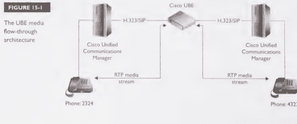


### 图15-2

UBE媒体流绕行架构

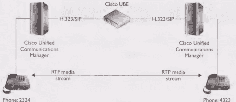

实际数据包仍可能经过充当UBE的设备；但是，UBE服务将不再终止并重新发起媒体流数据包。结果是VoIP呼叫的延迟更少，质量可能得到提高。

Cisco UBE是一个网关，因此支持网关功能，包括以下任务：

- **DTMF中继**——此任务允许双音多频（DTMF）拨号数字信号传递到远程IP网络。
- **传真和调制解调器中继或直通**——由于传真机和调制解调器使用声音信号传输信息，因此必须通过无损编解码器进行中继或直通才能正常工作。
- **媒体流处理和语音路径完整性**——此任务确保媒体流被正确建立，并具有可传输的路径，不会损坏或中断。
- **拨号对等体和编解码器过滤**——网关可以限制已配置的拨号对等体之间允许的编解码器。
- **数字转换和呼叫处理**——网关可以将拨号数字转换为目标VoIP网络的适当结构。
- **运营商ID处理**——UBE网关支持运营商ID检测和处理。
- **基于网关的计费**——对服务提供商最有用，此功能为计费目的提供广泛的计费统计。
- **信令和媒体的终止与重新发起**——网关解封装到达的数据包，并为目标网络封装这些数据包。

换句话说，必须在网守上配置远程区域和本地区域。outvia关键字用于确定是否有本地Cisco UBE可用于处理呼叫。要配置远程区域，请使用如下命令：

```
Router1> enable
Router1# configure terminal
Router1(config-gk)# zone remote spGK spname 10.16.193.158 1719 invia myGK outvia myGK
Router1(config-gk)# exit
```

关键命令是zone remote命令，其使用以下语法：

```
zone remote gatekeeper-name domain-name [ras-IP-address] [invia inbound-gatekeeper | outvia outbound-gatekeeper [enable-intrazone]]
```

要配置本地区域，请使用如下命令：

```
Router> enable
Router# configure terminal
Router(config)# gatekeeper
Router(config-gk)# zone local myGK mydom.com 10.16.193.158 invia myGK outvia myGK enable-intrazone
Router(config-gk)# exit
```

这里的关键命令是zone local命令，其使用以下语法：

```
zone local gatekeeper-name domain-name [ras-IP-address] [invia inbound-gatekeeper | outvia outbound-gatekeeper [enable-intrazone]]
```

有关配置网守以与Cisco UBE配合使用的更多详细信息，请阅读“配置Cisco Unified Border Element与Gatekeeper”配置指南，网址为www.cisco.com/en/US/docs/ios/voice/cubekg/configuration/guide/ve-gk-config.html。

> **考试提示**
>
> 请记住，必须使用via区域才能允许网守与Cisco UBE配合工作，并且使用zone local和zone remote命令来完成此配置。

### 认证目标 15.03

### 642-436：配置IP到IP网关以提供地址隐藏

Cisco UBE支持IP地址隐藏，以确保在所有通信场景中UBE是唯一的信令和媒体入口或出口点。本节提供使用Cisco UBE时IP地址隐藏的说明。

### 隐藏地址

与大多数基于Cisco IOS的活动一样，IP地址隐藏通过首先进入enable模式，然后进入配置模式来完成。接下来，您将进入VoIP语音服务配置模式并使用address-hiding命令。以下示例说明了此过程：

```
Router> enable
Router1# configure terminal
Router1(config)# voice service voip
Router1(conf-voi-serv)# address-hiding
Router1(conf-voi-serv)# exit
```

这里的关键命令是address-hiding命令。它非常容易记住，因为输入该命令时无需输入任何参数。要禁用地址隐藏，只需执行no address-hiding命令。

### 认证目标 15.04

### 642-436：配置IP到IP网关以提供协议和媒体互通

需要配置Cisco UBE以促进信令和媒体互通。协议或信令互通与H.323和SIP协议有关。媒体互通涉及确定您要实现媒体流穿通还是媒体流绕行。在本节中，您将学习这两种操作的命令。

**表15-3** H.323和SIP Cisco UBE验证命令

| 命令 | 用途 |
|---|---|
| show call active voice | 显示活动或进行中的语音呼叫的呼叫信息 |
| show call active fax | 显示当前正在进行的传真传输 |
| show call history voice | 显示历史语音呼叫的呼叫日志 |
| show call history fax | 显示传真呼叫的历史记录 |
| show dial-peer voice | 显示并验证正确的拨号对等体配置 |
| show running-config | 验证允许哪些连接类型（H.323到H.323、H.323到SIP或SIP到SIP） |
| show voip rtp connections | 查看活动的RTP媒体流连接 |

除表15-3中的命令外，您还可以使用多个debug命令来测试UBE网关上的H.323和SIP配置。这些命令包括：

- **debug cch323 all**——为H.323错误、H.225和H.245协议、RAS以及一般H.323事件提供调试输出。
- **debug ccsip all**——为SIP错误、事件、状态、消息和呼叫提供调试输出。
- **debug h245 events**——为H.245事件提供调试输出。请记住，H.245涉及VoIP通信中的功能协商。
- **debug voip ipipgw**——为Cisco多业务IP到IP网关（IPIPGW，现称为Cisco UBE）提供调试输出。此调试命令显示入站和出站呼叫腿处理。

> **考试提示**
>
> 请为考试日记住这份debug命令列表。你很可能会在某个地方看到它们出现——不仅在IP到IP网关领域，而且在其他VoIP故障排除场景中也是如此。

### 两分钟演练

### 642-436：描述IP到IP网关特性和功能

- IP到IP网关功能现在称为Cisco UBE网关。
- Cisco UBE网关将两个IP网络连接在一起以提供VoIP服务。
- Cisco UBE同时支持H.323和SIP协议。
- Cisco UBE是一项IOS功能，必须使用相应的功能集。
- DTMF信令可以通过H.245信号、H.245字母数字、SIP notify和按键标记语言（KPML）实现。
- UBE中同时支持调制解调器和传真的中继与直通。
- Cisco UBE支持IP优先级和DSCP标记以实现QoS。

### 642-436：配置网守以支持IP到IP网关

- 要使网守支持Cisco UBE网关，必须配置via区域。
- 使用zone remote和zone local命令配置via区域。

### 642-436：配置IP到IP网关以提供地址隐藏

- 地址隐藏确保在所有场景中UBE是唯一的信令和媒体入口或出口点。
- 在VoIP语音服务配置模式下执行address-hiding命令以启用地址隐藏。

### 642-436：配置IP到IP网关以提供协议和媒体互通

- allowed-connections命令用于指定与Cisco UBE的协议互通。
- 当拨号对等体中未输入media命令时，默认采用媒体流穿通。
- codec transparent命令允许两个端点协商所使用的编解码器；但是，Cisco UBE也必须支持协商的编解码器。


### 642-436：配置 IP-to-IP 网关以提供呼叫准入控制

- CAC 可以作为本地、基于测量或基于资源的技术来实现。
- 使用本地 CAC 时，网关会评估所有连接，以确定它是否能处理另一个连接。
- 使用基于测量的 CAC 时，数据包会被发送到 WAN 上，目的是测量连接。测量连接后，可以相应地配置 CAC。
- 使用基于资源的 CAC 时，你利用网守来确保管理呼叫限制，从而整体提供 QoS。RSVP 用于基于资源的 CAC。
- max-conn 命令用于 dial-peer 配置模式中，以限制给定 WAN 链路上允许的连接数。

### 642-436：验证 IP-to-IP 网关实施

- show call active voice 和 show call history voice 命令用于查看当前和过去的 VoIP 呼叫信息。
- show dial-peer voice 命令将用于验证编解码器透明性或媒体流（flow-through 和 flow-around）的正确配置。
- debug cch323 all 和 debug ccsip all 命令分别用于查看有关 H.323 和 SIP 进程的详细信息。
- debug voip ipipgw 命令用于查看有关入站和出站呼叫腿处理的信息。

### 自测

以下问题将帮助你衡量对本章所呈现材料的理解。请仔细阅读所有选项，因为可能有多个正确答案。请为每个问题选择所有正确答案。

### 642-436：描述 IP-to-IP 网关的特性和功能

- 1. Cisco UBE 网关的主要目的是什么？
  - A. 连接两个不同的物理层网络
  - B. 在以太网和令牌环网络之间提供桥接
  - C. 连接两个不同的 VoIP 网络
  - D. 连接两个不同的目录服务网络

- 2. 为了将 Cisco ISR 实现为 UBE 网关，必须在其上安装什么？
  - A. 正确的 IOS 版本和特性集
  - B. IPIPGW 软件模块
  - C. IPIPGW 接口模块
  - D. SDM

- 3. UBE 网关支持以下哪些 DTMF 信令方法？（选择所有适用项。）
  - A. SS7
  - B. H.245
  - C. SIP Notify
  - D. KPML

- 4. Cisco UBE 上的 QoS 支持哪两种方法？
  - A. IP 优先级
  - B. DSCP 标记
  - C. TCC 标记
  - D. 六西格玛

### 642-436：配置网守以支持 IP-to-IP 网关

- 5. 为了使网守能够使用 Cisco UBE，必须配置和实现什么？
  - A. 正确的 sRTP 参数
  - B. 正确的 cRTP 参数
  - C. IPX 接口
  - D. via-zones

### 642-436：配置 IP-to-IP 网关以提供地址隐藏

- 6. 在 Cisco UBE 网关上，使用什么命令来隐藏 IP 地址？
  - A. address-hiding
  - B. address hiding
  - C. hide ip
  - D. hide-ip

- 7. 使用 Cisco UBE 网关时，IP 地址隐藏有什么好处？
  - A. 更难以入侵网络。
  - B. 更容易监控网络流量。
  - C. 确保 UBE 是唯一的信令和媒体入口点。
  - D. 确保 CME 是唯一的信令和媒体入口点。

### 642-436：配置 IP-to-IP 网关以提供协议和媒体互通

- 8. 在 Cisco UBE 网关上，使用什么命令来实现 SIP-to-SIP？
  - A. allowed-connections sip
  - B. allowed-connections sip to sip
  - C. allowed-connections sip-to-sip
  - D. allowed-connections sip only

- 9. 你希望 RTP 媒体从一部电话经过 UBE 传到另一部电话，而不进行终止和重新发起。在 dial-peer 配置模式下应输入什么命令？
  - A. media flow-through
  - B. media passthrough
  - C. media flow-around
  - D. RTP passthrough

### 642-436：配置 IP-to-IP 网关以提供呼叫准入控制

- 10. 在 dial-peer 配置模式下，使用什么命令来限制可同时通过该拨号对等体的连接数？
  - A. limit-conn
  - B. max-conn
  - C. upper-conn
  - D. conn-limit

- 11. 哪种 CAC 会向 WAN 发送数据包以确定 WAN 链路的质量，并据此实施 CAC？
  - A. 本地 CAC
  - B. 基于测量的 CAC
  - C. 基于资源的 CAC
  - D. 网守 CAC

- 12. 使用基于资源的 CAC 必须配置哪两个组件？
  - A. H.323 网守
  - B. SIP 代理
  - C. RSVP
  - D. DiffServ

### 642-436：验证 IP-to-IP 网关实施

- 13. 使用什么命令查看网关上的拨号对等体？
  - A. show dial-peer voice
  - B. show running-config
  - C. show active voice
  - D. show call history voice

- 14. 使用什么命令查看网关上的当前语音连接？
  - A. show call active voice
  - B. show call history voice
  - C. show dial-peer voice
  - D. show interfaces

- 15. 什么调试命令会显示 SIP 事件和错误？
  - A. debug voip ipgw
  - B. debug h323 all
  - C. debug ccsip all
  - D. debug sip all

### 实验题

你想在 Cisco 2801 ISR 上验证 Cisco UBE 的正确配置。你特别希望看到以下信息：

- 允许连接的 H.323-to-SIP 网关设置
- 当前语音连接
- SIP 和 H.323 的错误信息
- 呼叫的媒体流配置

对于每组信息，你将执行什么命令？

### 自测答案

### 642-436：描述 IP-to-IP 网关的特性和功能

- 1. ☑ C 正确。UBE 网关的主要目的是连接两个不同的 VoIP 网络，这些网络可能使用相同或不同的信令协议。
  
  ☒ A、B 和 D 不正确。虽然网关可用于连接任何其他三类网络或服务，但 Cisco UBE 网关不用于这些目的。

- 2. ☑ A 正确。Cisco ISR 必须具有正确的特性集，这要求特定版本（或更高版本）的 IOS 包含该特性集。
  
  ☒ B、C 和 D 不正确。无需添加任何软件或硬件模块，也不需要 Security Device Manager (SDM)。

- 3. ☑ B、C 和 D 正确。你可以使用 H.245、SIP Notify 或 KPML 通过 UBE 网关传输 DTMF 信号。
  
  ☒ A 不正确。作为边界控制器功能的一部分，UBE 网关不直接支持 SS7 信令。

- 4. ☑ A 和 B 正确。Cisco UBE 上的 QoS 同时支持 IP 优先级和 DSCP 标记。
  
  ☒ C 和 D 不正确。TCC 标记不是 Cisco 路由器支持的 QoS 方法。六西格玛是一种管理和流程方法，与 QoS 无关。

### 642-436：配置网守以支持 IP-to-IP 网关

- 5. ☑ D 正确。网守使用 via-zones 来判断何时路由到 UBE，以及何时可以在内部处理 VoIP 呼叫。
  
  ☒ A、B 和 C 不正确。与 Cisco UBE 网关相关，sRTP 和 cRTP 不是网守配置的必需参数。IPX 接口不用于 VoIP 网络。

### 642-436：配置 IP-to-IP 网关以提供地址隐藏

- 6. ☑ A 正确。简单的 address-hiding 命令用于隐藏 IP 地址。
  
  ☒ B、C 和 D 不正确。Address hiding、hide ip 和 hide-ip 是无效命令。它们在 Cisco IOS 路由器上或 Cisco UBE 网关内不起任何作用。

- 7. ☑ C 正确。地址隐藏确保在所有场景中，UBE 是唯一的信令和媒体入口或出口点。
  
  ☒ A、B 和 D 不正确。地址隐藏不会使入侵网络变得更困难，也不会使监控网络流量变得更容易。此外，UBE 是网络中信令和媒体进出的唯一点，而不是 CME。

### 642-436：配置 IP-to-IP 网关以提供协议和媒体互通

- 8. ☑ B 正确。SIP-to-SIP 实现的正确命令是 allowed-connections sip to sip 命令。
  
  ☒ A、C 和 D 不正确。你不能仅指示 allowed-connections sip 就实现 SIP-to-SIP。在 allowed-connections 命令的 sip to sip 子句中，不应包含连字符。allowed-connections 命令不存在 sip only 这样的选项。

- 9. ☑ C 正确。应使用 media flow-around 命令。该命令表示媒体（RTP 流）不应由 UBE 终止和重新发起。
  
  ☒ A、B 和 D 不正确。media flow-through 命令表示 UBE 应终止并重新发起 RTP 媒体流。media passthrough 和 RTP passthrough 命令不是有效的 IOS 命令。

### 642-436：配置 IP-to-IP 网关以提供呼叫准入控制

- 10. ☑ B 正确。max-conn 命令用于限制可同时通过拨号对等体的连接数。例如，max-conn 12 会将拨号对等体限制为 12 个并发连接。
  
  ☒ A、C 和 D 不正确。limit-conn、upper-conn 和 conn-limit 是 dial-peer 配置模式中的无效 IOS 命令。

- 11. ☑ B 正确。基于测量的 CAC 向 WAN 发送数据包，以测量 WAN 的性能。然后根据结果动态配置 CAC。
  
  ☒ A、C 和 D 不正确。本地 CAC 使用简单的连接限制，或受限于字面输入源（例如单条 POTS 线路）。基于资源的 CAC 使用网守和 RSVP。网守 CAC 不是 Cisco 术语。

- 12. ☑ A 和 C 正确。基于资源的 CAC 需要网守以及端点和网关上的 RSVP 协议支持。
  
  ☒ B 和 D 不正确。不需要 SIP 代理，也不使用 DiffServ。


### 642-436：验证 IP 到 IP 网关实现

- 13. ☑ A 正确。`show dial-peer voice` 命令会列出所有语音拨号对等体。你也可以指定 `show dial-peer voice #` 命令来按编号查看特定的拨号对等体。☒ B、C 和 D 不正确。`show running-config` 命令会显示 IOS 配置，但不包含拨号对等体的详细信息。`show active voice` 和 `show call history voice` 命令显示活动呼叫和历史呼叫的信息，但不显示拨号对等体配置信息。
- 14. ☑ A 正确。要查看当前活动的语音连接，请使用 `show active voice` 命令。☒ B、C 和 D 不正确。`show call history voice` 命令显示有关过去呼叫的缓冲信息，不显示活动呼叫的信息。`show dial-peer voice` 命令会列出所有语音拨号对等体。`show interfaces` 命令显示路由器中物理和虚拟接口的信息。
- 15. ☑ C 正确。`debug ccsip all` 命令会显示与 SIP 协议相关的错误和其他事件。☒ A、B 和 D 不正确。`debug voip ipipgw` 显示入站和出站呼叫段处理信息。`debug h323 all` 命令无效。要查看 H.323 错误和事件，应改用 `debug cch323 all` 命令。`debug sip all` 命令无效。`debug ccsip all` 命令会显示与 SIP 协议相关的错误和其他事件。

### 实验答案

该实验要求完成四项具体事项：

- 1. 允许连接的 H.323 到 SIP 网关设置
- 2. 当前的语音连接
- 3. SIP 和 H.323 的错误信息
- 4. 呼叫的媒体流配置

要查看这些信息，必须使用以下命令（编号与上述目标对应）：

- 1. 使用 `show running-config` 命令验证配置中是否包含允许 h323 到 sip 连接的条目。
- 2. 使用 `show active voice` 命令查看当前的语音连接。
- 3. 使用 `debug ccsip all` 和 `debug cch323 all` 命令查看 SIP 和 H.323 的错误信息。
- 4. 使用 `show dial-peer #` 命令查看特定拨号对等体的媒体流配置。

> 互联网到底是什么？基本上，它是一个交换数字化数据的全球网络，任何地方、任何一台配备称为“调制解调器”的设备的计算机，都能发出像鸭子被卡祖笛噎住一样的声音。
>
> ———喜剧演员戴夫·巴里

调制解调器是最早允许通过计算机进行长距离通信的设备之一。传真机使你可以通过电话线将图片和文本发送给任何拥有传真机的人。在它们那个时代，传真机是令人惊叹的技术进步。如今，我们大多仍被困在使用这些过时的解决方案，因为太多业务流程已经依赖它们，而业务流程很难改变。通过电子邮件发送扫描页面或图片远比传真更优越。无线网络连接到互联网或企业网络的速度比拨号上网快许多倍。然而，旧技术仍然存在，我们必须支持它——即使它听起来确实像“鸭子被卡祖笛噎住”。

本章帮助你理解如何在现代 VoIP 实现中支持模拟通信技术。这些模拟方法（调制解调器和传真机）利用声音来发送信息。由于这种技术选择，我们必须找到一种方式，让声音穿过 VoIP 网络而不丢失定义模拟信号中信息的特征。这正是传真和调制解调器透传与中继发挥重要作用的地方。在本章中，你首先将了解在 VoIP 网络上支持传真和调制解调器通信所涉及的问题，然后学习相应的解决方案。

### 认证目标 16.01

### 642-436：在网关上实现传真和调制解调器支持

许多业务流程仍然依赖传真支持，有些则依赖调制解调器。如今调制解调器的使用频率较低，但在远程区域连接中仍在使用。Cisco Voice（CVOICE）考试 642-436 要求你了解如何允许传真和调制解调器通信通过语音网关。本节涵盖你在考试中以及在实际应用这些知识时需要了解的信息。

### VoIP 网络上的传真和调制解调器问题

如果你曾有幸拿起电话听筒却只听到调制解调器通信或传真传输的声音，你就会知道传真机和调制解调器使用声音在 PSTN 上传输信息。一种声音可以代表 0 位，另一种声音可以代表 1 位，从而可以传输任何基于二进制的信息（请记住，所有计算机信息都是二进制信息）。更复杂的调制技术可以使用更多的声音，以更快的速度传输更多信息。因此，从 300 bps 的调制解调器一直到 56 kbps 的调制解调器都出现了。

“modem”中的“mod”（或“mo”）代表“modulator”（调制器），而“modem”中的“dem”代表“demodulator”（解调器）。调制解调器将数据调制到模拟声波上，以便通过电话网络传输。它还会在接收端将数据从模拟声波中解调出来。通过这一过程，通信可以跨越很远的距离。这些调制解调器必须在 PSTN 的频率范围内工作，因此带宽和数据速率受到限制。此外，线路质量差会迫使数据速率降低，因为声音信号无法清晰地通过。

就像线路质量差会导致调制解调器降低速率甚至断开连接一样，VoIP 网络也会妨碍调制解调器通信。你已经在这本书的其他地方了解了编解码器，并且知道它们可能会压缩音频数据。随着数据被压缩，MOS（平均意见分）会降低。MOS 值是衡量信号感知质量的指标。如果感知质量下降，那是因为真实质量下降了。从调制解调器的角度来看，这种质量下降就像线路质量差，它要么会大幅降低数据速率，要么会使通信无法进行。

传真机使用调制解调器技术通过 PSTN 线路发送扫描文档。它们与调制解调器一样容易受到相同问题的影响。传真机的数据速率低于最快的调制解调器，但当数据速率显著降低时，它们仍然可能遇到通信问题。因此，我们必须有一个解决方案来应对跨越 VoIP 网络出现的传真和调制解调器通信问题。

> **考试提醒**
>
> 请记住，传真机和调制解调器使用声波传输信息，而 VoIP 网络上使用的编解码器可能会降低声波的质量，以至于通信无法再进行。

### 传真与调制解调器问题的解决方案

在 Cisco VoIP 网络上，有四种? Wait, "Three solutions" not "four" -> "有三种解决方案可用于传真和调制解调器通信。第一种是传真和调制解调器中继，第二种是传真和调制解调器透传，最后一种是存储转发。本节将传真和调制解调器问题的解决方案放在一起讨论，原因很简单：传真机使用调制解调器传输数据。因此，传真机和调制解调器需要相同的基本解决方案。

#### 传真和调制解调器中继

传真和调制解调器中继使用 Cisco 专有协议（称为 Cisco Fax Relay）或 T.38 标准，将传真从接收路由器发送到目标路由器。T.38 标准是 ITU 的一项建议，互联网协会（ISOC）已在 RFC 3362 中定义了 T.38 的 MIME 注册。

> **考试提醒**
>
> T.38 是 ITU 的一项建议或标准。RFC 3362 仅定义了 T.38 的 MIME 注册。T.38 允许 T.30 传真通过 IP 网络传输。

图 16-1 说明了传真和调制解调器中继的概念。请注意，传真消息通过使用 T.30 的 PSTN 连接进入语音网关，T.30 是传统的 PSTN 传真标准。接下来，网关将传入的通信转换为 T.38 标准，并通过 VoIP 网络发送出去。终端语音网关将 T.38 通信转换回 T.30 标准传真数据，以发送给接收传真机，该传真机可能通过 PSTN 连接，或者更可能连接到语音网关上的 FXS 端口。

使用 T.38 传真中继时，两台传真机认为它们正在通过专用的模拟电话连接直接相互通信。T.38 的转换和传输过程对发送和接收传真机是透明的。Cisco 语音网关支持 SIP、MGCP 和 H.323 协议的 T.38。


如果不指定 T.38 传真中继，大多数 Cisco 语音网关默认使用 Cisco 传真中继。这种专有传真中继解决方案仅适用于 Cisco 语音网关之间，不受其他厂商语音网关的支持。因此，如今在需要传真中继时，越来越多的网络开始使用 T.38。该标准的效果与专有解决方案相当甚至更好，因此使用这种兼容的标准而不是不兼容的专有协议是合理的。

与传真中继类似，调制解调器中继在入口语音网关处转换模拟调制解调器信号，并以数字数据包的形式通过 IP 网络传输。Cisco 语音网关使用简单分组中继传输（SPRT）协议通过 IP 网络传输调制解调器数据包。UDP 协议用于传输 SPRT 数据包。入口语音网关对调制解调器信号进行解调，并将其转换为 SPRT 数据包。这些数据包被发送到出口语音网关。出口语音网关重新创建并重新调制调制解调器信号，以传递给接收方调制解调器。

调制解调器中继支持以下功能：

- 支持最高 33.6 kbps 的调制解调器数据速率。较快的调制解调器必须降速至支持的数据速率。
- 支持调制解调器中继的 IP 信令协议包括 SIP、H.323 和 MGCP。
- 当检测到调制解调器呼叫时，会进行中继切换。这包括切换到 G.711 编解码器、禁用语音活动检测（VAD）和回声消除，以及实施特殊的抖动缓冲区。

### 传真和调制解调器直通

传真和调制解调器直通仅应在连接到不支持传真中继的非 Cisco 语音网关时使用。传真中继比传真直通更可靠。传真和调制解调器直通要求使用 G.711 编解码器，并禁用 VAD 和回声消除。传入的传真或调制解调器通信使用 G.711 编解码器传输。但是，Cisco 语音网关会检测传真或调制解调器，并将打包周期更改为 10 毫秒。由于打包周期更小，传真和调制解调器直通在 IP 网络上传输传真或调制解调器数据时需要 96 kbps 的数据速率，而不是 20 毫秒打包周期下正常的 80 kbps 数据速率。


图 16-2 说明了传真和调制解调器直通的拓扑结构。图 16-1 和图 16-2 之间的区别应当很清楚。传真和调制解调器中继使用基于 IP 的 UDP，并且除了发送实际传真数据所需的开销之外，几乎不消耗额外开销。传真和调制解调器中继是比传真和调制解调器直通高效得多的解决方案。

### 存储转发

存储转发是仅适用于传真的解决方案，但也是三种方案中最有趣的一种。使用存储转发时，传真进入路由器，路由器终止传真通信。换句话说，路由器就是传真机，它将传真转换为带有 TIF 图像文件附件的电子邮件。该电子邮件被发送到配置的目标地址。此外，内部用户可以将 TIF 文件通过电子邮件发送到路由器（语音网关），路由器可以将该 TIF 文件作为传真消息发送到远程传真机。图 16-3 说明了这一概念。

在 Cisco 环境中，有两种类型的存储转发传真可用。入口传真发生在传真从 PSTN 或外部语音网络进入时。使用入口传真时，语音网关将传入的传真转换为电子邮件。出口传真发生在电子邮件进入语音网关并被转换为传真以进行传输时。使用出口传真时，语音网关将传入的电子邮件转换为传出的传真通信。

> **考试注意事项**
>
> 配置存储转发传真比传真和调制解调器中继或传真和调制解调器直通复杂得多。对于 CVOICE 考试，你只需要了解存储转发传真的基本功能，不需要了解更多内容。


### 传真和调制解调器直通配置

传真和调制解调器直通的配置方式与传真和调制解调器中继相同。区别在于所使用的 fax 命令。请考虑以下示例：

```
Router> enable
Router# configure terminal
Router(config)# voice service voip
Router(config-voi-serv)# fax protocol pass-through g711ulaw
Router(config-voi-serv)# exit
```

请记住，你可以使用 `g711ulaw` 或 `g711alaw` 参数。G.711 a-law 通常在美国以外的地区使用，而 G.711 μ-law 在美国境内使用。

### 认证总结

在本章中，您了解了 VoIP 网络上传真和调制解调器通信相关的问题。然后，您了解了在 Cisco VoIP 网络中解决这些问题的三种主要方案。这三种方案分别是传真和调制解调器中继、传真和调制解调器直通以及存储转发传真。

### 两分钟速览

### 642-436：在网关上实现传真和调制解调器支持

- [ ] 传真机和调制解调器使用声波来传输数字或计算机化信息。
- [ ] VoIP 编解码器会压缩声波，降低其质量，这可能会阻止或削弱通信。
- [ ] Cisco 调制解调器中继功能使用简单分组中继传输（SPRT）协议通过 IP 网络传输调制解调器数据。
- [ ] SPRT 依赖 UDP 协议进行数据传输。
- [ ] 当使用调制解调器中继时，一旦检测到调制解调器呼叫，就会进行中继切换。这包括切换到 G.711 编解码器、禁用语音活动检测（VAD）和回声消除，以及实施特殊的抖动缓冲区。
- [ ] 传真和调制解调器直通允许通信通过 VoIP G.711 隧道穿过 IP 网络。
- [ ] 传真和调制解调器直通比传真和调制解调器中继解决方案效率更低。
- [ ] 存储转发传真使用电子邮件通过 IP 网络传输传真。
- [ ] 入口存储转发传真发生在语音网关从 PSTN 接收传真并将其作为电子邮件转发到目的地时。
- [ ] 出口存储转发传真发生在语音网关从某个源接收电子邮件并将其作为传真消息转发到目标传真机时。
- [ ] 在全局配置模式下，使用 `fax protocol` 命令为传真呼叫指定直通或 t38。
- [ ] 你也可以在拨号对等体配置模式下使用 `fax protocol` 命令。
- [ ] 应在语音端口上使用 `no echo-cancel enable` 命令来禁用传入传真线路的回声消除。
- [ ] 在拨号对等体内配置传真通信时，应使用 `no vad` 命令。

### 自我测试

以下问题将帮助您衡量对本章节内容的掌握程度。请仔细阅读选项，因为可能有多于一个正确答案。请为每个问题选择所有正确答案。

### 642-436：在网关上实现传真和调制解调器支持

- 1. 为什么传真和调制解调器通信在 VoIP 网络上经常出现问题？
  - A. 因为 VoIP 网络无法发送声音信息
  - B. 因为 VoIP 网络经常压缩声音信息
  - C. 因为 VoIP 网络不允许传真或调制解调器通信
  - D. 因为调制解调器设计于 20 世纪 70 年代

- 2. 传真机和调制解调器使用什么来传输数据？
  - A. 声波
  - B. 射频波
  - C. 海浪
  - D. 情绪波

- 3. 当调制解调器中继启用时，Cisco 语音网关使用什么协议？
  - A. SRTP
  - B. ICMP
  - C. TCP
  - D. SPRT

- 4. 简单分组中继传输协议使用哪种传输协议？
  - A. TCP
  - B. UDP
  - C. FTP
  - D. HTTP

- 5. 当使用调制解调器中继并检测到调制解调器呼叫时，中继切换期间会发生哪三件事？（选择三项。）
  - A. 编解码器更改为 G.711。
  - B. 呼叫结束。
  - C. VAD 被禁用。
  - D. 回声消除被禁用。

- 6. 传真和调制解调器直通使用什么编解码器？
  - A. G.729
  - B. G.728


- C. G.711
- D. G.726

- 7. 在 VoIP 网络中，以下哪种方法处理传真呼叫的效率最高？
    - A. 透传（Pass-through）
    - B. 步行将传真送到收件人办公室
    - C. 中继（Relay）
    - D. 跑步将传真送到收件人办公室

- 8. 哪种 VoIP 网络传真解决方案在过程中使用电子邮件？
    - A. 中继（Relay）
    - B. 透传（Pass-through）
    - C. 跑腿网（Sneakernet）
    - D. 存储转发（Store and forward）

- 9. 语音网关接收传真并将其转换为电子邮件。这属于哪种存储转发类型？
    - A. On-ramp
    - B. Off-ramp
    - C. Exit-ramp
    - D. Entrance-ramp

- 10. 在 dial-peer 配置模式下，使用什么命令来设置传真中继？
    - A. fax protocol
    - B. voip relay
    - C. voip protocol
    - D. t.36 protocol

- 11. 使用什么命令来禁用回声消除，在什么上下文中使用？
    - A. 应在 dial-peer 配置模式下使用 no echo-cancel enable。
    - B. 应在 voice service 配置模式下使用 no echo-cancel enable。
    - C. 应在 voice port 配置模式下使用 no echo-cancel enable。
    - D. 应在 dial-peer 配置模式下使用 echo-cancel disable。

### 实验题

你必须为你的 VoIP 网络选择一种传真和调制解调器解决方案。你同时使用 Cisco 语音网关和另一厂商的网关。你想使用一种能同时适用于这两种网关类型的传真中继解决方案。另一厂商支持 ITU 的传真中继标准。你会使用哪种传真中继协议，为什么？

- 7. ☑ C 正确。传真或调制解调器中继比传真或调制解调器透传效率更高。
    
    ☒ A、B 和 D 不正确。传真透传比传真中继产生更多开销。步行或跑步将传真送到收件人办公室的效率可能各有不同，但这些都不是在 VoIP 网络上进行的。

- 8. ☑ D 正确。存储转发方法使用电子邮件将传真传输到目的地，或将电子邮件转换为传真以发送。
    
    ☒ A、B 和 C 不正确。中继和透传都不使用电子邮件。Sneakernet 是一个口语化术语，指用物理方式将信息从一处带到另一处。

- 9. ☑ A 正确。在 on-ramp 存储转发通信中，语音网关从 PSTN 接收传真，并将其转换为发送到目的地的电子邮件。
    
    ☒ B、C 和 D 不正确。在 off-ramp 存储转发通信中，语音网关接收电子邮件并将其转换为传真。“Exit-ramp”和“entrance-ramp”不是存储转发配置中使用的术语。

- 10. ☑ A 正确。fax protocol 命令可用于 dial-peer 配置模式和 voice service 配置模式。
    
    ☒ B、C 和 D 不正确。voip relay、voip protocol 和 t.36 protocol 命令不是用于传真中继配置的有效 IOS 命令。

- 11. ☑ C 正确。no echo-cancel enable 命令应应用于接收传入传真或调制解调器呼叫的 voice port。
    
    ☒ A、B 和 D 不正确。no echo-cancel enable 命令只能用于 voice port 配置模式。echo-cancel disable 命令无效。

### 实验答案

你应该使用 T.38 传真中继协议，因为它是 ITU 标准协议。Cisco 和其他厂商都支持 T.38。Cisco 传真中继协议是专有的，不应在类似上述场景中使用。


## 17 VoIP 故障排除

### 认证目标

- **17.01** 640-460：解释 Cisco Unified Communications Manager Express 的基本故障排除方法
- **17.02** 640-460：解释 Cisco Unity Express 的基本故障排除方法
- **17.03** 640-460：解释 UC500 的基本维护和故障排除方法
- **17.04** 640-460：描述 QoS 如何解决语音质量问题
- 两分钟练习
- 问答
- 自测

在本节中，我将与大家分享四种不同的方法论，以及一个有助于故障排除过程的概念。这四种方法论是：

- REACT
- OSI 模型
- 硬件/软件模型
- 症状、诊断与解决方案

### REACT

在我信息技术职业生涯的早期，我曾担任帮助台分析师和电话故障排除员。我发现自己经常会在故障排除过程中忘记一件重要的事情，这会浪费我几分钟甚至几个小时的时间——更不用说增加的压力了。因此，我创建了一个首字母缩略词来提醒自己在排查问题时应经历的阶段。这样，我可以按照这个首字母缩略词逐步推进，直到得出解决方案。我总是能在完成整个缩略词后找到解决方案。现实情况是，有时解决方案是对某些设备的固件和设置进行完全重新加载，有时是对客户端计算机的操作系统进行完全重新加载，但更多时候，我找到的是更简单的解决方案。

REACT 这个首字母缩略词代表故障排除的五个阶段或步骤：

- 研究（Research）
- 参与（Engage）
- 调整（Adjust）
- 配置（Configure）
- 记录（Take Note）

我将在接下来的小节中简要介绍每一个阶段，以便你了解它们是如何组合在一起的，以及我为什么要经历这些阶段。

**研究** 大约在 1997 年，我试图解决一个 Microsoft Access 95 数据库的问题。每次用户尝试打开数据库时，她都会收到一条错误信息：“连接到系统的设备无法正常工作。”当我看到与设备有关的错误时，我首先想到的是硬件。我花了两个多小时试图确认所有硬件都正常工作，而事实也确实如此。那天快结束时，我带着未能解决问题的痛苦回到家（希望你不要像我一样，当我无法修复电脑问题时会这样煎熬）。

第二天，我决定做些研究，于是打开了 MSDN 光盘（没错，那时一张光盘就能装下，还绰绰有余）。我搜索了这条错误信息，发现如果 VBRUN300.DLL 损坏，就可能产生这个错误。如果你入行时间不长，告诉你 VBRUN300.DLL 是所有 Visual Basic 3.0 应用程序都会使用的文件。唯一的问题是，Microsoft Access 和这个数据库并不依赖 Visual Basic 3.0 运行时；然而，我的思绪开始飞速运转。我突然意识到，如果 VBRUN300.DLL 损坏会导致这个错误，那么也许任何损坏的 DLL 都可能导致这个错误。我重新安装了 Microsoft Access，错误就消失了。

你可能想知道这个有趣故事的寓意是什么。寓意是，我本可以花几分钟研究，就能省下最初两个小时的工作。我的新标准变成了：对于任何需要故障排除的新问题，在进入“调整”阶段之前，至少要研究 10 到 15 分钟。并非所有问题都需要故障排除，而通常出现的困惑源于对故障排除真正含义的误解。以下是我最喜欢的定义：

> 故障排除是发现已知问题的未知原因和解决方案的过程。

如果你知道问题的解决方案，那你是在修复而非排除故障。根据这个定义，只有当你面对的是真正的故障排除场景时，才从研究开始。最终，只需研究 15 分钟，你往往就能找到原因和解决方案，而无需花时间调整各种设置和参数来解决问题。例如，如果我的无线 VoIP 电话无法连接到无线局域网，并且屏幕上显示一条特定的错误信息，我会在 Google.com（或其他搜索引擎）上搜索这条错误信息，看看能发现什么。我也可能会搜索 Cisco 网站。如果找不到原因或解决方案，我通常会得到一些方向，这样在进入“参与”或“调整”阶段时，我就能专注于正确的领域。

### 实战经验

我发现，我获得的一些最佳搜索结果会把我带到讨论论坛，那里其他人也遇到过类似的棘手问题。论坛可能不会提供直接的解决方案，但往往能帮助我把思路集中到正确的方向上。

你可以搜索的最重要的信息库是组织的内部文档。如果你在一个标准化环境中工作（也就是说，系统根据标准基线进行配置，然后为特定用途进行定制），那么同样的问题极有可能再次出现。


并再次重复，直到定位到问题的根源。一旦定位到问题根源，就应该记录下来。你可能还想回到基线并进行必要更改，以防止问题再次发生。不过，本讨论的主要重点是研究，而记录解决方案这一行为对你以及任何遇到相同或类似问题的其他管理员都会有帮助。后续名为“记录（Take Note）”的章节会更详细地讨论文档记录，但你要知道，组织内部的问题解决方案数据库将是你随着时间推移所建立的最有价值的信息来源之一。

在研究阶段结束时，我可能已经找到了问题的解决方案。如果是这样，我会解决问题并进入最后阶段，以便记录问题和解决方案供将来参考。如果我的研究只是给我指明了方向，或者在几分钟后没有产生任何结果，我就会继续进入下一阶段：接触（Engage）。

### 接触（Engage）

虽然你可能急于从研究阶段进入调整阶段，但如果用户牵涉到问题中，你就应该接触用户。要避免直接跳进去做更改的诱惑。你可以在研究问题之前接触用户，也可以只在研究之前收集关于问题的摘要信息。无论哪种方式，前两个阶段都至关重要，你可能会发现自己在一段时间内处于研究和接触交替进行的往复过程中。

当你接触用户时，可以问类似这样的问题：“你知道过去几天你的系统是否发生了什么变化吗？”注意，我没有说“你改过什么东西吗？”后一个问题通常会让人们变得防备，并且无法让你获得任何有价值的信息。用户通常不知道是什么导致了问题，但当他们知道时，这可以为你节省数小时甚至数天的麻烦。一定要接触用户。其他可能有益的问题包括：

- 你最近在这个区域看到过任何奇怪的活动吗（无线 VoIP 部署中的非法接入点 [APs]、黑客四处游荡）？
- 问题是最近才开始的，还是已经持续了一段时间？
- 你知道是否有其他人也遇到了类似困难吗？
- 上次正常工作时是什么时候？
- 设备打开了吗？（说真的？）

最后一个问题可能是技术支持史上最常被问到的问题，而且它仍然是一个非常重要的问题。对于现代复杂系统，用户很可能只给系统的一个组件通了电，而没有给另一个组件通电。有时，你可以让用户把所有设备断电重启，从而避免用户尴尬。这样，如果用户没有给硬件通电，他/她就不必承认这一点。关键始终是要得体地对待用户，因为你肯定会发现，与喜欢和你相处的用户合作会更容易。

如果你使用的是较新的操作系统和基于软件的 IP 电话，你可能能够利用新功能，在不依赖用户的情况下获取所需信息。例如，在 Windows Vista 和 Windows 7 中，可靠性监视器是一个出色的工具，可用于查看计算机上的历史问题和更改。要访问可靠性监视器，请按键盘上的 Windows 键（或单击开始按钮），输入可靠性监视器，然后按 ENTER 键（或单击显示的“查看可靠性历史记录”链接）。

你将看到与图 17-1 类似的屏幕。注意，可靠性监视器会显示应用程序故障以及软件和驱动程序的安装与删除。

**图 17-1** Windows 7 可靠性监视器

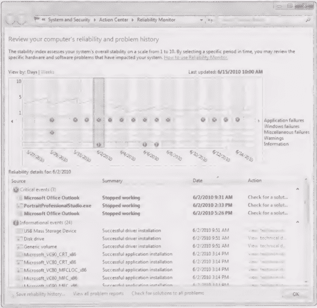

既然研究和接触阶段已经完成，如果问题仍未解决，就该进入调整阶段了。如果问题已解决，你可以跳到配置和记录（Take Note）阶段，或者记录问题和解决方案，或者如果问题是常见的反复出现的问题，直接关闭故障工单即可。

### 调整（Adjust）

有意思的是，我们刚刚到达的这一步，正是我看到许多技术人员、VoIP 管理员或一般网络管理员开始的地方。别难过——我自己也这样做过很多次。根据多年经验，我发现，在进入调整阶段之前先走完研究和接触阶段，可以省去数小时的麻烦。请记住，在大多数情况下，我会在前两个阶段花 10 到 15 分钟。我发现我更经常在五到十分钟内完成前两个阶段。有一段时间，我曾用六个月跟踪这种方法在我所有故障排除案例中的使用结果。在这段时间里，我必须排除 206 个独特问题（同一时期我还处理了数百个常见问题）。其中 117 个问题，我在前两个阶段就找到了解决方案。这个结果意味着，我在 10 到 20 分钟内解决了超过一半的问题。

对于剩下的 89 个问题，我继续进入调整阶段。在这个阶段，你开始尝试不同的方法，看看能否追查到问题的根源。你可能会尝试更新无线 VoIP 电话或 AP 上的固件。你可能会尝试为客户端适配器安装新的设备驱动程序，使其与你正在使用的 VoIP 软件更兼容。你也可以更改设置或禁用功能，看看问题是否消失。关键在于，这里是你开始故障排除中“技术”一面的地方。虽然许多技术人员从这里开始，但你会更有优势，因为你是带着对问题更准确的认识进入这个阶段的。

一旦你完成前三个阶段，你就会得到一个解决方案。同样，这个解决方案有时是重新安装应用程序、重新安装操作系统，或者重新加载出厂默认设置并重新配置路由器，但事情又恢复正常了。你可能在研究阶段之后就找到了解决方案，也可能在接触阶段之后找到。无论你是一路走到调整阶段，还是在流程更早的阶段解决了问题，你现在都可以进入我所说的持续稳定阶段：配置和记录（Take Note）。

### 配置（Configure）

这是两个持续稳定阶段中的第一个。在配置阶段，你要确保在离开物理区域（或远程管理工具）之前，系统和设备已按照你的标准完成配置并正常运行。这使你能够维护标准化环境，而标准化环境通常更稳定。当然，如果是重新安装，你需要按照原始安装规范重新安装，然后应用自那时起已批准或处理的所有配置更改。这个阶段的主要目标是在你的环境中提供一致性，并改进后续的故障排除流程。

在一致的环境中，你可以假定某些事情。例如，你可以假定某台设备拥有最新固件，或者假定某个操作系统已加载特定服务包。然而，现实世界在一致性方面带来了很大困难。要使一个环境达到并保持一致性，以下条件必须全部成立：

- 用户必须无法进行会影响配置一致性的配置更改。
- 所有有权进行配置更改的管理员所做的更改必须保持一致。
- 必须有某种自动化系统同时调整所有机器或设备的配置。

从这三项要求可以看出，由于人为因素，要拥有真正一致的环境非常困难。然而，即使是一个大体一致的环境，也会让故障排除容易得多，因为管理员实施错误配置的可能性低于用户或客户。这种比例并非基于管理员某种更高的智力；它仅仅基于管理员的培训和专业领域。最终，将你的机器和设备配置为标准规范，通常可以通过减少支持事件来降低支持成本。


**记录要点** 这个最后阶段完成了整个过程，并确保你今后从该方法中获得最大收益——这是第二个持续稳定性阶段。通过记录你的发现——我称之为“记录要点”——你便提供了一个可供将来故障排除时搜索的资源。例如，我之前分享的设备错误产生的情形应被记录下来，我建议至少记录以下内容：

- 问题以及任何错误消息（如果存在的话）
- 简明扼要地解释原因
- 解决方案以及任何必要的分步说明
- 任何学到的原则，例如操作系统将 DLL 引用为设备

如果你的组织没有提供集中式故障工单跟踪系统或帮助台解决方案，可以考虑创建自己的数据库。你可以使用任何桌面数据库应用程序，例如 Microsoft Access 或 FileMaker。只要确保能够记录所需信息并轻松查询即可。20 世纪 90 年代末，我在一个 Access 2.0 数据库中跟踪了 206 个独特问题。它对我来说运行良好，类似的解决方案对小型组织仍然可行。不过，基于 Web 的故障工单或呼叫跟踪系统似乎是帮助台应用的发展方向，我当然也觉得它们很有用。基于 Web 的系统的一个好处是，你可以从家里或任何有 Web 访问权限的地方访问它。这样你就可以随时查看新问题。如果你对系统有远程访问权限，你甚至可能无需到现场就能解决问题。存在许多开源基于 Web 的帮助台或问题跟踪系统。

第一种方法 REACT 是我自己的方法。它是我用来处理所面对的每一个新的、独特问题的方法，如图 17-2 所示。多年来，我也将 OSI 模型方法和系统思维的一些概念融入我的流程中，但 REACT 仍然是我开展工作所依据的基本框架。接下来，你将了解 OSI 模型方法。

### OSI 模型

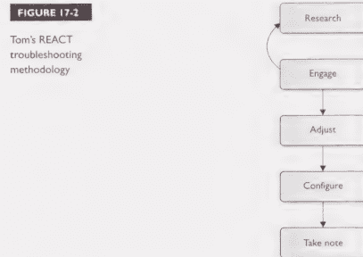

OSI 模型是用于设计和理解网络的出色思维工具；然而，它也可以用于故障排除目的。当使用 OSI 模型作为故障排除方法时，你将沿着 OSI 模型向上或向下遍历，逐层分析系统。这个过程允许你将问题分解为逻辑部分，然后验证系统在每个部分（OSI 层）中是否正常运行。你可以选择只分析第 1 层到第 3 层，也可以选择评估全部七层（甚至八层，如果你把用户层也算进去，用户层有时被称为第 8 层）。

> **实际工作中**
>
> OSI 模型的 ISO 标准并未提到第 8 层；然而，许多网络管理员和工程师用这个术语指代用户。例如，第 8 层问题指的是用户错误。

### 第 1 层

第 1 层是物理层，分析它意味着评估局域网客户端设备或基础设施设备，以确保它们在硬件层面以及可能的驱动程序层面正常工作。例如，无线网卡中的射频模块是否仍能正常工作？对于客户端设备，可以通过拆下无线局域网客户端设备（假设它是 USB、CardBus 或其他类型的可拆卸设备），并将其安装到另一台使用相同型号设备且工作正常的计算机中，来快速测试。如果新计算机也停止工作，那么无线局域网设备很可能在硬件层面或内部软件层面（固件）存在故障。如果怀疑是无线 AP 且你有备用设备，可以在备用设备上加载相同的配置，并将其放在同一位置，看看问题是否仍然存在。如果使用新 AP 后问题不再出现，那么同样，射频模块或其他硬件/固件问题可能正在导致故障。如果怀疑问题出在思科路由器中，你可能只需运行诊断性 *show 命令* 来定位问题。如果你有相同的备用路由器，可以使用它，但通常不会在仓库中存放这样的备用设备。

另一个关键点是评估第 1 层（有时称为第 0 层）所使用的硬件。在有线网络上，你还可以评估配线架、连接器和线缆。在无线 VoIP 连接中，与第 1 层相关的另一个可能发生故障的领域是 AP 与有线局域网之间的以太网连接。如果你的客户端正在向 AP 进行身份验证并与其关联，但无法从 DHCP 服务器（假设你使用了 DHCP 服务器）获得 IP 地址，那么以太网连接可能没有正常工作。转到有线客户端，尝试通过以太网连接连接到 AP。你能连接吗？如果不能，请确认以太网线缆良好、交换机上的端口工作正常，并且 AP 中的以太网端口仍在正常工作（通过直接连接到 AP 并尝试连接来验证）。

无论你是在对有线连接还是无线连接进行故障排除，这些相同的指导原则都适用。考虑更换线缆以及网卡来测试物理层。另外，请记住，许多物理层问题会存在于终端节点之外的硬件中，例如交换机和路由器中。你还应该考虑先测试更高层。如果你能 PING 通网络上的设备，但你的 VoIP 软电话不工作，那么物理层不太可能是问题所在。

### 第 2 层

你通常会评估的第二层是第 2 层，即数据链路层。这是网桥和交换机发挥其作用的地方。确保交换机端口仍在正常工作（尽管这实际上是第 1 层问题），VLAN 配置适当，并且交换机上的端口安全设置设置准确。检查你的网桥配置，确保它们配置正确。确保所有无线网桥上的无线链路仍在工作，并且信号强度仍可接受，足以支持运行。由于无线网桥会评估传入帧并根据帧中的信息转发它们，请确保桥接规则或过滤器设置适当。当然，对于网桥和交换机，问题也可能出在线缆和连接器层面，你将在第 1 层检查这些内容。

在对第 2 层进行故障排除时，同样的规则也适用于第 2 层。如果你能 PING 通网络上的设备，但你的 VoIP 电话不工作，那么数据链路层（第 2 层）很可能工作正常。使用硬件 VoIP 电话时，你可能无法执行 PING 测试。在这些场景中，你可以简单地尝试用另一部电话连接，看看问题是否解决。如果解决了，则很可能是硬件故障或电话设置中某处的配置问题。

虽然 OSI 模型故障排除通常涉及在各层之间向上或向下的逻辑流程，但同样重要的是将各层视为一个系统整体，并记住有时你应该直接跳到第 3 层以排除较低层中的问题。同时，你可能能够 PING 通设备并假定第 2 层正常，而具体问题却出在 VoIP 电话的 VLAN 分配上。请记住，你并不总能通过第 3 层的 PING 来排除第 2 层的 VLAN 问题。

### 第 3 层

如果你已经评估了第 1 层的射频模块、网卡、线缆和连接器，检查了第 2 层的网桥和交换机，并且仍未找到解决方案，你可能必须继续处理第 3 层，即网络层。在这里，你需要检查路由表以确保配置正确。确保应用的任何过滤器都是准确的。使用常见的桌面操作系统工具，如 ipconfig、traceroute、pathping、ping 和 arp，你可以确保能够将数据从网络上的一个位置路由到另一个位置。

第 3 层完全关乎逻辑层面的网络拓扑。这意味着你将要从分段和路由的角度考虑网络。你需要确保 VoIP 设备正确配置了默认路由器设置、DNS 服务器设置以及有效的 IP 地址/子网掩码对。

### 上层

最后，如果你已经测试了前三层并且在那里找不到问题，那么网络基础设施可能工作正常。现在是时候转到上层了，即第 4 层到第 7 层。这些层被称为传输层（4）、会话层（5）、表示层（6）和应用层（7）。查看你的应用程序和客户端软件中用于 VoIP 使用的配置设置。确保身份验证机制已安装并正确配置。尝试使用提供相同基本功能的不同工具和软件。它们能工作吗？如果能，那么你使用的特定应用程序与其运行所在的硬件之间可能存在兼容性问题。

从本节中要学到的一个重要教训是，你不能使自己的关注点变得狭窄。如果你坚持只调查 OSI 模型的一层，你很可能无法找到解决方案或触及问题的原因。这就是为什么许多技术人员会先尝试基本的 PING 命令和 traceroute 命令，以便快速验证第 1 层到第 3 层的功能。如果这些命令有效，那么阻碍适当通信的问题很可能是上层问题，但 VLAN 配置错误除外。

如你所见，OSI 模型故障排除方法既可以帮助你聚焦于一系列测试流程，也可以帮助你依次执行这些流程，直到找到问题的真正根源。我在这里只触及了这个概念，但你可以通过进一步了解每一层发生的情况以及可用于测试的工具来深入研究

**表 17-2 — 软件问题与症状**

| 问题 | 症状 |
|---|---|
| 客户端软件配置错误 | 客户端无法连接、无法接收 IP 地址、无法浏览网络 |
| 输入的密码短语不正确 | 客户端已与 AP 关联，但无法登录无线网络；客户端已连接到有线 LAN，但无法拨打电话 |
| DHCP 服务器宕机 | 客户端物理连接正常，但无法获取 IP 地址 |
| RADIUS 服务器宕机 | 客户端已与 AP 关联，但在无线 LAN 使用健壮安全网络（RSN）时无法登录网络 |

### 软件问题

表 17-2 列出了常见的软件问题及其症状。

### 症状、诊断和解决方案

因为某些症状通常伴随特定问题出现，所以许多问题可以像处理人类健康问题一样，以类似方式解决。查看症状，找出最可能的原因（诊断），然后进行处理（解决方案）。重复此过程，直到问题得到解决。

### 症状

定义症状意味着收集有关问题的信息。发生了什么？在哪里发生？涉及什么技术？涉及哪些用户（如果有）？一直是这样吗？回答这类问题将帮助你确定问题的各种细节。好的问题是有效定义问题的核心。

### 诊断

根据从症状分析中收集到的信息，最可能的原因是什么，或者最可能的原因有哪些？你可以处理一个原因或所有原因，但一次处理一个原因最有可能让你学到更多。首先根据诊断尝试一种解决方案，并评估结果。随着时间推移，这会让你积累专家知识，也就是有些人所说的“直觉”。

### 解决方案

解决方案是针对该问题的潜在修复办法。你可能会尝试更换一块 CardBus PC 网卡，因为根据症状判断，最可能的原因是网卡故障。更换网卡后，你注意到仍然遇到同样的问题。接下来，你可能决定把两块网卡都放到另一台当前使用相同型号网卡且工作正常的机器中试一下。这样做时，两块网卡在那台计算机上都能工作。接下来，你可能尝试在故障计算机中重新加载驱动程序，但这也没有帮助。最终，你发现故障笔记本电脑中的 CardBus 端口存在间歇性故障。你把它送到供应商处维修。

这个示例演示了诊断和解决方法——我称之为 REACT 方法中的调整（Adjust）阶段。你进行更改并尝试不同策略，直到某种方法解决问题。你会记录解决方案以供将来参考，但也会在头脑中记录它。这称为经验，随着经验增加，你会逐渐接近专家水平，从而更快地解决问题。因此，我把问题视为通向更美好未来的垫脚石，因为今天解决这个网络或计算机问题，只会让我明天更有能力解决类似和不同的问题。

### 系统思维

现在我们已经介绍了四种有效的故障排除方法，接下来我们将探讨一个重要概念，它会使你成为更出色的故障排除人员。这个概念被称为系统思维，其信息来自一组参与者，并试图通过对参与者回答取平均值的过程来消除一些主观性。

影响语音质量的因素包括清晰度、延迟和回声。清晰度是将原始声音与数字化信号进行比较时的一种感知测量。延迟会导致连续语音信号的感知丢失（就像面对面交流中的连续声波）。回声会导致语音信号被反射回说话者。这种回声可能造成声音重叠，并降低质量。

### 削波

削波发生在数字通信过程中部分声波丢失时。它可能由许多不同问题引起：

- 由于硬件不足导致编码器处理过载
- 由于介质错误或其他问题导致发送方和接收方之间丢包
- 抖动缓冲区上溢或下溢
- 网络延迟导致延迟过大并迫使丢包
- 使用半双工免提电话

使用全双工免提电话时，它们通常会对环境进行采样，以构建该区域内本底噪声的数字图像。该图像用于区分人类说话者和背景噪声。半双工免提电话不会这样做，可能会将背景噪声解释为人在说话，进而导致削波。

无论原因是什么，请记住，削波是数字通信流中部分声音的丢失。


### 回声

当说话者在说完话几毫秒后听到自己所说的话时，就会产生回声。这种效果与你在山洞中大声说话时体验到的非常相似。当电话交谈中出现回声时，可能会让参与者非常沮丧；然而，回声在 PSTN 甚至专用语音网络上都是正常现象。目标是尽可能消除或最小化回声。

可以通过布线系统中的阻抗匹配、尽可能减少延迟，以及使用回声抑制和/或回声消除来解决回声。回声消除器安装在本地站点，以防止回声返回远端站点。如果你有一个互连多个位置的 VoIP 网络，可以考虑在每个站点安装回声消除器。回声消除器通常实现在 VoIP 网关的 PSTN 接口上。

### 延迟

延迟是数据包穿越网络所需的时间。当数据包穿越网络时，它必须经过交换机、路由器和其他设备。这些设备中的每一个都可能引入延迟。延迟可能导致通话清晰度下降、削波以及 VoIP 网络上的其他问题，因此应尽可能减少延迟。在通话双方之间实现尽可能少引入处理延迟的路径。使用预算允许的最快技术（例如，尽可能使用千兆以太网而不是 100 Mbps）。

音频编解码器也会引入不同的转码延迟。表 17-3 列出了不同编解码器引入的常见延迟。

实际情况是，编解码器引起的延迟与压缩量直接相关。G.729 对音频进行非常紧密的压缩，而 G.711 根本不压缩。然而，在查看这些由转码引入的延迟时，重要的是不要忘记较小数据量所带来的延迟减少。

**表 17-3 编解码器引起的延迟**

| 转码延迟（毫秒） | 编解码器 |
|---|---|
| 0.125 | G.722 |
| 0.75 | G.711 PCM 音频 |
| 1 | G.726 和 G.727 |
| 3 至 5 | G.728 |
| 10 | G.729 和 G.729a |
| 30 | G.723 和 G.723.1 |

### 阻塞呼叫

当呼叫被阻塞时，拨号方会收到忙音。服务等级（GoS）表示单个呼叫被阻塞的概率。如果呼叫第一次尝试就能接通，则系统具有较高的 GoS。当一些呼叫收到忙音时，GoS 较低；然而，通常可以接受一些呼叫收到忙音。问题在于每百次或每千次呼叫中你能容忍多少次被阻塞。

因此，GoS 是在电话业务的忙时，给定呼叫在第一次尝试时被阻塞的概率。计算 GoS 的公式为：

$$\mathrm{GoS} = \frac{bC}{cC}$$

其中 bC 等于忙时第一次尝试被阻塞的呼叫数，cC 是在同一时间窗口内第一次尝试完成的呼叫数。如果 312 次呼叫在第一次尝试时完成，17 次呼叫收到忙音，则计算如下：

$$\mathrm{GoS} = \frac{17}{312}\ \text{or}\ \mathrm{GoS} = 0.054$$

GoS 为 0.054 意味着在忙时，每 1,000 次呼叫中通常有 54 次呼叫，即 5.4% 的呼叫，会在第一次尝试时被阻塞。

### 功能丢失

Cisco IP 电话通过发送 KeepAlive 消息与 Cisco Communications Manager 软件保持联系。在活动通话期间，连续三次 KeepAlive 消息失败会导致电话上出现“CM Down, Features Disabled”消息。此状态将阻止会议呼叫、呼叫停放和呼叫保持等功能正常运行。原因可能是电话与 Call Manager 之间的网络问题，也可能是服务器或电话软件内部的问题。

### 视频质量差和视频帧丢失

如果你同时流式传输视频和音频，视频质量也可能成为问题。与语音数据包一样，视频数据包乱序到达或延迟过高会导致渲染视频质量差。使用 H.323 协议时，视频所需带宽约为 384 kbps，再加上 2% 到 30% 的信令开销。这通常四舍五入为大约 480 kbps 的所需带宽。要解决视频质量和帧丢失问题，你可以考虑为数据传输使用多条并行流路径。你还可以对视频处理实施负载均衡或负载分担。

H.323 对视频传输有一些非常严格的限制。H.323 视频的数据包丢失必须低于 1%。抖动必须低于 30 毫秒，并且单向延迟必须在 150 到 200 毫秒之间。

为了帮助减少基于数据包的网络上的负面结果，可以考虑使用 QoS 工具对视频进行分类。你可以使用 DiffServ 等 IP 优先级方案，并使用低延迟队列（LLQ）或加权公平队列（WFQ）对视频数据包进行排队，以便数据包尽快离开网络节点。

### 常见问题

现在你已经了解了融合网络中可能遇到的各类故障症状的基本知识，可以进一步探究可能导致这些症状的问题。拥有并掌握优秀的故障排查工具很重要，但了解常见故障点同样重要，这样你才能集中精力。表 17-4 列出了你可能遇到的常见问题。

### 故障排查工具

拥有良好的方法论并了解融合网络中出现的常见症状和问题是一回事。知道如何使用正确的工具来分析并发现网络中实际发生的情况则是另一回事。本节将介绍一些 IP 故障排查工具，它们在你分析下一个大问题时可能会很有用。这些工具用于 Windows 和 Linux 操作系统中，并且可能在一些 Cisco 路由器中可用。例如，PING 命令可以在许多 Cisco 设备内部使用。涵盖的工具包括：

- PING
- TraceRt
- PathPING
- ARP
- NSLookup
- Hostname
- NetStat

**表 17-4 问题及定义**

| 问题 | 定义 |
|---|---|
| 媒体错误 | 光纤端接或 RF 连接器不良。屏蔽不良或电缆损坏。 |
| 数据包或数据丢失 | 与发送总量相比，丢失数据包数量的度量。 |
| 协议不匹配 | 使用低效协议，或为标签交换路由器（LSR）错误地标记数据包。 |
| 抖动 | 延迟速率的变化性。 |
| 端口设置 | 端口设置包括外围防火墙端口和客户端防火墙端口。H.323 要求开放 UDP 端口 1718 和 1719。它还要求开放 TCP 端口 1720 和 1503。RTP 和 RTCP 视频和音频流在 TCP 或 UDP 上使用 1024 到 65,535 的动态端口。 |
| 配置设置 | 不正确的配置设置可能对 VoIP 网络造成严重破坏。 |
| 数据包重排序 | 当路由器拥塞或流量优先级设置不当时，VoIP 数据包可能比正常情况下更频繁地乱序到达。这种混乱会导致数据包重新排序，从而影响语音质量。 |
| MTU 问题 | 当配置了较小的最大传输单元（MTU）时，可能导致分片。这种分片会导致额外的处理延迟。 |
| 带宽限制 | VoIP 需要带宽可用性的一致性才能平稳运行。突发性网络通信可能影响这一点并降低语音质量。 |
| 路由器配置错误 | 当实际上只需要一两个路由协议时，却看到路由器运行多个路由协议（如 RIP、OSPF 或 IGRP）并不罕见。这些多余的路由协议会降低网络性能。 |
| QoS 标记被丢弃 | 并非所有设备都支持 QoS 标记，当路由器从以太网帧中提取 IP 数据包时，QoS 信息可能在重新封装过程中丢失。务必选择支持你计划实施的 QoS 技术的基础设施设备。 |
| IP 数据包丢失 | 由于 UDP 的无连接特性以及许多 VoIP 协议依赖 UDP，IP 数据包可能丢失，这可能是由于基础设施上的慢速路由器和其他慢速设备造成的。 |
| 通过网络进行备份 | 许多组织现在通过网络执行数据备份。此活动可能产生大量网络流量。备份数据包应标记为比语音和视频更低的优先级。你可以配置交错比，以便每发送一个备份数据包就发送五个或更多语音数据包。 |
| 硬件故障 | 任何网络技术要正常工作，所有中间硬件设备都必须继续正常工作。导致 VoIP 和其他网络通信症状的常见问题就是简单的硬件故障。 |


### PING

PING 代表 Packet Internet Groper（分组互联网探测器），是用于测试 IP 连通性的命令。当你无法确定网络连接是否仍在网络层正常工作时，它会很有用。PING 命令在不同操作系统之间略有差异，但大多数支持 TCP/IP 的操作系统也支持 PING 命令。甚至多年前的 Windows for Workgroups 3.11 在安装 TCP/IP 协议时也包含 PING 命令。下面的练习将引导你在 Windows 机器上使用 PING。

### 练习 17-1：使用 PING 命令

在本练习中，你将使用 PING 命令验证远程系统是否在网络中正常运行。你还将使用该命令执行连续 PING，以测试间歇性问题。最后，你将了解如何增大和减小 PING 请求的大小。

**验证远程系统正在运行**

- 1. 打开“命令提示符”窗口。
  - a. 单击“开始”|“所有程序”|“附件”，然后选择“命令提示符”。
- 2. 输入 `PING remote_system_IP`。
  - a. 例如，如果你要测试 IP 地址为 10.10.10.100 的远程系统，则应输入 `PING 10.10.10.100`。

**执行连续 PING**

- 1. 打开“命令提示符”窗口。
- 2. 输入 `PING -t localhost` 并按 ENTER。

你会注意到，PING 命令会周期性地、不间断地向本地机器请求响应。如果你想测试间歇性网络问题，请对远程机器使用 `PING -t` 命令。按 CTRL-C 可以停止持续不断的 PING。

**增大或减小 PING 请求的大小**

- 1. 打开“命令提示符”窗口。
- 2. 输入 `PING -l 10240 localhost` 并按 ENTER。

默认 PING 请求大小为 32 字节。`-l` 开关允许你增大或减小该大小。在排查延迟或丢包问题时，将 `-l` 开关与 `-t` 开关一起使用会非常有用。

### TraceRt

TraceRt（跟踪路由）命令为你提供了一种测试两个端点之间中间设备的简单方法。例如，如果你正在使用 IP 地址为 10.10.10.200 的计算机，并且想测试到 10.10.50.200 的路由，则应输入以下命令：

```
TRACERT 10.10.50.200
```

TraceRt 命令还提供了若干开关来操作该命令。表 17-5 概述了这些开关。

请记住，不同操作系统以不同方式实现类似工具。例如，macOS 有 TraceRoute 命令，而 Windows 有 TraceRt 命令。

**表 17-5 — TraceRt 开关**

| 开关 | 描述 |
|---|---|
| `-d` | 不将地址解析为主机名。此开关可以加快 TraceRt 处理速度。 |
| `-h maximum_hops` | 指定要跟踪的最大跳数。 |
| `-j host` | 强制 TraceRt 通过指定主机进行路由。 |
| `-w timeout` | 指定每个回复的超时值，单位为毫秒。 |
| `-R` | 跟踪 IPv6 连接的往返路径。 |
| `-S source_address` | 指定用于 IPv6 的源地址。 |
| `-4` | 强制使用 IPv4。 |
| `-6` | 强制使用 IPv6。 |

### PathPING

PathPING 是 Windows 系统上较新的命令行工具，允许你 PING 通往目的地的路径上的设备。与 TraceRt 不同，PathPING 还会显示已发送数据包数量与丢弃或丢失数据包数量的对比。因此，PathPING 是排查语音网络中丢包问题的出色工具。该命令使用表 17-6 中列出的开关。

**表 17-6 — PathPING 开关**

| 开关 | 描述 |
|---|---|
| `-g host` | 与 TraceRt 中的 `-j` 开关功能相同 |
| `-h maximum_hops` | 指定应跟踪连接经过的最大跳数 |
| `-i address` | 告诉 PathPING 使用指定的源 IPv6 地址 |
| `-n` | 与 TraceRt 中的 `-d` 功能相同 |
| `-q number_of_queries_per_hop` | 指定对路径中每台设备执行的 PING 次数 |
| `-w timeout` | 指定每次查询回复的等待时长，单位为毫秒 |
| `-4` | 强制使用 IPv4 |
| `-6` | 强制使用 IPv6 |

### ARP

地址解析协议（ARP）用于将 IP 地址解析为 MAC 地址，以便进行局域网数据包传递。直接相连的以太网设备基于各自的 MAC 地址相互通信；然而，路由器接收的是发往 IP 地址的数据包。必须使用某种机制将这些 IP 地址解析为 MAC 地址，而 ARP 缓存正是在此发挥作用。

当一台机器需要将 IP 地址解析为 MAC 地址时，它会首先查看 ARP 缓存。ARP 缓存包含以前解析过的 IP 到 MAC 映射列表。要在 Windows 上查看 ARP 缓存：

- 1. 打开“命令提示符”窗口。
- 2. 输入 `ARP -a` 并按 ENTER。

图 17-3 显示了 Windows Vista 客户端上 ARP 命令的示例输出。你可以看到本地网络接口的 MAC 地址，以及该机器已连接的设备的 MAC 地址。要获取更详细的信息，请输入 `ARP -a -v`，它将提供 ARP 缓存的详细列表。要清除 ARP 缓存，只需输入 `ARP -d *`，所有条目都将被删除。

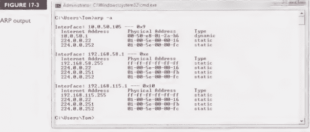

### NSLookup

如果你发现无法根据设备的 DNS 名称或主机名连接到设备，可以使用 NSLookup 工具查询 DNS 服务器。该工具可以执行正向和反向查找，以及针对服务记录的特殊操作。例如，要解析网站的 IP 地址，请输入 `NSLOOKUP website_domain_name`。结果将是该网站的 IP 地址，以及将该主机名解析为 IP 地址的 DNS 服务器名称。你也可以通过输入 NSLOOKUP 并按 ENTER 以交互模式使用 NSLookup。图 17-4 显示了以交互模式工作的 NSLookup 工具。

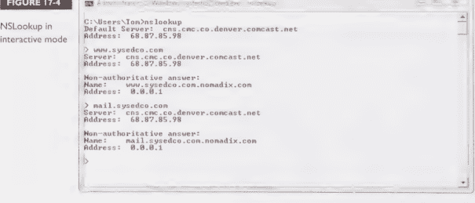

### Hostname

Hostname 是一个简单的命令行工具，用于显示本地机器名称。在命令提示符下输入 `hostname` 将返回计算机的主机名。输入 `ECHO %computername%` 可以获得相同的信息。后一种方法已在 Windows 系统中使用多年，前一种方法则较新。

### NetStat

NetStat 是一个命令行工具，用于显示网络接口统计信息。使用该工具，你可以查看与通信相关的统计信息以及当前打开的连接。图 17-5 显示了 NetStat 可用的命令行选项。

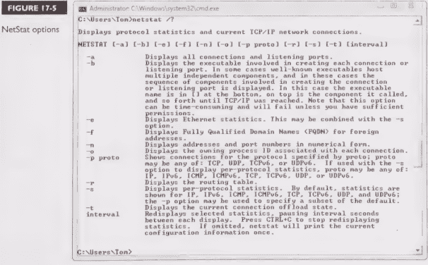

NetStat 命令的一个有用功能是能够查看特定协议的统计信息。例如，你可以仅查看 TCP 统计信息、仅查看 IP 统计信息，以及仅查看 UDP 统计信息。例如，`NetStat -s -p TCP` 命令将仅显示 TCP 通信的统计信息。图 17-6 分别显示了查看 TCP、IP 和 UDP 统计信息时的输出。

### 认证目标 17.01

### 640-460：解释 Cisco Unified Communications Manager Express 的基本故障排除方法

与排查大多数问题一样，对于 Cisco Unified CME 配置，你应该采取的第一步是验证设置是否正确。如果设置不正确，设备将无法按需运行。在本节中，你将学习若干可用于验证 CME 配置设置的命令。

### 验证 CME 设置

用于运行 Cisco Unified CME 的 Cisco 路由器上最重要的命令之一是 `show running-config` 命令。除此命令外，若干故障排除 show 命令也可能有帮助。表 17-7 提供了这些命令的参考。

**表 17-7 — CME IOS 故障排除命令**

| 命令 | 用途 | 示例 |
|---|---|---|
| `debug ip` | 分析 DHCP 通信 | `debug ip dhcp server events` |
| `debug tftp events` | 分析 TFTP 事件，例如 Cisco IP 电话固件下载 | `debug tftp events` |
| `show telephony-service` | 查看 CME 设置和信息 | `show telephony-service tftp-bindings` |
| `debug ephone` | 验证 ephone 注册过程是否正常工作 | `debug ephone register` |
| `show ephone` | 确定 ephone 的状态（已注册、未注册或已失效） | `show ephone attempted-registrations` |


除了这些命令之外，你还可以使用 CME 路由器 ping Cisco IP 电话，以排查路由器与电话之间的通信问题。有些电话可能每两次 ping 请求才响应一次，但这是正常现象，因为路由器的 ping 速率高于电话允许的速率。

> **考试提示**
> 
> CME 相关问题可能同时出现在 CVOICE 和 640-460 考试中。确保你了解如何使用 show telephony-service 命令查看 CME 信息，并了解何时使用 debug ephone 和 show ephone 命令。

### 认证目标 17.02

### 640-460：解释 Cisco Unity Express 的基本故障排除方法

Cisco Unity Express 是安装在 Cisco 路由器中的 AIM-CUE 模块。它可能预装在 UC500 系列设备中。要对 Cisco Unity Express 进行故障排除，你需要能够验证服务模块已被检测到，并且配置适当。本节概述了 Cisco Unity Express 模块的故障排除命令。

### Cisco Unity Express 故障排除命令

如果提供语音邮件和自动总机功能的 Cisco Unity Express 模块无法正常工作，你应首先验证它是否已被 Cisco IOS 检测到。使用以下命令可以轻松完成此操作：

```
Router1# show run | inc interface Service-Engine
```

如果设备已被检测到，你应该会看到输出表明 running-config 中已添加新的 interface Service-Engine 行。如果未显示任何结果，则表明路由器未检测到该模块。请尝试重新插拔该模块；如果路由器在其他方面工作正常但检测不到该模块，则更换该模块。

如果 Cisco 路由器仍能检测到该模块，但模块无法工作，下一步是验证配置是否正确。为此，你必须首先访问服务模块。使用以下命令访问服务模块：

```
Router1# service-module service-engine 1/0 session
CUE>
```

此命令假定 Unity Express 模块的地址为 1/0。如果不是，只需更改命令以匹配你的服务模块的地址。请记住，可以通过查看 running-config 来识别该地址。请注意，访问服务模块后提示符会发生变化。访问服务模块后，你必须再次进入 enable 模式才能执行任何有用的功能，如下所示：

```
CUE> enable
Password:
CUE#
```

现在你可以开始验证配置是否正确。Unity Express 模块要求安装相应的许可证文件。要验证许可证，请使用以下命令：

```
CUE# show software license
```

你应该会看到结果表明已安装许可证文件，以及该许可证支持的邮箱数量。

在最坏的情况下，你可以将 Unity Express 模块重置为出厂默认设置。如果采取这一极端操作，所有配置和数据都将丢失，因此应谨慎执行此操作。如果你选择执行此操作，设备会向你发出警告。要将模块重置为出厂默认设置，请执行以下命令：

```
CUE> offline
CUE (offline)> restore factory default
```

执行 offline 命令后，系统会要求你确认该操作。只需输入 Y 并按 ENTER。系统还会要求你确认第二条命令。如果你绝对确定必须采取这一最后手段，请输入 Y 并按 ENTER。

### 认证目标 17.04

### 640-460：描述 QoS 如何解决语音质量问题

成功的 VoIP 网络的关键因素之一是服务质量（QoS）对网络的影响。正确实施 QoS 后，即使是 100 Mbps 的网络也能处理比未实施 QoS 或 QoS 实施不当时多得多的呼叫。

你可能还记得前面章节中提到，VoIP 通信需要较低的延迟和抖动才能正常工作。在本节中，你将了解 QoS 功能的三个阶段、QoS 信任边界以及 Cisco Auto-QoS 的实施过程。

### QoS 功能的三个阶段

QoS 通过对网络上的 IP 数据包进行分类、标记和排队来发挥作用。这些操作代表 QoS 功能的三个阶段。流量分类包括识别数据包并将其划分为不同的优先级。在 Cisco 环境中，我们通常会创建语音 VLAN 和数据 VLAN。如果 IP 数据包位于语音 VLAN 中，我们假定它们需要语音优先级。这使分类更简单。网络设备还可以通过查看 IP 数据类型并将数据包放入相应分类来对数据包进行分类。

根据 IP 数据包的分类，流量标记会为数据包设置标记，以便其余网络设备只需根据这些标记使用队列转发数据。Cisco IP 电话将使用服务类别（CoS）值来实现此标记目的。以太网帧头的 CS 字段中提供八个优先级级别。语音流量被标记为 CoS 值 5。标准的未标记数据被赋予 CoS 值 0。较高的值表示高优先级。表 17-8 记录了八个类别及其常见用途。

| 类别 | 应用 |
|---|---|
| 0 | 尽力而为数据 |
| 1 | 视为后台数据 |
| 2 | 视为卓越努力 |
| 3 | 视为关键非流式应用 |
| 4 | 通常用于视频数据 |
| 5 | 快速转发（EF）流量，例如 VoIP |
| 6 | 用于 IP 路由协议 |
| 7 | 用于 IP 路由协议 |

根据此表中的值，你可以看到数据包的实际最高优先级是 5，因为类别 6 和 7 保留给路由协议。

CoS 值与区分服务（DiffServ）QoS 解决方案一起使用。IEEE 802.1p 将 QoS 定义为标准。

流量被标记后，可以将其放入相应队列以进行匹配的优先级处理。*流量排队*是对出站数据包进行优先级排序，以便优先发送较高优先级数据包的过程。推荐用于语音数据的排队技术称为低延迟排队（LLQ），它有助于消除语音通信中的抖动、延迟和数据包丢失。Cisco auto-QoS 功能默认实施 LLQ。

### QoS 信任边界

QoS 信任边界定义了我们信任设备正确为数据包标记或设置 QoS 信息的点。例如，你可以在四个主要级别上进行信任：

- 所有端点
- Cisco IP 电话
- 接入层（交换机）
- 分布层（交换机和路由器）

如果你信任所有端点，那么你可以接受进入交换机任何接口的数据包上所设置的 QoS 标记。此信任边界在严格管理的环境中效果最佳。如果你信任 Cisco IP 电话，则表示只有 IP 电话端点可以应用 QoS 标记。你还可以指明任何交换机（接入层）都可以应用 QoS 标记，或者只有分布层交换机可以应用。

> **考试提示**
> 
> 确保你了解考试中的 *auto qos voip* 命令。理解它们定义的不同信任边界以及它们启用的基本功能。

### 认证总结

在本章中，你学习了故障排除方法以及可用于验证配置和排查与 VoIP 实施相关问题的特定 Cisco 命令。你首先了解了故障排除方法的需求，然后探讨了 Cisco Unified CME、Unity Express、UC500 设备和语音质量问题的故障排除技巧。

- 作为最后手段，你可以使用 restore factory default 命令将 Unity Express 模块恢复为出厂默认设置。模块必须处于离线状态才能执行恢复出厂设置过程。
- 如果恢复了出厂默认设置，所有数据和配置设置都将被删除。

### 640-460：解释 UC500 的基本维护和故障排除方法

- UC500 系列提供类似于标准 IOS 的命令提示符界面；但是，其功能有限。
- 可以通过设备上的标准交换机端口，使用 Telnet 访问 UC500 系列设备的 CLI。
- 访问和排查 UC500 系列故障最常见的方式是通过基于 Web 的界面或 Cisco Configuration Assistant（CCA）。这两种方法都提供 GUI 界面，用于配置验证和状态查看。

### 640-460：描述 QoS 如何解决语音质量问题

- 服务类别（CoS）QoS 解决方案允许八个类别。
- 类别 0 到 5 用于数据。类别 6 和 7 仅由路由协议使用。
- VoIP 数据通常接收类别 5 标记。
- QoS 处理的三个阶段是流量分类、流量标记和流量排队。
- Cisco 的 auto-QoS 功能对 VoIP 流量使用低延迟排队（LLQ）。
- auto qos voip 命令用于配置 Cisco auto-QoS。
- auto qos voip 命令有三个选项：cisco-phone、cisco-softphone 和 trust。
- cisco-phone 选项将 QoS 标记限制为 Cisco IP 电话所应用的标记。
- cisco-softphone 选项允许 PC 上基于软件的 Cisco IP 电话应用 QoS 标记。
- trust 选项接受所有 QoS 标记来源，通常仅在分布层和核心层的基础设施设备内使用。


### 自测

以下问题将帮助你衡量对本章所介绍材料的理解。请仔细阅读所有选项，因为正确答案可能不止一个。为每个问题选择所有正确答案。

### 640-460：解释 Cisco Unified Communications Manager Express 的基本故障排除方法

- 1. 为了从 Web 浏览器访问 CME，必须将什么命令输入到路由器配置中？
  - A. ip http server
  - B. enable http
  - C. http server
  - D. ip http-server
- 2. 你希望监控 CME 路由器上的 DHCP 活动。应输入什么命令？
  - A. ip dhcp monitor
  - B. debug dhcp server events
  - C. debug ip dhcp server events
  - D. ip dhcp server events
- 3. 使用什么 show 命令查看有关 CME 设置和数据的信息？
  - A. show interfaces
  - B. show telephony-service
  - C. show ip interface
  - D. show cme-service
- 4. 可以将什么命令输入到 Cisco 路由器中以对 ephone 注册过程进行故障排除？
  - A. debug ephone
  - B. debug ip-telephony
  - C. debug telephony-service
  - D. debug ip rtp packets

### 640-460：解释 Cisco Unity Express 的基本故障排除方法

- 5. 假设 Unity Express 服务模块位于 1/0 地址，使用什么命令访问该模块？
  - A. interface service-engine 1/0
  - B. interface service-module 1/0
  - C. service-module service-engine 1/0
  - D. service-engine service module 1/0
- 6. 可以使用什么命令查看 Cisco 路由器中 Unity Express 模块的许可信息？
  - A. show software license
  - B. show run | inc license
  - C. show run | inc certificate
  - D. show software license
- 7. 如果将 Unity Express 模块重置为出厂默认值，会丢失什么？（选择所有适用项。）
  - A. 数据
  - B. 配置设置
  - C. 内存
  - D. FastEthernet 0 IP 设置
- 8. 使用什么命令将 Unity Express 模块重置为出厂默认值？
  - A. restore factory default
  - B. reset factory default
  - C. reload factory default
  - D. del running-config
- 9. 在重新加载出厂默认值之前必须执行什么命令？
  - A. unprotect
  - B. offline
  - C. exit
  - D. disable

### 640-460：解释 UC500 的基本维护和故障排除方法

- 10. 如何访问 UC500 系列设备的 CLI？
  - A. 通过交换机端口 Telnet 登录
  - B. 通过默认 VPN 隧道 Telnet 登录
  - C. 将键盘和显示器连接到设备
  - D. 使用视频和键盘切换盒

### 自测答案

### 640-460：解释 Cisco Unified Communications Manager Express 的基本故障排除方法

- 1. ☑ A 正确。必须启动 HTTP 服务。可以使用 ip http server 命令或 ip http secure-server 命令启动该服务。后者启用 HTTPS 服务器。
  - ☒ B、C 和 D 不正确。enable http、http server 和 ip http-server 这些命令无论是否安装 CME，在 Cisco IOS 中根本不存在。
- 2. ☑ C 正确。debug ip dhcp server events 命令将启用输出，详细说明 Cisco 路由器内的 DHCP 活动。
  - ☒ A、B 和 D 不正确。ip dhcp monitor、debug dhcp server events 或 ip dhcp server events 等命令不存在。
- 3. ☑ B 正确。show telephony-service 命令可用于查看 Cisco ISR 上有关 CME 的信息。
  - ☒ A、C 和 D 不正确。show interfaces 命令用于查看以太网、WAN 和其他接口的信息。show ip interface 命令用于显示路由器上 IP 配置的信息。show cme-service 命令不是有效命令。
- 4. ☑ A 正确。debug ephone 命令将允许你查看与 IP 电话注册相关的详细活动信息。
  - ☒ B、C 和 D 不正确。debug ip-telephony 和 debug telephony-service 命令是无效命令。debug ip rtp packets 命令对于 VoIP 分析很有用，因为它显示 RTP 报头信息；但是，它无助于对 ephone 注册过程进行故障排除。

### 640-460：解释 Cisco Unity Express 的基本故障排除方法

- 5. ☑ C 正确。service-module 命令用于进入任何服务模块（包括 Unity Express 模块）的管理模式。
  - ☒ A、B 和 D 不正确。所有这些命令都是无效的，在 Cisco IOS 中没有任何用途。
- 6. ☑ D 正确。正确的命令是 `show software license`，并且该命令应在 service-module 提示符内执行，而不是在原生 IOS 提示符下执行。
  - ☒ A、B 和 C 不正确。所有这些命令都是无效的，在 Cisco IOS 中没有任何用途。许可信息不存储在路由器的 running-config 中。
- 7. ☑ A 和 B 正确。如果重置为出厂默认值，你将丢失模块上的数据和配置。
  - ☒ C 和 D 不正确。内存不会改变，因为它是硬件元素。FastEthernet 0 接口（如果路由器有该接口）不会受到影响，因为它是单独的接口。
- 8. ☑ A 正确。restore factory default 命令将 Unity Express 模块重置为出厂默认值。应非常谨慎地使用此命令，因为所有数据和配置设置都将丢失。
  - ☒ B、C 和 D 不正确。这些命令不是用于将 Unity Express 模块重置为出厂默认值的有效命令。
- 9. ☑ B 正确。应执行 offline 命令使 Unity Express 模块离线以进行重新配置。
  - ☒ A、C 和 D 不正确。unprotect 命令不是 Unity Express 模块的有效命令。exit 命令用于从 service-module 命令提示符返回到原生 IOS 模式。disable 命令在 Unity Express 模块中无效。

### 640-460：解释 UC500 的基本维护和故障排除方法

- 10. ☑ A 正确。交换机端口支持 Telnet 协议。还可以将串行接口与终端仿真程序一起使用。
  - ☒ B、C 和 D 不正确。UC500 系列设备默认不存在 VPN 隧道。不存在用于连接键盘或显示器的端口。由于不存在键盘和显示器端口，视频和键盘切换器将无法工作。
- 11. ☑ A 正确。Cisco Configuration Assistant (CCA) 通常用于管理 UC500 系列设备。你也可以使用基于 Web 的界面来管理设备。
  - ☒ B、C 和 D 不正确。Security Device Manager (SDM) 与 Cisco ISR 一起使用。SNMP 协议用于管理和监控设备，但不用于配置 UC500 系列设备。RTP 协议用于承载语音通信。

### 640-460：描述 QoS 如何解决语音质量问题

- 12. ☑ **B 正确。** 定义了八个类别，即类别 0 到 7。
  - ☒ A、C 和 D 不正确。由于定义了八个类别，所有这些答案都不正确。
- 13. ☑ **D 正确。** 类别 5 通常用于 VoIP 网络上的语音数据。
  - ☒ A、B 和 C 不正确。类别 1 定义为背景数据。类别 0 定义为尽力而为数据。类别 6 和 7 用于路由协议。
- 14. ☑ **A 正确。** 类别 0 到 5 用于端点数据。
  - ☒ B、C 和 D 不正确。类别 1–5 用于端点数据，但类别 0 也用于端点数据。类别 6 和 7 用于路由协议。由于类别 6 和 7 用于路由协议，因此类别 0–7 用于端点数据的说法是不正确的。
- 15. ☑ **C 正确。** `auto qos voip cisco-phone` 命令用于表示基于硬件的 Cisco 电话被信任，可以用 CoS 信息标记 IP 数据包。
  - ☒ A、B 和 D 不正确。`auto qos voip cisco-softphone` 命令用于信任来自 Cisco 的基于计算机的软电话。`auto qos voip phone` 命令无效，因为未使用 phone 参数。`auto qos voip trust` 命令允许来自任何设备的 CoS 标记。

### 实验答案

你需要添加三个命令来完成此实验。前两个命令必须添加到适当的交换机端口上，它们是：

```
auto qos voip cisco-phone
```

第三个命令应在 CME 路由器上执行，它是：

```
ip http server
```

你也可以使用 `ip http secure-server` 命令来使用 HTTPS，而不是未受保护的 HTTP。


## 18 保护 VoIP 网络

### 认证目标

| 目标 | 描述 | 活动 |
|---|---|---|
| 18.01 | 642-436：描述SRTP | ✓ 两分钟演练 |
|  |  | 问答 · 自测 |

> 关于这个研究领域，有一件事确实千真万确——它永远不会变得无聊。
> ——格雷戈里·B·怀特，《Security+认证全一考试指南》，关于信息安全主题。

有人称他们为黑客。我倾向于称他们为破解者或攻击者；然而，无论名称如何，他们都是一个不断演进和变形的集体。这群技术娴熟且极具创造力的人每个月都在开发侵入我们网络和系统的新技术，不断让我们感到意外。我们每天花费时间实施、维护网络和系统并排除故障，以帮助用户取得业务成果，而攻击者往往没有这样的时间限制。由于存在这种时间投入上的差距，我们也必须协作，作为一个整体汇聚我们的集体防护知识。

确实，攻击者几乎每天都在开发新方法。作为网络管理员和安全从业者，我们必须与他们共同演进。我们可能没有时间开展导致漏洞发现和针对这些漏洞的防护研究，但我们必须腾出时间通过书籍、网站、杂志和会议了解这些漏洞及解决方案。

出于这个原因，我提供了超出CCNA Voice考试要求的安全信息。在本章中，你将了解所有网络——包括VoIP网络——所面临的威胁、漏洞和利用方式。你还将了解一些仅适用于VoIP网络的特定漏洞。在本章最后一节中，你将比第5章更详细地学习安全RTP（SRTP）协议。

### 信息安全概念

信息和网络安全技术存在的目的是保护我们的数据和系统免受攻击者或破解者的侵害。只有理解攻击方法和工具，你才能真正理解为什么需要这些安全技术。本节不会详尽论述破解领域，但应提供足够信息，帮助你理解本章后半部分所介绍的技术为何如此重要。这里，我将涵盖以下主要主题：

- 安全的重要性
- 威胁、漏洞和利用的定义
- 攻击点
- 黑客攻击示例
- 零日攻击
- VoIP特定攻击

### 安全的重要性

安全的重要性因组织而异。这种差异源于组织内部对信息和网络赋予的价值不同。例如，从事银行和医疗保健的组织可能比销售贺卡的组织更重视信息安全。然而，每个组织都需要对数据进行分类，以便适当保护。贺卡公司可能更看重其客户数据库，而不是互联网防火墙的日志文件。这两个数据文件都有价值，但其中一个比另一个更有价值，应据此分类，以便得到恰当保护。这一过程是信息安全的核心，可定义如下：

- 1. 确定所涉信息的价值。
- 2. 根据该价值应用适当的分类。
- 3. 为该信息分类实施适当的安全解决方案。

例如，你的组织可以选择将信息分为三类：内部、公开和内部敏感。归类为内部信息的信息可能只需要适当的身份验证和授权。归类为公开信息的信息可能既不需要身份验证也不需要授权。内部敏感信息可能需要身份验证、授权以及基于存储的加密。

从这个关于信息分类和安全措施的简短概述中，你可以看出为什么不同组织有不同的安全优先级和需求。然而，同样正确的是，每个组织都面临某些威胁的风险。拒绝服务（DoS）、蠕虫等威胁往往具有无差别性质。在无差别攻击中，攻击者并不关心哪些网络或系统受到损害。此类攻击的意图通常只是展示攻击者的能力，或满足攻击者的某种其他动机，例如好奇心或寻求认可。

- 25%的受访组织将年度IT预算的6%至10%用于安全。
- 61%的受访组织仍然不外包任何安全职能。
- 46%表示在过去12个月中经历过安全事件，10%表示不确定。
- 总受访者中有26%表示过去12个月发生了超过10起事件。
- 只有36%表示未因内部威胁造成损失，这意味着64%经历过导致损失的内部人员攻击。
- 最常见的攻击类型是有效用户对互联网访问的简单滥用。
- 病毒也是一种常见的攻击问题，52%报告了此类攻击。
- 只有5%报告电信欺诈，13%报告系统渗透；然而，重要的是要知道，一些专家估计多达85%的攻击未被发现。

这些统计数据清楚地表明威胁是真实的，安全很重要。统计数据向我们展示了正在发生什么，而理论可以帮助我们理解这些攻击为何发生。

### 理论

为什么一个看似无端攻击的攻击者会发动攻击？这是一个重要问题，但很难确切回答。毕竟，我们面对的是人性。很容易理解为什么被解雇的员工决定攻击：该员工可能想要报复。甚至也很容易理解为什么竞争对手可能攻击：为了在与你的组织的竞争中占据上风。但为什么脚本小子（那些缺乏深入技术理解但能够运行脚本或遵循指令的人）会选择攻击你的组织？

一种理论认为，他们并没有选择你的组织。相反，这种观点认为攻击者是无差别的。他们不在乎目标是谁，而会攻击任何易受特定利用方式影响的目标。脚本小子的攻击往往属于这一类。这些攻击者会扫描数百甚至数千个网络，寻找任何存在漏洞的网络。当发现易受攻击的网络时，攻击者会针对该网络启动其他脚本或工具，以渗透网络并获取数据和资源访问权限。熟练的破解者也可能使用这种方法，他们只想控制网络和资源，以便利用这些易于渗透的资源对主要目标发动攻击。分布式DoS（DDoS）攻击就是此类攻击的一个例子。然而，这不仅仅是一种理论；这是现实。脚本小子数以千计地存在，是任何组织的主要威胁。这种理论认为一种攻击形式是无差别攻击，但另一种理论更深入地探讨攻击者的动机，并提出潜在动机可能驱使攻击者针对你的组织。

这种想法是否正确并不重要。重要的是，攻击者认为你的组织对他或她所珍视的某种事物构成威胁。这些价值可能包括环境关切、言论自由关切、免于政府控制，或攻击者高度尊崇的任何其他价值。如果攻击者认为你的组织对这些价值的实现构成威胁，这种认知可能成为攻击者的动机。取决于攻击者的价值观，他或她可能只试图破坏你的网站外观，或完全摧毁数据和系统。无论哪种情况，我们也必须防范这些人。

这两种攻击者类型之间有什么区别，为什么这很重要？最大的区别在于对“为什么？”这个问题的回答。攻击者为什么想攻击你的网络或系统？如果攻击本质上无差别，传统防护机制很可能就足够了。如果攻击是有针对性的，攻击者很可能愿意花更多时间试图渗透你的网络，因此将需要更强的安全机制。你需要评估你的组织因强烈动机而成为有意目标的风险，或因弱动机而成为无差别目标的风险。此外，你必须记住，即使本质上无差别的攻击，也可能意图通过利用你的资源来损害另一个组织。

### 现实

所有这些统计数据和理论——我在这里只涉及了一部分——把我们引向一个重要观点：每个组织都必须处理信息、网络和系统安全。必须考虑信息的保护方法。这些方法将包括身份验证、授权、计费和加密。对于网络系统，你需要实施身份验证和授权，以确保只有指定人员可以管理这些设备。对于系统安全，你应确保应用程序代码库的安全管理和安全编程实践。这幅图景就是全局图景。贯穿整个


在本章的其余部分，你将了解攻击者如何获得对你网络、系统以及最终信息的访问权限的更多细节。

### 工作实际

> **保护你的 VoIP 和数据网络所需执行的关键任务之一就是进行彻底的安全审计。安全审计将帮助你定位漏洞区域，以便你将其封锁。它还可能导致制定更全面的安全规程，以进行持续的安全管理。**

### 威胁、漏洞与利用的定义

威胁被定义为可能对系统造成损害的个人、团体、环境或事件。某人或某事件被视为威胁的唯一条件就是具有造成损害的可能性，并不需要确定性。威胁分为两大类：有意威胁和无意威胁。有意威胁包括所有背后有智力的威胁。换句话说，有意威胁是由个人或团体策划并执行的威胁。无意威胁包括那些通常被称为“天灾”的事件或环境。闪电、飓风、各种意外以及其他类似事件都属于无意威胁；然而，这些无意威胁也必须被纳入考量。

漏洞被定义为系统或对象中的弱点。对象可以是系统的一部分，也可以是独立实体。例如，VoIP 路由器可以被视为独立实体，也可以被视为更大网络系统的一部分。作为独立实体，路由器可能存在漏洞；但是，如果你计划将路由器作为更大系统的一部分来实施，则必须将该系统作为一个整体来检查漏洞。当各个对象作为一个系统一起使用时，由于新引入的网络通信，往往会发现单个对象中不存在的全新漏洞。例如，某个软件模块可能本身没有漏洞，但当该模块与另一个模块通信时，通信信道可能会引入新的漏洞。

发现漏洞的过程称为漏洞分析。软件或硬件供应商可能执行漏洞分析以测试其解决方案。实施该解决方案的组织也可能执行漏洞分析，以确保其数据的隐私和保护。在大多数情况下，供应商和实施组织都会执行分析。这种双重测试是必要的，因为实施组织将在供应商不熟悉的环境中部署解决方案，因此可能会引入新的漏洞。

利用是一种用于暴露并利用漏洞的具体方法。利用会因漏洞而引入威胁。利用可能是攻击者必须执行的过程，也可能以必须执行的源代码形式出现。

当攻击者希望获得网络访问权限时，他会执行以下基本步骤：

- 1. 扫描网络上的设备。
- 2. 扫描这些设备上的服务。
- 3. 发现正在运行的服务的版本。
- 4. 研究漏洞。
- 5. 基于一个或多个漏洞发起利用。

这一步步的过程表明，攻击网络是一个简单的过程。你只需拥有合适的工具即可。例如，在 Windows 系统上，你可以使用 Nmap 或 Angry IP Scanner 来查找设备、服务和版本。这些 Windows 工具可免费下载。接下来，你可以搜索互联网以查找已知漏洞，然后通过利用这些漏洞进行攻击。在许多情况下，你可以下载专为发起利用而设计的免费应用程序。例如，AirCrack 就是一个专门用于破解无线网络上 WEP（有线等效保密）和 WPA（Wi-Fi 保护访问）密钥的程序，并且可能被用来入侵一个脆弱的无线 VoIP 网络。

当工具易于获取且说明易于遵循时，威胁就会增加。这种增加是因为脚本小子可以轻松发起利用。因此，必须将无线语音链路的 WEP 破解视为对所有组织的有效威胁，因为混杂模式攻击者可以利用该手段对他们发起攻击。这里以 WEP 破解为例，但任何性质类似的利用（无需深入的技术知识即可获取和执行）都应被视为威胁，并且针对其的保护措施应纳入所有安全策略和规程之中。

### 攻击点

在考虑融合语音和数据网络面临的威胁时，一个好的起点是记录各种攻击点。攻击点是系统的入口点或系统内攻击者可能试图渗透的位置。至少应考虑以下攻击点：

- 网络
- 服务器
- 存储
- 认证系统
- 加密系统

### 网络

最早的语音和数据网络仅采用有线方式；然而，随着 20 世纪 90 年代末无线技术的标准化，无线 VoIP 已变得非常流行。我们必须同时考虑有线和无线网络及其可能引入的潜在漏洞。

**有线网络** 有线网络可能通过访问不安全端口或穿透受保护端口而被利用。如果网络连接到互联网，互联网连接也可能被利用。另一种利用方式是通过拨号连接。拨号连接正变得越来越少见，但它们仍然存在。

不安全的有限端口是指已启用且未受认证保护的以太网（或其他有线网络标准）端口。IEEE 802.1X 是定义保护此类端口机制的标准。一些组织选择实施 802.1X，而另一些组织则选择通过禁用任何未使用的端口来解决问题，直到需要时再启用。后一种方法使网络容易受到人为错误或疏忽的影响。只要使用了安全的可扩展认证协议（EAP）实现，802.1X 解决方案是更受青睐的。

如果端口不安全，攻击者可以连接到该端口并开始扫描，最终攻击网络。主要目标包括会议室、闲置办公室以及仓库或工厂车间的偏远区域中的端口。这些端口在不使用时当然应加以保护或禁用。

最常用的攻击点之一是组织的互联网连接。许多管理员注意到在一天之内就有超过一千次攻击尝试。如果你有互联网连接（希望有良好的防火墙），并且可以记录连接尝试，你应该启用此日志记录。几天后，你可以查看日志，看看有多少针对常见攻击端口的连接尝试。你可能会对尝试次数感到惊讶。

### 无线网络

无线网络与有线网络一样，也容易通过面向互联网的连接被渗透；然而，无线网络还引入了全新的漏洞。你不仅要关注端口，还必须关注连接。无线网络允许客户端设备无需预先分配的端口即可连接到网络。因此，禁用端口并不是一个选项。过去曾使用 MAC 过滤来尝试实现与端口管理同等级别的安全性；然而，MAC 过滤非常薄弱，因为攻击者可以监控网络并发现有效的 MAC 地址。一旦知道有效地址，攻击者就必须重新配置其设备以使用允许的 MAC 地址。因此，你应将 MAC 过滤视为一种安全误区，而非安全解决方案。

事实上，许多威胁都与无线安全相关。这里我只提及其中几个：

- MAC 过滤
- SSID 隐藏
- 所有现代设备都使用“更好的 WEP”
- 无线网络无法被保护

### MAC 过滤

无线设备供应商和无线网络书籍通常提供一份“Top 5”或“Top 10”清单，列出保护无线 LAN 应做的事情。该清单通常包含 MAC 过滤和 SSID 隐藏或伪装。但实际上，这两种方法都无法提供高等级的安全性。MAC 地址很容易被伪造，并且有效 MAC 地址可以在短时间内被识别出来。例如，攻击者可以通过寻找发送信标帧的 MAC 地址来消除基础设施 BSS（基本服务集）中的 AP。该地址始终是 BSS 中的 AP。在攻击者的协议分析器中过滤掉该地址后，他只需找到目标 MAC 地址等于 AP 地址的正在传输的 MAC 地址即可。假设捕获的帧是数据帧，攻击者现在就知道了一个有效的 MAC 地址。

MAC 过滤会使攻击者更难访问你的网络。攻击者将不得不经历我刚才概述的过程（或类似过程）来获取有效 MAC 地址进行伪造。但是，实施此类 MAC 过滤会增加你的工作量，而且你必须问自己：“我的时间是否获得了良好的投资回报？”答案通常是否定的。假设你使用 TKIP（临时密钥完整性协议）或 CCMP（计数器模式配合密码块链接-消息认证码）以及强 EAP 类型进行认证（甚至使用预共享密钥），这将比


MAC 过滤所能期望达到的效果，也不过是使额外进行 MAC 过滤的价值变得微乎其微。我建议你在企业或 SMB 部署中不必考虑 MAC 过滤。它在 SOHO（小型办公室/家庭办公室）部署中可能有用，但即便如此，我也怀疑它的价值。

### SSID 隐藏

隐藏或掩盖无线局域网的服务集标识符（SSID）与 MAC 过滤属于类似范畴。两者在增强安全性方面都作用甚微。将 SSID 从厂商默认名称改掉可能非常有帮助，因为这会使针对预共享密钥实现的字典攻击更加困难。这是因为 SSID 会用于生成成对主密钥的过程。隐藏 SSID 只会让随意窃听者更难发现你的网络。

隐藏 SSID 还会迫使你的合法客户端发送探测请求才能连接到无线局域网，无论使用的是 Windows 无线零配置 (WZC) 实用程序还是厂商的客户端软件。这种行为意味着，当用户在公共场所打开笔记本电脑时，笔记本会向外界广播你的 SSID。这可以被视为潜在的安全威胁，因为任何类型的非法 AP 都可以配置为探测请求中发送的 SSID。基于软件的 AP 可以响应 WZC 生成的随机 SSID，但隐藏 SSID 实际上会使现有的每个无线局域网客户端都容易受到此类攻击，因为它们都必须发送带有该 SSID 的探测请求。

我一直建议将 SSID 从默认值改掉，但从不建议出于安全目的隐藏 SSID。有些人会出于可用性目的隐藏 SSID。在所有 AP 的 Beacon 帧中关闭 SSID 广播，会阻止客户端计算机“看到”它们本不应连接的其他网络。这可能会减少混淆，但不应将 SSID 隐藏视为安全解决方案。

### 所有现代设备都使用“更好的 WEP”

当最初的恐慌袭来时，许多厂商都在寻找解决方案，以应对当时 WEP 实现中使用的弱 IV（初始化向量）。最终，许多厂商开始实施更新的 WEP 解决方案，试图避开弱 IV。早在 2003 年，我就注意到有人在互联网上发帖称，较新的硬件不存在这个问题。事实上，我有一台 2005 年购买的网络附加存储设备，它内置了 AP。该设备运行厂商（此处为 D-Link）的最新固件，而我可以使用 WEP 将一台全新的英特尔迅驰芯片组笔记本电脑连接到该设备。从另一台计算机进行监控时，我能够捕获弱 IV，并在几分钟内破解 WEP 密钥。你绝不能仅仅因为硬件更新，就相信厂商确实实现了能保护你免受 WEP 弱点影响的算法。相反，你需要监控与该设备的通信，以确定是否正在使用弱 IV。实施 WPA 或 WPA2 更容易，因此我推荐这样做。

### 无线网络无法保障安全

不要让这几种无线安全方法阻碍你实施无线局域网。使用 IEEE 802.11（IEEE 802.11-2007 第 9 条）和强 EAP 类型，可以以安全的方式实施无线局域网。事实上，它们可以比大多数有线局域网安全得多，因为大多数有线局域网在节点级并未实施任何真正的身份验证机制。如果你接受无线局域网无法保障安全这一观念，并因此决定不实施无线局域网，你很可能会让网络面临更频繁的非法 AP 安装，这些安装来自希望无线访问网络的用户。避免或至少减少用户自行安装非法 AP 的最简单方法，是为用户实施安全的无线局域网。归根结底，无线局域网可以保障安全，但你必须了解围绕它们的安全误区。


> 如果你想更深入地了解无线网络、无线安全及其对 VoIP 的影响，可以考虑阅读 McGraw-Hill 出版的《CWNA/CWSP All-in-One Guide》。该书还可帮助你准备 CWNA 和 CWSP 认证考试。

### 服务器

我将讨论的第二个攻击点是网络上的服务器。服务器用于存储数据、向用户提供服务，或向其他系统提供服务。许多服务器运行 Linux 或 Windows 操作系统，而这些系统因其流行性而成为攻击者的重点目标。攻击方法包括：

- 利用已知漏洞
- 利用配置错误
- 利用正在运行的服务

攻击者可以使用搜索引擎、讨论论坛和其他网站来查找已知漏洞。常用于发现漏洞的网站包括：

- Microsoft.com/security
- MilW0rm.com
- Zone-H.org
- HackerWatch.org
- Secunia.com/community

作为网络管理员，你应定期访问这些网站，以更新你对所使用的硬件、操作系统和应用程序的知识。

通过实施强有力的安全管理流程，通常可以避免利用配置错误进行的攻击。该流程通常包括威胁与漏洞分析、安全策略制定以及策略实施。通过基于可靠安全策略实施配置，你可以降低配置错误的可能性。然而，这需要团队协作，因为每位技术人员在配置设备时都必须遵守策略。攻击者只需要一台配置错误的设备即可进入网络。还可以使用审计和安全评估来确保配置正确。

无论采用何种实施方法，许多服务本身都不安全。例如，按照标准实施时，Telnet 会以明文发送身份验证凭据。正是这种不安全因素，才建议在 Cisco ISR 上使用 SSH 而不是 Telnet。FTP 也会以明文发送用户名和密码。以明文发送的密码可以很容易地通过协议分析器获取。对于未实施加密的无线网络（例如无线热点和较旧的网络）而言，这一点尤其如此，因为它们比有线网络更容易遭受未被发现的窃听。

### 存储

许多存储攻击实际上是身份验证攻击。攻击者通过密码猜测、密码嗅探或离线密码破解来获取对存储位置的访问权限。

除身份验证攻击外，攻击者还可能利用设备嵌入式操作系统中固有的漏洞。例如，许多网络附加存储 (NAS) 设备使用嵌入式 Linux。由于操作系统是通过固件实现的，管理员可能无法像运行同一操作系统的普通计算机那样频繁地更新操作系统。这种延迟可能导致漏洞暴露更长时间。道理很简单：更新固件。

了解基本的 WEP 过程将有助于你理解接下来介绍的弱点。WEP 过程从该过程的输入开始。这些输入包括应加密的数据（通常称为明文）、密钥（40 位或 104 位）以及 IV（24 位）。这些输入经过 WEP 算法生成输出（密文或加密数据）。

由于 WEP 是第 2 层安全实现，因此只要数据源自 OSI 模型中的第 2 层以上，传输的数据类型并不重要。为了加密数据，使用 RC4 算法生成一个称为 *密钥流* 的伪随机比特串。WEP 静态密钥和 IV 用于为 RC4 算法使用的伪随机数生成器提供种子。生成的密钥流与明文进行 XOR 运算以生成密文。仅传输密文而不传输密钥流；但是，IV 会发送给接收方。接收方使用传输来的 IV 和存储的静态 WEP 密钥，为同一伪随机数生成器提供输入，以重新生成相同的密钥流。接收方逆向执行 XOR，从密文中恢复原始明文。

WEP 从未旨在提供牢不可破的安全性，而只是旨在防止随意窃听。随着处理器速度的迅速提升，破解 WEP 已成为一项非常短的任务，因此不能再将其视为抵御任何有组织攻击的保护措施。WEP 的弱点包括以下内容：

- 暴力破解攻击
- 字典攻击
- 弱 IV 攻击
- 重注入攻击
- 存储攻击

2000 年末和 2001 年初，WEP 的安全弱点变得清晰。自那时起，已开发出许多攻击方法，并创建了使这些攻击方法对入门级技术人员来说易于实施的工具。

*暴力破解*攻击方法是一种密钥猜测方法，它尝试所有可能的密钥以破解加密。对于 104 位 WEP，这实际上并不是一种可行的攻击方法；然而，使用 20 多台分布式计算机进行暴力破解攻击，通常可以在一两天内破解 40 位 WEP。如此短的时间是通过像 jc-wepcrack 这样的分布式破解工具实现的。


WEPcrack 实际上包含两个工具：客户端和服务器。你首先要在服务器上启动该工具，并根据你认为目标无线局域网使用的 WEP 密钥长度进行配置，同时向它提供来自该网络的一个 pcap 文件（加密帧的捕获文件）。接下来，你启动客户端程序并将其配置为连接到服务器。客户端程序会请求猜测一部分密钥，并尝试用这些密钥访问加密帧。随着现代现场可编程门阵列（FPGA）的加入——它们是用于硬件加速的附加板卡——破解时间可缩短 30 倍以上。公平地说，那 20 台计算机必须都是 P4 3.6-GHz 或更好的机器。如果你选择 FPGA 路线，你将花费大量金钱来破解那个 WEP 密钥。由于明智的企业将不再使用 WEP，你不太可能获得任何与你的攻击网络同等价值的信息。

字典攻击方法基于人们常用单词作为密码这一事实。关键在于使用字典破解工具，该工具理解硬件厂商将输入的密码转换为 WEP 密钥所用的转换算法。该算法不属于 IEEE 802.11，且不同厂商的实现方式不同。许多厂商允许用户输入口令短语，然后使用 Neesus Datacom 或 MD5 WEP 密钥生成算法将其转换为 WEP 密钥。Neesus Datacom 算法以不安全著称，并导致了有时被称为 Newsham-21-bit attack 的攻击，因为在使用 40 位 WEP 密钥时，它可将可用的 WEP 密钥池缩小到 21 位而不是 40 位。使用现代破解工具针对 pcap 文件，在单台 P4 3.6-GHz 机器上，这个更小的密钥池可在约 6–7 秒内被穷尽。即使基于 MD5 的密码算法也过于薄弱，不应被视为安全，因为它们仍被用于实现 WEP，而 WEP 由于弱 IV 同样不安全。

弱 IV 攻击基于 WEP 协议中 RC4 的错误实现。IV 被前置到静态 WEP 密钥之前，形成 RC4 算法使用的完整 WEP 加密密钥。这意味着攻击者已经知道加密密钥的前 24 位，因为 IV 作为帧头的一部分以明文发送。此外，Fluhrer、Mantin 和 Shamir 在 2001 年发表的一篇论文中指出了“弱”IV。这些弱 IV 导致某些值在统计上比其他值更可能出现，从而使破解静态 WEP 密钥更容易。使用这些弱 IV 的 802.11 帧被称为有趣帧。收集到足够的有趣帧后，你可以在几秒钟内破解 WEP 密钥。这将繁忙 WLAN 上的总攻击时间缩短到不到 5–6 分钟。Fluhrer、Mantin 和 Shamir 发现的弱 IV 现在属于更大的已知弱 IV 集合。自 2001 年以来，David Hulton（h1kari）和 KoreK 又发现了另外 16 类弱 IV。

如果要攻击的启用 WEP 的网络不繁忙，而你无法在短时间窗口内捕获足够的有趣帧，该怎么办？答案是重注入攻击。这类攻击通常会将 ARP 数据包重新注入无线局域网。程序 aireplay 可以根据 ARP 数据包特有的长度检测它们，且无需解密数据包。通过将 ARP 数据包重新注入无线局域网，它会迫使其他客户端回复，并迅速产生大量无线局域网流量。对于 40 位 WEP 破解，你通常需要约 300,000 个总帧才能获得足够的有趣帧；对于 104 位 WEP 破解，你可能需要约 100 万个帧。

存储攻击是指从密钥存储位置恢复 WEP 或 WPA 密钥的方法。例如，在 Windows 计算机上，WEP 密钥通常以加密形式存储在注册表中。该攻击方法的一个较早版本是 Lucent Registry Crack；然而，这一问题似乎尚未从现代网络中完全消除。名为 wzcook 的应用程序可以检索 Windows 无线零配置使用的已存储 WEP 密钥。该应用程序可恢复 WEP 或 WPA-PSK 密钥（因为它们在 WPA 中实际上相同，只是改进了密钥的管理和实现方式），并随用于破解这些密钥的 Aircrack-ng 工具一起提供。该应用程序仅在你拥有本地计算机管理员访问权限时才能工作，但在物理安全性差且用户培训不足的环境中，不难找到一台已登录并使用无线局域网的机器来实施此攻击。

WEP 构成了 IEEE 802.11 网络中 RSNA 之前安全机制的核心。我希望 WEP 能在不到 5 分钟内被破解这一现实足以让你意识到，不应在网络中使用它。唯一的例外是你被要求使用较旧硬件安装无线局域网且别无选择的情况。我在协助一些教堂实施网络时遇到过这种场景。在所有场景中，问题都不在于基础设施设备。问题在于教堂成员想用来连接无线局域网的客户端设备。这些设备不支持 WPA 或 WPA2，我们被迫要么使用 WEP，要么完全不使用安全措施。虽然 WEP 确实可以被快速破解，但至少它还必须被破解。不采用 WEP、WPA 或 WPA2 安全的开放系统认证就是完全开放的。

最终，拥有敏感数据需要保护的企业和组织必须表明支持安全、反对老旧技术的立场。这意味着你不应在组织中的任何地方实施 WEP。当你拥有公司、政府甚至非营利监督委员会的授权时，通常可以通过简短（5 分钟或更短）演示 WEP 有多么薄弱，让他们接受更好安全性的必要性。如果你正在实施无线局域网语音，这些见解将非常有价值。

### 密码破解

大多数计算机访问控制基于密码。弱密码是网络中最严重的安全威胁之一，原因显而易见。入侵者很容易猜出常用且已知的密码，例如“password”“admin”等。短单词或字符串常面临暴力破解密码攻击程序的风险，而由词典中单词构成的密码可通过字典攻击猜出。

所有这些信息对安全管理员来说都是常识，但人们通常没有考虑到的是，密码一直通过不安全的网络从客户端流向服务器。过去，人们普遍误以为有线网络是安全的，但无线局域网让许多管理员和攻击者认识到，任何通过任何介质以明文传递密码的网络系统都容易遭到截获。因此，密码加密以及 Kerberos 等实现此类加密的安全机制已变得非常流行。管理员和黑客都常用来查看明文密码的两个审计工具是 Win Sniffer 和 ettercap。

**Win Sniffer** Win Sniffer 是一款密码捕获实用工具，能够在无线 AP 或有线集线器等共享介质网络环境中捕获 FTP、HTTP、ICQ、Telnet、SMTP、POP3、NNTP 和 IMAP 的用户名与密码。Win Sniffer 安装在基于 Windows 的计算机上，通常是用于审计无线网络的笔记本电脑。在交换网络中，Win Sniffer 只能捕获源自发送密码的客户端或直接向客户端发送信息的服务器的密码。当你忘记自己的密码（保存在应用程序中）时，可以用 Win Sniffer 捕获它们。Win Sniffer 的示例输出如图 18-1 所示。

请看图 18-2，其中用户正通过未加密的无线局域网段检查电子邮件。攻击者正使用密码嗅探器扫描该无线网段，并截获用户的电子邮件登录信息以及用户检查电子邮件时所在的域。攻击者现在可以访问用户的电子邮件账户，并能读取用户的所有电子邮件。


**图18-1**

Win Sniffer 输出的示例密码

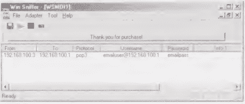

公共接入无线网络（热点），例如机场或大都市地区中的那些网络，是用户攻击中最脆弱的区域之一。那些不熟悉通过点对点攻击获取其登录信息有多么容易的用户，会无意中查看电子邮件或访问其公司网络——甚至 VoIP 系统——最终将其账户访问权限拱手交给黑客。一旦黑客获得了公司账户的有效登录凭据，他们就有充分的条件进一步尝试访问网络，以定位更敏感的信息。

**图18-2**

从不设防的用户那里获取密码

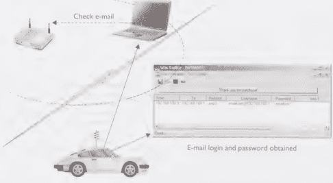

### Revelation

在 Windows 系统上，可用于发现密码的工具是 Revelation。该程序允许你拖动光标到任意登录对话框或网页中的密码字段上，从而显示密码。当然，要使用此工具，用户必须让他的计算机保持登录状态，并且你需要具备运行该工具的能力。然而，如今用户在网页表单中保存密码如此频繁，此工具可以在许多情况下显示密码。为防止此问题，你可以通过 Windows 组策略禁止该工具运行，或禁止用户保存密码。这两种方法都不能提供完全保护，但可以提供额外保护，并使攻击者更难下手。例如，攻击者必须使用十六进制编辑器修改二进制文件（revelation.exe）才能绕过 Windows Server 2003 中基于哈希的组策略（Windows XP 客户端也支持）。Revelation 可用于有线和无线系统，以发现密码。

### Ettercap

由 Alberto Ornaghi 和 Marco Valleri 编写的 Ettercap 是当今最强大的密码捕获和审计工具之一。Ettercap 几乎支持所有操作系统平台，可以在 http://ettercap.sourceforge.net 找到。即使是在交换环境中，Ettercap 也能收集数据，这远远超出了大多数其他审计工具的能力。Ettercap 使用菜单式用户界面，使其易于使用。Ettercap 提供的一些功能包括：

- **向已建立的连接中注入字符：** 用户可以维持实时连接的同时，向服务器注入字符（模拟命令）或向客户端注入字符（模拟回复）。
- **SSH1 支持：** 用户可以分析用户名和密码，甚至 SSH1 连接的数据。Ettercap 是第一款能够以全双工模式分析 SSH 连接的软件。
- **HTTPS 支持：** 即使连接是通过代理建立的，用户也可以嗅探 HTTP-SSL 数据。
- **通过 GRE 隧道的远程流量：** 用户可以从远程路由器通过 GRE 隧道分析远程流量。
- **PPTP 代理：** 用户可以对 PPTP 隧道执行中间人攻击。
- **插件支持：** 用户可以使用 Ettercap 的 API 创建插件。基础包中包含许多插件。
- **密码收集器，支持：** Telnet、FTP、POP、RLogin、SSH1、ICQ、SMB、MySQL、HTTP、NNTP、X11、Napster、IRC、RIP、BGP、SOCKS 5、IMAP4、VNC、LDAP、NFS、SNMP、Half-Life、Quake 3、MSN 和 YMSG。
- **数据包过滤/丢弃：** 用户可以配置过滤器，在 TCP 或 UDP 载荷中搜索特定字符串（甚至十六进制），并将其替换为新字符串或丢弃整个数据包。
- **操作系统指纹识别：** 用户可以识别目标主机的操作系统及其网络适配器的指纹。
- **终止连接：** 从连接列表中，用户可以终止他或她选择的所有连接。
- **LAN 被动扫描：** 用户可以获取以下任何信息：LAN 中的主机、开放端口、服务版本、主机类型（网关、路由器或简单主机）以及估计距离（以跳数计）。
- **检查其他投毒者：** Ettercap 能够主动或被动地发现 LAN 上的其他投毒者。这些设备已篡改 ARP 缓存，使其指向不当设备，这被称为 ARP 投毒。
- **将嗅探到的数据绑定到本地端口：** 用户可以连接到客户端上的端口并解码协议或注入数据。

除了这些功能，较新版本的 Ettercap 还支持无线数据包的内部 WEP 解密。当你提供 WEP 密钥（你必须知道或事先已破解该密钥）时，数据包可以即时解密，供存储和稍后查看。

### L0phtCrack

在许多情况下，操作系统在应用层实现密码身份验证和加密。Microsoft Windows 文件共享和 NetLogon 进程就是这种情况。Microsoft 多年来（以及经过多个操作系统和服务包升级）使用的质询/响应机制已经从 LM（弱）变为 NTLM（中）再到 NTLMv2（强）。在 NTLMv2 之前，像 L0phtCrack 这样的工具可以轻松破解这些哈希值。正确配置 Windows 操作系统以使用 NTLMv2 而不是较弱的版本非常重要。此过程必须手动完成，有关说明可在 www.technet.com 找到。

Windows 2000 Service Pack 3 引入了一项名为“SysKey”的新功能，“System Key”的简称。此功能通过运行 syskey.exe 可执行文件实现，它加密 SAM，使得 L0phtCrack 无法像加密前那样从中提取密码。L0phtCrack 能够让审计员知道他们正在审计一个已加密的 SAM，从而避免审计员浪费时间尝试提取密码。

> **虽然 L0phtCrack 仍可用于密码审计，但 Symantec 于 2004 年收购了 @stake，并停止了对 L0phtCrack 版本 5（LC5）及所有其他版本的支持。他们以美国政府对出口的法规管制作为停止支持的原因。**

### 现场实战

### LRC

Proxim Orinoco PC 卡将 WEP 密钥的加密哈希存储在 Windows 注册表中。Lucent Registry Crack（LRC）是一个简单的命令行实用程序，用于解密这些加密值。问题在于如何从另一台计算机获取这些值——即攻击者想要获取已安装 WEP 密钥的那台计算机。此任务通过远程注册表连接完成。攻击者将使用自己计算机上 Windows 注册表编辑器中的工具，与目标计算机建立远程注册表连接。一旦黑客连接成功，他只需知道密钥在注册表中的位置，即可将其复制并粘贴到自己计算机上的文本文档中。这些加密字符串按配置文件存储，如图18-4所示。

然后，可以针对此加密字符串运行 LRC 以生成 WEP 密钥。解密过程大约需要 1-2 秒。一旦攻击者获得 WEP 密钥，将其插入自己的计算机即可访问网络，这就变得很简单。因此，无线终端用户应实施点对点攻击防护措施，例如个人防火墙软件或 IPSec 策略。LRC 的操作过程如图18-5所示。

### 加密破解

Windows 2000 及更高版本操作系统中的加密文件系统（EFS）是存储加密的一个示例。它也是加密系统中潜在弱点的示例。EFS 容易受到密钥存储攻击。

在任何加密系统中，最困难的事情是保护密钥存储。问题出在用于访问密钥的方法上。如果用户需要解密她之前加密的数据，她必须能够检索加密密钥。EFS 使用用户的公钥加密文件加密密钥（FEK）。此过程意味着需要用户的私钥来解密 FEK，然后用 FEK 来解密文件。问题是，用户如何访问她的私钥？答案很简单：自动访问。

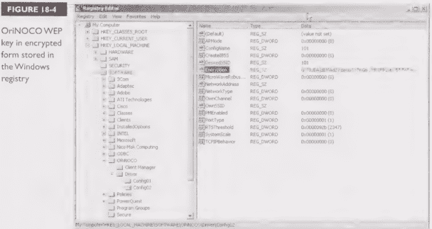

默认情况下，当用户打开由 EFS 加密的文件时，会自动检索用户的私钥，然后解密 FEK，再解密数据文件。只要用户已登录，这一切都会自动发生。此过程揭示了潜在弱点：用户的身份验证凭据。

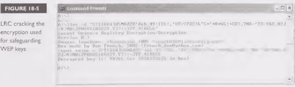


EFS使用可靠的加密算法，密钥长度足够；然而，用户的密码可能非常弱，这一现实给系统引入了重要漏洞。如果攻击者能够猜出用户密码，那么该用户加密的所有数据在许多（即使不是大多数）场景中都将可被攻击者访问。然而，这并不是EFS独有的问题。如果用户部署非常流行的Pretty Good Privacy（PGP）桌面加密系统并使用弱口令，数据可能同样脆弱。

### VoIP窃听

VoIP中的窃听不同于传统数据网络中的窃听，但基本概念仍然相同。在数据网络中，你捕获数据包并重组数据文件。在VoIP网络中，必须截获呼叫的信令及相关媒体流，然后将这些数据重组为音频流或文件以供收听。信令消息使用独立于媒体本身的网络协议（即UDP或TCP）和端口。媒体流通常通过UDP/RTP承载。该过程基本包括三个步骤：

1. 捕获并解码RTP数据包。
2. 重建会话。
3. 将重建的会话保存为音频文件，或从应用中播放该会话。

这三个步骤均可在Wireshark（一款免费协议分析器）中执行。要防范此类攻击，必须使用加密，或采用禁止网络嗅探的网络拓扑和安全机制（例如得到妥善保护的交换式基础设施）；不过，加密是最佳选择。加密最佳，因为窃听是被动的且极难检测。

### 社会工程

社会工程定义为通过操纵人际或社会互动，说服某人向你提供或告知其本不应提供或告知你的信息。成功的社交工程攻击之所以发生，是因为目标可能不了解组织的信息安全政策，或被入侵者的知识、专长或态度所威慑。社交工程是入侵任何IT基础设施最危险且最成功的方法之一。如果攻破WEP让黑客束手无策，黑客可能诱骗有权持有WEP密钥的员工泄露该信息。一旦黑客获得WEP密钥，就会将其输入自己的计算机，并使用可用的监控工具或协议分析器实时捕获敏感数据，就好像没有安全措施一样。因此，社交工程可能使即使最先进的安全解决方案也形同虚设。

黑客并不总像电影中描绘的那样：在地下室黑暗房间里抽烟、摄入大量咖啡因的青少年，拥有多条高速互联网连接、大声的音乐和大量空闲时间。很多时候，最成功且破坏性最大的网络入侵是在光天化日之下，通过某人像企业主人一样走进企业施展巧妙手段完成的。同样，受雇的专业安全审计员也应公开尝试入侵，作为测试安全策略遵循情况的一种策略。

此类攻击有一些众所周知的目标：

- 帮助台
- 承包商
- 员工

**帮助台** 帮助台用于协助那些在计算机或网络某方面需要帮助的人。在许多情况下，当电话另一端的人似乎知道自己需要什么时，帮助台不提供问题答案会显得很尴尬。培训帮助台人员在某些情况下不要乐于助人并非易事；然而，此类教育对企业网络安全至关重要。应培训帮助台人员确切了解哪些与无线网络相关的信息在未获适当授权或未遵循安全策略规定的特定流程时不应透露。可能被标记为排除项的信息包括：

- 接入点的SSID
- WEP密钥
- 基础设施设备的物理位置
- 用于网络访问和服务的用户名和密码（即电子邮件）
- 基础设施设备的密码和SNMP字符串
- 正在使用的VoIP解决方案

审计员应（黑客也会）在与帮助台人员打交道时使用两种特定策略：

- 强硬但专业的语言
- 装傻

这两种方法效果相同：获取所请求的信息。帮助台人员明白，他们的工作是帮助人们解决问题。他们也明白，如果客户对其获得的服务不满意，经理不会高兴。通过威胁与经理交谈，社交工程师可以让帮助台人员交出所请求的信息，只为安抚并平息社交工程师。有些人在面对个人冲突时天生缺乏安全感，有些人容易被任何权威语气吓住。这两种情况都可被社交工程师利用。必须通过培训、纪律和反复遵循书面程序来克服人为因素。

装傻是许多社交工程师的最爱。帮助台人员通常在发现与其交谈的人懂得很少时会放松警惕并不再注意。当“愚笨”客户过分礼貌并感谢帮助时，这种情况会加剧。帮助台人员必须始终警惕这种策略，这一点很重要。社交工程师可能反复打电话，希望与不同代表交谈，并对每个人采取不同方法。

**承包商** IT承包商如今在许多企业司空见惯，但很少（如果有的话）接受组织安全培训。很少有人拿到公司安全政策副本或被要求签署隐私协议。因此，且由于IT承包商像帮助台人员一样是来帮忙的，IT承包商可能成为社交工程师的特别好目标。承包商了解网络资源的具体细节，因为他们经常在现场设计或维修网络。为了对客户有帮助，承包商经常向无权获得此类信息的人透露过多信息。因此，建议采用依赖多因素认证的强安全解决方案。

**员工** 由于人们每天在工作地点彼此相处很多小时，他们经常分享私人信息——例如网络登录信息。同样常见的是，在键盘下和显示器上看到相同的登录信息写在便利贴上。另一个问题是大多数计算机用户并不精通计算机网络或安全。因此，他们可能无法识别间谍软件、黑客尝试或社会工程。

VoIP技术对许多组织来说仍然非常新。未接受网络安全教育的员工可能没有意识到通过网络的未授权访问可能对组织和他们个人造成的危险。具体而言，使用网络的非技术员工应意识到，如果设备使用无线网络，其计算机可能在工作时、在家或在任何公共无线网络上以点对点方式受到攻击。社交工程师利用所有这些事实，甚至编造精心设计的故事，几乎可以骗过任何未专门训练识别社交工程攻击的人。

与社会工程类似的是肩窥。肩窥是一种非技术的信息捕获方式。顾名思义，你只需从用户肩后观看，看看能收集到什么信息。通常，用户输入密码的速度足够慢，你能看到他们在输入什么。其他时候，你能看到配置屏幕，其中包含WLAN的SSID信息、使用WPA-Personal时的预共享密钥、VoIP配置设置、加密密码等。

### 零日漏洞攻击

最终，必须及时了解可能对网络构成威胁的各种漏洞。你可能注意到本章到目前为止大多没有专门针对VoIP网络。为什么？很简单：VoIP网络容易受到与传统有线和无线网络相同的漏洞利用。如果你已熟悉网络安全，这确实使你的工作更容易些；然而，必须记住，安全技术的影响可能对VoIP网络有害。例如，为VoIP呼叫实施加密可能足以将网络延迟提高到不可接受的水平。在安全与性能之间取得平衡是VoIP网络中的重要问题。“零日漏洞攻击”一词指的是当前使用的最新攻击方法。你需要经常访问本章提到的网站，以保持知识更新。


### VoIP 特有的攻击手段

虽然 VoIP 网络与其他数据网络一样容易遭受相同的攻击，但认为在 VoIP 实现中只需防范传统的网络攻击则是危险的。确实，大多数攻击都是典型的网络攻击；然而，VoIP 网络和设备还容易受到一些特定攻击。

服务盗用是需要重点考虑的问题。如果攻击者能以合法客户端的身份接入你的 VoIP 网络，她就可以通过你的 PSTN 中继拨打长途电话。这可能给合法用户带来性能问题，并增加你的电话服务成本。

语音垃圾信息是另一个潜在问题。Vishing（与其近亲——网络钓鱼类似）被用来从毫无戒备的 VoIP 用户那里收集信息。攻击者可能伪造其来电显示信息，使受害者相信来电者的可信度。归根结底，攻击者是在进行社会工程学攻击，但她利用的是许多 VoIP 实现的弱点。

除了 VoIP 实现中较为独特的攻击方法外，还有一些专门用于攻击 VoIP 协议和系统的黑客工具。表 18-1 列出了许多此类工具及其功能。

**表 18-1 — VoIP 攻击工具**

| 攻击工具 | 功能 |
|---|---|
| SIP-scan | 该工具可以扫描一个 IP 地址范围，查找 SIP 设备。 |
| SIP-kill | 一种用于小规模 DoS 攻击的工具，可以终止 SIP 会话。 |
| SIPcrack | 该工具包含两个程序：SIPdump 和 SIPcrack。SIPdump 从网络中嗅探 SIP 登录信息，SIPcrack 对密码进行暴力破解。 |
| VoIPong | 从线路中嗅探所有 VoIP 通话，并自动将每次通话保存为声音文件。支持 SIP 和 H.323。只能解码 G.711 通话。 |
| SIPp | 用于 SIP 协议的测试工具和流量生成器。它可用于连接备用的 CID 信息，并简单地监控 SIP 流量统计。 |

### 安全解决方案

如果你查看计算机安全研究所的年度安全调查，你会注意到一个令人震惊的事实：每年都有很大比例的受访者表示其组织内未发生安全事件。我想，如果事件被定义为“已造成已知损失的安全漏洞”，你确实可以这样回答；然而，如果去掉“已知”一词，将其定义为“造成损失的安全漏洞”，在我看来，对调查问题的回答只能是“是”或“不确定”。如果我确信没有发生安全事件，那我可能并不了解安全。

这里真正的问题似乎与你对“事件”一词所选择的定义有关。“事件”一词通常指单一或独立的事件，并且没有任何迹象表明该事件被任何人实际观察到、分析或检测到。许多安全资源将事件定义为对系统或数据产生不利影响的已检测到的安全事件。这个定义并不有效，因为事件可能在未被检测到的情况下发生。因此，我更倾向于使用 SANS.org 安全术语表中的定义：“信息系统或网络中发生的不利网络事件，或者此类事件发生的威胁。”

这种思考源自布鲁斯·施奈尔的另一次引述，他是世界上最顶尖的安全专家之一，他说：“不存在绝对安全这种东西。”你可以换个角度改写这句话：“如果你的系统完全安全，你的用户将无法使用它。”如果你决定实施一条禁止发往 TCP 端口 21 的流量的防火墙过滤规则，那么你刚刚让用户无法通过该防火墙连接到 FTP 服务器。这个决定迫使你做出权衡：你不会直接受到 FTP 服务器攻击，但你也无法通过防火墙使用 FTP 服务器。

有了这种理解，你将探索可以使用的各种安全解决方案。你将了解它们如何帮助保护你的融合网络，但与其他许多书籍不同的是，你还将了解它们可能对网络产生负面影响的现实情况。换句话说，你将了解其中的权衡。这些权衡在 VoIP 网络中变得非常重要，因为性能是成功的关键。牢记以下概念，你将在网络安全总体和 VoIP 安全特定方面做出更好的决策：

- 一个系统不可能在绝对安全的同时，仍然为用户提供有用的功能。
- 无论你是否检测到，事件都会发生。
- 更高的安全要求通常会导致可用性降低或性能降低，或者两者兼而有之。

### 安全设计的概念与组件

我们将从四个角度来审视安全设计与实现。

- 网络设计与安全
- 边界安全解决方案
- 连接解决方案
- 安全监控

除了这些类别之外，我们还将审视一些特定的 VoIP 工具和技术，它们为融合网络中的安全问题提供了解决方案。

### 网络设计与安全

安全应该被设计到系统或网络中，而不应该是事后才想到的。当安全从一开始就被设计到实现中时，你的网络将更加安全。而不是用机制来构成银行金库的整体。此外，许多金库是分层的：一道门打开金库，较小的门可能打开金库内的隔间。

安全设计就是要构建系统并实施有助于保护有价值资产的层次。当你设计一个安全系统时，你是在设计一个独特的系统，其目的是阻止某些行为——攻击——得逞。

你正在设计一个系统来抵御智能的、故意的和恶意的攻击。这一过程与安全管理截然不同，安全管理是针对随机发生的意外问题进行防护。安全攻击可能是故意的，并且可能在攻击者拥有最大机会的特选时间发生。

两个关键原则有助于安全设计：分层安全和隔离。分层安全意味着在攻击点和有价值资源之间使用不止一种保护机制。分层安全有时被称为“纵深防御”。隔离提供了一组用户或服务与另一组用户或服务之间的虚拟或字面上的分离。

### 隔离区与周边网络

隔离区（DMZ）是一个从军事行动中借用的概念。它定义了网络中不如其他部分安全的一部分。DMZ 通常位于专用网络与互联网或其他外部网络之间。DMZ 也被称为周边网络，因为它们存在于专用网络的边缘。DMZ 是互联网服务服务器的位置，也是进入内部或专用网络时的检查和身份验证点。

大多数组织会选择在互联网和 DMZ 之间放置一台防火墙。通常还会在 DMZ 和专用网络之间放置另一台防火墙。这种双防火墙实现允许在从互联网进入 DMZ 时减少限制，并在从 DMZ 进入专用网络时增加限制。图 18-6 提供了一个 DMZ 或周边网络的示例。

**图 18-6**
隔离区

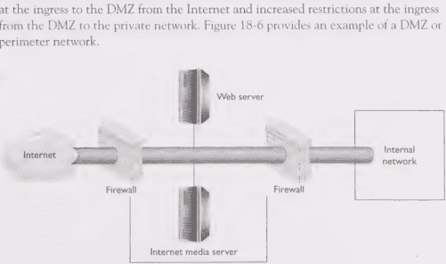

**表 18-2 防火墙类型**

| 防火墙类型 | 描述 |
| --- | --- |
| 包过滤 | 一种评估接收到的数据包并根据规则确定适当操作的防火墙。 |
| 状态检测 | 一种能够消除源自网络外部但不属于当前会话或连接的数据包的防火墙。 |
| 应用层防火墙 | 一种可以根据应用类型过滤通信，并且无论使用什么端口（TCP 或 UDP）都能识别应用的防火墙。也称为代理防火墙。 |
| 桌面防火墙 | 桌面防火墙运行在连接到网络的客户端计算机上。每台计算机都运行本地防火墙副本，并且可能有不同的规则。 |

> *一种较新的安全方法是统一威胁管理（UTM）方法。UTM 设备和应用提供传统的防火墙功能，同时还实现垃圾邮件过滤、病毒检测和入侵检测。由于大多数 UTM 解决方案是单箱解决方案，因此消除了实施多个安全设备的复杂性。*

**代理** 代理服务器充当两个通信设备或网络之间的中介。代理服务器允许缓存网页，以提高浏览效率，并过滤网页内容。组织经常使用代理服务器来禁止访问特定网站，而且许多组织不允许直接访问互联网。在融合网络中，如果代理服务器不支持 VoIP 协议，它们可能会给 VoIP 通信带来问题。因此，许多组织允许需要穿越互联网的 VoIP 通信绕过代理，并且仅将代理服务器用于网页浏览。

**网络地址转换和端口地址转换** 你可以决定实施私有 IPv4 寻址，而不是为网络中的每部 VoIP 电话或台式计算机提供公共 IP 地址。以下地址保留供内部专用使用：

- 10.x.x.x
- 172.16.x.x–172.31.x.x
- 192.168.x.x


例如，你可以使用从 10.10.10.1 到 10.10.10.254 的 IP 地址来实现一个 254 节点的网络。使用这些 IP 地址的设备将无法在互联网上通信。相反，它们需要通过能够将私有地址转换为互联网地址的设备进行通信。*网络地址转换（NAT）*服务器执行此操作。NAT 服务器位于你的网络与互联网之间，或者在某些情况下位于你的网络与 DMZ 之间。内部用户与 NAT 服务器通信，NAT 服务器为用户维护其与所请求互联网位置之间的会话。NAT 是 IPv4 继续作为最流行通信协议的主要原因之一。如果没有 NAT 或类似技术，随着连接到互联网的节点爆炸式增长，我们将被迫升级到 IPv6。

不要把 NAT 与 PAT 混淆。*端口地址转换（PAT）*与 NAT 非常不同。NAT 侧重于管理 IP 地址转换，而 PAT 既可以执行 IP 地址转换，也可以执行第 4 层端口转换。PAT 服务器通常只有一个面向互联网的 IP 地址，所有从网络发出的通信看起来都源自该地址。NAT 服务器可能有多个面向互联网的 IP 地址。使用 NAT 时，面向互联网的地址可以在会话持续期间分配给某个内部 IP 地址，也可以以轮询方式使用。使用 PAT 时，单个 IP 地址用于出站通信，而入站通信会根据 PAT 路由表自动重定向到相应的内部 IP 地址。

由于 VoIP 协议在通话中使用两个通信通道，NAT 和 PAT 服务器可能引入问题。NAT 服务器通常可以发起呼叫，但音频可能只能单向工作，或者音频可能完全无法工作。这种故障是由于通过 NAT 设备通信造成的。NAT 设备不知道这两个流（信令和音频）属于同一通信。你可以通过几种方式解决此问题：

- 不使用 NAT 或 PAT。
- 通过 NAT 设备向远程网络实施 IP 隧道，并让 VoIP 连接通过该隧道运行。这会引入额外延迟。
- 使用支持 VoIP 的 NAT 或 PAT 设备。

### 连接解决方案

在融合网络上应实施的关键安全解决方案之一是安全连接。安全连接包括对网络的身份验证、网络通信的机密性和审计。

### 身份验证

安全策略的重要组成部分之一是身份管理系统。该系统为通常称为用户账户的身份对象提供存储位置。身份管理系统还提供一种或多种连接到该存储位置并证明身份所有权的方法——这一过程称为身份验证。用户账户是用于标识用户并归用户所有的对象。这些对象提供供身份验证系统和网络操作系统使用的属性。除用户账户外，证书、生物识别、令牌和其他凭证也可用于身份验证和身份管理。

如果不清楚理解身份验证和身份管理，你将难以安装安全的融合网络。身份验证系统既有基本的也有高级的，许多系统具备同时支持这两种类型的能力。例如，Windows Server 系统通过 Internet Authentication Service（微软的 RADIUS 实现）支持高级身份验证机制，并支持使用简单密码对 Active Directory 数据库进行基本身份验证。这两种方法都有其正当用途，并且在某些场景下最为适用。确定哪种方法适合你的场景是实现安全身份验证的第一步。

除了选择高级或基本身份验证方法之外，你还必须确定要对谁进行身份验证。你只想对客户端进行身份验证吗？你还需要验证身份验证服务器吗？当客户端和身份验证服务器或身份验证设备都经过身份验证时，这称为双向身份验证。双向身份验证有助于防止将恶意身份验证设备引入你的网络。仅客户端身份验证使网络“感觉”安全，而双向身份验证使客户端和网络双方都能对网络抱有信任和信心。

不应将身份验证与授权混淆。身份验证可以定义为证明一个人或对象确实是他、她或它所声称的人或物。授权定义为允许一个人或对象访问资源。授权假定身份已经过身份验证。如果身份验证可以被欺骗或冒充，授权方案就会失败。由此可见，为什么身份验证是网络和信息安全中如此不可或缺且重要的一部分。

高级身份验证系统通常使用比基本身份验证系统更强的凭证，并对这些凭证提供更好的保护。凭证的强度和保护程度取决于利用它所需付出的努力。与受生物识别保护的凭证相比，受密码保护的凭证通常被认为较弱。在某些情况下，这是一种误解，因为身份验证的强度实际上取决于身份验证信息（凭证和所有权证明）如何通过网络发送。如果你实施生物识别系统，例如拇指扫描仪，而客户端以明文形式将凭证和所有权证明（根据用户拇指上的数据点生成的唯一编号）发送到服务器，那么它并不比标准的基于密码的系统更安全；不过，我不知道有任何生物识别身份验证系统会以明文发送身份验证数据。

提供真正强身份验证路径的关键要素是对用户凭证进行加密或哈希，或者至少对身份证明信息进行加密或哈希。这可以通过虚拟专用网络（VPN）技术或设计良好的身份验证系统来实现。设计良好的身份验证系统的一个示例是采用强 EAP 类型的 802.1X。802.1X 和 EAP 类型用于保护有线和无线连接。

你一生中每天都在使用身份验证。例如，当你参加研讨会时，演讲者说他是其演讲主题的专家，你会使用身份验证机制来核实这一信息。换句话说，你倾听他传达的信息，并用它来判断他是否真的是专家。此外，假设有人走到你面前说：“嗨，我叫比尔，我个子很高。”你会看着他，将他的身高与你认为的高个子身高进行比较，并验证他是否真的很高。如果按你的标准他并不高，他就会在你这里失去可信度。

还记得“credentials”这个词吗？想想其他重要的“cred”单词：credit（信用）、credibility（可信度）和 credentials（凭证）。你看出它们之间都有联系了吗？它们都与拥有某种证明有关。当你有良好的信用时，你就有证明自己值得信赖、能够偿还债务。当你有可信度时，你就有证明自己真实、有说服力和有活力。当你有凭证时，你拥有能证明你的技能或身份的物品或经历。身份验证的结果是对凭证进行验证。

高级身份验证比基本身份验证更安全，因为高级机制用于保护用户凭证。这通常意味着保护用户名和密码对，但也可能包括保护用户/证书组合、用户/机器组合或用于标识特定用户的任何其他用户/对象组合。除了高级身份验证系统提供的额外保护之外，使用基于 802.1X 的系统时，你还能获得基于标准的技术带来的好处。这意味着来自许多不同供应商的硬件很可能支持该身份验证过程。有时需要升级驱动程序或固件，但通常可以应用补丁来实施身份验证机制。


为提高安全性，应避免使用基本身份验证机制，例如密码身份验证协议（PAP），该协议会以明文形式通过网络发送密码。基本身份验证协议的另一个示例是对 Web 服务器使用的基本身份验证。这种身份验证机制是 HTTP 标准的一部分，但密码会使用可逆加密算法通过网络发送。请使用能更好地保护凭据的身份验证系统，这将大大有助于构建更安全的网络。

有许多不同的凭据解决方案可用于保护网络。选择适合自身需求的系统非常重要。在此过程中，您需要考虑凭据解决方案的主要特性，以及是否需要多因素身份验证系统。此外，您还应了解可用的各种凭据类型。

凭据解决方案应提供与您的安全需求相称的用户或计算机身份识别手段。您不会希望选择的凭据解决方案给用户带来不必要的负担，并且其（时间和金钱）成本高于您所保护信息资产的价值。您应评估所选身份验证解决方案是否提供冗余，以及与 Active Directory 或 Lotus Notes 等其他系统集成。系统还应支持所需的凭据类型，例如智能卡和/或生物识别。此外，选择凭据解决方案时，请考虑以下因素：

- 用于保护凭据的方法
- 凭据的存储位置
- 凭据存储区的访问方法

如果身份验证系统以明文发送凭据，那么实际上就不存在保护方法。高级身份验证系统将通过加密用户凭据或从一开始就避免传输实际凭据来保护用户凭据。许多系统不传输实际凭据，而是使用哈希过程至少对密码进行编码。对密码进行哈希意味着密码经过单向算法处理，生成一个固定长度的数字。这个数字称为密码的哈希值或消息摘要。哈希值存储在身份验证数据库中，并可在质询/响应身份验证系统中用作质询文本的加密密钥。

凭据（包括用户名和密码（或哈希）或证书）必须存储在某个位置。该存储位置应当既安全又能及时响应。它必须安全，以防范暴力破解攻击；并且必须及时响应服务身份验证请求。证书通常存储在集中式证书存储区（称为证书服务器或证书颁发机构）中，同时也存储在将证书用于身份验证的客户端上。这两个位置都必须安全，否则使用证书的优势就会被削弱。除标准证书存储区外，用户还可以选择将证书备份到磁盘。这些备份通常受密码保护，但如果对介质存储进行足够长时间的暴力破解攻击，就可能泄露证书。因此，用户应在这方面接受充分教育，并了解此类备份的存在所带来的脆弱性。

访问方法因身份验证系统和存储方法而异，但有一些标准定义了凭据访问方法。一个示例是 LDAP（轻量级目录访问协议）。LDAP 是访问目录服务信息的标准方法。此类信息可以包含许多对象，但通常包含身份验证凭据。LDAP 由 Lotus Notes、Novell 的目录服务和 Microsoft 的 Active Directory 等使用，也可以被它们使用。

有时，一种身份验证类型并不足够。在这些情况下，可以使用多因素身份验证。多因素身份验证是一种使用多组凭据的身份验证形式。多因素身份验证流程的一个示例是同时使用密码和拇指扫描仪。通常，用户会将拇指放在拇指扫描仪上，然后系统会提示输入密码或 PIN（个人识别码）码。密码可用于网络身份验证，也可以仅在拇指数据用于网络身份验证之前用于本地身份验证。然而，在大多数情况下，密码和拇指数据用于向本地计算机进行身份验证，然后再向网络进行身份验证，或者仅向网络进行身份验证。多因素身份验证的一个常见示例是您的 ATM 卡。您持有该卡，并且知道 PIN（您拥有的东西和您知道的东西）。

常见的凭据类型有很多。它们包括：

- 用户名和密码
- 证书
- PACs（特权属性证书）
- 生物识别
- 令牌

用户名和密码对是最流行的凭据类型。大多数网络操作系统都使用它们，包括 Novell NetWare、Linux、Unix 和 Windows。由于密码选择涉及人为因素，它们常常带来虚假的安全感。这是因为所选择的密码通常过于薄弱，无法抵御字典攻击，并且根据密码长度，当然也无法抵御暴力破解攻击。此外，密码经常被写下来或以纯文本文件形式存储在系统上，而且很少更改，导致攻击机会窗口更长。

用户名和密码对的替代方案是证书。要在整个组织中使用证书，必须存在证书颁发机构。该证书颁发机构可以由组织运营，也可以由独立的第三方运营。无论哪种情况，由于需要额外的服务器甚至服务器层级结构，成本往往高得令广泛使用望而却步。中小型组织通常因实施成本而选择仅服务器证书，或者根本不使用证书。完整的 PKI（公钥基础设施）通常由多个证书颁发机构组成。每个证书颁发机构都是一台服务器或一个服务器集群。PKI 是用于生成、续订、分发、验证和销毁用户及计算机证书的机制。

特权属性证书（PAC）由 Windows 2000 及更高版本（Windows XP 和 Windows Server 2003 以及更新版本）中的 Kerberos 身份验证协议使用。PAC 包含用户的授权数据，并包括组成员身份和用户权限。这一特性意味着用户的分组分配和权限分配会作为票据授予票据（TGT）的一部分进行传输——这是 Kerberos 身份验证协议的一项特性。

另一种身份验证凭据是生物识别。基于生物识别的身份验证利用每个人的独特性，并将其用于身份验证目的。例如，您的拇指可以作为唯一标识符，您的视网膜也可以。对于生物识别凭据而言，平衡成本与安全非常重要。虽然毛发分析可用于对用户进行身份验证，但涉及的成本和时间仍然过高，不适合实际使用。如今，拇指扫描仪和视网膜扫描仪都越来越流行。

两种常见的身份验证令牌类型是基于软件的和基于硬件的。基于软件的身份验证令牌系统通常运行在 PDA 或手机上，因此用户可以在移动设备上启动应用程序并获取身份验证码。该代码通常与密码或 PIN 一起使用，实质上创建了一个双因素身份验证系统。基于硬件的令牌系统通常提供一个钥匙扣大小的设备，按下按钮即可显示当前身份验证码。该代码同样与密码或 PIN 一起使用。大多数令牌系统基于时间同步（或其他某个同步点）算法工作，在软件系统或硬件设备中生成正确的代码。这意味着今天有效的代码明天将无法使用，从而提供更高的安全性。


### 虚拟专用网络

虚拟专用网络（VPN）是通过在公共网络上两个端点之间创建加密隧道来实现的。最初为公共网络使用而引入的相同技术，如今也用于专用网络。由于 VPN 既用于公共网络也用于专用网络，因此“在公共网络上运行”这一限定条件已不再必要。如今，如果连接使用身份验证和加密等 VPN 技术，就被视为 VPN 连接，而这是安全 VPN 解决方案的两项要求。图 18-7 展示了跨互联网的 VPN 连接示例实现。在这种情况下，它是站点到站点 VPN。站点之间的所有流量都通过该 VPN 连接进行路由。

除了站点到站点 VPN 连接之外，您还可以选择实施以下任意 VPN 解决方案：

- **设备到设备** — 这些 VPN 连接直接在网络上的两个设备之间建立，以提供额外的安全性。
- **远程客户端连接** — 远程用户可以使用 VPN 客户端程序跨互联网连接到组织的网络。
- **无线安全 VPN** — 当无线客户端连接到不安全的公共热点时，VPN 用于无线安全。

最后一项需要进一步解释。用户可能将笔记本电脑连接到不使用加密的咖啡店热点。接下来，用户可以跨互联网启动 VPN 客户端连接，连接到其组织的总部。现在，所有互联网流量都将通过 VPN 连接路由到总部，然后从总部再路由回互联网。当没有实际可用的无线安全措施时，该解决方案可防止无线窃听。VPN 建立后，用户还可以启动软件 VoIP 应用并发起通话，而不必担心有人监听通话。

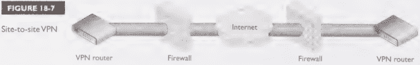

可用的 VPN 技术很多，但最常见的两种解决方案是点对点隧道协议（PPTP）和带 IPSec 的第二层隧道协议（L2TP）。后者被认为最安全。关键决策因素包括 VPN 解决方案使用的身份验证方法和加密方式。无论加密强度如何，弱身份验证都等于弱 VPN。无论身份验证强度如何，弱加密都等于弱 VPN。必须同时具备这两项强因素，VPN 解决方案才被视为安全。因此，不建议使用早期的 PPTP 实现，甚至近期的实现也被认为不如 L2TP 与 IPSec 的可靠实现安全。这种差异部分是因为 L2TP 和 IPSec 为您提供了许多身份验证和加密选项。与 PPTP 相比，您可以更精细地选择所需的安全级别。

### 加密

VPN 的基础是加密。即使用户已通过身份验证，如果未使用加密，您仍然没有 VPN。例如，您可以在两个端点之间创建不使用加密的 L2TP 隧道。这将形成隧道通信，但它不是 VPN。在大多数情况下，IPSec 用于在 L2TP/IPSec VPN 解决方案中为 L2TP 隧道建立加密。

加密是对信息进行编码的过程，以便在给定适当算法和输入的情况下可以将其解码。大多数加密系统使用一种算法，以密钥和一些数据作为输入。加密时，系统将使用密钥和数据生成密文。解密时，系统将使用密文和密钥重新生成原始数据。考虑以下算法：

3 × k + D × k = 密文

其中 *k* 是加密密钥，*D* 是原始数据。该算法可用于加密任何十进制数。例如，假设您要用密钥 7 加密数字 12。该算法如下所示：

3 × 7 + 12 × 7 = 105

只要应用正确的算法并知道正确的密钥，生成的密文 105 就可以解密以恢复原始数据。以下是解密算法：

(密文 - 3 × k) / k = 原始数据

对于我们的示例，得到的算法如下所示：

(105 - 3 × 7) / 7 = 12

虽然这不是一个实际实现的加密算法（实际算法是二进制的，并且复杂得多），但它展示了如何使用同一算法配合不同加密密钥来加密数据。拥有算法并不会自动使您能够确定地解密数据。您必须知道用于加密的密钥。

存在许多加密标准。表 18-3 列出了最常见的加密算法。

### VoIP 加密解决方案

加密解决方案将因您实施的 VoIP 技术而异。SIP 使用 IETF 的标准，H.323 使用 ITU 的标准。表 18-4 列出了称为 H.235 系列的 ITU 规范。当需要安全性时，这些标准用于 H.323 VoIP 网络。H.323 第 6 版及该级别 H.235 标准的一项重大增强是加入了 SRTP。SRTP 是安全实时传输协议，它提供与 RTP 相同的功能，同时增加了安全通信。

SIP 使用 IETF 创建的标准。这些标准为 VoIP 实现了现有的安全标准。这些标准包括传输层安全（TLS）、安全/多用途互联网邮件扩展（S/MIME）和安全实时传输协议（SRTP）。SIP 本质上依赖 OSI 模型中 VoIP 通信之下现有的安全层，而不是在 VoIP 协议本身内部实现安全。TLS 用于保护信令，SRTP 用于保护语音载荷。此外，S/MIME 可用于保护信令和载荷。

**表 18-3** 加密标准

| 加密算法 | 类型 | 应用 |
|---|---|---|
| 数据加密标准（DES） | 块 | 数据加密；通信加密。 |
| 高级加密标准（AES） | 块 | 数据加密；通信加密。 |
| 三重 DES（3DES） | 块 | 数据加密；通信加密。用于在无法实现 AES 的系统上提高 DES 的强度。 |
| RC4 | 流 | 数据加密；通信加密。 |
| 消息摘要 5（MD5） | 哈希 | 数字签名；密码存储；数据完整性。 |
| 安全哈希算法 1（SHA-1） | 哈希 | 数字签名；密码存储；数据完整性。 |

**表 18-4 — 使用 H.235 的 H.323 安全解决方案**

| 标准 | 定义 |
|---|---|
| 235.1 | 基本或基线安全配置文件。仅包括信令流的身份验证和完整性。 |
| 235.2 | 签名安全配置文件。指定用于保护信令流的数字签名的分发方法。 |
| 235.3 | 混合配置文件。用于组合 235.1 和 235.2。 |
| 235.4 | 直接和选择性路由呼叫安全。实现对称密钥管理。 |
| 235.5 | 在 RAS 中使用弱共享密钥进行安全身份验证。 |
| 235.6 | 语音加密配置文件。如果 VoIP 系统要求对实际语音数据进行加密，则必须支持此配置文件。 |
| 235.7 | 将 MIKEY 密钥管理协议用于 SRTP。 |
| 235.8 | 使用安全信令信道进行 SRTP 密钥交换。可能包括端到端安全，或仅用于网络敏感区域的安全。 |
| 235.9 | 支持安全网关。 |

### 审计

术语“审计”用于指代任何提供记录保存和活动跟踪的方法或系统。在网络安全的背景下，审计系统在最基本层面上是一个日志系统，用于记录网络上发生的活动。身份验证让您进入网络。授权让您访问网络上的资源。审计保留记录。审计对于事件响应很重要，作为基线分析和异常检测的工具也很重要。高级审计系统称为入侵检测系统或入侵防御系统。

### 安全监控

本章介绍的安全技术可以帮助保护您的网络免受攻击；然而，新的攻击方法不断被开发出来，您必须有一种能够监控新旧攻击的解决方案。有助于您实现这一目标的技术包括：

- 入侵检测和入侵防御系统
- 防病毒和反间谍软件解决方案


### 入侵检测与入侵防御系统

*入侵检测系统（IDS）* 能够检测许多与安全相关的事件并记录相关信息。IDS 可能会就可疑活动向管理员发出通知。IDS 可检测的事件包括不必要的连接、高带宽消耗、基于特征的攻击以及网络活动中的异常。基于特征的检测依赖于攻击场景中存在的模式。基于异常的检测则依赖于与网络活动基线（正常操作）的比对。

*入侵防御系统（IPS）* 比 IDS 解决方案更进一步。入侵防御系统可以通过禁止来自可疑设备的连接，甚至关闭遭受攻击的服务来阻止攻击。

### 防病毒与反间谍软件解决方案

*能够自我复制的计算机程序称为病毒。* 病毒可能会对受感染的计算机造成危害，也可能不会。病毒在攻击受感染的主机之前，可能会潜伏一段时间。*蠕虫*是一种无需用户操作即可自行复制的应用程序。病毒通常需要某种形式的人工交互，而蠕虫则不需要。

恶意软件是旨在对计算机造成危害的软件。一种恶意软件类型是*特洛伊木马*。以古代传说中的礼物命名，*特洛伊木马*伪装成有用的程序或工具进入计算机。一旦进入机器，它可能会用病毒或蠕虫感染机器，或者下载其他木马。

与特洛伊木马类似的是*间谍软件*或*广告软件*这类恶意程序。*间谍软件*安装在你的计算机上，并向其来源报告信息。*广告软件*安装在你的计算机上，导致屏幕上显示不需要的广告。此外，间谍软件和广告软件的组合也很常见。

为了保护你的网络免受这些恶意软件的侵害，你需要运行防病毒和反间谍软件应用程序。两类基本的反恶意软件应用程序是*入口型*和*基于主机型*。*入口型*应用程序驻留在数据的入口点，而*基于主机型*反恶意软件应用程序则运行在主机设备上。*入口型*反恶意软件应用程序的一个例子是*电子邮件服务器扫描器*。该软件会在电子邮件进入（可能也包括离开）电子邮件服务器时扫描邮件。如果检测到恶意软件，邮件可以被拒绝、标记为感染恶意软件，或在去除附件后放行。

防病毒软件必须进行维护。你需要频繁下载并应用新的定义文件。许多防病毒应用程序包含自动更新功能，这样无需用户交互即可维护定义。定义文件包含用于识别已知恶意软件的签名。

### 认证目标 18.01

### 642-436：描述 sRTP

第 5 章简要介绍了安全 RTP（sRTP）协议。在本章关于安全的内容中，你将更深入地了解该协议。具体来说，你将了解 sRTP 提供的功能、sRTP 报头的结构，以及在 Cisco 环境中实现 sRTP 的方法。

### sRTP 功能

sRTP 定义于 RFC 3711 中。sRTP 旨在为 RTP 数据流和 RTCP 通信提供认证、机密性和完整性。根据该 RFC，在制定 sRTP 标准的过程中设定了多个目标。

sRTP 标准的安全目标如下：

- RTP 和 RTCP 负载的机密性
- 整个 RTP 和 RTCP 数据包的完整性，以及防止重放数据包的防护

根据该标准，这些安全服务是可选的且相互独立的，但 RTCP 完整性保护是强制性的。这一要求是因为对 RTCP 消息的恶意或无意篡改可能会阻止 RTP 数据流的适当处理。

除安全目标外，功能目标还规定为：

- 允许通过新的加密变换进行升级的框架
- 低带宽成本，即保留 RTP 报头压缩效率的框架
- 低计算成本
- 小占用空间（即用于密钥信息和重放列表的小代码大小和数据内存）
- 有限的数据包扩展，以支持带宽经济性目标
- 独立于 RTP 所使用的底层传输、网络和物理层，特别是对数据包丢失和重排具有高容忍度

该标准进一步指出：“这些特性确保 SRTP 在有线和无线场景中都是适用于 RTP/RTCP 的保护方案。”

除这些目标外，SRTP 标准还实现了一些特性，以减少密钥管理所需的资源并提高安全性。这些特性包括：

- 使用单一主密钥为 SRTP 和 sRTCP 提供加密密钥。每个会话使用从主密钥派生的密钥，因此只需维护主密钥。
- 会话密钥可以按一定间隔刷新，以防止密钥被破解。由于密钥会定期更改，攻击者将更难获得密钥并进而访问 RTP 流数据。
- sRTP 允许使用加盐密钥，这样预先计算的字典就无法轻易破解加密密钥。盐通常是随机或预定的数字，在加密密钥生成期间附加到密钥材料中。

> **考试要点**
>
> 务必记住 sRTP 提供的基本功能。在 642-436（CVOICE）考试中，你一定会被问及其中一些功能。

### sRTP 报头

在第 5 章中，你了解了 RTP 报头及其包含的字段。sRTP 报头如图 18-8 所示，与 RTP 报头相同，但多了所提供安全配置文件的额外信息。如图 18-8 所示，所有标准 RTP 报头字段仍保留在 sRTP 报头中。实际上，只有 sRTP MKI 和认证标签字段是 sRTP 报头中新增的。

主密钥标识符（MKI）字段是可选的，由密钥管理定义、通告（编码和传输）和使用。MKI 提供用于生成 sRTP 会话密钥的主密钥身份。这些会话密钥用于认证和加密数据（sRTP）或控制（sRTCP）数据包。

认证标签字段是建议使用的，用于提供消息认证数据。在 sRTP 数据包中，经过认证的部分包括 RTP 报头和加密负载。

**图 18-8**

RFC 3711 中描述的 sRTP 报头


当同时使用加密和认证时，在发送端，先进行加密，然后针对报头和加密数据生成认证信息。在接收端，首先执行认证，然后进行解密。由于序列号是 RTP 报头的一部分，因此认证过程也提供了完整性。最终结果是 sRTP 提供了机密性、完整性和认证。

sRTP 报头中新增的最后元素是 RTP 填充和 RTP 填充计数字段。内部指定的加密解决方案不需要 RTP 填充。使用这些加密解决方案时，负载大小可以变化。当使用外部指定的解决方案（RFC 3711 中未引用的解决方案）时，可能需要填充。当加密解决方案要求负载具有特定大小而不是可变长度时，就需要这种填充。

> **你应该知道，** 当使用 RFC 3711 指定的加密解决方案时，负载不会大于未加密的负载。
>
> **RTP 填充和 RTP 填充计数字段** 仅用于要求负载等同于特定大小的外部指定加密解决方案。


### sRTP 实现

幸运的是，在 Cisco ISR 上配置 sRTP 非常简单。如果你想为特定拨号对等体启用 sRTP，可以在拨号对等体配置模式下使用 srtp 命令。该命令最早在 IOS 12.4(6)T1 中引入。以下命令将为 ID 为 740 的拨号对等体启用 sRTP：

```
Router1# conf t
Router1(config)# dial-peer voice 740 voip
Router1(config-dial-peer)# srtp
Router1(config-dial-peer)# exit
```

如果你想在远端需要时允许回退到非安全语音通信，可以使用 srtp fallback 命令。默认情况下，所有拨号对等体都会继承全局语音服务的 sRTP 设置。要为全局语音服务配置 sRTP，请使用如下命令：

```
Router1# conf t
Router1(config)# voice service voip
Router1(config-voi-serv)# srtp
Router1(config-voi-serv)# exit
```

在全局语音服务配置模式下，你也可以使用 srtp fallback 命令。要在全局语音服务级别或单个拨号对等体上禁用 sRTP，只需使用 no srtp 命令。

> **注意**
> 
> 如果你想确保使用 sRTP，否则呼叫无法建立，请为所需的拨号对等体使用 no srtp fallback 命令。该命令并不会禁用 sRTP，但它会强制呼叫使用 sRTP，否则呼叫无法进行。一旦输入 no srtp fallback 命令，RTP 将无法使用。

### 认证总结

在本章中，你学习了用于确保语音和数据网络安全的安全技术。虽然本章前半部分的内容不会作为考试重点，但你应该了解最后一节涉及到的 sRTP 相关信息。sRTP 用于在网络中对 VoIP 数据包进行身份验证和加密。sRTP 是 RTP 的一个配置文件（profile），默认使用 AES 加密。

### 两分钟速览

### 642-436：描述 sRTP

- RFC 3711 定义了用于 RTP 通信安全的 sRTP 和 sRTCP。
- sRTP 同时提供机密性以及认证或完整性。
- sRTP 作为 RTP 的一个配置文件（profile）实现。
- 单个主密钥可用于派生加密密钥。
- 密钥加盐（key salting）可用于帮助防止预计算加密攻击方法（例如字典攻击）。
- 使用主密钥时，会话密钥用于执行加密。
- 会话密钥可以定期刷新，以进一步阻碍加密破解尝试。
- sRTP 可以结合 cRTP 使用。
- 认证标签（Authentication Tag）用于在 sRTP 包头中提供认证信息。
- 主密钥标识符（MKI）字段用于识别用于会话密钥派生的主密钥。
- 当同时使用加密和认证时，发送方先执行加密，然后针对 RTP 包头和加密载荷生成认证信息。
- 仅当使用需要固定长度载荷的外部指定加密方案时，才需要 RTP 填充（RTP Padding）和 RTP 填充计数（RTP Pad Count）字段。
- **srtp** 命令在拨号对等体和语音服务全局配置模式下使用，以启用或禁用 sRTP。
- 默认情况下，拨号对等体从全局语音服务设置继承 sRTP 配置。
- 你可以通过在拨号对等体配置模式下执行 **no srtp fallback** 命令，禁止拨号对等体回退到 RTP。

- 6. 与 sRTP 结合使用时，什么可用于减小 RTP 数据包的大小？
  - A. PKZip
  - B. RTCP
  - C. ZModem
  - D. cRTP

- 7. 在 sRTP 中，什么用于识别用于会话密钥派生的主密钥？
  - A. MKI
  - B. 认证标签（Authentication tag）
  - C. RTP 填充（RTP padding）
  - D. RTP 填充计数（RTP pad count）

- 8. 当 sRTP 同时使用加密和认证时，它们的处理顺序是什么？
  - A. 在发送方，先加密后认证；在接收方，先解密后认证
  - B. 在发送方，先加密后认证；在接收方，先认证后解密
  - C. 在接收方，先加密后认证；在发送方，先解密后认证
  - D. 在接收方，先认证后加密；在发送方，先解密后认证

- 9. 在 sRTP 中，什么时候需要 RTP 填充（RTP Padding）和 RTP 填充计数（RTP Pad Count）字段？
  - A. 当使用内部加密算法且载荷非常小时
  - B. 只要使用内部加密算法时
  - C. 当使用需要固定长度载荷的外部加密算法时
  - D. 只要使用外部加密算法时

- 10. 你想为特定拨号对等体启用 sRTP。你将在什么配置模式下使用 *srtp* 命令？
  - A. 全局语音服务配置模式
  - B. 交换机端口接口配置模式
  - C. 路由器端口接口配置模式
  - D. 拨号对等体配置模式

### 自测答案

### 642-436：描述 sRTP

- 1. ☑ **C 正确。** RFC 3711 定义了 sRTP 和 sRTCP。该 RFC 规定了加密方案和认证过程。它详细说明了 sRTP 和 sRTCP 数据包的包头格式。RFC 3711 是 RTP 的一个配置文件（profile）。
  - ☒ **A、B 和 D 错误。** RFC 3551 定义了 RTP 的音频/视频配置文件（profiles）。RFC 3750 定义了向 IPv6 迁移的过渡场景。RFC 3550 定义了 RTP 和 RTCP，但没有定义安全配置文件，安全配置文件在 RFC 3711 中定义。

- 2. ☑ **A、B 和 C 正确。** sRTP 提供 RTP 包头和加密载荷的机密性（加密）和认证。同时通过认证 RTP 包头中的序列号提供完整性。
  - ☒ **D 错误。** 权限不是 sRTP 的一部分。事实上，sRTP 不提供授权功能。授权应在网络入口处进行管理。

- 3. ☑ **B 正确。** 主密钥允许使用单个密钥在 RTP 流中生成唯一的会话密钥。
  - ☒ **A、C 和 D 错误。** 在 sRTP 通信中，不存在主密钥（primary key）、从属密钥（subordinate key）或对等密钥（peer key）这样的密钥。

- 4. ☑ **B 正确。** 会话密钥用于对 RTP 载荷进行实际加密。主密钥用于派生会话密钥。
  - ☒ **A、C 和 D 错误。** 主密钥在会话密钥派生过程中使用，但不用于 RTP 载荷的加密。主密钥标识符（MKI）是 sRTP 包头中的一个字段，用于识别哪个主密钥用于派生会话密钥。认证标签包含用于认证 RTP 包头和加密载荷的认证信息。

- 5. ☑ **C 正确。** 密钥加盐（key salting）是一种用于防止预计算破解的技术。预计算破解尝试使用先前生成的字典进行破解。加盐对密钥进行充分修改，使其无法与预计算表匹配。
  - ☒ **A、B 和 D 错误。** 主密钥提供简单的会话密钥生成方式，但无助于防止预计算攻击。会话密钥用于加密数据，但为了防止预计算攻击，它们通常与密钥加盐一起使用。密钥加胡椒（key peppering）不是加密处理中使用的术语。

- 6. ☑ D 正确。cRTP（压缩 RTP）用于减小 RTP、UDP 和 IP 包头的大小。由于 sRTP 作为 RTP 的一个配置文件实现，sRTP 仍可与之结合使用，从而同时实现安全和带宽降低。然而，sRTP 和 cRTP 都会增加处理开销，应仅在必要时使用以获得最佳路由器性能。
  - ☒ A、B 和 C 错误。PKZip 用于压缩存储数据，而非 RTP 数据流。RTCP 是实时传输控制协议，用于传输 RTP 性能信息。ZModem 终端协议确实提供压缩，但不用于 RTP 数据流。

- 7. ☑ A 正确。主密钥标识符（MKI）用于指示在会话密钥派生过程中使用的主密钥。
  - ☒ B、C 和 D 错误。认证标签是 SRTP 包头中的一个字段，标识用于认证 RTP 包头和 RTP 载荷的认证信息。RTP 填充和 RTP 填充计数字段仅在使用需要固定长度载荷的加密算法时使用。

- 8. ☑ B 正确。因为加密载荷以其加密状态进行认证，所以当同时使用加密和认证时，发送方必须先进行加密，然后进行认证。接收方则进行相反的过程。加密数据必须先以其加密状态进行认证，然后数据（载荷）才可以解密。
  - ☒ A、C 和 D 错误。请记住，数据先被加密，然后作为加密数据进行认证。这一顺序决定了发送方和接收方唯一可能的处理顺序。在发送方，先加密后认证；在接收方，先认证后解密。

- 9. ☑ C 正确。当使用需要固定长度或可等分长度载荷大小的外部指定（RFC 3711 中未标识）加密算法时，会使用 RTP 填充和 RTP 填充计数字段。例如，算法可能要求载荷可被 256 位整除。这种算法可能需要填充。内部指定的算法没有此类要求。
  - ☒ A、B 和 D 错误。当使用内部指定的加密算法时，对载荷没有长度要求。因此，使用内部指定算法时不需要 RTP 填充和 RTP 填充计数字段。只有需要固定长度或可整除长度载荷的外部指定算法才需要在 sRTP 包头中使用填充字段。


10. ☑ 正确答案是 D。您应该在拨号对等体配置模式下执行 `srtp` 命令。

☒ A、B 和 C 不正确。如果在全局语音服务配置模式下使用 `srtp` 命令，默认情况下它将应用于所有拨号对等体。您不能在交换机端口接口或路由器端口接口上使用 `srtp` 命令。`srtp` 命令仅在拨号对等体和全局语音服务配置模式下受支持。

### 实验答案

您无需在交换机上执行任何命令。交换机将使用第 2 层转发，而 RTP 和 RTCP 运行在 UDP 之上，UDP 是第 4 层协议。无论 RTP 数据包使用 sRTP 还是标准的未加密且未认证的 RTP，交换机都只负责转发这些数据包。

由于您希望默认启用 sRTP，因此应在全局语音服务配置模式下执行 `srtp` 命令。这将默认对所有拨号对等体启用 sRTP。对于拨号对等体 650，您应在拨号对等体配置模式下执行 `no srtp` 命令。此操作将覆盖来自语音服务配置的默认设置。


## A

### 关于光盘

本书附带的光盘完整包含 MasterExam、作者提供的 CertCam 视频以及本书的电子版。该软件易于安装在任何 Windows 2000/XP/Vista/7 计算机上，并且必须安装才能使用 MasterExam 功能。不过，您可以直接从光盘浏览电子书和 CertCam 视频培训，无需安装。要注册附赠的 MasterExam，只需在主启动页面上单击 Bonus MasterExam 链接，然后按照指示进行免费在线注册即可。

### 系统要求

该软件要求 Windows 2000 或更高版本、Internet Explorer 6.0 或更高版本，以及 20 MB 的硬盘空间用于完整安装。电子书需要 Adobe Acrobat Reader。

### 安装和运行 MasterExam

如果您的计算机 CD-ROM 驱动器配置为自动运行，则在插入光盘后 CD-ROM 将自动启动。在启动屏幕上，您可以通过单击 MasterExam 链接安装 MasterExam。这将开始安装过程并创建一个名为 LearnKey 的程序组。要运行 MasterExam，请使用“开始 | 所有程序 | LearnKey | MasterExam”。如果自动运行功能没有启动光盘，请浏览到光盘并单击 LaunchTraining.exe 图标。

### MasterExam

MasterExam 为您提供真实考试的模拟。题目数量、题型和允许时间旨在准确再现考试环境。您可以选择参加开卷考试（包括提示、参考资料和答案）、闭卷考试，或限时的 MasterExam 模拟考试。

当您启动 MasterExam 时，屏幕右下角将出现数字时钟显示。时钟将持续倒计时至零，除非您选择在时间到期前结束考试。

### CertCam 视频培训

CertCam avi 片段以音频视频格式提供来自本书作者的关键认证目标的详细示例。这些片段逐步引导您


## 术语表

- **访问控制** 防止未经授权的用户和系统访问资源。
- **接入设备** 网络设备的常用术语，客户端设备通过它连接到网络；例如，典型的接入点设备。
- **ad hoc 网络** 常用来指代独立基本服务集（IBSS）或无线局域网（LAN）中对等网络的另一术语。
- **地址信令** 在电话网络中传输拨号数字的方法。双音多频（DTMF）是一种常见的地址信令系统。
- **高级加密标准（AES）** 为增强加密强度而取代数字加密标准（DES）的加密标准。它基于 Rijndael 算法。
- **A律** 一种在美国和日本以外使用的压缩与扩展（压扩）算法。
- **应用层** OSI 模型（参见 OSI 模型）中的一层，为应用程序提供对较低 OSI 层的访问，并将来自较低 OSI 模型层的信息提供给应用程序。也称为第 7 层。
- **区号** 标识呼叫应路由到的地理区域的三位前缀。
- **认证** 导致用户或系统凭证被验证为有效或无效的过程。
- **认证服务器** 在 802.1X/EAP 实现中向认证者提供 802.1X 认证服务的设备。
- **认证者** 在 802.1X/EAP 实现中，位于点对点局域网（LAN）网段一端的设备，促进另一端设备的 802.1X 认证。
- **带宽** 无线信道所使用的上下频率之差，或者可通过信道传输的数据总量（包括所有帧协议开销），有时也指一秒钟内可通过信道传输的有效载荷比特数——更恰当地称为*吞吐量*。
- **B 通道** 承载语音、视频或数据的 ISDN 承载（B）通道。
- **二进制** 用 1 或 0 表示的数据。
- **比特** 可以等于 1 或 0 的单个信息元素。单个比特可以向应用程序表示任意两个值。
- **字节** 比特的集合。在计算机系统中通常为 8 比特。
- **呼叫允许控制（CAC）** 当服务质量控制不足时，允许您管理 VoIP 呼叫量的系统。
- **呼叫代理** 在 MGCP 网络实现中包含呼叫转发逻辑的组件。
- **呼叫详细记录（CDR）** 包含呼叫时间、时长和来源等详细信息的呼叫记录。
- **容量** 可以容纳或管理的量。系统容量通常是对存储空间或数据空间的度量。在通信系统中，容量是指在给定时间窗口内可通过系统传输的数据量。
- **中心局（CO）** 包含一个或多个 PSTN 交换机的位置。中心局可与其他电话系统连接。
- **信道** 通信介质（射频带宽）的实例，用于在两个通信站（STA）之间传递信息。
- **电路交换** 一种用于在需要通信的两个端点之间预留路由或路径的交换方法。
- **集群** 在 Cisco VoIP 网络中，呼叫管理器（Cisco Unified Communications Manager 或 Cisco Unified Communications Manager Express）的逻辑集合。
- **同轴电缆** 由铜制成中心导体并由某种塑料制成的屏蔽层包围的网络电缆。也称为 coax。
- **编解码器** 编码器/解码器的缩写。用于将模拟信号转换为数字信号以及将数字信号转换为模拟信号的方法。示例包括 G.711、G.729 和 G.728。
- **联络中心** 处理 PSTN、VoIP、电子邮件、即时消息和其他形式客户联系的地点或呼叫中心。
- **融合** 将语音、多媒体和数据通信整合到共享网络上的过程。
- **核心设备** 网络设备的常用术语，既不连接客户端设备，也不为网络提供服务，仅进行数据包转发。
- **覆盖范围** 指接入点覆盖的物理空间。管理员可能会说她需要在会计部门提供覆盖范围，这意味着她需要确保来自接入点的射频信号在该物理区域（包含会计部门）内具有可接受的信号质量。
- **数据链路层** OSI 模型（参见 OSI 模型）中的一层，负责物理网络管理，例如检测物理介质中的错误以及在物理介质（如以太网）上定位和传输数据。MAC 帧和数据位于此层。也称为第 2 层。
- **数据速率** 在 WLAN 中单次帧传输期间比特传输的速率。在有线 LAN 中，它是指比特传输的速率。在 WLAN 中此速率可能会变化。


**D 信道** 一种 ISDN 信道，用于通过 Q.931 信令协议传输信令信息。D 信道是数据（D）信道，B 信道是承载（B）信道。

**隔离区（DMZ）** 通常位于周边、驻留在专用网络与公共网络（如互联网）之间的网络。

**拒绝服务（DoS）** 一种用于阻止合法用户访问网络或系统的攻击。

**拨号对等体** 一组包含到达电话分机所需信息的配置。通过 Cisco 路由器中的 dial-peer 命令创建。

**拨号计划** 一组组件，包含到达电话分机的指令，包括编号计划。

**分发设备** 一种网络设备的通用术语，该设备不连接客户端设备，但向网络提供服务，如数据包过滤和转发；有时用于描述接入点对接入点桥接。

**封装** 将信息包封在报头中，以便信息能够跨不同网络传递的过程。

**加密** 混淆数据，使非预期系统或个人无法查看的过程。

**可扩展认证协议（EAP）** 一种基于标准的模型，用于实现各种认证类型，如证书和预共享密钥或口令。

**联邦通信委员会（FCC）** 负责定义美国及其领地内射频通信的限制和允许范围（以及其他事项）。他们定义法规，然后由 IEEE 和其他标准实施。

**光纤电缆** 一种高速布线技术，通过玻璃纤维传输光，而不是通过铜线传输电。

**外部交换局（FXO）** Cisco 网关中用于连接 PBX 或 PSTN 的模拟端口。

**外部交换站（FXS）** Cisco 网关中用于连接模拟终端（如模拟电话或传真机）的模拟端口。

**分片** 将单个帧转换为多个较小帧的过程，以减少无线局域网（LAN）中偶发干扰损坏整体传输某一部分时的重传开销。另外，也指将大型 TCP 数据包转换为多个 IP（Internet 协议）载荷以便在有线或无线 LAN 中传输的过程。

**频率** RF（射频）波或任何波重复自身的速率，通常以赫兹、MHz 或 GHz 计量。

**网守** 用于融合网络的设备。为 VoIP 通信提供交换功能。提供注册、准入控制和监控。

**网关** 在两种不同电话网络（如 VoIP 和 PSTN）之间进行转换的 Cisco 路由器。

**H.323** 一套协议，旨在支持跨不可靠网络（如 TCP/IP（传输控制协议/Internet 协议））的语音和多媒体通信。

**电气与电子工程师协会（IEEE）** 根据监管机构定义的法规制定标准。

**IEEE 802.3** 定义有线以太网的标准。

**IEEE 802.11** 定义使用射频信号实现无线 LAN 的标准。

**IEEE 802.1X** 独立于 IEEE 802.11 标准的标准，定义基于端口的认证。IEEE 802.11（在 802.11i 修订后）引用该标准用于实现健壮安全网络（RSN）。

**干扰** 当同一频率中的 RF 能量损坏 RF 通信时发生的情况。

**抖动** 数据包到达不均匀并伴随延迟变化。

**按键电话系统** 一种电话系统，其中任何电话都可用于接听任何来电的线路呼叫。

**本地交换局** 从客户位置到中心局的所有部分。

**低延迟队列（LLQ）** 一种为特定流量类型提供优先级的队列解决方案。

**媒体网关控制协议（MGCP）** 一种网关和 VoIP 控制协议，向呼叫管理器（如 Cisco Unified Communications Manager）提供呼叫路由智能。

**μ 律** 在美国和日本使用的压缩与扩展（压扩）算法。

**平均意见得分（MOS）** 是对给定多媒体或 VoIP 编解码器质量的主观评分。分数范围从 1（非常差）到 5（极好）。4.0 或更高通常被认为非常好。

**网络** 一组连接或互连的人或物。在计算机网络中，它是一组连接或互连的计算机系统。

**网络层** OSI 模型（见 OSI 模型）中负责逻辑设备之间实际数据传输的层。Internet 协议位于此层。也称为第 3 层。

**网络协议** 用于促进计算设备之间通信的规则、建议和选项的集合。

**奈奎斯特定理** 一条准则，指出波形应以最高频率的两倍进行采样，以提供可接受的音频质量。

**八位组** 描述 8 位数据的术语。字节通常被认为是 8 位，但字节可以少于 8 位，也可以多于 8 位。八位组特指 8 位字节。

**OSI 模型** 开放系统互连（OSI）模型为系统互连目的提供共同基础，并包括七层方法。（见应用层、表示层、会话层、传输层、网络层、数据链路层和物理层。）

**分组交换** 一种交换方法，用于将消息分割成小部分，然后将这些部分通过共享网络发送。与电路交换不同，不需要专用连接。也称为“数据报交换”。

**物理层** OSI 模型（见 OSI 模型）中提供比特在网络介质上实际传输的层。也称为第 1 层。

**以太网供电** 通过以太网电缆为网络设备供电的标准方法。也称为 PoE。

**表示层** OSI 模型（见 OSI 模型）中提供表示服务（如加密和语法管理）的层。也称为第 6 层。

**专用小交换机（PBX）** 位于私人组织内部并归其所有的电话交换机。PBX 通常连接到 PSTN，也可能通过互联网连接到其他 PBX 系统。

**协议** 见网络协议。

**协议分析仪** 用于解码网络上的数据包的工具。

**公共交换电话网（PSTN）** PSTN 是公共电话网络。也称为普通老式电话系统（POTS）。

**服务质量（QoS）** 应用于所需质量水平的术语。QoS 通过不同技术实现，如 DiffServ、ToS、MPLS 和 RSVP。一组提供以不同优先级处理不同流量类型能力的技术。

**实时传输协议（RTP）** 用于在 IP 网络上承载语音数据包的协议。

**实时传输控制协议（RTCP）** 用于监控 RTP 通信并为服务改进和处理提供反馈的协议。

**路由** 将数据包从一个网络移动到另一个网络的过程。

**分段** 将数据分段或分离为可管理或允许传输大小的过程。在 OSI 模型的较低层中也称为分片。

**会话层** OSI 模型（见 *OSI 模型*）中提供会话启动和管理的层。该层为网络上的应用之间提供连接。会话层的功能由 TCP/IP（传输控制协议/Internet 协议）套件中的 TCP 处理，或由上层协议处理。也称为第 5 层。

**会话发起协议（SIP）** 一种呼叫控制协议，是 H.323 的替代方案，用于语音和多媒体通信。

**吞吐量** 有效载荷数据可通过系统传输的速率。

**流量整形器** 允许网络管理员更精细地控制其网络上的数据的设备。管理员可能能够阻止或减慢特定类型的流量。


- **传输层** OSI模型（参见*OSI模型*）中提供数据传输的层。该层与TCP/IP模型的传输层最为相似。也称为第4层。

- **中继** 用于将语音网络（如PBX实现）连接在一起的连接。

- **双绞线电缆** 使用多导体电缆实现的网络电缆。这些电缆成对绞合。存在非屏蔽和屏蔽双绞线电缆。

- **虚拟专用网络（VPN）** 两个端点之间的会话，对该会话中传输的所有数据进行加密。数据通过该会话路由，就像物理连接一样。

- **VLAN** 虚拟局域网（VLAN）是通过支持VLAN协议的第2层交换机实现的虚拟网段。VLAN交换机使来自多个物理网段的节点看起来就像在同一网段上。

- **VoIP** 基于IP的语音传输使用传统IP网络发送语音数据进行通信。

- **VoWLAN** 无线局域网语音传输（VoWLAN）是指使用WLAN（无线局域网）传输IP语音通信。

- **Wi-Fi联盟** 一个根据其认证标准，对设备与WLAN行业中其他设备互操作性进行认证的组织。

- 自动注册，UCM管理，360
- 自动查号功能，PBX，117-118
- 自动呼叫分配（ACD）
  - Cisco Unified Contact Center（思科统一联系中心），258
  - PBX，121-122
- 自动回铃功能，PBX，118
- 自动注册，网络交换机，62
- 自适应交换机，62

### B

- B2BUA（背靠背用户代理），SIP，207
- 巴科斯-诺尔范式（BNF）文法，在SIP编码中，217
- 带宽
  - 编码和，142-143
  - 比较编解码器，146
  - 创建语音数据包，139
  - 确定最佳编解码器，148, 150-151
  - H.323网守控制和管理，389-390
  - 对延迟和语音质量的影响，23-24
- 基座单元，扬声器麦克风位于其上，135
- 基本认证系统，525-527
- BGP（边界网关协议），IP路由，74
- 二进制表示法，10-12
- 生物识别保护凭据
  - 概述，529
  - 在强认证中，525-527
- BIOS，路由器中，67
- 位，11
- 阻塞呼叫，464
- 阻塞功能，PSTN，111-112
- BNF（巴科斯-诺尔范式）文法，在SIP编码中，217
- BOOTP（引导协议），TCP/IP应用层，6
- 边界网关协议（BGP），IP路由，74
- 网桥，故障排除，455
- 广播域，9
- 广播流量，60
- 暴力破解攻击
  - 对认证系统，502
  - 密码破解和，507
  - 防范，528
  - 很少用于加密，503
  - 对WEP，504-505
- 商业网关，MGCP，233
- 按钮命令，ephones，335
- BYE方法，SIP呼叫处理，219
- BYE数据包，RTCP，172
- 字节，11-13

### C

- 电缆线路，本地交换局内，104
- CAC（呼叫准入控制），Cisco UBE，418-419
- 计算器，DSP，144
- 呼叫计费，PBX，118
- 呼叫代理，MGCP服务器作为，233
- 呼叫授权，H.323网守，390
- 呼叫控制信令，H.323网守，390
- 呼叫覆盖，创建拨号计划，365-366, 386
- 呼叫转接，PBX，118
- CALL-ID头字段，SIP，218
- 呼叫段
  - 拨号计划的路径选择，364-365
  - SIP与，207
- 呼叫管理，H.323网守，390
- Call Manager Express。参见 Cisco（思科统一通信管理器 Express）
- 呼叫管理器，VoIP中，77
- 呼叫暂留
  - 在CME中配置，338-339
  - 使用CCA配置UC500设备，289
- 呼叫代接，在CME中，339-340
- 呼叫处理
  - 代理，253-255
  - MGCP，236-238
- 呼叫处理，SIP
  - 头，217-219
  - 分层架构，216-217
  - 方法，219-220
  - 概述，216
  - 响应，219-220
  - 语法和编码层，217
  - 事务用户（TU）层，217
  - 传输层，217
  - 典型SIP呼叫，220-221
- 呼叫质量，质量差的症状，460-461
- 呼叫回呼和回拨功能，PBX，119
- 呼叫路由
  - 创建拨号计划，364-365
  - 网关，379
- 呼叫服务阶段，H.323呼叫信令，195
- 呼叫建立，H.323
  - 概述，193-194
  - 呼叫信令阶段A，194
- 呼叫信令阶段，H.323，194-195
- 呼叫，SIP，207, 196
- 呼叫有状态，SIP，207
- 呼叫终止阶段，H.323呼叫信令，195
- 呼叫接通，PBX，119
- 呼叫转接
  - CME，336-337
  - PBX，119
- 呼叫等待
  - PBX，119
  - PSTN，110
- 被叫方，SIP，208
- 主叫方，SIP，208
- 主叫号码阻止
  - 使用CCA配置UC500设备，289
  - PSTN，111
- 主叫号码，PSTN，111
- 主叫识别码（CICs），编号计划，113
- 主叫方，SIP，208
- 呼叫功能，PSTN，110-112
- 主叫号码传送（CND），111
- 主叫方，SIP，208
- 呼叫权限
  - 在CME中配置，342-343
  - 创建拨号计划，365
  - 网关实现和拨号计划，386
- CANCEL方法，SIP呼叫处理，219
- 规范名称（CNAME），RTCP，172
- 碳纤维麦克风，135
- 电信级（或高质量）VoIP通信，133
- CAS（随路信令），在数字电路中，382
- CC（国家代码），编号计划，113
- CC（CSRC计数）字段，RTP头，169
- CCA（思科配置助手），配置UC500设备
  - 自动话务员和语音邮件，287-288
  - 设备参数，286
  - 拨号计划，290
  - 网络参数，287
  - 概述，284-286
  - 自测问答，299-303
  - SIP中继，288
  - 系统参数，287
  - 两分钟练习，297
  - 用户参数，290
  - 语音系统功能，289-290
- CCA（思科配置助手），介绍，283-284
- 编解码器（续）
  - 定义，142-143
  - 引入延迟，462
  - 使用其测量VoIP语音质量，22
  - 丢包解决方案，28-29
  - 自测问答，155-160
  - 量化和压缩语音信号，137
  - 降低声波质量，413-414
  - 选择最佳，148-151
  - 选择DSP，308-309
  - 两分钟练习，153-154
- 协作功能，Cisco Unified Contact Center（思科统一联系中心），258
- 集体知识，446
- 冲突，以太网设备检测，59
- 命令行界面。参见CLI（命令行界面）
- 公共信道信令（CCS），在数字电路中，382
- 通信管理器（CM），238-239
- 通信过程，OSI模型，56-58
- 兼容性矩阵，IOS，330
- 复杂度，编解码器，144-145, 149
- 基于压缩的编解码器
  - 特点，142
  - 不同级别，144-145
  - 引入延迟，462
  - 概述，138
  - 语音压扩，145
- 压缩，cRTP，176-178
- 计算机安全研究所（CSI），492-493
- 计算机电话集成（CTI），Cisco Unified Contact Center（思科统一联系中心），258
- 计算机，所有路由器作为，66
- 会议呼叫者，135
- 会议呼叫
  - 其中使用的DSP，307-310
  - PBX，119-120
  - PSTN，110
- 会议，SIP，207
- 配置错误利用，避免，501
- 配置阶段，故障排除，452
- 连接对话框，CCA，283-284
- 无连接协议。参见UDP（用户数据报协议）
- 连接，安全
  - 计账，533
  - 认证，528-529
  - 加密，531-532
  - 概述，524-525
  - VoIP加密解决方案，532-533
  - VPN，530-531
- 控制台，用于路由器管理，68
- 联系中心管理，Cisco Unified Contact Center（思科统一联系中心），257-258, 260
- 持续PING，执行，467
- 承包商，作为社会工程攻击目标，516
- 贡献源（CSRC）字段，RTP头，168, 170
- 贡献源（CSRC），RTP，166
- 融合网络，3-4
- 将语音转换为数据
  - 压缩数字信号，138
  - 将电信号转换为数字信号，136-137
  - 将声波转换为电信号，134-136
  - 创建语音数据包，138-140
  - 传输语音数据包，140
- 冷却风扇，PBX硬件，122
- CoR（限制类别），CME呼叫权限，342-343
- 核心，SIP，207
- CoS（服务类别），QoS，477-478
- 计数器模式配合密码块链接消息认证码（CCMP），498
- 国家代码（CC），编号计划，113, 136
- CPU
  - 编解码器复杂度及对CPU的需求，144
  - cRTP导致路由器上的处理器利用率，176
  - 路由器中的处理器速度，67
- 骇客。参见安全
- CRX消息，MGCP呼叫处理，236-237
- create cnf-files 命令，CME安装，332
- 凭据。另请参阅认证，525, 527
- 串扰，463
- cRTP（压缩RTP），176-178
- CSeq头字段，SIP，218
- CSI（计算机安全研究所），492-493
- CSRC（贡献源）字段，RTP头，168, 170
- CSRC（贡献源），RTP，166
- CC（CSRC计数）字段，RTP头，169
- CTI（计算机电话集成），Cisco Unified Contact Center（思科统一联系中心），258
- CUCM。参见UCM（统一通信管理器）
- CUE（思科Unity Express），VoIP故障排除，474-475, 481-482, 484, 486-487
- CUE（思科Unity Express），语音邮件实现
  - 自动话务员，294-295
  - 功能，292-293
  - 硬件，291-292
  - 消息传递和，255-256
  - 概述，291
  - 环境准备，293-294
  - 两分钟练习，297-298
  - 语音邮件配置，294-295
- 自定义铃声，PSTN，110-111
- 客户站点，CCA要求，283-284
- CWAN/CWAP 综合指南（McGraw-Hill），500

### D

- 仪表板，CCA，284-285
- 数据
  - 转换为语音，141
  - 将语音转换为，2, 134-140
- 数据通信，用于其的H.323协议，189
- 数据链路层，OSI模型
  - 与TCP/IP的链路层等效，7
  - 概述，50-52
  - 在该层进行VoIP故障排除，455-456
- 数据网络
  - 使用其实现VoIP，3-5
  - 其上的语音通信。参见数据网络上的语音
- 数据包。另请参阅数据网络上的语音、语音分组化；通过路由器移动。参见路由器
- 数据负载，保护RTP，178-179
- 数据表示，OSI表示层，44
- 数据安全，OSI表示层，44
- 数据VLAN，配置，81
- 数据报（分组）交换，58
- 数据报
  - TCP提供其非保证投递，7
  - UDP，19
- DDoS（分布式拒绝服务）攻击，491-492
- debug cch323 all 命令，420
- debug ccsip all 命令，420
- 调试命令
  - CME IOS故障排除，473-474
  - 在CUE网关测试H.323和SIP，420
- debug ephone 命令，473-474


- debug h245 events 命令, 420
- debug ip 命令, 473-474
- debug tftp 命令, 473-474
- debug voip ipspcwn 命令, 420
- 默认网络或设备（IPv4）, 13
- default-router 命令, 333
- 默认技术前缀, 393
- 防御中的默认配置, 521
- 延迟
  - 语音数据包的需求, 133
  - 对 VoIP 语音质量的影响, 23-25
  - 影响 VoIP 语音质量, 461
  - 抖动作为延迟中的变化量, 25-26
  - 通过减少延迟消除回声, 462
  - 路由器引起的延迟, 10
  - 解决方案, 26-27
  - 延迟的症状, 462
- 传递监控, RTCP, 164
- 非军事区（DMZ）
  - 使用非军事区的网络安全设计, 521
  - 外围安全解决方案, 522-525
- 密集波分复用（DWDM）, 在光纤中, 382
- DES（数据加密标准）, 503, 532
- 设备到设备 VPN, 530
- 设备
  - 确定最佳编解码器, 148
  - H.323, 191-193
- 设备对话框，使用 CCA 配置 UC500 设备
  - 自动话务员和语音邮件, 287-288
  - 设备参数, 286
  - 拨号计划, 290
  - 网络参数, 287
  - 概述, 285-287
  - SIP 中继, 288
  - 系统参数, 287
  - 用户参数, 290
  - 语音系统功能, 289-290
- DHCP（动态主机配置协议）
  - 为 CME 操作配置, 332-333
  - OSI 应用层, 42
  - TCP/IP 应用层, 6
  - 排查 VoIP 故障, 473
- DHCP IP 地址字段，设备对话框的“网络”选项卡, 287
- dial-peer 命令, 396, 437
- dial-peer ID, CUE 配置, 294
- dial-peer voice 命令, 385-386
- dial peer
  - 为拨号对等体配置传真和调制解调器中继, 437-438
  - 配置 VoIP, 387-388
  - 连接 VoIP, 409
  - 创建 POTS, 378-379
  - 实现网关呼叫路由, 380
  - 自测问答, 401-402, 405
  - 两分钟练习, 398-399
- 拨号计划
  - 组成部分, 362-366
  - 组成部分和网关实现, 386-387
  - 配置 MGCP, 234
  - 配置 UC500 设备, 290
  - 验证实现, 388
- “拨号计划”选项卡，设备对话框, 290
- 拨号音, 463
- 拨号连接，通过其利用有线网络, 497
- 拨号设备，电话组件, 102
- 对话, SIP, 208
- 振膜，电话组件, 101, 135
- 针对 WEP 的字典攻击, 505
- 数字操作
  - 创建拨号计划, 365
  - 网关实现和拨号计划, 386
  - 数字剥离，创建拨号计划, 365
- 数据加密标准（DES）, 503, 532
- 数字网关, 377-378
- 数字端口, 380-383
- 数字信号处理器。参见 DSP（数字信号处理器）
- 数字信号, 136-138
- 定向代接, CME, 339
- 目录号码（DN），配置 UC500 设备, 289
- 讨论论坛，使用其排查 VoIP 故障, 445
- 分布式拒绝服务（DDoS）攻击, 491-492
- 分布层，作为 QoS 信任边界, 478
- DLCX 命令, MGCP 呼叫处理, 236
- DMZ（非军事区）
  - 使用非军事区的网络安全设计, 521
  - 外围安全解决方案, 522-525
- DN（目录号码），配置 UC500 设备, 289
- DNS（域名系统）
  - OSI 应用层, 42
  - 使用 NSLookup 工具查询服务器, 470
  - TCP/IP 应用层, 6
- dns-server 命令，为 CME 配置 DHCP, 333
- 文档
  - 语音和数据网络中攻击点的文档, 496-497
  - 在 Take Note 阶段排查 VoIP 故障, 453
  - 使用组织内部文档排查 VoIP 故障, 448-449
- 域名系统。参见 DNS（域名系统）
- 下游, SIP, 208
- 掉线呼叫, 463
- DSL, OSI 物理层协议, 52
- dsp services dspfarm 命令, 311
- DSP（数字信号处理器）
  - DSP 计算器, 144
  - 配置编解码器复杂度, 144
  - 创建语音数据包, 139
  - 安装, 310
  - 概述, 306
  - 选择, 308-310
  - 自测问答, 315-318
  - 两分钟练习, 314
  - 理解, 307-308
  - 验证和配置, 310-313
- DTMF（双音多频）拨号
  - 指示连接目标, 103
  - PSTN 中的本地环路信令, 108
  - 在现代按键式电话中, 102
- 双线电话，为其配置 ephone-dn, 334
- 双音多频。参见 DTMF（双音多频）拨号
- DWDM（密集波分复用）, 在光纤中, 382
- 动态主机配置协议。参见 DHCP（动态主机配置协议）
- 动态抖动缓冲区, 28
- 动态麦克风, 135

### E
- E-line，使用其实现 E&M 链路, 115
- 电子邮件传输，示例
  - OSI 应用层, 42, 43
  - OSI 数据链路层, 52
  - OSI 网络层, 50
  - OSI 物理层, 53-54
  - OSI 表示层, 45
  - OSI 会话层, 46-48
  - OSI 传输层, 48-49
- E&M 闪烁启动信令方法, 380
- E1 线路，作为数字端口, 381-383
- 窃听, VoIP, 514
- 回声
  - 影响 VoIP 语音质量, 461
  - 回声的症状, 462
- 回声消除
  - 定义, 462
  - 传真和调制解调器中继
    - 配置, 437
- ECHO（Ephone 命令）, 471
- 版本, UCM, 355, 358
- 效率，对延迟和语音质量的影响, 23-24
- EFS（加密文件系统）, 512-514
- 802.11i, 500
- 802.1X, 497
- EIGRP（增强型 IGRP）, 75
- 电报, 4
- 电
  - 将信号转换为数字信号, 136-137
  - 将声波转换为电信号, 93-94, 134-136
  - 电子语音通信的发展, 5
  - 使用电发送电报消息, 4-5
  - 电话组件，导电, 101
- 本书电子版，CD-ROM 上, 548-549
- 员工，作为社会工程攻击目标, 517
- 启用, 475
- 封装，OSI 通信, 56
- 加密文件系统（EFS）, 512-514
- 加密
  - 加密中的攻击点, 503
  - 定义, 44
  - 破解, 512-514
  - OSI 表示层和加密, 44
  - 安全连接和加密, 531-532
  - 使用 sRTP 保护 RTP 数据负载, 178-179
  - 使用加密进行强身份验证, 526
  - 作为 VoIP 解决方案, 512-533
  - 未使用加密的无线网络的脆弱性, 501
- 终端系统, RTP, 166
- 端到端，定义, 163
- 端点寻址，编号计划, 363
- 端点
  - 网守术语, 392
  - H.323 网守使用的端点, 389-390
  - H.323 协议控制和管理的端点, 389
  - 实现 CME。参见 CME（思科统一通信管理器 Express）
  - 用于定位端点的 PSTN 地址信令, 107
  - 作为 QoS 信任边界, 478
  - UC, 252-253, 260
  - 在两个或多个端点之间使用 RTP, 163
  - 验证 CME, 336
  - 验证网守配置, 396
- 确保用户阶段，故障排查, 449-450
- 增强型 IGRP（EIGRP）, 75
- ephone 命令, 335
- ephone-dn # dual-line 命令, 334
- ephone-dns（ephone 目录号码）
  - 通过添加 ephone-dn 配置呼叫代接, 339
  - 配置呼叫转接, 336-337
  - 配置 CME, 334-335
  - 配置 CUE, 294
  - 配置寻呼和寻呼组, 340-341
- ephone-hunt 命令, CME, 338
- ephones
  - 用于 ephone 的 CME 故障排查命令, 474
  - CME 使用 ephone, 334-335
- 纠错
  - 执行不同级别纠错的编解码器, 144-145
  - Internet 低比特率编解码器的纠错, 143
- 以太网
  - 在 OSI 数据链路层, 51
  - 在 OSI 物理层, 52
  - 交换机, 59
  - 运行于以太网上的 TCP/IP, 7
- ettercap, 509-510
- EVDO（演进数据优化）
  - 网络, 68
- 漏洞利用。另请参见安全, 495-496
- 分机拨号, PBX, 120
- 扩展（X）字段，RTP 头, 169

### F
- 资源池，分配 DSP 资源, 311-312
- 基于 IP 的传真和调制解调器
  - 配置网关, 437-438
  - 在网关上实现, 433-436
  - 概述, 432-433
  - 自测问答, 440-443
  - 两分钟练习, 439
- 传真和调制解调器直通, 435-436, 438
- 传真和调制解调器中继, 434-435, 437
- fax 命令, 437, 438
- fax protocol 命令, 437
- FCS（帧校验序列）, 56, 73
- FDM（频分复用）, 382
- 功能集, Cisco IOS, 410
- FEK（文件加密密钥）, EFS
  - 漏洞, 512-513
- 现场可编程门阵列（FPGA），破解 WEP, 505
- 文件加密密钥（FEK）, EFS
  - 漏洞, 512-513
- 文件传输, OSI 应用层, 42
- 文件传输协议。参见 FTP（文件传输协议）
- 过滤器
  - 定位兼容 CME 的 IOS 功能集, 328-329
  - 在 OSI 网络层进行故障排查, 456
- 最终响应, SIP, 208
- Firefox，位于 OSI 应用层, 42
- 防火墙，使用防火墙保护外围, 522-523
- 固件，为安全而更新, 501-502
- 固定配置交换机, 273-274
- 灵活复杂度，编解码器, 144-145
- 旁路架构, 412-413
- 直通架构, 412
- 跟随我功能, PBX, 120
- 外部交换局（FXO）端口, 378, 380-381
- 外部交换站（FXS）端口, 377-378, 380-381
- 转发数字，拨号计划, 365
- 转发，拨号计划呼叫覆盖, 365-366
- FPGA（现场可编程门阵列），使用其破解 WEP, 505
- 丢失数据包率字段，RTCP 报告, 173, 175
- 分片，数据包, 150
- 帧校验序列（FCS）, 56, 73
- 频率
  - 电子方式聆听声音, 96-98
  - 人声与乐器, 95-96
  - 频率的范围和应用, 136-137
- 频分复用（FDM）, 382
- 频分复用，与 TDM 对比, 115
- 频移键控（FSK），用于来电显示。参见 FTP（文件传输协议）
- FROM 头字段, SIP, 218
- FSK（频移键控），用于来电显示, 111
- FTP（文件传输协议）
  - 认证的不安全性, 501
  - OSI 应用层, 42
  - TCP/IP 应用层, 6


全盲呼叫转移模式，336  
全咨询呼叫转移模式，337  
FXO（外部交换局）端口，378, 380–381  
FSO（外部交换站）端口，377–378, 380–381

### G

**G.711 编解码器**
- 特性，142–143
- 比较编解码器，146–147
- 创建语音数据包，139–140
- 使用其进行传真和调制解调器透传，435
- 作为最不复杂的编解码器，143
- 不压缩数据，138
- 使用PCM系统，137
- 用于其的语音压扩算法，145

**G.729 编解码器**
- 特性，142–143
- 压扩编解码器，148
- 压缩数字信号，138

**ITU-T G.7xx 系列标准**，在H.323网络中的角色，190

**网守路由呼叫信令（GKRCS），H.323 网守**，390
- 为Cisco UBE进行配置，414–415
- 定义，376
- H.323网络组件，192
- 实施，393–396
- 自测问答，402–403, 405–406
- 两分钟练习，399
- 在VoIP基础设施中，77

**网关**
- Cisco IP到IP。参见 UBE（统一边界元素）网关
- 连接到PSTN和服务提供商网络，386–388
- 创建语音数据包，139
- 定义，376
- 拨号对等体和拨号对等体类型，378–379
- 为网守使用而启用，395–396
- 其上的传真和调制解调器支持。参见 IP上的传真和调制解调器
- 与IP通信网络的功能/互操作，389–393
- H.323网络组件，192
- MGCP，233
- 为其选择DSP，309
- 自测问答，400–402, 404–405
- 支持Internet低比特率编解码器，143
- 两分钟练习，398–399
- UC500系列，282
- 语音端口和用途，378
- 在VoIP基础设施中，76–78

**网关实施**
- 呼叫路由，380
- 配置POTS拨号对等体，383–385
- 概述，379
- 自测问答，400–401, 404–405
- 两分钟练习，398
- 理解模拟端口，380–381
- 理解数字端口，381–383

**GKRCS（网守路由呼叫信令），H.323 网守**，390  
全局传真和调制解调器中继配置，437–438  
全局IP地址分配，13–14  
GoS（服务等级），以及阻塞呼叫，464  
GPU（图形处理单元），306  
服务等级（GoS），以及阻塞呼叫，464  
图形处理单元（GPU），306  
接地启动模拟信令方法，380  
组代答，配置UC500设备，289  
gw-type-prefix 命令，393

### H

**H.225 RAS 协议**
- 使用其进行H.323呼叫建立，193–194
- 在H.323网络中的角色，190–191

**H.235 协议**
- 在H.323网络中的角色，190

**H.235 安全解决方案**，用于H.323，389–390, 532–533

**H.245 协议**
- 在H.323网络中的角色，190

**ITU-T H.26x 系列标准**，在H.323网络中的角色，190

h323-gateway voip h323-id 命令，395  
h323-gateway voip h323-gateway 命令，395  
h323-gateway voip interface 命令，395

**H.323 协议**
- 调试命令，420
- 定义，392
- 网守配置，414–415
- 网守功能，77, 389–391
- 网守术语，391–393
- 网关功能，411–412
- 用于其的H.235安全解决方案，389–390, 532–533
- 使用其的SCCP电话，235
- SIP替代方案。参见 SIP（会话发起协议）
- 验证命令，420
- 其中的视频帧丢失和质量问题，464–465
- VoIP网络，19

**H.323 协议概述**
- 描述，188
- 设备，191–193
- 协议套件，188–191
- 问答自测，198–204
- 信令协议，193–196
- 两分钟练习，197

**黑客**。参见 安全

**黑客攻击示例**
- 零日攻击，517
- 加密攻击，512–514
- 网络攻击，503–507
- 密码攻击，507–512
- 社会工程学，514–517
- VoIP窃听，514
- 特定于VoIP的攻击，518

听筒，其中的麦克风，135

**硬件**
- 基于硬件的身份验证令牌，529
- Cisco Unity Express，291–292
- PBX组件，122
- OSI第四部分故障排除，455
- UCM要求，359

**基于硬件的IP电话**
- 相对于基于PC的IP电话的优势，280
- 外观，277
- 作为UC端点，252–253

**Cisco VoIP 硬件**
- 使用CCA配置UC500设备，284–290
- 使用Cisco Unity Express实现语音邮件，291–295
- VoIP基础设施设备，272–277
- 介绍UC500，280–282
- IP电话，277–280
- 概述，272
- 问答自测，299–303
- 两分钟练习，296–297

**硬件配置部分**，使用CCA配置UC500设备，286

硬件/软件模型方法论，在故障排除中，457–458

- 哈希消息认证码安全哈希算法版本1（HMAC-SHA1），317
- 密码哈希，527
- HDLC（高级数据链路控制），OSI数据链路层，51
- 报头字段：
  - RTCP，173–175
  - RTP，167–170
  - SIP，208, 217–219
  - SRTP，536–537
- 报头，cRTP，177
- 电子方式听到声音，PSTN，96–100
- 帮助文件，随书附带的CD-ROM，549
- 服务台，作为社会工程学目标，515–516
- 高复杂度，编解码器，144–145
- 高级数据链路控制（HDLC），OSI数据链路层，51
- HMAC-SHA1（哈希消息认证码安全哈希算法版本1），SRTP，179
- 归属域，SIP，208
- 基于主机的防病毒应用程序，534
- 主机ID（标识符），14–16
- hostname 命令，471
- 主机名，故障排除工具，471
- HTML（超文本标记语言），42
- HTTP（超文本传输协议）
  - OSI应用层协议，42
  - 为CUE配置准备服务器，294
  - TCP/IP应用层用户协议，6
- 人类语音与电话
  - 频率、范围和应用程序，136–137
  - 电子方式听到声音，96–100
  - 人类发声器，94–96, 134
  - 概述，92
  - 声波，93–94
  - 电话组件，100–102
- 寻线组
  - 在CME中配置，337–338
  - 使用CCA配置UC500设备，289
  - 在拨号计划中创建呼叫覆盖，365–366
- 混合模型，CME，334
- 混合PBX系统，116, 122
- 超文本标记语言（HTML），42
- IANA（互联网号码分配局），13–14
- ICMP（互联网控制消息协议）
  - OSI网络层，49
  - TCP/IP互联网层，7
- 身份管理系统，525
- IDS（入侵检测系统），534
- IETF（互联网工程任务组），创建SIP，206
- IGRP（内部网关路由协议），75
- iLBC（互联网低比特率编解码器），143
- 阻抗匹配，使用其解决回声，462
- INFO方法，SIP呼叫处理，219
- 国际响应，SIP，208
- 国际信令，PSTN，107
- 基础设施
  - 用于VoIP的Cisco设备，272–277
  - OSI物理层故障排除，454–455
  - 统一通信，249–252, 260
- 入口防病毒应用程序，534
- 初始化向量（IVs），499–500, 505
- 初始化向导，CUE，294–295
- 发起者，SIP，208
- 不安全的有线端口，497
- 安装，DSP，310
- 集成服务路由器。参见 ISRs（集成服务路由器），Cisco
- 交互式语音应答（IVR），VoIP产品，257
- 接口，4
- 帧间间隙，4
- 隔行扫描，4
- 互联网控制消息协议（ICMP）
  - OSI网络层，49
  - TCP/IP互联网层，7
- 互联网工程任务组（IETF），创建SIP，206
- 互联网层，TCP/IP，7, 9–10
- 互联网低比特率编解码器（iLBC），143
- 互联网协议。参见 IP（互联网协议）寻址
- 互联网小型计算机系统接口（iSCSI），46
- 互联网电话服务提供商（ITSPs），288
- 网间操作系统。参见 IOS（网间操作系统），Cisco
- 接口交换，PSTN，105–106
- 接口中继，115
- 插值，丢包解决方案，28
- 入侵检测系统（IDS），534
- 入侵防御系统（IPS），534
- 邀请，SIP，208
- INVITE方法，SIP，208, 219, 220
- 被邀请用户，SIP，208
- 邀请者，SIP，208
- IOS镜像
  - 为CME配置DHCP，333
  - 为CME安装，330
- IOS（网间操作系统），Cisco
  - 用于CME的兼容性矩阵，330–332
  - 支持UBE的功能集，409–410
  - CME的许可证，326–327
  - 查找兼容CME的功能集，327–330
  - 路由器，67
- ip dhcp excluded-address 命令，333
- ip dhcp pool 命令，333
- ip helper-address 命令，333
- IP（互联网协议）寻址
  - 二进制表示法，10–13
  - 在混合PBX系统中，116
  - IPv4，12–13
  - 使用其的现代PBX系统，116
  - 网络分段与，9–10
  - OSI网络层协议，48
  - 为CUE配置做准备，293
  - 公共和私有地址空间，13–14
  - 在H.323网络中的角色，189
  - 路由器路由流量，66
  - 路由，16–17
  - 路由和路由协议，71–75
  - NAT和PAT的安全问题，523–524


- 使用子网掩码划分子网，14–17
- 作为 TCP/IP 网际层协议，7
- 使用 ARP 将地址解析为 MAC 地址以进行 LAN 数据包传递，469–470
- 在 VoIP 中，5
- IP 数据包，将语音转换为 IP 数据包，2、4
- IP 电话
  - 配置路由器，275–277
  - 配置交换机，273–275
  - 连接，275–277
  - 指示连接目标，103
  - 加载文件，331
  - 作为 QoS 信任边界，478
  - 作为 UC 端点，252–253
- IP RTP 压缩
  - compression-connections number 命令，178
  - IP RTP header-compression 命令，177–178
  - IP RTP header-compression passive 命令，178
- IP 安全（IPsec），49
- IP source-address xxx.xxx.xxx.xxx 命令，331
- IP 电话。参见 VoIP（Voice over Internet Protocol）
- IP 到 IP 网关（IPIPGW）。参见 UBE（Unified Border Element）网关
- IP 到 IP 网关。参见 UBE（Unified Border Element）网关
- IPIPGW（IP 到 IP 网关）。参见 UBE（Unified Border Element）网关
- IPS（入侵防御系统），534
- IPsec。参见 IP 安全，49
- IS-IS（Intermediate System to Intermediate System）协议，IP 路由，74–75
- iSCSI（Internet Small Computer Systems Interface），46
- ISDN，作为数字端口，381–383
- 隔离，网络安全设计，521
- ISR（集成服务路由器），Cisco 定义，275
  - 支持 CME，322–326
  - 使用 DSP 实现 VoIP。参见 DSP（数字信号处理器）
- IT 承包商，作为社会工程目标，516
- ITSP（Internet Telephony Service Providers），288
- IVR（交互式语音应答），VoIP 产品，257
- IV（初始化向量），499–500、505

- John the Ripper 工具，504–505
- 抖动
  - 缓冲区，27–28、141
  - RTCP 接收方报告与抖动，175
  - RTCP 发送方报告与抖动，173
  - 解决方案，27–28
  - 语音质量与抖动，25–26
- JPEG，与 cRTP 压缩对比，177

- KeepAlive 消息，464
- Kerberos 认证，529
- 密钥存储
  - 通过密钥存储攻击 EFS，512–514
  - 通过密钥存储攻击存储加密，503
- 按键系统，114、334
- 密钥流，504
- keyswitch 或按键系统模型，CME，334

- L0phtCrack 版本 5（LC5），510–512
- L2TP（Layer 2 Tunneling Protocol），用于 VPN，530–531
- LAN（局域网）
  - 大多数使用以太网，51
  - 保护无线安全，500
  - 在 OSI 的 PHY 层进行故障排除，454–455
- 喉，与人类语音，94
- 延迟，数据包，150
- Layer 2 Tunneling Protocol（L2TP），用于 VPN，530–531
- 分层安全，网络设计，521
- 在数据网络上分层传输语音，133
- LC5（L0phtCrack 版本 5），510–512
- LDAP（Lightweight Directory Access Protocol）
  - 使用其进行凭据访问，528
  - 使用其的 SIP 位置服务，215
- LearnKey 技术支持，549
- LED（发光二极管），网络交换机，62–63
- 传统 PBX 系统，实现 TDM，114–115
- 许可证，CME，326–327
- Lightweight Directory Access Protocol（LDAP）
  - 使用其进行凭据访问，528
  - 使用其的 SIP 位置服务，215

- 线路卡，PBX，122
- 链路层，TCP/IP，7
- LinkedIn 网站，3
- Linux，仅可在其上运行较新版本的 UCM，359
- LLC（Logical Link Control）子层，OSI 数据链路层，51–52
- LLQ（低延迟队列），478
- load phone file 命令，332
- 局域网。参见 LAN（局域网）
- 本地 CAC（呼叫准入控制），UBE，419
- 本地呼叫转移模型，337
- 本地交换局，PSTN，104–105
- 本地组代接，在 CME 中，339
- 本地环路信令，PSTN，108
- 本地区域，实现网守，393–395
- 位置服务，SIP
  - 定义，209
  - 概述，215
  - 注册器将 REGISTER 请求重定向到位置服务，210
- 日志记录，有线网络上 Internet 连接尝试的日志记录，497
- Logical Link Control（LLC）子层，OSI 数据链路层，51–52
- 环路，SIP，209
- 环路启动模拟信令方法，380
- 环回地址，IP，13
- 松散路由，209
- 丢失。参见数据包丢失
- Low Latency Queuing（LLQ），478
- LRC（Lucene Registry Crack），512–513
- LRQ 消息，网守，414–415

- mu-law，G.711 编码方法，145
- M（标记）字段，RTP 报头，169
- MAC 过滤，利用其攻击无线网络，498–499
- MAC（Media Access Control）地址
  - 以太网中的地址，9
  - 将 ephone 映射到 MAC 地址，335
  - 使用其划分子网，16–17
  - 在交换机功能中，61–62
  - 在以太网上使用其运行 TCP/IP，7
  - 使用 ARP 将 IP 地址解析为 MAC 地址，469–470
- MAC（Media Access Control）子层，OSI 数据链路层，51–52
- 恶意软件应用程序，534

- NFS（Network File System）协议，OSI 会话层，46
- NID（网络接口设备），104
- 911 代码，112
- 96X 代码，112
- NME-CUE 外形规格，CUE 硬件，291–292
- NM-CUE 外形规格，CUE 硬件，291–292
- NM（Network Module），CUE，255
- nMap，496
- no echo-cancel enable 命令，437
- no gateway 命令，395
- no shutdown 命令，311
- no shutdown 命令，385
- no sip fallback 命令，538
- no vad 命令，294、437
- 节点地址，编号计划，362–363
- Noel, Jean-Antoine，4
- 不可否认性，在认证中，44
- 非 RTP 方式，167
- 非易失性 RAM（NVRAM），与路由器，67
- 北美编号计划（NANP），使用其创建拨号计划，362
  - 用于 PSTN，112–113
- 北美信令架构，SS7，108
- NPA（编号计划区域），编号计划，112–113
- nslookup，故障排除工具，470–471
- NTFY 消息，MGCP 呼叫处理，236、238
- NTLMv2，密码认证/加密，510
- NTN（National Telephone Numbering Plan），英国，362
- ntp master 命令，333
- NTP（Network Time Protocol），CME 操作，332–334
- ntp server server.address 命令，333–334
- NTP 时间戳，RTCP 报告，173–174
- 号码阻止功能，PSTN，111–112
- 号码扩展，创建拨号计划，365
- Numbering Plan Areas（NPA），编号计划，112–113
- 编号计划，创建拨号计划，362–364
  - 网关实现与拨号计划，386
  - 编号计划，PSTN 概述，112–113
- 问答自测，126、128–129
- 两分钟演练，123
- 编号，RTP 序列，163–164
- NVRAM（非易失性 RAM），与路由器，65、67
- 奈奎斯特定理，136–137

### O

- 八位组
  - IP 编址与八位组，12–13
  - RTCP 发送方报告与八位组，173
  - 使用 CIDR 划分子网，16
  - 在网络中理解八位组，11
- 离网传真，436
- off-line 命令，475
- 入网传真，436
- 在线参考资料
  - 等效端口配置，381
  - Cisco Configuration Assistant，283–284
  - 使用 Cisco UBE 配置网守，415
  - 国家代码列表，113
  - DSP 计算器，144
  - 输入密码捕获与审计工具，509
  - H.323 协议，196
  - IOS 兼容性矩阵，330
  - L0phtCrack，510–512
  - LearnKey 技术支持，549
  - LinkedIn 网站，3
  - 定位 NTP 服务器，333
  - OSI 基本参考模型，3
  - 选择 DSP，309
  - SIP 协议，206
  - 小型企业通信系统，280
  - 技术支持，549
  - 与 UCM 配合工作的第三方服务器，359
  - 漏洞发现，506
- Open Shortest Path First（OSPF）协议，IP 路由，10、75
- Open System Interconnection Environment（OSIE），41
- Open Systems Interconnection 模型。参见 OSI（Open System Interconnection）模型
- option 150 命令，333
- OPTIONS 方法，SIP 呼叫处理，219
- OSI（Open Systems Interconnection）模型
  - 应用层，41–43
  - 与 CCNA Voice/CVOICE 考试，4
  - 通信过程，56–58
  - 数据链路层，50–52
  - 其重要性，55
  - 将 TCP/IP 模型映射到 OSI 模型，8
  - 网络层，48–50
  - 概述，38–41
  - 物理层，52–54
  - 表示层，44–45
  - 场景与解决方案，54–55
  - 会话层，46–47
  - 传输层，47–48
  - 作为故障排除方法，453–457
- OSIE（Open System Interconnection Environment），41
- OSPF（Open Shortest Path First）协议，IP 路由，10、75
- 其他组代接，CME，339
- 带外信令，SS7 使用，108
- 出站代理，SIP，209
- 呼出呼叫阻止号码列表，配置 UC500 设备，280
- Outlook Express，在 OSI 应用层，42
- 开销，cRTP 导致的，176

### P

- P（填充）字段，RTP 报头，168
- 分组（数据报）交换，58
- 数据包丢失
  - 编解码器选择，148–149
  - 导致语音质量差，26
  - RTCP 接收方报告，174–175
  - RTCP 发送方报告，173
  - 解决方案，28–29
- 模拟数据包路径，29–30
- 分组交换机，MGCP，233
- 分组语音/数据模块（PVDM），作为 DSP，144
- 打包过程
  - 在传真和调制解调器透传中，435
  - 在数据网络语音传输中。参见数据网络语音传输、语音打包
- 打包延迟，与语音质量，25
- PANS，RTP 规则，172
- PAC（Privilege Attribute Certificates），529
- 填充字段，RTP 报头，168
- 寻呼
  - 在 CME 中配置，340–341
  - 使用 CCA 配置 UC500 设备，289
- PAP（password authentication protocol），安全问题，527


- 并行搜索，SIP，299
- 驻留超时，在 CME 中配置，339
- passive 关键字，128
- 密码认证协议（PAP），527
- 密码攻击
  - 字典攻击，505
  - 利用认证系统漏洞，502-503
  - 概述，507
  - 使用 etcap，509-510
  - 使用 L0phtCrack，510-512
  - 使用 LC4，512-513
  - 使用 Revelation，509
  - 使用 Win Sniffer 工具，507-508
- 受密码保护的凭据，525
- 密码
  - 高级认证，525-529
  - 使用认证令牌，529
  - 使用多因素认证，528
- PAT（端口地址转换），安全问题，523-524
- 路径选择
  - 在 UCM 中创建拨号计划，364-365
  - 网关实现和拨号计划，386
- PAT/PT 使用命令，29-30
- PathPING，故障排除工具，469
- 负载类型标识，RTP，173
- PBX 模型，CME，334
- PBX（专用交换机）电话系统
  - 常见特性，116-121
  - 连接到 PSTN，106-107
  - 用于将 VoIP 连接到...的网关，76
  - 硬件组件，122
  - 混合系统，116
  - 通过广域网实现连接，377-378
  - 概述，113-114
  - 问答自测，126-127, 129
  - 回顾总结，122
  - 特殊功能，121-122
  - 两分钟要点回顾，123-124
  - 仅使用 IP，116
  - 使用 POTS 拨号对等体，379
  - 使用 TDM，114-115
  - VoIP 的优势对比，20-21
- PCM（脉码调制），在量化中，137
- 对等协议。参见 H.323 协议；SIP（会话发起协议）
- 性能调优，作为丢包解决方案，29
- 周边安全解决方案，521-524
- 个人识别码（PIN），502-503, 529
- H.323 呼叫信令的 A 至 E 阶段，194-195
- 电话号码，在编号计划中，362-363
- VoIP 电话，77-78, 324-325
- PHP（超文本预处理器），HTTP 转码，42
- PHY（物理）层，OSI 模型
  - 概述，52-54
  - 以太网上的 TCP/IP，7
  - 在此层进行 VoIP 故障排除，454-455
- 呼叫代答组命令，CME，339
- PING
  - CME IOS 故障排除
    - 使用，474
  - 在 OSI 链路层进行故障排除，455-456
  - 故障排除工具，467-468
- PING 命令，467
- PING -t 命令，467
- PIN（个人识别码），502-503, 529
- PKI（公钥基础设施），其 CA，529
- PoE（以太网供电），用于 IP 电话的交换机，273
- 点对点协议（PPP），OSI 数据链路层，51
- 点对点隧道协议（PPTP），用于 VPN，530-531
- 快马邮递，4
- 端口地址转换（PAT），安全问题，523-524
- 端口。另见语音端口
  - 分配到 VLAN，81
  - 建立 SCCP 呼叫，238
  - 通过不安全的端口利用有线网络，497
  - RTT，164
  - TCP，17-18
  - TCP 和 UDP，48
  - VoIP 电话，77-78
- POTS 拨号对等体
  - 配置，383-385
  - 定义，379
  - 使用...的网关呼叫路由，380
- POTS（普通老式电话系统）。参见 PSTN（公共交换电话网络）
- 电源
  - 实现 UPS 以实现冗余，252
- PBX 硬件组件，122
- PPP（点对点协议），OSI 数据链路层，51
- PPTP（点对点隧道协议），用于 VPN，530-531
- 前缀数字，创建拨号计划，365
- 在线状态，Cisco Unified Presence，259, 260
- 表示实体
  - OSI 表示层，45
  - OSI 会话层，46-47
- 表示层，OSI 模型，44-45
- 主管理服务，PSTN，111-112
- 专用交换机电话系统。参见 PBX（专用交换机）电话系统
- 私有 IP 地址，分配，14
- 私有电话系统。参见 PBX（专用交换机）电话系统
- 特权属性证书（PAC），529
- 呼叫权限配置，342-343
- 常见 VoIP 问题，465-466
- 处理器
  - DSP。参见 DSP（数字信号处理器）
  - 计算机中使用的类型，306
- 混杂模式攻击者
  - 意图，491-492
  - 相关理论，493-494
- 传播延迟，影响语音质量，23-25
- 专有协议，SCCP 作为，235
- 协议
  - 配置 UBE 用于网络互联，416-417
  - IP 路由，74-76
  - OSI 应用层，42
  - OSI 数据链路层，51
  - OSI 网络层，48-49
  - OSI 物理层，52
  - OSI 表示层，45
  - OSI 会话层，46
  - OSI 传输层，48
  - 查看特定协议的统计信息，471-472
- VoIP。参见 VoIP（互联网语音协议）协议
- 临时响应，SIP，209
- 代理，代理服务器
  - 使用...保护周边，522-523
  - SIP，207-211
  - 作为...的 Unified Border Element，409
- 以太网供电（PoE），用于 IP 电话的交换机，273
- PSTN（公共交换电话网络）
  - 连接到...的模拟端口，380
  - 呼叫特性，110–112
  - 使用的电路交换，58
  - 配置网关、语音端口和拨号对等体以连接到，386–388
  - 将电话连接到，101
  - 定义，3
  - 发展，5
  - VoIP 网络上的传真和调制解调器问题，433–434
  - 传真和调制解调器中继，435
  - 网关，76
  - 呼叫如何工作，105–106
  - 实现从电话到...的连接，377–378
  - 实现 VoIP，3
  - 局间交换，105–106
  - 本地交换，104–105
  - 网络信令类别，107–109
  - 内部的编号计划，362
  - 问答自测，125, 128
  - 两分钟要点回顾，123
  - 使用 PSTN 拨号对等体，379
  - 语音传输，107–109
- PT（负载类型）字段，RTP 头，169
- 公共 IP 地址，13
- 公钥基础设施（PKI），其 CA，529
- 公共交换电话网络。参见 PSTN（公共交换电话网络）
- 脉码调制（PCM），在量化中，137
- 脉冲拨号系统，旋转拨号电话，102
- PVDM（分组语音/数据模块），DSP 用作，144
- QoS（服务质量）
  - 实现可靠交付，249–250
  - 为此配置交换机，273
  - 改善语音的延迟解决方案，26–27
  - VoIP 用户的期望，133
  - 管理支持标记的交换机，63
  - RTP 能力，163
  - 语音质量问题，477–480, 482, 485, 488
- 量化，137


- 机架安装，在路由器安装中，69
- RAM（随机存取存储器），在路由器中，67
- RARP（反向地址解析协议），使用的 TCP/IP 层，7
- RAS（注册、准入和状态）消息，H.323 网守，77
- RC4 算法，与弱 WEP 攻击，505
- 重注入攻击，506
- REACT 方法，VoIP 故障排除
  - 调整，450–452
  - 配置，452
  - 演示诊断和解决方法，459
  - 参与，449–450
  - 概述，447
  - 研究，447–449
  - 记录，453–454
- 实时传输控制协议。参见 RTCP（实时传输控制协议）
- 实时传输协议。参见 RTP（实时传输协议）
- 接收者报告（RR）数据包，RTCP，174–175
- 递归，SIP，210
- 重定向服务器，SIP，210, 215
- 冗余，在 UC 基础设施中，250–252
- 地区（区号）代码，编号计划，112–113, 362
- REGISTER 方法，SIP，209, 210, 219
- 注册服务器，SIP，210, 215
- 注册、准入和状态（RAS）消息，H.323 网守，77
- 注册表，对...的攻击，512–513
- 常规事务，SIP，210
- 可靠交付要求，UC 基础设施，249–250
- 远程客户端连接，使用 VPN，530
- 远程过程调用（RPC）协议，OSI 会话层，46
- 远程区域，网守实现，393–394
- 重组包，308
- SIP 请求
  - 客户端发送，207
  - 定义，210
  - 循环，209
  - 并行搜索，209
  - 递归，210
  - 在 SIP 事务期间，211
  - 目标刷新，212
  - 用户代理客户端与，212
- 研究阶段，故障排除，447–449
- reset 命令，CME，336
- 住宅网关，MGCP，233
- 基于资源的 CAC（呼叫准入控制），Cisco UBE，419
- SIP 响应
  - 在呼叫处理期间，219–220
  - 客户端接收，207
  - 定义，210
  - 最终，208
  - 临时，209
  - 在事务期间，211
  - 用户代理服务器与，212
- restart 命令，CME，336
- 受限数字，编号计划，362–363
- 重传，作为丢包解决方案，28
- Revelation，使用其进行密码捕获和审计，509
- 反向地址解析协议（RARP），使用的 TCP/IP 层，7
- 回铃音，SIP，210
- 振铃器，作为电话组件，100–101
- RIP（路由信息协议）
  - IP 路由，75–76
  - 使用其创建路由表，10
- ROM，路由器，67
- 旋转拨号电话，102–103
- 路由集，SIP，210
- 路由器
  - 配置，70–71
  - 定义，71
  - 由...引起的延迟，10
  - 特性，66–69
  - 功能，65–66
  - 概述，64–65
  - 拨号计划中的路径选择与，364–366
  - 物理安装，69–70
  - 为 CU 配置做准备，293
  - QoS 信任边界，478
  - 与交换机对比，64
  - UC500 系列，282
  - 使用...的 VoIP 服务，275–277
- 路由
  - 概念，10
  - IP，16–17
  - 协议，10, 71–75
  - SIP 松散，209
  - SIP 严格，211–212
- 路由信息协议（RIP）
  - IP 路由，75–76
  - 使用其创建路由表，10


### S

- S/MIME（安全/多用途互联网邮件扩展），SIP，532
- satlink密钥，使用sRTP，536
- SAM（安全访问管理器）与本地联络，511–512
- 采样大小
  - 编解码器选择，149–150
  - 编解码器，142–143
- 比较编解码器，146
- 互联网低比特率编解码器，143
- 采样，136
- SBC（会话边界控制器），409
- SBCS（智能业务通信系统）
  - 作为呼叫处理代理，254–255
  - 不支持MGCP，234
  - UC500系列作为其组成部分，280–282
- SCCP（简瘦客户端控制协议）
  - 描述，274–275
  - 概述，232
  - 问与答自测，242–244
  - 信令协议，238–239
  - 两分钟练习，241
  - 在VoIP网络中，20
- SCP（信令控制点），SS7，108
- 脚本小子，493–494
- 脚本参数，配置UC500设备，287–288
- SDES（源描述）数据包，RTCP，172
- 按功能搜索，Cisco功能导航器，327
- 编解码器的安全复杂度，144–145
- 安全/多用途互联网邮件扩展（S/MIME），SIP，532
- 安全RTCP（sRTCP），178–179
- 安全RTP。参见sRTP（安全RTP）
- 安全套接字层（SSL）加密，44
- 安全
  - 连接解决方案。参见连接，安全
  - 重要性，491–495
  - 监控，533–534
  - 网络设计，520–522
  - 概述，490–491
  - 执行审计，495
  - 周边解决方案，522–524
  - 使用sRTP的RTP数据负载，178–179
  - 自测问与答，540–541、543–545
  - 解决方案，519–520
  - sRTP协议，535–538
  - 威胁、漏洞与利用，495–496
  - 两分钟练习，539
  - VoIP中的VLAN，79
  - 攻击点
    - 认证系统，502–503
    - 网络，497–500
    - 概述，496–497
    - 服务器，500–501
    - 存储，501–502
  - 黑客攻击示例
    - 零日攻击，511
    - 加密攻击，512–514
    - 网络攻击，503–507
    - 密码攻击，507–512
    - 社会工程学，514–517
  - VoIP窃听，514
  - VoIP特定攻击，518
- 安全访问管理器（SAM）与本地联络。参见RTP（实时传输协议）
- 分段，在OSI通信中，56
- 分段，TCP
  - 在OSI传输层，48
  - 使用其进行可靠交付，17
  - 在TCP/IP传输层，6–7
- 发送方报告（SR）数据包，RTCP，172–173
- 发送方八位组计数字段，RTCP，173
- 发送方数据包计数字段，RTCP，173
- 分隔符，电话按键命令，335
- 序列号字段，RTP报头，169
- 序列编号，RTP，163
- 顺序搜索，SIP，210
- 基于服务器的版本，UCM，355, 358
- 服务器
  - 攻击点，500–501
  - 其中的入口点，500–501
  - SRP，210, 214
- 服务监控器，288, 386–388
- 服务集标识符（SSID）隐藏，499
- 服务，服务器上的利用，500–501
- 会话边界控制器（SBC），409
- 会话控制，RTCP，172
- 会话实体，OSI会话层，46
- 会话发起协议（SIP）
  - 会话密钥，RTP，536
  - 会话层，OSI模型，46–47, 456
  - 会话，SIP，211
  - 会话目标作为命令，396
- 肩窥，517
- show call active fax命令，Cisco UBE验证，420
- show call active voice命令，420
- show call history fax命令，420
- show call history voice命令，420
- show dial-peer voice命令，420
- show dial-peer voice summary命令，385, 388
- show dial-peer voice tag命令，388
- 存储攻击
  - EFS易受攻击的，512–514
  - 针对加密，503
  - 概述，501–502
  - 针对WEP，506
- 存储转发传真，436
- STP（生成树端口），SS7，108
- 直接路由，SIP，211–212
- 强密码，502–503
- 子网
  - 使用CIDR，15–16
  - 用其划分IP地址，14–15
  - 实现网守，394
  - IP路由和路由协议，73
- 监视信令，PSTN，107
- 支持协议，TCP/IP应用层，6
- 叉簧，电话组件，100–101
- 交换机
  - 配置，64
  - 特性，62–63
  - 功能，61
  - MGCP电路或分组，233
  - 概述，58–61
  - 作为Cisco基础设施的一部分，251
  - 物理安装，63
  - VoIP中VLAN的用途，78–79
  - 作为QoS信任边界，478
  - 与路由器比较，64
  - TDM，114
- PathPing，469
- TraceRT，468
  - OSI数据链路层的故障排除，455
  - 用于VoIP服务，273–275
- 交换集线器，60
- 症状、诊断和解决方法论（在VoIP故障排除中），458–459
- 症状，故障排除，460–465
  - 呼叫阻塞，464
  - 削波，461
  - 串扰，463
  - 延迟，462
  - 呼叫中断，463
  - 回声，462
  - 功能丢失，464
  - 无拨号音，463
  - 语音质量，460–461
- 同步源（SSRC）字段，RTP报头，168, 170
- 同步源（SSRC），RTP，166
- 同步编码和解码层，SIP呼叫处理，217
- 语法，在OSI表示层中的管理，44
- 系统应用，OSI应用层，42
- 系统选项卡，CCA设备对话框，287
- 系统思维，在VoIP故障排除中，459–460
- T线路，实现TDM链路，115
- T1线路，其数字端口，381–383
- T3协议，434–435, 436
- T3协议，434–437
- 记录阶段，故障排除，453–454
- 目标刷新请求，SIP，212
- TCP/IP（传输控制协议/互联网协议）
  - 其应用层，6
  - 作为互联网的基础协议，18
  - 与PSTN一起实现，3
  - 其互联网层，7
  - IP寻址。参见IP（互联网协议）
  - 其链路层，7
  - 映射到OSI模型，8
  - 概述，5–6
  - TCP，17–18
  - 传输层，6–7
- TCP（传输控制协议）
  - OSI传输层，48
  - 概述，17–18
  - 在H.323网络中的作用，189, 191
  - SIP传输层使用，217
  - 作为TCP/IP传输层协议，6–7
- TDM（时分复用）
  - 创建混合PBX系统，116
  - 概述，114–115
  - 在数字电路或端口上使用，381
- 技术支持，本书的，549
- 技术前缀，H.323网守，393
- 电报，历史，4–5
- 电话
  - 组件，100–102
  - 将声波转换为电信号，134–136
  - 网关功能，377–378
  - 历史，5
  - 指示连接目标，103
- 网真，Cisco，259
- Telnet
  - 认证的不安全性，501
  - 使用其进行路由器管理，69
- 临时密钥完整性协议（TKIP），无线网络安全，498
- 终端，H.323网络，191–192, 392
- 基于文本的通信，SIP的，213
- tftp-server命令，CME安装，331
- TFTP（简单文件传输协议）
  - CME安装，331
  - CME IOS故障排除命令，473
  - 为CME配置DHCP，332
- 理论，攻击者类型与，494
- 3550交换机，Cisco，273–274
- 37X编解码器，112
- 威胁。另请参阅安全，495–496
- 三方通话，PSTN，110
- 拇指扫描仪，多因素认证，528
- 联络中继线或线路，115
- TIF文件，在存储转发传真中，436
- 时分复用。参见TDM（时分复用）
- 时域复用，TDM作为，115
- 时间戳字段，RTP报头，168, 170
- 时间戳，NTP，173–174
- 时间戳，RTP，164
- TKIP（临时密钥完整性协议），无线网络安全，498
- TLS（传输层安全），SIP，532
- TO报头字段，SIP，218
- 令牌，认证，529
- 可容忍停机时间要求，UC基础设施，250–252
- 长途质量。另请参阅语音质量，在VoIP中
  - 压缩编解码器，146–148
  - 定义，21–26
- 按键式电话，102–103
- TraceRT命令，467
- TraceRT（路由追踪）故障排除工具，468
- 传统电话，92
- 传统电话，PBX
  - 其常见特性，116–121
  - 创建混合系统，116
  - 硬件组件，122
  - 实现TDM，114–115
  - 概述，113–114
  - 问与答自测，125–129
  - 复习总结，122
  - 特殊特性，121–122
  - 两分钟练习，123–124
  - 仅使用IP，116
  - 使用TDM，114–115
- 传统电话，PSTN
  - 呼叫特性，110–112


- 通过电子方式听声音，96-100
- 人体发声器官，94-96
- 编号计划，112-113
- 声波，93-94
- 电话组件，100-102
- 系统类型，102-107
- 语音传输，107-109
- 流量分类，QoS，477
- 流量标记，QoS，477
- 流量队列，QoS，478
- 事务单元 (TU)，SIP，212，217
- 转码，DSP，307，311-312
- 换能器与声波，93
- 传输模式命令，CME，336-337
- 转换器，RTP，167
- 传输控制协议/互联网协议。参见 TCP/IP（传输控制协议/互联网协议）
- 传输数据加密，503
- 传输地址，RTP，165
- 传输控制协议。参见 TCP（传输控制协议）
- 传输实体，OSI 传输层，48
- 传输层，OSI 模型
  - 概述，47-48
  - SIP 呼叫处理，217
  - 在此层排查 VoIP 故障，456
- 传输层安全 (TLS)，SIP，532
- 传输层，TCP/IP，6-7
- 简单文件传输协议。参见 TFTP（简单文件传输协议）
- 木马，534
- 排查 VoIP 故障
  - 针对 CME，473-474
  - 常见问题，465-466
  - 常见症状，460-465
  - 针对 CUE，474-475
  - 自测问答，483-488
  - 故障排查定义，448
  - 两分钟演练，481-482
  - 针对 UCM，476
  - 语音质量，通过 QoS 解决，477-480
- 排查 VoIP 故障：方法
  - 硬件/软件模型，457-458
  - OSI 模型，453-457
  - 概述，446-447
  - REACT。参见 REACT 方法，排查 VoIP 故障
  - 症状、诊断和解决方案，458-459
  - 系统思维概念，459-460
- 排查 VoIP 故障：工具
  - ARP（地址解析协议），469-470
  - 主机名，471
  - Netstat，471-472
  - NSLOOKUP，470-471
  - 概述，465
  - PathPING，469
  - PING，467-468
  - TraceR（跟踪路由），468
- 中继卡，PBX，122
- 中继单元 (TU)，在 PSTN 接口交换中，105-106
- 中继网关，MGCP，233
- 中继
  - CME 功能，325-326
  - 将 PBX 连接到 PSTN，107
  - PBX 类型，115
- 信任边界，QoS，478-479
- TU（事务用户），SIP，212，217
- TU（中继单元），在 PSTN 接口交换中，105-106
- 2801 ISR 路由器，Cisco，276
- 2950 交换机，Cisco，273-275
- 双因素身份验证系统，529

### U

- UAC 核心，SIP，212
- UAC（用户代理客户端），SIP，212，214
- UAS（用户代理服务器），SIP
  - 背靠背 UA 处理请求，207
  - 核心，212
  - 定义，212
  - 概述，214
  - 作为其转发请求，210
- UA（用户代理），SIP
  - 定义，212
  - 之间的对话，208
  - 概述，214
- UBE（统一边界元素）网关
  - 配置地址隐藏，416
  - 配置呼叫准入控制，418-419
  - 配置网守，414-415
  - 配置协议与媒体互通，416-418
  - 配置验证，419-420
  - 特性，408-411
  - 功能，411-413
  - 概述，408
  - 自测问答，424-426
  - 两分钟演练，422-423
- UC（统一通信）
  - 500 系列，280-282
  - 体系结构。参见 Cisco UC（统一通信）体系结构
  - 基础设施的功能。参见网络，UC 环境中基础设施的功能
- UC（统一通信）500 设备
  - 配置。参见 CCA（Cisco 配置助手），配置 UC500 设备
  - 概述，280-282
  - 排查 VoIP 问题，476，482，484-485，487
- UCC（统一联系中心），258
- UCM BE（商务版）
  - 与其他版本比较，358
  - 定义，355
  - 概述，254-255
- UCM（统一通信管理器）
  - 管理，359-361
  - 作为呼叫处理代理，254-255
  - 定义，77
  - 描述其中的拨号计划，362-366
  - 版本，355
  - 特性，355-359
  - 实施 UC 体系结构，260-261
  - 与 Cisco TelePresence 集成，259
  - 与 Cisco Unified Mobility 集成，259
  - 与 Cisco Unified Presence 集成，259
  - 用于 MGCP 拨号计划，234
  - 要求，359
  - 用于 SCCP 呼叫，234-235，238-239
  - 自测问答，368-373
  - 两分钟演练，367
- UDP（用户数据报协议）
  - 创建语音数据包，139-140
  - 建立 SCCP 呼叫，238
  - MGCP 使用，234
  - 调制解调器中继使用，435
  - OSI 传输层协议，48
  - 概述，19
  - 在 H.323 网络中的作用，189，191
  - 使用其实现 RTP，163
  - 使用其发送语音数据包，133
  - SIP 传输层使用，217
  - TCP/IP 传输层协议，6-7
  - 传输语音数据包，140
  - 单播流量，60
- 统一边界元素。参见 UBE（统一边界元素）网关
- 统一通信。参见 UC（统一通信）
- 统一通信管理器。参见 UCM（统一通信管理器）
- 统一联系中心 (UCC)，258
- Cisco Unified Presence，259
- 统一威胁管理 (UTM) 设备，523
- 统一资源标识符 (URI)，SIP 寻址，207，213
- 不间断电源 (UPS)，用于冗余，252
- 非管理型交换机，63，273
- 升级，作为丢包解决方案，29
- UPS（不间断电源），用于冗余，252
- 上游，SIP，212
- URI（统一资源标识符），SIP 寻址，207，213
- URL 编码，SIP，212
- 用户代理客户端 (UAC)，SIP，212，214
- 用户代理服务器。参见 UAS（用户代理服务器），SIP
- 用户代理。参见 UA（用户代理），SIP
- 用户应用，OSI 应用层，42
- 用户数据报协议。参见 UDP（用户数据报协议）
- 用户许可证，337，344
- 用户协议，TCP/IP 应用层，6
- “用户”选项卡，“设备”对话框，290
- 用户名，高级身份验证，526–529
- USTS，UCM 管理，360–361
- UTM（统一威胁管理）设备，523
- V（版本）字段，RTP 报头，168
- VAD（语音活动检测），传真和调制解调器中继，435，437
- 可变长子网掩码 (VLSM)，16
- 验证 Cisco UBE 配置，419–420
- 验证拨号对等体实施，388
- 验证 DSP，310–313
- 验证端点，336
- 版本 (V) 字段，RTP 报头，168
- VFC（语音功能卡），Internet 低比特率编解码器，143
- VIA 报头字段，SIP，219
- 通过区域网守，UBE 配置，414–415
- 《维多利亚时代的互联网》(Standage)，5
- 视频，帧丢失和质量问题，464–465
- 视频协议，H.323
  - H.323 呼叫信令阶段，195
  - 概述，189
- 虚拟局域网。参见 VLAN（虚拟局域网）
- 虚拟专用网络 (VPN)，530–532
- 病毒，534
- VLAN 编号字段，“设备”对话框的“网络”选项卡，287
- VLAN 中继协议 (VTP)，79
- VLAN（虚拟局域网）
  - 配置交换机，273
  - 配置语音/数据，80–81
  - 在 VoIP 环境中的用途，78–79
  - 问答自测，86–89
  - 支持交换机，63
  - 两分钟演练，83–84
  - 与 VoIP 网络安全，522
- VLSM，16
- 声道与人类语音，94
- 语音活动检测 (VAD)，传真和调制解调器中继，435，437
- 语音呼叫流程确定，拨号计划，364–365
- 语音压缩，145
- 语音数据包，138–141
- 语音功能卡 (VFC)，Internet 低比特率编解码器，143
- “语音功能”选项卡，“设备”对话框，289–290
- 语音邮件
  - 实施 Cisco Unity Express，256–257，260，291–295，297–298
  - 使用 CCA 在 UC500 设备中配置，287–288
  - PBX 实施，121
- ATM 语音网关，MGCP，233
- 数据网络语音
  - 其中编解码器复杂性，144–145
  - 编解码器定义，142–143
  - 比较编解码器，146–148
  - 问答自测，155–160
  - 选择最佳编解码器，148–151
  - 两分钟演练，153–154
- 数据网络语音，语音分组化
  - 压缩数字信号，138
  - 将数据转换为语音，141
  - 将电信号转换为数字信号，136–137
  - 将声波转换为电信号，134–136
  - 创建语音数据包，138–140
  - 概述，132–134
  - 传输语音数据包，140
- 互联网协议语音。参见 VoIP（互联网协议语音）
- voice-port port 命令，381
- voice-port 命令，381
- voice-port slot/subunit/port 命令，381
- 语音端口
  - 配置 POTS 拨号对等体，383–385
  - 连接到 PSTN 和服务提供商，386–388
  - 网关内的连接类型及，377
  - 拨号对等体与，378–379
  - 自测问答，401–402，405
  - 两分钟演练，398–399
  - 用法，378–379
- VoIP 中的语音质量
  - 质量差的原因，23–26
  - 时延解决方案，26–27
  - 抖动解决方案，27–28
  - 作为主要关注点，21–22
  - 丢包解决方案，28
  - 质量定义，22
  - 改进场景，28–30
  - 自测问答，33–36
  - 质量差的症状，460–461
  - 两分钟演练，32
- 语音识别功能，PBX，121
- voice service voip 命令，437
- 语音系统类型选择，使用 CCA 配置 UC500 设备，286
- 语音终接，与数字信号处理器，308
- VLAN，79–81
- 特定于 VoIP 的任务，518
- VoIP（互联网协议语音）
  - 选择拓扑以实施 Cisco UC，260–261
  - 上的传真和调制解调器问题，433–434
  - 基础设施解决方案，76–78
  - 故障排查。参见排查 VoIP 故障
- VoIP（互联网协议语音）市场
  - 优势和应用，20–21
  - 定义，2
  - 概述，2


- 自测问答，33–36
- TCP/IP。参见 TCP/IP（传输控制协议/网际协议）
- 传统数据网络技术，3–5
  - 两分钟复习，32
- 语音质量，影响因素，21–26
- 语音质量，改进，26–30
- VoIP 协议。参见 VoIP（互联网语音协议）协议
- VoIP（互联网语音协议）协议
  - H.323。参见 H.323 协议
  - MGCP。参见 MGCP（媒体网关控制协议）
  - RTCP。参见 RTCP（实时传输控制协议）
  - RTP。参见 RTP（实时传输协议）
  - SCCP。参见 SCCP（瘦客户端控制协议）
  - SIP。参见 SIP（会话发起协议）
  - TCP/IP。参见 TCP/IP（传输控制协议/网际协议）
  - UDP。参见 UDP（用户数据报协议）
- VoIPng 工具，518
- VPN（虚拟专用网络），530–532
- VTP（VLAN 中继协议），79
- 漏洞。另参见安全
  - 服务器上的漏洞利用，500–501
  - 漏洞分析，495

### W

- WAN（广域网）
  - 实现从电话到 WAN 的连接，377
  - 通过 WAN 实现 PBX 到 PBX 的连接，378
  - 实现 UC 架构，260–261
  - 用于 WAN 的 PPP 和 HDLC，51
- 波，声波。参见声波
- 弱 IV 攻击，505
- WEP 密码
  - 使用 ettercap 发现，509–510
  - 使用 L0phtCrack 发现，510–512
  - 使用 LRC 发现，511–512
  - 使用 Revelation 发现，509
  - 使用 Sniffer 工具发现，507–508
  - 作为网络中的安全威胁，507
- 基于 Web 的管理，Cisco Unified Mobility，258–259
- Web 浏览器
  - 作为 OSI 应用层用户应用程序，42
  - 使用 Web 浏览器进行路由器管理，69
- WEP（有线等效保密）协议
  - 现代设备声称使用了更好的（协议），499–500
  - 破解，496, 503–504
- Wi-Fi，OSI 物理层协议，52
- 广域网。参见 WAN（广域网）
- Win Sniffer 工具，507–508
- Windows 2000/XP，Cisco IP Communicator 硬件要求，279
- Windows Vista/7
  - 访问可靠性监视器，450
  - Cisco IP Communicator 硬件要求，279
- Winsock API，47
- 有线等效保密。参见 WEP（有线等效保密）协议
- 有线网络，利用，497–498
- 无线网络，利用，498–500
- 无线安全 VPN，530
- Wireshark，在 VoIP 窃听中的应用，514
- 蠕虫，534
- WRR（加权轮询）队列，auto-QoS，479

### X

- X（扩展）字段，RTP 报头，169

### Z

- 零日攻击，517
- 2IP 算法，177
- zone local 命令，393–394, 415
- zone prefix 命令，394
- zone 前缀，393, 394
- zone remote 命令，394, 415
- zone subnet 命令，394
- zone subnet gatekeeper_name default 命令，394
- H.323, 389–392
  - 实现网守，393–395
  - 验证网守配置，396

## 许可协议

本产品（以下简称“产品”）包含由 McGraw-Hill 公司（以下简称“McGraw-Hill”）及其许可方所有的专有软件、数据和信息（包括文档）。您使用本产品的权利受本协议条款和条件的约束。

### 许可

在本许可协议中，“您”指打开本包装的个人或其代理所代表的实体。根据以下条款，您被授予非独占、不可转让的使用本产品的许可：

- (i) 如果您已获得产品的单用户版本许可，则产品只能在一台计算机（即单个 CPU）上使用。如果
- (ii) 如果您已获得局域网版本许可，则您可以在您选定的、由该局域网服务的一栋建筑物内的任意数量的工作站上使用本产品。如果您已获得广域网版本许可，则您可以在您选定的、由该广域网服务的同一站点内多栋建筑物中的任意数量的工作站上使用本产品；但是，任何建筑物距离该站点内任何其他建筑物超过五（5）英里，则不视为位于同一站点。此外，您只能在单台服务器上使用局域网或广域网版本的产品。如果您希望在多台服务器上使用本产品，必须获得 McGraw-Hill 的书面授权并支付额外费用。
- (iii) 您仅可出于备份目的复制一份本产品，并且必须随时准确记录备份的位置。

### 版权：使用和转让限制

产品及其中的所有权利（包括版权）均归 McGraw-Hill 及其许可方所有。您是随附光盘（记录有本产品）的所有者。除非本许可协议中明确规定，否则您不得以任何形式或任何方式（包括电子方式或其他方式）使用、复制、反编译、反汇编、反向工程、修改、复制、创作衍生作品、传输、分发、再许可、存储在数据库或任何类型的检索系统中、出租或转让本产品或其任何部分。您必须在根据本协议允许制作的备份副本上复制产品上出现的 McGraw-Hill 及其许可方的版权声明、商标声明、图例和徽标。本协议未明确授予的产品中的所有权利均由 McGraw-Hill 及其许可方保留。

### 期限

本许可协议在终止前持续有效。如果您未能遵守本许可协议的任何条款或条件，本协议将终止。终止后，您有义务将产品及其所有副本返还给 McGraw-Hill，并清除所有服务器和计算机设施中包含的产品副本。

### 保证免责声明

本产品和备份副本均按“原样”许可。McGraw-Hill、其许可方和作者不对任何个人或实体因使用本产品、其中包含的任何信息或数据和/或根据本协议提供的任何技术支持服务（如有）（“技术支持服务”）而获得的结果作任何明示或暗示的保证。McGraw-Hill、其许可方和作者不对本产品作任何关于适销性或针对特定目的或用途的适用性的明示或暗示保证。McGraw-Hill、其许可方和作者不保证您通过使用本产品一定能通过任何认证考试。McGraw-Hill、其任何许可方或作者均不保证产品中包含的功能将满足您的要求，也不保证产品的运行不会中断或无错误。您承担产品质量和性能的全部风险。

### 光盘有限保证

仅对原始被许可方，McGraw-Hill 保证随附的记录有本产品的光盘在正常使用和服务条件下，自购买之日起九十（90）天内没有材料和工艺缺陷。如果光盘存在上述保证范围内的缺陷，McGraw-Hill 将更换光盘。

### 责任限制

McGraw-Hill、其许可方或作者均不对因使用或无法使用本产品而产生的任何间接、特殊或后果性损害承担责任，例如但不限于预期利润或收益的损失，即使其任何一方已被告知此类损害的可能性。此责任限制适用于任何索赔或原因，无论该索赔或原因是基于合同、侵权行为还是其他原因。某些州不允许排除或限制间接、特殊或后果性损害，因此上述限制可能不适用于您。

### 美国政府受限权利

产品中包含的任何软件均按 48 C.F.R. 52.227-19《商业计算机软件-受限权利》条款第(c)款第(1)和(2)项提供受限权利。本协议中适用于产品数据使用的条款是 McGraw-Hill 通常向公众提供数据时所依据的条款。除非本协议另有规定，否则不授予复制、使用或披露产品中所含数据的权利，也不授予修改或基于任何此类数据创作衍生作品的权利。

### 一般条款

本许可协议构成双方之间关于本产品的完整协议。任何采购订单的条款均不对本许可协议的条款产生任何影响。McGraw-Hill 未在任何时候坚持要求严格遵守本许可协议，不构成对本许可协议项下任何权利的放弃。本许可协议应根据纽约州法律进行解释和管辖。如果本许可协议的任何条款被认定违反法律，该条款将在允许的最大范围内执行，其余条款将继续完全有效。


## 随附CD里有什么？

- 超过90分钟的专家主导视频教学！
- 由资深专家提供的逐步培训
- 强化认证目标的模拟练习
- 帮助您准备参加认证考试的备考工具
- 本学习指南的电子版


跟随专家讲师逐步学习，他们将教您胜任工作所需的专业技能，以及通过认证考试所必需的知识目标。


### 边做边学

- 真实场景展示最佳实践
- 动画图形提供详细技术说明
- 专家讲师展示如何操作以及为什么这样做

Osborne客户在线折扣！

如果您购买了Osborne学习指南，您有权享受我们全套LearnKey在线培训课程的优惠。

在线培训！立即访问 www.learnkey.com/osborne！

## 现有最佳完全集成学习系统

考试 640-460 和 642-436


### CD-ROM包含：

- 完整的MasterExam练习测试引擎，具有：
  - 两套完整练习考试
  - 附有解释的详细答案
  - Score Report性能评估工具
- CertCam视频培训
- 可随时随地学习的电子书
  - 通过免费在线注册：
- 可下载的额外MasterExam练习测试


借助数百道练习题和动手练习，《CCNA® Cisco® Certified Network Associate Voice学习指南》涵盖了您需要了解的内容——并展示如何为这些具有挑战性的考试做好准备。

- 100%完整覆盖CCNA Voice考试640-460和642-436的所有目标
- 考试准备清单——当清单上的所有目标都已勾选，您就准备好参加考试了
- “考试内幕”部分突出显示所涵盖的关键考试主题
- 用于快速复习的两分钟演练
- 模拟考试题在格式、语气、主题和难度上与真实考试相匹配

### 涵盖所有考试主题，包括：

- VoIP市场
- 从VoIP视角看网络
- 传统电话技术
- 数据与语音融合
- 实时传输协议
- H.323
- SIP
- SCCP和MGCP
- Cisco统一通信
- Cisco VoIP硬件和软件
- 数字信号处理器
- Call Manager Express
- 统一通信管理器
- 网关和网守
- IP到IP网关
- 基于IP的传真和调制解调器
- VoIP问题故障排除
- 保护VoIP网络安全

Tom Carpenter，MCP、MCNE、CWSP，是咨询与培训公司SYSTEC的所有者。他为超过6,000名技术专业人员开发并讲授了培训课程。Tom是《CWNA Certified Wireless Network Administrator & CWSP Certified Wireless Security Professional All-in-One Exam Guide》《Wireless# Certification Study Guide》《CWTS Certified Wireless Technology Specialist Study Guide》以及其他多本书的作者。

了解更多。做得更多。
MHPROFESSIONAL.COM
认证/Cisco


$50.00
ISBN: 978-0-07-174440-9
MHID: 0-07-174440-1


9 780071744409
Book P/N 9780071744378 • 0071744371

