# CCNA 路由与交换 ICND2 200-105 官方认证指南

## 关于作者

Wendell Odom，CCIE No. 1624（荣休），自 1981 年以来一直从事网络行业。他曾担任网络工程师、顾问、系统工程师、讲师和课程开发人员；目前从事写作和创建认证学习工具。本书是他为 Pearson 创作的第 27 版产品，他也是 Cisco Press 出版的 CCNA Routing and Switching 和 CCENT 认证指南所有版本的作者。多年来，他撰写了涵盖网络基础知识等主题的书籍，以及 CCNA、CCNA R&S、CCNA DC、CCNP ROUTE、CCNP OSPF 和 CCIE R&S 的认证指南。他协助开发了广受欢迎的 Pearson Network Simulator。他维护学习工具、博客链接和其他资源，网址为 http://www.certskills.com。

## 关于合著者

Scott Hogg，CCIE No. 5133，CISSP No. 4610，是 Global Technology Resources, Inc.（GTRI）的首席技术官。Scott 撰写了 Cisco Press 出版的 *IPv6 安全* 一书。Scott 是 Cisco Champion、落基山 IPv6 工作组（RMv6TF）创始成员，以及 Infoblox IPv6 卓越中心（COE）成员。Scott 经常就 IPv6、SDN、云和安全等主题进行演讲和写作。

## 关于技术审校

Aubrey Adams 是西澳大利亚州珀斯的 Cisco Networking Academy 讲师。Aubrey 拥有电信设计背景，具备电子工程与管理资质；计算机与教育研究生文凭；以及相关行业认证。他曾在多个相关职业与教育培训领域以及大学课程中授课。自 2007 年以来，Aubrey 技术审校了多部 Pearson Education 和 Cisco Press 出版物，包括视频、模拟和在线产品。

Elan Beer，CCIE No. 1837，是一位高级顾问兼 Cisco 讲师，专注于数据中心架构和多协议网络设计。过去 27 年里，Elan 设计了网络，并在数据中心架构、路由和交换方面培训了数千名行业专家。Elan 在大型专业服务项目中发挥了重要作用，包括设计和排除互联网网络故障、执行数据中心和网络审计，以及协助客户实现短期和长期设计目标。通过其国际客户，Elan 对网络架构具有全球视野。Elan 运用其专业知识在马来西亚、北美、欧洲、澳大利亚、非洲、中国和中东设计和排除数据中心及互联网网络故障。最近，Elan 专注于数据中心设计、配置和故障排除以及服务提供商技术。1993 年，Elan 是最早获得 Cisco Certified Systems Instructor（CCSI）认证的人之一；1996 年，他又是最早获得 Cisco Systems 最高技术认证——Cisco Certified Internetwork Expert 的人之一。自那以后，Elan 参与了全球众多大型数据中心和电信网络项目。

## 献词

献给 Kris Odom，我出色的妻子：我们共同生活中一切事情最美好的部分。爱你，宝贝。

## 致谢

Brett Bartow 再次担任本书的副出版人和执行编辑。到目前为止，我们大概已经合作了 20 多本书。除了以一贯的智慧和良好决策指导项目外，他还是将所有这些新应用加入 DVD/网站背后的推动力量。一如既往，与 Brett 合作很愉快，他也是在决定整个 Official Cert Guide 系列方向方面的重要一员。

作为撰写这些书的一部分，我们与 Cisco 密切合作。特别感谢 Cisco 团队中与 Pearson 合作制作 Cisco Press 图书的各位人士。尤其是在我们编写这些书时，Greg Cote、Joe Stralo 和 Phil Vancil 给予了极大帮助。

Drew Cupp 作为开发编辑，再次以他一贯的出色表现完成了本书工作。他是在一个压力很大、工作量很高的时间段接手本书工作的，并且完成得非常出色。感谢 Drew 挺身而出，深入细节，同时让整体特色保持正轨。也感谢他在在线/DVD 元素方面所做的工作！

Aubrey Adams 和 Elan Beer 都出色地担任了本书的技术编辑，正如他们为 ICND1 100-105 认证指南所做的那样。本书带来了一些更大的挑战，部分原因是某些新主题的广度，同时还要在短时间内让这样一对长篇书籍保持专注。非常感谢 Aubrey 和 Elan 及时提供意见，花时间阅读并思考书中每一个新部分，找出那些细小的技术问题，并告诉我哪里需要补充。确实，因为你们二位，这本书好得多。

Cisco Systems 的 Hank Preston 是 IT as a Service 架构师，也是 Cisco Press《CCNA Cloud CLDADM 210-455 认证指南》的合著者；在我研究和撰写云计算章节（第 27 章）时，他给了我一些宝贵帮助。Hank 基于他帮助 Cisco 客户实施云计算的丰富经验，帮助我完善了理解。Hank 没有撰写该章，但他的见解无疑使该章更好、更贴近现实。

欢迎并感谢 Lisa Matthews 在 DVD 和在线工具（如关键主题复习）方面所做的工作。这项工作包括 ICND1 书中许多新的数学相关应用，还包括 DVD 和本书网站上作为复习工具的许多新功能。感谢你的辛勤工作，Lisa！

我喜欢生产制作这根魔杖。转眼间，带着大量查询和批注的 Word 文档送入机器，出来的就是这些漂亮的书。感谢 Sandra Schroeder、Tonya Simpson 和整个制作团队让魔法成真。从修正我所有的语法、糟糕的用词和被动语态句子，到整合设计和版式，他们全都做了；感谢你们把所有内容整合在一起，并让它看起来轻松。还有 Tonya，再一次“有机会”在同一时间线上管理两本包含许多要素的书。又一次，杂耍继续，而且又一次完成得又好又漂亮。感谢你再次管理整个生产过程。


书中的插图按设计仍是本书的重要组成部分，我们在选择如何使用插图来传达概念方面投入了大量精力。插画师兼读心者 Mike Tanamachi 再次出色地完成了成品插图文件的制作。感谢你一如既往的出色工作，Mike！

如果没有 Certskills Professional 的 Chris Burns，我无法按时间表完成这本书。Chris 现在负责思维导图流程，负责我博客中新增相关实验的大部分实验开发流程，处理与特定章节相关的各种任务，还能接住我抛过去的任何事情，让我可以专注于书稿。Chris，你真棒！

Sean Wilkins 在我参与编写的书中发挥了迄今为止最大的作用。作为 Pearson 的 CCNA 模拟器的长期合作者，Sean 在幕后做了大量技术工作。没有 Sean 的努力，这些书绝不可能按时出版；感谢你的出色工作，Sean！

特别感谢提交建议并指出可能错误的读者，尤其感谢在 Cisco Learning Network 在线发帖的读者。毫无疑问，我直接收到的以及通过参与 CLN “无意中听到”的过往评论，使这一版成为更好的一本书。

感谢我出色的妻子 Kris，她帮助我把这种有时颇具挑战的工作生活方式变得轻松愉快。我喜欢与你同行这段旅程，亲爱的。感谢我的女儿 Hannah。也感谢耶稣基督，我生命中一切的主。

## 本书使用的图标

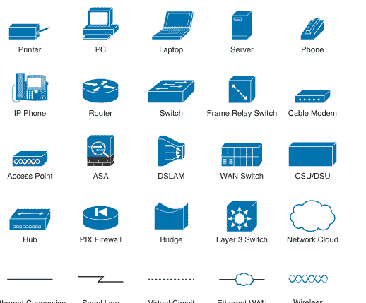

## 命令语法约定

本书中用于呈现命令语法的约定与 IOS 命令参考中使用的约定相同。命令参考对这些约定描述如下：

- **粗体**表示按原样输入的命令和关键字。在实际配置示例和输出（而非一般命令语法）中，粗体表示用户手动输入的命令（例如 **show** 命令）。
- *斜体*表示需要你提供实际值的参数。
- 竖线（|）分隔互斥的可选元素。
- 方括号（[ ]）表示可选元素。
- 花括号（{ }）表示必需的选择。
- 方括号内的花括号（[{ }]）表示可选元素中的必需选择。

## 考试题型

ICND1、ICND2 和 CCNA R&S 考试都遵循相同的一般格式。在考试中心，你坐在一个安静的房间里，面对一台 PC。在考试计时器开始之前，你有机会在 PC 上做一些其他任务；例如，你可以参加一个示例测验，只是为了熟悉 PC 和考试引擎。任何具有用户级 PC 操作技能的人都应该能够轻松适应考试环境。题型包括：

- 单选题
- 多选题
- 测试集（一个场景搭配几道选择题）
- 拖放题
- 模拟实验（sim）
- 模拟测试集（simlet）

你应该花时间通过 Cisco 认证考试教程尽可能多地学习，你可以在 Cisco.com 上搜索“exam tutorial”找到该教程。该工具会逐一介绍 Cisco 可能在考试中提出的每种题型。

虽然列表中前四种题型对于任何参加过标准化考试或学校类似考试的人来说都很熟悉，但后两种题型在 IT 考试尤其是 Cisco 考试中更为常见。这两种题型都使用网络模拟器来提问，让你控制并使用模拟的 Cisco 设备。具体来说：

- **模拟实验题：** 你会看到一个网络拓扑、一个实验场景，并且可以访问设备。你的任务是修复配置中的问题。
- **模拟测试集题：** 这种风格结合了模拟实验和测试集的题型格式。与模拟实验题一样，你会看到一个网络拓扑、一个实验场景，并且可以访问设备。然而，与测试集一样，你还会看到几道选择题。你不需要更改/修复配置，而是回答关于网络当前状态的问题。

通过使用这两种题型的模拟器，Cisco 可以用模拟实验题测试你的配置技能，用模拟测试集题测试你的验证和故障排除技能。

## CCNA 考试内容……以及书中的内容？

从小学时代起，每当老师宣布我们即将考试时，总会有人问：“考试考什么？”即使在大学里，人们也会试图获取更多关于考试内容的信息。本质上，目标是要知道哪些该重点学习，哪些稍微学习，哪些根本不学。

你可以从两个主要来源了解更多关于考试内容的信息：本书和 Cisco 网站。

### Cisco 发布的考试主题

首先，Cisco 向全世界公布了其每项认证考试的具体主题。对于每项 Cisco 认证考试，Cisco 希望公众了解主题的多样性

## 本书特色

本书（以及相关的 *CCENT/CCNA ICND1 100-105 官方认证指南*）超越了一本简单的技术书籍所能提供的内容。它为你提供了一套学习系统，不仅帮助你学习事实，还能培养你通过考试所需的技能。为此，在本书的技术章节中，大约四分之三的篇幅用于讲解技术内容，大约四分之一用于相关的学习功能。

每章的“基础主题”部分包含丰富的内容，用于解释考试主题并展示许多示例。该部分大量使用图表、列表和表格进行对比。它还将每章中最重要的主题标记为关键主题，以便你知道在学习中首先要掌握什么。

本书的大部分功能都以某种方式与超越简单阅读每章“基础主题”部分的学习需求相关联。本节的其余部分将解释这些书籍功能。由于本书按章节组织你的学习，然后是部分（一个部分包含多个章节），最后是书末的最终复习，因此本引言的下一个部分将介绍按章节、部分和最终复习组织的书籍功能。

## 章节功能以及如何使用每一章

本书的每一章都是一个关于某一主题领域的独立短期课程，按以下方式组织阅读和学习：

- **“我是否已经知道这些内容？”测验：** 每章以一个章前测验开始。
- **基础主题：** 这是章节核心内容部分的标题。
- **章节复习：** 本节包含一系列学习任务，帮助你记住概念、联系想法，并练习章节中基于技能的内容。

图 I-2 展示了每章如何利用这三个关键元素。你从“我是否已经知道这些内容？”（DIKTA）测验开始。你可以利用分数来判断自己已经知道很多还是不多，并决定如何阅读基础主题（即章节中的技术内容）。完成基础主题后，使用章节复习任务开始掌握对事实以及配置、验证和故障排除技能的记忆。


**图 I-2** *第一次通读每章的三项主要任务*

除了这三个主要的章节功能外，每个“章节复习”部分还介绍了各种其他书籍功能，包括以下内容：

- **复习关键主题：** 在“基础主题”部分，关键主题图标出现在最重要的项目旁边，以便后续复习和掌握。虽然所有


本书的每一部分末尾都有一个“部分复习”（Part Review）部分，其中包含一系列用于学习和复习的活动，非常类似于每章末尾的“章节复习”（Chapter Review）部分。然而，由于部分复习是在完成若干章之后进行的，因此部分复习中包含了一些任务，旨在帮助将这些更广泛内容中的观点串联起来。以下列表说明了除章节复习中提到的任务类型之外，每个部分复习新增的任务类型：

- **回答部分复习问题：** 这些书附带考试软件和题库。其中一个题库专门为部分复习编写了问题。这些问题往往将多个概念联系在一起，帮助您思考多个章节的主题，并培养应对考试中更具挑战性的分析问题所需的技能。
- **思维导图：** 思维导图是图形化的组织工具，许多人在学习和梳理概念如何相互关联时觉得它很有用。创建思维导图的过程有助于建立心智联系。部分复习元素以多种方式使用思维导图：连接概念与相关配置命令，连接 show 命令与相关网络概念，甚至连接术语。（有关思维导图的更多信息，请参见本引言后面的“关于思维导图”一节。）
- **实验：** 每个“部分复习”部分都会指导您使用所选择的实验产品进行相应的实验练习，这些实验更适合这一阶段的学习和复习。（有关实验选项的信息，请参阅后面的“关于培养动手技能”一节。）

除了这些任务之外，许多“部分复习”部分还会让您使用“章节复习”部分提到的书籍功能完成其他任务：重复DIKTA测验问题、复习关键主题以及做更多实验练习。

## 最终复习

第29章“最终复习”列出了一系列备考任务，您可以在考试前的最佳备考阶段使用这些任务。第29章侧重于帮助您通过考试的三部分方法：练习技能、练习回答考题以及发现自己的薄弱环节。为此，第29章使用了与章节复习和部分复习元素相同的熟悉书籍功能，以及更多练习问题。

## 其他功能

除了每个核心章节中的功能外，本书作为一个整体还提供其他学习资源，包括以下内容：

- **基于DVD的模拟考试：** 随书DVD包含强大的Pearson IT认证模拟考试（PCPT）引擎。您可以使用本书附带的DVD和激活码参加模拟ICND2考试以及CCNA考试。（您可以使用*CCENT/CCNA ICND1 100-105官方认证指南*中的DVD参加模拟ICND1和CCNA R&S考试。）
- **CCNA ICND2模拟器精简版：** 这个来自Pearson的畅销CCNA网络模拟器的精简版让您现在就可以体验Cisco CLI。无需购买真实设备或购买完整模拟器即可开始学习CLI。只需从本书后面的DVD安装即可。
- **电子书：** 如果您有兴趣获取本书的电子书版本，我们在书后DVD封套中插入的优惠券卡上附有特别优惠。此优惠允许您以标价三折的价格购买*CCNA路由与交换ICND2 200-105官方认证指南高级版电子书及模拟考试*。除了电子书的三种版本：PDF（用于在计算机上阅读）、EPUB（用于在平板电脑、移动设备或Nook或其他电子阅读器上阅读）和Mobi（Kindle原生版本）之外，您还可以获得额外的模拟考试问题以及增强的模拟考试功能。
- **辅导视频：** 本书附带的DVD中还包含四个关于以下主题的教学视频：OSPF、EIGRP、EIGRP度量，以及PPP和CHAP。
- **配套网站：** 网站 http://www.ciscopress.com/title/9781587205798 会发布最新材料，进一步阐明复杂的考试主题。请定期查看该网站，了解作者撰写的新帖子和更新帖子，这些帖子提供了对考试中较难主题的深入见解。
- **PearsonITCertification.com：** 网站 http://www.pearsonitcertification.com 是获取所有IT认证相关内容的绝佳资源。请查看来自业界优秀作者和培训师的精彩CCNA文章、视频、博客和其他认证备考工具。
- **CCNA模拟器：** 如果您想要更多动手练习，可以考虑购买CCNA网络模拟器。您可以从Pearson网站 http://pearsonitcertification.com/networksimulator 或其他零售渠道购买该软件的副本。为了帮助您学习，我创建了一份映射指南，将模拟器中的每个实验映射到这些CCNA认证指南中的特定章节。您可以在配套网站的“附加内容”（Extras）选项卡中免费获取此映射指南。
- **作者网站和博客：** 我维护着一个网站，其中包含对学习CCENT和CCNA有用的工具和链接。该网站列出了帮助您搭建自己的实验环境的信息、与本书及ICND1书籍各章对应的学习页面，以及我的CCENT技能博客和CCNA技能博客的链接。请从 http://www.certskills.com 开始；点击“博客”（Blog）选项卡，可以进入专门介绍博客的页面，其中包含与本书相关的实验页面的链接。

## 一项重要的新功能：复习应用程序

本书这一版最重要的新功能之一是为许多章节复习活动增加了学习应用程序。在过去，所有章节复习活动仅使用书中章节，或章节加上仅DVD附带的附录。读者告诉我们，他们觉得这些内容很有用，但这些内容是静态的。

本书和*CCENT/CCNA ICND1 100-105官方认证指南*是首批拥有广泛交互式应用的Cisco Press认证指南。基本上，以前在“章节复习”部分中几乎每一项活动现在都可以通过应用程序完成。这些应用程序既可以在随书附带的DVD上找到，也可以在本书的配套网站上找到。在DVD上，您可以在“章节和部分复习”（Chapter and Part Review）选项卡下找到这些应用程序。

使用这些应用程序的优势如下：

- **更易于使用：** 这些新应用程序无需打印附录副本并在纸上完成工作，而是为您提供易于使用、交互式的体验，您可以轻松地反复运行。
- **方便：** 当您有5-10分钟的空闲时间时，可以访问本书网站，复习您最近完成章节的内容。
- **不受书籍/DVD限制：** 由于这些应用程序除了DVD之外还可以在本书的配套网站上获取，因此您可以从任何地方访问您的复习活动——无需随身携带书籍或DVD。
- **适合触觉学习者：** 有时读完一章后盯着静态页面会让您走神。触觉学习者通过至少将答案输入到应用程序中，或在应用程序内点击导航，可能会做得更好，这有助于让您专注于活动。

我们深入的读者调查显示，使用章节复习工具的读者喜欢这些工具，但并非每个人都在持续使用它们。因此，我们希望增加使用复习工具的人数，并让它们更有用、更有趣。表I-1总结了这些新应用程序以及涵盖相同内容的传统书籍功能。

**表I-1** 兼具传统与应用程序选项的书籍功能

| 功能 | 传统方式 | 应用程序 |
|---|---|---|
| 关键主题 | 带有列表的表格；翻阅页面查找 | 关键主题表格应用 |
| 配置清单 | 只是多种关键主题类型之一 | 配置清单应用 |
| 记忆表 | 两个静态PDF附录（一个包含稀疏表格供您填写，一个包含已完成的表格） | 记忆表应用 |
| 关键术语 | 列在每章“章节复习”部分，并附有书后的术语表 | 术语表抽认卡应用 |
| IPv4 ACL练习 | 一个包含练习问题的静态PDF附录(D) | 一个交互式应用程序，提出与附录中列出的相同问题 |

## 如何获取本书的电子资源

传统上，所有章节复习活动都使用书中章节加上附录，附录通常位于DVD上。但这些内容大多是静态的——有用，但却是静态的。

如果您购买了纸质书，并且有DVD驱动器，那么您就拥有DVD上的所有内容。只需放入DVD并使用光盘菜单（应自动启动）即可浏览所有内容。


如果你购买了印刷版图书但没有DVD驱动器，可以通过在Cisco Press网站上注册图书来获取DVD文件。为此，只需访问 http://www.ciscopress.com/register 并输入印刷版图书的ISBN：978157205798。注册图书后，转到你的账户页面并单击**注册产品**选项卡。在那里，单击**访问附加内容**链接以访问该书的配套网站。

如果你从Cisco Press购买*CCNA路由和交换ICND2 200-105官方认证指南高级版电子书和练习测试*，你的书将自动注册到你的账户页面。只需转到你的账户页面，单击**注册产品**选项卡，然后选择**访问附加内容**以访问该书的配套网站。

如果你从其他书商购买电子书，电子书文件的最后一页将包含如何注册图书和访问配套网站的说明。步骤与前面所述相同，适用于那些购买印刷版图书但没有DVD驱动器的人。

## 书籍组织、章节和附录

本书包含28个核心章节，即第1章至第28章，第29章为“最终复习”章节。每个核心章节涵盖ICND2考试主题的一个子集。核心章节按部分组织。核心章节涵盖以下主题：

### 第一部分：以太网局域网

- 第1章“实施以太网虚拟局域网”讲解了虚拟局域网（包括VLAN中继）的概念和配置。
- 第2章“生成树协议概念”讨论了IEEE生成树协议（STP）背后的概念，以及它如何使某些交换机接口阻塞帧，以防止帧在冗余交换局域网中持续循环。
- 第3章“生成树协议实施”展示了如何在Cisco交换机上配置和验证STP。
- 第4章“局域网故障排除”考察最常见的局域网交换问题，以及在对网络进行故障排除时如何发现这些问题。本章包括针对STP/RSTP、二层以太通道、局域网交换、VLAN和VLAN中继的故障排除主题。
- 第5章“VLAN中继协议”展示了如何配置、验证和故障排除VLAN中继协议（VTP）的使用，以在多个Cisco交换机之间定义和通告VLAN。
- 第6章“其他局域网主题”作为本书中专门讨论局域网的最后一章，讨论了各种小主题，包括：802.1x、AAA认证、DHCP监听、交换机堆叠和机箱聚合。

### 第二部分：IPv4路由协议

- 第7章“理解OSPF概念”介绍了开放最短路径优先（OSPF）协议的基本操作，重点介绍链路状态基础、邻居关系、泛洪链路状态数据以及基于最低成本度量计算路由。
- **第8章“为IPv4实施OSPF”** 采用上一章讨论的概念，并展示如何配置和验证这些相同的功能。
- **第9章“理解EIGRP概念”** 介绍了用于IPv4的增强内部网关路由协议（EIGRP）（EIGRPv4）的基本操作，重点介绍EIGRP邻居关系、EIGRP如何计算度量以及它如何快速收敛到备用可行后继路由。
- **第10章“为IPv4实施EIGRP”** 采用上一章讨论的概念，并展示如何配置和验证这些相同的功能。
- **第11章“IPv4路由协议故障排除”** 逐一介绍IPv4路由协议最常见的问题，同时交替使用OSPF示例和EIGRP示例。
- **第12章“实施外部BGP”** 考察边界网关协议（BGP）的基础知识及其在企业与ISP之间的使用，展示如何在有限设计中配置、验证和故障排除BGP。

### 第三部分：广域网

- **第13章“实施点对点WAN”** 解释了如何构建租用线路WAN的核心概念，以及这些链路上两种常见数据链路协议的基础知识：HDLC和PPP。
- **第14章“使用以太网和MPLS的专用WAN”** 探讨了通过不同城域以太网服务使用以太网构建WAN服务的概念，以及使用多协议标签交换（MPLS）VPN的概念。
- **第15章“使用Internet VPN的专用WAN”** 针对与使用Internet在不同企业站点之间创建专用WAN连接相关的多种技术，讲解了一系列概念材料，以及一些配置和验证主题。

### 第四部分：IPv4服务：ACL和QoS

- **第16章“基本IPv4访问控制列表”** 考察标准IP ACL如何基于源IP地址过滤数据包，以便路由器不转发该数据包。
- **第17章“高级IPv4访问控制列表”** 考察命名和编号ACL，以及标准和扩展IP ACL。
- **第18章“服务质量（QoS）”** 讨论了与QoS这一广泛主题相关的各种概念。

### 第五部分：IPv4路由与故障排除

- **第19章“局域网中的IPv4路由”** 从配置和故障排除的深度展示了在VLAN之间路由的不同方法，包括单臂路由（ROAS）、使用SVI的三层交换、使用路由端口的三层交换以及使用三层以太通道。
- **第20章“为第一跳路由实施HSRP”** 讨论了第一跳冗余协议（FHRP）的必要性，特别是如何配置、验证和故障排除热备份路由协议（HSRP）。
- 第21章“IPv4路由故障排除”探讨最常见的IPv4问题，以及在进行故障排除时如何找到这些问题的根本原因。

### 第六部分：IPv6

- 第22章“IPv6路由操作与故障排除”回顾了ICND1书中讨论的IPv6路由。然后展示了IPv6路由的一些最常见问题，并讨论了如何对这些问题进行故障排除以发现根本原因。
- 第23章“为IPv6实施OSPF”探讨了OSPFv3及其作为IPv6路由协议的用途，展示了传统配置、验证和故障排除主题。
- 第24章“为IPv6实施EIGRP”采用了第9章中讨论的用于IPv4的EIGRP概念，并展示了这些相同的概念如何应用于IPv6的EIGRP。然后展示了如何配置、验证和故障排除IPv6的EIGRP。
- 第25章“IPv6访问控制列表”考察了IPv4 ACL和IPv6 ACL之间的异同，然后展示了如何配置、验证和故障排除IPv6 ACL。

### 第七部分：其他

- 第26章“网络管理”讨论了Cisco选择未纳入ICND1的几个网络管理主题，即：SNMP、IP SLA和SPAN。
- 第27章“云计算”是关于偏离传统CCNA R&S主题的两章之一，作为Cisco新兴技术主题之一。本章解释了基本概念，然后概括讨论了云计算对典型企业网络的影响。
- 第28章“SDN与网络可编程性”是另一章偏离传统CCNA R&S主题的内容，讨论了许多与软件定义网络（SDN）和网络可编程性如何影响典型企业网络相关的概念和术语。

### 第八部分：最终准备

- 第29章“最终复习”建议了完成本书核心部分后的最终准备计划，特别解释了本书中可用的许多学习选项。

### 第九部分：附录（印刷版）

- 附录A“数字参考表”列出了几个数字信息表，包括二进制到十进制转换表和2的幂列表。
- 附录B“CCNA ICND2 200-105考试更新”是作者在版本中期添加图书内容的地方。请始终在线查看此附录的最新PDF版本；该附录列出了下载说明。
- 术语表包含第1章至第28章末尾“你应该知道的关键术语”部分中列出的所有术语的定义。


### 第十部分：DVD 附录

以下附录以数字格式提供在随书附带的 DVD 中：

- **附录 C**，“‘我已经知道了吗？’测验答案”，包含第 1 章至第 28 章所有问题的解析。
- **附录 D**，“第 16 章练习：基本 IPv4 访问控制列表”，是 *CCENT/CCNA ICND1 100-105 官方认证指南* 附录 I 的副本。
- **附录 E**，“思维导图解答”，展示所有部分末尾思维导图练习的示例答案图片。
- **附录 F**，“学习计划表”，是一个包含主要学习里程碑的电子表格，你可以在其中跟踪学习进度。
- **附录 G**，“使用 RIPv2 学习 IPv4 路由”，解释路由器如何通过路由协议协同工作，找出通往每个子网的所有最佳路由。本章还展示如何配置 RIPv2 路由协议以用于 IPv4。（本附录是 ICND1 第 19 章的副本，为方便起见随 ICND2 教材一起提供。）
- **附录 H**，“理解帧中继概念”，解释如何在路由器之间构建帧中继 WAN，重点介绍协议和概念而不是配置。（本章涵盖本书上一版中的旧考试主题，收录于此供可能感兴趣的读者阅读。）
- **附录 I**，“实现帧中继”，承接附录 H 中讨论的概念，展示如何配置、验证和故障排除这些相同的功能。（本章涵盖本书上一版中的旧考试主题，收录于此供可能感兴趣的读者阅读。）
- **附录 J**，“IPv4 故障排除工具”，重点介绍如何使用两个关键的故障排除工具来查找路由问题：ping 和 traceroute 命令。（本附录是 ICND1 第 23 章的副本，为方便起见随 ICND2 教材一起提供。）
- **附录 K**，“往版主题”，汇集了曾在以往版本 CCNA 考试中出现的主题信息。虽然你很可能不会遇到这些主题的考试题，但这些概念对拥有 CCENT 或 CCNA 认证的人仍然有意义。
- **附录 L**，“考试主题交叉参考”，提供一些表格，帮助你找到书中涵盖每项考试目标的位置。

### 本书中的 ICND1 章节

对于当前版本的 ICND1 和 ICND2 认证指南，我设计了几章供两本书共同使用。这些章节包含一些列在两场考试考试主题中的主题：

- 第 1 章，“实现以太网虚拟 LAN”（ICND1 100-101 教材中的第 11 章）。
- 第 16 章，“基本 IPv4 访问控制列表”（ICND1 100-101 教材中的第 25 章）。
- 第 17 章，“高级 IPv4 访问控制列表”（ICND1 100-101 教材中的第 26 章）。
- 第 21 章，“IPv4 路由故障排除”（ICND1 100-101 教材中的第 24 章）。

我设计这四章供两本书共同使用，是为了帮助同时阅读两本书的读者，同时避免给可能只阅读本 ICND2 认证指南的读者带来任何问题。Cisco 历来有一些主题会在构成 CCNA R&S 双考试路径的两场考试之间重叠，当前这两场考试也不例外。因此，对于已经读过 ICND1 100-101 教材的读者，你可以更快地学习本书上述四章。如果你没有读过 ICND1 100-101 教材，那么本书这里已经包含你需要的全部材料。

### DVD 附录中的额外内容

请注意，DVD 上的若干附录，即 G、H、I、J 和 K，包含 ICND2 200-105 考试主题之外的额外内容。本简短小节解释了原因。

首先，这里有两个附录是为了在 Cisco 宣布考试时帮助过渡。附录 G（关于 RIP）和 J（关于 ping 和 traceroute）是 ICND1 100-105 教材中两章的副本，并且是 ICND1 100-105 考试考试主题的一部分。对于在 Cisco 于 2016 年宣布 ICND1 100-105 和 ICND2 200-105 考试之日已经学习到较后阶段的读者，这两章可能特别有用。我收录附录 G 和 J，是为了帮助那些购买 ICND2 200-105 认证指南但不购买 ICND1 100-105 认证指南的读者完成这一过渡。

另外三个附录是为在课堂上使用这些书的教师，以及偶尔更关注技术而非认证的读者收录的。附录 H、I 和 K 包含当前考试主题不再提及的内容。附录 H 和 I 是本书上一版中关于帧中继的完整章节副本，附录 K 则是我在创建当前版本时从本书上一版中移除的小主题汇编。这些材料可能对部分教师在课程过渡期间有所帮助，或者对那些只想为了学习而更广泛阅读的人有所帮助。

你不需要使用这些额外附录（G 到 K）来准备 ICND2 200-105 考试或 CCNA R&S 200-125 考试，但如果你感兴趣，可以随意使用它们。

### 参考信息

本简短小节包含一些可在本书其他地方参考的主题。你可以在初次使用本书时阅读这些内容，也可以跳过这些主题，稍后再回来查阅。尤其要注意本引言最后一页，其中列出了若干联系方式，包括如何联系 Cisco Press。

### 安装 Pearson IT 认证练习测试引擎和题目

本书与许多其他 Cisco Press 图书一样，包含使用 Pearson IT 认证练习测试（PCPT）软件的权利，以及使用与本书相关的一些考试题目的权利。PCPT 有许多选项，包括在学习模式下答题的选项，这样你可以在答题过程中看到每道题的答案和解析；参加模拟真实考试条件的模拟考试的选项；以及在闪卡模式下查看题目的选项，在该模式下所有答案都被移除，挑战你凭记忆回答问题。

你应该安装 PCPT，以便即使在学习最早几章时也能随时使用。本书的“部分复习”小节明确要求你使用 PCPT，你甚至可以使用 PCPT 参加各章的 DIKTA 测验。

> **注意**  使用与本书相关的考试的权利基于一个激活码。对于购买纸质书的读者，该代码位于书后 DVD 封套中。将印有考试激活码的纸张翻过来，可以找到一个一次性使用的优惠券代码，购买 *CCNA 路由和交换 ICND2 200-105 官方认证指南，高级版电子书* 和 *练习测试* 时可享七折优惠。对于直接从 Cisco Press 网站购买高级版电子书和练习测试的读者，激活码将在购买后填充到你的账户页面。对于购买 Kindle 版的读者，访问码将直接由 Amazon 提供。请注意，如果你从任何其他来源购买电子书版本，则不包含练习测试，因为其他供应商无法提供所需的唯一访问码。*不要丢失激活码。*

### 本书附带的 PCPT 考试数据库

本书包含一个激活码，允许你加载一组练习题。这些题目分布在不同的考试或考试数据库中。当你安装 PCPT 软件并输入激活码时，PCPT 软件会下载所有这些考试数据库的最新版本。仅凭 ICND2 教材，你就可以获得六场不同的“考试”，或六组不同的题目，如图 I-4 所示。


**图 I-4**  *PCPT 考试/考试数据库及其使用时机*

你可以随时选择使用这些考试数据库中的任何一个，既可以在学习模式下使用，也可以在练习考试模式下使用。不过，许多人发现最好保留一些考试，等到读完整本书后的考试复习时间再使用。图 I-4 开始给出一个计划，具体说明如下：

- 在“部分复习”期间，使用 PCPT 以学习模式复习该部分的 DIKTA 题目。
- 在“部分复习”期间，使用专门为本书该部分“部分复习”编写的题目（部分复习题），并采用学习模式。
- 保留其余考试，供本书末尾的“最终复习”章节使用；如果准备 ICND2 考试，就使用那些练习考试；如果准备 CCNA 考试，就使用那些考试。


你判断自己是否掌握了本章所包含的知识点。而 Part Review 问题则更侧重于将这些知识点应用到典型的真实场景中，看起来更像真正的考试题。

要查看这些问题，请按照处理 DIKTA/本书问题时的相同流程操作，但选择 Part Review 数据库而不是本书数据库。PCPT 为该数据库提供了一个清晰的名称：Part Review Questions。

## 关于思维导图

思维导图是一种视觉组织工具，可用于多种目的。例如，你可以把思维导图作为记笔记的另一种方式。

你还可以用思维导图来改善大脑组织概念的方式。思维导图能增强大脑中想法之间的连接和关系。当你花时间思考某个学习领域，并把想法组织成思维导图时，你会强化已有的心理连接并建立新的连接，而这一切都纳入你自己的参照框架。

简而言之，思维导图能帮助你内化所学内容。

每幅思维导图都从一张白纸或思维导图应用程序中的空白窗口开始。然后，你添加一个大的中心主题，其分支可以向任意方向延伸。分支中包含较小的概念、想法、命令、图片……任何需要表达的想法。任何可以归为一组的概念都应放在彼此附近。必要时，你可以创建越来越深的分支，不过就本书而言，大多数思维导图不会超过两三个层级。

> **注意**  有许多关于思维导图的书籍，但 Tony Buzan 常被认为正式提出并推广了思维导图。你可以在他的网站 http://www.tonybuzan.com 了解更多关于思维导图的信息。

例如，图 I-5 展示了一个示例思维导图，它开始输出 ICND1 一书第 VIII 部分的一些 IPv6 内容。在复习 IPv6 编址概念时，你可能会创建这种思维导图：从“IPv6 编址”这个大主题开始，然后写下随机的术语和想法。当你开始在脑海中组织它们时，你会画线连接这些想法，重新组织它们，最终达到你认为这些想法的组织方式对你而言合理的程度。

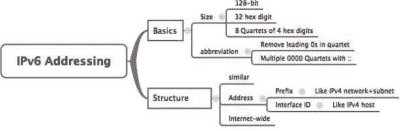

**图 I-5**  *示例思维导图*


**图 I-6** *作者博客中的 Config Lab 标志*

这些 Config Labs 有几个好处，包括以下各项：

- **不受束缚且响应迅速：** 可从任何地方、任何网页浏览器、你的手机或平板电脑上完成，不受本书或 DVD 的束缚。
- **专为碎片时间设计：** 每个实验都设计为 5 到 10 分钟的练习，前提是你只需在文本编辑器中输入内容或在纸上写出答案。
- **两种结果，都是好事：** 练习让基础配置变得更好、更快；或者如果你迷失了，你发现了一个现在可以回头重读以完善知识点的主题。无论哪种方式，你都离准备好考试更近一步！
- **博客形式：** 便于我添加和更改内容，也便于你发表评论。
- **自我评估：** 作为最终复习的一部分，你应该能够在没有帮助的情况下、充满信心地完成所有 Config Labs。

请注意，博客按书本章节组织这些 Config Lab 文章，因此你可以轻松地在 Chapter Review 和 Part Review 中使用它们。有关这些复习部分的更多详细信息，请参阅引言之后的“Your Study Plan”元素。

## Pearson Network Simulator Lite 快速入门

一开始，如何获得动手技能的决定可能有点令人害怕。好消息是，你有一个免费而简单的第一步来体验 CLI：安装并使用本书附带的 Pearson NetSim Lite。

本书附带 Pearson 畅销 CCNA Network Simulator 的精简版，它为你提供了一种手段，现在就能体验 Cisco CLI。无需购买真实设备或购买完整模拟器即可开始学习 CLI。只需从本书后面的 DVD 安装 NetSim Lite。

最新版本的 NetSim Lite 包含与本书第 II 部分相关的实验。第 I 部分只包含概念，第 II 部分是第一个包含命令的部分。因此，请务必使用 NetSim Lite 学习 CLI 基础知识，以便有一个良好的开端。

当然，NetSim Lite 随 DVD 提供的一个原因是出版商希望你购买完整产品。然而，即使你不使用完整产品，你仍然可以从 NetSim Lite 附带的实验中学习，同时决定要追求哪些选项。

> **注意** ICND1 和 ICND2 两本书各包含不同版本的 Sim Lite 产品，每个版本都有与本书内容匹配的实验。如果你两本书都买了，请确保安装两个 Sim Lite 产品。

## Pearson Network Simulator

Config Labs 和 Pearson Network Simulator Lite 都满足特定需求，而且它们都随书提供。然而，你需要的不止这两个工具。

与本书一起进行实验工作的最佳单一选择是 Pearson Network Simulator 的付费版本。该模拟器产品模拟 Cisco 路由器和交换机，以便你为 CCENT 和 CCNA R&S 认证学习。但更重要的是，它通过提供大量有用的实验练习来专注于备考学习。读者调查告诉我们，那些将 Simulator 与本书一起使用的人喜欢这个学习过程，并称赞本书和 Simulator 配合得非常好。

当然，你需要自己做决定，并考虑所有选项。值得庆幸的是，你可以通过使用本书附带的 Pearson Network Simulator Lite 产品，很好地了解完整 Simulator 产品如何工作。两者具有相同的基础代码和相同的用户界面，以及相同类型的实验。试试 Lite 版本，并查看完整产品。有一个仅针对 CCENT 的完整产品，另一个针对 CCNA R&S（其中包括 CCENT 产品中的所有实验，以及针对内容中 ICND2 部分的其他实验）。

请注意，Simulator 和本书按不同的发布计划更新。在 2016 年的某段时间内，可购买的 Simulator 版本将是为旧版考试（ICND1 100-101、ICND2 200-101 和 CCNA 200-120）创建的 Simulator。该产品包含 ICND1 100-105 和 ICND2 200-105 书籍中约 80% 的 CLI 主题。因此在那段时间里，Simulator 仍然非常有用。

从实际角度来说，当你想在阅读章节或进行 Part Review 时做实验，Simulator 会按本书组织实验。只需在 Simulator 用户界面中寻找“Sort by Chapter”选项卡。然而，在 2016 年的几个月中，当可用的 Simulator 是标题中列出旧考试的旧版本时，你需要参考一个 PDF，其中列出了这些实验与本书组织结构的对应关系；可在 http://www.ciscopress.com/title/9781587205798 找到该 PDF。

## 更多实验选项

如果你决定不使用完整的 Pearson Network Simulator，你仍然需要动手经验。你应该计划使用某种实验环境，尽可能多地练习 CLI 交互。

首先，你可以使用真实的 Cisco 路由器和交换机。你可以购买新设备或二手设备，也可以在工作中借用。你可以付费租用。如果你有合适的设备组合，甚至可以在这些设备上完成我博客中的 Config Lab 练习，或者尝试重新创建书中的示例。

Cisco 提供了一种虚拟化产品，让你可以在虚拟环境中运行路由器和交换机操作系统（OS）镜像。这个工具名为 Virtual Internet Routing Lab (VIRL)，可让你创建实验拓扑、启动拓扑，并连接到真实的路由器和交换机 OS 镜像。请访问 http://virl.cisco.com 了解更多信息。

你甚至可以从 Cisco 租用虚拟 Cisco 路由器和交换机实验环境，这项服务称为 Cisco Learning Labs。


# 你的学习计划

你刚刚拿到这本书。你可能已经读过（或快速浏览过）引言。你现在可能在想，是应该从这里开始读，还是直接跳到第1章“实现以太网虚拟局域网”。

请稍停片刻，阅读本节内容，了解如何为你计划参加的考试（ICND1 100-105、ICND2 200-105 和/或 CCNA 200-125）制定自己的学习计划。如果你在开始这段旅程之前花点时间（也许15分钟）思考几个关于如何学习的关键点，你的学习效果会好得多。本节将帮助你做到这一点。

## 思科认证考试简要视角

思科为通过 ICND1、ICND2 和 CCNA 考试设定了相当高的门槛。大多数人只要学习都能通过这些考试，但这需要的不仅仅是快速通读本书和支付考试费用。

这些考试的挑战来自多个角度。每门考试都涵盖大量概念以及许多思科设备专用的命令。除了知识之外，这些思科考试还要求深入的技能。你必须能够分析和预测网络中实际发生的情况。你必须能够配置思科设备，使其在这些网络中正确工作。并且，当网络无法正常工作时，你必须准备好排查问题。

这些考试中更具挑战性的题目很像拼图，但每五块拼图中就有四块甚至不在房间里。要解开这个拼图，你必须在头脑中重新构造缺失的碎片。要做到这一点，你必须了解每个网络概念，并记住这些概念如何协同工作。

例如，ICND2 考试包含许多排障主题，比如开放最短路径优先第2版（OSPFv2）的排障。OSPFv2 可能无法与另一台相邻路由器建立邻居关系。但更贴近考试实际的问题会让你思考为什么某台路由器缺少某条路由，而该症状的根本原因可能与 OSPF 邻居有关。然后，题目可能会提供你需要知道的一部分信息，就像拼图的一些碎片，如图1中的白色拼块所示。你必须将 IP 路由和 OSPF 理论的知识应用到这些事实上，从而推导出拼图的其他一些碎片。

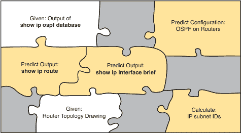

**图1** *用你的分析技能填补拼图碎片*

这些技能要求你在准备时不能只是阅读和记忆所读内容。当然，你需要阅读本书中的许多页面，以学习许多单独的事实以及这些事实之间的相互关系。但本书的很大一部分列出了阅读之外的练习，这些练习有助于你培养解决这些网络谜题的技能。

## 学习计划的五个步骤

这些考试具有挑战性，但每天都有很多人通过。那么，除了阅读并记住所有事实之外，你还需要做什么才能准备好通过考试？你需要培养技能。你需要在头脑中把每个想法与其他相关想法联系起来。做到这一点需要额外的工作。为了帮助你一路前行，接下来几页给出了五个关键规划步骤，让你在投入这个激动人心但又充满挑战的、在思科设备上学习网络技术的世界之前，能够更有效地培养这些技能并建立这些联系。

### 第1步：从部分和章节的角度思考

学习计划的第一步，是正确认识你要完成的任务的规模与性质。这是一本大部头书。因此，你不能把这本书看作一项巨大的任务，否则可能会灰心。而且，你从来不会在一次学习时段里坐下来读完900多页。所以，要把任务分解成更小的任务。

好消息是，本书设计了明显的分界点，并内置了丰富的复习活动。简而言之，这本书更像是一个学习系统，而不只是一本书。

因此，学习计划的第一步，是把这本书想象成7个部分，而不是一本大书。然后，在每个部分内，想象平均有4章。你的学习计划要求你学完每个部分中的各章，然后在继续之前复习该部分的内容，如图2所示。

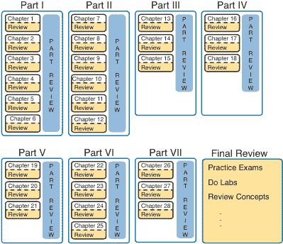

**图2** *7个部分，每部分平均4章，并包含部分复习*

现在，你的路径包含以下内容：

-   1项大任务：阅读并掌握本书的全部内容。
-   7项中等任务/书：阅读并掌握一个部分。
-   4项小任务/部分：阅读并掌握一章。

### 第2步：围绕章节建立学习习惯

第二步，也可能是最重要的一步，是以相同的流程对待每一章：阅读它，然后在继续之前学习这一章。

每章都遵循相同的三部分设计，如图3所示。章前测验（称为“我是否已经知道？”测验，或简称 DIKTA 测验）帮助你决定花多少时间阅读，多少时间略读本章的核心内容，即“基础知识主题”。“章节复习”部分随后会指导你如何学习和复习刚刚读过的内容。


**图3** *建议的每章学习方法*

本书有意只设置少数较长的章节。基础知识主题平均每章22页。通过保持合理的篇幅，你可以在一个或两个简短的学习时段内完成整章。每次开始新一章的学习时段时，都要带着有机会完成本章、至少能取得良好开端的想法进入状态。如果你时间不够，就寻找章内的大标题——每章有两到三个大标题，当你需要等到下一个学习时段才能完成阅读时，这些标题是很好的停读位置。

章节复习任务对你考试当天的成功非常重要。完成这些任务，并且在章末完成它们，确实能帮助你做好准备。不要把这些任务推迟到以后！章末的章节复习任务帮助你进入第一阶段：加深对关键主题的知识与技能，记住术语，并在大脑中把概念联系起来，从而记住它们如何组合在一起。下面的列表描述了你在“章节复习”部分会遇到的大多数活动：

-   复习关键主题
-   复习关键术语
-   回答 DIKTA 问题
-   做实验
-   复习记忆表
-   复习配置检查清单
-   复习命令表

如需了解更多细节，请查看本计划部分后面标题为“在 Web 和 DVD 上查找复习活动”的一节。

### 第3步：将书的部分作为主要里程碑

研究表明，要掌握一个概念和/或技能，你应该计划经历多个学习时段来复习该概念并练习该技能。每章末尾的“章节复习”部分是第一次这样的复习，而每个部分末尾的“部分复习”则作为第二次复习。

计划好时间，在每个部分末尾使用该部分末尾提供的“部分复习”要素来完成部分复习任务。你应该预计，在一次部分复习上花费的时间大约与一整章相同，某些部分可能还要稍多一点。因此，在规划时间时，要把部分复习本身当作另一章。

图4列出了本书各部分的名称，并带有一些颜色编码。请注意，第II、IV和V部分是专门针对 IPv4 的部分。第I和第III部分分别与局域网和广域网有关。图的上部显示了本书最后两个部分，其中第VI部分关于 IPv6，第VII部分关于几个杂项主题：网络管理、云和网络可编程性。每个部分都以2到4页的“部分复习”部分结束，其中注明了要使用哪些工具和活动。


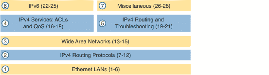

图 4 各部分作为主要里程碑

章节复习和部分复习在某些方面有所不同。章节复习任务往往提供大量背景信息，因此你可以专注于在脑海中添加某条具体知识，或练习某项特定技能。部分复习活动则会移除大量背景信息，更接近现实生活和真实考试。移除背景信息意味着你必须运用自己的知识和技能。结果是：你发现了自己的薄弱点。你越善于发现薄弱点，并学习自己在该领域的缺失，备考就会越充分。

“部分复习”部分除了使用章节复习用到的一些工具外，还使用以下类型的工具：

- 思维导图
- 带 PCPT 的部分复习题
- 实验

此外，考虑为完成本书的每个部分设定一个目标日期（以及一个奖励）。计划休息时间、家庭时间、外出锻炼时间、享用美食的时间，任何能让你恢复精力并为下一部分保持动力的事情都可以。

### 第 4 步：使用最终复习章节来完善技能并发现薄弱点

你的第四步有一个总体任务：按照本书末尾第 29 章“最终复习”中概述的细节，完成从读完本书到参加考试之间的各项事宜。

“最终复习”章节有两个主要目标。首先，它帮助你进一步培养回答考试中更复杂问题所需的分析技能。许多问题要求你将概念、配置、验证和故障排除方面的知识联系起来。离考试越近，你越应该减少阅读，增加其他学习活动；本章的任务为你提供了进一步发展这些技能的活动。

“最终复习”章节中的任务也有助于你发现自己的薄弱领域。这一最终环节通过高难度考试问题的重复练习，揭示你知识上的任何空白。许多问题故意设计来测试你对最常见错误和误解的掌握情况，帮助你避免人们在真实考试中遇到的一些常见陷阱。

### 第 5 步：设定目标并跟踪进度

你的第五个学习计划步骤贯穿整个学习过程的时间线。在开始阅读本书并完成其余学习任务之前，花时间制定计划、设定目标，并准备好跟踪进度。

虽然列出任务清单可能根据你的个性未必吸引你，但目标设定可以帮助每个人备考这些考试。要进行目标设定，你需要知道自己计划完成哪些任务。

> **注意** 如果你在阅读本节后决定希望在考试学习之外尝试更好地设定目标，请查看我撰写的一个关于规划网络职业生涯的博客系列：http://blog.certskills.com/ccna/tag/development-plan/。

至于学习时要完成的任务清单，你不必使用详细的任务列表。（你可以列出每章末尾“章节复习”部分的每一项任务、每个部分复习中的每一项任务以及“最终复习”章节中的每一项任务。）然而，列出主要任务通常就足够了。

对于每个典型章节，你至少应跟踪两项任务：阅读“基础主题”部分并完成章节末尾的章节复习。当然，也不要忘记列出部分复习和最终复习的任务。表 1 显示了本书第一部分的一个示例。

表 1 规划表示例摘录

| 元素 | 任务 | 目标日期 | 首次完成日期 | 第二次完成日期（可选） |
|---|---|---|---|---|
| 第 1 章 | 阅读基础主题 | | | |
| 第 1 章 | 完成章节复习任务 | | | |
| 第 2 章 | 阅读基础主题 | | | |
| 第 2 章 | 完成章节复习任务 | | | |
| 第 3 章 | 阅读基础主题 | | | |
| 第 3 章 | 完成章节复习任务 | | | |
| 第 4 章 | 阅读基础主题 | | | |
| 第 4 章 | 完成章节复习任务 | | | |
| 第 5 章 | 阅读基础主题 | | | |
| 第 5 章 | 完成章节复习任务 | | | |
| 第 6 章 | 阅读基础主题 | | | |
| 第 6 章 | 完成章节复习任务 | | | |
| 第一部分复习 | 完成部分复习活动 | | | |

> **注意** 本书附带的 DVD 中的附录 F“学习规划器”，包含一个像表 1 这样的完整规划检查表，涵盖本书中的任务。该电子表格允许你更新并保存文件，以记录目标日期和已完成的任务。

将目标日期作为管理学习的方式，而不要因错过日期而气馁。选择你能达成的合理日期。设定目标时，考虑你的阅读速度以及目录中列出的每章“基础主题”部分的长度。然后，当你提前完成任务时，将接下来的几个目标日期提前。

如果你错过了几个日期，*不要*开始跳过章节末尾列出的任务！相反，思考是什么影响了你的日程——现实生活、承诺等——然后调整目标或更加努力学习。

## 开始第一章之前要做的事情

既然你已经理解了为本书制定良好学习计划背后的大致思路，再花几分钟做几项准备工作会有所帮助。在离开本节之前，看看你现在或阅读前几章期间应该完成的其他一些任务，以便为本书开个好头。

### 在网站和 DVD 上查找复习活动

本书早期版本使用了依赖章节的复习活动，以及 DVD 上的 PDF 附录。一些活动还依赖 PCPT 测试软件。

本版是第一本提供大量应用替代传统学习功能的 Cisco Press 认证指南。引言中题为“一项重要的新功能：复习应用程序”的部分详细说明了部分原因。

我鼓励你直接访问本书的配套网站，查找复习应用并探索。另外，旋转 DVD，在那里也能找到复习应用。两种方法都按章节和部分组织复习活动。

请注意，本书也包含传统的复习方法，书中有说明，某些情况下也有对应的 PDF 附录。例如，所有关键主题都可以通过配套网站复习，也可以直接翻阅本书——你选择更适合自己的方式。

### 我是否应该计划使用两科考试路径还是一科考试路径？

要获得 CCNA 路由和交换认证，你需要选择一科考试或两科考试路径。你应该选择哪种？以下是我的个人看法，但这是基于多年读者们的讨论和意见。如果你满足以下条件，可以考虑一科考试路径：

- 你通过先前经验或学习，已经很好地掌握了大约一半的主题。
- 你已经证明自己非常擅长通过自学进行学习。

另请访问引言中列出的我的博客网站，并为列出配置实验的页面添加书签，以便日后学习时方便使用。（网址是 http://blog.certskills.com/ccna/category/hands-on-config-lab。）

### 现在开始：立即行动

现在投入到你的第一个简短且可管理的任务中：阅读第 1 章，这一章恰好与 ICND1 书中的一些主题重复。祝愉快！

# 第一部分

# 以太网局域网

- **第 1 章：** 实现以太网虚拟局域网
- **第 2 章：** 生成树协议概念
- **第 3 章：** 生成树协议实现
- **第 4 章：** 局域网故障排除
- **第 5 章：** VLAN 中继协议
- **第 6 章：** 其他局域网主题
- **第一部分复习**


- 5. 一台交换机刚从 Cisco 到货。该交换机从未配置过任何 VLAN，但 VTP 已被禁用。工程师进入配置模式并输入 vlan 22 命令，随后输入 name Hannahs-VLAN 命令。以下哪些说法正确？（选择两个答案。）
  - a. VLAN 22 会显示在 show vlan brief 命令的输出中。
  - b. VLAN 22 会显示在 show running-config 命令的输出中。
  - c. 此过程不会创建 VLAN 22。
  - d. 在该交换机上，直到至少有一个接口被分配到该 VLAN，VLAN 22 才会存在。

- 6. 以下哪些命令可将交换机接口识别为中继接口：即当前作为 VLAN 中继运行的接口？（选择两个答案。）
  - a. show interfaces
  - b. show interfaces switchport
  - c. show interfaces trunk
  - d. show trunks

## 基础主题

### 虚拟 LAN 概念

在理解 VLAN 之前，必须先具体理解 LAN 的定义。例如，从一种角度看，LAN 包括同一位置的所有用户设备、服务器、交换机、路由器、线缆和无线接入点。然而，LAN 的另一种更狭义的定义有助于理解虚拟 LAN 的概念：

LAN 包括同一广播域中的所有设备。

广播域包括所有连接到 LAN 的设备的集合，因此当其中任一设备发送广播帧时，所有其他设备都会收到该帧的副本。所以，从一种角度看，可以将 LAN 和广播域基本视为同一事物。

不使用 VLAN 时，交换机会将其所有接口视为处于同一广播域中。也就是说，对于一台交换机，当广播帧进入某个交换机端口时，交换机会将该广播帧从所有其他端口转发出去。按照这种逻辑，要创建两个不同的 LAN 广播域，就必须购买两台不同的以太网 LAN 交换机，如图 1-1 所示。

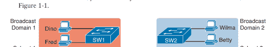

图 1-1 使用两台物理交换机且不使用 VLAN 创建两个广播域

关于 VLAN 如何跨多台 Cisco 交换机工作的机制，包括所需配置。为此，下一节将探讨 VLAN 中继，这是在部署一个存在于多台 LAN 交换机上的 VLAN 时所必需的功能。

### 使用中继创建多交换机 VLAN

在单台交换机上配置 VLAN 只需少量工作：只需配置每个端口，告诉它该端口所属的 VLAN 编号。而在多台交换机的情况下，还必须考虑有关如何在交换机之间转发流量的其他概念。

在具有多台互连交换机的网络中使用 VLAN 时，交换机需要在交换机之间的链路上使用 VLAN 中继。VLAN 中继使交换机使用一种称为 VLAN 标记的流程，通过该流程，发送交换机在通过中继发送帧之前，会向该帧添加另一个报头。这个额外的中继报头包含一个 VLAN 标识符（VLAN ID）字段，以便发送交换机可以将该帧与特定 VLAN ID 关联起来，而接收交换机随后就能知道每个帧属于哪个 VLAN。

图 1-3 展示了一个示例，演示了存在于多台交换机上的 VLAN，但它不使用中继。首先，该设计使用两个 VLAN：VLAN 10 和 VLAN 20。每台交换机都有两个端口分配到每个 VLAN，因此每个 VLAN 都存在于两台交换机中。为了在两台交换机之间转发 VLAN 10 的流量，该设计在交换机之间包含一条链路，且该链路完全位于 VLAN 10 内。同样，为了支持交换机之间的 VLAN 20 流量，该设计使用交换机之间的第二条链路，且该链路位于 VLAN 20 内。

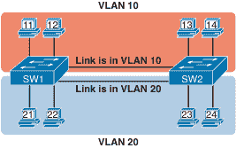

**图 1-3**  *不使用 VLAN 中继的多交换机 VLAN*

图 1-3 中的设计运行良好。例如，PC11（位于 VLAN 10 中）可以向 PC14 发送帧。该帧通过上方链路（即位于 VLAN 10 中的链路）进入 SW1，并传送到 SW2。

图 1-3 所示的设计可以工作，但它的扩展性并不好。它需要交换机之间为每个 VLAN 提供一条物理链路。如果某个设计需要 10 个或 20 个 VLAN，就需要交换机之间有 10 条或 20 条链路，并且要在每台交换机上为这些链路使用 10 个或 20 个交换机端口。

### VLAN 标记概念

VLAN 中继在交换机之间创建一条链路，可支持所需的任意数量 VLAN。作为 VLAN 中继，交换机会将该链路视为所有 VLAN 的一部分。同时，中继会将各 VLAN 的流量保持分离，因此 VLAN 10 中的帧不会发往 VLAN 20 中的设备，反之亦然，因为每个帧在穿过中继时都会通过 VLAN 编号进行标识。图 1-4 展示了这一思路，其中两台交换机之间只有一条物理链路。

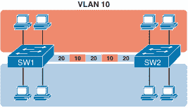

**图 1-4**  *使用中继的多交换机 VLAN*

使用中继后，交换机可以通过在以太网帧中添加一个小的报头，经单条物理连接传递来自多个 VLAN 的帧。例如，图 1-5 展示了 PC11 在步骤 1 通过接口 Fa0/1 发送一个广播帧。为了泛洪该帧，交换机 SW1 需要将该广播帧转发给交换机 SW2。然而，SW1 需要让 SW2 知道该帧属于 VLAN 10，这样在收到该帧后，SW2 只会将该帧泛洪到 VLAN 10 中，而不会泛洪到 VLAN 20 中。因此，如步骤 2 所示，在发送该帧之前，SW1 会向原始以太网帧添加一个 VLAN 报头，在此情况下，该 VLAN 报头列出的 VLAN ID 为 10。

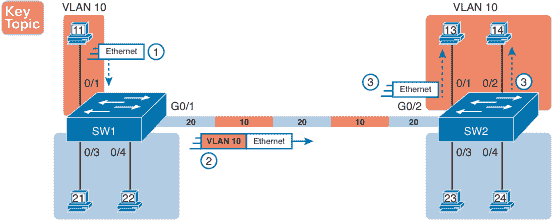

**图 1-5**  *两台交换机之间的 VLAN 中继*

当 SW2 收到该帧时，它会识别出该帧属于 VLAN 10。随后 SW2 会移除 VLAN 报头，并将原始帧从其 VLAN 10 中的接口转发出去（步骤 3）。

再举一个例子，考虑 PC21（位于 VLAN 20 中）发送广播的情况。SW1 会从端口 Fa0/4（因为该端口位于 VLAN 20 中）和端口 Gi0/1（因为它是中继，意味着它支持多个不同 VLAN）发出该广播。SW1 会向该帧添加一个中继报头，其中列出的 VLAN ID 为 20。SW2 在确定该帧属于 VLAN 20 后，会剥离中继报头，因此 SW2 知道只应从端口 Fa0/3 和 Fa0/4 发出该帧，因为它们位于 VLAN 20 中，而不应从端口 Fa0/1 和 Fa0/2 发出，因为它们位于 VLAN 10 中。

### 802.1Q 和 ISL VLAN 中继协议

多年来，Cisco 支持两种不同的中继协议：交换机间链路（ISL）和 IEEE 802.1Q。Cisco 早在 802.1Q 之前就创建了 ISL，部分原因是 IEEE 尚未定义 VLAN 中继标准。多年后，IEEE 完成了 802.1Q 标准的工作，该标准定义了一种不同的中继方式。如今，802.1Q 已成为更流行的中继协议，Cisco 甚至在其一些较新的 LAN 交换机型号中不支持 ISL，包括本书示例中使用的 2960 交换机。

虽然 ISL 和 802.1Q 都会为每个帧标记 VLAN ID，但具体细节不同。802.1Q 会在原始帧的以太网报头中插入一个额外的 4 字节 802.1Q VLAN 报头，如图 1-6 顶部所示。至于 802.1Q 报头中的字段，对于本书讨论的主题而言，只有 802.1Q 报头内部的 12 位 VLAN ID 字段才是重要的。这个 12 位字段理论上最多支持 2^12（4096）个 VLAN，但实际最多支持 4094 个。（802.1Q 和 ISL 都使用 12 位来标记 VLAN ID，其中有两个保留值 [0 和 4095]。）


*图 1-6 802.1Q 中继*

Cisco 交换机将 VLAN ID 范围（1–4094）划分为两个范围：正常范围和扩展范围。所有交换机都可以使用值为 1 到 1005 的正常范围 VLAN。只有部分交换机可以使用 VLAN ID 为 1006 到 4094 的扩展范围 VLAN。哪些交换机可以使用扩展范围 VLAN 的规则取决于 VLAN 中继协议（VTP）的配置，本章后面的“VLAN 中继配置”一节将简要讨论该协议。

802.1Q 还在每条中继上定义一个特殊 VLAN ID 作为本征 VLAN（默认使用 VLAN 1）。按照定义，802.1Q 不会为本征 VLAN 中的帧添加 802.1Q 报头。当中继另一侧的交换机收到没有 802.1Q 报头的帧时，接收交换机就知道该帧属于本征 VLAN。注意，由于这种行为，两台交换机必须就哪个 VLAN 是本征 VLAN 达成一致。

802.1Q 本征 VLAN 提供了一些有趣的功能，主要用于支持连接到不理解中继的设备。例如，一台 Cisco 交换机可能被

连接到一台不支持 802.1Q 中继的交换机。思科交换机可以在本征 VLAN（native VLAN）中发送帧——这意味着该帧没有中继头——从而使另一台交换机能够理解该帧。本征 VLAN 概念使交换机至少能够在一个 VLAN（本征 VLAN）中传递流量，这可以实现一些基本功能，例如能够通过 telnet 访问交换机。

## 在 VLAN 之间转发数据

如果你创建一个包含许多 VLAN 的园区 LAN，通常仍然需要所有设备都能够向所有其他设备发送数据。下一个主题讨论有关如何在这些 VLAN 之间路由数据的一些概念。

首先，了解一些关于 LAN 交换机类别的术语会有所帮助。ICND1 认证指南中描述的所有以太网交换机功能都使用由 OSI 二层协议定义的细节和逻辑。例如，ICND1 认证指南的许多章节讨论了 LAN 交换机如何接收以太网帧（二层概念）、查看目的以太网 MAC 地址（二层地址），并将以太网帧从其他某个接口转发出去。本章已经讨论了 VLAN 作为广播域的概念，这又是一个二层概念。

虽然一些 LAN 交换机完全按照 ICND1 认证指南中描述的方式工作，但一些 LAN 交换机具有更多功能。基于二层逻辑转发数据的 LAN 交换机通常称为二层交换机。然而，其他一些交换机可以使用由三层协议定义的其他逻辑，执行类似路由器的某些功能。这些交换机称为多层交换机或三层交换机。本节首先讨论在使用二层交换机时如何在 VLAN 之间转发数据，最后简要讨论如何使用三层交换机。

### 使用路由器在 VLAN 之间路由数据包

在园区 LAN 设计中包含 VLAN 时，一个 VLAN 中的设备需要位于同一子网中。遵循同样的设计逻辑，不同 VLAN 中的设备需要位于不同子网中。例如，在图 1-7 中，左侧的两台 PC 位于 VLAN 10 中，属于子网 10。右侧的两台 PC 位于不同的 VLAN（20）中，属于不同的子网（20）。

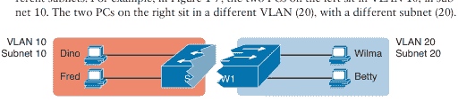

**图 1-7** *二层交换机不在 VLAN 之间路由*

> **注意** 该图较为笼统地提及子网，例如“子网 10”，只是为了让子网编号不分散注意力。另外，请注意子网编号不必与 VLAN 编号相同。

图 1-7 将该交换机显示为好像被拆成两台交换机，以强调二层交换机不会在两个 VLAN 之间转发数据。当配置为一些端口在 VLAN 10 中、另一些端口在 VLAN 20 中时，该交换机就像两台独立的交换机一样转发流量。事实上，VLAN 的一个目标就是将某个 VLAN 中的流量与另一个 VLAN 的流量隔离开来，防止一个 VLAN 中的帧泄漏到其他 VLAN。

**关键主题**

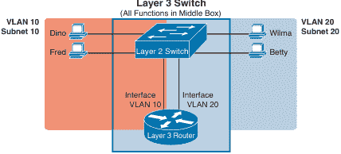

**图 1-10** *多层交换机：在一台设备中实现二层交换与三层路由*

本章介绍在 VLAN 之间（更准确地说，是在 VLAN 上的子网之间）路由 IP 数据包的核心概念。第19章“LAN 中的 IPv4 路由”展示了如何配置使用外部路由器和单臂路由的设计。本章现在将注意力转向 VLAN 和 VLAN 中继的配置与验证任务。

## VLAN 与 VLAN 中继配置和验证

思科交换机无需任何配置即可工作。你可以购买思科交换机，使用正确的线缆安装设备，打开交换机，它们就能工作。你永远不需要配置交换机，即使将交换机互连，它也能正常工作，直到你需要多个 VLAN。但是，如果你想使用 VLAN——大多数企业网络都会使用——就需要添加一些配置。

本章将 VLAN 配置细节分为两个主要部分。第一部分介绍如何配置接入接口，即不使用 VLAN 中继的交换机接口。第二部分展示如何配置确实使用 VLAN 中继的接口。

### 创建 VLAN 并将接入 VLAN 分配给接口

本节展示如何创建 VLAN、为 VLAN 命名，以及将接口分配给 VLAN。为了聚焦这些基础细节，本节使用单台交换机展示示例，因此不需要 VLAN 中继。

要使思科交换机在特定 VLAN 中转发帧，必须将交换机配置为认为该 VLAN 存在。此外，交换机必须具有分配给该 VLAN 的非中继接口（称为*接入接口*），和/或支持该 VLAN 的中继。接入接口的配置步骤如下，中继配置将在后面的“VLAN 中继配置”一节中展示：

- **步骤 1.** 要配置一个新 VLAN，请执行以下步骤：
  - A. 在全局配置模式下使用 `vlan vlan-id` 命令创建 VLAN，并使用户进入 VLAN 配置模式。
  - B.（可选）在 VLAN 配置模式下使用 `name name` 命令为 VLAN 指定名称。如果未配置，则 VLAN 名称为 VLANZZZZ，其中 ZZZZ 是四位十进制 VLAN ID。
- **步骤 2.** 对于每个接入接口（即每个不进行中继、而是属于单个 VLAN 的接口），执行以下步骤：
  - A. 在全局配置模式下使用 `interface type number` 命令，进入每个所需接口的接口配置模式。
  - B. 在接口配置模式下使用 `switchport access vlan id-number` 命令，指定与该接口关联的 VLAN 编号。
  - C.（可选）在接口配置模式下使用 `switchport mode access` 命令，使该端口始终以接入模式运行（即不进行中继）。

虽然这个列表可能看起来有点吓人，但在单台交换机上的过程实际上相当简单。例如，如果你想把交换机的端口放入三个 VLAN——11、12 和 13——你只需添加三条 vlan 命令：vlan 11、vlan 12 和 vlan 13。然后，对于每个接口，添加 switchport access vlan 11（或 12 或 13）命令，将该接口分配到正确的 VLAN。

> **注意** *默认 VLAN* 一词（如考试主题所示）指的是 `switchport access vlan vlan-id` 命令的默认设置，该默认值为 VLAN ID 1。换言之，默认情况下，每个端口都分配给接入 VLAN 1。

### VLAN 配置示例 1：完整 VLAN 配置

示例 1-1 展示了添加新 VLAN 并将接入接口分配给该 VLAN 的配置过程。图 1-11 展示了该示例中使用的网络，其中有一台 LAN 交换机（SW1），以及三个 VLAN（1、2 和 3）中每个 VLAN 的两台主机。该示例详细展示了 VLAN 2 的两步配置过程以及 VLAN 2 中的接口，VLAN 3 的配置则推迟到下一个示例。

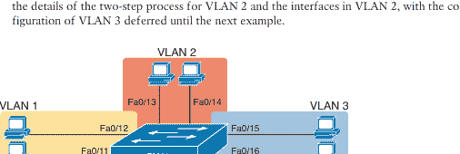

**图 1-11** 一台交换机与三个 VLAN 的网络

示例 1-2 展示了当 `switchport access vlan` 接口子命令引用一个当前未配置的 VLAN 时，交换机如何动态创建 VLAN——这相当于 `vlan vlan-id` 全局配置命令。本示例开始时，SW1 尚不知道 VLAN 3。当使用 `switchport access vlan 3` 接口子命令时，交换机会意识到 VLAN 3 不存在，并且如示例中阴影消息所示，交换机使用默认名称（VLAN0003）创建了 VLAN 3。创建该 VLAN 不需要其他步骤。在此过程结束时，交换机中已存在 VLAN 3，并且接口 Fa0/15 和 Fa0/16 位于 VLAN 3 中，如 `show vlan brief` 命令输出的阴影部分所示。

## VLAN 中继协议

在展示更多配置示例之前，你还需要了解一种名为 VLAN 中继协议（VTP）的思科协议和工具。VTP 是思科交换机上的一种思科专有工具，它通告在一台交换机中配置的每个 VLAN（使用 `vlan number` 命令），以便园区中的所有其他交换机都能获知该 VLAN。然而，由于各种原因，许多企业选择不使用 VTP。

每台交换机可以使用三种 VTP 模式之一：服务器、客户端或透明。当交换机希望将 VTP 用于其预期用途——动态通告 VLAN 配置信息——时，会使用 VTP 服务器模式或客户端模式。然而，对于许多思科交换机和 IOS 版本，无法在思科交换机上完全禁用 VTP；相反，交换机通过使用 VTP 透明模式来禁用 VTP。

第5章“VLAN 中继协议”讨论了如何利用 VTP。第1章至第4章大多忽略 VTP。为此，本书中的所有示例使用的交换机都已设置为使用 VTP 透明模式（使用 `vtp mode transparent` 全局命令），或者禁用 VTP（使用 `vtp mode off` 全局命令）。这两种选项都允许管理员配置标准范围和扩展范围 VLAN，并且交换机会在运行配置文件中列出 `vlan` 命令。

最后，从实用角度提醒一下：如果你碰巧使用真实交换机或模拟器做实验练习，并且在 VLAN 方面看到异常结果，请使用 `show vtp status` 命令检查 VTP 状态。如果你的交换机使用 VTP 服务器或客户端模式，你会发现：

- 服务器交换机只能配置标准范围（1–1005）内的 VLAN。
- 客户端交换机不能配置 VLAN。
- 由于 VTP，服务器和客户端都可能从其他交换机学习新的 VLAN，并看到自己的 VLAN 被其他交换机删除。
- `show running-config` 命令不会列出任何 `vlan` 命令。

如果实验环境允许，请切换到 VTP 透明模式，并在练习交换机配置时忽略 VTP，直到你准备在学习 ICND2 考试主题时重点关注 VTP 的工作原理。

> **注意** 在了解第5章所解释的 VTP 工作原理之前，不要更改任何同时连接到生产网络的交换机上的 VTP 设置。


## VLAN 中继配置

如果只需静态配置中继，两台 Cisco 交换机之间的中继配置可以非常简单。例如，如果两台 Cisco 2960 交换机相互连接，它们仅支持 802.1Q 而不支持 ISL。你实际上只需在链路两侧的交换机接口上添加一条接口子命令（`switchport mode trunk`），就能创建一条支持各交换机已知所有 VLAN 的 VLAN 中继。

然而，Cisco 交换机上的中继配置包含更多选项，包括用于动态协商各种中继设置的若干选项。配置可以预先定义不同的设置，也可以让交换机自行协商设置，具体如下：

- **中继类型：** IEEE 802.1Q、ISL，或协商使用哪一种
- **管理模式：** 始终中继、始终不中继或协商

首先考虑中继类型。支持 ISL 和 802.1Q 的 Cisco 交换机可以使用动态中继协议（DTP）协商使用哪种类型。如果两台交换机都支持这两种协议，则使用 ISL；否则，使用双方都支持的协议。如今，许多 Cisco 交换机不再支持较旧的 ISL 中继协议。同时支持两种中继类型的交换机使用 **`switchport trunk encapsulation {dot1q | isl | negotiate}`** 接口子命令来配置类型或允许 DTP 协商类型。

DTP 还可以根据本地交换机端口的管理模式，协商链路两端的设备是否同意建立中继。管理模式是指关于是否应使用中继的配置设置。每个接口还有一个*操作*模式，它指的是接口上当前实际发生的情况，可能由 DTP 与对端设备协商决定。Cisco 交换机使用 **`switchport mode`** 接口子命令来定义管理性中继模式，如表 1-2 所列。

**表 1-2  使用 `switchport mode` 命令的中继管理模式选项**

| 命令选项 | 描述 |
|---|---|
| access | 始终作为接入（非中继）端口 |
| trunk | 始终作为中继端口 |
| dynamic desirable | 主动发送协商消息并响应协商消息，动态选择是否开始使用中继 |
| dynamic auto | 被动等待接收中继协商消息，收到后交换机将响应并协商是否使用中继 |

例如，考虑图 1-12 中所示的两台交换机。此图展示了图 1-11 所示网络的扩展，其中有一条到新交换机（SW2）的中继链路，并且 VLAN 1 和 VLAN 3 的部分端口连接到 SW2。这两台交换机使用千兆以太网链路作为中继。在这种情况下，中继默认不会动态形成，因为两台（2960）交换机默认的管理模式都是 *dynamic auto*，这意味着两台交换机都不会主动发起中继协商过程。通过将一台交换机改为使用 *dynamic desirable* 模式（该模式会主动发起协商），两台交换机会协商使用中继，具体来说是 802.1Q，因为 2960 交换机仅支持 802.1Q。

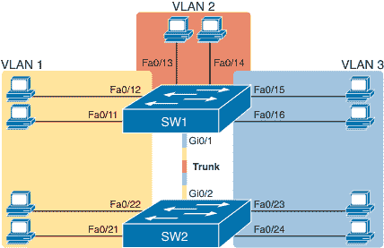

**图 1-12**  *两台交换机与三个 VLAN 的网络*

示例 1-3 首先展示了图 1-12 中两台交换机在默认配置下的状态，此时两台交换机不进行中继。

### 示例 1-3  *初始（默认）状态：SW1 与 SW2 之间未中继*

```
SW1# show interfaces gigabit 0/1 switchport
Name: Gi0/1
Switchport: Enabled
Administrative Mode: dynamic auto
Operational Mode: static access
Administrative Trunking Encapsulation: dot1q
Operational Trunking Encapsulation: native
Negotiation of Trunking: On
Access Mode VLAN: 1 (default)
Trunking Native Mode VLAN: 1 (default)
Administrative Native VLAN tagging: enabled
Voice VLAN: none
Administrative private-vlan host-association: none
Administrative private-vlan mapping: none
Administrative private-vlan trunk native VLAN: none
Administrative private-vlan trunk native VLAN tagging: enabled
Administrative private-vlan trunk encapsulation: dot1q
Administrative private-vlan trunk normal VLANs: none
Administrative private-vlan trunk private VLANs: none
```

```
SW1# show interfaces gigabit 0/1 switchport
Name: Gi0/1
Switchport: Enabled
Administrative Mode: dynamic desirable
Operational Mode: trunk
Administrative Trunking Encapsulation: dot1q
Operational Trunking Encapsulation: dot1q
Negotiation of Trunking: On
Access Mode VLAN: 1 (default)
Trunking Native Mode VLAN: 1 (default)
! 为简洁起见省略了若干行

! 下一条命令以前只输出一个空行；现在它输出
! 关于一条操作中继的信息。
SW1# show interfaces trunk
Port        Mode         Encapsulation  Status        Native vlan
Gi0/1       desirable    802.1q         trunking      1

Port        Vlans allowed on trunk
Gi0/1       1-4094

Port        Vlans allowed and active in management domain
Gi0/1       1-3

Port        Vlans in spanning tree forwarding state and not pruned
Gi0/1       1-3

SW1# show vlan id 2
VLAN Name                             Status    Ports
---- -------------------------------- --------- -------------------------------
2    Preda-vlan                       active    Fa0/13, Fa0/14, G0/1

VLAN Type  SAID       MTU   Parent RingNo BridgeNo Stp  BrdgMode Trans1 Trans2
---- ----- ---------- ----- ------ ------ -------- ---- -------- ------ ------
2    enet  100010     1500  -      -      -        -    -        0      0

Remote SPAN VLAN
----------------
Disabled

Primary Secondary Type              Ports
------- --------- ----------------- ------------------------------------------
```

为了验证中继现在是否正常工作，示例 1-4 中间部分列出了 `show interfaces switchport` 命令。请注意，该命令仍然列出管理性

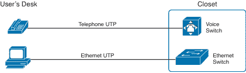

**图 1-13** *IP 电话之前：PC 和电话各用一根线缆，连接到两个不同的设备*

*IP 电话*一词指的是网络通信中的一个分支，其中电话使用 IP 数据包来发送和接收语音，语音由 IP 数据包数据部分的比特表示。电话像大多数其他终端用户设备一样，通过以太网或 Wi-Fi 连接到网络。这些新型 IP 电话并非通过线缆直接连接到语音交换机，而是使用以太网线缆和电话内置的以太网端口连接到 IP 网络。然后，电话通过 IP 网络与取代 PBX 呼叫建立及其他功能的软件进行通信。（Cisco 目前执行此 IP 电话控制功能的产品称为 *Cisco Unified Communications Manager*。）

从使用已安装的电话线缆迁移到需要支持以太网的 UTP 线缆的新型 IP 电话，这在一些办公室中引发了一些问题。具体来说：

- 较旧的非 IP 电话使用的 UTP 线缆类别通常不支持 100 Mbps 或 1000 Mbps 以太网。
- 大多数办公室只有一根从配线间到每个桌面的 UTP 线缆，但现在两个设备（PC 和新型 IP 电话）都需要一根从桌面到配线间的线缆。
- 为每个桌面安装新线缆成本高昂，而且还需要更多的交换机端口。

为了解决这个问题，Cisco 在每个电话中内置了一个小型三端口交换机。

自最早的 IP 电话产品以来，IP 电话就在电话底部内置了一个小型 LAN 交换机。图 1-14 展示了基本的线缆连接方式：配线间线缆连接到嵌入式交换机的一个物理端口，PC 用一根短跳线连接到另一个物理端口，电话的内部 CPU 连接到一个内部交换机端口。

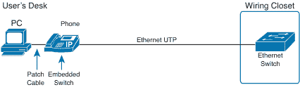

**图 1-14** *使用 IP 电话、单根线缆和集成交换机的线缆连接方式*


## 关键主题

使用IP电话的站点（如今几乎所有公司都如此）每个接入端口现在都连接着两台设备。此外，Cisco关于IP电话设计的最佳实践告诉我们，应将电话放在一个VLAN中，将PC放在另一个不同的VLAN中。为了实现这一点，交换机端口的行为既有点像接入链路（用于PC流量），又有点像中继链路（用于电话流量）。配置在该端口上定义了两个VLAN，如下所示：

**数据VLAN：** 与接入端口上的接入VLAN概念和配置相同，但被定义为该链路上用于转发连接到桌面电话的设备（通常是用户的PC）流量的VLAN。

**语音VLAN：** 在该链路上定义的用于转发电话流量的VLAN。此VLAN中的流量通常带有802.1Q标记头。

图1-15展示了这一设计，其中支持IP电话的接入端口上配置了两个VLAN。

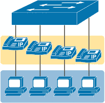

*图1-15* *局域网设计，数据在VLAN 10中，电话在VLAN 11中*

## 数据和语音VLAN的配置与验证

一旦你知道规划好的语音和数据VLAN ID，配置交换机端口以支持IP电话是很容易的。但在配置完成后，理解show命令的输出可能是一个挑战。该端口在许多方面表现得像接入端口。然而，在大多数配置选项下，语音帧会带有802.1Q标记头，因此该链路支持两种VLAN的帧。但这导致了一些不同的show命令输出。

示例1-5展示了一个例子。在此例中，四个交换机端口F0/1–F0/4均以默认配置开始。配置添加了新的数据和语音VLAN。然后，该示例将四个端口都配置为接入端口，并定义了接入VLAN，在讨论IP电话时，该接入VLAN也称为数据VLAN。最后，配置中包含`switchport voice vlan 11`命令，该命令定义了端口上使用的语音VLAN。该示例与图1-15匹配，使用了端口F0/1–F0/4。

### 示例1-5 在连接电话的端口上配置语音和数据VLAN

```text
SW1# configure terminal
Enter configuration commands, one per line. End with CNTL/Z.
SW1(config)# vlan 10
SW1(config-vlan)# vlan 11
SW1(config-vlan)# interface range FastEthernet0/1 - 4
SW1(config-if)# switchport mode access
SW1(config-if)# switchport access vlan 10
SW1(config-if)# switchport voice vlan 11
SW1(config-if)# ^Z
SW1#
```

> **注意** CDP（在ICND1书籍第33章“设备管理协议”中讨论）必须在接口上启用，语音接入端口才能与Cisco IP电话配合工作。CDP默认已启用，因此此处未显示其配置。

以下列表详细说明了配置步骤，以便于复习和学习：


- **第1步。** 在全局配置模式下，使用 VLAN *vlan-id* 命令在交换机上创建数据和语音VLAN（如果它们尚不存在）。
- **第2步。** 像往常一样，将数据VLAN配置为接入VLAN：
  - **A.** 在全局配置模式下，使用 interface *type number* 命令进入接口配置模式。
  - **B.** 在接口配置模式下，使用 switchport access vlan *id-number* 命令定义数据VLAN。
  - **C.** 在接口配置模式下，使用 switchport mode access 命令使该端口始终以接入模式运行（即不进行中继）。
- **第3步。** 在接口配置模式下，使用 switchport voice vlan *id-number* 命令设置语音VLAN ID。

验证像示例1-5中配置的交换机端口状态时，输出与本章前面看到的纯接入端口和纯中继端口配置有所不同。例如，`show interfaces switchport`命令显示有关接口操作的详细信息，包括许多有关接入端口的详细信息。示例1-6显示了在添加示例1-5中的配置后，端口F0/4的这些详细信息。

### 示例1-6 验证数据VLAN（接入VLAN）和语音VLAN

```text
SW1# show interfaces FastEthernet 0/4 switchport
Name: Fa0/4
Switchport: Enabled
Administrative Mode: static access
Operational Mode: static access
Administrative Trunking Encapsulation: dot1q
Operational Trunking Encapsulation: native
Negotiation of Trunking: Off
Access Mode VLAN: 10 (VLAN0010)
Trunking Native Mode VLAN: 1 (default)
Administrative Native VLAN tagging: enabled
Voice VLAN: 11 (VLAN0011)
! The rest of the output is omitted for brevity
```

查看输出中前三行突出显示的内容，这些细节对于任何接入端口来说都应该很熟悉。**switchport mode access**配置命令将管理模式静态配置为接入端口，因此该端口当然以接入端口模式运行。此外，如第三行突出显示所示，**switchport access vlan 10**配置命令定义了接入模式VLAN，如这里所突出显示的。

第四行突出显示显示了唯一一点新的信息：语音VLAN ID，在本例中由**switchport voice vlan 11**命令设置。这一小行输出是本章前面接入端口示例中唯一不同的信息。

这些端口的行为更像接入端口而非中继端口。事实上，**show interfaces** *type number* **switchport**命令明确地宣告“操作模式：静态接入”。然而，另一个**show**命令则进一步揭示了语音帧使用802.1Q标记的底层操作。

如前所述，**show interfaces trunk**命令——即命令中间不包含特定接口的命令——会列出交换机上的运行中继端口。对于IP电话端口，这些端口也不会出现在中继端口列表中——这证明了这些链路*并非*被当作中继端口处理。示例1-7正是这样的例子。

然而，**show interfaces trunk**命令（在命令中间列出接口，如示例1-7所示）确实会列出一些额外的信息。请注意，在本例中，**show interfaces F0/4 trunk**命令将状态列为not-trunking，但中继上允许VLAN 10和11。（通常，在接入端口上，该命令输出的“中继允许的VLAN”列表中只列出接入VLAN。）

### 示例1-7 允许的VLAN列表和活动VLAN列表

```text
SW1# show interfaces trunk

SW1# show interfaces F0/4 trunk

Port      Mode             Encapsulation  Status        Native vlan
Fa0/4     off              802.1q         not-trunking  1

Port      Vlans allowed on trunk
Fa0/4     10-11

Port      Vlans allowed and active in management domain
Fa0/4     10-11

Port      Vlans in spanning tree forwarding state and not pruned
Fa0/4     10-11
```

## 总结：交换机上的IP电话端口

关于IP电话和交换机配置的这一简短主题似乎包含了许多曲折和小细节，确实如此。需要记住的最重要事项如下：


- 一开始将这些端口配置为普通的接入端口：将其配置为静态接入端口并分配一个接入VLAN。
- 再添加一条命令来定义语音VLAN（*switchport voice vlan vlan-id*）。
- 在 *show interfaces type number switchport* 命令的输出中查找语音VLAN ID，但不要期望有其他新信息。
- 在 *show interfaces type number trunk* 命令的输出中同时查找语音和数据（接入）VLAN ID。
- 不要期望在 *show interfaces trunk* 命令列出的运行中继端口列表中看到该端口。


## 章节复习

在考试中取得好成绩的一个关键是进行重复的间隔性复习。请使用书中的工具、DVD或本书配套网站上的互动工具来复习本章材料。有关更多详细信息，请参阅“你的学习计划”部分。表1-4列出了关键的复习要素及其查找位置。为了更好地跟踪你的学习进度，请在第二列中记录你完成这些活动的日期。

**表1-4** 章节复习跟踪

| 复习要素 | 复习日期 | 使用的资源 |
| --- | --- | --- |
| 复习关键主题 |  | 书籍、DVD/网站 |
| 复习关键术语 |  | 书籍、DVD/网站 |
| 回答DIKTA问题 |  | 书籍、PCPT |
| 完成实验 |  | 博客 |
| 复习记忆表格 |  | DVD/网站 |
| 复习配置清单 |  | 书籍、DVD/网站 |
| 复习命令表 |  | 书籍 |

### 复习所有关键主题


**表1-5** 第1章的关键主题

| 关键主题要素 | 描述 | 页码 |
| --- | --- | --- |
| 图1-2 | VLAN基本概念 | 17 |
| 列表 | 使用VLAN的原因 | 17 |
| 图1-5 | VLAN中继示意图 | 19 |
| 图1-6 | 802.1Q标记头 | 20 |
| 图1-9 | 使用单臂路由在VLAN间路由 | 23 |
| 图1-10 | 使用三层交换机在VLAN间路由 | 24 |


## 生成树协议概念

**本章涵盖以下考试主题：**

- **1.0 局域网交换技术**
  - 1.3 配置、验证并排查 STP 协议故障
    - 1.3.a STP 模式（PVST+ 和 RPVST+）
    - 1.3.b STP 根桥选择
  - 1.4 配置、验证并排查 STP 相关可选功能故障
    - 1.4.a PortFast
    - 1.4.b BPDU 防护
  - 1.5 配置、验证并排查（第 2 层/第 3 层）EtherChannel 故障
    - 1.5.a 静态
    - 1.5.b PAgP
    - 1.5.c LACP

生成树协议（STP）使以太网 LAN 能够获得在 LAN 中安装冗余链路带来的额外好处，同时克服添加这些额外链路时出现的已知问题。在 LAN 设计中使用冗余链路，可使 LAN 即使在某些链路发生故障，甚至在某些整台交换机发生故障时仍能继续工作。恰当的 LAN 设计应增加足够的冗余，使任何单点故障都不会导致 LAN 崩溃；STP 允许设计使用冗余，而不会引发其他一些问题。

STP 影响交换机转发逻辑工作方式的许多方面。因为思科将 STP 考试主题放入 CCNA 路由和交换考试的 ICND2 部分，所以《ICND1 认证指南》中的所有详细示例都避免在 LAN 中显示冗余链路。对于这本 ICND2 教材，大多数 LAN 示例都包含冗余。因此，你需要准备好重新思考从阅读《ICND1 认证指南》中学到的 LAN 知识，同时思考具有冗余链路的 LAN，以及 STP 和相关功能如何使这些 LAN 正常工作。

本章将材料组织为三个部分。第一部分介绍适用于大多数 STP 类型的核心 STP 概念。多年来，STP 不断改进和变化，其中快速生成树协议（RSTP）是一项重大改进。第一部分讨论不加入 RSTP 逻辑的 STP 概念，而第二个主要部分详细介绍 RSTP 概念。最后一个主要部分讨论少量优化并保障 STP 安全的功能：PortFast、BPDU Guard 和 EtherChannel。

至于本章的考试主题，请注意它们都使用同样的三个动词：配置、验证和排查故障。本章不会对任何具体主题深入到这个程度，而是为理解这些功能打下基础，以便你

5. 以下哪些 RSTP 端口状态与传统 802.1D STP 中的端口状态具有相同名称和用途？（选择两项。）
   a. 阻塞
   b. 转发
   c. 侦听
   d. 学习
   e. 丢弃

6. RSTP 为 STP 增加了一些概念，使端口能够在同一交换机上的另一个端口发生故障时承担某个角色。以下哪些说法正确描述了等待接替另一个端口角色的端口角色？（选择两项。）
   a. 替代端口等待成为根端口。
   b. 备份端口等待成为根端口。
   c. 替代端口等待成为指定端口。
   d. 备份端口等待成为指定端口。

7. 什么 STP 功能会使接口在物理上激活后立即进入转发状态？
   a. STP
   b. EtherChannel
   c. Root Guard
   d. PortFast

### 基础主题

### 生成树协议（IEEE 802.1D）

如果没有生成树协议（STP），具有冗余链路的 LAN 会导致以太网帧无限期循环。启用 STP 后，某些交换机会阻塞端口，使这些端口不转发帧。STP 智能地选择阻塞哪些端口，并考虑两个目标：

- VLAN 中的所有设备都能向其他所有设备发送帧。换句话说，STP 不会阻塞过多端口，从而避免将 LAN 的某些部分与其他部分隔断。
- 帧的寿命很短，不会在网络中无限循环。

STP 取得平衡，使帧能够送达每台设备，同时不会引发帧在网络中反复循环时出现的问题。

STP 通过在交换机使用每个接口发送或接收用户流量之前增加额外检查来防止帧循环。该检查是：如果该端口在该 VLAN 中处于 STP 转发状态，则照常使用；但如果处于 STP 阻塞状态，则阻塞所有用户流量，并且不在该 VLAN 中的该接口上发送或接收用户流量。

请注意，这些 STP 状态不会改变你已了解的交换机接口的其他信息。接口的已连接/未连接状态不会改变。接口作为接入端口或中继端口的运行状态不会改变。STP 增加了这个额外的 STP 状态，其中阻塞状态基本上就是禁用该接口。

在许多方面，最后两段概括了 STP 的作用。然而，STP 工作方式的细节可能需要相当多的学习和实践。本章第一个主要部分首先解释对 STP 的需求，以及 STP 为解决帧循环问题所做工作的基本思路。然后，本节大部分内容将介绍 STP 如何选择要阻塞哪些交换机端口，以实现 STP 的目标。

### 生成树的必要性

STP 可防止以太网 LAN 中的三类常见问题。这三类问题都是同一个事实的副作用：如果没有 STP，某些以太网帧会在网络中长时间循环（数小时、数天，如果 LAN 设备和链路永不故障，那真的会永远循环）。默认情况下，思科交换机会运行 STP，但你可以禁用 STP。除非你完全清楚自己在做什么，否则不要禁用它！

仅一个循环帧就会导致所谓的*广播风暴*。当任何类型的以太网帧——广播帧、组播帧或未知目的地的单播帧——在 LAN 中无限循环时，就会发生广播风暴。广播风暴会用那一个帧的副本占满所有链路，挤占正常帧，并且由于 PC 需要处理过多广播帧，还会显著影响终端用户设备的性能。

为帮助你理解这是如何发生的，图 2-1 展示了一个示例网络，其中 Bob 发送了一个广播帧。虚线显示了在不存在 STP 时交换机如何转发该帧。

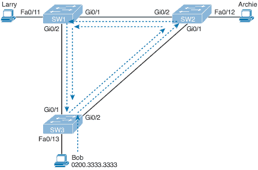

**图 2-1**  *广播风暴*

“我是否已经知道？”测验的答案：

1. A
2. B
3. C
4. B
5. B
6. A
7. D

> **注意** Bob 的原始广播也会沿另一个方向转发，SW3 会从其 Gi0/1 端口发出原始帧的一个副本。为减少杂乱，图 2-1 未显示该帧。

还记得 LAN 交换机吗？该逻辑告诉交换机将广播泛洪到同一 VLAN 中的所有接口（帧到达的接口除外）。在图 2-1 中，这意味着 SW3 将 Bob 的帧转发给 SW2，SW2 将帧转发给 SW1，SW1 将帧转发回 SW3，SW3 再将其转发回 SW2。

发生广播风暴时，像图 2-1 中的帧会持续循环，直到某些情况发生变化——有人关闭接口、重新加载交换机，或采取其他措施打破环路。另请注意，反方向也会发生同样的事件。当 Bob 发送原始帧时，SW3 还会将副本转发给 SW1，SW1 将其转发给 SW2，依此类推。

风暴还会导致一个更微妙的问题，称为 MAC 表不稳定。MAC 表不稳定意味着交换机的 MAC 地址表不断变化，因为具有相同源 MAC 的帧从不同端口到达。要了解原因，请跟随以下示例：在图 2-1 中，SW3 最初有一条与端口 Fa0/13 关联的 Bob 的 MAC 表条目，Bob 位于图底部：

```
0200.3333.3333   Fa0/13   VLAN 1
```

然而，现在想想当循环帧前往 SW2、然后 SW1、再回到 SW3 的 Gi0/1 接口时发生的交换机学习过程。SW3 会想：“嗯……源 MAC 地址是 0200.3333.3333，而且它从我的 Gi0/1 接口进入。更新我的 MAC 表！”这会在 SW3 上产生以下条目，接口为 Gi0/1，而不是 Fa0/13：

```
0200.3333.3333   Gi0/1   VLAN 1
```

此时，SW3 本身无法正确地将帧传送到 Bob 的 MAC 地址。在那一瞬间，如果有一个目的地为 Bob 的帧到达 SW3——该帧不同于造成问题的循环帧——SW3 会正确地将该帧从 Gi0/1 转发给 SW1，从而造成更多拥塞。

广播风暴中的循环帧还会导致第三个问题：帧的多个副本到达目的地。考虑一种情况：Bob 向 Larry 发送帧，但没有交换机知道 Larry 的 MAC 地址。交换机会泛洪发送到未知目的地单播 MAC 地址的帧。当 Bob 发送目的地为 Larry 的 MAC 地址的帧时，SW3 会向 SW1 和 SW2 都发送一个副本。SW1 和 SW2 也会泛洪该帧，导致帧的副本循环。SW1 还会将每个帧的副本从 Fa0/11 发送给 Larry。结果，Larry 会收到该帧的多个副本，这可能导致应用程序失败，甚至造成更普遍的网络问题。

表 2-2 总结了在具有冗余的 LAN 中未使用 STP 时发生的主要三类问题。


**关键主题**

**表 2-2 — 冗余 LAN 中不使用 STP 导致的三类问题**

| 问题 | 描述 |
|---|---|
| 广播风暴 | 帧在同一链路上反复转发，消耗链路容量的很大一部分。 |
| MAC 地址表不稳定 | 由于对环路帧作出反应，交换机的 MAC 地址表不断被错误条目更新，导致帧被发送到错误位置 |
| 多帧传输 | 环路帧的一种副作用，即同一帧的多个副本被送达目标主机，使主机混淆 |

## IEEE 802.1D 生成树的作用

STP 通过将每个交换机端口置于转发状态或阻塞状态来防止环路。处于转发状态的接口正常工作，转发和接收帧。但是，处于阻塞状态的接口除 STP 消息（以及一些其他开销消息）外不处理任何帧。阻塞的接口不转发用户帧，不学习所接收帧的 MAC 地址，也不处理接收到的用户帧。

图 2-2 展示了一个简单的 STP 树，它通过将 SW3 上的一个端口置于阻塞状态，解决了图 2-1 所示的问题。

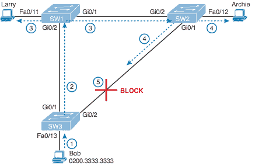

**图 2-2**  *STP 的作用：阻塞一个端口以打破环路*

现在当 Bob 发送广播帧时，该帧不会循环。如图所示步骤：

- **步骤 1.** Bob 将帧发送给 SW3。
- **步骤 2.** SW3 仅将帧转发给 SW1，而不从 Gi0/2 发往 SW2，因为 SW3 的 Gi0/2 接口处于阻塞状态。
- **步骤 3.** SW1 将帧从 Fa0/11 和 Gi0/1 泛洪出去。
- **步骤 4.** SW2 将帧从 Fa0/12 和 Gi0/1 泛洪出去。
- **步骤 5.** SW3 物理上接收到该帧，但它忽略从 SW2 收到的帧，因为 SW3 的 Gi0/2 接口处于阻塞状态。

采用图 2-2 中的 STP 拓扑时，交换机在此 VLAN 的流量中根本不使用 SW2 与 SW3 之间的链路，这是 STP 的一个轻微负面副作用。但是，如果另外两条链路中的任意一条发生故障，STP 会收敛，使 SW3 在其 Gi0/2 接口上转发而不是阻塞。

> **注意**  *STP 收敛*这一术语指的是交换机共同意识到 LAN 拓扑中发生了变化，并确定它们是否需要更改哪些端口阻塞、哪些端口转发的过程。

以上完成了对 STP 作用的描述：将每个端口置于转发状态或阻塞状态。更有趣、也需要更多精力去理解的问题是：STP 如何以及为何做出这些选择。STP 如何使交换机在每个接口上阻塞或转发？它又如何收敛，以在响应网络故障时改变从阻塞到转发的状态，从而利用冗余链路？以下各节将回答这些问题。

## 生成树的工作原理

STP 算法创建一个由转发帧的接口组成的生成树。转发接口的树形结构为每条以太网链路创建一条往返的单一路径，就像在一棵活的、生长中的树中，你可以从树根追踪一条单一路径到达每片叶子。

> **注意**  STP 早在 LAN 交换机出现之前就已创建。那时，以太网网桥使用 STP。如今，交换机扮演与网桥相同的角色，实现 STP。然而，许多 STP 术语仍然使用“网桥”。就 STP 和本章而言，请将*网桥*和*交换机*视为同义词。

STP 使用的过程有时称为*生成树算法*（STA），它选择应置于转发状态的接口。对于任何未被选择置于转发状态的接口，STP 会将这些接口置于阻塞状态。换言之，STP 只是选择哪些接口应转发，所有剩余的接口都进入阻塞状态。

STP 使用三个标准来选择是否将接口置于转发状态：

- STP 选举一台根交换机。STP 将根交换机上的所有工作接口置于转发状态。
- 每台非根交换机认为其某个端口在自身与根交换机之间具有最低管理开销。该开销称为该交换机的*根开销*。STP 将属于最低根开销路径的端口（称为该交换机的*根端口*（RP））置于转发状态。
- 多台交换机可以连接到同一以太网段，但在现代网络中，通常有两台交换机连接到每条链路。与连接到同一链路的其他交换机相比，根开销最低的交换机被置于转发状态。该交换机是指定交换机，而该交换机连接到该网段的接口称为*指定端口（DP）*。

> **注意**  根交换机将所有工作接口置于转发状态的真正原因是，其所有接口都将成为 DP，但更简单的记法是：根交换机的所有工作接口都将转发帧。

所有其他接口都被置于阻塞状态。表 2-3 总结了 STP 将端口置于转发状态或阻塞状态的原因。

**关键主题**

**表 2-3 STP：转发或阻塞的原因**

| 端口特征 | STP 状态 | 描述 |
|---|---|---|
| 根交换机的所有端口 | 转发 | 根交换机始终是所有已连接网段上的指定交换机。 |
| 每台非根交换机的根端口 | 转发 | 交换机通过该端口到达根交换机的开销最低（根开销最低）。 |
| 每个 LAN 的指定端口 | 转发 | 在该网段上转发 Hello 且根开销最低的交换机，是该网段的指定交换机。 |
| 所有其他工作端口 | 阻塞 | 该端口不用于转发用户帧，在这些接口上接收到的任何帧也不会被考虑转发。 |

> **注意**  STP 仅考虑工作接口（处于已连接状态的接口）。故障接口（例如未安装线缆的接口）或管理性关闭的接口则被置于 STP 禁用状态。因此，本节使用术语*工作端口*来指代在 STP 将该接口置于转发状态时能够转发帧的接口。

### STP 网桥 ID 与 Hello BPDU

STA 首先选举一台交换机作为根交换机。为了更好地理解此选举过程，你需要了解交换机之间发送的 STP 消息，以及用于唯一标识每台交换机的标识符的概念和格式。

STP *网桥 ID（BID）*是一个对每台交换机都唯一的 8 字节值。网桥 ID 由一个 2 字节的优先级字段和一个 6 字节的*系统 ID*组成，系统 ID 基于每台交换机中的*通用（固化）*MAC 地址。使用固化 MAC 地址可确保每台交换机的网桥 ID 都是唯一的。

STP 定义了称为*网桥协议数据单元（BPDU）*的消息，交换机使用这些消息相互交换信息。最常见的 BPDU 称为*Hello BPDU*，它列出许多详细信息，包括发送交换机的 BID。通过列出自己唯一的 BID，交换机可以分辨哪个交换机发送了哪个 Hello BPDU。表 2-4 列出了 Hello BPDU 中的一些关键信息。

**表 2-4 STP Hello BPDU 中的字段**

| 字段 | 描述 |
|---|---|
| 根网桥 ID | 此 Hello 的发送方当前认为是根交换机的交换机的网桥 ID |
| 发送方网桥 ID | 发送此 Hello BPDU 的交换机的网桥 ID |
| 发送方根开销 | 此交换机与当前根交换机之间的 STP 开销 |
| 根交换机上的定时器值 | 包括 Hello 定时器、MaxAge 定时器和转发延迟定时器 |

目前，只需记住表 2-4 中的前三项，因为以下各节将逐步介绍 STP 选择接口置于转发状态的三个步骤。接下来，正文将考察 STP 过程中的三个主要步骤。

### 选举根交换机

交换机根据 BPDU 中的 BID 选举根交换机。根交换机是 BID 数值最低的交换机。由于由两部分组成的 BID 以优先级值开头，因此本质上优先级最低的交换机成为根交换机。例如，如果一台交换机的优先级为 4096，另一台交换机的优先级为 8192，则优先级为 4096 的交换机获胜，无论每台交换机使用什么 MAC 地址来创建 BID。

如果根据 BID 的优先级部分出现平局，则 BID 中 MAC 地址部分最低的交换机为根交换机。不需要其他决胜条件，因为交换机使用自己的一个通用（固化）MAC 地址作为其 BID 的第二部分。因此，如果优先级相同，并且一台交换机使用 MAC 地址 0200.0000.0000 作为 BID 的一部分，另一台使用 0911.1111.1111，则第一台交换机（MAC 0200.0000.0000）成为根交换机。

STP 选举根交换机的方式与政治选举颇为相似。过程开始时，所有交换机都通过发送 Hello BPDU 并将自己的 BID 列为根 BID，来声称自己是根交换机。如果一台交换机听到一个列出了更好（更低）BID 的 Hello，该交换机就停止宣称自己是根，并开始转发这个更优 Hello。更优交换机发送的 Hello 将更优交换机的 BID 列为根。这就像一场政治竞选，不太受欢迎的候选人放弃并退出竞选，转而支持更受欢迎的候选人。最终，所有交换机就哪台交换机拥有最佳（最低）BID 达成一致，并且都支持当选交换机——而政治竞选类比正是在这里不再适用。

> **注意**  更好的 Hello（即所列根 BID 更好，数值更低）称为*更优 Hello*；更差的 Hello（即所列根 BID 较差，数值更高）称为*较差 Hello*。

图 2-3 展示了根选举过程的开始阶段。在此例中，SW1 已宣称自己是根，SW2 和 SW3 也如此。然而，SW2 现在认为 SW1 是更好的根，因此 SW2 现在转发源自 SW1 的 Hello。所以，此时图中显示：SW1 正在发送 Hello，声称自己是根；SW2 同意，并转发 SW1 的 Hello，其中将 SW1 列为根；但是，SW3 仍声称自己是最佳根，发送自己的 Hello BPDU，将 SW3 的 BID 列为根。


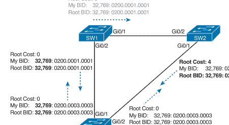

**图 2-3** 根交换机选举过程的开始

图 2-3 中仍有两个候选者：SW1 和 SW3。那么谁会获胜呢？根据 BID，BID 数值较低的交换机获胜；如果出现平局，则 MAC 地址较低的交换机获胜。如图所示，SW1 的 BID（32769:0200.0001.0001）低于 SW3 的 BID（32769:0200.0003.0003），因此 SW1 获胜，SW3 现在也认为 SW1 是更好的交换机。图 2-4 显示了交换机随后发送的 Hello 消息。

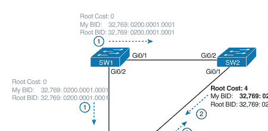

**图 2-4** SW1 赢得选举

选举完成后，只有根交换机会继续生成 STP Hello BPDU 消息。其他交换机收到 Hello 后，会更新发送方 BID 字段（以及根路径开销字段），并将 Hello 从其他接口转发出去。该图反映了这一事实：SW1 在步骤 1 发送 Hello，SW2 和 SW3 在步骤 2 分别将 Hello 从其其他接口转发出去。

总之，根交换机选举的过程是每台交换机都宣称自己是根交换机，然后根据 BID 数值最低者选出最优交换机。将 BID 拆分为组成部分后，比较规则如下：

- 优先级最低（数值最小）
- 若优先级相同，则交换机 MAC 地址最低

## 选择每台交换机的根端口

STP 过程的第二部分是每台非根交换机选择其唯一的一个*根端口（RP）*。交换机的 RP 是其到达根交换机所需 STP 开销最小的接口（即根路径开销最小）。

人类很容易理解交换机到达根交换机的开销这一概念。只需查看一张网络拓扑图，图中标出根交换机、列出每个交换机端口关联的 STP 开销，并指定所讨论的非根交换机即可。当然，交换机使用的方法与查看网络拓扑图不同，但使用拓扑图可以让这个概念更容易理解。

图 2-5 就是这样的示意图，其中仍是前面几张图中出现的那三台交换机。SW1 已赢得选举成为根交换机，该图从 SW3 的角度来考虑开销。

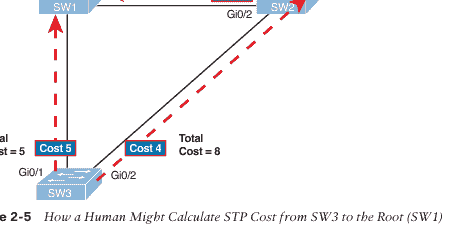

**图 2-5** *人类如何计算从 SW3 到根交换机（SW1）的 STP 开销*

SW3 有两条物理路径可将帧发送到根交换机：左侧的直接路径，以及经 SW2 到右侧的间接路径。开销是帧沿该路径传输时会从所有交换机端口出去的成本总和。（该计算忽略入端口。）如你所见，从 SW3 的 Gi0/1 端口出去的直达路径总开销为 5，另一条路径总开销为 8。SW3 选择其 Gi0/1 端口作为根端口，因为该端口是向根交换机发送帧的最低开销路径的一部分。

交换机也会得出相同的结论，但使用的方法不同。它们将自己本地接口的 STP 开销加到收到的每个 Hello BPDU 中列出的根路径开销上。STP

通过将所有收到的（且已修改的）Hello 从所有指定端口（DP）转发出去，所有交换机每 2 秒都会继续收到 Hello。以下步骤总结了 STP 拓扑中没有任何变化时的稳定运行状态：


- **步骤 1.** 根交换机生成一个根路径开销为 0 的 Hello BPDU，并从其所有工作接口（处于转发状态的接口）发送出去。
- **步骤 2.** 非根交换机在其根端口上收到 Hello。将 Hello 中的发送方 BID 改为自己的 BID，并填写该交换机的根路径开销后，交换机将 Hello 从所有指定端口转发出去。
- **步骤 3.** 重复步骤 1 和步骤 2，直到发生变化。

每台交换机都依靠这些定期从根交换机收到的 Hello 来判断自己到根交换机的路径是否仍然正常。当交换机不再收到 Hello，或收到的 Hello 中列出的信息发生变化时，说明出现了故障，因此交换机会做出反应，并开始改变生成树拓扑的过程。

## 交换机如何通过 STP 响应变化

出于多种原因，收敛过程需要使用三个计时器。请注意，所有交换机都使用根交换机规定的计时器，根交换机会在其周期性 Hello BPDU 消息中列出这些计时器。表 2-7 描述了这些计时器。


表 2-7 STP 计时器

| 计时器 | 默认值 | 描述 |
|---|---|---|
| Hello | 2 秒 | 根交换机生成的 Hello 之间的时间间隔。 |
| MaxAge | 10 倍 Hello 时间 | 任何交换机在停止收到 Hello 后，在尝试改变 STP 拓扑之前应等待的时间。 |
| 转发延迟 | 15 秒 | 影响接口从阻塞状态转换到转发状态过程的延迟。端口会在中间的侦听状态停留一段时间，然后在中间的学习状态再停留一段时间，时长由转发延迟计时器定义。 |

如果交换机在 Hello 时间内没有收到预期的 Hello BPDU，交换机会像往常一样继续运行。但是，如果在 MaxAge 时间内仍未再次收到 Hello，交换机会采取措施改变 STP 拓扑。在默认设置下，MaxAge 为 20 秒（默认 Hello 计时器 2 秒的 10 倍）。因此，交换机会在 20 秒没有收到 Hello 后才做出反应。

MaxAge 到期后，交换机会根据从其他交换机收到的任何 Hello，重新做出所有 STP 选择。它会重新评估哪台交换机应为根交换机。如果本地交换机不是根交换机，它会选择自己的 RP（根端口）。它还会确定自己在每条其他链路上是否为 DP（指定端口）。描述 STP 收敛的最佳方式是使用相同的熟悉拓扑来举例说明。图 2-7 显示了我们熟悉的拓扑，SW3 的 Gi0/2 处于阻塞状态，但 SW1 的 Gi0/2 接口刚刚发生故障。

SW3 会对这一变化做出反应，因为 SW3 在其 Gi0/1 接口上收不到预期的 Hello。但 SW2 无需反应，因为 SW2 继续在其 Gi0/2 接口上收到定期 Hello。在这种情况下，SW3 会在 MaxAge 时间过去仍没有收到 Hello 时做出反应，或者在 SW3 一发现 Gi0/1 接口发生故障时立即做出反应。（如果接口发生故障，交换机可以认定该接口不会再收到 Hello。）

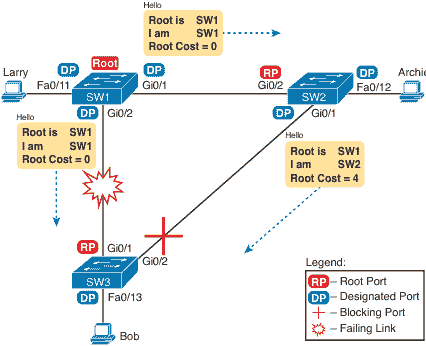

**图 2-7** *SW1-SW3 链路故障前的初始 STP 状态*

既然 SW3 可以采取行动，它会首先重新评估根交换机的选择。SW3 仍然收到 SW2 转发的来自根交换机（SW1）的 Hello。SW1 的 BID 仍然比 SW3 小；否则 SW1 不会已经是根交换机。因此，SW3 判定 SW1 仍然是最优交换机，而 SW3 不是根交换机。

接下来，SW3 重新评估其根端口的选择。此时，SW3 只在 Gi0/2 这一个接口上收到 Hello。无论计算出的根路径开销是多少，Gi0/2 都将成为 SW3 的新 RP。（假设图 2-5 和图 2-6 中的 STP 开销没有变化，该开销为 8。）

然后，SW3 重新评估它在其他接口上作为 DP 的角色。在本例中，实际上不需要做任何工作。SW3 在 Fa0/13 接口上已经是 DP，并且由于没有其他交换机连接到该端口，它将继续作为 DP。

## 使用 STP 更改接口状态

STP 使用角色和状态的概念。*角色*（如根端口和指定端口）与 STP 如何分析 LAN 拓扑有关。*状态*（如转发和阻塞）告诉交换机是否发送或接收帧。当 STP 收敛时，交换机会选择新的端口角色，而端口角色决定了状态（转发或阻塞）。

交换机可以立即从转发状态切换到阻塞状态，但从阻塞状态转换到转发状态必须额外花费时间。例如，当交换机以前使用端口 Gi0/1 作为其 RP（一种角色）时，该端口处于转发状态。收敛之后，Gi0/1 可能既不是 RP 也不是 DP；交换机可以立即将该端口移至阻塞状态。


当原先处于阻塞状态的端口需要转换为转发状态时，交换机会首先让该端口经历两个中间接口状态。这些临时状态有助于防止临时环路。

- **侦听：** 与阻塞状态一样，接口不转发帧。交换机会删除那些在此期间未从相应 MAC 地址收到帧的陈旧（未使用）MAC 表项。这些陈旧 MAC 表项可能是临时环路的原因。
- **学习：** 处于该状态的接口仍不转发帧，但交换机会开始学习从该接口收到的帧的 MAC 地址。

STP 使接口从阻塞状态转到侦听状态，然后转到学习状态，再转到转发状态。STP 让接口在每个中间状态停留的时间等于转发延迟计时器，默认值为 15 秒。因此，使接口从阻塞变为转发的收敛事件需要 30 秒才能完成从阻塞到转发的转换。此外，交换机甚至可能需要等待 MaxAge 秒，才会选择将接口从阻塞状态转为转发状态。

例如，观察图 2-3 至 2-6 所示的初始 STP 拓扑中发生的情况，其中 SW1 到 SW3 的链路发生故障，如图 2-7 所示。如果 SW1 只是停止向 SW3 发送 Hello 消息，但两者之间的链路并未故障，那么 SW3 会等待 MaxAge 秒后才作出反应（默认 20 秒）。实际上，SW3 会很快选择其端口的 STP 角色，但随后在接口 Gi0/2 的侦听状态和学习状态各等待 15 秒，从而导致 50 秒的收敛延迟。

表 2-8 总结了生成树的各种接口状态，以便于回顾。


**表 2-8 — IEEE 802.1D 生成树状态**

| 状态 | 是否转发数据帧？ | 是否根据收到的帧学习 MAC 地址？ | 过渡状态还是稳定状态？ |
|---|---|---|---|
| 阻塞 | 否 | 否 | 稳定 |
| 侦听 | 否 | 否 | 过渡 |
| 学习 | 否 | 是 | 过渡 |
| 转发 | 是 | 是 | 稳定 |
| 禁用 | 否 | 否 | 稳定 |


## 快速 STP（IEEE 802.1w）概念

原始 STP 在当时对网络和联网设备的假设下运行良好。然而，与任何计算或网络标准一样，随着时间推移，硬件和软件能力不断提高，因此会出现新协议来利用这些新能力。对于 STP 而言，随着时间推移最显著的改进之一是引入了快速生成树协议（RSTP），它作为 IEEE 802.1w 标准引入。

在深入了解 RSTP 的细节之前，先稍微厘清标准编号会有所帮助。802.1w 实际上是对 802.1D 标准的修正案。802.1D 于 1998 年重新发布（此前还发布过几次）。在 1998 年版 802.1D 之后，IEEE 于 2001 年发布了 802.1w 修正案。后来，当 IEEE 802.1 委员会于 2004 年更新 802.1D 标准时，IEEE 将 802.1w 修正案的细节并入 802.1D-2004 标准。

默认情况下，MaxAge 基于 Hello 计时器的十倍，即 20 秒。RSTP 缩短了该计时器，将 MaxAge 定义为 Hello 计时器的三倍。

理解这些机制的最佳方式是了解 RSTP 替代端口和备份端口如何工作。RSTP 使用术语*替代端口*来指代交换机的其他端口，这些端口在根端口发生故障时可用作根端口。*备份端口*概念为指定端口在本交换机上提供一个备份端口，但仅适用于某些拓扑，坦率地说，这些拓扑在现代网络设计中并不常见。不过，两者都有助于说明 RSTP 如何工作。表 2-9 列出了这些 RSTP 端口角色。


**表 2-9** 802.1w RSTP 中的端口角色

| 功能 | 端口角色 |
| --- | --- |
| 非根交换机到根的最佳路径 | 根端口 |
| 根端口故障时替代根端口 | 替代端口 |
| 指定为向冲突域转发的交换机端口 | 指定端口 |
| 指定端口故障时替代指定端口 | 备份端口 |
| 管理性禁用的端口 | 禁用端口 |

## RSTP 与替代（根）端口角色

使用 STP 时，每台非根交换机将一个端口置于 STP 根端口（RP）角色。RSTP 遵循相同惯例，选择 RP 的规则也完全相同。RSTP 随后又进一步，命名其他可能的 RP，并将它们标识为*替代端口*。

要成为替代端口，RP 和替代端口都必须收到标识同一根交换机的 Hello 消息。例如，在图 2-8 中，SW1 是根交换机。SW3 将在两个端口上收到 Hello BPDU：G0/1 和 G0/2。两个 Hello 消息都将 SW1 的桥 ID（BID）列为根交换机，因此任何不是根端口的端口都满足成为替代端口的条件。在此情况下，SW3 选择 G0/1 作为其根端口，然后将 G0/2 设为替代端口。

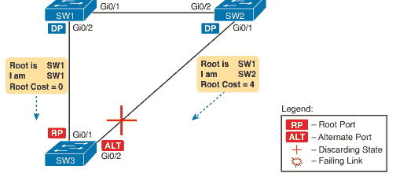

**图 2-8** *SW3 将 G0/2 变为替代端口的示例*

替代端口基本上相当于根端口的次优选项。替代端口可以接管原根端口，通常非常迅速，无需等待。

## RSTP 状态与过程

当然，前面示例的深度并未指出 RSTP 的所有细节；不过，该示例确实展示了足以讨论 RSTP 状态和内部过程的细节。

STP 和 RSTP 都使用端口状态，但存在一些差异。首先，与 STP 相比，RSTP 保留了学习状态和转发状态，用途相同。然而，RSTP 甚至没有定义侦听状态，认为它没有必要。最后，RSTP 将阻塞状态重命名为丢弃状态，并略微重新定义了其用途。

RSTP 用丢弃状态来对应 802.1D 中定义的两种状态：禁用状态和阻塞状态。到这里，阻塞状态应该已经比较明显：接口可以在物理上工作，但 STP/RSTP 选择不转发流量以避免环路。STP 的禁用状态只是表示接口被管理性禁用。RSTP 只是将这些合并为单一的丢弃状态。表 2-10 列出了 STP 和 RSTP 的状态，以便比较。


**表 2-10 — 端口状态比较：802.1D STP 与 802.1w RSTP**

| 功能 | 802.1D 状态 | 802.1w 状态 |
|---|---|---|
| 端口被管理性禁用 | 禁用 | 丢弃 |
| 忽略传入数据帧且不用于转发数据帧的稳定状态 | 阻塞 | 丢弃 |
| 不进行 MAC 学习且不转发的中间状态 | 侦听 | 未使用 |
| 进行 MAC 学习但不转发的中间状态 | 学习 | 学习 |
| 允许 MAC 学习和数据帧转发的稳定状态 | 转发 | 转发 |

与 STP 相比，RSTP 还改变了一些过程和消息内容，以加快收敛。例如，STP 在侦听状态和学习状态都要等待一段时间（转发延迟）。STP 中这种延迟的原因是，同时所有交换机都被通知使其 MAC 表项超时。当拓扑变化时，现有 MAC 表项实际上可能导致环路。使用 STP 时，所有交换机都会互相告知（通过 BPDU 消息）拓扑已变化，并使用转发延迟计时器使任何 MAC 表项超时。这会删除表项，这很好，但导致需要在侦听状态和学习状态各等待转发延迟时间（默认各 15 秒）。

为了更快收敛，RSTP 避免依赖计时器。RSTP 交换机会互相告知（使用消息）拓扑已变化。这些消息还会指示相邻交换机刷新其 MAC 表内容，以无需等待的方式删除所有可能引发环路的表项。因此，RSTP 创造了更多场景，使原先处于丢弃状态的端口可以立即转换为转发状态，无需等待，也无需经过学习状态，如图 2-9 中的示例所示。

## RSTP 与备份（指定）端口角色

与 STP 相比，RSTP 备份端口角色是又一个新增的 RSTP 端口角色。提醒一下，RSTP 替代端口角色为 RSTP 提供了一种快速替换交换机根端口的方式。类似地，RSTP 备份端口角色为 RSTP 提供了一种在某些 LAN 上快速替换交换机指定端口的方式。


备用端口的需求一开始可能有点令人困惑，因为只有在如今不太常见的设计中才会需要备用端口角色。原因在于，这种设计必须使用集线器，而这就可能导致一台交换机将多个端口连接到同一个冲突域。

图 2-10 展示了一个示例。SW3 和 SW4 都连接到同一个集线器。SW4 的端口 F0/1 恰好在选举中胜出，成为指定端口（DP）。SW4 上连接到同一冲突域的另一个端口 F0/2 则充当备用端口。

使用备用端口时，如果当前指定端口发生故障，SW4 可以快速收敛并开始使用备用端口。例如，如果 SW4 的 F0/1 接口发生故障，SW4 可以将 F0/2 转换为指定端口角色，并且从丢弃状态转为转发状态没有任何延迟。

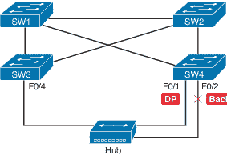

**图 2-10** *RSTP 备用端口示例*

## RSTP 端口类型

这里包含的最后一个 RSTP 概念涉及 RSTP 用来指代不同类型的端口以及连接到这些端口的链路的一些术语。

首先，请看图 2-11 的基本图示。它展示了两台交换机之间的若干条链路。RSTP 将这些链路视为点对点链路，并将连接到这些链路的端口视为点对点端口，因为该链路恰好连接两个设备（点）。

RSTP 进一步将点对点端口分为两类。连接两台交换机的点对点端口不在网络边缘，直接称为*点对点端口*。而连接到网络边缘的单个终端设备（如 PC 或服务器）的端口称为*点对点边缘端口*，或简称为*边缘端口*。在图 2-11 中，SW3 连接到 PC 的交换机端口就是一个边缘端口。

最后，RSTP 定义了术语*共享*，用于描述连接到集线器的端口。术语*共享*来源于集线器会创建共享以太网这一事实；集线器还会强制所连接的交换机端口使用半双工逻辑。RSTP 假设所有半双工端口都可能连接到集线器，因此将使用半双工的端口视为共享端口。与所有点对点端口相比，RSTP 在共享端口上的收敛速度更慢。

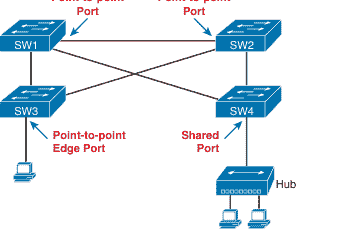

**图 2-11** *RSTP 链路类型*

## 可选的 STP 特性

至此，你已经学到了大量细节，这些细节将有助于接下来配置和验证 STP 操作，相关内容将在第 3 章讨论。不过，在进入那一章之前，本章的最后一节将简要介绍几个相关主题，它们能让 STP 工作得更好或更安全：EtherChannel、PortFast 和 BPDU Guard。

### EtherChannel

降低 STP 收敛时间的最佳方法之一是完全避免收敛。EtherChannel 提供了一种方法，使得在仅发生单个端口或线缆故障时，不需要进行 STP 收敛。

EtherChannel 将同一对交换机之间多条速度相同的并行链路（最多八条）组合起来，捆绑成一个 EtherChannel。就 STP 而言，交换机会将 EtherChannel 视为单个接口。因此，如果其中一条链路发生故障，但至少还有一条链路处于 up 状态，就不必发生 STP 收敛。例如，图 2-12 展示了熟悉的三交换机网络，但现在每对交换机之间都有两条千兆以太网连接。

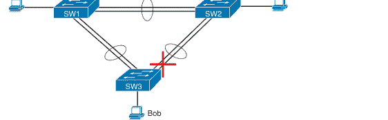

**图 2-12** *交换机之间的两段式 EtherChannel*

将每对以太网链路配置为一个 EtherChannel 后，STP 会将每个 EtherChannel 视为一条链路。换句话说，必须连接到同一台交换机的两条链路都发生故障，交换机才需要触发 STP 收敛。如果没有 EtherChannel，当两台交换机之间存在多条并行链路时，STP 会阻塞除一条之外的所有链路。使用 EtherChannel 后，所有并行链路可以同时处于 up 状态并工作，同时减少 STP 必须收敛的次数，进而提高网络的可用性。

当交换机做出通过 EtherChannel 发送帧的转发决策时，它还必须在逻辑上多执行一步：从哪个物理接口发送该帧？交换机具有负载均衡逻辑，可为每个帧选择一个接口，目标是将流量分散到通道中所有活动链路上。因此，使用 EtherChannel 的局域网设计能更好地利用交换机之间的可用带宽，同时减少 STP 必须收敛的次数。

请注意，EtherChannel 可以是二层 EtherChannel（如本文所述），也可以是三层 EtherChannel（如第 19 章“局域网中的 IPv4 路由”所讨论）。二层 EtherChannel 组合的是交换机用作交换机端口的链路，交换机使用二层交换逻辑通过 EtherChannel 转发和接收 EtherChannel 帧。三层 EtherChannel 也组合链路，但交换机使用三层路由逻辑通过 EtherChannel 转发数据包。除非另有说明，本书第 I 部分中所有对 EtherChannel 的引用均指二层 EtherChannel。

### PortFast

PortFast 允许交换机立即从阻塞状态转换为转发状态，绕过侦听和学习状态。但是，只有在你确知没有连接网桥、交换机或其他运行 STP 的设备时，才能安全地在这些端口上启用 PortFast。否则，使用 PortFast 会有产生环路的危险，而侦听和学习状态正是为了避免这种情况。

PortFast 最适合用于连接最终用户设备。如果在连接最终用户设备的端口上启用 PortFast，那么当最终用户的 PC 启动时，只要 PC 网卡处于活动状态，交换机端口就可以进入 STP 转发状态并转发流量。没有 PortFast 时，每个端口都必须等待交换机确认该端口是 DP，然后还要等待接口在临时的侦听和学习状态中停留一段时间，之后才能稳定到转发状态。

PortFast 是边缘端口上很受欢迎的特性；事实上，RSTP 融入了 PortFast 的概念。你可能还记得，在图 2-11 附近提到了 RSTP 端口类型，尤其是点对点边缘端口类型。按照协议设计，RSTP 通过绕过学习状态，在这些点对点边缘类型端口上快速收敛，这与 Cisco 最初通过 PortFast 引入的思路相同。在实践中，Cisco 交换机通过在该端口上启用 PortFast 来启用 RSTP 点对点边缘端口。

### BPDU Guard

STP 会使局域网面临几种不同类型的安全风险。例如：

- 攻击者可以将一台交换机连接到这些端口之一，该交换机具有较低的 STP 优先级值，并成为根交换机。新的 STP 拓扑性能可能比期望的拓扑更差。
- 攻击者可以插入多个端口、多台交换机，成为根交换机，并实际转发局域网中的大量流量。在网络人员未察觉的情况下，攻击者可以使用局域网分析器复制通过局域网发送的大量数据帧。
- 用户可能在购买并连接廉价的消费级局域网交换机（不使用 STP 的交换机）时，无意中损害局域网。这种交换机没有任何 STP 功能，不会选择阻塞任何端口，并可能导致环路。

*Cisco BPDU Guard* 特性通过在端口上收到任何 BPDU 时禁用该端口，帮助防止这类问题。因此，该特性对于那些只应作为接入端口使用、绝不应连接到另一台交换机的端口特别有用。

此外，BPDU Guard 特性有助于防止与 PortFast 相关的问题。只应在连接用户设备（而不是其他局域网交换机）的接入端口上启用 PortFast。在这些相同的端口上使用 BPDU Guard 是合理的，因为如果另一台交换机连接到这样的端口，本地交换机可以在环路形成之前禁用该端口。

## 本章复习

在考试中取得好成绩的一个关键，是进行重复的间隔复习。可以使用书中的工具、DVD，或本书配套网站上针对相同材料的交互式工具，来复习本章材料。有关更多详细信息，请参阅“你的学习计划”元素。表 2-11 概述了关键复习要素以及在哪里可以找到它们。为了更好地跟踪学习进度，请在第二列中记录你完成这些活动的日期。

**表 2-11 章节复习跟踪**

| 复习要素 | 复习日期 | 使用资源 |
|---|---|---|
| 复习关键主题 |  | 书、DVD/网站 |
| 复习关键术语 |  | 书、DVD/网站 |
| 回答 DIKTA 问题 |  | 书、PCPT |
| 复习记忆表 |  | 书、App |

### 复习所有关键主题


**表 2-12 第 2 章关键主题**

| 关键主题要素 | 描述 | 页码 |
|---|---|---|
| 表 2-2 | 列出在具有冗余链路的局域网中不使用 STP 时出现的三个主要问题 | 47 |
| 表 2-3 | 列出交换机选择将接口置于转发或阻塞状态的原因 | 49 |
| 表 2-4 | 列出 Hello BPDU 消息中最重要的字段 | 50 |
| 列表 | 根交换机选举的逻辑 | 52 |
| 图 2-6 | 展示交换机如何计算其根路径开销 | 53 |


## “我是否已经知道？”测验

如果你想用分数帮助自己决定在这一章上花多少时间，可以做这个测验（可以在这里做，也可以使用 PCPT 软件）。答案在本页测验后的底部，解析见 DVD 附录 C 和 PCPT 软件。

**表 3-1** —— “我是否已经知道？”基础主题章节与问题映射

| 基础主题章节 | 问题 |
|---|---|
| 实现 STP | 1–3 |
| 实现可选的 STP 特性 | 4 |
| 实现 RSTP | 5、6 |

- 1. 在 2960 交换机上，以下哪些命令会改变桥 ID 的值？（选择两个答案。）
  - **a.** `spanning-tree bridge-id value`
  - **b.** `spanning-tree vlan vlan-number root {primary | secondary}`
  - **c.** `spanning-tree vlan vlan-number priority value`
  - **d.** `set spanning-tree priority value`

- 2. 查看以下 Cisco 交换机上 **show spanning-tree** 命令输出摘录：

  ```
  Bridge ID  Priority    32771  (priority 32768 sys-id-ext 3)
            Address          0019.e86a.6f80
  ```

  关于收集到此命令输出的交换机，以下哪个答案是正确的？

  - **a.** 该信息是关于 VLAN 1 的 STP 实例。
  - **b.** 该信息是关于 VLAN 3 的 STP 实例。
  - **c.** 该命令输出确认此交换机不可能成为根交换机。
  - **d.** 该命令输出确认此交换机当前是根交换机。

- 3. 一台交换机的 G0/1 接口是支持 VLAN 1–10 的 trunk，已自动协商速率为 100 Mbps。该交换机当前的所有 STP 设置均为默认值。以下哪些操作会使该交换机在 VLAN 3 中为该接口使用 19 的 STP 开销？（选择两个答案。）
  - **a.** `spanning-tree cost 19`
  - **b.** `spanning-tree port-cost 19`
  - **c.** `spanning-tree vlan 3 port-cost 19`
  - **d.** 不添加任何配置

- 4. 一位工程师配置交换机，将接口 G0/1 和 G0/2 放入同一个二层 EtherChannel。以下哪个术语用于配置命令中？
  - **a.** **EtherChannel**
  - **b.** **PortChannel**
  - **c.** **Ethernet-Channel**
  - **d.** **Channel-group**

- 5. 查看 Cisco 交换机上 **show spanning-tree** 命令输出的以下前七行：

  ```
  SW1# show spanning-tree vlan 5

  VLAN0005
    Spanning tree enabled protocol rstp
    Root ID    Priority    32773
               Address     1833.9d7b.0e80
               Cost        15
               Port        25 (GigabitEthernet0/1)
               Hello Time  2 sec  Max Age 20 sec  Forward Delay 15 sec
  ```

  关于收集到此命令输出的交换机，以下哪个答案是正确的？（选择两个答案。）

  - **a.** 根交换机的 MAC 地址是 1833.9d7b.0e80，且本地交换机是根。
  - **b.** 本地交换机的 MAC 地址是 1833.9d7b.0e80，且它不是根。
  - **c.** 此交换机使用 STP 而不是 RSTP。
  - **d.** 此交换机使用 RSTP。

- 6. 以下输出展示了从运行 IOS 的 Cisco 交换机上提取的 **show spanning-tree** 命令输出的最后几行：

  ```
  SW1# show spanning-tree vlan 10
  ! lines omitted

  Interface             Role Sts Cost      Prio.Nbr Type
  --------------------  ---- --- --------- -------- --------
  Fa0/1                 Desg FWD 100       128.1    P2p Edge
  Fa0/2                 Desg FWD 19        128.2    Shr
  Gi0/1                 Desg FWD 4         128.5    P2p
  Gi0/2                 Root FWD 4         128.26   P2p
  ```

  这些答案都提到了一个接口以及输出中 Type 列所列出的状态，并给出了该端口应被列为该类型 STP 端口的原因。哪个答案列出了接口被列为该类型 STP 端口的可能正确原因？（选择两个答案。）

  - **a.** Fa0/1 是 P2p Edge，原因是 `spanning-tree rstp edge` 接口子命令。
  - **b.** Fa0/2 是 Shr，原因是 Fa0/2 使用半双工。
  - **c.** Gi0/1 是 P2p，因为它是一个 VLAN trunk。
  - **d.** Gi0/2 是 P2p，因为交换机没有理由将其设为 Shr 或 P2p Edge。

## 设置 STP 模式

第 2 章描述了 802.1D STP 如何在一个 VLAN 中工作。既然本章将注意力转向 Cisco 交换机中的 STP 配置，那么首先的问题之一就是：你打算在 LAN 中使用哪种 STP？要回答这个问题，你需要了解一点背景知识。

IEEE 最初将 STP 标准化为 IEEE 802.1D 标准，该标准最早于 1990 年发布。从那个日期来看，当时 Cisco 没有销售任何 LAN 交换机，虚拟 LAN 也尚不存在。当时 LAN 中不是多个 VLAN，而只有一个广播域，以及一个 STP 实例。然而，VLAN 的增加以及 LAN 交换机引入市场，产生了扩展和增强 STP 的需求。

如今，基于 Cisco IOS 的 LAN 交换机允许你使用三种反映这一历史的 STP 配置模式之一。本章前两节使用称为每 VLAN 生成树增强版（PVST+，有时简称 PVST）的模式，这是 Cisco 专有的 802.1D STP 改进版。名称中的 *per-VLAN* 部分揭示了主要特性：PVST+ 为每个 VLAN 创建不同的 STP 拓扑，而 802.1D 实际上并非如此。PVST+ 还引入了 PortFast。Cisco 交换机通常使用 PVST+ 作为默认 STP 模式，依据默认全局命令 `spanning-tree mode pvst`。

随着时间的推移，Cisco 还增加了 RSTP 支持，提供了两种恰好使用 RSTP 的 STP 模式。一种模式基本上是在 PVST+ 基础上将其升级为也使用 RSTP 逻辑，这种模式称为 *Rapid PVST+*，通过全局命令 **spanning-tree mode rapid-pvst** 启用。基于 Cisco IOS 的交换机支持第三种模式，称为多生成树（MST）（或多生成树实例），通过 **spanning-tree mode mst** 命令启用。（本书除简要提及外不讨论 MST；CCNP Switch 考试通常会包含 MST 细节。）

## 将 STP 概念与 STP 配置选项联系起来

如果你回想第 2 章中 STP 操作的细节，STP 在大多数决策中使用两类数字：BID 和 STP 端口开销。聚焦这两类数字，考虑以下关于 STP 幕后所做工作的总结：

- 使用 BID 选举根交换机，选举数值最低的 BID 的交换机
- 当每台非根交换机选择自己的根端口（RP）时，使用到根路径中每条路径的总 STP 开销
- 当交换机决定哪个交换机端口成为每个 LAN 段上的指定端口（DP）时，使用每台交换机的根开销，而根开销又基于 STP 端口开销

不出所料，Cisco 交换机允许你配置交换机 BID 的一部分以及 STP 端口开销，这反过来会影响每台交换机在 STP 中做出的选择。

## 每 VLAN 配置设置

除了支持配置 BID 和 STP 端口开销之外，Cisco 交换机还支持按 VLAN 配置这两项设置。默认情况下，Cisco 交换机使用 IEEE 802.1D，而不是 RSTP（802.1w），并采用称为每 VLAN 生成树增强版（PVST+）的 Cisco 专有特性。PVST+（如今通常简称为 PVST）为每个 VLAN 创建不同的 STP 实例。因此，在查看可调 STP 参数之前，你需要对 PVST+ 有基本了解，因为每个 STP 实例的配置设置可能不同。

PVST+ 为工程师提供了一种 STP 负载均衡工具。通过针对不同 VLAN 以不同方式更改某些 STP 配置参数，工程师可以让交换机在不同 VLAN 中选择不同的 RP 和 DP。结果，某些 VLAN 中的部分流量可以通过一条 trunk 转发，而其他 VLAN 的流量可以通过另一条 trunk 转发。

图 3-2 展示了基本思想：SW3 将奇数 VLAN 流量通过左侧 trunk（Gi0/1）转发，将偶数 VLAN 流量通过右侧 trunk（Gi0/2）转发。

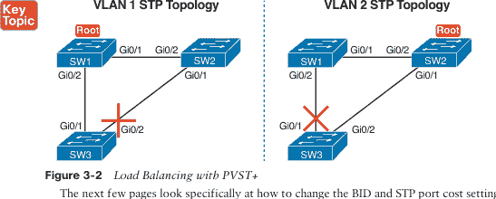

接下来几页将具体介绍在使用默认 PVST+ 模式时，如何按 VLAN 更改 BID 和 STP 端口开销设置。

### 桥 ID 与系统 ID 扩展

最初，交换机的 BID 由交换机的 2 字节优先级和 6 字节 MAC 地址组合而成。后来，IEEE 更改了规则，将原来的优先级字段拆分为两个独立字段，如图 3-3 所示：一个 4 位优先级字段和一个 12 位子字段，称为系统 ID 扩展（表示 VLAN ID）。

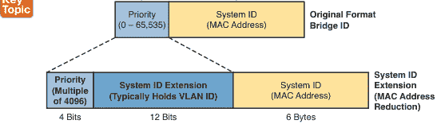

Cisco 交换机允许你配置 BID，但只能配置优先级部分。交换机将其通用（固化）MAC 地址填入作为系统 ID。它还会填入某个 VLAN 的 VLAN ID


VLAN位于12位系统ID扩展字段中。网络工程师唯一可配置的部分是4位优先级字段。

然而，配置优先级字段中的数字是Cisco路由器或交换机上最奇怪的配置之一。如图3-3顶部所示，优先级字段最初是一个16位数字，表示从0到65,535的十进制数。由于这段历史，当前的配置命令（`spanning-tree vlan vlan-id priority x`）要求一个介于0和65,535之间的十进制数。但并非该范围内的任何数字都有效——它必须是4096的倍数：0、4096、8192、12288，依此类推，直到61,440。

交换机根据配置的值设置BID的前4位。事实证明，在从0到61,440的16个允许的4096倍数中，每个倍数的前4位都有不同的二进制值：0000、0001、0010，依此类推，直到1111。交换机根据配置值的前4位设置真正的4位优先级。

尽管历史和配置可能使BID优先级的概念显得有点复杂，但在BID中增加一个12位字段在实践中效果很好，因为它可用于识别VLAN ID。VLAN ID的范围为1到4094，需要12位。Cisco交换机将VLAN ID放入系统ID扩展字段中，因此每台交换机在每个VLAN中都有唯一的BID。

例如，一台配置了VLAN 1到4的交换机，默认基础优先级为32,768，在VLAN 1中的默认STP优先级为32,769，VLAN 2中为32,770，VLAN 3中为32,771，依此类推。因此，你可以将16位优先级视为基础优先级（如`spanning-tree vlan *vlan-id* priority x`命令中所配置的）加上VLAN ID。

> **注意** Cisco交换机必须使用系统ID扩展版本的网桥ID；无法禁用。

## 每VLAN端口成本

每个交换机接口根据第2章表2-6中列出的IEEE建议，默认设置其每VLAN STP成本。在支持多种速率的接口上，Cisco交换机基于当前实际速率来计算成本。因此，如果接口协商使用较低速率，默认STP成本将反映该较低速率。如果接口协商使用不同速率，交换机也会动态更改STP端口成本。

或者，你可以使用**spanning-tree [vlan vlan-id] cost**接口子命令配置交换机的STP端口成本。你最常见到该命令用于中继端口，因为在中继端口上设置成本会影响交换机的根成本，而在接入端口上设置STP成本则不会。

对于命令本身，它可以包含VLAN ID，也可以不包含。该命令仅在中继端口上需要vlan参数来设置每个VLAN的成本。在中继端口上，如果命令省略了VLAN参数，它会为所有未通过`spanning-tree vlan x cost`命令设置成本的VLAN设置STP成本。

## STP配置选项摘要

表3-2总结了BID和端口成本的默认设置，并列出了本章涵盖的可选配置命令。

## 关键主题

### 表3-2 STP默认值和配置选项

| 设置 | 默认值 | 更改默认值的命令 |
|---|---|---|
| BID优先级 | 基础：32,768 | `spanning-tree vlan vlan-id root [primary \| secondary]`<br>`spanning-tree vlan vlan-id priority priority` |
| 接口成本 | 10 Mbps 为 100<br>100 Mbps 为 19<br>1 Gbps 为 4<br>10 Gbps 为 2 | `spanning-tree vlan vlan-id cost cost` |
| PortFast | 未启用 | `spanning-tree portfast` |
| BPDU Guard | 未启用 | `spanning-tree bpduguard enable` |

接下来，配置部分展示了如何在简单网络中检查STP的运行，以及如何更改这些可选设置。

## 验证STP运行

在查看如何更改配置之前，首先考虑几个STP验证命令。先查看这些命令有助于加深对默认STP设置的理解。特别是，本节中的示例使用图3-4所示的网络。

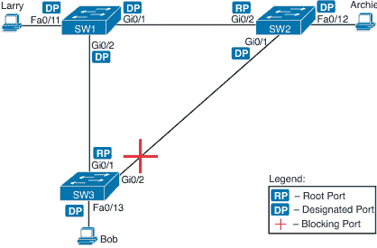

**图3-4** *用于STP配置和验证示例的示例LAN*

示例3-1以一个有用的STP命令开始讨论：`show spanning-tree vlan 10`命令。该命令识别根交换机，并在本地交换机上列出其设置。示例3-1列出了该命令在SW1和SW2上的输出，如下所述。

甚至有一条明确的语句“此网桥是根”，确认SW1现在是VLAN 10 STP拓扑的根。

接下来，比较示例下半部分中在SW2上相同命令的高亮行。SW2列出了SW1的BID详细信息作为根；换句话说，SW2同意SW1赢得了根选举。SW2没有列出“此网桥是根”这个短语。然后SW2在有关根BID详情的行之后，列出了自己的（不同的）BID详情。

输出还确认了一些默认值。首先，每台交换机将BID的优先级部分列为一个单独的数字：32778。该值来自默认优先级32768，加上VLAN 10，总计32778。输出还显示了一些快速以太网和千兆以太网接口的接口成本，默认分别为19和4。

最后，**show spanning-tree**命令输出的底部列出了VLAN中的每个接口，包括中继端口，以及STP端口角色和端口状态。例如，在交换机SW1上，输出列出了三个接口，角色为Desg（指定端口，DP），状态为FWD（转发）。SW2列出了三个接口，两个DP和一个根端口，因此这三个接口都处于FWD或转发状态。

示例3-1展示了许多有用的STP信息，但示例3-2中显示的两个其他命令更适合以更简短的形式列出BID信息。第一个命令**show spanning-tree root**列出了每个VLAN的根BID。该命令还列出了其他详细信息，如本地交换机的根成本和根端口。另一个命令**show spanning-tree vlan 10 bridge**将BID分解为其组成部分。在本示例中，它显示SW2的优先级为默认值32768，VLAN ID为10，以及MAC地址。

### 示例3-2 在交换机SW2上列出根交换机和本地交换机的BID

```
SW2# show spanning-tree root

                                                Root    Hello Max Fwd
Vlan                    Root ID                 Cost    Time  Age Dly  Root Port
------------------- ------------------------- --------- ----- ---- --- ----------
VLAN0001                 32769 1833.9d5d.c900        23    2   20  15   Gi0/1
VLAN0010                 32778 1833.9d7b.0e80         4    2   20  15   Gi0/2
VLAN0020                 32788 1833.9d7b.0e80         4    2   20  15   Gi0/2
VLAN0030                 32798 1833.9d7b.0e80         4    2   20  15   Gi0/2
VLAN0040                 32808 1833.9d7b.0e80         4    2   20  15   Gi0/2

SW2# show spanning-tree vlan 10 bridge

                                                Hello Max Fwd
Vlan                    Bridge ID               Time  Age Dly  Protocol
------------------- ------------------------- ----- ---- --- --------
VLAN0010                 32778 (32768,  10) 1833.9d7b.1380       2   20  15  ieee
```

请注意，示例3-2中的两个命令都有一个VLAN选项：**show spanning-tree [vlan x] root**和**show spanning-tree [vlan x] bridge**。如果不列出VLAN，每个命令将每个VLAN列出一行；如果指定VLAN，则输出相同的信息，但仅针对该VLAN。

本示例以在SW3上执行**debug spanning-tree events**命令开始。该命令告诉交换机，每当STP对接口的角色或状态进行更改时，就发出调试日志消息。这些消息在示例中作为配置的结果出现。

接下来，示例展示了使用**spanning-tree vlan 10 cost 30**接口子命令将SW3在VLAN 10中的端口成本更改为30的配置。根据图，通过SW3的G0/1到达根的根成本现在将是30，而不是4。因此，SW3到达根的最佳成本为8，SW3的G0/2作为其根端口。

调试消息带有时间戳，告诉我们SW3上的STP在幕后是如何思考的。请注意，在这种情况下，用户退出配置模式后立即显示的前五条调试消息都发生在同一时间（精确到同一毫秒）。值得注意的是，之前处于转发状态的G0/1立即移动到阻塞状态。之前处于阻塞状态的接口G0/2并未进入转发状态，而是移动到侦听状态（至少根据此消息是这样）。

现在查找列出G0/2转换为学习状态的调试消息，然后查找下一条显示它最终达到转发状态的消息。消息之间相隔多长时间？在每种情况下，消息的时间戳显示已过去15秒。在本实验中，交换机使用默认的转发延迟设置（15秒）。因此，这些调试消息确认了STP将接口从阻塞状态转换到转发状态所采取的步骤。

如果你在配置成本时恰好没有启用调试，之后使用**show**命令也可以确认SW3做出的相同选择，即现在使用其G0/2端口作为根端口（RP）。示例3-4使用**show spanning-tree vlan 10**命令显示了SW3上新的STP端口成本设置，以及新的根端口和根成本。注意，G0/2现在被列为根端口。输出顶部将SW3的根成本列为8，与图3-5所示的分析一致。

### 示例3-4 SW3上新的STP状态和设置

```
SW3# show spanning-tree vlan 10

VLAN0010
  Spanning tree enabled protocol ieee
  Root ID    Priority    32778
             Address     1833.9d7b.0e80
             Cost        8
             Port        26 (GigabitEthernet0/2)
             Hello Time  2 sec  Max Age 20 sec  Forward Delay 15 sec

  Bridge ID  Priority    32778  (priority 32768 sys-id-ext 10)
             Address     f47f.35cb.d780
             Hello Time  2 sec  Max Age 20 sec  Forward Delay 15 sec
             Aging Time  300 sec

Interface        Role Sts Cost      Prio.Nbr Type
---------------- ---- --- --------- -------- ----------------
Fa0/23           Desg FWD 19        128.23   P2p
Gi0/1            Altn BLK 30        128.25   P2p
Gi0/2            Root FWD 4         128.26   P2p
```


## 配置优先级以影响根选举

另一个重要的 STP 配置选项是通过更改交换机的优先级来影响根选举。可以使用 **spanning-tree vlan vlan-id priority value** 全局配置命令显式设置优先级，该命令设置交换机的基础优先级。（此命令要求参数为 4096 的倍数。）

但是，Cisco 提供了比配置特定优先级值更好的配置选项。在大多数设计中，网络工程师会选择两台交换机作为根：一台在所有交换机都正常运行时作为根，另一台在第一台交换机故障时接管。交换机 IOS 通过 **spanning-tree vlan vlan-id root primary** 和 **spanning-tree vlan vlan-id root secondary** 命令支持这一思路。

**spanning-tree vlan vlan-id root primary** 命令告知交换机将其优先级设置得足够低，以便立即成为根。交换机会查看该 VLAN 中当前的根以及根的优先级。然后，本地交换机选择一个优先级值，使本地交换机接管成为根。

请记住 Cisco 交换机的默认基础优先级为 32,768，此命令按如下方式选择基础优先级：


- 如果当前根的基础优先级高于 24,576，则本地交换机使用 24,576 作为基础优先级。
- 如果当前根的基础优先级为 24,576 或更低，则本地交换机将其基础优先级设置为仍能使本地交换机成为根的最高 4096 的倍数。

对于计划在第一台交换机故障时接管成为根的交换机，请使用 **spanning-tree vlan vlan-id root secondary** 命令。此命令与 **spanning-tree vlan vlan-id root primary** 命令非常相似，但其优先级值比主用交换机差，但优于所有其他交换机。无论当前根的当前优先级值是多少，此命令都会将交换机的基础优先级设置为 28,672。

例如，在图 3-4 和图 3-5 中，SW1 是根交换机，并且如各种命令所示，三台交换机都默认使用基础优先级 32,768。示例 3-5 展示了一种配置，使 SW2 成为主用根，SW1 成为备用根，只是为了展示角色从一台交换机转移到另一台。这些命令使 SW2 的基础优先级为 24,576，SW1 的基础优先级为 28,672。

**示例 3-5 —** *使 SW2 成为主用根，SW1 成为备用根*

```
First, on SW2:
SW2# configure terminal
Enter configuration commands, one per line.  End with CNTL/Z.
SW2(config)# spanning-tree vlan 10 root primary
SW2(config)# ^Z

! Next, SW1 is configured to back up SW2
SW1# configure terminal
Enter configuration commands, one per line.  End with CNTL/Z.
SW1(config)# spanning-tree vlan 10 root secondary
SW1(config)# ^Z
SW1#

! The next command shows the local switch’s BID (SW1)
SW1# show spanning-tree vlan 10 bridge

                              Hello Max Fwd
Vlan                 Bridge ID      Time Age Dly Protocol
----------------     -------------------------
VLAN0010             28682 (28672, 10) 1833.9d7b.0e80  2  20  15  ieee

! The next command shows the root’s BID (SW2)
SW1# show spanning-tree vlan 10 root

                             Root   Hello Max Fwd
Vlan                 Root ID       Cost   Time Age Dly Root Port
----------------     -------------------------------
VLAN0010             24586 1833.9d7b.1380  4  2  20  15  Gi0/1
```

两条 show 命令的输出清楚地指出了每台交换机上最终的优先级值。首先，**show spanning-tree bridge** 命令列出本地交换机的 BID 信息，而 **show spanning-tree root** 命令列出根的 BID，以及本地交换机的根开销和根端口（假设它不是根交换机）。因此，SW1 使用 **show spanning-tree bridge** 命令列出自己的 BID，其优先级为 28,682（基础优先级 28,672，加上 VLAN 10）。仍然在 SW1 上，**show spanning-tree root** 命令的输出列出 VLAN 10 中根的优先级为 24,586，这意味着基础优先级 24,576 加上 VLAN 10 的 10。

请注意，或者也可以专门配置优先级设置。SW1 本可以使用 **spanning-tree vlan 10 priority 28672** 命令，而 SW2 使用 **spanning-tree vlan 10 priority 24576** 命令。在这种特定情况下，两种选项都会产生相同的 STP 运行结果。

## 实现可选的 STP 特性

本章刚刚完成的第一主要部分展示了仅使用 PVST+ 的示例，并假设默认全局命令为 **spanning-tree mode pvst**。同时，第一部分中展示的所有配置命令，即影响 STP 运行的命令，都会影响传统 STP 和 RSTP 的运行。

本节是本章三个主要部分中的第二部分，现在继续讨论一些有用但可选的特性，这些特性使 STP 和 RSTP 运行得更好。

### 配置 PortFast 和 BPDU Guard

你可以轻松地在任何接口上配置 PortFast 和 BPDU Guard 特性，但有两种不同的配置选项。一种选项最适合仅想在少数端口上启用这些特性时使用，另一种选项最适合想在几乎每个接入端口上启用这些特性时使用。

首先，要一次只在一个端口上启用这些特性，请使用 **spanning-tree portfast** 和 **spanning-tree bpduguard enable** 接口子命令。示例 3-6 展示了该过程的一个示例，其中 SW3 的 F0/4 接口启用了这两个特性。（另外，请注意启用 PortFast 时 IOS 列出的长警告消息；在连接到其他交换机的端口上使用 PortFast 确实可能导致严重问题。）

**示例 3-6** *在一个接口上启用 PortFast 和 BPDU Guard*

```
SW3# configure terminal
Enter configuration commands, one per line.  End with CNTL/Z.
SW3(config)# interface fastEthernet 0/4
SW3(config-if)# spanning-tree portfast
%Warning: portfast should only be enabled on ports connected to a single
 host. Connecting hubs, concentrators, switches, bridges, etc... to this
 interface when portfast is enabled, can cause temporary bridging loops.
 Use with CAUTION

%Portfast has been configured on FastEthernet0/4 but will only
have effect when the interface is in a non-trunking mode.

SW3(config-if)# spanning-tree bpduguard ?
  disable  Disable BPDU guard for this interface
  enable   Enable BPDU guard for this interface

SW3(config-if)# spanning-tree bpduguard enable
SW3(config-if)# ^Z
SW3#
```

示例 3-7 展示了一些关于 PortFast 和 BPDU Guard 接口配置的简要信息。当然，**show running-config** 命令（未显示）会确认示例 3-6 中的配置命令。示例 3-7 中的 **show spanning-tree interface fastethernet0/4 portfast** 命令列出接口的 PortFast 状态；请注意，只有当 PortFast 已配置且接口处于 up 状态时，才会显示 enabled 状态值。然后，**show spanning-tree interface detail** 命令在输出末尾附近显示一行，说明 PortFast 和 BPDU Guard 已启用。请注意，如果这两个特性未启用，此命令将不会列出输出中高亮显示的那两行。

**示例 3-7** *验证 PortFast 和 BPDU Guard 配置*

```
SW3# show spanning-tree interface fastethernet0/4 portfast
 VLAN0104             enabled

SW11# show spanning-tree interface F0/4 detail
 Port 4 (FastEthernet0/4) of VLAN0001 is designated forwarding
   Port path cost 19, Port priority 128, Port Identifier 128.4.
   Designated root has priority 32769, address bcc4.938b.a180
   Designated bridge has priority 32769, address bcc4.938b.e500
   Designated port id is 128.4, designated path cost 19
   Timers: message age 0, forward delay 0, hold 0
   Number of transitions to forwarding state: 1
    The port is in the portfast mode
    Link type is point-to-point by default
    Bpdu guard is enabled
    BPDU: sent 1721, received 0
```

默认情况下，所有接口上的 PortFast 和 BPDU Guard 都是禁用的；要使用它们，每个接口都需要像示例 3-6 中那样的接口子命令。或者，对于这两个特性，你可以全局启用该特性。然后，对于应禁用该特性的接口，你可以使用另一个接口子命令来禁用该特性。

能够更改这些特性的全局默认值，可以减少所需的接口子命令数量。例如，在一台具有 48 个接入端口和两个上行链路的接入层交换机上，你可能希望在所有 48 个接入端口上启用 PortFast 和 BPDU Guard。与其在所有 48 个端口上都需要接口子命令，不如全局启用这些特性，然后在上行链路端口上禁用它们。

表 3-3 总结了全局和按接口启用与禁用 PortFast 和 BPDU Guard 的命令。例如，全局命令 spanning-tree portfast default 会更改默认值，使所有接口都使用 PortFast，除非某个端口还配置了 spanning-tree portfast disable 接口子命令。

**表 3-3** 全局和按接口启用与禁用 PortFast 和 BPDU Guard

| 操作 | 全局 | 单个接口 |
| --- | --- | --- |
| 禁用 PortFast | no spanning-tree portfast default | spanning-tree portfast disable |
| 启用 PortFast | spanning-tree portfast default | spanning-tree portfast |
| 禁用 BPDU Guard | no spanning-tree portfast bpduguard default | spanning-tree bpduguard disable |
| 启用 BPDU Guard | spanning-tree portfast bpduguard default | spanning-tree bpduguard enable |

示例 3-8 展示了另一个新命令 **show spanning-tree summary**。此命令显示若干 STP 参数的当前全局设置，包括 PortFast 和 BPDU Guard 特性。此输出是在一台全局启用了 PortFast 和 BPDU Guard 的交换机上收集的。

**示例 3-8** 显示 PortFast 和 BPDU Guard 全局设置的状态

```
SW1# show spanning-tree summary
Switch is in pvst mode
Root bridge for: none
EtherChannel misconfig guard is enabled
Extended system ID           is enabled
PortFast Default             is enabled
PortFast BPDU Guard Default  is enabled
PortFast BPDU Filter Default is disabled
Loopguard Default            is disabled
UplinkFast                   is disabled
BackboneFast                 is disabled
```


配置的路径开销方法为 short

| 名称 | 阻塞 | 监听 | 学习 | 转发 | STP 活动 |
|---|---:|---:|---:|---:|---:|
| VLAN0001 | 3 | 0 | 0 | 2 | 5 |
| 1 个 VLAN | 3 | 0 | 0 | 2 | 5 |

## 配置 EtherChannel

正如第 2 章所介绍的，两台相邻交换机可以将彼此之间的多条并行链路视为一条称为 *EtherChannel* 的单一逻辑链路。STP 在 EtherChannel 上运行，而不是在各个物理链路上运行，因此对于给定 VLAN，STP 要么转发要么阻塞整个逻辑 EtherChannel。这样一来，处于转发状态的交换机就可以在 EtherChannel 中的所有物理链路上对流量进行负载均衡。如果没有 EtherChannel，两台交换机之间的并行链路中只允许一条转发流量，其余链路都会被 STP 阻塞。

> **注意** 本章中所有对 EtherChannel 的引用均指二层 EtherChannel，而不是三层 EtherChannel（如第 19 章“LAN 中的 IPv4 路由”所讨论）。

EtherChannel 可能是最难配置成功的交换机特性之一。首先，配置中有多个选项，因此必须记住哪些选项可以协同工作的细节。其次，交换机还要求通道中所有链路的多种其他接口设置相匹配，所以也必须了解这些设置。

本节重点介绍正确的 EtherChannel 配置。第 4 章的“二层 EtherChannel 故障排除”一节将探讨 EtherChannel 的许多潜在问题，包括交换机在允许 EtherChannel 工作之前所检查的所有其他配置设置。

### 配置手动 EtherChannel

配置 EtherChannel 的最简单方法是，在每台交换机的每个物理接口上添加正确的 **channel-group** 命令，并且全部使用 **on** 关键字。**on** 关键字告诉交换机将物理接口放入 EtherChannel。

然而，在开始介绍配置和验证之前，需要开始将三个术语视为同义词：*EtherChannel*、*PortChannel* 和 *Channel-group*。奇怪的是，IOS 使用 **channel-group** 配置命令，但随后为显示其状态，IOS 使用 **show etherchannel** 命令。接着，该 show 命令的输出既不称其为“EtherChannel”，也不称其为“Channel-group”，而是使用“PortChannel”这一术语。因此，请密切注意示例中的这三个术语。

要手动配置 EtherChannel，请按以下步骤操作：

- **步骤 1.** 在应加入通道的每个物理接口下，于接口配置模式中添加 **channel-group number mode** 命令，以将其加入通道。


- **步骤 2.** 同一交换机上的所有命令使用相同的编号，但相邻交换机上的 channel-group 编号可以不同。

示例 3-9 展示了一个简单示例，交换机 SW1 和 SW2 之间有两条链路，如图 3-6 所示。该配置显示 SW1 的两个接口被放入 channel-group 1，随后有两个 show 命令。


**图 3-6** *EtherChannel 示例中使用的示例 LAN*

**示例 3-9** *配置和监控 EtherChannel*

```text
SW1# configure terminal
Enter configuration commands, one per line.  End with CNTL/Z.
SW1(config)# interface fa 0/14
SW1(config-if)# channel-group 1 mode on
SW1(config)# interface fa 0/15
SW1(config-if)# channel-group 1 mode on
SW1(config-if)# ^Z

SW1# show spanning-tree vlan 3

VLAN0003
  Spanning tree enabled protocol ieee
  Root ID    Priority    28675
             Address     0019.e859.5380
             Cost        12
             Port        72 (Port-channel1)
             Hello Time  2 sec  Max Age 20 sec  Forward Delay 15 sec

  Bridge ID  Priority    28675  (priority 28672 sys-id-ext 3)
             Address     0019.e864.5680
             Hello Time  2 sec  Max Age 20 sec  Forward Delay 15 sec
             Aging Time  300

Interface        Role Sts Cost     Prio.Nbr Type
---------------- ---- --- -------- -------- -------------------
Po1              Root FWD 12       128.64   P2p Peer (STP)

SW1# show etherchannel 1 summary
Flags:  D - down        P - bundled in port-channel
        I - stand-alone s - suspended
        H - Hot-standby (LACP only)
        R - Layer3      S - Layer2
        U - in use      f - failed to allocate aggregator
```

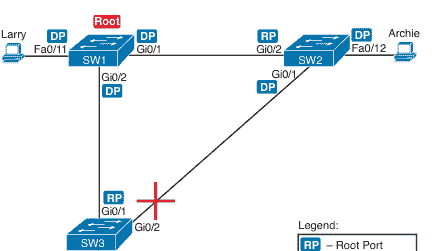

**图 3-8** *STP 和 RSTP 示例的网络拓扑*

第一个示例重点关注 VLAN 10，所有交换机都使用 802.1D STP，并采用默认设置 `spanning-tree mode pvst`。该设置会为每个 VLAN 创建一个 STP 实例（即名称中的 per-VLAN 部分），并使用 802.1D STP。每台交换机都将连接到 PC 的端口放入 VLAN 10，并同时启用 PortFast 和 BPDU Guard。示例 3-11 展示了交换机 SW3 的示例配置，同时在 SW1 的 F0/11 和 SW2 的 F0/12 端口上分别配置了相同的接口子命令。

**示例 3-11** *交换机 SW3 的示例配置*

```text
SW3# show running-config interface FastEthernet 0/13

Building configuration...

Current configuration : 117 bytes
!
interface FastEthernet0/13
 switchport access vlan 10
 spanning-tree portfast
 spanning-tree bpduguard enable
end
```

此时，三台交换机都使用 802.1D STP，因为它们都使用默认的 PVST 模式。示例 3-12 展示了 STP 工作的证据，其中只有一些细微且间接的线索表明 STP 恰好正在使用。

**示例 3-12** *确认交换机 SW3 上使用 802.1D STP 的输出*

```text
SW3# show spanning-tree vlan 10

VLAN0010

  Spanning tree enabled protocol ieee
  Root ID       Priority    32778
               Address     1833.9d7b.0e80
               Cost        4
               Port        25 (GigabitEthernet0/1)
               Hello Time  2 sec  Max Age 20 sec  Forward Delay 15 sec

  Bridge ID     Priority    32778 (priority 32768 sys-id-ext 10)
               Address     f47f.35cb.d780
               Hello Time  2 sec  Max Age 20 sec  Forward Delay 15 sec
               Aging Time  300 sec

Interface        Role Sts Cost     Prio.Nbr Type
---------------- ---- --- -------- -------- -------------------
Fa0/13           Desg FWD 19       128.13   P2p Edge
Gi0/1            Root FWD 4        128.25   P2p
Gi0/2            Altn BLK 4        128.26   P2p

SW3# show spanning-tree vlan 10 bridge

                                             Hello Max Fwd
Vlan                         Bridge ID       Time Age Dly Protocol
--------------------------   --------------  ---- --- --- --------
VLAN0010                     32778 (32768, 10) f47f.35cb.d780  2  20  15  ieee
```

示例中突出显示的部分指出，STP 协议被引用为 ieee，这意味着正在使用 STP。术语 *ieee* 是对原始 IEEE 802.1D STP 标准的引用。

要将这个小网络迁移到使用 RSTP，请配置 **spanning-tree mode rapid-pvst** 命令。这会改变每 VLAN 生成树实例的使用方式，但会将 RSTP 逻辑应用于每个 STP 实例。示例 3-13 展示了在三台交换机上都配置 **spanning-tree mode rapid-pvst** 命令后，示例 3-12 中相同两个命令的输出。

**示例 3-13** *确认交换机 SW3 上使用 802.1w RSTP 的输出*

```text
SW3# show spanning-tree vlan 10

VLAN0010

  Spanning tree enabled protocol rstp
  Root ID       Priority    32778
               Address     1833.9d7b.0e80
               Cost        4
               Port        25 (GigabitEthernet0/1)
               Hello Time  2 sec  Max Age 20 sec  Forward Delay 15 sec

  Bridge ID  Priority    32778  (priority 32768 sys-id-ext 10)
             Address     f47f.35cb.d780
             Hello Time   2 sec  Max Age 20 sec  Forward Delay 15 sec
             Aging Time 300 sec

Interface           Role Sts Cost      Prio.Nbr Type
------------------- ---- --- --------- -------- --------------------------------
Fa0/13              Desg FWD 19        128.13   P2p Edge
Gi0/1               Root FWD 4         128.25   P2p
Gi0/2               Altn BLK 4         128.26   P2p

SW3# show spanning-tree vlan 10 bridge

Vlan                Bridge ID              Hello Max Fwd
                                           Time  Age Dly  Protocol
------------------- ---------------------- ----- --- ---  --------
VLAN0010            32778 (32768, 10) f47f.35cb.d780   2   20  15    RSTP
```

请密切注意示例 3-12 中 802.1D STP 输出与示例 3-13 中 802.1w RSTP 输出之间的差异。实际上，唯一的区别是在所列两个命令各自的输出中，有一处用 rstp 代替了 ieee。在此情况下，rstp 指的是 *spanning-tree mode rapid-pvst* 全局配置命令的配置，这暗示使用了 RSTP。

### RSTP 端口角色

RSTP 为 STP 增加了两种端口角色：替代端口和备份端口。示例 3-14 重复了交换机 SW3 上 **show spanning-tree vlan 10** 命令输出的一段摘录，以展示替代端口角色的示例。SW3（如前面图 3-8 所示）不是根交换机，其 Gi0/1 为根端口，Gi0/2 为替代端口。

**示例 3-14** *确认 SW3 根端口和替代端口角色的输出*

```text
SW3# show spanning-tree vlan 10
! Lines omitted for brevity

Interface           Role Sts Cost      Prio.Nbr Type
------------------- ---- --- --------- -------- --------------------------------
Fa0/13              Desg FWD 19        128.13   P2p Edge
Gi0/1               Root FWD 4         128.25   P2p
Gi0/2               Altn BLK 4         128.26   P2p
```

好消息是，输出清楚地列出了哪个端口是根端口（Gi0/1），哪个端口是替代根端口（Gi0/2）。唯一的窍门是要知道 Altn 是单词 *alternate* 的缩写形式。


请密切关注关于 Catalyst 交换机上 STP 和 RSTP 输出中一个奇特现象的简短描述！Cisco Catalyst 交换机即使在运行 STP 而非 RSTP 时，也常常在输出中显示备用（alternate）和备份（backup）端口。备用和备份端口的概念是 RSTP 的概念。只有在使用 RSTP 时，交换机才能利用这些概念实现更快的收敛。但是，当使用 STP 而非 RSTP 时，**show** 命令的输出恰好会标识出如果使用 RSTP 时本应成为备用和备份端口的端口。


你为什么要关心这样的琐事呢？看到输出中列出 RSTP 备用端口，并不能确认交换机正在使用 RSTP。因此，考试时不要做出这种假设。要确认交换机使用 RSTP，你必须查看 **spanning-tree mode** 命令的配置，或者查看表 3-4 中总结的协议。

例如，只需比较示例 3-12 和示例 3-14 的输出。示例 3-12 显示了同一台 SW3 在相同参数下的输出，唯一的区别是所有交换机使用了 PVST 模式，即所有交换机都使用了 STP。示例 3-12 的输出（基于 STP）将 SW3 的 G0/2 列为 Altn，即 alternate（备用），尽管备用端口的概念并不是 STP 的概念，而是 RSTP 的概念。

### RSTP 端口状态

与 STP 相比，RSTP 新增了一种端口状态：*discarding*（丢弃），用它来替代 STP 的 disabled（禁用）和 blocking（阻塞）端口状态。你可能会认为，在将交换机配置为使用 RSTP 而不是 STP 之后，你看到的将不再是阻塞状态的端口，而是丢弃状态。然而，Cisco Catalyst 交换机的输出基本上忽略了新术语 *discarding*，继续使用旧术语 *blocking*。

例如，回过头看最近的 RSTP 示例（示例 3-14），找到 SW3 的 G0/2 端口那一行。然后找到标题为 STS 的列，它表示状态。输出显示 G0/2 被列为 BLK，即 blocking（阻塞）。理论上，由于 SW3 使用 RSTP，端口状态应为 *discarding*，但交换机的 IOS 仍然使用较旧的 BLK 来表示阻塞。

再举一个证据，命令 **show spanning-tree vlan 10 interface gigabitethernet0/2 state** 会以完整拼写的方式列出 STP 或 RSTP 端口状态。示例 3-15 显示了从 SW3 上针对接口 G0/2 执行的该命令。注意，这里使用的是完整拼写的 *blocking* 术语，而不是 RSTP 术语 *discarding*。

**示例 3-15** *SW3，一台 RSTP 交换机，仍在使用旧的阻塞术语*

```
SW3# show spanning-tree vlan 10 interface gigabitethernet 0/2 state
VLAN0010          blocking
```

### RSTP 端口类型

Cisco Catalyst 交换机根据两个端口设置来确定 RSTP 端口类型：当前的双工模式（全双工或半双工）以及是否启用了 PortFast 功能。全双工告诉交换机使用点到点（point-to-point）端口类型，半双工则告诉交换机使用共享（shared）端口类型。启用 PortFast 会告诉交换机将该端口视为边缘端口。表 3-5 总结了这些组合。

## 章节复习

在考试中取得好成绩的一个关键方法是进行重复的间隔复习。请使用书中的工具、DVD 或本书配套网站上的交互式工具来复习本章内容。有关更多详细信息，请参阅“你的学习计划”部分。表 3-6 列出了关键的复习要素及其所在位置。为了更好地跟踪你的学习进度，请在第二列中记录你完成这些活动的时间。

**表 3-6 — 章节复习跟踪**

| 复习要素 | 复习日期 | 使用资源 |
|---|---|---|
| 复习关键主题 |  | 书、DVD/网站 |
| 复习关键术语 |  | 书、DVD/网站 |
| 重复 DIKTA 问题 |  | 书、PCT |
| 复习记忆表 |  | 书、DVD/网站 |
| 复习命令参考表 |  | 书（章节复习中） |
| 完成实验 |  | 博客 |

### 复习所有关键主题


**表 3-7 — 第 3 章关键主题**

| 关键主题元素 | 描述 | 页码 |
|---|---|---|
| 图 3-1 | 关于应选择哪些交换机作为根交换机的典型设计 | 71 |
| 图 3-2 | PVST+ 负载均衡优势的概念视图 | 73 |
| 图 3-3 | 显示 STP 优先级字段的系统 ID 扩展格式 | 73 |
| 表 3-2 | 列出 STP 可选配置设置及相关配置命令的默认设置 | 75 |
| 列表 | **spanning-tree root primary** 命令选择新的 STP 基础优先级时的两个逻辑分支 | 80 |
| 列表 | 手动配置 EtherChannel 的步骤 | 84 |
| 表 3-4 | 设置交换机 STP 模式的命令 | 88 |
| 段落 | 关键陈述：在 show 命令输出中看到备用端口并不表示交换机使用了 RSTP | 92 |

### 你应该知道的关键术语

- Rapid PVST+
- PVST+
- 系统 ID 扩展
- PAgP
- LACP
- PortChannel
- channel-group

### 命令参考

表 3-8 和表 3-9 列出了本章使用的配置和验证命令。作为一个简单的复习练习，遮住表格中的左列，阅读右列，然后尝试不看左列回忆出对应的命令。然后重复练习，遮住右列，尝试回忆该命令的作用。

**表 3-8 — 第 3 章配置命令参考**

| 命令 | 描述 |
|---|---|
| `spanning-tree mode {pvst \| rapid-pvst \| mst}` | 全局配置命令，用于设置 STP 模式。 |
| `spanning-tree [vlan vlan-number] root primary` | 全局配置命令，将该交换机更改为根交换机。执行该命令时，交换机的优先级会被更改为 24,576 或比当前根桥优先级低 4096 的数值，取两者中较小者。 |
| `spanning-tree [vlan vlan-number] root secondary` | 全局配置命令，将该交换机的 STP 基础优先级设置为 28,672。 |
| `spanning-tree [vlan vlan-id] {priority priority}` | 全局配置命令，更改该交换机在指定 VLAN 中的桥优先级。 |
| `spanning-tree [vlan vlan-number] cost cost` | 接口子命令，将 STP 成本更改为所配置的值。 |
| `spanning-tree [vlan vlan-number] port-priority priority` | 接口子命令，更改该 VLAN 中的 STP 端口优先级（0 到 240，以 16 为增量）。 |
| `channel-group {channel-group-number mode {auto \| desirable \| active \| passive \| on}}` | 接口子命令，在接口上启用 EtherChannel。 |
| `spanning-tree portfast` | 接口子命令，在接口上启用 PortFast。 |
| `spanning-tree bpduguard enable` | 接口子命令，在接口上启用 BPDU Guard。 |
| `spanning-tree portfast default` | 全局命令，将交换机在接入接口上 PortFast 的默认设置从禁用更改为启用。 |
| `spanning-tree portfast bpduguard default` | 全局命令，将交换机在接入接口上 BPDU Guard 的默认设置从禁用更改为启用。 |
| `no spanning-tree portfast default` | 全局命令，将 PortFast 的全局设置更改为禁用。 |
| `no spanning-tree portfast bpduguard default` | 全局命令，将 BPDU Guard 的全局设置更改为禁用。 |
| `spanning-tree portfast disable` | 接口子命令，在接口上禁用 PortFast。 |
| `spanning-tree bpduguard disable` | 接口子命令，在接口上禁用 BPDU Guard。 |

**表 3-9 — 第 3 章 EXEC 命令参考**

| 命令 | 描述 |
|---|---|
| `show spanning-tree` | 列出交换机上 STP 状态的详细信息，包括每个端口的状态。 |
| `show spanning-tree interface *interface-id*` | 仅列出指定端口的 STP 信息。 |
| `show spanning-tree vlan *vlan-id*` | 列出指定 VLAN 的 STP 信息。 |
| `show spanning-tree [vlan *vlan-id*] root` | 列出每个 VLAN 的根桥信息，或仅列出指定 VLAN 的根桥信息。 |
| `show spanning-tree [vlan *vlan-id*] bridge` | 列出本地交换机在每个 VLAN 中的 STP 信息，或仅列出指定 VLAN 的信息。 |
| `show spanning-tree summary` | 列出交换机的全局 STP 设置，包括默认的 PortFast 和 BPDU Guard 设置，以及该交换机作为根交换机的 VLAN。 |
| `debug spanning-tree events` | 使交换机提供有关 STP 拓扑变化的信息消息。 |
| `show spanning-tree interface *type number* portfast` | 列出关于指定接口上 PortFast 的单行状态消息。 |
| `show etherchannel [*channel-group-number*] {brief \| detail \| port \| port-channel \| summary}` | 列出该交换机上 EtherChannel 的状态信息。 |


*此页有意留白*

## 第 4 章


## LAN 故障排除

**本章涵盖以下考试主题：**

- **1.0 LAN 交换技术**
- 1.1 配置、验证和故障排除跨多台交换机的 VLAN（普通/扩展范围）
  - 1.1.a 接入端口（数据和语音）
  - 1.1.b 默认 VLAN
- 1.2 配置、验证和故障排除交换机间连接
  - 1.2.a 在 trunk 上添加和移除 VLAN
  - 1.2.b DTP 和 VTP（v1 和 v2）
- 1.3 配置、验证和故障排除 STP 协议
  - 1.3.a STP 模式（PVST+ 和 RPVST+）
  - 1.3.b STP 根桥选择
- 1.5 配置、验证和故障排除（第 2 层/第 3 层）EtherChannel
  - 1.5.a 静态
  - 1.5.b PAGP
  - 1.5.c LACP
- 1.7 描述常见的接入层威胁缓解技术
  - 1.7.c 非默认本征 VLAN

本章从故障排除的角度讨论前三章中深入讨论的 LAN 主题，以及一些先决主题。

任何网络主题的故障排除都需要与考虑配置和验证时略有不同的思维方式。在考虑配置和验证时，有助于思考基本设计、学习如何正确配置该功能，以及学习如何验证正确的配置确实在正常工作。然而，要学习如何排除故障，你需要思考当设计不正确，或配置与良好设计不匹配时会出现什么症状。当你犯下某一种或另一种错误时，会出现什么症状？本章着眼于常见错误类型，并详细说明如何使用 **show** 命令查看状态以找出这些错误。

本章将材料分为四个主要部分。第一部分处理最大的主题——STP 故障排除。STP 作为一种协议不太可能失效；相反，STP 可能未按设计运行，因此任务是查明 STP 当前如何工作，并发现如何进而让配置实现正确的设计。第二个主要部分接着讨论第 2 层 EtherChannel，它们存在各种小的潜在问题，可能阻止 EtherChannel 的动态形成。

本章第三个主要部分重点关注在 VLAN、trunk、STP 和 EtherChannel 背景下，LAN 交换机上以太网帧的数据平面转发。同一部分还会结合这些功能回顾交换机的第 2 层转发逻辑。第四个也是最后一个主要部分则考察 VLAN 和 trunk 问题，以及这些问题如何影响交换机转发。

请注意，本章开头考试主题中列出的一些子主题本章并未讨论。本章不讨论 VTP 基本功能之外的内容（VTP 将在第 5 章深入讨论），也不讨论第 3 层 EtherChannel（将在第 19 章讨论）。

## “我已经掌握了吗？”测验

本书中有几章故障排除章节不仅讨论特定主题的故障排除，还充当总结和复习一些重要主题的工具。本章就是其中之一。因此，无论你当前的知识水平如何，阅读这些章节都是有用的。所以，本章不包含“我已经掌握了吗？”测验。不过，如果你对本书涵盖的 IPv4 路由功能故障排除特别有信心，可以随意跳到本章末尾附近的“章节回顾”部分，跳过本章的大部分内容。

TechNet24.ir

## 基础主题

## STP 故障排除

STP 问题往往会让许多考生望而生畏。STP 使用许多规则，并在某条规则最终出现平局时使用决胜规则。如果没有太多 STP 经验，人们往往会不信任自己的答案。此外，即使是我们这些已经从事网络工作的人，可能也不经常对 STP 进行故障排除，因为 STP 运行良好。通常，STP 故障排除并不是关于 STP 未能完成其工作，而是关于 STP 的运行方式与设计不同，例如根交换机不同、根端口（RP）不同等。STP 故障排除很少以 STP 未能阻止环路的情况开始。

本节回顾 STP 的规则，同时强调一些重要的故障排除要点。特别是，本节会更仔细地研究 STP 用于做出决策的决胜规则。它还就如何回答诸如“哪台交换机是根交换机？”之类的考试问题提出一些实用建议。

### 确定根交换机

如果你知道所有交换机的 BID，确定 STP 根交换机就很容易：只需选择最低值。如果问题分别列出优先级和 MAC 地址（这在某些 show 命令输出中很常见），则选择优先级最低的交换机，或者在平局的情况下选择 MAC 地址值较低的交换机。

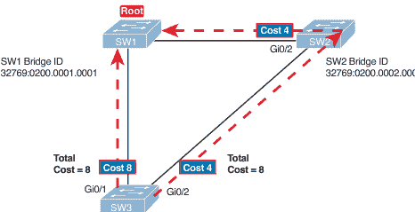

**图 4-1** *SW3 的根开销计算以平局结束*

### 选择根端口时的 STP 决胜规则

图 4-1 展示了较简单的过程：将从非根交换机 SW3 到根交换机 SW1 的每条路径上出接口的 STP 开销相加。它还（有意）展示了一个平局，以便讨论决胜规则。

当交换机选择其根端口时，第一选择是选择属于最低根开销路径的本地端口。当这些开销平局时，交换机会选择连接到 BID 最低的邻居的端口。这个决胜规则通常能打破平局，但并非总是如此。因此，为完整起见，交换机使用三个决胜规则的顺序如下：

- 1. 根据最低的邻居网桥 ID 选择。
- 2. 根据最低的邻居端口优先级选择。
- 3. 根据最低的邻居内部端口号选择。

（请注意，在考虑这些决胜规则时，交换机只考虑出现平局的根路径。）

例如，图 4-1 显示 SW3 不是根交换机，并且它到达根交换机的两条路径的根开销均为 8，形成平局。第一个决胜规则是最低邻居的 BID。SW1 的 BID 值低于 SW2 的，因此在这种情况下，SW3 选择其 G0/1 接口作为 RP。

最后两个 RP 决胜规则只有在两台交换机通过多条链路相互连接时才会起作用，如图 4-2 所示。在这种情况下，一台交换机会从同一台邻居交换机的多个端口收到 Hello 消息，因此 BID 平局。

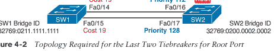

**图 4-2** *根端口最后两个决胜规则所需拓扑*

在这个具体示例中，SW2 成为根交换机，而 SW1 需要选择其 RP。SW1 的端口开销平局，均为 19，因此 SW1 在每条路径上的根开销都将平局为 19。SW2 通过每条链路向 SW1 发送 Hello 消息，因此 SW1 无法根据其邻居 BID 来打破平局，因为两者列出的都是 SW2 的 BID。所以，SW1 必须求助于另外两个决胜规则。

> **注意** 在现实生活中，大多数工程师会将这两条链路放入一个 EtherChannel。

下一个决胜规则是一个可配置选项：每个邻居交换机接口上的邻居交换机端口优先级。Cisco 交换机端口默认设置为 128，取值范围为 0 到 255，值越低越好（一如既往）。在此示例中，网络工程师使用 **spanning-tree vlan 10 port-priority 112** 命令设置了 SW2 的 Fa0/16 接口。SW1 得知邻居在上方链路上的端口优先级为 112，在下方链路上为 128，因此 SW1 使用其上方（Fa0/14）接口作为根端口。

如果端口优先级平局（由于默认值，这种情况经常发生），STP 会依赖邻居上的接口端口号。Cisco 交换机分配一个内部整数来标识交换机上的每个接口。非根交换机会查找邻居最低的内部端口号（如 Hello 消息中所列），并基于较低的数字选择其 RP。

Cisco 交换机使用一种明显的编号方式，Fa0/1 编号最低，然后是 Fa0/2，接着是 Fa0/3，依此类推。因此，在图 4-2 中，SW2 的 Fa0/16 的内部端口号将低于 Fa0/17；SW1 会在 Hello 消息中得知这些编号，并且 SW1 会使用其 Fa0/14 端口作为 RP。

### 应对考试中根端口问题的建议

如果你知道该看哪里，并且可以获得几个关键命令的输出，那么让你思考 RP 的考试问题可能很容易。然而，问题越偏向概念，你就越需要计算每条路径上的根开销，将其与不同的 show 命令相关联，并将这些想法综合起来。以下列表就如何应对考试中的 STP 问题提出了一些建议：


- 1. 如果可用，请查看 **show spanning-tree** 和 **show spanning-tree root** 命令。这两个命令都会列出根端口和根开销（参见示例 4-1）。
- 2. **show spanning-tree** 命令在两个位置列出开销：顶部关于根交换机的部分列出根开销；底部每个接口的部分列出接口开销。不过要小心；底部的开销是接口开销，而不是根开销！
- 3. 对于必须计算交换机根开销的问题：
  - **a.** 记住默认开销值：10 Mbps 为 100，100 Mbps 为 19，1 Gbps 为 4，10 Gbps 为 2。
  - **b.** 查找接口上是否存在 **spanning-tree cost** 配置命令的任何证据，因为它会覆盖默认开销。不要假定使用的是默认开销。
  - **c.** 当你确定使用的是默认开销时，如果可能，还要检查当前实际速度。Cisco 交换机根据当前速度而非最大速度选择 STP 默认开销。


有趣的是，由于问题出在配置错误上，这两个物理接口仍然独立运行，就好像 PortChannel 不存在一样。示例中的最后一条命令显示，当 PortChannel 1 接口处于 down 状态时，这两个物理接口却处于 connected 状态。

> **注意** 关于考试中解决 EtherChannel 问题的一个建议：与其死记所有错误的配置选项，不如集中精力记住正确的配置选项列表。然后找出题目给出的配置与已知正确配置之间的任何差异，并据此入手解答。

## 将接口添加到 EtherChannel 之前的配置检查

即使 channel-group 命令都已正确配置，其他配置设置也可能引发问题。最后这个主题将探讨这些配置设置及其影响。

首先，本地交换机会对每个被配置为 EtherChannel 一部分的新物理接口进行检查，将每条新链路与现有链路进行比较。新物理接口的设置必须与现有链路的设置一致；否则，交换机不会将该新链路添加到通道中已批准且正常工作的接口列表里。也就是说，该物理接口仍然配置为 PortChannel 的一部分，但不会作为通道的一部分被使用，通常会进入某种非工作状态。

交换机检查的项目包括以下内容：


- 速率
- 双工模式
- 运行状态的接入或中继状态（必须全部为接入，或全部为中继）
- 如果是接入端口，则检查接入 VLAN
- 如果是中继端口，则检查允许的 VLAN 列表（根据 **switchport trunk allowed** 命令）
- 如果是中继端口，则检查本征 VLAN
- STP 接口设置

此外，交换机还会检查相邻交换机的设置。为此，交换机要么使用 PAgP 或 LACP（如果已经在用），要么在使用手动配置时使用 Cisco 发现协议（CDP）。相邻交换机必须匹配此列表中的所有参数，但 STP 设置除外。

例如，SW1 和 SW2 再次在一个 EtherChannel 中使用两条链路。在配置 EtherChannel 之前，SW1 的 F0/15 被赋予了与 F0/14 不同的 STP 开销。示例 4-3 正好展示了在配置完正确的 channel-group 命令之后、交换机决定是否在此 EtherChannel 中使用 F0/14 和 F0/15 时的情况。

**示例 4-3** *由于 STP 开销不匹配，本地接口在 EtherChannel 中失败*

```
*Mar  1 23:18:56.132: %PM-4-ERR_DISABLE: channel-misconfig (STP) error detected on
Po1, putting Fa0/14 in err-disable state
*Mar  1 23:18:56.132: %PM-4-ERR_DISABLE: channel-misconfig (STP) error detected on
Po1, putting Fa0/15 in err-disable state
```

**示例 4-4** *查看 SW1 和 SW2 动态 MAC 地址表条目*

```
SW1# show mac address-table dynamic
```

**MAC 地址表**

| VLAN | MAC 地址 | 类型 | 端口 |
| --- | --- | --- | --- |
| 1 | 0200.AAAA.AAAA | DYNAMIC | Gi0/2 |
| 2 | 0200.BBBB.BBBB | DYNAMIC | Gi0/1 |

```
SW2# show mac address-table dynamic
```

**MAC 地址表**

| VLAN | MAC 地址 | 类型 | 端口 |
| --- | --- | --- | --- |
| 1 | 0200.AAAA.AAAA | DYNAMIC | Gi0/2 |
| 2 | 0200.BBBB.BBBB | DYNAMIC | Gi0/1 |

## 预测 EtherChannel 对 MAC 表的影响

大多数设计会在交换机之间使用多条链路，并将这些链路配置为 EtherChannel 的一部分。这对 MAC 转发逻辑有何影响？简而言之，交换机在 MAC 地址表中使用的是 PortChannel 接口，而不是捆绑到 EtherChannel 中的物理接口。具体来说：

**MAC 学习：** 在属于 PortChannel 一部分的物理接口上收到的帧，会被视为到达 PortChannel 接口。因此，MAC 学习会将 PortChannel 接口而非物理接口添加到 MAC 地址表中。

**MAC 转发：** 转发过程在匹配 MAC 地址表时，会找到 PortChannel 端口作为出接口。然后交换机必须根据该 PortChannel 配置的负载均衡偏好，额外执行一步来选择出方向的物理接口。

例如，考虑图 4-5，该图将之前的图 4-4 更新为每对交换机之间使用两条链路的 PortChannel。VLAN 1 再次在交换机 SW3 上阻塞，但这次是在 SW3 的 PortChannel3 接口上，那么你预计每台交换机中会看到哪些 MAC 表条目？类似地，当 SW3 在其 PortChannel2 接口上阻塞 VLAN 2 时，你预计会看到哪些 MAC 表条目？

哪些条目存在于哪些端口上的逻辑，与之前围绕图 4-4 的示例中的逻辑一致。在这种情况下，接口碰巧是 PortChannel 接口。示例 4-5 显示了与示例 4-4 相同的两台交换机上执行的相同命令：SW1 和 SW2 上的 **show mac address-table dynamic**。（注意，为节省篇幅，MAC 表输出仅显示图 4-5 中两台服务器的条目。）

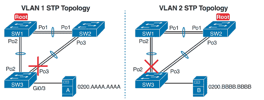

**图 4-5** 交换机之间带有 PortChannel 的 VLAN 拓扑

**示例 4-5** 列出 PortChannel 端口的 SW1 和 SW2 MAC 表

```
SW1# show mac address-table dynamic
```

**MAC 地址表**

| VLAN | MAC 地址 | 类型 | 端口 |
| --- | --- | --- | --- |
| 1 | 0200.AAAA.AAAA | DYNAMIC | Po2 |
| 2 | 0200.BBBB.BBBB | DYNAMIC | Po1 |

```
SW2# show mac address-table dynamic
```

**MAC 地址表**

| VLAN | MAC 地址 | 类型 | 端口 |
| --- | --- | --- | --- |
| 1 | 0200.AAAA.AAAA | DYNAMIC | Po3 |
| 2 | 0200.BBBB.BBBB | DYNAMIC | Po1 |

交换机在匹配到类似示例 4-5 所示的 MAC 表条目后，会使用多种负载均衡选项之一来选择要使用的物理接口。默认情况下，Cisco 二层交换机通常默认使用基于源 MAC 地址的均衡方法。具体来说，交换机会查看源 MAC 地址的低位比特（在书写形式上位于 MAC 地址的最右侧）。这种方法增加了基于使用中的源 MAC 地址进行相对均匀的均衡分配的机会。

## 选择入站帧的 VLAN

为了收尾关于交换机数据平面转发的分析，本节主要回顾已讨论过的主题，但目的是强调一些重要观点。主题很简单：当帧进入交换机时，交换机如何知道该帧属于哪个 VLAN？你已经看到了回答这个问题所需的全部信息，但值得花时间复习一下。

首先，有些接口是中继接口，在这些情况下，帧到达时会带有入站中继报头中列出的 VLAN ID。在其他情况下，帧到达时没有中继报头，交换机必须查看本地配置。但由于交换机在匹配 MAC 地址表时会同时匹配目的 MAC 地址和帧的 VLAN ID，因此了解交换机如何确定 VLAN ID 非常重要。

以下列表回顾并总结了交换机如何确定为入站帧关联的 VLAN ID 的关键点：


- **第 1 步** 如果端口是接入端口，则将帧与配置的接入 VLAN 关联（switchport access vlan *vlan_id*）。
- **第 2 步** 如果端口是语音端口，或者同时连接了 IP 电话和 PC（或其他数据设备）：
  - **A.** 将来自数据设备的帧与配置的接入 VLAN 关联（根据 **switchport access vlan vlan_id** 命令进行配置）。
  - **B.** 将来自电话的帧与 802.1Q 报头中的 VLAN ID 关联（根据 **switchport voice vlan vlan_id** 命令进行配置）。
- **第 3 步** 如果端口是中继端口，则确定帧的标记 VLAN；如果没有标记，则使用该入站接口的本征 VLAN ID（**switchport trunk native vlan_id**）。

## VLAN 和 VLAN 中继的故障排查

交换机的数据转发过程部分依赖于 VLAN 和 VLAN 中继。在交换机转发特定 VLAN 中的帧之前，交换机必须了解该 VLAN，并且该 VLAN 必须处于活动状态。而在交换机通过 VLAN 中继转发帧之前，中继必须当前允许该 VLAN 通过。

本章的最后一个主要部分将重点讨论 VLAN 和 VLAN 中继问题，特别是所有影响帧交换过程的问题。这些问题如下：


- **第 1 步** 识别所有接入接口及其分配的接入 VLAN，如果分配不正确，则重新分配到正确的 VLAN。
- **第 2 步** 确定这些 VLAN 是否都存在（通过配置或使用 VLAN 中继协议 [VTP] 学习到）并且在每台交换机上都处于活动状态。如果不存在，则根据需要配置并激活 VLAN 以解决问题。
- **第 3 步** 检查中继两端交换机上的允许 VLAN 列表，确保允许的 VLAN 列表相同。
- **第 4 步** 检查是否存在错误的配置设置，导致一台交换机作为中继运行，而相邻交换机不作为中继运行。
- **第 5 步** 检查每个中继上允许的 VLAN，确保中继没有被管理员从支持的中继 VLAN 中移除某个 VLAN。

### 接入 VLAN 配置错误

为了确保每个接入接口都已分配到正确的 VLAN，工程师只需确定哪些交换机接口是接入接口而不是中继接口：


对于交换机，必须使用 **show vlan** 命令。配置为使用 VTP 透明模式或禁用 VTP 的交换机，会在配置文件中列出 VLAN 配置命令。（使用 **show vtp status** 命令可查看交换机当前的 VTP 模式。）

在确定交换机上不存在某个 VLAN 后，问题可能只是需要配置该 VLAN。如果是这样，请按照第 1 章中详细介绍的 VLAN 配置流程进行操作。

即使对于已存在的 VLAN，也必须验证该 VLAN 是否处于活动状态。**show vlan** 命令应根据当前状态列出两种 VLAN 状态值之一：*active* 或 *act/lshut*。第二种状态表示该 VLAN 已被关闭。关闭 VLAN 仅会在该交换机上禁用该 VLAN，因此*交换机不会在该 VLAN 中转发帧。*

交换机 IOS 提供了两种类似的配置方法来禁用（**shutdown**）和启用（no **shutdown**）VLAN。示例 4-6 演示了如何操作，首先使用全局命令 **[no] shutdown vlan number**，然后使用 VLAN 模式子命令 **[no] shutdown**。该示例分别演示了使用全局命令启用和禁用 VLAN 10 和 20，并使用 VLAN 子命令启用和禁用 VLAN 30 和 40。

**示例 4-6** *在交换机上启用和禁用 VLAN*

| VLAN | 名称 | 状态 | 端口 |
|---:|---|---|---|
| 1 | default | active | Fa0/1, Fa0/2, Fa0/3, Fa0/4; Fa0/5, Fa0/6, Fa0/7, Fa0/8; Fa0/9, Fa0/10, Fa0/11, Fa0/12; Fa0/14, Fa0/15, Fa0/16, Fa0/17; Fa0/18, Fa0/19, Fa0/20, Fa0/21; Fa0/22, Fa0/23, Fa0/24, Gi0/1 |
| 10 | VLAN0010 | act/lshut | Fa0/13 |
| 20 | VLAN0020 | active | |
| 30 | VLAN0030 | act/lshut | |
| 40 | VLAN0040 | active | |

```text
SW2# configure terminal
Enter configuration commands, one per line.  End with CNTL/Z.
SW2(config)# no shutdown vlan 10
SW2(config)# shutdown vlan 20
SW2(config)# vlan 30
SW2(config-vlan)# no shutdown
SW2(config-vlan)# vlan 40
SW2(config-vlan)# shutdown
SW2(config-vlan)#
```


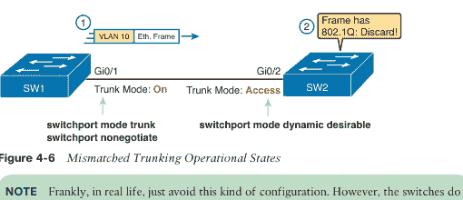

**注意** 坦白说，在真实环境中，应避免此类配置。然而，交换机并不会阻止你犯这类错误，所以你需要做好准备。请注意，第 1 章的的表 1-3 总结了 switchport trunk 命令的选项列表、哪些组合有效、哪些组合应完全避免（例如这里图 4-6 中所示的组合）。

### 中继上支持的 VLAN 列表不匹配

Cisco 交换机上的 VLAN 中继可以转发所有已定义且处于活动状态的 VLAN 的流量。但是，由于各种其他原因，特定中继可能不会转发某个已定义且处于活动状态的 VLAN 的流量。你应该知道如何识别特定中继当前支持哪些 VLAN，以及交换机可能不在该中继端口上转发某个 VLAN 帧的原因。

此步骤中的第一类操作可以轻松使用 `show interfaces trunk` 命令完成，该命令仅列出当前运行中的中继的相关信息。使用此命令时，最好从输出的最后一部分开始，其中列出了将通过中继转发流量的 VLAN。任何能进入命令输出最终 VLAN 列表的 VLAN 都必须满足以下条件：

-   该 VLAN 存在于本地交换机上且处于活动状态（如 `show vlan` 命令所示）。
-   该 VLAN 尚未从中继的 `allowed VLAN list` 中移除（通过 `switchport trunk allowed vlan` 接口子命令配置）。
-   该 VLAN 未被 VTP 从中继上剪除。（这是 VTP 的一项功能，将在第 5 章中讨论，本节暂不涉及，留待第 5 章讲解。此处列出只是因为 `show` 命令输出中提到了它。）
-   该中继在该 VLAN 中处于 STP 转发状态（如 `show spanning-tree vlan vlan-id` 命令所示）。

示例 4-8 显示了 `show interfaces trunk` 命令输出的示例，命令输出的最后一部分已加阴影。在此案例中，中继仅转发 VLAN 1 和 4 的流量。

**示例 4-8** *允许的 VLAN 列表和活动 VLAN 列表*

```
SW1# show interfaces trunk

Port        Mode             Encapsulation  Status        Native vlan
Gi0/1       desirable        802.1q         trunking      1

Port        Vlans allowed on trunk
Gi0/1       1-2,4-4094

Port        Vlans allowed and active in management domain
Gi0/1       1,4

Port        Vlans in spanning tree forwarding state and not pruned
Gi0/1       1,4
```

某个 VLAN 未出现在命令输出的最后一部分并不一定意味着出现了问题。实际上，由于示例 4-8 之前列表中列出的任何原因，VLAN 都可能被合法地排除在中继之外。然而，对于特定的考题，了解某个 VLAN 的流量为何不会通过中继转发是很有用的，输出中的详细信息可以识别具体原因。

**show interfaces trunk** 命令的输出会创建三个独立的 VLAN 列表，每个列表都有单独的小标题。这三个列表展示了 VLAN 不通过中继转发的原因的递进关系。表 4-2 总结了每个列表前的小标题以及交换机选择在某个列表中包含或不包含某个 VLAN 的原因。

**表 4-2** show interfaces trunk 命令中的 VLAN 列表

| 列表位置 | 标题 | 原因 |
| --- | --- | --- |
| 第一 | VLANs allowed | VLAN 1–4094，减去通过 **switchport trunk allowed** 命令移除的 VLAN |
| 第二 | VLANs allowed and active... | 第一个列表，减去未在本地交换机上定义的 VLAN（即没有 **vlan 全局配置命令**，或交换机未通过 VTP 学习到该 VLAN），再减去处于关闭状态的 VLAN |
| 第三 | VLANs in spanning tree... | 第二个列表，减去该接口处于 STP 阻塞状态的 VLAN，再减去 VTP 从中继剪除的 VLAN |

### 中继上的本征 VLAN 不匹配

最后简要提一下另一个中继主题：在此步骤中，你还应检查中继的本征 VLAN 配置。不幸的是，使用 **switchport trunk native vlan vlan-id** 命令，可以将中继两端的本征 VLAN ID 设置为不同的 VLAN。如果两台相邻交换机的本征 VLAN 不同，交换机将意外地导致帧从一个 VLAN 离开并进入另一个 VLAN。

例如，如果交换机 SW1 使用本征 VLAN 1 在 802.1Q 中继上发送帧，SW1 不会像本征 VLAN 通常那样添加 VLAN 头。当交换机 SW2 接收到该帧时，发现没有 802.1Q 头，SW2 会假定该帧属于 SW2 配置的本征 VLAN。如果 SW2 被配置为认为 VLAN 2 是该中继上的本征 VLAN，则 SW2 会尝试将接收到的帧转发到 VLAN 2 中。

## 章节复习

考试取得好成绩的一个关键是进行重复的间隔复习。使用书中的工具、DVD 或书籍配套网站上相同材料的交互式工具来复习本章内容。有关更多详细信息，请参阅“你的学习计划”部分。表 4-3 概述了关键的复习要素及其查找位置。为了更好地跟踪学习进度，请在第二列中记录完成这些活动的日期。

**表 4-3** — 章节复习跟踪

| 复习要素 | 复习日期 | 使用的资源 |
|---|---|---|
| 复习关键主题 |  | 书籍、DVD/网站 |
| 复习记忆表 |  | 书籍、DVD/网站 |

### 复习所有关键主题


**表 4-4** — 第 4 章关键主题

| 关键主题要素 | 关键主题描述 | 页码 |
|---|---|---:|
| 列表 | 考试题目中查找根交换机的策略 | 100 |
| 列表 | 考试题目中在非根交换机上查找根端口的策略 | 103 |
| 列表 | 考试题目中查找指定端口的策略 | 104 |
| 列表 | 作为指定端口检查题目时的建议 | 105 |
| 列表 | STP 收敛操作总结 | 106 |
| 列表 | 导致第 2 层 EtherChannel 失败的配置组合列表 | 106 |
| 列表 | 同一交换机上接口要加入 EtherChannel，必须与其他接口匹配的接口设置 | 108 |
| 列表 | 交换机用于确定入站帧所用 VLAN 的逻辑 | 113 |
| 列表 | 针对 VLAN 和 VLAN 中继需要检查的潜在问题 | 113 |
| 表 4-1 | 标识分配给端口的接入 VLAN 的命令 | 114 |
| 图 4-6 | 如何错误配置交换机以达到中继两端不匹配的中继操作状态 | 117 |
| 表 4-2 | **show interfaces trunk** 命令中的 VLAN 列表 | 118 |

### 命令参考

虽然本章确实展示了一些示例，但所有命令都在前面的第 1 章和第 3 章中介绍过，因此本节不包含任何命令参考表。请参阅这些章节以获取命令参考表。


5. 两台相邻的局域网交换机通过一条正常工作的 802.1Q 中继链路相连。交换机 SW1 上配置了 `vtp mode client`、`vtp domain fred` 和 `vtp version 2` 命令。SW1 没有配置其他 VTP 配置命令。以下哪个答案列出了交换机 SW2（位于中继链路另一端）无法与交换机 SW1 同步 VLAN 数据库的可能原因？（选择两个答案。）

- a. SW2 配置了 `vtp version 1` 命令。
- b. SW2 配置了 `vtp password GoBeeZ` 命令。
- c. SW2 配置了 `vtp domain Fred` 命令。
- d. SW2 配置了 `vtp mode client` 命令。

6. 交换机 SW1 和 SW2 通过一条正常工作的中继链路相连。工程师希望使用 VTP 来传播 VLAN 配置变更。工程师在 SW1 上创建了一个新 VLAN，即 VLAN 44，但 SW2 没有学习到该新 VLAN。以下哪项 SW1 和 SW2 上的配置设置是 SW2 无法学习到 VLAN 44 的潜在根本原因？（选择两个答案。）

- a. VTP 域名分别为 larry 和 LARRY
- b. VTP 密码分别为 bob 和 BOB
- c. VTP 剪裁分别启用和禁用
- d. VTP 模式分别为 server 和 client

## 基础主题

## VLAN 中继协议（VTP）概念

Cisco 专有的 *VLAN 中继协议*（VTP）提供了一种 Cisco 交换机之间交换 VLAN 配置信息的手段。具体来说，VTP 根据 VLAN ID 和 VLAN 名称来通告每个 VLAN 的存在。

本章的第一个主要部分从概念上讨论 VTP 的主要特性，为后面的 VTP 实现（第二部分）和 VTP 故障排除（第三部分）做准备。

### VTP 基本操作

请想一想，在一个由四台交换机组成的小型网络中，当你需要添加两台新主机，并将这些主机放入一个之前不存在的新 VLAN 时，必须做些什么。图 5-1 显示了其中一些主要的配置概念。

首先，请记住，交换机要想在某个 VLAN 中转发帧，该 VLAN 必须在该交换机上定义。在本例中，步骤 1 显示了在四台交换机上独立配置 VLAN 10：两台分布层交换机和两台接入层交换机。根据第 1 章讨论的规则（顺便说一下，该规则假定 VTP 已启用），所有四台交换机都需要配置 `vlan 10` 命令。

步骤 2 显示了按照设计将每个接入端口配置到 VLAN 10 的额外步骤。也就是说，除了创建 VLAN，还需要将各个端口添加到该 VLAN 中，如服务器 A 和 B 所示，使用 `switchport access vlan 10` 命令。

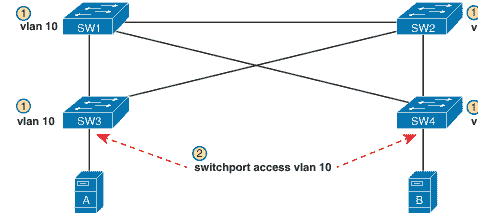

**图 5-1** *在示例局域网中为 VLAN 10 添加支持的命令*

VTP 在其预期用途下，允许工程师只在一台交换机上创建 VLAN（`vlan 10` 命令），然后 VTP 会自动更新其他交换机的配置。

VTP 定义了一种第 2 层消息传递协议，交换机可以利用该协议交换 VLAN 配置信息。当交换机更改其 VLAN 配置（包括 **vlan vlan-id** 命令）时，VTP 会使所有交换机同步其 VLAN 配置，使其包含相同的 VLAN ID 和 VLAN 名称。这个过程有点像路由协议，每台交换机都会发送周期性的 VTP 消息。不过，路由协议通告的是 IP 网络的信息，而 VTP 通告的是 VLAN 配置。

图 5-2 展示了在与图 5-1 相同的场景中 VTP 如何工作的一个示例。图 5-2 从需要新建 VLAN 10 以及将两台服务器加入该 VLAN 开始。在步骤 1 中，网络工程师在交换机 SW1 上使用 **vlan 10** 命令创建了该 VLAN。然后 SW1 使用 VTP 将该新 VLAN 配置通告给其他交换机，如步骤 2 所示；请注意，其他三台交换机不需要配置 **vlan 10** 命令。在步骤 3 中，网络工程师仍然需要使用 **switchport access vlan 10** 命令配置接入端口，因为 VTP 不会通告接入接口和接入 VLAN 配置。

VTP 通告 **vlan vlan-id** 命令、**vlan-name** 子命令以及若干 VTP 特定命令。特别重要的是，请注意 VTP 不会通告将接入端口与特定 VLAN 关联起来的命令（**switchport access vlan vlan-id**），因此这些命令仍需要在各台交换机上单独配置。

此外，由于历史原因，VTP 将 VTP 服务器和客户端限制为使用 VLAN 1 到 1005。这个 VLAN ID 范围被称为标准范围 VLAN，包括 VLAN 1（它是每个端口上的默认接入 VLAN 和默认本征 VLAN）。标准范围以四个保留 VLAN（1002–1005）结束，这些 VLAN 是出于历史原因保留的。VTP 服务器随后可以配置标准范围内（2–1001）的任何其他 VLAN ID，并对它们进行通告。

### “我已经掌握了吗？”测验答案：

1 B，2 C，3 A，4 A，5 B，6 A，B

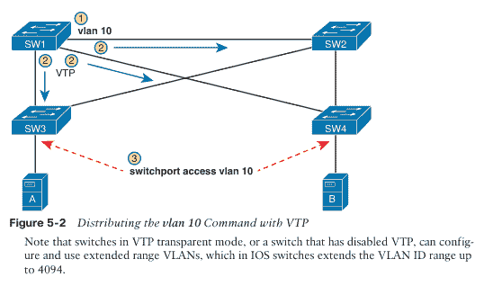

请注意，处于 VTP 透明模式或已禁用 VTP 的交换机可以配置和使用扩展范围 VLAN，在 IOS 交换机上，这将 VLAN ID 范围扩展到 4094。

### 同步 VTP 数据库

要使用 VTP 来通告和/或学习 VLAN 配置信息，交换机必须采用 VTP *服务器模式*或*客户端模式*。第三种 VTP 模式，即*透明模式*，指示交换机不学习 VLAN 配置，也不通告 VLAN 配置，从而使处于 VTP 透明模式的交换机就像不存在一样，至少对于 VTP 而言是如此。接下来的主题将讨论交换机在充当 VTP 服务器或客户端时所使用的机制。

VTP 服务器允许网络工程师通过命令行界面创建 VLAN（以及其他相关命令），而 VTP 客户端不允许网络工程师创建 VLAN。到目前为止，你在学习中已经见过很多次 **vlan** *vlan-id* 命令，该命令用于在交换机中创建新 VLAN。VTP 服务器可以继续使用该命令来创建 VLAN，但处于 VTP 客户端模式的交换机会拒绝 **vlan** *vlan-id* 命令，因为 VTP 客户端交换机无法创建 VLAN。

在记住这一主要区别的前提下，VTP 服务器允许通过常规命令创建 VLAN（及相关配置）。然后，服务器会通过 VLAN 中继链路通告该配置信息。整体流程大致如下：

- 1. 对于每条中继链路，发送 VTP 消息，并侦听接收消息。
- 2. 检查本地 VTP 参数与在中继链路上收到的 VTP 消息中通告的 VTP 参数是否匹配。
- 3. 如果 VTP 参数匹配，则尝试在两台交换机之间同步 VLAN 配置数据库。

> **注意** *VLAN 中继协议*这一名称是基于这样一个事实：该协议专门在 VLAN 中继链路上工作，如本列表中的第 1 项所述。

如果正确完成，VTP 会使同一管理*VTP 域*中的所有交换机——即具有相同域名和密码的交换机集合——收敛到完全相同的 VLAN 信息配置。随着时间的推移，每当任何 VTP 服务器上的 VLAN 配置发生变化，VTP 域中的所有其他交换机都会自动获知这些配置变更。

VTP 并不把 VLAN 配置看作是许多小块的信息，而是将其视为一个*VLAN 配置数据库*。该配置数据库有一个配置修订号，每当服务器更改 VLAN 配置时，修订号就会加 1。VTP 同步过程的关键在于确保每台交换机都使用具有最佳（最高）修订号的 VLAN 配置数据库。

图 5-3 开始了一个演示 VLAN 配置数据库修订号如何工作的示例。在示例开始时，所有交换机都已收敛到使用修订号为 3 的 VLAN 数据库。该示例随后展示了：

- 1. 网络工程师在交换机 SW1 上使用 **vlan 10** 命令定义了一个新 VLAN。
- 2. SW1（一台 VTP 服务器）将其自身 VLAN 配置数据库的 VTP 修订号从 3 更改为 4。
- 3. SW1 通过 VLAN 中继链路向 SW2 发送 VTP 消息，开始将新的 VTP 修订号告知 SW2，以便其更新 VLAN 配置数据库。

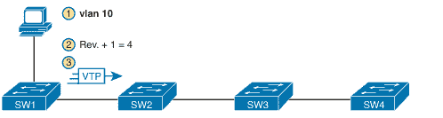

*图 5-3 在交换机 SW1 上添加 VLAN 10，所有交换机初始修订号均为 3*

此时，只有交换机 SW1 拥有最佳（修订号最高，为 4）的 VLAN 配置数据库。图 5-4 显示了接下来的几个步骤，接着图 5-3 停下的地方继续。在接收到来自 SW1 的 VTP 消息后（如图 5-3 的步骤 3 所示），在图 5-4 的步骤 4 中，SW2 开始使用该新 VLAN 数据库。步骤 5 强调了如下事实：因此，SW2 现在知道了 VLAN 10。随后，SW2 通过中继链路向下一台交换机 SW3 发送 VTP 消息（步骤 6）。

只要 VTP 在这四台交换机上正确运行，最终所有交换机都将使用完全相同的配置，即 VTP 通告的修订号为 4 的配置。

图 5-4 还很好地展示了一个 VTP 客户端和服务器之间的关键相似之处：两者都会从另一台交换机收到的 VTP 消息中学习并更新其 VLAN 数据库。请注意，图 5-3 和图 5-4 所示的过程在交换机 SW2、SW3 和 SW4 是 VTP 客户端还是服务器、以及任何组合下，其工作方式都是相同的。在此场景中，唯一必须是 VTP 服务器的交换机是 SW1，因为在其上配置了 **vlan 10** 命令；VTP 客户端会拒绝该命令。


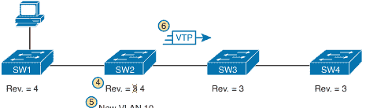

**图 5-4** *在交换机 SW1 上添加 VLAN 10，所有交换机最初均处于修订号 3*

例如，在图 5-5 中，假设交换机 SW2 和 SW4 是 VTP 客户端，而交换机 SW3 是 VTP 服务器。在与图 5-3 和图 5-4 所讨论的相同场景下，新的 VLAN 配置数据库会按照前面这些图所描述的方式传播，SW2（客户端）、SW3（服务器）和 SW4（客户端）都会学习并使用修订号为 4 的新数据库。

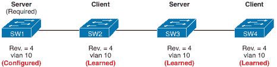

**图 5-5** *稳定状态，VTP 修订号为 4，所有交换机都知道 VLAN 10*

> **注意** 服务器更改 VLAN 配置，所有 VTP 交换机学习该新配置，最终使所有交换机都知道相同的 VLAN ID 和名称，这一完整过程称为 *VTP 同步*。

VTP 同步完成后，VTP 服务器和客户端还会每 5 分钟发送一次周期性的 VTP 消息。如果没有任何变化，这些消息会继续列出相同的 VLAN 数据库修订号，并且不会发生任何更改。当某个 VTP 服务器的配置发生变化时，该交换机会将其 VTP 修订号加 1，其后续的 VTP 消息会宣告新的 VTP 修订号，从而使整个 VTP 域（客户端和服务器）同步使用新的 VLAN 数据库。

## VTP 在两台交换机之间工作的要求

当 VTP 客户端或服务器连接到另一台 VTP 客户端或服务器交换机时，Cisco IOS 要求以下三个条件必须满足，这两台交换机才会处理从邻居交换机收到的 VTP 消息：

- 两台交换机之间的链路必须作为 VLAN trunk（ISL 或 802.1Q）运行。
- 两台交换机区分大小写的 VTP 域名必须匹配。
- 如果至少在其中一台交换机上配置了 VTP 密码，则两台交换机都必须配置相同的区分大小写的 VTP 密码。

VTP 域名提供了一种设计工具，工程师可以利用它创建多组 VTP 交换机，称为 VTP 域，这些域的 VLAN 配置相互独立。为此，工程师可以将一组交换机配置在一个 VTP 域中，将另一组配置在另一个 VTP 域中。一个域中的交换机会忽略来自另一个域中交换机的 VTP 消息，反之亦然。

VTP 密码机制提供了一种手段，使交换机能够防止恶意攻击者强迫交换机更改其 VLAN 配置。密码本身绝不会以明文形式传输。

## VTP 版本 1 与版本 2

Cisco 支持三个 VTP 版本，恰当地编号为版本 1、2 和 3。有趣的是，当前的 ICND2/CCNA 考试主题特别提到了版本 1 和 2，但省略了版本 3。版本 3 在版本 1 和 2 的基础上增加了更多功能和特性，因此稍微复杂一些。版本 1 和 2 相对相似，版本 2 对版本 1 进行了更新，以提供一些特定的功能更新。例如，版本 2 增加了对一种称为令牌环（Token Ring）的局域网类型的支持，但令牌环如今甚至已不再出现在 Cisco 的产品线中。

就当今配置、验证和排除 VTP 故障而言，版本 1 和 2 没有有意义的区别。例如，两台交换机可以配置为 VTP 服务器，一台使用 VTP 版本 1，另一台使用 VTP 版本 2，它们确实会交换 VTP 消息并相互学习。

VTP 版本 1 和 2 之间唯一可能重要的区别与 VTP 透明模式交换机的行为有关。根据设计，VTP 透明模式的目的是允许交换机配置为不与其他交换机同步，但同时也将 VTP 消息传递给 VTP 服务器和客户端。也就是说，透明模式交换机对 VTP 的预期目的——服务器和客户端同步——是透明的。透明模式交换机要转发服务器和客户端发送的 VTP 消息，其要求之一是 VTP 版本必须匹配。

## VTP 剪枝

默认情况下，局域网交换机上的 Cisco IOS 允许所有已配置 VLAN 中的帧通过 trunk 传输。交换机会将每个活动 VLAN 中的广播（以及未知目的地的单播）从这些 trunk 泛洪出去。

然而，使用 VTP 可能导致过多的泛洪流量流入网络的某些部分。VTP 会将 VTP 服务器中配置的任何新 VLAN 通告给 VTP 域中的其他服务器和客户端交换机。但是，在帧转发方面，可能没有必要将帧泛洪到所有交换机，因为某些交换机可能没有连接到特定 VLAN 中的设备。例如，在一个有 100 台交换机的园区局域网中，VLAN 50 中的所有设备可能只存在于 3 到 4 台交换机上。但是，如果 VTP 将 VLAN 50 通告给所有交换机，那么 VLAN 50 中的广播可能会被泛洪到所有 100 台交换机。

管理广播流的一种解决方案是在各个 VLAN trunk 上手动配置允许的 VLAN 列表。然而，这样做需要手动配置交换机。更好的选择可能是允许 VTP 动态确定哪些交换机在每个 VLAN 中没有接入端口，并从相应的 trunk 中剪枝（移除）这些 VLAN 以限制泛洪。VTP 剪枝简而言之就是相应的交换机 trunk 接口不在该 VLAN 中泛洪帧。

> **注意** 第 4 章“局域网故障排除”中的“Trunk 上支持的 VLAN 列表不匹配”一节讨论了交换机 trunk 不在 VLAN 中转发帧的各种原因，包括允许的 VLAN 列表。该节还简要提到了 VTP 剪枝。

图 5-6 显示了一个 VTP 剪枝的示例，展示了一种使 VTP 剪枝功能更加明显的设计。在该图中，使用了两个 VLAN：10 和 20。但是，只有交换机 SW1 在 VLAN 10 中有接入端口，只有交换机 SW2 和 SW3 在 VLAN 20 中有接入端口。在这种设计下，VLAN 20 中的帧不需要向左泛洪到交换机 SW1，VLAN 10 中的帧也不需要向右泛洪到交换机 SW2 和 SW3。

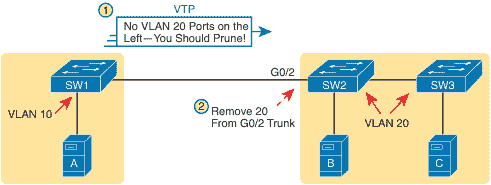

**图 5-6** *VTP 剪枝示例*

- 图 5-6 显示了从 SW2 的 G0/2 trunk 上剪枝 VLAN 10 的两个步骤：
  - **步骤 1.** SW1 通过 VTP 知道 VLAN 20，但交换机 SW1 在 VLAN 20 中没有接入端口。因此，SW1 向 SW2 通告 SW1 希望剪枝 VLAN 20，以便 SW1 不再接收 VLAN 20 中的数据帧。
  - **步骤 2.** 交换机 SW2 上的 VTP 从 G0/2 trunk 上剪枝 VLAN 20。结果，SW2 将不再把 VLAN 20 的帧从 G0/2 trunk 泛洪给 SW1。

VTP 剪枝通过限制泛洪流量来增加可用带宽。VTP 剪枝是使用 VTP 的两个最有说服力的原因之一，另一个原因是使 VLAN 配置更简单、更一致。

## VTP 特性总结

表 5-2 对三种 VTP 模式进行了比较性概述。

**表 5-2 — VTP 特性**

| 功能 | 服务器 | 客户端 | 透明 |
|---|---|---|---|
| 仅通过 ISL 或 802.1Q trunk 发送 VTP 消息 | 是 | 是 | 是 |
| 允许通过 CLI 配置 VLAN | 是 | 否 | 是 |
| 可以使用普通范围 VLAN（1–1005） | 是 | 是 | 是 |
| 可以使用扩展范围 VLAN（1006–4095） | 否 | 否 | 是 |
| 收到具有更高修订号的 VTP 消息时同步自己的配置数据库 | 是 | 是 | 否 |
| 每 5 分钟创建并发送周期性 VTP 更新 | 是 | 是 | 否 |
| 不处理收到的 VTP 更新，但会将收到的 VTP 更新从其他 trunk 转发出去 | 否 | 否 | 是 |

## VTP 配置与验证

VTP 配置只需几个简单的步骤，但 VTP 有可能造成重大问题，无论是由于意外的错误配置选择还是恶意攻击。本章的第二个主要部分侧重于正确配置 VTP 并验证其运行。第三个主要部分则介绍 VTP 的故障排除，其中包括注意避免有害场景。

### 使用 VTP：配置服务器和客户端

在配置 VTP 之前，网络工程师需要做出一些选择。特别是，假设工程师想要利用 VTP 的功能，则需要决定哪些交换机将位于同一个 VTP 域中，这意味着这些交换机会相互学习 VLAN 配置信息。必须选择 VTP 域名，以及可选的但建议使用的 VTP 密码。（域名和密码都区分大小写。）工程师还必须选择哪些交换机将作为服务器（通常至少两台以实现冗余），哪些将作为客户端。

规划步骤完成后，可以使用以下步骤来配置 VTP：

- 1. 在全局配置模式下使用 **vtp mode {server | client}** 命令在交换机上启用 VTP，将其配置为服务器或客户端。
- 2. 在客户端和服务器上，使用全局配置模式下的 **vtp domain** *域名* 命令配置区分大小写的 VTP 域名。
- 3. （可选）在客户端和服务器上，使用全局配置模式下的 **vtp password** *密码值* 命令配置区分大小写的密码。
- 4. （可选）在服务器上，使用 **vtp pruning** 全局配置命令做出域范围的 VTP 剪枝选择。
- 5. （可选）在客户端和服务器上，使用全局配置模式下的 **vtp version {1 | 2}** 命令告知本地交换机使用 VTP 版本 1 还是版本 2。

作为即将到来的配置示例中要使用的网络，图 5-7 显示了一个局域网以及每台交换机上当前的 VTP 设置。在本节示例的开头，两台交换机都具有所有默认的 VTP 配置：VTP 服务器模式，域名为空，密码为空。使用这些默认设置，即使两台交换机之间的链路是 trunk，VTP 仍然无法工作。


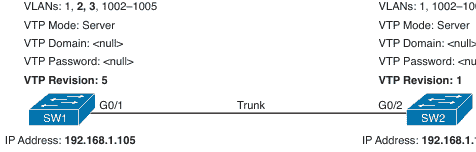

**图5-7**  *VTP示例的初始设置*

如图所示，交换机除VTP配置外，还进行了一些相关配置。SW1已配置为识别两个额外VLAN（VLAN 2和3）。此外，两台交换机都配置了IP地址——这一事实在后续的show命令输出中将很有用。

为了在这些交换机中使用VTP并同步其VLAN配置数据库，图5-8重复了图5-7，但新增了一些以粗体显示的配置设置。请注意，两台交换机现在使用相同的VTP域名和密码。交换机SW1保持默认设置，作为VTP服务器，而交换机SW2现在配置为VTP客户端。现在，由于VTP域名和密码匹配，且两台交换机之间有Trunk，它们将成功使用VTP。

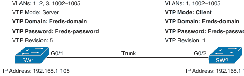

**图5-8**  *为示例5-1规划的新VTP配置设置*

示例5-1显示了图5-8中所示配置在各交换机上的添加情况。

### 示例5-1  *基本的VTP客户端和服务器配置*

```text
! IOS generates at least one informational message after each VTP command listed
! below. Those lines are not added to the output; they are generated by IOS.
SW1# configure terminal
Enter configuration commands, one per line. End with CNTL/Z.
SW1(config)# vtp mode server
Setting device to VTP SERVER mode
SW1(config)# vtp domain Freds-domain
Changing VTP domain name from NULL to Freds-domain
SW1(config)# vtp password Freds-password
Setting device VLAN database password to Freds-password
SW1(config)# vtp pruning
Pruning switched on
SW1(config)# ^Z
Switching to SW2 now
SW2# configure terminal
Enter configuration commands, one per line. End with CNTL/Z.
SW2(config)# vtp mode client
Setting device to VTP CLIENT mode.
SW2(config)# vtp domain Freds-domain
Domain name already set to Freds-domain.
SW2(config)# vtp password Freds-password
Setting device VLAN database password to Freds-password
SW2(config)# ^Z
```

务必花时间在两台交换机上逐一执行上述配置命令。域名和密码区分大小写，必须匹配。另外，作为客户端的SW2无需执行**vtp pruning**命令，因为VTP服务器会向整个域通告是否使用修剪功能。（请注意，所有VTP服务器应配置相同的VTP修剪设置。）

## 验证交换机同步数据库

如示例5-1所示，配置VTP只需少量工作。VTP最有趣的活动在于它动态学习的内容，以及VTP如何完成这种学习。例如，图5-7显示交换机SW1的VLAN配置数据库修订号为5，而SW2的修订号为1。一旦按示例5-1所示完成配置，SW1和SW2之间通过交换VTP消息发生了以下逻辑过程：

- 1. SW1和SW2交换VTP消息。
- 2. SW2发现自己的修订号（1）低于（较差）SW1的修订号5。
- 3. SW2接收了SW1的VLAN数据库副本，并更新了SW2自身的VLAN（及相关）配置。
- 4. SW2的修订号也更新为5。

要确认两台相邻交换机是否已同步其VLAN数据库，可使用**show vtp status**命令。示例5-2首先在交换机SW2上执行此命令，该交换机在示例开始时修订号较低（1），因此它应与交换机SW1同步了VLAN配置数据库。示例首先显示SW2上**show vtp status**命令的输出，然后显示SW1的输出。

### **示例5-2**  *演示交换机SW2的VLAN数据库更新至修订版5*

```text
! First, the output from SW2, the VTP client, formerly revision 1, now revision 5
SW2# show vtp status

VTP Version capable              : 1 to 3
VTP Version running              : 1
VTP Domain Name                  : Freds-domain
VTP Pruning Mode                 : Enabled
VTP Traps Generation             : Disabled
Device ID                        : bcc4.938b.a180
Configuration last modified by 192.168.1.105 at 2-21-16 11:45:33
Local updater ID is 192.168.1.105 on interface Vl1 (lowest numbered VLAN interface
found)

Feature VLAN:
-------------

VTP Operating Mode               : Client
Maximum VLANs supported locally  : 1005
Number of existing VLANs         : 7
Configuration Revision           : 5
MD5 digest                       : 0xF3 0x07 0x44 0x4A 0xDE 0x82 0xCD 0xB0
                                   0x9E 0x8F 0x0B 0xD1 0xFD 0x87 0xE7 0xB3

! Switching to SW1 now, all highlighted items match switch SW2
! Back on SW1, the output below confirms the same revision number as SW2, meaning
! that the two switches have synchronized their VLAN databases.

SW1# show vtp status
VTP Version capable              : 1 to 3
VTP Version running              : 1
VTP Domain Name                  : Freds-domain
VTP Pruning Mode                 : Enabled
VTP Traps Generation             : Disabled
Device ID                        : bcc4.938b.e500
Configuration last modified by 192.168.1.105 at 2-21-16 11:45:33

Local updater ID is 192.168.1.105 on interface Vl1 (lowest numbered VLAN interface
found)

Feature VLAN:
-------------

VTP Operating Mode               : Server
Maximum VLANs supported locally  : 1005
Number of existing VLANs         : 7
Configuration Revision           : 5
MD5 digest                       : 0xF3 0x07 0x44 0x4A 0xDE 0x82 0xCD 0xB0
                                   0x9E 0x8F 0x0B 0xD1 0xFD 0x87 0xE7 0xB3

SW1# show vtp password
VTP Password: Freds-password
```

该示例显示了两个事实，证实这两台交换机由于VTP而同步使用相同的VLAN配置数据库：

- 高亮显示的行“Configuration last modified by...”列出了相同的IP地址和时间戳。SW1和SW2都列出了同一台交换机，地址为192.168.1.105。（根据图5-8，192.168.1.105是交换机SW1。）此外，注意SW1上的文本列出了“Local updater ID is 192.168.1.105...”，这意味着本地交换机（SW1）就是192.168.1.105。两台交换机都列出相同的IP地址和时间戳，这一事实证实它们使用相同的数据库，此处该数据库由192.168.1.105（即交换机SW1）提供。
- 两台交换机都列出的“Configuration Revision”为5，这也证实它们使用相同的VLAN数据库。

> **注意** 将NTP与VTP结合使用可确保相邻交换机上**show vtp status**命令中的时间戳显示相同时间。

除这两个关键事实外，**show vtp status**命令还显示了几项关键信息，两台相邻交换机在成功交换数据库之前，这些信息必须匹配。如示例5-2中仅在SW1的输出中高亮显示的：

- 双方使用相同的域名（Freds-domain）。
- 双方具有相同的MD5摘要。

请注意，虽然将所有交换机设置为使用相同的版本（版本1或版本2）是一种良好做法，但版本不匹配并不会阻止VTP服务器和客户端交换VTP配置数据库。

列表最后一项关于MD5哈希，需要进一步解释。交换机上的VTP会使用域名和VTP密码，通过MD5生成一个MD5摘要，如**show vtp status**命令输出所示。如果域名或密码任一不匹配，MD5摘要将不匹配，两台交换机将不会通过VTP交换VLAN配置。（请注意，示例5-2末尾列出了一条示例**show vtp password**命令，该命令显示了VTP密码的明文。）

任何能列出交换机已知VLAN的命令都可以确认VTP是否生效。一旦VTP客户端或服务器从邻居处学习到新的VLAN配置数据库，其VLAN列表应与邻居的完全一致。

例如，按照图5-8建议的配置（如示例5-1所示），VTP服务器SW1最初有VLAN 1、2、3以及默认VLAN 1002–1005，而交换机SW2只知道默认VLAN：1和1002–1005。示例5-3列出了交换机SW2上**show vlan brief**命令的输出，确认它现在也知道了VLAN 2和3。请注意，交换机SW2不仅学到了VLAN ID，还学到了VLAN的名称。

### **示例5-3**  *交换机SW2现在知道VLAN 2和3*

```text
SW2# show vlan brief
```

| VLAN | 名称 | 状态 | 端口 |
| --- | --- | --- | --- |
| 1 | default | active | Fa0/1, Fa0/2, Fa0/3, Fa0/4, Fa0/5, Fa0/6, Fa0/7, Fa0/8, Fa0/9, Fa0/10, Fa0/11, Fa0/12, Fa0/13, Fa0/14, Fa0/15, Fa0/16, Fa0/17, Fa0/18, Fa0/19, Fa0/20, Fa0/21, Fa0/22, Fa0/23, Fa0/24, Gi0/1 |


| VLAN | 名称 | 状态 |
|---|---|---|
| 2 | Freds-vlan | active |
| 3 | VLAN0003 | active |
| 1002 | fddi-default | act/unsup |
| 1003 | token-ring-default | act/unsup |
| 1004 | fddinet-default | act/unsup |
| 1005 | trnet-default | act/unsup |

## 存储 VTP 及相关配置

有趣的是，尽管 VTP 会同步 VLAN 和 VTP 配置，你却不能直接通过输入 `show running-config` 命令来发现交换机是否已同步其 VLAN 配置数据库。VTP 不会将配置命令放入 VTP 服务器或客户端的 running-config 或 startup-config 文件中。相反，VTP 服务器和客户端模式的交换机会将 `vtp` 配置命令以及一些 VLAN 配置命令存储在闪存中的 `vlan.dat` 文件里。要验证这些配置命令及其设置，请使用 `show vtp status` 和 `show vlan` 命令。

图 5-9 显示了一个示例。它展示了三个关键的 VTP 命令（`vtp mode`、`vtp domain` 和 `vtp password`），以及一个创建 VLAN 10 的 `vlan 10` 命令。图中还展示了 `switchport access vlan 10` 接口子命令以作对比。其中，在 VTP 服务器或客户端上，只有 `switchport access vlan 10` 命令会出现在 running-config 或 startup-config 文件中。

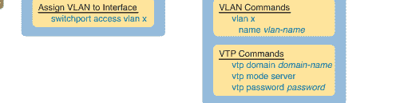

*图 5-9* VTP 存储配置的位置：VTP 客户端与服务器

没有与 `show running-config` 等效的命令来显示 `vlan.dat` 文件的内容。相反，你必须使用各种 `show vtp` 和 `show vlan` 命令来查看有关 VLAN 和 VTP 的信息。作为参考，表 5-3 列出了与 VLAN 相关的配置命令、VTP 服务器或客户端存储这些命令的位置，以及如何查看这些命令的设置。

**表 5-3 VTP 客户端和服务器存储 VLAN 相关配置的位置**

| 配置命令 | 存储位置 | 查看方式 |
|---|---|---|
| `vtp domain` | vlan.dat | `show vtp status` |
| `vtp mode` | vlan.dat | `show vtp status` |
| `vtp password` | vlan.dat | `show vtp password` |
| `vtp pruning` | vlan.dat | `show vtp status` |

- 对于任意组合的 VTP 服务器和客户端，相邻交换机之间的 VTP 版本不必匹配即可进行同步。
- 在判断 VTP 是否已同步时，请注意 VLAN 的管理状态（根据全局配置命令 **shutdown vlan vlan-id** 以及 VLAN 配置模式下的 **shutdown** 命令）不会通过 VTP 进行通信。因此，两个相邻交换机可以知道同一个 VLAN，但该 VLAN 在一台交换机上处于关闭状态，而在另一台交换机上处于活动状态。

## 配置 VTP 时常见的拒绝情况

VTP 客户端根本无法配置 VLAN，无论是添加、删除还是命名。VTP 服务器（使用 VTP 版本 1 和 2 时）仅限于操作标准范围的 VLAN。接下来的简短主题将展示当您尝试添加这些 VLAN 时出现的错误消息，尽管本章声称允许这样做，只是为了让你了解错误消息的样子。

### 示例 5-4 *在 VTP 客户端和服务器上尝试 vlan 命令*

```
SW3# configure terminal
Enter configuration commands, one per line.  End with CNTL/Z.
SW3(config)# vlan 200
VTP VLAN configuration not allowed when device is in CLIENT mode.
SW3(config)# vlan 2000
SW3(config-vlan)# exit
% Failed to create VLANs 2000
Extended VLAN(s) not allowed in current VTP mode.
%Failed to commit extended VLAN(s) changes.
SW3(config)#
```

示例的后半部分展示了一些奇怪的现象。首先，`vlan 200` 命令立即被拒绝。其次，`vlan 2000` 命令也被拒绝，但不是立即——IOS 的逻辑有些奇怪，直到用户退出 VLAN 配置模式时，IOS 才真正尝试添加扩展模式 VLAN 的配置。一旦发出 `exit` 命令，IOS 就发出了三条高亮错误消息——所有这些消息都以某种方式确认 VLAN 2000 并未被创建。

请注意，在 VTP 服务器上，`vlan 200` 命令会被接受，但 `vlan 2000` 命令会被拒绝，其过程与示例中所示相同。

## 向网络中添加交换机时的问题

VTP 可能导致前面段落所描述的那种普遍的局域网问题，因此在使用 VTP 时你必须格外小心。当一台新的交换机连接到现有网络时，就可能发生这类问题。无论这种问题是偶然发生还是作为拒绝服务（DoS）攻击，根本原因都是：

当两台相邻交换机首次通过中继链路连接，并且它们也满足通过 VTP 进行同步的所有要求时，修订号较低的交换机会接受来自修订号较高的邻居的 VLAN 数据库。

请特别注意，前面的陈述完全没有提到哪台交换机是服务器或客户端，也没有提到哪台是较旧的生产交换机，哪台是新添加的交换机。也就是说，无论服务器具有较高的修订号还是客户端具有较高的修订号，两台交换机最终都会统一使用具有较高修订号的 VLAN 数据库。其中没有任何关于哪台交换机是客户端或服务器、哪台是新交换机、哪台是既有旧交换机的逻辑。

这种在连接新交换机时使用较高修订号的 VTP 行为具有一些相当强大的含义。例如，考虑以下场景：有人正在为 CCNA R&S 考试学习，使用公司小实验室里的设备。实验室里有几台与生产网络隔离的局域网交换机——也就是说，这些交换机甚至没有线缆连接到生产网络。但由于工程师知道生产环境中使用的 VTP 域名和密码，在实验室配置时，工程师使用了相同的 VTP 域名和密码。这（暂时）不会造成问题，因为实验室交换机甚至没有连接到生产网络。（在现实生活中，请在实验室设备中使用不同的 VTP 域名和密码！）

同一位工程师继续在实验室进行 CCNA 学习和测试，对 VLAN 配置做了大量更改。每次更改都会使 VLAN 配置数据库的修订号增加 1。最终，实验室交换机的 VTP 配置修订号变得很高，高到超过了生产交换机的修订号。但实验室仍然隔离，所以仍然没有问题。

你看到危险了吗？现在只需要有人将一根链路从实验室交换机连接到生产交换机并使其成为中继。例如，想象现在另一位工程师决定在实验室进行一些测试，却没有想到检查实验室交换机与生产交换机的 VTP 状态。这第二位工程师走进实验室，将实验室交换机连接到生产网络。链路协商为中继…VTP 在实验室交换机和生产交换机之间同步…然后这两台交换机发现实验室交换机的配置数据库具有更高的修订号。此时，VTP 正在愉快地履行职责，同步 VLAN 配置数据库，但不幸的是，VTP 正在分发实验室的 VLAN 配置，从而删除了生产 VLAN。

在现实生活中，当将新交换机安装到现有 VTP 域时，有几种方法可以帮助减少此类问题的发生。特别是，在将新交换机连接到现有 VTP 域之前，请通过以下任一方法将新交换机的 VTP 修订号重置为 0：

- 将新交换机配置为 VTP 透明模式，然后再切换回 VTP 客户端或服务器模式。
- 擦除新交换机闪存中的 `vlan.dat` 文件并重新加载交换机。（`vlan.dat` 文件包含交换机的 VLAN 数据库，包括修订号。）


表5-7 第5章 EXEC命令参考

| 命令 | 描述 |
|---|---|
| show vlan [brief \| id vlan-id \| name vlan-name \| summary] | 列出有关VLAN的信息 |
| show vlan [vlan] | 显示VLAN信息 |
| show vtp status | 列出VTP配置和状态信息 |
| show vtp password | 列出本地交换机上当前的VTP密码 |

## 其他LAN主题

**本章涵盖以下考试主题：**

- 1.0 LAN交换技术
- 1.6 描述交换机堆叠和机箱聚合的优势
- 1.7 描述常见的接入层威胁缓解技术
  - 1.7.a 802.1x
  - 1.7.b DHCP侦听
- 5.0 基础设施维护
- 5.4 描述使用带TACACS+和RADIUS的AAA进行设备管理

本书和《ICND1 100-105认证指南》共有14章专门讨论与LAN相关的主题。本章是其中的最后一章。本章以一些在其他章节中无法妥善安排的小主题来结束LAN专题讨论。

本章以三个安全主题开始。第一部分讨论IEEE 802.1x，它定义了一种机制，通过要求用户在交换机允许该设备发送的帧进入LAN之前提供用户名和密码，来确保用户对LAN的访问。该工具有助于保障网络安全，防止攻击者接入网络。第二部分“AAA认证”讨论网络设备安全，通过要求使用外部认证服务器进行用户名/密码登录来保护路由器和交换机的CLI访问。第三部分“DHCP侦听”探讨交换机如何防止利用DHCP消息和功能的安全攻击。通过观察DHCP消息，注意到它们被以非正常方式使用时，DHCP侦听可以通过简单地过滤某些DHCP消息来防止攻击。

本章四个主要部分的最后一部分探讨两种类似的设计工具，它们使多台交换机像一台交换机一样工作：交换机堆叠和机箱聚合。交换机堆叠允许一组彼此靠近的类似交换机（位于同一布线间，通常在同一机架的同一位置）通过线缆连接在一起，然后像一台交换机一样工作。使用交换机堆叠可以大大减少管理交换机的工作量，并减少网络中使用的控制和管理协议的开销。交换机机箱聚合具有许多相同的优点，但更常作为分布层或核心层交换机功能得到支持，而交换功能则是更典型的接入层交换机功能。

本章四个部分都有对应的考试主题，这些主题使用了动词“描述”，因此本章仅涉及工具的基本描述，而非深入配置。少数主题会展示一些配置以帮助描述该主题，但本章旨在帮助你理解基础知识，而不是获得配置这些功能的能力。

### “我是否已经知道这些内容？”测验

如果你想利用分数来决定在本章上花费多少时间，请参加测验（可在此处或使用PCPT软件进行）。答案位于测验之后的页面底部，解释部分见DVD附录C和PCPT软件。

表6-1 “我是否已经知道这些内容？”基础主题章节与问题映射

| 基础主题章节 | 问题 |
|---|---|
| 使用IEEE 802.1x保护访问 | 1 |
| AAA认证 | 2 |
| DHCP侦听 | 3–4 |
| 交换机堆叠与机箱聚合 | 5 |

- 1. 在IEEE 802.1x中，LAN交换机通常扮演哪种角色？
  - a. 认证服务器
  - b. 请求方
  - c. 转换器
  - d. 认证器
- 2. 下列关于TACACS+的说法中，哪一项是正确的，但对于RADIUS是不正确的？
  - a. 该协议对传输的密码进行加密。
  - b. 使用UDP作为传输协议。
  - c. 支持授权不同用户使用不同的CLI命令子集。
  - d. 由RFC定义。
- 3. 一位工程师听说DHCP侦听后决定实施它。该网络包含主要充当二层交换机的设备、多层交换机（即同时执行二层和三层交换），以及路由器。以下哪些设备上可以实施DHCP侦听？（选择两个答案。）
  - a. 二层交换机
  - b. 路由器
  - c. 多层交换机
  - d. LAN集线器
- 4. 二层交换机SW2连接到多个设备：一台二层交换机（SW1）、一台路由器、一台DHCP服务器和三台PC（PC1、PC2和PC3）。所有PC都预期使用DHCP租用其IP地址。网络工程师在交换机SW2上实施DHCP侦听。工程师不知道的是，一名恶意攻击者正在使用PC3。以下哪项最可能是SW2上连接到所列设备的端口的DHCP侦听信任状态配置？（选择两个答案。）
  - a. 连接到路由器的端口是不受信任的。
  - b. 连接到交换机SW1的端口是受信任的。
  - c. 连接到PC1的端口是不受信任的。
  - d. 连接到PC3的端口是受信任的。
- 5. 一位网络工程师用四台2960-X交换机，使用思科的FlexStack或FlexStack-Plus堆叠技术创建了一个交换机堆叠。现在考虑数据平面功能（如帧转发）、控制平面功能（如STP和VTP）以及管理平面功能（如Telnet和SSH支持）。一旦堆叠完成布线并开始工作，关于这四台交换机的堆叠如何工作，以下哪项是正确的？
  - a. 该堆叠在数据平面功能上充当一台交换机，而在控制平面和管理平面功能上充当独立的多台交换机。
  - b. 该堆叠在数据平面和控制平面功能上充当一台交换机，而在管理平面功能上充当独立的多台交换机。
  - c. 该堆叠在数据平面、控制平面和管理平面功能上都充当一台交换机。
  - d. 该堆叠在数据、控制或管理平面功能上均不充当一台交换机，而是在一台交换机的所有上行链路发生故障时提供备用上行链路。

### 基础主题

### 使用IEEE 802.1x保护访问

在一些企业LAN中，LAN布线会铺设到每个隔间和每间办公室的每张办公桌。当你搬到新空间时，只需将一根短跳线从PC连接到墙上的RJ-45插座，就可以连接到网络。启动后，你的PC可以向网络中的任何地方发送数据包。安全性？这主要发生在你试图访问的设备上，例如当你登录服务器时。

上一段描述了许多网络的真实工作方式。这种观点将网络视为网络中端点之间的开放高速公路，网络的存在是为了建立连接、提供高可用性，并让你轻松连接设备。这些目标都是值得追求的。然而，让LAN对任何人开放，使任何人都可以尝试连接到网络中的服务器，这会让攻击者得以连接并试图突破保护服务器的安全措施。这种方法可能太不安全。例如，任何能够获得物理访问权限的攻击者都可以插入其笔记本电脑，并开始运行工具，试图利用连接到内部网络的所有服务器。

如今，许多公司都会保护对网络的访问。当然，他们首先会创建基本连接：铺设LAN线缆，并将线缆连接到所有隔间和办公室的所有办公桌。所有这些端口在物理上都是可用的。但是，用户不能只是插入她的PC就开始工作；在LAN交换机允许用户发送网络中的任何其他消息之前，她必须经过安全流程。

交换机可以使用IEEE标准802.1x来保护对LAN端口的访问。要设置此功能，必须将LAN交换机配置为启用802.1x。此外，IT人员必须实施认证、授权和计费（AAA）服务器。AAA服务器（通常发音为“triple A”服务器）将保存用户名和密码，当用户提供这些信息时，由AAA服务器判断用户输入是否正确。

实施后，LAN交换机充当802.1x *认证器*，如图6-1所示。作为802.1x认证器，交换机可以配置为在某些端口上启用802.1x，这些端口很可能是连接到最终用户的接入端口。为端口启用802.1x意味着当端口首次启动时，交换机会过滤所有传入流量（802.1x流量除外）。802.1x必须首先认证使用该设备的用户。

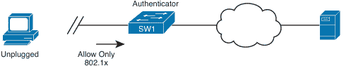

**图6-1** *交换机作为802.1x认证器，带有AAA服务器，PC尚未连接*

请注意，交换机通常对连接到最终用户的接入端口配置802.1x，但不会在与IT控制的设备相连的端口（如中继端口）上启用802.1x，也不会在连接于网络中物理上更安全区域的端口上启用802.1x。

802.1x认证过程的工作原理如图6-2所示。一旦PC连接且端口启动，交换机会使用802.1x消息要求PC提供用户名/密码。然后PC必须提供该信息。要使该过程正常工作，终端用户设备必须使用称为*请求方*的802.1x客户端；许多操作系统都包含802.1x请求方，因此它可能只是被视为操作系统设置的一部分。

在图6-2的步骤3和4中，交换机对用户进行认证，以确定用户名和密码组合是否合法。交换机作为802.1x认证器，询问AAA服务器所提供的用户名和密码组合是否正确，AAA服务器会做出回应。如果用户名和密码正确，则交换机授权该端口。一旦获得授权，交换机将不再过滤该端口上的传入消息。如果用户名/密码检查显示用户名/密码不正确，或者过程因任何原因失败，则端口保持未授权状态。用户可以继续重试。


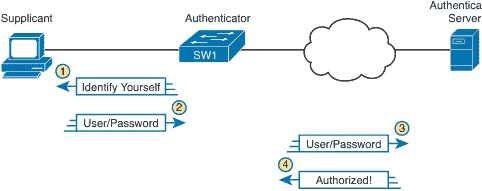

**图 6-2** *通用 802.1x 认证流程*

图 6-3 通过展示 802.1x 所使用的一种关键协议的示例来完善本主题：可扩展认证协议（EAP）。交换机（认证方）在其自身与 AAA 服务器之间使用 RADIUS，而 RADIUS 本身使用 IP 和 UDP。然而，802.1x 是一种以太网协议，不使用 IP 或 UDP。但是，802.1x 希望将一些认证信息一直交换到 RADIUS AAA 服务器。解决方案是使用 EAP，如图 6-3 所示。

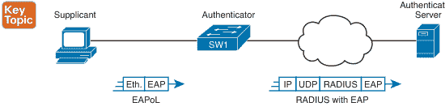

**图 6-3** *802.1x 下的 EAP 和 RADIUS 协议流程*

如图所示，EAP 消息从申请方流向认证服务器，只是以不同类型的消息形式流动。从申请方（终端用户设备）到交换机的流将 EAP 消息直接传输在以太网帧中，并采用一种称为 LAN 上的 EAP（EAPOL）的封装。从认证方（交换机）到认证服务器的流在 IP 数据包中流动。实际上，它看起来很像 RADIUS 协议（RFC 2865）使用的普通消息。RADIUS 协议作为 UDP 应用运行，带有 IP 和 UDP 报头，如图所示。

既然你已经了解了一些细节和术语，下面的列表总结了整个过程：

- AAA 服务器必须配置用户名和密码。
- 每台 LAN 交换机都必须启用 802.1x，以使交换机作为认证方，配置 AAA 服务器的 IP 地址，并在所需端口上启用 802.1x。
- 用户必须知道 AAA 服务器上存在的用户名/密码组合，否则他们将无法从任何设备访问网络。

## AAA 认证

《ICND1 100-105 认证指南》讨论了许多有关设备管理的细节，特别是如何保护网络设备。然而，CCNA R&S 考试主题的 ICND1 部分中展示的所有这些设备安全方法，都使用本地配置的信息来保护对网络设备的登录。

使用交换机上本地配置的用户名和密码会带来一些管理上的麻烦。例如，每台交换机和路由器都需要为所有可能需要登录设备的用户提供配置。良好的安全实践告诉我们要定期更改密码，但登录数百台设备来更改密码是一项繁重的任务，因此密码常常长期保持不变。

更好的选择是使用外部 AAA 服务器。AAA 服务器集中并保护所有用户名/密码对。交换机和路由器仍然需要一些本地安全配置来引用 AAA 服务器，但用户名/密码集中存在，大大减少了管理工作量，并提高了密码定期更改且更安全的机会。跟踪哪些用户在何时登录了哪些设备，以及在人们离开当前工作时撤销访问权限，也更容易。

本简短小节讨论网络设备如何使用 AAA 服务器的基础知识。

### AAA 登录过程

首先，要使用 AAA，站点需要安装并配置 AAA 服务器，例如 Cisco 访问控制服务器（ACS）。Cisco ACS 是 AAA 软件，你可以将其安装在自己的服务器上（物理或虚拟）。

然后，每台网络设备都需要进行新配置，以告诉设备开始使用 AAA 服务器。该配置将指向 AAA 服务器的 IP 地址，并定义使用哪种 AAA 协议：TACACS+ 或 RADIUS。配置包括有关要使用的 TCP（TACACS+）或 UDP（RADIUS）端口的详细信息。

使用 AAA 服务器进行认证时，交换机（或路由器）只需向 AAA 服务器发送一条消息，询问是否允许该用户名和密码，然后 AAA 服务器回复。图 6-4 展示了一个示例，用户首先提供其用户名/密码，交换机询问 AAA 服务器，服务器回复交换机，说明该用户名/密码有效。

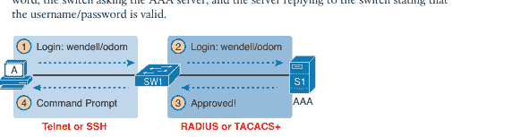

*图 6-4 使用外部 AAA 服务器的基本认证过程*

### TACACS+ 和 RADIUS 协议

虽然图 6-4 展示了一般概念，但请注意，信息通过几种不同的协议流动。在左侧，用户与交换机或路由器之间的连接使用 Telnet 或 SSH。在右侧，交换机和 AAA 服务器通常使用 RADIUS 或 TACACS+ 协议，这两种协议都会在密码通过网络传输时对其进行加密。

AAA 服务器还可以提供授权和计费功能。例如，对于网络设备，可以配置 IOS，使每个用户只能使用特定的 CLI 命令子集。因此，每台设备可以按用户配置一组自定义的命令权限设置，而不是基本上只有两个权限级别——用户模式和特权模式。或者，这些细节可以在 AAA 服务器上集中配置，而不是在每台设备上配置。因此，可以允许不同用户使用不同的命令子集，但这是通过向 AAA 服务器发送请求来识别的，而不是在每台设备上重复进行繁琐的配置。（请注意，TACACS+ 支持这种特定的命令授权功能，而 RADIUS 不支持。）

表 6-2 列出了 TACACS+ 和 RADIUS 之间的一些基本比较点。

**关键主题**

**表 6-2** TACACS+ 和 RADIUS 之间的比较

| 特性 | TACACS+ | RADIUS |
|---|---|---|
| 最常用于 | 网络设备 | 用户 |
| 传输协议 | TCP | UDP |
| 认证端口号 | 49 | 1645、1812 |
| 协议是否加密密码 | 是 | 是 |
| 协议是否加密整个数据包 | 是 | 否 |
| 支持将每个用户授权到 CLI 命令子集的功能 | 是 | 否 |
| 定义者 | Cisco | RFC 2865 |

## AAA 配置示例

学习如何配置路由器或交换机以使用 AAA 服务器可能很困难。AAA 要求你学习几条新命令。除此之外，启用 AAA 实际上会改变路由器上用于登录认证的规则——例如，启用 AAA 后，你不能再只是在控制台线路上添加一条登录命令。

考试主题在提到 AAA 特性时使用“描述”一词，而不是配置、验证或故障排除。然而，要理解交换机或路由器上的 AAA，通过一个示例配置来练习会有帮助。下一个主题侧重于 AAA 配置背后的大概念，而不是费心处理所有参数、验证结果或记忆命令清单。目标是帮助你了解交换机或路由器上的 AAA 如何改变登录安全。

> **注意** 在本书和《ICND1 认证指南》中，登录安全细节在路由器和交换机上的工作方式相同，但交换机没有辅助端口，而路由器通常有。不过，配置在路由器和交换机上的工作方式相同，因此当本节提到交换机用于登录安全时，同样的概念也适用于路由器。

你在《ICND1 认证指南》中学到的关于 ICND1 交换机登录安全的所有内容，都假设了一个未明说的默认全局命令：**no aaa new-model**。也就是说，你尚未将 **aaa new-model** 全局命令添加到配置中。配置 AAA 需要 **aaa new-model** 命令，而这一条全局命令会改变该交换机执行登录安全的方式。

**aaa new-model** 全局命令在本地交换机（或路由器）中启用 AAA 服务。它甚至启用新命令，这些命令以前不会被接受，也不会在 CLI 中通过问号获取帮助时显示。**aaa new-model** 命令还会更改一些默认登录认证设置。因此，可以将此命令视为使用原始简单登录安全方式与更高级方法之间的分界线。

在交换机上配置 **aaa new-model** 命令后，你需要定义每台 AAA 服务器，并配置一个或多个 AAA 服务器组（恰当地命名为 AAA 组）。对于每台 AAA 服务器，配置其 IP 地址和密钥，以及可选的所用 TCP 或 UDP 端口号，如图 6-5 的中间部分所示。然后，为每组 AAA 服务器创建一个服务器组，以将一个或多个 AAA 服务器分组，如图 6-5 底部所示。（然后其他配置设置将引用 AAA 服务器组，而不是 AAA 服务器。）

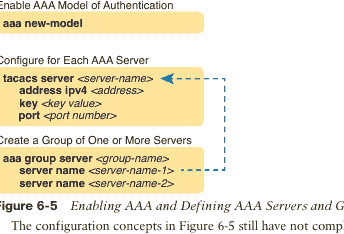

图 6-5 中的配置概念仍未完成配置 AAA 认证的任务。IOS 使用以下附加逻辑来衔接其余逻辑：

- 默认情况下，IOS 根据 `aaa authentication login default` 全局命令的设置，对控制台、vty 和 aux 端口执行登录认证。
- `aaa authentication login default method1 method2...` 全局命令列出不同的认证方法，包括引用要使用的 AAA 组（如图 6-5 底部所示）。
- 这些方法包括：已定义的 AAA 服务器组；local，表示本地配置的用户名/密码列表；或 line，表示使用由 `password` line 子命令定义的密码。

基本上，当你希望使用 AAA 在控制台或 vty 线路上进行登录认证时，最直接的选项使用 **aaa authentication login default** 命令。正如


图 6-6 显示，使用该命令时，它会列出多种认证方法。交换机会尝试第一种方法；如果该方法返回确定的应答，则过程结束。然而，如果该方法不可用（例如，没有任何 AAA 服务器可通过 IP 网络访问），则本地设备上的 IOS 会继续尝试下一种方法。

```
aaa authentication login default <method 1> <method 2>
                 ^           ^
                 |           |
          Tries This First   |
                      Tries This Second
```

**图 6-6** *默认登录认证规则*

为登录认证定义至少两种方法的想法非常合理。例如，第一种方法可以是 AAA 组，这样每位工程师都使用自己唯一的用户名和密码登录每台设备。然而，你不会希望工程师仅仅因为 IP 网络出现问题且 AAA 服务器无法将数据包发回交换机而登录失败。因此，使用备用登录方法（命令中列出的第二种方法）非常合理。

图 6-7 展示了三条示例命令，以便从不同角度理解。这三条命令都引用同一个 AAA 组（WO-AAA-Group）。图中标记为 1 的命令采取短视的做法，只对 AAA 组使用一种认证方法。图中的命令 2 使用两种认证方法：一种使用 AAA，第二种方法（本地）。（该命令的 local 关键字指的是本地交换机上配置的本地 **username** 命令列表。）图中的命令 3 再次使用 AAA 组作为第一种方法，后面跟着关键字 login，它告诉 IOS 使用 **password** line 子命令。

- 1. aaa authentication login default `group WO-AAA-Group`  
  （使用 AAA 服务器）
- 2. aaa authentication login default `group WO-AAA-Group` `local`  
  （使用 AAA 服务器）  
  第二：使用本地用户名
- 3. aaa authentication login default `group WO-AAA-Group` `login`  
  （使用 AAA 服务器）  
  第二：使用登录密码

**图 6-7** *AAA 登录认证方法组合示例*

## DHCP 侦听

要理解现代网络中存在的各类风险，你必须首先理解规则。然后你必须思考攻击者可能如何以不同方式利用这些规则。有些攻击可能造成危害，并可能被称为拒绝服务（DoS）攻击。或者攻击者可能收集更多数据，为其他某种攻击做准备。无论目标是什么，对于你在网络中学到的每一种协议和功能，都可能存在利用这些特性来让攻击者获得优势的方法。

Cisco 选择为当前 CCNA R&S 考试增加一个考试主题，重点在于缓解基于特定协议的攻击：DHCP。DHCP 已成为一种非常流行的协议，几乎用于每个企业、家庭和服务提供商。因此，攻击者一直在寻找利用 DHCP 的方法。帮助缓解 DHCP 风险的一种方法是使用一种称为 DHCP 侦听的 LAN 交换机功能。

本章四个主要部分中的第三部分将介绍 DHCP 侦听的基础知识。它从主要概念开始，然后展示一个攻击者如何滥用 DHCP 以获得优势的示例。最后一节解释 DHCP 侦听所使用的逻辑。

### DHCP 侦听基础

交换机上的 DHCP 侦听在许多方面类似于防火墙或 ACL。它会在所有端口或某些端口上监视传入消息（取决于配置）。它会查找 DHCP 消息，忽略所有非 DHCP 消息并允许这些消息通过。对于任何 DHCP 消息，交换机的 DHCP 侦听逻辑都会做出选择：允许该消息或丢弃该消息。

需要明确的是，DHCP 侦听是二层交换机功能，而不是路由器功能。具体来说，任何执行二层交换的交换机，无论它只进行二层交换还是充当多层交换机，通常都支持 DHCP 侦听。DHCP 侦听必须在位于同一 VLAN 中设备之间的设备上完成，这是二层交换机的角色，而不是三层交换机或路由器的角色。

DHCP 侦听的第一个重要概念是信任端口和非信任端口的概念。要理解原因，请先思考一下可能连接到一台交换机的所有设备。该列表包括路由器、服务器，甚至其他交换机。它包括终端用户设备，例如 PC。它包括无线接入点，而无线接入点又连接到终端用户设备。图 6-8 展示了一种表示。

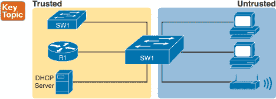

**图 6-8** *DHCP 侦听基础：客户端端口为非信任端口*

DHCP 侦听首先假设终端用户设备是非信任的，而更多由 IT 部门控制的设备是信任的。然而，非信任端口上的设备仍然可以使用 DHCP。相反，将端口设为 DHCP 侦听的非信任端口意味着：

监视传入的 DHCP 消息，并丢弃任何被认为对非信任端口而言异常、因而很可能是某种攻击一部分的消息。

以不同方式。DHCP 侦听会考虑 DHCP 应如何工作，并过滤掉任何不属于 DHCP 正常使用的消息。

DHCP 侦听需要一些配置设置。首先，工程师可以在交换机上全局启用 DHCP 侦听，或按 VLAN 启用（即在某些 VLAN 上启用，而在其他 VLAN 上不启用）。启用后，所有端口都被视为非信任端口，直到被配置为信任端口。

接下来，需要将一些交换机端口配置为信任端口。任何连接到合法 DHCP 服务器的交换机端口都应被信任。此外，连接到其他交换机的端口以及连接到路由器的端口也应被信任。为什么？信任端口基本上就是可能接收网络中合法 DHCP 服务器消息的端口。网络中的合法 DHCP 服务器是众所周知的。

快速回顾一下，ICND1 认证指南描述了正常 DHCP 租约流程中使用的 DHCP 消息（DISCOVER、OFFER、REQUEST、ACK [DORA]）。对于这些及其他 DHCP 消息，消息通常由 DHCP 客户端或服务器之一发送，而不是两者都发送。在 DORA 消息中，客户端发送 DISCOVER 和 REQUEST，服务器发送 OFFER 和 ACK。知道只有 DHCP 服务器应发送 DHCP OFFER 和 ACK 消息后，DHCP 侦听允许信任端口上传入的 OFFER 和 ACK 消息，但如果这些消息到达非信任端口，则将其过滤掉。

因此，DHCP 侦听的第一条规则是：交换机应信任任何可能接收来自可信 DHCP 服务器的合法消息的端口。相反，通过将端口保持为非信任状态，交换机会选择丢弃任何传入的仅应由 DHCP 服务器发送的消息。图 6-11 总结了这些要点，其中合法 DHCP 服务器位于左侧，连接在一个标记为信任的端口上。

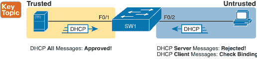

**图 6-11** _DHCP 侦听规则摘要_

非信任 DHCP 端口的逻辑则更具挑战性一些。基本上，非信任端口是真实用户群体所在，他们都严重依赖 DHCP。这些端口还包括少数试图用 DHCP 攻击网络的人，而你无法预测哪些非信任端口有合法用户，哪些正在攻击网络。因此，DHCP 侦听功能必须持续监视 DHCP 消息，甚至在 DHCP 绑定表中保留一些状态信息，以便决定何时应丢弃 DHCP 消息。

DHCP 绑定表是一份关于每个成功租用 IPv4 地址的关键信息列表。随后，可以将非信任端口上收到的每条新 DHCP 消息与 DHCP 绑定表进行比较，如果交换机在将 DHCP 消息与绑定表比较时检测到冲突，那么交换机将丢弃该消息。

要更具体地理解，请先看图 6-12，它展示了一台交换机在其 DHCP 绑定表中构建一个条目。在这个简单网络中，右侧的 DHCP 客户端


从左侧的DHCP服务器租用IP地址10.1.1.11。交换机的DHCP监听功能将来自DHCP消息的信息与关于端口的信息（接口F0/2，由交换机分配给VLAN 11）结合起来，并将其放入DHCP绑定表。


**SW1 DHCP绑定表**

| 接口 | VLAN | MAC           | IP        |
|---|---:|---|---|
| F0/2 | 11 | 0200.1111.1111 | 10.1.1.11 |

*图6-12 具有由DHCP监听构建的DHCP绑定条目的合法DHCP客户端*

由于这个DHCP绑定表条目，DHCP监听现在会阻止另一台交换机端口上的另一个客户端声称使用相同的IP地址（10.1.1.11）或相同的MAC地址（0200.1111.1111）。（许多DHCP客户端会使用与合法主机相同的IP地址或MAC地址进行接入。）

请注意，除了基于逻辑的类似防火墙的过滤规则之外，DHCP监听还可以配置为限制接口上DHCP消息的速率。例如，通过限制不可信接口上传入的DHCP消息速率，DHCP监听可以帮助防止旨在使合法DHCP服务器过载或耗尽所有可用DHCP IP地址空间的DoS攻击。

## 总结DHCP监听特性

DHCP监听有助于降低风险，特别是因为DHCP是大多数网络中至关重要的部分。下面的列表总结了有关DHCP监听的一些关键点，以便更轻松地备考：


- **可信端口：** 可信端口允许所有传入的DHCP消息。
- **不可信端口，服务器消息：** 不可信端口会丢弃所有被视为服务器消息的传入消息。
- **不可信端口，客户端消息：** 不可信端口会对被视为客户端消息的消息应用更复杂的逻辑。它们检查每个传入的DHCP消息是否与现有DHCP绑定表信息冲突，如果冲突，则丢弃该DHCP消息。如果消息没有冲突，交换机则允许该消息通过，这通常会导致添加新的DHCP绑定表条目。
- **速率限制：** 可选地限制每个端口每秒接收的DHCP消息数量。

## 交换机堆叠与机箱聚合

思科提供多种选项，使客户能够将其思科交换机配置为协同工作，表现为一台交换机，而不是多台交换机。本章最后一个主要部分讨论这些技术的两个主要分支：交换机堆叠，它更常见于接入层交换机；以及机箱聚合，它更常见于分布层和核心交换机。

### 不使用堆叠的传统接入交换

暂时想象一下，你负责为一个新园区订购所有设备，园区中有几栋多层办公楼。你参观了该空间，查看了空间图纸，并开始思考所有人员和计算机会分布在哪里。到某个时候，你会开始思考每个配线间需要多少个以太网端口。

想象某个配线间当前需要150个端口，而你希望建设足够的交换机端口容量到200个端口。你购买什么规格的交换机？是为该配线间购买一台至少具有200个端口的交换机吗？（本书不会详细讨论各种交换机型号，但确实可以买到单台拥有数百个端口的LAN交换机。）还是购买一对交换机，每台至少100个端口？或者购买八九台交换机，每台有24个接入端口？

使用较少数量的较大交换机有利有弊，反之亦然。为了满足这些需求，思科等厂商提供具有广泛端口密度的交换机。然而，一项称为*交换机堆叠*的交换机特性可以让你兼得两者的部分优势。

为了理解交换机堆叠的优势，想象一个典型的LAN设计，如图6-13所示。该图展示了概念设计，其中有两台分布交换机和四台接入层交换机。


图6-13 典型园区设计：接入交换机与两台分布交换机

为了后续比较，我在此强调几点。接入交换机A1到A4都作为独立设备运行。网络工程师必须配置每一台。它们各自都有一个用于管理的IP地址。它们各自运行CDP、STP，可能还有VTP。它们各自都有一个MAC地址表，并且各自基于该MAC地址表转发以太网帧。每台交换机可能具有非常相似的配置，但该配置是独立的，所有功能也是独立的。

连接到分布层：每台分布交换机各连接一条（见图6-13）。该布线保持不变。然而，作为一个逻辑交换机运行，交换机堆叠现在表现得就像一台交换机，向每台分布交换机都有四条上行链路。添加一点配置，将每组四条链路放入一个EtherChannel，就得到图6-16所示的设计。


**图6-16** *堆叠表现得像一台交换机*

堆叠还简化了操作。例如，想象一个VLAN的STP拓扑范围，该VLAN在本示例中所有四台物理接入交换机上都有接入端口。该生成树将包括全部六台交换机。当交换机堆叠作为一个逻辑交换机运行时，同一个VLAN现在在STP拓扑中只有三台交换机，并且更容易理解和预测。

### 思科FlexStack与FlexStack-Plus

为了给交换机堆叠这一概念画上句号，本结尾主题探讨思科FlexStack和FlexStack-Plus堆叠选项的一些细节。

思科的堆叠技术要求思科计划将堆叠作为产品的一项特性，因为它需要特定硬件。思科长期以来一直在构建型号以2960开头的新交换机系列。根据思科的文档，思科创建了一种称为FlexStack的堆叠技术，作为2960-S型号系列推出的一部分。思科后来通过FlexStack-Plus增强了FlexStack，在2960-X和2960-XR型号系列的产品中增加了支持。为了使交换机堆叠支持未来设计，堆叠硬件也往往会随时间而提升，如表6-3中FlexStack与FlexStack-Plus的比较所示。


**表6-3** 思科FlexStack与FlexStack-Plus选项比较

| | FlexStack | FlexStack-Plus |
|---|---|---|
| 推出年份 | 2010 | 2013 |
| 交换机型号系列 | 2960-S、2960-X | 2960-X、2960-XR |
| 单条堆叠链路双向速度（全双工） | 10 Gbps | 20 Gbps |
| 一个堆叠中的最大交换机数量 | 4 | 8 |

### 机箱聚合

术语*机箱聚合*指的是另一种思科技术，用于使多台交换机作为一台交换机运行。从宏观角度看，交换机堆叠在思科面向接入层的交换机中更常使用和提供。机箱聚合则面向位于分布层和核心层的更强大的交换机。总结一些关键区别，机箱聚合：

- 通常用于作为分布或核心交换机的高端交换机
- 不需要特殊硬件适配器，而是使用以太网接口
- 聚合两台交换机
- 可以说更复杂，但功能也更强

机箱聚合的核心理念与交换机堆叠相同：让多台交换机表现得像一台交换机，从而带来一些可用性和设计优势。但机箱聚合背后的很大一部分驱动力是关于LAN的高可用性设计。本节梳理其中一些思路，让你了解核心层和分布层高可用性背后的总体思想。

> **注意** 本节介绍机箱聚合的一般概念，但如需进一步阅读具体实现，请在Cisco.com搜索思科的虚拟交换系统（VSS），该系统受6500和6800系列交换机支持。

### 使用分布/核心交换机实现高可用性

即使没有机箱聚合，分布和核心交换机也需要具备高可用性。接下来几页将讨论为用作分布和核心交换机而构建的交换机如何帮助提高可用性，即使没有机箱聚合。

如果你观察一个中大型企业园区LAN，通常会看到接入交换机远多于分布和核心交换机。例如，你可能每层有四台接入交换机，一栋楼有十层，共40台接入交换机。同一栋楼可能只有一对分布交换机。

为什么用两台分布交换机而不是一台？因为如果设计只使用一台分布交换机，而它发生故障，楼内所有设备都无法访问网络的其余部分。那么，如果两台分布交换机很好，为什么不用四台？或者八台？一个原因是成本，另一个是复杂性。如果设计得当，为一栋楼配置一对分布交换机可以在高可用性与低成本/低复杂性之间提供适当的平衡。

典型分布和核心交换机的可用性特性使网络设计人员只需两台分布或核心交换机就能创建出色的可用性设计。思科制造的典型分布/核心交换机具有更多冗余。例如，图6-17展示了一台典型基于机箱的思科交换机的示意图。它有可用于线卡的插槽——即带有以太网端口的卡。它具有执行帧和分组转发的双管理引擎卡。它还有两个电源，如果需要，每个电源都可以连接到来自不同变电站的电源馈电。


**图6-17** *思科模块化分布/核心交换机中的常见线卡布局*

现在想象两台分布交换机并排放置在配线间中，如图6-18所示。设计通常会用 EtherChannel 连接这两台交换机。为了更高的可用性，EtherChannel 可以使用来自不同线卡的端口，这样即使某块线卡因硬件问题出现故障，EtherChannel 仍然可以工作。


**图6-18** *使用 EtherChannel 和不同的线卡*

## 使用机箱聚合改进设计与可用性

接下来，考虑对一对分布交换机添加机箱聚合的效果。从效果上看，这两台交换机像一台交换机一样工作，很像交换机堆叠。机箱聚合实现这一点的具体方式有所不同。

图6-19显示了一个对比。左侧，两台分布交换机独立运行；右侧，两台分布交换机进行了聚合。两种情况下，每台分布交换机都通过一条第2层链路连接到接入层交换机 A1 和 A2，而这些接入层交换机独立运行——也就是说，它们不使用交换机堆叠。因此，左右示例之间唯一的区别在于，右侧的分布交换机使用了交换机聚合。

图的右侧显示了聚合后的交换机，对接入层交换机来说它就像一台交换机。实际上，即使上行链路连接到两台不同的交换机，也可以通过一项名为 *多机箱 EtherChannel（MEC）* 的功能将它们配置为 EtherChannel。

## 章节回顾

要在考试中取得好成绩，一个关键是进行重复的间隔复习。使用书中的工具、DVD 或本书配套网站上的交互式工具来复习本章内容。更多细节请参阅“你的学习计划”部分。表6-4概述了关键复习要素及其查找位置。为了更好地跟踪学习进度，请在第二列记录完成这些活动的日期。

**表6-4** 章节复习跟踪

| 复习要素 | 复习日期 | 使用的资源 |
|---|---|---|
| 复习关键主题 | | 书籍、DVD/网站 |
| 复习关键术语 | | 书籍、DVD/网站 |
| 回答 DIKTA 问题 | | 书籍、PCPT |
| 复习记忆表 | | 书籍、App |

### 复习所有关键主题


**表6-5** 第6章的关键主题

| 关键主题元素 | 描述 | 页码 |
|---|---|---|
| 图6-3 | IEEE 802.1x 使用的协议 | 146 |
| 表6-2 | TACACS+ 与 RADIUS 的比较 | 148 |
| 图6-8 | 概念：DHCP 侦听的信任与非信任端口 | 151 |
| 图6-11 | DHCP 侦听过滤操作摘要 | 153 |
| 列表 | 关于 DHCP 侦听的关键要点 | 154 |
| 列表 | 常见思科交换机堆叠特性 | 156 |
| 图6-14 | 交换机堆叠布线 | 157 |
| 表6-3 | FlexStack 与 FlexStack-Plus 的比较 | 158 |
| 列表 | 交换机聚合的关键特性 | 161 |

### 你应该知道的关键术语

- FlexStack
- FlexStack-Plus
- 堆叠模块
- 堆叠线缆
- 交换机堆叠
- 机箱聚合
- 多机箱 EtherChannel
- 信任端口
- 非信任端口
- DHCP 绑定表
- DHCP 侦听
- AAA 服务器
- 可扩展认证协议（EAP）
- 局域网上的 EAP（EAPoL）
- 请求方
- 认证器

## 第一部分复习

使用表P1-1中的清单跟踪你的部分复习进度。每个任务的详细信息见表后。

**表P1-1** 第一部分 复习清单

| 活动 | 第一次完成日期 | 第二次完成日期 |
|---|---|---|
| 重复所有 DIKTA 问题 |  |  |
| 回答部分复习问题 |  |  |
| 复习关键主题 |  |  |
| 创建 STP 概念思维导图 |  |  |
| 创建术语思维导图 |  |  |
| 按类别创建命令思维导图 |  |  |
| 做实验 |  |  |

### 重复所有 DIKTA 问题

对于此任务，请使用 PCPT 软件再次回答本书这一部分各章节的“我是否已经知道？”问题。参见本书引言中的“如何仅按章节或部分查看 DIKTA 问题”一节，了解如何让 PCPT 软件仅显示这一部分的 DIKTA 问题。

### 回答部分复习问题

对于此任务，请使用 PCPT 软件回答本书这一部分的部分复习问题。更多详情参见本书引言中的“如何查看部分复习问题”一节。

### 复习关键主题

浏览本部分所有章节中的关键主题，或者使用 DVD 或配套网站上的“关键主题”应用程序进行复习。

### 创建 STP 概念思维导图

生成树协议（STP）定义了许多你可能觉得难以在脑海中组织的概念。创建一个思维导图来帮助你的大脑组织各种 STP 概念。以下是一些组织概念的建议：

- **规则：** 此部分可能包括交换机在做选择时使用的任何规则。例如，交换机用于选择根交换机的规则。
- **角色：** STP 定义了角色和状态；角色的一个示例是根端口角色。
- **状态：** 例如，转发和阻塞。

在这些部分的每一个中，根据 802.1D STP 和 802.1w RSTP 细分细节。

### 创建术语思维导图

本部分的章节在不同的主题之间穿插。在不回看章节或笔记的情况下，创建一个包含你能从本书第一部分回想起的所有术语的思维导图。你的任务如下：

- 想想你能记住的本书第一部分中的每一个术语。
- 将这些术语组织到以下分类中：VLAN、VLAN 中继、STP、VTP、AAA、802.1x、DHCP 侦听、交换机堆叠/聚合。
- 在你将所有能记住的术语写入思维导图后，复习第1章到第6章末尾的“关键术语”列表。将你忘记的任何术语添加到思维导图中。

### 按类别创建命令思维导图

本书第一部分还介绍了配置命令和 EXEC 命令。为此列表中的每个命令类别创建一个思维导图（或一个更大思维导图的一部分）：

- VLAN
- 802.1Q 中继
- STP/RSTP
- EtherChannel
- VTP

对于每个类别，想一想所有配置命令和所有 EXEC 命令（大多是 show 命令）。对于每个类别，将配置命令与 EXEC 命令分开分组。图P1-1显示了一个交换机上 IPv4 命令的示例。


**图P1-1** *示例命令思维导图*

> **注意** 有关思维导图的更多信息，请参阅引言中的“关于思维导图”一节。


TCP/IP 网络需要 IP 路由。第二部分汇集了六章，重点讨论 ICND2 范围内的 IPv4 路由协议。

本书这一部分的前四章详细介绍了 OSPF 版本2，然后介绍 EIGRP。第7章从 OSPFv2 概念开始，随后在第8章介绍 OSPFv2 的实现细节（配置和验证）。第9章和第10章对 EIGRP 采用同样的方法，一章讲概念（第9章），一章讲实现细节（第10章）。

第11章通过讨论这两个主题的故障排除，将关于 OSPFv2 和 EIGRP 路由协议的四章内容结合在一起。虽然它们是不同的协议，但排除 EIGRP 和 OSPFv2 故障需要相同类型的逻辑和检查项目。本章详细介绍了这些细节。

最后，在思科 CCNA 路由和交换考试的历史上，思科首次将 BGP 纳入考试主题，而不仅仅是简单提及。第12章以外部 BGP（eBGP）的讨论结束第二部分，eBGP 用于企业和服务提供商之间。该讨论包括基本概念、配置和验证。


- 1. 以下哪种路由协议被认为使用链路状态逻辑？
  - a. RIPv1
  - b. RIPv2
  - c. EIGRP
  - d. OSPF

- 2. 以下哪些路由协议使用的度量值默认情况下至少部分受链路带宽影响？（选择两个答案。）
  - a. RIPv1
  - b. RIPv2
  - c. EIGRP
  - d. OSPF

- 3. 以下哪些内部路由协议支持VLSM？（选择三个答案。）
  - a. RIPv1
  - b. RIPv2
  - c. EIGRP
  - d. OSPF

- 4. 两台使用OSPFv2的路由器已成为邻居并交换了所有LSA。因此，路由器R1现在在其路由表中列出了一些通过OSPF学习到的路由。以下哪项最好地描述了R1如何使用这些最近学习到的LSA来选择要添加到其IP路由表中的IP路由？
  - a. 每个LSA列出一条要复制到路由表的路由。
  - b. 某些LSA列出一条可以复制到路由表的路由。
  - c. 对LSA运行一些SPF运算以计算路由。
  - d. R1在选择要添加哪些路由时完全不使用LSA。

- 5. 当两个OSPF邻居之间的拓扑信息交换完成时，预期会出现以下哪种OSPF邻居状态？
  - a. 2-way
  - b. Full
  - c. Up/up
  - d. Final

- 6. 一家公司有一个中小型网络，包含15台路由器和40个子网，并使用OSPFv2。与多区域设计相比，以下哪项被认为是使用单区域设计的优势？
  - a. 减少大多数路由器的处理开销。
  - b. 一条链路的状态变化可能不需要在所有其他路由器上运行SPF。
  - c. 更简单的规划和操作。
  - d. 允许路由汇总，减小IP路由表的大小。

## 基础主题

### 比较动态路由协议特性

路由器使用三种方法将IP路由添加到其路由表中：直连路由、静态路由，以及通过动态路由协议学习到的路由。不过，在深入讨论之前，重要的是定义一些相关术语，并澄清关于*路由协议*、*被路由协议*和*可路由协议*这些术语的任何误解。这些术语背后的概念并不难，但由于这些术语非常相似，而且许多文档对每个术语何时使用关注不够，因此它们可能有点令人困惑。这些术语通常定义如下：

- **路由协议：** 路由器用于学习路由这一总体目的的一组消息、规则和算法。该过程包括路由信息的交换和分析。每台路由器为每个子网选择最佳路由（路径选择），并最终将这些最佳路由放入其IP路由表。示例包括RIP、EIGRP、OSPF和BGP。
- **被路由协议和可路由协议：** 这两个术语都指定义数据包结构和逻辑寻址、允许路由器转发或路由数据包的协议。路由器转发由被路由协议和可路由协议定义的数据包。示例包括IP版本4（IPv4）和IP版本6（IPv6）。

> **注意** 术语*路径选择*有时指路由协议工作的一部分，即路由协议选择最佳路由。

尽管路由协议（例如OSPF）不同于被路由协议（例如IP），但它们确实非常紧密地协同工作。路由过程转发IP数据包，但如果路由器的IP路由表中没有任何与数据包目的地址匹配的路由，路由器就会丢弃该数据包。路由器需要路由协议，以便路由器能够学习所有可能的路由并将其添加到路由表，从而使路由过程能够转发（路由）诸如IP之类的可路由协议。

### 路由协议功能

Cisco IOS软件支持多种IP路由协议，它们执行相同的一般功能：

- 1. 从相邻路由器学习有关IP子网的路由信息。
- 2. 向相邻路由器通告有关IP子网的路由信息。
- 3. 如果到达某个子网存在多条可能的路由，则根据度量值选择最佳路由。
- 4. 如果网络拓扑发生变化——例如，一条链路故障——则通过通告某些路由已失败并选择新的当前最佳路由来做出反应。（此过程称为*收敛*。）


> **注意** 相邻路由器连接到与另一台路由器相同的链路，例如以太网LAN中的同一条WAN链路。

“我是否已经知道？”测验的答案：

1 D  2 C, D  3 B, C, D  4 C  5 B  6 C

> **注意** 术语*IGP*和*EGP*包含“网关”一词，因为路由器过去被称为网关。

这些定义使用了另一个新术语：*自治系统*（AS）。AS是处于单一组织行政控制下的网络。例如，由一家公司创建并付费的网络可能是一个单一AS，由单一学校系统创建的网络可能是一个单一AS。其他示例包括州或国家政府的大型部门，其中不同的政府机构可能能够构建自己的网络。每个ISP通常也是一个单独的AS。

有些路由协议在设计上最适合在单一AS内部工作，因此这些路由协议被称为IGP。相反，设计用于在不同自治系统中的路由器之间交换路由的路由协议被称为EGP。如今，边界网关协议（BGP）是唯一使用的EGP。

每个AS可以被分配一个号码，称为（不出所料）*AS号*（ASN）。与公共IP地址一样，互联网号码分配机构（IANA，http://www.iana.org/）控制全球分配ASN的权利。它将该权力委托给世界各地的其他组织，通常是分配公共IP地址的同一批组织。例如，在北美，美国互联网号码注册机构（ARIN，http://www.arin.net）分配公共IP地址范围和ASN。

图7-2显示了全球互联网的一小部分视图。图中显示两个企业和三个ISP在其各自网络内部使用IGP（OSPF和EIGRP），并在ASN之间使用BGP。


**图7-2** *比较使用IGP和EGP的位置*

### 比较IGP

组织在为企业网络选择IGP时有多种选择，但如今大多数公司使用OSPF或EIGRP。本书讨论这两种路由协议，第7章和第8章介绍OSPF，第9章和第10章介绍EIGRP。在深入介绍这两种协议之前，下一节首先讨论每种IGP的一些主要目标，比较OSPF、EIGRP以及其他一些IPv4路由协议。

### IGP路由协议算法

路由协议的底层算法决定该路由协议如何完成工作。术语*路由协议算法*只是指不同路由协议用于解决学习所有路由、为每个子网选择最佳路由以及针对互联网络变化进行收敛这一问题的逻辑和过程。IGP路由协议存在三大类路由协议算法：


- 距离矢量（有时以其创建者命名为Bellman-Ford）
- 高级距离矢量（有时称为“平衡混合”）
- 链路状态

从历史上看，距离矢量协议最早被发明，主要是在20世纪80年代初。路由信息协议（RIP）是第一个广泛使用的IP距离矢量协议，而Cisco专有的内部网关路由协议（IGRP）稍后推出。

到20世纪90年代初，距离矢量协议收敛较慢且存在路由环路可能性，推动了使用新算法的新替代路由协议的发展。链路状态协议——特别是开放最短路径优先（OSPF）和集成中间系统到中间系统（IS-IS）——解决了主要问题。它们也带来了代价：需要路由器上额外的CPU和内存，并且需要网络工程师进行更多规划。

大约在OSPF引入的同一时期，Cisco创建了一种专有路由协议，称为增强型内部网关路由协议（EIGRP），它使用了早期IGRP协议的某些特性。EIGRP解决了与链路状态路由协议相同的问题，但实施网络时需要的规划较少。随着时间的推移，EIGRP被归类为一种独特类型的路由协议。然而，它使用的距离矢量特性多于链路状态特性，因此更常被归类为高级距离矢量协议。

### 度量

路由协议通过选择度量值最低的路由，来选择到达某个子网的最佳路由。例如，RIP使用路由器与目标子网之间路由器数量（跳数）的计数器。OSPF合计端到端路由中每个接口相关的开销，开销基于链路带宽。表7-2列出了CCNA考试中最重要的IP路由协议以及每种情况下度量的一些细节。


| R8 路由器 LSA - 部分内容 | |
| :--- | :--- |
| 路由器 ID: | 8.8.8.8 |
| 接口 IP 地址: | 172.16.3.1/24 |
| 状态: | UP |
| 开销: | 10 |

**图 7-5** *使用链路状态路由协议泛洪 LSA*

## 应用 Dijkstra SPF 计算来寻找最佳路由

链路状态泛洪过程会使每台路由器在内存中拥有 LSDB 的相同副本，但仅靠泛洪过程并不会让路由器得知应向 IP 路由表添加哪些路由。尽管 LSDB 中的信息极其详细且有用，但它并未明确说明每台路由器到某个目的地的最佳路由。

为了构建路由，链路状态路由器必须进行一些数学计算。幸运的是，你我不必了解这些数学计算！但是，所有链路状态协议都使用一种称为 Dijkstra 最短路径优先（SPF）算法的数学算法来处理 LSDB。该算法（通过数学方式）分析 LSDB，并构建本地路由器应添加到 IP 路由表中的路由——这些路由列出子网号和掩码、出接口以及下一跳路由器 IP 地址。

现在你已经掌握了核心概念，接下来几个主题将逐步介绍 OSPF 路由器完成交换 LSA 和计算路由工作的三个主要阶段。这三个阶段是

- **成为邻居：** 连接在同一数据链路上的两台路由器之间的关系，建立该关系是为了让相邻路由器能够交换各自的 LSDB。
- **交换数据库：** 向邻居发送 LSA 的过程，以便所有路由器学习到相同的 LSA。
- **添加最佳路由：** 每台路由器独立地在其本地 LSDB 副本上运行 SPF，计算最佳路由，并将这些路由添加到 IPv4 路由表中的过程。

## 成为 OSPF 邻居

在本章学习的所有 OSPF 内容中，OSPF 邻居概念与你在 Cisco 路由器上配置和故障排除 OSPF 的方式关系最大。你通过一些配置方式让路由器成为邻居，而 LSA 交换过程和最佳路由计算的很大一部分都在后台发生。本节讨论 OSPF 邻居的基本概念。

### OSPF 邻居基础

OSPF 邻居是都使用 OSPF 且都位于同一数据链路上的路由器。就本书目前讨论的数据链路技术而言，这意味着连接到同一 VLAN 的两台路由器会成为 OSPF 邻居，或者串行链路两端的两台路由器会成为 OSPF 邻居。

两台路由器仅仅存在于同一链路上并不足以成为 OSPF 邻居：它们必须发送 OSPF 消息并同意成为邻居。为此，路由器会发送 OSPF Hello 消息，向邻居自我介绍。假设两个邻居具有兼容的 OSPF 参数，二者就会形成邻居关系，并会显示在 `show ip ospf neighbors` 命令的输出中。

OSPF 邻居关系还能让 OSPF 知道某个邻居当前可能不是转发数据包的好选择。设想 R1 和 R2 形成邻居关系，学习 LSA，并计算出通过另一台路由器发送数据包的路由。几个月后，R1 注意到与 R2 的邻居关系失败。与 R2 的邻居连接失败会使 R1 做出反应：R1 重新泛洪以前依赖 R1 到 R2 链路的 LSA，并且 R1 运行 SPF 重新计算自己的路由。

最后，OSPF 邻居模型允许动态发现新路由器。这意味着可以向网络中添加新路由器，而无需重新配置每台路由器。相反，配置只需在路由器的接口上启用 OSPF，之后路由器就会对来自新邻居的任何 Hello 消息做出反应，无论这些邻居何时被安装。

### 认识邻居并学习其路由器 ID

OSPF Hello 过程用于形成新的邻居关系，其工作方式有点像你搬到新房子并认识各种邻居。当你们在外面见面时，你可能会走过去打招呼，并得知彼此的名字。聊了一会儿后，你会形成第一印象，特别是判断自己是否会喜欢偶尔和这位邻居聊天，还是下次在外面见到他时只需挥挥手，而不必花时间交谈。

类似地，在 OSPF 中，该过程从称为 OSPF Hello 消息的消息开始。这些 Hello 消息会列出每台路由器的路由器 ID（RID），它充当每台路由器在 OSPF 中的唯一名称或标识符。最后，OSPF 会对 Hello 消息中的信息进行多项检查，以确保两台路由器应当成为邻居。

OSPF RID 是 32 位数字。因此，大多数命令输出会将其列为点分十进制数（DDN）。此外，默认情况下，IOS 会根据一个活动接口的 IPv4 地址选择其 OSPF RID，因为这些地址也是附近方便的 32 位数字。但是，OSPF RID 可以直接配置，如第 8 章“为 IPv4 实现 OSPF”中“配置 OSPF 路由器 ID”一节所述。

一旦路由器选定了自己的 OSPF RID，并且某些接口已经启动，路由器就准备好与其 OSPF 邻居见面。如果 OSPF 路由器连接到同一子网（以及一些其他特殊情况，这些情况未在 CCENT 和

图 7-8 通过一个一般示例将其中一些术语和过程汇总在一起。该说明接续图 7-7 所示的示例，图 7-8 展示了路由器 R1 和 R2 之间数据库交换过程的示例。中间显示协议消息，外围项目显示该过程不同时间点的邻居状态。请特别关注两项内容：

- 路由器在 LSU 数据包内交换 LSA。
- 完成后，路由器达到完全状态，意味着它们已完全交换各自 LSDB 的内容。


**图 7-8** *数据库交换示例，最终达到完全状态*

### 维护邻居和 LSDB

一旦两个邻居达到完全状态，它们就完成了彼此之间交换 OSPF 信息的所有初始工作。但是，邻居仍然必须执行一些持续进行的小任务来维护邻居关系。

首先，路由器使用 Hello 消息和两个相关定时器来监控每个邻居关系：Hello 间隔和死亡间隔。路由器每隔 Hello 间隔向每个邻居发送 Hello。每台路由器都根据 Hello 间隔期望从每个邻居收到 Hello，因此，如果某个邻居在死亡间隔时长内保持静默（默认情况下，死亡间隔是 Hello 间隔的四倍），Hello 丢失就意味着该邻居已失效。

其次，拓扑变化时路由器也必须做出反应，而邻居在该过程中起着关键作用。当某事物发生变化时，一台或多台路由器会修改一个或多个 LSA。然后，路由器必须将更改后的 LSA 泛洪给每个邻居，以便邻居能够修改其 LSDB。

例如，假设一台 LAN 交换机断电，因此路由器的 G0/0 接口从 up/up 变为 down/down。该路由器更新一个 LSA，显示该路由器的 G0/0 为 down。然后该路由器将 LSA 发送给其邻居，邻居再将其发送给自己的邻居，直到所有路由器再次拥有 LSDB 的相同副本。每台路由器的 LSDB 现在都反映原始路由器的 G0/0 接口已失效，因此每台路由器随后将使用 SPF 重新计算受该失效接口影响的任何路由。

由于 SPF 算法对 LSDB 的分析，R1 向其路由表添加一条到子网 172.16.3.0/24 的路由，下一跳路由器为 R5。

在真实 OSPF 网络中，工程师可以通过了解每个接口的 OSPF 开销来完成同样的过程。借助网络图，工程师可以检查所有路由，累加开销，并预测每条路由的度量值。

> **注意** OSPF 根据区域设计使用不同过程来计算开销。围绕图 7-11 的示例最符合 OSPF 在采用单区域设计时的逻辑。OSPF 区域将在接下来几页讨论。

## OSPF 区域设计

在一些网络中，使用 OSPF 几乎不需要考虑设计问题。你只需在所有路由器上启用 OSPF，将所有接口放入同一区域（通常是区域 0），它就能工作！图 7-12 展示了这样一个网络示例，其中有 11 台路由器，所有接口都在区域 0 中。


**图 7-12** *单区域 OSPF*

较大的 OSPFv2 网络采用单区域设计会遇到问题。例如，现在设想一个拥有 900 台路由器而不是仅 11 台路由器、以及数千个子网的企业网络。事实证明，在所有这些拓扑数据上运行 SPF 算法需要消耗 CPU 时间。因此，OSPFv2 收敛时间——对网络变化做出反应所需的时间——可能很慢。路由器的 RAM 也可能不足。其他问题包括以下内容：

- 更大的拓扑数据库需要每台路由器有更多内存。
- 使用 SPF 算法处理更大的拓扑数据库需要处理能力，而该处理能力会随拓扑数据库规模呈指数增长。
- 互联网络中任何位置发生单个接口状态变化（up 变 down，或 down 变 up），都会迫使每台路由器再次运行 SPF！


解决方案是使用OSPF区域将一个大LSDB拆分为多个较小的LSDB。使用区域后，每条链路都被划分到一个区域中。SPF只对区域内部的拓扑进行计算，而且仅限于该区域的拓扑。例如，一个包含1000台路由器和2000个子网的互联网络，如果划分为100个区域，则每个区域平均有10台路由器和20个子网。路由器上的SPF计算只需处理大约10台路由器和20条链路，而不是1000台路由器和2000条链路。

那么，网络规模达到多大时OSPF才需要使用区域？其实没有固定的答案，因为SPF进程的行为在很大程度上取决于CPU处理速度、RAM容量、LSDB大小等因素。通常，超过几十台路由器的网络可以从区域中受益，多年来一些文档也将50台路由器作为网络真正应该使用区域的分界线。

接下来的几页将介绍OSPF区域设计的工作原理，并进一步说明为什么区域有助于使更大的OSPF网络运行得更好。

## OSPF区域

OSPF区域设计遵循几条基本规则。要应用这些规则，首先绘制一张清晰的互联网络图，包括路由器和所有接口。然后，为每个路由器接口选择区域，如下所示：

- 将连接到同一子网的所有接口置于同一区域中。
- 区域应该是连续的。
- 有些路由器可能是某个区域的内部路由器，其所有接口都分配在该区域内。
- 有些路由器可能是区域边界路由器（ABR），因为某些接口连接到骨干区域，而某些接口连接到非骨干区域。
- 所有非骨干区域必须通过至少一台同时连接到骨干区域和非骨干区域的ABR连接到骨干区域（区域0）。


图7-13展示了一个示例。某位工程师从一张显示所有11台路由器及其链路的网络图开始。在左侧，工程师将四条串行链路以及与分支路由器B1到B4相连的局域网放入区域1。类似地，他将通往分支B11到B14的链路及其局域网放在区域2中。两个区域都需要连接到骨干区域（区域0），因此他将D1和D2的局域网接口以及D3放入区域0，从而创建了骨干区域。

该图还展示了一些重要的OSPF区域设计术语。表7-7总结了这些术语的含义以及其他相关术语，但请特别关注图中涉及的术语。


**图7-14** *较小的区域1 LSDB概念*

### OSPF区域设计优势

总之，对于较小的OSPF网络，使用单区域OSPF设计效果很好。它避免了额外的复杂性，使网络运行稍微容易一些。而且由于无需规划网络的哪些部分属于哪个区域，因此所需的规划工作也较少。

对于较大的网络，使用多个区域可在许多方面改善OSPF的运行。以下列表总结了在大型OSPF网络中使用多个区域的一些关键要点：

- 每个区域较小的LSDB需要更少的内存。
- 路由器使用SPF算法处理较小的每区域LSDB所需的CPU周期更少，从而降低CPU开销并缩短收敛时间。
- 网络中的变化（例如链路故障和恢复）只需要在与链路状态变化的区域相连的路由器上进行SPF计算，从而减少了必须重新运行SPF的路由器数量。
- 区域之间需要通告的信息更少，从而减少了发送LSA所需的带宽。

### 章节复习

在考试中取得好成绩的一个关键方法是进行重复的间隔复习。请使用书中的工具、DVD或本书配套网站上针对相同材料的交互式工具来复习本章内容。有关更多详细信息，请参阅“你的学习计划”部分。表7-8概述了关键的复习要素及其查找位置。为了更好地跟踪学习进度，请在第二列中记录完成这些活动的日期。

### 表7-8 — 章节复习跟踪

| 复习要素 | 复习日期 | 使用的资源 |
|---|---|---|
| 复习关键主题 |  | 书籍、DVD/网站 |
| 复习关键术语 |  | 书籍、DVD/网站 |
| 回答DIKTA问题 |  | 书籍、PCPT |
| 复习记忆表格 |  | 书籍、DVD/网站 |

### 复习所有关键主题


### 表7-9 — 第7章关键主题

| 关键主题要素 | 描述 | 页码 |
|---|---|---|
| 列表 | IP路由协议的功能 | 172 |
| 列表 | IGP和EGP的定义 | 173 |
| 列表 | IGP路由协议的类型 | 175 |
| 表7-2 | IGP度量 | 176 |
| 表7-3 | IGP特性比较 | 177 |
| 列表 | OSPF 2-way状态的关键事实 | 183 |
| 表7-5 | 关键OSPF邻居状态 | 186 |
| 条目 | OSPF如何计算路由开销（cost）的定义 | 187 |
| 图7-11 | 计算多个竞争路由的开销示例 | 187 |
| 列表 | OSPF区域设计规则 | 189 |
| 图7-13 | 包含术语的示例OSPF多区域设计 | 190 |
| 表7-7 | OSPF设计术语和定义 | 190 |

### 你应该了解的关键术语

收敛，最短路径优先（SPF）算法，距离矢量，内部网关协议（IGP），链路状态，链路状态通告（LSA），链路状态数据库（LSDB），度量，2-way状态，完全状态，区域边界路由器（ABR），指定路由器（DR），备份指定路由器（BDR），完全邻接，Hello间隔，失效间隔，链路状态更新，邻居，路由器ID（RID），拓扑数据库，内部路由器，骨干区域

## 为IPv4实现OSPF

**本章涵盖以下考试主题：**

- **2.0 路由技术**
- 2.4 配置、验证和排除针对IPv4的单区域和多区域OSPFv2故障（不包括认证、过滤、手动汇总、重分发、末梢区域、虚链路和LSA）

第7章“理解OSPF概念”介绍了相关概念，因此本章将转向开放最短路径优先版本2（OSPFv2）——即用于IPv4的OSPF——的实现细节。本章讨论如何配置和验证各种OSPFv2功能。

本章涉及多种配置选项，因此将内容分为三个主要部分。第一部分展示如何使用单区域设计配置和验证基本OSPFv2。在单区域中，所有接口位于同一区域，这一事实会影响show命令输出中所列信息的种类。此外，第一部分使用传统OSPFv2配置，即使用OSPF network命令。第二部分重复了与第一部分类似的配置和验证，但现在采用多区域OSPF设计。

本章的第三部分讨论各种常见的OSPFv2功能。这些功能包括在Cisco路由器上启用OSPFv2的一种完全不同的方式，即使用接口子命令而非OSPF network命令。此外，还包括OSPF默认路由的配置、OSPF度量调整和OSPF负载均衡。

最后，请花点时间重新阅读本页顶部的考试主题。请注意，考试主题明确排除了某些OSPF主题。

### “我是否已经了解？”测验

如果你想利用分数来决定在本章上投入多少时间，可以参加测验（可以在这里进行，也可以使用PCPT软件）。答案位于测验之后的页面底部，解释部分位于DVD附录C和PCPT软件中。

**表8-1.** “我是否已经了解？”基础主题部分与问题映射

| 基础主题部分 | 问题 |
|---|---|
| 实现单区域OSPFv2 | 1–3 |
| 实现多区域OSPFv2 | 4, 5 |
| 其他OSPFv2功能 | 6, 7 |


- 1. 在命令 router ospf 1 之后，以下哪条 network 命令会告诉此路由器在 IP 地址为 10.1.1.1、10.1.100.1 和 10.1.120.1 的接口上开始使用 OSPF？
    - a. network 10.0.0.0 255.0.0.0 area 0
    - b. network 10.0.0.0 0.255.255.255 area 0
    - c. network 10.0.0.1 0.0.0.255 area 0
    - d. network 10.0.0.1 0.0.255.255 area 0

- 2. 在命令 router ospf 1 之后，以下哪条 network 命令会告诉此路由器在 IP 地址为 10.1.1.1、10.1.100.1 和 10.1.120.1 的接口上开始使用 OSPF？
    - a. network 10.1.0.0 0.0.255.255 area 0
    - b. network 10.0.0.0 0.255.255.0 area 0
    - c. network 10.1.1.0 0.0.0.255 area 0
    - d. network 10.1.1.0 255.0.0.0 area 0
    - e. network 10.0.0.0 255.0.0.0 area 0

- 3. 以下哪些命令列出接口 serial 0/0 上的 OSPF 邻居？（选择两个答案。）
    - a. show ip ospf neighbor
    - b. show ip ospf interface brief
    - c. show ip neighbor
    - d. show ip interface
    - e. show ip ospf neighbor serial 0/0

- 4. 路由器 R1、R2 和 R3 分别是区域 1、2 和 3 的内部路由器。路由器 R4 是一台 ABR，连接到骨干区域（0）以及区域 1、2 和 3。以下哪个答案描述了路由器 R4 上使其成为 ABR 的配置，该配置与其他三台路由器不同？
    - a. abr enable 路由器子命令。
    - b. network 路由器子命令引用单个非骨干区域。
    - c. network 路由器子命令引用多个区域，包括骨干区域。
    - d. 该路由器在区域 0 中有一个接口，而某个 OSPF 邻居的接口位于不同区域。

- 5. 工程师连接到路由器 R1 并发出 show ip ospf neighbor 命令。邻居 2.2.2.2 的状态显示为 FULL/BDR。BDR 是什么意思？
    - a. R1 是区域边界路由器。
    - b. R1 是备份指定路由器。
    - c. 路由器 2.2.2.2 是区域边界路由器。
    - d. 路由器 2.2.2.2 是备份指定路由器。

- 6. 工程师从在 OSPF 配置模式中使用 network 命令的较传统 OSPFv2 配置迁移到改用 OSPFv2 接口配置。在新配置中，以下哪条命令配置分配给接口的区域号？
    - a. 接口配置模式下的 area 命令
    - b. 接口配置模式下的 ip ospf 命令
    - c. 接口配置模式下的 router ospf 命令
    - d. 接口配置模式下的 network 命令

- 7. 使用 OSPFv2 时，路由器上的以下哪个配置设置不会影响路由器选择添加到其 IPv4 路由表中的 IPv4 路由？
    - a. auto-cost reference-bandwidth
    - b. delay
    - c. bandwidth
    - d. ip ospf cost

## 基础主题

### 实现单区域 OSPFv2

OSPF 配置只包含少量必需步骤，但有许多可选步骤。在选定 OSPF 设计之后——在较大的 IP 互联网络中，这项任务可能很复杂——配置可以简单到在每台路由器接口上启用 OSPF，并将该接口放入正确的 OSPF 区域。

本节展示几个配置示例，全部采用单区域 OSPF 互联网络。在这些示例之后，正文将继续介绍若干额外的可选配置设置。作为参考，以下列表概述了本章第一个主要部分涵盖的配置步骤，并简要提及所需命令：


- 步骤 1. 使用 router ospf process-id 全局命令进入特定 OSPF 进程的 OSPF 配置模式。
- 步骤 2.（可选）通过以下方式配置 OSPF 路由器 ID：
    - A. 使用 router-id id-value 路由器子命令定义路由器 ID
    - B. 使用 interface loopback number 全局命令以及 ip address address mask 命令，在环回接口上配置 IP 地址（选择所有工作环回接口中最高的 IP 地址）
    - C. 依赖接口 IP 地址（选择所有工作非环回接口中最高的 IP 地址）
- 步骤 3. 使用一条或多条 network ip-address wildcard-mask area area-id 路由器子命令，在由配置的地址和掩码匹配的任何接口上启用 OSPFv2，从而为所列区域在该接口上启用 OSPF。
- 步骤 4.（可选）使用 passive-interface type number 路由器子命令，将任何 OSPF 接口配置为被动接口，前提是该接口上不能或不应发现邻居。

为了更直观地了解 OSPFv2 配置，图 8-1 显示了关键 OSPF 配置命令之间的关系。请注意，配置在一部分中创建路由进程，然后在每个接口上间接启用 OSPF。配置并未指定在哪些接口上启用 OSPF，而是要求 IOS 通过将 OSPF network 命令与接口 ip address 命令进行比较来应用某种逻辑。接下来的示例将进一步讨论这一逻辑。

### 配置


### OSPF 单区域配置

图 8-2 显示了一个示例网络，将用于单区域 OSPF 配置示例。所有链路都位于区域 0。该设计有四台路由器，每台连接到一个或两个 LAN。但是，请注意，图中顶部的路由器 R3 和 R4 连接到相同的两个 VLAN/子网，因此它们也会在每条 VLAN 上彼此形成邻居关系。（该设计顶部的两台交换机作为二层交换机使用。）

**示例 8-1** *R3 上的 IPv4 地址配置（包括 VLAN 中继）*

```
interface GigabitEthernet 0/0.341
 encapsulation dot1q 341
 ip address 10.1.3.1 255.255.255.128
!
interface GigabitEthernet 0/0.342
 encapsulation dot1q 342
 ip address 10.1.3.129 255.255.255.128
!
interface serial 0/0/0
 ip address 10.1.3.13 255.255.255.128
```


**图 8-2 OSPF 单区域配置的示例网络**

R3 上初始的单区域配置如示例 8-2 所示，它在图 8-2 所示的所有接口上启用 OSPF。首先，router ospf 1 全局命令将用户置于 OSPF 配置模式，并设置 OSPF process-id。该编号只需在本地路由器上唯一，从而允许路由器通过使用不同的进程 ID 在单台路由器中支持多个 OSPF 进程。（router 命令使用 process-id 来区分这些进程。）process-id 不必在每台路由器上匹配，并且可以是 1 到 65,535 之间的任意整数。

**示例 8-2** 在 R3 上使用一条 network 命令的 OSPF 单区域配置

```
router ospf 1
network 10.0.0.0 0.255.255.255 area 0
```

概括地说，而不是针对此示例，OSPF network 命令告诉路由器查找其本地接口中与 network 命令前两个参数匹配的接口。然后，对于每个匹配的接口，路由器在这些接口上启用 OSPF，发现邻居，创建邻居关系，并将该接口分配到 network 命令中列出的区域。（请注意，区域可以配置为整数或点分十进制数，但本书习惯将区域号配置为整数。整数区域号的范围为 0 到 4,294,967,295。）

对于示例 8-2 中的具体命令，任何匹配的接口都被分配到区域 0。但是，前两个参数——ip_address 和 wildcard_mask 参数值 10.0.0.0 和 0.255.255.255——需要一些解释。在本例中，该命令匹配路由器 R3 所示的所有三个接口；下一主题将解释原因。

### 使用 OSPF network 命令进行匹配

理解本第一个示例中所示传统 OSPFv2 配置的关键，是理解 OSPF network 命令。OSPF network 命令会比较

命令中的第一个参数会与本地路由器上的每个接口 IP 地址进行匹配，试图找到匹配项。然而，路由器不是将 network 命令中的整个数字与接口上的整个 IPv4 地址进行比较，而是可以根据通配符掩码比较八位组的一个子集，如下所示：

### 关键主题

- **通配符 0.0.0.0：** 比较全部 4 个八位组。换句话说，数字必须完全匹配。
- **通配符 0.0.0.255：** 仅比较前 3 个八位组。比较数字时忽略最后一个八位组。
- **通配符 0.0.255.255：** 仅比较前 2 个八位组。比较数字时忽略最后 2 个八位组。
- **通配符 0.255.255.255：** 仅比较第一个八位组。比较数字时忽略最后 3 个八位组。
- **通配符 255.255.255.255：** 不比较任何内容——此通配符掩码表示所有地址都将与 network 命令匹配。

基本上，八位组中通配符掩码值为 0 会告诉 IOS 进行比较以查看数字是否匹配，而值为 255 则告诉 IOS 在比较数字时忽略该八位组。

由于通配符掩码，network 命令提供了许多灵活的选项。例如，在路由器 R3 中，可以使用许多 network 命令，其中一些匹配所有接口，另一些匹配接口子集。表 8-2 展示了一些选项示例及说明。

### 表 8-2 — R3 上 OSPF network 命令示例及预期结果

| 命令 | 命令中的逻辑 | 匹配的接口 |
|---|---|---|
| network 10.1.0.0 0.0.255.255 | 匹配以 10.1 开头的接口 IP 地址 | G0/0.341<br>G0/0.342<br>S0/0/0 |
| network 10.0.0.0 0.255.255.255 | 匹配以 10 开头的接口 IP 地址 | G0/0.341<br>G0/0.342<br>S0/0/0 |
| network 0.0.0.0 255.255.255.255 | 匹配所有接口 IP 地址 | G0/0.341<br>G0/0.342<br>S0/0/0 |
| network 10.1.13.0 0.0.0.255 | 匹配以 10.1.13 开头的接口 IP 地址 | S0/0/0 |
| network 10.1.3.1 0.0.0.0 | 匹配一个 IP 地址：10.1.3.1 | G0/0.341 |

通配符掩码为本地路由器提供了匹配其自身接口的规则。例如，示例 8-2 显示 R3 使用 network 10.0.0.0 0.255.255.255 area 0 命令。然而，通配符掩码允许许多不同的有效 OSPF 配置。例如，在同一个互联网络中，路由器 R1 和 R2 可以使用示例 8-3 所示的配置，并使用另外两个通配符掩码。在两台路由器上，OSPF 都在图 8-2 所示的所有接口上启用。

```text
10.1.1.1      0    FULL/ -    00:00:33   10.1.1.13    Serial0/0/0
10.1.24.4     1    FULL/DR    00:00:35   10.1.3.130   GigabitEthernet0/0.342
10.1.24.4     1    FULL/DR    00:00:36   10.1.3.4     GigabitEthernet0/0.341
```

输出中的详细信息提到了几个重要事实；对大多数人来说，在这种情况下从右向左阅读效果最好。例如，查看各标题：

- **接口：** 这是本地路由器连接到邻居的接口。例如，列表中的第一个邻居可通过 R3 的 S0/0/0 接口到达。
- **地址：** 这是该链路上邻居的 IP 地址。同样，对于第一个邻居，即 R1，该邻居使用的 IP 地址为 10.1.13.1。
- **状态：** 虽然存在许多可能的状态，但就本章讨论的细节而言，在这种情况下 FULL 是正确且完全正常工作的状态。
- **邻居 ID：** 这是邻居的路由器 ID。

接下来，示例 8-5 显示了路由器 R3 上 LSDB 的内容。有趣的是，当 OSPF 在采用单区域设计的互联网络中正常工作时，所有路由器将具有相同的 LSDB 内容。因此，无论在四台路由器中的哪一台上发出示例 8-5 中的 **show ip ospf database** 命令，都应列出完全相同的信息。

### 示例 8-5 图 8-2 中路由器 R3 上的 OSPF 数据库

```text
R3# show ip ospf database

            OSPF Router with ID (10.1.13.3) (Process ID 1)

                Router Link States (Area 0)

Link ID         ADV Router      Age        Seq#            Checksum Link count
10.1.1.1        1.1.1.1         498        0x80000006      0x002294 6
2.2.2.2         2.2.2.2         497        0x80000004      0x00EBC6 5
10.1.13.3       10.1.13.3       450        0x80000003      0x001043 4
10.1.24.4       10.1.24.4       451        0x80000003      0x09D7E 4

                Net Link States (Area 0)

Link ID         ADV Router      Age        Seq#            Checksum
10.1.3.4        10.1.24.4       451        0x80000001      0x0045FB
10.1.3.130      10.1.24.4       451        0x80000001      0x00546B
```

就本书而言，不必关注此命令输出中的具体细节。不过，为便于理解，请注意 LSDB 应为同一区域中的每台路由器列出一条“Router Link State”（Type 1 Router LSA）。在此设计中，四台路由器都在同一区域中，因此列出了四条突出显示的 Type 1 LSA。

接下来，示例 8-6 使用 **show ip route** 命令显示 R3 的 IPv4 路由表。请注意，它列出了直连路由以及 OSPF 路由。花点时间回顾图 8-2，找出未本地连接到 R3 的子网。然后在示例 8-6 的输出中查找这些路由。

**show ip ospf interface** 命令会列出一行，指出该接口为被动接口。

示例 8-11 显示了路由器 R1 上的这两个命令，其配置如示例 8-10 顶部所示。请注意，子接口 G0/0.11 和 G0/0.12 都出现在 **show ip ospf interface brief** 的输出中。

### 示例 8-11 显示被动接口

```text
R1# show ip ospf interface brief
Interface   PID   Area            IP Address/Mask    Cost  State Nbrs F/C
Gi0/0/12    1     0               10.1.1.129/25      1     DR    0/0
Gi0/0/11    1     0               10.1.1.1/25        1     DR    0/0
Se0/0/0     1     0               10.1.1.121/25      64    P2P   0/0
Se0/0/1     1     0               10.1.1.121/25      64    P2P   0/0

R1# show ip ospf interface g0/0.11
GigabitEthernet0/0.11 is up, line protocol is up
  Internet Address 10.1.1.1/25, Area 0, Attached via Network Statement
  Process ID 1, Router ID 10.1.1.129, Network Type BROADCAST, Cost: 1
  Topology-MTID    Cost    Disabled    Shutdown      Topology Name
        0           1       no          no            Base
  Transmit Delay is 1 sec, State DR, Priority 1
  Designated Router (ID) 10.1.1.129, Interface address 10.1.1.1
  No backup designated router on this network
  Timer intervals configured, Hello 10, Dead 40, Wait 40, Retransmit 5
    oob-resync timeout 40
    No Hello (Passive interface)
  ! Lines omitted for brevity
```

## 实现多区域 OSPFv2

在多区域设计中配置路由器几乎与为单区域配置 OSPFv2 一样。唯一的区别是，配置会将每台 ABR 上的一些接口放置在不同区域中。差异体现在 OSPFv2 的验证和运行中。

本章的第二个主要部分提供第二组配置，以对比多区域配置与单区域配置。这个新场景展示了基于图 8-3 和图 8-4 的多区域 OSPF 设计中各路由器的配置。图 8-3 显示了互联网络拓扑和子网 ID，图 8-4 显示了区域设计。请注意，图 8-3 在每个接口附近列出了每台路由器 IPv4 地址的最后一个八位组，而不是完整的 IPv4 地址，以减少杂乱。

花点时间思考图 8-4 所示的区域设计，并找出 ABR。只有 R1 才连接到骨干区域。其他三台路由器都是单个区域中的内部路由器。因此，事实证明，四台路由器中有三台采用单区域配置，所有接口都在同一区域中。


*图 8-3* 多区域 OSPF 配置示例的子网


*图 8-4* 多区域 OSPF 配置示例的区域设计

请注意，本节中的示例使用了多种配置选项，只是为了让你看到这些选项。这些选项包括设置 OSPF RID 的不同方式、OSPF **network** 命令上不同的通配符掩码，以及在接口外不应存在其他 OSPF 路由器时使用被动接口。

## 单区域配置

示例 8-12 通过展示 R2 上的 OSPF 和 IP 地址配置来开始配置示例。请注意，R2 在区域 23 中充当内部路由器，这意味着该配置将只引用一个区域（23）。该配置通过 `router-id` 命令直接将 R2 的 RID 设置为 2.2.2.2。而且，由于 R2 应在其两个接口上都找到邻居，因此这两个接口都不能合理地设为被动接口，所以 R2 的配置未列出任何被动接口。

## 多区域配置

唯一具有多区域配置的路由器是 ABR，因为该配置引用了多个区域。在此设计中（如图 8-4 所示），只有路由器 R1 充当 ABR，其接口位于三个不同区域。示例 8-14 显示了 R1 的 OSPF 配置。请注意，该配置并未说明 R1 是 ABR；相反，它使用了多条 network 命令，其中一些将接口放入区域 0，一些放入区域 23，还有一些放入区域 4。

### 关键主题

**示例 8-14** 路由器 R1 上的 OSPF 多区域配置

```text
interface GigabitEthernet0/0.11
 encapsulation dot1q 11
 ip address 10.1.1.1 255.255.255.0
!
interface GigabitEthernet0/0.12
 encapsulation dot1q 12
 ip address 10.1.2.1 255.255.255.0
!
interface GigabitEthernet0/1
 ip address 10.1.14.1 255.255.255.0
!
interface Serial0/0/0
 ip address 10.1.12.1 255.255.255.0
!
interface Serial0/0/1
 ip address 10.1.13.1 255.255.255.0
!
router ospf 1
 network 10.1.1.1 0.0.0.0 area 0
 network 10.1.2.1 0.0.0.0 area 0
 network 10.1.12.1 0.0.0.0 area 23
 network 10.1.13.1 0.0.0.0 area 23
 network 10.1.14.1 0.0.0.0 area 4
 router-id 1.1.1.1
 passive-interface GigabitEthernet0/0.11
 passive-interface GigabitEthernet0/0.12
```

请关注示例中高亮的 network 命令。所有五条命令恰好都使用通配符掩码 0.0.0.0，因此每条命令都要求与所列 IP 地址精确匹配。如果将这些 network 命令与路由器 R1 的各部分进行比较，可以看到该配置在子接口 G0/0.11 和 G0/0.12 上为区域 0 启用 OSPF，为两个串行接口启用区域 23，并为 R1 的 G0/1 接口启用区域 4。

> **注意** 许多网络习惯在 OSPF network 命令中使用 0.0.0.0 通配符掩码，要求每个接口 IP 地址精确匹配，如示例 8-14 所示。这种配置风格可以更清楚地表明哪些接口与哪条 network 命令匹配。


### 示例 8-15 — *列出启用了 OSPF 的接口及匹配的 OSPF 区域*

```text
R1# show ip ospf interface brief
```

| 接口 | 进程 ID | 区域 | IP 地址/掩码 | 开销 | 状态 | 邻居 F/C |
| --- | --- | --- | --- | --- | --- | --- |
| Gi0/0.12 | 1 | 0 | 10.1.2.1/24 | 1 | DR | 0/0 |
| Gi0/0.11 | 1 | 0 | 10.1.1.1/24 | 1 | DR | 0/0 |
| Gi0/1 | 1 | 4 | 10.1.14.1/24 | 1 | BDR | 1/1 |
| Se0/0/1 | 1 | 23 | 10.1.13.1/24 | 64 | P2P | 1/1 |
| Se0/0/0 | 1 | 23 | 10.1.12.1/24 | 64 | P2P | 1/1 |

在输出中，要关联区域，只需查看第一列的接口和第三列的区域。另外，对于此示例，请结合图 8-3 和图 8-4 再次核对这些信息，以确认配置与设计一致。

## 验证哪台路由器是 DR 和 BDR

若干 show 命令也会以某种方式标识 DR 和 BDR。事实上，示例 8-15 刚刚列出的 show ip ospf interface brief 命令输出列出了本地路由器的状态，显示 R1 在两个子接口上是 DR，而在其 G0/1 接口上是 BDR。

示例 8-16 展示了另外两个标识 DR 和 BDR 的示例，但有一点不同。show ip ospf interface 命令按接口列出有关 OSPF 设置的详细输出。这些详细信息包括 DR 和 BDR 的 RID 及接口地址。同时，show ip ospf neighbor 命令还会列出关于邻居 DR 或 BDR 角色的简略信息；该命令不会说明本地路由器的角色。

### 示例 8-16 — *在 R1–R4 以太网上发现 DR 和 BDR（从 R4 角度）*

```text
R4# show ip ospf interface GigabitEthernet 0/0
GigabitEthernet0/0 is up, line protocol is up
  Internet Address 10.1.14.4/24, Area 4, Attached via Network Statement
  Process ID 1, Router ID 10.1.14.4, Network Type BROADCAST, Cost: 1
  Topology-MTID    Cost    Disabled    Shutdown    Topology Name
        0            1        no          no          Base
  Transmit Delay is 1 sec, State DR, Priority 1
  Designated Router (ID) 10.1.14.4, Interface address 10.1.14.4
  Backup Designated Router (ID) 1.1.1.1, Interface address 10.1.1.1
!
! Lines omitted for brevity
R4# show ip ospf neighbor
```

| 邻居 ID | 优先级 | 状态 | 失效时间 | 地址 | 接口 |
| --- | --- | --- | --- | --- | --- |
| 1.1.1.1 | 1 | FULL/BDR | 00:00:33 | 10.1.14.1 | GigabitEthernet0/0 |

首先，请关注 show ip ospf interface 命令输出中高亮的行。它将 DR 列为 RID 10.1.14.4，即 R4。它还将 BDR 列为 1.1.1.1，即 R1。

示例末尾显示了在 R4 上执行 show ip ospf neighbor 命令的结果，列出了 R4 的唯一邻居，邻居 RID 为 1.1.1.1（R1）。该命令列出了 R4 对其与邻居 1.1.1.1（R1）的邻居状态的理解，当前状态列为 FULL/BDR。FULL 状态表示 R4 已与 R1 完全交换了其 LSDB。BDR 表示邻居（R1）正在充当 BDR，这意味着 R4（此链路上唯一的另一台路由器）正在充当 DR。

示例 8-16 还展示了 DR/BDR 选举的结果，使用较高 RID 的路由器赢得选举。规则如下：

- 当链路启用时，如果子网上的两台（或更多）路由器发送并收到彼此的 Hello 消息，它们会选举一台 DR 和一台 BDR，其中 OSPF RID 最高的成为 DR，RID 第二高的成为 BDR。
- 选举完成后，进入子网的新路由器不会接管 DR 或 BDR 角色，即使它们具有更好（更高）的 RID。

在此情况下，同一以太网上的路由器 R1 和 R4 能收到彼此的 Hello 消息。R1 的 RID 为 1.1.1.1，比 R4 的 10.1.14.4 值更低。因此，R4（10.1.14.4）赢得了 DR 选举。

## 验证区域间 OSPF 路由

最后，如果路由器学不到 IPv4 路由，那么所有这些 OSPF 理论和所有 show 命令都没有意义。为验证路由，示例 8-17 显示了 R4 的 IPv4 路由表。

### 示例 8-17 *验证路由器 R4 上的 OSPF 路由*

```text
R4# show ip route
Codes: L - local, C - connected, S - static, R - RIP, M - mobile, B - BGP
       D - EIGRP, EX - EIGRP external, O - OSPF, IA - OSPF inter area
       N1 - OSPF NSSA external type 1, N2 - OSPF NSSA external type 2
       E1 - OSPF external type 1, E2 - OSPF external type 2
       i - IS-IS, su - IS-IS summary, L1 - IS-IS level-1, L2 - IS-IS level-2
       ia - IS-IS inter area, * - candidate default, U - per-user static route
       o - ODR, P - periodic downloaded static route, H - NHRP, l - LISP
       + - replicated route, % - next hop override

      10.0.0.0/8 is variably subnetted, 9 subnets, 2 masks
O IA    10.1.1.0/24 [110/2] via 10.1.14.1, 11:04:43, GigabitEthernet0/0
O IA    10.1.2.0/24 [110/2] via 10.1.14.1, 11:04:43, GigabitEthernet0/0
C       10.1.4.0/24 is directly connected, GigabitEthernet0/1
L       10.1.4.4/32 is directly connected, GigabitEthernet0/1
O IA    10.1.12.0/24 [110/65] via 10.1.14.1, 11:04:43, GigabitEthernet0/0
O IA    10.1.13.0/24 [110/65] via 10.1.14.1, 11:04:43, GigabitEthernet0/0
C       10.1.14.0/24 is directly connected, GigabitEthernet0/0
L       10.1.14.4/32 is directly connected, GigabitEthernet0/0
O IA    10.1.23.0/24 [110/66] via 10.1.14.1, 11:04:43, GigabitEthernet0/0
```

此示例展示了几个对 OSPF 特别有意义的新代码。与往常一样，左侧的单个字符标识路由来源，其中 O 表示 OSPF。此外，IOS 还会用 IA 代码标注任何区域间路由。（该示例未列出任何区域内 OSPF 路由，但这些路由只会省略 IA 代码；前面的


然而，当通往同一子网的多条路由的度量值相同时，路由器可以根据**maximum-paths** *number* 路由子命令的设置，将多条等价路由放入路由表（默认情况下是四条不同的路由）。例如，如果一个互联网络的某些部分之间有六条可能的路径，且工程师希望使用所有路由，则可以在**router ospf**下配置**maximum-paths 6**子命令。

更具挑战性的概念与路由器如何使用这些多条路由有关。路由器可以基于每个数据包进行负载均衡。例如，如果路由器在路由表中有三条到同一子网的等价OSPF路由，路由器可以将第一个数据包发送到第一条路由，下一个数据包发送到第二条路由，再下一个数据包发送到第三条路由，然后对下一个数据包重新从第一条路由开始。或者，负载均衡可以基于每个目的IP地址进行。

请注意，**maximum-paths** 的默认设置因路由器平台而异。

### OSPFv2 接口配置

更新的接口式OSPF配置在几乎所有特性上都与旧样式基本相同，但有一个重要的例外。接口配置通过 **ip ospf** 接口子命令直接在接口上启用OSPF，而传统的OSPFv2配置则通过OSPF配置模式下的 **network** 命令间接在接口上启用OSPFv2。本章讨论的其余OSPF特性不会因使用OSPFv2接口配置而改变。

基本而言，无需使用 **network** 命令通过间接逻辑匹配接口，而是通过在每个接口上配置接口子命令来直接启用OSPFv2。

### OSPFv2 接口配置示例

为了展示OSPF接口配置的工作原理，本示例基本重复了本书前面使用传统OSPFv2配置（带 **network** 命令）的示例。因此，在查看OSPFv2接口配置之前，请先回顾图8-3和图8-4，以及示例8-12、8-13和8-14。回顾之后，为方便参考，图8-8重复了图8-4，用于接下来的接口配置示例。

要从示例8-12、8-13和8-14中的旧样式配置进行转换，只需执行以下操作：

- **步骤1.** 在OSPF配置模式下，使用 **no network** *network-id* **area** *area-id* 子命令删除 **network** 命令。
- **步骤2.** 在需要运行OSPF的每个接口的接口配置模式下，添加一条 **ip ospf** *process-id* **area** *area-id* 命令，并指定正确的OSPF进程（*process-id*）和正确的OSPF区域号。

例如，示例8-12中有一条 **network** 命令，在路由器R2的两个接口上启用了OSPF，并将两个接口都放入区域23。示例8-20展示了替换后的新样式配置。


**图8-8** *即将到来的OSPF示例中使用的区域设计*

**示例8-20** *路由器R2上的新样式配置*

```text
interface GigabitEthernet0/0
 ip address 10.1.23.2 255.255.255.0
 ip ospf 1 area 23
!
interface serial 0/0/1
 ip address 10.1.12.2 255.255.255.0
 ip ospf 1 area 23
!
router ospf 1
 router-id 2.2.2.2
! Notice - no network commands here!
```

### 验证 OSPFv2 接口配置

无论你使用新样式还是旧样式的配置，OSPF的运作方式都相同。OSPF区域设计的工作原理相同，邻居关系的形成方式相同，路由器协商成为DR和BDR的方式也相同，等等。但是，如果仔细观察，使用较新的OSPFv2配置时，命令输出中会看到一些细微差异。

**show ip protocols** 命令会以稍有差异的格式重新列出大部分路由协议配置，如示例8-21所示。使用新样式配置时，输出会列出“Interfaces Configured Explicitly”短语，并附上使用新的 *ip ospf process-id area area-id* 命令配置的接口列表（如示例中突出显示所示）。使用旧配置时，输出会列出所有network命令的内容，只是省略了“network”单词本身。请注意，在接下来的两个示例中，R2已重新配置为使用OSPF接口配置（如之前的示例8-20所示），而路由器R3仍使用较早配置示例8-13中的旧样式network命令。

**示例8-21** *show ip protocols 输出中的差异：旧样式与新样式OSPFv2配置*

```text
R2# show ip protocols
*** IP Routing is NSF aware ***

Routing Protocol is "ospf 1"
  Outgoing update filter list for all interfaces is not set
  Incoming update filter list for all interfaces is not set
  Router ID 2.2.2.2
  Number of areas in this router is 1. 1 normal 0 stub 0 nssa
  Maximum path: 4
  Routing for Networks:
    Routing on Interfaces Configured Explicitly (Area 23):
      Serial0/0/1
      GigabitEthernet0/0
  Routing Information Sources:
    Gateway        Distance        Last Update
    3.3.3.3          110            00:04:59
    1.1.1.1          110            00:04:43
  Distance: (default is 110)

! Below, showing only the part that differs on R3:
R3# show ip protocols
! ... beginning lines omitted for brevity
  Routing for Networks:
    10.0.0.0 0.255.255.255 area 23
! ... ending line omitted for brevity
```

基本上，**show ip protocols** 命令输出根据配置样式而有所不同：使用接口配置时重新列出接口，使用network命令时重新列出network命令。

接下来，**show ip ospf interface [interface]** 命令列出已启用OSPF的接口的OSPF设置详细信息。输出还会微妙地显示该接口是使用旧样式还是新样式配置启用OSPF的。如示例8-22所示，R2的新样式接口配置在突出显示的文本中显示“Attached via Interface Enable”，而R3的旧样式配置则显示“Attached via Network Statement”。

**示例8-22** *使用OSPFv2接口配置时 show ip ospf interface 输出的差异*


```text
R2# show ip ospf interface g0/0
GigabitEthernet0/0 is up, line protocol is up
  Internet Address 10.1.23.2/24, Area 23, Attached via Interface Enable
  Process ID 1, Router ID 2.2.2.2, Network Type BROADCAST, Cost 1
  Topology-MTID    Cost    Disabled    Shutdown    Topology Name
        0            1        no          no           Base
  Enabled by interface config, including secondary ip addresses
```

| 关键主题元素 | 描述 | 页码 |
|---|---|---|
| 示例8-15 | 显示多区域中接口的show ip ospf interface brief命令的示例 | 211 |
| 图8-6 | OSPF default-information originate命令采取的操作 | 214 |
| 列表 | 设置OSPF接口开销的规则 | 217 |
| 示例8-22 | 使用OSPF接口配置时show ip ospf interface输出的差异 | 220 |

## 你应该了解的关键术语

参考带宽、接口带宽、最大路径数

## 命令参考

表8-7和表8-8列出了本章使用的配置和验证命令。作为一个简单的复习练习，请遮住表格左列，阅读右列，试着不看左列回忆命令是什么。然后重复该练习，遮住右列，试着回忆该命令的作用。

**表8-7** 第8章配置命令参考

| 命令 | 描述 |
|---|---|
| `router ospf process-id` | 进入所列进程的OSPF配置模式。 |
| `network ip-address wildcard-mask area area-id` | 路由器子命令，在与地址/通配符组合匹配的接口上启用OSPF并设置OSPF区域。 |
| `ip ospf process-id area area-number` | 接口子命令，在接口上启用OSPF并将该接口分配到特定OSPF区域。 |
| `ip ospf cost interface-cost` | 接口子命令，设置与接口关联的OSPF开销。 |
| `bandwidth bandwidth` | 接口子命令，直接设置接口带宽（Kbps）。 |
| `auto-cost reference-bandwidth number` | 路由器子命令，告诉OSPF在用于根据接口带宽计算OSPF开销的Reference_bandwidth / Interface_bandwidth公式中的分子。 |
| `router-id id` | 静态设置路由器ID的OSPF命令。 |
| `interface loopback number` | 创建环回接口并进入该接口接口配置模式的全局命令。 |
| `maximum-paths number-of-paths` | 路由器子命令，定义可添加到路由表的等价路由的最大数量。 |
| `passive-interface type number` | 路由器子命令，使接口对OSPF处于被动状态，这意味着OSPF进程不会与该接口上可达的邻居建立邻居关系。 |
| `passive-interface default` | OSPF子命令，将接口的OSPF默认状态从主动（非被动）改为被动。 |


- 2. 以下哪项距离矢量特性通过在路由失效时通告无限度量路由来防止路由环路？
  - a. Dijkstra SPF
  - b. DUAL
  - c. 水平分割
  - d. 路由毒化
- 3. 路由器 A 和 B 使用 EIGRP。路由器 A 如何监视路由器 B 的状态，以便在路由器 B 发生故障时路由器 A 能够做出反应？
  - a. 通过使用 EIGRP Hello 消息，A 需要接收周期性 Hello 消息才能认为 B 仍在工作。
  - b. 通过使用 EIGRP 更新消息，A 需要接收周期性更新消息才能认为 B 仍在工作。
  - c. 基于 EIGRP 邻居计时器，周期性 ping B 的 IP 地址。
  - d. 其他答案均不正确。
- 4. 当使用所有可能的默认值时，以下哪些项会影响 EIGRP 度量的计算？（选择两个答案。）
  - a. 带宽
  - b. 延迟
  - c. 负载
  - d. 可靠性
  - e. MTU
  - f. 跳数
- 5. 关于 EIGRP 可行距离的概念，以下哪项是正确的？
  - a. 一条路由的可行距离是可行后继路由的计算度量。
  - b. 一条路由的可行距离是后继路由的计算度量。
  - c. 可行距离是从相邻路由器角度看的一条路由的度量。
  - d. 可行距离是与到达某个子网的每条可能路由相关联的 EIGRP 度量。
- 6. 关于 EIGRP 报告距离的概念，以下哪项是正确的？
  - a. 一条路由的报告距离是可行后继路由的计算度量。
  - b. 一条路由的报告距离是后继路由的计算度量。
  - c. 一条路由的报告距离是从相邻路由器角度看的一条路由的度量。
  - d. 报告距离是与到达某个子网的每条可能路由相关联的 EIGRP 度量。

## 基础主题

## EIGRP 与距离矢量路由协议

### EIGRP 简介

IPv4 的悠久历史导致了许多相互竞争的内部网关协议（IGP）。这些不同的 IPv4 IGP 在某些方面有所不同，包括底层路由协议算法，如链路状态和距离矢量。本章第一节探讨 EIGRP 在某种程度上如何像距离矢量路由协议一样工作，同时 EIGRP 又完全不容易归入任何类别。

具体而言，第一节将 EIGRP 与其他常见的 IPv4 路由协议进行对比。然后，本节讨论使用 RIP 实现的基本 DV 概念。使用更简单的 RIP 来学习基础知识，有助于讨论聚焦于 DV 概念。本节最后讨论 EIGRP 如何使用 DV 特性，但使用方式比 RIP 更高效。

从历史上看，最早的 IPv4 路由协议使用 DV 逻辑。RIP 版本 1（RIPv1）是第一个广泛使用的 IP 路由协议，随后不久推出了思科专有的内部网关路由协议（IGRP），如图 9-1 所示。


图 9-1 *IP IGP 时间线*

到 20 世纪 90 年代初，商业和技术因素推动 IPv4 世界走向第二波更好的路由协议。RIPv1 和 IGRP 有一些技术限制，尽管对于 20 世纪 80 年代的技术水平而言它们是不错的选择。由于 20 世纪 90 年代企业网络中 TCP/IP 的广泛采用和增长，世界需要更好的路由协议。许多企业从较旧的厂商专有网络迁移出去，转而使用由路由器、LAN 和 TCP/IP 构建的网络。这些企业需要其路由协议提供更好的性能，包括更好的度量和更好的收敛。所有这些因素促成了新一波 IPv4 内部路由协议的引入：RIP 版本 2（RIPv2）、OSPF 和 EIGRP。

即使在今天，EIGRP 和 OSPF 仍然是现代企业 IPv4 互联网络中使用的两种主要竞争 IPv4 路由协议。RIPv2 已不再是强有力的竞争者，部分原因是其跳数度量不够健壮，部分原因是其收敛时间较慢（较差）。即使在今天，你走进大多数企业网络，也能发现整个网络中使用的路由协议要么是 EIGRP，要么是 OSPF。

DV 协议如何工作。具体而言，接下来的示例展示了使用 RIP 简单跳数度量的路由；尽管在当今真实网络中这是一个较差的选择，但相比 EIGRP 更复杂的度量，它用于学习要简单得多。

### 距离和向量的概念

术语 *距离矢量* 描述了路由器对每条路由所知道的内容。在该过程结束时，当路由器学习到一条到达某个子网的路由时，路由器所知道的只是某种距离度量（度量值）以及用于该路由的下一跳路由器和出站接口（向量或方向）。

图 9-3 展示了使用 RIP 学习到的向量和距离的视图。该图显示了导致 R1 学习到一些 IPv4 路由的 RIP 消息流，具体是三条到达子网 X 的路由：

- 经过 R2 的四跳路由
- 经过 R5 的三跳路由
- 经过 R7 的两跳路由


**图 9-3**  *使用 DV 协议学习到的信息*

DV 协议学习关于到达某个子网的可能路由的两项信息：距离（度量）和向量（下一跳路由器）。在本例中，R1 学习到三条到达子网 X 的路由。当单个子网只有一条路由存在时，路由器会选择那一条路由。然而，在本例中有三条可能的路由，R1 选择经过下一跳路由器 R7 的两跳路由，因为该路由具有最低的 RIP 度量。

虽然图 9-3 显示了 R1 如何使用 RIP 更新学习路由，但图 9-4 更好地展示了 R1 的距离矢量逻辑。R1 知道三条路由，每条路由都具有

**关键主题**

**距离：** 一条可能路由的度量

**向量：** 方向，基于一条可能路由的下一跳路由器

注意，R1 不知道关于该互联网络的任何其他拓扑信息。与 LS 协议不同，RIP 的 DV 逻辑不了解整体拓扑，而只知道下一跳路由器和度量。


### 完整更新消息与水平分割

DV 路由协议有几个功能需要在相邻路由器之间交换消息。

首先，路由器需要在某种消息中发送路由信息，以便发送路由器可以向相邻路由器通告路由信息。例如，在图 9-3 中，R1 接收 RIP 消息以学习路由。如第 7 章所述，OSPF 将那些消息称为链路状态更新（LSU）。RIP 和 EIGRP 都将它们的消息称为 *更新* 消息。

此外，路由器需要监视每个相邻路由器是否仍在工作；路由器通过向每个邻居发送和接收常规消息来实现这一点。通过快速意识到某个相邻路由器何时发生故障，路由器可以更快地收敛以使用任何仍然可用的路由。

所有路由协议都使用某种机制来监视相邻路由器的状态。OSPF 使用 Hello 消息，时间间隔相对较短（在许多接口上默认为 10 秒）。EIGRP 也使用 Hello 消息和相应过程。然而，诸如 RIP 之类的旧式基本 DV 协议不使用单独的 Hello 类型消息，而是使用同一个更新消息既通告路由信息，又感知相邻路由器是否仍然存活。换句话说，通告路由信息的功能和监视邻居状态的功能由同一个更新消息完成。

这些较旧的基本 DV 路由协议（如 RIP）基于相对较短的时间间隔发送周期性完整路由更新。*完整更新* 意味着路由器使用一条或多条 RIP 更新消息通告其所有路由，无论该路由是否发生变化。*周期性* 意味着路由器基于较短的时间周期（RIP 中为 30 秒）发送消息。

图 9-5 在一个包含两台路由器、三个 LAN 子网和一个 WAN 子网的互联网络中说明了这一概念。该图展示了两台路由器的完整路由表，并列出了每台路由器发送的周期性完整更新。


| 来源 | 子网 | 出接口 | 下一跳 | 度量值 |
|---|---|---|---|---|
| RIP | 172.30.21.0/24 | S0/0 | 172.30.1.2 | 1 |
| RIP | 172.30.22.0/24 | S0/0 | 172.30.1.2 | 1 |
| 直连 | 172.30.1.0/24 | S0/0 | 不适用 | 0 |
| 直连 | 172.30.10.0/24 | G0/0 | 不适用 | 0 |

| 来源 | 子网 | 出接口 | 下一跳 | 度量值 |
|---|---|---|---|---|
| 直连 | 172.30.21.0/24 | G0/0 | 不适用 | 0 |
| 直连 | 172.30.22.0/24 | G0/1 | 不适用 | 0 |
| 直连 | 172.30.1.0/24 | S0/1/0 | 不适用 | 0 |
| RIP | 172.30.11.0/24 | S0/1/0 | 172.30.1.1 | 1 |


**图 9-5** *正常稳态 RIP 运行：带水平分割的完整更新*

此图包含大量信息，因此请花时间仔细了解细节。例如，考虑路由器 R1 如何获知子网 172.30.22.0/24，该子网连接在 R2 的 G0/1 接口上：

- 1. R2 的接口 G0/1 拥有一个 IP 地址，且处于 up/up 状态。
- 2. R2 将 172.30.22.0/24 的直连路由（出接口为 G0/1）添加到 R2 的路由表中。
- 3. R2 将 172.30.22.0/24 的路由通告给 R1，度量为 1，这意味着 R1 到达该子网的度量将为 1（跳数为 1）。
- 4. R1 添加一条 172.30.22.0/24 的路由，并将其标记为 RIP 学习到的路由，度量为 1。

另外，请花点时间重点关注第 4 步学习到的路由：即 R1 路由表中的粗体路由。这条路由指向 172.30.22.0/24，是从 R2 学习到的。它列出了 R1 本地的 S0/0 接口作为出接口，因为 R1 是在该接口上收到更新的。它还将 R2 的串行 IP 地址 172.30.1.2 列为下一跳路由器，因为 R1 是从该 IP 地址学习到这条路由的。

接下来，请看图的底部，它展示了用于监控邻居状态的 RIP 更新消息。路由器基于 30 秒定时器重复发送完全相同的更新消息。请注意，在这个互联网络中，如果一年内没有任何变化，使用 RIP 的话，每 30 秒路由器就会向彼此重复这些相同的路由信息。为什么要这样做？如果一台路由器在指定时间内没有收到更新消息，它就会知道，那个沉默的邻居已经出现故障。

最后，此图展示了*水平分割*的一个示例。请注意，两台路由器都在其 IP 路由表中列出了全部四个子网，但 RIP 更新消息并未列出四个子网。这

## EIGRP 使用 Hello 维护邻居状态

EIGRP 不会基于短周期定时器发送完整或部分更新消息，因此 EIGRP 无法依靠更新消息来监控 EIGRP 邻居的状态。因此，EIGRP 采用了与 OSPF 相同的思路，定义了一种 Hello 消息。EIGRP Hello 消息及协议规定，每台路由器应在每个接口上周期性地发送 Hello 消息，以便所有 EIGRP 路由器都知道该路由器仍在正常工作。图 9-8 展示了这一概念。


**图 9-8** *EIGRP Hello 数据包*

通常，EIGRP 邻居使用相同的 Hello 间隔，即每次 EIGRP Hello 之间的时间间隔。路由器还必须在称为保持间隔的时间内收到来自邻居的 Hello，其默认设置为 Hello 间隔的三倍。

例如，假设 R1 和 R2 都使用默认设置，即 Hello 间隔为 5 秒，保持间隔为 15 秒。在正常情况下，R1 每 5 秒收到一次来自 R2 的 Hello，远在 R1 的保持间隔（15 秒）到期而认为 R2 发生故障之前。如果 R2 确实发生故障，R2 就不再发送 Hello 消息。R1 注意到 15 秒没有收到来自 R2 的 Hello，于是 R1 可以选择不使用 R2 作为下一跳路由器的新路由。

有趣的是，EIGRP 并不要求两个邻居路由器使用相同的 Hello 和保持间隔，但在所有路由器上使用相同的 Hello 和保持间隔是合理的做法。不幸的是，在邻居路由器上使用不同设置这种灵活性，可能会因 Hello 和保持间隔选择不当而导致邻居无法正常工作。例如，如果 R2 将其 Hello/保持间隔分别改为 30/60 秒，而 R1 仍保持 5/15 秒的 Hello/保持间隔，那么 R1 将定期认为 R2 发生故障。R2 每 30 秒才发送一次 Hello 消息，但 R1 期望在 15 秒的保持间隔内收到这些消息。

## 内部路由协议特性总结

表 9-2 总结了本章讨论的 RIPv2、EIGRP 和 OSPFv2 的特性。该表之后，本章第二个主要部分开始，更深入地介绍 EIGRP 的工作原理。

**表 9-2 内部 IP 路由协议比较**

| 特性 | RIPv2 | EIGRP | OSPFv2 |
|---|---|---|---|
| 度量基于 | 跳数 | 带宽和延迟 | 开销 |
| 发送周期性完整更新 | 是 | 否 | 否 |
| 发送周期性 Hello 消息 | 否 | 是 | 是 |

## 交换 EIGRP 拓扑信息

- 邻居 Hello 消息所使用的源 IP 地址必须与本地路由器接口的 IP 地址/掩码位于同一子网。
- 路由器的 EIGRP K 值必须匹配。（然而，Cisco 建议不要更改这些值。）

EIGRP 对邻居使用相对简单的验证检查。首先，如果配置了认证，则两台路由器必须使用相同类型的认证和相同的认证密钥（密码）。其次，EIGRP 配置中包含一个称为*自治系统号*（ASN）的参数，该参数在两台邻居路由器上必须相同。最后，用于发送 EIGRP Hello 消息的 IP 地址——即各路由器各自的接口 IP 地址——必须位于对方路由器各自所连接子网的地址范围内。

一旦两台 EIGRP 路由器成为邻居，与 OSPF 相比，路由器使用邻居关系的方式要简单得多。OSPF 邻居具有多个中间状态和几个稳定状态，而 EIGRP 只要邻居通过基本验证检查，就立即转入工作状态。此时，两台路由器就可以开始使用 EIGRP 更新消息交换拓扑信息。

EIGRP 使用 EIGRP *更新消息*向邻居发送拓扑信息。如果发送路由器需要更新同一子网上的多台路由器，这些更新消息可以发送到组播 IP 地址 224.0.0.10；否则，更新消息将发送到特定邻居的单播 IP 地址。（Hello 消息始终发送到 224.0.0.10 组播地址。）在局域网中使用组播数据包使 EIGRP 能够高效地与 LAN 上的所有邻居交换路由信息。

EIGRP 发送更新消息时不使用 UDP 或 TCP，但它确实使用一种称为*可靠传输协议*（RTP）的协议。RTP 提供一种机制，用于重传邻居未收到的任何 EIGRP 消息。通过使用 RTP，EIGRP 可以更好地避免环路，因为路由器可以确切地知道邻居路由器是否已收到任何更新的路由信息。（RTP 的使用只是基本距离矢量协议（如 RIP）与更高级的 EIGRP 之间差异的又一个例子：RIP 没有机制来了解邻居是否收到更新消息。）

> **注意** 缩写 RTP 也指另一种不同的协议，即实时传输协议（RTP），用于传输语音和视频 IP 数据包。

EIGRP 邻居同时使用完整路由更新和部分更新。完整更新意味着路由器发送关于所有已知路由的信息，而部分更新仅包含关于最近发生变化的路由的信息。完整更新发生在邻居首次建立之时。此后，邻居只针对路由变化发送部分更新。图 9-9 从上到下标明了本节迄今讨论的许多细节。它首先展示了通过 Hello 进行邻居发现、发送完整更新、通过持续的 Hello 维护邻居关系以及部分更新。


**图 9-9**  *完整和部分 EIGRP 更新*

请注意，EIGRP 将更新中交换的信息称为拓扑信息。该信息远不如 OSPF LS 拓扑数据详细，而且它并不试图描述网络中的每台路由器和每条链路。然而，它描述的内容不只是本地路由器的距离（度量）和矢量（下一跳路由器）——本地路由器还会学习下一跳路由器所使用的度量。这些额外信息用于帮助 EIGRP 快速收敛，同时不会导致环路，正如即将在“EIGRP 收敛”一节中讨论的那样。

## 计算路由表的最佳路由

EIGRP 计算路由度量的方式与其他任何路由协议都大不相同。例如，对于 OSPF，任何拥有网络拓扑图并了解所配置的 OSPF 接口开销的人，都能计算出每条路由的确切 OSPF 度量（开销）。EIGRP 使用数学公式和复合度量，使得确切的度量值难以预测。

## EIGRP 度量计算

EIGRP 复合度量意味着 EIGRP 将多个输入（称为度量分量）代入数学公式。默认情况下，EIGRP 将两个度量分量代入计算：带宽和延迟。计算结果是一个整数值，并且是该路由器的复合度量。

请注意，EIGRP 还包含其他可用于计算度量的选项，但这些选项通常不使用。EIGRP 还支持在度量计算中使用接口负载和接口可靠性。EIGRP 还会通告与该路由关联的最大传输单元（MTU）——即该路由上允许的最长 IP 数据包——但不支持在计算度量时使用 MTU。就本书而言，EIGRP 使用默认设置，基于带宽和延迟计算复合度量。

EIGRP 的度量计算公式实际上有助于说明复合度量的一些关键点。（在现实生活中，你几乎不需要坐下来计算路由器会用这个公式算出什么。）假设默认设置告诉路由器仅使用带宽和延迟，公式如下：

$$\text{Metric} = \left(\frac{10^7}{\text{least-bandwidth}} + \text{cumulative-delay}\right) \times 256$$

在此公式中，*最小带宽* 一词表示路由中带宽最低的链路，单位为千比特每秒。例如，如果路由中最慢的链路是 10 Mbps 以太网链路，则公式的第一部分是 10⁷ / 10⁴，等于 1000。公式中使用 10⁴ 是因为 10 Mbps 等于 10,000 Kbps（10⁴ Kbps）。

公式中使用的累积延迟值是沿路由的所有出接口的延迟值之和，单位为“数十微秒”。

使用这两个输入有助于 EIGRP 在选择最佳路由时比 OSPF 稍微更均衡。使用最小带宽可让 EIGRP 避免选择包含最慢单条链路的路由，而这些链路通常是拥塞最严重的链路。同时，公式中的延迟部分会累加每条链路的延迟，因此包含大量链路的路由相对不如链路较少的路由理想。

你可以使用命名很巧妙的 **bandwidth** 和 **delay** 接口子命令，为每条链路设置带宽和延迟。

> **注意** 大多数 show 命令，包括 *show ip eigrp topology* 和 *show interfaces*，都会将延迟设置列为延迟的微秒数。请注意，EIGRP 度量公式使用的单位是数十微秒。

## 计算 EIGRP 度量的示例

现在你已经了解了路由器的 EIGRP 数学计算是如何工作的，接下来考虑一个示例，它将路由器在 EIGRP 更新消息中学习到的内容、本地配置设置以及单条路由的度量计算联系起来。

为了计算度量，本地路由器必须考虑从邻居路由器接收到的信息以及其本地接口设置。首先，EIGRP 更新消息列出子网号和掩码，以及所有度量分量：累积延迟、最小带宽，以及其他通常不使用的度量分量。然后，本地路由器考虑接收该更新的接口上的带宽和延迟设置，并计算新的度量。

例如，图 9-10 显示路由器 R1 从路由器 R2 学习子网 10.1.3.0/24。来自 R2 的 EIGRP 更新消息列出的最小带宽为 100,000 Kbps，累积延迟为 100 微秒。R1 的 S0/1 接口的接口带宽设置为 1544 Kbps——串行链路上的默认带宽——延迟为 20,000 微秒。


**图 9-10**  *R1 如何计算其针对 10.1.3.0/24 的 EIGRP 度量*

接下来，考虑 R1 如何看待计算中的最小带宽部分。R1 发现其 S0/1 接口带宽（1544 Kbps，即 1.544 Mbps）小于通告的最小带宽 100,000 Kbps（即 100 Mbps）。R1 需要在度量计算中使用这个新的、更慢的带宽。（如果在此情况下 R1 的 S0/1 接口带宽为 100,000 Kbps 或更高，R1 将改为使用 R2 的 EIGRP 更新中列出的最小带宽。）

至于接口延迟，路由器总是将其接口延迟加到 EIGRP 更新中列出的延迟上。然而，延迟的单位可能有点棘手。单位及其用途如下：

- **微秒单位：** 列在 **show interfaces** 和 **show ip eigrp topology** 等 show 命令的输出中，以及 EIGRP 更新消息中
- **数十微秒单位：** 由接口模式配置命令（`delay`）使用，用于设置延迟，并在 EIGRP 度量计算中使用

由于单位之间存在这种奇怪的差异，在查看延迟时，请确保把单位理清楚。在这个特定示例中：

- R1 收到一个更新，其中列出的延迟为 100（微秒），R1 在将其用于公式之前，会转换为等价的 10 个数十微秒。
- R1 看到其 S0/1 接口设置为 20,000 微秒，等于 2000 个数十微秒
- 为了计算，R1 将来自更新消息的 10 个数十微秒与接口的 2000 个数十微秒相加，总延迟为 2010 个数十微秒。

此示例得到以下度量计算：

$$Metric = \left( \left( \frac{10^7}{1544} \right) + (10 + 2000) \right) * 256 = 2,172,416$$

> **注意** 对于在家里重复这个数学计算的人，IOS 会在执行公式其余部分之前，将公式中的除法向下舍入到最接近的整数。在此例中，10^7 / 1544 向下舍入为 6476，然后加上 2010，再乘以 256。

如果存在通往子网 10.1.3.0/24 的多条可能路由，路由器 R1 还会计算这些路由的度量，并选择度量最佳（最低）的路由加入路由表。

> **注意** 本章的示例显示路由器具有千兆接口，其延迟设置默认为 10 微秒。但是，IOS 会根据 LAN 接口的实际速度调整延迟。在本章和下一章的示例中，所有 LAN 接口恰好都以 100 Mbps 运行，因此延迟为 100 微秒。

## 串行链路上带宽的注意事项

EIGRP 强大的度量使其能够选择包含更多路由器跳数但链路更快的路由。然而，为了确保选择正确的路由，工程师必须

用可行后继替换故障路由所需的时间非常短，通常不到一两秒。当需要查询和回复时，收敛可能会稍长一些，但在大多数网络中，收敛仍可在不到 10 秒内完成。

## 本章复习

在考试中取得好成绩的一个关键方法是进行重复的间隔复习。使用书中的工具、DVD，或本书配套网站上相同材料的交互式工具，复习本章材料。有关更多详细信息，请参阅“你的学习计划”元素。表 9-3 概述了关键复习要素及其查找位置。为了更好地跟踪学习进度，请在第二列记录你完成这些活动的时间。

**表 9-3**  本章复习跟踪

| 复习要素 | 复习日期 | 使用的资源 |
|---|---|---|
| 复习关键主题 |  | 书、DVD/网站 |
| 复习关键术语 |  | 书、DVD/网站 |
| 回答 DIKTA 问题 |  | 书、PCPT |
| 复习记忆表 |  | 书、DVD/网站 |

## 复习所有关键主题


**表 9-4**  第 9 章的关键主题

| 关键主题要素 | 描述 | 页码 |
|---|---|---|
| 列表 | EIGRP 与其他路由协议的关键比较点 | 227 |
| 列表 | 术语 *距离矢量* 的分解 | 228 |
| 图 9-6 | 水平分割示例 | 231 |
| 表 9-2 | IGP 的更多比较 | 233 |
| 列表 | EIGRP 路由器被阻止成为邻居的原因 | 234 |
| 图 9-9 | 描绘通过邻居发现、完整路由更新、持续 Hello 和部分更新的正常过程 | 236 |
| 列表 | 可行距离和报告距离的定义 | 240 |
| 定义 | 可行性条件 | 241 |
| 图 9-14 | 路由器如何确定哪些路由是可行后继的示例 | 242 |

## 你应该知道的关键术语

收敛、距离矢量、内部网关协议（IGP）、部分更新、毒性路由、水平分割、可行性条件、可行距离、可行后继、完整更新、报告距离、后继


EIGRP 邻居。R1 使用单条 **network 10.0.0.0** EIGRP 子命令，就在其全部三个接口上启用了 EIGRP（如图 10-1 所示）。第二条命令列出每个接口的更多详细信息，包括本地路由器自身的 Hello 间隔和保持时间以及水平分割设置。

注意，两条命令都不会列出未启用 EIGRP 的接口信息。例如，如果 S0/0/0 上未启用 EIGRP，则 **show ip eigrp interfaces detail S0/0/0** 命令只会在标题行下不列出任何信息。**show ip eigrp interfaces** 命令的较短输出会省略未启用 EIGRP 的接口。

另请注意，**show ip eigrp interfaces...** 命令不会列出被动接口的信息。与开放最短路径优先（OSPF）一样，EIGRP 支持 **passive-interface *type number*** 子命令。在被动接口上，EIGRP 不会发现并形成邻居关系。但是，EIGRP 仍会通告与被动接口相连的子网。

总之，**show ip eigrp interfaces** 命令列出由 EIGRP 启用的接口信息，但不会列出为 EIGRP 设为被动的接口。

查找已启用 EIGRP 的接口的另外两种方法需要检查配置，并思考 EIGRP 规则。在实际工作中，**show ip eigrp interfaces** 是入手之处；但在考试中，你可能只有配置，甚至可能连配置都没有。作为替代方法，**show ip protocols** 命令会列出许多有关 EIGRP 的详细信息，包括对 EIGRP **network** 配置命令的简写重复。示例 10-4 列出了从路由器 R1 收集到的这些命令。

### 示例 10-4 *使用 show ip protocols 推导 R1 上已启用 EIGRP 的接口列表*

```
R1# show ip protocols
*** IP Routing is NSF aware ***

Routing Protocol is "eigrp 1"
  Outgoing update filter list for all interfaces is not set
  Incoming update filter list for all interfaces is not set
  Default networks flagged in outgoing updates
  Default networks accepted from incoming updates
  EIGRP-IPv4 Protocol for AS(1)
    Metric weight K1=1, K2=0, K3=1, K4=0, K5=0
    NSF-aware route hold timer is 240
    Router-ID: 10.1.5.1
    Topology: 0 (base)
      Active Timer: 3 min
      Distance: internal 90 external 170
      Maximum path: 4
      Maximum hopcount 100
      Maximum metric variance 1

  Automatic Summarization: disabled
Maximum path: 4
Routing for Networks:
  10.0.0.0
  Routing Information Sources:
    Gateway           Distance          Last Update
    10.1.4.3               90            00:22:32
    10.1.5.2               90            00:22:32
  Distance: internal 90 external 170
```

要查看 EIGRP 配置的简写重复，请看示例末尾的 Routing for Networks 标题下。这里下一行列出的 10.0.0.0 直接对应示例 10-1 中所示的 **network 10.0.0.0** 配置命令。

对于使用通配符掩码选项的配置，**show ip protocols** 命令的格式略有不同。示例 10-5 显示了来自 R3 的 **show ip protocols** 命令的一段摘录。R3 使用前面示例 10-2 中所示的三个 **network** 命令。


### 示例 10-5 在 R3 上使用 **show ip protocols** 列出的 EIGRP 通配符掩码

```
R3# show ip protocols
! Lines omitted for brevity

  Automatic Summarization: disabled
  Maximum path: 4
  Routing for Networks:
    10.1.3.0/24
    10.1.4.0/24
    10.1.6.0/24
! Lines omitted for brevity
```

要解释此 **show ip protocols** 命令中高亮部分的含义，你需要做一点计算。输出以 **/x** 格式列出一个数字（此处为 **/24**）。它表示一个通配符掩码，其中 x 个二进制 0，或者在此例中为 0.0.0.255。

在继续讲解 **show ip protocols** 命令之前，花点时间阅读示例 10-4 中该命令输出的一些其他细节。例如，它列出了 EIGRP 路由器 ID（RID），对于 R1 是 10.1.5.1。EIGRP 分配其 RID 的方式与 OSPF 相同，基于以下内容：


- 1. 通过 **eigrp router-id** *number* EIGRP 子命令配置的值
- 2. EIGRP 进程启动时处于 up/up 状态的环回接口中数值最高的 IP 地址
- 3. EIGRP 进程启动时非环回接口中数值最高的 IP 地址

与 OSPF 的唯一区别是，EIGRP RID 使用 **eigrp router-id** *value* 路由器子命令配置，而 OSPF 使用 **router-id** *value* 子命令。

## 显示 EIGRP 邻居状态

一旦路由器在接口上启用了 EIGRP，它就会通过监听 EIGRP Hello 消息来尝试发现相邻路由器。如果两台相邻路由器都听到对方的 Hello 消息，且所需参数正确匹配，它们就成为邻居。

列出 EIGRP 邻居的最佳且最明显的命令是 **show ip eigrp neighbors**。该命令根据邻居的接口 IP 地址列出邻居（而不是根据路由器 ID，后者是 OSPF 的惯例）。输出还列出本地路由器中可到达该邻居的接口。

例如，示例 10-6 显示了路由器 R1 的邻居，列出一个 IP 地址为 10.1.4.3（R3）的邻居。根据示例中第一条高亮行，可通过 R1 的 S0/0/1 接口到达该邻居。

### 示例 10-6 *显示路由器 R1 的 EIGRP 邻居*

```
R1# show ip eigrp neighbors
EIGRP-IPv4 Neighbors for AS(1)
H   Address                 Interface              Hold Uptime   SRTT   RTO  Q  Seq
                                                   (sec)         (ms)        Cnt Num
1   10.1.4.3                Se0/0/1                13 00:05:49   2   100  0  29
0   10.1.5.2                Se0/0/0                12 00:05:49   2   100  0  39
```

输出的右侧还列出了一些有趣的统计数据。最右侧四列与 RTP 有关，如第 9 章“理解 EIGRP 概念”所述。uptime 列出邻居关系启动以来经过的时间。最后，保持时间应是从保持间隔（本例中为 15 秒）向 0 倒计时的当前值。在本例中，Hello 间隔为 5、保持间隔为 15，该计数器将从 15 降到 10，然后在下一个 Hello 到达时重置为 15。

另一种不太明显的列出 EIGRP 邻居的方法是使用 **show ip protocols** 命令。再回看示例 10-4 中 R1 的 **show ip protocols** 命令输出末尾。在 Routing Information Sources 标题下的输出列出了同样两台相邻路由器的 IP 地址，与示例 10-6 中的 **show ip eigrp neighbors** 命令所列相同。

## 显示 IPv4 路由表

一旦 EIGRP 路由器成为邻居，它们会交换路由信息，将其存储在拓扑表中，然后计算最佳 IPv4 路由。本节跳过 EIGRP 拓扑表的验证步骤，将其留到本章第二个主要主题中单独讨论。不过，此时你应该会觉得 IP 路由表验证步骤有些熟悉。示例 10-7 展示了图 10-1 中 R1 的几个示例：第一个显示完整的 IPv4 路由表，第二个使用 **show ip route eigrp** 命令仅列出 EIGRP 学到的路由。

### 示例 10-7 *图 10-1 中路由器 R1 的 IP 路由表*

```
R1# show ip route
Codes: L - local, C - connected, S - static, R - RIP, M - mobile, B - BGP
       D - EIGRP, EX - EIGRP external, O - OSPF, IA - OSPF inter area
       N1 - OSPF NSSA external type 1, N2 - OSPF NSSA external type 2
```


```
E1 - OSPF external type 1, E2 - OSPF external type 2
i - IS-IS, su - IS-IS summary, L1 - IS-IS level-1, L2 - IS-IS level-2
ia - IS-IS inter area, * - candidate default, U - per-user static route
o - ODR, P - periodic downloaded static route, H - NHRP, l - LISP
+ - replicated route, % - next hop override

Gateway of last resort is not set

     10.0.0.0/8 is variably subnetted, 9 subnets, 2 masks
C       10.1.0.0/24 is directly connected, GigabitEthernet0/0
L       10.1.1.0/32 is directly connected, GigabitEthernet0/0
D       10.1.2.0/24 [90/2172416] via 10.1.5.2, 00:06:39, Serial0/0/0
D       10.1.3.0/24 [90/2172416] via 10.1.4.3, 00:00:06, Serial0/0/1
C       10.1.4.0/24 is directly connected, Serial0/0/1
L       10.1.4.1/32 is directly connected, Serial0/0/1
C       10.1.5.0/24 is directly connected, Serial0/0/0
L       10.1.5.1/32 is directly connected, Serial0/0/0
D       10.1.6.0/24 [90/2681856] via 10.1.5.2, 00:12:20, Serial0/0/0
                              [90/2681856] via 10.1.4.3, 00:12:20, Serial0/0/1

R1# show ip route eigrp
! Legend omitted for brevity

     10.0.0.0/8 is variably subnetted, 9 subnets, 2 masks
D       10.1.2.0/24 [90/2172416] via 10.1.5.2, 00:06:43, Serial0/0/0
D       10.1.3.0/24 [90/2172416] via 10.1.4.3, 00:00:10, Serial0/0/1
D       10.1.6.0/24 [90/2681856] via 10.1.5.2, 00:12:24, Serial0/0/0
                              [90/2681856] via 10.1.4.3, 00:12:24, Serial0/0/1
```

show ip route 和 show ip route eigrp 命令都会列出 EIGRP 学习到的路由，并在其旁边标有 D。Cisco 选择使用 D 来表示 EIGRP，因为创建 EIGRP 时，字母 E 已经被用于一种（尚未消亡的）外部网关协议（EGP）路由协议。Cisco 选择了下一个最接近且未使用的字母 D 来表示 EIGRP 学习到的路由。

接下来，花点时间思考一下 R1 学习到的 EIGRP 路由与 R1 的直连路由。图 10-1 的设计中存在六个子网：三个在 LAN 上，三个在 WAN 上。示例中的第一条命令将其中三个子网列为直连路由（10.1.0.0/24、10.1.4.0/24 和 10.1.5.0/24）。另外三个子网则显示为 EIGRP 学习到的路由。

最后，请注意每条路由方括号中的两个数字分别列出了管理距离和复合度量。当 IOS 学到同一子网的多条路由但来自两种不同路由信息来源时，IOS 使用管理距离选择更优路由。请回顾第 7 章“理解 OSPF 概念”中的“管理距离”一节进行复习。

## 检查度量组件

本章到目前为止关于度量的讨论大多集中在 EIGRP 复合度量上——也就是本地路由器上度量计算得出的相当大的整数度量。然而，EIGRP 并不通告复合度量。相反，EIGRP 通告不同的度量组件，然后使用其中一些组件来计算复合度量。在结束关于选择后继路由（具有最佳度量）和 FS 路由（无环备份路由）——二者都基于其复合度量——的讨论之前，这个简短主题将展示如何查看 EIGRP 存储的各个度量组件。

使用默认值（Cisco 推荐）时，EIGRP 的复合度量计算基于一条路由中的最小带宽链路以及该路由中所有链路的总延迟。然而，EIGRP 路由器仍然通告所有度量组件，其中包括链路可靠性和负载。示例 10-13 列出了在路由器 R1 上执行 show ip eigrp topology 10.1.3.0/24 命令的输出，该命令列出此子网各路由的 EIGRP 拓扑数据详细信息。示例中高亮的行列出了复合度量以及度量的各个组件。

**示例 10-13** *EIGRP 拓扑数据库中显示的 EIGRP 度量组件*

```
R1# show ip eigrp topology 10.1.3.0/24
EIGRP-IPv4 Topology Entry for AS(1)/ID(10.1.3.1) for 10.1.3.0/24
  State is Passive, Query origin flag is 1, 1 Successor(s), FD is 2172416
  Descriptor Blocks:
  10.1.4.3 (Serial0/0/1), from 10.1.4.3, Send flag is 0x0
      Composite metric is (2172416/28160), route is Internal
      Vector metric:
        Minimum bandwidth is 1544 Kbit
        Total delay is 20100 microseconds
        Reliability is 255/255
        Load is 1/255
        Minimum MTU is 1500
        Hop count is 1
        Originating router is 3.3.3.3
  10.1.5.2 (Serial0/0/0), from 10.1.5.2, Send flag is 0x0
      Composite metric is (2684416/2172416), route is Internal
      Vector metric:
        Minimum bandwidth is 1544 Kbit
        Total delay is 40100 microseconds
        Reliability is 255/255
        Load is 1/255
        Minimum MTU is 1500
        Hop count is 2
```

## 其他 EIGRP 配置设置

到目前为止，本章重点介绍了 EIGRP 的核心功能。由于 EIGRP 本身的性质，配置细节相对较少。不过，本章还

表 10-2 列出了在路由器 R4 上计算出的到同一子网的三条路由的度量。该表还列出了邻居路由器的 RD，以及基于各种方差设置将路由加入路由表的决定。

**表 10-2** 因方差而被选为等价路由的示例

| 下一跳 | 度量 | RD | 在方差为 1 时加入路由表？ | 在方差为 2 时加入路由表？ | 在方差为 3 时加入路由表？ |
|---|---|---|---|---|---|
| R1 | 50 | 30 | 是 | 是 | 是 |
| R2 | 90 | 40 | 否 | 是 | 是 |
| R3 | 120 | 60 | 否 | 否 | 否 |

在考虑方差之前，请注意在此情况下经过 R1 的路由是后继路由，因为它具有最低度量。这也意味着经过 R1 的路由的度量 50 就是 FD。经过 R2 的路由是 FS 路由，因为其 RD 为 40，小于 FD 50。经过 R3 的路由不是 FS 路由，因为其 RD 为 60，大于 FD 50。

在默认配置方差为 1 时，度量必须完全相等才会被视为等价，因此只有后继路由被加入路由表。

配置 variance 2 命令后，FD（50）乘以方差（2），乘积为 100。经过 R2 的路由度量为 90，小于计算出的方差 × FD = 100，因此 R4 也将经过 R2 的路由加入路由表。然后路由器可以在这两条路由上对流量进行负载均衡。第三条路由的度量为 120，大于计算出的方差 × FD = 100，因此它不会被加入路由表。

配置 variance 3 命令后，FD（50）乘以 3 得到乘积 150，而三条路由的计算度量都小于 150。然而，经过 R3 的路由不是 FS 路由，因此不能将其加入路由表，以免导致路由环路。


以下列表总结了关于方差的关键点：

- 方差乘以当前 FD（到达该子网的最佳路由的度量）。
- 任何计算度量小于或等于方差乘以 FD 的乘积的 FS 路由都会加入 IP 路由表，前提是 **maximum-paths** 设置允许更多路由。
- 既不是后继路由也不是 FS 路由的路由，无论方差设置如何，都绝不能加入 IP 路由表，因为这样做可能导致数据包环路。

一旦这些路由被加入路由表，路由器就支持多种在这些路由之间对流量进行负载均衡的方式。路由器可以按度量比例均衡流量，这意味着度量较低的路由发送更多数据包。路由器可以将所有流量都通过最低度量路由发送，而其他路由只是保留在路由表中，以便在最佳路由故障时更快收敛。然而，负载均衡过程的细节需要对 IOS 中转发过程的内部机制进行更深入的讨论，而该主题超出了本书的范围。


## 调整 EIGRP 度量计算

默认情况下，EIGRP 根据接口带宽和延迟计算一个整数复合度量值。你可以使用 **bandwidth value** 和 **delay value** 接口子命令更改任何接口上的设置，这反过来会影响路由器对路由的选择。

Cisco 建议将每个接口的带宽设置为准确的值，而不是为了更改 EIGRP 的度量计算而将带宽设置为不准确的值。路由器串行链路应使用 **bandwidth speed** 命令进行配置，其中的 **speed** 值以每秒千比特（Kbps）为单位，并与接口的实际速率匹配。路由器以太网接口可以使用默认设置；默认情况下，IOS 实际上会更改路由器以太网接口的带宽设置，以匹配实际的物理传输速率。

由于接口延迟设置对其他 IOS 功能的影响较小，Cisco 建议，如果要调整 EIGRP 度量值，应更改接口的延迟设置。要更改接口的延迟设置，请使用 **delay value** 命令，其中的值使用一种不寻常的单位：数十微秒。有趣的是，EIGRP 度量公式也使用数十微秒作为单位；但 **show 命令** 以微秒为单位列出延迟，如示例 10-15 所示，具体详情如下：

1. 假设接口实际以 100 Mbps 的速度运行，路由器的 Fa0/0 默认延迟设置为 100 微秒（usec）。
2. 在接口上配置 **delay 123** 命令，表示 123 个十微秒。
3. 现在，**show interfaces fa0/0** 命令列出的延迟为 1230 微秒。

**示例 10-15** *配置接口延迟*

```text
Yosemite# show interfaces fa0/0
FastEthernet0/0 is up, line protocol is up
  Hardware is GT96k FE, address is 0013.197b.5026 (bia 0013.197b.5026)
  Internet address is 10.1.2.252/24
  MTU 1500 bytes, BW 100000 Kbit, DLY 100 usec,
! lines omitted for brevity

Yosemite# configure terminal
Enter configuration commands, one per line.  End with CNTL/Z.
Yosemite(config)# interface fa0/0
Yosemite(config-if)# delay 123
Yosemite(config-if)# ^Z

Yosemite# show interfaces fa0/0
FastEthernet0/0 is up, line protocol is up
  Hardware is GT96k FE, address is 0013.197b.5026 (bia 0013.197b.5026)
  Internet address is 10.1.2.252/24
  MTU 1500 bytes, BW 100000 Kbit, DLY 1230 usec,
! lines omitted for brevity
```

## 自动汇总与非连续有类别网络

早期的路由协议，即 RIPv1 和 IGRP，被归类为有类别路由协议。这一术语源于这些有类别路由协议必须更多地关注 A 类、B 类和 C 类网络的细节，部分原因是这些路由协议比较简单。

这些早期的有类别路由协议还必须采用更加细致和谨慎的子网设计方案，以避免一个称为非连续有类别网络的问题。这些较简单的旧路由协议在有类别网络变得不连续时会感到困惑，因为有类别路由协议具有一个名为自动汇总的必需特性。

如今，大多数企业使用 OSPF 或 EIGRP，少数情况下使用 RIPv2。所有这些协议都是无类别路由协议。因此，这些较新的路由协议可以通过配置，使非连续有类别网络的旧问题完全不再是问题。

不过，虽然较新版本的 IOS 使用良好的默认设置，可以忽略这个问题，但 EIGRP 允许启用自动汇总功能，这要求网络工程师意识到这个旧的非连续网络问题。因此，为了以防万一，接下来的几页将首先讨论自动汇总功能，然后讨论由此可能产生的路由问题。

> **注意** 在真实网络中，如今大多数人干脆选择不使用自动汇总。

### 在有类别网络边界自动汇总

使用自动汇总的路由协议会在特定条件下自动创建一条汇总路由。具体来说，当路由器位于有类别网络的边界时——即一些接口位于某一个 A 类、B 类或 C 类网络中，而另一些接口位于另一个 A 类、B 类或 C 类网络中——路由器会对路由进行汇总。来自一个有类别网络的路由会被汇总为一条到达整个 A 类、B 类或 C 类网络的路由。更正式地说：


与网络 X 中的子网相关的路由，在通过 IP 地址不属于网络 X 的接口通告时，会被汇总并作为一条路由通告。该路由针对整个 A 类、B 类或 C 类网络 X。

和往常一样，示例能让概念更清晰。考虑图 10-9，其中使用了两个网络：10.0.0.0 和 172.16.0.0。R3 在右侧有 4 条到达网络 10.0.0.0 的子网的（直连）路由，在左侧有一个连接到不同有类别网络（B 类网络 172.16.0.0）的接口。因此，启用了自动汇总的 R3 会将到达整个 A 类网络 10.0.0.0 的路由汇总为一条路由。

让我们按照图中的步骤进行：

1. R3 通过 EIGRP auto-summary 路由器子命令启用了自动汇总。
2. R3 通告一条到达整个 A 类网络 10.0.0.0 的路由，而不是通告网络 10.0.0.0 内每个子网的路由，因为到 R2 的链路位于另一个网络（172.16.0.0）中。
3. R2 学到网络 10.0.0.0 中的一条路由：一条到达 10.0.0.0/8 的路由，该路由代表整个网络 10.0.0.0，下一跳路由器为 R3。


**图 10-9** *自动汇总*

**示例 10-16** *R2 拥有到达整个 10.0.0.0 网络的单条路由*

```text
R2# show ip route eigrp
! lines omitted for brevity

D    10.0.0.0/8 [90/2297856] via 172.16.3.3, 00:12:59, Serial0/0/0
```

请注意，自动汇总本身不会造成问题。在图 10-9 所示的设计以及示例 10-16 的命令输出中，不存在任何问题。R2 可以使用高亮显示的那条汇总路由将数据包转发到网络 10.0.0.0 的所有子网，并将这些数据包发送给 R3。

### 非连续有类别网络

只要被汇总的网络是连续的而不是非连续的，自动汇总就不会造成任何问题。美国居民可以通过常用的术语“连续 48 州”来理解非连续网络的概念，这个概念指的是除阿拉斯加和夏威夷以外的 48 个美国州。例如，要从连续 48 州开车前往阿拉斯加，你必须经过另一个国家（加拿大，对地理不好的人来说），因此阿拉斯加与 48 个州不是连续的。换句话说，它是非连续的。

为了更好地理解连续和非连续这两个术语在网络中的含义，请在查看下面的非连续有类别网络示例时参考以下两个正式定义：

**关键主题**

- **连续网络：** 一种有类别网络，其中每对子网之间发送的数据包只能通过同一有类别网络的子网，而不必经过任何其他有类别网络的子网。
- **非连续网络：** 一种有类别网络，其中至少一对子网之间发送的数据包必须经过不同有类别网络的子网。

图 10-10 创建了图 10-9 所示互联网络的扩展版本，以生成非连续网络 10.0.0.0 的示例。在这种设计中，网络 10.0.0.0 的一些子网位于左侧的 R1 之后，而其他子网仍然连接到右侧的 R3。在左侧子网和右侧子网之间传递的数据包必须经过 B 类网络 172.16.0.0 的子网。


**图 10-10** *非连续网络 10.0.0.0*

自动汇总会导致像 R2 这样完全位于非连续网络之外的路由器对如何将数据包路由到非连续网络感到完全困惑。图 10-10 展示了这一想法，R1 和 R3 都向位于网络中间位置的 R2 通告一条 10.0.0.0/8 的路由。示例 10-17 显示了 R2 上由此产生的路由。

**示例 10-17** *R2 路由表：自动汇总导致与非连续网络 10.0.0.0 相关的路由问题*

```text
R2# show ip route | section 10.0.0.0
D    10.0.0.0/8 [90/2297856] via 172.16.3.3, 00:00:15, Serial0/0/0
                      [90/2297856] via 172.16.2.1, 00:00:15, Serial0/0/1
```

如示例 10-17 所示，R2 现在有两条到达网络 10.0.0.0/8 的路由：一条指向左侧的 R1，一条指向右侧的 R3。R2 只是使用其通常的负载均衡逻辑，因为据 R2 所知，这两条路由只是到达同一目的地（整个网络 10.0.0.0）的等价路由。有时 R2 碰巧把数据包转发到正确的目的地，有时则不然。

这个问题有两种解决方案。传统的解决方案是制定不会产生非连续有类别网络的 IP 编址规划。另一种解决方案是：不使用自动汇总，即使用 EIGRP 默认设置，或者使用 `no auto-summary` EIGRP 子命令禁用它。示例 10-18 显示了在路由器 R1 和 R3 上配置 `no auto-summary` 命令后，R2 中网络 10.0.0.0 路由的路由表。

**示例 10-18** *无自动汇总的无类别路由协议允许非连续网络*

```text
R2# show ip route 10.0.0.0
Routing entry for 10.0.0.0/24, 8 known subnets
  Redistributing via eigrp 1

D       10.2.1.0 [90/2297856] via 172.16.2.1, 00:00:12, Serial0/0/1
D       10.2.2.0 [90/2297856] via 172.16.2.1, 00:00:12, Serial0/0/1
D       10.2.3.0 [90/2297856] via 172.16.2.1, 00:00:12, Serial0/0/1
D       10.2.4.0 [90/2297856] via 172.16.2.1, 00:00:12, Serial0/0/1
D       10.3.4.0 [90/2297856] via 172.16.3.3, 00:00:06, Serial0/0/0
D       10.3.5.0 [90/2297856] via 172.16.3.3, 00:00:06, Serial0/0/0
D       10.3.6.0 [90/2297856] via 172.16.3.3, 00:00:06, Serial0/0/0
D       10.3.7.0 [90/2297856] via 172.16.3.3, 00:00:06, Serial0/0/0
```


## 命令参考

表10-5和表10-6列出了本章使用的配置和验证命令。作为一种简单的复习练习，请遮住表格中的左列，阅读右列，并尝试在不看的情况下回忆出命令。然后重复练习，遮住右列，尝试回忆该命令的作用。

**表10-5** 第10章配置命令参考

| 命令 | 描述 |
| --- | --- |
| router eigrp autonomous-system | 用于将用户带入指定ASN的EIGRP配置模式的全局命令 |
| network network-number [wildcard-mask] | EIGRP路由器子命令，根据ACL风格的通配符掩码，匹配有类网络中的所有接口或一部分接口，并在这些接口上启用EIGRP |
| maximum-paths number-paths | 路由器子命令，定义可添加到路由表中的等价路由的最大数量 |
| variance multiplier | 路由器子命令，定义EIGRP乘数，用于判断FS路由的度量值是否与后继路由的度量值足够接近，从而被视为等价 |
| bandwidth bandwidth | 接口子命令，直接设置接口带宽（Kbps） |
| delay delay-value | 接口子命令，以十微秒为单位设置接口延迟值 |
| ip hello-interval eigrp as-number timer-value | 接口子命令，为相应EIGRP进程设置EIGRP Hello间隔 |
| ip hold-time eigrp as-number timer-value | 接口子命令，设置接口的EIGRP保持时间 |
| [no] auto-summary | 路由器子命令，用于（使用no选项）禁用或启用有类网络边界上路由的自动汇总 |
| passive-interface type number | 路由器子命令，使接口对EIGRP成为被动接口，意味着EIGRP进程不会与该接口可达的邻居建立邻居关系 |
| passive-interface default | 路由器子命令，将EIGRP接口的默认状态从活动（非被动）改为被动 |
| no passive-interface type number | 路由器子命令，指示EIGRP在该接口或子接口上保持活动（非被动）状态 |

## 基础主题

## 路由协议故障排除的视角

由于路由协议的工作是用当前最优的路由填充路由器的路由表，因此从IP路由表入手排查路由协议潜在问题是合理的。在掌握互联网络的基本信息（包括路由器、其IP地址和掩码以及路由协议）后，你可以计算出路由器的路由表中应存在的子网编号，并列出每条路由可能的下一跳路由器。例如，图11-1显示了一个包含六个子网的互联网络。路由器R1的路由表应列出全部六个子网，其中三条为直连路由，两条从R2学习（172.16.4.0/24和172.16.5.0/24），一条从R3学习（172.16.6.0/24）。


**图11-1** *具有六个子网的互联网络*

因此，一种可能的故障排除流程是：分析互联网络，查看路由表，并寻找缺失的路由。如果一条或多条预期路由缺失，下一步应确定该路由器是否从预期的下一跳（邻居）路由器学习到了任何路由。如果一台路由器与另一台路由器建立邻居关系时出现问题，与邻居关系正常但无法学习全部路由相比，后续的隔离步骤会有很大不同。

例如，假设图11-1中的R1已学习到图11-1中子网172.16.4.0/24的路由，但未学习到子网172.16.5.0/24的路由。在这种情况下，R1显然与R2存在正常的邻居关系。此时，问题的根本原因可能仍与路由协议有关，也可能无关。例如，问题可能是R2的下行LAN接口关闭。然而，如果R1同时缺少172.16.4.0/24和172.16.5.0/24的路由，那么R1与R2的邻居关系就可能是问题所在。

在真实互联网络中排查路由协议问题可能非常复杂——甚至比最难的CCNA R&S考试题目还要复杂。要定义一个通用的故障排除流程来处理简单和复杂的路由协议问题，需要大量篇幅，并且对于备考来说可能适得其反。

同时，可以配置**passive-interface**路由器子命令，使路由器不在该接口上尝试寻找邻居（即上面列出的第一个操作），但仍通告直连子网（第二个操作）。

只要三条**show**命令，就能准确了解哪些接口已启用EIGRP，哪些接口是被动接口。具体来说，**show ip eigrp interfaces**命令会列出所有已启用EIGRP但非被动接口的接口。**show ip protocols**命令主要列出每个路由进程已配置的**network**命令内容，以及一份单独的被动接口列表。将这两条命令的输出进行比较，即可识别所有已启用EIGRP的接口以及其中被动接口。

对于OSPF，命令的工作方式略有不同，**show ip ospf interface brief**命令会列出所有启用OSPF的接口（包括被动接口）。使用此命令，配合**show ip protocols**命令列出的被动接口列表，同样可以识别所有完全启用的OSPF接口以及所有被动接口。

表11-1汇总了用于识别启用了OSPFv2和EIGRP的接口的命令，以供快速参考。

**关键主题——表11-1** 查找已启用路由协议的接口的关键命令

| 命令 | 关键信息 | 是否列出被动接口？ |
| --- | --- | --- |
| **show ip eigrp interfaces** | 列出启用了EIGRP的接口（基于**network**命令），*不包括*被动接口。 | 否 |
| **show ip ospf interface brief** | 列出启用了OSPFv2的接口（基于**network**路由器子命令或**ip ospf**接口子命令），*包括*被动接口。 | 是 |
| **show ip protocols** | 列出每个路由进程的**network**配置命令内容，并列出已启用但处于被动状态的接口。 | 是 |

> **注意**：表11-1中的所有命令都会列出接口，而不论接口状态如何，实际上相当于告诉你**network**和**passive-interface**配置命令的结果。

因此，本节介绍的主要故障排除步骤是使用表11-1中的命令并分析其输出。首先展示一个EIGRP示例，然后是OSPF示例。

### EIGRP接口故障排除

本节以图11-3为背景展示几个命令示例，该图在本章所有示例中都会使用。


**图11-3** *用于EIGRP/OSPF故障排除示例的互联网络*

该示例包含四台路由器，本例中的场景如下：

- R1和R2在两个LAN接口上的配置均正确。
- R3错误地未在其G0/1接口上启用EIGRP。
- R4原本打算使用**passive-interface G0/1**命令，因为R4的G0/1 LAN上没有其他路由器。然而，R4实际上配置了**passive-interface G0/0**命令。

该示例首先展示路由器R1和R2之间正常工作的细节，然后继续讨论与R3和R4相关的问题。

### 检查正常工作的EIGRP接口

示例11-1和11-2分别列出了R1和R2的配置和**show**命令。每个示例都列出了相关配置、**show ip eigrp interfaces**和**show ip protocols**命令，以及每台路由器通过EIGRP学习的路由。

**示例11-1** *EIGRP接口问题：R1的命令*

```
R1# show running-config
! only pertinent lines shown
router eigrp 99
 network 10.0.0.0
!
R1# show ip eigrp interfaces
EIGRP-IPv4 Interfaces for AS(99)

                 Xmit Queue        PeerQ        Mean   Pacing Time   Multicast   Pending
Interface   Peers Un/Reliable   Un/Reliable   SRTT   Un/Reliable   Flow Timer   Routes
Gi0/0         3       0/0          0/0          2        0/0          50          0
Gi0/1         0       0/0          0/0          0        0/0           0          0

R1# show ip protocols
*** IP Routing is NSF aware ***

Routing Protocol is "eigrp 99"
  Outgoing update filter list for all interfaces is not set
  Incoming update filter list for all interfaces is not set
  Default networks flagged in outgoing updates
  Default networks accepted from incoming updates
```


```text
EIGRP-IPv4 Protocol for AS(99)
  Metric weight K1=1, K2=0, K3=1, K4=0, K5=0
  NSF-aware route hold timer is 240
  Router-ID: 1.1.1.1
  Topology: 0 (base)
    Active Timer: 3 min
    Distance: internal 90 external 170
    Maximum path: 4
    Maximum hopcount 100
    Maximum metric variance 1

  Automatic Summarization: disabled
  Maximum path: 4
  Routing for Networks:
    10.0.0.0

  Routing Information Sources:
    Gateway          Distance       Last Update
    10.1.1.2             90          09:55:51
    10.1.1.3             90          00:02:00
  Distance: internal 90 external 170

R1# show ip route eigrp
! Legend omitted for brevity

      10.0.0.0/8 is variably subnetted, 5 subnets, 2 masks
D     10.1.22.0/24 [90/30720] via 10.1.1.2, 00:00:40, GigabitEthernet0/0
```

### 示例 11-2 EIGRP 接口问题：R2 命令

```text
R2# show running-config
! only pertinent lines shown
router eigrp 99
 network 10.1.0.0 0.0.255.255

R2# show ip eigrp interfaces
EIGRP-IPv4 Interfaces for AS(99)
                     Xmit Queue  PeerQ       Mean   Pacing Time  Multicast  Pending
Interface  Peers     Un/Reliable Un/Reliable  SRTT   Un/Reliable  Flow Timer  Routes
Gi0/0          2          0/0        0/0         1       0/1          50          0
Gi0/1          0          0/0        0/0         0       0/0           0          0

R2# show ip protocols
*** IP Routing is NSF aware ***

Routing Protocol is "eigrp 99"
  Outgoing update filter list for all interfaces is not set
  Incoming update filter list for all interfaces is not set
Default networks flagged in outgoing updates
Default networks accepted from incoming updates
EIGRP-IPv4 Protocol for AS(99)
  Metric weight K1=1, K2=0, K3=1, K4=0, K5=0
  NSF-aware route hold timer is 240
  Router-ID: 2.2.2.2
  Topology: 0 (base)
    Active Timer: 3 min
    Distance: internal 90 external 170
    Maximum path: 4
    Maximum hopcount 100
    Maximum metric variance 1

Automatic Summarization: disabled
Maximum path: 4
Routing for Networks:
  10.1.0.0/16
Routing Information Sources:
  Gateway         Distance        Last Update
  10.1.1.1        90              00:02:30
  10.1.1.3        90              09:56:20
Distance: internal 90 external 170

R2# show ip route eigrp
! Legend omitted for brevity
      10.0.0.0/8 is variably subnetted, 5 subnets, 2 masks
D     10.1.11.0/24 [90/30720] via 10.1.1.1, 00:03:25, GigabitEthernet0/0
```

R1 和 R2 上的 show ip eigrp interfaces 命令输出显示，两台路由器都使用进程 ID 99 配置了 EIGRP，并且在这两台路由器上 G0/0 和 G0/1 接口上都启用了 EIGRP。该命令只列出已启用 EIGRP 的接口，不包括被动接口。

每台路由器上 show ip protocols 命令输出中突出显示的部分特别值得注意。这些部分显示了已配置的 network 命令的参数。show ip protocols 命令会在“Routing for Networks”标题下列出独立的一行，每个已配置的 network 命令对应一行。示例 11-1 的输出表明 R1 有一条 network 10.0.0.0 配置命令（如该示例开头所示），而示例 11-2 中的“10.1.0.0/16”表明 R2 有一条 network 10.1.0.0 0.0.255.255 命令。

## 检查 EIGRP 接口的问题

接下来几页将讨论路由器 R3 和 R4 上的配置所引起的问题。

首先，示例 11-2 简要揭示了 R3 造成的当前问题。R2 的 show ip protocols 命令（示例 11-2）末尾列出了两个路由信息来源：10.1.1.1（R1）和 10.1.1.3（R3）。然而，从 show ip route eigrp 命令输出可以看出，R2 只学习到一条 EIGRP 路由（10.1.11.0/24）。正常情况下，R2 应该学习到三条 EIGRP 路由——分别对应图 11-3 中显示的另外三个 LAN 子网。

R3 问题的根本原因在于 R3 有一条 **network 10.1.13.3 0.0.0.0** 配置命令，该命令与 R3 的 10.1.33.3 G0/1 IP 地址不匹配。如果考试题目中没有提供配置，可以使用 **show ip protocols** 命令来查看基本相同的配置细节。在这种情况下，R3 上的 **show ip protocols** 命令列出了文本“10.1.13.3/32”，这是对错误的 **network** 命令参数内容的引用，其中“/32”表示通配符掩码为 32 个二进制 0，即十进制 0.0.0.0。

R3 的错误配置意味着 R3 的 G0/1 接口上不会发生两个动作。首先，R3 不会尝试在其 G0/1 接口上寻找邻居，在这种情况下这并不重要。然而，R3 也不会通告子网 10.1.33.0/24，即 R3 的 G0/1 接口所连接的子网。

接下来看 R4 的问题，示例 11-4 说明了为什么 R1 和 R2 没有学习到 R4 的 10.1.44.0/24 子网。在这种情况下，工程师本可以正确地在 R4 上使用 **passive-interface gigabitethernet0/1** 路由器子命令，因为 R4 的 G0/1 接口之外不应存在其他路由器。然而，工程师却错误地将 R4 的 G0/0 接口设置为被动模式。

### 示例 11-4 R4 上的 EIGRP 问题

```text
R4# show running-config
!
! lines omitted for brevity
!
router eigrp 99
 passive-interface GigabitEthernet0/0
 network 10.0.0.0
 auto-summary

R4# show ip eigrp interfaces
EIGRP-IPv4 Interfaces for AS(99)

             Xmit Queue   PeerQ        Mean   Pacing Time   Multicast   Pending
Interface   Peers  Un/Reliable  Un/Reliable  SRTT   Un/Reliable  Flow Timer  Routes
Gi0/1          0       0/0          0/0         0        0/1           0          0

R4# show ip protocols | begin Routing for Networks
Routing Protocol is "eigrp 99"
  Routing for Networks:
    10.0.0.0
  Passive Interface(s):
    GigabitEthernet0/0
  Routing Information Sources:
    Gateway         Distance      Last Update
    Distance: internal 90 external 170
```

> **注意**  示例中的最后一条命令 **show ip protocols | begin Routing for Networks** 会列出命令输出，但从包含区分大小写的字面字符串“Routing for Networks”那一行开始显示。当你只想查看命令输出中较靠后的行时，可以将此功能用于任何命令的输出。

从总体上看，**show ip ospf interface brief** 命令列出的输出与 **show ip eigrp interface** 命令类似，每个已启用的接口占据一行。示例中未显示的 **show ip ospf interface** 命令会列出每个接口的详细 OSPF 信息。

具体针对这个问题，示例 11-5 中的输出显示 R1 和 R2 都在两个 LAN 接口上启用了 OSPF。不过，该命令还列出了每个接口的区域编号，R2 的两个 LAN 接口都在区域 1 中。此外，这些命令还会重复显示接口的 IP 地址和掩码，因此综合来看，你可以看到 R1 的 10.1.1.1/24 地址与 R2 的 10.1.1.2/24 地址位于同一子网，这使得这两台路由器处于同一子网，但属于不同的 OSPF 区域。

示例 11-6 展示了查看该问题的另一种方法，即在 R1 和 R2 上执行 **show ip protocols** 命令。由于该命令以简写形式列出 OSPF network 命令，因此即使没有提供配置，也可能提示出可能的配置错误。

### 示例 11-6 使用 show ip protocols 在 R1 和 R2 上查找 OSPF 配置错误

```text
R1> show ip protocols
*** IP Routing is NSF aware ***

Routing Protocol is "ospf 1"
  Outgoing update filter list for all interfaces is not set
  Incoming update filter list for all interfaces is not set
  Router ID 1.1.1.1
  Number of areas in this router is 1. 1 normal 0 stub 0 nssa
  Maximum path: 4
  Routing for Networks:
    10.0.0.0 0.255.255.255 area 0
  Routing Information Sources:
    Gateway         Distance      Last Update
    2.2.2.2              110      00:14:32
    3.3.3.3              110      00:14:32
    10.1.44.4            110      00:14:42
  Distance: (default is 110)

R1> show ip route ospf
! Legend omitted for brevity

  10.0.0.0/8 is variably subnetted, 6 subnets, 2 masks
O    10.1.33.0/24 [110/2] via 10.1.1.3, 00:15:32, GigabitEthernet0/0
O    10.1.44.0/24 [110/2] via 10.1.1.4, 00:15:42, GigabitEthernet0/0
--------------------------------------------------------------
! Now moving to Router R2

R2> show ip protocols
*** IP Routing is NSF aware ***
```


## 邻居关系

本章最后这个重要部分将考察大量事实，每台路由器在成为邻居之前都必须与每个潜在邻居核对这些事实。

在最基本的层面上，路由协议可以通过 Hello 协议轻松创建邻居关系。首先，必须在接口上启用路由协议。此外，该接口不能配置为被动接口，因为这会阻止路由协议发送 Hello 消息。

除这一基本过程之外，路由协议实际上还会检查其他若干参数，以判断路由器是否应成为邻居。OSPF 和 EIGRP 都使用 Hello 消息，而这些消息各自列出用于执行一些基本校验的信息。例如，正如前面示例 11-5 所示，一台 OSPF 路由器不应与另一区域中的另一台路由器成为邻居，因为按照设计，同一公共子网上的所有路由器都应处于同一个 OSPF 区域中。

在 EIGRP 或 OSPF 路由器从新邻居处收到 Hello 消息后，路由协议会检查 Hello 消息中的信息，并将该信息与本地路由器自身的设置进行比较。如果设置匹配，那很好。如果不匹配，路由器就不会成为邻居。由于对于路由协议所考虑的所有这些项目并没有正式术语，本书仅将其称为*邻居要求*。

表 11-2 列出了 EIGRP 和 OSPF 的邻居要求。在表之后，接下来几页将考察 EIGRP 和 OSPF 的一些设置，同样使用基于图 11-3 的示例。

> **注意** 尽管研究并记住此表中的项目很重要，但初次阅读本章时，只需继续往下读。之后复习本章或相关部分时，务必记住表中的细节。


**表 11-2 — EIGRP 和 OSPF 的邻居要求**

| 要求 | EIGRP | OSPF |
|---|---|---|
| 接口必须处于 up/up 状态。 | 是 | 是 |
| 接口必须处于同一子网。 | 是 | 是 |
| 访问控制列表（ACL）不得过滤路由协议消息。 | 是 | 是 |
| 必须通过路由协议邻居认证（如果已配置）。 | 是 | 是 |
| 在路由器配置命令中必须使用相同的 ASN/PID。 | 是 | 否 |
| Hello 和 hold/dead 计时器必须匹配。 | 否 | 是 |
| 路由器 ID（RID）必须唯一。 | 否¹ | 是 |
| K 值必须匹配。 | 是 | 不适用 |
| 必须处于同一区域。 | 不适用 | 是 |

¹ 存在重复的 EIGRP RID 不会阻止路由器成为邻居，但当外部 EIGRP 路由被添加到路由表时，可能会引发问题。

与表 11-2 中列出的大多数邻居要求不同，前三项要求与路由协议本身几乎没有关系。两台路由器必须能够通过它们都连接的物理网络相互发送数据包。

如果 `show ip eigrp neighbors` 命令未列出一台或多台预期邻居，那么第一个问题隔离步骤应是查明两台路由器能否在同一子网上相互 ping 通对方的 IP 地址。如果这可行，就开始查看邻居校验检查列表，这里在表 11-3 中再次列出了 EIGRP 的检查项。表 11-3 总结了 EIGRP 邻居要求，同时指出了用于确定问题根本原因的最佳命令。


**表 11-3** EIGRP 邻居要求及最佳 show/debug 命令

| 要求 | 隔离问题的最佳命令 |
| --- | --- |
| 必须处于同一子网。 | `show interfaces, show ip interface` |
| 在路由器配置命令中必须使用相同的 ASN。 | `show ip eigrp interfaces, show ip protocols` |
| 必须通过 EIGRP 邻居认证。 | `debug eigrp packets` |
| K 值必须匹配。 | `show ip protocols` |

在表 11-3 列出的四行要求中，前两项已在本章讨论过，无需进一步讨论。

对于 EIGRP 认证（表中的第三项），EIGRP 支持这样一种能力：仅当路由器共享相同的安全密钥（密码）时，路由器才信任对方为 EIGRP 邻居；如果该检查失败，邻居关系就会失败。默认情况下，路由器不会尝试 EIGRP 认证，这允许路由器形成 EIGRP 邻居关系。如果一台路由器使用认证，而另一台不使用，它们将不会成为邻居。如果两者都使用认证，它们必须使用相同的认证密钥才能成为邻居。

表中的最后一项是 EIGRP K 值，它指的是 EIGRP 度量组件和度量计算。这些 K 值是变量，基本上用于启用或禁用 EIGRP 复合度量中不同组件的使用。Cisco 建议将这些值保留为默认设置，即在度量计算中仅使用带宽和延迟。两台路由器成为邻居之前，K 值设置必须匹配；你可以使用 `show ip protocols` 命令检查两台路由器上的 K 值。

### EIGRP 邻居故障排查示例

示例 11-8 展示了可能导致 EIGRP 路由器无法成为邻居的三个问题。本示例使用本章通常采用的设计，如图 11-5 所示。该图显示了相同的路由器和相同的接口，但存在以下问题：

- **R2** 被配置为使用 IP 地址 `10.1.2.2/24`，其子网与 R1、R3 和 R4 不同。
- **R3** 被配置为使用 `router eigrp 199` 命令采用 ASN 199，而不是其他三台路由器所使用的 ASN 99。
- **R4** 被配置为使用消息摘要 5（MD5）认证，而其他路由器不使用认证。

R1 实际上可以使用本地命令和消息检测出其中两个问题，如示例 11-8 所示。R1 会针对子网不匹配问题生成一条未经请求的日志消息，而 R1 上的 `debug` 命令可以揭示认证失败。该示例在示例内部展示了一些实时注释。

R3 上的 show 命令，这两个命令都能识别该路由器上配置的 ASN。通过在所有路由器上使用这些相同的命令，你可以注意到 R1、R2 和 R4 使用 ASN 99，而 R3 使用 199，如示例 11-9 所示。

**示例 11-9** *在 R3 上显示错误的 ASN（199）*

```text
R3# show ip protocols
Routing Protocol is "eigrp 199"

!

! The first line of output from show ip eigrp interfaces lists ASN 199

!

R3# show ip eigrp interfaces
EIGRP-IPv4 Interfaces for AS(199)

                         Xmit Queue   Mean   Pacing Time   Multicast   Pending
Interface        Peers   Un/Reliable  SRTT   Un/Reliable   Flow Timer   Routes
Gi0/0             0      0/0           0      0/1           0           0
Gi0/1             0      0/0           0      0/1           0           0
```

### OSPF 邻居故障排查

与 EIGRP 类似，路由器的 **show ip ospf neighbor** 命令会列出所有已满足表 11-2 中列出的全部 OSPF 邻居要求的所有邻居路由器。因此，排查 OSPF 邻居问题的第一步是查看邻居列表。

示例 11-10 列出了图 11-4 中路由器 R2 上 **show ip ospf neighbor** 命令的输出。四台路由器都位于同一 LAN 子网、区域 0 中，且配置正确，因此四台路由器形成了有效的 OSPF 邻居关系。

**示例 11-10** *路由器 R2 上正常工作的 show ip ospf neighbors 命令*

```text
R2# show ip ospf neighbor

Neighbor ID      Pri   State         Dead Time   Address      Interface
1.1.1.1           1    FULL/BDR       00:00:37    10.1.1.1     GigabitEthernet0/0
3.3.3.3           1    2WAY/DROTHER   00:00:37    10.1.1.3     GigabitEthernet0/0
4.4.4.4           1    FULL/DR        00:00:31    10.1.1.4     GigabitEthernet0/0
```

首先，请注意第一列中列出的邻居 ID 通过其路由器 ID（RID）来标识邻居。对于本示例网络，四台路由器都使用一个容易猜到的 RID。再往右，Address 列列出了每个邻居在公共子网上使用的接口 IP 地址。

简要回顾 OSPF 邻居状态（如第 7 章所述）有助于你理解示例输出中的一些细微之处。路由器为其每个 OSPF 邻居列出的状态——即邻居状态——在正常运行时应收敛为 2-way 或 full 状态。对于不需要直接交换数据库的邻居——通常是 LAN 上的两台非指定路由器（DR）——路由器应稳定进入


## FCC 公告

本设备符合 FCC 规则第 15 部分的规定。操作须符合以下两个条件：(1) 本设备不得造成有害干扰，且 (2) 本设备必须接受任何接收到的干扰，包括可能导致意外操作的干扰。

注：本设备已经过测试，符合 FCC 规则第 15 部分对 B 类数字设备的限制。这些限制旨在为住宅安装提供合理保护，防止有害干扰。本设备会产生、使用并可能辐射射频能量，如果未按照说明安装和使用，可能会对无线电通信造成有害干扰。但是，不能保证在特定安装中不会发生干扰。如果本设备确实对无线电或电视接收造成有害干扰（可通过关闭并重新开启设备来确定），建议用户尝试通过以下一种或多种措施来纠正干扰：

- 重新调整接收天线的方向或位置。
- 增加设备与接收器之间的间隔。
- 将设备连接到与接收器所连接电路不同的插座上。
- 咨询经销商或有经验的无线电/电视技术人员以寻求帮助。

必须在本设备上使用屏蔽接口电缆，以确保符合 B 类数字设备的限制。

未经合规负责方明确批准的更改或修改可能会使用户操作设备的权限失效。

本设备符合 FCC 规则第 15 部分的规定。操作须符合以下两个条件：(1) 本设备不得造成有害干扰，且 (2) 本设备必须接受任何接收到的干扰，包括可能导致意外操作的干扰。

供应商符合性声明——本设备符合 FCC 规则第 15 部分的规定。操作须符合以下两个条件：(1) 本设备不得造成有害干扰，且 (2) 本设备必须接受任何接收到的干扰，包括可能导致意外操作的干扰。

### 发现区域不匹配

本章前面“OSPF 接口故障排除”一节展示了如何使用 `show ip ospf interface` 命令列出区域号并发现 OSPF 区域不匹配。下一个主题展示如何使用 `debug ip ospf adj` 命令查看同一问题，如示例 11-11 所示。该命令列出与 OSPF 邻居邻接事件相关的消息，并显示标识区域不匹配（与 R2）的消息。

**示例 11-11** *使用 R1 调试发现区域不匹配问题*

```text
R1# debug ip ospf adj
OSPF adjacency events debugging is on
R1#
*Nov 15 13:42:02.298: OSPF-1 ADJ   Gi0/0: Rcv pkt from 10.1.1.2, area 0.0.0.0,
  mismatched area 0.0.0.1 in the header
R1#
R1# undebug all
All possible debugging has been turned off
```

如表 11-4 所述，`debug ip ospf adj` 命令有助于排查 OSPF 区域不匹配问题。示例中高亮消息的第一部分列出了关于从 10.1.1.2（即 R2 的 IP 地址）接收到数据包（“Rcv pkt”）的简写。消息的其余部分提到 R1 的区域（0.0.0.0），以及另一台路由器声称的区域（0.0.0.1）。（请注意，该消息将 32 位区域号列为点分十进制数。）

这个特定示例关注症状（邻居关系未启动）以及标识问题（区域不匹配）的调试消息。但是，找到配置错误可能需要一些工作，因为问题可能比仅在命令上配置了错误的区域号更复杂。

一种更难注意到的配置错误发生在配置中有多个 `network` 命令（具有不同的区域号）且它们都恰好匹配同一个接口的 IP 地址时。IOS 按配置顺序将 OSPF `network` 命令存储到配置中（该顺序与 `show running-config` 输出中列出的顺序相同）。IOS 按顺序处理这些命令，因此第一个匹配特定接口的 `network` 命令用于设置 OSPF 区域号。

例如，假设一台路由器的接口 G0/1 配置了 IP 地址 1.1.1.1。OSPF 配置按该顺序列出以下两个 **network** 命令。两者都会匹配接口 IP 地址 1.1.1.1，因此 IOS 使用第一条命令，其中列出区域 1。IOS 不会使用第二条命令，即使它使用了更具体的通配符掩码。

- **network** 1.0.0.0 0.255.255.255 area 1
- **network** 1.1.1.1 0.0.0.0 area 0

另一种可能导致区域不匹配的棘手配置错误发生在同一台路由器上同时配置 **network** OSPF 子命令和 **ip ospf** 接口子命令时。IOS 支持在同一台路由器上同时使用两者。但是，IOS 不会阻止以下情况：**network** 命令尝试在一个区域中启用 OSPF，而 **ip ospf** 接口子命令尝试在不同区域中启用 OSPF。发生这种情况时，IOS 使用 **ip ospf** 接口子命令中定义的区域号。

例如，对于刚才列出的两个 **network** 命令，如果在该路由器的接口上配置了 **ip ospf 1 area 5** 命令，则该接口将处于区域 5；IOS 会优先采用该设置，而不是任何 OSPF **network** 命令。

> **注** 同时使用 **network** 路由器子命令和 **ip ospf** 接口子命令可以更容易地从旧式 OSPF 配置迁移到新式 OSPF 配置。但是，如今大多数企业会在同一台路由器中使用 **network** 命令或 **ip ospf** 命令中的一种。

### 发现重复的 OSPF 路由器 ID

接下来，示例 11-12 显示 R1 和 R3 都尝试使用 RID 1.1.1.1。有趣的是，两台路由器都会自动为 R1 和 R3 之间的重复 OSPF RID 问题生成日志消息；示例 11-12 末尾显示了其中一条此类消息。考试中，只需在 R3 和 R1 上使用 **show ip ospf** 命令，即可轻松列出每台路由器上的 RID，注意它们都使用相同的值。

**示例 11-12** *比较 R1 和 R3 上的 OSPF 路由器 ID*

```text
! Next, on R3: R3 lists the RID of 1.1.1.1
!
R3# show ip ospf
Routing Process "ospf 1" with ID 1.1.1.1
Start time: 00:00:37.136, Time elapsed: 02:20:37.200
! lines omitted for brevity

! Back to R1: R1 also uses RID 1.1.1.1
!
R1# show ip ospf
Routing Process "ospf 1" with ID 1.1.1.1
Start time: 00:01:51.864, Time elapsed: 12:13:50.904
Supports only single TOS(TOS0) routes
Supports opaque LSA
Supports Link-local Signaling (LLS)
Supports area transit capability
Supports NSSA (compatible with RFC 3101)
Event-log enabled, Maximum number of events: 1000, Mode: cyclic
Router is not originating router-LSAs with maximum metric
Initial SPF schedule delay 5000 msecs
Minimum hold time between two consecutive SPFs 10000 msecs
Maximum wait time between two consecutive SPFs 10000 msecs
Incremental-SPF disabled
Minimum LSA interval 5 secs
Minimum LSA arrival 1000 msecs
LSA group pacing timer 240 secs
Interface flood pacing timer 33 msecs
Retransmission pacing timer 66 msecs
Number of external LSA 0. Checksum Sum 0x000000
Number of opaque AS LSA 0. Checksum Sum 0x000000
Number of DCbitless external and opaque AS LSA 0
Number of DoNotAge external and opaque AS LSA 0
Number of areas in this router is 1. 1 normal 0 stub 0 nssa
Number of areas transit capable is 0
External flood list length 0
IETF NSF helper support enabled
Cisco NSF helper support enabled
Reference bandwidth unit is 100 mbps
    Area BACKBONE(0) (Inactive)
        Number of interfaces in this area is 3
        Area has no authentication
        SPF algorithm last executed 00:52:42.956 ago
        SPF algorithm executed 9 times
        Area ranges are
        Number of LSA 1. Checksum Sum 0x00C728
        Number of opaque link LSA 0. Checksum Sum 0x000000
        Number of DCbitless LSA 0
        Number of indication LSA 0
        Number of DoNotAge LSA 0
        Flood list length 0

*May 29 00:01:25.679: %OSPF-4-DUP_RTRID_NBR: OSPF detected duplicate router-id
1.1.1.1 from 10.1.1.3 on interface GigabitEthernet0/0
```

首先，关注问题：重复的 RID。两台路由器上 `show ip ospf` 命令的第一行快速显示了对 1.1.1.1 的重复使用。要解决该问题，假设 R1 应使用 1.1.1.1，而 R3 应使用另一个 RID（可能是 3.3.3.3），请更改 R3 上的 RID，并重启 OSPF 进程。为此，请使用 `router-id 3.3.3.3` OSPF 子命令，并使用 EXEC 模式命令 `clear ip ospf process`。

另外，请花点时间阅读当存在重复 RID 时每台路由器上生成的日志消息。


最后请注意，示例 11-12 中的 **show ip ospf** 命令还显示了一个常见误报，它看似是 OSPF 邻居问题的一个根本原因。OSPF PID——即 **router ospf** 命令中的编号——不必匹配。请注意，在示例 11-12 中，同一输出的第一行显示 R3 使用 **router ospf 3** 命令，依据是短语 “Process ospf 3”，而 R1 使用 **router ospf 1** 命令，如短语 “Process ospf 1” 所示。这些不匹配的编号并不是问题。

### 发现 OSPF Hello 和 Dead 计时器不匹配

最后，考虑 R4 上产生的问题：其配置的 Hello 计时器和 Dead 计时器与 R1、R2 和 R3 上的默认设置不同。EIGRP 允许邻居使用不同的 Hello 计时器，而 OSPF 不允许，因此这种不匹配导致 R4 无法与其他三台 OSPF 路由器中的任何一台成为邻居。

示例 11-13 展示了查找该不匹配的最简单方法，即在 R1 和 R4 上都使用 **show ip ospf interface** 命令。该命令列出每个接口的 Hello 和 Dead 计时器，如示例中高亮所示。请注意，R1 使用 10 和 40（Hello 和 Dead），而 R4 使用 5 和 20。

**示例 11-13** 查找不匹配的 Hello/Dead 计时器

```text
R1# show ip ospf interface G0/0
GigabitEthernet0/0 is up, line protocol is up
  Internet Address 10.1.1.1/24, Area 0, Attached via Network Statement
  Process ID 1, Router ID 1.1.1.1, Network Type BROADCAST, Cost: 1
  Topology-MTID    Cost    Disabled    Shutdown      Topology Name
        0           1         no          no            Base
  Transmit Delay is 1 sec, State DR, Priority 1
  Designated Router (ID) 1.1.1.1, Interface address 10.1.1.1
  No backup designated router on this network
  Timer intervals configured, Hello 10, Dead 40, Wait 40, Retransmit 5
    Hello due in 00:00:00
  ! lines omitted for brevity

! Moving on to R4 next
!
R4# show ip ospf interface Gi0/0
GigabitEthernet0/0 is up, line protocol is up
  Internet Address 10.1.1.4/24, Area 0, Attached via Network Statement
  Process ID 4, Router ID 10.1.44.4, Network Type BROADCAST, Cost: 1
  Topology-MTID    Cost    Disabled    Shutdown      Topology Name
        0           1         no          no            Base
  Transmit Delay is 1 sec, State DR, Priority 1
  Designated Router (ID) 10.1.44.4, Interface address 10.1.1.4
  No backup designated router on this network
  Timer intervals configured, Hello 5, Dead 20, Wait 20, Retransmit 5
    Hello due in 00:00:00
  ! lines omitted for brevity
```

**debug ip ospf hello** 命令也可以发现此问题，因为它会为每个 Hello 列出一条消息，从而揭示 Hello/Dead 计时器不匹配，如示例 11-14 所示。

| 命令 | 描述 |
|---|---|
| show ip ospf interface brief | 列出启用了 OSPF 协议的接口（基于 **network** 命令），包括被动接口 |
| show ip ospf interface [type number] | 列出所有接口或所列接口的详细 OSPF 设置，包括 Hello 和 Dead 计时器以及 OSPF 区域 |
| show ip route ospf | 列出路由表中由 OSPF 学习到的路由 |
| show ip ospf neighbor | 按接口列出邻居及与邻居的当前状态 |
| show ip ospf | 列出一组关于 OSPF 进程本身的消息，并在第一行列出 OSPF Router ID |
| show interfaces | 按接口列出一长组消息，其中列出配置、状态和计数器信息 |
| show interfaces description | 为每个接口列出一行输出，包含简要状态信息 |

**表 11-9** 第 11 章 `debug` 命令参考

| 命令 | 描述 |
|---|---|
| debug eigrp packets | 列出进出路由器的 EIGRP 数据包的日志消息 |
| debug ip ospf adj | 为邻接事件（即与路由器成为邻居相关的事件）发出日志消息 |
| debug ip ospf events | 为 OSPF 采取的每个操作发出日志消息，包括接收消息 |
| debug ip ospf packet | 发出描述所有 OSPF 数据包内容的日志消息 |
| debug ip ospf hello | 发出描述 Hello 和 Hello 失败的日志消息 |
| undebug all | 用于禁用所有当前调试的 EXEC 命令 |

## 实施外部 BGP

**本章涵盖以下考试主题：**

- 3.0 WAN 技术
- 3.4 描述 WAN 拓扑选项
  - 3.4.d 单归属与双归属
- 3.6 使用 eBGP IPv4 配置并验证单归属分支机构连通性（仅限使用 Network 命令进行对等和路由通告）

在 Cisco CCNA Routing & Switching 认证的悠久历史中，Cisco 首次为最新的 ICND2 和 CCNA R&S 考试将边界网关协议（BGP）纳入其中。过去，BGP 可能只是作为当前用于在公司（就 BGP 而言称为自治系统）之间交换路由的一种路由协议而被提及。现在，在 Cisco CCNA R&S 考试历史上，考试主题首次包含 BGP 配置和验证主题。

然而，唯一的 BGP 考试主题只涵盖 BGP 的一小部分，这使得 BGP 的讨论仅限于本章。BGP 是一种长期存在且灵活的协议，具有许多核心特性，多年来还增加了许多特性。本章介绍 Cisco 选择引入 CCNA 的这一小部分内容：在企业与 ISP 之间，仅使用单条互联网链路，将 BGP 用于 IPv4。

### “我已经掌握了吗？”测验

如果你想用分数帮助决定花多少时间学习本章，请参加测验（可以在这里进行，也可以使用 PCPT 软件）。答案在测验后页面底部，解析在 DVD 附录 C 和 PCPT 软件中。

**表 12-1** “我已经掌握了吗？”基础主题部分与问题对应关系

| 基础主题部分 | 问题 |
|---|---|
| BGP 概念 | 1–3 |
| eBGP 配置与验证 | 4–6 |

1. 以下哪些互联网边缘设计包含到两个 ISP 的连接？（选择两个答案。）
   - a. 单归属
   - b. 单多归属
   - c. 双归属
   - d. 双多归属

为了让你了解互联网核心路由器中 IP 路由表的规模，请查看网站 http://bgp.potaroo.net，这是 Geoff Huston 的网站，他几十年来一直在发布有关互联网的统计数据。在编写本章时查看该网站显示，互联网中 BGP 表的规模——它表示这些路由器中预计存在的 IPv4 路由数量——略高于 600,000 条条目。BGP 要做的工作很多。

### 使用 BGP 通告路由

BGP 使用与 IGP 相同的一般过程来交换路由信息，但当然也有一些差异。要启动 BGP 进程，一台路由器必须了解某个 IPv4 前缀。然后，它使用 BGP 协议消息（BGP 更新消息）与另一台路由器交换路由信息，如图 12-1 所示。在 BGP 中，另一台路由器称为 BGP 邻居或 BGP 对等体。


**图 12-1** *在自治系统之间使用 BGP*

与 IGP 相比，BGP 的一个重大区别是，BGP 将路由通告给其他公司中的其他路由器，图中表示为其他 ISP。按照定义，IGP 将路由通告给同一公司内部的其他路由器。

> **注意** 虽然 IGP 通告的地址块通常称为*子网*，但在 BGP 中，我们将这些地址块称为*前缀*、*地址块*，甚至正式 BGP 名称*网络层可达性信息（NLRI）*。不使用*子网*一词的原因是，在实践中，BGP 很少通告小到单个子网的地址块。

BGP 与 IGP 在用途上不同，其中包括：对于企业而言，BGP 可用于向本地 ISP 通告企业的公共 IPv4 前缀。在图 12-1 中，企业位于最左侧，并与企业的 ISP（本例中为 ISP1）建立 BGP 对等关系。然后，企业将其公共前缀（C 类网络 192.0.2.0/24）通告到 ISP1 中。为了构建全球互联网，ISP 之间相互连接，因此 ISP1 随后如图所示将该前缀（192.0.2.0/24）通告给其他 ISP，以便互联网各部分都知道如何将数据包转发到 192.0.2.0/24 中的地址。


如果你在Cisco学习过程中沿着路由和交换方向继续深入，你将学到越来越多关于BGP和最佳路径算法的知识。CCNP ROUTE和CCIE R&S都包含BGP的许多细节。

### eBGP与互联网边缘

*互联网边缘*这个术语指的是ISP客户与ISP之间的连接。其中一个BGP考试主题将BGP的讨论聚焦于互联网边缘，具体是企业与ISP之间的eBGP对等，以及BGP在边缘能够发挥哪些实用作用。

### 互联网边缘设计与术语

*单归属*（在BGP考试主题之一中使用）这个术语指的是特定的互联网边缘设计：与一个ISP之间只有单条链路，如图12-4所示。单归属设计在企业与ISP之间只有一条链路。通常，当企业分支机构需要接入互联网，或者企业核心站点需要简单连接时，会采用单归属互联网边缘设计。


*图12-4* 单归属设计：单条链路，单一归属（ISP）

单归属设计可使用任何类型的WAN链路。也就是说，可以是DSL、电缆、光纤以太网，甚至是无线LTE连接。更重要的是：企业站点连接的是单一ISP，并且到该ISP只有一条链路。图12-5进一步扩展了这些概念。


*图12-5* 单归属互联网边缘中的任意物理链路

单归属连接有利有弊。由于只有一条链路，若该链路发生故障，访问互联网的能力也会随之失效。链路两端的任一路由器发生故障，同样会导致互联网连接中断。当然，与多条互联网连接相比，单条互联网连接可以节省成本。

当然，还存在其他互联网边缘设计，大多会增加冗余、提升容量，并提高成本和复杂度。图12-6展示了三种类似的设计，复杂度依次增加。请注意，名称中包含 *dual*（双）的设计指与同一路由器之间有多条（两条或更多）链路，而 *multihomed*（多归属）则指连接到多个ISP。

你只需要基本的BGP技能就能理解单归属和双归属设计中发生的情况——事实上，本章主要针对单归属设计的需求进行介绍，并额外提供一些对双归属设计有用的信息。不同多归属设计带来的额外冗余，需要对BGP概念、路径属性、最佳路径选择以及配置有更深入的理解。

### 从ISP学习默认路由

现在换个角度思考：ISP通过*eBGP*能够且应当向企业通告什么。互联网核心路由器拥有近60万条IPv4路由。位于互联网边缘的企业路由器可以从ISP学习所有这些路由，并将其放入IPv4路由表中。然后，通过名为*重分发*的过程，该路由器可以将所有这些通过BGP学到的路由，使用IGP通告给企业内其余路由器。

然而，所有这些新增IP路由的下一跳地址是什么？所有这些新路由都会将数据包送往R1，再由R1送往ISP1。通常，企业常用的路由器在设计上不会为了在路由表中处理数十万条路由而进行优化。

与学习所有这些额外IP路由相比，在单归属互联网边缘设计中使用默认路由更有意义。连接ISP的企业路由器只需要一条默认路由，这样对于任何未知目的地址，数据包都会被发送到ISP。这一思路与第8章中关于OSPF如何通告默认路由的讨论完全一致。

在互联网边缘采用默认路由策略时，你可以静态配置默认路由，或者通过eBGP学习默认路由。OSPF章节展示了静态默认路由的配置，因此本章自然要展示使用eBGP的效果。

图12-9展示了基本概念。在步骤1中，ISP通过eBGP通告一条默认路由。在步骤2中，路由器R1对其IGP采取必要步骤，使IGP随后响应eBGP学到的默认路由，并通过IGP向企业内通告一条默认路由。


**图12-9** *ISP通告默认路由；IGP进行传播*

至此，BGP和eBGP的概述结束，为配置和验证主题做好准备。本章其余部分聚焦于企业与ISP之间的eBGP对等，尤其是配置方面。这包括配置与ISP路由器的对等关系、通告公有IP前缀（使用network BGP子命令），以及验证eBGP通告和接收的路由。

### eBGP配置与验证

eBGP配置的重点是在接口上启用路由协议。配置可以使用network路由器子命令，路由器会将其与接口IPv4地址进行比对。另外，IGP配置可以使用接口子命令，例如 **ip ospf** *process-id* **area** *number*，该命令直接在接口上启用IGP。一旦在接口上启用，IGP会：

- 动态发现与该接口共享同一数据链路的邻居
- 向这些动态发现的邻居通告已知路由
- 通告与该接口相连的子网

相比之下，BGP配置不会执行上述列表中的任何操作。（BGP确实使用**network**命令，但目的不同。）BGP确实会形成邻居关系，但BGP没有在接口上启用或动态发现邻居的概念。相反，使用BGP时：


- 使用BGP子命令 **neighbor** *ip-address* **remote-as** *asn* 预先定义邻居
- 通告已添加到BGP表中的前缀，使用以下方式：
  - **BGP network** 命令
  - 路由重分发
  - 通过从邻居学习前缀

从某种意义上说，你需要摒弃一些关于IGP配置的既有认识，才能学会BGP配置。本节将带你了解基础知识。

### BGP配置概念

BGP使用TCP在两个BGP对等体之间传输消息，使用知名端口179。当你配置BGP时，它会打开端口179，等待来自其他路由器的传入连接请求。一旦对等体连接，TCP连接便形成。

一旦两台路由器建立了供BGP使用的TCP连接，每台路由器上的BGP进程都必须决定这两台路由器是否应成为邻居。这与OSPF和EIGRP邻居交换消息以决定是否成为邻居的总体过程非常相似。两台BGP路由器发送BGP消息，对参数进行一些基本检查，以确保这两台路由器应成为对等体。如果所有检查都通过，这两台路由器就成为BGP对等体（邻居）。此时，两台路由器就可以交换路由信息。

BGP使用更新消息来交换信息。一旦BGP对等关系建立，BGP对等体就会发送更新消息，其中包含前缀/长度（NLRI）信息以及相关的路径属性（PA）。这些PA包括本章前面介绍的AS_Path。图12-10展示了一个示例，其四个步骤描述如下：

1. **步骤1.** 由于两台路由器中的邻居配置正确，两台路由器相互建立TCP连接并成为BGP对等体。
2. **步骤2.** 由于额外的配置（可能是**BGP network**子命令），路由器R1将一个或多个NLRI及相关的PA添加到其本地BGP表中。
3. **步骤3.** R1上的eBGP将其BGP表中的所有最佳路由——即对于每个NLRI它认为最佳的路由——通过发送给ISP1路由器的BGP更新消息进行通告。在本例中，R1通告了NLRI 192.0.2.0/24。
4. **步骤4.** ISP1上的BGP处理收到的更新，为192.0.2.0/24添加一条BGP表条目。


**图 12-10** *企业向 ISP 通告公共前缀的步骤*

此过程需要两个关键配置步骤：配置邻居，以及通过配置向路由器的 BGP 表添加表项。接下来几页将解释这两者。

## 使用链路地址配置 eBGP 邻居

BGP 配置以一类熟悉的命令开始：`router bgp asn` 命令，其中 `asn` 是该企业或 ISP 使用的 AS 号。该命令将 CLI 用户移入 BGP 配置模式，很像 `router ospf`、`router eigrp` 及其他类似命令。

在单归属 eBGP 设计中，需要成为 eBGP 对等体的两台路由器之间只存在一条链路。因此，这两台路由器可以使用其接口 IP 地址。`neighbor peer-ip-address` BGP 子命令定义邻居的 IP 地址，如图 12-11 所示。


**图 12-11** *在单归属设计中使用链路地址进行 BGP 对等*

然而，图中为 R1 显示的 `neighbor 198.51.100.2` 命令（以及路由器 ISP1 上的类似命令）只是一条部分命令。在 IOS BGP 配置中，可以为单个对等体定义许多不同的参数。为此，IOS 期望为单个对等体使用多条 `neighbor` 命令。每条命令设置不同的参数。例如，本章在不同位置展示了这些选项：

```text
neighbor peer-ip-address remote-as asn
neighbor peer-ip-address shutdown
```

其中，只有 `neighbor peer-ip-address remote-as` 命令是必需的。`router bgp asn` 全局命令定义本地路由器的 ASN，而每条 `neighbor peer-ip-address remote-as asn` 命令定义邻居的 IP 地址和 ASN，如图 12-12 所示。

| BGP 邻居状态 | 典型原因 |
|---|---|
| Active | TCP 连接已完成，但尚未发送任何 BGP 消息。 |
| OpenSent | TCP 连接已存在，并且路由器已发送第一条用于建立 BGP 邻居关系的消息（BGP Open 消息）。 |
| OpenConfirm | TCP 连接已存在，且本地路由器已收到来自另一台路由器的 Open 消息。邻居关系仍可能被拒绝。 |
| Established | 路由器现在已成为邻居/对等体，可以交换更新消息。 |

## 管理性禁用邻居

BGP 会将许多配置参数附加到列出特定邻居的 **neighbor** 命令上。因此，为了便于关闭邻居，而不需要完全删除该邻居的多条 neighbor 命令，IOS 支持 **neighbor shutdown** BGP 子命令。该命令管理性地禁用该 BGP 邻居。**no neighbor shutdown** 命令随后重新启用邻居连接。示例 12-3 展示了一个示例，以及生成的 BGP 对等体状态（Idle）。

**示例 12-3**  *邻居关闭后的邻居状态*

```text
R1# configure terminal
Enter configuration commands, one per line.  End with CNTL/Z.
R1(config)# router bgp 1001
R1(config-router)# neighbor 198.51.100.2 shutdown
*Nov 20 13:05:58.784: %BGP-5-NBR_RESET: Neighbor 198.51.100.2 reset (Admin. shutdown)
R1(config-router)# ^Z
R1#
R1# show ip bgp summary
BGP router identifier 192.0.2.1, local AS number 1001
BGP table version is 1, main routing table version 1

Neighbor        V      AS MsgRcvd MsgSent   TblVer  InQ OutQ Up/Down  State/PfxRcd
198.51.100.2    4       1       0       0        1    0    0 00:00:00 Idle (Admin)
```

请花点时间将示例 12-3 末尾 **show ip bgp summary** 命令输出最右侧的 State 字段值列表对应起来。如表 12-2 所述，BGP 邻居 Idle 状态只是指已使用 **neighbor shutdown** 命令配置的邻居。

## 使用 network 命令注入 BGP 表项

在示例配置的这一点上，企业路由器 R1 没有通过 BGP 向 ISP 通告任何路由。BGP 有几种方法将信息注入 BGP 表，以便 BGP 随后通告这些路由。接下来几页展示如何通过 BGP network 命令实现这一点，这是考试主题中特别提到的一种方法。

BGP **network** 命令的工作方式不同于各种 IGP 支持的 **network** 命令。本节详细说明几个示例以展示这些差异，如下所示：

- 为整个有类网络或公共地址块通告路由
- 为公共地址块的子网通告路由
- 当路由表中仅存在子网时，为更大的地址块通告路由

### 为有类网络注入路由

首先，考虑这个直接的 eBGP 连接案例。企业使用一个 C 类公共网络（192.0.2.0/24），将整个 C 类网络放入其 DMZ，如图 12-13 所示。


**图 12-13** *整个 C 类网络 192.0.2.0/24 用作 DMZ 子网*

R1 需要向 ISP 通告其公共前缀（192.0.2.0/24）。R1 还需要避免向 ISP 通告其私有地址空间（10.0.0.0/8）。为什么？互联网中的路由器需要知道如何将数据包转发到企业的公共地址范围。然而，许多公司使用相同的私有 IPv4 网络，例如 IPv4 网络 10.0.0.0，而按定义，这些网络不会通告到互联网中。

要通告其公共前缀，企业网络工程师可以在 R1 上配置 BGP **network** 命令。该命令让工程师可以轻松控制 R1 向其 BGP 表添加哪些前缀。一旦进入 BGP 表，路由器随后会将这些前缀通告给 ISP。**network** 命令基本上就是告诉 BGP 以下内容：

> 将此前缀/长度放入 BGP 表，前提是该前缀/长度位于 IP 路由表中。

图 12-14 详细说明了 BGP **network** *prefix mask DDN-mask* 命令的逻辑。**network** 命令列出一个前缀和 DDN 格式的掩码（图中步骤 1），然后 IOS 将该前缀和掩码与 IPv4 路由表中路由的前缀/掩码进行比较。BGP 查找精确匹配（步骤 2），这意味着 BGP **network** 命令中的前缀和掩码都与路由表中某条路由的前缀和掩码完全匹配。如果找到匹配项（步骤 3），该路由器上的 BGP 会创建一个匹配的 BGP 表项。BGP 从其 BGP 表中向 BGP 对等体通告最佳有效路由（步骤 4）。


**图 12-14** *配置概念：BGP network 命令*

当使用 eBGP 的路由器已经有一条 IP 路由，且其前缀正是它想用 BGP 通告的前缀时，配置 BGP network 命令就很容易。只需配置一条 BGP network 命令，列出该精确的 IPv4 前缀和掩码。例如，在图 12-13 所示且在图 12-14 中逻辑表示的设计中，路由器 R1 将知道一条从防火墙通过 OSPF 学习到的有类网络 192.0.2.0/24 的路由。

示例 12-4 延续了从图 12-12 和示例 12-1 开始的同一配置示例。它展示了添加 network 192.0.2.0 mask 255.255.255.0 BGP 子命令，该子命令列出了精确的前缀和精确的掩码（尽管采用 DDN 格式，而不是前缀格式）。示例末尾的输出确认 R1 具有该路由，以及在路由器 R1 上创建的 BGP 表项——基本上就是图 12-14 中的前三个步骤。

**示例 12-4** *使用 network 命令的 R1 BGP 配置；生成的 BGP 表项*

```text
R1# configure terminal
Enter configuration commands, one per line.  End with CNTL/Z.
R1(config)# router bgp 1001
R1(config-router)# network 192.0.2.0 mask 255.255.255.0
R1(config-router)# ^Z
R1# show ip route 192.0.2.0 255.255.255.0 longer-prefixes
! Legend omitted for brevity

O    192.0.2.0/24 [110/2] via 10.2.2.2, 00:01:13, GigabitEthernet0/2
R1#
R1# show ip bgp
BGP table version is 2, local router ID is 192.0.2.1
Status codes: s suppressed, d damped, h history, * valid, > best, i - internal,
              r RIB-failure, S Stale, m multipath, b backup-path, f RT-Filter,
              x best-external, a additional-path, c RIB-compressed,
Origin codes: i - IGP, e - EGP, ? - incomplete
RPKI validation codes: V valid, I invalid, N Not found

     Network          Next Hop            Metric LocPrf Weight Path
 *>  192.0.2.0        10.2.2.2                   2          32768 i
R1#
```


> **注意** 在这种情况下，因为 **network 192.0.2.0 mask 255.255.255.0** 命令恰好列出一个 C 类网络 ID 和默认的 C 类掩码，所以可以省略 mask 255.255.255.0 参数。如果省略，IOS 会假定该前缀对应地址类的默认掩码。

请密切注意输出中的两个 **show** 命令。**show ip route 192.0.2.0 255.255.255.0 longer-prefixes** 命令列出 192.0.2.0 255.255.255.0 范围内的所有 IPv4 路由，每行一条路由。注意该范围内只存在一条路由：一条恰好为 192.0.2.0/24 的路由，下一跳地址为 10.2.2.2（即防火墙的 IP 地址）。

**show ip bgp** 命令列出 R1 的 BGP 表，首先显示若干行图例，然后为表中的每个前缀显示一行（本例中只有一个条目）。首先，查看 network 和 next hop 列中的值：它列出的前缀和下一跳与 IP 路由表中的相同。另外，特别重要的是，注意最左侧的字符 * 和 >，根据图例，它们表示该路由有效，并且该路由是到达此前缀的最佳路由。在 BGP 学习到多条到达同一前缀的路由的情况下，BGP 会根据 BGP 最佳路径算法，在最佳路由旁列出 >。

现在 R1 已有企业公共前缀 192.0.2.0/24 的表项，R1 会向它的 *eBGP* 对等体通告该前缀及关联的 PA。示例 12-5 显示了路由器 ISP1 上的 BGP 表和 IPv4 路由表。

**示例 12-5 ISP1 的 BGP 表和 IP 路由表**

```
    ISP1# show ip bgp
    BGP table version is 2, local router ID is 2.2.2.2
    Status codes: s suppressed, d damped, h history, * valid, > best, i - internal,
                  r RIB-failure, S Stale, m multipath, b backup-path, f RT-Filter,
                  x best-external, a additional-path, c RIB-compressed,
    Origin codes: i - IGP, e - EGP, ? - incomplete
    RPKI validation codes: V valid, I invalid, N Not found

         Network          Next Hop            Metric LocPrf Weight Path
    *>   192.0.2.0        198.51.100.1             2              0 100 i
    ISP1# show ip route 192.0.2.0 255.255.255.0 longer-prefixes
    ! Legend omitted

    B     192.0.2.0/24 [20/2] via 198.51.100.1, 00:01:52
    ISP1#
```

即使在这个基础示例中，ISP1 上的输出也揭示了 BGP 工作原理的一些关键事实。注意 **show ip bgp** 命令的 *Path* 列现在列出了 ASN 100，而 R1 输出中的该列未列出任何 ASN。（该列列出的是 *AS_PATH* PA，在本例中它列出了企业的 ASN。）另外，注意 ISP1 为此前缀使用的下一跳地址 198.51.100.1，这是 R1 在 R1 与 ISP1 之间链路上的 IP 地址。默认情况下，当路由器通过 *eBGP* 学习到前缀时（如示例 12-5 中所示 ISP1 学习到的路由那样），路由器会使用 eBGP 邻居的 IP 地址作为下一跳地址。

| 命令 | 模式与用途 |
| --- | --- |
| network *prefix* [mask *mask*] | 如果 IP 路由表中存在该前缀/掩码，则指示 BGP 进程为该前缀/掩码添加一条 BGP 表项 |
| ip route *prefix mask* null0 | 定义一条丢弃路由，使路由器转发时使用该路由的数据包将被路由器丢弃 |

**表 12-6** 第 12 章 EXEC 命令参考

| 命令 | 用途 |
| --- | --- |
| show ip bgp | 显示 BGP 表 |
| show ip bgp summary | 显示本地路由器的基本配置，以及每个 BGP 对等体的一行配置和状态信息 |
| show tcp summary | 列出终止于该路由器的每条 TCP 连接的一行信息 |
| show ip route *prefix mask*<br>longer-prefixes | 列出一部分 IP 路由，对于由前缀和掩码定义的地址范围内存在的每条路由列出一行 |

## 第 III 部分

# 广域网

- 第 13 章：实现点对点 WAN
- 第 14 章：使用以太网和 MPLS 的私有 WAN
- 第 15 章：使用 Internet VPN 的私有 WAN
- 第 III 部分复习

## 实现点对点 WAN

**本章涵盖以下考试主题：**

- **3.0 WAN 技术**
- 3.1 在 WAN 接口上使用本地认证配置并验证 PPP 和 MLPPP

租用线路 WAN——也称为串行链路——所需的思考远少于许多其他主题，至少对于 CCENT 和 CCNA R&S 考试所要求的深度而言是这样。这种简单性使 Cisco 考试能够在 ICND1 考试中简要讨论租用线路，同时将租用线路作为 IP 路由更广泛讨论的一部分。

本章最终比目前为止更深入地讨论租用线路 WAN。本章简要重复 ICND1 书中的租用线路概念，为讨论其他概念奠定基础。更重要的是，本章介绍使用熟悉的高级数据链路控制（HDLC）数据链路协议和点对点协议（PPP）的租用线路的配置、验证和故障排除步骤。

本章将材料分为三个主要部分。第一部分通过复习并补充物理链路本身的细节以及 HDLC（及相关）配置，讨论使用 HDLC 的租用线路 WAN。第二部分讨论 PPP，这是一种可替代 HDLC 使用的数据链路协议，重点介绍概念和配置。最后一部分讨论串行链路问题的典型根本原因以及如何发现这些问题。

### “我已经知道了吗？”测验

如果你想用分数帮助决定在本章上花多少时间，可以参加测验（在此处参加，或使用 PCPT 软件）。答案在测验后的页面底部，解释见 DVD 附录 C 和 PCPT 软件。

**表 13-1** “我已经知道了吗？”基础主题部分与问题对应关系

| 基础主题部分 | 问题 |
|---|---|
| 使用 HDLC 的租用线路 WAN | 1–2 |
| 使用 PPP 的租用线路 WAN | 3–6 |
| 串行链路故障排除 | 7 |

1. 在租用线路的布线中，以下哪一项通常连接到电信公司提供的四线线路？
   - a. 没有内部 CSU/DSU 的路由器串行接口
   - b. CSU/DSU
   - c. 带有内部收发器的路由器串行接口
   - d. 交换机串行接口

2. 两台路由器通过串行链路连接，各自使用其 S0/0/0 接口。该链路当前使用 PPP 正常工作。网络工程师希望迁移到使用包含协议类型字段的 Cisco 专有 HDLC。以下哪些命令可用于成功迁移到 HDLC？（选择两个答案。）
   - a. encapsulation hdlc
   - b. encapsulation cisco-hdlc
   - c. no encapsulation ppp
   - d. encapsulation-type auto

3. 以下哪种 PPP 认证协议可以在不以明文发送任何密码信息的情况下认证链路另一端的设备？
   - a. MD5
   - b. PAP
   - c. CHAP
   - d. DES

4. 两台路由器完全没有初始配置。它们在实验室中连接，R1 连接 DTE 电缆，R2 连接 DCE 电缆，然后 DTE 和 DCE 电缆彼此连接。工程师希望通过配置两台路由器来创建可工作的 PPP 链路。假设物理背靠背链路在物理上正常工作，为使链路达到 R1 可以 ping 通 R2 的串行 IP 地址的状态，R1 配置中需要以下哪些命令？（选择两个答案。）
   - a. encapsulation ppp
   - b. no encapsulation hdlc
   - c. clock rate
   - d. ip address

5. 考虑以下 show 命令输出摘录：

   ```
   Serial0/0/1 is up, line protocol is up
     Hardware is GT96K Serial
     Internet address is 192.168.2.1/24
     MTU 1500 bytes, BW 1544 Kbit, DLY 20000 usec,
        reliability 255/255, txload 1/255, rxload 1/255
     Encapsulation PPP, LCP Open
     Open: CDPCP, IPCP, loopback not set
   ```

   以下关于该路由器 S0/0/1 接口的说法哪些是正确的？（选择两个答案。）
   - a. 该接口使用 HDLC。
   - b. 该接口使用 PPP。
   - c. 该接口当前无法传递 IPv4 流量。
   - d. 该链路目前应能够传递 PPP 帧。


## 租用线路的物理组件

要创建一条租用线路，电信运营商必须在链路两端的两台路由器之间建立某种物理传输路径。物理布线必须从每台路由器所在的建筑物中引出。然后，电信运营商必须建立一条端到端的等效双线对电路，其中每个方向各用一条电路发送数据（全双工）。图 13-3 展示了这样一个示例，其中电信运营商使用几台传统的中心局（CO）交换机，在两台路由器之间创建一条短距离租用线路。


图 13-3 中间的细节可能展示了关于租用线路 WAN 的、超出你实际需要了解的内容，至少从企业客户的角度来看是这样。更常见的是，大多数网络工程师会从图 13-4 的视角来考虑租用线路，该图展示了租用线路两端设备的几个关键组件和术语，如下所示：

- **客户驻地设备（CPE）：** 这个电信术语指的是位于链路两端客户站点上的设备。
- **信道服务单元/数据服务单元（CSU/DSU）：** 该设备提供一种称为*时钟同步*的功能，其中它以物理方式控制路由器串行接口通过串行电缆发送和接收每个比特的速度与时序。
- **串行电缆：** 这是一根短电缆，用于连接 CSU 和路由器串行接口。


CPE 包含多个可单独订购的部件。使用外部 CSU/DSU 时，必须使用串行电缆将 CSU 连接到路由器串行接口。这些串行接口通常作为路由器上可拆卸卡的一部分存在，这种卡称为 WAN 接口卡（WIC）、高速 WIC（HWIC）或网络接口模块（NIM）。

早在 20 世纪 50 年代和 60 年代，美国的贝尔公司开发并部署了数字语音和 T 载波系统。作为这项工作的一部分，他们标准化了不同的传输速度，包括 64 Kbps、1.544 Mbps 和 44.736 Mbps。

同样的贝尔公司开发了时分复用（TDM）技术，使他们能够将这些基础速度的倍数组合到一条线路上。例如，一个流行的标准——数字信号 1 级（DS1），或称 T1——将 24 个 DS0（每个 64 Kbps）加上 8 Kbps 的开销组合到一条速率为 1.544 Mbps 的物理线路中。然而，为了灵活地向客户提供不同速度，电信运营商可以到许多站点安装 T1 线路，但让其中一些以较低速度运行、一些以较高速度运行——只要这些速度是 64 Kbps 的倍数即可。

现在回到租用线路速度的概念。你实际能买到什么速度？基本上，在较低速度下，你可以获得 64 Kbps 的任意倍数，最高到 T1 速度。在较高速度下，你可以获得 T1 速度的倍数，最高到 T3 速度。表 13-3 汇总了美国常见的速度，以及欧洲的一些速度。

**表 13-3** *WAN 速率汇总*

| 线路名称 | 比特率 |
| --- | --- |
| DS0 | 64 Kbps |
| 部分 T1 | 64 Kbps 的倍数，最高 24 倍 |
| DS1（T1） | 1.544 Mbps（24 个 DS0，合计 1.536 Mbps，另加 8 Kbps 开销） |
| E1（欧洲） | 2.048 Mbps（32 个 DS0） |
| 部分 T3 | 1.536 Mbps 的倍数，最高 28 倍 |
| DS3（T3） | 44.736 Mbps（28 个 DS1，另加管理开销） |
| E3（欧洲） | 约 34 Mbps（16 个 E1，另加管理开销） |

### CSU/DSU 的作用

作为关于运行中的企业互联网络中 WAN 链路的最后一点讨论，接下来考虑 CSU/DSU（简称 CSU）的作用。为便于讨论，接下来直到图 13-7 的几段内容均假设租用线路使用外部 CSU/DSU，如前面图 13-4 所示。

CSU 位于电信运营商租用线路和路由器之间；它了解这两个领域及其在第 1 层的约定。在电信运营商一侧，这意味着 CSU 连接到来自电信运营商的线路，因此它必须了解关于 T 载波系统、TDM 以及电信运营商所用速度的所有这些细节。在路由器这一侧，CSU 连接到路由器，二者角色分别称为 DCE 和 DTE。CSU 充当 DCE（数据电路终接设备），控制路由器串行接口的速度。路由器充当 DTE（数据终端设备），受来自 CSU（DCE）的时钟信号控制。也就是说，CSU 告诉路由器何时发送和接收比特；路由器仅在 DCE 在电缆上产生正确的电脉冲（称为时钟同步）时，才尝试发送和接收比特。图 13-7 展示了 CSU/DSU 作用中这些主要概念的示意图。


**图 13-7** *CSU/DSU 与路由器串行接口的 DCE 和 DTE 角色*

### 在实验室中构建 WAN 链路

从实践角度说，为准备 CCENT 和 CCNA R&S 考试，你可能会选择购买一些二手路由器和交换机硬件进行动手练习。如果这样做，你可以仅使用一个布线技巧，在没有电信运营商提供的真实租用线路、也没有 CSU/DSU 的情况下，创建一条等效的租用线路。这段简短讨论提供了足够的信息，让你可以在家庭实验室中创建一条 WAN 链路。

首先，当使用真实的电信运营商设施在站点之间构建真实 WAN 链路时，路由器和外部 CSU/DSU 之间通常使用的串行电缆称为 DTE 电缆。也就是说，前面图 13-4 中的串行电缆就是 DTE 电缆。

你可以仅使用一根 DTE 电缆和一根略有不同的 DCE 电缆连接两台路由器的串行接口，从而创建一条等效的 WAN 链路，无需 CSU，也无需电信运营商提供的租用线路。DCE 电缆带有母头连接器，DTE 电缆带有公头连接器，这使两根电缆可以直接连接。这样便完成了物理连接，为数据提供了一条路径。DCE 电缆还通过交换发送和接收线对，起到相当于以太网交叉线的作用，如图 13-8 所示。


**图 13-8** *串行布线使用 DTE 电缆和 DCE 电缆*

该图顶部显示了电缆细节，底部显示了接线细节。特别要注意，在图底部，DTE 串行电缆充当直通电缆，不交换发送和接收线对，而 DCE 电缆则会交换这些线对。

> **注意** 为方便起见，许多厂商销售一种单根电缆，它将图 13-8 所示的两根电缆合并为一根电缆。可在线搜索“Cisco serial crossover”以查找示例。

### 使用 HDLC 的第 2 层租用线路

租用线路提供第 1 层服务。它承诺在连接到租用线路的设备之间传递比特。然而，租用线路本身并不定义要在租用线路上使用的数据链路层协议。HDLC 为租用线路的数据链路协议提供了一种选择。

对于点对点租用线路的简单点对点拓扑，HDLC 只需执行少数几项重要功能。首先，帧头让接收路由器知道一个新帧即将到来。此外，与所有其他数据链路协议一样，HDLC 尾部有一个帧校验序列（FCS）字段，接收路由器可以用它来判断帧在传输过程中是否出错，如果出错则丢弃该帧。

Cisco 通过向 HDLC 头部添加一个额外字段（类型字段），为 ISO 标准 HDLC 协议增加了另一项功能，从而创建了 Cisco 专用版本的 HDLC，如图 13-9 所示。类型字段使 Cisco 路由器能够支持多种类型的网络层数据包通过 HDLC 链路。例如，两台 Cisco 路由器之间的 HDLC 链路可以同时转发 IPv4 和 IPv6 数据包，因为类型字段可以标识每个 HDLC 帧内封装的是哪种类型的数据包。


**图 13-9** *Cisco HDLC 成帧*

如今，HDLC 的地址字段和控制字段几乎没有什么工作要做。例如，当一条链路上只有两台路由器时，一台路由器发送帧时，很明显该帧是发送给链路上唯一的另一台路由器。地址字段和控制字段在过去都有重要用途，但如今它们已不再重要。

路由器使用 HDLC 的方式与使用任何其他路由器数据链路协议的方式一样：将数据包移动到下一台路由器。图 13-10 展示了三个熟悉的路由步骤，其中 HDLC 的作用位于第 2 步。


**图 13-10** *路由器解封装和重新封装 IP 数据包的一般概念*


- C. 如果串行链路是实验室（或模拟器）中的背靠背串行链路，请在接口配置模式下使用 clock rate *speed* 命令配置时钟速率。仅在使用 DCE 电缆的那台路由器上使用此命令（根据 show controllers serial number 命令确定）。

- 步骤 3. 以下步骤始终可选，并且不会影响链路是否正常工作以及是否能够传递 IP 流量：
  - A. 在接口配置模式下使用 bandwidth *speed-in-kbps* 命令配置链路文档记录的速率，使其与链路的实际时钟速率匹配。
  - B. 出于文档记录目的，在接口配置模式下使用 *description text* 命令配置接口用途的描述。

在实践中，当你配置一台没有预先存在接口配置的 Cisco 路由器，并安装带有 CSU/DSU 的正常生产串行链路时，*ip address* 和 *no shutdown* 命令很可能就是你唯一需要的配置命令。

图 13-11 展示了一个示例互联网络，示例 13-1 展示了对应的 HDLC 配置。在此情况下，串行链路是在实验室中通过背靠背串行链路创建的，因此需要前面列表中的步骤 1（ip address）和步骤 2C（clock rate）。它还展示了可选的步骤 3B（description）。


**图 13-11** *两台路由器之间的典型串行链路*

**示例 13-1** *HDLC 配置*

```text
R1# show running-config
! Note - only the related lines are shown
interface GigabitEthernet0/0
 ip address 192.168.1.1 255.255.255.0
!
interface Serial0/0/0
 ip address 192.168.2.1 255.255.255.0
 description link to R2
 clock rate 2000000
!
router eigrp 1
 network 192.168.1.0
 network 192.168.2.0
```

**表 13-4 PPP LCP 功能**

| 功能 | LCP 特性 | 描述 |
|---|---|---|
| 环路链路检测 | 魔数 | 检测链路是否成环，并禁用接口，从而允许通过可用路由重新路由 |
| 错误检测 | 链路质量监控（LQM） | 禁用错误百分比超过阈值的接口，从而允许通过更优路由重新路由 |
| 多链路支持 | 多链路 PPP | 在多条并行链路上对流量进行负载均衡 |
| 认证 | PAP 和 CHAP | 交换名称和密码，以便每台设备都能验证链路另一端设备的身份 |

## PPP 认证

在网络中，*认证*为某一台设备提供了一种方式，用来确认另一台设备确实是应当与其通信的正确且获准的设备。换句话说，认证确认对方是真实的对方，而不是冒名者。

例如，在 PPP 中，如果 R1 和 R2 应当通过串行链路通信，R1 可能希望 R2 以某种方式证明声称自己是 R2 的设备确实是 R2。在这种情况下，R1 想要认证 R2，而认证过程为 R2 提供了一种证明其身份的方式。

WAN 认证最常在使用拨号线路时需要。然而，无论使用租用线路还是拨号线路，认证功能的配置都保持不变。

PPP 定义了两个认证协议：PAP 和 CHAP。两个协议都要求设备之间交换消息，但细节不同。使用 PAP 时，过程由待认证设备发起消息，并通过以明文列出秘密密码来声称自己是合法设备，如图 13-13 所示。


**图 13-13** *PAP 认证过程*

在图中，当链路启动时，认证需要两个步骤。在步骤 1，Barney 以明文发送共享密码。Fred 想要认证 Barney——也就是确认 Barney 是真正的 Barney——会看到该密码。Fred 配置了 Barney 的名称和密码，因此会检查该配置，确认它是正确的密码，并发送回确认，表示 Barney 已通过认证过程。

CHAP 是更安全的选择，它使用不同的消息，并且隐藏密码。使用 CHAP 时，执行认证的设备（Fred）首先发送一条称为 *质询* 的消息，要求另一台设备回复。最大的区别在于，流程中的第二条消息（如图 13-14 所示）通过改为发送密码的哈希版本来隐藏认证密码。

路由器 Fred 已预先配置 Barney 的名称和密码，因此 Fred 可以确认 Barney 发送的哈希密码确实与 Fred 在 Barney 配置中列出的密码相同。如果该密码确实是正确密码，Fred 会发送回第三条消息，以确认 Barney 认证成功。


**图 13-14** *CHAP 认证过程*

图 13-13 和图 13-14 都展示了认证成功时的认证流程。当认证失败时（例如密码不匹配），会流动一条不同的最终消息。此外，如果认证失败，PPP 会使接口处于 up/down 状态，路由器无法在该接口上转发和接收帧。

PAP 流程比 CHAP 安全性低得多，因为 PAP 在消息中以明文发送主机名和密码。如果有人在链路中放置跟踪工具，这些信息很容易被读取。CHAP 则使用一种称为消息摘要 5（MD5）的单向哈希算法，算法的输入是从不跨越链路传输的密码加上共享随机数。

CHAP 过程还只使用一次哈希值，因此攻击者不能只是复制哈希值并在以后发送。为了实现这一点，CHAP 质询（第一条 CHAP 消息）会声明一个随机数。被质询的路由器使用刚刚获知的随机数和秘密密码作为输入运行哈希算法，并将结果发送回发送质询的路由器。发送质询的路由器使用该随机数（通过链路发送）和密码（本地存储）运行相同算法；如果结果匹配，则密码必定匹配。之后，下一次认证过程发生时，执行认证的路由器会生成并使用不同的随机数。

PAP 和 CHAP 是 PPP 的 LCP 所完成工作的几个示例。下一主题将介绍如何配置和验证 PPP。

## 实现 PPP

与 HDLC 相比，配置 PPP 只需要一项更改：在链路两端使用 **encapsulation ppp** 命令。与 HDLC 一样，还可以选择配置其他项目，例如接口 **bandwidth** 和接口描述。当然，接口必须启用（**no shutdown**）。但从 HDLC 迁移到 PPP 的配置，只需要在两台路由器的串行接口上使用 **encapsulation ppp** 命令。

示例 13-4 展示了使用图 13-11 所示两台路由器的简单配置，这与 HDLC 示例使用的是同一个互联网络。该示例包含 IP 地址配置，但 PPP 要正常工作并不一定需要配置 IP 地址。

```text
R1# show ppp all

Interface/ID  OPEN?  Negot?  Fail     Stage    Peer Address    Peer Name
-----------------------------------------------------------------------
Se0/0/0       LCP+   CHAP+   IPCP+    CDP>     LocalT           192.168.2.2  R2
```

确认 CHAP 正常工作的更明显方式是使用 show ppp all 命令，如示例 13-6 末尾所示。该命令为路由器中的每个 PPP 连接列出一行。示例中高亮的表头是该命令列出各种 PPP 协议及其状态的列，其中加号（+）表示所列协议为 OPEN，减号（–）表示该协议已失败。示例中该命令的高亮部分确认 Serial0/0/0 使用 PPP，采用 CHAP 认证，并且 CHAP 认证正常工作（由 CHAP 协议的 OPEN 状态证明）。

### 实现 PPP PAP

PAP 配置与 CHAP 配置在几个方面有所不同。首先，PAP 使用类似的 authentication ppp pap 命令，而不是 authentication ppp chap 命令。然后，PAP 配置设置用户名/密码对的方式与 CHAP 大不相同。路由器使用 ppp pap sent-username 命令定义它将发送的用户名/密码对，该命令配置为接口子命令。发送后，另一台路由器接收该用户名/密码对，并将这些值与其各种 username password 全局命令进行比较。图 13-16 展示了两台路由器（R1 和 R2）的完整配置，重点展示了一台路由器上的 ppp pap sent-username 命令与另一台路由器上的 username password 命令相匹配。


**图 13-16** *PAP 配置*

示例 13-7 现在展示了用于验证 PAP 运行情况的两条命令。特别要注意，与使用 CHAP 认证相比，show interfaces 命令告诉我们的信息不多也不少。线路协议状态为 up 确认了认证（如果已配置）正常工作。（然而，show interfaces 命令输出中没有任何内容告诉我们是否配置了 CHAP 或 PAP。）与 CHAP 一样，LCP 状态为 Open 也确认认证正常工作，同样假设已配置认证。


图13-21在一个工作示例中展示了所有具体的MLPPP命令。该示例基于图13-19和图13-20中的设计。请注意，出于节省空间的考虑，图13-21仅展示了两个串行接口中一个接口的配置，但在用于MLPPP时，所有串行接口都应具有相同的子命令。

首先，请关注图13-21中用白色高亮框标出并用箭头指向的六条配置命令。每台路由器上的 **interface multilink 1** 命令会在该路由器上创建多链路接口。网络工程师选择接口编号，但两台路由器上的编号必须相同，否则链路将无法工作。此外，多链路接口和物理串行接口都必须具有 **ppp multilink group 1** 命令，并且它们都必须再次引用同一个编号（本例中为1）。可以使用范围内的任意编号，但该编号必须与图中高亮的命令相匹配。


**图 13-21** *MLPPP 配置*

现在来看 **ip address** 命令。请注意，配置中显示在多链路接口上配置了IPv4地址，而串行接口上完全没有配置IPv4地址。简而言之，多链路接口具有第3层配置，而串行接口没有。因此，路由和路由协议逻辑将基于多链路接口工作。

最后，请注意多链路接口和串行接口都有两条附加命令：**encapsulation ppp**（用于启用PPP）和 **ppp multilink**（用于添加多链路支持）。

> **注意** 图13-21仅展示了一个串行接口，但多链路组中的每个串行接口都需要相同的配置。

该命令列出启用了EIGRP的接口，列出Mu1（Multilink 1），而不列出MLPPP捆绑中的两个串行接口中的任何一个。最后，请注意 **show ip interface brief** 命令确实列出了两个串行接口和多链路接口，但输出确认串行接口上未配置IP地址，正如IP-Address列下的“unassigned”文本所示。

每个多链路接口都像任何其他接口一样具有线路和协议状态；如果该状态为up/up，则IOS认为该多链路接口正在工作。默认情况下，该工作状态意味着MLPPP组中的至少一条物理链路也在工作——也就是说，部分物理链路可以发生故障，而多链路仍保持up。你始终可以使用本章前面讨论过的相同命令（**show controllers**、**show interfaces**）直接验证多链路组中的串行接口。此外，示例13-9中的两条命令可帮助深入了解MLPPP操作的具体细节。

### 示例 13-9 验证 MLPPP 组的运行细节

```text
R1# show interfaces multilink 1
Multilink1 is up, line protocol is up
  Hardware is multilink group interface
  Internet address is 192.168.5.1/24
  MTU 1500 bytes, BW 3088 Kbit/sec, DLY 20000 usec,
    reliability 255/255, txload 1/255, rxload 1/255
  Encapsulation PPP, LCP Open, multilink Open
  Open: IPCP, CDPCP, loopback not set
  Keepalive set (10 sec)
! lines omitted for brevity

R1# show ppp multilink

Multilink1
  Bundle name: R2
  Remote Username: R2
  Remote Endpoint Discriminator: [1] R2
  Local Username: R1
  Local Endpoint Discriminator: [1] R1
  Bundle up for 16:50:33, total bandwidth 3088, load 1/255
  Receive buffer limit 24000 bytes, frag timeout 1000 ms
    0/0 fragments/bytes in reassembly list
    0 lost fragments, 96 reordered
    0/0 discarded fragments/bytes, 0 lost received
    0x654D7 received sequence, 0x654D5 sent sequence
  Member links: 2 active, 0 inactive (max 255, min not set)
    Se0/1/1, since 16:50:33
    Se0/0/0, since 16:23:16
No inactive multilink interfaces
```

首先，请注意 show interfaces multilink 1 命令列出了许多熟悉的细节，以及一些关于多链路的内容。特别地，输出显示了传统的线路和协议状态，两者均处于up状态，表示接口正在工作。在第六行，输出在关于PPP控制协议的部分提到了多链路工作状态为“Open”，确认MLPPP正在生效。

最后，`show ppp multilink` 命令的输出标识了每个多链路捆绑中配置的链路，以及哪些链路处于活动状态。在本例中，在R1上，接口S0/0/0和S0/1/1处于活动状态，如示例底部高亮所示。旁边的计时器显示这两个接口已活动了16小时多一点。在列表中看到这两个接口，不仅确认物理接口正在工作，还确认MLPPP配置将这两条链路都包含在多链路组1中。

## 串行链路故障排除

本最后一大节讨论如何隔离并找出与本章前面所涵盖主题相关问题的根本原因。此外，本节不会重复本书第II部分中的IP故障排除内容，但会指出当串行链路两端发生第3层子网不匹配时，串行链路上可能出现的一些症状；这种不匹配会阻止路由器通过该串行链路路由数据包。

简单的 `ping` 命令可以确定串行链路能否转发IP数据包。对其他路由器串行IP地址执行ping——例如，在图13-11中R1上成功执行 `ping 192.168.2.2` 命令，该图用于HDLC和PPP配置示例——可以证明该链路是否工作。

如果ping不通，问题可能与第1、2或3层的功能有关。隔离最可能原因所在层的最佳方法是检查表13-5中描述的接口状态代码。

表 13-5 ping不通时的接口状态代码及典型含义

| 线路状态 | 协议状态 | 可能的一般原因/层 |
| --- | --- | --- |
| Administratively down | Down | 接口关闭 |
| Down | Down | 第1层 |
| Up | Down | 第2层 |
| Up | Up | 第3层 |

串行链路验证和故障排除过程应从简单的三步流程开始：

- **步骤1.** 从一台路由器ping另一台路由器的串行IP地址。
- **步骤2.** 如果ping失败，请检查两台路由器上的接口状态，并调查与表13-5中列出的可能问题区域相关的问题。
- **步骤3.** 如果ping成功，还要验证任何路由协议是否正在通过该链路交换路由，如第11章“排查IPv4路由协议故障”所述。

> **注意** 可以使用 `show interfaces`、`show ip interface brief` 和 `show interfaces description` 命令找到接口状态代码。

本节其余部分将根据表13-5中列出的接口状态代码组合，探讨ping失败时需要检查的具体项目。

### 排查第1层问题

接口状态代码（即接口状态）在隔离串行链路问题根本原因方面起着关键作用。事实上，链路两端的状态可能不同，因此检查链路两端的状态以帮助确定问题非常重要。

例如，当两台路由器中只有一台使用 **shutdown** 接口子命令管理性地禁用其串行接口时，串行链路就会失败。当一台路由器关闭其串行接口时，另一台路由器会处于down/down状态（线路状态为down，线路协议状态为down），前提是第二台路由器的接口也没有被关闭。解决方案就是在该接口上配置 **no shutdown** 接口配置命令。

串行链路两端线路状态均为 *down* 的串行接口——也就是说，两端都处于down/down状态——通常指向某种第1层问题。图13-22总结了此状态最常见的原因。在图中，R2的串行接口完全没有问题；图的中间和左侧显示了常见的根本原因，这些原因随后导致R2的串行接口处于down/down状态。


*图 13-22* 导致路由器R2处于Down/Down状态的问题

### 排查第2层问题

串行链路上的数据链路层问题通常会导致至少一台路由器的串行接口状态为up/down。换句话说，线路状态（第一个状态代码）为up，而第二个状态（线路协议状态）为down。表13-6列出了其中一些类型的问题。

**表 13-6** 串行链路上数据链路问题的可能原因

| 线路状态 | 协议状态 | 可能原因 |
|---|---|---|
| Up | 两端均为Down¹ | 封装命令不匹配 |
| Up | 一端为Down，另一端为Up | 使用HDLC时，处于Up状态的一端禁用了Keepalive |
| Up | 两端均为Down | PAP/CHAP认证失败 |

¹ 在这种情况下，状态可能会在up/up、up/down、up/up等之间反复变化，同时路由器会不断尝试使封装正常工作。


这些问题中的第一个——所配置的数据链路协议不匹配——很容易识别和修复。**show interfaces** 命令会在输出的大约第七行列出封装类型，因此在两台路由器上使用该命令可以快速识别问题。或者，快速查看配置，并记住 HDLC 是默认的串行封装，也可以确认封装是否不匹配。解决方案很简单：重新配置两台路由器中的一台，使其与另一台路由器的 **encapsulation** 命令相匹配。

另外两个根本原因需要稍多讨论，以理解问题并确定它们是否是真正的根本原因。接下来两节将分别深入介绍。

## 保活失败

路由器的 **keepalive** 功能帮助路由器注意到链路何时不再正常工作。一旦路由器认为链路不再工作，路由器就可以关闭该接口，使路由协议能够收敛到使用其他路由（如果存在）。

接口上的 keepalive 功能使路由器在每个 keepalive 间隔相互发送 keepalive 消息，默认间隔为 10 秒。例如，在 R1 和 R2 之间的串行链路上，R1 每 10 秒发送一条 keepalive 消息，而 R2 期望每 10 秒收到这些 keepalive 消息。如果 R2 在连续若干个 keepalive 间隔（通常为三个或五个间隔）内未能收到 keepalive 消息，R2 就认为 R1 已发生故障，并将链路改为 up/down 状态。keepalive 过程也是双向进行的——R1 发送 keepalive，而 R2 期望收到它们；R2 发送 keepalive，而 R1 期望收到它们。

当一台路由器启用了 keepalive，而另一台路由器未启用时，就会发生 keepalive 不匹配。这种组合是错误的，不应使用。请注意，这种 keepalive 不匹配错误只会破坏 HDLC 链路；PPP keepalive 功能可防止该问题。图 13-23 展示了一个这样的示例：使用 HDLC，且 R1 错误地禁用了 keepalive。


**图 13-23** *使用 HDLC 且 keepalive 不匹配时的结果*

请注意，禁用 keepalive 的路由器接口仍保持 up/up 状态。在图 13-23 所示的场景中，R2 的接口发生故障，因为

- R1 不发送 keepalive 消息，因为 keepalive 已被禁用。
- R2 仍期望收到 keepalive 消息，因为 keepalive 已启用。

你可以通过查看配置或使用 **show interfaces** 命令来验证 keepalive 设置。本章中的示例列出了几个 **show interfaces** 命令示例，这些示例恰好列出了文本“Keepalive set (10 second)”，表示 keepalive 已启用，间隔为 10 秒。在这种情况下，R1 会列出文本“Keepalive not set”。

## PAP 和 CHAP 认证失败

如前所述，PAP/CHAP 认证过程中的失败会导致两台路由器的接口都变为 up/down 状态。如示例 13-6 和 13-7 所示，你可以使用 **show interfaces** 和 **show ppp all** 命令进一步查看 PPP 认证过程的状态。这样做可以隔离并发现接口处于 up/down 状态的根本原因，从而排除或确认 PPP 认证是根本原因。

另一种更深入的 PPP 认证问题故障排除方法是使用 **debug ppp authentication** 命令。

CHAP 使用三消息交换，如前面图 13-14 所示，默认情况下每个方向都有一组消息流动用于认证。如果启用调试、关闭链路再重新启用，你将看到与该三向交换相匹配的调试消息。如果认证失败，你会在过程失败的位置看到失败消息，这可能有助于你确定具体需要修复什么。

示例 13-10 显示了链路启动时的三条相关调试消息。该网络将 R1 的 S0/0/0 连接到路由器 R2。该示例从可能数十条调试消息中提取了三条相关调试消息，因此你需要寻找这些消息。不过，输出强调了该过程的重要部分，如前面图 13-14 所示，具体如下：

1. “O”表示 output（输出），意味着本地路由器 R1 已输出（发送）一条 Challenge 消息。请注意调试消息末尾的“from R1”，它说明了该消息来自谁。
2. “I”表示 input（输入），意味着本地路由器 R1 已输入（收到）一条 Response 消息。请注意该行末尾的“from R2”。
3. “O FAILURE”表示 R1 发出了一条 Failure 消息，告诉 R2 认证过程失败。

**示例 13-10** *路由器 R1 上确认 CHAP 失败的调试消息*

```
R1# debug ppp authentication
PPP authentication debugging is on
! Lines omitted for brevity
*Nov 18 23:45:48.820: Se0/0/0 CHAP: O CHALLENGE id 1 len 23 from "R1"
*Nov 18 23:45:48.820: Se0/0/0 CHAP: I RESPONSE id 1 len 23 from "R2"
*Nov 18 23:45:48.820: Se0/0/0 CHAP: O FAILURE id 1 len 25 msg is "Authentication failed"
```

虽然使用调试命令可能会告诉我们一些关于问题的信息，但它并不总能指出具体配置错误的命令。在本例中，两台路由器都至少发送了一条 CHAP 消息，这一事实意味着两台路由器的接口都能发送帧，并且都已启用 CHAP。看起来更像是 R1 拒绝了 R2 提供的哈希密码。请注意，本示例是通过将 **username** 命令改为使用错误密码来构建的，因此 CHAP 过程正常工作，但认证被拒绝。

## 复习所有关键主题

表 13-9 第 13 章关键主题

| 关键主题元素 | 描述 | 页码 |
| --- | --- | --- |
| 表 13-3 | T 载波系统中 WAN 链路的速度 | 334 |
| 图 13-7 | CSU/DSU 以及路由器作为 DCE 和 DTE 的角色 | 335 |
| 列表 | PPP 特性 | 340 |
| 列表 | PPP LCP 与 NCP 的比较 | 341 |
| 图 13-13 | PAP 发送消息的示例 | 342 |
| 图 13-14 | CHAP 发送消息的示例 | 343 |
| 图 13-16 | PAP 配置示例 | 346 |
| 列表 | MLPPP 主要配置概念 | 349 |
| 图 13-21 | MLPPP 配置示例 | 350 |

## 你应该知道的关键术语

租用线路（leased line）、电信运营商（telco）、串行链路（serial link）、WAN 链路（WAN link）、T1、DS0、DS1、T3、客户驻地设备（customer premises equipment）、CSU/DSU、串行电缆（serial cable）、DCE、DTE、HDLC、PPP、CHAP、PAP、IP 控制协议（IP Control Protocol）、keep-alive、链路控制协议（Link Control Protocol）、多链路 PPP（Multilink PPP）

## 命令参考

表 13-10 和表 13-11 列出了本章使用的配置命令和验证命令。作为一项简单的复习练习，遮住表格的左列，阅读右列，并尝试在不看的情况下回忆命令。然后重复该练习，遮住右列，并尝试回忆该命令的作用。

表 13-10 第 13 章配置命令参考

| 命令 | 描述 |
| --- | --- |
| encapsulation [hdlc \| ppp] | 定义串行数据链路协议的接口子命令 |
| [no] shutdown | 在命令所在模式的接口上，从管理上禁用（shutdown）或启用（no shutdown）接口 |
| clock rate speed | 串行接口子命令；在带 DCE 电缆的接口上使用时，以 bps 设置时钟速度 |
| bandwidth speed-kbps | 接口子命令，用于设置路由器对链路速度的认定（以千比特/秒为单位），但不影响实际速度 |
| description text | 可设置接口文本描述的接口子命令 |
| ppp authentication [pap \| chap] | 仅启用 PAP 或仅启用 CHAP 认证的接口子命令 |
| username name password secret | 全局命令，用于设置本路由器在认证所列主机名对应的路由器时预期使用的密码 |
| ppp pap sent-username name password secret | 接口子命令，用于定义使用 PAP 认证时通过此链路发送的用户名/密码对 |


| 命令 | 描述 |
|---|---|
| interface multilink *number* | 创建多链路接口，并将用户切换到该接口上的接口配置模式 |
| ppp multilink | 启用MLPPP特性的接口子命令 |
| ppp multilink group *number* | 将接口与特定多链路接口和多链路组关联的接口子命令 |

**表13-11** 第13章 EXEC命令参考

| 命令 | 描述 |
|---|---|
| show interfaces [*type number*] | 列出接口配置的统计信息和详细信息，包括封装类型 |
| show interfaces [*type number*] description | 为每个接口列出一行（如果指定了接口，则总共只输出一行），列出接口状态和描述 |
| show ip interface brief | 为每个接口列出一行输出，包含IP地址和接口状态 |
| show controllers serial *number* | 列出接口是否连接了线缆，如果连接了，则说明是DTE还是DCE线缆 |
| show ppp multilink | 列出路由器上配置的每个PPP多链路组的详细状态信息 |
| show ppp all | 列出路由器上每条PPP链路的一行状态信息，包括每个控制协议的状态 |
| debug ppp authentication | 为PAP或CHAP身份验证过程中的每个步骤生成消息 |
| debug ppp negotiation | 为设备之间发送的LCP和NCP协商消息生成调试消息 |

## 采用以太网和MPLS的私有WAN

**本章涵盖以下考试主题：**

- 3.0 WAN技术
  - 3.4 描述WAN拓扑选项
    - 3.4.a 点到点
    - 3.4.b 中心辐射型
    - 3.4.c 全网状
  - 3.5 描述WAN接入连接选项
    - 3.5.a MPLS
    - 3.5.b 城域以太网

本章详细介绍两种私有WAN服务背后的概念：城域以太网（MetroE）和多协议标签交换（MPLS）。与本书讨论WAN服务的一贯方式相同，这里主要从企业的角度来审视这种服务，因为企业是某个WAN服务提供商（SP）的客户。这意味着讨论的重点是企业从服务中获得什么，而不是服务提供商如何在其网络内部实现该服务。（请注意，Cisco的服务提供商认证方向探讨了SP如何实现其网络的细节。）

本章所反映的内容，可能是Cisco在CCNA R&S认证历史上对WAN主题所做的最大一次单项变更。Cisco早在1998年就推出了CCNA认证（现在称为CCNA路由和交换）。当时，帧中继是占主导地位的WAN技术，而租用线路这种较老的技术仍在使用。在2016年新考试（CCNA 200-125，Cisco有时将其称为CCNA v3.0）发布之前，Cisco在CCNA R&S的整个认证历史中一直将租用线路和帧中继纳入其中。当前考试主题中完全没有提及帧中继，尽管串行链路仍会被简要提及，因为涉及一些相关的数据链路协议。

Cisco在考试主题中用两种当今更常用的重要WAN技术取代了帧中继：城域以太网和MPLS。为了帮助理解，图14-1展示了一些较常见的私有WAN服务大约进入市场的时间线。

本章第一部分先介绍城域以太网，第二部分再介绍MPLS VPN，尽管从历史上看MPLS VPN出现得更早。由于以太网在LAN中的使用与在WAN中的使用有许多相似之处，先介绍城域以太网应该更容易学习。


> **注意** 对于有兴趣阅读旧帧中继主题的读者，本书包含前一版中关于帧中继的两章内容，作为附录H和附录I。

### “我已经知道了吗？”测验

参加测验（可以在这里进行，或者如果你想用分数来帮助决定在本章上花多少时间，也可以使用PCPT软件）。答案在本页测验下方，解释在DVD附录C和PCPT软件中。

**表14-1** “我已经知道了吗？”基础主题章节与问题映射

| 基础主题章节 | 问题 |
|---|---|
| 城域以太网 | 1-3 |
| 多协议标签交换（MPLS） | 4-6 |

- 1. 以下哪些拓扑术语最贴近地描述了城域以太网树形（E-Tree）服务所创建的拓扑？（选择两个答案。）
  - a. 全网状
  - b. 部分网状
  - c. 中心辐射型
  - d. 点到点
- 2. 以下哪一种最有可能用作城域以太网服务的接入链路技术？
  - a. 100Base-LX10
  - b. 高速TDM（例如T3、E3）
  - c. MPLS
  - d. 100Base-T
- 3. 一家企业使用带以太网LAN（E-LAN）服务的城域以太网WAN，公司总部和十个远程站点连接到该服务。该企业在所有站点使用EIGRP，每个站点有一台路由器连接到该服务。关于此服务和设计最可能使用的三层细节，以下哪些说法是正确的？（选择两个答案。）
  - a. WAN使用一个IP子网。
  - b. WAN使用十个或更多IP子网。
  - c. 远程站点路由器将有一个EIGRP邻居。
  - d. 远程站点路由器将有十个EIGRP邻居。


**图14-2** *城域以太网概念：一台大型以太网交换机*

尽管主要概念使城域以太网服务表现得像一台大型LAN交换机，但仍有许多选项，你应该了解每种选项的基础知识。此外，许多客户使用路由器或三层交换机连接到城域以太网服务，这带来了一些关于IP寻址和路由协议的三层问题。本节最后将讨论这些三层问题。

### 城域以太网物理设计与拓扑

从企业的角度来看，要使用城域以太网服务，每个站点都需要使用（至少）一条以太网链路连接到该服务。无需将每个企业路由器直接通过物理链路连接到其他企业路由器。例如，在上一节的图14-2中，四台企业路由器各自通过一条物理以太网链路连接到SP的城域以太网服务，而不是直接连接到其他企业路由器。

从SP的角度来看，SP需要构建一个网络来提供城域以太网服务。为了降低成本，SP会尽可能将设备（通常是以太网交换机）物理放置在靠近更多客户站点的位置，即SP的称为存在点（PoP）的设施中。这些SP交换机需要足够靠近众多客户位置，以便某种以太网标准能够支持从SP的PoP到每个客户站点的距离。图14-3汇集了其中一些术语和概念。

仔细分析图中的细节，客户与SP之间的物理链路称为接入链路，或者当专门使用以太网时，称为以太网接入链路。该链路上发生的一切都属于用户网络接口（UNI）的定义范围。分解UNI这个术语，其中“网络”一词指的是SP的网络，而SP的客户（企业）则被称为网络的用户。

将注意力放在图14-3的中心，SP的网络在很大程度上是隐藏的。SP承诺在WAN上传递以太网帧。为此，接入链路连接到以太网交换机。可以想象，交换机会查看以太网报头中的MAC地址字段以及802.1Q中继报头中的VLAN标签，但网络内部的细节仍然是隐藏的。


也许企业希望完全按照图 14-4 所示实施网络：两个站点和两台路由器，并使用 E-Line 服务实现 MetroE WAN 连接。还存在其他变体，甚至还有其他使用 E-Line 的变体。

例如，设想一种常见的企业 WAN 拓扑：一个中心站点和 100 个远程站点。如前所述，使用 E-Line 服务时，中心站点路由器需要 100 个以太网接口来连接这 100 个远程站点。这可能成本很高。作为替代方案，企业可以采用图 14-5 中部分展示的设计（仅显示三个远程站点）。在这种情况下：

-   中心站点路由器使用一条 10 Gbps 接入链路。
-   中心站点连接到 100 条 E-Line（仅显示三条）。
-   所有 E-Line 都通过同一条接入链路发送和接收帧。


**图 14-5** *使用多条 E-Line，每个远程站点一条*

请注意，本章不深入介绍 WAN 服务的配置细节。不过，像图 14-5 这样在单条接入链路上使用多条 E-Line 服务的设计，会使用 802.1Q 中继，并为每条 E-Line 服务使用不同的 VLAN ID。因此，路由器配置可以采用带有中继和子接口的典型路由器配置。

在继续介绍下一种 MetroE 服务之前，请注意客户可以使用交换机而不是路由器来连接 WAN。历史上，企业工程师会将路由器放置在 WAN 边缘，部分原因是该设备同时连接 WAN 和 LAN，而 LAN 和 WAN 使用不同类型的物理接口和不同的数据链路协议。由于路由的工作方式，路由器成为位于 LAN 和 WAN 之间边缘（称为 WAN 边缘）的理想设备。使用 MetroE 时，LAN 和 WAN 都是以太网，因此以太网交换机成为一种选择。

## 以太网 LAN 服务（全网状）

设想企业需要将多个站点连接到 WAN，目标是让每个站点都能直接向其他每个站点发送帧。你可以使用 E-Line 来实现这一点，但可能需要大量 E-Line。例如，要用 E-Line 连接三个站点，使每个站点都能直接向其他每个站点发送帧，你需要三条 E-Line。但如果有四个、五个和六个站点，则分别需要 6、10 和 15 条 E-Line。如果达到 20 个站点，且所有站点都能直接向其他每个站点发送帧，则需要 190 条 E-Line。（公式为 N(N − 1) / 2。）

制定 MetroE 的人预见到需要允许全网状的设计——也就是说，服务中的每一对节点都能直接相互发送帧。事实上，允许所有设备直接向其他每个设备发送帧，听起来很像以太网 LAN，因此这种 MetroE 服务称为*以太网 LAN 服务*，即 E-LAN。

一条 E-LAN 服务允许连接到该服务的所有设备直接向其他每个设备发送以太网帧，就好像以太网 WAN 服务是一台大型以太网交换机一样。图 14-6 展示了单个 E-LAN EVC 的表示。在这种情况下，这一个 EVC 连接到四个客户站点，形成一个 E-LAN。路由器 R1、R2、R3 和 R4 都可以直接相互发送帧。它们也都会位于 WAN 上的同一个三层子网中。


**图 14-6** *MetroE 以太网 LAN 服务——服务上的任意到任意转发*

E-LAN 服务以全网状连接站点。术语*全网状*指的是一种设计：对于一组设备，为每一对设备创建一条直接通信路径。相比之下，部分网状指的是一种只有部分设备对可以直接通信的设计。下一主题讨论的以太网树服务（E-Tree）会创建部分网状设计。

## 以太网树服务（中心辐射）

以太网树服务（E-Tree）创建一种 WAN 拓扑：中心站点设备可以直接向每个远程（叶子）站点发送以太网帧，但远程（叶子）站点只能向中心站点发送。图 14-7 再次展示了使用单个 EVC 的拓扑。在这种情况下，路由器 R1 是根站点，可以向所有三个远程站点发送。路由器 R2、R3 和 R4 只能向 R1 发送。


**图 14-7** *E-Tree 服务创建中心辐射拓扑*

使用 E-Tree 时，中心站点充当树的根，每个远程站点充当一个叶子。这种拓扑有很多名称：部分网状、中心辐射和点到多点。无论使用哪个术语，E-Tree 服务创建的服务都非常适合具有一个中心站点加多个远程站点的设计。


**图 14-12** *示例：由 1 Gbps 接入链路支持的 200 Mbps CIR*

核心思想很简单，尽管控制数据的方法是新的。根据与客户的合同，SP 不仅同意在两个 E-Line 站点之间转发以太网帧，还承诺提供 200 Mbps 的 CIR。也就是说，运营商承诺随时间推移传输 200 Mbps 的以太网帧。

当客户申请一条具有 200 Mbps CIR 的新 E-Line 时，他们可能发送远超 200 Mbps 的数据。请记住，在此示例中，实际传输速率将是 1 Gbps，因为接入链路是 1 Gbps 链路。但随时间推移，如果所有申请了 200 Mbps CIR E-Line 的客户都发送远超 200 Mbps 的数据，SP 的网络可能会变得过于拥塞。SP 构建网络时，会支持其已承诺传输的流量，再加上一些用于预期超额使用的额外容量，以及一些用于增长的额外容量。但构建一个允许申请并支付 200 Mbps 的客户始终以 1 Gbps 发送的网络，成本太高了。

## 使用监管和整形控制超额流量

要让 EVC 上具有较慢 CIR 的高速接入链路这一想法发挥作用并良好运行，SP 和客户必须合作。所使用的工具是两种服务质量（QoS）工具，称为监管和整形。

历史上，在一些类似的 WAN 服务（如帧中继）中，SP 实际上会允许你发送超过 CIR 的数据，但 MetroE 网络通常使用监管来丢弃超额部分。监管器可以监视传入帧，并识别与每条 EVC 关联的帧。它会统计每个帧中的字节数，并随时间确定比特率。当客户发送的比特数超过 CIR 时，SP 会丢弃足够多的当前到达帧，以将速率降至 CIR。图 14-13 展示了与图 14-12 相同示例中监管的位置。


**图 14-13** *SP 对传入流量进行监管，以丢弃超过 CIR 的超额部分*

回顾此场景：客户决定向 MetroE SP 申请一条 E-Line。客户的路由器使用一条 1 Gbps 接入链路，使该 E-Line 能够支持 200 Mbps 的 CIR。为了保护 SP 的网络，SP 现在使用入口监管来监视在 E-Line 点对点 EVC 每一端接收到的比特/秒。当速率过高时，SP 会丢弃一些传入帧。


**图 14-14** *IP 数据包的基本 IP 路由*

SP 可以只构建一个 IP 网络并将客户连接到它。然而，MPLS 允许 SP 连接许多客户，并在一些重要方面保持他们的 IP 流量隔离。例如，一个客户发送的数据包不会被转发给第二个客户，反之亦然。因此，SP 不只是构建一个带路由器的通用 IP 网络，而是使用 MPLS，这为 SP 为客户创建三层服务带来了许多优势。

与所有 WAN 服务一样，SP 如何创建服务在很大程度上对客户是隐藏的。不过，为了让你稍微了解为什么 MPLS 不仅仅是一个带路由器的 IP 网络：在内部，MPLS 网络中的设备使用标签交换，MPLS 由此得名。MPLS 网络边缘的路由器在数据包进入和离开 MPLS 网络时添加和移除 MPLS 报头。随后，MPLS 网络内部的设备在通过 MPLS 网络转发数据时，使用该 MPLS 报头中的标签字段。

> **注意** 虽然 MPLS VPN 为客户提供三层服务，但 MPLS 本身有时被称为第 2.5 层协议，因为它在数据链路层报头（第 2 层）和 IP 报头（第 3 层）之间添加了 MPLS 报头。

像往常一样，本书对 WAN 服务的讨论尽可能忽略 SP 网络的大部分内容。例如，你不需要了解 MPLS 标签如何工作。然而，由于 MPLS VPN 创建的是三层服务，客户必须更了解 SP 做了什么，因此你需要了解一些关于 MPLS 网络如何处理某些三层功能的事实。特别是，SP 的 MPLS 网络：

**关键主题**

-   需要了解客户的 IP 子网
-   将运行 IP 路由协议来学习这些路由
-   将使用关于客户 IP 地址空间的路由做出转发决策

MPLS 虚拟专用网络（MPLS VPN）是 SP 提供的一种常见服务，自 2000 年代初起可用，也是当今最常用的私有 WAN 服务之一。请注意，MPLS 标准可用于创建除三层 MPLS VPN 之外的其他服务。然而，就本章而言，所有对 MPLS 的引用都特指 MPLS VPN。


在 MPLS 中，设备是路由器，会丢弃并添加新的数据链路首部，这意味着 MPLS 网络支持多种接入链路。MPLS 作为三层服务运行，会丢弃传入的数据链路首部，这意味着理论上任何数据链路协议都可以用于 MPLS 接入链路。实际上，MPLS 确实支持多种类型的接入链路，如图 14-16 所示。


*图 14-16* 常用的 MPLS 接入链路技术

MPLS 网络可用的接入链路种类多样，使 MPLS 成为构建大型企业网络的绝佳选择。对于靠近城域以太网（MetroE）服务的站点，尤其是需要至少 10 Mbps 带宽的站点，使用 MetroE 作为接入链路非常合理。然后，对于更偏远的站点，运营商可能不会向该地区提供 MetroE 服务，但许多运营商可以为偏远站点安装串行链路。或者，企业可能用 MPLS 替换现有的帧中继或 ATM 网络，在这种情况下，可以使用相同的物理链路，运营商可以将这些链路迁移到 MPLS 网络作为 MPLS 接入链路。

## MPLS 与服务质量

MPLS 也是服务提供商（SP）提供有效服务质量（QoS）功能的第一种 WAN 服务。尽管你还没有学到第 18 章“服务质量（QoS）”，但通过以下基本示例，你应该能够大致了解 MPLS QoS 的优势。

IP 网络可以并且经常以 IP 分组转发语音流量，称为 IP 语音（VoIP）。如果 WAN 服务不提供 QoS，这意味着该 WAN 服务不会对任何一个分组与其他分组区别对待。借助 QoS，SP 的网络可以区别对待分组，为某些分组（如 VoIP）提供更好的处理。要使语音通话听起来良好，每个语音分组必须具有低丢失（即很少的分组被丢弃）、通过网络的低单向延迟以及低延迟变化（称为抖动）。如果没有 QoS，通过 IP 网络的语音通话听起来不会好。

对于支持 QoS 的 WAN，客户可以标记 VoIP 分组，以便 MPLS 网络能够识别 VoIP 分组并更好地处理它们，从而获得更好的语音通话质量。但要让其正确工作，客户和 MPLS 提供商需要合作。

例如，对于图 14-17 中从左向右传输的 VoIP 分组，路由器 CE1 可以配置 QoS 标记工具。标记工具可以识别 VoIP 分组，并在 VoIP 分组的 IP 首部中放入特定值（根据图示，该值称为 DSCP EF）。然后，MPLS WAN 提供商将配置其 QoS 工具，对带有该标记的分组做出反应，通常尽快发送该分组。结果是：低延迟、低抖动、低丢失以及更好的通话质量。


请注意，第 18 章专门讨论这些相同的机制以及其他类似机制。

总结到目前为止的想法，MPLS 支持多种接入链路。企业将根据每个站点所需的容量（带宽）为每个站点选择接入链路的类型和速度。除了基本连通性之外，企业还希望与服务提供商合作定义服务的其他功能。客户和 SP 需要共同确定一些三层设计选择的细节（下一节将更深入讨论）。客户还可能希望向 MPLS 提供商请求 QoS 服务，并定义这些细节。

## 使用 MPLS VPN 的三层

由于 MetroE 提供二层服务，SP 无需了解客户三层设计的任何内容。SP 对客户的 IP 地址规划一无所知，也无需参与路由协议。

MPLS VPN 采取完全相反的方法。作为三层服务，MPLS 必须了解客户的 IP 地址。SP 甚至会使用路由协议，并通过 WAN 通告这些客户路由。本节将更仔细地探讨这意味着什么。

首先，牢记主要目标。客户支付高昂费用购买 WAN 服务，以在站点之间传递数据，并具有特定级别的可用性和质量（例如，对 VoIP 而言的低延迟、抖动和丢失）。但为了支持这一基础功能，即允许分组从每个 WAN 站点传递到另一个站点，CE 路由器需要与 MPLS 网络中的 PE 路由器交换路由。此外，所有 CE 路由器都需要学习来自其他 CE 路由器的路由——这一过程依赖于 PE 路由器。

具体来说，首先，同一接入链路两端的 CE 路由器和 PE 路由器需要交换路由，如图 14-18 所示。该图显示了 CE-PE 路由协议邻居关系（用两端带圆圈的线表示）。在本例中，客户选择使用 EIGRP。但是，MPLS 允许在 MPLS 网络边缘使用许多常见的路由协议：RIPv2、EIGRP、OSPF，甚至 eBGP。


**图 14-18** *MPLS 客户边缘路由器的路由协议邻居关系*

此外，所有 CE 路由器都需要学习来自其他 CE 路由器的路由。但是，如图 14-18 所示，CE 路由器不会直接与其他 CE 路由器形成路由协议邻居关系。总结哪些会发生、哪些不会发生：

**关键主题**

- CE 路由器确实会与接入链路另一端的 PE 路由器成为邻居。
- CE 路由器不会与其他 CE 路由器成为邻居。
- MPLS 网络将在各个 PE 路由器之间通告客户的路由，以便 CE 路由器可以通过其 PE-CE 路由协议邻居关系学习所有客户路由。

为了在 PE 路由器之间通告客户路由，PE 路由器使用另一种路由协议以及称为*路由重分发*的过程。路由重分发发生在一个路由器内部，从一个路由协议进程中取出路由并将其注入另一个路由协议进程。MPLS 在 PE 路由器中，在客户使用的路由协议与一种称为多协议 BGP（MPBGP）的 BGP 变体之间进行路由重分发。（当 PE-CE 路由协议不是 BGP 时，需要进行重分发。）图 14-19 展示了这一概念。


**图 14-19** *在 PE 路由器上使用 MPBGP 重分发的 MPLS VPN*

顺便简单说明一下 MPBGP：MPLS VPN 使用 MPBGP（而不是其他路由协议），因为 MPBGP 可以通告来自多个客户的路由，同时保持路由在逻辑上相互分离。例如，继续图 14-19 中的示例，路由器 PE1 可能位于一个 PoP 中，但连接到数十个不同的客户。同样，路由器 PE3 可能连接到其中许多相同的客户。MPBGP 可以通告所有这些客户的路由，并标记哪些路由来自哪些客户，从而只向不同客户的每个 CE 路由器通告正确的路由。

### 使用 MPLS VPN 时的 OSPF 区域设计

既然你已经了解 MPLS 网络边缘路由协议发生情况的基础知识，现在退一步思考 OSPF 区域设计。对于本书讨论的所有其他 WAN 服务，WAN 服务只是又一条数据链路，因此 WAN 位于一个区域内。使用 MPLS 时，MPLS 服务就像一组路由器。如果你使用 OSPF 作为 PE-CE 路由协议，则必须就 OSPF 区域、哪些 WAN 链路位于哪个区域以及骨干区域可以且应该位于何处做出一些选择。

MPLS 允许 OSPF 区域设计有几种变体，但它们都使用一种为 MPLS VPN 添加到 OSPF 的概念，这一概念被非正式地称为 OSPF *超级骨干区域*。这一概念是一种优雅的解决方案，既满足 OSPF 的需求，也满足当使用 OSPF 时 MPLS PE 必须位于某个 OSPF 区域的要求：

- MPLS PE 形成一个名为*超级骨干区域*的骨干区域。
- 每条 PE-CE 链路可以是任何区域——非骨干区域或骨干区域。

尽管超级骨干区域支持一些超出本书范围的功能和逻辑，但为了基本理解 OSPF 与 MPLS 一起使用的目的，你可以将超级骨干区域简单视为企业 OSPF 骨干区域的大部分，但可以选择让骨干区域更大。客户站点上的 CE 路由器可能不属于骨干区域，也可能属于，这由客户网络工程师选择。

例如，为了获得清晰整洁的设计，*图 14-20* 中的四个客户站点各使用不同的区域。PE-CE 链路属于这些单独的区域。OSPF 骨干区域仍然存在，每个区域都连接到骨干区域，但骨干区域仅存在于 MPLS PE 路由器中。


**图 14-20** *使用（超级骨干）区域 0、每个站点非骨干区域的 MPLS 设计*

*图 14-20* 中的区域设计提供了清晰的 OSPF 区域设计。然而，如果从某种其他类型的 WAN 服务迁移，并且已有 OSPF 设计，网络工程师可能希望保留现有 OSPF 设计的一部分，这意味着某些站点可能仍然需要包含骨干区域。事实上，多个 WAN 站点可以配置为位于骨干区域，并且仍然正常工作。*图 14-21* 展示了这样一个示例。


## 复习所有关键主题

**表 14-5** 第14章关键主题

| 关键主题元素 | 描述 | 页码 |
|---|---|---|
| 图14-3 | 结合上下文理解城域以太网术语 | 366 |
| 表14-3 | 按MEF划分的MetroE服务类型 | 367 |
| 图14-6 | MetroE以太网局域网（E-LAN）服务概念 | 369 |
| 图14-7 | MetroE以太网树（E-Tree）服务概念 | 369 |
| 列表 | 关于客户第3层编址以及MPLS VPN提供商需要了解的内容 | 376 |
| 图14-15 | 结合上下文理解MPLS术语 | 377 |
| 列表 | 关于MPLS VPN中路由协议邻居关系的要点 | 380 |
| 列表 | 关于MPLS VPN中OSPF骨干区域设计的两个关键事实 | 381 |

## 应掌握的关键术语

点到点、中心辐射式、部分网状、全网状、多协议标签交换（MPLS）、MPLS VPN、以太网WAN、城域以太网、运营商以太网、服务提供商（SP）、入网点（PoP）、接入链路、E-Line、E-LAN、E-Tree、以太网虚拟连接（EVC）、承诺信息速率（CIR）、客户边缘（CE）、提供商边缘（PE）、多协议BGP（MPBGP）、OSPF超级骨干

*本页故意留空*

## 使用互联网VPN的专用WAN

本章涵盖以下考试主题：

- **3.0 WAN技术**
- 3.2 使用本地认证配置、验证并排错PPPoE客户端接口
- 3.3 配置、验证并排错GRE隧道连通性
- 3.4 描述WAN拓扑选项
  - 3.4.a 点到点
- 3.5 描述WAN接入连通性选项
  - 3.5.c 宽带PPPoE
  - 3.5.d 互联网VPN（DMVPN、站点到站点VPN、客户端VPN）

本章篇幅较长，涵盖与公司如何通过使用虚拟专用网络（VPN）技术将互联网用作专用广域网（WAN）相关的广泛主题。本章的主角是通用路由封装（GRE）隧道和以太网上的PPP（PPPoE）。为支持这些主题，本章还涉及多种相关主题，包括一些互联网接入技术、安全基础知识，以及一些重要的VPN协议，如IP安全（IPsec）和安全套接字层（SSL）。

本章将材料分为三个主要部分。第一部分讨论互联网接入选项以及通过互联网使用的VPN协议基础。第二和第三主要部分采用传统的概念、配置、验证和排错结构，其中第二部分介绍GRE，第三部分介绍PPPoE。

从学习规划的角度看，本章是本书中最长的章节之一。所有主题都相互关联，因此我决定将它们保留在一个较大的章节中。不过，从时间管理的意义上讲，你可以轻松地将每个主要部分视为单独的章节。

### “我是否已经了解？”测验

如果你想用分数帮助决定在本章上花费多少时间，请参加测验（可以在这里，或使用PCPT软件）。答案在测验后页面的底部，解析见DVD附录C和PCPT软件。

5. 一家企业在其零售网点使用Cisco IOS路由器和到本地ISP的DSL连接。ISP要求使用PPPoE。每个零售站点的路由器使用从ISP动态学到的公有IP地址。每台路由器使用其F0/0接口连接到外部DSL调制解调器，该调制解调器再连接到电话线。以下哪项最可能是配置路由器使用ISP分配的IP地址的选择？

- a. 接口F0/0有`ip address dhcp`接口子命令。
- b. 某个拨号接口有`ip address dhcp`接口子命令。
- c. 某个拨号接口有`ip address negotiated`接口子命令。
- d. 接口F0/0有`ip address negotiated`接口子命令。

6. 一家企业在其零售网点使用Cisco IOS路由器和到本地ISP的DSL连接。ISP要求使用PPPoE。以下输出来自一台这样的路由器（R1）。关于路由器R1上的配置及其当前PPPoE状态，以下哪些答案是正确的？（选择两个答案。）

```
R1# show pppoe session
      1 client session

Uniq ID  PPPoE  RemMAC          Port                    VT  VA         State
         SID    LocMAC                                      VA-st      Type
    N/A  1      0200.0000.3333  Gi0/0                   Di1 Vi1      UP
               0200.0000.3003                              UP
```

- a. 配置在接口virtual-access 1下包含PPPoE命令。
- b. 拨号接口1和virtual-access 1绑定在一起。
- c. 接口G0/0使用MAC地址0200.0000.3333。
- d. PPPoE会话当前正常工作。

7. 一家企业在其零售网点使用Cisco IOS路由器和到本地ISP的DSL连接。ISP要求使用PPPoE。一名网络工程师连接到某零售办公室一台路由器的控制台，发出`show pppoe session`命令，路由器只返回命令提示符，没有任何输出行。如果你知道问题与本地路由器上的配置有关，以下四个区域中，哪一个最适合推荐你的同事在下一步排错中调查？

- a. 查看物理以太网接口上的命令
- b. 查看特定于PPP的拨号接口命令
- c. 查看特定于IPv4地址学习的命令
- d. 查看运行配置文件中virtual-access接口的命令

## 基础主题

### 互联网接入与互联网VPN基础

为了构建互联网，互联网服务提供商（ISP）需要连接到其他ISP的链路，以及连接到ISP客户的链路。互联网核心使用各种高速技术将ISP彼此连接。此外，互联网接入链路将ISP连接到每个客户，同样使用多种技术。ISP网络与连接到ISP的客户网络相结合，共同构成了全球互联网。

对于这些客户接入链路，技术需要成本低廉，以便普通消费者能够负担该服务。但企业也可以使用其中许多相同技术来连接互联网。一些WAN技术恰好特别适合作为互联网接入技术。例如，有些技术使用电话公司已安装到大多数家庭中的同一条电话线，因此ISP不必安装额外布线。其他技术使用有线电视电缆，还有一些使用无线。

消费者连接互联网以访问互联网上的目的地，而企业也可以将互联网用作WAN服务。企业可以将每个业务站点连接到互联网。然后，使用虚拟专用网络（VPN）技术，企业可以创建互联网VPN。互联网VPN可以通过加密和其他方式保持企业数据包的私密性，即使数据是通过互联网发送的。

本章三个主要部分中的第一部分回顾互联网接入链路的一些基础知识。这些细节是本章后面讨论的一些考试主题所需的背景知识。然后，本节介绍企业如何通过创建互联网VPN，在互联网上安全通信，使公共互联网像专用网络一样运作的基础知识。

#### 互联网接入

专用WAN技术可用于接入ISP网络，包括第14章“使用以太网和MPLS的专用WAN”中讨论的所有专用WAN技术。企业通常使用时分复用（TDM）串行链路、多协议标签交换（MPLS）或城域以太网来接入互联网。图15-1展示了其中一些，仅作为这些选项的视觉提醒。

接下来几页回顾本书其他部分尚未讨论的一些互联网接入技术。这些主题旨在为你提供更多背景，以便理解构建互联网VPN等更详细的主题。


**图15-3** *家庭电缆互联网链路的布线与设备*

### 无线广域网（3G、4G、LTE）

阅读本书的许多人都有可以接入互联网的手机。也就是说，你可以查收电子邮件、浏览网页、下载应用和观看视频。如今，我们中的许多人依赖手机以及这些手机内置的互联网接入来完成我们的大部分推文之类的事情。本节简要介绍连接这些手机的互联网接入技术背后的大概念。

手机使用无线电波通过附近的手机信号塔进行通信。手机有一个小型无线电天线，而服务提供商则在距离你和你的手机数英里内某处的塔顶安装了一个大得多的天线。手机、平板电脑、笔记本电脑，甚至路由器（配备正确的接口卡）都可以使用这种技术接入互联网，如图15-4所示。


**图15-4** *使用3G/4G技术的无线互联网接入*

手机无线电塔也有布线和设备，包括路由器。移动服务提供商会构建自己的IP网络，很像ISP构建IP网络那样。客户的IP数据包通过塔上的IP路由器进入移动提供商的IP网络，然后传到互联网。

手机以及其他设备无线互联网接入的市场既庞大又竞争激烈。因此，移动提供商花费大量资金宣传其服务，为这项或那项服务起了许多名称。坦率地说，很难判断所有这些营销术语是什么意思，但有一些术语在整个行业中经常使用：

- 无线互联网：对来自手机或任何使用相同技术的设备的互联网服务的通用术语。
- 3G/4G无线：第三代和第四代的简称，这些术语指手机公司的无线网络随时间发生的重大变化。
- LTE：长期演进，是一种更新、更快的技术，被视为第四代（4G）技术的一部分。

从所有这些术语中得出的要点是：当你听到涉及手机信号塔的无线互联网服务时——无论设备是手机、平板电脑还是PC——它很可能是3G、4G或LTE无线互联网连接。

### 光纤互联网接入

本节讨论的面向消费者的互联网接入技术使用了几种不同的物理介质。DSL使用安装在电信公司中心局（CO）与家庭之间的铜线。电缆使用从有线电视公司安装到家庭的铜质CATV电缆。当然，无线广域网技术不使用电缆。

DSL和电缆互联网使用的布线采用铜线，但是，比较不同类型的物理介质，光纤布线通常能在更长距离上支持更快的速度。也就是说，仅从整个网络领域的物理层技术比较来看，光纤布线支持更长的链路，而这些链路通常以同等或更快的速度运行。

一些ISP现在提供名为*光纤互联网*，或简称*光纤*的互联网接入。为实现这一点，一些拥有在当地区域地下安装电缆权利的本地公司（通常是电话公司）安装新的光纤电缆。一旦电缆设施就位（这个过程通常需要数年时间以及大量预算），光纤ISP就会使用光纤电缆将客户连接到互联网。通常，光纤上使用以太网协议。最终结果是：通常使用以太网技术为家庭提供高速互联网。

### 互联网VPN基础

私有WAN具有一些出色的安全特性。特别是，通过WAN发送数据的客户有充分理由相信，没有攻击者在传输过程中看到数据，甚至没有更改数据以造成某种伤害。私有WAN服务提供商承诺将一个客户的数据发送到该客户拥有的其他站点，而不会发送到其他客户拥有的站点，反之亦然。

VPN试图在通过向其他方开放的网络（如互联网）发送数据的同时，提供与私有WAN相同的安全特性。与私有WAN相比，互联网并不提供保护企业数据隐私的安全环境。互联网VPN可以提供重要的安全特性，例如：

- 机密性（隐私）：防止互联网中间的任何人（中间人）能够读取数据
- 身份验证：验证VPN数据包的发送者是合法设备，而不是攻击者使用的设备
- 数据完整性：验证数据包在穿越互联网时未被更改
- **防重放：**防止中间人复制并随后重放合法用户发送的数据包，以冒充合法用户

为实现这些目标，互联网边缘附近的两台设备创建一个VPN，有时称为*VPN隧道*。这些设备向原始数据包添加报头，这些报头包含允许VPN设备保护流量安全的字段。VPN设备还会加密原始IP数据包，这意味着原始数据包的内容对于任何在数据包穿越互联网时碰巧看到其副本的人来说都是无法解读的。

图15-5展示了VPN隧道通常会发生什么的一般概念。该图展示了在分支机构路由器与Cisco自适应安全设备（ASA）之间创建的VPN，ASA是Cisco防火墙产品名称之一。在这种情况下，该VPN称为*站点到站点VPN*，因为它连接公司的两个站点。


**图15-5** *站点到站点内联网VPN的VPN隧道概念*

该图展示了以下步骤，这些步骤解释了整体流程：

1. 右侧的主机PC1（10.2.2.2）向Web服务器（10.1.1.1）发送数据包，就像没有VPN时一样。
2. 路由器加密该数据包，添加一些VPN报头，添加另一个IP报头（带有公共IP地址），然后转发该数据包。
3. 互联网中的攻击者复制该数据包（称为中间人攻击）。但是，攻击者无法在不被注意的情况下更改数据包，也无法读取原始数据包的内容。
4. 设备ASA-1接收该数据包，确认发送者的真实性，确认数据包未被更改，然后解密原始数据包。
5. 服务器S1接收未加密的数据包。

如图15-5所示，使用基于互联网的VPN有许多好处。本章前几页讨论的高速互联网连接成本通常远低于许多私有WAN选项的成本。互联网似乎无处不在，使这种解决方案可在全球范围内使用。而且通过使用VPN技术和协议，通信是安全的。


**图15-6** *基本IPsec加密过程*

图中突出显示的四个步骤如下：

1. 发送方VPN设备（如图15-5中的远程办公室路由器）将原始数据包和会话密钥输入加密公式，计算加密数据。
2. 发送设备将加密数据封装到一个数据包中，该数据包包括新的IP报头和VPN报头。
3. 发送设备将这个新数据包发送到目标VPN设备（回到图15-5中的ASA-1）。
4. 接收方VPN设备运行相应的解密公式，使用加密数据和会话密钥——与发送方VPN设备使用的密钥值相同——来解密数据。

### 使用SSL的客户端VPN

安全套接字层（SSL）协议是IPsec的一种替代VPN技术。特别是，当今的Web浏览器支持SSL，以此作为一种从Web浏览器到Web服务器动态创建安全连接的方式，支持安全地在线访问金融交易。这个简短的主题解释了有关如何使用SSL创建客户端VPN的一些细节。

Web浏览器使用HTTP作为连接Web服务器的协议。但是，当与Web服务器的通信需要安全时，浏览器会切换为使用SSL。SSL使用众所周知的端口443，加密浏览器与服务器之间发送的数据并对用户进行身份验证。然后，HTTP消息通过SSL VPN连接传输。

Web浏览器内置的SSL功能会创建一个安全的Web浏览会话，但同样的SSL技术可用于使用Cisco VPN客户端创建客户端VPN。Cisco AnyConnect Secure Mobility Client（简称AnyConnect Client）是一款位于用户PC上的软件，它使用SSL创建VPN远程访问隧道的一端。因此，发送到隧道另一端的所有数据包都会被加密，而不仅仅是通过Web浏览器中单个HTTP连接发送的数据包。


例如，图15-7中PC A所示的VPN隧道使用AnyConnect客户端创建客户端VPN。AnyConnect客户端与ASA防火墙之间建立SSL隧道，该防火墙已被配置为接受VPN客户端连接。隧道加密所有流量，因此PC A可以使用右侧企业网络中的任何应用程序。


**图15-7** *客户端VPN选项（SSL）*

请注意，虽然图中显示主企业站点使用了ASA防火墙，但SSL连接的服务器端也可以使用多种类型的设备。Web服务器本身可以作为来自Web浏览器的SSL连接的端点，但为了提升服务器性能，服务器端的SSL隧道通常终止于专用设备，如Cisco ASA或路由器。

图15-7底部显示了一个客户端VPN，支持单个Web浏览器标签页中的Web应用程序。这种体验与如今连接任何其他安全网站非常相似：会话使用SSL，因此发送到该Web浏览器标签页以及从该标签页发出的所有流量都通过SSL加密。请注意，PC B不使用AnyConnect客户端；用户只需打开Web浏览器浏览服务器S2。然而，通过使用SSL，该会话会被SSL加密，从而提供更好的安全性。

## GRE隧道与DMVPN

Internet VPN端点上的设备接收普通的未加密数据包，并在转发该数据包之前执行多项功能。其中一项功能是加密数据包，另一项是将数据包封装到新的IP报头中。新的IP报头使用非安全网络（通常是Internet）中的地址，使两个VPN隧道端点之间的路由器能够转发VPN IP数据包。原始IP数据包（包括原始IP报头）将被加密且不可读。

本章的第二个主要部分探讨了创建此类站点到站点VPN隧道所需工作的一部分。具体而言，本节介绍如何设置隧道，而忽略加密功能。更具体地说，本节介绍路由器如何创建隧道并将原始IP数据包封装在另一个IP数据包中的概念和配置。其目的是让您大致了解隧道的工作原理，同时将详细的安全配置留给其他认证（如CCNA Security）。

本节最后简要讨论动态多点VPN（DMVPN）。DMVPN有助于解决大规模部署点对点GRE隧道时的一些不足。

**关键主题**


*图15-12* 将原始IP数据包封装在GRE格式的数据包中

当该数据包穿过Internet时，Internet中的路由器使用这个外部GRE传输IP报头来路由数据包。该数据包内部恰好包含另一个完整IP数据包，这一事实对这些路由器中的IP转发过程并无影响；它们只是根据2.2.2.2目的IP地址转发IP数据包。图15-13展示了这一概念。请注意，该数据包在到达R2之前可能会经过Internet中的许多路由器。


*图15-13* Internet路由器根据公共IP地址转发GRE IP数据包

当图15-13中的GRE数据包最终到达Internet右侧的R2时，R2需要提取原始IP数据包。对于物理链路，R2通常只需移除旧的传入数据链路报头。对于GRE封装的数据包，接收路由器（R2）还需要移除传输报头和GRE报头，保留原始数据包，如图15-14所示。


*图15-14* 目的隧道端点解封装原始数据包并将其转发

> **注意** 如果路由器还配置了隧道的IPsec加密部分，则在图15-14所示步骤之后，接收路由器将解密原始数据包。

### 配置GRE隧道

配置GRE隧道只需几条命令。GRE配置的挑战在于组织配置参数。配置需要一个隧道接口，并使用`ip address`接口命令配置来自网络安全部分的IP地址。它还要求两个路由器声明各自在非安全网络部分使用的IP地址（源）以及另一台路由器的IP地址（目的）。图15-15显示了各个配置参数的组织关系。


**图15-15** *GRE隧道配置：参数之间的关系*

以下列表详细说明了每台路由器上的配置步骤：

- **步骤1。** 使用`interface tunnel number`全局命令创建隧道接口。接口编号仅具有本地意义，两台路由器之间不必匹配。
- **步骤2。**（可选）在隧道接口模式下使用`tunnel mode gre ip`接口子命令，告诉IOS在隧道上使用GRE封装。（这是隧道接口的默认设置。）
- **步骤3。** 使用`ip address address mask`接口子命令为隧道接口分配IP地址，使用安全网络地址范围内的子网。隧道上的两台路由器应使用同一子网中的地址。
- **步骤4。** 通过两种方式之一配置隧道在非安全网络中的源IP地址。无论采用哪种方法，本地路由器的源IP地址都必须与另一台路由器的隧道目的地址匹配。
  - **步骤4A。** 使用`tunnel source ip-address`隧道接口子命令直接设置隧道的源IP地址。
  - **步骤4B。** 使用`tunnel source interface-id`隧道接口子命令通过引用本地路由器上的接口来间接设置隧道的源IP地址。

`show interfaces tunnel` *接口编号* 命令除了列出接口状态外，还列出许多计数器及配置设置。示例15-4给出了一个示例，同样是针对R1的Tunnel0接口。请注意，它列出了本地路由器（R1）配置的源（1.1.1.1）和目的（2.2.2.2）IP地址，并确认使用了基于IP（IPv4）的GRE封装，如示例中突出显示的那样。

**示例15-4 隧道接口详细信息**

```text
R1# show interfaces tunnel0
Tunnel0 is up, line protocol is up
  Hardware is Tunnel
  Internet address is 10.1.3.1/24
  MTU 17916 bytes, BW 100 Kbit/sec, DLY 50000 usec,
     reliability 255/255, txload 1/255, rxload 1/255
  Encapsulation TUNNEL, loopback not set
  Keepalive not set
  Tunnel source 1.1.1.1 (Serial0/0/0), destination 2.2.2.2
  Tunnel Subblocks:
     src-track:
        Tunnel0 source tracking subblock associated with Serial0/0/0
        Set of tunnels with source Serial0/0/0, 1 member (includes iterators), on
        interface <OK>
  Tunnel protocol/transport GRE/IP
! Lines omitted for brevity
```

虽然一个可用的隧道接口很重要，但除非路由尝试通过隧道接口转发数据包，否则路由器不会使用该隧道接口。此示例中的配置显示，OSPF已在A类网络10.0.0.0（互联网络的安全部分）中的所有接口上启用。因此，路由器应交换OSPF路由并学习到与图15-10之前所示相同的路由。示例15-5提供了证明，其中R1列出了到R2的LAN子网10.1.2.0/24的OSPF学习路由。

**示例15-5 R1在网络10.0.0.0中的路由**

```text
R1# show ip route 10.0.0.0
Routing entry for 10.0.0.0/8, 5 known subnets
  Attached (4 connections)
  Variably subnetted with 2 masks
C       10.1.1.0/24 is directly connected, GigabitEthernet0/0
L       10.1.1.0/32 is directly connected, GigabitEthernet0/0
O       10.1.2.0/24 [110/1001] via 10.1.3.2, 00:07:55, Tunnel0
C       10.1.3.0/24 is directly connected, Tunnel0
L       10.1.3.1/32 is directly connected, Tunnel0
! Lines omitted for brevity
```

> **注意** `show ip route 10.0.0.0`命令列出了网络10.0.0.0内的已知路由。


该配置使用两个不同的主机名，并带有以下隧道目标命令：

- **隧道目标 test 1：** 解析到 10.1.6.1，该地址也有匹配的路由
- **隧道目标 test 2：** 名称无法解析

## **示例 15-7** *使用主机名与隧道的示例*

```
R1# configure terminal
Enter configuration commands, one per line.  End with CNTL/Z.
R1(config)# interface tunnel 11
R1(config-if)# tunnel source G0/1
R1(config-if)# tunnel destination test1

R1(config)# interface tunnel 12
R1(config-if)# tunnel source G0/1
R1(config-if)# tunnel destination test2
Translating "test2"

% Invalid input detected at '^' marker.
R1(config-if)# ^Z
! Below, note that hostname test1 resolved to IP address 10.1.6.1 as stored in
the tunnel destination command
R1# show running-config interface tunnel 11
interface Tunnel11
 no ip address
 tunnel source GigabitEthernet0/1
 tunnel destination 10.1.6.1
end
! Below, note the absence of the tunnel destination command because it was rejected
R1# show running-config interface tunnel 12
interface Tunnel12
 no ip address
 tunnel source GigabitEthernet0/1
end

R1# show ip interface brief | include Tunnel
Tunnel11                         unassigned      YES unset  up                    up
Tunnel12                         unassigned      YES unset  up                  down
```

来看这个示例，首先关注与 tunnel 11 相关的部分。接口 tunnel 11 上的配置使用了主机名（test1）。show running-config interface tunnel11 命令显示路由器将该名称解析为地址 10.1.6.1。最后，示例底部的 show ip interface brief 命令显示接口 tunnel 11 处于 up/up 状态。（未显示：存在一条与 10.1.6.1 匹配的路由。）

现在关注接口 tunnel 12。在配置部分，请注意 tunnel destination test2 命令被 IOS 拒绝了。消息提示“Translating test2”

有用的 PPP 特性，如不同的控制协议，以及像 CHAP 这样的 PPP 认证。然而，PPP 协议是通过以太网接口上的以太网帧传输的。

Cisco R&S 和 ICND2 200-105 考试主题将 PPPoE 客户端功能列为一个需涵盖的主题，不仅涉及概念，还涉及配置、验证和故障排除。本章的最后这一主要部分对应考试主题中的这些动词，包含四个小节，分别涉及 PPPoE 概念、配置、验证以及故障排除。

## PPPoE 概念

PPP 最初用于串行链路，包括通过拨号模拟调制解调器和 ISDN 调制解调器创建的链路。例如，使用模拟调制解调器的拨号用户到 ISP 的链路，如今很可能使用 PPP，并且已经使用了很长时间。图 15-22 展示了使用 PPP 的调制解调器进行模拟拨号连接的基本表示。


**图 15-22** *通过拨号连接到 ISP 的路由器之间的 PPP 帧*

ISP 使用 PPP 作为数据链路协议有几个原因。首先，PPP 支持向 PPP 链路的另一端分配 IP 地址。ISP 可以使用 PPP 为每个客户分配一个可用的公共 IPv4 地址。但对于本次讨论更重要的是，PPP 支持 CHAP，而 ISP 通常希望使用 CHAP 来对客户进行认证。然后，当使用 CHAP 进行认证时，ISP 可以检查计费记录，以确定客户在连接到 Internet 之前是否已支付账单。

现在，回顾一下这些互联网接入技术的历史。在 20 世纪 90 年代，ISP 的客户大多使用模拟调制解调器和 PPP 进行拨号。即使进入 21 世纪，ISP 仍有使用 PPP 的模拟拨号客户。然而，到 21 世纪初，DSL 在市场上变得越来越普遍，而 DSL 是模拟拨号的天然替代品。

因此，电信运营商和 ISP 喜欢使用 PPP 的模拟拨号，但他们希望将客户迁移到更快的 DSL...而且他们仍然想使用 PPP！然而，DSL 连接通常将客户设备（PC 或路由器）通过以太网链路连接到 DSL 调制解调器，然后再连接到电话线（参见前面的图 15-2）。客户 PC 或路由器上的以太网接口只支持以太网数据链路协议，而不支持 PPP。

解决方案是创建一个新的 RFC，定义如何通过以太网发送 PPP 帧，将其封装在以太网帧中，该协议称为以太网上的 PPP（PPPoE）。PPPoE 基本上通过 DSL 连接创建一条隧道，用于在客户路由器和 ISP 路由器之间发送 PPP 帧，如图 15-23 所示。

首先，示例 15-9 显示了路由器 R1 上可用的完整 PPPoE 配置。在这种情况下，它遵循以下设计：

- 使用 CHAP，用户名 Fred，密码 Barney。
- R1 的 G0/1 接口连接到 ISP，是一个 Layer 2 接口（即未配置 IP 地址）。
- 使用通过 PPP 的 IP 控制协议（IPCP）从 ISP 学习到的动态分配 IP 地址。
- 可选地，为了使后续的验证命令更明显，在物理接口上定义一个可识别的 MAC 地址。

## **示例 15-9** *R1 上的 PPPoE 配置（PPPoE 客户端）*

```
interface dialer 2
!
! Layer 3 details next
 ip address negotiated
 mtu 1492
!
! Layer 2 details next
 encapsulation ppp
 ppp chap hostname Fred
 ppp chap password Barney
!
! Layer 1 details next
 dialer pool 1
!
! Physical interface – the one connected towards the ISP
 interface G0/1
  no ip address                         ! Physical link has no layer 3 address
  pppoe-client dial-pool-number 1
  pppoe enable                          ! auto-generated by previous command
  mac-address 0200.0000.0011           ! Not required; personal choice
  no shutdown
```

## PPPoE 配置分解：拨号器与第 1 层

示例 15-9 中有很多命令需要处理。首先，注意它使用了拨号器接口（dialer interface）。拨号器接口在 IOS 中已经存在很长时间了，思科已经发现多种功能会使用拨号器接口。最初，IOS 在路由器使用拨号技术呼叫另一设备以建立物理链路时使用拨号器接口，因此该名称源自古老的电话术语——在旋转电话上拨号。

如今，拨号器接口充当逻辑接口，可以动态绑定以使用另一个接口。这些接口相互协作以执行某项功能。例如，对于 PPPoE，拨号器接口保存 IP 和 PPP 的配置，但它不是物理以太网接口。因此，要使拨号器接口在此场景中使用 G0/1 作为物理接口：


- 配置将接口 G0/1 放入一个拨号池（dial pool），具体为编号为拨号池 1，根据 **pppoe-client dial-pool-number 1** 命令。该命令意味着 G0/1 可被其他想要执行 PPPoE 的接口使用。
- 拨号器接口 2 使用 **dialer-pool 1** 命令引用拨号池 1。由于拨号池编号匹配，接口 dialer 2 将使用 G0/1 进行 PPPoE。

请注意，拨号器接口编号（此处为 2）和拨号池编号（此处为 1）不必匹配。客户网络工程师只需选择一个整数值使用；它们不必与 ISP 路由器匹配。但是，拨号器接口上 `dialer-pool` 命令列出的拨号池编号，与物理接口上 `pppoe-client dial-pool-number` 子命令列出的拨号池编号必须匹配。

拨号池的配置为逻辑拨号器接口提供了一个可用的物理接口，因此在某些方面它是物理层（Layer 1）特性。实际上，你可以将示例 15-9 中的所有配置按第 1、2 和 3 层进行分组，这一主题将贯穿本节其余内容。图 15-25 显示了命令与各层的关系。


图 15-25 *路由器 R1 上的 PPPoE 客户端配置分解*

## PPPoE 配置分解：拨号器与第 1 层

示例 15-9 中有很多命令需要处理。首先，注意它使用了拨号器接口（dialer interface）。拨号器接口在 IOS 中已经存在很长时间了，思科已经发现多种功能会使用拨号器接口。最初，IOS 在路由器使用拨号技术呼叫另一设备以建立物理链路时使用拨号器接口，因此该名称源自古老的电话术语——在旋转电话上拨号。

如今，拨号器接口充当逻辑接口，可以动态绑定以使用另一个接口。这些接口相互协作以执行某项功能。例如，对于 PPPoE，拨号器接口保存 IP 和 PPP 的配置，但它不是物理以太网接口。因此，要使拨号器接口在此场景中使用 G0/1 作为物理接口：


- 配置将接口 G0/1 放入一个拨号池（dial pool），具体为编号为拨号池 1，根据 **pppoe-client dial-pool-number 1** 命令。该命令意味着 G0/1 可被其他想要执行 PPPoE 的接口使用。
- 拨号器接口 2 使用 **dialer-pool 1** 命令引用拨号池 1。由于拨号池编号匹配，接口 dialer 2 将使用 G0/1 进行 PPPoE。

请注意，拨号器接口编号（此处为 2）和拨号池编号（此处为 1）不必匹配。客户网络工程师只需选择一个整数值使用；它们不必与 ISP 路由器匹配。但是，拨号器接口上 `dialer-pool` 命令列出的拨号池编号，与物理接口上 `pppoe-client dial-pool-number` 子命令列出的拨号池编号必须匹配。

拨号池的配置为逻辑拨号器接口提供了一个可用的物理接口，因此在某些方面它是物理层（Layer 1）特性。实际上，你可以将示例 15-9 中的所有配置按第 1、2 和 3 层进行分组，这一主题将贯穿本节其余内容。图 15-25 显示了命令与各层的关系。


图 15-25 *路由器 R1 上的 PPPoE 客户端配置分解*

## PPPoE 配置分解：PPP 与第 2 层

拨号器接口保存用于创建 PPPoE 会话的 PPP 配置。现在只关注配置部分，从拨号器接口开始。拨号器直接使用 PPP，而不是 PPPoE。因此，它需要 `encapsulation ppp` 命令来定义数据链路协议。这正是你可能在第十三章中记住的 `encapsulation ppp` 命令。

拨号器通常也包含 PPP CHAP 认证，主要是因为会话发生在 ISP 与其客户之间。此处用于 PPPoE 的配置与第十三章中所示的 CHAP 配置略有不同。这里，认证以单向方式进行：ISP 认证客户路由器，在本例中为 R1。这种逻辑上的微小变化导致了配置上的微小变化。R1 只需按所示配置用户名和密码。

最后，物理以太网接口（本示例中的 G0/1）确实需要一个命令来在该接口上启用 PPPoE：`pppoe enable` 子命令。但是，如果你配置了 `pppoe-client` 接口子命令，IOS 会自动将该命令添加到接口中。因此，虽然图 15-25 将 `pppoe enable` 命令显示在第 1 层部分，因为它是自动配置的，但它实际上是在物理接口上启用 PPPoE。

## PPPoE 配置分解：第 3 层

第 3 层配置，如图 15-25 顶部所示，与早期的 IP 寻址命令相比，有几个令人意外的想法。


首先，连接到 ISP 的物理接口（本例中为 G0/1）没有 IP 地址，也不会学习 IP 地址，并且在使用 PPPoE 期间不需要 IP 地址。是的，IP 流量将通过该物理接口进出 ISP，但不是通过在物理接口（本例中为 G0/1）上启用 IP 来实现的。（相反，第 3 层逻辑应用于拨号器接口，然后由拨号器接口使用物理接口。）因此，物理接口需要 **no ip address** 命令来确保那里不存在地址。

其次，拨号器接口充当 PPPoE 的主要第 3 层接口。拨号器接口将在 **show ip route** 命令的输出中列为出站接口，并且拨号器接口可以在定义静态路由的命令中被引用。实际上，如果本例中的客户路由器想要使用默认路由将数据包转发到 Internet，它可以配置为 **ip route 0.0.0.0 0.0.0.0 dialer 2**。该命令不会引用物理以太网接口。

拨号器接口确实需要一个 IP 地址。为了动态学习地址，PPPoE 使用 PPP 的 IPCP 而不是 DHCP。要实现这一点，客户路由器（R1）使用 **ip address negotiated** 命令，这是 IOS 命令，意思是“使用 PPP IPCP 协商地址”。请注意，如果客户想要使用静态 IP 地址，也许是由 ISP 分配的地址，以便 GRE 配置稳定，则可以使用通常的 **ip address address mask** 接口子命令来配置该地址。

最后，作为一个重要的日常维护项，将 IP 数据包的最大传输单元（MTU）设置为 1492，如 **mtu 1492** 接口子命令所示。通常，IP MTU 默认为 1500。PPPoE 增加了另一个 8 字节的报头，使 IP 数据包的空间减少了 8 字节，因此将 IP MTU 减小到 1492 可以防止路由器进行不必要的分片工作。

## PPPoE 配置摘要

本节在单个示例的上下文中介绍了配置 PPPoE 的命令。以下配置清单总结了该配置，以便于复习和研究。


- **步骤 1.** 配置第 1 层细节。
  - **步骤 1A.** 配置拨号器接口：
    - **I.** 使用 **interface dialer** *编号* 命令创建拨号器接口；选择一个本地路由器上尚未被其他拨号器接口使用的编号。
    - **II.** 使用 **dialer-pool** *编号* 接口子命令引用一个可用于 PPPoE 的以太网系列接口池。
  - **步骤 1B.** 配置物理接口：
    - **I.** 使用 **pppoe-client dial-pool-number** *编号* 接口子命令将该接口添加到拨号器接口上配置的同一池编号。
- **步骤 2.** 配置第 2 层细节。
  - **步骤 2A.** 在拨号器接口上配置 PPP：
    - **I.** 使用 **encapsulation ppp** 接口子命令在拨号器接口上启用 PPP。
    - **II.** 使用 `ppp chap hostname name` 接口子命令定义用于向 ISP 认证的用户名。
    - **III.** 使用 `ppp chap password password` 接口子命令定义用于向 ISP 认证的密码。
  - **步骤 2B.** 在以太网接口上配置 PPPoE：
    - **I.** 使用 `pppoe enable` 接口子命令启用 PPPoE。（当配置了 `pppoe-client` 接口子命令时，IOS 会自动添加此命令。）
- **步骤 3.** 配置第 3 层细节。
  - **步骤 3A.** 在拨号器接口上配置 IP：
    - **I.** 使用 `ip address negotiated` 接口子命令告诉拨号器接口使用 PPP 的 IPCP 来学习要使用的 IP 地址。
    - **II.** 使用 `mtu 1492` 接口子命令将默认值 1500 更改为允许 PPPoE 使用的 8 个额外报头字节。
  - **步骤 3B.** 在以太网接口上禁用 IP：
    - **I.** 使用 `no ip address` 接口子命令在物理接口上禁用 IP 路由，并从接口中移除 IPv4 地址。

### 关于 PPPoE 实验室实验的简要旁白

对于本书中的大多数配置主题，您学到的信息足以进入实验室，配置几台路由器和交换机使该功能正常工作，然后使用 `show` 命令进行实验。但是，本章不解释 ISP 的 PPPoE 配置的细节，因为 PPPoE 考试主题指出它仅涉及客户端。而且客户路由器和 ISP 路由器上的配置并不相同。

但是，对于那些想要尝试重新创建本书本节中所示示例的人，请这样做。为了给您一个起点，请对 ISP 使用类似示例 15-10 的配置；这是来自标记为 R2 的路由器的相关配置的副本，该路由器在创建即将到来的示例时使用。然后使用一个实验，在两台路由器之间使用交叉以太网电缆，拓扑类似于图 15-24。

**示例 15-10** ISP 路由器配置示例

```text
ip local pool WOPool 10.1.3.2 10.1.3.254
bba-group pppoe WOGROUP
 virtual-template 1
!
username Fred password Barney
!
interface virtual-template 1
 ip address 10.1.3.1 255.255.255.0
 peer default ip address pool WOPool
 ppp authentication chap callin
!
```

- **步骤 3.** 如果 PPPoE 会话达到期望的 up 状态，IOS 会创建一个虚拟访问接口。这个动态创建的接口充当 PPPoE 接口。虚拟访问接口保存了大部分第 2 层 PPPoE 操作设置和计数器。
- **步骤 4.** 图中的三个接口是独立的，但它们紧密协作，并且在 PPPoE 的用途上被视为绑定在一起。各种 **show 命令** 可以识别这些绑定。

总结关于这些接口的概念，物理接口发送以太网帧；虚拟访问接口（作为 PPPoE 接口）利用物理接口发送 PPPoE 帧；而拨号器接口（作为第 3 层接口）发送数据包，依靠 PPPoE 接口封装数据包，然后将其发送出物理接口。

记住这些重要概念后，现在来看一些相关的 **show 命令**。本节其余部分假设使用图 15-24 所示的拓扑和示例 15-9 所示的配置。另请注意，图 15-15 重复了示例 15-9 中的配置，但根据 TCP/IP 层组织了命令。接下来的示例列出了 PPPoE 正常工作时获取的 **show 命令** 输出。

## 验证拨号器和虚拟访问接口绑定

对于 PPPoE，**show interfaces dialer** *编号* 命令的输出包含许多有趣的信息。特别是：

- 当 PPPoE 会话存在时，拨号器接口绑定到一个动态创建的虚拟访问接口。因此，**show interfaces dialer** 命令不仅列出一个接口的输出，而是两个接口：一组约 20 行输出用于拨号器接口，另一组用于它所绑定的虚拟访问接口。
- 两部分输出都列出了一些关于绑定到另一个接口的信息（拨号器绑定到虚拟访问，反之亦然）。
- 拨号器接口输出确认了拨号器接口的第 3 层重点（列出 IP 地址），但 PPP 的链路控制协议（LCP）处于关闭状态。
- 虚拟访问接口输出确认了该接口的第 2 层重点，PPP 的 LCP 处于打开状态，但没有 IP 地址。

示例 15-11 显示了从客户路由器 R1 获取的 **show interfaces dialer 2** 命令的输出。突出显示的行将在示例之后讨论。

**示例 15-11** 显示拨号器和虚拟访问接口

```text
R1# show interfaces dialer 2
Dialer2 is up, line protocol is up (spoofing)
  Hardware is Unknown
  Internet address is 10.1.3.2/32
  MTU 1492 bytes, BW 56 Kbit/sec, DLY 20000 usec,
     reliability 255/255, txload 1/255, rxload 1/255
  Encapsulation PPP, LCP Closed, loopback not set
  Keepalive set (10 sec)
```

```
DTR is pulsed for 1 seconds on reset
 Interface is bound to Vi2
! Interface counter lines removed for brevity
Bound to:
Virtual-Access2 is up, line protocol is up
  Hardware is Virtual Access interface
  MTU 1492 bytes, BW 56 Kbit/sec, DLY 20000 usec,
     reliability 255/255, txload 1/255, rxload 1/255
  Encapsulation PPP, LCP Open
  Stopped: CDPCP
  Open: IPCP
PPPoE vaccess, cloned from Dialer2
  Vaccess status 0x44, loopback not set
  Keepalive set (10 sec)
  Interface is bound to Di2 (Encapsulation PPP)
  ! Counter lines removed for brevity
```

首先，在此示例中PPPoE工作正常。它显示拨号接口的线路状态为up，线路协议状态为“up (spoofing)”，这是正常工作状态。（spoofing一词指的是数据链路逻辑位于其他位置，这里是在虚拟接入接口上。）如果查看输出中间部分，可以看到输出的后半部分，关于接口virtual-access 2。该接口的线路状态和协议状态均为up和up，这同样是PPPoE正常工作时的状态。

另外，务必注意，示例15-11只显示一条命令的输出；该命令恰好列出了拨号接口和所绑定的虚拟接入接口两者的信息。

聚焦输出的上半部分，对于拨号接口，输出列出了配置的IP MTU（1492）以及学习到的IP地址10.1.3.2。它显示该接口使用PPP封装，但LCP是关闭的——拨号接口（第3层接口）不执行PPP工作，因此输出将该接口的LCP列为关闭。最后，拨号接口输出行指出拨号接口绑定到Vi2，即Virtual-access 2的简写。

输出的后半部分对于接口Vi2列出了类似信息。虽然它显示正在使用PPP，但也显示LCP为打开状态，因为该接口执行PPPoE功能，而LCP是PPP的一部分。然而，虚拟接入接口没有第3层功能，因此查找IP地址：没有。IP地址位于拨号接口上。最后，输出底部确认该接口绑定到Di2，即Dialer2的简写。

请注意，虽然`show interfaces dialer 2`命令会列出所绑定虚拟接入接口的信息（当PPPoE正常工作时），你也可以使用类似`show interfaces virtual-access 2`的命令列出虚拟接入接口的详细信息。

## 验证虚拟接入接口配置

示例15-11中的那条命令show interfaces dialer 2揭示了正常运行的PPPoE会话的许多细节，包括动态创建的virtual-access的详细信息

### 示例15-18 *第3步之后的状态：第2层配置（参见图15-28）*

```
R1# show interfaces dialer 2 | include line
Dialer2 is up, line protocol is up (spoofing)
R1# show pppoe session interface g0/1
1 client session

Uniq ID  PPPoE  RemMAC          Port                    VT  VA         State
                 SID  LocMAC                                      VA-st      Type
      N/A     35  0200.0000.0022  Gi0/1                   Di2 Vi2         UP
                 0200.0000.0011                                                       UP
```

虽然此处未显示，但既然PPPoE已建立，show interfaces dialer 2命令将列出两组消息：第一组针对拨号接口，第二组针对接口Vi2。在PPPoE会话建立并将Vi2接口绑定到Di2之前，show interfaces dialer 2命令只会列出拨号器2的消息。（参见示例15-11了解此输出的示例。）

问题仍然存在。此时，第1层和第2层的配置已添加并且功能已验证，但第3层的配置尚未添加。为了在添加配置之前确认这些情况，示例15-19显示了拨号接口的IPv4地址状态以及由此导致的缺少相关IP路由的情况。请注意，拨号接口未分配IP地址，也没有任何路由将dialer 2列为出接口；只有G0/2（在本实验中忽略的接口）被列为出接口。

### 示例15-19 *拨号接口无IP配置时的第2步后的第3层状态*

```
R1# show ip interface brief dialer 2
Interface                  IP-Address      OK? Method Status                Protocol
Dialer2                    unassigned      YES unset  up                    up
R1# show ip route
! Legend omitted for brevity
      10.0.0.0/8 is variably subnetted, 2 subnets, 2 masks
C       10.1.1.0/24 is directly connected, GigabitEthernet0/2
L       10.1.1.9/32 is directly connected, GigabitEthernet0/2
```

### 第3步：第3层（IP）配置后的状态

图15-28在第3层区域列出了三条配置命令，其中两条在拨号接口上。此步骤向接口dialer 2添加两条命令，即ip address negotiated和mtu 1492命令。（图15-28中第3层的第三条命令，即接口G0/1上的no ip address命令，如前面的示例15-15所述，已经预先配置。）

此时，一切应该正常工作。此故障排除场景的配置应与示例15-9和图15-28完全匹配，这与用于收集示例15-11至15-14中所示所有验证命令的配置相同。不再重复这些命令，请自行参阅这些示例以查看一切正常时显示的状态。对于第3层状态，请务必查看示例15-14，它显示了拨号接口上的第3层状态。

### 表15-4 第15章配置命令参考

| Command | Description |
|---|---|
| `tunnel source interface-type interface-number` | 隧道接口子命令，间接定义本地路由器上隧道的源IP地址；路由器使用所列接口上配置的IP地址。 |
| `tunnel source ip-address` | 隧道接口子命令，直接定义本地路由器上隧道的源IP地址。 |
| `tunnel destination ip-address` | 隧道接口子命令，定义隧道的目标IP地址，该地址位于隧道的另一端。 |
| `tunnel mode gre ip` | 隧道接口子命令，定义隧道的模式，隧道两端必须匹配。默认值为`gre ip`。 |
| `interface tunnel number` | 全局命令，根据整数接口编号创建隧道接口，并将用户切换到隧道配置模式。 |
| `permit gre source-ip source-mask destination-ip destination-mask` | 扩展命名ACL模式命令，用于按IP协议47匹配GRE消息。 |
| `interface dialer number` | 全局命令，根据整数接口编号创建拨号接口，并将用户切换到拨号配置模式。 |
| `ip address negotiated` | 接口子命令，使接口使用PPP IPCP来发现其IP地址。 |
| `mtu size` | 接口子命令，用于定义允许从接口发送而无需分片的最大IP数据包大小。 |
| `encapsulation ppp` | 用于串行接口和拨号接口的接口子命令，将数据链路协议设置为PPP。 |
| `ppp chap hostname name` | 接口子命令，告知接口在使用CHAP时使用此名称而不是其主机名。 |
| `ppp chap password value` | 接口子命令，告知接口在使用CHAP时使用此密码。 |
| `dialer pool number` | 用于拨号接口的接口子命令，用于引用拨号池。 |
| `pppoe-client dial-pool-number number` | 用于以太网接口的接口子命令，将该接口添加到可供拨号接口使用的池中。 |
| `pppoe enable` | 用于以太网接口的接口子命令，用于启用PPPoE功能。 |
| `mac-address address` | 用于以太网接口的接口子命令，用于为接口分配MAC地址供其使用。 |


表 15-5 第 15 章 EXEC 命令参考

| 命令 | 描述 |
| --- | --- |
| show interfaces tunnel number | 显示隧道接口的状态。 |
| show interfaces dialer number | 显示拨号接口的状态。 |
| show interfaces virtual-access number | 显示 virtual-access 接口的状态。 |
| show interfaces virtual-access number configuration | 显示 IOS 基于拨号接口为 virtual-access 接口构建的配置。 |
| show pppoe session [interface type number] | 显示关于每个 PPPoE 会话的几行状态输出（如果列出了接口，则仅显示特定接口上的那些会话）。 |

## 按类别创建命令思维导图

本书第 III 部分还介绍了配置命令和 EXEC 命令。请为此列表中的每一类命令创建一个思维导图（或一个更大思维导图的一部分）：

- PPP、MLPPP、GRE、PPPoE

对于每一类命令，请想到所有配置命令和所有 EXEC 命令（主要是 show 命令）。对于每一类命令，请将配置命令与 EXEC 命令分别分组。

附录 E“思维导图解答”列出了示例思维导图答案。如果你确实选择使用思维导图软件而不是纸质方式，你可能需要记住你把思维导图文件保存在哪里。表 P3-2 列出了本部分复习所用的思维导图，并提供了一个记录这些文件名的位置。

表 P3-2 第 III 部分复习的配置思维导图

| 图 | 描述 | 保存位置 |
| --- | --- | --- |
| 1 | 术语思维导图 | |
| 2 | 命令思维导图 | |

## 做实验

根据你选择的实验工具，以下是一些在实验中可以执行的操作建议。

**Pearson 网络模拟器：** 一旦 Pearson 网络模拟器针对 100-105、200-105 和 200-125 考试完成更新，你就会看到涵盖所有这些主题的实验，这些实验可以在模拟器的“按章节排序”选项卡中轻松找到。请做这些实验。（本书发布时存在的模拟器版本还包括关于 GRE 和 PPP 的实验。）

**配置实验：** 在你空闲的时候，复习并重做本书本部分在作者博客中的任何配置实验：从 http://blog.certsKills.com/ccna 启动，并导航到 **动手实践 > 配置实验**。

**其他：** 如果使用其他实验工具，本节中的所有内容都可以用几台路由器进行测试。PPP 实验需要串行接口，而 PPPoE 实验需要以太网接口。

第 IV 部分继续本书对 IPv4 主题的广泛覆盖，包含两个主要主题：IPv4 访问控制列表（ACL）和服务质量（QoS）。这两个主题无论是从技术角度来看，还是从 Cisco 在考试中对这些主题的处理方式来看，都很有趣。

首先，对于 IPv4 ACL，第 16 章和第 17 章讨论 IPv4 ACL 的基础知识和更高级特性。ACL 是 IPv4 数据包过滤器，可以通过编程让路由器查看 IPv4 数据包头部、做出选择，并允许数据包通过或丢弃该数据包。

从考试角度来看，Cisco 在 ICND1 100-105 和 ICND2 200-105 考试中都包含了关于 IPv4 ACL 的重叠考试主题。为满足这一需求，ICND1 和 ICND2 官方认证指南都包含相同的章节：本书第 16 章和第 17 章的内容与 ICND1 书第 25 章和第 26 章的内容完全相同（章节编号除外）。通过为这些重叠考试主题使用相同的书籍内容，阅读过 ICND1 100-105 认证指南的读者可以简单地复习本书第 16 章和第 17 章，提醒自己其中的细节，并在学习时间上提高一些效率。

第 18 章是本部分的最后一章，讨论 QoS。QoS 工具允许网络工程师指示路由器和交换机更改其对每个数据包的内部处理细节，从而改变某些类型的数据包所经历的带宽、延迟、抖动和丢包特性。QoS 旨在改善某些数据包的这些行为，同时管理因恶化其他数据包的这些行为而付出的不幸代价。

从当前考试的考试角度来看，QoS 也是一个有趣的主题。在过去的 CCNA R&S 考试蓝图中，QoS 最多只是被简要提及。当前考试对 QoS 的提及，是 CCNA R&S 考试主题所列内容中的一项重要新增内容。

## 基本 IPv4 访问控制列表

本章涵盖以下考试主题：

- 4.0 基础设施服务
- 4.4 配置、验证和故障排除用于流量过滤的 IPv4 和 IPv6 访问列表
  - 4.1a 标准

IPv4 访问控制列表（ACL）使网络工程师能够将过滤器编程到路由器中。每台路由器上的每个接口，对于入站和出站两个方向，都可以启用具有不同规则的不同 ACL。每条 ACL 的规则告诉路由器哪些数据包要丢弃，哪些数据包要允许通过。

本章讨论 IPv4 ACL 的基础知识，特别是一种 IP ACL：标准编号 IP ACL。下一章题为“高级 IPv4 访问控制列表”，将通过描述其他类型的 IP ACL 来完成讨论。

已经阅读过 ICND1 100-105 认证指南的读者可能会开始认出许多相似的插图和示例。事实上，本章内容与 ICND1 书第 25 章完全相同。同样，本书第 17 章与 ICND1 书第 26 章完全相同。我在两本书中保持 IPv4 ACL 内容相同，是为了让你在使用时间上更高效一些。原因如下：

- Cisco 的 ICND1 和 ICND2 ACL 考试主题重叠相当多，因此两本书都需要涵盖这些主题。
- 如果本书有一些与 ICND1 书不完全相同的 ACL 内容，你可能会想全部阅读，以防其中有新内容。
- 对于这两章，ICND1 和 ICND2 书中的版本内容完全相同，因此你可以在 ICND2 中更好地利用时间。如果你已在 ICND1 书中阅读过这些章节，请参考你的笔记，视情况略读本章，并使用章末复习工具确保你已经掌握内容。

我相信这个方案对使用两本书的读者会更有效，而对只使用 ICND1 书或只使用 ICND2 书的读者没有区别。无论如何，开始阅读/复习 IPv4 ACL 吧。

### “我是否已经知道这些？”测验

如果你想利用分数帮助决定在本章上花多少时间，请参加测验（可以在这里，或使用 PCPT 软件）。答案在测验后页面底部，解析在 DVD 附录 C 和 PCPT 软件中。

5. ACL 1 按以下顺序包含三条语句，其地址和通配符掩码值如下：1.0.0.0 0.0.255.255、1.1.0.0 0.0.255.255 和 1.1.1.0 0.0.0.255。如果路由器尝试使用此 ACL 匹配源 IP 地址为 1.1.1.1 的数据包，路由器会认为该数据包匹配了哪条 ACL 语句？
   - a. 第一条
   - b. 第二条
   - c. 第三条
   - d. ACL 末尾的隐式拒绝

6. 以下哪条 access-list 命令会匹配从子网 172.16.4.0/23 中的主机发送的所有数据包？
   - a. access-list 1 permit 172.16.0.5 0.255.0.0
   - b. access-list 1 permit 172.16.4.0 0.0.1.255
   - c. access-list 1 permit 172.16.5.0
   - d. access-list 1 permit 172.16.5.0 0.0.0.127

## 基础主题

### IPv4 访问控制列表基础

IPv4 访问控制列表（IP ACL）为网络工程师提供了一种识别不同类型数据包的方法。为此，ACL 配置会列出路由器可以在 IP、TCP、UDP 和其他头部中看到的值。例如，ACL 可以匹配源 IP 地址为 1.1.1.1 的数据包，或目的 IP 地址位于子网 10.1.1.0/24 中的数据包，或目的端口为 TCP 端口 23（Telnet）的数据包。

IPv4 ACL 在 Cisco 路由器中执行许多功能，其中最常见的用途是作为数据包过滤器。工程师可以在路由器上启用 ACL，使 ACL 在数据包经过路由器时位于数据包的转发路径中。启用后，路由器会考虑每个 IP 数据包将被丢弃，还是被允许继续通过，就好像 ACL 不存在一样。

然而，ACL 也可用于许多其他 IOS 功能。例如，ACL 可用于匹配数据包，以应用服务质量（QoS）功能。QoS 允许路由器为某些数据包提供更好的服务，而为其他数据包提供更差的服务。例如，承载数字化语音的数据包需要非常低的延迟，因此 ACL 可以匹配语音数据包，而 QoS 逻辑则会比数据包更快地转发语音数据包。

本节首先介绍用于数据包过滤的 IP ACL，重点介绍 ACL 的以下方面：启用 ACL 的位置和方向、通过检查头部来匹配数据包，以及在数据包匹配后采取行动。

### ACL 位置和方向

Cisco 路由器可以在 IP 数据包进入接口时，或离开接口时，将 ACL 逻辑应用于数据包。换句话说，ACL 会与某个接口以及某个数据包流方向（入站或出站）关联。也就是说，ACL 可以应用到路由器的入站方向，在路由器进行转发（路由）之前


沿用前面图 16-2 附近所示的相同逻辑，Cisco 增加了许多 ACL 功能，包括以下内容：

- 标准编号 ACL（1–99）
- 扩展编号 ACL（100–199）
- 其他 ACL 编号（1300–1999 标准，2000–2699 扩展）
- 命名 ACL
- 使用序列号改进编辑

本章仅重点介绍标准编号 IP ACL，下一章将讨论 IP ACL 的其他三个主要类别。简而言之，IP ACL 要么是编号的，要么是命名的，因为配置会使用编号或名称来标识 ACL。ACL 还可以分为标准或扩展，扩展 ACL 在匹配数据包方面具有更强大的能力。图 16-3 总结了与 IP ACL 类别相关的重要概念。


**图 16-3** *IP ACL 类型比较*

## 标准编号 IPv4 ACL

如果你能解读 Cisco 对每个特定词语的含义，那么本节标题就是一个很好的介绍。本节介绍一种 Cisco 过滤器（ACL），它只匹配数据包的源 IP 地址（标准），配置为使用编号而非名称来标识 ACL（编号），并且检查 IPv4 数据包。

本节详细探讨标准编号 IP ACL 的具体内容。首先，它讨论一个 ACL 就是一个列表这一概念，以及该列表使用什么逻辑。接下来，本文仔细研究如何匹配数据包头部中的源 IP 地址字段，包括命令的语法。本节最后完整介绍实现标准 ACL 的配置和验证命令。

在某些 IOS 版本中，如果使用 host 关键字，IOS 会接受该命令，但随后会移除该关键字。

```
access-list 1 permit host 10.1.1.1
```

## 使用通配符匹配地址子集

通常，你想通过 ACL 实现的业务目标并不匹配单个特定 IP 地址，而是匹配一个 IP 地址范围。也许你想匹配一个子网中的所有 IP 地址。也许你想匹配多个子网范围内的所有 IP 地址。无论如何，你希望在地址范围中检查不止一个 IP 地址。

IOS 允许标准 ACL 使用一种称为通配符掩码的工具来匹配地址范围。请注意，这不是子网掩码。通配符掩码（本书缩写为 WC 掩码）让工程师能够告诉 IOS 在比较时忽略地址的某些部分，实质上将这些部分视为通配符，就好像它们已经匹配一样。

你可以从十进制和二进制两个角度来理解 WC 掩码，两者各有用途。首先，使用以下规则从十进制角度理解 WC 掩码：


- 十进制 0：路由器必须正常比较该八位组。
- 十进制 255：路由器忽略该八位组，认为它已经匹配。


图 16-6 方框中的所有三个示例都显示了两个明显不同的数字。WC 掩码使 IOS 只比较部分八位组，而忽略其他八位组。三个示例都产生匹配，因为每个通配符掩码都告诉 IOS 忽略某些八位组。左侧示例显示 WC 掩码 0.0.0.255，它告诉路由器将最后一个八位组视为通配符，实质上在比较时忽略该八位组。类似地，中间示例显示 WC 掩码 0.0.255.255，它告诉路由器忽略右侧的两个八位组。最右侧的情况显示 WC 掩码 0.255.255.255，告诉路由器在比较值时忽略最后三个八位组。

要了解 WC 掩码的实际作用，请回想前面与图 16-4 和图 16-5 相关的示例。那两幅图中的伪代码 ACL 使用了可以用 WC 掩码创建的逻辑。提醒一下，那两幅图中伪代码 ACL 的逻辑包括以下内容：

- 第 1 行：匹配并允许源地址恰好为 10.1.1.1 的所有数据包。
- 第 2 行：匹配并拒绝源地址前三个八位组为 10.1.1 的所有数据包。
- 第 3 行：匹配并允许第一个八位组为 10 的所有地址。

图 16-7 显示了图 16-4 的更新版本，但使用的是完整且正确的语法，包括 WC 掩码。特别要注意第二条命令中使用了 WC 掩码 0.0.0.255，告诉 R2 忽略数字 10.1.1.0 的最后一个八位组；第三条命令中使用了 WC 掩码 0.255.255.255，告诉 R2 忽略值 10.0.0.0 中的最后三个八位组。


**图 16-7** *语法正确的 ACL 替换图 16-4 中的伪代码*

最后请注意，使用 WC 掩码时，access-list 命令中定义较为宽松的 *source* 参数在 WC 掩码为 255 的任何八位组中都应为 0。对于将被忽略的部分，IOS 会将源地址指定为 0，即使配置了非零值也是如此。

### 二进制通配符掩码

通配符掩码作为点分十进制（DDN）值，实际上表示一个 32 位二进制数。作为 32 位数，WC 掩码实际上逐位指导路由器的逻辑。简而言之，WC 掩码位为 0 表示应正常进行比较，而二进制 1 表示该位是通配符，在比较数字时可以忽略。

幸运的是，就 CCENT 和 CCNA R&S 学习以及大多数实际应用而言，你可以忽略二进制 WC 掩码。为什么？因为我们通常希望匹配一个可以很容易地通过子网号和掩码标识的地址范围，无论它是真实子网，还是将多个子网组合在一起的汇总路由。如果你能用子网号和掩码描述地址范围，就可以通过一些简单的十进制运算找到要在 ACL 中使用的数字，接下来将讨论这一点。

> **注意** 如果你确实想了解二进制掩码逻辑，请取出 ACL 将要比较的两个 DDN 数字（一个来自 access-list 命令，另一个来自数据包头部），并将两者都转换为二进制。然后，也将 WC 掩码转换为二进制。逐位比较前两个二进制数，但同时忽略 WC 掩码恰好为二进制 1 的任何位，因为这告诉你要忽略该位。如果你检查的所有位都相等，那就是匹配！

### 找到正确的通配符掩码以匹配子网

在许多情况下，ACL 需要匹配特定子网中的所有主机。要用 ACL 匹配子网，可以使用以下快捷方法：


- 在 access-list 命令中使用子网号作为 source 值。
- 使用从 255.255.255.255 中减去子网掩码后得到的通配符掩码。

例如，对于子网 172.16.8.0 255.255.252.0，使用子网号（172.16.8.0）作为地址参数，然后进行以下运算以找到通配符掩码：

```
  255.255.255.255
- 255.255.252.0
---------------
    0.   0.   3.255
```

继续这个示例，针对同一子网的完整命令如下：

```
access-list 1 permit 172.16.8.0 0.0.3.255
```

接下来的“实践应用标准 IP ACL”一节将让你有机会在配置 ACL 时练习匹配子网。

### 匹配任意/所有地址

在某些情况下，你会希望一条 ACL 命令匹配到达 ACL 中该位置的所有数据包。首先，你必须知道使用 any 关键字匹配所有数据包的（简单）方法。更重要的是，你需要考虑何时匹配任意和所有数据包。

首先，要用一条 ACL 命令匹配任意和所有数据包，只需在地址中使用 `any` 关键字。例如，要允许所有数据包：

```
access-list 1 permit any
```

那么，应该在何时何地使用这样的命令？请记住，所有 Cisco IP ACL 都会在每个 ACL 末尾以隐式的 deny any 概念结束。也就是说，如果路由器将数据包与 ACL 进行比较，而该数据包不匹配任何已配置的语句，路由器就会丢弃该数据包。想覆盖这种默认行为吗？在 ACL 末尾配置 `permit any`。

你可能还希望在 ACL 末尾显式配置一条拒绝所有流量的命令（例如 `access-list 1 deny any`）。既然相同的逻辑本来就已经位于 ACL 末尾，为什么还要这样做呢？嗯，ACL 的 `show` 命令会列出 ACL 中每条命令所匹配数据包数量的计数器，但 ACL 末尾的隐式 deny any 概念没有计数器。因此，如果你想查看 ACL 末尾的 deny any 逻辑匹配了多少数据包的计数器，就配置一条显式的 deny any。

### 实现标准 IP ACL

本章已经零散地介绍了所有配置步骤。本节将这些片段总结为一个配置过程。该过程还会提到 `access-list` 命令，这里再次给出其通用语法以供参考：

```
access-list access-list-number {deny | permit} source [source-wildcard]
```


允许主机 A、B 以及同一子网中的其他主机访问服务器 S1，但拒绝主机 C 所在子网中的主机访问该服务器。然后，他告诉你，另外，应拒绝主机 A 所在子网中的主机访问服务器 S2，但应允许主机 C 所在子网中的主机访问服务器 S2——所有这些都只通过从右向左过滤数据包来实现。随后他让你将 ACL 以入站方向应用到 R2 的 F0/0 接口上。


如果仔细梳理老板的所有意见，需求可能归纳为以下内容：

- 1. 在 R2 的 F0/0 接口上以入站方向启用该 ACL。
- 2. 允许来自服务器 S1 且发往 A 所在子网中主机的数据包。
- 3. 拒绝来自服务器 S1 且发往 C 所在子网中主机的数据包。
- 4. 允许来自服务器 S2 且发往 C 所在子网中主机的数据包。
- 5. 拒绝来自服务器 S2 且发往 A 所在子网中主机的数据包。
- 6. （没有关于默认情况下如何处理的说明；使用隐含的 **默认拒绝所有**。）

事实证明，你无法用标准 ACL 完成老板要求的所有事情。例如，考虑满足第 2 条需求的那个显而易见的命令：**access-list 2 permit 10.2.2.1**。该命令允许源 IP 为 10.2.2.1（服务器 S1）的所有流量。紧接着的下一条需求却要求你过滤（拒绝）源地址为同一 IP 地址的数据包！即使你再添加一条检查源 IP 地址 10.2.2.1 的命令，路由器也永远不会执行到它，因为路由器在搜索 ACL 时使用首次匹配逻辑。你无法同时检查目的 IP 地址和源 IP 地址，因为标准 ACL 不能检查目的 IP 地址。

要解决这个问题，你应该换个老板！不，说真的，你必须重新思考问题并更改规则。在现实生活中，你可能会改用扩展 ACL，因为它允许你同时检查源 IP 地址和目的 IP 地址。

为了练习另一个标准 ACL，假设老板允许你更改需求。首先，你将在路由器 R1 上使用两个出站 ACL。每个 ACL 将允许来自单个服务器的流量转发到该路由器连接的 LAN 上，修改后的需求如下：

- 1. 在 R1 的 F0/0 接口上使用出站 ACL，允许来自服务器 S1 的数据包，并拒绝所有其他数据包。
- 2. 在 R1 的 F0/1 接口上使用出站 ACL，允许来自服务器 S2 的数据包，并拒绝所有其他数据包。

### 示例 16-4 为 ACL 统计信息创建日志消息

```text
R1# show running-config
! lines removed for brevity
access-list 2 remark This ACL permits server S1 traffic to host A's subnet
access-list 2 permit 10.2.2.1 log
!
interface F0/0
 ip access-group 2 out
R1#
Feb 4 19:30:24.062: %SEC-6-IPACCESSLOGP: list 2 permitted 0 10.2.2.1 -> 10.1.1.1, 1 packet
```

每当你第一次对 ACL 进行故障排除时，在深入匹配逻辑的细节之前，请花点时间同时考虑 ACL 启用所在的接口以及数据包的流动方向。有时，匹配逻辑本身完美无缺——但 ACL 被启用在了错误的接口上，或者应用方向错误，因而无法按 ACL 的配置匹配数据包。

例如，图 16-9 重复了前面图 16-7 中所示的同一个 ACL。该 ACL 的第一行匹配特定主机地址 10.1.1.1。如果该 ACL 存在于路由器 R2 上，将该 ACL 作为入站 ACL 放在 R2 的 S0/0/1 接口上可以起作用，因为主机 10.1.1.1（位于图的左侧）发送的数据包能够进入 R2 的 S0/0/1 接口。然而，如果 R2 在其 F0/0 接口上为入站数据包启用 ACL 1，该 ACL 将永远无法匹配源 IP 地址为 10.1.1.1 的数据包，因为主机 10.1.1.1 发送的数据包永远不会进入该接口。由于网络拓扑的原因，10.1.1.1 发送的数据包会从 R2 的 F0/0 接口出去，但绝不会进入该接口。


### 练习应用标准 IP ACL

某些 CCENT 和 CCNA R&S 主题（例如 ACL）就是比其他主题需要更多的训练和练习。ACL 要求你思考用于匹配数字范围的参数，而这当然需要用到一些数学知识和一些流程方法。

本节从两个角度提供一些练习题和提示。首先，本节要求你构建单行标准 ACL 来匹配某些数据包。其次，本节

例如，使用命令 **access-list 1 permit 172.16.200.0 0.0.7.255** 时，范围的低端就是 172.16.200.0，直接取自命令本身。然后，要找到范围的高端，只需将此数字与 WC 掩码相加，如下所示：

```text
172.16.200.0
+ 0.  0.  7.255
----------------
172.16.207.255
```

对于最后这部分练习，请查看表 16-3 中现有的 access-list 命令。在每种情况下，请注明该命令匹配的确切 IP 地址或 IP 地址范围。

**表 16-3** 查找现有 ACL 匹配的 IP 地址/范围

| 问题 | 用于预测源地址范围的命令 |
|---:|---|
| 1 | access-list 1 permit 10.7.6.5 |
| 2 | access-list 2 permit 192.168.4.0 0.0.0.127 |
| 3 | access-list 3 permit 192.168.6.0 0.0.0.31 |
| 4 | access-list 4 permit 172.30.96.0 0.0.3.255 |
| 5 | access-list 5 permit 172.30.96.0 0.0.0.63 |
| 6 | access-list 6 permit 10.1.192.0 0.0.0.31 |
| 7 | access-list 7 permit 10.1.192.0 0.0.1.255 |
| 8 | access-list 8 permit 10.1.192.0 0.0.63.255 |

有趣的是，IOS 允许 CLI 用户在配置模式下键入 access-list 命令，并且 IOS 可能会在将该命令放入 running-config 文件之前更改地址参数。这种仅查找 access-list 命令所匹配地址范围的过程，假定该 access-list 命令来自路由器，因此任何此类更改都已完成。

IOS 使用 access-list 命令所能做的更改是：对于通配符掩码中某八位组为 255 的地址八位组，将其转换为 0。例如，通配符掩码为 0.0.255.255 时，IOS 会忽略最后两个八位组。IOS 期望地址字段以两个 0 结尾。如果不是这样，IOS 仍会接受该 access-list 命令，但 IOS 会将地址的最后两个八位组改为 0。示例 16-5 展示了一个例子，其中配置显示地址为 10.1.1.1，但通配符掩码为 0.0.255.255。

### 示例 16-5 IOS 更改 access-list 命令中的地址字段

```text
R2# configure terminal
Enter configuration commands, one per line.  End with CNTL/Z.
R2(config)# access-list 21 permit 10.1.1.1 0.0.255.255
R2(config)# ^Z
R2#
R2# show ip access-lists
Standard IP access list 21
    10 permit 10.1.0.0, wildcard bits 0.0.255.255
```

## 你应该知道的关键术语

标准访问列表、通配符掩码

## 本章流程的额外练习

为了获得更多分析子网的练习，你可以使用自选工具完成同一组练习题：

- **应用程序：** 使用 DVD 或配套网站上的“基本 IPv4 访问控制列表”应用程序。
- **PDF：** 或者，使用 DVD 附录 D“第 16 章练习：基本 IPv4 访问控制列表”练习这些应用程序中的相同题目。

## 命令参考

表 16-6 和表 16-7 列出了本章使用的配置命令和验证命令。作为一个简单的复习练习，遮住表格的左列，阅读右列，并尝试不看就回忆出命令。然后重复该练习，遮住右列，并尝试回忆该命令的作用。

**表 16-6 — 第 16 章配置命令参考**

| 命令 | 描述 |
|---|---|
| `access-list access-list-number {deny \| permit} source [source-wildcard] [log]` | 用于标准编号访问列表的全局命令。使用 1 到 99 或 1300 到 1999（含）之间的数字。 |
| `access-list access-list-number remark text` | 定义一条备注，帮助你记住该 ACL 应该做什么。 |
| `ip access-group number {in \| out}` | 用于启用访问列表的接口子命令。 |

**表 16-7 — 第 16 章 EXEC 命令参考**

| 命令 | 描述 |
|---|---|
| `show ip interface [type number]` | 包含对接口上已启用访问列表的引用。 |
| `show access-lists [access-list-number \| access-list-name]` | 显示所有协议已配置访问列表的详细信息。 |
| `show ip access-lists [access-list-number \| access-list-name]` | 显示 IP 访问列表。 |


## 高级 IPv4 访问控制列表

**本章涵盖以下考试主题：**

- **4.0 基础设施服务**
  - 4.4 配置、验证并排查用于流量过滤的 IPv4 和 IPv6 访问列表
    - 4.1.a 标准
    - 4.1.b 扩展
    - 4.1.c 命名

IPv4 ACL 分为标准 ACL 和扩展 ACL，其中标准 ACL 仅匹配源 IP 地址，而扩展 ACL 可匹配多种数据包头字段。同时，IP ACL 可以是编号的，也可以是命名的。图 17-1 展示了上一章介绍的各分类及其主要特性。


**图 17-1。** *IP ACL 类型比较*

本章讨论标准编号 IP ACL 之外的另外三类 ACL，最后介绍一些用于保护 Cisco 路由器和交换机的杂项功能。请注意，本章的技术内容与《ICND1 100-105 认证指南》第 26 章完全相同；如果你已经读过那一章，可以利用这一点加快现在的阅读速度。

### “我已经掌握了吗？”测验

如果你想用分数帮助自己决定在本章上花多少时间，可以参加测验（在此处进行，或使用 PCPT 软件）。答案位于测验后页面底部，解释见 DVD 附录 C 和 PCPT 软件。

**表 17-1** “我已经掌握了吗？”基础主题章节与问题对应表

| 基础主题章节 | 问题 |
|---|---|
| 扩展 IP 访问控制列表 | 1–3 |
| 命名 ACL 和 ACL 编辑 | 4 |
| 使用 IPv4 ACL 进行故障排查 | 5–6 |

- **1.** 下列哪些字段不能基于扩展 IP ACL 进行比较？（选择两个答案。）
  - **a.** 协议
  - **b.** 源 IP 地址
  - **c.** 目的 IP 地址
  - **d.** TOS 字节
  - **e.** URL
  - **f.** FTP 传输的文件名

- **2.** 下列哪些 access-list 命令允许从主机 10.1.1.1 发往 IP 地址以 172.16.5 开头的所有 Web 服务器的数据包？（选择两个答案。）
  - **a.** `access-list 101 permit tcp host 10.1.1.1 172.16.5.0 0.0.0.255 eq www`
  - **b.** `access-list 1951 permit ip host 10.1.1.1 172.16.5.0 0.0.0.255 eq www`
  - **c.** `access-list 2523 permit ip host 10.1.1.1 eq www 172.16.5.0 0.0.0.255`
  - **d.** `access-list 2523 permit tcp host 10.1.1.1 eq www 172.16.5.0 0.0.0.255`
  - **e.** `access-list 2523 permit tcp host 10.1.1.1 172.16.5.0 0.0.0.255 eq www`

- **3.** 下列哪些 access-list 命令允许从 IP 地址以 172.16.5 开头的所有 Web 服务器发往任意 Web 客户端的数据包？
  - **a.** `access-list 101 permit tcp host 10.1.1.1 172.16.5.0 0.0.0.255 eq www`
  - **b.** `access-list 1951 permit ip host 10.1.1.1 172.16.5.0 0.0.0.255 eq www`
  - **c.** `access-list 2523 permit tcp any eq www 172.16.5.0 0.0.0.255`
  - **d.** `access-list 2523 permit tcp 172.16.5.0 0.0.0.255 eq www 172.16.5.0 0.0.0.255`
  - **e.** `access-list 2523 permit tcp 172.16.5.0 0.0.0.255 eq www any`

- **4.** 在运行较新 IOS 版本（至少版本 15.0）的路由器上，一名工程师需要删除 ACL 101 中的第二行，该 ACL 当前配置了四条命令。下列哪些选项可以使用？（选择两个答案。）
  - a. 删除整个 ACL，并重新配置应保留在 ACL 中的三条 ACL 语句。
  - b. 使用 no access-list... 全局命令从 ACL 中删除一行。
  - c. 通过进入该 ACL 的 ACL 配置模式，然后根据序列号仅删除第二行，从 ACL 中删除一行。
  - d. 从全局配置模式删除 ACL 中的最后三行，然后将最后两条语句重新添加回 ACL。

- **5.** 一名工程师正在考虑在路由器 R1 上配置 ACL。该工程师可以使用 ACL A，它将在接口 G0/1 上通过 ip access-group A out 命令启用；或者使用 ACL B，它将在同一接口上通过 ip access-group B in 命令启用。R1 的 G0/1 接口使用 IPv4 地址 1.1.1.1。在比较这些选项时，哪些答案是正确的？（选择两个答案。）
  - a. 与 ACL B 相比，ACL A 过滤重要开销流量的风险更大。
  - b. 与 ACL A 相比，ACL B 过滤重要开销流量的风险更大。
  - c. 即使启用了 ACL A，在 R1 上执行 ping 1.1.1.1 命令也会绕过 ACL A。
  - d. 即使启用了 ACL B，在 R1 上执行 ping 1.1.1.1 命令也会绕过 ACL B。

- **6.** 一名工程师配置了 ACL，但忘记保存配置。此时，下列哪些命令会显示 IPv4 ACL 的配置，包括行号？（选择两个答案。）
  - a. show running-config
  - b. show startup-config
  - c. show ip access-lists
  - d. show access-lists

### 基础主题

#### 扩展编号 IP 访问控制列表

与上一章讨论的标准编号 IP ACL 相比，扩展 IP 访问列表有许多相似之处。与标准 IP ACL 一样，你在接口上为进入或离开该接口的数据包启用扩展访问列表。IOS 按顺序搜索列表。扩展 ACL 也使用首次匹配逻辑，因为一旦第一条语句匹配，路由器就停止搜索列表，并执行首次匹配语句中定义的操作。所有这些特性也适用于标准编号访问列表（以及命名 ACL）。

扩展 ACL 与标准 ACL 的区别主要在于可用于匹配数据包的数据包头字段种类更多。一条扩展 ACL 语句可以检查数据包头的多个部分，要求所有参数都正确匹配，才能匹配该条 ACL 语句。这种强大的匹配逻辑使扩展访问列表比标准 IP ACL 更有用，也更复杂。

**表 17-2 扩展 access-list 命令及逻辑说明**

| access-list 语句 | 匹配内容 |
|---|---|
| access-list 101 deny tcp any any | 任何带有 TCP 头的 IP 数据包 |
| access-list 101 deny udp any any | 任何带有 UDP 头的 IP 数据包 |
| access-list 101 deny icmp any any | 任何带有 ICMP 头的 IP 数据包 |
| access-list 101 deny ip host 1.1.1.1 host 2.2.2.2 | 所有从主机 1.1.1.1 发往主机 2.2.2.2 的 IP 数据包，无论 IP 头之后是什么头 |
| access-list 101 deny udp 1.1.1.0 0.0.0.255 any | 所有在 IP 头之后带有 UDP 头、来自子网 1.1.1.0/24 且发往任意目的地的 IP 数据包 |

表 17-2 列出了几条示例 access-list 命令，它们只使用必需的匹配参数。你可以遮住右侧，用该表做练习，或者只复习解释，以了解一些示例命令中的逻辑。

表 17-2 的最后一项有助于说明 IOS 如何处理扩展 ACL 的一个重要点：


在扩展 ACL 的 access-list 命令中，所有匹配参数都必须与数据包匹配，数据包才能匹配该命令。

例如，在表 17-2 的最后一个示例中，该命令检查 UDP、来自子网 1.1.1.0/24 的源 IP 地址以及任意目的 IP 地址。如果检查一个源 IP 地址为 1.1.1.1 的数据包，它会匹配源 IP 地址检查；但如果它带有 TCP 头而不是 UDP，就不会匹配该 access-list 命令。所有参数都必须匹配。

### 匹配 TCP 和 UDP 端口号

扩展 ACL 还可以检查 TCP 和 UDP 头的部分内容，尤其是源端口号和目的端口号字段。端口号标识发送或接收数据的应用程序。

最有用的是检查服务器使用的知名端口。例如，Web 服务器默认使用知名端口 80。图 17-4 展示了 IP 头之后 TCP 头中端口号的位置。


**图 17-4** *IP 头，其后是 TCP 头和端口号字段*

当扩展 ACL 命令包含 tcp 或 udp 关键字时，该命令可以选择引用源端口和/或目的端口。为了进行这些比较，语法使用表示等于、不等于、小于、大于以及端口号范围的关键字。此外，该命令可以使用字面十进制端口号，或者


为一些知名应用端口提供更方便的关键字。图17-5显示了access-list命令中源端口和目的端口字段的位置，以及这些端口号关键字。


**图17-5** *启用TCP和UDP端口号的扩展ACL语法*

例如，考虑图17-6所示的简单网络。FTP服务器位于右侧，客户端位于左侧。该图显示了匹配以下内容的ACL语法：

- 包含TCP头的数据包
- 从客户端子网发送的数据包
- 发送到服务器子网的数据包
- 具有TCP目的端口21（FTP服务器控制端口）的数据包


**图17-6** *基于目的端口过滤数据包*

要完全理解目的端口与eq 21参数的匹配，请考虑从PC1到服务器、从左向右移动的数据包。假设服务器使用知名端口21（FTP控制端口），则该数据包的TCP头具有目的端口值21。ACL语法在目的IP地址之后包含eq 21参数。目的地址参数之后的位置很重要：该位置表明应将eq 21参数与数据包的目的端口进行比较。因此，图17-6所示的ACL语句会匹配该数据包；如果目的端口21用于图中四条带箭头的虚线所暗示的四个位置中的任意一个，该语句也会匹配目的端口21。

相反，图17-7显示了反向流，其中一个数据包由服务器发回PC1。在这种情况下，数据包的TCP头具有源端口21，因此ACL必须检查源端口值21，并且ACL必须位于不同的接口上。在这种情况下，eq 21参数跟在源地址字段之后，但在目的地址字段之前。


**图17-7** *基于源端口过滤数据包*

在检查匹配端口号的ACL时，首先考虑将应用ACL的位置和方向。该方向决定数据包是发往服务器还是来自服务器。此时，你可以决定是否需要检查数据包中的源端口或目的端口。作为参考，表17-3列出了许多常用端口号及其传输层协议和应用。注意，access-list命令的语法既接受端口号，也接受应用程序名称的简写形式。

**表17-3** *常用应用及其知名端口号*

| 端口号 | 协议 | 应用 | access-list命令关键字 |
|---|---|---|---|
| 20 | TCP | FTP数据 | ftp-data |
| 21 | TCP | FTP控制 | ftp |
| 22 | TCP | SSH | — |
| 23 | TCP | Telnet | telnet |
| 25 | TCP | SMTP | smtp |
| 53 | UDP, TCP | DNS | domain |
| 67 | UDP | DHCP服务器 | bootps |
| 68 | UDP | DHCP客户端 | bootpc |
| 69 | UDP | TFTP | tftp |
| 80 | TCP | HTTP（WWW） | www |
| 110 | TCP | POP3 | pop3 |
| 161 | UDP | SNMP | snmp |
| 443 | TCP | SSL | — |
| 514 | UDP | Syslog | — |
| 16,384 – 32,767 | UDP | RTP（语音、视频） | — |

- 请记住，一条access-list命令中的所有字段都必须与数据包匹配，才能认为该数据包匹配该access-list语句。
- 在access-list命令中使用100–199和200–2699的编号；没有哪个编号天生比其他编号更好。

## 扩展IP访问列表：示例1

本示例重点在于理解基本语法。在本例中，该ACL拒绝Bob访问R1以太网上的所有FTP服务器，并拒绝Larry访问server1的Web服务器。图17-8显示了网络拓扑；示例17-1显示了R1上的配置。


**图17-8** *扩展访问列表示例1的网络图*

**示例17-1** *R1的扩展访问列表：示例1*

```text
interface serial0
 ip address 172.16.12.1 255.255.255.0
 ip access-group 101 in
!
interface serial1
 ip address 172.16.13.1 255.255.255.0
 ip access-group 101 in
!
access-list 101 remark Stop Bob to FTP servers, and Larry to Server1 web
access-list 101 deny tcp host 172.16.3.10 172.16.1.0 0.0.0.255 eq ftp
access-list 101 deny tcp host 172.16.2.10 host 172.16.1.100 eq www
access-list 101 permit ip any any
```


**图17-9** *扩展访问列表示例的网络图*

**示例17-3** *扩展访问列表示例的Yosemite配置*

```text
interface ethernet 0
 ip access-group 110 in
!
access-list 110 deny ip host 10.1.2.1 10.1.1.0 0.0.0.255
access-list 110 deny ip 10.1.2.0 0.0.0.255 10.1.3.0 0.0.0.255
access-list 110 permit ip any any
```

此配置用少量语句解决了问题，同时遵循Cisco设计准则，即将扩展ACL尽可能靠近流量源放置。该ACL过滤进入Yosemite的E0接口的数据包，这是Sam发送的数据包进入的第一个路由器接口。如果Yosemite与其他子网之间的路由随时间变化，该ACL仍然适用。此外，第二项要求（禁止Seville的LAN主机访问Yosemite的LAN）所规定的过滤由第二条access-list语句实现。阻止从Yosemite的LAN子网到Seville的LAN子网的数据包流，会阻止这两个子网之间的有效通信。或者，也可以在Seville配置相反的逻辑。

## 练习构建access-list命令

表17-6提供了一个练习，帮助你熟悉扩展access-list命令的语法，尤其是选择正确的匹配逻辑。你的任务：创建一条匹配这些数据包的单行扩展ACL。答案在本章后面的“前面练习题答案”一节中。注意，如果条件中提到了特定应用协议，例如“Web客户端”，这意味着要专门匹配该应用协议。

**表17-6** *构建单行扩展ACL：练习*

| 问题 | 条件 |
| --- | --- |
| 1 | 来自Web客户端10.1.1.1，发送到子网10.1.2.0/24中的Web服务器。 |
| 2 | 来自Telnet客户端172.16.4.3/25，发送到子网172.16.3.0/25中的Telnet服务器。<br>同时匹配客户端子网中的所有主机。 |
| 3 | 从192.168.7.200/26所在子网发往192.168.7.14/29所在子网中所有主机的ICMP消息。 |
| 4 | 从Web服务器10.2.3.4/23所在子网发往与主机10.4.5.6/22同一子网中的客户端。 |
| 5 | 从Telnet服务器172.20.1.0/24所在子网，发往与主机172.20.44.1/23同一子网中的任何主机。 |
| 6 | 来自Web客户端192.168.99.99/28，发送到子网192.168.176.0/28中的Web服务器。<br>同时匹配客户端子网中的所有主机。 |
| 7 | 从10.55.66.77/25所在子网发往10.66.55.44/26所在子网中所有主机的ICMP消息。 |
| 8 | 任意及所有IPv4数据包。 |

## 命名ACL与ACL编辑

现在你已经很好地理解了IOS IP ACL的核心概念，本节将介绍IOS对ACL支持的几项增强功能：命名ACL和使用序列号编辑ACL。尽管这两个功能都有用且重要，但它们都没有增加路由器能够过滤或不能过滤的任何功能。相反，命名ACL和ACL序列号使人们更容易记住ACL名称，并在ACL需要更改时编辑现有ACL。

### 命名IP访问列表

命名IP ACL与编号IP ACL有许多相似之处。它们可用于过滤数据包，也可用于许多其他目的。它们也可以匹配相同的字段：标准编号ACL可以匹配与标准命名ACL相同的字段，扩展编号ACL可以匹配与扩展命名ACL相同的字段。

当然，命名ACL和编号ACL之间存在差异。与编号ACL相比，命名ACL最初有三个重大区别：

- 使用名称而不是编号来标识ACL，从而更容易记住设置该ACL的原因。
- 使用ACL子命令而不是全局命令来定义操作和匹配参数
- 使用ACL编辑功能，允许CLI用户从ACL中删除单独的行并插入新行

只需将编号ACL转换为使用等效的命名ACL配置，就可以轻松学会命名ACL配置。图17-10展示了这样一个转换，使用一个简单的三行标准ACL编号1。要为命名ACL创建三个permit子命令，你实际上就是复制三条编号ACL命令的部分内容，从**permit**关键字开始。


### 图17-10：命名ACL与编号ACL的配置对比


命名ACL配置中真正全新的部分只有 ip access-list 全局配置命令。该命令定义ACL是标准ACL还是扩展ACL，并定义名称。它还将用户带入ACL配置模式，如即将展示的示例17-4所示。进入ACL配置模式后，你可以配置 permit、deny 和 remark 命令，这些命令与编号ACL的 access-list 命令语法相同。如果你配置的是标准命名ACL，这些命令与标准编号ACL的语法匹配；如果你配置的是扩展命名ACL，它们则与扩展编号ACL的语法匹配。

示例17-4展示了一个命名扩展ACL的配置。请特别留意配置模式提示符，它们显示的是ACL配置模式。

### 示例17-4：命名访问列表配置

```text
Router# configure terminal
Enter configuration commands, one per line.  End with Ctrl-Z.
Router(config)# ip access-list extended barney
Router(config-ext-nacl)# permit tcp host 10.1.1.2 eq www any
Router(config-ext-nacl)# deny udp host 10.1.1.1 10.1.2.0 0.0.0.255
Router(config-ext-nacl)# deny ip 10.1.3.0 0.0.0.255 10.1.2.0 0.0.0.255
Router(config-ext-nacl)# deny ip 10.1.2.0 0.0.0.255 10.2.3.0 0.0.0.255
Router(config-ext-nacl)# permit ip any any
Router(config-ext-nacl)# interface serial1
Router(config-if)# ip access-group barney out
Router(config-if)# ^Z
Router# show running-config
Building configuration...

Current configuration:

! lines omitted for brevity

interface serial 1
 ip access-group barney out
!
ip access-list extended barney
 permit tcp host 10.1.1.2 eq www any
 deny   udp host 10.1.1.1 10.1.2.0 0.0.0.255
 deny   ip 10.1.3.0 0.0.0.255 10.1.2.0 0.0.0.255
 deny   ip 10.1.2.0 0.0.0.255 10.2.3.0 0.0.0.255
 permit ip any any
```

示例17-4首先创建了一个名为barney的ACL。**ip access-list extended barney** 命令创建了该ACL，命名为barney，并将用户置于ACL配置模式。此命令还告诉IOS，barney是一个扩展ACL。接下来，五条不同的**permit**和**deny**语句定义了匹配逻辑以及匹配后要执行的操作。**show running-config**命令的输出在删除单一条目前列出了命名ACL配置。

命名ACL允许用户在ACL配置模式下删除和添加ACL中的新行。示例17-5展示了如何使用 no deny ip . . . 命令从ACL中删除单个条目。请注意，示例末尾的**show access-list**命令输出仍然列出了该ACL，但包含的是四条**permit**和**deny**命令，而不是五条。

### 示例17-5：从命名ACL中移除一条命令

```text
Router# configure terminal
Enter configuration commands, one per line.  End with Ctrl-Z.
Router(config)# ip access-list extended barney
Router(config-ext-nacl)# no deny ip 10.1.2.0 0.0.0.255 10.2.3.0 0.0.0.255
Router(config-ext-nacl)# ^Z
Router# show access-list

Extended IP access list barney
    10 permit tcp host 10.1.1.2 eq www any
    20 deny udp host 10.1.1.1 10.1.2.0 0.0.0.255
    30 deny   ip 10.1.3.0 0.0.0.255 10.1.2.0 0.0.0.255
    50 permit ip any any
```

## 使用序列号编辑ACL

编号ACL从Cisco路由器和IOS早期就已经存在于IOS中；然而，多年来，在许多IOS版本中，编辑编号IP ACL的能力一直很弱。例如，仅仅删除ACL中的一行，用户也不得不删除整个ACL，然后重新配置。

ACL编辑功能使用一个ACL序列号，该序列号被添加到每个ACL的permit或deny语句中，这些数字表示ACL中语句的顺序。ACL序列号为编号ACL和命名ACL提供了以下功能：


- **编号ACL的新配置样式：** 编号ACL可以使用类似于命名ACL的配置样式，也可以使用传统样式，用于同一个ACL；执行高级ACL编辑需要新样式。
- **删除单行：** 可以使用 *no sequence-number* 子命令删除单条ACL permit或deny语句。
- **插入新行：** 新添加的permit和deny命令可以在deny或permit命令前配置一个序列号，以此决定语句在ACL中的位置。
- **自动序列编号：** 即使你不包含序列号，IOS也会在配置命令时自动添加序列号。

要利用在ACL中删除和插入行的功能，编号ACL和命名ACL都必须使用与命名ACL相同的整体配置样式和命令。语法上的唯一区别是使用名称还是编号。示例17-6展示了使用这种替代配置样式配置标准编号IP ACL的过程。该示例展示了ACL序列号在编辑方面的强大功能。在此示例中，进行了以下操作：

1. **第1步：** 使用这种新样式配置编号ACL 24，其中包含三条permit命令。
2. **第2步：** `show ip access-lists` 命令显示三条permit命令及其序列号10、20和30。
3. **第3步：** 工程师使用 **no 20** ACL子命令仅删除第二条permit命令，该子命令直接引用序列号20。
4. **第4步：** `show ip access-lists` 命令确认该ACL现在只有两行（序列号10和30）。
5. **第5步：** 工程师使用 **5 deny 10.1.1.1** ACL子命令在ACL开头添加一条新的deny命令。
6. **第6步：** `show ip access-lists` 命令再次确认了这些更改，这次列出了三条命令，序列号分别为5、10和30。

> **注意** 在本示例中，注意用户没有退出配置模式，而是使用 `do` 命令让IOS从配置模式执行 `show ip access-lists` EXEC命令。

### 示例17-6 — 使用序列号编辑ACL

```text
! Step 1: The 3-line Standard Numbered IP ACL is configured.
R1# configure terminal
Enter configuration commands, one per line.  End with Ctrl-Z.
R1(config)# ip access-list standard 24
R1(config-std-nacl)# permit 10.1.1.0 0.0.0.255
R1(config-std-nacl)# permit 10.1.2.0 0.0.0.255
R1(config-std-nacl)# permit 10.1.3.0 0.0.0.255

! Step 2: Displaying the ACL's contents, without leaving configuration mode.
R1(config-std-nacl)# do show ip access-lists 24
Standard IP access list 24
    10 permit 10.1.1.0, wildcard bits 0.0.0.255
    20 permit 10.1.2.0, wildcard bits 0.0.0.255
    30 permit 10.1.3.0, wildcard bits 0.0.0.255

! Step 3: Still in ACL 24 configuration mode, the line with sequence number 20 is deleted.
R1(config-std-nacl)# no 20

! Step 4: Displaying the ACL's contents again, without leaving configuration mode.
! Note that line number 20 is no longer listed.
R1(config-std-nacl)# do show ip access-lists 24
Standard IP access list 24
    10 permit 10.1.1.0, wildcard bits 0.0.0.255
    30 permit 10.1.3.0, wildcard bits 0.0.0.255

! Step 5: Inserting a new first line in the ACL.
R1(config-std-nacl)# 5 deny 10.1.1.1

! Step 6: Displaying the ACL's contents one last time, with the new statement
! (sequence number 5) listed first.
R1(config-std-nacl)# do show ip access-lists 24
Standard IP access list 24
     5 deny 10.1.1.1
    10 permit 10.1.1.0, wildcard bits 0.0.0.255
    30 permit 10.1.3.0, wildcard bits 0.0.0.255
```

请注意，虽然示例17-6使用的是编号ACL，但命名ACL使用相同的流程来编辑（添加和移除）条目。

## 编号ACL配置与命名ACL配置对比

关于编号ACL，顺便提一下，在较新的IOS版本中，IOS实际上允许两种方式来配置编号ACL。首先，IOS支持传统方法，即使用前面示例17-1、17-2和17-3中展示的 access-list 全局命令。IOS也支持使用与命名ACL类似的命令来配置编号ACL，如示例17-6所示。

奇怪的是，无论使用哪种方法配置ACL，IOS总是以原始配置样式（即全局 access-list 命令）来存储编号ACL。示例17-7紧接示例17-6的结束继续演示这些事实，包含以下额外步骤：

7. **第7步：** 工程师列出配置（**show running-config**），其中列出了旧样式的配置命令——尽管该ACL是使用新样式命令创建的。
8. **第8步：** 工程师使用旧样式的 access-list 24 permit 10.1.4.0 0.0.0.255 全局配置命令向ACL末尾添加一条新语句。
9. **第9步：** **show ip access-lists** 命令确认了上一步中的旧样式 access-list 命令遵循了只能添加到ACL末尾的规则。
10. **第10步：** 工程师显示配置，以确认使用新样式命令和旧样式命令配置的ACL 24各部分都列在同一条旧样式ACL中（**show running-config**）。

### 示例17-7：添加并显示编号ACL配置

```text
! Step 7: A configuration snippet for ACL 24.
R1# show running-config
```


然而，第二点似乎与第一点相矛盾，至少对于标准 ACL 而言，要把它们放置在靠近目的地的地方。为什么？因为标准 ACL 只查看源 IP 地址，所以当放置在靠近源的位置时，它们往往会过滤掉超出你本意的流量。例如，假设 Fred 和 Barney 之间相隔四台路由器。如果你在第一台路由器上过滤 Barney 发往 Fred 的流量，那么 Barney 就无法到达其他三台路由器附近的主机。因此，Cisco 课程给出一个笼统建议：将标准 ACL 放置在更靠近目的地的位置，以避免过滤掉你并不想过滤的流量。

对于列表中的第三项，通过在每个列表的前面放置更具体的匹配参数，你在 ACL 中犯错误的可能性会更小。例如，假设 ACL 先列出一条允许发往 10.1.1.0/24 的流量的命令，第二条命令拒绝发往主机 10.1.1.1 的流量。发往主机 10.1.1.1 的数据包会匹配第一条命令，而永远不会匹配更具体的第二条命令。请注意，在某些情况下，较新的 IOS 版本会在配置期间防止这一错误，本章后面的示例 17-11 将对此进行展示。

最后，Cisco 建议在更改列表中的语句之前，先禁用接口上的 ACL。这样做可以避免 ACL 在中间状态时引发的问题。首先，如果你删除整个 ACL，同时通过 `ip access-group` 命令在接口上保持 IP ACL 启用，IOS 不会过滤任何数据包（在很早的 IOS 版本中并不总是如此！）。然而，一旦你向该已启用的 ACL 添加一条 ACL 命令，IOS 就会开始根据该 ACL 过滤数据包。这些临时的 ACL 配置会导致问题。

例如，假设你在 S0/0/0 上启用了 ACL 101 用于输出数据包。你删除了列表 101，以便所有数据包都被允许通过。然后，你输入一条 `access-list 101` 命令。你一按 Enter 键，该列表就存在了，路由器就会根据这一行列表过滤所有从 S0/0/0 发出的数据包。如果你想输入一个很长的 ACL，你可能会临时过滤掉你不想过滤的数据包！因此，更好的做法是先在接口上禁用该列表，对列表进行更改，然后在接口上重新启用它。

## 使用 IPv4 ACL 进行故障排除

使用 IPv4 ACL 会使 IPv4 路由的故障排除变得更加困难。任何数据平面故障排除流程都可以加入一句通用提示，即检查 ACL。一个网络可能所有主机都正常工作、DHCP 设置正确、所有 LAN 都正常工作、所有路由器接口都正常工作，并且所有路由器都已学习到通往所有子网的所有路由——但 ACL 仍然可能过滤数据包。尽管 ACL 提供了过滤某些数据包这一重要服务，但 ACL 也可能使故障排除过程变得更加困难。

本章三大主要部分中的第三部分重点介绍存在 IPv4 ACL 时的故障排除。讨论分为两部分。第一部分针对你在考试中可能遇到的常见问题给出建议，以及如何通过 `show` 命令和一些分析来发现这些问题。第二部分则考察 ACL 如何影响 `ping` 命令。

### 分析网络中的 ACL 行为

在实际网络工作中进行故障排除时，ACL 会带来一些最大的挑战。由 `ping` 和 `traceroute` 等命令生成的数据包，与最终用户生成的数据包中的字段并不完全匹配。ACL 有时会过滤 `ping` 和 `traceroute` 流量，使网络工程师误以为存在其他类型的问题，而实际上根本不存在任何问题。或者，最终用户流量的问题确实是由 ACL 引起的，但 ping 和 traceroute 流量却工作正常，因为 ACL 对最终用户流量匹配的是拒绝动作，而对 ping 和 traceroute 流量匹配的是允许动作。

因此，ACL 故障排除的很大一部分要求思考 ACL 配置与网络中流动的数据包之间的关系，而不是使用几条 IOS 命令来找出问题的根本原因。有帮助的 `show` 命令是那些能提供 ACL 配置以及 ACL 在哪些接口上启用的命令。你还可以查看哪些 ACL 语句已被匹配的统计信息。使用 ping 和 traceroute 也有帮助——只要记住 ACL 可能对这些数据包和最终用户流量应用不同的动作。

以下将 ACL 故障排除步骤整理成列表，以便于学习。该列表还扩展了第 3 步中分析每个 ACL 的思路。与本章和上一章相比，列表中的观点都不是新的，但它更像是对常见问题的总结：


- 1. 确定 ACL 在哪些接口上启用，以及在哪个方向上启用（`show running-config`、`show interfaces`）。
- 2. 查找每个 ACL 的配置（`show access-lists`、`show ip access-lists`、`show running-config`）。
- 3. 分析 ACL，以预测哪些数据包应匹配该 ACL，重点关注以下几点：
    - A. ACL 顺序错误：查找顺序错误的 ACL 语句。IOS 在搜索 ACL 时使用首条匹配逻辑。
    - B. 源/目的地址颠倒：分析路由器接口、ACL 启用的方向，并与 ACL 语句所匹配的 IP 地址范围的位置进行比较。确保源 IP 地址字段能够匹配具有该源 IP 地址的数据包，而不是目的地址；目的 IP 地址字段则相反。
    - C. 源/目的端口颠倒：对于引用 UDP 或 TCP 端口号的扩展 ACL，继续分析 ACL 相对于主机的位置和方向，重点关注哪台主机作为使用知名端口的服务器。确保 ACL 语句根据服务器是发送还是接收数据包来匹配正确的源端口或目的端口。
    - D. 语法：请记住，如果扩展 ACL 命令需要检查端口号，则必须使用 `tcp` 和 `udp` 关键字。
    - E. 语法：注意 ICMP 数据包不使用 UDP 或 TCP；ICMP 被视为另一种协议，可用 `icmp` 关键字（而不是 `tcp` 或 `udp`）进行匹配。
    - F. 显式拒绝所有：不要使用每个 ACL 末尾的隐式拒绝所有，而应在 ACL 末尾使用显式配置命令拒绝所有流量，以便在采取该动作时 `show` 命令计数器会递增。
    - G. 危险的入站 ACL：注意入站 ACL，尤其是那些在 ACL 末尾带有拒绝所有逻辑的 ACL。这些 ACL 可能会丢弃传入的开销协议，例如路由协议消息。

### 示例 17-10：按第 3B 步进行故障排除示例 2：源和目的不匹配

```
R2# show ip access-lists
Standard IP access list Step3B
 10 permit 10.3.3.0 0.0.0.127
 20 deny 10.4.4.0 0.0.1.255
 30 permit 10.0.0.0 0.255.255.255 (12 matches)
R2#

R2# show ip interface G0/2 | include Inbound
 Inbound access list is Step3B
```

本例中的问题在于，ACL 已在 R2 的 G0/2 接口的入站方向上启用。根据图示，来自子网 10.3.3.0/25 和 10.4.4.0/23 中源地址的数据包应从 R2 的 G0/2 接口转发出去，而不是从该接口进入。因此，不要让 ACL 中完全符合需求的匹配逻辑迷惑你；一定要检查 ACL 的位置、方向以及 IP 地址的位置。

请注意，第 3C 步针对 TCP 和 UDP 匹配知名端口提出了类似问题。本章前面标题为“匹配 TCP 和 UDP 端口号”的一节已经详细讨论了这些思路。只需确保检查服务器所在位置与 ACL 的位置和方向之间的关系。

### 第 3D 步和第 3E 步：常见语法错误

第 3D 步和第 3E 步描述了两种常见语法错误。首先，要在 ACL 语句中匹配 TCP 端口，必须使用 `tcp` 协议关键字，而不是 `ip` 或任何其他值。否则，IOS 会以语法不正确为由拒绝该命令。尝试匹配 UDP 端口时也有同样的问题：必须使用 `udp` 协议关键字。

要匹配 ICMP，IOS 提供了 `icmp` 协议关键字，用于代替 `tcp` 或 `udp`。事实上，主要的概念性错误是把 ICMP 视为使用 UDP 或 TCP 的应用协议；它两者都不使用。例如，要匹配所有 ICMP 消息，可在扩展命名 ACL 中使用 `permit icmp any any` 命令。

### 示例问题：入站 ACL 过滤路由协议数据包

路由器会绕过其自身生成的数据包的出站 ACL 逻辑。这听起来像是常识，但重要的是要停下来结合上下文思考这一事实。路由器可以有一个出站 ACL，该 ACL 可以并且将会丢弃路由器从一个接口接收、然后试图从另一个接口转发的数据包。但是，如果数据包是由路由器创建的，例如用于路由协议消息，则路由器会绕过该数据包的出站 ACL 逻辑。

然而，路由器不会绕过入站 ACL 逻辑。如果某个接口启用了入站 ACL，并且有数据包到达该接口，路由器会检查该 ACL。任何及所有 IPv4 数据包都会被该 ACL 考虑——包括路由协议更新等重要开销数据包。

例如，考虑路由器上一个看似良好的 ACL，如示例 17-11 中的 Step3G ACL。该 ACL 列出了几条 permit 命令，并在列表末尾有一个隐式拒绝所有。乍一看，它看起来像任何其他合理的 ACL。


### 示例 17-11 按步骤 3G 排查示例 2：意外过滤 RIP

```text
R1# show ip access-lists
Standard IP access list Step3G
 10 permit host 10.4.4.1
 20 permit 10.3.3.0 0.0.0.127 (12 matches)
! using the implicit deny to match everything else
R1#
! On router R1:
R1# show ip interface G0/2 | include Inbound
  Inbound access list is Step3G
R1#
```

现在查看位置和方向（在 R1 的 G0/2 上入站），并暂时将该位置与拓扑图 17-11 进行对照。这些 permit 语句都不匹配 R2 从 G0/1 接口发往 R1 的 RIP 更新。RIP 消息使用 UDP（知名端口 520），并且根据图示，R2 的 G0/1 接口地址是 10.2.2.2。R1 会用列表末尾的隐式全部拒绝来匹配传入的 RIP 消息。假设仅存在这一个 ACL，本例中的症状将是 R1 无法从 R2 学习路由，但 R2 仍可从 R1 学习 RIP 路由。

在 ICND1 和 ICND2 书中讨论的三种路由协议中，RIPv2 使用 UDP 作为传输协议，而 OSPF 和 EIGRP 甚至不使用传输协议。因此，要用 ACL 匹配 RIPv2 数据包，需要使用 udp 关键字并匹配知名端口 520。OSPF 和 EIGRP 可以用表 17-7 中注明的特殊关键字来匹配。该表还列出了每种协议使用的地址。

### 表 17-7 用于匹配路由协议消息的关键字段

| 协议 | 源 IP 地址 | 目的 IP 地址 | ACL 协议关键字 |
|---|---|---|---|
| RIPv2 | 源接口 | 224.0.0.9 | udp（端口 520） |
| OSPF | 源接口 | 224.0.0.5、224.0.0.6 | ospf |
| EIGRP | 源接口 | 224.0.0.10 | eigrp |

示例 17-12 展示了一个包含三行的示例 ACL，每行匹配一种路由协议，仅用于展示语法。注意，在本例中，ACL 使用 any 关键字匹配地址字段。你可以在任何入站 ACL 中包含类似的行，以确保允许路由协议数据包。

### 示例 17-12 使用 permit 匹配所有 RIPv2、OSPF 和 EIGRP 的 ACL 示例

```text
R1# show ip access-lists
ip access-list extended RoutingProtocolExample
 10 permit udp any any eq 520
 20 permit ospf any any
 30 permit eigrp any any
 remark a complete ACL would also need more statements here
R1#
```

## ACL 与路由器生成数据包的交互

对于同一台路由器生成的数据包，路由器会绕过出站 ACL 逻辑。此逻辑有助于避免路由器丢弃其自身开销流量的情况。此逻辑适用于路由器为路由协议等开销进程创建的数据包，也适用于 ping 和 traceroute 等命令创建的数据包。本节补充一些视角，说明 ACL 如何影响故障排除，以及出站 ACL 逻辑的这一例外如何适用，尤其是从路由器 CLI 使用的命令。

### 本地 ACL 与来自路由器的 ping

对于第一个场景，考虑路由器发出的 ping 命令。该命令生成数据包，路由器将这些数据包（承载 ICMP 回显请求消息）从路由器的某个接口发送出去，并且通常会收到一些返回的 ICMP 回显应答消息。事实证明，并非所有 ACL 都会尝试过滤这些数据包。

作为讨论所发生情况的背景，图 17-12 展示了一个简单网络拓扑，其中两台路由器通过串行链路相连。注意，在此图中有四个 IP ACL，分别命名为 A、B、C 和 D，如图中粗箭头所示。也就是说，ACL A 是 R1 的 S0/0/0 上的出站 ACL，ACL B 是 R2 的 S0/0/1 上的入站 ACL，依此类推。


例如，考虑从 R1 的 CLI 发出的 ping 命令（在用户使用 SSH 连接到 R1 的 CLI 之后）。该 ping 命令 ping 服务器 S1 的 IP 地址。承载 ICMP 消息的 IPv4 数据包从 R1 流向 S1，再返回。这四个 ACL 中，哪些可能过滤发往 S1 的 ICMP 回显请求以及返回 R1 的 ICMP 回显应答？

对于路由器生成的数据包，路由器会绕过其自身的出站 ACL，如图 17-13 所示。尽管 ACL A 作为路由器 R1 上的出站 ACL 存在，但对于 R1 生成的 ICMP 回显请求，R1 会绕过 ACL A 自身的出站 ACL 逻辑。


### 串行接口 IPv4 地址的路由器自 ping

前一个示例在 ping 主机时使用了路由器的 ping 命令。然而，网络工程师经常需要 ping 路由器 IP 地址，包括使用自 ping。术语“自 ping”是指 ping 设备自身的 IPv4 地址。对于点对点串行链路，自 ping 实际上会通过串行链路发送数据包，这会对 ACL 产生一些有趣的影响。

当用户对本地路由器的串行 IP 地址执行自 ping 时，路由器实际上会将 ICMP 回显请求通过链路发送到另一台路由器。然后，相邻路由器接收该数据包，并将带有 ICMP 回显请求的数据包路由回原始路由器。图 17-14 展示了一个示例：在点对点串行链路上对路由器 R1 自身 IP 地址执行自 ping（ping 172.16.4.1），ICMP 回显请求通过链路发往路由器 R2。在步骤 2，R2 将其视为任何其他并非发往 R2 自身某个 IPv4 地址的数据包：R2 会路由该数据包。路由到哪里？直接回到路由器 R1，如图所示。


现在，将前面图中的那四个 ACL 与图 17-14 进行对比来思考。R1 生成 ICMP 回显请求，因此 R1 绕过出站 ACL A。ACL B、C 和 D 可能过滤该数据包。在本例中，R2 发回 R1 的数据包并非由 R2 生成；R2 只是将 R1 的原始数据包路由回 R1。

串行接口的自 ping 实际上会测试点对点串行链路的许多部分，如下所示：

- 链路必须在第 1、2、3 层正常工作。具体而言，两台路由器都必须具有正常工作的（up/up）串行接口，并配置正确的 IPv4 地址。
- ACL B、C 和 D 必须允许 ICMP 回显请求和应答数据包。

因此，在故障排除时，如果你选择使用自 ping 但它们失败，而串行接口处于 up/up 状态，请不要忘记检查 ACL 是否过滤了 Internet Control Message Protocol（ICMP）流量。

### 以太网接口 IPv4 地址的路由器自 ping

对路由器自身以太网接口 IP 地址执行自 ping，其工作方式有点像对路由器串行 IP 地址执行自 ping，但有几个不同之处：

- 与串行接口一样，本地路由器接口必须正常工作（处于 up/up 状态）；否则 ping 会失败。
- 与串行接口不同，路由器不会将 ICMP 消息物理转发出发出接口，因此相邻交换机（如端口安全）或路由器（如 ACL）上的安全功能不可能过滤 ping 命令使用的消息。
- 与串行接口一样，本地路由器上的入站 IP ACL 确实会处理针对以太网 IP 地址的路由器自 ping。

图 17-15 演示了一个示例。在本例中，R2 发出 ping 172.16.2.2 命令来 ping 其自身的 G0/2 IP 地址。就像串行链路上的自 ping 一样，R2 创建 ICMP 回显请求。然而，R2 基本上是在自己的 TCP/IP 协议栈中向下处理该 ping，然后再向上返回，ICMP 回显从未离开路由器的以太网接口。R2 确实会检查以太网接口状态，如果接口不是 up/up，则显示失败。R2 不会对该数据包应用出站 ACL 逻辑，因为该数据包由 R2 创建，但 R2 会对该数据包应用入站 ACL 逻辑，就像该数据包是在接口上物理收到的一样。


图 17-15 路由器以太网地址的自 ping

## 章末复习

在考试中取得好成绩的一个关键是进行重复的间隔复习。使用书中的工具、DVD，或本书配套网站上针对相同材料的交互式工具来复习本章内容。有关更多详细信息，请参阅“Your Study Plan”元素。表 17-8 概述了关键复习元素以及在哪里可以找到它们。为了更好地跟踪你的学习进度，请在第二列中记录你完成这些活动的日期。

表 17-8 章末复习跟踪

| 复习元素 | 复习日期 | 使用的资源 |
| --- | --- | --- |
| 复习关键主题 | | 书、DVD/网站 |
| 复习关键术语 | | 书、DVD/网站 |
| 重复 DIKTA 问题 | | 书、PCPT |
| 复习记忆表 | | 书、DVD/网站 |
| 复习命令表 | | 书 |

### 复习所有关键主题


表 17-9 第 17 章关键主题

| 关键主题元素 | 描述 | 页码 |
| --- | --- | --- |
| 图 17-3 | 扩展 ACL access-list 命令中三个必需匹配字段的语法和说明 | 463 |
| 段落 | 扩展 ACL 逻辑概述：所有参数必须在单个 access-list 语句中匹配才能发生匹配 | 464 |


| 关键主题元素 | 描述 | 页码 |
| --- | --- | --- |
| 图17-4 | IP头部后跟TCP头部的示意图 | 464 |
| 图17-5 | 使用扩展ACL access-list命令匹配TCP和UDP端口的语法和注意事项 | 465 |
| 图17-7 | 匹配TCP源端口的逻辑和语法 | 466 |
| 列表 | 使用扩展编号IP ACL的指南 | 467 |
| 列表 | 引入命名ACL时，命名ACL与编号ACL之间的差异 | 471 |
| 列表 | IOS 12.3 ACL序列号启用的功能 | 473 |
| 列表 | ACL实施建议 | 476 |
| 清单 | ACL故障排除清单 | 478 |
| 图17-13 | 路由器对自身生成的报文绕过出站ACL逻辑的示例 | 483 |

### 你应该了解的关键术语

扩展访问列表，命名访问列表

### 命令参考

表17-10和表17-11列出了本章使用的配置和验证命令。作为简单的复习练习，遮住表格中的左列，阅读右列，并尝试在不查看的情况下回忆命令。然后重复练习，遮住右列，试着回忆该命令的作用。

**表17-10 第17章 ACL配置命令参考**

| 命令 | 描述 |
| --- | --- |
| *access-list access-list-number* {deny \| permit} *protocol source source-wildcard destination destination-wildcard* [log] | 用于扩展编号访问列表的全局命令。使用100到199或2000到2699（包括）之间的编号。 |
| *access-list access-list-number* {deny \| permit} *tcp source source-wildcard* [operator *port*] *destination destination-wildcard* [operator *port*] [log] | 带有TCP特定参数的access-list命令版本。 |
| *access-list access-list-number remark text* | 定义一条备注，帮助你记住ACL的用途。 |
| *ip access-group* {number \| name} [in \| out] | 启用访问列表的接口子命令。 |
| *access-class number* \| *name* [in \| out] | 在vty线路上启用标准或扩展访问列表的线路子命令。 |
| *ip access-list* {standard \| extended} *name* | 配置命名标准或扩展ACL并进入ACL配置模式的全局命令。 |
| {deny \| permit} *source* [*source wildcard*] [log] | 为标准命名ACL配置匹配细节和操作的ACL模式子命令。 |
| [deny \| permit] protocol source source-wildcard destination destination-wildcard [log] | 为扩展命名ACL配置匹配细节和操作的ACL模式子命令。 |
| [deny \| permit] tcp source source-wildcard [operator [port]] destination destination-wildcard [operator [port]] [log] | 为匹配TCP段的命名ACL配置匹配细节和操作的ACL模式子命令。 |
| remark text | 为命名ACL配置描述的ACL模式子命令。 |

**表17-11 第17章 EXEC命令参考**

| 命令 | 描述 |
| --- | --- |
| show ip interface [type number] | 包含接口上启用的访问列表的引用信息 |
| show access-lists [access-list-number \| access-list-name] | 显示所有协议的已配置访问列表的详细信息 |
| show ip access-lists [access-list-number \| access-list-name] | 显示IP访问列表 |

### 早期练习题的答案

表17-12列出了表17-6中练习题的答案。请注意，对于任何涉及客户端的题目，你可能选择了匹配大于1023的端口号。本表中的答案大多忽略该选项，但仅为示例，第一个问题的答案列出了带引用客户端端口大于1023的版本和不带该引用的版本。其余答案简单地省略了这部分逻辑。

**表17-12 构建单行扩展ACL：答案**

| 标准 | 答案 |
| --- | --- |
| 1 | access-list 101 permit tcp host 10.1.1.1 10.1.2.0 0.0.0.255 eq www<br>或<br>access-list 101 permit tcp host 10.1.1.1 gt 1023 10.1.2.0 0.0.0.255 eq www |
| 2 | access-list 102 permit tcp 172.16.4.0 0.0.0.127 172.16.3.0 0.0.0.127 eq telnet |
| 3 | access-list 103 permit icmp 192.168.7.192 0.0.0.63 192.168.7.0 0.0.0.7 |
| 4 | access-list 104 permit tcp 10.2.2.0 0.0.1.255 eq www 10.4.4.0 0.0.3.255 |
| 5 | access-list 105 permit tcp 172.20.1.0 0.0.0.255 eq 23 172.20.44.0 0.0.1.255 |
| 6 | access-list 106 permit tcp 192.168.99.96 0.0.0.15 192.168.176.0 0.0.0.15 eq www |
| 7 | access-list 107 permit icmp 10.55.66.0 0.0.0.127 10.66.55.0 0.0.0.63 |
| 8 | access-list 108 permit ip any any |

## 服务质量（QoS）

**本章涵盖以下考试主题：**

- 4.0 基础设施服务
- 4.3 描述基本QoS概念
    - 4.3.a 标记
    - 4.3.b 设备信任
    - 4.3.c 优先级划分
        - 4.3.c.(i) 语音
        - 4.3.c.(ii) 视频
        - 4.3.c.(iii) 数据
    - 4.3.d 整形
    - 4.3.e 限速（策略）
    - 4.3.f 拥塞管理

服务质量（QoS）是指网络设备可以用来管理报文在网络中传输时发生的若干相关特性的工具。具体而言，这些工具管理：该类报文可用的带宽、报文经历的延迟、同一数据流中连续报文之间的抖动（延迟变化），以及每个类别报文的丢包百分比。这些工具平衡了哪些类型的流量何时获得网络资源的权衡，给予某些流量更多优先，给予其他流量较少的优先。

在CCNA路由和交换的整个历史中，考试主题对QoS的关注仅限于最简略的提及——直到最新版本的ICND2（200-105）和CCNA（200-125）考试，思科增加了一个主要主题“描述基本QoS概念”，并附有列出具体QoS工具的子项列表。如考试主题所列，这一新的QoS材料仅涉及概念——不涉及配置和验证——并且是基础性的。

本章介绍考试主题中列出的QoS工具，重点讨论它们解决的问题以及每种工具如何管理带宽、延迟、抖动和丢包。

### “我是否已经了解这些内容？”测验

如果你想利用分数来决定在本章上花费多少时间，请完成此测验（在这里或使用PCPT软件）。答案在本页测验下方，解释在DVD附录C和PCPT软件中。

**表18-1** “我是否已经了解这些内容？”基础主题章节到问题的映射

| 基础主题章节 | 问题 |
| --- | --- |
| QoS简介 | 1 |
| 分类和标记 | 2, 3 |
| 拥塞管理（排队） | 4 |
| 整形和限速 | 5 |
| 拥塞避免 | 6 |

1. QoS工具管理以下哪些属性？（选择三个答案。）
    a. 带宽
    b. 延迟
    c. 负载
    d. MTU
    e. 丢包

2. 以下哪些QoS标记字段在报文经过四个不同路由器、通过不同LAN和WAN链路时仍能保留在报文中？（选择两个答案。）
    a. CoS
    b. IPP
    c. DSCP
    d. MPLS EXP

3. 以下哪些是在思科路由器上进行DiffServ报文分类的可用方法？（选择三个答案。）
    a. 匹配IP DSCP字段
    b. 匹配802.1p CoS字段
    c. 使用扩展IP ACL匹配字段
    d. 匹配SNMP Location变量

4. 以下哪种行为应用于思科路由器或交换机中的低延迟队列？
    a. 拥塞管理
    b. 整形
    c. 限速
    d. 优先级调度
    e. 轮询调度

5. 假设一个限速功能当前正在工作，同时一个整形功能也在工作。也就是说，当前流量比特率超过了各自的限速和整形速率。关于这些功能，哪些陈述是正确的？（选择两个答案。）
    a. 限速器可能丢弃报文，也可能不丢弃。
    b. 限速器肯定在丢弃报文。
    c. 整形器可能排队报文以降低发送速率，也可能不排队。
    d. 整形器肯定在排队报文以降低发送速率。

6. 一个排队系统有三个队列使用轮询调度，还有一个低延迟队列容纳所有语音流量。轮询队列1主要承载UDP流量，而轮询队列2和3主要承载TCP流量。每个队列中的报文恰好根据QoS设计具有各种DSCP标记。在哪些队列中使用拥塞避免（丢包管理）工具有意义？（选择两个答案。）
    a. LLQ
    b. 队列1
    c. 队列2
    d. 队列3

### 基础主题

#### QoS简介

路由器通常位于WAN边缘，同时具有WAN接口和LAN接口。这些LAN接口通常以更快的速度运行，而WAN接口以较慢的速度运行。当较慢的WAN接口忙于发送路由器中等待的报文时，可能有数百甚至数千个IP报文到达LAN接口，所有这些报文都需要通过同一个WAN接口转发。路由器应该怎么做？按到达顺序全部发送？对报文进行优先级排序，将某些报文提前发送，偏好一种类型的流量而不是另一种？当等待从路由器发出的报文数量过大时，丢弃其中一些报文？

第一段描述了网络中的一些经典服务质量（QoS）问题。QoS是指网络设备在报文通过设备时对报文应用不同处理的工具。例如，WAN边缘路由器会将等待WAN接口可用的报文排队。路由器还可以使用队列调度算法来确定接下来应发送哪些报文，使用到达顺序之外的其他顺序——给某些报文更好的服务，而给其他报文较差的服务。


## QoS：管理带宽、延迟、抖动和丢包

Cisco在路由器和交换机上都提供了广泛的QoS工具。所有这些工具都使您能够管理网络流量的四个特征：

- 带宽
- 延迟
- 抖动
- 丢包

*带宽*指的是链路的速度，以比特每秒（bps）为单位。但是，虽然我们认为带宽是速度，但也可以将带宽视为链路的容量，即每秒可以通过链路发送多少比特。网络设备的QoS工具决定下一个通过链路发送的数据包，因此网络设备控制着哪些消息接下来获得带宽访问权，以及每种类型的流量随时间获得多少带宽（容量）。

例如，考虑一个典型的WAN边缘路由器，它有数百个数据包等待退出WAN链路。工程师可以配置队列工具，为语音流量保留10%的带宽，为关键任务数据应用保留50%的带宽，并将剩余带宽留给所有其他类型的流量。然后，队列工具可以利用这些设置来决定接下来发送哪些数据包。

*延迟*可以描述为单向延迟或往返延迟。*单向延迟*是指发送一个数据包与该数据包到达目的主机之间的时间。*往返延迟*是指在单向延迟基础上加上第一个数据包的接收方回送一个数据包所需的时间——换句话说，就是在两台主机之间发送一个数据包并收到一个回包所需的时间。许多不同的单独操作会影响延迟；本章将讨论其中一些，包括排队延迟和整形延迟。

*抖动*是指同一来源发送的连续数据包之间单向延迟的变化。例如，假设一个应用向某个特定主机发送了几百个数据包。第一个数据包的单向延迟是300毫秒（300 ms，或0.3秒）。第二个数据包的单向延迟是300 ms；第三个也是如此；依此类推。在这种情况下，没有抖动。然而，如果第一个数据包的单向延迟是300 ms，下一个是310 ms，再下一个是325 ms，那么延迟就有一些变化，数据包1和2之间相差10 ms，数据包2和3之间又相差15 ms。这种差异称为抖动。

最后，*丢包*指的是丢失消息的数量，通常以已发送数据包的百分比来表示。比较很简单：如果某个应用的发送方发送了100个数据包，而只有98个到达目的地，那么该特定应用流经历了2%的丢包。丢包可能由许多因素引起，但人们通常认为丢包是由线缆故障或WAN服务差造成的。这是原因之一。然而，更多的丢包发生在网络设备的正常运行中，此时设备的队列过于拥挤，设备没有地方放置新数据包，于是丢弃了该数据包。几种QoS工具管理队列系统，以帮助控制和避免丢包。


### 流量类型

通过QoS，网络工程师在带宽、延迟、抖动和丢包方面设定一种流量优先于另一种流量。有时，这种选择与具体业务相关。例如，如果所有关键任务应用都位于三个已知子网中的服务器上，则可以设置QoS计划来匹配往返于该子网的数据包，并相对于其他流量给予该流量更好的处理。然而，在其他情况下，如何应用QoS工具的选择与不同应用的类型相关。某些应用与其他应用相比有不同的QoS需求。下一个主题将根据不同流量类型比较QoS需求的基本差异。

### 数据应用

首先，考虑一个基本的Web应用，用户使用PC或平板电脑。用户输入URI来请求一个网页。该请求可能只需要一个数据包发送到Web服务器，但可能会导致成百上千个数据包返回Web客户端，如图18-1所示。


**图18-1**  *交互式数据应用*

> **注意**  如果你想知道一个网页为什么可能需要数千个数据包，可以看看这个计算：对于1500字节的IP最大传输单元（MTU），TCP段的数据部分最多可以是1460字节（1500字节减去IP和TCP头各20字节）。1000个这样的数据包总计为1,460,000字节，约1.5 MB。很容易想象，一个只有几张图片的网页总大小可能超过1.5 MB。

那么，带宽、延迟、抖动和丢包对交互式Web应用有什么影响呢？首先，数据包需要一定的带宽容量。至于延迟，从服务器到客户端的每个数据包都需要一定的单向延迟，同时也会有一些抖动。在图18-1所示的500个数据包中，如果有一些丢失（传输错误、被设备丢弃或其他原因），服务器的TCP逻辑将重传——但网页的部分内容可能不会立即显示出来。

尽管QoS工具专注于管理带宽、延迟、抖动和丢包，但用户主要关心整体体验的质量。例如，对于Web应用，点击后多久才能在浏览器中看到有用的内容？因此，作为用户，您关心的是*体验质量*（QoE），这个术语指的是用户对网络上应用使用体验的感知。QoS工具直接影响带宽、延迟、抖动和丢包，这些最终应对用户QoE产生整体良好的效果。您可以使用QoS工具为更重要的流量创造更好的QoE——例如，您可能为某些关键业务应用提供更好的QoS处理，从而改善这些应用用户的QoE。

相比之下，非交互式数据应用（历史上称为*批量流量*）——例如数据备份或文件传输——具有与交互式数据应用不同的QoS需求。批量应用通常比交互式应用发送更多数据，但由于没有人坐在那里等待屏幕上出现内容，因此延迟和抖动不太重要。对这些应用来说，更重要的是在更大的时间窗口内完成更大的任务（传输文件）。可以使用QoS工具提供足够的带宽来满足这些应用的容量需求，并管理丢包以减少重传次数。

### 语音和视频应用

语音和视频应用各自都有类似的交互式和非交互式流分解。为了说明语音和视频的要点，本节将更深入地探讨语音流量。

不过，在讨论语音之前，首先想想网络术语*流*的用法。流是网络上从一个应用移动到另一个应用的所有数据，每个方向都有一个流。例如，如果您打开一个网站并连接到Web服务器，从服务器到客户端移动的网页内容就是一个流。使用手机上的音乐应用听音乐，这会在您的应用和音乐应用的服务器之间创建一个流，以及一个从服务器返回手机的流。从语音角度看，两个IP电话之间的通话会为每个方向创建一个流。对于视频，它可以是安全软件从一个视频监控摄像头收集的流量。

现在来谈谈语音，特别是IP语音（VoIP）。VoIP定义了如何将一部电话产生的声音放入IP数据包中，通过IP网络发送，并在另一部电话上播放出来。图18-2展示了总体思路。图中的步骤包括：

1. **步骤1.** 电话用户拨打电话并开始说话。
2. **步骤2.** 称为*编解码器*的芯片处理（数字化）声音，为特定时间段（通常为20 ms）创建二进制代码（例如，使用G.711编解码器时为160字节）。
3. **步骤3.** 电话将数据放入IP数据包中。
4. **步骤4.** 电话将数据包发送到目的IP电话。


**图18-2** *使用IP电话和G.711编解码器创建VoIP数据包*

如果稍微计算一下，使用G.711编解码器的这个单一通话大约需要80 Kbps的带宽（忽略数据链路头尾开销）。如图中所示，计算头部和VoIP有效载荷，每个IP数据包为200字节。每个数据包承载20毫秒的数字化语音，因此电话每秒发送50个数据包。50个数据包，每个200字节

每个方向为每秒 10,000 字节，即每秒 80,000 比特，也就是 80 Kbps。其他语音编解码器所需的带宽甚至更少，常用的 G.729 大约占用 24 Kbps（同样忽略数据链路开销）。

乍看之下，VoIP 通话对 QoS 的要求似乎很低。就带宽而言，与许多数据应用相比，单个语音通话或流只需很少的带宽。然而，交互式语音确实需要在延迟、抖动和丢包方面具有高得多的质量水平。

例如，设想拨打一通单向延迟很高的电话。你说完话后停顿下来，等待对方回应。但对方没有回应，于是你又开口说话——却听到对方的声音叠加在你自己的声音上。问题在于：延迟太大。或者，考虑声音断断续续的通话。问题出在哪里？可能是丢包，也可能是抖动。

你可以在 IP 网络上实现高质量的语音流量，但必须实施 QoS 才能做到。QoS 工具旨在为不同类型的流量提供其所需的 QoS 行为。Cisco 的*企业 QoS 解决方案参考网络设计指南*不仅依据 Cisco 在实施 QoS 方面的长期经验，本身还引用了其他来源，其中针对交互式语音提出了以下指导原则：


-   延迟（单向）：150 ms 或更低
-   抖动：30 ms 或更低
-   丢包：1% 或更低

相比之下，就 QoS 特性而言，交互式语音比交互式数据应用需要更多关注。数据应用通常比语音（以及视频）更能容忍延迟、抖动和丢包。单个语音通话通常确实比典型数据应用占用更少带宽，但这种带宽需求是稳定的。数据应用往往具有突发性，数据突发是对用户对应用执行某种操作的响应。

视频的 QoS 需求要多样化得多。通常，可以把视频想象成语音，但其（每条流的）带宽需求比语音高得多，而对低延迟、抖动和丢包的要求则类似。就带宽而言，视频可以使用多种编解码器，这会影响发送的数据量，但许多其他技术特性也会影响单条视频流所需的带宽量。（例如，屏幕上大量运动的体育赛事，比在几乎无运动的纯色背景前播报新闻的新闻主播占用更多带宽。）这次引用*端到端 QoS 网络设计*，第二版（Cisco Press，2013），视频的一些需求包括


-   带宽：384 Kbps 至 20+ Mbps
-   延迟（单向）：200–400 ms
-   抖动：30–50 ms
-   丢包：0.1%–1%

> **注意**  *端到端 QoS 网络设计*由参与编写 Cisco *企业 QoS 解决方案参考网络设计指南*（可在 Cisco.com 获取）的一些相同作者撰写。如果你正在寻找一本更深入探讨 QoS 的书，这本书是 Cisco QoS 的出色现代参考书。

## 本书中提到的 QoS

QoS 工具会改变网络中某些流的 QoS 特性。本章其余部分将重点介绍 CCNA R&S 考试中唯一一个关于 QoS 的主题下子项目符号所提到的具体工具，并按以下主要小节展开：

-   “分类与标记”，关于数据包标记以及信任边界的定义。
-   “拥塞管理（排队）”描述数据包的调度，使某一类数据包优先于另一类数据包。
-   “整形与监管”将这两个工具放在一起说明，因为它们通常用于链路的两端。
-   “拥塞避免”讨论当网络设备过于繁忙时如何管理发生的丢包。

## 交换机和路由器上的 QoS

在继续进入本章关于具体 QoS 工具的若干小节之前，我先说明一下本章中使用的*数据包*和*帧*这两个术语。

本章讨论的 QoS 工具既可用于交换机，也可用于路由器。由于路由器和交换机的内部架构不同，这些工具在特性和实现上存在一些差异。然而，就这里讨论的深度而言，这些描述同样适用于 LAN 交换机和 IP 路由器。

本章以一般化的方式使用*数据包*一词，为方便起见，指网络设备正在处理的任何消息。通常，在本书和 ICND1 Cert Guide 全书中，*数据包*一词指 IP 报头以及封装的报头和数据，但不包括数据链路报头和报尾。*帧*一词指数据链路报头/报尾及其封装的报头和数据。对于本章而言，这些差异对讨论并不重要，但与此同时，讨论中经常展示的消息有时字面上是数据包（不含数据链路报头/报尾），有时是帧。

在本章中，正文对所有消息都使用*数据包*，因为消息在那一时刻是否恰好带有数据链路报头/报尾，对特性的基本讨论无关紧要。

此外，请注意，为保持一致，本章中的所有示例都针对路由器。

## 分类与标记

本章讨论的第一个 QoS 工具是分类与标记（或简称标记），它指一类 QoS 工具：根据数据包的报头内容对数据包进行分类，然后通过更改特定报头字段中的某些比特来标记该消息。本节首先考察分类在所有 QoS 工具中的作用，然后审视标记功能。

### 分类基础

QoS 工具位于数据包通过路由器或交换机转发时所经过的路径中，很像 ACL 的部署位置。与 ACL 一样，QoS 工具在接口上启用。要在每台设备和大多数接口上匹配许多报头字段，需要大量配置。匹配数据包的工作甚至可能降低某些设备的性能。因此，尽管可以让每台设备都使用复杂的数据包匹配，但这样做是一种糟糕的策略。

更好的策略（Cisco 和 RFC 都推荐）建议在数据包生命周期的早期进行复杂匹配，然后标记该数据包。*标记*是指 QoS 工具更改一个或多个报头字段，在报头中设置一个值。已有多个报头字段被设计用于为 QoS 处理而标记数据包。这样，在数据包生命周期的后期处理该数据包的设备就可以使用简单得多的分类逻辑。

图 18-4 展示了一个示例，左侧的一台 PC 向图右侧某处的一台主机（未显示）发送 IP 数据包。交换机 SW1 是第一个转发该数据包的网络设备，它进行一些复杂比较，并标记该数据包的区分服务代码点（DSCP）字段，这是 IP 报头中用于 QoS 标记的 6 比特字段。接下来处理该消息的三个设备——SW2、R1 和 R2——则使用更简单的匹配，通过比较数据包的 DSCP 值来对数据包进行分类，将具有某个 DSCP 值的数据包放入类 1，将具有另一个 DSCP 值的数据包放入类 2。


*图 18-4* 企业中的系统化分类与标记

### 使用 ACL 和 NBAR 在路由器上进行分类

现在你已经了解了分类与标记配合使用的基本原理，本节将进一步深入讨论，仔细考察路由器上的分类，随后再仔细考察标记功能。

首先，QoS 分类听起来很像 ACL 所做的事情，事实也应该如此。实际上，许多 QoS 工具支持直接引用 IP ACL 的能力，其逻辑如下：

> 对于被 ACL 以 permit 动作匹配的任何数据包，将该数据包视为 QoS 匹配，从而执行特定的 QoS 动作。

提醒一下，图 18-5 显示了 IP 和 TCP 报头。所有这些字段都可用于 QoS 分类匹配。


*图 18-5* 使用扩展 ACL 的五个字段进行分类


## 标记IP DSCP与以太网CoS

企业的QoS计划核心在于创建应获得特定类型QoS处理的流量类别。该计划会说明如何将数据包分类到各个类别中，以及应在数据包上标记的值，基本上是给每个数据包贴上一个数字标签，以将其与相应类别关联起来。例如，该计划可能会声明以下内容：

- 将所有用于业务目的的语音负载流量分类为IP DSCP EF和CoS 5。
- 将所有用于业务目的的视频会议和其他交互式视频分类为IP DSCP AF41和CoS 4。
- 将所有关键业务数据应用流量分类为IP DSCP AF21和CoS 2。

接下来的主题将更深入地探讨可以被标记的特定字段，定义DSCP和CoS标记字段。

### 标记IP报头

在IP报头中标记QoS字段能很好地配合QoS工作，因为IP报头在从源主机到目的主机的整个传输过程中一直存在。当主机发送数据时，主机会发送一个封装了IP报文的数据链路帧。每个转发IP报文的路由器都会丢弃旧的数据链路报头，并添加一个新的报头。通过在IP报头中进行标记，该标记可以从第一次被标记的位置一直伴随数据到达目的主机。

IPv4在IPv4报头中定义了一个服务类型（ToS）字节，如图18-6所示。最初的RFC定义了一个3位的IP优先级（IPP）字段用于QoS标记。该字段为我们提供了8个独立的值——二进制000、001、010，依此类推，直到111——转换为十进制后即为十进制0到7。


> **注意** 根据RFC 791，ToS字节的最后5位大多是为某种目的而定义的，但在实践中并未得到任何显著的使用。

尽管IPP是一个很好的想法，但它只为我们提供了8种不同的可标记值，因此后来的RFC使用DSCP字段重新定义了ToS字节。DSCP将标记位数增加到6位，从而允许标记64个唯一的值。DiffServ RFC（早在20世纪90年代末就成为RFC）已被公认为实施QoS时最常用的方法，使用DSCP字段进行标记也变得相当普遍。

IPv6也有一个类似的字段用于标记。这个6位字段同样以DSCP为名，IPv6报头中的该字节被称为IPv6 *流量类别*字节。除此之外，可以将IPv4和IPv6在标记方面视为等效的。

IPP和DSCP字段既可以通过其十进制值来引用，也可以通过一些便捷的文本名称来引用。本节后面标题为“DiffServ建议的标记值”的小节将详细介绍其中一些名称。

### 标记以太网802.1Q报头

802.1Q报头中还存在另一个有用的标记字段，该字段最初由IEEE 802.1p标准定义。该字段位于4字节802.1Q报头的第三个字节中，是一个3位字段，提供8个可标记的值（见图18-7）。它有两个不同的名称：*服务类别*（Class of Service），即*CoS*，以及*优先级代码点*（Priority Code Point），即PCP。


**图18-7**  *802.1Q/p报头中的服务类别字段*

图中对以太网报头、报尾字段和802.1Q报头使用了两种略有不同的灰色（在印刷版中），以提醒读者：并非所有以太网帧都包含802.1Q报头。只有当链路上使用802.1Q中继时，802.1Q报头才存在。因此，QoS工具只能在启用了中继的接口上利用CoS字段来实现QoS特性，如图18-8所示。


**图18-8**  *CoS标记的有效生命周期*

例如，如果左侧的PC向图中右侧以外的某台服务器发送数据，DSCP字段将在整个传输过程中存在。然而，CoS字段只会在两个中继链路上存在，并且主要在用箭头线标注的四个接口上有用。

### 其他标记字段

其他报头中也存在其他标记字段。表18-2列出了这些字段以供参考。

**表18-2 标记字段**

| 字段名称 | 报头 | 长度（位） | 使用位置 |
|---|---:|---|
| DSCP | IPv4、IPv6 | 6 | 端到端数据包 |
| IPP | IPv4、IPv6 | 3 | 端到端数据包 |
| CoS | 802.1Q | 3 | VLAN中继上 |
| TID | 802.11 | 3 | Wi-Fi上 |
| EXP | MPLS标签 | 3 | MPLS WAN上 |

### 定义信任边界

终端用户设备可以标记DSCP字段，如果链路上使用了中继，甚至可以标记CoS字段。作为网络工程师，您会信任这些设置，并让您的网络设备信任这些标记并根据它们执行各种QoS操作吗？

我们大多数人不会这样做，因为终端用户控制的任何内容有时都可能被不当使用。例如，PC用户可能对DiffServ和DSCP有足够的了解，知道大多数语音流量都使用一种称为快速转发（Expedited Forwarding，EF）的DSCP进行标记，其十进制值为46。语音流量能获得极佳的QoS处理，因此PC用户可能会将自己所有的流量都标记为DSCP 46，希望能获得同样优质的QoS处理。

为企业制定QoS计划的人员必须选择在网络中何处设置信任边界。*信任边界*（trust boundary）指的是数据包在网络中传输路径上的某个点，在该点上网络设备可以信任当前的QoS标记。该边界通常位于IT人员控制的设备中。

例如，典型的信任边界可以设置在网络中第一台入口交换机的中间位置，如图18-9所示。PC发送的消息上的标记是不可信的。然而，由于数据包进入交换机时SW1执行了分类和标记，因此从该点起标记就是可以信任的。


**图18-9** *信任设备——PC*

有趣的是，当接入层包含IP电话时，信任边界通常是电话本身，而不是接入层交换机。IP电话可以设置电话自身创建消息中的CoS和DSCP字段，也可以设置从PC通过电话转发消息中的这些字段。具体的标记值实际上是在所连接的接入交换机上配置的。图18-10显示了这种情况下的典型信任边界，并标注了电话通常采用的标记逻辑：将PC的所有流量标记为特定的DSCP和/或CoS，而将电话自身的流量标记为不同的值。


**图18-10**  *信任设备——IP电话*

### DiffServ建议的标记值

本章的所有内容都遵循最初由RFC 2475以及许多其他DiffServ RFC定义的DiffServ架构。具体而言，DiffServ在多个领域超越了理论范畴，包括就标记IP数据包时应使用的具体DSCP值提出建议。通过为特定类型的流量建议特定的标记，DiffServ希望在所有网络中创建一致的DSCP值使用方式。这样做之后，产品供应商可以为其QoS特性提供良好的默认设置，QoS在企业与服务提供商之间可以更好地工作，并且还能实现许多其他好处。

接下来的两个主题概述了DiffServ中使用的三组DSCP值。

#### 快速转发（Expedited Forwarding，EF）

DiffServ定义了*快速转发*（Expedited Forwarding，EF）DSCP值——这是一个单独的值——建议用于需要低时延（延迟）、低抖动和低丢包的数据包。快速转发RFC（RFC 3246）定义了具体的DSCP值（十进制46）以及等效的文本名称（Expedited Forwarding）。QoS配置命令允许使用十进制值或文本名称，但使用文本缩写的一个目的是使该值更容易记忆，因此许多QoS配置都引用文本名称。

大多数情况下，QoS计划使用EF来标记语音负载数据包。对于语音呼叫，一些数据包承载语音负载，而另一些数据包则承载呼叫信令消息。呼叫信令消息在两个设备之间建立（创建）语音呼叫，它们不需要低时延、抖动和丢包。语音负载数据包承载数字化语音，如前面图18-2所示，这些数据包确实需要更好的QoS。默认情况下，Cisco IP电话使用EF标记语音负载，并使用另一个称为CS3的值来标记电话发送的语音信令数据包。

#### 确保转发（Assured Forwarding，AF）

确保转发（Assured Forwarding，AF）DiffServ RFC（2597）定义了一组12个DSCP值，旨在彼此协同使用。首先，它定义了排队系统中四个独立队列的概念。此外，它定义了每个队列中三个级别的丢弃优先级，用于拥塞避免工具。有了四个队列，且每个队列有三个丢弃优先级类别，你就需要12种不同的DSCP标记，每种标记对应一种队列与


丢弃优先级。（队列和拥塞避免机制将在本章后面讨论。）

确保转发定义了具体的 AF DSCP 文本名称和等效的十进制值，如图 18-11 所示。文本名称遵循 AFXY 格式，其中 X 指队列（1 到 4），Y 指丢弃优先级（1 到 3）。


**图 18-11** *区分服务确保转发值及其含义*

例如，如果你使用全部 12 个值标记数据包，那么带有 AF11、AF12 和 AF13 的数据包将全部进入一个队列；带有 AF21、AF22 和 AF23 的数据包将进入另一个队列；依此类推。在包含所有 AF2y 流量的队列中，你会针对丢弃操作（拥塞避免）分别对待 AF21、AF22 和 AF23，其中 AF21 获得优先处理，AF23 获得最差处理。

## 类别选择器（CS）

最初，ToS 字节由 3 位的 IP 优先级（IPP）字段定义。当 DiffServ 重新定义 ToS 字节时，为与 IPP 值向后兼容而创建八个 DSCP 值是合理的。类别选择器（CS）DSCP 值就是这些设置。

图 18-12 展示了主要思想以及八个 CS 值，既有名称也有十进制值。基本上，DSCP 值的前 3 位始终与 IPP 字段相同，后 3 位为二进制 0，如图所示左侧所示。CSx 表示文本名称，其中 x 是对应的 IPP 值（0 到 7）。


**图 18-12** *类别选择器*

在排队系统的所有组件中，调度器可能是最有趣的部分，因为它可以执行优先级处理。*优先级处理*（考试主题中的另一个术语）指的是以某种方式赋予一个队列高于另一个队列的优先级的概念。

## 轮询调度（优先级处理）

Cisco 路由器和交换机使用的一种调度算法采用轮询逻辑。在最基本的形式中，轮询按顺序循环遍历各队列，轮流处理每个队列。在每个周期中，调度器要么从每个队列取一条消息，要么通过取足够多的消息来达到指定字节数。从队列 1 取一些消息，接着从队列 2 取一些，然后从队列 3 取一些，依此类推，完整遍历所有队列后回到队列 1。

轮询调度还包括*加权*的概念（通常称为*加权轮询*）。基本上，调度器从每个队列取不同数量的数据包（或字节），从而对某个队列给予更多优先。

例如，路由器使用一种流行的工具，称为*基于类的加权公平排队*（CBWFQ），以保证每个类别的最小带宽。也就是说，每个类别在拥塞期间至少获得配置的带宽，但可能更多。在内部，CBWFQ 使用加权轮询调度算法，同时让网络工程师将权重定义为链路带宽的百分比。图 18-15 显示了一个示例，其中系统中的三个队列分别被赋予 20%、30% 和 50% 的带宽。


**图 18-15** *CBWFQ 轮询调度*

对于图中所示的排队系统，如果出站链路拥塞，调度器保证每个队列获得图中所示的带宽百分比。也就是说，即使在繁忙时段，队列 1 也能获得链路的 20%。

## 低延迟排队

在本章前面，“语音和视频应用”一节讨论了语音和视频，特别是电话和视频会议等交互式语音和视频，需要低延迟（低时延）、低抖动和低丢失的原因。不幸的是，轮询调度器无法提供足够低的延迟、抖动或丢失。解决方案：向调度器添加低延迟排队（LLQ）。

首先，为了快速回顾，表 18-3 列出了语音呼叫的 QoS 要求。这些数字来自本章前面引用的*企业 QoS 解决方案参考网络设计指南*。每个呼叫所需的带宽量因呼叫使用的编解码器而异。然而，所有语音呼叫的延迟、抖动和丢失要求都保持不变。（交互式视频对延迟、抖动和丢失也有类似的要求。）

> **注意**  每个 TCP 连接都有两个发送方和两个接收方；也就是说，每个主机都发送和接收数据。对于本讨论，请关注一个方向，一个主机作为发送方，另一个作为接收方。如果将一个主机称为“发送方”、另一个称为“接收方”，请注意接收方会在发送回发送方的 TCP 段中确认数据。

按照设计，当一切正常时，接收方会持续增大授予的窗口，每次接收方确认数据时窗口都会加倍。最终，窗口增长到发送方永远不必停止发送的程度：发送方在发送完上一个窗口中的所有数据之前，不断收到 TCP 确认。每个新的确认（如 TCP 段和 TCP 头中所列）都会授予发送方一个新的窗口。

同样按照设计，当 TCP 接收方感知到 TCP 段丢失时，它会根据接收方发送回发送方的下一个 TCP 段中所列的窗口大小来缩小窗口。每丢失一个 TCP 段，窗口可能会缩小一半；多个段丢失会导致窗口多次减半，从而显著降低发送方的速率。

现在花点时间思考一下路由器队列。如果没有拥塞避免工具，一种称为*尾部丢弃*的事件会导致网络中出现最多的丢包。图 18-22 展示了这一概念，显示了同一系统在三种不同条件下的情况：轻度拥塞、中度拥塞和重度拥塞。在左侧，轻度拥塞时，接口上的输出队列尚未填满。在中间，队列开始填满，其中一个队列完全满。此时到达该队列的任何新数据包都将被丢弃，因为队列尾部没有空间（尾部丢弃）。


**图 18-22** *稳定的 TCP 窗口：在窗口过期前收到确认*

队列中的拥塞越严重，发生尾部丢弃的可能性就越大，如图中最右侧的重度拥塞情况所示。拥塞越严重，对流量造成的负面影响就越大——无论是在丢包方面，还是在增加 TCP 连接的延迟方面。

## 拥塞避免工具

拥塞避免工具试图通过利用 TCP 自身的窗口机制来避免拥塞。这些工具在队列填满之前丢弃一些 TCP 段，希望 TCP 连接因此变慢，从而减少拥塞，并避免一个更严重的问题：因尾部丢弃而导致更多数据包被丢弃的影响。策略很简单：现在丢弃一些，希望设备长期丢弃的数量大大减少。

拥塞避免工具随时间监控平均队列深度，队列越深，触发的动作越严厉，如图 18-23 所示。盒子的高度表示队列深度，即队列中的数据包数量。当队列深度较低，低于最小阈值时，拥塞避免工具不执行任何操作。当队列深度介于最小和最大阈值之间时，拥塞避免工具会丢弃一定百分比的数据包——通常是一个小百分比，如 5%、10% 或 20%。如果队列深度超过最大阈值，该工具将丢弃所有数据包，此操作称为完全丢弃。


当然，与本章提到的所有 QoS 工具一样，拥塞避免工具可以对消息进行分类，以比其它数据包更好地处理某些数据包。在同一个队列中，具有某种标记的数据包可能会被更积极地丢弃，而具有更好 DSCP 标记的数据包则会被不那么积极地丢弃。

## 章节复习

考试取得好成绩的一个关键是进行重复的间隔复习。使用书中的工具、DVD 或本书配套网站上针对相同材料的互动工具来复习本章内容。更多详情请参阅“你的学习计划”部分。表 18-4 概述了关键复习要素及其查找位置。为了更好地跟踪学习进度，请在第二列中记录完成这些活动的日期。

**表 18-4  章节复习跟踪**

| 复习要素 | 复习日期 | 使用的资源 |
|---|---|---|
| 复习关键主题 |  | 书籍、DVD/网站 |
| 复习关键术语 |  | 书籍、DVD/网站 |
| 回答 DIKTA 问题 |  | 书籍、PCPT |
| 复习记忆表 |  | 书籍、DVD/网站 |


## 复习所有关键主题

**表18-5** 第18章关键主题

| 关键主题元素 | 描述 | 页码 |
|---|---|---:|
| 列表 | 四个QoS特性 | 491 |
| 列表 | 语音呼叫QoS需求 | 494 |
| 列表 | 视频QoS需求 | 494 |
| 图18-6 | IP优先级和IP DSCP标记字段 | 499 |
| 图18-7 | 802.1Q CoS标记字段 | 500 |
| 图18-10 | 带IP电话的信任边界 | 502 |
| 图18-14 | 排队组件 | 504 |
| 图18-17 | 带优先队列的LLQ调度逻辑 | 506 |
| 列表 | 使用排队（拥塞管理）来优先处理流量的策略 | 507 |
| 列表 | 整形器和监管器的逻辑步骤 | 508 |
| 列表 | 监管器的关键特性 | 510 |
| 列表 | 整形器的关键特性 | 512 |


## 你应该知道的关键术语

标记、分类、服务质量（QoS）、IP优先级（IPP）、区分服务代码点（DSCP）、服务类别（CoS）、带宽、延迟、抖动、丢包、排队、优先队列、轮询、监管、整形、区分服务（DiffServ）、监管速率、整形速率

- 在你将所有能记住的术语写入思维导图后，复习笔记中的其他术语，或者将本列表中你碰巧没有添加到思维导图的任何术语添加进去：

  应用签名、确保转发（AF）、自动QoS、带宽、服务类别（CoS）、类选择器（CS）、分类、延迟、区分服务（DiffServ）、区分服务代码点（DSCP）、加速转发（EF）、集成服务（IntServ）、IP优先级（IPP）、抖动、丢包、低延迟队列、标记、MPLS实验位、基于网络的应用识别（NBAR）、单向延迟、监管、监管速率、优先级代码点（PCP）、优先队列、体验质量（QoE）、服务质量（QoS）、排队、实时传输协议（RTP）、轮询、往返延迟、整形、整形速率、尾部丢弃、TCP同步、TCP窗口、时间间隔（整形器）、流量类别、信任边界、服务类型（ToS）

附录E“思维导图解答”列出了示例思维导图答案。如果你选择使用思维导图软件而不是纸质方式，你可能需要记住思维导图文件的存储位置。表P4-2列出了本部分复习的思维导图以及记录这些文件名的位置。

**表P4-2** 第四部分复习的配置思维导图

| 导图 | 描述 | 你保存的位置 |
| --- | --- | --- |
| 1 | 命令思维导图 |  |
| 2 | QoS术语思维导图 |  |

## 做实验

根据你选择的实验工具，以下是在实验中可以做些什么的一些建议：

- **Pearson网络模拟器：** 如果你使用完整的Pearson CCNA模拟器，请更多地关注与本书本部分主题相关的配置场景和故障排除场景实验。这些类型的实验包含更大范围的主题，非常适合作为部分复习活动。（有关如何查找哪些实验涉及本书本部分主题的详细信息，请参阅引言。）

- **配置实验：** 在空闲时，在作者博客中复习并重复本书本部分的任何配置实验；从 http://blog.certskills.com/ccna 启动，并导航到 **动手实践 > 配置实验**。

- **其他：** 如果使用其他实验工具，这里有一些建议：在构建ACL实验时，可以使用由额外路由器生成的Telnet（端口23）、SSH（端口22）、ping（ICMP）和traceroute（UDP）流量进行测试。因此，不要只配置ACL；要创建一个能够匹配这些类型流量的ACL，拒绝一些并允许另一些，然后进行测试。


第五部分完成了本书许多聚焦于IPv4路由及相关主题的章节。第二部分展示了如何使用各种IPv4路由协议学习路由。第三部分讨论WAN选项以及如何在这些WAN上路由IP数据包。第四部分讨论IPv4网络上的服务，既包括使用ACL保护网络，也包括使用QoS提高用户体验质量。第五部分以几个围绕LAN边缘的具体主题为聚焦IPv4路由的各个部分收尾，并以IPv4故障排除讨论作为压轴。

本部分首先深入探讨在基于LAN的子网之间进行路由的设备和配置选项。这些选项包括路由器和三层交换机，并有多种配置变体。本章将逐一介绍所有这些变体，直至对每种变体进行故障排除。

本部分的第二章（第20章）讨论一个相关主题：如何使默认网关（路由器）功能具有冗余性以提高可用性。因此，第19章展示了配置路由器使其具有连接到LAN子网地址的各种方式，而第20章则展示了连接到同一子网的多个路由器如何通过一种协议进行协作以提供冗余性和更好的可用性：热备份路由器协议（HSRP）。

本书中每个与IPv4路由相关的主题都有一些需要根据当前考试主题学习的故障排除方面。为此，本部分的最后一章（第21章）以一章专门讨论IPv4故障排除的内容，为本书的IPv4路由讨论收尾。本书前面的许多章节已经讨论了同一章或同一部分内容的故障排除。第21章复习了一些自ICND1学习以来你可能未曾考虑过的基础知识，并在继续学习关于IPv6的第六部分之前提供了很好的复习。

# 第五部分

# IPv4路由与故障排除

- **第19章：** 局域网中的IPv4路由
- **第20章：** 实现HSRP以进行首跳路由
- **第21章：** IPv4路由故障排除
- **第五部分复习**

4. 一位工程师已成功配置了一台三层交换机，为VLAN 2和VLAN 3配置了SVI。使用VLAN 2和VLAN 3的子网中的主机可以互相ping通，并由三层交换机路由数据包。下周，网络工程师接到电话，称这些相同的用户无法再互相ping通。如果问题出在三层交换功能上，以下哪些情况可能导致该问题？（选择两个答案。）

   a. 十个正常工作的VLAN 2接入端口中六个（或更多）因物理问题发生故障
   b. 从接口VLAN 4配置模式发出shutdown命令
   c. 交换机上的VTP从交换机的VLAN列表中移除VLAN 3
   d. 从接口VLAN 2配置模式发出shutdown命令

5. 一个LAN设计在两台交换机SW1和SW2之间使用三层EtherChannel，两台交换机上都使用Port-Channel接口1。SW1在通道中使用端口G0/1、G0/2和G0/3。关于SW1的配置，以下哪些说法是正确的，以使该通道能够正确路由IPv4数据包？（选择两个答案。）

   a. ip address命令必须配置在port-channel 1接口上。
   b. ip address命令必须配置在接口G0/1（编号最低的端口）上。
   c. port-channel 1接口必须配置no switchport命令。
   d. 接口G0/1必须配置routed port命令。

6. 一个LAN设计在两台交换机SW1和SW2之间使用三层EtherChannel，两台交换机上都使用port-channel接口1。SW1在通道中使用端口G0/1和G0/2。然而，只有接口G0/1被捆绑到通道中并正常工作。请考虑在将G0/2加入EtherChannel之前，端口G0/2上可能存在的配置设置。哪些答案指出了可能阻止IOS将G0/2加入三层EtherChannel的设置？（选择两个答案。）

   a. 不同的STP开销（spanning-tree cost值）
   b. 不同的速度（speed值）
   c. switchport的默认设置（switchport）
   d. 不同的接入VLAN（switchport access vlan vlan-id）

## 基础主题

### 使用路由器802.1Q干道进行VLAN路由

几乎所有企业网络都使用VLAN。要将IP数据包进出这些VLAN进行路由，某些设备（路由器或三层交换机）需要在每个子网中有一个IP地址，并且每个子网都有一条直连路由。然后，这些路由器或三层交换机上的IP地址可以用作这些子网中的默认网关。


本章将局域网路由选项分为四类：

- 使用路由器，为每个 VLAN 分别用一个路由器 LAN 接口和线缆连接到交换机（通常不使用）
- 使用路由器，通过 VLAN 中继连接到局域网交换机（称为单臂路由，或 ROAS）
- 使用带交换虚拟接口（SVI）的三层交换机
- 使用带路由接口的三层交换机（这些接口可能是也可能不是三层以太通道）

在所列选项中，第一种方案可行，但要实际使用则需要太多接口。这里提到它只是为了使列表完整。

至于另外三种选项，本章将依次讨论每一种，并分别作为本章三个主要部分之一的核心内容。如今每个特性都在真实网络中使用，选择使用哪一种取决于网络特定部分的设计和需求。图 19-1 展示了这些选项可能被使用的情形。


**图 19-1** *中心站点的三层交换*

图 19-1 展示了一个经典情形：右侧分支机构使用带 VLAN 中继的路由器，左侧中心站点使用三层交换机两种选项中的任一种。图中左侧显示一个中心站点园区 LAN，包含 12 个 VLAN。在中心站点，其中两台交换机充当三层交换机，结合了路由器和交换机的功能，在所有 12 个子网/VLAN 之间进行路由。这些三层交换机可以使用 SVI、路由接口或两者兼用来配置路由。此外，拥有 WAN 路由器和交换机的站点（如图右侧的远程分支站点）可能会使用 ROAS，以利用路由器通过 802.1Q 中继进行路由的能力。

注意，图 19-1 仅展示一个示例。工程师可以在每个站点使用三层交换，或在每个站点使用带 VLAN 中继的路由器。

“我是否已经掌握？”测验的答案：
1 A，2 B，3 C，4 C，5 D，6 A，7 B、C。


用于支持该子网的一些配置。为本征 VLAN 定义路由器接口的两种选项是

- 在物理接口上配置 **ip address** 命令，但不配置 **encapsulation** 命令；路由器会认为该物理接口使用本征 VLAN。
- 在子接口上配置 **ip address** 命令，并使用 **encapsulation dot1q vlan-id native** 子命令，告诉路由器 VLAN ID 以及它是本征 VLAN 这一事实。

例 19-2 展示了两种本征 VLAN 配置选项，它们是在例 19-1 的相同配置基础上做了一处小改动。在此情况下，VLAN 10 成为本征 VLAN。示例的上半部分展示了将路由器物理接口配置为使用本征 VLAN 10 的选项。示例的下半部分展示了如何在子接口上配置同一个本征 VLAN。在两种情况下，交换机配置也需要更改，使 VLAN 10 成为本征 VLAN。

**例 19-2** *在路由器 B1 上使用本征 VLAN 10 的路由器配置*

```text
! First option: put the native VLAN IP address on the physical interface
interface gigabitethernet 0/0
 ip address 10.1.10.1 255.255.255.0
!
interface gigabitethernet 0/0.20
 encapsulation dot1q 20
 ip address 10.1.20.1 255.255.255.0

! Second option: like Example 19-1, but add the native keyword
interface gigabitethernet 0/0.10
 encapsulation dot1q 10 native
 ip address 10.1.10.1 255.255.255.0
!
interface gigabitethernet 0/0.20
 encapsulation dot1q 20
 ip address 10.1.20.1 255.255.255.0
```

## 验证 ROAS

除了使用 **show running-config** 命令外，路由器上的 ROAS 配置最好通过两个命令来验证：**show ip route [connected]** 和 **show vlans**。与任何路由器接口一样，只要接口处于 up/up 状态并配置了 IPv4 地址，IOS 就会在 IPv4 路由表中放入一条直连（和本地）路由。因此，第一个明显的检查就是查看所有预期的直连路由是否存在。例 19-3 列出了根据例 19-1 所示配置得到的直连路由。

**例 19-3** *基于例 19-1 配置的直连路由*

```text
B1# show ip route connected
Codes: L - local, C - connected, S - static, R - RIP, M - mobile, B - BGP
! Legend omitted for brevity

      10.0.0.0/8 is variably subnetted, 4 subnets, 2 masks
C    10.1.10.0/24 is directly connected, GigabitEthernet0/0.10
L    10.1.10.1/32 is directly connected, GigabitEthernet0/0.10
C    10.1.20.0/24 is directly connected, GigabitEthernet0/0.20
L    10.1.20.1/32 is directly connected, GigabitEthernet0/0.20
```

至于接口和子接口状态，请注意 ROAS 子接口状态在一定程度上取决于物理接口状态。具体来说，子接口状态不能优于对应物理接口的状态。例如，在目前示例中的路由器 B1 上，物理接口 G0/0 处于 up/up 状态，子接口也处于 up/up 状态。但如果你从该端口拔掉线缆，物理端口会变为 down/down 状态，子接口也会变为 down/down 状态。例 19-4 展示了另一个例子：物理接口被关闭，子接口因此自动变为管理性关闭（administratively down）状态。

**例 19-4** *子接口状态与物理接口状态关联*

```text
R1# configure terminal
Enter configuration commands, one per line. End with CNTL/Z.

R1(config)# interface g0/0
R1(config-if)# shutdown
R1(config-if)# ^z
R1# show ip interface brief | include 0/0
GigabitEthernet0/0       unassigned      YES manual administratively down down
GigabitEthernet0/0.10    10.1.10.1       YES manual administratively down down
GigabitEthernet0/0.20    10.1.20.1       YES manual administratively down down
```

此外，还可以在子接口配置模式下使用 **no shutdown** 和 **shutdown** 命令，独立于物理接口启用和禁用子接口状态。

另一个有用的 ROAS 验证命令 `show vlans` 会说明哪些路由器中继接口使用哪些 VLAN、哪个 VLAN 是本征 VLAN，以及一些数据包统计信息。数据包计数器在增长这一事实在验证流量是否发生时很有用。例 19-5 展示了一个示例，基于例 19-2（下半部分）中的路由器 B1 配置，其中本征 VLAN 10 配置在子接口 G0/0.10 上。注意，输出中标识了与物理接口关联的 VLAN 1、与 G0/0.10 关联的作为本征 VLAN 的 VLAN 10，以及与 G0/0.20 关联的 VLAN 20。它还列出了分配给每个接口/子接口的 IP 地址。

**例 19-5** *与示例路由器中继配置匹配的 show vlans 命令示例*

```text
R1# show vlans

Virtual LAN ID: 1 (IEEE 802.1Q Encapsulation)

VLAN Trunk Interface:  GigabitEthernet0/0

Protocols Configured:   Address:          Received:       Transmitted:
        Other                                  0               83
69 packets, 20914 bytes input
147 packets, 11841 bytes output

Virtual LAN ID: 10 (IEEE 802.1Q Encapsulation)

   VLAN Trunk Interface:    GigabitEthernet0/0.10

This is configured as native VLAN for the following interface(s) :
GigabitEthernet0/0        Native-vlan Tx-type: Untagged

   Protocols Configured:   Address:              Received:       Transmitted:
            IP             10.1.10.1                    2               3
         Other                                          0               1

   3 packets, 722 bytes input
   4 packets, 264 bytes output

Virtual LAN ID: 20 (IEEE 802.1Q Encapsulation)

   VLAN Trunk Interface:    GigabitEthernet0/0.20

   Protocols Configured:   Address:              Received:       Transmitted:
            IP             10.1.20.1                    0             134
         Other                                          0               1

   0 packets, 0 bytes input
 135 packets, 10498 bytes output
```

## ROAS 故障排除

排除 ROAS 故障时最大的挑战在于：如果你只错误配置了路由器，或只错误配置了交换机，中继上的另一台设备无法知道对端配置错误。也就是说，如果你在路由器上检查 `show ip route` 和 `show vlans` 命令，输出看起来符合预期配置，且正确子接口的直连路由也出现了，路由仍可能因所连接交换机上的问题而失败。因此，ROAS 故障排除通常从检查路由器和交换机两端的配置开始，因为任一设备都没有状态输出能告诉你问题可能出在哪里。

首先，要在路由器上检查 ROAS，你需要从预期配置入手，并针对配置提出以下问题：


- 1. 路由器上是否在子接口上使用封装 `dot1q vlan-id` 命令配置了每个非本征 VLAN？
- 2. 这些相同的 VLAN 是否存在于相邻交换机的中继上（`show interfaces trunk`），并且位于允许列表中、未被 VTP 修剪、未被 STP 阻塞？


3. 每个路由器 ROAS 子接口是否都按规划配置了 IP 地址/掩码？
4. 如果使用本征 VLAN，它是否在路由器上正确配置——无论是在子接口上（使用 `encapsulation dot1q vlan-id native` 命令），还是在物理接口上隐式配置？
5. 相邻交换机的中继上是否配置了相同的本征 VLAN？
6. 路由器物理接口或 ROAS 子接口是否配置了 `shutdown` 命令？

对于其中一些步骤，你需要准备好重复第4章“LAN 故障排除”中“VLAN 和 VLAN 中继故障排除”一节所讨论的全部 VLAN 和 VLAN 中继故障排除工作。原因是，在许多 Cisco 路由器上，路由器接口不协商中继。因此，如果交换机在其中继一侧的 VLAN 或 VLAN 中继配置存在任何问题，路由器无法意识到该问题存在。

例如，假设你像示例19-1或示例19-2那样在路由器上配置了 ROAS。但是，链路另一端的交换机没有匹配配置。例如，交换机甚至可能没有定义 VLAN 10 和 20。交换机可能没有在连接到路由器的端口上配置中继。即使交换机上存在明显错误配置或缺少配置，路由器仍然会显示 up/up 的 ROAS 接口和子接口、`show ip route` 输出中的 IP 路由，以及 `show vlans` 命令输出中有意义的配置信息。

## 使用三层交换机 SVI 进行 VLAN 路由

在某些情况下，尤其是小型远程站点，使用带 ROAS 的路由器进行数据包路由是合理的。在 LAN 较大的站点，网络设计人员会选择使用三层交换机来完成大多数 VLAN 间路由。

三层交换机（也称为多层交换机）是一台设备，但它在两层执行逻辑：二层 LAN 交换和三层 IP 路由。二层交换功能在每个 VLAN 内转发帧，但不会在 VLAN 之间转发帧。三层转发（路由）逻辑在 VLAN 之间转发 IP 数据包。

三层交换机通常支持两种配置选项来在交换机内部启用 IPv4 路由，具体是在交换机接口上启用 IPv4。本节解释其中一种选项，即使用交换虚拟接口（SVI）的选项。本章最后一个主要小节讨论在三层交换机上配置 IPv4 地址的另一种选项：路由接口。

### 使用交换机 SVI 配置路由

三层交换机的配置大部分看起来像本书第一部分展示的二层交换配置，只是为三层功能增加了一小部分配置。三层交换功能需要为交换机内部的每个 VLAN 连接一个虚拟接口。这些 *VLAN 接口* 的作用类似于路由器接口，具有 IP 地址和掩码。三层交换机有一张 IP 路由表，其中每条直连路由都来自这些 VLAN 接口之一。（这些接口也称为交换虚拟接口 [SVI]。）

为了展示使用 SVI 的三层交换概念，图19-3展示了与图19-1和图19-2所用同一分支机构的设计变更和配置概念。该图在交换机内部显示了一个路由器图标来表示三层交换功能，以强调交换机负责路由数据包。该分支机构仍有两个用户 VLAN，因此三层交换机需要为每个 VLAN 提供一个 VLAN 接口。此外，流量仍然需要到达路由器以访问 WAN，因此交换机使用第三个 VLAN（本例中为 VLAN 30）作为到路由器 B1 的链路。该链路不是中继，而是接入链路。


**图19-3 —** *在三层交换机中的 VLAN 接口上路由*

以下步骤展示如何使用 SVI 配置三层交换。请注意，在某些交换机上，例如本书示例所用的 2960 和 2960-XR 交换机，必须先启用路由 IPv4 数据包的能力，并且需要重新加载交换机才能启用该功能。步骤1之后的其余步骤适用于所有能够执行三层交换的 Cisco 交换机型号。

1. **步骤1.** 根据需要，在交换机上启用 IP 路由。
    - **A.** 在全局配置模式下使用 `sdm prefer lanbase-routing` 命令（或类似命令）更改交换机转发 ASIC 设置，以便在交换机下次重新加载时为 IPv4 路由腾出空间。
    - **B.** 在 enable 模式下使用 `reload` EXEC 命令重新加载（重启）交换机，以采用新的 sdm prefer 命令设置。
    - **C.** 重新加载后，在全局配置模式下使用 `ip routing` 命令启用 IOS 软件中的 IPv4 路由功能，并启用诸如 `show ip route` 之类的关键命令。

2. **步骤2.** 配置每个 SVI 接口，对于应由该三层交换机执行路由的每个 VLAN 配置一个 SVI 接口。
    - **A.** 在全局配置模式下使用 `interface vlan vlan_id` 命令创建 VLAN 接口，并为交换机的路由逻辑提供一个连接到相同编号 VLAN 的三层接口。
    - **B.** 在 VLAN 接口配置模式下使用 `ip address address mask` 命令在 VLAN 接口上配置 IP 地址和掩码，从而在该 VLAN 接口上启用 IPv4 路由。
    - **C.**（根据需要）在接口配置模式下使用 `no shutdown` 命令启用 VLAN 接口（如果它当前处于 shutdown 状态）。

示例19-6展示了与图19-3匹配的配置。在本例中，交换机 SW1（一台 2960）已经使用了 **sdm prefer lanbase-routing** 全局命令并已重新加载。该示例展示了全部三个 VLAN 接口上的相关配置。

**示例19-6** *用于三层交换的 VLAN 接口配置*

```
ip routing
!
interface vlan 10
 ip address 10.1.10.1 255.255.255.0
!
interface vlan 20
 ip address 10.1.20.1 255.255.255.0
!
interface vlan 30
 ip address 10.1.30.1 255.255.255.0
```

### 验证使用 SVI 的路由

使用上一节所示的 VLAN 配置，交换机已准备好按图19-3所示在 VLAN 之间路由数据包。为支持数据包路由，交换机会添加直连 IP 路由，如示例19-7所示；请注意，每条路由都列为连接到不同的 VLAN 接口。

**示例19-7** *三层交换机上的直连路由*

```
SW1# show ip route

! legend omitted for brevity


             10.0.0.0/8 is variably subnetted, 6 subnets, 2 masks
C       10.1.10.0/24 is directly connected, Vlan10
L       10.1.10.1/32 is directly connected, Vlan10
C       10.1.20.0/24 is directly connected, Vlan20
L       10.1.20.1/32 is directly connected, Vlan20
C       10.1.30.0/24 is directly connected, Vlan30
L       10.1.30.1/32 is directly connected, Vlan30
```

交换机还需要到网络其余部分的其他路由（本章图中未显示）。三层交换机可以使用静态路由或路由协议，具体取决于交换机的能力。例如，如果你随后在三层交换机上启用 EIGRP，其配置和验证将与路由器上的操作相同，如第9章“理解 EIGRP 概念”和第10章“为 IPv4 实施 EIGRP”所述。IOS 添加到三层交换机 IP 路由表的路由会将 VLAN 接口列为出接口。

> **注意** 某些型号的 Cisco 企业交换机根据型号、IOS 版本和 IOS 功能集，对 IP 路由和路由协议支持不同的能力，因此在真实网络中，请通过浏览 Cisco.com 检查交换机型号的能力。特别要检查 http://www.cisco.com/go/cfn 上的 Cisco Feature Navigator（CFN）工具。

3. **步骤3.** VLAN（不是 VLAN 接口）必须管理性启用（即未 shutdown）。
4. **步骤4.** VLAN 接口（不是 VLAN）必须管理性启用（即未 shutdown）。

在执行列表中的步骤时，请记住 VLAN 和 VLAN 接口是相关但不同的概念，并且在 CLI 中它们的配置项是分开的。VLAN 接口是交换机连接到该 VLAN 的三层接口。如果要为 VLAN 11、12 和 13 上的子网路由数据包，匹配的 VLAN 接口必须编号为 11、12 和 13。并且 VLAN 和 VLAN 接口都可以使用 shutdown 和 no shutdown 命令禁用和启用（如前一个列表中的步骤3和4所述），因此你必须同时检查两者。

示例19-9展示了三个场景，每个场景都会导致前一个配置示例（图19-3、示例19-6）中的某个 VLAN 接口失效。在示例开始时，三个 VLAN 接口均为 up/up。VLAN 10、20 和 30 各自至少有一个接入接口处于 up 且正常工作。该示例逐一演示三个场景：

- **场景1：** VLAN 10 中最后一个接入接口（F0/1）被 shutdown，因此 IOS 会 shutdown VLAN 10 接口。
- **场景2：** VLAN 20（不是 VLAN 接口20，而是 VLAN 20）被删除，这导致 IOS 随后使 VLAN 20 接口进入 down 状态（而不是 shutdown 它）。
- **场景3：** VLAN 30（不是 VLAN 接口30，而是 VLAN 30）被 shutdown，这导致 IOS 随后使 VLAN 30 接口进入 down 状态（而不是 shutdown 它）。

**示例19-9** *导致 VLAN 接口失效的三个示例*

```
SW1# show interfaces status
! Only ports related to the example are shown
```

| 端口 | 名称 | 状态 | VLAN | 双工 | 速率 | 类型 |
| --- | --- | --- | --- | --- | --- | --- |
| Fa0/1 |  | 已连接 | 10 | a-full | a-100 | 10/100BaseTX |
| Fa0/2 |  | 未连接 | 10 | auto | auto | 10/100BaseTX |
| Fa0/3 |  | 已连接 | 20 | a-full | a-100 | 10/100BaseTX |
| Fa0/4 |  | 已连接 | 20 | a-full | a-100 | 10/100BaseTX |
| Gi0/1 |  | 已连接 | 30 | a-full | a-100 | 10/100/1000BaseTX |

```
SW1# configure terminal
Enter configuration commands, one per line. End with CNTL/Z.

! Case 1: Interface F0/1, the last up/up access interface in VLAN 10, is shutdown
SW1(config)# interface fastEthernet 0/1
SW1(config-if)# shutdown
SW1(config-if)#
*Apr  2 19:54:08.784: %LINEPROTO-5-UPDOWN: Line protocol on Interface Vlan10, changed state to down
SW1(config-if)#
*Apr  2 19:54:10.772: %LINK-5-CHANGED: Interface FastEthernet0/1, changed state to administratively down
```


```text
*Apr 2 19:54:11.779: %LINEPROTO-5-UPDOWN: Line protocol on Interface FastEthernet0/1,
  changed state to down

! Case 2: VLAN 20 is deleted
SW1(config)# no vlan 20
SW1(config)#
*Apr 2 19:54:39.688: %LINEPROTO-5-UPDOWN: Line protocol on Interface Vlan20, changed
  state to down

! Case 3: VLAN 30, the VLAN from the switch to the router, is shutdown
SW1(config)# vlan 30
SW1(config-vlan)# shutdown
SW1(config-vlan)# exit
SW1(config)#
*Apr 2 19:55:20.204: %LINEPROTO-5-UPDOWN: Line protocol on Interface Vlan30, changed
  state to down

! Final status of all three VLAN interfaces are below
SW1# show ip interface brief | include Vlan
Vlan1              unassigned       YES manual administratively down down
Vlan10             10.1.10.1        YES manual up                    down
Vlan20             10.1.20.1        YES manual up                    down
Vlan30             10.1.30.1        YES manual up                    down
```

注意，根据 show ip interface brief 命令，示例结束时三个 VLAN 接口均处于 up/down 状态。

## 使用三层交换机路由端口进行 VLAN 路由

当使用 SVI 配置三层交换时，交换机上的物理接口一如既往地工作：作为二层接口。也就是说，物理接口接收以太网帧。交换机学习该帧的源 MAC 地址，并基于目的 MAC 地址转发该帧。当某个帧的目的地恰好是 SVI 接口的 MAC 地址时，就会使用 SVI，就好像该 SVI 连接到了位于三层交换机内部中心的一台路由器上。

或者，三层交换机配置可以使物理端口表现得像路由器接口，而不是交换机接口。为此，交换机配置会使该端口成为路由端口。在路由端口上，当物理接口收到帧时，交换机不会对该帧执行二层交换逻辑。相反，交换机会执行路由操作，包括：

- 1. 剥去传入帧的以太网数据链路头/尾
- 2. 通过将目的 IP 地址与 IP 路由表进行比较来做出三层转发决策
- 3. 向数据包添加新的以太网数据链路头/尾
- 4. 转发封装在新帧中的数据包

本章的第三个主要部分考察在 Cisco 三层交换机上配置的路由接口，但有一个特定目标：同时讨论三层 EtherChannel。考试主题没有具体提到路由接口，但考试主题确实提到了 L3 EtherChannel，即三层 EtherChannel。三层 EtherChannel 是 EtherChannel（如第 2 章和第 3 章所述），同时也是路由端口而不是交换端口。因此，本节首先介绍 Cisco 三层交换机上的路由端口，然后讨论三层 EtherChannel。

## 在交换机上实现路由接口

当三层交换机需要将一个三层接口连接到某个子网，并且只有一个物理接口连接到该子网时，网络工程师可以选择使用路由端口而不是 SVI。相反，当三层交换机需要将一个三层接口连接到某个子网，并且交换机上有许多物理接口连接到该子网时，则需要使用 SVI。（SVI 可以转发流量，然后由二层逻辑将流量从该 VLAN 中的任意端口发送出去，而路由端口不能这样做。）

要理解原因，请考虑图 19-4 中的设计，它重复了图 19-3（用于 SVI 示例）中的相同设计。在那个熟悉的设计中，VLAN 10 和 VLAN 20 中都至少有两个接入端口。然而，该图显示从交换机到 Router B1 只有一条链路。因此，交换机可以将该链路配置为路由端口。


**图 19-4** *在交换机的路由接口上进行路由*

使交换机接口成为路由接口而不是交换接口很简单：只需在物理接口上使用 **no switchport** 子命令。能够作为三层交换机的 Cisco 交换机默认使用 `switchport` 命令，使物理接口充当交换机端口。稍微想一下 *switchport* 这个词。通过这个术语，Cisco 告诉交换机将该端口视为交换机上的端口——也就是说，交换机上的二层端口。要使该端口不再充当交换机端口，而是充当路由器端口，请在该接口上使用 **no switchport** 命令。

一旦该端口充当路由端口，就把它当作路由器接口来考虑。也就是说，在物理端口上配置 IP 地址，如图 19-4 所暗示的那样。示例 19-10 展示了图 19-4 中交换机上所配置接口的完整配置。注意，该设计使用的 IP 子网与示例 19-6 中展示 SVI 配置的示例完全相同，但现在，连接到子网 10.1.30.0 的端口已转换为路由端口。您只需在物理接口上添加 `no switchport` 命令，并在物理接口上配置 IP 地址。

```text
! legend omitted for brevity

        10.0.0.0/8 is variably subnetted, 6 subnets, 2 masks
C       10.1.10.0/24 is directly connected, Vlan10
L       10.1.10.1/32 is directly connected, Vlan10
C       10.1.20.0/24 is directly connected, Vlan20
L       10.1.20.1/32 is directly connected, Vlan20
C       10.1.30.0/24 is directly connected, GigabitEthernet0/1
L       10.1.30.1/32 is directly connected, GigabitEthernet0/1

SW1# show interfaces g0/1 switchport
Name: Gi0/1
Switchport: Disabled
```

那么，在 SVI 和路由端口这两种选择中，应该在何处使用哪一种？对于任何在两个执行路由的设备之间具有点对点链路的拓扑，路由接口都能很好地工作。图 19-5 展示了一个典型的核心/分布/接入设计，其中核心层和分布层充当三层交换机。所有直接连接三层交换机之间链路的端口都可以是路由接口。对于有许多接口（接入和 trunk）连接到该 VLAN 的 VLAN，SVI 是合理的选择，因为 SVI 可以通过同一交换机上的多个端口发送和接收流量。


**图 19-5** *为核心层和分布层三层链路使用路由接口*

## 实现三层 EtherChannel

到目前为止，本节已经说明，路由接口可用于成对三层交换机之间的单条点对点链路，或三层交换机与路由器之间。然而，在大多数设计中，网络工程师在每对分布交换机和核心交换机之间至少使用两条链路，如图 19-6 所示。


**图 19-6** *每台分布交换机和核心交换机之间的两条链路*

当两台交换机之间有多条并行链路时，使用三层 EtherChannel 更有意义。这样，每对链路都充当一条三层链路。因此，每对交换机与邻居只有一个路由协议邻居关系，而不是两个。每台交换机针对每对链路中的每个目的地只学习一条路由，而不是两条。然后 IOS 对流量进行负载均衡，通常比三层负载均衡效果更好。总体而言，三层 EtherChannel 方法比将每条链路保留为单独的路由端口并使用三层负载均衡要好得多。

与您已经学到的内容相比，配置三层 EtherChannel 只需要多一点工作。第 3 章“生成树协议实现”已经向您展示了如何配置 EtherChannel。本章已经展示了如何将端口变为三层路由端口。因此，要配置三层 EtherChannel，需要同时进行 EtherChannel 和路由端口配置。以下检查清单展示了这些步骤，假设 EtherChannel 采用静态定义。

## 配置检查清单

- **步骤 1.** 在接口配置模式下，按如下方式配置物理接口：
  - A. 添加 `channel-group number mode` 命令，将其加入通道。对同一交换机上的所有物理接口使用相同的编号，但两台相邻交换机上使用的编号（channel-group 编号）可以不同。
  - B. 添加 `no switchport` 命令，使每个物理端口成为路由端口。
- **步骤 2.** 配置 PortChannel 接口：
  - A. 使用 `interface port-channel number` 命令，进入在物理接口上配置的相同通道编号对应的 port-channel 配置模式。
  - B. 添加 `no switchport` 命令，以确保 port-channel 接口充当路由端口。（IOS 可能已经添加了此命令。）
  - C. 使用 `ip address address mask` 命令配置地址和掩码。


### 示例19-13 *验证交换机SW1上的接口Port-Channel12的命令*

```
SW1# show interfaces port-channel 12
Port-channel12 is up, line protocol is up (connected)
  Hardware is EtherChannel, address is bcc4.93b8.e543 (bia bcc4.93b8.e543)
  Internet address is 10.1.12.1/24
! lines omitted for brevity

SW1# show interfaces status
! Only ports related to the example are shown.
Port      Name                Status       Vlan       Duplex  Speed Type
Gi1/0/13                      connected    routed     a-full  a-1000 10/100/1000BaseTX
Gi1/0/14                      connected    routed     a-full  a-1000 10/100/1000BaseTX
Po12                          connected    routed     a-full  a-1000

SW1# show ip route
! legend omitted for brevity
      10.0.0.0/8 is variably subnetted, 4 subnets, 2 masks
C     10.1.2.0/24 is directly connected, Vlan2
L     10.1.2.1/32 is directly connected, Vlan2
C     10.1.12.0/24 is directly connected, Port-channel12
L     10.1.12.1/32 is directly connected, Port-channel12
```

作为最后一项验证，你可以直接使用示例19-14中列出的 show etherchannel summary 命令检查 EtherChannel。（尽管已经过去一段时间，但提醒一下，第3章和第4章展示了该命令用于第2层 EtherChannel 时的示例。）请特别注意，它列出了用于标识关键操作状态的字符标志图例，例如端口是否被捆绑（包含）在端口通道（P）中，以及它是作为路由（R）还是交换（S）端口运行。

### 示例19-14 *验证 EtherChannel*

```
SW1# show etherchannel 12 summary

Flags:  D - down          P - bundled in port-channel
       I - stand-alone   s - suspended
       H - Hot-standby (LACP only)
       R - Layer3        S - Layer2
       U - in use        f - failed to allocate aggregator

       M - not in use, minimum links not met
       u - unsuitable for bundling
       w - waiting to be aggregated
       d - default port

Number of channel-groups in use: 1
Number of aggregators:          1
```

| 组 | 端口通道 | 协议 | 端口 |
| --- | --- | --- | --- |
| 12 | Po12 (RU) | - | G1/0/13(P) G1/0/14(P) |

### 排除第3层EtherChannel故障

在排除第3层 EtherChannel 故障时，有两个主要方面需要考虑。首先，你需要检查 `channel-group` 命令的配置，该命令使接口能够用于 EtherChannel。其次，你应检查一组在第3层 EtherChannel 正常工作时各接口必须匹配的设置。

至于 `channel-group` 接口子命令，该命令可以静态或动态启用 EtherChannel。如果是动态方式，该命令的关键字意味着使用端口聚合协议（PAgP）或链路聚合控制协议（LACP）作为相邻交换机之间协商是否将链路加入 EtherChannel 的协议。

如果这一切听起来有点熟悉，这正是在第3章“配置动态EtherChannel”一节中介绍过的完全相同的配置。无论配置第2层还是第3层 EtherChannel，`channel-group` 子命令的配置完全相同，要求也相同。因此，现在也许是回顾第3章中这些 EtherChannel 配置细节的好时机。不过，无论你何时回顾并掌握这些命令，请注意 EtherChannel 的配置（通过 `channel-group` 子命令）在第2层和第3层中都是一样的。

此外，要使所有物理端口被捆绑到 EtherChannel 中，不仅仅需要正确配置 `channel-group` 命令。第2层 EtherChannel 有更长的要求列表，但第3层 EtherChannel 在端口加入 EtherChannel 之前确实需要进行一些端口间一致性检查。以下是第3层 EtherChannel 的要求列表：

- **no switchport：** 端口通道接口必须配置 **no switchport** 命令，物理接口也必须如此。如果某个物理接口没有同时配置 **no switchport** 命令，它在该 EtherChannel 中将无法正常运行。
- **速度：** 通道中的物理端口必须使用相同的速度。
- **双工：** 通道中的物理端口必须使用相同的双工模式。


## 章节复习

在考试中取得好成绩的一个关键方法是进行重复的间隔复习。使用书中的工具、DVD 或本书配套网站上针对相同材料的交互式工具来复习本章内容。更多详情请参阅“Your Study Plan”部分。表19-2概述了关键复习要素及其查找位置。为了更好地跟踪学习进度，请在第二列中记录你完成这些活动的时间。

### 表19-4 第19章配置命令参考

| 命令 | 描述 |
|---|---|
| interface type number.subint | 路由器全局命令，用于创建子接口并进入该子接口的配置模式 |
| encapsulation dot1q vlan-id [native] | 路由器子接口子命令，告诉路由器对特定VLAN使用802.1Q中继，并使用native关键字时不封装中继头 |
| [no] ip routing | 全局命令，用于在路由器或第3层交换机上启用（ip routing）或禁用（no ip routing）IPv4数据包的路由 |
| interface vlan vlan-id | 第3层交换机上的交换机全局命令，用于创建VLAN接口并进入该VLAN接口的配置模式 |
| sdm prefer lanbase-routing | 在某些思科交换机上的命令，重新分配转发芯片内存以允许IPv4路由表 |
| [no] switchport | 第3层交换机子命令，使端口充当第2层端口（switchport）或第3层路由端口（no switchport） |
| interface port-channel channel-number | 交换机命令，用于进入PortChannel配置模式，如果尚未创建则同时创建PortChannel |
| channel-group channel-number mode {auto &#124; desirable &#124; active &#124; passive &#124; on} | 接口子命令，用于在接口上启用EtherChannel |

### 表19-5 第19章EXEC命令参考

| 命令 | 描述 |
|---|---|
| show ip route | 列出路由器的完整路由表 |
| show ip route [connected] | 列出IP路由表的一个子集 |
| show vlans | 列出在路由器上配置的VLAN中继的VLAN配置和统计信息 |
| show interfaces [interface type number] | 列出所有接口（或仅列出的接口）的详细状态和统计信息，包括IP地址和掩码 |
| show interfaces [interface type number] status | 除其他信息外，对于交换机端口，列出接入VLAN或该接口是中继的事实；对于路由端口，则列出“routed” |
| show interfaces interface-id switchport | 对于交换机端口，列出有关任何接口的管理设置和操作状态的信息；对于路由端口，输出仅确认该端口是路由（而非交换）端口 |
| show interfaces vlan number | 列出接口状态、交换机的IPv4地址和掩码，以及更多信息 |
| show etherchannel [channel-group-number] summary | 列出此交换机上EtherChannel状态的信息，包括该通道是第2层还是第3层EtherChannel |

**4.** 以下文本列出了使用HSRP的路由器R3的输出。子网10.1.12.0使用掩码255.255.255.0。根据该命令的输出，以下哪个答案是正确的？

```
R3# show standby brief
Interface  Grp  Pri  P State  Active  Standby  Virtual IP
Gi0/0      1    105  Active   local   10.1.12.1  10.1.12.2
```

- a. 默认路由器设置为10.1.12.1的主机正在将其数据包发送到路由器R3。
- b. 默认路由器设置为10.1.12.2的主机正在将其数据包发送到路由器R3。
- c. 路由器R3在其G0/0接口上配置了ip address 10.1.12.2 255.255.255.0命令。
- d. 路由器R3在其G0/0接口上配置了ip address 10.1.12.1 255.255.255.0命令。

**5.** 两台路由器R1和R2被配置为HSRP组的一部分。R1的配置包含**standby 1 priority 1**命令，R2的配置包含**standby 1 priority 2**命令。R1启动。一小时后，R2启动。关于哪台路由器现在是HSRP活动路由器，以下哪个答案是正确的？

- a. 无论其他配置设置如何，R2都是活动路由器。
- b. 无论其他配置设置如何，R1都是活动路由器。
- c. 只有当R2也配置了**standby 1 preempt**时，R2才是活动路由器。
- d. 只有当R1也配置了no **standby 1 preempt**时，R1才是活动路由器。

**6.** 另一位工程师在连接到同一LAN的两台路由器上配置了HSRP。你连接到其中一台路由器的控制台，看到以下日志消息：

```
*Mar  12 17:18:19.123: %IP-4-DUPADDR: Duplicate address 10.2.2.2 on GigabitEthernet0/0, sourced by 0000.0c9f.f002
```

以下哪些答案列出了会导致路由器显示此消息的HSRP配置错误？（选择两个答案。）

- a. 两台HSRP路由器配置了不同的HSRP组号。
- b. 本地路由器正在过滤所有传入的HSRP消息。
- c. 两台HSRP路由器配置了不同的HSRP版本号。
- d. 两台HSRP路由器配置了不同的虚拟IP地址。

## 基础主题

### FHRP和HSRP概念

当网络采用包含冗余路由器、交换机、局域网链路和广域网链路的设计时，在某些情况下需要其他协议来利用这种冗余，同时防止由冗余引起的问题。


**图 20-1** *R1 和单条 WAN 链路作为单点故障*

一般来说，为提高可用性，网络工程师首先会审视设计并找出单点故障。然后，工程师选择在网络中增加什么，使一个（或多个）单点故障现在具有冗余选项，从而提高可用性。具体而言，工程师会：

-   增加冗余设备和链路
-   实现利用冗余设备或链路的任何必要功能

例如，在图 20-1 的所有单点故障中，长期来看成本最高的很可能是 WAN 链路，因为需要持续支付月费。然而，从统计上看，WAN 链路是最可能发生故障的组件。因此，对图 20-1 所示网络进行的一项合理升级是增加一条 WAN 链路，甚至可能连接到网络右侧的另一台路由器，如图 20-2 所示。


**图 20-2** *可用性更高，但 R1 仍是单点故障*

许多真实的企业网络采用类似图 20-2 的设计：每个远程站点一台路由器，两条 WAN 链路连接回主站点，主站点（图右侧）部署冗余路由器。与图 20-1 相比，图 20-2 的设计具有更少的单点故障。对于剩余的单点故障，风险仍然存在，但这是经过权衡的风险。许多中断情况下，重启路由器即可解决问题，中断时间很短。但仍存在交换机或路由器硬件完全故障的风险，需要时间将替换设备送到现场，之后该站点才能恢复工作。

对于能够承担更多费用的企业，提高该远程站点可用性的下一步是防范那些灾难性的路由器和交换机故障。在这种特定设计中，在图 20-2 网络左侧增加一台路由器，就消除了前面提到的所有单点故障。图 20-3 展示了使用第二台路由器的设计，该路由器连接到不同的 LAN 交换机，因此 SW1 也不再是单点故障。


**图 20-3** *从网络设计中消除所有单点故障*

> **注意** 中型到大型企业网络努力在高可用性特性与可用预算之间取得平衡。Cisco.com 上有许多设计文档讨论高可用性设计中的权衡。如有兴趣了解更多，请在 Cisco.com 搜索“high availability campus network design”。

## 首跳冗余协议的必要性

现在回到本章的主题。在本章到目前为止展示的设计中，只有图 20-3 的设计有两台路由器来支持图左侧的 LAN，具体来说是在同一个 VLAN 和子网中。虽然将冗余路由器放在同一子网中有所帮助，但当这些冗余路由器存在时，网络需要使用 FHRP。

要理解使用 FHRP 的必要性和好处，首先考虑图 20-4 中 VLAN 10/子网 10.1.1.0/24 内的主机可以如何将这些冗余路由器用作默认路由器。主机的逻辑保持不变，因此每台主机只有一个默认路由器设置。于是，默认路由器设置的一些设计选项包括：

-   子网中的所有主机使用 R1（10.1.1.9）作为其默认路由器，并且如果 R1 发生故障，则静态地将其默认路由器设置重新配置为 R2 的 10.1.1.129。
-   子网中的所有主机使用 R2（10.1.1.129）作为其默认路由器，并且如果 R2 发生故障，则静态地将其默认路由器设置重新配置为 R1 的 10.1.1.9。
-   一半主机使用 R1，另一半使用 R2 作为其默认路由器；如果任一路由器发生故障，那一半用户就静态地重新配置其默认路由器设置。

为清楚说明这个概念，图 20-4 展示了第三种选项：一半主机使用 R1，另一半使用 R2。图中移除了所有 LAN 交换机，只是为了简化图面。主机 A 和 B 使用 R1 作为其默认路由器，主机 C 和 D 使用 R2 作为其默认路由器。

所有这些选项都有一个问题：用户必须采取行动。他们必须知道发生了中断。他们必须知道如何重新配置其默认路由器设置。而且他们必须知道何时将其改回原来的设置。

FHRP 能让这种设计更好地工作。两台路由器看起来像一台默认路由器。用户完全不需要做任何事情：他们的默认路由器设置保持不变，甚至他们的 ARP 表也保持不变。


**图 20-4** *通过为不同客户端分配不同默认路由器来平衡流量*

为了让主机保持不变，路由器必须承担更多工作，具体由某一种 FHRP 协议定义。通常，每种 FHRP 都会实现以下行为：

1.  所有主机都像以往一样运行，只有一个永远不需要更改的默认路由器设置。
2.  默认路由器共享一个由 FHRP 定义的子网内虚拟 IP 地址。
3.  主机使用 FHRP 虚拟 IP 地址作为其默认路由器地址。
4.  路由器交换 FHRP 协议消息，从而双方就任一时刻哪台路由器承担什么工作达成一致。
5.  当某台路由器发生故障或出现其他问题时，路由器使用 FHRP 选择由哪台路由器接管故障路由器的职责。

### 首跳冗余的三种解决方案

术语 *首跳冗余协议* 并不指某一种协议。相反，它指的是一类承担相同角色的协议。对于给定网络，例如图 20-4 左侧的网络，工程师会从 FHRP 家族中选择一种协议。

> **注意** *首跳* 是指默认路由器作为数据包必须经过的第一台路由器，即第一个路由器跳。

表 20-2 按首次使用时间顺序列出了三种 FHRP 协议。Cisco 首先推出了专有的热备份路由器协议（HSRP），该协议在许多客户中运行良好。后来，IETF 为一种非常相似的协议——虚拟路由器冗余协议（VRRP）——制定了 RFC。最后，Cisco 开发了一种更健壮的选项：网关负载均衡协议（GLBP）。

**表 20-2** 三种 FHRP 选项

| 缩写 | 全称 | 来源 | 冗余方式 | 负载均衡 |
|---|---|---|---|---|
| HSRP | 热备份路由器协议 | Cisco | 活动/备用 | 每子网 |
| VRRP | 虚拟路由器冗余协议 | RFC 5798 | 活动/备用 | 每子网 |
| GLBP | 网关负载均衡协议 | Cisco | 活动/活动 | 每主机 |

本章重点介绍 HSRP，除上述简要提及外，不讨论 VRRP 和 GLBP。HSRP 是三种 FHRP 协议中最先进入市场的，在许多网络中仍是受欢迎的选择。接下来几页将介绍 HSRP 工作原理的概念。（请注意，附录 K 包含一个更深入介绍 GLBP 的主题，内容复制自本书较早版本，供有兴趣进一步阅读的读者参考。）

## HSRP 概念

HSRP 采用活动/备用模型（更一般地也称为活动/被动模型）。HSRP 允许两台（或更多）路由器协作，所有路由器都愿意充当默认路由器。然而，在任一时刻，只有一台路由器主动支持终端用户流量。主机发送到其默认路由器的数据包会流向那台活动路由器。然后，其他处于 HSRP 备用状态的路由器则耐心等待，一旦活动 HSRP 路由器出现问题，就接管工作。

HSRP 活动路由器实现一个虚拟 IP 地址和匹配的虚拟 MAC 地址。该虚拟 IP 地址作为 HSRP 配置的一部分存在，与通常的 ip address 接口子命令相比，这是一个额外的配置项。该虚拟 IP 地址与接口 IP 地址处于同一子网，但它是不同的 IP 地址。然后路由器会自动创建虚拟 MAC 地址。所有协作的 HSRP 路由器都知道这些虚拟地址，但在任一时刻只有 HSRP 活动路由器使用这些地址。

主机将虚拟 IP 地址作为其默认路由器地址，而不是任何一台路由器的接口 IP 地址。例如，在图 20-5 中，R1 和 R2 使用 HSRP。HSRP 虚拟 IP 地址为 10.1.1.1，为简便起见，虚拟 MAC 地址记为 VMAC1。


**主机 ARP 表**

| IP | MAC |
|---|---|
| 10.1.1.1 | VMAC1 |

**图 20-5** *所有流量都发往 .1（R1，处于活动状态）；R2 处于备用状态*


### HSRP 故障转移

每台路由器上的 HSRP 都需要完成一些工作，才能使网络按图 20-5 所示的方式运行。两台路由器都需要进行 HSRP 配置，其中包括虚拟 IP 地址。两台路由器会互相发送 HSRP 消息，以协商并决定当前哪台路由器应处于活动状态、哪台应处于备用状态。然后，两台路由器会继续互相发送消息，以便备用路由器知道活动路由器何时发生故障，从而能够接管成为新的活动路由器。

图 20-6 显示了图 20-5 中的 HSRP 活动路由器 R1 发生故障时的结果。R1 停止使用虚拟 IP 和 MAC 地址，而新的活动路由器 R2 开始使用这些地址。主机完全不需要更改其默认路由器设置，流量现在会流向 R2，而不是 R1。


| IP | MAC |
|---|---|
| 10.1.1.1 | VMAC1 |

**图 20-6** *R2（新的活动路由器）接管发生故障的 R1 后发送的数据包*

当故障转移发生时，确实会发生一些变化，但这些变化都不会发生在主机上。主机会保留相同的默认路由器设置，即设置为虚拟 IP 地址（本例中为 10.1.1.1）。主机的 ARP 表也不必更改，因为 HSRP 虚拟 MAC 会被列为虚拟路由器的 MAC 地址。

当故障转移发生时，路由器和 LAN 交换机上都会发生变化。显然，新的活动路由器必须准备好使用虚拟 IP 和 MAC 地址接收数据包（封装在帧内）。然而，前几幅图中未显示的 LAN 交换机此前会将发往 VMAC1 的帧发送给路由器 R1。现在，交换机必须知道要将这些帧发送给新的活动路由器 R2。

为了让交换机更改 VMAC1 的 MAC 地址表条目，R2 会发送一个以太网帧，并将 VMAC1 作为源 MAC 地址。交换机会像平常一样学习源 MAC 地址（VMAC1），但会将其关联到指向 R2 的新端口。该帧同时也是 LAN 广播，因此所有交换机都会学习到一条指向 R2 的 VMAC1 MAC 表条目。（顺便说明，这个以太网帧承载的是一条 ARP 应答消息，称为免费 ARP，因为路由器是在没有先收到 ARP 请求的情况下发送它的。）

### HSRP 负载均衡

HSRP 的活动/备用模型意味着，在一个子网中，所有主机都只通过一台路由器发送其发往子网外的数据包。换句话说，路由器不会分担工作负载，而是一台路由器处理所有数据包。例如，回到图 20-5，R1 是活动路由器，因此该子网中的所有主机都通过 R1 发送数据包，而该子网中没有任何主机通过 R2 发送数据包。

HSRP 确实支持负载均衡，方式是让不同子网优先选择不同的路由器作为活动路由器。大多数需要第二台路由器提供冗余的站点，其规模也足够大，可以在站点中使用多个 VLAN 和子网。两台路由器很可能会连接到所有 VLAN，并在每个 VLAN 中充当默认路由器。然后，可以将 HSRP 配置为在一个 VLAN 中优先选择一台路由器作为活动路由器，而在另一个 VLAN 中优先选择另一台路由器作为活动路由器，从而平衡流量。或者，你也可以在同一子网中配置多个 HSRP 实例（称为多个 HSRP 组），优先让一台路由器在一个组中作为活动路由器，而让另一台路由器在另一个组中优先作为活动路由器。

例如，图 20-7 显示了一个重新设计的 LAN，现在 VLAN 1 中有两台主机，VLAN 2 中有两台主机。R1 和 R2 都连接到该 LAN，并且都使用 VLAN 中继和单臂路由（ROAS）配置。两台路由器都在两个子网中使用 HSRP，互相支持。不过，R1 被有意配置为在 VLAN 1 中赢得协商并成为 HSRP 活动路由器，而 R2 被配置为在 VLAN 2 中获胜。


**图 20-7** *通过在每个子网中使用不同的活动路由器实现 HSRP 负载均衡*

请注意，通过让每台路由器在某些子网中充当 HSRP 活动路由器，该设计同时利用了这两台路由器和两条 WAN 链路。

任何充当默认路由器的设备都需要 FHRP，这当然包括传统路由器和三层交换机。HSRP 可以在配置了 IP 地址的接口上，在路由器和三层交换机上进行配置。不过，在大多数情况下，HSRP 用于连接到那些拥有需要默认路由器的主机的子网的接口。这些接口包括路由器物理接口、路由器中继子接口和三层交换虚拟接口（SVI）。

> **注意** 本章在提到使用 HSRP 的路由器时，展示的是物理接口上的示例，只是为了不必反复同时提及路由器和三层交换机以及各种接口。本章中关于 FHRP 和 HSRP 的所有概念，具体都适用于路由器物理接口、中继子接口和 SVI。

## 实施 HSRP

本章的第二个主要部分将展示 HSRP 基本功能的配置，并配合相应的 show 命令。本部分的目标是展示每个工具的足够操作细节，以强化第一部分讨论的概念。

### 配置和验证基本 HSRP

HSRP 配置只需要在希望使用 HSRP 分担默认路由器职责的两台（或更多）路由器上执行一条命令：**standby group ip virtual-ip** 接口子命令。第一个值定义 HSRP 组号，该组号在两台路由器上必须匹配。组号使一台路由器能够同时在同一接口上支持多个 HSRP 组，并使路由器能够基于组来识别彼此。该命令还会配置同一组中路由器共享的虚拟 IP 地址；虚拟 IP 地址是 VLAN 中的主机用作默认网关的地址。

示例 20-1 展示了一个配置示例，与图 20-5 和图 20-6 相关的 HSRP 示例相匹配。两台路由器都使用组 1，虚拟 IP 地址为 10.1.1.1，并配置 **standby 1 ip 10.1.1.1** 接口子命令。

**示例 20-1** *R1 和 R2 上共享 IP 地址 10.1.1.1 的 HSRP 配置*

```
R1# show running-config
! Lines omitted for brevity

interface GigabitEthernet0/0
 ip address 10.1.1.9 255.255.255.0
 standby version 2
 standby 1 ip 10.1.1.1
 standby 1 priority 110
 standby 1 name HSRP-group-for-book

! The following configuration on R2 is identical except for the HSRP priority and
! the interface IP address
R2# show running-config
! Lines omitted for brevity

interface GigabitEthernet0/0
 ip address 10.1.1.129 255.255.255.0
 standby version 2
 standby 1 ip 10.1.1.1
 standby 1 name HSRP-group-for-book
```

该配置还展示了其他可选参数。例如，R1 在该组中的优先级为 110，而 R2 默认为 100。在 HSRP 中，如果两台路由器同时启动，优先级更高的路由器会赢得选举并成为活动路由器。配置还展示了可以分配给该组的名称（在使用 **show** 命令时显示），以及选择使用 HSRP 版本 2 的设置。（本章将在后续内容中更详细地介绍这些设置。）

配置完成后，两台路由器会协商 HSRP 设置，并选择当前哪台路由器将成为活动路由器、哪台将成为备用路由器。按照所示的配置，R1 将因其更高（更好）的优先级而赢得选举并成为活动路由器。两台路由器会得出相同结论，示例 20-2 中 R1 和 R2 上 **show standby brief** 命令的输出证实了这一点。

**示例 20-2** *使用 show standby brief 查看 R1 和 R2 上的 HSRP 状态*

```
First, the group status as seen from R1
R1# show standby brief

                         P indicates configured to preempt.
                         |
Interface   Grp  Pri P  State    Active        Standby       Virtual IP
Gi0/0         1  110 P  Active   local         10.1.1.129     10.1.1.1

The output here on R2 shows that R2 agrees with R1.
R2# show standby brief

                         P indicates configured to preempt.
                         |
Interface   Grp  Pri P  State    Active        Standby       Virtual IP
Gi0/0         1  100 P  Standby  10.1.1.9      local          10.1.1.1
```

show standby brief 命令的输出中包含大量细节，因此请花些时间仔细查看突出显示的字段。首先，查看每条命令的 Grp 列。该列列出 HSRP 组号，因此在查看多台路由器的输出时，需要查看具有相同组号的行，以确保数据与那个 HSRP 组相关。在本例中，两台路由器都只有一个组号（1），因此很容易找到相关信息。

输出的每一行都列出了本地路由器对该组 HSRP 状态的看法。具体来说，根据各列标题，show standby brief 命令会标识以下内容：


- **Interface：** 本地路由器上配置该 HSRP 组的接口
- **Grp：** HSRP 组号
- **Pri：** 本地路由器的 HSRP 优先级
- **State：** 本地路由器当前的 HSRP 状态
- **Active：** 当前活动 HSRP 路由器的接口 IP 地址（如果本地路由器是 HSRP 活动路由器，则显示为“local”）
- **Standby：** 当前备用 HSRP 路由器的接口 IP 地址（如果本地路由器是 HSRP 备用路由器，则显示为“local”）
- **Virtual IP：** 该路由器为此组定义的虚拟 IP 地址

例如，按照示例 20-2 中突出显示的文本，R2 认为其自身当前状态为备用，接口地址为 10.1.1.9 的路由器处于活动状态（这种情况


首先，介绍 HSRP 规则。当一台路由器（称为本地路由器）具有启用了 HSRP 的接口，并且该接口启动时，路由器会发送 HSRP 消息，协商它应成为活动路由器还是备用路由器。当它发送这些消息时，如果它……


- **步骤 1。** ……发现子网中没有其他 HSRP 路由器，则本地路由器成为活动路由器。
- **步骤 2。** ……发现一个现有的 HSRP 路由器，并且两者当前正在协商决定谁应成为 HSRP 活动路由器，则路由器进行协商，具有最高 HSRP 优先级的路由器成为 HSRP 活动路由器。
- **步骤 3。** ……发现子网中有一个现有的 HSRP 路由器，并且该路由器已经充当活动路由器：
  - **A.** 如果配置为不抢占（默认；**no standby preempt**），则本地路由器成为备用路由器，即使它具有更好（更高）的优先级。
  - **B.** 如果配置了抢占（**standby preempt**），则本地路由器会将其优先级与活动路由器进行比较；如果本地路由器优先级更好（更高），则本地路由器接管（抢占）现有活动路由器，成为新的 HSRP 活动路由器。

列表中的步骤 1 和步骤 2 相当明显，但步骤 3A 和 3B 值得再仔细看看。例如，本章到目前为止的示例显示，R1 的 G0/0 优先级为 110，而 R2 的 G0/0 优先级为 100。示例 20-3 中的 show 命令显示 R1 当前是 HSRP 活动路由器。同一示例还列出了 R1 和 R2 的一行，确认“preemption disabled”（抢占已禁用），这是默认设置。

为了展示对步骤 3A 逻辑的测试，示例 20-4 展示了一个过程：R1 的 G0/0 接口被禁用，然后再次启用，但在此之前让路由器 R2 有足够时间接管并成为活动路由器。也就是说，R1 恢复启动，但 R2 已经是组 1 的 HSRP 活动路由器。该示例底部列出了来自 R2 的 show standby brief 命令的输出，确认 R2 成为 HSRP 活动路由器，R1 成为备用路由器（10.1.1.9），证明在这种情况下 R1 不会抢占 R2。

### **示例 20-4** *展示不抢占如何在 R1 恢复后使 R1 保持为备用路由器*

```text
! First, R1's G0/0 is disabled and enabled; the ending log message shows a standby
! state.

R1# configure terminal
Enter configuration commands, one per line.  End with CNTL/Z.
R1(config)# interface gigabitEthernet 0/0
R1(config-if)# shutdown
*Mar  8 18:10:29.242: %HSRP-5-STATE: GigabitEthernet0/0 Grp 1 state Active ->
  Init
*Mar  8 18:10:31.205: %LINK-5-CHANGED: Interface GigabitEthernet0/0, changed state to
  administratively down
*Mar  8 18:10:32.205: %LINEPROTO-5-UPDOWN: Line protocol on Interface GigabitEthernet
  0/0, changed state to down
R1(config-if)#
R1(config-if)# no shutdown
R1(config-if)# ^Z
R1#
*Mar 8 18:11:08.355: %HSRP-5-STATECHANGE: GigabitEthernet0/0 Grp 1 state Speak ->
  Standby
! Now from R2, note R2 is active, and 10.1.1.9 (R1) is standby
R2# show standby brief

                 P indicates configured to preempt.

Interface   Grp  Pri  P  State   Active       Standby      Virtual IP
Gi0/1       1    100     Active  local        10.1.1.9     10.1.1.1
```

如果在前一个场景中为 R1 配置了抢占，那么当 R1 的接口恢复启动时，R1 就会从 R2 那里接管。示例 20-5 正是展示了这一点。在收集示例 20-5 的输出之前，网络已被恢复到与示例 20-4 开始时相同的初始状态：R1 为活动路由器，R2 为备用路由器。在示例 20-5 中，R1 的接口被关闭，然后使用 standby 1 preempt 命令配置抢占，从而启用抢占。接着，在再次启用接口后，R1 接管成为 HSRP 活动路由器，如该示例底部来自 R2 的 show standby brief 命令输出所示。该输出现在显示本地路由器的状态为 Standby（备用），活动路由器为 10.1.1.9（R1）。

### **示例 20-5** *展示抢占如何在恢复后使 R1 接管成为活动路由器*

```text
! First, R1’s G0/0 is disabled and enabled; the ending log message shows a standby
! state.
R1# configure terminal
Enter configuration commands, one per line.  End with CNTL/Z.
R1(config)# interface gigabitEthernet 0/0
R1(config-if)# shutdown
*Mar 8 18:10:29.242: %HSRP-5-STATECHANGE: GigabitEthernet0/0 Grp 1 state Active ->
  Standby
*Mar 8 18:10:31.205: %LINK-5-CHANGED: Interface GigabitEthernet0/0, changed state to
  administratively down
*Mar 8 18:10:32.205: %LINEPROTO-5-UPDOWN: Line protocol on Interface GigabitEther
  net0/0, changed state to down
R1(config-if)# standby 1 preempt
R1(config-if)# no shutdown
R1(config-if)# ^Z
R1#
*Mar 8 18:19:14.355: %HSRP-5-STATECHANGE: GigabitEthernet0/0 Grp 1 state Listen ->
  Active
! Now from R2, note it is active, and 10.1.1.9 (R1) is standby

*Mar 8 18:18:55.948: %HSRP-5-STATECHANGE: GigabitEthernet0/0 Grp 1 state Standby ->
  Active
*Mar 8 18:19:14.528: %HSRP-5-STATECHANGE: GigabitEthernet0/0 Grp 1 state Active ->
  Speak
*Mar 8 18:19:26.298: %HSRP-5-STATECHANGE: GigabitEthernet0/0 Grp 1 state Speak ->
  Standby
```

关于表中的细节，请务必查看版本 1 和版本 2 的 MAC 地址。Cisco 为 HSRPv1 保留前缀 0000.0C07.AC，为 HSRPv2 保留前缀 0000.0C9F.F。HSRPv1 每个接口最多可有 256 个 HSRP 组，因此使用最后两个十六进制数字来标识 HSRP 组。例如，使用版本 1 的 HSRP 组 1 将使用以十六进制 01 结尾的虚拟 MAC 地址。同样，由于 HSRPv2 每个接口支持 4096 个组，MAC 地址保留三个十六进制数字来标识组。使用版本 2 的 HSRP 组 1 将使用以十六进制 001 结尾的虚拟 MAC 地址。

## HSRP 故障排除

HSRP 故障排除遵循本书中一些熟悉的主题，涉及你应准备执行的活动类型。首先，你需要掌握配置细节，以便知道配置何时正确或错误。作为其中的一部分，你需要准备好根据除 show running-config 命令之外的 show 命令来推断配置；你需要能够尽可能根据其他 show 命令反向推导出配置。

此外，你应当清楚同一 HSRP 组中的路由器上哪些 HSRP 配置设置需要匹配。而且，了解在发生某些常见配置错误时 show 命令输出会是什么样子，总是有帮助的。

### 检查 HSRP 配置

首先，关于确定配置的问题，再花点时间思考 show standby 命令的输出，但现在要以重建配置为目标。为此，示例 20-6 重复了本章贯穿使用的运行示例中路由器 R1 的配置。它还重复了示例 20-3 中相同的 show standby 命令输出。在这个新示例中，show 命令输出中突出显示的注释列出了输出所基于的匹配配置命令。

### **示例 20-6** *在 show standby 命令输出中查找 HSRP 配置*

```text
! First, the configuration of the HSRP group:
interface GigabitEthernet0/0
 ip address 10.1.1.9 255.255.255.0
 standby version 2
 standby 1 ip 10.1.1.1
 standby 1 priority 110
 standby 1 name HSRP-group-for-book

! Next, the show standby command output
R1# show standby
GigabitEthernet0/0 - Group 1 (version 2)                    ! standby version 2
  State is Active
    6 state changes, last state change 00:12:53
  Virtual IP address is 10.1.1.1                         ! standby 1 ip 10.1.1.1
  Active virtual MAC address is 0000.0c9f.f001
    Local virtual MAC address is 0000.0c9f.f001 (v2 default)
  Hello time 3 sec, hold time 10 sec
    Next hello sent in 1.696 secs
Preemption disabled                                      ! no standby 1 preempt
    {default}
Active router is local
Standby router is 10.1.1.129, priority 100 (expires in 8.096 sec)
Priority 110 (configured 110)                            ! standby 1 priority 110
Group name is "HSRP-group-for-book" (cfgd)             ! standby 1 name HSRP-group-for-book
```

如果你仔细阅读 **show** 命令输出最右侧的注释（以 ! 开头的注释），就可以在脑海中将 **show** 命令输出同一行上的概念与示例顶部的四条 standby 配置命令联系起来。

接下来，要使 HSRP 正常工作，某些 HSRP 参数必须匹配。例如，如果两台路由器本应位于同一个 HSRP 组中，但配置了两个不同的 HSRP 版本，它们将无法理解彼此的消息，会忽略彼此，并各自独立运行。以下列表详细列出了需要检查的一些重要事项，以确保配置应能正常工作：

- 路由器必须配置相同的 HSRP 版本（standby version {1 | 2}）。
- 路由器必须配置相同的 HSRP 组号（standby number ...）。
- 路由器必须配置相同的虚拟 IP 地址（standby number ip address）。
- 虚拟 IP 地址必须 (a) 与接口 IP 地址位于同一子网，并且 (b) 未被该子网中的任何其他设备使用（包括其他 HSRP 路由器）（standby number ip address）。
- 在连接的二层网络中，路由器或三层交换机上的接口必须位于同一 VLAN 中。
- 不应有 ACL 过滤两台路由器之间的 HSRP 消息。（HSRP 使用 UDP 端口 1985；版本 1 发送到组播地址 224.0.0.2，而版本 2 发送到 224.0.0.102。）

### HSRP 配置错误的症状

IOS 无法检测出与上一列表中良好配置建议不同的若干配置错误。因此，想一想良好的配置会是什么样，然后想象故意错误配置单个项目。会出现什么症状？表 20-4 列出了四种此类故意配置错误。每一种都假设只犯了一个错误。在表之后，本章会逐一仔细研究。

**表 20-4 — HSRP 配置错误场景及预期结果**

| 参考编号 | 场景 | 两台路由器都成为活动路由器？ | 检测到地址重复？ | VIP 是否随活动路由器变化？ |
|---|---|---|---|---|
| 1 | HSRP 版本不匹配 | 是 | 是 | 不适用 |
| 2 | HSRP 组号不匹配 | 是 | 是 | 不适用 |
| 3 | ACL 阻止 HSRP 数据包 | 是 | 否 | 不适用 |
| 4 | 路由器配置了不同的 VIP | 否 | 不适用 | 是 |


例如，考虑表中的第 1 项，即 HSRP 版本不匹配。示例 20-7 展示了会发生什么，其中使用本章通篇展示的相同设计和配置，并从示例 20-1 中的配置开始。如示例 20-7 所示，R1 的 HSRP 版本被改为版本 1，而 R2 的版本仍为版本 2。

### 示例 20-7 配置错误场景：HSRP 路由器使用不同的 HSRP 版本

```
! R1's HSRP version formerly matched R2's version 2. Below, R1 begins to use V1.
R1# configure terminal
Enter configuration commands, one per line.  End with CNTL/Z.
R1(config)# interface gigabitEthernet 0/0
R1(config-if)# standby version 1
R1(config-if)# ^Z
R1#
*Mar  9 17:53:43.275: %HSRP-5-STATECHANGE: GigabitEthernet0/0 Grp 1 state Active -> Init
*Mar  9 17:54:06.348: %HSRP-5-STATECHANGE: GigabitEthernet0/0 Grp 1 state Standby -> Active
*Mar  9 17:54:06.377: %IP-4-DUPADDR: Duplicate address 10.1.1.1 on GigabitEthernet0/0, sourced by 0000.0c9f.f001
*Mar  9 17:54:36.425: %IP-4-DUPADDR: Duplicate address 10.1.1.1 on GigabitEthernet0/0, sourced by 0000.0c9f.f001
R1# show standby brief
                     P indicates configured to preempt.
                     |
Interface   Grp  Pri P State   Active          Standby         Virtual IP
Gi0/0       1    100   Active  local           unknown         10.1.1.1
! next lines are from R2; R2 remains as HSRP version 2; R2 also acts as active
*Mar  9 17:53:38.618: %HSRP-5-STATECHANGE: GigabitEthernet0/0 Grp 1 state Standby -> Active
*Mar  9 17:54:01.724: %IP-4-DUPADDR: Duplicate address 10.1.1.1 on GigabitEthernet0/0, sourced by 0000.0c07.ac01
R2# show standby brief
                     P indicates configured to preempt.
                     |
Interface   Grp  Pri P State   Active          Standby         Virtual IP
Gi0/0       1    100   Active  local           unknown         10.1.1.1
```

仔细分析示例 20-7，一旦 R1 上的版本更改为版本 1，R1 就开始发送 HSRPv1 消息，停止发送 HSRPv2 消息，并忽略来自 R2 的传入 HSRPv2 消息。R1 和 R2 都开始独立运行。从日志消息以及两台路由器的 show standby brief 命令输出可以看出，两者都成为活跃状态，而且都不知道另一台充当备用路由器的路由器。基本上，它们彼此忽略。

继续分析示例 20-7，由于两台路由器都处于活跃状态，二者都尝试使用同一个虚拟 IP 地址 10.1.1.1。然而，由于两者使用不同的 HSRP 版本，它们使用不同的 MAC 地址。每台路由器都注意到同一虚拟 IP 地址的重复使用，并开始发出日志消息，如示例中突出显示的消息所示。

分析表 20-4 中的第 2 项，HSRP 组号不匹配的配置会产生与示例 20-7 所示大致相同的结果。两台路由器不会尝试协同工作。二者都在各自的 HSRP 组中成为活跃状态，都尝试使用同一个虚拟 IP 地址，并且都注意到该虚拟 IP 地址的重复使用，并发出相应日志消息。

至于第 3 项，任一路由器上的入站 ACL 都可能过滤 HSRP 流量。HSRP 消息使用本地接口 IP 地址作为源 IP 地址。目的地址是 224.0.0.2（版本 1）或 224.0.0.102（版本 2）。此外，HSRP 使用 UDP 端口 1985。因此，任何恰好拒绝入站 HSRP 的 ACL 都会使两台路由器再次独立运行。通常，这也意味着路由器不会注意到重复 IP 地址的使用。

最后，对于第 4 项，当两台路由器配置两个不同的 IP 地址作为虚拟 IP 地址时，会产生大不相同的结果。也就是说，如果这是唯一的配置错误，两台路由器仍会发送和接收 HSRP 消息，并正确选择活跃路由器和备用路由器。活跃路由器使用在活跃路由器上定义的虚拟 IP 地址。但是，如果该路由器发生故障，而另一台路由器成为活跃路由器，那么第二台路由器会使用其不同的虚拟 IP 地址。基本上，虚拟 IP 地址会根据哪台路由器处于活跃状态而变化。因此，指向其中一个 VIP 的设备只有在与之匹配的路由器处于活跃状态时才能工作。

## 本章复习

在考试中取得好成绩的一个关键，是进行重复的间隔复习。请使用书中的工具、DVD，或本书配套网站上针对相同材料的交互式工具，来复习本章材料。更多详细信息请参阅“你的学习计划”要素。表 20-5 概述了关键复习要素以及在哪里可以找到它们。为了更好地跟踪学习进度，请在第二列中记录你完成这些活动的日期。

**表 20-5  本章复习跟踪表**

| 复习要素 | 复习日期 | 所用资源 |
|---|---|---|
| 复习关键主题 |  | 书、DVD/网站 |
| 复习关键术语 |  | 书、DVD/网站 |
| 回答 DIKTA 问题 |  | 书、PCT |
| 做实验 |  | 博客 |
| 复习记忆表 |  | 书、DVD/网站 |
| 复习命令表 |  | 书 |

### 复习所有关键主题

**表 20-6** 第 20 章关键主题

| 关键主题要素 | 描述 | 页码 |
| --- | --- | --- |
| 列表 | 所有 FHRP 的共同特征 | 550 |
| 图 20-5 | HSRP 概念 | 551 |
| 图 20-6 | HSRP 故障转移结果 | 552 |
| 列表 | 对 show standby brief 命令输出的解读 | 555 |
| 列表 | HSRP 抢占规则 | 557 |
| 表 20-3 | HSRP 版本差异 | 559 |
| 列表 | 同一 HSRP 组内路由器之间应匹配的 HSRP 配置设置 | 561 |
| 表 20-4 | HSRP 配置错误场景与症状 | 561 |

### 应掌握的关键术语

单点故障、首跳冗余协议（FHRP）、热备份路由器协议（HSRP）、虚拟路由器冗余协议（VRRP）、网关负载均衡协议（GLBP）、虚拟 IP 地址、虚拟 MAC 地址、HSRP 活跃、HSRP 备用

### 命令参考

表 20-7 和表 20-8 列出了本章使用的配置命令和验证命令。作为一项简单的复习练习，遮住表格的左列，阅读右列，并尝试在不看的情况下回忆命令。然后重复该练习，遮住右列，并尝试回忆该命令的作用。

**表 20-7** 第 20 章配置命令参考

| 命令 | 描述 |
| --- | --- |
| standby group-number ip virtual-ip | 接口子命令，用于启用 HSRP、定义虚拟 IP 地址，并将其与特定 HSRP 组关联。 |
| standby group-number priority 0–255 | 接口子命令，用于配置优先级，影响哪台路由器成为活跃 HSRP 路由器。数值越大越优先，默认值为 100。此命令将该设置与特定 HSRP 组关联。 |
| [no] standby group-number preempt | 接口子命令，用于启用抢占（如果使用该命令的 no 形式，则禁用抢占）。 |
| standby group-number name descriptive-name | 接口子命令，用于定义名称并将其与特定 HSRP 组关联。 |
| standby version 1 \| 2 | 接口子命令，用于设置该接口上所有组使用的 HSRP 版本。 |

## IPv4 路由故障排除

**本章涵盖以下考试主题：**

- **5.0 基础设施维护**
  - 5.6 排除基本第 3 层端到端连通性问题

本章探讨如何对 IPv4 数据平面进行故障排除。这些主题构成了 IP 工作原理的基础：主机的逻辑以及该逻辑如何受其 IPv4 设置影响，设置必须如何与默认路由器匹配，路由器如何转发数据包，以及 IP 编址方案如何导致问题。

请注意，ICND1 书深入讨论了这些主题——事实上，本章正是 ICND1 书中的第 24 章“IPv4 路由故障排除”。ICND2 书中的本章完全相同，因为所有文字、图、示例和表格都相同；由于出版流程在页面上的排版方式，各项目在页面上的位置可能略有不同。

本章的主题同时存在于 ICND1 和 ICND2 书中，原因有几个。首先，ICND2 考试主题列出了一个具体考试主题，重点考查 IPv4 数据平面故障排除，而本章讨论了其中大部分问题（其他问题，如 ACL 故障排除，则在其他章节讨论）。除此之外，ICND1 和 ICND2 两本书中的所有 IPv4 故障排除都依赖于本章展示的那类基本 IPv4 数据平面故障排除技能。

因此，如果你拥有这两本书，就无需阅读并理解 ICND1 第 24 章和本章这两者；它们确实相同。但是，即使你在阅读 ICND1 书时已经读过本章，也请花时间至少复习整章中的关键主题，如页边空白处的“关键主题”图标所示。或者，使用本书 DVD 或网站上的关键主题复习应用程序。


## 基于主机 IPv4 设置的根因

典型的 IPv4 主机通过两种方式之一获取其四项关键 IPv4 设置：要么通过静态配置，要么使用动态主机配置协议（DHCP）。在这两种情况下，设置实际上都可能不正确。显然，任何静态设置都可能因输入数值时的人为错误而被设成错误的数字。更令人意外的是，DHCP 也可能设置错误的值：DHCP 过程可以正常工作，但如果 DHCP 服务器上配置了错误的值，主机实际上可能学到一些不正确的 IPv4 设置。

本节首先回顾主机上的设置以及这些设置应与什么匹配，然后讨论典型问题。

### 确保 IPv4 设置正确匹配

一旦工程师认为问题存在于主机与其默认路由器之间的某个位置，工程师就应检查主机的 IPv4 设置与预期设置是否一致。该过程首先引导用户查看主机操作系统的图形用户界面（GUI），或者使用主机操作系统原生的命令行命令，例如 `ipconfig` 和 `ifconfig`。这个过程应能发现明显问题，例如参数完全缺失，或者在使用 DHCP 时，DHCP 完全未能学到任何 IPv4 设置。

如果主机已具备全部设置，下一步就是检查这些值，使其与互联网络中的其余部分匹配。域名系统（DNS）服务器 IP 地址——通常是一个至少包含两个地址的列表——应与互联网络中实际使用的 DNS 服务器地址匹配。其余设置应与作为该主机默认路由器的路由器上正确的 LAN 接口进行比较。图 21-2 汇总了所有应匹配的部分，随后会给出一些说明。


**图 21-2** *主机 IPv4 设置与应匹配设置的比较*

如图中编号所示，应遵循以下步骤检查主机的 IPv4 设置：

-   **步骤 1。** 将主机的 DNS 服务器地址列表与这些服务器实际使用的地址进行核对。
-   **步骤 2。** 将主机的默认路由器设置与路由器 LAN 接口配置中的 `ip address` 命令进行核对。

主机应使用与默认路由器相同的子网掩码，并且两台设备应就它们共同 LAN 上存在的子网达成一致。否则，问题可能像本示例中那样立即出现，也可能直到以后添加其他主机时才出现。

### DNS 问题的典型根因

当主机为 DNS 服务器列出错误的 IP 地址时，症状相当明显：任何需要名称解析的用户操作都会失败。假设唯一的问题就是 DNS 设置不正确，那么使用 `ping` 和 `traceroute` 等命令进行任何网络测试时，使用名称会失败，而改用 IP 地址代替名称则会成功。

当 ping 另一台主机的主机名失败，但 ping 同一台主机的 IP 地址成功时，说明 DNS 存在某种问题。例如，设想一位用户致电帮助台，抱怨他无法连接到 Server1。客服人员（CSR）从自己的 PC 上发出 `ping server1` 命令，该命令既成功，又识别出 Server1 的 IP 地址为 1.1.1.1。然后，CSR 要求用户从用户的 PC 上尝试两条命令：`ping Server1` 命令（失败）和 `ping 1.1.1.1` 命令（成功）。显然，用户 PC 上的 DNS 名称解析过程出现了某种问题。

本书不会深入详细介绍 DNS 在幕后实际如何工作，但即使进行基本分析，也能看出两种主要类型的潜在 DNS 问题：

-   用户主机（DNS 客户端）对 DNS 服务器 IP 地址的设置不正确
-   用户主机与正确的 DNS 服务器之间存在 IP 连通性问题

尽管第一个问题可能更明显，但请注意，它既可能发生在主机上的静态设置中，也可能发生在 DHCP 中。如果主机列出的 DNS 服务器 IP 地址错误，并且该设置是静态的，只需更改该设置。如果通过 DHCP 学到了错误的 DNS 服务器地址，则需要检查 DHCP 服务器配置。（如果使用 IOS DHCP 服务器功能，可在 DHCP 地址池模式下使用 `dns-server server-address` 命令进行此设置。）

第二个要点提出了一个在排查任何真实网络问题时都很重要的问题。大多数真实应用都使用名称而非地址，并且大多数主机使用 DNS 解析名称。因此，每次连接到新应用都涉及两组数据包：在主机与 DNS 服务器之间流动的数据包，以及在主机与真实服务器之间流动的数据包，如图 21-5 所示。


**图 21-5** *DNS 名称解析数据包先流动，然后才是发往真实服务器的数据包*

最后，在结束名称解析这一主题之前，请注意，可以为路由器配置 DNS 服务器的 IP 地址，以便路由器命令会尝试解析名称。例如，路由器命令行界面（CLI）的用户可以发出 `ping server1` 命令，并依赖 DNS 请求将 server1 解析为其匹配的 IP 地址。要配置路由器使用 DNS 进行名称解析，路由器需要 `ip name-server dns1-address dns2-address...` 全局命令。它还需要 `ip domain-lookup` 全局命令，该命令默认启用。

对于故障排查而言，将路由器或交换机的 DNS 设置配置为与本地主机相匹配可能会有所帮助。但是，请注意，这些设置对用户 DNS 请求没有影响。

> **注意** 在实际操作中，IOS 默认启用 `ip domain-lookup` 命令，但不知道任何 DNS IP 地址。大多数网络工程师要么添加配置以指向 DNS 服务器，要么使用 `no ip domain-lookup` 命令禁用 DNS。

### 默认路由器 IP 地址设置错误

显然，主机将错误的 IP 地址列为默认路由器会导致问题。主机在向其他子网发送数据包时依赖默认路由器，如果主机列出了错误的默认路由器设置，该主机可能无法向不同子网发送数据包。

图 21-6 展示了这样一个示例。在此例中，主机 A 和 B 都由于同一份错误文档而将 10.1.3.4 错误配置为默认路由器。路由器 R3 使用 IP 地址 10.1.3.3。（为便于讨论，假设该子网中当前没有其他主机或路由器使用地址 10.1.3.4。）


**图 21-6** *主机 A 和 B 上错误的默认路由器设置*

在此例中，有几项功能确实可以正常工作。例如，主机 A 和 B 可以向同一 LAN 上的其他主机发送数据包。路由器 CLI 上的 CSR 可以发出 `ping 10.1.3.9` 和 `ping 10.1.3.8` 命令，两者都能成功。由于这两个 ping 成功，R3 会在 `show arp` 命令的输出中列出这两台 PC 的 MAC 地址。同样，主机也会在其 ARP 缓存中列出 R3 的 10.1.3.3 IP 地址（以及匹配的 MAC 地址）（通常用 `arp -a` 命令显示）。此例中的一个主要问题发生在主机尝试向子网外发送数据包时。在这种情况下，会尝试接下来将数据包发送到 IP 地址 10.1.3.4，但会失败。

## 基于默认路由器配置的根因

主机必须具有正确的 IPv4 设置才能正常工作，但具有正确设置并不保证基于 LAN 的主机能够成功向默认路由器发送数据包。主机与路由器之间的 LAN 必须正常工作。此外，路由器本身必须按照互联网络的设计正确工作。

-   **步骤 3。** 无论使用本地 DHCP 服务器还是集中式服务器，都要排查 DHCP 客户端与 DHCP 中继代理之间的任何 LAN 问题。
-   **步骤 4。** 排查不正确的服务器配置。

此外，如果配置中包含 `ip helper-address` 命令，但列出了错误的 DHCP 服务器 IP 地址，那么 DHCP 同样会完全失败。

例如，示例 21-2 展示了路由器 R3 上 ROAS 的更新配置，该配置基于与图 21-7 相同的场景。该路由器配置在支持 IPv4 并使路由器可达方面工作正常。然而，只有一个子接口恰好列出了 `ip helper-address` 命令。

**示例 21-2** *忘记在 ROAS 子接口上支持 DHCP 中继*

```
interface GigabitEthernet0/1
 ip address 10.1.3.1 255.255.255.192
 ip helper-address 10.1.2.130
!
interface GigabitEthernet0/1.2
 encapsulation dot1q 2
 ip address 10.1.3.65 255.255.255.192
! There is no ip helper-address command on this subinterface!
```

在此例中，子网 10.1.3.0/26（接口 G0/1 下）中想要使用 DHCP 的主机可以做到，前提是地址 10.1.2.130 上的主机确实是 DHCP 服务器。然而，子网 10.1.3.64/26（子接口 G0/1.2 下）中的主机将因缺少 `ip helper-address` 命令而无法通过 DHCP 学到设置。

检查清单中的第二步需要使用扩展 ping 或扩展 traceroute 命令。请记住，DHCP 中继代理会更改原始 DHCP 请求的源 IP 地址和目的 IP 地址，并使用中继代理接口 IP 地址作为源地址。图 21-8 展示了一个示例，其中 DHCP 中继代理接口为 172.16.1.1，服务器位于 172.16.2.11。从中继代理路由器的 CLI（路由器 R1）对 172.16.2.11 执行扩展 ping，并使用 R1 的 G0/1 IP 地址 172.16.1.1 作为源地址，将会使用这些完全相同的 IP 地址。


**图 21-8** *IP 辅助地址效果*

至于 DHCP 中继代理故障排查提示列表中的步骤 3 和步骤 4，下一主题将讨论与步骤 3 相关的问题，重点放在本地 LAN 上的接口。至于步骤 4，其重点是 DHCP 服务器配置错误，ICND1 一书的第 20 章“DHCP 与主机上的 IP 网络”深入讨论了服务器配置问题。


### 表21-1 路由器LAN接口未处于Up/Up状态的常见原因

| 原因 | 描述 | 路由器接口状态 |
|---|---|---|
| 速率不匹配 | 路由器和交换机都可以使用 speed 接口子命令设置速率，但设置成了不同的速率。 | Down/down |
| 路由器侧关闭 | 路由器接口已配置 **shutdown** 接口子命令。 | Admin down/down |
| 交换机侧关闭 | 相邻交换机接口已配置 **shutdown** 接口子命令，而路由器接口为 **no shutdown**。 | Down/down |
| 交换机错误禁用 | 相邻交换机端口启用了端口安全，导致该端口进入错误禁用（err-disabled）状态。 | Down/down |
| 无电缆/电缆故障 | 路由器未安装电缆，或电缆引脚排列不正确。* | Down/down |

* Cisco 交换机使用一种称为 auto-mdix 的功能，该功能会自动检测某些不正确的电缆引脚排列，并在内部更改引脚逻辑以允许使用该电缆。因此，并非所有不正确的电缆引脚排列都会导致接口故障。

以速率不匹配这一根本原因作为示例，可以将图21-9中R3的G0/1配置为使用 speed 1000 命令，并将SW1的F0/1接口配置为使用 speed 100 命令。该链路根本无法在这些不同速率下工作，因此路由器和交换机接口都会进入 down/down 状态。示例21-3显示了结果状态，这次使用 show interfaces description 命令，该命令为每个接口列出一行输出。

### 示例21-3 速率不匹配时 show interfaces description 命令的输出

```
R3# show interfaces description

Interface              Status         Protocol Description
Gig0/0                 up             up
Gig0/1                 down           down       link to campus LAN
Se0/0/0                admin down     down
Se0/0/1                up             up
Se0/1/0                up             up
Se0/1/1                admin down     down
```

## 路由器之间路由数据包的问题

本章前半部分重点介绍了IPv4数据包在网络中传输时所经过的第一跳。第二个主要部分现在关注与路由器如何将数据包从默认路由器转发到最终主机相关的问题。

具体而言，本节首先考察单台路由器内部的IP路由逻辑。这些主题回顾如何理解路由器当前的行为。随后，讨论将扩展到一些路由问题的常见根本原因，这些原因来自不正确的IP编址，尤其是当地址设计使用可变长子网掩码（VLSM）时。

本节末尾将不再讨论核心IP转发逻辑，而是考察影响数据包转发的其他问题，包括与路由器接口状态（需要为 up/up）相关的问题，以及IPv4访问控制列表（ACL）如何过滤IPv4流量。

### 通过匹配最具体路由进行IP转发

任何路由器的IP路由过程都要求路由器将每个数据包的目的IP地址与该路由器IP路由表的现有内容进行比较。通常，只有一个路由匹配某个特定的目的地址。然而，在某些情况下，某个特定目的地址会匹配路由器中的多条路由。

以下路由器功能可能造成子网重叠：

- 自动汇总
- 手动路由汇总
- 静态路由
- 设计不当的子网划分方案，导致子网的地址范围重叠

在某些情况下，重叠路由会导致问题；在其他情况下，重叠路由只是使用某些功能的正常结果。本节重点讨论路由器如何选择使用哪条重叠路由，目前暂且忽略重叠路由本身是否构成问题。本章后面的“由不正确的编址方案引起的路由问题”一节将讨论一些有问题的情况。

现在讨论路由器如何匹配路由表，即使其路由表中存在重叠路由。如果只有一个路由匹配给定的数据包，路由器就使用那一条路由。然而，当多条路由匹配某个数据包的目的地址时，路由器使用“最佳”路由，其定义如下：

> 当某个特定目的IP地址匹配路由器IPv4路由表中的多条路由时，路由器使用最具体的路由——换句话说，使用具有最长前缀长度掩码的路由。

### 使用 show ip route 和子网计算查找最佳路由

我们人类有几种方法可以弄清路由器在选择最佳路由时做出什么选择。一种方法是使用 show ip route 命令，再加上一些子网计算，来判断路由器将选择哪条路由。为了让你了解如何使用这种方法，示例21-4展示了一系列重叠路由。

### 示例21-4 存在重叠路由时的 show ip route 命令输出

```
R1# show ip route ospf
Codes: L - local, C - connected, S - static, R - RIP, M - mobile, B - BGP
       D - EIGRP, EX - EIGRP external, O - OSPF, IA - OSPF inter area
       N1 - OSPF NSSA external type 1, N2 - OSPF NSSA external type 2
       E1 - OSPF external type 1, E2 - OSPF external type 2
       i - IS-IS, su - IS-IS summary, L1 - IS-IS level-1, L2 - IS-IS level-2
       ia - IS-IS inter area, * - candidate default, U - per-user static route
       o - ODR, P - periodic downloaded static route, H - NHRP, l - LISP
       + - replicated route, % - next hop override

Gateway of last resort is 172.16.25.129 to network 0.0.0.0

     172.16.0.0/16 is variably subnetted, 9 subnets, 5 masks
O       172.16.1.1/32 [110/50] via 172.16.25.2, 00:00:04, Serial0/1/1
O       172.16.1.0/24 [110/100] via 172.16.25.129, 00:00:09, Serial0/1/0
O       172.16.0.0/22 [110/65] via 172.16.25.2, 00:00:04, Serial0/1/1
O       172.16.0.0/16 [110/65] via 172.16.25.129, 00:00:09, Serial0/1/0
O       0.0.0.0/0 [110/129] via 172.16.25.129, 00:00:09, Serial0/1/0
!
```

> **注意**  另外，show ip route ospf 命令只列出通过OSPF学习到的路由，但子网和掩码数量的统计值（示例中分别为9和5）是针对所有路由的，而不仅仅是OSPF学习到的路由。

要预测路由器将匹配其哪条路由，需要两项信息：数据包的目的IP地址和路由器路由表的内容。某条路由列出的子网ID和掩码定义了该路由匹配的地址范围。通过一点子网计算，网络工程师可以找出每条路由匹配的地址范围。例如，表21-2列出了示例21-4中列出的五个子网以及每个子网所隐含的地址范围。

### 表21-2 示例21-4中子网的地址范围分析

| 子网/前缀 | 地址范围 |
|---|---|
| 172.16.1.1/32 | 172.16.1.1（仅此一个地址） |
| 172.16.1.0/24 | 172.16.1.0–172.16.1.255 |
| 172.16.0.0/22 | 172.16.0.0–172.16.3.255 |
| 172.16.0.0/16 | 172.16.0.0–172.16.255.255 |
| 0.0.0.0/0 | 0.0.0.0–255.255.255.255（所有地址） |

> **注意**  列为 0.0.0.0/0 的路由是默认路由。

从这些范围可以看出，其中几条路由的地址范围存在重叠。当匹配多条路由时，使用前缀长度更长的路由。也就是说，/16 的路由优于 /10 的路由；/25 前缀的路由优于 /20 前缀的路由；依此类推。

例如，发往 172.16.1.1 的数据包实际上匹配示例21-4路由表中列出的全部五条路由。各种前缀长度从 /0 到 /32 不等。最长前缀（最大的 /P 值，意味着最佳且最具体的路由）是 /32。因此，发往 172.16.1.1 的数据包使用到 172.16.1.1/32 的路由，而不是其他路由。

以下列表给出了一些目的IP地址示例。对于每个地址，列表描述了路由器将匹配的表21-2中的路由，以及路由器将使用的具体路由。

- **172.16.1.1：** 匹配全部五条路由；最长前缀是 /32，即到 172.16.1.1/32 的路由。
- **172.16.1.2：** 匹配后四条路由；最长前缀是 /24，即到 172.16.1.0/24 的路由。
- **172.16.2.3：** 匹配后三条路由；最长前缀是 /22，即到 172.16.0.0/22 的路由。
- **172.16.4.3：** 匹配后两条路由；最长前缀是 /16，即到 172.16.0.0/16 的路由。

### 使用 show ip route address 查找最佳路由

第二种识别路由器将使用哪条路由的方法不需要任何子网计算，即使用 show ip route address 命令。该命令的最后一个参数是假设的IP数据包的IP地址。路由器会通过列出它将用来转发发往该地址的数据包的路由来作出回应。

例如，示例21-5列出了在示例21-4所用同一台路由器上执行 show ip route 172.16.4.3 命令的输出。高亮输出的第一行列出了匹配的路由：到 172.16.0.0/16 的路由。输出的其余部分列出了该特定路由的详细信息，例如出接口 S0/1/0 和下一跳路由器 172.16.25.129。

### 示例21-5 存在重叠路由时的 show ip route 命令输出

```
R1# show ip route 172.16.4.3
Routing entry for 172.16.0.0/16

  Known via "ospf 1", distance 110, metric 65, type intra area
  Last update from 10.2.2.5 on Serial0/1/0, 14:22:06 ago
  Routing Descriptor Blocks
  * 172.16.25.129, from 172.16.25.129, 14:22:05 ago, via Serial0/1/0
      Route metric is 65, traffic share count is 1
```

当然，如果有选择的话，仅使用命令来检查路由器实际选择的路由，比进行子网计算要快得多。

### show ip route 参考

show ip route 命令在排查IP路由和IP路由协议问题中发挥着巨大作用。ICND1和ICND2两本书中的许多章节都提到了有关此命令的各种事实。本节将这些概念汇集在一处，以便于参考和学习。

图21-10显示了示例 show ip route 命令的输出。该图对命令输出的各个部分进行了编号，以便于参考，表21-3描述了每个编号所指的输出。


```
10.0.0.0/8 is variably subnetted, 13 subnets, 5 masks
    10.1.3.0/26 is directly connected, GigabitEthernet0/1
    10.1.3.3/32 is directly connected, GigabitEthernet0/1
    10.1.4.64/26 [110/21] via 10.2.2.5, 14:31:52, Serial0/0/1
    10.2.2.0/30 [110/128] via 10.2.2.5, 14:31:52, Serial0/0/1
```

**图21-10** *show ip route* 命令输出参考

### 表21-3 *show ip route* 命令输出说明

| 项目 | 含义 | 图中的值 | 描述 |
| --- | --- | --- | --- |
| 1 | 分类网络 | 10.0.0.0/8 | 路由表按分类网络组织。此行是分类网络10.0.0.0的标题行；它列出了A类网络的默认掩码（/8）。 |
| 2 | 子网数量 | 13个子网 | 列出该路由器已知的该分类网络子网的路由数量，来自所有来源，包括本地路由——即匹配每个路由器接口IP地址的/32路由。 |
| 3 | 掩码数量 | 5个掩码 | 该路由器在该分类网络内已知的所有路由中使用的不同掩码的数量。 |
| 4 | 图例代码 | C, L, O | 标识路由信息来源的短代码。O表示OSPF，D表示EIGRP，C表示直连，S表示静态，L表示本地。（图例示例参见示例21-4。） |
| 5 | 子网ID | 10.2.2.0 | 这条特定路由的子网号。 |
| 6 | 前缀长度 | /30 | 此子网使用的前缀掩码。 |
| 7 | 管理距离 | 110 | 如果路由器从多个路由信息来源获知所列子网的路由，则使用管理距离（AD）最低的来源。 |
| 8 | 度量值 | 128 | 此路由的度量值。 |
| 9 | 下一跳路由器 | 10.2.2.5 | 对于匹配此路由的数据包，数据包应转发到的下一台路由器的IP地址。 |
| 10 | 计时器 | 14:31:52 | 对于OSPF和EIGRP路由，这是自首次获知该路由以来的时间。 |
| 11 | 出接口 | Serial0/0/1 | 对于匹配此路由的数据包，数据包应转发出去的接口。 |


**图21-11** *网络10.0.0.0中具有一个掩码（/25）的LAN接口IP地址*

当所有子网使用相同的掩码时，如果存在重叠，重叠的子网具有完全相同的子网ID，并且子网中的IP地址范围也完全相同。要发现重叠，只需计算每个子网的子网ID并比较这些数字。例如，图21-12显示了图21-11的更新版本，其中显示了子网ID，并且R3和R4的LAN具有相同的子网ID。


**图21-12** *根据图21-11计算得到的子网ID*

在两个不同的位置使用相同的子网（如图21-12所示）违反了IPv4寻址规则，因为路由器会混淆应将数据包发送到哪里。在这种情况下，对于发送到子网10.1.1.128/25的数据包，一些路由器发送的数据包会到达R3，而另一些路由器则认为最佳路由指向R4。假设所有路由器都使用路由协议（如OSPF），则R3和R4都会通告一条指向10.1.1.128/25的路由。

在这种情况下，R1和R2可能会将数据包发送到子网10.1.1.128/25的两个不同实例。使用这些路由，R1附近的主机将能够与R4的LAN中的10.1.1.128/25主机通信，但无法与R3的LAN中的主机通信，反之亦然。

最后，尽管症状指向某种路由问题，但根本原因在于无效的IP寻址规划。任何IP寻址规划都不应在两个不同的LAN上使用相同的子网，而本例中却这样做了。解决方案：将R3或R4的LAN接口改为使用不同的、不重叠的子网。

## 使用VLSM时的重叠

使用VLSM时，同类的寻址错误可能导致子网重叠；只是这些错误可能更难发现。

首先，不同掩码的子网之间的重叠只会导致部分重叠。即，两个重叠的子网可能具有不同的大小，也可能具有不同的子网ID。重叠覆盖较小子网的所有地址，但仅覆盖较大子网的一部分。其次，主机之间的通信问题仅对某些目的地出现（具体来说是重叠范围内的地址子集），这使得问题的描述更加困难。

例如，图21-13显示了一个VLSM重叠的示例。该图仅显示了路由器和主机接口的IP地址/掩码对。首先，查看该示例，尝试通过观察IP地址来找出重叠。


**图21-13** *网络172.16.0.0中的VLSM IP寻址规划*

要找到重叠，排除故障的人员需要分析每个子网，不仅要找到子网ID，还要找到子网广播地址和子网中的地址范围。如果分析仅停留在查看子网ID，则可能不会注意到重叠（如本例所示）。

图21-14显示了每个子网的初步分析，仅列出了子网ID。注意，这两个重叠的子网具有不同的子网ID，但右下方的子网（172.16.5.0/24）与右上方的子网（172.16.4.0/23）的一部分完全重叠。（子网172.16.4.0/23的子网广播地址为172.16.5.255，子网172.16.5.0/24的子网广播地址也为172.16.5.255。）


**图21-14** *一个VLSM重叠示例，但子网ID不同*

需要明确的是，实际子网地址范围重叠的设计是错误的，应当进行更改。然而，一旦实施，症状会表现为路由问题，与不使用VLSM的类似情况相同。ping命令失败，traceroute命令仅对某些主机（而非所有主机）能够完成。

### 配置重叠的VLSM子网

IP子网划分规则要求网际网络中使用的子网地址范围不应重叠。IOS有时能够识别新的`ip address`命令是否创建了重叠子网，但有时无法识别，如下所示：


- **在单台路由器上阻止重叠：** 当`ip address`命令与同一路由器上的另一条`ip address`命令隐含重叠时，IOS会检测到该重叠。
- **允许不同路由器上的重叠：** 当一条`ip address`命令与另一台路由器上的`ip address`命令重叠时，IOS无法检测到重叠。

示例21-6中的路由器阻止了重叠VLSM子网的配置。该示例显示路由器R3将Fa0/0配置为IP地址172.16.5.1/24，并尝试将Fa0/1配置为172.16.5.193/26。每个子网的地址范围如下：

子网172.16.5.0/24：172.16.5.1–172.16.5.254  
子网172.16.5.192/26：172.16.5.193–172.16.5.254

**示例21-6** *单台路由器拒绝重叠子网*

```
R3# configure terminal
R3(config)# interface fa0/0
R3(config-if)# ip address 172.16.5.1 255.255.255.0
R3(config-if)# interface Fa0/1
R3(config-if)# ip address 172.16.5.193 255.255.255.192
% 172.16.5.192 overlaps with FastEthernet0/0
R3(config-if)#
```

IOS知道重叠子网隐含的地址范围是非法的。在这种情况下，由于两个子网都将是直连子网，这台路由器知道这两个子网不应共存，因为这会破坏子网划分规则，因此IOS拒绝了第二条命令。

关于IOS如何处理这些错误，这里补充一点：IOS仅对未处于关闭状态的接口执行子网重叠检查。当配置处于关闭状态的接口时，IOS实际上会接受会导致重叠的`ip address`命令。稍后，当发出`no shutdown`命令时，IOS会检查子网重叠，并发出与示例21-6中相同的错误消息。IOS会保持接口处于关闭状态，直到重叠条件解决。

如示例21-7所示，IOS无法检测不同路由器上重叠子网的配置。该示例显示了图21-13中R2和R3上两个重叠子网的配置。

**示例21-7** *两台路由器接受重叠子网*

```
! First, on router R2
R2# configure terminal
R2(config)# interface G0/0
R2(config-if)# ip address 172.16.4.1 255.255.254.0
! Next, on router R3
R3# configure terminal
R3(config)# interface G0/0
R3(config-if)# ip address 172.16.5.1 255.255.255.0
```

## 相关故障排除主题指引

路由器的数据平面可能由于本章或本书未提到的特性而发生故障。然而，ICND1和ICND2书籍的其他章节解释了直接影响路由器转发逻辑的其他几个特性的故障排除。为了完整性，本节简要引用那些其他主题，尽管详细内容位于其他章节。

### 路由器WAN接口状态

前面在“路由器LAN接口和LAN问题”一节中描述的IP路由故障排除过程中的步骤之一，是检查接口状态，确保所需接口正常工作。要使路由器接口正常工作，两个接口状态代码必须都显示为up，工程师通常会说接口是“up/up”。

要全面排除WAN链路上的IPv4数据平面故障，您应仔细查看本书第13章“实现点对点WAN”中的故障排除主题。任何导致串行链路无法处于up/up状态的因素，自然也会阻止该链路上的路由器相互发送数据包。

此外，请注意，链路两端都可能处于up/up状态，但仍存在IPv4转发问题。串行链路两端接口均处于up/up状态意味着第1层和第2层工作正常，但第3层可能仍有问题。特别是，典型情况是链路两端的IPv4地址配置错误，导致地址位于不同的子网。

请务必复习第13章中有关WAN链路故障排除的所有这些细节。


## 使用访问控制列表过滤数据包

如今几乎每台联网设备都在数据平面具备一定的流量过滤能力。也就是说，设备可以在转发过程中监控数据包，将这些数据包与规则列表进行比较，并基于这些规则丢弃（过滤）某些数据包。Cisco IOS 将此功能称为 **访问控制列表（ACLs）**。

本书第四部分花费了不少篇幅介绍 ACL，其中第 17 章“高级 IPv4 访问控制列表”专门讨论了如何通过命令行排查 IPv4 ACL 的问题。本章不再重复这些内容，但在排查 IPv4 数据平面问题时，请务必牢记这些思路。请注意，第 17 章包含了一些关于 ACL 如何过滤数据包以及 ACL 如何影响 ping 命令的细节。

## 本章回顾

考试取得好成绩的关键之一是进行重复性的间隔复习。请使用书中的工具、DVD 或本书配套网站上的交互式工具来复习本章内容。有关更多详情，请参阅“你的学习计划”部分。表 21-4 概述了关键复习要素及其查找位置。为了更好地跟踪学习进度，请在第二列记录完成这些活动的日期。

**表 21-4——本章复习跟踪**

| 复习要素 | 复习日期 | 使用的资源 |
|---|---|---|
| 复习关键主题 |  | 书籍、DVD/网站 |
| 复习记忆表 |  | 书籍、DVD/网站 |

### 复习所有关键主题


**表 21-5——第 21 章关键主题**

| 关键主题要素 | 描述 | 页码 |
|---|---|---|
| 图 21-2，清单 | 如何排查主机 IPv4 设置与其默认路由器之间问题的清单 | 568 |
| 列表 | DNS 问题的两个根本原因 | 571 |
| 列表 | DHCP 消息能够从客户端流向 DHCP 服务器必须满足的条件 | 573 |
| 表 21-1 | 路由器 LAN 接口无法处于 up/up 状态的常见原因 | 576 |
| 定义 | 当多个路由匹配数据包的目的地址时，路由器使用“最佳”（最具体）路由 | 577 |
| 图 21-10，表 21-3 | `show ip route` 字段参考及解释 | 580 |
| 列表 | IOS 能够识别和无法识别的重叠 IP 地址配置问题类型 | 584 |

*此页有意留空*

## 第五部分复习

使用表 P5-1 中的清单跟踪你的部分复习进度。每个任务的详细信息见表格之后。

**表 P5-1——第五部分复习清单**

| 活动 | 第一次完成日期 | 第二次完成日期 |
|---|---|---|
| 重复所有 DIKTA 问题 |  |  |
| 回答部分复习问题 |  |  |
| 复习关键主题 |  |  |
| 创建思维导图 |  |  |
| 完成实验 |  |  |

### 重复所有 DIKTA 问题

对于此任务，请使用 PCPT 软件再次回答本书这一部分各章中的“我是否已经了解这些？”问题。请参阅本书引言中的“如何仅按章节或部分查看 DIKTA 问题”部分，了解如何让 PCPT 软件仅显示这一部分的 DIKTA 问题。

### 回答部分复习问题

对于此任务，请使用 PCPT 软件回答本书这一部分的部分复习问题。

### 复习关键主题

浏览本部分所有章节中的所有关键主题，或使用 DVD 或配套网站上的“关键主题”应用程序进行复习。

### 创建故障排查根本原因思维导图

本部分的三章都讨论了不同主题的故障排查。对于这第一个部分复习思维导图，请逐一处理这些主题，所有这些主题在章节中都已达到故障排查级别的深度讨论。思考根本原因，或你会执行的任何配置检查。然后将这些想法组织成思维导图。

如果可能，请为所有主题创建一个思维导图。如果不行，则将其拆分为一张图用于第 19 章和第 20 章的主题（如下所列），另一张图用于第 21 章中的各种主题。第 19 章和第 20 章的主题包括：

- ROAS、使用 SVI 的三层交换、使用路由端口和三层 EtherChannel 的三层交换、HSRP

以及第 21 章的主题：

- 主机 IP 设置、默认路由器问题、路由问题

你会发现自己的内容超出了我可能在章节中放入的内容，尤其是对于第 21 章。这很好！这正是思维导图的一部分作用，帮助你掌握所学内容。

与 IPv4 一样，Cisco 将 IP 版本 6（IPv6）主题分布在 ICND1 和 ICND2 考试中。对于 ICND1，Cisco 包含了基础知识：寻址、子网划分、路由、路由器地址和静态路由配置。ICND2 包含路由协议主题，特别是 OSPF 和 EIGRP，以及 IPv6 ACL。

ICND2 考试主题中只有三个明确提到 IPv6：一个列出 IPv6 EIGRP，一个列出 IPv6 OSPF，还有一个提到 IPv6 ACL。这三个考试主题都包含配置、验证和故障排查等动词。为满足这些需求，第 23 章详细介绍了 OSPF for IPv6 的配置、验证和故障排查，而第 24 章则对 EIGRP for IPv6 做了同样的介绍。第 25 章以 IPv6 ACL 的细节完成本部分。

本部分以第 22 章开始，这一章有两个目的。首先，要完成 ICND2 的 IPv6 考试主题任务，你需要具备扎实的 ICND1 IPv6 主题技能。第 22 章回顾了这些主题。此外，为了准备对 OSPF for IPv6、EIGRP for IPv6 和 IPv6 ACL 进行故障排查，你需要在脑海中保持清晰的 IPv6 数据平面故障排查概念。第 22 章通过回顾 ICND1 的 IPv6 主题，并在思考各种 IPv6 故障排查问题时提供一些思维练习，正好做到了这一点。

# 第六部分：IPv6

- **第 22 章：** IPv6 路由操作与故障排查
- **第 23 章：** 实现 OSPF for IPv6
- **第 24 章：** 实现 EIGRP for IPv6
- **第 25 章：** IPv6 访问控制列表
- **第六部分复习**


## IPv6 路由操作与故障排查

本章涵盖以下考试主题：

- **2.0 路由技术**
  - 2.5 配置、验证和排查 IPv6 单区域和多区域 OSPFv3（不包括身份验证、过滤、手动汇总、重分发、stub、虚链路和 LSA）
  - 2.7 配置、验证和排查 IPv6 EIGRP（不包括身份验证、过滤、手动汇总、重分发、stub）

对任何网络技术进行故障排查的第一步，是理解在正常条件下应当发生什么。然后，故障排查过程可以将当前网络行为与预期行为进行比较，寻找差异，直到找到这些差异的根本原因。

本章首先回顾 ICND1 书籍中关于 IPv6 如何正常工作的讨论。值得庆幸的是，除了寻址上的明显差异，IPv6 与 IPv4 有许多相似之处。本节基于这些相似之处，总结了 IPv6 的核心特性，为讨论 IPv6 故障排查奠定基础。

本章的第二大部分考察了 IPv6 网络中可能出现的各种问题。

### “我是否已经了解这些？”测验

本书中有几章故障排查内容不仅讨论特定主题的故障排查，还作为总结和复习一些重要主题的工具。本章就是其中之一。因此，无论你当前的知识水平如何，阅读这些章节都是有用的。因此，本章不包含“我是否已经了解这些？”测验。但是，如果你对本书以及《CCENT/CCNA ICND1 100-105 官方认证指南》中涵盖的 IPv6 特性特别有信心，可以随意跳到本章末尾附近的“本章回顾”部分，以略过本章的大部分内容。

### 基础主题

#### 正常 IPv6 操作

为了准备好排查 IPv6 问题，你必须记住许多关于 IPv6 如何工作的事实。值得庆幸的是，许多 IPv6 概念的工作原理与 IPv4 非常相似，但差异也足够多，值得花时间将 IPv6 本身作为目标进行回顾。本章的第一部分回顾了 IPv6 的细节，将 ICND1 书籍中五个 IPv6 章节的许多概念浓缩为一个简洁的复习部分。


本节第一部分从本页到“IPv6 故障排除”标题为止，重复了 ICND1 书中讨论的概念。如果你同时使用两本书，可能需要回头复习，或者如这里所建议的，可以准备跳过本节：

**跳到“IPv6 故障排除”：** 如果你现在很了解 IPv6，就往前跳。例如，也许你正在执行某个阅读计划，刚刚读完 ICND1 书的 IPv6 章节，相关内容还记忆犹新。只需知道，与 ICND1 书的 IPv6 章节相比，本节第一部分没有引入新概念。

**阅读本节：** 如果你记得部分 IPv6 知识，但不是全部，本节就是为你设计的。继续阅读！

**回头复习 ICND1 书：** 如果你已经很久没有考虑过 IPv6，而且确实几乎不记得相关内容，最好先复习 ICND1 书中的 IPv6 章节。

那么，本节包含什么？它涵盖了 IPv6 的要点。当然，它会复习 IPv6 单播寻址和子网划分。本节还讨论主机 IPv6 配置，包括无状态地址自动配置（SLAAC）和有状态动态主机配置协议（DHCP）。它复习基本协议，如邻居发现协议（NDP），以及命令，如 ping 和 traceroute。本节还复习用于寻址和静态路由的路由器配置。

## 单播 IPv6 地址与 IPv6 子网划分

IPv6 定义了两大类单播 IPv6 地址。*全局单播地址*的工作方式类似于公有 IPv4 地址：企业获得一个唯一前缀，企业内部所有地址都以该前缀开头。由于所有公司都使用唯一前缀，IPv6 Internet 中的所有地址都应当是唯一的。

*唯一本地单播地址*更像私有地址。公司可以随机创建前缀，并分配以该前缀开头的地址。唯一本地地址使公司无需注册前缀，同时仍有很大统计概率不会使用与其他公司相同的地址范围。

使用全局单播地址创建子网时，公司从全局路由前缀——分配给企业的前缀——开始，然后将地址结构分为三部分。在几乎所有情况下，包括本书和 ICND1 书中的大多数情况，全局路由前缀与地址的子网部分合起来构成地址结构的前半部分（64 位）。子网部分为企业网络工程师提供了一个位置，可用不同值为每个子网编号，唯一标识每个子网。然后，结构的其余部分为 64 位接口 ID（或主机字段）留出空间。图 22-1 总结了这些规则。

例如，公司可能收到 2001:DB8:1111::/48 的全局路由前缀。也就是说，所有地址必须以这 12 个十六进制数字开头。地址的子网部分存在于整个第四组四位十六进制数中。这些子网编号可以是（十六进制）0000、0001、0002，依此类推，直到 FFFF，在本例中共有 65,536 个可能子网。因此，公司最终可能得到如图 22-2 所示的子网设计。

主机可以使用全局单播和唯一本地单播地址与其他主机发送和接收 IPv6 数据包，但 IPv6 定义了一种特殊类型的单播地址，用于停留在单一链路上的数据包：*链路本地地址*。许多协议需要发送仅在本地子网中流动的 IPv6 数据包，无需路由器将数据包转发到任何其他子网。IPv6 为这些协议使用链路本地地址。请注意，主机甚至可以在拥有有效的全局单播或唯一本地地址之前创建自己的链路本地地址。

IPv6 主机和路由器使用一些基本规则为每个接口创建自己的链路本地地址。首先，所有链路本地地址都以相同的 16 位数字前缀（FE80:0000:0000:0000）开头，如图 22-4 左侧所示。然后，路由器或主机使用 EUI-64 规则形成最后的 16 个十六进制数字，如即将讨论的“无状态地址自动配置”一节所述。


*图 22-4* 链路本地地址格式

表 22-1 汇总了关于全局单播和唯一本地单播的一些参考信息，供参考。

**表 22-1 IPv6 单播地址类型汇总**

| 类型 | 首位数字 | 类似于 IPv4 公有还是私有？ |
|---|---|---|
| 全局单播 | 2 或 3¹ | 公有 |
| 唯一本地单播 | FD | 私有 |
| 链路本地 | FE80 | 不适用 |

¹ IANA 实际上将全局单播地址范围定义为未另行保留作其他用途的任何地址。然而，实际地址分配通常从 2000::/3 中进行，因为这是最初用于这些地址的范围。许多 IPv6 参考资料直接将 2000::/3 引用为前缀，这意味着第一个十六进制数字是 2 或 3。

### 为主机分配地址

一旦所有寻址细节都已讨论、注册并记录，就必须在各种主机和路由器上配置这些地址。下一个主题探讨如何向 IPv6 主机添加 IPv6 配置（包括寻址）。

从学习角度来看，IPv6 主机配置比 IPv4 稍微复杂一些。IPv6 又加入了一种协议——邻居发现协议（NDP）——并且有两种选项可供主机学习其 IPv6 设置。学习 IPv6 主机如何动态学习其 IPv6 设置，只需比 IPv4 多花一点功夫。

IPv6 主机有三种基本选项来设置其 IPv6 选项：静态配置、有状态 DHCP 和 SLAAC。对于静态配置，只需有人在用户界面的正确部分输入这些选项，因此本节不再进一步讨论静态配置选项。接下来两个主题将介绍这两种动态选项。

#### 有状态 DHCPv6

有状态 DHCPv6 遵循与 IPv4 的 DHCP（DHCPv4）相同的一般过程：

- 1. 互联网中某处存在一个或多个 DHCP 服务器。
- 2. 用户主机使用 DHCP 消息请求租用一个 IP 地址以及其他设置的信息。
- 3. 服务器回复，为主机分配地址，并告知主机其他设置。

DHCPv4 与有状态 DHCPv6 之间一个明显区别是，有状态 DHCPv6 服务器不提供默认路由器信息。相反，一种内置协议 NDP 让主机请求本地路由器表明自身身份。除此之外，主机使用与 DHCPv4 相同的一般过程。图 22-5 比较了使用 DHCPv4 和使用有状态 DHCPv6 的主机所学到的内容。


**图 22-5** *使用有状态 DHCP 时特定 IPv6 设置的来源*

如果有状态 DHCPv6 服务器与主机位于不同子网，DHCPv6 依赖 DHCPv6 中继代理功能，如图 22-6 所示。例如，在左侧，主机 A 开始尝试学习一个地址，用于发送 DHCPv6 请求（Solicit）消息。该消息发往 IPv6 组播目的地址 FF02::1:2，而像 R1 这样的路由器通常不会转发发往该本地范围组播地址的数据包。然而，在 R1 的 G0/0 接口上添加 DHCPv6 中继代理配置后，如图所示，R1 会将主机 A 的 DHCPv6 消息转发给 DHCP 服务器。


**图 22-6** *DHCPv6 中继代理与 DHCPv6 IP 地址*

#### 无状态地址自动配置

IPv6 的无状态地址自动配置（SLAAC）提供了一种动态分配 IPv6 地址的替代方法——无需有状态服务器。换句话说，SLAAC 不需要服务器像有状态 DHCPv6 服务那样租用 IPv6 地址并记录（保存状态信息）哪台主机拥有哪个 IPv6 地址。

SLAAC 定义了一个总体过程，该过程也使用 NDP 和无状态服务的 DHCPv6；服务器不保存状态信息。首先，该过程利用 NDP，主机可通过 NDP 从链路上的任何路由器学习以下内容：IPv6 前缀（子网 ID）、前缀长度（相当于掩码）以及默认路由器的 IPv6 地址。主机使用 SLAAC 规则构建其地址的其余部分。最后，主机使用无状态 DHCPv6 学习 DNS 服务器的 IPv6 地址。图 22-7 汇总了这些细节，便于学习和参考。


**图 22-7** *使用 SLAAC 时特定 IPv6 设置的来源*

使用 SLAAC 时，主机会学习三项设置的值（前缀长度、路由器地址和 DNS 服务器），但主机会自行构建用作其地址的值。要构建地址，主机使用以下步骤：

- 1. 使用 NDP 路由器请求（RS）和路由器通告（RA）消息，从链路上的任何路由器学习该链路使用的 IPv6 前缀。
- 2. 选择要跟在刚学到的 IPv6 前缀之后的接口 ID 值，可以随机选择、选择一个数字，或者使用主机的 MAC 地址并采用 EUI-64 规则。

如果主机使用 EUI-64 选项，主机构建的地址可以预测。地址的前缀部分是本地 IPv6 路由器上定义的前缀。然后，主机的 MAC 地址经过一些 EUI-64（也称为修改版 EUI-64）规则处理，将 48 位 MAC 地址转换为 64 位接口 ID，如下所示：

- 1. 将 6 字节（12 个十六进制数字）的 MAC 地址分成两半（各 6 个十六进制数字）。
- 2. 在两者之间插入 FFFE，使接口 ID 现在总共有 16 个十六进制数字（64 位）。
- 3. 反转第一个字节的第七位。

图 22-8 展示了地址形成方式的主要部分。


**图 22-8** *带有接口 ID 和 EUI-64 的 IPv6 地址格式*


## 路由器地址与静态路由配置

在本节的这个阶段，你已经回顾了 IPv6 地址、IPv6 子网划分以及如何为主机分配地址。下一个主题将介绍如何为路由器分配地址、启用 IPv6 路由以及配置静态 IPv6 路由。

### 在路由器上配置 IPv6 路由和地址

要在路由器上启用 IPv6，需要完成两个基本任务：

- **步骤 1.** 使用 `ipv6 unicast-routing` 全局命令启用 IPv6 路由。
- **步骤 2.** 在接口配置模式下使用 `ipv6 address` *地址/长度* 子命令，在所需的每个接口上启用 IPv6，并设置接口的 IPv6 地址和前缀长度。

在企业内部的许多情况下，IPv6 实施计划会使用*双栈策略*，至少是在路由器上，也可能在主机上。也就是说，路由器仍然路由 IPv4 数据包，并且其接口上仍然有 IPv4 地址。随后，配置会将 IPv6 路由添加为路由器所路由的第二种第 3 层协议，因此得名“双栈”。

示例 22-1 展示了基于你在图 22-3 中所见内容，为路由器 R1 添加 IPv6 配置的示例。在该图中，R1 使用三个接口，并且每种情况下都显示了完整地址。因此，示例 22-1 静态配置了完整地址。另请注意，前缀长度（此处为 /64）紧跟在地址之后，中间没有空格。（未显示的 IPv4 配置通常已经以双栈方式存在。）

**示例 22-1** *来自图 22-3 的路由器 R1 上的 IPv6 地址配置*

```text
ipv6 unicast-routing
!
interface serial0/0/1
 ipv6 address 2001:db8:1111:2::1/64
!
interface gigabitethernet0/0
 ipv6 address 2001:db8:1111:1::1/64
!
interface gigabitethernet0/1
 ipv6 address 2001:db8:1111:4::1/64
```

以及 IPv6，而其他系统（尤其是 Mac OS X 和 Linux）对 IPv6 使用不同的命令（例如 **ping6** 和 **traceroute6** 命令）。

使用 ping6 进行故障排除时，先 ping 最近的 IPv6 地址，然后 ping 越来越远的路由器地址，直到其中某个 ping 失败，这有助于隔离问题。例如，在图 22-11 中，从 PC1 出发，用户可以首先 ping R1 上较近的接口，然后 ping R1 上的串行接口，再 ping R2 在 S0/1/0 上的 IPv6 地址，依此类推。


**图 22-11** *用于隔离 IPv6 路由问题的 ping 顺序*

示例 22-4 展示了图 22-11 中步骤 1 和步骤 5 的 ping。

**示例 22-4** *从 PC1 对 R1 较近接口和对 PC2 使用的 ping6 命令*

```text
PC1> ping6 2001:db8:1111::1

PING 2001:db8:1111::1 (2001:db8:1111::1) 56 data bytes
64 bytes from 2001:db8:1111::1: icmp_seq=1 ttl=64 time=1.26 ms
64 bytes from 2001:db8:1111::1: icmp_seq=2 ttl=64 time=1.15 ms
^C
--- 2001:db8:1111::1 ping statistics ---
2 packets transmitted, 2 received, 0% packet loss, time 1001 ms
rtt min/avg/max/mdev = 1.156/1.210/1.263/0.062 ms


PC2> ping6 2001:db8:1111:3::2

PING 2001:db8:1111:3::2 (2001:db8:1111:3::2) 56 data bytes
64 bytes from 2001:db8:1111:3::2: icmp_seq=1 ttl=64 time=2.33 ms
64 bytes from 2001:db8:1111:3::2: icmp_seq=2 ttl=64 time=2.59 ms
64 bytes from 2001:db8:1111:3::2: icmp_seq=3 ttl=64 time=2.03 ms
^C
--- 2001:db8:1111:3::2 ping statistics ---
3 packets transmitted, 3 received, 0% packet loss, time 2003 ms
rtt min/avg/max/mdev = 2.039/2.321/2.591/0.225 ms
```

### 从路由器验证 IPv6

思科路由器通过 ping 和 traceroute 命令支持 IPv6。这两个命令都接受 IPv4 或 IPv6 地址或主机名，并且既可以作为标准命令使用，也可以作为扩展命令使用。

扩展 **ping** 和 **traceroute** 命令使你可以坐在路由器 CLI 前，测试所连接 LAN 上的主机所使用的反向路由。这里简要回顾一下：路由器 ping 和 traceroute 命令上的扩展 IPv6 选项让你可以测试返回正确源子网的路由。例如，在图 22-12 中，从 R1 到 PC2 的 IPv6 地址的扩展 ping 测试的是到 PC2 的正向路由。然而，如果扩展 ping 使用 R1 的 G0/0 接口作为源，该命令还会测试返回 PC1 的 IPv6 子网的反向路由。


**图 22-12** *示例 22-5 中扩展 ping 的目标地址和源地址*

示例 22-5 展示了从 R1 到 PC2 的扩展 IPv6 ping，其中使用 R1 的 G0/0 接口作为数据包的源。第二条命令展示了从 R1 到 PC2 的标准 IPv6 traceroute。

**示例 22-5** *路由器 R1 的 IPv6 扩展 ping 和标准 traceroute*

```text
R1# ping
Protocol [ip]: ipv6
Target IPv6 address: 2001:db8:1111:3::22
Repeat count [5]:
Datagram size [100]:
Timeout in seconds [2]:
Extended commands? [no]: yes
Source address or interface: GigabitEthernet0/0
UDP protocol? [no]:
Verbose? [no]:
Precedence [0]:
DSCP [0]:
Include hop by hop option? [no]:
Include destination option? [no]:
Sweep range of sizes? [no]:
Type escape sequence to abort.
Sending 5, 100-byte ICMP Echos to 2001:DB8:1111:3::22, timeout is 2 seconds:
Packet sent with a source address of 2001:DB8:1111:1::1
!!!!!
Success rate is 100 percent (5/5), round-trip min/avg/max = 0/1/4 ms

R1# traceroute 2001:db8:1111:3::22
Type escape sequence to abort.
Tracing the route to 2001:DB8:1111:3::22

 1 2001:DB8:1111:2::2  4 msec 0 msec 0 msec
 2 2001:DB8:1111:3::22 0 msec 4 msec 0 msec
```

当 IPv6 ping 或 traceroute 指向某种路由问题时，还可以采取更多步骤来帮助隔离问题，以找到根本原因。不过，本章将 IPv6 路由协议故障排除的讨论留到第 23 章和第 24 章。这两章都会讨论 OSPFv3 和 EIGRP 可能无法将路由加入 IPv6 路由表的具体原因。目前，在排查 IPv6 问题时，请记住以下两个示例。

要显示路由器将用于向特定目标地址发送数据包的具体 IPv6 路由，只需使用 **show ipv6 route address** 命令。该命令会列出若干行，详细说明路由器将使用的路由。如果路由器没有匹配的路由，则会列出一条“Route not found.”消息。示例 22-6 展示了一个示例，其中匹配的路由是一条将数据包从接口 S0/0/1 转发的静态路由。它还展示了一个未找到路由的示例。

**示例 22-6** *显示 R1 用于转发到 2001:DB8:1111:3::22 的路由*

```text
R1# show ipv6 route 2001:db8:1111:3::22
Routing entry for 2001:DB8:1111:3::/64
  Known via "static", distance 1, metric 0
  Route count is 1/1, share count 0
  Routing paths:
    directly connected via Serial0/0/1
      Last updated 00:01:29 ago

R1# show ipv6 route 2001:1:1::1
% Route not found
```

此外，**show ipv6 neighbors** 命令列出了 IPv4 地址解析协议（ARP）表的 IPv6 替代表。如果 ping 失败，并且该表中缺少预期条目，这一事实可能指向某个问题，该问题阻止 NDP 发现邻居的 MAC 地址。示例 22-7 展示了图 22-12 中路由器 R2 上的该命令，其中列出了各 PC 的 IPv6 地址和匹配的 MAC 地址。

**示例 22-7** *路由器 R2 上的 show ipv6 neighbors 命令*

```text
R2# show ipv6 neighbors
```

| IPv6 地址 | 老化时间 | 链路层地址 | 状态 | 接口 |
|---|---|---|---|---|
| FE80::11FF:FE11:1111 | 0 | 0200.1111.1111 | STALE | Gi0/0 |
| FE80::22FF:FE22:2222 | 1 | 0200.2222.2222 | STALE | Gi0/0 |
| 2001:DB8:1111:3::22 | 0 | 0200.2222.2222 | REACH | Gi0/0 |
| FE80::D68C:B55F:FE7D:8200 | 1 | d4bc.b57d.8200 | DELAY | Gi0/0 |
| 2001:DB8:1111:3::33 | 0 | 0200.1111.1111 | REACH | Gi0/0 |
| 2001:DB8:1111:3::3 | 0 | d4bc.b57d.8200 | REACH | Gi0/0 |


## 主机发出的 ping 仅在某些情况下正常工作

我们的网络工程师已通过致电用户来响应一个新的问题请求。工程师要求用户从其 PC 上执行一些 IPv6 ping 命令。有些 ping 确实能正常工作，但有些则不行。他接下来应该尝试什么？

坦率地说，此时如果你把同样的问题问十位经验丰富的网络工程师，你可能会得到五六个不同的建议下一步。但当主机有些 ping 能通、有些不通时，一个非常有效的下一步是检查主机的 IPv6 设置。

主机上的静态 IPv6 设置可能是最常见的出错点之一，而其中一些错误会导致“有些 ping 能通、有些不通”的症状。首先，这些数字很长，容易输错。其次，你必须确保理解路由器以及 DNS 服务器上哪些内容必须匹配。最后，对于考试而言，出题人有很多小设置可以更改来生成新题，因此只需编辑一张图并改一个数字，就很容易创建一道新题。所以，就像 IPv4 一样，你需要准备好检查 IPv6 主机设置。

图 22-13 汇总了所有应匹配的部分。这些概念与 IPv4 中的概念相对应。


**图 22-13** *主机 IPv6 设置与这些设置应匹配内容的比较*

接下来，考虑 ping 测试的症状，假设这些设置中有一个、且仅有一个设置错误。（如果不止一个设置错误，这里的症状会更难描述。）下面逐一说明图中编号的设置：

- 1. 当 DNS 设置是唯一错误的设置时，引用主机名的 ping 将失败，但 ping IPv6 地址应该能正常工作（同样假设不存在其他问题）。
- 2. 当默认路由器设置是唯一错误的设置时，基于本地 LAN 内 IPv6 地址的 ping 应该能正常工作。但是，发往子网外地址（即需要经过默认路由器）的 ping 会失败。此外，由于名称解析会失败，所有使用名称的 ping 也会失败。

为找到问题，工程师需要开始排查，并且没有了解到目的主机的 IPv6 地址。根本原因？有人把错误信息输入到了主机 IPv6 配置设置中。

列表中的第二个根本原因与第一个类似，但差异足够大，值得单独作为第二类。用户的计算机具有错误的 DNS 服务器设置，但该情况是：

- 2. 服务器可能位于不同子网中，并且
  - a. 与客户端主机位于同一子网的路由器正确实现 DHCP 中继
  - b. 该本地路由器（靠近客户端主机的路由器）与 DHCPv6 服务器之间的 IPv6 连通性正常

主机无法通过有状态 DHCPv6 动态学习其 IPv6 设置时，最可能的两个根本原因是根本原因 2A 和 2B。对于 2A，解决方案需要在每个远离 DHCPv6 服务器的 LAN 的正确接口上配置一条命令。例如，在图 22-16 中，主机 D 位于左侧的 LAN 子网中，R1 的 G0/0 接口连接到同一子网。R1 应具有图中底部列出的命令，以启用指向右侧 DHCPv6 服务器的 IPv6 DHCP 中继功能。


**图 22-16** *IPv6 DHCP 中继*

如果 R1 缺少 ipv6 dhcp relay 命令，或指向了错误的 IPv6 地址，那么主机 D 使用 DHCPv6 的尝试将失败。

列为 2B 的项目实际上并不是根本原因。相反，它只是另一个需要进一步调查的问题症状。R1 与 DHCPv6 服务器之间必须存在连通性，并且返回到 R1 用于发起 DHCPv6 报文的源地址的连通性也必须存在。（R1 从所发送报文的出接口发起 DHCPv6 请求，不一定与配置 ipv6 dhcp relay 命令的接口相同；在本例中，R1 将使用其串行接口的 IPv6 地址。）对这个问题的一个很好的测试方法是从 R1 ping DHCPv6 服务器的 IPv6 地址。

## 主机缺少 IPv6 设置：SLAAC 问题

对于第五个故障排除场景，沿用上一个场景，但假设企业使用 SLAAC 而不是有状态 DHCPv6 进行 IPv6 地址分配。回顾一下，工程师发现主机 D 尚未学到其 IPv6 地址。那么，什么可能导致 SLAAC 失败？下一个主题将探讨潜在的根本原因。

为了理解此类问题的一些根本原因，首先回顾主机在使用 SLAAC 学习和构建其 IPv6 设置时所采取的三个步骤：

- 1. 使用 NDP 从同一子网上的路由器学习前缀、前缀长度和默认路由器地址。
- 2. 在主机本地使用 SLAAC 规则（无需网络消息）构建主机自己的 IPv6 地址。
- 3. 使用无状态 DHCPv6 从 DHCPv6 服务器学习 DNS 服务器的地址。

在这种情况下，工程师听说某台主机无法连接到服务器。显然，从该主机到服务器的 ping 失败，因此工程师执行了本章已经讨论过的若干步骤，并发现以下情况：

- 主机的 IPv6 设置看起来正常。
- 主机的 IPv6 设置与默认路由器和 DNS 服务器按预期匹配。
- 主机可以 ping 其默认路由器。

为了继续故障排除，工程师接下来致电用户，并要求他尝试执行一条目标地址为服务器 IPv6 地址的 traceroute 命令。traceroute 的输出中显示了几台路由器，但随后该命令一直无法完成，直到被用户中断。根本原因可能是什么？通常（但并非总是）这些症状指向某种 IPv6 路由问题。在接下来的一两页中，本讨论将考察这些路由问题的一些潜在根本原因。

路由问题发生的原因很多。有些路由问题是因为路由器缺少路由（可能是由于许多具体的根本原因）。有些路由问题是因为路由器有一条错误的路由。以下列表仅给出路由器可能缺少所需路由或可能具有错误路由的部分原因：


- 路由器之间的链路断开。
- 存在路由协议邻居问题。
- 路由协议路由过滤阻止该路由被添加到 IPv6 路由表。
- 错误的静态路由将数据包发送到错误的下一条路由器。
- 糟糕的子网设计在网络不同位置重复使用子网，虚假通告某个子网。

例如，请看图 22-18。主机 A 在尝试 ping 主机 C 时失败，主机 C 位于子网 33（2001:DB8:1:33::/64）。从主机 A 对主机 C 执行 traceroute 会列出 R1 和 R2 的 IPv6 地址，但随后一直无法完成。


**图 22-18** *错误静态路由造成路由环路*

从图中的注释可以看出，路由问题是由于 R2 上的一条错误静态路由造成的。主机 A 可以将 IPv6 数据包转发给其默认路由器 R1。R1 可以将发往主机 C 的数据包正确转发给路由器 R2。然而，R2 有一条指向 R1 的错误静态路由，用于子网 33。

至于路由问题的其他根本原因，也要对照列表查找这些问题。检查路由器上应处于 up 状态的接口，确保这些接口仍然正常工作。对路由协议进行故障排除。（第 23 章和第 24 章分别讨论如何对 OSPFv3 和 EIGRP 进行故障排除。）甚至还要查找这样一种可能性：有人错误配置了路由器接口，导致路由协议通告的同一子网号出现在两个地方，这违反了书面的设计规则，并会扰乱发往该 IPv6 子网中主机的数据包路由。

## 路由看起来正常，但 traceroute 仍然失败

为了结束此场景，最后一部分聚焦于一个特定的根本原因：IPv6 访问控制列表（ACL）。

你已经了解到 ping 和 traceroute 命令如何暗示可能存在路由问题。当 ping 和 traceroute 显示主机至少能将数据包转发到默认路由器，但不能一路到达目的地时，问题很可能属于以下两类之一：

- 存在路由问题。
- 路由正常工作，但某种过滤器（如 IPv6 ACL）正在丢弃数据包。

IPv6 ACL 使用与 IPv4 ACL 部分相同的总体概念，但当然，它们过滤的是 IPv6 数据包而不是 IPv4 数据包。IPv6 ACL 配置定义了一系列语句，每条语句匹配源和目的 IPv6 地址范围、端口号等。你可以启用 ACL，在 IPv6 数据包流入或流出接口时对其进行过滤。

第 25 章展示了如何配置和验证 IPv6 ACL 的详细信息。一如既往，在对数据包转发问题进行故障排除时，始终要检查是否有 ACL 可能在过滤数据包。

## 本章复习

在考试中取得好成绩的一个关键是进行重复的间隔复习。使用书中的工具、DVD，或本书配套网站上针对相同材料的交互式工具，复习本章材料。更多详细信息，请参阅“你的学习计划”元素。表 22-2 概述了关键复习要素及其所在位置。为了更好地跟踪学习进度，请在第二列中记录你完成这些活动的时间。


## 命令参考

表22-4、22-5和22-6列出了本章使用的配置、验证和主机命令。作为简单的复习练习，遮盖表格中的左列，阅读右列，尝试在不查看的情况下回忆命令。然后重复练习，遮盖右列，尝试回忆该命令的作用。

**表22-4 — 第22章配置命令参考**

| 命令 | 描述 |
|---|---|
| `ipv6 unicast-routing` | 全局命令，在路由器上启用IPv6路由 |
| `ipv6 address {ipv6-address/prefix-length \| prefix-name sub-bits/prefix-length} [eui-64]` | 接口子命令，手动配置整个接口IP地址，或配置/64前缀并由路由器自动构建EUI-64格式的接口ID |
| `ipv6 dhcp relay destination server-address` | 接口子命令，启用IPv6 DHCP中继代理 |

**表22-5 — 第22章EXEC命令参考**

| 命令 | 描述 |
|---|---|
| `show ipv6 interface [type number]` | 列出接口上的IPv6设置，包括链路本地地址和其他单播IP地址 |
| `show ipv6 protocols` | 列出比IPv4 `show ip protocols`命令更简略的信息，主要列出路由器可以学习或构建IPv6路由的所有方式以及启用路由协议的接口 |
| `ping {host-name \| ipv6-address}` | 通过向目的主机发送ICMP报文来测试IPv6路由 |
| `traceroute {host-name \| ipv6-address}` | 通过发现路由器与所列目的地址之间各路由器的IP地址来测试IPv6路由 |
| `show ipv6 route [ospf \| connected \| static]` | 列出路由表中的路由，可选地根据路由来源限制输出 |
| `show ipv6 neighbors` | 列出路由器的IPv6邻居表 |
| `show ipv6 routers` | 列出任何通过NDP RA消息通告自身的相邻路由器 |

**表22-6 — 第22章主机命令参考**

| 命令（Microsoft， Apple， Linux） | 描述 |
|---|---|
| `ipconfig`, `ifconfig`, `ifconfig` | 列出接口设置，包括IPv4和IPv6地址 |
| `ping`, `ping6`, `ping6` | 通过向目的主机发送ICMPv6报文来测试IP路由 |
| `tracert`, `traceroute6`, `traceroute6` | 通过发现路由器与所列目的地址之间各路由器的IPv6地址来测试IP路由 |
| `netsh interface ipv6 show neighbors`, `ndp -an`, `ip -6 neighbor show` | 列出主机的IPv6邻居表 |

*此页有意留空*


## 第23章

## 为IPv6实现OSPF

**本章涵盖以下考试主题：**

- 1. **2.0 路由技术**
- 2. 2.5 配置、验证并排除单区域和多区域OSPFv3 for IPv6的故障（不包括认证、过滤、手动汇总、重分发、stub区域、virtual-link和LSA）

当IPv6在20世纪90年代被定义时，开放最短路径优先版本2（OSPFv2）已经是IPv4网络中流行的路由协议。IPv6需要路由协议。一种解决方案是创建新版本的OSPF：OSPF版本3（OSPFv3）。最初的OSPFv3 RFC定义了一种通告IPv6路由的路由协议，与OSPFv2相比使用了许多类似的概念，但当然也有一些差异。

由于OSPFv2（用于IPv4）和OSPFv3（用于IPv6）有许多相似之处，您已经从本书前面的第7章、第8章和第11章了解了很多关于OSPFv3的内容。本章利用这些相似性帮助您更快地学习OSPFv3。

本章分为三个主要部分。第一部分相当简短，梳理了OSPFv2和OSPFv3的术语和历史的一些细节。然后本章进入OSPFv3配置部分，其中许多细节与OSPFv2接口配置类似。在很大程度上，第二部分看起来与您在第8章“为IPv4实现OSPF”中看到的OSPFv2配置非常相似，只是OSPFv3在OSPF配置模式下不使用network命令，而是使用接口配置。

本章的最后一部分将许多OSPFv3概念与故障排除概念以及验证命令结合在一起。其中许多命令看起来与前面OSPFv2章节中的命令相似。该部分指出了与OSPFv2相比命令输出的差异。同时，讨论还包括常见的OSPFv3问题根本原因列表，并解释如何识别这些问题。

### “我是否已经知道这些内容？”测验

如果您想利用分数来帮助决定在本章上花费多少时间，请参加此测验（此处或使用PCPT软件）。答案位于测验后的页面底部，解释在DVD附录C和PCPT软件中。

**表23-1** “我是否已经知道这些内容？”基础主题部分与问题映射

| 基础主题部分 | 问题 |
|---|---|
| OSPFv3 for IPv6概念 | 1 |
| OSPFv3配置 | 2–4 |
| OSPFv3验证与故障排除 | 5–7 |

- 1. 以下哪些是OSPFv2和OSPFv3之间的差异？（选择两个答案。）
    - a. OSPFv2使用邻居关系，而OSPFv3不使用。
    - b. OSPFv2使用SPF算法，而OSPFv3使用DUAL算法。
    - c. OSPFv2使用LSA，而OSPFv3也使用LSA但存在差异。
    - d. OSPFv2是链路状态协议，而OSPFv3是高级距离矢量协议。
    - e. OSPFv2可以通告IPv4路由，而OSPFv3可以同时通告IPv4和IPv6路由。

- 2. 工程师想要为路由器R1设置OSPFv3路由器ID。以下哪个答案会影响R1对OSPFv3路由器ID的选择？
    - a. 接口Gigabit0/0上的`ipv6 address`命令
    - b. 接口Serial0/0/1上的`ip address`命令
    - c. OSPFv3配置模式下的`ospf router-id`命令
    - d. 接口loopback2上的`ipv6 address`命令

- 3. 路由器R1的Serial0/0/0接口地址为2001:1:1:1::1/64，G0/0接口地址为2001:2:2:2::1/64。OSPFv3进程使用进程ID 1。以下哪条OSPFv3配置命令在R1的G0/0接口上启用OSPFv3并将其置于区域0中？
    - a. 路由器配置模式下的`network 2001:1:1:1::/64 1 area 0`命令
    - b. G0/0接口配置模式下的`ipv6 ospf 1 area 0`命令
    - c. 路由器配置模式下的`network 2001:2:2:2::/64 1 area 0`命令
    - d. G0/0接口配置模式下的`ospf 1 area 0`命令

- 4. 一家企业采用双栈模型部署IPv4和IPv6，并使用OSPF作为两者的路由协议。路由器R1仅在G0/0和S0/0/0接口上配置了IPv4和IPv6地址，两个接口上都启用了OSPFv2和OSPFv3并属于区域0，且两个协议都显式设置了路由器ID。比较OSPFv2和OSPFv3的配置，以下哪个陈述是正确的？
    - a. OSPFv3配置（而非OSPFv2）使用`router-id router-id`路由器子命令。
    - b. 两种协议都使用`router-id router-id`路由器子命令。
    - c. 两种协议都使用`network network-number wildcard area area-id`路由器子命令。
    - d. 两种协议都使用`ipv6 ospf process-id area area-id`接口子命令。

### IPv6路由协议版本与协议

首先，当大多数工程师提到“OSPF”时，他们很可能指的是用于IPv4的OSPF，具体来说是OSPF版本2（OSPFv2）。要理解原因，请考虑OSPF历史的一些分支。

曾经有过OSPF版本1（OSPFv1），但OSPFv2很快随之而来（原始的OSPFv2 RFC日期为1991年）。当OSPF在20世纪90年代初至中期广泛用作IPv4路由协议时，OSPFv2已经被定义，路由器厂商使用OSPFv2而非OSPFv1。因此，即使在OSPF早期，人们也无需讨论他们使用的是OSPFv1还是OSPFv2；每个人都使用OSPFv2，并直接称之为OSPF。

接下来，考虑原始IPv6协议开发的时间线，同样是在20世纪90年代初至中期。IPv6的引入意味着许多其他协议需要更新以使IPv6正常工作：ICMP、TCP、UDP等，包括OSPF。当一个工作组更新OSPF以支持IPv6时，他们将其称为什么？当然是OSPF版本3。图23-1在时间线的左侧和中间显示了这些事件，OSPFv3于1999年首次达到RFC状态。


十多年来，OSPF版本的故事可以用一句话轻松讲述。您使用OSPFv2通告IPv4路由，使用OSPFv3通告IPv6路由。事实上，OSPFv2只能通告IPv4路由，而OSPFv3只支持IPv6路由。

这个故事继续演变。同样基于RFC日期，在2010年，OSPFv3通过称为地址族（address families）的功能增加了对IPv4的支持。基本上，如果您想运行双栈（即路由器上同时运行IPv4和IPv6），那么您可以运行带有地址族的OSPFv3。您将IPv4视为一个地址族，IPv6视为另一个地址族，但每台路由器只有一个OSPFv3路由协议进程。借助这些新功能，现在OSPFv3支持同时通告IPv4和IPv6路由。

### 使用OSPF实现双栈的两种选项

如前所述，双栈意味着路由器同时支持IPv4和IPv6。要实现双栈，每台路由器需要同时学习IPv4和IPv6路由。多年来，OSPF的双栈解决方案很明确：在所有路由器上同时运行OSPFv2和OSPFv3，如图23-2所示。


**图 23-2** *OSPFv2 与 OSPFv3 双栈的概念视图*

请注意，尽管 OSPFv2 和 OSPFv3 的内部机制相似，但它们作为完全独立的进程运行，并使用各自的消息。也就是说，路由器 R1 上的 OSPFv2 进程不与 OSPFv3 进程通信。它们有各自的链路状态数据库（LSDB）。它们发送各自的消息，如图中虚线所示。

既然 IOS 中已存在 OSPFv3 地址族，您也可以通过仅运行 OSPFv3 并将其配置为除 IPv6 地址族外还支持 IPv4 地址族，来支持双栈实现。然而，如图 23-3 所示，路由器仍将拥有分别用于 IPv4 和 IPv6 路由的独立 LSDB、独立的 SPF 计算，以及路由器之间独立的邻居关系和独立的 OSPF 消息。


**图 23-3** *OSPFv3 地址族双栈的概念视图*

## OSPFv2 与 OSPFv3 内部机制

就本书讨论 OSPF 理论与概念的深度而言，OSPFv3 的行为与 OSPFv2 非常相似。例如，两者都使用链路状态逻辑。两者使用相同的度量。而且这个清单还会继续变长，因为这两种协议确实有许多相似之处。下面的列表列出了本章以及第 7 章“理解 OSPF 概念”中所讨论特性的许多相似之处：


- 两者都是链路状态协议。
- 两者使用相同的区域设计概念和设计术语。
- 两者都要求接口上启用路由协议。
- 在接口上启用后，两者都会尝试发现连接到该接口所连数据链路的邻居。
- 在路由器与另一台路由器成为邻居之前，两者都会检查某些设置（OSPFv2 与 OSPFv3 的检查列表略有不同）。
- 两台路由器成为邻居后，OSPFv2 和 OSPFv3 都会继续在两位邻居之间交换其 LSDB 的内容——即描述网络拓扑的链路状态通告（LSA）。
- 所有 LSA 交换完毕后，OSPFv2 和 OSPFv3 都会使用最短路径优先（SPF）算法计算到每个子网的最佳路由。
- 两者使用相同的度量概念，基于每个接口的接口开销，并具有相同的默认开销值。
- 两者都使用 LSA 描述拓扑，但 LSA 的工作方式存在一些差异。

OSPFv3 与较旧的 OSPFv2 之间最大的差异在于它们的内部机制。OSPFv3 改变了一些 OSPF LSA 的结构，并新增了一些 LSA 类型。不过，这些差异超出了本书的范围。

现在您已经大致了解了 OSPFv3 与 OSPFv2 的异同，本节余下部分将展示如何配置和验证 OSPFv3 的示例。请注意，在本章余下部分中，所有对经典 OSPFv3 的引用均指使用 OSPFv3 但不使用地址族配置功能。

## OSPFv3 配置

还记得如何使用接口配置来配置 OSPFv2 吗？OSPFv3 配置遵循相同的接口配置模型。事实上，大多数命令要么语法相似（将 ip 替换为 ipv6），要么语法完全相同。

三个主要部分中的第二部分重点介绍 OSPFv3 配置。它从基础知识开始，然后纳入许多可选配置主题，例如设置 OSPF 开销、负载均衡和注入默认路由。

### OSPFv3 基本配置

作为第一步，请查看以下 OSPFv3 配置清单。它详细说明了必需的配置步骤以及一些可选步骤。如果读得太快，您甚至可能注意不到 OSPFv3 与 OSPFv2 之间的细微差别——它们的配置就是如此相似。

**配置清单**

- 1. **步骤 1.** 使用 `ipv6 router ospf process-id` 全局命令创建 OSPFv3 进程号，并进入该进程的 OSPF 配置模式。
- 2. **步骤 2.** 确保路由器具有 OSPF 路由器 ID，可通过以下任一方式：
  - **A.** 在 OSPFv3 配置模式下配置 `router-id id-value` 路由器子命令。
  - **B.** 在环回接口上配置 IPv4 地址（在所有正常工作的环回接口中选择最高的 IPv4 地址）。
  - **C.** 依赖接口的 IPv4 地址（在所有正常工作的非环回接口中选择最高的 IPv4 地址）。
- 3. **步骤 3.** 在应启用 OSPFv3 的每个接口上配置 `ipv6 ospf process-id area area-number` 接口子命令，以在该接口上启用 OSPFv3 并设置该接口的区域号。
- 4. **步骤 4.** （可选）如果无法或不应在接口上发现邻居，则使用 `passive-interface type number` 路由器子命令将任何 OSPFv3 接口配置为被动接口。

为了更好地理解这些基本命令，并将它们与 OSPFv2 中的对应命令进行对比，本节配置使用一个多区域配置示例，其互联网拓扑与第 8 章所示的多区域示例完全相同。

图 23-4 在进入配置之前先描述设计，展示 IPv6 子网。为减少杂乱，该图没有显示各个路由器的 IPv6 地址，但为了让地址更易于识别，所有地址都以与路由器相同的编号结尾。例如，路由器 R1 的全部五个接口地址都以 1 结尾。


**图 23-4** *多区域 OSPFv3 配置示例的互联网拓扑*

图 23-5 接下来展示 OSPFv3 区域设计。对于记忆力很好的读者来说，该设计与第 8 章的图 8-8 完全相同，后者定义了该章多区域设计示例的区域设计。该设计使 R2 和 R3 成为区域 23 内的内部路由器，使 R4 成为区域 4 内的内部路由器，并使 R1 成为连接全部三个区域的区域边界路由器（ABR）。


**图 23-5** *多区域 OSPFv3 示例的区域设计*

**三台内部路由器上的单区域配置**

本示例中三台内部路由器的配置复习了 ICND1 级别的单区域 OSPF 配置。在多区域 OSPF 设计中，任何内部路由器（即所有接口都连接到单个区域的路由器）的配置看起来都像单区域配置，因为所有接口都放入同一个区域。

示例 23-1 以 R2 的完整 IPv6 配置（包括 OSPFv3）开始本示例。换句话说，示例中包含了在 R2 上添加 IPv6 支持所需的全部命令。请注意，特别是对于 OSPFv3，该示例展示了以下操作，如示例中突出显示的那样：

- 1. 创建进程 ID 为 2 的 OSPFv3 进程
- 2. 将 OSPFv3 RID 显式定义为 2.2.2.2
- 3. 在两个接口上启用 OSPFv3 进程 2，并将两者都放入区域 23

**示例 23-1** *内部路由器 R2 上的 IPv6 与 OSPFv3 配置*

```
ipv6 unicast-routing
!
interface GigabitEthernet0/0
 mac-address 0200.0000.0002
 ipv6 address 2001:db8:1:23::2/64
 ipv6 ospf 2 area 23
!
interface serial 0/0/1
 ipv6 address 2001:db8:1:12::2/64
 ipv6 ospf 2 area 23
!
ipv6 router ospf 2
 router-id 2.2.2.2
```

首先，关注每个 OSPFv3 配置中都应有的两条命令：**ipv6 router ospf** *process-id* 全局命令和 **ipv6 ospf** *process-id* **area** *area-id* 接口子命令。第一条命令按编号创建 OSPFv3 进程。第二条命令（每个接口一条）在该接口上启用该 OSPFv3 进程并分配区域号。在本例中，R2 的进程 ID 为 2，两个接口都分配到区域 23。

接下来，考虑一个完全可选的功能：OSPFv3 被动接口。该功能使用与 OSPFv2 相同的概念，并且命令语法字面上完全相同。如果路由器不应在某个接口上形成邻居关系，则可以将该接口设为被动。在本例中，R2 应在其两个接口的每一个上至少找到一个 OSPFv3 邻居，因此配置中根本没有包含 **passive-interface** 命令。

最后，在设置 OSPFv3 路由器 ID（RID）时，OSPFv3 遵循与 OSPFv2 *完全*相同的规则。OSPFv3 RID 是一个 32 位数字，通常以点分十进制表示，因此看起来像 IPv4 地址。OSPFv3 RID 并不是一个 128 位数字再表示为类似 IPv6 地址的形式。在本例中，R2 使用 OSPFv3 **router-id** 命令设置其 RID，但您应准备好通过全部三种方式进行配置。

现在来看 R3 上的配置，与 R2 相比，其 OSPFv3 配置应非常相似。两者都是区域 23 中的内部路由器，并且各自的两个接口上都至少有一个邻居，因此两者都不能将其任一接口设为被动。另外，为了说明 OSPFv3 邻居可以使用不同的 PID 值，R3 使用 OSPFv3 PID 3，而 R2 使用 PID 2。示例 23-2 显示了结果配置。

**示例 23-2** *R3 上的 IPv6 与 OSPFv3 配置*

```
ipv6 unicast-routing
!
interface GigabitEthernet0/0
 mac-address 0200.0000.0003
 ipv6 address 2001:db8:1:23::3/64
 ipv6 ospf 3 area 23
!
interface serial 0/0/0
 ipv6 address 2001:db8:1:13::3/64
 ipv6 ospf 3 area 23
!
ipv6 router ospf 3
 router-id 3.3.3.3
```

接下来看 R4，在示例 23-3 中，其配置与前两台路由器略有不同。首先，R4 可以将其 G0/1 接口设为被动，因为 R4 预期不会在该 LAN 接口上创建 OSPFv3 邻居关系。R4 还使用了不同的 OSPFv3 PID。

> **注意** 尽管这些示例使用了不同的 OSPFv3 PID，以说明这种选择不会造成问题，但大多数企业会在所有路由器上使用相同的 PID 值以保持一致。


## 示例23-3 *在R4上配置IPv6和OSPFv3*

```text
ipv6 unicast-routing
!
interface GigabitEthernet0/0
 mac-address 0200.0000.0004
 ipv6 address 2001:db8:1:1:4::/64
 ipv6 ospf 4 area 4
!
interface GigabitEthernet0/1
 ipv6 address 2001:db8:1:1:4::/64
 ipv6 ospf 4 area 4
!
ipv6 router ospf 4
 router-id 4.4.4.4
 passive-interface gigabitethernet0/1
```

## 在区域边界路由器上添加多区域配置

多区域OSPF的配置在OSPFv3中与在OSPFv2中一样简单直接。在决定将哪些链路放入哪些区域时，多区域OSPF可能会引发一些有趣的设计讨论。一旦确定，配置就只是正确阅读文档，并在**ipv6 ospf process-id area area-id interface**子命令中输入正确的区域号。

在此示例中，ABR R1运行OSPFv3进程（PID 1），并在五个接口上启用了OSPFv3，如下所示，以匹配前面的图23-5：

- 区域0：G0/0.11 和 G0/0.12
- 区域23：S0/0/0 和 S0/0/1
- 区域4：G0/1

需要明确的是，R1的配置中没有任何内容提及多区域或ABR——R1之所以充当ABR，仅仅是因为其配置将某些接口置于区域0，而将其他接口置于其他非骨干区域。示例23-4显示了配置。


## 示例23-4 *在ABR R1上配置IPv6和OSPFv3*

```text
ipv6 unicast-routing
!
interface GigabitEthernet0/0
 mac-address 0200.0000.0001
!
interface GigabitEthernet0/0.11
 encapsulation dot1q 11
 ipv6 address 2001:db8:1:1:11::1/64
 ipv6 ospf 1 area 0
!
interface GigabitEthernet0/0.12
```

- 连接到互联网的那台路由器拥有一条静态默认IPv6路由，将所有不匹配任何其他IPv6路由的IPv6流量指向互联网。
- 所有路由器（通过使用OSPFv3）从面向互联网的路由器学习默认路由，以便所有发往互联网的IPv6数据包首先到达该路由器。

图23-7展示了路由信息如何从面向互联网的路由器（R1）传播到公司内其他路由器的思路。在此场景中，一家公司通过其路由器R1连接到ISP。路由器R1在OSPFv3配置模式下使用OSPFv3的**default-information originate**命令；该命令与用于OSPFv2的命令完全相同（第1步）。因此，R1向其他OSPFv3路由器通告默认路由（第2步）。（IPv6默认路由的前缀是::/0，前缀长度为0，有点像IPv4使用的0.0.0.0/0。）


**图23-7** *使用OSPFv3通告默认路由*

图23-7中的过程完成后，左侧的三台路由器各自拥有默认路由。它们的默认路由将R1作为下一跳路由器，因此所有目的地址为互联网的流量首先到达R1，随后转发到ISP。

以上完成了对OSPFv3新配置的讨论。下一节将讨论OSPFv3的验证与故障排除。

## OSPFv3 验证与故障排除

在CCNA路由与交换所讨论的深度上，OSPFv3和OSPFv2的行为非常相似。与OSPFv2的配置一样，使用接口配置与OSPFv3配置类似，OSPFv3的验证命令也类似。此外，OSPFv3需要排查的问题类型也与OSPFv2的潜在问题相似。因此，本章最后一节只需说明OSPFv3在哪些地方与OSPFv2使用相同的概念，以及在哪些罕见情况下OSPFv3与OSPFv2有所不同。

在这些书所讨论的深度上，OSPFv3在以下方面与OSPFv2非常相似：


- 区域设计及相关术语
- 在每个接口上为区域启用路由进程的配置思路
- 通过Hello消息进行邻居发现的过程
- 邻居状态转换及拓扑交换过程
- 将full和2-way作为正常工作邻居关系的稳定状态，其他状态要么是临时的，要么指向邻居的某些问题
- SPF及其如何使用接口开销计算度量值
- 消息发送到保留的多播地址（所有OSPF路由器使用FF02::5，所有DR和BDR路由器使用FF02::6），类似于OSPFv2使用224.0.0.5和224.0.0.6

那么，OSPFv3和OSPFv2之间有什么区别？下面的列表提到了几点不同。但请注意，许多差异并不在本书的讨论范围之内。

- OSPFv3邻居不必具有相同IPv6子网中的IPv6地址，而OSPFv2邻居则必须在相同IPv4子网中。
- 它们对类型3 LSA使用不同的名称（OSPFv3中称为区域间前缀LSA，OSPFv2中称为汇总LSA）。
- OSPFv3引入了OSPFv2未使用的新LSA类型（超出本书范围）。
- LSA类型1、2和3内部定义的细节有所不同（超出本书范围）。

如你所见，差异列表相对较短。

由于OSPFv3和OSPFv2之间存在许多相似之处，Cisco也使验证命令保持相似。图23-8总结了OSPFv3验证命令及其显示的信息类型。请注意，所有列出ipv6的命令都可以改为ip，以生成对应的OSPFv2 show命令的确切语法。


ipv6 ospf pid area area_id 命令

| 类别 | 命令 |
|----------|----------|
| 配置 | show running-config |
| 已启用的接口 | show ipv6 protocols |
|  | show ipv6 ospf interface |
|  | show ipv6 ospf interface type number |
|  | show ipv6 ospf interface brief |
| 邻居 | show ipv6 ospf neighbor |
|  | show ipv6 ospf neighbor type number |
| LSDB | show ipv6 ospf database |
| 路由 | show ipv6 route |
|  | show ipv6 route ospf |
|  | show ipv6 route subnet mask |
|  | show ipv6 route \| section subnet |

**图23-8** *OSPFv3验证命令参考*

当路由器首次启动OSPFv3进程时，IOS会读取OSPFv3配置并在接口上启用OSPFv3。因此，本节首先讨论OSPFv3接口的验证与故障排除。接着，讨论转向OSPFv3邻居，然后是OSPFv3拓扑数据库，最后是添加到IPv6路由表中的OSPFv3路由。

> **注意** 本章其余部分的所有故障排除示例均使用本章前面多区域配置示例中的路由器R1、R2、R3和R4。请回顾图23-4和图23-5，以了解该网络的拓扑和区域图。

### OSPFv3 接口

OSPFv3配置的风格清楚地标识了OSPFv3进程应在哪些接口上运行。ipv6 ospf process-id area area-id interface子命令基本上意味着“在此接口上运行OSPFv3”。快速查看show running-config命令输出中的接口，可以识别每个接口及其区域号。

接下来几页首先介绍其他几种验证OSPFv3接口的方法，然后讨论一些OSPFv3接口的故障排除技巧。

### 验证OSPFv3接口

假设通过学习和实践，你已经熟悉了OSPFv3配置，并对此充满信心。然后在考试中，你恰好遇到一个类似的OSPFv3问题。不幸的是，像许多模拟题一样，该问题不允许你进入启用模式，因此你无法查看配置！如果有show running-config命令加上你的配置技巧，你就能回答任何问题，但你看不到配置。例如，你如何找出OSPFv3进程已在哪些接口上启用？

有三个命令可以告诉你关于为OSPFv3启用的接口的信息：**show ipv6 protocols**、**show ipv6 ospf interface brief**和**show ipv6 ospf interface**。这三个命令都会列出已启用OSPFv3的接口。前两个命令简要列出信息，第三个命令则针对每个接口列出许多行输出。（如果你想要快速答案，请使用前两个命令中的任意一个。）注意，这三个命令都会列出被动和非被动的OSPFv3接口——这是在排查邻居问题时很有用的事实。

示例23-5展示了**show ipv6 protocols**命令的示例；稍后，示例23-6展示了**show ipv6 ospf interface brief**和**show ipv6 ospf interface**简短命令的示例。注意，在收集示例输出之前，已将命令**passive-interface gigabitethernet0/0.11**添加到R1的OSPFv3进程中。尤其要注意，此命令的输出与IPv4的show ip protocols命令有相当多的不同，但IPv6版本确实显示了已启用OSPFv3的接口。

#### 示例23-5 *验证OSPFv3接口及相关参数*

```text
R1# show ipv6 protocols

IPv6 Routing Protocol is "connected"

IPv6 Routing Protocol is "ND"

IPv6 Routing Protocol is "ospf 1"
    Interfaces (Area 0):
        GigabitEthernet0/0.12
        GigabitEthernet0/0.11
    Interfaces (Area 4):
        GigabitEthernet0/0
    Interfaces (Area 23):
        Serial0/0/1
        Serial0/0/0
    Redistribution:
        None
```


如示例所示，**show ipv6 protocols** 命令的输出列出了路由器 R1 上的全部五个 OSPFv3 接口，包括被动接口 G0/0.11。

## 排除 OSPFv3 接口故障

大多数关于 OSPFv3 的故障排除讨论都围绕两个 OSPFv3 邻居之间可能出现的问题展开。然而，接口子命令的配置错误实际上可能导致许多此类 OSPF 邻居问题。为了开始讨论，只需考虑本章到目前为止提到的接口子命令可能出现的问题：


- 使用 `ipv6 ospf process-id area area-id` 接口子命令配置了错误的区域，会阻止邻居关系在该接口上建立。
- 使接口对 OSPFv3 进程处于被动状态，会阻止本地路由器在该接口上建立邻居关系。

对于列表中的第一项，请注意同一数据链路中的所有 OSPFv3 路由器都需要被分配到同一区域。在考试中，你需要检查有关预期区域设计的任何信息。要查明哪些接口被分配到哪个区域，请使用 **show ipv6 ospf interface** 和 **show ipv6 ospf interface brief** 命令。

至于将接口设置为对 OSPFv3 被动的问题，当需要通过该接口建立邻居关系时，路由器不应将该接口设置为对 OSPFv3 被动。请注意，只有 **show ipv6 ospf interface** 命令会提及哪些 OSPFv3 接口恰好是被动的。

示例 23-6 列出了两条有助于发现这两个问题的命令。两者都会列出区域信息，但只有第二条会提及接口处于被动状态。

**示例 23-6** *在 R1 上查找 OSPFv3 被动接口*

```
R1# show ipv6 ospf interface brief
Interface          PID  Area       Intf ID  Cost  State  Nbrs F/C
Gi0/0.12           1    0          16       1     DR     0/0
Gi0/0.11           1    0          17       1     DR     0/0
Gi0/1              1    4          4        1     DR     1/1
Se0/0/0/1          1    23         7        64    P2P    1/1
Se0/0/0/0          1    23         6        64    P2P    1/1

R1# show ipv6 ospf interface G0/0.11
GigabitEthernet0/0.11 is up, line protocol is up
  Link-local address FE80::FE00:1, Interface ID 17
  Area 0, Process ID 1, Instance ID 0, Router ID 1.1.1.1
  Network Type BROADCAST, Cost: 1
  Transmit Delay is 1 sec, State DR, Priority 1
  Designated Router (ID) 1.1.1.1, local address FE80::FF:FE00:1
  No backup designated router on this network
  Timer intervals configured, Hello 10, Dead 40, Wait 40, Retransmit 5
  No Hellos (Passive interface)
! remaining lines omitted for brevity
```

最后，为了查看其中一个问题的示例，请再来看一下路由器 R4 的配置。在示例 23-3 中的正确配置中，工程师将 LAN 接口 G0/1 设置为被动，因为该 LAN 上不存在其他路由器。但是请注意，R4 使用一个以太网接口作为其 WAN 接口（G0/0），另一个作为其 LAN 接口（G0/1）。假设工程师犯了一个简单的错误，将 R4 的 G0/0 设置为被动，而不是 G0/1。为了说明会发生什么，示例 23-7 将 R4 的 G0/0 接口改为对 OSPFv3 被动；请注意，在发出 passive-interface 命令后，R4 与 R1 的邻居关系几乎立即失效。

**示例 23-7** *R4 与 R1 的邻居关系因被动而失效*

```
R4# configure terminal
Enter configuration commands, one per line.  End with CNTL/Z.
R4(config)# ipv6 router ospf 4
R4(config-rtr)# passive-interface GigabitEthernet 0/0
R4(config-rtr)# ^Z
R4#

Jan 17 23:49:56.379: %OSPFv3-5-ADJCHG: Process 4, Nbr 1.1.1.1 on GigabitEthernet0/0 from FULL to DOWN, Neighbor Down: Interface down or detached
```

## OSPFv3 邻居

与往常一样，OSPFv3 沿用了 OSPFv2 关于邻居工作方式的约定。OSPFv3 使用许多相同的协议消息名称、邻居状态以及用于建立邻居关系和交换 LSDB 的概念。接下来的主题既会展示一些过程样本，更重要的是，会讨论查找 OSPF 问题的首要位置：阻止路由器成为邻居的问题。

### 验证 OSPFv3 邻居

接下来，示例 23-8 展示了 OSPFv3 与 OSPFv2 在消息名称和邻居状态方面的一些相似之处。在阅读示例中的调试输出时，不必担心所有细节；相反，请重点关注突出显示的部分。突出显示的内容列出了 OSPFv2 中一些熟悉的邻居状态，如 2-way、exstart、exchange、loading 和 full，在本例中 full 是最终的期望状态。

该示例首先展示了 debug ipv6 ospf adj 命令的输出，该命令列出了 OSPFv3“邻接”事件的消息——即邻居在其状态间转换时发生的情况。示例末尾显示了 R2 的 show ipv6 ospf neighbor 命令输出，证实了 R2 与 R3 的邻居状态最终为 full 状态，正如调试消息中提到的那样。（注意，为了便于阅读，一些调试消息已被删除。）

**示例 23-8** *从 R2 观察其与 R3 的邻居状态变化*

```
R2# debug ipv6 ospf adj
R2#

Jan 15 14:50:58.098: %OSPFv3-2-IPv6_ADJ: Gi0/0: Added 3.3.3.3 to nbr list
Jan 15 14:50:58.098: %OSPFv3-2-IPv6_ADJ: Gi0/0: 2 Way Communication to 3.3.3.3, state 2WAY
Jan 15 14:50:58.098: %OSPFv3-2-IPv6_ADJ: Gi0/0: DR: 3.3.3.3 (Id)  BDR: 2.2.2.2 (Id)
Jan 15 14:50:58.098: %OSPFv3-2-IPv6_ADJ: Gi0/0: Nbr 3.3.3.3: Prepare dbase exchange
Jan 15 14:50:58.098: %OSPFv3-2-IPv6_ADJ: Gi0/0: Send DBD to 3.3.3.3 seq 0x2AC5B307 opt 0x0013 flag 0x7 len 28
Jan 15 14:50:58.102: %OSPFv3-2-IPv6_ADJ: Gi0/0: Rcv DBD from 3.3.3.3 seq 0xBD091ED opt 0x0013 flag 0x7 len 28 mtu 1500 state EXSTART
Jan 15 14:50:58.102: %OSPFv3-2-IPv6_ADJ: Gi0/0: NBR Negotiation Done. We are the SLAVE
Jan 15 14:50:58.102: %OSPFv3-2-IPv6_ADJ: Gi0/0: Nbr 3.3.3.3: Summary list built, size 14
Jan 15 14:50:58.106: %OSPFv3-2-IPv6_ADJ: Gi0/0: Send DBD to 3.3.3.3 seq 0xBD091ED opt 0x0013 flag 0x7 len 308 mtu 1500 state EXCHANGE
Jan 15 14:50:58.106: %OSPFv3-2-IPv6_ADJ: Gi0/0: Rcv DBD from 3.3.3.3 seq 0xBD091EE opt 0x0013 flag 0x7 len 308 mtu 1500 state EXCHANGE
Jan 15 14:50:58.106: %OSPFv3-2-IPv6_ADJ: Gi0/0: Exchange Done with 3.3.3.3
Jan 15 14:50:58.106: %OSPFv3-5-ADJCHG: Process 2, Nbr 3.3.3.3 on GigabitEthernet0/0 from LOADING to FULL, Loading Done

R2# show ipv6 ospf neighbor

Neighbor ID     Pri   State      Dead Time   Interface ID   Interface
1.1.1.1         0     FULL/-     00:00:38    6               Serial0/1/0
3.3.3.3         1     FULL/DR    00:00:37    3               GigabitEthernet0/0
```

与 OSPFv2 一样，正常工作的 OSPFv3 邻居最终会稳定在 full 状态或 2-way 状态。大多数邻居会达到 full 状态，这意味着它们直接相互完整地交换了 LSDB。然而，对于任何使用指定路由器（DR）的 OSPF 网络类型，只有与 DR 和备份 DR（BDR）的邻居关系才会达到 full 状态。既不是 DR 也不是 BDR 的路由器——即 DROther 路由器——之间的邻居关系将稳定在 2-way 状态。

### 排除 OSPFv3 邻居故障

每当看起来 OSPFv3 未能学习到它本应学习的路由时，请查看预期的 OSPFv3 邻居关系。然后，如果你发现某个关系不存在，或者存在但未达到预期状态（full 或 2-way），你可以关注邻居关系无法工作的各种原因。

> **注意** 与 OSPFv2 一样，处于 full 状态的邻居被称为*完全邻接*，而两个稳定在 2-way 状态的 DROther 邻居则仅被称为*邻接*。

排除 OSPF 邻居关系故障需要你记住许多可能导致两个路由器根本无法成为邻居的细节。幸运的是，OSPFv3 使用与 OSPFv2 相同的列表，但有一个显著的区别：OSPFv3 不要求邻居位于同一子网。表 23-2 列出了排除 OSPF 邻居关系故障时需要考虑的项目。


## 表 23-2 OSPFv2 和 OSPFv3 的邻居要求

| 要求 | OSPFv2 | OSPFv3 |
|---|---|---|
| 接口必须处于 up/up 状态。 | 是 | 是 |
| 接口必须位于同一子网。 | 是 | 否 |
| ACL 不得过滤路由协议消息。 | 是 | 是 |
| 必须通过路由协议邻居认证（如果已配置）。 | 是 | 是 |
| Hello 和 dead 计时器必须匹配。 | 是 | 是 |
| 路由器 ID 必须唯一。 | 是 | 是 |
| 路由器配置命令中必须使用相同的进程 ID。 | 否 | 否 |

在排查问题时，使用表 23-3 中列出的命令快速找到正确的信息，以确定该特定设置是否阻止两台路由器成为邻居。


## 表 23-3 OSPF 邻居要求及最佳 show 命令

| 要求 | 用于隔离问题的最佳命令 |
|---|---|
| 必须通过任何邻居认证。 | `show ipv6 ospf interface` |
| Hello 和 dead 计时器必须匹配。 | `show ipv6 ospf interface` |
| 必须位于同一区域。 | `show ipv6 ospf interface brief`, `show ipv6 protocols` |
| 路由器 ID 必须唯一。 | `show ipv6 ospf` |
| 接口不得处于被动状态。 | `show ipv6 ospf interface` |

本节展示 OSPFv3 邻居之间可能存在的几个问题示例。首先，示例 23-9 展示了一种配置，其中路由器（R4）有意将其 RID 设置为与邻居（R1，RID 1.1.1.1）相同的编号。向下阅读示例中高亮的部分，会发生以下情况：

1. R4 将其 RID 更改为 1.1.1.1。
2. R4 清除其 OSPFv3 进程，以便开始使用新的 1.1.1.1 RID。
3. R4 列出一条 syslog 消息，说明邻居关系已断开（由于 clear 命令）。
4. R4 列出一条 syslog 消息，说明为什么 R4 现在不会与 R1（1.1.1.1）成为邻居。

### 示例 23-9 *R4 将其 RID 更改为与 R1 相同的 1.1.1.1 值后的结果*

```text
R4# configure terminal
Enter configuration commands, one per line.  End with CNTL/Z.
R4(config)# ipv6 router ospf 4
R4(config-rtr)# router-id 1.1.1.1
% OSPFv3: Reload or use "clear ipv6 ospf process" command, for this to take effect
R4(config-rtr)# ^Z

R4# clear ipv6 ospf process
Reset ALL OSPF processes? [no]: yes
R4#
```

最后，请注意，与 OSPFv2 一样，IOS 允许在路由协议配置模式下使用 **shutdown** 命令禁用 OSPFv3 路由进程本身。其过程和结果与 OSPFv2 完全相同。关闭后，路由器将没有任何 OSPFv3 邻居，但配置不会被删除。有关更多详细信息，请参阅第 11 章“关闭 OSPF 进程”一节。

## OSPFv3 LSDB 和 LSA

一旦 OSPFv3 路由器成为邻居，它们就会在该子网上交换各自的 LSDB。与 OSPFv2 一样，在点对点拓扑中，两台路由器直接交换其 LSDB，完成后，每台路由器都会将其邻居列为已达到 full 状态。在以太网等广播拓扑中，路由器选举 DR 和 BDR，并通过 DR 交换数据库，所有路由器都与 DR 和 BDR 达到 full 状态。一旦进入 full 状态，路由器应具有该区域相同的 LSA。简而言之，该过程与 OSPFv2 类似。

尽管当前的 ICND2 和 CCNA R&S 考试主题将 LSA 列为排除项之一（见本章第一页），但快速了解 LSA 可以帮助理解区域设计。例如，示例 23-11 展示了本章中间部分一直使用的配置示例中路由器 R4 上 **show ipv6 ospf database** 命令的输出。简要回顾该示例：

- 该设计显示了一个区域 4（以及区域 0 和区域 23）。
- 路由器 R4 是区域 4 的内部路由器。
- 路由器 R1 是区域 4 和区域 0 之间的 ABR。

因此，如示例 23-11 所示，路由器 R4 知道两个 Type 1 LSA。与 OSPFv2 一样，在 OSPFv3 中，每台路由器都会为自己创建一个 Type 1 路由器 LSA，并将该 LSA 泛洪到整个区域。因此，R4 应该看到自身和路由器 R1 的 Type 1 LSA，但看不到网络中其他路由器的 Type 1 LSA。（请注意，该示例使用了明显的 OSPF RID，以便更容易识别 LSA，其中 1.1.1.1 是 R1 的 RID，4.4.4.4 是 R4 的 RID。）

### 示例 23-11 *从 R4 查看区域 4 中的 LSDB 内容*

```text
R4# show ipv6 ospf database

             OSPFv3 Router with ID (4.4.4.4) (Process ID 4)

                    Router Link States (Area 4)

ADV Router       Age       Seq#           Fragment ID   Link count   Bits
1.1.1.1          258       0x80000007     0              1            B
4.4.4.4          257       0x80000003     0              1            None
! Lines omitted for brevity
```

## IPv6 MTU 问题

OSPFv3 可能会出现问题：由于 IPv6 MTU 不匹配，邻居关系虽然建立，但无法交换其 OSPF 数据库。这与 OSPFv2 可能遇到的同一问题相同，正如第 11 章“MTU 设置不匹配”一节所讨论的那样。

如果两台路由器确实成为邻居，数据库交换通常能正常工作。也就是说，OSPFv2 和 OSPFv3 的大多数问题都会在拓扑数据库交换过程开始之前显现出来。回顾一下，两台路由器必须先通过所有邻居兼容性检查并达到 2-way 状态，然后才能尝试交换拓扑数据库。因此，在尝试数据库交换之前，阻止路由器成为邻居的配置问题已经通过了检查。

有一种配置错误实际上会让两台路由器成为邻居、尝试进行数据库交换，然后在尝试几分钟后失败。问题在于：IPv4 或 IPv6 最大传输单元（MTU）大小不匹配。

首先，暂时忽略 OSPF，考虑 MTU 大小的概念。MTU 大小是三层协议（IPv4 和 IPv6）的一项设置。现在只考虑 IPv6。接口的 IPv6 MTU 大小定义了路由器可以从该接口转发的最大 IPv6 数据包大小。IPv4 MTU 的概念相同。

> **注意**  在 IPv4 中，如果数据包超过接口 MTU，路由器可以将 IPv4 数据包分片为更小的数据包。在 IPv6 中，主机可以检测整个端到端路由上的最小 MTU，并避免发送超过任何 MTU 的数据包。

大多数路由器接口默认的 IPv4 和 IPv6 MTU 为 1500 字节。你可以分别使用 **ip mtu size** 和 **ipv6 mtu size** 接口子命令更改 IPv4 和 IPv6 的这两个值。

现在回想 OSPFv3 的情况：两台路由器可以成为邻居，但因 MTU 设置不相等而无法交换其 LSDB。具体来说，邻居通过 Hello 消息相互了解，达到 2-way 状态，并在数据库交换过程开始时达到 exstart 状态。然而，由于 MTU 不匹配，数据库交换失败，邻居关系进入 down 状态。

示例 23-12 展示了 R4 上该特定故障的示例。该示例首先将 R4 的 G0/0 IPv6 MTU 更改为 1400，然后重置 OSPFv3 进程。

### 示例 23-12 *因 IPv6 MTU 不匹配而无法交换 LSDB*

```text
R4# configure terminal
Enter configuration commands, one per line.  End with CNTL/Z.
R4(config)# interface gigabitethernet0/0
R4(config-if)# ipv6 mtu 1400
R4(config-if)# ^Z
R4#
R4# clear ipv6 ospf 4 process
Reset OSPF process? [no]: yes
R4#
Jan 17 23:53:24.439: %OSPFv3-5-ADJCHG: Process 4, Nbr 1.1.1.1 on GigabitEthernet0/0
  from FULL to DOWN, Neighbor Down: Interface down or detached

R4# show ipv6 ospf neighbor
```


**图 23-9**  *从 R1 到 2001:DB8:1:23::/64 的两条等度量路由*

### 示例 23-13 *R1 上的 OSPFv3 路由*

```text
R1# show ipv6 route ospf
! Legend omitted for brevity

O   2001:DB8:1:4::/64 [110/1]
      via GigabitEthernet0/1, directly connected
O   2001:DB8:1:23::/64 [110/65]
      via FE80::FF:FE00:2, Serial0/0/1
      via FE80::FF:FE00:3, Serial0/0/0
```

要查看当路由器有多条路由，但因某条路由具有更好的度量值而选择其中一条时会发生什么，接下来查看示例 23-14 中 R2 通过 OSPF 学习到的 IPv6 路由，重点关注到路由器 R1 左侧（子网 2001:DB8:1:1::/64）的路由开销：

- 根据图 23-4 中的拓扑图，R2 有两条可能的路由到达子网 2001:DB8:1:1::/64：一条经由 R1，从 R2 的 S0/0/1 接口发出；另一条经由 R3，从 R2 的 G0/0 接口发出。
- R2 只将这两条路由中的一条放入 IPv6 路由表：一条度量值为 65 的路由，从 R2 的 S0/0/1 接口发出。该开销基于 R2 的默认 S0/0/1 开销 64，加上 R1 的 G0/0 开销 1。
- R2 认为经由 R3 的路由更差，因为其开销是 R2 的 G0/0 开销（1）、R3 的 S0/0/0 开销（64）和 R1 的 G0/0 开销（1）之和，总计为 66。

图 23-10 显示了这两条竞争路由的接口开销。请注意，该图省略了先前图 23-4 中显示的部分网络。


**图 23-10**  *R2 到达子网 1 的竞争路由*


## **示例 23-14** *R2 上的 OSPFv3 路由*

```text
R2# show ipv6 route ospf
! Legend: omitted for brevity
OI  2001:DB8:1:1::/64 [110/65]
     via FE80::FF:FE00:1, Serial0/0/1
OI  2001:DB8:1:2::/64 [110/65]
     via FE80::FF:FE00:2, Serial0/0/1
OI  2001:DB8:1:4::/64 [110/65]
     via FE80::FF:FE00:1, Serial0/0/1
O   2001:DB8:1:13::/64 [110/65]
     via FE80::FF:FE00:3, GigabitEthernet0/0
OI  2001:DB8:1:14::/64 [110/65]
     via FE80::FF:FE00:1, Serial0/0/1
```

另外，请注意 R2 上这些路由左侧的大多数字母代码为 OI。O 表示该路由是由 OSPF 学习到的，而 I 表示该路由是区域间路由。例如，突出显示的条目列出了前缀/子网 1（2001:DB8:1:1::/64），它位于区域 0 中，而 R2 位于区域 23 中。因此，R2 到达该子网的路由是一条区域间路由。（前面的示例 23-13 显示了几条区域内 OSPF 路由，每个路由的代码字母为 O 而不是 OI。）

OSPFv3 使用与 OSPFv2 类似的命令显示 OSPFv3 接口开销的设置。对于默认计算，**show ipv6 ospf** 命令列出参考带宽，**show interfaces** 命令列出接口带宽。示例 23-15 使用 **show ipv6 ospf interface brief** 命令显示了 R1 上当前的 OSPFv3 接口开销。

## **示例 23-15** *查找路由器的 OSPFv3 接口开销*

```text
R1# show ipv6 ospf interface brief
```

| 接口 | 进程ID | 区域 | 接口ID | 开销 | 状态 | 邻居数 F/C |
|---|---:|---:|---:|---:|---|---|
| Gi0/0.12 | 1 | 0 | 16 | 1 | DR | 0/0 |
| Gi0/0.11 | 1 | 0 | 17 | 1 | DR | 0/0 |
| Gi0/1 | 1 | 4 | 4 | 1 | BDR | 1/1 |
| Se0/0/0 | 1 | 23 | 6 | 54 | P2P | 1/1 |
| Se0/0/1 | 1 | 23 | 7 | 54 | P2P | 1/1 |

## OSPFv3 添加的 IPv6 路由故障排除

如果问题似乎与 IPv6 路由有关，可以将问题分为两大类。第一，路由器可能缺少到某个前缀的路由，因此路由器会丢弃数据包，ping 失败。第二，路由器可能有一条可用的路由，但到达目的地时似乎采用了次优路由。（第 22 章“IPv6 路由运行与故障排除”中的“Traceroute 显示若干跳，但失败”一节讨论了第三类，即发生路由环路的情况。）

例如，在图 23-11 中，路由器 R1 有两条可能的路径到达子网 33（R3 后面的一个 IPv6 子网）。上面的路由看起来是更好的路径，至少从 R1 到子网 33 之间的路由器数量来看是这样。如果 R1 完全没有到子网 33 的路由，你可能会寻找一种根本原因；但如果 R1 使用经过五台路由器的下面那条路由，你可能会寻找另一种根本原因。


**图 23-11** *从 R1 到子网 33 的长短路由竞争*

当路由器完全没有到某个子网的路由时——例如，如果 R1 完全没有到子网 33 的路由——请执行以下操作：

**关键主题**

1. **步骤 1.** 检查与那个 IPv6 前缀直接连接接口的路由器。路由器必须在该接口上启用 OSPFv3，OSPFv3 才会通告该子网。
2. **步骤 2.** 检查本地路由器与接口连接到 IPv6 前缀 X 的路由器之间的所有路由器的 OSPFv3 邻居关系。

例如，在图 23-11 中，如果路由器 R3 的 LAN 接口上没有配置 `ipv6 ospf process-id area area-id` 命令，那么所有七台路由器都可能处于正常的邻居关系，但 R3 仍然不会通告子网 33。

如果路由器有一条路由，但看起来是错误的（次优）路由，请采取以下步骤：

**关键主题**

1. **步骤 1.** 检查从本地路由器到前缀 X 本应是最优路径上的邻居关系是否中断。
2. **步骤 2.** 检查最优路径上接口的 OSPFv3 开销设置。

例如，在图 23-11 中，假设 R1 确实有一条到子网 33 的路由，指向下面那条路由，下一跳路由器为 R4。导致这种选择的根本原因可能如下：

- R2-R3 之间的邻居关系不正常。
- 上面路由的开销总和大于（更差）下面路由的开销总和。（请注意，图中在参与计算开销的每个接口旁边都标有星号。）

## 章节复习

在考试中取得好成绩的一个关键是进行反复的间隔复习。使用书中的工具、DVD 或本书配套网站上的交互式工具复习本章内容。有关更多详细信息，请参阅“学习计划”部分。表 23-4 列出了关键复习要素以及在哪里可以找到它们。为了更好地跟踪你的学习进度，请在第二列记录完成这些活动的时间。

**表 23-4** 章节复习跟踪

| 复习要素 | 复习日期 | 使用资源 |
|---|---|---|
| 复习关键主题 |  | 书籍、DVD/网站 |
| 复习关键术语 |  | 书籍、DVD/网站 |
| 回答 DIKTA 问题 |  | 书籍、PCPT |
| 做实验 |  | 博客 |
| 复习记忆表 |  | 书籍、DVD/网站 |
| 复习配置检查表 |  | 书籍、DVD/网站 |
| 复习命令参考表 |  | 书籍 |

## 复习所有关键主题


**表 23-5** 第 23 章的关键主题

| 关键主题要素 | 描述 | 页码 |
|---|---|---|
| 列表 | OSPFv2 与 OSPFv3 的对比 | 621 |
| 示例 23-4 | 多区域 OSPFv3 配置 | 625 |
| 列表 | 影响 OSPFv3 路由度量值计算的方法 | 626 |
| 列表 | OSPFv3 与 OSPFv2 的相似之处 | 628 |
| 列表 | OSPFv3 与 OSPFv2 的区别 | 629 |
| 列表 | 接口上常见的 OSPFv3 问题 | 631 |
| 表 23-2 | OSPF 路由器无法成为邻居的原因 | 634 |
| 表 23-3 | 验证 OSPFv3 邻居要求的命令 | 634 |
| 列表 | IPv6 路由缺失时常见的 OSPFv3 问题 | 641 |
| 列表 | 存在次优 OSPFv3 路由时常见的 OSPFv3 问题 | 641 |

## 你应该知道的关键术语

多区域、区域边界路由器（ABR）、内部路由器、骨干区域、路由器 ID、完全状态、双向状态、路由器 LSA、MTU

## 命令参考

表 23-6 和表 23-7 列出了本章使用的配置和验证命令。作为简单的复习练习，请遮住表中的左列，阅读右列，并尝试不查看而回忆命令。然后重复该练习，遮住右列，尝试回忆该命令的作用。

**表 23-6** 第 23 章配置命令参考

| 命令 | 描述 |
|---|---|
| `ipv6 router ospf process-id` | 为所列进程进入 OSPF 配置模式 |
| `ipv6 ospf process-id area area-number` | 接口子命令，在接口上为特定进程启用 OSPFv3，并定义 OSPFv3 区域 |
| `ipv6 ospf cost interface-cost` | 接口子命令，设置与该接口关联的 OSPF 开销 |
| `bandwidth bandwidth` | 接口子命令，直接设置接口带宽（Kbps） |
| `auto-cost reference-bandwidth number` | 路由器子命令，告诉 OSPF 用于根据接口带宽计算 OSPF 开销的 **Ref-BW/Int-BW** 公式中的分子 |
| `router-id id` | 静态设置路由器 ID 的 OSPF 命令 |
| `maximum-paths number-of-paths` | 路由器子命令，定义可添加到路由表中的等价路由的最大数量 |

**表 23-7** 第 23 章 show 命令参考

| 命令 | 描述 |
|---|---|
| `show ipv6 ospf` | 列出路由器上运行的 OSPF 进程相关信息，包括 OSPF 路由器 ID、路由器连接的区域以及每个区域中的接口数量 |
| `show ipv6 ospf interface brief` | 列出启用了 OSPF 协议的接口（基于网络命令），包括被动接口 |
| `show ipv6 ospf interface type number` | 列出所有接口或所列接口上 OSPF 运行的一大段设置、状态和计数器信息，包括 Hello 和 Dead 计时器 |
| `show ipv6 protocols` | 列出路由器可以学习或构建 IPv6 路由的所有方式，包括启用每个路由协议的接口 |
| `show ipv6 ospf neighbor [type number]` | 列出关于邻居的简要输出，按邻居路由器 ID 标识，包括当前状态，每个邻居一行；可选地，将输出限制为所列接口上的邻居 |
| `show ipv6 ospf neighbor neighbor-ID` | 列出与 **show ip ospf neighbor detail** 命令相同的输出，但仅限于所列邻居（按邻居路由器 ID） |
| `show ipv6 ospf database` | 列出数据库中 LSA 的摘要，每个 LSA 一行输出；按 LSA 类型组织（先是类型 1，然后类型 2，依此类推） |
| `show ipv6 route` | 列出所有 IPv6 路由 |
| `show ipv6 route ospf` | 列出路由表中由 OSPF 学习到的路由 |
| `show ipv6 route prefix/length` | 显示所列子网/掩码的路由的详细描述 |


## 实现用于 IPv6 的 EIGRP

**本章涵盖以下考试主题：**

- **2.0 路由技术**
- 2.7 配置、验证并排查用于 IPv6 的 EIGRP（不包括认证、过滤、手动汇总、重分发、末梢）

在创建用于 IPv6 的增强型内部网关路由协议 (EIGRP) 时，Cisco 使新的用于 IPv6 的 EIGRP 尽可能类似于用于 IPv4 的 EIGRP。它们有多接近？非常接近，甚至比开放最短路径优先 (OSPF) 协议的 IPv4 和 IPv6 版本还要接近。对于 EIGRP，唯一明显的区别是配置：它直接在接口上启用用于 IPv6 的 EIGRP，当然还使用 IPv6 地址和前缀。然而，在概念、show 命令和故障排查步骤方面，新旧 EIGRP 协议实际上就像双胞胎。

本章有两个主要部分。第一个主要部分展示用于 IPv6 的 EIGRP 经典模式的配置选项，并将这些步骤与用于 IPv4 的 EIGRP 经典模式配置进行比较。第二个主要部分展示如何验证用于 IPv6 的 EIGRP，同时给出一些故障排查提示。

### “我已经掌握了吗？”测验

如果你想用得分帮助决定在本章上花多少时间，请参加测验（可在此处进行，也可使用 PCTP 软件）。答案在测验后页面底部，解释见 DVD 附录 C 和 PCTP 软件。

**表 24-1** “我已经掌握了吗？”基础主题部分与问题对应关系

| 基础主题部分 | 问题 |
|---|---|
| 用于 IPv6 的 EIGRP 配置 | 1–3 |
| 用于 IPv6 的 EIGRP 验证与故障排查 | 4–6 |

1. 一家企业采用 IPv4 和 IPv6 双栈部署模型，并使用 EIGRP 作为两种协议的 routing protocol。路由器 R1 仅在其 G0/0 和 S0/0/0 接口上具有 IPv4 和 IPv6 地址，并且这两个接口上都启用了用于 IPv4 的 EIGRP 和用于 IPv6 的 EIGRP。在这种情况下，下列哪个答案是将 R1 配置为在与用于 IPv4 的 EIGRP 完全相同的接口上启用用于 IPv6 的 EIGRP 的有效方式？

- a. 为用于 IPv6 的 EIGRP 添加 dual-stack all-interfaces 路由器子命令
- b. 在接口 G0/0 和 S0/0/0 上添加 dual-stack 接口子命令
- c. 在接口 G0/0 和 S0/0/0 上添加 ipv6 eigrp asn 接口子命令
- d. 为用于 IPv4 的 EIGRP 添加 dual-stack all-interfaces 路由器子命令

**2.** 下列哪项配置设置没有单独的 IPv4/用于 IPv4 的 EIGRP 和 IPv6/用于 IPv6 的 EIGRP 设置，而是使用一个用于 IPv4 的 EIGRP 和用于 IPv6 的 EIGRP 共用的设置？

- a. 接口带宽
- b. Hello 定时器
- c. 方差
- d. 最大路径数

**3.** 一家企业采用 IPv4 和 IPv6 双栈部署模型，并使用 EIGRP 作为两种协议的 routing protocol。路由器 R1 仅在其 G0/0 和 S0/0/0 接口上具有 IPv4 和 IPv6 地址，并且这两个接口上都启用了用于 IPv4 的 EIGRP 和用于 IPv6 的 EIGRP，且两种协议都显式设置了路由器 ID。比较用于 IPv4 的 EIGRP 和用于 IPv6 的 EIGRP 配置，下列哪项陈述是正确的？

- a. 用于 IPv6 的 EIGRP 配置使用 router eigrp *asn* 全局命令。
- b. 两种协议都使用 *router-id router-id* 路由器子命令。
- c. 两种协议都使用 *network network-number* 路由器子命令。
- d. 用于 IPv6 的 EIGRP 配置使用 *ipv6 eigrp asn* 接口子命令。

**4.** R1 上存在三条冗余 IPv6 路由可到达 IPv6 子网 9（2009:9:9:9::/64），该子网连接到路由器 R9 的 G0/0 接口。R1 当前的后继路由使用 R2 作为下一跳，并具有经过路由器 R3 和 R4 的可行后继路由。然后，另一位工程师更改网络中的配置，导致 R1 没有任何路由可到达子网 9。下列哪个答案列出的配置会导致 R1 完全没有任何到达子网 9 的路由？

- a. 将 R9 的 G0/0 接口设为被动。
- b. 将 R2 的 EIGRP ASN 改为其他编号，但其余配置保持不变。
- c. 将 R1 所有接口上的 Hello 定时器从 5 改为 4。
- d. 将 R1 的 EIGRP ASN 改为其他编号，但其余配置保持不变。

**5.** R1 和 R2 是连接到同一 VLAN 的路由器。下列哪个答案列出的项目会阻止这两台路由器成为用于 IPv6 的 EIGRP 邻居？（选择两个答案。）

- a. Hello 定时器不匹配
- b. ASN 不匹配
- c. IPv6 地址位于不同子网
- d. 使用相同的路由器 ID
- e. 一个被动路由器接口（用于此链路）

**6.** R2 的 **show ipv6 eigrp neighbors** 命令输出列出一个邻居。下列哪个答案正确解释了此示例中命令输出的含义？

```
R2# show ipv6 eigrp neighbors
EIGRP-IPv6 Neighbors for AS(1)
H  Address                 Interface   Hold Uptime   SRTT   RTO  Q  Seq
                                    (sec)            (ms)      Cnt Num
0  Link-local address:     Gi0/0       11  06:46:11  1      100  0  30
   FE80::FF:FE22:2222
```

- a. 邻居在其公共链路上的链路本地地址必须是 FE80::FF:FE22:2222。
- b. 邻居的用于 IPv6 的 EIGRP 路由器 ID 必须是 FE80::FF:FE22:2222。
- c. R2 在其公共链路上的链路本地地址必须是 FE80::FF:FE22:2222。
- d. R2 的用于 IPv6 的 EIGRP 路由器 ID 必须是 FE80::FF:FE22:2222。

## 基础主题

### 用于 IPv6 的 EIGRP 配置

在内部，用于 IPv6 的 EIGRP 的行为与其 IPv4 对应协议 EIGRP 非常相似。一旦在互联网络中的所有路由器上启用，路由器就会交换 EIGRP 消息。这些消息使路由器能够发现邻居、形成邻居关系、通告子网及其度量组件，并使用相同的旧式计算竞争路由的度量。用于 IPv6 的 EIGRP 还使用相同的后继和可行后继 (FS) 逻辑，并在不存在 FS 时进行扩散更新算法 (DUAL) 处理。

当然，差异确实存在，最明显的是用于 IPv6 的 EIGRP 通告的是 IPv6 前缀，而不是 IPv4 子网。这些消息在 IPv6 数据包中传输，其中许多发往 IPv6 组播地址 FF02::A。但大多数重要概念与用于 IPv4 的 EIGRP 相同。

至于配置，用于 IPv6 的 EIGRP 配置看起来很像第 23 章刚讨论的 OSPFv3 配置。必须创建用于 IPv6 的 EIGRP 路由协议进程，然后必须使用接口子命令在各种接口上启用它。用于 IPv6 的 EIGRP 配置的其余部分是可选的，用于更改某些默认设置，包括更改邻居之间的行为、计算何种度量等。

> **注意** 本章展示用于 IPv6 的 EIGRP 配置的两种风格之一，称为经典模式（也称为自治系统模式）。用于 IPv6 的 EIGRP 经典模式自用于 IPv6 的 EIGRP 首次可用以来就已存在。更复杂的、使用地址族的 EIGRP 命名模式也可以使用，但本书不包含。

本节首先讲解最常见的用于 IPv6 的 EIGRP 配置命令，然后介绍用于更改某些小功能的各种其他命令。

| 功能 | 用于 IPv4 的 EIGRP | 用于 IPv6 的 EIGRP |
|---|---|---|
| 更改 Hello 和保持定时器（接口模式） | ip hello-interval eigrp asn time<br>ip hold-time eigrp asn time | 将 ip 改为 ipv6 |
| 在接口上启用 EIGRP | network ip-address [wildcard-mask] | ipv6 eigrp as-number（接口子命令） |
| 禁用和启用自动汇总（路由器模式） | [no] auto-summary | 用于 IPv6 的 EIGRP 不需要 |

### 用于 IPv6 的 EIGRP 配置示例

为了在上下文中展示用于 IPv6 的 EIGRP 配置，接下来几页将使用图 24-2 中的互联网络展示一个示例。该图显示了 IPv6 子网。它还显示每台路由器接口 IPv6 地址的最后一组四位十六进制数为 :X，其中 X 是路由器编号，以便更清楚地看出哪台路由器使用哪个地址。


图 24-2 用于示例 Multitarea EIGRP for IPv6 配置的互联网络

请注意，图 24-2 模仿图 10-3，该图用于第 10 章中的多个用于 IPv4 的 EIGRP 示例。图 24-2 使用完全相同的接口类型、编号和路由器名称。事实上，它使用类似的子网编号模式。例如，根据最后一组四位值，可将四个基于 LAN 的 IPv6 子网视为子网 1、2、3 和 33。在第 10 章的示例中，根据 IPv4 子网编号的第三个八位组，这些相同子网也分别是 1、2、3 和 33。

本章使用的互联网络与第 10 章使用的互联网络相仿，这为什么重要？不仅 EIGRP 配置命令相似，show 命令输出也相似。本章中的 show 命令通过使用完全相同的网络拓扑，为用于 IPv6 的 EIGRP 列出的输出与用于 IPv4 的 EIGRP 几乎完全相同。


```text
ipv6 eigrp 1
!
interface serial 0/0/0
 description link to R3
 ipv6 address 2001:db8:1:6::2/64
 ipv6 eigrp 1
!
interface serial 0/0/1
 description link to R1
 ipv6 address 2001:db8:1:5::2/64
 ipv6 eigrp 1
!
interface serial 0/1/0
 description link to R4
 ipv6 address 2001:db8:1:8::2/64
 ipv6 eigrp 1
```

> **注意** IOS 允许使用 EIGRP 配置模式下的 shutdown 和 no shutdown 命令来禁用然后重新启用 EIGRP for IPv6 路由进程。虽然较新版本的 IOS 默认启用，但请注意，较旧版本的 IOS 默认处于禁用状态，需要先在 EIGRP 配置模式下配置 no shutdown 命令，EIGRP for IPv6 才能正常工作。

## 其他 EIGRP for IPv6 配置设置

示例24-1和24-2展示了 EIGRP for IPv6 配置的基础。接下来的几页将讨论与 EIGRP for IPv4 相比的一些配置选项。

### 设置带宽和延迟以影响 EIGRP for IPv6 路由选择

默认情况下，EIGRP for IPv6 在计算每条路由的度量时，使用与 EIGRP for IPv4 完全相同的设置。需要特别说明的是，这些设置并非相似或仅仅使用相同的命令语法，而是完全相同。EIGRP for IPv6 使用与 EIGRP for IPv4 完全相同的设置，具体来说就是使用 bandwidth 和 delay 接口子命令配置的接口带宽和延迟设置。更改这些值会同时影响 EIGRP for IPv4 和 EIGRP for IPv6 的度量计算。

EIGRP for IPv6 还使用与 EIGRP for IPv4 完全相同的公式来计算路由的度量。因此，在某些条件下，路由器到某个 IPv4 子网的 EIGRP for IPv4 度量，与同一路由器到同一位置 IPv6 子网的 EIGRP for IPv6 路由度量将会相同。

例如，在图24-3中，所有路由器都是双栈路由器，网络中所有接口上都启用了 EIGRP for IPv4 和 EIGRP for IPv6。子网 10.1.33.0/24 位于右上角，与 IPv6 子网33（2001:DB8:1:33::/64）位于同一位置。R1 的 EIGRP for IPv4 和 EIGRP for IPv6 进程将根据相同的接口带宽和延迟设置集合，为这些路由计算出完全相同的度量。


**图24-3** *IPv4子网33和IPv6子网33在R4上的相同位置*

示例24-3显示了图24-3中R1上各子网的IPv4和IPv6路由。请注意，所有情况下突出显示的度量都是2,684,416。

**示例24-3** *使用EIGRP for IPv4和EIGRP for IPv6时IPv4与IPv6路由的相同度量*

```text
R1# show ip route | section 10.1.33.0
D    10.1.33.0/24 [90/2684416] via 10.1.5.2, 00:02:23, Serial0/0/0
                      [90/2684416] via 10.1.4.3, 00:02:23, Serial0/0/1

R1# show ipv6 route | section 2001:DB8:1:33::/64
D   2001:DB8:1:33::/64 [90/2684416]
     via FE80::FF:FE00:1, Serial0/1/0
     via FE80::FF:FE00:2, Serial0/1/0
```

请注意，两条命令都在R1上列出了子网33的两条等成本路由，但输出格式略有不同。show ip route 命令将目标子网与第一条路由的转发信息放在同一行；而 show ipv6 route 命令将目标前缀放在第一行，每条路由的转发信息分别位于第二行和第三行。

### EIGRP 负载均衡

EIGRP for IPv6 和 EIGRP for IPv4 在等成本和非等成本负载均衡上使用完全相同的概念和完全相同的配置命令语法。不过，EIGRP for IPv6 有自己的配置设置，通过 EIGRP for IPv6 配置模式下的 maximum-paths 和 variance 命令进行配置。EIGRP for IPv4 则在 EIGRP for IPv4 配置模式下使用这两个相同的命令进行单独设置。

例如，假设在一个双栈网络中，路由器同时使用 EIGRP for IPv4 和 EIGRP for IPv6。网络工程师很可能会为这两种路由协议选择相同的 variance 和 maximum-paths 设置。但是，为了说明差异，假设工程师选择了不同的设置，如下所示：

- EIGRP for IPv4：最多 2 条路由，非等成本路由的 variance 为 3
- EIGRP for IPv6：最多 5 条路由，非等成本路由的 variance 为 4

示例24-4演示了如何为这两个不同的路由进程进行不同的设置。但请注意，这些命令恰好使用了完全相同的语法。

**示例24-4** *为每个路由进程设置负载均衡参数*

```text
R1# configure terminal
Enter configuration commands, one per line.  End with CNTL/Z.
! First, configure the settings for IPv4
R1(config)# router eigrp 10
R1(config-router)# maximum-paths 2
R1(config-router)# variance 3
! Next, configure similar settings for IPv6
R1(config)# ipv6 router eigrp 11
R1(config-rtr)# maximum-paths 5
R1(config-rtr)# variance 4
R1(config-rtr)# ^Z
R1#
```

### EIGRP 计时器

EIGRP for IPv6 和 EIGRP for IPv4 在 Hello 和保持计时器上使用与 EIGRP for IPv4 完全相同的概念。为了允许为每个路由进程设置不同的值，IOS 在 EIGRP for IPv6 和 EIGRP for IPv4 命令上提供了略微不同的语法，其中 EIGRP for IPv6 命令使用关键字 ipv6 而不是 ip。除此之外，EIGRP for IPv6 的语法与 EIGRP for IPv4 版本的命令相同。

示例24-5展示了同时更改 EIGRP for IPv4 和 EIGRP for IPv6 的 Hello 计时器的示例，目的只是为了并排展示不同的命令。对于 EIGRP for IPv4，Hello 计时器设置为 6 秒；对于 EIGRP for IPv6，设置为 7 秒。

**示例24-5** *设置 EIGRP for IPv4 和 EIGRP for IPv6 的 Hello 计时器*

```text
R1# configure terminal
Enter configuration commands, one per line.  End with CNTL/Z.
R1(config)# interface gigabitethernet0/1
R1(config-if)# ip hello-interval eigrp 10 6
R1(config-if)# ipv6 hello-interval eigrp 11 7
R1(config-if)# ^Z
R1#
```

这里计时器值的选择是任意的，只是为了清楚说明哪条命令对应哪个路由协议。在实际网络中，EIGRP for IPv4 和 EIGRP for IPv6 的这些设置很可能采用相同的值。

## EIGRP for IPv6 验证与故障排除

就本书讨论的深度而言，EIGRP for IPv4 和 EIGRP for IPv6 的行为几乎完全相同。前面，表24-2并排列出了配置命令，以展示它们的相似之处。本章的第二个主要部分现在讨论 EIGRP for IPv6 的验证与故障排除，EIGRP for IPv6 与其老前辈 EIGRP for IPv4 之间还有更多相似之处。

EIGRP for IPv6 和 EIGRP for IPv4 之间存在如此多的相似之处，以至于你大可以认为它们的工作原理相同，只有少数差异，如下列表所述：


- EIGRP for IPv6 通告 IPv6 前缀，而 EIGRP for IPv4 通告 IPv4 子网。
- EIGRP for IPv6 的 show 命令使用关键字 ipv6，位置与 EIGRP for IPv4 的 show 命令使用关键字 ip 的位置相同。
- EIGRP for IPv6 使用相同的检查清单来决定是否成为邻居，不同之处在于，只要 IPv6 地址位于不同子网，EIGRP for IPv6 路由器也有可能成为邻居。（EIGRP for IPv4 邻居必须位于同一 IPv4 子网。）
- EIGRP for IPv6 没有自治系统的概念（而 EIGRP for IPv4 有）。

可以看到，这里提到的差异列表很短。通过本章剩余部分的大量 show 命令输出示例，这些相似之处将变得更加清晰。首先，图24-4回顾了本章讨论的 EIGRP for IPv6 show 命令。请注意，图中所有命令都使用与 EIGRP for IPv4 对应命令相同的语法，只是将 ip 改为了 ipv6。


**图24-4** *EIGRP for IPv6 验证命令参考*

与前一章的流程类似，本章的第二个主要部分按照 EIGRP for IPv6 启动进程时的相同一般顺序进行讨论。本节首先检查 EIGRP for IPv6 接口，然后是邻居、拓扑，最后是 IPv6 路由。


## 用于 IPv6 的 EIGRP 接口

**注意** 本章其余部分中的所有故障排除示例都使用路由器 R1、R2、R3 和 R4 的示例配置，如图 24-2 所示。

通过在接口上启用用于 IPv6 的 EIGRP，路由器会尝试做两件事：

- 1. 从该接口发现用于 IPv6 的 EIGRP 邻居。
- 2. 通告与该接口相连的前缀。

为确保用于 IPv6 的 EIGRP 正常工作，工程师应验证在正确的接口上启用了用于 IPv6 的 EIGRP。或者，从故障排除的角度来看，用于 IPv6 的 EIGRP 最常见的问题之一可能是路由器未在某个接口上启用用于 IPv6 的 EIGRP。

与用于 IPv4 的 EIGRP 情况一样，对于用于 IPv6 的 EIGRP，有些命令会列出启用 EIGRP 的所有接口（包括被动接口），有些会列出所有 EIGRP 接口但注明哪些是被动接口，还有些则根本不列出被动接口。示例 24-6 展示了一个示例，通过首先将 R1 的 G0/0 接口设为被动接口来指出这些差异。然后列出 **show ipv6 eigrp interfaces** 命令的输出，该输出省略了 G0/0；接着列出 **show ipv6 protocols** 命令的输出，该输出包含 G0/0，但将其标注为被动接口。

### 示例 24-6 验证用于 IPv6 的 EIGRP 接口及相关参数

```
R1# configure terminal
Enter configuration commands, one per line.  End with CNTL/Z.

R1(config)# ipv6 router eigrp 1
R1(config-rtr)# passive-interface g0/0
R1(config-rtr)# ^Z

R1#
R1# show ipv6 eigrp interfaces
EIGRP-IPv6 Interfaces for AS(1)

                                      Xmit Queue   Mean   Pacing Time  Multicast  Pending
Interface        Peers   SRTT (ms)  Un/Reliable  SRTT   Un/Reliable Flow Timer  Routes
Se0/0/0             1        0/0       1       0/15       50        0
Se0/0/1             1        0/0       1       0/15       50        0

R1# show ipv6 protocols
IPv6 Routing Protocol is "connected"
IPv6 Routing Protocol is "eigrp 1"
EIGRP-IPv6 Protocol for AS(1)
  Metric weight K1=1, K2=0, K3=1, K4=0, K5=0
  NSF-aware route hold timer is 240
  Router-ID: 1.1.1.1
  Topology: 0 (base)
    Active Timer: 3 min
    Distance: Internal 90 external 170
    Maximum path: 16
    Maximum hopcount 100
    Maximum metric variance 1

Interfaces:
  Serial0/0/0
  Serial0/0/1
  GigabitEthernet0/0 (passive)
Redistribution:
  None
IPv6 Routing Protocol is "ND"
```

请注意，**show ipv6 eigrp interfaces** 命令为每个接口列出多行输出。此外，与 **show ipv6 protocols** 命令不同，它会列出所有启用了 EIGRP 的接口，但不包括被动接口。

接下来，简要关注与用于 IPv6 的 EIGRP 接口相关的故障排除。与 OSPF 一样，大多数故障排除都围绕邻居关系展开。不过，下面这个简短的列表描述了可能发生的与接口相关的两个问题：

- 在某个没有被动邻居的接口上遗漏 **ipv6 eigrp asn** 接口子命令，可能会被忽视。这种遗漏不会影响用于 IPv6 的 EIGRP 邻居。然而，这种遗漏意味着该接口上未启用用于 IPv6 的 EIGRP，因此路由器不会通告该直连子网。此问题会表现为路由缺失。
- 当某个潜在的用于 IPv6 的 EIGRP 邻居连接到该链路时，若将该接口设为对用于 IPv6 的 EIGRP 进程被动，会阻止这两台路由器成为邻居。请注意，只要两台路由器中有一台将接口设为被动，邻居关系就会失败。

例如，考虑本章示例网络中的路由器 R4。其 G0/0 接口连接到 LAN，且没有其他路由器。目前，R4 的配置在 R4 的 G0/0 接口上包含 **ipv6 eigrp 1** 接口子命令。如果该命令被误遗漏（或者只是在实验室中作为实验被删除），R4 将不会为直连子网（子网 33，即 2001:DB8:1:33::/64）通告路由。

示例 24-7 展示了该具体示例。不过，为了重现该问题，在 R4 上收集示例 24-7 的输出之前，已在 R4 的 G0/0 接口上发出 **no ipv6 eigrp 1** 命令，从而在该接口上禁用 EIGRP。然后示例 24-7 显示 R1 没有到子网 33 的路由，也没有 EIGRP 拓扑数据。

### 示例 24-7 R1 上缺少到子网 33 的路由

```
R1# show ipv6 route 2001:DB8:1:33::
% Route not found

R1# show ipv6 eigrp topology | include 2001:DB8:1:33
R1#
```

## 用于 IPv6 的 EIGRP 邻居

从一种角度来看，EIGRP 邻居关系很简单。当两台用于 IPv6 的 EIGRP 路由器位于同一数据链路上时，它们通过用于 IPv6 的 EIGRP Hello 消息相互发现。这些 Hello 消息列出一些参数，邻居会检查 Hello 消息，以确定这些路由器是否应成为邻居：

- 如果参数匹配，每台路由器都会将另一台路由器添加到其用于 IPv6 的 EIGRP 邻居表中，如 **show ipv6 eigrp neighbors** 命令所列。
- 如果参数不匹配，路由器不会成为邻居，不会将彼此添加到邻居表，也不会在 **show ipv6 eigrp neighbors** 命令的输出中列出彼此。

从另一个角度来看，排查 EIGRP 邻居关系意味着你必须记住许多小细节。邻居会检查必须匹配的参数列表。同时，其他问题也可能阻止路由器成为邻居。幸运的是，用于 IPv6 的 EIGRP 使用与用于 IPv4 的 EIGRP 相同的列表，但有一个明显差异：用于 IPv6 的 EIGRP 不要求邻居位于同一子网。

表 24-3 列出了排查 EIGRP 邻居关系时需要考虑的项目。


**表 24-3 — 用于 IPv4 的 EIGRP 和用于 IPv6 的 EIGRP 的邻居要求**

| 要求 | 用于 IPv4 的 EIGRP | 用于 IPv6 的 EIGRP |
|---|---|---|
| 接口必须处于 up/up 状态。 | 是 | 是 |
| 接口必须位于同一子网。 | 是 | 否 |
| 访问控制列表（ACL）不得过滤路由协议消息。 | 是 | 是 |
| 必须通过路由协议邻居认证（如果已配置）。 | 是 | 是 |
| 路由器配置命令中必须使用相同的 ASN。 | 是 | 是 |
| K 值必须匹配。 | 是¹ | 是¹ |
| Hello 和 hold 计时器必须匹配。 | 否 | 否 |
| 路由器 ID 必须唯一。 | 否² | 否² |

¹ K 值定义 EIGRP 度量计算算法。Cisco 建议将这些设置保持原样；路由器模式下的 metric weights 命令可协调这些设置。

² EIGRP RID 重复不会阻止路由器成为邻居，但当外部 EIGRP 路由添加到路由表时，可能会引发问题。

例如，在本章的配置示例中，所有四台路由器都使用用于 IPv6 的 EIGRP ASN 1。然而，假设路由器 R2 的配置误用了 ASN 2，而其他三台路由器正确使用了 ASN 1。会发生什么？R2 将无法与任何其他路由器形成邻居关系。

许多用于 IPv6 的 EIGRP show 命令都会提到用于 IPv6 的 EIGRP ASN，但 **show ipv6 protocols** 命令会在几个明显的位置显示该值。前面的示例 24-6 展示了这一点。

作为考试中的故障排除策略，请注意同一链路上的每一对用于 IPv6 的 EIGRP 路由器都应成为邻居。因此，当考试题目似乎指向某个 IPv6 路由问题时，检查路由器，统计 EIGRP 邻居关系，并确保所有邻居关系都存在。如果有任何缺失，请根据表 24-3 开始排查用于 IPv6 的 EIGRP 邻居关系。

要检查邻居，请使用 **show ipv6 eigrp neighbors** 命令。由于 IPv6 地址较长，该命令为每个邻居列出两行，而不是一行（该命令的用于 IPv4 的 EIGRP 版本就是一行）。示例 24-8 中的输出显示了该命令在路由器 R2 上的输出，其中单个邻居（R3）的信息高亮显示为两行。

### 示例 24-8 R2 的用于 IPv6 的 EIGRP 邻居

```
R2# show ipv6 eigrp neighbors
EIGRP-IPv6 Neighbors for AS(1)
H   Address                 Interface       Hold Uptime   SRTT   RTO  Q  Seq
                                             (sec)         (ms)       Cnt Num
2   Link-local address:     Se0/1/0        10 06:37:34   104   624  0  13
    FE80::D6C8:B5FF:FE69:DB48
1   Link-local address:     Se0/0/0        11 06:37:54     1   100  0  38
    FE80::FF:FE00:3
0   Link-local address:     Se0/0/1        11 06:46:11     1   100  0  30
    FE80::FF:FE00:1
```

请花一点时间关注高亮显示的两行中列出的 IPv6 地址和接口。该输出来自路由器 R2，列出了 R3 的链路本地地址，该地址位于 R2 的 S0/0/0 接口另一端。列出的 S0/0/0 接口是 R2 的接口。总之，详细信息列出了本地路由器的接口和邻居的链路本地地址。因此，要识别用于 IPv6 的 EIGRP 邻居，必须使用该邻居的链路本地地址（而不是其用于 IPv6 的 EIGRP RID）。

## 用于 IPv6 的 EIGRP 拓扑数据库

如果将讨论限制在本书范围内的主题，那么一旦用于 IPv6 的 EIGRP 路由器成为邻居，它们就应交换所有适当的拓扑数据。在本书范围之外，其他路由器功能可以过滤路由器之间发送的拓扑数据。但就目前而言，如果邻居关系建立起来，你可以假定它们会交换拓扑数据。

然而，你应准备好解释用于 IPv6 的 EIGRP 所描述的一些拓扑数据的含义。幸运的是，用于 IPv6 的 EIGRP 拓扑数据的工作方式与用于 IPv4 的 EIGRP 相同，只有一个明显差异：它列出 IPv6 前缀。以下列表指出了两者保持相同的概念：

- 度量分量（带宽、延迟、可靠性、负载）
- 度量计算
- 后继路由（最佳路由）的概念
- FS 路由的概念
- 可行性条件，即报告距离（邻居报告的复合度量）低于（优于）本地路由器的度量


例如，图24-5显示了 **show ipv6 eigrp topology** 命令输出的一部分。此输出显示了R1针对子网3（2001:DB8:1:3::/64，即R3的G0/0 LAN接口所连子网）的拓扑数据。左侧显示了IPv6特有的两个细节：IPv6前缀/长度以及下一跳路由器的链路本地地址。


**图24-5** *比较EIGRP拓扑数据中的IPv6细节与公共部分*

请注意，虽然左侧显示的是IPv6前缀和IPv6下一跳路由器地址，但右侧显示的概念与IPv4的EIGRP相同。事实上，此示例与第10章中的图10-4示例相对应。该章也展示了R1数据库中针对R3的G0/0 LAN接口所连子网的拓扑数据。不过，那个示例是针对IPv4的EIGRP，子网为10.1.3.0/24。如果你花点时间翻回图10-4，你会看到右侧基于IPv4 EIGRP拓扑数据库的所有数据完全相同，只是左侧的IPv4信息涉及子网、掩码和下一跳地址。

简而言之，请研究第10章中关于度量组件、通过公式计算的度量、后继路由和可行后继等细节。如果你掌握了IPv4 EIGRP的这些细节，那么你就同样掌握了IPv6 EIGRP的对应内容。

示例24-9展示了EIGRP拓扑表，以便进一步了解IPv6 EIGRP的内部机制。该输出显示了R1针对子网3（2001:DB8:1:3::/64）的详细拓扑数据。请注意，第一个突出显示的行列出了下一跳地址和出接口。第二个突出显示的行列出了复合度量——即根据各个度量组件输入计算得出的度量。接下来两行突出显示了影响计算（默认情况下）的两个度量组件：带宽和延迟。最后，请注意它提到EIGRP使用最小带宽（1544 Kbps）和总延迟（20,100）。

**示例24-9** *R2的IPv6 EIGRP邻居*

```text
R1# show ipv6 eigrp topology 2001:DB8:1:3::/64

EIGRP-IPv6 Topology Entry for AS(1)/ID(1.1.1.1) for 2001:DB8:1:3::/64

State is Passive, Query origin flag is 1, 1 Successor(s), FD is 2172416
  Descriptor Blocks:
FE80::FF:FE00:3 (Serial0/0/1), from FE80::FF:FE00:3, Send flag is 0x0
      Composite metric is (2172416/28160), route is Internal
      Vector metric:
Minimum bandwidth is 1544 Kbit
Total delay is 20100 microseconds
  Reliability is 255/255
  Load is 1/255
  Minimum MTU is 1500
  Hop count is 1
  Originating router is 3.3.3.3
FE80::FF:FE00:2 (Serial0/0/0), from FE80::FF:FE00:2, Send flag is 0x0
  Composite metric is (2684416/2172416), route is Internal
  Vector metric:
    Minimum bandwidth is 1544 Kbit
    Total delay is 40100 microseconds
    Reliability is 255/255
    Load is 1/255
    Minimum MTU is 1500
    Hop count is 2
```

### IPv6 EIGRP路由

只要您知道EIGRP的代码是D而不是E，验证通过IPv6 EIGRP学习的路由就相对容易。示例24-10显示了R1的完整IPv6路由表，其中有六条通过EIGRP学习的IPv6路由。

**示例24-10** R1上的IPv6 EIGRP路由

```text
R1# show ipv6 route
IPv6 Routing Table - default - 13 entries
Codes: C - Connected, L - Local, S - Static, U - Per-user Static route
       B - BGP, R - RIP, I1 - ISIS L1, I2 - ISIS L2
       IA - ISIS interarea, IS - ISIS summary, D - EIGRP, EX - EIGRP external
       ND - Neighbor Discovery, l - LISP
       O - OSPF Intra, OI - OSPF Inter, OE1 - OSPF ext 1, OE2 - OSPF ext 2
       ON1 - OSPF NSSA ext 1, ON2 - OSPF NSSA ext 2
C  2001:DB8:1::/64 [0/0]
     via GigabitEthernet0/0, directly connected
L  2001:DB8:1::1/128 [0/0]
     via GigabitEthernet0/0, receive
D  2001:DB8:2::/64 [90/2172416]
     via FE80::FF:FE00:2, Serial0/0/0
D  2001:DB8:3::/64 [90/2172416]
     via FE80::FF:FE00:3, Serial0/0/0
C  2001:DB8:4::/64 [0/0]
     via Serial0/0/1, directly connected
L  2001:DB8:4::1/128 [0/0]
     via Serial0/0/1, receive
C  2001:DB8:5::/64 [0/0]
     via Serial0/0/0, directly connected
L    2001:DB8:1:5::1/128 [0/0]
         via Serial0/0/0, receive
D    2001:DB8:1:6::/64 [90/2681856]
         via FE80::FF:FE00:3, Serial0/0/1
         via FE80::FF:FE00:2, Serial0/0/0
D    2001:DB8:1:7::/64 [90/2681856]
         via FE80::FF:FE00:3, Serial0/0/1
D    2001:DB8:1:8::/64 [90/2681856]
         via FE80::FF:FE00:3, Serial0/0/1
D    2001:DB8:1:33::/64 [90/2684416]
         via FE80::FF:FE00:3, Serial0/0/1
         via FE80::FF:FE00:2, Serial0/0/0
L    FF00::/8 [0/0]
         via Null0, receive
```

示例中间部分突出显示的两行描述了一条通往IPv6子网3（2001:DB8:1:3::/64）的路由。每条路由至少列出两行：第一行列出前缀/长度，并在括号中给出管理距离和度量（可行距离）。第二行列出该路由的转发指令。

当路由器有多条路由到达同一个IPv6前缀时，输出会显示一行前缀，然后为每条路由显示一行。每条路由的行列出转发指令（邻居的链路本地地址和本地路由器的出接口）。示例末尾针对子网33突出显示的行展示了这样一个示例：有两条路由，每条路由具有不同的下一跳地址和不同的出接口。

至于IPv6路由的故障排除，同样，路由故障排除大多始于邻居问题。思考一个潜在的IPv6 EIGRP问题，实际上遵循与处理OSPFv3问题相同的逻辑。重复上一章的一些逻辑，当路由器根本没有到达某个给定子网的路由时——例如，如果R1完全没有子网33的路由——请执行以下操作：

- **步骤 1.** 检查直接连接到该IPv6前缀的接口所在的路由器。路由器必须在该接口上启用IPv6 EIGRP，之后IPv6 EIGRP才会通告该子网。
- **步骤 2.** 检查本地路由器与连接到IPv6前缀X的接口所在路由器之间所有路由器的IPv6 EIGRP邻居关系。

例如，在图24-2中，如果路由器R4的G0/0接口下没有配置 `ipv6 eigrp 1` 命令，那么所有路由器都会保持正确的IPv6 EIGRP邻居关系，但R4不会通告子网33。

如果路由器有路由，但看起来是错误的（非最优）路由，请执行以下步骤：

- **步骤 1.** 检查从本地路由器到前缀X的应该为最优路径上是否存在邻居关系故障。
- **步骤 2.** 检查接口带宽和延迟设置。特别关注端到端路径中的最低带宽，因为EIGRP忽略更快的带宽，在其度量计算中仅使用最低（最慢）的带宽。

## 本章回顾

在考试中取得好成绩的一个关键是进行重复的间隔复习。使用书中的工具、DVD或本书配套网站上针对相同材料的互动工具来复习本章内容。有关更多细节，请参阅“你的学习计划”部分。表24-4概述了关键的复习要素及查找位置。为了更好地跟踪您的学习进度，请在第二列中记录您完成这些活动的时间。

**表24-4** 本章复习跟踪

| 复习要素 | 复习日期 | 使用资源 |
|---|---|---|
| 复习关键主题 |  | 书籍、DVD/网站 |
| 复习关键术语 |  | 书籍、DVD/网站 |
| 回答DIKTA问题 |  | 书籍、PCPT |
| 完成实验 |  | 博客 |
| 复习记忆表 |  | DVD/网站 |
| 复习命令表 |  | 书籍 |

### 复习所有关键主题


**表24-5** 第24章关键主题

| 关键主题要素 | 描述 | 页码 |
|---|---|---|
| 表24-2 | IPv4 EIGRP与IPv6 EIGRP配置命令的对比 | 647 |
| 列表 | IPv4 EIGRP与IPv6 EIGRP概念上的差异 | 653 |
| 列表 | 与接口相关的IPv6 EIGRP可能存在的问题 | 655 |
| 表24-3 | 可能阻止IPv4 EIGRP和IPv6 EIGRP路由器成为邻居的因素 | 656 |
| 列表 | 使用IPv6 EIGRP且缺少路由时要考虑的事项 | 660 |
| 列表 | 使用IPv6 EIGRP且使用次优路由时要考虑的事项 | 660 |

### 您应了解的关键术语

自治系统号（ASN）、IPv6 EIGRP、后继路由、可行后继

### 命令参考

表24-6和表24-7列出了本章使用的配置和验证命令。作为简单的复习练习，盖住表格中的左列，阅读右列，尝试不看左列回忆命令。然后重复该练习，盖住右列，尝试回忆命令的功能。


## 表 24-6  第 24 章配置命令参考

| 命令 | 描述 |
|---|---|
| `ipv6 router eigrp`<br>*自治系统号* | 全局命令，用于将用户切换到所列 ASN 的 EIGRP 配置模式 |
| `ipv6 eigrp asn` | 接口子命令，用于在接口上为 IPv6 启用 EIGRP |
| `maximum-paths number-paths` | 路由器子命令，用于定义可添加到路由表中的等价路由的最大数量 |
| `variance multiplier` | 路由器子命令，用于定义 EIGRP 乘数，以确定 FS 路由的度量值是否足够接近后继路由的度量值，从而被视为等价 |
| `bandwidth bandwidth` | 接口子命令，用于直接设置接口带宽（Kbps） |
| `delay delay-value` | 接口子命令，用于设置接口延迟值，单位为十微秒 |
| `ipv6 hello-interval eigrp as-number timer-value` | 接口子命令，用于设置该 EIGRP 进程的 EIGRP Hello 间隔 |
| `ipv6 hold-time eigrp as-number timer-value` | 接口子命令，用于设置该接口的 EIGRP 保持时间 |
| `eigrp router-id router-id` | 路由器子命令，用于定义 IPv6 的 EIGRP 路由器 ID |
| `[no] shutdown` | 路由器子命令，用于禁用（shutdown）或启用（no shutdown）IPv6 的 EIGRP 进程 |
| `passive-interface type number` | 路由器子命令，使接口对 EIGRP 被动，意味着 EIGRP 进程不会与该接口上可达的邻居建立邻居关系 |
| `passive-interface default` | 路由器子命令，将接口的 EIGRP 默认状态改为被动，而不是主动（非被动） |
| `no passive-interface type number` | 路由器子命令，告诉 EIGRP 在该接口或子接口上处于主动（非被动）状态 |

## 表 24-7  第 24 章 show 命令参考

| 命令 | 描述 |
|---|---|
| `show ipv6 eigrp interfaces` | 列出每个已启用 EIGRP 但未通过 passive-interface 配置命令设为被动的接口，每行一个接口 |
| `show ipv6 eigrp interfaces type number` | 列出已启用 EIGRP 但未通过 passive-interface 配置命令设为被动的接口 |
| `show ipv6 eigrp interfaces detail [type number]` | 列出所有接口或所列接口的详细配置和统计信息，同样针对已启用且非被动的接口 |
| `show ipv6 protocols` | 显示关于每个路由信息来源的简要信息，包括列出为 IPv6 启用 EIGRP 的接口，并注明哪些接口是被动的 |
| show ipv6 eigrp neighbors | 列出 EIGRP 邻居和状态 |
| show ipv6 eigrp neighbors *类型编号* | 列出从所列接口可到达的 EIGRP 邻居 |
| show ipv6 eigrp topology | 列出 EIGRP 拓扑表的内容，包括后继和可行后继 |
| show ipv6 eigrp topology *前缀/长度* | 列出所列前缀的详细拓扑信息 |
| show ipv6 eigrp topology \| section *前缀/长度* | 列出 show ipv6 eigrp topology 命令的子集；仅列出所列前缀/长度的部分 |
| show ipv6 route | 列出所有 IPv6 路由 |
| show ipv6 route eigrp | 列出 IPv6 路由表中由 IPv6 的 EIGRP 学到的路由 |
| show ipv6 route *前缀/长度* | 显示所列前缀/长度的路由详细描述 |
| show ipv6 route \| section *前缀* | 列出 show ipv6 route 命令的子集（仅列出所列前缀的部分） |

## 表 25-1 — “我是否已经知道？”基础主题章节与问题映射

| 基础主题章节 | 问题 |
|---|---|
| IPv6 访问控制列表基础 | 1–2 |
| 配置标准 IPv6 ACL | 3 |
| 配置扩展 IPv6 ACL | 4 |
| 其他 IPv6 ACL 主题 | 5 |

1. IPv6 访问控制列表可通过下列哪种方式配置？
   a. 使用 ACL 编号 2300–2499
   b. 使用 ACL 编号 3000–3999
   c. 使用 ACL 名称唯一标识每个 ACL
   d. 在物理路由器的接口描述符块上使用子接口

2. 关于 IPv6 ACL，下列哪项陈述是正确的？
   a. Cisco 路由器接口只能在一个方向上应用一个 IPv4 ACL 或一个 IPv6 ACL。
   b. Cisco 路由器接口可以应用 IPv4 或 IPv6 ACL，但可在两个方向上应用。
   c. Cisco 路由器接口可以在单个接口的入站和出站方向上同时应用 IPv4 和 IPv6 ACL。
   d. Cisco 路由器接口可以应用 IPv4 或 IPv6 ACL，但只能在一个方向上。

3. 下列哪条 IPv6 ACL 条目会匹配并允许来自 Internet、目的为 2001:0db8:1111:1::/64 前缀（前缀长度为 64 位）的 IPv6 数据包？
   a. permit ipv6 any 2001:db8:1111:1::1
   b. permit ipv6 2001:db8:1111:1::/64 any
   c. permit ipv6 any 2001:db8:1111:1::1/128
   d. permit ipv6 any 2001:db8:1111:1::/64

4. 使用 IPv6 扩展访问控制列表可以过滤下列哪些数据包报头字段？
   a. TCP 源端口号和目的端口号
   b. ICMPv6 类型和代码值
   c. IPv6 扩展报头编号
   d. IPv6 流标签值
   e. 其他答案均正确。

5. IPv6 ACL 底部的隐式规则用于允许下列哪些数据包？
   a. 路由器请求（RS）和路由器通告（RA）消息
   b. 邻居请求（NS）和邻居通告（NA）消息
   c. LAN 接口上的所有 ICMPv6 消息
   d. LAN 接口上的所有 IPv6 组播数据包

## 基础主题

### IPv6 访问控制列表基础

IPv6 ACL 为网络工程师提供了一种过滤 IPv6 数据包的方法。IPv6 数据包可以匹配 ACL 的配置，然后被允许或拒绝进入或离开路由器接口。IPv6 ACL 可以匹配 IPv6 报头的各个字段，包括源地址和目的地址。IPv6 ACL 还可以匹配其他上层报头参数、扩展报头以及 Internet 控制消息协议第 6 版（ICMPv6）数据包。

ACL 有多种类型和用途。ACL 可用于过滤控制平面活动，既可过滤路由更新，也可保护路由器自身的内部控制平面。在配置 QoS 时，ACL 用于匹配和分类数据流量类型。ACL 还可用于过滤管理平面数据包，通过仅允许来自经批准的网络管理员系统的管理协议访问，帮助保护配置活动。

ACL 的传统用途，也是本章的重点，涉及允许或拒绝穿越路由器数据平面接口的数据包的能力。ACL 可以过滤许多不同类型的数据包，但本章将重点缩小到如何使用 ACL 过滤穿越网络的 IPv6 数据包。IPv6 ACL 可以允许或拒绝从源节点流向目的节点的特定类型的 IPv6 数据包。

本章第一节介绍 IPv6 ACL 以及如何使用它们在路由器接口的数据平面中过滤 IPv6 数据包。

### IPv4 ACL 与 IPv6 ACL 的异同

此时，您应该已经熟悉 IPv4 ACL，但才刚刚开始学习 IPv6 ACL。在学习 IPv6 时，您会注意到 IPv6 的一些细微差异，这些差异与 IPv4 协议操作有直接的功能关系。同样，IPv4 ACL 和 IPv6 ACL 的工作方式之间也存在细微的相似之处和差异。以下是 IPv4 和 IPv6 的相似之处：

- 两者都匹配协议报头中的源地址或目的地址。
- 两者都匹配单个主机地址或子网/前缀。
- 两者都可以按方向（入站和出站）应用到路由器接口。
- 两者都可以匹配传输层协议信息，例如 TCP 或 UDP 源端口号或目的端口号。


-   两者都能匹配特定的 ICMP 消息类型和代码。
-   两者在 ACL 末尾都有一条隐式拒绝语句，用于匹配所有剩余数据包。
-   两者都支持基于时间的 ACL 的时间范围。

当然，IPv4 和 IPv6 ACL 之间也存在关键差异。IPv4 ACL 仅匹配 IPv4 数据包（不匹配 IPv6），并匹配仅存在于 IPv4 报头中的特殊字段。同样，IPv6 ACL 匹配 IPv6 地址字段以及 IPv6 报头特有的其他字段。以下是关键差异的总结：

### 关键主题

-   IPv4 ACL 只能匹配 IPv4 数据包，IPv6 ACL 只能匹配 IPv6 数据包。
-   IPv4 ACL 可以通过编号或名称来标识，而 IPv6 ACL 仅使用名称。
-   IPv4 ACL 根据 ACL 编号范围或使用 standard 或 extended 关键字来标识 ACL 是标准 ACL 还是扩展 ACL。IPv6 ACL 具有类似的标准和扩展 ACL 概念，但不使用不同的配置关键字来区分这些样式。
-   IPv4 ACL 可以匹配 IPv4 报头特有的特定值（例如，选项、优先级、ToS、TTL、分片）。
-   IPv6 ACL 可以匹配 IPv6 报头特有的特定值（例如，流标签、DSCP），以及扩展报头和可选报头值。
-   IPv6 ACL 在每个 ACL 末尾、紧接 ACL 末尾的隐式全部拒绝之前，有一些隐式允许语句，而 IPv4 ACL 没有隐式允许语句。

## ACL 位置和方向

与 IPv4 ACL 一样，IPv6 ACL 可以应用于使用该特定 IP 版本协议的任何接口，并且可以应用在该接口的入站和出站方向。此外，路由器接口如果以双协议模式同时运行 IPv4 和 IPv6，则该接口上可以同时有入站和出站 IPv4 ACL 以及入站和出站 IPv6 ACL。IPv4 ACL 对 IPv6 数据包没有过滤功能，反之亦然，IPv6 ACL 不会影响接口上的任何 IPv4 数据包。

当 ACL 用于在网络边缘执行安全过滤时，更安全的配置方法是使用入站 ACL 并将其应用在面向不可信网络的路由器接口上。这样路由器就能够在传入数据包进入网络的任何部分之前将其阻止。安全性较低的方法是使用出站 ACL 并将其应用在边界路由器的内部接口上。在这种情况下，路由器会先计算转发路径，然后 ACL 可以在数据包开始离开接口之前将其阻止。此外，要过滤离开可信网络的数据包，最佳实践是在连接到不可信网络的接口的出站方向应用 ACL。这些 ACL 最佳实践同样适用于 IPv6 ACL。

因此，在构建生产 IPv6 网络时，允许特定 ICMPv6 消息类型穿越路由器接口是促进端到端连通性的必要实践。在创建 IPv6 ACL 时，了解 ICMPv6 类型和代码及其功能很有用。供日后参考，互联网号码分配局（IANA）维护着 ICMPv6 参数列表：

http://www.iana.org/assignments/icmpv6-parameters/icmpv6-parameters.xhtml

关于在这些不同位置应允许哪些类型的 IPv6 和 ICMPv6 数据包，请参阅 IETF RFC 4890《防火墙中过滤 ICMPv6 消息的建议》和 NIST 特别出版物（SP）800-119《IPv6 安全部署指南》。以下 URL 中的这些参考文档提供了有关在 WAN 或 LAN 接口上应丢弃或允许哪些 IPv6 数据包类型的实际部署指导：

https://www.ietf.org/rfc/rfc4890.txt

http://csrc.nist.gov/publications/nistpubs/800-119/sp800-119.pdf

## IPv6 ACL 的能力

尽管 IPv6 与 IPv4 有许多共同点，但在配置 IPv6 ACL 之前，必须理解一些细微的协议差异。IPv4 和 IPv6 在 LAN 上的运行方式不同。IPv4 使用带有地址解析协议（ARP）的 LAN 广播数据包。IPv6 使用带有 NDP 的多播 ICMPv6 消息。IPv6 报头包含流标签等字段，并且 IPv6 使用扩展报头来实现可选的报头功能。这与 IPv4 的报头结构不同。

由于 ACL 被配置为匹配数据包报头的各种元素，因此 IPv6 ACL 有其自身应被理解的能力。以下列表列出了 IOS 路由器上的 IPv6 ACL 在 IPv6 数据包中可以匹配的一些值：

-   流量类别（例如，DSCP，0 到 63）
-   流标签（0 到 1048575）
-   IPv6 下一个报头字段，指示扩展报头类型/编号
-   源和目标 128 位 IPv6 地址
-   上层报头详细信息：TCP 或 UDP 端口号，TCP 标志 SYN、ACK、FIN、PUSH、URG、RST
-   ICMPv6 类型和代码
-   IPv6 扩展报头值和类型（逐跳报头、路由报头、分片报头、IPsec、目的地选项等）

## IPv6 ACL 的限制

在规划和设计路由器配置时，你应该考虑 ACL 的一些限制。如前所述，IPv6 与 IPv4 的差异有一些细微之处，可能会影响启用 IPv6 的路由器的配置方式。以下是创建过滤策略时应了解并考虑的 IPv6 ACL 关键限制。

### 匹配隧道流量

与 IPv4 网络相比，IPv6 网络往往使用更多隧道。在某些情况下，IPv6 数据包会通过 IPv4 网络传输。例如，这些数据包被封装在通用路由封装（GRE）中。然而，如今原生 IPv6 连接更为普遍，因此不再需要通过隧道在 IPv4 的海洋中连接 IPv6 孤岛。无论如何，IPv6 ACL 无法根据封装在 IPv4 数据包中的 IPv6 数据包的详细信息进行过滤。基于任何类型的封装或隧道流量中的封装流量进行过滤的限制，一直是 ACL 的限制。

### IPv4 通配符掩码和 IPv6 前缀长度

IPv4 ACL 使用通配符掩码来匹配 IPv4 子网。通常，IPv4 访问列表可能类似于以下条目，用于匹配发往 10.1.1.0/24 子网的数据包：

```
access-list 10 permit 10.1.1.0 0.0.0.255
```

但是，那些 IPv4 通配符掩码位不必是连续的。虽然不常见，但 IPv4 ACL 可以使用非连续通配符掩码来匹配 IPv4 源地址或目标地址。

对于 IPv6，你创建的 IPv6 ACL 使用前缀长度数字值，表示连续前缀掩码位的数量。在 IPv6 ACL 中，前缀长度数字表示将针对该 IPv6 地址前缀进行匹配的连续位数。语法使用“斜杠”表示法，其中斜杠后的数字表示前缀长度的位数。因此，在 IPv6 ACL 中，你只能匹配 IPv6 地址前缀，而不能使用非连续掩码。此外，前缀长度能被 4 整除（例如 /48、/52、/56、/60、/64）非常常见，而前缀长度不落在十六进制数字边界上则不符合标准。

### ACL 日志记录的影响

重要的是要记住，过度日志记录会对路由器性能产生负面影响。创建日志条目时会涉及路由器的 CPU。因此，任何使用日志参数并每秒匹配许多数据包的 ACL 条目都可能消耗路由器的 CPU 资源。

本章中有使用 log 关键字的 IPv6 ACL 示例。这仅用于演示目的，以验证 IPv6 数据包匹配特定的 IPv6 ACL 条目。尽管在创建和测试 ACL 时这可能是一种有用的做法，但生产 ACL 持续记录日志可能并不可取。

对于 IPv6 ACL，日志消息是针对匹配该 ACL 条目的第一个数据包生成的。后续被记录的 ACL 条目匹配将按 5 分钟间隔生成。这有助于减少 CPU 影响，但仍然需要注意。

### 路由器产生的数据包

与 IPv4 ACL 一样，IPv6 ACL 能够匹配并允许或拒绝在数据平面中穿越路由器接口的数据包。但是，ACL 在匹配路由器产生的流量方面存在限制。应用在接口入站方向的 IPv6 和 IPv4 ACL 将阻止进入路由器的数据包。但是，出站 ACL 不会匹配路由器产生的数据包。


> **注意** 关于路由器自身生成的数据包绕过出站 ACL 的思路，与第 17 章“高级 IPv4 访问控制列表”中“ACL 与路由器生成的数据包的交互”一节深入讨论的概念相同。

## 配置标准 IPv6 ACL

本节将展示如何开始创建和测试简单的 IPv6 ACL 示例。该配置过程的演示将使用一个网络拓扑，其中包含两台配置了 IPv6 的路由器，以及连接到每台路由器 LAN 网段的两台主机。图 25-1 将用于本章后续的配置示例，因此在阅读示例时，您可能会经常参考此拓扑。


当您初次学习 IPv4 ACL 和 IPv6 ACL 之间的语法差异时，首先会注意到的一点是 IPv6 不使用任何编号 ACL。所有 IPv6 ACL 都是命名的。与往常一样，命名 ACL 允许您使用描述性名称，帮助您记住 ACL 的预期用途。要开始创建 IPv6 ACL，我们需要输入第一条命令来命名 ACL。输入第一条命令和 ACL 名称后，我们继续创建访问控制条目，有时称为 ACE。示例 25-1 显示了创建 ACL 的语法。

### 示例 25-1 配置简单的 ACL

```text
R1# configure terminal
R1(config)# ipv6 access-list ?
  WORD        User selected string identifying this access list
  log-update  Control access list log updates

R1(config)# ipv6 access-list V6_ACL_IN
R1(config-ipv6-acl)# ?
IPv6 Access List configuration commands:
  default     Set a command to its defaults
  deny        Specify packets to reject
  evaluate    Evaluate an access list
  exit        Exit from access-list configuration mode
  no          Negate a command or set its defaults
  permit      Specify packets to forward
  remark      Access list entry comment
  sequence    Sequence number for this entry
```

IPv6 ACL 使用 `ipv6 traffic-filter` 命令将 ACL 以特定方向应用到路由器接口。这与熟悉的 IPv4 ACL `ip access-group` 命令（用于将 IPv4 ACL 应用到路由器接口）语法不同。

现在，最好验证一下 IPv6 ACL 是否已在配置中创建，并正确应用到接口。示例 25-3 演示了用于检查所执行配置步骤的 show 命令。

### 示例 25-3 验证简单的 ACL 配置

```text
R1# show running-config
Building configuration...
! lines omitted for brevity
hostname R1
! lines omitted for brevity
interface GigabitEthernet0/2
 ipv6 address 2001:DB8:1111:1::1/64
 ipv6 traffic-filter V6_ACL_IN in
! lines omitted for brevity
ipv6 access-list V6_ACL_IN
 permit ipv6 any 2001:DB8:1111:2::/64
! lines omitted for brevity

R1# show ipv6 interface GigabitEthernet0/2
GigabitEthernet0/2 is up, line protocol is up
 IPv6 is enabled, link-local address is FE80::F816:3EFF:FEC0:21D
 No Virtual link-local address(es):
 Global unicast address(es):
   2001:DB8:1111:1::1, subnet is 2001:DB8:1111:1::/64
! lines omitted for brevity
 Input features: Access List
 Inbound access list V6_ACL_IN
! lines omitted for brevity

R1# show ipv6 interface | include line|list
GigabitEthernet0/1 is up, line protocol is up
GigabitEthernet0/2 is up, line protocol is up
 Inbound access list V6_ACL_IN

R1# show ipv6 access-list
IPv6 access list V6_ACL_IN
 permit ipv6 any 2001:DB8:1111:2::/64 sequence 10
```

示例 25-3 的命令输出显示，这些命令现已位于全局配置中，并且 IPv6 ACL 已应用于入站方向的 GigabitEthernet0/2。路由器接口已启动并运行，ACL 包含其唯一的 permit 语句。

该过程的下一步是测试通过 ACL 发送 IPv6 流量。使用从主机 A 到主机 B 的简单 ping6 命令将验证数据包是否被允许通过。示例 25-4 显示了主机 A 成功执行 ping6 命令的输出。

### 示例 25-4 验证 ping 命令的数据包被 ACL 允许

```text
cisco@HostA:~$ ping 2001:db8:1111:2:f816:3eff:fe9a:c89f
PING 2001:db8:1111:2:f816:3eff:fe9a:c89f (2001:db8:1111:2:f816:3eff:fe9a:c89f) 56 data bytes
64 bytes from 2001:db8:1111:2:f816:3eff:fe9a:c89f: icmp_seq=1 ttl=62 time=8.63 ms
64 bytes from 2001:db8:1111:2:f816:3eff:fe9a:c89f: icmp_seq=2 ttl=62 time=8.71 ms
64 bytes from 2001:db8:1111:2:f816:3eff:fe9a:c89f: icmp_seq=3 ttl=62 time=6.25 ms
^C

--- 2001:db8:1111:2:f816:3eff:fe9a:c89f ping statistics ---
3 packets transmitted, 3 received, 0% packet loss, time 2003ms
rtt min/avg/max/mdev = 6.257/7.869/8.712/1.142 ms
cisco@HostA:~$
```

发送了三条 ICMPv6 回显请求消息，看起来它们已成功接收，并且返回了三条 ICMPv6 回显回复消息。下一步是检查 R1 上的 IPv6 ACL，查看有多少数据包与其唯一的 permit ACL 条目匹配。示例 25-5 显示了 IPv6 ACL，并显示有三个数据包与此 ACL 条目匹配。

### 示例 25-5 查找与 ACL 匹配的数据包计数器

```text
R1# show ipv6 access-list
IPv6 access list V6_ACL_IN
 permit ipv6 any 2001:DB8:1111:2::/64  (3 matches) sequence 10

R1#
```

要清除 IPv6 ACL 流量计数器，请使用以下命令：

```text
clear access-list counters V6_ACL_IN
```

## 配置扩展 IPv6 ACL

上一节介绍了标准 IPv6 ACL 的简化语法。本节将回顾扩展 IPv6 ACL 可以匹配的其他数据包类型以及 ACL 配置的语法。扩展 IPv6 ACL 可以匹配许多 IPv6 报头字段，以及 ICMPv6 消息、TCP 和 UDP 端口号，以及 IPv6 扩展报头等其他 IPv6 报头项目。以下是 IPv6 ACL 条目的完整语法。

```text
[permit | deny] protocol { [source-ipv6-prefix/prefix-length | any | host source-ipv6-address] [operator [port-number]] | destination-ipv6-prefix/prefix-length | any | host destination-ipv6-address] [operator [port-number]]} [dest-option-type [dest-option-data-type]] [icmp6 value] [flow-label value] [fragments] [log] [log-input] [mobility [mobility-type [mh-number] [mh-type]]] [reflect name] [timeout value] [routing] [routing-type routing-number]] [sequence value] [time-range name]
```

> **注意** 接下来的几页将展示 IPv6 ACL 语法的许多细节，以便您了解大量的选项。即将出现的图 25-2 会将复杂性降低到几个关键值，类似于 IPv4 ACL 使用的值，对于备考更有用。

通用的 permit 和 deny 命令显示了扩展 IPv6 ACL 的语法。在 IPv6 中，标准 ACL 和扩展 ACL 之间的区别很微妙。没有关键字可以将 IPv6 ACL 区分为标准或扩展。相反，扩展 IPv6 ACL 只是在匹配时使用了比源和目的 IPv6 地址字段更多的字段。

IPv6 扩展 ACL 可以匹配 IPv6 报头中的许多值。IPv6 ACL 可以匹配用于 QoS 标记的 DSCP 值、流标签以及源和目的 IPv6 地址。IPv6 扩展 ACL 不仅能够匹配源和目的 IP 地址，还能匹配上层协议信息。IPv6 报头中的下一个报头值指示紧跟在 IPv6 报头之后的报头类型编号。在许多情况下，这可能是 TCP 或 UDP 报头，其中协议值分别为 tcp 或 udp。然而，它也可能是 ICMPv6 数据包，或者是在 IPv6 报头和上层报头之间添加的扩展报头。IPv6 扩展 ACL 可以匹配目的地选项报头、分片报头、路由报头和移动 IPv6 (MIPv6) 报头。（要扩展您对更多 IPv6 扩展报头类型的了解，请搜索并阅读 IETF RFC 2460 的副本。）

除了匹配 IPv6 数据包之外，IPv6 ACL 还可以匹配 ICMPv6 数据包。ICMPv6 数据包是还包含 ICMPv6 报头的 IPv6 数据包。通过在 IPv6 ACL 条目中将 icmp 指定为协议关键字，该命令会匹配同时具有 ICMPv6 报头的 IPv6 数据包子集。使用 icmp 关键字还启用了许多针对 ICMPv6 数据包的过滤选项。对于匹配 ICMPv6 消息报头的 IPv6 ACL 条目，以下语法定义了这些 ACL 条目的配置方式：

```text
[permit | deny] icmp { source-ipv6-prefix/prefix-length | any | host source-ipv6-address } auth { operator [port-number] } { destination-ipv6-prefix/prefix-length | any | host destination-ipv6-address | auth } [ operator [port-number] ] [ icmp-type [icmp-code] | icmp-message ] [ dest-option-type | doh-number | doh-type ] [ dscp value ] [ flow-label value ] [ fragments ] [ hbh ] [ log ] [ log-input ] [ mobility ] [ mobility-type ] [ mh-number | mh-type ] [ routing ] [ routing-type | routing-number ] [ sequence value ] [ time-range name ]
```

ICMPv6 ACL 可以匹配源和目的 IPv6 地址，还可以匹配 ICMPv6 类型和代码值。ICMPv6 ACL 还可以匹配许多其他 IPv6 扩展报头，就像 IPv6 扩展 ACL 一样。

可以创建匹配 TCP 报头值（包括源和目的端口号）的 IPv6 ACL。虽然不常见，但 ACL 也可以匹配 TCP 标志，如 ACK、FIN、PSH、RST、SYN 和 URG。TCP IPv6 ACL 也可以匹配其他 IPv6 扩展报头值。以下是使用 tcp 值作为协议，允许或拒绝 TCP 数据包的 IPv6 ACL 语法：

```text
[permit | deny] tcp { source-ipv6-prefix/prefix-length | any | host source-ipv6-address } { operator [port-number] } { destination-ipv6-prefix/prefix-length | any | host destination-ipv6-address } { operator [port-number] } [ ack ] [ dest-option-type | doh-number | doh-type ] [ dscp value ] [ fragments ] [ hbh ] [ log ] [ log-input ] [ mobility ] [ mobility-type ] [ mh-number | mh-type ] [ neq { port | protocol } ] [ psh ] [ range { port | protocol } ] [ reflect name ] [ router-alert ] [ routing ] [ routing-type | routing-number ] [ rst ] [ sequence value ] [ syn ] [ time-range name ] [ urg ]
```

IPv6 ACL 还可以匹配 UDP 数据包。UDP 数据包没有 TCP 数据包中使用的任何流量控制标志，因此 ACL 语法更简单。然而，UDP IPv6 ACL 仍然可以匹配 IPv6 扩展报头值。当 udp 协议


## 图 25-3 IPv6 ACL 示例网络拓扑


## 示例 25-6 配置扩展 ACL

```text
R2# configure terminal
Enter configuration commands, one per line.  End with CNTL/Z.
R2(config)# ipv6 access-list V6_APPS_ACL
R2(config-ipv6-acl)# permit tcp 2001:db8:1111:1::/64 2001:db8:1111:2::/64 eq 51234 log
R2(config-ipv6-acl)# permit tcp 2001:db8:1111:1::/64 2001:db8:1111:2::/64 eq 22 log
R2(config-ipv6-acl)# permit icmp 2001:db8:1111:1::/64 2001:db8:1111:2::/64 echo-request log
R2(config-ipv6-acl)# interface GigabitEthernet0/1
R2(config-if)# ipv6 traffic-filter V6_APPS_ACL in
R2(config-if)# end
R2# show ipv6 access-list
IPv6 access list V6_APPS_ACL
 permit tcp 2001:DB8:1111:1::/64 2001:DB8:1111:2::/64 eq 51234 log sequence 10
 permit tcp 2001:DB8:1111:1::/64 2001:DB8:1111:2::/64 eq 22 log sequence 20
 permit icmp 2001:DB8:1111:1::/64 2001:DB8:1111:2::/64 echo-request log sequence 30
R2# show ipv6 interface | include line|list
GigabitEthernet0/1 is up, line protocol is up
  Inbound access list is V6_APPS_ACL
GigabitEthernet0/2 is up, line protocol is up
R2#
```

配置这个名为 V6_APPS_ACL 的 IPv6 ACL 时，首先要创建该 ACL 及其名称，然后为两个 TCP 应用添加两条 permit 语句，并添加 ICMP Echo Request 的 permit 语句。随后，将该 ACL 应用到特定 R2 路由器接口的入方向。可以看出，该 ACL 被应用到 GigabitEthernet 0/1 接口的入方向。

下一步是通过使用这两个特定 TCP 应用从主机 A 到主机 B 创建连接，来测试该 IPv6 ACL。下一步是测试从主机 A 到主机 B 执行 IPv6 ping，这应该会成功，因为该 ACL 允许 ICMPv6 Echo Request 消息，并应以 ICMPv6 Echo Reply 消息进行回复。两个 TCP 连接也都成功完成。在主机上生成这些连接后，在 R2 上观察到了示例 25-7 中的输出，首先显示日志消息，然后显示 show ipv6 access-lists 命令的输出。

总体而言，展示了 ICMPv6 的 NDP 协议所学习到的信息。然后，示例 25-10 展示了一个阻止所有 ICMPv6 和所有 IPv6 组播数据包的 ACL，以观察这种过滤如何影响网络。

这一系列示例使用图 25-4 所示的网络拓扑，该拓扑与本 chapter 本章前面图 25-1 和图 25-3 所示的拓扑相同。示例 25-8 验证路由器 R1 具有正确发现的 IPv6 NDP 邻居缓存。它还表明 R1 的 GigabitEthernet 0/1 接口在组播方面运行正常，并且正在接收来自路由器 R2 的 RA 消息。


## 图 25-4 用于检查 ACL 如何过滤 ICMP NDP 的网络

## 示例 25-8 在 R1 上检查 IPv6 NDP

```text
R1# show ipv6 interface GigabitEthernet 0/1
GigabitEthernet0/1 is up, line protocol is up
  IPv6 is enabled, link-local address is FE80::F816:3EFF:FE25:563A
  No Virtual link-local address(es):
  Global unicast address(es):
    2001:DB8:1111:12::1, subnet is 2001:DB8:1111:12::/64
  Joined group address(es):
    FF02::1
    FF02::2
    FF02::1:FF00:1
    FF02::1:FF25:563A
! lines omitted for brevity
R1# show ipv6 neighbors GigabitEthernet0/1
IPv6 Address                         Age Link-layer Addr State Interface
2001:DB8:1111:12::2                  11  Fa16.3eed.95b8 STALE Gi0/1
FE80::F816:3EFF:FEED:95B8            11  Fa16.3eed.95b8 STALE Gi0/1

R1# show ipv6 routers
Router FE80::F816:3EFF:FEED:95B8 on GigabitEthernet0/1, last update 2 min
  Hops 64, Lifetime 1800 sec, AddrFlag=0, OtherFlag=0, MTU=1500
  HomeAgentFlag=0, Preference=Medium
  Reachable time 0 (unspecified), Retransmit time 0 (unspecified)
  Prefix 2001:DB8:1111:12::/64 onlink autoconfig
    Valid lifetime 2592000, preferred lifetime 604800
```

示例 25-8 显示 R1 在其邻居缓存中知道两个 IPv6 邻居地址，二者都是路由器 R2。一个地址是 R2 的 GigabitEthernet 0/1 接口的全局单播地址，另一个是 R2 在其 GigabitEthernet 0/1 接口上的链路本地地址。**show ipv6 routers** 命令的输出确认 R1 已学习到另一台 IPv6 路由器（也是 R2）。该命令列出 NDP 学习到的信息，在此例中确认 R1 正在接收 R2 从其 GigabitEthernet 0/1 接口发送的 RA 消息。因此，R2 可以完全到达 R1。

在示例 25-9 中，在路由器 R2 上执行相同的检查。

## 示例 25-9 在 R2 上检查 IPv6 NDP

```text
R2# show ipv6 interface GigabitEthernet 0/1
GigabitEthernet0/1 is up, line protocol is up
  IPv6 is enabled, link-local address is FE80::FB16:3EFF:FEED:95B8
  No virtual link-local address(es):
  Global unicast address(es):
    2001:DB8:1111:12::2, subnet is 2001:DB8:1111:12::/64
  Joined group address(es):
    FF02::1
    FF02::2
    FF02::1:FF00:2
    FF02::1:FFED:95B8
  ! lines omitted for brevity
R2# show ipv6 neighbors GigabitEthernet0/1
IPv6 Address                              Age Link-layer Addr State Interface
2001:DB8:1111:12::1                        11 fa16:3e25:563a STALE Gi0/1
FE80::F816:3EFF:FE25:563A                11 fa16:3e25:563a STALE Gi0/1

R2# show ipv6 routers
Router FE80::F816:3EFF:FE25:563A on GigabitEthernet0/1, last update 1 min
  Hops 64, Lifetime 1800 sec, AddrFlag=0, OtherFlag=0, MTU=1500
  HomeAgentFlag=0, Preference=Medium
  Reachable time 0 (unspecified), Retransmit time 0 (unspecified)
  Prefix 2001:DB8:1111:12::/64 onlink autoconfig
    Valid lifetime 2592000, preferred lifetime 604800
```

示例 25-9 显示 R2 学习到 R1 的两个地址（全局单播和链路本地），并且学习到 R1 作为一台路由器。**show ipv6 neighbors** 命令列出 R1 的全局单播地址和链路本地地址，路由器 R2 应已通过接收 ICMPv6 NDP NA 消息学习到这两个地址。**show ipv6 routers** 命令的输出确认 R2 已学习到 R1，R2 通过接收 ICMPv6 NDP RA 消息学习到该信息。

示例 25-10 展示了添加一个 IPv6 ACL，该 ACL 阻止两台路由器使用 ICMPv6 NDP 相互学习。该示例展示了配置一个 IPv6 ACL，阻止 ICMPv6 数据包并阻止所有组播流量，但允许所有其他 IPv6 数据包。这个扩展 IPv6 ACL 将应用在 R1 的 GigabitEthernet 0/1 接口入方向和 R2 的 GigabitEthernet 0/1 接口入方向。配置 ACL 后，将检查这些 ACL 是否在运行配置中并处于运行状态。以下是 R1 上的配置。R2 的配置与 R1 相同。

## 示例 25-10 在 R1 上配置 IPv6 阻断 ACL

```text
R1# configure terminal
Enter configuration commands, one per line. End with CNTL/Z.
R1(config)# ipv6 access-list BLOCKV6
R1(config-ipv6-acl)# deny icmp any any
R1(config-ipv6-acl)# deny ipv6 ff00::/8 any
R1(config-ipv6-acl)# deny ipv6 any ff00::/8
R1(config-ipv6-acl)# permit ipv6 any any
R1(config-ipv6-acl)# interface GigabitEthernet0/1
R1(config-if)# ipv6 traffic-filter BLOCKV6 in
R1(config-if)# end
R1#
R1# show ipv6 access-list
IPv6 access list BLOCKV6
    deny icmp any any sequence 10
    deny ipv6 FF00::/8 any sequence 20
    deny ipv6 any FF00::/8 sequence 30
    permit ipv6 any any sequence 40

R1# show ipv6 interface | include line|list
GigabitEthernet0/1 is up, line protocol is up
  Inbound access list BLOCKV6
```

示例 25-10 中所示的 IPv6 ACL 将过滤路由器通告（RA）ICMPv6 消息，原因有几个。NDP RA 和 RS 消息属于 ICMPv6 的一部分，因此这些消息匹配该 ACL 的第一行。即使它们没有匹配，NDP RA 消息也会发送到全节点组播组地址（FF02::1）。路由器会定期发送 RA 消息，通常每 200 秒发送一次，以通知网络中的节点有关本地网络特性以及 IPv6 地址分配方法的信息。路由器请求（RS）ICMPv6 消息会发送到全路由器组播组地址（FF02::2）。当节点启动或加入网络时，它会立即向本地路由器发送 RS 消息，以了解网络情况并确定其应使用哪种方法获取 IPv6 地址。列出地址 FF00::/8 的 deny 命令将匹配所有组播地址。

请注意，如示例 25-10 中的 ACL 那样阻止所有组播 IPv6 数据包，可能会对路由器运行产生很大的负面影响。如果 BLOCKV6 ACL 阻止组播数据包，那么它将无意中阻止其他链路本地组播，例如：OSPFv3（FF02::5、FF02::6）、RIPng（FF02::9）、用于 IPv6 的 EIGRP（FF02::A）和 DHCPv6（FF02::1:2、FF05::1:3）。要进一步探索其他众所周知的已注册 IPv6 组播地址，您可以扩展学习并参考以下 URI 处的 IANA IPv6 组播地址空间注册表。（或参考 ICND1 认证指南第 30 章“本地范围组播地址”一节。）

http://www.iana.org/assignments/ipv6-multicast-addresses/ipv6-multicast-addresses.xhtml

示例 BLOCKV6 ACL 还会阻止两台路由器学习彼此的 IPv6 地址，这实际上会阻止两台路由器成功相互转发数据包。ACL 中的第一行将阻止所有 ICMPv6 消息，包括所有


NDP NS 和 NA 消息。即使没有 deny icmp any 命令，ACL 也会根据所使用的地址过滤 NS 和 NA。NS ICMPv6 消息发送到 LAN 上目标节点的请求节点组播地址（FF02:0:0:0:0:1:FF00::/104）。（NA ICMPv6 消息会发回，通常发回到发送原始 NS 数据包的节点的单播地址。）

现在应用此 ACL 后，它将阻止此接口上的所有 ICMPv6 和多播数据包。等待超过 5 分钟后，可以检查两台路由器上的邻居缓存和路由器缓存，如例 25-11 所示。观察表明，接口上的邻居缓存条目已超时，RA 缓存非常旧。事实上，现在主机 A 和主机 B 无法互相 ping 通，因为 R1 和 R2 之间的连通性已被这两个 IPv6 ACL 破坏。

### 例 25-11 在 R1 上检查 IPv6 阻塞 ACL

```text
R1# show ipv6 neighbors GigabitEthernet 0/1
R1# show ipv6 routers
Router FE80::F816:3EFF:FE9D:9B8 on GigabitEthernet0/1, last update 17 min
  Hops 64, Lifetime 1800 sec, AddrFlag=0, OtherFlag=0, MTU=1500
  HomeAgentFlag=0, Preference=Medium
  Reachable time 0 (unspecified), Retransmit time 0 (unspecified)
  Prefix 2001:DB8:1111:12::/64 onlink autoconfig
    Valid lifetime 2592000, preferred lifetime 604800
```

### 例 25-12 在 R2 上检查 IPv6 阻塞 ACL

```text
R2# show ipv6 neighbors GigabitEthernet 0/1
R2# show ipv6 routers
Router FE80::F816:3EFF:FE25:563A on GigabitEthernet0/1, last update 15 min
  Hops 64, Lifetime 1800 sec, AddrFlag=0, OtherFlag=0, MTU=1500
  HomeAgentFlag=0, Preference=Medium
  Reachable time 0 (unspecified), Retransmit time 0 (unspecified)
  Prefix 2001:DB8:1111:12::/64 onlink autoconfig
    Valid lifetime 2592000, preferred lifetime 604800
```

## 如何避免过滤 ICMPv6 NDP 消息

网络管理员在创建用于过滤 ICMPv6 消息和多播数据包的 IPv6 ACL 时必须小心，以免 ACL 无意中阻止 NDP 正常运行。这就是为什么在任何接口上允许 NDP 运行很重要。换句话说，不应在整体层面上过滤 ICMPv6 和多播。

正因如此，Cisco IOS IPv6 ACL 在每个 ACL 的底部都有三条隐式规则。这些规则不可见，但它们包含在每个 IPv6 ACL 的末尾，以便隐式允许 NA 和 NS 消息。最后一条隐式 IPv6 ACL 语句是通常预期的默认拒绝。每个 ACL 底部的三条隐式 IPv6 ACL 规则如例 25-13 所示。

### 例 25-13 隐式 IPv6 ACL 条目

```text
permit icmp any any nd-na
permit icmp any any nd-ns
deny ipv6 any any
```

请注意，这些默认规则确实允许 NDP NS 和 NA 消息，但不包括对 NDP RS 和 RA 消息的隐式允许。如果希望向 ACL 添加显式语句以匹配 RS 和 RA 消息，可以使用 permit icmp any any router-advertisement 和 permit icmp any any router-solicitation 等命令。

> 注意 尽管 CCNA R&S 不涉及 Cisco 的 IOS XE 和 NX-OS 操作系统，但实际需要注意的是，它们使用的默认值略有不同。IOS-XE 没有默认允许 NS/NA 数据包，因此需要在每个 IPv6 ACL 的末尾添加显式 permit 命令，以免无意中影响 NDP 功能。NX-OS 有五条隐式 IPv6 ACL 语句：一条用于 NA 消息，一条用于 NS 消息，一条用于 RA 消息，一条用于 RS 消息，以及最后的隐式默认拒绝规则。

由于这些隐式 IPv6 ACL 规则允许 NA/NS 消息，因此重要的是要记住，如果需要在策略末尾使用 deny-log，则应更改 ACL。因此，如果希望创建记录所有被拒绝 IPv6 数据包的 ACL，则需要像例 25-14 那样配置 IPv6 ACL。

### 例 25-14 在 IPv6 ACL 中显式允许 NDP

```text
R1(config)# ipv6 access-list MY_IPV6_ACL
R1(config-ipv6-acl)# permit ipv6 any 2001:db8:1111:1::/64
R1(config-ipv6-acl)# permit ipv6 any 2001:db8:1111:2::/64
R1(config-ipv6-acl)# permit icmp any any nd-na
R1(config-ipv6-acl)# permit icmp any any nd-ns
R1(config-ipv6-acl)# deny ipv6 any any log
```

在例 25-14 中，此 IPv6 ACL 具有显式条目以允许 NA 和 NS 消息。即使它没有显式允许 RA 消息，如果此 ACL 应用在出站方向，也不会阻止 RA 消息的发送，因为它们由路由器发起。与 IPv4 ACL 类似，源自路由器的数据包不会受到出站接口 IPv6 ACL 的影响。但是，如果此 ACL 应用在入站方向，它将阻止在此路由器接口上接收 RA 消息。

## IPv6 ACL 隐式过滤总结

IPv6 数据包有多种使用方式。基本 IPv6 ACL 可以简单地用于过滤特定 IPv6 主机或 IPv6 地址前缀之间的通信。扩展 IPv6 ACL 能够匹配 ICMPv6、TCP、UDP 或其他 IPv6 报头字段和扩展报头。

重要的是要记住，跨 WAN 或 Internet 的 IPv6 操作与 IPv4 操作不同，并且 ACL 不应在过滤 ICMPv6 消息时过于激进。同样重要的是要记住，ICMPv6 对 LAN 连通性至关重要，并且

### 例 25-16 在 R1 上检查 IPv6 访问 ACL

```text
*Mar  6 23:31:19.926: %IPV6_ACL-6-ACCESSLOG: list V6ACCESS/30 denied tcp 2001:DB8:111:2:8F16:3EEF:FE91:5CF5(34474) -> 2001:DB8:1111:1::23, 1 packet
R1# show ipv6 access-list

IPv6 access list V6ACCESS
    permit tcp 2001:DB8:1111:1::/64 any eq telnet (2 matches) sequence 10
    permit tcp 2001:DB8:1111:1::/64 any eq 22 sequence 20
    deny ipv6 any any log (1 match) sequence 30
```

## 章末复习

在考试中取得好成绩的一个关键是进行重复的间隔复习。使用书中的工具、DVD 或本书配套网站上相同材料的交互式工具来复习本章材料。有关更多详细信息，请参阅“你的学习计划”元素。表 25-3 概述了关键复习元素以及在哪里可以找到它们。为了更好地跟踪学习进度，请在第二列中记录完成这些活动的日期。

**表 25-3 — 章末复习跟踪**

| 复习元素 | 复习日期 | 使用的资源 |
|---|---|---|
| 复习关键主题 |  | 书、DVD/网站 |
| 复习关键术语 |  | 书、DVD/网站 |
| 重复 DIKTA 问题 |  | 书、PCPT |
| 复习命令表 |  | 书 |

### 复习所有关键主题


**表 25-4 — 第 25 章关键主题**

| 关键主题元素 | 描述 | 页码 |
|---|---|---:|
| 列表 | IPv4 和 IPv6 ACL 之间的相似之处 | 666 |
| 列表 | IPv4 和 IPv6 ACL 之间的差异 | 667 |
| 段落 | 标准 IPv6 ACL permit 和 deny 命令的格式 | 672 |
| 图 25-2 | IPv6 扩展 ACL 中的常见字段 | 676 |
| 列表 | 说明如何使用 IPv6 ACL 匹配 IPv6 地址 | 678 |
| 例 25-13 | 每个 IPv6 ACL 末尾的隐式语句 | 684 |

### 你应该知道的关键术语

标准访问列表、扩展访问列表、IPv6 前缀长度、ICMPv6、邻居发现协议（NDP）

### 命令参考

表 25-5 和表 25-6 列出了本章使用的配置和验证命令。作为一项简单的复习练习，遮住表格左列，阅读右列，并尝试在不看的情况下回忆命令。然后重复该练习，遮住右列，并尝试回忆该命令的作用。

**表 25-5** 第 25 章配置命令参考

| 命令 | 描述 |
|---|---|
| ipv6 access-list access-list-name [log-update] | 用于创建标准或扩展命名 IPv6 ACL 的全局命令 |
| permit ipv6 { source-ipv6-prefix/prefix-length \| any \| host source-ipv6-address \| auth } [ operator [port-number] ] [ destination-ipv6-prefix/prefix-length \| any \| host destination-ipv6-address \| auth ] [ log [log-input] ] | 标准命名 IPv6 ACL 条目的语法 |
| ipv6 traffic-filter access-list-name {in \| out} | 用于在指定方向启用访问列表的接口子命令 |

**表 25-6** 第 25 章 EXEC 命令参考

| 命令 | 描述 |
|---|---|
| show ipv6 interface [type number] | 包含对接口上启用的 IPv6 访问列表的引用 |
| show access-lists | 显示所有协议（IPv4 和 IPv6）的已配置访问列表的详细信息 |
| show ipv6 access-list [access-list-name] | 显示 IPv6 访问列表 |

### 前面练习题答案

表 25-7 列出了前面表 25-2 中所列问题的答案。

**表 25-7** 构建 permit 和 deny 扩展 IPv6 ACL：答案

| 问题 | 答案 |
|---|---|
| 1 | permit ipv6 any 2001:db8:5::/48 |
| 2 | permit ipv6 host 2001:db8:1::234 2001:db8:1111:1::64 log |
| 3 | permit tcp any host 2001:db8:1:2:34::100 eq 80 |
| 4 | permit tcp host 2001:db8:1:22::1 host 2001:db8:33:44::1 eq 443 log |
| 5 | permit tcp any host 2001:db8:1:2:34::1 eq 22 |
| 6 | permit icmp any 2001:db8:1111::/48 echo-request |
| 7 | permit ipv6 any ff02::/8 |


## 创建命令思维导图

本部分还讨论了用于 IPv6 的 OSPF、用于 IPv6 的 EIGRP，以及 IPv6 ACL 的配置和验证。同时回顾了第 22 章中各种 IPv6 配置命令。像其他许多部分复习一样，创建一个命令思维导图。第一级组织应针对用于 IPv6 的 OSPF、用于 IPv6 的 EIGRP 和 IPv6 ACL。至于其余来自第 22 章的 IPv6 命令，你可以按照自己的喜好进行组织。在每个类别中，将组织划分为配置命令与验证命令。

DVD 附录 E“思维导图答案”列出了示例思维导图答案。如果你确实选择使用思维导图软件而非纸张，可能需要记住存储思维导图文件的位置。表 P6-2 列出了本部分复习的思维导图，并提供了记录这些文件名的位置。

**表 P6-2 第六部分复习的配置思维导图**

| 思维导图 | 描述 | 保存位置 |
| :--- | :--- | :--- |
| 1 | 排查根本原因思维导图 | |
| 2 | 命令思维导图 | |

## 做实验

根据你选择的实验工具，以下是一些在实验室中可做事项的建议：

**Pearson 网络模拟器：** 如果你使用完整的 Pearson CCNA 模拟器，其中有许多特别是针对路由协议主题的实验。请完成基础技能构建实验，直到做这些实验变得熟练自然，然后再继续配置场景和故障排除场景实验。（有关如何找到本书该部分主题相关实验的详细信息，请参阅引言。）

**配置实验：** 在闲暇时，复习并重复作者博客中该书本部分的任意配置实验：从 http://blog.certskills.com/ccna 进入，导航到 Hands-On > Config Lab。

**其他：** 如果使用其他实验工具，这里有一些建议：在构建 ACL 实验时，可以使用额外路由器生成的 Telnet（端口 23）、SSH（端口 22）、ping（ICMP）和 traceroute（UDP）流量进行测试。因此，不要仅仅配置 ACL；要创建一个能够匹配这些流量类型、拒绝其中一些并允许其他类型的 ACL，然后进行测试。


第七部分是本书介绍新内容的最后一部分，因此恭喜你完成了本书大部分内容的学习！

本部分汇集了那些不能完全归入本书其他部分的内容。第一章，即第 26 章，讨论与网络运行相关的三个不同主题的实现细节：SNMP、IP SLA 和 SPAN。本章深入探讨了概念、配置、验证以及一些故障排除的具体内容。

尽管第 26 章深入讨论了具体的实现细节，但另外两章则聚焦于宏观理念。第 27 章讨论了关于以云计算方式提供 IT 服务的许多宏观理念。云计算远不止任何单一工具或设备中的任何单一功能。这一章需要你放慢脚步，在阅读时多加思考。

第 28 章与第 27 章类似，需要更多思考而不是记忆细节。第 28 章解释了网络可编程性和软件定义网络（SDN）的基础知识，其详细程度足以让你开始进一步了解这一令人兴奋的新网络领域。

## 第 26 章


## 网络管理

本章涵盖以下考试主题：

- **5.0 基础设施维护**
- 5.1 配置和验证设备监控协议
  - 5.1.a SNMPv2c
  - 5.1.b SNMPv3
- 5.2 使用基于 ICMP 回显的 IP SLA 排除网络连接问题
- 5.3 使用本地 SPAN 排除和解决问题

本章讨论三个主题相关的主要主题。然而，它们彼此之间没有直接影响。从学习的角度来看，你可以将每个主要标题视为一个独立的学习任务。事实上，由于本章比其他章节长得多，我建议按主要标题分解本章主题，以免新术语妨碍理解。

本章首先详细讨论简单网络管理协议（SNMP）。讨论从核心概念开始，然后转向两个版本的配置：SNMPv2c 和 SNMPv3。这些版本在安全特性方面差异显著，因此大部分配置讨论都围绕梳理这些细节展开。

第二部分转向一个特定于路由器的功能，称为 IP 服务等级协议（IP SLA）。该工具允许网络工程师配置路由器，使路由器生成人工探测流量并发送到网络中。通过发送消息和接收响应，路由器可以衡量可用性和性能。

最后一部分讨论特定于交换机的功能：交换端口分析器（Switched Port Analyzer，SPAN）。该工具允许网络工程师让交换机将帧复制到目的端口。此功能可用于将帧导向不同类型的网络工具，如网络分析软件。

### “我是否已经知道这些内容？”测验

如果你想利用测试分数来决定在本章上花费多少时间，可以参加测验（可以在这里进行，或使用 PCPT 软件）。答案位于测验之后的本页底部，解释说明在 DVD 附录 C 和 PCPT 软件中。

**表 26-1** “我是否已经知道这些内容？”基础主题章节与问题映射

| 基础主题章节 | 问题 |
|---|---|
| 简单网络管理协议 | 1–4 |
| IP 服务等级协议 | 5–6 |
| SPAN | 7–8 |

**6.** 检查从一台使用 IP SLA 的路由器上获取的输出。以下哪些答案列出了可以根据此输出确认的事实？（选择两个答案。）

```
R3# show ip sla summary
IPSLA Latest Operation Summary
Codes: * active, ^ inactive, ~ pending
ID        Type        Destination        Stats       Return       Last
                                             (ms)        Code         Run

*1        icmp-echo   10.1.1.1            RTT=384     OK           54 seconds ago
```

- a. 探测器向地址 10.1.1.1 发送 ICMP 回显请求。
- b. 该输出确认也收到了回显应答。
- c. 最近一次测试经过网络的单向延迟为 384 毫秒。
- d. “1”表示此输出是该探测器的第一条历史记录。

**7.** Host1 和 Host2 分别连接到局域网交换机上的 F0/1 和 F0/2 端口，因此 Host1 发送到 Host2 的帧将进入交换机端口 F0/1 并从交换机端口 F0/2 发出。交换机上的所有以太网端口都是 VLAN 5 中的接入端口。一个网络分析仪连接到端口 F0/9。网络工程师希望使用 SPAN 将流量导向网络分析仪。如果目标是收集 Host1 和 Host2 之间发送的所有流量，但避免收集相同帧的多个副本，那么对于使用 SPAN 将哪些流量导向分析仪，以下哪个答案是最佳答案？

- a. 使用 VLAN 5 作为 SPAN 源 VLAN，捕获双向流量。
- b. 使用 F0/1 作为 SPAN 源端口，捕获发送方向的流量。
- c. 使用 F0/2 作为 SPAN 源端口，捕获双向流量。
- d. 同时使用 F0/1 和 F0/2 作为 SPAN 源端口，捕获双向流量。

**8.** 配置本地 SPAN 会话时，以下哪些操作是允许的？（选择两个答案。）

- a. 在一个 SPAN 会话中使用多个 SPAN 源端口
- b. 在一个 SPAN 会话中同时使用 SPAN 源端口和 SPAN 源 VLAN
- c. 使用 EtherChannel 端口作为 SPAN 源端口
- d. 在两个不同的 SPAN 会话中使用同一个 SPAN 目的端口

## 基础主题

## 简单网络管理协议

1988 年，RFC 1065 发布：*基于 TCP/IP 的互联网管理信息的结构与标识*。该文档背后的绝妙思想是：TCP/IP 网络上设备的信息——配置设置、状态信息、计数器等等——可以分解为一个变量数据库。然后，这些变量可以被管理软件收集


为了监控和管理基于 IP 的网络。毕竟，任何基于 IP 的设备的要素都有共通之处。例如，PC、网络打印机和路由器都会有一些共同点，如接口、IP 地址和缓冲区。为什么不创建一个关于这些变量的标准化数据库，并建立一套简单的系统来监控和管理它们呢？这个想法非常巧妙，很快流行起来，并演变成我们今天所熟知的 *简单网络管理协议*（SNMP）。

本章的第一个主要部分首先解释 SNMP 的相关概念和术语，以及如何配置最常用的两个版本：SNMPv2c 和 SNMPv3。

## SNMP 概念

简单网络管理协议（SNMP）是一种应用层协议，为所谓的*管理者*和*代理*之间的通信提供消息格式。SNMP 管理者是运行在 PC 或服务器上的网络管理应用程序，该主机通常称为网络管理工作站（NMS）。网络中存在许多 SNMP 代理，每台被管理的设备对应一个。SNMP 代理是运行在每个设备（路由器、交换机等）内部的软件，它了解该设备上描述设备配置、状态和计数器的所有变量。SNMP 管理者使用 SNMP 协议与每个 SNMP 代理通信。

每个代理都维护一个由设备的运行参数、状态和计数器等变量组成的数据库。这个数据库称为管理信息库（MIB），在大多数网络设备中都有一些共同的核心元素。此外，它还有大量该类型设备特有的变量——例如，路由器 MIB 会包含交换机 MIB 不需要的变量，反之亦然。（为了便于理解，我在编写本节时快速检查了一台路由器，发现运行 15.4M 版本 IOS 的路由器上有 7000 多个 MIB 变量。）

图 26-1 将其中一些概念和术语联系起来。首先，许多公司销售 SNMP 管理产品。Cisco Prime 系列管理产品（http://www.cisco.com/go/prime）使用 SNMP（以及其他协议）来管理网络。路由器和交换机上的 IOS 包含一个带有内置 MIB 的 SNMP 代理，可以使用本章后面所示的配置启用该代理。


**图 26-1**  *简单网络管理协议的要素*

### SNMP 变量的读取与写入：SNMP Get 和 Set

NMS 通常会轮询每台设备上的 SNMP 代理。NMS 可以通知 PC 前的用户，或通过发送电子邮件、短信等方式，将轮询设备所发现的数据中识别出的任何问题告知网络运维人员。如果允许这种控制级别，你甚至可以通过 MIB 中的这些 SNMP 变量重新配置设备。

具体来说，NMS 使用 SNMP Get、GetNext 和 GetBulk 消息（统称为 Get 消息）向代理请求信息。NMS 发送 SNMP Set 消息来写入 SNMP 代理上的变量，以此改变设备的配置。这些消息成对出现，例如，Get 请求向代理请求某个变量的内容，Get 响应则提供该信息。图 26-2 展示了一个典型流程的示例，其中 NMS 使用 SNMP Get 请求描述某个路由器接口状态的 MIB 变量。


**图 26-2**  *SNMP Get 请求与 Get 响应消息流*

SNMP 在监控 MIB 变量方面提供了很大的灵活性。最常见的是，网络管理员使用 NMS 随时间收集并存储统计数据。然后，NMS 可以利用存储的数据分析各种统计信息，如平均值、最小值和最大值。为了主动进行监控，管理员可以为某些关键变量设置阈值，并指示 NMS 在超过阈值时发送通知（电子邮件、短信等）。

### SNMP 通知：Trap 和 Inform

除了使用 Get 命令请求信息和使用 Set 命令在代理上设置变量之外，SNMP 代理还可以主动向 NMS 发起通信。这些消息通常称为通知，使用两种特定的 SNMP 消息：Trap 和 Inform。当某些 MIB 变量达到特定状态时，SNMP 代理会向 NMS 发送 Trap 或 Inform SNMP 消息，以列出这些变量的状态。

以 Trap 为例，假设路由器 1 的 G0/0 接口发生故障，如图 26-3 的步骤 1 所示。配置了 Trap 后，路由器会向 NMS 发送一条 SNMP Trap 消息，该 Trap 消息会注明 G0/0 接口处于 down 状态。然后，NMS 软件可以向网络支持人员发送短信、在 NMS 屏幕上弹出窗口、在图形界面上将相应路由器图标的颜色变为红色，等等。

SNMP Trap 和 Inform 消息的目的大致相同，但协议机制有所不同。SNMP Trap 自 20 世纪 80 年代末的第一个 SNMP 版本（SNMP 版本 1，即 SNMPv1）起就可用，采用的是发送后不管（fire-and-forget）的方式。SNMP 代理将 Trap 发送到 NMS 的 IP 地址，与所有 SNMP 消息一样，使用 UDP 作为传输协议，并且没有应用层错误恢复。如果 Trap 到达，那很好；如果在传输过程中丢失，那就丢失了。


**图 26-4**  *管理信息库（MIB）*

### 保护 SNMP 安全

SNMP 支持若干安全机制，部分取决于具体版本。本节将逐一介绍这些选项。

首先，保护 SNMP 的一种强效方法是使用 ACL 将 SNMP 消息限制为仅来自已知服务器。Cisco 路由器和交换机上的 SNMP 代理支持在 IPv4 和 IPv6 数据包中传输的 SNMP 消息。SNMP 代理可以配置 IPv4 ACL 来过滤通过 IPv4 数据包到达的入站 SNMP 消息，以及配置 IPv6 ACL 来过滤通过 IPv6 数据包到达的 SNMP 消息。

使用 IPv4 和 IPv6 ACL 来保护代理是很有意义的。唯一应该向路由器或交换机中的 SNMP 代理发送 SNMP 消息的主机是 NMS 主机。这些 NMS 主机很少变化，其 IP 地址对网络人员来说应当是众所周知的。因此，配置一个 ACL，允许源 IP 地址为所有 NMS 主机的数据包通过，而拒绝其他数据包，是非常合理的。

至于 SNMP 协议消息，所有版本的 SNMP 都支持一种基本的明文密码机制，尽管这些版本都没有将该机制称为使用密码。SNMP 版本 3（SNMPv3）还增加了更现代的安全特性。

SNMPv1 定义了称为 *SNMP 团体* 的明文密码。基本上，SNMP 代理和 SNMP 管理者都需要事先知道相同的 SNMP 团体值（称为*团体字符串*）。SNMP Get 消息和 Set 消息以明文形式包含相应的团体字符串值。如果 NMS 发送的 Get 或 Set 消息带有正确的团体字符串（即 SNMP 代理上配置的团体字符串），代理就会处理该消息。

代理处于禁用状态。然后，当第一次配置 `snmp-server` 全局命令时，IOS 就会启用 SNMP 代理。

> **注意** 由于启用 SNMP 代理的方式比较特殊，要禁用代理，你必须首先使用 `no` 命令删除所有 SNMP 配置，然后重新加载路由器或交换机。此外，也没有单条命令可以禁用 SNMP 代理。

在这样的背景下，典型的 SNMPv2c 配置只需要一到两项设置。为了实用，代理至少需要一个只读（RO）团体字符串。如果没有配置至少一个 RO 团体字符串，代理将不会响应 SNMPv2c Get 消息。网络工程师可能还希望代理具有读写（RW）团体字符串，以支持 Set 消息。

> **注意** 配置 RW 团体时需谨慎：配置 RW 团体意味着你定义了一个明文密码，该密码可用于配置路由器或交换机上的许多设置。

下面的清单详细介绍了在 Cisco 路由器或交换机上配置 SNMPv2c 所使用的命令。此列表显示了配置 RO 和 RW 团体的方法，以及一些可选但常见的设置（位置和联系方式）。


1. **第 1 步。** 在全局配置模式下，使用 `snmp-server community communitystring RO [ipv6 acl-name] [acl-name]` 命令来启用 SNMP 代理（如果尚未启动），设置只读团体字符串，并根据可选引用的 IPv4 或 IPv6 ACL 限制入站 SNMP 消息。
2. **第 2 步。**（可选）在全局配置模式下，使用 `snmp-server community communitystring RW [ipv6 acl-name] [acl-name]` 命令来启用 SNMP 代理（如果尚未启动），设置读写团体字符串，并根据可选引用的 IPv4 或 IPv6 ACL 限制入站 SNMP 消息。
3. **第 3 步。**（可选）如果 `snmp-server community` 命令引用了 IPv4 或 IPv6 ACL，则配置该 ACL，其名称或编号与 `snmp-server community` 命令引用的相同，ACL 通过匹配允许的 SNMP 管理主机的源 IPv4 或 IPv6 地址来允许（访问）。
4. **第 4 步。**（可选）在全局配置模式下，使用 `snmp-server location text-describing-location` 命令来记录设备的位置。
5. **第 5 步。**（可选）在全局配置模式下，使用 `snmp-server contact contact-name` 命令来记录出现问题时应联系的人员。

> **注意** 在 SNMP 模型中，SNMP 代理充当服务器，而 NMS（SNMP 管理者）作为 SNMP 客户端，通过 Get 消息请求信息。IOS 的 `snmp-server` 命令恰好强调了路由器或交换机上的 SNMP 代理充当 SNMP 服务器这一概念。


示例 26-4 中的输出取自路由器 R1（如前面示例所示），是在从地址 10.1.3.3 的 NMS 进行一些测试后得到的。高亮项标出了接收（输入）和发送（输出）的 SNMP 数据包数量，以及请求的 MIB 变量数量——即在不同的 SNMP Get 请求中请求的变量数量。（注意，SNMP 还支持 GetNext 和 GetBulk 命令，因此 NMS 用户单击一次就可能使 NMS 从代理获取许多变量；所以，请求变量计数器变得非常大并不罕见。）输出还显示收到了七个 Set 请求，导致变量发生两次更改。有两个 Set 请求更改了变量，这一点很有参考价值：如果你想知道是否有人通过 SNMP 重新配置了设备上的某些内容，就可以据此判断。

## 实现 SNMP 版本 3

在 Cisco 路由器和交换机上配置 SNMPv3 时，有些命令与 SNMPv2c 配置相同，有些则完全不同。使用 `snmp-server host` 和 `snmp-server enable traps` 命令支持发送 Trap 和 Inform 的配置几乎相同，只有一些细微差别。然而，SNMPv3 取代了所有对团体（community）的引用，因此完全不使用 `snmp-server community` 命令。而是使用 `snmp-server group` 和 `snmp-server user` 命令来配置 SNMPv3 可用的安全功能。

SNMPv3 有更多配置选项，很容易被细节弄糊涂。因此，作为入门，先看一个简短的 SNMPv3 配置示例，如示例 26-5 所示。该示例高亮了需要选择的值，但这些值要么是文本字段（名称和密码），要么是 NMS 的 IP 地址。此配置可用于替换 SNMPv2c 配置，并使用用户名/密码认证。该示例满足的要求如下：

- 使用 SNMPv3 认证（基本上是替换 SNMPv2 团体）。
- 使用用户名 Youdda 和认证密码 madeuppassword（在你的网络中，你会选择自己的值）。
- 不使用 SNMPv3 隐私（即消息加密）。
- 允许读（Get）和写（Set）访问。
- 向 NMS（10.1.3.3）发送 Trap，并使用相同用户名进行认证。

**示例 26-5 在 R1 上配置 SNMPv3——仅认证**

```text
R1(config)# snmp-server group BookGroup v3 auth write v1default
R1(config)# snmp-server user Youdda BookGroup v3 auth md5 madeuppassword
R1(config)# snmp-server host 10.1.3.3 version 3 auth Youdda
```

给定需求列表，你大概只需阅读示例 26-5 中的配置，将其与示例前面的需求列表进行比较，就能正确猜出大多数命令参数的含义。但是，我们需要更详细地研究这些命令及其选项，以便你理解整个配置，接下来的几页正是这样做的。

## SNMPv3 组

SNMPv3 认证使用用户名/密码组合。当 Cisco 在 IOS 中创建其 SNMPv3 实现时，它意识到让一组用户使用某些相同的安全设置可能很有用。因此，Cisco 没有让每个 `snmp-server user` 命令（定义用户的命令）定义每一个安全参数，而是将一些安全配置设置放入 `snmp-server group` 命令中。该命令保存 SNMPv3 安全设置，这些设置在一组 SNMPv3 用户之间通常相同；然后每个 `snmp-server user` 命令引用一个 SNMP 组。下一个主题将探讨在 `snmp-server group` 命令上定义的这些安全参数。

图 26-7 显示了完整的 `snmp-server group` 命令。左侧的必需参数包括网络工程师可以自行编造的名称；它只需与本地路由器上的其他命令匹配。对于 SNMPv3 配置，始终会使用 `v3` 关键字。图后面的正文将详细说明图中其余参数。


图 26-7 *SNMPv3 组*——配置命令参数

命令中的下一个参数将此组用户配置为使用三种 SNMPv3 安全级别之一。从表 26-2 的汇总可以看出，所有三种安全级别都为其消息提供消息完整性，确认消息在传输过程中未被更改。*auth* 选项在消息完整性之上增加认证，使用用户名和密码，IOS 以哈希形式存储密码，并且从不明文发送密码。安全级别的最后提升通过使用 *priv* 安全级别配置，使 SNMP 管理器和代理对所有发送的 SNMP 消息加密整个 SNMP 数据包，此外还执行消息完整性和认证。

表 26-2 SNMPv3 安全级别关键字及其含义

| 命令关键字 | 消息中的关键字 | 检查消息完整性？ | 执行认证？ | 加密消息？ |
| --- | --- | --- | --- | --- |
| noauth | noAuthNoPriv | 是 | 否 | 否 |
| auth | authNoPriv | 是 | 是 | 否 |
| priv | authPriv | 是 | 是 | 是 |

继续查看图 26-7 中的 `snmp-server group` 命令，注意它以可选 ACL 结尾，用于过滤数据包。同样的思路在 SNMPv2c 中用于引用 IPv4 或 IPv6 ACL，以过滤来自 SNMP 管理器的传入消息。

到目前为止，讨论忽略了 `snmp-server group` 命令的一个部分：SNMPv3 MIB 视图的概念。MIB 视图定义 MIB 的子集。IOS 为我们提供了一系列 MIB 视图，你也可以定义自己的 MIB 视图。然而，本书只讨论一个预定义 MIB 视图，名称为 *v1default*，它是一个包含 MIB 所有有用部分的 MIB 视图。与其深入研究如何为拥有数千个变量的路由器或交换机 MIB 创建不同视图，不如关注 **snmp-server group** 命令如何使用那个包含大部分 MIB 的单一 MIB 视图。

默认情况下，使用 **snmp-server group** 命令定义的每个 SNMPv3 组都有一个 v1default 的读 MIB 视图，而没有写视图。因此，SNMP 代理将处理收到的 SNMPv3 Get 请求，但不处理收到的 SNMPv3 Set 请求。完全缺少写 MIB 视图基本上导致 SNMP 代理表现为只读行为，如图 26-8 顶部所示。


**图 26-8** *SNMPv3 视图创建只读和读写效果*

图的下部显示了使用 **write v1default** 参数配置 SNMP 组背后的概念，使该组使用与读取 MIB 相同的 MIB 写视图。通过在 **snmp-server group** 命令中包含 **write v1default**，你将从默认只允许 Get 的操作迁移到现在也允许 Set。

为了把这些概念综合起来，示例 26-6 展示了四个类似的 SNMPv3 组，之后可由 **snmp-server user** 命令引用。两个命令使用 **write v1default** 参数，两个不使用，因此两个组创建读写（Get 和 Set）支持，两个组创建只读（仅 Get）支持。另外，注意两个组按名称引用 IPv4 ACL（**SNMPACL**），两个不引用。示例中各行末尾列出了关于每条命令的注释。

### 示例 26-6 SNMPv3 组——与写视图和 ACL 安全性的比较

```text
ip access-list standard SNMPACL
 permit host 10.1.3.3
!
snmp-server group Group1 v3 noauth                         ! No writes, no ACL
snmp-server group Group2 v3 noauth write v1default          ! Allows writes, no ACL
snmp-server group Group3 v3 noauth access SNMPACL           ! No writes, uses ACL
snmp-server group Group4 v3 noauth write v1default access SNMPACL  ! Allows writes,
                                                                    uses ACL
```

请注意，虽然所有四个示例均使用 **noauth** 认证类型，但也可以定义使用 **auth** 和 **priv** 类型的组。使用任一安全级别配置组，并不会改变 **write** 和 **access** 关键字及其参数的含义和用法。安全级别只需与下一节中将看到的、按名称引用该组的 **snmp-server user** 命令上配置的安全级别相匹配。

## SNMPv3 用户、密码和加密密钥

**snmp-server user** 命令为 SNMP 代理配置其他安全参数。具体来说，它配置：

- 用户名
- 认证密码和认证哈希算法（MD5 或 SHA）
- 加密密钥和加密算法（DES、3DES、AES）
- 按名称引用一条 **snmp-server group** 命令，其中包含更多安全配置

即使部分安全配置位于 **snmp-server group** 命令中，**snmp-server user** 命令仍有大量可变动部分。图26-9 将这些配置概念联系起来，将两条命令显示在同一位置。图后附有相关说明。


**图26-9** SNMPv3 用户和组：已配置

**snmp-server user** 命令创建用户名本身。网络工程师可以任意命名。接下来的两个参数必须与所选关联到该用户的 **snmp-server group** 命令相匹配，即匹配组名和 v3 关键字（表示 SNMPv3）。此处任何错误都将导致此 SNMP 用户无法与 SNMP 组关联。

你必须特别注意关联的 **snmp-server group** 命令中的安全类型，因为它决定了必须在 **snmp-server user** 命令末尾配置哪些参数。如图26-9 中箭头线所示，在 **snmp-server group** 命令中使用 **auth** 关键字，要求你在 **snmp-server user** 命令中为用户配置认证参数：密码以及认证哈希算法的选择。如果在 **snmp-server group** 命令中使用 **priv** 关键字，则 **snmp-server user** 命令必须同时定义认证和加密参数，如图所示。

> **注意** IOS 允许你重新配置 `snmp-server user` 命令，使其省略 auth 或 priv 关键字，即使所引用的 `snmp-server group` 命令使用了 auth 或 priv 参数。然而，这种错误配置会导致 SNMP 代理无法与 SNMP 管理器通信。例如，如果 `snmp-server user` 命令省略了 auth 关键字及相关参数，但 `snmp-server group` 命令使用了 auth 关键字，IOS 会接受这些配置命令，但当代理和 NMS 尝试通信时，认证将失败。

示例26-7 显示了一系列 **snmp-server group** 和相匹配的 **snmp-server user** 命令，依次排列，以便你更轻松地查看参数。请注意，**snmp-server group** 命令不包含启用写入（write v1 default）或使用 ACL 的可选参数，只是为了减少杂乱。

**示例26-7** *SNMPv3 配置示例：组和用户*

```text
! The group uses noauth, so the user Youdda1 has no auth nor priv keyword
snmp-server group BookGroup1 v3 noauth
snmp-server user Youdda1 BookGroup1 v3

! The next group uses auth, so the next two users use the auth keyword, but not priv
snmp-server group BookGroup2 v3 auth
snmp-server user Youdda2 BookGroup2 v3 auth md5 AuthPass2
snmp-server user Youdda3 BookGroup2 v3 auth sha AuthPass3

! The next group uses priv, so the next users use both the auth and priv keywords.
snmp-server group BookGroup3 v3 priv
snmp-server user Youdda4 BookGroup3 v3 auth md5 AuthPass4 priv des PrivPass4
snmp-server user Youdda5 BookGroup3 v3 auth md5 AuthPass3 priv 3des PrivPass5
snmp-server user Youdda6 BookGroup3 v3 auth sha AuthPass3 priv aes 128 PrivPass6
```

请注意，该示例还展示了如图26-9 所列出的多种认证和加密选项的示例。

## 验证 SNMPv3

验证 SNMPv3 操作首先要确认 SNMPv3 配置的详细信息。你当然可以通过 **show running-config** 命令查看这些信息，但特别有两个命令会重复显示配置设置。示例26-8 显示了其中一个命令 **show snmp user** 的输出，该输出来自添加示例26-7 中所列配置后的 Router R3。

**示例26-8** *验证 SNMPv3 配置设置*

```text
R3# show snmp user
User name: Youdda1
Engine ID: 800000090300D4C8B57D8200
storage-type: nonvolatile        active
Authentication Protocol: None
Privacy Protocol: None
Group-name: BookGroup1

User name: Youdda2
Engine ID: 80000009030004C8B5D78200
storage-type: nonvolatile        active
Authentication Protocol: MD5
Privacy Protocol: None
Group-name: BookGroup2

! Skipping Youdda3, Youdda4, and Youdda5 for brevity

User name: Youdda6
Engine ID: 80000009030004C8B5D78200
storage-type: nonvolatile        active
Authentication Protocol: SHA
Privacy Protocol: AES128
Group-name: BookGroup3
```

具体来说，请对比示例26-7 中的配置，仔细查看用户 Youdda1、Youdda2 和 Youdda6 的突出显示输出。所有突出显示的条目基本上都重复了配置中的设置。

示例26-9 列出了 `show snmp group` 命令的输出，该输出同样确认了示例26-7 中的配置设置。在这份输出中，最难发现的不是存在的内容，而是缺失的内容。请注意，该命令不会列出属于该组的 SNMP 用户名。另外，对于不使用 ACL 的组，没有明显的文本说明未使用 ACL。请务必比较使用 ACL 的 BookGroup1 的输出与不使用 ACL 的 BookGroup2 的输出。

**示例26-9** *使用 show snmp group 验证 SNMPv3*

```text
R3# show snmp group

 groupname: BookGroup1                 security model:v3 noauth
 contextname: <no context specified>   storage-type: nonvolatile
 readview: v1default                    writeview: v1default
 notifyview: <no notifyview specified>
 row status: active     access-list: ACL_PROTECTSNMP

 groupname: BookGroup2                 security model:v3 auth
 contextname: <no context specified>   storage-type: nonvolatile
 readview: v1default                    writeview: <no writeview specified>
 notifyview: <no notifyview specified>
 row status: active
! Lines omitted for brevity
```

要验证向 NMS 主机发送 SNMPv3 通知的配置，请使用 **show snmp host** 命令。示例26-11 显示了配置示例26-10 后的结果；请注意，示例26-11 中几乎所有字段都重复了示例26-10 中的配置参数。

**示例26-11** *验证 SNMPv3 配置设置*

```text
R3# show snmp host

Notification host: 10.1.3.4    udp-port: 162    type: inform
user: Youdda2  security model: v3 auth

Notification host: 10.1.3.3    udp-port: 162    type: trap
user: Youdda3  security model: v3 noauth

Notification host: 10.1.3.5    udp-port: 162    type: trap
user: Youdda4  security model: v3 priv
```

## 总结 SNMPv3 配置

SNMPv3 配置在多个命令中有许多参数可供选择。因此，在本节前面将这些命令放入配置检查清单对学习效果不佳，所以文本改为逐步详细说明各个部分。现在你已经了解了如何配置各个部分，本配置检查清单总结了本章讨论的所有不同 SNMPv3 配置选项，以便更轻松地复习。


1. 在全局配置模式下使用 **snmp-server group** *groupname* **v3 [noauth | auth | priv] [write v1default] [access [ipv6] acl-name]** 命令来启用 SNMP 代理（如果尚未启动）、创建具名的 SNMPv3 安全设置组、设置安全级别，可选地使用与默认读取 MIB 视图（v1default）相同的视图覆盖默认的写视图，以及可选地根据所引用的 IPv4 或 IPv6 ACL 限制传入的 SNMP 消息。

2. 要配置其引用的 SNMPv3 组具有 **noauth** 安全级别的用户，请在全局配置模式下使用 **snmp-server user** *username* *groupname* **v3** 命令，确保引用了已配置 **noauth** 安全级别的 SNMPv3 组。

3. 要配置其引用的 SNMPv3 组使用 **auth** 安全级别的用户：
   - **A.** 在全局配置模式下使用 **snmp-server user** *username* *groupname* **v3 auth md5 password** 命令来配置用户和认证密码，并选择使用 MD5 作为认证哈希算法。
   - **B.** 或者，在全局配置模式下使用 **snmp-server user** *username* *groupname* **v3 auth sha password** 命令来配置用户和认证密码，并选择使用 SHA 作为认证哈希算法。


## IP 服务等级协议

*服务等级协议*（SLA）是双方之间的合同或协议，其中一方向另一方提供某种服务。该文档定义了服务水平；在 IT 领域，定义可以是服务可用时间百分比，或应用程序的往返响应时间，等等。例如，服务提供商可能同意一项 SLA，其中定义到每个企业站点的 WAN 服务的可用性数值。然后，企业 IT 部门可能与其不同业务部门的内部客户就应用程序可用性和性能达成 SLA。

Cisco 路由器的 IP 服务等级协议（IP SLA）功能提供了一种测量和显示若干关键性能与可用性指标的方法。这些 IP SLA 统计数据可用作测量值，以确定某段时间内是否满足 SLA。此外，IP SLA 功能还可用于许多其他目的，例如更好的网络监控和故障排除。

下一节将简要介绍 IP SLA，但视角与本书中许多其他主题略有不同。虽然本节确实展示了一些 IP SLA 配置，但这里的目标是展示如何使用 IP SLA 进行故障排除，而不是详细讲解所有配置细节。可以这样想：你需要运营网络，而另一位更有经验的工程师可能已在网络中的不同位置设置了一些 IP SLA 配置。你的工作：利用 IP SLA 中可用的信息对网络进行故障排除。

### IP SLA 概述

网络工程师可以通过测量实际最终用户流量来测量用于 SLA 的网络性能和可用性。然而，测量最终用户流量可能需要在用户设备本身上安装某种软件，然后由这些隐藏的应用程序测量关键数据，例如应用程序响应时间、抖动和丢包等 QoS 指标，或简单的可用性信息，例如主机能否 ping 通某个特定其他主机。

IP SLA 为网络工程师提供了一种截然不同的选择，不会打扰最终用户设备。IP SLA 在路由器上运行并生成模拟用户流量的流量，但无需在最终用户设备上安装任何软件。IP SLA——Cisco 交换机上没有的路由器专用功能——可配置为执行十几种不同类型的 IP SLA 操作。这些操作可以简单到等同于发出 ping 命令（发送 ICMP Echo 消息），也可以复杂到发送头部模拟语音流量的消息，从而使用与最终用户语音流量获得相同 QoS 处理的报文来测量 VoIP 延迟、抖动和丢包。

IP SLA *操作*会生成此流量、接收响应、测量结果，然后提供该信息。

为了至少在部分情况下了解 IP SLA 如何工作，图 26-11 展示了一个包含几台路由器的简单设计。这两台路由器位于不同站点。高级网络工程师希望跟踪 WAN 上的语音延迟和抖动，为即将进行的最终用户 SLA 修订做准备。工程师可以使用几种 IP SLA 操作中的一种——例如，基于 RTP 的 VoIP 操作，称为 UDP 抖动探测，它会生成包含 UDP 和 RTP 头部的 IP 报文，就像普通 VoIP 流量一样。


**图 26-11** *使用 ICMP UDP 抖动探测*

许多 IP SLA 探测依赖一台路由器生成报文（*IP SLA 源*），并由另一台路由器回复（*IP SLA 响应方*），如图 26-11 所示。然而，某些 IP SLA 操作不需要 IP SLA 响应方，例如 ICMP Echo 探测。此操作生成 ICMP Echo Request 消息，因此任何会响应正常 ICMP Echo Request（如同响应普通 ping）的主机都会回复 ICMP Echo Reply。使用 IP SLA ICMP Echo 探测意味着你可以监控向网络中任意 IP 地址（包括服务器和用户主机）发送报文的状态和性能，如图 26-12 所示。步骤 1 和 2 显示路由器 R1 作为 IP SLA 源，R4 回复普通 ICMP 报文。步骤 3 和 4 展示了同样的思路，同样由路由器 R1 作为 IP SLA 源，服务器回复 ICMP Echo 消息。


**图 26-12** *使用 IP SLA ICMP Echo 探测路由器与普通主机*

> **注意** 术语 *IP SLA 探测* 常被使用，而不是更正式的术语 *IP SLA 操作*。

### 基本 IP SLA ICMP-Echo 配置

本节展示在路由器上配置的几个 IP SLA ICMP-Echo 操作，只是为了让你了解可以配置哪些内容。在此场景中，高级工程师决定将网络中的中心站点路由器 R1 配置为 IP SLA 源。他配置了一个 ICMP Echo 探测，将分支机构路由器的 LAN IP 地址（10.1.3.2）作为目的地。他还将中心站点路由器的 LAN IP 地址（10.1.1.1）用作源地址。通过使用这些地址，该探测不仅测试 WAN 连通性，还测试两台路由器针对 LAN 子网目的地的 IP 路由表。

图 26-13 展示了网络的一小部分，左侧为中心站点 R1，右侧为示例分支机构 R2。


**图 26-13** *使用 IP SLA ICMP Echo 探测的示例网络*

示例 26-12 展示了高级工程师正在考虑使用的一个 IP SLA 操作示例。它将 R2 的 LAN 子网地址 10.1.3.2 作为 ICMP Echo 的目的地，并使用 R1 的 LAN IP 地址 10.1.1.1 作为源 IP 地址。事实上，在示例中显示的所有命令中，只有高亮显示的命令是创建操作所必需的；其余命令用于设置相关参数。

**示例 26-12** *本节使用的 IP SLA 配置*

```
ip sla 1
  icmp-echo 10.1.3.2 source-ip 10.1.1.1    ! Echo from 10.1.1.1 to 10.1.3.2
  frequency 60                              ! Send it every 60 seconds; default
  threshold 300                              ! Round Trip Time of 300 milliseconds
  history filter all                         ! This means KEEP all data in history
  history buckets-kept 6                     ! Limits historical data to 6 groups (buckets)
```


```
history lives-kept 1                         !
!
ip sla schedule 1 life forever start-time now
```

同时也要注意示例 26-12 末尾的 ip sla schedule 命令。IP SLA 采用一种配置理念：使用一个编号来配置 IP SLA 操作，并通过许多子命令来定义探测，正如示例中的大部分内容所示。另外，如示例底部所示，ip sla schedule 全局配置命令告诉 IOS 何时运行该操作：何时开始，以及何时停止。操作可以在特定的日期和时间启动，也可以在命令发出后的指定时间后启动，或者立即启动（如示例中的 start-time now 参数所示）。该命令还可以限制探测的运行时长；在本例中，探测会永远运行，这意味着直到工程师发出类似 no ip sla schedule 1 的命令，将该命令从配置中移除为止。

## 使用 IP SLA 计数器进行故障排查

IP SLA ICMP-Echo 操作等同于定时向另一个地址执行一次 ping。那么，与你直接在 CLI 中使用 ping 命令相比，这又如何帮助你排查问题呢？本节将通过仔细查看 IP SLA 提供的数据来展示其作用。

首先，看一下最基本的 IP SLA show 命令，即示例 26-13 中列出的 show ip sla summary 命令。该命令为每个 SLA 操作列出一行输出。它列出了一些配置信息，即 ICMP Echo 发送到的目标地址。它还列出了你在 ping 命令输出中多次看到的两个关键信息：一个是 Echo 请求是否收到响应的指示，另一个是往返时间（RTT），它衡量从发送 ICMP Echo 请求到收到相应 ICMP Echo 回复之间的延迟。使用此命令时，成功或失败会显示在 Return Code 列中，OK 表示已收到 Echo 回复。

### 示例 26-13 使用基本 IP SLA 命令显示返回代码状态和 RTT

```
R1# show ip sla summary
IPSLAs Latest Operation Summary
Codes: * active, ^ inactive, ~ pending
ID           Type        Destination       Stats       Return      Last
                                           (ms)        Code        Run
-----------------------------------------------------------------------
*1           icmp-echo   10.1.3.2          RTT=124     OK          15 seconds ago
*2           icmp-echo   10.1.3.2          RTT=184     OK          11 seconds ago
R1# ping 10.1.3.2
Type escape sequence to abort.
Sending 5, 100-byte ICMP Echos to 10.1.3.2, timeout is 2 seconds:
!!!!!
Success rate is 100 percent (5/5), round-trip min/avg/max = 1/1/4 ms
R1#
```

请注意，示例 26-13 显示了用于比较的 ping 命令输出。该命令列出了相同的基本信息——（默认）五个 Echo 请求的成功与否，以及这些 Echo 请求/响应对的 RTT 统计数据。

IP SLA ICMP-Echo 操作可以测量两个事实：Echo 的成功/失败，以及 RTT。为了利用这些信息进行更好的故障排查，而不仅仅是发出 ping 命令，你需要超越最近一次 IP SLA 操作的状态，查看之前 IP SLA 操作的历史统计信息。

如示例 26-14 所示，show ip sla statistics 1 命令通过成功和失败计数器提供了一些基本历史信息。除了最近一次操作的返回代码和 RTT 之外，你还会得到过去操作的成功和失败计数器。这样，你就能了解 ping 是否一直失败。

### 示例 26-14 使用 IP SLA 查看历史成功/失败计数器

```
R1# show ip sla statistics 1

IPSLA's Latest Operation Statistics


IPSLA operation id: 1

     Latest RTT: 16 milliseconds

IPSLA operation start time: 12:40:39 EST Tue Jan 5 2016
Latest operation return code: OK
Number of successes: 7
Number of failures: 0
Operation time to live: Forever
```

想一想使用这些统计信息进行故障排查的几种场景。假设统计信息显示 22 次成功，但 15 次失败。你（使用扩展 ping，并使用相同的源地址）ping 该地址，它现在能正常工作。但统计信息显示，最近的操作中几乎一半都失败了。如果没有这些历史记录，你可能会使用 ping，看到它能工作，就认为根本不存在问题。相反，如果你看到计数器只有少数几次失败，而 ping 现在又失败了，这可能表明存在某个问题，而且它刚刚发生，这也会为你提供一些排查方向。

看到成功和失败的计数数量，会引出一个关键问题：IP SLA 多久执行一次操作？你可能已经猜到，该设置是可配置的。示例 26-12 中的样本都将操作频率设置为 60（秒），这是 ICMP-Echo 操作的默认值。

在故障排查时，你可能还想重置这些统计信息。例如，假设你在一台充当 IP SLA 源的路由器上进行故障排查。如果计数器显示 80 次成功和 5 次失败，频率为 60 秒，你可能会觉得这些信息有帮助，但也可能没有。这 5 次失败可能分布在 85 分钟内，也可能全部发生在一个多小时以前，等等。因此，你可能只想重置计数器，然后在故障排查过程中稍后再检查一次。为此，请在全局配置模式下发出 ip sla restart op-number 命令。

## 使用 IP SLA 历史记录进行故障排查

IP SLA 还有另外两种保存历史数据甚至对数据进行分析的方法。IOS 最初有 IP SLA 历史记录。后来，Cisco 增加了新的历史记录功能，并将其称为*增强历史记录*。两者都采用 RTT 概念，保存信息，而在增强历史记录中，还会聚合信息以节省内存，同时保留更多细节。下一个主题将展示一个使用传统 IP SLA 历史记录的示例。

传统 IP SLA 历史数据可以通过 **show ip sla history** 命令启用并显示，如示例 26-15 所示。（示例 26-12 中的 IP SLA 操作 1 使用了历史记录；请注意，操作 2 通过 history enhanced IP SLA 子命令，也启用了增强历史记录。）

对于传统 IP SLA 历史记录，SLA 会获取 RTT 和返回代码信息，并将其存储在历史存储桶（bucket）中。然后，**show ip sla history** 命令会为每个存储桶显示一行。你可以将其视为示例 26-13 中 show ip sla summary 命令所显示的相同信息，但会按照所定义的历史存储桶数量向前回溯。前面的示例 26-12 显示 IP SLA 操作 1 使用了六个存储桶，因此示例 26-15 中的输出显示了操作 1 最近六次 IP SLA 操作的结果。

### 示例 26-15 显示 IP SLA ICMP Echo 探测的传统历史状态

```
R1# show ip sla history 1

        Point by point History

Entry    = Entry number
LifeI    = Life index
BucketI  = Bucket index
SampleI  = Sample index
SampleT  = Sample start time (milliseconds)
CompT    = RTT (milliseconds)
Sense    = Response return code

Entry LifeI  BucketI  SampleI  SampleT    CompT   Sense   TargetAddr
1     1      11       1        59438668   108     1       10.1.3.2
1     1      12       1        59498868   188     1       10.1.3.2
1     1      13       1        59559868   280     1       10.1.3.2
1     1      14       1        59618868   88      1       10.1.3.2
1     1      15       1        59678868   160     1       10.1.3.2
1     1      16       1        59738868   252     1       10.1.3.2
```

首先，查看示例 26-15 上半部分的图例信息，尤其是其中突出显示的两行。这两行显示了一个奇怪的现象：用于故障排查的两个最有用字段使用了与之前命令不同的标题：CompT 和 Sense。Sense 与示例 26-13 和 26-14 中命令的 return code 含义相同，数字 1 表示探测成功。返回代码为 timeout 且 Sense 为 4，则表示 ICMP Echo 探测未收到对 ICMP Echo 请求的响应。

通过查看几个关键趋势，你可以利用这些历史数据更轻松地进行故障排查。首先，假设探测配置了 30 个存储桶，频率为 60 秒，那么该操作会保留 30 分钟的历史数据。你可以查看 RTT（在 CompT 列中）是否有峰值。你还可以查看返回代码（在 Sense 列中）是否一直正常，或者 Echo 请求是否在一段时间内间歇性失败。这些答案可能会让你更多地倾向于网络性能或 QoS 问题，或者更倾向于具体的连接问题。


## SPAN

本章这一大部分内容从路由器专用的 IP SLA 工具转向交换机专用工具：交换端口分析器，即 SPAN。SPAN 使交换机能够复制流经交换机的部分以太网帧，并将其从特定端口发送出去。许多网络工具都可以利用这些帧的副本，从入侵防御系统（IPS）到从服务器上卸载部分工作负载，以及将帧发送到网络分析工具以帮助排查问题。

本节介绍 SPAN 背后的概念，以及如何在 Cisco 交换机上配置本地 SPAN。讨论围绕如何使用 SPAN 将流量镜像到网络分析器，以便排查问题。

### SPAN 概念

网络分析器捕获并分析帧的内容，这些帧进入和离开运行分析器的主机上的网络接口卡（NIC）。分析器可以是专用的硬件设备，捕获进入和离开该设备的帧。通常，分析器是安装在 PC 或服务器上的软件应用程序，或是数据中心中的虚拟机（VM）。

例如，网络工程师可以在 PC 上安装网络分析器并开始使用，捕获通过以太网 NIC 发送和接收的所有以太网帧，或通过无线 NIC 发送/接收的所有 802.11 帧。（事实上，如果你从未这样做过，花几分钟做个实验：从 https://www.wireshark.org 下载免费的 Wireshark 网络分析器，启动它，并捕获进出你自己 PC 的所有帧。）然后，网络分析器可以以十六进制和二进制显示每帧的内容，但更重要的是，它会分离出每条消息、每条消息中的每个报头，使筛选数据以排查问题变得容易得多。图 26-14 显示了 Wireshark 分析器屏幕的副本，该截图是在构建一个即将到来的示例（其中一台主机 ping 另一台主机）时拍摄的，输出列出了携带 ICMP 回显请求的其中一个数据包的详细信息。


图 26-14 Wireshark 网络分析器用户界面截图

### 使用网络分析器时需要 SPAN 的原因

虽然你可以将网络分析器软件安装在自己的 PC 上，但为了随时准备排查网络中的问题，网络工程师会将网络分析器放置在网络各处，连接到网络中的某个局域网交换机。然而，网络分析器需要在其 NIC 中接收帧的副本，以便分析器能够捕获并分析这些帧。由于局域网交换机的正常操作，除非交换机被配置为将帧的副本从另一个端口发送出去，否则网络分析器将不会接收帧的副本，而这正是 SPAN 所做的。

为了了解问题和解决方案的示例，图 26-15 和图 26-16 显示了使用 SPAN 之前和使用 SPAN 之后的前后流程。在此案例中，箭头线表示 PC 和服务器之间发送的以太网帧。没有 SPAN 时，在每个设备发送第一帧后，局域网交换机将已学习到每个设备使用的 MAC 地址。从 PC 发送到服务器以及从服务器返回的任何帧都将作为单播帧从端口 G1/0/11 或 G1/0/12 转发。没有一帧寻址到 PC 或服务器的帧会被转发到网络分析器。


**图 26-15**  _第 2 层转发逻辑：网络分析器未接收帧_

> **注意** 本节中的示例取自 Cisco 2960-XR 交换机，该交换机使用三位数字的接口 ID。

SPAN 通过将来自某些端口（_SPAN 源端口_）的帧复制到网络分析器所在的端口（_SPAN 目的端口_）来解决此问题。图 26-16 显示了这一概念。在此案例中，交换机有两个 SPAN 源端口 G1/0/11 和 G1/0/12。在这两个端口上接收到的帧都会被复制到 SPAN 目的端口 G1/0/21。

一个 SPAN 会话可以配置为监视一个或多个端口，并且在每个端口上，可以监视从交换机端口发送出去的帧、接收进交换机端口的帧，或者监视两个方向。

SPAN 还支持监视 VLAN。然而，监视某个 VLAN 的接收、发送和两个方向的概念并不适用于整个 VLAN。相反，在 VLAN 上使用 SPAN 意味着在 VLAN 中的所有端口（包括中继端口）上使用 SPAN。例如，如果一台交换机在 VLAN 3 中有八个接入端口，那么一个监视 VLAN 3 接收流量的 SPAN 会话将监视该 VLAN 中所有八个端口各自的接收流量。之后，如果向 VLAN 3 添加端口或从中移除端口，SPAN 逻辑将自动调整，无需重新配置。

最后，到目前为止所有示例拓扑恰好都展示的是本地 SPAN：SPAN 源端口和 SPAN 目的端口连接到同一台交换机的情况。在某些情况下，你可能需要将 SPAN 流量发送到连接到另一台交换机的设备。

Cisco 交换机提供了两种解决方案来将 SPAN 用于远程目的，每种方案根据交换机之间的网络拓扑而各有适用场景。远程 SPAN（RSPAN），如图 26-19 顶部所示，在第 2 层通过 VLAN 转发 SPAN 流量。封装远程 SPAN（ERSPAN）要求第 3 层交换机以及交换机之间的第 3 层转发路径，因此它将 SPAN 流量封装在 GRE 隧道中，以便将流量转发到另一台交换机。


*图 26-19 RSPAN 和 ERSPAN 的定义*

## 配置本地 SPAN

本地 SPAN 使网络工程师能够通过使用网络分析器等工具来排查问题。配置的目标是定义正确的信息源（端口和/或 VLAN，以及发送/接收方向），并确定分析器所在的正确目的端口。

IOS 使用一系列 monitor session 全局命令来配置 SPAN。SPAN 允许定义多个监视会话。每个监视会话定义一个或多个相同类型的 SPAN 源（端口或 VLAN，但不能混合），以及一个 SPAN 目的端口。

SPAN 配置实际上有不少依赖关系，以下列表提及了一些最重要的依赖：


- 一个 SPAN 目的端口一次只能用于一个 SPAN 会话。
- 一个 SPAN 目的端口不能同时是 SPAN 源端口。
- 当配置为 SPAN 目的端口时，交换机不再将该端口视为普通端口。也就是说，交换机不会为该端口学习接收帧的 MAC 地址，也不会根据 MAC 表匹配来发送帧。
- 可以将 SPAN 目的端口从一个监视会话中取消配置（`no monitor session number destination interface type number`），然后添加到另一个监视会话中。
- 单个 SPAN 会话中可以使用多个 SPAN 源。
- 一个 SPAN 会话不能混合使用接口和 VLAN 源；也就是说，源必须全部是接口，或者全部是 VLAN。
- 一个 SPAN 会话可以对不同的 SPAN 源使用任意方向组合（发送、接收和双向）。
- EtherChannel 接口可以用作源端口。SPAN 将考虑 EtherChannel 中所有端口的帧。
- 中继端口可以用作源端口。使用时，默认情况下，SPAN 会包含该中继上所有 VLAN 的帧，但 SPAN VLAN 过滤可以限制包含的 VLAN。

以下列表详细说明了在 Cisco 交换机上配置本地 SPAN 所使用的命令，并以清单形式列出，以便于查看和学习。请注意，要配置源端口（接口），命令可以引用单个接口，或引用一个范围内的第一个和最后一个接口编号。但是，该命令不使用范围关键字。（清单后附有解释和示例。）


- **第 1 步。** 在全局配置模式下使用 `monitor session number source interface type number [- last-in-range] [rx | tx | both]` 命令，按编号标识 SPAN 会话，并定义一个 SPAN 源接口。重复此命令以定义该会话的所有 SPAN 源端口。
- **第 2 步。** 在全局配置模式下使用 `monitor session number source vlan vlan-id [rx | tx | both]` 命令，按编号标识 SPAN 会话，并定义一个 SPAN 源 VLAN。重复此命令以定义该会话的所有 SPAN 源 VLAN。
- **第 3 步。** 使用全局命令 `monitor session number destination interface type number` 定义监视会话的唯一天 SPAN 目的端口。

例如，图 26-20 显示了示例 26-16 中两个监视会话配置背后的思路，编号分别为 1 和 2。SPAN 会话 1 使用两个源端口，监视在这些端口上接收到的帧。（会话 1 与前面图 26-16 所示的示例相符。）SPAN 会话 2 展示了监视 VLAN 11 的思路，即监视 VLAN 11 中每个端口两个方向的帧，并将这些帧的副本发送到目的端口 G1/0/22。示例 26-16 显示了与该图匹配的配置。


**图 26-20** *SPAN 监控会话——部分依赖关系*

**示例 26-16** *配置 SPAN 监控会话 1 和 2*

```text
! 监控会话 1
monitor session 1 source interface Gi1/0/11 - 12 rx
monitor session 1 destination interface Gi1/0/21

!
! 监控会话 2 - 默认方向为双向，因此命令中未出现 both。
monitor session 2 source vlan 11
monitor session 2 destination interface Gi1/0/22
```

配置完成后，网络工程师只需在连接到端口 Gi1/0/21（用于 SPAN 会话 1）或端口 Gi1/0/22（用于 SPAN 会话 2）的主机上启动网络分析软件即可。如何使用分析器输出的详细信息超出了本书的范围。但是，在使用分析器时，如果捕获似乎不起作用（即未捕获到任何帧），可以使用 **show monitor session all** 命令检查 SPAN 会话，如示例 26-17 所示。该命令列出每个监控会话的配置，包括配置命令中未列出的任何默认设置。

**示例 26-17** *根据图 26-18 配置 SPAN 监控会话 1*

```text
SW1# show monitor session all

会话 1
---------
类型                  : 本地会话
源端口
    仅 RX              : Gi1/0/11-12
目标端口              : Gi1/0/21
    封装              : Native
    入站              : Disabled

会话 2
---------
类型                  : 本地会话
源 VLAN
    双向              : 11
目标端口              : Gi1/0/22
```

## 选择限制 SPAN 源

优秀的工程师不会不加思考地决定对整个 VLAN 的双向流量使用 SPAN，而不考虑他们真正需要捕获的内容。相反，工程师会思考需要捕获什么、如何让 SPAN 捕获该流量，以及*尽可能少地捕获其他流量*。

例如，如果捕获的目标是查看交换机发送到 VLAN 中所有主机的流量，则应创建以该 VLAN 为源且方向为发送方向的 SPAN 会话。但是，如果您只关心该 VLAN 中 12 个接入端口中的 3 个，请花时间为这些端口专门配置 SPAN 会话。

同样容易犯的错误是流量方向的选择不当——虽然这些选择也能工作，但会使 SPAN 目标端口过载。例如，图 26-21 展示了 SPAN 逻辑应用于同一 VLAN（11）中四个端口的情况，使用的命令类似于 `monitor session 1 source VLAN 11 both`。每个 Tx 和 Rx 气泡代表 SPAN 监控发送或接收流量的位置。该图随后聚焦于 PC1 发送到 PC3 的一个以太网帧。


**图 26-21** *从 PC1 到 PC3 的帧——SPAN 复制两次*

在该 VLAN 上双向启用 SPAN，意味着 SPAN 会监控该 VLAN 中每个端口上的发送和接收流量。图中显示的单个帧会被 SPAN 监控两次（一次在左侧端口的接收功能上，一次在右侧端口的发送功能上），因此 SPAN 会将该单个帧的两个副本发送到目标端口。总体而言，该 SPAN 会话会向 SPAN 目标端口发送比必要数量多一倍的帧。

更高效的选择是为 SPAN 会话仅使用接收方向或仅使用发送方向。图 26-22 展示了相关逻辑，但现在移除了 Tx 气泡，表示 SPAN 仅在接收方向上启用。因此，PC1 发送到 PC3 的那个示例帧在 SPAN 的监控逻辑中只会被看到一次，且只有该帧的一个副本被发送到目标端口。


**图 26-22** *从 PC1 到 PC3 的帧——SPAN 复制一次*

## 章节复习

在考试中取得好成绩的关键之一是进行重复的间隔复习。请使用书籍、DVD 或书籍配套网站上的交互式工具来复习本章内容。有关更多详细信息，请参阅“你的学习计划”部分。表 26-3 概述了关键复习要素及其查找位置。为了更好地跟踪学习进度，请在第二列中记录完成这些活动的时间。

**表 26-3** 章节复习跟踪

| 复习要素 | 复习日期 | 使用的资源 |
|---|---|---|
| 复习关键主题 |  | 书籍、DVD/网站 |
| 复习关键术语 |  | 书籍、DVD/网站 |
| 回答 DIKTA 问题 |  | 书籍、PCPT |
| 动手实验 |  | 博客 |
| 复习记忆表 |  | 书籍、DVD/网站 |
| 复习配置检查清单 |  | 书籍、DVD/网站 |
| 复习命令表 |  | 书籍 |

### 复习所有关键主题


**表 26-4** 第 26 章关键主题

| 关键主题要素 | 描述 | 页码 |
|---|---|---|
| 图 26-2 | SNMP 获取请求和获取响应消息流 | 696 |
| 图 26-3 | 使用 SNMP 陷阱消息的 SNMP 通知 | 697 |
| 图 26-5 | 使用 SNMP RO 和 RW 团体名进行 SNMP 获取和设置 | 699 |
| 列表 | SNMPv3 安全特性 | 699 |
| 图 26-7 | SNMPv3 `snmp-server group` 命令语法及含义 | 705 |
| 表 26-2 | SNMPv3 安全级别及每个级别执行的操作 | 705 |
| 图 26-9 | `snmp-server group` 与 `snmp-server user` 命令之间的关联和要求 | 707 |
| 图 26-10 | SNMPv3 陷阱主机定义、用户和组之间的关联 | 710 |
| 图 26-12 | IP SLA ICMP-Echo 操作概念 | 714 |
| 示例 26-14 | 显示 IP SLA 操作成功/失败计数器的输出 | 716 |
| 示例 26-15 | ICMP-Echo 操作的 IP SLA 历史输出 | 717 |
| 图 26-16 | SPAN 将帧复制到目标端口 | 720 |
| 图 26-17 | 发送方向上的 SPAN 监控概念 | 720 |
| 列表 | SPAN 例外和依赖关系 | 722 |

### 应了解的关键术语

简单网络管理协议（Simple Network Management Protocol）、SNMP 团体名（SNMP community）、只读团体名（read-only community）、读写团体名（read-write community）、通知团体名（notification community）、SNMP 获取（SNMP Get）、SNMP 设置（SNMP Set）、SNMP 陷阱（SNMP Trap）、SNMP 通知（SNMP Inform）、管理信息库（Management Information Base，MIB）、SNMPv2c、SNMPv3、网络管理系统（Network Management System，NMS）、SNMP 管理器（SNMP manager）、SNMP 代理（SNMP agent）、MIB 视图（MIB view）、服务等级协议（service level agreement，SLA）、IP 服务等级协议（IP Service Level Agreement，IP SLA）、IP SLA 操作（IP SLA operation）、ICMP-Echo 操作（ICMP-Echo operation）、IP SLA 源（IP SLA source）、IP SLA 响应器（IP SLA responder）、往返时间（Round Trip Time，RTT）、交换端口分析器（Switched Port Analyzer，SPAN）、SPAN 源端口（SPAN source port）、SPAN 源 VLAN（SPAN source VLAN）、SPAN 目标端口（SPAN destination port）、网络分析器（network analyzer）、本地 SPAN（Local SPAN）、SPAN 监控会话（SPAN monitor session，SPAN session）

### 命令参考

表 26-5 和 26-6 列出了本章使用的配置和验证命令。作为一个简单的复习练习，请遮住表格中的左列，阅读右列，并尝试在不看的情况下回忆命令。然后重复练习，遮住右列，尝试回忆命令的作用。

**表 26-5** 第 26 章配置命令参考

| 命令 | 描述 |
|---|---|
| SNMP 配置命令 | |
| `snmp-server community communitystring RO [ipv6 acl-name] [acl-name]` | 配置一个允许读取（Get 及相关消息）的 SNMPv1 或 SNMPv2c 团体字符串，如果尚未由其他 snmp-server 命令启用 SNMP 代理，则同时启用该代理。可选地启用对使用此团体字符串的传入 SNMP 消息的 ACL 过滤。 |
| `snmp-server community communitystring RW [ipv6 acl-name] [acl-name]` | 配置一个允许写入和读取（Get 和 Set 消息）的 SNMPv1 或 SNMPv2c 团体字符串，如果尚未由其他 snmp-server 命令启用 SNMP 代理，则同时启用该代理。可选地启用对使用此团体字符串的传入 SNMP 消息的 ACL 过滤。 |
| `snmp-server location text-describing-location` | 定义一个 SNMP 变量的文本设置，用于标识设备的位置。 |
| `snmp-server contact contact-name` | 定义一个 SNMP 变量的文本设置，用于标识有关于设备问题时应联系的人员。 |
| `snmp-server host hostname \| ip-address version 2c community-string` | 标识一个 SNMP 管理器（NMS），并使用列出的通知团体名向其发送 SNMPv2 陷阱消息。 |
| `snmp-server host hostname \| ip-address informs version 2c community-string` | 标识一个 SNMP 管理器（NMS），并使用列出的通知团体名向其发送 SNMPv2 通知消息。 |
| `snmp-server enable traps` | 启用 SNMP 代理，以向所有通过 `snmp-server host` 命令定义的 NMS 主机发送所有支持的陷阱/通知消息。 |


| 命令 | 描述 |
|---|---|
| *IP SLA 配置命令* | |
| `ip sla operation-number` | 在全局配置模式下，按编号定义一个 IP SLA 操作（探测），并将用户转入该操作的 SLA 配置模式。 |
| `icmp-echo address [source-ip address]` | 在 IP SLA 模式下，将该操作定义为 ICMP-Echo 操作，始终定义 ICMP Echo 的目的地址，并可选择定义本地路由器上用作 ICMP Echo 源地址的 IP 地址。 |
| `frequency seconds` | 在 IP SLA 模式下，定义 IP SLA 操作的执行频率。 |
| `history filter all` | 在 IP SLA 模式下，指示 IOS 保留所配置探测的所有历史数据。 |
| `history buckets-kept 6` | 在 IP SLA 模式下，对于传统 IP SLA 历史记录，设置要保留的历史数据桶数量。 |
| `history enhanced interval seconds buckets number` | 在 IP SLA 模式下，启用该操作的增强历史记录功能，并定义聚合间隔（收集和聚合探测统计数据的时间）以及要保留的聚合统计桶数量。 |
| `history lives-kept 1` | 在 IP SLA 模式下，启用该操作历史数据的保留功能（设置为 0 则禁用历史跟踪）。 |
| `ip sla restart op-number` | 全局配置命令，用于重置所列操作的统计信息。 |
| *SPAN 配置命令* | |
| `monitor session number source interface type number [- last-in-range] [rx \| tx \| both]` | 全局配置命令，用于在接口或连续接口范围上按所列帧方向启用 SPAN。 |
| `monitor session number source vlan vlan-id [rx \| tx \| both]` | 全局配置命令，用于在 VLAN 中的所有接口上按所列帧方向启用 SPAN。 |
| `monitor session number destination interface type number` | 全局配置命令，用于定义 SPAN 会话的唯一目的端口。 |

**表 26-6** 第 26 章 EXEC 命令参考

| 命令 | 描述 |
|---|---|
| *SNMP 验证命令* | |
| `show snmp community` | 显示使用 `snmp-server community` 配置的每个团体的配置信息，输出几行。 |
| `show snmp contact` | 显示通过命令 `snmp-server contact text` 设置的联系信息。 |
| `show snmp location` | 显示通过命令 `snmp-server location text` 设置的位置信息。 |
| `show snmp host` | 根据每条已配置的 `snmp-server host` 命令，显示几行配置信息。 |
| `show snmp` | 输出几十行信息，主要是状态和计数器变量，用于描述 SNMP 代理的运行情况，以及已处理消息的数量和类型。 |
| `show snmp user` | 为每个定义的 SNMPv3 用户显示几行输出，列出已配置和默认设置。 |
| `show snmp group` | 为每个定义的 SNMPv3 用户组显示几行输出，列出已配置和默认设置。 |
| *IP SLA 验证命令* | |
| `show ip sla summary` | 对于 IP SLA 源路由器上配置的每个 IP SLA 操作，列出一行组合的配置和状态信息。 |
| `show ip sla statistics [op-number]` | 列出每个 IP SLA 操作（或仅列出指定操作编号）的几行信息，包括最近一次尝试的返回码，以及成功和失败计数器。 |
| `show ip sla history [op-number]` | 如果配置了传统 IP SLA 历史记录，则显示相关信息，每个历史桶中包含一个操作结果。 |
| `show ip sla enhanced-history distribution-statistics [op-number]` | 如果配置了增强型 IP SLA 历史记录，则显示相关信息，其中包括基于多个操作计算并存储到每个历史桶中的聚合统计信息。 |
| *SPAN 验证命令* | |
| `show monitor session [number \| all]` | 为每个 SPAN 会话列出几行输出，其中逐项列出每个非默认配置细节。 |
| `show monitor detail` | 为每个 SPAN 会话列出几十行输出，包括已配置的设置以及任何保持默认值的设置。 |

## 云计算

本章涵盖以下考试主题：

- **4.0 基础设施服务**
  - 4.2 描述云资源对企业网络架构的影响
    - 4.2.a 通往内部和外部云服务的流量路径
    - 4.2.b 虚拟服务
    - 4.2.c 基本虚拟网络基础设施

云计算是一种向客户提供 IT 服务的方法。然而，云计算并不是一个产品、一组产品、一种协议，也不是任何单一的事物。因此，虽然当今对云计算已有公认的描述和定义，但要想判断某个特定 IT 服务是否配得上称为云计算服务，需要具备超出网络领域的广泛 IT 知识。

云计算（cloud computing，或简称 cloud）是一种向客户提供服务的方法。一项 IT 服务要被认定为云计算，应具备以下特征：可以按需请求；可以动态扩展（即具有弹性）；使用资源池；有多种网络接入方式；并且可以根据使用量进行计量并向用户计费。

从考试角度来看，本章的云主题（以及第 28 章的 SDN/可编程性主题）偏离了典型的 CCNA R&S 考试主题。大约在 2010 年代中期，思科开始在其部分考试中加入一些新兴技术的内容，甚至包括那些可能与考试核心无关的技术。尽管到 2016 年（本书出版年）云已成为一种流行的 IT 实践，但云主题与构成 ICND2 和 CCNA R&S 考试大部分内容的路由和交换核心主题相去甚远。因此，云计算材料带来了独特的挑战。

本章试图让你对若干云考试主题所描述的云问题有一个总体认识。为此，本章首先用一大节来定义云计算，并以服务器虚拟化的一些背景知识作为开头。接下来，第二大节讨论关键的云考试主题之一，即使用云服务和不使用云服务时出现的流量模式。本章第三节也是最后一节，介绍虚拟化网络功能的概念，以及公共云提供商如何提供某些服务，而客户提供其他服务。

### “我已经知道这些了吗？”测验

如果你希望利用得分来决定在本章上花费多少时间，可以参加这个测验（在这里参加，或者使用 PCPT 软件）。答案位于测验之后的页面底部，答案解析在 DVD 附录 C 和 PCPT 软件中。

**表 27-1 —— “我已经知道这些了吗？”基础主题章节与问题对应关系**

| 基础主题章节 | 问题 |
|---|---|
| 云计算概念 | 1, 2 |
| 到云服务的 WAN 流量路径 | 3, 4 |
| 虚拟网络功能与服务 | 5 |

1. 以下哪种云服务最有可能用于软件开发？
  - a. IaaS
  - b. PaaS
  - c. SaaS
  - d. SLBaaS

2. 以下哪种云服务最有可能被购买后用于后续安装你自己的软件应用？
  - a. IaaS
  - b. PaaS
  - c. SaaS
  - d. SLBaaS

3. 一家企业计划开始使用公共云服务，正在考虑不同的 WAN 选项。答案中列出了四个备选选项。如果该公司选择了一家云提供商，但之后又想改用另一家云提供商，哪个选项产生的问题最多？
  - a. 使用直接连接到云提供商的私有 WAN 连接
  - b. 使用无 VPN 的 Internet 连接
  - c. 使用云间交换
  - d. 使用带 VPN 的 Internet 连接

4. 一家企业计划开始使用公共云服务，正在考虑不同的 WAN 选项。答案中列出了四个备选选项。哪些选项既能通过保持数据私密性提供良好的安全性，又能提供良好的 QoS 服务？（选择两个答案。）
  - a. 使用直接连接到云提供商的私有 WAN 连接
  - b. 使用无 VPN 的 Internet 连接
  - c. 使用云间交换
  - d. 使用带 VPN 的 Internet 连接


5. 以下哪项最能描述公有云服务中的虚拟网络功能？

- a. 物理网络设备的一个子集，由云提供商配置并仅分配给该客户使用
- b. 由云提供商为客户实现的网络功能，但客户无法直接访问提供该服务的服务器
- c. 由云提供商为客户以 VM 形式实现的网络功能，客户可直接访问并配置该 VM
- d. 在云服务的 VM 上实现的任何网络功能

## 基础主题

## 云计算概念

从一种角度看，任何企业中的 IT 职能都提供着服务：向公司内部客户提供应用程序的服务。我们可能会把 IT 看作服务器、数据库、网络、安全以及所有相关硬件和软件。但从另一个方向看，目标是使用不同的应用程序来运行企业的业务运营，而 IT 的职责就是将这些应用程序交付给公司其他部门。

云计算指的是提供某些类型 IT 服务的一种方法。这种方法更关注服务而非技术。但在你开始理解云计算之前，本节需要介绍虚拟化数据中心领域的一些概念和术语。随后，本节将定义并解释云计算。

## 服务器虚拟化

当你想到服务器时，脑海中会浮现什么？是一台配备快速 CPU 的台式计算机？是一台拥有大量 RAM 的台式计算机？是一种无法直立放在地板上、但可以轻松用螺栓固定在数据中心机架上的硬件？当你想到服务器时，你是否根本不会想到硬件，而是想到服务器操作系统（OS），它在某处作为虚拟机（VM）运行？

从不同角度看，这些答案都准确，但在 CCNA R&S 认证范围内的大多数其他讨论中，我们会忽略这些细节。从大多数 CCNA R&S 讨论的角度看，服务器是运行应用程序的地方，用户通过网络连接到这些应用程序。本书随后用一个看起来像台式计算机的图标表示服务器（这是 Cisco 表示服务器的标准图标）。下一个主题将分解关于“作为服务器意味着什么”的一些不同视角，并为我们随后讨论云计算做准备。

## Cisco 服务器硬件

先想一想服务器的外形规格——即物理服务器的形状和尺寸。如果你要自己构建一台服务器，它会是什么样子？有多少块 NIC？一块或多块 NIC。那一个 OS 可以使用服务器内的所有硬件，然后运行一个或多个应用程序。图 27-2 显示了这些主要概念。


**图 27-2**  *物理服务器模型：物理硬件、一个操作系统和应用程序*

在图 27-2 所示的物理服务器模型中，每台物理服务器运行一个 OS，而该 OS 使用这一台服务器中的所有硬件。在服务器虚拟化出现之前，服务器确实如此。

如今，大多数公司转而创建虚拟化数据中心。这意味着公司购买服务器硬件，将其安装到机架中，然后将所有 CPU、RAM 等视为数据中心的容量。接着，每个 OS 实例与硬件解耦，因此是虚拟的（相对于物理）。每台我们以前会视为服务器的硬件，现在同时运行多个 OS 实例，每个虚拟 OS 实例称为*虚拟机*，或 VM。

一台物理主机（服务器）通常拥有超过一个 OS 所需的处理能力。先想一想处理器，现代服务器 CPU 在单个 CPU 芯片中有多个核心（处理器）。每个核心还可能通过称为*多线程*的功能运行多个线程。因此，当你读到某款具有 8 个核心并支持多线程（通常每个核心两个线程）的英特尔处理器时，该 CPU 芯片可以同时执行 16 个不同程序。虚拟机管理程序（hypervisor，稍后介绍）随后可以将每个可用线程视为一个虚拟 CPU（vCPU），并为每个 VM 分配一定数量的 vCPU，在此示例中有 16 个可用。

VM——即与服务器硬件解耦的 OS 实例——仍然必须在硬件上执行。每个 VM 都配置了所需的最小 vCPU 数量、最小 RAM 等。然后，虚拟化系统在某个物理服务器上启动每个 VM，以确保有足够的物理服务器硬件容量来支持该主机上运行的所有 VM。因此，在任意时刻，每个 VM 都在一台物理服务器上运行，使用该服务器上 CPU、RAM、存储和 NIC 的一部分。图 27-3 展示了该概念的示意图，其中四个独立 VM 运行在一台物理服务器上。

为使服务器虚拟化正常工作，每台物理服务器（在服务器虚拟化领域称为*主机*）都使用*虚拟机管理程序*（hypervisor）。虚拟机管理程序根据 VM 的设置，管理主机硬件（CPU、RAM 等）并将其分配给每个 VM。每个 VM 运行时就像运行在一台自包含的物理服务器上，具有特定数量的虚拟 CPU 和 NIC，以及固定数量的 RAM 和存储。例如，如果某个 VM 恰好配置为使用四个 CPU 和 8 GB RAM，虚拟机管理程序会分配该 VM 实际使用的 CPU 和 RAM 的特定部分。


**图 27-3**  一台主机上运行四个 VM；虚拟机管理程序管理硬件

为了将市场与迄今讨论的重要概念联系起来，以下列表列出了与虚拟化数据中心相关的一些供应商和产品系列名称：

- VMware vCenter
- Microsoft Hyper-V
- Citrix XenServer
- Red Hat KVM

除虚拟机管理程序之外，列表中的公司（以及其他公司）还销售完整的虚拟化系统。这些系统允许虚拟化工程师动态创建 VM、启动 VM、将 VM（手动和自动）迁移到不同服务器，以及停止 VM。例如，当需要执行硬件维护时，虚拟化工程师可以将 VM 迁移到另一台主机（通常在其运行时），以便完成维护。

### 虚拟化主机上使用虚拟交换机进行联网

服务器虚拟化工具为如何将 VM 连接到网络提供了多种选项。本书不尝试讨论所有这些选项，但在进一步思考云计算之前，了解一些基础知识会有所帮助。

首先，物理服务器在联网功能方面包括什么？通常它有一块或多块 NIC，速度可能低至 1 Gbps，如今通常是 10 Gbps，也可能高达 40 Gbps。

接下来，考虑 VM。通常，一个 OS 有一块 NIC，也可能更多。为使 OS 正常工作，每个 VM 都有（至少）一块 NIC，但对 VM 来说，它是虚拟 NIC。（例如，在 VMware 的虚拟化系统中，VM 的虚拟 NIC 称为 vNIC。）

最后，服务器必须将物理 NIC 与 VM 使用的 vNIC 结合成某种网络。最常见的是，每台服务器使用某种内部以太网交换机概念，通常称为（你猜对了）虚拟交换机，或 vSwitch。图 27-4 显示了一个示例，其中有四个 VM，每个 VM 有一块 vNIC。物理服务器有两块物理 NIC。vNIC 和物理 NIC 在内部连接到虚拟交换机。


*图 27-4  使用虚拟交换机的虚拟化主机中的基本联网*

有趣的是，vSwitch 可以由虚拟机管理程序供应商提供，也可以由 Cisco 提供。例如，Cisco 的数据中心交换机产品线 Cisco Nexus 交换机包括 Nexus 1000v（v 表示虚拟）。你可以选择使用虚拟机管理程序附带的 vSwitch，或安装 Cisco Nexus 1000v（或类似产品）。Nexus 1000v 随后支持 Cisco Nexus 系列交换机特有的一些功能。（请注意，Cisco 数据中心交换机以及在 Nexus 交换机型号上运行的 NX-OS 操作系统，在 CCNA、CCNP 和 CCIE 数据中心认证中均有涵盖。）

图 27-4 中展示的联网细节只是基础知识，但本章为云计算做铺垫还有两个要点。首先，数据中心中的联网有很多选项。每个 VM 可以位于自己的 VLAN 中，或共享同一 VLAN，甚至可以对 VM 本身使用 VLAN 中继。其次，该配置可以在控制 VM 的同一虚拟化软件中轻松完成。这种可编程性允许虚拟化软件在主机（服务器）之间迁移 VM，并重新配置 vSwitch，以便无论 VM 在何处运行，都具有相同的联网能力。

#### 物理数据中心网络

为把这些概念综合起来，接下来考虑虚拟化数据中心中物理网络的情况。每台主机——即物理主机——都需要一条到网络的物理连接。再看图 27-4，该主机有两块物理 NIC，需要将这两块物理 NIC 连接到数据中心的 LAN。

图 27-5 显示了数据中心 LAN 的传统布线。每个较高的矩形代表数据中心内的一个机架，小方块代表 NIC 端口，线条代表线缆。

通常，每台主机连接到机架顶部的两台不同交换机——称为机架顶部（ToR）交换机——以提供进入 LAN 的冗余路径。从设计角度看，每台 ToR 交换机充当接入层交换机。然后，每台 ToR 交换机连接到列末（EoR）交换机，后者充当分布层交换机，并连接到网络的其他部分。


*图27-5 传统数据中心柜顶式和列末式物理交换机拓扑*

## 虚拟化数据中心的工作流程

到目前为止，本章第一部分已经介绍了对后续云计算讨论很重要的背景信息。服务器虚拟化极大地改善了许多数据中心的运营，但仅靠虚拟化并不能创建云计算环境。在讨论云计算之前，继续讨论这些基础技术，请考虑这个通过虚拟化（非基于云的）数据中心的工作流程示例。

一些IT人员——可称他们为服务器工程师、虚拟化工程师或管理员——订购并安装新的主机（服务器）。他们收集需求、规划所需容量、采购硬件、下单并安装硬件。他们扮演着长期服务器管理员和工程师的角色，但现在也要使用虚拟化工具。

对于这项工作涉及虚拟化的部分，虚拟化工程师还会安装并定制虚拟化工具。除了每台主机上的hypervisor（虚拟机监控程序）之外，还有许多其他有用的工具可帮助管理和控制虚拟化数据中心。例如，某个工具可能让工程师以整体视角查看数据中心及其中运行的所有VM，其理念是：一个数据中心不过是用于运行VM的大量容量。随着时间推移，服务器/虚拟化工程师会向数据中心添加新的物理服务器，并配置虚拟化系统以使用这些新物理服务器，同时确保一切正常运行。

在这个场景中，到目前为止，工作一直是在为向某些内部客户提供服务做准备——例如开发团队成员、运营人员等。现在，一位客户请求获得一台“服务器”。实际上，该客户想要一个（或多个）VM，并带有特定要求：特定数量的vCPU、特定大小的RAM等。客户向虚拟化/服务器工程师提出请求，要求设置这些VM，如图27-6所示。


*图27-6 传统工作流程：客户（人工）向虚拟化（人工）请求服务*

该图强调了客户提出请求之后发生的事情，其流程大致如下：

1. **步骤 1。** IT团队的客户，例如开发人员或运营人员，需要某些服务，比如一组新VM。
2. **步骤 2。** 虚拟化/服务器工程师对客户的请求作出响应。服务器/虚拟化工程师在用户界面上反复点击；或者，如果VM数量很多，他们通常会运行一个称为脚本的程序来更高效地创建VM。
3. **步骤 3。** 无论虚拟化工程师是点击操作还是使用脚本，虚拟化软件随后都可以创建若干新VM，并在数据中心内的某些主机上启动它们。

图27-6所示流程运行良好。然而，这种提供服务的方式违反了云服务的一些基本标准。例如，云计算要求自助服务。若要将该工作流程视为云服务，则步骤2中的过程不应需要人工来处理该请求，而应自动完成该请求。想在云环境中获得一些新VM？在用户界面上点击请求一些新VM，去喝杯咖啡，你的VM就会在几分钟内按你的规格设置并启动。

总结到目前为止关于虚拟化数据中心的一些关键点，这些关键点使云计算成为可能：

- 操作系统与其运行所在的硬件解耦，因此操作系统作为VM，可以在数据中心内任何拥有足够资源运行该VM的服务器上运行。
- 虚拟化软件可以自动启动VM，并在数据中心的服务器之间移动VM。
- 数据中心网络包括每台主机（服务器）内的虚拟交换机和虚拟NIC。
- 数据中心网络可由虚拟化软件进行编程，从而允许按需配置、启动、移动和停止新VM，并自动配置网络细节。

## 云计算服务

云计算是一种提供IT服务的方法。云计算会使用虚拟化产品等产品，但也会使用专为支持云特性而构建的产品。然而，云计算并不只是一组需要实施的产品；相反，它是一种提供IT服务的方式。因此，理解云计算是什么、不是什么，需要花一点功夫；下一个主题将介绍基础知识。

从刚刚完成的关于虚拟化的讨论中，你已经知道云服务的一个特征：它必须允许服务消费者进行自助服务配置。也就是说，服务的消费者或客户必须能够请求该服务并获得该服务，而不必等待人工有时间处理它、考虑该请求、完成工作等。

为了更广泛地理解一项服务成为云服务意味着什么，请查看下面这份云计算服务的五项标准清单。该清单源自美国国家标准与技术研究院（NIST）提出的云计算定义：

**关键主题**

- **按需自助服务：** IT消费者自行选择何时开始和停止使用服务，无需与服务提供商进行任何直接交互。
- **广泛网络访问：** 服务必须能够通过多种类型的设备、经由多种类型的网络（包括互联网）访问。
- **资源池化：** 提供商创建资源池（而不是将特定服务器专用于某些消费者），并针对消费者的每个新请求从该池中动态分配资源。
- **快速弹性：** 对消费者而言，资源池似乎是无限制的（即它会快速扩展，因此称为弹性），并且对新服务的请求会很快得到满足。
- **计量服务：** 提供商可以计量使用量并向消费者报告该使用量，既用于透明度，也用于计费。

在本章其余部分的学习过程中，请牢记这份五项标准清单。本章后面的部分将再次引用该清单。

为了进一步展开这一定义，接下来几页将考察云领域的两个分支——私有云和公有云——目的同样是进一步解释NIST定义中的一些要点。

### 私有云

回顾图27-6中虚拟化数据中心的工作流程示例。现在思考NIST的云计算五项标准。如果将这份清单与图27-6周围的示例进行对照，似乎该工作流程至少可能满足这五项NIST云标准中的一部分，而它确实满足一部分。特别是，正如本章到目前为止所描述的，虚拟化数据中心会池化资源，以便动态分配。你可以说虚拟化数据中心具有弹性，因为资源池会扩展。然而，这个过程可能并不快速，因为该工作流程在配置新服务之前需要人工检查、制衡和时间。

私有云在公司内部为内部客户创建满足NIST清单五项标准的服务。为了创建私有云，企业通常会扩展其IT工具（如虚拟化工具）、更改内部工作流程、添加额外工具等。

举一些例子，考虑公司中的应用程序开发人员在开发应用时需要VM来使用的情形。借助私有云，开发人员可以请求这些VM，而这些VM会自动启动并在几分钟内可用，其中大部分时间延迟是启动VM所需的时间。如果开发人员想要更多VM，他可以认为私有云会有足够容量，并且新请求仍会得到快速处理。所有相关方都应知道，IT团队可以计量服务的使用量，用于内部计费。

先关注云的自助服务方面。为了实现这一点，许多云计算服务使用*云服务目录*。该目录以Web应用的形式供用户使用，列出了可通过公司云基础设施请求的任何内容。在使用私有云之前，需要新服务（如新VM）的开发人员和运营人员会发送变更请求，要求虚拟化团队添加VM（见图27-6）。借助私有云，IT服务的（内部）消费者——开发人员、运营人员等——可以点击从云服务目录中进行选择。而且，如果请求的是新的一组VM，VM会在几分钟内出现并可供使用，该步骤无需人工交互，如图27-7中的步骤2所示。


为使这一流程奏效，云团队必须向其虚拟化数据中心添加一些工具和流程。例如，它安装软件来创建云服务目录，既包括用户界面，也包括与虚拟化系统API对接的代码。该服务目录软件可以响应消费者请求，例如利用虚拟化软件的API来添加、移动和创建VM。此外，云团队——由服务器、虚拟化、网络和存储工程师组成——专注于构建资源池、测试并向目录添加新服务、处理异常，以及查看报告（按照计量服务要求）以了解何时添加容量，从而保持资源池准备好处理所有请求。

值得注意的是，在云模式下，云团队不再花时间处理来自不同团队的变更请求，逐个添加这里的10台VM、那里的50台VM。


总结来说，使用私有云时，你会改变方法和工具来提供一些相同的服务。私有云之所以“私有”，是因为一家公司拥有创建云的工具，并雇用使用这些服务的人员。即使在一家公司内部，使用云计算方法也能提高部署 IT 服务的运营速度。

## 公有云

在私有云中，云提供商和云消费者属于同一家公司。在公有云中，情况则相反：公有云提供商提供服务，并将这些服务销售给其他公司中的消费者。事实上，如果你想到互联网服务提供商和 WAN 服务提供商向许多企业销售互联网和 WAN 服务，那么同样的总体思路也适用于公有云提供商向许多企业销售其服务。

当你从消费者请求某项服务（例如新 VM）的角度来看时，公有云中的工作流程与私有云有些类似。如图 27-8 右侧所示，在步骤 1 中，消费者从服务目录网页请求新服务。在步骤 2 中，虚拟化工具响应该请求以创建服务。服务一旦启动便可用，但运行在位于世界其他地方的数据中心中，当然不在企业的数据中心内（步骤 3）。


**图 27-8**  *互联网中的公有云提供商*

当然，在云计算中，消费者与云提供商位于不同的网络中，这就引出了如何连接到云提供商的问题。云提供商支持多种网络选项。它们各自连接到互联网，因此消费者网络内的应用和用户可以与消费者在云提供商网络中运行的应用通信。然而，NIST 关于云计算的五项标准之一是广泛的网络接入，因此云提供商也提供不同的网络选项，包括消费者与云之间的虚拟专用网络（VPN）和专用广域网（WAN）连接。

## 云与“即服务”模式

那么，通过云计算你能得到什么？到目前为止，本章只展示了将 VM 作为一种服务。在云计算中，有各种各样的服务，其中三种是当今市场上最常见的。

首先，简要说明一些即将出现的术语。云计算领域基于服务模式运作。消费者不再购买（消费）硬件、购买或获得软件许可、自行安装等，而是从提供商处获得某种服务。但是，“接受服务”这一概念比购买服务器并安装特定软件包的概念更抽象。因此，在云计算中，业界没有让讨论停留在如此笼统的层面，而是使用各种以“即服务”（as a Service）结尾的术语。而每个“-aaS”术语都有不同的含义。

下一个主题将解释这三种最常见的云服务：基础设施即服务、软件即服务和平台即服务。

### 基础设施即云服务

对大多数人来说，基础设施即服务（IaaS）可能是最容易理解的云计算服务。不妨回想一下你每次选购计算机时的情形。你会考虑要运行的操作系统（最新的 Microsoft OS，或 Linux；如果购买 Mac，则是 OS X）。你会根据 CPU 及其速度、计算机的内存容量、磁盘驱动器大小等来比较价格。

IaaS 提供类似的思路，但消费者获得的是 VM 的使用权。如图 27-9 所示，你指定分配给 VM 的硬件性能/容量（虚拟 CPU 数量、RAM 容量等）。你甚至可以选择要使用的操作系统。选择完成后，云提供商启动 VM，该 VM 会引导所选的操作系统。

> **注意**  在虚拟化和云领域，启动 VM 通常称为 *启动 VM* 或 *实例化 VM*。


**图 27-9**  *IaaS 概念*

提供商还会向消费者提供有关 VM 的详细信息，以便消费者可以连接到操作系统的用户界面、安装更多软件并自定义设置。例如，假设消费者想在服务器上运行某个特定应用程序。如果该客户想将 Microsoft Exchange 用作电子邮件服务器，那么她需要连接到 VM 并安装 Exchange。

图 27-10 显示了公有云提供商 Amazon Web Services（AWS）的一个网页，你可以从该网页创建 VM，作为其 IaaS 服务的一部分。截图显示，用户选择了一个名为“micro”的小型 VM。如果仔细查看文本，你或许能读出这个小型 VM 的标题和数字；这个特定的 VM 具有一个 vCPU 和 1 GB 的 RAM。（请注意，这个特定的 VM 恰好可以从 AWS 获得免费试用。）


**图 27-10** *AWS 截图——设置具有不同 CPU/RAM/OS 的 VM*

### 软件即服务

在软件即服务（SaaS）中，消费者获得的是带有可用软件的服务。云提供商可能使用 VM（可能是许多 VM）来创建该服务，但这些对消费者是隐藏的。云提供商负责所需软件的许可、安装和支持。然后，云提供商监控应用程序的性能。不过，消费者选择使用该应用程序、注册该服务并开始使用该应用程序——无需进一步的安装工作。图 27-11 展示了这些主要概念。


**图 27-11** *SaaS 概念*

你们中的许多人可能已经使用过或至少听说过许多公有 SaaS 产品。Apple iCloud、Google Drive、Dropbox 和 Box 等文件存储服务都是 SaaS 产品。如今，大多数在线电子邮件产品都可以被视为 SaaS 服务。再举一个例子，Microsoft 将其 Exchange 电子邮件服务器软件作为服务提供，因此你可以拥有私有电子邮件服务，但以服务形式提供，并包含 Exchange 附带的所有其他功能——而且无需在一些 VM 上许可、安装和维护 Exchange 软件。

### (开发) 平台即服务

平台即服务（PaaS）是一个作为服务预构建的开发平台。PaaS 服务在某些方面类似于 IaaS。两者都为消费者提供一个（或多个）VM，并具有可配置的 CPU、RAM 和其他资源量。

PaaS 与 IaaS 的关键区别在于，PaaS 包含许多超出基本操作系统的软件工具。这些工具在软件开发过程中对软件开发人员很有用。一旦开发过程完成并且应用程序已在生产环境中推出，运行该应用程序的服务器上就不需要这些工具了。因此，开发工具特定于开发时所做的工作。

PaaS 产品包含一组开发工具，而每个 PaaS 产品都有不同的工具组合。PaaS VM 通常包含集成开发环境（IDE），它是一组相关工具，使开发人员能够轻松编写和测试代码。PaaS VM 包含持续集成工具，使开发人员能够更新代码，并让该代码自动接受测试并集成到更大的软件项目中。示例包括 Google 的 App Engine PaaS 产品（https://cloud.google.com/appengine）、Eclipse 集成开发环境（参见 http://www.eclipse.org）以及 Jenkins 持续集成和自动化工具（参见 https://jenkins.io）。

选择某个 PaaS 服务而非另一个 PaaS 服务，或选择 PaaS 解决方案而非 IaaS 的主要原因，是开发工具的组合。如果没有开发人员经验，可能很难判断某个 PaaS 服务是否更好。你仍然可以对 PaaS VM 的规格做出一些选择，类似于设置某些 PaaS 服务时的 IaaS 工具，如图 27-12 所示，但所包含的开发工具才是 PaaS 服务的关键。


**图 27-12** *PaaS 概念*

## 访问云服务的 WAN 流量路径

本章刚刚完成的第一大部分已经对云计算做了足够铺垫，现在可以讨论 ICND2 和 CCNA R&S 考试中与云相关的考试主题。第一部分定义了一些关于云计算的细节，刚好足以讨论考试主题。第二部分将解释一些关于如何访问这些服务的网络问题。

本章的第二大部分重点介绍公有云的 WAN 选项以及每种选项的优缺点。本节大部分内容不讨论私有云，因为使用私有云（它属于企业内部）对企业 WAN 的影响远小于公有云。在公有云中，云服务与服务的消费者分别位于某个 WAN 连接的两端，因此网络工程师在使用公有云服务时必须考虑如何最好地构建 WAN。

### 企业 WAN 到公有云的连接

使用互联网在企业与公有云提供商之间进行通信既简单又方便。然而，它也有一些缺点。本节首先描述

基础知识，并指出相关问题，进而引出可能更倾向于使用其他 WAN 连接的一些原因。

## 使用互联网访问公有云服务

设想一家企业在没有云的情况下运营其网络。它用于开展业务的所有应用都运行在企业内部数据中心的服务器上。这些应用运行所在的 OS 实例可以直接托管在物理服务器上，也可以托管在虚拟化数据中心的虚拟机（VM）上，但所有服务器都位于企业内部的某个地方。

现在设想 IT 人员开始将其中一些应用迁移到公有云服务。应用的用户（在企业内部）如何访问应用的用户界面（该界面运行在公有云提供商的数据中心）？当然是使用互联网。企业和云提供商都连接到互联网，因此使用互联网是简单而方便的选择。

现在考虑一个常见工作流程：将内部应用迁移到公有云上运行，以便说明几个重要观点。首先，图 27-13 展示了该示例。企业人员可以通过互联网访问云提供商的服务目录，如步骤 1 所示。选择所需服务后——例如，为 IaaS 服务选择一些虚拟机——云提供商（步骤 2）会实例化这些虚拟机。然后，图中未将其显示为一个步骤，这些虚拟机会经过定制，以运行原先在企业数据中心内运行的应用。


**图 27-13** *使用互联网访问公有云服务*

此时，新应用正在云中运行，而这些服务将需要网络带宽。具体而言，步骤 3 展示了用户与应用通信，就像任何其他应用一样。此外，大多数应用发送的数据远不止应用与最终用户之间的数据。例如，你可能将某个应用迁移到公有云，但可能将身份验证服务保留在内部服务器上，因为大量应用会使用这些服务——有些应用在内部，有些托管在公有云中。因此，在步骤 4 中，托管在云中的虚拟机与托管在企业内部的虚拟机之间也需要进行任何应用通信。

## 使用互联网连接公有云的优缺点

使用互联网从企业连接到互联网有几个优点。最明显的优点是，所有公司和云提供商都已经有互联网连接，因此开始使用公有云服务很容易。使用互联网尤其适用于 SaaS 服务和分布式员工队伍。例如，假设你的销售部门使用一款 SaaS 客户联系应用。通常，销售人员在一天的大部分工作时间里并不坐在企业网络内。他们很可能会连接到互联网，然后使用 VPN 连接到企业。对于托管在公有云上的应用而言，面对这样的用户群体，使用互联网完全合理。

虽然这只是一个例子，但下面的列表总结了一些使用互联网作为连接公有云服务的 WAN 连接方式的充分理由：

- **敏捷性：** 企业无需等待订购到云提供商的私有 WAN 连接即可开始使用公有云，因为云提供商支持互联网连接。
- **迁移：** 企业可以更容易地将其工作负载从一个云提供商切换到另一个云提供商，因为所有云提供商都连接到互联网。
- **分布式用户：** 企业的用户分布在不同地点，并通过其设备连接到互联网（如销售 SaaS 应用示例所示）。

在某些方面，使用互联网作为连接公有云的 WAN 连接方式既有利也有弊。使用互联网可以帮助你开始使用公有云并快速投入工作，但这也意味着你在部署公有云服务之前不必做任何规划。只要稍作规划，网络工程师就能看到使用互联网的一些弊端——这些弊端与将互联网用于其他目的时相同——进而可能让你想要使用替代的 WAN 连接。将互联网用于公有云访问的这些弊端包括


- **安全性：** 互联网的安全性低于私有 WAN 连接，因为“中间人”可能尝试读取往返于公有云的数据内容。
- **容量：** 将内部应用迁移到公有云会增加网络流量，因此需要考虑企业的互联网链路能否处理额外负载。
- **服务质量（QoS）：** 互联网不提供 QoS，而私有 WAN 可以提供。由于更高的延迟（时延）、抖动和丢包，使用互联网可能导致用户体验比预期更差。
- **无 WAN SLA：** ISP 通常不会为面向网络所有目的地的 WAN 性能和可用性提供服务级别协议（SLA）。WAN 服务提供商更有可能提供性能和可用性 SLA。

这份担忧清单并不意味着企业不能使用互联网访问其公有云服务。它的意思是，企业应权衡每种 WAN 选项的优缺点。

## 使用私有 WAN 和互联网 VPN 访问公有云

NIST 对云计算的定义将“广泛网络接入”列为五项主要标准之一。对于公有云而言，这通常意味着支持各种 WAN 连接，包括最常见的企业 WAN 技术。基本上，企业可以使用本书讨论的 WAN 技术连接到公有云提供商。为便于讨论，图 27-14 将其分为两大类。


**图 27-14** *使用私有 WAN 连接公有云：安全性、QoS、容量、报告*

要在企业与云提供商之间创建 VPN 隧道，你可以使用第 15 章“使用互联网 VPN 的私有广域网”中讨论的相同 VPN 功能。云提供商可以提供 VPN 服务——也就是说，VPN 隧道的云侧由云提供商实现——而企业在自己的某个路由器上配置匹配的 VPN 服务。或者，企业可以在云提供商的网络内使用自己的路由器——一个以虚拟机形式运行的虚拟路由器——并在该路由器上配置 VPN 服务。事实上，Cisco 推出 Cloud Services Router（CSR）正是为了做到这一点：作为路由器运行，但它是运行在云服务中的虚拟机形式的路由器，由云消费者控制，执行路由器的各种功能，包括终止 VPN。（此外，通过将虚拟路由器作为虚拟机运行并在内部管理配置，企业可能节省使用云提供商提供的类似服务所产生的部分成本。）

要建立私有 MPLS（多协议标签交换）VPN 或以太网 WAN 连接，企业需要与云提供商和 WAN 提供商合作。由于云提供商通过私有 WAN 连接与许多客户相连，它们通常会发布一套需要遵循的说明。在最基本的形式中，使用 MPLS 时，企业和云提供商连接到同一个 MPLS 提供商，由 MPLS 提供商连接企业和云站点。以太网 WAN 服务也遵循相同的基本流程，即在公共 WAN 与企业之间创建一个或多个 EVC。

> **注意** 通常，服务器/虚拟化工程师会根据其他因素来决定 WAN 连接需要支持第 2 层还是第 3 层连接。

私有 WAN 连接还需要进行一些物理规划。每家较大的公有云提供商都在全球拥有多个大型数据中心，并预先建立了接入主要 WAN 服务的连接点，以帮助创建到客户的私有 WAN 连接。企业随后可以查看云提供商的文档，并与该提供商合作，选择安装私有 WAN 连接的最佳位置。（如果你想查看这些较大公有云公司的位置信息，可以访问它们的网站；这些公司包括 Amazon Web Services、Google Compute Cloud、Microsoft Azure 和 Rackspace。）

## 使用私有 WAN 连接云的优缺点

私有 WAN 克服了在不使用 VPN 的情况下使用互联网的一些问题，因此，在梳理这些问题时，请考虑一些不同的 WAN 选项。

首先，考虑安全性问题，所有私有选项——包括在现有互联网连接上添加 VPN——都能显著提高安全性。互联网 VPN 会

加密数据以保持其私密性。采用 MPLS 和以太网的私有 WAN 连接历来被认为无需加密就是安全的，但公司有时也会对通过私有 WAN 连接发送的数据进行加密，以使网络更加安全。

关于 QoS，使用互联网 VPN 解决方案仍然无法提供 QoS，因为互联网本身不提供 QoS。像 MPLS VPN 和以太网 WAN 这样的 WAN 服务则可以。正如第 18 章“服务质量（QoS）”所讨论的，WAN 提供商会查看客户发送的帧/数据包的 QoS 标记，并在流量经过服务提供商网络时对其应用 QoS 工具。

最后，关于容量问题，无论使用哪种类型的 WAN，规划网络容量的顾虑都存在。任何将应用从内部数据中心迁移出去、改为由公共云提供商托管的计划，都需要额外思考和规划。

正如你可能预料的那样，使用私有 WAN 存在若干缺点。安装新的私有 WAN 连接需要时间，这会推迟公司开始使用云计算的时间。私有 WAN 的成本通常高于使用互联网。如果使用 WAN 连接连接到某一家云提供商（而不是使用互联网），那么迁移到新的云提供商可能需要再一轮私有 WAN 安装，从而再次延误工作项目。使用互联网（无论是否使用 VPN）本会使这种迁移容易得多，但正如下一节所示，也存在一种强有力的折中解决方案。

## 云间交换

公共云计算还引入了全新层次的竞争，因为云消费者可以将其工作负载从一家云提供商迁移到另一家。迁移工作负载需要付出一些努力，原因多种多样，超出了本书的讨论范围。（只需说明，大多数云提供商在实现服务的细节上有所不同。）但企业能够也确实会将其工作负载从一家云提供商迁移到另一家，出于各种原因选择新公司，包括寻找成本更低的云提供商。

现在再次关注网络连接。对云使用私有 WAN 的主要缺点是，它为迁移到新的公共云提供商增加了又一道障碍。一种解决方案通过称为云间交换（或简称云间）的云服务，使私有 WAN 的使用更容易迁移。

一般来说，*云间交换*这一术语已逐渐指代将私有网络作为服务提供的公司。首先，云间交换在一侧连接到多个云提供商。在另一侧，云间连接到云消费者。图 27-15 展示了这一概念。

连接后，可以配置云消费者，使其当前与某一家公共云提供商通信，连接到特定的云提供商站点。之后，如果消费者想迁移到使用另一家云提供商，消费者保留到云间交换的相同私有 WAN 链路，并要求提供商重新配置，以建立到新云提供商的新私有 WAN 连接。


**图 27-15**  *到云间交换的永久私有 WAN 连接*

至于优缺点，使用云间交换时，你会获得与通过私有 WAN 连接连接到公共云时相同的好处，但额外优点是更容易迁移到新的云提供商。主要缺点是，使用云间交换会在组合中引入另一家公司。

请注意，Cisco 有一套相关产品（称为 Cisco Intercloud Fabric），可帮助解决将工作负载从一家云提供商迁移到下一家时的许多其他迁移挑战。这些 Cisco 软件工具不提供云间交换 WAN 服务，但它们确实解决了在通过各种 WAN 连接选项管理跨私有云和公共云的工作负载时存在的许多挑战。更多详情请访问 http://www.cisco.com/go/intercloud。

## 总结公共云 WAN 选项的优缺点

表 27-2 总结了云计算公共 WAN 选项的一些关键优缺点，供学习和参考。

**表 27-2**  关键优缺点比较

|  | 互联网 | 互联网 VPN | MPLS VPN | 以太网 WAN | 云间交换 |
|---|---|---|---|---|---|
| 安全 | 否 | 是 | 是 | 是 | 是 |
| QoS | 否 | 否 | 是 | 是 | 是 |
| 需要容量规划 | 是 | 是 | 是 | 是 | 是 |
| 更容易迁移到新提供商 | 是 | 是 | 否 | 否 | 是 |
| 可以快速开始使用公共云 | 是 | 是 | 否 | 否 | 否 |

## 场景：分支机构和公共云

到目前为止，在关于使用公共云进行 WAN 设计的这一主要部分中，企业一直被展示为一个单一实体，但大多数企业 WAN 都有许多站点。这些分布式企业站点会影响公共云 WAN 设计的某些部分。接下来关于公共云 WAN 设计问题的讨论将通过一个场景展开，展示一家拥有典型中心站点和分支机构的企业。

本节使用的示例很常见：从由 IT 人员直接支持的内部电子邮件服务器，转向以 SaaS 产品形式交付的电子邮件。重点关注企业远程站点（如分支机构）的影响。

### 迁移到电子邮件 SaaS 时的流量变化

首先，设想企业在采用 SaaS 之前的流量情况：公司购买服务器、电子邮件服务器软件许可证，将硬件和软件安装到内部数据中心，等等。公司可能拥有数百或数千个远程站点，如图 27-16 所示的分支机构。为查看电子邮件，分支机构员工与中心站点的电子邮件服务器之间来回发送数据包，如图所示。


**图 27-16**  *流量：私有 WAN，企业自行实现电子邮件服务*

然后，公司会比较旧模式与新 SaaS 模式下电子邮件的许多不同成本。例如，Microsoft Exchange 是用于构建这些企业电子邮件服务器的非常流行的软件包。Microsoft 作为一家凭借其 Microsoft Azure 服务在公共云领域占据重要地位的公司，将 Exchange 作为 SaaS 服务提供。（在编写本书时，这项特定服务可作为 Office 365 的一部分或称为“Exchange Online”找到。）因此，企业评估各种选项并选择迁移到电子邮件 SaaS 产品。

迁移后，电子邮件服务器在云中运行，但作为 SaaS 服务运行。作为 SaaS 服务客户的企业 IT 人员不必管理这些服务器。回到一些重要理念：作为 SaaS 服务，消费者不必担心安装虚拟机、确定其规格、安装 Exchange 或其他电子邮件服务器软件等。在此情况下，消费者获得的是电子邮件服务。公司确实必须进行一些迁移工作，以迁移现有电子邮件、联系人等，但一旦迁移完成，所有用户现在都与作为 SaaS 服务在云中运行的电子邮件服务器通信。

现在考虑该企业分支机构用户以及图 27-17 所示的流量。当分支机构用户发送或接收电子邮件时。例如，设想一封带有大附件的电子邮件，只是为了让影响更明显。如果企业设计仅将分支机构连接到中心站点，那么对 WAN 流量的净影响如下：

- 私有 WAN 流量完全不会减少，因为所有分支机构电子邮件流量都流向/来自中心站点。
- 百分之百的电子邮件流量——甚至内部电子邮件——凡是流向/来自分支机构的，现在也通过互联网连接传输，消耗企业互联网链路的带宽。


**图 27-17**  *流量：私有 WAN，企业自行实现电子邮件服务*

为了说明这一点，设想同一分支机构的两名用户。他们能隔着房间看到彼此。其中一人想与另一人共享文件，但他们所知道的最方便的共享文件方式是作为附件通过电子邮件发送该文件。于是其中一人给另一人发送电子邮件，将 20 MB 文件附加到邮件中。在使用 SaaS 之前，电子邮件服务器位于中心站点，该电子邮件和文件会通过私有 WAN 流向电子邮件服务器，然后返回第二名用户的电子邮件客户端。采用这种新设计后，那封带有 20 MB 附件的电子邮件会通过私有 WAN，再通过互联网到达电子邮件服务器，然后当第二名用户下载她的电子邮件时，又通过互联网和私有 WAN 返回。

### 具备互联网和私有 WAN 的分支机构

对于主要将互联网连接放在中心站点的企业，这种公共云模式可能会导致刚才描述的问题。应对这一特定挑战的一种方法是为互联网链路规划合适的容量；另一种方法是为到公共云的一些私有 WAN 连接规划容量。还存在另一种选择：在一定程度上重新设计企业 WAN，并考虑在分支机构放置直接互联网连接。这样，所有互联网流量，包括发往新 SaaS 服务的电子邮件流量，都可以直接发送，而不会消耗私有 WAN 带宽或中心站点互联网链路带宽，如图 27-18 所示。

图 27-18 中的设计有几个优点。流量更加直接。它不会浪费中心站点的 WAN 带宽。而且与私有 WAN 连接相比，如今宽带互联网连接相对便宜。


**图 27-18** *将分支机构直接连接到互联网以传输公有云流量*

然而，当首次为每个分支机构添加互联网连接时，新的互联网链路会带来安全隐患。企业之所以可能只在中心站点使用少数几条互联网链路，原因之一就是为了将安全工作集中在这些链路上。在每个分支机构使用互联网连接改变了这种做法。但许多企业不仅在每个站点使用互联网，而且将其作为唯一的WAN连接，正如第15章中关于互联网VPN的内容所示。

## 虚拟网络功能与服务

本章的第三个也是最后一个主要部分，现在更仔细地研究公有云环境内部的网络功能是如何运作的。具体来说，本节通过展示公有云部署如何将路由器和防火墙实现为VM，来介绍虚拟网络功能（VNF）的概念。本节的其余部分将讨论在将应用程序从企业内部迁移到公有云服务中托管时，DNS、DHCP和NTP的工作方式有哪些可选的改变。

### 虚拟网络功能：防火墙与路由器

当你开始层层剖析公有云服务所提供的内容时，你会开始看到熟悉的功能和特性。公有云提供商可能不会使用所有与IT传统方法相同的旧术语，但对于任何在IT领域工作过的人来说，许多概念应该看起来很熟悉。

例如，考虑以下基本场景：一家企业向公有云提供商订购IaaS服务：

-   用户需要一定数量的IaaS服务器。
-   所有VM都运行相同的应用程序；用户希望用多个VM来应对服务器负载。
-   由于它们运行相同的应用程序，用户并不关心某个客户端使用的是哪台特定服务器，因此用户希望云提供商执行服务器负载均衡（SLB）。
-   用户将通过互联网传输所有到达VM的用户流量。

图27-19显示了用户将从云提供商那里收到的信息类型，以及所提供的功能。其中包括一个公有IP地址（198.51.100.1）。每台IaaS服务器从云提供商的私有IPv4地址空间中获得自己的私有IP地址。提供商将SLB作为一种服务提供（SLBaaS，图中暂未显示，提供商还提供一些安全和DNS服务）。


**图 27-19** *仅运行单个实例时的常见公有云基线功能*

一旦云提供商实例化这些VM，用户将应用程序添加到VM上，然后用户就可以连接到图中左侧所示的公有IP地址。用户通过互联网（步骤1）连接到公有IP地址198.51.100.1（步骤2）。云提供商的静态NAT功能（步骤3）将其转换到分配的私有IPv4地址。最后，在步骤4中，SLB功能将每个用户负载均衡到其中一台VM上。

如图所示，云提供商提供的所有服务都是服务形式。用户可以请求特定类型的服务，比如拥有一个公有地址，以及进行服务器负载均衡。然而，正如此处所示，用户无法访问执行NAT的云路由器或执行SLB的设备。用户需要一项服务，云提供商提供了它，用户请求了它。然后它就正常工作了。

在其他情况下，用户可能觉得有必要直接控制某些网络功能。例如，许多IT人员可能会看图27-19中的设计并问：防火墙在哪里？或者你可能想使用VPN服务，甚至是以路由器为终点的DMVPN。作为用户，你可能会希望在公有云中自己的那部分区域里有一台路由器——不是路由服务，而是属于你自己的、由你控制和配置的路由器。在这种情况下，云用户可以使用虚拟网络功能。

*虚拟网络功能（VNF）* 是传统网络设备的一种虚拟实例，云用户可以选择在云中使用它。例如，云提供商提供各种安全服务，但此外，他们还允许用户在自己的云中运行自己的防火墙。类似地，云提供商负责路由数据包并执行其他典型的路由器功能，但如果用户想要完全控制一台路由器，云用户可以运行一个作为VM的虚拟路由器。任何此类虚拟网络设备都是VNF。

图27-20显示了一个租户（用户）常见的公有WAN设计，其中用户选择添加了两个VNF：一个虚拟防火墙和一个虚拟路由器。虚拟防火墙可以是Cisco ASA（即Cisco ASA防火墙的虚拟版本），作为VM运行。类似地，路由器可以是Cisco路由器，具体来说是Cisco云服务路由器（CSR），这是一款以IOS XE操作系统作为VM运行的Cisco路由器。这些设备可供用户配置和使用，就像他们使用相同设备的物理版本一样。


**图 27-20** *IT人员添加的常见虚拟设备*

你在媒体上读到的关于新兴网络技术的内容越多，你就会看到更多与网络中虚拟功能概念相关的各种术语，因此了解一些相关术语会有所帮助。例如，考试主题中提到了术语 *虚拟网络基础设施*，这是一个宽泛的术语，指的是路由、交换等传统网络功能以软件形式实现——也就是说，它是虚拟的而非物理的。术语 *网络功能虚拟化*（NFV）主要在服务提供商领域使用，指的是服务提供商如何在其网络中虚拟化网络功能。（这些术语由ETSI（欧洲电信标准机构）定义，参见 http://www.etsi.org。）通过NFV，每个网络功能，比如图27-20中的CSR路由器，都将被称为VNF。

## DNS服务

关于公有云相关的DNS服务，存在许多选项。接下来的主题将讨论几个常见的选项。

首先，由于本书在DNS讨论上只花费少量篇幅，先回顾一些不涉及云的基础DNS知识，如图27-21所示。该图展示了当用户访问一个网页并点击页面上某个应用App1的链接时DNS会发生什么，应用App1位于页面底部。在该场景中，App1在企业内部运行；也就是说，它是一个传统应用，不在私有云或公有云中运行。

图中的操作遵循以下编号步骤：

1. **步骤 1.** 用户点击App1的链接；该链接包含域名 app1.example.com。
2. **步骤 2.** 用户的设备向企业DNS服务器发送针对 app1.example.com 的DNS请求。
3. **步骤 3.** DNS服务器返回与 app1.example.com 关联的IP地址（10.1.1.1）。
4. **步骤 4.** 用户连接到使用地址10.1.1.1的服务器上的App1。


**图 27-21** *内部应用程序（App1）的DNS请求*

现在设想企业IT人员将另一个应用App2迁移到公有云中。公有云提供商希望所有客户都能获得良好体验，并且服务运行顺畅。因此，在请求新的IaaS VM时，用户会选择一些配置设置。由于这些选择，云提供商为VM分配一个公有IP地址（198.51.100.1），动态创建一个匹配的名称，并在云提供商的DNS服务器上为该名称和地址添加一条地址记录。云提供商还会将所有相同的信息（主机名、IP地址等）提供给用户。

有了这些步骤，企业可以选择做一些简单的事情：只需更新自己的DNS，使其指向其应用在公有云提供商处运行所使用的公有IP地址。图27-22显示了更改企业DNS后用户访问流程。


**图 27-22** *企业DNS已更新为公有云应用的地址*


其他云消费者可能希望在云中采用不同的网络设计，从而需要不同的 IP 地址。例如，在连接私有 WAN 连接时，消费者可能希望只有企业内部用户才能访问云中运行的应用程序。在这种情况下，只使用私有地址，并使用消费者 IP 地址空间中的地址是合理的。随后，这些子网会像其他任何企业子网一样，被通告到企业其余部分。

图 27-24 展示了这样一个示例。在此例中，企业创建了一条到云的 VPN 连接，该连接终止于一台 Cisco CSR（作为 VNF 运行）。该 VPN 隧道的私有编址使用消费者私有 IP 地址空间中的子网 172.16.1.0/24。云提供商创建的 VM 来自子网 172.16.2.0/24。随后，企业可以在整个企业中通告 172.16.2.0/24 的路由，以便所有用户都能访问基于云的应用程序。


**图 27-24** *公有云编址：IaaS VM 的消费者私有地址*

在最后两幅图所描述的场景中，请注意，云消费者并未将自己的 DHCP 服务作为 VNF 运行。即使在图 27-24 所示的第二种情况下，云提供商仍执行分配地址的服务，即便这些地址来自消费者的地址空间。消费者只需在云服务目录中（即云提供商的网页或 API 中）做出正确选择即可。

> **注意** 如果你觉得这段关于公有云中 IP 编址的讨论很有趣，可以在网上搜索“Amazon EC2 Instance IP Addressing”。你应该会找到一个链接，它总结了大量关于 Amazon Web Services (AWS) 如何处理公有和私有编址以及 DNS 的讨论。

### NTP

为了结束关于虚拟网络功能与服务的讨论，回顾一下网络时间协议（NTP）这一主题，它涵盖在 CCNA R&S 考试的 ICND1 部分中。NTP 使用提供当日时钟信息的服务器这一概念。NTP 客户端随后在 NTP 消息中接收该信息，并调整（同步）自己的时钟以匹配服务器的时间。随着时间推移，客户端的时钟应同步到与服务器时间接近。

云服务中的 VNF 和 VM，无论是私有云还是公有云，通常都需要与企业中的其他设备和服务器同步时间。为此，可以将这些 VM 和 VNF 配置为 NTP 客户端，引用企业内部的 NTP 服务器，如图 27-25 所示。


**图 27-25** *使用企业内部的 NTP 服务器*

如果消费者已经在云中使用某个 VNF（例如路由器），那么将该路由器配置为以 NTP 客户端/服务器模式工作可能更有意义，如图 27-26 所示。在此示例中，云中运行的一台 CSR 正是这样做的。CSR 首先作为 NTP 客户端，将其时间与企业内部的 NTP 服务器同步。CSR 还作为服务器，为该消费者（租户）所使用的 VM 和其他 VNF 提供服务。


**图 27-26** *使用租户 CSR 路由器作为 NTP 客户端/服务器*

### 章节回顾

在考试中取得好成绩的一个关键，是进行重复性的间隔复习。可使用本书、DVD 中的工具，或本书配套网站上针对相同材料的交互式工具，来复习本章内容。有关更多细节，请参阅“你的学习计划”元素。表 27-3 概述了关键复习要素以及在哪里可以找到它们。为了更好地跟踪学习进度，请在第二列记录你完成这些活动的时间。

**表 27-3** 章节复习跟踪

| 复习要素 | 复习日期 | 使用的资源 |
|---|---|---|
| 复习关键主题 |  | 本书、DVD/网站 |
| 复习关键术语 |  | 本书、DVD/网站 |
| 回答 DIKTA 问题 |  | 本书、PCPT |
| 复习记忆表 |  | 本书、App |

### 复习所有关键主题

**表 27-4** 第 27 章的关键主题

| 关键主题要素 | 描述 | 页码 |
|---|---|---|
| 图 27-3 | 应用程序、VM、OS 的组织方式，以及虚拟机管理程序对主机硬件的分配和管理 | 735 |
| 列表 | 基于 NIST 标准的云计算定义（转述） | 739 |
| 图 27-9 | IaaS 服务的组织与概念 | 742 |
| 图 27-11 | SaaS 服务的组织与概念 | 743 |
| 图 27-12 | PaaS 服务的组织与概念 | 744 |
| 列表 | 使用 Internet 访问公有 WAN 服务的缺点 | 746 |
| 表 27-2 | 不同公有云 WAN 接入选项的优缺点总结 | 749 |
| 图 27-22 | 在公有云服务中使用 DNS 的示例 | 755 |

### 你应该知道的关键术语

统一计算系统（UCS）、虚拟机、虚拟 CPU（vCPU）、虚拟机管理程序、主机（上下文：DC）、虚拟 NIC（vNIC）、虚拟交换机（vSwitch）、按需自助服务、资源池化、快速弹性、云服务目录、公有云、私有云、基础设施即服务（IaaS）、平台即服务（PaaS）、软件即服务（SaaS）、云服务路由器（CSR）、ASAv、虚拟网络功能（VNF）、云际交换


## 第 28 章：SDN 与网络可编程性

**本章涵盖以下考试主题：**

- **4.0 基础设施服务**
  - 4.5 使用 APIC-EM 路径追踪 ACL 分析工具验证 ACL
- **5.0 基础设施维护**
  - 5.5 描述企业网络架构中的网络可编程性
    - 5.5.a 控制器的功能
    - 5.5.b 控制平面与数据平面的分离
    - 5.5.c 北向和南向 API

欢迎来到本书最后一个以技术为重点的章节！

这个广泛的主题领域，有人称之为网络可编程性，有人称之为软件定义网络，它开创了一种构建网络的新方式。

CCNA R&S 认证讲授的是传统网络运行和控制模型，这种模型已经存在数十年。你要理解设备使用的协议，理解可以定制这些协议运行方式的命令，并逐台设备地向设备添加分布式配置，以实现网络。

网络可编程性改变了网络的运行模型，需要新的设备控制方法来实现这些新的运行模型。*网络可编程性*这一术语本身指的是更侧重于网络的软件控制，以便更容易地更改网络，从而适应不断变化的环境，例如虚拟机（VM）在数据中心内迁移、流量模式变化等。商业媒体中经常使用的类似术语*软件定义网络*（SDN）也强调对网络进行软件（程序化）控制的概念，而不是更静态的配置控制型网络。

与上一章介绍云计算一样，本章只能开始介绍网络可编程性和 SDN 的概念，因为该主题实在太庞大。幸运的是，相关考试主题聚焦于 SDN 最基本的思想。本章第一个主要部分介绍考试主题中提到的基本概念，具体包括数据平面和控制平面，以及控制器和相关架构。第二部分则展示三个独立的网络可编程性产品示例，它们都使用不同方法实现网络功能。最后一部分重点介绍 APIC-EM 产品的一项附加功能。

### “我是否已经知道？”测验

如果你想用分数来帮助决定在本章上花多少时间，请做这个测验（可以在此处做，或使用 PCPT 软件）。答案在测验后页面的底部，解释见 DVD 附录 C 和 PCPT 软件。

**表 28-1** — “我是否已经知道？”基础主题章节与问题对应表

| 基础主题章节 | 问题 |
|---|---|
| SDN 与网络可编程性基础 | 1–3 |
| 网络可编程性与 SDN 示例 | 4 |
| Cisco APIC-EM ACL 分析应用 | 5 |

- 1. 二层交换机检查帧的目的 MAC 地址，并选择仅将该帧从端口 G0/1 转发出去。该动作发生在交换机的哪个平面中？
  - a. 数据平面
  - b. 管理平面
  - c. 控制平面
  - d. 表平面
- 2. 路由器使用 EIGRP 学习路由，并将这些路由添加到 IPv4 路由表中。该动作发生在交换机的哪个平面中？
  - a. 数据平面
  - b. 管理平面
  - c. 控制平面
  - d. 表平面
- 3. 某网络使用带有交换机和集中式控制器的 SDN 架构。以下哪个术语描述了预期在交换机上存在、但在控制器上不存在的功能？
  - a. 北向接口
  - b. 南向接口
  - c. 数据平面功能
  - d. 控制平面功能
- 4. 以下哪个（如果有）Cisco 控制器使用大部分集中式的控制平面模型？
  - a. Cisco Open SDN Controller
  - b. Cisco Application Policy Infrastructure Controller (APIC)
  - c. Cisco APIC Enterprise Module (APIC-EM)
  - d. 这些控制器都没有使用大部分集中式的控制平面。


5. 主机 A 和主机 B 位于两个不同的子网中。这两个主机所在子网之间的路径经过三个不同的三层转发设备（路由器和三层交换机）。网络工程师使用 APIC-EM 路径追踪 ACL 分析工具来分析主机 A 向主机 B 发送数据包所经过的路径。该工程师具体使用的是该工具中 ACL 分析或 ACL 追踪部分所对应的哪一项功能？

- a. 发现两台主机之间存在的拓扑
- b. 分析从主机 A 到 B 路径上的三层转发决策
- c. 分析从主机 A 到 B 路径上的二层转发决策
- d. 分析 ACL 对从主机 A 流向主机 B 的数据包的影响

## 基础主题

### SDN 与网络可编程性基础

网络设备以报文的形式转发数据，这些报文通常是数据链路帧，如以太网帧。在准备 CCNA R&S 考试的全过程中，你已经学习了交换机和路由器如何进行这种转发。

网络可编程性和 SDN 则汲取这些思想，分析其各个部分，寻找针对当今需求进行改进的方法，并重新组合这些思想，形成一种让网络运行的新方式。在重新组合之后，网络中的设备仍然转发报文，但转发的方式和原因已经改变。

这第一个主要部分将解释 SDN 和网络可编程性最核心的概念。它首先剖析传统网络设备中存在的一些组件。然后，本节将解释一些称为控制器的集中式控制器软件如何创建一种架构，以更轻松地对网络进行可编程控制。

### 数据平面、控制平面和管理平面

停下来想一想网络设备做什么。路由器做什么？交换机做什么？

你可能会想到很多。例如，它们通过线缆和无线方式物理连接在一起，以创建网络。它们转发报文：交换机转发以太网帧，路由器转发数据包。它们使用许多不同的协议来获取有用的信息，例如用路由协议来学习网络层路由。

网络设备所做的每一件事都可以归入某个特定的平面。本节以这些关于网络设备工作原理的熟悉事实为基础，介绍描述网络可编程性工作时最常用的三个平面：数据平面、控制平面和管理平面。

### 数据平面

*数据平面*指的是网络设备为转发报文而执行的任务。换句话说，凡是与接收数据、处理数据并转发这些数据相关的操作——无论你把这些数据称为帧、数据包，还是更笼统地称为报文——都属于数据平面的一部分。

Telnet 和 SSH 是两个最明显面向管理平面的协议。为了强调与控制平面协议的差异，可以设想两台路由器：一台配置为允许通过 Telnet 和 SSH 登录，另一台不允许。无论是否支持 Telnet 和 SSH，这两台路由器都可能仍运行着路由协议并转发数据包。

图 28-3 列出了 CCNA R&S 考试中一些更常见的面向管理平面的协议。


**图 28-3** *用于配置控制平面和数据平面的管理平面*

### Cisco 交换机数据平面内部机制

为了更好地理解 SDN 和网络可编程性，思考一下交换机的内部机制会有所帮助。接下来的主题正是要讨论这一点。

从被称为 LAN 交换机的设备诞生之初，交换机就必须使用专用硬件来转发帧，因为所需的每秒帧数（fps）非常巨大。要了解交换机必须转发的帧数量级，可以考虑以太网帧的最小帧长、交换机的端口数以及端口速率；即使是低端交换机，也需要能够每秒转发数百万帧。例如，如果一家交换机厂商想确定一款新的 24 端口接入层交换机的数据平面需要多快，他们可能会进行如下计算：

- 该交换机有 24 个端口。
- 每个端口运行在 100 Mbps。
- 在此分析中，假设帧长为 125 字节（这样计算更简单，因为每帧长度为 1000 比特）。
- 所有端口均使用全双工，因此交换机需要同时从全部 24 个端口接收数据。
- 结果：每个端口将接收 100,000 帧/秒，总计 240 万帧/秒，因此该交换机数据平面需要能够处理 240 万帧/秒。

虽然 240 万帧/秒看起来很多，但这里的目标并不是为某个交换技术时代设定交换机数据平面速度的绝对数值。相反，自 20 世纪 90 年代中期 LAN 交换机首次进入市场以来，它们的数据平面就需要比通用 CPU 通过软件处理更快的速度。因此，硬件交换机一直都有专门的硬件来执行数据平面处理。

首先，交换逻辑不是通过软件在 CPU 中运行，而是在*专用集成电路*（ASIC）中运行。ASIC 是为特定目的而构建的芯片，例如用于网络设备中的报文处理。

其次，ASIC 需要在 MAC 地址表中执行表查找，因此为了快速查表，交换机使用一种专用内存来存储相当于 MAC 地址表的内容：**三态内容寻址存储器（TCAM）**。TCAM 存储器不需要 ASIC 搜索整个表。相反，ASIC 可以将需要匹配的字段（如 MAC 地址值）送入 TCAM，TCAM 直接返回匹配的表项，而无需运行搜索算法。

请注意，交换机仍然具有通用 CPU 和 RAM，如图 28-4 所示。IOS 在 CPU 中运行并使用 RAM。大多数控制平面和管理平面功能都在 IOS 中运行。数据平面功能（以及 MAC 学习的控制平面功能）在 ASIC 中完成。


**图 28-4** *典型交换机中的关键内部处理点*

请注意，出于与交换机使用硬件相同的原因，一些路由器也使用硬件执行数据平面功能。（例如，可以阅读有关 Cisco Quantum Flow Processor 的内容，了解 Cisco 路由器中的硬件数据平面转发。）路由器中硬件数据平面的思路与交换机类似：使用专用 ASIC 完成转发逻辑，并使用 TCAM 存储所需表项，以实现快速查表。

### 控制器与网络架构

2010 年代出现了新的组网方法，这些方法改变了某些控制平面功能的运行位置。其中许多方法将部分控制平面工作转移到以*控制器*形式运行的集中式应用程序中。接下来的主题将介绍控制器的概念、控制器与位于其下方的设备之间的接口，以及使用控制器的程序与控制器之间的接口。

### 控制器与集中式控制

大多数传统控制平面进程采用分布式架构。也就是说，控制平面是分布式的，运行在许多设备上。例如，每台路由器都运行自己的 OSPF 路由协议进程。为了完成工作，这些分布式控制平面进程使用报文相互通信，就像路由器之间的 OSPF 协议报文一样。因此，传统网络被称为使用*分布式控制平面*。

当今控制平面概念（如 STP、OSPF、EIGRP 等）的创造者本可以选择使用集中式控制平面。也就是说，他们本可以将逻辑放在一个位置，运行在一台设备或服务器上。然后，集中式软件可以使用协议报文从设备获取信息，但所有信息的处理都在集中位置完成。但他们最终却选择了分布式架构。


使用分布式和集中式架构在网络中实现任何功能都有利弊。许多控制平面功能长期以来在分布式架构下运行良好。然而，集中式应用可能比分布式应用更易于编写，因为集中式应用将所有数据汇集到一处。而网络可编程性和 SDN 这一新兴领域通常采用集中式架构，使用集中式控制平面，其基础是一种称为控制器的服务。

*控制器*（或 SDN 控制器）将网络设备的控制集中化。控制集中化的程度可以有所不同：从控制器执行所有控制平面功能，到另一个极端，即控制器仅感知分布式控制平面正在进行的工作。

为了更好地理解控制器的概念，请考虑图 28-5 所示的情况，其中一个 SDN 控制器集中了所有重要的控制平面功能。首先，控制器位于网络中任何能够通过 IP 访问网络中设备的位置。每个网络设备仍然拥有数据平面。但是请注意，这些设备都没有控制平面。在图 28-5 所示的 SDN 变体中，控制器（或使用控制器的程序）直接将数据平面表项编程到每个设备的表中。网络设备不会通过传统的分布式控制平面进程来填充其转发表。


**图 28-5** *集中式控制平面与分布式数据平面*

图 28-5 展示了网络可编程性和 SDN 的一种模型，但并非全部。该图确实为我们讨论另外几个重要的基本概念提供了很好的背景，特别是南向接口（SBI）和北向接口（NBI）的概念。

## 南向接口

在基于控制器的网络架构中，控制器需要与网络设备通信。在大多数网络图和架构图中，这些网络设备通常位于控制器下方，如图 28-5 所示。控制器与这些设备之间存在一个接口，鉴于其在图中的位置，该接口被称为*南向接口*，即 SBI，如图 28-5 中所标注。

> **注意** 本书通篇使用“接口”一词来指代路由器和交换机上的物理连接器。然而，在本章讨论 SDN 的上下文中，除非另有说明，“接口”一词（包括 SBI、NBI 和 API 名称中的“接口”）指的是软件接口。

SBI 存在多种不同的选择。总体目标是网络可编程性，因此该接口不再仅仅是协议。SBI 通常包含协议，以便控制器和设备能够通信，但它们通常还包含*应用程序编程接口*，即 API。

API 是一种应用程序（程序）与另一个应用程序交换数据的方法。换个说法来描述这个概念，API 是应用程序的接口。程序处理数据，因此 API 让两个程序交换数据。协议以文档形式存在，通常来自标准组织；而 API 通常以可用的代码形式存在——函数、变量和数据结构——一个程序可以使用这些代码跨网络与另一个程序通信并在程序之间复制结构化数据。

那么，回到*SBI*这个术语：它是程序（控制器）与程序（网络设备上）之间的接口，让两个程序能够通信，其中一个目标是允许控制器对网络设备的数据平面转发表进行编程。

毫不意外，在旨在实现网络可编程性的网络架构中，SBI 及其 API 的能力很大程度上说明了该特定架构能做什么和不能做什么。例如，一些控制器可能支持一个或少数几个 SBI，用于特定目的，而另一些控制器可能支持更多 SBI，允许选择要使用的 SBI。对 SBI 的比较远超本章范围，但思考几个 SBI 确实有帮助；第二个主要部分给出了三个示例架构，它们恰好展示了三个不同的 SBI，具体是：

- OpenFlow（来自 ONF；https://www.opennetworking.org）
- OpFlex（来自 Cisco；与 ACI 配合使用）
- CLI（Telnet/SSH）和 SNMP（来自 Cisco；与 APIC-EM 配合使用）

## 北向接口

想一想与图 28-5 中示例相关的控制器所需的编程。该图重点说明控制器可以向网络设备的转发表添加表项。然而，控制器如何知道要添加什么？它如何选择？在程序能够尝试向网络添加诸如 MAC 表项或 IP 路由之类的内容之前，它需要收集哪些信息？你可能会想到这些：

- 网络中所有设备的列表
- 每个设备的能力
- 每个设备上的接口/端口
- 每个端口的当前状态
- 拓扑：哪些设备通过哪些接口连接到哪些设备
- 设备配置：设备上配置的 IP 地址、VLAN 等


在集中式控制模型中，控制器承担控制平面所需的大部分工作。它收集有关网络的各种有用信息，如上一列表中的各项。控制器本身可以创建一个集中式存储库，保存所有这些有关网络的有用信息。

控制器的北向接口（NBI）开放控制器，使其数据和功能可被其他程序使用，从而实现网络可编程性，并大大加快开发速度。程序可以使用控制器的 API 从控制器获取信息。NBI 还使程序能够利用控制器的能力，通过控制器的 SBI 将流编程到设备中。

要了解 NBI 位于何处，首先想一想控制器本身。控制器是运行在某台服务器上的软件，该服务器可以是虚拟机或物理服务器。应用程序可以与控制器运行在同一台服务器上，并使用 NBI（一种 API），从而使两个程序能够通信。

图 28-6 展示了这样一个示例。图中的大框表示控制器软件所在的系统。这个特定的控制器恰好用 Java 编写，并具有基于 Java 的原生 API。任何人——与控制器供应商相同的供应商、另一家公司，甚至你自己——都可以编写一个在同一操作系统上运行的应用程序，使用控制器的 Java API。通过使用该 API 与控制器交换数据，应用程序可以了解网络信息。应用程序还可以对网络中的流进行编程——也就是说，请求控制器将特定的匹配/动作逻辑（流）添加到网络设备的转发表中。


**图 28-6** *Java API：Java 应用程序与控制器通信*

> **注意** 北向接口（NBI）因其通常位于控制器上方而得名；也就是说，位于地图上朝北的位置。

在结束 NBI 话题之前，让我最后简要解释一下用于控制器的 REST API。REST（表述性状态转移）描述了一种 API 类型，它允许应用程序位于不同的主机上，使用 HTTP 消息通过 API 传输数据。当你看到像图 28-6 这样的 SDN 图，其中应用程序与控制器运行在同一系统上时，API 不需要通过网络发送消息，因为两个程序运行在同一系统上。但是，当应用程序运行在网络中控制器之外的某个不同系统上时，API 需要一种通过 IP 网络来回发送数据的方式，而 RESTful API 满足了这一需求。


图 28-7 展示了使用 REST API 的重要概念。应用程序运行在图顶部的某台主机上。在此情形下，在第 1 步，它向特定 URI 发送 HTTP GET 请求。HTTP GET 行与其他任何 HTTP GET 一样，甚至与用于检索网页的 HTTP GET 相同。然而，该 URI 并不指向网页，而是标识控制器上的一个对象，通常是应用程序需要获知并随后处理的数据结构。例如，该 URI 可能标识一个对象，该对象是特定设备上的物理接口列表以及每个接口的状态。


**图 28-7** *使用 REST API 的 GET 处理示例*

在第 2 步，控制器发回带有该对象的 HTTP GET 响应消息。大多数 REST API 会请求并接收结构化数据。也就是说，响应接收到的不是网页浏览器会收到的那种网页数据，而是包含变量名及其值的数据，其格式便于程序使用。用于网络可编程性的常见数据格式是 JSON（JavaScript 对象表示法）和 XML（可扩展标记语言），如第 3 步所示。

## SDN 架构总结

SDN 和网络可编程性引入了一种构建网络的新方式。网络设备仍然存在，仍然转发数据，但控制平面功能及其位置可能发生巨大变化。集中式控制器充当焦点，因此至少部分控制平面功能从分布式模型转移到集中式模型。

然而，网络可编程性和 SDN 领域包含大量选项和解决方案。有些选项将大多数控制平面功能拉入控制器，而另一些选项仅将其中部分功能拉入控制器。下一节将介绍三种不同选项，每种选项在网络可编程性和集中控制程度方面采用不同方法。

## 网络可编程性与 SDN 示例

本章三个主要部分中的第二部分介绍 Cisco 提供的三种不同的 SDN 和网络可编程性解决方案。也存在其他解决方案。选择这三种是因为它们提供了广泛的比较点：

- 开放 SDN 控制器和 OpenFlow
- Cisco 以应用为中心的基础设施（ACI）和 OpFlex
- Cisco APIC 企业模块（APIC-EM）

## 开放 SDN 与 OpenFlow

一种常见的 SDN 形式来自开放网络基金会，被称为开放 SDN。ONF（https://www.opennetworking.org）作为一个由用户和供应商组成的联盟，帮助在市场上确立 SDN。该工作的一部分定义了协议、SBI、NBI 以及任何有助于人们实现其 SDN 愿景的内容。

ONF 的 SDN 模型以 OpenFlow 作为 SBI。OpenFlow 的一部分定义了控制器与网络设备之间使用的基于 IP 的协议。同样重要的是，OpenFlow 基于当今交换机中常用的 ASIC 和 TCAM，定义了交换机能力的标准概念。（这种关于交换机功能的标准概念称为交换机抽象。）OpenFlow 交换机可以充当二层交换机、三层交换机，或者以不同于传统二层/三层交换机模型的不同方式和极大的灵活性运行。

开放 SDN 模型集中了大多数控制平面功能，网络的控制由控制器以及使用控制器 NBI 的任何应用完成。实际上，前面图 28-5 展示了没有控制平面的网络设备，旨在代表这种大体集中式的 ONF SDN 模型。应用可以使用控制器平台上支持的任何 API（NBI）。然而，它要求将 OpenFlow 作为 SBI 协议。此外，网络设备需要是支持 OpenFlow 的交换机。

由于 ONF 的开放 SDN 模型具有“控制器 + OpenFlow SBI”这一共同主线，控制器在网络中扮演重要角色。接下来几页简要介绍两种此类控制器的背景。

## OpenDaylight 控制器

首先，如果回顾 OpenFlow 的历史，人们已经编写过各种各样的 SDN 控制器。有些更偏向研究导向，当时 SDN 正在发展，更像是一种实验性理念。随着时间推移，越来越多的供应商开始构建自己的控制器。而这些控制器通常具有许多相似功能，因为它们试图实现许多相同的目标。

一些公司联合起来，试图创建一个开源 SDN 控制器，其许多原则类似于 Linux 多年来的开发方式。其部分理念是：如果有足够多的供应商共同开发一个通用开源控制器，那么所有人都将受益。所有这些供应商随后都可以将该开源控制器作为自己产品的基础，每个供应商专注于产品差异化部分，而不是基础功能。结果是在 2010 年代中期，*OpenDaylight SDN 控制器*（https://www.opendaylight.org）诞生了。

OpenDaylight（ODL）项目作为 Linux 基金会的一个项目存在。如果这一事实还不足以让你相信它是正规的，那么 OpenDaylight 还得到了包括 Cisco 在内的许多供应商的支持。许多企业参与者每年投入大量资金和人员。

图 28-8 展示了 ODL 架构的通用版本。特别要注意控制器框下部列出的各种 SBI：OpenFlow、NetConf、PCEP、BGP-LS 和 OVSDB；还有更多。ODL 项目有足够多的参与者，因此包含大量选项，包括多种 SBI，而不仅仅是 OpenFlow。

为使这一切正常工作，ACI 使用一个称为 *Application Policy Infrastructure Controller (APIC)* 的集中式控制器，如图 28-9 所示。在此情形下，名称定义了功能；它是为数据中心基础设施创建应用策略的控制器。当然，APIC 有便捷的 GUI，但强大之处在于软件控制——也就是网络可编程性。相同的虚拟化软件，或云或自动化软件，甚至网络工程师编写的脚本，都可以向 APIC 定义端点组、策略等。但所有这些参与者都通过对接 APIC 来访问 ACI 系统；网络工程师不再需要连接到每台单独的交换机并配置 CLI 命令。


**图 28-9** *使用 APIC 控制 ACI 数据中心网络。*

ACI 使用部分集中式控制平面、RESTful 和原生 API，以及作为 SBI 的 OpFlex。NBI 允许从控制器外部进行软件控制。控制器与连接到端点的交换机通信，并要求这些交换机随后创建正确的流并添加到交换机中。有趣的是，ACI 使用部分分布式控制平面，控制器告知交换机要应用于每个端点的所需策略。交换机仍然有一些控制平面软件，用于解释这些策略，然后向交换机自己的转发表添加正确的流。

有关 Cisco ACI 的更多信息，请访问 http://www.cisco.com/go/aci。

### Cisco APIC 企业模块

本节讨论的前两个解决方案将控制平面功能的重要部分移入控制器，并要求交换机支持该模型。ONF 的开放 SDN 模型集中了大多数控制平面，交换机支持 OpenFlow。Cisco ACI 解决方案集中了控制平面的大部分（但不是全部），将一些控制平面留在交换机中。然而，这些交换机是较新型号的交换机，其软件支持 ACI。开放 SDN 模型和 Cisco ACI 模型都没有使用像本书及 ICND1 书中讨论的传统交换机和路由器那样工作的交换机和路由器。

本节中的第三个 Cisco SDN 解决方案示例称为 *APIC 企业模块（APIC-EM）*，它保留与本书及《ICND1 认证指南》中讨论的相同的传统交换机和路由器。Cisco 拒绝接受这样一种想法：其企业级 SDN（网络可编程性）解决方案可以以更换所有硬件为前提开始。


数据平面和控制平面不发生变化这一点需要更多解释。首先，APIC-EM 很可能随时间演变；思科产品页面甚至告诉我们未来会支持更多的南向接口（SBI）。但在2016年初（本章定稿时）的运行状态下，使用 APIC-EM 时，所有路由器和交换机仍以相同方式使用其数据平面和控制平面，没有任何改变。APIC-EM 控制器不会将流编程到转发表中，也不会要求设备内的控制平面改变其运行方式。交换机和路由器无需准备改变其内部运行方式。那么，你可能会想，APIC-EM 控制器到底做了什么呢？

首先，APIC-EM 为客户实现更简便的网络自动化。为此，APIC-EM 通过南向接口（SBI）收集网络信息。这些信息包括拓扑、设备、接口、运行状态和配置。接着，APIC-EM 通过丰富的北向接口（NBI）API 提供这些信息。此外，即使设备运行不同的操作系统，APIC-EM 也能在很大程度上使设备数据保持一致。

其次，APIC-EM 仍然可以通过更改设备配置来改变设备的运行方式。图28-10中列出的南向接口包括 CLI，这意味着 APIC-EM 可以使用 Telnet 和 SSH 登录设备，使用 CLI 并发出命令——包括重新配置设备。当以 SNMP 作为南向接口时，APIC-EM 还可以使用 SNMP Set 命令配置网络设备。

因此，在其第一个版本中，APIC-EM 通过集中式控制器模型实现了可编程性，而无需改变本书通篇描述的数据平面、控制平面概念及配置。

## 比较三个示例

本书这一部分中选取的三个 SDN 分支示例，是为了在学习时提供足够的多样性。例如，使用 Cisco OSC（基于 OpenFlow）和 Cisco ACI 时，网络工程师现在是与控制器而不是与单个设备打交道。然而，它们在控制平面工作集中化的程度上存在一定差异。表28-2列出并汇总了本部分中的这些以及其他比较要点，便于复习和学习。

**关键主题**

**表28-2** 比较要点：Open SDN、ACI 和 APIC Enterprise

| 标准 | Open SDN | ACI | APIC Enterprise |
|---|---|---|---|
| 是否改变设备控制平面的工作方式（相对传统网络） | 是 | 是 | 否 |
| 是否创建人类和自动化控制网络的集中点 | 是 | 是 | 是 |
| 架构集中控制平面的程度 | 大部分 | 部分 | 不适用¹ |
| 使用的南向接口 | OpenFlow | OpFlex | CLI、SNMP |
| 本章提到的控制器 | OpenDaylight、Cisco OSC | APIC | APIC-EM |
| 主要定义者/拥有者组织 | ONF | Cisco | Cisco |

¹ 网络设备中的控制平面保持不变，因此从该意义上讲，控制平面完全没有被集中化。

此外，在结束这些主题之前，关于学习更多 SDN 知识，我想多说几句。Cisco DevNet（https://developer.cisco.com）是面向任何对网络编程感兴趣的人的网站，提供本节中所有 Cisco SDN 解决方案的信息，同时还有免费实验。你应该务必在 Cisco DevNet 上注册一个免费账号并查看那里的内容。另外，我也会时不时地在我的博客站点（http://www.sdnskills.com）上撰写关于 SDN 的文章；可以在那里查找关于学习 SDN 应研究哪些内容的推荐帖。

## Cisco APIC-EM 路径跟踪 ACL 分析应用

本章最后一节旨在讨论一个考试主题，并且仅讨论该考试主题，原因是时间安排上存在一些挑战。这一小节简要介绍该主题，并承诺将在本书配套网站上以 PDF 形式发布更多信息。既然我已经引起了你的好奇，接下来本节将先介绍路径跟踪应用，然后进一步解释 ACL 分析应用，以及为何详细信息会以免费 PDF 形式放在网站上。

### APIC-EM 路径跟踪应用

可以将 APIC-EM 控制器视为一组基础功能加上一系列应用程序或应用。受支持的应用程序列表将随时间增长。这些应用在控制器上原生运行；也就是说，它们不在网络中的其他位置运行，而是作为控制器的一部分安装。从用户界面角度看，它们只是用户界面中的另一个功能，但从架构上说，这些应用与基础控制器是分离的，甚至可能由思科内部不同的团队开发。

APIC-EM 支持多种应用，而且这一列表几乎肯定会随时间扩展。目前，下载 APIC-EM 软件时，软件已内置所有应用。所有应用都可运行。关于许可，一些称为基本应用的应用不需要许可证——可以免费使用（就像 APIC-EM 本身一样）。其他称为解决方案应用的应用，则需要购买许可证才能合法使用。

APIC-EM 路径跟踪应用自 APIC-EM 1.0 版本起就已可用。其理念很简单，但这是一个非常强大且实用的工具。该工具预测网络中各种设备数据平面上会发生什么。其工作流程大致如下：

- 1. 在使用路径跟踪之前，另一个名为发现（Discovery）的 APIC-EM 应用会发现网络拓扑。
- 2. 在图形界面的路径跟踪部分，用户可以输入数据包的源地址和目的地址。
- 3. 路径跟踪应用检查 APIC-EM 从网络设备中提取的信息——MAC 地址表、IP 路由表以及设备中的其他转发细节——以分析这个假设的数据包如果在当前网络中发送，会流向何处。
- 4. 路径跟踪图形界面在网络地图上叠加显示路径，并附有注释。

你和我也可以做同样的工作，但会很费力。APIC-EM 的路径跟踪应用只需在用户界面上点击几下即可完成这项工作。

### APIC-EM 路径跟踪 ACL 分析工具的时间安排和考试主题

考试主题中提及 APIC-EM 应用的那一项使用了一个较长的短语：“APIC-EM 路径跟踪 ACL 分析工具”。该短语指的是一个较新的应用（在 APIC-EM 1.0 或1.1 版本中尚不可用），它将路径跟踪所做的分析进一步拓展。

ACL 分析工具应用依赖于路径跟踪应用，但它进一步扩展了路径跟踪应用的功能。路径跟踪本身在分析转发路径时并不考虑 ACL。也就是说，路径跟踪基于 MAC 地址表和 IP 路由表显示数据包会被转发到哪里，而忽略 ACL 是否可能丢弃该数据包。ACL 分析应用随后检查路径跟踪工具确定的所选路径（因此存在依赖关系），但它会查找所有已启用的 ACL。ACL 分析工具会分析并描述（在屏幕上叠加注释）从源发往目的的数据包沿该路径传输时哪些会被过滤掉。

不幸的是，对于我们的出版流程而言，APIC-EM 路径跟踪 ACL 分析工具带来了一点小挑战。在我们需要将书送去首次印刷之前，该应用尚未推出。然而，考试主题却指向这一特定功能。思科将该功能发布到 APIC-EM 产品中的时间恰好比我们撰写本节时所需使用的正式版软件晚了那么一点点。

虽然软件功能的发布时间影响了我们的图书进度，但不应影响你的学习计划。我们计划就这一考试主题为你提供更多细节，具体如下：

- 本书有一个附录 B“考试更新”，其设计目的是在不推出新版的前提下随时间向书中添加新内容。（基本上，我们会创建新版附录 B，发布到网页上，甚至通过电子邮件发送给所有在 ciscopress.com 上注册图书的人。）
- 一旦包含路径跟踪 ACL 分析功能的新版 APIC-EM 发布，我将完成相关材料，包括屏幕截图，以便你了解其工作方式。
- 你还应该通过在 DevNet 上使用该应用来学习它。更新的附录 B 材料将包含指向 Cisco DevNet 上有关这一新功能的特定实验的链接，但你也可以随时在 developer.cisco.com 上浏览实验，并寻找安装了 APIC-EM 1.2 的实验。（对于基于图形界面的工具，这本来就是学习其功能的最佳方式。）
- 如果代码能按我们预期的时间推出，那么当你读到此处时，新版附录 B 应该已经放在网站上了。现在就去看看吧；有关如何下载（当然是免费的）的详细信息，请参阅本书当前的附录 B。

## 章节回顾

在考试中取得好成绩的一个关键是进行重复性的间隔复习。请使用本书、DVD 或本书配套网站上针对相同材料提供的互动工具来复习本章内容。更多细节请参阅“你的学习计划”部分。表28-3概述了主要复习要素及其查找位置。为了更好地跟踪学习进度，请在第二列中记录完成这些活动的时间。


**表28-3 章节复习跟踪**

| 复习要素 | 复习日期 | 使用资源 |
|---|---|---|
| 复习关键主题 |  | 书籍、DVD/网站 |
| 复习关键术语 |  | 书籍、DVD/网站 |
| 回答DIKTA问题 |  | 书籍、PCPT |
| 复习记忆表 |  | 书籍、App |

### 复习所有关键主题

**表28-4 第28章关键主题**

| 关键主题要素 | 描述 | 页码 |
|---|---|---:|
| 列表 | 网络设备数据平面示例操作 | 763 |
| 列表 | 网络设备控制平面示例操作 | 764 |
| 图28-4 | 带ASIC和TCAM的交换机内部结构 | 766 |
| 图28-5 | 基本SDN架构，由集中式控制器直接对设备数据平面编程 | 767 |
| 段落 | NBI的作用和目的描述 | 769 |
| 图28-7 | REST API基本概念 | 770 |
| 图28-9 | 使用APIC控制ACI数据中心网络 | 774 |
| 图28-10 | APIC-EM：架构、SBI和示例应用 | 775 |
| 表28-2 | Open SDN、Cisco ACI和Cisco APIC Enterprise选项的比较 | 776 |

### 你应该知道的关键术语

应用程序编程接口（API）、应用策略基础设施控制器（APIC）、APIC企业模块（APIC-EM）、以应用为中心的基础设施（ACI）、北向API、南向API、控制平面、数据平面、管理平面、专用集成电路（ASIC）、三态内容可寻址存储器（TCAM）、OpenFlow、软件定义网络（SDN）、分布式控制平面、集中式控制平面、表述性状态转移（REST）、RESTful API、北向接口（NBI）、南向接口（SBI）、OpenDaylight（ODL）、Cisco开放SDN控制器（OSC）、开放网络基金会（ONF）

## 第七部分复习

使用表P7-1中的清单跟踪你的部分复习进度。每项任务的详细信息见表后。

**表P7-1 第七部分部分复习清单**

| 活动 | 第一次完成日期 | 第二次完成日期 |
| --- | --- | --- |
| 重复所有DIKTA问题 |  |  |
| 回答部分复习问题 |  |  |
| 复习关键主题 |  |  |
| 创建思维导图 |  |  |
| 做实验 |  |  |

### 重复所有DIKTA问题

对于此任务，使用PCPT软件再次回答本书本部分各章的“我是否已经知道？”问题。

### 回答部分复习问题

对于此任务，使用PCPT回答本书本部分的部分复习问题。

### 复习关键主题

复习本部分所有章节中的所有关键主题，可以浏览章节，或使用DVD或配套网站上的Key Topics应用程序。

### 按类别创建命令思维导图

本书第七部分有三章。只有第26章包含任何新的CLI命令，并且这些命令有一个明显的组织方式：SNMP、SPAN和IP SLA。因此，为这三个主题制作命令思维导图，并在每个主题内，根据哪些是配置命令、哪些是EXEC命令来分解命令。

### 创建术语思维导图

本书本部分的全部三章都介绍了大量新术语和概念。尝试回忆你从这些章节中记住的所有术语，这一练习本身就会很有用。就照此做，为每一章创建一个思维导图，如表P7-2所列。在每个思维导图中，你可以选择任何你认为合适的组织方式。

附录E“思维导图解答”列出了示例思维导图答案。如果你确实选择使用思维导图软件而不是纸笔，你可能想记住你把思维导图文件存储在哪里。表P7-2列出了本部分复习的思维导图以及记录这些文件名的位置。

**表P7-2——第七部分复习的配置思维导图**

| 导图 | 描述 | 保存位置 |
|---|---|---|
| 1 | 命令思维导图 | |
| 2 | 网络管理术语思维导图 | |
| 3 | 云计算术语思维导图 | |
| 4 | 网络可编程性术语思维导图 | |

### 做实验

取决于你选择的实验工具，以下是在实验中可以做的一些建议：

- **Pearson网络模拟器：** 一旦Pearson网络模拟器已针对100-105、200-105和200-125考试更新，你就会看到所有这些主题的实验，这些实验很容易在模拟器的“按章节排序”选项卡中找到。做这些实验。
- **配置实验：** 在空闲时，复习并重复作者博客中本书本部分的任何配置实验；从 http://blog.certskills.com/ccna/ 启动，并导航到 **动手实践 > 配置实验**。
- **其他：** 如果使用其他实验工具，这里有一些建议：第26章中的配置可以在实验中测试。你可以通过互联网搜索找到免费的SNMP管理软件。要测试SPAN，如果你的实验中有LAN交换机，只需下载免费的Wireshark网络分析器（https://www.wireshark.org）并用它捕获SPAN流量。

# 第八部分：最终准备

## 第29章：最终复习


恭喜！你读完了这本书，现在是时候完成考试准备了。本章通过两种方式帮助你准备好参加并通过考试。

本章首先讨论考试本身。你已经了解内容和主题。现在你需要思考考试期间会发生什么，以及在参加考试前的最后几周需要做什么。此时，你所做的一切都应该专注于让你准备好通过考试，以便完成这项艰巨的任务。

本章第二节给你一些考试复习任务，作为你为ICND1、ICND2或CCNA考试所做的最终准备。

### 关于考试活动的建议

既然你已经完成本书的大部分内容，你完全可以只注册Cisco ICND1、ICND2或CCNA R&S考试；到场；然后参加考试。然而，如果你花一点时间思考考试活动本身，进一步了解真实Cisco考试的用户界面以及Pearson VUE考试中心的环境，你会准备得更好，尤其是如果这是你第一次参加Cisco考试。本章两个主要部分中的第一部分给出一些关于Cisco考试和考试活动本身的建议。

### 使用Cisco认证考试教程了解题型

在考试前的几周里，你应该更多地思考不同类型的考试题，并制定应对这些题目的计划。了解考试题的最佳方法之一是使用Cisco认证考试教程。

要找到Cisco认证考试教程，请访问Cisco.com并搜索“exam tutorial”。该教程位于一个网页中，其中包含考试用户界面的Flash演示。该教程甚至让你能够控制它，就像你正在参加考试一样。使用教程时，确保你能够控制它，并尝试以下操作：

- 尝试在单选题中不点击答案就点击**下一步**，看看测试软件会提示你答案太少。
- 在多选题中，选择过少的答案并点击**下一步**，再次查看用户界面如何响应。
- 在拖放题中，将答案拖到明显的答案位置，但随后将它们拖回原始位置。（如果在答题时改变主意，你可以在真实考试中这样做。）
- 在模拟题中，首先只需确保你能进入其中一台路由器的命令行界面（CLI）。为此，你必须点击连接到路由器控制台的PC的PC图标；控制台电缆显示为虚线，而网络电缆为实线。
- 仍在模拟题中，确保查看顶部、侧边和终端模拟器窗口中的滚动区域。这些滚动条让你查看整个问题和场景。
- 仍在模拟题中，确保你可以通过点击**显示拓扑**和**隐藏拓扑**在拓扑窗口和终端模拟器窗口之间切换。在这里多待一会儿并四处点击，直到你完全熟悉导航——明天和后天再这样做一次。
- 在小题组题中，回答一个多选题，移到第二题并回答，然后回到第一题，确认在小题组内你可以在问题之间移动。
- 再次在小题组题中，点击**下一步**查看Cisco用作提示询问你是否想继续的弹出窗口。（小题组题实际上可能允许你给出过少的答案仍继续，因此要格外确保你在每个小题组题中按正确数量的答案作答。）在你点击**下一步**越过小题组后，你无法返回更改这些题目中任何一题的答案。

### 考虑你的时间预算与题目数量

考试当天，你需要留意自己的速度。做得太慢对你不利，因为你可能没有时间回答所有题目。如果因为担心时间不够而匆忙作答，做得太快也可能有害。因此，你需要能够以某种方式知道自己的速度是否足够快，能回答所有题目，同时又不匆忙。

考试用户界面显示一些有用信息，即倒计时计时器和题目计数器。题目计数器显示你正在回答的题目的题号，并显示考试中的题目总数。

不幸的是，有些题目比其他题目需要多得多的时间，并且由于这一点和其他原因，估算时间可能是一项挑战。

首先，在你到场参加考试之前，你只知道考试题目数量的一个范围；例如，Cisco网站可能列出CCNA R&S考试有50到60道题。但直到考试开始，当你经过引导你到点击Start Exam（开始考试）的各个屏幕时，你才会知道你的考试有多少道题，点击该按钮即开始你的计时考试。

其次，有些题目（称之为*时间消耗题*）显然需要多得多的时间来回答：

- **正常时间题：** 多选题和拖放题，每题约1分钟。
- **时间消耗题：** 模拟题、小型模拟题和小题组题，每题约6–8分钟。

最后，在一次考试50到60道题的计数中，即使小题组题和小型模拟题包含若干多选题，考试软件在题目计数器中仍将每道小题组题和小型模拟题计为一道题。例如，如果一道小题组题内嵌四道多选题，在考试软件的题目计数器中，这只计为一道题。因此，当你开始考试时，你可能会看到你将会有50道题，但你不知道其中有多少是时间消耗题。


其他考生来来往往。因此，附近房间会有人说话，还有其他办公室噪音。耳塞会有帮助。

- 有些人喜欢在考试第一分钟先写下一些供参考的笔记，然后再真正开始考试。例如，也许你想写下用于查找 IPv4 子网 ID 的魔数表。如果你打算这样做，就练习制作这些笔记。每次模拟考试前，把这些列表抄写一遍，就像你期望在真实考试中做的那样。
- 规划前往考试中心的行程，留出足够时间，以免匆匆忙忙刚好赶到。
- 如果你在考试前容易紧张，每次模拟考试前练习几分钟你最喜欢的放松技巧，以便准备好使用它们。

## 考试日建议

我希望你考试顺利。当然，你准备得越充分，通过考试的机会就越大。但这些小建议可以帮助你在考试当天发挥出最佳水平：

- 考试前一晚要休息，而不是熬夜学习。思维清晰比多记住一个事实更重要，尤其是因为考试需要大量分析和思考，而不仅仅是记住事实。
- 如果你没有带耳塞，向考试中心要一些，即使你无法想象会用到它们。你永远不知道使用它们是否会有帮助。
- 你可以把个人物品带进大楼和考试公司的区域，但不能带进实际参加考试的房间。因此，减少一点压力，尽量少带额外物品。如果你有安全的地方可以存放公文包、钱包、电子产品等，就把它们留在那里。不过，考试中心也应该有存放你物品的地方。简而言之，带得越少，越不用担心存放。（例如，我不止一次被要求摘下甚至我的指针式手表。）
- 考试中心会给你一块可擦写覆膜板和一支笔，供记笔记使用。（考试中心工作人员通常不会让你把纸和笔带进房间，即使是由考试中心提供的也不行。）我也总会再要一支笔。
- 如果有纸巾，从房间里的纸巾盒中拿几张，原因有两个。一是避免考试中途起身。二是如果需要擦除覆膜板上的字迹，用纸巾而不是用手擦，有助于防止手上的油脂使笔书写不畅。
- 留出额外时间前往考试中心，这样就不必匆忙。
- 进入考试中心前先找个洗手间。如果找不到，可以使用考试中心内的洗手间，考试工作人员会给你指路，并在考试开始前给你时间。
- 前往考试中心的路上不要喝 64 盎司含咖啡因饮料。考试开始后，你去洗手间时考试计时器不会暂停。
- 考试当天，在等待考试时，使用你练习过的任何放松技巧来帮助集中注意力。

## 考试后预留一小时，以防未通过

有些人第一次尝试就通过这些考试，有些人则没有。这些考试并不容易。如果你那天没能通过考试，很可能会失望。这是可以理解的。但这不是放弃的理由。事实上，我增加这个简短主题，是为了在你确实未通过时给你很大优势。

对于下一次考试尝试，最重要的学习时段就是失败尝试后的那一小时。

考前做好未通过的准备。也就是说，安排日程时，在考试结束后立即给自己留出一小时，或至少半小时，以防未通过。然后遵循以下建议：

- 带上笔和纸，最好是一个笔记本，以便在你不得不站着写或坐在不方便的地方时也能写。
- 确保你知道笔和纸在哪里，以便考试结束后能立即记笔记。如果乘火车或公交车，把这些物品放在背包里；如果开车，放在汽车座椅上。
- 在手机上安装录音应用，并准备好离开考试中心时对着应用说话。
- 考试前，提前查看考试中心，并计划好你将坐下来记笔记的地方，最好是在安静的地方。
- 写下你能从任何题目中回忆起的任何具体内容。
- 也写下你知道自己答对的题目的细节，因为这样做可能有助于唤起对另一道题的记忆。
- 画出你能记住的图。
- 最重要的是，写下任何可能让你困惑的零碎信息：术语、配置命令、show 命令、场景、拓扑图，任何内容。
- 至少分三轮回忆。也就是说，你会遇到想不起来更多内容的瓶颈。因此，在前往下一个地点的路上开始，然后找个地方停下来继续记笔记。然后再做一遍。
- 当你把记忆榨干后，再回顾一遍书中的主要主题，看看是否能触发对另一道题的任何其他记忆。

一旦收集完毕，*你不能与任何人分享这些信息*，因为这样做会违反 Cisco 保密协议（NDA）。Cisco 认为作弊是严重违规，并严禁公开分享此类信息。但你可以利用这些信息为下一次尝试学习。记住，任何能揭示你尚未掌握内容的信息，在备考下一次尝试时都很有价值。有关其余内容，请参见本章“失败尝试后的学习建议”一节。

## 考试复习

本次考试复习完成了本书建议的学习计划材料。至此，你已经阅读了本书的其他章节，并完成了章节复习和部分复习任务。现在，你需要在参加考试前完成最后的学习和复习活动，本节将详细说明。

本节建议了一些新活动，并重复了一些之前提到的活动。然而，无论这些活动对你来说是新的还是旧的，它们都侧重于填补你的知识缺口、完善你的技能并完成学习过程。虽然重复你在章节复习和部分复习中做过的一些任务会有帮助，但你需要为参加考试做好准备，因此考试复习要求你花大量时间回答考试题目。

考试复习引导你了解几类任务的建议，并为每项活动提供一些跟踪表。主要类别包括：

- 参加模拟考试
- 找出你尚未掌握好的内容（知识缺口）
- 通过 CLI 配置和验证功能
- 重复章节复习和部分复习任务

### 参加模拟考试

不久后的某一天，你需要在 Pearson VUE 考试中心通过一场真实的 Cisco 考试。因此，是时候尽可能多地演练真实考试了。

使用 Pearson IT Certification Practice Test (PCPT) 考试软件的模拟考试，可以让你体验参加真实 Cisco 考试时的许多相同情况。该软件会给你若干题目，并在窗口中显示倒计时。答完一题后，你不能返回该题（是的，Cisco 考试确实如此）。如果时间用完，你未回答的题目计为错误。

参加限时模拟考试的过程可在三个关键方面帮助你备考：

- 练习考试过程本身，包括时间压力、仔细阅读的需要以及长时间集中注意力的需要
- 在分析许多题目内置的网络场景时，培养你的分析和批判性思维能力
- 发现你网络知识中的缺口，以便在真实考试前学习这些主题

尽可能把模拟考试当作在 VUE 考试中心参加真实 Cisco 考试。以下列表提供一些建议，说明如何让模拟考试更有意义，而不是仅仅成为考试日来临前又一件要做的事：

- 预留 2 小时参加 90 分钟限时模拟考试。
- 列出真实考试前 10 分钟你打算做什么。然后想象自己在做这些事。每次参加模拟考试前，练习考试计时开始前最后 10 分钟要做的事。（前面的“考试日建议”一节列出了一些关于最后 10 分钟该做什么的建议。）
- 你不能携带任何东西进入 VUE 考场，因此在参加模拟考试前，从工作区移除所有笔记和辅助材料。你只能使用空白纸、笔和大脑。不要使用计算器、笔记、网页浏览器或电脑上的任何其他应用。


-   现实生活可能会带来干扰，但如果可能，请让周围的人在你练习期间不要打扰你。如果你必须在容易分心的环境中做模拟考试，请戴耳机或耳塞以减少干扰。
-   不要为了提分而猜测。只有对答案有把握时才作答。这样，如果答错了，你可以在之后的学习中回头进一步思考该题。

## 练习参加 ICND2 或 CCNA R&S 考试

本书附带 ICND2 和 CCNA R&S 两种模拟考试。根据你计划参加的考试，在使用 PCPT 软件进行模拟考试时，应选择不同的考试数据库。要参加 ICND2 模拟考试，需要从 PCPT 中选择一个或两个 ICND2 考试数据库。如果你计划参加 CCNA R&S 200-125 考试，则改为选择 CCNA 考试数据库。

如果你遵循了本书开头提供的“你的学习计划”指南中的建议，那么在此之前你不会见过这些考试数据库中的任何题目。选择 ICND2 或 CCNA 考试数据库后，只需选择右上角的“模拟考试”选项即可开始考试。

你应该计划使用这两个考试数据库参加一至三次模拟考试。即使已经准备充分的人，也至少应做一次模拟考试，以体验时间压力和长时间集中注意力的需要。

表 29-1 提供了一个检查清单，用于记录你不同的模拟考试情况。请注意，同时记录日期和分数对后续的一些工作有帮助，因此两者都要记录。另外，在“时间备注”部分，如果你按时完成，请记下你剩余多少额外时间；如果你时间用完，请记下有多少题没时间作答。

**表 29-1  ICND2 模拟考试检查清单**

| 考试 | 日期 | 分数 | 时间备注 |
|---|---|---|---|
| ICND2/CCNA |  |  |  |
| ICND2/CCNA |  |  |  |
| ICND2/CCNA |  |  |  |

## 关于如何回答考试问题的建议

打开一个网页浏览器。是的，休息一下，在任何设备上打开网页浏览器。快速搜索一个有趣的话题。然后，在点击链接之前，准备好思考：点击链接后的最初 5 到 10 秒，你的眼睛会看向哪里。现在，点击一个链接并查看页面。你的眼睛看向哪里？

有趣的是，网页浏览器和网页内容已经把我们都训练成了扫读。网页设计者实际上会按照对浏览者特定扫读模式的预期来设计内容。无论采用哪种模式，在阅读网页时，几乎没有人会按顺序阅读，也没有人会读完整句子。人们会扫读有趣的图形和大号文字，然后扫读这些醒目内容周围的空间。

## 参加其他模拟考试

许多人会在本书附带内容之外增加其他模拟考试和题目。坦率地说，除本书附带的题目外再使用其他模拟考试可能是个好主意，原因有很多。其他考试题目可能以不同方式使用不同术语、强调不同主题，并展示不同场景，促使你重新思考某些主题。

请注意，Cisco Press 确实销售包含额外测试题的产品。*CCNA ICND2 200-105 Official Cert Guide Premium Edition eBook and Practice Test* 产品基本上就是出版商推出的本书电子书版本。它包含本书的电子副本，格式可在计算机以及最常见的电子书阅读器和平板电脑上阅读。该产品包含印刷版图书附带的 DVD 中通常会有的全部内容，包括本章提到的所有题库。此外，该产品还包含另外两个 ICND2 考试数据库和另外两个 CCNA R&S 考试数据库。

> **注意** 除了获得额外题目外，Premium Editions 还为每道测试题（包括印刷版图书中的题目）提供了指向本书特定章节的链接，以便进一步参考。如果你需要比题目解析中提供的更多细节，这是一个极好的学习工具。你可以使用 DVD 封套中激活码卡背面的优惠券，以标价三折购买电子书和额外模拟考试，这使 Premium Editions 成为获取更多练习题的最佳且最具成本效益的方式。

## 通过题目回顾发现知识缺口

你刚刚参加了若干次模拟考试。你可能学到了很多，掌握了一些应试技巧，并提升了自己的网络知识和技能。但如果你回头查看所有答错的题目，也许能发现知识中的一些小的缺口。

在最后备考阶段，最难发现的事情之一就是找出知识和技能中的缺口。换句话说，哪些主题和技能是你需要知道但还不知道的？或者哪些主题你以为自己知道，却对某个重要事实存在误解？在这个较晚阶段发现知识缺口，不能只靠对自己优势和弱点的直觉判断。

接下来的任务使用 PCPT 的一项功能来帮助你发现这些缺口。PCPT 软件会跟踪你参加的每次模拟考试，记住你对每道题的答案，以及你是否答错。你可以查看结果，并在题目视图和结果页面之间来回切换。要发现知识缺口，请按以下步骤操作：

-   **第 1 步。** 选择并回顾你的一次模拟考试。
-   **第 2 步。** 回顾每道答错的题目，直到你确信自己理解了该题。
-   **第 3 步。** 完成某道题的回顾后，标记该题。
-   **第 4 步。** 回顾考试中所有答错的题目，直到全部标记完毕。
-   **第 5 步。** 继续下一次模拟考试。

图 29-1 展示了一个“题目回顾”页面示例，其中所有题目都答错了。结果中列出了“正确”列，但没有勾选标记，表示答案不正确。


**图 29-1** *PCPT 评分结果页面*

要执行回顾题目并将其标记为完成的过程，你可以在“题目回顾”页面和各个题目之间切换。只需双击某道题，即可返回该题。在该题界面中，你可以单击“评分考试”返回评分结果以及图 29-1 所示的“题目回顾”页面。题目窗口还会在左上角显示用于标记题目的位置，如图 29-2 所示。

如果你希望稍后回来查看之前某次考试中答错的题目，请从 PCPT 主屏幕开始。在该界面中，不要单击“开始”按钮开始新考试，而应单击“查看考试历史”按钮，查看你之前的考试记录，并处理任何答错的题目。

使用表 29-2 跟踪你在缺口回顾中的进度。PCPT 会按日期和分数列出你之前的模拟考试，因此将这些值记录在表中以便与 PCPT 菜单比较会很有帮助。


**图 29-2** *回顾题目，左上角为标记功能*

**表 29-2  模拟考试缺口回顾跟踪检查清单**

| 考试（ICND1、ICND2 或 CCNA） | 原模拟考试日期 | 原考试分数 | 缺口回顾完成日期 |
|---|---|---|---|
|  |  |  |  |
|  |  |  |  |
|  |  |  |  |
|  |  |  |  |
|  |  |  |  |

## 练习动手 CLI 技能

要在 sim 和 simlet 题目上取得好成绩，你需要熟练使用许多 Cisco 路由器和交换机命令，并知道如何从 Cisco CLI 中使用这些命令。正如本书引言所述，sim 题要求你决定需要配置哪些配置命令来修复问题或完成可用的配置。Simlet 题要求你先使用 CLI 发出 show 命令，查看小型网络中路由器和交换机的状态，然后回答多项选择题。

为考试做好准备，你需要了解以下几类信息：

-   CLI 导航：进入和退出用户模式、enable 模式和配置模式的基本 CLI 操作机制
-   单条配置：每条配置命令各参数的含义


- **功能配置：** 每个功能的配置命令集，包括必需和可选命令
- **配置验证：** 直接识别配置设置的show命令
- **状态验证：** 列出当前状态值的show命令，以及判断配置错误或其他问题原因导致状态值欠佳的能力

## 复习各部分复习中的思维导图

在“各部分复习”中，你创建了包含配置和验证命令的不同思维导图。要记住具体的思维导图，请翻回每一部分的“部分复习”小节。

## 做实操练习

无论你选择何种方法培养动手的CLI技能，花些时间复习并做一些实验来练习这些命令。在此时，你应当已经对配置有了相当多的思考，无论是在模拟器中、真实设备上，还是仅仅作为纸面练习。虽然重复每个实验可能不切实际，但务必练习那些你在复习思维导图时感觉不太有把握的命令和功能。

首先，务必复习表29-3中列出的本章主要配置主题的实验。

**表29-3** 实验主题清单

| 主题 | 章节 | 完成实验复习的日期 |
|---|---:|---|
| VLAN | 1 |  |
| VLAN中继 | 1 |  |
| STP和RSTP | 3 |  |
| 二层以太通道、PortFast和BPDU防护 | 3 |  |
| VTP | 5 |  |
| OSPFv2 | 8 |  |
| EIGRP | 10 |  |
| eBGP | 12 |  |
| PPP | 13 |  |
| 多链路PPP | 13 |  |
| PPPoE | 15 |  |
| GRE隧道 | 15 |  |
| 标准ACL | 16 |  |
| 扩展ACL | 17 |  |
| 单臂路由 | 19 |  |
| 使用SVI的三层交换 | 19 |  |
| 使用路由接口和三层以太通道的三层交换 | 19 |  |
| HSRP | 20 |  |
| IPv6 OSPF | 23 |  |
| IPv6 EIGRP | 24 |  |
| IPv6 ACL | 25 |  |
| SNMPv2c和SNMPv3 | 26 |  |
| IP SLA Echo | 26 |  |
| SPAN | 26 |  |

一个很好的练习方式是使用位于 http://www.pearsonitcertification.com/networksimulator 的Pearson网络模拟器（Sim）。

第二，使用随书DVD或配套网站上提供的“配置检查表”应用。确保你记住了所有必需和可选的配置命令。

第三，你应该能够重复我博客网站上的任意或全部配置实验。当你真正为考试做好准备时，你应该能够在不怎么参考笔记的情况下完成这些实验。所有CCNA（ICND2）配置实验的启动站点是 http://blog.certskills.com/ccna。从那里，通过网站菜单导航到**动手实践 > 配置实验**类别。

## 评估你是否准备好通过考试（以及考试分数的谬误）

当你使用PCPT参加模拟考试时，PCPT会给出一个300到1000范围内的分数。为什么？Cisco也给出300到1000之间的分数。但相似之处仅此而已。

对于PCPT，分数是一个基本的百分比，但用0到1000的数字表示。例如，答对80%时，分数是800；答对90%时，分数是900。如果你开始一次模拟考试，并且没有回答任何问题就一路点击，你会得到0分。

然而，Cisco不以同样的方式评分。以下是我们对Cisco考试评分的了解：

- Cisco使用300到1000的评分范围。
- Cisco告诉我们它会给予部分得分，但没有提供更多细节。

那么，在实际的Cisco考试中，800分或900分意味着什么？许多人认为这些分数意味着80%或90%，但我们并不知道。Cisco没有向我们透露评分细节，也没有透露部分得分的细节。我们可能会合理地认为一个模拟题比一个单选题值更多的分数，但我们并不确定。

我向你提及所有这些事实的原因是：

不要过分依赖你的PCPT模拟考试分数来评估你是否准备好通过考试。这些分数只是一个大致指标，例如，如果你一次得了700分，一周后得了900分，那么你现在可能准备得更好了。但你在PCPT模拟考试中的900分并不意味着你在实际考试中很可能也得900分——因为我们不知道Cisco如何评分。

那么，你可以用什么方法来评估自己是否准备好通过考试呢？不幸的是，答案需要一些额外的努力，而且答案不会是某个看起来像考试分数的漂亮、方便的数字。但你可以按如下方式自我评估你的技能：

- 1. 当你确实使用PCPT参加考试时，你应该理解题目和答案中使用的术语。
- 2. 你应该能够查看每章的关键主题列表，并向朋友解释每个主题的一两句话。
- 3. 在此时，你应该能够自信地以100%的准确率进行子网划分计算。
- 4. 你应该能够完成所有配置实验，或类似挑战级别的实验，并且持续正确地完成。
- 5. 对于包含show命令的章节，你应该理解散布在书中的示例中灰色高亮的字段，并且在查看这些示例时，你应该知道哪些值显示配置设置，哪些显示状态信息。
- 6. 对于列出各种故障排除根本原因的关键主题，当你回顾这些列表时，你应该记住并理解列表中每一项背后的概念，而无需再翻看章节。

## 未通过考试后的学习建议

没有人想参加考试然后失败，但你们中有些人会失败。即使你第一次就通过了ICND2 200-105或CCNA R&S 200-125考试，如果你继续考取Cisco认证，你很可能会在途中失败一些考试。我提到考试失败并非为了强调消极面，而是为了帮助你在第一次尝试失败后，为如何通过下一次尝试做好准备。本节收集了我多年来给一些读者的建议，他们在失败后联系我，询问下一步该怎么做。

最重要的一条建议是改变你对Cisco考试的心态。Cisco考试不像高中或大学的考试，你的不及格成绩很重要。相反，Cisco考试更像是完成一项令人瞩目的重大成就过程中的一个事件，大多数人需要尝试几次才能实现。

例如，获得Cisco认证更像是为了在4小时内跑完马拉松而训练。第一次跑马拉松时，你可能甚至没有完成，或者你可能以4小时15分而不是4小时以内完成。但以4小时15分完成马拉松意味着你已经有所准备，并且离目标相当近。或者，它更像是在训练完成一个障碍赛道（对于任何美国忍者武士的粉丝来说）。也许你今天通过了前三个障碍，但没能爬过14英尺高的弧形墙。那只是意味着你需要在这面墙上多练习一点。

所以改变你的心态。你是一名希望提高成绩的马拉松跑者，或者是一名希望完成障碍赛道的忍者武士。你每次学习都会获得更好的技能，这有助于你在市场中竞争。

带着这种态度和类比，本节其余部分列出了可以有所帮助的具体学习步骤。

首先，研究你关于失败尝试所做的笔记。（参见前面的“考试后预留一小时以防失败”一节。）不要与他人分享这些信息，而是用它来学习。在你再次参加考试之前，你应该能够回答上次尝试中能记住的每道实际考试问题。即使你再也看不到完全相同的问题，你的努力仍会得到很好的回报。

第二，花更多时间在暴露你弱点的活动上。这样做时，你必须放慢速度，更加自我觉察。例如，在学习模式下回答练习题，*不要猜测*。不要点击进入下一题，而是停下来问问自己，你是否真的确定错误答案和正确答案。如果不确定，太好了！你刚刚发现了一个需要回去深入学习的主题。或者当你做实验时，你可能不假思索地参考笔记，所以现在当你翻笔记时要思考一下，因为那会告诉你哪里不确定。这可能会提醒你，你还没有掌握那些命令。

第三，思考你在考试上花费的时间。你是否时间不够用？太快了？太慢了？如果太慢，你是子网划分、模拟题还是其他方面慢？然后制定一个书面计划，说明你下次尝试时如何安排时间以及如何跟踪时间使用情况。如果你时间不够，就针对让你慢下来的事情进行练习。

第四，如果你没有通过CCNA R&S 200-125考试，请重新考虑你选择单科考试路径而不是双科考试路径的决定。想一想CCNA考试中的ICND1主题。你对这些内容掌握得很好吗？如果是，你现在可能已经准备好通过ICND1了。那是又近了一步，然后你可以专注于ICND2考试。（从这个角度看，最初的CCNA官方认证指南有500页。合并后的ICND1和ICND2书籍已经增长到超过1600页的技术章节，内容量是最初CCNA考试的三倍。内容确实很多。）

## 其他学习任务

如果你读到这里仍然觉得需要进一步准备，这最后一个主题给你三个建议。

首先，章节复习和部分复习部分提供了一些有用的学习任务。

其次，使用来自其他来源的更多考试题目。你可以在Cisco Press高级版电子书和练习测试产品中获得更多题目，这些产品包括本书的电子书副本以及额外PCPT考试题库中的附加题目。此外，你也可以在互联网上搜索来自许多来源的题目，并复习这些题目。

> **注意** 一些供应商声称出售包含官方考试原题的练习考试。这些被称为“brain dumps”的考试违反了Cisco的考试政策。Cisco强烈反对使用任何此类工具进行学习。


最后，请加入思科学习网络（Cisco Learning Network）上的讨论。尝试回答其他学习者提出的问题；回答的过程会让你对主题进行更深入的思考。当有人发布了你不同意的答案时，思考原因并在网上讨论。这是一种既能学到更多知识，又能建立自信的好方法。

## 结语

你已经学习了很多内容，付出了努力，并牺牲了时间和金钱为考试做准备。我希望你考试顺利，能够通过，而且是因为你真正掌握了知识而通过，并且你将在 IT 和网络职业中表现出色。

我鼓励你在通过考试时庆祝，在未通过时寻求建议。思科学习网络是发帖庆祝和寻求下次备考建议的好地方。我个人非常乐意通过 Twitter（@wendellodom）或我的 Facebook 主页（https://www.facebook.com/wendellodom）了解你的进展。祝你一切顺利，也祝贺你读完了整本书！

# 第 IX 部分

# 附录

- **附录 A：** 数值参考表
- **附录 B：** CCNA ICND2 200-105 考试更新
- **词汇表**

## 数值参考表

本附录提供了几个有用的参考表，列出了本书中使用的各种数字。具体包括：

- 表 A-1：十进制与二进制对照表，在十进制与二进制之间转换时很有用。
- 表 A-2：十六进制与二进制对照表，在十六进制与二进制之间转换时很有用。
- 表 A-4：所有 33 种可能的子网掩码表，包含全部三种格式。

### **表 A-1** 十进制与二进制对照表，十进制值 0–255

| Decimal Value | Binary Value | Decimal Value | Binary Value | Decimal Value | Binary Value | Decimal Value | Binary Value |
|---:|:---:|---:|:---:|---:|:---:|---:|:---:|
| 0 | 00000000 | 32 | 00100000 | 64 | 01000000 | 96 | 01100000 |
| 1 | 00000001 | 33 | 00100001 | 65 | 01000001 | 97 | 01100001 |
| 2 | 00000010 | 34 | 00100010 | 66 | 01000010 | 98 | 01100010 |
| 3 | 00000011 | 35 | 00100011 | 67 | 01000011 | 99 | 01100011 |
| 4 | 00000100 | 36 | 00100100 | 68 | 01000100 | 100 | 01100100 |
| 5 | 00000101 | 37 | 00100101 | 69 | 01000101 | 101 | 01100101 |
| 6 | 00000110 | 38 | 00100110 | 70 | 01000110 | 102 | 01100110 |
| 7 | 00000111 | 39 | 00100111 | 71 | 01000111 | 103 | 01100111 |
| 8 | 00001000 | 40 | 00101000 | 72 | 01001000 | 104 | 01101000 |
| 9 | 00001001 | 41 | 00101001 | 73 | 01001001 | 105 | 01101001 |
| 10 | 00001010 | 42 | 00101010 | 74 | 01001010 | 106 | 01101010 |
| 11 | 00001011 | 43 | 00101011 | 75 | 01001011 | 107 | 01101011 |
| 12 | 00001100 | 44 | 00101100 | 76 | 01001100 | 108 | 01101100 |
| 13 | 00001101 | 45 | 00101101 | 77 | 01001101 | 109 | 01101101 |
| 14 | 00001110 | 46 | 00101110 | 78 | 01001110 | 110 | 01101110 |
| 15 | 00001111 | 47 | 00101111 | 79 | 01001111 | 111 | 01101111 |
| 16 | 00010000 | 48 | 00110000 | 80 | 01010000 | 112 | 01110000 |
| 17 | 00010001 | 49 | 00110001 | 81 | 01010001 | 113 | 01110001 |
| 18 | 00010010 | 50 | 00110010 | 82 | 01010010 | 114 | 01110010 |
| 19 | 00010011 | 51 | 00110011 | 83 | 01010011 | 115 | 01110011 |
| 20 | 00010100 | 52 | 00110100 | 84 | 01010100 | 116 | 01110100 |
| 21 | 00010101 | 53 | 00110101 | 85 | 01010101 | 117 | 01110101 |
| 22 | 00010110 | 54 | 00110110 | 86 | 01010110 | 118 | 01110110 |
| 23 | 00010111 | 55 | 00110111 | 87 | 01010111 | 119 | 01110111 |
| 24 | 00011000 | 56 | 00111000 | 88 | 01011000 | 120 | 01111000 |
| 25 | 00011001 | 57 | 00111001 | 89 | 01011001 | 121 | 01111001 |
| 26 | 00011010 | 58 | 00111010 | 90 | 01011010 | 122 | 01111010 |
| 27 | 00011011 | 59 | 00111011 | 91 | 01011011 | 123 | 01111011 |
| 28 | 00011100 | 60 | 00111100 | 92 | 01011100 | 124 | 01111100 |
| 29 | 00011101 | 61 | 00111101 | 93 | 01011101 | 125 | 01111101 |
| 30 | 00011110 | 62 | 00111110 | 94 | 01011110 | 126 | 01111110 |
| 31 | 00011111 | 63 | 00111111 | 95 | 01011111 | 127 | 01111111 |
| 128 | 10000000 | 160 | 10100000 | 192 | 11000000 | 224 | 11100000 |
| 129 | 10000001 | 161 | 10100001 | 193 | 11000001 | 225 | 11100001 |
| 130 | 10000010 | 162 | 10100010 | 194 | 11000010 | 226 | 11100010 |
| 131 | 10000011 | 163 | 10100011 | 195 | 11000011 | 227 | 11100011 |
| 132 | 10000100 | 164 | 10100100 | 196 | 11000100 | 228 | 11100100 |
| 133 | 10000101 | 165 | 10100101 | 197 | 11000101 | 229 | 11100101 |
| 134 | 10000110 | 166 | 10100110 | 198 | 11000110 | 230 | 11100110 |
| 135 | 10000111 | 167 | 10100111 | 199 | 11000111 | 231 | 11100111 |
| 136 | 10001000 | 168 | 10101000 | 200 | 11001000 | 232 | 11101000 |
| 137 | 10001001 | 169 | 10101001 | 201 | 11001001 | 233 | 11101001 |
| 138 | 10001010 | 170 | 10101010 | 202 | 11001010 | 234 | 11101010 |
| 139 | 10001011 | 171 | 10101011 | 203 | 11001011 | 235 | 11101011 |
| 140 | 10001100 | 172 | 10101100 | 204 | 11001100 | 236 | 11101100 |
| 141 | 10001101 | 173 | 10101101 | 205 | 11001101 | 237 | 11101101 |
| 142 | 10001110 | 174 | 10101110 | 206 | 11001110 | 238 | 11101110 |
| 143 | 10001111 | 175 | 10101111 | 207 | 11001111 | 239 | 11101111 |
| 144 | 10010000 | 176 | 10110000 | 208 | 11010000 | 240 | 11110000 |
| 145 | 10010001 | 177 | 10110001 | 209 | 11010001 | 241 | 11110001 |
| 146 | 10010010 | 178 | 10110010 | 210 | 11010010 | 242 | 11110010 |
| 147 | 10010011 | 179 | 10110011 | 211 | 11010011 | 243 | 11110011 |
| 148 | 10010100 | 180 | 10110100 | 212 | 11010100 | 244 | 11110100 |
| 149 | 10010101 | 181 | 10110101 | 213 | 11010101 | 245 | 11110101 |
| 150 | 10010110 | 182 | 10110110 | 214 | 11010110 | 246 | 11110110 |
| 151 | 10010111 | 183 | 10110111 | 215 | 11010111 | 247 | 11110111 |
| 152 | 10011000 | 184 | 10111000 | 216 | 11011000 | 248 | 11111000 |
| 153 | 10011001 | 185 | 10111001 | 217 | 11011001 | 249 | 11111001 |
| 154 | 10011010 | 186 | 10111010 | 218 | 11011010 | 250 | 11111010 |
| 155 | 10011011 | 187 | 10111011 | 219 | 11011011 | 251 | 11111011 |
| 156 | 10011100 | 188 | 10111100 | 220 | 11011100 | 252 | 11111100 |
| 157 | 10011101 | 189 | 10111101 | 221 | 11011101 | 253 | 11111101 |
| 158 | 10011110 | 190 | 10111110 | 222 | 11011110 | 254 | 11111110 |
| 159 | 10011111 | 191 | 10111111 | 223 | 11011111 | 255 | 11111111 |

### **表 A-2** — 十六进制与二进制对照表

| Hex | 4-Bit Binary |
|---|---|
| 0 | 0000 |
| 1 | 0001 |
| 2 | 0010 |
| 3 | 0011 |
| 4 | 0100 |
| 5 | 0101 |
| 6 | 0110 |
| 7 | 0111 |
| 8 | 1000 |
| 9 | 1001 |
| A | 1010 |
| B | 1011 |
| C | 1100 |
| D | 1101 |
| E | 1110 |
| F | 1111 |

### **表 A-4** 所有子网掩码

| Decimal | Prefix | Binary |
|---|---|---|
| 0.0.0.0 | /0 | 00000000 00000000 00000000 00000000 |
| 128.0.0.0 | /1 | 10000000 00000000 00000000 00000000 |
| 192.0.0.0 | /2 | 11000000 00000000 00000000 00000000 |
| 224.0.0.0 | /3 | 11100000 00000000 00000000 00000000 |
| 240.0.0.0 | /4 | 11110000 00000000 00000000 00000000 |
| 248.0.0.0 | /5 | 11111000 00000000 00000000 00000000 |
| 252.0.0.0 | /6 | 11111100 00000000 00000000 00000000 |
| 254.0.0.0 | /7 | 11111110 00000000 00000000 00000000 |
| 255.0.0.0 | /8 | 11111111 00000000 00000000 00000000 |
| 255.128.0.0 | /9 | 11111111 10000000 00000000 00000000 |
| 255.192.0.0 | /10 | 11111111 11000000 00000000 00000000 |
| 255.224.0.0 | /11 | 11111111 11100000 00000000 00000000 |
| 255.240.0.0 | /12 | 11111111 11110000 00000000 00000000 |
| 255.248.0.0 | /13 | 11111111 11111000 00000000 00000000 |
| 255.252.0.0 | /14 | 11111111 11111100 00000000 00000000 |
| 255.254.0.0 | /15 | 11111111 11111110 00000000 00000000 |
| 255.255.0.0 | /16 | 11111111 11111111 00000000 00000000 |
| 255.255.128.0 | /17 | 11111111 11111111 10000000 00000000 |
| 255.255.192.0 | /18 | 11111111 11111111 11000000 00000000 |
| 255.255.224.0 | /19 | 11111111 11111111 11100000 00000000 |
| 255.255.240.0 | /20 | 11111111 11111111 11110000 00000000 |
| 255.255.248.0 | /21 | 11111111 11111111 11111000 00000000 |
| 255.255.252.0 | /22 | 11111111 11111111 11111100 00000000 |
| 255.255.254.0 | /23 | 11111111 11111111 11111110 00000000 |
| 255.255.255.0 | /24 | 11111111 11111111 11111111 00000000 |
| 255.255.255.128 | /25 | 11111111 11111111 11111111 10000000 |
| 255.255.255.192 | /26 | 11111111 11111111 11111111 11000000 |
| 255.255.255.224 | /27 | 11111111 11111111 11111111 11100000 |
| 255.255.255.240 | /28 | 11111111 11111111 11111111 11110000 |
| 255.255.255.248 | /29 | 11111111 11111111 11111111 11111000 |
| 255.255.255.252 | /30 | 11111111 11111111 11111111 11111100 |
| 255.255.255.254 | /31 | 11111111 11111111 11111111 11111110 |
| 255.255.255.255 | /32 | 11111111 11111111 11111111 11111111 |


## CCNA ICND2 200-105 考试更新

随着时间推移，读者的反馈让 Pearson 能够判断哪些主题在考试中最容易给读者带来困扰。为了帮助读者解决这些主题，作者们编写了新资料，对这些棘手的考试主题进行澄清和扩展。如引言中所述，关于考试的补充内容以 PDF 形式收录在本书的配套网站上，网址为 http://www.ciscopress.com/title/9781587205798。

如果思科对本书所依据的考试进行了小幅修改，本附录旨在为你提供最新信息。当思科发布全新的考试时，变更通常过于庞杂，难以在简单的更新附录中全部呈现。在这种情况下，你可能需要查阅本书的新版本以获取更新内容。

本附录试图填补任何纸质书籍都会出现的空缺。具体而言，本附录包含以下内容：

-   提及书中其他地方可能未提及的技术要点
-   如果思科随时间推移为考试添加了新内容，则涵盖这些新主题
-   提供一种获取考试内容最新信息的方式

### 始终在书籍产品页面上获取最新信息

你现在阅读的是本书印刷时附录的可用版本。然而，鉴于本附录的主要目的是作为一份动态更新的文档，务必在书籍配套网站上在线查找最新版本。为此，请按照以下步骤操作：

-   **第 1 步。** 浏览 www.ciscopress.com/title/9781587205798。
-   **第 2 步。** 单击“更新”（Updates）选项卡。
-   **第 3 步。** 如果页面上有新的附录 B 文档，请下载最新的附录 B 文档。


**2-way state** 在 OSPF 中，一种邻居状态，表示路由器已与邻居交换了 Hello 报文，且所有必需参数均匹配。

**3G/4G Internet** 一种 Internet 接入技术，使用无线射频信号通过移动电话基站进行通信，最常用于手机、平板电脑及其他一些移动设备。

**802.1Q** IEEE 标准化的 VLAN 中继协议。

## A

**AAA server** 参见 authentication, authorization, and accounting (AAA) server。

**ABR** Area Border Router（区域边界路由器）。使用 OSPF 的路由器，该路由器在多个 OSPF 区域中拥有接口。

**access interface** 一种局域网网络设计术语，指连接到终端用户设备的交换机接口，其配置为不使用 VLAN 中继。

**access link (WAN)** 服务提供商与其客户之间的一条物理链路，用于从该客户站点接入服务提供商的网络。

**access rate** 在接入链路上发送比特的速度。

**ACI** 参见 Application Centric Infrastructure。

**ACL** Access control list（访问控制列表）。在路由器上配置的列表，用于控制通过路由器的数据包流，例如阻止具有特定 IP 地址的数据包离开路由器的某个特定接口。

**adjacency table** 在 Cisco IOS CEF 中，一种表，保存路由器在转发数据包之前将添加到数据包上的出站数据链路报头的副本，目的是减少路由器对每个数据包的处理量。

**administrative distance** 在 Cisco 路由器中，当到达同一子网的多条路由由不同路由协议学习到时，路由器用于在这些路由之间进行选择的一种机制。管理距离越低，该路由信息来源越受青睐。

**administrative mode** 参见 trunking administrative mode。

**ADSL** Asymmetric digital subscriber line（非对称数字用户线路）。作为多种 DSL 技术之一，ADSL 设计为提供比上行更大的下行带宽（从中心局到客户站点）。

**alternate port** 在使用 802.1w RSTP 时，一种端口角色，该端口充当交换机根端口的替代端口，因此当交换机的根端口发生故障时，备用端口可以立即接管成为根端口。

**analog modem** 参见 modem。

**anti-replay** 防止中间人复制并稍后重放合法用户发送的数据包，以伪装成合法用户。

**APIC** 参见 Application Policy Infrastructure Controller。

**APIC-EM** 参见 Application Policy Infrastructure Controller – Enterprise Module。

**Application Centric Infrastructure (ACI)** Cisco 的数据中心 SDN 解决方案，其概念是定义策略，然后由 APIC 控制器使用 OpFlex 协议将这些策略推送到网络中的交换机，每个交换机中的部分分布式控制平面构建转发表条目以支持从控制器学到的策略。它还支持 GUI、CLI 和 API。

**Application Policy Infrastructure Controller (APIC)** 在采用应用中心基础设施（ACI）方法、交换机及软件的 Cisco 数据中心中，扮演控制器角色的软件，控制交换机创建的流量转发规则，以定义帧的转发路径。

**Application Policy Infrastructure Controller – Enterprise Module (APIC-EM)** 在企业网络中的 Cisco 设备中扮演控制器角色的软件，其截至本书出版时的第一个版本保留了原有的分布式路由和交换控制平面，而是作为管理和自动化平台。它为网络自动化提供了强大的 API，并使用 CLI（Telnet 和 SSH）以及 SNMP 南向接口来控制企业网络中的现有路由器和交换机。

**application programming interface (API)** 一种软件机制，使软件组件能够相互通信。

**application signature** 在网络应用识别（NBAR）中，对可匹配字段组合的定义，Cisco 已将这些字段识别为特定应用的特征，以便客户可以配置 NBAR 来匹配某个应用，而 IOS 则定义该匹配的具体细节。

**application-specific integrated circuit (ASIC)** 为特定目的或应用而设计的集成电路（计算机芯片），通常用于实现网络设备的功能，而不是作为设备操作系统的一部分在通用处理器上运行软件进程。

**AR** 参见 access rate。

**Area Border Router** 参见 ABR。

**ARP** Address Resolution Protocol（地址解析协议）。一种将 IP 地址映射到 MAC 地址的 Internet 协议。定义于 RFC 826。

**AS_Path** 一种 BGP 路径属性，列出路径中的 ASN（不包括被检查 AS_Path 的路由器自身的 ASN）。

**ASAv** 一种 Cisco ASA 防火墙软件镜像，作为虚拟机而不是在 Cisco 硬件上运行，旨在用作云服务或其他虚拟化环境中由用户控制的防火墙。

**ASBR** Autonomous System Border Router（自治系统边界路由器）。使用 OSPF 的路由器，该路由器通过其他来源（通常是另一种路由协议）学习路由，并将 OSPF 外部的路由与 OSPF 域进行交换。

**ASIC** 参见 application-specific integrated circuit。

**Assured Forwarding (AF)** 由 12 个 DSCP 值组成的网格名称，以及由 DiffServ 定义的匹配的每跳行为网格。AF 定义了四个队列类别，以及每个队列类别中的三个丢包优先级。12 个 DSCP 值的文本名称遵循 AFXY 格式，其中 X 是队列类别，Y 是丢包优先级。

**authentication** 验证计算机网络上的用户或计算机系统身份的能力。

**authentication, authorization, and accounting (AAA) server** 保存安全信息并提供与用户登录相关服务的服务器，特别是身份验证（用户是否为其声称的身份）、授权（一旦通过身份验证，我们允许该用户做什么）和计费（跟踪用户行为）。

**authenticator** 在 IEEE 802.1x 中，指使用 EAPoL 向请求方（终端用户设备）请求身份信息，然后将 EAP 消息传递给 AAA 服务器以验证用户身份的局域网交换机。

**autonomous system (AS)** 由单一组织管理的互联网络。

**Autonomous System Border Router** 参见 ASBR。

**autonomous system number (ASN)** BGP 用于标识路由域（通常是单个企业或组织）的编号。在 EIGRP 中使用时，是标识愿意相互交换 EIGRP 路由信息的路由器上路由进程的编号。

**AutoQoS** 在 Cisco 交换机和路由器中，一种 IOS 功能，可根据 Cisco 参考设计指南文档中的定义，使用有用的设置来配置各种 QoS 功能。

**autosummarization** 一种路由协议功能，当连接到多个有类网络的路由器在连接到其他有类网络的接口上发送更新时，会为每个完整的有类网络通告汇总路由。

**autosummary** 参见 autosummarization。

## B

**backbone area** 在 OSPFv2 和 OSPFv3 中，多区域设计中的特殊区域，所有非骨干区域都需要连接到骨干区域，即区域 0。

**backup designated router** 连接到多接入网络的 OSPF 路由器，负责监视指定路由器（DR）的工作，并在 DR 发生故障时接管其工作。

**backup port** 在使用 802.1w RSTP 时，一种端口角色，该端口充当交换机某个指定端口的备份端口。如果交换机的指定端口发生故障，交换机将使用备份端口立即接管作为指定端口。


- **平衡混合（balanced hybrid）** 多年来一直用于指代 EIGRP 路由协议背后的逻辑的术语。如今更常将此逻辑称为高级距离矢量逻辑。
- **带宽（bandwidth）** 比特在链路上发送和接收的速度。
- **带宽配置文件（bandwidth profile）** 在城域以太网中，对客户可以发送到服务中以及从服务中接收的流量量的合同定义。包括一个称为承诺信息速率（CIR）的概念，它定义了服务提供商将随服务交付的最小带宽（比特/秒）。
- **最佳路径选择（best path selection）** BGP 通过按顺序比较不同 BGP 路径属性列表来选择最佳路由的过程。
- **BGP 邻居（BGP neighbor）** BGP 对等体的另一种说法。指路由器与之建立 BGP 邻居或对等关系的另一台路由器。
- **BGP 对等体（BGP peer）** BGP 邻居的另一种说法。指路由器与之建立 BGP 邻居或对等关系的另一台路由器。
- **BGP 表（BGP table）** 每台路由器中由 BGP 进程维护的表，其中保存 BGP 已知的前缀和路径属性。
- **BGP 更新（BGP update）** 列出 BGP 路径属性和前缀的 BGP 消息。
- **BGP 更新源（BGP update source）** 在路由器上运行 BGP 时，用于与另一台路由器建立 BGP 对等关系的 TCP 连接所使用的接口 IP 地址。
- **阻塞状态（blocking state）** 在 802.1D STP 中，一种端口状态，在此状态下不处理任何接收到的帧，交换机也不从该接口转发任何帧，但 STP 消息除外。
- **启动字段（boot field）** Cisco 路由器配置寄存器中的低 4 位。启动字段中的值部分地告诉路由器到哪里查找要加载的 Cisco IOS 映像。
- **边界网关协议（Border Gateway Protocol, BGP）** 一种外部路由协议，如今用作互联网中交换路由的主要路由协议。
- **BPDU** 桥接协议数据单元。生成树协议消息的通用名称。
- **BPDU 保护（BPDU Guard）** 一种 Cisco 交换机特性，用于侦听传入的 STP BPDU 消息，如果收到任何此类消息则禁用接口。其目标是在交换机连接到预期仅连接主机的端口时防止环路。
- **桥 ID（bridge ID, BID）** 用于 STP 和 RSTP 的桥和交换机的 8 字节标识符。它由一个 2 字节优先级字段和一个通常填充 MAC 地址的 6 字节系统 ID 字段组成。
- **桥接协议数据单元（bridge protocol data unit）** 参见 BPDU。
- **广播地址（broadcast address）** 通常指代表所有设备的任何地址，可用于向所有设备发送一条消息。在以太网中，MAC 地址为全 1，即十六进制的 FFFF.FFFF.FFFF。对于 IPv4，参见子网广播地址。
- **广播域（broadcast domain）** 接收该集合中任何设备发出的广播帧的所有设备的集合。同一 VLAN 中的设备处于同一广播域中。
- **广播子网（broadcast subnet）** 在对 A 类、B 类或 C 类网络进行子网划分时，每个有类网络中所有子网位均为二进制 1 的那个子网。该子网的子网广播地址在数值上与有类网络的网络范围广播地址相同。

## C

- **有线电视互联网（cable internet）** 一种互联网接入技术，使用通常用于视频的有线电视（CATV）电缆来发送和接收数据。
- **运营商以太网（carrier Ethernet）** 根据 MEF 文档，这是以前称为城域以太网的术语，通常指任何使用以太网链路作为客户与服务提供商之间接入链路的 WAN 服务。
- **中心局（central office, CO）** 电信公司使用的术语，指容纳交换设备的建筑，电信公司的电缆设施接入该建筑，以便电信公司能够从每个家庭和企业铺设电缆到该建筑中。
- **集中式控制平面（centralized control plane）** 一种架构网络协议和产品的方法，将控制平面功能集中到一个集中式功能中，而不是将功能分布到网络设备上。
- **通道组（Channel-group）** Cisco 交换机用来指代一组链路的术语，这些链路在某些方面被视为单一链路。其他类似术语包括 EtherChannel 和 PortChannel。
- **CHAP** 质询握手认证协议。PPP 定义的一种安全特性，允许链路上的任一端点或两个端点将另一端设备认证为特定的授权设备。
- **机箱聚合（chassis aggregation）** 一种 Cisco 技术，用于将两台分布层或核心层交换机组合成一台交换机，在两台交换机上共享数据平面功能（称为*主动/主动*），并将控制平面功能集中在一台交换机上（称为*主动/备用*）。
- **CIDR** 无类域间路由。用于全球 IP 地址范围分配的 RFC 标准工具。CIDR 减小了互联网路由器 IP 路由表的大小，有助于应对互联网的快速增长。术语*无类*指的是汇总的地址组表示一组不符合 IPv4 有类（A 类、B 类和 C 类）分组规则的地址。
- **CIDR 记法（CIDR notation）** 参见前缀记法。
- **电路交换（circuit switching）** 一种交换系统，在“呼叫”期间，发送方和接收方之间必须存在专用的物理电路路径。在电话公司网络中被大量使用。
- **Cisco 访问控制服务器（Cisco Access Control Server, ACS）** 充当 AAA 服务器的 Cisco 产品。
- **Cisco AnyConnect 安全移动客户端（Cisco AnyConnect Secure Mobility Client）** Cisco 软件产品，用作创建设备 VPN 的用户设备上的客户端软件。通常称为 Cisco VPN 客户端。
- **Cisco 快速转发（Cisco Express Forwarding, CEF）** 一个长期的 Cisco IOS 内部特性，通过创建搜索效率更高的转发信息库（FIB）来优化转发过程，该 FIB 替代 IP 路由表使用，同时使用一张邻接表来缓存用于到达下一跳地址的新数据链路层头部。
- **Cisco Intercloud Fabric** Cisco 软件，提供多种功能，帮助公司连接到不同的云服务，并协助管理不同的公共云服务及在它们之间进行迁移。
- **Cisco Open SDN 控制器（Cisco Open SDN Controller, OSC）** Cisco 基于 OpenDaylight 控制器的商业 SDN 控制器。
- **Cisco Prime** 利用 SNMP 的图形用户界面（GUI）软件，可用于管理 Cisco 网络设备。术语 *Cisco Prime* 是一个“伞形”术语，涵盖许多不同的单独软件产品。
- **Cisco VPN 客户端（Cisco VPN client）** 参见 Cisco AnyConnect 安全移动客户端。
- **服务类别（Class of Service, CoS）** 802.1Q 头部中 3 位字段的非正式术语，用于标记和分类以太网帧以便应用 QoS 操作。优先级代码点（PCP）的另一种说法。
- **类别选择器（Class Selector, CS）** 八个 DSCP 值的名称，这些值均以二进制 000 结尾，目的是获得八个可识别的 DSCP 值，其前 3 位与旧 IP 优先级字段使用的八个值匹配。最初用于与 IP 优先级向后兼容，但如今这些值通常仅用作更多可用于报文标记的值。
- **有类寻址（classful addressing）** IPv4 寻址中的一个概念，将子网划分的 IP 地址定义为三部分：网络、子网和主机。
- **有类网络（classful network）** IPv4 A 类、B 类或 C 类网络。之所以称为有类网络，是因为这些网络由 IPv4 寻址的类别规则定义。
- **有类路由协议（classful routing protocol）** 路由协议的固有特性。具体而言，该路由协议不在其路由更新中发送子网掩码。这要求协议对有类网络做出假设，并使其无法支持 VLSM 和手工路由汇总。
- **分类（classification）** 检查网络消息中各个字段以识别哪些消息属于某些预定组（类别）的过程。
- **无类寻址（classless addressing）** IPv4 寻址中的一个概念，将子网划分的 IP 地址定义为两部分：前缀（或子网）和主机。
- **无类域间路由（classless interdomain routing, CIDR）** 参见 CIDR。
- **无类路由（classless routing）** IPv4 转发（路由）过程的一种变体，定义了默认路由使用方式的细节。默认路由始终用于目的 IP 地址不匹配任何其他路由的报文。
- **无类路由协议（classless routing protocol）** 路由协议的固有特性。具体而言，该路由协议在其路由更新中发送子网掩码，从而无需对特定子网或网络中的地址做出任何假设。这允许协议支持 VLSM 和手工路由汇总。
- **客户端 VPN（client VPN）** 一种 VPN，其中一个端点是用户设备，如电话、平板电脑或 PC。
- **时钟速率（clock rate）** 串行链路在传输介质上编码比特的速度。


- **时钟源** 在使用同步链路时，链路上其他设备调整其速度所参照的设备。
- **时钟同步** 通过电缆提供信号的过程，信号既可以在串行电缆的单独引脚上传输，也可以作为传输信号中信号跳变的一部分，从而使接收设备能够与发送设备保持同步。
- **云服务目录** 列出云计算服务中可用服务的清单。
- **云服务路由器（CSR）** 一种Cisco路由器软件映像，以虚拟机而非Cisco硬件的形式运行，旨在用作云服务或其他虚拟化环境中由用户控制的路由器。
- **承诺信息速率（CIR）** 在运营商/城域以太网中，指服务提供商承诺通过特定EVC交付的承诺带宽量（通常以比特/秒为单位）的概念；服务提供商可以交付比CIR更多的比特/秒，但其承诺的是CIR所定义的量。
- **复合度量** EIGRP中的一个术语，指对某条路由计算EIGRP度量的结果。
- **机密性（隐私）** 防止互联网中的任何人（又称中间人）能够读取数据。
- **配置修订号** VTP使用的一个编号，用于标识VLAN配置数据库的版本。每次配置数据库发生变化时，交换机会将配置修订号加1。
- **拥塞窗口** 在TCP中，每个TCP发送方都会执行的一项计算，通过响应TCP段丢失而缩小窗口来限制其可以发送的窗口。
- **控制台端口** 路由器或交换机上的一个物理插槽，可在计算机与路由器/交换机之间连接电缆，目的是让计算机能够使用终端模拟器并通过CLI来配置、验证和排查路由器/交换机的故障。
- **连续网络** 在IPv4中，一种互联网络设计，其中在单个有类网络的任意两个子网之间转发数据包时，只经过该有类网络的子网。
- **控制平面** 网络设备和控制器中直接控制设备如何执行数据平面转发的功能，但不包括负责转发网络中每条消息的数据平面进程。
- **收敛** 路由协议对网络变化作出反应所需的时间，包括移除坏路由并添加新的更好路由，以便所有路由器的路由表中都包含当前最佳路由。
- **核心** 在计算机体系结构中，指可以执行CPU指令的单个处理单元；现代服务器处理器通常具有多个核心，每个核心都能并发执行指令。
- **CSU/DSU** 信道服务单元/数据服务单元。一种将电信公司安装的物理电路连接到某个CPE设备的装置，可在电路的电压、电流、帧格式和连接器与DTE支持的物理接口之间进行适配。
- **用户边缘（CE）** 服务提供商使用的一个术语，既用于一般情况，也专门用于MPLS VPN网络，指连接到服务提供商网络的用户设备，因此该设备位于服务提供商网络的边缘。
- **用户驻地设备（CPE）** 电信公司术语，指位于电信公司用户现场（企业现场）且连接到电信公司提供的WAN服务的设备。

## D

- **数据完整性** 验证数据包在穿越互联网时未被更改。
- **数据链路连接标识符（DLCI）** 用于标识特定接入链路上VC的帧中继地址。
- **数据平面** 网络设备中负责接收消息、处理消息和转发消息过程的功能。
- **数据VLAN** 由连接到以太网的典型数据设备（如PC和服务器）使用的VLAN。与语音VLAN相对比。
- **数据库描述** 一种OSPF数据包类型，列出OSPF LSDB中LSA的简要描述。
- **DCE** 数据电路终端设备。也指数据通信设备。从物理层角度看，在WAN链路上提供时钟的设备（通常是CSU/DSU）是DCE。从分组交换角度看，路由器可能连接到的服务提供商交换机被视为DCE。
- **失效间隔** 在OSPF中，用于每个邻居的计时器。如果在计时器定义的时间内未收到来自该邻居的Hello消息，路由器即认为该邻居已失效。
- **解密** 接收加密数据并对其进行处理以还原原始未加密数据的能力。
- **解封装** 在通过网络接收数据的计算机上，设备解释较低层报头并在处理完每个报头后将其移除，从而显露下一个较高层PDU的过程。
- **默认网关/默认路由器** 在IP主机上，当数据包的目的地址位于其他子网而非本地子网时，主机将数据包发送到的某个路由器的IP地址。
- **延迟** 在QoS中，消息穿越网络所需的时间。延迟可以指单向延迟（消息从源主机发送到目的主机所需的时间）或双向延迟（从源到目的主机再返回的延迟）。
- **交付报头** GRE术语，指用于封装数据（通常是加密的有效载荷数据包）的外部未加密IP报头。
- **隔离区（DMZ）** 在企业互联网边缘设计中，留出一个或多个子网作为放置服务器的地方，这些服务器应允许互联网用户发起与这些服务器的连接。DMZ中的设备通常位于防火墙之后。
- **拒绝服务（DoS）** 任何通过拒绝合法用户正常使用网络而造成危害的攻击类型。
- **拒绝** ACL中采取的一种操作，表示丢弃数据包。
- **指定端口** 在STP和RSTP中，一种端口角色，用于确定连接在同一网段或冲突域上的多台交换机的多个接口中，哪个接口应向该网段转发帧。向网段通告最低开销Hello BPDU的交换机成为DP。
- **指定路由器** 在OSPF中，在多接入网络上，通过选举获胜的路由器，负责管理连接到该网络的所有路由器之间交换OSPF拓扑信息的简化流程。
- **DevNet** Cisco面向软件开发者的社区和资源站点，对所有人开放，拥有大量优质学习资源；https://developer.cisco.com。
- **DHCP攻击** 任何利用DHCP协议消息的攻击。
- **DHCP绑定表** 当交换机上的DHCP侦听功能看到有关新DHCP租约的消息时构建的表，该表保存有关合法成功DHCP租约的信息，包括设备的IP地址、MAC地址、交换机端口和VLAN。
- **DHCP侦听** 一种交换机安全功能，交换机检查传入的DHCP消息，并选择过滤异常的消息，这些消息可能是DHCP攻击的一部分。
- **拨号接入** 泛指任何使用电信公司网络的交换式WAN服务，设备在发送数据之前必须发出信号（相当于在电话上拨号）来建立连接。
- **拨号池** IOS中的一个配置概念，涉及某些可以占用然后释放的接口相关资源。对于PPPoE，它用于将拨号接口与物理以太网接口关联。
- **拨号接口** Cisco路由器内部的虚拟接口，用于多种目的，包括在PPPoE中充当第3层接口，并保存PPP配置，IOS将该配置作为模板来创建关联的虚拟接入接口。
- **区分服务（DiffServ）** QoS的一种方法，最初在RFC 2475中定义，使用按分类应用QoS的模型，规划将哪些应用和其他流量类型分配给每个类别，每个类别在路径中的每个网络设备上获得不同的QoS逐跳行为。
- **区分服务代码点（DSCP）** ToS字节前6位组成的字段，由RFC 2474定义，该RFC重新定义了原始IP RFC对IP报头ToS字节的定义。该字段用于在报头中标记一个值，以便后续对数据包执行QoS操作。
- **扩散更新算法（DUAL）** EIGRP中使用的收敛算法，当某条路由失效且路由器没有可行后继路由时使用。DUAL使路由器发送EIGRP查询和回复消息以发现无环备用路由。
- **数字用户线路（DSL）** 一种公共网络技术，可在有限距离内通过传统电信公司本地环路铜线提供高带宽。通常用作互联网接入技术，将用户连接到ISP。


- **Dijkstra 最短路径优先（SPF）算法** 链路状态路由协议用来分析 LSDB，并查找从该路由器到各子网的最低成本路由的算法名称。

- **禁用端口** 在 STP 中，非工作接口的端口角色——换言之，不处于连接状态或 up/up 接口状态的接口。

- **丢弃路由** 出接口为 null0 的静态路由，使路由器丢弃在转发时恰好匹配该路由的报文。

- **丢弃状态** RSTP 接口状态，在此状态下不处理收到的帧，交换机也不从该接口转发帧，RSTP 消息除外。

- **不连续网络** 在 IPv4 中，一种互联网络设计，在单个有类网络的两个子网之间转发的报文必须经过另一个有类网络的子网。

- **距离矢量** 某些内部路由协议（如 RIP 和 IGRP）行为背后的逻辑。距离矢量路由算法要求每台路由器在每次更新时发送其整个路由表，但只发送给邻居。距离矢量路由算法容易产生路由环路，但计算上比链路状态路由算法简单。也称为 Bellman-Ford 路由算法。

- **分布式控制平面** 一种架构网络协议和产品的方法，将一些控制平面功能放入每个网络设备，而不是将控制平面功能集中在一台或少数设备中。例如，在每台路由器上使用路由协议，然后协同工作，使每台路由器学习第 3 层路由。

- **域名系统（DNS）** 整个 Internet 使用的应用层协议，用于将主机名转换为其关联的 IP 地址。

- **数字信号 0 级（DS0）** 电信公司内部速率更快线路中的 64 Kbps 线路或通道，其最初目的是使用原始语音（PCM）编解码器支持单次语音呼叫。

- **数字信号 1 级（DS1）** 来自电信公司的 1.544 Mbps 线路，包含 24 个 64 Kbps 的 DS0 通道，外加一个 8 Kbps 的管理和成帧通道。也称为 T1。

- **数字信号 3 级（DS3）** 来自电信公司的 44.736 Mbps 线路，包含 28 个 DS1 通道加开销。也称为 T3。

- **DSL 调制解调器** 连接到电话线并使用 DSL 标准通过 DSL 向电信公司发送数据/从电信公司接收数据的设备。

- **数字用户线路（DSL）** 在有限距离内通过传统电信公司本地环路铜线提供高带宽的公共网络技术。通常用作将用户连接到 ISP 的 Internet 接入技术。

- **数据终端设备（DTE）** 从第 1 层角度看，DTE 根据 DCE 发送的时钟同步其时序。从分组交换角度看，DTE 是服务提供商网络外部的设备，通常是路由器。

- **双归属** Internet 边缘的一种设计，企业连接到一个 ISP，但到该 ISP 有两条或更多链路。

- **双多归属** Internet 边缘的一种设计，企业连接到两个或更多 ISP，并且到每个 ISP 都有两条或更多链路。

- **双栈** 在 IPv6 中，主机或路由器同时运行 IPv4 和 IPv6 的操作模式。

- **DUAL（扩散更新算法）** 参见扩散更新算法。

- **动态多点 VPN（DMVPN）** 一种 Cisco 路由器功能，可动态地在路由器之间创建 GRE 隧道，使用多点 GRE 隧道创建多点拓扑，并使用下一跳解析协议（NHRP）动态发现其他路由器。

## E

- **局域网上的 EAP（EAPoL）** 使用以太网封装在 LAN 上传递 EAP 消息的协议细节；即 EAP 消息直接封装在以太网帧内。

- **eBGP 多跳** 一种配置功能，使路由器能够将 BGP 为 eBGP 连接发送的报文的 TTL 设置为 1（正常值）以外的某个值，以便报文在投递给对等体时不被丢弃。

- **增强型内部网关路由协议（EIGRP）** Cisco 开发的 IGRP 高级版本。提供卓越的收敛特性和运行效率，并结合链路状态协议与距离矢量协议的优点。

- **IPv4 的 EIGRP 经典模式** 为 IPv4 配置 EIGRP 的传统方法，它通过在 EIGRP 路由器配置模式下使用 **network** 命令间接在接口上启用 EIGRP。

- **IPv4 的 EIGRP 命名模式** 与经典模式相比，为 IPv4 配置 EIGRP 的较新方法，它通过接口子命令直接在接口上启用 EIGRP，并在 EIGRP 路由器配置模式内使用地址族。

- **IPv6 的 EIGRP** EIGRP 的一个版本，支持通告 IPv6 前缀而不是 IPv4 子网的路由。

- **E-LAN（以太网 LAN 服务）** 由 MEF（MEF.net）定义的一种特定运营商/城域以太网服务，提供的服务很像 LAN，两个或多个客户站点以全网状连接到一个 E-LAN 服务，因此 E-LAN 中的每个设备都可以直接向其他每个设备发送以太网帧。

- **E-Line（以太网专线服务）** 由 MEF（MEF.net）定义的一种特定运营商/城域以太网服务，在两个客户设备之间提供点对点拓扑，就好像这两个设备使用以太网交叉线连接一样。

- **启用模式** Cisco IOS CLI 的一部分，用户可在路由器或交换机上使用可能具有破坏性的命令，包括随后进入配置模式并重新配置路由器的能力。

- **封装** 将来自更高层协议的数据放在下一较低层协议的头部之后（在某些情况下，放在头部和尾部之间）。例如，IP 分组可在通过以太网发送之前封装在以太网头部和尾部中。

- **全局单播地址** 一种单播 IPv6 地址，已从通过 IANA/ICANN、其成员机构以及其他注册机构或 ISP 注册的公共全球唯一 IP 地址范围中分配。

- **GRE 隧道** 一种站点到站点 VPN 思路，其中端点表现得好像站点之间存在点对点链路（隧道），而实际上使用 GRE 标准封装报文。

## H

- **高级数据链路控制（HDLC）** 国际标准化组织（ISO）开发的一种面向比特的同步数据链路层协议。HDLC 源自同步数据链路控制（SDLC），使用帧字符和校验和规定同步串行链路上的数据封装方法。

- **Hello（问候）** （多种定义）1）OSPF 路由器用于发现、建立和维护邻居关系的协议。2）EIGRP 路由器用于发现、建立和维护邻居关系的协议。3）在 STP 中，指生成树中由根桥发出的周期性消息的名称。

- **Hello BPDU（问候 BPDU）** STP 和 RSTP 消息，用于大多数 STP 通信，列出根桥的桥 ID、发送设备的桥 ID 以及发送设备到达根桥的成本。

- **Hello 间隔** 在 OSPF 和 EIGRP 中，一种接口定时器，规定路由器应多久发送一次 Hello 消息。

- **Hello 定时器** 在 STP 中，根交换机应发送 Hello BPDU 的时间间隔。

- **主机** 在虚拟化服务器环境中，用于指一台运行虚拟机管理程序以创建多个虚拟机的物理服务器。

- **热备份路由器协议（HSRP）** 一种 Cisco 专有协议，允许两台（或多台）路由器以活动/备用模式分担子网上默认路由器的职责，其中一台路由器充当默认路由器，另一台待命，准备在第一台路由器故障时接管该角色。

- **HSRP 活跃状态** 热备份路由器协议（HSRP）状态，路由器在该状态下主动支持为该子网中的主机转发离开子网的报文。

- **HSRP 备用状态** 热备份路由器协议（HSRP）状态，路由器当前不支持为该子网中的主机转发离开子网的报文，而是等待当前活动路由器故障后再接管该角色。

- **中心辐射型** 从拓扑角度看，任何具有可向所有其他设备发送消息的设备（中心）以及一个或多个只能向中心发送消息的分支设备的拓扑。也称为点对多点。

- **超线程** Intel 多线程技术的名称。

- **虚拟机管理程序** 运行在服务器硬件上的软件，主要通过将 CPU 核心/线程、RAM、磁盘和网络等服务器硬件组件分配给服务器上运行的 VM，来创建虚拟化服务器环境的基础。


**ICMP-Echo 操作** IP SLA 探测的一种特定类型，其中探测消息是标准 ICMP Echo Request（即 `ping` 命令发送的同一消息）。

**ICMP Echo Reply** 一种 ICMP 消息类型，专门用于作为 `ping` 命令接收的消息，以测试网络连通性。`ping` 命令在首先向主机发送 ICMP Echo Request 消息后，期望从其他主机接收这些消息。

**ICMP Echo Request** 一种 ICMP 消息类型，专门用于作为 `ping` 命令发送的消息，以测试网络连通性。`ping` 命令将这些消息发送给其他主机，并期望其他主机用 ICMP Echo Reply 消息回复。

**ICMPv6** 用于 IPv6 的互联网控制消息协议，用于多种目的，包括 `ping` 命令使用的 Echo Request/Reply 消息，还包括邻居发现协议（NDP）。

**IEEE 802.11** IEEE 无线局域网基础标准。

**IEEE 802.1AD** 用于实现与 Cisco 专有 EtherChannel 功能等效的 IEEE 标准。

**IEEE 802.1D** 原始生成树协议的 IEEE 标准。

**IEEE 802.1Q** IEEE 标准 VLAN 中继协议。802.1Q 包含本征 VLAN 的概念，对于本征 VLAN 不添加 VLAN 报头，并在原始帧的类型/长度字段之后插入 4 字节 VLAN 报头。

**IEEE 802.1s** 多生成树实例（MIST）的 IEEE 标准，允许在不同 VLAN 之间对流量进行负载均衡。

**IEEE 802.1w** STP 增强版本的 IEEE 标准，称为快速 STP（Rapid STP），可加快收敛。

**IEEE 802.3** 类以太网局域网的基础 IEEE 标准。

**IGRP** 内部网关路由协议。由 Cisco 开发的一种旧的、不再受支持的内部网关协议（IGP）。

**次等 Hello** 当 STP 比较两个或多个接收到的 Hello BPDU 时，指列出的根桥 ID 数值比另一个 Hello 更大的 Hello，或列出的根桥 ID 相同但开销更大的 Hello。

**无穷大** 在 IP 路由协议的上下文中，指路由协议定义的一个有限度量值，用于在路由协议更新中表示不可用路由。

**基础设施即服务（IaaS）** 一种云服务，其中服务由一台虚拟机组成，该虚拟机具有已定义的计算资源（CPU、RAM、磁盘和网络），并且可能提供也可能不提供已安装的操作系统。

**集成服务（IntServ）** 一种 QoS 方法，与区分服务（DiffServ）不同，其中 QoS 按流应用，并为该流所需的 QoS 特性进行预留。

**完整性** 在数据传输中，指网络管理员能够确定信息在传输过程中未被篡改。

**区域间前缀 LSA** 在 OSPFv6 中，一种类似于 OSPFv2 中 Type 3 汇总 LSA 的 LSA，由区域边界路由器（ABR）创建，用于在另一个区域的数据库中描述某个区域的 IPv6 前缀。

**云间交换** 一种 WAN 服务，提供公共云提供商与其客户之间的连接，使客户能够安装并保留 WAN 连接，即使从一个云提供商迁移到另一个云提供商。

**接口带宽** 在 OSPF 中，指计算接口默认 OSPF 开销度量时的分子，按接口带宽除以参考带宽计算。

**内部边界网关协议（iBGP）** 在同一 ASN 中的两台路由器之间使用 BGP，与外部 BGP（eBGP）相比具有不同的规则。

**内部网关协议（IGP）** 一种设计用于在单个自治系统内部交换路由信息的路由协议。

**内部路由器** 在 OSPF 中，指所有接口都位于同一个非骨干区域的路由器。

**互联网接入技术** ISP 提供的任何允许其客户向 ISP 发送数据和从 ISP 接收数据的技术，包括串行链路、帧中继、MPLS、城域以太网、DSL、电缆和光纤互联网。

**互联网边缘** 互联网拓扑中位于 ISP 与其客户之间的部分。

**互联网服务提供商** 向客户提供互联网服务的公司或组织；该公司可能源自电信运营商、WAN 服务提供商或有线电视公司。

**互联网操作系统（IOS）** 参见 IOS。

**交换机间链路（ISL）** 一种 Cisco 专有 VLAN 中继协议，比 802.1Q 早出现许多年。ISL 定义了一个 26 字节的报头，用于封装原始以太网帧。

**IOS** Cisco 操作系统软件，提供路由器或交换机的大部分功能，其余功能由硬件提供。

**IOS 功能集** 一组可在路由器上启用的相关功能，用于启用某些功能。例如，Security 功能集将启用路由器在网络中充当防火墙的能力。

**IOS 映像** 包含 IOS 的文件。

**IP 控制协议（IPCP）** 作为 PPP 的一部分定义的一种控制协议，用于初始化并控制通过 PPP 链路发送 IPv4 数据包。

**IP 优先级（IPP）** 在 IP 报头服务类型（ToS）字节的原始定义中，指 ToS 字节的前 3 位，用于标记 IP 数据包以应用 QoS 操作。

**IP 服务等级协议（IP SLA）** Cisco 路由器功能，定义多种可测量的探测类型，使网络工程师能够配置探测，让路由器生成探测消息并测量响应，然后让网络工程师将这些结果用于故障排除和报告。

**IP SLA 操作** 由 Cisco 路由器 IP SLA 功能生成的一种测试。该测试可生成多种不同类型的测试消息，从而使路由器上的 IP SLA 功能发送特定类型的数据包，并等待接收响应，以测量网络的某种行为。

**IP SLA 响应器** 在路由器的 Cisco IP 服务等级协议（SLA）功能中，指在路由器中运行（在该路由器上配置后）并等待接收和响应某些类型 IP SLA 探测消息的进程。

**IP SLA 源** 在路由器的 Cisco IP 服务等级协议（SLA）功能中，指被配置为发起某种 IP SLA 探测消息的路由器。

**IPsec** 指 IP 安全协议的术语，是一种用于提供加密和认证服务的架构，通常用于通过 IP 网络创建 VPN 服务时。

**IPv6 前缀长度** 写作 /x 的数字，其中 x 是 0 到 128（含）之间的整数，定义 IPv6 地址中初始位的数量，用于 IPv6 子网划分以及与 IPv6 ACL 匹配。

**ISDN** 综合业务数字网。电话公司提供的一种通信协议，允许电话网络传输数据、语音和视频。

**ISL** *参见* 交换机间链路。

**ISP 前缀** 在 IPv6 中，指描述某个互联网注册机构分配给 ISP 的地址块的前缀。

## J

**抖动** 在单个应用流中，连续数据包所经历的延迟变化。

**JSON（JavaScript 对象表示法）** 一种流行的数据表示方法，用于 API 交换数据，其格式可被程序和计算机读取，并定义为 JavaScript 语言的一部分。

## K

**保活** 许多数据链路协议的一项功能，其中路由器定期发送消息，让相邻路由器知道第一台路由器仍然存活且运行正常。

**键盘、视频、鼠标（KVM）** 典型台式计算机的三个组件，现代服务器通常不包含这些组件，因为服务器是远程安装和管理的。

**KVM（Red Hat）** 基于内核的虚拟机（KVM），Red Hat 公司的一款服务器虚拟化/虚拟机管理程序产品。


## L

**LACP**  链路聚合控制协议是一种由IEEE 802.3ad标准定义的消息协议，使两个相邻设备能够意识到它们之间有多个并行链路相连，进而决定哪些链路可以组合成一个EtherChannel。

**LAN广播**  一种以太网帧，目的地址为FFFF.FFFF.FFFF，表示该帧应发送到该LAN上的所有主机。

**LAPF**  链路接入过程帧承载业务。定义了基本的帧中继帧头和帧尾。帧头包括DLCI、FECN、BECN和DE位。

**二层EtherChannel（L2 EtherChannel）**  一种充当交换端口（即非路由端口）的EtherChannel，因此被交换机的二层转发逻辑使用。结果，二层交换机将二层EtherChannel列在交换机MAC地址表中，当根据其中一个MAC表项转发帧时，交换机在二层EtherChannel的各个端口之间平衡流量。

**三层EtherChannel（L3 EtherChannel）**  一种充当路由端口（即非交换端口）的EtherChannel，因此被交换机的三层转发逻辑使用。结果，三层交换机将三层EtherChannel列在交换机IP路由表中的各条路由中，交换机在三层EtherChannel的各个端口之间平衡流量。

**三层交换机**  一种LAN交换机，还可以执行三层路由功能。其名称源于该设备基于多个OSI层（第2层和第3层）的逻辑做出转发决策。

**学习**  描述交换机如何通过检查接收帧的源MAC地址来发现MAC地址。交换机将每个新MAC地址连同学习到该MAC地址的端口号一同添加到地址表中。

**学习状态**  在STP中，一种临时端口状态，接口不转发帧，但可以开始从接口接收的帧中学习MAC地址。

**租用线路**  由通信运营商为客户专用而预留的传输线路。租用线路是专用线路的一种类型。

**链路控制协议**  作为PPP的一部分定义的一种控制协议，用于初始化和维护PPP链路。

**链路状态**  对某些路由协议所使用底层算法的一种分类。链路状态协议构建一个详细的数据库，列出链路（子网）及其状态（正常/故障），并据此计算出最佳路由。

**链路本地地址**  一种单播IPv6地址，表示单个数据链路上的接口。发送到链路本地地址的数据包只穿过该特定链路，永远不会被路由器转发到其他子网。用于不需要离开本地链路的通信，如邻居发现。

**链路状态通告（LSA）**  在OSPF中，位于LSDB内部的数据结构的名称，详细描述网络中的各种组件，包括路由器和链路（子网）。

**链路状态数据库（LSDB）**  在OSPF中，路由器RAM中的数据结构，保存各种LSA，所有LSA共同表示网络的整个拓扑。

**链路状态请求**  一种OSPF数据包，用于请求相邻路由器发送特定的LSA。

**链路状态更新**  一种OSPF数据包，用于向相邻路由器发送LSA。

**监听状态**  一种临时的STP端口状态，当阻塞接口必须转换为转发状态时立即出现。在此状态下，交换机的MAC表项会超时。它还会忽略接口上接收的帧，并且不向接口外转发任何帧。

**本地环路**  从电话用户驻地到电话公司中心局（CO）的线路。

**本地SPAN**  一种SPAN监控会话，被监控的帧和SPAN目的端口位于同一台交换机中。

**本地用户名**  在路由器或交换机上配置的用户名（带有匹配的密码）。之所以称为本地，是因为它存在于路由器或交换机上，而不是远程服务器上。

**逻辑交换机**  在交换机堆叠中，术语*逻辑交换机*指的是交换机堆叠作为一个整体的行为，即整个堆叠共同充当一台交换机。

**丢失**  指网络中已发送但未到达目的主机的数据包。

**低延迟队列**  在Cisco排队系统中，如果该队列有数据包，排队调度算法总是从中取下一个数据包。这种调度选择意味着该队列中的数据包在队列中停留的时间很少，从而实现低延迟和低抖动。

**低延迟排队（LLQ）**  一种排队系统的名称，可在Cisco路由器和交换机上启用，将延迟和抖动敏感的消息放入始终优先服务的队列中，从而为这些消息带来低延迟和低抖动。

**LSA**  *参见* 链路状态通告。

**LTE**  字面意思为Long Term Evolution（长期演进），但本身作为一个词使用，代表一种无线4G技术，其速度比原始4G规范更快。

## M

**管理信息库（MIB）**  SNMP定义的数据结构，用于定义一种层次（树）结构，变量位于树的叶子上，以便SNMP消息可以引用这些变量。

**管理平面**  网络设备和控制器中用于控制设备本身的功能，但不会像控制平面协议那样影响设备的转发行为。

**中间人攻击**  一种攻击类型，攻击者获得用户与某服务器之间某设备或进程的控制权，目的是截获用户与服务器之间发送的消息。

**标记**  更改各种网络协议头中少量字段之一的过程，包括IP头中的DSCP字段，以便之后根据标记值对消息进行分类。

**匹配/动作逻辑**  网络元素执行的基本逻辑：接收传入的消息，匹配消息中的字段，然后基于这些匹配使用逻辑对消息采取动作，最后转发消息。

**MaxAge**  在STP中，一个计时器，指定交换机在不再从根交换机收到Hello消息后，在采取行动重新收敛STP拓扑之前应等待的时间。也称为MaxAge计时器。

**最大路径数**  在Cisco IOS中，指IOS同时添加到IP路由表中的到达单个子网的等成本路由（路径）的数量。

**度量值**  路由协议使用的一种数值度量，用于确定一条路由与到达同一子网的其他备用路由相比有多好。

**城域以太网**  最初用于WAN服务的术语，该服务使用以太网链路作为客户与服务提供商之间的接入链路。

**城域网（MAN）**  服务提供商提供的用于连接客户站点的服务，客户站点位于同一城市；其名称来源于城市的都会区。

**MIB**  *参见* 管理信息库。

**MIB视图**  SNMPv3中的一个概念，用于标识SNMP代理MIB的子集，以限制某些SNMP管理器对MIB某些部分的访问。

**调制解调器**  调制器-解调器。一种在数字信号和模拟信号之间进行转换的设备，使计算机可以使用模拟电话线路向另一台计算机发送数据。在源端，调制解调器将数字信号转换为适合在模拟通信设施上传输的形式。在目的端，模拟信号被转换回数字形式。

**MPLS**  *参见* 多协议标签交换。

**MPLS实验位**  MPLS标签中用于QoS标记的3位字段。

**MPLS VPN**  一种使用MPLS技术的WAN服务，多个客户连接到同一MPLS网络，但VPN功能使每个客户的流量与其他客户分开。

**MTU**  最大传输单元。特定接口能够处理的最大数据包大小，以字节为单位。

**多区域**  在OSPFv2和OSPFv3中，使用多个区域的设计。

**多机箱EtherChannel（MEC）**  一种Cisco技术，允许交换机堆叠中的交换机作为EtherChannel的一个端点，EtherChannel中的链路连接到交换机堆叠中的不同交换机。

**多层交换机**  一种LAN交换机，还可以执行三层路由功能。其名称源于该设备基于多个OSI层（第2层和第3层）的逻辑做出转发决策。


### 多链路接口
由 Multilink PPP 创建的虚拟接口，在 MLPPP 配置中用作第 3 层接口。

### 多链路 PPP（MLPPP）
PPP 的一项功能，用于管理两个节点之间的多条链路，通过将每个数据链路帧分片（fragment）并在每条活动链路上发送一个分片，从而在这些多条链路上对数据链路帧进行负载均衡。它还会向端点设备中的第 3 层逻辑呈现一个单一的第 3 层接口。

### 多点
包含两个以上设备的拓扑（与恰好包含两个设备的点对点拓扑相对）。在没有更多上下文的情况下，术语*多点*并不定义拓扑中的所有设备是否都能直接相互发送消息（全互联）或不能（部分互联）。

### 多点 GRE
一种 GRE 隧道类型，其中两个以上设备可以属于同一隧道，通过同一隧道直接相互发送数据包，并且连接到该隧道的所有设备使用一个子网。

### 多协议 BGP（MPBGP）
一组特定的 BGP 扩展，允许 BGP 支持多个地址族；当用于创建 MPLS VPN 服务时，它使服务提供商（SP）能够通告许多客户的 IPv4 路由，同时使这些路由通告在逻辑上保持分离。

### 多协议标签交换（MPLS）
一种 WAN 技术，用于为客户创建基于 IP 的服务，其中服务提供商的内部网络基于 MPLS 标签而不是目的 IP 地址执行转发。

### 多线程
在计算机体系结构中，一种通过让多个程序共享单个处理器核心来最大化处理器核心利用率的过程，利用核心在等待各种其他任务（如内存读写）时通常出现的空闲时间。

## N

### 命名访问控制列表
一种 ACL，它基于名称而不是编号来标识 ACL 中的各种语句。

### 美国国家标准与技术研究院（NIST）
一个制定国家标准的美国联邦机构，包括云计算标准。

### NBI
*参见* 北向 API。

### NBMA
*参见* 非广播多路访问。

### 邻居
在路由协议中，指一台路由器决定与其交换路由信息的另一台路由器。

### 邻居通告（NA）
由 IPv6 邻居发现协议（NDP）定义的一种消息，用于向其他邻居声明主机的 MAC 地址。有时作为对先前收到的 NDP 邻居请求（NS）消息的响应发送。

### 邻居发现协议（NDP）
IPv6 协议套件中的一个协议，用于发现和交换同一子网上设备（邻居）的信息。具体而言，它取代了 IPv4 ARP。

### 邻居请求（NS）
由 IPv6 邻居发现协议（NDP）定义的一种消息，用于请求邻居回复邻居通告，其中列出该邻居的 MAC 地址。

### 邻居表
对于 OSPF 和 EIGRP，指已达到邻居状态的路由器列表。

### 网络分析仪
一种网络管理软件，用于捕获 LAN 帧（通常是由交换机 SPAN 会话定向到它的帧），以便网络工程师随后分析这些帧的内容。

### 基于网络的应用识别（NBAR）
一种 Cisco 路由器功能，它查看超出第 2、3、4 层报头的消息详细信息，以识别来自不同应用的 1000 多种不同数据包分类。

### 网络层可达性信息（NLRI）
BGP 中用于表示前缀及匹配前缀长度的正式术语，它定义了一个地址块，并包含在 BGP 更新消息中。

### 网络 LSA
在 OSPF 中，指定路由器（DR）为其帮助分发 LSA 的网络（子网）创建的一种 LSA。

### 网络管理系统（NMS）
管理网络的软件，通常使用 SNMP 和其他协议。

### 下一跳解析协议（NHRP）
由 IETF 定义的一种协议，Cisco 的 DMVPN 功能使用它，目的是让连接到 Internet 的路由器能够发现彼此的公共 IP 地址，并相互告知各自在 DMVPN 中使用的私有 IP 地址。

### Nexus 1000V
一种 Cisco Nexus 数据中心交换机，它作为仅软件的虚拟交换机在一个主机（一台硬件服务器）内运行，为在该主机上运行的虚拟机提供交换功能。

### NHRP 客户端
使用下一跳解析协议时，指通过将其使用的地址告知 NHRP 服务器来注册其公共和私有 IP 地址的路由器。NHRP 客户端还会请求 NHRP 服务器将其他路由器的公共/私有地址对告知该客户端。

### NHRP 服务器
使用下一跳解析协议时，指收集并分发由 NHRP 客户端注册到它的公共和私有 IP 地址对的路由器。

### NMS
网络管理站。运行网络管理软件以管理网络设备的设备。SNMP 通常是 NMS 与被管理设备之间使用的网络管理协议。

### 非广播多路访问（NBMA）
一种第 2 层网络的特性，其中两个以上设备连接到该网络，但该网络不允许将广播帧发送到该网络上的所有设备。

### 北向 API
在 SDN 领域，指控制器支持的 API，这些 API 允许外部程序访问控制器的服务；例如，提供有关网络的信息或将流编程到网络中。也称为北向接口。

### 北向接口
北向 API 的另一种说法。*参见* 北向 API。

### 通知团体
在 SNMP 管理器上定义的 SNMP 团体（一种用作密码的值），任何向该管理器发送未经请求的 SNMP 通知（如 SNMP Trap 和 Notify 请求）的 SNMP 代理都必须提供该值。

### NVRAM
非易失性 RAM。一种随机存取存储器（RAM），在设备断电时仍能保留其内容。

## O

### ODL
*参见* OpenDaylight。

### OID
对象标识符。用于唯一描述 SNMP 数据库中的 MIB 变量。它是一个数字字符串，可唯一标识该变量，并描述该变量在 MIB 树结构中的位置。

### 按需自助服务
NIST 定义的云计算服务的五个关键属性之一，指服务的消费者可以请求服务，而服务的创建无需任何显著延迟，也无需等待人工干预。

### 单向延迟
从发送设备发送数据的第一个比特开始，到目的设备收到该数据的最后一个比特为止所经过的时间。

### ONF
*参见* 开放网络基金会。

### 开放网络基金会
一个由 SDN 用户和供应商组成的联盟，他们共同合作以促进开放 SDN 在市场中的采用。

### OpenDaylight
一个开源 SDN 控制器，由 Linux 基金会下的 OpenDaylight 项目通过开源工作创建，其构建意图是拥有一个通用的 SDN 控制器代码库，供应商可以在此基础上获取代码并添加更多功能和支持，以创建 SDN 控制器产品。

### OpenFlow
由开放网络基金会（ONF）定义的软件定义网络（SDN）开放标准，它定义了 OpenFlow 协议以及抽象 OpenFlow 虚拟交换机的概念。

### OpFlex
Cisco ACI 控制器及其控制的交换机所使用的南向协议。

### OSPF
开放最短路径优先。一种流行的链路状态 IGP，使用链路状态数据库和最短路径优先（SPF）算法来计算到达每个已知子网的最佳路由。

### OSPF 超级骨干区域
行话，指当 MPLS VPN 客户使用 OSPF 时，MPLS VPN 服务表现得就像它是 OSPF 骨干区域 0 的一部分，而该部分区域 0 被称为超级骨干区域。

### OSPF 版本 2
OSPF 路由协议的版本，支持 IPv4 而不支持 IPv6，已被普遍使用了 20 多年。

### OSPF 版本 3
OSPF 路由协议的版本，最初仅支持 IPv6 而不支持 IPv4，但现在通过使用地址族配置也支持 IPv4。


**带外** 不与用户数据流量共享相同网络路径的流量。网络管理流量通常以OOB方式发送。

**重叠子网** 一种（错误的）IP子网设计条件，其中一个子网的地址范围包括另一个子网地址范围内的地址。

## P

**分组交换** 一种广域网服务，其中每个DTE设备使用一条物理线路连接到电信公司，并且能够将流量转发到连接到同一服务的所有其他站点。电信交换机根据数据包头中的地址做出转发决策。

**PAgP** 端口聚合协议（Port Aggregation Protocol，PAgP）是Cisco定义的一种消息协议，使两个相邻设备能够意识到它们之间有多个并行链路相互连接，然后决定哪些链路可以合并为EtherChannel。

**PAP** 密码认证协议（Password Authentication Protocol）。一种PPP认证协议，允许PPP对等体相互认证，特点是使用明文发送用户名和密码，认证较弱。

**部分网状** 一种网络拓扑，其中两个以上设备可以物理通信，但通过选择，仅允许连接到网络的设备对中的一部分直接通信。

**部分更新** 对于IP路由协议，路由协议更新列出所有已知路由中的一个子集的一般概念。*另请参阅* 完整更新。

**路径属性** 在BGP中，描述路由（路径）的多种信息之一，路径属性用于最佳路径选择和其他目的。

**定期更新** 对于路由协议，路由协议定期在路由更新中通告路由的概念。这是距离矢量路由协议的典型特征。

**永久虚电路（PVC）** 一种预先配置的通信路径，位于两个Frame Relay DTE之间，由每条Frame Relay接入链路上的本地DLCI标识，提供与租用线路等效的功能，但不需要每条VC都有物理专线。

**允许** ACL采取的一种动作，表示允许数据包通过路由器并转发。

**ping** 分组互联网探测器（Packet Internet Groper）。一种互联网控制消息协议（ICMP）回显消息及其回复；ping常用于IP网络中测试网络设备的可达性。

**平台即服务（PaaS）** 一种面向软件开发者的云服务，作为开发平台，预装多种对开发者有用的工具，使开发者能够专注于开发软件，而不是创建良好的开发环境。

**存在点（PoP）** 从服务提供商（SP）的角度使用的术语，指SP的设施，该设施有意放置在相对靠近客户的位置，并在主要城市周围分布，使得每个客户站点到SP的某个PoP的距离很短。

**点对多点** *参见* hub-and-spoke.

**点对点** 从拓扑角度看，任何只有两个且仅有两个设备可以直接相互发送消息的拓扑。

**点对点边缘端口** 在802.1w RSTP中，一种端口类型，交换机认为该端口连接到单个其他设备，特别是不是另一个交换机的设备。

**点对点端口** 在802.1w RSTP中，一种端口类型，交换机认为该端口连接到单个其他设备，特别是另一个交换机。

**毒性路由** 一种路由通告，其中路由协议为该路由分配一个表示无穷大的最大度量，以通告该路由不再可用。

**管制** 一种QoS工具，监控通过网络设备处理过程中某个点的消息比特率，如果比特率超过管制速率一段时间，管制器可以丢弃多余的数据包以降低速率。

**管制速率** 管制器将经过管制功能的数据包的比特率与管制速率进行比较的比特率，目的是对符合（低于）该速率的数据包与超过（高于）该速率的数据包采取不同的动作。

**端口**（多个定义）1）在TCP和UDP中，用于唯一标识发送（源端口）或应接收（目的端口）数据的应用进程的编号。2）在LAN交换中，交换机接口的另一个术语。

**PortChannel** Cisco交换机使用的一个术语，指一组链路，这些链路在某些方面被视为单个链路。其他类似术语包括EtherChannel和Channel-group。

**PortFast** 一种交换机STP功能，当接口启动时，端口立即进入STP转发状态，跳过侦听和学习状态。此功能旨在用于连接终端用户设备的端口。

**以太网上的PPP（PPPoE）** 一种特定协议，旨在将PPP帧封装在以太网帧内，以便在两个设备之间传递PPP帧，实际上在两个设备之间创建点对点隧道。

**PPP** 点对点协议（Point-to-Point Protocol）。一种数据链路协议，提供同步和异步电路上的路由器到路由器和主机到网络的连接。

**PPPoE会话** 两个PPPoE端点之间的逻辑连接，用于跟踪每个端点向另一个端点发送PPPoE帧的能力状态。

**前缀表示法** 一种更短的子网掩码写法，掩码中二进制1的数量直接以十进制写出。例如，/24表示子网掩码中具有24个二进制1。掩码中二进制值为1的位数被视为前缀。

**优先级代码点（PCP）** 802.1Q头中3位字段的正式术语，用于标记和分类以太网帧以应用QoS操作。是服务等级（CoS）的另一个术语。

**优先级队列** 在Cisco排队系统中，低延迟队列（LLQ）的另一个术语。

**私有地址** 几个A、B、C类网络，留作私有组织内部使用。这些地址在RFC 1918中定义，不能通过Internet路由。

**私有云** 一种云计算服务，公司向同一公司内的内部客户提供自己的IT服务，但遵循云计算定义的做法。

**私有IP网络** 几个有类IPv4网络号之一，永远不会分配用于Internet，用于单个企业内部。

**私钥** 用于公钥/私钥加密系统的秘密值。要么加密一个值，然后可以使用匹配的公钥解密；要么解密一个先前使用匹配的公钥加密的值。

**问题隔离** 故障排除过程的一部分，工程师试图排除问题的可能原因，缩小可能原因范围，直到确定问题的根本原因。

**协议类型** IP头中的一个字段，标识IP头后面的头类型，通常是第4层头，如TCP或UDP。ACL可以检查协议类型，以匹配此头部字段中具有特定值的数据包。

**提供商边缘（PE）** 服务提供商使用的一个术语，既通用又特别在MPLS VPN网络中使用，指存在点（PoP）中连接到客户网络的SP设备，因此位于SP网络的边缘。

**公有云** 一种云计算服务，其中云提供商是与云消费者不同的公司。

**公钥** 用于公钥/私钥加密系统的公开可用值。要么加密一个值，然后可以使用匹配的私钥解密；要么解密一个先前使用匹配的私钥加密的值。

**PVC** *参见* 永久虚电路。

**PVST+** Cisco交换机中的一种STP选项，为每个VLAN创建一个STP实例，同时对这些STP实例使用STP（802.1D）协议。

## Q

**体验质量（QoE）** 用户对在网络中使用应用体验质量的感知。

**服务质量（QoS）** 消息或应用发送的消息的性能，涉及带宽、延迟、抖动或丢失特性。

**排队** 网络设备在内存中保存数据包以等待某个受限资源的过程；例如，当短时间内到达太多数据包时，等待出接口可用。


## R

**RADIUS** 一种常用于用户身份验证的安全协议，包括用作 IEEE 802.1x 消息的一部分，这些消息在 802.1x 认证器（通常是 LAN 交换机）与 AAA 服务器之间传递。

**RAM** 随机存取存储器。一种可由微处理器读写的易失性存储器。

**快速弹性** NIST 定义的云计算服务五项关键属性之一，指云服务快速响应新服务请求，并且可扩展（具有弹性）到看似无限资源的程度。

**Rapid PVST+** Cisco 交换机中的一种 STP 选项，它为每个 VLAN 创建 STP 实例，同时对这些 STP 实例使用 **RSTP (802.1w)** 协议。

**快速生成树协议 (RSTP)** 在 IEEE 802.1w 中定义，它定义了 STP 的改进版本，收敛比 STP (802.1d) 快得多且更一致。

**可达性** 在 BGP 中，指 BGP 的目标：通告一个前缀/长度，以便其他路由器知道该前缀可通过通告该前缀的路由器到达。

**只读团体** 一种 SNMP 团体（充当密码的值），定义在 SNMP 代理上；任何向该代理发送请求以了解变量值的消息（如 SNMP Get 和 GetNext 请求）的 SNMP 管理器都必须提供该值。

**读写团体** 一种 SNMP 团体（充当密码的值），定义在 SNMP 代理上；任何向该代理发送请求以设置变量值的消息（如 SNMP Set 请求）的 SNMP 管理器都必须提供该值。

**实时传输协议 (RTP)** 许多语音和视频应用使用的传输层协议，包括在 Cisco IP 电话与其他 Cisco Unified Communications 产品之间使用。

**参考带宽** 在 OSPF 中，用于 OSPF 路由进程的可配置值，OSPF 在计算接口默认 OSPF 开销度量时使用；该度量按接口带宽除以参考带宽计算。

**区域性互联网注册管理机构 (RIR)** 当前负责分配公共、全球唯一 IPv4 和 IPv6 地址空间的五个组织之一的统称。

**注册前缀** 在 IPv6 中，描述由 ICANN 分配给区域性互联网注册管理机构的一块公共、全球唯一 IPv6 地址的前缀。

**报告距离** 从一台 EIGRP 路由器的角度看，指子网的度量在邻居路由器上计算，并在发往第一台路由器的路由更新中报告。

**表述性状态转移 (REST)** 一种 API 类型，允许位于不同计算机上的两个程序通信，用于跨网络移动请求和数据的消息使用 HTTP 消息 Get、Post、Put 和 Delete。

**资源池化** NIST 定义的云计算服务五项关键属性之一，指云提供商将其资源视为一大组（池）资源，然后其云管理系统根据客户的自助请求动态分配这些资源。

**REST** *参见* 表述性状态转移。

**REST API** 任何使用表述性状态转移 (REST) 的 API，这意味着位于不同计算机上的两个程序使用 HTTP 消息来请求和传输数据。

**RESTful API** 一种说法，表示该 API 使用 REST。

**反向路由** 从一台主机的角度看，对于另一台主机发回该主机的数据包，这些数据包所经过的路由。

**RFC** 征求意见稿。用于传达有关 TCP/IP 协议信息的主要文档。部分 RFC 被互联网架构委员会 (IAB) 指定为互联网标准，其他则为信息性文档。RFC 可从许多来源在线获取，包括 www.rfc-editor.org。

**RIP** 路由信息协议。一种内部网关协议 (IGP)，使用距离矢量逻辑和路由器跳数作为度量。RIP 版本 1 (RIPv1) 已不受欢迎。RIP 版本 2 (RIPv2) 提供更多功能，包括对 VLSM 的支持。

**根桥** *参见* 根交换机。

**根开销** 非根交换机到达根交换机的 STP 开销，即帧为到达根而离开的所有端口的所有 STP 开销之和。

**根端口** 在 STP 中，非根交换机上接收到最低开销 Hello 的那个端口。交换机会将根端口置于转发状态。

**根交换机** 在 STP 中，凭借最低网桥 ID 赢得选举的交换机，因此会定期发送 Hello BPDU（默认每 2 秒）。

**轮询** 一种队列调度算法，其中调度算法先服务一个队列，然后服务下一个队列，再服务下一个队列，依此类推，按顺序遍历各个队列。

**往返延迟** 从发送设备发送第一个数据位开始，到目的设备接收到该数据的最后一位所经过的时间，加上等待目的设备形成应答的时间，再加上该应答消息返回到原始发送方所经过的时间。

**往返时间 (RTT)** 消息从原始发送方到接收方所需的时间，加上该消息的响应被发送回来所需的时间。

**可路由协议** *参见* 被路由协议。

**路由重分发** 同一设备中运行的两个路由协议进程可以交换路由信息的一种方法，从而使一个路由协议学习到的路由随后由另一个路由协议通告。

**路由汇总** 将多条路由合并为一条通告路由的过程，目的是减少路由器 IP 路由表中的条目数。

**路由端口** 多层 Cisco 交换机上的端口，使用 `no switchport` 命令配置，告诉交换机将该端口视为三层端口，就像路由器接口一样。

**被路由协议** 一种定义可被路由的数据包的三层协议，例如 IPv4 和 IPv6。

**服务提供商** 向多个客户提供服务的公司。最常用于指私营 WAN 服务和互联网服务的提供商。*另请参见* 互联网服务提供商。

**会话密钥** 在加密中，通信双方都知道的秘密值，会在一段时间内使用，端点用它来加密和解密数据。

**整形** 一种 QoS 工具，用于监控离开网络设备的消息比特率，以便如果比特率超过整形速率一段时间，整形器可以将数据包排队，从而有效降低发送速率以匹配整形速率。

**整形速率** 整形器用来比较经过整形功能的数据包比特率的比特率；当超过该速率时，整形器启用数据包排队，从而降低经过整形器的总体数据包比特率，使通过整形器的比特率不超过整形速率。

**共享密钥** 指一种安全密钥，其值由发送方和接收方都知道（共享）。

**共享端口** 在 802.1w RSTP 中，一种由端口使用半双工这一事实确定的端口类型，这可能意味着存在由 LAN 集线器创建的共享 LAN。

**最短路径优先 (SPF) 算法** OSPF 使用的算法，用于查找所有可能的路由，然后为每个子网选择度量最低的路由。

**简单网络管理协议 (SNMP)** 一种用于管理 IP 网络上设备的互联网标准协议。它主要用于网络管理系统，以监控网络连接设备是否存在需要管理关注的情况。

**单归属** 互联网边缘的一种设计，其中企业通过单条链路连接到 ISP。

**单链路多归属** 互联网边缘的一种设计，其中企业连接到两个或多个 ISP，但到每个 ISP 只有一条链路。

**单点故障** 在网络中，单个设备或链路如果发生故障，会导致特定用户群中断。

**站点前缀** 在 IPv6 中，描述已分配给最终用户组织（例如企业或政府机构）的一块公共全球唯一 IPv6 地址的前缀。该分配通常由 ISP 或互联网注册管理机构进行。

**站点到站点 VPN** 一种机制，允许两个不同站点上的所有设备通过诸如互联网等某种不安全网络安全通信，方法是在每个站点各有一台设备为站点之间发送的所有数据包执行加密/解密和转发。

**SLSM** 静态长度子网掩码。对单个 A、B 或 C 类网络的所有子网使用相同子网掩码。

**SNMP** *参见* 简单网络管理协议。

**SNMP 代理** 驻留在被管理设备上的软件，处理由网络管理站 (NMS) 发送的 SNMP 消息。


**SNMP 团体** SNMP 中的一种简单密码机制，其中 SNMP 代理或管理器定义团体字符串（密码），另一台设备必须在 SNMP 消息中发送相同的密码值，否则消息将被忽略。*另请参阅* 只读团体、读写团体和通知团体。

**SNMP Get 消息** SNMP 用于从 MIB 中的变量读取信息。

**SNMP Inform 消息** 一种主动发送的 SNMP 消息，类似于 Trap 消息，但协议要求 Inform 消息需要由 SNMP 管理器确认。

**SNMP 管理器** 通常是网络管理系统（NMS），该术语特指 SNMP 的使用及管理器的典型角色：通过 SNMP Get 请求检索状态信息，通过 SNMP Set 请求设置变量，并通过侦听 SNMP Trap 和 Inform 消息来接收来自 SNMP 代理的主动通知。

**SNMP Set 消息** 用于在 SNMP 中设置 MIB 变量的值。这些消息是管理员使用 SNMP 配置被管理设备的关键。

**SNMP Trap 消息** 由被管理设备生成并发送给 SNMP 管理器的一种主动 SNMP 消息，用于向管理器提供有关某个事件的信息，或因为某个测量阈值已被超过。

**SNMPv2c** SNMP 第二版的一种变体。SNMP 版本 2 最初不支持团体；术语 *SNMPv2c* 指添加了对 SNMP 团体（SNMPv1 的一部分）支持的 SNMP 版本 2。

**SNMPv3** SNMP 的第三版，与 SNMPv2c 相比显著增加了几项安全特性，具体包括消息完整性、身份验证和加密。

**软件即服务（SaaS）** 一种云服务，其服务内容是对运行中的软件的访问，无需担心软件在其运行服务器上的安装和维护细节。

**软件定义网络（SDN）** 2010 年代出现在市场上的一个网络分支，其特点是使用集中式软件控制器，接管网络设备内部不同程度的控制平面处理，由控制器指示网络元素在其转发表中放入哪些转发表条目。

**南向 API** 在 SDN 领域，指控制器与网络元素之间使用的 API，用于从元素获取信息以及编程（控制）元素的转发行为。也称为南向接口。

**南向接口** 南向 API 的另一个术语。*参见* 南向 API。

**SPAN 目标端口** 在 SPAN 监控会话中，一种配置，告诉交换机从哪个端口转发根据同一 SPAN 会话的源端口或源 VLAN 复制的帧。

**SPAN 监控会话** Cisco 交换机中启用的一项功能，它截取通过交换机发送的特定帧子集（由 SPAN 监控会话定义），并把这些帧的副本从某个端口发送出去，以便其他工具（如网络分析仪和入侵防护系统）能够检查这些帧。

**SPAN 会话**  参见 SPAN 监控会话。

**SPAN 源端口**  在 SPAN 监控会话中，一种配置，告诉交换机复制特定端口上发送或接收的帧，然后将这些复制的帧发送到由同一 SPAN 会话定义的 SPAN 目标。

**SPAN 源 VLAN**  在 SPAN 监控会话中，一种配置，告诉交换机复制在该 VLAN 中发送的帧，然后将这些复制的帧发送到由同一 SPAN 会话定义的 SPAN 目标。

**生成树协议（STP）**  由 IEEE 标准 802.1D 定义的协议。允许交换机和网桥创建冗余局域网，该协议动态地使某些端口阻塞流量，从而使网桥/交换机转发逻辑不会导致帧在局域网中无限循环。

**水平分割**  一种距离矢量路由技术，其中有关路由的信息被阻止从接收到该信息的路由器接口发出。水平分割更新有助于防止路由环路。

**伪造 DHCP 服务器**  一种被攻击者用于利用 DHCP 协议消息进行攻击的 DHCP 服务器。

**SSL**  _参见 安全套接层（Secure Sockets Layer）。_

**堆叠主交换机**  在 FlexStack 或 FlexStack-Plus 交换机堆叠中，代表堆叠中所有交换机执行数据平面、控制平面和管理平面处理的唯一交换机。

**堆叠电缆**  一种特殊电缆，用于连接同一交换机堆叠中各交换机上的堆叠模块。

**堆叠模块**  在 Cisco 的交换机堆叠技术（如 FlexStack 和 FlexStack-Plus）中，每台交换机上所需的硬件模块，用于在堆叠中的所有交换机之间建立通信链路，以便它们能够转发用户帧并相互通信以管理堆叠。

**标准访问列表**  IOS 全局配置命令的列表，只能匹配数据包的源 IP 地址，用于决定丢弃哪些数据包以及允许哪些数据包通过路由器。

**有状态 DHCP**  IPv6 中用于与无状态 DHCP 形成对比的术语。有状态 DHCP 跟踪哪些客户端被分配了哪些 IPv6 地址（状态信息）。

**无状态地址自动配置（SLAAC）**  IPv6 的一项功能，主机或路由器可以被分配 IPv6 单播地址，而无需有状态 DHCP 服务器。

**无状态 DHCP**  IPv6 中用于与有状态 DHCP 形成对比的术语。无状态 DHCP 服务器不向客户端租用 IPv6 地址，而是提供其他有用信息，如 DNS 服务器 IP 地址，但无需跟踪有关客户端的信息（状态信息）。

**定长子网掩码（SLSM）**  _参见 SLSM。_

**子接口**  单个物理接口上的虚拟接口之一。

**子网** A 类、B 类或 C 类网络的一个子划分，由网络管理员配置。子网允许使用单个 A 类、B 类或 C 类网络，同时仍允许大量 IP 地址组，这是高效 IP 路由所必需的。

**子网广播地址** 每个子网中的一个特殊地址——具体来说，是子网中数值最大的地址——设计用于使发送到该地址的数据包将传送到该子网中的所有主机。

**子网掩码** 一个描述 IP 地址格式的 32 位数字。掩码位值为 1 表示地址中的网络和子网组合位，掩码位值为 0 表示地址中的主机位。

**子网前缀** 在 IPv6 中，指分配给每个数据链路的前缀，其作用类似于 IPv4 中的子网。

**后继路由** 在 EIGRP 中，指到达某个子网且具有最佳度量、应被放入 IP 路由表的路由。

**汇总 LSA** 在 OSPFv2 中，由区域边界路由器（ABR）创建的一种 LSA，用于在一个区域的数据库中描述另一个区域中的子网。

**汇总路由** 通过配置命令创建的路由，用单条路由表示到一个或多个子网的路由，从而减小路由表的规模。

**请求方** 在 IEEE 802.1x 中，指终端用户设备，它使用 802.1x 客户端侦听请求其身份的消息，并在被询问时提供该身份。

**交换机** 一种网络设备，根据每个帧的目的地址过滤、转发和泛洪帧。交换机在开放系统互连（OSI）参考模型的数据链路层运行。

**交换机抽象** 交换机所做工作的基本思想，以通用形式表达，从而可以定义标准协议和 API，进而对标准交换机抽象进行编程；这是 OpenFlow 标准的关键部分。

**交换机堆叠** 一种交换机技术，使用专门的堆叠模块和堆叠电缆硬件以及每台交换机上使用的控制软件，将少量交换机连接起来，使这些交换机共同作为一个逻辑交换机而非独立交换机运行。

**交换端口** 多层 Cisco 交换机或 Layer 2 交换机上的端口，配置了正常的默认接口设置 switchport，告诉交换机将该端口视为 Layer 2 端口，从而使交换机在该接口上执行交换机 MAC 学习、Layer 2 转发和 STP。

**交换端口分析器（SPAN）** Cisco 交换机的一项功能，允许网络工程师配置交换机以监控交换机转发的部分帧，复制这些帧，并将副本发送到指定的目标端口。

**交换虚拟接口（SVI）** Cisco 交换机中任何 VLAN 接口的另一个术语。*另请参阅* VLAN 接口。

**交换数据库管理器（SDM）** Cisco IOS 交换机功能的一个正式术语，允许用户使用 **sdm prefer** 全局命令重新配置一些设置，涉及交换机转发如何匹配消息以及如何分配 TCAM 内存来存储表，如 Layer 2 MAC 地址表和 Layer 3 路由表。


**机架顶部（ToR）交换机** 在传统数据中心设计中，服务器分布在多个机架中，机架分布在多排中，放置在机架顶部用于为该机架中的服务器（主机）提供物理连接的交换机。

**拓扑数据库** 向路由协议描述网络拓扑的结构化数据。链路状态和平衡混合路由协议使用拓扑表，并从中构建路由表中的条目。

**traceroute** 许多系统上提供的一种程序，用于追踪数据包到达目的地的路径。它主要用于调试主机之间的路由问题。

**触发式更新** 路由协议的一种特性，当网络发生变化时，路由协议不等待下一个周期性更新，而是立即发送路由更新。

**中继链路（trunk）** 在园区局域网中，设备在此以太网网段上添加一个识别帧所在VLAN的VLAN头部。

**中继接口** 配置为使用VLAN中继（802.1Q或ISL）操作的交换机接口。

**中继（trunking）** 也称为VLAN中继，一种（使用Cisco ISL协议或IEEE 802.1Q协议）支持在多个交换机上拥有成员的多VLAN的方法。

**中继管理模式** 在Cisco交换机接口上通过`switchport mode`命令配置的中继设置。

**中继运行模式** Cisco交换机接口针对VLAN中继的当前行为。

**信任边界** 当考虑消息从源设备流向目的设备时，信任边界是消息到达的第一个设备，该设备可以信任消息各头部中的QoS标记具有准确的值，从而允许设备根据标记对消息应用正确的QoS操作。

**受信任端口** 配置了DHCP侦听的交换机端口，该端口可能接收来自DHCP服务器的帧，因此DHCP侦听功能应信任所有传入的DHCP消息。

**隧道接口** Cisco路由器中的虚拟接口，用于配置各种功能，包括通用路由封装（GRE），该封装将IP数据报封装到其他IP数据报中以创建VPN。

**服务类型（ToS）** 在IP头的原始定义中，一个为QoS功能保留的字节，包括承载IP优先级字段。ToS字节后来被重新用于承载DSCP字段。

## U

**非等价负载均衡** EIGRP中的一个概念，通过它路由器将多条非等价（不同度量）路由同时加入路由表，同时允许使用等价度量路由。

**统一计算系统（UCS）** Cisco为其服务器硬件产品命名的品牌名称。

**唯一本地单播地址** 一种IPv6单播地址类型，旨在替代IPv4私有地址。

**不受信任端口** 针对配置了DHCP侦听的交换机端口的一种配置选择，该端口绝不应接收来自DHCP服务器的帧。此设置会导致DHCP侦听功能丢弃所有只有DHCP服务器才会发送的传入消息，以及任何其他DHCP消息匹配逻辑，从而过滤其他传入的DHCP消息。

**更新计时器** 用于调节路由协议发送下一次周期性路由更新频率的时间间隔。距离矢量路由协议在每个更新间隔发送完整路由更新。

**用户网络接口（UNI）** 用于各种广域网标准（包括运营商/城域以太网）的术语，定义了客户设备如何通过接入链路与服务提供商的设备进行通信的标准。

## V

**可变长子网掩码（VLSM）** *参见* VLSM。

**方差（variance）** EIGRP用于路由协议决策的值。EIGRP计算其度量时，对于不同路由，计算出的度量很少会得到完全相同的值。当存在到同一子网的多条路由时，方差值与较低度量相乘。如果乘积大于其他路由的度量，则认为这些路由具有“等价”度量，从而允许多条路由加入路由表。

**虚拟访问接口** Cisco路由器内部的虚拟接口，由IOS的PPPoE功能创建，用作第2层接口，其第2层PPP参数根据相关联的拨号接口上列出的配置构建。

**虚拟CPU（vCPU）** 在虚拟化服务器环境中，由虚拟机监控器（hypervisor）分配给虚拟机（VM）的CPU（处理器）核心或线程。

**虚拟IP地址** 对于任何FHRP协议，FHRP在多个路由器之间共享的IP地址，使它们在该子网上的主机看来是单一默认路由器。

**虚拟局域网（VLAN）** 通过配置将连接到一台或多台交换机的设备组成单个广播域的一组设备。VLAN允许交换机管理员将连接到交换机的设备放置到不同的VLAN中，而无需单独的物理交换机。这产生了分离流量的设计优势，而无需购买额外硬件的费用。

**虚拟MAC地址（VMAC）** 对于任何FHRP协议，FHRP用来从主机接收帧的MAC地址。

**虚拟机** 操作系统的一个实例，运行在服务器硬件上，该硬件使用虚拟机监控器将服务器硬件（CPU、内存、磁盘和网络）的一部分分配给该虚拟机。

**虚拟网络功能（VNF）** 在网络内执行的任何功能（例如路由器、交换机、防火墙），不是作为物理设备实现，而是作为运行在虚拟化系统（例如虚拟机）中的操作系统实现。

**虚拟网卡（vNIC）** 在虚拟化服务器环境中，虚拟机使用的网络接口卡（NIC），它连接到同一主机上运行的某个虚拟交换机（vSwitch），虚拟交换机又连接到主机上的物理NIC。

**虚拟专用网络（VPN）** 一组安全协议，当由不安全网络（如互联网）两侧的两台设备实现时，可以允许这些设备安全地发送数据。VPN提供隐私、设备身份验证、防重放服务和数据完整性服务。

**虚拟路由器冗余协议（VRRP）** 一个TCP/IP RFC协议，允许两台（或多台）路由器以主/备模型分担作为子网默认路由器的职责，其中一台路由器作为默认路由器，另一台则待命，在第一台路由器发生故障时接替该角色。

**虚拟交换机（vSwitch）** 单个主机（一台硬件服务器）内的纯软件虚拟交换机，为该主机上运行的虚拟机提供交换功能。

**VLAN** *参见* 虚拟局域网。

**VLAN配置数据库** Cisco交换机上VLAN ID和名称的集体配置名称。

**VLAN接口** Cisco交换机内部的配置概念，用作交换机上运行的IOS与交换机内支持的VLAN之间的接口，以便交换机能够分配IP地址并向该VLAN发送IP数据包。

**VLAN中继协议（VTP）** 一种Cisco专有消息协议，用于Cisco交换机之间通信关于VLAN存在的配置信息，包括VLAN ID和VLAN名称。

**vlan.dat** 用于存储Cisco交换机VLAN配置数据库的默认文件。

**VLSM** 可变长子网掩码。能够在不同子网上为相同的A类、B类或C类网络号指定不同的子网掩码。VLSM有助于优化可用地址空间。

**语音VLAN** 为IP电话使用而定义的VLAN，Cisco交换机通知电话语音VLAN ID，以便电话可以使用802.1Q帧来支持电话和连接的PC（使用数据VLAN）的流量。

**VoIP** 基于IP的语音传输。通过IP网络在IP数据包中传输语音流量。

**VPN** *参见* 虚拟专用网络。

**VPN客户端** 驻留在PC（通常是笔记本电脑）上的软件，使主机能够实现作为VPN端点所需的协议。

**VTP** *参见* VLAN中继协议。

**VTP客户端模式** 交换机三种VTP运行模式之一，交换机通过该模式从其他交换机学习VLAN编号和名称，但不允许直接配置交换机的VLAN信息。


**VTP 修剪** VTP 的一项功能，交换机通过它动态选择接口，以便在特定 VLAN 中的帧不需要发往网络中的每台交换机时，阻止这些帧在该 VLAN 中泛洪。

**VTP 服务器模式** VTP 中三组运行特性（模式）之一。处于服务器模式的交换机可以配置 VLAN、将更改告知其他交换机，并从其他交换机获知 VLAN 更改。

**VTP 同步** 使用 VTP 的交换机交换 VTP 消息并意识到某台交换机现在具有更新后的 VLAN 配置数据库（修订号更高的数据库）的过程，其结果是消息使其余交换机能够获知该更新后的配置数据库的内容。

**VTP 透明模式** VTP 中三组运行特性（模式）之一。处于透明模式的交换机可以配置 VLAN，但它们不会将更改告知其他交换机，也不会从其他交换机获知 VLAN 更改；不过，它们可以在使用 VTP 服务器模式和客户端模式的其他交换机之间传递 VTP 消息。

## W

**WAN 边缘** 企业站点中连接到私有 WAN 链路的设备（通常是路由器），因此位于 WAN 边缘。

**WAN 链路** 租用线路的另一种说法。

**WAN 服务提供商** 为客户提供私有 WAN 服务的公司；该公司可能具有电信或有线电视公司的背景。

**通配符掩码** Cisco IOS ACL 命令以及 OSPF 和 EIGRP 网络命令中使用的掩码。

**无线接入点（AP）** 一种无线 LAN 设备，为无线客户端提供相互发送数据以及向其余有线网络发送数据的手段。无线接入点同时连接到无线 LAN 和有线以太网 LAN。

**写团体** *参见读写团体。*

## X

**XML（可扩展标记语言）** 一种流行的语言，用于以软件和计算机均可读的方式表示数据，由万维网联盟（W3C）定义。

## Z

**零子网** 对于每个划分子网的有类 IPv4 网络，指其子网号在编号的子网部分全为二进制 0 的那个子网。十进制中，0 子网很容易识别，因为它与有类网络号相同。


## 索引

### 符号

- 双向状态（邻居关系），186，628
- 3G 无线，393
- 4G 无线，393
- 802.1D STP，58，62
- 802.1Q，20-21
  - 报头，500-501
  - 中继。*参见 ROAS*
- 802.1w RSTP
  - 定义，58
  - 端口角色，60
  - 端口状态，62
- 802.11 报头，501

### A

- aaa authentication login default 命令，149
- aaa new-model 命令，149
- AAA 服务器
  - 认证
    - 配置，148-150
    - 登录认证规则，150
    - 登录过程，147
    - TACACS+/RADIUS 协议，148
  - 为 802.1x 配置，145
  - 定义，149
- 启用，149
- 用户名/密码，验证，145
- aaS（即服务），742
- ABR（区域边界路由器），190，625
  - 接口 OSPF 区域，验证，210-211
  - OSPFv2 多区域配置，209-210
  - OSPFv3 多区域配置，625
- 访问
  - 互联网，389
    - *有线电视互联网*，391
    - *DSL（数字用户线路）*，390-391
    - *光纤*，393
    - *WAN*，389
    - *无线 WAN*，392-393
  - IPv6 限制，685
  - 公有云服务
    - *互联网*，745-746
    - *私有 WAN*，746-749
    - *VPN*，747
  - 使用 IEEE 802.1x 保护，144-146
    - *AAA 服务器，配置*，145
    - *认证过程*，145
    - *EAP*，146
    - *交换机作为 802.1x 认证器*，145
    - *用户名/密码组合，验证*，145
- access-class 命令，486
- 访问控制列表。*参见 ACL*
- 访问控制服务器（ACS），147
- 接入接口，24，113-114
- 接入层交换机，156-157
- 接入链路
  - MetroE，365
  - MPLS，378
- access-list 命令，445，457，463-466，486
  - 使用其构建 ACL，454
  - 示例和逻辑说明，467
  - 扩展编号 ACL
    - 配置命令，467
  - 关键字
    - *any*，448
    - *deny*，448-449
    - *log*，452
    - *permit*，445，448-449
    - *tcp 关键字*，464
    - *udp 关键字*，464
  - 从 ACL 反向工程到
    - 地址范围，454-456
- ACI（以应用为中心的基础设施），773-774
- ACL（访问控制列表），586
  - ACL 分析工具，777-778
  - 分类，497
  - ACL 类型比较，442-443
  - 扩展编号 ACL
    - *配置*，467-470
    - *匹配协议、源 IP 和目标 IP*，463-464
    - *匹配 TCP 和 UDP 端口号*，464-467
    - *概述*，462
- GRE 隧道问题，409-410
- 实施注意事项，476-477
- IPv4，666-667
- IPv6，664-666
  - *access-list 命令，构建*，678-679
  - *访问限制*，685
  - *阻止*，683
  - *能力*，669
  - *扩展*，674-678
  - *过滤 ICMPv6 NDP 消息*，679-683
  - *过滤策略*，668
  - *ICMPv6 消息过滤*，668-669
  - *隐式过滤 ICMPv6 NDP 消息*，683-684
  - *与 IPv4 ACL 比较*，666-667
  - *限制*，669-670
  - *日志记录*，670
  - *管理控制*，685
  - *前缀长度*，670
  - *问题*，612
  - *路由器产生的数据包*，670
  - *标准，配置*，671-674
  - *测试*，677
  - *匹配隧道流量*，670
- 位置和方向，440-441
- 匹配数据包，441-442
- 命名 ACL
  - *配置*，472
  - *编辑*，473-475
  - *概述*，471-472
- 编号 ACL，475-476
- 概述，440
- QoS 工具，比较，496
- SNMP 安全，698
- 标准编号 ACL
  - *access-list 命令*，454
  - *命令语法*，445
  - *配置示例*，448-452
  - *列表逻辑*，444-445
  - *匹配任意/所有地址*，448
  - *匹配精确 IP 地址*，445-446
  - *匹配地址子集*，446-447
  - *概述*，443
  - *从 ACL 反向工程到地址范围*，454-456
  - *故障排除*，452-453
  - *验证*，452-453
  - *通配符掩码*，446-448
- 故障排除，477
  - *网络中 ACL 行为*，477-479
  - *ACL 与路由器生成数据包的交互*，483-485
  - *命令*，479-480
  - *常见语法错误*，481
  - *入站 ACL 过滤路由协议数据包*，481-482
  - *源/目标 IP 地址颠倒*，480-481
- ACL 分析工具，777-778
- ACS（访问控制服务器），147
- 活动 HSRP 路由器，558
- 地址块。参见前缀
- 地址
  - *地址族*，619
  - *全局单播*，593
  - *IPv4*，197
  - *IPv6*
    - *分配给主机*，595-597
    - *连通性，验证*，600-603
- *组播*，682
  - *路由器配置*，598-599
  - *静态路由配置*，599
  - *单播*，593-595
- 链路，311-312
- 链路本地，595
- MAC，49
- 公有云分配服务，756-757
- 源/目标，406
- 唯一本地单播，593
- 相邻邻居，186，633
- 管理距离，177-178
- 管理性关闭接口，49
- ADSL（非对称 DSL），391
- 通告
  - *BGP 路由*，303-304
  - *eBGP 企业公有前缀*，307-308
  - *向 ISP 通告子网*，318
- AF（确保转发），502-503
- 代理（SNMP），695
  - *Get/Set 消息*，696
  - *MIB*，697
  - *NMS 轮询*，696
  - *通知*，696-697
- 算法
  - *Dijkstra SPF*，180
  - *DUAL（扩散更新算法）*，242-243，646
  - *IGP 路由协议算法*，175
  - *SPF（最短路径优先）*，180，186-188
  - *STA（生成树算法）*，48
- 所有 IP 地址，匹配，448
- 替代端口，60-61，91-92
- Amazon Web Services（AWS），742


- 美国互联网号码注册机构 (ARIN)，174
- 分析器（网络），719
- 回答考试问题，790-792
- 抗重放（Internet VPN），394
- any 关键字，448
- 任意/所有 IP 地址，匹配，448
- API（应用程序编程接口），768-769
- APIC（应用策略基础设施控制器），774
- APIC EM（APIC 企业模块），774-776
  - ACL 分析工具，777
  - 控制器，777
  - 实验室网站，777
  - Path Trace ACL 分析工具，777-778
  - Path Trace 应用，777
- 以应用为中心的基础设施 (ACI)，773-774
- 应用策略基础设施控制器 (APIC)，774
- 应用签名，498
- 专用集成电路 (ASIC)，765
- 架构（SDN），770
  - APIC 企业模块 (APIC-EM)，774-776
    - 控制器，777
    - 实验室网站，778
    - Path Trace ACL 分析工具，777-778
    - Path Trace 应用，777
  - 以应用为中心的基础设施 (ACI)，773-774
  - 比较，776
  - Open SDN，771
  - Open SDN Controller (OSC)，772
  - OpenDaylight (ODL)，771-772
  - OpenFlow，771
- 区域边界路由器。参见 ABR
- 区域设计（OSPF），189-190
  - ABR，190、210-211
  - 区域，189-190
  - 骨干区域，190
  - *ABR 上的多区域配置*，625
  - *超级*，381
  - 骨干路由器，190
  - 优势，191
  - 区域间路由，190
  - 内部路由器，190
  - 区域内路由，190
  - 不匹配，查找，290-291
  - MPLS VPN，381-382
  - 网络规模，189
  - 问题，188、281
  - 单区域，188
  - SPF 工作量，减少，190
  - 三区域，189
- ARIN（美国互联网号码注册机构），174
- AS（自治系统），174、304
- 即服务（-aaS），742
- ASAv（虚拟 ASA 防火墙），754
- ASIC（专用集成电路），765
- ASN（AS 号），174
  - BGP，304
  - EIGRP，248
  - *用于 IPv6*，649
  - *邻居*，235、288
- 确保转发 (AF)，502-503
- 非对称 DSL (ADSL)，391
- channel-group 命令（EtherChannel），84、95、543
  - 错误选项，故障排除，106-108
  - 第 3 层，故障排除，541
- 信道服务单元 (CSU)/数据服务单元 (DSU)，332-334
- CHAP（质询握手认证协议）
  - 认证，342、356
  - 配置，344-345
  - 验证，345-346
- 机箱聚合，159
  - 优势，161
  - 设计，改进，160
  - 分布层/核心层交换机高可用性，159-160
  - 交换机堆叠，159-161
- CIR（承诺信息速率），373、509
- Cisco
  - 访问控制服务器 (ACS)，147
  - 以应用为中心的基础设施 (ACI)，773-774
  - BPDU Guard，66
  - Catalyst 交换机 RSTP 模式，88-90
  - Catalyst 交换机 STP 模式，88-89
  - DevNet，777
  - 功能导航器 (CFN)，531
  - Intercloud Fabric，749
  - 保密协议 (NDA)，788
  - Open SDN Controller (OSC)，772
  - Prime 管理产品网站，695
  - 服务器硬件，732-733
  - 统一通信管理器 (CUCM)，35
  - 虚拟 ASA 防火墙 (ASAv)，754
- 基于类的加权公平队列 (CBWFQ)，505
- 服务等级 (CoS) 字段（802.1Q 报头），500-501
- 类选择器 (CS)，503
- 有类网络
  - 边界自动汇总，266-267
  - 不连续，267-268
  - 路由，注入，315-318
- 有类路由协议，177、266
- 经典模式（EIGRP 配置），249
- 分类（QoS），495
  - ACL，497
  - 匹配，496-497
  - NBAR，498
  - 路由器排队，496
  - 路由器，497
  - 使用标记，497
- 无类路由协议，177
- clear ip ospf process 命令，204、223
- 明文密码，698
- CLI 技能，794-796
- 客户端 VPN，396-397
- clock rate 命令，349、359
- 时钟，332
- 云计算
  - 地址分配服务，756-757
  - 云服务目录，740
  - 云服务路由器 (CSRs)，747
  - DHCP 服务，757
  - 基础设施即服务 (IaaS)，742
  - NTP，757-758
  - 平台即服务 (PaaS)，743-744
  - 私有云，739-741
- default-information originate，233、321、628
- default-information originate always，214
- 延迟，247、270、472-474
  - *EIGRP*，647
  - *用于 IPv6 的 EIGRP*，662
  - *EIGRP 度量*，237、265
  - *扩展 IPv6 ACL*，675
  - *IPv6 ACL*，672
- deny icmp any any，683
- description，359
- 拨号池，417、432
- dns-server，571
- eigrp router-id，246、252
  - *EIGRP*，647
  - *用于 IPv6 的 EIGRP*，662
- 封装，359、525
- encapsulation dot1q，543
- encapsulation ppp，344、350、417、432
- erase startup-config，135
- frequency，728
- history buckets-kept 6，728
- history enhanced，717
- history enhanced interval，728
- history filter all，728
- history lives-kept 1，728
- hostname，345
- icmp-echo，728
- ifconfig，568、600、615
- interface，25、37、543
- interface dialer，432
- interface loopback，196、222
- interface multilink，360
- interface multilink1，350
- interface port-channel，543
- interface range，27
- interface tunnel，400、432
- interface vlan，543
- ip -6 neighbor show，615
- ip access-group，450、457、467、477、486
- ip access-list，472、486
- ip access-list extended，473
- ip address，568、584-585
  - *环回接口上的 IP 地址*，196
  - *MLPPP*，350
  - *子接口*，525
- ip address negotiated，418、432
- ip domain-lookup，572
- ip hello-interval eigrp，247、270、297、648
- ip helper-address，573-574
- ip hold-time eigrp，247、270、297
- ip mtu，296、637
- ip name-server，572
- ip ospf，222
- ip ospf cost，222
- ip ospf dead-interval，297
- ip ospf hello-interval，297
- ip route，323
- ip routing，543
- ip sla，728
- ip sla restart，728
- ip sla schedule，715
- ipconfig，568、600、615
- ipv6 access-list
  - *构建*，678-679
  - *IPv6 ACL*，687
- ipv6 access-list deny，678
- ipv6 access-list permit，678
- ipv6 address，598、614
- ipv6 dhcp relay destination，614
- ipv6 eigrp，648、662
- ipv6 hello-interval eigrp，662
- ipv6 hold-time eigrp，662
- ipv6 mtu，637
- ipv6 ospf，614、624、643
- ipv6 ospf cost，643
- ipv6 router eigrp，647、662
- ipv6 router ospf，614、624、643
- ipv6 traffic-filter，673、687
- ipv6 unicast routing，614
- ipv6 unicast-routing，598
- mac-address，432
- maximum-paths，218
  - *已定义，222、270*
  - *EIGRP，247、647*
  - *用于 IPv6 的 EIGRP，651、662*
  - *EIGRP 负载均衡，263*
  - *OSPFv3，627、643*
- monitor session，721、728
- mtu，432
- name，25、40、135
- ndp -an，615
- neighbor，322
- neighbor shutdown，314
- netsh interface ipv6 show neighbors，615
- network
  - *BGP，323*
  - *BGP 表项，注入，314-320*
  - *EIGRP，248、270*
  - *EIGRP，启用，246*
  - *用于 IPv4 的 EIGRP，648*
  - *EIGRP 对 IPv6 的兼容性，647*
  - *OSPF 单区域配置，198-200*
  - *OSPFv2 接口配置，218*
  - *OSPFv2 多区域配置，209*
- no auto-summary，268
- no ip access-group，476
- no ip address，539
- no ip domain-lookup，572
- no ip sla schedule 1，715
- no neighbor shutdown，314
- no passive-interface，223、270
- no shutdown，40、359
  - *用于 IPv6 的 EIGRP，662*
  - *用于 IPv6 的 EIGRP 路由，650*
  - *第 1 层租用线路 WAN 问题，354*
  - *OSPF 进程，294*
  - *ROAS 子接口，527*
- no spanning-tree portfast bpduguard default，95
- no spanning-tree portfast default，95
- no switchport
  - *第 3 层 EtherChannel，539*
  - *第 3 层交换机，543*
  - *路由端口，535*
- passive-interface，205
  - *已定义，222、297*
  - *EIGRP，270*
  - *EIGRP 支持，251*
  - *将 OSPF 接口配置为被动，196*
  - *OSPFv3，624*
- passive-interface default，205、270


- permit, 471-474, 487
  - *扩展IPv6 ACL, 675*
  - *GRE隧道ACL, 410*
  - *IPv6 ACL, 672*
- permit gre, 432
- permit icmp any any router-advertisement, 684
- permit icmp any any router-solicitation, 684
- permit ipv6, 687
- ping, 483, 571-574, 615
  - *测试IPv6主机连通性, 600*
  - *测试IPv6路由, 602, 614*
  - *租用线路WAN, 353*
  - *自ping, 483-485*
- ping6, 615
  - *IPv6 ACL, 674*
  - *测试IPv6连通性, 601*
- ppp authentication, 349, 359
- ppp authentication chap, 345
- ppp chap hostname, 432
- ppp chap password, 432
- ppp multilink, 350, 360
- ppp multilink group, 360
- ppp multilink group 1, 350
- ppp pap sent-username, 346, 359
- pppoe-client dial-pool-number, 417, 432
- pppoe enable, 417, 432
- remark, 472, 487
- router bgp, 311
- router eigrp, 246, 270, 647
- router-id, 222, 614, 624
  - *OSPFv3, 643*
  - *定义RID, 196*
- router ospf, 196, 222
- router ospf 1, 198
- sdm prefer, 532
- sdm prefer lanbase-routing, 543
- show
  - *IPv6 ACL, 673*
  - *验证启用了路由协议的接口, 275*
  - *STP状态, 68*
- show access-list, 473
- show access-lists, 450, 457, 479, 487, 687
- show arp, 572
- show controllers, 352
- show controllers serial, 360
- show etherchannel, 96, 543
- show etherchannel 1 summary, 86
- show etherchannel summary, 107, 540
- show interfaces, 298, 360, 543, 569
  - *验证EIGRP邻居需求, 286*
  - *MLPPP, 352*
  - *OSPF接口故障排除, 283*
  - *OSPF邻居故障排除, 289*
  - *OSPFv3接口带宽, 640*
  - *PPP CHAP状态, 345*
  - *PPP PAP, 346*
  - *路由端口, 536*
- show interfaces description, 298, 576
- show interfaces dialer, 421, 433
- show interfaces PPP status, 344
- show interfaces status
  - *第3层以太通道, 539*
  - *路由端口, 536*
- show interfaces switchport, 31-34, 37, 41, 114-116, 135
- show interfaces trunk, 32-34, 38, 41, 116-117
- show interfaces tunnel, 405, 433
- show interfaces virtual-access, 433
- show interfaces virtual-access configuration, 423
- show interfaces vlan, 543
- show ip access-list, 457, 474-476
- show ip access-lists, 450, 479, 487
- show ip bgp, 323
- show ip bgp summary, 313, 323
- show ip eigrp interfaces, 271, 297
  - *启用EIGRP的接口, 250-251, 275*
  - *验证EIGRP邻居需求, 286*
  - *多链路接口, 352*
- show ip eigrp interfaces detail, 250, 271
- show ip eigrp neighbors, 271, 297
  - *显示邻居状态, 253*
  - *邻居验证检查, 285*
- show ip eigrp topology, 259, 271
  - *度量值, 262*
  - *后继路由, 258*
  - *拓扑表, 256*
- show ip eigrp topology all-links, 260
- show ip interface, 450, 457, 479
- show ip interface brief, 360
  - *GRE隧道, 404*
  - *多链路接口, 352*
  - *OSPF接口故障排除, 283*
- show ip interfaces, 286
- show ip ospf, 223, 298
  - *重复的OSPF RID, 291*
  - *OSPF邻居故障排除, 289*
- show ip ospf database, 179, 201, 223
- show ip ospf interface, 223, 298
  - *显示DR/BDR详细信息, 211*
  - *Hello/Dead定时器不匹配, 293*
  - *ABR接口的OSPF区域, 210*
  - *OSPF邻居故障排除, 289*
  - *OSPFv2接口配置, 220*
  - *被动接口, 206*
- show ip ospf interface brief, 205, 223, 298
  - *ABR接口的OSPF区域, 210*
  - *识别启用OSPF的接口, 275*
  - *OSPF邻居故障排除, 289*
  - *接口上的OSPF状态, 281*
  - *OSPFv2接口配置, 221*
- show ip ospf neighbor, 182, 223, 298
  - *显示DR/BDR详细信息, 211*
  - *列出邻居, 288*
  - *OSPF进程关闭, 295*
- show ip ospf neighbor interface brief, 295
- show ip protocols, 223, 271, 297
  - *启用EIGRP的接口, 251-252, 275*
  - *验证EIGRP邻居需求, 286*
  - *显示EIGRP邻居状态, 253*
  - *IPv4路由协议, 202*
  - OSPF配置错误, 282-283
  - OSPFv2接口配置, 219
- show ip route, 223, 271, 323, 577-580
  - 管理距离, 178
  - 拨号接口第3层定向, 425
  - 显示EIGRP学习到的路由, 254
  - 由OSPF添加的IPv4路由, 201
  - 显示路由表, 543
- show ip route eigrp, 254, 271, 297
- show ip route ospf, 223, 298, 577-578
- show ip route static, 214
- show ip sla enhanced-history distribution-statistics, 729
- show ip sla history, 717, 729
- show ip sla statistics, 729
- show ip sla summary, 729
- show ipv6 access-list, 677, 687
- show ipv6 eigrp interfaces, 654, 662
- show ipv6 eigrp interfaces detail, 662
- show ipv6 eigrp neighbors, 663
- show ipv6 eigrp topology, 663
- show ipv6 eigrp topology | section, 663
- show ipv6 interface, 614, 687
- show ipv6 neighbors, 614
  - IPv6 ACL ICMPv6 NDP消息过滤, 681
  - IPv6替代IPv4, 603
- show ipv6 ospf, 640, 643
- show ipv6 ospf database, 636, 643
- show ipv6 ospf interface, 630-631, 643
- show ipv6 ospf interface brief, 630, 640, 643
- show ipv6 ospf neighbor, 635, 643
- show ipv6 protocols, 614, 643
  - EIGRP for IPv6, 662
  - EIGRP for IPv6接口, 654
  - OSPFv3接口, 630
- show ipv6 route, 614, 643
  - EIGRP for IPv6, 663
  - IPv6路由器连通性, 603
- show ipv6 route eigrp, 663
- show ipv6 route ospf, 638, 643
- show ipv6 route | section, 663
- show ipv6 routers, 614, 681
- show mac address-table, 114
- show mac address-table dynamic, 111
- show monitor detail, 724, 729
- show monitor session, 724, 729
- show monitor session all, 723
- show ppp all, 346-347, 360
- show ppp multilink, 353, 360
- show pppoe session, 424, 433
- show running-config, 135, 449, 473-475
- show snmp, 703, 729
- show snmp community, 702, 728
- show snmp contact, 728
- show snmp group, 709, 729
- show snmp host, 702, 729
- show snmp location, 728
- show snmp user, 708, 729
- show spanning-tree, 96
- show spanning-tree bridge, 81
- show spanning-tree interface, 96
- show spanning-tree interface detail, 82
- show spanning-tree root, 77, 81
- show spanning-tree summary, 83, 96
- show spanning-tree vlan, 96
- show spanning-tree vlan 10, 75-77
- show spanning-tree vlan 10 bridge, 77
- show spanning-tree vlan 10 interface gigabitethernet0/2 state, 92
- show standby, 556, 560, 565
- show standby brief, 555, 565
- show tcp brief, 313
- show tcp summary, 323
- show vlan, 41, 114, 141
- show vlan brief, 26-29, 114
- show vlan id, 27, 114
- show vlan status, 135
- show vlans, 527, 543
- show vtp password, 134, 141
- show vtp status, 29, 41, 131, 134, 141
- shutdown, 40, 359
  - *EIGRP for IPv6*, 662
  - *EIGRP for IPv6路由*, 650
  - *第1层租用线路WAN问题*, 354
  - *OSPF进程*, 294
  - *ROAS子接口*, 527
- shutdown vlan, 135, 140
- snmp-server, 700
- snmp-server community, 727
- snmp-server contact, 727
- snmp-server enable traps, 727
- snmp-server group, 705
- snmp-server host, 701, 710, 727
- snmp-server location, 727
- snmp-server user, 707
- spanning-tree, 95
- spanning-tree bpduguard disable, 95
- spanning-tree bpduguard enable, 75, 81, 95
- spanning-tree mode, 88, 95
- spanning-tree mode mst, 72
- spanning-tree mode pvst, 72
- spanning-tree mode rapid-pvst, 72, 90
- spanning-tree pathcost method long, 55
- spanning-tree portfast, 75, 81, 95
- spanning-tree portfast bpduguard, 95
- spanning-tree portfast default, 83, 95
- spanning-tree portfast disable, 83, 95
- spanning-tree vlan, 74
- spanning-tree vlan 10 port-priority, 103, 112
- speed, 576
- standby, 554, 564
- standby 1 preempt, 558
- standby version, 559
- standby version 1 2, 564
- switchport
  - *第3层交换机*, 543
  - *路由端口*, 535
- switchport access vlan, 25, 28-29, 37-38, 40, 113, 135
- switchport mode, 30, 40
- switchport mode access, 25, 28, 37-38, 139
- switchport mode dynamic auto, 116
- switchport mode dynamic desirable, 32
- switchport mode trunk, 30, 116, 524
- switchport nonegotiate, 34, 40, 116, 139
- switchport trunk allowed vlan, 41, 117
- switchport trunk encapsulation, 30, 40
- switchport trunk native vlan, 40, 118
- switchport voice vlan, 36-38, 41, 135
- traceroute, 574
  - *GRE隧道, 406*
  - *测试IPv6主机连通性, 600*


- *IPv6 网络路由器问题，故障排查*，611
- *IPv6 路由器连通性，测试*，602，614
- traceroute6，615
- tracert，615
- tunnel destination，406-408，432
- tunnel mode gre ip，404，432
- tunnel mode gre multipoint，404
- tunnel source，406-407，432
- undebug all，298
- username，345，359
- variance，270
- *EIGRP*，247，263，647
- *EIGRP for IPv6*，651，662
- 验证，75
- vlan，25，37，40，135
- vlan 10，122
- vlan 200，137
- vtp，134
- vtp domain，134，140
- vtp mode，40，134，140
- vtp mode off，29，135
- vtp mode transparent，29，135
- vtp password，134，140
- vtp pruning，134，140
- vtp version，140
- **承诺信息速率 (CIR)**，373，509
- **社区 (SNMP)**，698-699
- **基于社区的 SNMP 版本 2 (SNMPv2c)**，699
- **社区字符串 (SNMP)**，698
- **机密性 (Internet VPN)**，393
- **配置检查表应用**，796
- **configure terminal 命令**，28

## 配置

- AAA 服务器，148-150
- 用于 802.1X 的 AAA 服务器，145
- ACL (访问控制列表)
  - *扩展编号*，467-470
  - *命名*，472
  - *编号*，475-476
  - *标准编号*，448-452
- BGP，310
  - *禁用 eBGP 邻居*，314
  - *eBGP 邻居验证*，312-313
  - *使用链路地址的 eBGP 邻居*，311-312
  - *ISP 默认路由，学习*，320-321
  - *表项，注入*，314-320
  - *使用 TCP 传输消息*，310
  - *更新消息*，310
- BPDU Guard，81-83
- DHCP 侦听，153-154
- EIGRP，246
  - *ASN*，248
  - *检查清单*，246
  - *有类网络号*，248
  - *经典模式与命名模式*，249
  - *示例互联网络*，247
  - *验证。参见验证 EIGRP 配置*
  - *通配符掩码*，248-249
- EIGRP for IPv6，647
  - *命令*，647
  - *示例*，648-649
  - *负载均衡*，651-652
  - *路由度量*，650-651
  - *计时器*，652
- EtherChannel，84
  - *动态*，86-87
  - *手动*，84-86
- GRE 隧道，402-404
- HDLC，337-340
- HSRP，554，560-561
- ICMP 回显操作，714-715
- IGP，310
- 将接口配置为被动，205
- IPv6
  - *路由器上的寻址*，598-599
  - *扩展 ACL*，674-676
  - *主机*，595-597
  - *路由*，598
  - *标准 ACL*，671-674
  - *静态路由*，599
- ISL，525
- ISP 路由器，419
- 第 3 层
  - *EtherChannel*，537-539
  - *交换机路由端口*，535-537
  - *使用 SVI 进行交换*，529-531
- 本地 SPAN，721-724
- MLPPP，349-350
- 多区域 OSPFv2，206-210
  - *network 命令*，209
  - *单区域配置*，207-208
  - *子网*，206
  - *验证*，210-212
- OSPFv2 接口，218-221
- OSPFv3，621
  - *默认路由*，627-628
  - *负载均衡*，627
  - *多区域示例*，622
  - *ABR 上的多区域*，625
  - *路由选择度量，设置*，626
  - *单区域*，623-624
- 重叠的 VLSM 子网，584-585
- PortFast，81-83
- PPP，343-344
  - *CHAP*，344-345
  - *PAP*，346-347
- PPPoE，415-416
  - *ISP 路由器配置示例*，419
  - *第 1 层*，416-417
  - *第 2 层*，417-418
  - *总结*，418-419
  - *验证*，420-425
- RID (OSPF)，203-204
- ROAS，524
  - *本征 VLAN*，525-526
  - *子接口编号*，525
  - *子接口，创建*，524-525
  - *故障排查*，528-529
  - *验证*，526-527
- 单区域 OSPFv2，197-198
  - *IPv4 地址*，197
  - *使用 network 命令匹配*，198-200
  - *多区域配置*，207-208
  - *network 命令*，198
  - *组织*，196-197
  - *被动接口*，204-206
  - *RID*，203-204
  - *验证*，200-202
  - *通配符掩码*，199
- SNMPv2
  - *Get/Set 消息*，699-701
  - *Trap/Inform 消息*，701-702
  - *验证*，702-704
- SNMPv3，704
  - *身份验证*，707-708
  - *加密*，707-708
  - *组*，705-707
  - *通知*，710-711
  - *要求*，704
  - *总结*，711-712
  - *用户*，707
  - *验证*，708-709
- STP，71
  - *模式*，72
  - *选项*，74-75
  - *每 VLAN 端口开销*，74
  - *端口开销*，78-79
  - *PVST+*，72-73
  - *根选举影响*，80-81
  - *系统 ID 扩展*，73-74
  - *拓扑变更，影响*，55
  - *验证命令*，75
- VLAN (虚拟局域网)，24-25
  - *数据和语音 VLAN*，36-38
  - *完整 VLAN 配置示例*，25-28
  - *简化的 VLAN 配置示例*，28-29
  - *中继*，30-34
- VTP
  - *常见拒绝，故障排查*，137
  - *默认 VTP 设置*，129
  - *示例*，130-131
  - *新的 VTP 配置设置*，130
  - *规划*，129
  - *步骤*，129
  - *存储配置*，134-135
  - *透明模式*，135
- **拥塞避免**，512
  - TCP 窗口机制，512-513
  - 工具，513-514
- **拥塞管理**，504
  - 低延迟队列 (LLQ)，505-507
  - 多队列，504
  - 输出队列，504
  - 优先级划分，505
  - 轮询调度，505
  - 策略，507
- **连接** (公共云访问)
  - 分支机构，751
  - Internet，745-746
  - 私有广域网，746-749
  - VPN，747
- **连续网络**，267
- **控制平面**
  - 集中式，766
  - 分布式，766
  - 网络设备，763-764
- **控制协议 (CP)**，341
- **控制器**，766
  - APIC-EM，777
  - 集中控制，766-767
  - 北向接口 (NBI)，768-770
  - OpenDaylight SDN 控制器，771
  - 南向接口 (SBI)，767-768
- **收敛**
  - EIGRP，239
    - *DUAL 进程*，242-243
    - *可行后继路由*，260-261
    - *后继路由器*，241-242
  - 路由协议，173
  - STP，48，105-106
- 转换
  - 二进制到十六进制，808
  - 十进制到二进制，805-807
  - 十六进制到二进制，808
- 核心交换机，159-160
- CoS (Class of Service) 字段 (802.1Q 报头)，500-501
- 开销。参见度量。
- 计数器，715-716
- CP (控制协议)，341
- CPE (客户驻地设备)，332
- CS (类别选择器)，503
- CS DSCP 值，标记，503
- CSR (云服务路由器)，747
- CSU/DSU (信道服务单元/数据服务单元)，332-334
- CUCM (Cisco 统一通信管理器)，35
- 客户边缘 (CE)，377

## D

- 数据
  - 应用流量，492-493
  - EIGRP for IPv6 拓扑，657-658
  - 完整性，393
  - 使用量 (MetroE)，373
    - *已用带宽，计费*，373-374
    - *超额，控制*，374-375
- 数据中心（虚拟）
  - 网络连接，735
  - 物理网络，736
  - 供应商，735
  - 工作流程，737-738
- 数据电路终端设备 (DCE)，334
- 数据平面
  - EtherChannel 对 MAC 表的影响，111-112
  - 网络设备，762-763
  - STP 对 MAC 表的影响，110
  - 入站帧的 VLAN，112-113
- 数据终端设备 (DTE)，334-335
- 数据库
  - LSDB，179
    - *区域设计*，190
    - *最佳路由，查找*，180
    - *内容，显示*，201
    - *邻居之间交换*，183-186
    - *LSA 的关系*，179
    - *OSPFv3*，636
  - MIB，695-697
    - *OID*，697
    - *变量编号/名称*，697
    - *变量，监控*，696
    - *视图*，705
  - 拓扑，188
  - VLAN，131-133
- DCE (数据电路终端设备)，334
- 失效间隔计时器，184
- 失效计时器，293-294
- debug 命令，286
- debug eigrp fsm 命令，271
- debug eigrp packets 命令，286，298
- debug ip ospf adj 命令，298
  - OSPF 区域不匹配，290
  - OSPF 邻居，故障排查，289
- debug ip ospf events 命令，298


- debug ip ospf hello 命令，298
  - Hello/dead 定时器不匹配，293
  - OSPF 邻居，故障排除，289
- debug ip ospf packet 命令，298
- debug ipv6 ospf adj 命令，632
- 调试消息，261
- debug ppp authentication 命令，356, 360
- debug ppp negotiation 命令，360
- debug spanning-tree events 命令，79, 96
- 十进制到二进制转换，805-807
- 十进制通配符掩码，446-447
- default-information originate always 命令，214
- default-information originate 命令，223, 321
  - OSPF 默认路由，214
  - OSPFv3，628
- 默认路由，627-628
- 默认 VLAN，25
- delay 命令，270
  - EIGRP，247, 647
  - IPv6 EIGRP，662
  - EIGRP 度量，237, 265
- 延迟
  - EIGRP
    - *IPv6 路由，650-651*
    - *度量，237, 265*
  - 管理，491
- 传递报头，400
- deny 命令，472-474, 487
  - 扩展 IPv6 ACL，675
  - IPv6 ACL，672
- deny icmp any any 命令，683
- deny 关键字，442, 448-449
- 依赖关系（SPAN），722
- description 命令，359
- 设计
  - 通过机箱聚合改进，160
  - 互联网边缘，306
  - MetroE 三层，370
    - *E-LAN 服务，371-372*
    - *E-Line 服务，370-371*
    - *E-Tree 服务，372*
  - MetroE 物理层，365-366
  - MPLS 三层，377
  - MPLS VPN 三层，379-382
  - OSPF 区域，189
    - ABR，190, 210-211
    - 区域，189-190
    - 骨干区域，190
    - 骨干路由器，190
    - 优点，191
    - 区域间路由，190
    - 内部路由器，190
    - 区域内路由，190
    - MPLS VPN，381-382
    - 网络规模，189
    - 问题，188, 281
    - 单区域，188
    - 降低 SPF 工作负载，190
    - 三区域，189
  - OSPFv3 多区域，622
- 指定端口。*参见* DP
- 指定路由器。*参见* DR
- 目的地址，406
- 目的 IP，匹配，463-464
- 目的端口（SPAN），719
- 网络设备，762
  - 集中控制，766-767
  - 控制平面，763-764
  - 数据平面，762-763
  - 管理平面，764
  - 交换机内部处理，765-766
- **DevNet**，777
- **DHCP（动态主机配置协议）**
  - 绑定表，153
  - DHCP 中继，573
  - 公有云服务，757
  - 监听
    - *配置设置*，153
    - *基于 DHCP 的攻击*，152
    - *DHCP 绑定表*，153
    - *特性*，151
    - *将端口配置为可信端口*，153
    - *速率限制*，154
    - *规则汇总*，153
    - *可信/不可信端口*，151-154
  - 有状态，608-609
  - 故障排除，573-574
- **基于 DHCP 的攻击**，152
- **DHCPv6**，596
- **拨号接口**
  - 三层方向，425
  - PPPoE
    - *配置*，416-417
    - *验证*，421-422
- **dialer pool 命令**，417, 432
- **差分服务代码点。** *参见* DSCP
- **扩散更新算法（DUAL）**，242-243, 646
- **数字信号 0 级（DS0）**，334
- **数字信号 1 级（DS1）**，334
- **数字信号 3 级（DS3）**，334
- **数字用户线路（DSL）**，390-391
- **Dijkstra SPF 算法**，180
- **方向（ACL）**，440-441
- **禁用**
  - BGP 邻居，314
  - BPDU Guard，83
  - DTP，116
  - IPv6 EIGRP 路由，650
  - PortFast，83
  - 端口，60
  - VLAN，114-115
  - VLAN 中继，139
- **丢弃路由**，319
- **丢弃状态**
  - 接口，47-49
  - RSTP，61
- **不连续有类网络**，266-268
- **不连续网络**，267
- **发现（EIGRP 邻居）**，234
- **显示**
  - BPDU Guard 全局设置，83
  - DR/BDR 详细信息，211
  - EIGRP
    - *启用 EIGRP 的接口*，275
    - *IPv4 路由表*，253-254
    - *邻居状态*，253
    - *拓扑表*，255-257
  - LSDB 内容，201
  - 启用 OSPF 的接口，275
  - 被动接口，206
  - PortFast 全局设置，83
  - TCP 连接，313
- **距离矢量协议。** *参见* DV 协议
- **分布式控制平面**，766
- **分布层交换机，机箱聚合**，159-160
- **DMVPN（动态多点 VPN），411**
  - 多点 GRE 隧道，411
  - NHRP（下一跳解析协议），412-413
- **DNS（域名系统）**
  - IPv6 网络故障排除，607-608
  - 公有云服务，754-756
  - 故障排除，571-572
- **dns-server 命令**，571
- **down 状态（接口）**，354
- **DP（指定端口），LAN 网段**，49, 60
  - 选择，54, 104-105
  - 问题，故障排除，105
- **DR（指定路由器）**，185
  - 备份（BDR），185
  - 发现，211-212
  - 以太网链路，185-186
- **DROther 路由器**，186
- **DS0（数字信号 0 级）**，334
- **DS1（数字信号 1 级）**，334
- **DS3（数字信号 3 级）**，334
- **DSCP（差分服务代码点）**，497
  - 字段（QoS 标记），501
  - 标记值
    - *AF*，502-503
    - *CS*，503
    - *EF*，502
- **DSL（数字用户线路）**，390-391
- **DSLAM（DSL 接入复用器）**，390
- **DTE（数据终端设备）**，334-335
- **DTP（动态中继协议）**，116
- **DUAL（扩散更新算法）**，242-243, 646
  - 双互联网边缘设计，306
- **双栈**
  - OSPFv2/OSPFv3，619
  - OSPFv3 地址族，620
  - 策略，598
- **DV（距离矢量）协议，175, 228**
  - 学习到的距离/矢量信息，228
  - EIGRP 作为，232-233
  - 路由毒化，231-232
  - 水平分割，230-231
  - 更新消息，229-230
- **动态 EtherChannel 配置**，86-87
- **动态主机配置协议。** *参见* DHCP
- **动态多点 VPN。** *参见* DMVPN
- **动态中继协议（DTP），116**

## E

- **E1，334**
- **E3，334**
- **EAP（可扩展身份验证协议），146**
- **EAPoL（LAN 上的 EAP），146**
- **耳塞（考试），786**
- **eBGP（外部 BGP），304**
  - 互联网边缘，306
    - *设计*，306
    - *通告企业公共前缀*，307-308
    - *学习 ISP 默认路由*，309
  - 邻居
    - 配置，312
    - 禁用，314
    - 使用链路地址配置，311
    - 验证，312-313
- Eclipse IDE，744
- 边缘端口，63
- EF（加速转发），501
- EF DSCP 值标记，502
- EF RFC（RFC 3246），502
- EGP（外部网关协议），173, 302
- EIGRP（增强内部网关路由协议），175
- IPv4 EIGRP
  - 作为高级 DV 协议，232-233
  - 身份验证，286
  - 自动汇总，266
    - 有类网络边界，266-267
    - 不连续有类网络，267-268
  - 优点，227
  - 配置，246
    - ASN，248
    - 检查清单，246
    - 有类网络号，248
    - 经典模式与命名模式，249
    - 示例互联网络，247
    - 通配符掩码，248-249
  - 收敛，239
    - DUAL 过程，242-243
    - 可行后继路由，260-261
    - 后继，241-242
  - 缺点，227
- IPv6 EIGRP，比较，644-646, 653
- 可行后继路由
  - 收敛，260-261
  - 识别，258-260
- 目标，302
- 接口
  - 配置问题，278-281
  - 识别，275
  - 与 OSPF 接口比较，281
  - 故障排除，275-281
- K 值，286
- 度量，236
  - 带宽，265
    - 计算，236-237
  - 组件，262
  - 延迟设置，265
  - EIGRP 拓扑数据库，262
  - 示例，237-238
  - FD（可行距离），240-241
  - RD（报告距离），240-241
  - 路由负载均衡，264
  - 串行链路带宽，238-239
- MPLS VPN 挑战，382
- 邻居，234-235
  - 发现，234
  - 要求，284-286
  - 状态，233, 253
  - 交换拓扑信息，235-236
  - 故障排除示例，286-288
  - 验证，235, 285-286
- 与 OSPF 比较，224
- 查询/回复消息，242
- 配置 RID，252
- 与 RIP 度量比较，176


- RIPv2/OSPFv2 比较，233
    - 路由
        - *选择*，234
        - *负载均衡*，263-264
        - *通过带宽更改调整*，259
        - *方差*，263-264
    - 后继路由，识别，257-258
    - 拓扑
        - *数据库度量*，262
        - *交换*，234
        - *表，显示*，255-257
    - 方差，263-264
    - 验证，249
        - *查找已启用 EIGRP 的接口*，250-252
        - *显示 IPv4 路由表*，253-254
        - *显示邻居状态*，253
- **EIGRP for IPv6**
    - 配置，647
        - *命令*，647
        - *示例*，648-649
        - *负载均衡*，651-652
        - *路由度量*，650-651
        - *定时器*，652
    - DUAL，646
    - EIGRP for IPv4 比较，644-646, 653
    - FS，646
    - 接口，654-655
    - 邻居，656-657
    - 路由
        - *ASN*，649
        - *启用/禁用*，650
        - *FS*，646
        - *后继*，646
    - *故障排除*，660
    - *验证*，659-660
    - 拓扑数据，657-658
- eigrp router-id 命令，246, 252, 647, 662
- E-LAN（以太网局域网）服务，368-372
- E-Line（以太网线路）服务，367-371
- 电子邮件，750-751
- 启用
    - AAA 服务器，149
    - BPDU Guard，83
    - EIGRP，246
    - EIGRP for IPv6 路由，650
    - IPv6 路由，598
    - OSPF 配置模式，198
    - PortFast，83
    - PPPoE，417
    - VLAN，115
- **封装的 RSPAN（ERSPAN）**，721
- **封装命令**，359, 525
- **encapsulation dot1q 命令**，543
- **encapsulation ppp 命令**，344, 350, 417, 432
- 加密
    - IPsec，395-396
    - 密钥，395
    - SNMPv3，699, 707-708
    - 隧道 VPN，395
- *端到端 QoS 网络设计（第二版）*（Cisco Press），494
- **终端用户流量，测量**，713
- **端点**，773
- **增强历史**，717
- **增强内部网关路由协议（EIGRP）**，175。*另请参阅* EIGRP for IPv4；EIGRP for IPv6
- *企业 QoS 解决方案参考网络设计指南*，494
- 企业，分类匹配，496-497
- eq 21 参数，465
- erase startup-config 命令，135
- ERSPAN（封装的 RSPAN），721
- EtherChannels，64-65
    - 配置，84
    - *动态*，86-87
    - *手动*，84-86
    - 第 3 层
        - 配置，537-539
        - *故障排除*，541
        - *验证*，539-540
    - MAC 表影响，预测，111-112
    - 故障排除，106
        - *添加接口前的配置检查*，108-109
        - *不正确的选项*，106-108
- 以太网
    - 802.1Q 头部，500-501
    - 802.11 头部，501
    - 接入链路，365
    - 运营商，366
    - IEEE 标准，366
    - 链路，185-186
    - WAN，747
- 以太网局域网
    - 服务，368-372
    - 故障排除，575-576
- VLAN（虚拟局域网）
    - *配置*，24-29
    - *默认 VLAN*，25
    - *ID*，18
    - *IP 电话*，34-39
    - 本征 VLAN，20
    - 概述，16-18
    - 之间的路由，21-24
    - *标记*，18-20
    - *中继*，18-21, 29-34
- 以太网线路（E-Line）服务，367-371
- E-Tree（以太网树）服务，369, 372
- ETSI（欧洲电信标准机构），754
- EUI-64 规则，597-599
- EVC（以太网虚拟连接），367
- 精确 IP 地址匹配，445-446
- 考试
    - CLI 技能，794-796
    - 耳塞，786
    - 考试当天建议，787
    - 知识差距，查找，792-793
    - 模拟考试
        - *回答问题*，790-791
        - *CCNA R&S*，790
        - *清单*，790
        - *ICND2*，790
        - *其他*，792
        - *参加*，789-790
    - 考前建议，786-787
    - 为失败做准备，788
    - 问题类型，784
    - 通过评估准备，797
    - 分数，796-797
    - 学习任务，798
    - 失败后学习，797-798
    - 时间预算与问题数量，785
    - 时间检查方法，786
    - 教程，784-785
- 加速转发（EF），501
- 扩展 IPv6 ACL
    - 配置，674-676
    - 示例，676-678
- 扩展编号 IPv4 ACL，462
    - 配置，467-470
    - 匹配协议、源 IP 和目标 IP，463-464
    - 匹配 TCP 和 UDP 端口号，464-467
- 可扩展身份验证协议（EAP），146
- 外部网关协议（EGP），173, 302
- 外部 BGP。参见 eBGP

## F

- Facebook（Wendell Odom），799
- 故障接口，49
- 考试失败，788, 797-798
- 故障
    - CHAP 身份验证，356
    - HSRP，552
    - 保活，355
    - PAP 身份验证，356
- FCS（帧校验序列），336
- FD（可行距离），240-241, 256
- 可行性条件，242, 260
- 可行后继（FS），646
- 可行后继路由，241-242
    - 收敛，260-261
    - 标识，258-260
- FHRP（第一跳冗余协议），544
    - 特性，550
    - HSRP，551
        - 主动/被动模型，551
        - 选择主动/备用路由器，555
        - 主动/备用规则，557
        - 配置，554
        - 故障转移，552
        - 组号，555
        - 负载均衡，553
        - 无抢占，557
        - 带抢占，558
        - 故障排除，560-563
        - 验证，555-556
        - 版本，559-560
    - 需要，549
    - 选项，550-551
- 光纤互联网，393
- FIFO（先进先出），504
- 过滤
    - ICMPv6 消息，668-669, 679-683
    - IPv6
        - ACL 策略，668
        - 问题，604
- 查找
    - EIGRP
        - 已启用接口，250-252
        - 可行后继路由，258-260
        - 后继路由，257-258
    - 不匹配的 Hello/Dead 定时器，293
    - OSPF 区域不匹配，290-291
    - 路由器最佳路由，180
    - 通配符掩码，448
- 防火墙，754
- 第一跳冗余协议。参见 FHRP
- **先进先出（FIFO），** 504
- **FlexStack，** 158
- **FlexStack-Plus，** 158
- 泛洪，179
- 流量
    - 网络，493
    - 公共云流量，750-751
- **转发延迟定时器（STP），** 56
- 转发
    - 数据。*参见路由*
    - 接口状态，47-49
    - 路径，777-778
- 转发平面。*参见数据平面*
- **部分 T1，** 334
- **部分 T3，** 334
- **帧校验序列（FCS），** 336
- **帧中继，** 362
- 帧
    - 广播风暴，45-47
    - 定义，495
    - HDLC，336
    - 入站，112-113
    - 环路，防止，44
    - 多帧传输，47
    - PPP，341
    - 交换，113
- **frequency 命令，** 728
- **FS（可行后继），** 646
- **完全丢弃，** 514
- **全网状拓扑（MetroE），** 368
- **完全邻居状态，** 186, 628
- **完整更新，** 229, 235
- **完整 VLAN 配置示例，** 25-28
- **完全相邻邻居，** 186, 633

## G

- 通用路由封装（GRE），398
- “获取 IEEE 802”计划，59
- 获取消息
    - 代理信息，696
    - RO/RW 团体，699
    - SNMPv2 支持，699-701
- **GLBP（网关负载均衡协议），** 544
- **全局单播地址，** 593
- **Google App Engine PaaS，** 744
- GRE（通用路由封装），398
- GRE 隧道，398
    - 路由器之间，399
    - 配置，402-404
    - 详细信息，显示，404
    - 功能，测试，406
    - 大规模环境，411
    - 使用 DMVPN 的多点，411
    - 点对点，399
    - 路由，405
    - 故障排除，406
        - *ACL，* 409-410
        - *接口状态，* 407
        - *第 3 层问题，* 409
        - *源/目标地址，* 406
        - *隧道目的地，* 408
    - 隧道接口，398
    - 不安全网络，400-401
    - 验证，404-406
- 组号（HSRP），555


- **组**
  - 端点, 773
  - SNMPv3, 705-707
    - *MIB 视图*, 705
    - *安全级别*, 705
    - *写入视图*, 706

## H

- HDLC（高级数据链路控制）, 331, 336-340, 398
- **头部**
  - 802.1Q, 500-501
  - 802.11, 501
  - 交付, 400
  - IP, 499-501
  - MPLS 标签, 501
- **Hello BPDU**, 49
- **Hello 间隔**, 184, 233
- **Hello 消息（OSPF）**, 181-182
- **Hello 计时器**
  - 死计时器不匹配，故障排除，293-294
  - STP, 56
- **十六进制到二进制转换**, 808
- **高可用性**, 159-160
- **高级数据链路控制（HDLC）**, 331, 336-340, 398
- **高速 WIC（HWIC）**, 332
- **历史成功/失败计数器（IP SLA）**, 716
- **历史记录**
  - IP SLA 数据, 717
  - OSPF, 619
  - SNMP, 695
- **history buckets-kept 6 命令**, 728
- **history enhanced 命令**, 717
- **history enhanced interval 命令**, 728
- **history filter all 命令**, 728
- **history lives-kept 1 命令**, 728
- **保持间隔**, 233
- **hostname 命令**, 345
- **主机**
  - IPv6, 595
    - *验证连接性*, 600-601
    - *问题*, 604
    - *缺少设置*, 608-610
    - *名称解析问题*, 607-608
    - *ping 默认路由器失败*, 606-607
    - *ping 仅在某些情况下工作*, 605-606
    - *有状态 DHCPv6*, 596
    - *无状态地址自动配置（SLAAC）*, 597
  - 路由, 357
  - 服务器虚拟化, 734
  - IPv4 设置故障排除
    - *默认路由器 IP 地址设置*, 572
    - *DNS 问题*, 571-572
    - *确保 IPv4 设置匹配*, 568-569
    - *掩码不匹配*, 569-571
- **HSRP（热备份路由器协议）**, 544, 551
  - 活动/被动模型, 551
  - 选择活动/备用路由器, 555
  - 活动/备用规则, 557
  - 配置, 554
  - 故障转移, 552
  - 组编号, 555
- IP 寻址
  - 转换
    - *二进制到十六进制*, 808
    - *十进制到二进制*, 805-807
    - *十六进制到二进制*, 808
  - 公有云
    - *地址分配服务*, 756-757
    - *DHCP 服务*, 757
- ip domain-lookup 命令, 572
- IP 头部, 499-501
- ip hello-interval eigrp 命令, 247, 270, 297, 648
- ip helper-address 命令, 573-574
- ip hold-time eigrp 命令, 247, 270, 297
- IP IGP 度量, 175-176
- ip mtu 命令, 296, 637
- ip name-server 命令, 572
- ip ospf 命令, 222
- ip ospf cost 命令, 222
- ip ospf dead-interval 命令, 297
- ip ospf hello-interval 命令, 297
- ip route 命令, 323
- ip routing 命令, 543
- ip sla 命令, 728
- ip sla restart 命令, 728
- IP SLA（IP 服务等级协议）, 712
  - 历史成功/失败计数器, 716
  - 使用历史数据进行故障排除, 717
  - ICMP-Echo, 713-715
    - 操作, 713
    - 响应器, 713
    - 源, 713
  - 使用以下项进行故障排除
    - *计数器*, 715-716
    - *历史数据*, 717
  - UDP Jitter 探测, 713
- ip sla schedule 命令, 715
- IP 电话（VLAN）, 34
  - 数据和语音 VLAN 概念, 34-36
  - 数据和语音 VLAN 配置与验证, 36-38
  - 总结, 38-39
- ipconfig 命令, 568, 600, 615
- IPP（IP 优先级）字段（QoS 标记）, 501-503
- IPsec, 395-396
- IPv4 路由选择
  - ACL, 666-667
  - 地址, 197, 619
  - EIGRP
    - *配置*, 248-249
    - *负载均衡*, 263-264
    - *验证*, 253-254
  - EIGRP 验证, 249
    - *查找已启用 EIGRP 的接口*, 250-252
    - *显示 IPv4 路由表*, 253-254
    - *显示邻居状态*, 253
  - 第 3 层以太通道
    - *配置*, 537-539
    - *故障排除*, 541
    - *验证*, 539-540
  - 第 3 层交换端口, 534-537
  - 使用 SVI 进行第 3 层交换
    - *配置*, 529-531
    - *故障排除*, 532-534
    - *验证*, 531
  - 匹配地址
    - *任意/所有地址*, 448
    - *精确 IP 地址*, 445-446
    - *地址子集*, 446-447
  - 添加 OSPF, 201
  - QoS 标记, 499
  - 路由协议
    - *显示*, 202
    - *故障排除*, 273-274
  - 子网掩码
    - *掩码不匹配*, 569-571
    - *VLSM（可变长度子网掩码）*, 581
  - 故障排除, 572
    - *默认路由器 IP 地址设置*, 572
    - *DHCP 问题*, 573-574
    - *DNS 问题*, 571-572
    - *不正确的寻址方案*, 581-585
    - *IP 转发问题*, 577-580
    - *LAN 问题*, 575-576
    - *IPv4 设置不匹配*, 568-569
    - *掩码不匹配*, 569-571
    - *使用访问列表进行数据包过滤*, 586
    - *路由器 WAN 接口状态*, 585
- ipv6 access-list 命令
  - 构建, 678-679
  - IPv6 ACL, 687
- ipv6 access-list deny 命令, 678
- ipv6 access-list permit 命令, 678
- ipv6 address 命令, 598, 614
- ipv6 dhcp relay destination 命令, 614
- ipv6 eigrp 命令, 648, 662
- ipv6 hello-interval eigrp 命令, 662
- ipv6 hold-time eigrp 命令, 662
- ipv6 mtu 命令, 637
- ipv6 ospf 命令, 614, 624, 643
- ipv6 ospf cost 命令, 643
- ipv6 router eigrp 命令, 647, 662
- ipv6 router ospf 命令, 614, 624, 643
- IPv6 路由选择
  - 使用 IPv6 ACL 的访问限制, 685
  - ACL, 664-666
    - *构建 access-list 命令*, 678-679
    - *访问限制*, 685
    - *阻止*, 683
    - *能力*, 669
    - *扩展*, 674-678
    - *过滤 ICMPv6 NDP 消息*, 679-683
    - *过滤策略*, 668
    - *ICMPv6 消息过滤*, 668-669
    - *隐式过滤 ICMPv6 NDP 消息*, 683-684
    - *与 IPv4 ACL 比较*, 666-667
    - *限制*, 669-670
    - *日志记录*, 670
    - *管理控制*, 685
    - *前缀长度*, 670
    - *问题*, 672
    - *路由器发起的报文*, 670
    - *配置标准 ACL*, 671-674
    - *测试*, 677
    - *隧道流量匹配*, 670
  - 路由器上的寻址配置, 598-599
  - 验证连接性, 600-601
    - *主机*, 600-601
    - *路由器*, 601-603
  - EIGRP
    - ASN, 649
    - 配置, 647-649
    - DUAL, 646
    - 与 IPv4 EIGRP 比较, 644-646, 653
    - FS, 646
    - 接口, 654-655
    - 负载均衡, 651-652
    - 邻居, 656-657
    - 路由, 650-651, 659-660
    - 后继路由器, 646
    - 计时器, 652
    - 拓扑数据, 657-658
  - 全局单播地址, 593
  - 主机配置, 595
    - 有状态 DHCPv6, 596
    - 无状态地址自动配置（SLAAC）, 597
  - 链路本地地址, 595
  - 组播地址, 682
  - OSPF, 619-620
  - OSPFv3
    - 配置, 621-622
    - 默认路由, 627-628
    - 接口开销度量, 638-640
    - 接口, 630
    - IPv6 MTU 不匹配, 636-638
    - IPv6 路由故障排除, 640-641
    - 负载均衡, 627
    - LSA, 636
    - LSDB, 636
    - ABR 上的多区域配置, 625
    - 邻居, 632
    - 与 OSPFv2 比较, 621, 628-629
    - 被动接口, 624
    - RID, 624
    - 路由选择度量, 626
    - 单区域配置, 623-624
    - 接口故障排除, 631-632
    - 邻居故障排除, 633-635
    - 验证接口, 630-631
    - 验证邻居, 632-633
  - 协议, 619
  - QoS 标记, 500
  - 启用路由器, 598
  - 路由
    - IPv6 EIGRP 度量, 650-651
    - OSPFv3 度量, 626, 638-640
    - 故障排除, 640-641
  - 子网划分, 593
  - 唯一本地单播地址, 593
  - 静态路由配置, 599
  - 子网划分, 593-594
  - 故障排除, 604
    - ACL, 612
    - 过滤问题, 604
    - 主机问题, 604
    - 主机 ping 默认路由器失败, 606-607
    - 主机 ping 仅在某些情况下有效, 605-606
    - 主机中缺少 IPv6 设置, 608-610
    - 名称解析问题, 607-608
    - 路由器问题, 604
    - 路由选择, 611-612
  - 单播地址, 593-595


- **负载均衡**
  - EIGRP，263-264，651-652
  - HSRP，553
  - MLPPP，349
  - OSPF，217
  - OSPFv3，627
- **本地 SPAN，配置**，721-724
- **位置（ACL）**，440-441
- **log 关键字**，452，670
- **日志消息，非请求**，283
- **IPv6 ACL 日志记录**，670
- **逻辑交换机**，157-158
- **登录（AAA）**，147，150
- **长期演进（LTE）**，393
- **环回接口**，203
- **循环帧，防止**，44
- **丢包，管理**，491
- **低延迟队列（LLQ）**，505-507
- **LSA（链路状态通告）**，183
  - 与 OSPF 邻居交换，183-184
    - *以太网链路上的 DR*，185-186
    - *维护*，184-185
  - 泛洪，179
  - LSDB 关系，179
  - OSPFv3，636
  - 路由器，636
- **LSDB（链路状态数据库）**，179
  - 区域设计，190
  - 最佳路由，查找，180
  - 内容，显示，201
  - 邻居之间交换
    - *以太网链路上的 DR*，185-186
    - *完全交换 LSA*，183-184
    - *维护邻居*，184-185
  - LSA 关系，179
  - OSPFv3，636
- **LSU（链路状态更新）数据包**，183
- **LTE（长期演进）**，393

## M

- **mac-address 命令**，432
- **MAC 地址**
  - 烧录，49
  - 转发，111
  - 学习，111
  - 表
    - *EtherChannel 影响，预测*，111-112
    - *不稳定性*，47
    - *STP 影响，预测*，110
- **维护**
  - EIGRP 邻居，233
  - OSPF 邻居，184-185
- **托管扩展框架（MEF）**，366
- **管理信息库。参见 MIB**
- **管理平面（网络设备）**，764
- **管理**
  - 带宽，491
  - 延迟，491
  - IPv6 ACL，685
  - 抖动，491
  - 丢包，491
  - SNMP，695
- **手动 EtherChannel 配置**，84-86
- **标记**，497-499
  - 使用分类，497
  - DiffServ DSCP 值
    - *AF*，502-503
    - *CS*，503
    - *EF*，502
- **度量值**
  - BGP 最佳路径选择，305-306
  - EIGRP，236
    - *带宽*，265
    - *计算*，236-237
    - *组件*，262
    - *延迟设置*，265
    - *EIGRP 拓扑数据库*，262
    - *示例*，237-238
    - *FD（可行距离）*，240-241
    - *RD（报告距离）*，240-241
    - *路由负载均衡*，264
    - *串行链路带宽*，238-239
  - IGP，175-176
  - 无穷大，231
  - IPv6 路由
    - *用于 IPv6 的 EIGRP*，650-651
    - *OSPFv3 接口开销*，626
  - OSPF，215
    - *基于接口带宽*，216-217
    - *更高的参考带宽*，217
    - *设置*，217
  - OSPFv3，638-640
  - 每 VLAN STP，74
  - 端口，78-79
  - 根，48
  - STP 端口，53
- **MetroE（城域以太网）**，362-364
  - 接入链路，365
  - 数据使用量，373
    - *已用带宽，计费*，373-374
    - *超额，控制*，374-375
  - IEEE 以太网标准，366
  - 第 3 层设计，370
    - *E-LAN 服务*，371-372
    - *E-Line 服务*，370-371
    - *E-Tree 服务*，372
  - MEF，366
  - 物理设计，365-366
  - 服务，366
    - *E-LAN*，368-372
    - *E-Line*，367-371
    - *E-Tree*，369-372
  - 拓扑
    - *全网状*，368
    - *中心辐射*，369
    - *部分网状*，369
    - *点对点*，367-368
- **MIB（管理信息库）**，695-697
  - OID，697
  - 变量
    - *监控*，696
    - *编号/名称*，697
  - 视图，705
- **思维导图，复习**，795
- **不匹配的 IPv4 设置，故障排除**，568-569
- **不匹配的掩码，故障排除**，569-571
- **不匹配的子网**，286
- **MLPPP（多链路 PPP）**，348
  - 配置，349-350
  - 第 2 层分片均衡，349
  - 第 3 层，348-349
  - 负载均衡，349
  - 验证，351-353
- **monitor session 命令**，721，728
- **监控 MIB 变量**，696
- **MPBGP（多协议 BGP）**，380
- **MPLS（多协议标签交换）**，362，375-377
  - 接入链路，378
  - 标签头，501
  - 第 3 层设计，377
  - 公有云连接，747
  - QoS，378-379
  - 虚拟专用网络。参见 MPLS VPN
- **MPLS VPN（MPLS 虚拟专用网络）**，376
  - EIGRP 挑战，382
  - 第 3 层，379-382
  - OSPF 区域设计，381-382
- **MST（多生成树）**，72
- **MTU（最大传输单元）**，236
  - IPv6 不匹配，636-638
  - OSPF 不匹配设置，296
- **mtu 命令**，432
- **ABR 上的多区域 OSPFv3 配置**，625
- **多区域 OSPFv2 配置**，206-210
  - network 命令，209
  - 单区域配置，207-208
  - 子网，206
  - 验证，210-212
- **多区域 OSPFv3 配置**，622
- **组播地址**，682
- **多机箱 EtherChannel（MEC）**，161
- **多宿主 Internet 边缘设计**，306
- **多层交换机。参见第 3 层交换机**
- **多链路接口**，349
- **多帧传输**，47
- **多队列（排队系统）**，504
- **路由器之间的多条串行链路**，347
- **多生成树（MST）**，72
- **多协议 BGP（MPBGP）**，380
- **多协议标签交换。参见 MPLS**
- **多线程**，734

## N

- **NA（邻居通告）消息**，683
- **name 命令**，25，40，135
- **命名 ACL**
  - 配置，472
  - 编辑，473-475
  - 概述，471-472
- **命名模式（EIGRP 配置）**，249
- **名称（MIB 变量）**，697
- **美国国家标准与技术研究院（NIST）**，739
- **本征 VLAN**，20
  - 干道上的不匹配，118
  - 路由器配置，525-526
- **NBAR（基于网络的应用识别）**，498
- **NBI（北向接口）**，768-770
- **NCP（网络控制协议）**，341
- **NDA（保密协议）**，788
- **NDP（邻居发现协议）**，593
  - 通过 IPv6 ACL 过滤消息，679-683
  - 通过 IPv6 ACL 隐式过滤消息，683-684
  - SLAAC，597
- **ndp -an 命令**，615
- **neighbor 命令**，322
- **neighbor shutdown 命令**，314
- **邻居**
  - 通告（NA）消息，683
  - BGP，303
    - *禁用*，314
    - *状态*，313
  - eBGP
    - *配置*，312
    - *禁用*，314
    - *使用链路地址*
      - *配置*，311
    - *验证*，312-313
  - 用于 IPv4 的 EIGRP，234-235
    - *发现*，234
    - *要求*，286
    - *状态*，253
    - *拓扑信息*
      - *交换*，235-236
    - *故障排除*，286-290
    - *验证*，235，285-286
  - 用于 IPv6 的 EIGRP，656-657
    - *要求*，656
    - *故障排除*，656-657
  - OSPF
    - *区域不匹配，查找*，290-291
    - *重复 RID*，291-293
    - *Hello/dead 计时器不匹配*，293-294
    - *Hello 消息*，181-182
    - *LSDB 交换*，183-186
    - *建立*，181
    - *要求*，289
    - *RID，学习*，181
    - *状态*，182-183，186，288
    - *故障排除*，288-294
  - OSPFv3，632
    - *要求*，633-634
    - *故障排除*，633-635
    - *验证*，632-633
  - 关系，284
    - *邻居要求*，284
    - *ping 路由器，确认*，285
  - 路由协议关系
    - *故障排除*，274
  - 请求（NS）消息，683
  - 状态，628
- **netsh interface ipv6 show neighbors 命令**，615
- **基于网络的应用识别（NBAR）**，498
- **network 命令**，222，323
  - BGP 表条目，注入，314
    - *向 ISP 通告子网*，318
    - *有类网络路由*，315-318
    - *静态丢弃路由*，319-320
  - EIGRP，270
    - *启用*，246
    - *用于 IPv4*，648
    - *用于 IPv6 兼容性*，647
    - *通配符掩码*，248
  - OSPF 单区域配置，198-200
  - OSPFv2
    - *接口配置*，218
    - *多区域配置*，209
- **网络控制协议（NCP）**，341
- **网络功能虚拟化（NFV）**，754
- **网络接口卡（NIC）**，718，735
- **网络接口模块（NIM）**，332


- **网络层可达性信息 (NLRI)，** 303
- **网络管理站。** 见 NMS
- **网络时间协议 (NTP)，** 757-758
- 网络
  - 分析器，719
  - 广泛接入，739
  - 有类
    - *边界处自动汇总，* 266-267
    - *路由注入，* 315-318
  - 连续，267
  - 控制器
    - *集中控制，* 766-767
    - *定义，* 766
    - *北向接口 (NBIs)，* 768-769
    - *南向接口 (SBIs)，* 767-768
  - 设备，762
    - *控制集中化，* 766-767
    - *控制平面，* 763-764
    - *数据平面，* 762-763
    - *管理平面，* 764
    - *安全。* 见身份验证、AAA 服务器
    - *交换机内部处理，* 765-766
  - 不连续，267
  - 不连续有类，266-268
  - 流，493
  - 物理数据中心，736
  - 可编程性，760
    - *APIC 企业模块 (APIC-EM)，* 774-776
    - *以应用为中心的基础设施 (ACI)，* 773-774
    - *比较，* 776
- 公有云
  - *地址分配服务，* 756-757
  - *DHCP 服务，* 757
  - *DNS 服务，* 754-756
  - *NTP，* 757-758
  - *VNFs，* 752-754
- 冗余需求，547-548
- 流量
  - *带宽管理，* 491
  - *特征，* 491
  - *延迟，* 491
  - *抖动，* 491
  - *丢包，* 491
  - *类型，* 492-494
- 未受保护，400-401
- 虚拟，735-736, 754
- 虚拟机，736
- **Nexus 1000v vSwitch，** 736
- **NFV（网络功能虚拟化），** 754
- **NHRP（下一跳解析协议），** 412-413
  - 动态映射，启用，412
  - 分支到分支通信，413
- **NICs（网络接口卡），** 718, 735
- **NIMs（网络接口模块），** 332
- **NIST（美国国家标准与技术研究院），** 739
- **NLRI（网络层可达性信息），** 303
- **NMS（网络管理站），** 695
  - 通知团体字符串，701
  - SNMP，696-697
- **no auto-summary 命令，** 268
- no ip access-group 命令，476
- no ip address 命令，539
- no ip domain-lookup 命令，572
- no ip sla schedule 1 命令，715
- no neighbor shutdown 命令，314
- no passive-interface 命令，223, 270
- no shutdown 命令，40, 359
  - IPv6 的 EIGRP，650, 662
  - 第 1 层租用线路 WAN 问题，354
  - OSPF 进程，294
  - ROAS 子接口，527
- no spanning-tree portfast bpduguard default 命令，95
- no spanning-tree portfast default 命令，95
- no switchport 命令
  - 三层 EtherChannel，539
  - 三层交换机，543
  - 路由端口，535
- **保密协议 (NDA)，** 788
- **非交互式数据应用流量，** 493
- **非根交换机 (RPs)，** 101-103
  - 问题，故障排除，103
  - 决胜因素，102-103
- **正常时间问题，** 785
- **北向接口 (NBIs)，** 768-770
- **通知团体字符串，** 701
- **通知**
  - SNMP，696-697
  - SNMPv3，710-711
- **NS（邻居请求）消息，** 683
- **NTP（网络时间协议），** 757-758
- **编号 ACLs，配置，** 475-476
- **数字**
  - AS 号。*见* ASNs
  - HSRP 组，555
  - MIB 变量，697
  - ROAS 子接口，525
  - 序列，使用其编辑 ACL，473-475
- **数字参考表转换**
  - 二进制到十六进制，808
  - 十进制到二进制，805-807
  - 十六进制到二进制，808

## O

- ODL (OpenDaylight)，771-772
- Odom, Wendell 的 Twitter/Facebook 信息，799
- OIDs（对象 ID），697
- 按需自助服务（云计算），739
- 单向延迟，491
- ONF（开放网络基金会），771
- 开放 SDN，771
- 开放 SDN 控制器 (OSC)，772
- 开放最短路径优先。*见* OSPF
- OpenDaylight (ODL)，771-772
- OpenFlow，768, 771
- 操作（IP SLAs），713-715
- OpFlex，768
- OSC（开放 SDN 控制器），772
- OSPF（开放最短路径优先），170, 179
  - 区域设计，189
    - ABR，190, 210-211
    - 区域，189-190
    - 骨干区域，190
    - 骨干路由器，190
    - 优点，191
    - 区域间路由，190
    - 内部路由器，190
    - 区域内路由，190
    - MPLS VPNs，381-382
    - 网络规模，189
    - 问题，188, 281
    - 单区域，188
    - SPF 工作负载，减少，190
    - 三区域，189
  - 使用 SPF 计算最佳路由，186-188
  - 配置
    - *错误，故障排除，282-283*
    - *模式，启用，198*
  - 默认路由，213-215
  - Dijkstra SPF 算法，180
  - 与 EIGRP 比较，224
  - 目标，302
  - Hello/dead 计时器，293-294
  - 历史，619
  - 区域间路由，验证，212
  - 接口
    - *开销，设置，216-217*
    - *与 EIGRP 接口比较，281*
    - *识别，275*
    - *被动，196*
    - *故障排除，281-283*
  - 负载均衡，217
  - LSAs，179
  - 度量，215
    - *基于接口带宽，216-217*
    - *更高参考带宽，217*
    - *设置，217*
  - MTU 不匹配设置，296
  - 邻居，181
    - *区域不匹配，查找，290-291*
    - *以太网链路上的 DRs，185-186*
    - *重复 RIDs，291-293*
    - *Hello 消息，181-182*
    - *Hello/dead 计时器不匹配，293-294*
    - *LSAs，交换，183-184*
    - *维护，184-185*
    - *会合，181*
    - *要求，284, 289*
    - *RIDs，学习，181*
    - *状态，182-186, 288*
    - *故障排除，288-294*
  - 进程 ID，198
  - 进程，关闭，294-296
  - RIDs
    - *配置，203-204*
    - *重复，故障排除，291-293*
  - 超级骨干，381
  - 版本 2。见 OSPFv2
- OSPFv2（OSPF 版本 2），170
  - 默认路由，213-215
  - 双栈，619
  - 历史，619
  - 接口配置
    - *示例，218*
    - *验证，219-221*
  - 负载均衡，217
  - 度量，215
    - *基于接口带宽，216-217*
    - *更高参考带宽，217*
    - *设置，217*
  - 多区域配置，206-210
    - *network 命令*，209
    - *单区域配置*，207-208
    - *子网*，206
    - *验证*，210-212
  - 与 OSPFv3 比较，621, 628-629
  - 与 RIPv2/EIGRP 比较，233
  - 单区域配置，197-198
    - *IPv4 地址*，197
      - *与 network 命令匹配*，198-200
    - *多区域配置*，207-208
    - *network 命令*，198
    - *组织*，196-197
    - *被动接口*，204-206
    - RIDs，203-204
    - *验证*，200-202
    - *通配符掩码*，199
- OSPFv3（OSPF 版本 3），616
  - 地址族双栈，620
  - 配置，621
    - *默认路由*，627-628
    - *负载均衡*，627
    - *多区域示例*，622
    - *ABR 上的多区域*，625
    - *路由选择度量，设置*，626
    - *单区域*，623-624
  - 双栈，619
  - 接口，630
    - *故障排除*，631-632
    - *验证*，630-631
  - IPv6
    - *MTU 不匹配*，636-638
    - *路由*，638-641
  - LSAs，636
  - LSDBs，636
  - 邻居，632
    - *要求*，633-634
    - *故障排除*，633-635
    - *验证*，632
  - 与 OSPFv2 比较，621, 628-629
  - 被动接口，624
  - RIDs，624
- **输出队列**，504
- **超额使用（MetroE 数据使用量）**，374-375
- **重叠路由，故障排除**，577-580
- **重叠子网**
  - 使用 VLSM，583-585
  - 不使用 VLSM，581-583

## P

- PaaS（平台即服务），743-744
- **数据包**
  - 分类，495
    - *ACLs*，497
    - *带标记*，497
    - *匹配*，496-497
    - *NBAR*，498
    - *路由器队列*，496
    - *路由器*，497
  - 拥塞避免，512
    - *TCP 窗口*，512-513
    - *工具*，513-514
  - 拥塞管理，504
    - *低延迟队列 (LLQ)*，505-507
    - *多队列*，504
    - *输出队列*，504


- *优先级排序，505*
- *排队策略，507*
- *轮询调度，505*
- 使用HDLC解封装/重新封装，336
  - 定义，495
- 过滤。参见ACL
- ICMPv6，675
- 标记，499
  - *802.1Q头部，500-501*
  - *802.11头部，501*
  - *带分类，497*
  - *DiffServ DSCP AF值，502-503*
  - *DiffServ DSCP CS值，503*
  - *DiffServ DSCP EF值，502*
  - *IP头部，499-501*
  - *MPLS标签头部，501*
  - *信任边界，501-502*
- 匹配，441-442
- 监管，507
  - *丢弃超额流量，509*
  - *网络之间的边缘，509-510*
  - *特性，510*
  - *流量速率与配置的监管速率，508*
- 路由器发起，670
- 路由器排队，496
- 串行链路上的路由，398
- 整形，507，510
  - *特性，512*
  - *减慢消息，510*
  - *时间间隔，511-512*
- TCP，675
- UDP，675
- PAgP（端口聚合协议），86
- PAP（密码认证协议）
  - 认证，343，356
  - 配置，346-347
  - 参数
    - ICMPv6，669
    - IP地址，198
    - 通配符掩码，198
- 部分网状拓扑（MetroE），369
- 部分更新（EIGRP），232，235
- 被动接口命令，205
  - 定义，222，297
  - EIGRP，251，270
  - 将OSPF接口配置为被动，196
  - OSPFv3，624
- 默认被动接口命令，205，270
- 被动接口
  - EIGRP，251
  - OSPF，196，204-206
  - OSPFv3，624
- 密码认证协议。参见PAP
- 密码，698
- 路径属性（BGP），305-306
- 路径MTU发现（PMTUD），668
- 路径
  - 转发
    - APIC-EM Path Trace ACL分析工具，778
    - APIC-EM Path Trace应用，777
  - 选择，172
- PBX（专用交换机），34
- PCP（优先级码点）字段（802.1Q头部），500
- PE（提供商边缘），377
- 培生网络模拟器（the Sim），796
- 对等体（BGP），303
- 周期性更新，229
- permit命令，471-474，487
  - 扩展IPv6 ACL，675
  - GRE隧道ACL，410
  - IPv6 ACL，672
- permit gre命令，432
- permit icmp any any router-advertisement命令，684
- permit icmp any any router-solicitation命令，684
- permit ipv6命令，687
- permit关键字，442，448-449
- 每VLAN生成树增强版（PVST+），72-73
- 物理数据中心网络，736
- 物理设计（MetroE），365-366
- 物理服务器模型，734
- ping命令，483，571-574，615
  - IPv6
    - 连通性测试，600-602
    - 路由测试，614
  - 租用线路WAN，353
  - 自ping，483-485
- ping6命令，615
  - IPv6 ACL，674
  - IPv6连通性测试，601
- ping（IPv6主机）
  - 默认路由器故障，606-607
  - 名称解析问题，607-608
  - 仅在某些情况下工作，605-606
- 平面（网络设备）
  - 控制，763-764
  - 数据，762-763
  - 管理，764
- 规划
  - EIGRP配置，246
  - VTP配置，129
- 平台即服务（PaaS），743-744
- PMTUD（路径MTU发现），668
- 点对点边缘端口，63，93
- 点对点GRE隧道，399
- 点对点线路，330-331
  - 构建，333-336
  - CSU/DSU，334
  - 使用HDLC，336
    - 配置HDLC，337-340
    - 解封装/重新封装IP数据包，336
    - 成帧，336
  - 物理组件，332-333
  - 使用PPP
    - 认证，342-343
    - 配置PPP，343-344
    - 配置PPP CHAP，344-346
    - 配置PPP PAP，346-347
    - 控制协议，341
    - 成帧，341
    - 多链路。参见MLPPP
    - PPP功能，340
  - 速度，333-334
  - 故障排除，353-354
    - 第1层问题，354
    - 第2层问题，354-356
    - 第3层问题，357-358
    - 子网不匹配，358
- 以太网点对点。参见PPPoE
- 点对点端口，63，93
- 点对点协议。参见PPP

### 点对点拓扑（MetroE），367-368

### 存在点（PoP），304，365

### 策略

- ACL，773
- 过滤，668

### 监管

- 数据超额（MetroE），374
- QoS，507
  - *丢弃超额流量*，509
  - *网络之间的边缘*，509-510
  - *特性*，510
  - *流量速率与配置的监管速率*，508
- 速率，508

- 资源池化，739
- PoP（存在点），304，365
- 端口聚合协议（PAgP），86
- 端口通道。参见以太网通道

### PortFast，65

- 配置，81
- 启用/禁用，83
- 显示全局设置，83
- 验证，82-83

### 端口

- 802.1w RSTP角色，60
- 替代，60-61，91-92
- 备份，60，91-92
- 阻塞选择，44
- 通道，86
- 开销
  - *IEEE默认*，55
  - *STP*，53，78-79
- 指定，49，54，60
- 禁用，60
- 三层交换机路由端口，534-537
- 编号匹配，464-467
- 每VLAN STP开销，74
- 根（RP），60
  - *非根交换机*，101-103
  - *交换机选择*，52-53

### RSTP

- *备份*，62-63
- *角色*，60，91-92
- *状态*，92-93
- *类型*，63，92

- SPAN目标/源，719
- 堆叠端口，156

### 状态

- *RSTP*，92
- *STP与RSTP*，62

- 选择交换机根，52-53
- 受信任/不受信任，151-153
  - *配置*，153
  - *DHCP侦听*，154

### 2的幂数值参考表，810

### PPP（点对点协议），340，413

- 认证，342-343
- CHAP
  - *认证*，342，356
  - *配置*，344-345
  - *验证*，345-346
- 配置，343-344
- 控制协议，341
- 到ISP的拨号连接，414
- 成帧，341
- 租用线路WAN，340
- 多链路（MLPPP），348
  - *配置*，349-350
  - *第2层分片平衡*，349
  - *第3层*，348-349
  - 负载均衡，349
  - 验证，351-353
- PAP
  - 认证，343，356
  - 配置，346-347
- PPPoE第2层配置，417
  - 状态，434

- **ppp authentication chap 命令,** 345
- **ppp authentication 命令,** 349，359
- **ppp chap hostname 命令,** 432
- **ppp chap password 命令,** 432
- **ppp multilink 命令,** 350，360
- **ppp multilink group 命令,** 360
- **ppp multilink group 1 命令,** 350
- **ppp pap sent-username 命令,** 346，359

### PPPoE（以太网点对点），413-415

- 配置，415-416
  - *ISP路由器配置示例*，415
  - *第1层*，416-417
  - *第2层*，417
  - *第3层*，417-418
  - *摘要*，418-419
- 启用，417
- 历史，414
- 故障排除，425-426
  - *客户路由器配置*，426
  - *拨号器2状态*，427
  - *第1层*，427-428
  - *第2层*，428-429
  - *第3层*，429
  - *摘要*，430
- 验证，420-421
  - 拨号器，421-422
  - 第3层状态，425
  - 会话状态，424
  - 虚拟访问接口，423

- **pppoe-client dial-pool number 命令,** 417，432
- **pppoe enable 命令,** 417，432

### 模拟考试

- 回答问题，790-791
- CCNA R&S，790
- 检查清单，790
- ICND2，790
- 发现知识缺口，792-793
- 其他，792
- 分数，796-797
- 参加，789-790

### 抢占（HSRP活动/备用角色），557-558

- 考前建议，786-787
- 前缀
  - BGP，303
  - IPv6，594，670
- 备考
  - CLI技能，794-796
  - 考试日建议，787
  - 发现知识缺口，792-793
  - 模拟考试
    - *回答问题*，790-791
    - *CCNA R&S*，790
    - *检查清单*，790
    - *ICND2*，790
    - *其他*，792
    - *分数*，796-797
    - *参加*，789-790
  - 考前建议，786-787
  - 为失败做准备，788


- 问题类型，784
- 准备通过评估，797
- 学习任务，798
- 未通过后学习，797-798
- 教程，784-785
- 优先级划分（拥塞管理），505
- 优先级代码点（PCP）字段（802.1Q 报头），500
- 优先级队列，506
- priv 关键字（snmp-server group 命令），707
- 专用分支交换（PBX），34
- 私有云计算，739-741
- 私有 WAN
  - MetroE，364
    - 接入链路，365
    - 数据使用，373-375
    - E-LAN 服务，368-372
    - E-Line 服务，367-371
    - E-Tree 服务，369-372
    - 全网状拓扑，368
    - 中心辐射型拓扑，369
    - IEEE 以太网标准，366
    - 第 3 层设计，370-372
    - MEF，366
    - 部分网状拓扑，369
    - 物理设计，365-366
    - 点对点拓扑，367-368
    - 服务，366
  - MPLS，375-377
    - 接入链路，378
    - 第 3 层设计，377
  - MPLS VPN，379-382
  - QoS，378-379
  - VPN，376
- 公有云
  - 访问，746-749
  - 分支机构连接，751
  - 类型，362
- 探测，713-715
- 进程 ID（OSPF），198
- 进程
  - OSPF，关闭，294-296
  - RSTP，62
- 可编程性（网络），760
  - APIC Enterprise Module（APIC-EM），774-776
  - 以应用为中心的基础设施（ACI），773-774
  - 比较，776
- 专有路由协议，175
- 协议，224
  - BGP，174，300，303
    - AS，304
    - ASN，304
    - 最佳路径选择，305-306
    - 配置，310
    - 外部。参见 eBGP
    - IGP，比较，302
    - 内部（iBGP），304
    - ISP 默认路由，学习，320-321
    - 邻居，303，313-314
    - 前缀，303
    - 可达性，302
    - 路由通告，303-304
    - 路由表分析报告网站，303
    - 表项，注入，314-320
    - 更新消息，303-310
  - BPDU（桥协议数据单元），49

- CHAP
  - 认证，342，356
  - 配置，344-345
  - 验证，345-346
- 控制平面，764
- DHCP
  - 绑定表，153
  - DHCP 中继，573
  - 公有云服务，757
  - 监听，151-154
- Dijkstra SPF 算法，180
- DTP，116
- DV（距离矢量），175，228
  - 学习到的距离/矢量信息，228
  - EIGRP 作为 DV，232-233
  - 路由毒化，231-232
  - 水平分割，230-231
  - 更新消息，229-230
- EAP，146
- EAPoL，146
- eBGP，304
  - Internet 边缘，306-309
  - 邻居，311-314
- EGP，173，302
- EIGRP，175
- FHRP，544
  - 特性，550
  - HSRP。参见 HSRP
  - 必要性，549
  - 选项，550-551
- GLBP，544
- HDLC，331，336-340，398
- HSRP，544，551
  - 主动/被动模型，551
  - 活动/备用路由器，选择，555
  - 活动/备用规则，557
  - 配置，554
  - 故障转移，552
  - 组号，555
  - 负载均衡，553
  - 无抢占，557
  - 有抢占，558
  - 故障排除，560-563
  - 验证，555-556
  - 版本，559-560
- iBGP，304
- IGP，173，226
  - BGP，比较，302
  - 无类/有类，177
  - 配置，310
  - 目标，302
  - 度量，175-176
  - 路由协议算法，175
  - 子网，303
- IGRP，175
- IPv4。参见 IPv4 路由
- IPv6。参见 IPv6 路由
- 链路状态，175
- 管理平面，765
- 匹配，463-464
- MPBGP，380
- NDP，593
  - 通过 IPv6 ACL 过滤消息，679-683
  - 通过 IPv6 ACL 隐式过滤消息，683-684
- SLAAC，597
- NHRP，412-413
  - 动态映射，启用，412
  - spoke 到 spoke 通信，413
- NTP，757-758

- OSPF。参见 OSPF
- OSPFv2。参见 OSPFv2
- OSPFv3。参见 OSPFv3
- PAgP，86
- PAP
  - 认证，343，356
  - 配置，346-347
- PPP。参见 PPP
- PPPoE，413，415
  - 配置，415-419
  - 启用，417
  - 历史，414
  - ISP 路由器配置
    - 示例，419
    - 故障排除，425-430
    - 验证，420-425
- RADIUS，146-148
- RIP，175-176，226
- RIPv2，302
  - EIGRP/OSPFv2，比较，233
  - 目标，302
- 可路由，172
- 被路由，172
- 路由
  - 管理距离，177-178
  - 算法，175
  - AS，174
  - 自动汇总，266-268
  - 无类/有类，177，266
  - 收敛，173
  - 定义，172
  - DV。参见 DV 协议
  - EGP（外部网关协议），173
  - 功能，172-173
  - IGP，173-177
  - 启用了路由的接口，验证，274
  - 内部比较，233
  - IPv4，202
  - 链路状态，175
  - 路径选择，172
  - 专有，175
  - RIPv1，226
  - RIPv2，226
  - 路由重分发，177
  - 故障排除，273-274
- RSTP
  - 替代端口，60-61
  - 备份端口角色，62-63
  - Cisco Catalyst STP 模式，88-90
  - 实现，88
  - 链路类型，63
  - 端口角色，60，91-92
  - 端口状态，62，92-93
  - 端口类型，63，92
  - 进程，62
  - 标准，58
  - STP，比较，59-60
- RTP，235
- SNMP。参见 SNMP
- STA（生成树算法），48
- STP。参见 STP
- TACACS+，148
- TCP
  - BGP 连接，显示，313
  - 数据包，675
  - 端口号，匹配，464-467
  - 在 BGP 对等体之间传输消息，310
  - 窗口机制，512-513

- UDP
  - 抖动探测，713
  - 数据包，IPv6 ACL 匹配，675
  - 端口号，匹配，464-467
- VRRP，544
- VTP，120
  - 自动更新能力，120
  - 配置，129-131
  - 域，125-127
  - 特性，128
  - 规划配置，129
  - 修剪，127-128
  - 要求，126-127
  - 服务器，124
  - 标准范围 VLAN，123
  - 存储配置，134-135
  - 交换机同步到 VLAN 数据库，验证，131-133
  - 同步，125-126
  - 透明模式，135
  - 故障排除，135-139
  - 版本，127
  - VLAN 支持，添加，123
- 提供商边缘（PE），377
- 修剪（VTP），127-128
- 公有云计算，741
  - 通过以下方式访问
    - Internet，745-746
    - 私有 WAN，746-749
    - VPN，747
  - 地址分配服务，756-757
  - 分支机构示例，749-752
    - 电子邮件服务流量，750-751
    - Internet 连接，751
    - 私有 WAN 连接，751
  - DHCP 服务，757
  - DNS 服务，754-756
  - 云间交换，748-749
  - NTP，757-758
  - VNF，752-754
- PVST+（每 VLAN 生成树增强版），72-73

## Q

- QoE（体验质量），492
- QoS（服务质量），378，488
  - 带宽，491
  - 分类，495
    - ACL，497
    - 使用标记，497
    - 匹配，496-497
    - NBAR，498
    - 路由器排队，496
    - 路由器，497
  - 拥塞避免，512
    - TCP 窗口机制，512-513
    - 工具，513-514
  - 拥塞管理，504
    - 低延迟排队（LLQ），505-507
    - 多队列，504
    - 输出排队，504
    - 优先级划分，505
    - 排队策略，507
    - 轮询调度，505
  - 定义，488
  - 延迟，491
  - 抖动，491
  - 丢包，491

- 必要性，549
- 选项，550-551
- LAN
  - 未使用 STP 导致的问题，45-46
  - STP，42
- 对网络的需求，547-548
- 单点故障，547
- 参考带宽，216-217
- 关系（邻居），284
  - 用于 IPv6 的 EIGRP，656-657
  - OSPFv3，故障排除，633-635
  - ping 路由器，确认，285
  - 要求，284
  - 状态，628
- 中继代理（DHCPv6），596
- 可靠传输协议（RTP），235
- remark 命令，472，487
- 远程 SPAN（RSPAN），721
- 回复消息（EIGRP），242
- 报告距离（RD），240-241，257
- 表述性状态转移（REST），769
- 要求
  - 云计算服务，739
  - 用于 IPv6 的 EIGRP 邻居，656
  - 邻居，284
    - EIGRP，286
    - OSPF，289
    - OSPFv3，633-634
  - SNMPv3 配置，704
  - VTP，126-127
- 资源池化（云计算），739
- 响应方（IP SLA），713
- REST（表述性状态转移），769
- RESTful API，769
- 从 ACL 反推到地址范围，454-456
- 源/目的 IP 地址颠倒，故障排除，480-481
- RFC 1065，694
- RFC 4301 Internet 协议安全架构，395
- RID（路由器 ID），181
  - 定义，196
  - EIGRP，配置，252
  - OSPF，181
    - 配置，203-204
    - 重复，故障排除，291-293
  - OSPFv3，624
- RIP（路由信息协议），175-176，226
- RIPv2（RIP 版本 2），226
  - EIGRP/OSPFv2，比较，233
  - 目标，302
- RO（只读）团体（SNMP），699
- ROAS（单臂路由），520，524
  - 配置，524
    - 示例，524
    - 本征 VLAN，525-526
    - 子接口编号，525
    - 子接口，创建，524-525
  - 故障排除，528-529
  - 验证，526-527
    - 直连路由，526
    - show vlans 命令，527
    - 子接口状态，527
- 角色
  - 端口
    - 替代，60-61
    - 备份，62-63


- 根。*另请参见 RP*
- *RSTP*, 60, 91-92
- STP, 57
- **根桥ID**, 50
- **根路径开销（交换机）**, 48
- **根端口。** *另请参见 RP*
- **根交换机**
  - 选举, 50-52
  - 配置选举影响, 80-81
  - 排除交换机, 100-101
  - STP 验证, 77
  - 故障排除, 99-101
- **轮询调度（排队）**, 505
- **往返时延**, 491
- **往返时间（RTT）**, 715
- **可路由协议**, 172
- **路由端口**, 534-537
- **被路由协议**, 172
- **路由器通告（RA）报文**, 610, 684
- **router bgp 命令**, 311
- **router eigrp 命令**, 246, 270, 647
- **router-id 命令**, 222, 614
  - OSPFv3, 624, 643
  - 定义 RID, 196
- **单臂路由。** *另请参见 ROAS*
- **router ospf 命令**, 196, 222
- **router ospf 1 命令**, 198
- **路由器请求（RS）**, 610
- **路由器。** *另请参见* 路由器；路由
  - ABR（区域边界路由器）, 190
    - *验证 OSPF 区域接口*, 210-211
    - *OSPFv2 多区域配置*, 209-210
  - 通告（RA）报文, 610, 684
  - 骨干, 190
  - 查找最佳路由, 180
  - 分类, 497
    - *ACL*, 497
    - *NBAR*, 498
  - **云服务路由器（CSR）**, 747
  - 配置不同的 VIP,
    - 故障排除, 563
  - 数据平面处理, 763
  - 指定路由器（DR）, 185
    - *备用（BDR）*, 185
    - *发现*, 211-212
    - *以太网链路*, 185-186
  - DROthers, 186
  - 泛洪, 179
  - GRE 隧道（之间）, 399
  - **HSRP**
    - *主动/被动模式*, 551
    - *选择主动/备用路由器*, 555
    - *主动/备用规则*, 557
    - *配置*, 554
    - *故障转移*, 552
    - *组编号*, 555
    - *负载均衡*, 553
    - *无抢占*, 557
    - *带抢占*, 558
    - *故障排除*, 560-563
    - *验证*, 555-556
    - *版本*, 559-560
  - ID。*另请参见 RID*
  - 内部路由器, 190, 623-624
  - IPv6
    - *地址配置*, 598-599
    - *验证连通性*, 601-603
    - *问题*, 604
    - *启用路由*, 598
    - *静态路由配置*, 599
    - *故障排除*, 611-612
  - ISP, 419
  - LSA, 636
  - 之间的多条串行链路, 347
  - OSPF 接口开销, 216-217
  - 公有云网络, 754
  - QoS, 495
  - 排队
    - *流量分类*, 496
    - *拥塞管理*, 504-507
    - *策略*, 507
  - 冗余路由器, 549. 另请参见 FHRP
  - ROAS, 23, 524
    - *配置*, 524-526
    - *本征 VLAN*, 525-526
    - *创建子接口*, 524-525
    - *故障排除*, 528-529
    - *验证*, 526-527
  - 路由器 WAN 接口状态, 585
  - 通过串行链路路由 IP 数据包, 398
  - 请求（RS）报文, 610, 684
  - 故障排除
    - *DHCP 问题*, 573-574
    - *LAN 问题*, 575-576
  - VLAN 路由, 21-23
- **路由。** *另请参见* 路由器；路由
  - BGP
    - *通告*, 303-304
    - *最佳路径选择*, 305-306
  - 注入有类网络, 315-318
  - 默认路由, 627-628
  - 丢弃路由, 319
  - EIGRP
    - *选择*, 234
    - *负载均衡*, 263-264
    - *使用带宽调优*, 259
    - *方差*, 263-264
  - 用于 IPv6 的 EIGRP, 659-660
  - 可行性条件, 242
  - 可行后继, 241-242
    - *收敛*, 260-261
    - *识别*, 258-260
  - 主机路由, 357
  - 区域间, 640
  - IPv6
    - *用于 IPv6 的 EIGRP 度量*, 650-651
    - *OSPFv3 度量*, 626, 638-640
    - *配置静态路由*, 599
    - *故障排除*, 640-641
  - ISP
    - *学习默认路由*, 320-321
    - *学习 Internet 边缘*, 309
  - OSPF
    - *默认路由*, 213-215
    - *验证区域间路由*, 212
  - 路由毒化, 231-232
  - 路由重分发, 177, 380
  - 静态丢弃路由, 319-320
  - 后继路由, 257-258
- **路由。** *另请参见* 路由器；路由
  - 启用/禁用用于 IPv6 的 EIGRP, 650
  - LAN, 523
  - 协议。*参见* 路由协议
  - 故障排除
    - *默认路由器 IP 地址设置*, 572
    - *DHCP 问题*, 573-574
    - *DNS 问题*, 571-572
    - *不正确的寻址方案*, 581-585
    - *IP 转发问题*, 577-580
    - LAN 问题, 575-576
    - IPv4 设置不匹配, 568-569
    - 掩码不匹配, 569-571
    - 路由器 WAN 接口状态, 585
  - VLAN。*参见* VLAN 路由
- **路由信息协议（RIP）, 175**
- **路由协议**
  - 管理距离, 177-178
  - 算法, 175
  - AS, 174
  - 自动汇总, 266
    - *有类网络边界, 266-267*
    - *不连续的有类网络, 267-268*
  - 无类/有类, 177, 266
  - 收敛, 173
  - 定义, 172
  - DV, 175, 228
    - *学习到的距离/矢量信息*, 228
    - *EIGRP 作为*, 232-233
    - *路由毒化*, 231-232
    - *水平分割*, 230-231
    - *更新消息*, 229-230
  - EGP（外部网关协议）, 173
  - 功能, 172-173
  - IGP, 173
    - *算法, 175*
    - *无类/有类, 177*
    - *度量, 175-176*
  - 验证启用了路由协议的接口, 274
  - 内部比较, 233
  - IPv4, 202
  - 链路状态, 175
  - 路径选择, 172
  - 专有, 175
  - RIPv1, 226
  - RIPv2, 226
  - 路由重分发, 177
  - **故障排除**
    - *配置错误*, 274
    - *分析互联网络*, 273
    - *邻居关系*, 274
    - *路由表*, 273
- **RP（根端口）, 60**
  - 非根交换机, 101-103
    - *问题排查*, 103
    - *决胜规则*, 102-103
  - 选择交换机, 52-53
- **RS（路由器请求）报文, 610, 684**
- **RSPAN（远程 SPAN）, 721**
- **RSTP（快速生成树协议）, 58-59**
  - 替代端口, 60-61
  - 备份端口角色, 62-63
  - Cisco Catalyst 交换机 RSTP 模式, 88-90
  - 实施, 88
  - 链路类型, 63
  - 端口
    - *角色, 60, 91-92*
    - *状态, 62, 92-93*
    - *类型, 63, 92*
  - 进程, 62
  - 标准, 58
  - 与 STP 比较, 59-60
- **RTP（实时传输协议）, 235**
- **RTP（可靠传输协议）, 235**
- **RTT（往返时间）, 715**
- **规则**
  - AAA 登录认证, 150
  - HSRP 主动/备用, 557
  - 隐式 IPv6 ACL ICMPv6 报文过滤, 683-684
- **排除交换机, 100-101**
- **RW（读写）通信（SNMP）, 699**

## S

- SaaS（软件即服务）, 743
- SBI（南向接口）, 767-768
- 考试评分, 796-797
- sdm prefer 命令, 532
- sdm prefer lanbase-routing 命令, 543
- **SDN（软件定义网络）, 760**
  - APIC 企业模块（APIC-EM）, 774-776
  - 应用中心基础设施（ACI）, 773-774
  - 架构, 770
  - 比较, 776
  - 控制器
    - *集中控制*, 766-767
    - *北向接口（NBI）*, 768-770
    - *OpenDaylight SDN 控制器*, 771
    - *南向接口（SBI）*, 767-768
  - 开放 SDN, 771
  - 开放 SDN 控制器（OSC）, 772
  - OpenDaylight（ODL）, 771-772
  - OpenFlow, 771
- 安全外壳（SSH）, 765
- 安全套接层（SSL）, 396-397
- **安全**
  - AAA 服务器
    - *配置*, 148-150
    - *登录认证规则*, 150
    - *登录过程*, 147
    - *TACACS+/RADIUS 协议*, 148
  - 访问, 145
  - 攻击
    - *基于 DHCP 的*, 152
    - *类型*, 150
  - 认证
    - *802.1x*, 145
    - *AAA 服务器*, 147-150
    - *Internet VPN*, 393
    - *SNMPv3*, 699, 707-708
  - DHCP 侦听
    - *配置设置*, 153
    - *基于 DHCP 的攻击*, 152
    - *DHCP 绑定表*, 153
    - *特性*, 151
    - *将端口配置为受信任*, 153
    - *速率限制*, 154
    - *规则摘要*, 153
    - *受信任/不受信任端口*, 151-154
  - 加密, 699, 707-708
  - IEEE 802.1x, 144-146
    - *配置 AAA 服务器*, 145
    - *认证过程*, 145
    - *EAP*, 146
    - *验证用户名/密码组合*, 145
  - Internet VPN, 393
  - IPsec 加密, 395-396
  - SNMP, 698-699
  - SNMPv3, 705-707
  - STP, 65-66
- 自 ping, 483-485
- 发送方网桥 ID, 50
- 发送方根开销, 50
- 序列号, 473-475
- 串行电缆, 332
- 串行链路。*参见* 租用线路 WAN
- 服务器
  - AAA
    - *认证*, 147-150
    - *为 802.1x 配置*, 145
    - *定义*, 149
    - *启用*, 149
    - *验证用户名/密码*, 145
  - Cisco 硬件, 732-733
  - 定义, 732
  - 物理服务器模型, 734
  - 虚拟化, 734-735
    - *主机*, 734
    - *虚拟机监控程序*, 734
    - *多线程*, 734
    - *网络*, 736
    - *虚拟数据中心*, 735-738
  - 虚拟机, 734
- VTP, 124
- 服务级别协议（SLA）, 712
- 服务提供商（SP）, 362
- 服务
  - 云计算
    - *广泛的网络接入*, 739
    - *云服务目录*, 740
    - *基础设施即服务（IaaS）*, 742
    - *可计量*, 739
    - *按需自助服务*, 739
    - *平台即服务（PaaS）*, 743-744
    - *私有*, 739-741
    - *公有*, 741
    - *快速弹性*, 739
    - *要求*, 739
    - *资源池化*, 739
    - *软件即服务（SaaS）*, 743
  - DHCP, 757
  - DNS, 754-756
  - Internet 作为 WAN, 389
  - MetroE, 366
    - *E-LAN*, 368-372
    - *E-Line*, 367-371
    - *E-Tree*, 369-372
  - 公有云
    - *通过 Internet 访问*, 745-746
    - *通过私有 WAN 访问*, 746-749
    - *通过 VPN 访问*, 747
    - *地址分配*, 756-757
    - *分支机构示例*, 749-752
    - *云间交换*, 748-749
- 会话密钥, 395
- 会话状态（PPPoE）, 424
- 会话（SPAN）, 720-721, 725
- Set 报文
  - RO/RW 团体, 699
  - SNMPv2 支持, 699-701
  - 在代理上写入变量, 696
- 整形（QoS）, 507, 510
  - 特性, 512
  - 速率, 510
  - 减缓消息, 510
  - 时间间隔, 511-512
- 对超额数据整形（MetroE）, 375
- 共享边缘端口, 93
- 共享密钥, 395
- 共享端口, 63, 93


- 共享会话密钥，395
- 更简短的 VLAN 配置示例，28-29
- 最短路径优先算法。*参见* SPF 算法
- show access-list 命令，473
- show access-lists 命令，450, 457, 479, 487, 687
- show arp 命令，572
- show 命令
  - IPv6 ACL，673
  - 验证启用了路由协议的接口，275
  - STP 状态，68
- show controllers 命令，352
- show controllers serial 命令，360
- show etherchannel 1 summary 命令，86
- show etherchannel 命令，96, 543
- show etherchannel summary 命令，107, 540
- show interfaces 命令，298, 360, 543, 569
  - 验证 EIGRP 邻居要求，286
  - MLPPP，352
  - OSPF
    - *接口*，283
    - *邻居*，289
  - OSPFv3 接口带宽，640
  - PPP CHAP 状态，345
  - PPP PAP，346
  - PPP 状态，344
  - 路由端口，536
- show interfaces description 命令，298, 576
- show interfaces dialer 命令，421, 433
- show interfaces status 命令
  - 第 3 层 EtherChannel，539
  - 路由端口，536
- show interfaces switchport 命令，31-34, 37, 41, 114-116, 135
- show interfaces trunk 命令，32-34, 38, 41, 116-117
- show interfaces tunnel 命令，405, 433
- show interfaces virtual-access 命令，433
- show interfaces virtual-access configuration 命令，423
- show interfaces vlan 命令，543
- show ip access-list 命令，457, 474-476
- show ip access-lists 命令，450, 479, 487
- show ip bgp 命令，323
- show ip bgp summary 命令，313, 323
- show ip eigrp interfaces 命令，271, 297
  - 启用 EIGRP 的接口，250-251, 275
  - 验证 EIGRP 邻居要求，286
  - 多链路接口，352
- show ip eigrp interfaces detail 命令，250, 271
- show ip eigrp neighbors 命令，271, 297
  - 显示邻居状态，253
  - 邻居验证检查，285
- show ip eigrp topology all-links 命令，260
- show ip eigrp topology 命令，271
  - 可行后继路由，259
  - 度量值，262
  - 后继路由，258
  - 拓扑表，256
- **show ip interface brief 命令，360**
  - GRE 隧道，404
  - 多链路接口，352
  - 排除 OSPF 接口故障，283
- **show ip interface 命令，286, 450, 457, 479**
- **show ip ospf 命令，223, 298**
  - 重复的 OSPF RID，291
  - 排除 OSPF 邻居故障，289
- **show ip ospf database 命令，179, 201, 223**
- **show ip ospf interface brief 命令，205, 223, 298**
  - ABR 接口的 OSPF 区域，210
  - 识别启用 OSPF 的接口，275
  - 排除 OSPF 邻居故障，289
  - 接口上的 OSPF 状态，281
  - OSPFv2 接口配置，221
- **show ip ospf interface 命令，223, 298**
  - 显示 DR/BDR 详细信息，211
  - Hello/dead 定时器不匹配，293
  - ABR 接口的 OSPF 区域，210
  - 排除 OSPF 邻居故障，289
  - OSPFv2 接口配置，220
  - 被动接口，206
- **show ip ospf neighbor 命令，182, 223, 298**
  - 显示 DR/BDR 详细信息，211
  - 列出邻居，288
  - 关闭 OSPF 进程，295
- **show ip ospf neighbor interface brief 命令，295**
- **show ip protocols 命令，223, 271, 297**
  - 启用 EIGRP 的接口，251-252, 275
  - EIGRP 邻居，253, 286
  - IPv4 路由协议，202
  - OSPF 配置错误，282-283
  - OSPFv2 接口配置，219
- **show ip route 命令，223, 271, 323, 577-580**
  - 管理距离，178
  - dialer 接口的第 3 层定向，425
  - 显示 EIGRP 学到的路由，254
  - 由 OSPF 添加的 IPv4 路由，201
  - 显示路由表，543
- **show ip route eigrp 命令，254, 271, 297**
- **show ip route ospf 命令，223, 298, 577-578**
- **show ip route static 命令，214**
- **show ip sla enhanced-history distribution-statistics 命令，729**
- **show ip sla history 命令，717, 729**
- **show ip sla statistics 命令，729**
- **show ip sla summary 命令，729**
- **show ipv6 access-list 命令，677, 687**
- **show ipv6 eigrp interfaces 命令，654, 662**
- **show ipv6 eigrp interfaces detail 命令，662**
- **show ipv6 eigrp neighbors 命令，663**
- **show ipv6 eigrp topology 命令，663**
- **show ipv6 eigrp topology | section 命令，663**
- show ipv6 interface 命令，614, 687
- show ipv6 neighbors 命令，614
  - IPv6 ACL 对 ICMPv6 NDP 消息的过滤，681
  - IPv6 替代 IPv4，603
- show ipv6 ospf 命令，640, 643
- show ipv6 ospf database 命令，636, 643
- show ipv6 ospf interface brief 命令，630, 640, 643
- show ipv6 ospf interface 命令，630-631, 643
- show ipv6 ospf neighbor 命令，635, 643
- show ipv6 protocols 命令，614, 643
  - EIGRP for IPv6，662
  - EIGRP for IPv6 接口，654
  - OSPFv3 接口，630
- show ipv6 route 命令，614, 643
  - EIGRP for IPv6，663
  - IPv6 路由器连通性，603
- show ipv6 route eigrp 命令，663
- show ipv6 route ospf 命令，638, 643
- show ipv6 route | section 命令，663
- show ipv6 routers 命令，614, 681
- show mac address-table 命令，114
- show mac address-table dynamic 命令，111
- show monitor detail 命令，724, 729
- show monitor session all 命令，723
- show monitor session 命令，724, 729
- show ppp all 命令，346-347, 360
- show ppp multilink 命令，353, 360
- show pppoe session 命令，424, 433
- show running-config 命令，135, 449, 473-475
- show snmp 命令，703, 729
- show snmp community 命令，702, 728
- show snmp contact 命令，728
- show snmp group 命令，709, 729
- show snmp host 命令，702, 729
- show snmp location 命令，728
- show snmp user 命令，708, 729
- show spanning-tree bridge 命令，81
- show spanning-tree 命令，96
- show spanning-tree interface 命令，96
- show spanning-tree interface detail 命令，82
- show spanning-tree root 命令，77, 81
- show spanning-tree summary 命令，83, 96
- show spanning-tree vlan 10 bridge 命令，77
- show spanning-tree vlan 10 命令，75-77
- show spanning-tree vlan 10 interface gigabitethernet0/2 state 命令，92
- show spanning-tree vlan 命令，96
- show standby brief 命令，555-565
- show standby 命令（HSRP），565
  - 配置，560
  - 状态，556
- show tcp brief 命令，313
- show tcp summary 命令，323
- show vlan brief 命令，26-29, 114
- show vlan 命令，41, 114, 141
- show vlan id 命令，27, 114
- show vlan status 命令，135
- show vlans 命令，527, 543
- show vtp password 命令，134, 141
- show vtp status 命令，29, 41, 131, 134, 141
- shutdown 命令，40, 359
  - EIGRP for IPv6，650, 662
  - 第 1 层租用线路 WAN 问题，354
  - OSPF 进程，294
  - ROAS 子接口，527
- shutdown vlan 命令，135, 140
- 关闭 OSPF 进程，294-296
- 签名，498
- *Sim（Pearson 网络模拟器），796*
- 简单网络管理协议。*参见* SNMP
- 单区域 OSPF，188
- 单区域 OSPFv2 配置，197-198
  - IPv4 地址，197
  - 使用 network 命令匹配，198-200
  - 多区域配置，207-208
  - network 命令，198
  - 组织，196-197
  - 被动接口，204-206
  - RID，203-204
  - 验证，200-202
    - *IPv4 路由协议，201-202*
    - *显示 LSDB 内容，201*
  - 通配符掩码，199
- 单区域 OSPFv3 配置，623-624
- 单归属 Internet 边缘设计，306
- 单点故障，547
- 站点到站点 VPN，394-396
- SLA（服务级别协议），712
- SLAAC（无状态地址自动配置）
  - EUI-64，597
  - IPv6 设置，597
  - NDP，597
  - 故障排除，609-610
- SLBaaS（SLB 即服务），753
- SNMP（简单网络管理协议），692
  - 代理，695-696
    - 明文密码，698
    - 团体字符串，698-699
    - Get 消息
      - *代理信息，696*
      - *RO/RW 团体字符串，699*
      - *SNMPv2 配置，699-701*
  - 历史，695
  - Inform 消息，696-697, 701-702
  - 管理器，695
  - MIB，696-697
  - 通知，696-697
  - 只读（RO）团体字符串，699
  - 读写（RW）团体字符串，699
  - 安全，698-699
  - Set 消息
    - *RO/RW 团体字符串，699*
    - *SNMPv2 配置，699-701*
    - *在代理上写入变量，696*
  - Trap 消息，696-697, 701-702
- snmp-server 命令，700


- snmp-server community 命令，727
- snmp-server contact 命令，727
- snmp-server enable traps 命令，727
- snmp-server group 命令，705
- snmp-server host 命令，701, 710, 727
- snmp-server location 命令，727
- snmp-server user 命令，707
- SNMPv2
  - 配置
    - *Get/Set 消息*，699-701
    - *Trap/Inform 消息*，701-702
    - *验证*，702-704
  - 安全性，699
- SNMPv2c（基于团体的 SNMP 版本 2），699
- SNMPv3
  - 配置，704
    - *身份验证*，707-708
    - *加密*，707-708
    - *组*，705-707
    - *通知*，710-711
    - *要求*，704
    - *摘要*，711-712
    - *用户*，707
    - *验证*，708-709
  - 组
    - *MIB 视图*，705
    - *安全级别*，705
    - *写入视图*，706
  - Inform 消息，710-711
  - MIB 视图，705
  - 安全性，699
  - Trap 消息，710-711
- 软件即服务（SaaS），743
- 软件定义网络。参见 SDN
- 解决方案应用，777
  - 地址，406
  - IP 地址匹配，463-464
  - IP SLA，713
  - 端口（SPAN），719
  - SPAN，限制，725
- 南向接口（SBI），767-768
- SPAN（交换端口分析器），718
  - 依赖关系，722
  - 目的端口，719
  - 封装 RSPAN（ERSPAN），721
  - 本地，721-724
  - 网络分析仪需求，719
  - 远程（RSPAN），721
  - 会话，720-721
  - 源端口，719
  - 源，限制，725
  - 流量方向，725
  - VLAN，监控，721
- 生成树算法（STA），48
- spanning-tree bpduguard disable 命令，95
- spanning-tree bpduguard enable 命令，81, 95
- spanning-tree bpduguard enable 命令，75
- spanning-tree 命令，95
- spanning-tree mode 命令，88, 95
- spanning-tree mode mst 命令，72
- spanning-tree mode pvst 命令，72
- spanning-tree mode rapid-pvst 命令，72, 90
- spanning-tree pathcost method long 命令，55
- **spanning-tree portfast bpduguard default 命令，95**
- **spanning-tree portfast 命令，75, 81, 95**
- **spanning-tree portfast default 命令，83, 95**
- **spanning-tree portfast disable 命令，83, 95**
- **生成树协议。** *参见 STP*
- **spanning-tree vlan 10 port-priority 112 命令，103**
- **spanning-tree vlan 命令，74**
- **speed 命令，576**
- **速度**
  - LAN/WAN 接口，490
  - 租用线路 WAN，333-334
- **SPF（最短路径优先）算法，180**
  - Dijkstra SPF，180
  - OSPF 最佳路由，计算，186-188
- **启动虚拟机，742**
- **水平分割（DV 路由协议），230-231**
- **欺骗，422**
- **SP（服务提供商），362**
- **SSH（安全外壳），765**
- **SSL（安全套接字层），396-397**
- **STA（生成树算法），48**
- **堆叠主控，157**
- **堆叠线缆，156**
- **堆叠模块，156**
- **堆叠端口，156**
- **堆叠交换机**
  - 接入层交换机，156-157
  - 优势，155
  - 机箱聚合，159-161
  - FlexStack/FlexStack-Plus，158
  - 作为单一逻辑交换机运行，157-158
- **堆叠主控，157**
- **标准 ACL，配置，671-674**
- **标准编号的 IPv4 ACL，443**
  - access-list 命令，454
  - 命令语法，445
  - 配置示例，448-452
  - 列表逻辑，444-445
  - 匹配任意/所有地址，448
  - 匹配精确 IP 地址，445-446
  - 匹配地址子集，446-447
  - 概述，443
  - 从 ACL 反向工程到地址范围，454-456
  - 故障排除，452-453
  - 验证，452-453
  - **通配符掩码**
    - *二进制通配符掩码，447-448*
    - *十进制通配符掩码，446-447*
- **标准范围 VLAN，123**
- **standby 1 preempt 命令，558**
- **standby 命令，554, 564**
- **备用 HSRP 路由器，557**
- **standby version 1|2 命令，564**
- **standby version 命令，559**
- **有状态 DHCP，故障排除，608-609**
- **有状态 DHCPv6，596**
- **无状态地址自动配置。** *参见 SLAAC*
- **状态**
  - 变更反应（STP 拓扑），55-56
  - 丢弃，61
  - 接口
    - *随 STP 变化，57-58*
    - *标准，48-49*
    - *转发/阻塞*，47
    - *学习*，58
    - *侦听*，58
  - 邻居
    - BGP，313
    - OSPF，182-183, 186, 288
    - OSPFv3，632
    - *关系*，628
  - 端口
    - *RSTP*，92-93
    - *STP 与 RSTP 对比*，62
  - ROAS 子接口，527
  - STP，57
  - 隧道接口，407
  - VLAN 不匹配的中继
    - 运行状态，116
- **静态丢弃路由**，319-320
- **静态路由（IPv6），配置**，599
- **状态**
  - BPDU Guard 全局设置，83
  - EIGRP 邻居，233, 253
  - HSRP，555
  - 接口代码，353
  - PortFast 全局设置，83
  - PPP，344
  - PPP CHAP，345
  - PPP PAP，346
  - PPPoE
    - *第 3 层*，425
    - *会话，验证*，424
  - STP 验证，75-77
- **稳态操作（STP）**，56
- **STP（生成树协议）**，42
  - 802.1D 标准，58
  - 幕后摘要，72
  - BID
    - *定义*，49
    - *根交换机选举*，50-52
    - *系统 ID 扩展*，73-74
  - BPDU（网桥协议数据单元），49
  - BPDU Guard
    - *配置*，81
    - *启用/禁用*，83
    - *全局设置，显示*，83
    - *验证*，82-83
  - Cisco Catalyst 交换机 STP 模式，88-89
  - 配置，71
    - *模式*，72
    - *选项*，74-75
    - *每 VLAN 端口开销*，74
    - *PVST+*，72-73
    - *系统 ID 扩展*，73-74
  - 收敛，48, 105-106
  - 以太通道，64-65
    - *配置*，84-87
    - *MAC 表影响，预测*，111-112
    - *故障排除*，106-109
  - 转发或阻塞标准，48-49
  - 接口状态，更改，57-58
  - LAN 冗余，42-46
  - LAN 网段 DP，选择，54
  - 环路帧，防止，44
  - MAC 表影响，预测，110
  - PortFast，65
    - *配置*，81
    - *启用/禁用*，83
    - *全局设置，显示*，83
    - *验证*，82-83
- *特性*，510
- *流量速率与配置的监管速率*，508
- 公有云分支机构电子邮件服务，750-751
- *整形*，507, 510
  - *特性*，512
  - *减缓消息*，510
  - *时间间隔*，511-512
- SPAN 会话，725
- 类型
  - *数据*，492-493
  - *视频*，494
  - *语音*，378, 493-494
- 流量类别字段（IPv6），500
- 传输控制协议。*参见* TCP
- 透明模式（VTP），135
- Trap 消息，696-697
  - SNMPv2，701-702
  - SNMPv3，710-711
- 故障排除
  - CHAP 认证失败，356
  - LAN 网段上的 DP，105
  - 适用于 IPv6 的 EIGRP
    - *接口*，655
    - *邻居*，656-657
    - *路由*，660
  - EIGRP 接口，275
    - *配置问题*，278-281
    - *工作细节*，276-278
  - EIGRP 邻居
    - *认证失败*，286
    - *示例*，286-288
    - *错误的 ASN*，288
    - *子网不匹配*，286
    - *验证检查*，285-286
  - 以太通道，106
    - *channel-group 命令*
      - *不正确的选项*，106-108
      - *添加接口前的配置检查*，108-109
  - GRE 隧道，406
    - ACL，409-410
    - 接口状态，407
    - 第 3 层问题，409
    - *源/目的地址*，406
    - *隧道目的地*，408
  - HSRP，560
    - *ACL 阻止 HSRP 数据包*，563
    - *配置*，560-561
    - *组号不匹配*，563
    - *配置错误症状*，561
    - *路由器配置不同的 VIP*，563
    - *版本不匹配*，562
  - 使用 IP SLA
    - *计数器*，715-716
    - *历史数据*，717
  - IPv4 ACL，477
    - *ACL 在网络中的行为*，477-479
    - *ACL 与路由器生成的数据包的交互*，483-485
    - *常见语法错误*，481
    - *入站 ACL 过滤路由协议数据包*，481-482
    - *源/目的 IP 地址颠倒*，480-481
    - *故障排除命令*，479-480
  - IPv4 路由
    - *默认路由器 IP 地址设置*，572
    - *DHCP 问题*，573-574


- DNS 问题，571-572
  - 地址规划错误，581-585
- IP 转发问题，577-580
- LAN 问题，575-576
- IPv4 设置不匹配，568-569
- 掩码不匹配，569-571
- 使用访问列表进行数据包过滤，586
- 路由器 WAN 接口状态，585
- IPv6 路由，604
  - ACL，612
  - 过滤问题，604
  - 主机问题，604
  - 主机 ping 默认路由器失败，606-607
  - 主机 ping 仅在部分情况下正常工作，605-606
  - 主机中缺少 IPv6 设置，608-610
  - 名称解析问题，607-608
  - 路由器问题，604
  - 路由，640-641
  - 路由，611-612
- 三层 EtherChannel 问题，541
- 租用线路 WAN，353-354
  - 第 1 层问题，354
  - 第 2 层问题，354-356
  - 第 3 层问题，357-358
  - 子网不匹配，358
- 邻居，285
- OSPF
  - MTU 设置不匹配，296
  - 进程，关闭，294-296
- OSPF 接口，281-283
  - 区域设计，281
  - 配置错误，282-283
  - 详细信息，检查，283
  - 非请求日志消息，283
- OSPF 邻居，288-294
  - 区域不匹配，查找，290-291
  - 重复的 RID，291-293
  - Hello 计时器/Dead 计时器不匹配，293-294
- LAN 问题，289
  - 邻居状态，288
- OSPFv3
  - 接口，631-632
  - 邻居，633-635
- PAP 认证失败，356
- PPPoE，425-426
  - 客户路由器配置，426
  - dialer 2 状态，427
  - 第 1 层，427-428
  - 第 2 层，428-429
  - 第 3 层，429
  - 总结，430
- ROAS，528-529
- 路由协议
  - 配置错误，274
  - 互联网络，分析，273
  - 邻居关系，274
  - 路由表，273
- 使用 SVI 进行路由，532-534
- RP 问题，103
- SPAN 会话，725
- 标准编号 ACL，452-453
- STP
  - 收敛，105-106
  - LAN 段上的 DP，104-105
  - 根交换机选举，99-101
  - 非根交换机上的 RP，101-103
- 交换机数据平面转发
  - EtherChannel 对 MAC 表的影响，111-112
  - STP 对 MAC 表的影响，110
  - 传入帧的 VLAN，112-113
- VLAN
  - 接入接口，113-114
  - 帧交换问题，113
  - 未定义/已禁用 VLAN，114-115
- VLAN 中继
  - 帧交换问题，113
  - 本征 VLAN 不匹配，118
  - 运行状态不匹配，116
  - 支持的 VLAN 列表不匹配，117-118
- VTP，135
  - 添加交换机，137-139
  - 常见配置拒绝，137
  - 同步，136-137
- 中继（VLAN）
  - 802.1Q，20-21
  - 配置，30-34
  - 禁用，139
  - ISL（交换机间链路），20-21
  - 概述，18
  - 协议，参见 VTP
  - 故障排除，113-118
  - VLAN 标记，18-20
- 信任边界（QoS 标记），501-502
- 受信任端口，151
  - 配置，153
  - DHCP 侦听，154
- tunnel destination 命令，406-408，432
- tunnel mode gre ip 命令，404，432
- tunnel mode gre multipoint 命令，404
- tunnel source 命令，406-407，432
- 隧道
  - 目标，408
  - GRE，398
    - 路由器之间，399
    - 配置，402-404
    - 详细信息，显示，404
    - 功能，测试，406
    - 大规模环境，411
    - 使用 DMVPN 的多点，411
    - 点对点，399
    - 路由，405
    - 故障排除，406-410
    - 隧道接口，398
    - 不安全网络，400-401
    - 验证，404-406
  - 接口
    - ACL，409-410
    - 创建，400
    - 目标，408
    - 三层问题，409
    - 替换串行链路，398
    - 状态，407
- VPN，394-395
- 教程（考试），784-785
- Twitter（Wendell Odom），799
- 服务类型（ToS）字段（IPv4），499

## U

- UCS（统一计算系统），733
- UDP（用户数据报协议）
  - 抖动探测，713
  - 数据包，IPv6 ACL 匹配，675
  - 端口号，匹配，464-467
- **undebug all 命令**，298
- **未定义 VLAN，故障排除**，114-115
- 非等价负载均衡，263
- UNI（用户网络接口），365
- 单播 IPv6 地址，593-595
- 统一计算系统（UCS），733
- 唯一本地单播地址，593
- 不安全网络（GRE 隧道），400-401
- 非请求日志消息，283
- 不受信任端口，151-154
- udp 关键字，464
- 更新
  - BGP，303，310
  - DV 协议，229-230
  - EIGRP，235-236
  - 完整，229
  - 部分，232
  - 周期性，229
- **用户数据报协议。参见 UDP**
- **用户网络接口（UNI）**，365
- **username 命令**，345，359
- **美国国家标准与技术研究院（NIST）**，739

## V

- v1default MIB 视图，706
- 可变长子网掩码。*参见* VLSM
- 变量（MIB）
  - 监视，696
  - 编号/名称，697
- variance（EIGRP），263-264
- **variance 命令**，270
  - 用于 IPv4 的 EIGRP，247，263，647
  - 用于 IPv6 的 EIGRP，651，662
- vCPU（虚拟 CPU），734
- 向量（DV 协议），228
- 验证命令，75
- 验证
  - BPDU Guard，82-83
  - 数据和语音 VLAN，36-38
  - eBGP 邻居，312-313
  - EIGRP 配置，249
    - *启用了 EIGRP 的接口，查找*，250-252
    - *IPv4 路由表，显示*，253-254
    - *邻居状态，显示*，253
  - 用于 IPv6 的 EIGRP
    - *接口*，654
    - *路由*，659-660
  - EIGRP 邻居，235，285-286
  - 添加接口前的 EtherChannel 配置，108-109
  - GRE 隧道，404-406
  - HDLC，339
  - HSRP，555-556
  - 区域间 OSPF 路由，212
- *虚拟数据中心供应商*，735
- *虚拟机*，734
- 交换机（vSwitch），735
- **VLAN（虚拟局域网）**
  - 配置
    - *数据和语音 VLAN*，36-38
    - *数据库，VTP 同步*，125-126
    - *完整 VLAN 配置*
      - *示例*，25-28
      - *概述*，24-25
    - *较短的 VLAN 配置*
      - *示例*，28-29
    - *中继*，30-34
  - 数据库，交换机与同步，131-133
  - 默认，25
  - 启用/禁用，115
  - ID，18
  - 传入帧，选择，112-113
  - 接口。*参见* SVIs
  - IP 电话，34
    - *数据和语音 VLAN 概念*，34-36
    - *数据和语音 VLAN 配置与验证*，36-38
    - *总结*，38-39
  - LAN 支持，添加，122
  - 中继上的本征 VLAN 不匹配，118
  - 支持的中继列表不匹配，117-118
  - 本征 VLAN，20，525-526
  - 概述，16-18
  - 路由。*参见* VLAN 路由
  - SPAN 监控，721
  - 标准范围，123
  - 标记，18-20
  - 故障排除
    - *接入接口*，113-114
    - *帧交换过程问题*，113
    - *未定义/已禁用 VLAN*，114-115
  - 中继
    - *802.1Q*，20-21
    - *配置*，30-34
    - *禁用*，139
    - *ISL（交换机间链路）*，20-21
    - *概述*，18
    - *协议*。*参见* VTP
    - *故障排除*，113-118
    - *VLAN 标记*，18-20
  - **vlan 10 命令**，122
  - **vlan 200 命令**，137
  - **vlan 命令**，25，37，40，135
  - **VLAN 路由**，21
    - 三层 EtherChannel
      - *配置*，537-539
      - *故障排除*，541
      - *验证*，539-540
    - 三层交换机路由端口，23-24，534-537
    - 使用 SVI 的三层交换
      - *配置*，529-531
      - *故障排除*，532-534
      - *验证*，531
    - ROAS，524
      - *配置*，524-526
      - *故障排除*，528-529
      - *验证*，526-527
    - 路由器，21-23
  - **VLAN 中继协议**。*参见* VTP


- **VLSM（可变长子网掩码）**
  - 重叠子网，583-585
  - 识别何时使用VLSM，581
- **VMs（虚拟机），734**
  - ACI，773
  - IaaS，742
  - 网络，736
  - PaaS，743-744
  - SaaS，743
  - 启动，742
  - 虚拟NIC（vNIC），735
- **VNFs（虚拟网络功能），752-754**
- **vNIC（虚拟NIC），735**
- **语音交换机，34**
- **语音流量，493**
  - QoS要求，494
  - 整形时间间隔，512
  - VoIP，378
- **VoIP（IP语音），378，493-494**
- **VPLS（虚拟专用LAN服务），367**
- **VPNs（虚拟专用网络）**
  - 客户端，396-397
  - 动态多点（DMVPN），411
    - *多点GRE隧道，411*
    - *NHRP（下一跳解析协议），412-413*
  - 互联网，389
    - *优势，394*
    - *安全性，393*
  - MPLS VPN，376
    - *EIGRP挑战，382*
    - *三层，379-382*
    - *OSPF区域设计，381-382*
  - 公有云访问，747
  - 站点到站点，394-396
  - 隧道，394-395
- **VPWS（虚拟专用线服务），367**
- **VRRP（虚拟路由器冗余协议），544**
- **vSwitch（虚拟交换机），735**
- **VTP（VLAN中继协议），29，120**
  - 自动更新能力，120
  - 配置
    - *常见拒绝，故障排除，137*
    - *默认VTP设置，129*
    - *示例，130-131*
    - *新VTP配置设置，130*
    - *规划，129*
    - *步骤，129*
    - *存储，134-135*
  - 域，125-127
  - 特性，128
  - 修剪，127-128
  - 要求，126-127
  - 服务器，124
  - 标准范围VLAN，123
  - 验证交换机与VLAN数据库的同步，131-133
  - 同步，125
  - 透明模式，135
  - 故障排除，135
    - *添加交换机，137-139*
    - *常见配置拒绝，137*
    - *同步，136-137*
  - 版本，127
  - 添加VLAN支持，123
- **vtp命令，134**
  - vtp domain命令，134，140
  - vtp mode命令，40，134，140
  - vtp mode off命令，29，135
  - vtp mode transparent命令，29，135
  - vtp password命令，134，140
  - vtp pruning命令，134，140
  - vtp version命令，140

## W – Z

### WAN

- 以太网，747
- 帧中继，362
- 接口速率，490
- 互联网接入，389
- WAN服务中的互联网，389
- 租用线路，330-331
  - *构建，335-336*
  - *CSU/DSU，334*
  - *子网不匹配，358*
  - *物理组件，332-333*
  - *速率，333-334*
  - *故障排除，353-358*
- 使用HDLC的租用线路，336
  - *配置HDLC，337-340*
  - *解封装/重新封装IP数据包，336*
  - *成帧，336*
- 使用PPP的租用线路，340
  - *认证，342-343*
  - *配置PPP，343-344*
  - *配置PPP CHAP，344-346*
  - *配置PPP PAP，346-347*
  - *控制协议，341*
  - *成帧，341*
  - *多链路。参见MLPPP*
  - *PPP功能，340*
- MetroE，364
  - *接入链路，365*
  - *数据使用，373-375*
  - *E-LAN服务，368-372*
  - *E-Line服务，367-371*
  - *E-Tree服务，369-372*
  - *全网状拓扑，368*
  - *中心辐射型拓扑，369*
  - *IEEE以太网标准，366*
  - *三层设计，370-372*
  - *MEF，366*
  - *部分网状拓扑，369*
  - *物理设计，365-366*
  - *点到点拓扑，367-368*
  - *服务，366*
- MPLS，375-377
  - *接入链路，378*
  - *三层设计，377*
  - *MPLS VPN，379-382*
  - *QoS，378-379*
  - *VPN，376*
- 专用
  - *公有云访问，746-749*
  - *公有云分支机构连接，751*
  - *类型，362*
- 公有云连接
  - *以互联网作为，745-746*
  - *专用WAN，746-749*
- 服务提供商（SP），362
- 无线，392-393
- WAN接口卡（WIC），332
- WC掩码。参见通配符掩码

## 网站

- APIC-EM Analysis工具发布代码，777
- APIC-EM实验，777
- ARIN，174
- BGP路由表分析报告，303
- CCNA（ICND2）配置实验，796
- *CCNA路由与交换*
  - *ICND2官方认证指南，777*
- **Cisco**
  - *ACI，774*
  - *APIC-EM页面，777*
  - *DevNet，777*
  - *Feature Navigator，531*
  - *Prime管理产品，695*
- Eclipse IDE，744
- ETSI，754
- Google App Engine PaaS，744
- IANA，174
  - *ICMPv6参数，669*
  - *IPv6组播地址空间注册表，682*
- ICMPv6数据包，669
- Jenkins持续集成和自动化工具，744
- MEF，366
- OpenDaylight SDN控制器，771
- OpenFlow，768
- Pearson网络模拟器（the Sim），796
- Wendell Odom的SDN技能，777
- Wireshark网络分析器，718

- **权重，505**
- **Wendell Odom的SDN技能博客，777**
- **WIC（WAN接口卡），332**
- **wildcard_mask参数**（network命令），198
- **通配符掩码**
  - 二进制，447
  - 十进制，446-447
  - EIGRP配置，248-249
  - 查找，448
  - OSPF单区域配置，199
- **无线互联网，393**
- **无线WAN，392-393**
- **Wireshark网络分析器，718**
- **工作流**（虚拟化数据中心），737-738
- **工作接口，49**
- 写视图（SNMPv3组），706

本页有意留空

## 独家优惠——40%折扣

### Cisco Press视频培训

livelessons

ciscopress.com/video

结账时使用优惠码CPVIDEO40。


### 技术专家视频教学


### 提升技能

从基础入门，成为专家或获得认证。

### 随时随地培训

随时随地、按自己的节奏、在任何设备上培训。

### 学习

向Cisco Press出版的值得信赖的作者培训师学习。

### 免费试用我们热门视频培训！

ciscopress.com/video

探索我们不断增长的完整视频课程、LiveLessons、网络讲座和研讨会库中的数百节免费视频课程。

## “我是否已经知道？”测验答案

### 第1章

- **1. B。** 一个VLAN是同一二层广播域中的一组设备。子网通常包含完全相同的一组设备，但它是三层概念。冲突域指一组以太网设备，但其确定哪些设备位于同一冲突域的规则与VLAN规则不同。
- **2. D。** 尽管子网和VLAN不是等价概念，但一个VLAN中的设备通常位于同一IP子网中，反之亦然。
- **3. B。** 802.1Q定义4字节报头，插入在原始帧的目的和源MAC地址字段之后。插入该报头不会更改原始帧的源地址或目的地址。报头本身包含12位VLAN ID字段，用于标识与该帧关联的VLAN。
- **4. A和C。** 动态自动设置意味着交换机可以协商中继，但它只能响应协商消息，不能发起协商过程。因此，另一台交换机必须配置为中继或发起协商过程（基于配置为dynamic desirable选项）。
- **5. A和B。** 配置的VTP设置为VTP透明模式意味着交换机可以配置VLAN，因此VLAN已配置。此外，VLAN配置详细信息（包括VLAN名称）会作为running-config文件的一部分显示。
- **6. B和C。** **show interfaces switchport**命令列出每个端口的管理状态和运行状态。当交换机认为某端口为中继时，该命令列出运行中继状态“trunk”。**show interfaces trunk**命令列出一组接口：当前作为中继运行的接口。因此，这两个命令都可识别处于运行中继状态的接口。

### 第2章

- **1. A、B。** 监听和学习是过渡端口状态，仅在从阻塞状态转移到转发状态时使用。丢弃不是802.1D STP端口状态。
- **2. C、D。** 监听和学习是过渡端口状态，仅在从阻塞状态转移到转发状态时使用。丢弃不是802.1D STP端口状态。转发和阻塞是稳定状态。
- **3. C。** 最小数值的网桥ID赢得选举。
- **4. B。** 非根交换机转发从根收到的Hello消息；根根据其配置的Hello计时器发送这些Hello消息。
- **5. B、D。** RSTP使用监听、学习和丢弃端口状态。转发和学习执行与传统802.1D STP所用端口状态相同的功能。


- 6. **A、D。** 使用 RSTP 时，当交换机的根端口发生故障，替代端口就是根端口的替代。如果指定端口发生故障，备份端口会接管指定端口。

- 7. **D。** PortFast 特性允许 STP 将端口从阻塞状态直接转为转发状态，而无需经过中间的侦听和学习状态。当已知链路另一端没有交换机时，STP 允许这一例外，从而消除交换环路风险。BPDU Guard 是常与 PortFast 同时使用的特性，因为它会监视传入的网桥协议数据单元（BPDU），这些 BPDU 不应出现在接入端口上，并通过禁用端口来防止流氓交换机造成环路。

### 第3章

- 1. **B、C。** 你不能设置网桥 ID（BID）中的系统 ID 部分。但是，你可以通过两种方式设置 BID 的优先级部分（前 16 位）。一种方式直接设置它（*spanning-tree vlan priority*），而另一种方式告诉交换机计算出一个优先级设置，使交换机成为根交换机（*spanning-tree root primary*）或备份根交换机（*spanning-tree root secondary*）。

- 2. **B。** 默认情况下，Cisco 交换机使用扩展系统 ID 格式作为 BID，其中优先级字段被分解为基础优先级值（此处为 32,768）加上 VLAN ID。该交换机的优先级使其有能力成为根交换机，但命令输出没有提供足够信息来判断该交换机当前是否为根交换机。

- 3. **A、D。** 除非通过列出 VLAN ID 的 spanning-tree cost 命令设置开销，否则 spanning-tree cost 19 命令会设置该接口上所有 VLAN 的开销。带有 port-cost 参数的两个命令不正确；正确的关键字就是 cost。最后，Cisco 交换机根据当前速率而不是接口可能的最快速率选择默认开销。因此，该接口以 100 Mbps 运行，已经默认采用 IEEE 对 100 Mbps 的默认开销，即 19。

- 4. **D。** IOS 使用 channel-group 配置命令创建 EtherChannel。然后，在 *show etherchannel* 命令中使用术语 *etherchannel*，该命令显示通道的状态。这个 show 命令的输出随后将该通道命名为 *PortChannel*。唯一没有在 IOS 中某处用来描述这种多链路通道的答案是 *Ethernet-Channel*。

- 5. **A、D。** 首先，关于列出的 MAC 地址 1833.9d7b.0e80，show spanning-tree 命令输出开头列出的第一组消息是有关根交换机的信息，而不是本地交换机的信息。其次，输出顶部附近的“protocol rstp”明确表明该交换机正在使用 RSTP，这是通过 spanning-tree mode rapid-pvst 全局配置命令配置的。

- 6. **B、D。** 本题要求你根据 `show spanning-tree vlan 10` 命令输出中的 Type 列，分析端口为何被列为特定类型的 STP 端口。首先，请记住，端口必须启用 PortFast 才会被列为边缘端口。该配置需要 `spanning-tree portfast` 接口子命令，或者通过 `spanning-tree portfast default` 全局命令将交换机设置为默认使用 PortFast。选项 A 显示的 type 包含“edge”，而所列原因与 PortFast 无关，因此该答案不正确。

  对于另一个错误答案 C，端口的中继（trunking）状态不会影响输出中列出的 STP Type。

  答案 B 正确，因为任何使用半双工的端口，无论是通过协商还是通过配置，都被视为共享端口，并在 type 列中标记为“Shr”。答案 D 正确，因为如果交换机没有理由让端口充当共享端口或边缘端口，交换机会将其视为点对点端口。

### 第5章

- 1. **B、C。** VTP 有三种模式：服务器、客户端和透明。只有服务器和透明模式的交换机可用于配置 VLAN；也就是说，创建 VLAN、删除 VLAN 以及为 VLAN 分配名称。客户端模式交换机不能配置 VLAN。另外，不存在动态模式这样的模式。

- 2. **C。** 当任意两台交换机通过 trunk 连接，并且都使用客户端或服务器模式的 VTP 时，它们会交换 VTP 消息。然后，修订号较低的交换机会更新其 VLAN 配置数据库，以匹配修订号较高的 VLAN 配置数据库。在这种情况下，当所有三台交换机最终通过某些 trunk 路径相互连接时，修订号最高的数据库将胜出。

  STP 选举过程与 VTP 所做的选择无关。

- 3. **A、D。** VTP 同步会使两台相邻的 VTP 服务器和/或客户端交换机中，配置数据库修订号较低的交换机更新为使用邻居中修订号较高的较新数据库。完成后，两台交换机上的 `show vtp status` 命令将列出相同的修订号。由于两者使用相同的配置数据库，因此都会列出相同的“last updater”信息，这是该命令指代最后更改配置的 VTP 服务器的方式。

  两个错误答案列出的文本不会出现在 `show vtp status` 命令的输出中。

- 4. **A、B。** 一个正确答案显示在 VTP 客户端上发出了 `vlan` 命令，这是不允许的。IOS 实际上会在 VTP 客户端上发出 `vlan` 命令时拒绝该命令。

  另一个正确答案依据的事实是：VTP 版本 1（和 2）限制 VTP 服务器和客户端只能知道标准范围 VLAN（VLAN 1–1005）。因此，在 VTP 服务器（交换机 SW1）上的 `vlan 2000` 命令也会被拒绝。

  至于两个错误答案，`vlan 2000` 命令会在透明模式交换机上被接受。在 VTP 服务器上，同一个 `vlan 200` 命令会被接受，因为 VLAN ID 200 位于标准 VLAN ID 范围内。

- 4. **C。** 根据定义，ABR 连接到骨干区域以及一个或多个非骨干区域。为此，配置会启用 OSPF，使至少一个接口位于区域 0（骨干区域），并且至少一个接口位于某个其他区域。对于错误答案，**abr enable** 命令是虚构的。非骨干区域内部的路由器（因此不是 ABR）使用 OSPF **network** 命令，这些命令都指向同一个非骨干区域。最后，如果两台路由器的接口位于不同区域，它们无法在一条链路上成为 OSPF 邻居。

- 5. **D。** 此行中的 BDR 标记表示备份指定路由器（BDR）。在此命令中，该标记表示邻居（2.2.2.2）是 BDR，而不是发出该命令的本地路由器（本例中为 R1）。

- 6. **B。** 使用 OSPFv2 接口配置模式时，配置看起来与传统的配置非常相似，只有几个例外。不再需要 network router 子命令。相反，应启用 OSPF 的每个接口都使用 **ip ospf process-id area area-id** 接口子命令进行配置。该命令引用应在该接口上启用的 OSPF 路由进程，并指定 OSPFv2 区域。

- 7. **B。** SPF 将路由开销计算为路由中所有出站接口的 OSPF 接口开销之和。接口开销可以直接设置（ip ospf cost），或者 IOS 使用基于参考带宽和接口带宽的默认值。在所列答案中，delay 是唯一不影响 OSPFv2 度量计算的设置。

### 第9章

- 1. **D。** 水平分割会使路由器不从学习到某路由的同一接口向外通告该路由。它还会使路由器在从某接口发出的更新中不通告该接口上的直连路由。

- 2. **D。** 路由毒化是指用“无穷大”度量通告故障路由，而不是简单地停止通告该路由。在错误答案中，SPF 定义链路状态协议如何计算和选择路由；DUAL 定义 EIGRP 如何执行部分处理以查找替换路由；水平分割限制路由器通告哪些路由，以帮助避免路由环路。

- 3. **A。** EIGRP 将监控邻居状态的功能分离到 Hello 消息过程中，依赖收到 Hello 消息。如果路由器在配置的 EIGRP 保持时间内没有收到 EIGRP Hello，本地路由器就认为该邻居已失效。

- 4. **A、B。** EIGRP 默认使用带宽和延迟。可以通过配置将负载和可靠性加入混合度量，但 Cisco 建议不要将它们加入度量计算。

- 5. **B。** 可行距离（FD）是对于所有已知到达某个子网的路由中，最佳路由的度量。最佳路由称为后继路由，并被添加到 IP 路由表中。

- 6. **C。** 路由的报告距离（RD）是通告该路由的邻居所使用的度量。路由器使用它来确定哪些路由满足可行性条件，从而判断该路由是否可以成为可行后继路由。


- **2. C.** 外部BGP（即eBGP）是指在两个自治系统之间使用的BGP（通过使用不同的自治系统编号来标识）。内部BGP（iBGP）和eBGP都使用TCP。只有iBGP连接到同一ASN内的其他路由器。描述eBGP能做而iBGP不能做的答案中，正确的是：eBGP在企业与ISP之间交换路由，这两者使用不同的ASN。

- **3. B、D。** 企业通常将其公有IPv4地址段通告给ISP。没有必要通告其私有IP地址段，因为互联网路由器无论如何都不会将数据包路由到私有IPv4网络。至于默认路由，企业可以受益于使用ISP通告的默认路由，但反之则不成立。

- **4. A.** 对于此场景，每台路由器都需要一条 **neighbor ip-address remote-as asn** BGP子命令，但不需要其他neighbor命令。例如，如果分别使用ASN 1和2，链路IP地址分别为1.1.1.1和1.1.1.2，则R1上的配置为：

  ```text
  router bgp 1
   neighbor 1.1.1.2 remote-as 2
  ```

  而在R2上：

  ```text
  router bgp 2
   neighbor 1.1.1.1 remote-as 1
  ```

- **5. D.** 要将路由从IP路由表注入BGP表，network命令必须匹配IP路由表中的一条路由，除非配置中还添加了 **auto-summary** 命令。某个答案列出了前缀200.1.1.0，但掩码为255.255.255.0，而两者都必须与IP路由匹配——但掩码不匹配。同样，带有子网200.1.1.0和掩码255.255.255.240的命令也不匹配任何路由。network 200.1.1.0命令隐含默认掩码——本例中为C类默认掩码255.255.255.0——同样不匹配路由表中的任何路由。

  请注意，能够匹配此路由器路由表中路由的命令包括 **network 200.1.1.0 mask 255.255.255.224**（匹配直连子网200.1.1.0/27）和 **network 200.1.1.32 mask 255.255.255.240**（匹配一条OSPF学习到的路由）。

- **6. A、D。** R1上列出的唯一BGP对等体1.1.1.1是eBGP对等体。列出1.1.1.1的那一行还列出了对等体的ASN（201）。输出的第一行列出了R1的ASN（101），因此，由于ASN不同，该对等体是eBGP对等体。

  列出对等体（1.1.1.1）的那一行基本上将 **neighbor 1.1.1.1 remote-as 201** 命令中的信息重新列在该行的前三项中的两项中。

  该对等体的状态是established，这是BGP的最终状态，在TCP连接建立且BGP对等体确认参数匹配并可以交换路由之后达到。该状态通过“State/PfxRcd”列最右侧列出的数字得知。同一列列出了1，表示R1从该对等体接收或学习到了一条前缀——而不是R1向该对等体发送了一条前缀。

## 第13章

- **1. B.** 电信公司提供的四线电路电缆连接到充当CSU/DSU的设备。该设备可以是外部CSU/DSU，也可以是集成在路由器串行接口卡中的CSU/DSU。局域网交换机没有串行接口，路由器串行接口也没有收发器。

- **2. A、C。** encapsulation hdlc命令将接口封装（数据链路协议）设置为HDLC。此外，由于思科路由器默认在串行接口上使用思科专有的HDLC，因此使用no encapsulation ppp命令移除PPP的使用也同样有效。另外两个答案列出了IOS中不存在的命令。

- **3. C.** 在可能的答案中，只有PAP和CHAP是PPP认证协议。PAP在两个设备之间以明文形式发送密码。

- **4. A、D。** 两台路由器都需要encapsulation ppp命令，并且都需要IP地址，ping才能工作。R1不需要clock rate命令，因为R2连接到DCE电缆。

- **5. B、D。** 输出列出了encapsulation PPP，意味着配置为使用PPP。线路和协议状态均为up，LCP已打开，CDPCP和IPCP均已打开，这意味着IP和CDP数据包可以通过该链路发送。

- **6. A、E。** 多链路接口和每个串行接口都需要encapsulation ppp和ppp multilink命令，这正是本题两个正确答案所对应的命令。三个错误答案中有两个列出了与第3层功能相关的命令（ip address和ip ospf），这些命令很有用，但应在多链路接口模式下使用，而不是在串行接口配置模式下使用。另一个错误答案列出了ppp authentication chap，该命令不应在第3层多链路接口上使用，而应在串行接口上使用。

- **7. C、D。** 问题描述了一个故障症状：接口状态为线路协议up，协议状态为down。一个错误答案指的是物理层问题，这通常会导致线路状态（第一个状态代码）为down。另一个错误答案提到链路两端的IP地址不匹配；这种错误会使接口的线路状态和协议状态都达到up。两个正确答案导致路由器的线路状态为up，但协议状态为down。

## 第14章

- **1. B、C。** 城域以太网E-Tree服务使用根式点对多点以太网虚拟连接（EVC），这意味着连接到该服务的一个站点（根站点）可以直接与每个远程（叶子）站点通信。但是，叶子站点不能直接相互发送帧；它们只能向根站点发送帧。这种允许组内部分设备对（而非全部）之间通信的拓扑设计称为部分网状、中心辐射型，在某些情况下也称为多点或点对多点拓扑。

  在错误答案中，全网状术语指的是组内每对设备都可以直接相互发送数据的拓扑设计，这是城域以太网E-LAN服务的典型特征。点对点术语指的是设计中只有两个节点且可以直接相互发送数据的拓扑，这是城域以太网E-Line服务的典型特征。

- **2. A.** 城域以太网使用各种类型的以太网接入链路。时分复用（TDM）链路（如串行链路），即使是T3和E3等更高速率的链路，也不使用以太网协议，因此不太可能被使用。MPLS是一种创建第3层服务的WAN技术。

  两个答案提到了可用作城域以太网物理接入链路的以太网标准。然而，100Base-T仅支持100米的电缆长度，因此与支持10公里长度的100Base-LX10相比，它不太可能被用作城域以太网接入链路。

- **3. A、D。** E-LAN服务是指城域以太网服务表现得如同WAN是一台以太网交换机，因此每台设备都可以直接与其他每台设备通信。结果，路由器位于同一子网中。如果有一台总部路由器和十台远程站点路由器，则每台路由器将有十个EIGRP邻居。

- **4. B、C。** 第3层MPLS VPN创建一种IP服务，每个接入链路上使用不同的子网。如果有一台总部路由器和十台远程站点路由器，则存在11条接入链路，因此使用11个子网。

  至于EIGRP邻居关系，每台企业路由器与MPLS提供商边缘（PE）路由器建立邻居关系，但不与任何其他企业（客户边缘）路由器建立邻居关系。因此，每台远程站点路由器将只有一个EIGRP邻居关系。

- **5. D.** 从架构上讲，MPLS允许各种各样的接入技术。这些技术包括TDM（即串行链路）、帧中继、ATM、城域以太网，以及传统的互联网接入技术，如DSL和有线电缆。

- **6. A.** PE-CE链路是客户边缘（CE）路由器与MPLS提供商的提供商边缘（PE）路由器之间的链路。使用OSPF时，该链路将被配置为位于某个区域。OSPF设计允许通过OSPF超级骨干网将该链路置于骨干区域中或不置于骨干区域中，该超级骨干网存在于所有PE路由器之间。

## 第15章

- **1. A.** 术语*客户端VPN*通常指的是一端为用户设备（如手机、平板电脑或PC）的VPN。在这种情况下，SSL更可能是所使用的协议。SSL包含在浏览器中，通常用于安全地连接到网站。GRE与IPsec结合更可能用于创建站点到站点VPN连接。类似地，动态多点VPN（DMVPN）也可以使用IPsec，但用于多点拓扑，并非专门用于客户端设备。

- **2. A.** 在隧道上使用私有IP地址、然后通过两台路由器之间的互联网进行通信的GRE隧道，需要配置对私有和公有IP地址的引用。首先，每台路由器的隧道接口都有一个 **ip address** 命令，引用本地路由器的私有IP地址。此外，每台路由器配置 **tunnel destination** 和 **tunnel source**，分别引用对端路由器的公有IP地址（**tunnel destination**）和本地路由器（**tunnel source**）。


有两个答案涉及路由器A的私有地址。根据本解释的第一段，该地址会在路由器A上通过**ip address**命令配置在隧道接口上，从而使这两个答案之一正确。私有地址不会配置为隧道源或目的，因此另一个提到路由器A私有地址的答案不正确。

有两个答案涉及路由器B的公有地址。根据本解释的第一段，该地址只会配置为**tunnel source**或**tunnel destination**，而不会通过**ip address**命令配置。这一事实使其中一个答案不正确。接下来，路由器B的公有IP地址会在路由器B上列为**tunnel source**，并在路由器A上列为**tunnel destination**。最后一个（不正确的）答案提出，路由器B的公有地址会配置为**tunnel source**，但配置在路由器A上，而这将是一个不正确的设置。

- 3. **C.** 为了证明正确答案，R1的隧道源地址必须是R1上的一个地址，且位于处于up/up状态的接口上，否则隧道将变为up/down状态。对于提到ping的两个答案，GRE隧道会进行本地检查以确定接口状态，但不会用ping检查连通性。因此，即使当前对隧道目的地址的ping会失败，隧道接口也可以达到up/up状态。（路由器必须有一条用于将数据包转发到目的地的路由；只是不能保证数据包一定到达。）在这种情况下，R1会有一条匹配目的地址2.2.2.2的路由，R2会有一条匹配1.1.1.1的路由，并且即使由于其他原因当前ping会失败，隧道接口也可能处于up/up状态。

  最后，为了使隧道正常工作并转发流量，R2需要一个具有地址2.2.2.2的正常工作接口。然而，R1的隧道接口状态与R2的接口当前是up还是down无关。

- 4. **B.** DMVPN使用多点GRE隧道，这意味着中心路由器只需要一个隧道接口。DMVPN允许这样的设计：从一个分支站点发往另一个分支站点的数据包经由中心站点路由，但它也允许分支到分支的流量。无论如何，所有站点之间的数据包转发都是允许的。

- 5. **C.** 使用PPPoE时，物理接口通过**no ip address**命令禁用三层处理。拨号接口用作三层接口。对于地址分配，ISP通常使用PPP的IP控制协议（IPCP）将地址分配给客户路由器；要在客户路由器上启用该功能，请使用**ip address negotiated**命令。请注意，如果使用DHCP为路由器分配IP地址，则**ip address dhcp**命令是有效命令。

- 6. **B, D.** **show pppoe session**命令列出当前PPPoE会话的许多关键信息。就正确答案而言，最右侧的State of UP确认PPPoE会话工作正常。此外，列出Di1（Dialer1）和Vi1（Virtual-Access 1）接口意味着这两个接口由PPPoE会话绑定。

- 6. B. 一个错误答案使用通配符掩码0.0.255.0，匹配所有以172.16开头且最后一个八位组为5的数据包。一个错误答案仅匹配特定IP地址172.16.5.0。一个答案使用通配符掩码0.0.0.128，该掩码（二进制中）只有一个通配符位，并且恰好只匹配地址172.16.5.0和172.16.5.128。正确答案匹配地址范围172.16.4.0–172.16.5.255。

## 第17章

- 1. E和F。扩展ACL可以查看三层（IP）和四层（TCP、UDP）首部以及其他少数首部，但不能查看任何应用层信息。命名扩展ACL可以查找与编号扩展ACL相同的字段。

- 2. A和E。扩展IP访问列表的ACL编号正确范围是100到199和2000到2699。在10.1.1.1之后列出eq www参数的答案匹配的是源端口号，而数据包是发往Web服务器的，不是从Web服务器发出的。

- 3. E。因为数据包是发往任意Web客户端的，所以需要检查Web服务器的端口号作为源端口。题目中没有指定客户端IP地址范围，但指定了服务器，因此以172.16.5开头的源地址是正确答案。

- 4. A和C。在IOS 12.3之前，必须删除编号ACL然后重新配置，才能从ACL中删除一行。从IOS 12.3开始，还可以使用ACL配置模式和序列号一次删除一行ACL。

- 5. B和C。对于由路由器自身产生的数据包，路由器会绕过其自身出站ACL的ACL逻辑。路由器不会对入站数据包作任何例外。因此，ACL B比ACL A带来更大风险，因为B被启用为入站ACL。

  两个答案中的ping 1.1.1.1命令是对路由器以太网接口的自ping。因此，路由器会绕过该接口上的任何出站ACL逻辑，但会考虑任何入站ACL逻辑。所以路由器R1会绕过ACL A的逻辑，而ACL A会在R1的G0/1接口上启用为出站ACL。

- 6. C和D。show ip access-lists和show access-lists命令都显示IPv4访问列表的配置，包括ACL行号。show running-config和show startup-config命令都不会列出ACL行号；在这种情况下，startup-config文件根本不会包含ACL配置。

## 第18章

- 1. A、B、E。QoS工具管理带宽、延迟、抖动和丢包。

- 2. B、C。服务类别（CoS）字段存在于802.1Q首部中，因此只会在中继链路上使用，并且路径中的任何路由器都会从传入的数据链路首部中剥离该字段。MPLS EXP位仅在数据包穿越MPLS网络时存在。另外两个字段，IP优先级（IPP）和区分服务代码点（DSCP），存在于IP首部中，并会从源主机流向目的主机。

- 3. A、B、C。通常，使用DiffServ匹配数据包依赖于与报文自身内部某些内容进行比较。802.1p CoS字段存在于VLAN中继链路的数据链路首部中；IP DSCP字段存在于IP首部中；扩展ACL检查报文首部中的字段。SNMP location变量不会在单个数据包内部流动，而是可以从设备请求的值。

- 4. D。低延迟队列（LLQ）应用优先队列调度，如果LLQ中有数据包，则总是从LLQ中取下一个数据包。为了防止其他队列发生队列饥饿，IOS还对LLQ应用监管。被选择进行LLQ分类的大多数流量都要求低延迟、低抖动和低丢包，因此使用拥塞管理工具意义不大。同样，对LLQ应用整形会减慢流量，并且在已经存在监管功能的情况下没有意义。

- 5. A、D。监管器监视比特率，并在比特率超过监管速率时采取行动。然而，该行动可以是丢弃一些数据包，或重标记一些数据包，甚至不对数据包做任何处理，只是测量速率以供后续报告。对于整形，当由于流量超过整形速率而启用整形器时，整形器总是将数据包排队并减慢流量。没有选项可以重标记数据包或绕过整形功能。

- 6. C、D。由于TCP的行为而丢弃数据包，因为TCP连接会由于TCP拥塞窗口计算而减慢发送数据包。语音流量使用UDP，并且题目说明队列1使用UDP。因此，队列2和队列3是使用拥塞管理工具的合理候选。

## 第19章

- 1. A、F。在列出的所有命令中，只有两个正确答案是语法正确的路由器配置命令。启用802.1Q中继的命令是`encapsulation dot1q vlan_id`。

- 2. B、C。子接口G0/1.1必须处于管理性down状态，因为该子接口上发出了shutdown命令。对于子接口G0/1.2，由于有no shutdown命令，其状态不能是管理性down。然后G0/1.2的状态将跟踪底层物理接口的状态。在物理接口状态为down/down的情况下，子接口G0/1.2此时将处于down/down状态。

- 3. C。三层交换机路由功能的配置使用VLAN接口。VLAN接口编号必须与关联的VLAN ID匹配，因此在使用VLAN 1、2和3时，交换机会配置interface vlan 1、interface vlan 2（这是正确答案）和interface vlan 3。匹配的直连路由，像所有直连IP路由一样，将列出VLAN接口。

  至于错误答案，直连路由列表不会列出任何下一跳IP地址。每条路由将列出一个出站接口，但出站接口不会是物理接口，而是VLAN接口，因为题目说明配置使用SVI。最后，所有列出的子网都具有/25掩码，即255.255.255.128，因此没有任何路由会列出255.255.255.0掩码。


- 3. D. EIGRP for IPv6 配置会使用 `ipv6 router eigrp asn`、`eigrp router-id router-id`，然后在每个接口下使用 `ipv6 eigrp asn`。EIGRP for IPv6 不使用 `router eigrp asn`（而是使用 `ipv6 router eigrp asn` 命令），并且 EIGRP for IPv6 也不使用 `network` 命令。

- 4. D. 在更改之前，R1 必定与 R2、R3 和 R4 建立了正常的邻居关系。一旦 R1 的 ASN 被更改，R1 就无法与这些相同的路由器成为邻居，因为要成为邻居，ASN 必须是相同的编号。至于错误答案，更改 R2 的 ASN 会使 R2 的邻居关系失败，但 R1 应使用经过 R3 和 R4 的冗余路由。另外两个答案完全不会导致路由或邻居故障。

- 5. B, E. 对于除地址之外的所有这些事项，EIGRP for IPv6 使用与 EIGRP for IPv4 相同的规则；EIGRP for IPv6 不要求邻居的 IPv6 地址位于同一子网。两台路由器必须使用相同的 ASN，并且任何一方的接口都不能设置为被动；否则，邻居关系无法完成。但是，Hello 定时器可以不同，路由器 ID 可以相同，IPv6 地址可以位于不同子网。

- 6. A. 该命令的输出基于邻居在两端路由器之间链路上的链路本地地址来标识邻居路由器。提到路由器 ID 的两个错误答案必定不正确，因为 EIGRP for IPv6 的路由器 ID 是表示为点分十进制数字的 32 位值，所以它们看起来像 IPv4 地址。

## 第 25 章

- 1. C. IPv6 ACL 使用名称，不使用 ACL 编号。

- 2. C. IPv4 ACL 可以应用在路由接口的入站和出站方向。类似地，IPv6 ACL 也可以应用在路由接口的入站和出站方向。因此，一个路由接口有可能应用四个 ACL：两个 IPv4 ACL（一个入站、一个出站）和两个 IPv6 ACL（一个入站、一个出站）。

- 3. D. IPv6 ACL 使用 `any` 关键字表示所有可能的 IPv6 地址（如同整个 Internet 中那样）。`2001:db8:1111:1::/64` 前缀使用此语法表示网络中具有前四个 16 位段且使用 `/64` 前缀长度表示法的任意节点。

- 4. E. IPv6 ACL 可以基于 IPv6 报头中的任何字段进行过滤（包括流标签、下一报头等）。IPv6 ACL 可以过滤 ICMPv6 数据包，并且 IPv6 ACL 可以基于各种源或目的端口号过滤 TCP 或 UDP 数据包。

- 5. B. 邻居请求（NS）和邻居通告（NA）消息对于邻居发现协议（NDP）的功能以及 IPv6 互联网络邻居缓存的建立和维护至关重要。如果这些数据包被阻止，该接口上的邻居缓存条目将会超时，并影响至下一跳设备的可达性。

## 第 26 章

- 1. B. SNMPv1 和 SNMPv2c 使用团体字符串来认证来自 NMS 的 Get 和 Set 消息。代理会定义只读团体，也可以定义读写团体。读取信息的 Get 请求，如果 NMS 在这些请求中发送只读团体或读写团体，就会被接受。

- 2. A, C. community 关键字后的第一个参数定义团体值。在命令末尾，如果列出了一个文本值但没有 ipv6 关键字，则该文本值是 IPv4 ACL 的名称。该 ACL（本例中为 textvalue2）会过滤设备上的 SNMP 代理接收到的传入 SNMP 消息。

- 3. D. 要与 SNMP 管理器正确配合工作，snmp-server user 命令必须根据所引用组中的安全级别来配置其参数，该安全级别由所引用的 snmp-server group 命令定义。在本例中，所引用的 snmp-server group 命令列出的安全级别为 auth，因此 snmp-server user 命令需要 auth 关键字及相关参数，但不需要 priv 关键字及其相关参数。
  
  有两个答案不正确，因为它们要么未包含 auth 关键字及相关参数，要么还包含了 priv 关键字。在仅包含 auth 选项的两个答案中，有一个因将 3des 作为认证哈希算法而错误；该关键字指的是可跟在 priv 关键字之后的加密类型，但作为认证选项是无效的。正确答案正确地将 sha 列为有效的认证哈希选项，并列出用户定义的密码（pass1）。

- 4. A. 在这些命令中，只有 show snmp 列出有关 SNMP 代理运行状态的状态和计数器变量。其他命令列出配置详细信息。

- 5. C. IP 服务等级协议（IP SLA）可以生成多种不同类型的探测，包括一些使用 ICMP Echo 消息的探测，以及一些模拟语音流量的探测。然而，题目问的是“基于 ICMP Echo”的 IP SLA，指的是发送 ICMP Echo Request 消息的特定 IP SLA 探测。
  
  使用 IP SLA 的 ICMP Echo 探测不要求将路由器配置为 IP SLA 响应器，尽管许多其他类型的 IP SLA 探测确实需要响应器。Echo 探测发送普通的 ICMP Echo Request，因此该探测可以发送到任何 IP 地址，并依赖该主机发回普通的 ICMP Echo Reply。
  
  源路由器上的 IP SLA 将收集基本统计数据。对于 ICMP Echo 探测，该探测不测量抖动（从而排除另一个错误答案），但它确实测量往返时间（RTT）。这些统计数据可以收集到历史报告中，这在故障排查时可能很有用。

- 6. A, B. show ip sla summary 命令列出关于最近一次尝试执行 IP SLA 探测操作的一行信息。Type 表示 ICMP Echo 探测，destination 定义 Echo 发送到的 IP 地址，这对应一个正确答案。“OK”返回码意味着不仅探测消息已发送，而且在本例中还收到了返回的 ICMP Echo Reply 数据包。
  
  对于两个错误答案，Stats 列列出的是往返时间（RTT），而不是某个答案中提到的单向延迟。此外，输出最左侧的“1”指的是 IP SLA 操作编号。

- 7. C. 题目中的要求是采集 Host1 和 Host2 之间发送的所有流量，以避免采集同一帧的额外副本。该要求意味着你需要捕获从 Host1 发送到 Host2 的帧，以及从 Host2 发回 Host1 的帧。它还意味着解决方案不应多次捕获同一帧。每个错误答案要么采集的流量太少，要么采集了所需流量，但同时也采集了比正确答案更多的流量。
  
  首先，从 F0/1 以单个（发送）方向采集的答案不正确，因为它采集的流量太少。Host2 发送到 Host1 的帧会到达交换机端口 F0/2，然后从端口 F0/1 发送给 Host1，并会被 SPAN 会话复制。然而，Host1 发送的帧会在交换机端口 F0/1 上收到，不会被该 SPAN 会话复制。
  
  关于使用 VLAN 5 作为源的答案可行，但由于交换机上的所有 FastEthernet 端口都位于 VLAN 5 中，该选项采集的流量超过了必要流量。
  
  关于使用 F0/2 作为源、针对双向流量的答案是正确的。它将复制 Host1 发送到 Host2 的所有帧（交换机从端口 F0/2 发送出去的帧），以及 Host2 发送到 Host1 的帧（这些帧将在交换机端口 F0/2 上收到）。该选项确实也会采集 Host2 与其他主机之间发送的帧。
  
  最后一个错误答案指的是从 F0/1 和 F0/2 两者采集流量，但按双向采集。该选项会将 Host1 和 Host2 之间发送的所有帧采集两次，这样可行，但题目要求采集的流量不超过所需流量。

- 8. A, C. Local SPAN 有多种配置依赖关系。每个 Local SPAN 会话可以有多个源，但它们必须是接口或 VLAN，不能混合。源端口可以包括接入端口和干道端口，也可以包括 EtherChannel 接口。最后，每个 SPAN 目的端口在同一时间只能用于一个 SPAN 会话。要重用该目的端口，必须先从原 SPAN 会话中取消配置该目的端口（no monitor session destination），然后将其配置为另一个 SPAN 会话的一部分。

## 第 27 章

- 1. B. PaaS（平台即服务）提供一个或多个虚拟机（VM），这些虚拟机具有可用的操作系统（OS）以及一组预定义的软件开发工具。
  
  至于错误答案，软件即服务（SaaS）提供预定义的软件应用，但通常无法随后安装自己的应用程序。IaaS（基础设施即服务）提供一个或多个可工作的 VM，可选安装操作系统，因此可用于软件开发，但开发者必须安装各种开发工具，这使得 IaaS 不如 PaaS 服务有用。最后，SLBaaS（服务器负载均衡即服务）可以作为云服务提供，但它不是一种通用服务，客户无法通过它获得 VM 访问权限并在这些 VM 上安装自己的应用程序。


## 第 28 章

- **1.** A. *数据平面*包括所有网络设备与接收、处理和转发每条消息相关的操作，如问题中描述的情况。*表平面*一词不用于网络领域。*管理平面*和*控制平面*不涉及针对每条消息的转发操作。
- **2.** C. *控制平面*包括所有网络设备创建在消息处理时数据平面所使用的信息的操作。控制平面包括诸如 IP 路由协议和生成树协议（STP）等功能。
    
    *表平面*一词不用于网络领域。*管理平面*和*数据平面*不涉及收集数据平面随后使用的信息。
- **3.** C. 尽管 SDN 架构存在多种变体，但它们通常使用集中式控制器。该控制器可以将部分甚至全部控制平面功能集中到控制器中。然而，接收消息、基于报文头字段进行匹配、采取行动（如做出转发决策）以及转发消息等数据平面功能仍然发生在网络设备（交换机）上，而不是在控制器上。
    
    对于不正确的选项，控制平面功能可以全部发生在控制器上，或者部分发生在控制器上，部分在交换机上。北向接口和南向接口是控制器上的 API 接口，而不是交换机上的。
- **4.** A. Cisco Open SDN Controller 使用开放 SDN 模型，其南向接口采用开放网络基金会（ONF）定义的 OpenFlow。ONF SDN 模型集中了大部分控制平面功能。面向数据中心的 APIC 模型部分集中了控制平面功能。APIC-EM 控制器（截至发布时）不对路由器和交换机的控制平面做任何更改，使其以完全分布式控制平面运行。
- **5.** D. APIC-EM 实现了答案中描述的所有功能。APIC-EM 内置了发现网络拓扑的功能，使用 SSH、CDP 和 LLDP 等多种协议。一旦发现拓扑，APIC-EM 的路径追踪（Path Trace）功能会根据用户输入的源地址和目的地址分析每台设备上的转发表。随后 Path Trace 确定数据包通过网络所经过的路径，包括第 2 层和第 3 层路径。
    
    名为路径追踪 ACL 分析（Path Trace ACL Analysis，或 Path Trace ACL Trace，或类似名称）的功能，是指 APIC-EM 进一步执行的分析，即将该模拟数据包与网络中现有的 ACL 进行比较。该工具会显示这些 ACL，并指出哪些 ACL 会根据其当前配置拒绝（即丢弃）该数据包。

### 从 ACL 逆向推导地址范围

对于这第二组问题，查看表 D-2 中现有的 access-list 命令。在每种情况下，记录该命令所匹配的确切 IP 地址或 IP 地址范围。

**表 D-2** 查找现有 ACL 所匹配的 IP 地址/范围

| 问题 | 需预测源地址范围的命令 |
|---|---|
| 1 | access-list 1 permit 192.168.4.5 |
| 2 | access-list 2 permit 192.168.4.128 0.0.0.3 |
| 3 | access-list 3 permit 192.168.4.128 0.0.0.127 |
| 4 | access-list 4 permit 172.25.96.0 0.0.0.255 |
| 5 | access-list 5 permit 192.168.4.128 0.0.0.31 |
| 6 | access-list 6 permit 192.168.4.128 0.0.0.7 |
| 7 | access-list 7 permit 172.25.96.0 0.0.7.255 |
| 8 | access-list 8 permit 172.25.96.0 0.0.0.63 |
| 9 | access-list 9 permit 10.10.16.0 0.0.7.255 |
| 10 | access-list 10 permit 10.10.16.0 0.0.0.127 |
| 11 | access-list 11 permit 192.168.171.112 0.0.0.7 |
| 12 | access-list 12 permit 192.168.171.112 0.0.0.15 |
| 13 | access-list 13 permit 172.19.200.0 0.0.0.63 |
| 14 | access-list 14 permit 172.19.200.0 0.0.1.255 |
| 15 | access-list 15 permit 10.1.0.0 0.0.255.255 |

> **注意** 只有当你确定 access-list 命令来自路由器，并且确实不是有人简单地写在纸上时，你才能依赖将这些数字相加的方法（如第 16 章“基本的 IPv4 访问控制列表”所示）。在这种情况下，你可以假定表 D-2 中的语句来自路由器。

### 早期练习题的答案

本节包含两组练习题的答案。

### 答案：构建 access-list 命令练习

表 D-3 列出了表 D-1 中问题的答案。

**表 D-3** 构建单行标准 ACL：答案

| 问题 | 答案 |
|---|---|
| 1 | access-list 1 permit 10.1.1.1 |
| 2 | access-list 2 permit 10.1.0.0 0.0.0.255 |
| 3 | access-list 3 permit 10.1.0.0 0.255.255.255 |
| 4 | access-list 4 permit any |
| 5 | access-list 5 permit 192.168.3.128 0.0.0.7 |
| 6 | access-list 6 permit 192.168.3.192 0.0.0.15 |
| 7 | access-list 7 permit 192.168.3.64 0.0.0.31 |
| 8 | access-list 8 permit 172.20.1.192 0.0.0.63 |
| 9 | access-list 9 permit 172.20.200.0 0.0.3.255 |
| 10 | access-list 10 permit 172.20.203.0 0.0.0.127 |
| 11 | access-list 11 permit 192.168.9.99 0.0.0.3 |
| 12 | access-list 12 permit 192.168.99.0 0.0.0.15 |
| 13 | access-list 13 permit 172.28.28.0 0.0.1.255 |
| 14 | access-list 14 permit 172.28.28.0 0.0.3.255 |
| 15 | access-list 15 permit 172.28.28.0 0.0.0.255 |

### 答案：从 ACL 逆向推导地址范围

表 D-4 列出了表 D-2 中问题的答案。

**表 D-4** — 表 D-2 中问题的地址范围：答案

| 问题 | 地址范围 |
|---|---|
| 1 | 一个地址；192.168.4.5 |
| 2 | 192.168.4.128 – 192.168.4.131 |
| 3 | 192.168.4.128 – 192.168.4.255 |
| 4 | 172.25.96.0 – 172.25.96.255 |
| 5 | 192.168.4.128 – 192.168.4.159 |
| 6 | 192.168.4.128 – 192.168.4.135 |
| 7 | 172.25.96.0 – 172.25.103.255 |
| 8 | 172.25.96.0 – 172.25.96.63 |
| 9 | 10.10.16.0 – 10.10.23.255 |
| 10 | 10.10.16.0 – 10.10.16.127 |
| 11 | 192.168.171.112 – 192.168.171.119 |
| 12 | 192.168.171.112 – 192.168.171.127 |
| 13 | 172.19.200.0 – 172.19.200.63 |
| 14 | 172.19.200.0 – 172.19.201.255 |
| 15 | 10.1.0.0 – 10.1.255.255 |

## 附录 E

### 思维导图解答

本附录提供了“部分复习”（Part Review）章节中思维导图练习的解答。你也可以在 DVD 上找到这些解答的 PDF 和 XMIND 格式文件。（下载页面上的示例思维导图使用 XMIND 应用程序 [www.xmind.net]，该应用程序在发布时支持 Windows、OS X 和 Linux 上的免费版本。）

### 第一部分复习 STP 概念思维导图解答


### 第一部分复习关键术语思维导图解答


### 第一部分复习命令思维导图解答

- switchport access vlan vlan-id
- vlan vlan-id
- name vlan-name
- { no } shutdown
- { no } vlan vlan-id
- vtp mode { server | client | transparent }
- vtp { server | client }

- show vlan brief
- show vlan id vlan-id
- show vlan name vlan-name
- show vlan status
- switchport trunk { dynamic { auto | desirable } | trunk }
- switchport trunk allowed vlan { add | all | except | remove } vlan-list
- switchport trunk encapsulation { dot1q | isl | negotiate }
- switchport nonegotiate
- switchport mode trunk
- switchport trunk native vlan vlan-id

- show interfaces interface-id switchport
- show interfaces interface-id trunk

- vtp domain domain-name
- vtp password password
- vtp mode { server | client | transparent }
- vtp version { 1 | 2 }
- { no } vtp pruning

- show vtp status
- show vtp password

- show vlan brief
- show vtp status

- spanning-tree mode { rapid-pvst | mst }
- spanning-tree { vlan vlan-number } root primary
- spanning-tree { vlan vlan-number } root secondary
- spanning-tree { vlan vlan-number } priority priority
- spanning-tree { vlan vlan-number } cost cost
- spanning-tree { vlan vlan-number } port-priority port-priority
- channel-group channel-group-number mode { auto | desirable | on | active | passive }
- spanning-tree portfast
- spanning-tree portfast default
- spanning-tree bpduguard enable
- spanning-tree bpdufilter enable
- { no } spanning-tree portfast bpduguard default
- { no } spanning-tree portfast default

- show spanning-tree
- show spanning-tree interface interface-id
- show spanning-tree { vlan vlan-id }
- show spanning-tree { vlan vlan-id } root
- show spanning-tree { vlan vlan-id } bridge
- show spanning-tree summary
- show spanning-tree interface-type interface-number portfast
- show etherchannel { channel-group-number } summary
- { clear | default } port channel-group-number

第 1 部分
命令


## 第二部分 复习命令 思维导图答案


## 第三部分 复习关键术语 思维导图答案


## 第三部分 复习命令 思维导图答案


### 第 3 部分 命令

## 第四部分 复习关键术语 思维导图答案


## 第五部分 复习故障排除 思维导图答案


## 第五部分 复习命令 思维导图答案


## 第六部分 复习故障排除 思维导图答案


## 第六部分 复习命令 思维导图答案

### 第 6 部分 命令

- 主机
  - 路由器
    - ip host name [tcp-port-number] address [address...]
    - ip domain-lookup
    - ip name-server server-address1 [server-address2...]
    - ip domain-name name
    - ip domain-list name
  - IPv4
    - ipv4 host name [port] address [address...]
    - ipv4 domain-lookup
    - ipv4 name-server server-address1 [server-address2...]
    - ipv4 domain-name name
    - ipv4 domain-list name
  - IPv6
    - ipv6 host name [port] address [address...]
    - ipv6 domain-lookup
    - ipv6 name-server server-address1 [server-address2...]
    - ipv6 domain-name name
    - ipv6 domain-list name

- IPv4 ACL
  - 配置
    - 标准
      - access-list access-list-number {permit|deny} source [source-wildcard]
      - access-list access-list-number {permit|deny} source [source-wildcard] log
      - access-list access-list-number remark remark
    - 扩展
      - access-list access-list-number {permit|deny} protocol source source-wildcard destination destination-wildcard [option]
      - access-list access-list-number {permit|deny} protocol source source-wildcard destination destination-wildcard [option] log
      - access-list access-list-number remark remark
  - 显示
    - show ip access-lists [access-list-number|access-list-name]
    - show ip access-lists [access-list-number|access-list-name] [summary]
    - show ip access-lists [access-list-number|access-list-name] [detail]

- 其他
  - 配置
    - IPv6
      - ipv6 access-list access-list-name
      - ipv6 access-list access-list-name {permit|deny} ...
      - ipv6 access-list access-list-name remark remark
  - 显示
    - show ipv6 access-lists [access-list-name]
    - show ipv6 access-lists [access-list-name] [summary]
    - show ipv6 access-lists [access-list-name] [detail]

- OSPFv3
  - 配置
    - 路由器
      - ipv6 router ospf process-id
      - router-id router-id
      - maximum-paths number-of-paths
      - passive-interface interface
      - [no] default-information originate [always] [metric metric-value] [metric-type type-value] [route-map map-name]
      - [no] distance [admin-distance] [address wildcard-mask]
      - [no] redistribute protocol [process-id] {metric metric-value} [metric-type type-value] [match internal|external 1|external 2] [route-map map-name] [subnets] [tag tag-value]
      - [no] area area-id range ipv6-prefix/prefix-length [advertise|not-advertise] [cost cost]
      - [no] auto-cost reference-bandwidth bandwidth
      - [no] bfd all-interfaces
      - [no] default-metric metric-value
      - [no] summary-prefix ipv6-prefix/prefix-length [not-advertise] [tag tag]
      - [no] timers spf delay hold
      - [no] timers throttle spf spf-start spf-hold spf-max-wait
    - 接口
      - [no] ipv6 ospf process-id area area-id [instance instance-id]
      - [no] ipv6 ospf cost cost
      - [no] ipv6 ospf dead-interval {seconds|minimal hello-multiplier}
      - [no] ipv6 ospf hello-interval seconds
      - [no] ipv6 ospf mtu-ignore
      - [no] ipv6 ospf network {broadcast|point-to-point}
      - [no] ipv6 ospf priority number
      - [no] ipv6 ospf retransmit-interval seconds
      - [no] ipv6 ospf transmit-delay seconds
  - 显示
    - 接口
      - show ipv6 ospf [process-id] interface [interface-type interface-number] [brief]
      - show ipv6 ospf interface [interface-type interface-number] [brief]
    - 邻居
      - show ipv6 ospf [process-id] neighbor [neighbor-id] [detail]
      - show ipv6 ospf [process-id] neighbor [interface-type interface-number] [neighbor-id] [detail]
    - 数据库
      - show ipv6 ospf [process-id] database [database-summary]
      - show ipv6 ospf [process-id] database [router] [self-originate]
      - show ipv6 ospf [process-id] database [router] [link-state-id]
      - show ipv6 ospf [process-id] database [router] [area-id] [self-originate]
      - show ipv6 ospf [process-id] database [network] [link-state-id]
      - show ipv6 ospf [process-id] database [inter-area-prefix] [link-state-id]
      - show ipv6 ospf [process-id] database [inter-area-router] [link-state-id]
      - show ipv6 ospf [process-id] database [external] [link-state-id]
      - show ipv6 ospf [process-id] database [unknown] [link-state-id]
    - 路由
      - show ipv6 ospf [process-id] route
      - show ipv6 ospf [process-id] route [ipv6-prefix/prefix-length] [longer-prefixes]
      - show ipv6 ospf [process-id] route [ipv6-prefix/prefix-length] [summary]
    - 其他
      - show ipv6 ospf [process-id]
      - show ipv6 ospf [process-id] border-routers
      - show ipv6 ospf [process-id] database [database-summary]
      - show ipv6 ospf [process-id] virtual-links

- EIGRP
  - 配置
    - 路由器
      - router eigrp as-number
      - network network-number [wildcard-mask]
      - [no] auto-summary
      - [no] eigrp log-neighbor-changes
      - [no] metric weights tos k1 k2 k3 k4 k5
      - [no] variance multiplier
      - [no] maximum-paths maximum-paths
      - [no] passive-interface {interface-type interface-number | default}
      - [no] distribute-list {access-list-number | access-list-name} {in|out} [interface-type interface-number]
      - [no] offset-list {access-list-number | access-list-name} {in|out} offset [interface-type interface-number]
      - [no] timers active-time {time | disabled}
    - 接口
      - [no] ip hello-interval eigrp as-number seconds
      - [no] ip hold-time eigrp as-number seconds
      - [no] ip split-horizon eigrp as-number
      - [no] ip summary-address eigrp as-number ip-address mask [admin-distance]
      - [no] ip bandwidth-percent eigrp as-number percent
      - [no] ip authentication mode eigrp as-number md5
      - [no] ip authentication key-chain eigrp as-number name
  - 显示
    - 接口
      - show ip eigrp interfaces [interface-type interface-number] [as-number]
      - show ip eigrp interfaces detail [interface-type interface-number] [as-number]
    - 邻居
      - show ip eigrp neighbors [interface-type interface-number] [as-number]
      - show ip eigrp neighbors detail [interface-type interface-number] [as-number]
    - 拓扑
      - show ip eigrp topology [as-number] [ip-address mask]
      - show ip eigrp topology [as-number] [active|all-links|pending|summary|zero-successors]
      - show ip eigrp topology [as-number] [ip-address mask] [active|all-links|pending|summary|zero-successors]
      - show ip eigrp topology [as-number] [ip-address mask] [detail]
    - 流量
      - show ip eigrp traffic [as-number]
    - 其他
      - show ip eigrp events [starting-event-number ending-event-number] [type]
      - show ip eigrp interfaces [interface-type interface-number] [as-number]
      - show ip eigrp neighbors [interface-type interface-number] [as-number]
      - show ip eigrp topology [as-number] [ip-address mask]
      - show ip eigrp traffic [as-number]


## 第 VII 部分 复习命令思维导图答案


## 第 VII 部分 复习网络管理关键术语思维导图答案


## 第 VII 部分 复习云计算关键术语思维导图答案


## 附录 F

### 学习计划表

| 图例 | 阅读 |
|---|---|
|  | 任务 |
|  | 练习测试 |

| 内容 | 任务 | 目标日期 | 第一次完成日期 | 第二次完成日期（可选） | 备注 |
|---|---|---|---|---|---|
| 引言 | 阅读引言 |  |  |  |  |
| 你的学习计划 | 阅读你的学习计划 |  |  |  |  |
| 1. 实现以太网虚拟局域网 | 阅读基础主题 |  |  |  |  |
| 1. 实现以太网虚拟局域网 | 复习本章的关键主题（可在 DVD、配套网站或书籍中找到）。 |  |  |  |  |
| 1. 实现以太网虚拟局域网 | 使用 DVD 或配套网站上的闪卡定义本章的关键术语，或使用本书章节中的关键术语列表。 |  |  |  |  |
| 1. 实现以太网虚拟局域网 | 使用 DVD 或配套网站上的“记忆表”应用完成本章的所有记忆表。DVD 和配套网站上也提供记忆表的 PDF 版本。 |  |  |  |  |
| 1. 实现以太网虚拟局域网 | 使用 DVD 或配套网站上的“配置检查表”应用完成本章的所有配置检查表。 |  |  |  |  |
| 1. 实现以太网虚拟局域网 | 复习本书章节中的命令参考。 |  |  |  |  |
| 练习测试 | 在练习测试软件中，使用考试题库 1 中第 1 章的题目，以学习模式进行练习测试。 |  |  |  |  |
| 2. 生成树协议概念 | 阅读基础主题 |  |  |  |  |
| 2. 生成树协议概念 | 复习本章的关键主题（可在 DVD、配套网站或书籍中找到）。 |  |  |  |  |
| 2. 生成树协议概念 | 使用 DVD 或配套网站上的闪卡定义本章的关键术语，或使用本书章节中的关键术语列表。 |  |  |  |  |
| 2. 生成树协议概念 | 使用 DVD 或配套网站上的“记忆表”应用完成本章的所有记忆表。DVD 和配套网站上也提供记忆表的 PDF 版本。 |  |  |  |  |
| 练习测试 | 在练习测试软件中，使用考试题库 1 中第 2 章的题目，以学习模式进行练习测试。 |  |  |  |  |
| 3. 生成树协议实现 | 阅读基础主题 |  |  |  |  |
| 3. 生成树协议实现 | 复习本章的关键主题（可在 DVD、配套网站或书籍中找到）。 |  |  |  |  |
| 3. 生成树协议实现 | 使用 DVD 或配套网站上的闪卡定义本章的关键术语，或使用本书章节中的关键术语列表。 |  |  |  |  |
| 3. 生成树协议实现 | 使用 DVD 或配套网站上的“记忆表”应用完成本章的所有记忆表。DVD 和配套网站上也提供记忆表的 PDF 版本。 |  |  |  |  |
| 3. 生成树协议实现 | 复习本书章节中的命令参考。 |  |  |  |  |
| 练习测试 | 在练习测试软件中，使用考试题库 1 中第 3 章的题目，以学习模式进行练习测试。 |  |  |  |  |
| 4. 局域网故障排除 | 阅读基础主题 |  |  |  |  |
| 4. 局域网故障排除 | 复习本章的关键主题（可在 DVD、配套网站或书籍中找到）。 |  |  |  |  |
| 4. 局域网故障排除 | 使用 DVD 或配套网站上的“记忆表”应用完成本章的所有记忆表。DVD 和配套网站上也提供记忆表的 PDF 版本。 |  |  |  |  |
| 练习测试 | 在练习测试软件中，使用考试题库 1 中第 4 章的题目，以学习模式进行练习测试。 |  |  |  |  |
| 5. VLAN 中继协议 | 阅读基础主题 |  |  |  |  |
| 5. VLAN 中继协议 | 复习本章的关键主题（可在 DVD、配套网站或书籍中找到）。 |  |  |  |  |
| 5. VLAN 中继协议 | 使用 DVD 或配套网站上的闪卡定义本章的关键术语，或使用本书章节中的关键术语列表。 |  |  |  |  |
| 5. VLAN 中继协议 | 使用 DVD 或配套网站上的“记忆表”应用完成本章的所有记忆表。DVD 和配套网站上也提供记忆表的 PDF 版本。 |  |  |  |  |
| 5. VLAN 中继协议 | 使用 DVD 或配套网站上的“配置检查表”应用完成本章的所有配置检查表。 |  |  |  |  |
| 5. VLAN 中继协议 | 复习本书章节中的命令参考。 |  |  |  |  |
| 练习测试 | 在练习测试软件中，使用考试题库 1 中第 5 章的题目，以学习模式进行练习测试。 |  |  |  |  |
| 6. 局域网其他主题 | 阅读基础主题 |  |  |  |  |
| 6. 局域网其他主题 | 复习本章的关键主题（可在 DVD、配套网站或书籍中找到）。 |  |  |  |  |
| 6. 局域网其他主题 | 使用 DVD 或配套网站上的闪卡定义本章的关键术语，或使用本书章节中的关键术语列表。 |  |  |  |  |
| 6. 局域网其他主题 | 使用 DVD 或配套网站上的“记忆表”应用完成本章的所有记忆表。DVD 和配套网站上也提供记忆表的 PDF 版本。 |  |  |  |  |
| 练习测试 | 在练习测试软件中，使用考试题库 1 中第 6 章的题目，以学习模式进行练习测试。 |  |  |  |  |
| 第一部分 以太网局域网 | 完成第一部分复习中的所有练习。 |  |  |  |  |
| 7. 理解 OSPF 概念 |  |  |  |  |  |
| 9. 理解 EIGRP 概念 | 使用 DVD 或配套网站上的“记忆表”应用完成本章的所有记忆表。DVD 和配套网站上也提供记忆表的 PDF 版本。 |  |  |  |  |
| 练习测试 | 在练习测试软件中，使用考试题库 1 中第 9 章的题目，以学习模式进行练习测试。 |  |  |  |  |
| 10. 为 IPv4 实现 EIGRP | 阅读基础主题 |  |  |  |  |
| 10. 为 IPv4 实现 EIGRP | 复习本章的关键主题（可在 DVD、配套网站或书籍中找到）。 |  |  |  |  |
| 10. 为 IPv4 实现 EIGRP | 使用 DVD 或配套网站上的闪卡定义本章的关键术语，或使用本书章节中的关键术语列表。 |  |  |  |  |
| 10. 为 IPv4 实现 EIGRP | 使用 DVD 或配套网站上的“配置检查表”应用完成本章的所有配置检查表。 |  |  |  |  |
| 10. 为 IPv4 实现 EIGRP | 复习本书章节中的命令参考。 |  |  |  |  |
| 练习测试 | 在练习测试软件中，使用考试题库 1 中第 10 章的题目，以学习模式进行练习测试。 |  |  |  |  |
| 11. IPv4 路由协议故障排除 | 阅读基础主题 |  |  |  |  |
| 11. IPv4 路由协议故障排除 | 复习本章的关键主题（可在 DVD、配套网站或书籍中找到）。 |  |  |  |  |
| 11. IPv4 路由协议故障排除 | 使用 DVD 或配套网站上的“记忆表”应用完成本章的所有记忆表。DVD 和配套网站上也提供记忆表的 PDF 版本。 |  |  |  |  |
| 11. IPv4 路由协议故障排除 | 复习本书章节中的命令参考。 |  |  |  |  |
| 练习测试 | 在练习测试软件中，使用考试题库 1 中第 11 章的题目，以学习模式进行练习测试。 |  |  |  |  |
| 12. 实现外部 BGP | 阅读基础主题 |  |  |  |  |
| 17. 高级 IPv4 访问控制列表 | 复习本章的关键主题（可在 DVD、配套网站或书籍中找到）。 |  |  |  |  |
| 17. 高级 IPv4 访问控制列表 | 使用 DVD 或配套网站上的闪卡定义本章的关键术语，或使用本书章节中的关键术语列表。 |  |  |  |  |
| 17. 高级 IPv4 访问控制列表 | 使用 DVD 或配套网站上的“记忆表”应用完成本章的所有记忆表。DVD 和配套网站上也提供记忆表的 PDF 版本。 |  |  |  |  |
| 17. 高级 IPv4 访问控制列表 | 复习本书章节中的命令参考。 |  |  |  |  |
| 练习测试 | 在练习测试软件中，使用考试题库 1 中第 17 章的题目，以学习模式进行练习测试。 |  |  |  |  |
| 18. 服务质量（QoS） | 阅读基础主题 |  |  |  |  |
| 18. 服务质量（QoS） | 复习本章的关键主题（可在 DVD、配套网站或书籍中找到）。 |  |  |  |  |
| 18. 服务质量（QoS） | 使用 DVD 或配套网站上的闪卡定义本章的关键术语，或使用本书章节中的关键术语列表。 |  |  |  |  |
| 18. 服务质量（QoS） | 使用 DVD 或配套网站上的“记忆表”应用完成本章的所有记忆表。DVD 和配套网站上也提供记忆表的 PDF 版本。 |  |  |  |  |
| 练习测试 | 在练习测试软件中，使用考试题库 1 中第 18 章的题目，以学习模式进行练习测试。 |  |  |  |  |
| 第四部分 IPv4 服务：ACL 和 QoS | 完成第四部分复习中的所有练习。 |  |  |  |  |
| 19. 局域网中的 IPv4 路由 | 阅读基础主题 |  |  |  |  |
| 19. 局域网中的 IPv4 路由 | 复习本章的关键主题（可在 DVD、配套网站或书籍中找到）。 |  |  |  |  |


| 章节/小节 | 活动 |
|---|---|
| 19. 局域网中的 IPv4 路由 | 使用 DVD 或配套网站上的闪卡，或使用书本章节中的关键术语列表，定义本章的关键术语。 |
| 19. 局域网中的 IPv4 路由 | 使用 DVD 或配套网站上的配置检查表应用程序，完成本章的所有配置检查表。 |
| 19. 局域网中的 IPv4 路由 | 复习书本章节中的命令参考。 |
| 练习测试 | 使用练习测试软件中第 19 章的试题库 1 题目，在学习模式下进行练习测试 |
| 20. 实现首跳路由的 HSRP | 阅读基础主题 |
| 20. 实现首跳路由的 HSRP | 在 DVD、配套网站或书籍中复习本章的关键主题。 |
| 20. 实现首跳路由的 HSRP | 使用 DVD 或配套网站上的闪卡，或使用书本章节中的关键术语列表，定义本章的关键术语。 |
| 20. 实现首跳路由的 HSRP | 使用 DVD 或配套网站上的记忆表应用程序，完成本章的所有记忆表。DVD 和配套网站上也提供记忆表的 PDF 文件。 |
| 20. 实现首跳路由的 HSRP | 复习书本章节中的命令参考。 |
| 练习测试 | 使用练习测试软件中第 20 章的试题库 1 题目，在学习模式下进行练习测试 |
| 21. IPv4 路由故障排除 | 阅读基础主题 |
| 21. IPv4 路由故障排除 | 在 DVD、配套网站或书籍中复习本章的关键主题。 |
| 21. IPv4 路由故障排除 | 使用 DVD 或配套网站上的记忆表应用程序，完成本章的所有记忆表。DVD 和配套网站上也提供记忆表的 PDF 文件。 |

| 章节/小节 | 活动 |
|---|---|
| 26. 网络管理 | 阅读基础主题 |
| 26. 网络管理 | 在 DVD、配套网站或书籍中复习本章的关键主题。 |
| 26. 网络管理 | 使用 DVD 或配套网站上的闪卡，或使用书本章节中的关键术语列表，定义本章的关键术语。 |
| 26. 网络管理 | 使用 DVD 或配套网站上的记忆表应用程序，完成本章的所有记忆表。DVD 和配套网站上也提供记忆表的 PDF 文件。 |
| 26. 网络管理 | 使用 DVD 或配套网站上的配置检查表应用程序，完成本章的所有配置检查表。 |
| 26. 网络管理 | 复习书本章节中的命令参考。 |
| 练习测试 | 使用练习测试软件中第 26 章的试题库 1 题目，在学习模式下进行练习测试。 |
| 27. 云计算 | 阅读基础主题 |
| 27. 云计算 | 在 DVD、配套网站或书籍中复习本章的关键主题。 |
| 27. 云计算 | 使用 DVD 或配套网站上的闪卡，或使用书本章节中的关键术语列表，定义本章的关键术语。 |
| 27. 云计算 | 使用 DVD 或配套网站上的记忆表应用程序，完成本章的所有记忆表。DVD 和配套网站上也提供记忆表的 PDF 文件。 |
| 练习测试 | 使用练习测试软件中第 27 章的试题库 1 题目，在学习模式下进行练习测试。 |
| 28. SDN 与网络可编程性 | 阅读基础主题 |
| 28. SDN 与网络可编程性 | 在 DVD、配套网站或书籍中复习本章的关键主题。 |
| 28. SDN 与网络可编程性 | 使用 DVD 或配套网站上的闪卡，或使用书本章节中的关键术语列表，定义本章的关键术语。 |
| 28. SDN 与网络可编程性 | 使用 DVD 或配套网站上的记忆表应用程序，完成本章的所有记忆表。DVD 和配套网站上也提供记忆表的 PDF 文件。 |
| 练习测试 | 使用练习测试软件中第 28 章的试题库 1 题目，在学习模式下进行练习测试 |
| 第七部分 杂项 | 完成第七部分复习中的所有练习 |
| 29. 最终复习 | 阅读章节 |
| 29. 最终复习 | 使用练习测试软件中的所有书籍问题，在学习模式下进行练习测试 |
| 29. 最终复习 | 在 DVD、配套网站或书籍中复习所有章节的关键主题。 |
| 29. 最终复习 | 使用 DVD 或配套网站上的记忆表应用程序，完成书中的所有记忆表。DVD 和配套网站上也提供记忆表的 PDF 文件。 |
| 29. 最终复习 | 使用试题库 #1 中所有章节的题目，在练习考试模式下进行练习测试 |
| 29. 最终复习 | 使用试题库 #2 中所有章节的题目，在练习考试模式下进行练习测试 |

*此页有意留白*

## 使用 RIPv2 学习 IPv4 路由

**本章涵盖以下考试主题：**

- **3.0 路由技术**
- 3.2 解释路由表的组成部分
  - 3.2.a 前缀
  - 3.2.b 网络掩码
  - 3.2.c 下一跳
  - 3.2.d 路由协议代码
  - 3.2.e 管理距离
  - 3.2.f 度量值
  - 3.2.g 最后选用网关
- 3.3 描述路由表如何由不同的路由信息源填充
  - 3.3.a 管理距离
- 3.5 比较静态路由和动态路由的异同
- 3.7 配置、验证和排除用于 IPv4 的 RIPv2 故障（不包括认证、过滤、手动汇总、重分发）

本附录摘自《*CCENT/CCNA ICND1 100-105 官方认证指南*》第 19 章。尽管 ICND2 考试目标未明确涉及此处涵盖的内容，但其中涉及的技能和概念对于未来的 IT 专业人员来说，扎实理解非常重要。本附录中对其他内容的所有引用均指《*CCENT/CCNA ICND1 100-105 官方认证指南*》，而非本书。

路由器转发 IP 数据包。然而，如果没有有意义的路由——即通往互联网络中所有目的地的路由——它们就无法转发数据包。路由器学习到达远程子网路由的最常见方式是使用动态路由协议。

路由信息协议（RIP）第 2 版（RIPv2）是本书深入讨论的唯一 IP 路由协议。其核心思想很简单：工程师在每台路由器上启用 RIPv2。然后，RIPv2 利用接口 IP 地址配置所获悉的直连路由，通过向相邻路由器发送消息来通告这些路由。随着每台路由器不断学习更多路由，它们也会通告这些路由。最终，所有路由器都会了解所有子网，包括到达每个子网的冗余路由的详细信息。然后，每台路由器便可将到达每个子网的最佳路由放入其路由表中，从而完成学习良好路由以将流量转发到所有子网的目标。

本章是本书中篇幅较长的章节之一，从最初的概念开始介绍 RIPv2 和路由协议主题，逐步深入到配置与验证，最后以故障排除结尾。

## 基础主题

### RIP 与路由协议概念

由于 IP 历史悠久，存在许多 IP 路由协议。然而，如果比较所有 IP 路由协议，它们都有一些共同的核心特性。每个路由协议都会使路由器（以及三层交换机）具备以下功能：

1.  从其他相邻路由器学习有关 IP 子网的路由信息
2.  向其他相邻路由器通告有关 IP 子网的路由信息
3.  如果路由器学习到到达某个子网的多条路由，则根据该路由协议的度量标准选择最佳路由
4.  当网络拓扑发生变化时（例如链路故障）做出反应，并收敛为每个目标子网使用新的最佳路由

所有路由协议都执行这相同的四项功能，但各协议在完成这些任务的具体细节上有所不同。本章其余部分将详细说明路由信息协议第 2 版（RIPv2）如何完成这些任务，并在其中穿插一些关于其他协议的评论。

### 内部网关协议的历史

从历史上看，RIP 第 1 版（RIPv1）是第一个广泛使用的 IP 路由协议，稍后推出了思科专有的内部网关路由协议（IGRP），如图 G-1 所示的第一波。


*图 G-1* IP IGP 的时间线

到 20 世纪 90 年代初，商业和技术因素推动 IPv4 世界走向第二波更优秀的路由协议。这一波包括 RIP 第 2 版（RIPv2）、OSPF 第 2 版（OSPFv2）和增强型内部网关路由协议（EIGRP），这些协议至今仍在 IPv4 中使用。

第一波和第二波路由协议适用于 IPv4，但不适用于 IPv6。IPv6 于 20 世纪 90 年代中期出现，作为解决互联网中 IPv4 增长问题的长期方案。这些新的 IPv6 路由协议包括 IPv6 版 EIGRP（有时称为 EIGRPv6）、OSPF 第 3 版（OSPFv3）和下一代 RIP（RIPng）。（是的，RIPng 以《*星际迷航*》系列命名。）


**图 G-2** *EIGRP 选择到子网 10.1.1.0 的更长但更优路由*

## 距离矢量基础

每种 IGP 都可以根据其内部逻辑进行分类：距离矢量（RIP 使用）或链路状态。接下来几页将以 RIPv2 为例，进一步说明 DV 协议实际上如何交换路由信息。ICND2 书中关于 OSPF 的章节描述了链路状态逻辑，而 ICND2 书中关于 EIGRP 的章节则更详细地介绍了一些高级距离矢量特性。

### 距离和矢量的概念

*距离矢量*这一术语描述了路由器对每条路由所了解的信息。当路由器学习到一条到达某个子网的路由时，路由器会了解到与每条路由相关的三个重要事实：目标子网、距离（即路由协议度量）以及矢量（即作为该路由一部分使用的链路和下一跳路由器）。

图 G-3 开始在左侧的小框中展示 RIP 更新，从而进一步展开这一概念。也就是说，路由器 R1 从三台邻居路由器接收 RIP 更新。每个更新描述到达子网 X 的不同路由，并具有不同的度量。特定路由器发送 RIP 消息这一事实标识了该路由的下一跳路由器。在这种情况下，三个 RIP 更新通告以下路由：

- 经由 R2（矢量）到达子网 X 的四跳路由（距离）
- 经由 R5（矢量）到达子网 X 的三跳路由（距离）
- 经由 R7（矢量）到达子网 X 的两跳路由（距离）


**图 G-3** *使用 DV 协议学习到的信息*

进一步考虑图 G-3，假设 R1 只学习到一条到达子网 X 的路由，比如从 R2 学习到的路由。R1 会使用该路由，因为这是 R1 所知的到达子网 X 的唯一路由。然而，在学习了三条到达子网 X 的路由后，R1 会选择度量最优（最低）的路由，在本例中就是经由下一跳路由器 R7 的两跳路由。

### 完整更新消息与水平分割

虽然图 G-3 展示的是概念图，但图 G-4 更具体地说明了 RIPv2 实际执行的操作。与许多 DV 协议一样，RIPv2 基于相对较短的定时器发送周期性路由更新。该术语中的“周期性”部分指的是，即使没有任何变化，RIP 也会按定时反复发送相同的更新。图 G-4 说明了这一概念，图后的步骤分解给出了详细说明。

**R1 IP 路由表**

| 来源 | 子网 | 出接口 | 下一跳 | 度量 |
|---|---|---|---|---:|
| RIP | 172.30.21.0/24 | G0/2 | 172.30.1.1 | 1 |
| RIP | 172.30.20.0/24 | G0/2 | 172.30.1.1 | 2 |
| 直连 | 172.30.1.0/24 | G0/1 | N/A | 0 |
| 直连 | 172.30.11.0/24 | G0/1 | N/A | 0 |

**R2 IP 路由表**

| 来源 | 子网 | 出接口 | 下一跳 | 度量 |
|---|---|---|---|---:|
| 直连 | 172.30.21.0/24 | G0/3 | N/A | 0 |
| RIP | 172.30.22.0/24 | G0/2 | N/A | 0 |
| 直连 | 172.30.1.0/24 | G0/1 | N/A | 0 |
| RIP | 172.30.11.0/24 | G0/1 | 172.30.1.1 | 1 |


**图 G-4** *正常稳态 RIP 操作：带水平分割的完整更新*

此图包含大量信息，因此请花时间仔细梳理细节，对照图中的编号和下面的列表。例如，考虑交换机 R1 针对子网 172.30.22.0/24 学习到什么，该子网连接在 R2 的 G0/2 接口上：

1. R2 的 G0/2 接口具有 IP 地址，并处于 up/up 状态。
2. R2 将一条经接口 G0/2 的 172.30.22.0/24 直连路由添加到 R2 的路由表中。
3. R2 在发送给 R1 的 RIP 更新中，以度量 1 向 R1 通告其到达 172.30.22.0/24 的路由。度量 1 表示 R1 到达该子网的度量将为 1（跳数 1）。
4. R1 添加一条到达子网 172.30.22.0/24 的路由，并将其列为度量为 1 的 RIP 学习路由。

图 G-6 展示了一个 RIP 路由毒化的示例：R2 的 G0/2 接口发生故障，意味着 R2 到达 172.30.22.0/24 的路由已失效。RIP 将无穷大定义为 16。

**R1 IP 路由表**

| 来源 | 子网 | 出接口 | 下一跳 | 度量 |
|---|---|---|---|---|
| RIP | 172.30.21.0/24 | G0/2 | 172.30.1.2 | 1 |
| RIP | 172.30.22.0/24 | G0/2 | 172.30.1.2 | 16 |
| 直连 | 172.30.1.0/24 | G0/2 | N/A | 0 |
| 直连 | 172.30.11.0/24 | G0/1 | N/A | 0 |

**R2 IP 路由表**

| 来源 | 子网 | 出接口 | 下一跳 | 度量 |
|---|---|---|---|---|
| ~~直连~~ | ~~172.30.22.0/24~~ | ~~G0/2~~ | ~~N/A~~ | ~~0~~ |
| 直连 | 172.30.1.0/24 | G0/1 | N/A | 0 |
| RIP | 172.30.11.0/24 | G0/1 | 172.30.1.1 | 1 |


**图 G-6** *路由毒化*

图 G-6 展示了以下过程，同样按照图中的编号进行：

1. R2 的 G0/2 接口发生故障。
2. R2 从其路由表中删除 172.30.22.0/24 的直连路由。
3. R2 以无穷大度量（对 RIP 而言为 16）通告 172.30.22.0。
4. R1 意识到到达 172.30.22.0/24 的路由不再有效。取决于此处未讨论的条件，R1 要么从路由表中删除该路由，要么先将该路由标记为不可用（使用无穷大度量）几分钟，然后再删除该路由。

到此过程结束时，路由器 R1 确定其到达子网 172.30.22.0/24 的旧路由已失效，这有助于 R1 避免引入 IP 路由环路。

请注意，所有路由协议都有用于以某种方式将路由标记为过期的机制，在某些情况下会使用类似于 RIP 的无穷大度量值。根据 RIP 协议定义，RIP 使用 16；因此，跳数为 15 的路由是 RIP 网络中可用的最长有效路由，因为通告跳数为 16 的路由会被视为毒性路由。

### 总结 RIPv2 特性

最后这一节简要提及 RIPv2 的另外几项特性，并将这些特性汇总到一张表中，以便复习和学习。

当然，RIPv2 在 RIPv1 之外增加了特性。例如，RIPv2 支持认证，这是一种让路由器使用类似密码的机制来确保只与可信的其他路由器交换路由的特性。RIPv2 还支持手动路由汇总，使工程师能够规划并减小路由表的规模。（DVD 附录 O“路由汇总”复制自本书上一版，如果你感兴趣，其中提供了更多细节。）不过，除这一简要提及外，本书不会深入介绍这些特性的细节。

另一个区别是，RIPv2 将其更新消息——即列出路由信息的消息——发送到 224.0.0.9 组播 IP 地址。RIPv1 使用本地子网广播地址 255.255.255.255。使用组播地址效率更高，并且对其他主机的影响更小。

最后，RIPv2 增加了对可变长子网掩码（VLSM）的支持。第 22 章“可变长子网掩码”详细介绍了 VLSM。回顾一下，VLSM 意味着在一个有类网络（一个 A 类、B 类或 C 类网络）内部使用多个子网掩码。例如，图 G-7 中的网络使用 VLSM，因为所有子网都来自 A 类网络 10.0.0.0，但有些子网使用 /24 掩码，而另一些使用 /30 掩码。


*图 G-7 VLSM 示例*

表 G-1 列出了比较 RIPv1 和 RIPv2 的特性。不过请注意，表中的特性列表更侧重于强调 RIPv2 的特性，而不是强调两个版本之间的差异。

**表 G-1** RIPv1 和 RIPv2 的关键特性

| 特性 | RIPv1 | RIPv2 |
|---|---|---|
| 跳数度量 | 是 | 是 |
| 将 15 设置为可用路由的最大度量 | 是 | 是 |
| 发送完整路由更新 | 是 | 是 |
| 使用水平分割 | 是 | 是 |
| 使用路由毒化，用度量 16 表示“无穷大” | 是 | 是 |
| 在路由更新中发送掩码，从而支持 VLSM | 否 | 是 |
| 支持手动路由汇总 | 否 | 是 |
| 将更新发送到 224.0.0.9 组播地址 | 否 | 是 |
| 支持认证 | 否 | 是 |

## RIPv2 核心配置与验证

RIPv2 需要三条基本配置命令，并且只需几个 *show* 命令即可检查 RIPv2 状态。本章四个主要部分中的第二部分将重点介绍该核心配置与验证。

### 配置 RIPv2 核心特性

与路由协议相关概念相比，RIPv2 的配置很简单。配置过程使用三条必需命令，其中只有一条命令——*network* 命令——需要真正思考。你还应了解更常用的 *show* 命令，以帮助分析和排查路由协议问题。

RIPv2 配置过程只需以下三个必需步骤，并且第三步可能需要在同一台路由器上重复多次：


- **第 1 步。** 在全局配置模式下使用 router rip 命令，进入 RIP 配置模式。
- **第 2 步。** 在 RIP 配置模式下使用 version 2 命令，告诉路由器只使用 RIP 版本 2。
- **第 3 步。** 在 RIP 配置模式下使用一个或多个 network *net-number* 命令，在正确的接口上启用 RIP。

## 理解 RIP network 命令

要配置 RIPv2，请先执行配置清单中的前两条命令，然后仔细思考第三步中的 network 命令。RIP network 命令间接标识了启用 RIP 的接口。该命令只有一个参数：某个有类 IP 网络号。随后，IOS 会将本地路由器上每个接口的 IP 地址与 network 命令中的 IP 网络进行比较，并在 IP 地址属于同一有类网络的每个接口上启用 RIP。

例如，在图 G-8 中，左侧的配置使用了两条 network 命令。第一条 network 命令恰好匹配右侧四个接口中的一个接口 IP 地址，因为其中一个接口属于有类网络 10.0.0.0。第二条命令匹配了两个接口，因为两者都属于有类网络 172.16.0.0。这两条 network 命令都没有匹配第四个接口，该接口属于有类网络 192.168.1.0。


**图 G-8** — *RIP network 命令按接口启用 RIP 的逻辑*

那么，一旦在接口上启用 RIPv2，它会做什么呢？RIP 在接口上启用后会执行三个独立的操作。因此，不要将启用 RIP 看作单一概念，而应将其分解为以下三个操作，这在思考后续的配置和故障排除主题时会很有帮助。这三个操作如下：

- 路由器通过该接口发送路由更新。
- 路由器监听并处理同一接口上的传入更新。
- 路由器通告与接口相连的子网。

请注意，配置了 version 2 命令后，按此列表发送和接收的更新均为 RIP 版本 2 更新。

## RIP 配置示例（包含多个 IP 网络）

记住这些要点后，现在考虑如何在单台路由器上配置 RIP。请稍看图 G-9，尝试将前三个配置步骤应用于该路由器，并预判在该路由器上启用所有接口的 RIP 所需的配置。


**图 G-9** — *RIP v2 配置：三台路由器，各自连接三个网络*

仔细观察图中列出的 IP 子网。所有链路都使用一个完整的 C 类网络。我特意在每条链路上使用不同的 C 类网络，以便每台路由器都连接到多个有类网络。例如，R2 需要为网络 192.168.2.0、192.168.5.0 和 192.168.6.0 配置 **network** 命令。示例 G-1 显示了三台路由器的配置。

**示例 G-1** — *图 G-9 中 R1、R2 和 R3 的 RIP v2 配置*

```
! Router R1 configuration
router rip
 version 2
 network 192.168.1.0
 network 192.168.4.0
 network 192.168.5.0

! Router R2 configuration
router rip
 version 2
 network 192.168.2.0
 network 192.168.5.0
 network 192.168.6.0

! Router R3 configuration
router rip
 version 2
 network 192.168.3.0
 network 192.168.4.0
 network 192.168.6.0
```

为了更好地理解 RIP 度量值，请思考一下：如果 R1 的 S0/0/0 接口发生故障，图 G-9 中的三路由器拓扑中会发生什么。R1 到达 192.168.2.0/24 的一跳路由使用该出接口；但如果该接口发生故障，R1 将收敛到经由 R3 的两跳路由。示例 G-4 在故障发生后再次显示了 R1 上的 RIP 路由。

**示例 G-4** — *子网 192.168.2.0 的新度量值为 2 时的 show ip route 命令*

```
R1# show ip route rip
! The same lines of legend show up here - removed for brevity

R    192.168.2.0/24 [120/2] via 192.168.4.3, 00:00:01, Serial0/0/1
R    192.168.3.0/24 [120/1] via 192.168.4.3, 00:00:01, Serial0/0/1
R    192.168.6.0/24 [120/1] via 192.168.4.3, 00:00:01, Serial0/0/1
```

> **注意** 在实验室中，要重现此示例中的链路故障，只需在 R1 的 S0/0/0 接口下执行 `shutdown` 命令即可。

请仔细检查高亮显示的路由，并将其与上一个示例中 R1 到达 192.168.2.0 的路由进行比较。在本例中，网络、掩码和管理距离保持不变。不过，度量值现在是 2，因为这条路由需要经过 R3 再到 R2，共两跳。它还列出了转发方向：经过 192.168.4.3（R3 的 S0/0/0 IP 地址），并从 R1 的 S0/0/1 接口发出。

### 使用管理距离比较路由来源

正如你刚才看到的，当互联网络存在冗余链路并使用单一路由协议时，每台路由器可能会学到到达某个特定子网的多条路由。该路由协议随后使用度量值选择最佳路由，并将该路由加入路由表。例如，当所有链路正常工作时，R1 使用 192.168.2.0/24 的度量值为 1 的路由；当较好路由中的某条链路发生故障时，则使用度量值为 2 的路由。

然而，有些企业会使用多种 IP 路由协议。一台路由器可能会通过不同的路由协议学到到达特定子网的多条路由。在这种情况下，度量值无法帮助路由器判断哪条路由最佳，因为每种路由协议使用的度量值都是该协议特有的。例如，RIP 使用跳数作为度量值，而 EIGRP 使用以带宽和延迟为输入的数学公式。RIP 度量值为 1 的路由可能需要与到达同一子网、但度量值为 4,132,768 的 EIGRP 路由进行比较。（是的，EIGRP 度量值往往是大数字。）由于这些数字的含义不同，度量值之间没有真正可比的方法。

路由器仍然需要在不同路由协议学到的路由之间，或者路由协议与静态路由之间选择最佳路由。IOS 通过为每种路由协议分配一个数值来解决这个问题。IOS 会选择路由协议数值较小的那条路由。这个数值称为管理距离（AD）。例如，EIGRP 默认使用 AD 90，而 RIP 默认使用 120，如示例 G-3 和 G-4 中的路由所示。鉴于管理距离采用越小越好的逻辑，到达某个子网的 EIGRP 路由将优先于相竞争的 RIP 路由被选中。

**示例 G-6** — *路由器 R1 上的 show ip rip database 命令（图 G-10）*

```
R1# show ip rip database
10.0.0.0/8     auto-summary
10.1.1.0/24    directly connected, GigabitEthernet0/1
10.1.2.0/24
    [1] via 10.1.5.2, 00:00:00, Serial0/0/0
10.1.3.0/24
    [1] via 10.1.4.3, 00:00:08, Serial0/0/1
10.1.4.0/24    directly connected, Serial0/0/1
10.1.5.0/24    directly connected, Serial0/0/0
10.1.6.0/24
    [1] via 10.1.5.2, 00:00:00, Serial0/0/0
    [1] via 10.1.4.3, 00:00:08, Serial0/0/1
```

## 可选的 RIPv2 配置与验证

这一节是本章四个主要部分中的第三部分，将介绍几个可选的 RIPv2 特性。这些特性包括被动接口、最大（路由）路径、自动路由汇总和不连续网络。

### 使用 passive-interface 命令控制 RIP 更新

在某些情况下，你可能希望在某接口上启用 RIP，以便通告所连接的子网，但不需要在该接口上通告路由。对于任何路由器 LAN 接口而言，通常如此——该路由器接口是连接到该 LAN 的唯一接口。由于没有其他路由器连接到该 LAN，路由器不需要向 LAN 发送更新。

RIPv2 的 passive-interface 命令可用于阻止所有 RIPv2 更新从与 network 命令匹配的接口发送出去。通过使接口对 RIP 保持被动，RIP 进程不再从该接口发送 RIP 更新，但仍会处理接收到的更新，并继续通告所连接的子网。

IOS 提供了两种配置方法来使接口变为被动。第一种也是最显然的方法：对每个你希望使其对 RIP 保持被动的接口，使用 **passive-interface type number** RIP 子命令。

示例 G-7 显示了首次在示例 G-2 中给出的路由器 R1 配置的修订版。在该示例中，三台路由器（来自图 G-10）都连接到网络 10.0.0.0 的各子网。三台路由器也都各有一个 G0/1 LAN 接口，连接到一个没有其他路由器的 LAN。示例 G-7 显示了示例 G-2 中的原始配置，并添加了 **passive-interface** 命令以使该 LAN 接口变为被动。

**示例 G-7** — *使用 passive-interface 指示 RIPv2 不发送通告*

```
router rip
 version 2
 network 10.0.0.0
 passive-interface G0/1
```


- **步骤 1.** 将值设置为 1 可禁用该功能，这样 RIP 会将最先学到的等价度量路由放入路由表中。

## 理解自动汇总与不连续有类网络

较旧的路由协议，即 RIPv1 和 IGRP，被归类为*有类路由协议*。这些较旧的有类路由协议必须采用更加细致和周全的子网设计方案，以避免一种称为*不连续有类网络*的问题。这些简单的旧路由协议在有类网络变得不连续时会感到困惑，这是因为有类路由协议的一项必备特性，称为*自动汇总*。

如今，大多数企业使用 OSPF 或 EIGRP，少数情况使用 RIPv2。所有这些协议都是*无类路由协议*。这些无类路由协议要么对不连续有类网络没有问题，要么可以通过配置来避免问题。事实上，使用 RIPv2 时，只需在每个路由器上配置 no auto-summary RIP 子命令，就可以完全避免该问题。当然，了解问题本身也有帮助，因此本节将同时讨论自动汇总和不连续网络问题。

使用自动汇总的路由协议会在特定条件下自动创建汇总路由。该自动过程发生在以下情况：

- 该路由器连接到多个不同有类网络的子网
- 该路由器使用的路由协议启用了自动汇总功能。（请注意，有类路由协议必须使用此功能，并且无法禁用它。）

为了具体了解这意味着什么，请看图 G-12，其中一台路由器（R3）右侧连接到 10.0.0.0 网络的多个子网，左侧连接到 172.16.0.0 网络中的一条串行链路。换句话说，R3 满足列表中的第一个条件。如果使用具有自动汇总功能的路由协议，R3 在向左边的 R2 通告路由时，会自动创建一条汇总路由，即整个 A 类网络 10.0.0.0 的路由，如图所示。


**图 G-12** *自动汇总示例*

按照图中的步骤：

- **1.** R3 已通过 RIPv2 的 auto-summary 路由器子命令启用了自动汇总。
- **2.** R3 通告一条覆盖整个 A 类网络 10.0.0.0 的路由，而不是通告 10.0.0.0 网络内每个子网的路由，因为到 R2 的链路位于另一个网络（172.16.0.0）中。


*图 G-14* *no auto-summary 对图 G-13 中网络的影响*

## 验证可选 RIP 功能

这些可选功能的所有配置设置都可以在 `show ip protocols` 命令的输出中看到。示例 G-9 显示了基于原始图 G-9 和示例 G-1 的路由器 R1 的示例。（该示例包含六个不同的 IP 网络，每台路由器需要三条不同的 network 命令。）为便于查看，示例顶部列出了 RIP 配置，这些可选设置均已从默认值更改，以便在示例输出中更加明显。

**示例 G-9** *在 show ip protocols 输出中验证 RIPv2 可选配置*

```
R2# show running-config
! Lines other than the RIP configuration are omitted
router rip
 version 2
 network 192.168.1.0
 network 192.168.4.0
 network 192.168.5.0
 no auto-summary
 maximum-paths 3
 passive-interface gigabitethernet0/1

R1# show ip protocols
Routing Protocol is "rip"
  Outgoing update filter list for all interfaces is not set
  Incoming update filter list for all interfaces is not set
  Sending updates every 30 seconds, next due in 23 seconds
  Invalid after 180 seconds, hold down 180, flushed after 240
  Redistributing: rip
  Default version control: send version 2, receive version 2
```

| 接口 | 发送 | 接收 | 触发 RIP | 密钥链 |
| --- | --- | --- | --- | --- |
| Serial0/0/0 | 2 | 2 |  |  |
| Serial0/0/1 | 2 | 2 |  |  |

```
  Automatic network summarization is not in effect
  Maximum path: 3
  Routing for Networks:
    192.168.1.0
    192.168.4.0
    192.168.5.0

Passive Interface(s):
    GigabitEthernet0/1
Routing Information Sources:
```

| 网关 | 距离 | 最后更新 |
| --- | --- | --- |
| 192.168.4.3 | 120 | 00:00:03 |
| 192.168.5.2 | 120 | 00:00:09 |

```
Distance: (default is 120)
```

关于被动接口的最后一点说明：show ip protocols 输出会将一个接口列在接口主列表（非被动接口）中，或列在被动接口列表中，但不会同时出现在两个列表中。例如，接口 G0/1 位于“Passive Interface(s)”标题下的列表中，而不是位于“Interface”标题下。

示例 G-10 展示了路由器学习到多条等价路由的示例，以此结束本节。在本例中，R1 学习到了两条到达子网 192.168.6.0/24 的 1 跳路由，如图 G-11 所示。请注意，show ip route 命令在一行中列出子网 ID，并在两行中分别列出两组不同的转发指令（出接口和下一跳 IP 地址）。

**示例 G-10** *等价负载均衡的证据*

```
R1# show ip route rip
! Legend omitted for brevity

     192.168.1.0/24 is variably subnetted, 2 subnets, 2 masks
C       192.168.1.0/24 is directly connected, GigabitEthernet0/1
L       192.168.1.1/32 is directly connected, GigabitEthernet0/1
R       192.168.2.0/24 [120/1] via 192.168.5.2, 00:00:21, Serial0/0/0
R       192.168.3.0/24 [120/1] via 192.168.4.3, 00:00:05, Serial0/0/1
     192.168.4.0/24 is variably subnetted, 2 subnets, 2 masks
C       192.168.4.0/24 is directly connected, Serial0/0/0
L       192.168.4.1/32 is directly connected, Serial0/0/1
     192.168.5.0/24 is variably subnetted, 2 subnets, 2 masks
C       192.168.5.0/24 is directly connected, Serial0/0/0
L       192.168.5.1/32 is directly connected, Serial0/0/0
R       192.168.6.0/24 [120/1] via 192.168.5.2, 00:00:21, Serial0/0/0
                         [120/1] via 192.168.4.3, 00:00:05, Serial0/0/1
```

至此，本章对几个可选 RIPv2 功能的探讨结束。以下列表总结了这些选项及其配置：

- **步骤 1.** 按如下方式在某些接口上禁用 RIP 更新发送：
  - **A.** 在 RIP 配置模式下使用 **passive-interface type number** 命令，使 RIP 不通过该启用 RIP 的接口发送 RIP 更新。
  - **B.** 在 RIP 配置模式下使用 **passive-interface default** 命令，使 RIP 默认不通过所有接口发送 RIP 更新，然后在 RIP 配置模式下有选择地使用 **no passive-interface type number** 命令，在某些接口上启用 RIP 更新发送。


其他路由器在其路由表中列出默认路由，当然，这些路由显示为通过 RIP 学习到的路由，而不是静态路由。请注意，0.0.0.0/0 路由显示时带有代码 R，表示它是通过 RIP 学习到的路由。该路由旁边还有一个 \*，表示该路由是此路由器默认路由的候选路由。最后选用网关（即该路由器选定的默认路由）列出的下一跳 IP 地址，与 RIP 学习到的默认路由中列出的地址相同。示例 G-13 显示了路由器 B01 的示例，该路由器将使用下一跳地址为 10.1.1.2 的默认路由，10.1.1.2 是 R1 在 WAN 链路上的 IP 地址。

**示例 G-13** *路由器 B01 使用 RIPv2 学习到的默认路由*

```
R1# show ip route rip

! Legend omitted

Gateway of last resort is 10.1.1.2 to network 0.0.0.0

R*    0.0.0.0/0 [120/1] via 10.1.1.2, 00:00:06, GigabitEthernet0/1
```

## 使用 DHCP 学习默认路由

第 20 章“主机上的 DHCP 与 IP 组网”讨论了主机如何使用动态主机配置协议（DHCP）学习自己的 IP 地址。主机还可以通过 DHCP 学习其他重要信息，例如要使用的子网掩码、DNS 服务器 IP 地址，以及子网上用作默认网关的路由器的 IP 地址。

连接到互联网的路由器也可以使用 DHCP。具体而言，与互联网有链路的路由器可以动态学习应使用的接口 IPv4 地址。此外，DHCP 会通告互联网连接另一端的 ISP 路由器的 IP 地址，该地址在 DHCP 消息中作为默认网关列出。而该默认网关 IP 地址正是企业路由器在其通往互联网的默认路由上通常用作下一跳地址的地址。

为了将以上概念结合起来，请查看图 G-17 中的详细信息。该图重复了前两图所示的设计，但有一点变化。在本例中，企业路由器 R1 使用 DHCP 学习其 IP 地址（192.0.2.2）。DHCP 过程还列出了一个默认网关 192.0.2.1，该地址在本例中标识了 ISP 路由器在该链路上的 IP 地址。


**图 G-17** *企业路由器通过 DHCP 客户端构建并通告默认路由*


通过动态学习 ISP 路由器的 IP 地址，路由器 R1 可以动态地向其路由表添加默认路由。R1 的新默认路由将使用 DHCP 消息中的默认网关 IP 地址——即 ISP 路由器的 IP 地址——作为下一跳地址。然后，使用相同的 RIPv2 方法以及在路由器 R1 上配置的 **default-information originate** RIP 子命令，R1 将向其他路由器通告一条默认路由。

示例 G-14 展示了路由器 R1 上的配置。请注意，它首先让 R1 配置其 G0/1 接口，使用 **ip address dhcp** 命令通过 DHCP 学习要使用的 IP 地址。

**示例 G-14** *使用 DHCP 学习地址和默认静态路由*

```
R1# configure terminal
R1(config)# interface gigabitethernet0/1
R1(config-if)# ip address dhcp
R1(config-if)# end

R1#
R1# show ip route static
! Legend omitted
Gateway of last resort is 192.0.2.1 to network 0.0.0.0

S*    0.0.0.0/0 [254/0] via 192.0.2.1
```

该示例的末尾显示了由于从 DHCP 学习到默认网关地址 192.0.2.1 而添加到 R1 路由表中的默认路由。奇怪的是，路由表将这条路由显示为静态路由，尽管它是动态学习到的。实际上，在这种情况下，**show ip route static** 命令的输出与使用 **ip route** 命令配置静态路由的情况相比，唯一区别是管理距离为 254。对于使用 **ip route** 配置命令配置的静态路由，IOS 使用默认管理距离 1（如示例 G-12 所示）。当添加通过 DHCP 学习到的指向默认网关的路由时，IOS 使用默认管理距离 254，如示例 G-14 所示。

最后，示例中未展示的是，远程路由器仍会学习到该路由，因此 R1 还需要 **default-information originate** RIP 子命令。在 B01 和 B02 这样的远程路由器上，默认路由的 **show** 命令输出没有区别。

## RIPv2 故障排除

欢迎来到本章第四个也是最后一个主要部分，本部分重点介绍 RIPv2 故障排除。

在 ICND1、ICND2 和 CCNA R&S 考试中，故障排除需要思考题型。首先，Sim 题通常从有问题的配置开始，要回答该问题，你必须重新配置一台或多台设备来修复配置。为了准备 Sim 题，你需要掌握正确配置的方法，以便快速识别错误配置。前面的主题已经在一定程度上介绍了配置。

然而，Simlet 题会让你练习验证和故障排除技能，本最后一部分希望更多地关注这些技能。对于 Simlet 题，你确实会看到一个可以发出命令的模拟器。实验环境可能配置正确，也可能配置不正确，你可能看到配置，也可能看不到配置。

为了准备这类问题，你必须能够预测当网络以特定方式配置错误时会出现哪些不同症状，以及可用的 **show** 命令会是什么样子。对于 RIPv2，这主要意味着在配置错误的情况下，你必须考虑 **show ip route** 和 **show ip protocols** 命令的输出，这也是本部分的重点。

本部分检查本章中 RIP 设置最常见的配置错误项，并讨论典型症状。本部分末尾总结了这些常见问题，以便更轻松地复习和学习。

本部分中的所有示例都使用同一个小型示例拓扑，特意选择它作为讨论本部分问题的良好背景。图 G-18 展示了拓扑、接口和 IP 子网，随后的示例 G-15 展示了两台路由器上的正确配置。


**图 G-18 用于故障排除示例的示例网络**

**示例 G-15 R1 和 R2 正确的 RIPv2 配置**

```
! Configuration on router R1
interface G0/1
 ip address 192.168.1.101 255.255.255.224
interface G0/2
 ip address 192.168.12.1 255.255.255.224
!
router rip
 version 2
 no auto-summary
 network 192.168.1.0
 network 192.168.12.0
! Configuration on router R2
interface G0/1
 ip address 192.168.12.102 255.255.255.224
interface G0/2
 ip address 192.168.12.2 255.255.255.224
!
router rip
 version 2
 network 192.168.12.0
```


**图 G-19** *使用错误被动接口时路由的单向交换*

每当你遇到路由未被学习到的 RIP 问题时，务必检查配置中的被动接口，并使用 **show ip protocols** 检查。

### 与 auto-summary 相关的问题

前面的“理解自动汇总和不连续有类网络”一节讨论了网络何时需要禁用自动汇总。但是，当你确实需要禁用自动汇总时，有一个常见错误：将 **no auto-summary** 命令放在错误的路由器上。

如前所述，**auto-summary** 和 **no auto-summary** 设置只影响直接连接多个有类网络的路由器。在本故障排除部分使用的小型网络拓扑（图 G-18）中，R1 直接连接两个不同有类网络的子网，因此 **no auto-summary** 命令会影响其运行。R2 不连接两个不同有类网络的子网，因此 R2 上的 **no auto-summary** 命令不会产生效果。

首先，示例 G-15 中的原始配置在路由器 R1 上包含 **no auto-summary** 命令。因此，R1 不执行自动汇总，而是向 R2 通告 192.168.1.96/27 的路由。示例 G-18 的上半部分显示了路由器 R2 上的该路由。

**示例 G-18** *在 R1 使用不同 auto-Summary 设置时 R2 上的 show ip route rip*

```
R2's RIP route with no auto-summary configured on R1 (per Example G-15)
R2# show ip route | section 192.168.1.0
! lines omitted for brevity
     192.168.1.0/27 is subnetted, 1 subnets
R        192.168.1.0/27 [120/1] via 192.168.12.1, 00:00:16, Serial0/0/1

R2's RIP route with auto-summary configured on R1
R2# show ip route rip
! lines omitted for brevity
R        192.168.1.0/24 [120/1] via 192.168.12.1, 00:00:03, Serial0/0/1
```

现在考虑在这种情况下将 **no auto-summary** 命令放在 R2 上，并让 R1 保持 **auto-summary** 默认设置的错误。在这种情况下，该设计不会产生不连续的有类网络，因此不存在真正的问题。但是，将 R1 改为使用 **auto-summary** 设置会导致 R2 学习到不同的路由：R1 将向 R2 通告 C 类网络 192.168.1.0/24 的路由，而不是子网 192.168.1.96/27 的路由。示例 G-18 的后半部分显示了在更改 R1 和 R2 的配置之后该路由的情况。

### 由其他路由器特性引起的 RIP 问题

RIP 可能配置得完全正确，但由于其他问题仍然无法工作。故障排除部分的最后一部分简要介绍这些其他特性。

首先，RIP 只在正常工作的接口上运行；也就是说，根据 **show interfaces** 和 **show ip interface** 命令，处于 up/up 状态的接口。第 17 章“操作 Cisco 路由器”和第 24 章“IPv4 路由故障排除”更详细地介绍了可能导致接口故障的问题。

RIP 要求链路上的所有邻居都位于同一子网中。从 IP 设计角度来看，这很合理，但这是那种很容易在考试题中制造的 error。例如，示例 G-15——与图 G-18 和本故障排除部分中的示例相对应的正确配置——显示 R1 和 R2 的地址分别为 192.168.12.1 和 192.168.12.2，二者在共享以太网链路上都使用掩码 /27。如果 R2 被错误配置为 192.168.12.202/27，那么 R1 的 192.168.12.1/27 地址/掩码将位于不同子网中，R1 和 R2 将忽略从对方收到的 RIP 更新。

最后，你还没有学到关于访问控制列表（ACL）的章节（第 25 章“基本 IPv4 访问控制列表”和第 26 章“高级 IPv4 访问控制列表”涵盖 ACL），但 ACL 充当数据包过滤器。路由器可以在数据包经过路由器时检查它们，匹配数据包头部，并决定基于这些匹配过滤某些数据包。ACL 配置可能会无意中匹配并丢弃 RIP 消息。事实证明，RIP 使用 UDP 作为传输协议，使用知名 UDP 端口 520。任何匹配并丢弃这些数据包的 ACL 都会导致这种症状：RIP 配置正确，但路由器彼此收不到消息。

### RIP 故障排除问题总结

总结本部分提到的故障排除问题，以便更轻松地复习和学习：

1. **步骤 1.** **network** 命令控制 RIP 在何处运行。如果缺少 **network** 命令导致未能在接口上启用 RIP：
   - **A.** RIP 不会通告该直连子网。
   - **B.** RIP 不会从该接口发送通告，也不会处理该接口收到的通告。

   

2. **步骤 2.** **passive-interface** 命令不应用于连接其他路由器的接口。如果配置了该命令，被动路由器不会向相邻路由器通告路由，尽管被动路由器仍可以从进入该接口的 RIP 消息中学习 RIP 路由。

3. **步骤 3.** **no auto-summary** 命令仅对直接连接多个有类网络的路由器有影响。然而，只有在存在不连续有类网络时才需要该命令。

4. **步骤 4.** 某些非 RIP 特性会影响 RIP 操作，即
   - **A.** 接口必须正常工作，RIPv2 才能使用这些接口。
   - **B.** 同一链路上的两台路由器必须具有同一子网中的 IP 地址，RIPv2 才能交换路由信息。
   - **C.** 注意，ACL 可以过滤 RIP 更新消息，从而破坏 RIP。


### 章节复习

在考试中取得好成绩的一个关键是进行重复的间隔复习。使用书中的工具、DVD，或本书配套网站上同一材料的互动工具来复习本章材料。更多详情请参阅“你的学习计划”元素。表 G-4 概述了关键复习要素以及在哪里可以找到它们。为了更好地跟踪学习进度，请在第二列记录你完成这些活动的日期。

**表 G-4 章节复习跟踪**

| 复习要素 | 复习日期 | 使用的资源 |
|---|---|---|
| 复习关键主题 |  | 书、DVD/网站 |
| 复习关键术语 |  | 书、DVD/网站 |
| 重复 DIKTA 问题 |  | 书、PCT |
| 复习记忆表 |  | 书、DVD/网站 |
| 复习配置检查清单 |  | 书、DVD/网站 |
| 做实验 |  | 博客 |
| 复习命令表 |  | 书 |

### 复习所有关键主题

**表 G-5 附录 G 的关键主题**

| 关键主题要素 | 描述 | 页码 |
|---|---|---:|
| 列表 | IGP 的比较 | 4 |
| 表 G-1 | 与 RIPv1 相比的 RIPv2 功能列表 | 9 |
| 图 G-8 | 一台路由器上使用 RIP network 命令的匹配逻辑 | 10 |
| 列表 | 在接口上启用 RIP 时 RIP 执行的三个操作 | 10 |
| 表 G-2 | RIP 验证命令 | 13 |
| 列表 | 对 show ip route 命令输出中单条 IP 路由内容的分析 | 14 |
| 表 G-3 | 管理距离值列表 | 16 |
| 列表 | 常见故障排除问题 | 32 |

### 你应该知道的关键术语

管理距离、距离矢量、外部网关协议（EGP）、内部网关协议（IGP）、度量、路由更新、连续网络、不连续网络、自动汇总、被动接口、IP 路由表、跳数

### 命令参考

表 G-6 和 G-7 列出了本章使用的配置和验证命令。作为一项简单的复习练习，遮住表中的左列，阅读右列，并尝试不看内容回忆命令。然后重复该练习，遮住右列，并尝试回忆该命令的作用。

**表 G-6 附录 G 配置命令参考**

| 命令 | 描述 |
|---|---|
| router rip | 将用户切换到 RIP 配置模式的全局命令 |
| network network-number | RIP 子命令，用于列出一个有类网络号，从而在该有类网络中该路由器的所有接口上启用 RIP |
| version 2 | 设置 RIP 版本的 RIP 子命令 |
| passive-interface {interface-type interface-number} | 告诉 RIP 不再在所列接口上通告 RIP 更新的 RIP 子命令 |
| passive-interface default | 将启用了 RIP 的接口的默认设置改为被动（而不是非被动）的 RIP 子命令 |
| no passive-interface {interface-type interface-number} | 针对所列接口，覆盖根据 passive-interface default 命令设置的默认被动状态的 RIP 子命令 |
| [no] auto-summary | 开启（auto-summary）和关闭（no auto-summary）RIP 自动汇总功能的 RIP 子命令 |
| maximum-paths number | 设置 RIP 将为同一子网添加到 IP 路由表中的等度量路由数量的 RIP 子命令 |
| default-information originate | 如果本地路由器的路由表中已有默认路由，则使 RIP 通告默认路由（前缀 0.0.0.0、掩码 0.0.0.0 的路由）的 RIP 子命令 |
| ip address dhcp | 接口子命令，使路由器充当 DHCP 客户端，学习接口上要使用的 IPv4 地址，并动态学习一条默认路由，该路由将 DHCP 通告的默认网关地址用作静态路由中的下一跳 IP 地址 |

**表 G-7 附录 G EXEC 命令参考**

| 命令 | 用途 |
|---|---|
| show ip interface brief | 为每个路由器接口列出一行，包括 IP 地址和接口状态；在 RIP 开始在该接口上工作之前，接口必须具有 IP 地址并处于“up and up”状态 |
| show ip route [rip] | 列出路由表，包括 RIP 学习到的路由，并且可以选择只列出 RIP 学习到的路由 |
| show ip route ip-address | 列出有关路由器为发往所列 IP 地址的数据包所匹配路由的详细信息 |
| show ip protocols | 列出有关 RIP 配置的信息，以及本地路由器从中学习到路由的相邻 RIP 路由器的 IP 地址 |
| show ip rip database | 列出 RIP 数据库的内容 |

## 理解帧中继概念

**本章涵盖以下考试主题：**

- **WAN 技术**
  - 识别不同的 WAN 技术
    - 帧中继

本附录来自 *Cisco CCNA Routing and Switching ICND2 200-101 Official Cert Guide* 第 13 章，该书是本书的上一版。尽管 ICND2 考试目标并未明确提及此处涵盖的内容，但作为未来的 IT 专业人员，扎实理解此处涵盖的技能和概念很重要。本附录中对其他内容的所有引用均指 *Cisco CCNA Routing and Switching ICND2 200-101 Official Cert Guide*，而非本书。

帧中继曾经是计算机网络中使用最流行的 WAN 技术。如今，帧中继已变得不那么流行，被其他几种 WAN 选项所取代。这些选项包括虚拟专用网络（VPN）技术（如第 7 章“虚拟专用网络”中所述）以及以太网 WAN（如 ICND1 书中所述）。此外，许多企业使用多协议标签交换（MPLS）VPN，它们遵循与帧中继相同的基本服务模型，通常由相同的帧中继提供商提供，但具有显著的技术优势。

尽管如今许多公司选择其他 WAN 选项，帧中继仍有用途。一些公司仍将其用作核心 WAN 技术。它也可用于连接 MPLS 和 Internet VPN。因此，帧中继在一段时间内仍将是一个重要的网络主题。

本章描述帧中继协议细节，第 14 章“实现帧中继”讨论如何配置帧中继。本章第一节重点介绍帧中继基础知识，包括大量新术语。第二节探讨帧中继数据链路寻址。该主题需要一些关注，因为路由器配置和故障排除都需要帧中继地址。本章最后一个主要部分探讨使用帧中继时的一些网络层问题。

### 基础主题

#### 帧中继概述

帧中继网络比简单的点对点 WAN 链路提供更多功能和优势，但它也确实能做到。帧中继协议更详细。例如，帧中继网络是多路访问网络，这意味着可以有多于两台设备连接到该网络，类似于 LAN。与 LAN 不同，你不能通过帧中继发送数据链路层广播。因此，帧中继网络被称为非广播多路访问（NBMA）网络。此外，由于帧中继是多路访问的，它需要使用一种地址来标识每个帧发往哪个远程路由器。

图 H-1 概述了帧中继网络中的基本物理拓扑和相关术语。


**图 H-1** *帧中继组件*

图 H-1 显示了帧中继网络最基本的组件。在路由器和附近的帧中继交换机之间安装一条租用线路；该链路称为*接入链路*。为确保链路正常工作，帧中继网络外部的设备（称为数据终端设备（DTE））会与帧中继交换机交换定期消息。这些保活消息以及其他消息由帧中继本地管理接口（LMI）协议定义。路由器被视为 DTE，而帧中继交换机是数据通信设备（DCE）。

> **注意** 术语 *DCE* 和 *DTE* 在不同上下文中具有不同含义。在这里，使用帧中继服务时，角色如上一段所述。在物理租用线路上，DCE 提供第 1 层时钟，而 DTE 接收并响应 DCE 的时钟信号。这是同样两个术语的两种不同（且被接受的）用法。

图 H-1 显示了每个连接到帧中继网络的物理连接，图 H-2 显示了与虚电路（VC）相关联的逻辑（或虚拟）端到端连接。


**图 H-2** *帧中继 PVC 概念*

每对 DTE 之间的逻辑通信路径是一条 VC。图中的虚线表示一条 VC；本书使用粗虚线样式来确保你


很容易注意到这一点。服务提供商通常会预配置一条VC的所有必要细节；预定义的VC称为永久虚电路（PVC）。

路由器使用数据链路连接标识符（DLCI）作为帧中继地址；它标识帧应通过哪条VC传输。因此，在图H-2中，当R1需要将数据包转发到R2时，R1将第3层数据包封装到帧中继报头和报尾中，然后发送该帧。帧中继报头包含正确的DLCI，标识连接R1到R2的PVC，从而提供商的帧中继交换机能够正确地将帧转发到R2。

表H-1列出了图H-1和图H-2中显示的组件以及一些相关术语。在表格之后，将更详细地描述帧中继的最重要特性。


### 表H-1 帧中继术语和概念

| 术语 | 描述 |
|---|---|
| 虚电路（VC） | 一种逻辑概念，表示帧在DTE之间传输的路径。将帧中继与租用物理电路进行比较时，VC尤其有用。 |
| 永久虚电路（PVC） | 一种预定义的VC。从概念上讲，PVC可以等同于租用线路。 |
| 交换虚电路（SVC） | 一种在需要时动态建立的VC。从概念上讲，SVC可以等同于拨号连接。 |
| 数据终端设备（DTE） | DTE连接到电信公司的帧中继服务。它们通常位于购买帧中继服务的公司所用的站点。 |
| 数据通信设备（DCE） | 帧中继交换机是DCE设备。DCE也称为数据电路终端设备。DCE通常位于服务提供商的网络中。 |
| 接入链路 | DTE与DCE之间的租用线路。 |
| 接入速率（AR） | 接入链路的时钟速率。该选择会影响连接的价格。 |
| 承诺信息速率（CIR） | 根据客户与提供商之间的业务合同，在VC上发送比特的速率。 |
| 数据链路连接标识符（DLCI） | 帧中继报头中用于标识VC的帧中继地址。 |
| 非广播多路接入（NBMA） | 一种不支持广播但可以连接两个以上设备的网络。 |
| 本地管理接口（LMI） | 在DCE和DTE之间用于管理连接所用的协议。SVC的信令消息、PVC状态消息和保持存活消息都是LMI消息。 |

帧中继的定义包含在国际电信联盟（ITU）和美国国家标准协会（ANSI）的文件中。最初，在20世纪90年代，帧中继论坛（一个厂商联盟）定义了许多原始规范。随着时间的推移，ITU和ANSI采纳了该论坛的许多标准。

既然你已经了解了帧中继的一些重要概念和关键术语，接下来的几个主题将更深入地探讨帧中继的核心功能：虚电路、LMI协议、成帧和帧中继寻址。

## 虚电路

帧中继相对于简单使用点对点租用线路具有显著优势。主要优势与VC有关。考虑图H-3，其中显示了一个典型的具有三个站点的帧中继网络。


**图H-3** *典型的三站点帧中继网络*

VC定义了两个帧中继DTE之间的逻辑路径。术语“虚电路”很好地描述了这个概念。它就像一条点对点电路，能够在WAN上在两个端点之间发送数据。两个端点之间没有直接的物理电路，因此它是虚拟的。例如，R1终止两个VC——一个的另一个端点是R2，另一个的另一个端点是R3。R1可以通过适当的VC直接将流量发送到另外两个路由器中的任何一个。

VC共享接入链路和帧中继网络。例如，终止于R1的两个VC使用同一条接入链路。R1可以向R2发送一个帧中继帧，然后再向R3发送另一个帧，两者都通过同一条物理接入链路发送。

不仅单个客户路由器在多个VC之间共享其接入链路，而且许多客户共享同一个帧中继网络。最初，使用租用线路网络的人们不愿意迁移到帧中继，因为他们将与其他帧中继客户竞争服务提供商“云”内部的容量。为了解决这些担忧，帧中继使用了承诺信息速率（CIR）的概念。每个VC都有一个CIR，这是提供商保证特定VC至少获得这么多带宽。因此，你可以从租用线路迁移到帧中继，获得的CIR至少与你之前租用线路时的带宽一样多。

帧中继相对于租用线路的一大优势在于，帧中继只需每个路由器与帧中继提供商之间有一条接入链路，即可为每个站点提供连接。有趣的是，即使是三站点网络，使用帧中继也可能比使用点对点链路更便宜，因为接入链路通常相对较短，连接到附近某个帧中继提供商的存在点（PoP）。


**图H-5** *LAPF成帧*

然而，路由器实际使用的报头比标准LAPF报头更长，因为标准报头没有提供路由器通常所需的所有字段。特别是，图H-5没有显示协议类型字段。每个数据链路报头都需要一个字段来定义数据链路报头之后的数据包类型。如果帧中继仅使用LAPF报头，DTE（包括路由器）将无法支持多协议流量，因为无法识别信息字段中的协议类型。

为弥补标准帧中继报头中缺少协议类型字段的问题，人们创建了两种解决方案：

- Cisco和其他三家公司创建了一个附加报头，位于图H-5所示的LAPF报头和第3层数据包之间。它包含一个2字节的协议类型字段，其值与Cisco用于HDLC的字段值相同。
- RFC 1490（以及后来的2427）*帧中继上的多协议互联*定义了第二种解决方案。编写RFC 1490是为了确保帧中继DTE之间的多厂商互操作性。该RFC定义了一个类似的报头，同样位于LAPF报头和第3层数据包之间，并包含协议类型字段以及许多其他选项。

图H-6概述了这两种替代方案。


**图H-6** *Cisco和RFC 1490/2427封装*

路由器应就所使用的封装达成一致；交换机并不关心。但是，每个VC可以使用不同的封装。在配置中，Cisco创建的封装称为“cisco”，另一种封装称为“ietf”。

既然你已经对帧中继的概念和术语有了广泛的了解，下一节将更深入地研究帧中继DLCI。

## 帧中继寻址

在基本概念层面上，帧中继地址（称为数据链路连接标识符，DLCI）与更熟悉的MAC和IP地址有一些相似之处。所有这些地址都以二进制值存在，但它们都有某种更便捷的格式：MAC地址用十六进制，IP用点分十进制，DLCI用十进制。帧中继将DLCI定义为10位值，用十进制书写，低端和高端值通常被保留。（具体范围并不重要，因为服务提供商分配这些值，但它们通常大约在17到略小于1000的范围内。）

当你更深入探究，特别是研究DLCI如何影响帧中继帧的转发时，与MAC和IP寻址的相似之处逐渐淡去，出现明显的差异。本节重点讨论转发逻辑，首先讨论帧中继地址实际上标识PVC的一端这一概念。接下来，讨论转向帧中继云内部使用的转发逻辑。

### 帧中继本地寻址

服务提供商为每个PVC分配两个本地DLCI值：一个位于PVC的一端，另一个位于另一端。“本地DLCI”一词有几种不同的来源，但你可以将“本地”一词理解为强调这样一个事实：从路由器的角度来看，本地DLCI是路由器所在PVC本地端使用的DLCI。图H-7展示了这一概念。


**图H-7** *两条PVC，每条PVC每端一个DLCI*

在此示例中，路由器A和B之间的PVC有两个由提供商分配的DLCI。路由器A端使用本地DLCI 41标识该PVC，路由器B端使用DLCI 40标识同一条PVC。类似地，路由器A和C之间的PVC使用两个分配的本地DLCI，每端一个。在这种情况下，路由器A端使用42，路由器C端使用40。

服务提供商本可以使用合法值范围内的任何DLCI值，但有一个例外：


单条接入链路上的本地DLCI在所有使用同一条物理帧中继接入链路的PVC中必须是唯一的，因为帧中继DLCI具有本地意义。

因为提供商选择DLCI，企业网络工程师无需担心会为DLCI值做出错误选择。为了理解这项技术，要知道在从一台路由器到帧中继网络的每条物理接入链路上，DLCI值必须是唯一的。在图H-7中，提供商定义了两条穿过路由器A的一条帧中继接入链路的PVC：一条本地DLCI为41，另一条本地DLCI为42。如果新增一条连接到路由器A的PVC，提供商就不能在路由器A的接入链路上使用41或42作为本地DLCI。


**图 H-9** *帧中继转发：路由器 B 到路由器 A*

同样的思路适用于每一条 PVC。前面，图 H-7 介绍了两个 PVC，其中包括一条 A 到 C 的 PVC，其本地 DLCI 为 42（A 侧）和 40（C 侧）。图 H-10 显示了两个不同帧流中的本地 DLCI：首先从 A 到 C，然后从 C 返回 A。


**图 H-10** *路由器 A 和 C 之间的帧中继转发*

该图没有指出云交换 DLCI 值的动作，但该动作仍然会发生。在第 1 步，路由器 A 转发一个帧，其 DLCI 为 42。在第 2 步，当它离开云发往路由器 C 时，已被改为使用 DLCI 40，即路由器 C 针对该 PVC 的本地 DLCI。类似地，在第 3 步，路由器 C 发送一个帧，其本地 DLCI 为 40。云将 DLCI 改为 42，因此当它在第 4 步离开云发往路由器 A 时，该帧列出路由器 A 的本地 DLCI，即 42。

## 使用帧中继的网络层寻址

与 LAN 和点对点 WAN 链路相比，帧中继网络既有相似之处，也有不同之处。这些差异为通过帧中继网络传递第 3 层数据包带来了一些额外考虑。特别是，帧中继为我们在帧中继接口上分配子网和 IP 地址提供了三种不同方案：


- 一个包含所有帧中继 DTE 的子网
- 每条 VC 一个子网
- 前两种方案的混合

本节将考察在帧中继上使用 IP 寻址的三种主要方案。

### 帧中继第 3 层寻址：一个包含所有帧中继 DTE 的子网

图 H-11 显示了第一种方案，即对帧中继网络使用单个子网。该图显示了一个全网状帧中继网络，因为单子网方案通常用于存在全网状 VC 的情况。在全网状中，每台路由器都有一条通往其他每台路由器的 VC，这意味着每台路由器都可以直接向其他每台路由器发送帧。这更接近于 LAN 的工作方式。因此，可以为所有路由器的帧中继接口使用单个子网，就像在路由器的串行接口上配置的那样。表 H-3 汇总了图 H-11 中使用的地址。


**图 H-11** *带 IP 地址的全网状网络*

**表 H-3** 无子接口时的 IP 地址

| 路由器 | 帧中继接口的 IP 地址 |
|---|---|
| Mayberry | 199.1.1.1 |
| Mount Pilot | 199.1.1.2 |
| Raleigh | 199.1.1.3 |

单子网方案简单直接，并且节省 IP 地址空间。它看起来也类似于你已习惯的 LAN，因此更容易理解。不幸的是，大多数公司构建的是部分网状帧中继网络，而当网络为部分网状时，单子网方案存在一些缺点。

### 帧中继第 3 层寻址：每条 VC 一个子网

第二种 IP 寻址方案是为每条 VC 使用一个子网，它更适合部分网状的帧中继网络，如图 H-12 所示。Boston 无法直接向 Charlotte 转发帧，因为两者之间没有定义 VC。这是更典型的帧中继网络，因为大多数拥有许多站点的组织倾向于将应用集中在少数集中位置的服务器上，而大多数流量发生在每个远程站点与这些服务器之间。

每条 VC 一个子网的子网划分设计使用与一组点对点链路相同的逻辑。使用多个子网而不是一个更大的子网确实会浪费一些 IP 地址。然而，在图 H-12 的部分网状设计中使用单个子网会给路由协议带来若干问题，因为子网中的所有路由器并非都能直接相互发送消息。部分网状设计更适合采用每条 VC 一个子网的方法。


**图 H-12** *带 IP 地址的部分网状网络*

表 H-4 显示了图 H-12 所示部分网状帧中继网络的 IP 地址。

**表 H-4** 使用点对点子接口时的 IP 地址

| 路由器 | 子网 | IP 地址 |
|---|---|---|
| Atlanta | 140.1.1.0 | 140.1.1.1 |
| Charlotte | 140.1.1.0 | 140.1.1.2 |
| Atlanta | 140.1.2.0 | 140.1.2.1 |
| Nashville | 140.1.2.0 | 140.1.2.3 |
| Atlanta | 140.1.3.0 | 140.1.3.1 |
| Boston | 140.1.3.0 | 140.1.3.4 |

Cisco IOS 软件有一个称为*子接口*的配置功能，它创建物理接口的逻辑细分。通过配置三个独立的子接口，子接口使 Atlanta 路由器能够在其 serial 0/1/1 物理接口上关联三个 IP 地址。路由器可以将每个子接口及其关联的 VC 视为点对点串行链路。Atlanta 上 serial 0/1/1 的三个子接口中的每一个都将从表 H-5 中分配不同的 IP 地址。（第 14 章中的例 14-8 显示了 Atlanta 的配置，以匹配表 H-5 中的地址，包括 S0/1/1 的子接口。）

> **注意** 该示例使用 /24 的 IP 地址前缀以简化计算。在生产网络中，点对点子接口通常使用 /30 的前缀（掩码 255.255.255.252），因为这样只允许四个有效 IP 地址——这正是点对点子接口所需的确切数量。当然，在同一网络中使用不同掩码意味着你的路由协议还必须支持 VLSM。

| 路由器 | 子网 | IP 地址 | 子接口类型 |
|---|---|---|---|
| D | 140.1.2.0/24 | 140.1.2.4 | 点对点 |
| A | 140.1.3.0/24 | 140.1.3.1 | 点对点 |
| E | 140.1.3.0/24 | 140.1.3.5 | 点对点 |

在真实网络中你会看到什么？大多数时候，点对点子接口与每条 PVC 一个子网一起使用。然而，你应该理解 CCNA 考试的所有方案。

> **注意**
> 第 14 章提供了图 H-11、图 H-12 和图 H-13 所示全部三种情况的完整配置。

## 考试准备任务

### 复习所有关键主题

复习本章中最重要的主题，这些主题以“关键主题”图标标出。表 H-6 列出了这些关键主题以及每个主题的讨论位置。

**表 H-6** 附录 H 的关键主题

| 关键主题要素 | 描述 | 页码 |
|---|---|---|
| 图 H-1 | 与帧中继拓扑相关的若干术语 | 3 |
| 表 H-1 | 关键帧中继术语和定义 | 4 |
| 列表 | 帧中继 LMI 的两个重要功能 | 7 |
| 表 H-2 | 帧中继 LMI 类型和 LMI 类型配置关键字 | 7 |
| 图 H-6 | Cisco 和 IETF 附加帧中继首部的首部及位置 | 8 |
| 定义 | 在任一单条帧中继接入链路上使用唯一本地 DLCI 的要求 | 9 |
| 图 H-8 | 帧转发过程中 DLCI 值如何变化的详细信息 | 10 |
| 列表 | 帧中继网络上使用的三种子网方案 | 11 |
| 图 H-12 | 每条 PVC 使用一个子网的示例 | 13 |

### 关键术语定义

在首次阅读本章后，尝试定义这些关键术语，但不必担心当时能否全部答对。第 22 章将指导你如何在考试后期准备中使用这些术语。

接入链路、接入速率、承诺信息速率（CIR）、数据链路连接标识符（DLCI）、帧中继 DCE、帧中继 DTE、本地管理接口（LMI）、非广播多路访问（NBMA）、永久虚电路（PVC）、虚电路（VC）

## 实现帧中继

**本章涵盖以下考试主题：**

- **WAN 技术**
  - 在 Cisco 路由器上配置并验证帧中继
- **故障排除**
  - 对 WAN 实施问题进行故障排除和解决
  - 帧中继

本附录来自*Cisco CCNA Routing and Switching ICND2 200-101 Official Cert Guide*第 14 章，该书是本书的上一版。尽管 ICND2 考试目标并未明确提及此处涵盖的内容，但作为未来的 IT 专业人员，扎实理解此处涵盖的技能和概念非常重要。本附录中对其他内容的所有引用均指*Cisco CCNA Routing and Switching ICND2 200-101 Official Cert Guide*，而不是本书。

第 13 章“理解帧中继概念”介绍并解释了帧中继背后的主要概念。本章介绍如何在 Cisco 路由器上配置这些功能、如何验证每项功能是否正常工作，以及如何对通过帧中继网络转发数据包时的问题进行故障排除。

### 基础知识主题

### 帧中继配置与验证

帧中继配置可以非常基础，也可以相当详细，这取决于可以使用多少默认设置。默认情况下，Cisco IOS 会自动感知本地管理接口（LMI）类型，并自动发现 DLCI 与下一跳 IP 地址之间的映射（使用反向地址解析协议 [ARP]）。如果全部使用 Cisco 路由器，则使用 Cisco 封装的默认设置无需任何额外配置即可工作。如果你还将帧中继网络设计为使用单个子网，则可以将路由器配置为使用其物理接口而不使用任何子接口——这会使配置更短。事实上，在尽可能使用默认设置的情况下，与点对点 WAN 相比，帧中继唯一新增的配置命令是 encapsulation frame-relay 命令。

CCNA 考试中的帧中继题目可能会因几个原因而显得困难。首先，帧中继包含多种可选设置可供配置。其次，对于已经具备一些帧中继经验的网络工程师来说，这些经验可能来自帧中继配置三种主要方案（物理接口、多点或点对点）中的一种，但考试会涵盖所有方案。因此，为了考试，花时间查看所有方案的示例非常重要，这些示例将在本文中介绍。


## 规划帧中继配置

工程师在着手配置之前，需要进行大量的规划工作。在为新建站点做规划时，必须考虑以下事项，并将它们告知帧中继服务提供商，这些事项反过来也会对路由器的帧中继配置产生一些影响：

- 确定哪些物理站点需要安装帧中继接入链路，并确定每条链路上的时钟速率（接入速率）。
- 通过识别端点并设置承诺信息速率（CIR）来定义每条虚电路（VC）。
- 商定一种 LMI 类型（通常由服务提供商指定）。

负责规划帧中继配置的网络工程师还必须选择以下设置，这些设置与帧中继服务提供商的任何设置无关：

- 选择 IP 子网划分方案：为所有虚电路（VC）使用一个子网，为每条 VC 各使用一个子网，或者为每个全互联子网使用一个子网。
- 决定将 IP 地址分配给物理接口、多点子接口还是点对点子接口。
- 选择哪些 VC 需要使用 IETF 封装，而不是默认的 `cisco` 封装。（当某个路由器不是 Cisco 路由器时，通常使用 IETF 封装。）

规划完成后，配置步骤自然就依照规划网络时所做的选择一一展开。下面的列表总结了配置步骤，主要是作为学习工具使用。（你不需要记住这些步骤；该列表只是用来帮助组织你对配置的思考。）

- **第 1 步。** 将物理接口配置为使用帧中继封装（`encapsulation frame-relay` 接口子命令）。
- **第 2 步。** 在接口或子接口上配置 IP 地址（`ip address` 子命令）。
- **第 3 步。**（可选）在每个物理串行接口上手动设置 LMI 类型（`frame-relay lmi-type` 接口子命令）。
- **第 4 步。**（可选）通过以下方式将默认封装从 `cisco` 更改为 `ietf`：
    - **A.** 对于接口上的所有 VC，在 `encapsulation frame-relay` 接口子命令中添加 `ietf` 关键字。
    - **B.** 对于单个 VC，在 `frame-relay interface-dlci` 接口子命令（仅限点对点子接口）或 `frame-relay map` 命令中添加 `ietf` 关键字。
- **第 5 步。**（可选）如果不使用（默认的）反向 ARP 将 DLCI 映射到下一跳路由器的 IP 地址，请使用 `frame-relay map ip ip-address dlci broadcast` 子接口子命令定义静态映射。


- **第 6 步。** 在子接口上，通过以下两种方式之一，将一个 DLCI（点对点）或多个 DLCI（多点）与子接口关联：
    - A. 使用 `frame-relay interface-dlci dlci` 子接口子命令
    - B. 作为静态映射的副作用，使用 `frame-relay map ip ip-address dlci broadcast` 子接口子命令（仅限多点）

本节的其余部分展示了所有这些配置步骤的示例，并讨论了如何验证帧中继网络是否正常工作。

### 使用物理接口和一个 IP 子网进行配置

第一个示例展示了最简的帧中继配置，该配置只使用了本章配置清单中的前两步。第一个示例的设计包含以下选择：

- 为三台路由器安装接入链路。
- 创建 PVC 的全互联网状拓扑。
- 在帧中继网络中使用一个子网（本例中为 C 类网络 199.1.1.0）。
- 使用物理接口配置路由器。
- 采用 LMI、反向 ARP 和封装的默认设置。

示例 I-1、I-2 和 I-3 展示了图 I-1 所示网络的配置。


**图 I-1** *带 IP 地址的全互联网状拓扑*

**示例 I-1** *Mayberry 配置*

```text
interface serial0/1/1
 encapsulation frame-relay
 ip address 199.1.1.1 255.255.255.0
 !
```

**示例 I-2** *Mount Pilot 配置*

```text
interface serial0/1/1
 encapsulation frame-relay
 ip address 199.1.1.2 255.255.255.0
!
interface gigabitethernet 0/0
 ip address 199.1.1.2 255.255.255.0
!
router eigrp 1
 network 199.1.1.0
 network 199.1.11.0
```

**示例 I-3** *Raleigh 配置*

```text
interface serial0/1/1
 encapsulation frame-relay
 ip address 199.1.1.3 255.255.255.0
!
interface gigabitethernet 0/0
 ip address 199.1.12.3 255.255.255.0
!
router eigrp 1
 network 199.1.1.0
 network 199.1.12.0
```

与协议概念相比，该配置很简单。**encapsulation frame-relay** 命令告诉路由器使用帧中继数据链路协议，而不是默认的高级数据链路控制（HDLC）协议。请注意，三台路由器串行接口上的 IP 地址都在同一个 C 类网络中。此外，这个简单配置利用了以下 IOS 默认设置。

- LMI 类型是自动感知的。
- （默认）封装为 Cisco。
- PVC DLCI 通过 LMI 状态消息获知。
- 反向 ARP 默认启用，当路由器收到 LMI 状态消息宣告 VC 已启用时，会触发反向 ARP。

### 配置封装和 LMI

在许多情况下，使用第一个示例中列出的默认设置就可以正常工作。然而，为了展示另一种配置，假设在图 I-1 所示设计的周围新增了以下要求：

- Raleigh 路由器的两条 VC 都需要使用 IETF 封装。
- Mayberry 的 LMI 类型应为 ANSI，并且不应使用 LMI 自动感知。

要更改这些默认设置，应使用配置清单中标注为可选的配置步骤 3 和步骤 4。示例 I-4 和 I-5 展示了 Mayberry 和 Raleigh 需要做的更改。

**示例 I-4** *满足新要求的 Mayberry 配置*

```text
interface serial0/1/1

 encapsulation frame-relay

 frame-relay lmi-type ansi
 frame-relay map ip 199.1.1.3 53 ietf
 ip address 199.1.1.1 255.255.255.0

! rest of configuration unchanged from Example I-1.
```

**示例 I-5** *满足新要求的 Raleigh 配置*

```text
interface serial0/1/1

 encapsulation frame-relay ietf
 ip address 199.1.1.3 255.255.255.0


! rest of configuration unchanged from Example I-3.
```

这些配置与之前的配置（示例 I-1 和 I-3）相比有两处不同。首先，Raleigh 在其 encapsulation 命令上添加了 `ietf` 关键字，从而更改了其两条 PVC 的封装。该关键字适用于该接口上的所有 VC。但是，Mayberry 不能以同样的方式更改其封装，因为终结于 Mayberry 的两条 VC 中，只有一条需要使用 IETF 封装，另一条需要使用 Cisco 封装。因此，Mayberry 必须编写 `frame-relay map` 命令，在引用到 Raleigh 的 VC 的 DLCI 时加上 `ietf` 关键字。使用该命令，可以针对每条 VC 更改封装设置，这与 Raleigh 上的配置（更改所有 VC 的封装）不同。

第二个主要更改是 LMI 配置。Mayberry 的 LMI 配置即使不做任何更改也没有问题，因为默认的 LMI 自动感知功能会识别出 ANSI 作为 LMI 类型。但是，通过编写 `frame-relay lmi-type ansi` 接口子命令，Mayberry 必须使用 ANSI，因为该命令不仅设置了 LMI 类型，还禁用了 LMI 类型的自动感知。

> **注意** LMI 设置是针对每个物理接口的设置，即使使用了子接口也是如此，因此 `frame-relay lmi-type` 命令始终是物理接口下的子命令。


Mount Pilot 需要为其到 Raleigh 的 VC 配置带有 `ietf` 关键字的 `frame-relay map` 命令，就像 Mayberry 一样。示例中未展示此更改。

## 帧中继地址映射

图 I-1 甚至没有列出 VC 所使用的 DLCI。之前的配置按所述方式工作，而且坦白说，即使你从不知道这些 DLCI，这个网络也能正常工作！然而，对于考试以及真实的网络运维工作，工程师需要了解 DLCI 以及帧中继映射的过程。

帧中继映射将位于帧中继网络上的下一跳 IP 地址与用于向该下一跳设备发送帧的正确 DLCI 相匹配，其目标与局域网上的 ARP 相同。图 I-2 展示了同一个网络，这次显示了本地 DLCI 值。

帧中继“映射”会在三层地址与其对应的二层地址之间建立关联。该概念类似于局域网接口的 ARP 缓存。例如，局域网使用的地址解析协议（ARP）缓存就是三层到二层地址映射的一个例子。使用 IP ARP 时，你知道同一局域网上另一台设备的 IP 地址，但不知道其 MAC 地址；当 ARP 完成时，你就知道了另一台设备的局域网（二层）地址。类似地，使用帧中继的路由器需要在路由器的三层地址与用于到达另一台路由器的 DLCI 之间建立映射。


**图 I-2** *显示本地 DLCI 的全互联网络*

本节讨论为什么局域网连接和帧中继需要映射的基础知识，重点在帧中继。以下是映射的更一般定义：

将下一跳路由器的三层地址与用于到达它的二层地址相关联的信息称为映射。多接入网络需要映射。

思考路由有助于更清楚地理解映射的必要性。例如，考虑一个数据包进入 Mayberry 的局域网接口，目的网络是 199.1.11.0/24，即 Mount Pilot 局域网接口所连的 C 类网络。如图 I-3 所示，该路由经过正常的路由步骤：从以太网帧头和帧尾之间取出数据包，选择将数据包从 Mayberry 的 S0/1/1 接口路由出去，下一跳为 Mount Pilot，依此类推。但是，Mayberry 应该在新帧中继帧头中放入哪个 DLCI？


**图 I-3** *Mayberry 上选择正确 DLCI 的逻辑*

图的左侧显示了 Mayberry 用于选择正确 DLCI 的表。首先，Mayberry 查看其用于转发数据包的路由，找到下一跳路由器的 IP 地址。然后，帧中继映射表列出同一个下一跳路由器 IP 地址，以及用于向该地址发送帧的 DLCI（相当于 ARP 表）。随后，Mayberry 将该 DLCI（52，即 Mayberry 连接到 Mount Pilot 的 PVC 的本地 DLCI）放入帧中继帧头。

有趣的是，就像 ARP 在后台发生一样，帧中继无需启用就会在后台创建地址映射。示例 I-6 将这些部分组合在一起，与图 I-3 对应。该示例列出了 Mayberry 上的路由表、PVC（包括 DLCI）以及帧中继映射表。

**示例 I-6** *Mayberry 上的 show 命令，展示映射的必要性*

```text
Mayberry# show ip route
Codes: L - local, C - connected, S - static, R - RIP, M - mobile, B - BGP
       D - EIGRP, EX - EIGRP external, O - OSPF, IA - OSPF inter area
       N1 - OSPF NSSA external type 1, N2 - OSPF NSSA external type 2
       E1 - OSPF external type 1, E2 - OSPF external type 2
       i - IS-IS, su - IS-IS summary, L1 - IS-IS level-1, L2 - IS-IS level-2
       ia - IS-IS inter area, * - candidate default, U - per-user static route
       o - ODR, P - periodic downloaded static route, H - NHRP, l - LISP
       + - replicated route, % - next hop override

Gateway of last resort is not set

     199.1.1.0/24 is variably subnetted, 2 subnets, 2 masks
C       199.1.1.0/24 is directly connected, Serial0/1/1
L       199.1.1.1/32 is directly connected, Serial0/1/1
     199.1.10.0/24 is variably subnetted, 2 subnets, 2 masks
C       199.1.10.0/24 is directly connected, GigabitEthernet0/0
L       199.1.10.1/32 is directly connected, GigabitEthernet0/0
D       199.1.11.0/24 [90/2172416] via 199.1.1.2, 00:00:03, Serial0/1/1
D       199.1.12.0/24 [90/2172416] via 199.1.1.3, 00:19:14, Serial0/1/1

Mayberry# show frame-relay pvc

PVC Statistics for interface Serial0/1/1 (Frame Relay DTE)

              Active    Inactive    Deleted    Static
Local             2           0           0         0
Switched          0           0           0         0
Unused            0           0           0         0

DLCI = 52, DLCI USAGE = LOCAL, PVC STATUS = ACTIVE, INTERFACE = Serial0/1/1

  input pkts 37            output pkts 39            in bytes 2542
  out bytes 2752           dropped pkts 0            in pkts dropped 0
  out pkts dropped 0                               out bytes dropped 0
  in FECN pkts 0            in BECN pkts 0           out FECN pkts 0
  out BECN pkts 0           in DE pkts 0             out DE pkts 0
  out bcast pkts 26         out bcast bytes 1664
  5 minute input rate 0 bits/sec, 0 packets/sec
  5 minute output rate 0 bits/sec, 0 packets/sec
  pvc create time 00:20:02, last time pvc status changed 00:20:02

DLCI = 53, DLCI USAGE = LOCAL, PVC STATUS = ACTIVE, INTERFACE = Serial0/1/1

  input pkts 37            output pkts 37            in bytes 2618
  out bytes 2746           dropped pkts 0            in pkts dropped 0
  out pkts dropped 0                               out bytes dropped 0
  in FECN pkts 0            in BECN pkts 0           out FECN pkts 0
  out BECN pkts 0           in DE pkts 0             out DE pkts 0
  out bcast pkts 25         out bcast bytes 1630
  5 minute input rate 0 bits/sec, 0 packets/sec
  5 minute output rate 0 bits/sec, 0 packets/sec
  pvc create time 00:20:02, last time pvc status changed 00:20:02

Mayberry# show frame-relay map
Serial0/1/1 (up): ip 199.1.1.2 dlci 52(0x34,0xC40), dynamic,
        broadcast, status defined, active
Serial0/1/1 (up): ip 199.1.1.3 dlci 53(0x35,0xC50), dynamic,
        broadcast, status defined, active
```

该示例重点展示了 Mayberry 上用于向 Mount Pilot 所连网络 199.1.11.0/24 发送数据包的所有相关信息。Mayberry 到 199.1.11.0 的路由引用出接口 Serial0/1/1，并将 199.1.1.2 作为下一跳地址。`show frame-relay pvc` 命令列出了两个 DLCI，52 和 53，且两者都处于 active 状态。Mayberry 如何知道这些 DLCI？LMI 状态消息告诉 Mayberry 有关 VC、关联的 DLCI 以及状态（active）的信息。

Mayberry 应使用哪个 DLCI 来转发数据包？`show frame-relay map` 命令的输出给出了答案。请注意输出中高亮短语“ip 199.1.1.2 dlci 52”。不知何故，Mayberry 已将 199.1.1.2（路由中的下一跳地址）映射到正确的本地 DLCI，即 52。因此，Mayberry 知道使用本地 DLCI 52 来到达下一跳 IP 地址 199.1.1.2。

Mayberry 可以使用两种方法建立示例 I-6 所示的映射。一种使用静态配置的映射，另一种使用称为*反向 ARP*的动态过程。接下来的两个小节将解释每种选项的细节。

### 反向 ARP

反向 ARP 动态创建三层地址（例如 IP 地址）与二层地址（本地 DLCI）之间的映射。反向 ARP 的最终结果与局域网上的 IP ARP 相同：路由器在相邻的三层地址与对应的二层地址之间建立映射。但是，反向 ARP 使用的过程与局域网上的 ARP 不同。VC 建立后，每台路由器通过在该 VC 上发送反向 ARP 消息来宣告自己的网络层地址。图 I-4 展示了其工作方式。


**图 I-4** *反向 ARP 过程*

如图 I-4 所示，一旦 LMI 表明 PVC 已启用，反向 ARP 就会宣告其三层的地址。反向 ARP 首先通过 LMI 消息获知 DLCI 数据链路层地址，然后宣告自己使用该 VC 的三层地址。反向 ARP 默认启用。

在示例 I-6 中，Mayberry 在 `show frame-relay map` 命令输出中显示了两条不同的条目。Mayberry 使用反向 ARP 得知 DLCI 52 映射到下一跳 IP 地址 199.1.1.2，DLCI 53 映射到下一跳 IP 地址 199.1.1.3。有趣的是，Mayberry 分别通过从 Mount Pilot 和 Raleigh 接收反向 ARP 来获知这些信息。


反向 ARP 过程的工作方式有一些微妙之处。首先，反向 ARP 消息宣告路由器的 IP 地址，帧通过 PVC 传输。接收路由器从消息中获知 IP 地址，并记录该 InARP 帧的 DLCI。例如，基于图 I-4：

- Mayberry 发送带有 199.1.1.1 的 InARP；Mount Pilot 收到报头中带有 DLCI 51 的 InARP，因此 Mount Pilot 的映射表列出 199.1.1.1 和 DLCI 51。
- Mount Pilot 发送带有 199.1.1.2 的 InARP；Mayberry 收到报头中带有 DLCI 52 的 InARP，因此 Mayberry 的映射表列出 199.1.1.2 和 DLCI 52。

## 静态帧中继映射

可以静态配置相同的映射信息，而不使用反向 ARP。在生产网络中，你很可能直接使用反向 ARP。对于考试，你需要知道如何配置静态映射命令语句。示例 I-7 列出了图 I-2 所示三台路由器的静态帧中继映射，以及用于禁用反向 ARP 的配置。

### 示例 I-7 —— frame-relay map 命令

```
Mayberry
interface serial 0/1/1
 no frame-relay inverse-arp
 frame-relay map ip 199.1.1.2 52 broadcast
 frame-relay map ip 199.1.1.3 53 broadcast

Mount Pilot
interface serial 0/1/1
 no frame-relay inverse-arp
 frame-relay map ip 199.1.1.1 51 broadcast
 frame-relay map ip 199.1.1.3 53 broadcast

Raleigh
interface serial 0/1/1
 no frame-relay inverse-arp
 frame-relay map ip 199.1.1.1 51 broadcast
 frame-relay map ip 199.1.1.2 52 broadcast
```

为了更好地理解 frame-relay map 命令的含义，以 Mayberry 上引用 199.1.1.2 的命令为例。该命令位于 Mayberry 上，因此在 Mayberry 中添加一条映射条目。该命令告诉 Mayberry，当 Mayberry 向 199.1.1.2（Mount Pilot）发送数据包时，必须使用 DLCI 52。Mayberry 的 frame-relay map 语句将 Mount Pilot 的 IP 地址 199.1.1.2 与用于到达 Mount Pilot 的本地 DLCI（即 DLCI 52）关联起来。

另一个示例，考虑 Mount Pilot 的 **frame-relay map ip 199.1.1.1 51 broadcast** 命令。该命令为 Mount Pilot 创建一条映射条目，因此当它向 199.1.1.1（Mayberry）发送数据包时，Mount Pilot 使用 DLCI 51。

对于每个正在路由的三层协议，每个下一跳三层地址都需要映射。即使网络如此之小，配置过程也可能很繁琐。

### 示例 I-9 Charlotte 配置

```
interface serial0/1/1
 encapsulation frame-relay
!
interface serial 0/1/1.1 point-to-point
 ip address 140.1.1.2 255.255.255.0
 frame-relay interface-dlci 51
!
interface gigabitethernet 0/0
 ip address 140.1.12.2 255.255.255.0
```

### 示例 I-10 Nashville 配置

```
interface serial0/1/1
 encapsulation frame-relay
!
interface serial 0/1/1.2 point-to-point
 ip address 140.1.2.3 255.255.255.0
 frame-relay interface-dlci 51
!
interface gigabitethernet 0/0
 ip address 140.1.13.3 255.255.255.0
```

### 示例 I-11 Boston 配置

```
interface serial0/1/1
 encapsulation frame-relay
!
interface serial 0/1/1.3 point-to-point
 ip address 140.1.3.4 255.255.255.0
 frame-relay interface-dlci 51
!
interface gigabitethernet 0/0
 ip address 140.1.14.4 255.255.255.0
```

同样，此配置中大量使用默认值，但有些默认值与在物理接口上配置时不同。LMI 类型是自动感知的，并且使用思科封装，这与全网状示例一样。点对点子接口上其实不需要反向 ARP，但默认启用它，以防 VC 另一端的路由器需要使用反向 ARP，本节后面会解释。

两个新命令创建点对点子接口所需的配置。首先，interface serial 0/1/1.1 point-to-point 命令在物理接口 serial 0/1/1 下创建逻辑子接口编号 1。该命令还将该子接口定义为点对点子接口，而不是点对多点。然后，配置必须将一个 PVC 与该子接口关联；frame-relay interface-dlci 子接口子命令告诉路由器哪个单一本地 DLCI 与该子接口关联。

### 示例 I-13 路由器 A 配置

```
interface serial0/1/1
 encapsulation frame-relay
!
interface serial 0/1/1.1 multipoint
 ip address 140.1.1.1 255.255.255.0
 frame-relay interface-dlci 502
 frame-relay interface-dlci 503
!
interface serial 0/1/1.2 point-to-point
 ip address 140.1.2.1 255.255.255.0
 frame-relay interface-dlci 504
!
interface serial 0/1/1.3 point-to-point
 ip address 140.1.3.1 255.255.255.0
 frame-relay interface-dlci 505
```

### 示例 I-14 路由器 B 配置

```
interface serial0/1/1
 encapsulation frame-relay
!
interface serial 0/1/1.1 multipoint
 ip address 140.1.1.2 255.255.255.0
 frame-relay interface-dlci 501
 frame-relay interface-dlci 503
```

### 示例 I-15 路由器 C 配置

```
interface serial0/1/1
 encapsulation frame-relay
!
interface serial 0/1/1.1 multipoint
 ip address 140.1.1.3 255.255.255.0
 frame-relay interface-dlci 501
 frame-relay interface-dlci 502
```

### 示例 I-16 路由器 D 配置

```
interface serial0/1/1
 encapsulation frame-relay
!
interface serial 0/1/1.1 point-to-point
 ip address 140.1.2.4 255.255.255.0
 frame-relay interface-dlci 501
```

### 示例 I-17 路由器 E 配置

```
interface serial0/1/1
 encapsulation frame-relay
!
interface serial 0/1/1.1 point-to-point
 ip address 140.1.3.5 255.255.255.0
 frame-relay interface-dlci 501
```

**表 I-1** 使用点对点和多点子接口的 IP 地址

| 路由器 | 子网 | IP 地址 | 子接口类型 |
|---|---|---|---|
| A | 140.1.1.0/24 | 140.1.1.1 | 多点 |
| B | 140.1.1.0/24 | 140.1.1.2 | 多点 |
| C | 140.1.1.0/24 | 140.1.1.3 | 多点 |
| A | 140.1.2.0/24 | 140.1.2.1 | 点对点 |
| D | 140.1.2.0/24 | 140.1.2.4 | 点对点 |
| A | 140.1.3.0/24 | 140.1.3.1 | 点对点 |
| E | 140.1.3.0/24 | 140.1.3.5 | 点对点 |

当一组路由器之间形成全网状连接时，多点子接口效果最好。在路由器 A、B 和 C 上，使用多点子接口来配置对另外两台路由器的引用，因为可以将这三台路由器视为构成网络的完全网状子集。

术语 *多点* 仅表示存在不止一条 VC，因此你可以在该子接口上向不止一条 VC 发送数据并从其接收数据。与点对点子接口类似，多点子接口使用 **frame-relay interface-dlci** 命令。请注意，在这种情况下，每个多点子接口都有两条命令，因为与该子接口关联的两条 PVC 中的每一条都必须标识为与该子接口一起使用。

路由器 A 是唯一同时使用多点子接口和点对点子接口的路由器。在路由器 A 的多点 serial 0/1/1.1 接口上，列出了路由器 B 和路由器 C 的 DLCI。在路由器 A 的另外两个点对点子接口上，只需列出一个 DLCI。事实上，点对点子接口上只允许一条 **frame-relay interface-dlci** 命令，因为只允许一条 VC。除此之外，这两种类型的配置相似。

示例 I-13 至 I-17 所示的配置不需要映射语句，因为多点子接口上默认启用反向 ARP。点对点子接口从不需要映射，因为与该接口关联的唯一 DLCI 已使用 **frame-relay interface-dlci** 命令静态配置。

示例 I-18 列出了另一个 show **frame-relay map** 命令，显示多点子接口通过反向 ARP 学到的映射信息。请注意，现在的输出包含三层地址，而在使用点对点子接口时（示例 I-12 中）同一命令的输出不包含这些地址。路由器需要在多点子接口上具有映射信息，以便当路由器通过该子接口路由数据包时，路由器可以在封装数据包时选择要使用的正确 DLCI。


解决前两个步骤中的任何问题后，或者如果最初的 ping 测试表明帧中继路由器可以 ping 通部分（但并非全部）其他帧中继路由器，而这些路由器的 VC 共享同一条接入链路，请按照以下步骤操作：

- 步骤 3。根据 PVC 状态和子接口状态检查 PVC 问题。
- 步骤 4。检查静态和动态（反向 ARP）映射中的第 2 层或第 3 层问题。
- 步骤 5。检查与端到端封装（cisco 或 ietf）不匹配相关的第 2 层或第 3 层问题。
- 步骤 6。检查其他第 3 层问题，包括子网不匹配。

本章其余部分将解释这个建议的故障排除流程中每个步骤的一些细节。

## 接入链路上的第 1 层问题（步骤 1）

如果路由器用于帧中继接入链路的物理接口未处于“up and up”状态，则该路由器无法通过该链路发送任何帧。如果接口的线路状态（第一个接口状态码）为 down，则该接口很可能存在第 1 层问题。

从第 1 层的角度来看，帧中继接入链路仅仅是路由器和帧中继交换机之间的一条租用线路。因此，该链路存在的第 1 层问题与点对点租用线路完全相同。由于可能的原因和建议的故障排除步骤比租用线路常见得多，请参阅第 12 章“实现点对点 WAN”中的“第 1 层问题故障排除”一节，以获取有关此步骤的更多信息。

## 接入链路上的第 2 层问题（步骤 2）

如果路由器的物理接口线路状态为 up，但线路协议状态（第二个状态码）为 down，则该链路通常存在路由器与本地帧中继交换机之间的第 2 层问题。对于帧中继接口，问题通常与封装命令或帧中继 LMI 有关。

与封装命令相关的潜在问题很容易检查。如果路由器的串行接口配置省略了 encapsulation frame-relay 接口子命令，但物理接入链路工作正常，则物理接口会进入 up/down 状态。如果无法获取配置，可以使用 **show interfaces** 命令查看已配置的封装类型，该类型列在命令输出的前几行中。

另一个潜在问题与 LMI 有关。LMI 状态消息在路由器（数据终端设备 [DTE]）和帧中继交换机（数据电路终接设备 [DCE]）之间双向流动，主要有两个目的：

- 让 DCE 告知 DTE 每条 VC 的 DLCI 及其状态
- 提供保活功能，使 DTE 和 DCE 能够轻松判断接入链路何时无法再传递流量

当链路物理上正常工作，但路由器不再收到来自交换机的 LMI 消息时，路由器会将物理链路置于 up/down 状态。由于接口未处于 up/up 状态，路由器不会尝试通过该接口发送任何 IP 数据包，因此此时所有 ping 都应失败。

路由器可能由于正当原因和配置错误而停止接收来自交换机的 LMI 消息。LMI 保活功能的正常正当用途是：如果链路确实出现问题并且无法传递任何数据，路由器可以注意到保活消息丢失并将链路关闭。这允许路由器使用备用路由（假设存在备用路由）。但是，路由器可能由于以下错误而停止接收 LMI 消息并关闭接口：

- 在交换机上禁用 LMI，但在路由器上仍启用 LMI
- 在路由器上（使用 frame-relay lmi-type *type* 物理接口子命令）和交换机上配置不同的 LMI 类型，导致路由器和帧中继交换机无法理解彼此的 LMI 消息

使用 **show frame-relay lmi** 命令可以轻松检查封装和 LMI。仅当接口配置了 **encapsulation frame-relay** 命令时，该命令才会列出该接口的输出，因此你可以快速确认 encapsulation frame-relay 命令是否配置在正确的串行接口上。该命令还会列出路由器使用的 LMI 类型，并显示已发送和已接收的 LMI 消息数量计数器。示例 1-19 显示了图 1-7 中路由器 R1 的一个示例。

**示例 1-19 在 R1 上执行 show frame-relay lmi 命令**

```text
R1# show frame-relay lmi

LMI Statistics for interface Serial0/0/0 (Frame Relay DTE) LMI TYPE = ANSI
    Invalid Unnumbered info 0              Invalid Prot Disc 0
    Invalid dummy Call Ref 0               Invalid Msg Type 0
```


> **注意** 提醒一下，像这样的列表是为了在阅读本章时方便参考。学习时如果想记住解决某个特定问题的某一部分，很容易找到该列表。你不需要记住该列表或反复练习，直到完全内化这些信息。

步骤 3a、3b、3c 和 3d 用于发现要检查的正确 PVC。发现之后，建议的故障排除流程中的步骤 3 会解释该 PVC 以及相关接口或子接口的状态，以确定任何问题的原因。

本节将更仔细地查看一个示例：在该示例中，R1 无法 ping 通图 I-7 中 R2 的 10.1.2.2 帧中继 IP 地址。在重点介绍确定使用哪条 VC 的过程之前，先查看最终答案会有所帮助，因此图 I-8 列出了部分细节。在此示例中，R1 的 ping 10.1.2.2 命令在此情况下失败。

**图 I-8** *与 R1 的 ping 10.1.2.2 命令失败相关的配置事实*

**R1 路由表**

| 子网 | 出接口 | 下一跳 |
| --- | --- | --- |
| **10.1.2.0/24** | S0/0/0.2 | N/A |

**R1 配置**

```text
interface S0/0/0.2 point-to-point
 ip address 10.1.2.1 255.255.255.0
 frame-relay interface-dlci 102
```


### 查找相连子网和出接口（步骤 3a 和 3b）

假设你已经完成本书第 II 和第 III 部分，那么找到 R1 连接到 R2 的 PVC（DLCI）的前两个子步骤（子步骤 3a 和 3b）应该相对容易。每当你 ping 相邻路由器的帧中继 IP 地址时，该 IP 地址应该位于同时连接到本地路由器的某个子网中。要查找本地路由器在向远程路由器转发数据包时使用的接口，你只需找到那个共同的相连子网。

在此示例中，R1 正在 ping 10.1.2.2，示例 I-20 显示了几个命令，这些命令确认 R1 的 S0/0/0.2 子接口连接到子网 10.1.2.0/24，该子网包含 R2 的 10.1.2.2 IP 地址。

**示例 I-20** *查找子网 10.1.2.0/24 和子接口 S0/0/0.2*

```text
R1> show ip interface brief
```

| 接口 | IP 地址 | OK? | 方法 | 状态 | 协议 |
| --- | --- | --- | --- | --- | --- |
| FastEthernet0/0 | 10.1.1.1 | YES | NVRAM | up | up |
| FastEthernet0/1 | 未分配 | YES | NVRAM | 管理性关闭 | down |
| Serial0/0/0 | 未分配 | YES | NVRAM | up | up |
| Serial0/0/0.2 | 10.1.2.1 | YES | NVRAM | down | down |
| Serial0/0/0.5 | 10.1.5.1 | YES | 手动 | down | down |
| Serial0/0/0.34 | 10.1.34.1 | YES | NVRAM | up | up |

```text
R1# show interfaces s 0/0/0.2
Serial0/0/0.2 is down, line protocol is down
  Hardware is GT96K Serial
  Internet address is 10.1.2.1/24
  MTU 1500 bytes, BW 1544 Kbit, DLY 20000 usec,
      reliability 255/255, txload 1/255, rxload 2/255
  Encapsulation FRAME-RELAY
  Last clearing of "show interface" counters never
 ! Lines omitted for brevity
```

### 查找分配给该接口的 PVC（步骤 3c）

show frame-relay pvc 命令直接回答了哪些 PVC 已分配给哪些接口和子接口的问题。如果该命令不带参数执行，它会为每个 PVC 列出大约十行输出，其中第一行的末尾列出关联的接口或子接口。示例 I-21 列出了命令输出的开头部分。

**示例 I-21** *将子接口 S0/0/0.2 与 DLCI 为 102 的 PVC 关联*

```text
R1> show frame-relay pvc

PVC Statistics for interface Serial0/0/0 (Frame Relay DTE)

                 Active     Inactive     Deleted     Static
Local               1           2           0           0
Switched            0           0           0           0
Unused              0           0           0           0

DLCI = 102, DLCI USAGE = LOCAL, PVC STATUS = INACTIVE, INTERFACE = Serial0/0/0.2

  input pkts 33          output pkts 338          in bytes 1952
  out bytes 29018        dropped pkts 0           in pkts dropped 0
  out pkts dropped 0     out bytes dropped 0
  in FECN pkts 0         in BECN pkts 0            out FECN pkts 0
  out BECN pkts 0        in DE pkts 0              out DE pkts 0
  out bcast pkts 332     out bcast bytes 28614
  5 minute input rate 0 bits/sec, 0 packets/sec
  5 minute output rate 0 bits/sec, 0 packets/sec
  pvc create time 00:30:05, last time pvc status changed 00:04:14

DLCI = 103, DLCI USAGE = LOCAL, PVC STATUS = INACTIVE, INTERFACE = Serial0/0/0.34

  input pkts 17          output pkts 24           in bytes 1106
```


```text
out bytes 2086             dropped pkts 0             in pkts dropped 0
out pkts dropped 0         out bytes dropped 0
in FECN pkts 0            in BECN pkts 0             out FECN pkts 0
out BECN pkts 0            in DE pkts 0               out DE pkts 0
out bcast pkts 11          out bcast bytes 674
5 minute input rate 0 bits/sec, 0 packets/sec
5 minute output rate 0 bits/sec, 0 packets/sec
pvc create time 00:30:07, last time pvc status changed 00:02:57

DLCI = 104, DLCI USAGE = LOCAL, PVC STATUS = ACTIVE, INTERFACE = Serial0/0/0.34

input pkts 41             output pkts 42             in bytes 2466
out bytes 3017           dropped pkts 0             in pkts dropped 0
out pkts dropped 0       out bytes dropped 0
in FECN pkts 0           in BECN pkts 0              out FECN pkts 0
out BECN pkts 0           in DE pkts 0                out DE pkts 0
out bcast pkts 30        out bcast bytes 1929
5 minute input rate 0 bits/sec, 0 packets/sec
5 minute output rate 0 bits/sec, 0 packets/sec
pvc create time 00:30:07, last time pvc status changed 00:26:17
```

要找出与某个接口或子接口关联的所有 PVC，只需扫描示例 I-21 输出中高亮的部分。在本例中，S0/0/0.2 只列出了一个 PVC，即 DLCI 为 102 的那个 PVC，因此在这种情况下，S0/0/0.2 只关联了一个 PVC。

## 确定使用哪个 PVC 到达特定邻居（步骤 3d）

如果路由器的配置将多个 PVC 关联到一个接口或子接口，下一步就是弄清楚这些 PVC 中哪一个用于向特定邻居发送流量。例如，示例 I-21 显示 R1 使用一个多点子接口 S0/0/0.34，其 DLCI 为 103 和 104。因此，如果你正在排查 R1 上 ping 10.1.3.4 命令失败的问题，下一步就是确定两个 DLCI（103 或 104）中哪一个标识了连接 R1 到 R3 的 VC。

遗憾的是，如果不查看其他文档，你并不总能找到答案。唯一能提供帮助的 show 命令是 **show frame-relay map**，它可以将下一跳 IP 地址与 DLCI 关联起来。遗憾的是，如果本地路由器依赖反向 ARP，那么本地路由器目前也无法学习到映射信息，因此映射表中可能没有任何有用信息。但是，如果使用静态映射，就可以识别出正确的 PVC/DLCI。

在 R1 ping 10.1.2.2（R2）失败的示例中，只有一个 PVC 与正确的接口（S0/0/0.2）关联。因此，该示例忽略此步骤，继续查看 PVC 状态。

## PVC 状态

在主要故障排查步骤 3 进行到此时，已经确定了正确的出站接口/子接口以及正确的 PVC/DLCI。最后，可以检查 PVC 状态，以判断它是否意味着该 PVC 存在问题。

路由器使用四种不同的 PVC 状态代码。路由器通过来自帧中继交换机的 LMI 消息了解其中两种可能的状态值：*活动* 和 *非活动*。交换机的 LMI 消息会列出接入链路上所有已配置 PVC 的所有 DLCI，以及该 PVC 当前是否可用（活动）或不可用（非活动）。列出这些状态的 LMI 消息表示：

- **活动：** 帧中继网络知道具有所列 DLCI 的 PVC，并且该 PVC 当前工作正常。
- **非活动：** 帧中继网络知道具有所列 DLCI 的 PVC，但该 PVC 当前工作不正常。

路由器还有另外两种 PVC 状态，理解它们需要多思考一下。首先，静态状态意味着路由器已为某个 PVC 配置了 DLCI，但 LMI 处于 down 状态。由于 LMI 处于 down 状态，路由器不知道该 PVC 是否能工作，因为路由器收不到任何 LMI 状态消息。不过，路由器至少可以使用这些 DLCI 发送帧，并希望帧中继网络能够传送它们。

另一种 PVC 状态是 *已删除*，它意味着路由器配置中引用了该 DLCI，但 LMI 工作正常且没有列出关于该 DLCI 值的任何信息。LMI 状态消息会列出接入链路上定义的所有 PVC 的状态，因此该状态意味着帧中继网络没有该 PVC 的定义。基本上，该状态意味着路由器配置了该 DLCI，但交换机没有配置。

表 I-2 总结了四种帧中继 PVC 状态代码。

### 关键主题

**表 I-2 — PVC 状态值**

| | 活动 | 非活动 | 已删除 | 静态 |
|---|---|---|---|---|
| 该 PVC 已定义到帧中继网络。 | 是 | 是 | 否 | 未知 |
| 路由器将尝试在此状态的 VC 上发送帧。 | 是 | 否 | 否 | 是 |

如表最后一行所述，路由器只会在活动或静态状态的 PVC 上发送数据。另外，即使 PVC 处于静态状态，也不能保证帧中继网络真的能通过该 PVC 发送帧，因为静态状态意味着 LMI 已关闭，并且路由器尚未学习到任何状态信息。

故障排查过程的下一步是查找用于到达特定邻居的 PVC 的状态。继续讨论 R1 ping R2（10.1.2.2）失败的问题，示例 I-22 显示了前面识别出的 DLCI 为 102 的 PVC 的状态。

**示例 I-22 — 在 R1 上执行 show frame-relay pvc 命令**

```text
R1> show frame-relay pvc 102

PVC Statistics for interface Serial0/0/0 (Frame Relay DTE)

DLCI = 102, DLCI USAGE = LOCAL, PVC STATUS = INACTIVE, INTERFACE = Serial0/0/0.2

  input pkts 22          output pkts 193        in bytes 1256
  out bytes 16436        dropped pkts 0         in pkts dropped 0
```


**图 I-9** *关闭 R2 和 R3 接入链路的结果*

如图所示，R1 使用一个点到点子接口（S0/0/0.2）作为连接 R2 的 VC，并使用一个多点子接口（S0/0/0.34）关联到 R3 和 R4 的 VC（分别为 103 和 104）。前面在示例 I-20 开头，子接口 S0/0/0.2 处于 down/down 状态；原因是与该子接口关联的唯一 DLCI（102）处于非活动状态。然而，S0/0/0.34 有两个 DLCI，其中一个是活动的，因此 IOS 让 S0/0/0.34 保持 up/up 状态。

在故障排查时查看子接口状态很有用，但要记住，仅仅因为子接口处于 up 状态，如果它是多点子接口，up/up 状态并不一定意味着与该子接口关联的所有 DLCI 都在工作。

## 帧中继映射问题（步骤 4）

如果你按照本章建议的故障排查过程执行前三步，并解决每一步的问题，那么此时每台路由器的接入链路接口都应处于 up/up 状态，并且两台路由器之间的 PVC 应处于活动（或静态）状态。如果路由器仍然无法 ping 通彼此的帧中继 IP 地址，接下来要检查的是帧中继地址映射信息，它将 DLCI 映射到下一跳 IP 地址。

本节不重复本章中出现的地址映射详细内容。不过，为了提供整体视角，下面的列表指出了一些提示和要点，供你在执行此故障排查步骤时参考：

### 关于点到点子接口

- 这些子接口不需要反向 ARP 或静态映射。
- IOS 会自动将同一子网中的任何其他 IP 地址映射为可通过该子接口上唯一的 DLCI 到达，就像点到点子接口一样。
- **show frame-relay map** 命令输出确实会列出点到点子接口，但不会显示下一跳 IP 地址，也不会显示“dynamic”标记（该标记意味着 InARP 已学习到映射）。


### 关于物理接口和多点子接口

- 它们需要使用反向 ARP 或静态映射。
- **show frame-relay map** 命令应列出远程路由器的帧中继 IP 地址，以及本地路由器中与该接口或子接口关联的每个 PVC 的本地 DLCI。“dynamic”标记表示该映射是通过 InARP 学习到的。
- 如果使用静态映射，则需要 broadcast 关键字来支持路由协议。

为完整起见，示例 I-23 显示了图 I-7 中路由器 R1 上 **show frame-relay map** 命令的输出，此时映射没有问题。（之前引入的问题已修复。）在本例中，接口 S0/0/0.2 是点到点子接口，S0/0/0.34 是多点子接口，其中有一个通过反向 ARP 学习到的映射和一个静态配置的映射。

**示例 I-23 — 在 R1 上执行 show frame-relay map 命令**

```text
R1# show frame-relay map
Serial0/0/0.34 (up): ip 10.1.34.4 dlci 104 (0x68,0x1880), static,
        broadcast,
        CISCO, status defined, active

Serial0/0/0.34 (up): ip 10.1.34.3 dlci 103 (0x67,0x1870), dynamic,
        broadcast, status defined, active

Serial0/0/0.2 (up): point-to-point dlci 102 (0x66,0x1860), broadcast
        status defined, active
```

## 端到端封装（步骤 5）

PVC 上的端到端封装指的是帧中继头部之后的头部，有两种选项：Cisco 专有头部和 IETF 标准头部。配置细节已在本章前面的“配置封装和 LMI”一节中介绍过。

事实证明，链路两端路由器的封装设置不匹配，在一种特定情况下可能会引发问题。如果一台路由器是使用 Cisco 封装的 Cisco 路由器，而另一台路由器是使用 IETF 封装的非 Cisco 路由器，那么 ping 可能因封装不匹配而失败。不过，两台 Cisco 路由器都能理解这两种封装，因此在只有 Cisco 路由器的网络中不应成为问题。

## 子网号不匹配（步骤 6）

此时，如果六个故障排查步骤中前五个步骤发现的问题都已解决，那么所有帧中继问题都应已解决。然而，如果 PVC 两端的两台路由器错误地将 IP 地址配置在不同子网中，路由器将无法互相 ping 通，路由协议也无法建立邻接关系。因此，作为最后一步，你应确认每台路由器上的 IP 地址和掩码，并确保它们连接到同一子网。为此，只需查看两台路由器上的 show ip interface brief 和 show interfaces 命令。


## 考试准备任务

### 复习所有关键主题

复习本章中最重要的主题，这些主题用“关键主题”图标标出。表 I-3 列出了这些关键主题以及每个主题的讨论位置。

**表 I-3** 附录 I 的关键主题

| 关键主题元素 | 描述 | 页码 |
|---|---|---|
| 列表 | 帧中继配置检查清单 | 3 |
| 定义 | 帧中继地址映射概念和定义 | 7 |
| 图 I-4 | 帧中继反向 ARP 过程 | 10 |
| 列表 | 六步帧中继故障排除检查清单 | 20 |
| 列表 | LMI 两个主要功能的总结 | 22 |
| 表 I-2 | PVC 状态值及其含义列表 | 27 |
| 列表 | 子接口处于 up 或 up/down 状态的原因 | 28 |
| 列表 | 点到点子接口上所见映射信息的总结 | 29 |
| 列表 | 多点子接口上所见映射信息的总结 | 30 |

### 凭记忆完成表格和列表

打印 DVD 附录 D“记忆表格”的副本，或至少打印本章对应的部分，并凭记忆完成表格和列表。DVD 附录 E“记忆表格答案”包含已完成的表格和列表，可用于核对你的答案。

### 用于检查记忆的命令参考

尽管你不一定需要记住本节表格中的信息，但本节确实包含本章所涉及的配置命令和 EXEC 命令的参考。实际上，你应该在阅读本章并完成本考试准备部分的所有活动时，顺带记住这些命令。要了解你在其他学习过程中顺带记住了多少命令，可以遮住表格左侧，阅读右侧的描述，看看自己是否还记得相应的命令。

**表 I-4** 附录 I 配置命令参考

| 命令 | 描述 |
|---|---|
| `encapsulation frame-relay [ietf]` | 接口配置模式命令，用于定义所使用的帧中继封装，而不是 HDLC、PPP 等 |
| `frame-relay lmi-type {ansi \| q933a \| cisco}` | 接口配置模式命令，用于定义发送到交换机的 LMI 消息类型 |
| `no frame-relay lmi-type` | 接口配置模式命令，用于恢复为自动检测 LMI 类型的默认 LMI 设置 |
| `bandwidth` *num* | 接口子命令，用于设置路由器所感知的接口速度 |
| `frame-relay map [`*protocol protocol-address dlci*`] [broadcast] [ietf \| cisco]` | 接口配置模式命令，用于静态定义网络层地址与 DLCI 之间的映射 |
| `frame-relay interface-dlci` *dlci* `[ietf \| cisco]` | 子接口配置模式命令，用于将 DLCI 关联或对应到子接口 |
| `keepalive` *sec* | 接口配置模式命令，用于定义是否发送以及多久发送一次 LMI 状态查询消息，并期望收到这些消息 |
| `interface serial` *number.sub* `[point-to-point \| point-to-multipoint]` | 全局配置模式命令，用于创建子接口或引用先前创建的子接口 |
| `[no] frame-relay inverse-arp` | 物理接口和多点子接口子命令，用于禁用帧中继反向 ARP（`no inverse-arp`）或启用它 |

**表 I-5 — 附录 I EXEC 命令参考**

| 命令 | 描述 |
|---|---|
| `show frame-relay pvc [interface` *interface*`|`*dlci*`]` | 列出有关 PVC 状态的信息 |
| `show frame-relay lmi [`*type number*`]` | 列出 LMI 状态信息 |
| `show frame-relay map [`*type number*`]` | 列出将下一跳 IP 地址与本地 DLCI 匹配的帧中继映射信息 |
| `show interfaces [`*type number*`]` | 列出接口配置的统计信息和详细信息，包括封装类型 |
| `show ip interface brief` | 为每个接口列出一行输出，包含 IP 地址和接口状态 |
| `debug frame-relay lmi` | 显示 LMI 消息的内容 |

## IPv4 故障排除工具

**本章涵盖以下考试主题：**

- **1.0 网络基础**
- 1.8 配置、验证和故障排除 IPv4 编址与子网划分
- **4.0 基础设施服务**
- 4.1 描述 DNS 查找操作
- 4.2 故障排除涉及 DNS 的客户端连接问题
- **5.0 基础设施管理**
- 5.6 使用 Cisco IOS 工具故障排除并解决问题
- 5.6.a 使用扩展选项的 Ping 和 traceroute

本附录摘自 *CCENT/CCNA ICND1 100-105 Official Cert Guide* 第 23 章。尽管 ICND2 考试目标并未明确提及此处涵盖的内容，但作为未来的 IT 专业人员，扎实理解其中涵盖的技能和概念非常重要。本附录中所有对其他内容的引用均指 *CCENT/CCNA ICND1 100-105 Official Cert Guide*，而非本书。

本书第六部分的前两章让我们更多地思考整个企业 IPv4 网络。第 21 章“子网设计”检查了子网划分计划中的所有子网，因此你可以查看企业网络并了解除了已在使用中的子网之外，还可以使用哪些子网。第 22 章“可变长子网掩码”更进一步，在使用可变长子网掩码（VLSM）时审视整个企业 IPv4 网络，思考哪些子网确实存在，以及根据 VLSM 规则还可以存在哪些子网。

本章和下一章继续保持这种面向整个企业网络的方法。不过，主题更多地从子网划分设计转向故障排除。你如何对 IPv4 网络进行故障排除？你如何验证其正确运行、识别根本原因并修复各种 IP 路由功能？在存在 IP 编址和子网划分计划的情况下，要求你应用本书第四部分以及最近几章中的所有子网划分计算，你该如何做到这一点？本章和下一章将开始回答其中的一些问题。

具体而言，本章重点介绍 IP 故障排除工具，尤其是两个工具：ping 和 traceroute。这两个工具都测试 IPv4 数据平面；也就是说，测试每台网络设备路由或转发 IPv4 数据包的能力。路由问题通常是一种症状，而不是根本原因，根本原因则是其他问题，例如接口故障、路由协议问题、各种功能配置错误等。

本章最后简要讨论另外两个也可用于故障排除的路由器工具：Telnet 和 Secure Shell（SSH）。

## “我已经知道了吗？”测验

本书的故障排除章节会引入许多其他章节中的概念。事实上，对于 CCENT 和 CCNA R&S 认证而言，IPv4 故障排除可能是最重要的学习主题之一。因此，无论你当前的知识水平如何，阅读本章（以及下一章，下一章也涉及 IPv4 网络故障排除）都是有益的。基于这些原因，有些故障排除章节不包含“我已经知道了吗？”测验。

### 基础主题

#### 使用 ping 命令隔离问题

有人给你发送电子邮件、短信或电话留言，要求你调查某个用户的网络问题。你通过 Secure Shell（SSH）连接到路由器，并发出一个可以正常工作的 `ping` 命令。这一结果排除了哪些可能的问题原因？又确认了哪些仍可能是根本原因？

然后，你向另一个地址发出另一个 ping，而这次 ping 失败。同样，这个 ping 命令的失败告诉了你什么？IPv4 路由的哪些部分可能仍然存在问题，而你现在知道哪些部分没有问题？

`ping` 命令为我们提供了最常见的网络故障排除工具之一。当 `ping` 命令成功时，它确认了 IP 路由工作方式的许多独立部分，从而排除了当前问题的一些可能原因。当 ping 命令失败时，它通常有助于缩小问题根本原因可能发生在互联网络中的位置，从而进一步隔离问题。

本节首先简要说明 ping 的工作原理。然后，本节继续提出一些建议并进行分析，说明如何通过排除一些因素来使用 `ping` 命令隔离问题。

#### Ping 命令基础

`ping` 命令通过向某个 IP 地址发送数据包来测试连通性，并期望该地址上的设备将数据包发回。该命令发送的数据包含义是“如果你收到此数据包，并且它是发给你的，请发回一个回复。”每次 ping 命令发送这些数据包之一并收到另一台主机发回的消息时，`ping` 命令就知道有一个数据包从源主机到达目的主机并返回。

更正式地说，ping 命令使用 Internet 控制消息协议（ICMP），具体来说是 ICMP 回显请求和 ICMP 回显回复消息。ICMP 还定义了许多其他消息，但这两条消息是专门为 ping 之类的命令进行连通性测试而制定的。作为一种协议，ICMP 不依赖 TCP 或 UDP，也不使用任何应用层协议。它作为一种协助 IP 的协议存在，通过帮助管理 IP 网络功能来发挥作用。


图 J-1 显示了一个示例中的 ICMP 报文及其 IP 报头。在此示例中，主机 A 上的用户打开命令提示符，执行 **ping 172.16.2.101** 命令，测试与主机 B 的连通性。该命令发送一个回显请求，然后等待（步骤 1）；主机 B 收到该报文后，回送一个回显应答（步骤 2）。


**图 J-1** — *主机 A 上 ping 172.16.2.101 的背后原理*

ping 命令在许多不同的设备和常见的操作系统上都得到支持。该命令有许多选项：目标名称或 IP 地址、命令应发送多少次回显请求、命令应等待回显应答多长时间（超时）、数据包的大小，以及其他许多选项。示例 J-1 显示了来自主机 A 的一个示例，其中的命令与图 J-1 中的概念一致：在主机 A 上执行 ping 172.16.2.101 命令。

**示例 J-1** — *主机 A 上 ping 172.16.2.101 命令的示例输出*

```text
Wendell-Odoms-iMac:~ wendellod$ ping 172.16.2.101
PING 172.16.2.101 (172.16.2.101): 56 data bytes
64 bytes from 172.16.2.101: icmp_seq=0 ttl=64 time=1.112 ms
64 bytes from 172.16.2.101: icmp_seq=1 ttl=64 time=0.673 ms
64 bytes from 172.16.2.101: icmp_seq=2 ttl=64 time=0.631 ms
64 bytes from 172.16.2.101: icmp_seq=3 ttl=64 time=0.674 ms
64 bytes from 172.16.2.101: icmp_seq=4 ttl=64 time=0.642 ms
64 bytes from 172.16.2.101: icmp_seq=5 ttl=64 time=0.656 ms
^C
--- 172.16.2.101 ping statistics ---
6 packets transmitted, 6 packets received, 0.0% packet loss
round-trip min/avg/max/stddev = 0.631/0.731/1.112/0.171 ms
```

## 使用 ping 命令测试的策略与结果

通常，负责处理用户首次来电报告问题的人员（通常称为客服代表，即 CSR）无法从用户设备上执行 ping 命令。在某些情况下，通过电话指导用户在各自的机器上输入正确命令并进行正确点击可能很困难。或者，用户可能正好不在。作为替代方案，从不同的路由器上使用不同的 ping 命令有助于隔离问题。

从路由器而非出问题的主机上执行 ping 命令的问题在于，没有哪一条单独的路由器 ping 命令能够完全复现用户设备上执行的 ping 命令。不过，每一条不同的 ping 命令都有助于进一步隔离问题。本节中关于 ping 命令的其余内容将讨论如何从路由器的命令行界面（CLI）使用各种 ping 命令对 IPv4 路由进行故障排除。

### 从问题源附近测试更长路径

大多数问题最初都表现为类似“主机 X 无法与主机 Y 通信”的情况。一个很好的首要故障排除步骤是从主机 X 上对主机 Y 的 IP 地址执行 ping 命令。但是，假设工程师无法访问主机 X，那么次优的测试是从离出问题主机最近的路由器上 ping 主机 X 的 IP 地址。

例如，在图 J-1 中，假设主机 A 的用户向 IT 支持部门报告了一个与向主机 B 发送数据包相关的问题。在主机 A 上执行 ping 172.16.2.101 本是一个很好的首要故障排除步骤，但 CSR 无法访问主机 A，也无法联系到主机 A 的用户。因此，CSR 通过 Telnet 登录到路由器 R1，并从那里 ping 主机 B，如示例 J-2 所示。

**示例 J-2** — *路由器 R1 ping 主机 B（两条命令）*

```text
R1# ping 172.16.2.101
Type escape sequence to abort.
Sending 5, 100-byte ICMP Echos to 172.16.2.101, timeout is 2 seconds:
.!!!!
Success rate is 80 percent (4/5), round-trip min/avg/max = 1/2/4 ms
R1# ping 172.16.2.101
Type escape sequence to abort.
Sending 5, 100-byte ICMP Echos to 172.16.2.101, timeout is 2 seconds:
!!!!!
Success rate is 100 percent (5/5), round-trip min/avg/max = 1/2/4 ms
```

首先，花点时间查看第一条 IOS ping 命令的输出。默认情况下，Cisco IOS ping 命令会发送 5 条回显报文，超时时间为 2 秒。如果命令在 2 秒内没有收到回显应答，则将该报文视为失败，并显示一个句点。如果在 2 秒内收到成功应答，则显示一个感叹号。因此，在第一条命令中，第一个回显应答超时，而其余四个都在 2 秒内收到了匹配的回显应答。

顺便提一下，该示例展示了 ping 命令一种常见且正常的行为：第一条 ping 命令开始时出现一次失败，但其余报文随后都能正常工作。这通常是因为端到端路径中的某个设备缺少 ARP 表项。

现在思考一下故障排除，以及一条成功的 ping 命令能告诉我们这个互联网络当前运行的哪些情况。首先，请先关注整体情况：

- R1 能够向主机 B（172.16.2.101）发送 ICMP 回显请求报文。
- R1 默认从其出站接口的 IP 地址发送这些报文，本例中为 172.16.4.1。
- 主机 B 能够向 R1 的 172.16.4.1 IP 地址发送 ICMP 回显应答报文（主机会将回显应答报文发送到回显请求报文所来自的 IP 地址）。

图 J-2 显示了报文流。


**图 J-2** — *使用源接口 IP 地址的标准 ping 172.16.2.101 命令*

接下来，考虑 IPv4 路由。在正向方向上，R1 必须有一条与主机 B 地址（172.16.2.101）匹配的路由；该路由要么是静态路由，要么是通过路由协议学习到的路由。R2 也需要一条到达主机 B 地址的路由，本例中是一条连接到 B 的子网（172.16.2.0/24）的直连路由，如图 J-3 上方的箭头线所示。


**图 J-3** — *R1 的 ping 172.16.2.101 正常工作所需的第 3 层路由*

图 J-3 下方的箭头线显示了将 ICMP 回显应答报文转发回路由器 R1 的 172.16.4.1 接口所需的路由。首先，主机 B 必须具有有效的默认网关设置，因为 172.16.4.1 与主机 B 不在同一子网中。R2 还必须有一条匹配目的地址 172.16.4.1 的路由（在本例中很可能是直连路由）。

示例 J-2 中成功的 ping 命令还要求数据链路层和物理层的细节正常。串行链路必须正常工作：路由器接口必须处于 up/up 状态，这通常表示链路能够传输数据。在局域网上，R2 的 LAN 接口也必须处于 up/up 状态。此外，前面讨论过的关于以太网 LAN 的所有内容都必须正常工作，因为 ping 已确认数据包从 R1 一路到达主机 B 并返回。具体来说：

- 所使用的交换机接口处于 connected（up/up）状态。
- 端口安全不会过滤 R2 或主机 B 发送的帧。
- STP 已将正确的端口置于转发状态。

> **注意** ICND2 一书深入讨论了 STP，但为了完整性，这里提及需要考虑 STP 端口状态，供那些计划获得 CCNA R&S 认证的人参考。


**图 J-7** — *标准 ping 命令确认 LAN 工作正常*

如果 ping 成功，则确认以下几点，从而排除一些潜在问题：

- 地址为 172.16.1.51 的主机做出了应答。
- LAN 能够传输从 R1 到主机 172.16.1.51 的单播帧，反之亦然。
- 可以合理地认为交换机已学习到路由器和主机的 MAC 地址，并将其添加到 MAC 地址表中。
- 主机 A 和路由器 R1 已完成 ARP 过程，并在各自的地址解析协议（ARP）表中列出了对方。

即使同一子网内的两台设备之间 ping 失败，也可能指向多种问题，例如该列表中提到的那些问题。例如，如果 R1 上的 ping 172.16.1.51 失败（图 J-7），该结果将指向以下潜在根本原因：

- **IP 地址问题：**主机 A 可能被静态配置了错误的 IP 地址。
- **DHCP 问题：**如果你使用的是动态主机配置协议（DHCP），可能存在的许多问题：主机 A 使用的 IP 地址可能不是 172.16.1.51，DHCP 配置可能有误，路由器可能缺少 DHCP 中继配置，导致主机 A 从未获得其 IPv4 地址租约，等等。
- **VLAN 中继问题：**路由器可能配置了 802.1Q 中继，而交换机没有（反之亦然）。
- **LAN 问题：**ICND1 一书的第 II 部分和第 III 部分以及 ICND2 一书的第 I 部分中讨论的任何 LAN 问题。

因此，无论 ping 成功还是失败，仅从路由器上 ping 一个 LAN 主机就有助于进一步隔离问题。

### 使用扩展 ping 测试 LAN 邻居

从路由器对 LAN 主机执行的标准 ping 不会测试该主机的默认网关设置。但是，扩展 ping 可以测试主机的默认网关设置。这两种测试都可能有用，尤其是在隔离问题时，因为：

- 如果对本地 LAN 主机的标准 ping 成功……
- 但对同一 LAN 主机的扩展 ping 失败……
- 问题很可能与主机的默认网关设置存在某种关联。


首先，要理解为什么标准 ping 和扩展 ping 的结果会产生不同效果，先考虑在 R1 上执行标准 ping **172.16.1.51** 命令的情况，如前面图 J-7 所示。作为标准 ping 命令，R1 使用其 LAN 接口 IP 地址（172.16.1.1）作为 ICMP Echo 的源地址。因此，当主机 A 发回其 ICMP 回显应答时，主机 A 认为目的地址 172.16.1.1 位于同一子网。主机 A 发回给 172.16.1.1 的 ICMP 回显应答消息，即使主机 A 根本没有默认路由器设置也能工作！

相比之下，图 J-8 显示了在路由器 R1 上使用扩展 ping 时的差异。从本地路由器 R1 发出的扩展 ping，使用 R1 的 S0/0/0 接口 IP 地址 172.16.4.1 作为 ICMP 回显请求的源地址，这意味着主机 A 的 ICMP 回显应答将流向另一个子网中的地址，从而迫使主机 A 使用其默认路由器设置。


**图 J-8**  *扩展 ping 命令确实测试了主机 A 的默认路由器设置*

前两幅图的比较展示了网络故障排除中最经典的错误之一。有时，人们会忍不住连接到路由器并 ping 所连 LAN 上的主机，而且能 ping 通。于是，工程师继续往下排查，认为路由器和主机之间的网络层问题工作正常，而主机默认路由器设置的问题仍然存在。

## 使用标准 ping 测试 WAN 邻居

与跨 LAN 的标准 ping 测试一样，通过串行 WAN 链路在路由器之间进行的标准 ping 测试用于检验该链路能否传递 IPv4 数据包。在正确设计 IPv4 编址方案的情况下，同一串行链路上的两台路由器应具有同一子网中的 IP 地址。从一台路由器 ping 另一台路由器的串行 IP 地址，可以确认 IP 数据包能够通过该链路发送并返回，如图 J-9 中 R1 上的 ping 172.16.4.2 命令所示。


**图 J-9**  *跨 WAN 链路执行 ping*

成功 ping 通两台路由器之间串行链路另一端的 IP 地址，可确认以下若干具体事实：

- 两台路由器的串行接口均处于 up/up 状态。
- 该链路的第 1 层和第 2 层功能正常工作。
- 路由器认为相邻路由器的 IP 地址位于同一子网中。
- 两台路由器上的入站 ACL 都没有过滤传入的数据包。
- 远程路由器配置了预期的 IP 地址（本例中为 172.16.4.2）。

请注意，在这些书中，串行链路的故障排除会带来一点顺序安排上的问题，因为 Cisco 将几乎所有 WAN 主题都放到了 CCNA R&S 考试主题的 ICND2 部分，所以 WAN 细节位于 ICND2 书中。实际上，本书包含一些 WAN 主题，以支持 ICND1 中其他功能的讨论，例如 ping 和 traceroute。目前，计划继续学习 ICND2 并获得 CCNA R&S 认证的 ICND1 读者，可以等到学习 ICND2 书中的 WAN 主题时再深入。如果你现在就想了解细节，我把 ICND2 书中“实现点对点 WAN”一章的副本放在 ICND1 书的 DVD 上，专门供你使用。如果你手头没有 ICND2 书，可以随意使用 DVD 上的该章节（在 DVD 上作为仅 DVD 附录 P）。

不过，通过 ping 另一台相邻路由器进行测试，并不能测试许多其他功能。例如，ping 相邻路由器的串行 IP 地址只测试每台路由器上的一条路由：通往串行链路所在子网的直连路由。这种 ping 不测试 LAN 上子网的任何路由。此外，源 IP 地址和目的 IP 地址都不匹配出现原始问题的那两台主机，因此这种测试对发现 ACL 问题帮助不大。然而，尽管测试范围有限，但它确实可以排除 WAN 链路存在第 1 层或第 2 层问题，并排除一些基本的第 3 层编址问题。

## 使用名称和 IP 地址进行 ping

本章到目前为止的所有 ping 示例都是对 IP 地址执行 ping。然而，ping 命令可以使用主机名，而 ping 主机名可以让网络工程师进一步测试域名系统（DNS）过程是否正常工作。

首先，如今几乎每个 TCP/IP 应用程序都使用主机名而不是 IP 地址来标识另一台设备。没有人会打开 Web 浏览器并输入 http://72.163.4.161/。相反，他们会输入一个网址，例如 www.cisco.com，其中包含主机名 www.cisco.com。然后，主机在向特定 IP 地址发送数据之前，必须先请求 DNS 服务器将该主机名解析为匹配的 IP 地址。

例如，在本章多个示例所用的小型互联网络中，主机 A 上的 ping B 命令会测试 A 的 DNS 设置，如图 J-10 所示。当主机 A 看到使用了主机名（B）时，它首先会查找本地 DNS 名称缓存，以确定是否已经解析过名称 B。如果没有，主机 A 首先请求 DNS 将该名称提供（解析）为匹配的 IP 地址（图中的步骤 1）。只有这样，主机 A 才会向主机 B 的 IP 地址 172.16.2.101 发送数据包（步骤 2）。

traceroute 命令标识从源主机到目的主机路径中的路由器。具体来说，它会列出各个单独路由中每台路由器的下一跳 IP 地址。例如，图 J-11 中主机 A 上的 traceroute 172.16.2.101 命令将标识出路由器 R1 上的一个 IP 地址、路由器 R2 上的另一个 IP 地址，然后是主机 B，如图所示。后面的例 J-4 列出了该命令在主机 A 上的输出。


**图 J-11**  *成功的 traceroute 172.16.2.101 命令所标识的 IP 地址*

**例 J-4**  *主机 A 上 traceroute 172.16.2.101 的输出*

```
Wendell-Odoms-IMac:~ wendellodom$ traceroute 172.16.2.101
traceroute to 172.16.2.101, 64 hops max, 52 byte packets
 1  172.16.1.1 (172.16.1.1)  0.870 ms  0.520 ms  0.496 ms
 2  172.16.4.2 (172.16.4.2)  8.263 ms  7.518 ms  9.319 ms
 3  172.16.2.101 (172.16.2.101)  16.770 ms  9.819 ms  9.830 ms
```

## traceroute 命令的工作原理

traceroute 命令通过生成数据包来收集信息，这些数据包会触发路由器返回错误消息；这些消息标识路由器，使 traceroute 命令能够在命令输出中列出路由器的 IP 地址。该错误消息是 ICMP 生存时间超时（TTL Exceeded）消息，最初用于在数据包在网络中循环时通知主机。

暂时不考虑 traceroute，而关注 IP 路由：IPv4 路由器部分通过丢弃循环的 IP 数据包来防止路由环路。为此，IPv4 首部包含一个称为生存时间（TTL）的字段。创建该数据包的原始主机会设置一个初始 TTL 值。然后，每台转发该数据包的路由器会将 TTL 值减 1。当路由器将 TTL 减到 0 时，路由器认为该数据包正在循环，并丢弃该数据包。路由器还会通过发送 ICMP TTL Exceeded 消息来通知发送被丢弃数据包的主机。

现在回到 traceroute。Traceroute 发送带有较低 TTL 值的数据包，以促使路由器发回 TTL Exceeded 消息。具体来说，traceroute 命令开始时发送若干数据包（通常为三个），每个数据包首部的 TTL 字段都等于 1。当该数据包到达下一台路由器——图 J-12 示例中主机 A 的默认路由器 R1——路由器会将 TTL 减到 0 并丢弃该数据包。然后，路由器向主机 A 发送 TTL Exceeded 消息，该消息向 traceroute 命令标识了路由器的 IP 地址。


**图 J-12**  *traceroute 如何标识路由中的第一台路由器*

traceroute 命令发送若干 TTL=1 的数据包，并根据 TTL Exceeded 消息的源 IP 地址检查这些消息是否来自同一台路由器。假设这些消息来自同一台源路由器，traceroute 命令就会将该 IP 地址列为命令输出的下一行。

为了找到路径中的所有路由器，并最终确认数据包一直流向目的主机，traceroute 命令会发送 TTL=1、TTL=2，然后 3、4，依此类推的数据包，直到目的主机回复。图 J-13 显示了第二组中 TTL=2 的数据包。在这种情况下，一台路由器（R1）实际转发该数据包，而另一台路由器（R2）恰好将 TTL 减到 0，导致 TTL Exceeded 消息被发回主机 A。


**图 J-13**  *traceroute 发送的 TTL=2 消息*

该图展示了以下四个步骤：

- 1. traceroute 命令发送第二组中 TTL=2 的数据包。
- 2. 路由器 R1 处理该数据包，并将 TTL 减到 1。R1 转发该数据包。
- 3. 路由器 R2 处理该数据包，并将 TTL 减到 0。R2 丢弃该数据包。
- 4. R2 通过发送 TTL Exceeded ICMP 消息来通知发送被丢弃数据包的主机。该消息的源 IP 地址是 172.16.4.2。

最后，路由器返回的超时消息所使用的源 IP 地址的选择，会对 traceroute 命令的输出产生很大影响。大多数路由器使用更简单的逻辑，这也使 traceroute 之类的命令输出更一致、更有意义。该逻辑是：根据因 TTL 而被丢弃的原始消息的源接口，选择 TTL Exceeded 消息的源 IP 地址。在图 J-13 的示例中，步骤 2 的原始消息到达 R2 的 S0/0/1 接口，因此在步骤 3 中，R2 使用 S0/0/1 的 IP 地址作为 TTL Exceeded 消息的源 IP 地址，并作为发送该消息的出接口。


## 标准与扩展 traceroute

traceroute 命令的标准与扩展选项提供了与 ping 命令类似的许多选项。例如，示例 J-5 列出了路由器 R1 上标准 traceroute 命令的输出。与标准 ping 命令一样，标准 traceroute 命令会根据命令发送数据包的外出接口来选择 IP 地址。因此，在此示例中，R1 发送的数据包源 IP 地址为 172.16.4.1，即 R1 的 S0/0/0 IP 地址。

### 示例 J-5 R1 上的标准 traceroute 命令

```
    R1# traceroute 172.16.2.101
    Type escape sequence to abort.
    Tracing the route to 172.16.2.101
    VRF info: (vrf in name/id, vrf out name/id)
      1 172.16.4.2 0 msec 0 msec 0 msec
      2 172.16.2.101 0 msec 0 msec *
```

扩展 traceroute 命令，如示例 J-6 所示，遵循与扩展 ping 命令相同的基本命令结构。用户可以在一条命令行上输入所有参数，但更简单的方式是直接输入 traceroute，按回车，然后让 IOS 提示输入所有参数，包括数据包的源 IP 地址（在此示例中为 172.16.1.1）。

### 示例 J-6 R1 上的扩展 traceroute 命令

```
    R1# traceroute
    Protocol [ip]:
    Target IP address: 172.16.2.101
    Source address: 172.16.1.1
    Numeric display [n]:
    Timeout in seconds [3]:
    Probe count [3]:
    Minimum Time to Live [1]:
    Maximum Time to Live [30]:
    Port Number [33434]:
    Loose, Strict, Record, Timestamp, Verbose [none]:
    Type escape sequence to abort.
    Tracing the route to 172.16.2.101
    VRF info: (vrf in name/id, vrf out name/id)
      1 172.16.4.2 0 msec 0 msec 0 msec
      2 172.16.2.101 0 msec 0 msec *
```

ping 和 traceroute 命令存在于大多数操作系统中，包括 Cisco IOS。然而，某些操作系统使用略有不同的 traceroute 语法。例如，大多数 Windows 操作系统支持 tracert 和 pathping，而不支持 traceroute。Linux 和 OS X 则支持 traceroute 命令。

> **注意** 主机操作系统的 traceroute 命令通常生成 ICMP 回显请求。而 Cisco IOS 的 traceroute 命令生成带有 UDP 头部的 IP 数据包。这一点信息目前看起来可能无关紧要。但请注意，ACL 实际上可能会过滤来自主机的 traceroute 消息流量，却不会过滤路由器的 traceroute 命令，反之亦然。

## 使用 traceroute 将问题隔离到两台路由器

与 ping 相比，traceroute 命令最好的特性之一是：当它无法完成时，它会立即提示下一步该去哪里查找。使用 ping 时，当 ping 失败后，下一步通常是用更多的 ping 命令。而使用 traceroute，它会告诉您应该尝试连接到哪台路由器，查看其路由以及哪个方向。

> **注意** 需要提醒的是，本书使用术语*正向路由*指代发送 ping 或 traceroute 命令所发送数据包的路由，使用*反向路由*指代发送回的数据包所走的路由。

当存在问题时，traceroute 命令会产生一个不完整的路由器列表。然后命令要么以不完整的列表结束，要么一直运行直到用户不得不停止该命令。无论哪种情况，由于底层问题，输出都不会列出端到端路径中的所有路由器。

> **注意** 此外，即使网络没有问题，traceroute 命令也可能无法完成。路由器和防火墙可能会过滤 traceroute 命令发送的消息，或过滤 TTL 超时消息，这会导致路径的部分或全部无法显示。

traceroute 命令输出中列出的最后一台路由器告诉我们下一步该从哪里查找以隔离问题，如下所示：

### 关键主题

- 连接到最后一台列出的路由器的 CLI，检查正向路由问题。
- 连接到本应列出的下一台路由器的 CLI，检查反向路由问题。

为了理解原因，请考虑基于图 J-14 中互联网络的示例。在此案例中，R1 使用扩展 traceroute 命令访问主机 5.5.5.5，源 IP 地址为 1.1.1.1。该命令的输出先列出了路由器 2.2.2.2，然后是 3.3.3.3，接着命令无法完成。


**图 J-14** *导致 traceroute 命令列出 2.2.2.2 的消息*

首先，图 J-14 重点展示了输出的第一行：即列出第一跳路由器 2.2.2.2 的那一行。

图中顶部显示 TTL=1 的消息，底部显示 TTL 超时消息。图中的第一对消息必定已成功交换，因为如果没有它们，R1 上的 traceroute 命令无法获知地址为 2.2.2.2 的路由器。第一条（顶部）消息要求 R1 具有到达 5.5.5.5 的路由，该路由将数据包发送到下一跳 R2。TTL 超时消息要求 R2 具有匹配地址 1.1.1.1 的路由，以将数据包发回到 R1 的 LAN IP 地址。

接下来，图 J-15 重点展示了允许 R1 示例 traceroute 命令输出第二行的消息：即正确地将 3.3.3.3 列为路径中下一跳路由器的那一行。


**图 J-15** *导致 traceroute 命令列出 3.3.3.3 的消息*

按照同样的逻辑，traceroute 输出列出了 3.3.3.3，因为图 J-15 中的消息必须已经成功交换。为了使这些消息流动，图 J-14 中列出的路由必须存在，此外还需要图 J-15 中列出的新路由。具体来说，顶部的 TTL=2 数据包要求 R2 具有到达 5.5.5.5 的路由，该路由将数据包发送到下一跳 R3。TTL 超时消息要求 R3 具有匹配地址 1.1.1.1 的路由，以将数据包发回 R1 的 LAN IP 地址。

在此示例中，traceroute 5.5.5.5 命令没有列出 2.2.2.2 和 3.3.3.3 之外的任何路由器。然而，根据这些图，很明显 4.4.4.4 应该是下一个列出的地址。为了进一步隔离问题，为什么接下来的消息——TTL=3 的消息及其响应——可能会失败？

图 J-16 指出了可能导致该命令无法将 4.4.4.4 列为下一跳路由器的路由问题。首先，R3 必须具有匹配目的地址 5.5.5.5 的正向路由，并将数据包转发给 R4。返回消息则需要匹配目的地址 1.1.1.1 的反向路由，并将数据包转发回路由器 R3。


**图 J-16** *可能阻止 traceroute 列出 4.4.4.4 的问题*

总之，对于此示例，如果路由问题导致 traceroute 命令无法正常工作，则问题存在于两个位置之一：路由器 R3 上到达 5.5.5.5 的正向路由，或者 R4 上到达 1.1.1.1 的反向路由。

## Telnet 与 SSH

ping 和 traceroute 命令确实为网络工程师提供了两种出色的工具来开始隔离 IP 路由问题的原因。然而，这两个命令无法告诉我们各种网络设备内部的操作状态。一旦您使用 ping 和 traceroute 对问题的类型和可能的位置有了初步了解，下一步就是查看各种路由器和交换机功能的状态。一种方法是使用 Telnet 或安全外壳（SSH）登录到设备。

### 使用 IOS Telnet 和 SSH 客户端的常见原因

通常，网络工程师会使用其 PC、平板电脑或任何其他用户设备上的 Telnet 或 SSH 客户端登录到远程设备。事实上，通常同一个软件包同时提供 Telnet 和 SSH 功能。然而，在某些情况下，您可能希望利用路由器和交换机上 IOS 内置的 Telnet 和 SSH 客户端，从一台 Cisco 设备 Telnet/SSH 到下一台设备。

为了理解原因，请考虑图 J-17 中所示的示例。图中用箭头指向三台不同 Cisco 路由器上的三个不同 IP 地址。PC1 曾尝试从 PC1 的 Telnet/SSH 客户端的不同选项卡分别 Telnet 到每个地址。然而，R2 恰好在其路由协议配置中存在错误，导致 R1、R2 和 R3 无法相互学习任何路由。结果，PC1 对 10.1.2.2（R2）和 10.1.3.3（R3）的 Telnet 尝试均失败。


**图 J-17** *Telnet 从 PC1 到 R1 成功，但到 R2 或 R3 失败*

在某些类似情况下，从网络工程师设备发起的 Telnet 或 SSH 登录可能会失败，而您仍然可以找到一种方法，使用 telnet 和 ssh 命令利用路由器或交换机上的 Telnet 和 SSH 客户端进行登录。在这种特定场景中，所有单独的数据链路都正常工作；问题出在路由协议交换路由上。PC1 可以 ping 通 R1 的 10.1.1.1 IP 地址，R1 可以 ping 通 R2 的 10.1.2.2 地址，R2 可以 ping 通 R3 的 10.1.3.3 地址。由于每条链路都正常，并且每台路由器都可以在共享数据链路上与邻居发送和接收数据包，因此您可以 Telnet/SSH 依次登录到每台后续设备。

图 J-18 展示了这一思路。在左侧，PC1 首先通过 Telnet/SSH 或控制台连接从 PC1 连接到路由器 R1。然后，用户从 R1 发出 `telnet 10.1.2.2` 命令以 Telnet 到 R2。一旦登录到 R2，用户就可以在 R2 上发出命令。然后，从 R2，用户可以发出 `telnet 10.1.3.3` 命令以 Telnet 到 R3，并由此在 R3 上发出命令。


图 J-18 中显示的 Telnet 连接能够正常工作，是因为此例中的每个 Telnet 都使用同一子网内的源地址和目的地址。例如，R1 的 `telnet 10.1.2.2` 命令当然使用 10.1.2.2 作为目的地。R1 使用用于向 10.1.2.2 发送数据包的出接口 IP 地址，在此例中为 10.1.2.1。由于这些 telnet 命令中的每一个都连接到直连子网中的 IP 地址，所以即使路由协议完全配置错误，你仍然可以 Telnet/SSH 到每一台后续设备来排查并修复问题。

网络工程师也会出于偏好使用 IOS 的 Telnet 和 SSH 客户端。例如，如果你需要登录到多台 Cisco 设备，你可以在 PC 上打开多个窗口和标签页，并从 PC 登录（假设网络没有问题）。或者，你可以从 PC 登录到附近某台 Cisco 路由器或交换机，再从那里 Telnet 或 SSH 到其他 Cisco 设备。

## IOS Telnet 和 SSH 示例

通过 telnet host 命令使用 IOS Telnet 客户端非常简单。只需使用 IP 地址或主机名标识你要连接的主机，然后按 Enter。示例 J-7 展示了一个基于图 J-18 的示例，其中 R1 使用 Telnet 连接到 10.1.2.2（R2）。

### 示例 J-7 *从 R1 Telnet 到 R2 查看 R2 上的接口状态*

```
R1# telnet 10.1.2.2
Trying 10.1.2.2 ... Open

User Access Verification

Username: wendell
Password:
R2>
R2> show ip interface brief
Interface                  IP-Address      OK? Method Status                Protocol
GigabitEthernet0/0         unassigned      YES unset  administratively down down
GigabitEthernet0/1         10.1.3.2        YES manual up                    up
GigabitEthernet0/2         10.1.2.2        YES manual up                    up
GigabitEthernet0/3         unassigned      YES unset  administratively down down
```

请花时间密切关注命令提示符。该示例一开始是用户已登录到路由器 R1，命令提示符为 R1#。第一条命令确认了图 J-17 和图 J-18 中为路由器 R1 显示的 IP 地址和接口。之后

## 以往版本中的专题

Cisco 会更改考试，有时会重命名考试，并且每当用新蓝图更改考试时都会更改考试编号。然后我们会制作新版图书以匹配新考试。（有一次我们甚至在没有新版本考试的情况下制作了新版图书，只是因为两版考试之间间隔了很久。）因此，当前的 CCNA 路由与交换考试（200-125）是该考试的第七版，而两本套的 CCNA R&S 认证指南基本上是这些书内容的第八版。

与每一新版一样，本书内容基于 Cisco 的考试主题；也就是说，本书试图涵盖 Cisco 列为考试主题的内容。然而，对于每个新版本，Cisco 不仅会增加主题，也会删除主题。在某些情况下，我觉得有必要保留一些涵盖 Cisco 选择删除的考试主题的内容。原因有几个。有时我只是觉得需要为千分之一可能关心它的读者保留这些内容。此外，不少学校将这些书用作教材。因此，我决定将一些旧材料复制为 DVD 附录。

在某些情况下，原本作为完整一章存在的旧主题会作为仅以软拷贝形式提供的额外附录。对于其他较小的主题，我将它们收集到这个 DVD 附录中。这些主题曾出现在一些过去版本中，甚至在一两种情况下出现在未出版的草稿中。无论如何，材料放在这里以防你觉得有用。但当然，不必觉得你必须为当前考试阅读这个附录。

本附录中的主题如下：

-   使用调制解调器和 ISDN 的拨号接入
-   GLBP 概念和配置
-   HSRP 跟踪
-   OSPFv2 链路状态通告
-   OSPFv3 链路状态通告

> **注意** “使用调制解调器和 ISDN 的拨号接入”标题下的内容最近一次发表于 2013 年的 200-101 考试，位于 *Cisco CCNA 路由与交换 ICND2 200-101 官方认证指南* 第 15 章。

### 使用调制解调器和 ISDN 的拨号接入

本节讨论的两种互联网接入技术需要我们回顾互联网早期，以便获得一些背景认识。互联网随时间经历了许多蓬勃增长期，但其中一个这样的时期在 20 世纪 90 年代初起飞，当时商业流量开始推动互联网的巨大增长。

随着时间的推移，世界各地的电信运营商开始改进模拟调制解调器方案。一项早期改进使用了一种全新的技术，称为综合业务数字网（ISDN）。ISDN 具有与模拟调制解调器相同的一些成本优势，但速度更快。例如：

-   ISDN 使用相同的本地环路（本地电话线），大多数人已经拥有这种线路。
-   ISDN 需要向 ISP 发起相当于一次电话呼叫的连接，就像模拟调制解调器一样。
-   ISP 已在每个本地通话区域设有一个 PoP（入网点）来支持模拟调制解调器，因此这些 ISDN 呼叫不会产生任何长途费用。

ISDN 的最大优势是速度。ISDN 在本地环路上使用数字信号，而不是模拟信号。此外，它支持在那一条本地电话线上同时进行两次呼叫，每次 64 Kbps。两次呼叫（信道）都可以拨号到 ISP，以获得 128 Kbps 的互联网服务。或者，用户可以同时进行一次语音电话呼叫和拥有一个 64 Kbps 的互联网连接。ISDN 确实贵一点——你必须向电信运营商支付升级的 ISDN 服务费用——但你可以同时使用互联网和语音，而且速度比模拟调制解调器更好。

图 K-2 显示了 ISDN 的一些细节。ISDN 的消费者侧使用一种称为基本速率接口（BRI）的线路，它有两个用于用户流量的 64 Kbps 信道。在物理上，该连接使用某种支持 ISDN 的设备，通常称为 ISDN 调制解调器，取代模拟调制解调器。


**图 K-2** *典型 ISDN 连接*

连接的 ISP 侧也可以使用许多不同技术，包括一种称为主速率接口（PRI）的 ISDN 技术。该技术将一条 T1 物理线路转变为 23 个 ISDN 信道，准备好接受那些 ISDN 呼叫，如右侧所示。

在互联网早期，模拟调制解调器和 ISDN 都满足了互联网接入的巨大需求。使用人们本来就已付费的现有电话线是一个很好的商业模式。然而，它们相对较慢的速度推动了更快速互联网接入的创新——既来自世界各地的电信运营商，也来自当时新兴的竞争对手有线电视公司。表 K-1 总结了到目前为止的一些关键比较点。

**表 K-1** 互联网接入技术比较

|  | 模拟调制解调器 | ISDN |
|---|---|---|
| 物理接入链路 | 电话线（本地环路） | 电话线（本地环路） |
| 互联网是否始终在线？ | 否 | 否 |
| 数据服务承诺 | 向任意被叫方发送比特 | 向任意被叫方发送比特 |
| 速度（一般） | 56 Kbps | 128 Kbps |
| 非对称？ | 否 | 否 |

> **注意** “网关负载均衡协议（GLBP）”标题下的内容最近一次发表于 2013 年的 200-101 考试，位于 *Cisco CCNA 路由与交换 ICND2 200-101 官方认证指南* 第 6 章。该内容分为两个独立部分，一部分关于 GLBP 概念，一部分关于 GLBP 配置。

### 网关负载均衡协议（GLBP）

本节首先讨论 GLBP 概念，然后是 GLBP 配置。

### GLBP 概念

在网关负载均衡协议（GLBP）之前引入的热备份路由器协议（HSRP）和虚拟路由器冗余协议（VRRP）按子网均衡数据包负载。然而，由于各子网的流量负载会不可预测地变化，Cisco 想要一种第一跳冗余协议（FHRP）选项，其负载均衡选项要比 HSRP 和 VRRP 仅按子网负载均衡更好。为满足这一需求，Cisco 推出了 GLBP。

GLBP 通过在每个子网中使用主动/主动模型来按主机均衡数据包负载。子网中的每台 GLBP 路由器都会从该子网中的部分主机接收子网外数据包。每台主机仍然不知道 FHRP 的存在，从而允许主机配置相同的默认网关/路由器设置，并且在某台路由器故障时主机无需更改。

GLBP 创造的环境乍看之下像 HSRP，但有一些变化让 GLBP 能够均衡流量。与 HSRP 一样，所有路由器都配置一个虚拟 IP 地址，该地址是主机用作默认路由器的 IP 地址。与 HSRP 一样，主机使用指向该虚拟 IP 地址的默认路由器设置，并且该设置无需更改。GLBP 在使用的 MAC 地址和地址解析协议（ARP）过程方面与 HSRP 不同，因为 GLBP 实际上使用 ARP 应答消息来均衡来自不同主机并通过不同路由器转发的流量。

使用 GLBP 时，一台路由器承担一种称为*主动虚拟网关*（AVG）的特殊角色。AVG 会应答所有针对虚拟 IP 地址的 ARP 请求。每台路由器都有唯一的虚拟 MAC 地址，因此 AVG 可以用一个虚拟 MAC 地址应答一些 ARP 请求，用另一个虚拟 MAC 地址应答另一些 ARP 请求。结果是，子网中的一些主机将帧发送到其中一台路由器的以太网 MAC 地址，而其他主机将它们的帧发送到第二台路由器的 MAC 地址。

例如，图 K-3 展示了 GLBP 如何根据 AVG（R1）发送的 ARP 应答来为主机 A 均衡流量。两台路由器支持虚拟 IP 地址 10.1.1.1，主机使用该地址作为其默认路由器设置。


| 角色 | 路由器 | 地址 |
|---|---|---|
| AVG | R1 | 10.1.1.1 |
| 转发器 | R1 | VMAC1 |
| 转发器 | R2 | VMAC2 |

**图 K-3** *GLBP 通过发送带有 R1 的 VMAC1 的 ARP 应答来引导主机 A*

该图从上到下显示三条消息，具体操作如下：

- 1. 主机 A 的 ARP 表中没有其默认路由器 10.1.1.1 的表项，因此主机 A 发送 ARP 请求来获取 10.1.1.1 的 MAC 地址。
- 2. 本例中的 GLBP AVG（即 R1）会返回 ARP 应答。AVG 选择在 ARP 应答中包含自己的虚拟 MAC 地址 VMAC1。
- 3. 主机 A 后续发送的 IP 数据包会被封装在以太网帧中，目的地址为 VMAC1，因此这些数据包会到达 R1。

从现在起，由于主机 A 的 ARP 表中存有默认网关（10.1.1.1）的表项，主机 A 将子网外的数据包发送给 R1。主机 A 的 ARP 表中 10.1.1.1 的表项现在指向 R1 上的 MAC 地址（VMAC1），因此主机 A 发送到子网外的数据包都会经由 R1 转发。

为了平衡负载，AVG 会使用交替路由器的 MAC 地址来应答每个新的 ARP 请求。图 K-4 继续展示这种负载均衡效果，此时来自主机 B 的 ARP 请求的目标是 10.1.1.1。充当 AVG 的路由器（R1）仍然发送 ARP 应答，但这次使用的是 R2 的虚拟 MAC（VMAC2）。


| 角色 | 路由器 | 地址 |
|---|---|---|
| AVG | R1 | 10.1.1.1 |
| 转发器 | R1 | VMAC1 |
| 转发器 | R2 | VMAC2 |

**图 K-4** *GLBP 通过发送带有 R2 的 VMAC2 的 ARP 应答来引导主机 B*

- 1. 主机 B 发送 ARP 请求以获取 10.1.1.1 的 MAC 地址。
- 2. GLBP AVG（R1）返回 ARP 应答，其中列出 R2 的虚拟 MAC 地址 VMAC2。
- 3. 对于后续发送到子网外的数据包，主机 B 会将数据包封装在以太网帧中，目的地址为 VMAC2，因此这些数据包会到达 R2。

图 K-3 和图 K-4 所示的过程按主机平衡流量，但各路由器还必须做好在另一台路由器发生故障时接管其工作的准备。GLBP 将每台路由器称为一个*转发器*。一切正常时，每台路由器都充当自己的转发器，负责处理自己的虚拟 MAC 地址，同时监听 GLBP 消息以确保其他转发器仍在工作。如果某个转发器发生故障，仍在正常工作的转发器将接管故障转发器的虚拟 MAC 地址角色，并继续转发流量。

### 配置和验证 GLBP

GLBP 的配置在很大程度上与 HSRP 配置类似。

示例 K-1 展示了一个 GLBP 配置，两台路由器均使用 GLBP 组 1，虚拟 IP 地址为 10.1.1.1，使用 **glbp 1 ip 10.1.1.1** 接口子命令。

**示例 K-1** *R1 和 R2 上共享 IP 地址 10.1.1.1 的 GLBP 配置*

```text
! First, the configuration on R1
R1# show running-config
! Lines omitted for brevity
interface GigabitEthernet0/0
 ip address 10.1.1.9 255.255.255.0
 glbp 1 ip 10.1.1.1
 glbp 1 priority 110
 glbp 1 name GLBP-group-for-book

! The following configuration, on R2, is identical except for
! the interface IP address, and the GLBP priority
R2# show running-config
! Lines omitted for brevity
interface GigabitEthernet0/0
 ip address 10.1.1.129 255.255.255.0
 glbp 1 ip 10.1.1.1
 glbp 1 name GLBP-group-for-book
```

配置完成后，两台路由器会协商决定哪一台担任 AVG。与 HSRP 一样，如果两台路由器同时启动，R1 将获胜，因为 **glbp 1 priority 110** 命令将其优先级设置为 110，而 R2 的默认优先级为 100。但是，如果其中一台路由器先于另一台启动，则该路由器会直接承担 AVG 角色。

仔细查看 GLBP 的 show 命令输出比 HSRP 要费事一些，尤其是因为 GLBP 的工作方式包含更多细节。首先，请看路由器 R1 上的 **show glbp brief** 命令，如示例 K-2 所示。（请注意，许多 **show glbp** 命令与对应的 HSRP **show standby** 命令有相同的选项。）

**示例 K-2** *使用 show glbp brief 查看 R1 上的 GLBP 状态*

| 接口 | 组 | 转发器 | 优先级 | 状态 | 地址 | 活动路由器 | 备用路由器 |
|---|---:|---:|---:|---|---|---|---|
| Gi0/0 | 1 | - | 110 | Active | 10.1.1.1 | local | 10.1.1.129 |
| Gi0/0 | 1 | 1 | - | Listen | 0007.b400.0101 | 10.1.1.129 | - |
| Gi0/0 | 1 | 2 | - | Active | 0007.b400.0102 | local | - |

在查看输出的右侧之前，先稍微考虑一下上下文。此示例列出标题行和三行数据。这些数据行以 Grp 和 Fwd 标题标识，分别是 Group 和 Forwarder 的缩写。由于只配置了一个 GLBP 组，R1 只列出组 1 的行。更重要的是，每一行都定义了 GLBP 不同工作部件的详细信息，如下所示：

- **Fwd 为 -：** 该行不指任何转发器，而是描述 AVG。
- **Fwd 为 1：** 该行描述 GLBP 转发器（路由器）1。
- **Fwd 为 2：** 该行描述 GLBP 转发器（路由器）2。

输出通常先列出关于 AVG 的行，这一点由转发器列中的破折号表示。现在来看示例 K-2 右侧突出显示的部分。这一行列出了虚拟 IP 地址，并标识了活动 AVG 和备用 AVG。这条来自路由器 R1 的特定命令将 R1 本身（“local”）列为活动路由器。因此，R1 就是当前的 AVG。

接下来的两行分别列出其中一个转发器角色的状态信息；也就是说，路由器使用一个虚拟 MAC 地址，接收发送到该地址的帧，并对这些帧中封装的数据包进行路由。为此，地址列列出 MAC 地址，具体来说是 GLBP 使用的虚拟 MAC 地址，而不是接口 MAC 地址。

每个转发器行还在“活动路由器”列中标识当前使用所列虚拟 MAC 的路由器。在示例 K-2 中，0007.b400.0101 由接口 IP 地址为 10.1.1.129（恰为 R2）的路由器使用。0007.b400.0102 由本地路由器（即执行 show 命令的路由器）支持，即 R1。

**show glbp brief** 命令的简略输出列出了许多细节，但需要花些功夫才能学会如何筛选。为了更全面地了解输出，示例 K-3 列出了同样的 show glbp brief 命令，这次是在 R2 上。请注意，Fwd 列再次将输出的第一行标识为关于 AVG 的行，接下来的两行是关于两个转发器的行。

**示例 K-3** *使用 show glbp brief 查看 R2 上的 GLBP 状态*

| 接口 | 组 | 转发器 | 优先级 | 状态 | 地址 | 活动路由器 | 备用路由器 |
|---|---:|---:|---:|---|---|---|---|
| Gi0/0 | 1 | - | 100 | Standby | 10.1.1.1 | 10.1.1.9 | local |
| Gi0/0 | 1 | 1 | - | Active | 0007.b400.0101 | local | - |
| Gi0/0 | 1 | 2 | - | Listen | 0007.b400.0102 | 10.1.1.9 | - |

```text
State is Listen
    2 state changes, last state change 00:20:34
MAC address is 0007.b400.0101 (learnt)
Owner ID is 0200.0202.0202
Redirection enabled, 598.272 sec remaining (maximum 600 sec)
Time to live: 14398.272 sec (maximum 14400 sec)
Preemption enabled, min delay 30 sec
Active is 10.1.1.129 (primary), weighting 100 (expires in 8.352 sec)
Client selection count: 1
Forwarder 2
    State is Active
    1 state change, last state change 00:24:25
MAC address is 0007.b400.0102 (default)
Owner ID is 0200.0101.0101
Redirection enabled
Preemption enabled, min delay 30 sec
Active is local, weighting 100
Client selection count: 1
```

> **注意** 标题“HSRP 跟踪”下的内容最近一次发布于 2013 年的 200-101 考试中，出自《*Cisco CCNA Routing and Switching ICND2 200-101 Official Cert Guide*》的附录 B。

## HSRP 跟踪

第 20 章展示了如何配置 HSRP 优先级，以便在 HSRP 组中优先选择某台路由器作为活动路由器。例如，第 20 章中的示例 20-1 展示了同一 HSRP 组中的两台路由器，R1 使用略好（数值较高）的优先级 110，R2 使用默认优先级 100，因此当两台路由器都启动并正常工作时，R1 成为活动路由器。图 K-5 展示了一个类似的设计，其中路由器 R1 为活动（优先级 110），R2 为备用（优先级 100），使用 HSRP 虚拟 IP 地址 10.1.1.1。


**图 K-5** *受益于 HSRP 跟踪的设计*


## (OSPFv2) 链路状态通告

许多人在初次学习OSPF LSA时往往会感到有些畏惧。**show ip ospf database**命令的输出——该命令列出输出摘要——相当长。查看特定LSA的命令会列出更多信息。这些细节看起来像是某种代码，使用了大量数字。可能显得有点杂乱。

然而，如果在审视LSA时考虑OSPF区域和区域设计，一些最常见的LSA类型就会合理得多。例如，考虑一个区域内的LSDB。拓扑细节包括路由器以及路由器之间的链路。事实证明，OSPF定义了前两种LSA类型来定义这些确切的细节，如下所示：

- 区域内每台路由器对应一个*路由器*LSA
- 每个拥有DR且该DR至少有一个邻居的网络对应一个*网络*LSA

接下来，考虑其他区域中的子网。ABR创建关于其他区域中每个子网的汇总信息——基本上只是子网ID和掩码——作为第三种LSA类型：

- 不同区域中存在的每个子网ID对应一个*汇总*LSA

接下来几页将更详细地讨论这三种LSA类型；表K-3列出了关于这三种类型的一些信息，以便于参考和学习。

**表K-3** 多区域OSPF设计中见到的三种OSPFv2 LSA类型

| 名称 | 编号 | 主要用途 | LSA内容 |
|---|---:|---|---|
| 路由器LSA | 1 | 描述一台路由器 | RID、接口、IP地址/掩码、当前接口状态（status） |
| 网络LSA | 2 | 描述一个具有DR的网络 | DR和BDR IP地址、子网ID、掩码 |
| 汇总LSA | 3 | 描述另一个区域中的子网 | 子网ID、掩码、通告该LSA的ABR的RID |

> **注意** 在某些网络中，会同时使用OSPF和其他路由协议。在这种情况下，一台或多台路由器同时运行OSPF和其他路由协议，这些路由器充当OSPF自治系统边界路由器（ASBR），在OSPF和其他协议之间重分发路由信息。在这种情况下，ASBR会创建一个Type 4 LSA（描述ASBR本身），并为从其他路由协议学习到然后通告到OSPF中的每条外部路由创建Type 5 LSA。

### 路由器LSA构建大部分区域内拓扑

OSPF需要每个区域内部非常详细的拓扑信息。区域X内的路由器需要知道区域X内部拓扑的所有细节。而向路由器提供所有这些细节的机制，就是让路由器创建并泛洪关于该区域内路由器和链路的路由器（Type 1）和网络（Type 2）LSA。

### 网络LSA补全区域内拓扑

路由器LSA定义了大部分区域内拓扑，而网络LSA则定义其余部分。事实证明，当OSPF在某个子网上选举出DR，并且该DR至少有一个邻居时，OSPF会将该子网视为其网络数学模型中的另一个节点。为了表示该网络，DR会为该网络（子网）创建并泛洪一个网络（Type 2）LSA。

例如，回顾图K-6，存在一个以太网LAN和一个以太网WAN。R2和R3之间的以太网LAN将选举出一个DR，并且这两台路由器将成为邻居；因此，无论哪台路由器是DR，都会创建一个网络LSA。类似地，R1和R4通过一个以太网WAN连接，因此该链路上的DR将创建一个网络LSA。

图K-8展示了采用该设计时区域0中区域内LSA的完整版本。请注意，路由器LSA在存在网络LSA时实际上会指向这些网络LSA，这使SPF进程能够将这些部分连接起来。


**图K-8** *假设单区域设计时区域0中的Type 1和Type 2 LSA*

> **注意** 最后两幅图中的图示有点像拼图游戏。SPF算法基本上就是解决这个拼图，但通过查看不同LSA中的所有数字，来判断哪些LSA与哪些LSA相邻拼接。

最后请注意，在这个单区域设计示例中，根本不存在汇总（Type 3）LSA。这些LSA表示其他区域中的子网，而这里没有其他区域。下一个示例将展示一些汇总LSA。

### 多区域设计中的LSA

从单区域设计迁移到多区域设计会对LSA产生几个影响：

- 每个区域拥有的路由器和网络LSA数量更少。
- ABR对于其所连接的每个区域都有一份LSDB副本。
- 每个ABR在每个区域的LSDB中都有一条路由器LSA。
- 每个区域都需要一些汇总（Type 3）LSA来描述其他区域中的子网。

在重点关注这些汇总LSA之前，先花点时间研究一个新示例。图K-9开始这个新示例，使用与图K-6相同的互联网拓扑，但现在采用多区域设计，其中路由器R1是唯一的ABR。


**图K-9** *与图K-6相同互联网的多区域设计*

接下来，考虑区域4的LSDB中应该有哪些路由器和网络LSA。请记住，在一个区域内部，LSDB应包含该区域内路由器的路由器LSA，以及该区域内某些网络（那些具有至少有一个邻居的DR的网络）的网络LSA。因此，区域4的LSDB将包含两个路由器LSA（分别针对R1和R4），外加一个针对R1和R4之间网络的网络LSA，如图K-10所示。


**图K-10** *假设采用图K-9中的多区域设计时，仅区域4中的路由器和网络LSA*

现在暂时关注整个互联网中的所有子网。按区域划分，我们有以下内容：

- 区域23中有三个子网
- 区域4中有两个子网
- 区域0中有两个子网

区域4内的路由器需要知道区域4之外的五个子网，为此，ABR（R1）向区域4通告汇总LSA。

汇总（Type 3）LSA描述位于另一个区域中的子网。首先，它必须列出子网ID和掩码，以标识特定子网。该LSA还列出创建并向该区域通告汇总LSA的ABR的RID。通过标识ABR，从拓扑角度来看，这些子网看起来连接到该ABR。在这个新示例中，ABR R1创建并泛洪五个汇总LSA，如图K-11左上角所示。


**图K-11** *ABR R1注入区域4 LSDB的Type 3 LSA*

> **注意** OSPF汇总LSA并不意味着路由器正在执行路由汇总，路由汇总是指将多个子网的多条路由合并为一条用于更大子网的路由并通告的过程。

> **注意** “不匹配的OSPF网络类型”标题下的内容最近于2013年为200-101考试发布，位于*Cisco CCNA ICND2 Routing and Switching 200-101 Official Cert Guide*第11章中。（在本附录中，该内容已结合本书语境进行编辑以保持清晰。）

### 不匹配的OSPF网络类型

OSPF为每个接口定义了一个称为网络类型的概念。OSPF *网络类型*告诉OSPF对于该接口所连接的数据链路应如何处理。具体而言，网络类型告诉路由器：

- 路由器是否可以在所连接的链路上动态发现邻居（或不可以）
- 是否选举DR和BDR（或不选举）

本书恰好只涉及需要两种OSPF网络类型的配置细节。称为点到点的OSPF网络类型在明显的点到点拓扑中默认使用。这些拓扑包括使用某种点到点数据链路协议（如HDLC或PPP）的串行接口，以及第15章“使用Internet VPN的私有WAN”中包括的点到点GRE隧道。另一种OSPF网络类型是*广播*网络

```
D - EIGRP, EX - EIGRP external, O - OSPF, IA - OSPF inter area
N1 - OSPF NSSA external type 1, N2 - OSPF NSSA external type 2
E1 - OSPF external type 1, E2 - OSPF external type 2
i - IS-IS, su - IS-IS summary, L1 - IS-IS level-1, L2 - IS-IS level-2
ia - IS-IS inter area, * - candidate default, U - per-user static route
o - ODR, P - periodic downloaded static route, H - NHRP, l - LISP
+ - replicated route, % - next hop override

Gateway of last resort is not set

R1#
! Lines omitted for brevity
```

请注意，就本书讨论的深度而言，使用默认的OSPF网络类型完全合理。然而，更复杂的拓扑可能要求使用不同的OSPF网络类型，甚至同一子网中的某些路由器需要采用不同设置。CCNP和CCIE R&S考试包含更多关于如何使用OSPF网络类型的细节。请注意，ICND2 200-105认证指南的附录I“实现帧中继”讨论了OSPF网络类型与帧中继结合使用的一种场景。

> **注意**
> “(OSPFv3)链路状态通告”标题下的内容最近一次发布是在2013年针对200-101考试，收录于《Cisco CCNA Routing and Switching ICND2 200-101 Official Cert Guide》第17章。

## (OSPFv3)链路状态通告

下一节将考察OSPFv3定义的、用于通告IPv6路由的OSPFv3 LSA。

### OSPFv3 LSDB与LSA

一旦OSPFv3路由器成为邻居，它们就会在该子网上交换LSDB。在大多数情况下，两台路由器直接交换各自的LSDB，完成后，每台路由器都会将其邻居列为已达到full状态。一旦进入full状态，两台路由器对于该区域应当具有相同的链路状态通告（LSA）。

本节简要介绍一个区域中的LSDB和LSA，它们看起来再次与OSPFv2所用的LSDB和LSA相似。然后本节将讨论一个罕见的配置问题：它会让两台路由器短暂地成为OSPFv3邻居，同时导致拓扑交换过程失败。

### 验证OSPFv3 LSA

OSPFv3使用类似的概念，但对于相当于OSPFv2的Type 1、2和3 LSA，命名略有不同。正如上一节“OSPFv2链路状态通告”所解释的，OSPFv2使用Type 1路由器LSA和Type 2网络LSA来定义区域内的拓扑。然后，Type 3汇总LSA为一个区域描述存在于其他区域的子网——也可以说是区域间子网。

对于本书中展示的OSPFv2配置选项，OSPFv2 LSDB中只需要这三种类型的LSA。

OSPFv3保留了同样的三个LSA概念，但重命名了汇总LSA。下面的列表总结了这三种关键的OSPFv3 LSA类型，以及OSPFv3路由器创建每种LSA的原因：

- 为区域中的每台路由器创建一个路由器LSA（Type 1 LSA）（包括连接到该区域的ABR）
- 为每个拥有DR且至少有一个DR邻居的网络创建一个网络LSA（Type 2 LSA）
- 为存在于不同区域的每个IPv6前缀（子网）创建一个区域间前缀LSA（Type 3 LSA）

例如，在本附录使用的示例网络中，区域4存在两台路由器：内部路由器R4和ABR R1。因此，区域4的LSDB将包含每台路由器对应的一个路由器LSA。该区域中存在一个将使用DR的网络（R1与R4之间的以太网WAN）。R1和R4也会成为邻居，因此将为该网络创建一个网络LSA。最后，ABR R1会知道区域4之外存在五个不同的IPv6前缀，因此ABR R1应当创建五个区域间前缀LSA并泛洪到区域4中。图K-12显示了区域4中这些LSA的概念模型。


**图K-12** *区域4中应存在的Type 1、2和3 LSA*

除了这种基本LSA结构之外，与OSPFv2相比，OSPFv3确实对LSA做了若干更改。这些LSA内部的细节发生了变化，并且OSPFv3增加了若干OSPFv2中没有的新LSA类型。不过，这些细节超出了本书范围。

要在实际路由器中查看图K-12中的LSA，示例K-8列出了路由器R4中区域4 LSDB的开头部分。该示例突出显示了区域间前缀LSA的标题和IPv6前缀。请注意，输出确实显示了两条路由器LSA、一行表示单个网络LSA，以及五行包含区域间前缀的条目。

**示例K-8** *从R4查看区域4中的LSDB内容*

```
R4# show ipv6 ospf database

              OSPFv3 Router with ID (4.4.4.4) (Process ID 4)

                         Router Link States (Area 4)

ADV Router       Age        Seq#          Fragment ID  Link count  Bits
  1.1.1.1        258        0x80000072    0            1           B
  4.4.4.4        257        0x80000030    0            1           None

                         Net Link States (Area 4)

ADV Router       Age        Seq#          Link ID       Rtr count
  4.4.4.4        257        0x80000001    4             2

                    Inter Area Prefix Link States (Area 4)

ADV Router       Age        Seq#          Prefix
  1.1.1.1        878        0x80000069    2001:DB8:1:1::/64
  1.1.1.1        878        0x80000068    2001:DB8:1:2::/64
  1.1.1.1        364        0x8000000B    2001:DB8:1:13::/64
  1.1.1.1        364        0x8000000A    2001:DB8:1:23::/64
  1.1.1.1        364        0x8000000A    2001:DB8:1:12::/64
! Lines omitted for brevity
```

> **注意**
> “本书讨论的IPv6路由协议”标题下的内容此前未在本书中发布，但曾为《Cisco CCNA Routing and Switching ICND2 200-105 Official Cert Guide》的早期草稿撰写。

## 本书讨论的IPv6路由协议

本书只讨论OSPF的传统方法；也就是说，除了这个简短介绍之外，本书忽略OSPFv3地址族。在本书前面的章节中，你看到的所有针对IPv4的OSPF示例都是OSPFv2示例。本节展示OSPFv3示例，仅针对IPv6路由，并且具体是不使用地址族功能的OSPFv3。

EIGRP（在第24章讨论）在其IPv6支持历史中也经历了与OSPF类似的转变。Cisco将传统EIGRP风格称为EIGRP*经典*模式或EIGRP*自治系统*模式。EIGRP支持一种更新的模式，称为EIGRP*命名*模式；这种模式与OSPFv3的地址族模式一样，在配置中使用地址族。第24章讨论用于IPv6经典模式的EIGRP。

最后，路由信息协议（RIP）也支持IPv6，但其历史并没有那么紧密地对应。RIP有两个支持IPv4的版本，名称符合预期：RIP版本1（RIPv1）和RIP版本2（RIPv2）。为了支持IPv6，一个工作组创建了RIP的新版本，称为*RIP下一代*（RIPng），其名称参考了*星际迷航*电视剧。（没错。）（Cisco今天常将这一协议称为用于IPv6的RIP。）迄今为止，IOS中的RIPng支持尚未经历类似的转变以包含地址族。

表K-4总结了这些协议的名称，以便复习和学习。本书讨论更经典的配置选项，不详细讨论地址族配置。

**表K-4** 内部路由协议的版本术语汇总

|  | RIP | OSPF | EIGRP |
|---|---|---|---|
| 用于通告IPv6路由的协议名称 | RIP下一代（RIPng） | OSPF版本3（OSPFv3） | 用于IPv6的EIGRP |
| 传统配置风格的名称 | N/A | N/A | EIGRP经典模式 |
| 使用地址族的新配置风格名称 | N/A | OSPFv3地址族 | EIGRP命名模式 |

## 考试主题交叉参考

本附录列出了与ICND2 200-105考试和CCNA 200-125考试相关的考试主题。Cisco在Cisco.com上列出了考试主题。尽管考试主题很少变更，你仍应始终查看这些考试主题以了解任何更新；请访问http://www.cisco.com/go/certifications，并导航到正确的考试页面。

Cisco按领域组织每个考试主题列表，领域是主要主题领域。Cisco说明了每个领域在考试中应占的百分比，因此你可以了解各领域的重要性。传统上，参加考试后收到的成绩报告会显示你在每个领域的百分比得分。

本附录包含三种不同类型的考试主题交叉参考：

- **按数字顺序排列的ICND2 200-105考试主题：** 本节按Cisco网站上列出的相同顺序列出ICND2 200-105考试主题，并指出每个考试主题所对应的本书章节。本质上，本节为每个考试主题提供交叉参考，指向至少包含该考试主题部分材料的章节。
- **本书章节与ICND2 200-105考试主题的映射：** 本节列出相同的ICND2 200-105考试主题，但按章节而非考试主题索引。本节作为本书各章与各章所涵盖考试主题之间的交叉参考。本节基本上将每章第一页出现的考试主题列表以精简形式集中在一处，便于参考和跟踪。
- **CCNA 200-125考试主题顺序：** 本附录的最后一节列出CCNA 200-125考试领域和主题。它通过突出显示与ICND2 200-105考试主题重叠的CCNA 200-125考试主题，起到交叉参考的作用。

### 按数字顺序排列的ICND2 200-105考试主题

ICND2 200-105考试包含五个主要主题领域（域），每个领域都列出了百分比。表L-1列出了这些领域及其百分比。

**表L-1** ICND2 200-105考试主题领域

| 领域 | 百分比 |
|---|---:|
| 领域1：LAN交换技术 | 26% |
| 领域2：路由技术 | 29% |
| 领域3：WAN技术 | 16% |
| 领域4：基础设施服务 | 14% |
| 领域5：基础设施维护 | 15% |


表 L-2 至 L-6 列出了五个域中每个域的考试主题，以及涵盖该主题的对应章节。

### 表 L-2  ICND2 200-105 第 1 域考试主题（LAN 交换技术）

| 考试主题 | 章节 |
|---|---|
| 1.1 配置、验证和故障排除跨多台交换机的 VLAN（普通/扩展范围） | 1, 4 |
| 1.1.a 接入端口（数据和语音） | 1, 4 |
| 1.1.b 默认 VLAN | 1, 4 |
| 1.2 配置、验证和故障排除交换机间连接 | 1, 4, 5 |
| 1.2.a 在中继链路上添加和删除 VLAN | 1, 4 |
| 1.2.b DTP 和 VTP（v1&v2） | 1, 4, 5 |
| 1.3 配置、验证和故障排除 STP 协议 | 2, 3, 4 |
| 1.3.a STP 模式（PVST+ 和 RPVST+） | 2, 3, 4 |
| 1.3.b STP 根桥选择 | 2, 3, 4 |
| 1.4 配置、验证和故障排除 STP 相关的可选功能 | 2, 3 |
| 1.4.a PortFast | 2, 3 |
| 1.4.b BPDU 防护 | 2, 3 |
| 1.5 配置、验证和故障排除（第 2 层/第 3 层）EtherChannel | 2, 3, 4, 19 |
| 1.5.a 静态 | 2, 3, 4, 19 |
| 1.5.b PAGP | 2, 3, 4, 19 |
| 1.5.c LACP | 2, 3, 4, 19 |
| 1.6 描述交换机堆叠和机箱聚合的优势 | 6 |
| 1.7 描述常见接入层威胁缓解技术 | 6 |
| 1.7.a 802.1x | 6 |
| 1.7.b DHCP 窥探 | 6 |
| 1.7.c 非默认本征 VLAN | 4 |

### 表 L-3  ICND2 200-105 第 2 域考试主题（路由技术）

| 考试主题 | 章节 |
|---|---|
| 2.1 配置、验证和故障排除 VLAN 间路由 | 19 |
| 2.1.a 单臂路由 | 19 |
| 2.1.b SVI | 19 |
| 2.2 比较和对比距离矢量与链路状态路由协议 | 7, 9 |
| 2.3 比较和对比内部和外部路由协议 | 7, 9 |
| 2.4 配置、验证和故障排除 IPv4 的单区域和多区域 OSPFv2（不包括认证、过滤、手动汇总、重分发、末梢、虚链路和 LSA） | 7, 8, 11 |
| 2.5 配置、验证和故障排除 IPv6 的单区域和多区域 OSPFv3（不包括认证、过滤、手动汇总、重分发、末梢、虚链路和 LSA） | 22, 23 |

| 考试主题 | 章节 |
|---|---|
| 4.3.c 优先级划分 | 18 |
| 4.3.c.(i) 语音 | 18 |
| 4.3.c.(ii) 视频 | 18 |
| 4.3.c.(iii) 数据 | 18 |
| 4.3.d 整形 | 18 |
| 4.3.e 监管 | 18 |
| 4.3.f 拥塞管理 | 18 |
| 4.4 配置、验证和故障排除用于流量过滤的 IPv4 和 IPv6 访问列表 | 16, 17, 25 |
| 4.4.a 标准 | 16, 17, 25 |
| 4.4.b 扩展 | 16, 17, 25 |
| 4.4.c 命名 | 16, 17, 25 |
| 4.5 使用 APIC-EM Path Trace ACL 分析工具验证 ACL | 28 |

### 表 L-6  ICND2 200-105 第 5 域考试主题（基础设施维护）

| 考试主题 | 章节 |
|---|---|
| 5.1 配置和验证设备监控协议 | 26 |
| 5.1.a SNMPv2 | 26 |
| 5.1.b SNMPv3 | 26 |
| 5.2 使用基于 ICMP 回显的 IP SLA 排查网络连接问题 | 26 |
| 5.3 使用本地 SPAN 排查和解决问题 | 26 |
| 5.4 描述使用 AAA 以及 TACACS+ 和 RADIUS 进行设备管理 | 6 |
| 5.5 描述企业网络架构中的网络可编程性 | 28 |
| 5.5.a 控制器的功能 | 28 |
| 5.5.b 控制平面与数据平面的分离 | 28 |
| 5.5.c 北向和南向 API | 28 |
| 5.6 排查基本的第 3 层端到端连接问题 | 19, 20, 21 |

| 本书章节 | 涵盖的考试主题 |
|---|---|
| 第 3 章：生成树协议实现 | 1.0 LAN 交换技术<br>1.3 配置、验证和故障排除 STP 协议<br>&nbsp;&nbsp;&nbsp;&nbsp;1.3.a STP 模式（PVST+ 和 RPVST+）<br>&nbsp;&nbsp;&nbsp;&nbsp;1.3.b STP 根桥选择<br>1.4 配置、验证和故障排除 STP 相关的可选功能<br>&nbsp;&nbsp;&nbsp;&nbsp;1.4.a PortFast<br>&nbsp;&nbsp;&nbsp;&nbsp;1.4.b BPDU 防护<br>1.5 配置、验证和故障排除（第 2 层/第 3 层）EtherChannel<br>&nbsp;&nbsp;&nbsp;&nbsp;1.5.a 静态<br>&nbsp;&nbsp;&nbsp;&nbsp;1.5.b PAGP<br>&nbsp;&nbsp;&nbsp;&nbsp;1.5.c LACP |
| 第 4 章：LAN 故障排除 | 1.0 LAN 交换技术<br>1.1 配置、验证和故障排除跨多台交换机的 VLAN（普通/扩展范围）<br>&nbsp;&nbsp;&nbsp;&nbsp;1.1.a 接入端口（数据和语音）<br>&nbsp;&nbsp;&nbsp;&nbsp;1.1.b 默认 VLAN<br>1.2 配置、验证和故障排除交换机间连接<br>&nbsp;&nbsp;&nbsp;&nbsp;1.2.a 在中继链路上添加和删除 VLAN<br>&nbsp;&nbsp;&nbsp;&nbsp;1.2.b DTP 和 VTP（v1&v2）<br>1.3 配置、验证和故障排除 STP 协议<br>&nbsp;&nbsp;&nbsp;&nbsp;1.3.a STP 模式（PVST+ 和 RPVST+）<br>&nbsp;&nbsp;&nbsp;&nbsp;1.3.b STP 根桥选择<br>1.5 配置、验证和故障排除（第 2 层/第 3 层）EtherChannel<br>&nbsp;&nbsp;&nbsp;&nbsp;1.5.a 静态<br>&nbsp;&nbsp;&nbsp;&nbsp;1.5.b PAGP<br>&nbsp;&nbsp;&nbsp;&nbsp;1.5.c LACP<br>1.7 描述常见接入层威胁缓解技术<br>&nbsp;&nbsp;&nbsp;&nbsp;1.7.c 非默认本征 VLAN |
| 第 5 章：VLAN 中继协议 | 1.0 LAN 交换技术<br>1.2 配置、验证和故障排除交换机间连接<br>&nbsp;&nbsp;&nbsp;&nbsp;1.2.a DTP 和 VTP（v1&v2） |
| 第 6 章：其他 LAN 主题 | 1.0 LAN 交换技术<br><br>1.6 描述交换机堆叠和机箱聚合的优势<br><br>1.7 描述常见接入层威胁缓解技术<br>&nbsp;&nbsp;&nbsp;&nbsp;1.7.a 802.1x<br>&nbsp;&nbsp;&nbsp;&nbsp;1.7.b DHCP 窥探<br><br>5.0 基础设施维护<br><br>5.4 描述使用 AAA 以及 TACACS+ 和 RADIUS 进行设备管理 |
| *第二部分：IPv4 路由协议* | |
| 第 7 章：理解 OSPF 概念 | 2.0 路由技术<br><br>2.2 比较和对比距离矢量与链路状态路由协议<br><br>2.3 比较和对比内部和外部路由协议<br><br>2.4 配置、验证和故障排除 IPv4 的单区域和多区域 OSPFv2（不包括认证、过滤、手动汇总、重分发、末梢、虚链路和 LSA） |
| 第 8 章：为 IPv4 实现 OSPF | 2.0 路由技术<br><br>2.4 配置、验证和故障排除 IPv4 的单区域和多区域 OSPFv2（不包括认证、过滤、手动汇总、重分发、末梢、虚链路和 LSA） |
| 第 9 章：理解 EIGRP 概念 | 2.0 路由技术<br><br>2.2 比较和对比距离矢量与链路状态路由协议<br><br>2.3 比较和对比内部和外部路由协议<br><br>2.6 配置、验证和故障排除 IPv4 的 EIGRP（不包括认证、过滤、手动汇总、重分发、末梢） |
| 第 10 章：为 IPv4 实现 EIGRP | 2.0 路由技术<br><br>2.6 配置、验证和故障排除 IPv4 的 EIGRP（不包括认证、过滤、手动汇总、重分发、末梢） |
| 第 11 章：IPv4 路由协议故障排除 | 2.0 路由技术<br><br>2.4 配置、验证和故障排除 IPv4 的单区域和多区域 OSPFv2（不包括认证、过滤、手动汇总、重分发、末梢、虚链路和 LSA）<br><br>2.6 配置、验证和故障排除 IPv4 的 EIGRP（不包括认证、过滤、手动汇总、重分发、末梢） |
| *第三部分：广域网* | |
| 第 12 章：实现外部 BGP | 3.0 WAN 技术<br>3.4 描述 WAN 拓扑选项<br>&nbsp;3.4.d 单归属与双归属<br>3.6 配置和验证使用 eBGP IPv4 的单归属分支连接（仅限于使用 Network 命令进行对等和路由通告） |
| 第 13 章：实现点对点 WAN | 3.0 WAN 技术<br>3.1 使用本地认证在 WAN 接口上配置和验证 PPP 和 MLPPP |
| 第 14 章：使用以太网和 MPLS 的专用 WAN | 3.0 WAN 技术<br>3.4 描述 WAN 拓扑选项<br>&nbsp;3.4.a 点对点<br>&nbsp;3.4.b 中心辐射<br>&nbsp;3.4.c 全网状<br>3.5 描述 WAN 接入连接选项<br>&nbsp;3.5.a MPLS<br>&nbsp;3.5.b 城域以太网 |
| 第 15 章：使用 Internet VPN 的专用 WAN | 3.0 WAN 技术<br>3.2 使用本地认证配置、验证和故障排除 PPPoE 客户端接口<br>3.3 配置、验证和故障排除 GRE 隧道连接<br>3.4 描述 WAN 拓扑选项<br>&nbsp;3.4.a 点对点<br>3.5 描述 WAN 接入连接选项<br>&nbsp;3.5.c 宽带 PPPoE<br>&nbsp;3.5.d Internet VPN（DMVPN、站点到站点 VPN、客户端 VPN） |
| *第四部分：IPv4 服务：ACL 和 QoS* | |
| 第 16 章：基本 IPv4 访问控制列表 | 4.0 基础设施服务<br>4.4 配置、验证和故障排除用于流量过滤的 IPv4 和 IPv6 访问列表<br>&nbsp;4.4.a 标准 |


| 书籍章节 | 涵盖的考试主题 |
|---|---|
| **第17章：高级IPv4访问控制列表** | **4.0 基础设施服务**<br>**4.4** 配置、验证和排除IPv4和IPv6访问列表的流量过滤故障<br>&nbsp;&nbsp;&nbsp;&nbsp;4.4.a 标准<br>&nbsp;&nbsp;&nbsp;&nbsp;4.4.b 扩展<br>&nbsp;&nbsp;&nbsp;&nbsp;4.4.c 命名 |
| **第18章：服务质量（QoS）** | **4.0 基础设施服务**<br>**4.3** 描述基本QoS概念<br>&nbsp;&nbsp;&nbsp;&nbsp;4.3.a 标记<br>&nbsp;&nbsp;&nbsp;&nbsp;4.3.b 设备信任<br>&nbsp;&nbsp;&nbsp;&nbsp;4.3.c 优先级划分<br>&nbsp;&nbsp;&nbsp;&nbsp;&nbsp;&nbsp;&nbsp;&nbsp;4.3.c.(i) 语音<br>&nbsp;&nbsp;&nbsp;&nbsp;&nbsp;&nbsp;&nbsp;&nbsp;4.3.c.(ii) 视频<br>&nbsp;&nbsp;&nbsp;&nbsp;&nbsp;&nbsp;&nbsp;&nbsp;4.3.c.(iii) 数据<br>&nbsp;&nbsp;&nbsp;&nbsp;4.3.d 整形<br>&nbsp;&nbsp;&nbsp;&nbsp;4.3.e 管制<br>&nbsp;&nbsp;&nbsp;&nbsp;4.3.f 拥塞管理 |
| *第五部分：IPv4路由与故障排除* | |
| **第19章：局域网中的IPv4路由** | **1.0 局域网交换技术**<br>**1.5** 配置、验证和排除（二层/三层）以太通道故障<br>&nbsp;&nbsp;&nbsp;&nbsp;1.5.a 静态<br>&nbsp;&nbsp;&nbsp;&nbsp;1.5.b PAgP<br>&nbsp;&nbsp;&nbsp;&nbsp;1.5.c LACP<br><br>**2.0 路由技术**<br>**2.1** 配置、验证和排除VLAN间路由故障<br>&nbsp;&nbsp;&nbsp;&nbsp;2.1.a 单臂路由<br>&nbsp;&nbsp;&nbsp;&nbsp;2.1.b SVI<br><br>**5.0 基础设施维护**<br>**5.6** 排除基本的三层端到端连通性问题 |
| **第20章：**<br>实现HSRP<br>以实现第一跳路由 | 4.0 基础设施服务<br>4.1 配置、验证和排除基本HSRP故障<br>&nbsp;&nbsp;&nbsp;4.1.a 优先级<br>&nbsp;&nbsp;&nbsp;4.1.b 抢占<br>&nbsp;&nbsp;&nbsp;4.1.c 版本<br>5.0 基础设施维护<br>5.6 排除基本的三层端到端连通性问题 |
| **第21章：**<br>IPv4路由<br>故障排除 | 5.0 基础设施维护<br>5.6 排除基本的三层端到端连通性问题 |
| *第六部分：IPv6* | |
| **第22章：IPv6**<br>路由操作与<br>故障排除 | 2.0 路由技术<br>2.5 配置、验证和排除用于IPv6的单区域和多区域OSPFv3故障（不包括认证、过滤、手动汇总、重分发、末梢区域、虚拟链路和LSA）<br>2.7 配置、验证和排除用于IPv6的EIGRP故障（不包括认证、过滤、手动汇总、重分发、末梢区域） |
| **第23章：**<br>为IPv6实现OSPF | 2.0 路由技术<br>2.5 配置、验证和排除用于IPv6的单区域和多区域OSPFv3故障（不包括认证、过滤、手动汇总、重分发、末梢区域、虚拟链路和LSA） |
| **第24章：**<br>为IPv6实现EIGRP | 2.0 路由技术<br>2.7 配置、验证和排除用于IPv6的EIGRP故障（不包括认证、过滤、手动汇总、重分发、末梢区域） |
| **第25章：IPv6**<br>访问控制列表 | 4.0 基础设施服务<br>4.4 配置、验证和排除IPv4和IPv6访问列表的流量过滤故障<br>&nbsp;&nbsp;&nbsp;4.4.a 标准<br>&nbsp;&nbsp;&nbsp;4.4.b 扩展<br>&nbsp;&nbsp;&nbsp;4.4.c 命名 |
| *第七部分：其他* | |
| 第26章：网络管理 | 5.0 基础设施维护<br>5.1 配置和验证设备监控协议<br>&nbsp;&nbsp;&nbsp;&nbsp;5.1.a SNMPv2<br>&nbsp;&nbsp;&nbsp;&nbsp;5.1.b SNMPv3<br>5.2 使用基于ICMP回显的IP SLA排除网络连通性问题<br>5.3 使用本地SPAN排除和解决问题 |
| 第27章：云计算 | 4.0 基础设施服务<br>4.2 描述云资源对企业网络架构的影响<br>&nbsp;&nbsp;&nbsp;&nbsp;4.2.a 到内部和外部云服务的流量路径<br>&nbsp;&nbsp;&nbsp;&nbsp;4.2.b 虚拟服务<br>&nbsp;&nbsp;&nbsp;&nbsp;4.2.c 基本虚拟网络基础设施 |
| 第28章：SDN与网络可编程性 | 4.0 基础设施服务<br>4.5 使用APIC-EM路径跟踪ACL分析工具验证ACL<br>5.0 基础设施维护<br>5.5 描述企业网络架构中的网络可编程性<br>&nbsp;&nbsp;&nbsp;&nbsp;5.5.a 控制器的功能<br>&nbsp;&nbsp;&nbsp;&nbsp;5.5.b 控制平面与数据平面的分离<br>&nbsp;&nbsp;&nbsp;&nbsp;5.5.c 北向和南向API |

## CCNA R&S考试主题及ICND2子集说明

CCNA R&S 200-125考试包含ICND1 100-105和ICND2 200-105考试的考试主题。表L-7之后的列表详细列出了思科公布的CCNA路由与交换200-125考试主题，并突出显示了与ICND2 200-105考试主题完全匹配的项目。

CCNA R&S 200-125考试包含七个主要主题领域（域），每个领域均列出了百分比。表L-7列出了这些领域及其百分比。

**表L-7 — CCNA R&S 200-125考试主题领域**

| 领域 | 百分比 |
|---|---:|
| 领域1：网络基础 | 15% |
| 领域2：局域网交换技术 | 21% |
| 领域3：路由技术 | 23% |

- 1.15 比较和对比IPv6地址类型
  - 1.15.a 全局单播
  - 1.15.b 唯一本地
  - 1.15.c 链路本地
  - 1.15.d 组播
  - 1.15.e 修改的EUI-64
  - 1.15.f 自动配置
  - 1.15.g 任播

### 2.0 局域网交换技术

- 2.1 描述并验证交换概念
  - 2.1.a MAC学习与老化
  - 2.1.b 帧交换
  - 2.1.c 帧泛洪
  - 2.1.d MAC地址表
- 2.2 解释以太网帧格式
- 2.3 排除接口和线缆问题（冲突、错误、双工、速率）
- 2.4 配置、验证和排除跨多台交换机的VLAN（普通/扩展范围）故障
  - 2.4.a 接入端口（数据和语音）
  - 2.4.b 默认VLAN
- 2.5 配置、验证和排除交换机间连接故障
  - 2.5.a 中继端口
  - 2.5.b 在中继上添加和删除VLAN
  - 2.5.c DTP、VTP（v1和v2）以及802.1Q
  - 2.5.d 本征VLAN
- 2.6 配置、验证和排除STP协议故障
  - 2.6.a STP模式（PVST+和RPVST+）
  - 2.6.b STP根桥选择
- 2.7 配置、验证和排除STP相关可选功能故障
  - 2.7.a PortFast
  - 2.7.b BPDU保护
- 2.8 配置和验证二层协议
  - 2.8.a Cisco发现协议
  - 2.8.b LLDP
- 2.9 配置、验证和排除（二层/三层）以太通道故障
  - 2.9.a 静态
  - 2.9.b PAgP
  - 2.9.c LACP
- 2.10 描述交换机堆叠和机箱聚合的优势

### 3.0 路由技术

- 3.1 描述路由概念
  - 3.1.a 数据包在通过网络路径上的处理
  - 3.1.b 基于路由查找的转发决策
  - 3.1.c 帧重写
- 3.2 解释路由表的组成部分
  - 3.2.a 前缀
  - 3.2.b 网络掩码
  - 3.2.c 下一跳
  - 3.2.d 路由协议代码
  - 3.2.e 管理距离
  - 3.2.f 度量值
  - 3.2.g 最后选用网关
- 3.3 描述不同路由信息源如何填充路由表
  - 3.3.a 管理距离
- 3.4 配置、验证和排除VLAN间路由故障
  - 3.4.a 单臂路由
  - 3.4.b SVI
- 3.5 比较和对比静态路由和动态路由
- 3.6 比较和对比距离矢量和链路状态路由协议
- 3.7 比较和对比内部和外部路由协议
- 3.8 配置、验证和排除IPv4和IPv6静态路由故障
  - 3.8.a 默认路由
  - 3.8.b 网络路由
  - 3.8.c 主机路由
  - 3.8.d 浮动静态
- 3.9 配置、验证和排除用于IPv4的单区域和多区域OSPFv2故障（不包括认证、过滤、手动汇总、重分发、末梢区域、虚拟链路和LSA）


- 3.10 配置、验证和排查用于 IPv6 的单区域和多区域 OSPFv3（不包括认证、过滤、手动汇总、重分发、末梢、虚链路和 LSA）
- 3.11 配置、验证和排查用于 IPv4 的 EIGRP（不包括认证、过滤、手动汇总、重分发、末梢）
- 3.12 配置、验证和排查用于 IPv6 的 EIGRP（不包括认证、过滤、手动汇总、重分发、末梢）
- 3.13 配置、验证和排查用于 IPv4 的 RIP 版本 2（不包括认证、过滤、手动汇总、重分发）
- 3.14 排查基本的三层端到端连通性问题

## 4.0 WAN 技术

- 4.1 在 WAN 接口上使用本地认证配置并验证 PPP 和 MLPPP
- 4.2 使用本地认证配置、验证和排查 PPPoE 客户端接口
- 4.3 配置、验证和排查 GRE 隧道连通性
- 4.4 描述 WAN 拓扑选项
  - 4.4.a 点对点
  - 4.4.b 中心辐射
  - 4.4.c 全互联
  - 4.4.d 单归属与双归属
- 4.5 描述 WAN 接入连接选项
  - 4.5.a MPLS
  - 4.5.b 城域以太网
  - 4.5.c 宽带 PPPoE
  - 4.5.d Internet VPN（DMVPN、站点到站点 VPN、客户端 VPN）
- 4.6 使用 eBGP IPv4 配置并验证单归属分支机构连通性（仅限于对等，以及仅使用 Network 命令进行路由通告）
- 4.7 描述基本 QoS 概念
  - 4.7.a 标记
  - 4.7.b 设备信任
  - 4.7.c 优先级划分
    - 4.7.c.(i) 语音
    - 4.7.c.(ii) 视频
    - 4.7.c.(iii) 数据
  - 4.7.d 整形
  - 4.7.e 监管
  - 4.7.f 拥塞管理

- 6.5 配置、验证和排查基本设备加固
  - 6.5.a 本地认证
  - 6.5.b 安全密码
  - 6.5.c 设备访问
    - 6.5.c.(i) 源地址
    - 6.5.c.(ii) Telnet/SSH
  - 6.5.d 登录横幅
- 6.6 描述使用 AAA 与 TACACS+ 和 RADIUS 的设备安全

## 7.0 基础设施管理

- 7.1 配置并验证设备监控协议
  - 7.1.a SNMPv2
  - 7.1.b SNMPv3
  - 7.1.c Syslog
- 7.2 使用基于 ICMP 回显的 IP SLA 排查网络连通性问题
- 7.3 配置并验证设备管理
  - 7.3.a 备份和恢复设备配置
  - 7.3.b 使用 Cisco Discovery Protocol 或 LLDP 进行设备发现
  - 7.3.c 许可
  - 7.3.d 日志记录
  - 7.3.e 时区
  - 7.3.f 环回
- 7.4 配置并验证初始设备配置
- 7.5 执行设备维护
  - 7.5.a Cisco IOS 升级和恢复（SCP、FTP、TFTP 和 MD5 校验）
  - 7.5.b 密码恢复和配置寄存器
  - 7.5.c 文件系统管理
- 7.6 使用 Cisco IOS 工具排查并解决问题
  - 7.6.a 带扩展选项的 Ping 和 traceroute
  - 7.6.b 终端监控
  - 7.6.c 日志事件
  - 7.6.d 本地 SPAN
- 7.7 描述企业网络架构中的网络可编程性
  - 7.7.a 控制器的功能
  - 7.7.b 控制平面与数据平面分离
  - 7.7.c 北向和南向 API

使用中继（trunking）允许交换机通过在以太网帧中添加一个小的报头，通过单一物理连接传递来自多个 VLAN 的帧。例如，图 1-5 显示了 PC11 在步骤 1 在接口 Fa0/1 上发送一个广播帧。为了泛洪该帧，交换机 SW1 需要将广播帧转发给交换机 SW2。但是，SW1 需要让 SW2 知道该帧属于 VLAN 10，以便在收到该帧后，SW2 只会将该帧泛洪到 VLAN 10，而不会泛洪到 VLAN 20。因此，如步骤 2 所示，在发送该帧之前，SW1 会在原始以太网帧中添加一个 VLAN 报头，在此例中该 VLAN 报头列出的 VLAN ID 为 10。


**图 1-5** *两台交换机之间的 VLAN 中继*

虽然 ISL 和 802.1Q 都会用 VLAN ID 标记每个帧，但细节有所不同。802.1Q 会在原始帧的以太网报头中插入一个额外的 4 字节 802.1Q VLAN 报头，如图 1-6 顶部所示。至于 802.1Q 报头中的字段，对于本书讨论的主题而言，只有 802.1Q 报头内的 12 位 VLAN ID 字段重要。这个 12 位字段理论上最多支持 2^12（4096）个 VLAN，但实际最多支持 4094 个。（802.1Q 和 ISL 都使用 12 位来标记 VLAN ID，其中有两个保留值 [0 和 4095]。）


**图 1-6**  *802.1Q 中继*

图 1-9 展示了与图 1-8 相同的设计思路，同一个数据包从 Fred 发送到 Betty，不同之处在于现在 R1 使用 VLAN 中继，而不是为每个 VLAN 使用单独的链路。


**图 1-9** *在路由器上使用中继在两个 VLAN 之间路由*

从概念上讲，三层交换机的工作方式非常类似于它基于的原始两种设备：二层局域网交换机和三层路由器。实际上，如果你采用图 1-8 中展示的概念和数据包流，其中使用独立的二层交换机和三层路由器，然后想象所有这些功能都发生在一台设备内部，你就大致了解三层交换机的作用。图 1-10 展示了这一确切概念，重复了图 1-8 的许多细节，但增加了一个覆盖层，显示一台三层交换机同时执行二层交换机功能和独立的三层路由功能。


图 1-10  *多层交换机：在一台设备中实现二层交换与三层路由*

DTP 还可以协商链路上的两台设备是否同意进行中继，这由本地交换机端口的管理模式指导。管理模式是指是否应使用中继的配置设置。每个接口还有一个*运行*模式，它指接口当前正在发生的情况，并且可能已由 DTP 与另一台设备的协商选择。Cisco 交换机使用 **switchport mode** 接口子命令来定义管理中继模式，如表 1-2 所列。

**表 1-2** 使用 **switchport mode** 命令的中继管理模式选项

| 命令选项 | 描述 |
| :--- | :--- |
| access | 始终充当接入（非中继）端口 |
| trunk | 始终充当中继端口 |
| dynamic desirable | 发起协商消息并响应协商消息，以动态选择是否开始使用中继 |
| dynamic auto | 被动等待接收中继协商消息，此时交换机将响应并协商是否使用中继 |

对于考试，你应当准备好解释 **show interfaces switch-port** 命令的输出，识别输出所暗示的管理模式，并知道根据这些设置该链路在运行上是否应进行中继。表 1-3 列出了中继管理模式的组合以及由配置设置产生的预期运行模式（中继或接入）。该表左侧列出链路一端使用的管理模式，表格顶部横向列出链路另一端交换机上的管理模式。

**表 1-3** 基于所配置管理模式的预期中继运行模式

| 管理模式 | Access | Dynamic Auto | Trunk | Dynamic Desirable |
|---|---|---|---|---|
| access | 接入 | 接入 | 不要使用^1 | 接入 |
| dynamic auto | 接入 | 接入 | 中继 | 中继 |
| trunk | 不要使用^1 | 中继 | 中继 | 中继 |
| dynamic desirable | 接入 | 中继 | 中继 | 中继 |

^1 当两台交换机在一端配置为“access”模式，而另一端配置为“trunk”模式时，会出现问题。请避免此组合。

使用 IP 电话的站点（如今几乎每家公司都包括在内）现在每个接入端口下都有两台设备。此外，Cisco 针对 IP 电话设计的最佳实践告诉我们，应将电话放在一个 VLAN 中，将 PC 放在另一个 VLAN 中。为实现这一点，交换机端口的行为有点像一个接入链路（用于 PC 的流量），又有点像一个中继链路（用于电话的流量）。该配置在该端口上定义两个 VLAN，如下所示：

- 数据 VLAN：与接入端口上的接入 VLAN 具有相同的思路和配置，但定义为该链路上用于转发连接到桌上电话的设备（通常是用户的 PC）流量的 VLAN。
- 语音 VLAN：在该链路上定义的用于转发电话流量的 VLAN。此 VLAN 中的流量通常带有 802.1Q 报头标记。


这个关于IP电话和交换机配置的简短主题似乎包含了许多小曲折和琐碎细节，确实如此。需要记住的最重要事项如下：

-   首先将这些端口配置为普通接入端口：将其配置为静态接入端口，并为其分配一个接入VLAN。
-   再添加一条命令来定义语音VLAN（`switchport voice vlan vlan-id`）。
-   在`show interfaces type number switchport`命令的输出中，查找语音VLAN ID的提及，但不要寻找其他新事实。
-   在`show interfaces type number trunk`命令的输出中，同时查找语音VLAN ID和数据（接入）VLAN ID。
-   不要期望在`show interfaces trunk`命令列出的操作中继端口列表中看到该端口。

## 第2章

表2-2总结了在具有冗余的LAN中不使用STP时会发生的主要三类问题。

**表2-2 — 在冗余LAN中不使用STP所导致的三类问题**

| 问题 | 描述 |
|---|---|
| 广播风暴 | 帧在同一条链路上反复转发，占用了链路的很大一部分容量。 |
| MAC表不稳定 | 由于帧的循环，交换机的MAC地址表不断被错误条目更新，导致帧被发送到错误的位置。 |
| 多帧传输 | 帧循环的副作用，即同一帧的多个副本被传送到目标主机，使主机感到困惑。 |

所有其他接口都处于阻塞状态。表2-3总结了STP将端口置于转发或阻塞状态的原因。

**表2-3 — STP：转发或阻塞的原因**

| 端口特征 | STP状态 | 描述 |
|---|---|---|
| 根交换机的所有端口 | 转发 | 根交换机在所有相连网段上始终是指定交换机。 |
| 每台非根交换机的根端口 | 转发 | 该交换机到达根交换机代价最小（根代价最低）的端口。 |
| 每个LAN的指定端口 | 转发 | 在该网段上以最低根代价转发Hello的交换机是该网段的指定交换机。 |
| 所有其他工作端口 | 阻塞 | 该端口不用于转发用户帧，也不考虑在这些接口上接收到的任何帧的转发。 |

STP定义了称为*网桥协议数据单元*（BPDU）的消息，交换机使用这些消息相互交换信息。最常见的BPDU称为Hello BPDU，它列出了许多详细信息，包括发送交换机的BID。通过列出自己唯一的BID，交换机可以辨别哪台交换机发送了哪个Hello BPDU。表2-4列出了Hello BPDU中的一些关键信息。

**表2-4 — STP Hello BPDU中的字段**

| 字段 | 描述 |
|---|---|
| 根网桥ID | 该Hello的发送者当前认为是根交换机的交换机的网桥ID |
| 发送者的网桥ID | 发送此Hello BPDU的交换机的网桥ID |
| 发送者的根代价 | 此交换机与当前根之间的STP代价 |
| 根交换机上的计时器值 | 包括Hello计时器、MaxAge计时器和转发延迟计时器 |

总而言之，根选举的过程是每台交换机都声称自己是根，然后根据数值最低的BID选出最佳交换机。将BID分解为其组成部分，可以进行如下比较：

-   优先级最低
-   如果优先级相同，则交换机MAC地址最低

图2-6展示了一个示例，说明交换机如何使用与图2-5相同的拓扑和STP代价来计算其最佳根代价，然后选择其根端口。SW3上的STP通过将通告的代价（在Hello消息中）与图中列出的接口代价相加，计算出通过两条可能路径到达根的代价。


**图2-6** *STP如何实际计算从SW3到根的代价*

端口代价也有默认值，每个端口、每个VLAN对应一个。你可以配置这些端口代价，也可以使用默认值。表2-6列出了IEEE建议的默认端口代价。Cisco交换机上的IOS长期以来一直使用1998版802.1D标准中定义的默认设置。较新的标准（在链路速度超过10 Gbps时很有用）可以通过在每台交换机上添加一条配置命令来使用（*spanning-tree pathcost method long*）。

**表2-6 — 根据IEEE的默认端口代价**

| 以太网速度 | IEEE代价：1998年（及之前） | IEEE代价：2004年（及之后） |
|---|---:|---:|
| 10 Mbps | 100 | 2,000,000 |
| 100 Mbps | 19 | 200,000 |
| 1 Gbps | 4 | 20,000 |
| 10 Gbps | 2 | 2000 |
| 100 Gbps | N/A | 200 |
| 1 Tbps | N/A | 20 |

由于各种原因，收敛过程需要使用三个计时器。请注意，所有交换机都使用根交换机规定的计时器，根交换机在其周期性的Hello BPDU消息中列出这些计时器。表2-7描述了这些计时器。

**表2-7 — STP计时器**

| 计时器 | 默认值 | 描述 |
|---|---|---|
| Hello | 2秒 | 根产生的Hello之间的时间间隔。 |
| MaxAge | 10倍Hello时间 | 任何交换机在停止听到Hello后，在尝试更改STP拓扑之前应等待的时间。 |
| 转发延迟 | 15秒 | 影响接口从阻塞状态转换到转发状态过程中所发生的延迟。端口在中间侦听状态和中间学习状态各停留转发延迟计时器定义的秒数。 |

当先前阻塞的端口需要转换为转发状态时，交换机首先让该端口经历两个中间接口状态。这些临时状态有助于防止临时环路：

-   **侦听：** 与阻塞状态一样，接口不转发帧。交换机在此时间段内删除那些未接收到任何帧的旧（未使用）MAC表条目。这些陈旧的MAC表条目可能是导致临时环路的原因。
-   **学习：** 处于此状态的接口仍然不转发帧，但交换机会开始学习在接口上接收到的帧的MAC地址。

表2-8总结了生成树的各种接口状态，以便于回顾。

**表2-8 — IEEE 802.1D生成树状态**

| 状态 | 转发数据帧？ | 根据接收到的帧学习MAC？ | 临时状态还是稳定状态？ |
|---|---|---|---|
| 阻塞 | 否 | 否 | 稳定 |
| 侦听 | 否 | 否 | 临时 |
| 学习 | 否 | 是 | 临时 |
| 转发 | 是 | 是 | 稳定 |
| 禁用 | 否 | 否 | 稳定 |

RSTP（802.1w）在以下几个方面与STP（原始802.1D）的工作方式相同：

-   它使用相同的参数和决胜规则选举根交换机。
-   它使用相同的规则在非根交换机上选举根端口。
-   它使用相同的规则在每个LAN网段上选举指定端口。
-   它将每个端口置于转发或阻塞状态，不过RSTP将阻塞状态称为丢弃状态。

了解这些机制的最佳方式就是看看RSTP的备用端口和备份端口是如何工作的。RSTP使用术语*备用端口*来指代交换机的其他端口，这些端口在根端口发生故障时可以用作根端口。*备份端口*概念为本地交换机上的指定端口提供了备份端口，但仅适用于某些在现代网络设计中不常见到的拓扑。然而，两者都有助于理解RSTP的工作方式。表2-9列出了这些RSTP端口角色。

**表2-9 — 802.1w RSTP中的端口角色**

| 功能 | 端口角色 |
|---|---|
| 非根交换机到根的最佳路径 | 根端口 |
| 当根端口发生故障时替换根端口 | 备用端口 |
| 被指定用于向冲突域转发的交换机端口 | 指定端口 |
| 当指定端口发生故障时替换指定端口 | 备份端口 |
| 被管理性禁用的端口 | 禁用端口 |


## 第 3 章

例如，图 3-1 展示了一个典型的局域网设计模型，包含两台分布层交换机（D1 和 D2）。该设计可能有数十台接入层交换机连接到终端用户；图中仅展示了三台接入交换机（A1、A2 和 A3）。出于多种原因，大多数网络工程师会让分布层交换机成为根桥。例如，可以通过配置让 D1 拥有较低的优先级而成为根桥，同时将 D2 配置为次低优先级，这样如果 D1 发生故障，D2 就会成为根桥。


图 3-1 典型配置选择：使分布层交换机成为根桥

PVST+ 为工程师提供了利用 STP 进行负载均衡的工具。通过针对不同 VLAN 设置不同的 STP 配置参数，工程师可以促使交换机在不同 VLAN 中选择不同的根端口（RP）和指定端口（DP）。结果，某些 VLAN 的流量可以通过一条 trunk 转发，而其他 VLAN 的流量则可以通过另一条 trunk 转发。

图 3-2 展示了基本思想，其中 SW3 通过左侧 trunk（Gi0/1）转发奇数编号 VLAN 的流量，通过右侧 trunk（Gi0/2）转发偶数编号 VLAN 的流量。


**图 3-2** *使用 PVST+ 进行负载均衡*

表 3-2 总结了 BID 和端口成本的默认设置，并列出了本章涉及的可选配置命令。

### 表 3-2 STP 默认值与配置选项

| 设置 | 默认值 | 更改默认值的命令 |
|---|---|---|
| BID 优先级 | 基础值：32,768 | `spanning-tree vlan vlan-id root [primary \| secondary]`<br><br>`spanning-tree vlan vlan-id priority priority` |
| 接口成本 | 10 Mbps 为 100<br>100 Mbps 为 19<br>1 Gbps 为 4<br>10 Gbps 为 2 | `spanning-tree vlan vlan-id cost cost` |
| PortFast | 未启用 | `spanning-tree portfast` |
| BPDU Guard | 未启用 | `spanning-tree bpduguard enable` |

**spanning-tree vlan** *vlan-id* **root primary** 命令告诉交换机将其优先级设置为足够低，以便立即成为根桥。交换机查看该 VLAN 中的当前根桥及其优先级，然后本地交换机选择一个优先级值，使其能够接管成为根桥。

请记住，Cisco 交换机使用默认基础优先级 32,768，该命令按如下方式选择基础优先级：

- 如果当前根桥的基础优先级高于 24,576，则本地交换机使用基础优先级 24,576。
- 如果当前根桥的基础优先级为 24,576 或更低，则本地交换机将其基础优先级设置为 4096 的最高倍数，同时仍能确保本地交换机成为根桥。

要手动配置 EtherChannel，请执行以下步骤：

- **第 1 步。** 在通道中每个物理接口的接口配置模式下，添加 **channel-group number mode** 命令，以将该接口加入通道。
- **第 2 步。** 在同一台交换机上的所有命令中使用相同的编号，但相邻交换机上的 channel-group 编号可以不同。

请特别注意这段关于 Catalyst 交换机上 STP 和 RSTP 输出中一个奇特现象的简要描述！Cisco Catalyst 交换机即使在使用 STP 而非 RSTP 时，也经常在输出中显示备用（alternate）和备份（backup）端口。备用和备份端口是 RSTP 的概念。只有在使用 RSTP 时，交换机才会利用这些概念实现更快的收敛。但是，当使用 STP 而非 RSTP 时，show 命令输出恰好会标识出如果使用 RSTP 时将是备用和备份的端口。

你为什么要关心这些琐碎细节？看到输出中列出 RSTP 备用端口并不能确认交换机正在使用 RSTP。因此，考试时不要做此假设。要确认交换机使用 RSTP，必须查看 `spanning-tree mode` 命令的配置，或者查找表 3-4 中总结的协议信息。

## 第 4 章

在考试中，关于根交换机的题目可能不会简单到列出一堆 BID 然后让你判断哪个“最好”。更可能的是模拟器（sim）题，要求你执行任意 show 命令，或者是一道多选题，仅列出一两条命令的输出。然后你需要应用 STP 算法来推断输出。

面对使用模拟器的考试题目，或者仅仅是附件中的输出时，可以采用一个简单的排除法策略，如下所示：

- **第 1 步。** 从交换机列表或图表开始，将所有交换机都视为可能的根交换机。
- **第 2 步。** 排除任何具有根端口（RP）的交换机（使用 `show spanning-tree`、`show spanning-tree root`），因为根交换机没有 RP。
- **第 3 步。** 始终尝试使用 `show spanning-tree`，因为它会直接标识本地交换机是否为根：输出第五行会显示“This switch is the root”（此交换机为根桥）。
- **第 4 步。** 始终尝试使用 `show spanning-tree root`，因为它会间接标识本地交换机是否为根：如果本地交换机是根桥，则 RP 列为空。
- **第 5 步。** 使用模拟器时，不要随机尝试三台交换机，而是追踪 RP。例如，如果从 SW1 开始，且 SW1 的 G0/1 是 RP，则接下来尝试与 SW1 的 G0/1 端口相连的另一端的交换机。
- **第 6 步。** 使用模拟器时，在几台交换机上使用 `show spanning-tree vlan x`，并记录根交换机、RP 和指定端口（DP）。该策略可以快速向你展示大多数 STP 事实。

只要你知道去哪里查看，并且有少数关键命令的输出可用，那些让你思考 RP 的考试题目就会变得容易。然而，题目越偏向概念性，你就越需要计算每条路径上的根成本，将其与不同的 **show** 命令关联起来，并综合这些信息。以下列表提供了一些关于如何在考试中处理 STP 问题的建议：

- 如果可用，请查看 **show spanning-tree** 和 **show spanning-tree root** 命令。这两个命令都会列出根端口和根成本（参见示例 4-1）。
- **show spanning-tree** 命令在两处列出了成本：顶部关于根交换机的部分列出的是根成本；底部每个接口的部分列出的是接口成本。但要小心：底部的成本是接口成本，而不是根成本！
- 对于需要计算交换机根成本的问题：
  - a. 记住默认成本值：10 Mbps 为 100，100 Mbps 为 19，1 Gbps 为 4，10 Gbps 为 2。
  - b. 查找接口上是否存在 **spanning-tree cost** 配置命令的任何证据，因为它会覆盖默认成本。不要假设使用了默认成本。
  - c. 当你知道使用了默认成本时，如果可能的话，还要检查当前实际速度。Cisco 交换机根据当前速度（而非最大速度）选择 STP 成本默认值。

每个 LAN 网段上都有一台交换机充当该网段的指定端口（DP）。在连接交换机和不使用 STP 的设备（例如交换机连接到 PC 或路由器）的网段上，交换机总是获胜，因为它是唯一向链路上发送 hello 报文的设备。然而，连接两台交换机的链路需要更多工作来确定哪台交换机应该成为 DP。根据定义：

- **第 1 步。** 对于连接到同一 LAN 网段的交换机，它们发送到链路上的 hello 报文中所通告的到达根桥成本最低的交换机，将成为该链路上的 DP。
- **第 2 步。** 如果出现平局，则在成本相同的交换机中，BID 最低的交换机将成为 DP。

当 STP 因某些变化而收敛时，并非所有端口都必须改变其状态。例如，一个原本处于转发状态的端口，如果仍然需要转发，则继续转发。原本处于阻塞状态的端口，如果仍然需要阻塞，则继续阻塞。但是，当端口需要改变状态时，必须根据以下规则进行处理：

- 对于保持相同 STP 状态的接口，无需任何更改。
- 对于需要从转发状态变为阻塞状态的接口，交换机会立即将状态更改为阻塞。
- 对于需要从阻塞状态变为转发状态的接口，交换机首先将接口移至侦听状态，然后移至学习状态，每个状态持续的时间由转发延迟计时器（默认 15 秒）指定。只有在此之后，接口才会被置于转发状态。


在第3章中，题为“配置 EtherChannel”的一节列出了 `channel-group` 命令上少量可用的配置选项。对于单个 EtherChannel，这些规则可概括如下：

- 1. 在本地交换机上，所有物理接口的所有 `channel-group` 命令必须使用相同的 `channel-group` 编号。
- 2. 相邻交换机上的 `channel-group` 编号可以不同。
- 3. 如果使用 `on` 关键字，则必须在两台交换机的对应接口上都使用它。
- 4. 如果在一台交换机上使用 `desirable` 关键字，则该交换机使用 PAgP；另一台交换机必须使用 `desirable` 或 `auto`。
- 5. 如果在一台交换机上使用 `active` 关键字，则该交换机使用 LACP；另一台交换机必须使用 `active` 或 `passive`。

交换机检查的项目列表包括以下内容：

- 速率
- 双工
- 运行中的接入或中继状态（必须全部为接入，或全部为中继）
- 如果是接入端口，则为接入 VLAN
- 如果是中继端口，则为允许的 VLAN 列表（依据 **switchport trunk allowed** 命令）
- 如果是中继端口，则为原生 VLAN
- STP 接口设置

以下列表回顾并总结了交换机如何确定要与传入帧关联的 VLAN ID 的要点：

- **步骤 1。** 如果端口是接入端口，则将帧与配置的接入 VLAN 关联（*switchport access vlan vlan_id*）。
- **步骤 2。** 如果端口是语音端口，或者同时有 IP 电话和 PC（或其他数据设备）连接到该电话：
  - **A.** 将来自数据设备的帧与配置的接入 VLAN 关联（通过 *switchport access vlan vlan_id* 命令配置）。
  - **B.** 将来自电话的帧与 802.1Q 头中的 VLAN ID 关联（通过 *switchport voice vlan vlan_id* 命令配置）。
- **步骤 3。** 如果端口是中继端口，则确定帧的带标签 VLAN；如果没有标签，则使用该传入接口的原生 VLAN ID（*switchport trunk native vlan vlan_id*）。

交换机的数据平面转发过程部分取决于 VLAN 和 VLAN 中继。交换机在特定 VLAN 中转发帧之前，必须知道该 VLAN，并且该 VLAN 必须处于活动状态。并且，交换机在通过 VLAN 中继转发帧之前，该中继当前必须允许该 VLAN 通过中继。

本章最后一个主要部分聚焦于 VLAN 和 VLAN 中继问题，特别是影响帧交换过程的问题。这些问题如下：

- **步骤 1。** 识别所有接入接口及其分配的接入 VLAN，如果分配不正确，则重新分配到正确的 VLAN。
- **步骤 2。** 确定这些 VLAN 是否都存在（通过配置或通过 VLAN 中继协议 [VTP] 学习到），并且在每台交换机上都处于活动状态。如果不是，则根据需要配置并激活这些 VLAN 以解决问题。
- **步骤 3。** 检查中继两端交换机上的允许 VLAN 列表，并确保允许的 VLAN 列表相同。
- **步骤 4。** 检查是否存在错误配置设置，导致一台交换机作为中继运行，而相邻交换机未作为中继运行。
- **步骤 5。** 检查每个中继上的允许 VLAN，以确保该中继没有通过管理方式移除对某个 VLAN 在中继上的支持。

为确保每个接入接口都已分配到正确的 VLAN，工程师只需确定哪些交换机接口是接入接口而非中继接口，确定每个接口上分配的接入 VLAN，并将这些信息与文档进行比较。表 4-1 中列出的 show 命令在此过程中特别有帮助。

**表 4-1  可用于查找接入端口和 VLAN 的命令**

| EXEC 命令 | 描述 |
|---|---|
| `show vlan brief`<br>`show vlan` | 列出每个 VLAN 以及分配给该 VLAN 的所有接口（但不包括运行中的中继） |
| `show vlan id *num*` | 列出该 VLAN 中的接入端口和中继端口 |
| `show interfaces *type number* switchport` | 标识接口的接入 VLAN 和语音 VLAN，以及配置模式和运行模式（接入或中继） |
| `show mac address-table` | 列出 MAC 表条目，包括关联的 VLAN |

图 4-6 显示了错误配置以及哪一侧形成中继、哪一侧未形成中继。形成中继的一侧（本例中为 SW1）使用 **switchport mode trunk** 命令始终启用中继。然而，该命令不会禁用动态中继协议（DTP）协商。为造成这一特定问题，SW1 还使用 **switchport nonegotiate** 命令禁用 DTP 协商。SW2 的配置也促成了该问题，因为它使用了一个依赖 DTP 的中继选项。由于 SW1 已禁用 DTP，SW2 的 DTP 协商失败，SW2 不会形成中继。


**图 4-6** *中继运行状态不匹配*

## 第5章

当一台 VTP 客户端或服务器连接到另一台 VTP 客户端或服务器交换机时，Cisco IOS 要求以下三个事实成立，两台交换机才会处理从相邻交换机接收到的 VTP 消息：

- 交换机之间的链路必须作为 VLAN 中继（ISL 或 802.1Q）运行。
- 两台交换机区分大小写的 VTP 域名必须匹配。
- 如果至少在一台交换机上配置了 VTP 密码，则两台交换机必须配置相同的、区分大小写的 VTP 密码。

表 5-2 对三种 VTP 模式进行了比较概述。

**表 5-2** VTP 特性

| 功能 | 服务器 | 客户端 | 透明 |
|---|---|---|---|
| 仅通过 ISL 或 802.1Q 中继发送 VTP 消息 | 是 | 是 | 是 |
| 允许通过 CLI 配置 VLAN | 是 | 否 | 是 |
| 可以使用普通范围 VLAN（1–1005） | 是 | 是 | 是 |
| 可以使用扩展范围 VLAN（1006–4095） | 否 | 否 | 是 |
| 当接收到修订号更高的 VTP 消息时，同步自己的配置数据库 | 是 | 是 | 否 |
| 每 5 分钟创建并发送周期性 VTP 更新 | 是 | 是 | 否 |
| 不处理接收到的 VTP 更新，但会将接收到的 VTP 更新从其他中继转发出去 | 否 | 否 | 是 |

没有与 **show running-config** 命令等效的命令可用于显示 vlan.dat 文件的内容。相反，必须使用各种 **show vtp** 和 **show vlan** 命令来查看有关 VLAN 和 VTP 的信息。作为参考，表 5-3 列出了与 VLAN 相关的配置命令、VTP 服务器或客户端存储这些命令的位置，以及如何查看这些命令的设置。

**表 5-3** VTP 客户端和服务器存储与 VLAN 相关配置的位置

| 配置命令 | 存储位置 | 查看方法 |
|---|---|---|
| vtp domain | vlan.dat | show vtp status |
| vtp mode | vlan.dat | show vtp status |
| vtp password | vlan.dat | show vtp password |
| vtp pruning | vlan.dat | show vtp status |
| vlan *vlan-id* | vlan.dat | show vlan [brief] |
| name *vlan-name* | vlan.dat | show vlan [brief] |
| [no] shutdown vlan *vlan-id* | running-config | show vlan [brief] |
| switchport access vlan *vlan-id* | running-config | show running-config, show interfaces switchport |
| switchport voice vlan *vlan-id* | running-config | show running-config, show interfaces switchport |

以下列表详细说明了查找 VTP 配置问题的良好流程，并组织成列表以便于学习和参考。

- **步骤 1。** 确认交换机名称、拓扑（包括哪些接口连接哪些交换机）以及交换机 VTP 模式。
- **步骤 2。** 使用 `show vlan` 命令识别 VLAN 数据库不同的、应同为 VTP 客户端或服务器的相邻交换机对。
- **步骤 3。** 对于每一对数据库不同的相邻交换机，验证以下内容：
  - **A.** 由于 VTP 消息仅通过中继传输，因此两台交换机之间应至少存在一个运行中的中继（使用 `show interfaces trunk`、`show interfaces switchport` 或 `show cdp neighbors` 命令）。
  - **B.** 两台交换机必须具有相同的（区分大小写的）VTP 域名（`show vtp status`）。
  - **C.** 如果配置了 VTP 密码，则两台交换机必须具有相同的（区分大小写的）VTP 密码（`show vtp password`）。
  - **D.** MD5 摘要应相同，以证明两台交换机上的域名以及任何已配置的密码都相同（`show vtp status`）。
  - **E.** 虽然同一域中的所有服务器都应启用或禁用 VTP 修剪，但将两台服务器配置为相反的修剪设置并不会阻止同步过程。
- **步骤 4。** 对于步骤 3 中识别出的每一对交换机，通过排查中继问题或重新配置交换机以正确匹配域名或密码来解决问题。


DHCP侦听的首要概念是可信端口和不可信端口的想法。要理解原因，请思考一下可能连接到一台交换机的所有设备。列表中包括路由器、服务器，甚至其他交换机。它包括终端用户设备，如个人电脑。它包括无线接入点，这些接入点又连接到终端用户设备。图6-8展示了这一示意。


DHCP侦听有助于降低风险，尤其是因为DHCP是大多数网络的重要组成部分。以下列表总结了关于DHCP侦听的一些要点，便于考试学习：

- **可信端口：** 可信端口允许所有传入的DHCP消息。
- **不可信端口，服务器消息：** 不可信端口会丢弃所有被视为服务器消息的传入消息。
- **不可信端口，客户端消息：** 不可信端口对被视为客户端消息的消息应用更复杂的逻辑。它们检查每条传入的DHCP消息是否与现有的DHCP绑定表信息冲突，如果冲突，则丢弃该DHCP消息。如果没有冲突，交换机允许该消息通过，这通常会导致添加新的DHCP绑定表条目。
- **速率限制：** 可选地限制每个端口每秒接收的DHCP消息数量。

堆叠电缆在交换机之间共同构成一个环，如图6-14所示。也就是说，交换机串联连接，最后一台交换机再次连接到第一台。利用每条链路上的全双工，堆叠模块和电缆在堆叠中的物理交换机之间创建了两条数据转发路径。交换机使用这些连接在交换机之间通信，以转发帧并执行其他开销功能。


**图6-14** *同一机架中接入交换机之间的堆叠电缆*

思科的堆叠技术需要思科在产品中规划将堆叠作为一项功能，因为它需要特定的硬件。思科长期以来一直在构建型号以2960开头的新交换机系列。根据思科文档，思科创建了一种名为FlexStack的堆叠技术，作为2960-S型号系列推出的一部分。思科后来使用FlexStack-Plus增强了FlexStack，增加了对2960-X和2960-XR型号系列产品的支持。为了使交换机堆叠支持未来的设计，堆叠硬件也往往会随着时间推移而增强，如表6-3中FlexStack与FlexStack-Plus的比较所示。

### 表6-3 思科FlexStack与FlexStack-Plus选项的比较

| | FlexStack | FlexStack-Plus |
|---|---|---|
| 推出年份 | 2010 | 2013 |
| 交换机型号系列 | 2960-S, 2960-X | 2960-X, 2960-XR |
| 单条堆叠链路双向（全双工）速度 | 10 Gbps | 20 Gbps |
| 单个堆叠中最大交换机数量 | 4 | 8 |

## 第7章

思科IOS软件支持多种IP路由协议，执行相同的一般功能：

- 1. 从相邻路由器学习有关IP子网的路由信息。
- 2. 向相邻路由器通告有关IP子网的路由信息。
- 3. 如果到达某个子网存在多条可能的路由，则根据度量值选择最佳路由。
- 4. 如果网络拓扑发生变化——例如链路故障——通过通告某些路由已失效并选择新的当前最佳路由来做出反应。（此过程称为*收敛*。）

路由协议通过选择度量值最小的路由来确定到达子网的最佳路由。例如，RIP使用路由器与目标子网之间的路由器数量（跳数）作为计数器。OSPF将端到端路由中每个接口的相关开销相加，该开销基于链路带宽。表7-2列出了CCNA考试中最重要的IP路由协议以及每种情况下度量值的一些细节。

### 表7-2 IGP度量值

| IGP | 度量值 | 描述 |
|---|---|---|
| RIP-2 | 跳数 | 路由器与目标子网之间的路由器数量（跳数） |
| OSPF | 开销 | 路由中所有链路的所有接口开销设置之和，开销默认基于接口带宽 |
| EIGRP | 带宽和延迟的复合度量 | 根据路由最慢链路以及路由中每个接口相关的累积延迟计算 |

路由协议的区别在于它们是无类路由协议还是有类路由协议。无类路由协议支持可变长子网掩码（VLSM）以及手动路由汇总。无类路由协议通过在路由协议消息中包含子网掩码来支持VLSM和手动路由汇总，而通常较旧的有类路由协议不在路由更新消息中发送掩码。表7-3总结了关键的IGP比较点。

### 表7-3 内部IP路由协议比较

| 特性 | RIP-1 | RIP-2 | EIGRP | OSPF | IS-IS |
|---|---|---|---|---|---|
| 无类/在更新中发送掩码/支持VLSM | 否 | 是 | 是 | 是 | 是 |
| 算法（DV、高级DV、LS） | DV | DV | 高级DV | LS | LS |
| 支持手动汇总 | 否 | 是 | 是 | 是 | 是 |
| 思科专有 | 否 | 否 | 是¹ | 否 | 否 |
| 路由更新发送到组播IP地址 | 否 | 是 | 是 | 是 | — |
| 收敛 | 慢 | 慢 | 快 | 快 | 快 |

¹ 尽管思科创建了EIGRP，并将其作为专有协议保持了多年，但思科选择在2013年将EIGRP发布为信息性RFC。这允许其他厂商实现EIGRP，而思科保留对该协议的权利。

OSPF邻居在LAN上的这种不同行为——有些邻居达到完全状态，有些则没有——需要使用另外两个OSPF术语：*邻接*和*完全邻接*。完全邻接的邻居在直接交换其LSDB后达到完全状态。邻接的邻居是那些DROther路由器，（正确地）选择保持在2-way状态但从未达到完全状态。表7-5总结了这些与OSPF状态相关的关键概念和术语。

### 表7-5 — OSPF稳定邻居状态及其含义

| 邻居状态 | 邻接含义 |
|---|---|
| 2-way | 邻接 — 邻居发送了一个Hello，其中在已见路由器列表中列出了本路由器的RID，这也意味着邻居验证检查全部通过。如果两个邻居都是DROther路由器，则邻居应保持此状态。 |
| Full | 完全邻接 — 两台路由器知道完全相同的LSDB详细信息，并且完全邻接，这意味着它们已完成LSDB内容的交换。 |

一旦SPF确定了路由，OSPF按如下方式计算路由的度量值：

路由中所有出站接口的OSPF接口开销之和


**图7-11** *查找R1到172.16.3.0/24路由的SPF树*

OSPF区域设计遵循几条基本规则。要应用这些规则，首先绘制一张清晰的互联网络图，包括路由器和所有接口。然后，为每个路由器接口选择区域，如下所示：

- 将连接到同一子网的所有接口放在同一区域内。
- 区域应该是连续的。
- 某些路由器可以是区域内部路由器，其所有接口都分配给该单一区域。
- 某些路由器可以是区域边界路由器（ABR），因为有些接口连接到骨干区域，有些则连接到非骨干区域。
- 所有非骨干区域必须通过至少一个同时连接到骨干区域和非骨干区域的ABR连接到骨干区域（area 0）。


图7-13展示了一个示例。某位工程师从一张包含全部11台路由器及其链路的网络图开始。在左侧，他将四条串行链路以及连接到分支路由器B1至B4的局域网划分到了区域1。类似地，他将连接B11至B14分支的链路及其局域网划分到区域2。两个区域都需要连接到骨干区域，因此他将D1和D2的局域网接口与D3一起放入区域0，从而构成了骨干区域。


**图7-13** *以D1和D2作为ABR的三区域OSPF*

图中还展示了一些重要的OSPF区域设计术语。表7-7总结了这些术语的含义，以及其他一些相关术语，但请重点关注图中出现的术语。

### 表7-7 — OSPF设计术语

| 术语 | 描述 |
|---|---|
| 区域边界路由器（ABR） | 接口同时连接到骨干区域和至少一个其他区域的OSPF路由器 |
| 骨干路由器 | 连接到骨干区域的路由器（包括ABR） |
| 内部路由器 | 仅位于某个非骨干区域内的路由器 |
| 区域 | 一组共享相同详细LSDB信息的路由器和链路，但不与其他区域的路由器共享，以提高效率 |
| 骨干区域 | 所有其他区域都必须连接到的特殊OSPF区域——区域0 |
| 区域内路由 | 指向与路由器同一区域内子网的路由 |
| 区域间路由 | 指向路由器所属区域之外某子网的路由 |

例如，首先查看示例8-1、8-2和8-3中配置在路由器R3上已知的邻居列表。R3应通过串行链路与R1建立一个邻居关系。它还通过两条不同的VLAN与R4建立两个邻居关系，这两条VLAN均连接了两台路由器。示例8-4显示了全部三个邻居。

### 示例8-4 — 图8-2中路由器R3上的OSPF邻居

```
R3# show ip ospf neighbor

Neighbor ID       Pri   State    Dead Time   Address       Interface
1.1.1.1             0   FULL/-   00:00:33    10.1.13.1     Serial0/0/0
10.1.24.4           1   FULL/DR  00:00:35    10.1.3.130    GigabitEthernet0/0.342
10.1.24.4           1   FULL/DR  00:00:36    10.1.3.4      GigabitEthernet0/0.341
```

思科路由器在重新加载并启动OSPF进程时，会按照以下过程选择其RID。请注意，当其中任一步骤确定了RID后，该过程即停止。

- 1. 如果配置了`router-id rid`这条OSPF子命令，则该值被用作RID。
- 2. 如果任何环回接口配置了IP地址，并且该接口的接口状态为up，则路由器会选择这些环回接口中数值最高的IP地址。
- 3. 路由器从所有接口状态代码（第一个状态代码）为up的其他接口中，选择数值最高的IP地址。（换句话说，处于up/down状态的接口也会被OSPF在选择路由器ID时纳入考虑。）

当路由器不需要通过某个接口发现邻居时，工程师有几种配置选项。首先，如果不做任何配置，路由器会继续发送报文，浪费少量CPU周期和资源。另外，工程师可以将该接口配置为OSPF被动接口，指示路由器执行以下操作：

- 停止在该接口上发送OSPF Hello报文。
- 忽略在该接口上接收到的Hello报文。
- 不通过该接口建立邻居关系。

通过配置引用了多个区域，唯一具有多区域配置的路由器是ABR。在此设计中（如图8-4所示），只有路由器R1充当ABR，其接口位于三个不同的区域。示例8-14显示了R1的OSPF配置。请注意，该配置并未明确说明R1是ABR；相反，它使用了多条`network`命令，其中一些将接口放入区域0，一些放入区域23，还有一些放入区域4。

### 示例8-14 — 路由器R1上的OSPF多区域配置

```
interface GigabitEthernet0/0.11
 encapsulation dot1q 11
 ip address 10.1.1.1 255.255.255.0
!
interface GigabitEthernet0/0.12
 encapsulation dot1q 12
 ip address 10.1.2.1 255.255.255.0
!
interface GigabitEthernet0/1
 ip address 10.1.14.1 255.255.255.0
!
interface serial 0/0/0
 ip address 10.1.12.1 255.255.255.0
!
interface serial 0/0/1
 ip address 10.1.13.1 255.255.255.0
!
router ospf 1
 network 10.1.1.1 0.0.0.0 area 0
 network 10.1.2.1 0.0.0.0 area 0
 network 10.1.12.1 0.0.0.0 area 23
 network 10.1.13.1 0.0.0.0 area 23
 network 10.1.14.1 0.0.0.0 area 4
 router-id 1.1.1.1
 passive-interface GigabitEthernet0/0.11
 passive-interface GigabitEthernet0/0.12
```

在多区域配置中最容易出现的配置疏忽，是将某个接口放入了错误的OSPF区域。有多条命令会涉及到OSPF区域。`show ip ospf interface`命令基本上会重新列出OSPF网络配置命令，从而间接标识接口和区域。此外，`show ip ospf interface`和`show ip ospf interface brief`命令会直接显示为接口配置的区域；示例8-15展示了这些命令的简要版本的一个示例。

### 示例8-15 — 列出启用了OSPF的接口及对应的OSPF区域

```
R1# show ip ospf interface brief

Interface     PID  Area  IP Address/Mask  Cost  State  Nbrs F/C
Gi0/0.12      1    0     10.1.2.1/24     1     DR     0/0
Gi0/0.11      1    0     10.1.1.1/24     1     DR     0/0
Gi0/1         1    4     10.1.14.1/24    1     BDR    1/1
Se0/0/1       1    23    10.1.13.1/24    64    P2P    1/1
Se0/0/0       1    23    10.1.12.1/24    64    P2P    1/1
```

为方便学习，以下列表总结了路由器设置其OSPF接口开销的规则：

- 1. 使用接口子命令`ip ospf cost x`显式设置开销，取值范围为1到65,535（含）。
- 2. 使用`bandwidth speed`命令更改接口带宽，其中`speed`是以千比特每秒（Kbps）为单位的数值。
- 3. 使用路由器OSPF子命令`auto-cost reference-bandwidth ref-bw`更改参考带宽，单位为兆比特每秒（Mbps）。

基本上，**show ip protocols**命令的输出会根据配置风格的不同而有所区别：使用接口配置时会重新列出接口，使用network命令时则会重新列出network命令。

接下来，**show ip ospf interface [interface]**命令会列出已启用OSPF的接口上的OSPF设置详细信息。输出中还会微妙地提示该接口是通过旧式配置风格还是新式配置风格启用了OSPF。如示例8-22所示，R2的新式接口配置导致输出中高亮显示“Attached via Interface Enable”，而R3的旧式配置则显示“Attached via Network Statement”。

### 示例8-22 — 使用OSPFv2接口配置时show ip ospf interface输出的差异

```
R2# show ip ospf interface g0/0
GigabitEthernet0/0 is up, line protocol is up
  Internet Address 10.1.23.2/24, Area 23, Attached via Interface Enable
  Process ID 1, Router ID 2.2.2.2, Network Type BROADCAST, Cost: 1
  Topology-MTID  Cost  Disabled  Shutdown  Topology Name
         0        1      no        no       Base
  Enabled by interface config, including secondary ip addresses
  Transmit Delay is 1 sec, State DR, Priority 1
  Designated Router (ID) 2.2.2.2, Interface address 10.1.23.2
  Backup Designated router (ID) 3.3.3.3, Interface address 10.1.23.3

! 仅显示R3上不同的部分：
R3# show ip ospf interface g0/0
GigabitEthernet0/0 is up, line protocol is up
  Internet Address 10.1.23.3/24, Area 23, Attached via Network Statement
! ... 为简洁起见省略了结尾行
```


## 第9章

那么，面对如此多的IPv4路由协议，网络工程师如何选择使用哪种路由协议？好吧，考虑EIGRP的两个关键点，它们促使工程师想要使用它：

- EIGRP使用基于链路带宽和链路延迟的稳健度量，因此路由器能就使用的最佳路由做出良好选择（参见图9-2）。
- EIGRP收敛迅速，这意味着当互联网络中发生变化时，EIGRP能快速找到当前最佳的无环路由来使用。

虽然图9-3展示了R1如何通过RIP更新学习路由，但图9-4更清晰地展示了R1的距离矢量逻辑。R1知道三条路由，每条路由都有：

- **距离：** 一条可能路由的度量
- **矢量：** 一条可能路由的方向，基于下一跳路由器


**图9-4**  *DV概念的图形表示*

注意，R1不知道关于互联网络的任何其他拓扑信息。与LS协议不同，RIP的DV逻辑不知道整体拓扑，而只知道下一跳路由器和度量。

水平分割通过阅读文字很难学会，而通过看示例则容易得多。图9-6延续了与9-5相同的示例，但重点放在R1发送到R2的、从R1的S0/0接口发出的RIP更新上。该图显示了R1的路由表，其中有三条浅色路由，它们都把S0/0列为出接口。在构建要从S0/0发出的RIP更新时，水平分割规则告诉R1忽略这些浅色路由，因为这三条路由都把S0/0列为出接口。只有那条未把S0/0列为出接口的粗体路由，才能包含在从S0/0发出的RIP更新中。

R1 IP路由表

| 来源 | 子网 | 出接口 | 下一跳 | 度量 |
|---|---|---|---|---|
| RIP | 172.30.21.0/24 | S0/0 | 172.30.2.1 | 1 |
| RIP | 172.30.22.0/24 | S0/0 | 172.30.2.1 | 1 |
| 直连 | 172.30.1.0/24 | S0/0 | 不适用 | 0 |
| **直连** | **172.30.11.0/24** | **G0/0** | **不适用** | **0** |


**图9-6**  *由于水平分割，R1不通告三条路由*

表9-2总结了本章讨论的RIPv2、EIGRP和OSPFv2特性。表格之后，本章第二个主要部分开始，深入探讨EIGRP工作原理的具体细节。

表9-2 内部IP路由协议比较

| 特性 | RIPv2 | EIGRP | OSPFv2 |
|---|---|---|---|
| 度量基于 | 跳数 | 带宽和延迟 | 开销 |
| 发送周期性全量更新 | 是 | 否 | 否 |
| 发送周期性Hello消息 | 否 | 是 | 是 |
| 对故障路由使用路由毒化 | 是 | 是 | 是 |
| 使用水平分割限制关于可用路由的更新 | 是 | 是 | 否 |
| 消息发送到的地址 | 224.0.0.9 | 224.0.0.10 | 224.0.0.5, 224.0.0.6 |
| 视为无穷大的度量 | 16 | 2^32 - 1 | 2^24 - 1 |

一旦使用Hello消息发现了另一台EIGRP路由器，路由器必须在该路由器成为EIGRP邻居之前，对每个潜在邻居进行一些基本检查。（潜在邻居是已从其收到EIGRP Hello的路由器。）然后，路由器检查以下设置，以确定是否应允许该路由器成为邻居：

- 如果使用认证，则必须通过认证过程。
- 必须使用相同配置的自治系统号（这是一项配置设置）。
- 邻居Hello使用的源IP地址必须与本地路由器接口IP地址/掩码处于同一子网。
- 路由器的EIGRP K值必须匹配。（不过，Cisco建议不要更改这些值。）

图9-9从自上而下总结了本节到目前为止讨论的许多细节。它首先展示通过Hello进行邻居发现、发送全量更新、在持续Hello下维护邻居关系，以及部分更新。


**图9-9** *EIGRP全量和部分更新*

首先，在深入探讨EIGRP如何收敛之前，你需要了解一些额外的EIGRP术语。使用EIGRP时，本地路由器需要考虑自己对每条路由计算出的度量，但同时，本地路由器还要考虑下一跳路由器对同一目的子网计算出的度量。EIGRP为这些度量有专门的术语，如下：

- **可行距离（FD）：** 本地路由器上计算出的、到达某子网的最佳路由的本地复合度量
- **报告距离（RD）：** 下一跳路由器对同一子网的最佳复合度量

路由器根据可行性条件判断一条路由是否为可行后继：如果某条非后继路由的RD小于FD，则该路由是可行后继路由。

尽管从技术上说这是正确的，但用一个例子来解释这个定义会更容易理解。图9-13开始一个示例，其中路由器E选择其到子网1的最佳路由。路由器E学习到三条到子网1的路由，下一跳路由器分别为B、C和D。该图显示了在路由器E上计算出的度量，列在路由器E的EIGRP拓扑表中。路由器E发现经过路由器D的路由度量最低，这使其成为路由器E到子网1的后继路由。路由器E将该路由加入其路由表，如图所示。FD是为该路由计算出的度量，在此例中值为14,000。

图9-14说明另外两条路由中有一条满足可行性条件，因此是可行后继路由。该图显示了图9-13的更新版本。路由器E使用以下逻辑判断经路由器B的路由不是可行后继路由，而经路由器C的路由是，如下：

- 路由器E将FD 14,000与经路由器B的路由的RD（15,000）进行比较。路由器B的RD比路由器E的FD差，因此该路由不是可行后继。
- 路由器E将FD 14,000与经路由器C的路由的RD（13,000）进行比较。路由器C的RD优于路由器E的FD，使该路由成为可行后继。

**路由器E的子网1拓扑表：**

| 路由器 | 度量 | RD |
|---|---|---|
| 路由器B | 19,000 | 15,000 |
| 路由器C | 17,500 | 13,000 |
| 路由器D | 14,000 | 10,000 |


**路由器E路由表**

| 子网 | 度量 | 经由 |
|---|---|---|
| 子网1 | 14,000 | D |

*图9-14 经路由器C的路由是可行后继*

如果经路由器D到子网1的路由失效，路由器E可以立即将经路由器C的路由放入路由表，而不必担心产生环路。在这种情况下，收敛几乎瞬间完成。

## 第10章

接下来的几页将逐步介绍验证步骤，以确认使用EIGRP的互联网络正常工作。图10-2左侧自上而下展示了概念的顺序，右侧给出了各种show命令的参考。后续主题采用同样的顺序。


**图10-2**  *主题路线图（左）和验证命令（右）*

使用自动汇总的路由协议会在特定条件下自动创建汇总路由。特别是，当路由器位于有类网络之间的边界时——即一些接口位于一个A、B或C类网络中，而另一些接口位于另一个A、B或C类网络中——该路由器会汇总路由。来自一个有类网络的路由被汇总为一条指向整个A、B或C类网络的路由。更正式地说：

与网络X中的子网相关的路由，当从IP地址不在网络X中的接口通告出去时，会被汇总并作为一条路由通告。该路由指向整个A、B或C类网络X。


为了更好地理解*连续*和*非连续*这两个术语在组网中的含义，请在查看后面的非连续有类网络示例时参考以下两个正式定义：

- **连续网络：** 一种有类网络，其中每对子网之间发送的数据包只能经过同一有类网络的子网，无需经过任何其他有类网络的子网。
- **非连续网络：** 一种有类网络，其中至少一对子网之间发送的数据包必须经过另一个有类网络的子网。

图 10-10 对图 10-9 所示的互联网络进行了扩展，以创建一个非连续网络 10.0.0.0 的示例。在该设计中，网络 10.0.0.0 的某些子网连接到左侧的 R1，而其他子网则连接到右侧的 R3。在左侧子网和右侧子网之间传递的数据包必须经过 B 类网络 172.16.0.0 的子网。


**图 10-10** *非连续网络 10.0.0.0*

## 第 11 章

本节将介绍本章上一节中概述的第二个主要故障排除步骤：如何验证已启用路由协议的接口。EIGRP 和 OSPF 配置都通过 network 路由器子命令在接口上启用路由协议。对于与 network 命令匹配的任何接口，路由协议都会尝试执行以下两个操作：

- 尝试在与接口相连的子网上查找潜在邻居
- 通告与该接口相连的子网

为便于参考，表 11-1 总结了用于识别已启用 OSPFv2 和 EIGRP 的接口的命令。

### 表 11-1 查找已启用路由协议的接口的关键命令

| 命令 | 关键信息 | 是否列出被动接口？ |
|---|---|---|
| `show ip eigrp interfaces` | 列出启用了 EIGRP 的接口（基于 network 命令），*不包括*被动接口。 | 否 |
| `show ip ospf interface brief` | 列出启用了 OSPFv2 的接口（基于 network 路由器子命令或 ip ospf interface 子命令），*包括*被动接口。 | 是 |
| `show ip protocols` | 列出每个路由进程的 network 配置命令内容，并列出已启用但处于被动状态的接口。 | 是 |

> **注意** 表 11-1 中的所有命令都会列出接口，无论接口状态如何，实际上相当于告诉你 network 和 passive-interface 配置命令的结果。

如果 `show ip eigrp neighbors` 命令未列出一个或多个预期的邻居，第一个问题隔离步骤应该是检查两台路由器能否在同一子网上互相 ping 通对方的 IP 地址。如果 ping 通，则开始查看邻居验证检查列表，此处针对 EIGRP 重新列出，见表 11-3。表 11-3 总结了 EIGRP 邻居要求，同时指出了判断哪个要求是问题根因的最佳命令。

### 表 11-3 — EIGRP 邻居要求及最佳 show/debug 命令

| 要求 | 隔离问题的最佳命令 |
|---|---|
| 必须位于同一子网。 | `show interfaces`, `show ip interface` |
| 必须在路由器配置命令中使用相同的 ASN。 | `show ip eigrp interfaces`, `show ip protocols` |
| 必须通过 EIGRP 邻居认证。 | `debug eigrp packets` |
| K 值必须匹配。 | `show ip protocols` |

如果 show ip ospf neighbor 命令未列出一个或多个预期的邻居，你应该在继续查看 OSPF 邻居要求之前，先确认两台路由器能否在本地子网上互相 ping 通。但如果两台相邻路由器能够互相 ping 通，却仍无法成为 OSPF 邻居，下一步就是逐一检查各项 OSPF 邻居要求。表 11-4 总结了这些要求，并列出了查找答案最有用的命令。

### 表 11-4 OSPF 邻居要求及最佳 show/debug 命令

| 要求 | 最佳 show 命令 | 最佳 debug 命令 |
|---|---|---|
| 必须位于同一子网。 | `show interfaces` | `debug ip ospf hello` |
| Hello 和 dead 定时器必须匹配。 | `show ip ospf interface` | `debug ip ospf hello` |
| 必须位于同一区域。 | `show ip ospf interface brief` | `debug ip ospf adj` |
| RID 必须唯一。 | `show ip ospf` | （不适用；日志消息会标识此问题） |
| 必须通过任何邻居认证。 | `show ip ospf interface` | `debug ip ospf adj` |

## 第 12 章

图 12-3 展示了到达前缀 192.0.2.0/24 的两条竞争路由示例，其中一条的 AS_Path 长度较短。企业将其公有前缀 192.0.2.0/24 通告给 ISP1，ISP1 再将其通告给其他 ISP。ISP3 最终学习到该前缀的两条可能路由，一条 AS_Path 中列了三个 ASN，另一条较短，列了两个 ASN（即最佳路径，用 > 标注）。


| 前缀 | AS_Path |
|---|---|
| 192.0.2.0/24 | 2-1-1001 |
| >192.0.2.0/24 | 1-1001 |

**图 12-3** *ISP3 为前缀 192.0.2.0/24 选择的 ASN 和最短 AS_Path*

术语*单归属*（用于一个 BGP 考试主题）指的是一种特殊的互联网边缘设计，即通过单条链路连接到一家 ISP，如图 12-4 所示。单归属设计在企业与 ISP 之间只有一条链路。通常，将企业分支机构连接到互联网，或从企业的核心站点进行简单连接时，会使用单归属互联网边缘设计。


**图 12-4** *单归属设计：单条链路，一个归属（ISP）*

图 12-9 展示了基本概念。在第 1 步，ISP 通过 eBGP 通告一条默认路由。在第 2 步，路由器 R1 对其 IGP 采取必要步骤，使 IGP 随后响应通过 eBGP 学到的默认路由，并通过 IGP 向企业内通告一条默认路由。


**图 12-9** *ISP 通告默认路由；IGP 进行传播*

相比之下，BGP 配置不会执行上述列表中的任何操作。（BGP 确实会使用 **network** 命令，但用途不同。）BGP 确实会建立邻居关系，但 BGP 没有在接口上启用或动态发现邻居的概念。相反，使用 BGP 时：

- 使用 neighbor *ip-address* remote-as *asn* BGP 子命令预定义邻居
- 通告已添加到 BGP 表中的前缀，方式包括：
  - BGP network 命令
  - 路由重分发
  - 从邻居学习前缀

之前的配置启动了 BGP，并使 eBGP 邻居关系得以形成，但这并没有完成初始配置。请记住，前面图 12-10 中提到，BGP 必须先向其 BGP 表中添加条目，然后才能通告该条目（NLRI 及相关 PA）。到目前为止的配置下，路由器 R1 和 ISP1 应该已成为 eBGP 对等体，但还没有任何 BGP 表条目可相互发送。示例 12-2 展示了一些示例输出，以确认邻居关系，并确认 BGP 表为空。解释紧随示例之后。

### 示例 12-2 *eBGP 邻居状态和 TCP 连接*

```
R1# show tcp brief
TCB       Local Address        Foreign Address        (state)
0DDD3F00  198.51.100.1.63680   198.51.100.2.179       ESTAB

R1# show ip bgp summary
BGP router identifier 192.0.2.1, local AS number 1001
BGP table version is 1, main routing table version 1

Neighbor        V         AS MsgRcvd MsgSent   TblVer  InQ OutQ Up/Down  State/PfxRcd
198.51.100.2    4       1        2       2        1      0    0 00:00:49        0

R1#
R1# show ip bgp
R1#
```


图 12-14 详细说明了 BGP network *prefix mask DDN-mask* 命令的逻辑。network 命令列出一个前缀和 DDN 风格掩码（图中步骤 1）。IOS 随后将该前缀和掩码与 IP 路由表中各路由的前缀/掩码进行比较。BGP 查找完全匹配（步骤 2），这意味着 BGP network 命令的前缀和掩码都与路由表中某条路由的前缀和掩码完全匹配。如果找到匹配项（步骤 3），该路由器上的 BGP 会创建一个匹配的 BGP 表项。BGP 将其 BGP 表中的最佳有效路由通告给 BGP 对等体（步骤 4）。


**图 12-14** *配置概念：BGP network 命令*

## 第 13 章

现在回到租用线路速率这一概念。你实际可以购买什么？基本上，在较低速率下，你可以获得 64 Kbps 的任意倍数，最高到 T1 速率。在较高速率下，你可以获得 T1 速率的倍数，最高到 T3 速率。表 13-3 汇总了美国常见的速率，以及少量欧洲的速率。

**表 13-3 — WAN 速率汇总**

| 服务名称 | 比特率 |
|---|---|
| DS0 | 64 Kbps |
| 部分 T1 | 64 Kbps 的倍数，最高 24 倍 |
| DS1（T1） | 1.544 Mbps（24 个 DS0，即 1.536 Mbps，加 8 Kbps 开销） |
| E1（欧洲） | 2.048 Mbps（32 个 DS0） |
| 部分 T3 | 1.536 Mbps 的倍数，最高 28 倍 |
| DS3（T3） | 44.736 Mbps（28 个 DS1，加管理开销） |
| E3（欧洲） | 约 34 Mbps（16 个 E1，加管理开销） |

CSU 位于电信租用线路和路由器之间；它理解这两个世界及其第 1 层的约定。在电信侧，这意味着 CSU 连接到来自电信的线路，因此必须理解有关 T 载波系统、TDM 以及电信所用速率的全部细节。在路由器侧，CSU 连接到路由器，二者角色分别称为 DCE 和 DTE。CSU 作为 DCE（数据电路终接设备）控制路由器串行接口的速率。路由器作为 DTE（数据终端设备），受来自 CSU（DCE）的时钟信号控制。也就是说，CSU 告诉路由器何时发送和接收比特；路由器仅在 DCE 在电缆上产生正确的电脉冲（称为时钟信号）时才尝试发送和接收比特。图 13-7 显示了 CSU/DSU 角色这些主要概念的示意图。


**图 13-7** *CSU/DSU 与路由器串行接口的 DCE 和 DTE 角色*

PPP 将这些控制协议分为两大类：

- **链路控制协议（LCP）：** 这一种协议具有若干不同的单独功能，每项功能都专注于数据链路本身，而忽略跨链路发送的第 3 层协议。
- **网络控制协议（NCP）：** 这是一类协议，每个网络层协议对应一个。每个协议执行与其相关第 3 层协议特定的功能。

PPP 定义了两个认证协议：PAP 和 CHAP。两个协议都要求设备之间交换消息，但细节不同。对于 PAP，该过程由待认证设备发起消息，通过以明文列出秘密密码来声称自己是合法的，如图 13-13 所示。


CHAP 是安全得多的选项，它使用不同的消息，并隐藏密码。使用 CHAP 时，执行认证的设备（Fred）以一条称为*质询*的消息开始，该消息要求另一台设备回复。最大的区别在于，流程中的第二条消息（如图 13-14 所示）通过发送密码的哈希版本隐藏了认证密码。路由器 Fred 已预配置 Barney 的名称和密码，使 Fred 能够确认 Barney 发送的哈希密码确实与 Fred 在其 Barney 配置中列出的密码相同。如果密码确实是正确密码，Fred 会发回第三条消息，以确认 Barney 认证成功。


PAP 配置在几个方面不同于 CHAP 配置。首先，PAP 使用类似的 **ppp authentication pap** 命令，而不是 **ppp authentication chap** 命令。然后，PAP 配置发送的用户名/密码对的方式与 CHAP 大不相同。路由器使用 **ppp pap sent-username** 命令定义它将发送的用户名/密码对，该命令配置为接口子命令。发送后，另一台路由器接收该用户名/密码对，并将这些值与其各种 **username password** 全局命令进行比较。图 13-16 显示了两个路由器（R1 和 R2）的完整配置，重点是将一台路由器上的 **ppp pap sent-username** 命令与另一台路由器上的 username password 命令进行匹配。


实施 MLPPP 所需的配置比本书讨论的大多数特性都要长。因此，首先为了设定背景，请考虑 MLPPP 的以下三个主要配置要求：

- **步骤 1.** 在两台路由器上配置匹配的多链路接口，将所有第 3 层特性（IPv4、IPv6 和路由协议）的接口子命令配置在多链路接口下（而不是在串行接口上）。
- **步骤 2.** 使用所有第 1 层和第 2 层命令配置串行接口，例如时钟频率（clock rate，第 1 层）和 PPP 认证（第 2 层）。
- **步骤 3.** 在多链路接口和串行接口上配置一些 PPP 命令，以同时启用 MLPPP 并将多链路接口与串行接口关联。

首先，重点关注图 13-21 中由箭头指向、用白色高亮框标出的六条配置命令。每台路由器上的 **interface multilink 1** 命令会在该路由器上创建多链路接口。网络工程师选择接口编号，但两台路由器上的编号必须相同，否则链路将无法工作。此外，多链路接口和物理串行接口都必须有 **ppp multilink group 1** 命令，并且它们都必须再次引用同一个编号（本例中为 1）。可以使用范围内的任意编号，但该编号必须与图中高亮显示的命令匹配。


**图 13-21** *MLPPP 配置*

MEF（http://www.mef.net）定义了城域以太网标准，包括不同种类 MetroE 服务的规范。表 14-3 列出了本章描述的三种服务类型及其拓扑。表格之后的几页将深入介绍每一种。

**表 14-3 — 三种 MEF 服务类型及其拓扑**

| MEF 服务名称 | MEF 简称 | 拓扑术语 | 描述 |
|---|---|---|---|
| 以太网线路服务 | E-Line | 点对点 | 两台客户驻地设备（CPE）可以交换以太网帧，概念上类似于租用线路。 |
| 以太网 LAN 服务 | E-LAN | 全网状 | 行为类似 LAN，所有设备都可以向其他所有设备发送帧。 |
| 以太网树服务 | E-Tree | 中心辐射；部分网状；点对多点 | 中心站点可与一组定义的远程站点通信，但远程站点之间不能直接通信。 |

以太网树服务（E-Tree）创建一种 WAN 拓扑，其中中心站点设备可以直接向每个远程（叶子）站点发送以太网帧，但远程（叶子）站点只能向中心站点发送。图 14-7 显示了该拓扑，同样使用单个 EVC。在此情况下，路由器 R1 是根站点，可以向全部三个远程站点发送。路由器 R2、R3 和 R4 只能向 R1 发送。


**图 14-7** *E-Tree 服务创建中心辐射型拓扑*


和往常一样，本书对WAN服务的讨论尽可能忽略服务提供商（SP）的网络。例如，你不需要知道MPLS标签是如何工作的。然而，由于MPLS VPN创建的是三层服务，客户必须更了解SP做了什么，所以你只需要知道MPLS网络如何处理某些三层功能的一些事实。具体来说，SP的MPLS网络：

- 需要了解客户的IP子网
- 会运行IP路由协议来学习这些路由
- 会利用关于客户IP地址空间的路由做出转发决策

此外，所有CE路由器都需要从其他CE路由器学习路由。但是，如图14-18所示，CE路由器不会直接与其他CE路由器建立路由协议邻居关系。总结一下哪些会发生、哪些不会发生：

- CE路由器确实会与接入链路另一端的PE路由器成为邻居。
- CE路由器不会与其他CE路由器成为邻居。
- MPLS网络会在各个PE路由器之间通告客户的路由，这样CE路由器就可以通过它们与PE-CE路由协议的邻居关系学习到所有客户路由。

## 第15章

为IPsec VPN加密数据的过程大致如图15-6所示。请注意，*加密密钥*也称为*会话密钥*、*共享密钥*或*共享会话密钥*。


**图15-6** *基本IPsec加密过程*

例如，图15-7中为PC A显示的VPN隧道使用AnyConnect客户端创建客户端VPN。AnyConnect客户端创建一个到ASA防火墙的SSL隧道，该防火墙已配置为接受VPN客户端连接。该隧道加密所有流量，因此PC A可以使用右侧企业网络上可用的任何应用程序。


**图15-7** *客户端VPN选项（SSL）*

配置GRE隧道只需要几条命令。GRE配置的挑战在于组织配置参数。配置需要一个隧道接口，并使用**ip address**接口命令配置来自网络安全部分的IP地址。它还要求两台路由器声明它们自己的IP地址（源）和另一台路由器的IP地址（目的），这些地址用于网络的非安全部分。图15-15显示了各种配置参数的组织方式。


**图15-15** *GRE隧道配置：参数关系*

如今，拨号接口充当逻辑接口，可以动态绑定以使用另一个接口。这些接口协同执行某个功能。例如，对于PPPoE，拨号接口保存IP和PPP的配置，但它不是物理以太网接口。因此，要让拨号接口在此场景中使用G0/1作为物理接口：

- 配置将接口G0/1放入一个拨号池，具体是编号为1的拨号池，通过**pppoe-client dial-pool-number** 1命令实现。此命令意味着G0/1可供想要进行PPPoE的拨号接口使用。
- 拨号接口2通过**dialer-pool** 1命令引用拨号池编号1。由于拨号池编号匹配，接口dialer 2将使用G0/1进行PPPoE。

请注意，拨号接口编号（此例中为2）和拨号池编号（此例中为1）不必匹配。客户网络工程师只需选择一个整数值来使用；它们不必与ISP路由器匹配。但是，拨号接口上**dialer-pool**命令列出的拨号池编号，以及物理接口上**pppoe-client dial-pool-number**子命令列出的拨号池编号，必须匹配。

虽然PPPoE配置的细节已经够麻烦的了，但由于PPPoE在IOS内部的工作方式，PPPoE的验证还有更多的挑战。在查看一大堆命令输出之前，先了解一下这些内部机制会很有帮助。因此，请考虑图15-26中的想法。该图显示了配置部分中两个熟悉的接口，即拨号接口和以太网接口。它添加了两个用于讨论的框：

**PPPoE会话：** 指执行PPPoE工作并保存PPPoE控制协议状态变量的IOS内部进程

**虚拟访问接口：** 另一种逻辑接口，由IOS在PPPoE会话建立并正常工作后动态创建，并绑定到拨号接口


关于PPPoE验证和故障排除的各节展示了许多命令示例。本节总结了一些查找建议，以帮助复习和备考。

**第1层：** 如果`show pppoe session [interface type number]`命令没有列出输出，或者没有同时列出物理接口和拨号接口，请检查图15-28中所示的第1层命令是否存在。同时检查这些命令是否有错误；例如，拨号池编号必须匹配。还要确保拨号接口和物理接口都没有被关闭。（参见示例15-16。）

**第2层：** 如果`show pppoe session [interface type number]`命令确实列出了输出，并且列出了物理接口和拨号接口，但没有Vi接口，请检查图15-28中所示的第2层配置。可能是缺失了配置，或者存在错误。例如，只需输错CHAP密码就会导致此结果。（参见示例15-17。）

**第2层：** 如果`show interfaces dialer number`命令列出的接口状态（第一个状态值）为up（spoofing），这再次确认PPPoE尚未正常工作。如果是这样，请检查拨号接口上的PPP配置，并确认用户名/密码与ISP要求的一致。（参见示例15-18。）

**第2层：** 要确信PPPoE正常工作，请查找三项内容，所有这些都可在示例15-18的`show pppoe session`命令输出中看到：

- 状态为UP
- 以简写形式列出的三个接口：以太网接口（示例中的Gi0/1）、拨号接口（Di2）和虚拟访问接口（Vi1）
- 两台路由器的MAC地址；使用本地路由器上的`show interfaces`命令检查本地MAC地址

**第3层：** 如果`show interfaces`或`show ip interface brief`命令没有列出拨号接口的IP地址，则根据图15-28查找缺失或错误的第3层命令。

## 第16章

简而言之，要过滤数据包，你必须在处理该数据包的接口上启用ACL，并且方向要与数据包流经该接口的方向相同。

简要来说，IP ACL要么是编号的，要么是命名的，因为配置中要么使用编号要么使用名称来标识ACL。ACL也分为标准ACL和扩展ACL，扩展ACL在匹配数据包方面具有更强大的能力。图16-3总结了与IP ACL类别相关的主要概念。


**图16-3** *IP ACL类型比较*

在许多情况下，ACL需要匹配特定子网中的所有主机。要使用ACL匹配子网，可以使用以下快捷方式：

- 在access-list命令中使用子网号作为源值。
- 使用通配符掩码，通过从255.255.255.255中减去子网掩码得到。


本章已经零散地介绍了所有配置步骤。本节将这些内容汇总为一个配置流程。该流程还涉及 access-list 命令，这里再次给出其通用语法以供参考：

```
access-list access-list-number {deny | permit} source [source-wildcard]
```

- **步骤 1.** 规划位置（路由器和接口）以及该接口上的方向（入或出）：
  - A. 标准 ACL 应放置在靠近数据包目的地的位置，以免无意中丢弃本不应丢弃的数据包。
  - B. 由于标准 ACL 只能匹配数据包的源 IP 地址，因此应沿 ACL 检查的方向识别数据包的源 IP 地址。

- **步骤 2.** 配置一条或多条 access-list 全局配置命令来创建 ACL，并注意以下事项：
  - A. 列表按顺序搜索，使用首次匹配逻辑。
  - B. 如果数据包不匹配任何 access-list 命令，默认操作是拒绝（丢弃）该数据包。

- **步骤 3.** 使用 `ip access-group number` (in | out) 接口子命令，在选定的路由器接口上按正确方向启用 ACL。

首先，下面的列表总结了为任何 access-list 命令选择匹配参数时应考虑的一些重要提示：

- 要匹配特定地址，只需列出该地址。
- 要匹配任意和所有地址，使用 any 关键字。
- 要仅基于地址的前一个、两个或三个八位组进行匹配，分别使用 0.255.255.255、0.0.255.255 和 0.0.0.255 WC 掩码。同时，使源（地址）参数在通配符八位组（即通配符掩码中为 255 的那些八位组）中为 0。
- 要匹配子网，使用子网 ID 作为源，并通过从 255.255.255.255 中减去 DDN 子网掩码来得到 WC 掩码。

## 第 17 章

IOS 要求为图 17-2 中三个高亮部分配置参数。对于协议类型，只需使用关键字，例如 tcp、udp 或 icmp，分别匹配 IP 头之后恰好带有 TCP、UDP 或 ICMP 头的 IP 数据包。也可以使用关键字 ip，表示“所有 IPv4 数据包”。还必须为后面的源和目标 IP 地址字段配置一些值；这些字段使用与第 16 章“基本 IPv4 访问控制列表”中讨论的相同的 IP 地址匹配语法和选项。图 17-3 显示了该语法。


**图 17-3** *扩展 ACL 语法，含必填字段*

最有用检查的端口是服务器使用的知名端口。例如，Web 服务器默认使用知名端口 80。图 17-4 显示了 TCP 头中端口号的位置，该 TCP 头位于 IP 头之后。


**图 17-4** *IP 头，后跟 TCP 头和端口号字段*

当扩展 ACL 命令包含 tcp 或 udp 关键字时，该命令可以选择引用源端口和/或目的端口。为进行这些比较，语法使用等于、不等于、小于、大于以及端口号范围的关键字。此外，该命令既可以使用字面十进制端口号，也可以使用一些知名应用端口的更方便的关键字。图 17-5 显示了 access-list 命令中源端口和目的端口字段的位置，以及这些端口号关键字。


**图 17-5** *使用协议 TCP 或 UDP 启用端口号的扩展 ACL 语法*

反过来，图 17-7 显示了反向流，即服务器向 PC1 发回数据包。在这种情况下，数据包的 TCP 头源端口为 21，因此 ACL 必须检查源端口值 21，并且 ACL 必须位于不同的接口上。在此例中，eq 21 参数位于源地址字段之后，但在目的地址字段之前。


**图 17-7** *基于源端口过滤数据包*

命名 ACL 和编号 ACL 之间存在差异。与编号 ACL 相比，命名 ACL 最初有三个主要差异：

- 使用名称而不是编号来标识 ACL，从而更容易记住该 ACL 的用途
- 使用 ACL 子命令而不是全局命令来定义操作和匹配参数
- 使用 ACL 编辑功能，允许 CLI 用户从 ACL 中删除单独的行并插入新行

下面将 ACL 故障排除步骤整理成列表，以便更容易学习。该列表还扩展了第 3 步中分析每个 ACL 的思路。与本章和上一章相比，列表中的观点都不是新的，但它更像是常见问题的总结：

- **步骤 1.** 确定在哪些接口上启用了 ACL，以及方向如何（show running-config、show ip interfaces）。

- **步骤 2.** 查找每个 ACL 的配置（show access-lists、show ip access-lists、show running-config）。

- **步骤 3.** 分析 ACL，预测哪些数据包应匹配该 ACL，重点关注以下方面：
  - **A. ACL 顺序错误：** 查找顺序错误的 ACL 语句。IOS 在搜索 ACL 时使用首次匹配逻辑。
  - **B. 源/目的地址颠倒：** 分析路由器接口、ACL 启用方向，并与 ACL 语句所匹配的 IP 地址范围的位置进行比较。确保源 IP 地址字段能够匹配具有该源 IP 地址的数据包，而不是目的 IP 地址；目的 IP 地址字段则相反。
  - **C. 源/目的端口颠倒：** 对于引用 UDP 或 TCP 端口号的扩展 ACL，继续分析 ACL 相对于主机的位置和方向，重点关注哪台主机作为服务器使用知名端口。确保 ACL 语句根据服务器是已发送还是将接收数据包，匹配正确的源端口或目的端口。
  - **D. 语法：** 记住，如果扩展 ACL 命令需要检查端口号，则必须使用 **tcp** 和 **udp** 关键字。
  - **E. 语法：** 注意，ICMP 数据包不使用 UDP 或 TCP；ICMP 被视为另一种协议，可用 **icmp** 关键字匹配（而不是 **tcp** 或 **udp**）。
  - **F. 显式 deny any：** 不要使用每个 ACL 末尾的隐式 **deny any**，而应在 ACL 末尾使用显式配置命令拒绝所有流量，以便在采取该操作时 **show** 命令计数器会递增。
  - **G. 危险的入站 ACL：** 注意入站 ACL，尤其是那些在 ACL 末尾带有拒绝所有逻辑的 ACL。这些 ACL 可能会丢弃传入的开销协议，例如路由协议消息。
  - **H. 标准 ACL 位置：** 在靠近匹配地址源的位置启用的标准 ACL 可以按预期丢弃数据包，但也可能丢弃本应允许通过的数据包。在这些情况下，始终密切关注 ACL 的要求。

## 第 18 章

Cisco 在路由器和交换机上提供了广泛的 QoS 工具。所有这些工具都让你能够管理网络流量的四个特性：

- 带宽
- 延迟
- 抖动
- 丢包

视频具有更加多样化的 QoS 需求。通常，可以将视频视为类似语音，但每条流的带宽需求远高于语音，并且对低延迟、抖动和丢包有类似要求。至于带宽，视频可以使用多种编解码器，这会影响发送的数据量，但许多其他技术特性也会影响单个视频流所需的带宽量。（例如，屏幕上大量运动的体育赛事比在纯色背景前几乎没有运动的新闻主播读取新闻需要更多带宽。）这里引用 *端到端 QoS 网络设计* 第二版（Cisco Press，2013 年）中的内容，视频的一些要求包括

- 带宽：384 Kbps 至 20+ Mbps
- 延迟（单向）：200–400 ms
- 抖动：30–50 ms
- 丢包：0.1%–1%


在802.1Q头部中还存在另一个有用的标记字段，该字段最初由IEEE 802.1p标准定义。这个字段位于4字节802.1Q头部的第三个字节中，是一个3位字段，提供八个可能的标记值（参见图18-7）。它有两个不同的名称：*服务类别*（Class of Service，简称CoS）和*优先级代码点*（Priority Code Point，简称PCP）。

Ethernet Frame


**图18-7** *802.1Q/p头中的服务类别字段*

解决方案LLQ告诉调度器将一个或多个队列视为特殊的*优先级队列*。LLQ调度器总是从这些特殊优先级队列之一取出下一条消息。问题解决了：该队列中的数据包延迟极小，抖动也因此极小。此外，队列从来不会有时间被填满，因此不会因为队列满而丢弃数据包。图18-17显示了为语音队列添加的LLQ逻辑。


*图18-17 LLQ总是让语音数据包下一个被调度*

本节关于队列的介绍引出了几个相互关联的概念，因此在结束队列讨论之前，请思考一下大多数企业在QoS规划中如何处理队列的策略：

1. 对数据类以及非交互式语音和视频，使用类似CBWFQ的轮询队列方法。
2. 如果相对于典型流量而言带宽过小，则应为支持业务关键型应用的数据类提供比次要数据类多得多的保证带宽。
3. 对交互式语音和视频使用带LLQ调度的优先级队列，以实现低延迟、低抖动和低丢包。
4. 将语音与视频放在不同的队列中，以便监管功能分别应用于两者。
5. 为每个优先级队列定义足够的带宽，使内置监管器不应丢弃来自优先级队列的任何消息。
6. 使用呼叫准入控制（CAC）工具，避免向网络中添加过多的语音或视频，否则会触发监管器功能。

总结监管（policing）的关键特征：

- 它会随时间测量流量速率，与配置的监管速率进行比较。
- 它允许在一段时间不活动后出现数据突发。
- 它在接口上启用，可以在任一方向，但通常用于入向。
- 它可以丢弃多余的消息，也可以对消息重新标记，使其在后续传输过程中成为更激进丢弃的候选对象。

总结整形器（shapers）的关键特征：

- 整形器会随时间测量流量速率，与配置的整形速率进行比较。
- 整形器允许在一段时间不活动后出现突发。
- 整形器在接口上为出向（出站数据包）启用。
- 整形器通过将数据包排队，然后按整形速率随时间从队列中释放它们来减慢数据包。
- 整形器使用队列工具来创建和调度整形队列，这一点非常重要，原因与前面讨论的输出队列相同。

在Trunk上配置和使用本征VLAN需要多加考虑。本征VLAN可以配置在子接口上，也可以配置在物理接口上，或者像示例19-1那样忽略。每个802.1Q Trunk都有一个本征VLAN，如果路由器需要为存在于本征VLAN中的子网路由数据包，则需要一些配置来支持该子网。为路由器接口定义本征VLAN的两个选项是：

- 在物理接口上配置`ip address`命令，但不使用封装命令；路由器认为该物理接口使用的是本征VLAN。
- 在子接口上配置`ip address`命令，并使用`encapsulation dot1q vlan-id native`子命令，告诉路由器VLAN ID以及它是本征VLAN的事实。

首先，要在路由器上检查ROAS，您需要从预期的配置开始，并就配置提出问题：

1. 每个非本征VLAN是否都在路由器的子接口上配置了`encapsulation dot1q vlan-id`命令？
2. 这些相同的VLAN是否存在于相邻交换机Trunk上（`show interfaces trunk`），并且是否在允许列表中，未被VTP修剪，也未被STP阻塞？
3. 每个路由器ROAS子接口是否按照计划配置配置了IP地址/掩码？
4. 如果使用本征VLAN，它是否在路由器上正确配置，要么在子接口上（使用`encapsulation dot1q vlan-id native`命令），要么隐含在物理接口上？
5. 相邻交换机的Trunk上是否配置了相同的本征VLAN？
6. 路由器物理接口或ROAS子接口是否配置了`shutdown`命令？

排查SVI时需要调查的第二个重要领域与SVI状态有关，该状态与相关VLAN的状态相关联。每个VLAN接口都有一个编号相同的匹配VLAN，VLAN接口的状态在某种程度上与VLAN的状态相关联。特别是，要使VLAN接口处于up/up状态：

1. **第1步。** VLAN必须已在本地交换机上定义（显式定义或通过VTP学习）。

2. **第2步。** 交换机必须至少有一个使用该VLAN的up/up接口，可以是以下一种或两种：
    - **A.** 分配给该VLAN的up/up接入接口
    - **B.** 一个Trunk接口，该VLAN在其允许列表中，STP转发，且未被VTP修剪

3. **第3步。** VLAN（不是VLAN接口）必须在管理上启用（即未shutdown）。

4. **第4步。** VLAN接口（不是VLAN）必须在管理上启用（即未shutdown）。

要了解原因，请考虑图19-4中的设计，它重复了图19-3中的设计（用于SVI示例）。在该熟悉的设计中，VLAN 10和VLAN 20中至少有两个接入端口。然而，该图显示从交换机到路由器B1只有一条链路。因此，交换机可以将该链路配置为路由端口。


**图19-4** *在交换机上的路由接口上进行路由*

> **注意** 在本节讨论的概念中，Cisco使用术语*EtherChannel*，而在验证和配置EtherChannel时，使用术语port channel，命令关键字为**port-channel**。为了理解技术，您可以将这些术语视为同义词。但是，在本节示例中，请密切关注port channel和EtherChannel这两个术语的使用，因为IOS两者都会使用。

示例19-12显示了图19-7中交换机SW1的三层EtherChannel配置示例。该EtherChannel定义了端口通道接口12，并使用子网10.1.12.0/24。


**图19-7** EtherChannel配置示例中使用的设计

此外，不仅要为所有要捆绑到EtherChannel中的物理端口正确配置`channel-group`命令。二层EtherChannel有更长的要求列表，但三层EtherChannel在将端口添加到EtherChannel之前，确实需要端口之间进行一些一致性检查。以下是三层EtherChannel的要求列表：

- **no switchport：** port-channel接口必须配置**no switchport**命令，物理接口也必须配置。如果物理接口没有同时配置**no switchport**命令，它将无法在EtherChannel中变为可操作状态。
- **Speed：** 通道中的物理端口必须使用相同的速度。
- **duplex：** 通道中的物理端口必须使用相同的双工模式。


## 第 20 章

为了让主机保持不变，路由器必须做更多工作，具体由 FHRP 协议之一定义。通常，每种 FHRP 都会实现以下过程：

- 1. 所有主机仍像以往一样工作，只需一个永远不必更改的默认路由器设置。
- 2. 默认路由器共享子网中由 FHRP 定义的虚拟 IP 地址。
- 3. 主机使用 FHRP 虚拟 IP 地址作为其默认路由器地址。
- 4. 路由器交换 FHRP 协议消息，以便双方就任意时刻哪台路由器承担什么工作达成一致。
- 5. 当某台路由器发生故障或出现其他问题时，路由器使用 FHRP 选择由哪台路由器接替故障路由器的职责。

## AI 与机器学习

- 简介
- 核心概念
- 应用

### 什么是 AI？

人工智能（AI）是在被编程为能够思考和学习的机器中模拟人类智能。它是一个广泛的领域，包括机器学习、深度学习等各种子领域。

- AI 使机器能够执行通常需要人类智能的任务
- 机器学习使系统能够从数据中学习
- 深度学习使用神经网络对复杂模式建模


图 20-6 显示了图 20-5 中的 HSRP 活动路由器 R1 发生故障时的结果。R1 停止使用虚拟 IP 和 MAC 地址，而新的活动路由器 R2 开始使用这些地址。主机完全不需要更改其默认路由器设置，流量现在流向 R2 而不是 R1。


**主机 ARP 表**

| IP | MAC |
| --- | --- |
| 10.1.1.1 | VMAC1 |

**图 20-6** _R2（新的活动路由器）接替故障的 R1 后，数据包通过 R2 发送_

每行输出列出本地路由器对该组 HSRP 状态的视图。具体而言，根据标题，**show standby brief** 命令可识别以下内容：

- **接口：** 本地路由器上配置该 HSRP 组的接口
- **组：** HSRP 组号
- **优先级：** 本地路由器的 HSRP 优先级
- **状态：** 本地路由器当前的 HSRP 状态
- **活动：** 当前活动 HSRP 路由器的接口 IP 地址（如果本地路由器是 HSRP 活动路由器，则为“本地”）
- **备用：** 当前备用 HSRP 路由器的接口 IP 地址（如果本地路由器是 HSRP 备用路由器，则为“本地”）
- **虚拟 IP：** 此路由器为该组定义的虚拟 IP 地址

首先是 HSRP 规则。当一台路由器（称为本地路由器）有一个启用了 HSRP 的接口，并且该接口启动时，路由器会发送 HSRP 消息，以协商它应成为活动路由器还是备用路由器。当它发送这些消息时，如果它……

- **步骤 1。** ……在子网中发现没有其他 HSRP 路由器，则本地路由器成为活动路由器。
- **步骤 2。** ……发现一个现有的 HSRP 路由器，并且双方当前正在协商决定哪台应成为 HSRP 活动路由器，则路由器进行协商，具有最高 HSRP 优先级的路由器成为 HSRP 活动路由器。
- **步骤 3。** ……在子网中发现一个现有的 HSRP 路由器，并且该路由器已经在充当活动路由器：
  - **A.** 如果配置为不抢占（默认：**no standby preempt**），则本地路由器成为备用路由器，即使它具有更好（更高）的优先级。
  - **B.** 如果配置为抢占（**standby preempt**），则本地路由器检查其优先级与活动路由器的优先级；如果本地路由器的优先级更好（更高），则本地路由器接管（抢占）现有活动路由器，成为新的 HSRP 活动路由器。

除了 IPv6 支持和更短的 Hello 定时器选项之外，版本 2 与版本 1 的其他差异还包括不同的虚拟 MAC 地址基值和用作所有消息目的地的不同组播 IP 地址。表 20-3 列出了 HSRPv1 与 HSRPv2 之间的差异。

**表 20-3** HSRPv1 与 HSRPv2 对比

| 特性 | 版本 1 | 版本 2 |
| --- | --- | --- |
| IPv6 支持 | 否 | 是 |
| Hello 定时器的最小单位 | 秒 | 毫秒 |
| 组号范围 | 0–255 | 0–4095 |
| 使用的 MAC 地址（xx 或 xxx 为十六进制组号） | 0000.0C07.ACxx | 0000.0C9F.Fxxx |
| 使用的 IPv4 组播地址 | 224.0.0.2 | 224.0.0.102 |
| 协议是否为每台路由器使用唯一标识符？ | 否 | 是 |

接下来，为使 HSRP 正确工作，某些 HSRP 参数必须匹配。例如，如果两台路由器本应位于同一个 HSRP 组中，但配置了两个不同的 HSRP 版本，则它们将无法理解彼此的消息，会忽略对方，并各自独立运行。以下列表详细说明了一些需要检查的重要事项，以确保配置能够正常工作：

- 路由器必须配置相同的 HSRP 版本（*standby version* {1 | 2}）
- 路由器必须配置相同的 HSRP 组号（*standby number* ...）。
- 路由器必须配置相同的虚拟 IP 地址（*standby number ip address*）。
- 虚拟 IP 地址必须 (a) 与接口 IP 地址位于同一子网，且 (b) 未被该子网中的任何其他设备使用（包括其他 HSRP 路由器）（*standby number ip address*）。
- 在相连的二层网络中，路由器或三层交换机上的接口必须位于同一 VLAN 中。
- 不应有 ACL 过滤两台路由器之间的 HSRP 消息。（HSRP 使用 UDP 端口 1985；版本 1 发送到组播地址 224.0.0.2，而版本 2 发送到 224.0.0.102。）

IOS 无法检测出与上一列表所建议的良好配置不同的若干配置错误。因此，请思考良好配置应该是什么样，然后想象故意错误配置某一项。会出现什么症状？表 20-4 列出了四种此类故意配置错误。每种情况均假设只犯了一个错误。在表之后，本章将逐一深入介绍。

**表 20-4** HSRP 错误配置场景及预期结果

| 参考编号 | 场景 | 两台路由器都成为活动路由器？ | 检测到重复 HSRP？ | VIP 是否随活动路由器变化？ |
|---|---|---|---|---|
| 1 | HSRP 版本不匹配 | 是 | 是 | 不适用 |
| 2 | HSRP 组号不匹配 | 是 | 是 | 不适用 |
| 3 | ACL 阻止 HSRP 数据包 | 是 | 否 | 不适用 |
| 4 | 路由器配置了不同的 VIP | 否 | 不适用 | 是 |

## 第 21 章


**图 21-2** _主机 IPv4 设置与应匹配的设置对比_

按照图中编号，应遵循以下步骤检查主机的 IPv4 设置：

- 1. **步骤 1。** 将主机的 DNS 服务器地址列表与用户实际使用的地址进行核对。
- 2. **步骤 2。** 将主机的默认路由器设置与路由器 LAN 接口配置中的 ip address 命令进行核对。
- 3. **步骤 3。** 检查路由器和主机使用的子网掩码；如果它们使用不同的掩码，则子网将无法完全匹配，这会给某些主机地址带来问题。
- 4. **步骤 4。** 主机和路由器应连接到完全相同的子网——相同的子网 ID 和相同的 IP 地址范围。因此，使用路由器和主机的 IP 地址及掩码，计算子网 ID 和地址范围，并确认它们与路由器 ip address 命令的地址/掩码所隐含的子网位于同一子网中。

本书不会详细深入介绍 DNS 在后台究竟如何工作，但即使进行基本分析，两类主要的潜在 DNS 问题也很明显：

- 用户主机（DNS 客户端）的 DNS 服务器 IP 地址设置不正确
- 用户主机与正确的 DNS 服务器之间存在 IP 连通性问题


以下故障排查清单为我们排查与DHCP相关的问题提供了一个起点：

- **第1步。** 如果使用集中式DHCP服务器，则每个包含DHCP客户端的远程子网上至少有一台路由器必须充当DHCP中继代理，并在连接到该子网的接口上正确配置`ip helper-address address`子命令。
- **第2步。** 排查DHCP中继代理与DHCP服务器之间是否存在IP连通性问题，以中继代理接口IP地址和服务器IP地址作为数据包的源地址和目的地址。
- **第3步。** 无论是使用本地DHCP服务器还是集中式服务器，都要排查DHCP客户端与DHCP中继代理之间是否存在局域网问题。
- **第4步。** 排查服务器配置错误的问题。

IP子网划分规则要求，互联网络中所用子网的地址范围不应重叠。IOS有时能够识别新的ip address命令何时会创建重叠子网，但有时无法识别，具体如下：

- 在单台路由器上防止重叠：当`ip address`命令与*同一台路由器*上的另一条`ip address`命令导致重叠时，IOS能够检测到该重叠。
- 在不同路由器上允许重叠：当一条`ip address`命令与另一台路由器上的`ip address`命令重叠时，IOS无法检测到该重叠。

## 第22章

表22-1总结了一些关于全球单播地址和唯一本地单播地址的参考信息。

**表22-1** IPv6单播地址类型汇总

| 类型 | 首个数字 | 类似于IPv4公网地址还是私网地址？ |
|---|---|---|
| 全球单播地址 | 2或3¹ | 公网 |
| 唯一本地单播地址 | FD | 私网 |
| 链路本地地址 | FE80 | 不适用 |

¹ IANA实际上将全球单播地址范围定义为任何未保留用于其他用途的地址。然而，实际的地址分配通常从2000::/3开始，因为这是最初用于这些地址的范围。许多IPv6参考资料直接引用2000::/3作为前缀，这意味着第一个十六进制数字是2或3。

DHCPv4与有状态DHCPv6之间一个显著的区别是，有状态DHCPv6服务器不提供默认路由器信息。相反，内置协议NDP允许主机请求本地路由器标识自身。除此之外，主机使用与DHCPv4相同的通用流程。图22-5展示了主机使用DHCPv4和有状态DHCPv6时所学信息的对比。


**图22-5** *使用有状态DHCP时特定IPv6设置的来源*

SLAAC定义了一个总体流程，该流程同样使用NDP以及提供无状态服务的DHCPv6；服务器不维护任何状态信息。首先，该流程利用NDP，主机通过NDP可以从链路上的任何路由器学到以下信息：IPv6前缀（子网ID）、前缀长度（相当于掩码）以及默认路由器的IPv6地址。主机然后使用SLAAC规则构建地址的其余部分。最后，主机使用无状态DHCPv6获取DNS服务器的IPv6地址。图22-7汇总了这些细节，便于学习和参考。


**图22-7** *使用SLAAC时特定IPv6设置的来源*

如果主机使用EUI-64选项，则主机构建的地址是可预测的。地址的前缀部分采用本地IPv6路由器上定义的前缀。然后，主机的MAC地址经过一些EUI-64（也称为修改后的EUI-64）规则的处理，将48位MAC地址转换为64位接口标识符，具体步骤如下：

- 1. 将6字节（12个十六进制数字）的MAC地址分成两半（每半6个十六进制数字）。
- 2. 在两者之间插入FF:FE，使接口标识符现在总共有16个十六进制数字（64位）。
- 3. 反转第一个字节的第七位。

图22-8显示了地址形成的主要部分。


**图22-8** *包含接口标识符和EUI-64的IPv6地址格式*

在进入具体场景之前，以下三个列表列出了一些关于正常运行的IPv6网络必须成立的重要事实。本章这一节中许多问题的根本原因都是因为违反了其中某条规则。

### 主机相关问题

- 1. 主机应与其默认路由器位于同一IPv6子网中。
- 2. 主机应使用与其默认路由器相同的前缀长度。
- 3. 主机的默认路由器设置应指向真实路由器的地址。
- 4. 主机应具有正确的域名服务（DNS）服务器地址。

### 路由器相关问题

- 1. 使用中的路由器接口应处于up/up状态。
- 2. 连接到同一数据链路的两台路由器应具有相同IPv6子网内的地址。
- 3. 路由器应根据IPv6子网设计，拥有到所有IPv6子网的IPv6路由。

### 过滤相关问题

- 1. 注意局域网交换机上的MAC地址过滤。
- 2. 注意交换机中缺失的VLAN。
- 3. 注意路由器中的IPv6访问控制列表（ACL）。

图22-13汇总了所有应匹配的要素。这些概念与IPv4中的概念相同。


**图22-13** *主机IPv6设置与应有设置匹配项的对比*

为了找到问题，工程师需要跳出IPv6世界的思维，开始考虑主机与路由器之间的局域网。具体而言，可能的根本原因可归为以下几类：

- 1. 路由器或主机的局域网接口被管理性禁用。
- 2. 局域网存在某些问题，导致以太网帧无法流通。
- 3. 局域网启用过滤（例如端口安全），对以太网帧进行过滤。

这些症状相当明确地指向“某种名称解析问题”。然而，这并不能确定工程师可以修复的具体根本原因，以使用户恢复正常工作。在这种情况下，根本原因可能属于以下几类：

- 1. 主机DNS服务器设置错误，该设置是在主机上静态定义的
- 2. 主机DNS服务器设置错误，该设置是通过（无状态或有状态）DHCPv6学到的
- 3. 用户主机与DNS服务器之间存在IPv6连通性问题

主机无法通过有状态DHCPv6动态学习其IPv6设置的两个最可能的根本原因是2A和2B。对于2A，解决方案需要在每个远离DHCPv6服务器的局域网的正确接口上配置一条命令。例如，在图22-16中，主机D位于左侧的局域网子网上，R1的G0/0接口连接到同一子网。R1应配置图底部列出的命令，以启用指向右侧DHCPv6服务器的IPv6 DHCP中继功能。


路由问题的发生有多种原因。有些路由问题是因为路由器上缺少路由（可能由许多具体根本原因造成）。有些路由问题是因为路由器拥有错误的路由。以下列表仅列出了路由器可能缺少所需路由或拥有错误路由的部分原因：

- 路由器之间的链路处于down状态。
- 存在路由协议邻居问题。
- 路由协议的路由过滤阻止路由被添加到IPv6路由表中。
- 错误的静态路由将数据包发送到错误的下一条路由器。
- 糟糕的子网设计导致网络中不同位置出现重复子网，从而错误地通告某个子网。


## 第23章

就本书讨论OSPF理论和概念的深度而言，OSPFv3与OSPFv2的行为非常相似。例如，两者都使用链路状态逻辑，两者使用相同的度量值，而且这个列表还在不断加长，因为这两种协议确实有许多相似之处。下面这个列表指出了本章以及第7章“理解OSPF概念”中讨论的特性方面的许多相似之处：

-   两者都是链路状态协议。
-   两者使用相同的区域设计概念和设计术语。
-   两者都要求在接口上启用路由协议。
-   一旦在接口上启用，两者都会尝试发现连接到该接口数据链路上的邻居。
-   两者在路由器与另一台路由器成为邻居之前都会执行某些设置的检查（OSPFv2和OSPFv3的检查项略有不同）。
-   在两台路由器成为邻居之后，OSPFv2和OSPFv3都会继续交换两台邻居之间的LSDB内容——描述网络拓扑的链路状态通告（LSA）。
-   在所有LSA交换完毕后，OSPFv2和OSPFv3都使用最短路径优先（SPF）算法来计算到达每个子网的最佳路由。
-   两者使用相同的度量值概念，基于每个接口的接口开销，并且具有相同的默认开销值。
-   两者都使用LSA来描述拓扑，但LSA的工作方式存在一些差异。

需要说明的是，R1的配置中没有任何内容提到多区域或ABR——R1之所以作为ABR工作，仅仅是因为其配置将某些接口置于区域0，而将其他接口置于其他非骨干区域。示例23-4显示了该配置。

### **示例23-4** *ABR R1上的IPv6和OSPFv3配置*

```text
ipv6 unicast-routing
!
interface GigabitEthernet0/0
 mac-address 0200.0000.0001
!
interface GigabitEthernet0/0.11
 encapsulation dot1q 11
 ipv6 address 2001:db8:1:1::1/64
 ipv6 ospf 1 area 0
!
interface GigabitEthernet0/0.12
 encapsulation dot1q 12
 ipv6 address 2001:db8:1:2::1/64
 ipv6 ospf 1 area 0
!
interface GigabitEthernet0/1
 ipv6 address 2001:db8:1:1::1/64
 ipv6 ospf 1 area 4
!
interface Serial 0/0/0
 ipv6 address 2001:db8:1:12::1/64
 ipv6 ospf 1 area 23
!
interface Serial 0/0/1
 ipv6 address 2001:db8:1:13::1/64
 ipv6 ospf 1 area 23
!
ipv6 router ospf 1
 router-id 1.1.1.1
```

为了影响路由的度量值，OSPFv3提供了几种方法来更改接口的OSPFv3开销，其基本规则与OSPFv2相同，汇总如下：

-   1. 使用 **ipv6 ospf cost x** 接口子命令显式设置开销，取值范围为1到65,535（含）。
-   2. 使用 **bandwidth** *speed* 命令更改接口带宽，其中speed是以千比特每秒（Kbps）为单位的数值，然后让路由器根据OSPFv3的 **reference-bandwidth / interface-bandwidth** 计算该值。
-   3. 使用OSPFv3路由器子命令 **auto-cost reference-bandwidth** *ref-bw* 更改参考带宽，单位是兆比特每秒（Mbps）。

就这些书籍所讨论的深度而言，OSPFv3在以下几个方面与OSPFv2非常相似：

-   区域设计及相关术语
-   按接口为某个区域启用路由进程的配置思路
-   通过Hello消息发现邻居的过程
-   经过邻居状态转换和拓扑交换的过程
-   将full和2-way作为正常稳定状态的邻居关系，其他状态要么是临时的，要么表示邻居存在某些问题
-   SPF及其如何使用接口开销计算度量值
-   消息发送到预留的多播地址（所有OSPF路由器使用FF02::5，所有DR和BDR路由器使用FF02::6），类似于OSPFv2使用224.0.0.5和224.0.0.6

那么，OSPFv3和OSPFv2之间有什么不同呢？下面这个列表提到了一些差异。但请注意，许多差异恰好超出了本书主题的覆盖范围。

-   OSPFv3邻居不必拥有同一IPv6子网中的IPv6地址，而OSPFv2邻居必须位于同一IPv4子网中。
-   它们对类型3 LSA使用不同的名称（OSPFv3中称为区域间前缀LSA，OSPFv2中称为汇总LSA）。
-   OSPFv3引入了OSPFv2未使用的新LSA类型（超出本书范围）。
-   LSA类型1、2和3内部定义的细节不同（超出本书范围）。

大多数OSPFv3故障排除讨论都围绕两台OSPFv3邻居之间可能出现的问题展开。然而，接口子命令的错误实际上可能导致许多这样的OSPF邻居问题。在开始讨论之前，只需考虑本章到目前为止提到的接口子命令可能引发的问题：

-   使用 `ipv6 ospf process-id area area-id` 接口子命令配置了错误的区域，会阻止该接口上的邻居关系建立。
-   将接口设置为OSPFv3进程的被动接口，会阻止本地路由器在该接口上建立邻居关系。

排查问题时，请使用表23-3中列出的命令，快速找到正确的信息，以确定某个特定设置是否阻止了两台路由器成为邻居。

**表23-3** OSPF邻居要求及最佳 **show** 命令

| 要求 | 用于隔离问题的最佳命令 |
|---|---|
| 必须通过任何邻居认证。 | show ipv6 ospf interface |
| Hello和dead定时器必须匹配。 | show ipv6 ospf interface |
| 必须位于同一区域。 | show ipv6 ospf interface brief, show ipv6 protocols |
| 路由器ID必须唯一。 | show ipv6 ospf |
| 接口必须不是被动接口。 | show ipv6 ospf interface |

当路由器完全没有到某个子网的路由时——例如，如果R1完全没有到达子网33的路由——请执行以下步骤：

-   **第1步。** 检查那些直接连接到该IPv6前缀的路由器。路由器必须在该接口上启用OSPFv3，OSPFv3才会通告该子网。
-   **第2步。** 检查本地路由器与那些接口连接到IPv6前缀X的路由器之间所有路由器的OSPFv3邻居关系。

例如，在图23-11中，如果路由器R3在其LAN接口上没有 `ipv6 ospf process-id area area-id` 命令，那么所有七台路由器都可能具有正常的邻居关系，但R3仍然不会通告子网33。

如果路由器有路由，但看起来是错误（非最优）的路由，请执行以下步骤：

-   1. **第1步。** 检查从本地路由器到前缀Y的最优路径上是否有断开的邻居关系。
-   2. **第2步。** 检查最优路径上各接口的OSPFv3开销设置。

例如，在图23-11中，假设R1确实有一条到达子网33的路由，指向下方路径，下一跳为R4。该选择产生的根本原因可能是：

-   R2-R3邻居关系无法正常工作。
-   上方路径的开销总和大于（即更差）下方路径的开销总和。（注意，图中每个参与计算的接口旁都标有星号。）

## 第24章

其余的EIGRP for IPv6配置命令要么与EIGRP for IPv4命令完全相同，要么非常相似。为了展示这些相似之处，表24-2列出了第10章“实现EIGRP for IPv4”中介绍的EIGRP for IPv4配置选项，并与EIGRP for IPv6中的类似配置选项进行比较。

**表24-2** EIGRP for IPv4和EIGRP for IPv6配置命令的比较

| 功能 | EIGRP for IPv4 | EIGRP for IPv6 |
|---|---|---|
| 创建进程，定义ASN | router eigrp as-number | ipv6 router eigrp as-number |
| 显式定义路由器ID（路由器模式） | eigrp router-id number | 相同 |
| 更改并发路由数量（路由器模式） | maximum-paths number | 相同 |
| 设置方差乘数（路由器模式） | variance multiplier | 相同 |
| 影响度量计算（接口模式） | bandwidth value<br>delay value | 相同 |
| 更改Hello和保持定时器（接口模式） | ip hello-interval eigrp asn time<br>ip hold-time eigrp asn time | 将ip改为ipv6 |
| 在接口上启用EIGRP | network ip-address \[wildcard-mask\] | ipv6 eigrp as-number<br>（接口子命令） |
| 禁用和启用自动汇总（路由器模式） | \[no\] auto-summary | EIGRP for IPv6不需要 |


IPv6 EIGRP 与 IPv4 EIGRP 之间存在如此多的相似之处，以至于你应当直接假定它们的工作方式相同，只有以下列表中提到的一些差异除外：

- IPv6 EIGRP 通告 IPv6 前缀，而 IPv4 EIGRP 通告 IPv4 子网。
- IPv6 EIGRP show 命令使用关键字 `ipv6`，其位置与 EIGRP show 命令使用关键字 `ip` 的位置相同。
- IPv6 EIGRP 使用相同的检查清单来决定是否成为邻居，不同之处在于：如果 IPv6 EIGRP 路由器在不同子网中具有 IPv6 地址，它们仍可成为邻居。（IPv4 EIGRP 邻居必须位于同一 IPv4 子网中。）
- IPv6 EIGRP 没有自治系统概念（而 IPv4 EIGRP 有）。

接下来，请稍加关注与 IPv6 EIGRP 接口相关的故障排除。与 OSPF 一样，大多数故障排除都围绕邻居关系展开。不过，下面这个简短列表描述了与接口相关的两类可能发生的问题：

- 在没有可能邻居的接口上遗漏 `ipv6 eigrp asn` 接口子命令，可能会被忽视。这一遗漏不会影响 IPv6 EIGRP 邻居。然而，这一遗漏意味着该接口上未启用 IPv6 EIGRP，因此路由器不会通告该直连子网。此问题会表现为路由缺失。
- 当潜在的 IPv6 EIGRP 邻居连接到该链路时，将接口设置为对 IPv6 EIGRP 进程被动，会阻止这两台路由器成为邻居。请注意，只要两台路由器中的一台具有被动接口，邻居关系就会失败。

表 24-3 列出了在排查 EIGRP 邻居关系时需要考虑的项目。

**表 24-3** IPv4 EIGRP 和 IPv6 EIGRP 的邻居要求

| 要求 | IPv4 EIGRP | IPv6 EIGRP |
|---|---|---|
| 接口必须处于 up/up 状态。 | 是 | 是 |
| 接口必须位于同一子网中。 | 是 | 否 |
| 访问控制列表（ACL）不得过滤路由协议消息。 | 是 | 是 |
| 必须通过路由协议邻居认证（如果已配置）。 | 是 | 是 |
| 路由器配置命令上必须使用相同的 ASN。 | 是 | 是 |
| K 值必须匹配。 | 是¹ | 是¹ |
| Hello 和 hold 定时器必须匹配。 | 否 | 否 |
| 路由器 ID 必须唯一。 | 否² | 否² |

¹ K 值定义 EIGRP 度量计算算法。Cisco 建议将这些设置保持原样；路由器模式下的 metric weights 命令会重新配置这些设置。

² EIGRP RID 重复并不会阻止路由器成为邻居，但在将外部 EIGRP 路由添加到路由表时可能会引发问题。

至于 IPv6 路由的故障排除，同样，大多数路由故障排除都从关于邻居的问题开始。思考潜在的 IPv6 EIGRP 问题实际上遵循与处理 OSPFv3 问题相同的逻辑。重复上一章中的部分逻辑：当一台路由器根本没有到某个给定子网的路由时——例如，如果 R1 完全没有到子网 33 的路由——那么请执行以下操作：

- **步骤 1。** 检查那些接口直接连接到该 IPv6 前缀的路由器。路由器必须先在该接口上启用 IPv6 EIGRP，IPv6 EIGRP 才会通告该子网。
- **步骤 2。** 检查本地路由器与接口连接到 IPv6 前缀 X 的路由器之间的所有路由器的 IPv6 EIGRP 邻居关系。

例如，在图 24-2 中，如果路由器 R4 的 G0/0 接口下没有 `ipv6 eigrp 1` 命令，那么所有路由器都会具有正确的 IPv6 EIGRP 邻居关系，但 R4 不会通告子网 33。

如果一台路由器有路由，但该路由看起来是错误（次优）的路由，请采取以下步骤：

- **步骤 1。** 检查从本地路由器到前缀 Y 本应是最优路径上的邻居关系是否中断。
- **步骤 2。** 检查接口带宽和延迟设置。特别要注意端到端路由中的最低带宽，因为 EIGRP 会忽略较快的带宽，只使用最低（最慢）的带宽进行度量计算。

## 第 25 章

此时，你应当已经熟悉 IPv4 ACL，但才刚刚开始学习 IPv6 ACL。在学习 IPv6 时，你会注意到 IPv6 的一些细微差异，这些差异与 IPv4 协议操作有直接的功能关系。同样，IPv4 ACL 和 IPv6 ACL 的运行方式之间也存在细微的相似之处和差异。以下是 IPv4 和 IPv6 的相似之处：

- 两者都匹配协议头中的源地址或目的地址。
- 两者都匹配单个主机地址或子网/前缀。
- 两者都可以按方向（入站和出站）应用到路由器接口。
- 两者都可以匹配传输层协议信息，例如 TCP 或 UDP 源端口号或目的端口号。
- 两者都可以匹配特定的 ICMP 消息类型和代码。
- 两者都在 ACL 末尾有一条隐式拒绝语句，匹配所有剩余数据包。
- 两者都支持基于时间的 ACL 的时间范围。

当然，IPv4 ACL 和 IPv6 ACL 之间也有关键差异。IPv4 ACL 仅匹配 IPv4 数据包（不匹配 IPv6），并匹配仅在 IPv4 报头中出现的特殊字段。同样，IPv6 ACL 匹配 IPv6 地址字段以及 IPv6 报头独有的其他字段。以下是对关键差异的总结：

- IPv4 ACL 只能匹配 IPv4 数据包，IPv6 ACL 只能匹配 IPv6 数据包。
- IPv4 ACL 可以通过编号或名称标识，而 IPv6 ACL 仅使用名称。
- IPv4 ACL 根据 ACL 编号范围或通过使用 standard 或 extended 关键字来标识 ACL 是标准 ACL 还是扩展 ACL。IPv6 ACL 有类似的标准 ACL 和扩展 ACL 概念，但不使用不同的配置关键字来区分这些类型。
- IPv4 ACL 可以匹配 IPv4 报头特有的特定值（例如 option、precedence、ToS、TTL、fragments）。
- IPv6 ACL 可以匹配 IPv6 报头特有的特定值（例如流标签、DSCP），以及扩展报头和选项报头值。
- IPv6 ACL 在每个 ACL 末尾、紧邻 ACL 末尾的隐式全部拒绝之前，有一些隐式 **permit** 语句，而 IPv4 ACL 没有隐式 **permit** 语句。

图 25-2 指出了在使用 **tcp**、**udp** 和 **icmp** 关键字时，IPv6 扩展 ACL permit 和 deny 命令特有的一些较常见匹配选项。当使用除 **icmp6** 以外的任何协议关键字时，permit 或 deny 命令会匹配 IPv6 数据包的一个子集。例如，使用 **tcp** 关键字作为协议时，会匹配所有带有 TCP 报头的 IPv6 数据包。此外，与 IPv4 ACL 一样，要匹配 TCP 端口号，你必须在 permit 或 deny 命令中使用 **tcp** 关键字。同样，命令必须使用 **udp** 关键字来匹配 UDP 端口号，并使用 **icmp** 关键字来匹配 ICMP 消息类型。

| 命令 | 端口匹配 |
|---|---|
| `permit tcp...` | `[eq \| gt \| lt \| neq {port \| protocol}] [range {port \| protocol}]` |
| `permit udp...` | `[eq \| gt \| lt \| neq {port \| protocol}] [range {port \| protocol}]` |

| 命令 | ICMP 消息类型 |
|---|---|
| `permit icmp...` | `[icmp-type [icmp-code] \| icmp-message]` |

**图 25-2**  *IPv6 扩展 ACL 中的 ICMP、TCP 和 UDP 匹配字段*

在本节中，请练习熟悉 **ipv6 access-list permit** 或 deny ACL 条目的语法，尤其是选择正确的匹配逻辑。首先，以下列表总结了在为任何 **ipv6 access-list permit** 或 deny ACL 条目选择匹配参数时需要考虑的一些重要提示：

- 要匹配特定地址，只需在 host 关键字之后列出该地址。
- 要匹配任何及所有地址，请使用 any 关键字。
- 要仅基于 IPv6 前缀进行匹配，请使用“/斜杠”表示法来指定前缀长度中的位数。例如，/64 前缀长度匹配 128 位 IPv6 地址的前 64 位，而该地址最低有效 64 位内的任何接口标识符（IID）都属于该前缀范围。


正是出于这个原因，Cisco IOS IPv6 ACL 在每个 ACL 的底部都有三条隐式规则。这些规则不可见，但它们包含在每个 IPv6 ACL 的末尾，以便隐式允许 NA 和 NS 消息。最后一条隐式 IPv6 ACL 语句是通常预期的默认拒绝。每个 ACL 底部的三条隐式 IPv6 ACL 规则如示例 25-13 所示。

### 示例 25-13 —— 隐式 IPv6 ACL 条目

```text
permit icmp any any nd-na
permit icmp any any nd-ns
deny ipv6 any any
```

## 第 26 章

具体来说，NMS 使用 SNMP Get、GetNext 和 GetBulk 消息（统称为 Get 消息）向代理请求信息。NMS 发送 SNMP Set 消息来写入 SNMP 代理上的变量，以此更改设备的配置。这些消息成对出现，例如，Get Request 向代理询问某个变量的内容，而 Get Response 则提供该信息。图 26-2 展示了一个典型流程示例，其中 NMS 使用 SNMP Get 请求描述特定路由器接口状态的 MIB 变量。


**图 26-2** *SNMP Get Request 和 Get Response 消息流*

作为 Trap 的一个示例，假设 Router 1 的 G0/0 接口发生故障，如图 26-3 的步骤 1 所示。配置 Trap 后，路由器会向 NMS 发送一条 SNMP Trap 消息，该 Trap 消息会指出 G0/0 接口的 down 状态。然后，NMS 软件可以向网络支持人员发送文本消息、在 NMS 屏幕上弹出窗口、将图形界面中正确路由器图标的颜色变为红色，等等。


SNMPv3 问世时受到网络管理员的热烈欢迎。最终，这一强大的网络管理协议带来了安全性。SNMPv3 不再使用团体字符串，并用以下特性取而代之：

- **消息完整性：** 该机制应用于所有 SNMPv3 消息，用于确认每条消息在传输过程中是否被更改。
- **身份验证：** 可选功能，使用用户名和密码添加身份验证，密码绝不会以明文发送。相反，它像许多其他现代身份验证过程一样使用哈希方法。
- **加密（隐私）：** 可选功能，加密 SNMPv3 消息的内容，使截获消息的攻击者无法读取其内容。

图 26-7 展示了完整的 snmp-server group 命令。左侧的必需参数包括网络工程师可以自行编造的名称；它只需与本地路由器上的其他命令匹配即可。对于 SNMPv3 配置，v3 关键字将始终被使用。该图之后的文字将详述图中其余参数。


**图 26-7** *SNMPv3 组——配置命令参数*

该命令中的下一个参数将此用户组配置为使用三种 SNMPv3 *安全级别*之一。从表 26-2 的汇总中可以看出，所有三种安全级别都为其消息提供消息完整性，从而确认消息在传输过程中未被更改。**auth** 选项在消息完整性的基础上增加了身份验证，使用用户名和密码，IOS 以哈希形式存储密码，绝不会以明文发送密码。安全级别的最后一项提升通过使用 **priv** 安全级别进行配置，它使 SNMP 管理器和代理除了执行消息完整性和身份验证之外，还对发送的所有 SNMP 消息加密整个 SNMP 数据包。

**表 26-2 —— SNMPv3 安全级别关键字及其含义**

| 命令关键字 | 消息中的关键字 | 检查消息完整性？ | 执行身份验证？ | 加密消息？ |
|---|---|---|---|---|
| noauth | noAuthNoPriv | 是 | 否 | 否 |
| auth | authNoPriv | 是 | 是 | 否 |
| priv | priv | 是 | 是 | 是 |

snmp-server user 命令仍然有许多可变部分，即使部分安全配置设置位于 snmp-server group 命令中。图 26-9 将这些配置概念联系起来，在同一处展示两条命令。图后有一些解释。


要将 SNMPv3 代理配置为发送通知，需要将安全级别和用户名添加到 **snmp-server host** 命令中。该配置链接到本节前面讨论的同类 **snmp-server user** 命令，而这些命令又链接到 **snmp-server group** 命令。图 26-10 展示了这些命令如何相互连接。


**图 26-10** *将 SNMPv3 通知配置与用户和组关联*

许多 IP SLA 探测依赖一台路由器生成数据包（*IP SLA 源*），并由另一台路由器回复（*IP SLA 响应器*），如图 26-11 所示。然而，某些 IP SLA 操作不需要 IP SLA 响应器，例如 ICMP Echo 探测。该操作会生成 ICMP Echo Request 消息，因此任何会响应正常 ICMP Echo Request（普通 ping）的主机都会回复 ICMP Echo Reply。使用 IP SLA ICMP Echo 探测意味着你可以监控向网络中任意 IP 地址发送数据包时的状态和性能，包括服务器和用户主机，如图 26-12 所示。步骤 1 和 2 展示 Router R1 作为 IP SLA 源，R4 回复普通 ICMP 数据包。步骤 3 和 4 展示同样的思路，同样由 Router R1 作为 IP SLA 源，服务器回复 ICMP Echo 消息。


show ip sla statistics 1 命令通过成功和失败计数器提供一些基本历史记录，如示例 26-14 所示。除了最近一次操作的返回码和 RTT 之外，还可以获得过去操作的成功和失败计数器。因此，你可以了解这些 ping 是否一直在失败。

### 示例 26-14 —— 使用 IP SLA 的历史成功/失败计数器

```text
R1# show ip sla statistics 1

IPSLAs Latest Operation Statistics

IPSLA operation id: 1
        Latest RTT: 16 milliseconds
Latest operation start time: 12:40:39 EST Tue Jan 5 2016
Latest operation return code: OK
Number of successes: 7
Number of failures: 0
Operation time to live: Forever
```

使用传统 IP SLA 历史记录时，SLA 会获取 RTT 和返回码信息，并将其存储在历史桶中。随后 show ip sla history 命令会为每个桶显示一行。你可以将其视为示例 26-13 中 show ip sla summary 命令所显示的相同信息，但会按照已定义的历史桶数量向时间回溯。前面的示例 26-12 显示 IP SLA 操作 1 使用六个桶，因此示例 26-15 的输出显示了操作编号 1 最近六次 IP SLA 操作的结果。

### 示例 26-15 —— 显示 IP SLA ICMP Echo 探测的传统历史状态

```text
R1# show ip sla history 1
          Point by Point History
Entry    = Entry number
LifeI    = Life index
BucketI  = Bucket index
SampleI  = Sample index
SampleT  = Sample start time (milliseconds)
CompT    = RTT (milliseconds)
Sense    = Response return code

Entry LifeI    BucketI    SampleI    SampleT      CompT    Sense    TargetAddr
1     1        11         1          59438668     108      1        10.1.3.2
1     1        12         1          59498668     188      1        10.1.3.2
1     1        13         1          59558668     280      1        10.1.3.2
1     1        14         1          59618668     88       1        10.1.3.2
1     1        15         1          59678668     160      1        10.1.3.2
1     1        16         1          59738668     252      1        10.1.3.2
```


SPAN通过将来自某些端口（*SPAN源端口*）的帧复制到网络分析仪所在的端口（*SPAN目的端口*）来解决这个问题。图26-16展示了这一概念。在该例中，交换机有两个SPAN源端口，即G1/0/11和G1/0/12。从这两个端口接收到的帧都会被复制到SPAN目的端口G1/0/21。


**图26-16**  *SPAN将帧复制（镜像）到网络分析仪*

首先，考虑图26-17中的SPAN示例。它展示了使用端口G1/0/11作为源端口的概念。然而，该逻辑不仅仅涉及识别源端口；它还指定交换机复制从该交换机端口发送（Tx）出去的帧。SPAN逻辑会监视从该交换机端口发出的帧，然后将这些帧复制到SPAN目的端口（本例中为G1/0/21）。


**图26-17**  *SPAN结构：源端口G1/0/11，用于传输方向上的帧*

SPAN配置实际上有许多依赖关系，以下列表列出了一些最重要的依赖项：

- 一个SPAN目的端口一次只能用于一个SPAN会话。
- 一个SPAN目的端口不能同时是SPAN源端口。
- 当端口被配置为SPAN目的端口后，交换机不再将该端口视为普通端口。也就是说，对于该端口，交换机不会学习接收帧的MAC地址，也不会根据MAC表匹配来发送帧。
- 一个SPAN目的端口可以从一个监控会话中取消配置（`no monitor session number destination interface type number`），然后添加到另一个监控会话中。
- 单个SPAN会话可以使用多个SPAN源。
- 一个SPAN会话不能混合使用接口和VLAN源；也就是说，源必须全部是接口，或全部是VLAN。
- 一个SPAN会话可以针对不同的SPAN源使用任意方向组合（传输、接收或两者）。
- EtherChannel接口可以用作源端口。SPAN将考虑EtherChannel中所有端口的帧。
- Trunk链路可以用作源端口。默认情况下，SPAN将包含该Trunk上所有VLAN的帧，但SPAN VLAN过滤可以限制所包含的VLAN。

## 第27章

虚拟机（VM）——即与服务器硬件解耦的操作系统实例——仍然必须在硬件上执行。每个虚拟机都有配置，例如所需的最小vCPU数量、最小RAM等。然后，虚拟化系统在某个物理服务器上启动每个虚拟机，以便该主机拥有足够的物理服务器硬件容量来支持其上运行的所有虚拟机。因此，在任何时间点，每个虚拟机都运行在一台物理服务器上，使用该服务器上的部分CPU、RAM、存储和NIC。图27-3展示了这一概念的示意图，其中四个独立的虚拟机运行在同一台物理服务器上。


为了更全面地理解一项服务作为云服务的含义，请查看以下云计算服务的五项标准清单。该列表源自美国国家标准与技术研究院（NIST）提出的云计算定义：

- **按需自助服务：** IT消费者可以自行选择开始和停止使用服务的时间，无需与服务提供商进行任何直接交互。
- **广泛网络接入：** 服务必须可从多种类型的设备并经由多种类型的网络（包括互联网）访问。
- **资源池化：** 提供商创建一个资源池（而不是将特定服务器专用于某些消费者），并从该资源池中为消费者的每个新请求动态分配资源。
- **快速弹性：** 对消费者而言，资源池似乎是无限的（也就是说，它能快速扩展，因此称为*弹性*），并且对新服务的请求会得到快速满足。
- **可计量服务：** 提供商可以衡量使用量，并将该使用情况报告给消费者，既用于透明性，也用于计费。

通过软件即服务（SaaS），消费者获得的是带有可用软件的服务。云提供商可能会使用虚拟机（可能是许多虚拟机）来创建服务，但这些对消费者是隐藏的。云提供商对所需软件进行许可、安装和支持。然后，云提供商监控应用程序的性能。而消费者选择使用该应用程序，注册该服务，然后开始使用应用程序——无需进一步安装工作。图27-11展示了这些主要概念。


**图27-11**  *SaaS概念*

选择一种PaaS服务而非另一种，或者选择PaaS解决方案而非IaaS，主要原因在于开发工具的组成。如果没有开发人员经验，可能很难判断某一种PaaS服务是否更好。在设置某些PaaS服务时，您仍然可以对PaaS虚拟机的大小做出一些选择，类似于IaaS工具，如图27-12所示，但所包含的开发工具才是PaaS服务的关键。


**图27-12**  *PaaS概念*

使用互联网作为连接到公共云的广域网（WAN）连接，在某些方面既是福音也是诅咒。使用互联网可以帮助您快速开始使用公共云并快速投入工作，但这也意味着在部署公共云服务之前您不需要进行任何规划。稍微规划一下，网络工程师就能发现使用互联网的一些缺点——这些缺点与将互联网用于其他目的时的缺点相同——这可能会让您想要使用替代的WAN连接。使用互联网访问公共云的这些缺点是：

- **安全性：** 互联网不如私有WAN连接安全，因为“中间人”可能试图读取传入/传出公共云的数据内容。
- **容量：** 将内部应用程序迁移到公共云会增加网络流量，因此需要考虑企业的互联网链路能否处理额外负载的问题。
- **服务质量（QoS）：** 互联网不提供QoS，而私有WAN可以提供。使用互联网可能会导致比预期更差的用户体验，因为延迟、抖动和丢包更高。
- **无WAN SLA：** ISP通常不会为面向网络所有目的地的WAN性能和可用性提供服务水平协议（SLA）。WAN服务提供商更有可能提供性能和可用性SLA。

表27-2汇总了用于云计算公共WAN选项的一些关键优缺点，供学习和参考。

**表27-2**  *关键优缺点比较*

|  | 互联网 | 互联网VPN | MPLS VPN | 以太网WAN | Intercloud Exchange |
|---|---|---|---|---|---|
| 安全 | 否 | 是 | 是 | 是 | 是 |
| QoS | 否 | 否 | 是 | 是 | 是 |
| 需要容量规划 | 是 | 是 | 是 | 是 | 是 |
| 更容易迁移到新提供商 | 是 | 是 | 否 | 否 | 是 |
| 可以快速开始使用公共云 | 是 | 是 | 否 | 否 | 否 |

## 第28章

现在请稍作扩展思维，尝试想象路由器或交换机在接收、处理和转发消息时可能做的一切。当然，转发决策是逻辑的一部分；实际上，数据平面通常被称为*转发平面*。但请将思路超越将目的地址与表匹配。为了提供视角，以下列表详细介绍了网络设备在数据平面中执行的一些更常见的操作：

- 将数据包解封装并重新封装到数据链路帧中（路由器、三层交换机）
- 添加或删除802.1Q中继头（路由器和交换机）
- 将目的MAC地址与MAC地址表进行匹配（二层交换机）
- 将目的IP地址与IP路由表进行匹配（路由器、三层交换机）
- 加密数据并添加新的IP头（用于VPN处理）
- 更改源或目的IP地址（用于NAT处理）
- 因过滤器（ACL、端口安全）而丢弃消息


以下列表包含许多较常见的控制平面协议：

- 路由协议（OSPF、EIGRP、RIP、BGP）
- IPv4 ARP
- IPv6 NDP
- 交换机 MAC 学习
- STP

请注意，交换机也仍然具有通用 CPU 和 RAM，如图 28-4 所示。IOS 在 CPU 中运行并使用 RAM。大多数控制平面和管理平面功能在 IOS 中运行。数据平面功能（以及 MAC 学习的控制平面功能）在 ASIC 中完成。


## **图 28-4** *典型交换机中的关键内部处理点*

为了更好地理解控制器的概念，请考虑图 28-5 所示的情况，其中一台 SDN 控制器集中了所有重要的控制平面功能。首先，控制器可以位于网络中任何能够与网络中的设备实现 IP 可达的位置。每台网络设备仍然具有数据平面。但是，请注意，这些设备都没有控制平面。在图 28-5 所示的 SDN 变体中，控制器（或使用该控制器的程序）将数据平面表项直接编程到每台设备的表中。网络设备不会使用传统的分布式控制平面进程来填充其转发表。


在集中控制模型中，控制器完成控制平面所需的大部分工作。它收集关于网络的各种有用信息，例如上一列表中的项目。控制器本身可以创建一个集中式存储库，保存所有这些关于网络的有用信息。

控制器的北向接口（NBI）开放控制器，使其数据和功能可供其他程序使用，从而实现网络可编程性，并大大加快开发速度。程序可以使用控制器的 API 从控制器拉取信息。NBI 还使程序能够利用控制器的能力，通过控制器的南向接口（SBI）将流编程到设备中。

图 28-7 展示了使用 REST API 的核心概念。应用程序运行在图顶部的宿主主机上。在此情况下，在第 1 步，它向特定的 URI 发送 HTTP GET 请求。该 HTTP GET 与任何其他 HTTP GET 类似，甚至与用于检索网页的 HTTP GET 类似。但是，该 URI 不是用于网页，而是标识控制器上的一个对象，通常是应用程序需要获知并随后处理的数据结构。例如，该 URI 可能标识一个对象，该对象是特定设备上的物理接口列表以及每个接口的状态。


## **图 28-7** *使用 REST API 的 GET 过程示例*

为了使这一切正常工作，ACI 使用一个称为 *应用策略基础设施控制器*（APIC）的集中式控制器，如图 28-9 所示。这个名称在此情况下定义了其功能：它是为数据中心基础设施创建应用策略的控制器。当然，APIC 具有方便的 GUI，但其强大之处在于软件控制——也就是网络可编程性。相同的虚拟化软件，或云软件、自动化软件，甚至网络工程师编写的脚本，都可以在 APIC 中定义终端组、策略等。但所有这些途径都通过对接 APIC 来访问 ACI 系统；网络工程师不再需要连接到每台单独的交换机并配置 CLI 命令。


## **图 28-9**  *使用 APIC 控制 ACI 数据中心网络*

图 28-10 展示了 APIC-EM 控制器架构的总体视图，其中包括一些 APIC-EM 应用、REST API 以及 SBI 列表。


## **图 28-10** *APIC-EM 控制器模型*

本书本节选择了三个 SDN 示例分支，以便为学习提供广泛的多样性。例如，在使用 Cisco OSC（采用 OpenFlow）和 Cisco ACI 时，网络工程师现在与控制器而不是单台设备打交道。然而，它们在控制平面工作的集中程度上有所不同。表 28-2 列出了这些以及本节中的其他比较点，以便于复习和研究。

## **表 28-2**  比较要点：Open SDN、ACI 和 APIC 企业版

| 比较项 | Open SDN | ACI | APIC 企业版 |
|---|---|---|---|
| 相对于传统网络，改变设备控制平面的工作方式 | 是 | 是 | 否 |
| 创建人员和自动化控制网络的集中点 | 是 | 是 | 是 |
| 架构对控制平面的集中程度 | 大部分 | 部分 | 不适用¹ |
| 使用的南向接口（SBI） | OpenFlow | OpFlex | CLI、SNMP |
| 本章提到的控制器 | OpenDaylight、Cisco OSC | APIC | APIC-EM |
| 主要定义者/所有者组织 | ONF | Cisco | Cisco |

¹ 网络设备中的控制平面保持不变，因此从这个意义上说，控制平面根本没有集中化。
