# CEH 道德黑客认证学习指南 [附 CDROM]

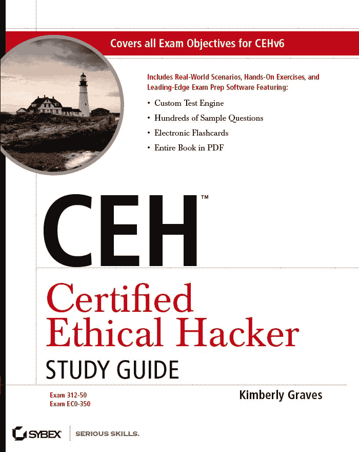


# CEH: 认证伦理黑客学习指南


## 关于作者

Kimberly Graves 于 1995 年毕业于美国大学，主修政治学，辅修计算机信息技术。Kimberly 很快发现，她学位中的技术领域将是一条比局限于“华盛顿带区（政治圈）”内部的工作更有趣且更具挑战性的职业道路。

从担任弗吉尼亚州阿灵顿的一家计算机培训公司的技术讲师开始，Kimberly 利用在该职位上获得的经验和资历，开始稳定地积累其他认证，她现在与客户和学生的日常互动中会使用这些认证。在获得第一份工作后的短短几个月内获得 Novell 认证工程师认证（`CNE`）后，Kimberly 在网络和安全方面的专业知识不断增长，已涵盖微软、英特尔、Aruba Networks、EC-Council、Cisco Systems 和 CompTIA 的认证。

在 IT 行业累计投入了超过 15 年后，Kimberly 积累了超过 25 个讲师级网络和安全认证。她曾担任华盛顿特区多个教育机构的兼职教授，同时担任多个安全认证计划的主题专家。最近，Kimberly 利用她的 `Security+`、`认证无线网络关联师 (CWNA)`、`认证无线安全专业人员 (CWSP)`、`认证道德黑客 (CEH)` 和 `认证信息系统安全专业人员 (CISSP)` 证书为美国退伍军人事务部、美国空军和国家安全局（NSA）教学并开发课程材料。Kimberly 目前与全国领先的无线供应商合作，培训下一代无线安全专家。2007 年，Kimberly 创立了 Techsource Network Solutions，以更好地服务客户需求并提供额外的网络和安全咨询服务。

## 练习目录

- 练习 2-1 使用 `SpyFu`
- 练习 2-2 使用 `KeywordSpy`
- 练习 2-3 使用 `EDGAR` 数据库收集信息
- 练习 2-4 使用 `Whois`
- 练习 3-1 使用 Windows `Ping`
- 练习 3-2 免费 `IPTools` 端口扫描
- 练习 3-3 使用 `Netcraft` 识别 Web 服务器操作系统
- 练习 3-4 使用 `Anonymouse` 匿名浏览网站
- 练习 4-1 使用 `Ophcrack` 破解密码
- 练习 4-2 使用 `NTFS` 文件流隐藏文件
- 练习 4-3 使用 `ImageHide` 在图像中隐藏数据
- 练习 5-1 使用 `Netcat`
- 练习 5-2 签名验证
- 练习 5-3 创建测试病毒
- 练习 6-1 使用 `Wireshark` 嗅探流量
- 练习 6-2 创建 `Wireshark` 过滤器以仅捕获进入或离开 IP 地址的流量
- 练习 7-1 防止 Windows 2000 服务器上的 SYN 泛洪攻击
- 练习 8-1 禁用 Internet 信息服务（IIS）中的默认网站
- 练习 8-2 使用 `BlackWidow` 复制网站
- 练习 8-3 标志抓取（Banner Grabbing）
- 练习 8-4 使用 `Metasploit` 利用 Web 服务器漏洞
- 练习 8-5 使用 `Acunetix` 漏洞扫描器
- 练习 8-6 使用密码破解器
- 练习 9-1 使用 HP 的 `Scrawlr` 测试 SQL 注入漏洞
- 练习 9-2 使用 `Metasploit` 执行缓冲区溢出攻击
- 练习 10-1 安装并使用 WLAN 嗅探工具
- 练习 10-2 MAC 地址欺骗
- 练习 11-1 查看关于开锁的视频
- 练习 12-2 审计您组织的物理场所安全
- 练习 12-1 配置并编译内核
- 练习 12-2 使用 Live CD
- 练习 12-3 检测监听的网络端口
- 练习 13-1 安装并使用 `KFSensor` 作为蜜罐
- 练习 14-1 查看数字证书
- 练习 14-2 使用 `WinMD5` 计算文件哈希
- 练习 15-1 查看渗透测试工具框架
- 练习 15-2 查看渗透测试报告框架示例

## 引言

认证道德黑客（`CEH`）考试由国际电子商务顾问委员会（`EC-Council`）开发，旨在提供一种全范围内认可的方法来认证安全专业人员的能力。`CEH` 认证授予那些已获得对系统和网络进行安全审计和渗透测试所需的知识水平和安全技能的人。

`CEH` 考试定期更新，以确保认证适用于最新的黑客工具和漏洞。这是非常有必要的，因为 `CEH` 必须熟悉最新的攻击和利用手段。截至本文编写时，考试的最新版本为第 6 版。第 6 版考试目标已反映在书中。

## 什么是 CEH 认证？

创建 `CEH` 认证的目的是提供一种广泛的认证，其意义在于它旨在认证对许多不同制造商/供应商的能力。该认证专为安全官、审计师、安全专业人员、站点管理员以及任何每天处理网络基础设施安全的人员设计。

道德黑客的目标是通过攻击系统本身来帮助组织采取预防措施，同时保持在法律范围内。这种哲学源于通过像小偷一样思考来抓住小偷的成熟实践。

道德黑客的定义类似于渗透测试。道德黑客通常受雇于组织，并信任可以使用黑客的方法尝试渗透网络和或计算机系统。在美国和其他大多数国家，黑客行为是犯罪。

你只需要通过一次考试即可成为 CEH。但获得此认证并不意味着你可以提供服务——这只是第一步。通过获得 `CEH` 认证，你将能够获得更多经验，建立对网络的兴趣，并随后追求深层次的网络知识和认证。

有关最新的考试价格和注册程序更新，请拨打 Thomson Prometric （866-776-6387 或 800-776-4276），或 Pearson VUE（877-680-3926）。你也可以访问 [www.2test.com](http://www.2test.com) 或 [www.prometric.com](http://www.prometric.com）（针对 Thomson Prometric）或 [www.vue.com](http://www.vue.com）（针对 Pearson VUE）获取更多信息或在线注册。如果你对考试范围或相关的 EC-Council 计划有进一步的问题，请参考 EC-Council 网站 [www.eccouncil.org](http://www.eccouncil.org)。

## 谁应该购买这本书？

《认证道德黑客学习指南》旨在为经验丰富的安全专业人员提供学习工具，帮助他们获取通过认证考试所需的信息。本学习指南可以与更完整的学习计划、计算机培训课程或教室/实验室环境结合使用，也可以作为那些希望在考试前进行复习的人的复习工具。我们的目标不是给出答案，而是识别出你可能被测试的主题。

如果你想成为一名 CEH（认证伦理黑客），这本书绝对是你需要的。然而，如果你只是想尝试通过考试而不真正理解伦理黑客的基础知识，那么本指南并不适合你。它是为那些想要建立通过考试所需的技能和知识基础，并将其所学知识应用于现实世界的人而编写的。

## 如何使用本书和光盘

我们在书中和 CD 光盘中包含了多项测试功能。这些工具将帮助你记住重要的考试内容，并为参加实际做好准备：

- **章节复习题**：为了在阅读书籍的过程中测试你的知识，每章的末尾都有复习题。当你完成每一章后，回答复习题并检查你的答案——正确答案出现在最后一个复习题后的页面。你可以回去重新阅读你错题涉及的章节，以确保在下次测试这些材料时能正确回答。
- **电子闪卡**：你会在 CD 上找到闪卡问题，以便你随时随地复习。这些是简短的问答，就像你可能在学校学习时使用的闪卡一样。你可以在电脑上回答它们，或将其下载到 Palm 设备上进行快速方便的复习。
- **测试引擎**：CD 中还包含 `Sybex Test Engine`。使用这个自定义的测试引擎，你可以预先识别薄弱环节，然后利用这些强大的测试功能制定出稳固的学习策略。我们详尽的 `readme` 文件将引导你完成快速、简单的安装过程。

除了做章节复习题外，你还会找到模拟题。参加这些模拟考试时，就像参加实际考试一样（不携带任何参考资料）。完成第一场考试后，进入下一场以巩固你的应试技巧。如果你回答正确率超过 90%，你就可以准备好参加认证考试了。

**PDF 版可搜索书籍**：CD 包含 `PDF`（`Adobe Acrobat`）格式的整本书，因此你可以轻松地在任何电脑上阅读。如果你必须旅行并温习任何关键术语，且有一台带有 `CD-ROM` 驱动器的笔记本电脑，你可以通过此资源来实现。

## 参加 CEH 考试提示

以下是成功考试的一些通用建议：

- 随身携带两种身份证件。其中一种必须是照片身份证，例如驾驶执照。另一种可以是主信用卡或护照。两种形式都必须包含签名。
- 早点到达考试中心，以便你可以放松并复习学习材料，特别是与考试信息相关的表格和列表。
- 仔细阅读问题。不要受到过早下结论的诱惑。确保你确切知道问题要求的是什么。
- 不要留有任何未回答的问题。未回答的问题会按对你不利的标准评分（扣分）。
- 将会有多个正确答案的问题。当有多个一个正确答案时，屏幕底部的消息将提示你“选择两个项”或“选择所有适用项”。务必阅读显示的消息以知道你必须选择多少个正确答案。
- 在回答你不确定的单选题时，使用排除法先排除掉明显错误的答案。这样做在你需要进行有推测的猜测时，会增加你的胜算几率。
- 有关考试的最新价格和注册程序的更新，请访问 EC-Council 网站：[www.eccouncil.org](http://www.eccouncil.org)。

## CEH 考试目标

在本书每一章的开头，我们包含了在 EC-Council 网站上显示的完整 CEH 目标列表。提供这些内容是为了方便参考，并确保你正按照目标进行。


考试目标可能会在任何时间无需事先通知而更改，并由 EC-Council 完全决定。请访问 EC-Council 网站的 CEH 认证页面（`www.eccouncil.org/certification/certified_ethical_hacker.aspx`）获取最新的考试目标列表。

### 伦理与法律

- 理解伦理黑客术语。
- 定义伦理黑客的职业角色。
- 理解伦理黑客涉及的不同阶段。
- 识别不同类型的攻击技术。
- 列出伦理黑客的五个阶段。
- 什么是黑客主义（hacktivism）？
- 列出不同类型的黑客分类。
- 定义成为伦理黑客所需的技能。
- 什么是漏洞研究？
- 描述实施伦理黑客的方法。
- 理解黑客行为的法律影响。
- 理解 `18 U.S.C. § 1030` 美国联邦法。

### 足迹探测（Footprinting）

- 定义足迹探测（footprinting）术。
- 描述信息收集方法。
- 描述竞争情报。
- 理解 `DNS` 枚举。
- 理解 `Whois`、`ARIN` 查询。
- 识别不同类型的 `DNS` 记录。
- 理解 `traceroute` 如何在足迹探测中应用。
- 理解电子邮件跟踪如何工作。
- 理解网络爬虫如何工作。

### 扫描（Scanning）

- 定义端口扫描（port scanning）、网络扫描（network scanning）和漏洞扫描（vulnerability scanning）等术语。
- 理解 CEH 扫描方法论。
- 理解 ping 扫描（ping sweep）技术。
- 理解 `nmap` 命令开关。
- 理解 `SYN`、`stealth`、`XMAS`、`NULL`、`IDLE` 和 `FIN` 扫描。
- 列出 `TCP` 通信标志类型。
- 理解战争拨号技术（war dialing）。
- 理解抓取（banner grabbing）和`OF`指纹识别技术。
- 理解如何使用代理服务器。
- 理解匿名工具如何工作。
- 理解 HTTP 隧道（HTTP tunneling）技术。
- 理解 IP 欺骗（IP spoofing）技术。

### 枚举（Enumeration）

- 什么是枚举？
- 什么是空会话（null sessions）？
- 什么是 SNMP 枚举？
- 枚举涉及的步骤有哪些？

### 系统攻击（System Hacking）

- 理解密码破解。
- 理解不同类型的密码。
- 识别各种破解工具。
- 理解权限提升。
- 理解键盘记录器（keyloggers）和其他间谍软件。
- 理解如何隐藏文件。
- 理解根内核（rootkits）。
- 理解隐写术（steganography）。
- 理解如何隐藏踪迹并抹除证据。

### 木马与后门（Trojans and Backdoors）

- 什么是木马？
- 什么是公开通道和秘密通道？
- 列出不同类型的木马。
- 木马攻击的迹象有哪些？
- 理解 Netcat 木马如何工作。
- 什么是封装（wrapping）？
- 反向连接木马如何工作？
- 防止木马的防御措施有哪些？
- 理解规避技术。

### 嗅探器（Sniffers）

- 理解受嗅探影响的协议。
- 理解主动嗅探和被动嗅探。
- 理解 ARP 毒化（ARP poisoning）。
- 理解 ethereal 捕获和显示过滤器。
- 理解 MAC 泛洪。
- 理解 DNS 欺骗技术。
- 描述嗅探防御措施。

### 拒绝服务（Denial of Service）

- 理解 DoS 攻击的类型。
- 理解 DDoS 攻击如何工作。
- 理解 Bot/僵尸网络如何工作。
- 什么是 Smurf 攻击？
- 什么是 SYN 洪水？
- 描述 DoS/DDoS 防御措施。

### 社会工程（Social Engineering）

- 什么是社会工程？
- 常见的攻击类型有哪些？
- 理解翻垃圾搜索。
- 理解反向社会工程。
- 理解内部攻击。
- 理解身份盗取。
- 描述网络钓鱼攻击。
- 理解 URL 混淆。
- 社会工程防御措施。

### 会话劫持（Session Hijacking）

- 理解欺骗与劫持。
- 列出会话劫持的类型。
- 理解序列预测（sequence prediction）。
- 执行会话劫持的步骤有哪些？
- 描述你会如何防止会话劫持。

### 攻击 Web 服务器

#### 学习目标

- 列出 Web 服务器漏洞的类型。
- 理解针对 Web 服务器的攻击。
- 理解 `IIS` Unicode 漏洞利用。
- 理解补丁管理技术。
- 理解 Web 应用扫描器（Web Application Scanner）。
- 什么是 `Metasploit Framework`？
- 描述 Web 服务器的加固方法。

#### Web 应用漏洞

- 理解 Web 应用程序的工作原理。
- Web 应用程序攻击的目标。
- 攻击的剖析。
- Web 应用程序威胁。
- 理解 Google 黑客攻击（Google hacking）。
- 理解 Web 应用程序防御措施。

### 基于 Web 的密码破解技术

- 列出身份验证类型。
- 什么是密码破解器？
- 密码破解器是如何工作的？
- 理解密码攻击——分类。
- 理解密码破解的防御措施。

### SQL 注入

- 什么是 SQL 注入？
- 理解执行 SQL 注入的步骤。
- 理解 `SQL Server` 漏洞。
- 描述 SQL 注入的防御措施。

### 无线攻击

- `WEP`、`WPA` 认证系统及破解技术的概述。
- 无线嗅探器及 `SSID`、`MAC` 欺骗的概述。
- 理解非法访问点（Rogue access points）。
- 理解无线攻击技术。
- 描述保护无线网络的方法。

### 病毒与蠕虫

- 理解病毒和蠕虫的区别。
- 理解病毒的类型。
- 病毒如何传播并感染系统。
- 理解防病毒规避技术。
- 理解病毒检测方法。

### 物理安全

- 物理安全入侵事件。
- 理解物理安全。
- 为什么需要物理安全？
- 谁负责物理安全？
- 影响物理安全的因素。

### Linux 攻击

- 理解如何编译 Linux 内核。
- 理解 `GCC` 编译命令。
- 理解如何安装 `LKM` 模块。
- 理解 Linux 加固方法。

### 规避 IDS、蜜罐和防火墙

- 列入侵检测系统的类型及规避技术。
- 列出防火墙和蜜罐规避技术。

### 缓冲区溢出

- 基于栈的缓冲区溢出概述。
- 识别不同类型的缓冲区溢出及检测方法。
- 缓冲区溢出变异技术概述。

### 密码学

- 密码学和加密技术的概述。
- 描述公钥和私钥如何生成。
- `MD5`、`SHA`、`RC4`、`RC5`、`Blowfish` 算法概述。

### 渗透测试方法

- 渗透测试方法的概述。
- 列出渗透测试步骤。
- `Pen-Test` 法律框架概述。
- `Pen-Test` 交付物概述。
- 列出自动化渗透测试工具。

## 硬件要求

本书包含了大量的实验练习以练习伦理黑客技能。为了执行所有实验练习，你必须拥有包含许多不同类型操作系统和服务器的广泛实验环境。实验室应包含以下操作系统：

- `Windows 2000 Professional`
- `Windows 2000 Server`
- `Windows NT Server 4.0`
- `Windows XP`
- `Windows Vista`
- `Linux`（建议使用 Backtrack）

设置多种操作系统的目的是针对每个操作系统的已修复和未修复版本进行攻击工具测试。实现此点的最佳方法是使用虚拟机设置：你不需要为每个操作系统准备实际系统，但可以根据需要加载以测试攻击工具。你的实验室至少应包含运行以下服务的测试系统：

- `FTP`
- `Telnet`
- `Web` (`HTTP`)
- `SSL` (`HTTPS`)
- `POP`
- `SMTP`
- `SNMP`
- `Active Directory`


此外，使用虚拟机设置的优点是可以在不影响主机系统的情况下恢复系统。通过使用虚拟环境，可以运行 `rootkits`、`Trojans` 和病毒而不会危及任何真实的生产数据。书中的工具绝不应用于生产服务器或系统，因为可能会发生真实且即时的数据丢失。

除了运行虚拟服务器环境的主机系统外，还需要一个 `USB` 驱动器。本书包含了在 `USB` 盘上创建可引导 Linux Backtrack 安装的说明。

## 如何联系出版社

Sybex 欢迎对其所有书籍提供反馈。访问 Sybex 网站 [www.sybex.com](http://www.sybex.com) 获取书籍更新和额外的认证信息。你还可以找到可以使用来提交关于本书或其他任何 Sybex 书籍意见或建议的表单。

## 评估测试

1. 在哪种攻击类型中密码永远不会破解？

   A. `Cryptography` 攻击

   B. `Brute-force` 攻击

   C. `Replay` 攻击

   D. `John the Ripper` 攻击

2. 如果密码为 7 个字符或少，那么 `LM` 哈希的后半部分总是：

   A. `0xAAD3B435B51404EE`

   B. `0xAAD3B435B51404AA`

   C. `0xAAD3B435B51404BB`

   D. `0xAAD3B435B51404CC`

3. 你将采取哪些防御措施来保护网络免受密码破解攻击？（多选）

   A. 永远不要留默认密码。

   B. 永远不要使用字典中可以找到密码。

   C. 永远不要使用与主机名、域名或通过 `Whois` 找到的内容相关的密码。

   D. 永远不要使用相关的密码。

4. 什么是 SQL 注入？

5. 理解执行 SQL 注入的步骤。

6. 理解 `SQL Server` 漏洞。

7. 描述 SQL 注入的防御措施。

8. `WEP`、`WPA` 认证系统及破解技术的概述。

9. 无线嗅探器及 `SSID`、`MAC` 欺骗的概述。

10. 理解非法访问点。

11. 理解无线攻击技术。

12. 描述保护无线网络的方法。

13. 理解病毒和蠕虫的区别。

14. 理解病毒的类型。

15. 病毒如何传播并感染系统。

16. 理解防病毒规避技术。

17. 理解病毒检测方法。

18. 物理安全入侵事件。

19. 理解物理安全。

20. 为什么需要物理安全？

21. 谁负责物理安全？

22. 影响物理安全的因素。

23. 理解如何编译 Linux 内核。

24. 理解 `GCC` 编译命令。

25. 理解如何安装 `LKM` 模块。

26. 理解 Linux 加固方法。

27. 列入侵检测系统的类型及规避技术。

28. 列出防火墙和蜜罐规避技术。

29. 基于栈的缓冲区溢出概述。

30. 识别不同类型的缓冲区溢出及检测方法。

31. 缓冲区溢出变异技术概述。

32. 密码学和加密技术的概述。

33. 描述公钥和私钥如何生成。

34. `MD5`、`SHA`、`RC4`、`RC5`、`Blowfish` 算法概述。

35. 渗透测试方法的概述。

36. 列渗透测试步骤。

37. `Pen-Test` 法律框架概述。

38. `Pen-Test` 交付物概述。

39. 列自动化渗透测试工具。

## 实验环境

本书包含了大量的实验练习以练习伦理黑客技能。为了执行所有实验练习，你必须拥有包含许多不同类型操作系统和服务器的广泛实验环境。实验室应包含以下操作系统：

- `Windows 2000 Professional`
- `Windows 2000 Server`
- `Windows NT Server 4.0`
- `Windows XP`
- `Windows Vista`
- `Linux`（建议使用 Backtrack）

设置多种操作系统的目的是针对每个操作系统的已修复和未修复版本进行攻击工具测试。实现此点的最佳方法是使用虚拟机设置：你不需要为每个操作系统准备实际系统，但可以根据需要加载以测试攻击工具。

你的实验室至少应包含运行以下服务的测试系统：

- `FTP`
- `Telnet`
- `Web`（`HTTP`）
- `SSL`（`HTTPS`）
- `POP`
- `SMTP`
- `SNMP`
- `Active Directory`

此外，使用虚拟机设置的优点是可以在不影响主机系统的情况下恢复系统。通过使用虚拟环境，可以运行 `rootkits`、`Trojans` 和病毒而不会危及任何真实的生产数据。书中的工具绝不应用于生产服务器或系统，因为可能会发生真实且即时的数据丢失。

除了运行虚拟服务器环境的主机系统外，还需要一个 `USB` 驱动器。本书包含了在 `USB` 盘上创建可引导 Linux Backtrack 安装的说明。

## 进阶评估测试

### 14. 你将如何破解一个基于 cookie 安全的系统？

A. 将 `cookie ID` 注入网页 URL 中并连接回服务器。

B. 对 cookie 使用的加密算法进行暴力破解，并将其重放给服务器。

C. 拦截客户端与服务器之间的通信并修改 cookie，使服务器认为存在一个具有更高权限的用户。

D. 删除 cookie，重新建立与服务器的连接，并访问高级别的权限。

### 15. Windows 在开箱即用（未经过配置）时极度不安全；在使用它之前，你必须执行以下哪些操作？（选择所有适用项）

A. 确保新安装的 Windows 通过安装最新的服务包（service packs）进行补丁。

B. 为 Adobe Acrobat、Macromedia Flash、Java 和 WinZip 等应用程序安装最新的安全补丁。

C. 安装个人防火墙并锁定未使用的端口防止其连接到你的计算机。

D. 为病毒毒软件安装最新的特征码。

E. 创建一个具有复杂密码的非管理员用户并登录此账户。

F. 你可以开始使用你的电脑了，因为戴尔（Dell）、惠尔-惠普（Hewlett-Packard）和 IBM（IBM）等供应商已经安装了最新的服务包。

### 16. 以下哪项是补丁管理和安全工具？

A. `MBSA`

B. `BSSA`

C. `ASNB`

D. `PMUS`

### 17. 如何保护网页表单中的 `GET` 方法？

A. 在使用 `GET` 方法发送数据之前对数据进行加密。

B. 永远不要在脚本包含包含信息。

C. 使用 `HTTPS SSLv3` 发送数据而不是普通的 HTTPS。

D. 在发送数据时将 `GET` 替换为 `POST` 方法。

### 18. 缓冲区溢出的两种类型是什么？

A. 基于栈的缓冲区溢出

B. 活跃缓冲区溢出

C. 动态缓冲区溢出

D. 基于堆的缓冲区溢出

### 19. 多态代码（polymorphic shellcode）是如何工作的？

A. 它通过掩码 `IDS` 特征将工作指令反转为相反顺序。

B. 它将代码转换为 Unicode，使用加载器（loader）转换回机器码，然后执行该代码。

C. 它通过对代码进行 `XOR` 异或运算加密代码，使用加载器代码解密，然后执行解密后的代码。

D. 它将代码压缩为普通指令，使用加载器代码解压代码，然后执行该代码。

### 20. 密码在 Linux 中存储在哪里？

A. `/etc/shadow`

B. `/etc/passwd`

C. `/bin/password`

D. `/bin/shadow`

### 21. 以下哪项是 `IDS` 绕过技术？

A. IP 路由或数据包丢

B. IP 分段或会话拼接

C. `IDS` 欺骗或会话组装

D. IP 拼接或数据包重组

### 22. 正或错：数字签名仅仅是使用公密钥而不是私钥加密的消息。

A. 正确

B. 错误

### 23. 每家公司都需要以下哪些文档？

A. 信息安全策略（`ISP`）

B. 信息审计策略（`IAP`）

C. 渗透测试策略（`PTP`）

D. 用户合规策略（`UCP`）

### 24. 黑客工具 `Netcat` 是做什么的？

A. `Netcat` 是一个灵活的数据嗅器/记录器，用于检测攻击。`Netcat` 是一个基于数据包捕获（`libpcap`）的嗅器/记录器，可以作为轻量级入侵检测系统。

B. `Netcat` 是一个强大的网络监控和数据采集工具。该程序允许你转储匹配给定表达式的网络流量。

C. `Netcat` 被称为 TCP/IP 的瑞士军刀。它是一个简单的实用工具，使用 TCP 或 UDP 协议跨网络连接读取和写入数据。

D. `Netcat` 是基于 SATAN（安全集成网络工具）的安全评估工具。

### 25. 哪个工具是文件和目录检查器，可以帮助系统管理员和用户监控指定一组文件的任何更改？

A. `Hping2`

B. `DSniff`

C. `Cybercop`

D. `Tripwire`

### 26. 以下哪一个 `Nmap` 命令会对 `target.example.com` 所在的 C 类地址中的每台机器启动 SYN 扫描，并尝试确定每个正在运行的主机运行的是什么操作系统？

```bash
nmap -v target.example.com
```

```bash
nmap -sS -O target.example.com/24
```

```bash
nmap -sX -p 22,53,110,143,456 198.116.*.1-127 nmap -O target.example.com
```

### 27. `Snort` 是基于 Linux 的入侵检测系统。哪条命令允许 `Snort` 使用网络入侵检测（NIDS）模式，假设 `snort.conf` 是你的规则文件名，IP 地址为 `192.168.1.0`，子网掩码为 `255.255.255.0`？

```bash
./snort -c snort.conf 192.168.1.0/24
```

```bash
./snort -x snort.conf 192.168.1.0/24
```

```bash
./snort -dev -l -a 192.168.1.0/24
```

```bash
./snort -c snort.conf 192.168.1.0/24
```

### 28. 缓冲区溢出由于以下哪些函数不进行边界检查？

A. `gets()`

B. `memcpy()`

C. `strcpy()`

D. `scanf()`

### 29. 通过何种方式可以防止 SMB 劫持？

A. 在 TCP/IP 上禁用签名。

B. Windows NT

C. 攻击者监听网络流量可以。

D. 在 Windows XP 中禁用 LM。

### 30. 哪种黑客代表最高风险？

A. 不满的员工

B. 黑帽黑客

C. 灰帽黑客

D. 小（Script kiddies）

### 31. `Nmap` 命令行开关用于操作系统检测？

A. `-X`

B. `-D`

C. `-O`

D. `-P`

### 32. `LM` 认证在 Windows XP 中是不安全的？

A. 从微软网站下载 `LMSHUT.EXE` 工具。

B. 注册表。

C. Windows XP 中的 `LM` 服务。

D. Windows XP 中的 `LSASS` 服务。


### 33. 你在 Ethereal 中捕获了一些数据包。你想查看来自 `10.0.0.22` 的数据包。你会应用什么过滤器？

```
ip.equals 10.0.0.22
```

```
ip = 10.0.0.22
```

```
ip.address = 10.0.0.22
```

```
ip.src == 10.0.0.22
```

### 34. TCP 标志 FIN 定义？

A. 用于中断 TCP 连接。

B. 用于关闭 TCP 连接。

C. 用于确认之前的数据包或传输。

D. 用于表示 TCP 连接的开始。

### 35. ICMP（类型 11，代码 0）表示？

A. 超时

B. 源抑制

C. 目的不可到达

D. 未知类型

## 测试答案

1. **C**. 重放攻击涉及捕获密码（可能是加密的）并将其重放以伪造身份。更多信息请参见第 4 章。

2. **A**. LM 哈希值将密码分为两个部分。如果密码为 7 个字符或少，则密码的空白部分始终为十六进制值 `AAD3B435B51404EE`。`0x` 前缀表示它是十六进制。

3. **A,B,C,D**. 字典字始终可以使用暴力破解来破解。更多信息请参见第 4 章。

4. **D**. `CANSPAM` 法案是控制不受请求的垃圾邮件和营销的缩写；该法案试图防止不受请求的垃圾邮件。更多信息请参见第 1 章。

5. **A**. 网络应用识别（NBAR）是 Cisco IOS 的一种机制，用于通过网络入口点控制流量。更多信息请参见第 6 章。

6. **B**. 在 Ethereal 中定位 Hotmail 邮件的方法是使用 `email` 和 `Reply-to` 过滤器来寻找真正的邮件。更多信息请参见第 6 章。

7. **A**. 在 Smurf 攻击中，大量的 `ICMP` 回显请求（`ping`）流量被发送到 IP 广播地址，且其源 IP 地址伪造为目标受害者。`IRC` 服务器通常用于持续这种攻击，因此它们被视为首要受害者。更多信息，请参阅第 7 章。

8. **D**. `DNS` 反射和放大攻击直接针对 `DNS` 服务器。通过在攻击中加入放大，许多主机会发送攻击并导致 `DNS` 服务器遭受拒绝服务。更多信息，请参阅第 8 章。

9. **A**. `TCP` 运行在传输层，即 OSI 模型的第 4 层，因此 `TCP/IP` 会话劫持发生在传输层。更多信息，请参阅第 7 章。

10. **D**. 网站伪装（Website cloaking）是根据用户的源 IP 地址提供不同的网页内容。更多信息，请参阅第 8 章。

11. **A**. 基础认证（Basic Authentication）使用明文密码。更多信息，请参阅第 8 章。

12. **B**. 防止跨站脚本攻击的方法是保护服务器脚本。更多信息，请参阅第 8 章。

13. **A**. 机器认证（Machine Authentication）要求主机系统拥有一个仅对公司 PC 有效的域账户。更多信息，请参阅第 13 章。

14. **C**. 权限提升可以通过捕获和修改 cookie 实现。更多信息，请参阅第 8 章。

15. **A,B,C,D**. 安装服务包、个人防火墙软件和反病毒特征库应在 ways 网络上的新计算机之前完成。更多信息，请参阅第 5 章。

16. **A**. 微软基准安全分析器（Microsoft Baseline Security Analyzer）是 Windows 内置的用于分析安全的补丁管理工具。更多信息，请参阅第 15 章。

17. **D**. 网页发布应使用 `POST` 而不是 `GET`。更多信息，请参阅第 8 章。

18. **A,D**. 基于栈和基于堆是缓冲区溢出攻击的两种类型。更多信息，请参阅第 9 章。

19. **C**. 多态 shellcode（Polymorphic shellcode）通过使用 `XOR` 过程对 shellcode 进行加密和解密。信息，请参阅第 5 章。

20. **A**. 密码存储在 Linux 的 `/shadow` 文件中。信息，请参阅第 3 章。

21. **B**. IP 分片或会话拼接是规避 `IDS` 的方法。更多信息，请参阅第 13 章。

22. **A**. 信息使用用户的私钥进行加密，使得只有用户的公钥才能解密签名并验证用户的身份。更多信息，请参阅第 14 章。

23. **A**. 每家公司都应该有一份信息安全策略。更多信息，请参阅第 15 章。

24. **C**. `Netcat` 是一种多功能 Unix 实用，用于跨网络连接进行读写。更多信息，请参阅第 4 章。

25. **D**. `Tripwire` 是一个文件和目录完整性检查器。更多信息，请参阅第 4 章。

26. **B**. `nmap -sS` 创建隐身扫描，`-O` 选项执行操作系统检测。更多信息，请参阅第 3 章。

27. **A**. `snort -c snort.conf` 表示 `snort.conf` 是包含 `snort` 规则的配置文件。更多信息，请参阅第 13 章。

28. **E**. `strcat()` 不执行边界检查并会产生缓冲区溢出漏洞。更多信息，请参阅第 9 章。

29. **C**. `SMB` 签名防止 `SMB` 劫持。更多信息，请参阅第 4 章。

30. **A**. 不满的员工是网络最大的威胁。更多信息，请参阅第 1 章。

31. **C**. `-O` 在 `Nmap` 中执行 OS 检测。更多信息，请参阅第 3 章。

32. **B**. 可以在 Windows 表表中禁用 `LM` 认证。更多信息，请参阅第 4 章。

33. **D**. `ip.src==` 是过滤源 IP 地址的语法。更多信息，请参阅第 6 章。

34. **B**. `FIN` 标志用于关闭 `TCP/IP` 连接。更多信息，请参阅第 6 章。

35. **A**. `ICMP` 超时类型为 11，代码为 0。更多信息，请参阅第 3 章。

# 第 1 章：道德黑客、伦理与法律导论

## 本章涵盖的 CEH 考试目标：

* 理解道德黑客的专业术语

* 定义道德黑客的职业角色

* 理解参与道德黑客涉及的不同阶段

* 识别不同类型的黑客技术

* 列出道德黑客的五个阶段

* 什么是黑客主义（hacktivism）？

* 列出不同类型的黑客分类

* 定义成为道德黑客所需的技能

* 什么是漏洞研究？

* 描述实施道德黑客的方法

* 理解黑客行为法律影响

* 理解美国联邦法 `18 USC §1030`

大多数人认为黑客拥有非凡的技能和知识，使他们入侵计算机系统并发现有价值的信息。“黑客”一词让人联想到年轻计算机天才的形象，他们在电脑屏幕前输入几条命令——砰的一声！电脑就输出了密码、账号或其他机密数据。实际上，一个优秀的黑客（或作为道德黑客的安全专业人员）只需要理解计算机系统是如何工作的，并知道使用何种工具来发现安全漏洞。本书将教你许多黑客用于收集价值数据和攻击计算机系统的相同技术和软件工具。

黑客的世界及其运作方式对大多数计算机和安全专业来说是未知的。黑客使用特殊的计算机软件来获取信息。通过学习黑客使用的相同技术和软件工具，你将能够防御网络恶意攻击。

本章的目标是带你进入黑客的世界，并定义讨论安全时使用的术语。

## 定义道德黑客

下一节将解释道德黑客的目的是以及道德黑客的具体工作。如前所述，道德黑客必须始终以专业的方式行动，以与恶意黑客区分开来。获得客户的信任并在渗透测试期间采取所有预防措施确保不对其系统造成损害，是成为专业人士的关键。道德黑客的另一个核心组成部分是在访问计算机系统之前，始终获得数据所有者的许可。

当我告诉人们我是一个伦理黑客时，我通常会听到冷笑和诸如“那是自矛盾”之类的评论。很多人问：“黑客行为可以是伦理的吗？”是的！这最能描述我作为一个安全专业人员所的工作。我使用与恶意黑客相同的软件工具和技术来寻找计算机网络和系统中的安全漏洞。然后，我应用必要的修复或补丁，以防止恶意黑客获取数据。这是一个无止的循环，因为计算机系统中不断被发现新的漏洞，而软件供应商也会不断创建补丁来缓解攻击风险。

伦理黑客通常是安全专业人员或网络渗透员，他们将黑客技能和工具集用于防御和保护目的。作为安全专业人员的伦理黑客会使用黑客可能用于破坏网络的工具来测试其网络和系统的漏洞。任何计算机专业人士都可以学习伦理黑客技能。

`cracker`（破坏者）一词描述的是利用黑客技能和工具集进行破坏性或攻击性目的的海客，例如传播病毒或执行拒绝服务（`DoS`）攻击，以破坏或导致系统和网络。这些黑客不再仅仅是为了好玩，有时他们为了损害企业声誉、盗取或暴露信用卡信息，同时减慢业务流程并损害组织的完整性而获得报。


黑客可以分为三类：

* `White Hats`（白帽）：好人，伦理黑客

* `Black Hats`（黑帽）：坏人，恶意黑客

* `Gray Hats`（灰帽）：好坏黑客；取决于情况

伦理黑客通常属于白帽类，但有时他们是成为安全专业人员的前灰帽，他们现在以伦理的方式使用自己的技能。

## 白帽

白帽是好人，即将黑客技能用于防御目的的伦理黑客。白帽黑客通常是具有黑客知识和工具集知识的安全专业人员，他们利用这些知识定位漏洞并实施应对措施。白帽黑客是考试的首选人。白帽是在获得数据所有许可的情况下进行黑客的人。在开始任何黑客活动之前获得许可是关重要的。这正是安全专业人员与白帽与不可信任的恶意黑客的区别。

## 黑帽

黑帽是坏人：即为了非法或恶意目的使用其技能的恶意黑客或 `crackers`。他们带有恶意意图入侵或以违反远程系统的系统完整性。在获得未经授权的访问后，黑帽黑客破坏重要数据，拒绝合法用户的服务，并为他们的目标制造麻烦。黑帽黑客和 `crackers` 很容易与白帽黑客区分开，因为他们的行为是恶意的。这是黑客的传统定义，也是大多数人认为黑客的样子。

## 灰帽

灰帽是根据情况可能从事攻击或防御工作的黑客。这是黑客与 `cracker` 之间的分界线。灰帽黑客可能只是对黑客工具和技术感兴趣，并不是恶意的黑帽。灰帽是自封的伦理黑客，他们主要出于好奇对黑客工具感兴趣。他们可能想强调系统中的安全问题或教育受害者让他们妥善地保护系统。这些黑客正在为他们的“受害者”提供帮助。例如，如果在投资银行提供的服务中发现漏洞，黑客通过给银行一个纠正漏洞的机会是在帮助该银行。

从一个更具争议的角度来看，一些人认为黑客行为本身是不符合伦理的，就像入室盗窃一样。但“伦理”黑客排除破坏行为的信念至少缓解了那些自认为是“良性”黑客的行为。根据这种观点，进入系统然后向系统操作员准确说明是如何操作的以及如何堵住漏洞，可能是“黑客式”礼貌最高的形式之一；黑客正作为一个不付薪且未经请求的特种队（一组受雇进行安全审计的小组）。这种方法让许多伦理黑客陷入了法律麻烦。在参与伦理黑客活动时，请确保你了解法律和你的法律责任。

许多自封的伦理黑客试图以顾问的身份进入安全领域。大多数公司并不看好带着机密数据出现在门口，并提议“为了价格”“修复”安全漏洞的人。其反应从“感谢提供这些信息，我们会修复问题”到报警警察逮捕这个自封的伦理黑客不等。

白帽和灰帽的区别在于那一个“许可”一词。虽然灰帽可能有良好的意图，但如果没有正确的许可，他们就不再被认为是伦理的。

现在你已经理解了黑客的类型，让我们来看看黑客是做什么的。这看起来可能很简单——他们黑入计算机系统——但有时并不那么简单或模糊。这里有一个应该遵循的流程，以及一些需要记录的信息。在下一节中，我们将看看黑客，最重要的是伦理黑客在做什么。

## 伦理黑客做什么？

伦理黑客的动机各异，但他们的目的通常与 `crackers` 相同：他们试图确定入侵者在目标网络或系统上可以看到什么，以及黑客可以使用这些信息做什么。这种测试系统或网络安全性的过程被称为 `penetration test`（渗透测试），或 `pen test`。

黑客入侵计算机系统。与广传的神话相反，这样做通常并不涉及神秘的黑客式才华横溢，而是坚持不懈地重复一些相当为人知的技巧，这些技巧利用了目标系统安全性中的常见漏洞。`pen test` 不过是使用与恶意黑客相同的工具执行这些相同的步骤，以查看使用黑客工具和技术可以暴露哪些数据。

许多伦理黑客作为负责防御恶意活动的安全团队的一部分，检测恶意黑客活动。在受雇后，伦理黑客会询问组织要保护什么、防止谁的，以及公司愿意为了保护投入多少资源。然后就可以围绕需要保护的数据和潜在风险建立 `penetration test plan`。

记录各种测试的结果对于产生 `pen test` 的最终产品：`pen test report` 至关重要。获取潜在价值信息的截图或保存日志文件对于在 `pen test report` 中向客户展示发现至关重要。`pen test report` 是系统中所有风险的汇总。关于 `pen test report` 内容的更多细节将在本书最后一章讨论。

## 攻击者试图实现的目标

无论是由伦理黑客还是恶意黑客实施，所有攻击都是尝试突破计算机安全。安全性由四个基本元素组成：

* `Confidentiality`（机密性）

* `Authenticity`（真实性）

* `Integrity`（完整性）

* `Availability`（可用性）

黑客的目标是利用系统或网络中的漏洞，在安全四个要素中的一个或多个方面寻找弱点。例如，在执行拒绝服务（`DoS`）攻击时，黑客攻击的是系统和网络的可用性要素。虽然 `DoS` 攻击有许多形式，但其主要目的是消耗系统资源或带宽。涌入目标系统的大量信息本质上会迫使其关闭，从而拒绝为系统的合法用户提供服务。尽管媒体关注 `DoS` 攻击的目标，但实际上，此类攻击有许多受害者——包括最终目标以及入侵者所控制的系统。

信息窃取（例如在数据跨信誉网络以明文传输时窃取密码或其他数据）属于机密性攻击，因为它允许预期接收者之外的人员获取数据。这种窃取不仅限于网络服务器上的数据。笔记本电脑、磁盘和备份磁带都面临风险。这些公司拥有的设备充满了机密信息，可以为黑客提供有关组织所实施的安全措施的信息。

位翻转攻击（Bit-flipping attacks）被视为完整性攻击，因为数据在传输过程中或在计算机系统中存储时可能被篡改；因此，系统管理员无法验证数据是否如发送者所意的那。位翻转攻击是对加密密码的攻击：攻击者改变密文以导致明文发生可预测的变化，尽管攻击者本身并不能获知明文。这种攻击的目标不是密码本身，而是某条消息或系列消息。在极端情况下，这可能变成针对使用该密码的通道上所有消息的 `DoS` 攻击。当攻击者知道消息格式时，这种攻击尤为危险。当位翻转攻击应用于数字签名时，攻击者可能可以将一张注明“我欠你 $10.00”的期票更改为“我欠你 $10,000”的期票。

`MAC` 地址欺骗是一种身份验证攻击，因为它允许在实施了媒体访问控制（`MAC`）过滤（例如在无线网络上）的情况下未经授权设备连接到网络。通过伪造合法无线站的 `MAC` 地址，入侵者可以冒充该站的身份并使用网络。

# 道德黑客的技能 set

能够在恶意黑客领先一步的道德黑客必须是计算机系统专家，对计算机编程、网络和操作系统有非常深入的了解。对针对性极强的平台（如 `Windows`、`Unix` 和 `Linux`）的深入知识也是一项要求。耐心、坚持和巨大的毅力是道德黑客的重要特质，因为大多数攻击要产生效果需要很长时间和高度的专注。网络技术、Web 编程和数据库技能在执行道德黑客和漏洞测试时都是非常有用的。

大多数道德黑客都是全才型，在计算机和网络方面拥有广泛的知识。在某些情况下，道德黑客将作为“红队小组”（tiger team）的一部分被雇佣测试网络和计算机系统并寻找漏洞。在这种情况下，团队的每个成员将有不同的专长，道德黑客可能在计算机系统和网络的某个领域需要更专业的技能。大多数道德黑客对安全领域和相关问题了如指，但不一定对防止攻击的防御措施有强大的掌握。

# 道德黑客术语

理解并定义术语是 `CEH` 责任的重要部分。这些术语是作为道德黑客身份的安全专业人员进行交流的语言。这种黑客的“语言”是学习本书后续章节中概念的基础。在本节中，我们将讨论你参加 `CEH` 认证考试需要熟悉的若干术语：

- **威胁（Threat）**：可能导致安全潜在泄露的环境或情况。道德黑客在执行安全分析时会寻找并优先考虑威胁。恶意黑客及其使用的软件和黑客技术本身就是组织信息安全的威胁。

- **利用程序（Exploit）**：利用漏洞、故障或弱点的软件或技术，导致计算机系统上出现未经授权的访问、权限提升或拒绝服务。恶意黑客正在计算机系统中寻找利用程序，以为为初始攻击打开大门。大多数利用程序是短小的计算机代码字符串，在系统上执行时会暴露漏洞。经验丰富的黑客会创建自己的利用程序，但对于道德黑客来说并不需要任何编程技能，因为许多黑客软件程序都有现成的利用程序，可以针对计算机系统或网络发动。利用程序是通过漏洞突破 IT 系统安全性的定义方式。

- **漏洞（Vulnerability）**：软件缺陷、逻辑设计或实现错误的存在，可能导致意料之外且非预期的事件对系统执行有害或破坏性的指令。编写利用程序代码是为了针对漏洞并导致系统发生故障，以获取贵贵数据。

- **评估对象（Target of Evaluation, TOE）**：作为安全分析或攻击对象的系统、程序或网络。道德黑客通常关注高价值的 `TOEs`，即包含账号、密码、社会安全号码或其他机密数据的系统。道德黑客的目标是针对高价值的 `TOEs` 测试黑客工具，以确定漏洞并进行补丁，以防止利用和敏感数据的泄露。

- **攻击（Attack）**：当系统根据漏洞被攻破时，攻击就会发生。许多攻击通过利用程序持续。道德黑客使用工具寻找由于操作系统、网络配置或系统上安装的应用程序而可能受到利用程序的系统，并防止攻击。

将利用程序交付到计算机系统有两种主要方法：

1. **远程（Remote）**：利用程序通过网络发送，并在无需预先访问漏洞系统的情况下利用安全漏洞。从外部发起的针对企业计算机系统或网络的黑客攻击被认为是远程的。大多数人在听到黑客一词时会想到这种攻击，但实际上大多数攻击属于下一类。


## 本地（Local）

利用程序直接交付到计算机系统或网络，这需要预先访问漏洞系统以提高权限。信息安全策略的设计应确保只有需要访问信息的人才被允许访问，并且他们拥有执行工作职责所需的最低级别权限。这些概念通常被称为“按需知道”和“最小权限”，如果使用得当，可以防止本地利用。大多数黑客尝试发生在组织内部，由员工、承包商或其他信任职位的人实施。为了让内部人员发动攻击，他们必须拥有比按需所需许可更高的权限。

# 道德黑客攻击的阶段

道德黑客的过程可以分为五个不同的阶段。在本书的后部分，黑客软件程序和工具将归类到每个步骤中。

伦理黑客遵循的流程与恶意黑客相似。无论黑客的意图如何，获取并维持计算机系统访问的步骤都是相似的。图 1-1 描述了黑客在攻击计算机系统时通常遵循的五个阶段。

图 1-1: 黑客的阶段

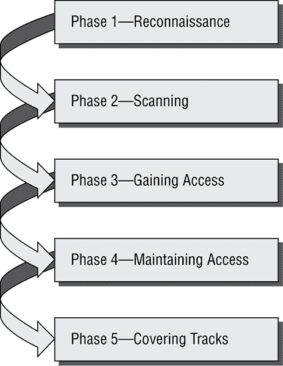

## 黑客阶段

黑客通常分为五个不同的阶段。

## 第 1 阶段：被动和主动侦察

被动侦察涉及在目标个人或公司不知情的情况下收集有关潜在目标的信息。被动侦察可以简单到观察一栋建筑，以识别员工进入离开建筑的时间。然而，大多数侦察是在电脑前完成的。

当黑客在寻找潜在目标的信息时，他们通常会对个人或公司进行互联网搜索以获取信息。我相信你们中的许多人曾对自己的名字或潜在雇主进行过同样的搜索，或者只是为了收集某个主题的信息。这种过程用于收集有关攻击边界（`TOE`）的信息时，通常被称为信息收集。社会工程和垃圾翻找也被视为被动信息收集方法。

嗅探网络是被动侦察的另一种手段，可以产生有用信息，如 `IP` 地址范围、命名规范、隐藏的服务器或网络以及系统或网络上的其他可用服务。嗅探网络流量类似于监控建筑：黑客观察数据流，以查看某些交易何时发生以及流量流向何处。嗅探网络流量是许多伦理黑客常用的切入点。一旦他们使用某些黑客工具并看到通信网络上明文传输的所有数据时，他们就会渴望学习并看到更多内容。

嗅探工具简单易用，并能产生大量的价值信息。本书中的整一章（第 6 章“从网络收集数据：嗅探器”）专门介绍了这些工具，这些工具从字面上来说让你看到网络上传输的所有数据。很多时候，这包括用户名、密码和其他敏感数据。对于许多网络管理员和安全专业人员来说，这通常是一个大开眼界的体验，并会导致严重的安全担忧。

主动侦察涉及探测网络以发现网络上的单个主机、`IP` 地址和服务。这一过程比被动侦察具有更高的被检测风险，有时被称为“摇摇门把”。主动侦察可以给黑客提供有关已实施安全措施的指示（正门锁了没？），但该过程也增加了被捕获或至少引起怀疑的概率。许多执行主动侦察的软件工具可以追溯到运行这些工具的计算机，从而增加了黑客被检测的几率。

被动和主动侦察都可以发现可用于攻击的有用信息。例如，通常很容易找到公司使用的 `Web` 服务器类型和操作系统（`OS`）版本号。这些信息可能使黑客能够在该操作系统版本中找到漏洞，并利用该漏洞以获得更多访问权限。

## 第 2 阶段：扫描

扫描涉及利用侦察期间发现的信息，并用其来检查网络。黑客在扫描阶段可能使用的工具包括：

- 拨号器
- 端口扫描器
- 互联网控制消息协议 (`ICMP`) 扫描器
- `Ping` 范围扫描 (`Ping sweeps`)
- 网络映射器
- 简单网络管理协议 (`SNMP`) 扫描器
- 漏洞扫描器

黑客正在寻找任何可以帮助他们攻击目标的信息，例如：

- 计算机名称
- 操作系统 (`OS`)
- 已安装软件
- `IP` 地址
- 用户账户


扫描中使用的方法和工具将在第 3 章“收集网络和主机信息：扫描与枚举”中详细讨论。

## 第 3 阶段：获取访问

第 3 阶段是真正的黑客发生的时候。侦察和扫描阶段暴露的漏洞现在被利用以获取目标系统的访问权限。黑客攻击可以通过局域网（`LAN`）（无论是有线还是无线）、`PC` 的本地访问；互联网或离线方式传递到目标系统。示例包括基于栈的溢出、拒绝服务和会话劫持。这些主题将在后面的章节中讨论。获取访问在黑客世界中被称为“拥有系统”，因为一旦系统被破解，黑客就有了控制权，并可以随所欲地使用该系统。

## 第 4 阶段：维持访问

一旦黑客获得了目标系统的访问权限，他们希望保留该权限以供未来的利用和攻击。有时，黑客会通过后门、根内核和木马固化其独占访问，以防御其他黑客或安全人员。一旦黑客拥有了系统，他们就可以将其作为基础发起额外的攻击。在这种情况下，被拥有的系统被称为僵尸系统。

## 第 5 阶段：掩盖踪迹

一旦黑客能够获取并维持访问，他们就会掩盖踪迹以避免被安全人员发现，继续使用被拥有的系统，移除黑客证据或避免法律行动。黑客试图删除攻击的所有痕迹，例如日志文件或入侵检测系统（`IDS`）报警。攻击此阶段的活动示例包括：

- 隐术
- 使用隧道协议
- 修改日志文件

用于攻击目的的隐术、隧道协议和修改日志文件将在后面的章节讨论。

## 识别黑客技术类型

有很多方法和工具用于定位漏洞、运行利用程序和破坏系统。一旦在系统中发现漏洞，黑客就可以利用该漏洞并安装恶意软件。木马、后门和根内核都是恶意软件（`malware`）的形式。在漏洞被利用后，恶意软件会被安装在被破解的系统中。

缓冲区溢出和 `SQL` 注入是获取计算机系统访问的另外两种方法。缓冲区溢出和 `SQL` 注入主要用于针对包含数据库应用程序服务器。

这些技术和攻击方法将在后面的章节中分别讨论。许多方法非常复杂，以至于整章（第 9 章“攻击应用程序：`SQL` 注入与缓冲区溢出”）专门用于解释这些攻击和相关技术。

大多数黑客工具利用以下四个领域的弱点：

### 操作系统

许多系统管理员使用默认设置安装操作系统，导致产生未修复的潜在漏洞。

### 应用程序

开发者在编写代码时，应用程序通常不对漏洞进行充分测试，这可能会留下许多黑客可以利用的编程缺陷。大多数应用程序开发是“功能驱动”的，这意味着程序员面临截止日期，必须在最短时间内交付最稳健的应用程序。

### 封装代码

许多市售软件带有普通用户并不知晓额外功能，这些功能可以被用来利用系统。例如，`Microsoft Word` 中的宏允许黑客从应用程序内部执行程序。

配置错误的系统也可能被错误配置，或者被留在最低的安全设置，以增加用户使用的便利性；这可能导致漏洞和攻击。


本书将在后面的章节中深入介绍所有这些技术和黑客工具。在学习所有与攻击相关的技术之前，了解攻击类型和安全基础知识是必要的。

# 识别伦理黑客类型

伦理黑客在模拟攻击或渗透测试期间，使用许多不同的方法攻破组织的安全性。大多数伦理黑客在以下攻击方法中的一种或几种有特长。在与客户进行初始讨论时，应该问的问题之一是是否有特定的关注领域，例如无线网络或社会工程学。这使得伦理黑客能够根据客户的需求定制执行的测试。否则，安全审计应包括尝试通过以下所有方法访问数据。

以下是攻击最常见的切入点：

### 远程网络

远程网络黑客试图模拟入侵者通过互联网发起攻击。伦理黑客试图破解或寻找网络外部防御的漏洞，例如`firewall`、`proxy`或`router`漏洞。互联网被认为是最常见的黑客媒介，而实际上大多数组织已经加强了安全防御，足以防止来自公共网络的黑客。

### 远程拨号网络

远程拨号网络黑客试图模拟入侵者针对客户的调制解器池发起攻击。战争拨号（`War dialing`）是通过重复拨号寻找开放系统的过程，是此类攻击的示例。许多组织已将拨号连接替换为专用互联网连接，因此这种方法不再像过去那样相关了。

### 本地网络

局域网（`LAN`）黑客模拟具有物理访问权限的人利用本地网络获得额外的未经授权的访问。伦理黑客必须获得本地网络的直接访问才能发起此类攻击。无线局域网（`WLANs`）属于此类，由于无线电波穿过建筑结构，增加了一种全新的攻击途径。由于`WLAN`信号可以在建筑外识别和捕获，黑客不再需要获得建筑和网络的物理访问即可对`LAN`发起攻击。此外，`WLAN`的巨大增长已成为许多组织日益增加的攻击来源和潜在风险。

### 被盗设备

被盗设备攻击模拟关键信息资源（如员工拥有的笔记本电脑）被盗。通过偷取笔记本电脑可以获得`usernames`、`passwords`、安全设置和加密类型等信息。这通常是许多组织忽视的领域。一旦黑客访问了在安全域授权的笔记本电脑，就可以收集大量信息，例如安全配置。很多时候，笔记本电脑丢失后报告得不够快，导致安全管理员无法将设备锁定在网络之外。

# 社会工程学

社会工程学攻击通过电话或面对面交流收集用于攻击的信息，检查组织员工的安全性和完整性。社会工程学攻击可用于获取`usernames`、`passwords`或其他组织安全措施。社会工程学场景通常包括黑客拨打帮助热线并说服热线员工提供机密安全信息。

### 物理侵入

物理侵入攻击试图破坏组织的物理场所。获得物理访问权限的伦理黑客可以直接在目标网络的系统上植病毒、`Trojans`、`rootkits`或硬件键盘记录器（用于记录击键的物理设备）。此外，黑客还可以收集未存储在安全位置的机密文件。最后，对建筑的物理访问将允许黑客在网络上部署流氓设备，例如无线访问点。这些设备随后可以被黑客用于从远程位置访问`LAN`。

# 理解测试类型

在执行安全测试或渗透测试时，伦理黑客会对系统使用一种或多种类型的测试。每种类型都模拟了对目标组织具有不同知识水平的攻击者。类型如下：

### 黑盒

黑盒测试涉及在对网络基础设施或待测系统无预先知识的情况下进行安全评估和测试。测试模拟来自组织安全边界外的恶意黑客发起的攻击。黑盒测试可能花费最长的时间和最大的精力，因为没有给测试团队提供信息。因此，信息收集、侦察和扫描阶段将花费大量时间。这种测试类型的优点是它最接近于模拟真实恶意攻击者的方法和结果。缺点主要是测试团队花费的时间以及因此产生的额外成本。

### 白盒

白盒测试涉及在对网络基础设施完全了解（如网络管理员所拥有的）的情况下进行安全评估和测试。这种测试比其他两种方法快得多，因为伦理黑客可以直接跳到攻击阶段，从而跳过所有的信息收集、侦察和扫描阶段。许多安全审计由白盒测试组成，以避免黑盒测试的额外时间和费用。

### 灰盒

灰盒测试涉及在内部进行安全评估和测试。测试检查内部人员对网络的访问范围。此测试的目的是模拟最常见的攻击形式，即从网络内部发起的攻击。其理念是测试或审计给予员工或承包者的权限级别，并查看这些权限是否可以提升更高级别。

除了黑客可以使用的各种技术类型外，还有不同类型的攻击。攻击可以分类为被动或主动。被动和主动攻击都用于网络安全基础设施和主机。主动攻击会改变其正在攻击的系统或网络，而被动攻击试图从系统中获取信息。主动攻击影响数据的可用性、完整性和真实性；被动攻击违反了机密性。

除了主动和被动分类，攻击还被分为内部攻击或外部攻击。图 1-2 显示了被动/主动攻击与内部/外部攻击之间的关系。从组织边界内部产生的攻击是内部攻击，通常是由“内部人员”获取了比预期的更多的资源。外部攻击源于安全边界之外，例如互联网或远程访问连接。

图 1-2: 攻击类型

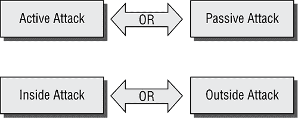

# 安全、功能性与易用性三角形

作为一名安全专业人员，很难在添加安全屏以防止攻击与允许系统对用户保持功能性之间取得平衡。安全性、功能性和易用性三角形代表了安全性、功能性以及系统对用户的易用性之间的平衡（参见图 1-3）。通常情况下，随着安全性的增加，系统的功能性和对用户的易用性就会降低。

图 1-3: 安全性、功能性和易用性三角形

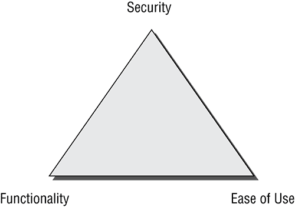

在理想的世界里，安全专业人员希望所有系统都拥有最高级别的安全性；然而，有时这并非可能的。过多的安全屏会使用户难以操作系统并阻碍系统的功能。


## 可用性 vs 安全性

假设为了进入公司的办公室，你必须先通过停车场入口处的哨兵检查站验证你的车牌号，然后在进入大楼时出示胸牌，接着使用密码进入电梯，最后用钥匙解锁办公室门。你可能会觉得这些安全检查太严厉了！这些检查中的任何一项都可能导致你被留，从而错过重要的会议——例如，如果你的车在修理厂而你开的是租用车，或者你忘记带了进入大楼、电梯或办公室门的钥匙或胸牌。这就是可用性与安全性之间张力的例子。

在许多情况下，如果安全检查太严厉，人们将完全绕过它们。例如，人们可能会把门顶住以便重新进入大楼。当我在渗透测试期间进行物理安全审计时，我只是提着箱子走向大楼门口；人们总是会为提着东西的人开门。这仅仅是人性的，也是黑客绕过安全措施的一种简单方法。

## 漏洞研究与工具

漏洞研究是发现可能导致系统攻击的漏洞和设计缺陷的过程。存在许多网站和工具可以帮助白帽子黑客维护针对系统或网络的最新漏洞及可能的利用程序的列表。系统管理员必须关注最新的病毒、木马和其他常见的漏洞，以充分保护他们的系统和网络。此外，通过熟悉最新的威胁，管理员可以学习如何检测、预防和从攻击中恢复。

漏洞研究与道德黑客攻击的区别在于，研究是被动地寻找可能的安全漏洞，而道德黑客攻击是尝试可以收集哪些信息。这类似于入侵者在视察大楼，看到地面的一扇窗户并心想：“嗯，也许可以用它作为切入点。”道德黑客会去尝试打开窗户，看它是否未锁以及能否提供进入大楼的权限。接下来，他们会在通过大楼进入的房间寻找任何有价值的信息。每次进入系统和增加访问级别都会为额外的利用或攻击提供脚点。

## 道德黑客报告

网络渗透测试或安全审计的结果是道德黑客报告或渗透测试报告。这两个名称均可，且可以交叉使用。该报告详细说明了黑客活动的结果、执行的测试类型以及使用的黑客方法。结果将最初与客户同意的预期进行比较。识别出的任何漏洞都会详细说明，并提出应对措施。出于安全考虑，此文档通常以纸质格式交付给组织。

道德黑客报告的细节必须保密，因为它们凸显了组织的安全风险和漏洞。如果这份文档落入坏人手中，其结果对组织来说可能是灾难性的。它本质上为某人提供了组织所有安全弱点的路线图。

## 如何做到道德

道德黑客攻击通常以结构化和组织化的方式进行，通常作为渗透测试或安全审计的一部分。测试系统和应用程序的深度宽度通常由客户的需求和关注点决定。许多道德黑客是虎队小组（`tiger team`）的成员。虎队小组共同工作，执行涵盖网络、物理和系统入侵所有方面的全面测试。

道德黑客必须遵循某些规则，以确保满足所有的道德和法律义务。道德黑客必须执行以下操作：

- 获得客户的授权，并有签署的合同，允许测试人员执行测试。
- 在测试过程中披露机密信息的情况下，与客户维护并遵守非保密协议（`NDA`）。
- 在执行测试时保持保密。收集的信息可能包含敏感信息。绝不向第三方披露任何关于测试的信息或公司机密数据。
- 执行测试但不超出约定的限制范围。例如，只有在事先与客户达成共识的情况下，才作为测试的一部分运行`DoS`攻击。如果由于测试导致服务器或应用程序对客户不可用，组织可能会面临收入损失、声誉损害甚至更严重的后果。

以下步骤（见图 1-4）是执行组织安全审计的框架，并将有助于确保测试以组织、高效且符合道德的方式进行：

1. 与客户交流，讨论测试期间需要解决的需求。
2. 与客户准备并签署`NDA`文档。
3. 组织道德黑客团队，并制定测试计划。
4. 执行测试。
5. 分析测试结果并准备报告。
6. 向客户演示报告结果。

图 1-4: 安全审计步骤

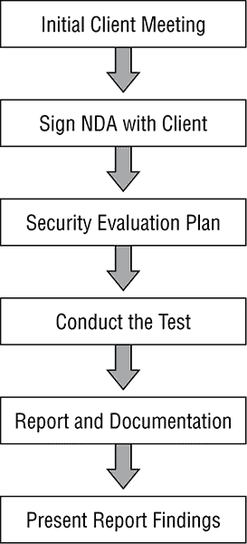


深度渗透测试和安全审计信息在 `EC-Council` 的许可渗透测试（`LPT`）认证中进行了讨论。

## 执行渗透测试

许多担任安全专业人员角色的道德黑客利用其技能来执行安全评估或渗透测试。这些测试和评估分为三个阶段，通常顺序如下：

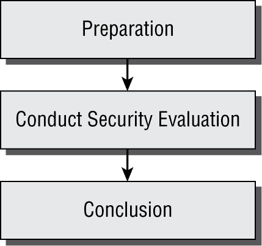

### 准备阶段

涉及道德黑客与组织之间的正式协议。该协议应包括测试的完整范围、使用的攻击类型（内部或外部）以及测试类型：`白盒`、`黑盒`或`灰盒`。

### 执行安全评估

在此阶段，测试被执行，随后测试人员准备一份关于漏洞和其他发现的正式报告。

### 结论

在此阶段，向组织展示发现的结果，并提供任何改进安全的建议。

注意，道德黑客并不“修复”或修补他们在评估目标中发现的任何安全漏洞。这是执行安全审计或渗透测试时的常见误解。道德黑客通常不执行任何补丁修复或应对措施实施。最终目标或交付物实际上测试结果以及对相关风险的分析。测试是导致报告中发现的原因，并且必须良好记录。

与大众认知相反，执行渗透测试的伦理黑客必须非常有组织性且高效，他们必须通过截图、复制黑客工具输出或打印重要的日志文件来记录每项发现。伦理黑客必须非常专业，并提交一份详尽的报告，以便在他们的职业中获得尊重。关于执行渗透测试的更多信息，可以参阅第 15 章“执行渗透测试”。

## 定义黑客主义 (`Hacktivism`)

黑客主义（`Hacktivism`）是指为了某种事业而进行的黑客。这些黑客通常具有社会或政治议程。他们的意图是通过黑客活动传递信息，同时为自己的事业和自己赢得知名度。

许多此类黑客参与诸如破坏网站首页、创建病毒以及实施`DoS`或其他破坏性攻击等活动，以增加其事业的事声。黑客主义通常针对政府机构、政治团体以及任何被这些团体或个人认为“坏的”或“错误”的实体。

## 保持合法

伦理黑客应该了解未经授权入侵系统的惩罚。在收到目标机构签署的法律文件、明确允许伦理黑客执行黑客活动之前，不应开始任何与网络渗透测试或安全审计相关的伦理黑客活动。伦理黑客需要谨慎使用他们的黑客技巧，并意识到误用这些技术的后果。


## 黑客尝试的责任

一家证券经纪公司运营的网站遭受了黑客攻击。由于攻击，该公司的客户在几小时内无法进行交易。攻击当天，股市波动，许多客户尝试买卖股票均无果。客户非常不悦，并指责公司未能防止、检测并从攻击中恢复。

在这种情况下，黑客是过错方。但经纪公司本身呢？客户依赖公司的网站进行交易。经纪公司及其网络提供商是否会面临因停机导致金钱损失的不满客户的诉讼？由于未能防止网站驱动的交易系统关闭，经纪公司是否应承担任何责任？本章讨论的某些法律将解决黑客攻击后的此类责任问题。

计算机犯罪可以大致分为两类：通过计算机便利的犯罪和以计算机为目标的犯罪。


关于计算机犯罪的最重要的美国法律在以下章节中描述。尽管`CEH`考试具有国际范围，但请确保你熟悉这些美国法规以及黑客行为的处罚。记住，意图并不能让黑客凌于法律之上；即使是伦理黑客可能因违反这些法律而被起诉。

## 网络安全增强法案与 SPY 法案

2002年网络安全增强法案规定，对“鲁莽”危害他人生命的黑客实行终身监禁。通过攻击交通系统、电力公司或其他公共服务或公用设施的计算机网络造成生命威胁的恶意黑客可以根据该法被起诉。

2007年《安全防止网络侵入法案》（`SPY ACT`）涉及计算机系统上间谍软件的使用，并在本质上禁止以下行为：

- 在未获得授权的情况下获取计算机的远程控制
- 使用计算机向人们发送未经请求的信息（通常称为垃圾邮件）
- 将网络浏览器重定向到未经用户授权的另一个网站
- 显示导致用户必须关闭浏览器的广告（弹出窗口）
- 使用击键记录收集个人信息
- 更改浏览器的默认主页
- 误导用户点击网页链接，或复制类似的网页以误导用户

`SPY ACT`的重要性在于，它开始将烦人的弹出窗口和垃圾邮件视为不仅仅是骚扰，而是真实的黑客尝试。`SPY ACT`为起诉在邮件中使用垃圾邮件、弹出窗口和链接的黑客奠定了基础。

## 18 USC §1029 和 1030

美国法典按标题对美国法律进行分类和定义。第18节详细说明了“犯罪与刑事程序”。第`1029`节“与接入设备相关的欺诈及活动”规定，如果你为了实施欺诈并获得价值超过1000美元的服务或产品而生产、销售或使用伪造接入设备或电信仪器，你就违反了法律。第`1029`节将滥用计算机密码和其他接入设备（如令牌卡）定罪。

第`1030`节“与计算机相关的欺诈及活动”禁止未经许可访问受保护的计算机并造成损害。该法将未经授权人员传播病毒、蠕虫以及入侵计算机系统的行为定罪。


第`1029`和`1030`节法律的全文作为附录包含在书中供你参考。

## 美国州法律

除了联邦法律外，许多州都有自己的与黑客以及审计计算机网络和系统相关的法律。在执行渗透测试时，请审查相关的州法律，以确保你处于法律的正确一方。在许多情况下，签署的测试合同和`NDA`（保密协议）足以说明测试的意图和性质。

国家安全研究所拥有一个网站，其中列出了所有适用于计算机犯罪的州法律。URL为：

`http://nsi.org/Library/Compsec/computerlaw/statelaws.html`

## 联邦经理财务廉洁法案

1982年《联邦经理财务廉洁法案》（`FMFIA`）基本上是一项责任法，确保管理财务账户的人员以极其负责的方式操作，并确保资产得到保护。这一描述可以解释为涵盖保护资产免受黑客尝试的所有衡量措施。该法案本质上确保了：

- 资金、财产和其他资产免受浪费、损失、未经授权的使用或挪用。
- 成本符合法律。

`FMFIA`对伦理黑客非常重要，因为它将资金和其他资产的适当使用责任归于机构。因此，该法律要求管理层对组织的安全负责，并确保针对黑客攻击采取适当的防护措施。

## 信息自由法 (FOIA)

《信息自由法》（`5 USC 552`）或`FOIA`使许多关于组织的信息和文件公开。大多数记录和政府文件可以通过`FOIA`获取。当你对潜在目标进行侦察和信息收集时，任何使用该法案获取的信息都是合法的。

## 联邦信息安全管理法 (FISMA)

《联邦信息安全管理法》（`FISMA`）基本上赋予了伦理黑客执行其测试类型的权力，并成为政府机构的强制性要求。

`FISMA`要求每个联邦机构制定、记录并实施全面的信息安全计划，为支持该机构运营和资产的信息及信息系统提供安全，包括由其他机构、承包商或其他来源提供或管理的信息。信息安全计划必须包含以下内容：

### 安全需求与策略

- 定期对由于未经授权的访问、使用、披露、中断、修改或破坏支持该机构运营和资产的信息及信息系统而可能造成的风险和损害程度进行评估。
- 制定基于风险评估的政策和程序，以成本效益的方式将信息安全风险降低至可接受水平，并确保信息安全在每个机构信息系统的整个生命周期内得到解决。
- 根据实际情况制定子计划，为网络、设施、信息系统或信息系统组提供充分的信息安全。
- 进行安全意识培训，告知人员（包括承包商和其他支持该机构运营和资产的信息系统用户）与其活动相关的信息安全风险，以及他们在遵守旨在降低这些风险的机构政策和程序方面的责任。
- 定期对信息安全政策、程序和实践的有效性进行测试和评估（包括清单中规定的每个机构信息系统的管理、运营和技术控制），频率取决于风险程度，但至少每年一次。
- 建立一个计划、实施、评估和记录补救措施的流程，以解决机构信息安全政策、程序和实践中的任何缺陷。
- 检测、报告和响应安全事件的程序（包括在造成实质性损害之前减轻与此类事件相关的风险，并与联邦信息安全事件响应中心，以及在适当情况下根据法律或根据总统指示与执法部门、相关监察长以及任何其他机构或办公室进行通知和协商）。
- 确保支持该机构运营和资产的信息系统连续性的计划和程序。

本法案为伦理白帽黑客提供了职业保障，使其能够对政府机构和其他组织进行持续的安全审计。

## 法律框架

### 1974 年隐私法案

《1974年隐私法案》（`5 USC 552a`）确保个人信息不被泄露，并确保政府机构在没有获得相关信息人士事先书面同意的情况下披露信息。

### 美国爱国法案 (USA PATRIOT Act)

该法案的正式名称为《2001年通过提供所需的适当工具拦截和阻止恐怖主义来统一和加强美国爱国法案》（`USA PATRIOT Act`），它授予政府在计算机黑客和其他类型的调查中拦截语音通信的权限。《爱国法案》的制定主要是为了应对恐怖活动，但也可以被解释为一种发现和防止黑客尝试的监听机制。

### 政府纸质消除法案 (GPEA)

1998年的《政府纸质消除法案》（`GPEA`）要求联邦机构在与政府机构互动时，允许人们选择使用电子通信的选项。`GPEA`还鼓励使用电子签名。当有价值的政府信息以电子格式存储时，黑客的目标和风险也随之增加。

### 其他国家的网络法

其他国家都有各自的关于信息保护和黑客攻击的适用法律。当你对国际组织进行渗透测试时，必须检查主权国家的法律，以确保测试在该国是合法的。由于互联网和远程攻击的使用，地区和国际边界可以被迅速跨越。当你执行外部远程攻击时，数据可能存储在另一个国家的服务器上，该国的法律可能适用。未患于其胜于医，因此在对国际实体进行渗透测试之前应做好研究。在某些国家，法律可能比美国更宽松，这一事实在你进行信息收集时可能对你有利。

## 总结

伦理黑客不仅仅是运行黑客工具并获取系统的未经授权访问以查看可以看到哪些内容。当由安全专业人员执行时，伦理黑客涵盖了侦察和信息收集的所有方面、结构化的方法以及攻击后分析。伦理黑客需要对系统和工具有深入知识，以及大量的耐心和克制，以确保不对目标系统造成任何损害。黑客攻击可以以伦理的方式进行，事实上，政府和私营部门也要求这样做以确保系统安全。

## 考试要点

- 理解基本术语：`threat`（威胁）、`exploit`（利用）、`vulnerability`（漏洞）、`target`（目标）以及`attack`（攻击）。
- 区分伦理黑客与攻击：伦理黑客是安全专业人员，攻击是为了造成损害的。
- 了解黑客分类：了解谁是好人，谁是坏人（在黑客世界中）。对于考试来说，了解不同黑客的分类至关重要：了解`black-hat`（黑帽）、`white-hat`（白帽）和`gray-hat`（灰帽）。
- 了解黑客阶段：`active reconnaissance`（主动侦察）、`scanning`（扫描）、`gaining access`（获取访问）、`maintaining access`（维持访问）和`covering tracks`（掩盖踪迹）是黑客的五个阶段。
- 了解攻击类型：了解主动和被动攻击的区别。攻击者的位置是主动和被动攻击的区别。
- 了解黑客攻击类型：黑客可以通过远程网络、远程拨号网络或本地网络，或通过社会工程、被盗设备或物理访问进行攻击。了解`黑盒`、`白盒`或`灰盒`测试技术。
- 了解伦理黑客报告的内容：伦理黑客报告包含已执行的攻击活动、发现的网络或系统漏洞以及应采取的应对措施。
- 了解法律影响：`2002年网络安全增强法`可用于起诉危及他人生命的伦理黑客。
- 了解适用于计算机入侵的法律：《美国法典》第18卷第1029和1030条对黑客有严格的惩罚。

## 复习题

1. 下列哪种陈述最好描述白帽黑客？
   A. 安全专业人员
   B. 前黑帽
   C. 前灰帽
   D. 恶意黑客

2. 由网络管理人员对内部网络进行的安全审计也称为 ____________________。
   A. `灰盒测试`
   B. `黑盒测试`
   C. `白盒测试`
   D. `主动测试`
   E. `被动测试`

3. 黑客攻击的第一阶段是？
   A. `attack`
   B. `maintaining access`
   C. `gaining access`
   D. `reconnaissance`
   E. `scanning`

4. 哪种类型的黑客攻击测试基础设施访问？
   A. 内部网络
   B. 远程网络
   C. 外部网络
   D. 物理访问

5. 安全、功能和易用性三角形说明了哪个概念？
   A. 随着安全性增加，功能和易用性增加。
   B. 随着安全性降低，功能和易用性增加。
   C. 随着安全性降低，功能和易用性降低。
   D. 安全不影响功能和易用性。

## 6. 哪种黑客对你的网络构成的风险最高？
A. 不满的员工
B. 黑帽客
C. 灰帽客
D. 脚本小子

## 7. 安全评估计划的三个阶段是什么？（选择三个答案。）
A. 安全评估
B. 准备
C. 结论
D. 最终
E. 侦察
F. 设计安全
G. 漏洞评估

## 8. 为特定目的进行的攻击被称为 ____________________。
A. 主动攻击
B. 黑客行动主义 (Hacktivism)
C. 激活主义
D. 黑帽攻击

## 9. 哪种联邦法律最常用于起诉黑客？
A. 第12卷
B. 第18卷
C. 第20卷
D. 第2章

## 10. 当黑客试图通过互联网攻击主机时，这被称为什么样的攻击？
A. 远程攻击
B. 物理访问
C. 本地访问
D. 内部攻击

## 11. 哪种法律允许收集有关目标的信息？
A. 信息自由法案
B. 政府文书消除法
C. 2001年《美国爱国者法案》
D. 1974年《隐私法》

## 12. 《安全防止受网络侵入法》(Securely Protect Yourself Against Cyber Trespass Act) 禁止了以下哪些？（选择所有适用）
A. 发送垃圾邮件
B. 安装和使用键盘记录器
C. 使用视频监控
D. 实现弹出窗口

## 13. 安全审计框架中的哪一步对于保护伦理黑客免受法律责任至关重要？
A. 测试前与客户交谈。
B. 测试前与客户签署伦理黑客协议和保密协议 (NDA)。
C. 测试前组织伦理黑客团队并准备进度。
D. 分析测试结果并编写报告。

## 14. 下列哪项是安全分析的主体系统、程序或网络？
A. 拥有系统
B. 漏洞
C. 被利用的系统
D. 评估目标

## 15. 哪个术语最能描述使用黑客技术进行破坏性目的的黑客？
A. 破解者 (Cracker)
B. 伦理黑客
C. 脚本小子
D. 白帽客

## 16. MAC 地址欺骗是哪种类型的攻击？
A. 加密
B. 暴力破解
C. 身份验证
D. 社会工程

## 17. 哪种法律授权在计算机黑客尝试中拦截语音通信？
A. 爱国者法案
B. 电信法
C. 隐私法
D. 信息自由法案

## 18. 伦理黑客报告中应该包含哪些项目？（选择所有适用）
A. 测试类型
B. 发现的漏洞
C. 建议的防御措施
D. 路由器配置信息

## 19. 哪种人对组织安全的威胁最大？
A. 黑帽客
B. 不满的员工
C. 脚本小子
D. 灰帽客

## 20. 下列哪项应该包含在伦理黑客报告中？（选择所有适用）
A. 测试结果
B. 风险分析
C. 法律文件
D. 伦理披露

## 复习题答案

1. A. `白帽客`是“好”人，他们使用自己的技术用于防御目的。
2. C. `白盒测试`是在了解系统内部的情况下进行的安全审计。
3. D. `侦察`是收集执行攻击所需的必要信息。
4. D. `物理访问`测试对物理基础设施的访问。
5. B. 随着安全性的增加，使用会变得越困难且功能越少。
6. A. `不满的员工`拥有允许他们发起强大攻击的信息。
7. A, B, C. 安全评估计划的三个阶段是准备、安全评估和结论。
8. B. `黑客行动主义`由声称为了政治或社会目的进行黑客攻击的人员实施。
9. B. `美国法典`中的`第18卷`最常用于起诉黑客。
10. A. 来自互联网的攻击被称为`远程攻击`。
11. A. `信息自由法案`确保了许多文件和记录的公开，可以作为潜在目标信息的丰富来源。
12. A, B, D. 发送垃圾邮件、安装和使用键盘记录器以及实现弹出窗口均被`SPY ACT`所禁止。
13. B. 签署`NDA`协议对于确保测试获得授权以及伦理黑客有权访问客户系统至关重要。
14. D. `评估目标`是作为安全分析主体的系统、程序或网络。它是伦理黑客攻击的靶。
15. A. `破解者`是使用黑客技术进行破坏性目的的黑客。
16. C. `MAC地址欺骗`是一种用于绕过`MAC地址过滤器`的`身份验证攻击`。
17. A. `爱国者法案`在许多情况下（包括计算机黑客）授权拦截语音通信。
18. A, B, C. 关于测试过程的所有信息、在网络或系统中发现的漏洞以及建议的防御措施都应该包含在伦理黑客报告中。
19. B. `不满的员工`由于他们拥有的信息和访问权限，对组织安全构成了最大的威胁。
20. A, B. `测试结果`和`风险分析`都应该包含在伦理黑客报告中。

# 第 2 章 收集目标信息：侦察、足迹扫描与社会工程

## 本章涵盖的 CEH 考试目标：

- 定义足迹扫描的概念
- 描述信息收集方法
- 描述竞争情报
- 理解 DNS 枚举
- 理解 `Whois`、`ARIN 查询`
- 理解不同类型的 DNS 记录
- 理解 `traceroute` 如何用于足迹扫描
- 理解邮件跟踪如何工作
- 理解网络爬虫如何工作
- 什么是社会工程？
- 常见的攻击类型有哪些？
- 理解翻找垃圾
- 理解反向社会工程
- 理解内部攻击
- 理解身份窃取
- 描述钓鱼攻击
- 理解网络诈骗
- 理解 URL 混淆
- 社会工程防御措施

`reconnaissance`（侦察）一词源于军事领域，意味着通过直接观察（通常由经过侦察训练的侦员或军事情报人员进行）收集和聚集有关敌人组成和能力的信息，主动寻求敌人的意图。在伦理黑客领域，`reconnaissance`适用于信息收集过程。`Reconnaissance`是一个统称，指监控黑客攻击目标并收集有关他们如何、何时以及在何处做某事的信息。通过识别人员或系统的行为模式，敌人可以发现并利用漏洞。


## 使用侦察获取物理访问

每个工作日的下午3点，联邦快递（Federal Express）的司机都会在`Medical Associates, Inc.`办公所在地大楼的装货平台停。当司机将卡车倒回大楼后门时，他会按门铃让安保人员知道已到达门口。由于大楼的安全人员认识这名司机——因为他每天都在大约同一时间来这里取送货物——他们会远程解锁大门并允许司机进入。一名黑客坐在停车场里的汽车里观察这一过程，并记录了进入大楼的物理进入程序。

第二天，当联邦快递司机被允许进入建筑时，黑客提着一个大纸箱走向门口。司机自然地为黑客开门，因为他提着一个看起来很重、很大的箱子。他们交换了寒暄，黑客走向电梯直上`Medical Associates`的办公室。黑客在前往目标办公室时，将纸箱留在大楼的走廊里。

一旦他到达`Medical Associates`办公室的前台，他要求与办公室经理面谈，他之前已经在公司网站上查到过该经理的名字。前台人员离开座位去寻找办公室经理，黑客越过桌子，将一个包含黑客工具的`USB drive`插入该人员电脑的后部。由于电脑没有密码锁定，他双击`USB drive`图标，黑客软件便静静地安装在前台人员的电脑上。他拔掉`USB drive`，并在未被察觉的情况下迅速离开办公套间和大楼。

这是一个说明`reconnaissance`和对人员行为模式的理解如何使黑客能够获取物理访问（在本例中是通过木马化的系统访问`Medical Associates`网络）并绕过安全检查点的示例。

## 理解竞争情报

竞争情报意味着对竞争对手的产品、营销和技术进行信息收集。大多数竞争情报对被调查的公司来说是非侵入性的，且本质上是无害的——用于产品比较，或作为销售和营销策略，以更好地了解竞争对手如何定位其产品或服务。存在多种用于竞争情报收集的工具，黑客可以使用它们收集有关潜在目标的信息。

在练习`2.1`到`2.3`中，我将向你展示如何使用`SpyFu`和`KeywordSpy`在线工具收集有关目标网站的信息。`SpyFu`和`KeywordSpy`会提供网站的关键词。这允许你对网站进行一些信息收集。我使用这两个工具是因为它们易于使用且完全是被动的，这意味着潜在目标无法检测到信息收集行为。

### 练习 2-1：使用 SpyFu

要使用`SpyFu`在线工具收集竞争情报信息：

1. 访问`[www.spyfu.com](http://www.spyfu.com)`网站，并在搜索字段中输入目标的网站地址：


2. 查看报告并确定有价值的关键词、链接或其他信息。

### 练习 2-2：使用 KeywordSpy

要使用`KeywordSpy`在线工具收集竞争情报信息：


1. 访问 [www.keywordspy.com](http://www.keywordspy.com) 网站，并在搜索字段中输入目标的网站地址：


2. 查看报告并确定有价值的关键词、链接或其他信息。

另一个用于执行竞争情报和信息收集的有用工具是 `EDGAR` 数据库。这是一个包含所有上市公司 `SEC` 备案文件的数据库。可以通过查看 `SEC` 备案文件中的联系名称和地址来收集信息。在练习 `2-3` 中，我将向你展示如何使用 `EDGAR` 数据库收集潜在目标的信息。

### 练习 2-3：使用 EDGAR 数据库收集信息

1. 使用 `Google` 确定公司的股票代码。

2. 打开浏览器访问 [www.sec.gov](http://www.sec.gov)。

3. 在页面右侧，点击 `EDGAR Filers` 链接。

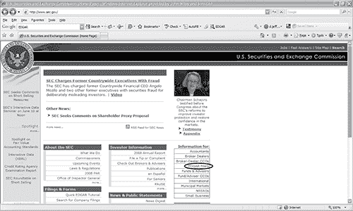

4. 点击 `Search For Filings` 菜单并输入公司名称或股票代码以搜索备案信息。例如，你可以了解公司在哪里注册，以及是谁提交了备案。

5. 使用 `Yahoo!` 黄页电话（[yp.yahoo.com](http://yp.yahoo.com)）查看你找到的任何员工姓名是否列有地址或电话号码。

6. 使用 `Google Groups` 和招聘网站搜索你找到的姓名。新闻组中是否有发布任何 `IT` 职位或其他信息，可以指示该组织拥有何种类型的网络或系统？

网站 [www.Netcraft.com](http://www.Netcraft.com) 是另一个被动信息收集的好来源。该网站将尝试确定运行 Web 服务器的操作系统和版本。该工具将在后续章节进行讨论。

## 信息收集方法论

信息收集可以分为七步（见图 2-1）。侦察是在挖掘初始信息和定位网络范围的前两步中进行的。

图 2-1：信息收集的七步

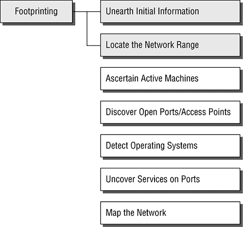

其他信息收集步骤将在第三章“收集网络和主机信息：扫描与枚举”中介绍。

### 侦察

侦察定义为创建组织网络和系统蓝图或地图的过程。信息收集也从确定目标系统、应用程序或物理位置开始。一旦知道了这些信息，就可以通过非侵入的方法收集有关组织的特定信息。例如，组织自己的网页可能会提供人员目录或员工简介，如果黑客需要使用社交工程攻击来达到目标，这些信息可能非常有用。

黑客在侦察阶段寻找的信息是任何可以提供网络架构、服务器和应用程序类型线索的内容。在发动攻击或利用之前，必须揭示操作系统和版本以及应用程序类型，以便对目标实施最有效的攻击。以下是侦察期间针对目标收集的一些信息：

- 域名
- 网络区块
- 网络服务和应用程序
- 系统架构
- 入侵检测系统
- 身份验证机制
- 特定的 IP 地址
- 访问控制机制
- 电话号码
- 联系地址

一旦汇总了这些信息，黑客就能更深入了解该组织、有价值信息的存储处以及如何访问它们。

## 侦察工具

足迹探测（Footprinting）可以使用黑客工具（应用程序或网站）完成，这些工具允许黑客被动地定位信息。通过使用这些足迹探测工具，黑客可以获取目标的一些基础信息或“足迹”。通过首先对目标进行足迹探测，黑客可以排除掉对目标系统或网络无效的工具。例如，如果一家图形设计公司使用所有的 Macintosh，那么所有针对 `Windows` 系统的黑客软件都可以排除。足迹探测不仅通过消除某些工具集来加快黑客过程，还能通过针对任务使用正确的工具来减少黑客尝试，从而最大限地减少被检测的机会。

对于本章的练习，你将对一家目标公司进行侦察和信息收集。我建议你使用你自己的组织，但由于这些工具是被动的，因此可以使用任何组织名称。

一些用于足迹探测和信息收集的常用工具如下：

- 域名查询
- `Whois`
- `NSlookup`
- `Sam Spade`

在我们讨论这些工具之前，请记住，开源信息也可以提供关于目标的丰富信息，例如电话号码和地址。执行 `Whois` 请求、搜索域名系统（`DNS`）表以及使用其他查询网络工具都是开源足迹探测的形式。这些信息中的大部分非常容易获取，且是合法的。

## 对目标进行足迹探测

足迹探测是攻击前准备阶段的一部分，涉及收集有关目标环境和架构的数据，通常目的是寻找侵入该环境的方法。足迹探测可以揭示系统漏洞并识别利用这些漏洞的难易。这是黑客收集计算机系统及其所属公司信息最简单的方法。这个准备阶段的目的是尽可能地了解系统、其远程访问能力、端口和服务以及其安全的任何特定方面。

### 使用 Google 收集信息

黑客也可以通过 Google 搜索或 Yahoo! 人搜索来定位有关员工或组织本身的信息。

Google 搜索引擎可以以创意的方式进行信息收集。使用 Google 搜索引擎检索信息被称为 Google 黑客攻击（Google hacking）。访问 [groups.google.com](http://groups.google.com) 搜索 Google 新组。可以使用以下命令让 Google 搜索引擎收集目标信息：

- `site`：搜索特定的网站或域名。在冒号后提供你想搜索的网站。
- `filetype`：仅在特定类型文件的文本内搜索。在冒号后提供你想搜索的文件类型。文件扩展名前不要包含句号。
- `link`：在超链接中搜索搜索词并识别链接的页面。
- `cache`：识别网页的版本。在冒号后提供网站的 URL。
- `intitle`：在文档标题内搜索术语。
- `inurl`：仅在文档的 URL（网络地址）内搜索。搜索词必须跟在冒号后面。

例如，黑客可以使用以下命令来定位某些类型的漏洞 Web 应用程序：

```text
INURL:["parameter="] with FILETYPE:[ext] and INURL:[scriptname]
```

或者，黑客可以使用搜索字符串 `intitle:"BorderManager information alert"` 来寻找 Novell BorderManager 代理/防火墙服务器。


有关执行 Google 搜索的更多语法，请访问 [www.google.com/help/refinesearch.html](http://www.google.com/help/refinesearch.html)。

博客、新闻组和新闻稿也是寻找公司或员工信息的好地方。企业招聘公告可以提供有关公司在其网络上可能使用的服务器或基础设施设备类型的信息。

获取的其他信息可能包括正在使用的互联网技术、所使用的操作系统和硬件、活跃的 IP 地址、电子邮件地址和电话号码以及公司政策和程序。


通常，黑客花费 90% 的时间对目标进行分析和收集信息，花费 10% 的时间发动攻击。

### 理解 DNS 遍历

DNS 遍历是定位组织所有 `DNS` 服务器及其相应记录的过程。公司可能同时拥有内部和外部 `DNS` 服务器，这些服务器可以产生用户名、计算机名称和潜在目标系统的 IP 地址等信息。

`NSlookup`、`DNSstuff`、美国互联网数字分配机构（`ARIN`）和 `Whois` 均可获取可执行 DNS 遍历的信息。

#### NSlookup 和 DNSstuff

你应该熟悉的一个强大工具是 `NSlookup`（参见 `图 2-2`）。该工具查询 `DNS` 服务器的记录信息。它包含在 Unix、Linux 和 Windows 操作系统中。如 `Sam Spade` 等黑客工具也包含 `NSlookup` 工具。

基于从 `Whois` 收集的信息，你可以使用 `NSlookup` 查找服务器和其他主机的额外 IP 地址。使用来自 `Whois` 的权威名称服务器信息（`AUTH1.NS.NYI.NET`），你可以发现邮件服务器的 IP 地址。

图 2-2：`NSlookup`

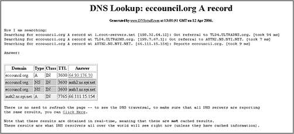

易用工具的爆炸使得黑客变得简单，如果你知道使用哪些工具。`DNSstuff` 是这些工具之一。与其使用带有复杂参数的 `NSlookup` 工具来获取 DNS 信息，只需访问 [www.dnsstuff.com](http://www.dnsstuff.com) 即可进行 DNS 搜索。`图 2-3` 显示了 `dnsstuff.com` 的示例 DNS 搜索。

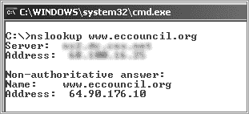（sic）

此搜索显示了 `www.eccouncil.org` 的所有别名记录以及 Web 服务器的 IP 地址。你甚至可以发现所有的名称服务器和关联 IP 地址。

### 理解 Whois 和 ARIN 查询

`isis` 源自 Unix 操作系统，但现在可以在许多操作系统、黑客工具包以及互联网上找到。该工具识别注册用于电子邮件或网站的域名。统一资源定位符（URL），例如 [www.Microsoft.com](http://www.Microsoft.com)，包含域名（`Microsoft.com`）和主机名或别名（`www`）。

域名注册机构（`ICANN`）要求注册域名以确保只有一个公司使用特定的域名。`Whois` 工具查询注册数据库以检索有关域名注册个人或组织的联系信息。

#### 黑客工具

`Whois` 是一种信息收集程序，允许你查找有关 IP 地址、主机名或域名的可用信息，包括国家、州或省、市、网络提供商名称、管理员和技术支持联系信息。`SmartWhois` 是基础程序的图形版本。

在练习 2-4 中，我将向你展示如何使用免费的 `Whois` 工具。

### 练习 2-4：使用 Whois

使用 `Whois` 工具收集有关注册商或域名的信息：

1. 访问 `DNSStuff.com` 网站并向下滚动到页面底部的免费工具。

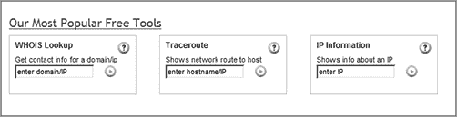

2. 在 `WHOIS Lookup` 字段中输入目标公司的 URL，并点击 `WHOIS` 按钮。

3. 检查结果并确定以下信息：

   - 注册地址
   - 技术和 DNS 联系人
   - 联系邮箱
   - 联系电话号码
   - 过期日期

4. 访问公司网站，查看 `WHOIS` 中的联系信息是否与网站上列出的任何联系人姓名、地址和电子邮件地址匹配。

5. 如果匹配，使用 `Google` 搜索员工姓名或电子邮件地址。你可以了解该组织使用的电子邮件命名规则，以及是否存在任何不应公开的内。

`ARIN` 是一个数据库，其中包含了如静态 IP 地址所有者等信息。可以使用 `Whois` 工具查询 `ARIN` 数据库，例如位于 [www.arin.net](http://www.arin.net) 的工具。

插图 2-4 显示了对 [www.yahoo.com](http://www.yahoo.com) 的 `ARIN Whois` 搜索。注意，地址、电子邮件和联系信息都包含在此 `Whois` 搜索中。伦理黑客可以使用这些信息找出谁负责某个 IP 地址，以及哪个组织拥有该目标系统；或者，恶意黑客可以使用这些信息对该组织进行社会工程攻击。作为安全专业人员，你需要意识到 `ARIN` 等可搜索数据库中向公开的信息，并确保恶意黑客无法利用这些信息对网络发起攻击。

插图 2-4： [www.Yahoo.com](http://www.Yahoo.com) 的 `ARIN` 输出

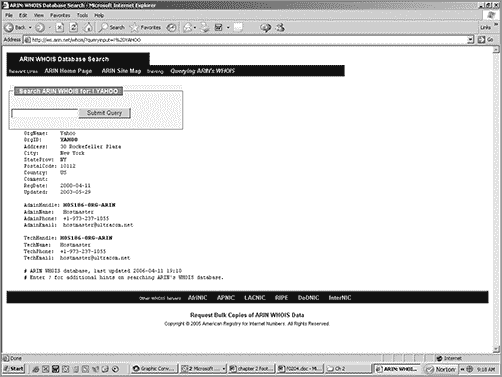

请注意，北美以外的其他地理区域也有它们自己的 Internet 注册机构，例如 `RIPE NCC`（欧洲、中东和中亚部分地区）、`LACNIC`（拉丁美洲和加勒比 Internet 地址注册机构）以及 `APNIC`（亚太网络信息中心）。

### 分析 Whois 输出

运行 `Whois` 的简单方法是连接到网站（例如，[www.networksolutions.com](http://www.networksolutions.com)）并进行 `Whois` 搜索。列表 2-1 是对网站 [www.eccouncil.org](http://www.eccouncil.org) 进行 `Whois` 搜索输出。


本书中的联系人姓名和服务器名称已更改。

列表 2-1：`www.eccouncil.org` 的 `Whois` 输出

```text
Domain ID:D81180127-LROR
Domain Name:ECCOUNCIL.ORG
Created On:14-Dec-2001 10:13:06 UTC
Last Updated On:19-Aug-2004 03:49:53 UTC
Expiration Date:14-Dec-2006 10:13:06 UTC
Sponsoring Registrar:Tucows Inc. (R11-LROR)
Status:OK
Registrant ID:tuTv2ItRZBMNd4lA
Registrant Name:John Smith
Registrant Organization:International Council of E-Commerce Consultants
Registrant Street1:67 Wall Street, 22nd Floor
Registrant Street2:
Registrant Street3:
Registrant City:New York
Registrant State/Province:NY
Registrant Postal Code:10005-3198
Registrant Country:US
Registrant Phone:+1.2127098253
Registrant Phone Ext.:
Registrant FAX:+1.2129432300
Registrant FAX Ext.:
Registrant Email:forum@eccouncil.org
Admin ID:tus9DYvpp5mrbLNd
Admin Name:Susan Johnson
Admin Organization:International Council of E-Commerce Consultants
Admin Street1:67 Wall Street, 22nd Floor
Admin Street2:
Admin Street3:
Admin City:New York
Admin State/Province:NY
Admin Postal Code:10005-3198
Admin Country:US
Admin Phone:+1.2127098253
Admin Phone Ext.:
Admin FAX:+1.2129432300
Admin FAX Ext.:
Admin Email:ethan@eccouncil.org
Tech ID:tuE1cgAfi1VnFkpu
Tech Name:Jacob Eckel
Tech Organization:International Council of E-Commerce Consultants
Tech Street1:67 Wall Street, 22nd Floor
Tech Street2:
Tech Street3:
Tech City:New York
Tech State/Province:NY
Tech Postal Code:10005-3198
Tech Country:US
Tech Phone:+1.2127098253
Tech Phone Ext.:
Tech FAX:+1.2129432300
Tech FAX Ext.:
Tech Email:forum@eccouncil.org
```

### 获取网络地址范围

每个伦理黑客都需要学会查找子网掩码。此任务可以通过追踪 `ARIN` 或互联网分配数字（`IANA`）等注册机构来完成。

### 识别 DNS 记录类型

列表描述了常见的 DNS 记录类型及其用途：

- `A`（地址）：将主机名映射到 IP 地址
- `SOA`（起始区域）：识别负责域名的 DNS 服务器
- `CNAME`（规范别名）：提供额外的别名
- `MX`（邮件交换）：识别邮件服务器
- `SRV`（服务）：识别如目录的服务
- `PTR`（指针）：将 IP 地址映射到主机名
- `NS`（名称服务器）：识别其他名称服务器

### 使用 Traceroute 进行足迹扫描

`traceroute` 是一种大多数操作系统都提供的数据跟踪工具。它通过向路径上的每个跳数（路由器）发送 Internet 控制消息协议（`ICMP`）回显来实现，直到到达目标地址。当 ICMP 消息从路由器返回时，路径上每个路由器的生存时间（`TTL`）都会减 1。这允许黑客确定路由器距离发送者有多少跳数。

使用 `traceroute` 的一个问题是，当它遇到防火墙或包过滤路由器时会超时（用星号表示）。尽管防火墙阻止了 `traceroute` 工具发现网络内部的主机，但它会提醒伦理黑客防火墙的存在；随后可以使用绕过防火墙的技术。

`Sam Spade` 和许多其他黑客工具包含 `traceroute` 的版本。Windows 操作系统使用 `tracert hostname` 语法来执行 `traceroute`。插图 2-5 是跟踪 [www.yahoo.com](http://www.yahoo.com) 的 `traceroute` 输出示例。

插图 2-5： [www.yahoo.com](http://www.yahoo.com) 的 `Traceroute` 输出

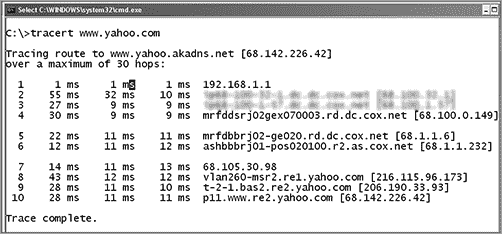


`tracert` 命令用于识别通往目标网络路径上的路由器。由于路由器通常根据其物理位置命名，`tracert` 的结果可以帮助定位这些设备。

## 黑客工具

`NeoTrace`、`VisualRoute` 和 `VisualLookout` 都是具有 GUI 或视觉界面的数据包跟踪工具。它们在地图上绘制数据包传输的路径，并可以视觉化地识别路由器和其他网络设备的位置。这些工具的工作原理与 `traceroute` 类似，执行相同的信息收集；然而，它们提供了结果的可视化表示。

### 理解邮件追踪

`email-tracking` 程序允许邮件发送者了解收件者是否阅读、转发、修改或删除了邮件。大多数 `email-tracking` 程序通过在电子邮件地址后添加域名来工作，例如 `readnotify.com`。邮件中会附带一个收件者察觉的单像素图形文件。然后，当对邮件执行操作时，该图形文件会连接回服务器并向发送者通知该操作。

#### 黑客工具：Visualware

`Visualware` 的 `eMailTrackerPro`（[www.emailtrackerpro.com/](http://www.emailtrackerpro.com/)）和 `MailTracking`（[http://mailtracking.com/](http://mailtracking.com/)）是允许道德黑客跟踪邮件消息的工具。当你使用这些工具发送邮件、转发邮件、回复邮件或修改邮件时，原始邮件产生的操作和痕迹会被记录下来。发送者将收到一封自动生成的邮件，告知对被追踪邮件执行的所有操作。

### 理解网络爬虫

垃圾邮件发送者以及任何其他兴趣从互联网收集电子邮件地址的人都可以使用 `web spiders`（网络爬虫）。`web spider` 爬取网站并收集电子邮件地址等特定信息。`web spider` 使用如 `@` 符号等语法定位电子邮件地址，然后将它们复制到列表中。这些地址随后被添加到数据库，并在以后可能用于发送未经请求的邮件。

`web spiders` 可用于定位互联网上的各种信息。黑客可以使用 `web spider` 自动化信息收集过程。防止你的网站被爬虫爬取的一种方法是在网站根目录下放置 `robots.txt` 文件，并列出你想要防止被爬取的目录。

## 社会工程学

社会工程学是一种侵入系统或网络的非技术方法。它是欺骗系统用户并说服他们执行对黑客有用的行为的过程，例如提供可以用于破解或绕过安全机制的信息。理解社会工程学非常重要，因为黑客可以使用它来攻击系统的人为因素，并绕过技术安全措施。这种方法可以在攻击之前或攻击期间用于收集信息。

社会工程工程师通常使用电话或互联网来欺骗人们透露敏感信息，或使他们做违反组织安全政策的事情。通过这种方法，社会工程工程师利用了人信任言语的自然倾向，而不是利用计算机安全漏洞。人们通常认为用户是安全链中最薄弱的环节；这一原则使得社会工程学成为可能。

以下是 Kapil Raina 讲述的一个社会工程学案例，他目前是 `VeriSign` 的安全专家，该案例基于他在前任雇主处的真实工作经历：

几年前的一个早晨，一群陌生人走进一家大型货运公司，并在离开时获得了该公司整个公司网络的访问权限。他们是如何做到的？通过从该公司的几位不同员工那里一点一点地获取少量的访问权限。首先，他们在尝试进入场所之前就对公司进行了两天的研究。例如，他们通过拨打人力资源部门了解了关键员工的名字。接着，他们假装丢失了前门的钥匙，一个男人让他们进去。然后，他们在进入第三层受控区域时“丢失”了身份证，微微一笑，一位友好的员工为他们打开了门。

这些陌生人知道首席财务官（CFO）不在城，因此他们进入他的办公室并从他未锁的电脑上获取财务数据。他们翻找公司的垃圾，找到了各种实用文档。他们向一名清洁工要了一个垃圾桶来装物品，并用手将所有数据带出了建筑。这些陌生人研究过 CFO 的声音，因此他们能够打电话假装是 CFO，并且听起来很匆忙，急切地需要他的网络密码。从那里开始，他们使用常规的技术黑客工具获得了系统的超级用户访问权限。

在这种情况下，这些陌生人是网络顾问，在任何其他员工都不知情的情况下，为 CFO 执行安全审计。他们从未没有从 CFO 那里获得任何特权信息，但通过社会工程学获得了他们想要的所有访问权限。

社会工程学最危险的部分是，那些拥有认证流程、防火墙、虚拟专用网络和网络监控软件的公司仍然容易受到攻击，因为社会工程学并不直接攻击安全措施。相反，社会工程学攻击绕过了安全措施，转而针对组织中的人为因素。

### 操纵的艺术

社会工程学包括外部人员基于建立不当信任关系来获取敏感信息或不当访问权限。社会工程工程师的目标是欺骗某人提供价值的信息或对信息的访问权限。社会工程学利用人性的特质，例如乐于助人的愿望、信任人的倾向以及对惹麻烦的恐惧。能够融入并看起来是组织一部分的黑客在社会工程学攻击中是最成功的。这种融入的能力通常被称为操纵的艺术。

人们通常是安全链中最薄弱的环节。成功的防御取决于建立良好的政策，并培训员工遵循这些政策。社会工程学是最难防御的攻击形式，因为公司不能仅依靠硬件或软件保护自己。

## 社会工程学攻击类型

社会工程学可以分为两种常见类型：

### 人工型

基于人的社会工程学指的是通过与人之间的互动来获取所需信息。例如，拨打帮助台并尝试获取密码。

### 计算机型

基于计算机的社会工程学指的是尝试获取所需信息的计算机软件。例如，向用户发送一封邮件并要求他们在网页上重新输入密码以确认。这种社会工程学攻击也称为 `钓鱼`（phishing）。

#### 冒充员工或合法用户

在这种类型的社会工程学攻击中，黑客假装成系统的员工或合法用户。黑客可以通过假装成清洁工、员工或承包商来获得物理访问。进入设施后，黑客从垃圾桶、桌面或计算机系统中收集信息。

#### 冒充重要用户

在此类攻击中，黑客伪装成重要用户，例如高管或高层经理，他们需要立即协助以访问计算机系统或文件。黑客会使用恐吓手段，让低层员工（如帮助台工作人员）帮助他们获取系统的访问权限。大多数低级员工不会质疑一个看起来处于权威地位的人。

#### 使用第三人称

通过使用第三人称方法，黑客伪装成自己拥有来自授权源的许可可以使用某个系统。如果所谓的授权源正在休假或无法联系进行核实，这种攻击将尤为有效。

#### 拨打技术支持

致电技术支持寻求协助是一种经典的社会工程技术。帮助台和技术支持人员接受过帮助用户的训练，这使他们成为社会工程攻击的绝佳猎物。

### 窥视偷

窥视偷是一种在用户登录系统时，通过在其背后（观察其肩膀）来收集密码的技术。黑客可以观察合法用户登录，然后使用该密码获取系统的访问。

### 翻垃圾桶

翻垃圾桶涉及在垃圾中寻找写在纸张或计算机打印输出上的信息。黑客通常可以找到密码、文件名或其他机密信息。

### 反向社会工程

一种更高级的获取非法信息的方法被称为反向社会工程。使用这种技术，黑客创建一个看起来处于权威地位的人设，让员工向黑客索要信息，而不是相反。例如，黑客可以冒充帮助台员工，让用户向他们提供密码等信息。


#### 社会工程演示

某计算机安全研究所现场演示的协调员展示了帮助台的脆弱性，他拨通了一家电信公司的电话，经过多次转接后到达帮助台。“今晚值班主管是谁？”“哦，是 Betty。”让我和 Betty 说话。[他被转接了]“嘿 Betty，今天过得不好？”“不，怎么了？”“你们系统崩溃了。”Betty 说：“我的系统没有崩溃，运行良好。”他说：“最好注销。”她注销了。他说：“现在重新登录。”她再次登录。他说：“我们这里甚至没有显示任何波动，显示没有变化。”他说：“再次注销。”她做了。“Betty，我必须以你的身份在这里登录，以查明你的 ID 发生了什么。把你的用户 ID 和密码给我。”

于是，这位帮助台的高级主管告诉了他她的用户 ID 和密码。在几分钟内，黑客就能通过捕获流量和破解密码获取可能需要花费几天才能获得的信息。通过社会工程获取信息比通过技术方法要容易得多。

#### 基于计算机的社会工程

基于计算机的社会工程攻击包括以下内容：

- 邮件附件
- 虚假网站
- 弹出窗口

##### 内部攻击

如果黑客找不到其他攻击组织的方法，下一个最佳选择是通过入聘成为员工来渗透组织，或者寻找一个心不满的员工来协助攻击。内部攻击可能是非常强大的，因为员工拥有物理访问权限，并且能够在组织内自由移动。例如，某人穿着制服冒充送货人员，进入送货室或装卸平台。另一种可能性是有人冒充清洁小组成员，他们拥有进入建筑内部的权限，并且通常能够在办公室区域移动。作为最后手段，黑客可能会贿赂或以其他方式强制员工参与攻击，提供密码等信息。

##### 身份盗窃

黑客可以冒充员工或盗取员工的身份来实施攻击。在翻垃圾桶或窥视偷中收集的信息，结合伪造的 ID 卡，可以使黑客进入组织。创建一个可以不受质疑地进入建筑的人设是身份盗窃的目标。

##### 钓鱼攻击

钓鱼攻击涉及发送电子邮件，通常伪装成银行、信用卡公司或其他金融机构。该邮件要求收件者确认银行信息或重置密码或码。用户点击邮件中的链接会被重定向到一个虚假网站。黑客随后能够捕获这些信息并将其用于财务收益或实施其他攻击。声称发送者拥有大量钱财但需要你帮助将钱汇出境的邮件就是钓鱼攻击的例子。这些攻击利用普通人，其目的是让他们向黑客提供银行账户访问代码或其他机密信息。

##### 在线诈骗

一些提供免费优惠或其他特殊交易的网站可能会诱骗受害者输入用户名和密码，这些密码可能与其访问工作系统时使用的相同。一旦用户在网站表单中输入信息，黑客就可以使用这些有效的用户名和密码。

邮件附件可用于向受害者系统发送恶意代码，可能会自动执行诸如软件记录器之类的程序来捕捉密码。病毒、木马和虫可以包含在精心设计的电子邮件中，以诱受害者打开附件。邮件附件被视为基于计算机的社会工程攻击。

这是一封试图说服接收者打开不安全附件的邮件示例：

```
Mail server report.
我们的防火墙确定包含蠕虫副本的电子邮件正从你的计算机发送。
现在这种情况在很多计算机上发生，因为这是一种新的病毒类型（网络蠕虫）。
利用 Windows 中的新漏洞，这些病毒会在不知不觉的情况下感染计算机。
在渗透计算机后，病毒会收集所有电子邮件地址并向这些电子邮件地址发送自身的副本。
请更新你的计算机和以消除蠕虫。
顺颂商祺，
客户支持
```

### URL 混淆

URL（统一资源定位符）通常用于 Web 浏览器的地址栏。通俗地说，它就是网站地址。URL 混淆是在一个看似合法的网站中隐藏一个虚假的 URL。例如，`204.13.144.2/Citibank` 网站看起来像是花银行的合法网站，但实际上不是。URL 混淆用于钓鱼攻击和某些在线诈骗，以使诈骗看起来更真实。网站地址可能看起来是真实的财务名称或标志，但链接指向一个虚假网站。

通过使用十六进制或十进制表示，恶意链接中的地址可以被混淆。例如，地址 `192.168.10.5` 以十进制看起来像 `3232238085`。同一个地址在 IP 十进制中看起来像 `C0A80A05`。这种转换需要你多次将 `3232238085` 除以 `16`。每次余数都会揭示地址，从最低位开始。

以下是解释：

```
3232238085 / 16 = 202014880.3125 (.3125 × 16 = 5)
202014880 / 16 = 12625930.0 (.0 × 16 = 0)
12625930 / 16 = 789120.625 (.625 × 16 = 10 = A)
789120 / 16 = 49320.0 (.0 × 16 = 0)
49320.0 / 16 = 3082.5 (.5 × 16 = 8)
3082 / 16 = 192.625 (.625 × 16 = 10 = A)
192 / 16 = 12 = C
```

了解如何对抗社会工程学对于任何认证伦理黑客来说都至关重要。有很多方法可以实现这一点。

记录并强制执行的安全策略以及安全意识计划是任何信息安全计划中最关键的组成部分。如果良好的政策和程序没有对员工进行教学和强化，它们就是无效的。需要将政策传达给员工以强调其重要性，然后由管理层强制执行。在接受安全意识培训后，员工将致力于支持组织的安全策略。

公司安全策略应涵盖如何以及何时设置和终止账户、多久更改一次密码、谁可以访问什么信息，以及如何处理违反策略的行为。此外，策略还应说明上述任务的帮助热台程序，以及识别员工的流程（例如，使用员工编号或其他信息来验证密码更改）。纸质文档的销毁和物理访问限制是安全策略应涵盖的额外领域。最后，策略应涵盖技术领域，例如调制调器的使用和病毒控制。

强大的安全策略的优点之一是它消除了员工在面对黑客请求时做出判断的责任。如果请求的操作被策略禁止，员工有准则可以拒绝。

社会工程学最重要的反击措施是员工教育。所有员工都应接受如何保护机密数据的培训。管理团队参与安全策略的制定和实施，以便他们能够充分理解并在整个组织范围内支持它。公司安全意识策略应要求所有新员工通过安全入职培训。应要求通过年度课程为员工提供复习和更新的信息。

增加参与度的另一种方法是通过包含安全意识文章的月度通讯报。

## 总结

在本章中，你学习了如何向伦理黑客迈第一步。以侦察、足迹扫描（footprinting）和社会工程学形式进行的信息收集，对于尽可能地了解目标是必要的。通过遵循信息收集方法，伦理黑客可以确保他们没有遗漏任何步骤和价值信息。在信息收集阶段花费的时间是非常值得的，这可以加速并产生成功的黑客攻击利用。

## 考试要点

了解如何搜索公司的新闻、新闻稿、博客和新闻组帖子。搜索目标公司或组织的招聘公告，以确定系统版本和其他关键信息，例如防火墙或 `IDS` 类型以及服务器类型。可以使用 `Google hacking` 从这些位置收集信息，使黑客能够快速定位有关目标的信息。

利用所有可用的公共资源定位目标公司的信息，并收集有关其网络和系统安全的数据。

使用 `Yahoo! People search` 或其他互联网搜索引擎查找目标公司的员工。

了解如何查询 `DNS` 的特定记录信息。了解如何使用 `DNSstuff`、`NSlookup` 或 `Sam Spade` 查询 `DNS` 服务器的记录信息，例如主机和 IP 地址。

理解如何对个人或公司信息执行 `Whois` 查询。了解如何使用 `ARIN`、`LACNIC`、`RIPE NCC`、`APNIC` 和 `Whois` 数据库定位注册商和公司联系信息。

了解如何查找目标公司的外部和内部域名。你应该能够使用 `NeoTrace`、`VisualRoute` 进行跟踪。

理解基于人类和基于计算机的社会工程学的区别。

## 复习题

1. 哪些是区域注册？

A. `APNIC`, `LACNIC`

B. `MOSTNIC`, `RIPE NCC`

C. `APNIC`, `ARIN`

D. `LACNIC`, `RIPE NCC`

2. 以下哪项是不易被检测到的足迹扫描？

A. `Whois`

B. `Traceroute`

C. `Ping sweep`

D. `Host scanning`

3. 以下哪些工具用于足迹扫描？（选择 3 项）

A. `Whois`

B. `Sam Spade`

C. `NMAP`

D. `SuperScan`

E. `NSlookup`

4. 足迹扫描后的下一个直接步骤是什么？

A. `Scanning`

B. `Enumeration`

C. `System hacking`

D. `Bypassing an IDS`

5. 哪些是关于公司的良好信息来源？（选择所有适用）

A. `Newsgroups`

B. `Job postings`

C. `Company website`

D. `Press releases`

6. `traceroute` 是如何工作的？

A. 它使用 `ICMP` 目标不可达消息来获取路由器名称。

B. 它向路由器发送一个特制的 IP 数据包以确定距离目的地的跳数。

C. 它使用一种会被网关拒绝的协议来确定位置。

D. 它使用 `ICMP` 消息中的 `TTL` 值来确定距离发送者的跳数。

7. 什么是足迹扫描？

A. 测量伦理黑客的鞋码

B. 通过收集目标信息来累积数据

C. 扫描目标网络以检测操作系统

D. 绘制目标网络的物理布局

8. `NSlookup` 可用于收集关于以下哪项的信息？

A. 主机名和 IP 地址

B. `Whois` 信息

C. `DNS` 服务器位置

D. 域名服务器类型和操作系统

9. 以下哪项是社会工程学的一种？

A. `Shoulder surfing`

B. `User identification`

C. `System monitoring`

D. `Face-to-face communication`

10. 哪个是社会工程学的例子？

A. 用户为潜在黑客推开办公室大门

B. 电话帮助热台并说服他们重置用户账户密码

C. 在受害者系统上安装硬件键盘记录器以捕获密码

D. 使用破解的密码访问数据库

11. 防止社会工程攻击的最佳方法是？

A. 安装防火墙防止端口扫描

B. 配置 `IDS` 以检测入侵尝试

C. 增加帮助热台的人员

D. 员工培训和教育

12. 以下哪项是反向社会工程学的最佳示例？

A. 黑客假装成权威人士以获取用户提供的信息。

B. 帮助热台员工假装成权威人士。

C. 黑客试图让用户更改密码。

D. 用户更改密码。

## 复习习题

13. 使用弹出窗口获取用户提供信息是哪种类型的社会工程攻击？

A. 基于人的（Human-based）

B. 基于计算机的（Computer-based）

C. 非技术的（Nontechnical）

D. 强制性的（Coercive）

14. 黑客伪装成系统上的合法用户称为什么？

A. 冒充（Impersonation）

B. 第三人授权

C. 帮助台（Help desk）

D. 合法用户（Valid user）

15. 执行安全策略的最佳理由是什么？

A. 它增加了安全性。

B. 它使安全更难以执行。

C. 它消除了员工做出判断的责任。

D. 它降低了安全性。

16. 为了获取密码和用户名而伪造网站是哪种类型的社会工程攻击？

A. 基于人的（Human-based）

B. 基于计算机的（Computer-based）

C. 基于网络的（Web-based）

D. 基于用户的（User-based）

17. 翻垃圾桶（Dumpster diving）可以被视为哪种类型的社会工程攻击？

A. 基于人的（Human-based）


B. 基于计算机的 (Computer-based)

C. 物理访问 (Physical access)

D. 基于纸的 (Paper-based)

18. 哪种信息收集工具会提供关于 Web 服务器操作系统的信息？

A. `NSlookup`

B. `DNSlookup`

C. `tracert`

D. `Netcraft`

19. 哪种工具是员工姓名和地址信息的良好来源？

A. `NSlookup`

B. `Netcraft`

C. `Whois`

D. `tracert`

20. 哪个工具只适用于上市公司？

A. `EDGAR`

B. `NSlookup`

C. `Netcraft`

D. `Whois`

## 复习习题答案

1. D. 四个互联网注册机构分别是 `ARIN`（美国数字数字注册）、`RIPE NCC`（欧洲、中东和中亚部分）、`LACNIC`（拉丁美洲和加勒比互联网地址注册中心）和 `APNIC`（亚太网络信息中心）。

2. A. `Whois` 是列出的唯一不会触发 `IDS` 告警或被组织检测到的工具。

3. A, B, E. `Whois`、`Sam Spade` 和 `NSlookup` 都用于被动收集目标信息。`NMAP` 和 `SuperScan` 是主机和网络扫描工具。

4. A. 根据 `CEH` 方法论，扫描发生在足迹扫描（footprinting）之后。枚举和系统破解发生在足迹扫描之后。绕过 `IDS` 发生在攻击循环的后期。

5. A, B, C, D. 新闻组、职位公告、公司网站和新闻稿都是收集信息的良好来源。

6. D. `Traceroute` 使用 `TTL` 值来确定路由器距离发送者有多少跳数。在正常情况下，每个路由器都会将 `TTL` 减 1。

7. B. 足迹扫描是收集有关目标组织的信息。足迹扫描不是扫描目标网络或绘制目标网络的物理布局。

8. A. `NSlookup` 查询 `DNS` 服务器以获取主机名和 IP 地址等 `DNS` 记录。

9. A. 在列出的选项中，窥视屏幕（shoulder surfing）被视为一种社会工程学。

10. B. 打电话给帮助台并说服他们重置用户账户密码是社会工程学的示例。扶门而入和安装键盘记录器是物理访问入侵的示例。使用破解的密码访问数据库是系统破解。

11. D. 员工培训和教育是防止社会工程攻击的最佳方法。

12. A. 当黑客伪装成权威人物以获取用户主动索要信息时，这是反向社会工程的示例。

13. B. 弹出窗口是利用计算机从用户获取信息的方法。其他选项不需要访问计算机。

14. A. `Impersonation` 涉及黑客伪装成系统上的合法用户。

15. C. 安全策略消除了员工对潜在社会工程攻击做出判断的责任。

16. B. 网站伪造是基于计算机的社会工程攻击形式，因为它需要计算机来实施攻击。

17. A. 翻垃圾桶是基于人的社会工程攻击，因为它是由人类执行的。

18. D. `Netcraft` 网站将尝试确定目标的操作系统和 Web 服务器类型。

19. C. `Whois` 将列出给定网站的联系人、地址和电话。

20. A. `EDGAR` 是 `SEC` 的文件数据库，仅适用于上市公司。

# 第 3 章：收集网络和主机信息：扫描与枚举

## 本章涵盖的 CEH 考试目标

- 定义端口扫描、网络扫描和漏洞扫描术语
- 理解 `CEH` 扫描方法论
- 理解 ping 扫描（ping sweep）技术
- 理解 `nmap` 命令开关
- 理解 `SYN`、stealth、`XMAS`、`NULL`、`IDLE` 和 `FIN` 扫描
- 列出 `TCP` 通信标志类型
- 理解拨号上网（war-dialing）技术
- 理解横幅抓取（banner grabbing）和操作系统指纹识别
- 理解如何使用代理服务器发起攻击
- 匿名代理是如何工作的？
- 理解 HTTP 隧道技术
- 理解 IP 欺骗技术
- 什么是枚举？
- 什么是空会话（null sessions）？
- 什么是 `SNMP` 枚举？
- 执行枚举涉及哪些步骤？

扫描是主动破解的第一阶段，用于定位目标系统或网络。枚举是扫描后的后续步骤，用于识别计算机名称、用户名和共享。扫描和枚举在本章中一起讨论，因为许多工具同时执行这两个步骤。

## 扫描

在侦察和信息收集阶段完成后，进行扫描。信息收集阶段尽可能完整，以确定要扫描的目标。扫描是定位网络上活跃并响应的过程。扫描也用于确定 IP 地址。扫描工具用于收集有关系统的信息，如 IP 地址、操作系统和服务。

### 表 3-1：扫描类型

| 扫描类型 | 目的 |
| --- | --- |
| 端口扫描 | 确定开放端口和服务 |
| 网络扫描 | 识别网络中的 IP 地址 |
| 漏洞扫描 | 发现目标系统的已知漏洞 |

端口扫描是识别系统中可用 `TCP/IP` 端口的过程。端口扫描工具让黑客了解给定系统的可用服务。机器上的每个服务或应用程序都关联一个已知端口。端口分为三个范围：

- 已知端口：0-1023
- 注册端口：1024-49151
- 动态端口：49152-65535

例如，端口扫描工具识别端口 80 开放，表明该系统运行着 Web 服务器。黑客需要熟悉已知端口号。

### 常见端口号

在 Windows 系统上，已知端口号位于 `C:\windows\system32\drivers\etc\services` 文件中。`services` 是一个隐藏文件。要查看它，需要在 Windows 资源管理器中显示隐藏文件，并双击文件名用记事本打开。`CEH` 考试要求熟悉常用应用程序的已知端口号；请熟悉以下应用程序的端口号：

- `FTP`, 21
- `Telnet`, 23
- `HTTP`, 80
- `SMTP`, 25
- `POP3`, 110
- `HTTPS`, 443

以下列表包含了一些并非 `CEH` 考试中但在实际渗透测试中有用的额外端口号：

- `Global Catalog Server (TCP)`, 3269 and 3268
- `LDAP Server (TCP/UDP)`, 389
- `LDAP SSL (TCP/UDP)`, 636
- `IPsec ISAKMP (UDP)`, 500
- `NAT-T (UDP)`, 4500
- `RPC (TCP)`, 135
- `ASP.NET Session State (TCP)`, 42424
- `NetBIOS Datagram Service (UDP)`, 137 and 138
- `NetBIOS Session Service (TCP)`, 139
- `DHCP Server (UDP)`, 67
- `LDAP Server (TCP/UDP)`, 389
- `SMB (TCP)`, 445
- `RPC (TCP)`, 135
- `DNS (TCP/UDP)`, 53
- `IMAP (TCP)`, 143
- `IMAP over SSL (TCP)`, 993
- `POP3 (TCP)`, 110
- `POP3 over SSL (TCP)`, 995
- `RPC (TCP)`, 135
- `RPC over HTTPS (TCP)`, 443 or 80
- `SMTP (TCP/UDP)`, 25

## 网络扫描

网络扫描是一种识别网络上活动主机的程序，其目的是攻击这些主机，也可以作为网络安全评估。主机通过其单独 IP 地址进行识别。网络扫描工具尝试识别网络上所有存活或响应的主机及其对应的 IP 地址。

### 漏洞扫描

漏洞扫描是主动识别网络上计算机系统漏洞的过程。通常，漏洞扫描器首先识别操作系统和版本号，包括可能已安装的服务包。然后，扫描器会识别操作系统中的缺陷或漏洞。在随后的攻击阶段，黑客可以利用这些缺陷来获取系统的访问权限。

虽然扫描可以快速识别网络上哪些主机正在监听并处于活动状态，但它也是被入侵检测系统（`IDS`）识别的快速方法。扫描工具探测 `TCP/IP` 端口以寻找开放端口和 IP 地址，这些探测可以被大多数安全入侵检测工具识别。网络扫描和漏洞扫描通常也能被检测，因为扫描器必须通过网络与目标系统进行交互。

取决于扫描应用程序的类型和扫描速度，`IDS` 将检测到扫描并将其标记为 `IDS` 事件。某些扫描工具具有不同的模式来尝试对抗 `IDS`，并且更有可能在不被发现的情况下进行扫描。作为一名 `CEH`，你的工作是尽可能收集多的信息并尝试保持不被发现。

## CEH 扫描方法论

作为一名 `CEH`，你应当熟悉如图 3-1 所示的扫描方法论。这种方法论是黑客扫描网络的过程。它确保了没有任何系统或漏洞被忽略，并确保黑客收集了执行攻击所需的所有信息。

我们将在本书中介绍这种扫描方法论的各个阶段，从下一节的前三个步骤开始——检查系统是否存活、检查开放端口以及识别服务。

图 3-1: CEH 扫描方法论

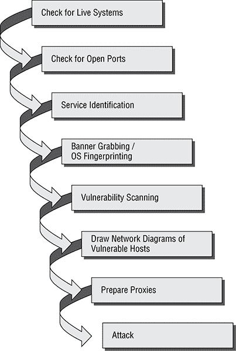

### Ping 扫描技术

`CEH` 扫描方法论从检查网络上的存活系统开始，这意味着这些系统对探测或连接请求有响应。确定系统是否存活的最简单（但不一定最准确）的方法是对 IP 地址范围进行 ping 扫描。所有响应 ping 回复的系统都被认为在网络上是存活的。ping 扫描也被称为互联网控制消息协议（`ICMP`）扫描，因为 `ICMP` 是 `ping` 命令使用的协议。

`ICMP` 扫描（或 ping 扫描）是向网络上的所有主机发送 `ICMP` 请求或 `ping` 包，以确定哪些主机已上线并对 ping 响应。`ICMP` 最初是用于在互联网上的主机之间发送测试消息和错误消息的协议。它已演变为由每个操作系统、路由器、交换机或基于网协议（`IP`）的设备使用的协议。使用 `ICMP` 回显请求（Echo request）和回显应答（Echo reply）作为主机之间连接测试的能力通过 `ping` 命令内置于每个启用 `IP` 的设备中。这是一种检查两个主机之间连接性的快速粗略测试，被广泛用于故障排除。

`ICMP` 扫描的一个优点是它可以并行运行，这意味着所有系统同时被扫描；因此它可以在整个网络上快速运行。大多数黑客工具包含 ping 扫描选项，这本质上意味着对网络上的每个主机执行 `ICMP` 请求。响应 ping 响应的系统在网络上存活并正在监听。练习 3-1 显示了如何使用内置的 `Windows` 工具执行 ping 扫描。

这种方法的一个严重问题是，个人防火墙软件和基于网络的防火墙可以阻止系统响应 ping 扫描。越来越多的系统配置了防火墙软件，它们会阻止 ping 尝试并通知用户网络上正在运行扫描程序。另一个问题是计算机必须开启才能被扫描。


#### 扫描攻击的迹象

Bob 在出差期间连接网络并在笔记本电脑上工作。他正在使用酒店的免费无线接入访问互联网。正当他发送电子邮件时，他注意到 Windows XP 系统托盘出现了一个弹窗。窗口显示“Windows 检测到并阻止了针对你的计算机的入侵尝试”。他关闭了弹窗继续写邮件。随后他又看到了另一个类似消息的弹窗。他开始担心自己的电脑被黑客入侵了。他决定关掉笔记本电脑，以便无法进行连接尝试。

##### 黑客工具

`Pinger`、`Friendly Pinger` 和 `WS_Ping_Pro` 都是执行 `ICMP` 查询的工具。你应该熟悉所有这些工具。

##### 练习 3-1：使用 Windows Ping

使用 `Windows` 内置的 `ping` 命令测试与另一个系统的连接性：

1. 在 `Windows` 中打开命令提示符。
2. 输入 `ping www.microsoft.com`。

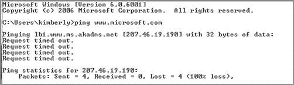

超时（timeout）表示远程未响应、关闭或 ping 被拦截。响应（reply）表示系统存活并对 `ICMP` 请求有响应。

### 检测 ping 扫描

几乎任何 `IDS` 或入侵防御系统（`IPS`）都会检测并警告安全管理员网络上正在发生 ping 扫描。大多数防火墙和代理服务器阻止 ping 响应，因此黑客无法仅通过 ping 扫描准确判断系统是否可用。如果系统对 ping 扫描没有响应，必须使用更深入的端口扫描。

## 扫描端口和识别服务

检查开放端口是 `CEH` 扫描方法论的第二步。端口扫描是检查开放端口的方法。端口扫描的过程涉及探测主机的每个端口以确定哪些端口是开放的。相比 ping 扫描，端口扫描通常能提供关于主机和系统漏洞更有价值的信息。

服务识别是扫描方法论的第三步；它通常使用与端口扫描相同的工具执行。通过识别开放端口，黑客通常还可以识别与该端口关联的服务。记住本章之前讨论的已知端口号。

### 端口扫描防御措施

防御措施是安全管理员用于检测并可能阻止网络上主机进行端口扫描的流程或工具集。应实施以下防御措施以防止黑客在端口扫描期间获取信息：

- 应当遵循适当的安全架构，例如实施 `IDS` 和防火墙（`firewalls`）。
- 伦理黑客使用他们的工具集来测试已实现的扫描对策措施。一旦部署了防火墙，就应该对网络上的主机运行端口扫描工具，以确定防火墙是否正确检测并停止端口扫描活动。
- 防火墙应该能够检测到由端口扫描工具发送的探测。防火墙应执行状态检测检查，这意味着它会检查数据包的内容，而不仅仅是 `TCP` 头部，以确定流量是否允许通过防火墙。
- 应使用网络 `IDS` 来识别某些常用黑客工具所使用的 `OS` 探测方法。
- 应仅保持需要的端口开放。其余端口应被过滤或阻塞。
- 应对使用这些系统的组织人员进行适当的安全意识培训。他们还应该了解他们需要遵守的各种安全策略。

## nmap 命令开关

`nmap` 是一个免费的开源工具，可以快速、高效地执行 ping 扫描、端口扫描、服务识别、IP 地址检测和操作系统检测。`nmap` 的优点是可以单个会话中扫描大量机器。它支持许多操作系统，包括 `Unix`、`Windows` 和 `Linux`。

由 `nmap` 扫描确定的端口状态可以是 `open`、`filtered` 或 `unfiltered`。`open` 意味着目标机器接受该端口上的传入请求。`filtered` 意味着防火墙或网络过滤器正在筛选该端口并防止 `nmap` 确定其是否开放。`unfiltered` 意味着端口确定为关闭，且没有防火墙或过滤器干扰 `nmap` 的请求。

`nmap` 支持多种类型的扫描。表 3-2 详细说明了一些常见的扫描方法。

### 表 3-2：nmap 扫描类型

| nmap 扫描类型 | 描述 |
| --- | --- |
| TCP connect | 攻击者与目标系统建立完整的 `TCP` 连接。最可靠的扫描类型，但最容易被检测。`open` 端口用 `SYN/ACK` 回复，而关闭端口用 `RST/ACK` 回复。 |
| XMAS tree scan | 攻击者通过发送 `XMAS` 树数据包来检查 `TCP` 服务，之所以命名是因为所有“灯”都亮了，意味着 `FIN`、`URG` 和 `PSH` 标志被设置（这些标志的意义将在本章稍后讨论）。关闭端口用 `RST` 标志回复。 |
| SYN stealth scan | 这种扫描被称为半开放扫描。攻击者发送 `SYN` 包并接收 `SYN/ACK` 回复。如果端口关闭，则收到 `RST`。这种扫描具有隐蔽性，因为它不建立完整的 TCP 握手。 |
| Null scan | 这种扫描不设置任何标志。端口将被确定为关闭的，且没有防火墙或过滤器干扰 `nmap` 的请求。 |
| Windows scan | 这种扫描类似于半开放扫描，可以绕过防火墙。 |
| ACK scan | 这种扫描用于映射防火墙规则。在 `Unix` 系统上有效。 |

`nmap` 命令有许多开关来执行不同类型的扫描。常用的开关列在表 3-3 中。

### 表 3-3：nmap 命令开关

| nmap 命令开关 | 执行的操作 |
| --- | --- |
| `-sT` | TCP 连接扫描 |
| `-sS` | SYN 扫描 |
| `-sF` | FIN 扫描 |
| `-sX` | XMAS 树扫描 |
| `-sN` | Null 扫描 |
| `-sP` | Ping 扫描 |
| `-sU` | UDP 扫描 |
| `-sO` | 操作系统扫描 |
| `-sA` | ACK 扫描 |
| `-sW` | Windows 扫描 |
| `-sR` | RPC 扫描 |
| `-sL` | 列表/DNS 扫描 |
| `-sI` | 空闲扫描 |
| `-Po` | 不 ping |
| `-sPT` | TCP ping |
| `-sPS` | SYN ping |
| `-PI` | ICMP ping |
| `-PB` | TCP 和 ICMP ping |
| `-PT` | ICMP 时间戳 |
| `-PM` | ICMP 网络掩码 |
| `-oN` | 正常输出 |
| `-oX` | XML 输出 |
| `-oG` | 可 grep 的输出 |
| `-oA` | 所有输出 |
| `-T0` | 极速扫描，两次扫描间隔 300 秒 |
| `-T1` | 隐秘扫描，两次扫描间隔 15 秒 |
| `-T2` | 礼貌扫描，两次扫描间隔 0.4 秒 |
| `-T3` | 正常扫描 |
| `-T4` | 激进扫描，超时 300 秒，每 1.25 秒探测一次 |
| `-T5` | 疯狂扫描，超时 75 秒，每 0.3 秒探测一次 |

`URG` 紧急。数据包中的数据必须快速处理。

`FIN` 完成。不再有传输。

`RST` 重置。重置连接。

黑客可以尝试通过使用标志（flags）而不是完成正常的 TCP 连接来绕过检测。表 3-4 中的 TCP 扫描类型被某些扫描工具使用，通过设置一个或多个标志来诱导系统响应。

### 表 3-4：TCP 扫描类型

| 扫描类型 | 黑客发送的标志 |
| --- | --- |
| XMAS 扫描 | 所有标志均设置 (ACK, RST, SYN, URG, PSH, FIN) |
| FIN 扫描 | FIN |
| NULL 扫描 | 未设置任何标志 |


| 扫描类型 | 扫描过程 |
|---|---|
| TCP 连接/全打开扫描 | SYN，然后是 ACK |
| SYN 扫描/半打开扫描 | SYN，然后是 RST |

### 攻击工具

`IPEye` 是一个 TCP 端口扫描器，可以执行 `SYN`、`FIN`、`Null` 和 `XMAS` 扫描。它是一个命令行工具。

`IPEye` 探测目标系统的端口并响应 `closed`、`reject`、`drop` 或 `open`。`Closed` 表示对面有一台计算机，但它没有在该端口监听。`Reject` 表示防火墙拒绝了该端口的连接（发送重置信号）。`Drop` 表示防火墙丢弃了所有到达该端口的数据包，或者对面没有计算机。`Open` 表示某种服务在该端口上监听。这些响应有助于黑客识别响应的系统类型。

`IPSecScan` 是一个工具，可以扫描单个 IP 地址或地址范围，寻找启用了 IPSec 的系统。

`NetScan Tools Pro`、`hping2`、`KingPingicmpenum` 和 `SNMP Scanner` 都是扫描工具，也可以用于操作系统指纹识别（后文将讨论）。

`Icmpenum` 不仅使用 `ICMP Echo` 包探测网络，还使用 `ICMP Timestamp` 和 `ICMP Information` 包。此外，它还支持对响应包进行欺骗和嗅探。当防火墙拦截 `ICMP Echo` 包但未能拦截 `Timestamp` 或 `Information` 包时，`Icmpenum` 是扫描网络的极佳工具。

`hping2` 工具值得关注，是因为它除了操作系统指纹识别外，还包含许多其他功能，如 TCP、用户数据报协议（UDP）、ICMP 和原始 IP ping 协议、traceroute 模式以及在源和目标系统之间发送文件的能力。

`SNMP Scanner` 允许你扫描执行 ping、DNS 和简单网络管理协议（SNMP）查询的主机范围或列表。

练习 3-2 显示了如何使用 AngryIP 扫描执行端口扫描。

### 练习 3-2：免费 IPTools 端口扫描

使用端口扫描工具确定活动主机的监听端口：

1. 从 [www.angryip.org/w/Download](http://www.angryip.org/w/Download) 下载 `Angry IP Scanner`。
2. 在 `Host` 或 `IP Address` 字段输入目标系统的 IP 地址，或输入你实验室系统的范围或 IP 地址，然后点击 `Start` 对标准端口进行常规（全连接）扫描。

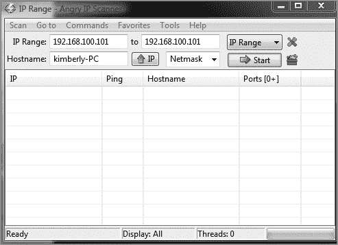

## 拨号技术

拨号攻击（War-Dialing）是指拨号调制解调器号码以寻找开启调制解调器连接的过程，该连接提供远程访问以便对目标系统发起攻击。“拨号攻击”一词源于互联网早期，当时大多数公司通过拨号调制解调器连接到互联网。拨号攻击被纳入一种扫描方法，是因为它可以找到另一个可能比主互联网连接安全性更弱的网络连接。许多组织设置了远程访问调制解调器，这些设备现在已经过时，但未能移除这些远程访问服务器。这为黑客提供了一个进入网络的简单途径，且安全机制弱得多。例如，许多远程访问系统使用密码验证协议（`PAP`），它以明文发送密码，而不是使用加密密码的新型虚拟专用网络（`VPN`）技术。

拨号攻击工具的工作原理是：公司对拨入端口的控制没有像防火墙那样严格，而且连接调制解调器的机器随处可见，即使那些调制解调器已不再使用。许多服务器仍然保留有连接电话线的调制解调器，作为主互联网连接失败的备份。这些可用的调制解调器连接可以被拨号攻击程序用于远程访问系统和内部网络。


### 使用遗忘的调制解调器连接进行拨号

几年前，我为一家金融服务公司进行网络安全审计。他们让我对现场进行实地安全审计巡查。当我经过营销部门的一个办公桌时，我注意到有一根电话线从桌子周围伸出来连接到墙上的插座。我询问了调制解调器的使用情况，因为我试图确定电话线缆的原因。他们告诉我，他们以前在某些计算机上使用拨号上网接入互联网，但两年前他们将整个办公室切换到了高速 `T1` 连接。当我们进一步探索时，结果发现使用那台电脑的员工仍然通过拨号连接使用 `AOL` 来检查她的个人邮箱账户。这让每个人都非常惊讶，当安装新的互联网连接时，没有人检查过是否将所有的拨号连接都移除。这就是拨号攻击在某些情况下仍然有效的典型例子。

### 攻击工具

`THC-Scan`、`PhoneSweep` 和 `TeleSweep` 是识别电话号码并拨号目标以与计算机连接的工具。这些工具通常通过预设的常用用户名和密码来尝试访问系统。大多数远程访问拨入连接没有密码保护，或者使用非常原始的安全措施。

## 标志抓取与操作系统指纹识别

标志抓取和操作系统识别（也可以定义为 TCP/IP 栈指纹识别）是 CEH 扫描方法的第四步。指纹识别过程允许黑客识别网络上特别脆弱或高价值的目标。黑客正在寻找访问系统或网络的简单方法。标志抓取是建立连接并读取应用程序发送的标志或响应的过程。许多电子邮件、FTP 和 Web 服务器会对 `telnet` 连接响应软件名称和版本。这有助于黑客对操作系统和应用程序进行指纹识别。例如，Microsoft Exchange 邮件服务器只会安装在 Windows OS 上。

主动栈指纹是最常见的指纹识别形式。它涉及向系统发送数据以观察系统的响应。它基于不同的操作系统厂商实现 TCP 栈的方式不同，响应会根据操作系统而异。然后将响应与数据库进行对比以确定操作系统。主动栈指纹是可检测的，因为它反复尝试连接同一个目标系统。

被动栈指纹识别更具隐蔽性，它通过检查网络流量来确定操作系统。它使用嗅探技术而非扫描技术。被动栈指纹识别通常不会被 IDS 或安全系统检测到，但准确性不如主动指纹识别。

`SolarWinds Toolset`、`Queso`、`Harris Stat` 和 `Cheops` 都是网络管理工具，可用于检测操作系统、绘制网络拓图、列出网络上运行的服务、执行通用端口扫描等。

这些工具可以在 GUI 界面中绘制整个网络的拓图，包括路由器、服务器、主机和防火墙。大多数此类工具可以发现 IP 地址、主机名、服务、操作系统和版本信息。

`Netcraft` 和 `HTTrack` 是用于识别操作系统指纹的工具。这两者都用于确定操作系统和 Web 服务器软件的版本号。

`Netcraft` 是一个网站，通过定期轮询 Web 服务器来确定操作系统版本和 Web 服务器软件版本。`Netcraft` 可以为黑客识别 Web 服务器软件中的漏洞提供实的信息。此外，`Netcraft` 还备有一个反钓鱼工具栏和 Web 服务器验证工具，你可以使用它们来确保你使用的是真实的 Web 服务器而不是伪造的服务器。练习 3-3 显示了如何使用 `Netcraft` 识别操作系统或 Web 服务器。

`HTTrack` 会整理原始网站的相对链接结构。你在浏览器中打开镜像网站的页面，然后就可以像在线查看一样通过链接跳转来浏览网站。`HTTrack` 还可以更新现有的镜像站点并恢复中断的下载。

### 练习 3-3：使用 Netcraft 识别 Web 服务器的操作系统

1. 打开网页浏览器并访问 `Netcraft` 网站：[`www.netcraft.com`](http://www.netcraft.com)。
2. 在屏幕左上角的 `What’s That Site Running?`（该站点正在运行什么？）字段中输入网站名称。
3. 滚动到 `Hosting History`（托管历史），查看服务器上运行着什么操作系统和 Web 服务器软件。

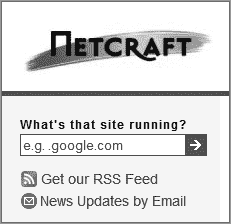

## 匿名扫描

准备代理服务器是 CEH 扫描方法论的最后一步。代理服务器是指在黑客和目标计算机之间充当中间人的计算机。

使用代理服务器可以让黑客在网络上变得匿名。黑客首先连接到代理服务器，然后通过现有的代理连接请求连接到目标计算机。本质上，是代理在请求访问目标计算机的权限，而不是黑客的计算机。这让黑客能够匿名浏览 Web 或隐藏其攻击。

## 破解工具

`SocksChain` 是一个让黑客通过代理服务器链进行攻击的工具。此工具的主要目的是隐藏黑客的真实 IP 地址，从而最大限度地减少被检测的机会。当黑客通过多个代理服务器串联工作时，定位黑客会变得困难得多。通过多个代理服务器的日志跟踪攻击者的 IP 地址是一项复杂且繁琐的工作。如果其中一个代理服务器的日志文件丢失或不完整，链就会断，黑客的 IP 地址将保持匿名。

`Anonymizers`（匿名器）是利用充当 Web 代理服务器的网站来尝试使 Web 浏览匿名的服务。第一个匿名化软件工具由 `Anonymizer.com` 开发，由 `Lance Cottrell` 于 1997 年创建。匿名化工具会在用户上网时移除其计算机上的所有身份识别信息，从而确保用户的隐私。

要匿名访问网站，黑客将网站地址输入匿名化软件中，由匿名化工具对请求进行去标识化处理。

### 使用 Netcraft 识别 Web 服务器的操作系统

1. 打开网页浏览器并访问 `Netcraft` 网站：[`www.netcraft.com`](http://www.netcraft.com)。
2. 在屏幕左上角的 `What’s That Site Running?`（该站点正在运行什么？）字段中输入网站名称。
3. 滚动到 `Hosting History`（托管历史），查看服务器上运行着什么操作系统和 Web 服务器软件。


`SMB Auditing Tool` 是一款用于 Windows 和服务器消息块（`SMB`）平台的密码审计工具。Windows 使用 `SMB` 在客户端和服务器之间进行通信。`SMB Auditing Tool` 能够识别 Windows 系统上的用户名并破解密码。

`NetBIOS Auditing Tool` 是另一个 NetBIOS 枚举工具。它被用于对运行 NetBIOS 文件共享服务的远程服务器进行各种安全检查。

## 空会话（Null Sessions）

当你在不提供任何用户名或密码的情况下登录系统时，就会发生空会话。NetBIOS 空会话是一种存在于通用互联网文件系统（`CIFS`）或 `SMB` 中的漏洞，具体取决于操作系统。


Microsoft Windows 使用 `SMB`，而 Unix/Linux 系统使用 `CIFS`。

一旦黑客使用空会话对系统建立 NetBIOS 连接，他们就可以利用 Null 用户账户轻松地获取所有用户名、组、共享、权限、策略、服务等的完整转储数据。Windows 中的 `SMB` 和 `NetBIOS` 标准包含了通过 `TCP` 端口 `139` 返回系统信息的 API。

将 NetBIOS 空会话连接到 Windows 系统的一种方法是使用隐藏的进程间通信共享（`IPC$`）。该隐藏共享可以通过 `net use` 命令访问。如前所述，`net use` 命令是 Windows 内置命令，用于连接到另一台计算机上的共享。空引号（`""`）表示你想在没有用户名和密码的情况下进行连接。要使用 `net use` 命令对 IP 地址为 `192.21.7.1` 的系统使用内置匿名用户账户和空密码建立 NetBIOS 空会话，语法如下：

```text
C: > net use \\192.21.7.1 \IPC$" /u:""
```

一旦成功完成 `net use` 命令，黑客就获得了一个通道，其上可以使用其他黑客工具和技术进行攻击。

作为一名 CEH（认证黑客专家），你需要了解如何防御 NetBIOS 枚举和空会话。我们将在下一节中讨论这一点。

## NetBIOS 枚举与空会话防御措施

NetBIOS 空会话使用目标机器上的特定端口号。空会话需要访问 `TCP` 端口 `135`、`137`、`139` 和/或 `445`。一种防御措施是在目标系统上关闭这些端口。这可以通过在网络连接属性中取消接口上的 `TCP/IP WINS` 客户端，通过禁用单个主机上的 `SMB` 服务来实现。实施此防御措施，请执行以下步骤：

1. 打开网络连接属性。
2. 点击 `TCP/IP`，然后点击 `Properties`（属性）按钮。
3. 点击 `Advanced`（高级）按钮。
4. 在 `WINS` 选项卡上，选择 `Disable NetBIOS Over TCP/IP`（禁用 TCP/IP 上的 NetBIOS）。

安全管理员还可以直接编辑 `Registry`（注册表）以限制匿名用户登录。实施此防御措施，请遵循以下步骤：

1. 打开 `regedt32` 并导航到 `HKLM\SYSTEM\CurrentControlSet\LSA`。
2. 选择 `Edit ⇒ Add Value`。输入以下值：
   - 值名称：`RestrictAnonymous`
   - 数据类型：`REG_WORD`
   - 值：`2`

最后，可以将系统升级到 Windows XP 和最新的 Microsoft 安全补丁，这将防止 NetBIOS 空会话漏洞的发生。

## SNMP 枚举

SNMP 枚举是使用 SNMP 枚举目标系统上的用户账户的过程。SNMP 使用两种主要类型的软件组件进行通信：位于网络设备上的 `SNMP agent`（SNMP 代理），以及与代理通信的 `SNMP management station`（SNMP 管理工作站）。

几乎所有网络基础设施设备（如路由器和交换机，包括 Windows 系统）都包含一个管理系统或设备的 `SNMP agent`。`SNMP management station` 向代理发送请求。

> 注：此处原文似乎存在重复或逻辑断层，以下内容根据原文内容逻辑进行翻译。

NetBIOS 空会话使用目标机器上的特定端口号。空会话需要访问 `TCP` 端口 `135`、`137`、`139` 和/或 `445`。一种防御措施是在目标系统上关闭这些端口。这可以通过在网络连接属性中取消接口上的 `TCP/IP WINS` 客户端，通过禁用单个主机上的 `SMB` 服务来实现。实施此防御措施，请执行以下步骤：

1. 打开网络连接属性。
2. 点击 `TCP/IP`，然后点击 `Properties`（属性）按钮。
3. 点击 `Advanced`（高级）按钮。
4. 在 `WINS` 选项卡上，选择 `Disable NetBIOS Over TCP/IP`（禁用 TCP/IP 上的 NetBIOS）。

安全管理员还可以直接编辑 `Registry`（注册表）以限制匿名用户登录。实施此防御措施，请遵循以下步骤：

1. 打开 `regedt32` 并导航到 `HKLM\SYSTEM\CurrentControlSet\LSA`。
2. 选择 `Edit ⇒ Add Value`。输入以下值：
   - 值名称：`RestrictAnonymous`
   - 数据类型：`REG_WORD`
   - 值：`2`

最后，可以将系统升级到 Windows XP 和最新的 Microsoft 安全补丁，这将防止 NetBIOS 空会话漏洞的发生。

## SNMP 枚举

SNMP 枚举是使用 SNMP 枚举目标系统上的用户账户的过程。SNMP 使用两种主要类型的软件组件进行通信：位于网络设备上的 `SNMP agent`（SNMP 代理），以及与代理通信的 `SNMP management station`（SNMP 管理工作站）。

几乎所有网络基础设施设备（如路由器和交换机，包括 Windows 系统）都包含一个管理系统或设备的 `SNMP agent`。

SNMP 管理工作站向代理发送请求。

> 注：原文后续段落存在大量重复和混乱，翻译已按原文字面意思保留结构。

### 2. 在连接（Connection）菜单中，选择 `Authenticate`（验证）。在相应的框中输入用户名、密码和域名。你可以使用 `Guest` 帐户或任何其他域帐户。

### 3. 身份验证成功后，通过从浏览（Browse）菜单中选择 `Search`（搜索）选项来枚举用户和内置组。

## 黑客工具

`User2SID` 和 `SID2User` 是两个命令行工具，用于查找 Windows 服务标识符（通过用户名输入查找 SID，反之亦然）。

`Enum` 是一个命令行枚举工具。它利用空会话（null sessions），并可以检索用户名、机器名、共享情况、组和成员列表、密码以及本地安全策略（Local Security policy）信息。`Enum` 也能够对单个账户进行暴力破解字典攻击。

`UserInfo` 是一个用于收集用户名的命令行工具，也可用于创建新用户账户。

`GetAcct` 是一个基于 GUI 的工具，用于枚举系统上的用户账户。

`Smbbf` 是一个 SMB 暴力破解工具，尝试确定用户账户以及空密码账户。

## 总结

在完成信息收集阶段后，扫描和枚举是黑客过程中的后续步骤。扫描和枚举工具通常是主动信息收集工具，因此会导致黑客被发现。出于此原因，存在许多工具和技术用以减少被检测的机会，并降低黑客被识别的概率。

在扫描和枚举阶段，会发现有关主机和目标网络的信息。作为下一步，将枚举出的主机和网络信息用于开始攻击目标系统或网络。下一章将重点介绍系统黑客和获取目标系统的访问。

## 考试要点

- 了解三种扫描类型及其防御措施。端口扫描、网络扫描和漏洞扫描是三种扫描类型。实施防火墙，通过阻止 ping 扫描（ping sweeps）和如 `nmap` 等端口扫描工具来防止内部系统被扫描。IDS 和 IPS 可以提醒管理员网络上正在发生的扫描。
- 了解如何确定网络上哪些系统是存活的。了解如何使用 ICMP 查询工具进行 ping 扫描以确定哪些系统正在响应。ping 扫描具有局限性，某些系统可能对 ICMP 查询没有响应。
- 了解如何使用 `nmap` 进行端口扫描。学习使用 `nmap` 命令执行 `nmap` 扫描的开关。例如，`nmap -sS` 执行 SYN 扫描。
- 理解不同扫描类型的用途和局限性。确保你熟悉 TCP 连接、SYN、NULL、IDLE、FIN 和 XMAS 扫描，以及每种类型应在何时使用。


# 理解 TCP 三次握手的过程

TCP 连接过程始于向目标系统发送`SYN`包。目标系统用`SYN+ACK`包作为响应，源系统向目标回传一个`ACK`包。这完成了一次成功的 TCP 连接。

# 了解战争拨号（war dialing）的用途

战争拨号用于测试拨入远程访问系统的安全性。随机拨打号码尝试建立不安全的调制调器连接并获取网络访问。

# 了解如何使用主动和被动方法进行操作系统指纹识别

主动指纹识别意味着向系统发送请求查看其响应（例如 banner 抓取`banner grabbing`）。被动指纹识别是检查发送和来自系统的流量以确定操作系统。

# 了解如何使用匿名代理、HTTP 隧道和 IP 欺骗来实现匿名

使用网站匿名器隐藏源地址，使访问网页的系统看起来是匿名的。HTTP 隧道和 IP 欺骗是黑客可能使用的隐藏物理地址或协议的方法。它们对于规避防火墙和混淆黑客身份或行踪非常有用。

# 理解如何枚举用户账户

枚举涉及通过 SMB/CIFS 或 NetBIOS 漏洞对系统建立活动连接并查询系统信息。

# 注意系统中可以枚举的信息类型以及枚举防御措施

黑客枚举的信息类型包括网络资源和共享、用户和组以及应用程序和 banner。使用防火墙拦截端口`135`和`139`，或修复注册表以防止空会话。关闭 SNMP 服务，或更改默认的读取和读取/写入社区名称。

# 理解空会话（null sessions）

使用空密码连接到系统被称为空会话。黑客经常使用空会话连接到目标系统，然后在系统中运行枚举工具。

# 了解枚举工具的类型以及如何识别漏洞账户

可以使用`SNMPUtil`和`Enum`等工具执行 NetBIOS 和 SNMP 枚举。可以使用`User2SID`、`SID2User`和`UserInfo`等工具识别漏洞用户账户。

# 了解如何在 Windows 2000 上执行 DNS 区域传输

可以使用`NSlookup`执行 DNS 区域传输。

# 复习题

1. FTP 使用哪个端口号？

   A. 21

   B. 25

   C. 23

   D. 80

2. HTTPS 使用哪个端口号？

   A. 443

   B. 80

   C. 53

   D. 21

3. 战争拨号用于什么？

   A. 测试防火墙安全性

   B. 测试远程访问系统安全性

   C. 配置代理过滤网关

   D. 配置防火墙

4. Banner 抓取（Banner grabbing）是什么的例子？

   A. 被动操作系统指纹识别

   B. 主动操作系统指纹识别

   C. 足迹探测（Footprinting）

   D. 应用分析

5. 扫描的三种类型是什么？

   A. 端口、网络和漏洞

   B. 端口、网络和内核

   C. 灰色、黑色和白色

   D. 服务器、网络

6. 仅使用 ICMP 查询扫描的主要问题是什么？

   A. 端口不可用

   B. 协议不可靠

   C. 系统由于防火墙不响应

   D. 服务不存在

7. TCP RST 命令的作用是什么？

   A. 启动连接

   B. 将连接恢复到之前的状态

   C. 完成连接

   D. 重置连接

8. TCP 连接的正确顺序是什么？

   A. SYN-ACK-ACK

   B. SYN-FIN

   C. SYNACK

   D. SYN-PSH-ACK

9. 设置所有标志位的包是哪种扫描？

   A. 全开

   B. SYN 扫描

   C. XMAS

   D. TCP 连接

10. 每 5 分钟执行`nmap` SYN 扫描的正确命令是？

    A. `nmap -ss`

    B. `nmap -sS`

    C. `nmap fast`

    D. `namp sneaky`

11. 为了防止黑客使用 SMB 会话攻击，会在防火墙上拦截哪些 TCP 和 UDP 端口？

    A. 167 和 137

    B. 80 和 23

    C. 139 和 445

    D. 1277 和 1270

12. 攻击者为什么要对端口 137 进行扫描？

    A. 定位目标主机上的 FTP 服务

    B. 检查 Windows 系统上的文件和打印共享

    C. 发现网络上的代理服务器

    D. 发现具有 NetBIOS 空会话系统

13. SNMP 是用于管理网络基础设施设备的协议。SNMP 读写社区名称用于什么？

    A. 查看配置信息

    B. 修改配置信息

    C. 监控设备错误

    D. 控制 SNMP 管理站

14. 为什么网络安全团队担心开启端口 135–139？

    A. SMB 已开启，系统受到空会话影响

    B. SMB 未开启，系统受到空会话影响

    C. Windows RPC 已开启，系统受到 Windows DCOM 远程访问影响

    D. Windows RPC 未开启，系统受到 Windows DCOM 远程访问影响

15. 在 CEH 攻击周期中枚举用户之后的步骤是哪个？

    A. 破解密码

    B. 权限提升

    C. 扫描

    D. 掩盖踪迹

16. 什么是枚举？

# 复习习题

    A. 识别网络上的活动系统

    B. 破解密码

    C. 识别用户和机器名称

    D. 识别路由器和防火墙

17. 用于从 SID 查找用户名的命令行工具是哪个？

    A. `UsertoSID`

    B. `Userenum`

    C. `SID2User`

    D. `GetAcct`

18. 哪种工具可以在 Windows 上执行 DNS 区域传输？

    A. `NSlookup`

    B. `DNSlookup`

    C. `Whois`

    D. `IPconfig`

19. 什么是空会话（null session）？

    A. 使用管理员用户名和密码连接到系统

    B. 使用 admin 用户名和密码连接到系统

    C. 使用随机用户名和密码连接到系统

    D. 无用户名密码连接到系统

20. SNMP 枚举的防御措施是什么？

    A. 从设备中删除 SNMP 代理。

    B. 在防火墙上关闭`135`和`139`端口。

    C. 在防火墙上关闭`80`和`443`端口。

    D. 在代理设备上启用 SNMP 只读安全。

# 复习习题答案

1. A. `FTP`使用`TCP`端口`21`。这是一个已知端口号，可以在 Windows 服务文件中找到。

2. A. `HTTPS`使用`TCP`端口`443`。这是一个已知端口号，可以在 Windows 服务文件中找到。

3. B. 拨号入侵（War dialing）涉及拨打一系列号码，希望调制解调器能接听。它可以用于测试远程访问系统的安全性。

4. A. 标志抓取（Banner grabbing）是不可检测的；因此它被视为被动操作系统指纹识别。

5. A. 端口、网络和漏洞是扫描的三类型。

6. C. 系统可能不响应`ICMP`，因为它们安装了拦截响应的防火墙软件。

7. D. `TCP-RST`命令重置`TCP`连接。

8. A. `SYN`数据包之后是`SYN-ACK`数据包。然后，通过`ACK`完成成功的`TCP`连接。

9. C. `XMAS`扫描设置了所有标志位。

10. B. 命令`nmap -sS -paranoid`每 300 秒（即 5 分钟）执行一次`SYN`扫描。

11. C. 封禁`NetBIOS`空会话使用的端口。这些是`139`和`445`。

12. D. 端口`137`用于`NetBIOS`空会话。

13. B. `SNMP`读写社区名称是用于更改设备配置的密码。

14. A. `135`到`139`范围内的端口表示系统正在运行`SMB`服务，并且易受到空会话攻击。

15. A. 密码破解是枚举用户后 CEH 攻击循环的下一步。

16. C. 枚举（Enumeration）是在查找网络上的用户名、机器名称、网络共享和服务的的过程。

17. C. `SID2User`是用于从`SID`查找用户名的命令行工具。

18. A. `NSlookup`是 Windows 工具，可启动`DNS`区域传输，将所有`DNS`记录发送到黑客系统。

19. D. 空会话涉及在没有用户名和密码的情况下连接到系统。

20. A. `SNMP`枚举的最佳防御措施是从设备上删除`SNMP`代理。这样做可以防止其响应`SNMP`请求。

# 第 4 章：系统攻击：密码破解、权限提升和文件隐藏

## 本章涵盖的 CEH 考试目标

* 理解密码破解的技术

* 理解不同类型的密码

* 识别各种密码破解工具

* 理解权限提升

* 理解键盘记录器和其他间谍软件技术

* 理解如何隐藏文件

* 理解根基工具（rootkits）

* 理解隐身术技术

* 理解如何掩盖踪迹并删除证据

在本章中，我们将研究系统攻击的各个方面。正如你在第 3 章回顾的"收集网络和主机信息：扫描与枚举"，系统攻击循环由六步组成。第一步——枚举在上一章中讨论过。本章涵盖了剩下的五个步骤：

* 破解密码

* 权限提升

* 执行应用程序

* 隐藏文件

* 掩盖踪迹

## 获取密码的最简单方法

许多攻击尝试始于获取目标系统的密码。密码是访问系统所需的关键信息，而用户通常会选择容易猜的密码。许多人重复使用密码或选择一个简单的密码（例如宠物的名字）来帮助他们记忆。由于这种人为因素，如果已知目标的一些信息，大多数密码猜解都是成功的。信息收集和侦察可以帮助提供有助于黑客猜测用户密码的信息。

一旦猜出或破解了密码，它就可以成为权限提升、执行应用程序、隐藏文件和掩盖踪迹的起点。如果猜密码失败，则可以手动或使用字典、暴力破解等自动化工具破解密码，这些方法将在本章稍后介绍。

## 密码类型

使用多种类型的密码来提供系统访问。组成密码的字符可以属于以下任何一类：

* 仅字母

* 仅数字

* 仅特殊字符

* 字母和数字

* 仅字母和特殊字符

* 仅数字和特殊字符

* 字母、数字和特殊字符

强密码较不容易受到攻击。创建密码时应应用 EC-Council 提出的以下规则以保护免受以下攻击：

* 不得包含用户帐户名的任何部分

* 长度至少为八个字符

* 必须包含来自以下至少三个类的字符：

  * 非字母数字符号`$@#`

  * 数字

  * 大写字母

  * 小写字母

黑客可能使用不同类型的攻击来识别密码并获得对系统的进一步访问权限。密码攻击的类型如下：

* 网络交换的在线窃听。被动在线攻击包括嗅探、中间人攻击和重放攻击。

* 在线猜解管理员密码。主动在线攻击包括自动密码破解。

* 离线字典攻击、混合攻击和暴力破解。

* 电子窥视、键盘嗅探和社交工程学。

我们将在接下来的章节中详细查看这些每种攻击。

## 被动在线攻击

被动在线攻击也称为在有线或无线网络上嗅探密码。被动攻击对终端用户是不可检测的。密码在验证过程中被捕获，然后可以与字典文件或单词列表进行比较。用户帐户密码在网络传输时通常会哈希或加密，以防止未经的访问和使用。如果密码受加密或哈希保护，可以使用黑客工具箱中的特殊工具来破解算法。

破解密码哈希将在本章稍后的"攻击"部分中讨论。

另一种被动在线攻击被称为中间人攻击（MITM）。在中间人攻击中，黑客拦截验证请求并将其转发到服务器。通过在客户端和服务器之间插入嗅探器，黑客能够嗅探两个连接并在过程中捕获密码。

重放攻击也是被动在线攻击；它发生在黑客在通往验证服务器的途中拦截密码，然后捕获并重新发送验证包以进行后续验证。通过这种方式，黑客不需要破解密码或通过中间人攻击学习密码，而是捕获密码并在以后重用密码-验证包以以客户端身份进行验证。

## 主动在线攻击

获取系统管理员权限最简单的方法是假设管理员使用了简单的密码，并对其进行猜破解。密码破解是一种主动的在线攻击。它依赖于创建密码时的人为因素，并且仅对弱密码有效。

在第 3 章中，当我们讨论系统黑客攻击的枚举阶段时，你学习了`NetBIOS`枚举和空会话（null sessions）的脆弱性。假设`NetBIOS` TCP`139`端口已打开，破解 Windows NT 或 Windows 2000 系统最有效的方法是密码破解。这是通过尝试连接到枚举的共享（`IPC$`或`C$`）并尝试用户名和密码组合的。常用的`Administrator`账户和密码组合是`Admin`、`Administrator`、`Sysadmin`或`Password`等单词，或者是空密码。

黑客可能会首先尝试连接到默认的`Admin$`、`C$`或`C:\Windows`共享。例如，要连接到隐藏的`C:`器共享，请在运行框（开始 ➪运行）中输入以下命令：

```
\\ip_address\c$
```

自动化程序可以快速生成字典文件、单词列表，或者字母、数字和特殊字符的所有可能组合，然后尝试使用这些凭据登录。大多数系统通过在账户锁定之前对系统设置最大登录尝试次数来防止此类攻击。

在接下来的章节中，我们将更深入地讨论黑客如何执行自动化密码破解，以及针对此类攻击的防御措施。

## 执行自动化密码破解

为了加快破解破解，黑客使用自动化工具。自动化密码破解的一种简单方法是使用基于标准`NET USE`语法的 Windows Shell 命令。创建一个简单的自动化密码破解脚本，请执行以下步骤：

1. 使用 Windows 记本文创建一个简单的用户名和密码文件。可以使用`Dictionary Generator`等自动化工具创建此单词列表。将文件保存在`C:`盘上命名为`credentials.txt`。

2. 使用`FOR`命令管道化此文件：

```
C:\> FOR /F"token=1, 2*" %i in (credentials.txt)
```

3. 输入`net use \\targetIP\IPC$ %i /u: %j`使用`credentials.txt`文件尝试登录目标系统的隐藏共享。


攻击者使用`FOR`命令的另一个示例是使用命令语法`((i=0; i<11; i++)); do dd if=/dev/random of=/dev/hda && dd if=/dev/zero of=dev/hda done`用零擦除硬盘内容。该擦除命令还可以使用命令`$ wipe -fik /dev/hda1`执行硬盘上数据的擦除。

## 防御密码破解

防御密码破解和密码攻击有两种方案。智能卡和生物识别都为用户自行创建密码时固有的不安全性增加了一层安全保障。

用户还可以使用生物识别进行身份验证和确认。生物识别使用指纹、手部几何扫描和视网膜扫描等物理特征作为凭据来验证用户。

智能卡和生物识别都使用双因素认证，在验证用户时需要两种形式的标识（例如实际智能卡和密码）。通过要求用户物理拥有的（在本例中为智能卡）和用户知道的（他们的密码），增加了安全性，且认证过程不会受到密码攻击。


`RSA Secure ID`是一种利用令牌和密码的双因素认证系统。

## 离线攻击

离线攻击在密码所在或使用的实际计算机以外的位置执行。离线攻击通常需要物理接触计算机并将密码文件从系统复制到可移动介质上。黑客随后将文件带到另一台计算机上进行破解。存在多种类型的离线密码攻击，如表 4-1 所示。

表 4-1: 离线攻击

| 攻击类型 | 特点 | 示例密码 |
| --- | --- | --- |
| 字典攻击 | 尝试使用字典单词列表中的密码 | Administrator |
| 混合攻击 | 用数字或符号替换密码中的字符 | Adm1n1strator |
| 暴力破解 | 尝试字母、数字和特殊字符的所有可能组合 | Ms!tr245@F5a |

字典攻击是最简单、最快的攻击类型。它用于识别字典中可以找到实际单词作为密码。通常情况下，攻击使用包含可能单词的字典文件，并使用身份验证过程中相同的算法对其进行哈希处理。然后，将哈希后的字典单词与用户登录时或服务器文件中存储的密码进行比较。只有当密码是实际字典单词时，字典攻击才有效；因此，这种攻击具有某些局限性。无法用于包含数字或其他符号的强密码。

如果无法通过字典攻击找到密码，混合攻击是黑客尝试的下一级攻击。混合攻击从字典文件开始，用数字和符号替换密码中的字符。例如，许多用户会在密码末尾添加数字`1`以满足强密码的要求。混合攻击旨在发现密码中的此类异常。

最耗时的攻击类型是暴力破解攻击，它尝试大写和小字母、数字和符号的所有可能组合。由于组合极多，暴力破解是三种攻击中最慢的。然而，暴力破解是有效的；只要有足够的时间处理能力，所有密码最终都能识别。


彩虹表是已经哈希处理过的单词列表。彩虹表通过预计算常用字符串的哈希来加速密码的发现和破解。例如，彩虹表可以包含从`a`到`z`或`A`到`Z`的字符。本质上，彩虹表工具是哈希破解器。传统的暴力破解器按顺序尝试所有明文密码。现在可以用这种方法破解复杂的密码。彩虹表的思想是提前完成所有破解时的计算。

## 非电子攻击

非电子攻击（或非技术攻击）是不采用任何技术知识的攻击。这种攻击可以包括社交工程学、窥视、键盘监听和翻垃圾桶。

社交工程学是与人面对面或通过电话互动的艺术，让他们泄露密码等价值信息。社交工程学利用了人的本性和帮助他人的愿望。许多，帮助台是社交工程攻击的目标，因为他们的工作是帮助他人——恢复或重置密码是帮助台的常见功能。防御社交工程攻击的最佳方法是对所有员工进行安全意识培训并建立重置密码的安全程序。

社交工程学在第 2 章"收集目标信息：侦察、足迹扫描与社交工程学"中有更详细的讨论。

# 窥视攻击

窥视攻击（Shoulder surfing）是指在他人输入密码时从其背后窥视。当黑客距离用户和系统很近时，这种方法非常有效。使用某些从特定角度难以看清电脑屏幕的特殊屏幕保护可以减少窥视攻击。此外，提高员工意识并进行培训几乎可以完全消除这类攻击。


## 窥视攻击

Sue 是一家繁忙诊所的接待员。当她正在电脑前工作时，一位花送货员进了办公室。他告诉 Sue 他有一束花要送给史密斯医生。这是他在进入候诊室时在办公室正门上看到的医生名字。


Sue 那天很忙，史密斯医生正在给病人看诊，因此她告诉花送货员可以把花放在桌子上，她会确保医生收到。送货员说他需要等待，并将花直接交给送货单上列出的人员。于是，Sue 请他在候诊室等，直到史密斯医生有空收花。当 Sue 回头回到电脑完成她已经开始写的一封邮件时，她正想着眼前的工作而分心。她快速输入了解锁其 Windows 工作站的密码。花送货员在转身去候诊室坐下之前停顿了一小会儿。在他停顿期间，他看到了 Sue 输入的解锁屏幕的五位密码。通过这种方式，他辨别出了她的密码并继续了黑客攻击。该密码是通过窥视攻击收集的，这是一种社会工程手段。

翻找垃圾桶（Dumpster diving）的黑客会从垃圾中寻找信息，例如密码，这些密码可能写在纸条上。同样，关于粉碎重要文档的安全意识培训，可以防止黑客通过翻找垃圾桶来收集密码。

## 破解密码

手动破解密码涉及尝试使用不同的密码登录。黑客遵循以下步骤操作：

1. 找到一个有效的用户账户（例如 `Administrator` 或 `Guest`）。
2. 创建一个可能密码的列表。
3. 按概率从高到低对密码进行排序。
4. 输入每个密码。
5. 重复尝试，直到找到正确的密码为止。

黑客也可以创建一个脚本文件来尝试列表中的每个密码。这仍然被视为手动破解，但非常耗时且通常无效。

破解密码的更有效的方法是获取对系统上密码文件的访问权限。大多数系统会对密码进行哈希处理（单向加密）以便存储在系统中。在登录过程中，用户输入的密码将使用相同的算法进行哈希处理，然后与文件中存储的哈希密码进行比较。黑客可以尝试获取存储在服务器上的哈希算法的访问权限，而不是尝试猜测或识别密码。如果黑客成功，他们就可以解密存储在服务器上的密码。


密码存储在 Windows 系统的安全账户管理器（`SAM`）文件中，存储在 Linux 系统的密码影子文件（shadow file）中。

## 黑客工具

`Legion` 自动化 NetBIOS 会话中的密码猜测。`Legion` 扫描多个 IP 地址范围以查找 Windows 共享，并提供了一个手动字典攻击工具。

`NTInfoScan` 是一个针对 `NT 4.0` 的安全扫描器。该漏洞扫描器会生成一份关于目标系统上发现的安全问题和其他信息的 HTML 格式报告。

`L0phtCrack` 是由 @stake 软件分发的密码审核和恢复包，该软件现由赛门铁（Symantec）所有。它在本地网段执行服务器消息块（`SMB`）包捕获并记录单个登录会话。`L0phtCrack` 包含字典、暴力和混合攻击能力。赛门铁近期停止了 `L0phtCrack` 工具的，但可以在网上找到。

`LC5` 是另一个良好的密码破解工具。`LC5` 是 `L0phtCrack` 的合适替代品。

`John the Ripper` 是一个设计用于破解 Unix 和 NT 密码的命令行工具。破解出的密码不区分大小写，可能无法真实的混合大小写密码。

`KerbCrack` 由两个程序组成：`kerbsniff` 和 `kerbcrack`。嗅探器监听网络并捕获 Windows 2000/XP 的 Kerberos 登录。破解器可以使用暴力破解或字典攻击从捕获文件中找到密码。

## 理解 LAN Manager 哈希

Windows 2000 使用 NT LAN Manager (`NTLM`) 哈希处理来确保网络中传输过程中的密码的安全。根据密码的不同，`NTLM` 哈希可能很弱且容易破解。例如，假设密码是 `123456abcdef`。当此密码用 `NTLM` 算法加密时，它首先被转换为全大写：`123456ABCDEF`。密码用空字符（空白）填充以使其长度达到 14 个字符：`123456ABCDEF__`。在密码加密之前，这 14 位字符串被一分为两半：`123456A` 和 `BCDEF__`。每个字符串分别加密，然后将结果合并：

`123456A = 6BF11E04AFAB197F`

`BCDEF__ = F1E9FFDCC75575B15`

哈希值为 `6BF11E04AFAB197FF1E9FFDCC75575B15`。


密码的第一部分包含字母和数字，`L0phtCrack` 破解需要 24 小时。后半部分只包含字母符号，只需要 60 秒即可破解。如果密码少于七位，哈希的后半部分始终为 `AAD3B43B5`。

## 破解 Windows 2000 密码

Windows 中的 `SAM` 文件包含用户名和哈密码。它位于 `system32\config` 目录下。运行时文件是被锁定的，因此黑客无法尝试复制。

复制文件的一种方法是启动到 DOS 或 Linux 等替代系统。或者，也可以从恢复目录复制文件。如果系统管理员使用 Windows 的 `RDISK` 功能备份系统，则会在该目录下创建一个名为 `SAM._` 的压缩副本。要扩展此文件，在命令行提示符中使用以下命令：

```
C:\>expand sam._
```

解压缩后，可以使用 `L0phtCrack` 等工具对 `SAM` 文件运行字典、混合或暴力攻击。与 `Lphtcrack` 类似的工具是 `Ophcrack`。

### 练习 4-1：使用 Ophcrack 破解密码

1. 从 [`ophcrack.sourceforge.net/`](http://ophcrack.sourceforge.net/) 下载并安装 ophcrack。
2. 运行 ophcrack 程序并在 `Preferences` 选项卡下将线程数设置为运行 ophcrack 的计算机的核心数加一。如果你更改了此值，必须退出并重启 ophcrack 以保存更改。

注意：此步骤可选，但它可以加快破解过程。

3. 点击 `Load` 按钮添加哈希。有多种添加哈希的方法：

* 手动输入哈希（单个哈希选项）
* 导入包含使用 `pwdump`、`fgdump` 或类似的第三方工具创建的哈希文本文件（`PWDUMP File` 选项）
* 从 `SYSTEM` 和 `SAM` 文件中提取哈希（`Encrypted SAM` 选项）
* 从 ophcrack 运行的计算机转储 `SAM`（`Local SAM` 选项）
* 从远程计算机转储 `SAM`（`Remote SAM` 选项）

注意：对于 `Encrypted SAM` 选项，`SAM` 位于 Windows 的 `system32/config` 目录下，只能在未运行的 Windows 分区上进行访问。对于 `Local SAM` 和 `Remote SAM` 选项，你必须以管理员权限登录想要转储 `SAM` 的计算机。

4. 点击 `Tables` 按钮。
5. 点击 `enable`（绿色和黄色）按钮。
6. 使用向上和向下方向键对你将使用的彩虹表进行排序。请记住，将彩虹表存储在硬盘等快速介质上将显著加快破解过程。
7. 点击 `Crack` 按钮开始破解过程。你将在 ophcrack 窗口底部的框中看到破解进度。发现密码时，它将显示在 `NT Pwd` 字段中。你可以随时点击 `Save` 按钮保存破解会话的结果。

## 将 SMB 登录重定向到攻击者

在网络上发现密码的另一种方法是将服务器消息块（`SMB`）登录重定向到攻击者的计算机，这样密码就会发送给黑客。为了实现这一点，黑客必须嗅探来自服务器的 `NTLM` 响应，并欺骗受害者尝试使用攻击者的计算机进行 Windows 验证。一种常用技术是向受害者发送一封带有伪造 `SMB` 服务器链接的电子邮件。当点击链接时，用户会在不经意的情况下通过网络发送他们的凭据。

* `SMBRelay`：从入站 `SMB` 流量中捕获用户名和密码哈希的 `SMB` 服务器。`SMBRelay` 还可以执行中间人（MITM）攻击。
* `SMBRelay2`：与 `SMBRelay` ，但使用 `NetBIOS` 名称而不是 IP 地址来捕获用户名和密码。
* `pwdump2`：从 Windows 系统的 `SAM` 文件中提取密码哈希的程序。提取出的密码哈希随后可以通过 `L0phtCrack` 来破解密码。
* `Samdump`：另一个从 `SAM` 文件中提取 `NTLM` 哈希密码的程序。
* `C2MYAZZ`：一种让 Windows 客户端以明文发送密码的间谍程序。当用户连接服务器资源时，它会显示用户名及其密码。

## SMB 中继中间人攻击与防御措施

SMB 中继 `MITM` 攻击是指攻击者设置带有中继地址的伪造服务器。当受害者客户端连接到伪造服务器时，`MITM` 服务器拦截调用、对密码进行哈希处理，并将连接传递给受害者服务器。图 4-1 插释了这样的攻击。

图 4-1: SMB 中继中间人攻击

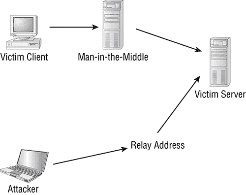

SMB 中继防御措施包括配置 Windows 2000 使用 `SMB` 签名，这会导致它对每个 `SMB` 通信块进行加密。

## 破解工具

* `SMBGrind` 通过删除重复并提供一种针对特定用户而无需手动编辑转储文件的方法，增加了嗅探转储上 `L0phtCrack` 会话的速度。
* `SMBDie` 工具通过发送特殊制的 `SMB` 请求使运行 Windows 2000、XP 或 NT 的计算机崩溃。
* `NBTdeputy` 可以在网络上注册 `NetBIOS` 计算机名称并响应基于 TCP/IP 的 NetBIOS (`NetBT`) 名称查询请求。它简化了 `SMBRelay` 的使用。可以使用计算机名称而不是 IP 地址引用中继。

### NetBIOS DoS 攻击

`NetBIOS` 拒绝服务 (`DoS`) 攻击向目标 Windows 系统上的 `NetBIOS` 名称服务发送 `NetBIOS` 名称释放消息，强制系统发生名称冲突，导致该名称无法再次使用。这本质上阻止了客户端参与 `NetBIOS` 网络，并为该系统创建了网络 `DoS`。

## 破解工具

`NBName` 可以禁用整个局域网并防止机器重新加入。受该工具感染的 `NetBIOS` 网络上的节点会认为它们的名称已被其他机器占用。

创建更安全且易记密码的另一种方法是遵循可重复的模式，这将能够在需要时重新创建密码。

1. 从一个好的短语开始，例如：`Maryhadalittlelamb`
2. 将每隔字符更改为大写，得到 `MaRyHaDaLiTtLeLaMb`
3. 将 `a` 更改为 `@` 并将 `i` 更改为 `1`，得到 `M@RyH@D@L1TtLeL@Mb`
4. 丢弃每隔一对，得到一个安全的可重复密码 `M@H@L1LeMb`。

现在，你有了一个符合所有要求的密码，但在必要时可以被“重新制作”。

## 密码破解防御措施

应该实施尽可能强的密码以防止密码破解。系统应强制执行 8–12 位字母数字密码。相同密码的使用时长将在下一节中讨论。

为了防止存储在服务器上的密码哈希算法被破解，你必须小心对服务器进行物理隔离和保护。系统管理员可以使用 Windows 中的 `SYSKEY` 实用程序保护存储在服务器硬盘上的哈希。还应该监控服务器日志以发现针对用户账户的暴力破解攻击。

系统管理员可以实施以下安全措施来降低暴力破解的效果：

* 永远不要留下默认密码。
* 永远不要使用字典中可以找到密码。
* 永远不要使用与主机名、域名或通过 Whois 可以的任何内容相关的密码。
* 永远不要使用与爱好、宠物、亲属或生日相关的密码。
* 作为最后手段，使用字典中超过 21 个字符的单词作为密码。


该主题将在本章后的“监控事件日志”部分进一步讨论。

在接下来的章节中，我们将考虑采取的两种措施来加强密码并防止破解。

### 密码更改间隔

密码应在一段时间后过期，以便强制用户更改。如果密码间隔设置得太低，用户将忘记当前的密码；结果是系统管理员将频繁重置用户的密码。另一方面，如果允许使用密码太久，可能会损害安全性。推荐的密码更改间隔是每 30 天。此外，大多数安全专业人员建议不要允许重复最后三个密码。


管理员应该监控事件查看器日志，以识别在发生之前或期间的任何入侵尝试。通常，在发生成功入侵或密码攻击之前，系统日志中会记录多次失败尝试。安全日志的好坏取决于监控它们的系统管理员的水平。

`VisualLast` 等工具可以帮助网络管理员解读和分析安全日志文件。`VisualLast` 为 NT 事件日志提供了更深入的见解，使管理员能够更准确、高效地评估网络活动。该程序旨在允许网络管理员查看并报告用户的登录和注销时间；这些事件可以根据时间范围进行搜索，这对于寻找入侵细节的安全分析师来说是无价的。

位于 `c:\windows\system32\config\Sec.Event.Evt` 的事件日志包含了攻击者破解尝试的轨迹。

# 了解键盘记录器和其他间谍软件技术

如果所有收集密码的尝试都失败了，那么键盘记录器就是黑客的首选工具。键盘记录器（keyloggers）可以通过硬件或软件实现。硬件键盘记录器是连接键盘到电脑的小型硬件设备，并将每次按键记录保存到文件中或硬件设备的内存中。为了安装硬件键盘记录器，黑客必须对系统具有物理访问权限。

软件键盘记录器是位于键盘硬件和操作系统之间的隐身软件，以便它们记录每一次按键。软件键盘记录器可以通过木马或病毒部署在系统上。


将在第 5 章“在目标系统上安装软件：间谍软件、木马、后门、病毒和蠕虫”中讨论使用木马和病毒。

### 攻击工具

Spector 是一种间谍软件，记录系统在互联网上进行的所有操作，就像摄像头一样。Spector 每小时自动对计算机屏幕上的任何内容拍摄数百张快照，并将这些快照存在系统硬盘的隐藏位置。可以使用 Anti-spector 检测并删除 Spector。

eBlaster 是一种互联网间谍软件，可以捕获传入和出的电子邮件并立即将其转发到另一个电子邮件地址。eBlaster 还可以捕获即时消息对话双方的内容、执行按键记录并记录访问过的网站。

SpyAnywhere 允许你查看系统活动和用户操作、关机/重启、锁定/冻结，甚至浏览远程文件系统的工具。SpyAnywhere 让你可以控制远程系统上打开的程序和窗口，并查看浏览历史和相关信息。

Invisible KeyLogger Stealth (IKS) Software Logger 是一个高性能虚拟设备驱动程序 (VxD)，静默运行在 Windows 95、98 或 ME 操作系统的底层。所有按键都记录在一个二进制按键文件中。

Fearless Key Logger 是一种木马，它留在内存中以捕获所有用户按键。捕获的按键存储在日志文件中，可供黑客检索。

E-mail Keylogger 记录在目标系统上发送和接收的所有电子邮件。可以通过发送者、收件者、主题和时间/日期查看电子邮件。邮件内容和任何附件也会被记录。

# 提升权限

权限提升是黑客循环的第三步。权限提升基本上意味着为用户账户增加权利或权限。简单来说，权限提升是将普通用户账户变为管理员账户。

通常，管理员账户具有更严格的密码要求，其密码受到更严密的保护。如果无法找到具有管理员权限的账户用户名和密码，黑客可能会选择使用低权限账户。在这种情况下，黑客必须提升该账户的权限。

这是通过首先使用非管理员用户账户获取访问（通常通过之前讨论过的方法之一收集用户名和密码），然后将账户权限提升到管理员级别来实现。

### 攻击工具

`GetAdmin.exe` 是一个将用户添加到本地管理员组的小程序。它使用低级 NT 内核。`Hk.exe` 是一个利用 Windows 漏洞的工具。`GetAdmin.exe` 是一个将用户添加到本地管理员组的程序。`Hk.exe` 是一个利用 Windows 漏洞的工具。

一旦黑客获得了管理员权限，我们在后续章节来看看他们可以做什么。

## 执行应用程序

一旦黑客获得了管理员权限，他们做的下一件事就是执行应用程序。

### 攻击工具

`PsExec` 是一个连接到远程系统并执行其文件的程序。`Remoxec` 是一个执行程序的程序。

### 缓冲区溢出

缓冲区溢出是利用应用程序代码漏洞的黑客尝试。本质上，缓冲区溢出攻击向应用程序中的字段变量发送过多信息，这会导致应用程序错误。大多数情况下，应用程序不知道该执行什么操作，因为它被溢出数据覆盖了。因此，它会执行溢出数据中的命令，或显示命令提示允许用户输入下一个命令。


缓冲区溢将在第 9 章“攻击应用程序：SQL 注入和缓冲区溢出”中详细讨论。

# 了解根内核 (Rootkits)

根内核是一类经常用于在受感染的系统上隐藏工具的程序。根内核包括所谓的后门，帮助攻击者随后更方便地访问系统。例如，根内核可以隐藏一个应用程序，当攻击者连接到系统上的特定网络端口时产生 shell。后门还可以允许由非特权用户启动的进程执行通常保留给管理员的函数。根内核经常用于让根内核的程序人员查看并访问需要用户名和登录信息的网站。

根内核有几种类型，包括以下：

### 内核级根内核

内核级根内核通过添加代码和/将部分内核代码替换为修改后的代码来在计算机系统中隐藏后门。这通常通过设备驱动程序或可加载模块向内核添加新代码来实现，例如 Linux 中的可加载内核模块或 Windows 中的设备驱动程序。内核级根内核特别危险，因为在没有适当软件的情况下很难检测到它们。

### 库级根内核

库级根内核通常通过补丁、挂钩（hook）或替换系统调用版本来隐藏可能允许识别黑客身份的信息。

### 应用程序级根内核

应用程序级根内核可能会将普通的应用程序二进制文件替换为木马化的伪品，或者使用挂钩、补丁、注入代码或其他手段修改现有应用程序的行为。

Windows NT/2000 rootkit 是作为一种内核模式驱动程序构建的，可以在运行时动态加载。该 rootkit 在 NT 内核核心区域以系统权限运行，因此它可以访问操作系统的所有资源。rootkit 还可以隐藏进程、隐藏文件、隐藏注册表项、拦截在系统控制台上输入的按键、发出调试中断导致蓝屏死亡（BSOD），以及重定向 EXE 文件。


该 rootkit 包含一个名为 `root.sys` 的内核模式设备驱动程序和一个名为 `DEPLOY.EXE` 的启动程序。在获取目标系统的访问后，攻击者将 `root.sys` 和 `DEPLOY.EXE` 复制到目标系统并执行 `DEPLOY.EXE`。这样做会安装并启动 rootkit 设备驱动。攻击者稍后会在目标机器上删除 `DEPLOY.EXE`。随后，攻击者可以使用 `net stop root` 和 `net start root` 命令随时停止和重启 rootkit。一旦 rootkit 启动，`root.sys` 文件将不再出现在目录列表中；rootkit 会拦截用于文件列表的系统调用，并从显示中隐藏所有以 `root_` 开头的文件。

## Rootkit 嵌入式 TCP/IP 栈

Windows NT/2000 rootkit 的新功能是一个无状态 TCP/IP 栈。它通过根据输入数据包中的判断连接状态来工作。rootkit 有一个硬编码的 IP 地址（`10.0.0.166`），并对其进行响应。rootkit 使用原始以太网连接到系统的网卡，因此非常强大。目标端口并不重要；黑客可以 `telnet` 到系统上的任何端口。此外，多个人可以同时登录 rootkit。

## Rootkit 应对措施

所有 rootkit 都需要目标系统的管理员访问权限，因此密码安全至关重要。如果您检测到 rootkit，应该备份关键数据，并从可信源重新安装操作系统和应用程序。管理员还应该准备好文档齐全的自动化安装程序和可信的恢复介质。

另一种应对措施是使用 MD5 校验和工具。文件的 MD5 校验和是一个 128 位的值，类似于文件的指纹。（存在极小的概率为两个不同的文件获得完全相同的校验和。）该算法的设计使得文件数据中即使只改变一个位，也会产生不同的校验和值。此功能对于比较文件和确保其完整性非常有用。另一个很好的特性是校验和的固定长度，无论源文件的大小如何。

MD5 校验和可以确保文件没有被更改。如果在系统中发现了 rootkit，这对于检查文件完整性非常有用。诸如 `Tripwire` 等工具通过实现 MD5 校验和来识别受 rootkit 影响的文件。

### 应对工具

`Tripwire` 是一个用于 Unix 和 Linux 操作系统的文件系统完整性检查程序。除了代表每个目录和文件内容的一个或多个加密校验和外，`Tripwire` 数据库还包含允许您验证访问权限和文件模式设置、文件所有者用户名、文件最后访问日期和时间以及对项目进行的最后修改的信息。

## 隐藏文件

黑客可能想要隐藏系统上的文件以防止被检测。这些文件随后可能被用于对系统发起攻击。在 Windows 中隐藏文件有两种方法。第一种是使用 `attrib` 命令。要使用 `attrib` 命令隐藏文件，请在命令提示符输入：

```text
attrib +h [file/directory]
```

在 Windows 中隐藏文件的另一种方法是使用 NTFS 备用数据流。Windows NT、2000 和 XP 使用的 NTFS 文件系统具有一项名为“备用数据流”的功能，允许数据存储在与正常可见文件相关联的隐藏文件中。流的大小不受限制；一个正常文件可以链接到多个流。

### NTFS 文件流

NTFS 文件流允许在合法文件内部创建一个隐藏文件。隐藏文件不会出现在目录列表中，但合法文件会显示。用户通常不会怀疑该合法文件，但隐藏文件可以用于存储或传输信息。在练习 4-2 中，你将学习如何使用 NTFS 文件流来隐藏文件。

### 练习 4-2：使用 NTFS 文件流隐藏文件

注意：此练习仅在使用 NTFS 文件系统的系统上有效。

要创建并测试 NTFS 文件流：

1. 在命令行中，输入 `notepad test.txt`。
2. 在文件中放入一些数据，保存文件并关闭记事本。执行第 1 步将打开记事本。
3. 在命令行中，输入 `dir test.txt` 并记录文件大小。
4. 在命令行中，输入 `notepad test.txt:hidden.txt`。在记事本中输入一些文本，保存文件并关闭它。
5. 再次检查文件大小（它应该与步骤 3 中相同）。
6. 打开 `test.txt`。你只看到原始数据。
7. 在命令行中输入 `type test.txt:hidden.txt`。将显示语法错误信息。

### 攻击工具

`makestrm.exe` 是一种将数据从文件移动到链接到原始文件的备用数据流的实用工具。

### NTFS 流应对措施

要删除流文件，可以将文件复制到 FAT 分区，然后将其复制回 NTFS 分区。当文件移动到 FAT 分区时，流将会丢失，因为它是 NTFS 的功能，因此只存在于 NTFS 分区上。

### 应对工具

你可以使用 `lns.exe` 检测 NTFS 流。`LNS` 会报告包含数据流的文件的存在和位置。

## 理解隐写技术

隐写是将数据隐藏在其他类型数据（如图像或文本文件）中的过程。隐藏数据最流行的方法是利用图形。攻击者可以使用隐写在图形文件中嵌入任何信息，制作炸弹的指令、秘密账号或测试答案。任何想象的文本都可以隐藏在图像中。在练习 4-3 中，你将使用 Image Hide 在图像中隐藏文本。

### 攻击工具

`ImageHide` 是一种在图像中隐藏大量文本的隐写程序。即使添加了字节，图像大小也没有增加。图像在普通图形程序中看起来一样。它可以加载并保存文件，因此能够绕过大多数嗅探器。

`Blindside` 是一种在 BMP 位图中隐藏信息的隐写应用程序。它是一个命令行工具。

`MP3Stego` 在 MP3 文件的压缩过程中隐藏信息。数据经过压缩、加密，然后隐藏在 MP3 位流中。

`Snow` 是一种空白隐写程序，通过在行尾添加空白在 ASCII 文本中隐藏消息。由于文本查看器通常看不到空格和制表符，消息对观察者来说被有效隐藏了。如果使用了内置加密，即使检测到消息也无法读取。

`CameraShy` 适用于 Windows 和 Internet Explorer，允许用户存储在普通 GIF 图像中的审查或敏感信息。

`Stealth` 是用于 PGP 文件的过滤工具。它去除头部的标识信息，之后该文件即可用于隐写。

### 练习 4-3：使用 ImageHide 在图像中隐藏数据

使用 ImageHide 在图像中隐藏数据：

1. 下载并安装 `ImageHide` 程序。
2. 在 `Image Hide` 程序中添加图像。
3. 在 `ImageHide` 底部的字段中添加文本。
4. 使用 `ImageHide` 在图像中隐藏文本。

隐写可以被某些程序检测，尽管很难。检测的第一步是定位包含隐藏文本的文件，这可以通过分析图像模式和调色板的变化来实现。

`Stegdetect` 是一种用于检测图像中隐写术内容的自动化工具。它能够检测在 JPEG 图像中隐藏信息的各种隐写术方法。

`Dskprobe` 是 Windows 2000 安装光盘上的一个工具。它是一个底层硬盘扫描器，可以检测隐写术。

## 掩盖踪迹和擦除证据

一旦入侵者成功获取了系统的管理员权限，他们就会试图掩盖自己的足迹，以防止其在系统中的存在（无论当前还是过去）被发现。黑客还可能尝试移除其在系统上的身份或活动证据，以防止执法部门追踪其身份或位置。为了防止被检测，黑客通常会擦除任何已记录的错误消息或安全事件。禁用审计和清除事件日志是黑客用来掩盖足迹和规避检测的两种方法。

入侵者在获得管理员权限后做的第一件事就是禁用审计。Windows 审计会将某些事件记录在存储在 Windows 事件查看器中的日志文件中。事件可以包括登录系统、访问应用程序或事件日志。管理员可以选择系统上实施的记录级别。黑客想要确定所实施的记录级别，以查看他们是否需要清除指示其在系统上存在的事件。

## 黑客工具

`Auditpol` 是包含在用于系统管理员的 Windows NT 工具包中的工具。该工具可以从 Windows 命令行禁用或启用审计。它还可以用于确定系统管理员所实施的记录级别。

入侵者可以轻松擦除 Windows 事件查看器中的安全日志。包含一个或极少数事件的事件日志是可疑的，因为这通常意味着其他事件已被清除。在禁用审计后，清除事件日志仍然是必要的，因为使用 `Auditpol` 工具会在事件日志中留下一个条目，指示审计已被禁用。目前有多种工具可以清除事件日志，或者黑客也可以在 Windows 事件查看器中手动进行操作。

## 黑客工具

`elsave.exe` 实用程序是一个清除事件日志的简单工具。它是基于命令行的。

`WinZapper` 是攻击者可以用来从 Windows 2000 安全日志中选择性擦除事件记录的工具。`WinZapper` 还能确保在程序运行时不会记录任何安全事件。

`Evidence Eliminator` 是一个用于 Windows PC 的数据清理系统。它可以防止不需要的数据在系统中被永久隐藏。它可以清理回收站、缓存、系统文件、临时文件夹等。`Evidence Eliminator` 也可以被黑客用于在攻击后从系统中移除证据。

## 总结

对目标系统的实际黑入可以分解为简单的步骤。猜测或破解密码、提升权限、隐藏文件和掩盖足迹都是黑客过程的一部分。正是这些步骤通常会为黑客发现最有价值的信息。然而，信息收集和扫描步骤不应被忘记，因为它们对于获取有关目标及其弱点的最多信息至关重要。良好的信息收集可以大大提高黑客步骤的成功和速度。

## 考试要点

- 理解密码安全的重要性。实施密码更改间隔、强字母数字密码以及其他密码安全措施对网络安全至关重要。
- 了解不同类型的密码攻击。被动在线攻击包括嗅探、中间人攻击和重放攻击。主动在线攻击包括被动和自动化的密码猜测。离线攻击包括字典攻击、混合攻击和暴力破解。非电子攻击包括窥视（肩窥）、键盘嗅探和社会工程学。
- 理解各种类型的离线密码攻击。字典攻击、混合攻击和暴力破解攻击都是离线密码攻击。
- 了解防御密码猜测的方法。智能卡和生物识别是增加安全性和防御密码猜测的两种方法。
- 理解非电子攻击类型之间的区别。社会工程学、窥视和翻垃圾查找都是非电子攻击的类型。
- 了解攻击者如何消除黑客活动证据。清除事件日志和禁用审计是攻击者用来掩盖足迹的方法。
- 意识到隐藏文件是泄露敏感信息的手段。隐写术、NTFS 数据流和 `attrib` 命令都是黑客可以隐藏和盗取文件的方法。

## 复习题

1. 在图像中隐藏文本的过程称为什么？

   A. 隐写术（`Steganography`）

   B. 加密（`Encryption`）

   C. 间谍软件

   D. 键记录

2. 什么是 rootkit？

   A. 用于获取 Windows 系统根权限的简单工具

   B. 一个向 SMB 中继发送信息的木马

   C. 一种影响系统文件（包括内核和库）的侵入性程序

   D. 执行缓冲区溢出的工具

3. 为什么黑客想要掩盖自己的足迹？

   A. 防止另一个人使用他们在目标系统上安装的程序

   B. 防止被检测或发现

   C. 防止黑客尝试

   D. 防止其他黑客使用他们的工具

4. 什么是权限提升？

   A. 创建一个具有更高权限的用户账户

   B. 创建一个具有管理员权限的用户账户

   C. 创建两个用户账户：一个高权限，一个低权限

   D. 增加用户账户的权限

5. 隐藏文件的两种方法是哪两种？（选择所有适用项）

   A. NTFS 文件流

   B. `attrib` 命令

   C. 隐写术

   D. 加密文件系统

6. 推荐的密码更改间隔是多少？

   A. 30 天

   B. 20 天

   C. 1 天

   D. 7 天

7. 针对密码 `T63k#s23A`，哪种类型的密码攻击最成功？

   A. 字典攻击

   B. 混合攻击

   C. 密码猜测

   D. 暴力破解

8. 下列哪种是被动在线攻击？

   A. 密码猜测

   B. 网络嗅探

   C. 暴力破解攻击

   D. 字典攻击

9. 为什么在使用 `auditpol` 命令关闭日志后需要清除事件日志？

   A. `auditpol` 命令会在事件日志中留下一个条目。

   B. `auditpol` 命令在清除日志之前停止。

   C. `auditpol` 依赖事件日志来确定是否正在记录。

   D. 运行命令后不需要清除日志。

10. 在系统中安装硬件键盘记录器需要什么？

    A. 系统的 IP 地址

    B. 管理员用户名和密码

    C. 对系统的物理访问

    D. 对系统的 Telnet 访问

11. 获取密码简单的方法是？

    A. 暴力破解

    B. 猜测

    C. 字典攻击

    D. 混合攻击

12. 哪种命令用于掩盖目标系统的足迹？

    A. `elsave`

    B. `coverit`

    C. `legion`

    D. `nmap`

13. Snow 是什么类型的黑客程序？

    A. 密码破解器

    B. 权限提升

    C. 间谍软件

    D. 隐写术

14. 黑客获得系统管理员权限后做的第一件事是什么？

    A. 创建新用户账户

    B. 修改管理员密码

    C. 复制重要数据文件

    D. 禁用审计

15. 下列哪个程序是隐写术检测工具？

    A. `Stegdetect`

    B. `Stegoalert`

    C. `Stegostopper`

    D. `Stegorama`

16. 哪种措施工具会检测 NTFS 流？

    A. Windows 安全管理器

    B. `LNS`

    C. `Auditpol`

    D. `RPS`

17. 哪个程序用于创建 NTFS 流？

    A. `StreamIT`

    B. `makestrm.exe`

    C. `NLS`

    D. Windows 资源管理器

18. 为什么在使用 `auditpol` 命令关闭日志后，清除事件日志很重要？

    A. 会留下一个管理员已登录的条目。

    B. 会留下一个正在进行黑客尝试的条目。

    C. 创建一个条目指示审计已禁用。

    D. 否则系统将关闭。

19. 最危险的 rootkit（根内核）类型是什么？

    A. 内核级

    B. 库级

    C. 系统级

    D. 应用级

20. 使用 `attrib` 命令隐藏文件的命令是什么？

    A. `attrib +h [file/directory]`

    B. `attrib +h [file/directory]`

    C. `attrib hide [file/directory]`

    D. `hide [file/directory]`

## 复习题答案

1. A. `Steganography`（隐术）是将文本隐藏在图像中的。
2. C. `rootkit` 是一种修改操作系统核心（内核 `kernel`）和库的程序。
3. B. `Hackers`（黑客）掩盖自己的踪迹以防止身份或位置被发现。
4. D. `Privilege escalation`（权限提升）是一种增加用户账户权限的黑客方法。
5. A, B. `NTFS` 文件流和 `attrib` 命令是用于隐藏文件的两种黑客技术。
6. A. 为了安全性和易用性的最佳平衡，应该每 30 天更改一次密码。
7. D. `brute-force attack`（暴力攻击）尝试每种字母、数字和符号的组合。
8. B. `Network sniffing`（网络嗅探）是一种被动在线攻击，因为它无法被检测。
9. A. 必须清除 `event log`（事件日志），因为 `auditpol` 命令会在 `event log` 中创建一个条目，指示日志已禁用。
10. C. `hardware keylogger`（硬件键盘记录器）是一种将键盘连接到 `PC` 的适配器。黑客需要物理接触 `PC` 才能插入硬件键盘记录器。
11. B. 获取密码简单的方法是猜密码。因此创建强密码且不重复使用密码非常重要。
12. A. `elsave` 是用于清除 `event log` 并掩盖黑客踪迹的命令。
13. D. `Snow` 是一种 `steganography` 程序，用于将数据隐藏在文本文件的空白处。
14. D. 黑客在获得系统管理级访问后应该做的第一件事是禁用系统审计，以防止检测并尝试掩盖踪迹。
15. A. `Stegdetect` 是一种 `steganography` 检测工具。
16. B. `LNS` 是一种用于检测 `NTFS` 流的 `NTFS` 应对工具。
17. B. `makestrm.exe` 是用于创建 `NTFS` 流的程序。
18. C. 在禁用审计后清除 `event log` 非常重要，因为会创建一个指示审计禁用的条目。
19. A. `kernel-level rootkit`（内核级内核）是最危险的，因为它感染了系统的核心。
20. B. `attrib +h [file/directory]` 是使用 `hide` 属性隐藏文件的命令。

# 第 5 章：木马、后门、病毒和蠕虫

## 本章涵盖的 CEH 考试目标

- 什么是 `Trojan`（木马）？
- 显性信道和隐蔽信道是指什么意思？
- 列出不同类型的 `Trojans`
- `Trojan` 攻击的迹象是什么？
- 理解 “Netcat” `Trojan` 是如何工作的。
- “wrapping”（封装）是指什么意思？
- 反向连接 `Trojans` 是如何工作的？
- 防止 `Trojans` 的应对技术有哪些？
- 理解规避技术。
- 理解 `Trojan` 和 `virus`（病毒）之间的区别。
- 理解 `virus` 如何传播。
- 理解 `virus` 方法。

`Trojans` 和 `backdoors`（后门）是感染系统的两种方式。`Trojan` 是一种看似无害但实际上具有破坏性的程序。在许多情况下，它是随另一个程序一起安装的。`Trojans` 和 `backdoors` 很常见是因为它们允许黑客访问系统。`Trojans` 和 `backdoors` 是恶意软件的类型。`Trojan` 可以嵌入到恶意程序中。`Trojans` 和 `backdoors` 经常用于破坏系统。`Trojans` 和 `backdoors` 用于获取系统的访问权限。`Trojans` 和 `backdoors` 经常用于在系统上建立 `backjan`（后门）。


`backdoor` 是黑客在目标系统上安装的一个程序或一组相关程序，以便稍后访问系统。`backdoor` 可以嵌入在恶意的 `Trojan` 中。在系统上安装 `backdoor` 的目的是让黑客在他们选择的时间访问系统。关键在于黑客知道如何在不被察觉的情况下进入 `backdoor`，并能够利用它进一步攻击系统。

添加新服务是 Windows 操作系统伪装 `backdoors` 最常用的技术。在安装 `backdoor` 之前，黑客必须调查系统以找到正在运行的服务。在大多数情况下，黑客安装 `backdoor`，添加一个新服务并给它一个不起眼的名称，或者更好的是选择一个从未使用过且被手动激活或完全禁用的服务。

### 表 5-1：常见的木马程序

| Trojan | 协议 | 端口 |
| :--- | :--- | :--- |
| `BackOrifice` | UDP | 3137 或 3138 |
| `Deep Throat` | UDP | 2140 或 3150 |
| `NetBus` | TCP | 12345 或 12346 |
| `Whack-a-Mole` | TCP | 12361 或 12362 |
| `NetBus 2` | TCP | 20034 |
| `GirlFriend` | TCP | 21544 |
| `Master’s Paradise` | TCP | 3129, 40421, 40422, 40423, 和 40426 |

远程访问木马（RATs）是一类后门程序，用于对被攻破的机器进行远程控制。它们为用户提供看似实用的功能，同时在受害者的计算机上开启一个网络端口。一旦 `RAT` 启动，它就会像一个可执行文件一样运行，与负责启动进程的某些 `Registry`（注册表）键交互，有时还会创建自己的系统服务。与常见的后门不同，RATs 会将自身挂钩到受害操作系统中，并且总是包含两个文件：客户端文件和服务器文件。服务器安装在被感染的机器上，而客户端则由入侵者用于控制受控的系统。

RATs 允许黑客随时控制目标系统。事实上，系统被利用的迹象之一就是系统上出现了异常行为，例如鼠标自动移动，或在空闲的系统上出现弹出窗口。

# 关于练习木马的警告

我刻意在这一节关于木马和后门的章节中省略了任何分步操作的练习题，因为我不希望提倡任何人在生产系统中安装这些程序并导致数据丢失。然而，学习如何使用这些工具及其能力的最佳方法是安装它们并进行测试。因此，以下是我利用木马和后门学习道德黑客技巧的建议。

找一台你不打算再次使用的旧电脑，或者为你的笔记本电脑买第二块硬盘（这就是我的做法）。安装未启用任何服务包或更新的 `Windows XP` 操作系统。不要安装任何病毒扫描软件或防火墙。下一步是真正疯狂安装本章列出的所有木马、根基程序和后门工具。这将让你自由地学习和测试这些工具，而不会被试图保护你计算机的病毒扫描或个人防火墙所拦截。完成后，你可以重新安装 Windows，或者直接将硬盘更换为你的生产硬盘。

如果你正在寻找一台小型便宜的计算机作为测试机，最后的建议是购买一台运行 `Windows XP` 的廉价笔记本电脑，并用它来安装和测试工具。

# 明道与隐蔽道

明道（overt channel）程序在计算机系统或网络内部通信的正常合法方式。隐蔽道（covert channel）则以非预期的方式使用程序或通信路径。

木马可以使用隐蔽道进行通信。某些客户端木马使用隐蔽道向受控系统的服务器组件发送指令。这有时会让木马的通信难以破解和理解。一个毫无察觉的入侵检测系统（`IDS`）嗅探木马客户端与服务器之间的传输，不会将其标记为任何异常。通过使用隐蔽道，木马可以在不被发现的情况下通信或“回家”，黑客也可以在不被发现的情况下向客户端组件发送命令。


## 使用隐蔽道

杰米亚·丹顿（Jeremiah Denton）是越南战争期间的战俘，他利用隐蔽道在捕获者不知情的情况下通信。丹顿接受了一位日本电视记者的采访，最后采访的录像带到了美国。当美国情报人员查看磁带时，其中一人注意到丹顿以一种异常的方式眨着眼睛。他们发现他正在用摩斯密码闪烁字母。字母是 `T-O-R-T-U-R-E`，丹顿反复闪烁这些字母。这是一个利用隐蔽道在不被发现的情况下发送通信消息的真实案例。

另一个通过计算机通过隐蔽道传递信息的例子是利用文件的特性来传递信息，而不是文件本身。一个计算机隐蔽道的示例是创建一个看似无害的 `16 bytes` 大小的计算机文件。该文件可以包含任何数据，因为那些并不是重要信息。然后可以将文件通过电子邮件发送给另一个人。再次，这看起来足够无害，但真正的通信是数字 `16`。文件大小才是重要数据，而不是文件的内容。

某些隐蔽道依赖于名为 `tunneling`（隧道）的技术，该技术允许一个协议承载在另一个协议之上。控制消息协议（`ICMP`）隧道是一种使用 `ICMP echo-request` 和 `echo-reply` 来携带攻击者可能想要使用的任何负载的方法，试图隐蔽地访问或控制受控的系统。`ping` 命令是一个广泛接受的故障排除工具，它使用 `ICMP` 协议。由于这个原因，许多路由器、交换机、防火墙和其他数据包过滤器允许 `ICMP` 协议通过设备。因此，`ICMP` 是隧道协议的极佳选择。

# 黑客工具

`Loki` 是一种黑客工具，通过 `ICMP` 提供 shell 访问，这使其比基于 TCP 或 UDP 的后门难以检测得多。从网络来看，有一系列 `ICMP` 数据包正在跨网络发送。然而，黑客实际上是从 `Loki` 客户端发送命令并在服务器上执行它们。

# 木马的类型

木马可以被创建并执行不同的攻击。以下是一些最常见的木马类型：

* **远程访问木马 (RATs)**：用于获取对系统的远程访问。
* **数据发送木马**：用于在系统上寻找数据并交付给黑客。
* **破坏性木马**：用于删除或损坏系统上的文件。
* **拒绝服务木马**：用于发起拒绝服务攻击。
* **代理木马**：用于通过其他系统隧道流量或发起攻击攻击。
* **FTP 木马**：用于创建 `FTP` 服务器以便将文件复制到系统。
* **安全软件禁用木马**：用于停止反病毒软件。

# 反向连接木马的工作原理

反向连接木马（Reverse-Connecting Trojans）允许攻击者从外部访问内部网络上的机器。黑客可以在内部网络的系统上安装一个简单的木马程序，例如反向 Web 服务器。内部服务器会定期（通常每 60 秒）尝试访问主系统以获取命令。如果攻击者在主系统中输入了内容，该命令就会被提取并在内部系统中执行。反向 Web 服务器使用 `HTTP`。它是危险的，因为它很难检测：看起来就像是客户端从内部网络浏览网页。

# 木洛马程序

`NetBus` 是一个 Windows GUI 木洛马程序，功能与 Donald Dick 类似。它会添加注册表键 `HKEY_CURRENT_USER\NetBus Server` 并修改 `HKEY_CURRENT_USER\NetBus Server\General\TCPPort` 键。如果 `NetBus` 被配置为自动启动，它会在 `HKEY_LOCAL_MACHINE\Software\Microsoft\Windows\CurrentVersion\RunServices` 中添加一个名为 `NetBus Server` 的注册表项。

`SubSeven` 是一种木马程序，可以配置为在感染的计算机连接到互联网时通知黑客，并能向黑客提供有关系统的信息。这种通知可以通过 IRC 网络、`ICQ` 或电子邮件完成。`SubSeven` 会导致系统运行变慢，并在感染的系统上生成错误消息。

`Back Orifice 2000` 是一种远程管理工具，攻击者可以使用 GUI 界面通过 TCP/IP 连接控制系统。`Back Orifice` 不会出现在任务列表或进程列表中，它会将自己复制到注册表中，以便在每次计算机启动时运行。它运行的文件名在安装前是可以配置的。`Back Orifice` 修改了 `HKEY_LOCAL_MACHINE\SOFTWARE\Microsoft\Windows\CurrentVersion\RunServices` 注册表键。`BackOrifice` 插件为 `BackOrifice` 程序增加了功能。插件包括加密强度极强的 Triple DES 加密、带有可选鼠标和键盘控制的远程桌面、拖放式加密文件传输、类似 Explorer 的文件系统浏览、图形化远程注册表编辑、可靠的 UDP 和 ICMP 通信协议，以及通过使用 `ICMP` 代替 TCP 和 UDP 实现隐藏能力。

`BoSniffer` 看起来是 `Back Orifice` 的修复程序，但实际上是一个安装了 `SpeakEasy` 插件的 `Back Orifice` 服务器。如果在目标系统上运行 `BoSniffer.exe`，它会尝试使用随机用户名登录到通道 `#BO_OWNED` 的预设 IRC 服务器。然后它会每隔几分钟宣布一次其 IP 地址和自定义消息，以便黑客社区可以将该系统作为未来攻击的僵尸。

`ComputerSpy Key Logger` 是黑客可以用来记录计算机活动的程序，例如访问的网站；`ICQ`、`MSN`、`AOL`、`AIM` 以及 `Yahoo! Messenger` 或网邮箱的登录名和密码；当前运行或执行的应用程序；互联网聊天；以及电子邮件。该程序甚至可以按间隔对整个 Windows 桌面拍摄快照。

`Beast` 是一种运行在为 `WinLogon.exe` 服务分配的内存中的木马。一旦安装，该程序就会插入 `Windows Explorer` 或 `Internet Explorer` 中。`Beast` 最显著的特征之一是全功能木马，这意味着客户端、服务器和服务器编辑器存储同一个应用程序中。

`CyberSpy` 是一种 telnet 木马，它将自己复制到 Windows 系统目录并在注册表中注册自己，以便在每次感染的系统重启时启动。完成后，它会通过电子邮件或 `ICQ` 发送通知，然后开始监听之前指定的 TCP/IP 端口。

`Subroot` 是一种远程管理木马，黑客可以使用它通过 TCP 端口 `1700` 连接到受害者系统。

`LetMeRule!` 是一种远程访问木马，可以配置为监听目标系统上的任何端口。它包含一个攻击者用于控制目标系统的命令行提示符。它可以删除特定目录中的所有文件，在远程主机上执行文件，或查看并修改 `Registry`。

`Firekiller 2000` 会禁用反病毒程序和软件防火墙。例如，如果 `Norton AntiVirus` 在任务栏中处于自动扫描模式，且 `AtGuard Firewall` 已激活，该程序在执行时会停止两者，并使硬盘上的两个安装都无法使用。它们必须重新安装才能恢复功能。`Firekiller 2000` 适用于所有的防护软件，包括 `AtGuard`、`Norton AntiVirus` 和 `McAfee Antivirus`。

`Hard Drive Killer Pro` 程序提供了完全且永久破坏任意 DOS 或 Windows 系统上所有数据的能力。该程序一旦执行，会在几秒内删除文件、感染并重启系统。重启后，无论硬盘大小如何，连接到系统的所有硬盘都会在一到两秒内以不可恢复的方式进行格式化。

## Netcat 木马是如何工作的

`Netcat` 是一种使用命令行界面在目标系统上打开 TCP 或 UDP 端口的木马。黑客随后可以 telnet 到这些开放的端口并获得目标系统的 shell 权限。练习 5-1 显示了如何使用 `Netcat`。


对于 CEH 考试，了解如何使用 `Netcat` 至关重要。确保在尝试考试之前下载 `Netcat` 工具并练习相关命令。

### 练习 5-1：使用 Netcat

下载适用于你系统的 `Netcat` 版本。针对所有 Windows 操作系统都有多个版本的 `Netcat`。此外，`Netcat` 最初是为 Unix 系统开发的，并在许多 Linux 发行版中，包括 `BackTrack`。

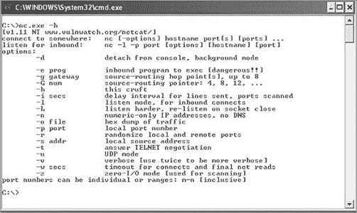

`Netcat` 需要在客户端和服务器端运行。连接的服务器端通过 `-l` 属性启用，用于创建监听端口。例如，使用以下命令在服务器上启用 `Netcat` 监听：

```
nc -L -p 123 -t -e cmd.exe
```

在 `Netcat` 客户端上，运行以下命令连接到服务器：

```
nc <ip address> <port>
```

客户端随后应该打开一个来自服务器的命令行提示符。

异常系统行为通常是木马攻击的迹象。诸如程序在没有用户启动的情况下启动；光驱驱打开或关闭；壁纸、背景或屏幕保护程序自动更改；显示翻转以及浏览器程序打开奇怪或意外的网站都是木马攻击的迹象。任何非由用户发起的活动都可能是木马攻击的迹象。


### 病毒或木马感染的迹象

Carrie 在工作中使用电脑时发现电脑运行缓慢。当她打开 `Microsoft Word` 文件时，系统会显示错误消息，然后她无法使用程序的某些功能。在过去的 24 小时内没有收到任何新邮件；她通常每天收到 50 多封邮件，所以这看起来有点异常。最后，她的一个客户说上周收到了她发的重复邮件，这很奇怪。

于是，Carrie 了公司网络管理员 John，让他检查她的电脑，确定是什么导致了运行缓慢以及 `Microsoft Outlook` 的问题。John 查看了 Carrie 的电脑，发现病毒定义是 6 个月前的。反病毒程序不断弹出窗口显示病毒定义已过期，但 Carrie 只是忽略并一直关闭这些弹出窗口。John 更新了病毒定义并运行了全系统扫描。反病毒程序确定系统被感染了 114 个病毒和木马。反病毒程序能够清理感染并将电脑恢复到先前的未感染状态。John 在测试 `Microsoft Outlook` 以确保其正常工作时，注意到了几封来自在线占星服务、娱乐网站和在线游戏网站的邮件。John 从她的电脑中删除了几个可疑程序。

向所有工作站推送病毒更新的网络软件、防止未经授权软件安装的网络控制以及用户安全意识培训可以防止此类事件的发生。

封装器（Wrappers）是用于投放木马的软件软件包。封装器将一个合法文件与木马文件绑定。合法软件和木马都会合并成单个可执行文件，并在程序运行时一同进行安装。

通常情况下，游戏或其他动画化安装程序被用作封装器，因为在安装木马的过程中，这些程序可以娱乐用户。这样一来，用户就不会察觉到木马在系统中安装时产生的处理变慢——用户只会看到合法应用程序正在安装。

## 黑客工具

`Graffiti` 是一种可以被封装木木马的动画游戏。在木马于后台安装时，它通过动画游戏娱乐用户。

`Silk Rope 2000` 是一个封装器，将 `BackOrifice` 服务器和其他任何指定的应用程序相结合。

`ELiTeWrap` 是一种用于 Windows 的高级 EXE 封装器，用于安装和运行程序。`ELiTeWrap` 可以创建一个安装程序，将文件提取到目录，并执行显示帮助菜单或将文件复制到目标系统的程序或批文件。

`Icon Converter Plus` 是一种在各种格式之间转换图标的转换程序。攻击者可以使用此类应用程序来伪装恶意代码或木马，欺骗用户执行它，使其误认为是合法应用程序。

## 木马制作工具包和木马制作器

几种木马生成工具让黑客能够创建自己的木马。此类工具包帮助黑客构建可以自定义的木马。这些工具如果执行不当，可能会非常危险并适得其反。黑客创建的新木马通常具有一个额外优点：由于它们不匹配任何已知签名，可以躲避病毒扫描和木马扫描工具的检测。

野可用的一些木马工具包包括 `Senna Spy Generator`、`Trojan Horse Construction Kit v2.0`、`Progenic Mail Trojan Construction Kit` 和 `Pandora’s Box`。

## 木马防御措施

大多数商业防病毒程序都具有反木马能力以及间谍软件检测和删除功能。这些工具可以在启动时自动扫描硬盘，在后门和木马程序造成破坏之前检测它们。一旦系统被感染，清理起来就会变得困难，但您可以使用市售工具进行清理。

尽管有多种商业防病毒或木马删除工具可用，但我个人推荐使用 `Norton Internet Security`（图 5-1）。`Norton Internet Security` 包含了个人防火墙、入侵检测系统、防病毒、反间谍软件、反钓鱼和电子邮件扫描。`Norton Internet Security` 还会清除系统中的大多数木马。

图 5-1： Norton Internet Security

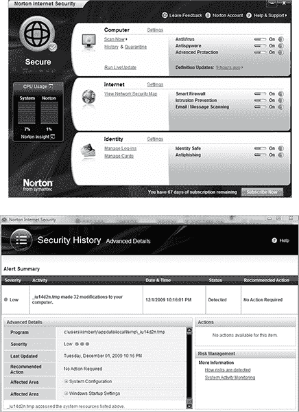

安全软件的工作原理是拥有已知恶意软件（如木马和病毒）的签名。通过恶意软件定义来实现。在安装和使用任何个人安全软件或防病毒及反木马软件时，您必须确保软件具有所有当前的定义。为了确保可以使用最新的补丁和修复，您应该将系统连接到互联网，以便软件持续更新恶意软件定义和修复。

使用商业应用程序清理系统而非使用免费工具是重要的，因为许多免费删除工具可能会进一步感染系统。此外，许多商业安全软件包含入侵检测组件，该组件将执行端口监控，并识别已打开的端口或已更改的文件。

## 端口监控和木马检测工具

`fport` 报告所有开放的 TCP/IP 和 UDP 端口并将其映射到所属应用程序。您可以使用 `fport` 快速识别未知的开放端口及其关联应用程序。

`TCPView` 是一个 Windows 程序，显示系统上所有 TCP 和 UDP 端点的详细列表，包括本地地址、远程地址以及 TCP 连接的状态。当 `TCPView` 运行时，它会列出所有活动的 TCP 和 UDP 端点，并将所有 IP 地址解析为其域名版本。

`PrcView` 是一个进程查看器工具，显示 Windows 下运行的进程的详细信息。`PrcView` 带有命令行版本，可以使用它编写脚本来检查进程是否正在运行，如果是，则杀死。


`Inzider` 是一个实用的工具，列出 Windows 系统中的进程以及每个进程监听的端口。`Inzider` 可能会发现到一些木马。例如，`BackOrifice` 将自己注入其他进程中，因此它在任务管理器中不会作为独立进程可见，但它确实有一个正在监听的开放端口。

`Tripwire` 验证系统完整性。它会自动计算所有关键系统文件或任何要监控修改文件的加密哈希值。`Tripwire` 通过创建系统的基准快照来工作。它定期扫描这些文件，重新计算信息，并查看信息是否发生了变化。如果有变化，软件会报警。

`Dsniff` 是一组用于网络审计和渗透测试的工具。`Dsniff`、`filesnarf`、`mailsnarf`、`msgsnarf`、`urlsnarf` 和 `WebSpy` 被动监控网络中的感兴趣数据，如密码、电子邮件和文件传输。`Arpspoof`、`dnsspoof` 和 `macof` 有助于拦截由于二层交换导致攻击者通常无法获取的网络流量。`Sshmitm` 和 `webmitm` 通过利用临时即用公密钥基础设施 (PKI) 中的弱绑定，对重定向的安全 Shell (SSH) 和基于 SSL 的 HTTP (HTTPS) 会话实施主动的中间人攻击。这些工具将在第 6 章“从网络收集数据：嗅探”中详细讨论。

## 使用系统文件验证系统

Windows 2003 包含一个名为 Windows 文件保护 (WFP) 的功能，它可以防止文件被替换。WFP 在尝试覆盖 `SYS`、`DLL`、`OCX`、`TTF` 或 `EXE` 文件时检查文件完整性。这确保只使用微软验证的文件。

另一个工具 `sigverif` 用于检查哪些文件具有数字签名。在练习 5-2 中，我们将使用该工具。

### 练习 5-2：签名验证

我们将运行 `sigverif` 并将其结果与任务管理器中当前运行的进程进行比较：

1. 按 `Ctrl+Alt+Del` 并选择任务管理器。
2. 点击“进程”选项卡。注意任何异常进程及其使用的 CPU 时间。持续使用高百分比 CPU 的进程可能表明存在病毒或感染。

   

3. 点击任务管理器中的“性能”选项卡以查看 CPU 使用情况。

   

4. 点击“开始”⇒“运行”。
5. 输入 `sigverif`，并点击“确定”。

   

6. 在 `sigverif` 程序中，选择“高级”查看签名验证报告。

   

7. 点击“查看日志”按钮查看报告。

   

### 系统文件检查器（System File Checker）

系统文件检查器是另一种基于命令行工具，用于检查木马程序是否替换了文件。如果 `System File Checker` 检测到文件已被覆盖，它将从 `Windows\system32\dllcache` 文件夹中检索一个已良好的文件并覆盖未经验的文件。运行 `System File Checker` 的命令是 `sfc/scannow`。

### 病毒和蠕虫

病毒和蠕虫可用于感染系统并修改系统，以允许黑客获得访问权限。许多病毒和蠕虫带有木马和后门。通过这种方式，病毒或蠕虫成为载体，允许木马和后门等恶意代码从系统传输到系统，就像人之间的接触导致病毒传播一样。

病毒和蠕虫在许多方面是相似的，它们都是恶意软件（malware）的形式。病毒感染另一个可执行文件，并利用该载体程序来传播自己。病毒代码被注入到先良的程序中，并在程序运行时进行传播。病毒载体程序的示例有宏、游戏、电子邮件附件、Visual Basic 脚本和动画。

蠕虫在许多方面与病毒相似，但不需要载体程序。蠕虫可以自我复制并从受感染的主机移动到另一个主机。蠕虫自动从一个系统传播到另一个系统，但病毒需要另一个程序传播。病毒和蠕虫都在终端用户不知或非意愿的情况下执行。

## 病毒类型

病毒根据两个因素进行分类：它们感染什么以及如何感染。病毒可以感染系统的以下组件：

- 系统扇区
- 文件
- 宏（例如 Microsoft Word 宏）
- 伴随文件（支持系统文件，如 `DLL` 和 `INI` 文件）
- 磁盘簇
- 批文件（`BAT` 文件）
- 源代码

病毒通过与外部系统的交互进行感染。病毒需要由另一个可执行程序携带。通过附加到良性可执行文件，病毒可以在用户或系统运行该可执行文件时传播得非常快。病毒根据其感染技术分类如下：

- **多态病毒 (Polymorphic Viruses)**：这些病毒在每次感染时都以不同的方式加密代码，并可以变为不同的形式以尝试规避检测。
- **隐形病毒 (Stealth Viruses)**：这些病毒隐藏了正常的病毒特征，例如修改文件的原始日期和时间戳，以防止病毒被发现是系统上的新文件。
- **快速和慢感染者 (Fast and Slow Infectors)**：这些病毒通过极快或极慢的感染来规避检测。这有时允许程序在不被防病毒软件检测到的情况下感染系统。
- **稀疏感染者 (Sparse Infectors)**：这些病毒只感染少数系统或应用程序。
- **加壳病毒 (Armored Viruses)**：这些病毒经过加密以防止检测。
- **多部分感染病毒 (Multipartite Viruses)**：这些高级病毒会创建多次感染。
- **空隙/填充病毒 (Cavity/Space-Filler Viruses)**：这些病毒附加到文件的空白区域。
- **隧道病毒 (Tunneling Viruses)**：这些病毒通过不同的协议发送或加密，以规避检测或允许其通过防火墙。
- **伪装病毒 (Camouflage Viruses)**：这些病毒看起来像另一个程序。
- **NTFS 和活动目录病毒**：这些病毒专门攻击 Windows 系统上的 `NTFS` 文件系统或活动目录。

攻击者可以编写不会被防病毒软件检测的自定义脚本或病毒。由于病毒的检测和删除是基于程序的特征码（signature）的，黑客只需要更改病毒的特征码或外观即可防止检测。病毒特征或定义是防病毒软件判断系统是否被病毒感染的方法。在病毒被检测到防病毒公司有机会更新病毒定义之前，病毒将不会被发现。在用户更新防病毒软件之前可能还会过去更多时间，导致系统容易受到感染。这使得攻击者可以在一段时间内规避防病毒检测和删除。防止病毒感染的关键措施是在防病毒软件中维护最新的病毒定义。

最老的病毒之一是 Melissa 病毒，它通过 Microsoft Word 宏传播。Melissa 通过附加到 Word 文档感染许多用户，当文件被复制或通过电子邮件发送时，病毒随文件传播。

病毒骗局（Virus Hoaxes）是发送给用户的电子邮件，通常带有关于病毒攻击的警告。病毒骗局邮件通常对病毒造成的破坏做出荒奇的断言，然后提供从 Microsoft 或 Norton 等知名公司下载修复补丁。其他骗局则建议用户删除某些关键系统文件以移除病毒。当然，如果用户遵循这些建议，将会产生负面后果。一些最常见的病毒骗局如表 5-2 所示：

### 表 5-2：常见病毒骗局

| 名称 | 可执行文件 | 描述 |
| --- | --- | --- |
| 反基督 (Antichrist) | (无) | 这是一个骗局，警告说是 Microsoft 和 McAfee 发现的名为“Antichrist”的病毒，告诉用户它是通过主题为“SURPRISE?!!!!!!!!!!”的电子邮件安装的，随后它会破坏硬盘的零号扇区，使其无法使用。 |
| 百威时青蛙 (Budweiser Frogs) | `BUDSAVER.EXE` | 据说会删除用户的硬盘并窃取用户的用户名和密码。 |
| Goodtimes 病毒 (Goodtimes virus) | (无) | 1994 年互联网用户之间开始流关于名为“Good Times”的计算机病毒的警告。据说 Goodtimes 病毒是通过主题为“Good Times”或“Goodtimes”的电子邮件传输的，因此有了这个名字，警告建议删除任何此类未读邮件。警告中描述的病毒并不存在，但警告本身实际上具有病毒特征。 |

## SULFNBK.EXE 警告

`SULFNBK.EXE`（Setup Utility for Long File Name Backup，即长文件名备份设置实用程序）是 Microsoft Windows 操作系统（Windows 98 和 Windows Me）中用于恢复长文件名的内部组件。该组件在 2000 年初作为一封邮件骗局的主题而声名在外。该骗局声称 `SULFNBK.EXE` 是一个病毒，并提供了定位和删除该文件的指令。虽然这些指令有效，但它们是多余的，并且（在某些少数情况下，例如当长文件名损坏需要恢复时）可能会导致系统故障，因为 `SULFNBK.EXE` 并不是病毒，而是一个操作系统组件。

要确定封有关病毒的邮件是否真实，请查阅网站 [home.mcafee.com/virusinfo](http://home.mcafee.com/virusinfo) 上的病毒骗局列表。

## 病毒检测方法

使用以下技术来检测病毒：

- 扫描
- 使用校验和进行完整性检查
- 基于病毒特征的拦截

病毒检测和清除的过程如下：

1. 将攻击识别为病毒。并非所有异常行为都能归因于病毒。
2. 使用 `handle.exe`、`listdlls.exe`、`fport.exe`、`netstat.exe` 和 `pslist.exe` 等工具跟踪进程，并映射受影响系统的共同点。
3. 通过寻找被修改、替换或删除的文件来检测病毒负载。应检查新文件、更改的文件属性或共享库文件。
4. 获取感染媒介并将其隔离。然后，更新你的防病毒定义并重新扫描所有系统。

在练习 5-3 中，我们将创建一个测试病毒。

### 练习 5-3：创建一个测试病毒

可以通过在记事本中输入以下代码并将文件保存为 `EICAR.COM` 来创建一个测试病毒。当你尝试打开、运行或复制它时，你的杀病毒程序应该会有反应。

```
X5O!P%@AP[4\PZX54(P^)7CC)7}$EICAR-STANDARD-ANTIVIRUS-TEST-FILE!$H+H*
```

防止蠕虫感染系统与病毒非常相似。蠕虫更容易停止，因为它们会自动传播，这意味着它们不需要用户干预即可安装并继续传播恶意软件。可以使用包含蠕虫定义的反恶意软件检测蠕虫。最重要的是，需要阻止蠕虫的传播。为了做到这一点，管理员可能需要将系统离线。从网络系统中清除蠕虫的最佳实践是：先将计算机从网络中移除，然后运行安全软件来清除蠕虫。

## 总结

木马、后门、病毒和蠕虫都是用于感染系统的恶意软件形式，会导致数据损坏或感染系统，以便黑客获得对系统的进一步访问权限。病毒的类型、感染方式以及它们的用途都是 CEH 考试的考试目标。

防止恶意软件感染系统的最佳方法是确保安装互联网安全软件，并更新病毒和木马签名及定义。此外，通过对用户进行安全意识培训可以避免恶意软件，防止他们打开和运行任何不熟悉或无法验证的文件。

## 考试要点

- 理解木马的定义。木马是随软件传输到目标系统的恶意代码。
- 理解什么是隐信道（covert channel）。隐信道以非预期的方式使用通信。ICMP 隧道、反向 WWW Shell 和中间人攻击是常见的隐信道。
- 理解后门的定义。后门通常是木马的一个组件。它用于在初始系统漏洞被发现并移除后维持访问权限。它通常表现为在受攻击系统上开启端口。
- 理解什么是木马及其工作原理。木马主要用于获取并保留目标系统的访问权限。木马通常深藏于系统内部，并修改注册表以使其实现作为远程管理工具的用途。
- 了解木马的最佳防御措施。安全意识和预防措施是防御木马的最佳手段。
- 理解病毒与蠕虫的区别。病毒必须附着在其他程序上，而蠕虫会自动传播。
- 理解不同类型的病毒。多态型、隐形、快速感染型、慢感染型、稀疏感染型、装甲、多部分、空洞、隧道、伪装、NTFS 和 AD 病毒都是病毒类型。

## 复习题

1. 什么是封装（wrapper）？

   A. 被植入木马的系统  
   B. 用于将木马和合法软件合并为单个执行文件的程序  
   C. 用于将木马和后门合并为单个执行文件的程序  
   D. 访问被植入木马系统的方法

2. 后门和木马之间的区别是什么？

   A. 木马通常为黑客提供后门。  
   B. 后门必须先安装。  
   C. 木马不是访问系统的方法。  
   D. 后门仅通过病毒提供，而不通过木马提供。

3. `Tini` 默认使用哪个端口？

   A. `12345`  
   B. `71`  
   C. `7777`  
   D. `666`

4. 哪种是木马和后门的防御措施？

   A. 在连接网络时扫描硬盘，并教育用户不要安装未知软件。  
   B. 实现网络防火墙。  
   C. 实现个人防火墙软件。  
   D. 教育系统管理员使用不带防火墙系统的风险。  
   E. 在启动时扫描硬盘。

5. 如何从系统中清除蠕虫？

   A. 扫描硬盘。  
   B. 购买杀毒工具。  
   C. 重启系统。  
   D. 卸载所有应用程序。

6. 什么是 ICMP 隧道？

   A. 通过 HTTP 发送 ICMP  
   B. 通过其他协议发送 ICMP  
   C. 显性信道  
   D. 使用 HTTP 发送命令

7. 什么是反向 WWW Shell？

   A. 使用 HTTP 的隧道  
   B. 使用 HTTP 连接服务器到客户端  
   C. 使用 HTTP 发送命令  
   D. 通过防火墙连接

8. 什么是隐信道？

   A. 以非预期的方式使用通信  
   B. 隧道软件  
   C. 木马清除工具  
   D. 按预期方式使用通信

9. 系统文件验证的目的是

   A. 查找文件  
   B. 确定文件是否被更改或修改  
   C. 发现是否安装了后门  
   D. 移除木马

10. 下列哪是隐信道的示例？

    A. 反向 WWW Shell  
    B. 防火墙  
    C. SNMP 遍历  
    D. 信息隐藏

11. 病毒和蠕虫的区别是什么？

    A. 病毒可以感染引导扇，而蠕虫不能。  
    B. 蠕虫会自动传播，而病毒必须附于电子邮件。  
    C. 蠕虫会自动传播，而病毒必须附着在其他程序上。  
    D. 病毒用 C++ 编写，而蠕虫用 shell 代码编写。

12. 哪种病毒会修改自身以规避检测？

    A. 隐形病毒  
    B. 多态病毒  
    C. 多部分病毒  
    D. 装甲病毒

13. 哪种病毒通过 Word 宏传播？

    A. Melissa  
    B. Slammer  
    C. Sobig  
    D. Blaster

14. 哪种蠕虫影响 SQL 服务器？

    A. Sobig  
    B. SQL Blaster  
    C. SQL Slammer  
    D. Melissa

15. 下列哪项描述了装甲病毒？

    A. 隐藏的  
    B. 隧道  
    C. 加密的  
    D. 隐形的

16. 检测病毒的三种方法是

    A. 扫描  
    B. 完整性检查  
    C. 病毒特征对比  
    D. 防火墙规则  
    E. IDS 异常检测  
    F. 嗅探

17. 病毒感染系统的哪些组件？（多选）

    A. 文件  
    B. 系统扇区  
    C. 内存  
    D. CPU  
    E. DLL 文件

18. 下列哪些项是病毒攻击的最佳迹象？（多选）

    A. 任何异常行为  
    B. 程序异常打开或关闭  
    C. 奇怪的弹出窗口消息  
    D. 正常的系统操作，因为大多数病毒都在后台运行

19. 可以引起多次感染的病毒被称为哪种病毒？

    A. 多部分病毒 (Multipartite)  
    B. 隐身病毒 (Stealth)  
    C. 伪装病毒 (Camouflage)  
    D. 多感染病毒 (Multi-infection)

20. 下列哪是规避杀病毒软件的方法？

    A. 编写自定义病毒脚本。  
    B. 编写自定义病毒特征。  
    C. 编写自定义病毒规避程序。  
    D. 编写自定义病毒检测程序。

## 复习题答案

1. B. Wrapper（壳）是一种用于将木马和合法软件合并成单个可执行文件的软件，以便在安装其他软件时安装木马。木马安装后，该系统被认为“被植入木马的（Trojaned）”。后门是访问植入木马系统的方法，可以作为木马行为的一部分。

2. A. 木马首先感染系统，通常包含一个用于日后访问的后门。后门不是独立安装的，而是木马的一部分。木马是黑客访问系统的一种方式。

3. C. `Tini` 默认使用端口 `7777`。Doom 使用端口 `666`。

4. A. 最佳预防措施是扫描网络连接和后门在硬盘上已知的木马，并教育用户不要安装任何未知软件。在启动时扫描硬盘是检测木马的好方法，但无法防止其安装。用户教育是安全性的一个重要组成部分，但并不能始终且一致地防止木马攻击。

5. B. 要移除木马，你应该使用商业工具。许多免费软件工具包含木马或其他恶意软件。仅重启系统不会移除系统中的木马。卸载并重新安装应用程序不会移除木马，因为病毒感染的是操作系统。

6. B. ICMP 隧道涉及发送看起来是 ICMP 命令但实际上是木马通信的包。显式通道（Overt channel）通过正常的通信路径（如电子邮件）发送数据。在 HTTP 等其他协议内发送或隧道化 ICMP 不被视为 ICMP 隧道。

7. B. 反向 WWW 壳程序（Reverse WWW shell）是从受感染系统上的木马服务器组件到黑客系统上的木马客户端的连接。使用隧道或通过防火墙连接网站不被视为反向 WWW 壳。

8. A. 隐蔽通道（Covert channel）是以非传统方式使用协议或通信通道。隧道软件是使用隐蔽通道的一种方式，但并不一定定义所有的隐蔽通道。按照原始意图使用通信通道被视为显式通道。

9. B. 系统文件验证跟踪对系统文件进行的更改，并确保木马没有覆盖关键系统文件。不使用系统文件验证定位系统文件和后门。要移除木马，你应该使用商业删除工具。

10. A. 反向 WWW 壳程序是隐蔽通道的一个示例。防火墙漫游（Firewalking）是枚举防火墙的规则、允许的流量和开放端口。隐写术（Steganography）是将信息隐藏在文本或图形中。SNMP 举用于识别网络设备上的 SNMP MIB 设置。

11. C. 蠕虫可以自动复制自己，但病毒必须附在另一个程序上。病毒并不总是通过电子邮件传播，也可以附在其他程序上，或通过欺骗用户直接安装。病毒和蠕虫都可以感染引导扇。编程语言不用于将恶意软件分类为病毒或蠕虫。


## 12. 多态病毒与相关概念

**B.** 多态病毒通过修改自身来规避检测。隐身病毒隐藏正常的病毒特征以防止检测。多部分病毒（`Multipartite viruses`）是创建多次感染或感染多个文件或或的病毒。加壳病毒（`Armored viruses`）使用加密来规避检测。

**13. A.** `Melissa` 是一种通过 Word 宏传播的病毒。`Slammer` 和 `Blaster` 实际上是蠕虫感染，而不是病毒。`Sobig` 是另一种类型的病毒。

**14. C.** `SQL Slammer` 是一种攻击 SQL 服务器的蠕虫。`Melissa` 通过使用宏影响 Word 文件。并不存在名为 `SQL Blaster` 的蠕虫。

**15. C.** 加壳病毒是经过加密的。它们在本质上不是通过隧道传输，也不会像隐身病毒那样改变特征。此外，加壳病毒没有以任何其他方式隐藏。

**16. A, B, C.** 扫描、完整性检查和病毒特征比较是检测病毒感染的三种方法。防火墙、`IDS` 异常检测和嗅探都工作在 OSI 模型的较低层次，无法检测病毒。

**17. A, B, E.** 病毒可以影响文件、系统扇区和 `DLL` 文件。内存和 `CPU` 不会被病毒感染。

**18. B, C.** 木马、后门、间谍软件和其他恶意软件可以导致系统运行异常。任何在没有用户干预的情况下打开或关闭程序的象、程序无响应、异常错误消息或弹出窗口都可能表明任何类型的恶意软件感染了系统。但并非所有的异常行为都能归因于病毒。

**19. A.** 多部分病毒可以引起多次感染。隐身病毒隐藏正常的病毒特征以防止检测。伪装和多感染不是病毒的类别。

**20. A.** 自定义病毒脚本可用于规避检测，因为该脚本不会匹配病毒特征。

# 第 6 章：从网络收集数据：嗅探器

## 本章涵盖的 CEH 考试目标：

*   理解易受嗅探攻击的协议
*   理解主动嗅探和被动嗅探
*   理解 ARP 投毒
*   理解以太网捕获和显示过滤器
*   理解 MAC 泛洪
*   理解 DNS 欺骗技术
*   描述针对嗅探的防御措施

嗅探器是一种数据包捕获或帧捕获工具。它基本上是在数据从网络上的主机之间传输时对其进行捕获和显示。通常，嗅探器拦截网络上的流量并以命令行或 GUI 格式显示。大多数嗅探器会同时显示第 2 层（帧）或第 3 层（数据包）头部以及数据载荷。某些嗅探器会解析数据包并将包流重组为原始数据，例如电子邮件或文档。

嗅探器用于捕获两个系统之间传输的流量，它们也可以提供许多其他信息。根据嗅探器的使用方式和安全措施，黑客可以使用嗅探器发现网络上传输的用户名、密码和其他机密信息。几种黑客攻击和各种攻击工具都需要使用嗅探器来从目标系统获取信息。

## 理解主机到主机通信

所有主机到主机网络通信都基于 `TCP/IP` 数据通信模型。`TCP/IP` 模型是一个 4 层模型。`TCP/IP` 模型映射到旧的 7 层 OSI 模型。大多数应用程序使用 `TCP/IP` 协议族进行主机到主机的数据通信。

在正常的网络操作中，应用层数据被封装，并在数据开头添加一个包含地址信息的头部。数据中还会添加一个包含源和目的 `IP` 地址的 `IP` 头部，以及一个包含源和目的 `MAC` 地址的 `MAC` 头部。`IP` 地址用于将流量路由到相应的 `IP` 网络，而 `MAC` 地址则确保数据被发送到目标 `IP` 网络上的正确主机。通过这种方式，流量跨越互联网从源主机发送到目标主机，并确保递送到正确的主机。邮政系统的工作原理非常相似。邮件通过邮政编码路由到相应的区域，然后在邮政编码内将邮件递送到特定的街道和门号。`IP` 地址类似于邮政编码，用于将邮件投递到区域地区，而街道和门号则就像网络上该特定站点的 `MAC` 地址。

**图 6-1 TCP/IP 模型**

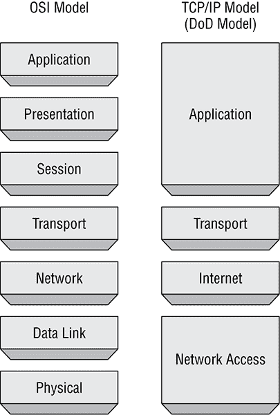

地址系统确保了准确递送到接收者。在正常的网络操作中，主机不应该接收针对其他主机的数据，因为数据包应该只被预期的接收者接收。简单来说，数据只应该被具有正确 `IP` 和 `MAC` 地址的站点接收。然而，我们知道嗅探器确实会接收并非针对它们的数据。


## 邮件递送与黑客有什么关系？

在现实世界中，有时邮件不会递送给预期的接收者。我确定你都曾打开过邮箱箱，发现一封写给你的邻居或以前住在你地址的人的信封。这种情况在我家里经常发生。大多数人只会把邮件留在箱子里，让邮政递员重新递送，或者将信封物理上交给邻居。计算机网络中也可能发生同样的情况，由于递送错误或其他网络故障，应用层数据无法到达其预期的接收者。

预期的接收者未收到邮件的另一个原因是有人正在进行侦察并观察你的邮箱箱。假设你不在家，邮政递员将你的邮件投到了邮箱箱里。在街上或附近建筑观察邮箱箱的人可以等邮件投递后，然后从箱子里拿走邮件或仅仅是某封特定的信封。如果黑客执行了某些侦察并知道每天邮件递送的时间，这种方法将会特别有效。黑客随后可以检查并读取信封中的信息，如果他们试图掩盖踪迹，只需重新封好信封并将其放回邮箱箱即可。

在网络上嗅探数据的情况与此相似。数据被拦截、读取，然后发送给预期的接收者，或者直接丢弃。

除了理解网络地址外，理解 `TCP` 头部的格式也很重要。图 6-2 显示了 `TCP` 头部格式。

**图 6-2 TCP 头部格式**

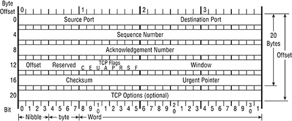

`TCP` 头部由以下字段组成：

*   **源端口 (Source Port)**：16 位，源端口号。
*   **目的端口 (Destination Port)**：16 位，目的端口号。
*   **序列号 (Sequence Number)**：32 位，此段中第一个数据字节的序列号（`SYN` 存在除外）。如果 `SYN` 存在，则序列号为初始序列号 (`ISN`)，第一个数据字节为 `ISN+1`。
*   **确认号 (Acknowledgment Number)**：32 位，如果 `ACK` 控制位被设置，此字段包含该段发送者期望接收的下一个序列号的值。
*   **数据偏移量 (Data Offset)**：4 位，`TCP` 头部中 32 位单词的数量。这指示了数据开始的位置。
*   **预留位 (Reserved)**：6 位，预留供未来使用。必须为 0。
*   **控制位 (Control Bits)**：6 位
    *   `URG`：紧急指针字段有效
    *   `ACK`：确认字段有效
    *   `PSH`：推送功能
    *   `RST`：重置连接
    *   `SYN`：同步序列号
    *   `FIN`：发送者无更多数据
*   **窗口 (Window)**：16 位，从确认字段中指定的字节开始的数据字节数，该段的发送者愿意接收的数量。
*   **校验和 (Checksum)**：16 位，校验和字段是所有字段的计算结果，以确保所有数据均已接收且数据在传输过程中未被修改。
*   **紧急指针 (Urgent Pointer)**：16 位，此字段通信紧急指针的当前值，作为此段中序列号的正偏移量。紧急指针指向紧急数据之后字节的序列号。此字段仅在设置了 `URG` 控制位的段中才被解释。
*   **选项 (Options)**：可变，选项可能会占用 `TCP` 头部末尾的空间，且长度为 8 位的倍数。

在引用 `TCP` 头部字段的长度时，8 位组成一个字节。一个半字节（`Nibble`）小于一个字节，一个字（`Word`）大于一个字节。

在下一节中，我们将探讨嗅探器如何操作网络以捕获非预期的接收者的流量。

## 嗅探器的工作原理

嗅探器通过捕获并非针对嗅探器系统 `MAC` 地址而是针对目标 `MAC` 地址的数据包来工作，这被称为混杂模式。通常情况下，网络上的系统只读取发送给其 `MAC` 地址的数据。然而，许多黑客工具会将 `NIC` 设置为混杂模式。在混杂模式下，`NIC` 读取所有流量。混杂模式通过安装特殊软件在网卡上启用。许多用于嗅探的黑客工具包含一个混杂模式驱动程序。并非所有的 Windows 驱动程序都支持混杂模式，因此在使用黑客工具时要确保支持该模式。

任何不加密数据的协议都容易受到嗅探。`HTTP`、`POP3`、简单网络管理协议 (`SNMP`) 和 `FTP` 等协议经常被嗅探器捕获供黑客查看，以获取用户名和密码等贵贵信息。

针对网络嗅探器的最佳安全防护是加密。虽然加密不能防止嗅探，但它使得在嗅探攻击期间捕到的任何数据变得无效，因为黑客无法解释这些信息。如 `AES`、`RC4` 或 `RC5` 等加密技术可 VPN 技术，并常用于防止网络嗅探。

## 防护工具

`NetIntercept` 是一种垃圾邮件和病毒防火墙。它具有高级过滤选项，并能在识别新垃圾邮件时学习和适应。它还能拦截并隔离最新的电子邮件病毒和木马，防止木马被安装并可能安装嗅探器。

`Sniffdet`是一套用于 `TCP/IP` 网络环境中远程嗅探器检测的测试集。`Sniffdet` 实现了针对混杂模式运行或带有嗅探器的机器的各种测试。

`WinTCPKill` 是一个适用于 Windows 的 `TCP` 连接终止工具。该工具需要使用嗅探器来嗅探目标的入站和出口流量。在交换网络中，`WinTCPKill` 可以使用 ARP 缓存投毒工具执行 ARP 欺骗。

## 绕过交换机的局限性

由于以太网交换机的工作方式，在交换网络上进行嗅探收集有用信息更为困难。由于大多数现代网络已从集线器升级为交换机，在交换网络上进行嗅探需要更多的努力。一种方法是使用 ARP 投毒欺骗交换机将数据发送到黑客的计算机。

## ARP 如何工作

`ARP` 允许网络将 `IP` 地址转换为 `MAC` 地址。当局域网上使用 `TCP/IP` 的主机尝试联系另一个主机时，它需要目标主机的 `MAC` 地址或硬件地址。它首先查看 ARP 缓存检查是否已拥有该 `MAC` 地址；如果没有，它会广播一个 ARP 请求：“谁拥有我要找的 IP 地址？”如果拥有该 `IP` 地址的主机听到 ARP 查询，它会返回自己的 `MAC` 地址，然后就可以使用 `TCP/IP` 开始对话。

ARP 投毒是一种用于攻击以太网的技术，它可能让攻击者嗅探交换局域网上的数据帧，或完全停止流量。ARP 投毒利用 ARP 欺骗，其目的是向以太局域网发送虚假的或伪造的 ARP 消息。这些帧包含错误的 `MAC` 地址，会误导网络交换机等网络设备。结果是发往某台机器的帧可能会被错误发送到另一台机器（允许数据包被嗅探）或发送到不可达的主机（拒绝服务攻击，或 `DoS`）。ARP 欺骗也可用于中间人攻击，其中所有流量通过 ARP 欺骗转发通过一个主机，并对密码和其他信息进行分析。

## ARP 欺骗和投毒防护措施

为了防止 ARP 欺骗，可以将网关的 `MAC` 地址永久添加到系统的 ARP 缓存中。你可以在 Windows 系统上通过在命令行使用 `ARP -s` 命令并附加网关的 IP 和 MAC 地址来实现这一点。这样做可以防止黑客覆盖 ARP 缓存以对系统执行 ARP 欺骗，但由于系统数量众多，在大型环境中可能难以管理。在企业环境中，可以在交换机上开启端口安全功能，允许每个交换端口仅对应一个 `MAC` 地址。

在练习 6-1 中，你将使用 `Wireshark` 嗅探流量。

### 练习 6-1：使用 Wireshark 嗅探流量

1. 从 [www.wireshark.org](http://www.wireshark.org) 下载并安装 `Wireshark` 的最新稳定版本。
2. 点击 `Capture`（捕获）菜单，选择 `interfaces`（接口）。

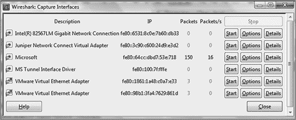

3. 点击显示正在发送和接收数据包的接口旁的启动按钮。如果你有多个具有数据活动的接口，请选择其中一个——最好是活动频繁的接口。
4. 点击数据包以分析单个数据包。详细头部将显示在数据包捕获屏幕下方。
5. 展开数据包的每个头部（`IP`、`TCP`）并识别地址信息。

如果在集线器而非交换机上执行此练习，将产生更多的网络流量。可以使用无线网络，因为无线局域网是一个共享网络网段，类似于集线器的工作方式。

## 黑客工具

`Wireshark` 是一款免费的嗅探器，可以从有线或无线局域网连接捕获数据包。该软件以前称为 `Ethereal`。`Wireshark` 是一个常用且流行的程序，因为它是免费的，但也有一些缺点。未经训练的用户可能会发现很难在 `Wireshark` 中编写过滤器来仅捕获特定类型的流量。

`Snort` 是一种入侵检测系统 (`IDS`)，也具有嗅探功能。它可以用于检测各种攻击和探测，例如缓冲区溢出、隐身端口扫描、通用网关接口 (`CGI`) 攻击、服务器消息块 (`SMB`) 探测和操作系统指纹识别尝试。

`WinDump` 是 `tcpdump` 的 Windows 版本，`tcpdump` 是 Unix 的命令行网络分析器。`WinDump` 完全兼容 `tcpdump`，可以根据各种规则观察、诊断并将网络流量保存到磁盘。

`EtherPeek` 是一款非常强大的有线网络嗅探器，具有广泛的过滤和 `TCP/IP` 会话跟踪功能。`EtherPeek` 的最新版本已重命名为 `OmniPeek`。

`WinSniffer` 是一款高效的密码嗅探器。它监控入站和出口网络流量，并解码 `FTP`、`POP3`、`HTTP`、`ICQ`、简单邮件传输协议 (`SMTP`)、`telnet`、互联网消息访问协议 (`IMAP`) 以及网络新闻传输协议 (`NNTP`) 的用户名和密码。

`Iris` 是一种高级数据分析器，用于、组织和报告所有网络流量。

## Wireshark 过滤器

`Wireshark` 是一款免费的嗅探器，可以从有线或无线局域网连接捕获数据包。该软件以前称为 `Ethereal`。`Wireshark` 是一个常用且流行的程序，因为它是免费的，但也有一些缺点。未经训练的用户可能会发现很难在 `Wireshark` 中编写过滤器来仅捕获特定类型的流量。

`Wireshark` 是一个非常强大的工具，可以提供网络和上层数据。它使用 `pcap` 网络库捕获数据。

在练习 6-1 中，你安装了 `Wireshark` 并开始捕获数据包。为了缩小 Wireshark 收集的信息，可以使用过滤器。这些过滤器限制了捕获的信息。

以下是一些 Wireshark 过滤器的示例：

`ip.dst eq www.wireshark.org` 设置仅捕获指向 [www.wireshark.org](http://www.wireshark.org) Web 服务器的数据包。

`ip.src == 192.168.1.1` 设置仅捕获来自 192.168.1.1 主机的数据包。

`eth.dst eq ff:ff:ff:ff:ff` 设置仅捕获二层广播数据包。

`host 172.18.5.4` 设置仅捕获来自或指向 IP 地址 172.18.5.4 的流量。

`net 192.168.0.0/24` 设置仅捕获来自或指向 IP 地址范围的流量。

`port 80` 设置仅捕获目标端口 80 (`HTTP`) 的流量。

`port 80 and tcp[((tcp[12:1] & 0xf0) >> 2):4] = 0x47455420` 设置过滤器以捕获 HTTP GET 请求。该过滤器在 TCP 头部之后寻找字节“G”、“E”、“T”和“ ”（十六进制值 47, 45, 54 和 20）。`tcp[12:1] & 0xf0) >> 2` 计算 TCP 头部长度。

练习 6-2 展示了你如何在 Wireshark 中编写过滤器。

### 练习 6-2：创建一个 Wireshark 过滤器以捕获指向或来自特定 IP 地址的流量

1. 打开 `Wireshark`。
2. 点击活跃的网络接口以捕获流量。
3. 点击 `Capture`（捕获），然后选择 `filters`（过滤器）。

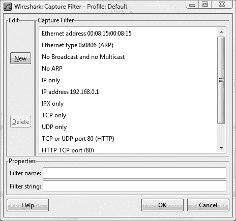

4. 点击新建按钮创建一个新过滤器。
5. 在过滤器名称字段中为新过滤器命名。
6. 在过滤器字符串字段中输入 `host IP IPaddress`。
7. 点击 `OK`。
8. 选择捕捉菜单并点击 `start` 开始捕获。

重复上述步骤，使用以下字符串创建过滤器：

`net 192.168.0.0/24` 用于捕获进入或离开 IP 地址范围的流量。

`src net 192.168.0.0/24` 用于捕获来自 IP 地址范围的流量。

`dst net 192.168.0.0/24` 用于捕获发往 IP 地址范围的流量。

`port 53` 用于仅捕获 DNS (`port 53`) 流量。

`host www.example.com and not (port 80 or port 25)` 用于捕获你服务器上的非 HTTP 和非 SMTP 流量。

`port not 53 and not arp` 用于捕获除 ARP 和 DNS 以外的所有流量。

`tcp portrange 1501-1549` 用于捕获端口范围内的流量。

`not broadcast and not multicast` 仅捕获单播流量。如果你只想查看进出你机器的流量，此方法有助于消除网络上的噪声。

在 Wireshark 中练习编写过滤器，以仅捕获一种类型的协议流量或来自特定源 IP 或 MAC 地址的流量。使用你电脑的 IP 或 MAC 地址来测试过滤器是否正常工作。

在尝试 CEH 考试之前，理解如何创建这些过滤器非常重要。

## 理解 MAC 泛洪和 DNS 欺骗

交换机网络上的数据包嗅探器无法像在集线器网络上那样捕捉所有流量；相反，它捕捉来自或进入系统的流量。需要使用额外的工具来捕捉交换机网络上的所有流量。基本上有两种方法执行主动嗅探并让交换机将流量发送到运行嗅探器的系统：

- `ARP Spoof` 该方法涉及使用网络网关的 `MAC` 地址，从而在嗅探系统上接收所有旨在发往网关的流量。黑客还可以向交换机注入大量流量，使其停止作为交换机运行，而是变回集线器模式，将所有流量发送到所有端口。这种主动嗅探攻击允许运行嗅探器的系统捕捉网络上的所有流量。


许多交换机已经经过修补或重新设计，不再受泛洪漏洞的影响。


# DNS 欺骗与嗅探

## DNS 欺骗（DNS Spoofing）

`DNS Spoofing (or DNS Poisoning)` 这种技术（DNS 欺骗）可以欺骗 DNS 服务器，使其认为已经收到了真实信息，而实际上并未收到。一旦 DNS 服务器被投毒，错误信息通常会缓存一段时间，从而将攻击的影响扩散到该服务器的所有用户。当用户请求某个网站 URL 时，会在 DNS 服务器上查找地址以找到对应的 IP 地址。如果 DNS 服务器被攻破，用户将被重定向到请求网站之外的其他网站，例如虚假网站。

要执行 DNS 攻击，攻击者会利用 DNS 服务器软件的漏洞，该漏洞可以使其接受错误信息。如果服务器没有正确验证 DNS 响应以确保其来自权威源，服务器最终会在本地缓存错误的条目，并向后续请求的用户提供这些条目。

这种技术可用于将受害者的任意内容替换为攻击者选择的内容。例如，攻击者在指定的 DNS 服务器上污染目标网站的 IP 地址 DNS 条目，将其替换为黑客控制的服务器的 IP 地址。黑客随后在该服务器上的文件创建伪条目，名称与目标服务器上的文件匹配。这些文件可能包含恶意内容，例如蠕虫或病毒。引用了被投毒 DNS 服务器的用户会被欺骗，认为内容来自目标服务器，并在不知情的情况下下载了恶意内容。

DNS 欺骗技术类型如下：

- `Intranet Spoofing`（内网欺骗）：充当同一内部网络上的设备。
- `Internet Spoofing`（互联网欺骗）：充当互联网上的设备。
- `Proxy Server DNS Poisoning`（代理服务器 DNS 投毒）：修改代理服务器上的 DNS 条目，使用户重定向到不同的主机系统。
- `DNS Cache Poisoning`（DNS 缓存投毒）：修改任何系统上的 DNS 条目，使用户重定向到不同的主机。

## 黑客工具

`EtherFlood` 用于向以太网交换机注入流量，使其变回集线器。通过这种方式，黑客能够捕捉网络上的所有流量，而不仅仅是像交换机那样仅捕捉进出其系统的流量。

`dsniff` 是一组 Unix 可执行工具，旨在执行网络审计以及网络渗透。`dsniff` 包含了以下工具：`filesnarf`、`mailsnarf`、`msgsnarf`、`urlsnarf` 和 `webspy`。这些工具被动监控脆弱的共享网络（例如嗅探器位于外部防火墙后的局域网），寻找感兴趣的数据（如密码、电子邮件、文件等）。

`Sshmitm` 和 `webmitm` 实现针对被重定向的安全 Shell（`SSH`）和 HTTPS 会话的主动中间人攻击。

`Arpspoof`、`dnsspoof` 和 `macof` 工作于拦截交换机网络流量，由于交换机机制，这些流量通常是嗅探程序无法获取的。为了绕过二层数据包交换问题，`dsniff` 会欺骗网络，使其认为它是必须通过的网关。

`IP Restrictions Scanner (IRS)` 用于发现为特定服务设置的 IP 限制。它结合了 ARP 投毒和 TCP 隐身扫描技术来发现访问控制列表（ACL）、IP 过滤器和防火墙规则。

`sTerm` 是一个 telnet 客户端，具有独特的功能：它可以在不发送真实 IP 和 MAC 地址的情况下与目标主机建立 telnet 会话。通过 ARP 投毒、MAC 欺骗和 IP 欺骗，`sTerm` 可以有效绕过 ACL、防火墙规则和 IP 限制。

`Cain & Abel` 是适用于 Windows 的功能强大的黑客工具。它通过嗅探网络恢复各种密码；使用字典或暴力破解破解加密密码；记录网络语音（VoIP）对话；解码加密密码；发现缓存密码；分析路由协议。最新版本包含了许多新功能，例如 ARP 投毒路由（`APR`），它能够在交换局域网中进行嗅探。该版本的嗅探器还可以分析加密协议，如 `SSH-1` 和 `HTTPS`，并包含了各种身份验证机制的过滤器。

`Packet Crafter` 是用于创建自定义 TCP/IP/UDP 包的工具。该工具可以更改包的源地址进行 IP 欺骗，并控制 IP 标志（如校验和）和 TCP 标志（如状态标志、序列号和确认号）。

`SMAC` 是用于更改系统 MAC 地址的工具。它让黑客在执行攻击时可以欺骗 MAC 地址。

`MAC Changer` 是在 Unix 上用于欺骗 MAC 地址的工具。它可以将网络接口设置为特定的 MAC 地址、随机设置 MAC、设置另一个厂商的 MAC、设置同一厂商的其他 MAC、设置同类型的 MAC，或显示供选择的厂商 MAC 列表。

`WinDNSSpoof` 是一个适用于 Windows 的简单 DNS ID 欺骗工具。要在交换机网络上使用它，你必须能够嗅探攻击计算机的流量。因此，它可能需要与 ARP 欺骗或泛洪工具配合使用。

分布式 DNS 洪水通过发送大量查询来创建 DoS 攻击，导致 DNS 瘫痪。如果 DNS 守护程序记录了错误的查询，这种攻击的影响将被放大。

## 总结

嗅探是 CEH（认证伦理黑客）工具包中不可或缺的工具。嗅探可以用于被动收集信息并捕获密码等珍贵数据。嗅探的优势是它可以被动进行，且在被动模式下使用时几乎无法被检测。如果被动嗅探无法获得 CEH 想要收集的信息，则可以使用更具攻击性的嗅探方法，例如 ARP 投毒和 DNS 欺骗。但请注意，这些主动方法可能会被检测到并警报安全人员网络正受到攻击。

## 考试要点

- 理解嗅探器的工作原理。嗅探器在混杂模式下运行，这意味着它无论数据帧中指定的目标 MAC 地址是什么，都会捕获所有流量。
- 理解在通过集线器连接的共享网络与交换机网络中进行嗅探的区别。所有流量都由集线器广播，但会由交换机进行分段。要在交换机网络上进行嗅探，必须使用泛洪或 ARP 欺骗工具。
- 了解数据包（`packets`）和帧（`frames`）的区别。数据包在 OSI 模型的第 3 层创建，而帧在第 2 层创建。
- 理解地址解析协议（`ARP`）的工作原理。`ARP` 通过在网络上广播请求，根据已知的 IP 地址查找 MAC 地址。
- 了解主动嗅探和被动嗅探的区别。主动嗅探用于欺骗交换机使其表现像集线器一样工作，从而将流量转发给攻击者。被动嗅探则捕获已经在共享网络上广播的数据包。

## 复习题

1. 什么是嗅探？
   - A. 在网络上发送损坏的数据以欺骗系统
   - B. 捕获并破解网络上的流量
   - C. 破坏目标系统上的 ARP 缓存
   - D. 执行密码破解攻击

2. 对被动嗅探的应对措施是什么？
   - A. 实现交换机网络
   - B. 实现共享网络
   - C. ARP 欺骗
   - D. 基于端口的安全

3. 哪种类型的设备连接共享网络上的系统？
   - A. 路由器
   - B. 网关
   - C. 集线器
   - D. 交换机

4. 下列哪项是应对 ARP 欺骗的措施？
   - A. 基于端口的安全
   - B. `WinTCPkill`
   - C. `Wireshark`
   - D. 基于 MAC 的安全

5. `dsniff` 是什么？
   - A. 一个 MAC 欺骗工具
   - B. 一个 IP 地址欺骗工具
   - C. 黑客工具合集
   - D. 一个嗅探器

6. 数据在 OSI 模型的哪一层被格式化为数据包？
   - A. 第 1 层
   - B. 第 2 层
   - C. 第 3 层
   - D. 第 4 层

7. 什么是 `snort`？
   - A. 一个 IDS（入侵检测系统）和数据包嗅探器
   - B. 仅 IDS
   - C. 仅数据包嗅探器
   - D. 仅帧嗅探器

8. 网卡必须在什么模式下运行才能嗅探？
   - A. 共享
   - B. 未加密
   - C. 开放
   - D. 混杂

9. 针对任何类型嗅探的最佳防御是 ____________________。
   - A. 加密
   - B. 交换机网络
   - C. 基于端口的安全
   - D. 良好的安全培训计划

10. `WinSniffer` 可以捕获哪种流量密码？（选择所有适用项）
    - A. POP3
    - B. SMTP
    - C. HTTP
    - D. HTTPS

11. 下列哪些软件工具可以执行嗅探？（选择所有适用项）
    - A. `Dsniff`
    - B. `Wireshark`
    - C. `NetBSD`
    - D. `Netcraft`

12. 数据在 OSI 模型的哪一层被格式化为帧？
    - A. 第 1 层
    - B. 第 2 层
    - C. 第 3 层
    - D. 第 4 层

13. MAC 地址位于哪种类型的头部中？
    - A. 第 1 层
    - B. 第 2 层
    - C. 第 3 层
    - D. 第 7 层

14. IP 地址位于哪种类型的头部中？
    - A. 第 1 层
    - B. 第 2 层
    - C. 第 3 层
    - D. 第 7 层

15. 端口号出现在哪个头部中？
    - A. IP
    - B. MAC
    - C. 数据链路
    - D. 传输

16. 仅捕获从 IP 地址 `131.1.4.7` 发出的流量的正确 Wireshark 过滤器是？
    - A. `ip.src == 131.1.4.7`
    - B. `ip.address.src == 131.1.4.7`
    - C. `ip.source.address == 131.1.4.7`
    - D. `src.ip == 131.1.4.7`

17. 哪种 Wireshark 过滤器将捕获到 `www.google.com` 的流量？
    - A. `ip.dst = www.google.com`
    - B. `ip.dst eq www.google.com`
    - C. `ip.dst == www.google.com`
    - D. `http.dst == www.google.com`

18. 密码位于 OSI 模型的哪一层？
    - A. 应用层
    - B. IP 层
    - C. 数据链路层
    - D. 物理层

19. `Wireshark` 以前被称为 ____________________。
    - A. 数据包嗅探器
    - B. `Ethereal`
    - C. `EtherPeek`
    - D. `SniffIT`

20. `Cain & Abel` 可以执行以下哪些功能？（选择所有适用项）
    - A. 嗅探
    - B. 数据包生成

## 复习题答案

1. B. 捕获并破解网络上的流量。
2. A. 实现交换机网络防止被动嗅探。
3. C. 集线器连接共享网络上的系统。
4. A. 基于端口的安全防止 ARP 欺骗。
5. D. `dsniff` 是一个嗅探器。
6. C. 数据在第 3 层格式化为数据包。
7. A. `snort` 是一个 IDS 和数据包嗅探器。
8. D. 网卡必须在混杂模式下运行才能嗅探。
9. A. 加密是对任何类型嗅探的最佳防御。
10. A, B, C. `WinSniffer` 可以捕获 POP3、SMTP 和 HTTP 的密码。
11. A, B. `Dsniff` 和 `Wireshark` 是可以执行嗅探的软件工具。
12. B. 数据在第 2 层格式化为帧。
13. B. MAC 地址位于第 2 层头部中。
14. C. IP 地址位于第 3 层头部中。
15. D. 端口号出现在传输层中。
16. A. `ip.src == 131.1.4.7` 是捕获从 IP 地址 `131.1.4.7` 发出的流量的正确过滤器。
17. C. `ip.dst == www.google.com` 将仅捕获到 `www.google.com` 的流量。
18. A. 密码位于应用层。
19. B. `Wireshark` 以前被称为 `Ethereal`。
20. A, B. `Cain & Abel` 可以执行嗅探和数据包生成。

---

# 拒绝服务与会话劫持

## 本章涵盖的 CEH 考试目标

- 理解 DoS 攻击的类型
- 理解 DDoS 如何工作
- 理解机器人/僵尸网络如何工作
- 什么是“smurf”攻击？
- 什么是“SYN”洪水攻击？
- 描述 DoS/DDoS 应对措施
- 理解欺骗与劫持
- 列出会话劫持的类型
- 理解序列预测
- 执行会话劫持的步骤有哪些？
- 描述如何防止会话劫持

在拒绝服务（DoS）攻击期间，黑客通过过载资源或阻止合法用户访问系统，导致系统无法使用或显著降低系统速度。这些攻击可以针对单个系统或整个网络，并且通常是成功的。这种攻击针对的是可用性。

会话劫持是一种黑客手段，当攻击者接管会话时会对用户产生临时 DoS。会话劫持被黑客用于在用户建立验证会话后接管。会话劫持还可以用于实施中间人攻击，即黑客插在服务器和合法客户端之间并拦截所有流量。

本章解释了 DoS 攻击、分布式拒绝服务（DDoS）攻击以及会话劫持的要素，例如欺骗方法、TCP 三次握手、序列号预测以及黑客如何使用工具进行会话劫持。此外，在本章结尾将讨论 DoS 和会话劫持的应对措施。

DoS 攻击是黑客试图淹没用户或组织系统的尝试。作为一名认证黑客专家（CEH），你需要熟悉 DoS 攻击的类型，并理解 DoS 和 DDoS 攻击的工作原理。你还需要熟悉机器人（`BOTs`）和机器人网络（`BOTNETs`），以及 smurf 攻击和 SYN 洪泛。最后，作为一名 CEH，你需要熟悉各种 DoS 和 DDoS 的防御措施。

DoS 攻击主要分为两类：

- 由单个系统发送到单个目标的攻击（简单 DoS）
- 由多个系统发送到单个目标的攻击（分布式拒绝服务，或 DDoS）

DoS 的目的不是获取对机器或数据的未授权访问权限，而是防止服务的合法用户使用该服务。DoS 攻击可能会导致以下后果：

- 用流量淹没网络，从而阻止合法的网络流量。
- 中断两台机器之间的连接，从而阻止访问服务。
- 防止特定个人访问服务。
- 中断对特定系统或人员的服务。

不同的工具使用不同的流量来淹没受害者，但结果是相同的：由于系统上的服务或整个系统正忙于响应海量的请求，导致用户无法使用。


### 拒绝服务攻击：真实案例

2008 年 5 月 28 日晚上，我工作的公司（`alfasystems.com`）突然断开了互联网连接。其 Web 服务器无法再从互联网访问。

在攻击开始的一分钟内，Alpha Systems 的工程师就清楚他们正在遭受某种“数据包洪泛”攻击。在查看了他们的 `Cisco` 路由器的日志文件后，显示连接互联网的两个 `T1` 中继接口都以 1.54 Mbps 的最大速率接收着某种流量，而他们的出站流量已下降到接近零。他们淹没在恶意流量的洪流中，合法流量无法出去。Alpha Systems 是拒绝服务攻击的受害者，这种攻击通常被称为 `DoS`。工程师们知道他们必须采取行动来停止攻击，并让 Web 服务器恢复正常并供客户访问。但没有人真的知道该怎么办，因为这种情况以前在系统中从未发生过。这时，有人想到了路由器的包过滤功能。

幸运的是，由于这种 `DoS` 攻击很容易被过滤，Alpha Systems 能够剔除坏数据包并将服务恢复到近乎正常的运行。两分钟内，Alpha Systems 的工程师对他们的路由器应用了“暴力”过滤器，关闭了所有 `UDP` 和 `ICMP` 流量，`alfaystems.com` 立即恢复了互联网连接。

最后确定，他们的服务器遭受了 474 台受安全侵害的 `Windows` PC 的攻击，这些 PC 包含了远程控制“僵尸”，这是一场由这数百台个人 PC 协作产生的经典 `DoS` 攻击。

`DoS` 攻击通常是最后的手段。它被认为是一种低级攻击，因为它并不能让黑客获取任何信息，而是骚扰目标并中断其服务。当从多个系统同时发送时（`DDoS` 攻击），`DoS` 攻击可能具有破坏性并产生重大影响。

### 黑客工具

`死亡之 ping`（Ping of Death）是一种通过发送多个 `IP` 数据包导致系统锁死的攻击，这些数据包在重组时对于接收系统来说太大了。`死亡之 ping` 会导致尝试访问受攻击服务器的客户端发生 `DoS`。

`SSPing` 是一个向目标系统发送多个大型分片互联网控制消息协议（`ICMP`）数据包的程序，会导致接收数据包的计算机在尝试重组分片时冻结。

`LAND` 攻击向系统发送数据包，其源 `IP` 设置为匹配目标系统的 `IP` 地址。结果是系统尝试响应自己，导致系统创建循环——这将占用系统资源并最终可能导致操作系统崩溃。

`CPUHog` 是一种 `DoS` 攻击工具，消耗目标系统上的 `CPU` 资源，使用户无法使用。

`WinNuke` 是一个寻找开启了端口 `139` 的目标系统并向该端口上的系统发送垃圾 `IP` 流量的程序。这种攻击也被称为越界攻击（`OOB`），会导致 `IP` 栈过载——最终系统崩溃。

`Jolt2` 是一个 `DoS` 工具，它发送大量分片数据包到目标系统，导致用户无法使用。

*注：原文中 `WinNuke` 和 `Jolt2` 的描述存在重复，此处已去重处理。*

`Stacheldraht` 与 TFN 类似，包含了 ICMP 泛洪、UDP 泛洪和 TCP SYN 攻击选项。它还在攻击者和代理系统（次级受害者）之间提供了一个安全的 telnet 连接（使用对称密钥加密）。这防止了系统管理员截获并识别此类流量。

`Mstream` 使用设置了 ACK 标志的伪造 TCP 数据包来攻击目标。它由一个处理器（handler）和一个代理部分（agent portion）组成，但访问处理器需要密码保护。

受攻击的服务是主受害者的服务；而用于发起攻击的受损系统是次级受害者。这些向主受害者发送 DDoS 攻击的受损系统被称为僵尸（`zombies`）或 `BOT`。它们通常通过另一种攻击被攻破，然后在特定时间或特定条件下对主受害者发起攻击。由于攻击源自多个 IP 地址，追踪攻击来源可能非常困难。

通常，DDoS 由三部分组成：

- 主节点/处理器（Master/handler）
- 从节点/次级受害者/僵尸/代理/BOT/机器人网络（Slave/secondary victim/zombie/agent/BOT/BOTNET）
- 受害者/主受害者（Victim/primary victim）

主节点是攻击发起者。从节点是被主节点攻破并受控制的主机。受害者是目标系统。主节点指示从节点对受害者系统发起攻击。

图 7-1: DDoS 攻击中的主节点与从节点

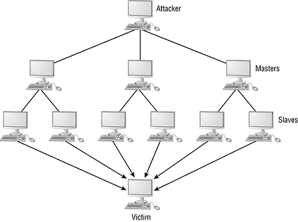


DDoS 分两个阶段。在入侵阶段，黑客攻破全球不同网络中的弱弱系统，并在这些受损的从节点系统上安装 DDoS 工具。在 DDoS 攻击阶段，从节点系统被触发，导致它们对主受害者发起攻击。请参见图 7-2。

图 7-2：Bot 或僵尸系统

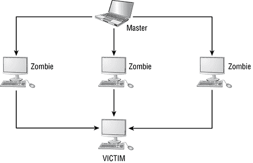

### Bot/机器人网络的工作原理

Bot 是 web robot（网络机器人）的缩写，是一种具有智能的自动化软件程序。垃圾邮件者经常使用 Bot 自动在新闻组中发布垃圾信息或发送电子邮件。Bot 也可以作为远程攻击工具。大多数情况下，Bot 是与网页交互的 Web 软件代理。例如，爬虫（蜘蛛）是收集网页信息的网络机器人。

最危险的 Bot 是那些为了恶意目的隐蔽地安装在用户计算机上的程序。

某些 Bot 通过即时消息、互联网中继聊天（IRC）或其他 Web 接口与互联网服务的其他用户通信。这些 Bot 允许 IRC 用户使用纯英语提问，然后形成适当的回复。此类 Bot 通常可以处理许多任务，包括报告天气；提供邮政编码信息；列出体育比分；转换单位（如货币）等。

Botnet（机器人网络）是一组 Bot 系统。机器人网络有多种用途，包括 DDoS 攻击；创建或滥用简单邮件传输协议（SMTP）邮件中继发送垃圾邮件；互联网营销欺诈以及盗取应用程序序列号、登录 ID 和信用卡号等财务信息。通常，Botnet 指一组为了运行 Bot 旨在发起协同 DDoS 攻击的受损系统。请参见图 7-3。

图 7-3：分布式 DoS 攻击结构

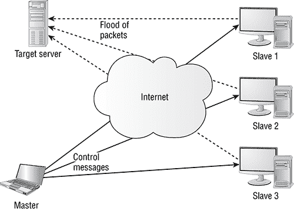

### Smurf 攻击与 SYN 泛洪

Smurf 攻击向广播 IP 地址发送大量 ICMP Echo（ping）流量，其源地址伪造为受害者。该 IP 网络上的每个次级受害者主机都会用 Echo 回复响应 ICMP Echo 请求，使流量按响应主机的数量成倍增加。在多访问广播网络上，数百台机器可能会对每个数据包做出响应。这创建了一个放大的 ping 回复 DoS 攻击，淹没了主受害者。IRC 服务器是互联网上 smurf 攻击的主要受害者。

SYN 泛洪攻击发送 TCP 连接请求的速度快于机器处理的速度。攻击者为每个数据包创建一个随机源地址，并设置 SYN 标志以请求从伪造的 IP 地址向服务器建立新连接。受害者对伪造的 IP 地址做出响应，然后等待永远不会到达 TCP 确认。因此，受害者的连接表因等待回复而填满；表满后，所有新连接都会被忽略。合法用户也会被忽略且无法访问服务器。

可以通过使用 `netstat` 命令检测到 SYN 泛洪攻击。遭受 SYN 泛洪攻击的系统的 `netstat` 输出示例在图 7-4 所示。

以下是一些用于防止 SYN 泛洪攻击的方法：

- `SYN Cookies`：SYN cookies 确保服务器在完成成功的三次握手之前不分配系统资源。
- `RST Cookies`：本质上是服务器用错误的 SYN ACK 响应客户端的 SYN 帧。随后客户端应生成一个 `RST` 包。
- `Micro Blocks`：微块通过仅为连接记录分配极小空间来防止泛洪攻击。
- 栈调整（Stack Tweaking）：这种方法涉及更改 TCP/IP 栈以防止泛洪攻击。栈调整技术包括选择性地丢弃进入连接或在栈释放内存。

图 7-4：SYN 泛洪攻击下的 `netstat` 输出


在练习 7-1 中，你将学习如何防止 SYN 泛洪攻击。

1. 点击开始 ⇒ 运行并输入 `regedit` 运行注册表编辑器。
2. 导航到 `HKLM\System\CurrentControlSet\Services\Tcpip\Parameters` 注册键。
3. 向注册键添加 `SynAttackProtection=2` DWORD 值。
4. 关闭 `regedit` 程序。

此更改将允许操作系统处理更多的 SYN 请求。当 `SynAttackProtection` 的值为 2 时，Windows 在完成三次握手之前延迟创建套字。此更改将有效防止 SYN 泛洪攻击占用资源。

### DoS/DDoS 措施

有多种方法可以检测、停止或防止 DoS 攻击。以下是常见的安全功能：

- 入站过滤（Network-Ingress Filtering）：所有网络访问提供商都应实施入站过滤，防止下游网络向互联网注入伪造地址的数据包。虽然这不能阻止攻击发生，但它可以更容易追踪攻击源并快速终止攻击。大多数 IDS、防火墙和路由器都提供入站过滤功能。
- 流量速率限制：市场上的许多路由器具有某些功能，可以限制某些流量消耗的带宽。这有时被称为流量整形。
- 入侵检测系统：使用入侵检测系统（IDS）来检测与从节点、主节点或代理机器通信的攻击者。这可以让你了解网络中的机器是否被用于发起已知攻击，但可能无法检测此类攻击的新变体。大多数 IDS 供应商都有针对 Trinoo、TFN 或 Stacheldraht 网络流量的特征码。

## 自动化网络追踪工具

在网络中追踪带有伪造地址的数据包流是一项耗耗时的任务，它需要所有承载流量的网络协作，并且必须在攻击进行期间完成。

## 主机审计与网络审计工具

目前已有文件扫描工具可以尝试检测系统中是否存在已知的 DDoS 工具客户端和服务器二进制文件。网络扫描工具则尝试检测你网络中主机上运行的 DDoS 代理。

### DoS 扫描工具

`Find_ddos` 是一个用于扫描本地系统的工具，可能可能包含 DDoS 程序。它可以检测多种已知的 DoS 攻击工具。

`S` 通过检查网络服务来收集有关远程主机和网络的信息。这包括有关网络信息服务的信息，以及潜在的安全漏洞，例如设置或配置不当的网络服务、系统或网络工具中的已知漏洞、常见漏洞与暴露（`CVE`）数据库中列出的系统漏洞，以及弱的策略决策。

`RID` 是一个免费的扫描工具，用于检测 `Trinoo`、`TFN` 或 `Stacheldraht` 客户端的存在。

`Zombie Zapper` 指示僵尸程序进入睡眠，从而停止它们的攻击。你可以使用攻击者停止攻击时相同的命令。

## 会话劫持

会话劫持是指黑客在用户成功通过服务器验证后控制用户会话。会话劫持涉及识别客户端/服务器通信的当前会话 ID 并接管客户端会话的攻击。会话劫持是通过执行序列号预测的工具实现的。序列号预测的细节将在本章稍后的序列号预测部分进行讨论。

欺骗攻击与劫持攻击不同。在欺骗攻击中，黑客进行嗅探并监听从发送者到接收者在网络中传输的流量。然后，黑客利用收集到的信息来伪造或使用合法系统的地址。劫持则涉及主动将另一个用户踢下线以执行攻击。攻击者依赖合法用户建立连接并进行身份验证。之后，攻击者接管会话，合法用户的会话会被断开。

会话劫持涉及以下三个步骤以持续攻击：

1. **追踪会话**：黑客识别一个打开的会话并预测下一个数据包的序列号。
2. **使连接不同步**：黑客向合法用户系统发送一个 TCP 重置（`RST`）或结束（`FIN`）数据包，导致其关闭会话。
3. **注入攻击者数据包**：黑客向服务器发送带有预测序列号的 TCP 数据包，服务器将其接受为合法用户的下一个数据包。

黑客可以使用两种类型的会话劫持：主动和被动。主动劫持与被动劫持的主要区别在于黑客对会话的参与程度。在主动攻击中，攻击者找到一个活跃的会话，并使用预测 TCP 会话中使用的下一个序列号的工具接管该会话。

在被动攻击中，攻击者劫持一个会话，然后观察并记录合法用户发送的所有流量。被动会话劫持本质上就是嗅探。它收集密码等信息，然后使用这些信息作为独立会话进行身份验证。

### TCP 概念：三次握手

TCP 的两个关键特性是可靠性和数据包的有序交付。为了实现这些目标，TCP 使用确认（`ACK`）数据包和序列号。操纵这些数字是 TCP 会话劫持的基础。为了理解会话劫持，让我们回顾之前章节描述的 TCP 三次握手：

1. 合法用户与服务器建立连接。这是通过合法用户向服务器发送一个设置了 `SYN` 位和用户初始序列号（`ISN`）的数据包实现的。
2. 服务器接收此数据包并返回一个设置了 `SYN` 位和服务器 `ISN` 的数据包，外设置了 `ACK` 位以标识用户的 `ISN` 增加了一个值 1。
3. 合法用户通过返回一个设置了 `ACK` 位并将服务器的 `ISN` 增加 1 的数据包来确认服务器。

该连接可以由于超时或收到带有 `FIN` 或 `RST` 标志的数据包而从任何端关闭。

收到带有 `RST` 标志的数据包后，接收系统关闭连接，并丢弃该会话的所有传入数据包。如果数据包中设置了 `FIN` 标志，接收系统将执行关闭连接，而在关闭连接期间收到的任何数据包仍会被处理。发送带有 `FIN` 或 `RST` 标志的数据包是劫持者关闭客户端与服务器之间会话并模拟客户端接管会话的最常用方法。

### 序列号预测

TCP 是一种面向连接的协议，负责将数据包流重组为原始预期顺序。每个数据包都必须分配一个唯一的会话号，以便接收机器将数据包流重组为原始预期的顺序；这个唯一数字被称为序列号。如果数据包乱序到达（这在互联网上经常发生），则使用 `SN` 来正确流数据包。正如刚才所示，启动 TCP 会话的系统发送一个设置了 `SYN` 位的数据包。这被称为同步数据包，包含了客户端的 `ISN`。`ISN` 是一个伪随机生成的数字，具有超过 40 亿种可能的组合，但在统计学上它是有重复可能的。

当发送 `ACK` 数据包时，每台机器都会使用被确认数据包的 `SN` 加上增量。这不仅正确地确认了特定数据包的接收，还告诉发送者下一个预期的 TCP 数据包 `SN`。在三次握手中，增值为 1。在正常数据通信中，增量等于数据的字节数（例如，如果你传输了 45 字节的数据，`ACK` 将使用传入数据包的 `SN` 加上 45 进行响应）。

`图 7-5` 展示了 TCP 三次握手期间使用的序列号和确认号。

`Juggernaut` 是一个可用于劫持 `TCP` 会话的网络嗅探器。它运行在 Linux 操作系统上，可以监控所有的网络流量，也可以通过提供如密码之类的关键词进行查找。该程序显示所有活跃的网络连接，攻击者随后可以选择一个会话进行劫持。

`Hunt` 是一个可用于嗅探和劫持网络活跃会话的程序。`Hunt` 执行连接管理、地址解析协议（`ARP`）欺骗、连接重置、连接监控、介质访问控制（`MAC`）地址发现以及 `TCP` 流量嗅探。

`TTYWatcher` 是一种会话劫持实用程序，允许劫持者将被盗的会话返回给合法用户，仿佛从未被劫持过一样。`TTYWatcher` 仅适用于 Sun Solaris 系统。

`IP Watcher` 是一种会话劫持工具，允许攻击者监控连接并接管会话。该程序可以监控网络上的所有连接，允许攻击者实时查看会话的精确副本。

`T-Sight` 是一种用于 Windows 的会话监控和劫持工具，可以在发生网络入侵或破解尝试时提供帮助。通过 `T-Sight`，系统管理员可以实时监控所有网络连接并观察任何可疑活动。`T-Sight` 还可以劫持网络上的任何 `TCP` 会话。出于安全考虑，En Garde Systems 仅向预定的 IP 地址授权此软件。

远程 TCP 会话重置工具显示当前的 `TCP` 会话和连接信息，例如 IP 地址和端口号。该工具主要用于重置 `TCP` 会话。

## 会话劫持带来的危险

`TCP` 会话劫持是一种危险的攻击：大多数系统都容易受到这种攻击，因为它们使用 `TCP/IP` 作为主要的通信协议。较新的操作系统尝试通过使用伪随机数生成器计算 `ISN` 来防止会话劫持，从而使序列号更难以猜测。然而，如果攻击者能够嗅探数据包，这种安全措施就是无效的，因为嗅探提供了执行此类攻击所需的信息。

以下是为什么 CEH（认证黑客）意识到会话劫持很重要的原因：

- 大多数计算机都容易受到攻击。
- 很少有足够的防御措施可以有效防止它。
- 会话劫持攻击启动简单。
- 劫持是非常危险的，因为在攻击期间可以收集大量信息。

### 防止会话劫持

为了防御会话劫持攻击，网络应该采用多种防御。最有效的保护是加密，例如互联网协议安全（`IPSec`）。这也可以防御任何依赖于嗅探的其它攻击向量。攻击者可能被动地监控你的连接，但他们无法解释加密数据。其他防御措施包括使用加密应用程序，如安全外壳（`SSH`，一种加密的 telnet）和安全套接层（`SSL`，用于 `HTTPS` 流量）。

你可以通过减少访问你网络的潜在方法来帮助防止会话劫持——例如通过消除对内部系统的远程访问。如果网络有需要连接以执行工作的远程用户，请使用经过隧道协议和加密保护的虚拟专用网络（`VPNs`）（如第 3 层隧道协议（`L3TP`）/点点隧道协议（`PPTP`）和 `IPSec`）。

使用多重安全措施始终是对任何潜在威胁的最佳对策。仅采用任何一种防御措施可能是不够的，但它们结合起来保护你的企业，将使除最专业和最投入的攻击者之外的任何攻击成功率降至最低。以下是防止会话劫持应采用的防御措施清单：

- 使用加密。
- 使用安全协议。
- 限制入连接。
- 最小化远程访问。
- 采用强身份验证。
- 教育员工。
- 为不同账户维护不同的用户名和密码。
- 使用以网交换机而非集线器来防止会话劫持攻击。

## 总结

拒绝服务攻击用于使系统或网络无法使用，被视为对用户数据可用性的攻击。当其他黑客尝试失败时，黑客可能会采用 `DoS` 攻击作为攻击系统的一种。尽管黑客可能无法通过 `DoS` 获取数据，但黑客可以阻止合法用户访问数据。`DoS` 攻击尤其是 `DDoS` 攻击很难应对。最佳选择是尝试通过使用防火墙或 `IDS` 上的流量过滤来防止攻击。

黑客利用会话劫持来截获用户的连接，并将自己置于合法用户和服务器之间。会话劫持涉及预测序列号、拦截合法的 `TCP/IP` 数据并将其替换为黑客的攻击利用程序。会话劫持是一种用于收集价值用户数据的危险攻击，大多数运行 `TCP/IP` 栈的系统都受到会话劫持。

## 考试要点

- 了解 `DoS` 和 `DDoS` 攻击的目的。`DoS` 攻击的目的是向目标系统发送大量流量，导致用户无法访问该系统。分布式拒绝服务（`DDoS`）攻击是许多系统向一个目标发起的协调攻击，而 `DoS` 涉及单个系统对目标的攻击。
- 了解如何防止 `DoS` 攻击。网络流量过滤、`IDS` 和审计工具都是检测和防止 `DoS` 攻击的方法。
- 了解 `DDoS` 的两个阶段。在第一阶段，系统被破解并安装了 `DDoS` 工具，使系统变成僵尸或从隶；这被称为入侵阶段。第二阶段涉及对受害者系统发起攻击。
- 了解 `DDoS` 攻击中的僵尸（zombie）、从隶（slave）和主节点（master）分别代表什么。僵尸或从隶是被黑客破解的系统，可以被命令参与向目标系统发送 `DDoS` 攻击。主节点是 `DDoS` 攻击场景中的控制系统，它告诉僵尸何时发起攻击。
- 理解会话劫持和欺骗。会话劫持涉及在用户身份验证后接管其会话以获取系统访问。欺骗涉及伪造数据包的源地址，该地址通常是从嗅探的网络流量中推断出来的，而劫持指的是受的会话——通常是攻击者让用户离线的场景。
- 理解序列号在会话劫持攻击中的重要性。发起会话劫持攻击需要猜测或定位序列号。序列号用于数据包排序，并允许接收站正确重组数据。
- 理解会话劫持（session hijacking）的危险和应对措施。大多数计算机容易受到会话劫持攻击，而且现有的措施并不总是有效。机密和重要信息，如密码、账户信息和信用卡号可以通过会话劫持攻击获取。使用加密、强身份验证和安全协议；限制入站连接；尽量减少远程访问连接；培训员工；并为不同的账户维护唯一的用户名和密码。

## 复习题

1. 哪种方法是防止拒绝服务攻击的方法？

   A. 静态路由  
   B. 流量过滤  
   C. 防火墙规则  
   D. 个人防火墙

2. 什么是僵尸网络（zombie）？

   A. 用于发起 DDoS 攻击的被入侵系统  
   B. 黑客的计算机  
   C. DDoS 攻击的受害者  
   D. 作为 DDoS 攻击目标的的被入侵系统

3. `Trinoo` 工具使用什么协议执行 DoS 攻击？

   A. TCP  
   B. IP  
   C. UDP  
   D. HTTP

4. DDoS 攻击的第一阶段是什么？

   A. 侵入（Intrusion）  
   B. 攻击（Attack）  
   C. DoS  
   D. 寻找目标系统

5. 哪种工具可以运行八种不同的 DoS 攻击？

   A. 死亡 Ping（Ping of Death）  
   B. `Trinoo`  
   C. `Targa`  
   D. `TFN2K`

6. 什么是小颜人攻击（smurf attack）？

   A. 使用伪造源地址发送大量 ICMP 流量  
   B. 使用伪造源地址发送大量 TCP 流量  
   C. 使用伪造源地址发送大量 TCP 连接请求  
   D. 发送大量 TCP 连接请求

7. 什么是 LAND 攻击？（选择所有适用。）

   A. 发送超大 ICMP 包  
   B. 向受害者发送数据包，其源地址设置为受者的 IP 地址  
   C. 向受害者发送数据包，其目的地址设置为受者的 IP 地址  
   D. 发送源地址和目的地址相同的数据包

8. 什么是死亡 Ping（Ping of Death）？

   A. 发送在重组后大到让系统无法理解的数据包  
   B. 发送导致缓冲区溢出的极大数据包  
   C. 快速发送数据包以填满接收缓冲区  
   D. 发送分片偏移超出范围的 TCP 包

9. 拒绝服务攻击是如何工作的？（选择所有适用。）

   A. 破解密码，导致系统崩溃  
   B. 模拟合法用户  
   C. 防止合法用户使用系统或服务  
   D. 尝试破解身份验证方法

10. DoS 攻击的目标是什么？

    A. 从远程系统捕获文件  
    B. 使系统或网络失效  
    C. 利用 TCP/IP 协议栈中的漏洞  
    D. 使用隐藏共享执行木马

11. 下列工具哪一个仅用于太阳 Solaris（Sun Solaris）系统？

    A. `Juggernaut`  
    B. `T-Sight`  
    C. `IP Watcher`  
    D. `TTYWatcher`

12. 什么是序列号（sequence number）？

    A. 指示数据包在数据流中位置的数字  
    B. 一种从发送站向接收站发送信息的方法


C. 黑客为了劫持会话而随机选择的数字

D. 用于重构 `UDP` 会话的数字

13. 在会话劫持攻击期间可以获得哪些类型的信息？（选择所有适用）

A. 密码

B. 信用卡号

C. 机密数据

D. 身份验证信息

14. 下列哪项是黑客执行会话劫持攻击的关键信息？

A. 会话 ID

B. 会话次数

C. 序列号

D. 源 IP 地址

15. 下列哪种工具是运行在 `Linux` 操作系统上的会话劫持工具？

A. `Juggernaut`

B. `Hunt`

C. `TTYWatcher`

D. `TCP Reset Utility`

16. 下列哪项是防止会话劫持的最佳对策？

A. 端口过滤防火墙

B. 加密

C. 会话监控

D. 强密码

17. 下列哪项最准确地描述嗅探（`sniffing`）？

A. 收集数据包以定位 IP 地址，从而启动会话劫持攻击

B. 分析数据包以定位序列号并开始会话劫持

C. 监控 `TCP` 会话以启动会话劫持攻击

D. 定位易受会话劫持攻击的主机

18. 什么是会话劫持？

A. 监控 `UDP` 会话

B. 监控 `TCP` 会话

C. 接管 `UDP` 会话

D. 接管 `TCP` 会话

19. 向会话劫持攻击的受害者发送什么类型的数据包会使其关闭连接端？

A. `FIN` 和 `ACK`

B. `SYN` 或 `ACK`

C. `SYN` 和 `ACK`

D. `FIN` 或 `RST`

20. 什么是 `ISN`？

A. 初始会话号

B. 初始序列号（`Initial sequence number`）

C. 初始会话序列号

D. 指示序列号

## 复习题答案

1. B. `Traffic filtering` 是防止 `DoS` 攻击的方法。静态路由无法防止 `DoS` 攻击因为它不执行任何流量过滤或拦截。防火墙规则和个人防火墙无法阻止与 `DoS` 攻击相关的流量，但有助于检测攻击。

2. A. `zombie` 是用于发起 `DDoS` 攻击的被入侵系统。

3. C. `Trinoo` 使用 `UDP` 向目标系统泛洪数据。

4. A. 侵入阶段入侵并招募僵尸系统，用于协调攻击阶段。

5. C. `Targa` 能够发送八种不同的 `DoS` 攻击。

6. A. 小颜人攻击发送源地址为受造的大量 `ICMP` 请求帧。

7. A, B. `LAND` 攻击向受害者发送源地址为受害者系统的数据包，导致受害者响应自身。

8. A. 死亡 `Ping` 发送的数据包在重组后太大，导致系统崩溃。

9. C. 拒绝服务攻击通过防止合法用户访问系统来实现。

10. B. `DoS` 攻击的目标是使系统过载并停止响应。

11. D. `TTYWatcher` 用于在 `Solaris` 系统上执行会话劫持。

12. A. 序列号指示数据包在数据流中的位置，以便接收站重组数据。

13. A, B, C. 密码、信用卡号和其他机密数据可以在会话劫持攻击中获取。无法获取身份验证信息，因为会话劫持发生在用户身份验证之后。

14. C. 为了执行会话劫持攻击，黑客必须知道下一个数据包使用的 `sequence number`，以便服务器接受该数据包。

15. A. `Juggernaut` 运行在 `Linux` 操作系统上。

16. B. 加密使黑客在会话劫持尝试期间收集的信息变得不可读。

17. B. 嗅探通常用于定位序列号，这是进行会话劫持所需的。

18. D. 最常见的会话劫持形式是接管 `TCP` 会话的过程。

19. D. 向受害者发送 `FIN` 和 `RST` 包以使其连接不同步并关闭现有连接。

20. B. `ISN` 是主机发送的初始序列号，它是后续数据包使用的序列号的起点。

## 第 8 章 Web 攻击：Google、Web 服务器、Web 应用漏洞及基于 Web 的密码破解技术

本章涵盖 `CEH` 考试目标：

* 列出 Web 服务器漏洞类型

* 理解针对 Web 服务器的攻击

* 理解 `IIS Unicode` 漏洞

* 理解补丁管理技术

* 理解 Web 应用扫描器

* 什么是 `Metasploit` 框架？

* 描述 Web 服务器加固方法

* 理解 Web 应用的工作原理

* Web 应用攻击的目标

* 攻击剖析

* Web 应用威胁

* 理解 `Google` 攻击

* 理解 Web 应用应对措施

* 列出身份验证类型

* 什么是密码破解器？

* 密码破解器是如何工作的？

* 理解密码攻击——分类

* 理解密码破解应对措施

本章介绍了黑入 Web 服务器以及利用 Web 服务器和 Web 应用程序漏洞的基础知识。还涵盖了基于 Web 的密码破解技术。

Web 服务器和 Web 应用程序具有极高的被攻击风险。其首要原因是，运行 Web 服务器软件的系统必须在互联网上公开可访问。Web 服务器无法被完全隔离，并且在某种程度上必须对合法用户可用。一旦 Web 服务器被攻破，系统就可以为黑客提供进入网络的另一个门径。不仅是 Web 服务器软件，运行在 Web 服务器上的应用程序也极易受到攻击并可能被利用。由于其功能性，Web 服务器比其他系统更容易被访问且受保护较少，因此更容易被利用。

Web 服务器上的目标信息通常位于 Web 服务器的数据库中；该数据库通过 Web 应用程序访问。因此，Web 服务器和 Web 应用程序密不可分。攻击 Web 服务器通常是为了获取 Web 应用程序底层的数据。

## Web 服务器的工作原理

Web 服务器使用超文本传输协议（`HTTP`）和安全超文本传输协议（`HTTPS`）允许 Web 客户端连接到它们并查看和下载文件。`HTTP` 是 `TCP/IP` 栈中的应用层协议。`HTTP` 和 `HTTPS` 是 Web 客户端访问位于互联网 Web 服务器上的网页时使用的主要协议。超文本标记语言（`HTML`）是用于创建网页的语言，允许这些页面在 Web 客户端的浏览器软件中渲染。

`HTTP` 协议的运行方式如图 8-1 所示。

图 8-1: `HTTP` 协议组件

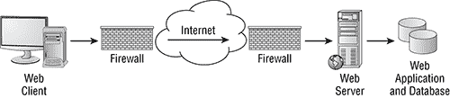

1. Web 客户端最初使用 `TCP` 端口 `80` 打开到 Web 服务器 IP 地址的连接。

2. Web 服务器等待客户端的 `GET` 请求，请求该网站的主页。

3. Web 服务器用 Web 服务器主页的 `HTML` 代码进行响应。

4. 客户端处理 `HTML` 代码，Web 客户端浏览器软件在客户端设备上渲染页面。

理解 Web 服务器的工作原理——以及它们是如何被黑入的——是你作为 `CEH`（认证道德黑客）工作的重要部分。这包括了解它们的漏洞，以及理解黑客可能使用的攻击类型。此外，你还应该知道何时使用补丁管理技术，并理解用于加固 Web 服务器的方法。

我们将在接下来的章节中查看所有这些主题。

## Web 服务器漏洞类型

Web 服务器和其他系统一样，可以被黑客攻破。Web 服务器中最常利用的漏洞如下：

### Web 服务器软件配置不当

使用微软 `Internet 信息服务`（`IIS`）作为 Web 服务器时的一个常见问题是使用了默认网站。默认网站的权限是开放的，这意味着默认设置使网站容易受到攻击。例如，`everyone` 组中的所有用户对默认网站目录中的所有文件具有完全控制权限。一旦在服务器上安装了 `IIS`，编辑并限制权限是至关重要的，因为默认系统用户 `IUSR_COMPUTERNAME` 是 `everyone` 组的成员。因此，任何访问默认网站的人都可以访问默认网站文件夹中的所有文件，并对这些文件拥有“执行”和“完全控制”等危险权限。参阅练习 8-1 以学习如何在 `IIS` 中禁用默认网站。

### 操作系统或应用程序漏洞，或编程代码中的缺陷

所有程序（包括 `OS` 和 Web 服务器应用程序）都应该定期进行补丁或更新。对于 `Windows` 系统，这包括安全补丁、热修复和 `Windows Updates`。一旦这些补丁经过测试，就可以自动或手动应用到系统中。

### 存在漏洞的默认安装

操作系统和 Web 服务器软件设置在安装后不应保持默认值，而应持续更新。

黑客利用这些漏洞来访问 Web 服务器。由于 Web 服务器通常位于非军事化区（`DMZ`）中——这是两个数据包过滤设备之间的公共访问区域，组织的客户端系统可以轻松访问——因此对 Web 服务器的利用为黑客提供了更易访问内部系统或数据库的机会。

## 练习 8-1：在 Internet 信息服务中禁用默认网站

要在 `IIS` 中禁用默认网站并添加新站点，请按照以下步骤操作：

1. 在你的 `Windows` 服务器或虚拟机（`VM`）上打开 `IIS`。

2. 在左窗格中选择 `Web Sites`（网站）。

3. 在右窗格中右键点击默认网站，从上下文菜单中选择 `Stop`（停止）。现在默认网站已停止。

4. 要创建新站点，在左窗格中右键点击 `Web Sites` 并选择 `New ⇒ Web Site`（新建 ⇒ 网站）。

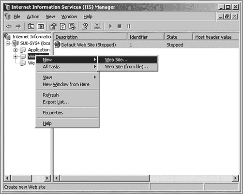

5. 启动网站向导。向导中有一个更改网站目录权限的屏幕。

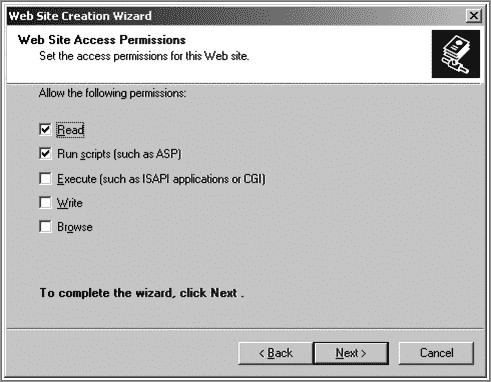


网站伪装（`Website cloaking`）是 Web 服务器根据用户的 IP 地址显示不同类型网页的能力。

在许多情况下，收集组成网站的所有或部分文件是有用的。一种方法是右键点击任何网页并从上下文菜单选择 `View Source`（查看源代码）。此命令将打开一个显示源代码的窗口。然后你可以将文本文件保存为本地机器的文件。这种方法可行，但并不是复制整个网站文件的实用方法。一个名为 `BlackWidow` 的易用程序可以让该过程变得简单得多。

## 练习 8-2：使用 BlackWidow 复制网站

1. 从 [www.softbytelabs.com](http://www.softbytelabs.com) 下载并安装 `BlackWidow`。

2. 打开 `BlackWidow` 程序。

3. 在 `BlackWidow` 地址栏中输入目标网站地址：

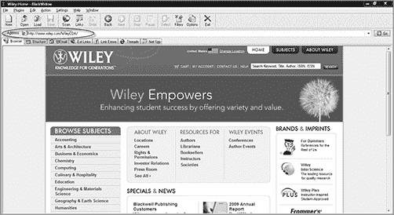

4. 点击 `BlackWidow` 工具栏上的 `Scan` 按钮。

5. 点击 `Structure` 标签。

6. 浏览网站结构。右键点击文件或文件夹并选择 `Copy Selected Files` 将网站复制到电脑。

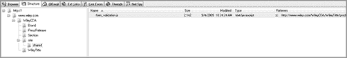

## 攻击 Web 服务器

Web 服务器通常监听 `TCP` 端口 `80`（`HTTP`）和 `TCP` 端口 `443`（`HTTPS`）。由于这些端口对 Web 客户端开放可用，Web 客户端和 Web 服务器之间的任何防火墙或数据包过滤设备必须允许指向这些端口的流量。Web 应用程序位于 Web 服务器软件之上，允许访问额外的端口。

针对 Web 服务器的初始信息收集步骤之一是指纹识别。指纹识别尝试收集有关 Web 服务器的信息，例如 `OS` 和 Web 服务器软件及版本。练习 8-3 将教你如何使用指纹识别。

## 练习 8-3：指纹识别

1. 在 `Windows PC` 的命令提示符上输入：

```
telnet <IPaddress> 80
```

IP 地址是目标 Web 服务器的地址。也可以使用 `URL` 代替 IP 地址。

2. 接下来，在 `telnet` 窗口输入：

```
HEAD/HTTP/1.0
```

然后按回车。

随后将返回 Web 服务器 `banner`。`banner` 看起来如下：

```
Server: Microsoft-IIS/5.0
Date: Fri, 14 Aug 2009 1:14:42 GMT
Content-Length:340
Content-Type: text/html
```

`Banner` 抓取（`Banner grabbing`）的结果通常会识别 Web 服务器类型和版本。这些信息非常重要，因为可以针对该 Web 服务器类型和版本识别漏洞。`Banner` 抓取后的下一步是攻击 Web 服务器或攻击 Web 应用程序并获取对服务器上数据的访问。

针对 Web 服务器的一种良性但可见的攻击类型是篡改（`defacement`）。黑客篡改网站纯出于快乐以及增加自己的声誉，而不是收集任何有用数据。篡改网站意味着黑客利用了 `OS` 或 Web 服务器软件的漏洞，然后修改网站文件以显示该网站已被入侵。黑客通常会在网站首页显示他们的黑客名称。

### 允许黑客篡改网站的常见网站攻击包括：

*   通过中间人攻击捕获管理员凭据

*   通过破解攻击破解管理员密码

*   使用 `DNS` 攻击将用户重定向到不同的 Web 服务器

*   攻破 `FTP` 或电子邮件服务器

*   利用导致漏洞的 Web 应用程序漏洞

*   配置错误的共享

*   利用弱权限

*   在防火墙或路由器攻击后重新路由客户端

*   使用 `SQL injection` 攻击（如果 `SQL` 服务器和 Web 服务器是同一系统）

*   使用 `telnet` 或 `Secure Shell (SSH)` 侵入

*   执行 `URL poisoning`，将用户重定向到不同的 `URL`

*   使用 Web 服务器扩展或远程服务侵入

*   拦截客户端与服务器之间的通信并更改 `cookie`，使服务器认为有一个具有更高权限的用户（适用于启用 `cookie` 的安全）

练习 8-4 将引导你了解如何使用 `Metasploit Framework` 利用 Web 服务器漏洞。


在安装 `Metasploit` 之前，确保机器或 `VM` 已完全关闭所有杀毒程序和防火墙。否则，杀毒程序可能会阻止 `Metasploit` 的某些组件，导致其无法正常运行或打开。正如我们在本书引言的实验设置指南中提到的，你永远不要在生产机器上安装 `Metasploit`。请使用 `VM` 或实验测试机来运行此软件。

## 练习 8-4：使用 Metasploit 攻击 Web 服务器漏洞

1.  在你的 `Windows XP` 或 `Vista` 电脑或 `VM` 上下载并安装 `Metasploit 3.2`（[www.metasploit.com](http://www.metasploit.com)）。

2.  安装 `Metasploit` 时选择所有默认选项。

3.  在程序文件夹下的 `Metasploit 3` 文件夹中选择 `Online Update` 选项。

4.  在线更新完成后，打开 `Metasploit 3` 文件夹中的 `Metasploit GUI` 文件。

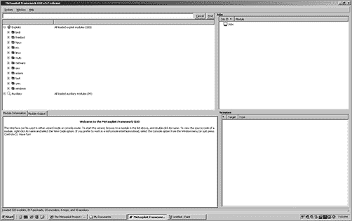

5.  展开 `Exploits` 下的 `Windows` 文件夹，然后展开 `IIS` 文件夹。

6.  双击 `ms03_007_ntdll_webdav` 漏洞。`MSF Assistant Wizard` 启动。

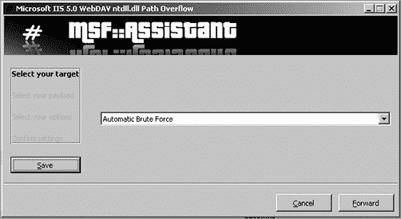

7.  点击前进按钮进入向导的下一个屏幕。

8.  从 `Payload` 下拉列表中选择 `Windows/Exec`，然后点击前进。

9.  在 `RHOST` 字段中输入目标 `IIS` Web 服务器的 IP 地址。为了使此 `payload` 起效，该服务器应该是未打补丁的 `Windows 2000` 版本。如果不是，请选择服务器脆弱的另一个 `payload`。

10. 在 `CMD` 字段中输入 `sol.exe`。这是将在远程目标主机上运行的可执行文件。`sol.exe` 是纸牌游戏，所有的 `Windows` 操作系统都应该包含它。`payload` 将传递到目标系统。在这种情况下，它类似于在 `IIS` 服务器的命令行提示符中输入 `sol.exe`。显然，这个可执行文件是良性的，但此练习说明了更危险的可执行文件（如病毒或木马）将如何在目标系统上运行。

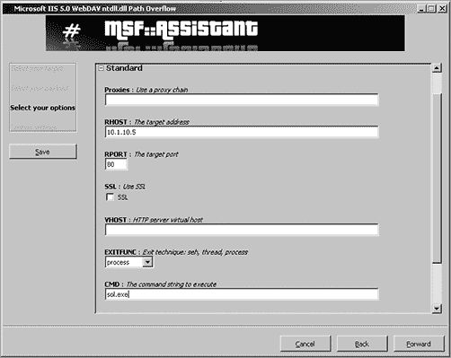

11. 点击前进按钮进入向导的下一个屏幕。

12. 点击 `Apply` 按钮。漏洞将出现在 `Jobs` 下，直到它传递到目标系统。

13. 在 `Windows IIS Server VM` 或 `IIS PC` 上确认 `Solitaire` 程序正在运行。如果程序没有运行，请确认 `IIS` 服务器上已安装 `Solitaire` 并再次尝试 `Metasploit` 漏洞攻击。

## 攻击 Internet 信息 Server

`Windows IIS` 是最流行的 Web 服务器软件产品之一。由于运行 `IIS` 的 Web 服务器流行且众多，可以针对 `IIS` 服务器发起许多攻击。针对 `IIS` 的三种常见攻击如下：

*   目录遍历（`Directory traversal`）

*   源码泄露（`Source disclosure`）

*   缓冲区溢出（`Buffer overflow`）

`directory-traversal` 攻击的基础是 Web 客户端被限制在 `Windows 文件系统` 中的特定目录。Web 客户端的初始目录被称为 Web 服务器上的根目录。此根目录通常存储通常被称为 `Default` 或 `Index` 的首页，以及 Web 服务器的其他 `HTML` 文档。根目录的子目录包含其他类型的文件；例如，脚本可能包含用于 Web 服务器的动态脚本文件。Web 服务器应该允许用户仅访问根的这些特定目录和子目录。然而，`directory-traversal` 攻击允许访问文件系统的其他目录。

运行 `IIS` 的 `Windows 2000` 系统容易受到 `directory-traversal` 攻击，也称为 `Unicode exploit`。`IIS` 中允许目录遍历的漏洞仅发生在未打补丁的 `Windows 2000` 系统中，并影响 `CGI` 脚本和 Internet Server API 扩展（如 `.asp`）。漏洞的存在是因为 `IIS` 解析器没有正确解释 `Unicode`，从而让黑客获得了系统级访问权限。


本质上，`Unicode` 将任何语言的字符转换为通用的十六进制规范。然而，`Unicode` 被解释了两次，而解析器只扫描一次生成的请求（在第一次解释之后）。因此，黑客可以通过 `IIS` 溜入文件请求。例如，在相对路径中使用 `%c0%af` 代替斜杠就利用了 `IIS` 漏洞。在某些情况下，该请求让黑客访问他们本不应该看到的文件。`Unicode directory traversal` 漏洞允许黑客添加、更改或删除文件，或在服务器上上传并运行代码。在系统上添加或运行文件的能力使黑客能够在系统上安装木马或后门。


`IIS Unicode exploit` 是一个过时的漏洞，本文将其作为概念证明提出——即证明该漏洞存在并可以被利用。

`Buffer overflow` 攻击并不是 Web 服务器所有，也可以针对其他类型的系统。`buffer overflow` 涉及发送比 Web 服务器处理能力的数据（通常以文本字符串的形式）。`buffer overflows` 的主要切入点是 Web 服务器上的 Web 表单。`Buffer overflows` 和应对措施将在下一章中详细介绍。

`Source disclosure` 攻击发生在服务器应用程序的源代码可以被收集时。`Source disclosure` 攻击可能导致黑客识别应用程序类型、编程语言和其他其他应用程序特定信息。所有这些信息都可以让潜在的黑客识别漏洞和可以传递到 Web 服务器的潜在利用程序。再次，黑客的大部分时间花在收集目标信息上，以识别利用的最佳切入点。

### 使用源码泄露攻击整合一切

执行源码泄露攻击的一个示例是针对 Web 服务器运行 `BlackWidow`，并将所有文件复制到本地目录。通过审查来自 `BlackWidow` 的源文件，你可以获取服务器名称、IP 地址和版本号。此外，额外的信息收集工具（如 `Netcraft`）可以帮助发现 `OS`、Web 服务器软件类型和版本。还可以收集有关服务器上运行的 JavaScript（`.js` 文件）或活动服务器页面（`.asp` 文件）的额外信息。根据 Web 服务器应用程序和漏洞，可以使用 `Metasploit` 向服务器发送有效荷。根据补丁级别和漏洞情况，该有效荷可能是相当无害的，也可能严重到足以让黑客获取贵贵数据。应对源码泄露攻击和其他类型攻击的最佳措施是将 `OS`、Web 服务器以及所有服务器应用程序补丁到最新水平，并维护活跃的补丁管理计划。

`CEH` 必须了解所有的信息收集技术，以识别 Web 服务器和 Web 中的潜在漏洞。这些知识对 `CEH` 来说如此重要，是因为他们需要防御同样的攻击并实施应对措施来防止攻击。

## 补丁管理技术

补丁管理在防止和减轻针对 Web 服务器及 Web 应用程序的攻击风险方面起着关键作用。补丁管理是更新系统供应商所需的适当补丁热修复的过程。适当的补丁管理涉及选择如何安装和验证补丁，并在安装之前在非生产网络上对这些补丁进行测试。

你应该维护应用到每个系统的所有补丁的日志。为了方便安装补丁，你可以使用 `PatchLink`、`St. Bernard Software`、`Microsoft` 以及其他软件供应商提供的自动化补丁管理系统来评估你的系统并决定部署哪些补丁。


## Web 服务器管理员入职的第一周

作为一家拥有 40 名员工的小型公司的新入职网络管理员，我的职责是审查包含两台服务器的小网络配置和补丁。该公司在 `Windows 2000` 服务器上使用 `IIS 5.0`，该服务器已为客户提供了三年的公司网站。服务器是在我加入员工三年前由一家咨询公司安装和配置的。网站内容由营销助理定期更新，但对服务器没有进行过任何其他更新。

因此，我开始对 Web 服务器进行更新和补丁管理。该公司没有防火墙来保护互联网连接，且 `Windows Server OS` 自安装以来未应用过任何补丁或热修复。`IIS` Web 服务器软件也已过时。这一切给组织构成了巨大的安全风险，补丁管理是保护 Web 服务器及其运行其上的应用程序的最高优先级任务。

当我应用安全补丁和热修复时（先是 `OS` 然后是 `IIS`），我发现恶意软件（如 `Code Red` 蠕虫和许多病毒）已经攻击了系统。花费几天时间应用补丁、热修复并更新病毒定义后，Web 服务器才更新到位。对于这家小公司来说，幸运的是，我在网络损坏或发生严重安全漏洞之前，将 `OS` 和 Web 服务器软件更新到了，并实施了补丁管理系统。

## 黑客工具

`N-Stalker Web Application Security Scanner` 允许你对 Web 应用程序进行大量漏洞评估，包括跨站脚本、`SQL injection`、缓冲区溢出和参数篡改攻击。

`Metasploit Framework` 是用于测试或破解操作系统或 Web 服务器软件的免费工具。漏洞可以作为插件使用，并可以在 `Windows` 或 `Unix` 平台执行测试。`Metasploit` 原本是一个命令行程序，但现在有了浏览器界面。使用 `Metasploit`，黑客可以编写自己的漏洞，也可以利用标准漏洞。

`CORE IMPACT` 和 `SAINT Vulnerability Scanner` 是用于测试和破解操作系统及 Web 服务器软件的商业漏洞工具。

## Web 服务器加固方法

Web 服务器管理员可以做很多来加固服务器（提高安全性）。以下是增加 Web 服务器安全性的方法：

- 重命名管理员账户并使用强密码。在 `Windows` 中重命名管理员账户，打开 `User Manager`，右键点击 `Administrator` 账户并选择 `Rename`。
- 禁用默认网站和 FTP 站点。禁用默认网站的过程在本章前面已描述过：在 `IIS Manager` 中右键点击默认网站并选择 `Stop`。相同的过程适用于默认 FTP 站点。
- 从服务器上移除未使用的应用程序，例如 `WebDAV`。可以通过 `Windows` 控制面板中的 `Add/Remove Programs` 移除服务器上不必要的应用程序。
- 在 Web 服务器的配置设置中禁用目录浏览。
- 在网站上添加法律声明，让潜在攻击者意识到入侵网站的后果。
- 对操作系统和 Web 服务器软件应用最新的补丁、热修复和服务程序包。
- 对 Web 表单和查询字符串的输入进行边界检查，以防止缓冲区溢出或恶意输入攻击。
- 禁用远程管理。
- 使用脚本将未使用的文件扩展名映射到 `404`（未找到文件）错误消息。
- 启用审计和日志记录。
- 在 Web 服务器和互联网之间使用防火墙，并仅允许必要的端口防火端口（如 `80` 和 `443`）。
- 在向 Web 服务器发送数据时，将 `GET` 方法替换为 `POST` 方法。

## Web 应用程序漏洞

除了了解黑客如何利用 Web 服务器，`CEH` 熟悉 Web 应用程序漏洞也非常重要。在本节中，我们将讨论 Web 应用程序如何工作，以及 Web 应用程序攻击的目标。我们还将分析 Web 应用程序攻击的构造以及一些真实的 Web 应用程序威胁。最后，我们将查看 Google 黑客攻击和你应该熟悉的应对措施。

Web 应用程序是位于 Web 服务器上的程序，为用户提供除网站之外的功能。数据库查询、网络邮箱、讨论组和博客都是 Web 应用程序的示例。

Web 应用程序使用客户端/服务器架构，浏览器作为客户端，Web 服务器作为应用程序服务器。`JavaScript` 是实现 Web 应用程序的流行方式。由于 Web 应用程序应用广泛，任何拥有浏览器的用户都可以与站点程序进行交互。

Web 服务器上存在许多 Web 应用程序威胁。以下是最常见的威胁及其防御措施：

### 跨站脚本（Cross-Site Scripting）

输入 Web 表单的参数会被 Web 应用程序处理。变量的错误组合可能导致任意命令执行。防御措施：验证 Cookie、查询字符串、表单字段和隐藏字段。


防御跨站脚本的一种对策是使用服务器脚本将左、右尖角字符（`<` 和 `>`）替换为 `&lt;` 和 `&gt;`。防御 SSL 攻击的对策是安装代理服务器并在代理处终止 SSL 连接，或安装硬件 SSL 加速器并在该层终止 SSL 连接。

### SQL 注入

在 URL 中插入 SQL 命令会导致数据库服务器转储（dump）、修改、删除或在数据库中创建信息。SQL 注入将在第 9 章“攻击应用程序：SQL 注入与缓冲区溢出”中进行详细介绍。防御措施：验证用户变量。

### 命令注入

黑客在 Web 表单中插入编程命令。防御措施：使用针对特定编程语言的库。

### Cookie 投毒与嗅探

黑客损坏或窃取 Cookie。防御措施：不要在 Cookie 中存储密码；实施 Cookie 超时；以及对 Cookie 进行身份验证。

### 缓冲区溢出

大量数据通过 Web 表单发送到 Web 应用程序以执行命令。缓冲区溢将在第 9 章中详细介绍。防御措施：验证用户输入长度；执行边界检查。

### 身份验证劫持

黑客在用户身份验证后窃取会话。防御措施：使用 SSL 加密流量。

### 目录遍历/Unicode

黑客通过 Web 浏览器或 Windows 资源管理器浏览系统上的文件夹。防御措施：为 Web 服务器上的私有文件夹定义访问权限；应用补丁和热修复。

### 攻击工具

`Instant Source`允许黑客查看并编辑 HTML 源代码。它可以从浏览器内部直接使用。

`Wget`是一个命令行工具，黑客可以用它下载包含所有文件的整个网站。黑客可以离线查看源代码并在对真实 Web 服务器发起之前测试某些攻击。

`WebSleuth` 使用爬虫技术索引整个网站。例如，`WebSleuth`可以从网站的不同页面抓取所有的电子邮件地址。

`BlackWidow`可以扫描并映射网站的所有页面，以创建站点概况。

`SiteScope`映射出 Web 应用程序内部的连接，并辅助程序的解构。

`WSDigger`是一个 Web 服务测试工具，包含了针对 SQL 注入、跨站脚本和其他 Web 攻击的示例攻击插件。

`Burp`是一个基于 Windows 的 Web 应用程序自动化攻击工具。它还可以用于猜解 Web 应用程序的密码并执行中间人攻击。

### Google 黑客（Google Hacking）

Google 黑客是指使用 Google 强大的搜索引擎来定位高价值目标，或搜索如密码等贵贵信息。

许多工具，如[`johnny.ihackstuff.com`](http://johnny.ihackstuff.com)和`Acunetix Web Vulnerability Scanner`，包含一个在数据库中组织的 Google 黑客术语列表，以便于搜索（参见练习 8-5）。例如，您可以在 Google 搜索引擎中输入词`password`或`medical records`并查看可用信息。许多时候，Google 可以直接从私有数据库或文档中提取信息。

### 练习 8-5：使用 Acunetix Web Vulnerability Scanner

1. 从[www.acunetix.com](http://www.acunetix.com)下载并安装`Acunetix Web Vulnerability Scanner`。
2. 打开 Web 扫描器并选择`File ⇒ New Scan`以打开`Scan Wizard`：

   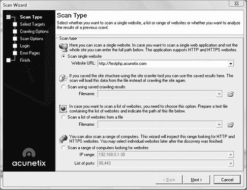

3. 按照向导提示进行操作；接受初始扫描的默认值。
4. 扫描完成后查看扫描报告。注意报告中的 Web 服务器和应用程序漏洞。

   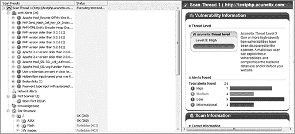

5. 使用向导创建另一个扫描，并将目标指向实验室 Web 服务器或 Web 服务器虚拟机。查看并分析您的实验室 Web 服务器的扫描报告。

### 基于 Web 的密码破解技术

作为一名认证伦黑客（CEH），你需要熟悉黑客用于破解基于 Web 的密码的技巧。这包括能够列出各种身份验证类型、了解什么是密码破解器、识别密码破解技术的分类，并了解可用的防御措施。我们将在接下来的章节中详细介绍。

### 身份验证类型

Web 服务器和 Web 应用程序支持多种身份验证类型。最常见的是`HTTP 身份验证`。`HTTP 身份验证`有两种类型：`basic`（基本）和`digest`（摘要）。`基本 HTTP 认证`以明文发送用户名和密码，而`摘要认证`对凭据进行哈希处理并使用挑战-响应模型进行身份验证。

此外，Web 服务器和 Web 应用程序支持以下类型的身份验证：

- **NTLM 身份验证**：这种类型使用`Internet Explorer`和`IIS` Web 服务器，使得`NTLM`更适用于使用 Microsoft 操作系统的内网内部身份验证。`Windows 2000`和`2003`服务器利用`Kerberos 认证`作为更安全的选项。
- **基于证书的身份验证**：这种类型使用`x.509`证书进行公/私钥技术。
- **基于令牌的身份验证**：令牌（如`SecurID`）是一种显示 60 秒身份验证的硬件设备；用户使用代码登录网络。
- **生物识别身份验证**：这种类型使用指纹、眼睛虹膜或手印等物理特征来验证用户。

### 密码攻击与密码破解

三种类型的密码攻击如下：

- **字典（Dictionary）**：使用字典中可以找到的密码。
- **暴力破解（Brute-Force）**：猜解使用字母、数字和特殊字符的复杂密码。
- **混合（Hybrid）**：使用数字或特殊字符代替字母的字典单词。

密码破解器旨在解密密码或禁用保护的程序。密码破解器依赖字典搜索（攻击）或暴力破解方法来破解密码。

字典攻击的第一步是生成密码列表。黑客通常使用字典生成器或从网上下载的字典创建此列表。接下来对字典列表进行哈希或加密。将其与黑客试图破解的哈希密码进行比较。黑客可以通过从有线或无线网络嗅探，或直接从系统硬盘上的安全账户管理器（SAM）或影子密码文件中获取哈希密码。最后，程序显示未加密的密码版本。字典破解器只能发现字典单词。

如果用户实施了强密码，则可以实施暴力破解破解。暴力破解破解器会尝试字母、数字和特殊字符的所有组合，由于排列组合巨大，比字典攻击慢得多。练习 8-6 将引导你使用一个名为`Brutus`的密码破解器。

#### 练习 8-6：使用密码破解器

1. 从[www.hoobie.net](http://www.hoobie.net)下载并安装`Brutus`。
2. 打开`Brutus`并在目标字段中输入 Web 服务器地址。

   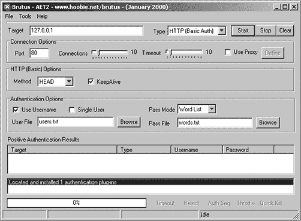

3. 点击`Start`按钮并在屏幕底部的正身份验证结果字段中查看密码。

Webcracker 是一种使用字典列表尝试登录 Web 服务器的工具。它通过寻找“HTTP 302 object moved（对象移动）”响应来猜测密码。通过这种响应，工具可以确定所使用的身份验证类型并尝试登录系统。

破解密码的最佳防御措施是实施强密码，长度至少为八个字符（旧标准为六个），并包含字母和数字。用户名和密码应该保持不同，因为许多用户名是以明文传输的。需要大写字母、小写字母以及数字或特殊字符的复杂密码更破解。你应该实施如 Kerberos 或令牌（tokens）等强身份验证机制来保护传输中的密码。

## 总结

随着互联网的日益普及，Web 服务器和 Web 攻击一直是最受关注的问题。客户使用 Web 服务器和互联网来研究公司、在线购物、访问银行和投资公司的数据库，并进行许多其他数据库搜索。随着这些用量的增加，潜在的目标信息变得越来越有价值。信用卡号、个人信息和社安号码是黑客的终极目标，而所有这些信息都存储在 Web 应用程序数据库中。

Web 服务器和 Web 攻击是黑客试图攻破 Web 服务器安全并投放能够获取价值信息的漏洞的方法。`CEH`（认证伦理黑客）需要精通识别潜在漏洞以及防止 Web 服务器攻击的防御措施。

## 考试要点

- 了解 Web 服务器漏洞的类型。配置错误、操作系统或应用程序的漏洞和缺陷、操作系统和 Web 服务器软件的默认安装、缺乏补丁管理以及缺乏适当的安全策略和程序都是 Web 服务器漏洞。
- 了解常见的 Web 应用程序威胁。跨站脚本（XSS）、SQL 和命令注入、Cookie 投毒和嗅探、缓冲区溢出、身份验证劫持和目录遍历都是常见的 Web 应用程序威胁。
- 理解 Google 黑客攻击。Google 黑客涉及使用 Google 搜索引擎来定位密码、信用卡号、医疗记录或其他机密信息。
- 理解补丁管理技术。补丁管理对于确保系统更新最新的安全修复至关重要。应该定义并遵循测试、应用和记录系统补丁的流程。
- 了解 Web 服务器的各种身份验证机制。HTTP 基础认证和摘要认证、NTLM、令牌、生物识别和证书都是对 Web 服务器进行身份验证的方法。
- 理解密码破解器的工作原理。密码破解器使用哈希字典文件来破解密码。
- 了解密码攻击的类型。字典攻击、混合攻击和暴力破解是三种密码攻击类型。

## 复习题

1. 下列哪些是 HTTP Web 身份的类型？（选择所有适用项。）
   - A. 摘要（Digest）
   - B. 基础（Basic）
   - C. Windows
   - D. Kerberos

2. 下列哪个是缓冲区溢出攻击的防御措施？
   - A. 输入字段长度验证
   - B. 加密
   - C. 防火墙
   - D. 使用 Web 表单

3. 显示每 60 秒变化一次登录信息的硬件设备被称为 ____________________。
   - A. 登录器
   - B. 身份验证服务器
   - C. 生物识别认证
   - D. 令牌（Token）

4. 哪个是常见的 Web 服务器漏洞？
   - A. 限制用户账户
   - B. 默认安装
   - C. 开放共享
   - D. 无目录访问

5. 密码 `P@SSWORD` 可以使用哪种类型的攻击破解？
   - A. 暴力破解
   - B. 混合
   - C. 字典
   - D. 零日漏洞利用

6. 下列哪个是身份验证劫持的防御措施？
   - A. 身份验证日志
   - B. `Kerberos`


C. `SSL`

D. `Active Directory`

7\. 为什么 Web 服务器比其他系统更容易受到攻击？

A. Web 服务器总是可访问的。

B. 攻击 Web 服务器不需要很高的黑客能力。

C. Web 服务器通常放置在安全的 `DMZ` 中。

D. Web 服务器很容易被利用。

8\. 驻留在 Web 服务器上的客户端/服务器程序被称为 ____________________。

A. 互联网程序

B. Web 应用程序

C. 补丁

D. 配置文件

9\. 哪个是目录遍历攻击的防御措施？

A. 强制执行文件夹权限。

B. 允许所有人访问默认页面。

C. 仅允许注册用户访问网站主页。

D. 让所有用户登录后访问文件夹。

10\. 黑客将编程命令插入 Web 表单的行为的行为称为什么？

A. 表单篡改

B. 命令注入

C. 缓冲区溢出

D. Web 表单攻击

11\. 下列哪个命令将开始对 Web 服务器执行横幅抓取（banner grab）？

A. `telnet www.yahoo.com 80`

B. `telnet HTTP www.yahoo.com`

C. `http://www.yahoo.com:80`

D. `HEAD www.yahoo.com`

12\. 下列哪些漏洞可以用于 `Microsoft Internet Information (IIS)` 服务器？（选择所有适用项。）

A. `IPP` 打印机溢出攻击

B. `ISAPI DLL` 缓冲区溢出攻击

C. 长 `URL` 攻击

D. 代理缓冲区溢出攻击

13\. 最价值的目标信息存储在 Web 服务器的哪个位置？

A. Web 服务器主目录

B. Web 应用程序系统文件

C. Web 应用程序数据库

D. `NTHOME` 目录

14\. 下列哪个黑客工具对 `IIS` 执行目录遍历攻击？

A. `RPC DCOM`

B. `IIScrack.dll`

C. `WebInspect`

15\. 哪个程序可以用于下载整个网站？

A. `WebSleuth`

B. `WSDigger`

C. `Wget`

D. `BlackWidow`

16\. Web 服务器支持以下哪些身份验证凭据？（选择所有适用项。）

A. 证书

B. 令牌 (Tokens)

C. 生物识别

D. `Kerberos`

17\. 哪种工具可以从网站提取地址？

A. `WebSleuth`

B. `WSDigger`

C. `Wget`

D. `BlackWidow`

18\. `SiteScope` 的作用是什么？

A. 映射 Web 应用程序中的连接

B. 查看所有网页的 `HTML` 源代码

C. 从网站收集电子邮件

D. 测试 Web 应用程序漏洞

19\.  `IIS` 的三种主要攻击类型类型

A. 目录遍历

B. 缓冲区溢出

C. 身份验证攻击

D. 源泄攻击

20\. 下列哪个允许黑客篡改网站的常见攻击？（选择所有适用项）

A. 使用 `DNS` 攻击将用户重定向到不同的 Web 服务器

B. 通过暴力破解破解管理员密码

C. 使用目录遍历攻击

D. 通过 Web 表单使用缓冲区溢出攻击

## 复习题答案

1\. A, B. 摘要和基础是 `HTTP` Web 身份的类型。

2\. A. 验证长度并进行边界检查是缓冲区溢出攻击的防御措施。

3\. D. 令牌 (Token) 是一种带有显示屏的硬件设备，显示用于登录和身份验证的离散数字。

4\. B. 默认安装是 Web 服务器漏洞。

5\. B. 混合攻击用数字和特殊字符替换字母。

6\. C. `SSL` 是身份验证劫持的防御措施。

7\. A. Web 服务器总是可访问的，因此黑客比攻击不常用的系统更容易攻击它。

8\. B. Web 应用程序是驻留在 Web 服务器上的客户端/服务器程序。

13. C. 最有价值的目标数据，如密码、信用卡号和个人信息存储在 Web 应用程序的数据库中。

14. D. `IISExploit.exe` 是用于对 `IIS` 执行自动化目录遍历攻击的工具。

15. C. `Wget` 是一个命令行工具，可下载包含所有源文件的整个网站。

16. A, B, C. 证书、`tokens.` 和生物识别都是可用于向 Web 服务器和 Web 应用程序验证用户的凭据。`Kerberos` 是一种用于保护用户身份验证凭据的安全系统。

17. A. `WebSleuth` 可对网站进行索引，并专门从网站的所有页面中提取电子邮件地址。

18. A. `SiteScope` 可以映射 Web 应用程序内部的连接并辅助解构程序。

19. A, B, D.  `IIS` 的三种常见攻击是目录遍历、缓冲区溢出和源码泄露。

20. A, B. 使用 `DNS` 攻击将用户重定向到不同的 Web 服务器以及通过暴力破解攻击泄露管理员密码是破坏网站（Defacing）的两种方法。

# 第 9 章：攻击应用程序：SQL 注入与缓冲区溢出

## 本章涵盖的 CEH 考试目标：

* 什么是 SQL 注入？

* 理解执行 SQL 注入的步骤

* 理解 SQL Server 漏洞

* 描述 SQL 注入防御措施

* 基于栈的缓冲区溢出概述

* 识别不同类型的溢溢及其检测方法

* 缓冲区溢出变技术概述

SQL 注入和缓冲区溢出是利用应用程序漏洞的攻击技术。在编写程序时，创建应用程序代码时使用的某些参数可能会程序留下漏洞。SQL 注入和缓冲区溢出被包含在同一章节中是因为它们都是攻击应用程序的方法，通常由编程缺陷引起。通常，SQL 注入的目的是说服应用程序运行非预期的 `SQL code`。

SQL 注入是一种用于攻击 `SQL 数据库` 的黑客方法，而缓冲区溢出可能存在于许多不同类型的应用程序中。SQL 注入和缓冲区溢出的相似之处在于，它们通常都通过用户输入字段进行交付。输入字段是用户可能在网站上输入用户名和密码、向 `URL` 添加数据或在另一个应用程序中搜索关键词的地方。SQL 注入漏洞主要是由于通过这些字段的未经验证或未经过滤的用户输入造成的。

`SQL Server 注入` 和缓冲区溢出漏洞都是由同一个问题引起的：应用程序未验证的无效参数。如果程序员不花时间验证用户可以输入到变量字段中的变量，结果将是严重且不可预测的。老练的黑客可以利用这种漏洞导致系统或应用程序发生执行故障并关闭，或者为黑客执行命令壳（Command Shell）。

SQL 注入和缓冲区溢出的防御措施旨在利用安全的编程方法。通过更改应用程序代码使用的变量，可以很大程度上减少应用程序中的漏洞。本章将详细介绍如何执行 SQL 注入和缓冲区溢出攻击，并探索防止此类攻击的最佳防御措施。

### SQL 注入

作为一名 `CEH`，能够定义 SQL 注入并理解黑客执行 SQL 注入攻击的步骤对你来说很重要。此外，你应该了解 `SQL Server 漏洞` 以及针对 SQL 注入攻击的防御措施。

当应用程序在不验证输入的情况下处理用户提供的数据以创建 `SQL statement` 时，就会发生 SQL 注入。随后用户输入被提交到 Web 应用程序数据库服务器执行。如果被成功利用，SQL 注入可以允许攻击者访问数据库内容，或允许黑客远程执行系统命令。在最坏的情况下，黑客可以控制托管数据库的服务器。这种利用可以为黑客提供访问服务器文件系统的远程 shell。SQL 注入攻击的影响取决于漏洞在代码中的位置、利用该漏洞的难易程度以及应用程序对数据库的访问级别。理论上讲，SQL 注入可以发生在任何类型的应用程序中，但它最常见于 Web 应用程序，因为它们最经常受到攻击。正如第 8 章之前讨论的“Web 攻击：谷歌、Web 服务器、Web 应用程序漏洞和基于 Web 的密码破解技术”，Web 应用程序是容易的目标，因为从本质上说它们对互联网开放。在尝试 `CEH exam` 之前，你应该对数据库如何工作以及如何使用 `SQL commands` 访问数据库中的信息有基本的了解。

在 Web 应用程序 SQL 注入攻击期间，恶意代码被插入到 Web 表单字段或网站代码中，使系统执行命令壳或其他任意命令。正如合法用户通过 Web 表单向 `SQL database` 输入查询和添加内容一样，黑客可以通过同一个 Web 表单字段向 `SQL Server` 插入命令。例如，黑客的任意命令可能会打开命令提示符或显示数据库中的表。数据库表可能包含个人信息，如信用卡号、社会安全号或密码。`SQL Servers` 是非常常见的数据库服务器，被许多组织用于存储机数据。这使得 `SQL Server` 成为一个高价值目标，因此是对黑客极具吸引力的系统。


### 确定 SQL 注入漏洞

在对企业网络进行黑帽渗透测试期间，安全测试员 Tom 在一个公开访问的 Web 服务器上发现了一个自定义应用程序。由于是黑帽测试，Tom 无法访问源代码来查看程序是如何创建的。但在进行一些信息收集后，他能够确定服务器运行着 `Microsoft Internet Server 6` 以及 `ASP.NET`，这表明数据库是 `Microsoft 的 SQL Server`。

该 Web 应用程序的登录页面有一个用户名、密码字段和一个忘记密码链接，这最终证明是进入系统的最方法。忘记密码链接的工作原理是在用户数据库中查找用户的电子邮件地址，并向该地址发送包含密码的电子邮件。

因此，为了确定忘记密码链接是否受到 SQL 注入的影响，Tom 在忘记密码字段的数据中输入了一个单引号。目的是查看应用程序是否在未过滤用户输入的情况下字面构建 `SQL string`。当在电子邮件地址中使用引号提交表单时，他收到了 `500 错误`（服务器故障），这表明用户输入被字面解析了。

表单的底层 SQL 代码可能如下：

```sql
SELECT fieldlist
FROM table
WHERE field = '$EMAIL';
```

Tom 在忘记邮件链接字段中输入了他的电子邮件地址，后跟一个单引号。Web 应用程序的 `SQL 解析器`发现了多出的引号并因错误中止。当 Tom 收到此错误消息时，他能够确定用户输入没有经过妥善过滤，应用程序可以被利用。在这种情况下，他不需要继续利用该应用程序，因为错误消息已经足以证明该应用程序容易受到 SQL 注入攻击。由于这次渗透测试的结果，客户能够修复了 `SQL Server 漏洞`。

# 寻找 SQL 注入漏洞

在发起 SQL 注入攻击之前，黑客会确定数据库以及相关表和变量的配置是否存在漏洞。确定 `SQL Server` 漏洞的步骤如下：

1. 使用网页浏览器搜索使用登录页面或其他数据库输入或查询字段（例如“我忘记密码”表单）的网站。通过检查网站源代码，寻找显示 `POST` 或 `GET` HTML 命令的网页。

2. 使用单引号（`''`）测试 `SQL Server`。此操作可以判断用户输入变量是否经过了清理，或者它是否被服务器字面解释。如果服务器返回了显示“使用 `'a'='a'`”（或类似内容）的错误信息，那么它极有可能易受到 SQL 注入攻击。

3. 使用 `SELECT` 命令从数据库检索数据，或使用 `INSERT` 命令向数据库添加信息。

以下是一些可以在 Web 表单上使用的用于测试 SQL 漏洞的变量字段文本示例：

* `Blah' or 1=1--`

* `Login:blah' or 1=1--`

* `Password::blah' or 1=1--`

* `http://search/index.asp?id=blah' or 1=1--`

这些命令和类似的变体可能允许用户根据数据库的结构绕过登录。在表单字段中输入这些命令时，可能会返回表中的许多行，甚至是整个数据库表，因为 `SQL Server` 正在字面解释这些术语。命令末尾的双横线告诉 SQL 忽略命令的其余部分将其视为注释。

以下是使用 SQL 命令获取控制权的的一些示例：

要获取目录列表，在表单字段中输入以下内容：

```
Blah';exec master..xp_cmdshell"dir c:\*.* /s >c:\directory.txt"--
```

要创建一个文件，在表单字段中输入以下内容：

```
Blah';exec master..xp_cmdshell"echo hacker-was-here > c:\hacker.txt"--
```

要 ping 一个 IP 地址，在表单字段中输入以下内容：

```
Blah';exec master..xp_cmdshell"ping 192.168.1.1"--
```

# SQL 注入的目的

黑客利用 SQL 注入攻击来实现某些结果。某些 SQL 漏洞会产生存储在数据库中的价值用户数据，而另一些仅是其他攻击的前奏。以下是 SQL 注入攻击最常见的目的：

### 识别 SQL 注入漏洞

目的是探测 Web 应用程序以发现哪些参数和用户输入字段易受 SQL 注入。

### 执行数据库指纹识别

目的是发现 Web 应用程序使用的数据库类型和版本，并对数据库进行“指纹识别”。了解 Web 应用程序使用的数据库类型和版本允许攻击者构建特定数据库的攻击。

### 确定数据库架构

为了从数据库中正确提取数据，攻击者通常需要数据库架构信息，例如表名、列名和列数据类型。这些信息可以用于后续攻击。

### 提取数据

此类攻击采用能够从数据库中提取数据值的技术。取决于 Web 应用程序的类型，这些信息可能是敏感的，并且是攻击者非常渴望的。

### 添加或修改数据

目的是添加或更改数据库中的信息。

### 执行拒绝服务

执行这些攻击是为了关闭对 Web 应用程序的访问，从而拒绝其他用户的服务。涉及锁定或删除数据库表的攻击也属于这一类。

### 规避检测

此类指的是某些用于避免审计和检测的攻击技术。

### 绕过验证

目的是允许攻击者绕过数据库和应用程序的验证机制。绕过此类机制可能允许攻击者获得与其他应用程序用户相关的权限和权利。

### 执行远程命令

此类攻击尝试在数据库上执行任意命令。这些命令可以是数据库用户可用的存储过程或函数。

### 执行权限提升

这些攻击利用数据库中的实现错误或逻辑缺陷来提升攻击者的权限。

# 使用动态字符串进行 SQL 注入

大多数 SQL 都执行特定的、可预测的任务。SQL 数据库的许多功能接收静态用户输入，唯一的变量是用户输入字段。此类语句在每次执行时不会发生变化。它们通常被称为静态 SQL 语句。

然而，某些程序必须在运行时构建并处理各种 SQL 语句。在许多情况下，语句的全文在应用程序执行之前是未知的。此类语句可能会并且可能每次执行时发生变化。因此，它们被称为动态 SQL 语句。

动态 SQL 是 SQL 的增强形式，与标准 SQL 不同，它促进了程序语句的自动生成和执行。动态 SQL 是一个术语，指在 Web 应用程序执行之前生成的 SQL 代码。动态 SQL 是创建 SQL 字符串的灵活且强大的工具。当你发现需要编写能够适应不同数据库、条件或服务器的代码时，它会非常有帮助。动态 SQL 还让自动化 Web 应用程序中多次重复的任务变得更容易。

黑客可以使用动态字符串通过 SQL 注入攻击基于 Web 的身份验证表单。例如，Web 服务器上身份验证表单的底层代码可能如下：

```
SQLCommand = "SELECT Username FROM Users WHERE Username = '"
SQLCommand = SQLComand & strUsername
SQLCommand = SQLComand & "' AND Password = '"
SQLCommand = SQLComand & strPassword
SQLCommand = SQLComand & "'"
strAuthCheck = GetQueryResult(SQLCommand)
```

黑客可以通过在表单中输入任何用户名和密码来利用 SQL 注入，例如：

用户名：`kimberly`

密码：`graves' or 1=1--`

SQL 应用程序将构建如下命令：

```
SELECT Username FROM Users WHERE Username = 'kimberly' AND Password = 'graves' or 1=1--
```

这是一个 SQL 注入的示例：无论 kimberly 是否是数据库中的真实用户名或 graves 是否是合法密码，该查询都会返回表中的所有行。这是由于在 `WHERE` 子句中附加了 `OR` 语句导致的。

在练习 9-1 中，你将使用 `HP Scrawlr` 测试 SQL 注入漏洞。

## 练习 9-1：使用 HP Scrawlr 测试 SQL 注入漏洞

1. 从 `www.HP.com` 下载 Scrawlr。

2. 在你的 Windows 实验电脑上安装 Scrawlr。

3. 打开 Scrawlr 程序。

4. 在 `URL Of Site To Scan` 字段中输入目标 Web 地址。

5. 点击 `Start` 按钮开始对网站进行 SQL 注入漏洞审计。

6. 扫描完成后，`Scrawlr` 将显示从扫描站点链接的其他主机。最佳实践是同时扫描链接站点和主站，以确保不存在 SQL 注入漏洞。

# SQL 注入防御措施

SQL 注入漏洞的产生相对简单且易于理解：对用户输入的验证不足。为了解决这个问题，在编写应用程序时可以使用防御性编码实践，如用户输入进行编码和验证。检查所有应用程序的 SQL 注入漏洞是一个辛苦且耗时的过程。

在实施 SQL 注入防御措施时，检查源代码中是否存在以下编程缺陷：

* 单引号

# 缺乏输入验证

防止 SQL 注入攻击的首要防御措施是最小化用户连接到数据库的权限，并强制对 `SA` 和 `Administrator` 账户执行强密码。你还应该禁用详细的或解释性的错误消息，以确保发送给黑客的信息不会多于所需；此类信息可能帮助他们判断 `SQL Server` 是否存在漏洞。记住，SQL 注入的目的之一是获取关于哪些参数容易受到攻击的额外信息。

防止 SQL 注入的另一种防御措施是在将用户数据发送到应用程序处理之前，检查输入并对数据进行验证。

针对 SQL 注入的一些防御措施包括：

*   拒绝已知的坏输入

*   对 `input field` 进行清理和验证

### 缓冲区溢出


作为一名`CEH`，你必须能够识别不同类型的缓冲区溢出。你还应该知道如何检测缓冲区溢出漏洞，并理解黑客可能用于执行栈溢出攻击的步骤。我们将在接下来的章节中介绍这些主题，并提供缓冲区溢出变异技术的概述。

## 缓冲区溢出的类型与检测方法

缓冲区溢出是黑客针对操作系统或应用程序使用的利用手段；与`SQL`注入攻击一样，它们通常针对用户输入字段。缓冲区溢出利用通过过载内存或在目标系统上执行命令外壳或任意代码导致系统故障。缓冲区溢出漏洞是由于`variable field`（如`Web`表单）缺乏边界检查或缺乏输入验证清理引起的。如果应用程序在将`variable`发送到内存中存储之前没有检查或验证其大小或格式，就会存在溢出漏洞。

缓冲区溢出有两种类型：基于栈的和基于堆的。

栈和堆是运行程序中用户提供的变量的存储位置。变量存储在栈或堆中，直到程序需要它们为止。栈是内存地址空间的静态位置，而堆是程序运行期间产生的动态内存地址空间。基于堆的缓冲区溢出发生在内存的低部，并覆盖其他动态变量。请参阅图 9-1。

图 9-1: 栈内存与堆内存

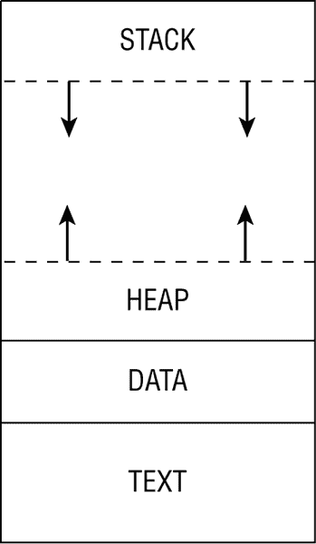

调用栈（或栈）用于跟踪在执行完部分代码后，执行指针应该返回到编程代码的哪个位置。栈缓冲区溢出攻击（图 9-2）发生在分配给每个执行程序的内存发生溢出时。由于这两种缓冲区溢出的存在，程序可能会打开`shell`或命令提示符，或者停止程序的执行。下一节将描述栈缓冲区溢出攻击。

图 9-2: 基于栈的缓冲区溢出攻击

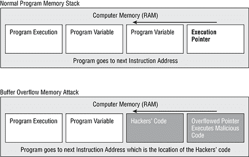

为了检测由于源代码编写不当导致的程序缓冲区溢出漏洞，黑客通过表单字段向应用程序发送大量数据，并观察程序的处理结果。

以下是黑客执行栈缓冲区溢出攻击所使用的步骤：

1. 向缓冲区中输入一个`variable`以耗尽栈中的内存量。

2. 输入比缓冲区为该`variable`分配的内存更多的数据，导致内存溢出或进入下一个进程的内存空间。然后，添加另一个`variable`，并覆盖返回指针，该指针告诉程序在执行完`variable`后返回到何处。

3. 程序执行此恶意代码`variable`，然后使用返回指针返回到下一行可执行代码。如果黑客成功覆盖了指针，程序将执行黑客的代码而不是程序代码。

大多数黑客不需要对缓冲区溢出的细节如此熟悉。互联网上可以找到预先编写的利用程序，这些程序在黑客小组之间交换。练习 9-2 演示了如何使用`Metasploit`执行缓冲区溢出攻击。


被利用代码返回地址覆盖的内存寄存器被称为`EIP`。

### 练习 9-2：使用 Metasploit 执行缓冲区溢出攻击

1. 打开`Metasploit Framework`。

2. 启动运行带有`IIS`的`Windows Server`测试机。

3. 从`Metasploit`开始，针对运行`IIS`的测试机运行`IIS Buffer Overflow attack`。

4. 选择一个`payload`，通过缓冲区溢出利用程序传递到`IIS`目标系统。

# 缓冲区溢出防御措施

如你所见，黑客可以从标准的缓冲区溢出变为将返回指针重定向到他们选择的代码。黑客必须知道确切的内存地址和栈的大小，以便让返回指针执行他们的代码。黑客可以使用无操作（`NOP`）指令，这种指令只是移动指令指针的填充内容，不执行任何代码。`NOP`指令被添加到待执行恶意代码的字符串之前。

如果网络上存在入侵检测系统（`IDS`），它可以阻止发送一系列`NOP`指令以重定向到指令指针的黑客。为了绕过`IDS`，黑客可以随机替换某些`NOP`指令为等效的代码段，例如`x++,x-;?NOPNOP`。这种变异缓冲区溢出的示例可以绕过`IDS`。

程序员不应使用`strcpy()`、`strcat()`和`streadd()`等`C/C++`函数，因为它们容易受到缓冲区溢出的影响。或者，可以使用`Java`作为编程语言，因为`Java`不易受到缓冲区溢出的。

## 总结

`SQL`注入和缓冲区溢出是用于利用应用程序的黑客方法。`Web`应用程序特别容易受到攻击，因为黑客可以通过用户输入字段（如用户名、密码、忘记密码和价格字段）轻松访问。严格的解释和未清理的输入能够直接与数据库交互，并导致数据库泄露机密信息。缓冲区溢出有两种类型：基于栈和基于堆，它们攻击内存分配空间的不同区域。通过验证用户输入并限制用户输入字段的长度，可以防止`SQL`注入和缓冲区溢出攻击。这两个防御措施可以修复大多数应用程序漏洞，并保护应用程序免受`SQL`注入和缓冲区溢出攻击。

# 考试重点

* 了解`SQL`注入和缓冲区溢出攻击的相似之处。`SQL`注入和缓冲区溢出的相似之处在于攻击都是通过`Web`表单字段传递。

* 理解`SQL`注入的目的。`SQL`注入攻击的目的可以是从数据库获取用户数据或对数据库和应用程序漏洞进行信息收集。

* 理解`SQL`注入防御措施。使用不带单引号的正确代码以及进行边界检查和输入验证是`SQL`注入的防御措施。

* 了解栈溢出和堆缓冲区溢出的区别。栈是内存地址空间的静态位置，而堆是动态内存地址空间。

* 理解如何使用缓冲区溢出攻击绕过`IDS`。`IDS`会寻找一系列`NOP`指令。通过用其他代码段替换`NOP`指令，黑客可以有效地绕过`IDS`。

* 理解缓冲区溢出和`SQL`注入防御措施。对`Web`表单的输入进行边界检查和清理可以防止缓冲区溢出和`SQL`注入漏洞。

## 复习习题

1. 在`Web`表单中输入密码`blah’ or 1=1-`来获取密码是哪种攻击的示例？

A. 缓冲区溢出

B. 堆溢出

C. 栈溢出

D. `SQL`注入

2. 在缓冲区溢出变异中用其他代码替换`NOP`指令的目的是什么？

A. 绕过`IDS`

B. 覆盖返回指针

C. 推进返回指针

D. 绕过防火墙

3. 下列中哪项被用于存储动态分配的变量？

A. 堆溢出

B. 栈溢出

C. 堆 (`Heap`)

D. 栈 (`Stack`)

4. `SQL`注入攻击的第一步是什么？

A. 在用户提示符处输入任意命令。

B. 在网页上定位用户输入字段。

C. 定位返回指针。

D. 输入一系列`NOP`指令。

5. 使用什么命令从`SQL`数据库中检索信息？

A. `INSERT`

B. `GET`

C. `SET`

D. `SELECT`

6. 下列哪项是缓冲区溢出的防御措施？

A. 不使用单引号

B. 使用`SSL`保护所有登录页面

C. 边界检查

D. 用户验证

7. `NOP`代表什么？

A. No Operation（无操作）

B. Network Operation Protocol（网络操作协议）

C. No Once Prompt（无次提示）

D. Network Operation（网络操作）

8. 黑客发起缓冲区溢出攻击需要哪些信息？

A. 黑客需要熟悉内存地址空间和缓冲区溢出技术，才能发起缓冲区溢出攻击。

B. 黑客需要理解堆和栈之间的区别。

C. 黑客必须能够识别易受缓冲区溢出攻击的目标。

D. 黑客必须能够执行端口扫描以寻找存在漏洞的内存栈。

9. 为什么许多程序容易受到`SQL`注入和缓冲区溢出攻击？

A. 程序编写速度过快且使用了糟糕的编程技术。

B. 这些是任何程序中固有的缺陷。

C. 用户尚未应用正确的服务程序包。

D. 程序员使用了错误的编程语言。

10. 黑客在`Web`表单字段中输入什么命令可以获取目录列表？

A. `Blah';exec master..xp_cmdshell"dir *.*"--`

B. `Blah';exec_cmdshell"dir c:\*.* /s >c:\directory.txt"--`

C. `Blah';exec master..xp_cmdshell"dir c:\*.* /s >c:\directory.txt"--`

D. `Blah';exec cmdshell"dir c:\*.*"--`

11. 缓冲区溢出攻击哪两种类型？

A. 堆和栈

B. 堆和溢出

C. 栈和内存分配

D. 注入和堆

12. 从`Web`应用程序输入字段中收集并在稍后由该应用程序执行的变量被称为 ____________________。

A. 延迟执行

B. 动态字符串

C. 静态变量

D. 自动函数

13. `SQL`注入攻击的目的是什么？

A. 创建基于堆的缓冲区溢出

B. 创建基于栈的缓冲区溢出

C. 执行`NOP`执行

D. 识别易感参数

14. 哪种应用程序可以帮助识别网站是否易受`SQL`注入攻击？

A. BlackWidow

B. Metasploit

C. Scrawlr

D. SQL Block

15. 防御缓冲区溢出的防御措施是使用 ____________________ 编程语言，因为它不受缓冲区溢出攻击的影响。

A. Java

B. Netscape

C. Oracle

D. ASP

16. 你是一个程序员，正在分析运行在贵组织服务器上的应用程序代码。存在过多的`fgets()`命令。这些是不执行边界检查的`C++`函数。该程序容易受到哪种攻击的影响？

A. 缓冲区溢出

B. 拒绝服务

C. `SQL`注入

D. 密码破解

17. 下列哪些项是针对`SQL`注入攻击的防御措施？（选择两项）

A. 拒绝已知的输入

B. 清理并验证输入字段

C. 执行用户验证

D. 确保所有用户输入都是变量

18. 一位道德黑客正在对`Web`应用程序进行渗透测试。黑客在`Web`表单上找到一个用户输入字段并输入了一个单引号。网站返回服务器错误。该错误说明了什么？

A. `Web`应用程序易受`SQL`注入攻击。

B. `Web`应用程序不受`SQL`注入攻击。

C. 服务器正遭受拒绝服务攻击。

D. `Web`应用程序已崩溃。

19. 执行过程中发生变化的`SQL`语句被称为 ____________________ 字符串。

A. 变量

B. 动态

C. 基于应用程序的

D. 静态

20. 何时向字符串添加无操作（`NOP`）指令？

A. 在恶意代码执行之后

B. 在恶意代码执行之前

C. 在恶意代码执行的同一时刻

D. 在恶意代码执行期间

## 复习习题答案

1. D. 使用单引号表示`SQL`注入攻击。

2. A. 通过替换`NOP`指令来变异缓冲区溢出的目的是绕过`IDS`。

3. C. 堆被用于存储动态变量。

4. B. `SQL`注入攻击的第一步是在网页上定位用户输入字段。

5. D. 从`SQL`数据库检索信息的命令是`SELECT`。

6. C. 执行边界检查是缓冲区溢出的防御措施。

7. A. `NOP`是 No Operation 的缩写。

8. C. 黑客发起缓冲区溢出攻击需要能够识别目标。黑客可以运行预写的漏洞程序进行缓冲区溢出。

9. A. 程序容易被攻击是因为它们编写速度快且质量差。

10. C. `Blah';exec master..xp_cmdshell"dir c:\*.* /s >c:\directory.txt"--` 利用`SQL`注入获取目录列表。

11. A. 堆和栈是缓冲区溢出的两种类型。

12. B. 动态字符串是为了稍后由应用程序执行的用户输入。

13. D. 攻击`SQL`的目的是识别易受`SQL`注入的用户参数。

14. C. HP 的 Scrawlr 会扫描`Web` URL 以确定站点是否易受`SQL`注入攻击。

15. A. 缓冲区溢出攻击的建议防御措施是使用`Java`应用程序，它不受缓冲区溢出攻击的影响。

16. A. 对输入字段不进行边界检查的应用程序易受缓冲区溢出攻击。

17. A, B. 拒绝已知输入并在向`SQL`数据库发送之前清理并验证用户输入是`SQL`注入攻击的防御措施。

18. A. 在`Web`应用程序输入字段中输入单引号后返回服务器错误表明应用程序没有清理用户数据，因此易受`SQL`注入攻击。

19. B. 动态字符串根据用户输入现场构建，每次执行都会不同。

20. B. 在执行恶意代码之前向字符串中添加`NOP`指令。

## 第十章：无线网络攻击

本章涵盖的`CEH`考试目标：

* WEP、WPA 认证机制和破解技术的概述

* 无线嗅探器和定位 SSID、MAC 伪装的概述

* 理解非法访问点

* 理解无线攻击技术

* 描述用于保护无线网络的方法

无线网络为黑客进入网络增加了另一个入口。由于无线技术是一项较新的技术且充满了安全漏洞，关于无线安全和攻击的已有许多记载。从 Wi-Fi 热点的增加到配备 Wi-Fi 射电的手机、PDA 和笔记本电脑数量的增加，无线安全已成为许多机构日益增长的问题。

由于射频（RF）无线网络的广播特性以及无线技术在家庭和业务网络中的快速采纳，无线网络中存在许多黑客攻击机会。即使对于执行“无无线”策略的组织——即意味着他们不支持任何 Wi-Fi 连接——放置在局域网（LAN）上的流氓无线接入点也是一个日益增长的威胁。Wi-Fi 设备的成本正在下降，许多组织正敦促 IT 人员安装无线网络以补充或替换现有的有线网络。

## Wi-Fi 与以太网

必须意识到 Wi-Fi 网络与以太网网络在本质上是不同的。在以太网网络中，数据是通过铜电缆或光纤电缆上的帧传输的，而在 Wi-Fi 网络中，数据跨越开放空间传输。此外，应用在无线网络上的任何加密只加密数据本身，导致无线帧的头部部分暴露在多种攻击面前。无线攻击和防御措施的细节将在本章稍后部分介绍，但首先你需要了解`802.11`标准和协议的基础知识。

`802.11`无线局域网运行在 OSI 模型的第 1 层和第 2 层。这意味着在 WLAN 上使用的协议从第 3 层（通常是`IP`）一直到第 7 层（应用层）都是相同的。参见图 10-1。

许多人将`802.11` WLAN 称为“无线以太网”，这是一个巨大的误称。`802.11`在第 2 层的帧格式与`802.3`（以太网）完全不同。例如，以太网第 2 层帧只携带了两个 MAC 地址，而`802.11`帧具有用于 4 个 MAC 地址的字段。以太网只定义了源地址和目的地址，而`802.11`帧可以定义源地址、目的地址、传输者和接收者地址。`802.11`帧在 MAC 头部中还携带一个帧控制字段，用于指示有关帧的信息，例如帧是否被加密。参见图 10-2。

Figure 10-1: OSI 模型中的无线局域网

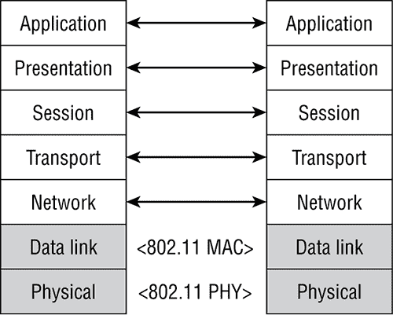

Figure 10-2: 802.11 MAC 头部

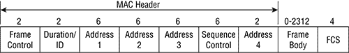

有三种类型的`802.11`帧：

* 管理帧——用于通知、连接、断开和信息传递。

* 控制帧——用于控制哪个站可以访问无线网络介质。

* 数据帧——用于携带上层数据。

大多数无线局域网（WLAN）都基于 IEEE `802.11`标准及其修订版，如`802.11a`、`802.11b`、`802.11g`和`802.11n`。带有字母的修订版已合并到最终的`802.11`标准中，现在通过`802.11`标准中的条款或章节编号来引用。然而，由于带有字母的修订版在区分`802.11`标准的不同章节时仍经常使用，因此在本章中也将使用。表 10-1 显示了`802.11`标准修订版的比较。

Table 10-1: 802.11 比较

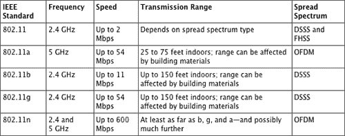

初始的`802.11`标准仅包含基础的安全功能并充满了漏洞。`802.11i`修订版是解决`802.11`缺陷的最新安全解决方案。Wi-Fi 联盟创建了名为 Wi-Fi 保护访问 (`WPA`) 和`WPA2`的额外安全认证，以填充原始`802.11`标准与最新`802.11i`修订版之间的空白。本章讨论的安全漏洞和解决方案均基于这些 IEEE 和 Wi-Fi 联盟标准。

## 认证与破解技术

`802.11`标准中存在两种验证无线局域网客户端到接入点身份的方法：开放系统认证或共享密钥认证。开放系统不提供任何安全机制，仅仅是请求连接网络。共享密钥认证要求无线客户端使用等效网络隐私 (`WEP`) 密钥对挑战文本字符串进行哈希处理，以向网络验证客户端身份。Table 10-2 比较了 Wi-Fi 安全标准的认证和加密类型。

WEP 是`802.11` WLAN 的第一个安全选项。WEP 用于加密 WLAN 上的数据，并可以可选与共享密钥认证配对以验证 WLAN 客户端。WEP 使用`RC4` 40 位密钥来加密数据……（注：原文写为 6-bit，但通常为 40-bit，此处遵循原文：`RC4` 6-bit）。*修正：原文写为 "RC4 6-bit"，我将保持原样。*

| WPA | TKIP | 口令或 RADIUS (802.1x/EAP) | 口令容易受到字典攻击。 |

| :--- | :--- | :--- | :--- |

| WPA2 | AES (在混合模式下可以使用 TKIP) | 口令或 RADIUS (802.1x/EAP) | 口令容易受到字典攻击。 |

| IEEE 802.11i | AES (在混合模式下可以使用 TKIP) | 口令或 RADIUS (802.1x/EAP) | 口令容易受到字典攻击。 |

## 破解工具

`Aircrack`是一种破解 WEP 的软件工具。它不捕获数据包；而是用于在另一个工具捕获加密数据包后进行破解。`Aircrack`可以在 Windows 或 Linux 上运行。

`WEPCrack`和`AirSnort`是基于 Linux 的 WEP 破解工具。

`NetStumbler`和`Kismet`是 WLAN 发现工具。它们都能发现 WLAN 的介质访问控制 (`MAC`) 地址、服务集标识符 (`SSID`)、安全模式和通道。此外，`Kismet`可以发现`SSID`隐藏的 WLAN、收集数据包并提供 IDS（入侵检测系统）功能。


# 在进行“无线驱动”时要小心


2003 年，黑客试图利用家装用品零售商 Lowe’s 的无线网络来盗取信用卡号。这三名黑客在密歇根州南菲尔德扫描开放连接（或在该地区进行“无线驱动”）时，在一家 Lowe’s 门店发现了一个漏洞 `WLAN`。随后，黑客利用该开放的接入点入侵了这家位于北卡罗来纳州的家装用品公司的整个公司网络，在几周内入侵了位于加利福尼亚州、堪萨斯州、南达科他州和其他州的商店。他们访问了一个名为 `tcpcredit` 的信用卡处理程序，该程序会掠取特定 Lowe’s 门店处理的每笔交易的信用卡账户信息。据认为，黑客的计划是通过安装在 Lowe’s 专用程序中的后门来抽走数百万个信用卡号。

参与此次破解尝试的男子之一在与两名同犯入侵 Lowe’s 网络后，对四项电线欺诈和未经授权访问计算机的指控认罪。2004 年，他被定罪，目前正在服九年徒刑，尽管没有证据表明他收集了任何信用卡号。在调查期间，仅在修改后的 `tcpcredit` 程序创建的文件中发现了六个信用卡号。这个故事说明，即使是无害的无线驱动也可能引起不必要的关注，因此对你连接的 `WLAN` 要小心。

# 使用无线嗅探器定位 SSID

对 `WLAN` 的常见攻击涉及窃听或嗅探。这是一种很容易实施的攻击，通常发生在热点或任何默认安装的接入点（`AP`）上，因为数据包通常在 `WLAN` 上以未加密的形式发送。在未加密的 `WLAN` 上，黑客可以以明文（未加密）捕获如 `FTP`、`POP3` 和 `SMTP` 等网络访问协议的密码。

服务集标识符（`SSID`）是 `WLAN` 的名称，可以在信标帧（beacon frames）和探测响应帧（probe response frames）中找到。如果两个无线网络在物理上很近，则 `SSIDs` 用于识别和区分各自的网络。`SSID` 通常在信标帧以及其他帧（如探测响应帧）中明文发送。大多数 `APs` 允许 `WLAN` 隐藏 `SSID`。然而，这并不是稳健的安全机制，因为某些工具可以从其他数据包（如探测请求和其他客户端数据包）读取 `SSID`。

练习 `10-1` 将引导你安装并使用名为 `Omnipeek` 的 `WLAN` 嗅探工具。

## 练习 10-1：安装和使用 WLAN 嗅探工具

1. 从 `[www.wildpackets.com](http://www.wildpackets.com)` 下载 `Omnipeek` 试用版。你需要支持 `Omnipeek` 混杂模式（promiscuous mode）的无线局域网适配器，`Omnipeek` 才能正确捕获无线 `LAN` 上所有的流量。从 `[www.wildpackets.com](http://www.wildpackets.com)` 查看支持的无线 `LAN` 适配器及其驱动。

2. 点击 `Omnipeek` 启动界面上的 `New Capture` 按钮开始新的捕获。

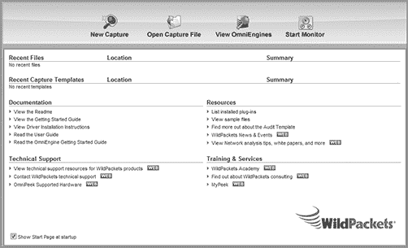

3. 从捕获选项中选择无线适配器。

注意：在 `Adapter` 标签页上，`WildPackets API` 必须列出描述 `Yes`，否则适配器将在 `Omnipeek` 中无法正常工作，如下：

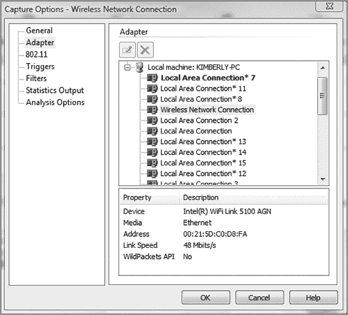

4. 点击 `802.11` 标签页，初始选择扫描所有通道。稍后一旦确定了要监控的特定 `WLAN`，你可以选择只捕获该通道上的流量。

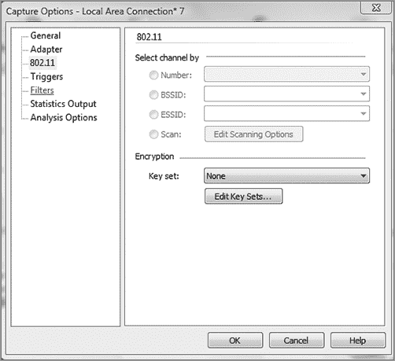

5. 点击 `OK` 开始捕获。捕获窗口将显示正在被捕获的帧。双击帧以查看更多细节。

6. 点击 `stop capture` 按钮停止捕获。从帧上方的工具栏选择 `Display filter` 下拉按钮（看起来像一个漏斗）。选择 `POP`。

7. 点击 `stop capture` 按钮停止捕获。点击 `Adapter` 标签页，`WildPackets API` 必须列出描述 `Yes`，否则适配器将在 `Omnipeek` 中无法正常工作，如下：


非法接入点（Rogue access points）是指未经授权连接到网络的 `WLAN` 接入点。非法 `AP` 在网络中开启了一个无线漏洞。黑客可以植入非法 `AP`，或者员工也可能在无意中通过将接入点插入网络而创建一个安全漏洞。产生的非法 `AP` 可被任何能连接到该 `AP` 的人员使用，包括黑客，从而让他们访问有线局域网（`LAN`）。这就是为什么组织扫描非法接入点至关重要的原因。即使是那些拥有“无无线”策略的组织，也需要进行无线扫描，以确保没有非法 `AP` 连接到网络。

非法 `AP` 可能是存在的最危险的无线威胁，因为它们为潜在黑客提供了直接访问有线局域网的机会。连接到非法 `AP` 的客户端通常会直接从网络或 `AP` 获取 `IP` 地址，然后流量被直接桥接到有线局域网。从那里，黑客可以对有线 `LAN` 上的目标进行扫描、枚举和系统攻击。目前存在检测和移除非法接入点的措施，所有组织都应该实施这些措施。

许多基于企业 `WLAN` 控制器的管理解决方案都具有检测非法接入点的能力。这些基于控制器的解决方案包括通过接入点、传感器/监视器或两者来监控空气环境的能力。接入点本质上在客户端连接时必须保持在某个通道上以提供服务，而传感器和监视器能够持续扫描频段内所有通道的空气环境，以捕捉可能的非法接入点无线传输。将这些无线 `MAC` 地址与在网上接收到的地址进行比较，以确定该 `AP` 是否连接到与无线入侵检测系统（`WIDS`）或无线入侵防护系统（`WIPS`）相同的 `LAN`。某些 `WIPS` 还可以向尝试连接到非法 `AP` 的客户端发送伪造的去认证帧，从而阻止客户端连接到非法 `AP`——由此防止客户端通过非法 `AP` 发送数据。叠加式 `WIDS/WIPS` 系统也可以通过对非法 `AP` 的位置进行三角定位来检测非法接入点。

企业级 `WLAN` `WIPS` 和叠加式 `WIPS` 只是临时的检测和抑制方案。首要目标应该是定位非法 `AP` 并将其从网络中移除。

# 恶孪生或 AP 伪装（AP Masquerading）

黑客可以使用基于软件的 `AP` 创建一个看起来像真实接入点的 `AP`。这被称为恶孪生攻击（Evil Twin attack）或 `AP` 伪装。

# 无线攻击技术

大多数无线黑攻击可以归类如下：

## 破解加密和身份验证机制

这些机制包括破解 `WEP`、`WPA` 预共享密钥认证密码以及思科的轻量级 `EAP` 认证（`LEAP`）。黑客可以使用这些机制通过窃取的凭据连接到 `WLAN`，或者捕获其他用户的数据并进行解密或加密。防止此类攻击的方法是实施更强的加密类型，例如 `AES`。

## 窃听或嗅探

此类攻击涉及从未加密的 `WLAN` 或热点中捕获密码或其他机密信息。防止此类攻击的方法是使用 `SSL` 应用层加密或 `VPN` 来保护用户数据。

## 拒绝服务（DoS）

可以在物理层执行 `DoS`，方法是使用 `RF` 发射器产生比 `AP` 更强的 `RF` 信号，导致经批准的 `AP` 故障，从而使用户连接到非法 `AP`。可以在逻辑链路控制（`LLC`）层执行 `DoS`，方法是生成去认证帧（`deauth` 攻击）、持续生成伪帧，或让无线网卡发送持续的原始 `RF` 流（昆士兰攻击）。防御措施是在你的 `WLAN` 周围强制安全边界，并使用 `IDS` 检测并移除 `DoS` 攻击源。

## AP 伪装或欺骗

非法 `AP` 通过使用相同的 `SSID` 设置或网络名称伪装成合法 `AP`。防止 `AP` 伪装的措施是使用 `WIDS` 来检测和定位伪造的 `AP`。

## MAC 欺骗

黑客伪装成合法的 `WLAN` 客户端，通过欺骗另一个用户的 `MAC` 地址来绕过 `MAC` 过滤。`WIDS` 可以检测 `MAC` 欺骗，未使用 `MAC` 过滤也是避免 `MAC` 欺骗攻击的方法。

## 植入非法接入点

最危险的攻击是植入非法 `AP` 以允许黑客访问目标 `LAN`。防御措施是使用 `WIPS` 检测并定位非法 `AP`。

如果 `AP` 没有得到妥善保护，无线网络将为黑客进入网络提供便利途径。有许多方法可以攻击或利用 `WLAN` 的漏洞。针对这些许多攻击也有有效的防御措施。下一节将详细介绍保护无线网络的最佳方法。

# 无网络安全

与有线网络技术相比，无线网络是一项相对新的技术，安全选项较少。安全方法可以按 `OSI` 模型相应的层分类。

第 2 层（或 `MAC` 层）安全选项如下：

* 静态 `WEP`（不推荐）
* `WPA`
* `WPA2/802.11i`

第 3 层（或网络层）安全选项如下：

* `IPSec`
* `SSL VPN`

第 7 层（或应用层）安全选项如下：

* 安全应用程序，如 `Secure Shell`（`SSH`）、基于 `SSL` 的 `HTTP`（`HTTPS`）和 `FTP/SSL`（`FTPS`）


由于 `WEP` 的许多漏洞，不应作为 `WLAN` 的唯一安全机制。

# 保护家庭无线网络

许多设置家庭无线网络的人急于完成工作，以便尽快让互联网连接可用。市场上的小型办公室、家庭办公（`SOHO`）网络产品使设置快速简单，但并不一定安全。配置额外的安全功能对某些家庭用户来说可能耗时且不直观，因此他们可能完全不实施任何安全机制。

如今无线网络产品无处不在且价格廉价，几乎任何人都可以花费 100 美元的设备在几分钟内设置好 `WLAN`。无线网络的广泛使用意味着在你的家庭或办公室 `WLAN` 范围内可能有几十个潜在的网络入侵者。大多数 `WLAN` 硬件的设置已经变得非常简单，许多用户只需插上电源就开始使用网络而不考虑安全性。然而，花额外的时间配置无线路由器或接入点的安全功能是值得的。以下建议将提高你家庭无线网络的安全性：

## 更改默认管理员密码和用户名

在配置家庭接入点时，你通常使用网络浏览器访问配置界面。几乎所有的路由器和接入点都有登录设备并修改任何配置设置时所需的管理员密码。为了设置这些设备，制造商提供了默认用户名和密码。许多默认登录信息非常简单（例如 `username=admin` 和 `password=admin`），并且对互联网上的黑客广为人知。大多数设备使用较弱的默认密码，如“password”或制造商名称，有些设备根本没有默认密码。你应该尽快更改家庭 `AP` 的默认密码。

## 使用 WEP/WPA 加密

大多数 `Wi-Fi` 设备支持某种形式的加密。加密技术会对通过无线网络发送的消息进行扰乱处理，使得黑客无法轻易读取。你应该配置与你的无线客户端兼容的最强形式的加密。802.11 的 `WEP`（有线等效隐私保护）加密具有众为人知的漏洞，这使得拥有正确设备的坚决用户相对容易破解加密并访问无线网络。保护你的 `WLAN` 的更好方法是使用 `WPA`（`Wi-Fi` 保护访问）。`WPA` 提供了更好的保护，而且更易使用，因为你的密码字符不再像 `WEP` 那样仅限于 0–9 和 A–F。（注：`WEP` 也可以使用 `ASCII` 密钥。）

## 更改默认 SSID

接入点使用名为 `SSID` 的网络名称向无线用户发布网络。制造商通常在出厂时为产品设置相同的 `SSID`。例如，`Linksys` 设备的 `SSID` 通常为“Linksys”。仅仅知道 `SSID` 本身并不能让邻居侵入你的网络，但这是一个开始。更重要的是，当有人发现默认 `SSID` 时，通常是网络配置不当的标志。在配置网络无线安全时，你应该立即更改默认的 `SSID`。

## 不要自动连接到开放 Wi-Fi 网络

连接到开放 `Wi-Fi` 网络（如免费无线热点或未知 `WLAN`）会将你的计算机暴露在安全风险中。大多数计算机都有一个设置，允许这些连接在自动发生而不通知你。大多数版本的 `Windows` 会重新连接到以前连接过的 `SSID`。除非临时情况，否则不应启用此设置。

## 在你的笔记本电脑和家庭接入点上启用防火墙设置

大多数路由器包含内置防火墙功能，但也存在禁用选项。确保你的路由器防火墙已开启。你应该在连接到路由器的每台计算机上安装并配置个人防火墙软件。

## 降低你的 WLAN 发射功率

你不会在所有无线路由器和接入点上找到此功能，但某些设备允许你降低 `WLAN` 发射功率，从而缩短信号范围。（通常此功能仅企业级接入点可用。）虽然通常无法精细地调整信号以使其不泄漏到家或办公场所之外，但通过反复尝试，你通常可以限制信号到达场所以外的距离，最大限度地减少外部人员访问你 `WLAN` 的机会。这通过将无线单元限制在你的场所内，还将提高你接入点的吞吐量。

## 禁用远程管理

大多数 `WLAN` 路由器都具有通过互联网进行远程管理的能力。理想情况下，只有当该功能允许你定义特定的 `IP` 地址或有限范围的地址来访问路由器时才使用。否则，任何地方的任何人都可能发现并访问你的路由器。根据原则，除非你绝对需要此功能，否则最好关闭远程管理。

# 总结

无线网络的增长受到便利性和日益增加的移动劳动动力的推动。越来越多的员工在家里或在途中工作，组织正在构建更大的企业 `WLAN` 以支持员工更强的流动性。过去，许多组织因为内在的缺乏安全性和技术不成熟而避免使用 `WLAN`。

`802.11n` 的批准有望为无线局域网提供更高的速度，使其与现有的以太网局域网媲美。这种速度的提升只会增加使用无线进行业务应用的组织数量，并增加安全风险。

最近，`WLAN` 安全机制已经成熟到企业和政府办公室开始采用 `WLAN` 技术的程度。通过适当的安全机制和实施，`WLAN` 可以达到高标准的安全。通过仔细遵循安全建议和应对措施，你可以保护你的 `WLAN` 免受攻击。

# 考试要点

- 理解使用 `WLAN` 的内在安全漏洞。`RF` 是广播介质，类似于集线器环境，因此所有流量都能被黑客捕获。
- 理解 `IEEE 802.11` 标准中实现的安全解决方案。`WEP`、共享密钥和 `MAC` 过滤器是原始 `IEEE 802.11` 标准提供的安全解决方案。
- 理解 `Wi-Fi` 联盟提供的安全解决方案。`WPA` 和 `WPA2` 是 `Wi-Fi` 联盟设备安全认证。
- 知道 `WLAN` 上 `SSID` 的用途。`SSID` 识别网络名称，应作为安全机制使用。
- 知道哪些安全机制不应用于 `WLAN` 安全。`WEP` 和 `MAC` 过滤器不应作为保护 `WLAN` 的唯一手段。

# 复习题

1. 以下哪种安全解决方案对加密和身份验证使用相同的密钥？
   A. `WPA`
   B. `WPA2`
   C. `WEP`
   D. `802.11i`

2. `WEP` 代表什么？
   A. Wireless Encryption Protocol
   B. Wired Equivalent Privacy
   C. Wireless Encryption Privacy
   D. Wired Encryption Protocol

3. 什么使得 `WEP` 易被破解？
   A. 加密和身份验证使用相同密钥
   B. 密钥长度
   C. `IV` 的缺陷
   D. `RC4`

4. `WPA` 使用哪种加密形式？
   A. `AES`
   B. `TKIP`
   C. `LEAP`
   D. 共享密钥

5. `WPA2` 使用哪种身份验证形式？
   A. 仅限密码
   B. `802.1x/EAP/RADIUS`
   C. 密码或 `802.1x/EAP/RADIUS`
   D. 密码

6. 在 `WLAN` 上 `SSID` 的用途是？（此处原文选项不完整，应根据语意翻译）

7. `802.11` 最类似于哪种安全标准？
   A. `WPA2`
   B. `WPA`
   C. `TKIP`
   D. `AES`

8. 发送 `deauth` 帧的设备正在执行哪种攻击？
   A. 拒绝服务
   B. 破解
   C. 嗅探
   D. `MAC` 欺骗

9. 针对 `WLAN` 最危险的攻击类型是？
   A. `WEP`
   B. 恶意接入点
   C. 监听
   D. `MAC` 欺骗

10. `802.11i` 实现在哪层？
    A. 第 1 层
    B. 第 2 层
    C. 第 3 层
    D. 第 7 层

11. 以下哪个是家庭网络的最佳选项？
    A. `WEP`
    B. 共享密钥认证
    C. `WPA-Personal`
    D. `WPA-Enterprise`

12. 你刚为办公室安装了一个接入点。你应该立即采取哪些步骤来保护你的 `WLAN`？
    A. 欺骗你的客户端 `MAC` 地址。
    B. 修改 `AP` 管理密码。
    C. 将 `AP` 通道改为 11。
    D. 将 `SSID` 设置。

13. 连接任何 `WLAN` 时，可以在笔记本电脑上做什么来增加安全性？（双选）
    A. 安装并配置防火墙软件。
    B. 禁用自动连接功能。
    C. 使用 `WEP`。
    D. 使用 `MAC` 过滤。

14. `SSID` 在 `WLAN` 的用途是？
    A. 安全 `WLAN`
    B. 管理 `WLAN` 设置
    C. 识别 `WLAN`
    D. 配置 `WLAN` `AP`

15. 实施“无无线”策略的最佳方法是？
    A. 安装防火墙。
    B. 禁用无线适配器。
    C. 使用 `WIDS/WIPS`。
    D. 仅连接开放 `AP`。

16. 以下哪个用于欺骗 `MAC` 地址的程序？
    A. `MAC Again`
    B. `Big MAC`
    C. `TMAC`
    D. `WZC`

17. 以下哪些用于保护 `WLAN` 热点数据的第 7 层应用安全协议？
    A. `HTTPS`
    B. `HTTP`
    C. `FTP`
    D. `VPN`

18. `WIPS` 使用哪种帧来防止 `WLAN` 用户连接到恶意接入点？
    A. 断开
    B. 取消身份验证（`Deauthentication`)
    C. 禁用
    D. 拒绝

19. `WPA` 密码可以由哪些字符集组成？
    A. 仅 a–z 和 A–Z
    B. 仅 a–z
    C. 仅 a–z, A–Z 和 0–9
    D. 仅 0–9

20. 以下哪项是使用 `WEP` 的应对措施？

# 复习题答案

1. `C`.`WEP` 加密和认证使用相同的密钥。
2. `B`.`WEP` 是 `Wired Equivalent Privacy`（无线等隐私）的缩写。
3. `C`.`WEP` 可以被破解，是因为在部署 `RC4` 时对 `IV` 的使用缺乏复杂。
4. `B`.`WPA` 使用 `TKIP`。


5. `C`.`WPA2` 在个人模式下使用密码，或在企业模式下使用 `802.1x/EAP/RADIUS`。

6. `A`.`802.11i` 与 `WPA2` 几乎相同。

7. `D`.`VPN` 是用于 `WLAN` 的第三层安全解决方案。

8. `A`.设备可以通过发送持续的 `deauth frames` 执行 `DoS` 攻击。

9. `B`. 恶意 `AP` 是 `WLAN` 最危险的攻击，因为它为黑客提供了进入网络的开放大门。

10. `B`.`802.11i` 是二层技术。

11. `C`.`WPA-Personal` 在家庭网络上具有最强身份验证和加密。`WPA-Enterprise` 需要 `RADIUS` 服务器，大多数家庭用户没有能力设置和配置它。

12. `B`.在安装新 `AP` 时，应立即更改 `AP` Web 上的 `Admin` 密码。

13. `A, B`. 安装和配置个人防火墙软件以及禁用自动连接功能是增加 `WLAN` 连接安全性的两种方法。

14. `C`. 服务集标识符 (`SSID`) 用于向无线用户标识 `WLAN`。

15. `C`. 使用无线入侵检测系统或保护系统是执行“无无线”策略的最佳方法。

16. `C`.`TMAC` 是用于伪造 `MAC address` 的程序。

17. `A`.`HTTPS` 是 `HTTP` 的安全版本，通常用于保护 `WLAN` 热点上的数据。

18. `B`.`WIPS` 使用 `Deauthentication frames` 来防止用户连接到恶意 `APss`。

19. `C`.`WPA` 密码可以是字母数字并包含 `a–z`、`A–Z` 和 `0–9`。

20. `C`. 使用 `WPA` 是应对 `WEP` 弱点的措施。

# 第 11 章：物理现场安全

### 本章涵盖的 CEH 考试目标

* 物理安全漏洞事件
* 理解物理安全
* 为什么需要物理安全？
* 谁对物理安全负责？
* 影响物理安全的因素

物理安全可能是 IT 安全中防止机密敏感数据丢失或被窃的关键领域。如果一个组织未能执行足够的物理安全，所有其他技术安全措施（如防火墙和入侵检测系统 `IDSs`）都可能被绕过。俗话说：“一旦进入内部，你就拥有了网络。”通过通过物理方式保护你的网络和组织，你可以防止他人偷取笔记本电脑或磁带驱动器等设备、在系统上放置硬件键盘记录器以及在网络上部署恶意接入点。物理安全很大程度上依赖人员的执行，因此容易受到社交工程攻击的影响，例如跟随员工进入建筑而无需提供正确的钥匙或凭据（从而绕过物理安全检查）。

本章将探讨物理安全的必要性，并定义谁负责规划和执行物理安全。

### 物理安全的组成部分

物理安全是保护人员、硬件、程序、网络和数据免受可能对企业、机构或协会造成严重损失或损害的物理情况和事件。这包括免受火灾、自然灾害、入室、盗窃、破坏和恐怖主义的侵害。

相比黑客、病毒、木马和间谍软件等更具技术性的问题，物理安全往往被忽视（其重要性被低估）。然而，物理安全漏洞可以在攻击者几乎完全没有技术知识的情况下实施。此外，事故和自然灾害是日常生活的一部分，从长期来看是不可避免的。

物理安全有三个主要组成部分：

* 可以在潜在攻击者的路径上设置障碍，并针对事故和环境灾害对场所加固。此类措施包括多道锁、栅栏、墙壁、防火箱和水喷淋器。
* 可以建立监控和通知系统，如照明、热传感器、烟雾探测器、入侵检测器、报警器和摄像头。
* 可以实施方法来捕获攻击者（最好在造成任何损害之前），并从事故、火灾或自然灾害中快速恢复。

似乎每天都有新闻报道描述另一家著名的政府机构或大型公司泄露了客户信息或机密员工信息。例如，笔记本电脑可能在入室抢劫案中被盗，或在员工旅行期间从酒店客房内被盗。这些机密或敏感信息在黑客手中可能是危险的。

在物理安全中，像所有安全措施一样，最好的方法是分层防御。你不应该 100% 地依赖单一控制措施来保护你的关键资产。以下是物理安全分层方法优于单一物理机制的两个例子。

第一个例子是守卫是唯一的防御机制。如果他睡着了或休息计划休息，入侵者就有机会在不被察觉的情况下直接进入你的数据中心。更好的安全措施是要求人员持有唯一的 ID 牌才能进入大门。接下来，她受到守卫的检查，被摄像头记录，然后需要一把独立的钥匙才能进入数据中心。在这个例子中，有四层防御。

在第二个安全示例中，一名员工买不起笔记本电脑，因此他决定把公司的电脑带回家玩他最喜欢的游戏。他在回家的火车或巴士上分心了，忘记了装有笔记本电脑的包。笔记本电脑没有设置任何安全控制，且包含敏感数据。如果在这种情况下遵循了最佳实践，将存在多层防御来防止和阻止该个人将笔记本电脑离开环境。应该有一项可接受的使用策略，以强调从场所带走公司财产和敏感数据的重要性及其影响。笔记本应该启用多因素身份验证和磁盘加密，这样在丢失或被盗时，其存储上的数据对其他人来说是无用的。如果环境特别敏感，可以在所有移动设备中放置追踪器，一旦它们离开办公室达到不可接受的距离，就会触发报警以通知安全人员。

建立多道防至关重要，因为部署的防御层越多，你受威胁的影响就越小。同样重要的是，即使你为资产设置了许多层逻辑安全控制，如果获得了物理访问权限，这些控制通常可以被快速地绕过。

设备盗窃是最常见的物理安全攻击之一。大多数人并没有预计自己的电脑会被盗，并且忽略锁定主机系统；相反，他们依赖标准的网络安全机制。

许多内部攻击是物理安全漏洞的结果。一旦黑客获得了服务器、单个客户端系统或网络端口的物理访问权限，结果可能是灾难性的。此外，此类漏洞难以识别、追踪或定位。由于物理安全不足导致的常见安全漏洞如下：

* 安装恶意软件，如键盘记录器、病毒、木马、后门或根内核程序。
* 识别并捕获验证或身份凭据，如密码或证书
* 物理连接到有线网络以嗅探敏感数据，如密码和信用卡号
* 访问系统以收集用于破解系统本地存储密码的数据
* 有机会部署恶意访问点，用以创建一个可以访问有线网络的开放无线网络
* 盗取纸质或电子文档
* 盗取敏感传真信息
* 翻垃圾桶攻击（强调了粉碎重要文件的必要性）

### 物理安全漏洞的迹象可能包括但不限于：

* 未经授权或无法解释的门禁报警
* 监控摄像头录得到未经授权的人员
* 门锁或外部围栏围受损坏
* 围栏内外出现车辆或人员的证据
* 无法解释的通信中断
* 丢失或无法说明的设备

### 理解物理安全

通常情况下，安全措施可以分为以下三类：

#### 物理措施

防止访问系统的物理措施包括安保人员、照明、围栏、锁和报警器。设施接入点应受到限制，并应通过闭路电视（`CCTV`）摄像头和报警器进行监控/保护。设施入口应仅限授权人员进入。对笔记本电脑系统以及移动介质（如移动驱动器、备份带和磁盘）的访问应受到限制和保护。电脑屏幕的放置位置应确保路人无法看到，并应实施和执行相关策略，要求用户因任何原因离开电脑时锁定系统。存有高度敏感数据的计算机系统应保护在封闭且锁定的区域内，例如带有机架式机箱和锁的凭据访问室。

### 技术措施

在所有远程客户端系统、网络和服务器上应实施技术安全措施，如防火墙、`IDS`、间谍软件内容过滤以及病毒和木洛马扫描。访问控制等技术安全措施通过使用身份验证、密码以及文件和文件夹权限来实现。其他技术控制可以通过计算机软件（如病毒扫描和主机防火墙）来实现。从本质上说，技术控制是指任何通过计算机硬件或软件实现的安全机制。

### 运营措施

运营安全通过管理控制来解决，例如可接受使用策略、招聘政策和安全策略。分析威胁和执行风险评估的运营安全措施应成为组织安全策略中记录的流程。

技术和运营安全措施将在本书的其他章节中讨论。技术防御措施列在本书的每一章中（第一章和最后一章除外）。

你需要物理安全措施与其他类型安全（如技术或运营安全）相同：防止黑客获取你的网络和信息。黑客可以很容易通过物理安全措施的缺陷获取此类访问权限。此外，数据可能会因自然原因丢失或损坏，因此风险经理在规划适当的安全措施时必须将自然灾害考虑在内。物理安全措施旨在防止以下情况：

* 未经授权访问计算机系统
* 从系统中窃取数据
* 损坏存储在系统中的数据
* 自然原因导致的数据丢失或系统损坏


### VA 笔记本电脑被盗数据

2006 年，退伍军人事务部（VA）一名数据分析师家中被盗一台笔记本电脑，该员工违反部门规定将电脑带回了。笔记本电脑包含了约 2650 万名美国退伍军人的数据。

据信，这是一次随机抢劫，偷走电脑的人并不知道电脑里有这些数据。小偷偷走了他的笔记本电脑和外部硬盘，硬盘包含了 1975 年后退伍的每位退伍军人的姓名、出生日期和社会安全号码。

VA 评论说，该员工“从 VA 带回了大量的电子数据，这是他未经授权的。这违反了我们的规章、制度和政策。”这一安全漏洞说明了你最私人的数据如何轻易落入身份窃取者之手。

漏洞被发现后，几个退伍军人团体对 VA 发起了法律诉讼。现在三年后，双方已达成协议。能够证明遭受实际损害（例如导致身体症状的情绪痛苦，或信用监控费用）的退伍军人将有权获得高达 1,500 美元的赔偿。这项和解为 VA 总计带来了 2000 万美元的成本。这只是说明物理场地安全和执行政策对于维护个人数据安全有多么重要的一个例子。被发现未能保护其受托数据的组织可能面临巨额罚款。

组织中的以下人员应对物理安全负责：

* 组织的物理安全官
* 信息系统专业人员
* 首席信息官
* 员工

本质上，组织中的每个人都有责任执行物理安全策略。设定物理安全标准和实施物理安全措施是物理安全官的责任。

组织有责任对所有员工进行安全意识培训。防止物理安全攻击的最佳防御措施是培训员工对物理安全漏洞保持警惕。

物理安全受到物理安全控制之外因素的影响。影响组织物理安全的因素包括：破坏、盗窃以及地震、火灾、洪水等自然原因。安全专业人员需要意识到这些风险因素并做出相应计划。许多组织建立了业务连续性计划（（BCP`）或灾难恢复计划（`DRP`）以应对这些可能性。

### 物理场地安全防御措施

有一些简单的方法可以提高组织的物理安全。许多时候，提高安全性涉及执行已存在的指南。人们往往在执行执行政策和程序一段时间后会变得松散。为了维持高水平的安全，组织中的每个人必须保持警惕，保护组织的数据资产。

应实施以下防御措施以确保强大的物理场地安全：

锁好服务器房。在使用技术机制锁定服务器之前，甚至在第一次启动它们之前，你应该确保服务器机房门装有良好的锁。当然，如果不用，世界上最好的锁也毫无用处，因此你还需要制定策略，要求在房间无人时锁好这些门。策略应规定谁拥有进入的钥匙或钥匙代码。服务器房是你物理网络的心脏，拥有该房间内服务器、交换机、路由器、电缆和其他设备物理访问权限的人可以造成巨大的破坏。

# 设置和监控视频监控

锁上机房的门是一个良好的第一步，但有人可能会破入，或者拥有授权访问的人员可能会滥用权限。你需要一种方法来知道谁在什么时候进出了。使用签到/签到表是实现这一目标最基本的方法，但这种方法有很多缺点。心有恶意意图的人可能会直接绕过它。

比签到表更好的解决方案是集成到锁定设备中的身份验证系统，这样就需要智能卡、令牌或生物识别扫描才能打开门锁，并记录每位进入人员的身份。视频监控摄像头应放置在一个难以被篡改或关闭的地点，同时又能够良好地观察到进出人员，并应作为签到表或电子访问控制系统的补充。监控摄像头可以进行持续监控，也可以使用运动检测技术仅在有人移动时进行记录。它们甚至可以被设置为：在不应该有运动的情况下（例如下班后）检测到运动时，发送电子邮件或手机通知。

## 确保最脆弱的设备位于锁好的房间内

你必须物理保护的不只是服务器。其他网络设备也需要安全防护。黑客可以将笔记本电脑连接到集线器，并使用嗅探软件捕获在网络中传输的数据。确保尽可能多的网络设备都位于那个锁好的房间内。如果不加安全措施，布线室和电话室将成为易受攻击的目标。

## 安全工作站

黑客可以使用任何连接到网络且未安全的计算机来访问或删除对你的业务非常重要的信息。空闲办公位或空旷办公室的工作站——例如那些正在休假或离开公司尚未被替换的人员使用的工作站，或者外部人员易于访问的位置——例如前台接待处——是特别脆弱的。

断开并/或移除未使用的计算机，并/或锁上空办公室的门，包括员工午餐或请假期间暂时空空的办公室。对于必须留在开放区域（有时员工看不见的地方）的计算机，可以启用智能卡或生物识别读取器，使未经授权的人员难以登录。

## 防止入侵者打开计算机

服务器和工作站都应该受到防盗的保护，防止他们打开机箱并夺走硬盘。在口袋里带走硬盘比提一整台塔式电脑离开现场要容易得多。许多计算机配有机箱锁，以防止在没有钥匙的情况下打开机箱。

## 保护便携设备

笔记本电脑和手持设备构成了特殊的物理安全风险。小偷可以轻易偷走整台电脑，包括存储在其磁盘上的任何数据以及可能保存的网络登录密码。如果员工在办公桌前使用笔记本电脑，他们离开时应该随身带，或使用线锁将其固定在固定装置上。当员工离开区域时，可以将手持设备锁在抽屉或保险箱内。还有运动传感器报警器可以在你的便携设备被移动时提醒你。

对于包含敏感信息的便携设备，全盘加密、生物识别读取器以及在被盗的笔记本电脑连接到互联网时“拨回”的软件可以作为物理预防措施的补充。


许多手机在设备丢失或被盗时具有远程擦除的能力。

## 备份

备份重要数据是灾难恢复中的一个基本要素，但不要忘记这些备份磁带、磁盘或光盘上的信息可能会被公司以外的人员窃并使用。许多 IT 管理员将备份放在机房服务器旁边。它们至少应该锁在抽屉或保险箱内。理想情况下，一组备份应该保存在异地，你必须留心确保它们在异地地点是安全的。

不要忽视这样一个事实：某些员工可能会在软盘、USB 闪盘或外部硬盘上备份他们的工作。如果允许或鼓励这种做法，请确保有政策要求备份随时锁定。

## 禁用移除式介质驱动器

为了防止员工将公司信息复制到移除式介质，你可以禁用或移除软驱器、USB 端口和其他连接外部驱动器的方法。仅仅断开线可能无法震慑技术高明的员工。某些组织甚至用胶水或其他物质填充端口以永久防止其使用，尽管有一些软件机制可以禁止这样做并允许管理员重新启用驱动器。

## 保护你的打印机

你可能没有考虑到打印机存在安全风险，但今天许多打印机会将文档内容存储在自身的内置内存中。如果黑客偷了打印机并访问该内存，他或她可能复制最近打印的文档。打印机像存储重要信息的服务器和工作站一样，应该位于安全位置并螺栓固定，以免有人带走它们。

还要考虑员工打印出来的文档的物理安全。最好的方法是实施立即粉碎任何不需要的打印文档的政策，即使那些不包含机密信息的文档也是如此。这建立了一种习惯，并让终端用户无需承担决定是否粉碎文档的责任。

## 为所有员工和承包商执行胸卡制度

启动包含员工照片的胸卡计划并对特定的访问区域进行颜色编码。承包商和访客也应该佩戴胸卡，并在整个访问期间接受护送、观察和监督。所有员工询问任何没有佩戴可见身份证的人员应该是标准政策。

### 警惕“尾随者”（tailgaters）

这些人等候有访问权限的人员进入控制区域（例如带锁的门的区域），然后跟随授权人员通过门门。尾随者在不使用自己的钥匙、卡钥匙或锁的组合的情况下进入。站在大外的抽烟者似乎特别容易发生“尾随”。

请检查以下物理场所安全清单，以评估贵组织的物理安全状况。

## 公共停车区域

- 在适当的情况下，是否对员工、租户和公共停车区域进行了明确的标识？
- 夜间照明水平是否充足？测试：在现有的光照条件下，你是否可以舒适地阅读报纸？
- 停车场区域和入口是否可以被尽可能多的人观察？
- 在人员进入场所的所有时段，停车区域是否都已完全照明？
- 在适当的情况下，停车区域是否已妥善设置告示，允许执法人员在必要时采取执法行动？例如：限制停车区、残疾人车。

## 限制区域

- 是否安装了围栏和锁门等屏障，以防止未经授权的车辆和行人进入限制区域？
- 是否已指示员工报告限制区域内的未经授权人员以及其他可疑人员和活动？
- 限制区域是否已妥善设置告示以防止未经授权的人员进入？
- 限制区域附近是否显著显示了户外标识？
- 报告可疑活动的电话号码的标识是否位于易于观察的位置？

### 存储区域

- 室外存储区域和院场是否完全封闭？
- 围栏和墙壁是否完好？
- 围栏高度是否足够？
- 大门是否完完好？
- 存储区域和院场在黑暗期间是否提供了充足的照明？
- 大门是否用高安全性挂锁或类似的锁定设备固定？
- 大门打开时，挂锁是否已锁好到位？
- 高价值存储区域是否由电子安全系统保护？

## 建筑外部

- 公共入口是否通过走道和标识明确定义？
- 景观设施是否维护良好，以确保建筑周围视线良好？
- 植物是否经过了修剪，以消除门、窗户、走道及物业其他脆弱区域附近的潜在藏身之处？
- 树木或其他景观是否提供了通往建筑屋顶或其他楼层的路径？
- 树木和植物是否保持修剪，以防止它们干扰照明和视线？
- 垃圾桶和垃圾围栏是否产生了盲点或隐蔽区域？
- 周边围栏的设计是否能保持从街道的可见性？
- 外部私有区域是否与公共区域易区分？

### 照明

- 建筑外部和其他关键区域在黑暗期间的照明是否达到了建议水平？
- 在黑暗期间，所有门窗开口及其他脆弱点是否都保持了适当的照明水平？
- 是否已建立维护检查计划，以确保灯具在任何时候都处于良好工作状态？

### 门

- 所有外门是否为金属、金属玻璃或实心木质设计？
- 所有不使用的门是否已永久封死？
- 所有不用于从外部进入的门是否已拆除外部五金件？
- 所有门的设计是否确保无法通过破窗窗（玻璃或轻质面板）来触及锁具释放装置？
- 玻璃推门是否配备了辅助插销锁和防撬起装置？
- 裸露的合页是否带有不可拆卸的销钉？
- 是否尽可能使用了高质量的弹簧锁？
- 锁具的设计或门框的结构是否使得门无法通过撑开框架来强行打开？
- 钥匙是否仅发放给实际需要的人员？
- 是否已制定相关政策，规定所有在营业期间不需要解锁的门在不使用时必须关闭并加固？

### 窗户

- 不使用的窗户是否已永久封死？
- 窗锁的设计或位置是否确保无法通过破碎玻璃来破解？
- 在适当的情况下，是否利用带刺灌木或类似植物等景观设施来防止进入脆弱的窗户？
- 在必要时，黑暗期间可进入的窗户是否提供了充足的照明？
- 屋顶梯和其他屋顶进入点是否已移除或加固以防止未经授权的使用？
- 卷帘门和平拉门是否安装妥当并用高质量的锁定设备固定？
- 建筑内外的设备用间是否已妥善加固？

## 公共访问区域

- 安保和/或接待区的位置是否可以观察所有公共入口？


## 物理安全

- 建筑的所有公共区域是否都有清晰标记？
- 公共区域与非公共区域之间的边界是否定义明确？
- 是否安装了安全屏障，以防止在公共和非公共区域之间随意移动？
- 所有通往办公室和其他非公共区域的门是否都通过电子锁或密码锁等高质量锁定设备加固？
- 在发生犯罪活动或非法侵入风险较高的区域是否雇佣了安保人员？
- 内部公共卫生间是否可以从附近的办公室或接待区观察到？

## 办公室安全

- 你是否将办公室钥匙限制给实际需要的人员？
- 你是否保留了所有办公室钥匙处理情况的完整且最新的记录？
- 你是否有完善的程序从离职员工处收回钥匙？
- 你是否使用某种锁定设备固定所有打字机、计算器、计算机和类似物品？
- 你是否禁止复制办公室钥匙（除非是你专门书面要求订购的钥匙）？
- 你是否要求所有办公室钥匙都标记为“勿复制”，以防止合法的锁匠在在你不知情的情况下制作副本？
- 你是否已制定政策，规定钥匙不会无人看守地放在桌子或柜子上——并且你是否执行了该政策？
- 你是否已制定政策，设施钥匙和钥匙扣上不会标记标识其所属设施的信息？
- 你是否要求在不使用时将文件柜钥匙从锁中取出并放在安全位置？
- 你是否有一位负责人负责钥匙管理计划？
- 你是否在丢弃敏感文件前对其进行粉碎处理？
- 在不使用时，你是否将装有重要材料的公文包和包锁在安全的地方？
- 你是否坚持进入你设施的所有供应商和维修人员必须提供合规身份证明？
- 你是否每天晚上都清理桌面上的重要文件？
- 你是否经常更换保险箱的密码？
- 计算机访问是否仅限于授权人员？
- 你是否建立了员工胸证制度？
- 如果你在下班后雇用了安保人员，你是否定期进行不打招呼访问以确保他们工作正常？

## 报警系统

- 你的建筑是否配备报警系统？
- 报警系统是否经过了美国实验室（UL）认证？
- 系统是否每天进行测试？
- 系统是否会报告给报警公司中心监控站或警方设施？
- 系统在断电时是否具有自动备用电源？
- 系统是否不存在误报情况？
- 系统是否采用了防篡改技术？

## 发生安全漏洞后的应对措施

即使组织采取了物理场所防御措施，安全漏洞仍可能发生。如果发生了此类事件，贵组织应采取以下建议步骤以防止再次发生：

- 建立物理安全事件响应流程，包括威胁识别、响应、恢复和事后审查，以管理物理攻击或安全事件。
- 制定政策、标准和程序以支持物理安全事件响应流程。
- 识别利益相关者——包括安全事件响应小组、组织内部人员以及可能参与管理和审查信息安全事件的外部人员。

## 总结

请记住，网络安全始于物理层面。世界上所有的防火墙都无法阻止能够获得你的网络和计算机物理访问权限的入侵者，因此既要锁好门，也要做好防范。未经授权的人员对公司数据的物理访问是对组织安全的侵害。一旦有人获得了你数据的物理访问权限——无论是被盗的笔记本电脑、丢失的文件还是介质——你就会受到进一步攻击的威胁，更不用说会有大量的负面宣传了。实施物理场所安全措施以在攻击发生前将其至关重要。

## 考试要点

- 理解通过物理访问可以进行的攻击。物理访问使黑客具备了破解密码、安装恶意无线接入点和盗取设备的能力。
- 了解影响物理安全执行的某些因素。破坏行为、盗窃和自然原因会影响物理安全的执行。
- 了解谁对物理安全负责。组织的安全官、信息系统专业人员、首席信息官和员工都对物理安全负责。
- 理解物理安全的必要性。物理安全对于防止未经授权访问建筑或计算机系统、数据被盗窃、存储在系统上的数据损坏，以及由于自然原因导致的数据丢失或系统损坏是必要的。

## 复习题

1. 谁负责实施物理安全？（选择所有适用项）

A. 建筑物所有者
B. 首席信息官
C. IT 管理员
D. 员工

2. 下列哪些因素影响物理安全？

A. 网络中使用的加密
B. 洪水或火灾
C. IDS（入侵检测系统）的实施
D. 防火墙配置

3. 以下哪些是物理安全设计用于防止的？（选择所有适用项）

A. 盗取机密数据
B. 从内部攻击系统
C. 从互联网攻击系统
D. 获取未经授权区域的物理访问

4. 以下哪项通常是最容易被忽视的安全领域之一？

A. 运营
B. 技术
C. 互联网
D. 物理

5. 黑客在网络上安装恶意无线接入点以便从建筑外嗅探有线网络流量，造成了哪种类型的安全漏洞？

A. 物理
B. 技术
C. 运营
D. 远程访问

6. 在渗透测试期间，哪个安全领域通常受到的关注最少？

A. 技术
B. 物理
C. 运营
D. 无线

7. 黑客可以对物理安全控制薄弱的组织实施以下哪些攻击？

A. 拒绝服务
B. 射频干扰
C. 硬件键盘记录器
D. 标志抓取（Banner grabbing）

8. 哪种访问允许存储在本地系统上的密码被破解？

A. 物理
B. 技术
C. 远程
D. 拨入

9. 下列哪项是物理安全漏洞的示例？

A. 从 Web 服务器应用程序获取信用卡号
B. 攻击 SQL Server 以定位信用卡号
C. 盗取笔记本电脑以获取信用卡号
D. 从无线热点发送的封包中嗅探信用卡号

10. 黑客获得物理访问权限后可以执行哪种类型的攻击？

A. 通过翻找垃圾桶寻找密码
B. 盗取设备
C. 执行 `S attack` 攻击
D. 执行会话劫持

11. 检测到物理安全漏洞后最重要的任务是什么？

A. 锁上建筑外所有的门。
B. 关闭服务器以防止进一步的攻击尝试。
C. 报警开始调查。
D. 收集信息进行分析，以防止未来的漏洞发生。

12. 下列哪项是防止物理安全攻击的建议措施？

A. 锁上服务器房。
B. 夜晚断开服务器与网络的连接。
C. 不允许任何人进入服务器房。
D. 实施多次 ID 检查以进入服务器房。

13. 哪些物理措施可以防止服务器硬盘被盗窃？（选择所有适用项）

A. 锁上服务器房门。
B. 锁服务器机箱。
C. 为服务器添加软件防火墙。
D. 对所有访客强制执行证件检查。

14. 没有自己的证件或钥匙却跟随员工进入锁门区域的人称什么？

A. 尾随者（Tailgater）
B. 随从者
C. 访客
D. 客人

15. 在检测到物理场所安全漏洞后，应该采取以下哪些措施？

A. 实施安全意识培训。
B. 建立安全响应小组。
C. 识别利益相关者。
D. 执行渗透测试。

16. 下列哪些项应该采取物理保护？（选择所有适用项）

A. 网络聚集器/交换机
B. 可移动介质
C. 机密文件
D. 备份带
E. 以上所有

17. 下列哪些项是保护便携设备的物理方法？（选择所有适用项）

A. 强用户密码
B. 防止盗窃的电锁
C. 运动感应报警器
D. 个人防火墙软件

18. 下列哪些项是物理安全措施旨在防止的？

A. 自然原因导致的数据丢失或系统损坏
B. 员工和承包商对数据的访问
C. 对客户数据库的物理访问
D. 通过互联网访问员工数据库

19. 下列哪项可能是由于缺乏物理安全引起的？

A. Web 服务器攻击
B. SQL 注入
C. 对防火墙的攻击
D. 实施恶意接入点

20. 下列哪项是物理漏洞的迹象？

A. 监控摄像头记录到未经授权的人员
B. 入侵检测日志记录入侵者访问数据库
C. 杀病毒程序扫描出电脑上有木马
D. 员工非法访问薪资数据库

## 复习题答案

1. B, C, D. 首席信息官包括 IT 管理员内的所有员工负责实施物理安全。
2. B. 洪水或火灾会影响物理安全；其他选项都是技术安全问题。
3. A, B, D. 物理安全旨在防止他人盗取机密数据、从内部攻击系统以及获取未经授权区域的物理访问。技术安全防御来自互联网的攻击。
4. D. 物理安全是最容易被忽视的安全领域之一。
5. A. 为了放置无线接入点，黑客需要拥有物理访问。
6. B. 在渗透测试期间，物理安全通常受到的关注最少。
7. C. 黑客获得客户端系统的物理访问后，可以安装硬件键盘记录器来捕密码或其他机密数据。
8. A. 物理访问允许黑客破解本地系统上的密码。
9. C. 盗取设备是物理安全漏洞的示例。
10. B. 盗取设备需要物理访问。
11. D. 检测到物理安全漏洞后最重要的任务是收集信息进行分析，以防止未来的攻击。
12. A. 锁上服务器房是防止物理安全漏洞的简单措施。
13. A, B, D. 锁上服务器房和机箱以及对所有访客强制执行证件检查是物理控制。软件防火墙是技术控制。
14. A. 尾随者是指没有自己的证件或钥匙却跟随员工进入锁门区域的人。
15. C. 在物理场所安全泄露后，需要识别事件响应过程中的利益相关者。在检测到下一次物理场所安全泄露之前，实施安全意识培训，建立安全响应团队并进行渗透测试。
16. E. 网络集线器和交换机、移动媒体、机密文档以及所有备份磁带在使用后应进行物理安全并销毁。
17. B, C. 电缆锁和运动报警器是防止便携设备被盗的物理防御措施。
18. A. 物理安全措施旨在防止因自然原因的数据丢失或系统损坏。
19. D. 缺乏物理安全可能允许黑客在网络上部署恶意无线接入点。
20. A. 安全摄像机记录到的未授权人员是物理场所安全泄露的迹象。

# 第 12 章：破解 Linux 系统

## 本章涵盖的 CEH 考试目标：

- 理解如何编译 Linux 内核
- 理解 GCC 编译命令
- 理解如何安装 LKM 模块
- 理解 Linux 加固方法

Linux 凭借其开源和灵活性（任何人都可以修改它），成为系统管理员喜爱的操作系统。由于 Linux 的开源特性，有许多不同的版本，被称为发行版（distros）。几个 Linux 发行版已成为稳健的商业操作系统，用于工作站和服务器。流行的商业发行版包括 Red Hat、Debian、Mandrake 和 SUSE；一些常见的免费版本是 Gentoo 和 Knoppix。

Linux 的灵活性和开源特性，加上 Linux 应用程序的增加，使其成为许多系统的首选操作系统。尽管 Linux 的内在安全性高于 Windows 操作系统，但它也存在可以被利用的漏洞。本章将介绍开始使用 Linux 作为操作系统的基础知识，以及如何加固系统以防御攻击。

## Linux 基础

Linux 质程度上基于 Unix，任何熟悉在 Unix 环境工作的人都应该可以使用 Linux 系统。大多数发行版都包含了所有的标准命令和实用。

Linux 系统内置许多文本编辑器，包括 `vi`、`ex`、`pico`、`jove` 和 `GNU emacs`。许多 Unix 用户偏于像 `vi` 这样“简单”的编辑器。但由于年代久远，`vi` 有许多局限性，许多现代编辑器（如 `emacs`）在近年来变得流行。

大多数基础 Linux 工具都是 GNU 软件，这意味着它们向社区免费分发。GNU 工具还支持 BSD 和 UNIX 系统标准版本中没有找到的高级功能。然而，GNU 工具旨在保持与 BSD 兼容。

Shell（壳）是一个命令行程序界面，允许用户输入命令，并由系统执行用户的命令。此外，许多 Shell 提供了诸如作业控制（同时管理多个进程的能力）、输入和输出重定向以及编写 Shell 脚本的命令语言。Shell 脚本是用 Shell 的命令语言编写的程序，类似于 MS-DOS 批处理文件。

Linux 提供多种类型的 Shell。Shell 之间最重要的区别是命令语言。例如，C SHell（`csh`）使用类似于 C 语言语言的命令语言。经典的 Bourne SHell（`sh`）使用另一种命令语言。对 Shell 的选择通常基于它提供的命令语言，并决定了用户可以使用哪些功能。

GNU Bourne Again Shell（`bash`）是 Bourne Shell 的变体，它包含了许多高级功能，如作业控制、命令历史、命令和文件名自动补全以及编辑文件的接口。另一个流行的 Shell 是 `tcsh`，它是 C Shell 的一个版本，具有类似于 `bash` 的高级功能。其他 Shell 还包括 `zsh`（一个类 Bourne 的小型 shell）；Korn Shell（`ksh`）；BSD 的 `ash` 以及 Plan 9 的 shell `rc`。

如果你主要是 Windows 用户，在 Linux 文件系统中的移动可能需要一点时间适应。表 12-1 中的命令将帮助你开始导航 Linux 文件系统。

### 表 12-1：Linux 文件系统导航

| 命令 | 用途 |
| --- | --- |
| `cd ..` | 在大多数 Unix shell 中用于返回上一级目录。在 `cd` 和两个点（`..`）之间有一个空格是非常重要的。 |
| `cd -` | 在 Korn shell 中用于返回上一个目录。 |
| `ls -a` | 列出目录的所有内容，包括隐藏文件。 |
| `ls -l` | 列出关于文件的所有信息，如权限、所有者、大小和最后修改日期。 |
| `cp` | 复制文件。 |
| `mv` | 移动文件。 |
| `mkdir` | 创建新目录。 |
| `rm` | 删除文件或目录。 |

大多数 Linux 文件系统通过通用目录组织。表 12-2 中的目录位于大多数 Linux 发行版中。

### 表 12-2：Linux 目录

| 目录 | 内容 |
| --- | --- |
| `bin` | 二进制（可执行）文件 |
| `sbin` | 系统二进制 |
| `etc` | 配置文件 |
| `include` | 包含头文件 |
| `lib` | 库文件 |
| `src` | 源代码文件 |
| `doc` | 文档 |
| `man` | 手册（帮助）文件 |
| `share` | 共享文件 |

Linux 网络命令与 Windows 命令类似。对于 CEH 考试，你应该熟悉表 12-3 中的命令。

### 表 12-3：Linux 网络命令

| 命令 | 描述 |
| --- | --- |
| `arp` | 用于查看映射到 IP 地址的 ARP 表 |
| `ifconfig` | 用于查看网络接口配置 |
| `netstat` | 显示网络连接和套接摘要 |
| `nslookup` | 将域名解析为 IP 地址 |
| `ping` | 测试 IP 连通性 |
| `ps` | 列出所有运行进程 |
| `route` | 列出路由表 |
| `shred` | 安全删除文件 |
| `traceroute` | 跟踪到达目的地的路径 |

## 编译内核

由于 Linux 的开源，源代码是免费分发的。源代码以二进制文件的形式提供，必须编译后才能作为操作系统运行。用户可能重新编译 Linux 内核出于三个原因：

- 你可能拥有非常新的硬件，你的发行版光 中没有它的内核模块。
- 你可能遇到了某种在操作系统修订版本中修复的错误。
- 你可能某些需要新版本系统的软件应用程序。

编译自己的 Linux 内核对于灵活性非常有帮助，但用户应该注意从哪里下载源代码。某些可能会在源代码中添加恶意或感染的代码、木马或其他后门。出于安全考虑，请仅从已知且信任的网站下载 Linux。

在练习 12-1 中将编译 Linux 内核，练习 12-2 显示如何创建 USB 可启动的 Linux 发行版。

### 练习 12-1：配置和编译内核

要下载、配置并编译 Linux 内核，请遵循以下步骤：

1. 找到操作系统的最新版本文件并将其下载到 Linux 系统的 `/usr/src` 目录。然后使用 `tar zxf` 命令对其进行解压。
2. 下一步是配置 Linux 内核。切换目录到 `/usr/src/Linux` 并输入 `make menuconfig`。此命令会编译几个程序，然后快速弹出一个窗口。窗口菜单允许你更改内核配置的许多方面。

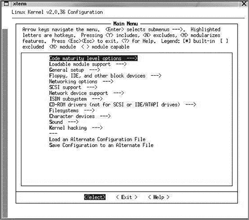

3. 在完成所有必要的更改后，保存配置并在命令行提示符处输入 `make dep`；`make clean`。这些命令中的第一个命令会构建内核源码中的依赖关系树。这些依赖关系可能受到你在配置步骤中选择的选项的影响。`make clean` 命令会清除之前编译内核时留下的任何不需要的文件。
4. 执行命令 `make zImage` 和 `make modules`。这些操作可能需要很长时间的时间，因为它们正在编译内核。
5. 最后一步是安装新内核。在基于 Intel 的系统上，使用命令将内核安装到 `/boot`：

```
cp /usr/Linux/src/arch/i386/boot/zImage /boot/newkernel
```

6. 执行命令 `make modules_install`。这将模块安装到 `/lib/modules` 中。
7. 编辑 `/etc/lilo.conf` 以添加如下所示的内容：

```
image = /boot/newkernel
label = newread-only
```

8. 在下次重启时，在 `lilo` 中选择新内核，它将加载新内核。如果运行正常，将其移动到 `lilo.conf` 文件的第一个位置，这样它每次都会默认启动。`Lilo` 是大多数 Linux 用户用于启动 Linux 系统的引导加载程序。

`lilo.conf` 文件的示例（通常位于 `/etc/`）：

```text
# 这行是一个注释行

#LILO 全局部分
    boot = /dev/hda2
    timeout = 500
    prompt
    default = linuxbox #"linuxbox" 是默认内核
    vga = normal
    read-only
#End of section 全局部分结束

# 可启动内核"vmlinuz-2.0.36-1" 位于目录"/boot/"

# 第一个内核
    image = /boot/vmlinuz-2.0.36-1
    label = linuxbox
    vga = normal
    root = /dev/hda2
#内核一部分结束
```


如果你是 Linux 新手，Live CD 是一个很好的选择。使用 Live CD，你可以在不向系统安装 Linux 的情况下测试和使用操作系统。要使用 Live CD，请先访问 [www.distrowatch.com](http://www.distrowatch.com) 选择发行版。然后下载 ISO 文件并将其写入 CD。该 CD 可以放入任何系统并启动到一个功能完整的 Linux 版本。

### 练习 12-2：使用 Live CD

在本次练习中，你将创建一个 Linux Live USB 启动盘。本质上，操作系统将从 USB 盘启动，然后你将拥有一个功能完整的 Linux 系统来学习如何使用某些 Linux 命令。

1. 从 [sourceforge.net](http://sourceforge.net) 下载 `UNetbootin`。
2. 运行 `UNetbootin` 程序。
3. 选择 Distribution（发行版）单选按钮并点击下拉菜单。

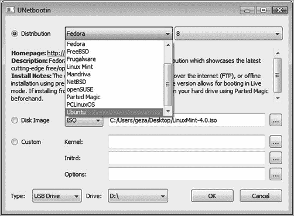

4. 从下拉菜单中选择 Linux 版本。CEH 工具推荐的 Linux 发行版是 BackTrack，但请检查 [distrowatch.com](http://distrowatch.com) 网站以了解每个发行版包含哪些工具。另一个选项是下载自己的 Linux ISO 文件并选择 `Disk Image`（磁盘镜像）单选按钮。
5. 将空白 USB 驱动器插入计算机。USB 盘上的所有数据都将被擦除，请确保它不包含任何你想保留的文件。确保你的 USB 盘足够大以包含整个 ISO 镜像。
6. 选择 `USB Drive` 作为类型，并选择你的 USB 盘对应的驱动器号。
7. 点击 OK，等待 `UNetbootin` 完成格式并将发行版文件复制到驱动器上。

### GCC 编译命令

GNU 编译器集（`GCC`）是一种命令行编译器，它接收源代码并将其生成为可执行文件。你可以从 [`gcc.gnu.org`](http://gcc.gnu.org) 下载它（许多 Linux 发行版也包含版本的 `GCC`）。`GCC` 可用于编译和执行 C、C++ 和 FORTRAN，以便它们能够在 Linux 系统上运行。

以下是用 `GCC` 编译 C++ 代码作为应用程序的命令：

```bash
g++ filename.cpp –o outputfilename.out
```

使用 `GCC` 编译 C 代码作为应用程序的命令如下：

```bash
gcc filename.c –o outputfilename.out
```

### 安装 Linux 内核模块

Linux 内核模块（`LKMs`）允许你在无需重新编译内核的情况下为你的操作系统添加功能。加载 LKM 的命令是 `modprobe`。

## Linux 加固方法

加固（Hardening）是通过修改来提高系统安全性的过程。通过采用这些方法，可以让 Linux 变得更加安全。

保护任何服务器（无论 Linux 还是 Windows）的第一步是确保它位于安全区域，例如网络运营中心，这可以防止黑客获得物理访问。

下一个显而易见的安全措施是使用密码且不泄露用户名。管理员应确保系统没有空密码，通过检查 `/etc/shadow` 来验证。

默认的安全立场 `deny all`（拒绝所有）是加固系统免受攻击的好方法。在应用 `deny all` 后，管理员可以为特定用户开放访问。通过先使用 `deny all` 命令，可以确保用户不会获得他们不应拥有的权限。拒绝所有用户访问网络的命令如下：

```text
All:All>>/etc/hosts.deny
```

加固 Linux 服务器的方法是移除未使用的的服务并确保系统已修复最新的漏洞。管理员还应经常检查系统日志，查看任何异常。

以下是改进 Linux 服务器安全的其他建议步骤：

### 操作系统选择与安装

- 使用广泛认可且良好的 Linux 发行版。
- 设置磁盘分区（或逻辑卷），考虑任何安全因素。
- 在初始操作系统安装后，应用自安装媒体创建以来发布的操作系统补丁。
- 设置并启用 `iptables`。
- 不要安装不必要的应用程序或服务。
- 如果适用，启用高安全性/可信操作系统版本。
- 使用密码保护引导加载程序（如 `lilo` 或 `GRUB`）。
- 如需要启用单用户模式密码。

#### 本地文件系统安全

- 查看不适当的文件和目录权限，并修复发现的问题。最重要的问题包括：
  - 组写入或全局写入的系统执行文件和目录。
  - 组写入或全局写入的用户目录。
- 为本地文件系统选择挂载选项（如 `nosuid`），以利用操作系统提供的安全功能。
- 对系统中存在的敏感数据进行加密。

### 配置并禁用服务

- 移除或禁用所有不需要的服务。服务通过几种不同的方式启动：在 `/etc/inittab` 内部、通过系统启动脚本，或通过 `inetd`。在可能的情况下，应从系统中完全删除不需要服务的软件。
- 在可用时，使用安全版本的守护进程（daemons）。
- 如果可能，将服务器进程作为为该目的创建的特殊用户运行，而不是以 `root` 运行。
- 在适当的情况下，通过 `chroot` 机制在隔离的目录树中运行服务器。
- 如果可能，为服务设置最大实例数量。
- 为所有服务指定访问控制和日志记录。必要时安装 `TCP Wrappers`。仅允许所需的最小访问。在 `/etc/hosts.deny` 中添加条目以拒绝所有人的访问（这样只有在 `/etc/hosts.allow` 中允许的访问才会被）。
- 使用提供的任何服务用户级访问控制。例如，`cron` 和 `at` 子系统允许你限制哪些用户可以使用它们。有些人建议将 `at` 和 `cron` 限制为管理员。
- 加固所有服务的安全性，无论它们看起来是否与安全相关（例如打印服务）。

## 加固 root 账户

- 选择一个安全的 root 密码，并计划定期更改密码。
- 如果可能，将 `su` 命令的使用限制在一个组内。
- 使用 `sudo` 或系统角色在需要时授予其他普通用户有限的 `root` 权限。
- 除了系统控制台外，防止直接登录 `root` 用户。

## 定义用户账户密码选择和老化设置

- 根据需要设置默认用户账户限制。
- 在 `/etc/skel` 中设置默认用户初始化文件，以及系统范围的初始化文件。
- 确保不应任何人登录的管理员和其他系统账户已禁用密码，并使用 `/bin/false` 或其他非登录 shell。
- 移除不需要的预定义默认账户。

## 加固远程身份认证

- 禁用 `/etc/hosts.equiv` 和 `.rhosts` 免密认证。
- 使用 `ssh` 及其命令进行所有的远程用户访问。禁用 `rlogin`、`rsh`、`telnet`、`ftp`、`rcp` 等。

## 执行持续系统监控

- 配置 `syslog` 设施。将 `syslog` 消息发送或复制到中央 `syslog` 服务器以实现冗余。
- 启用进程计数（process accounting）。
- 安装 `Tripwire`，对其进行配置并记录系统基准数据。将数据写入可移动介质，然后从系统中移除。最后，配置 `Tripwire` 每天运行。
- 设计并实施监控日志信息以检测安全相关事件的计划。

## 执行杂项活动

- 从系统中移除剩余的 `kernel` 源代码或额外的软件包。
- 将新主机添加到其他系统的安全配置中、路由器访问控制列表等。
- 检查任何已安装软件的供应商（vendor）安全更新。

练习 12-3 显示了如何在 Linux 系统上检测监听端口。

### 练习 12-3：检测监听的网络端口

加固 Linux 最重要的任务之一是检测并关闭不需要的网络端口。本练习将向你展示如何获取监听网络端口列表（TCP 和 UDP 套接字）。

1. 启动你在之前的练习中创建的 `BackTrack Linux` USB 器。注意，本次练习不需要 `BackTrack`。这些命令在任何 Linux 安装上都有效。
2. 打开命令行窗口并输入 `netstat -tulp`。此命令将显示你系统上的开放端口列表。

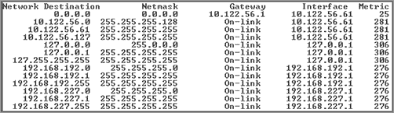

列出程序正在监听的所有 TCP 和 UDP 套接字的另一种方法是使用 `lsof`。运行此命令的语法为：

```bash
lsof -i -n | egrep 'COMMAND|LISTEN|UDP'
```

3. 加固 Linux 安装的下一步是禁用未使用的服务。所有运行级别（runlevel）服务的启动/停止脚本都可以在 `/etc/init.d` 目录下找到。例如，如果你不知道 `atd` 服务的作用，请进入 `/etc/init.d` 并打开 `atd` 文件。在脚本中查找启动程序的行。在 `atd` 脚本中，守护进程 `/usr/sbin/atd` 行启动了二进制文件 `atd`。在知道了该服务启动的程序名称后，可以通过运行 `man atd` 来查看 `atd` 的在线页面。这将帮助你找到更多关于系统服务的信息。

要永久禁用一个服务（在本例中为运行级别服务 `nfs`），请输入以下命令：

```bash
chkconfig nfs off
```


## 破解默认的 Linux 安装

我在一家小型咨询公司工作，那里的大多数顾问都是 Windows 系统的专家，但缺乏其他操作系统的经验。我们的一个客户想用 Linux 建立电子商务网站，因此，由于我们公司想留住这个客户，我们同意为他们安装 Linux 系统。由于没有顾问具有丰富的 Linux 经验，系统在安装时使用了许多默认选项和标准服务。

新系统安装后不久，电子商务门户遭到黑客攻击，客户数据库被破坏。黑客泄露了客户的个人信息和信用卡号。此外，该公司遭受了拒绝服务攻击（DoS），客户无法访问网站，导致了业务损失。

攻击发生后另一另一专事安全的咨询公司进行了一些法证分析，并确定用户的访问权限被设置为默认值，黑客利用了这一点进行攻击。该咨询公司建议我们组织未来应该加固 Linux。

## 总结

理解 Linux 的基础是非常重要的，许多应用程序和 Web 服务器运行在 Linux 上。对于 CEH 考试，你应该熟悉如何使用该操作系统以及加固默认安装应采取的步骤。Live CD 或 U 盘是学习使用基础工具的好方法。

## 考试要点

- 理解 Linux 在市场上的应用。Linux 已成为流行的平台、服务器和工作站。
- 选择如何使用 Linux Live CD。下载 ISO 文件。将其写入 CD 并从 CD 启动系统。
- 选择创建 Linux 系统的步骤。下载二进制文件并编译 Linux 源码；然后安装编译好的 OS。
- 选择如何加固 Linux 系统。使用良好的发行版、更改默认密码、禁用 root 登录、使用 `iptables`、使用 `HIDS`、应用最新修复并监控日志文件以加固 Linux。
- 理解 LKM 的用途。LMs 为 Linux 系统添加功能，但应仅来自良好的来源。
- 了解 GCC 编译。GCC 编译器用于从源代码创建可执行应用程序。

## 复习题

1. LKM 代表什么？
   - A. Linux Kernel Module
   - B. Linux Kernel Mode
   - C. Linked Kernel Module
   - D. Last Kernel Mode

2. 使用哪个 GCC 命令将 C++ 文件 source 编译为可执行文件 game？
   - A. `g++ source.c -o game`
   - B. `gcc source.c -o game`
   - C. `gcc make source.cpp -o game`
   - D. `g++ source.cpp -o game`

3. 拒绝所有用户访问网络的命令是什么？
   - A. `cat "All:All" >> /etc/hosts.deny`
   - B. `set "All:All" >> /etc/hosts.deny`
   - C. `IP deny "All:All"`
   - D. `cat All:All deny`

4. 下列哪些是常见的商业 Linux 发行版？
   - A. SUSE, Knark, and Red Hat
   - B. SUSE, Adore, Debian, and Mandrake
   - C. SUSE, Debian, and Red Hat
   - D. SUSE, Adore, and Red Hat

5. 什么是 Linux live CD？
   - A. 一个从 CD 运行的 Linux 操作系统
   - B. 从 CD 安装到硬盘上的 Linux 操作系统
   - C. 一个从 CD 运行应用程序的 Linux 工具
   - D. 一个制作 CD 的 Linux 应用程序

6. 哪种攻击可以伪装成 LKM？
   - A. DoS
   - B. 木马病毒 (Trojan)
   - C. 垃圾邮件病毒
   - D. Rootkit

7. 下列哪项是使用 Linux 的原因？
   - A. Linux 没有安全漏洞。
   - B. Linux 的安全补丁始终保持最新。
   - C. 没有 Rootkit 能够感染 Linux 系统。
   - D. Linux 灵活且可以修改。

8. 下列哪项不是加固 Linux 的方法？
   - A. 物理上保护系统。
   - B. 维护当前的补丁水平。
   - C. 修改默认密码。
   - D. 安装所有可用的服务。

9. 创建 Linux live CD 使用的是什么类型的文件？
   - A. ISO
   - B. CD
   - C. LIN
   - D. CDFS

10. 为什么使用已知的良好的 Linux 发行版很重要？
    - A. 如果下载不当，源文件可能会损坏。
    - B. 只有某些发行版可以进行补丁。
    - C. 源文件可能会被修改，且某些不太名或免费的 Linux 发行版的源二进制文件中可能包含木马或后门。
    - D. 只有某些版本的 Linux 对公众开放。

11. 哪个命令可以提供关于 Linux 文件的详细信息？
    - A. `ls -a`
    - B. `ls -m`
    - C. `ls -t`
    - D. `ls -l`

12. `man` 命令的作用是什么？
    - A. 列出帮助和文档
    - B. 手动配置程序
    - C. 执行系统维护
    - D. 安装程序

13. Linux 系统源文件位于哪个目录？
    - A. source
    - B. `src`
    - C. sys
    - D. system

14. 用于列出所有当前运行进程的 Linux 命令是什么？
    - A. `ps`
    - B. `list ps`
    - C. `show ps`
    - D. process

15. 查看网络接口 IP 地址的 Linux 命令是什么？
    - A. `ifconfig`
    - B. `ipconfig`
    - C. `ipconfig /all`
    - D. `interface /ip`

16. 哪个 Linux 命令会产生以下输出？

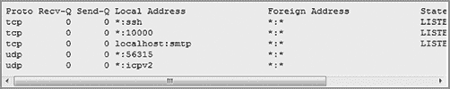

- A. routing
- B. `route print`
- C. `route`
- D. `show routes`

17. 保护 Linux root 账户的推荐方法是什么？（选择所有适用项。）
    - A. 禁止除系统控制台以外的直接 root 登录。
    - B. 将 `su` 的使用限制单个组。
    - C. 安装 `su protect` 以防止误用 `su` 命令。
    - D. 为任何需要安装程序的用户授予管理员权限。

18. 在加固本地 Linux 文件系统时，应该检查哪两类目录的权限是否适当？（选择两项。）
    - A. 根目录
    - B. 服务目录
    - C. 可写的系统可执行文件目录
    - D. 可写的用户主目录

19. 使用哪个 Cat 命令可以加固 Linux 系统的文件系统？
    - A. `Cat"source=All:destination=All" >> /etc/hosts.deny`
    - B. `Cat"All:All" >> /etc/hosts.deny`
    - C. `Cat"Any:Any" >> /etc/hosts.deny`
    - D. `Cat"All:All" /etc/hosts.deny`

20. 应该检查哪个文件以确保 Linux 系统中的用户没有空密码？
    - A. 密码文件 (Password file)
    - B. Passwd 文件
    - C. Shadow 文件
    - D. Shdw 文件

## 复习题答案

1. A. `LKM` 代表 `Linux Kernel Module`（Linux 内核模块）。
2. D. `g++ source.cpp –o game` 是从源文件 `source.cpp` 创建名为 `game` 的可执行文件的 GCC 命令。
3. A. 使用 `Cat"All:All" >> /etc/hosts.deny` 命令拒绝 Linux 系统上所有用户从网络的访问。
4. C. SUSE、Debian 和 Red Hat 都是 Linux 的商业版本。
5. A. Linux live CD 是一个从 CD 运行的完全功能的操作系统。
6. D. `rootkit` 可以伪装成 `LKM`。
7. D. Linux 灵活且可以修改，因为源代码是公开的。
8. D. Linux 不应运行未使用的服务的运行，因为每个额外的服务都可能有潜在的漏洞。
9. A. `ISO` 文件用于创建 Linux live CD。
10. C. 已知的良好的发行版经过 Linux 社区的审查，以验证源代码中不存在木马或后门。
11. D. `ls -l` 命令列出有关文件的所有信息，如权限、所有者、大小和最后修改日期。
12. A. `man` 命令在 Linux 中列出帮助和文档。
13. B. `src` 目录。
14. A. `ps` 命令列出所有进程信息。
15. A. `ifconfig` 查看网络接口 IP 地址。`ipconfig` 和 `ipconfig /all` 是 Windows 命令。
16. C. `route` 命令产生输出。`route print` 是 Windows 命令。`show routes` 是命令。


17. A, B. 禁止除系统控制台以外的直接 `root` 登录；限制 `su` 的使用。

18. C, D. 检查可写的系统可执行目录和可写的用户主目录。

19. B. 使用 `Cat"All:All" >> /etc/hosts.deny` 加固系统并拒绝某些用户。

20. C. Linux 系统中的密码存储在 `shadow` 文件。

# 第 13 章 绕过网络安全：规避 IDS、蜜罐和防火墙

## 本章涵盖 CEH 目标

* 列出入侵检测系统的类型和规避技术
* 列出防火墙类型和蜜罐规避技术

入侵检测系统 (IDS)、防火墙和蜜罐都是用于确保黑客无法访问网络或系统的安全措施。`IDS` 和防火墙都是数据包过滤设备，并根据预定义的规则监控流量。蜜罐是一个虚假的目标系统，用于引诱黑客离开价值目标。与其它安全机制一样，`IDS`、防火墙和蜜罐的性能取决于其设计和实现。熟悉这些设备的工作原理非常重要，因为它们是常见的攻击目标。

## IDS 类型及规避技术

入侵检测系统 (IDS) 检查流量并寻找已知攻击签名或异常行为模式。包嗅探器查看并监控流量，是 `IDS` 的内置组件。当公司的安全事件列表触发事件时，`IDS` 通过传真、电子邮件或手机提醒命令中心或系统管理员。入侵预防系统 (IPS) 在检测到可疑流量时启动应对措施，如拦截流量。`IPS` 自动对入侵做出响应，并允许自动化拒绝访问的功能。

`IDS` 主要有两种类型：

### 基于主机

基于主机的 `IDS` (HIDS) 是位于单个主机上的应用程序，根据特定操作系统的已知签名列表过滤流量或事件。`HIDS` 包括 `Norton Internet Security` 和 `Cisco Security Agent`。许多虫和木马可以关闭 `HIDS`。`HIDS` 也可以直接安装在服务器上，以检测针对企业资源和应用程序的攻击。

### 基于网络

基于网络的 `IDS` (NIDS) 是位于网络软件设备。它们专门用于入侵检测，以检测传统防火墙无法检测的所有类型的恶意网络流量和计算机使用。这包括针对有漏洞服务的网络攻击；针对应用程序的数据攻击；基于主机的攻击（如权限提升、未经授权的登录和访问敏感文件）；以及恶意软件。`NIDS` 是被动系统：`IDS` 传感器检测到潜在的安全违规，记录信息并在控制台上发出警报。

网络入侵检测系统（`IDS`）在网络架构中的位置如图图 13-1 所示。网络 `IDS` 传感器可以位于防火墙和 `Internet` 之间的第一个检测点，或者位于半私有 `DMZ` 中，用于检测针对组织服务器的攻击。最后，网络 `IDS` 可以位于内部私有网络，用于检测针对这些服务器的可能攻击。

图 13-1: 基于网络的 IDS


`IDS` 可以执行签名分析或异常检测来确定流量是否为可能的攻击。签名检测 `IDS` 将流量与已知的签名和误用模式进行匹配。签名是识别单个数据包或一系列数据包的模式，这些数据包在组合时会执行攻击。采用异常检测的 `IDS` 根据人员的正常业务模式寻找入侵尝试，并在访问系统、文件、登录等行为出现异常时发出警报。

黑客可以通过更改流量使其不匹配已知签名来规避 `IDS`。这可能涉及使用不同的协议，例如用 `UDP` 代替 `TCP`，或用 `HTTP` 代替 `ICMP` 来传递攻击。此外，黑客可以将一次攻击拆分成几个较小的数据包以通过 `IDS`，但在接收站重组时将导致系统被攻破。这被称为“会话拆分”（session splicing）。其他规避检测的方法包括插入额外数据、使用加密对地址或数据进行混淆，或者去同步并接管当前客户端的会话。

### 攻击工具

`ADMmutate` 获取一个攻击脚本并创建一个不同的——但功能等效的——脚本来执行攻击。新脚本不在已知攻击签名的数据库中，因此可以绕过 `IDS`。

### 理解 Snort 规则和输出

对于 `CEH` 考试，你应该熟悉 `Snort` 规则和输出。你可能需要阅读 `Snort` 规则或输出，并就该规则正在执行的操作或输出指示了什么种类型的攻击回答问题。

`Snort` 是一种部署在 `Linux` 和 `Windows` 系统上的实时数据包嗅探器、`HIDS`（主机 IDS）和流量日志工具。`Snort` 可以分析协议、执行内容搜索/匹配，并检测各种攻击和探测，例如缓冲区溢出、隐蔽端口扫描、`CGI` 攻击、`SMB` 探测、`OS` 指纹识别尝试等。你可以在 `snort.conf` 文件中配置 `Snort` 和 `IDS` 规则。安装和运行 `Snort` 的命令是：

```
snort –l c:\snort\log –c C:\snort\etc\snort.conf –A console
```

`Snort` 由两个主要组成部分组成：

- **Snort 引擎 (Snort Engine)**：一种利用模块化插件架构的 IDS 检测引擎。
- **Snort 规则 (Snort Rules)**：一种描述要收集流量的灵活规则语言。

`Snort Engine` 以源代码和针对流行的 `Linux` 发行版及 `Windows` 的二进制文件形式分发。注意的是，引擎和规则是分开分发的。`Snort IDS` 引擎和规则可以从 [snort.org](http://www.snort.org) 下载。安装方法和软件依赖因操作系统而异，因此本章不包含 `Snort` 实验。详细的安装说明可以在 [snort.org](http://www.snort.org) 找到。

### 配置 Snort

`Snort` 有一个配置文件：`snort.conf`。它通常位于 `/etc/snort`。该文件包含需要根据特定安装进行修改并针对你想告警的事件进行自定义的变量。文件变量按以下部分组织：

- 网络变量
- 预处理器 (Preprocessors)
- 后处理器 (Postprocessors)
- 规则 (Rules)

需要根据你的网络自定义的 `snort.conf` 文件变量列表 13-1](#9780470642887c13.xhtml_table13-1)。

| 变量 | 含义 |
| :--- | :--- |
| `HOME_NET` | 本地 IP 空间 |
| `EXTERNAL_NET` | 外部 IP 空间 |
| `SMTP` | 你的 SMTP 服务器 |
| `HTTP_SERVERS` | 你的 Web 服务器 |
| `SQL_SERVERS` | 你的 SQL 服务器 |
| `DNS_SERVERS` | 你的 DNS 服务器 |
| `RULE_PATH` | 包含规则文件的目录 |

以下是使用 `192.168.1.0` 作为家庭网络的 `Snort` 示例配置：

```
var HOME_NET 192.168.1.0/24
var EXTERNAL_NET any
var SMTP $HOME_NET
var HTTP_SERVERS $HOME_NET
var SQL_SERVERS $HOME_NET
var DNS_SERVERS $HOME_NET
var RULE_PATH /etc/snort/rules
```

以下是配置文件中标识的规则位置：

```
include $RULE_PATH/exploit.rules
include $RULE_PATH/scan.rules
include $RULE_PATH/ftp.rules
include $RULE_PATH/telnet.rules
include $RULE_PATH/smtp.rules
include $RULE_PATH/rpc.rules
include $RULE_PATH/dos.rules
include $RULE_PATH/ddos.rules
include $RULE_PATH/dns.rules
include $RULE_PATH/web-cgi.rules
include $RULE_PATH/web-cgi.rules
include $RULE_PATH/iis.rules
include $RULE_PATH/frontpage.rules
include $RULE_PATH/sql.rules
include $RULE_PATH/netbios.rules
include $RULE_PATH/coldfusion.rules
include $RULE_PATH/iis.rules
include $RULE_PATH/attack.rules
```

#### Snort 规则

`Snort` 规则是用于根据流量生成警报的。规则头部包含以下字段：

- `<action>`
- `<protocol>`
- `<src>`
- `<dest>`

这是一个带有选项的 `TCP` 规则示例：

```
alert tcp $EXTERNAL_NET any -> $HOME_NET 23
```

这条 `Snort` 规则对外部空间（任何端口）发往本地空间（23 端口）的 `TCP` 流量生成警报。其后是 `Snort` 选项：

- `msg:"TELNET SGI format"`：指定消息。
- `flags:A+`：匹配 ACK 标志。
- `content:"bin/sh"`：匹配数据包负载中的字符串。
- `clasype:attempted-admin`：为警报分配高权限尝试类别。

#### Snort 输出

对于 `CEH` 考试，理解 `Snort` 输出报告是非常重要的。这里有一个 `Snort` 警报的示例。首先是时间戳：

`04/21-19:26:37.353790`

这些是源和目的 `MAC` 地址：

`0:8:2:FB:36:C6 -> 0:6:5B:57:A6:3F`

接下来是以太网类型（`0x800` 表示以太网）和长度：

`type:0x800 len:0x3C`

此行指定了源 IP `202.185.44.43` 到目的 IP `202.128` 以及源端口 `445` 和目的端口 `2202`：

`202.185.44.43:445 -> 202.185.44.28:2202`

此行说明协议为 `TCP`，生存时间（`TTL`）为 `128`：

`TCP TTL:128`

接下来是服务类型、`ID`、`IP` 长度数据包长度：

`TOS:0x0 ID:17467 IpLen:20 DgmLen:41 DF`

`A` 表示 `ACK` 标志开启，因此数据包是对之前一个数据包的确认：

`A`

在此行中，`Seq` 是序列号，`Ack` 是对之前数据包的编号响应：

`Seq:0x9D08DD67 Ack:0x8EB1E02`

最后，在最后一行中 `Win` 是窗口大小，`TCP` 长度为 `2000`：

`Win:0x3FE1 TcpLen:2000`


在很多情况下，在 `CEH` 考试中阅读和解释 `Snort` 输出报告只需要知道 `TCP` 标志和 `TCP` 常用端口号。

防火墙是一种软件程序或硬件设备，它能够允许或拒绝对网络的访问，并遵循管理员设置的规则来引导数据包在网络中的允许去向。边界硬件防火墙设备（图 13-2）设置在信任网络连接到不信任网络（如互联网）的边界边缘，或者设置在两个网络之间。软件防火墙则保护个人电脑、系统或主机免受来自网络进入网卡（`NIC`）的非授权或恶意数据包的影响。

图 13-2： 边界硬件防火墙


蜜罐（图 13-3）是位于网络非军事化区（`DMZ`）内部的诱饵箱，由安全专业人员设置，用于诱捕或协助定位黑客的位置，或者将他们从真实的目标系统引开。

图 13-3： 蜜罐位置


蜜罐是一个恶意攻击者可能会尝试攻击的诱饵系统；系统软件可以记录有关攻击者的信息，例如 `IP` 地址。这些信息可以用于在攻击期间或攻击后尝试定位攻击者。蜜罐的最佳位置是 `DMZ` 上的防火墙之前，使其对黑客具有吸引力。具有静态地址的蜜罐被设计成像真实的生产服务器（参见图 13-4）。练习 13-1 将引导你完成蜜罐的安装和使用。

图 13-4： 蜜罐


## 寻找蜜罐

几年前，我曾为一家大型公司进行无线网络安全审计。我开车在企业园区内扫描开放的接入点（`APs`），对于我的无线扫描嗅探器能看到如此多开放未安全的 `APs`，我感到有些惊讶。我发现了 30 多个可以连接并获取网络访问的 `APs`。

当然，连接到 `APs` 后的下一步是扫描网络。因此，作为安全审计的一部分，我从外部连接并对整个网络范围运行端口扫描；我发现了几个开启端口的系统。有一个邮件服务器和几个 `Web` 服务器，以及一个没有完全打补丁的域控制器。根据审计范围，我只需要报告发现的漏洞，而不需要尝试利用我在系统中发现的运行的服务。我很惊讶这样一个大机构在开放的无线网络上竟然会有如此容易被发现的漏洞。我在安全审计报告中记录了所有目标系统以及漏洞端口和服务。

第二天，当我向客户提交报告时，IT 经理简单地说：“很好，你们发现了我们的蜜罐网络，现在去寻找真实的系统吧。”他们获取了网络上发现的所有非法 `APs`，并将它们重定向到一个单独的 `VLAN`。在在重定向的 `VLAN` 上，他们创建了虚拟系统（即蜜罐）来吸引潜在的黑客。这些蜜罐可以让黑客忙于尝试攻击蜜罐系统而无法获取任何真实数据，同时真实的服务却不受影响。

## 练习 13-1：安装和使用 KFSensor 作为蜜罐

1. 从 [www.keyfocus.net](http://www.keyfocus.net) 下载并安装 `KFSensor` 试版。
2. 打开并运行 `KFSensor`。将弹出一个窗口启动配置向导。点击 `Next` 继续。


3. 点击 `Next` 选择所有端口。
4. 在 `Domain Name` 字段中输入你的 `name.com`（或你选择的其他域名）并点击 `Next`。


5. 在 `Send To` 和 `Send From` 字段中输入你的邮箱地址以接收来自 `KFSensor` 的邮件警报。


6. 从 `Port Activity` 下拉列表中选择 `8 hours`。在 `Network Protocol Analyzer` 下拉列表中选择 `Enable Packet Dump Files`。其他选项保持默认值。


7. 点击 `Next` 接受默认设置安装为系统服务。


8. 点击 `Finish` 完成向导配置。
9. `KFSensor` 的 `Main scenario` 应该出现在左侧。你可能会在左侧看到 `KFSensor` 的 `Main scenario`。
10. 防火墙是一种软件程序或硬件设备，它能够允许或拒绝对网络的访问，并遵循管理员设置的规则来引导数据包在网络中的允许去向。边界硬件防火墙设备（图 13-2）设置在信任网络连接到不信任网络（如互联网）的边界边缘，或者设置在两个网络之间。软件防火墙则保护个人电脑、系统或主机免受来自网络进入网卡（`NIC`）的非授权或恶意数据包的影响。
11. 你可能会在左侧看到 `KFSensor` 的 `Main scenario`。
12. 你可能会在左侧看到 `KFSensor` 的 `Main scenario`。
13. 你可能会在左侧看到 `KFSensor` 的 `Main scenario`。

### 攻击工具

`007 Shell` 是一种 隧道程序，允许黑客使用隐蔽通道进行攻击并绕过防火墙规则。

`ICMP Shell` 是一种类似于 `telnet` 的程序，黑客利用它通过 `ICMP` 命令与系统建立连接，而这些命令通常是被防火墙允许的。

`AckCmd` 是一个仅使用 `TCP ACK` 数据包通信的客户端/服务器程序，这些通常可以通过防火墙。

`Covert_TCP` 是黑客用来通过在 `IP` 头部隐藏数据，逐字节地通过防火墙发送文件的程序。

`Send-Safe Honeypot Hunter` 是一种蜜罐检测工具，用于检查代理服务器是否存在蜜罐。

### 应对措施

`Specter` 是一种蜜罐系统，可以在黑客攻击系统时自动捕获其机器的信息。

`Honeyd` 是一个开源蜜罐，它在网络上创建虚拟主机供黑客攻击。

`KFSensor` 是一种基于主机的入侵检测系统，可作为蜜罐使用，并可以模拟虚拟服务和木马安装。

`Sobek` 是一种数据采集蜜罐工具，可以捕获攻击者的击键。

`Nessus` 漏洞扫描器（[www.nessus.org](http://www.nessus.org)）也可以用于检测蜜罐。

入侵检测系统（`IDS`）可以是基于网络或基于主机的。实施这两种类型的系统对于保护服务器上的贵贵数据免受攻击至关重要。在这两种情况下，保持规则和定义的更新都是关键的，以确保 `IDS` 拥有最新的攻击向量来比较流量。防火墙也可以是基于网络或主机的，在许多情况下，网络设备和系统软件会同时执行 `IDS` 检测和防火墙动作。仅仅在网络或服务器上部署了防火墙和 `IDS`，就不应该产生虚假的安全感；隧道技术和加密可以绕过 `IDS` 和防火墙，因为设备无法读取真实的流量报头和数据。认证黑客大师（`CEH`）会使用此类技术尝试绕过防火墙和 `IDS` 的保护。

## 考试要点

- **掌握 IDS 的两种主要类型。** IDS 可以是基于主机的或基于网络的。基于主机的 `IDS` 针对特定操作系统并保护单个系统。基于网络的 `IDS` 可以保护整个网络。
- **能够定义蜜罐系统（Honeypot）。** 蜜罐系统位于 `DMZ` 中，作为一个易受主机，并发布服务和软件以诱骗黑客入侵系统。
- **能够定义防火墙（Firewall）。** 防火墙是一种数据包过滤设备，将流量与规则列表进行比较，并过滤从不可信网络到可信网络的流量。
- **理解如何检测蜜罐。** 可以通过系统信息与代理服务器中的已知蜜罐列表对比来检测蜜罐。
- **理解 IDS 如何工作。** IDS 可以执行异常分析或基于特征的检测。


## 防火墙规避与入侵检测

- **知道如何执行防火墙规避技术。** 可以通过如`ICMP`或`HTTP`等协议来携带攻击流量。另一种技术是将数据包分成几个较小的数据包，使得整个攻击字符串无法被检测。

## 复习题

1. 什么是对网络进行攻击识别和告警的系统？

   A. HIDS

   B. NIDS

   C. 异常检测 HIDS

   D. 基于特征的 NIDS

2. 下列哪个工具通过在 IP 头中每次发送一个字节来绕过防火墙？

   A. Honeyd

   B. Nessus

   C. `Covert_TCP`

   D. 007 Shell

   E. TCP to IP Hide

3. 下列哪个是蜜罐检测工具？

   A. Honeyd

   B. Specter

   C. `KFSensor`

   D. Sobek

4. 下列哪个是用于吸引和识别黑客的系统？

   A. 蜜罐

   B. 防火墙

   C. Honeytrap

   D. IDS

5. 下列哪个是用于修改攻击脚本以绕过 IDS 特征检测的工具？

   A. `ADMmutate`

   B. Script Mutate

   C. `Snort`

   D. Specter

6. 什么是反向 Web Shell（reverse WWW shell）？

   A. 向防火墙建立反向连接的 Web 服务器

   B. 通过防火墙连接黑客的 Web 客户端

   C. 通过防火墙连接 Web 客户端的 Web 服务器

   D. 黑客通过防火墙连接到 Web 服务器

7. 反向 Shell 连接到黑客系统上的哪个端口？

   A. 80

   B. 443

   C. 23

   D. 21

8. 用于安装和运行 Snort 的命令是什么？

   A. `snort –l c:\snort\log –c C:\snort\etc\snort.conf –A console`

   B. `snort –c C:\snort\etc\snort.conf –A console`

   C. `snort –c C:\snort\etc\snort.conf console`

   D. `snort –l`

9. Snort 是什么类型的程序？

   A. NIDS

   B. 嗅探器、HIDS 和流量日志工具

   C. 嗅探器和 HIDS

   D. NIDS 和嗅探器

10. IDS 检测入侵尝试的方法有哪些？（选择所有适用项）

    A. 特征检测

    B. 异常检测

    C. 流量识别

    D. 协议分析

11. 你正在查看一份 Snort 输出报告，看到一个具有以下地址信息的条目：`168.175.44.80:34913 -> 142.155.44.28:443`。目标地址是什么类型的服务器？

    A. HTTP

    B. FTP

    C. SSL

    D. HTTPS

12. `snort.conf` 文件中本地 IP 子网的变量是什么？

    A. `INTERNAL_NET`

    B. `DESTINATION_NETWORK`

    C. `SOURCE_NET`

    D. `HOME_NET`

13. 在 `snort.conf` 文件中如何标识规则位置？

    A. `RULE_PATH`

    B. `RULE_DIR`

    C. `RULES`

    D. `RULE_NET`

14. Snort 规则的规则头中不包含以下哪个字段？

    A. 规则动作

    B. 协议

    C. 源地址

    D. `HOME_NET`

15. 哪种 Snort 规则选项会为告警分配高优先级？

    A. `class:attempted-admin`

    B. `classtype:High`

    C. `classtype:attempted-admin`

    D. `class:admin`

16. 安装 Snort 需要哪两个组件？

    A. Snort 规则

    B. Snort 特征

    C. Snort 引擎

    D. Snort 处理器

17. IDS 中的攻击特征是什么？

    A. 表示攻击的数据包模式

    B. 表示攻击开始的数据包

    C. 表示攻击的 `TCP` 报头

    D. 攻击确认

18. 规避 IDS 的方法是什么？

    A. 异常检测

    B. 隧道技术

    C. 数据包碎片（Packet smashing）

19. 你正在查看以下 Snort 输出：

```
10/17-20:28:15.14784:0:10:5A:1:D:B type:0x8 len:0xC
192.168.1.4:244 -> 192.168.1.67:443 TTL:128 OS:0x0 ID:39235 IpLen:20 DgmLen:40 Seq:0xA9744F2 Ack:0xA1F51 Win:0x1E51 TcpLen:20
0000:00:10:5A:1:0D:B 00:02:B3:87:84:25 08:00:45:00 ..Z..[.....%..E.
0010:01:2D:1A:08:40:00:40:06 9C:2B C0:A8:01:43:C0:A8 .-@.@.....C..
0020:01:04:01:BB 04:DC:69:74:A4:F2 00:A1:8F:51:50:18 ......it.....QP.
（此处由于原文显示异常或乱码字符，保持格式翻译）
```

数据包中设置了哪些 `TCP` 标志？

   A. ACK

   B. SYN

   C. FIN

   D. RST

20. 获取了以下 Snort 文件：

```
10/17-20:28:15.08091:0:B3:87:84:25:0:10:5A:1:D:B type:0x8 len:0x13B
192.168.1.67:443 -> 192.168.1.4:1244 TTL:64 OS:0x0 ID:6664 IpLen:20 DgmLen:301 Seq:0xA974A4F2 Ack:0xA1F51 Win:0x1E51 TcpLen:20
0000:00:10:5A:1:0D:B 00:02:B3:87:84:25 08:00:45:00 ..Z..[.....%..E.
0010:01:2D:1A:08:40:00:40:06 9C:2B C0:A8:01:43:C0:A8 .-@.@.....C..
0020:01:04:01:BB 04:DC:69:74:A4:F2 00:A1:8F:51:50:18 ......it.....QP.
（此处由于原文显示异常或乱码字符，保持格式翻译）
```

Web 客户端的端口号是多少？

   A. 443

   B. 1244

   C. 64

   D. 08091

### 答案与解析

7. A. 黑客的系统作为 Web 服务器运行，使用端口 80。

8. A. 使用命令`snort –l c:\snort\log –c C:\snort\etc\snort.conf –A console`来安装并运行 Snort 程序。

9. B. Snort 是一个嗅探器、主机入侵检测系统（HIDS）和流量日志记录工具。

10. A, B. 签名分析和异常检测是 IDS 检测入侵尝试的方法。

11. D. 目的端口 443 表示流量目标是一个 HTTPS 服务器。

12. D. `HOME_NET` 变量在 `snort.conf` 文件中用于识别本地网络。

13. A. 规则位置通过 `snort.conf` 文件中的 `RULE_PATH` 变量进行识别。

14. D. 规则动作、协议、源地址和目的地址都包含在 Snort 规则头部中。`HOME_NET` 是在 `snort.conf` 文件中定义内部网络的变量。

15. C. 此 Snort 选项通过为该告警分配“尝试管理员”（attempted-admin）攻击类，赋予了其高优先级。

16. A, C. 安装 Snort 时，需要分别安装 Snort 规则和 Snort 引擎。

17. A. 攻击签名是一种用于识别单个数据包或一组组合后执行攻击的数据包模式。

18. B. 隧道技术（Tunneling）是一种用于规避 IDS 签名匹配的方法。

19. A. `A` 表示 ACK 标志已设置。

20. B. 目的地址为 192.168.1.4:1244，1244 表示客户端端口号。源端口 443 表示一个 HTTPS 服务器。

---

# 第 14 章：密码学

### 本章涵盖的 CEH 考试目标

* 密码学和加密技术概述
* 描述公钥和私钥如何生成
* MD5、SHA、RC4、RC5、Blowfish 算法概述

密码学是对加密和加密算法的研究。在实际意义上，加密是将信息从可理解的形式（明文）转换为不可理解的形式（密文），反之亦然。加密的目的是使数据对于不知道解密消息秘密的拦截者或窃听者不可读。加密试图确保通信的机密性。密码学定义了用于加密的技术。本章将讨论加密算法和密码学。

## 密码学与加密技术

加密可以用于在数据传输过程中或存储在硬盘时进行加密。密码学是通过通过数学方式打乱数据来保护信息的研究，使得在不知道用于加密它的数学公式的情况下，数据无法被解密。这种数学公式被称为加密算法。密码学由两个单词组成：crypt（意为秘密或隐藏）和 graphy（意为写作）。密码学（Cryptography）字面意思是“秘密或隐藏的文字”。

明文是可读且可理解的数据，而密文是加密过程产生的乱序文本。密文应该是不可读的，且不显示任何重复的模式，以确保数据的机密性。图 14-1 显示了明文与密文的对比。

图 14-1: 明文与密文


数据安全有三个关键要素。机密性、完整性和认证性被称为 CIA 三要素（图 14-2）。数据加密提供了机密性，意味着数据只有授权用户才能读取。消息哈希提供了完整性，确保所发送的数据与接收到的数据是相同的一致的，且信息在传输过程中未被修改。消息数字签名提供了认证性（确保用户确实如其所自称）以及完整性。消息加密和数字签名共同提供了机密性、认证性和完整性。

图 14-2: CIA 三要素


加密算法可以使用简单的字符打乱方法，例如替换法（用其他字符替换字符）和易位法（改变字符的顺序）。加密算法是基于替换和易位的数学计算。

以下是一些早期的密码系统：

### 凯撒密码

一种简单的替换密码（图 14-3）。

图 14-3: 替换密码


### 巴什密码 (Atbash Cipher)

古代希伯来人使用的巴什密码（图 14-4）是一种替换密码，它通过将使用的每个字母替换为字母表末尾距离相同的另一个字母来工作；例如，A 会发送为 Z，B 会发送为 Y。

图 14-4: 巴什密码


### 维吉纳密码 (Vigenere Cipher)

16 世纪法国密码学家布莱斯·维吉纳（Blaise de Vigenere）创建了一种多表密码来克服简单密码的缺点。维吉纳密码（图 14-5）使用表格来增加可用替换值。替换表由“A”到“Z”的列组成。为了获得密文，首先选择明文的列，然后选择行。行和列的交叉点就是密文。

图 14-5: 维吉纳密码


### 维纳姆密码 (Vernam Cipher)

1917 年，AT&T 贝尔实验室工程师吉尔特·维纳姆（Gilbert Vernam）试图改进维吉纳密码，最终创建了维纳姆密码，或“一次性垫”。维纳姆密码是一种加密算法，其中明文与长度相同的随机密钥（或“垫”）相结合。一次性垫是唯一被证明无法通过暴力破解破解的算法。

### 隐藏密码 (Concealment Cipher)

隐藏密码创建了一个以某种方式隐藏的消息。例如，以下段落包含秘密信息：

我一直尝试给 Sally 买一些漂亮的珠宝，如金子或银耳环，但现在价格上涨了。密钥是查看句子中的六个字。

## 加密类型

两种主要的加密类型是对称加密和非对称密钥加密。

### 对称加密

对称加密意味着发送方和接收方使用相同的密钥来加密和解密数据。密钥（可以是数字、单词或仅是一串随机字母）应用于消息文本，以特定的方式更改内容。这可能只是简单地在字母表中移动几个位置。只要发送方和接收方知道该密钥，他们就可以加密和解密使用该密钥的所有消息。

对称加密的缺点是没有安全的方法可以在多个系统之间共享密钥。使用对称加密的系统需要使用离线方法将密钥从一个系统传输到另一个系统。这在互联网等大型环境中是不现实，因为客户端和服务器不在同一个物理位置。

对称加密的优点是快速的批量加密。对称加密的缺点包括：

* 密钥分发
* 可扩展性
* 安全性有限（仅提供机密性）
* 不提供不可否赖性，意味着无法证明发送者的身份

对称算法示例示例：

* DES（数据加密标准）
* 3DES
* AES（高级加密标准）
* IDEA（国际数据加密算法）
* Twofish

### RC4 (Rivest Cipher 4)

非对称（或公共）密钥加密的创建是为了解决对称密钥管理和分发的弱点。但密钥密钥存在一个问题：如何在像互联网这样本质不安全的网络上安全地交换它们呢？任何知道密钥的人都可以解密消息，因此保持密钥密钥的安全至关重要。非对称加密使用一对相关的密钥，称为密钥对。公钥可以提供给任何可能向你发送加密消息的人。第二个私钥则保持保密，只有你知道它。

任何使用公钥加密的消息（文本、二进制文件或文档）只能使用匹配的私钥进行解密。任何使用私钥加密的消息只能使用匹配的公钥进行解密。这意味着你不需要担心在互联网上传输公钥，因为它们在本质上是任何人都可以获取的。然而，非对称加密的问题是它比对称加密慢。加密和解密消息内容需要多的处理能力。

非对称密钥加密中两个密钥之间的关系基于复杂的数学公式。创建密钥对的方法一种是使用质数分解。另一种方法是使用离散对数。非对称加密系统基于充当陷门的单向函数。本质上，加密是单向的，因为同一个密钥无法解密它所加密的消息。相关的私钥提供了使解密可行的信息。关于函数的信息包含在公钥中，而关于陷门的信息包含在私钥中。任何拥有私钥的人都知道陷门函数并可以计算公钥。

要使用非对称加密，需要一种传输公钥的方法。典型技术是使用`X.509`数字证书（也简单称为证书）。证书是一个标识用户或服务器的信息文件，包含组织名称、颁发证书的机构以及用户的电子邮件地址、国家和公钥。

当服务器和客户端需要安全的加密通信时，它们通过网络向对方发送查询，对方会回传一份证书的副本。可以从证书中提取出对方的公钥。证书也可以被用于唯一地标识持有者。

## 非对称加密可以用于

*   数据加密
*   数字签名

非对称加密可以提供

*   机密性
*   身份验证
*   不可否认性

非对称密钥加密的优点包括

*   密钥分发
*   可扩展性
*   机密性、身份验证和不可否认性

非对称密钥加密的弱点是过程很慢，且通常需要长得多的密钥。由于其运行缓慢，它只适用于少量数据。

## 流式加密器与块加密器

块加密器和流式加密器是两种类型的加密器。块加密器是通过加密固定数量（或“块”）数据来运行的加密器。最常见的块大小是 64 位数据。这块数据或数据块被作为一个明文单元进行加密。当使用块加密进行加密和解密时，消息被分为若干位块。然后将这些块通过以下一种或多种混乱方法：

*   替换
*   置换
*   混淆
*   扩散
*   `S-boxes`

流式加密将单位数据作为连续的数据位流进行加密。流式加密的执行速度通常比块加密快，且适用于硬件使用。流式加密器通过`XOR`（异或）操作将明文位与伪随机加密位流相结合。`XOR` 过程（参见图 14-6）是逐位比较明文和密钥，并根据 `XOR` 逻辑创建密文。如果明文和密钥密钥是相同的位，则结果为 0；如果它们不同（例如 1 和 0），那么生成的加密位就是 1。

图 14-6: 异或表


## 生成公钥和私钥

当客户端和服务器使用非对称加密时，双方都会创建自己的密钥对，总共四个密钥：服务器的公钥、服务器的私钥、客户端的公钥和客户端的私钥。系统的密钥对具有数学关系，允许使用一个密钥加密的数据可以使用另一个密钥解密。这些密钥具有基于质数分解的数学关系，每个密钥都可以用于解密用另一个密钥加密的数据。当客户端和服务器想要相互身份验证并共享信息时，它们会各自将自己的公钥发送给远程系统，但它们从不共享私钥。每条消息都使用接收者的公钥加密。只有接收者的私钥才能解密消息。服务器将使用客户端的公钥向客户端加密消息。解密消息的唯一密钥由客户端持有，这确保了机密性。

创建数字证书需要公钥基础设施 (`PKI`)。`PKI` 是一个由硬件、软件、用于管理、创建、存储和分发密钥的策略以及数字证书组成的框架。此外，完整的 `PKI` 解决方案（如图 14-7）涉及对称算法、非对称算法、哈希和数字身份验证（通常是证书）。

图 14-7: 证书机构


公钥加密的主要优点是可以促进未知双方之间的通信，这一过程是通过 `PKI` 信任层次关系实现的。`PKI` 基础设施的重要部分如下：

*   数字证书
*   证书机构
*   证书的生成和销毁
*   密钥管理


## 理解证书机构

使用证书机构 (`CA`) 来验证客户端类似于提供驾执照进行身份识别。当我乘坐飞机旅行时，我必须出示有效的身份证来证明我的身份。机场安全人员通常要求第三方（如州）颁发身份证明，例如驾执照。安全人员可能会对我用数码相机和彩色打印机在家制作的身份卡产生怀疑。他们也不会接受图书馆卡作为身份证明，因为它可能不包含关于我的所有必要信息。颁发驾执照的州非常类似于证书机构：一个被信任的验证我身份的第三方。证书本身类似于驾执照，因为它包含了验证我身份所需的所有信息。


# 主体公钥信息（Subject Public Key Information）

- 公钥算法
- 主体公钥
- 发行者唯一标识符（可选）
- 主体唯一标识符（可选）
- 扩展（可选）

在练习 14-1 中，你将查看来自安全网站的数字证书。

## 练习 14-1：查看数字证书

连接到任何需要登录的网站，例如银行、邮箱或电子商务网站。如果你没有安全网站的登录账号，可以在 [www.gmail.com](http://www.gmail.com) 免费创建一个 Google 邮箱（Gmail）。如果你正在创建 Gmail 账户，你需要更改设置始终使用 HTTPS 以保护你的电子邮件。使用 SSL 登录后，你将能够从 Web 服务器查看`x.509`证书。

1. 打开 Internet Explorer 并登录安全网站。
2. 点击`Page`（页面）菜单并选择`Properties`（属性），或点击 Internet Explorer 屏幕右下角的黄色锁图标。
3. 点击页面属性页上的`Certificates`（证书）按钮。


4. 点击`Details`（详细信息）标签查看所有证书字段。点击每个字段查看其值。


5. 确定证书的发行者。
6. 确定证书的有效期。
7. 查看证书的公钥。


## 加密的其他用途

完整性（Integrity）是 CIA 三要素的组成部分之一，确保信息保持不变并以真实的原始形式存在。哈希（Hash）是提供消息完整性的常用方法。哈希是将字符字符串转换为代表原始数据的较短固定长度值。它类似于完整数据的简写版本。

用于数字签名的常用哈希算法包括：

- `SHA-1`
- `MD5`
- `RIPEMD-160`

## 练习 14-2：使用 WinMD5 计算文件哈希值

1. 从 [www.blisstonia.com/software/WinMD5](http://www.blisstonia.com/software/WinMD5) 下载并安装`WinMD5`。
2. 运行`WinMD5.exe`程序。


3. 点击 WinMD5 中的`File`菜单并选择`Open`。从你的系统中选择任意文件。


以下是一个文件错误的`MD5`哈希值示例：


如果你从互联网下载了文件，你可能担心文件不完整或已损坏。确保发送的文件与接收的文件相同的方法之一是通过`MD5`哈希算法。`MD5`哈希是文件的指纹。你可以比较两个文件的指纹来查看文件本身是否相同。

你必须拥有文件的正确指纹才能将收到的文件与原始文件进行比较；否则，你无法判断文件是否完整。当你下载一个大文件时，它可能包含另一个名为`MD5SUM`或类似名称的文件。该文件包含了正确的指纹。将`MD5SUM`文件拖入`WinMD5`会自动进行指纹对比。

`MD5SUM`程序允许你计算文件的`MD5`哈希值。它还方便指纹与存储在`MD5SUM`文件中的正确指纹进行对比。例如，红帽为其所有大型可下载文件提供了`MD5SUM`文件。

当你执行哈希计算时，两个具有相同摘要的消息极不可能出现。然而，如果确实发生了并且两条消息产生了相同的哈希值，则被称为碰撞（Collision）。碰撞允许对该算法进行密码攻击。

## 加密算法

算法的密钥长度从 40 位到 448 位不等。密钥越长，加密算法越强。使用暴力破解法破解 40 位密钥需要从 1.4 分钟到 0.2 秒不等，取决于处理计算机的性能。相比之下，破解 64 位密钥需要 50 年到 37 天不等，同样取决于处理器的速度。目前，任何长度超过 256 位的密钥都被认为是不可破解的。

消息摘要算法 5（`MD5`）、安全哈希算法（`SHA`）、`RC4`、`RC5`和`Blowfish`都是用于加密的不同数学算法名称。作为 CEH（认证伦理黑客），你需要熟悉这些算法：

### MD5

`MD5`是一种哈希算法，使用随机长度的输入生成 128 位摘要。它常用于为文档和电子邮件创建数字签名，以证明来源的完整性。数字签名过程涉及创建文档的`MD5`消息摘要，然后由发送者的私钥对其进行加密。在数字签名过程中，`MD5`消息摘要是用私钥加密的。

### SHA

`SHA`也是一种消息摘要，生成加密数据的 160 位摘要。`SHA`耗时的时间比`MD5`稍长，并认为更强大。

- `SHA-0`：任意长度
  - 输出：160 位指纹或摘要
- `SHA-1`：任意长度
  - 输出：160 位指纹或摘要
- `SHA-2`：任意长度
  - 输出：256 位指纹或摘要

### RC4 和 RC5

`RC4`是一种对称密钥，是一种流加密，意味着它每次加密一个位。它使用随机排列和变量密钥大小。`RC5`是下一代算法：它使用变量块大小和密钥大小。

### Blowfish

`Blowfish`是一种 64 位块加密，意味着它分块加密数据。它比流加密更强，密钥在 32 到 448 位之间。

### MAC 和 HMAC

`MAC`（消息认证码）要求发送者和接收者共享一个秘密密钥。

`HMAC`（哈希消息认证码）的设计初衷是免疫多碰撞攻击。`HMAC`的功能是使用哈希算法（如`MD5`或`SHA-1`）并使用对称密钥修改初始状态。

### 数字签名

数字签名（参见[图 14-8](#9780470642887c14.xhtml_figure14-8)）基于公钥加密，用于验证消息的真实性和完整性。数字签名通过将内容通过哈希算法创建。该值然后用发送者的私钥加密。接收接收消息时，解密加密值并计算预期的消息哈希。

值匹配以：

- 确保消息有效性
- 证明其是由认为的方发送的
- 证明只有该方拥有私钥

[图 14-8：] 数字签名过程


## 密码攻击

密码攻击是通过发现算法、协议或密钥管理的漏洞来规避加密系统安全性的方法。以下是攻击者可以执行的密码攻击：

### 密文攻击

这种攻击要求攻击者获取多个使用相同加密算法加密的消息。纯密文攻击的关键特征是：

- 攻击者没有相关的明文。
- 攻击者尝试通过寻找模式和使用统计分析来破解。

### 明文攻击

这种攻击要求攻击者拥有一个或多个消息的明文和密文。目标是发现密钥。如果你知道消息的部分明文，就可以进行这种攻击。

## 选择明文攻击（Chosen–Plain Text Attack）

这类攻击发生在攻击者对其选择的明文进行加密的情况下。攻击者可以分析加密后的密文输出。

### 选择密文攻击（Chosen–Cipher Text Attack）

这类攻击发生在攻击者可以解密其选择的密文消息部分的情况下。攻击者可以使用解密后的消息来发现密钥。

### 重放攻击（Replay Attack）

重放攻击发生在攻击者拦截加密密钥并在以后重新使用它们，以便对他们可能无法访问的消息进行加密或解密。

### 暴力破解攻击（Brute-force Attack）

暴力破解涉及尝试所有可能的组合（如密钥或密码），直到找到正确的解决方案。暴力破解攻击通常是成功的，但需要时间且成本高昂。

## 总结

加密学的目的是防止未经授权查看信息的人获取秘密。加密的目标是在保持这些信息私密性的同时，确保它们可以在互联网等不安全网络上不受干扰且不经更改地传输。在许多情况下，加密只是延迟查看信息一段时间的一种手段，直到这些信息不再有用。对称加密的密钥主要用于执行批量数据加密，而非对称密钥用于将密钥安全地传输到系统中。

## 考试要点

- **定义两种加密类型。** 对称密钥加密和非对称密钥加密是加密加密类型。
- **理解加密期间混乱数据的方法。** 替换和置换法是加密的基础，用于在加密过程中打乱数据。
- **识别常见的加密算法。** `MD5`、`SHA`、`RC4`、`RC5`和`Blowfish`是常见的加密算法。
- **了解公钥和私钥是如何生成的。** 公钥和私钥作为密钥对同时创建，用于加密和解密数据。用密钥对一个成员加密的数据只能由另一个成员解密。
- **了解加密学的定义。** 加密是通过数学过程打乱数据的方法（称为加密算法）对数据进行加密的过程。

## 复习题

1. 公私密钥对中有几个密钥？

A. 1

B. 2

C. 3

D. 4

2. 对称密钥加密需要几个密钥？

A. 1

B. 2

C. 3

D. 4

3. 以下哪些密钥长度被认为是不可破解的？（选择所有适用）

A. 512

B. 256

C. 128

D. 64

4. 什么算法无论输入长度如何都输出 128 位的消息摘要？

A. `SHA`

B. `MD5`

C. `RC4`

D. `RC6`

5. 什么算法根据变长长度输入输出 160 位的密钥？

A. `SHA`

B. `MD5`

C. `RC4`

D. `RC6`

6. 数字签名过程中使用的是哪种算法？

A. `RC4`

B. `RC5`

C. `Blowfish`

D. `MD5`

7. 什么是加密学？

A. 计算机科学研究

B. 数学研究

C. 加密研究

D. 加密算法的创建

8. 在加密密钥中更改某些字符顺序的过程是什么？

A. `Transposition`（置换）

B. `Subtraction`（减法）

C. `Substitution`（替换）

D. `Transrelation`（转换关系）

# 定义安全评估

渗透测试人员对组织的整体安全态势进行评估，以揭示真实攻击者破坏网络或应用程序时可能导致的后果。安全评估可以分为安全审计、漏洞评估或渗透测试。每种安全评估都根据评估范围要求执行评估的人员具备不同的技能。

安全审计和漏洞评估通过使用专用工具对 IP 网络和主机进行扫描，以寻找已知的安全漏洞。这些工具用于定位活动系统、列举用户并识别操作系统和应用程序，旨在寻找常见的安全配置错误和漏洞。

漏洞评估或安全评估仅识别潜在的漏洞，而渗透测试则尝试获取网络访问。安全评估的一个例子是观察一扇门并思考如果这扇门没锁，是否允许有人获得未经授权的访问；而渗透测试则是尝试打开这扇门看看它通向哪里。渗透测试通常能更好地反映网络或系统的弱点，但它更具侵入性，因此更有可能对网络服务造成干扰。

### 渗透测试

安全评估有两种类型：外部评估和内部评估。外部评估测试并分析公开可用信息，进行网络扫描和枚举，并从网络边界外部（通常通过互联网）运行利用程序。内部评估是在组织内部对网络进行的，测试人员充当具有网络访问权限的员工，或作为对环境一无所知的黑客。

黑帽渗透测试通常面临遇到意外问题的较高风险。建议团队制定应急预案，以便有效利用时间和资源。

如果您没有合格或经验丰富的测试人员，或者您被要求执行特定的评估以满足审计要求（例如《健康保险流通与责任法案》`HIPAA`），您可以外包渗透测试。

聘用评估的组织必须指定评估范围，包括要测试和不测试的内容。例如，渗透测试可以是仅限于非军事化区（`DMZ`）前 10 个系统的定向测试，也可以是发现尽可能多漏洞的全面评估。在工作范围内，应定义服务水平协议（`SLA`），以确定在发生严重服务中断时将采取的行动。

聘用评估团队的其他条款可以规定所需的行为规范、需要遵循的程序以及组织与测试团队之间的交互（或缺乏交互）。

安全评估或渗透测试可以使用若干种工具（通常是免费软件或共享软件）手动进行，尽管测试也可能包含复杂的付费软件。另一种方法是使用更昂贵的自动化工具。使用手动测试评估组织的安全态势有时比仅使用基于标准模板的自动化工具更好的选择。公司可以从分析信息的经验人士专业知识中受益。虽然自动化方法可能更快更简单，但在审计过程中可能会遗漏某些内容。然而，手动方法需要计划、调度和详尽的文档记录。

真正的“黑客行为”与渗透测试唯一的区别在于许可。执行渗透测试的人员获得执行渗透测试的书面许可是至关重要的。


# 在渗透测试前确保您已获得许可

大约八年前，我在一家拥有约 500 名用户的组织担任网络管理员。我的老板问我是否会对该组织的边界网络进行安全评估。我告诉他给我发一封邮件，描述他希望从评估中得到的结果，几小时后，我开始疯狂地进行扫描。

在初步审查后，我发现前任管理员在防火墙中设置了几个“允许所有”例外。我们的组织与另一个组织共享连接、数据、服务器和设施，该机构的工作与我们非常相似。一旦我完成审查并修复了许多问题后，我的老板向其他经理汇报了进度，他们决定让我测试另一个组织的边界。我首先要求他们确保我们有进行该项测试的授权。一两天后，我的经理告诉我可以开始测试了。管理层担心有人会攻击另一个组织，并通过我们的专用线路隧道渗透到我们的网络中。

我没有获得执行测试的书面授权副本（即那张非常重要的“免死牌”）。

在扫描期间，我发现一个网络——没有防火墙且大多数服务器未打补丁——运行着`IIS` Web 服务，仅有防病毒软件保护。该网络还运行着`Oracle`数据库。

一旦我以`admin`身份登录服务器，我就停止了在该机器和网络上的任何操作，因为进一步进行任何操作都没有意义。我写了一份报告提交给了我的经理。

大约一个月后，我们的一名员工在报纸上看到另一个组织“被黑了”。州检察长办公室介入，我和我的经理面临了起诉威胁。最终，我和我的经理什么都没有发生。这个故事的启示：始终随身携带你的免死牌，并确保你有一个签字副本。千万不要听任何人的口头承诺。

# 渗透测试步骤

渗透测试包括三个阶段：

- 攻击前阶段（Preattack phase）
- 攻击阶段（Attack phase）
- 攻击后阶段（Postattack phase）

攻击前阶段涉及侦察或数据收集。这是渗透测试人员的第一步。从`Whois`、`DNS`和网络扫描中收集数据可以帮助你绘制目标网络，并提供有关系统运行的操作系统和应用程序的重要信息。渗透测试涉及定位`IP`段并使用`Whois`域名查找查找人员联系信息，以及枚举有关主机的信息。这些信息随后可以用于创建详细的网络拓扑并识别目标。你还应该测试网络过滤设备以寻找合法流量，对代理服务器进行压力测试，并检查防火墙的默认安装，以确保默认用户 ID、密码和来密码已禁用或更改，且不允许远程登录。

接下来是攻击阶段，在此阶段工具的范围从利用型到响应型不等。它们被专业黑客用于监控和测试系统及安全性。这些活动包括但不限于以下内容：

### 渗透边界

此活动包括查看错误报告、通过伪造包伪造响应来检查访问控制列表，以及使用`SSH`、`FTP`和`telnet`等各种协议评估协议过滤规则。测试人员还应该测试缓冲区溢出、`SQL`注入、输入验证漏洞、输出清理以及`DoS`攻击。除了执行软件测试外，您应该分配时间测试内部 Web 应用程序和无线配置，因为内部威胁是今天最大的安全威胁。

# 获取目标

这组活动比漏洞扫描或审计更具侵入性且更具挑战性。你可以使用如`CORE IMPACT`这样的自动化利用工具，或尝试通过社会工程获取的合法信息访问系统。此活动还包括测试安全策略的执行情况，或使用密码破解和权限提升工具来获取对受保护资源的访问权限。

### 权限提升

一旦获取了用户账户，测试人员就可以尝试赋予该用户账户网络上系统的更多权限或权利。许多黑客工具能够利用系统中的漏洞并创建一个具有管理员权限的新用户账户。

## 执行、植入与撤回

这是测试的最后阶段。你的黑客技能体现在不中断业务流程的情况下，对系统或网络进行权限提升。留下痕迹可以显示你在何处获得了对受保护资源的更大访问权限。许多公司不希望你留下痕迹或执行任意代码，此类限制在开始测试之前就会识别并达成一致。

攻击后阶段涉及将系统恢复到测试前的正常配置，这包括删除文件、清理因创建漏洞而产生的`Registry`表项，以及移除共享和连接。

最后，你分析所有结果并创建两份安全评估报告，一份留存，另一份给管理层。这些报告包含了你的目标、观察结果、所采取的所有活动以及测试活动的结果，并可能对漏洞提出修复建议。

练习 15-1 显示了一个全面的渗透测试框架。

## 练习 15-1：查看渗透测试工具框架

1. 打开网页浏览器访问 [www.vulnerabilityassessment.co.uk](http://www.vulnerabilityassessment.co.uk)。


2. 点击顶部附近的`Pen Test Framework`链接。
3. 展开`Network Footprinting`部分并查看子标题。


4. 继续向下查看主标题，展开渗透测试框架的每个子标题。你可以使用此列表来定位渗透测试过程中每一步所需的所有工具。

## 渗透测试法律框架

渗透测试人员必须意识到黑客攻击的法律后果，即使是以伦理方式进行的。我们在第 1 章中探讨了适用于黑客的法律。伦理黑客在执行渗透测试时必须与客户签署的文件列如下：

- 工作范围，用于确定要测试的内容
- 非保密协议，以防测试人员看到机密信息
- 责任免除书，免除伦理黑客因渗透测试引起的任何行为或服务中断的责任

## 自动化渗透测试工具

2006 年对黑客邮件列表进行的一项调查创建了一份漏洞扫描工具前 10 名列表；有 3000 多人参与了调查。创建该列表的 Fyodor（[`insecure.org/fyodor/`](http://insecure.org/fyodor/)）表示：“任何安全领域的人员都应该查看此列表并研究他们不熟悉的工具。”以下工具应被视为黑客工具箱中的顶级渗透测试工具：

- **Nessus**：这款免费网络漏洞扫描器拥有超过 11,000 个可用插件。`Nessus`包含了远程和本地安全检查、具有`GTK`图形界面的客户端/服务器架构，以及一种用于编写自定义插件或理解现有插件的嵌入脚本语言。


# 漏洞评估工具

* **GFI LANguard**：这是一个用于`Windows`的商业网络安全扫描器。`GFI LANguard`扫描`IP`网络以检测运行哪些机器。它可以确定主机操作系统、正在运行的应用程序、安装了哪些`Windows`服务包、是否缺少任何安全补丁等。

* **Retina**：这是来自`eEye`的商业漏洞评估扫描器。与`Nessus`一样，`Retina`会扫描网络上的所有主机并报告发现的任何漏洞。

* **CORE IMPACT**：`CORE IMPACT`是一种自动化渗透测试产品，被广泛认为是最强大的可用利用工具（它也非常昂贵）。它拥有大型且定期更新的专业漏洞数据库。在其功能中，它可以利用一台机器，然后通过该机器建立加密隧道以访问并利用其他机器。

* **ISS Internet Scanner**：这是一种应用层的漏洞评估。`Internet Scanner`可以识别你网络上超过1,300种网络设备，包括桌面电脑、服务器、路由器/交换机、防火墙、安全设备和应用路由器。

* **X-Scan**：`X-Scan`是一种通用的支持多线程插件的网络漏洞扫描器。它可以检测服务类型、远程操作系统类型和版本，以及弱的用户名和密码。

* **SARA**：`Security Auditor’s Research Assistant`（`SARA`）是一种源自`System Administrator Tool for Analyzing Networks`（`SATAN`）扫描器的漏洞评估工具。通常每月发布两次。

* **QualysGuard**：这是一种基于Web的漏洞扫描器。用户可以通过易用的Web界面安全地访问`QualysGuard`。它具有超过5,000项漏洞检查以及基于推理的扫描引擎。

* **SAINT**：`Security Administrator’s Integrated Network Tool`（`SAINT`）是一种商业漏洞评估工具。

* **MBSA**：`Microsoft Baseline Security Analyzer`（`MBSA`）构建在`Windows Update Agent`和`Microsoft Update`基础之上。它确保与其他`Microsoft`产品的一致性，平均每周扫描超过300万台计算机。

除了此列表外，你应该熟悉以下漏洞利用工具：

* **Metasploit Framework**：这是一个用于开发、测试和使用利用代码的开源软件产品。

* **Canvas**：`Canvas`是一种商业漏洞利用工具。它包含150个漏洞。

# 渗透测试交付物

渗透测试结束时的交付物是渗透测试报告。报告应包含以下内容：

* 按风险程度排序的发现列表

* 对发现的分析

* 对发现的结论或解释

* 针对发现的修复措施

* 提供证据的日志文件

* 组织安全态的执行摘要

* 测试人员姓名及测试日期

* 任何正面发现或良好的实施

## 练习 15-2：查看渗透测试报告框架

1. 打开网页浏览器访问[www.desktopauditing.com](http://www.desktopauditing.com)。

2. 点击左侧的`IT Security Audit Report and Findings Template`链接。


3. 直到页面底部并点击`Download`链接。


4. 使用示例报告作为创建你自己的安全审计报告的模板。

# 总结

安全审计或渗透测试是运行安全网络环境必不可的一部分。让像CEH这样受信任且知识丰富的个人对系统、应用程序和组件进行测试至关重要，以确保组织能够解决所有的安全发现。组织可以利用渗透测试报告作为衡量其实施安全计划成功与的标准，并对数据安全进行改进。

# 考试要点

* 能够定义安全评估。安全评估是一种使用黑客工具确定组织安全态的测试。

* 了解渗透测试交付物。渗透测试发现的渗透测试报告应包含改进安全的建议、正面发现和日志文件。

* 了解渗透测试的法律要求。渗透测试人员应让签署免责声明、工作范围和保密协议。

* 列出渗透测试步骤。`Preattack`（攻击前）、`attack`（攻击）和`postattack`（攻击后）是渗透测试的三个阶段。

* 了解两种安全评估。安全评估可以在内部或外部进行。

# 复习题

1. 渗透测试的目的是什么？

A. 模拟入侵者获取提升权限所采用的方法

B. 查看是否可以获取机密网络数据

C. 测试组织的安全态势以及策略和程序

D. 获取密码

2. 安全评估类别包括以下哪些？（选择所有适用项。）

A. 白帽评估

B. 漏洞评估

C. 渗透测试

D. 安全审计

E. 黑帽评估

3. 对于能够从安全专业人员经验中获益的组织，哪种测试是最佳选择？

A. 自动化测试工具

B. 白帽和黑帽测试

C. 手动测试

D. 自动化测试

4. 哪种审计类型测试组织的安全实施情况和访问控制？

A. 防火墙测试

B. 渗透测试

C. 资产审计

D. 系统审计

5. 从黑客的角度来看，道德黑客的目标是什么？

A. 确定组织的安全态势

B. 发现并渗透无效参数

C. 发现并盗取可用系统资源

D. 在网络上留下标记以证明已获得访问

6. 渗透测试的第一步是什么？

A. 通过扫描创建网络地图。

B. 定位网络的远程访问连接。

C. 与客户签署工作范围、`NDA`和免责声明。

D. 执行物理安全审计以确保物理场所安全。

7. 哪些工具不是渗透测试人员工具箱中必不可少的？

A. 密码破解器

B. 端口扫描工具

C. 漏洞扫描工具

D. Web测试工具

E. 数据库评估工具

F. 以上均为

8. 哪些不是攻击前被动侦察阶段预期的结果？（选择所有适用项。）

A. 目录映射

B. 竞争情报收集

C. 资产分类

D. 获取目标

E. 产品/服务供应

F. 执行、植入和撤回

G. 社会工程学

9. 一旦获取目标，想要确认漏洞已被利用的公司的下一步是什么？（选择所有适用项。）

A. 使用能够利用漏洞并留下标记的工具。

B. 编写报告告知管理层漏洞所在的位置。

C. 在漏洞系统上提升权限。

D. 在漏洞系统上执行命令以与网络上的另一个系统通信并留下标记。

10. 给管理层的评估报告可能包含以下哪些内容？（选择所有适用项。）

A. 建议的修复方法或纠正措施。

B. 负责安全的人员姓名。

C. 详细的分步骤应对措施。

D. 渗透测试的发现。

11. 什么使得渗透测试与黑客攻击不同？

A. 使用的工具

B. 攻击的位置

C. 所有者的许可

D. 恶意意图

12. 开始渗透测试之前应该签署哪些文件？（选择两个。）

A. 免责声明

B. 保密协议

C. 免受损害协议

D. 合同协议

13. 渗透测试的另一个名称是什么？

A. 合规审计

B. 网络审计

C. 安全审计

D. 验证审计

14. 渗透测试报告的第一部分是什么？

A. 发现

B. 修复

C. 合规性

D. 执行摘要

15. 哪种安全评估的测试方式就像测试人员是该组织内部工作的员工一样？

A. 内部评估

B. 黑帽测试

C. 全知识测试

D. 组织审计

16. 哪种类型的测试遇到意外问题的风险更高？

A. 白帽测试

B. 黑帽测试

C. 灰帽测试

D. 内部评估

17. 外包渗透测试的原因之一是什么

A. 特定的审计要求

B. 风险较低

C. 发现更多

D. 有效的应对措施

18. 渗透测试在哪个阶段进行扫描？

A. `Preattack`阶段

B. 信息收集阶段

C. `attack`阶段

D. 指纹识别阶段

19. 渗透测试工作范围中的哪个部分定义了在发生严重服务中断时应采取的行动？

A. 服务需求

B. 服务水平协议（`SLA`）

C. 最低性能水平

D. 回滚计划

20. 哪种自动化渗透测试工具可以识别网络上的设备，包括桌面、服务器、路由器/交换机、防火墙、安全设备和应用程序路由器？

A. `ISS Internet Scanner`

B. Core Impact

C. Retina

D. Nessus

# 复习题答案

1. C. 渗透测试旨在测试组织整体的安全态势，并查看其是否根据安全策略做出响应。

2. B, C, D. 安全评估可以由安全审计、漏洞评估或渗透测试组成。

3. C. 手动测试最好，因为专业的安全专业人士可以计划、测试设计并进行详尽的记录以记录测试结果。

4. B. 渗透测试会产生一份关于组织安全态势的发现报告。

5. A. 道德黑客试图确定组织的安全态势。

6. C. 渗透测试的第一步始终应该是让客户签署工作范围、`NDA`和免责声明。

7. F. 在有效的评估中，必须使用所有这些工具来发现漏洞。

8. D, F. 获取目标以及执行、植入和撤回是主动侦察阶段的一部分。

9. A, D. 获取目标后的下一步是使用能够利用漏洞并留下标记的工具，或在漏洞系统上执行命令与网络上的另一个系统通信并留下标记。

10. A, D. 评估将包含渗透测试的发现，并可能包含修复漏洞的纠正建议。

11. C. 所有者的许可是黑客攻击与渗透测试之间的区别。

12. A, B. 渗透测试人员在开始测试之前应让客户签署免责声明、工作范围和保密协议。

13. C. 安全审计是渗透测试的另一个名称。

14. D. 执行摘要应该是渗透测试报告的第一部分。

15. A. 内部评估是在组织内部进行的网络，测试人员作为具有某些访问权限的员工。

16. B. 黑帽渗透测试遇到意外问题的风险更高。建议团队制定应急计划以有效利用时间和资源。

17. A. 如果你没有合格或经验丰富的测试人员，或者需要执行特定的评估以满足审计要求（如`HIPAA`），可以外包渗透测试。

18. A. 从`Whois`、`DNS`和网络扫描中收集数据可以帮助你映射目标网络，并在`Preattack`阶段提供有关运行中的操作系统和应用程序的重要信息。

19. B. 在工作范围内，应定义服务水平协议（`SLA`），以确定发生严重服务中断时将采取的行动。

20. A. `ISS Internet Scanner`是一种应用程序漏洞评估。`Internet Scanner`可以识别网络上超过1300种网络设备，包括桌面、服务器、路由器/交换机、防火墙、安全设备和应用程序路由器。

# 附录：关于配套光盘

* CD中包含的内容

## 系统要求

* 使用CD

* 故障排除

# 您在CD中可以找到的内容

以下章节按类别排列，总结了您可以在CD中找到的软件或其他赠品。如果您在安装CD提供的项目时需要帮助，请参阅本附录中“使用CD”节的安装说明。

## Sybex测试引擎

### 适用于Windows

CD包含Sybex测试引擎，其中包含两场仅在CD中提供的额外考试。

## 术语表PDF版

### 适用于Windows

我们包含了一个`.pdf`格式的术语表电子版。您可以使用`Adobe Reader`查看该术语表的电子版。

## Adobe Reader

### 适用于Windows

我们还包含了一份`Adobe Reader`，以便您可以查看随书籍内容一起的PDF文件。有关`Adobe Reader`的更多信息或要检查是否有新版本，请访问Adobe网站：[www.adobe.com/products/reader/](http://www.adobe.com/products/reader/)。

## 电子抽牌

### 适用于PC

这些实用的电子抽牌正正如其名。一面包含问题或填空题，另一面显示答案。

## 系统要求

确保您的计算机符合列表所示的最低系统要求。如果您的计算机不符合这些大部分要求，您在使用配套CD上的软件和文件时可能会遇到问题。欲获取最新信息，请参考位于CD-ROM根目录下的`ReadMe`文件。

* 运行`Microsoft Windows 98`、`Windows 2000`、`Windows NT4`（带有`SP4`或更高版本）、`Windows Me`、`Windows XP`、`Windows Vista`或`Windows 7`的PC

* 网络连接

* CD-ROM驱动器

# 使用CD

将CD中的项目安装到硬盘，请按照以下步骤操作：

1. 将CD插入的CD-ROM驱动器。出现许可协议。


Windows用户：如果您禁用了自动运行（Autorun），界面不会启动。在这种情况下，点击`开始 ⇒ 运行`（对于Windows Vista或Windows 7，为`开始 ⇒ 所有程序 ⇒ 杂 ⇒ 运行`）。在出现的对话框中输入`D:\Start.exe`。（如果您的CD驱动器使用不同的盘符，请将`D`替换为相应的盘符。如果您不知道盘符，请查看“我的电脑”中您的CD驱动器列表。）点击`确定`。

2. 阅读许可协议，如果您想使用该CD，请点击`接受`按钮。

出现CD界面。该界面允许您只需点击两次即可访问内容。

# 故障排除

Wiley已尝试提供可以在大多数具有最低系统要求的计算机上运行的程序。遗憾的是，您的计算机可能不同，某些程序由于某些原因无法正常运行。

最可能的两个问题是：运行所需的程序没有足够的内存（`RAM`），或者有其他程序正在运行影响了程序的安装或运行。如果您收到如“内存不足”或“安装无法继续”的错误消息，请尝试以下一个或多个建议，然后重新尝试软件：

* 关闭计算机上运行的所有防病毒软件。安装程序有时会模拟病毒活动，可能会让您的计算机错误地认为自己受到了病毒感染。

* 关闭所有运行中的程序。运行的程序越多，提供给程序的内存就越少。安装程序通常会更新文件和程序；因此如果您保持其他程序运行，安装可能无法正常工作。

* 让本地电脑商店为您的计算机添加更多`RAM`。诚然，这是一个剧烈且有些昂贵的步骤。然而，增加内存确实可以提高计算机运行速度，并允许更多程序同时运行。

# 客户关怀

如果您在使用书籍配套CD-ROM时遇到问题，请拨打Wiley产品技术支持电话`(800) 762-2974`。在美国境外，请拨打`+1 (317) 572-3994`。您也可以通过[http://sybex.custhelp.com](http://sybex.custhelp.com)联系Wiley产品技术支持。John Wiley & Sons只对安装和其他通用质量控制项目提供技术支持。有关应用程序本身的技术支持，请咨询程序供应商或作者。

如需额外订单或获取其他Wiley产品的信息，请拨打`(877) 762-2974`。

# 术语表

## A

**访问控制列表 (ACL)**：一张表，维护了授予用户或组关于文件目录、单个文件或网络资源访问的详细权限或访问权限列表。

**接入点 (AP)**：一种创建无线连接中心点的无线通信硬件设备。

**主动攻击 (active attack)**：可以被检测到的攻击，因此被认为留下了痕迹。

**活动目录 (AD)**：一种Windows目录，存储有关网络上资源的信息，并提供了一种集中组织、管理和控制这些资源访问的方法。

**地址解析协议 (ARP)**：一种TCP/IP协议，用于根据提供的IP地址解析节点的物理地址。

**代理程序 (agent)**：执行指定函数的软件例程，例如在后台等待并在指定事件发生时执行某操作。

**匿名器 (anonymizer)**：一种允许用户在不被代理服务器检测到的情况下访问其他网站的网站。

**匿名的 (anonymous)**：没有已知的名称、身份或来源。

**反木马软件 (anti-Trojan)**：专门设计用于帮助检测和移除木马病毒的软件。

**防病毒软件 (antivirus)**：尝试识别、防止和移除计算机中病毒的程序。

**存档 (archive)**：包含历史价值记录、文档或其他材料的地方或集合。

**审计 (auditing)**：检查计算机系统以验证程序并查看数据是否损坏或显示不准确。

## B

**后门 (backdoor)**：为了允许访问而故意留在系统安全性中的漏洞。黑客在系统被破解后可能会创建后门。

**横标抓取 (banner grabbing)**：一种允许黑客识别目标服务器运行的操作系统或应用程序的技术。获取横标的请求通常会被防火墙允许，因为它使用了Telnet等合法连接请求。

**黑帽 (black hat)**：恶意黑客。

**黑盒测试 (black-box testing)**：在未知内部结构的情况下对系统或网络进行测试。

**缓冲区 (buffer)**：用于存储数据的内存区域。

**缓冲区溢出 (buffer overflow)**：程序写入分配的缓冲区空间之外的情况。这会导致其他有效内存被覆盖。缓冲区溢出可能是由于漏洞、配置不当以及接收程序输入时缺乏边界检查引起的。

**缺陷 (bug)**：触发特定程序故障的软件或硬件错误。

## C

**缓存 (cache)**：一种快速存储缓冲区，如位于计算机中央处理器。

**调用过程 (calling procedure)**：将控制权传递给另一个软件例程的软件例程。当这些例程位于不同的计算机上时，系统通常使用远程过程调用（`RPC`）库。也指函数调用和子程序。

**证书颁发机构 (CA)**：发布数字证书的组织或程序。

**客户端 (client)**：访问远程计算机远程服务的系统或软件进程。

**通用网络文件系统/服务器消息块 (CIFS/SMB)**：Microsoft Windows和IBM OS/2操作系统使用的文件共享标准。

**措施 (countermeasure)**：为了抵消另一种行动而采取的行动。通常是对漏洞的修复。

**隐蔽通道 (covert channel)**：以非标准方式传输通信的通道，通常难以被检测。这种通信形式经常通过以非预期方式使用通道来违反安全策略。

## C

`cross-site scripting`跨站脚本。一种用于执行恶意脚本的计算机安全漏洞。


- `daemon` 守护进程。驻留在计算机上并处理请求的后台程序。
- `database` 数据库。为了便于访问和分析而组织的数据集合。
- `decryption` 解密。将加密数据转换为明文的过程。
- `demilitarized zone (DMZ)` 非军事化区。位于组织内部网络和外部网络（通常是互联网）之间的网络区域。大多数公开的服务器（如 Web 服务器和 FTP 服务器）都位于 DMZ 中。
- `digital certificate` 数字证书。包含个人信息的凭据，如名称、公钥、过期日期以及颁发证书的证书机构机构的数字签名。
- `digital signature` 数字签名。使用个人私钥加密的消息哈希值。用于验证消息的真实性。
- `DNS enumeration` DNS 遍历。从 DNS 服务器中定位 DNS 记录。
- `domain name` 域名。在互联网上识别公司或机构的唯一名称。
- `Domain Name System (DNS)` 域名系统。将字母域名转换为数字 IP 地址的名称解析系统。

### E

- `encryption` 加密。尝试对信息进行编码以防止未经授权访问的过程。
- `enumeration` 遍历。创建项目列表或清单。
- `Ethernet` 以太网。一种用于局域网（LAN）的基于帧的计算机网络技术。它定义了物理层的布线和信号、帧格式，以及 OSI 模型中介质访问控制（MAC）和数据链路层的协议。
- `exploit` 漏洞利用。利用计算机程序安全漏洞的定义程序或程序。
- `Extended Stack Pointer (ESP)` 扩展栈指针。用于访问作为参数传递给子程序的参数的位置标识符。

### F

- `Fiber Distributed Data Interface (FDDI)` 光纤分布式数据接口。局域网数据传输的标准。
- `File Allocation Table (FAT)` 文件分配表。用于 DOS、Windows 和 OS/2 的文件系统。它跟踪数据在磁盘上的存储。
- `firewalking` 防火墙探测。一种收集受防火墙保护的远程网络信息的方法。防火墙探测使用类似路由跟踪的 IP 数据包分析，确定数据包是否能从攻击者主机通过数据包过滤设备/防火墙到达受害者主机。
- `firewall` 防火墙。为执行访问控制列表（ACL）而创建的规则，旨在防止对私有网络的未经授权访问。
- `footprinting` 足迹扫描。收集目标信息以识别弱点。
- `fragmentation` 分片。将较大的消息拆分为较小的块，以便更高效地发送或存储数据。
- `FreeBSD` 一种基于 Unix 的免费开源操作系统。
- `File Transfer Protocol SSL` 文件传输协议 SSL。一种安全形式的 FTP 软件，使用安全套接层/传输层安全（SSL/TLS）协议来保护控制连接和数据连接。

### G

- `gateway` 网关。能够决策的软件或硬件，根据通用规则允许或拒绝访问。防火墙是第 3 层和第 4 层网关。
- `GET` 一种用于从 Web 服务器请求文件的 HTTP 命令。
- `gray hat` 灰帽。根据需要将技能用于防御或攻击目的的黑客。

### H

- `hacktivism` 黑客行动主义。为了某种目的而黑客——例如，为了关闭儿童色情网站而进行黑客攻击。
- `hash` 哈希。将字符字符串转换为称为消息摘要数字的函数。
- `Hierarchical File System (HFS)` 层次结构文件系统。用于 Mac OS X 的文件系统。它以从上到下的组织结构存储数据。
- `honeynet` 蜜罐网络。呈现为大型蜜罐的整个虚拟网络。
- `honeypot` 蜜罐。设计用于吸引探测、攻击和潜在利用的系统。由于蜜罐会吸引攻击，它们可能会成为负担。然而，通过在网络上部署蜜罐，你可以获得有关恶意黑客甚至脚本小子如何访问系统的海量信息。这些信息可以改进安全性和或帮助安全专业人员追踪黑客。
- `hybrid attack` 混合攻击。一种结合了暴力破解和字典攻击特征的密码攻击。混合攻击的特点包括使用字典词项，用数字或特殊字符代替字母，或在单词后附加数字。
- `Hypertext Transfer Protocol (HTTP)` 超文本传输协议。一种促进浏览万维网的通信协议。
- `Hypertext Transport Protocol Secure (HTTPS)` 安全超文本传输协议。HTTP 协议的安全版本，用于访问安全的 Web 服务器。

### I

- `Institute of Electrical and Electronics Engineers (IEEE)` 电气电子工程师学会。一个组织（有时称为 IEE），创建有助于社会技术使用进步的标准。它包括工程师、科学家和学生。
- `Internet Control Message Protocol (ICMP)` 互联网控制消息协议。一种用于发送错误和控制消息的封装 IP 包。`ping` 命令使用 ICMP 回请求和 ICMP 响应来验证连通性。
- `Internet Protocol Security Architecture (IPSec)` IP 安全架构。一种层协议，在互联网上提供带有身份验证和加密的安全隧道通信。它通常用于创建虚拟网络（VPN）。
- `intrusion detection system (IDS)` 入侵检测系统。一种监控通过计算机网络的数据包的机制。IDS 可以作为系统进出交易的安全检查进行监控。
- `iris scanner` 虹膜扫描仪。一种带有小型摄像机的生物识别设备，通过检查眼睛虹膜进行认证。

### K

- `Kerberos` 一种计算机网络身份验证协议。
- `keylogger` 键盘记录器。一种记录用户输入信息的软件或硬件设备。数据保存在日志文件中，黑客可以检索这些文件。

### L

- `Lightweight Directory Access Protocol (LDAP)` 轻量级目录访问协议。用于访问简单目录结构的协议。
- `local area network (LAN)` 局域网。由地理区域内的系统节点和外围设备组成。
- `logic bomb` 逻辑炸弹。只有在系统或程序环境中满足特定条件时释放延迟负载的程序。

### M

- `malicious` 故意有害。
- `mantrap` 人笼。通常用于高安全性设施的安全入口。陷阱通常涉及一系列必须通过的门，入侵者可以通过锁门被扣留。
- `Multipurpose Internet Mail Extensions (MIME)` 多用途邮件扩展。一种允许在邮件中传输多种形式数据（如音频、二进制或视频）的通信协议。

### N

- `NetBSD` 第一种自由发布的开源 BSD Unix 操作系统。
- `Network Address Translation (NAT)` 网络地址转换。将多个 IP 地址映射到属于 NAT 设备的单个 IP 地址的技术。这种方法经常用于连接多个计算机到互联网。
- `Network Basic Input/Output System (NetBIOS)` 网络基本输入输出系统。一种提供 PC 与网络之间通信的接口。它由 IBM 创建并被微软采用。NetBIOS 包含名称服务、会话服务和数据报服务。
- `network interface card (NIC)` 网卡。一种为物理介质或介质类型提供上层通信的物理和二层设备。也称为网络适配器。
- `network scanning` 网络扫描。枚举网络可用主机或 IP 地址。
- `NOP` 无操作。一种告诉处理器什么都不做的命令。几乎所有处理器都有执行空操作的 NOP 指令。在 Intel 架构中，NOP 指令长度为字节，在机器码中翻译为 `0x90`。长段 NOP 指令称为 NOP 滑块或滑块。CPU 在回到主事件（位于返回指针之前的事件）之前什么都不做。
- `NT LAN Manager (NTLM)` NT LAN 管理器。一种用于多种微软网络协议中身份验证目的的挑战/响应身份验证协议。

### `null session` 空会话

匿名用户在未识别的系统中对网络共享进行的未经身份验证的连接。

### O

#### `Open Systems Interconnection (OSI)` 开放系统体系

国际标准组织（ISO）创建的一种标准，它描述了在两个网络设备之间交换数据时具有不同职责的七层体系结构。

#### `OpenBSD`

一种基于 Unix 的开源操作系统，具有许多可用的安全措施。

#### `overt channel` 明明信道

计算机系统或网络内部可见且定义的通信路径，用于数据传输。

### P

#### `passive attack` 被动攻击

一种在不直接与系统交互的情况下违反系统安全的攻击。

#### `password cracker` 密码破解器

设计用于解码密码的程序。

#### `patch` 补丁

用于修复计算机程序中漏洞的短指令集。

#### `personal identification number (PIN)` 个人识别码

在双重身份验证时经常作为次要身份的字母数字值。

#### `phraselist` 密码句列表

密码破解工具用于尝试破解密码时使用的密码短语列表。

#### `physical security` 物理安全

用于防止攻击者访问设施、资源或存储在物理介质上的信息的非数字方法和机制。它可以简单如锁上的门，也可以复杂如包括武装守在内的多层安全防护。

#### `ping`

一种常见的连接验证工具，使用 `ICMP` 消息测试目标的响应。它被称为“分组网络分组器”（Packet InterNet Groper）。

#### `ping sweep` Ping 扫描

对 IP 地址范围进行扫描，显示哪些 IP 地址正在使用，哪些未使用。Ping 扫描可能包括为每个活动 IP 地址检索 `DNS` 名称。

#### `Point-to-Point Protocol (PPP)` 点点协议

一种用于用户和 ISP 之间的串行链路上传输 IP 包的协议。

#### `policy` 策略

组织指定的作为行为、操作或性能基础的一系列规则和条例。

#### `port scanning` 端口扫描

通过探测端口并查看系统响应来识别运行在系统上的服务。这种技术可以用于发现指示计算机或网络设备弱点的服务。

#### `POST`

用于向 Web 服务器发送文本以进行处理的 HTTP 命令。

#### `Post Office Protocol 3 (POP3)` 邮局协议 3

邮件客户端程序从邮件服务器检索邮件的标准接口。

#### `Pretty Good Privacy (PGP)` 良好的隐私保护

一个为电子邮件和文件存储应用提供加密例程的软件包。

#### `private key` 私钥

执行公钥加密公式的一半。它用于创建数字签名并解密用相应的公钥加密的数据。

#### `probing` 探测

彻底的调查或检查。

#### `process` 进程

在内存中执行时具有唯一可标识性的实体。

#### `protocol` 协议

控制并启用通信、连接和数据传输的约定或标准。

#### `proxy server` 代理服务器

代表其他运行的系统。代理服务器通常是网络的焦点，可能包含防火墙。

### R

#### `remote access` 远程访问

一种通过电话线或互联网从远程位置访问系统或网络的通信方法。

#### `Request for Comments (RFC)` 征意见

对感兴趣的话进行专业讨论的征求。在开发互联网社区使用的协议、系统或程序标准时，通常会发布 RFC。

#### `rootkit` Root 后门

入侵者在访问计算机系统后使用的工具集。这些工具协助攻击者实现各种恶意目的。Rootkit 已针对所有常见的操作系统（包括 Linux、Solaris 和 Windows）以及连接网络的游戏系统进行了开发。

### S

#### `script` 脚本

包含有序命令的文本文件，用户可以在键盘上交互式地执行。

#### `Secure Hash Algorithm (SHA)` 安全哈希算法

一种加密消息摘要算法，类似于 Ron Rivest 开发的哈希函数消息摘要族。

#### `Secure Shell (SSH)` 安全外壳

使用 OSI 模型第 7 层为 Windows 和 Unix 生成安全登录的软件。

#### `Security Accounts Manager (SAM)` 安全账户管理器

Windows 架构中存储用户名、密码和权限的数据库。

#### `security token` 安全令牌

用于多因素身份验证的小型物理设备，可以存储加密密钥和/或用于身份验证的生物识别数据。

#### `Sendmail`

用于 Unix 的 `SMTP` 实现。

#### `Serial Line IP (SLIP)` 串行线路 IP

一种用于拨号接入 `TCP/IP` 网络的通信协议。它通常用于访问互联网，以及在局域网之间提供拨号访问。

#### `server` 服务器

网络中为客户端应用程序和/或计算机提供服务的计算机系统。

#### `Server Message Block (SMB)` 服务器消息块

一种用于在计算机之间共享文件、打印机、串行端口以及命名管道和邮件槽等通信抽象的协议。

#### `session` 会话

用户与系统之间或两台计算机之间的活动通信。它也指 OSI 模型第 5 层（会话层）。

#### `sheep dip` 消毒站

一台安装杀病毒软件的独立计算机，在严格控制的规范下用于在介质设备连接到网络之前进行检查。

#### `shell`

Shell 命令行语言解释器，是操作系统内核与用户之间的接口。

#### `shellcode` 壳码

可以与操作系统交互后退出的汇编代码。黑客经常使用 shellcode 来启动漏洞，例如基于栈的溢出。

#### `shredding` 碎碎

物理破坏硬盘盘片，以确保内容永远无法恢复。

#### `Simple Mail Transfer Protocol (SMTP)` 简单邮件传输协议

发送电子邮件时使用的网络协议。

#### `Simple Network Management Protocol (SNMP)` 简单网络管理协议

一种应用层协议，用于促进网络设备管理信息库（`MIB`）中管理信息的设置/读取。

#### `Simple Object Access Protocol (SOAP)` 对象对象协议

一种使用 HTTP 或 SMTP 作为传输交换 XML 基消息的协议。

#### `smart card` 智能卡

嵌入微处理器和存储空间的设备，通常配合访问代码进行基于证书的身份验证。

#### `social engineering` 社会工程

利用人类本性的弱点欺骗人员泄露用户 ID、密码或其他机密艺术。

#### `spyware` 间谍软件

意在未经用户许可的情况下干预或监控计算机使用的恶意软件。恶意软件不会像蠕虫和木马那样自我复制。

#### `steganography` 隐写术

在图像、音频或视频文件中隐藏信息的实践。它是隐蔽信道的一种形式。

#### `System Integrity Verifier (SIV)` 系统完整性验证器

监控系统文件哈希以确定文件是否被更改，例如入侵者修改或覆盖了系统文件。Tripwire 是最流行的 SIV 之一。

### T

#### `TCP/IP`

一组为 OSI 模型第 3 层和第 4 层通信定义的协议族。TCP/IP 是计算机在互联网上通信的标准通信方法。

#### `Telnet`

用于与计算机创建远程会话的应用。

#### `Temporal Key Integrity Protocol (TKIP)` 密钥完整性协议

IEEE 802.11i 和 WPA 定义的 Wi-Fi 网络加密标准，旨在取代 WEP。TKIP 的结构旨在不替换旧硬件的情况下提供更安全的解决方案。

#### `third party` 第三方

在委托人之间的交易或其他关系中间接参与的人、小组或企业。

#### `threat` 威胁

具有对信息系统造成危害能力的故意或无意行为。

#### `time bomb` 时间炸弹

逻辑炸弹的一种，具有延迟负载，通过达到某个预设时间触发，可以一次或定期触发。

### `生存时间 (TTL)`

`IP` 头部中的一个字段，表示传输的数据包的有效时间。`TTL` 定义了数据包在被丢弃之前可以经过的路由器跳数。如果数据包被路由器丢弃，则会向发送者生成一个 `ICMP` 错误消息。

### 时间戳

一个表示日期和时间的数字。记录时间戳对于跟踪计算机上发生的事件至关重要。

### 路由追踪

一种用于追踪到目标系统路径的工具。

### 流量

跨越网络介质进行传输的数据。

### 木马

一个看似有用或无害的程序，但实际上包含嵌入的隐藏代码，用于利用或破坏运行该程序的的计算机。

### 隧道技术

将一个协议或会话封装在另一个协议的数据结构中。

### 隧道病毒

一种试图隧道到防病毒软件下方以避免被检测的病毒。

### U

#### 统一资源定位符 (`URL`)

定义 Web 服务器（`HTTP` 服务器）上文件路径的地址。

#### 用户数据报协议 (`UDP`)

运行在 `OSI` 模型第 4 层的无连接、不可靠的 Internet 协议。

### V

#### 病毒

旨在破坏用户计算机的恶意代码。病毒是寄生性的，附着在其他文件或引导扇上。它们需要文件的移动来感染其他计算机。

#### 病毒欺骗信息

以病毒之名进行的恐吓。创建者试图引起恐惧，有时会鼓励用户删除系统文件。

#### 病毒特征码

形成可识别二进制模式的唯一位串。这种模式就像指纹一样，可用于检测和消灭病毒。

#### 漏洞

计算机软件、操作系统或架构中的错误或故障，这些可以被利用，从而导致系统遭到破坏。

##### 漏洞扫描

在网络上搜索具有已知漏洞的设备、进程或配置。

### W

#### 自动拨号器

一种恶意应用程序，在随机拨打电话号码的同时尝试检测计算机调制调器的响应。

#### WiFi 涂鸦

一种通过在公共场所（任何人都可以轻易进入的地方）绘制符号，为他人识别 `Wi-Fi` 网络的关键特征，并鼓励开放访问的技术。

#### Web 服务器

通过 `HTTP` 协议向浏览器交付网页并向应用程序交付其他文件的计算机。

#### Web 爬虫


扫描网站以获取特定信息（如电子邮件帐户）。

## 白盒测试

在已知内部结构的情况下对软件、系统或网络进行测试。也称为玻璃盒测试。

## Wi-Fi

来自`Wi-Fi`联盟的一种认证，用于促进`802.11`网络（包括`802.11a`、`802.11b`、`802.11g`和`802.11n`）无线设备的互操作性。该术语由`Wi-Fi`联盟普及。

## 有线等加密 (WEP)

一种无线局域网（`WLAN`）的技术过时协议。`WEP`旨在提供与有线`LAN`类似的安全性。

## 窃听

第三方通过秘密媒介介入电话对话的过程。

## 蠕虫

一种旨在通过计算机网络传播的恶意软件应用程序。这些应用程序具有自我传播性。

# 索引

## A

### A（地址）记录

- 访问点 (AP)
- 查找
- 恶意/越权
- ACK 位
- TCP 头部
- 三次握手
- ACK 扫描
- AckCmd 程序
- 主动攻击
- 密码
- 会话劫持
- 栈指纹识别
- 活动目录 (Active Directory)
- 用于的 DNS 服务器
- 病毒
- 活动目录管理工具 (`ldp.exe`)
- 黑客中的主动侦察阶段
- 主动嗅探
- Acunetix 漏洞扫描器
- 匿名连接的额外限制选项
- 地址 (A) 记录
- 网络地址范围
- 地址解析协议 (ARP) 攻击
- 应对措施
- 操作
- 投毒
- 欺骗

## B

- 后门
  - 安装
  - 概述
  - 根基程序
- BackOrifice 工具
- BackStealth 工具
- 备份、安全
- 员工胸章
- 标志抓取 (Banner grabbing)
- bash (Bourne Again)
- 基础认证
  - Web 类型
  - Web 密码
- Bourne Again Shell (bash)
- Bourne Shell
- 物理安全破露
- 暴力破解攻击
  - 密码学
  - 描述
  - 考试要点
- Beast 木马
- 生物识别认证
- 位翻转攻击
- 黑盒测试
- 黑帽
  - 概述
  - 渗透测试
- BlackWidow 工具
- Blindside
- 块加密
- 博客作为信息源
- Blowfish 算法
- BoSniffer 工具
- 机器人/机器人僵尸网络

## C

- C$ 共享
- C:\Windows 共享
- C2MYAZZ 程序
- Google 中的缓存命令
- Cain & Abel 工具
- CameraShy 工具
- 伪装病毒
- 规范名称 (CNAME) 记录
- Canvas 工具
- 案例锁
- 空洞病毒
- 证书机构 (CAs)
- 证书
  - 加密
  - 查看
  - Web 身份验证
- 密码更改间隔
- TCP 头部中的校验和字段
- Cheops 管理工具
- 选择定密文攻击
- 选择定明文攻击
- CIA 三元组
- CIFS (通用 Internet 文件系统)
- 密文
- 仅密文攻击
- 密码算法
  - 块加密和流加密
  - 历史
- 清除日志
- 明文
- 伪装网站
- CNAME (规范名称) 记录
- 命令注入
- 通用 Internet 文件系统 (CIFS)
- 常用端口号
- 团体字符串
- 竞争情报
- 编译
  - GNU 命令
  - Linux 内核
- 基于计算机的社会工程学
- 计算机犯罪
- ComputerSpy 键记录程序
- 隐藏加密
- 渗透测试的结论阶段
- 渗透测试的安全评估阶段
- 机密性攻击
- CIA 三元组中的机密性
- 承包商、胸章
- TCP 头部中的控制位
- MAC 头部中的控制帧
- Cookie
  - 投毒与嗅探
  - 针对 SYN 攻击
- 复制网站
- CORE IMPACT 工具
- Cottrell, Lance
- 掩盖轨迹
- 隐蔽通道
- Covert_TCP 程序
- CPUHog 工具
- 破解者
  - 定义
  - 概述
- “犯罪与刑事诉讼”章节
- 跨站脚本 (XSS)
- 密码学
  - 算法
  - 攻击
  - 加密
  - 考试要点
  - 密钥生成
  - 复习题
  - 总结
- 网络安全增强法案
- CyberSpy 木马

## D

- 进程
- SQL 注入中的数据提取
- MAC 头部中的数据帧
- TCP 头部中的数据偏移量字段
- 发送数据的木马

### SQL 注入中的数据库架构

## DCOM（分布式组件对象模式）

## DDoS（分布式拒绝服务）攻击

### 机器人/僵尸网络

#### 过程

#### 诱饵系统

#### 应对措施

#### 发现

#### 安装

## 深度喉咙木马 (Deep Throat Trojan)

## 网站篡改

## 默认设置

### 管理员密码和用户名

### Linux 系统

### 端口号

### SSIDs

### 网站，禁用

## 渗透测试中的交付物

## 非军事化区 (DMZs)

## 拒绝服务 (DoS) 攻击

### 应对措施

### 描述

### 分布式

### 考试要点

### NetBIOS

#### 概述

### 复习题

### Smurf 攻击与 SYN 洪水攻击

### SQL 注入

### 总结

### 木马程序

### 无线

## Denton, Jeremiah

## 在 Linux 中拒绝所有用户访问

## 美国退军人事务部笔记本电脑被窃

## `DEPLOY.EXE` 程序

## TCP 头部中的目标端口号

## 破坏性木马

## 连接去同步

## 网络拓图

## 字典攻击

## 字典生成器工具

## 摘要认证类型

## 数字证书

### 加密

#### 查看

### Web 身份认证

## 数字签名。参见签名 (signatures)

## Linux 中的目录

## 目录遍历攻击

## 禁用

### 审计

### 默认网站

### 可移动介质驱动器

## 分布式组件对象模式 (DCOM)

## 分布式拒绝服务 (DDoS) 攻击

### 机器人/僵尸网络

#### 过程

## 分布式 DNS 洪水工具 (Distributed DNS Flooder tool)

## 发行版，Linux

## DMZ（隔离区/非军事化区）

## `DNS`。参见域名命名系统 (DNS)

## `dnsspoof` 工具

## `DNSstuff` 工具

## 域控制器

## 域名命名系统 (DNS)

### 枚举

### 记录

### 欺骗

### 区域传输

## Donald Dick 木马

## 门，审计

## DoS 攻击。参见拒绝服务 (DoS) 攻击

## `Dskprobe` 工具

## `Dsniff` 工具

## `DumpSec` 工具

## 垃圾堆捡 (dumpster diving)

## SQL 注入中的动态字符串

## E

### 电子邮件键盘记录器 (E-mail Keylogger)

## EAP（扩展身份验证协议）标准

### 窃听。参见嗅探器 (sniffers)

## `eBlaster` 间谍

## EDGAR 数据库

## Linux 中的编辑器

## 802.11 网络

## `ELiTeWrap` 包装器

## `elsave.exe` 实用

## 电子邮件

### 跟踪

### 病毒谣言

## `eMailTrackerPro` 工具

## 员工

### 用于……的 badge

### 冒充

## 加密，。参见密码学 (cryptography)

### 算法

### 块密码与流密码

### 密钥生成

## 密码

### 技术/技术

### 用途

### 无线网络

## Enum 工具

### 枚举

#### DNS

#### 考试要点

#### 空会话

#### 复习题

#### SNMP

#### 总结

#### Windows 2000 DNS 区域传输

## 设备盗窃

## 消除证据

### 权限提升

### 渗透测试

### SQL 注入

## `Ethereal` 工具

## `EtherFlood` 工具

## 以太网网络

## `EtherPeek` 嗅探器

## 伦理黑客概述

### 行为

#### 黑帽

#### 定义

### 考试要点

### 灰帽

### 黑客目标

### 黑客技能组

### 法律问题

### 渗透测试

### 阶段

### 报告

### 复习题

### 安全、功能与易用性三角形

### 步骤

### 总结

### 技术

### 术语

### 测试

### 类型

### 漏洞研究与工具

### 白帽

## 事件查看器日志

### 清除

### 监控

### 证据，消除

## `Evidence Eliminator` 系统

## 双胞攻击 (Evil Twin attacks)

## 流密码的异或 (XOR) 运算

## 执行应用程序

## 渗透测试中的执行、植入和撤回阶段

## 漏洞利用

## 扩展身份验证协议 (EAP) 标准

## 区域审计

## 外部评估测试

## F

### 快速感染器

## 恐惧键盘记录器木马 (Fearless Key Logger Trojan)

## 联邦经理财务诚信法案 (FMFIA)

## 文件

### 隐藏

### Linux

## `filesnarf` 工具

## Google 中的 `filetype` 命令

## 过滤端口

### 过滤器

#### MAC

#### 网络入站

#### `Wireshark`

## FIN 扫描

## `Find_ddos` 工具

## 指纹识别技术

### OS

### SQL 注入

## `Firekiller 2000` 工具

## 防火墙

### ping 扫描

### 针对嗅探器的

### 带有 traceroute 的跟踪路由

### 类型

### 无线设置

## TCP 中的标志类型

## 洪水攻击

### MAC

### SYN

## FMFIA（联邦经理财务诚信法案）

## FMS (Fluhrer, Mantin, and Shamir) 攻击

## FoIA（信息自由法）

## 足迹扫描 (footprinting)

### 目标

### 工具

### ……中的 traceroute

## `FOR` 命令

## `Fport` 工具

## 帧

### 捕获。参见嗅探器 (sniffers)

### 定义

## “与访问设备相关的欺诈及活动”章节

## “与计算机相关的欺诈及活动”章节

## 信息自由法 (FoIA)

## 免费工具

## `Friendly Pinger` 工具

## FTP 木马

## Fyodor 渗透测试列表

## G

### 黑客攻击中的访问阶段

## 收集信息。参见信息收集 (information gathering)

## GCC (GNU 编译器集合)

## `GetAcct` 工具

## `GetAdmin.exe` 程序

## `GFI LANguard` 扫描器

## Girlfriend 木马

## 全局目录服务

## GNU 编译器集合 (GCC)

## 目标，黑客

## Goodtimes 病毒

## Google

### 黑客

### 用于信息收集

## Google Groups

## 政府文书消除法案 (GPEA)

## 涂鸦游戏

## 图形图像作为隐藏处

## 灰盒测试

## 灰帽

## 组策略安全

## 猜密码

## H

### 黑客行动 (hacktivism)

## 半开放扫描

## 三次握手

## Hard Drive Killer Pro 程序

## 加固方法

### Linux

### Web 服务器

## `Harris Stat` 管理工具

## 散列消息认证码 (HMAC)

## 哈希值

### 字典单词

### 密码

### 用于……的 `WinMD5`

## 缓冲区溢出中的堆

## 社会工程攻击中的帮助台

## 隐藏文件

## HIDSs (主机入侵入侵检测系统)

## 会话劫持。参见会话劫持 (session hijacking)

## `Hk.exe` 实用

## HMAC (散列消息认证码)

## 谣言，病毒

## 家庭无线网络安全

## Honeyd 蜜罐

## 蜜罐 (honeypots)

### 应对措施

### 发现

### 安装

## 主机审计工具

## 主机入侵入侵检测系统 (HIDSs)

## 主机网络通信

## `hping2` 工具

## HTTP (超文本传输协议)

### 身份认证

### 组件

### 隧道工具

## `HTTPort` 工具

## HTTPS (安全超文本传输协议)

## `HTTrack` 工具

## 基于主机的社会工程学

## 猎程序

## 混合攻击

### 描述

### Web 密码

## HTTPS

### 认证

### 组件

### 隧道

## I

### IANA (互联网分配机构)

## ICANN (互联网名称分配机构)

## ICMP (互联网控制消息协议)

### 扫描

### Shell 访问

### 针对 traceroute

### 隧道

## ICMP 程序

## Icon Plus 程序

### 身份盗窃

## IDLE 扫描

## IDSs (入侵检测系统)

### 针对 DoS 攻击

### Snort

### 类型

## IIS (信息服务器) 黑客攻击

## IKS (隐藏键盘记录器软件)

## ImageHide 程序

## 冒充

## 信息收集

### 枚举。参见枚举

### 考试要点

### 方法

#### DNS 枚举

#### 记录

#### 跟踪

#### 足迹扫描

#### Google

#### 网络地址范围

#### 路由

#### Web 爬虫

#### Whois 和 ARIN 查询

### 侦察

### 复习题

### 扫描。参见扫描

### 嗅探器。参见嗅探器

### 社会工程学

### 总结

## 信息盗窃

### 注入

#### 数据包

#### SQL。参见 SQL 注入

### 内部攻击

## Instant 源

## 完整性攻击

## CIA 三要素中的完整性

## 进程间共享 (IPC$)

## 内部评估测试

## 执行

### 渗透测试中的执行、植入和撤回阶段

## 漏洞利用 (exploits)

## 扩展身份验证协议 (EAP) 标准

## 区域审计

## 外部评估测试

## F

### 快速感染器

## 恐惧键盘记录器木马 (Fearless Key Logger Trojan)

## 联邦经理财务诚信法案 (FMFIA)

## 文件

### 隐藏

### Linux

## `filesnarf` 工具

## Google 中的 `filetype` 命令

## 过滤端口

### 过滤器

#### MAC

#### 网络入站

#### `Wireshark`

## FIN 扫描

## `Find_ddos` 工具

## 指纹识别技术

### OS

### SQL 注入

## `Firekiller 2000` 工具

## 防火墙

### ping 扫描

### 针对嗅探器的

### 带有 traceroute 的跟踪路由

### 类型

### 无线设置

## TCP 中的标志类型

## 洪水攻击

### MAC

### SYN

## FMFIA（联邦经理财务诚信法案）

## FMS (Fluhrer, Mantin, and Shamir) 攻击

## FoIA（信息自由法）

## 足迹扫描 (footprinting)

### 目标

### 工具

### ……中的 traceroute

## `FOR` 命令

## `Fport` 工具

## 帧

### 捕获。参见嗅探器 (sniffers)

### 定义

## “与访问设备相关的欺诈及活动”章节

## “与计算机相关的欺诈及活动”章节

## 信息自由法 (FoIA)

## 免费工具

## `Friendly Pinger` 工具

## FTP 木马

## Fyodor 渗透测试列表

## G

### 黑客攻击中的访问阶段

## 收集信息。参见信息收集 (information gathering)

## GCC (GNU 编译器集合)

## `GetAcct` 工具

## `GetAdmin.exe` 程序

## `GFI LANguard` 扫描器

## Girlfriend 木马

## 全局目录服务

## GNU 编译器集合 (GCC)

## 目标，黑客

## Goodtimes 病毒

## Google

### 黑客

### 用于信息收集

## Google Groups

## 政府文书消除法案 (GPEA)

## 涂鸦游戏

## 图形图像作为隐藏处

## 灰盒测试

## 灰帽

## 组策略安全

## 猜密码

## H

### 黑客行动 (hacktivism)

## 半开放扫描

## 三次握手

## Hard Drive Killer Pro 程序

## 加固方法

### Linux

### Web 服务器

## `Harris Stat` 管理工具

## 散列消息认证码 (HMAC)

## 哈希值

### 字典单词

### 密码

### 用于……的 `WinMD5`

## 缓冲区溢出中的堆

## 社会工程攻击中的帮助台

## 隐藏文件

## HIDSs (主机入侵入侵检测系统)

## 会话劫持。参见会话劫持 (session hijacking)

## `Hk.exe` 实用


# HMAC（散列消息认证码）

# 谣言，病毒

# 家庭无线网络安全

# Honeyd 蜜罐

# 蜜罐（honeypots）

## 应对措施

## 发现

## 安装

# 主机审计工具

# 主机入侵入侵检测系统（HIDSs）

# 主机网络通信

# `hping2` 工具

# HTTP（超文本传输协议）

## 身份认证

## 组件

## 隧道工具

# `HTTPort` 工具

# HTTPS（安全超文本传输协议）

# `HTTrack` 工具

# 基于主机的社会工程学

# 猎程序

# 混合攻击

## 描述

## Web 密码

# HTTPS

## 身份认证

## 组件

## 隧道

## I

# IANA（互联网分配机构）

# ICANN（互联网名称分配机构）

# ICMP（互联网控制消息协议）

## 扫描

## Shell 访问

## 针对 traceroute

## 隧道

# ICMP 程序

# Icon Plus 程序

## 身份盗窃

# IDLE 扫描

# IDSs（入侵检测系统）

## 针对 DoS 攻击

## Snort

### 类型

# IIS（信息服务器）黑客攻击

# IKS（隐藏键盘记录器软件）

# ImageHide 程序

# 冒充

# 信息收集

## 枚举。参见枚举

## 考试要点

## 枚举

## 方法

## DNS 枚举

## 记录

## 跟踪

## 足迹扫描

## Google

## 网络地址范围

## 路由

## Web 爬虫

## Whois 和 ARIN 查询

### 侦察

## 复习题

## 扫描。参见扫描

## 嗅探器。参见嗅探器

# 社会工程学

## 总结

# 信息盗窃

## 注入

## 数据包

## SQL。参见 SQL 注入

### 内部攻击

# Instant 源

# 完整性攻击

## CIA 三要素中的完整性

# 进程间共享（IPC$）

# 内部评估测试

# Internet Assigned Authority（IANA）

# Internet Control Message Protocol（ICMP）

# Internet Corporation for Assigned Numbers（ICANN）

# Internet Information Server（IIS）hacking

# Internet Protocol Security（IPSec）

# Internet Server Application Interface（ISAPI）extensions

# Internet spoofing

# intitle command in Google

# Intranet spoofing

# intrusion detection systems（IDSs）

## 针对 DoS 攻击

## Snort

### 类型

# intrusion phase in DDoS attacks

# intrusion prevention systems（IPSs）

# inurl command in Google

# Invisible KeyLogger Stealth（IKS）Software Logger

# invitation virus hoaxes

# Inzider tool

# IP addresses

## 发现

### 扫描

## 欺骗

## TCP/IP 模型

# IP Network Browser tool

# IP Restrictions Scanner（IRS）

# IP Watcher tool

# IPC$（Inter-Process Communication share）

# IPEye port scanner

# IPSec（Internet Protocol Security）

# IPSecScan tool

# IPSs（intrusion prevention systems）

# Iris analyzer

# IRS（IP Restrictions Scanner）

# ISAPI（Internet Server Application Interface）extensions

# ISS Internet Scanner

# J

# `jdbgmgr.exe` 病毒 hoax

# 职位发布网站

# John the Ripper tool

# `johnny.ihackstuff.com` 工具

# Jolt2 tool

# Juggernaut sniffer

# K

# KerbCrack programs

# Kerberos authentication

# kerbsniff program

# kernel-level rootkits

# kernels in Linux

## compilation

## modules

# key pairs

# keys, encryption

# SQL 注入中的数据库架构

# DCOM（分布式组件对象模式）

# DDoS（分布式拒绝服务）攻击

## 机器人/僵尸网络

### 过程

### 诱饵系统

### 应对措施

### 发现

### 安装

# 深度喉咙木马（Deep Throat Trojan）

# 网站篡改

# 默认设置

## 管理员密码和用户名

## Linux 系统

## 端口号

## SSIDs

## 网站，禁用

# 渗透测试中的交付物

# 非军事化区（DMZs）

# 拒绝服务（DoS）攻击

## 应对措施

## 描述

## 分布式

## 考试要点

## NetBIOS

### 概述

## 复习题

## Smurf 攻击与 SYN 洪水攻击

### SQL 注入

## 总结

## 木马程序

## 无线

# Denton, Jeremiah

# 在 Linux 中拒绝所有用户访问

# 美国退军人事务部笔记本电脑被窃

# `DEPLOY.EXE` 程序

# TCP 头部中的目标端口号

# 破坏性木马

# 连接去同步

# 网络拓图

# 字典攻击

# 字典生成器工具

# 摘要认证类型

# 数字证书

# 加密

## 查看

## Web 身份认证

# 数字签名。参见签名（signatures）

# Linux 中的目录

# 目录遍历攻击

# 禁用

## 审计

## 默认网站

## 可移动介质驱动器

# 分布式组件对象模式（DCOM）

# 分布式拒绝服务（DDoS）攻击

## 机器人/僵尸网络

### 过程

# 分布式 DNS 洪水工具（Distributed DNS Flooder tool）

# 发行版，Linux

# DMZ（隔离区/非军事化区）

# `DNS`。参见域名命名系统（DNS）

# `dnsspoof` 工具

# `DNSstuff` 工具

# 域控制器

# 域名命名系统（DNS）

## 枚举

## 记录

## 欺骗

## 区域传输

# Donald Dick 木马

# 门，审计

# DoS 攻击。参见拒绝服务（DoS）攻击

# `Dskprobe` 工具

# `Dsniff` 工具

# `DumpSec` 工具

# 垃圾堆捡（dumpster diving）

# SQL 注入中的动态字符串

# E

# 电子邮件键盘记录器（E-mail Keylogger）

# EAP（扩展身份验证协议）标准

## 窃听。参见嗅探器（sniffers）

# `eBlaster` 间谍

# EDGAR 数据库

# Linux 中的编辑器

# 802.11 网络

# `ELiTeWrap` 包装器

# `elsave.exe` 实用

# 电子邮件

## 跟踪

## 病毒谣言

# `eMailTrackerPro` 工具

# 员工

## 用于……的 badge

## 冒充

# 加密，。参见密码学（cryptography）

## 算法

## 块密码与流密码

## 密钥生成

# 密码

## 技术

## 用途

## 无线网络

# Enum 工具

## 枚举

## DNS

## 考试要点

### 空会话

## 复习题

## SNMP

## 总结

## Windows 2000 DNS 区域传输

# 设备盗窃

# 消除证据

## 权限提升

## 渗透测试

## SQL 注入

# `Ethereal` 工具

# `EtherFlood` 工具

# 以太网网络

# `EtherPeek` 嗅探器

# 伦理黑客概述

## 行为

## 黑帽

### 定义

## 考试要点

## 灰帽

### 黑客目标

### 黑客技能组

### 法律问题

### 渗透测试

### 阶段

### 报告

## 复习题

### 安全、功能与易用性三角形

### 步骤

## 总结

### 技术

### 术语

### 测试

### 类型

## 漏洞研究与工具

## 白帽

# 事件查看器日志

## 清除

## 监控

## 证据，消除

# `Evidence Eliminator` 系统

# 双胞攻击（Evil Twin attacks）

# 流密码的异或（XOR）运算

# 执行应用程序

# 渗透测试中的执行、植入和撤回阶段

# 漏洞利用

# 扩展身份验证协议（EAP）标准

# 区域审计

# 外部评估测试

# F

# 快速感染器

# 恐惧键盘记录器木马（Fearless Key Logger Trojan）

# 联邦经理财务诚信法案（FMFIA）

# 文件

## 隐藏

## Linux

# `filesnarf` 工具

# Google 中的 `filetype` 命令

# 过滤端口

## 过滤器

### MAC

### 网络入站

### `Wireshark`

# FIN 扫描

# `Find_ddos` 工具

# 指纹识别技术

## OS

### SQL 注入

# `Firekiller 2000` 工具

# 防火墙

## ping 扫描

## 针对嗅探器的

## 带有 traceroute 的跟踪路由

### 类型

## 无线设置

# TCP 中的标志类型

# 洪水攻击

## MAC

## SYN

# FMFIA（联邦经理财务诚信法案）

# FMS（Fluhrer, Mantin, and Shamir）攻击

# FoIA（信息自由法）

# 足迹扫描（footprinting）

## 目标

## 工具

## ……中的 traceroute

# `FOR` 命令

# `Fport` 工具

# 帧

## 捕获。参见嗅探器（sniffers）

## 定义

# “与访问设备相关的欺诈及活动”章节

# “与计算机相关的欺诈及活动”章节

# 信息自由法（FoIA）

# 免费工具

# `Friendly Pinger` 工具

# FTP 木马

# Fyodor 渗透测试列表

# G

# 黑客攻击中的访问阶段

# 收集信息。参见信息收集（information gathering）

# GCC（GNU 编译器集合）

# `GetAcct` 工具

# `GetAdmin.exe` 程序

# `GFI LANguard` 扫描器

# Girlfriend 木马

# 全局目录服务

# GNU 编译器集合（GCC）

# 目标，黑客

# Goodtimes 病毒

# Google

## 黑客

## 用于信息收集

# Google Groups

# 政府文书消除法案（GPEA）

# 涂鸦游戏

# 图形图像作为隐藏处

# 灰盒测试

# 灰帽

# 组策略安全

# 猜密码

# H

# 黑客行动（hacktivism）

# 半开放扫描

# 三次握手

# Hard Drive Killer Pro 程序

# 加固方法

## Linux

## Web 服务器

# `Harris Stat` 管理工具

# 散列消息认证码（HMAC）

# 哈希值

## 字典单词

## 密码

## 用于……的 `WinMD5`

# 缓冲区溢出中的堆

# 社会工程攻击中的帮助台

# 隐藏文件

# HIDSs（主机入侵入侵检测系统）

# 会话劫持。参见会话劫持（session hijacking）

# `Hk.exe` 实用

# HMAC（散列消息认证码）

# 谣言，病毒

# 家庭无线网络安全

# Honeyd 蜜罐

# 蜜罐（honeypots）

## 应对措施

## 发现

## 安装

# 主机审计工具

# 主机入侵入侵检测系统（HIDSs）

# 主机网络通信

# `hping2` 工具

# HTTP（超文本传输协议）

## 身份认证

## 组件

## 隧道工具

# `HTTPort` 工具

# HTTPS（安全超文本传输协议）

# `HTTrack` 工具

# 基于主机的社会工程学

# 猎程序

# 混合攻击

## 描述

## Web 密码

# HTTPS

## 身份认证

## 组件

## 隧道

## I

# IANA（互联网分配机构）

# ICANN（互联网名称分配机构）

# ICMP（互联网控制消息协议）

## 扫描

## Shell 访问

## 针对 traceroute

## 隧道

# ICMP 程序

# `icmpenum` 工具

# Icon Plus 程序

## 身份盗窃

# IDLE 扫描

# IDSs（入侵检测系统）

## 针对 DoS 攻击

## Snort

### 类型

# IIS（信息服务器）黑客攻击

# IKS（隐藏键盘记录器软件）

# ImageHide 程序

# 冒充

# 信息收集

## 枚举。参见枚举

## 考试要点

## 枚举

## 方法

## DNS 枚举

## 记录

## 跟踪

## 足迹扫描

## Google

## 网络地址范围

## 路由

## Web 爬虫

## Whois 和 ARIN 查询

### 侦察

## 复习题

## 扫描。参见扫描

## 嗅探器。参见嗅探器

# 社会工程学

## 总结

# 信息盗窃

## 注入

## 数据包

## SQL。参见 SQL 注入

### 内部攻击

# Instant 源

# 完整性攻击

## CIA 三要素中的完整性

# 进程间共享（IPC$）

# 内部评估测试

# Internet Assigned Authority（IANA）

# Internet Control Message Protocol（ICMP）

# Internet Corporation for Assigned Numbers（ICANN）

# Internet Information Server（IIS）hacking

# Internet Protocol Security（IPSec）

# Internet Server Application Interface（ISAPI）extensions

# Internet spoofing

# intitle command in Google

# Intranet spoofing

# intrusion detection systems（IDSs）

## 针对 DoS 攻击

## Snort

### 类型

# intrusion phase in DDoS attacks

# intrusion prevention systems（IPSs）

# inurl command in Google

# Invisible KeyLogger Stealth（IKS）Software Logger

# invitation virus hoaks

# Inzider tool

# IP addresses

## 发现

### 扫描

## 欺骗

## TCP/IP 模型

# IP Network Browser tool

# IP Restrictions Scanner（IRS）

# IP Watcher tool

# IPC$（Inter-Process Communication share）

# IPEye port scanner

# IPSec（Internet Protocol Security）

# IPSecScan tool

# IPSs（intrusion prevention systems）

# Iris analyzer

# IRS（IP Restrictions Scanner）

# ISAPI（Internet Server Application Interface）extensions

# ISS Internet Scanner

# J

# `jdbgmgr.exe` 病毒 hoax

# 职位发布网站

# John the Ripper tool


# SQL 注入中的数据库架构

## DCOM（分布式组件对象模式）

## DDoS（分布式拒绝服务）攻击

## 机器人/僵尸网络

### 过程

### 诱饵系统

### 应对措施

### 发现

### 安装

## 深度喉咙木马 (Deep Throat Trojan)

## 网站篡改

## 默认设置

## 管理员密码和用户名

## Linux 系统

## 端口号

## SSIDs

## 网站，禁用

## 渗透测试中的交付物

## 非军事化区 (DMZs)

## 拒绝服务 (DoS) 攻击

### 应对措施

### 描述

### 分布式

## 考试要点

## NetBIOS

### 概述

## 复习题

## Smurf 攻击与 SYN 洪水攻击

### SQL 注入

## 总结

## 木马程序

## 无线

## Denton, Jeremiah

## 在 Linux 中拒绝所有用户访问

## 美国退军人事务部笔记本电脑被窃

## `DEPLOY.EXE` 程序

## TCP 头部中的目标端口号

## 破坏性木马

## 连接去同步

## 网络拓图

## 字典攻击

## 字典生成器工具

## 摘要认证类型

## 数字证书

## 加密

### 查看

## Web 身份认证

## 数字签名。参见签名 (signatures)

## Linux 中的目录

## 目录遍历攻击

## 禁用

## 审计

## 默认网站

## 可移动介质驱动器

## 分布式组件对象模式 (DCOM)

## 分布式拒绝服务 (DDoS) 攻击

## 机器人/僵尸网络

### 过程

## 分布式 DNS 洪水工具 (Distributed DNS Flooder tool)

## 发行版，Linux

## DMZ（隔离区/非军事化区）

## `DNS`。参见域名命名系统 (DNS)

## `dnsspoof` 工具

## `DNSstuff` 工具

## 域控制器

## 域名命名系统 (DNS)

### 枚举

### 记录

### 欺骗

### 区域传输

## Donald Dick 木马

## 门，审计

## DoS 攻击。参见拒绝服务 (DoS) 攻击

## `Dskprobe` 工具

## `Dsniff` 工具

## `DumpSec` 工具

## 垃圾堆捡 (dumpster diving)

## SQL 注入中的动态字符串

### E

## 电子邮件键盘记录器 (E-mail Keylogger)

## EAP（扩展身份验证协议）标准

### 窃听。参见嗅探器 (sniffers)

## `eBlaster` 间谍

## EDGAR 数据库

## Linux 中的编辑器

## 802.11 网络

## `ELiTeWrap` 包装器

## `elsave.exe` 实用

## 电子邮件

### 跟踪

## 病毒谣言

## `eMailTrackerPro` 工具

## 员工

### 用于……的 badge

### 冒充

## 加密，。参见密码学 (cryptography)

### 算法

### 块密码与流密码

### 密钥生成

## 密码

### 技术

### 用途

### 无线网络

## Enum 工具

### 枚举

## DNS

## 考试要点

### 空会话

## 复习题

## SNMP

## 总结

## Windows 2000 DNS 区域传输

## 设备盗窃

## 消除证据

### 权限提升

### 渗透测试

### SQL 注入

## `Ethereal` 工具

## `EtherFlood` 工具

## 以太网网络

## `EtherPeek` 嗅探器

## 伦理黑客概述

### 行为

## 黑帽

### 定义

## 考试要点

## 灰帽

### 黑客目标

### 黑客技能组

### 法律问题

### 渗透测试

### 阶段

### 报告

## 复习题

### 安全、功能与易用性三角形

### 步骤

## 总结

### 技术

### 术语

### 测试

### 类型

## 漏洞研究与工具

## 白帽

## 事件查看器日志

### 清除

### 监控

### 证据，消除

## `Evidence Eliminator` 系统

## 双胞攻击 (Evil Twin attacks)

## 流密码的异或 (XOR) 运算

## 执行应用程序

## 渗透测试中的执行、植入和撤回阶段

## 漏洞利用

## 扩展身份验证协议 (EAP) 标准

## 区域审计

## 外部评估测试

### F

## 快速感染器

## 恐惧键盘记录器木马 (Fearless Key Logger Trojan)

## 联邦经理财务诚信法案 (FMFIA)

## 文件

### 隐藏

## Linux

## `filesnarf` 工具

## Google 中的 `filetype` 命令

## 过滤端口

### 过滤器

## MAC

## 网络入站

## `Wireshark`

## FIN 扫描

## `Find_ddos` 工具

## 指纹识别技术

## OS

### SQL 注入

## `Firekiller 2000` 工具

## 防火墙

## ping 扫描

## 针对嗅探器的

## 带有 traceroute 的跟踪路由

### 类型

## 无线设置

## TCP 中的标志类型

## 洪水攻击

## MAC

## SYN

## FMFIA（联邦经理财务诚信法案）

## FMS (Fluhrer, Mantin, and Shamir) 攻击

## FoIA（信息自由法）

## 足迹扫描 (footprinting)

### 目标

### 工具

## ……中的 traceroute

## `FOR` 命令

## `Fport` 工具

## 帧

### 捕获。参见嗅探器 (sniffers)

## 定义

## “与访问设备相关的欺诈及活动”章节

## “与计算机相关的欺诈及活动”章节

## 信息自由法 (FoIA)

## 免费工具

## `Friendly Pinger` 工具

## FTP 木马

## Fyodor 渗透测试列表

### G

## 黑客攻击中的访问阶段

## 收集信息。参见信息收集 (information gathering)

## GCC (GNU 编译器集合)

## `GetAcct` 工具

## `GetAdmin.exe` 程序

## `GFI LANguard` 扫描器

## Girlfriend 木马

## 全局目录服务

## GNU 编译器集合 (GCC)

## 目标，黑客

## Goodtimes 病毒

## Google

## 黑客

## 用于信息收集

## Google Groups

## 政府文书消除法案 (GPEA)

## 涂鸦游戏

## 图形图像作为隐藏处

## 灰盒测试

## 灰帽

## 组策略安全

## 猜密码

### H

## 黑客行动 (hacktivism)

## 半开放扫描

## 三次握手

## Hard Drive Killer Pro 程序

## 加固方法

## Linux

## Web 服务器

## `Harris Stat` 管理工具

## 散列消息认证码 (HMAC)

## 哈希值

### 字典单词

### 密码

## 用于……的 `WinMD5`

## 缓冲区溢出中的堆

## 社会工程攻击中的帮助台

## 隐藏文件

## HIDSs (主机入侵入侵检测系统)

## 会话劫持。参见会话劫持 (session hijacking)

## `Hk.exe` 实用

## HMAC (散列消息认证码)

## 谣言，病毒

## 家庭无线网络安全

## Honeyd 蜜罐

## 蜜罐 (honeypots)

### 应对措施

### 发现

### 安装

## 主机审计工具

## 主机入侵入侵检测系统 (HIDSs)

## 主机网络通信

## `hping2` 工具

## HTTP (超文本传输协议)

### 身份认证

### 组件

### 隧道工具

## `HTTPort` 工具

## HTTPS (安全超文本传输协议)

## `HTTrack` 工具

## 基于主机的社会工程学

## 猎程序

## 混合攻击

### 描述

### Web 密码

## HTTPS

### 身份认证

### 组件

### 隧道

### I

## IANA (互联网分配机构)

## ICANN (互联网名称分配机构)

## ICMP (互联网控制消息协议)

### 扫描

### Shell 访问

### 针对 traceroute

### 隧道

## ICMP 程序

## `icmpenum` 工具

## Icon Plus 程序

### 身份盗窃

## IDLE 扫描

## IDSs (入侵检测系统)

## 针对 DoS 攻击

## Snort

### 类型

## IIS (信息服务器) 黑客攻击

## IKS (隐藏键盘记录器软件)

## ImageHide 程序

## 冒充

## 信息收集

## 枚举。参见枚举

## 考试要点

## 枚举

## 方法

## DNS 枚举

## 记录

## 跟踪

## 足迹扫描

## Google

## 网络地址范围

## 路由

## Web 爬虫

## Whois 和 ARIN 查询

### 侦察

## 复习题

## 扫描。参见扫描

## 嗅探器。参见嗅探器

# 社会工程学

## 总结

## 信息盗窃

### 注入

## 数据包

## SQL。参见 SQL 注入

### 内部攻击

## Instant 源

## 完整性攻击

## CIA 三要素中的完整性

## 进程间共享 (IPC$)

## 内部评估测试

## Internet Assigned Authority (IANA)

## Internet Control Message Protocol (ICMP)

## Internet Corporation for Assigned Numbers (ICANN)

## Internet Information Server (IIS) hacking

## Internet Protocol Security (IPSec)

## Internet Server Application Interface (ISAPI) extensions

## Internet spoofing

## intitle command in Google

## Intranet spoofing

## intrusion detection systems (IDSs)

## 针对 DoS 攻击

## Snort

### 类型

## intrusion phase in DDoS attacks

## intrusion prevention systems (IPSs)

## inurl command in Google

## Invisible KeyLogger Stealth (IKS) Software Logger

## invitation virus hoaks

## Inzider tool

## IP addresses

## 发现

### 扫描

## 欺骗

## TCP/IP 模型

## IP Network Browser tool

## IP Restrictions Scanner (IRS)

## IP Watcher tool

## IPC$ (Inter-Process Communication share)

## IPEye port scanner

## IPSec (Internet Protocol Security)

## IPSecScan tool

## IPSs (intrusion prevention systems)

## Iris analyzer

## IRS (IP Restrictions Scanner)

## ISAPI (Internet Server Application Interface) extensions

## ISS Internet Scanner

### J

## `jdbgmgr.exe` 病毒 hoax

## 职位发布网站

## John the Ripper tool

## `johnny.ihackstuff.com` 工具

## Jolt2 tool

## Juggernaut sniffer

### K

## KerbCrack programs

## Kerberos authentication

## kerbsniff program

## kernel-level rootkits

## kernels in Linux

## compilation

## modules

## key pairs

## keys, encryption

# 生成

## 类型

- `键盘记录器`

- `KeywordSpy` 工具

- `KFSensor` 工具

- `KingPingicmpenum` 工具

- `Kismet` 工具

- `明文攻击`

### L

- `L0phtCrack` 工具

- `LACNIC` (拉丁美洲和加勒比地区地址注册机构)

- `LAN` (局域网)攻击

- `LAN Manager` 哈希值

- `LAND` 攻击

- `笔记本电脑安全`

- 拉丁美洲和加勒比地区地址注册机构 (`LACNIC`)

- `LC5` 工具

- `LDAP` (轻量级目录访问协议)

- `ldp.exe` (活动目录管理工具)

- `LEAP` (轻量级 EAP 认证)

- `最小权限原则`

- `留下痕迹`

- `法律问题`

    - `网络安全增强法案`

    - `联邦经理财务诚信法案`

    - `联邦经理信息自由法`

    - `政府文书消除法案`

    - 其他国家

    - `渗透测试`

    - `隐私法`

    - `SPY 法`

    - 州法律

- `标题`

    - 《美国爱国者法案》

- `Legion` 工具

- `LetMeRule!` 木马程序

- `责任`

- `库级 rootkit`

- “生命是美好的”病毒谣言

- `照明审计`

- `轻量级目录访问协议` (`LDAP`)

- `轻量级 EAP 认证` (`LEAP`)

- Google 中的 `link` 命令

- `Linux 内核模块` (`LKMs`)

- `Linux 系统`

## 基础

- `默认`

- `考试要点`

- `GNU 编译命令`

- `加固方法`

- `内核编译`

- `内核模块安装`

- `Netcat` 发行版

- `复习题`

- `总结`

- `Linux 系统上的监听端口`

- `Live CDs`

- `LKMs` (`Linux 内核模块`)

- `lns.exe` 工具

- `本地管理员组`

- `局域网` (`LAN`) 攻击

- `本地漏洞`

- `Linux 中的本地文件系统`

- `本地过程调用` (`LPC`) 漏洞

- `开锁`

- `锁`

- `案例`

    - `服务器房`

    - `记录器、键盘记录`

    - `登录重定向`

    - `日志`

    - `清除`

    - `监控`

- `Loki` 工具

- `LPC` (`本地过程调用`) 漏洞

### M

- `MAC` (媒体访问控制) 地址

- `泛洪`

- `嗅探`

- `欺骗`

- `TCP/IP 模型`

- `MAC` (消息认证码)

- `MAC Changer` 工具

- `MAC 报头`

- `macof` 工具

- `邮件投递`

- `邮件交换` (`MX`) 记录

- `mailsnarf` 工具

- `MailTracking` 工具

- 黑客攻击中的维持访问阶段

- `makestrm.exe` 实用程序

- `恶意软件` (恶意代码)

    - `签名`

    - `病毒和蠕虫`

- `中间人攻击` (`MITM`)

    - `描述`

    - `SMB 泛洪`

    - `MAC 报头`中的`管理帧`

    - `管理信息库` (`MIB`)

    - 社会工程中的操纵

    - `伪装`、`AP`

    - DDoS 攻击中的主控机

    - `Master’s Paradise` 木马程序

- `MBSA` (微软基准安全分析器)

- `MD5` (消息摘要 5) 哈希算法

    - `校验和实用程序`

    - 用于指纹

    - `MD5SUM` 程序

- `媒体访问控制`。参见 `MAC` (媒体访问控制) 地址

- `Melissa 病毒`

- `消息认证码` (`MAC`)

- `消息摘要 5` (`MD5`) 哈希算法

    - `校验和实用程序`

    - 用于指纹


# M

- `Metasploit Framework` 工具
  - 缓冲区溢出
    - 描述
    - Web 服务器漏洞
- `MIB`（管理信息库）
- 微块
- 微软基准安全分析器（`MBSA`）
- 配置错误
  - 利用
  - Web 服务器
- `MITM`（中间人）攻击
  - 描述
  - `SMB` 泛洪
  - 混合模式安全
  - 用于拨号上网的调制解调器连接
  - 监控
  - 事件查看器日志
- `Linux`
  - 端口
  - 视频监控
  - 运动感应报警
- `MP3Stego` 工具
- `MSF Assistant` 向导
- `msgsnarf` 工具
- `Mstream` 工具
- 多部分病毒
- `MX`（邮件交换）记录

### N

- `N-Stalker Web` 应用扫描器
- 名称服务器（`NS`）记录
- 名称、`NetBIOS`
- 国家安全学院
- `NBName` 工具
- `NBTdeputy` 工具
- 按需知原则
- `NeoTrace` 工具
- `Nessus` 扫描器
- `net start _root_` 命令
- `net stop _root_` 命令
- `net view` 工具
- `NetBIOS`
  - `DoS` 攻击
  - 信息
  - `NetBIOS` 审计工具
  - `NetBus` 木马
  - `NetBus 2` 木马
  - `Netcat` 木马
  - `Netcraft` 工具
  - `Netcraft` 网站
  - `NetIntercept` 防火墙
  - `NetScan Pro`
  - `netstat` 命令
  - `Netumbler` 工具
- 网络审计工具
- 基于网络的 `IDS`（`NIDS`）
- 网络入站过滤
- 网络跟踪工具
- 网络
  - 地址范围
  - 图表
  - 主机间通信
  - `Linux` 命令
  - `Linux` 端口
  - 扫描
  - 绕过安全，参见绕过网络安全
- `VPN`
  - 无线，参见无线网络
- 作为信息源的 `sgroups`
- `TCP` 报头中的 `Nibbles`
- 基于网络的 `IDS`（`NIDS`）
- `nmap` 命令
- 网络密码攻击
- `NOP`（无操作）指令
- `Norton` 安全
- `NS`（名称服务器）记录
- `nslookup` 命令
- `NT LAN Manager`（`NTLM`）
  - 哈希
  - `Web` 认证
- `NTFS`
  - 文件流
  - 病毒
- `NTInfoScan` 扫描器
- `Null` 扫描
- `Null` 会话

### O

- 混淆、`URL`
- 办公室安全
- 离线密码重置方法
- 离线密码攻击
- 离线备份
- "奥林匹火炬"病毒谣言
- `Omnipeek` 工具
- 一次性密码
- 单向加密
- 在线密码攻击
  - 主动
  - 被动
  - 在线诈骗
- 开放端口状态
- 开放 `Wi-Fi` 网络
- 操作系统
  - 利用
  - 指纹识别
    - `Linux`
    - Web 服务器漏洞
  - 操作安全
- `Ophcrack` 工具
- `OSI` 模型
- 外部攻击
- 溢出、缓冲区，参见缓冲区溢出
- 公开通道
- 被拥有的系统
- 被控制的系统

### P

- `Packet Crafter` 工具
- 数据包
  - 捕获，参见嗅探器
  - 定义
  - 注入
- 潘多拉之盒
- `PAP`（密码认证协议）
- 并行 `ICMP` 扫描
- 被动攻击
  - 在线密码
  - 会话劫持
  - 嗅探
  - 栈指纹识别
  - 被动 `IDS` 系统
  - 黑客攻击中的被动侦察阶段
- 密码认证协议（`PAP`）
- 密码
  - 管理员
  - 间隔
  - 破解
  - 防护措施
  - 基于 `Web` 的技术
  - 创建
    - `Linux`
    - `NetBIOS DoS` 攻击
    - 网络攻击
    - 离线攻击
    - 在线攻击
      - 主动
      - 被动
  - `SMB` 登录重定向
  - `SMB` 泛洪 `MITM` 攻击
- `SNMP`
  - 类型
  - `Web` 服务器补丁管理
- 《`PATRIOT` 法》
- 渗透测试员
- 渗透测试
  - 交付物
  - 描述
  - 考试要点
  - 法律问题
  - 概述
  - 权限
  - 阶段
  - 复习题
  - 总结
- 边界硬件防火墙
- 边界渗透
- 渗透测试权限
- 钓鱼攻击
- 电话号码识别
- `PhoneSweep` 工具
- 物理侵入攻击
- 物理安全
  - 审计
  - 泄露
  - 类别
  - 防护措施
  - 考试要点
  - 复习题
  - 总结
- 死亡之 `ping` 攻击
- `ping` 扫描技术
- `Pinger` 工具
- `PKI`（公密钥基础设施）
- 植入
- 非法接入点
- `rootkit`
- 指针（`PTR`）记录
- 中毒
  - `ARP`
  - `Cookie`
  - `DNS`
- 多态病毒
- 弹出窗口
- 便携式设备安全
- 端口
  - `Linux`
  - 监控工具
  - 扫描
  - 状态
  - 木马
- 引发攻击
- 渗透测试中的攻击后阶段
- `PrcView` 实用程序
- 渗透测试中的攻击前阶段
- 渗透测试中的准备阶段
- 作为信息源的新闻稿
- 打印机安全
- 1974 年隐私法
- 私钥
  - 生成
- 权限提升
- 渗透测试
  - `SQL` 注入
- `Progenic Mail` 木马套件
- Web 服务器漏洞
- 混杂模式
- 代理服务器
  - 链
  - `DNS` 中毒
  - `HTTP`
  - 代理木马
- `PsExec` 程序
- `PSH` 标志
- `PTR`（指针）记录

# LKM

## 种植

## TCP/IP 栈

- `RPC` 定位服务
- `RSA` 安全 ID
- `RST` 密文
- `RST` 标志
- `Snort` 嗅探器规则

## S

- `SAINT`（安全管理员集成网络工具）
- `SAM`（安全账户管理器）文件
- `Sam Spade` 工具
- `Samdump` 程序
- `SARA`（安全审计员研究助手）工具
- 诈骗
- 扫描
  - 匿名
  - 标志抓取和操作系统指纹识别
  - `CEH`（认证道德黑客）方法论
  - 考试要点
  - 攻击阶段
  - `nmap`
  - 概述
  - `ping` 扫描技术
  - 复习题
  - 总结
  - `TCP` 通信标志类型
  - 拨号攻击
- `Scrawlr` 工具
- `SEC` 文件
- 安全哈希算法（`SHA`）
- 安全外壳（`SSH`）
- 安全套接层（`SSL`）
- 《安全保护你自己免受网络侵入法案》（`SPY ACT`）
- 安全
  - 渗透测试，参见渗透测试
  - 物理，参见物理安全
  - 与易用性的对比
  - 无线网络
- 安全、功能与易用性三角形
- 安全账户管理器（`SAM`）文件
- 安全管理员集成网络工具（`SAINT`）
- 安全评估
- 安全审计员研究助手（`SARA`）工具
- 安全软件禁用器特木马
- `Send-Safe Honeypot Hunter` 工具
- `Senna Spy Generator`
- 序列号
- 会话劫持
  - `TCP` 头部
  - 序列号预测
  - 会话劫持
  - 工具
- 服务器消息块（`SMB`）平台
  - 审计
  - 登录重定向
  - `MITM`（中间人）攻击
- 机房
- 服务水平协议（`SLAs`）
- 服务（`SRV`）记录
- 服务集标识符（`SSIDs`）
  - 默认
  - 嗅探器
- 服务
  - 添加
  - 识别
  - `Linux`
- 会话劫持
  - 危险
  - 考试要点
  - 防止
  - 复习题
  - 序列号预测
  - 总结
- 会话
  - 空包
  - 拼接
- `SHA`（安全哈希算法）
- `Shaft` 工具
- `Shell`, `Linux`
- 窥视攻击
- 缩封装代码漏洞
- `SID2User` 工具
- 签名
  - 创建
  - `IDS`（入侵检测系统）
  - 恶意软件
  - 验证
  - 病毒
- `sigverif` 程序
- `Silk Rope 2000` 封装
- `SQL` 注入中的单引号（`‘`）
- `Google` 中的 `site` 命令
- `SiteScope` 工具
- 黑客的技能组
- `SLAs`（服务水平协议）
- `DDoS` 攻击中的僵尸
- 慢感染者
- `SMAC` 工具
- 小型办公家庭办公（`SOHO`）网络
- 智能卡
- `SmartWhois` 程序
- `SMB`（服务器消息块）平台
  - 审计
  - 登录重定向
  - `MITM` 攻击
- `SMB Auditing Tool`
- `SMBBF` 工具
- `SMBDie` 工具
- `SMBGrind` 工具
- `SMBRelay` 程序
- `SMBRelay2` 程序
- 呆鱼攻击
- `Sniffdet` 测试
- 嗅探器
  - 应对措施
  - 考试要点
  - 主到主机网络通信
  - `MAC` 泛洪和 `DNS` 欺骗
  - 操作
  - 数据包
  - 针对密码
  - 复习题
  - 总结
  - `Switch` 机限制
  - 无线
  - `Wireshark` 过滤器
- `SNMP` 泛举
- `SNMP Scanner` 工具
- `SNMPUtil` 工具
- 嗅探密文
- `Snort` 嗅探器
  - 配置
  - 输出
  - 规则
- `Snow` 程序
- `SOA`（起始授权）记录
- `Sobek` 工具
- 社会工程学
  - 应对措施
  - 描述
  - 操纵
  - 概述
  - 密码
  - 类型
- `SocksChain` 工具
- 软件防火墙
- `SOHO`（小型办公家庭办公）网络
- `sol.exe` 游戏
- `SolarWinds Toolset`
- 源码泄露攻击
- `TCP` 头部中的源端口号
- 源路由
- 空间填充病毒
- 稀疏感染者
- `Specter honeypot system`
- `Spector` 间谍软件
- 蜘蛛虫
- 会话拼接
- 欺骗
  - `AP`
  - `ARP`
  - `DNS`
  - `IP` 地址
  - `MAC` 地址
- `SPY ACT`（《安全保护你自己免受网络侵入法案》）
- `SpyAnywhere` 工具
- `SpyFu` 工具
- 间谍软件
- `SQL` 注入
  - 应对措施
  - 动态字符串
  - 考试要点
  - 目的
  - 复习题
  - 总结
  - 漏洞
  - `Web` 应用
- `SRV`（服务）记录
- `SSH`（安全外壳）
- `sshmitm` 工具
- `SSIDs`（服务集标识符）
  - 默认
  - 嗅探器
- `SSL`（安全套接层）
- `SSPing` 程序
- `Stacheldraht` 工具
- 栈
  - 缓冲区溢出
  - 调整
  - `Web` 应用程序
- 起始授权（`SOA`）记录
- 州法律
- 状态检测
- `SQL` 中的语句
- 状态，端口
- 隐形扫描
- `Stealth` 工具
- 隐形病毒
- 隐写术
- `Stegdetect` 工具
- `sTerm` `telnet` 客户端
- 设备被窃攻击
- 存储区域安全
- `strcat` 函数
- `strcpy` 函数
- `streadd` 函数
- 流加密
- 字符串密码
- 字符串
  - 社区
  - 动态
- 强密码
- `Subroot` 特木马
- `SubSeven` 特木马
- 替换密码
- `SULFNBK.EXE` 病毒谣言
- 监控，视频
- `Switch` 机限制
- 对称密钥加密
- `SYN` 密文
- `SYN` 标志
- `SYN` 洪水攻击
- `SYN` 隐形扫描
- 同步数据包
- `SYSKEY` 实用程序
- 系统检查
- 系统文件检查器
- 系统攻击
  - 掩盖足迹和抹除证据
  - 考试要点
  - 隐藏文件
  - 键盘记录器
  - 密码，参见密码
  - 权限提升
  - 复习题
  - `Rootkit`
  - 隐写术
  - 总结
- `Linux` 中的系统监控

## T

- `T-Sight` 工具
- 尾随
- `Targa` 程序
- 目标
  - 信息收集，参见信息收集
  - 渗透测试
- 评估目标（`TOEs`）
- 任务管理器
- 任务调度器
- `TCP`
  - 通信标志类型
  - 连接扫描
  - 无状态栈
  - 三次握手
- `TCP` 头部格式
- `TCP/IP` 数据通信模型
- `tcpdump` 分析器
- `TCPView` 程序
- 技术安全措施
- 社会工程学攻击中的技术支持
- 技术，攻击
- `TeleSweep` 工具
- 临时密钥完整性协议（`TKIP`）
- 测试病毒
- `Linux` 中的文本编辑器
- `TFN`（部落洪水网络）
- `TFN2K` 流量
- `THC-Scan` 工具
- 盗窃
  - 身份
  - 财产
- 第三人社会工程学方法
- 威胁
- `TCP` 三次握手
- 红虎队
- 存活时间（`TTL`）值
  - `ICMP` 消息
  - `IP` 地址欺骗
- `Tini` 特木马
- 美国法典第 18 卷
- `TKIP`（临时密钥完整性协议）
- `TMAC` 工具
- `TOEs`（评估目标）
- 基于令牌的身份验证
- `traceroute` 工具
- `tracert` 命令
- 跟踪
  - 电子邮件
  - 会话
  - 足迹，掩盖
- 流量整形
- 无线网络中的发射功率
- 置换密码
- `TFN`（部落洪水网络）
- `Trino` 工具
- `Tripwire` 工具
- `TTYWatcher` 实用程序
- `Tunneld BackStealth` 工具
- 隧道
  - 隐通道
  - `HTTP`
  - 病毒
- 双重身份验证

## U

- `UDP`（用户数据报协议）流量
- 未过滤的端口状态
- `Unicode` 漏洞
- 统一资源定位符（`URLs`）
  - 描述
  - 模糊化
- `URG` 标志
- `urlsnarf` 工具
- 美国法典标题
- 《美国爱国者法案》
- 易用性 vs 安全
- `Linux` 用 `USB` 盘
- 用户数据报协议（`UDP`）流量
- 用户仿冒
- `User2SID` 工具
- `UserInfo` 工具
- 用户名

## V

- 管理员
  - 创建
- 有效用户，仿冒
- `Snort` 中的变量
- 验证签名
- `Vernam`, 尔伯特
- `Vernam` 密码
- 退军人事务部（`VA`）笔记本盗
- `DDoS` 攻击受害者
- 视频监控
- `Vigenere`, 布莱斯·德
- `Vigenere` 密码
- 虚拟专用网络（`VPNs`）
- 病毒，参见特木马
  - 检测方法
  - 考试要点
  - 谣言
  - 指示
  - 键盘记录器
  - 复习题
  - 总结
  - 类型
- `VisualLast` 工具
- `VisualLookout` 工具
- `VisualRoute` 工具
- `VPNs`（虚拟专用网络）
- 漏洞

## W

- `W`
  - 拨号攻击
  - 漫游
- `Web` 攻击
  - 考试要点
  - 密码破解技术
  - 复习题
  - 总结
- `Web` 应用漏洞
  - `Google` 攻击
  - 威胁与应对措施
  - 工具
- `Web` 服务器
  - 攻击
  - 加固方法
  - `Internet` 信息服务
  - 操作
  - 补丁管理
  - 漏洞
- `Web` 机器人
  - `DDoS` 攻击
  - 操作
- 网站创建向导
- `Web` 蜘蛛
- `Webcracker` 工具


- `Webmitm` 工具
- 网站
- 伪装
- 复制
- `WebSleuth` 工具
- `webspy` 工具
- 已知端口
- `WEP`（无线等效隐私）
- `WEPCrack` 工具
- `WFP`（Windows 文件保护）
- `Wget` 工具
- 打打地鼠特木马
- 白盒测试
- 白帽
- `Whois` 工具
- 无线网络
- 无线安全接入（`WPA`）
- `WIDS`（无线入侵检测系统）
- `Win32CreateLocalAdminUser` 程序
- `WinDNSSpoof` 工具
- `TCP` 头部中的窗口字段
- Windows 2000 系统
- `DNS` 区域传输
- 密码破解
- 在……上种植 `Rootkit`
- Windows 文件保护（`WFP`）
- 安全窗口
- Windows 扫描
- `WinDump` 实用程序

# 工具与程序

- `WinMD5` 实用
- `WinNuke` 程序
- `WinSniffer` 嗅探器
- `WinTCPKill` 工具
- `WinTrinoo` 工具
- `WinZapper` 工具
- `WIPS`（无线入侵防御系统）
- 无线等效隐私（`WEP`）
- 无线入侵检测系统（`WIDS`）
- 无线入侵防御系统（`WIPS`）
- 无线网络
- 认证与破解技术
- 考试要点
- 黑客攻击技术
- `MAC 过滤器`与`MAC 欺骗`
- 复习题
- 恶意访问点
- 安全防护
- 嗅探器
- 总结
- Wi-Fi 与以太网
- `Wireshark` 嗅探器
- 过滤器
- 局限性
- `WLANs`。参见无线网络
- 工作站
- 蠕虫
- `WPA`（Wi-Fi 保护访问）
- `WPA`
- 包装器
- `WS_Ping_Pro` 工具
- `WSDigger` 工具
- `www.frozen.com` 网站
- WWW 壳服务器
- X
- `X.509` 数字证书
- `X-Scan` 扫描器
- `XMAS 树形扫描`
- 用于流密码的 `XOR`（异或）操作
- 在 `XP 机器`上植入 `rootkit`
- Z
- `007 Shell` 工具
- 僵尸系统
- `Zombie Zapper` 工具
- `DNS` 中的区域传输

## Wiley Publishing, Inc. 终端用户许可协议

请仔细阅读。在打开随附于本书书（以下简称“书”）附带的软件软件包之前，您应该仔细阅读这些条款和条件。这是您与 Wiley Publishing, Inc.（以下简称“WPI”）之间签署的一份许可协议（以下简称“协议”）。通过打开随附的软件包，即表示您已阅读并接受以下条款和条件。如果您不同意且不想受此类条款和条件的约束，请立即将该`书`和未打开的软件包返回您获取的地点，以获得全额退款。

### 1. 许可授予

WPI 授予您（个人或实体）一项非排他性许可，允许您使用随附的一份软件程序（统称为“软件”），仅供您在单台计算机（无论是标准计算机还是多用户网络的工作站组件）上出于个人或业务目的使用。当`软件`被加载到临时内存（`RAM`）或安装到永久内存（硬盘、CD-ROM 或其他存储设备）时，该`软件`即在计算机上运行。WPI 保留此处未明确授予的所有权利。

### 2. 所有权

WPI 是记录在随附于本书书的物理软件包（以下简称“软件介质”）中的`软件`汇编集的所有权利、所有权和利益（包括版权）的所有者。在`软件介质`上的各个程序的版权归其每个程序的作者或其他授权版权所有者所有。`软件`的所有权及与其相关的所有专有权利仍归 WPI 及其许可方所有。

### 3. 使用与转让的限制

(a) 您仅可以 (i) 为备份或归档目的制作一份`软件`的副本，或 (ii) 将`软件`传输到单个硬盘，前提是您保留原件用于备份或归档目的。您不得 (i) 租用或租赁`软件`，(ii) 通过局域网或其他网络系统或任何计算机订阅系统或公告板系统复制或复制`软件`，或 (iii) 基于`软件`进行修改、改编或创建衍生作品。

(b) 您不得对`软件`进行反向工程、反编译或反汇编。您可以永久转让`软件`和用户文档，前提是受让人同意接受本`协议`的条款和条件且您未保留任何副本。如果`软件`是更新或已更新，任何转让必须包含最近的更新和所有之前的版本。

### 4. 单独程序使用的限制

您必须遵循本书“关于 CD-ROM”附录或`软件介质`上针对每个单独程序所详述的单独要求和限制。这些局限性也包含在`软件介质`上记录的单独许可协议中。这些限制可能包括要求：在使用程序一段时间后，用户必须支付注册费或停止使用。通过打开`软件`软件包，您将同意遵守在“关于 CD-ROM”附录和/或`软件介质`上详述的这些单独程序的许可和限制。此`软件介质`上的或本`书中`列出的材料均不得以原始或修改后的形式为了商业目的重新分发。

### 5. 有限保证

(a) WPI 保证`软件`和`软件介质`在购买本`书`之日起六（60）天内的正常使用下没有材料和工艺缺陷。如果 WPI 在保修期内收到材料或工艺缺陷的通知，WPI 将更换缺陷的`软件介质`。

(b) WPI 以及本书作者对所有其他明示或暗示保证不承担责任，包括但不限于对`软件`、其中包含的程序、`源代码`和/或本书中描述的技术的商品销品性和特定用途适用性的暗示保证。WPI 不保证`软件`中包含的功能将满足您的需求，也不保证`软件`的运行将没有错误。

(c) 由于某些管辖区不允许免除后果或偶然损害的责任，上述限制可能不适用于您。

### 6. 救济措施

(a) 对于材料和工艺缺陷，WPI 的全部责任和您的唯一救济限于更换`软件介质`，您可以将介质返回至以下地址：Software Fulfillment Department, Attn.: CEH: Certified Ethical Hacker Study Guide, Wiley Publishing, Inc., 10475 Crosspoint Blvd., Indianapolis, IN 46256，或拨打 1-800-762-2974。请留出四到六周交付时间。如果因意外、滥用或误当使用导致介质失效，则此有限保证无效。任何更换的介质保修期为原保修期的剩余期限或三十（30）天，以较者为准。

(b) 在任何情况下，WPI 或作者均不对因使用或无法使用本书产生的任何损害（包括但不限于利润损失、业务中断、业务信息损失或其他任何金钱损失）承担责任，无论 WPI 是否已被此类损害的可能性。

### 7. 美国政府限制权利

代表美国政府及其机构或附属机构（以下简称“美国政府”）使用、复制或披露`软件`，受国防部联邦条例技术数据和计算机软件条款 DFARS 252.227-7013 第 (c)(1)(ii) 段规定的限制，或联邦条例商业计算机软件——限制权利条款 FAR 52.227-19 第 (c)(1) 和 (2) 段以及 NASA 联邦条例补充中的类似条款。

### 8. 通用

本协议构成了双方的完整理解，并撤销取代了他们之前的所有口头或书面协议，除非经双方签署并特别引用本`协议`的书面文件，否则不得修改或修订。本协议应优先于与之冲突的任何文件。如果本`协议`中的任何或若干条款被任何法院或法庭判定为无效、非法或其他不可强制执行，则每个其他条款应保持完全有效。

市场上最优秀的认证道德黑客书籍/CD 软件包！


使用最全面且最具挑战性的样本题为您的认证道德黑客（CEH）认证做好准备！

Sybex Test Engine 包含以下功能：

- 书中每个章节涵盖的所有复习题

## 特性

- 具有挑战性的问题，代表真实考试中的题型
- 仅限光盘提供的两份额外考试


在 PDF 中搜索整本书的内容！

- 以电子格式访问完整的 `CEH: Certified Ethical Hacker Study Guide`，包含图表和表格。
- 搜索 `CEH: Certified Ethical Hacker Study Guide` 章节，几秒钟即可找到任何主题的信息。


使用电子闪卡唤醒记忆并为考试做最后的冲刺！

- 通过这些硬核的闪卡式问题强化你对关键概念的理解。

 

## CEH: 道德黑客认证学习指南

### CEH (312-50) 目标

| 目标 | 章节 |
| --- | --- |
| 伦理与法律性 | |
| 理解道德黑客术语 | 1 |
| 定义道德黑客的职业角色 | 1 |
| 理解道德黑客涉及的不同阶段 | 1 |
| 识别不同类型的黑客技术 | 1 |
| 列出道德黑客的 5 个阶段 | 1 |
| 什么是黑客主义 (hacktivism)？ | 1 |
| 列出不同类型的黑客分类 | 1 |
| 定义成为道德黑客所需的技能 | 1 |
| 什么是漏洞研究？ | 1 |
| 描述实施道德黑客的方法 | 1 |
| 理解黑客的法律影响 | 1 |
| 理解美国联邦法 `18 U.S.C. § 1030` | 1 |
| 足迹扫描 (Footprinting) | |
| 定义足迹扫描术语 | 2 |
| 描述信息收集方法论 | 2 |
| 描述竞争情报 | 2 |
| 理解 `DNS enumeration` | 2 |
| 理解 `Whois`、`ARIN lookup` | 2 |
| 识别不同类型的 `DNS records` | 2 |
| 理解 `traceroute` 如何在足迹扫描中应用 | 2 |
| 理解邮件跟踪如何工作 | 2 |
| 理解网络爬虫如何工作 | 2 |
| 扫描 (Scanning) | |
| 定义 `port scanning`、`network scanning` 和 `vulnerability scanning` 术语 | 3 |
| 理解 `CEH` 扫描方法论 | 3 |
| 理解 `Ping Sweep` 技术 | 3 |
| 理解 `nmap` 命令开关 | 3 |
| 理解 `SYN`、`Stealth`、`XMAS`、`NULL`、`IDLE` 和 `FIN` 扫描 | 3 |
| 列出 `TCP` 通信标志类型 | 3 |
| 理解战争拨号 (war dialing) 技术 | 3 |
| 理解 `banner grabbing` 和 `OS fingerprinting` 技术 | 3 |
| 理解 `proxy servers` 如何用于发起攻击 | 3 |
| `anonymizers` 是如何工作的？ | 3 |
| 理解 `HTTP tunneling` 技术 | 3 |
| 理解 `IP spoofing` 技术 | 3 |
| 枚举 (Enumeration) | |
| 什么是枚举？ | 3 |
| `null sessions` 是什么意思？ | 3 |
| 什么是 `SNMP enumeration`？ | 3 |
| 执行枚举包含哪些步骤？ | 3 |
| 系统黑客攻击 (System Hacking) | |
| 理解密码破解技术 | 4 |
| 理解不同类型的密码 | 4 |
| 识别各种 `password cracking tools` | 4 |
| 理解权限提权 (`escalating privileges`) | 4 |
| 理解 `keyloggers` 和其他间谍软件技术 | 4 |
| 理解如何隐藏文件 | 4 |
| 理解 `rootkits` | 4 |
| 理解 `steganography` (隐术) 技术 | 4 |
| 理解如何隐藏踪迹并抹除证据 | 4 |
| 木马与后门 (Trojans and Backdoors) | |
| 什么是 `Trojan`？ | 5 |
| `overt and covert channels`（公开与秘密通道）是什么意思？ | 5 |
| 列出不同类型的 `Trojans` | 5 |
| `Trojan attack` 的象是什么？ | 5 |
| 理解 `“Netcat” Trojan` 如何工作 | 5 |
| `“wrapping”`（封装）是什么意思？ | 5 |
| 反向连接木马是如何工作的？ | 5 |
| 防止 `Trojans` 的防御技术有哪些？ | 5 |
| 理解 `Trojan evading techniques` (木马规避技术) | 5 |
| 嗅探 (Sniffers) | |
| 理解易受嗅探的协议 | 6 |
| 理解主动和被动嗅探 | 6 |
| 理解 `ARP poisoning` | 6 |
| 理解 `Ethereal` 捕获和显示过滤器 | 6 |
| 理解 `MAC flooding` | 6 |
| 理解 `DNS spoofing` 技术 | 6 |
| 描述嗅探防御措施 | 6 |
| 拒绝服务 (Denial of Service) | |
| 理解 `DoS Attacks` 的类型 | 7 |
| 理解 `DDoS attack` 如何工作 | 7 |
| 理解 `BOTs/BOTNETs` 如何工作 | 7 |
| 什么是 `“Smurf” attack`？ | 7 |
| 理解 `SYN` 攻击 | 7 |
| 理解 DoS 防御措施 | 7 |
| 社会工程学 (Social Engineering) | |
| 什么是社会工程？ | 2 |
| 理解不同类型的攻击 | 2 |
| 理解垃圾桶捡 (dumpster diving) | 2 |
| 理解反向社会工程 | 2 |
| 理解内部攻击 | 2 |
| 理解身份盗用 | 2 |
| 理解网络钓鱼 (phishing) 攻击 | 2 |
| 理解网络诈骗 | 2 |
| 理解混淆 | 2 |
| 理解社会工程防御措施 | 2 |
| 会话劫持 (Session Hijacking) | |
| 理解欺骗 (spoofing) | 7 |
| 理解劫持类型 | 7 |
| 理解序列 | 7 |
| 执行劫持的步骤 | 7 |
| 描述如何防止会话劫持 | 7 |
| 黑客攻击服务器 (Hacking Web Servers) | |
| 理解服务器漏洞 | 8 |
| 理解针对服务器的攻击 | 8 |
| 理解 IIS 漏洞 | 8 |
| 理解补丁管理 | 8 |
| Web 应用扫描器 (Web Application Scanner) | |
| 什么是 Metasploit Framework | 8 |
| 描述服务器加固方法 | 8 |
| Web 应用漏洞 (Web Application Vulnerabilities) | |
| 理解 Web 应用如何工作 | 8 |
| Web 应用攻击的目标 | 8 |
| 攻击分析 | 8 |
| 理解 Web 应用威胁 | 8 |
| 理解 Google 攻击 | 8 |
| 理解 Web 应用防御措施 | 8 |
| Web 端密码破解 (Web-Based Password Cracking) | |
| 理解认证类型 | 8 |
| 什么是密码破解器？ | 8 |
| 密码破解器如何工作？ | 8 |
| 理解密码攻击分类 | 8 |
| 理解密码破解防御措施 | 8 |
| SQL 注入 (SQL Injection) | |
| 什么是 SQL 注入？ | 9 |
| 理解执行 SQL 注入的步骤 | 9 |
| SQL 服务器漏洞 | 9 |
| 描述 SQL 注入防御措施 | 9 |
| 无线攻击 (Wireless Hacking) | |
| 理解 WEP、WPA 认证系统及破解技术 | 10 |
| 理解无线嗅探器和 SSID、MAC 欺骗 | 10 |
| 理解非法接入点 | 10 |
| 理解无线攻击技术 | 10 |
| 描述无线网络安全方法 | 10 |

# 渗透测试法律框架概述

15

# 渗透测试交付物概述

15

# 列出自动化渗透测试工具

15
