# 元胞自动机——复杂性背后的简单性


# 前言

20世纪50年代初，在 Stanisław Ulam 的建议下，John von Neumann 引入了元胞自动机，作为研究自组织和自复制的简单数学模型。元胞自动机构成了一类非常重要的完全离散动力系统。元胞自动机的物理环境由有限维格点构成，每个位点具有有限数量的离散状态。元胞自动机随时间的演化以离散步骤进行，其动力学由某个固定且确定的局部转换规则指定。尽管它们在概念上简单，便于计算机模拟实现，并且原则上可以进行详细完整的数学分析，但元胞自动机系统能够表现出各种各样令人惊奇的复杂行为。元胞自动机这种*复杂性背后的简单性*特征吸引了来自科学各个不同领域研究者的注意，这些领域从数学物理等精确学科一直延伸到社会科学等领域，甚至更广。事实上，如今元胞自动机是复杂性科学的核心主题。因此，许多包含大量具有局部相互作用的离散元素的复杂系统，以及由大量简单个体相互作用涌现出的复杂集体行为，过去和现在都被方便地建模为元胞自动机。例如，动态 Ising 模型、气体和流体动力学、交通流、各种生物学问题、晶体生长、非线性化学系统、土地利用和人口现象等许多问题。此外，元胞自动机不仅是生物学、化学和物理学等自然科学中的模型，而且由于其完全的时空和状态离散性，它们也是并行计算的合适模型。因此，元胞自动机允许用计算术语描述自然过程（计算生物学、计算物理学），也允许用生物学和物理学术语描述计算（人工生命、计算物理学）。

本书通过使用元胞自动机创新技术研究若干突出问题，强调了元胞自动机在建模各种复杂系统方面的多功能性。本书包含二十五篇论文，分为四个主要部分：*土地利用与人口动力学；交通与网络系统动力学；社会与经济系统动力学；统计物理与复杂性*。以下段落简要介绍本书各章。

*土地利用与人口动力学*。第1章描述了一种半自动、交互式方法，该方法被设计和实现以动态创建转换

规则并校准一个土地利用CA模型。所提出的方法结合了条件规则和数学规则的优点，并且在土地利用类别数量以及输入数据的空间尺度和时间尺度方面具有适应性。

第2章提出并描述了一个元胞自动机模型，用于模拟维也纳市1888年至2001年的人口分布。本章还提出了一个合理且稳健的概念，用于解释城市发展过程的驱动力；并表明人口密度的发展基本上可以通过基础设施投资来调控。

第3章：本章利用一个名为 Dinamica EGO 的元胞自动机模型，模拟位于亚马逊中东部、名为圣费利克斯-杜欣古地区的森林砍伐过程。该模型包含一个环境，在随机多步仿真框架中集成了基于邻域的转换算法和空间反馈方法。建模实验证明了所采用模型适用于模拟森林转化过程，并揭示了分析区域内样地属性与森林砍伐之间的关系。

第4章表明，求解空间优化问题的启发式搜索方法必须根据所研究领域的空间特征来设计，而该空间特征可以通过元胞自动机进行恰当建模。本章提出了两种基本方法，以在局部特征与全局特征之间取得平衡。

第5章利用两个模型和案例研究，展示了元胞自动机作为城市规划与发展工具的潜力，其中一个案例来自沙特阿拉伯，另一个来自大韩民国。文中讨论了这些模型的优势与不足，包括有待进一步发展的方面。

第6章介绍了三个元胞自动机，分别模拟三个生物系统的种群动态行为。第一个模型处理人工生命鱼，将其分为两组：鲨鱼（捕食者）和作为其食物链一部分的鱼（猎物）。第二个模型引入了对未接受抗逆转录病毒治疗的阳性个体血液中HIV演化的仿真。最后一个模型扩展了前一个模型，考虑了接受医学治疗并监测药物效力和治疗依从性的个体中的HIV动力学。

第7章探讨了元胞自动机模型的一些基本原理，以及这些模型如今为何得到如此广泛的应用，尤其是在城市系统和生态学领域；所有这些似乎都直接关联到这样一个事实：输运方程在社会经济现象和物理学中同样常见。

## 交通与网络系统的动力学。

第8章概述了交通流的基本元胞自动机模型。还提出并讨论了一种最大熵方法，用于分析单车道公路多速度交通流元胞自动机模型的平衡性质。特别地，研究表明，Nagel-Schreckenberg 和 Fukui-Ishibashi 的交通元胞自动机模型会迅速演化到非常接近平衡的稳态。

第9章：本章通过将智能型驾驶员和勤勉型驾驶员纳入其中，提出了改进的跟驰 Nagel-Schreckenberg 模型。研究了所提出参数的修正评估、基本图、时空模式、换道和跟驰对疏散时间的影响、疏散时间情形下勤勉型驾驶员与智能型驾驶员的组合参数，以及有效性。

第10章提出了一个简单的元胞自动机模型，用于研究现代城市中的典型公交动态。在第一阶段，非平凡波动由公交车随机运动与乘客随机到达的相互作用所决定；在第二阶段，考察被交通信号灯打断的公交时刻表。分析了城市公交车的车头时距分布，并与实时车头时距测量结果进行比较。

第11章研究了实时信息下的交通流动力学。介绍了反馈策略的影响，基于双路径场景，在该场景中可以生成动态信息并显示在信息板上，以引导道路使用者做出选择。该模型将适应性效应纳入交通元胞自动机。仿真表明，采用这些最优信息反馈策略能够高效控制交通模式的空间分布。

第12章介绍了元胞自动机范式在网络系统建模中的应用。元胞自动机与图结构的结合已成功应用于模拟属于位于消费或生产环境中的一般类网络系统的现象。研究了两个例子：网状河流系统以及肿瘤诱导血管生成过程中形成的血管系统，表明元胞自动机如今具有多么广泛的意义。

第13章表明，元胞自动机建模技术可以部分填补描述生物分子网络动力学方面的空白。尽管并非所有模型都能提供精确的定量结果，但研究表明元胞自动机模型能够捕捉关键的动态模式，这些模式可用于控制网络和通路的动力学。人类疾病的元胞自动机模型可以通过模拟不同策略，帮助抗击癌症和HIV。文中介绍的另一个应用领域是不同拓扑网络模体的性能率，这可能具有进化与生物医学重要性。

第14章：本章基于该系统解剖结构和功能原理的信息，提出了一个元胞自动机形式的微循环网络模型。研究了其基本静态和动态特性，并与临床研究数据进行了比较。

## 社会与经济系统的动力学。

第15章：本章介绍了元胞自动机的一些性质，该元胞自动机融合了盖尔语-阿尔瓦尼蒂卡语言转移模型中的一些假设，以及社会心理学领域关于社会影响动力学的研究结果。定义了一个元胞自动机，并用它进行了一系列仿真。纳入来自加泰罗尼亚（南欧的一个地区）近期社会语言学研究中的经验数据，以在不同场景下运行该自动机。还讨论了基于元胞自动机理论方法的社会仿真如何被证明是理解语言转移的有用工具。

第16章概述了社会经济系统的元胞自动机建模方法，重点在于创新扩散。概述了基于智能体模型的自下而上方法的理念，并描述了过去几年在该领域已被证明成功的典型元胞自动机规则集。作为一个具体例子，详细介绍了用于模拟使用过程需要所谓兼容性的那类技术创新扩散的元胞自动机。例如，移动电话等电信技术就是这种情况：市场提供技术层次差异很大的各类设备。

第17章：本章结合多智能体系统和复杂网络的特征，提出了网络上的元胞自动机的形式化定义，并用其引入一个新的人工金融市场建模框架：Emergence-AFM。它包括信息的分类与表达、用于投资者预测和决策过程的统一接口、定价机制的统一接口，以及时间序列分析工具。

第18章介绍了一种使用元胞自动机求解进化柔性作业车间调度问题的方法。


自动机。遗传编程应用于该算法；规则表在后续种群中经历选择和交叉操作。

## 统计物理与复杂性

第19章表明，具有单一可加守恒量的基本元胞自动机对守恒量的密度进行分类，并且当采用某些随机边界条件时，同样的规则可以表现出一种最初在非对称简单排他过程中发现的非平衡相变。计算模式的概率分布，并将畴壁理论应用于基本元胞自动机。还讨论了畴壁的扩散行为。第20章旨在说明简单的元胞自动机定义如何允许构建反映真实系统物理性质的模型，并展示如何借助元胞自动机研究复杂系统的演化。特别讨论了多二能级子系统模型，其中一些已在固体物理或量子光学的物理模型中广泛使用和讨论，但它们也被作为社会学或经济学模型讨论。第21章描述了两层伊辛和波茨模型的元胞自动机模拟。考虑了各向同性铁磁和对称情形，使用具有周期性边界条件的两层方形晶格。采用格劳伯方法和棋盘法更新格点。第22章考虑如何将经典命题逻辑，特别是命题证明复杂性，与元胞自动机研究相结合。命题证明复杂性领域诞生于20世纪70年代，源于与计算机相关的两个领域：自动定理证明和计算复杂性理论。这里展示了命题逻辑和命题证明复杂性中的技术如何给出理查森定理的新证明，这是该领域的一个著名定理。此外，考虑并描述了一些关于元胞自动机的复杂性结果，最后一节致力于一种基于元胞自动机的新证明系统。第23章提出了一个计算机模拟模型环境，用于模拟心脏去极化和复极化以及整个容积导体中的三维电位模式。它基于元胞自动机和基于双域理论的源场数值计算。所提出的计算机模拟心脏建模解决方案为研究心电图模式在空间和时间上的性质提供了多种应用。第24章介绍了一项视觉处理模型可行性的研究。该模型通过结合元胞自动机和脉冲系统来定义，二者具有重要的相似性并相互补充。元胞自动机构成用于问题求解的处理模型，而采用地址事件表示的脉冲系统为在硬件中实现神经元网格提供了解决方案。最后，第25章介绍了CAOS的设计与实现，这是一种用于扩展元胞自动机并行模拟的领域特定高级编程语言。CAOS使科学家能够以有限的编程技能和工作量指定复杂模拟。然而，CAOS编译器生成高效可执行代码，自动利用当代多核处理器、共享内存多处理器、工作站集群和超级计算机的潜力。单独或结合使用MPI（消息传递接口）和OpenMP（共享内存编程的行业标准）。

我们希望读者在阅读本书不同章节后，我们能够成功传达科学界在将元胞自动机应用于跨学科复杂系统建模方面所做的工作，并且读者会觉得有趣。

最后，我们要感谢所有作者在元胞自动机建模不同领域做出的卓越贡献。

**Alejandro Salcido**
电力研究所
墨西哥库埃纳瓦卡

# 第一部分：土地利用与人口动态

## 一种动态创建土地利用元胞自动机模型中转换规则的交互式方法

Hasbani, J.-G., N. Wijesekera and D.J. Marceau  
*测绘工程系，*  
*卡尔加里大学*  
*加拿大*

### 1. 引言

元胞自动机（CA）模型越来越多地应用于模拟广泛的时空现象，包括城市交通（Sun and Wang, 2007）、火灾蔓延（Ohai et al., 2007）和虫害（Bonce et al., 2006），但最重要的是城市发展（Almeida et al., 2008; Benenson and Torrens, 2004; Clarke et al., 1997; Santé et al., 2010; Shen et al., 2009; Van Vliet et al., 2009）以及土地利用变化（Ménard and Marceau, 2007; Moreno et al., 2010; Soares-Filho et al., 2002; Sui and Zeng, 2001）。CA模型特别适合土地利用变化建模，原因有几个。它们明确具有空间性，并可以通过各种方式加以约束以反映局部趋势（Jenerette and Wu, 2001; Li and Yeh, 2000）。还可以为每个模拟时间步指定应从一种土地利用转变为另一种土地利用的土地数量（Jantz and Goetz, 2005）。来自非空间模型（如人口增长模型）的信息可以集成到CA模型中，以在空间上分配土地利用变化（White et al., 1997）。模型中还可以包含随机因素，以考虑系统某种程度的不可预测性（Moreno et al., 2009）。因此，CA模型通常被设计用于测试城市和区域规划中的假设情景和政策（Erlien et al., 2006; Jantz et al., 2003; Li and Yeh, 2004）。

然而，实施CA模型时的一个挑战是其校准。校准包括寻找转换规则的参数以及这些参数的数值，使规则密切对应所研究系统的动态。当考虑多个元胞状态、状态转换、参数和参数值时，涉及大量组合，使该过程变得复杂（Li and Yeh, 2002a; Shan et al., 2008）。此外，此类组合不一定产生唯一解（Verburg et al., 2004）。由于没有明显方法确定哪些参数应该或不应该包含在模型中，转换规则通常基于建模者对影响系统的驱动因素的直观理解（Wu, 2002）。

已经提出了用于CA校准的统计技术，如逻辑回归和多元回归（Fang et al., 2005; Sui and Zeng, 2001; Wu, 2002）、主成分分析（Li and Yeh, 2002a）以及多变量方差分析（Lau and Kam, 2005）。还测试了计算智能技术，包括人工神经网络（Li and Yeh, 2002b; Pijanowski et al., 2002）、遗传算法（Shan et al., 2008）和数据挖掘（Wang et al., 2010）。其他方法涉及参数的系统测试（Jantz and Goetz, 2005; Jantz et al., 2003）以及为达到合理拟合优度而进行的迭代校准（Straatman et al., 2004）。虽然这些方法可能提供令人满意的模拟结果，但它们往往使建模者难以控制用于确定转换规则的数学方程，并且难以理解这些规则的地理学含义（Verburg et al., 2004）。

本文描述了一种半自动交互方法，该方法被设计和实现用于动态创建转换规则并校准土地利用CA模型。所提出的方法结合了条件规则和数学规则的优点，并且在土地利用类别数量以及输入数据的时空尺度方面具有适应性。它使建模者能够获取关于研究区内与历史土地利用变化相关的各因素重要性的信息，并交互选择模型校准所需的参数值。文中提供了CA校准所涉及步骤的详细描述。CA模型随后用于回答以下问题：a）模型对校准所涉及条件的敏感程度如何，包括元胞大小、邻域配置、参数值和外部驱动因素？b）使用所提出校准方法识别出的转换规则模拟土地利用变化时，模型在存在性和位置方面的性能如何？

### 2. 方法

研究区是Elbow River流域动态的东部部分，位于加拿大艾伯塔省南部，面积约600 km²（图1）。由于艾伯塔省经济繁荣以及靠近拥有百万人口的快速发展城市卡尔加里，该地区正经历相当大的土地利用开发压力。流域约5%位于卡尔加里市内；10%位于Tsuu T'ina原住民区，20%位于Rocky View市辖区，其余65%位于Kananaskis乡村。研究区约48%为森林，40%为农业和草地，10%为建成区。

CA校准和验证所需的历史土地利用图由1985年、1992年、1996年、2001年、2006年和2010年夏季获取的Landsat专题制图仪影像生成，空间分辨率为30 m。识别出七个主要类别，即常绿林、落叶林、农业、牧场和公园绿地、建成区、水域和皆伐区。对2006年和2010年进行了实地验证，并使用辅助数据和专家知识验证分类结果。开发并应用了一个计算机程序，以识别和纠正历史土地利用图中由分类和地理参考误差引起的轻微时空不一致。

历史土地利用趋势图显示，森林面积减少，公园绿地/牧场略有增加，建成区增加更为明显，而农业略有波动，主要从2002年起（图2）。


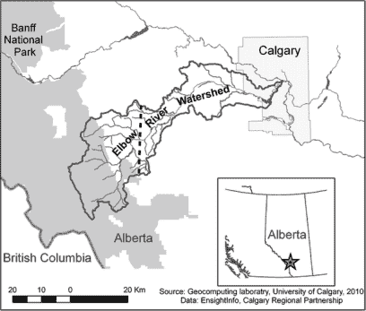

图1 研究区位置；虚线表示研究区西部边界

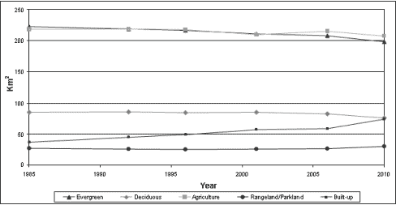

图2 研究区历史土地利用趋势

历史土地利用图还表明，在所考虑的时间段内，研究区发生了相当数量的土地利用转变（表1）。

| 从 | 到 | 土地利用转变（%） | 总计（%） |
|---|---|---:|---:|
| 常绿林 | 农业用地 | 6.23 | |
| 落叶林 | 农业用地 | 6.41 | 14.47 |
| 牧场/公园用地 | 农业用地 | 1.83 | |
| 常绿林 | 建设用地 | 11.40 | |
| 落叶林 | 建设用地 | 17.88 | 98.16 |
| 农业用地 | 建设用地 | 65.97 | |
| 牧场/公园用地 | 建设用地 | 2.91 | |
| 农业用地 | 牧场/公园用地 | 43.52 | 43.52 |

表1 1985年至2010年历史地图中观察到的土地利用转变数量。例如，14.47%是2010年农业用地相对于1985年现有农业用地的增长百分比，而6.23%、6.41%、1.83%分别是各土地利用类型向农业用地转变对这一增长的贡献份额。

#### 2.1 模型实现

CA模型使用ITT Visual Information Solutions（ITTVIS，2007）的IDL 6.3版编写。IDL是一种面向数组的解释型语言，基于优化后的C例程。因此，对数组的操作可以以传统for循环逐元素遍历数组无法达到的速度执行。IDL还具有多平台语言、内置处理空间数据的函数以及与遥感图像分析软件ENVI相链接等优点。

模型实现包括三个主要步骤：1）元胞大小、邻域配置和驱动因素的确定；2）转换规则提取与模型校准；3）模拟过程。

##### 2.1.1 元胞大小、邻域配置与驱动因素选择

多项研究表明，元胞大小和邻域配置会影响基于栅格的CA模型的结果，不应任意选择（Chen and Mynett, 2003; Kocabas and Dragicevic, 2006; Ménard and Marceau, 2005; Moreno et al., 2009; Pan et al., 2010; Samat, 2006; Benenson, 2007）。为指导元胞大小的选择，对历史土地利用图进行了检查，结果表明大多数土地利用变化发生在四个或更多连续像素上。为了在研究所需空间细节水平不变的前提下减少计算时间，使用ArcGIS 9.1（ESRI，2005）中的最近邻算法，将土地利用图重采样为60米和100米分辨率。

邻域被设计为近似中心元胞周围的圆形。之所以做出这一决定，是为了与扩展摩尔邻域相比减少空间畸变，因为邻域中考虑了所有距中心元胞一定距离的元胞（Li and Yeh, 2002b）。建模者可以选择围绕某个元胞的同心邻域环的数量和大小。不同的环彼此互斥；一个元胞只能位于一个环中，且两个环之间没有间隙（图3）。在每个环内，邻接元胞对中心元胞的影响是恒定的，但不同环之间的影响不同。因此，大多数CA模型中用于表示邻域影响的连续距离函数已被离散距离函数取代。这种方法的主要优点是极大简化了元胞影响的定义，因为每个环只有一个影响值。此外，这些影响值是从历史数据中动态获得的，并非在模型中硬编码，因此可以在不改变模型的情况下使用不同尺度的历史数据。

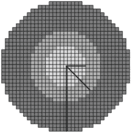

图3 研究中使用的邻域配置示意图，对应5、9和17个元胞的环

虽然测试元胞大小（60米和100米）与邻域配置的所有可能组合超出了本研究的范围，但测试了若干组合，以确定哪些组合能产生最佳模拟结果。关于所进行的敏感性分析的详细信息见2.1.3节。

土地利用变化是复杂的空间过程，由社会经济因素（如人口增长）、生物物理因素（如坡度和土壤质量）以及地理因素（如与服务的邻近性和可达性）在不同时空尺度上的相互作用所导致（Liu and Phinn, 2003; Verburg et al., 2004）。在本研究中，除了如前所述的局部和扩展邻域内元胞的影响外，还考虑了四个外部因素作为转换规则中的参数，即距卡尔加里市中心的距离、距主干道的距离、距主要河流的距离以及地面坡度。这些因素在文献中常被认为会影响土地利用变化（Fang et al., 2005; Li and Yeh, 2002b; Pijanowski et al., 2002; Wu, 2002）。使用ArcGIS 9.1（ESRI，2006）中的欧氏距离工具，针对每个元胞和每个历史年份计算了上述距离。得到的距离文件以与土地利用图相同分辨率和范围的栅格图像格式存储。

##### 2.1.2 规则提取与模型校准

转换规则提取和模型校准包括以下步骤（图4）。首先，读取一组历史土地利用图以及对应的驱动因素图，并计算每个中心元胞邻域内特定状态的元胞数量。对于每种土地利用变化类型，识别历史土地利用图中所有发生状态变化的元胞。构建频率直方图，以显示在考虑特定驱动因素和邻域内元胞状态的情况下，从一种状态转变为另一种状态的元胞百分比。这提供了定量信息，说明每个驱动因素和邻域组成（即邻域内元胞的状态）与研究区内历史土地利用变化的相关性。建模者对这些直方图进行解读，识别每个驱动因素和邻域组成的取值范围，以纳入条件转换规则。然后，这些信息自动转化为数学转换规则。

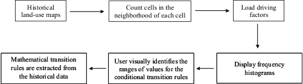

图4 转换规则提取流程

图5给出了此类频率直方图的一个示例。首先显示研究区内常绿林元胞总数与已转变为建设用地的常绿林元胞数量的对比，以表明后者在研究区内的相对贡献（图5a）。在考虑其距主干道距离的情况下，对从常绿林转变为建设用地的元胞比例进行了详细展示和分析（图5b），结果显示，这些元胞中有8%位于距主干道150至180米处，而98%的元胞位于距主干道1250米以内。在1250米处，累积发生曲线上有一个拐点，表明该距离对于解释主干道对此土地利用变化的影响至关重要。元胞距主干道越远，其从常绿林转变为建设用地的频率就越低。

为便于解读频率直方图，并允许建模者交互式地选择用于定义CA模型条件转换规则的值范围，设计了一个图形界面（图6）。每个直方图都可以显示，允许建模者更改组距并放大或缩小视图。通过点击直方图，建模者可以确定每个邻域配置、驱动因素以及该邻域内元胞状态的值范围（最小值和最大值）。这些值存储在一个表中（表2），并进一步用于确定条件转换规则。由表2定义的此类规则的一个示例是：

- 如果距主干道的距离在0到427米之间
- 且第一邻域环内常绿林元胞数量在0到17之间
- 且第二邻域环内建设用地元胞数量在0到14之间
- 且第三邻域环内农业用地元胞数量在0到168之间
- 则中心常绿林元胞可能从常绿林转变为建设用地。

通过组合从直方图中识别的取值范围，即可生成所有可能的转换规则。


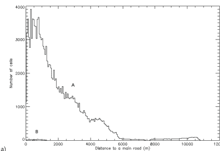

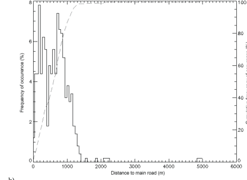

图5. a) 频率直方图，比较距主干道一定距离的常绿元胞总数（A）与考虑其距主干道距离时由常绿转为建成区的常绿元胞数量（B）；b) 频率直方图，显示考虑距主干道距离时由常绿转为建成区的元胞百分比；虚线曲线表示位于距主干道一定距离的元胞的累积出现次数

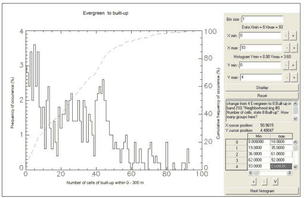

图6. 频率直方图，显示考虑这些元胞300 m范围内建成区元胞数量时由常绿转为建成区的元胞百分比，以及为选择条件转移规则中要考虑的值范围而设计的图形界面

| 元胞状态 | 距主干道距离（m） | 位于第一邻域环[0 至 300) m内的常绿元胞数量 | 位于第二邻域环[300 至 540) m内的建成区元胞数量 | 位于第三邻域环[540 至 1020) m内的农业元胞数量 | ..... |
|---|---|---|---|---|---|
| 常绿 | 0 至 427 | 0 至 17 | 0 至 14 | 0 至 168 |  |
|  | 428 至 1408 | 18 至 50 | 15 至 59 | 169 至 258 |  |
|  | 51 至 74 | 60 至 92 |  | 259 至 377 |  |

表2. 从频率直方图中识别出的、用于确定条件转移规则的值范围

为了将条件规则转换为数学规则，计算先前定义的值范围的均值和标准差。这些值成为数学转移规则参数的系数。在该模型中，每条转移规则的系数并不导致变化概率，而是导致相似度指数（RI），该指数定量描述模拟时某元胞的邻域内容与用于生成转移规则参数值的邻域内容之间的相似性。如果二者非常相似，则该元胞很可能应针对相应的土地利用类型改变状态。

RI受最小距离到类均值遥感图像分类算法（Richards, 2006）启发。该算法为已知类别的像元计算参数空间中的均值点，然后将未知像元分配给算术距离最近的类别。对每条转移规则使用式1计算。

$RI = \sum_{i=1}^{m} \frac{|n_i - \bar{x}_i|}{\sigma_i}$  (1)

其中，m是图层数（对应于驱动因子数加上土地利用类别数乘以邻域环数），nᵢ是第i层中的值，x̄ᵢ是转移规则中第i层的均值，σᵢ是转移规则中第i层的标准差。如果第i层的标准差为零，则

若 $n_i = \bar{x}_i$，则 $\frac{|n_i - \bar{x}_i|}{\sigma_i} = 0$，否则等于正无穷。

因此，RI ∈ ℝ⁺，且RI越小，元胞邻域配置与用于定义转移规则的邻域配置越相似。与条件规则相比，数学规则提供了更大的灵活性，因为它们反映了每种土地利用变化的显著值，并且比根据历史数据集中的具体观测所识别的条件规则更能适应邻域组成。

表3给出了一些值，分别表示三种邻域配置下条件规则和数学规则的系数。最小值和最大值列与条件转移规则相关，而均值和标准差列与数学转移规则相关。根据这些值定义的一个数学规则示例为：

$RI(\text{rule1, Evergreen to Agriculture}) = \frac{|D.\ main\ road - 259.38|}{173.05} + \frac{|D.\ city\ center - 6272.57|}{1568.91} + \frac{|D.\ river - 3465.61|}{310.77} + \frac{|Ground\ slope - 3.23|}{1.79} + \frac{|N0\_Water - 0.17|}{0.44} + \frac{|N0\_Evergreen - 10.71|}{5.25} + \frac{|N0\_Deciduous - 3.13|}{3.42} + \frac{|N0\_Agriculture - 81.84|}{5.75} + \frac{|N0\_Rangeland / Parkland - 0.04|}{0.29} + \frac{|N0\_Built-up - 0.08|}{0.35} + \{0\ \text{if}\ N0\_Clear-cut = 0; \infty\ \text{otherwise}\} + \frac{|N1\_Water - 0.44|}{0.86} + \frac{|N1\_Evergreen - 19.24|}{10.0} + \frac{|N1\_Deciduous - 4.75|}{3.9} + \frac{|N1\_Agriculture - 170.93|}{11.51} + \frac{|N1\_Rangeland / Parkland - 0.28|}{0.86} + \frac{|N1\_Built-up - 0.33|}{0.63} + \{0\ \text{if}\ N1\_Clear-cut = 0; \infty\ \text{otherwise}\} + \frac{|N2\_Water - 1.46|}{1.94} + \frac{|N2\_Evergreen - 86.53|}{43.49} + \frac{|N2\_Deciduous - 14.53|}{12.15} + \frac{|N2\_Agriculture - 573.8|}{44.90} + \frac{|N2\_Rangeland / Parkland - 1.51|}{3.76} + \frac{|N2\_Built-up - 2.13|}{4.15} + \frac{|N2\_Clear-cut - 0.02|}{0.14}$

其中，Nx_LandUse 是元胞邻域环内相应土地利用类型的元胞数量。所有转移规则都存储在一个文件中，因此无需重新校准模型即可执行多次模拟。

| 邻域环 | 图层 | 最小值 | 最大值 | 均值 | 标准差 |
|---|---|---|---|---|---|
| 元胞属性 | 元胞状态 | 常绿 |  |  |  |
|  | 距主干道距离 | 0.0 | 780 | 259.38 | 173.05 |
|  | 距市中心距离 | 2473.86 | 8696.48 | 6272.57 | 1568.91 |
|  | 距河流距离 | 2979.53 | 4048.11 | 3465.61 | 310.77 |
|  | 地面坡度 | 0.0 | 7.29 | 3.23 | 1.79 |
| [0-300] m | 状态为水体的元胞数量 | 0.0 | 2.0 | 0.18 | 0.44 |
|  | 状态为常绿的元胞数量 | 0.0 | 19.0 | 10.71 | 5.25 |
|  | 状态为落叶的元胞数量 | 0.00 | 11.00 | 3.13 | 3.43 |
|  | 状态为农业的元胞数量 | 66.00 | 93.00 | 81.84 | 5.76 |
|  | 状态为草地/公园地的元胞数量 | 0.00 | 2.00 | 0.04 | 0.30 |
|  | 状态为建成区的元胞数量 | 0.00 | 2.00 | 0.09 | 0.36 |
|  | 状态为皆伐的元胞数量 | 0.00 | 0.00 | 0.00 | 0.00 |
| [300-540] m | 状态为水体的元胞数量 | 0.00 | 3.00 | 0.44 | 0.87 |
|  | 状态为常绿的元胞数量 | 0.00 | 32.00 | 19.24 | 10.00 |
|  | 状态为落叶的元胞数量 | 0.00 | 16.00 | 4.76 | 3.91 |
|  | 状态为农业的元胞数量 | 151.00 | 192.00 | 170.93 | 11.52 |
|  | 状态为草地/公园地的元胞数量 | 0.00 | 4.00 | 0.29 | 0.87 |
|  | 状态为建成区的元胞数量 | 0.00 | 3.00 | 0.33 | 0.64 |
|  | 状态为皆伐的元胞数量 | 0.00 | 0.00 | 0.00 | 0.00 |
| [540-1020] m | 状态为水体的元胞数量 | 0.00 | 6.00 | 1.47 | 1.95 |
|  | 状态为常绿的元胞数量 | 2.00 | 205.00 | 86.53 | 43.49 |
|  | 状态为落叶的元胞数量 | 1.00 | 51.00 | 14.53 | 12.16 |
|  | 状态为农业的元胞数量 | 430.00 | 656.00 | 573.80 | 44.91 |
|  | 状态为草地/公园地的元胞数量 | 0.00 | 14.00 | 1.51 | 3.76 |
|  | 状态为建成区的元胞数量 | 0.00 | 24.00 | 2.13 | 4.15 |
|  | 状态为皆伐的元胞数量 | 0.00 | 1.00 | 0.02 | 0.15 |

表3. 用于建立条件转移规则和数学转移规则的数据示例

##### 2.1.3 模拟过程

模拟过程包括以下主要步骤。

- 读取先前定义的数学转移规则以及与模拟开始时对应的土地利用图。
- 对于每个时间步，读取每个元胞的邻域配置，并计算其与转移规则参数的对应程度。
- 根据用户指定的约束和每条规则的影响，改变状态的元胞按照对应程度最高的规则进行变化。
- 为了决定应将哪个元胞与每种土地利用变化类型相关联，模型递归地对土地利用变化类型进行排序，并针对每种类型选择RI值最小的元胞。一旦满足每种土地利用变化类型所需的元胞数量，或无法再分配元胞，模型便写入新的土地利用图，并更新与每条规则和每种变化类型相关联元胞百分比相对应的统计量。
- 如果与每条规则和每种土地利用变化类型相关联的元胞数量不同于从历史数据和先前时间步中发现的数量，则在下一个时间步应用校正。例如，如果有200个元胞要从农业转变为建成区，但根据其邻域配置只有150个可以转变，则将在下一个时间步再设置50个元胞进行变化。

表4列出了模拟期间考虑的土地利用转移。

| 从 | 到 |
|---|---|
| 常绿 | 农业 |
| 落叶 | 农业 |
| 常绿 | 建成区 |
| 落叶 | 建成区 |
| 农业 | 建成区 |
| 草地/公园地 | 建成区 |
| 草地/公园地 | 农业 |
| 农业 | 草地/公园地 |

表4. 模拟期间考虑的土地利用转移

运行了两组模拟。第一组是在各种条件下测试模型。首先对元胞大小和邻域配置进行敏感性分析，然后分析模型对从频率直方图中选择的不同值范围的敏感性。为校准CA模型，测试了几种对从直方图中提取的数据值进行分组的方法：1）忽略平坦区域的最主导值范围；2）集中在众数附近的最主导值范围；3）分散在远离众数处的最主导值范围；4）直方图的整个值范围。最后，为评估外部驱动因子选择的重要性，使用四个因子以及仅三个外部因子的不同组合进行了模拟。

在每种情况下，使用1985年至2001年的土地利用图校准CA，模拟从2001年执行到2006年，并使用基于Kappa系数的两种相似性度量将2006年的模拟图与同年的参考图进行比较。第一种度量是标准Kappa系数，它表示……的百分比


两个地图之间的一致性，包括数量和位置信息（Hagen, 2003; Pont et al., 2010; Visser and de Nijs, 2006）。计算了三个统计量，分别称为Kappa、Kloc和Khisto。Khisto衡量两个比较地图之间的数量相似性，而Kloc衡量地图之间类别空间分配的相似性。Kappa表示两个地图之间空间一致性的总体水平，是Kloc和Khisto的乘积。

标准Kappa统计的一个缺点是它们倾向于高估模拟地图与参考地图之间的一致性，因为它们没有考虑在模拟期间状态未改变的像元百分比。此外，它们依赖于一个基于所比较类别大小的随机分配随机模型来表达预期一致性。当使用CA模型模拟时，土地利用分配并非完全随机，因为它取决于模拟的初始条件。

为了弥补这些局限，Van Vliet等人（2010）引入了一种称为Kappa模拟的一致性系数，它应用了更合适的类别转换随机分配模型，该模型考虑了初始土地利用图中所包含的信息以及模拟期间状态不变的像元比例。再次计算了三个统计量：Ksimulation表示模拟土地利用图与参考地图之间的一致性，Ktransition从土地利用转换数量方面捕捉一致性，Ktransloc从转换位置方面衡量两个地图之间的一致性。这些系数的值从-1到1不等，前者表示所比较的两个地图完全不一致，而后者表示完全一致。标准Kappa系数和Kappa模拟系数是使用知识系统研究所（RIKS BV，2010）开发的地图比较工具包计算的。

为进行验证测试，使用上述最佳条件组合进行了从2001年到2006年以及到2010年的模拟。将模拟地图与2006年和2010年的参考地图进行了比较。此外还进行了从1985年到2010年的模拟，以说明在整个时期内模拟土地利用相对于参考地图中观察到的变化是如何变化的。

在所有模拟中，均应用了局部约束，禁止在Tsou T'ina族领地内出现建设用地像元。对于从2001年到2010年及从1985年到2010年的验证测试，以及对外部驱动因素筛选的测试，还应用了全局约束，根据历史人口趋势估算的平均值来限制每次迭代中建设用地像元的数量。

### 3. 结果

#### 3.1 敏感性分析

表5分别列出了使用60米和100米像元大小时获得的一致性系数。正如预期，标准Kappa统计的值往往较高。它们也非常相似，无法区分不同结果。然而，Ksim、Ktransloc和Ktransition的值都表明，使用60米像元获得的模拟结果与参考地图的一致性高于使用100米像元获得的结果。

Ksim系数还表明，邻域配置的选择会影响模拟结果。在邻域配置中仅使用两圈邻域会显著降低模型性能，而使用分别为5、9和17个像元的三圈邻域时获得最佳结果。这表明在本研究区域内，覆盖距离达1020米的扩展邻域更适合捕捉对中心像元的影响区域。

| 像元大小 | 标准Kappa | Kloc | Khisto | Ksim | Ktransloc | Ktransition |
|---|---:|---:|---:|---:|---:|---:|
| 60米 | 0.853 | 0.875 | 0.975 | 0.047 | 0.085 | 0.551 |
| 100米 | 0.850 | 0.873 | 0.974 | 0.043 | 0.078 | 0.546 |

表5 使用60米和100米像元大小时获得的一致性Kappa系数

| 邻域配置 | 标准Kappa | Kappa模拟 |
|---|---:|---:|
| 3-5 | 0.845 | 0.015 |
| 3-5-15 | 0.850 | 0.037 |
| 5-9-14 | 0.852 | 0.044 |
| 5-9-15 | 0.852 | 0.045 |
| 5-9-16 | 0.853 | 0.046 |
| 5-9-17 | 0.853 | 0.047 |
| 5-12-17 | 0.852 | 0.045 |
| 6-9-15 | 0.849 | 0.031 |
| 6-14-18 | 0.852 | 0.043 |
| 6-14-19 | 0.852 | 0.045 |
| 7-10-15 | 0.852 | 0.042 |
| 7-10-16 | 0.852 | 0.044 |
| 7-10-17 | 0.852 | 0.044 |
| 7-13-17 | 0.850 | 0.034 |
| 7-14-18 | 0.852 | 0.043 |
| 7-14-19 | 0.852 | 0.044 |
| 7-14-20 | 0.852 | 0.045 |
| 7-15-19 | 0.852 | 0.043 |
| 8-12 | 0.847 | 0.024 |
| 8-15-19 | 0.852 | 0.042 |

表6 使用不同邻域配置时获得的一致性Kappa系数

从频率直方图中选择数值范围以构建转换规则的方式也会影响模拟结果（表7）。当数值集中在众数附近时获得最佳结果（Ksim = 0.069），而范围逐渐分散时结果较差（Ksim = 0.047和0.045）。当选择覆盖整个直方图的单一数值范围时，结果最差（Ksim = 0.041）。

| 参数值选择 | Kappa | KLocation | KHisto | Kappa模拟 | KTransLoc | KTransition |
|---|---:|---:|---:|---:|---:|---:|
| 最具优势的数值范围 | 0.853 | 0.875 | 0.975 | 0.047 | 0.085 | 0.551 |
| 从中位数分散的数值 | 0.853 | 0.875 | 0.975 | 0.045 | 0.081 | 0.551 |
| 集中在众数周围的数值 | 0.857 | 0.879 | 0.975 | 0.069 | 0.126 | 0.551 |
| 单一数值组 | 0.852 | 0.874 | 0.975 | 0.041 | 0.074 | 0.551 |

表7 使用频率直方图的不同值分组定义转换规则时获得的一致性Kappa系数

模拟结果还受到外部驱动因素的数量和选择的影响（表8）。使用四个因素在与参考地图的总体一致性（0.058）和位置一致性（0.140）方面均产生了最高的一致性。三个因素的最佳组合包括到主要道路的距离、到市中心的距离和到河流的距离，这些因素预计在建设用地扩张中发挥重要作用。地面坡度似乎也是一个重要因素，因为其一致性系数略低于使用前三个因素获得的值。可以观察到，土地利用转换量在不同因素组合下保持不变；然而，如Ktransloc所示，其空间分布发生了变化。

| 因素选择 | 标准Kappa | Kloc | Khisto | Ksim | KtransLoc | Ktrans |
|---|---:|---:|---:|---:|---:|---:|
| 到主要道路的距离<br>到市中心的距离<br>到河流的距离<br>地面坡度 | 0.866 | 0.876 | 0.989 | 0.058 | 0.140 | 0.411 |
| 到主要道路的距离<br>到市中心的距离<br>到河流的距离 | 0.864 | 0.874 | 0.989 | 0.042 | 0.102 | 0.411 |
| 到主要道路的距离<br>到市中心的距离<br>地面坡度 | 0.864 | 0.873 | 0.989 | 0.038 | 0.094 | 0.411 |
| 到主要道路的距离<br>到河流的距离<br>地面坡度 | 0.864 | 0.874 | 0.989 | 0.041 | 0.100 | 0.411 |
| 到市中心的距离<br>到河流的距离<br>地面坡度 | 0.864 | 0.874 | 0.989 | 0.041 | 0.101 | 0.411 |

表8 使用四个外部驱动因素与仅三个因素组合时获得的一致性Kappa系数

#### 3.2 使用最佳条件组合获得的结果

使用最佳条件组合运行从2001年到2006年及到2010年的模拟所获得的一致性Kappa系数见表10。与2010年相比，2006年的一致性更高。对2006年和2010年的逐类别Kappa模拟系数结果的更详细分析表明，在转换数量方面，模型与参考地图达到相对较好的一致性（值介于0.371和0.541之间），但建设用地类别除外，其值略高于0.2（表11和12）。Ktransloc的值低于Ktransition的值，表明模型更擅长分配正确的转换数量，而非其位置。

|  | 2006年 | 2010年 |
|---|---:|---:|
| 标准Kappa | 0.869 | 0.782 |
| Kappa模拟 | 0.075 | 0.057 |

表10 从2001年到2010年运行模拟并将结果与2006年和2010年参考地图比较时获得的总体一致性Kappa系数

|  | 建设用地 | 牧场/公园用地 | 农业用地 | 落叶林 | 常绿林 |
|---|---:|---:|---:|---:|---:|
| 标准Kappa | 0.816 | 0.669 | 0.860 | 0.906 | 0.947 |
| Kloc | 0.817 | 0.684 | 0.865 | 0.917 | 0.948 |
| Khisto | 0.999 | 0.978 | 0.994 | 0.988 | 0.999 |
| Kappa模拟 | 0.009 | 0.140 | 0.096 | 0.084 | 0.065 |
| KtransLoc | 0.045 | 0.259 | 0.178 | 0.165 | 0.174 |
| Ktransition | 0.211 | 0.541 | 0.536 | 0.508 | 0.376 |

表11 从2001年到2006年运行模拟并将2006年模拟地图与2006年参考地图比较时获得的逐类别一致性Kappa系数

|  | 建设用地 | 牧场/公园用地 | 农业用地 | 落叶林 | 常绿林 |
|---|---:|---:|---:|---:|---:|
| 标准Kappa | 0.706 | 0.537 | 0.779 | 0.822 | 0.905 |
| Kloc | 0.793 | 0.553 | 0.806 | 0.834 | 0.930 |
| Khisto | 0.890 | 0.971 | 0.967 | 0.986 | 0.973 |
| Kappa模拟 | 0.011 | 0.095 | 0.078 | 0.079 | 0.046 |
| KtransLoc | 0.054 | 0.198 | 0.148 | 0.171 | 0.123 |
| Ktransition | 0.204 | 0.483 | 0.530 | 0.460 | 0.371 |

表12 从2001年到2010年运行模拟并将2010年模拟地图与2010年参考地图比较时获得的逐类别一致性Kappa系数


土地利用类别减少到五类（水体、森林、农业、建设用地和Tsuu T'ina部落），并且只考虑了四种转移，即森林到农业、森林到建设用地、农业到森林以及农业到建设用地。模型在1985年至2001年期间进行了校准，模拟运行从1985年持续到2006年，使用了三个外部驱动因子（距卡尔加里市中心的距离、距主要道路的距离、距主要河流的距离）。计算得到的三个Kappa模拟统计量获得了较高的值（表14），确认了模拟结果可以通过减少模型中土地利用转移的数量或改进所考虑的某些土地利用转移的规则来改善。

| | 1992 | 1996 | 2001 | 2006 |
|---|---|---|---|---|
| Kappa | 0.947 | 0.941 | 0.929 | 0.917 |
| KLocation | 0.951 | 0.947 | 0.938 | 0.939 |
| KHisto | 0.996 | 0.994 | 0.991 | 0.976 |
| Kappa Simulation | 0.304 | 0.262 | 0.251 | 0.227 |
| KTransLoc | 0.429 | 0.377 | 0.336 | 0.341 |
| KTransition | 0.709 | 0.695 | 0.747 | 0.665 |

表14. 使用减少土地利用转移数量的模拟时获得的总体Kappa一致性系数。

### 4. 结论

虽然元胞自动机（CA）模型在土地利用变化研究中的潜力日益得到认可，但其校准和性能评估仍然是一个挑战。在本研究中，我们开发了一种校准方法，使建模者能够交互式地获取历史土地利用变化以及与这些变化相关的因素的信息，从而自动推导出条件性和数学转移规则。在阿尔伯塔南部的一个研究区域测试该模型的适用性时，我们进行了敏感性分析，以评估模型校准过程中涉及的各种条件的影响，包括像元大小、邻域配置、参数值的选择以及驱动因子的数量。这些分析表明，模拟结果受这些条件选择的影响，并且不存在*先验*确定最合适组合的方法。

过去几年，多位作者已经认识到基于栅格的CA模型对像元大小和邻域配置的敏感性。克服这种尺度敏感性的一种方法是实现基于对象的CA模型，并加入动态邻域，如Moreno等人（2009，2010）和他人（Hammam等，2007）所提出的。虽然这类模型计算量大，拓扑处理繁琐，但它们似乎是一种很有前景的方法，能够更好地捕捉构成景观的有意义实体及其演变。

本文所描述的校准技术为校准中应考虑的外部驱动因子的数量和选择提供了有用的见解。当在扩展邻域内像元的影响之外还考虑外部因素时，因素可能的组合数量变得过高，无法通过简单的敏感性分析进行彻底评估。在这种情况下，基于数据挖掘技术的其他方法可能有助于指导模型校准中驱动因子的选择（Wang等人，待发表）。

Kappa模拟是最近提出的一种一致性系数，专门用于评估CA模型性能的情境（Van Vliet等，2010）。虽然还需要更多的研究来充分评估该系数的解释潜力，但在本研究中，它似乎非常有用，能够在标准Kappa不够敏感而无法提供区分时捕捉模拟结果中的差异。特别是，它表明CA模型在土地利用转移数量方面产生了相对较高的一致性，而在位置方面的一致性较低。当减少模型中考虑的土地利用转移数量时，系数值增加的事实也表明，可能需要额外的外部驱动因子来充分捕捉研究区域的动态变化。

然而，在解释这些系数的数值时，我们必须记住，它们是基于逐个像元比较两幅地图的一致性，而不考虑所比较像元之间可能发生的微小位移。此外，比较是在所研究区域的两种可能状态之间进行的，这两种状态分别由模型生成和从特定时刻获取的观测数据得到。这两种状态可能存在差异，这并不一定意味着模拟结果是“错误的”。

### 5. 致谢

本项目是与卡尔加里区域合作伙伴关系组织（CRP）合作启动的，该组织为J.-G. Hasbani提供了资金支持。我们感谢卡尔加里大学的Cheng Zhang制作了项目中使用的历史土地利用图，并感谢Jasper Van Vliet就Kappa模拟进行的启发性讨论。额外的资金由授予D. Marceau的NSERC发现基金以及加拿大地学卓越中心网络GEOIDE提供。

### 6. 参考文献

- Almeida, C. M., Gleriani, J. M., Castejon, E. F., & Soares-Filho, B. S., 2008. 使用神经网络和元胞自动机建模城市内部土地利用动态。*国际地理信息科学杂志* 22(9): 943-963.
- Benenson, I., & Torrens, P., 2004. *地理模拟：基于自动机的城市现象建模*. Wiley and Sons.
- Benenson, I., 2007. 警告！土地利用CA的尺度正在改变！*计算机、环境与城市系统* 31(2): 107-113.
- Bone, C., Dragicevic, S., & Roberts, A., 2006. 森林虫害的模糊约束元胞自动机模型。*生态建模* 192: 107-125.
- 卡尔加里经济发展局，2010，http://www.calgaryeconomicdevelopment.com/liveWorkPlay/Live/demographics.cfm
- Chen, Q., & Mynett, A. E., 2003. 基于元胞自动机的捕食-被捕食建模中像元大小和配置的影响。*模拟建模实践与理论* 11(7-8): 609-625.
- Clarke, K. C., Hoppen, S., & Gaydos, L., 1997. 旧金山湾区历史城市化过程的自修正元胞自动机模型。*环境与规划B* 24(2): 247-261.
- Erlien, C. M., Tuttle, J. P., McCleary, A. L., Mena, C.F., & Walsh, S.J., 2006. 复杂性理论与土地利用/土地覆盖动态的空间模拟：使用假设情景进行教育、土地管理和决策。*国际地理制图* 21(4): 67-74.
- ESRI，2006. ArcGIS 9.1 用户手册。ESRI，加利福尼亚州雷德兰兹。
- Fang, S., Gertner, G. Z., Sun, Z., & Anderson, A.A., 2005. 城市蔓延动态空间模拟中相互作用的影响。*景观与城市规划* 73: 294-306.
- Hagen, A., 2003. 评估类别地图相似性的模糊集方法。*国际地理信息科学杂志* 17(3): 235-249.
- Hammam, Y., A. Moore，& Whigham, P. (2007). 地理矢量主体的动态几何。*计算机、环境与城市系统* 31: 502-519.
- Jantz, C. A., & Goetz, S. J., 2005. 城市土地利用变化模型中的尺度依赖性分析。*国际地理信息科学杂志* 19(2): 217-241.
- Jantz, C. A., Goetz, S. J., & Shelley, M.K., 2003. 使用SLEUTH城市增长模型模拟未来政策情景对巴尔的摩-华盛顿大都市区城市土地利用的影响。*环境与规划B* 30: 251-271.
- Jenerette, D. G., & Wu, J., 2001. 美国亚利桑那中部-凤凰城地区土地利用变化的分析与模拟。*景观生态学* 16:611-626.
- Kocabas, V., & Dragicevic, S., 2006. 使用敏感性分析方法评估元胞自动机模型行为。*计算机、环境与城市系统* 30: 921-953.
- Lau, K. H., & Kam, B. H., 2005. 用于城市土地利用模拟的元胞自动机模型。*环境与规划B* 32: 247-263.
- Li, X., & Yeh, A. G.-O., 2000. 通过集成约束元胞自动机和GIS模拟可持续城市发展。*国际地理信息科学杂志* 14(2): 131-152.
- Li, X., & Yeh, A. G.-O., 2002a. 主成分分析与元胞自动机集成用于空间决策和城市模拟。*中国科学*，45(6): 521-529.
- Li, X., & Yeh, A. G.-O., 2002b. 基于神经网络的元胞自动机，利用GIS模拟多种土地利用变化。*国际地理信息科学杂志* 16(4): 323-343.
- Li, X., & Yeh, A. G.-O., 2004. 元胞自动机转移规则的数据挖掘。*国际地理信息科学杂志* 18(8): 723-744.
- Liu, Y., & Phinn, S. R., 2003. 结合模糊集方法的元胞自动机模拟城市发展。*计算机、环境与城市系统* 27: 637-658.
- Ménard, A., & Marceau, D. J., 2005. 地理元胞自动机中空间尺度敏感性探索。*环境与规划B* 32: 693-714.
- Ménard, A., & Marceau, D. J., 2007. 使用地理元胞自动机模拟加拿大魁北克南部农业景观中森林管理情景的影响。*景观与城市规划* 79(3-4): 253-265.
- Moreno, N., Wang, F., & Marceau, D.J., 2009. 在基于矢量的土地利用元胞自动机模型中实现动态邻域。*计算机、环境与城市系统* 33: 44-54.
- Moreno, N., Wang, F., & D.J. Marceau, 2010. 元胞自动机建模中的地理对象方法。*摄影测量工程与遥感* 76(2): 183-191.
- Ohgai, A., Gohani, Y., & Watanabe, K., 2007. 建成区火灾蔓延的元胞自动机建模：辅助社区防灾规划的工具。*计算机、环境与城市系统* 31(4): 441-460.


- Pan, Y., Roth, A., Yu, Z., & Doluschitz, R., 2010. 尺度变化对用于土地利用变化建模的元胞自动机行为的影响. *计算机、环境与城市系统* 34: 400-408.
- Pijanowski, B. C., Brown, D. G., Shellito, B. A., & Manik, G. A., 2002. 使用神经网络和GIS预测土地利用变化：一个土地转化模型. *计算机、环境与城市系统* 26: 553-575.
- Richards, J. A., 2006. *遥感数字图像分析：导论*, Springer, 439 p.
- Research Institute for Knowledge System (RIKS BV), 2010, http://www.riks.nl/mck
- Samat, N., 2006. 表征元胞自动机模拟城市增长的尺度敏感性：以马来西亚槟城州威省地区为例. *计算机、环境与城市系统* 30(5): 905-920.
- Santé, I., García, A. M., Miranda, D., & Crecente, R., 2010. 用于模拟真实世界城市过程的元胞自动机模型：综述与分析. *景观与城市规划* 96: 108-122.
- Shan, J., Alkheder, S., & Wang, J., 2008. 遗传算法用于元胞自动机城市增长模型的校准. *摄影测量工程与遥感* 74(10): 1267-1277.
- Shen, Z., Kawakami, M., & Kawamura, I., 2009. 使用地理自动机模拟城市分区土地利用格局的地理模拟模型. *环境与规划B* 36: 802-823.
- Soares-Filho, B. S., Cerqueira, G. C., & Pennachin, C. L., 2002. DINAMICA：一个用于模拟亚马逊拓殖前沿景观动态的随机元胞自动机模型. *生态建模* 154: 217-235.
- Straatman, B., White, R., & Engelen, G., 2004. 面向受约束元胞自动机的自动校准程序. *计算机、环境与城市系统* 28: 149-170.
- Sui, D. Z., & Zeng, H., 2001. 模拟亚洲新兴城乡一体化地区景观结构动态——以深圳为例. *景观与城市规划* 53(1-4): 37-52.
- Sun, T., & Wang, J., 2007. 基于路网网格的交通元胞自动机模型及其时空分辨率对模拟的影响. *模拟建模实践与理论* 15: 864-878.
- Van Vliet, J., White, R., & Dragicevic, S., 2009. 使用可变网格元胞自动机模拟城市增长. *计算机、环境与城市系统* 33: 35-43.
- Van Vliet, J., Bregt, A. K., & Hagen-Zanker, A., 2010. 重新审视Kappa以考虑土地利用变化模型精度评估中的变化. 已提交至 *生态建模*.
- Verburg, P. H., de Nijs, T. C. M., Van Eck, J. R., Visser, H., & de Jong, K., 2004. 一种分析土地利用格局邻域特征的方法. *计算机、环境与城市系统* 28(6): 667-690.
- Visser, H., & de Nijs, T., 2006. 地图比较工具包. *环境建模与软件* 21(3): 346-358.
- Wang, F., Hasbani, J. G., Wang, X., & Marceau, D. J., 2011. 使用粗糙集理论识别土地利用元胞自动机模型校准中的主导因素. *计算机、环境与城市系统*, 出版中.
- White, R., Engelen, G., & Uljee, I., 1997. 使用受约束元胞自动机进行高分辨率城市土地利用动态建模. *环境与规划B* 25: 323-343.
- Wu, F., 2002. 随机元胞自动机的校准及其在城乡土地转化中的应用. *国际地理信息科学杂志* 16(8): 795-818.

## 基于元胞自动机的维也纳聚落发展模拟

Reinhard Koenig¹ 和 Daniela Mueller²

¹魏玛包豪斯大学，建筑学院，建筑计算机科学教席，
²维也纳工业大学，空间发展、基础设施与环境规划系，区域科学中心

¹德国
²奥地利

### 1. 引言

城市的结构和发展可以从不同的角度进行观察和评估。通过使用描绘不同时间状态的历史地图来重现城市的增长或收缩，我们可以获得城市动态机制的瞬时快照。考察这些快照如何随时间变化，并比较不同的静态时间状态，可以揭示人口密度、技术基础设施以及公共交通设施可用性之间的各种相互依赖关系。城市基础设施和设施并非均匀地分布在整个城市中，而是随着时间的推移遵循不同的扩散模式与速度，并遵循不同的时空规律。

导致状态从一个状态向另一个状态转变的原因和潜在过程，源于同样的反复出现但表现程度各异的隐藏力量及其复杂的相互作用。这些力量涵盖了各种经济、社会、文化和生态条件，它们各自的权重总体上决定了城市的发展。然而，城市发展不仅是经济、法律或社会指标的不同空间分布的产物，也是基础设施分布的产物。但城市发展在多大程度上受到基础设施供给变化的影响呢？

正如 Lichtenberger（1986，第154页）已经指出的那样，城市结构往往以技术性和社会文化性基础设施系统的发展为特征。在远离现有道路的地方新建建筑，其可达性和废物处理必须满足一定条件（《城市建设原则备忘录》，1906年，第5页及以后）。同样，人们可以观察到，过去城市片区的开发遵循着由于道路、交通和技术基础设施系统（如污水系统）的需求与扩展所产生的特征性扩张措施（《城市建设原则备忘录》，1906年）。

在包括维也纳在内的许多欧洲城市，在威廉时期——所谓的“创业时代”（Gründerzeit）——发生了大规模的基础设施扩展，尤其是在地下市政规划方面。技术基础设施网络，特别是污水、照明、燃气和供水网络，规模庞大。公共交通系统的发展，尤其是电车，在这一时期也迅速推进。城市结构受到城市供给和废物处理网络线路的显著影响。在“创业时代”期间，城市设计原则遵循从城市中心到外围的层级递进。中心区域设施最完善，享有技术基础设施的最大利益。随着与中心距离的增加，外围地区的供给和废物处理系统的配置变得不那么完善。后来，随着新的郊区开始建设，这些地区作为建设措施的一部分配备了相应的技术基础设施。直到更晚的时候，较老的郊区才最终接入更新的技术基础设施。

一个城市片区作为居住区的吸引力，取决于可用技术基础设施的水平和多样性（Behrens，1971；Weber，1909）。城市地区供水、污水系统和能源的供应，会显著影响一个片区的设施配置和吸引力，在某些情况下甚至可能首先为住宅使用创造必要条件。此外，一个城市片区与公共交通网络的连接决定了其可达性，以及随之而来的不同地点之间换乘的可能性。因此，选址可以被视为对各种标准（如位置和设施可用性）进行分析和评估的结果。

应用到模拟模型中，表征城市发展的局部条件对应于内生和外生控制参数。通过以维也纳市的历史发展为基础验证以下模拟模型，可以从参数的设置中得出关于社会驱动力和抽象结构的初步结论。

### 2. 从城市化到郊区化

在城市发展过程中，可以观察到增长和收缩的阶段。增长阶段之后是收缩阶段，反之亦然，从而形成一种模式。简化的城市发展周期模型假设城市具有生命周期（Dangschat，2007）。借助此类模型，可以展示在城市化的最初集中过程之后出现的郊区化和逆城市化的离心过程。不同的城市发展周期及其相互作用，在 Van den Berg 等人（1982）的城市发展周期阶段模型中得到了示意性展示（见图1）。

#### 2.1 城市化

19世纪的欧洲城市是一个集中化系统，城市中心拥有最佳的可达性、最高的声望价值和最昂贵的土地价格。社会和货币资本集中在市中心——此外，市中心代表了整体社会、政治和经济的权力平衡。城市正处于城市化阶段（见图1）——城市集聚带来的优势以多种不同方式被利用，例如增加工人和需求的集中度，这反过来又刺激了从农村地区向城市的大规模移民流动。然而，城市并未准备好应对如此巨大的人口涌入——其结果是，公共交通系统缺乏，工作时间长，收入低，快速建造的住房单元狭小且设施简陋。城市不得不扩展


#### 2.3 去郊区化与再城市化

随着城市扩张，出行距离增加，随之而来的是交通负荷以及更高交通容量的需求。由于郊区人口密度相对较低，基础设施密集型的公共交通系统不经济，这也是私人交通方式在交通中占比日益增大的另一个原因。随着私人交通方式扩张，伴随而来的污染对许多地方的生活质量产生负面影响，因此越来越多城市居民迁往郊外。公共交通设施的成本给城市预算带来负担，但由于越来越多富裕人口迁移到外围地区，城镇发现自己日益陷入财政瓶颈（Fassmann, 2005, p. 104; Maier & Tödtling, 2002, p. 163）。在郊区化的周期阶段之后，一种新的城市化周期趋势开始出现，即所谓的去郊区化和再城市化（见图1）。在去郊区化期间，周边城市经历城市化的周期阶段，而相应的外围地区则停滞不前；随后随着市中心活动增加，进入再城市化的周期阶段。

### 3. 向心力和离心力

上述隐藏的力量可以大致归纳为两种相互对立的力量——向心力和离心力（Krugman, 1996）。本章描述它们是如何推导出来的。向心力描述集中化力量，表达密集人口的优势和需求。离心力描述分散区位的优势，主要体现为充裕的空间可用性和无污染排放。

缪尔达尔（Myrdal，1957）的中心—外围模型一方面认为，中心与外围的出现是剥夺效应或吸吮效应的结果，即所谓的“回流效应”或向心力。这些效应包括由充满活力的城市中心的吸引力所产生的效应，例如人口或生产要素从农村地区迁移。这些效应主要发生在城市化或再城市化的周期阶段（见2.1节和2.3节）。另一方面，中心/外围结构也是所谓“扩散效应”的产物。它们也由离心力来描述，表达扩张中的中心所产生的效应，例如在郊区化或去郊区化的周期阶段中可以观察到的效应（见2.2节和2.3节）。向心力和离心力导致集中或分散的聚落模式。关键决定因素是企业、家庭和公共当局区位决策之间的相互依赖关系。某一给定时间点上活动的空间分布会影响新活动的区位条件。

向心力的出现可以通过集聚效应来描述。韦伯（Weber，1909）将集聚因素理解为某一区位上某种土地利用达到一定密度所带来的优势。集聚效应影响个体经济利润（利润/收益），但受其他经济主体控制。它们可以分为本地化效应（本地化经济）和城市化效应（城市化经济），不过下文仅讨论城市化效应。

城市化效应产生于不同主体之间以及不同活动之间，代表一个地区整个活动范围所带来的那些收益，例如高度分化的就业市场、广泛的公共和私人服务、高质量的通信基础设施、创新氛围以及与其他城市的良好连接和可达性（参见Maier & Tödtling, 2002, p. 101）。主要的城市化优势之一是技术基础设施的可获得性（Kramar, 2005）。然而，在选择区位时，主体不仅受集聚效应影响，也受相反的去集聚效应影响。它们描述过度高密度集聚地区伴随的负面影响。随着密度增加，成本—收益比也随之增加。成本包括例如城市中心超负荷并伴随相应的交通问题，如交通拥堵、噪声污染或高地价。从成本开始超过收益的那一点起，集聚劣势开始出现（见图2）。

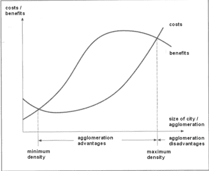

图2. 作为成本/收益函数的集聚优势与集聚劣势。图源自Kulke (2006, p. 242)，来源：Richardson (1976)。

基于下文所介绍模拟模型的理论概念，成本曲线对应于集聚劣势。随着密度增加，成本呈指数增长。收益曲线代表集聚优势。收益在持续集聚过程中继续上升，直至达到饱和点。随着集聚继续，区位的可用性相对于其最大有利程度而言会变差（见图2）。

收益曲线与成本曲线之间的差异描述了模拟模型中迁入或迁离某一区位的概率，如图3所示。如果收益超过成本，该区位的人口密度将增加。反之，如果成本超过收益，该区位的人口密度可能下降。在城市发展过程中（见第2章），曲线的顶点（成本与收益之差）会水平移动（见图3）。

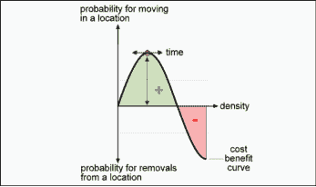

图3. 迁入某一区位（绿色）或迁离某一区位（红色）的概率随密度变化的曲线。

### 4. 建模与仿真

#### 4.1 仿真概念

在设计仿真模型时，一个关键目标是通过尽可能简单的模型来表示复杂的动态系统。该模型旨在用于解释新特性的出现、研究城市系统的复杂行为并预测未来发展趋势。

大多数常见的仿真模型通过DLA（扩散限制聚集）和DBM（介电击穿模型）将城市簇团的增长描述为聚集过程（Batty, 1991），二者均基于元胞自动机（CA）原理。在这些模型中，通过使用概率函数将部分区域（通常是住宅区）依次添加到现有结构上。然而，使用这些简单模型无法考虑城市簇团紧凑性随时间的变化。例如，城市簇团在城市化周期阶段呈现相当紧凑的结构，而在从城市化周期阶段向郊区化周期阶段过渡时，这种结构会转变为更加分枝化的结构。此外，城市集聚的特定现象，例如城市增长的重构、新增长区的出现或城市簇团的共存，只能通过特殊的模型扩展来描述（Schweitzer & Schimansky-Geier, 1994）。DBM原理的一种可能的模型扩展例如存在于若干元胞状态的表述以及用于模拟土地利用模式的相应转换规则中（White & Engelen, 1993）。Schweitzer和Schimansky-Geier（1994）通过分析簇团内随机选取的点到最近的或最远的自由空间之间的最大距离，已经证明城市住宅区的形状不仅受距城市中心的最小距离控制，也受距住宅边界的最小距离控制。简单的DLA或DBM可以用此类发展规则加以补充（Schweitzer & Steinbrink, 2002）。

城市是复杂系统，其发展遵循自组织原则。这一假设是本文所提出的基于计算机的仿真模型的一个前提条件。借助该模型，不同现象在


将在城市尺度上回顾住宅区的发展。对维也纳市1888年至2001年历史发展的基础分析（Müller, 2005）包含一个一般性假设：改善公共交通系统的可达性以及通过技术基础设施系统提供的供给，会导致人口密度增加。这一假设将使用本文提出的模型加以验证。在该模型中，人口密度还取决于某一居住地点相对于现有人口密度的个体权重。该权重将基于如图3所示的概率曲线。

图4概述了所提出的假设如何从理论基础（见第2章和第3章）推导出来，以及如何使用这里描述的仿真模型加以验证。

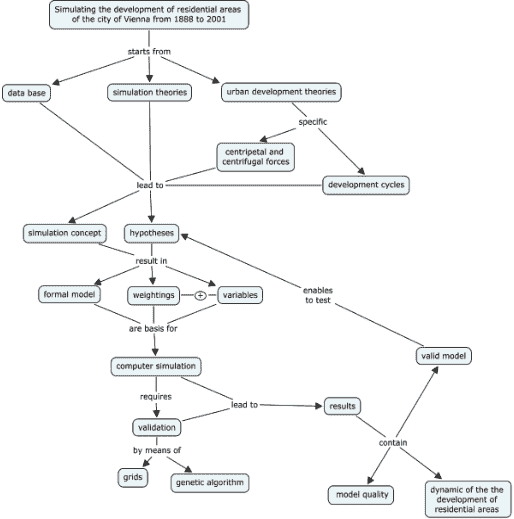

图4. 仿真概念概述。

1945、1971、2001）时，一个单元格的潜力由处理后的人口密度、技术基础设施和公共交通可达性数据推导得出。通过这些时间点之间的线性插值，确定每个时间步长的人口变化增长率以及基础设施设施的扩展。定居主体的区位选择是内生发生的，并在下文中由概率函数表示。

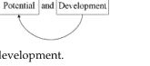

图5. 潜力与发展的相互作用。

模型景观中的单元格可以为空，也可以具有一定的人口密度。在每个时间步长——本仿真中为一个月——一定数量的定居主体根据增长率，基于其当前区位偏好，在考虑潜力值的情况下决定他们将定居或离开哪些地点。随后，考虑上一次定居活动，重新计算所有单元格下一时间步长的潜力值。

#### 4.4 权重

对于仿真模型，我们为若干指标使用不同的权重。基于Müller（2005）的统计分析，公共交通系统可达性或技术基础设施供给的权重来自各项回归分析的结果。这些回归分析在某一考察时间点以特定比率通过公共交通可达性和技术基础设施可用性来解释人口密度。标准化回归系数被用作仿真中特定时间点的权重（表1和表2）。这些权重表示用于从公共交通可达性和技术基础设施推导供给潜力场的百分比（见公式1）。

|  | 公共交通设施可达性 | 技术基础设施 |
| --- | --- | --- |
| 1888 | 50% | 50% |
| 1918 | 51% | 49% |
| 1945 | 26% | 74% |
| 1971 | 48% | 52% |
| 2001 | 58% | 42% |

表1. 公共交通可达性和技术基础设施的权重。

技术基础设施因子由水、污水、燃气和电力这些变量构成。在因子分析中可以证明，这些变量可由技术基础设施因子解释（Müller 2005）。来自因子分析因子载荷的技术基础设施具体指标（水、污水、燃气和电力）可用于当前时间点的权重，并可在仿真模型中使用（见公式（1））。

|  | 燃气 | 水 | 下水道 | 电力 | 区域供热 |
|---|---:|---:|---:|---:|---:|
| 1888 | 24% | 37% | 39% | 0% | - |
| 1918 | 25% | 24% | 27% | 24% | - |
| 1945 | 26% | 23% | 26% | 24% | - |
| 1971 | 25% | 25% | 25% | 25% | 18% |
| 2001 | 25% | 25% | 25% | 25% | 15% |

表2. 技术基础设施各指标的权重。

#### 4.5 形式化模型

对于模型的形式化表示，我们约定以下惯例。CA的一个单元格用 $H = \{1, 2, ..., H_N\}$ 表示。每个单元格人口密度变量 $D^H$ 的定义域经过归一化，即缩放到0到1之间的区间（$D^H = [0, 1]$）。以同样的方式，每个单元格供给变量的定义域也经过归一化，并表示如下：区域供热 $F^H = [0, 1]$、燃气 $G^H = [0, 1]$、污水 $K^H = [0, 1]$、水 $W^H = [0, 1]$、电力 $S^H = [0, 1]$、公共交通系统 $O^H = [0, 1]$。由供给变量的汇总得到供给潜力场 $V^H = [0, 1]$ 的值：

$V^H(t+1)=\omega_1\cdot(\omega_F\cdot F^H(t)+\omega_G\cdot G^H(t)+\omega_K\cdot K^H(t)+\omega_W\cdot W^H(t)+\omega_S\cdot S^H(t))+\omega_O\cdot O^H(t).$  (1)

因子 $\omega$ 表示某一供给变量对供给潜力场 $V^H$ 的因子。单元格 $H$ 在时间步 $t$ 的某一供给变量值，通过指定时间点收集数据的线性插值计算得出，并作为模型的外生影响变量。人口潜力场的变量用 $P^H = [0, 1]$ 表示。潜力值用以下公式计算：

$P^H(t+1)=\frac{1}{5}\left(\left(\sum_{B\subseteq U(H)}P^B(t)\right)+D^H(t)\right).$  (2)

索引 $B$ 表示子集 $U(H)$ 中的一个单元格，该子集由所考虑单元格 $H$ 的四个直接相邻单元格组成，不包括所考虑的单元格 $H$ 本身。潜力场在每个时间步后重新计算。正人口增长 $R_p$ 和负人口增长 $R_n$ 的速率由两个时间点之间各个单元格人口密度差值的和得出：

$r^H=M^H(T+1)-M^H(T).$  (3)

数据评估的时间点用 $T=\{1888, 1918, 1945, 1971, 2001\}$ 表示。这些时间点之间的时间步用 $t$ 表示。在我们的情况下，一个时间步覆盖一个月。与归一化人口密度 $D$ 不同，一个单元格的绝对人口用 $M^H$ 表示。一个单元格人口密度在数据收集时间点之间的绝对变化用 $r^H$ 表示。时间步 $t$ 的增长率 $R$ 取决于模型时间的缩放，该缩放由参数 $c$ 定义：

$$R_n(t)=\left(\sum_H r^H\mid r^H<0\right)/c\cdot((T+1)-T). \tag{4}$$

$$R_p(t)=\left(\sum_H r^H\mid r^H>0\right)/c\cdot((T+1)-T). \tag{5}$$

如果 $r^H<0$，人口密度差值 $r^H$ 被加到负增长率（$R_n$）中；否则，如果 $r^H>0$，$r^H$ 被加到正增长率（$R_p$）中。如果模型时间缩放为一个月，则对于第一个仿真期，公式4和5中的分母得到值 $12\cdot(1918-1888)=360$。

人口密度在哪些单元格上升或下降，由个体居民迁离或迁入的评估曲线定义。这些曲线表明，由于这些地点的密度和供给值，哪些区域被当前居民评价为最不具吸引力，因而人口下降的可能性较大；或者出于同样的原因，哪些区域被当前居民评价为最具吸引力，因而人口增加的可能性较大。居民迁离一个单元格或迁入一个单元格的概率 $\rho$ 由人口密度的评估函数 $\rho_D$ 和单元格供给潜力的评估函数 $\rho_V$ 得出：

$$\rho^H(t)=\left(\rho_D^H(t)+\rho_V^H(t)\right)/2. \tag{6}$$

遵循Krugmann（1996）的方法，人口密度评估函数（$\rho_D$）由用于计算向心力 $F_{\text{in}}$ 和离心力 $F_{\text{out}}$ 的两个指数函数之间的权衡得出：

$$\rho_D^H(t)=F_{\text{in}}^H(t)-F_{\text{out}}^H(t). \tag{7}$$

为简化公式7，我们使用Beta分布¹来计算 $\rho_D$，它允许用2个而非4个控制参数来建模评估曲线。这将在第6章中涉及，该章描述最优参数设置的搜索。由于我们假设迁离一个单元格和迁入一个单元格的评估曲线不同，公式6需分为两种情况，下文中用 $\rho_{D\_out}$ 表示迁离曲线，用 $\rho_{D\_in}$ 表示迁入曲线：

$$\rho_{D\_out}^H(t)=\frac{1}{B(p_{out},q_{out})}\cdot x^{p_{out}-1}(1-x)^{q_{out}-1},$$
$$\rho_{D\_in}^H(t)=\frac{1}{B(p_{in},q_{in})}\cdot x^{p_{in}-1}(1-x)^{q_{in}-1}. \tag{8}$$

¹ 参见维基百科：http://en.wikipedia.org/wiki/Beta_distribution（最后访问于2008年7月9日）


评估曲线²的走向通过参数 $p_{out}$ 和 $q_{out}$，以及 $p_{in}$ 和 $q_{in}$ 来定义。项 $B(p,q)$ 分别表示离开一个单元和迁入一个单元的 beta 函数：

$$B(p,q) = \int_0^1 x^{p-1}(1-x)^{q-1} dx. \qquad (9)$$

我们将在接下来的第 5.3 章讨论评估曲线的具体意义。供给潜力的评估函数是单元供给潜力的正线性函数：

$$\rho_i^V(t) = V_i^H(t). \qquad (10)$$

一个位置的供给越好，就被认为越有吸引力。基于为每个单元计算出的概率 $\rho$，可以借助轮盘赌方法（Goldberg, 1989, S. 231）做出居民迁出地和迁入地的决策。为了从 $H_N$ 个值 $\rho^1, \rho^2, \rho^3, \ldots, \rho^{H_N}$ 中选择一个值 $\rho$，每个概率值的大小由其权重（扇区大小）指定。在轮盘赌选择中，这种权重表示为选择概率 $\omega^H$，可通过将每个值除以所有值之和来计算：

$$\omega^H = \rho^H / \left(\rho^1 + \rho^2 + \rho^3 + \ldots + \rho^{H_N}\right) \quad \text{or} \quad \omega^H = \rho^H / \sum \rho^H . \qquad (11)$$

为了选择一个值 $H$，执行以下算法：

- a. 生成一个 0 到 1 之间的随机值 $z$
- b. 设置 $sum = 0$
- c. 对于 $H = 1$ 到 $H_N$，执行
  - begin
    - $sum = sum + \omega^H$
    - 如果（$sum \ge z$）则返回 $H$
  - end.

随机选择的值 $z$ 对应于轮盘球的位置，步骤 c) 检验它最终落入哪个扇区 $H$。

#### 4.6 计算机程序

前一章 5.2 中给出的形式模型已在编程语言 Delphi 中实现为 Windows 的独立模拟程序。其基本功能如图 6 所示。

程序窗口的主区域（图 6，A）包含图形输出，即按单元保存的各个变量的各种值的可视化表示，例如人口和供给密度以及迁出率或迁入率。单元颜色越深（图 6，A），密度值越高。绿色和红色标记的单元表示居民迁入或迁出的位置。程序窗口右侧的菜单栏排列在三个选项卡中。

² Beta 分布的交互动画可在以下网址获取：http://www.uni-konstanz.de/FuF/wiwi/heiler/os/vt-beta.html（最后访问于 2008 年 7 月 9 日）

模拟结果，即从 *T-1* 到 *T* 的一次模拟运行后得到的模型质量，主要取决于通过方程 8 定义评估曲线的控制参数 *p* 和 *q* 的设置。控制参数的值在一个模拟周期内（从 *T-1* 到 *T*）保持不变。验证当前模型的挑战在于为每个所考虑的周期寻找这些控制参数的最优设置。我们的目标是为每个周期实现尽可能最好的模型质量，从而获得有效性。

#### 5.1 遗传算法

为了寻找控制参数的最优设置，使用了遗传算法。其基础是 Goldberg（1989，第 69 页）所述的所谓简单遗传算法（SGA）的结构，并针对当前挑战进行了调整。SGA 的初始种群是 32 个个体，每个个体由随机生成的包含 28 个二进制数的染色体组成。在这些染色体中，编码了方程 8 的评估曲线的四个控制参数（图 9）。对每个个体，使用相应的控制参数运行一个模拟周期，并计算相应的模型质量。这种质量表示控制参数设置适用性的评价标准，因此可用于个体的适应度定义。

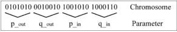

图 9. 染色体中参数的编码。

在为 32 个个体中的每一个运行完模拟周期并为其分配适应度值后，生成新一代个体。个体繁殖的概率由其适应度值定义。适应度值按如下方式缩放：具有最高值的个体被选择的概率是具有平均适应度的个体的两倍。适应度最低的个体没有繁殖机会。

交叉率表示所选个体被交叉或原样复制到新一代的概率。交叉意味着两个（父代）染色体的混合或重组（图 10）。在当前 SGA 中，我们使用 80% 的交叉率。

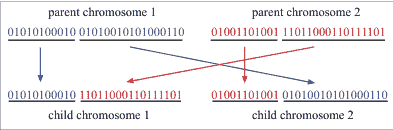

图 10. 通过父代染色体交叉生成子代染色体。

#### 5.2 网格

利用可用数据，我们必须考虑每个时间步 *t* 居民迁入一个单元或迁出一个单元时单元景观的所有可能位置（单元）。单元景观包括 649 × 519 = 336,831 个单元。对于 1888—1918 年的第一个周期，每个时间步 *t* 必须计算 3,043 次迁入和 1,240 次迁出。这导致每个 *t* 有 4,283 次计算，进而意味着整个周期有 1,542,212 次计算。在当前计算机上，该周期的模拟大约持续 4.5 小时。对于每个周期一次模拟来说，这是可接受的时间。然而，当为了寻找最优控制参数设置而必须计算数百个周期时（见 6.1 节），这就成问题了，因为模拟时间可能很快累计到数周。因此，下面我们改变由网格表示的单元景观的分辨率。为了改变分辨率，将若干个 50 × 50 米单元的现有人口数据合并到一个更大的单元中。每个单元边长为 50 米的原始单元栅格称为网格 1。在网格 5 中，5 × 5 个原始单元合并为一个边长为 250 米的单元；在网格 10 中，10 × 10 个原始单元合并为一个边长为 500 米的单元，依此类推（图 11）。

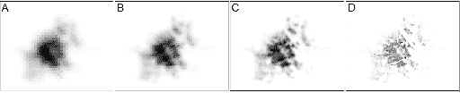

图 11. 不同网格分辨率下的人口密度表示。A) 网格 15，B) 网格 10，C) 网格 5，D) 网格 1。

使用各种网格可以比较不同数据精度下的模拟结果。我们拥有网格 20 还是网格 1 的人口密度数据是否有任何区别，并且得到的最优控制参数是否只是略有不同？这个问题将在下一章的结果描述中回答。

在寻找最优控制参数时，作为第一步，计算最粗网格（网格 20）的控制参数最优值。第二步，将这些计算结果整合到下一个更细网格（网格 15）的初始种群中，以计算该网格的最优控制参数。对网格 10、网格 5 和网格 1 重复这些步骤。我们基于这样的假设：将最优值从较粗网格传递到较细网格会减少所需的代数，并因此减少通过遗传算法进行搜索所需的总体计算时间。在网格 20 中计算了多达 100 代，而在网格 1 中每个周期在 5 代后终止了对最优值的搜索。尽管如此，在网格 1 中，所有周期都能达到 75% 至 90% 之间的模型质量（图 12）。


### 6. 结果与结论

#### 6.1 模型质量

在第6章中，模型质量被定义为各个测量环上模拟人口密度与真实人口密度之间的绝对差总和。当模拟人口密度与真实人口密度完全一致时，可获得最佳模型质量（100%）。不同网格下各时期所达到的模型质量如图12所示。

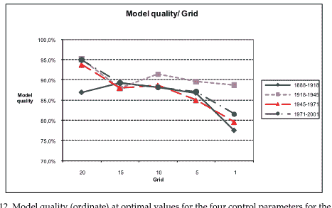

图12. 不同网格（横坐标）下各时期四个控制参数取最优值时的模型质量（纵坐标）。

原则上，所有时期所达到的模型质量都很好，对于大于1的网格，其值超过85%。对于网格1，所有时期的模型质量都出现相当明显的下降，这可能有几个原因：第一，所采用的测量方法及其精度是针对每个网格进行调整的。第二，网格1计算代数较少，因为其最优参数与较粗网格的最优参数不一致（见图13），因此可能通过计算更多代来进一步优化。不过，由于时间原因，本项目无法做到这一点。第三，将四个控制参数的最大值（上界）限制为12.7可能导致了某些失真，因为计算得到的 $T_3$ 和 $T_4$ 时期 $q_{in}$ 的最优值已经达到该最大值（见图13）。

#### 6.2 有效模型

本项目最重要的结果是借助遗传算法找到的四个控制参数 $p_{out}$ 和 $q_{out}$ 以及 $p_{in}$ 和 $q_{in}$ 的最优值。图13中不同颜色的条形显示了在不同网格下取得最佳结果（最佳模型质量）的控制参数值。

在图13中可以清楚地看到，如果比较不同网格，在每个时期有些参数值仅略有变化，而另一些参数值则变化非常强烈。例如，图13中字母A处 $T_1$ 时期的 $q_{out}$ 和 $p_{in}$ 值从网格20到网格1相对相似，而在同一时期，$p_{out}$ 的值从网格20到网格1变化相当显著。个别参数的变化导致迁离或迁入评估曲线走势出现相关差异。例如，如果我们将四个时期的控制参数均值与网格1的最优值进行比较，如图14至图16所示，这些评估曲线走势上的差异就会变得明显。

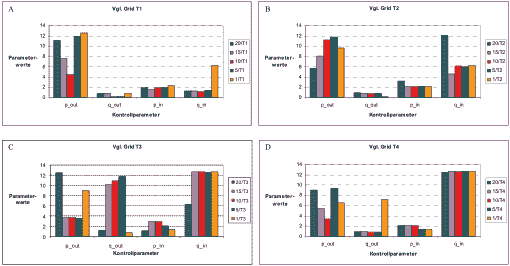

图13. 不同网格下每个时间步 T 的最优控制参数比较（图例中为网格20至网格1）。A) T1=1888-1918，B) T2=1918-1945，C) T3=1945-1971，D) T4=1971-2001

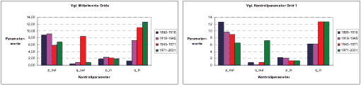

图14. 控制参数的发展变化。左图：不同网格在每个时期 T 下四个控制参数最优值的均值（参见图13）。右图：网格1的最优控制参数。

图14左图显示了不同网格在 $T_1$ 至 $T_4$ 各时期四个控制参数 $p_{out}$、$q_{out}$、$p_{in}$ 和 $q_{in}$ 最优值的均值，其中第三个时期的 $q_{out}$ 值以及所有考虑时期（$T_1$ 至 $T_4$）的 $q_{in}$ 值差异很大。在图14右图中网格1的最优参数值处，$q_{in}$ 的值在最初两个时期以及最后两个时期彼此之间变化都很小。另一方面，在同一时期，$q_{out}$ 的值彼此之间变化相当大。对于 $q_{out}$，变化最强烈的是1971年至2001年这一时期。

使用这些均值（图14左图），可以生成迁入和迁离评估曲线，如图15所示。从对这些评估曲线的解读中可以得出结论，例如，在图15字母C处的 $T_3$ 时期，人口已从外围城区迁移到乡村地区，而在图15字母D处的 $T_4$ 时期，人口再分布是从市中心迁往乡村地区。

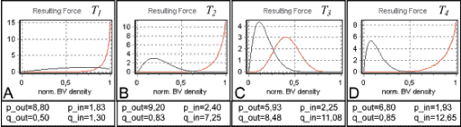

图15. 图14左图均值的评估曲线。A) $T_1$=1888–1918，B) $T_2$=1918–1945，C) $T_3$=1945–1971，D) $T_4$=1971–2001

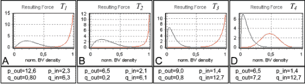

图16. 图13中网格1最优值的评估曲线。A) $T_1$=1888–1918，B) $T_2$=1918–1945，C) $T_3$=1945–1971，D) $T_4$=1971–2001

图16中网格1的评估曲线，字母C和字母D，必须作完全相反的解释。这些曲线表明，人口在 $T_4$ 时期从外围城区迁移到乡村地区。然而，比较图15和图16中绿色的迁入曲线，我们可以观察到两者都呈现出相似的走势。图15和图16中对迁入曲线的解读基本上相同。

如果考虑图15和图16之间所述的差异，我们可以一方面得出结论：数据的精确性（在本应用中由单元大小表示）对模拟结果有相当大的影响。因此，本研究结果的意义是相对的，因为它们与来自50 × 50 m网格的人口和供给数据相关（见第4.2章）。然而，如果我们考察图15和图16中评估曲线之间的相似性，我们另一方面可以得出结论：即使使用粗得多的网格和相应较不准确的数据，控制参数值仍可以以足够的精确性和可接受的意义计算出来。

#### 6.3 聚落发展动态

除了建立有效模型之外，我们还能够表明四个控制参数 $p_{out}$ 和 $q_{out}$ 以及 $p_{in}$ 和 $q_{in}$（见公式8）作为居住位置在现有人口密度方面的个体评估的形式化表示是适用的。通过模拟，这些假设（见第4.1章）可以得到支持，即公共交通设施可达性的改善以及与技术基础设施的邻近会导致人口密度增加。由网格1的控制参数得到的评估曲线，使这些参数的计算值能够进行可视化解读。

考察图16中各图的绿色曲线可以观察到，迁入的首选位置已越来越多地从城镇边缘（在 $T_1$ 和 $T_2$ 时期）转移到乡村地区（在 $T_3$ 和 $T_4$ 时期）。人口越来越多地定居在人口密度较低的地区。因此，可以通过图16中各图绿色曲线峰值的偏移识别出维也纳1888年至2001年的郊区化过程（见第2.2章）。郊区化在第二次世界大战与最后考虑的时间点之间最为明显。这一过程在图16红色曲线的考察中也很明显。在那里我们看到，迁离运动首先集中在市中心（从 $T_1$ 到 $T_3$），直到最后一个时期才转向外围城区（在 $T_4$ 时期）。图17中迁入与迁离随时间的总体图示证实了我们对评估曲线的解读。

在第一个时间点 $T_1$，从城市远郊边缘迁出的现象已经显现。人口主要迁往人烟稀少的地区——在 $T_1$ 时期主要是迁往旧城墙防御工事之外。随着时间推移——直到最后一个时间点 $T_4$——人口越来越多地迁离位于中心、人口稠密的城市地区。渐进式郊区化过程越来越明显，因为人口越来越偏好将人口稀少或空旷地区作为居住区。我们可以观察到聚落整体向城市边界及边界以外扩展。

在第3章中我们已经指出，迁入和迁离评估曲线最大值的位置和曲线形态取决于各种经济、社会、文化和生态总体条件。对于本模拟模型，仅确定了四个时期的曲线形态（图16）。评估曲线随时间动态变化的假设更为现实。据此，从 $T_{-1}$ 开始，图16中某图的曲线将逐渐转变为同色曲线，在


### 7. 总结与展望

时间点 T。评估曲线随时间变化的概念，为描述导致聚落结构变化的基本过程提供了一种稳健的解释方法。

相对较高的模型质量表明，我们所展示的模型在模拟 1888 年至 2001 年维也纳市人口分布方面具有较高的有效性。借助四个用于定义评估曲线的控制参数，我们为解释城市发展过程的驱动力建立了一个合理且稳健的概念。通过对一个地点的基础设施供给进行外生定义，我们能够表明，人口密度的发展基本上可以通过基础设施投资来调节。此外，我们所考察时期内维也纳市发生的郊区化过程，也可以用我们的模型来解释。

该模拟模型被设计得尽可能简单和透明，以便对控制参数进行敏感性分析，并由此确保结果的可理解性。只有通过构建全面的模型，才有可能提高模拟在政治决策者或城市与区域规划者中的可接受性。同样，只有运行原理被透明地描述的模型，才能在使用过程中不断得到改进。模型开发的下一步是：首先，基于人口密度的发展来解释技术基础设施的扩展和公共交通设施的普及；其次，对模型进行调整，使人口密度的发展能够与技术基础设施的可获得性和公共交通设施的普及形成循环耦合。通过增加补充性的外生参数，例如地形条件，模型的重要性还可以进一步提高。

此外，还可以考察当前模拟中控制参数值的变化在多大程度上能够与所研究时期内维也纳市经济和技术发展的特征值联系起来。

本模型的应用前景在于，基于受限的情景模型来估算特定规划活动的后果。例如，这样的情景可以包括计划中的基础设施扩建，或交通成本上升对评估曲线以及由此对聚落结构发展的影响。

### 8. 致谢

本研究项目由维也纳市的*Jubiläumsstiftung（周年纪念基金会）*资助。

### 9. 参考文献

- Batty, M. (1991). Generating urban forms from diffusive growth. *Environment and Planning A*, 23(4), 511-544.
- Batty, M. (2005). *Cities and Complexity: Understanding Cities with Cellular Automata, Agent-Based Models, and Fractals*. London: MIT Press.
- Behrens, K. C. (1971). *Allgemeine Standortbestimmungslehre*. Opladen: Westdeutscher Verlag GmbH.
- Böventer, E. (1979). *Standortentscheidung und Raumstruktur*. Hannover: Schroedel Verlag.
- Dangschat, J. (2007). Reurbanisierung – eine Renaissance der (Innen-)Städte? *Stadtökologie und Stadtentwicklung, 3*.
- Denkschrift über Grundsätze des Städtebaues. (1906). In R. Baumeister (Ed.), *Beiträge zum Städtebau*: Association of German Architects and Engineers.
- Fassmann. (2005). *Stadtgeographie I*. Braunschweig: Westermann.
- Friedrichs, J. (1981). *Stadtanalyse: Soziale und räumliche Organisation der Gesellschaft*. Opladen: Westdeutscher Verlag.
- Goldberg, D. E. (1989). *Genetic Algorithms in Search, Optimization and Machine Learning* (1st ed.). Boston: Addison-Wesley.
- Kramar, H. (2005). Innovation durch Agglomeration: Zu den Standortfaktoren der Wissensproduktion. In D. Bökemann (Ed.), *Wiener Beiträge zur Regionalwissenschaft* (Vol. 20). Wien.
- Krugman, P. (1996). *The Self-Organizing Economy*. Cambridge, Mass.: Blackwell.
- Kulke, E. (2006). *Wirtschaftsgeographie*. Paderborn: Schöningh Verlag.
- Läpple, D. (2003). Thesen zu einer Renaissance der Stadt in der Wissensgesellschaft. In N. Gestring, H. Glasauer, C. Hannemann, W. Petrowsky & J. Pohlan (Eds.), *Jahrbuch Stadt/Region* (pp. 61–78). Opladen: Leske und Budrich.
- Lichtenberger, E. (1986). *Stadtgeographie: Begriffe, Konzepte, Modelle, Prozesse* (Vol. 1). Stuttgart: Teubner.
- Maier, G., & Tödtling, F. (2002). *Regional- und Stadtökonomie: Standorttheorie und Raumstruktur*. Wien, New York: Springer Verlag.
- Meise, J., & Volwahsen, A. (1980). *Stadt- und Regionalplanung, Ein Methodenhandbuch*. Braunschweig: Friedr. Vieweg & Sohn Verlagsgesellschaft.
- Müller, D. (2005). *Wien 1888 – 2001: Zusammenhänge der Entwicklung der technischen Infrastruktur- und ÖV-Systeme in den Siedlungsgebieten*. Wien: Peter Lang Verlag.
- Myrdal, G. (1957). *Economic Theory and Underdeveloped Regions*. London: Duckworth.
- Richardson, H. W. (1976). Growth Pole Spillovers: the dynamics of backwash and spread. *Regional Studies. The Journal of the Regional Studies Association, 10*(1), 1-9.
- Schweitzer, F., & Schimansky-Geier, L. (1994). Clustering of Active Walkers in a Two-Component System. *Physica A, 206*, 359-379.
- Schweitzer, F., & Steinbrink, J. (2002). Analysis and Computer Simulation of Urban Cluster Distribution. In K. Humpert, K. Brenner & S. Becker (Eds.), *Fundamental Principles of Urban Growth* (pp. 142-157). Wuppertal: Müller + Busmann.
- Van den Berg, L., Drewett, R., Klaassen, L. H., Rossi, A., & Vijverberg, C. H. T. (1982). *Urban Europe: A Study of Growth and Decline* (Vol. 1). Oxford: Pergamon Press.
- Weber, A. (1909). *Über den Standort der Industrie*. Tübingen: J.C.B. Mohr Verlag.
- White, R., & Engelen, G. (1993). Cellular automata and fractal urban form: a cellular modelling approach to the evolution of urban land-use patterns. *Environment and Planning A*, 25(8), 1175-1199.

## 亚马逊地区森林砍伐的空间动态建模

Arimatéa C. Ximenes、Cláudia M. Almeida、Silvana Amaral、Maria Isabel S. Escada 和 Ana Paula D. Aguiar
*国家空间研究所，地球观测总协调局，Av. dos Astronautas, 1758，邮政信箱 515，圣若泽杜斯坎普斯，SP，巴西*

### 1. 引言

新的 GIS 技术已被用于支持面向环境保护的公共政策和行动，旨在保护生物多样性并减轻人类活动产生的不良副作用。系统动态的时空模拟就是这类新技术的例子之一，它帮助科学家和决策者理解环境系统变化过程背后的驱动力。在评估系统如何演变时，可以根据不同的社会经济、政治和环境条件构想出不同的情景（Soares-Filho et al., 2001），从而预判某些事件的发生，如土地覆盖和土地利用变化，包括森林砍伐。根据 Openshaw（2000）的观点，计算机模拟模型为复杂的自然现象提供定性和定量信息。在这个意义上，空间动态模型可以被定义为现实世界过程或现象的数学表示，其中地球表面某一地点的状态会随着其驱动力的变化而改变（Burrough, 1998）。

空间动态模型通常建立在元胞自动机（CA）范式之上。Wolfram（1983）将 CA 定义为：“[…] 物理系统的数学理想化，其中空间和时间是离散的，物理量取有限集合的离散值。元胞自动机由一个规则均匀的格网（或‘阵列’）组成，通常范围无限，每个位点（‘元胞’）上有一个离散变量。[…] 元胞自动机按离散时间步长演化，位点上的变量值受前一时间步长其‘邻域’内位点值的影响。一个位点的邻域通常被视为该位点本身及其所有紧邻的位点。每个位点上的变量根据前一时间步长其邻域中变量的值，按照一组确定的‘局部规则’同时（‘同步’）更新。”（Wolfram, 1983, p. 603）。

本研究应用一个 CA 模型——Dinamica EGO——来模拟位于亚马逊中东部一个名为*圣费利克斯杜欣古（São Félix do Xingu）*的地区的森林砍伐过程。EGO 是一个在随机多步模拟框架中整合了基于邻域的转换算法和空间反馈方法的环境。生物物理变量


驱动了本工作的模拟模型，随后通过多重分辨率拟合方法，对生成的模拟结果（1997年至2000年）进行了统计验证测试。该建模实验证明了所采用模型在模拟森林转化过程中的适用性，揭示了研究区域内场地属性与森林砍伐之间的关系。

### 2. 研究区域

*圣费利什杜欣古*地区被视为巴西亚马逊地区当前三大主要拓殖前沿之一。最新官方数据表明，在上一个十年末和本十年初，*圣费利什杜欣古*是亚马逊地区森林砍伐率最高的市镇。根据Becker（2005）的研究，*圣费利什杜欣古*及其他拓殖前沿代表了亚马逊内陆的新边疆，即流动边疆，它们与20世纪70年代该地区人类拓殖早期阶段所观察到的边疆在三个方面有所不同：

- 主要的迁移是区域内迁移，且多为乡村向城市迁移；
- 私人资本在这些前沿中发挥着至关重要的作用，当地行动者高度多元化，主要包括伐木者、养牛者和谷物生产者；以及
- 这些前沿拥有更好的可达性和连通性，依赖比20世纪70年代更密集的（空中、陆地和河流）交通网络。

最新的森林砍伐数据显示，*圣费利什杜欣古*也是2000年至2006年间亚马逊地区森林砍伐面积绝对值最大的市镇。在2005年（665,854平方公里）和2006年（679,899平方公里）巴西合法亚马逊地区评估的森林砍伐总面积中，*圣费利什杜欣古*分别占13,626平方公里（2.0%）和14,496平方公里（2.1%）（巴西国家空间研究所，2006年）。该地区部分拓殖历史可归因于天然橡胶和桃花心木的开发、采矿、养牛以及大规模的私人和公共农村定居项目，其中养牛是主要经济活动（Escada等，2007年）。

研究区域包括*圣费利什杜欣古*市镇的大部分地区及其周边地区，位于*帕拉*州（PA），地处巴西北部的亚马逊中东部。*欣古*河是亚马逊河的主要支流之一，纵向穿过*帕拉*州（图1）。本研究所用数据采用多圆锥投影系统，基准面为SAD-69，经度坐标为西经52°30'至51°00'，纬度坐标为南纬05°52'至07°07'。除*圣费利什杜欣古*市镇外，研究区域还包括*北奥里兰迪亚*和*图库曼*的市镇所在地，以及*马拉巴*、*帕劳阿佩巴斯*和*北阿瓜阿祖尔*的部分市镇。在*圣费利什杜欣古*境内，研究区域包含以下村庄和地区：*维拉塔博卡、内雷乌、坦克雷多内维斯、卡拉帕南、米内拉乌和拉代拉韦梅利亚*。部分印第安保留地*阿皮特雷瓦、卡亚波*和*希克林杜卡泰特*也包括在研究区域内。

研究区域所涵盖的*圣费利什杜欣古*部分已经呈现出稳固的拓殖状态。在20世纪80年代，该地区是先锋前沿，以沿PA-279公路（连接*图库曼*与*圣费利什杜欣古*）集中的密集土地占用过程为特征（Schmink & Wood，1992；亚马逊环境建模研究网络[GEOMA]，2004年）。该地区目前的特点是大型农场、土地所有权集中，以及经常出现的非法土地所有权行为（Escada等，2005年）。

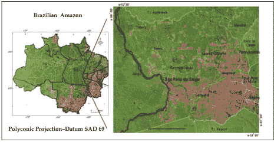
图1. 研究区域位置：*圣费利什杜欣古*市镇及周边地区

尽管该地区以养牛为主要经济活动，但自20世纪70年代以来，矿石开采（主要是锡石和黄金）在其经济和区域空间结构中发挥了重要作用。最初，矿石沿*欣古*河及其支流运输，也通过小型飞机运输（Santana，2007年）。从20世纪90年代上半叶开始，采矿活动进入衰退期，留下了一张连接该地区农场的密集道路网络，这大大降低了空中和河流运输的重要性（Amaral等，2006年；Escada等，2007年）。

### 3. 森林砍伐空间动态模型的输入数据

用于生成研究区域森林砍伐模拟的平台是景观动态时空建模平台——Dinamica EGO。Dinamica EGO是一个元胞自动机环境，包含通常通过摩尔邻域（3×3窗口）运行的转换算法以及随机多步骤模拟框架中的空间反馈方法。Dinamica EGO是一个免费领域平台，由米纳斯吉拉斯联邦大学遥感中心——CSR-UFMG¹开发（Soares-Filho等，2002年，2009年；Rodrigues等，2007年）。

1997年至2000年的真实森林砍伐数据驱动了模拟模型，有助于评估给定分析期内研究区域中森林转化为其他土地覆盖类别的总量。一组与森林砍伐相关的解释变量以及Dinamica EGO的内部参数被联合组合，以生成2000年的模拟。在以下章节中，将详细讨论建模过程每个阶段所采用的方法学程序（数据获取、变量选择、探索性分析、转换概率计算、参数化和精度评估）。

¹CA建模平台Dinamica EGO可在[http://www.csr.ufmg.br/dinamica/](http://www.csr.ufmg.br/dinamica/)下载。

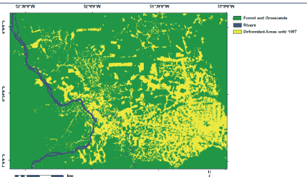
图3. 1997年土地覆盖图，源自PRODES森林砍伐地图重分类

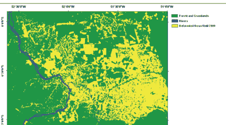
图4. 2000年土地覆盖图，源自PRODES森林砍伐地图重分类

通过对1997年原始森林砍伐地图的视觉分析，可以观察到道路距离和城市中心距离对森林砍伐过程的影响有限。1997年，研究区域的拓殖已经相当成熟，减少了靠近道路和城市定居点的可用于森林砍伐的土地。尽管如前所述，河流运输在该地区作用较小，但可以观察到在分析期间，欣古河和弗雷斯科河附近出现了蘑菇状的森林砍伐斑块，尽管在更远的地区发生程度较低，但这证明了将“距河流距离”变量纳入模型的合理性。

在元胞自动机模型中，可以使用两类变量：

- 静态变量，在整个模型运行期间保持不变；
- 动态变量，在连续时间步长中发生变化，并在每次迭代中不断更新。

两者均基于1997年PRODES重分类地图（图3）构建。静态变量对应于距河流距离图（图5），而距1997年已砍伐区域距离图（图6）作为动态变量进入模型。为了对距离网格进行分类，即生成最优的离散距离范围，使用了Dinamica EGO中可用的特殊自动程序，这些程序基于线简化算法（Agterberg & Bonham-Carter，1990；Goodacre等，1993年）。

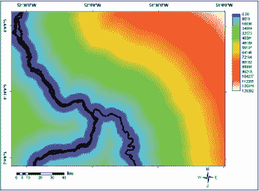
图5. 距河流距离的分色图（静态变量），单位为米

### 4. 空间动态建模实验

#### 4.1 探索性分析

本建模实验的参数化采用了“证据权重”统计方法。该方法完全基于贝叶斯定理，也称为条件概率定理，该定理假设事件相互独立。在此意义上，必须首先验证成对解释变量之间是否可能存在空间依赖性（或空间关联）。为此，使用了两种空间统计量：克拉默系数（V）和联合信息不确定性（U）（Bonham-Carter，1994年）。两者均基于属于两张解释变量（或证据）地图的不同类别（此处为距离范围）之间的重叠面积比率。克拉默系数使用面积的绝对值，而联合信息不确定性则处理相对（百分比）值，因此往往比前者更为稳健，因为它避免了绝对面积值所代表的偏差风险。


Bonham-Carter（1994）指出，V或U的值小于0.5表示关联性较弱而非较强。因此，本研究采用0.5作为阈值，以决定某个变量应保留在模型中（V或U < 0.5）还是从模型中剔除（V或U ≥ 0.5）。在本研究中，Cramér系数和联合信息不确定度均呈现较低值（V = 0.21，U = 0.0485），表明这两个变量可以同时用于模型中。

#### 4.2 全局转换速率

全局转换速率是指模拟期间内变化的总量，不考虑其空间分布，即不考虑研究区域内每个单元在生物物理和基础设施特征方面的局部空间特殊性。

在本建模实验以及其他可获得初始和最终土地覆盖图的实验中，转换速率通过1997年至2000年土地覆盖图之间的交叉制表操作计算得出，该操作输出一个转换矩阵，其中包含观测到的该时期土地覆盖变化率。

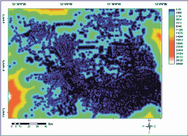

图6. 1997年距先前森林砍伐区域距离的色彩分层图（动态变量），单位为米

#### 4.3 局部转换概率

与全局转换速率不同，局部转换概率是针对每个单元计算的，同时考虑了该地点的自然和人为特征。为了估算每个单元（由其坐标x和y表示）的土地覆盖转换概率，使用了一个将logit公式转换为常规条件概率的方程。Logit对应于几率（odds）的自然对数，即给定土地覆盖转换发生的概率与其互补概率（即该转换不发生的概率）之比。

该概念源于贝叶斯证据权重法，通过代数运算可以从*logit*公式中获得土地覆盖转换概率，如下所示（Bonham-Carter, 1994）：

$$
P(T_i^{\alpha} / V_1^v,\ldots,V_m^v)=O(T_i^{\alpha})\frac{e^{\sum_{v=1}^{\eta}W_{iv}^{+}}}{1+\sum_{\alpha=1}^{\Xi}O(T_i^{\alpha})e^{\sum_{v=1}^{\eta}W_{iv}^{+}}}
$$ (1)

其中，$P$ 对应于单元内转换的概率；$i$ 对应于研究区域内单元位置的标记，由$x,y$坐标定义；$\alpha$ 表示土地覆盖转换的一种类型，例如从类别$c$到类别$k$，在总共$\eta$种转换中（在本特定实验中，只有一种类型：从森林到森林砍伐区域）；$V_1^v$ 对应于单元格$i$中观测到的第一个变量，用于解释转换$\alpha$；$V_m^v$ 对应于单元格$i$中观测到的第$m$个变量，用于解释转换$\alpha$；$O(T_i^{\alpha})$ 表示第$i$个单元中转换$T_i^{\alpha}$的几率，表示为$T_i^{\alpha}$发生概率与其互补概率之比，即$P(T_i^{\alpha}) / P(\overline{T}_i^{\alpha})$；$W_{iv}^{+}$ 对应于第$i$个单元关于第$v$个变量范围的阳性证据权重，定义为：

$$
W_{iv}^{+}=\log_e\frac{P(V_{iv}^{m}/T_i^{\alpha})}{P(V_{iv}^{m}/\overline{T}_i^{\alpha})}
$$ (2)

其中，$P(V_{iv}^m / T_i^{\alpha})$ 是在转换$T_i^{\alpha}$先前发生的情况下，单元格$i$中观测到的、用于解释转换$\alpha$的第$m$个变量范围的发生概率，由同时发现$V_{iv}^m$和$T_i^{\alpha}$的单元数除以发现$T_i^{\alpha}$的单元总数得出；$P(V_{iv}^m / \overline{T}_i^{\alpha})$ 是在转换$T_i^{\alpha}$先前未发生的情况下，单元格$i$中观测到的、用于解释转换$\alpha$的第$m$个变量范围的发生概率，由同时发现$V_{iv}^m$和$\overline{T}_i^{\alpha}$的单元数除以未发现$T_i^{\alpha}$的单元总数得出。

$W^+$ 值表示特定景观转换（此处为森林向森林砍伐区域的转换）与特定变量范围之间的吸引力。$W^+$ 值越高，特定转换发生的概率就越大。另一方面，$W^+$ 负值表示在存在相应变量范围的情况下，特定转换发生的概率较低。利用与森林砍伐分析中使用的静态和动态变量的多个距离范围相关的$W^+$值，Dinamica EGO模型根据方程(1)计算单元格的转换概率。网格单元被赋予一个概率值，然后生成概率图。为了评估模型是否校准良好，即所采用的解释变量是否合适以及数值网格的分类是否最优，该图中具有最高转换概率值的区域必须尽可能接近实际发生森林砍伐过程的区域。

#### 4.4 定义 Dinamica EGO 内部参数

Dinamica EGO 纳入了两种经验性土地覆盖分配算法（或转换函数）：扩展器（expander)和补丁器（patcher）。扩展器函数负责扩展特定土地覆盖类别的先前斑块。补丁器函数则旨在生成新的独立斑块（种子单元），这些斑块与相同土地覆盖类别的先前斑块在物理上不连接（Soares-Filho et al., 2002）。总之，扩展器函数仅在具有状态j的单元相邻区域内执行从状态i到状态j的转换。补丁器函数则仅在具有非状态j的单元相邻区域内执行从状态i到状态j的转换。

基于对分析期间（1997-2000年）PRODES森林砍伐图（图2）的视觉分析，未观察到通过扩散过程（即在原始森林中）发生森林砍伐的情况，但可通过补丁器函数模拟。因此，模型中仅使用了扩展器函数，该函数通过前述的先前森林砍伐区域的扩展来模拟森林砍伐斑块的形成。

Dinamica EGO还需要新森林砍伐斑块的平均大小和大小方差（以公顷为单位）作为内部参数。这些参数的定义通过启发式方法完成。理想平均大小（µ）设为300公顷，方差（σ²）设为500公顷。模型还包含另一个启发式确定的参数，即所谓的“斑块等方性指数（PII）”。该指数是一个数值范围从0到2的指标，在应用转换函数之前，它会乘以属于Moore邻域的八个单元的概率值。高等方性指数导致紧凑的斑块，而低值则体现在更碎片化的景观格局中。在本建模实验中，采用了1.5的等方性指数，这代表了紧凑性和碎片化之间的平衡。该值产生的结果与研究区域观察到的森林砍伐模式一致，该模式既包含由使用拖拉机进行森林皆伐的资本主义农民产生的几何形状稳定（紧凑）的森林砍伐斑块，也包含由缺乏先进森林清除手段的小农产生的碎片化斑块。

### 5. 验证

为了评估CA模拟模型的性能精度，采用了在邻域背景下应用的模糊相似性度量。已经提出了多种在像素邻域基础上运行的验证方法（Costanza, 1989; Pontius, 2002; Hagen, 2002, 2003; Hagen-Zanker et al., 2005; Hagen-Zanker, 2006），旨在描绘模拟图与参考图之间的空间格局相似性，以放宽逐像素严格一致的要求。本工作中采用的模糊相似性方法是Hagen（2002)开发的模糊相似性度量的变体，并由CSR团队在DINAMICA模型中实现。

Hagen的方法基于位置模糊性的概念，其中单元的表征受单元本身以及较小程度上其邻域单元的影响。不考虑类别模糊性，模糊邻域向量可以表示位置的模糊性。在模糊相似性验证方法中，一个清晰向量与图中的每个单元相关联。该向量具有与地图类别（土地覆盖类别）数量相同的位置，对于类别1设为1，对于除1以外的类别设为0。因此，每个单元的模糊邻域向量（Vnbhood）表示为：

$$
V_{\text{nbhood}} = \begin{bmatrix}
\mu_{\text{nbhood }1} \\
\mu_{\text{nbhood }2} \\
\vdots \\
\mu_{\text{nbhood }C}
\end{bmatrix} \tag{3}
$$


μ_{hood,i} = [ μ_{hood,1,i} * m_1, μ_{hop,1,2} * m_2, ..., μ_{hop,1,N} * m_N ]_{Max}    (4)

其中，μ_{hood,i} 表示在由 N 个像元（通常 N=n²）组成的邻域内，类别 i 的隶属度；μ_{hop,i} 是邻近像元 j 中类别 i 的隶属度，假设如同硬分类向量一样，对于类别 i 取 1，对于除 i 以外的类别取 0（i ∈ C）；m_j 是邻近像元 j 基于距离的隶属度，其中 m 表示距离衰减函数，例如指数衰减（m = 2^{-d/2}），d 是两个像素质心之间的单位距离。最合适的衰减函数和窗口大小的选择取决于数据的模糊性以及空间误差容许阈值（Hagen， 2003）。由于该方法的目的是评估模型在不同分辨率下的空间拟合度，因此除了指数衰减外，还可以采用在邻域窗口内恒等于 1、窗口外恒等于 0 的常数函数。公式 (5) 设定中心像元的类别隶属度，假设在 n × n 的邻域窗口内存在最大贡献值。接下来，可以通过将两幅地图的模糊向量与硬分类向量进行逐像元模糊集合交集，得到一对地图的相似性度量：

S(V_A, V_B) = [ [μ_{A,1}, μ_{B,1}]_{Min}, [μ_{A,2}, μ_{B,2}]_{Min}, ..., [μ_{A,i}, μ_{B,i}]_{Min} ]_{Max}    (5)

其中，V_A 和 V_B 分别指地图 A 和地图 B 的模糊邻域向量，而 μ_{A,i} 和 μ_{B,i} 是地图 A 和地图 B 中类别 i（i ∈ C）的邻域隶属度，如公式 (6) 所示。根据 Hagen（2003）的研究，由于相似性度量 S(V_A,V_B) 往往会高估空间拟合度，因此采用双向相似性代替：

S_{two-way}(A, B) = [ S(V_{Ahood}, V_{crispB}), S(V_{crispA}, V_{Bhood}) ]_{Min}    (6)

一对地图的整体相似性可以通过计算所有地图像元的双向相似性值的平均值来获得。然而，当将模拟地图与参考地图（模拟结束时的真实土地覆盖）进行比较时，由于两者之间未发生任何变化的区域会产生惯性相似性，因此这种计算会带来惯性相似性的影响。为了避免这一问题，CSR 团队对 Dinamica EGO 的整体双向相似性方法进行了修改，使用了两幅差异图，其中发生变化的像元取值为 1，未发生变化的像元取值为 0。这样，每种变化类型都通过涉及差异图的成对比较分别进行分析：(i) 初始土地覆盖图与模拟图之间，以及 (ii) 同一初始土地覆盖图与参考图之间。这一修改能够解决两个问题。首先，由于每次只处理一种变化类型，整体双向相似性度量可以应用于整个地图，而不受每个类别像元数量不同的影响。其次，通过简单地从整体计数中忽略零值像元，可以将初始地图与模拟地图之间固有的相似性从该比较中消除。然而，实现这一功能有两种方式。一种方式是仅统计第一个差异图中非零像元的双向相似性值，另一种方式则是相反。由此得到三个整体相似性度量值，其中第三个表示两种计数方式的平均值。由于随机模式地图可能因零值像元的计数方式不同而偶然获得更高的得分，因此建议密切关注整体相似性最小值。与前述方法相比，该方法已被证明是最全面的方法，因为它针对一系列从完美拟合到完全随机模式的合成模式，能够产生具有最高对比度的拟合度量（Soares-Filho et al.， 2009）。

### 6. 结果与讨论

表 1 给出了初始（1997 年）和最终（2000 年）土地覆盖图之间交叉列表操作得到的转移矩阵。它提供了森林转化的百分比，在本研究的特定情况下，这相当于从森林到毁林区域的全局转移率，计算结果为 13.8%。“毁林区域”和“河流”类别在研究期间没有发生任何变化。

| 土地覆盖类别（1997 年） | 森林/草地（2000 年） | 毁林区域（2000 年） | 河流（2000 年） |
|---|---:|---:|---:|
| 森林/草地 | 0.861641846 | 0.138358154 | 0 |
| 毁林区域 | 0 | 1 | 0 |
| 河流 | 0 | 0 | 1 |

表 1. 1997 年至 2000 年期间的土地覆盖转移矩阵

根据前面第 4.3 节的说明，局部转移概率（即每个像元的土地覆盖变化概率）的计算基于正证据权重（W⁺）的值。表 2 和表 3 分别给出了动态变量“距 1997 年已毁林区域的距离”的各个距离区间和静态变量“距河流的距离”的各个距离区间的 W⁺ 值。图 7a 和图 7b 以图形方式展示了 W⁺ 值随这两个解释变量的连续距离区间变化的趋势。

变量“距 1997 年已毁林区域的距离”的 W⁺ 曲线（图 7a）显示，权重集中在最初几个距离区间内且数值最大，这表明新的毁林斑块主要出现在先驱区域周围（Alves， 2002；Aguiar et al.， 2007）。换言之，在分析期间，研究区域的毁林扩张模式主要表现为大型斑块的扩张，并且呈现出在先前已毁林区域附近发生的趋势，这也与该地区已知的土地产权集中情况相符。

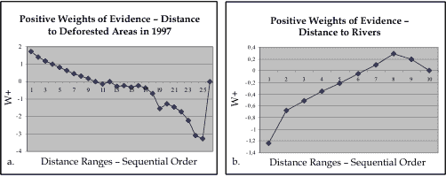

图 7. 正证据权重（W⁺）随距离区间变化的行为：a. 距 1997 年已毁林区域的距离，b. 距河流的距离。

**正证据权重值**

| 距离区间顺序 | 距毁林区域的距离（米） | W⁺ |
|---|---:|---:|
| 1 | 0 – 170 | 1.74594629 |
| 2 | 170 – 240 | 1.41006378 |
| 3 | 240 – 268 | 1.18230916 |
| 4 | 268 – 339 | 0.983065336 |
| 5 | 339 – 360 | 0.836426843 |
| 6 | 360 – 480 | 0.650478547 |
| 7 | 480 – 509 | 0.460166267 |
| 8 | 509 – 537 | 0.312746731 |
| 9 | 537 – 720 | 0.179722679 |
| 10 | 720 – 805 | -0.017792483 |
| 11 | 805 – 960 | -0.143699617 |
| 12 | 960 – 975 | -0.0110620882 |
| 13 | 975 – 988 | -0.28776212 |
| 14 | 988 – 1,017 | -0.221559314 |
| 15 | 1,017 – 1,045 | -0.313774626 |
| 16 | 1,045 – 1,108 | -0.247802748 |
| 17 | 1,108 – 1,137 | -0.383389447 |
| 18 | 1,137 – 3,325 | -0.686325958 |
| 19 | 3,325 – 3,335 | -1.54902 |
| 20 | 3,335 – 3,340 | -1.25484549 |
| 21 | 3,340 – 3,390 | -1.4529907 |
| 22 | 3,390 – 3,757 | -1.73329591 |
| 23 | 3,757 – 4,539 | -2.2167735 |
| 24 | 4,539 – 4,720 | -3.09234848 |
| 25 | 4,720 – 29,889 | -3.2853319 |
| 26 | 29,889 – 2,147,483,647 | 0 |

表 2. 动态变量“距 1997 年已毁林区域的距离”各距离区间的正证据权重（W⁺）值

**正证据权重值**

| 距离区间顺序 | 距河流的距离（米） | W⁺ |
|---|---:|---:|
| 1 | 0 – 240 | -1.23872974 |
| 2 | 240 – 360 | -0.681253599 |
| 3 | 360 – 1,320 | -0.515391121 |
| 4 | 1,320 – 1,440 | -0.353605584 |
| 5 | 1,440 – 25,800 | -0.212681384 |
| 6 | 25,800 – 25,920 | -0.0495070727 |
| 7 | 25,920 – 29,400 | 0.104666667 |
| 8 | 29,400 – 29,760 | 0.286801266 |
| 9 | 29,760 – 32,880 | 0.193898811 |
| 10 | 32,880 – 2,147,483,647 | 0 |

表 3. 静态变量“距河流的距离”各距离区间的正证据权重（W⁺）值

然而，对于变量“距河流的距离”（图 7b），可以观察到，距离河流最近的距离区间对应着最低的 W⁺ 值。这可以解释为：尽管在河流附近发生了小范围的毁林过程，但这些新的毁林斑块在该地区总毁林面积中所占的比例非常有限，从而导致这些距离区间的权重值下降。随着距离区间离河流越来越远，其权重逐渐开始呈现增加的正值。这些最远的区间实际上对应于已成熟定居区的边缘地带，而这些地带恰恰是容易发生毁林过程的区域。总之，该变量对“距 1997 年已毁林区域的距离”变量起到了微调作用。

如前文第 4.3 节所述，Dinamica EGO 基于计算得到的 W⁺ 值生成局部概率图，为每个地图像元分配一个转移概率值。图 8 展示了本实验中生成的局部土地覆盖变化概率图（从森林到毁林区域）。

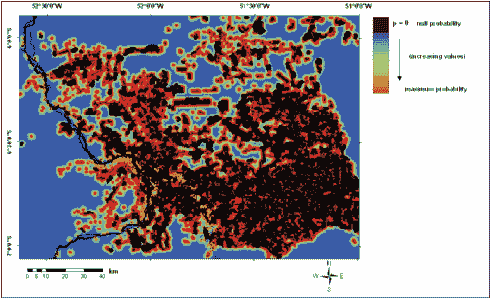

图 8. 1997 年至 2000 年期间局部土地覆盖变化概率（从森林到毁林区域）图

黑色区域具有零转移概率值。蓝绿色和绿色像元的概率值非常低和低，而黄色、橙色和红色色调的区域分别呈现中等、中上等和高的转移概率值。概率值最高的区域与确实发生毁林的区域基本吻合，这可以在 PRODES 毁林图（图 2）中观察到。

模型生成的模拟毁林图（图 9）同时考虑了静态变量和动态变量，在常数衰减的情况下，对于多个空间分辨率（即多个采样窗口大小）均呈现出较高的模糊相似性指数（表 4），这表明模型具有良好的性能。


将模拟土地覆盖图与 2000 年真实土地覆盖图进行比较（图 4），可以注意到，由资本化农场主实施的真实毁林过程所产生的形状非常规则的斑块无法在模拟中重现。这可以归因于 Dinamica EGO 中当前可用的转移函数仍无法满足有关斑块几何形状的极其严格的要求。然而，模拟地图中毁林斑块的空间格局与真实场景中发现的空间格局非常相似，表明 CA 模拟模型的有效性。值得一提的是，建模的目的不是尽可能接近地重现现实，而仅仅是检测土地覆盖变化的主要空间格局和趋势。空间格局指斑块形成中的形态方面，即它们在几何上是稳定还是不规则，是由扩张过程还是扩散过程产生，等等；而趋势则涉及毁林在空间中的传播方向（或矢量）。

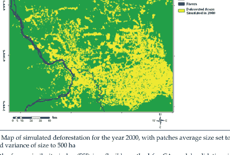

图 9. 2000 年模拟毁林地图，斑块平均大小设为 300 ha，大小方差设为 500 ha

由于模糊相似性指数（FSI）是一种灵活的 CA 模型验证方法，即它不是在像素基础上运行，而是在多个分辨率层次上运行，因此与基于严格一致性的指数相比，在采用常数衰减的情况下，该指数的值往往略高；后者是通过真实场景与模拟场景之间直接的逐像素比较得出的。一致性随采样窗口尺寸的增大而提高，直到分辨率约为 11×11 或 13×13 像素时，相似性指数趋于稳定（图 10）；这表明在粗略空间分辨率下，FSI 无法有效评估模型拟合度。值得提醒的是，使用基于多个空间分辨率的一致性指数来评估 CA 模型的性能是有理由的，因为鉴于土地覆盖变化过程的内在随机性，不仅无法重现过去的变化配置，而且更重要的是，无法以非常精细的空间精度预见未来的土地覆盖转变。

| CA 毁林模型 | 窗口尺寸（像素） | 斑块参数 | FSI*（常数衰减） |
|---|---|---|---|
| 1997 年至 2000 年的模拟 | 3 x 3 | μ = 300 ha; σ² = 500 ha; PII** = 1.5 | 0.877 |
|  | 5 x 5 |  | 0.891 |
|  | 7 x 7 |  | 0.900 |
|  | 9 x 9 |  | 0.903 |
|  | 11 x 11 |  | 0.904 |
|  | 13 x 13 |  | 0.905 |

*FSI = 模糊相似性指数 / PII** = 斑块几何指数*

表 4. 使用不同采样窗口尺寸进行模型验证的结果

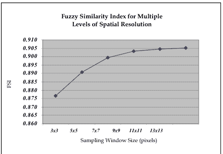

图 10. 模糊相似性指数（FSI）随不同采样窗口尺寸的变化

### 7. 结论

本章介绍了一项基于元胞自动机的空间动态建模实验，旨在模拟巴西北部帕拉州东南部 *São Félix do Xingu* 地区 1997 年至 2000 年期间的毁林。所采用解释变量（证据）并未穷尽代表该地区毁林驱动因素的集合，但它们确实对应于此类土地覆盖变化的战略性诱导因素。

动态变量“1997 年以前毁林区域的距离”对于模拟在森林皆伐区附近观察到的毁林过程具有决定性作用。鉴于该地区历史上报告的土地产权集中，分析时段内的毁林格局大多呈现大面积斑块，这些斑块主要出现在开拓区周边。相反，静态变量“距河流距离”揭示了河流运输对于该地区毁林和人类占用的重要性有限。然而，考虑到毁林仍发生在河流附近，该变量可作为微调“1997 年以前毁林区域的距离”变量的替代方案。所得结果表明，所采用的 CA 模型适用于模拟研究区 1997 年至 2000 年时间跨度内的毁林过程，模糊相似性指数的高值证实了这一点。

Dinamica EGO 平台被证明适合实现本研究实验的目标，这也是考虑到其转移分配算法之一——扩展函数——能够重现先前占用区域周边毁林扩张的空间格局，正如 *São Félix do Xingu* 的情况。Dinamica EGO 的进一步优势在于其灵活的结构，可接受不同的参数化方法（Almeida 等，2008）以及各种静态和动态变量集；这些变量若以审慎方式关联，可满足具有独特土地覆盖（或土地利用）变化格局的最多样化区域的建模要求。这些特性使该模型以及在该平台上开发的其他模型能够移植到亚马逊其他地区（Soares-Filho 等，2009；Maeda 等，2010），这些地区具有不同的占用历史、处于不同的巩固阶段，并涉及具有非常特殊特征的特定当地主体。

作为未来研究方向，作者打算探索更广泛的解释变量，例如土地所有权法律状态指标、当地未铺砌道路以及正在推进的占用前沿的矢量，此外还使用更多随机参数化方法。作者还打算处理更长的时间序列，以便更深入地了解该地区的占用历史，从而为 *São Félix do Xingu* 提供短期和中期的差异化未来模拟情景。这些预测将基于地方和区域层面合理的政治、社会经济和基础设施安排。

尽管模型总体上一直受到严厉批评，主要因为其还原论以及完全捕捉现实固有复杂性的局限（Briassoulis，2000），但可以认为它们应当存在，因为它们提供了一种无与伦比的方式来抽象现实世界过程的模式、秩序和主要动态趋势（Batty，1976）。

实际上，城市模型应以明智且批判的方式构思、处理、应用和解释，以便建模者、从业者、公共和私人决策者以及全体公民能够充分利用其所能提供的最佳价值，并理性承认其局限（Almeida，2003；Almeida 等，2005）。空间动态模型——CA 是其最佳代表之一——仍然是使土地覆盖变化模拟能够传达给政治人物、规划者、决策者以及一般非专业公众并保持透明的最有前景的手段。

### 8. 致谢

本工作作为亚马逊环境建模研究网络——GEOMA（http://www.geoma.lncc.br/）议程的一部分完成，该网络通过隶属于巴西科学技术部（MCT）的机构之间的合作协议建立。

### 9. 参考文献

- Agterberg, F.P. & Bonham-Carter, G.F. (1990). Deriving weights of evidence from geoscience contour maps for the prediction of discrete events, *Proceedings of the XXII International Symposium AP-COM*, pp. 381–395, Berlin, Germany, September 17–21, 1990.
- Aguiar, A.P.D.; Câmara, G. & Escada, M.I.S. (2007). Spatial statistical analysis of land-use determinants in the Brazilian Amazonia: Exploring intra-regional heterogeneity. *Ecological Modelling*, Vol. 209, No. 02-04, pp. 169–188, ISSN 0304-3800.
- Almeida, C.M. (2003). Spatial Dynamic Modelling as a Planning Tool: Simulation of Urban Land Use Change in Bauru and Piracicaba (SP), Brazil, In: *Biblioteca do INPE*, 15.09.2010, Available from http://mtc-m12.sid.inpe.br/col/sid.inpe.br/jeferson/2003/12.18.07.36/doc/publicacao.pdf
- Almeida, C.M.; Gleriani, J.M.; Castejon, E.F. & Soares-Filho, B.S. (2008). Using neural networks and cellular automata for modeling intra-urban land use dynamics. *International Journal of Geographical Information Science*, Vol. 22, No. 9, pp. 943–963, ISSN 1365-8816.
- Almeida, C.M.; Monteiro, A.M.V.; Câmara, G.; Soares-Filho, B.S.; Cerqueira, G.C.; Pennachin, C.L. & Batty, M. (2005). GIS and remote sensing as tools for the simulation of urban land use change. *International Journal of Remote Sensing*, Vol. 26, No. 04, pp. 759–774, ISSN 0143-1161.
- Alves, D.S. (2002). Space-time dynamics of deforestation in Brazilian Amazônia. *International Journal of Remote Sensing*, Vol. 23, No. 14, pp. 2903–2908, ISSN 0143-1161.
- Amaral, S.; Monteiro, A.M.V.; Câmara, G.; Escada, M.I.S. & Aguiar, A.P.D. (2006). Redes e conectividades na estruturação da frente de ocupação do Xingu-Iriri – Pará. *Geografia*, Vol. 31, No. 3, pp. 655–675, ISSN 0100-7912.
- Batty, M. (1976). *Urban modelling: algorithms, calibrations, predictions* (1.ed.), Cambridge University Press, ISBN 052-1134-36-6, Cambridge, UK.
- Becker, B.K. (2005). Geopolítica da Amazônia. *Revista de Estudos Avançados*, Vol.19, No. 53, pp. 71–86, ISSN 0103-4014.


- Bonham-Carter, G.F. (1994). *面向地球科学家的地理信息系统：利用GIS建模*. Pergamon出版社, ISBN 0-08-041867-8, 加拿大安大略省
- Brandão Júnior, A.O.; Souza Júnior, C.M.; Ribeiro, J.G.F. & Sales, M.H.R. (2007). 亚马逊流域的森林砍伐与非官方道路, *第十三届巴西遥感研讨会会议录*, pp. 2357-2364, ISBN 978-851-7000-31-7, 巴西圣卡塔琳娜州弗洛里亚诺波利斯, 2007年4月21-26日
- Briassoulis, H. (2000). 土地利用变化分析：理论与建模方法, In: *希腊爱琴大学*, 08.05.2010. 可从 http://www.rri.wvu.edu/WebBook/Briassoulis/contents.htm 获取
- Burrough, P.A. (1998). 动态建模与地理计算. In: *地理计算：入门*, Longley, P.A.; Brooks, S.M.; McDonnell, R. & MacMillan, B., pp. 165-192, 约翰·威利父子出版公司, ISBN 0-471-98576-7, 英国奇切斯特
- Costanza, R. (1989). 模型的拟合优度：一种多分辨率方法. *生态建模*, 第47卷, 第03-04期, pp. 199-215, ISSN 0304-3800
- Eastman, J.R. (2003). *IDRISI：乞力马扎罗版*, 克拉克大学, 美国马萨诸塞州伍斯特
- Escada, M.I.S.; Amaral, S.; Monteiro, A.M.V.; Almeida, C.A.; Carriello, F. & Almeida, A. (2007). 帕拉州圣费利克斯杜欣古农业边境土地利用与覆盖变化模式, *亚马逊环境建模研究网络[GEOMA]第一届研讨会会议录*, 巴西里约热内卢州彼得罗波利斯, 2007年10月29-31日
- Escada, M.I.S.; Vieira, I.C.; Amaral, S.; Araújo, R.; Veiga, J.B.; Aguiar, A.P.D.; Oliveira, I.V.M.; Pereira, J.L.V.; Filho, A.C.; Fearnside, P.M.; Venturieri, A.; Carriello, F.; Thales, M.; Carneiro, T.S.G.; Monteiro, A.M.V. & Câmara, G. (2005). 亚马逊新边境的占领过程（欣古/伊里里河间地带）. *高级研究*, 第19卷, 第54期, pp. 9-23, ISSN 0103-4014
- 亚马逊环境建模研究网络[GEOMA]. (2004). *圣费利克斯杜欣古-伊里里占领前沿的地域动态：为制定遏制森林砍伐的紧急政策提供支持*, 巴西科技部, 巴西巴西利亚
- Goodacre, A.K.; Bonham-Carter, G.F.; Agterberg, F.P. & Wright, D.F. (1993). 魁北克西部地震活动与水系及磁异常空间关联的统计分析. *构造物理学*, 第217卷, 第03-04期, pp. 285-305, ISSN 0040-1951
- Hagen, A. (2002). 地图相似性的多方法评估, *第五届AGILE地理信息科学会议录*, pp. 171-182, 西班牙马略卡岛帕尔马, 2002年4月25-27日
- Hagen, A. (2003). 模糊集合方法评估类别地图的相似性. *国际地理信息科学杂志*, 第17卷, 第3期, pp. 235-249, ISSN 1365-8816
- Hagen-Zanker, A.; Straatman, B. & Uljee, I. (2005). 模糊集合地图比较方法的进一步发展. *国际地理信息科学杂志*, 第19卷, 第7期, pp. 769-785, ISSN 1365-8816
- Hagen-Zanker, A. (2006). 同时处理重叠与结构的地图比较方法. *地理系统杂志*, 第8卷, 第2期, pp. 165-185, ISSN 1435-5930
- 巴西国家空间研究所(INPE). (2006). PRODES, In: *OBT-INPE*, 28.11.2007, 可从 http://www.obt.inpe.br/prodes/ 获取
- Laurance, W.F.; Albernaz, A.K.M.; Schroth, G.; Fearnside, P.M.; Bergen, S.; Venticinque, E.M. & Costa, C. (2002). 巴西亚马逊地区森林砍伐的预测因子. *生物地理学杂志*, 第29卷, 第05-06期, pp. 737-748, ISSN 1365-2699
- Maeda, E.E.; Almeida, C.M.; Ximenes, A.C.; Formaggio, A.R.; Shimabukuro, Y.E.; Pellikka, P. (2010). 森林转化的动态建模：巴西亚马逊欣古国家公园边缘农村活动扩张的过去与未来情景模拟. *国际应用地球观测与地理信息杂志*, ISSN 0303-2434, 出版中, DOI 10.1016/j.jag.2010.09.008
- Openshaw, S. (2000). 地理计算, In: *地理计算*, Openshaw, S.; Abrahart, R. J. (编辑). pp. 1-31, 泰勒与弗朗西斯出版社, ISBN 978-07497-185-76-1, 美国纽约
- Pereira, L.M.; Escada, M.I.S. & Rennó, C.D. (2007). 1985年至2000年间朗多尼亚州中北部地区小、中、大地产森林砍伐演变分析, *第十二届巴西遥感研讨会会议录*, pp. 6905-6912, ISBN 851-7000-18-8, 巴西戈亚斯州戈亚尼亚, 2005年4月16-21日
- Pontius Jr., G. (2002). 多分辨率类别地图比较中数量与位置效应分解的统计方法. *摄影测量工程与遥感*, 第68卷, 第10期, pp. 1041-1049, ISSN 0099-1112
- Rodrigues, H.O.; Soares-Filho, B.S. & Costa, W.L.S. (2007). Dinamica EGO, 一个环境系统建模平台, *第十三届巴西遥感研讨会会议录*, pp. 3089-3096, ISBN 978-85-17000-31-7, 巴西圣卡塔琳娜州弗洛里亚诺波利斯, 2007年4月21-26日
- Santana, L.F. (2007). *圣费利克斯杜欣古及其历史：1889—1997*, 圣费利克斯杜欣古市政厅, 圣费利克斯杜欣古
- Schmink, M. & Wood, C.H. (1992). *亚马逊的争议边疆*, 哥伦比亚大学出版社, 美国纽约
- Soares-Filho, B.S.; Assunção, R.M. & Pantuzzo, A.E. (2001). 亚马逊殖民边疆景观动态的空间转移概率建模. *生物科学*, 第51卷, 第12期, pp. 1059-1067, ISSN 0006-3568
- Soares-Filho, B.S.; Cerqueira, G.C. & Penachin, C.L. (2002). DINAMICA——一个用于模拟亚马逊殖民边疆景观动态的随机元胞自动机模型. *生态建模*, 第154卷, 第03期, pp. 217-235, ISSN 0304-3800
- Soares-Filho, B.S.; Nepstad, D.C.; Curran, L.M.; Cerqueira, G.C.; Garcia, R.A.; Ramos, C.A.; Voll, E.; McDonald, A.; Lefebvre, P. & Schlesinger, P. (2006). 亚马逊流域保护建模. *自然*, 第440卷, 第7083期, pp. 520-523, ISSN 0028-0836
- Soares-Filho, B.S.; Rodrigues, H.O. & Costa, W.L.S. (2009). 使用Dinamica EGO模拟环境动态. In: *CSR-UFMG*, 23.06.2008. 可从 http://www.csr.ufmg.br/dinamica/ 获取, ISBN 978-85-88591-01-9
- Wolfram, S. (1983). 元胞自动机的统计力学. *现代物理评论*, 第55卷, pp. 601-643, ISSN 0034-6861

## 元胞自动机框架下的空间优化与资源分配

Epaminondas Sidiropoulos 和 Dimitrios Fotakis
*塞萨洛尼基亚里士多德大学工程学院*
*希腊*

### 1. 引言

土地管理是一项复杂活动，涉及确定土地利用、安排活动和设施，以及在大片区域上分配资源，以满足一个或多个经济和/或生态标准。从这一描述性定义可知，土地管理不仅要将物品或商品分配给众多受益者，更重要的是，要进行空间和位置方面的规划，从而干预和塑造当地经济与环境特征的地理格局。

土地管理的重要部分之一是土地利用规划，其中给定区域被划分为地块，每个地块从一组可能的土地利用方式中分配一种特定的土地利用方式。为达到既定目标而寻找合适的土地利用组合，构成一个计算密集型的优化问题。一个相关问题是空间资源分配，其中一个或多个资源必须分配给上述每个地块，同样是为了达到预设目标并可能满足约束条件。这些资源的分布和性质的搜索与各地块的土地利用紧密相关。这一事实引出了更困难但也更现实的优化问题。

需要管理的基本资源之一是水。水的分配不仅涉及单价，还涉及运输和提取成本的估算。在后一种情况下，需要对地下水运动和抽水进行物理模拟，这增加了问题的复杂性和非线性。这一事实使当前问题有别于典型的分配问题。土地利用规划和配水与取水相结合的问题已由Sidiropoulos & Fotakis (2009)和Fotakis (2009)提出，并将在本章中综述，同时介绍有关元胞-遗传方法的新结果。

遗传算法和元胞自动机将是本方法中采用的基本工具。遗传算法是著名的受生物学启发的元启发式算法。其性质和特征在Michalewicz (1992)和Goldberg (1989)等教科书中已有描述，文献中应用实例众多。

元胞自动机可追溯到冯·诺依曼。Wolfram (2002)证明了其根本重要性。它们已被用作建模多种多样自然系统以及社会和经济系统的背景。元胞自动机已被用于模拟自然现象。此外，还有众多应用已

用于生态系统的空间分析。Hogeweg (1988) 使用它们模拟景观变化。Green等人 (1985)、Karafyllidis和Thanailakis (1997)、Karafyllidis (2004) 以及Supratid & Samanda (2004) 采用元胞自动机模拟森林生态系统中火灾的蔓延，而Sole和Manrubia (1995) 通过元胞自动机模拟了森林开阔地动态。此外，元胞自动机已被用于植被演替模拟和植被生长的空间分析 (Colasanti和Grime, 1993)。元胞自动机的一个有用应用涉及社会经济发展的空间特征研究。Balmann (1997) 借助二维元胞自动机分析了农村景观中的结构变化，Deadman等人 (1993) 使用元胞自动机对农村聚落的发展进行建模，而Jenerette和Wu (2001) 使用它们模拟城市发展，并生成可能的土地利用情景。最后，Prasad (1988) 将经济描述为一种元胞自动机，其中自组织响应于系统演化，以寻求更有效地提供社会资源。

近年来，元胞自动机被用于各种优化问题，例如寻找最优路径 (Adamatzky 1996)、设计排水系统 (Guo et al., 2007)、管理地下水含水层 (Sidiropoulos和Tolikas, 2008)、水库管理 (Afshar和Shahidi, 2009) 以及森林规划优化 (Strange et al. 2001, Heinonen和Pukkala 2007, Mathey et al. 2008) 和造林优化 (Strange et al. 2002)。在空间优化问题（如这里概述的问题）中使用进化方法，是由这些问题本身的复杂性和非线性所决定的。此外，这些问题的一个显著特征是局部相互作用与全局系统行为之间的关系。这些考虑因素导致了元胞自动机的引入。

研究区域可以建模为元胞自动机，其中地块由自动机的元胞表示。地块的实际空间排列提供了元胞的邻域结构。每个元胞的状态表示与该元胞所代表的地块相对应的土地利用或水源。

在典型的元胞自动机中，需要一个转换规则，该规则作用于每个元胞，是元胞及其邻居状态的函数。在文献中，已经确定了这样的规则，以构建执行特定计算任务的元胞自动机 (Mitchell et al., 1994 以及许多遵循相同基本思想的后续报告)。在当前方法中，不寻求固定规则。相反，遗传算法将被嵌入到元胞自动机中，以指导其演化。更具体地，将实现两种类型的遗传算法：

- 1. 操作型遗传算法，它将每次为每个地块指示一个替换规则。不寻求固定规则，也不涉及目标函数的分解。
- 2. 具有邻域规则的自然遗传算法。该规则将在邻域级别上运行，并基于目标函数的局部值，目的是提高自然遗传算法的性能。

这两种方法已分别在不同的出版物中提出 (Sidiropoulos和Fotakis, 2009; Fotakis, 2009)，但尚未进行比较或结合。本章通过将它们并置来实现这一点。

自然遗传算法作用于整个配置，其遗传算子不基于相邻元胞之间的局部相互作用。因此，尽管具有元胞背景，它本身并不符合元胞-遗传方案。邻域规则的加入将局部元素引入计算方案，从而使整个方案更接近元胞原型。

另一方面，操作型遗传算法与元胞自动机模型完全一致。该算法每次根据邻居状态为每个元胞同步变化定义一个更新的规则。

空间优化的一个核心问题是问题局部与全局方面的平衡。上述局部规则的引入旨在迭代地引导整个元胞自动机达到最优状态。但此类规则的定义并非不言而喻。问题的目标函数通常取决于整个配置，分解或简化为元胞贡献并不明显，甚至不可行。这两种方案都处理了这一问题，这也结合相关文献进行了讨论。

在两种遗传元胞方案中，与自然遗传算法相比，元胞自动机的结果布局在具有相同土地利用或水源的子区域方面呈现出更高的紧凑性。这对土地管理而言是一个重要的定性结果 (Vanegas et al., 2010)。此外，在当前方法中，这一特征作为涌现结果获得，无需像文献中的类似问题那样添加任何特殊约束或修改目标函数。

### 2. 问题的描述与表述

为了说明土地管理与地下水分配相结合 (Sidiropoulos和Fotakis, 2009)，考虑一个假想问题。地形以二维网格的形式表示，网格的节点对应于地块。待分配的资源是水，所涉及的成本将由分别与抽取和输送相关的两部分组成。每个地块都连接到其中一口井。这些连接是问题的决策变量。它们可以如图1所示。每个元胞的颜色表示其连接的井。

每个地块的输送成本被视为与该地块到相应井的距离成正比。总输送成本通过对所有地块求和得出。抽水成本通过稳态地下水潜水含水层模型估算。两项成本之和构成需要最小化的目标函数。

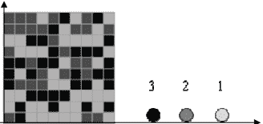

图1. 包含三口井的二维镶嵌图

其中b是含水层厚度，假定为常数，R是影响半径，r_w是井w的半径，k_w（w=1,2,...,m）是每口井周围区域的水力传导系数。

最后，总抽水成本与以下量成正比

$$F_P = \sum_{w=1}^{m} Q_w \Delta h_w \qquad (5)$$

其中Q_w和Δh_w由方程(3)和(4)给出。因此，由方程(2)和(5)，总成本可以取为和

$$F = F_R + F_P \qquad (6)$$

从上述表述可以看出，当前问题不同于经典的资源分配问题，因为每个元胞相关的成本不仅取决于供应给特定地块的水量，还取决于地块本身的位置。事实上，对于取决于距离的输送成本和通过具有显著空间特征的含水层模型确定的抽水成本，都是如此。此外，最明显的差异在于，抽水成本不仅受到与特定地块相连的井的影响，还受到其他井的作用的影响。

空间分解的问题将在后续章节中讨论，同时将当前问题与相关文献中出现的典型空间资源分配问题进行比较。需要指出的是，典型问题基于单个元胞贡献的可分离性，而这对于当前问题并不成立。

以下各节将描述的求解方法针对问题域的空间-元胞特性进行了专门调整。还将进一步将当前方法与近期文献中各种类型的资源分配问题的处理进行比较，特别是森林规划问题。

### 3. 求解方法

#### 3.1 自然遗传算法

目标函数即方程(6)需要作为各地块与井之间连接的函数进行最小化。该目标函数是非线性的，并且该问题属于组合优化问题。

进化算法特别适合这类资源分配问题。事实上，此类方法已被应用于资源分配问题 (Khan et al. 2008, Magalhaes-Mendes 2008)，以及涉及水资源分配和作物规划的问题 (Ortega et al. 2004, Zhou et al. 2007, Khan et al. 2008)。

Sidiropoulos和Fotakis (2009) 提出了一种在遗传算法框架中对问题进行编码的自然方式。这里，将其纳入更一般的框架。设L为按上述方案编号的元胞集合：

$$L = \{1,2,...,a,b\}$$

以及从1到m编号的m口井的集合：

邻域按冯·诺依曼意义定义（东西向和南北向单元，例如 Gaylord 和 Nishidate，1996）。

设 $N_k$ 为单元 $k$ 的邻域，并设 $n_k \in N_k$ 与 $k$ 存在函数关系：$k \mapsto n_k$。

于是 $L$ 变换为

$$L_n = \{n_1,n_2,\ldots,n_{|N_k|}\}$$

并可定义新配置为

$$\tilde{C} = [\tilde{w}_1,\tilde{w}_2,\ldots,\tilde{w}_{|N_k|}] \quad (9)$$

其中 $\tilde{w}_i = p(n_i)$，如式 (7) 所规定。

上述内容可以更简洁地写成运算形式：

设 $q : L \to L$ 为上述将 $k$ 与 $n_k$ 关联的函数，使得

$$q(k) \in N_k \quad \forall k \in L.$$

则

$$n_k = q(k), \quad L_n = q(L) \quad \text{and} \quad \tilde{w}_k = p(q(k)).$$

因此，可以定义算子 $O$ 为

$$O[p(k)] = p(q(k)) \quad \text{and} \quad \tilde{C} = O[C]$$

其中 $\tilde{C}$ 是变换后的配置。

因此，从配置

$$C = \{w_k \mid w_k \in W \quad \text{and} \quad k=1,2,\ldots,a\cdot b\}$$

出发，通过算子 $O$ 得到变换后的配置

$$\tilde{C}=C_n = \{\tilde{w}_{n_1},\tilde{w}_{n_2},\ldots,\tilde{w}_{n_{|N_k|}}\} \quad (9)$$

式 (8) 的列表 $L_n$ 诱导出函数 $q(k)$，从而生成算子 $O$。$L_n$ 将成为典型的染色体：

$$L_n = \{n_k \mid n_k \in N_k \quad \text{and} \quad k=1,2,\ldots,a\cdot b\} \quad (10)$$

考虑 $N$ 个函数 $q_i$，$i=1,2,\ldots,N$，它们类似于函数 $q$，可得到 $N$ 个相应的算子 $O_i$，以及 $N$ 个新的变换后配置 $\tilde{C}_i$。

生成列表 $L_{ni}$，$i=1,2,\ldots,N$，构成运算遗传算法中的染色体种群。

此外，按照这种记号，设 $w_{n_k} \in \{1,2,\ldots,m\}$ 为分配给相邻单元 $n_k$ 的水井编号。

式 (10) 中的染色体 $L_{ni}$ 可视为一种替换规则，它指示区块 $k$ 将其所分配的水井 $w_k$ 替换为所选相邻区块 $n_k$ 的水井 $w_{n_k}$（图 2）。

合适邻居 $n_k$ 的恰当选择将由遗传算法提出。

### 4. 局部目标与全局目标

空间优化中的一个基本问题涉及局部目标相对于整体全局目标的表述，因为后者通过目标函数来表达。局部目标允许在元胞自动机中设计局部转移规则。上文提出的优化问题是通过在局部意义上对各个单元施加算子来处理的，而没有将目标函数分解为局部贡献。另一种方法是定义目标的局部组成部分，然后尝试将整体问题归结为在每个单元的邻域层面上求解相应的子问题。在文献中，可以注意到与这一问题相关的各种方法。

Strange 等（2001）是最早将元胞自动机概念用于空间优化的研究者之一。他们考虑了目标函数的单个单元贡献。然而，其中一些贡献虽然针对某一特定单元，但由于表达邻域属性而与更广泛的配置相关。优化是在优化这些单元组成部分中的每一个的基础上进行的。

在 Heinnonen 和 Pukkala（2007）中，目标被区分为局部目标和全局目标，并使用由局部项和全局项加权和构成的复合目标函数。在优化问题依次进行局部和全局求解的过程中，全局项的权重系数逐渐增大。局部部分通过突变来更新底层自动机的单元来处理。

Seppelt 和 Voinov（2002）在网格搜索方法中明确区分了局部方法和全局方法。他们的目标函数由依赖于单元的项之和组成，求解过程包括两个阶段：局部阶段和全局阶段。后者通过遗传算法执行。尽管网格构成了问题表述的基础，但在整个处理过程中没有出现完整的元胞自动机特征，例如局部转移。

Aerts 和 Heuvelink（2002）以及 Aerts 等（2005）再次以单元网格的形式表示其研究区域。他们采用模拟退火遗传算法求解空间优化问题。尽管其特殊交叉算子在设计上能够防止网格域破碎，但仍无法看出元胞自动机过程。通过适当增广目标函数，考虑了各种紧凑性和邻接性准则。

Datta 等（2007）还提出了专门设计的算子，以倾向于更紧凑的配置。

Ligmann-Zielinska 等（2008）描述了 SMOLA（可持续多目标土地利用配置）软件。该软件处理的空间优化问题属于线性规划和整数规划类。邻接性和紧凑性通过单独的约束来处理。

当前问题与典型空间分析问题的不同之处在于，大部分计算工作集中在资源分配以及对其开采和输运的建模上。因此，优化必须在空间布局和水开采效率两方面实现。值得注意的是，存在两种观点：一种强调空间优化，并将必要资源视为优化参数；另一种强调资源管理，并调节空间布局以实现资源节约。后一种方法可能出现在水利工程文献中。

典型地，Yeo 和 Guldmann（2010）研究了土地利用配置，以最小化流域峰值径流。类似地，同一作者（Yeo 等，2004）优化土地利用模式，以同时减少峰值径流和非点源污染。值得注意的是，Sadeghi 等（2009）优化土地利用，旨在减少土壤侵蚀并最大化效益。然而，他们的问题以线性规划形式表述。

一般而言，这些复合问题的目标函数相对于部分单元贡献既是非线性的又是不可分离的。然而，在本方法中定义的局部目标函数并不具有严格的局部性质。这些局部函数不会取代优化过程所用的目标函数。它们仅用于构造一个辅助算子，称为邻域规则（Fotakis，2009；Fotakis 和 Sidiropoulos，2010）。该算子属于学习算子类别（Hinton & Nowlan，1987；Krzarnowski & Raper，2001）。这些算子的特征在于作用于表型，而不是作用于所研究对象的遗传组成。学习算子已被证明能够促进进化过程。下一节给出所研究问题的局部目标定义。

#### 4.1 局部目标

运输成本 $F_T$（式 2）可以分解为如下单元贡献：

$$f_{Tk}=\left[(x_k-x_{wk})^2+(y_k-y_{wk})^2\right]^{1/2} \tag{11}$$

对于 $k=1,2,\ldots,a\cdot b$。

抽水成本 $F_P$（式 5）不适合进行这种直接分解。设 $q_k$ 表示与区块 $k$ 给定需水量相对应的流量。下标 $j$ 表示该区块与井 $j$ 相连。

设 $S_j$ 为单元集合 $L$ 的一个子集，其特征是其成员与井 $j$ 相连。由于每个单元仅与一口井相连，

$$\bigcup_{j=1}^{m}S_j=L,\qquad S_i\cap S_j=\varnothing\ \text{if }i\ne j,\ i,j=1,2,\ldots,m.$$

则井 $j$ 的流量等于

$$Q_j=\sum_{k\in S_j}q_k \tag{12}$$

由式 (4) 可知，井 $j$ 位置处的降深（$j=1,2,\ldots,m$）是 $Q_1,Q_2,\ldots,Q_m$ 的非线性函数。

根据式 5 以及图 2 中 $q_k$ 与 $w_k$ 的关系，抽水成本 $F_P$ 可重写为

$$F_P=\sum_{j=1}^{m}Q_j\Delta h_j=\sum_{j=1}^{m}\left(\sum_{k\in S_j}q_k\right)\Delta h_j=\sum_{k=1}^{a\cdot b}q_k\Delta h_{wk} \tag{13}$$

基于式 (13)，抽水成本的局部值现在可以写为：

$$f_{pk}=q_k\Delta h_{wk},\qquad k=1,2,\ldots,a\cdot b \tag{14}$$


在当前问题中，土地利用与水源相对应，表达式(18)可与式(13)进行比较，式(13)给出了抽水成本的目标函数，即

\[
C_{k,l}=q_k\Delta l_{l_k} \qquad (19)
\]

这里需要注意，系数\(C_{k,l}\)并不只取决于单元格k的土地利用。事实上，借助式(4)，\(\Delta l_{l_k}\)取决于所有井的流量，而流量又由井在单元格之间的分布决定。因此，\(C_{k,l}\)既取决于其他单元格的土地利用，也取决于单元格k的土地利用。这一事实使当前问题区别于空间优化文献中的典型情形。上面讨论的单元格分解用于定义一个局部的邻域算子。

#### 4.3 邻域规则

作用于每个单元格邻域的算子称为邻域规则，其定义如下：

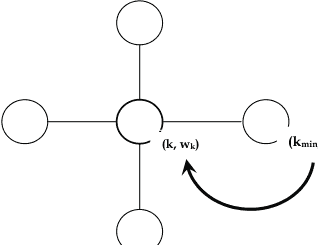

图5. 邻域规则

设\(N_k\)为单元格k的邻域，由l个元素组成：

\[
N_k=\{k_1,k_2,\ldots,k_l\}
\]

对每个邻域元素计算局部目标函数(15)。设\(k_{\min}\)为\(N_k\)中局部目标函数值最小的元素：

\[
f_{k_{\min}}=\min\{f_{k_1},f_{k_2},\ldots,f_{k_l}\}.
\]

然后，将当前单元格k的状态替换为单元格\(k_{\min}\)的状态（图5）：

\[
w_k\leftarrow w_{k_{\min}}.
\]

第1、2、3层的水力传导率分别为\(k_1=0.05\times10^{-3}\ \mathrm{m/s}\)，\(k_2=0.5\times10^{-3}\ \mathrm{m/s}\)，\(k_3=1.2\times10^{-3}\ \mathrm{m/s}\)。下伏含水层的恒定厚度为\(b=50\ \mathrm{m}\)，影响半径为\(R=15\ \mathrm{m}\)，所有井的半径均为\(r_w=0.10\ \mathrm{m}\)。

首先将自然遗传算法与操作遗传算法进行比较，如Sidiropoulos & Fotakis (2009)所做的那样。操作遗传算法得到的结果在目标函数值和紧凑性两方面都明显优于自然遗传算法（图7和图8）。图8所示布局在160代内达到并随后稳定，而图7的布局是自然遗传算法在1000代内取得的最佳结果。

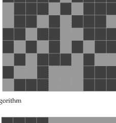

图7. 自然遗传算法

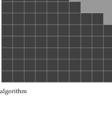

图8. 操作遗传算法

随后，通过加入第4.3节所述的邻域规则（NR）对自然遗传算法进行了增强。图9所示布局在600代内获得。与自然遗传算法（图7）相比，它在紧凑性方面表现更好，但不如操作遗传算法（图8）的布局。然而，此情况下达到的目标函数值甚至优于操作遗传算法给出的值。

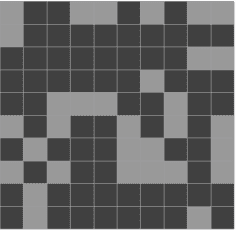

图9. 带NR的自然遗传算法

类似地，将自然遗传算法与第4.4节的邻域变异（NM）相结合。结果如图10所示。就紧凑性而言，它明显优于图9，几乎与图8一样好。此外，目标函数值不如图9，且略逊于图8，这意味着邻域变异倾向于产生紧凑的结果。图10的结果在650代内获得。

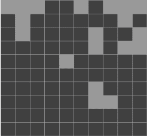

图10. 带NM的自然遗传算法

### 6. 讨论——结论

空间优化问题计算量大，需要应用启发式搜索方法求解。然而，正如本文所示，这些方法必须根据所研究领域的空间特征进行设计。该特征通过元胞自动机得到了恰当建模。

在元胞背景下，更容易在局部特征和全局特征之间寻求平衡。本章沿着这一思路介绍了两种基本方法。其中一种是自然遗传算法，如上所述，其典型染色体由对应于地块的基因组成。该自然算法还配备了作用于局部层面的算子，从而大幅提高算法效率。另一种方法被称为操作型方法，因为遗传算法的染色体作为算子作用于当前配置。

后一种方法与元胞自动机模型完全一致，因为染色体算子以与该单元格邻域相关的方式作用于各个单元格。研究表明，操作遗传算法更倾向于产生紧凑配置，尽管不一定产生全局最优结果。另一方面，这些紧凑布局在空间优化应用中是非常理想的结果。

总之，本文提出的方案为空间规划者提供了工具，可在不施加特殊约束的情况下获得多种具有增强紧凑性特征的替代方案。实际上，这些理想结果是以涌现的方式出现的。这意味着计算过程中并未为实现这些结果作出明确规定。这种规定可以是通过合适的惩罚项扩展目标函数，或在问题表述中添加特定约束。此外，局部算子（NR和NM）至少从其定义上并未明确包含任何偏向或趋向于产生紧凑或连片布局的方向。其唯一特征是操作的局部性。

因此，看来与问题元胞性质相关的方法产生的结果更符合空间规划的现实视角。这一事实促使进一步研究，以更系统地将当前无约束方法与涉及显式紧凑性、连片性或百分比约束的方法进行比较。显然，当前算法中的涌现问题需要更多研究。

另一方面，资源分配问题涉及的含水层水力问题可能存在约束。此类约束可以满足生态方面的考虑需求。这类约束的一个例子是在含水层选定位置对抽水降深施加上限。该限制旨在保护含水层免于枯竭。

另一个研究方向涉及本文所述方法的多目标版本。操作遗传算法以及局部算子都可以进行非平凡扩展，进入多目标优化领域。

元胞自动机向最优配置的演化进展引出了自组织演化方法的问题，以及伴随遗传算法在元胞—遗传混合方案中的作用。这可以作为后续研究的主题。

将模拟退火集成到本文所述方法中也值得研究。该方向已经迈出了第一步（Sidiropoulos & Fotakis, 2009）。

最后，本文的方法框架可应用于森林管理、设施选址以及许多其他环境或工业领域中出现的各种复合空间规划问题。

### 7. 参考文献

- Adamatzky, A.I., 1996. “元胞自动机中最短路径的计算”，Math. Comput. Modelling, 23(4), pp. 105-113.
- Aerts, J., Van Herwijnen, M., Janssen, R. and Stewart, T., 2005. 评估用于解决土地利用分配问题的空间设计技术。Journal of Environmental Planning and Management, 48(1), pp.121-142.
- Aerts, J.C.J.H. and Heuvelink, G.B.M. 使用模拟退火进行资源分配。International Journal of Geographical Information Science, 16(6), pp. 571-587, 2002.
- Afshar, M.H. and Shahidi, M., 2009. “大规模水库运行问题的优化求解：元胞自动机与启发式搜索方法的比较”，Engineering Optimization, 41(3), pp. 275-293.
- Balmann, A., 1997. “基于农场的区域结构变化建模：一种元胞自动机方法”，European Review of Agricultural Economics, 24, pp. 85-108.
- Colasanti, R.I. and Grime, J.P., 1993. “资源动态与植被过程：使用二维元胞自动机的确定性模型”，Functional Ecology 7, pp.169-176.
- Datta, D., Deb, K., Fonseca, C.M., Lobo, F.G., Condado, P.A. and Seixas, J., 2007. 土地利用管理问题的多目标进化算法。International Journal of Computational Intelligence Research, 3(4), pp.371-384.
- Deadman, P., Brown, D.R. and Gimblett, H.R., 1993. “用元胞自动机模拟乡村居住模式”，J. Environ. Management, 37, pp. 147-160.
- Fotakis, D., 2009. “面向决策的空间规划：使用进化方法进行土地利用与水资源综合管理” 博士论文，亚里士多德大学。
- Gaylord R. J. and Nishidate, K., 1996. *自然建模：用Mathematica进行元胞自动机模拟。* Springer, 1996.
- Goldberg, D.E., 1989. *搜索、优化与机器学习中的遗传算法，* Addison-Wesley.
- Green, D.G., House A.P. and House S.M., 1985. “模拟森林生态系统中的空间格局”，Math. Comput. Simulation, 27, pp.191-198.
- Heinonen, T. and Pukkala, T., 2007. 元胞自动机在森林规划中的应用。Canadian Journal of Forest Research, 37, pp. 2188-2220.
- Hinton, G. E. & Nowlan, S., 1987. “学习如何引导进化”，Complex Systems, 1, pp. 495-502.
- Hogeweg, P., 1988. “元胞自动机作为生态建模的一种范式”，Applied Mathematical Computations, 17, pp.81-100.
- Jennerette G. D and Wu, J., 2001. “美国亚利桑那中部—菲尼克斯地区土地利用变化的分析与模拟”，*景观生态学*, 16, pp.611-626.
- Karafyllidis I., and Thanailakis A., 1997. “使用元胞自动机预测森林火灾蔓延的模型”，Ecological Modelling, 99, pp. 87-97.


- Karafyllidis, I., 2004. “用于利用元胞自动机和遗传算法预测森林火灾蔓延的专用并行处理器设计”，*Engineering Applications of Artificial Intelligence*, 17, pp. 19-36.
- Khan, S., O’Connell, N., Rana, T. and Xevi, E., 2008. “在地下水位和土壤盐分目标下管理灌区灌溉强度的水文经济模型”，*Environmental Modelling & Assessment*, 13, pp. 115-120.
- Krzynowski, R. & Raper, J., 2001. *空间演化建模*, Oxford University Press.
- Ligmann-Zielinska, A., Church, R.L. and Jankowski, P., 2008. 空间优化作为一种可持续多目标土地利用配置的生成式技术。*International Journal of Geographical Information Science*, 22(6), pp. 601-622.
- Magalhaes-Mendes, J., 2008. “使用遗传算法的多资源约束项目调度”，*WSEAS Transactions on Business and Economics*, 5(11), pp. 487-496.
- Mathey, A.E., Krcmar, E., Dragicevic, S. and Vertinsky, I., 2008. “面向森林规划问题的面向对象元胞自动机模型”，*Ecological Modelling*, 212, pp. 359-371.
- Michalewicz, Z., 1992. *遗传算法 + 数据结构 = 进化程序*. Springer.
- Mitchell, M., Crutchfield, J. P. and Hraber, P. T., 1994. “演化元胞自动机以执行计算”，*Physica D* 75:361-391.
- Moon, B. R., Lee, Y.S. and Kim, C.K., 1997. “采用二维地理交叉和锯齿映射的遗传VLSI电路划分”，*Proceedings of the 1997 ACM symposium on Applied computing*, San Jose, California, United States, pp. 274-278, 1997.
- Ortega, J. F., Valero de Juan, J.A., Tarjuelo, J. M. and Lopez, E. M., 2004. “MOPECO：一种灌溉用水管理的经济优化模型”，*Irrigation Science*, 23, pp. 61-75.
- Prasad, K., 1988. “经济系统与博弈的并行分布式处理模型”，*Comput. Sci. Economics and Management*, 1, pp. 163-174.
- Sadeghi, S.H.R., Jalili, K. and Nikkami, D., 2009. 流域尺度的土地利用优化。*Land Use Policy*, 26, pp. 186-193.
- Seppelt, R. and Voinov, A., 2002. 利用空间显式景观模型的土地利用格局优化方法。*Ecological Modelling*, 151, pp. 125-142.
- Sidiropoulos, E. and Fotakis, D., 2009. 基于单元的遗传算法与模拟退火用于空间地下水分配。*WSEAS Transactions on Environment and Development*, vol. 5 (4), pp. 351-360.
- Sidiropoulos, E. and Tolikas, P., 2008. “含水层管理中的遗传算法与元胞自动机”，*Applied Mathematical Modelling*, 32(4), pp. 617-640.
- Solé, R.V. and Manrubia, S.C., 1995. “雨林是否在临界状态下自组织？”，*J. Theoret. Biology*, 173, pp. 31-40.
- Strange, N., Meilby, H. and Bogetoft, P., 2001. 使用自组织算法的土地利用优化。*Natural Resource Modeling*, 14(4), pp. 541-573.
- Strange, N., Meilby, H. and Thorsen, J.T., 2002. “利用演化自组织优化造林区土地利用”，*Forest Science*, 48(3), pp. 543-555.
- Supratid, S. and Sadananda, R., 2004. “元胞自动机——森林火灾扩散的临界密度”，*WSEAS Transactions on Computers*, Issue 6, vol. 3.

每个模型所采用的增长方式。基于这些分析，他们能够讨论将CA用于城市建模的一些主要优缺点。作者认为，CA模型的简单性既被视为优点，也被视为缺点。在如此简单的表示中很难捕捉城市系统的复杂性，因此人们做出了许多修改或放宽，这也使人们质疑许多模型是否仍然实际上是CA。还讨论了模型在适应各种现实情境方面的灵活性，因此通过数据挖掘方法校准规则和参数的模型，不如更一般地指定的转换规则灵活。不到40%的模型预测了多种土地利用，而大多数模型只是确定元胞是否城市化。在模型精度方面，他们发现总体上通常非常好，但需要进一步研究的一个领域是开发新的验证方法，尤其是在模式识别领域。作者建议进一步研究的其他领域包括更多地将CA建模与城市和空间理论相结合，以及将不同类型的建模（如基于智能体的模型）整合到混合表示中。自该综述所涵盖的时期（涵盖截至2009年初发表的研究）以来，文献中出现了许多新论文。然而，这些研究大多涉及将现有CA城市模型应用于不同地区，或进行修改以提高模型性能。例如，SLEUTH模型（Clarke等，1997）继续被应用于世界不同地区。Rafiee等（2009）使用SLEUTH模型模拟伊朗马什哈德市的城市增长；Jantz等（2010）在开发美国东部切萨皮克湾地区精细尺度区域模型时对SLEUTH进行了改进；Wu（2009）则将SLEUTH模型应用于中国沈阳大都市区。类似地，CLUE-S模型（Veldkamp和Fresco，1996）被Pan等（2010）和Zhang等（2010）用于中国地区的建模，特别强调尺度对模型结果的影响以及对不确定性的考虑。近期工作中使用的其他现有CA模型包括Petrov等（2009）的研究，他们将MOLAND模型（Lavalle等，2004）应用于葡萄牙阿尔加维2020年未来城市土地利用变化的场景；以及Poelmans和Van Rompaey（2009），他们应用Geomod模型（Pontius，2001）考察佛兰德-布鲁塞尔地区的城市蔓延。其他研究领域涉及对基本CA结构的修改，例如使用可变网格CA（van Vliet等，2009）、基于矢量的CA（Moreno等，2009）以及混合模型变体，例如Han等（2009）将系统动力学模型与CA模型相结合，Wu等（2010）将神经网络与CA耦合。还有一种趋势是开发基于智能体的城市增长模型，既可以与CA结合（例如Wu和Silva，2009），也可以作为模拟城市空间动态的新框架（例如Irwin等，2009）。最后，Poelmans和Van Rompaey（2010）的近期工作将CA模型与其他城市扩张建模方法进行了比较，包括逻辑回归以及结合两种单独方法的混合方法。当仅在一个分辨率下考虑结果时，混合方法产生了最佳结果。然而，当考虑多个分辨率时，逻辑回归被证明更优。这项工作再次强调了尺度的重要性，如上所述，近期工作已对此加以考虑。

因此，从不断增长的文献中可以清楚地看出，CA将继续被用于城市增长建模，无论是建立在现有模型之上，还是采用混合形式。

### 3. 沙特阿拉伯利雅得城市增长的CA模型

第一个案例研究将评估沙特阿拉伯利雅得市周边几个新城镇和卫星中心的可能影响。由于石油的发现，利雅得在过去60年中经历了显著增长。利雅得的人口已从20世纪30年代的25,000人增加到20世纪90年代初的250万人。目前的人口增长率约为每年8.1%，预计到2020年该市将达到1000万人。城市的空间扩张也发生了巨大变化，从20世纪20年代不足1 km²的地理范围增长到2004年的超过1,150 km²（ADA，2004）。

为管理这种高速城市增长和变化，沙特阿拉伯政府为利雅得制定了一系列总体规划。这些规划的主要目标是重构和引导城市扩张，以实现未来的可持续发展（ADA，2004）。为确保总体规划将对城市肌理和城市人口产生有益影响，政策制定者需要一个规划支持工具，能够模拟未来15年受管理城市增长的复杂性。Al-Ahmadi等（2009a,c）概述的模型正是考虑到这一需求而开发的。

#### 3.1 CA模型细节

该模型被称为模糊元胞自动机城市增长模型（FCAUGM），是一种随机约束CA。如果元胞的发展可能性（DP）得分大于或等于转换阈值参数λ，则模型在时间t+1创建一个新的城市元胞ij，如下所示：

$$\text{若 } DP_{ij}^{t} \geq \lambda \text{ 则 } S_{ij}^{t+1}=\text{城市},\ \text{否则}=\text{非城市} \tag{1}$$

其中 \(S_{ij}^{t+1}\) 是元胞ij在时间t+1的状态；\(DP_{ij}^{t}\) 是元胞ij在时间t的发展可能性；λ是0到1之间的转换阈值，通过校准确定。

模型将元胞在t+1时刻的状态 \(S_{ij}^{t+1}\) 定义为其在时间t的发展可能性（DP）的函数，而该发展可能性又是元胞ij在时间t的发展适宜性（DS）和随机扰动因子（SDF）的函数：

$$S_{ij}^{t+1}=f(DP_{ij}^{t})=(DS_{ij}^{t}*SDF)=(DS_{ij}^{t}*[1+\ln(\gamma^{\alpha})]) \tag{2}$$

其中 \(DS_{ij}^{t}\) 是元胞ij在时间t的发展适宜性；γ是[0,1]范围内的均匀随机变量；α是控制随机扰动大小的离散参数。元胞ij的发展适宜性 \(DS_{ij}^{t}\) 是四种驱动力的函数，这些驱动力可能贡献并影响城市增长的空间格局：

$$DS_{ij}^{t}=f(TSF_{ij}^{t},UAAF_{ij}^{t},TCF_{ij}^{t},PPRF_{ij}^{t}) \tag{3}$$

其中 \(TSF_{ij}^{t}\) 是元胞ij在时间t的交通支撑因子；\(UAAF_{ij}^{t}\) 是城市集聚与吸引力因子；\(TCF_{ij}^{t}\) 是地形约束因子；\(PPRF_{ij}^{t}\) 是规划政策与法规因子。城市增长的四种驱动力（TSF、UAAF、TCF和PPRF）本身是模糊输入变量的函数，如下所示：

$$TSF_{ij}^{t}=f(ALR_{ij}^{t},AMR_{ij}^{t},AMJR_{ij}^{t}) \tag{4}$$


$$UAAF_{ij}^{t} = f(UD_{ij}^{t}, AECES_{ij}^{t}, ATC_{ij}^{t}) \quad (5)$$

$$TCF_{ij}^{t} = f(G_{ij}^{t}, A_{ij}^{t}) \quad (6)$$

$$PPFR_{ij}^{t} = f(PA_{ij}^{t}, EA_{ij}^{t}) \quad (7)$$

其中，TSF 由地方道路可达性（ALR）、主干道路可达性（AMR）和主要道路可达性（AMJR）决定；UAAF 是城市密度（UD）、城镇中心可达性（ATC）以及就业中心和社会经济服务可达性（AECES）的函数；TCF 由坡度（G）和高程（A）决定；而 PPFR 则表示规划区域（PA）和排除区域（EA）。城市增长的驱动因子通过一组模糊规则相互关联，这些规则连同隶属函数在校准过程中确定。模糊推理引擎将模糊规则组合起来，生成模糊发展适宜性评分（DS_{ij}^{t}），然后将其去模糊化为一个精确值，如下所示：

$$DS_{ij}^{t} = 1 + \frac{\sum_{n} \mu_{c_n}(z_{ij}) z_{ij}}{\sum_{n} \mu_{c_n}(z_{ij})} \quad (8)$$

其中，μ_{c_n} 是规则 n 的发展适宜性隶属函数，z_{ij} 是规则 n 中单元 ij 的模糊输出值（发展适宜性）。

随后，使用研究区域的样本数据集对模型进行校准，该数据集采用非比例分层随机抽样方法选取，包含 60% 的城市区域和 40% 的非城市区域。采用遗传算法和并行实现的模拟退火算法作为优化方法。此外，还邀请专家确定隶属函数和规则，作为第三种比较方法。在校准过程中，使用均方误差和均方根误差作为目标函数。它们被合并为一个单一的、加权的、标准化的目标函数，以惩罚模型参数超出允许范围的情况。遗传算法提供了最佳的校准结果。

校准完成后，FCAUGM 被用于模拟利雅得市以下三个时期的城市增长：1987—1997 年、1997—2005 年和 1987—2005 年，以进行验证。采用若干定量指标来评估模型性能，如总体精度（基于混淆矩阵）、Lee-Sallee 指数和空间格局度量。就总体精度而言，FCAUGM 表现良好，1987—1997 年为 93%，1997—2005 年为 92%，1987—2005 年合并时期为 94%。然而，仅考虑城市一致性时，精度分别下降到 1987—1997 年的 52.5%、1997—2005 年的 37.6% 和 1987—2005 年的 74.3%。有关模型的更多详细信息，包括完整的校准和验证程序，请参阅 Al-Ahmadi 等人（2009a,c）的文献。

#### 3.2 情景概述

本章介绍了使用 FCAUGM 的两种情景：（i）开发新的卫星城镇，（ii）创建新的都市副中心。这些不同的规划情景是沙特政府当前规划政策的一部分，即《利雅得都市发展战略》（MESTDAR）。根据 HCDR（2004）的报告，利雅得城市边界内已划拨两个地点用于开发新城镇。北部城镇将容纳近 100 万人，东部城镇将容纳 90 万人。城镇位置的选定旨在最大化…

与 FCAUGM 类似，在校准过程中使用遗传算法，以均方误差作为目标函数来确定模型参数。对于 NCGM，对公式 9 中的权重和邻域大小进行了优化。校准数据取自盆塘新城市，并划分为三个时期：规划前期、规划中期和规划后期。模型校准完成后，使用一山新城市的数据进行验证。模型性能的定量指标与 FCAUGM 中使用的指标类似。规划中期和规划后期的总体精度分别为 93% 和 88%，但仅考虑城市区域时，模型性能分别下降至 54% 和 45%。有关模型结构以及校准和验证程序的更多详细信息，请参阅 Kim（2005）的文献。

#### 4.2 新城市增长情景概述

第一种情景称为基线情景，模拟 2004 年至 2020 年的新增长，该增长在任何明确政策干预的情况下都会发生。规划中期和规划后期均采用 7.5% 的默认城市增长率。由于数据可得性，规划中期始于 2004 年，止于 2012 年；这是根据建设交通部（MOCT，2005）制定的建设计划确定的。规划后期涵盖规划中期之后的 8 年（2012 年至 2020 年）。随后给出第二种情景，城市增长率为 10%。该情景旨在估算如果出现超出预期的进一步城市增长时，可能开发的潜在区域。

### 5. 模型结果

#### 5.1 沙特阿拉伯利雅得郊外新开发模拟

在第一种情景中，运行 FCAUGM 以考察利雅得附近两个新卫星城镇的影响。模拟结果如图 1 所示。从图中可以看出，这两个拟建城镇将吸收预计发生在利雅得西南部和南部的大部分城市开发。新城镇极有可能吸引那些偏好比城市现有环境更宁静、更具郊区生活氛围的居民。这表明，新卫星城镇的开发将是该城市未来的一项积极规划干预措施。

评估新规划的都市副中心的影响时，假设开发以城市各区域（尤其是副中心附近）活动和服务的分散化与密集化过程为主导，即允许城市在副中心附近的增长速度超过主要城区和城镇中心。图 2 显示，开发更加紧凑，并集中在副中心周围，从而实现更可持续的发展。因此，这一情景展示了如何避免不必要的过度城市扩张或城市蔓延。从该情景下利雅得市预测的城市形态可以看出，在城市外围区域指定五个都市副中心的政策在很大程度上已实现了利雅得发展局（ADA，2004）设定的最终目标，即通过结构调整和引导城市扩张来实现未来的可持续发展。

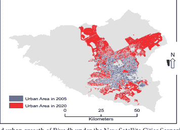

图 1. 新卫星城市情景下利雅得预测的城市增长

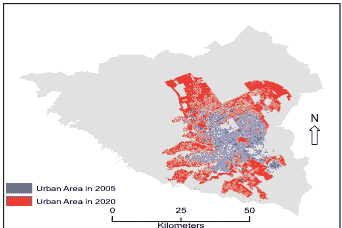

图 2. 新都市副中心情景下利雅得预测的城市增长

#### 5.2 大韩民国新城市开发

基线情景的结果如图 3 所示。图 3a 和图 3b 分别是规划中期和规划后期的最终预测图像。规划中期的预测从图 3a 中蓝色区域开始，新增城市区域在同一图中以红色显示。图 3a 的结果被用作图 3b 所示规划后期模拟的初始/起点。图 3c 是叠加了规划中期（紫色）和规划后期（红色）城市增长的图像。最后，图 3d 显示了 2020 年新行政首都区域的预测城市形态。

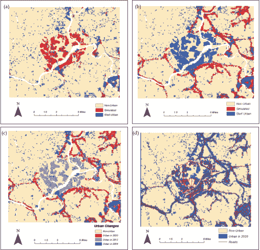

图 3. 第一种（基线）情景下新行政首都区域预测的城市增长：（a）规划中期；（b）规划后期；（c）两个时期的城市变化；（d）2020 年的最终城市形态。

在规划中期，大部分城市开发发生在新行政首都城市的规划区域内，东部和东南部地区出现少量城市集聚（见图 3a）。这可以被视为组织有序、目标明确的城市增长的结果。然而，在规划后期，预计规划城市周边会出现进一步的城市开发，尤其是沿道路网络（包括外环线和图像的东北角）。高度发达地区的发展压力似乎导致了图 3b 东南角的城市开发。同样值得注意的是，图像的东北角出现了新的城市集群。

图 3 清晰地展示了规划中期和规划后期城市增长模式的差异。规划中期的大部分城市开发…


规划期（以紫色标示）集中在规划城市范围内。然而，后规划期进一步的城市开发会沿道路网络形成相当零散的城市聚落形态（以红色标示）。对2020年最终城市形态的预测显示出零散城市增长的迹象（见图3d）。

第二个情景见图4，其目的是考察高于预期的10%城市增长率所产生的影响。图4a显示了规划中期预测的城市格局。与基准情景（图3a）相比，可以识别出四类城市增长。第一，沿从图像北缘到东缘穿过的道路的城市开发十分明显。第二，新行政首都正南和东南邻近区域的城市组团显著发展。第三，东北角已形成两个小型城市组团。最后，在图像东南角可以识别出一处新的城市开发。

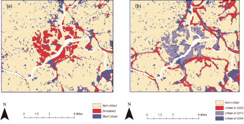

图4. 采用10%城市增长情景的模型模拟结果：a）规划中期，b）后规划期。

图4b显示了后规划期更高的模拟城市增长水平。为便于比较，基准情景（7.5%城市增长）的结果以紫色标示。规划中期模拟中呈现的趋势在该情景中也很明显。规划中期在东北角发展起来的两个小型城市组团清晰可辨，并形成一个大型城市组团。除该城市组团外，大多数城市开发发生在连接新行政首都与已开发区域的道路网络沿线。沿从图像北缘到东缘穿过的道路的城市增长，以及新行政首都正南和东南邻近区域发生的城市增长，现在更加清晰。沿道路网络出现的零散城市增长格局——其默认增长率见图3a——在采用更高城市增长率后得到强化。

### 5. 模型比较

FCAUGM和NCGM均在利兹大学独立开发，用于对两个差异很大的区域进行城市增长建模。表1采用与Santé等（2010）所用相同的特征，对FCAUGM和NCGM进行了比较。

| 模型特征 | FCAUGM | NCGM |
|---|---|---|
| 目标 | 描述性 + 预测性 | 预测性 |
| 元胞空间 | 20 m 方形元胞 | 30 m 方形元胞 |
| 状态 | 城市、非城市 | 城市、非城市 |
| 邻域 | 大小在校准期间确定 | 大小在校准期间确定 |
| 转换规则 | 采用与Li and Yeh（2001）相同的指数形式 | 混合转换规则，在一定范围内呈S形，在其他范围呈指数型 |
| 约束条件 | 城市土地年增长率 | 城市土地年增长率 |
| 其他方法 | 遗传算法、并行模拟退火和专家知识用于校准 | 遗传算法用于校准 |
| 增长驱动因素 | 到地方道路、主要道路和干道的可达性，城市密度，到城镇中心的可达性，到就业中心和社会经济服务（AECS）的可达性，坡度，海拔，规划区，排除区 | 城市密度，到道路的可达性，坡度，到地铁的可达性，规划区，排除区 |
| 校准 | 增长驱动因素的模糊隶属度函数、模糊规则和转换阈值在模型的三个独立实例中分别使用遗传算法、模拟退火和专家知识进行校准 | 增长驱动因素的权重和邻域大小使用遗传算法进行校准 |
| 验证 | 空间格局目视检查；由混淆矩阵得到的总体精度；城市区域精度；Lee-Sallee指数；空间格局度量 | 由混淆矩阵得到的总体精度；城市区域精度；Lee-Sallee指数 |

表1. 两个CA城市增长模型的比较

性能。然而，总体精度是单一的全局度量，并未考虑所产生的空间格局。因此，两个模型还都使用了Lee-Sallee指数，这是一种试图捕捉输出城市形态的方法；然而，它只作用于直接相邻元胞，因此无法捕捉更高层次的聚集或结构。FCAUGM还使用一种空间格局度量进行了进一步验证，该度量考察定义邻域内的一致性；但显然，仍然需要能够以更真实方式捕捉空间结构的度量。最后，没有开展改变模拟尺度的实验，因而也没有确定多分辨率下的效应。

### 6. 结论

联合国（2010）的数据显示，未来40年城市人口的增长将是剧烈的（从2009年的34亿增至2050年估计的63亿）。预测并理解这种增长对城市的影响的能力，将成为政府规划立法和政策制定的主要指导方向。如何管理现有城市的增长，才能避免给居民造成社会、经济和环境方面的不平等？正如韩国案例研究所示，在设计新城市时，是否可能利用建模工具模拟多种情景下可能的增长；这能否为可持续增长铺平道路？本章所呈现的工作选取了两个对比鲜明的城市增长领域，即现有城市区域的扩张和新城市的创建，并给出了支持将CA用作城市建模与仿真工具、以回答其中一些问题的结果。在沙特阿拉伯案例中，介绍了FCAUGM模型——一种CA驱动的模型，并评估了新发展卫星城镇以及围绕利雅得市创建新都市副中心的影响。这两项模拟都是沙特政府当前规划政策的一部分。在韩国案例中，开发了另一种名为NCGM的CA驱动模型，并将其应用于新城市规划。两个案例研究的结果表明，这些模型能够预测未来城市增长的合理格局。此外，两个模型都可调整用作沙特阿拉伯和大韩民国城市规划者和决策者的空间规划支持工具。此类工具可协助检验规划、政策以及其他支撑和影响城市增长过程的因素。这反过来可以更好地理解影响城市增长的因素，并最终通过回答“如果……会怎样”类问题，评估多种未来城市增长情景的后果（Yeh and Li, 2001）。

这两个示例中CA的使用反映了人们如今看待城市方式的转变；城市不再被视为静态实体，而是由各要素（人、环境和政策等）之间空间与时间相互作用构成的动态复杂系统。植根于复杂性理论的CA，通过让模型内部的组成部分反映空间（邻域和约束）和时间（更新或反馈）相互作用，为复杂城市系统的建模提供了启示。FCAUGM和NCGM模型代表了文献中可见的一类新型CA模型。两者都可归为混合模型，借鉴了其他方法的优势，例如用于校准的遗传算法和用于构建转换规则的模糊逻辑。通过这种混合方法，这些模型在评估方面可以显著更好


- 利雅得发展局（ADA）。（2004）*利雅得大都市战略规划：第二部分城市现状、背景与议题*。沙特阿拉伯，利雅得。

- Barredo, J.I., Demicheli, L., Lavalle, C., Kasanko, M. & McCormick, N. (2004). 模拟发展中国家的未来城市情景：尼日利亚拉各斯的应用案例研究。*环境与规划B*, Vol.31, No.1, 65-84, ISSN 0265-8135。

- Batty, M. (1981) 城市模型，载于：*定量地理学：英国视角*, Wrigley, N. & Bennett, R.J.（编），181-191, Routledge and Kegan Paul, ISBN 0-7100-0731-0, 伦敦。

- Batty, M. (1994). 科学规划编年史：英美建模经验。*美国规划协会杂志*, Vol.60, No. 1, 7-16, ISSN 0194-4363。

- Batty, M. (1996). 城市动态可视化，载于：*空间分析：GIS环境中的建模*, Longley, P. & Batty, M.（编），297-320, Geoinformation International, ISBN 0-470-23615-9, 剑桥。

- Batty, M. (1998). 桌面上的城市演化：使用扩展元胞自动机进行模拟。*环境与规划A*, Vol.30, No.11, 1943-1967, ISSN 0308-518X。

- Batty, M. (2007). *模型城市*。伦敦大学学院高级空间分析中心，工作论文113，http://www.casa.ucl.ac.uk/publications/workingPaperDetail.asp?ID=113。

- Briassoulis, H. (2000). 土地利用变化分析：理论与建模方法，载于：*区域科学网络书籍* URL: http://www.rri.wvu.edu/regscweb.htm, Loveridge, S.（编），区域研究所，西弗吉尼亚大学，美国，摩根敦。

- Burgess, E.W. (1925). 城市的增长：一个研究项目的引论，载于：*城市*, Park, R.E., Burgess, E.W. & McKenzie, R.D.（编），47-62, 芝加哥大学出版社，ISBN 0-226-64114-7, 芝加哥。

- Chapin, F.S. & Kaiser, E.J. (1979). *城市土地利用规划*, 伊利诺伊大学出版社，ISBN 0-252-01010-8, 厄巴纳，伊利诺伊州。

- Christaller, W. (1933) *德国南部的中心地*, 恩格尔伍德悬崖，ISBN-10: 0131226304, 新泽西。

- Clarke, K.C., Hoppen, S. & Gaydos, L. (1997). 旧金山湾区历史城市化的自修改元胞自动机模型。*环境与规划B*, Vol.24, No.2, 247-261, ISSN 0265-8135。

- Engelen, G., White, R., Uljee, I. & Drazan, P. (1995). 使用元胞自动机对生态环境系统进行综合建模。*环境监测与评估*, Vol.34, No.2, 203-214, ISSN 0167-6369。

- Han, J., Hayashi, Y., Cao, X. & Imura, H. (2009). 集成系统动力学与元胞自动机模型在城市增长评估中的应用——以上海为例。*景观与城市规划*, Vol.91, No.3, 133–141, ISSN 0169-2046。

- Harris, C. and Ullman, E. (1945). 城市的本质。*美国政治与社会科学院年鉴*, Vol.242, No.1, 7-17, ISSN 0002-7162。

- 利雅得发展高级委员会（HCDR）（2004）。*新郊野城市愿景，执行摘要*。利雅得发展局，沙特阿拉伯，利雅得。

- Hoyt, H. (1939). *美国城市住宅区结构与增长*。联邦住房管理局，华盛顿特区，美国政府印刷局。

- Irwin, E.G., Jayaprakash, C. & Munroe, D.K. (2009). 迈向城市空间动态建模的综合框架。*景观生态学*, Vol.24, No.9, 1223–1236, ISSN 0921-2973。

- Itami, R.M. (1988). 细胞世界：景观动态概念的模型。*景观建筑*, Vol.78, No.5, 52–57, ISSN 0023-8031。

- Jantz, C.A., Goetz, S.J., Donato, D. & Claggett, P. (2010). 使用SLEUTH城市元胞模型设计与实施区域城市建模系统。*计算机、环境与城市系统*, Vol.34, No.1, 1–16, ISSN 0198-9715。

- Kim, B. (2005). *基于元胞自动机的新城增长建模*。未发表博士学位论文，地理学院，利兹大学，英国利兹。

- Kirkby, M., Naden, P., Burt, T. & Butcher, D. (1992). *自然地理学中的计算机模拟*。John Wiley and Sons, ISBN 0-471-96004-2, 奇切斯特。

- Klosterman, R.E. (1999). “如果……会怎样？”协同规划支持系统。*环境与规划B*, Vol.26, No.3, 393–408, ISSN 0265-8135。

- Knox, P.L. (1994). *城市化：城市地理学导论*, Prentice-Hall, ISBN-10: 0131424505, 纽约。

- Li, L., Sato, Y. & Zhu, H. (2003). 基于物理过程模拟城市空间扩张。*景观与城市规划*, Vol.64, No.1, 67–76, ISSN 0169-2046。

- Li, X. & Yeh, A. (2001). 利用神经网络校准元胞自动机以模拟复杂城市系统。*环境与规划A*, Vol.33, No.8, 1445–1462, ISSN 0308-518X。

- Lavalle, C., Barredo, J.I., McCormick, N., Engelen, G., White, R. & Uljee, I. (2004). MOLAND城市与区域增长预测模型——可持续发展路径定义工具。欧盟委员会，联合研究中心，意大利伊斯普拉，22页，EUR 21480 EN。

- 建设交通部（MOCT）（2005）。新行政首都建设发展计划。http://www.winwinkorea.go.kr。

- Moreno, N., Wang, F. & Marceau, D.J. (2009). 基于矢量的土地利用元胞自动机模型中动态邻域的实现。*计算机、环境与城市系统*, Vol.33, No.1, 44–54, ISSN 0198-9715。

- Pacione, M. (2005). *城市地理学：全球视角，第二版*, Routledge, ISBN-10: 0415191963, 伦敦与纽约。

- Pan, Y., Roth, A., Yu, Z. & Doluschitz, R. (2010). 尺度变化对土地利用变化建模元胞自动机行为的影响。*计算机、环境与城市系统*, Vol.34, No.5, 400–408, ISSN 0198-9715。

- Petrova, L.O., Lavalle, C. & Kasanko, M. (2009). 欧洲旅游区域的城市土地利用情景：将MOLAND模型应用于葡萄牙阿尔加维。*景观与城市规划*, Vol.92, No.1, 10–23, ISSN 0169-2046。

- Poelmans, L. & Van Rompaey, A. (2009). 高度破碎化区域城市蔓延空间格局的检测与建模——以佛兰德斯-布鲁塞尔地区为例。*景观与城市规划*, Vol.93, No.1, 10–19, ISSN 0169-2046。

- Poelmans, L. & Van Rompaey, A. (2010). 城市扩张模型的复杂性与性能。*计算机、环境与城市系统*, Vol.34, No.1, 17–27, ISSN 0198-9715。

- Pontius, R.G., Cornell, J.D. & Hall, C.A.S. (2001). 使用GEOMOD2模拟土地利用变化的空间格局：哥斯达黎加的应用与验证。*农业、生态系统与环境*, Vol.85, No.1, 191–203, ISSN 0167-8809。

- Portugali, J. (2000). *自组织与城市*。Springer-Verlag, ISBN 3-540-65483-6, 柏林。

- Rafiee, R., Mahiny, A.S., Khorasani, N., Darvishsefat, A.A., Danekar, A. (2009). 通过SLEUTH模型（UGM）模拟伊朗马什哈德城市增长。*城市*, Vol.26, No.1, 19–26, ISSN 0264-2751。

- Santé, I., García, A.M., Miranda, D., Crecente, R. (2010). 模拟现实世界城市过程的元胞自动机模型：回顾与分析。*景观与城市规划*, Vol.96, No.2, 108–122, ISSN 0169-2046。

- Stevens, D. & Dragicevic, S. (2007). 基于GIS的不规则元胞自动机土地利用变化模型。*环境与规划B*, Vol.34, No.4, 708–724, ISSN 0265-8135。

- Torrens, P.M. (2000a). 城市系统元胞模型的工作原理。伦敦大学学院CASA高级空间分析中心，工作论文28，http://www.casa.ucl.ac.uk/publications/workingPaperDetail.asp?ID=28。

- Torrens, P.M. (2000b). 土地利用交通模型的工作原理。伦敦大学学院高级空间分析中心，工作论文20，http://www.casa.ucl.ac.uk/publications/workingPaperDetail.asp?ID=20。

- van Vliet, J., White, R. & Dragicevic, S. (2009). 使用可变网格元胞自动机模拟城市增长。*计算机、环境与城市系统*, Vol.33, No.1, 35–43, ISSN 0198-9715。

- Veldkamp, A. & Fresco, L.O. (1996). CLUE：一个研究土地利用转换及其影响的概念模型。*生态建模*, Vol.85, No.2-3, 253–270, ISSN 0304-3800。

- Weber, A. (1929)（由Carl J. Friedrich从韦伯1909年著作翻译）。*工业区位论*。芝加哥大学出版社，ISBN-10: 0226264696, 芝加哥。

- White, R., Engelen, G. & Uljee, I. (1997). 元胞自动机作为集成动态区域建模的基础。*环境与规划B*, Vol.24, No.3, 323–343, ISSN 0265-8135。

- 联合国（2010）。世界城市化展望，2009年修订版：新闻稿。经济和社会事务部，人口司，纽约。

- Wolfram, S. (1994). *元胞自动机与复杂性*。Addison-Wesley, ISBN 0-201-62716-7, 雷丁，马萨诸塞州。

- Wu, X., Hu, Y., He, H.S., Bu, R., Onsted, J. & Xi, F. (2009). SLEUTH模型在中国东北沈阳都市区的性能评估。*环境建模与评估*, Vol.14, No.2, 221–230, ISSN 0167-6369。

- Wu, D., Liu, J., Wang, S. & Wang, R. (2010). 耦合随机元胞自动机模型与社会经济指标模拟城市扩张。*随机环境研究与风险评估*, Vol.24, No.2, 235–245, ISSN 1436-3240。

- Wu, N. & Silva, E. (2009). 集成遗传主体与元胞自动机进行动态城市增长建模，第十届国际地理计算会议论文集，澳大利亚悉尼新南威尔士大学，2009年11月30日至12月2日，布里斯班。


## 基于元胞自动机的种群动态研究

Rosana Motta Jafelice¹ 和 Patrícia Nunes da Silva²  
¹ 乌贝兰迪亚联邦大学  
数学学院  
² 里约热内卢州立大学  
数学分析系 - IME  
巴西

### 1. 引言

在本章中，我们介绍三个模拟三种生物系统种群动态行为的元胞自动机。它们被塑造成环面形状，其中种群人为地共存。第一个模型处理人工生存的鱼类，分为两组：鲨鱼（捕食者）和作为其食物链一部分的鱼类（猎物）(Edelstein-Keshet, 1988; Renning, 1999-2000)。第二个模型引入了对未接受抗逆转录病毒治疗的阳性个体血液中HIV演化的模拟 (Jafelice et al., 2009)。最后一个模型扩展了前一个模型，考虑了接受医疗治疗以及药物效力和治疗依从性监测的个体中的HIV动态 (Jafelice et al., 2009)。为此，开发了一种结合模糊集理论的元胞自动机方法来研究HIV的演化。在对物理或生物系统建模时，需要做出许多决策。其中之一涉及采用何种方法。在“自下而上”的方法中，系统的复杂行为从基本组成部分的相互作用中涌现。人们可能会问，是否可以用这种方式描述复杂系统的行为。事实上，Banks (1971) 提出了一个有趣的评论：物理学家们乐于相信宇宙由数量庞大的、仅三种基本成分组成：质子、电子和中子。用现实模型模拟生物现象通常会导致大型非线性积分-偏微分方程组。一种替代方法是考虑元胞自动机（CA）模型。CA模型的实用性依赖于其单元的简单性和均匀性，以及它们模拟复杂系统的潜力。元胞自动机模型背后的主要思想是将空间域的每个位置（或区域）视为一个单元，并赋予其某种状态。每个单元的状态根据其自身状态及其相邻单元的状态进行修改。这些状态通过一些简单的规则相互关联，这些规则模仿了指导系统行为的生物和物理规律 (Ermentrout & Edelstein-Keshet, 1993)。在种群动态建模中，一个重要的方面是考虑种群的空间分布对其动态的影响。CA模型能够捕捉这种效应（例如 Czaran 1998; Lee et al. 1995）。

### 2. 猎物-捕食者模型的元胞自动机：鲨鱼和鱼

在本节中，我们讨论由西安大略大学的 David Wiseman 提出的捕食者-猎物模型的元胞自动机（见 Dewdney 1984）。Wa-Tor 星球¹是一个环面形状的网格，鱼和鲨鱼在其中人为共存。在这个星球上，大多数时候鱼和鲨鱼随机移动。鱼和鲨鱼在达到适当年龄后可以繁殖。与鲨鱼不同，鱼有充足的浮游生物供应，而鲨鱼必须在特定的最长时间内吃掉鱼，否则它们会饿死。因此，该模拟是一个捕食者-猎物类型的动态系统。在他的二维CA中，Dewdney (1984) 考虑了冯·诺依曼邻域。也就是说，每个单元与自身及其四个正交相邻单元相连。他将自己的结果与Lotka-Volterra方程给出的理论捕食者-猎物关系以及哈德逊湾公司近五十年记录的加拿大猞猁和雪鞋兔种群规模进行了比较。我们的结果是使用具有摩尔邻域的二维CA获得的。也就是说，每个单元与自身、其四个正交相邻单元及其四个对角相邻单元相连。在两种情况下，仅由单元及其邻居的较早状态决定下一个时间步。这类自动机与偏微分方程或积分方程等演化方程非常相似。我们的结果与Lotka-Volterra经典模型 (Edelstein-Keshet, 1988; Murray, 1990) 以及哈德逊湾公司的经验数据进行了比较。

#### 2.1 捕食者-猎物的现实例子：哈德逊湾的野兔和猞猁

1850年，哈德逊湾公司从捕猎者那里获得野兔和猞猁的毛皮。进入陷阱的野兔和猞猁的数量被记录下来，并被研究人员用于研究竞争相互作用模型（见 Bummel 1974; Stenseth et al. 1998）。众所周知，捕获动物的数量与其种群规模成正比，因此研究人员获得了这两种物种在很长一段时间内的种群统计数据。基于哈德逊湾公司野兔和猞猁毛皮记录的加拿大野兔-猞猁系统数据可在 Elton & Nicholson (1942)、Gilpin (1973) 和 Hewitt (1921) 中找到。这两个种群并非彼此独立存在，因为猞猁基本上以野兔为食。生态学家 Charles Elton (Elton, 1924) 分析了每年的所有毛皮记录，并展示于图1中。该图显示两种物种的数量在十年间呈现规律性波动。它们在一个周期内变化超过50倍，甚至高达100倍，这使得振荡幅度非常巨大。在接下来的小节中，我们将看到经典模型呈现规则曲线和完美周期性的相平面，而我们的元胞自动机将呈现一个更接近图2的周期。从图1中显示的种群数据获得了始于1875年的三十年周期的相平面图。

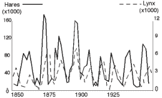

图1. 野兔和猞猁种群随时间的变化 (Renning, 1999-2000)。

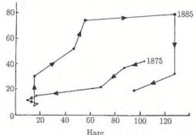

图2. 图1所示数据的相平面图细节 (Murray, 1990)。

#### 2.2 经典捕食者-猎物模型

捕食者和猎物的种群波动挑战了许多研究者。是什么导致了繁殖和生存的变化？除了食物、捕食和社会互动这三个主要因素外，许多其他因素也可能影响这些循环。例如，Zhang et al. (2007) 使用偏互相关和逐步多元回归方法分析了气候对哈德逊湾公司野兔-猞猁系统（1847-1903年）的影响。他们的结果表明，厄尔尼诺/南方涛动对野兔和猞猁种群增长率的影响较小。Krebs et al. (2001) 关注食物变化如何影响野兔周期，而 Stenseth et al. (1999) 观察到猞猁种群动态与由气候特征引起的区域结构一致。

为了表述猎物和捕食者之间的相互作用，使用了一个确定性模型（后来成为经典模型）²。它由微分方程组给出：

```
$$\begin{aligned}
\frac{dx}{dt} &= ax - \alpha xy \\
\frac{dy}{dt} &= -by + \beta xy
\end{aligned} \tag{1}$$
```

在该模型中，状态变量 x 和 y 分别为每个时刻 t 的猎物和捕食者数量。参数为：

- $a$：猎物的相对增长率；
- $\alpha$：捕食率（捕食者在每次遭遇时杀死猎物的概率）；
- $b$：在没有猎物的情况下捕食者的死亡率；
- $\beta$：猎物转化为捕食者的转化率。

用参数 $a = 0.1$，$\alpha = 0.01$，$b = 0.05$ 和 $\beta = 0.001$ 求解微分方程，我们得到图3的图形和相平面图4。

² 关于Lotka-Volterra种群模型的综述，参见 Wangersky (1978)。


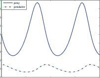

图 3. 微分方程系统的解。

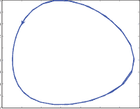

图 4. 相平面。

由于经典模型忽略空间相关性，因此没有考虑空间不均匀性可能对系统动力学造成的重要影响。此外，在此类模型中，我们没有任何关于种群空间分布的信息。

#### 2.3 元胞自动机模拟的描述

要设置模拟，需要选择以下五个参数：

- 鱼的数量；
- 鲨鱼的数量；
- 鱼的繁殖年龄；
- 鲨鱼的繁殖年龄；
- 鲨鱼的饥饿期。

鲨鱼和鱼的初始数量及其各自的年龄随机分布在一个矩形网格中，该网格的相对边成对等同。网格中的元胞状态根据每个元胞的局部动力学规则更新。例如，在 40×40 的元胞网格中，将 300 条鱼和 10 条鲨鱼放置在随机位置。所有鱼和鲨鱼都有繁殖年龄，即分别为 3 次和 10 次迭代，鲨鱼的饥饿期为 3。

##### 2.3.1 Wa-Tor 中鱼的行为

每条鱼在其邻域中选择一个空闲位置，移动到那里并在那里老化（如果所有位置都被占据，则它留在原地并老化）。当它达到繁殖年龄时，会留下一个后代。它们根据随机分配且指示方向的整数移动。更具体地说，根据该整数的值等于 1、2、3、4、5、6、7 或 8，它们分别在网格中向北、东、南、西、东北、西北、东南或西南移动（Silva & Jafelice, 2010）。

##### 2.3.2 Wa-Tor 中鲨鱼的行为

首先，每条鲨鱼在其邻域中寻找鱼。如果有鱼，鲨鱼随机选择一条，捕获它，并将变量（饥饿变量）设为零。它前往被吃掉的鱼所在的元胞，并在条件允许时可能繁殖。如果它在邻域中没有找到任何鱼，它会像鱼一样移动，并且饥饿变量增加 1。当饥饿变量达到其最大值（鲨鱼的饥饿期）时，鲨鱼死亡。此外，鲨鱼的繁殖与鱼的繁殖相似。

Wa-Tor 系统 200 次迭代（或时间步）的模拟结果如图 5-7 所示。注意，图 5 中显示的鱼和鲨鱼的行为与图 3 中相似阶段的行为接近。

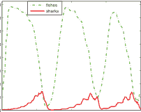

图 5. Wa-Tor 模拟结果。

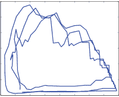

图 6. Wa-Tor 中一次模拟的相平面。

#### 2.4 计算图形界面

我们使用 *Matlab 7.0* 构建了 Wa-Tor 系统的计算图形界面（其初始界面见图 8（Jafelice & Silva, 2011））。要设置自己的模拟，需要选择以下六个参数：

- 迭代次数；
- 鱼的初始数量；
- 鲨鱼的初始数量；
- 鱼的繁殖年龄；
- 鲨鱼的繁殖年龄；
- 鲨鱼的饥饿期。

也可以使用预先指定的参数运行下面列出的四种模拟：

- 稳定的生态循环
- 鱼灭绝
- 鲨鱼灭绝
- 鱼和鲨鱼灭绝。

此外，在每次模拟结束时，会绘制鱼和鲨鱼种群随时间变化的图以及相平面图。

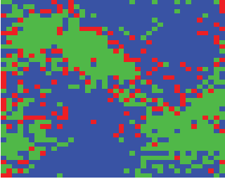

图 7. 元胞自动机模型输出快照：蓝色背景是海洋，鱼为绿色，鲨鱼为红色。

#### 2.5 结论

本节介绍了一种用于捕食者-猎物动力学的元胞自动机方法。所获得的结果（以及 Dewdney（1984）的结果）与 Lotka-Volterra 结果相似，但更进一步。鱼和鲨鱼的种群波动比 Lotka-Volterra 解更类似于野兔和猞猁的图表。CA 模型的另一个有趣特征是它是一个空间分布的捕食者-猎物模型。如今，空间不均匀性在生物物种动力学中的关键作用已被认识到（进一步讨论见 Durrett & Levin（2000）、Ermentrout & Edelstein-Keshet（1993）及其中参考文献。另见 Pekalski（2004）对捕食者-猎物系统方法的概述以及对一些开放问题的评论）。Saila（2009）将 Wa-Tor 描述为一个由相互作用的自主代理组成的复杂适应系统，并指出传统数学在理解此类复杂生态系统动力学方面的作用有限。系统的演化似乎不依赖于初始随机分布，但五个初始参数的选择是系统未来行为的关键点。该模型呈现出复杂行为，模拟给出了现实的定性图景。

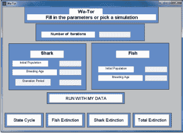

图 8. Wa-Tor 的计算图形界面。

人类免疫缺陷病毒（HIV）感染动力学的元胞自动机模型是接下来几节的主题。确定每个元胞的动力学规则需要对 HIV 行为有深入的了解。HIV 是一种由 RNA（核糖核酸）组成的球形逆转录病毒。它的复制发生在宿主细胞内。三种病毒蛋白对复制过程至关重要：逆转录酶、整合酶和蛋白酶。HIV 进入人类宿主后，会散布到整个淋巴组织。当 HIV 到达血流时，它主要攻击 CD4+ 型 T 淋巴细胞。外周血中 CD4+ 细胞的数量对 HIV 感染演变具有预后意义。CD4+ T 细胞逐渐丧失至艾滋病定义水平 200 个细胞/mm³，以及进行性免疫缺陷，会导致机会性感染，这些感染是 HIV 感染的特征（Haase, 1999; Hazenbeg et al., 2000）。如今，免疫活性细胞的数量是治疗感染者期间临床上最常用且可接受的测量指标。抗逆转录病毒治疗通过抑制逆转录酶和蛋白酶发挥作用。抑制逆转录酶可阻止游离病毒颗粒感染 CD4+ 细胞。蛋白酶抑制可延迟病毒复制，使机体能够自然反应。逆转录酶抑制与蛋白酶抑制的联合已使 HIV 治疗得到显著改善。

人类个体中 HIV 感染动力学的微观模型为构建元胞自动机模型提供了有用信息，尤其是当以下量恒定时：CD4+ T 淋巴细胞的增长率、感染细胞和未感染细胞的死亡率、游离病毒载量、称为 CTL 的特异性抗体、CD4+ T 淋巴细胞未感染细胞与病毒之间的相互作用率，以及 CD4+ T 淋巴细胞感染细胞与抗体之间的相互作用率。

在下一节中，我们介绍无抗逆转录病毒治疗情况下 HIV 感染动力学的元胞自动机模型（Jafelice et al., 2009）。

### 3. 无抗逆转录病毒治疗的阳性个体血流中 HIV 演化的元胞自动机

艾滋病（获得性免疫缺陷综合征）已成为一个全球性健康问题。在艾滋病控制较差甚至不存在的国家，如一些非洲国家，HIV 阳性人群的死亡率很高。Zeronon dos Santos & Coutinho（2001）报告了一种元胞自动机方法，用于模拟 HIV 感染的三阶段模式，包括原发反应、临床潜伏期和获得性免疫缺陷综合征（AIDS）发病。Figueiredo et al.（2008）分析了其元胞自动机模型所得结果的稳健性。Ude et al.（2006）的 CA 模型考虑了 HIV 和 T 细胞所表现出的多样性。他们的结果表明，病毒的多样性是影响 HIV 逃避免疫应答成功率的主要因素，并且他们还能够模拟在体内观察到的潜伏期变异性。Mielke & Pandey（1998）开发了一种用于突变 HIV 的模糊交互模型，其中包含针对巨噬细胞、辅助细胞、细胞毒性细胞和病毒粒子的 10 种相互作用的模糊集合。这些模型是未进行抗逆转录病毒治疗的元胞自动机模型。我们考虑用一个元胞自动机来模拟 HIV 感染三阶段模式的行为，该模式针对 HIV 的 CD4+ T 淋巴细胞和称为 CTL 的特异性抗体，包括原发感染、无症状期和有症状期。我们将 CA 模型结果与 HIV 感染的自然史以及 Nowak & Bangham（1996）提出的 HIV 动力学模型进行比较。

#### 3.1 HIV 动力学的微观模型

Nowak & Bangham（1996）开发了三种用于人类个体机体内 HIV 感染动力学的微观模型，这些模型不考虑抗逆转录病毒治疗。第一个模型刻画了复制病毒与宿主细胞之间的相互作用。在这种情况下，考虑三个变量：未感染细胞 *n*、感染细胞 *i* 和游离病毒颗粒 *v*。该模型假设感染细胞由未感染细胞和游离病毒以速率 βnv 产生，并以速率 *b* 死亡。游离病毒由感染细胞以速率 *k* 产生，并以速率 *sv* 衰减。未感染细胞由前体细胞池以恒定速率 *r* 产生，并以速率 *a* 死亡。图 9 展示了该模型所描述的 HIV 动力学。

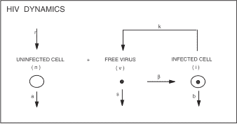

图 9. HIV 病毒动力学的微观模型（Nowak, 1999）。


建模假设导致如下微分方程组：

$$
\begin{aligned}
\frac{dn}{dt} &= r - an - \beta nv \\
\frac{di}{dt} &= \beta nv - bi \\
\frac{dv}{dt} &= ki - sv
\end{aligned}
\tag{2}
$$

第二个模型包含针对受感染细胞的免疫应答，并通过增加一个描述针对受感染细胞免疫应答的方程来扩展方程组 (2)：

$$
\begin{aligned}
\frac{dn}{dt} &= r - an - \beta nv \\
\frac{di}{dt} &= \beta nv - bi - piz \\
\frac{dv}{dt} &= ki - sv \\
\frac{dz}{dt} &= ciz - dz
\end{aligned}
\tag{3}
$$

变量 z 表示抗体 CTL（细胞毒性 T 淋巴细胞）的数量——即病毒特异性 CTL 的丰度。CTL 响应抗原的增殖速率为 ciz。在没有刺激的情况下，CTL 以速率 dz 衰减。受感染细胞被 CTL 以速率 piz 杀死。图 10 显示了使用表 1 的参数和表 2 的初始条件求解 (3) 的结果，该结果取自 Caetano & Yoneyama (1999)。

| r = 0.3 | a = 0.1 | β = 1 |
| --- | --- | --- |
| b = 0.01 | p = 0.03 | k = 0.5 |
| c = 0.01 | s = 0.01 | d = 0.01 |

表 1. 微观 HIV 模型的参数。

| n(0) | 0.99 |
| --- | --- |
| i(0) | 0.01 |
| v(0) | 0.1 |
| z(0) | 0.01 |
| 初始时间 | 0 |
| 最终时间 | 500 个时间单位 |

表 2. 微观 HIV 模型的初始条件。

从图 10 可以看出，在对数尺度下，未感染的 CD4+ 细胞在最初几周迅速下降，而当淋巴细胞数量接近最大值时缓慢恢复。淋巴细胞数量的增加与受感染细胞中的病毒复制有关。

将图 10 所示的系统 (3) 的解与图 11 中的曲线（其给出目前公认的 HIV 感染史动态）进行比较，我们注意到未感染的 CD4+ 细胞与 CD4+ 水平相对应，游离病毒与 HIV 病毒相对应，病毒特异性 CTL 与 HIV 抗体相对应。这一结果将有助于验证未接受抗逆转录病毒治疗的个体的细胞自动机模型。

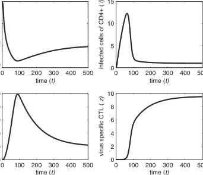

图 10. 微观 HIV 模型 (3) 的解。

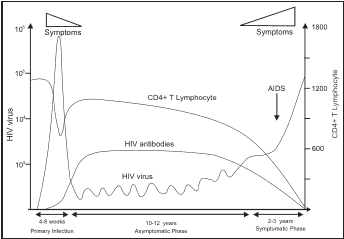

图 11. 目前公认的 HIV 感染动态自然史（Coutinho et al., 2001; Perelson & Nelson, 1999; Saag, 1995）。

下一节详细介绍 Blood-Tor 系统，即用于 HIV 感染动态的细胞自动机模型。

### 4. Blood-Tor 系统

Blood-Tor 这个名称来自 Bloodstream-Toroidal，它类似于细胞自动机 Wa-Tor 的名称，后者意为 Water-Toroidal（Dewdney, 1984; Renning, 1999-2000）。Blood-Tor 系统（BTS）呈环面形状，其中共存着人工未感染细胞、受感染的 CD4+ T 淋巴细胞、游离病毒颗粒，以及在未接受抗逆转录病毒治疗的个体血流中攻击受感染细胞的特异性抗体 CTL（细胞毒性 T 淋巴细胞）。这些元素与微分方程组 (3) 的状态变量所关联的元素相同。

#### 4.1 仿真过程描述

设置一次仿真运行需要选择十一个参数。参数如下：

- 未感染细胞数量
- 受感染的 CD4+ T 淋巴细胞数量
- 游离病毒颗粒数量
- 特异性抗体 CTL（细胞毒性 T 淋巴细胞）数量
- 未感染细胞寿命上限
- 受感染细胞寿命上限
- 游离病毒颗粒寿命上限
- 特异性抗体 CTL（细胞毒性 T 淋巴细胞）寿命上限
- 受感染细胞繁殖年龄
- 特异性抗体 CTL 繁殖年龄
- 未感染细胞产生速率

网格中的细胞状态根据每个细胞的局部动力学规则进行更新。例如，在一个 31×31 的细胞网格中，200 个未感染细胞、16 个受感染的 CD4+ T 淋巴细胞、120 个游离病毒颗粒和 25 个特异性抗体 CTL（细胞毒性 T 淋巴细胞）被放置在随机位置。所有未感染细胞、受感染的 CD4+ T 淋巴细胞、游离病毒颗粒和特异性抗体 CTL 都根据特定时间限制设置寿命。表 3 给出了寿命值。初始时，按照各元素（未感染细胞、受感染的 CD4+ T 淋巴细胞、游离病毒颗粒以及攻击受感染细胞的特异性抗体 CTL）各自的寿命上限，随机分配年龄。

| 细胞 | 未感染 | 受感染 | HIV | CTL |
| --- | --- | --- | --- | --- |
| 寿命上限（迭代次数） | 4 | 5 | 3 | 15 |

表 3. 寿命上限。

##### 4.1.1 BTS 中 \(CD4+\) T 淋巴细胞的未感染细胞行为

每个未感染的 CD4+ T 淋巴细胞在其邻域中选择一个空闲位置，移动到那里并老化（如果所有位置都被占用，则留在原地并老化）。它们根据随机分配的表示方向的整数移动。更具体地说，根据该整数值等于 0、1、2 还是 3，它们分别向网格的北、东、南或西移动。CD4+ T 淋巴细胞以恒定速率产生。在仿真期间，该速率为每次迭代 18 个细胞。当它们达到寿命上限时死亡。

##### 4.1.2 BTS 中 HIV 的行为

首先，每个 HIV 在其邻域中搜索未感染的 CD4+ T 淋巴细胞。如果有未感染细胞，HIV 随机选择一个，被选中的细胞成为受感染细胞。如果没有未感染细胞，则 HIV 在其邻域中选择一个位置，移动到那里并老化（如果所有位置都被占用，则留在原地并老化）。当 HIV 达到寿命上限时死亡。

##### 4.1.3 BTS 中 CD4+ T 淋巴细胞的受感染细胞行为

当游离 HIV 遇到未感染的 CD4+ 细胞时，未感染细胞被感染。这些细胞在达到 5 次迭代的年龄时开始复制 HIV。仿真程序将一个 HIV 放置在受感染细胞的位置，并将新 HIV 的年龄设为零。它们像未感染的 CD4+ T 淋巴细胞一样移动和老化。在达到寿命上限后，它们死亡。

##### 4.1.4 BTS 中特异性抗体 CTL 的行为

每个特异性抗体 CTL 在其邻域中寻找受感染的 CD4+ T 淋巴细胞。当特异性抗体 CTL 遇到受感染细胞时，受感染细胞被破坏。特异性抗体 CTL 移动到先前位置中受感染的细胞处。特异性抗体在 14 次迭代后达到繁殖期。它们像未感染的 CD4+ T 淋巴细胞一样移动和老化。在达到寿命上限后，它们死亡。

Blood-Tor 系统模拟未治疗的人类个体血流中 HIV 的演化动态。

图 12 显示了 Blood-Tor 系统细胞自动机模型的一个快照。未感染细胞显示为蓝色，HIV 显示为黑色，受感染细胞显示为绿色，抗体显示为白色。Blood-Tor 仿真系统使用 Matlab 7.0 开发。

图 13 描绘了 Blood-Tor 系统（BTS）在 50 次迭代（或时间步）后的仿真结果。请注意，图 13 中所示的未感染 CD4+ 细胞、受感染 CD4+ 细胞、游离病毒和病毒特异性抗体的行为与图 11 中类似（无症状）阶段的行为接近。显然，BTS 确实很好地描述了未治疗的人类个体血流中 HIV 的演化。

下一节将扩展 BTS，以涵盖图 11 中 HIV 动态的自然阶段。

#### 4.2 扩展的 Blood-Tor 系统

为了扩展细胞自动机对 HIV 感染自然史建模的能力，Blood-Tor 系统被扩展以包含如图 11 所示的有症状阶段行为。

生成图 13 所示输出的细胞自动机经过了修改，使得在若干次迭代之后，抗体产生减少，因此游离病毒颗粒数量增加。在一个 31×31 的细胞网格中，120 个未感染细胞、18 个受感染的 CD4+ T 淋巴细胞、180 个游离病毒颗粒和 18 个特异性抗体 CTL（细胞毒性 T 淋巴细胞）被引入随机位置。所有这些细胞移动

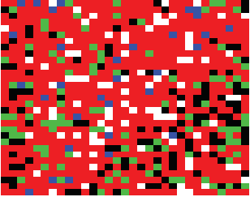

图12. 元胞自动机模型输出快照：红色背景为血流，未感染细胞为蓝色，HIV为黑色，感染细胞为绿色，抗体为白色。


图13. Blood-Tor系统仿真结果。

随机地。未感染细胞的时间限制设为七（在先前情况下设为四次迭代）。如果迭代次数小于70，则繁殖时间可选为14次迭代。如果迭代次数大于或等于70，则繁殖时间在后续迭代中减少。如果迭代次数大于90，则每次迭代放置的未感染细胞数量减少。该选择的结果反映了免疫系统的失效。也就是说，人体个体的免疫系统失去了对抗病毒的能力。

在这种情况下，BTS仿真结果变得非常接近实际的HIV生物动力学。如图11和图14清楚所示，它们在HIV感染动力学的整个自然史中表现出强烈的定性相似性。


图14. 扩展的Blood-Tor系统仿真结果。

众所周知，艾滋病是一种可用适当药物治疗的疾病，但尚未发现绝对的治愈机制。有些抗逆转录病毒疗法使用逆转录酶抑制剂，另一些则针对一种称为病毒蛋白酶的酶，该酶对于从感染细胞形成有感染性的病毒颗粒至关重要。所有抗HIV药物都旨在阻止病毒复制，但它们并不杀死病毒颗粒或感染细胞（Nowak, 1999）。受Zorzenon dos Santos & Coutinho（2001）的CA模型启发，Sloot等（2002）提出了一种纳入药物治疗的CA模型。其主要要素是，由于纳入药物治疗概念，先前出现的空间模式（波状和固体状结构）被破坏，并重建新的空间模式（波状结构）。该CA模型将三种不同的治疗方案集成到一个模型中，仿真显示与临床数据具有定性对应关系。Shi等（2008）提出了一种用于HIV动力学和药物治疗的CA模型。它包括病毒复制周期和药物治疗机制。病毒载量、其对感染率的影响，以及潜伏感染细胞在维持HIV感染中的作用，是模型探索并纳入的方面。模型的动力学与临床数据定性匹配。在下一节中，我们介绍用于抗逆转录病毒治疗下HIV感染动力学的元胞自动机模型（Jafelice et al., 2009）。

### 5. 接受抗逆转录病毒治疗的阳性个体血流中HIV演化的元胞自动机

第4节详述的Blood-Tor系统模拟未接受任何抗逆转录病毒治疗的HIV阳性个体血流中HIV感染动力学的行为。本节讨论考虑治疗时的血流-环面系统。其目的是对接受抗逆转录病毒治疗的个体血流中的HIV动力学进行建模和仿真。

为了模拟抗逆转录病毒治疗，BTS系统采用模糊参数，因为个体对治疗的反应具有不精确性。在考虑抗逆转录病毒治疗时，元胞自动机模型假设病毒不会感染所有CD4+细胞，因为通常只有一部分CD4+细胞被感染。病毒复制周期被延迟，类似于HIV阳性个体血流中发生的情况。模糊参数取决于药物效力和个体对治疗的依从性。治疗依从性是指个体遵循正确用药处方的程度。依从性是一个非常复杂的问题，因为它涉及许多影响个体遵守抗逆转录病毒治疗能力的因素。许多因素会干扰处方方案，包括个体的睡眠小时数、对饮食的严格程度、用药时间表以及其社交生活的健康程度。关于药物效力的信息可由医生利用临床试验知识、临床经验和相关文献中发表的知识获得。结合临床经验，模型通过提高CD4+水平并降低病毒载量来模拟抗逆转录病毒治疗。下一小节简要回顾模糊集和基于模糊规则系统的概念。

#### 5.1 模糊集理论的基本概念

近年来，关于不确定性的文献大幅增长，尤其是在系统建模、优化、控制和模式识别领域。最近，多位作者提倡使用模糊集理论来处理流行病学问题（Barros et al., 2003; Jafelice et al., 2004; 2005; Ortega et al., 2003）和种群动力学（Krivan & Colombo, 1998）。自HIV感染出现以来，已有多个数学模型被开发用于描述HIV动力学（Murray, 1990; Nowak & Bangham, 1996; Nowak, 1999）。这里，我们建议使用模糊集理论（Zadeh, 1965）来处理病毒动力学的不确定、不精确性质。

首先，我们回顾：论域X上的模糊集A是一个隶属函数A，它为X的每个元素x分配一个介于0和1之间的数A(x)，以表示x属于A的程度。因此，模糊集A的隶属函数是函数A : X → [0, 1]。值得注意的是，X上的普通集合A是模糊集的一个特例，其隶属函数是A的特征函数，即χ_A : X → {0, 1}。

其次，我们提醒读者，模糊集理论中一个起关键作用的概念是基于模糊规则的系统（FRBS）（Pedrycz & Gomide, 1988）。FRBS的结构如图15所示。


图15. 基于模糊规则系统的结构。

一个FRBS有四个组成部分：输入处理器、称为模糊规则库（或规则库）的模糊规则集合、模糊推理机和输出处理器。这些组件处理实值输入以提供实值输出，如下所示。

- **输入处理器（模糊化）。** 这里，输入被编码到相应输入变量论域上的模糊集中。对于数值输入，常用方法是将实值输入转换为模糊单点。专家知识在为与输入相关联的每个模糊集构建隶属函数方面起着重要作用。
- **规则库。** 这是基于模糊规则系统的知识编码组件，是由If-then规则形式表示的模糊条件命题的集合。模糊规则是编码通过语言陈述表达的专家知识的有效手段。一般来说，If-then规则描述语言变量之间的关系，例如*如果治疗依从性低且药物效力高，则病毒繁殖周期快且感染CD4+细胞的百分比高*。在模糊集理论中，其值为语言术语（例如*低*）的变量（例如*治疗依从性*）称为语言变量（Pedrycz & Gomide, 1988）。
- **模糊推理。** 模糊推理机使用推理合成规则进行近似推理。本文感兴趣的一种特殊模糊推理形式是Mamdani方法（Mamdani, 1976; Mamdani & Assilian, 1999），它源自最大-最小合成（Pedrycz & Gomide, 1988）。


- **输出处理器（去模糊化）。** 在基于模糊规则的系统中，推断输出通常是一个模糊集。通常，特别是在生物系统建模中，我们需要实数值输出。输出处理器的任务是通过去模糊化提供实数值输出，去模糊化是选择一个代表推断模糊集的实数的过程。本文采用的一种典型的去模糊化方法是质心或重心法（Jafelice 等，2004）。

#### 5.2 语言变量与规则库

模糊集理论是建模不精确信息和知识的数学工具。在实践中，接受抗逆转录病毒治疗时的受感染 CD4+ 细胞数量和病毒复制周期的精确值是不确定的。这些值取决于药物效力和个体对治疗的依从性。模糊规则系统（FRBS）是处理 HIV 动力学中治疗效应的合适方法。FRBS 的输入变量是治疗依从性和药物效力（Ying 等，2007）。输出变量是 HIV 感染的 CD4+ 细胞百分比和病毒复制周期。输入和输出变量是语言变量，分别记为 A、M、P 和 V。治疗依从性（A）、药物效力（M）和受感染 CD4+ 细胞百分比（P）采用以下语言值 {极低、低、中、高、极高}，而病毒复制周期（V）采用语言值 {极快、快、中、慢、极慢}。隶属函数规定了语言变量的含义，如图 16、17、18 和 19 所示，分别对应治疗依从性、药物效力、病毒复制周期和将要受感染的 CD4+ 细胞百分比。编码 A、M、P 和 V 之间关系的规则库是使用医学专家知识构建的。模糊规则总结在表 4 和表 5 中。规则库使用 Mamdani 推理法和重心去模糊化进行处理。


图 16. 治疗依从性（A）的隶属函数。


图 17. 药物效力（*M*）的隶属函数。


图 18. 病毒复制周期（*V*）的隶属函数。


图 19. 受感染的 CD4+ 细胞百分比（P）的隶属函数。

| 依从性(A) | 极低 | 低 | 中 | 高 | 极高 |
|---|---|---|---|---|---|
| 极低 | 极高 | 极高 | 极高 | 极高 | 极高 |
| 低 | 高 | 高 | 高 | 高 | 高 |
| 中 | 中 | 高 | 中 | 高 | 中 |
| 高 | 中 | 高 | 低 | 低 | 低 |
| 极高 | 低 | 低 | 低 | 极低 | 极低 |

表 4. 将要受感染的 CD4+ 细胞百分比的模糊规则。

| 依从性(A) | 极低 | 低 | 中 | 高 | 极高 |
|---|---|---|---|---|---|
| 极低 | 极快 | 极快 | 极快 | 极快 | 极快 |
| 低 | 快 | 快 | 快 | 快 | 快 |
| 中 | 中 | 快 | 中 | 快 | 中 |
| 高 | 中 | 快 | 中 | 慢 | 慢 |
| 极高 | 快 | 中 | 中 | 极慢 | 极慢 |

表 5. 病毒复制周期的模糊规则。

元胞自动机模型按如下方式使用 FRBS 的输出。在每次迭代中，统计未受感染的 CD4+ 细胞邻域中的 HIV 数量。计数数量乘以输出变量（CD4+ 细胞百分比）的乘积就是受 HIV 感染的细胞数量。该操作模拟了逆转录酶抑制剂的作用。CD4+ 细胞的百分比取决于治疗依从性和药物效力。所有这些过程在每次迭代中都会发生。在表示 HIV 感染动力学和未治疗 HIV 阳性个体的元胞自动机中，受感染的 CD4+ 细胞在 5 次迭代后在其邻域的一个可用空闲位置释放一个病毒。在接受治疗的元胞自动机中，病毒复制周期在 5 到 16 次迭代之间变化，这模拟了延迟病毒复制的抑制作用。

### 6. 接受治疗的 Blood-Tor 系统的模拟

#### 6.1 解的分析

针对不同患者，考虑其对治疗的依从性，调整了未感染细胞、受感染的 CD4+ T 淋巴细胞、游离病毒颗粒和特异性抗体 CTL（细胞毒性 T 淋巴细胞）的数量及具体时间限制。使用表 6 所示的三名 HIV 阳性个体的数据（治疗依从性和药物效力）进行了模拟。在表中，第一、第二和第三列的参数分别对应接受低、中、高效力药物治疗的 HIV 阳性个体。模糊规则系统的输出变量如表 7 所示。表的第一行显示了受感染的 CD4+ 细胞百分比，第二行显示了病毒复制周期，对应于表 6 的输入值。元胞自动机模型对每名患者运行五次。在每个时刻 t 计算平均值。图 20 显示了结果。对治疗反应最佳的个体平均值用实线描绘。虚线是对治疗反应最差的个体平均值。HIV 的行为以及未受感染的 CD4+ T 淋巴细胞的行为与 Guedj 等 (2007)、Filter 等 (2005) 和 Ouattara 等 (2008) 报道的相应行为完全一致。HIV 曲线表现出具有正上界的渐近衰减。在实践中，实验室检查可能检测不到病毒载量，但表明循环血液中病毒的 RNA 拷贝数低于所用方法的精度。精度值是可变的。例如，在巴西公共卫生网络的情况下，目前采用的方法的精度为 50 拷贝/毫升（Brazil，2008）。如果患者不坚持治疗，则模拟过程与第 4 节讨论的未治疗情况相同。

|  | 第一参数 | 第二参数 | 第三参数 |
|---|---:|---:|---:|
| 药物效力 | 0.8 | 0.85 | 0.9 |
| 治疗依从性 | 0.1 | 0.6 | 1 |

表 6. 模拟中使用的 FRBS 输入。

|  | 第一参数 | 第二参数 | 第三参数 |
|---|---:|---:|---:|
| 受感染的 CD4+ 细胞百分比 | 0.85 | 0.55 | 0.1 |
| 病毒复制周期 | 6.35 | 10.37 | 16 |

表 7. 模拟中使用的 FRBS 输出。


图 20. 在 $t = 0$ 时开始接受治疗的 Blood-Tor 系统的平均值。

#### 6.2 治疗反应估计

图 20 表明，患者 $p_s$ 的治疗反应优于患者 $p_f$，其中 $p_f$ 和 $p_s$ 分别是表 6 中第一和第二参数对应的患者数据。为了量化治疗反应，我们必须定义一个性能度量。四个变量中的任何一个（或者如果选择适当的时间平均值，也可以是全部）都可以考虑，即未感染和受感染的 CD4+ T 淋巴细胞、游离病毒和特异性抗体。例如，可以使用两个变量值的比率来获得估计。让我们假设病毒载量是揭示治疗效率的变量。令 $\overline{v_{p_1}}$ 和 $\overline{v_{p_2}}$ 为患者 1 和患者 2 在同一时间间隔 $\Delta t$ 内的病毒载量平均值。治疗反应（$C_r$）以平均值 $\overline{v}_{p_1}$ 和 $\overline{v}_{p_2}$ 的比值表示，表明治疗效率。因此，我们有

$$C_r = \frac{\overline{v}_{p_1}}{\overline{v}_{p_2}} = \frac{\sum \overline{v}_{p_1}}{\sum \overline{v}_{p_2}} = \frac{\sum v_{p_1}}{\sum v_{p_2}}. \tag{4}$$

为了说明 (4) 在 $\Delta t = 100$ 时的使用，我们得到 $\overline{v}_{p_1} = 139.24$ 和 $\overline{v}_{p_2} = 50.71$。平均值 $\overline{v}_{p_1}$ 和 $\overline{v}_{p_2}$ 是使用元胞自动机的输出计算的。因此，第一和第二患者参数之间的反应比为

$$C_{r_{p_1/p_2}} = \frac{\overline{v}_{p_1}}{\overline{v}_{p_2}} = \frac{139.24}{50.71} = 2.74.$$

其余情况类似。请注意，对于刚讨论的示例，患者 $p_2$ 的反应比患者 $p_1$ 好两倍。$\overline{v}_{p_1}$ 和 $\overline{v}_{p_2}$ 的值是模型 30 次运行的平均值。

#### 6.3 结论

第 4 节和第 5 节介绍了一种元胞自动机方法，用于在两种情况下对 HIV 阳性行为进行建模：不含和含抗逆转录病毒治疗。其中一个有趣的特征是

模型的能力在于能够近似描述 HIV 病史所有阶段的轨迹。迄今提出的大多数模型仅强调无症状期。此外，细胞自动机模型的解与自然史的相似性（图 11）充分证明它们能够适当再现实际的 HIV 动态。考虑治疗的 Blood-Tor 系统近似接受抗逆转录病毒治疗的 HIV 阳性个体血流中 HIV 感染的动态。在给定药物效力和个体治疗依从性信息的情况下，基于模糊规则系统的输出提供感染 CD4+ 细胞的百分比和病毒复制期。利用模糊规则系统的输出，可以运行细胞自动机来再现未感染细胞、感染 CD4+ T 淋巴细胞、游离病毒颗粒和特异性抗体、CTL（细胞毒性 T 淋巴细胞）的轨迹。

#### 6.4 计算图形界面

我们使用 *Matlab 7.0* 构建了 Blood-Tor 系统的计算图形界面（其初始界面见图 21）。


图 21. Blood-Tor 的计算图形界面。

要设置自己的模拟，需要选择以下两个参数：1. 药物效力；2. 治疗依从性。此外，在每次模拟结束时，绘制 CD4+ 未感染细胞、CD4+ 感染细胞、游离病毒和病毒特异性抗体随时间变化的图。如果用户按下“三次模拟”按钮，则使用表 6 中所示的三名 HIV 阳性个体的数据（治疗依从性和药物效力）进行模拟。

### 7. 结论

多学科领域的交互对于构建和加强生物数学模型非常重要。例如，数学建模与临床研究的交互对于理解 HIV 感染动态的基本特征至关重要。认识到 HIV 是一种动态疾病，涵盖不同的时间尺度（小时、天、周、月和年），这是数学建模结合扰动实验得出的结论。随后才有可能确定这些时间尺度对应于 HIV 感染背后的重要生物过程。

例如，这些知识与建议将治疗从单一疗法改为联合抗逆转录病毒疗法相关。此后，HIV 已成为一种可治疗的慢性病，HIV 死亡率接近一般人群。建模给出的另一个重要实践信息是，患者在血液中不再检测到病毒后，必须继续接受抗逆转录病毒治疗至少 2-3 年（Perelson & Nelson, 1999; Yazdanpanah, 2009）。

在此背景下，与微分方程方法相比，细胞自动机（CA）是建模 HIV 感染的更好选择，因为它们能够处理观察到的各种时间尺度，并且能够纳入群体异质性和局部相互作用（Sloot et al., 2002）。同样重要的是，要解决例如 Strain & Levine（2002）针对 Zorzenon dos Santos & Coutinho（2001）的 CA 模型提出的参数敏感性问题。Burkhead 等（2009）提出了关于该模型的时间尺度和其他动力学方面的严格数学结果，并讨论了参数和模型变化及其后果。他们为模型中的时间设定给出了由数值观察支持的解释。

所呈现的结果表明，模糊集合理论是处理病毒动态不确定、不精确性质的有力工具。除了讨论模型的数学方面外，了解近期 HIV 和 AIDS 研究所提出的问题也很重要。Yazdanpanah（2009）讨论了新型抗逆转录病毒药物对接受过治疗患者管理带来的挑战。他们指出，重要的是要知道如何优化近期可用抗逆转录病毒药物的配对和排序，以进一步提高多重耐药 HIV 感染患者的长期治疗效果。

在进一步研究中，我们的主要目标将是构建一个细胞自动机，最初表示未接受治疗的 HIV 阳性个体的血流，随后表示同一接受治疗的个体。

### 8. 致谢

第一作者感谢巴西国家研究委员会（CNPq）提供的资助 477918/2010-7。

### 9. 参考文献

- Banks, E. (1971). *细胞自动机中的信息处理与传输*，博士论文，麻省理工学院。
- Barros, L., Leite, M. & Bassanezi, R. (2003). 具有模糊传播参数的 SI 流行病学模型，*Computers and Mathematics with Applications* 45: 1619-1628。
- Brazil (2008). *2007/2008 年感染 HIV 的成人和青少年抗逆转录病毒治疗建议*，BVS – Ministry of Health（葡萄牙语）。
- Bulmer, M. G. (1974). 加拿大 10 年周期的统计分析，*Journal of Animal Ecology* 43(3): 701-718。
- Burkhead, E., Hawkins, J. & Molinek, D. (2009). 淋巴结中 HIV 传播的细胞自动机模型的动力学研究，*Bulletin of Mathematical Biology* 71: 25-74。
- Caetano, M. & Yoneyama, T. (1999). AIDS 治疗中开环和闭环给药策略的比较评估，*An. Acad. Bras. Cienc.* 71: 589-97。
- Coutinho, F., Lopez, L., Burattini, M. & Massad, E. (2001). 个体 HIV 感染自然史的建模及其流行病学意义，*Bulletin of Mathematical Biology* 63: 1041–1062。
- Czárán, T. (1998). *种群与群落动态的时空模型*，种群与群落生物学丛书，Chapman & Hall，英国伦敦。
- Dewdney, A. K. (1984). 鲨鱼和鱼在环形行星 Wa-Tor 上展开生态战争，*Scientific American* 251(6): 14–20。
- Durrett, R. & Levin, S. (2000). 来自 Wa-Tor 行星的模式形成经验教训，*J. Theor. Biol.* 205(2): 201–14。
- Edelstein-Keshet, L. (1988). *生物学中的数学模型*，Birkhäuser 数学丛书，McGraw-Hill，美国纽约。
- Elton, C. & Nicholson, M. (1942). 加拿大猞猁数量的十年周期，*Journal of Animal Ecology* 11(2): 215–244。
- Elton, C. S. (1924). 动物数量的周期性波动：其原因与影响，*J. Exp. Biol.* 2(1): 119–163。
- Ermentrout, G. B. & Edelstein-Keshet, L. (1993). 细胞自动机方法用于生物建模，*Journal of Theoretical Biology* 160(1): 97–133。
- Figueiredo, P., Coutinho, S. & Zorzenon dos Santos, R. (2008). HIV 感染的细胞自动机模型的鲁棒性，*Physica A: Statistical Mechanics and its Applications* 387(26): 6545–6552。
- Filter, R. A., Xia, X. & Gray, C. (2005). 动态 HIV/AIDS 参数估计及其在南部非洲疫苗准备研究中的应用，*IEEE Transactions on Biomedical Engineering* 52(5): 784–791。
- Gilpin, M. E. (1973). 野兔会吃猞猁吗？，*The American Naturalist* 107(957): 727–730。
- Guedj, J., Thiébaut, R. & Commenges, D. (2007). HIV 动力学模型的实用可辨识性，*Bulletin of Mathematical Biology* 69(8): 2493–2513。
- Haase, A. T. (1999). HIV-1 感染的群体生物学：淋巴组织中病毒和 CD4+ T 细胞的种群统计与动态，*Annual Review of Immunology* 17(1): 625–656。
- Hazenberg, M. D., Hamann, D., Schuitemaker, H. & Miedema, F. (2000). HIV-1 感染中的 T 细胞耗竭：CD4+ T 细胞如何耗尽，*Nat. Immunol.* 1(4): 285–289。
- Hewitt, C. G. (1921). *加拿大野生动植物保护*，Charles Scribner’s Sons，美国纽约。
- Jafelice, R. M., Barros, L. C., Bassanezi, R. C. & Gomide, F. (2004). 有症状 HIV 感染人群的模糊建模，*Bulletin of Mathematical Biology* 66(6): 1597–1620。
- Jafelice, R. M., Barros, L. C., Bassanezi, R. C. & Gomide, F. (2005). 使用模糊集合理论确定无症状 HIV 人群演变的方法，*Int. J. Uncertain. Fuzziness Knowl.-Based Syst.* 13(1): 39–58。
- Jafelice, R. M., Bechara, F., Barros, L. C., Bassanezi, R. C. & Gomide, F. (2009). 具有模糊参数的细胞自动机在 HIV 阳性个体微观研究中的应用，*Mathematical and Computer Modelling* 50(1-2): 32–44。
- Jafelice, R. M. & Silva, P. N. (2001). Wa-Tor 行星上的捕食者-猎物模拟，见：拉丁美洲生物数学大会，巴西坎皮纳斯（葡萄牙语）。
- Krebs, C. J., Boonstra, R., Boutin, S. & Sinclair, A. (2001). 是什么驱动了雪鞋兔的 10 年周期？，*BioScience* 51(1): 25–35。


- 三个气候区内加拿大猞猁种群的共同动态结构，*Science* 285(5430): 1071–1073。
- Stenseth, N. C., Falck, W., Chan, K.-S., Bjørnstad, O. N., O’Donoghue, M., Tong, H., Boonstra, R., Boutin, S., Krebs, C. J. & Yoccoz, N. G. (1998)。从模式到过程：加拿大猞猁周期中的相位与密度依赖性，*Proceedings of the National Academy of Sciences of the United States of America* 95(26): 15430–15435。
- Strain, M. C. & Levine, H. (2002)。对“HIV感染的动力学：一种元胞自动机方法”的评论，*Phys. Rev. Lett.* 89(21): 219805。
- Ueda, H., Iwaya, Y., Abe, T. & Kinoshita, T. (2006)。一种考虑与HIV感染相关多样性的元胞自动机模型，*Artificial Life and Robotics* 10: 73–76。
- Wangersky, P. J. (1978)。Lotka-Volterra 种群模型，*Annual Review of Ecology and Systematics* 9(1): 189–218。
- Yazdanpanah, Y. (2009)。多药耐药性：一种临床方法，*Current Opinion in HIV & AIDS* 4(6): 499–506。
- Ying, H., Lin, F., MacArthur, R., Cohn, J., Barth-Jones, D., Ye, H. & Crane, L. (2007)。用于HIV/AIDS治疗方案选择的自学习模糊离散事件系统，*Systems, Man, and Cybernetics, Part B: Cybernetics, IEEE Transactions on* 37(4): 966–979。
- Zadeh, L. A. (1965)。模糊集合，*Information and Control* 8(3): 338–353。
- Zhang, Z., Tao, Y. & Li, Z. (2007)。影响加拿大哈德逊湾公司经典时间序列中野兔-猞猁动态的因素，*Climate Research* 34(2): 83–89。
- Zorzenon dos Santos, R. M. & Coutinho, S. (2001)。HIV感染的动力学：一种元胞自动机方法，*Phys. Rev. Lett.* 87(16): 168102。

## 城市系统与生态学中的元胞自动机：从个体行为到输运方程与种群动力学

José Luis Pualifito  
*门多萨大学*  
*阿根廷*

### 1. 引言

看待元胞自动机（CA）的一种方式，是将其视为基于元胞的计算模型，用于描述空间分布系统的演化。每个元胞表示系统的一个“局部”状态，该状态可根据其过去状态以及“邻域”元胞的当前状态，按照一组称为“转移规则”的关系发生变化。

比这些转移规则本身如何（即线性、非线性、离散等）更重要的是，此类系统的遥远部分只能通过其邻居相互作用；换言之，在 CA 模型中我们实际考虑的是系统服从*局域性原理*。由于自然界大多数系统似乎都是这种情况，CA 模型已在广泛现象中展现出潜在适用性，从城市系统等宏观尺度，一直到固态物理学等微观尺度。J. F. Nystrom（2001）甚至支持这样一种观点：物理学的基本定律应当源于某个通用 CA 的简单转移规则，其所处结构空间遵循 R. Buckminster Fuller 的协同几何。

这把我们引向一个核心点：在自然界中，描述任何过程时，空间与时间同样重要；无论我们是更有兴趣观察某组状态变量的时间行为，还是更有兴趣对空间中某些分布属性拍摄静态图像，其背后总有一个时空演化过程在进行。

城市与环境系统就是一个很好的例子；社会科学家长期以来一直在讨论区域人口与经济如何相互作用并随岁月演化，而地理学家和城市分析人员则从空间结构的角度开展讨论。二者对我们当前理解可持续发展作出了同等贡献。然而，经济学家能否在不考虑基础设施支撑位于何处的情况下解释发展？或者，城市研究者能否在不考虑历史情境的情况下解释城市结构？这两种视角往往描述演化的一方面，而将另一方面视为框架约束，且通常以字面叙述的方式给出。在许多其他处理复杂性的科学领域中，情况同样如此。

一种更为现代的观点建立在信息学工具日益可得的基础之上，并推动构建时空模型。但这并非易事；大多数尝试在“自上而下”方法与“自下而上”方法之间展开：前者基于偏微分连续性方程——包括用于解释长程依赖行为的分式阶扩散方程（Angulo J.M. 等，2001）——后者主要由基于离散规则的 CA 给出（Park S. 与 Wagner D. F.，1997）。前者更偏向经典类型，强调系统的广延视角（即其整体行为与一致性），后者更偏向演化类型，更强调细节视角，试图描述复杂性所固有的自组织与创新。

然而，随着离散时空模型因动态栅格 GIS（地理信息系统）的密集使用而变得更具吸引力（Batty, M；1996；Mitas L. 1997 等；Park S. 与 Wagner D. F.，1997），不同种类的 CA 以及无缝离散-连续方法正在开辟新的理论途径。

例如，就基于移动智能体的 CA 而言，智能体数量（种群）最初由植入的“种子”增长而来，这些“种子”根据转移规则以及不同 GIS 图层中保存的关于其发展能力的信息，在背景元胞上繁殖和扩散（Batty M. 与 Torrens P.，2001）。

与此相近，一些无缝连续/离散方法以粒子-场对偶的方式处理建模问题，正如物理学中用于求解连续性方程的路径采样方法（Mitasova, H. 与 Mitas L.，2000）。多维复杂性可通过不同尺度上的粒子与场来处理。同样，一些方法使用空间受限核（即高斯核或类似核）甚至空间变化核（非均匀核）的时空卷积方程（Wilde C.，2001），从而将复杂时空过程描述为色散或非色散波包的传播。

无缝 CA 模型与基于移动智能体的 CA 模型的显著特征在于，它们使用粒子——或者更确切地说是伪粒子——试图将广延视角的连续响应与细节视角的离散和演化行为相匹配；这些可被视为介于经典物理动力学与不稳定系统动力学之间的描述。此处需要首要考虑的问题包括：减少所涉及的信息量、图层的交织或贡献模型的嵌入，以及为所包含过程的代表性粒子设定尺度。

生态系统的建模也提供了很好的例子；某些物种种群动力学中复杂时空模式的出现，长期以来一直是生态学中备受关注的问题。随机游走和扩散方程被用于描述动物在其自身环境中的运动，并预测其在不同地域异质性影响下的空间分布（Jeanson R. 等，2003）。此类模型建立在规则基础之上，但仍有很长的概念道路要走。

某些社会性昆虫（如蚂蚁和白蚁）所开展活动中的复杂时空模式表明，个体在集体执行任务时可以比孤立时做得更好。这不仅体现在通常远大于个体尺寸的典型模式尺度上，也体现在其形状上，呈现出各种精细而规则的结构安排。尽管存在个体随机性和局限性，集体结构仍能有效出现，以响应若干功能与适应需求（抵御捕食者、社会生活与繁殖的基底、热调节等）（Theraulaz G. 等，2003）。

二十年的研究表明，层级复杂性的起源更多是个体对刺激的多种响应的结果，这些响应源自相对……

简单行为，而不是每只昆虫处理大量信息的能力。因此，由此产生的模式似乎源自个体之间以及个体与其环境之间的非线性相互作用，这一切都通过模板、共识主动性和自组织等机制实现（Theraulaz G. et al., 2003; Ball P., 1998）。

这些特征尤其推动传统时间动态分析更明确地纳入空间（空间生态学），并通过集合种群和诸如元胞自动机之类的转移规则模型来实现。其关注点在于环境的空间结构以及占据该环境的种群与物种特征、其发育、生存甚至多样性之间的联系 [Pascala, S. and Levin, S. 1997; Tilman, D. and Kareiva, P. 1997]。

后者还指向采用偏微分方程的现象学模型，例如基于艾伦·图灵模型（1952）的反应-扩散方程。该模型最初应用于斑马、美洲豹和豹等动物皮肤斑点的形态发生，后来被多位作者扩展到几乎所有生物和生态模式范围，包括细胞形态发生和物种的空间分离。基本上，它描述两种物种浓度的非线性相互作用：一种是“激活剂”（更偏局部作用），另一种是“抑制剂”（作用范围更长），因此周期性结构因扩散速度不同而出现（Meinhardt, H., 1982）。在生物层面的一个突出例子是两种细菌物种的化学分类学时空行为，这种行为可被外部控制，并形成传播波和模式（Lebiedz D. and Brandt-Pollmann U., 2003）。

方法的多样性与其说是所考虑系统类型的后果，不如说是需要在不同层次上整合多维相互作用的结果；时空模型可由以下任一项产生（Popov V.L. and Paskhie S.G., 2001）：

- a. 系统的宏观动力学，并通过求偏积分微分方程的解（若已知）来建立；
- b. 真实系统的微观动力学，并通过分子动力学方法或第一性原理方法寻找相互作用规律；
- c. 用某种介质模型替代真实系统（该模型具有更粗糙的微观行为，但与前者具有相同的宏观动力学），同时制定适当的转移规律。

第三种方法正是 CA 和无缝模型实际所在之处；特别是元胞自动机的使用已广泛传播，因为它具有模拟复杂性的内在能力，尤其是自组织和创新。然而，回到开头，应当牢记：此类模型最终是基于有限空间单元的张量计算方法，从而定义一种可激发的弹塑性介质，以表示所讨论的物种-空间/环境系统。无论如何，元胞自动机能够成功地对多种可激发介质建模，这不仅是因为“宏观”动力学对其“微观”秩序中的相互作用结构和性质存在某种不敏感性，还因为大多数系统乃至假想的数学对象都由某种输运方程描述（Popov V.L. and Paskhie S.G., 2001）。

令人惊讶的是，尽管有生命世界与无生命世界之间存在明显的概念划分，某些种群现象却被类似地描述。事实上，它是一个开放生物物理系统，在空间中逐步且随机地移动，旨在捕获、储存和处理离散的物质/能量单元（资源），从而确保其“生存”。它可以被视为一个受泊松脉冲激励的黑箱，并通过适当的传递函数作出有限空间位移的响应。由于这些机械位移，附近空间环境中可用的资源能够被捕获。后者也可以被视为一个受随机阶跃函数激励的黑箱，向生物自动机提供这样的能量脉冲。（图 1）


图 1. 左：生物自动机/环境相互作用示意图；生物自动机具有内部能量储备。为简便起见，未显示热交换通量。右：将生物自动机-介质相互作用视为一个封闭系统；B 粒子是生物自动机，B̄ 反粒子表示附近介质；交换由资源 R 和残留物 R̄ 的离散通量给出。

整个系统（生物自动机/环境）在状态空间中的演化是一个随机过程，一方面取决于生物自动机收集资源并充分使用其内部能量储备的效率，另一方面取决于环境供给及其更新能力。只要脉冲之间每周期能量消耗速率的期望值大于或等于平均最低消耗速率，就会存在平稳或准平稳随机解：

⟨ ε_{0i}/T_{gi} ⟩ ≈ ε_0/T_0 ≥ (δε/δt)_{min}          (1)

式 (1) 可视为生物自动机的*第一类泛函*，即“生存”泛函，其中 (δε/δt)_{min} 的作用类似于生物体中的基础代谢。在这里，该装置的“生存”由一组条件组成，这些条件使其内部反应在相对稳定的范围内随时间得以维持，并动态地平衡与环境的能量交换。

由于在平稳条件下，生物自动机的运动和生存仅限于对其内部能量储库的最优利用，因此可以将某个势函数与该储备相关联，作为捕获新资源概率的一种度量。这可以定义为特定窗口 S(r,t)（代表生物自动机的感知和捕获半径）与资源空间密度 ρ(r) 之间的时空卷积（若 ζ 为过程常数）：

U_{br}(r, t) = -1/(2πζ) ∫_S S(r(t) - r') ρ(r') dr'          (2)

当采用高斯窗口和局部化资源分布（例如圆盘型）时，可获得一种“势阱”空间函数，它近似识别经典力学中三个齐次度所给出的区域（Kₕ = 2 抛物线型，r ≤ 1.5 r₀；Kₕ = 1 线性型，1.5 r₀ < r < 2r₀；Kₕ = -1 牛顿型，r ≥ 2 r₀，其中 r₀ 为特征半径）。与由介质决定的经典势不同，U_{br} 取决于环境在手段方面能够提供什么，以及生物自动机能够从中获得的利用程度（或效率）；也就是说，它表示*生物自动机-环境的期望相互作用*。因此，将其解释为势函数取决于所得运动是平稳或准平稳过程，换言之，取决于其是否为资源空间分布的有效估计量。

由前述生物自动机定义可导出广义朗之万随机微分方程，该方程可通过上述齐次区域的局部解进行分析 (3)。

$$m\,\frac{d^2\mathbf r}{dt^2}+f\,\frac{d\mathbf r}{dt}-\frac{\partial}{\partial \mathbf r}U_{br}(\mathbf r,t)=\overline{\mathbf F}_{ex}(t)=m\,\overline{\mathbf n}(t) \tag{3}$$

注意，式 (3) 已将这些相当复杂的相互作用简化为一个质量为 $m$、摩擦为 $f$ 的质点所进行的耗散随机运动，该质点受到取决于虚拟势 $U_{br}(r,t)$ 的某些激励力和恢复力。形式上，它可以解释为一种广义布朗运动，其中 $\overline{n}(t)$ 表示白散粒噪声。

#### 2.2 Kₕ = 2 区域中的行为

在 $r(t)$ 的高斯分布中心附近，$U_{br}(r)$ 呈二次抛物线形状（$K_h = 2$），使得势梯度（势恢复力）近似与位移成正比：

$$\frac{d^2\mathbf r}{dt^2}+\beta\frac{d\mathbf r}{dt}+\omega_0^2\mathbf r=\overline{\mathbf n}(t) \tag{4}$$

其中 $\beta=f/m$，$\omega_0^2=k/m$，这对应于粒子在中心场作用下于黏性介质中的运动。对于生物自动机，β 应更一般地理解为总耗散力（外部和内部）与总等效质量（包括惰性质量和相关生物量）之间的关系。

二维问题可以用一个具有复随机变量 $r(t)=x(t)+i\,y(t)$ 的解析过程来描述。随机过程 $x(t)$ 和 $y(t)$ 也通过独立的微分方程 (4) 描述，并通过适当的系数 $\omega_{0x}=\omega_{0y}=\omega_0$ 和 $\beta_x=\beta_y=\beta$ 耦合，这预设了空间各向同性。

本征问题的基本性质源于任一分量的自相关特征方程。弱阻尼谐波情形特别值得关注（$\beta/2\omega_0<1$），因为它描述了一类对应于*随机振子*的解，其中轨迹是随机“轨道”：

$$\mathbf r(t)=\mathbf r\cdot\exp\left[-0.5\,\beta t+i\left(\omega_d t+\varphi\right)\right] \tag{5}$$

其中 $\omega_d=\omega_0(1-\beta^2/4\omega_0^2)^{1/2}$；$r=(x^2+y^2)^{1/2}$；$\varphi=\operatorname{atan}(y/x)$。这种情形给出生物自动机可能最长的*平均寿命*（$\tau\sim 2/\beta$），因而最适合上述定义。


- 2.a 轨迹
- 2.b 半径分布
- 2.c 机械能分布
- 2.d 虚拟力分布

图 2. 生物自动机在 Kₕ = 2 区域的数值模拟，采用泊松脉冲激励和随机方向；仿真参数为：质量 m = 10；摩擦 ξ = 3.145；弹性常数 k = 0.987（ω₀ = 0.31416；β = 0.3145；ξ = 500）

特别考虑 n(t) 为散粒噪声、表示离散供给事件时，表观激励力 F⃗ₑₓ 的合力可表示如下：

F⃗ₑₓ(s) ≈ ∑ᵢ γᵢ Δs δ(s − sᵢ) s⃗° → F⃗ₑₓ(t) = ∑ᵢ (εᵢ / v̄ᵢ) δ(t − tᵢ)   (6)

在式(6)的第一表达式中，γ 是单位纵向长度的表观能量密度，Δs 是平均步长，δ(s−sᵢ) 是 s=sᵢ 处的狄拉克 δ 函数，因此描述了一个脉冲序列，其事件位于轨迹上 i 个随机位置。随机位置 sᵢ 可视为独立事件，构成点的密度参数为 αₛ = N/⟨s⟩ 的泊松过程，该密度参数由空间中的资源分布决定，且期望值 ⟨Fₑₓ⟩ = γ σₛ。

式(6)的第二表达式是时间的显函数，其中 v̄ᵢ 是生物自动机沿轨迹 s 的瞬时矢量速度，εᵢ 是在 s = sᵢ 随机位置捕获的资源的比能。这样，平稳过程中的平均轨迹将直接取决于捕获资源数量 N。图 2 展示了随机微分方程(4)的数值模拟。图(2.a)显示了轨迹以及对应于输入脉冲序列的与资源相遇的位置。因此，一个*激励点云*与轨迹相关，其在中心更密集并向外稀释。如预期，位置半径服从瑞利分布（图2.b）；相应地，x-y 距离分布以及 x-y 速度分量分布服从高斯形式。半径的功率谱在频率上也具有一致的分布，由系统固有角频率平移的二阶传递函数给出。

当考虑系统机械能和虚拟力的分布时，散粒噪声激励的一些独特性质已经显现。机械能分布（图2.c）（以及其跃迁）具有近似服从二自由度普朗克型分布的谱密度（相关因子约为0.97）：

$$F(\varepsilon)=A\cdot\frac{\varepsilon^2}{\exp(\varepsilon/\varepsilon_T-1)} \tag{7}$$

其中 ε 表示能量，ε_T 表示系统中的“热”平衡，而输入虚拟力的 x-y 瞬时分量分布服从正弦规律（在均匀分布随机相位中的矢量分解）；其滑动平均（窗口长度与供给周期 T* 相同）显示出预期的高斯分布趋势，但具有明显的精细网状结构（图2.d）。

上述结果表明，需要考虑生物自动机行为的*量化*，即*与噪声密度相关的捕获事件数*（N）。事实上，可以通过将激励分解为*k个输入模式的随机和*来分析装置行为，其中 k=1 始终表示每个供给周期 T* 一个输入脉冲，k=2 表示每周期恰好两个脉冲的随机序列，k=3 表示三个脉冲，依此类推。将 ζ(t) 记为激励力 z(t) 的滑动平均，则通过下式得到分布 $f_z(z)$，如图(2.d)所示：

$$f_z(z)=\frac{1}{\pi}\sum_k b_k f_{zk}(z) \tag{8.a}$$

其中：

$$f_{zk}(z)=\int_{0}^{\Omega_{\max}}J_0(k\,d\Omega)\cos\Omega z\,d\Omega;\quad b_k=\frac{(\lambda\cdot T)^k\exp(-\lambda\cdot T)}{k!} \tag{8.b}$$

在式(8.a)和(8.b)中，$f_{zk}(z)$ 是分布密度的*k模态分量*，表示为在随机频率域 Ω 中零阶第一类贝塞尔函数 k 次幂的余弦傅里叶变换；$\Omega_{\max}$ 是由平稳条件下力的网状结构产生的截止随机频率。同时 $b_k$ 是模式 k 的权重因子，表示为*泊松概率系数*。

也可以定义 k=0 模式，意味着没有脉冲到达（未捕获资源），因此运动仅通过使用内部储存能量进行。根据*维里定理*（Kₕ=2 情形），总平均机械能是*k=1 模式下系统总能量的一半*。

考虑上述因素，还可以将角动量的平均值以及机械能按 k 模式分解。事实上，每个供给周期由 N 个捕获事件激励时的期望角动量为：

$$\langle M_\phi\rangle^2=N^2\varepsilon_0^2/\omega_0^2=m_0\omega_0^2r_0^4 \tag{9}$$

在式(8)中可立即定义一个*作用常数* ε₀/ω₀ = a/2π = d，它表示每次捕获操作消耗能量的平均速率，与生物自动机的*一定消耗能力*相关。这样，将 k=0 视为*基态模式*，在 Kₕ=2 区域中角动量和能量的 k 模态分量可写为：

$M_{0k} = (k + 1/2)\,\dot{a}$  (10)

$E_{0k} = (k + 1/2)\,\dot{a}\,\omega_0$  (11)

它们与*量子谐振子*具有相同形式。然而必须考虑，这些并非纯态，而是*相关态组的平均值*，因此通过(8.b)给出的泊松系数进行组合，定义了生物自动机在 Kₕ=2 区域的总体*混合态*。

由于生物自动机的内能（由动能加上储存能量给出）为 $E_i = m_0\,v^2$，其中 $v = v_0$ 可视为*生物自动机—介质相互作用的典型速度*，由此可以导出其他维里关系，涉及*相关波长*，并陈述平均探索比和生物自动机有效质量相对于其实际平均速度 $v$ 的相对性。事实上，当生物自动机仍保持平稳状态时可能发生改变；如果 $\omega$ 是由生物自动机搜索运动产生的平均受迫激励状态的表观频率，则相对频率 $\omega/\omega_0$ 来自生物自动机平均相对速度 $v/v_0$ 的变化。这些关系表达了生物自动机—介质反馈系统在相互作用参数改变时试图保持其平稳状态的平均空间响应。

式(10)和(11)及其相关维里关系整体上建立了资源通量与装置有效质量之间的*异速关系*，其类型为 $(\delta\dot{v}\tau)_\mathrm{min} \sim a\,m_0\,b$，类似于在真实生物世界中观察到的关系，依据 Max Kleiber（1932）的*生物相似理论*以及更近期的研究工作，如 Hemmingsen（1960）和 Günther 等（1992）。¹

#### 2.3 在远距离区域的行为

如果装置部署在远离资源中心处，即在对应于区域 Kₕ=−1 的虚拟势距离区间内，则广义朗之万方程没有关于距离的线性项，而是牛顿型项（−1/r）。在这种情况下，基本上可考虑两种行为：一种是平稳的，另一种是从 Kₕ=−1 到 Kₕ=−2 的过渡。

在第一种情况（Kₕ=−1）下，平均轨迹更长，捕获资源的机会更少。此处的一组平稳解要求较低的摩擦或较高的单位资源能量。此外，微分方程非线性形式的选择性使得平稳解严重依赖于为装置参数及其激励所选取的数值集合。在这种情况下，轨迹也大多局限于某个平均半径内，但其空间分布由多种成分复合而成。

¹ 量 $(\delta\dot{v}\tau)_\mathrm{min}$ 表示基础代谢，$m_0$ 是以千克重量表示的质量，$a$ 和 $b$ 是适当的异速参数。Max Kleiber 首次提出大多数哺乳动物的异速关系，采用 $b=0.738$，而 Hemmingsen 和其他作者将该关系扩展到不同的恒温、变温和单细胞物种，采用 $b=0.75$。


各向异性。这部分是由于一个额外自由度（随机旋转），部分是由于与前面所见类似的*k*模态解的群组构成。

第二种情况涉及一种生物自动机：其参数不足以在区域$K_h=1$中保持平稳动态行为，但却足以适用于区域$K_h=2$。仿真测试表明，从第一个区域到第二个区域存在相当快的转变，并途经区域$K_h=1$。一旦该装置到达抛物线区域，其行为便如前所述再次变为平稳。

#### 2.4 与量子随机系统的比较

上述几点表明其与量子随机系统存在某种相似性，这主要是由于资源吸收的离散特性，以及运动采取随机步序列的形式，并或多或少局限于某个探索区域。

为了更深入地探讨这种相似性，有必要从可能的状态跃迁出发，聚焦于生物自动机-环境系统的动力学。在这个意义上，除了上文所见的平稳运动之外，还可能存在由*资源中心的虚拟运动*所导致的受迫位移。例如，当原本稠密区域中的资源通量减少时，就会发生这种情况。此处可以设想生物自动机的*漂移*或*迁移*。事实上，如果潜在储量的减少转化为对资源中心距离的估计，且该距离相当于$K_h=1$区域，那么轻微的状态变化就会迫使生物自动机“伴随”资源中心的虚拟位移（漂移）。如果潜在储量的减少如此之大，以致估计的资源中心反而出现在相当于$K_h=-1$区域的虚拟距离处，那么就会发生转变（迁移）。

这也可以从*查普曼-科尔莫戈罗夫方程*来理解，该方程是马尔可夫过程中转移函数的一个性质。得益于柯尔莫戈罗夫，可由该方程推导出*前向*和*后向扩散方程*，其中后向的是*福克-普朗克*扩散方程。由于马尔可夫过程（时间递增）在反向意义下（时间递减）同样成立，前向方程可以理解为一种*反扩散*，或理解为*反粒子*轨迹的扩散，而该反粒子将表示资源中心的虚拟运动。因此，相互作用必须被看作两极之间相当对称的交换；如果将位置固定在生物自动机上，就会看到资源入射通量，而如果将位置固定在资源中心上，就会看到“空洞”（或残余物）的入射通量（图1右）。

在严格平稳情形下，前向与后向扩散方程呈现出*闭合对称性*，这意味着自动机消耗的资源及产生的残余物，与环境产生的资源及处理的残余物相等；在漂移情形下（生物自动机紧密跟随资源中心），存在*几乎闭合的对称性*（准平稳机制），并且可以将这些方程参照到一个移动坐标系，从而回到前一情形。最后，在迁移过程中对称性彻底破缺，上述方程表示两个相当独立的轨迹通量，一个对应粒子，另一个对应反粒子。

就上述内容而言，针对平稳或准平稳二维运动（其均值和方差不依赖于绝对位置）所推广得到的那对方程，以某种方式从粒子B的角度显示了随时间增长（$t>t_0$）的*资源与残余物的预期通量*：很难想象生物自动机会受制于第二类泛函，通过这类泛函，相互作用可以具有互补或排斥对称性；甚至受制于第三类泛函，从而使群体生存得以优化。无论是否进行量子类比，其重要性主要在于：前述结果的推广对一组装置的行为、并最终对生物物种的种群动力学所产生的影响。

在这个意义上，生物自动机的统计行为平均而言可以用波函数表示，这一事实还使人能够窥见群体行为方面的平稳或准平稳解，这些解由个体波函数叠加而成。因此，生物自动机集合很可能在涨落单元中趋向于某种*周期性空间结构*。因此，动力学可以用输运方程（由式12得出）来描述，并置于某种适当的能带理论框架内。据此，可以用一个具有两个能带的虚拟衬底来勾勒一个*基本等效模型*：一个人口带和一个资源带，其中相关的伪粒子——栖居子和递归子——（原则上以反对称方式）分别表示相互作用的人口及其空间-环境结构。在此背景下，高密度生态系统在某种意义上可与弹塑性网络相比拟，并因此可以像固态物质那样处理；也就是说，可将其视为受广义不相容原理支配的伪晶虚拟衬底中的状态跃迁。

### 3. 基于固态物理类比的城市动力学建模

特别是城市区域，作为高密度人类生态系统，往往呈现出统计维里关系和高度结构化的地域占用。晶体学图景可为建模问题带来新的洞见，并额外提供固态理论中使用的一些强大工具。

就伪粒子而言，这里的栖居子大体上可视为一个平均个体，而递归子更像一个资源集合，取决于当前人口需求和文化趋势；在准平稳框架中，资源集合的构成及其权重变化有限，因此总构成可以粗略地由单一代表性资源替代，在大多数城市中，这可通过利用可获得的房地产价值统计数据来实现。由此，复杂相互作用可被视为过程主体在状态群或能带内的跃迁，并受基于不相容原理的著名费米-狄拉克统计支配。因此，能带结构将表示系统的组织与层级，而费米能级则是其密度的量度。

除这一立场之外，该类比还提供了一种引入适当势的方法，即根据互补主体之间相互作用的空间属性定义等效人口荷。于是，可以用场论构建城市区域的静态表示，从而通过相反电荷载流子的耦合输运方程来表示时空过程（Pullafito, José L. 2006）。

#### 3.1 城市区域的特征刻画

对于给定城市区域，通过观察人口和房地产价值空间分布的统计特性，可以推导出能带模型和伪粒子的特征刻画。以大门多萨为案例开展了研究；该城市区域位于阿根廷西部门多萨省，安第斯山脉脚下，南纬32.8°、西经68.8°，1995年约有85万居民。

基于大门多萨分布状况的GIS栅格表示——使用350 × 350 m²网格单元以及1990至1992年间收集的官方人口普查数据——开展的一项统计评估表明，存在两个子系统：一个稠密且位于中心，另一个则较为稀疏且位于外围（图3）。前者有助于刻画主要城市聚集体，而后者则有助于刻画其通量界面。稠密子系统可以适当地用费米-狄拉克型（FD）统计及其相应的谱密度来表示：


图3. 大门多萨的特征刻画——上：人口分布（左）和房地产价值（右）的GIS栅格图像。——下：人口与房地产的谱密度及其费米-狄拉克密度分布近似


$F(N_P)=1/[1-\exp\{(N_P-N_F)/N_T\}] \Rightarrow \Delta N_P=A_P N_P^{1/2}F(N_P)$  (14.a)

$F(R_P)=1/[1-\exp\{(R_P-R_F)/R_T\}] \Rightarrow \Delta R_P=B_R R_P^{1/2}F(R_P)$  (14.b)

其中式(14.a)代表居民，式(14.b)代表递归。FD参数在相关系数分别为0.98999和0.978的情况下获得（表1）。

| 居民 ($N_P$) |  |  | 递归 ($R_P$) |  |  |
|---|---|---|---|---|---|
| $N_F$: 费米密度 [居民/像素] | $N_T$: 热密度 [居民/像素] | $A_P$: 态密度 [居民/像素] | $R_F$: 费米密度 [百万美元/像素] | $R_T$: “热”密度 [百万美元/像素] | $B_R$: 态密度 [百万美元/像素] |
| 1140 | 165 | 3198 | 8.5 | 2.3 | 424.6 |

表1. 大门多萨1990/2的费米-狄拉克参数

*晶体等效模型*（一种虚拟衬底）是基于FD近似性质构建的（Kittel C., 1995）：

$\delta N_P/\Delta \varepsilon = 2/3\ N_P/\varepsilon$  (15)

$g_V(\varepsilon)=(1/2\pi^2)(2m_P)^{3/2}/\hbar^3\,\varepsilon^{1/2}$  (16)

方程式(15)表示一个关联的能量状态空间（$\varepsilon$）及其不确定性$\Delta\varepsilon$，而式(16)表示该空间中的人口体积态密度$g_V(\varepsilon)$（与式14.a中的$A_P$直接相关）；这里$m_P$表示伪粒子居民的有效质量，而$\tilde{a}_P=a_P/2\pi$是城市过程尺度特有的等效作用常数。

将能量不确定性拟合为居民每日静息代谢之上生物动能过量的一半，并将有效质量拟合为其平均质量的生物动能比例，得到有效质量为12.83 [kg]，作用常数为153.9 [J.seg]。假设式(14.a)和式(14.b)中满足“热”平衡（稳态条件），使得 $k\cdot N_T=R_T$，其中 $k=13939.39$ [$/inhab] 表示每个居民的一份资源，则可完成标度。在这种情况下，$B_R$ 的结果为30460 [rec/pixel]，从而可以估计递归的有效质量为 $m_R=4.48657\,m_P \approx 4.5\,m_P$。

考虑到递归是居民的反粒子，满足类似于半金属的表象，最终可以得到能带模型。

$N_F/N_T=(E_F-E_{BP})/E_T;\ R_F/R_T=(E_{BR}-E_F)/E_T$  (17)

考虑到人口能带的底部是零能级，资源能带的顶部位于32 J，费米能级位于20.05 J。

#### 3.2 增长与循环模型

当用类似于半金属的能带结构来表示城市虚拟衬底时，可以预期等效的导电过程，既有自由类型的导电，也有通过空位移动的导电。前者主要可以与日常基础上的快速动力学相关联，而后者则与扩张产生的中期输运相关联。自然地，人口动力学因此采用类似的输运模型（循环和增长）：

$$\frac{\partial}{\partial t}p(x,y,t)=g_p(x,y,T)+\frac{1}{q_p}\nabla\cdot J_p(x,y,t)$$

$$\frac{\partial}{\partial t}r(x,y,t)=g_r(x,y,T)-\frac{1}{q_p}\nabla\cdot J_r(x,y,t)$$

其中 $[p(x,y,t);\ r(x,y,t)]$ 表示两种伪粒子（居民和递归）的表面浓度，$[g_p(x,y,T);\ g_r(x,y,T)]$ 它们的增长速度，$[J_p(x,y,t);\ J_r(x,y,t)]$ 相应的电流密度，稍后将为此定义*人口等效电荷* $q_p$。此外，方程(18)对中指定的输运模型的增长部分采用如下形式：

$$\delta p=\eta_p\rho_0-\gamma\,r/\rho_0$$

$$\delta r=\eta_r\rho_0-\beta\,r/\rho_0$$

其中 $\delta p=g_p\cdot\Delta t$ 和 $\delta r=g_r\cdot\Delta t$ 表示在 $\Delta t$ 间隔内伪粒子浓度的变化，$\eta_p$ 和 $\eta_r$ 它们的自由增长率，$\gamma$ 是人口相互控制因子，$\beta=r_0/r_0$ 是城市质量因子，$\rho_0$ 和 $r_0$ 分别是统计“温度” $T_0$ 下的局部稳态浓度。因此，每个伪粒子的增长采用产生（生产）与复合（损失）之间平衡的形式，如同掺杂固体材料在外部激发下可能发生的那样；这种形式还可以与生态学中典型的人口动力学捕食-被捕食模型联系起来（例如：Bossel H., 1986; Pacala S. and Levin S., 1997）。这要求定义人口和资源的增长率以及复合率，这里的复合率应理解为对自由增长率的交叉限制。

至于输运模型的循环部分，其形式如下：

$$\frac{1}{q_p}J_p(x,y,z,t)=-\mu_p\,p\nabla V+D_p\nabla p$$

$$\left(\frac{1}{q_p}\right)J_r(x,y,z,t)=-\mu_r\,r\nabla V-D_r\nabla r$$

电流在每种情况下都采用漂移电流与扩散电流之间的动态平衡形式：漂移电流由*城市势*的梯度驱动，扩散电流由相应浓度的梯度驱动。电流需要定义合适的城市势（其中涉及上述人口电荷）以及迁移率和扩散的空间张量 $[\mu_p,D_p;\ \mu_r,D_r]$。

这种类型的输运和增长模型可以通过移动代理的二维元胞自动机自然地实现，其特征是一组参数，这些参数是空间和系统统计温度的函数。然而，这样做的一个额外优势在于，与固态物质的类比允许更具概念性的自下而上解释，从而将模型参数化的需求减少到不可或缺的最低限度。

#### 3.3 城市势与人口等效电荷

从居民个体贡献的角度来看，城市势表示其能量储备的量度，这是个体从环境中收集资源的能力的结果，正如在生物自动机中已经看到的那样。除了式(2)所陈述的内容外，还可以通过与固体物理学中使用的Thomas-Fermi模型类似的自下而上方法来定义，利用能带模型中已经进行的特征常数标度；因此，也可以定义人口电荷的值。^4

$$V_p(x,y) \cong \left(\frac{\tilde{a}_p^2}{2m_p}\right)(3\pi^2\rho_{pm})^{2/3}-\mathrm{sgz}\cdot\left(3\pi^2\lvert z(x,y)\rvert\right)^{2/3} \tag{21}$$

$$z(x,y)=p(x,y)-r(x,y)\frac{m_p}{m_r}$$

由 $\varepsilon_{F0}=\left(\tilde{a}_p^2/2m_p\right)(3\pi^2\rho_{pm})^{2/3}$ 给出的能量项是零统计温度下的费米能级，其中 $\rho_{pm}$ 对应于伪粒子居民在其基础状态（静息状态）下的平均浓度，$z(x,y)$ 是与人口电荷分布相关的净浓度（$r(x,y)$ 以 [rec.] 给出）及其相应符号（sgz）。根据该理论和式(2)，可以找到合适的 $q_p$ 值。对于该案例研究，可以找到人口等效电荷 $q_p=5.832\,[(J.m)^{1/2}]$。


图4. 大门多萨（1990/92）的城市势，以等势线格式显示。

图4中的城市势由式(21)得出，显示城市中心是一个正（暗色）峰，因为资源集中度更高（首都区）。利用该城市势，可以很容易地区分大都市住宅区、资源注入区，以及城市质量的变化和极点之间的关系。单一

> ^4 对于主要由活动集中的空间核控制的城市演化情境，Thomas-Fermi模型允许通过在单一能带结构（因资源和/或人口而贫化或富集）内费米能级的平滑变化来描述人口和资源分布的不均匀性。在由碎片化控制的演化情境中，必须通过具有界面的区域进行描述，这些界面可能出现非常陡峭的过渡甚至不同的能带结构，总体上意味着非线性局部行为。


#### 3.5 迁移率与扩散因子

输运模型中的循环部分写成方程对(20)。为推导迁移率与扩散因子，可考虑系统已达到稳态情形，其中 $J_p(t=0) \simeq 0$ 且 $J_r(t=0) \simeq 0$，于是：

$$\frac{D_p}{\mu_p} \simeq \rho_0\left|\frac{dV}{d\rho_0}\right|; \qquad \frac{D_r}{\mu_r} \simeq \rho_0\left|\frac{dV}{d\rho_0}\right| \tag{23}$$

由于城市势 $V$ 由 Thomas-Fermi 近似给出，可得到 $D_p/\mu_p$ 作为空间函数的广义表达式⁵：

$$\frac{D_p}{\mu_p} \simeq \frac{2\,\varepsilon_p(x,y)\left|1-(d r/d\rho_p)\,\rho_p/m_p\right|}{3\,\rho_p\left|1-(r/\rho_p)\,m_p/m_r\right|^{1/3}} \tag{24}$$

其中 $\varepsilon_p(x,y) = (\tilde{a}_p^2/2m_p)(3\pi\rho_p(x,y))^{2/3}$ 可视为 $\rho_0(x,y)$ 对费米能级的孤立贡献。前者适用于真正的稳态条件；但对于准稳态框架，应存在如下极限趋势：

$$\frac{D_p}{\mu_p} \simeq \frac{D_r}{\mu_r} \simeq \frac{2}{3}\,\varepsilon_p(x,y)/\rho_p \tag{25}$$

一旦为每个像素确定了 $D/\mu$ 商，就可以像固体理论中那样，通过估计迁移率因子来求得每个参数的数值：

$$\mu_p = q_p\,\tau_p/m_p; \qquad \mu_r = q_r\,\tau_r/m_r \tag{26}$$

特征时间参数 $\tau_p$ 和 $\tau_r$ 可解释为居民与再安置人员*重新安置之间*的平均自由时间段。就 $\tau_p$ 而言，其值代表每名居民每天为不同活动在出行（单向）方面投入的平均时间；在案例研究中，1990年该值约为25分钟⁶。

$D/\mu$ 商的一个平均度量由爱因斯坦方程 $D_p/\mu_p = D_r/\mu_r = kT/q_p\,[J/(m^2)]$ 给出；在案例研究中，有效迁移率因子为 $\mu_{p0}=1.15\,10^{-04}$、$\mu_r=2.59\,10^{-05}$ $[J\cdot m^2/(s\cdot kg)]$，有效扩散因子为 $D_{p0}=5.91\,10^{-5}$、$D_{r0}=1.51\,10^{-5}$ $[m^2/s]$。在此情形下，将参数平均值取作城市平均“热”膨胀，得到1.65的相对表面扩张。由于这实际上就是 $(1+\beta_0)$，其中 $\beta_0 \simeq 0.65$ 是城市平均品质因子，因此它给出每名超额居民的净相对扩张为 $\beta_0$；这与如下事实相符：超额集中将被重新安排，以力图保持先前的平均品质因子。

迁移率与扩散因子将日常通勤机制与扩张机制联系起来，使得城市结构直接依赖于平均重新安置时间周期，反之亦然。

⁵ 迁移率和扩散因子在空间上变化，因此不遵循与爱因斯坦方程 $D/\mu = kT/q$ 的类似关系。关于爱因斯坦方程的解释，参见例如 Kittel C., 1995。

⁶ 公交和汽车出行所投入时间的加权和，不包括 Luján de Cuyo。

#### 3.6 模型的实现与检验

与该模型相关的总体计算方案由一个 $n$ 个周期的迭代过程组成（案例研究采用年度周期）；在该过程中，源于初始状态的初始时空不确定性限制了模型的空间与时间分辨率，甚至可能导致模型不稳定。它包括人口统计与地籍数据的收集、采样和整理所产生误差的联合效应；另一方面，这些数据严格来说并不同时。对于案例研究，不确定性低于1.4年，空间不确定性不超过一个像素（350 × 350 m²）。该模型已在准稳态条件下针对案例研究进行了检验。初始数据对应1990/1年的大門多萨，并采用前文讨论的相关特征常数。所有周期内参数保持不变。五年模拟结果与该十年间观察到的增长和分布趋势吻合良好。从地图中可以清楚分辨等密度区域如何演化（图6）。仅考虑这里观察到的空间方面，已经可以识别出在任何城市的中期演化中可能预期的主要效应类型，例如 Batty-Torrens 模型的七条转换规则所表达的那种效应（Batty M., Torrens P., 2001）。特别有趣的是在城市主中心观察到的耗竭效应（有时称为“甜甜圈”效应），它在这里作为资源和居民竞争性增长与扩散的结果自然出现。当把这种与过去十年间大門多萨主要演化趋势的定性对应，与状态变量合理的总体时间行为结合起来考虑时，其重要性更加突出。

### 4. 关于人口增长与经济的若干思考

自上个世纪初以来，世界正在经历一场重要的人口转变，这很可能对经济增长产生影响。许多人口学家和社会科学家正试图理解这种转变的关键驱动因素及其深远影响。正确的理解有助于预测全球尺度上的其他重要趋势，例如一次能源需求和向大气中的碳排放，而这些趋势可能导致重要的气候变化。

受前述工作启发，Puliafito S. Enrique 等（2007）提出了一组耦合微分方程，用于描述人口和国内生产总值的变化，并将其按 Lotka-Volterra 关系建模为竞争物种。事实上，如果城市的发展和人口动态能够用上述模型来解释，那么自然可以预期全球人口增长和经济也遵循捕食者-猎物型模型（式19）。在此基础上，一次能源消费和碳排放的变化也就可以类似地建模。世界人口、国内生产总值、一次能源消费和碳排放随时间演化的估计结果按1850年至2150年计算。计算情景与常见的世界数据及未来100年的预测吻合良好。

经济增长模型赋予人口增长以主要作用，但一些模型显示人口对经济增长有害，另一些模型则显示人口是主要贡献因素。事实上，人口增长有两个效应：它增加了消费者数量，也增加了从事生产活动和研究工作的劳动者数量。然而，人口增长扩大了经济规模，从而使产业、企业乃至整个经济能够利用规模经济。基于技术进步或新思想产生的模型通常得出结论：人口增长和人口规模对人均产出增长具有正向影响。

碳排放 $c$ 与 $g$ 和 $p$ 强耦合，因此一组与(30)类似的微分方程适合估计这两个变量的年度变化：

$$
\begin{cases}
1/e\,(de/dt) = \varepsilon_1 f_1/e + \varepsilon_2\, p + \varepsilon_3 \\
1/c\,(dc/dt) = \sigma_1 f_2/c + \sigma_2\, p + \sigma_3
\end{cases}
\qquad (31)
$$

其中 $f_1=c/g$ 且 $f_2=c/g$，而 $f$ 是式(30)中用于 $g$ 和 $p$ 外部激励的同一函数（针对外生模型）；$\varepsilon_1\, c/g$ (%) 是通过更多技术投资实现的效率改进，$\varepsilon_2\, p$ (%) 是人均能源消费，$\varepsilon_3$ 是其他两个系数无法解释的能源消费残余增长，即没有外部激励时的自然增长。对碳排放的自然变化率也可作同样说明。部分结果也如图7所示。

### 5. 结论

在本章中，我们探讨了元胞自动机（CA）模型的一些基本原理，以及这些模型如今为何得到如此广泛的应用，尤其是在城市系统和生态学中；所有这些似乎都直接关联到这样一个事实：输运方程既适用于社会经济现象，也适用于物理学。然而，并不能直接推出人口动态可以借助反应-扩散方程以类似方式描述；相反，也许正是这一突出事实，蕴含着解释如下问题的线索之一：通常在“微观”尺度上被视为主要是随机或最终由自由意志驱动的个体行为，如何能够融入在“宏观”尺度上观察到的相关集体行为。

在这个意义上，借助生物自动机理论，我们已经看到装置-环境相互作用的离散特性会导致以类似量子随机系统中所采用的方式来描述稳态个体行为。这种相似性最重要的方面在于，生物自动机的统计行为可以借助波函数平均地表示，从而关于群体行为的稳态或准稳态解可以由个体波函数的叠加得到。由于波函数衡量每个装置与其直接周围环境之间稳态交换的概率，因此在某些条件下可出现周期性空间结构；于是，稳态动力学将用置于某种适当能带理论框架内的输运方程来描述。

当我们考虑到，在物种达到某一临界空间密度的条件下会出现社会行为以及复杂而规则的时空结构，从而产生模板、共识主动性（stigmergy）和自组织等显著相互作用机制时，这一理论推测对于真实生态系统便是合理的。这表明，生态系统并不是相互作用整体的简单集合，也不是高度相互作用的独立要素的汇集，而是由活体个体及其邻近空间环境构成的基本单元的一种相当连贯的总和；后者被视为生存所需资源的多维表示，其中也包括物理空间本身。

在此背景下，高密度生态系统在某种意义上可与弹塑性网络相类比，从而可以像处理物质固态那样处理；也就是说，将其视为受到广义排斥的伪晶虚拟基底中的状态转变。

原理。事实上，在通过输运方程描述真实个体种群的时空动态演化时，人们不仅考虑物种与其空间/环境之间的相互作用，还考虑关联状态空间中类似于固体材料能带的稳定区域。

基于这些原理，我们回顾了一个可行的城市演化模型；该模型以具有两个能带的虚拟基底来概述：人口带和资源带，其中相关的伪粒子——居民子（inhabitant）和资源子（recourson）——（原则上）以反对称方式分别表示相互作用的人口及其空间-环境结构。

大門多萨能带模型的表征始于居民和房地产价值空间分布的统计特性，这些特性已被类比为费米-狄拉克统计；在确定相关伪粒子的特征参数以及能带结构本身的特征参数之后，该案例研究可以用类似于半金属的形式表示。

利用固态图景，通过使用托马斯-费米近似和等效人口电荷，可以将伪粒子的净浓度与适当的城市势函数联系起来。此后，基于场论对城市区域进行静态组合表示是可行的。

借助这些要素，可以利用与固态中类似的输运方程，在带移动智能体的元胞自动机上构建城市系统的动力学。模型的循环部分采用两个分量（扩散和漂移）之间的平衡形式，描述城市中人口和资源的集中与蔓延。模型的产生部分用伪粒子的产生-复合来描述，也可与生态学中种群动力学典型的捕食者-猎物模型相类比。利用伪粒子的表征，可以调整扩散系数、迁移系数和增长，使其符合已知的城市行为，并采用“自下而上”的方法，将参数化需求降至不可或缺的最低限度。

在五年期内进行的稳态条件检验表明，案例研究的主要状态变量随时间的演化符合基于统计递进的经典方法应用所预期的结果，并且其空间响应与城市中期演化中预期的主要效应相容。在这个意义上，这一类比合理地解释了大門多萨各行政区不同的增长率，以及过去十年间大門多萨空间占用的主要城市趋势。

这里讨论的方法论和模型开辟了研究城市演化的新可能途径。尽管它被呈现为一个独立工具，但可以通过其参数输入与其他元胞自动机（CA）模型（例如在连续嵌套尺度或较低结构带中）结合，甚至与非空间的社会经济模型结合，从而使其更面向长期模拟——在长期模拟中需要创新和变化的情景。它还提供了一种描述碎片化城市发展的方式，即通过可能具有非常不同能带结构的区域来描述，这意味着在由此产生的界面中会出现非线性局部行为。

最后，在一个关于能源需求预测、碳排放及其与可能气候变化联系的研究背景下，对前述思想给出了全球视角。一些作者提出，世界人口、一次能源需求和国内生产总值是碳排放问题的主要驱动因素（或状态变量），而人均消费、能源强度和排放效率等则被视为系统的指标。

由于城市区域的发展和人口动力学由输运方程表示，而这些方程包含一个产生部分，该部分用代表人口和资源的伪粒子的产生-复合来描述，因此自然可以预期全球人口增长和经济也遵循捕食者-猎物型模型。在此基础上，就可以对一次能源消费和碳排放的变化进行建模。

在这里我们已经看到，一组此类耦合微分方程可以以合理的方式描述主要状态变量的变化。的确，一些研究观察到人口增长与GDP之间既有正相关也有反向关系，这取决于时间范围和研究所涉及的国家组；利用这里展示的耦合模型，可以表示一些学者提出的“马尔萨斯、后马尔萨斯和现代增长”三种不同情景或过渡阶段。其他研究者提出人口逻辑斯蒂变化作为描述人口转变的一种方式。在这里，这些变量、增长率及其预期逻辑斯蒂型曲线之间的相互关系，自然地作为耦合微分方程所描述的人口与经济产出相互作用而出现。模型结果与若干机构的预测进行了比较，显示出可比的结果，但最重要的是，它能够在概念上和数学上捕捉国际机构所使用的当前思想和模型的范围。

元胞自动机已显示出对广泛类型和尺度现象进行建模的巨大潜力，但为何如此仍是一个开放问题。对这种方法能力基础的研究——正如本文所意图进行的——不仅可能有助于更好地理解所涉及原理，还可能有助于更好、更广泛地使用这一工具。

### 6. 参考文献

- Angulo, J.M., Ruiz Medina, M.D., Anh, V., 2001: “时空分数阶随机扩散”，载于 Mateu, J. & Montes, F. (编) _环境过程的时空建模_。Castelló de la Plana：西班牙海梅一世大学。

- Ball, P., 1998: _自织的挂毯_。牛津大学出版社。

- Batty, M., Torrens, P., 2001: “建模复杂性：预测的限度”。_Cybergeo_，第201期，2001年12月4日。

- Batty, M., 1996: “可视化城市动力学”，载于 Longley, P. & Batty, M. (编) _空间分析：GIS环境中的建模_，第297-320页。John Wiley and Sons，美国。

- Bossel, H., 1986: _生态系统分析：建模与仿真导论_。德国国际发展基金会（DSE）与粮食及农业发展中心（ZEL），德意志联邦共和国。

- EIA, 2005: _2005年国际能源展望_。能源信息管理局。www.eia.doe.gov/oiaf/ieo/index.html

- Galor, O., Weil, D., 2000: “人口、技术与增长：从马尔萨斯停滞到人口转变及其之后”。_American Economic Review_，2000年9月，90(4)，第806-828页。

- Gunter, B., Gonzalez, U., Morgado, E., 1992: “生物相似性理论：与经验异速生长方程的比较”。_Biol. Res._ 25 (7-13)。

- Hemmingsen, A.M., 1960: “能量代谢与体型和呼吸面的关系及其演化”。_Rep. Steno Mem. Hosp._ 9，第1-110页。

- Nystrom, J.F., 2001: “张力计算：关于计算宇宙学的进一步思考”。_Applied Mathematics and Computation_，第120卷，第1-3期，第211-225页。Elsevier。

- Jeanson, R., Blanco, S., Fournier, R., Deneubourg, J.L., Fourcassie, V., Theraulaz, G., 2003: “随机空间中的动物运动模型”。_Journal of Theoretical Biology_ 225，第443-451页。Elsevier。

- Kittel, C., 1995: _固体物理学导论_。Reverté出版社，西班牙。（Introduction to Solid State Physics，第六版，John Wiley & Sons Inc.）

- Kleiber, M., 1961: _生命之火_。John Wiley & Sons Inc.，纽约。

- Lebiedz, D., Brandt-Pollmann, U., 2003: “通过最优边界控制策略操控反应-扩散系统中的自聚集模式与波”。_Phys. Rev. Lett._ 91, 058301。

- Meinhardt, H., 1982: _生物模式形成模型_。Academic Press，伦敦。

- Mitas, L., Brown, W.M., Mitasova, H., 1997: “动态制图在基于多变量场的景观过程模拟中的作用”。_Computers and Geosciences_，第23卷，第4期，第437-446页。Elsevier。

- Mitasova, H., Mitas, L., 2000: “多尺度框架中的空间过程建模：探索粒子与场之间的对偶性”。GIScience 2000会议全会报告，萨凡纳。

- Nelson, E., 1966: “从牛顿力学推导薛定谔方程”。_Physical Review_ 150, 1079–1085。

- Pacala, S., Levin, S., 1997: “生物生成的空间模式与竞争物种的共存”。载于 Tilman, D., Kareiva, P. (编) _空间生态学：空间在种群动力学与种间相互作用中的作用_。Princeton Univ. Press，第204-232页。

- Park, S., Wagner, D.F., 1997: “将元胞自动机模拟器作为分析引擎纳入GIS”。_Transactions in GIS_，2(3)，213-231。Wiley-Blackwell。

- Popov, V.L., Psakhie, S.G., 2001: “用可移动元胞自动机方法建模弹塑性介质的理论原理（I）”。_Physical Mesomechanics_，4(1)，15-25。Elsevier。

- Puliafito, José L., Puliafito, S. Enrique, 2007: _生物自动机：具有量子相似性的随机行为自主装置_。_计算力学_，第XXVI卷，第3418-3439页。S. Elaskar, E. Pilotta, G. Torres (编)。阿根廷科尔多瓦。

- Puliafito, José Luis, 2006: “城市系统演化的输运模型”。_Applied Mathematical Modelling_ 31 (2007) 2391-2411。Elsevier。

- Puliafito, S. Enrique, Puliafito, José Luis, Conte Grand, Mariana, 2007: “将人口动力学与碳排放耦合”。_Ecological Economics_，第65卷，第3期，2008年4月，第602-615页。Elsevier。

- Smolin, Lee, 2007: “量子力学会是另一种理论的近似吗？”。arXiv:quant-ph/0609109v1。

- Theraulaz, G., Gautrais, J., Camazine, S., Deneubourg, J.L., 2003: “社会性昆虫空间模式的形成：从简单行为到复杂结构”。_Phil. Trans. Royal Society A_ 361，第1263-82页，2003。

- Torrens, P., 2002: “城市系统的元胞模型如何运作（1：理论）”。CASA论文18。伦敦大学学院高级空间分析中心。

- Wikle, C., 2004: “时空动态模型的核方法”。载于 Mateu, J., Montes, F. (编) _环境过程的时空建模_。Castelló de la Plana：西班牙海梅一世大学。


# 第二部分

## 交通与网络系统的动力学

以及城市居民健康状况的恶化。另一方面，城市交通是一个非常复杂的问题。世界范围内越来越多的大都市区正面临远超其容量的交通需求。但在许多情况下，不幸的是，足够好的甚至理想的解决方案并不是简单地扩大容量来满足需求。如今，对大型且分布式的交通系统进行协调一致的处理已成为城市规划与管理中的优先问题。交通污染包括颗粒物、氮氧化物（NOx）、一氧化碳（CO）、挥发性有机化合物（VOCs）、二氧化硫（SO2），以及少量其他化合物，如多环芳烃（PAH）。转向无铅燃料后，交通铅排放已大幅减少。颗粒物来自尾气排放，尤其是柴油发动机，但也来自道路和轮胎产生的尘土和污垢。其他细颗粒物由大气中的化学反应形成。城市地区臭氧O3的形成主要由交通污染物与太阳紫外线辐射发生光化学反应引起。

在墨西哥城大都市区（MCMA），该区域由墨西哥城的16个行政区和墨西哥州的59个市镇组成，登记车辆保有量估计超过420万辆。其中，62%是在墨西哥城登记的车辆，其余38%属于墨西哥州的单位。在这些数字中，2006年私家车在人员运输单元中占显著比例（80%），并且构成污染最严重的类别，产生排放到MCMA大气中的52%的CO、33%的NOx和21%的SO2。柴油车，尤其是卡车和公交车，是其他重要排放源，分别贡献28%和16%的PM2.5（直径<2.5 μm的颗粒物），并合计贡献21%的NOx（SMA-GDF, 2008）。

在此背景下，预测城市地区车辆源造成的空气污染变得相当重要。为此，能够估计城市区域内行驶的机动车的时空分布非常重要，因为从方法学顺序上讲，这是估计其各自空气污染排放时空分布的先决步骤。此外，由于城市形态和城市建筑空间分布的变化会影响交通流，进而影响车辆排放的时空分布，因此为研究城市空气污染问题以及城市发展规划，寻找和开发用于模拟车辆交通、其排放及其对空气质量影响的简单可靠工具是一个相当重要的问题。在MCMA，这一点很重要，因为除了日常繁忙的交通外，过去十年城市形态也发生了显著变化，特别是主要交通走廊上二层建筑的建造以及摩天大楼和其他大型建筑数量的激增。

移动源空气质量分析在大多数情况下是一个非常复杂的过程，通过多种不同模型的组合来执行。然而，尽管有时这些模型被认为彼此独立，例如当简单地将一个模型的输出作为下一个模型的输入时，在现实世界中我们会发现过程或现象之间存在动态耦合，在建模中不能完全忽略。因此，在整合用于分析的整体计算软件包（或最终模型）时，考虑模型之间可能的动态耦合很重要。

执行交通对空气质量影响分析基本上需要三类模型，如图1示意说明。第一类是描述并预测待分析设施车辆活动的模型。一般来说，交通专业人士使用两种建模尺度：交通规划模型（关注区域分析）或交通流模型（关注局部交通设施，如单条道路、交叉口和匝道等）。第二类分析（排放率模型）表示估计车队排放的过程。当排放率与车辆活动数据结合时，结果是对按时间和空间划分的排放的估计。一旦估计出车辆活动，并与排放率结合，就可以用污染扩散模型估计车辆排放的大气扩散。第三类分析用于估计污染浓度。这一最终建模步骤用于估计人类所暴露的污染物浓度。在这项分析中，来自交通和其他来源的污染物的时间和空间估计，与背景污染和气象条件的估计相结合。完成该分析后，将估计的污染浓度与国家环境空气质量标准进行比较，以确定是否需要采取控制行动。


图1. 用于估计交通流对空气质量影响的简化模型组合。在现实世界中，存在使系统复杂化的反馈，例如交通供给对土地利用的影响，或拥堵情况下交通流对出行需求的影响。

风循环事件的知识对于估计和理解空气污染物排放将如何在城市聚落中扩散，以及城市空气污染可能如何输出到邻近地点，是一个重要问题。一些局部污染扩散模型仅需要有限的气象输入，但另一些模型可能需要详细的风场知识。气象模型的理论基础是Navier-Stokes方程，这些方程构成一个耦合的非线性偏微分方程组（Batchelor, 1967）。对于小速度，这些方程可以线性化并求解；如果涉及的固体边界简单，可以解析求解，否则采用数值求解。然而，当气流速度较大时，可能出现不稳定性，精确的解析方法不再适用。即使数值方法也难以使用，主要因为必须考虑不同尺度的尺度，这迫使网格要么非常小，要么可变。在实践中，可以找到许多用于诊断和预报目的的强大计算机模拟工具，适用于各种应用，这些工具能够处理风场并在此方面表现良好。然而，传统计算流体动力学家并不倾向于将其视为一种严肃的数值方法，除非且直到找到消除非物理各向异性的方法（Boghosian, 1999）。从HPP模型引入到1986年Uriel Frisch、Brosl Hasslacher和Yves Pomeau（Frisch et al., 1986）以及同时Stephen Wolfram（Wolfram, 1986）解决各向异性问题，经过了十三年。Frisch、Hasslacher和Pomeau证明，可以使用六边形格子上的元胞自动机气体模型模拟Navier-Stokes流体流动，粒子的运动由极其简单的平移和碰撞规则支配。在以上述第一篇参考文献作者命名的FHP模型中，所有粒子质量均为单位质量，并以相同速度在二维六边形格子中从一个格点跳到另一个格点。该系统的动力学涉及一组守恒粒子数和动量的碰撞规则（动能自然守恒）。从严格的理论观点来看，目前尚不清楚格子气集体方程是否等价于Navier-Stokes方程，或者是否将它们作为特例包含在内。然而，使用格子气模型研究黏性流体流动的兴趣日益增长，因为它非常便于处理复杂边界和初始条件，而且计算机模拟表明，在某些受限条件下格子气表现得像普通流体（Hasslacher, 1987; Salcido & Rechtman, 1991, 1993; Rechtman & Salcido, 1996, Salcido, 1993, 1994）。特别是FHP模型，现在被认为是在涉及复杂边界的情况下模拟中等马赫数黏性流动的有效方法。然而，它无法表示热效应或扩散效应，因为所有粒子具有相同速度且性质相同（Chen et al., 1989; Rechtman et al., 1990, 1992; Salcido & Rechtman, 1991, 1993; Rechtman & Salcido, 1996）。

在空气污染领域，使用元胞自动机格子气方法模拟空气污染物传输和扩散现象的最早尝试之一可见于A. Salcido的工作（Salcido, 1993, 1994; Salcido et al., 1993）。其中表明，尽管格子气规则相对简单，但足以至少定性地模拟影响非定常扩散的一些复杂过程，包括与周围大气的动量交换和沉积。更近期的尝试见于A. Sciarretta和R. Cipollone的工作（Sciarretta & Cipollone, 2001, 2002; Sciarretta, 2006），其中提出了一个全面的随机格子气模型，该模型还提供可靠的定量预测。针对风场估计问题的格子气方法也已得到开发（Salcido et al., 2008; Salcido & Celada, 2010）。

与格子气模型的发展同时，在元胞自动机的概念框架内也出现了一类新的微观交通模型。这些新模型被称为元胞自动机交通模型或交通元胞自动机，是本质上离散的动力系统，即道路由一维（1D）或二维格子表示，每个格点为空或恰好包含一辆车，时间以离散步推进。该领域最早的研究由Cremer和Ludwig于1986年完成（Cremer & Ludwig, 1986）。他们提出了一种用于城市网络交通流的快速模拟模型。在他们的模型中，街道上车辆的行进通过将1比特变量在存储中字节的二进制位置之间移动来模拟，这些位置经排列以建模指定网络的拓扑。此外，就某些布尔运算而言，该模型能够执行

如同车辆以恒定速度行驶、变道、超车、减速和加速、排队以及在交叉口转弯等多种运动。然而，直到20世纪90年代上半期，随着1992年Nagel和Schreckenberg（Nagel & Schreckenberg, 1992）以及1996年Fukui和Ishibashi（Fukui & Ishibashi, 1996a）提出相关方案，元胞自动机才作为微观交通模型引起关注。此后，交通科学家们开展了大量研究，探索利用元胞自动机方法构建交通模型的可能性；这些模型不仅在物理学视角下表述良好，能够再现真实车辆交通的主要行为特征，而且在计算机实现上高效实用。

尽管交通元胞自动机在多个方面与元胞自动机流体非常相似，且两种情况下的系统都可以称为点阵气体，但与流体模型不同，交通模型中的粒子可以被视为——或者更准确地说，必须被视为——能够从过去经验中学习的智能对象，从而为纳入行为和心理方面打开了大门（Helbing, 2001; Maerivoet & De Moor, 2005）。

在本章中，我们不会考虑交通对城市空气质量影响的完整分析过程。相反，我们只关心其中与交通流建模相关的分析阶段，目的是估算车辆（移动源）在空间和时间上的分布。具体而言，我们只考虑该问题的一个简单情形，即模拟相同车辆但以不同速度在单车道公路上的运动。在此框架内，例如，我们希望能够在公路上的任意给定点、任意给定时刻，对于每个可能的速度值，求出正在行驶的车辆的数密度。这样，通过排放率模型，我们之后还能估算机动车空气污染物排放的时空分布。为此，我们将详细分析一维元胞自动机交通模型的平衡性质，期望能提供关于此类交通模型的一些一般性结果，这些结果不仅有助于提高计算机模拟速度，也有助于向成熟的交通元胞自动机理论迈进。

一般来说，重要的是尝试从支配交通系统行为的基本规律出发来解决这些问题或该领域的任何其他问题。半个多世纪以来，物理学家一直尝试基于连续介质或统计物理的理论方法来理解支配交通现象的基本原理，并通过开发交通模型为交通科学做出贡献。这些模型的理论分析和计算机模拟不仅提供了对模型性质的深刻洞察，还有助于加深对真实交通中观察到的复杂现象的理解。此外，物理学家还利用这些模型计算交通工程实际应用中感兴趣的一些量（Chowdhury等, 2000）。

本章其余部分安排如下。下一节将概述元胞自动机的主要特征和基本方面，以及公路交通流的元胞自动机模型，包括对主要模型的介绍和一定程度的讨论。第3节介绍并讨论单车道交通流元胞自动机模型的平衡理论；第4节详细比较这些模型的平衡性质与Nagel-Schreckenberg和Fukui-Ishibashi交通元胞自动机的稳态。最后是结论和未来工作建议一节。

### 2. 元胞自动机与交通流模型

在斯坦尼斯拉夫·乌拉姆的建议下，约翰·冯·诺依曼于20世纪50年代初引入元胞自动机，作为研究自组织和自我复制的非常简单的数学模型（von Neumann, 1951, 1966）。与耗散非线性微分方程或迭代映射等典型的自组织数学模型不同，元胞自动机提供了一种替代方法，涉及离散坐标、变量以及离散时间。元胞自动机的主要吸引人之处在于，尽管其概念简单——这使得计算机模拟易于实现，并且原则上可以进行详细而完整的数学分析——它们却能表现出各种各样的惊人复杂行为。因此，许多包含大量具有局部相互作用的离散元素的物理系统和其他系统，例如动力学Ising模型、气体和流体动力学、交通流、各种生物学问题、晶体生长、非线性化学系统等等，都可以方便地建模为元胞自动机（Toffoli, 1984; Doolen等, 1990; Chopard & Droz, 1998; Wolfram, 1986b, 1994, 2002; Bagnoli, 2001; Stauffer, 2001; Maerivoet & De Moor, 2005）。

#### 2.1 元胞自动机的主要特征

为了理解元胞自动机为何以及如何被用作自然界各种系统的模型，我们将首先非常简要地描述构成元胞自动机的主要要素：物理环境、格点状态、它们的邻域，以及最终的局部转移规则。更完整和详细的描述可参见例如F. Bagnoli（Bagnoli, 2001）和B. Chopard与M. Droz（Chopard & Droz, 1998）的著作。

元胞自动机是完全离散的动力系统。元胞自动机系统的物理环境由有限维格子构成，每个格点（单元格或盒子）具有有限数量的离散状态。系统的状态完全由每个格点上的状态决定。它随时间以离散步骤演化，其动力学由某个固定且明确的演化规则指定，该规则可以是确定性的或非确定性的（概率性的），并且通常可能同时具有许多特征：它是齐次的（所有格点按相同规则演化），尽管也可以考虑非齐次的元胞自动机；它是空间局部的（每个格点的演化规则仅取决于该格点本身的状态及其局部邻域内格点的状态）；它允许同步更新（所有单元格可以同时更新）；它是时间局部的（规则仅取决于前一个时间步或前几个时间步的单元格值）。图2展示了一维和二维格子上定义的元胞自动机最常用的邻域。

对于二维（及更高维）元胞自动机，邻域中包含的最近邻和次近邻格点数量取决于格子拓扑。图2仅展示了方形二维格子的情况。

元胞自动机的完全局部构造产生了一个关键结果：元胞自动机规则除了单个格点及其邻域的大小外，不定义内在长度尺度；除了单个时间步的持续时间外，不定义内在时间尺度。在无限时间极限下，构型是自相似的，不同放大倍数下的构型视图无法区分。

Simon & Nagel, 1998; Maerivoet & De Moor, 2005)。如今，该领域已有大量方案和出版物。

然而，我们在这里将重点关注具有周期性边界条件的单向单车道交通流的元胞自动机模型。通过考虑例如单向双车道公路上的交通流，可以了解研究这一基本问题的重要性：在许多国家，法律要求司机在右侧车道行驶，除非在执行超车操作。一个经常观察到的现象是，在交通流量较小的条件下，一辆较慢的车辆位于右侧车道，并充当移动瓶颈。结果，所有较快的车辆都会在左侧车道排队（法律禁止在右侧车道超车），从而造成车道上的群体倒置。正是在这种情况下，跟车行为的稳定性起着重要作用（Maerivoet & De Moor, 2005）。即使对于多车道交通，在考虑密集拥堵的交通流时，其动态本质上也是平行单车道的动态。事实上，研究这些简化的交通流条件是确定交通流模型的内部效应是否在例如交通自发崩溃中起作用的最简单方法，因为所有外部效应（即边界条件）都被消除了（Nagel & Nelson, 2005）。然而，当将这些模型应用于现实交通网络时，闭环交通并不具有很好的代表性，因为瓶颈附近的行为起着重要得多的作用（Helbing, 2001）。

##### 2.2.1 单车道交通流元胞自动机模型的共同特征

对于单车道公路上相同车辆交通流这一基本问题，有三个元胞自动机模型我们认为对本工作的目的很重要：由Wolfram规则CA-184定义的模型，以及由Nagel和Schreckenberg（Nagel & Schreckenberg, 1992）和Fukui与Ishibashi（Fukui & Ishibashi, 1996a）提出的原始模型。这些模型（下文分别简称为WR184、NS和FI）与大多数单向单车道交通流元胞自动机模型一样，具有以下基本共同特征：它们中的每一个都可以被视为一维点阵气体，由不可区分的单位质量粒子（模型车辆）组成；粒子服从不相容原理（任何时刻任一格点至多被一个粒子占据），可静止或以正整数速度v运动，v最高达到上限$v_{max}$（禁止反向运动，且存在速度限制）；粒子根据一组特定的并行更新规则（同步应用于所有粒子）相互作用，这些规则保持粒子数量不变，并防止碰撞（撞车）和超车，但不保持粒子的动量和能量。这些模型之间的主要区别在于改变点阵气体粒子速度所采用的具体过程。在接下来的三个小节中，我们描述WR184、NS和FI模型各自的规则集（更新规则）的主要特征，这些规则依次应用于格子中的所有车辆。

##### 2.2.2 Wolfram的CA184交通模型

公路交通流最简单的一维元胞自动机模型是由Wolfram规则CA-184定义的模型。这是一个确定性元胞自动机模型，其动力学由以下两条规则定义：

- R1. 加速和制动：$v_i(t+1) \leftarrow \min\{h_i(t), 1\}$
- R2. 车辆移动：$x_i(t+1) \leftarrow x_i(t) + v_i(t+1)$


规则R1针对系统当前更新后的配置，设定第i辆车的速度\(v_i\)；它规定车辆总是力图以每个时间步一个格点的速度行驶，除非受到其直接前车的阻碍；在这种情况下，第i辆车在时刻t前方的空格点数\(h_i(t)\)等于零，于是该车为避免碰撞而停下。规则R2只是允许车辆在格点中前进。

Wolfram规则184也可以如下表述。每个格点在任意时刻的状态用一位二进制数表示：若该格点被粒子占据则为1，否则为0。对于任意格点i，时刻t+1的状态记为σ(i, t+1)，将是时刻t时构成该格点Moore邻域的格点状态σ(i-1, t)、σ(i, t)和σ(i+1, t)的函数，\(N_i = \{i-1, i, i+1\}\)。\(N_i\)中格点状态的配置表示为三位二进制数ξ(i,t) = σ(i-1,t)σ(i,t)σ(i+1,t)。于是格点i处状态随时间的演化可写为

σ(i, t+1) = ℱ(ξ(i,t))

其中函数ℱ由表1给出的更新规则定义。

| ξ(i,t) | 111 | 110 | 101 | 100 | 011 | 010 | 001 | 000 |
|---|---|---|---|---|---|---|---|---|
| σ(i,t+1) | 1 | 0 | 1 | 1 | 1 | 0 | 0 | 0 |

表1. Wolfram规则184。局部邻域的所有八种可能配置按第一行排序，结果显示在第二行。物理意义是：一个粒子（1）如果其右侧相邻格点为空，则向右移动。

图3展示了交通模型WR184随时间的演化。我们考虑由500个格点组成、具有周期性边界条件的格点系统，并分别对平均密度n = 0.15、0.25、0.35、0.45、0.5、0.55、0.65、0.75和0.85粒子/格点进行了持续465个时间步的模拟。每种情况下，初始条件均通过在格点中随机分布粒子来准备。

图中，时间轴和空间轴分别从左到右、从上到下取向。模拟显示：低密度时出现自由流状态（第一行）；密度在临界密度\(n_c = 0.50\)粒子/格点左右时，从自由流状态过渡到拥堵流状态（第二行）；高密度时呈现拥堵流状态（第三行）。随着时间的推移，可以看到拥堵波沿与交通流相反的方向传播。我们还可以看到，WR184模型构成一个不断自我重复的完全确定性系统。所遇到拥堵波的一个特征是它们具有无限寿命。

令\(n_0(t)\)和\(n_1(t)\)分别表示时刻t每个格点平均的静止粒子数（\(c_0 = 0\)）和以速度一运动的粒子数（\(c_1 = 1\)）。则平均流量由\(q = n_0c_0 + n_1c_1 = n_1\)给出，而平均速度为\(v = q/n = n_1/n\)，其中\(n = n_0 + n_1\)是格点中粒子的平均密度。

图4展示了WR184模型稳态下\(n_0\)、\(n_1\)、q和v作为n的函数曲线。从绿色曲线可以看出，平均速度保持常数\(v = c_1 = 1\)格点/时间步，直到达到临界密度\(n_c = 0.5\)粒子/格点；此时v开始下降，并在密度n = 1粒子/格点处趋近于零。类似地，平均流量q（红色曲线）在临界密度以下和以上分别随密度先线性增加后线性减少。此处达到通行能力流量\(q_{cap} = 0.5\)粒子/时间步。从自由流状态到拥堵状态的转变，其特征是运动粒子（密度为\(n_1\)；红色曲线）与静止粒子（密度为\(n_0\)；蓝色曲线）之间发生粒子数反转。

正如WR184交通模型基本图（q作为n的函数）的等腰三角形形状所表明的，只存在两种可能的运动学波速：\(c_\pm = \pm 1\)格点/时间步。这两种速度在图3第一行和第三行的时空图中也清晰可见。


图3. WR184交通模型的典型时空图。所示环形几何格点系统各包含500个格点，可见周期为465个时间步（每辆车用单个彩色点表示）。第一行：车辆以平均密度n = 0.15、0.25和0.35粒子/格点处于自由流状态行驶。第二行：在n = 0.50粒子/格点附近发生的从自由流状态到拥堵状态的转变。第三行：车辆以n = 0.65、0.75和0.85粒子/格点处于拥堵状态行驶。可以看到拥堵波沿与交通流相反的方向传播。


图4. WR184模型的典型行为图，基于稳态下在格点上进行的全局测量。绿色（▲）：平均速度保持常数*v* = 1格点/时间步，直到达到临界密度*n*<sub>c</sub> = 0.5；此时*v*开始向零下降。红色（■）：流量图，具有其特征性的等腰三角形形状。可以观察到自由流状态与拥堵状态之间的转变。蓝色（●）：静止粒子数保持为零（*n*<sub>0</sub> = 0），直到达到临界密度；此时它开始向一（*n*<sub>0</sub> = 1）增加。自由流状态与拥堵状态之间的转变与运动粒子和静止粒子之间的粒子数反转密切相关（分别由符号（■）和（●）标识的曲线）。

##### 2.2.3 Nagel-Schreckenberg交通模型

1992年，Kai Nagel和Michael Schreckenberg提出了一种非常简单的随机元胞自动机交通模型（Nagel & Schreckenberg, 1992）。在NS模型中，空间和时间是离散的，因此速度也是离散的。道路假定为单向，由具有*L*个格点（元胞或盒子）的一维格点系统建模，这些格点表示车辆的位置。格点系统中的格点数可视为有限或无限。在本工作中，相邻格点之间的距离定义为单位距离，尽管它通常由最密集拥堵中汽车前保险杠到前保险杠的距离确定，通常取为7.5 m。每个格点要么为空，要么被一个且仅一个粒子（汽车或车辆）占据；该粒子可以静止（*v* = 0），也可以沿格点系统以整数速度*v* = 1, 2, …, *v*<sub>max</sub>运动（始终沿同一方向，下文假定从左到右）。系统随时间的演化（其动力学）由以下四条规则定义，这些规则必须同时应用于所有粒子（即所有非空格点）（Nagel & Schreckenberg, 1992）。如果在时刻*t*，格点*k*（*k* = 1, 2, …, *L*）处有一个粒子，则：

- **1. 加速：** 粒子的速度*v*(*k*, *t*)被替换为*v*(*k*, *t*) + 1和*v*<sub>max</sub>中的较小者。即：*v*(*k*, *t*) → min{*v*(*k*, *t*) + 1, *v*<sub>max</sub>}。
- **2. 刹车：** 如果*d*(*k*, *t*)（时刻*t*粒子前方的空格点数）小于*u*(*k*, *t*)，则*u*(*k*, *t*) → *w*(*k*, *t*) = min{*d*(*k*, *t*), *u*(*k*, *t*)}。
- **3. 随机化：** 以概率*p*，粒子在时刻*t*+1的速度被设为*v*(*k*, *t*) − 1和0中的较大者。即：*v*(*k*, *t*+1) = max{*v*(*k*, *t*) − 1, 0}。
- **4. 行驶：** 粒子从格点*k*跳到格点*k* + *v*(*k*, *t* + 1)。

汽车前方的空格点数称为车头间距。对于*v*<sub>max</sub> = 5，模型校准表明每个时间步*t* → *t* + 1约对应真实时间1秒（Nagel & Schreckenberg, 1992）。下文我们只考虑具有周期性边界条件的格点系统，因此粒子数守恒。最大速度*v*<sub>max</sub>可解释为驾驶员有义务遵守的速度限制，因此将对所有粒子取相同值。图5展示了一个典型配置。


图5：Nagel与Schreckenberg交通模型在时间演化过程中的一种可能构型。格点用不同颜色绘制，以显示车辆的速度。

NS模型的四个更新规则在交通术语语境下具有简单的解释（Schadschneider, 1999）。第一个规则（R1）表示驾驶员希望以允许的最高速度行驶。规则R2表示驾驶员必须刹车以避免与前方车辆碰撞。规则R3（随机化）考虑了若干效应，例如道路条件（如坡度、天气）或心理效应（如自由交通中的速度波动）。该规则的一个重要后果是引入了刹车时的过度反应，这对于自发堵塞的形成至关重要（Schadschneider, 1999）。尽管这一解释被广泛认同，但规则R3也招致了许多批评。特别是，Brilon和Wu认为该规则没有理论背景，实际上是以相当启发式的方式引入的（Brilon & Wu, 1999）。最后一个规则（R4）实现车辆的位移。因此，NS模型捕捉了真实交通流中逐渐加速、减速和随机化的特征，并且与计算机模拟结果一致，似乎所有四个规则R1-R4对于再现真实交通的基本特性都是必要的；因此该模型被视为最小模型。

图6中的图按如下方式获得。我们考虑了一个由500个格点组成、具有周期性边界条件的格子，并进行了每次持续465个时间步的模拟。在图中，我们将这些图排列成3x3矩阵，以说明vmax = 1的NS交通模型演化的几个方面。矩阵的行对应平均密度n = 0.25、0.50和0.75个粒子/格点，列对应随机化概率p = 0.25、0.50和0.75。在图中，时间轴和空间轴分别从左到右和从上到下。从图中可以看出，随机化规则（R3）产生了许多不稳定的人为幻影微型拥堵。这些拥堵的下游前沿被抹平，形成不稳定的界面（Nagel et al., 2003）。这是NS模型中固有噪声（由p体现）过强的直接结果：在任何密度下都可能形成堵塞，这意味着即使是在自由流交通状态下也会发生崩溃。然而，对于足够低的密度，这些拥堵可以被具有足够空间车头间距的车辆或系统中的新拥堵所吸收而消失（Krauß et al., 1999）。

在图7中（对于vmax = 1的NS模型）和图8中（对于vmax = 2（顶行）和vmax = 3（底行）），给出了平均流量q和部分密度n_i（以速度v运动的每个格点粒子数的全局平均值）作为n的函数的稳态模拟结果，随机化概率p = 0.0、0.25和0.50。模拟使用具有周期性边界条件的860格点格子进行，过程如下：对于密度值从0增加到1、步长为Δn = 0.01的情况，系统允许演化1000个时间步，每次模拟运行重复20次。从图7可以看出，尽管vmax = 1且p = 0的NS模型与WR184模型的行为完全相同，但随着p从零增大，与该模型的偏差变得显著且不断增大。图8的顶行和底行分别显示了NS模型在vmax = 2和vmax = 3时在三个参数p值下的稳态行为。在这两种情况下，当p = 0时，系统保持自由流状态（所有粒子以最大速度移动），直到平均密度n从零增长到临界密度n_c = 1/3和n_c = 1/4。


图6：时空图，显示了Nagel与Schreckenberg交通模型在不同密度$n$和随机化参数$p$值下的行为。模拟在具有周期性边界条件的500格点格子上进行，持续时间为465个时间步。


图7：NS模型在$v_{max} = 1$时的稳态行为。这些图显示了随机化$p$对平均速度$\overline{v}$和部分密度$n_0$（作为密度$n$的函数）的影响。该模型在$p = 0$时与WR184模型完全相同。

### 3. 一维交通元胞自动机的平衡性质

正如我们在第2节中提到的，在元胞自动机交通模型的表述中，以WR184、NS和FI模型为例，粒子之间的相互作用通过一些动力学规则（确定性和/或随机的）来定义，这些规则不守恒动量和能量，并可能使系统远离平衡。事实上，NS和FI模型被视为著名的非对称排斥过程（ASEP）的变体，而非对称排斥过程是非平衡系统的范式（Schütz, 2001）。因此，尽管它们概念简单且易于构造，但元胞自动机交通模型动力学的分析通常是非常困难的。人们正在付出巨大努力，试图将非平衡统计物理学的方法应用于这些系统，但迄今为止只有很少的精确结果。对于NS模型，稳态精确解仅在vmax = 1时已知（Schreckenberg et al., 1995; Evans et al., 1999）。然而，当vmax > 1时，只存在近似解，而且大多数现有结果是通过计算机模拟获得的（Schreckenberg et al., 1995; Nagel, 1996; Schadschneider & Schreckenberg, 1993, 1997）。对于Fukui-Ishibashi模型，H. Fuks推导出了平均车流随时间变化的表达式（Fuks, 1999）。对于同一模型，Boccara研究了变分原理及其在其他确定性交通流元胞自动机模型中的存在性（Boccara, 2001）。最近，Wang等人研究了具有任意速度限制和随机延迟程度的非确定性FI模型，推导出了稳态平均车速的一般表达式，该表达式与数值数据非常吻合（Wang et al., 1998b）。此外，在确定性设置中，许多结果仍然停留在“物理”层面。特别是，他们无法证明从给定粒子密度的任何初始配置出发，即使对于有限系统，能够收敛到基本图所描述的平均速度，更不用说在整数格上定义的无限系统了（Blank, 2005, 2008）。另一个尚未解决的问题是，在跳跃大于1的随机设置中，具有给定粒子密度的不变测度的存在性（Blank, 2005, 2008）。在过去十年中，一些关于交通元胞自动机理论最新进展的优秀综述已经发表（Chowdhury et al., 2000; Helbing, 2001; Nagatani, 2002; Nagel et al., 2003; Maerivoet & De Moor, 2005），然而，据作者所知，在Salcido于2007年发表论文之前，没有关于车辆晶格气体平衡性质的研究报道（Salcido, 2007）。

如果我们知道一个系统的平衡状态是什么，那么我们当然可以知道该系统何时处于非平衡状态，但反过来可能不一定成立。在热力学和统计热力学理论中，一旦知道系统的熵函数，系统的平衡状态可以被定义为在特定条件下使熵最大化的所有状态。然而，对于NS和FI模型，细致平衡条件并不满足（否则，这是系统可能处于热力学平衡的条件），因此通常的统计力学不适用于研究它们。这就是我们所说的，定义NS和FI模型的规则持续地驱动系统远离平衡，并且人们永远看不到向平衡状态的弛豫。但是，如果我们引入约束条件，使系统在实践中无法达到平衡状态，这绝不意味着该系统在理论上没有平衡状态（或者更确切地说，不能为其定义平衡状态）。在本章的其余部分，我们将考虑一类通用的、具有周期性边界条件的多速度交通流一维元胞自动机模型（以下


称为 GC-1DTCA）。我们将假定该类中的每个模型都具有我们在第 2.2.1 节中描述的所有共同基本特征，但不会对该模型动力学更新规则作出特定或明确的说明。关于这些规则，我们只假定它们守恒粒子数，并且通过当且仅当某粒子前方至少有 $v$ 个空闲位点时将其速度赋为 $v$，来防止碰撞和超车。在该框架内，正如我们将看到的，可以为属于 GC-1DTCA 的模型找到一个熵函数，从而能够研究单车道多速度交通流元胞自动机模型平衡态（这里将理解为最大熵态）的性质。

在描述了模型系统及描述其状态的变量，并确定了微正则熵函数之后，将应用最大熵原理来确定平衡态、分密度以及系统的热力学性质，如温度、压力、比热和等温压缩率。将把允许速度的理论分密度和基本图与我们用 Nagel-Schreckenberg 和 Fukui-Ishibashi 概率元胞自动机交通模型获得的计算机模拟结果进行比较。特别地，作为该比较的一部分，结果表明：尽管 NS 和 FI 交通模型表现为非平衡系统，但它们会迅速演化到稳态（至少在周期性边界条件下），而在我们的理论框架看来，我们发现这些稳态非常接近平衡态。

#### 3.1 一维交通元胞自动机的熵与最大熵态

我们的系统是定义在具有 $L$ 个位点的一维格点上的交通元胞自动机。假定它具有第 2.2.1 节中提到的所有基本特征，但这里没有对速度更新规则作出特定或明确的说明。然而，关于这些规则，我们假定它们守恒粒子数，并且通过当且仅当某粒子前方至少有 $v$ 个空闲位点时将其速度赋为 $v$，来防止碰撞和超车。这特别意味着，这里不考虑速度预判。

在此背景下，一个速度为 $v$（$v = 0, 1, \ldots, v_{\max}$）的粒子可以想象为一块长度为 $v + 1$ 的砖，它必须被插入一维环形格点中（即所讨论的环墙中的一排砖）。这样，在任何时刻 $t$，模型系统都可以看作环墙的一排，由空洞和 $v_{\max}+1$ 种（长度不同的）互不重叠的砖块组成。由于特定模型的动力学规则可能改变砖块的长度，在某些条件下，系统可能达到某种状态，其中某一类砖块的浓度占主导地位。临界密度是密度值的一个上界，对于不超过该上界的密度，系统中只能发现速度至多为 $v$ 的粒子（长度为 $v + 1$ 的砖块）。

$$n_c(v)=\frac{1}{v+1} \tag{1}$$

系统的宏观状态将由一组速度分布函数 $N_v$（$v = 0, 1, \ldots, v_{\max}$）来描述，每个函数定义为格点中具有某一速度 $v$ 的粒子数。定义为 $n_v = N_v/L$ 的强度量是系统的全局分密度。于是，系统的全局粒子数密度 $n = N/L$、交通流（或每位点动量）$q$ 以及每位点动能 $\epsilon$ 定义为

$$\sum_{v=0}^{v_{\max}} n_v=n,\qquad \sum_{v=0}^{v_{\max}}vn_v=q,\qquad \sum_{v=0}^{v_{\max}}\varepsilon_v n_v=\varepsilon$$

这里 $\varepsilon_v$ 表示单位质量、速度为 $v$ 的粒子的动能。容易证明，系统的流量 $q$ 和动能 $\varepsilon$ 分别不能超过由下式给出的最大值 $q_{\max}(n)$ 和 $\varepsilon_{\max}(n)$：

$$q_{\max}(n)=\begin{cases}
nv_{\max},&0\le n\le n_c(v_{\max})\\
(1-n),&n_c(v_{\max})\le n\le 1
\end{cases}$$

$$\varepsilon_{\max}(n)=\begin{cases}
\frac{1}{2}nv_{\max}^2,&0\le n\le n_c(v_{\max})\\
\frac{1}{2}(1-n)v_{\max}^2,&n_c(v_{\max})\le n\le 1
\end{cases}$$

在热力学极限 $L\to\infty$ 下，其中 $n_c(v_{\max})$ 是 $v=v_{\max}$ 时的临界密度。$q_{\max}(n)$ 和 $\varepsilon_{\max}(n)$ 的图如图 10 所示。在自由流区域 $n<n_c(v_{\max})$ 中，车辆以速度 $v_{\max}$ 行驶，车辆之间的间距要么为 $v_{\max}$，要么更大。因此，该区域中的交通流为 $q_{\max}=nv_{\max}$。如果全局密度大于临界密度，即 $n>n_c(v_{\max})$，则只有 $(L-N)/v_{\max}$ 辆车能够以最大速度行驶，并且在极限 $L\to\infty$ 下，最大交通流由 $q_{\max}=1-n$ 给出。类似地，对于 $n<n_c(v_{\max})$ 和 $n>n_c(v_{\max})$ 两种情况，都可以得到动能的最大值 $\varepsilon_{\max}$。因此，系统可能的宏观状态由那些分密度 $n_v$ 定义，它们分别对应于粒子密度 $n$ 和动能 $\varepsilon$ 在区间 $0\le n\le1$ 与 $0\le\varepsilon\le\varepsilon_{\max}(n)$ 内的取值。


图 10. 对于 $v_{\max}=1,2,3$ 和 4 的模型，最大流量 $q_{\max}$（左）和最大能量 $\varepsilon_{\max}$（右）作为粒子密度 $n$ 的函数。对于每个 $n\in[0,1]$，系统的可能状态是那些能量 $\varepsilon\in[0,\varepsilon_{\max}(n)]$ 的状态。转变点对应于临界密度 $n_c=1/2,1/3,1/4$ 和 $1/5$。

给定初始条件和边界条件，所考虑的交通元胞自动机的具体动力学规则将确定系统在任意时刻 $t$ 的宏观状态。在宏观上，系统的状态将由其分密度 $n_v$ 的取值集合来表征，或等价地由数 $N_v=n_vL$ 来表征。然而，在微观上，对于给定的、分别以速度（0, 1, 2, ..., $v_{\max}$）运动的粒子数 $(N_0,N_1,\ldots,N_{v_{\max}})$，格点中存在许多不同的排列方式，其中包括必须保持为空的 $\Lambda$ 个位点。对于属于 GC-1DTCA 且具有周期性边界条件的模型，所有这些不同的运动粒子微观排列方式的数量 $\Omega(L, N_v)$ 由下式给出：

$$\Omega=\binom{L}{\Lambda+N}\frac{(\Lambda+N)!}{\Lambda!N_0!N_1!\cdots N_{v_{\max}}!}\tag{5}$$

而格点中的空位数（即，可用于让粒子加速的格点位点）可以表示为

$$\Lambda=L-\sum_{v=0}^{v_{\max}}(v+1)N_v\ge 0\tag{6}$$

由于我们对所考虑类别中的模型施加了非预判限制，$\Lambda$ 的负值是被禁止的。

我们强调，$\Omega(L,N_v)$ 是所有可能构型的总数；在这些构型中，我们可以把 $N_0$ 块长度为 1 个位点的砖（表示静止粒子）、$N_1$ 块长度为 2 个位点的砖（表示以速度 $v=1$ 运动的粒子）、$N_2$ 块长度为 3 个位点的砖（表示以速度 $v=2$ 运动的粒子），依此类推，直到 $N_{v_{\max}}$ 块长度为 $(v_{\max}+1)$ 个位点的砖（表示速度为 $v_{\max}$ 的粒子），以互不重叠的方式插入总共有 $L$ 个位点的一维环形格点中，但允许有 $\Lambda$ 个位点保持为空。我们还强调，该结果适用于任何具有我们上文（第 2.2.1 节）所指定的全部共同特征的元胞自动机交通模型。然而，由于模型的特定动力学规则可能阻止系统达到具有特定粒子构型的某些微观状态，至少对于这类情况，式 (5) 将为该模型的这些微观状态数量提供一个上界。

从 $\Omega(L,N_v)$ 出发，熵函数定义为 $S=\ln(\Omega)$。然后，借助斯特林近似，在热力学极限 $(L\to\infty)$ 下，每位点熵 $s=S/L$ 可以表示为

$$s=(\lambda+n)\ln(\lambda+n)-\lambda\ln\lambda-\sum_{v=0}^{v_{\max}}n_v\ln n_v\tag{7}$$

其中

$$\lambda=\frac{\Lambda}{L}=1-\sum_{v=0}^{v_{\max}}(v+1)n_v\tag{8}$$

由于这里所考虑的元胞自动机交通模型存在熵，这是一个相当好的结果：我们可以遵循微正则平衡统计力学，将这些模型的平衡态寻找为在给定密度和能量下使熵最大化的状态。这些约束似乎是合适的，因为元胞自动机交通模型涉及带有参数的规则（例如 NS 模型中的随机化参数 $p$），这些规则控制粒子的动能，并驱动系统趋向具有明确定义的速度分布密度（以及动能）的宏观稳态。


通过采用待定拉格朗日乘子法，得到了定义平衡态的速度分布函数（或部分密度）$n_i$：

$$n_i=\left(\frac{\lambda}{\lambda+n}\right)^v e^{\alpha+\beta p_i} \tag{9}$$

其中$\alpha$和$\beta$是拉格朗日乘子，其物理意义将在第5节讨论。对于$v_{\max}=1$，式(9)给出部分密度$n_0$和$n_1$作为$n$及与能量相关的参数$\gamma$的函数的如下表达式：

$$n_0=n-n_1 \tag{10}$$

$$n_1=\frac{1}{2}\left[1-\sqrt{1-4n(1-n)\left(\frac{1}{\gamma+1}\right)}\right] \tag{11}$$

参数$\gamma$由拉格朗日乘子$\beta$定义，正如我们稍后将看到的，$\beta$是系统全局能量密度（每站点动能）的共轭变量：

$$\gamma=e^{\beta/2} \tag{12}$$

在这种情况下，交通流由$q=n_1$给出。对于GC-1DTCA中$v_{\max}=1$的模型，图11给出了在$\gamma=0,\ 1/3,\ 1,$和$3$取值下，平衡部分密度$n_0$和$n_1$随$n$变化的图。可以看出，我们针对$\gamma=0$找到的平衡态等价于WR184模型的稳态（也等价于随机化$p=0$的NS模型的稳态，以及随机延迟$p=0$的FI模型的稳态）。事实上，正如我们稍后将看到的，由式(10)和(11)给出的平衡态完全等价于$v_{\max}=1$的NS模型的稳态。


**图11.** 对于$v_{\max}=1$的模型，平衡部分密度$n_0$和$n_1$作为$n$的函数。交通流$q$与$n_1$相同。可以清楚地看到参数$\gamma$的影响。GC-1DTCA中$v_{\max}=1$且$\gamma=0$的模型的平衡态等价于WR184、NS（随机化$p=0$）和FI（随机延迟$p=0$）模型的稳态。

对于$v_{\max}=2$，式(9)给出速度分布密度的如下方程：

$$n_0=n-n_1-n_2 \tag{13}$$

$$n_1=\frac{(n-n_1-n_2)(1-n-n_1-2n_2)}{\gamma(1-n_1-2n_2)} \tag{14}$$

$$n_2=\frac{n_1(1-n-n_1-2n_2)}{\gamma^3(1-n_1-2n_2)} \tag{15}$$

这里，给定$n$和$\gamma$，求解式(14)和(15)可得到$n_1$和$n_2$，然后式(13)给出$n_0$。该非线性耦合方程组可用标准数值方法求解（例如，参见Press等，1992）。这里，$\gamma$与式(12)中相同，但根据式(2)，现在的交通流由$q=n_1+2n_2$给出。图12展示了平衡部分密度$n_0$、$n_1$和$n_2$作为$n$的函数的数值解。


**图12.** 对于$v_{\max}=2$的模型，平衡部分密度$n_0$、$n_1$和$n_2$作为$n$的函数。交通流为$q=n_1+2n_2$。可以清楚地看到参数$\gamma$的影响。

对于$\gamma>1$，熵在$n=n_c(\gamma_{\max})$处（见式(1)）的奇异行为在高能区（$\beta<0$）变得明显。图13展示了$\gamma_{\max}=2$时的这一现象。对于低能量（$\beta>0$），系统的状态对应于粒子以三种可能速度（$n_0$、$n_1$、$n_2>0$）排列的情形，且对所有密度$0<n<1$成立。然而，对于高能量（$\beta<0$），速度为$v=1$的粒子数表现为能量的递减函数，并在高能极限（$\beta\rightarrow-\infty$）下趋于消失。正是在这一点上，系统的熵明显分为两个区分明显的部分：一部分对应密度$n < 1/3$，另一部分对应密度$n > 1/3$。第一部分对应于系统中的自由流态，即所有粒子均以速度$v_{\max} = 2$运动，且空位数$\lambda > 0$的状态。第二部分对应于拥堵态，其中系统仅包含速度为$v_{\max}$的粒子和静止粒子，且没有空位（$\lambda = 0$）。这种熵行为表明系统在密度$n_c(v_{\max}) = 1/3$处发生流态转变，当能量增加至最大能量（$\epsilon_{\max}(1/3) = 2/3$）时，该转变变得更加尖锐。


**图13.** 对于$v_{\max}=2$的模型，平衡态熵、流量以及部分密度$n_0$、$n_1$和$n_2$作为$n$的函数。当密度增加至其最大值$\epsilon_{\max}(1/3)=2/3$时，熵的行为在密度$n=n_c(v_{\max})=1/3$处显示出流态转变，且该转变在更高能量下变得更尖锐。

### 4. 与NS和FI交通模型稳态的比较

通过比较图4、图7和图9所示的仿真结果，我们可以看到，在确定性情形下（即当NS中的随机化和FI中的随机延迟均设为零时），$v_{\max} = 1$的NS和FI交通模型彼此相同，且与WR184模型相同。如图11的第一个图所示，$\gamma = 0$时的平衡态描述了相同的行为；在这种情况下，我们的式(10)和(11)简化为

$$n_0 = n - n_1$$

$$n_1 = \frac{1}{2}\left[1-\sqrt{1-4n(1-n)}\right]$$

然而，当NS和FI模型各自对应的概率参数（随机化和随机延迟）大于零时，它们的行为彼此差异很大。当然，这正是通过将图7与图9（第一行）所示图进行比较可以观察到的。这种情况下（$v_{\max} = 1$，$p \geq 0$）的平衡态结果表示为

$$n_0 = n - n_1 \qquad n_1 = \frac{1}{2}\left[1-\sqrt{1-4n(1-n)(1-p)}\right] \tag{16}$$

该结果是$v_{\max} = 1$的NS模型的精确解（Schreckenberg等，1995中的式(5.11)）。它可由式(10)和(11)得到，只需将概率参数$p$定义为

$$p = \frac{\gamma}{\gamma + 1} = \frac{e^{\beta/2}}{1 + e^{\beta/2}} \tag{17}$$

当然，这与NS模型中随机化概率$p$的含义一致，因为正如我们稍后将看到的，拉格朗日乘子$\beta$与系统能量相关联，使得$\beta \to -\infty$（$\beta \to +\infty$）对应于高能（低能）极限。事实上，我们看到高能（$\beta \to -\infty$）和低能（$\beta \to +\infty$）极限分别对应于随机化极限$p \to 0$（完全不允许制动，粒子被驱使以尽可能高的速度运动）和$p \to 1$（每个粒子在每个时间步都必须将速度降低1）。因此，我们不得不得出结论：由式(10)和(11)给出的平衡态完全等价于$v_{\max} = 1$的NS模型的稳态。

图14以部分密度$n_v$和交通流$q$的形式，展示了在$v_{\max} = 2$、随机化$p = 0.2$和0.5时，平衡态（实线）与NS模型稳态的计算机模拟（虚线）的比较。这里，对于每个密度$n$，我们由模拟稳态的部分密度$n_v$计算了动能$\epsilon$。然后，对于每个数对$(n, e)$，我们数值求解了式(14)、(15)和(16)。可以看出，平衡态与NS模型稳态之间在定性和定量上均具有合理的一致性。然而，当$p$降低到$p = 0.5$以下时，观察到差异逐渐增大，尤其是在密度$n > 1/3$时。


**图14.** 在$v_{\max}=2$的NS模型中，随机性$p=0.2$（左）和\(0.5\)（右）时，平衡理论结果（实线）与计算机模拟结果（虚线）的比较。尽管发现合理的一致性，但仍观察到重要差异。

观察到的差异源于NS模型中用于更新粒子速度的规则，这些规则赋予NS模型非平衡特性。在图15中，我们展示了对于$p=0.2$和$p=0.5$，NS模型稳态的流量$q_{NS}$和每站点熵$s_{NS}$的值相对于平衡态相应值$q_{ES}$和$s_{ES}$的偏差图。在两种情况下，NS稳态流量偏差均为正，即对于任意密度$n$，$q_{NS}$均大于$q_{ES}$。然而，对于每站点熵，对于任意密度，我们用稳态部分密度计算得到的值$s_{NS}$小于由平衡态计算得到的值$s_{ES}$，即


**图15.** 对于$p=0.2$（左）和\(0.5\)（右），NS稳态的交通流$q$（上）和每站点熵$s$（下）的值相对于相应平衡理论值的偏差。在两种情况下，NS稳态流量大于平衡态流量。然而，对于熵，对于任意密度$n$，用稳态部分密度计算得到的值小于用平衡态计算得到的值。我们认为，这一结果正是NS交通模型非平衡行为的一种表现。


偏差 $s_N-s_{SE}$ 为负。这一结果正是我们所预期的，因为 NS 元胞自动机交通模型的非平衡行为。另一方面，正如我们在这些图中所看到的，对于 $p=0.2$，密度值 $n>n_c$（拥挤流区）的绝对偏差 $|s_N-s_{SE}|$ 大于 $n<n_c$（自由流区）的绝对偏差；而对于 $p=0.5$，相反，$n<n_c$ 的绝对偏差大于 $n>n_c$ 的绝对偏差。此外，对于 $p=0.5$，当 $n>n_c$ 时，NS 模型中的系统行为非常接近平衡。当然，这是由于随机化参数的制动效应，它迫使粒子在其可能的速度值之间更好地分布。

### 5. 一维交通元胞自动机的平衡热力学性质

为了深入了解拉格朗日乘子 $\alpha$ 和 $\beta$ 的物理意义，我们注意到，利用式 (9)，熵可以写为

$$
s=(\alpha+\ln\lambda)n+\beta\epsilon+\ln\left(\frac{\lambda+n}{\lambda}\right)
\tag{18}
$$

现在，将该方程与众所周知的粒子气体热力学欧拉方程进行形式比较，

$$
s=-\frac{\mu n}{T}+\frac{\epsilon}{T}+\frac{P}{T}
\tag{19}
$$

其中 $s$ 是单位体积熵，$n$ 是粒子数密度，$T$ 是温度，$\mu$ 是化学势，$\epsilon$ 是单位体积内能，$P$ 是压力，这提示以下热力学解释

$$
\alpha=-\left(\frac{\mu}{T}+\ln\lambda\right)
\tag{20}
$$

$$
\beta=\frac{1}{T}
\tag{21}
$$

$$
\frac{P}{T}=\ln\left(\frac{\lambda+n}{\lambda}\right)
\tag{22}
$$

严格来说，式 (20) 和 (21) 只是用拉格朗日乘子 $\alpha$ 和 $\beta$ 定义新参数 $T$ 和 $\mu$，而方程 (22) 定义 $P$。然而，使用这些性质（我们将称之为交通温度 $(T)$、交通化学势 $(\mu)$ 和交通压力 $(P)$）可以为交通流现象的物理分析和解释开辟一个创新框架。

交通温度 $(T=1/\beta)$ 可以取正值和负值，在熵达到最大值的动能 $\epsilon_c$ 处存在不连续（图 16），并将能谱分为低能区 $(T>0)$ 和高能区 $(T<0)$。温度的这一特征（也被交通压力和化学势继承）是对晶格气体粒子动能施加上限的典型结果（Salcido & Rechtman, 1991; Bagnoli & Rechtman, 2009），它指出了粒子在低动能和高动能之间存在布居反转。事实上，如图 16 所示，当 $n \to n_c(v_{\max}) = 1/3$ 时，当所有粒子都静止时熵为零（$n_0=n$）；当静止粒子数和运动粒子数相等时达到最大值：$n_0=n_1+n_2$；而当所有粒子都以速度 $v_{\max}$ 运动时再次变为零（$n_2=n$）。


**图 16.** （左）：对于临界密度 $n=n_c(v_{\max})=1/3$，每格点熵（$s$）、流量（$q$）和部分密度 $n_v$ 显示为每格点能量（$\epsilon$）的函数。观察具有能量上限的系统的熵的典型行为。（右）：温度定义为熵作为能量函数的斜率，在能量 $\epsilon<\epsilon_c$ 时取正值，在 $\epsilon>\epsilon_c$ 时取负值，其中 $\epsilon_c$ 是熵达到最大值时的能量。

交通压力在 $n\to0$、$n\to1$ 和 $n\to n_c(v_{\max})$ 极限下的行为很有趣。对于前两个极限，式 (22) 分别给出

$$
\frac{P}{T}\approx n \qquad \frac{P}{T}\simeq \ln\left(\frac{1}{1-n}\right)
\tag{23}
$$

第一个极限（$n\to0$）的结果类似于众所周知理想气体状态方程。在第二个极限（$n\to1$）中，取决于温度符号，$P\to\pm\infty$；这一结果类似于凝聚相中压力-密度关系的行为。对于高能（$\beta\to-\infty$），与熵一样，交通压力和化学势在 $n\to n_c(v_{\max})$ 极限下具有特殊行为。这在图 17 中针对速度上限 $v_{\max}=2$ 显示。在这两种情况下，这种行为是这些性质在 $\beta=0$ 处具有奇点的结果。在高能极限下，当密度 $n$ 向 $n_c(v_{\max})$ 增加时，空位密度消失（$\lambda\to0$），因此 $P/T$ 和 $\mu/T$ 以 $\ln(1/\lambda)$ 发散到无穷大。


**图 17.** 对于若干 $\beta$ 值，性质 $P/T$ 和 $\mu/T$ 作为密度 $n$ 的函数。这些图表明，在 $v_{\max}=2$ 的系统的高能极限（$\beta\to-\infty$）下，交通流在 $n=n_c(v_{\max})=1/3$ 附近具有临界行为。

因为对于大于 $n_c(v_{\max})$ 的密度，$\lambda$ 保持为零（见图 13c），所以 $P/T$ 和 $\mu/T$ 在那里仍然无定义。其他热力学性质，如比热 $C_v$、等温压缩率 $\kappa_T$ 和等压膨胀率 $\alpha_P$，可以很容易地从速度分布密度计算出来。我们获得的这些热力学性质的表达式显示在方程 (24)、(25) 和 (26) 中。这些性质的行为显示在图 18 中。

$$
C_v=-\rho^2\left(\frac{\partial \hat e}{\partial\beta}\right)_\rho=\rho^2\sum_{n=0}^{v_{\max}}n\epsilon_n\frac{(\beta\epsilon)^2}{n}
\tag{24}
$$

$$
\kappa_T(P,\beta)=-\frac{1}{v}\left(\frac{\partial v}{\partial P}\right)_\beta=\frac{n\beta e^{\beta P}}{(e^{\beta P}-1)(e^{\beta P}-1-n)}
\tag{25}
$$

$$
\alpha_P(P,\beta)=-\beta^2\frac{1}{v}\left(\frac{\partial v}{\partial\beta}\right)_P=\beta\kappa_T(P,\beta)
\tag{26}
$$

其中

$$
v\equiv1-\lambda=1-\frac{n}{e^{\beta P}-1}
$$

在这张图中，我们可以观察到自由流区与拥挤流区之间急剧转变对热力学性质的影响。特别地，可以观察到，当 $n$ 增加到 $1/3$ 时，压缩率和膨胀率趋于零。这意味着对于 $n>1/3$，在高能极限下，晶格中将没有空位可用于使静止粒子运动（即粒子系统不能膨胀），任何粒子都将处于静止或以速度 $v_{\max}$ 运动。粒子在高能极限下的这种行为也在图 13 中观察到。

### 6. 结论与未来工作

Nagel-Schreckenberg（NS）和 Fukui-Ishibashi（FI）的元胞自动机交通模型包括速度更新规则，这些规则定义了一种不服从细致平衡的动力学。这些规则不断将系统驱动到非平衡态。这就是为什么这些模型及其变体不能在平衡统计力学框架内研究的原因。然而，正如我们在此所表明的，对于没有速度预期的 1DTCA 模型，热力学熵存在，我们通过一个同构系统发现了它，其中以速度 $v$ 运动的晶格气体粒子被建模为一块长度为 $(v+1)$ 个格点的砖，插入一维晶格中且不重叠。这使我们能够研究这些系统的平衡（或最大熵）态及其热力学性质。正如可以预料的那样，最大熵态通常与 NS 模型的稳态不一致，特别是在高能情况下（即随机化参数 $p$ 的值很小）；然而，在低能域中，平衡态非常强烈地类似于 NS 模型的稳态，并且基本图被很好地重现。对于 $v_{\max}=2$，熵作为粒子密度函数的行为使得能够清楚地识别 1DTCA 模型中的不同流区，在高能极限下显示出自由流区与拥挤流区之间的急剧转变。这种转变的存在也在其他

系统的性质，例如比热容、等温压缩率和等压膨胀率，是利用平衡态的速度分布密度计算得到的。因此，我们认为，在借助元胞自动机建模交通流的背景下，热力学性质知识对于改进和加速交通流的计算机模拟相当重要，而且也可能有助于我们增进对交通流现象的物理理解。所以，我们希望这项工作能为建立交通元胞自动机理论贡献一些微薄的进展。


图18. 具有$v_{\max}=2$的1DTCA模型热力学性质的行为图，其中$\beta<0$（左列）和$\beta>0$（右列）。第一行：比热容$C_p$。第二行：等温压缩率$\kappa_T$。第三行：等压膨胀率$\alpha_p$。所有性质均绘制为粒子密度$n$的函数。对于$\beta<0$，这些图显示在密度$n=n_c(v_{\max})=1/3$处发生流态转变。

- Cremer, M. & Ludwig, J. (1986). 基于布尔运算的交通流快速仿真模型，*Mathematics and Computers in Simulation*，第28卷，第4期（1986年8月），297-303，ISSN：0378-4754。
- d'Humières, D.; Lallemand, P. & Frisch, U. (1986). 三维流体动力学的格子气模型，*Europhysics Letters*，第2卷，第4期（1986年8月），291-297，ISSN：0295-5075。
- Domb, C. & Lebowitz, J.L.（编）(2001). 相变与临界现象，第19卷（Academic Press，美国，2001）。
- Doolen, G.D.; Frisch, U.; Hasslacher, B.; Orszag, S. & Wolfram, S.（编）(1990). *偏微分方程的格子气方法*，Addison Wesley，ISBN：020113232X，美国。
- Esser, J. & Schreckenberg, M. (1997). 基于元胞自动机的城市交通微观仿真，*International Journal of Modern Physics C (IJMPC)*，第8卷，第5期（1997），1025-1036，ISSN：0129-1831。
- Evans, M. R.; Rajewsky, N. & Speer, E. R. (1999). 交通元胞自动机的精确解，*Journal of Statistical Physics*，第95卷，第1-2期（1999年4月），45-56，ISSN：0022-4715。
- Frisch, U.; Hasslacher, B. & Pomeau, Y. (1986). 纳维-斯托克斯方程的格子气自动机，*Physical Review Letters*，第56卷，第14期（1986年4月），1505-1508，ISSN：1079-7114。
- Fukui, M. & Ishibashi, Y. (1993). 交通流模型中交通拥堵的演化，*Journal of the Physical Society of Japan*，第62卷（1993），3841-3844，ISSN：0031-9015。
- Fukui, M. & Ishibashi, Y. (1996a). 包含高速行驶车辆的1D元胞自动机模型中的交通流，*Journal of the Physical Society of Japan*，第65卷（1996），1868-1870，ISSN：0031-9015。
- Fukui, M. & Ishibashi, Y. (1996b). 减少随机性对二维交通模型中拥堵的影响，*Journal of the Physical Society of Japan*，第65卷（1996），1871-1873，ISSN：0031-9015。
- Fukui, M.; Oikawa, H. & Ishibashi, Y. (1996). 二维元胞自动机模型中不同速度车辆交叉的车流，*Journal of the Physical Society of Japan*，第65卷（1996），2514-2517，ISSN：0031-9015。
- Fuks, H. (1999). 确定性元胞自动机交通模型的精确结果，*Physical Review E*，第60卷，第1期（1999年7月），197-202，ISSN：1539-3755。
- Gazis, D. C. (1967). 汽车交通的数学理论：对交通流更好的理解与控制已成为快速发展的科学研究领域，*Science*，第157卷，第3786期（1967年7月），273–281，ISSN：0036-8075。
- Hardy, J.; de Pazzis, O. & Pomeau, Y. (1976). 经典格子气的分子动力学：输运性质与时间相关函数，*Physical Review A*，第13卷，第5期（1976年5月），1949-1961，ISSN：1050-2947。
- Hardy, J.; Pomeau, Y. & de Pazzis, O. (1973). 二维模型系统的时间演化。I. 不变态与时间相关函数，*Journal of Mathematical Physics*，第14卷，第12期（1973年12月），1746-1759，ISSN：0022-2488。
- Hasslacher, B. (1987). 离散流体，*Los Alamos Science*，第15卷，特刊（1987），175-217。可访问：www.fas.org/sgp/othergov/doe/lanl/pubs/00285743.pdf
- Helbing, D. (1996). 类纳维-斯托克斯交通方程的气体动力学推导，*Physical Review E*，第53卷，第3期（1996年3月），2366–2381，ISSN：1539-3755。
- Helbing, D. (1998). 交通流高密度方程的结构与不稳定性，Physical Review E，第57卷，第5期（1998年5月），6176-6179，ISSN：1539-3755。
- Helbing, D. (2001). 交通及相关自驱动多粒子系统，Reviews of Modern Physics，第73卷，第4期（2001年10月），1067-1141，ISSN：0034-6861。
- Helbing, D. & Treiber, M. (1998). 解释观测到的滞后相变的气体动力学交通模型，Physical Review Letters，第81卷，第14期（1998年10月），3042-3045，ISSN：0031-9007。
- Herman, R. & Gardels, K. (1963). 车辆交通流，Scientific American，第209卷，第6期（1963），35-43。
- Kadanoff, L. P. & Swift, J. (1968). 临界点附近的输运系数：主方程方法，Physical Review，第165卷，第1期（1968年1月），310-322，ISSN：0031-899X。
- Krauß, S., Nagel, K. & Wagner, P. (1999). 交通流模型中流中断的机制，载于：交通与运输理论国际研讨会论文集（ISTTT99），耶路撒冷，1999年。
- Kuhne, R. & Michalopoulos, P. (1998). 连续流模型，载于：交通流理论。最新进展报告，N. Gartner、C.J. Messner与A.J. Rathi（编），美国运输研究委员会（TRB）特别报告165，第2版。
- Lee, K.; Hui, P.; Mao, D.; Wang, B. H. & Wu, Q. S. (2002). 具有前车运动预期的Fukui-Ishibashi交通流模型，Journal of the Physical Society of Japan，第71卷，第7期（2002年2月），1651-1654，ISSN：0031-9015。
- Maerivoet, S. & De Moor, B. (2005). 道路交通的元胞自动机模型，Physics Reports，第419卷，第1期（2005年11月），1-64，ISSN：0370-1573。
- MM5. (2003). MM5社区模型。访问：http://www.mmm.ucar.edu/mm5/
- Nagatani, T. (1997a). 多车道公路交通流中的动力学分离，Physica A，第237卷，第1-2期（1997年3月），67-74，ISSN：0378-4371。
- Nagatani, T. (1997b). 交通拥堵的气体动力学，Journal of the Physical Society of Japan，第66卷（1997），1219-1224，ISSN：0031-9015。
- Nagatani, T. (2002). 交通拥堵物理学，Reports on Progress in Physics，第65卷，第9期（2002年9月），1331-1386，ISSN：0034-4885。
- Nagel, K. (1996). 粒子跳跃模型与交通流理论，Physical Review E，第53卷，第5期（1996年5月），4655-4672，ISSN：1539-3755。
- Nagel, K. & Barrett, C. L. (1997). 利用微观仿真反馈进行出行适应以实现达拉斯的真实交通，International Journal of Modern Physics C，第8卷，第3期（1997年6月），505-525，ISSN：0129-1831。
- Nagel, K. & Nelson, P. (2005). 运动波模型与观测数据的批判性比较，载于：运输与交通理论。流、动力学与人的交互，H.S. Mahmassani（编），145-163，Elsevier，ISBN：0-08-044489-0，美国。
- Nagel, K. & Paczuski, M. (1995). 涌现的交通拥堵，Physical Review E，第51卷，第4期（1995年4月），2909-2918，ISSN：1539-3755。
- Nagel, K. & Schreckenberg, M. (1992). 高速公路交通的元胞自动机模型。Journal de Physique I，法国，第2卷，第12期（1992年12月），2221-2229。
- Nagel, K.; Wagner, P. & Woesler, R. (2003). 仍在流动：交通流与交通拥堵建模方法，Operations Research，第51卷，第5期（2003年9-10月），681-710，ISSN：0030-364X。
- Nagel, K.; Wolf, D. E.; Wagner, P. & Simon, P. (1998). 元胞自动机的双车道交通规则：一种系统化方法，Physical Review E，第58卷，第2期（1998年8月），1425-1437，ISSN：1539-3755。
- Press, W.H.; Teukolsky, S.A.; Vetterling, W.T. & Flannery, B.P. (1992). C语言数值方法：科学计算的艺术，第9章，第9.7节，Cambridge University Press，ISBN：0-521-43108-5，剑桥。
- Prigogine, I. & Herman, R. (1971). 车辆交通的动力学理论。American Elsevier，ISBN：0-444-00082-8，纽约。
- Rechtman, R. & Salcido, A. (1996). 随机多孔介质中的格子气自扩散，Fields Institute Communications，第6卷（1996），217-225，ISSN：1069-5265。
- Rechtman, R.; Salcido, A. & Bagnoli, F. (1990). 九速度二维格子气自动机中的热机械效应，载于：热力学与统计力学讲义，M. López de Haro与C. Varea（编），182-200，World Scientific，ISBN：981-02-0243-4，新加坡。
- Rechtman, R.; Salcido, A. & Bagnoli, F. (1992). 用于二维流体动力学的九速度格子气自动机的一些近平衡性质，载于：复杂动力学，R. Livi、J-P. Nadal与N. Packard（编），133-139，Nova Science Publishers Inc.，ISBN：1560720182，纽约。
- Rickert, M. & Nagel, K. (1997). 达拉斯/沃思堡地区简化微观仿真的经验，International Journal of Modern Physics C，第8卷，第3期（1997年6月），483-503，ISSN：0129-1831。
- Rothery, R. W. (1998). 车辆跟驰模型。载于：交通流理论。最新进展报告，N. Gartner、C.J. Messner与A.J. Rathi（编），美国运输研究委员会（TRB）特别报告165，第2版。
- Rothman, D. & Zaleski, S. (1997). 格子气元胞自动机：复杂流体动力学的简单模型，Cambridge University Press，ISBN：0-521-55-201-X，剑桥。
- Salcido, A. (1993). 空气污染物输运与扩散现象的格子气模型，载于：生态与环境汇刊，第1卷，P. Zannetti、C.A. Brebbia、J.E. Garcia Gardea与G. Ayala Milián（编），173-181，WIT Press，ISSN：1743-3541，南安普顿。
- Salcido, A. (1994). 格子气方法用于空气污染建模的初步评估。载于：生态与环境汇刊，第3卷，J. M. Baldasano、C. A. Brebbia、H. Power与P. Zannetti（编），141-150，WIT Press，ISSN：1743-3541，南安普顿。
- Salcido, A. (2007). 一维元胞自动机交通模型的最大熵态，第18届IASTED国际建模与仿真会议论文集，160-165，加拿大蒙特利尔，2007年。ACTA Press Anaheim，CA，美国。ISBN：978-0-88986-664-5。
- Salcido, A. & Celada-Murillo, A. T. (2010). 墨西哥城风场估计问题的格子气方法。载于：建模、仿真与优化，G. Romero Rey与L. Martinez Muneta（编），385-416，In-The，ISBN：978-953-307-048-3，克罗地亚。
- Salcido, A.; Celada-Murillo, A. T. & Castro, T. (2008). 墨西哥城大都市区风场的格子气模拟，第19届IASTED国际建模与仿真会议（MS 2008）论文集，95-100，ISBN：978089867413，加拿大魁北克，2008年5月，Acta Press，Anaheim、Calgary、Zurich。


- http://www.sma.df.gob.mx/sma/links/download/archivos/ie06_criterio_pvw23oct08.pdf

- Stauffer, D. (2001). 细胞自动机：应用。载于：*矢量与并行处理-VECPAR 2000*，J. Palma, J. Dongarra & V. Hernández（编），*计算机科学讲义*，第1981/2001卷，(2001)，199-206页，ISSN: 0302-9743. Springer Berlin/Heidelberg.

- Toffoli, T. (1984). 细胞自动机作为物理建模中微分方程的替代方案（而非近似），*物理D*，10, 1，(1984年1月) 117-127，ISSN: 0167-2789.

- von Neumann, J. (1951). 自动机的一般与逻辑理论。载于：*行为中的大脑机制：Hixon研讨会*，L.A. Jeffress（编），(1951)，John Wiley，纽约。（重印于J. von Neumann，*全集*，A. H. Taub（编），第5卷，(1963)，288–328，Pergamon出版社，纽约）

- von Neumann, J. (1966). *自复制自动机理论*，由A.W. Burks编辑并完成。伊利诺伊大学出版社，ISBN: 0252727339 (ISBN13: 9780252727337)，厄巴纳，伊利诺伊。

- Vilar, L. C. Q. & de Souza, A. M. C. (1994). 直线上一般交通状况的细胞自动机模型，*Physica A：统计力学及其应用*，第211卷，第1期，(1994年10月)，84-92，ISSN: 0378-4371。

- Wagner, P.; Nagel, K. & Wolf, D. E. (1997). 细胞自动机的现实多车道交通规则，*Physica A：统计力学及其应用*，第234卷，第3-4期，(1997年1月)，687-698，ISSN: 0378-4371。

- Wang, B. H.; Kwong, Y.R. & Hui, P. M. (1998a). 福井-石桥交通流模型的统计力学方法，*物理评论E*，第57卷，第3期，(1998年3月)，2568–2573，ISSN: 1539-3755。

- Wang, L.; Wang, B. H. & Hu, B. (2001). 介于福井-石桥模型与纳格尔-施雷肯伯格模型之间的细胞自动机交通流模型，*物理评论E*，第63卷，第5期，(2001年4月)，[5页]：056117，ISSN: 1539-3755。

- Wang, B. H., Wang, L. & Hui, P. M. (1997). 一维福井-石桥交通流模型，*日本物理学会志*，第66卷，第11期，(1997年11月) 3683-3684，ISSN: 0031-9015。

- Wang, B. H.; Wang, L.; Hui, P. M. & Hu, B. (1998b). 具有随机延迟的交通流模型稳态的解析结果，*物理评论E*，第58卷，第3期，(1998年9月)，2876-2882，ISSN: 1539-3755。

- Wolfram, S. (1984). 细胞自动机中的普适性与复杂性，*Physica D：非线性现象*，第10卷，第1-2期，(1984年1月)，1-35，ISSN: 0167-2789。

- Wolfram, S. (1986a). 细胞自动机流体I：基础理论，*统计物理杂志*，第45卷，第3-4期，(1986年11月)，471-526，ISSN: 0022-4715。

- Wolfram, S. (1986b). *细胞自动机的理论与应用*。世界科学出版社，新加坡。

- Wolfram, S. (1994). *细胞自动机与复杂性：论文集*。Addison-Wesley，雷丁，马萨诸塞州。

- Wolfram, S. (2002). *一种新科学*。Wolfram Media, Inc, 2002.

- Zannetti, P. (1990). *空气污染建模：理论、计算方法与可用软件*，计算力学出版社，ISBN: 0442308051，南安普顿，波士顿，纽约。

## 用于灾区疏散情景中交通建模与仿真的细胞自动机

Kohei Arai, Tri Harsono and Achmad Basuki

*佐贺大学*  
*日本*

### 1. 引言

在过去的十五年间，随着计算机技术的进步，使用微观仿真（微观交通模型）的交通流研究得到了突飞猛进的发展，如(Nagel, K. & Schreckenberg, M., 1992)；(Nagel, K., 1996)；(Bando, M., et al, 1995)所示。

微观交通仿真模型中的疏散系统在几年前已被研究和报道。在早期阶段，一些与紧急疏散相关的微观交通仿真模型实例由(Sugiman, T. & Misumi, J., 1988)和(Stern, E. & Sinuany-Stern, Z., 1989)进行了研究。(Sheffi, Y., et al., 1982)；(Hobeika, A.G. & Jamei, B., 1985)；(Cova, T.J. & Church, R.L., 1997)所提出的交通紧急疏散建模系统，选择使用宏观或微观层面的静态分析工具来估算受影响区域的疏散时间。

另一项微观交通尺度上的紧急疏散研究由(Pidd, M., et al, 1996)开展。他们开发了一个空间决策支持系统原型，可用于应急规划人员评估灾区疏散应急方案。该系统未考虑个体车辆之间的相互作用。

基于智能体建模的两个基本组成部分，即(1)智能体模型和(2)其环境模型，由(Deadman, P.J., 1999)提出。个体智能体根据其与其他智能体之间的互动以及局部知识做出决策(Teodorovic, D.A., 2003)。

基于智能体仿真技术(Church, R.L. & Sexton, R., 2002)，观察到不同疏散情景（如开放替代出口、启用交通管制、改变每户家庭离开的车辆数量）如何影响疏散时间。(Cova, T.J. & Johnson, J.P., 2002)使用基于智能体的仿真模型描述了城市化荒野交界处的社区疏散计划。他们能够非常详细地评估拟建的第二条出入道路对家庭疏散时间的空间影响。

(Chen, X. & Zhan, F.B., 2008)提出了使用基于智能体仿真对三种不同路网结构的同步疏散和分阶段疏散策略的有效性。他们基于受影响区域的总疏散时间衡量有效性。

上述研究描述了如何疏散受影响区域内的所有居民，而本研究使用基于智能体的建模来疏散受影响道路上的车辆。我们针对印度尼西亚东爪哇省诗都阿佐（Sidoarjo）热泥浆流灾害（称为LUSI）的受影响区域，开展微观交通基于智能体的建模与仿真，以评估有无智能体两种情况下的疏散时间。该灾害发生于2006年5月29日。即便现在，泥火山仍保持高流量(Rai, 2008)。

泥浆流灾害疏散的关键要素之一是道路，它是围绕灾区的主要交通连接，而且热泥浆流的堤坝非常靠近道路(Indahnesia.com, 2007)。道路上的车辆密度很高(Mediacenter, 2007)。

我们的微观交通基于智能体的建模与仿真，除了考虑有无智能体；道路交通（车辆密度）和道路网络；诸如变道、跟驰等驾驶行为；以及由灾害速度与车速差异导致的不可预测扰动外，还考虑了其他因素。尽管所提出的仿真基于Nagel-Schreckenberg交通细胞自动机（CA）模型，如(Nagel, K. & Schreckenberg, M., 1992)和(Maerivoet, S. & De Moor, B., 2005)所示，但变道和跟驰参数是针对所提出仿真特定的。

下一节概述交通模型，随后介绍跟驰模型。然后，将解释CA模型（本章关于疏散仿真的主要主题）的引入。提出了针对疏散情形的CA交通模型的基于智能体方法。此外，还描述了交通调查的结果。该交通调查是在印度尼西亚诗都阿佐热泥浆流灾区附近的特定道路上进行的。调查发现有三种不同…（经查原文为“two different types”，应为两种，此处更正为“两种”）类型的驾驶员，即普通驾驶员和勤奋型驾驶员。在下一节中，将考虑普通驾驶员和勤奋型驾驶员的行为来研究一种改进的跟驰模型。最后，给出结论性意见和若干讨论。

### 2. 交通模型概述

微观交通模型的一个重要部分是跟驰（CF）。跟驰模型的研究已被提出用于描述驾驶员与车辆之间的相互作用。自1990年以来，CF已成为智能交通系统策略的重要评估参数。CF理论基于这样的假设：每位驾驶员都会以某种特定方式对来自前方车辆的刺激作出反应。(Bando, M., et al., 1995)提出了一种非常有吸引力的微观交通模型，称为最优速度模型（OVM）。它基于这样的思想：每辆车都有一个最优速度，该速度取决于前车的跟车距离。尽管OVM简单且参数很少，但它能描述真实交通流的许多特性，如交通流的不稳定性、交通拥堵的演变以及启停波的形成。OVM通常使用(Helbing, D. & Tilch, B., 1998)提供的经验数据进行标定。他们指出，当经验数据用于OVM时，它存在弱点：OVM的加速度过高，减速度不切实际。(Helbing, D. & Tilch, B., 1998)通过使用广义力模型（GFM）克服了这些问题。

(Jiang, R., et al., 2001)指出GFM不能正确描述延迟时间δt和堵塞密度ρj下的运动波速度。因此，他们提出了全速度差模型（FVDM）。FVDM具有过高的减速度，因为经验减速度和加速度被限制在以下区域之间：−3 m/s²到4 m/s²。


另一方面，关于改进 OVM 并考虑智能交通系统（ITS）应用，(Ge, X.H., et al., 2008) 提出了一种新模型，其中考虑了速度差 \(\Delta v_i\) 和 \(\Delta v_{i+1}\)，其中 \(\Delta v_i = v_{i+1} - v_i\)。他们得到了一个更有用的模型，称为双速度差模型（TVDM）。TVDM 表明，在模拟两辆汽车的减速过程时，不会出现不切实际的高减速度。上述 CF 模型 (Bando, M., et al., 1995)；(Helbing, D. & Tilch, B., 1998)；(Jiang, R., et al., 2001) 和 (Ge, X.H., et al., 2008) 被称为时间连续模型。它们的共同点是，均由描述车辆位置 \(x\) 和速度 \(v\) 完整动力学的常微分方程定义。

车辆动力学系统也可以用 CA 模型表示。道路被划分为一定长度 \(\Delta x\) 的路段，时间被离散为 \(\Delta t\) 的步长。每个路段要么被一辆车占据，要么为空，其动力学由如下形式的更新规则给出：\(v'_n = f(x_n^{t-1}, v_n^{t-1}, v_{n+1}^{t-1})\) 和 \(x'_n = x_n^{t-1} + v'_n\)，仿真时间 \(t\) 以 \(\Delta t\) 为单位，车辆位置 \(x_n\) 以 \(\Delta x\) 为单位。

在本研究中，我们提出了基于随机交通元胞自动机（STCA）的车辆动力学系统，其表述见 (Nagel, K. & Schreckenberg, M., 1992)。它能够再现广泛的交通现象。由于模型简单，它在数值上非常高效，可用于仿真大型路网，甚至更快。我们提出了一种新的驾驶行为特征，即勤勉驾驶员。

上文提出的疏散建模与仿真 (Sugiman, T. & Misumi, J., 1988)；(Stern, E. & Sinuany-Stern, Z., 1989)；(Sheffi, Y., et al., 1982)；(Hobeika, A.G. & Jamei, B., 1985)；(Cova, T.J. & Church, R.L., 1997)；(Church, R.L. & Sexton, R., 2002)；(Cova, T.J. & Johnson, J.P., 2002) 和 (Chen, X. & Zhan, F.B., 2008) 描述了如何将所有居民从受影响地区疏散；本文提出的建模与仿真则基于基于智能体的建模，用于从受影响道路进行车辆疏散。也就是说，我们开展微观交通智能体建模与仿真，以评估从受灾区域疏散的时间。在微观交通智能体建模与仿真中，考虑了道路交通（车辆密度概率）、诸如换道概率、跟驰等驾驶行为。所提出的建模与仿真中的具体参数是在考虑智能体情况下的跟驰。勤勉驾驶员也被加入到所提出的跟驰参数中。勤勉驾驶员的数量将按概率确定。尽管所提出的仿真基于 Nagel-Schreckenberg 交通元胞自动机，但换道和新的跟驰参数是所提出的建模与仿真所特有的。

### 3. 跟驰模型概述

跟驰主要有两类方法：连续模型和离散模型。一些连续模型基于最优速度模型（OVM）、广义力模型（GFM）、全速度差模型（FVDM）和双速度差模型（TVDM）。同时，离散模型采用元胞自动机模型。

#### 3.1 连续模型

在微观交通模型中，驾驶员受到自身速度 \(v_n\)、本车与前车之间的距离 \(x_n\) 以及前方车辆速度 \(v_{n-1}\) 的刺激。车辆运动方程由取决于输入刺激的加速度函数来表征，

\[
\ddot{x}_n(t)=\dot{v}_n(t)=f(v_n(t),x_n(t),v_{n-1}(t)) \tag{1}
\]

##### 3.1.1 最优速度模型（OVM）

OVM 是一种基于车辆运动方程的交通拥堵动力学模型。该模型引入了前车车头间距的最优速度函数。即使没有交通事故或交通信号等特定诱因，微小扰动也可能导致拥堵。OVM 可将这种拥堵现象视为动力系统的不稳定性和相变 (Bando, M., et al., 1995)。

车辆运动方程是在如下假设下表述的：每位车辆驾驶员以某种特定方式对来自其他车辆的刺激作出响应。该响应随后表现为加速度。加速度对刺激的敏感度是车辆位置、其时间导数（或距离）等的函数。该函数由驾驶员特征以及车辆驾驶员为避免交通事故是否始终遵守假定交通规则所决定。

驾驶员主要有两种类型。第一种类型基于这样的思想：每辆车必须与前车保持法定安全距离，该距离取决于这两辆相邻车辆的相对速度。第二种类型是每辆车都具有最优速度，该速度取决于前车的跟驰距离。在 OVM 中，基于后一种假设提出的交通动力学方程得到了一个现实的交通流模型。在所提出的模型中，刺激被假定为跟驰距离的函数，而敏感度为常数。OVM 忽略车辆长度，并假设所有驾驶员具有相同的敏感度。于是每辆车具有最优速度 \(V\)，且每位车辆驾驶员对来自前方车辆的刺激作出响应。驾驶员必须控制其速度，以根据前车的运动保持法定安全速度。

由此得到系统的动力学方程（基于加速度方程）如下：

\[
\frac{d^2 x_n(t)}{dt^2}=a\left[V(\Delta x_n(t))-\frac{dx_n(t)}{dt}\right] \tag{2}
\]

其中

\[
\Delta x_n(t)=x_{n-1}(t)-x_n(t) \tag{3}
\]

\(n\) 表示车辆编号（\(n = 1, 2, \ldots, N\)）。\(N\) 为车辆总数，\(a\) 为表示驾驶员敏感度的常数（已假设其与 \(n\) 无关），\(x_n\) 为第 \(n\) 辆车的位置。OVM 假设第 \(n\) 辆车的最优速度 \(V(\Delta x_n)\) 取决于第 \(n\) 辆车与第 \((n-1)\) 辆车（前车）之间的距离（即距离相关的最优速度）。当车头间距变短时，速度必须降低，并小到足以避免碰撞。另一方面，当车头间距变长时，驾驶员会在限速（即最大速度）以下加速。因此，\(V\) 被表示为具有以下性质：

- i. 单调递增函数，且
- ii. \(|V(\Delta x)|\) 有上界。

\[
V_{\max}=V(\Delta x \to \infty).
\]

OVM 将最优速度函数 \(V(\Delta x_n)\) 取为，

\[
V(\Delta x_n)=\tanh(\Delta x_n) \tag{4a}
\]

\[
V(\Delta x_n)=\tanh(\Delta x_n-2)+\tanh 2 \tag{4b}
\]

其中式 (4a) 称为简单模型，式 (4b) 称为现实模型。

##### 3.1.2 广义力模型（GFM）

驾驶员行为主要由达到某一期望速度 \(v_n\) 的动机（体现为加速力）以及与其他车辆 \((n-1)\) 保持安全距离的动机（由排斥相互作用力描述）所决定。GFM 是为改进 OVM 而提出的，OVM 存在加速度过高和不切实际减速的问题 (Helbing, D. & Tilch, B., 1998)。

在 GFM 中，在式 (2) 的右侧增加了一项。因此，GFM 的公式写为如下方程：

\[
\frac{d^2 x_n(t)}{dt^2}=a\left[V(\Delta x_n(t))-\frac{dx_n(t)}{dt}\right]+\lambda\Theta(-\Delta v)(\Delta v) \tag{5}
\]

其中 \(\Theta\) 表示赫维赛德函数，\(\lambda\) 是不同于 \(a\) 的敏感系数。注意，在 GFM 中，式 (5) 可重写如下：

\[
\frac{d^2 x_n(t)}{dt^2}=a[v_m-v_n(t)]+a\left[V(\Delta x_n(t))-v_m\right]+\lambda\Theta(-\Delta v)(\Delta v) \tag{6}
\]

其中 \(v_m\) 为最大速度。右侧第一项为加速力，后两项表示相互作用力。

##### 3.1.3 全速度差模型（FVDM）

用于跟驰理论的全速度差模型（FVDM）(Jiang, R., et al., 2001) 建立在先前模型的基础上。FVDM 模型在先前提出的模型中引入了跟驰参数。通过数值仿真，采用解析和数值方法研究了该模型的性质。研究发现，FVDM 模型能够表示交通流的相变，并能估计交通拥堵的演化。

在 GFM 公式的基础上，考虑正 \(\Delta v\) 因素，FVDM 由如下动力学方程描述：

\[
\frac{d^2 x_n(t)}{dt^2}=a\left[V(\Delta x_n(t))-\frac{dx_n(t)}{dt}\right]+\lambda\Delta v \tag{7}
\]

FVDM 同时考虑正速度差和负速度差。FVDM 的模型方程 (7) 可重写为与式 (8) 类似的形式。


广义力模型（GFM）假设正的 $\Delta v$ 不参与车辆相互作用，而全速度差模型（FVDM）则认为它通过减小相互作用力来参与车辆相互作用，因为 $a[V(\Delta x_n(t)) - v_n]$ 始终为负，而 $\lambda\Theta(\Delta v)\Delta v$ 始终为正。

$$
\frac{d^2x_n(t)}{dt^2} = a[V(\Delta x_n(t)) - v_n(t)] + \lambda\Theta(-\Delta v)\Delta v + \lambda\Theta(\Delta v)\Delta v \tag{8}
$$

将 FVDM 应用于带交通信号的汽车运动仿真的一个实例表明，它能够最精确地描述交通动力学，从而验证了 FVDM 是一个合理且真实的模型。另一方面，真实情况介于 FVDM 和 GFM 之间。在 FVDM 中，汽车的加速速度快于 GFM 中的汽车。因此，如表 1 所示，FVDM 中的延迟时间 $\delta t$ 小于 GFM 中的延迟时间。由于经验减速度和加速度被限制在 -3 m/s² 到 4 m/s² 的范围内（Helbing, D. & Tilch, B., 1998），FVDM 的减速度过高。

| 模型 | 延迟时间 $\delta t$（秒） |
| :--- | :--- |
| OVM（$a = 0.85$ s⁻¹） | 1.6 |
| GFM（$a = 0.41$ s⁻¹） | 2.2 |
| FVDM（$a = 0.41$ s⁻¹） | 1.4 |

表 1. 不同模型中来自交通信号的汽车运动延迟时间以及堵塞密度下的扰动传播速度（来源：[16]）

##### 3.1.4 双速度差模型（TVDM）

随后，考虑到现代交通中的导航作用，提出了用于跟驰理论的双速度差模型（TVDM）。利用线性和非线性分析研究了该模型的特性（Ge, X.H., et al., 2008）。

智能交通系统（ITS）在现代交通的快速发展中发挥着重要作用。通过使用此类导航系统，驾驶员可以获得所需的信息。根据上述概念，在 OVM 的基础上，同时考虑 $\Delta v_n$ 和 $\Delta v_{n-1}$，（Ge, X.H., et al, 2008）得到了一个更有用的模型，称为双速度差模型（TVDM），其动力学方程表示如下：

$$
\frac{d^2x_n(t)}{dt^2} = a\left[V(\Delta x_n(t)) - \frac{dx_n(t)}{dt}\right] + \lambda G(\Delta v_n, \Delta v_{n-1}) \tag{9}
$$

其中 $G(\cdot)$ 是一个一般的单调递增函数，并假定其具有如下线性形式：

$$
G(\Delta v_n, \Delta v_{n-1}) = p\Delta v_n + (1-p)\Delta v_{n-1} \tag{10}
$$

其中 $p$ 是一个权重值。适当的 $p$ 值能够带来理想的结果。

#### 3.2 离散模型：元胞自动机模型

元胞自动机（CA）是一种在空间、时间和状态变量上均离散的模型。后一特性使 CA 有别于例如离散化微分方程。由于离散性，CA 在计算机上的实现效率极高。用于交通的 CA 被称为交通元胞自动机（TCA）。其中一些 TCA 模型，即：

- 确定性模型：Wolfram 规则 184（CA-184）
- 随机模型：Nagel-Schreckenberg TCA（STCA）

1992 年，Nagel 和 Schreckenberg 提出了一种能够再现真实交通流若干特征的 TCA 模型，例如交通拥堵的自发涌现（Nagel, K. & Schreckenberg, M., 1992）。他们的模型被称为 NaSch TCA，但更广为人知的名称是随机交通元胞自动机（STCA）。该模型在其中一个规则中显式包含了一个随机噪声项。

STCA 中的计算模型定义在由 $L$ 个格点组成的一维数组上，并采用开放或周期性边界条件。每个格点或者被一辆车占据，或者为空。每辆车具有一个介于 0 和 $v_{\max}$ 之间的整数速度。对于任意一个构型，系统的一次更新包括以下四个连续步骤，所有车辆并行执行这些步骤。

- **1. 加速**
  
  $$v_{(i,j)}(t-1)<v_{\max}\land g_{s(i,j)}(t-1)>v_{(i,j)}(t-1)+1$$
  
  $$v_{(i,j)}(t)\leftarrow v_{(i,j)}(t-1)+1 \tag{11}$$
- **2. 制动**
  
  $$g_{s(i,j)}(t-1)\leq v_{(i,j)}(t)\Rightarrow v_{(i,j)}(t)\leftarrow g_{s(i,j)}(t-1)-1 \tag{12}$$
- **3. 随机化**
  
  $$\xi(t)<p\Rightarrow v_{(i,j)}(t)\leftarrow\max[0,v_{(i,j)}(t)-1] \tag{13}$$
- **4. 车辆移动**
  
  $$x_{(i,j)}(t)\leftarrow x_{(i,j)}(t-1)+v_{(i,j)}(t) \tag{14}$$

$g_{s(i,j)}(t)$ 是每个时间步 $t$ 时的空间间距，即到前方下一辆车的距离。$\xi(t)$ 是一个随机数，$p$ 是随机噪声参数或减速概率。

通过第一至第四步，在整数值概率元胞自动机规则的基础上，对单车道交通的非常一般的性质进行了建模。这个简单的模型已经表现出了非平凡且逼真的行为。第 3 步对于模拟逼真的交通流至关重要；否则动力学将完全是确定性的。它考虑了由人类行为或外部条件变化引起的自然速度波动。如果没有这种随机性，任何车辆初始构型及其相应的速度都会很快达到一种固定模式，该模式每个时间步会向后（即与车辆运动方向相反）移动一个格点。

### 4. 基于智能体方法的受灾区域疏散案例研究

#### 4.1 情景

在所提出的微观交通基于智能体建模与仿真中，存在一些子系统。首先是确定道路结构的形状。针对 Sidoarjo 热泥流灾害的真实情况，设定道路结构为一条直路、单向行驶，有若干车道，并且没有交通信号灯。对于不可预测的扰动特性，扰动在单向道路上具有恒定速度，且与车辆方向相同。此外，灾害来自道路的其中一端。这些条件符合 Sidoarjo 热泥流的真实情况。


图 1. 微观交通中疏散仿真的框图

另一个子系统是车辆生成，由随机数生成决定。它为所有车辆提供位置和速度。此外，我们确定驾驶行为。本研究使用了 Nagel-Schreckenberg 提出的基于交通元胞自动机（Nagel, K. & Schreckenberg, M., 1992）的改进驾驶行为。我们向他们的模型中添加了两个参数，即换道和跟驰。所提出的仿真中使用的所有驾驶行为参数包括：加速、制动、随机化概率、换道、跟驰和智能体。整体仿真流程及所用参数如图 1 所示。

作为仿真结果，我们通过将所提出的驾驶行为（带智能体的驾驶行为）与基于 Nagel-Schreckenberg 的驾驶行为（不带智能体）进行比较，评估了其在 Sidoarjo 受灾区域车辆疏散仿真中的性能。因此，本节展示了有智能体汽车和无智能体汽车的仿真。

#### 4.2 仿真步骤

所提出的仿真模型的步骤包括道路结构准备、车辆生成、不可预测扰动的设定以及驾驶行为。

##### 4.2.1 道路结构准备

假定的道路结构如图 2 所示。主路结构的实际情况非常接近泥浆围堵墙（堤坝），道路形状为直线。高

疏散控制中心，并通过无线网络连接传输到智能体汽车），它们就能以最快的方式带领后续车辆到达安全区域。

###### 4.2.4.1 *Nagel-Schreckenberg 改进驾驶行为*

关于公式 (11) 至公式 (14)，STCA 有四个驾驶行为规则步骤：加速、制动、随机化（减速概率）和车辆移动。我们的研究通过添加关于换道和跟驰的两个参数对其进行了改进。这基于 (Maerivoet, S. & De Moor, B., 2005 B)，其中指出，在交通元胞自动机环境中，换道模型的基本实现会产生两个子步骤，这些子步骤在元胞自动机的每个时间步中依次执行。我们将这种改进称为 Nagel-Schreckenberg 改进驾驶行为。


图 3. 带智能体的驾驶行为

Nagel-Schreckenberg 改进驾驶行为的总体规则如下：

- **1. 加速**
  
  $$v_{(i,j)}(t-1)<v_{\max} \land g_{s(i,j)}(t-1)>v_{(i,j)}(t-1)+1$$
  
  $$v_{(i,j)}(t)\leftarrow v_{(i,j)}(t-1)+1 \tag{16}$$
- **2. 制动**
  
  $$g_{s(i,j)}(t-1)\leq v_{(i,j)}(t)\Rightarrow v_{(i,j)}(t)\leftarrow g_{s(i,j)}(t-1)-1 \tag{17}$$
- **3. 随机化**
  
  $$\xi(t)<p\Rightarrow v_{(i,j)}(t)\leftarrow \max[0,v_{(i,j)}(t)-1] \tag{18}$$
- **4. 车辆移动**
  
  $$x_{(i,j)}(t)\leftarrow x_{(i,j)}(t-1)+v_{(i,j)}(t) \tag{19}$$
- **5. 换道**
  
  为以下条件确定换道概率 $P_{lc}$ 和 $a=[0:v]$：
  
  $$g_{s(i,j-1)}(t-1)<\sigma\land x_{(i,j-2)}(t-1)=0$$
  
  $$\Rightarrow x_{(i,j-2)}(t)\leftarrow x_{(i,j-1)}(t-1) \tag{20}$$
  
  或
  
  $$g_{s(i,j-2)}(t-1)<\sigma\land x_{(i,j-1)}(t-1)=0$$
  
  $$\Rightarrow x_{(i,j-1)}(t)\leftarrow x_{(i,j-2)}(t-1) \tag{21}$$
- **6. 跟驰/车辆移动：** 返回步骤 4）。


###### 4.2.4.2 建议的驾驶行为

有关现象学研究的本质已有相关研究（Kretz, T., 2007）。该研究指出：（1）关于非理性行为：“在长达五十年的时间里研究了洪水、地震和龙卷风等数十起灾难后，最有力的发现之一是，人们很少失去控制。”（2）关于合作与利他：“当危险出现时，和平时一样，人们通常先帮助身边的人，然后才帮助自己。”（3）关于恐慌：“大多数被问及恐慌的幸存者都说没有恐慌。”（4）相反，人们看到的是夫妻互助、乘务员帮助乘客、陌生人互相救命的场景。

基于上述论述，我们提出了建立驾驶行为智能体规则的假设。当灾难发生时，受影响道路区域内的每辆车都必须对驾驶行为有良好的认知。在这种情况下，重要的一点是所有车辆都具备良好的速度控制能力，并且在没有恐慌的情况下互相帮助。所提出的假设体现了在受影响道路区域内模拟真实交通流基本特征的必要性。

根据蚂蚁行为（Retired Robots, In: http://www.ai.mit.edu/projects/ants/social-behavior），我们构建了一种技术性的驾驶行为。智能体行为可以被内置于部分车辆中。每个智能体拥有适当的速度控制信息，并位于各车辆之中。智能体引导其他车辆，从而使交通速度受到智能体控制。在这种情况下，跟驰参数变得更加重要。如果后车不跟随前导智能车，交通状况就毫无意义。这一条件依次应用于同一车道中的所有车辆，并平行作用于整个车道。

我们将智能体行为纳入驾驶行为的跟驰参数中。智能体的规则如下：

$$x_{i,(j+1)}(t-1)=0 \land v_{i,j}(t)+c \le v_{\max}$$
$$\Rightarrow x_{i,j}(t) \leftarrow x_{i,j}(t-1)+v_{i,j}(t)+c \qquad (22)$$

其中 $c$ 为正整数。

此外，建议的驾驶行为规则如下：

- 1. 加速  
  $$v_{i,j}(t-1) < v_{\max} \land g_{s(i,j)}(t-1) > v_{i,j}(t-1)+1$$
  $$v_{i,j}(t) \leftarrow v_{i,j}(t-1)+1 \qquad (23)$$
- 2. 制动  
  $$g_{s(i,j)}(t-1) \le v_{i,j}(t) \Rightarrow v_{i,j}(t) \leftarrow g_{s(i,j)}(t-1)-1 \qquad (24)$$
- 3. 随机化  
  $$\xi(t) < p \Rightarrow v_{i,j}(t) \leftarrow \max\{0, v_{i,j}(t)-1\} \qquad (25)$$
- 4. 车辆移动  
  $$x_{i,j}(t) \leftarrow x_{i,j}(t-1)+v_{i,j}(t)+c \qquad (26)$$
- 5. 换道  
  确定换道概率 $P_{LC}$ 以及 $a = [0 : v]$，用于：

$$g_{s_{(i-1,j)}}(t-1) \ne 0 \land \lambda_{x_{(i,j-2,j)}}(t-1)=0$$
$$\Rightarrow x_{(i,j-2,j)}(t) \ne x_{(i,j)}(t-1)$$

或

$$g_{s_{(i-2,j)}}(t-1) \ne 0 \land \lambda_{x_{(i,j-1,j)}}(t-1)=0$$
$$\Rightarrow x_{(i,j-1,j)}(t) \ne x_{(i,j)}(t-1)$$

- 6. 跟驰/车辆移动：返回步骤 4）。

#### 4.3 驾驶行为中所提参数的评估

道路交通始终处于一种特定状态，该状态由三个宏观变量表征：流量 $q$（每时间步的车辆数）、密度 $k$（每格点的车辆数）和平均速度 $v$（每时间步的格点数）。所有可能的均匀且平稳的交通状态在均衡函数中的组合，可以用三张图来图形化描述。以这种方式呈现的均衡关系被称为基本图（fundamental diagrams）。基本关系为：

$$q=kv$$

只有两个独立变量，即密度 $k$ 和平均速度 $v$。结合三个宏观变量的基本关系，我们研究了驾驶行为跟驰模型中所提参数与疏散时间 $T$ 之间的关系。这些所提参数是平均速度 $v$ 和密度函数 $c$，其中 $c$ 由 $1/k$ 定义，即 $c=O(1/k)$。$O$ 是一个函数。因此存在两种关系：平均速度 $v$ 与疏散时间 $T$ 的关系（$v$-$T$ 图），以及密度函数 $c$ 与疏散时间 $T$ 的关系（$c$-$T$ 图）。

密度函数 $c$ 等价于方程 (22) 中的参数 $c$，而平均速度 $v$ 为 $v_{(i,j)}(t)$。因此，方程 (22) 中的参数 $c$ 更常被称为密度函数（= $Q(1/k)$）。因此，方程 (22) 可改写为：

$$x_{(i,j-1,j+Q(1/k))}(t-1)=0 \land v_{(i,j)}(t)+Q(1/k)\le v_{\max}$$
$$\Rightarrow x_{(i,j)}(t) \leftarrow x_{(i,j)}(t-1)+v_{(i,j)}(t)+Q(1/k)$$

其中 $c=Q(1/k)$。

已有研究（Immers, L.H. & Logghe, S., 2002）；（Maerivoet, S. & De Moor, B., 2005 A）；（Maerivoet, S. & De Moor, B., 2005 B）和（Tampère, C.M.J., 2004）观测了基本图（$k$-$v$ 图）中密度 $k$ 与平均速度 $v$ 之间的关系。还有一些需要特别关注的特殊状态点。其中之一是饱和交通。在饱和道路上，流量 $q$ 和速度 $v$ 降到零。车辆排队，存在最大密度 $k_{\max}$（堵塞密度）。换句话说，对于上述特殊状态点，一般而言，随着密度 $k$ 增加（超过堵塞密度），速度 $v$ 将下降（直至为零）。该条件与 $k$-$v$ 图的特征一致。

根据 $k$-$v$ 图，结合平均速度 $v$ 与疏散时间 $T$ 之间的关系（$v$-$T$ 图），我们可以说，当平均速度 $v$ 降至零时（在疏散时间 $T$ 与密度 $k$ 的关系中，我们寻找密度函数 $c$（= $Q(1/k)$）。由该相关性，我们得到 $c = Q(1/k) = (12/10)(1/k)$。利用这个 $c$ 值，我们得到了实验结果，即密度函数 $c$ 与疏散时间 $T$ 之间的关系（见图 6）。它们的关系模式与上述描述一致。我们展示了有智能体和无智能体两种情况下的结果。


图 6. 密度函数 $c$ 与疏散时间之间的关系（有/无智能体）

### 5. Sidoarjo Porong 公路交通调查结果

#### 5.1 调查规格

公路：印度尼西亚东爪哇省 Sidoarjo Porong 公路（图 7）；交通方向：Sidoarjo/Surabaya 至 Malang/Banyuwangi（单向）；调查中观测的参数：车辆速度；数据测量：连续八天、每天 24 小时、每 15 分钟记录一次车辆速度。所有经过 Sidoarjo Porong 公路的车辆分为四种类型：公交车、卡车/挂车、公共交通车辆和私家车。

#### 5.2 车速对驾驶行为的影响

在调查交通数据期间，我们获得了每种车辆（公交车、卡车/挂车、公共交通车辆和私家车）共计 190 个速度数据。对数据进行分析，以获取与驾驶行为相关的信息。

基于统计假设检验（t 分布），我们发现公交车、公共交通车辆和私家车的假设结果被接受，而卡车/挂车被拒绝。这意味着与其它车辆（公交车、公共交通车辆和私家车）相比，卡车/挂车具有不同的速度行为。卡车/挂车的速度低于其它车辆。我们进行了卡车/挂车与所有类型车辆（所有车辆的平均速度）之间的速度比较。按速度区间与所有类型车辆比较时，许多卡车/挂车的速度小于或等于 40 公里/小时（km/hr），而所有类型车辆中速度超过 41 km/hr 的比例高于卡车/挂车（见表 2 和图 8）。

我们还得到了公交车、公共交通车辆和私家车的速度分布。我们将其速度与所有类型车辆的速度进行了比较。公交车和公共交通车辆在 36 – 40 km/hr 速度区间的频率最高，而私家车在 41 – 45 km/hr 区间的频率最高。我们还发现，所有类型车辆在 41 – 45 km/hr 速度区间的频率最高（见表 3 和图 9）。


图7. 交通调查所在路段

回到卡车/拖车的速度，我们展示了在连续190小时（8天）内，将其速度与各类汽车的速度进行逐时比较的结果。我们发现，在相同的测量时间点上，卡车/拖车的速度大多低于各类汽车的速度（见图10），卡车/拖车速度较低的比例约为81%。

| 速度区间 | 卡车 | 所有 | 速度区间 | 卡车 | 所有 |
|---|---:|---:|---|---:|---:|
| 1-5 | 13 | 11 | 36-40 | 52 | 43 |
| 6-10 | 2 | 4 | 41-45 | 35 | 51 |
| 11-15 | 1 | 1 | 46-50 | 2 | 20 |
| 16-20 | 3 | 2 | 51-55 | 0 | 0 |
| 21-25 | 19 | 10 | 56-60 | 0 | 0 |
| 26-30 | 27 | 24 | 61-65 | 0 | 0 |
| 31-35 | 36 | 24 | 66-70 | 0 | 0 |
|  |  |  | 合计 | 190 | 190 |

表2. 卡车/拖车与各类汽车的速度分布


图8. 卡车/拖车与各类汽车的速度分布

| 速度区间 | 公交车 | 公共交通 | 私家车 | 所有 | 速度区间 | 公交车 | 公共交通 | 私家车 | 所有 |
|---|---:|---:|---:|---:|---|---:|---:|---:|---:|
| 1-5 | 11 | 11 | 12 | 11 | 36-40 | 51 | 40 | 30 | 43 |
| 6-10 | 4 | 4 | 3 | 4 | 41-45 | 37 | 39 | 36 | 51 |
| 11-15 | 2 | 1 | 1 | 1 | 46-50 | 24 | 27 | 31 | 20 |
| 16-20 | 3 | 1 | 2 | 2 | 51-55 | 1 | 3 | 21 | 0 |
| 21-25 | 4 | 7 | 11 | 10 | 56-60 | 0 | 1 | 3 | 0 |
| 26-30 | 28 | 25 | 20 | 24 | 61-65 | 0 | 0 | 0 | 0 |
| 31-35 | 24 | 31 | 19 | 24 | 66-70 | 1 | 0 | 1 | 0 |
|  |  |  |  |  | 合计 | 190 | 190 | 190 | 190 |

表3. 公交车、公共交通、私家车及各类汽车的速度分布


图9. 公交车、公共交通、私家车及各类汽车的速度分布

模型。谨慎型驾驶员的数量按概率确定，而激进型驾驶员的数量则由整数确定。谨慎型驾驶员和激进型驾驶员都通过跟驰模型中的附加速度来体现。谨慎型驾驶员的附加速度为 $c'=[0:\min(\bar{v},v)]$，而激进型驾驶员的附加速度为 $c=[0:\max(v)]$。我们知道，每辆车的速度 $v$ 是前方车辆车头间距的函数。在将附加速度加到谨慎型驾驶员和激进型驾驶员后，我们得到速度 $v$：

$$v=\begin{cases}v_{(i,j)}'(t)=v_{(i,j)}(t)+[0:\min(\bar{v},v)] & \text{（谨慎型驾驶员）}\\v_{(i,j)}'(t)=v_{(i,j)}(t)+[0:\max(v)] & \text{（激进型驾驶员）}\end{cases} \tag{31}$$

参考 (Maerivoet, S. & De Moor, B., 2005 B)，我们在改进的 NaSch 跟驰模型中实现了换道模型。实际上，我们在第 4.2.4.1 节中已经使用了该模型。换道部分包含两个子步骤，在每个时间步依次执行。首先执行换道模型，在横向相邻车道之间交换车辆；然后应用 NaSch 模型规则中改进的跟驰部分，使所有车辆向前移动。换道步骤如下：

- 1. 换道模型

对于两条车道的交通，我们提出如下方案：
确定换道概率 $P_{lc}$ 和 $a=[0:v]$，用于

$$g_{s_{(i-1,j)}}(t-1)>\alpha\land\lambda_{(i,j-2,j)}(t-1)=0\\\Rightarrow x_{(i,j-2,j)}(t)\leftarrow x_{(i-1,j)}(t-1) \tag{32}$$

以及

$$g_{s_{(i-2,j)}}(t-1)>\alpha\land\lambda_{(i+1,j)}(t-1)=0\\\Rightarrow x_{(i,j+1)}(t)\leftarrow x_{(i,j)}(t-1) \tag{33}$$

式（32）和式（33）中的规则描述：如果驾驶员在当前车道无法向前移动（前方有车），并且看到另一车道存在安全间距，且间距数量达到速度 $v$ 的要求，则换道。如果车辆已经处于新车道，则其速度小于或等于当前速度 $v$。这意味着车辆在换道时以概率 $P_{lc}$ 经历减速。调整概率 $P_{lc}$ 的大小可以得出在条件满足时有多少车辆会换道。

- 2. 车辆移动

对于谨慎型驾驶员，其车辆移动为：

$$x_{(i,j)}(t)\leftarrow x_{(i,j)}(t-1)+v_{(i,j)}(t)+[0:\min(\bar{v},v)] \tag{34}$$

条件是 $g_s(t-1)>v(t-1)$。

对于激进型驾驶员：

$$x_{(i,j)}(t) \leftarrow x_{(i,j)}(t-1) + v_{(i,j)}(t) + [0 : \max(v)] \tag{35}$$

条件是 $g_s(t-1) > v(t-1)$。

NaSch 模型中的车辆移动规则见式（14）。在该模型中，车辆的当前位置 $x(t)$ 受先前位置 $x(t-1)$ 和当前速度 $v(t)$ 影响。通过对受灾路段（诗都阿佐-波龙路段）车辆疏散情况的思考，我们将谨慎型驾驶员引入跟驰模型。其速度由式（31）表示。除了当前速度 $v(t)$ 外，他还有一个介于 0 到 $\min(\bar{v}, v)$ 之间的附加速度，因为谨慎型驾驶员会根据时间平均速度来调整自身速度。因此，在改进的 NaSch 跟驰模型中，谨慎型驾驶员的车辆移动方程如式（34）所示，车辆的当前位置 $x(t)$ 不仅受先前位置 $x(t-1)$ 和当前速度 $v(t)$ 的影响，还受谨慎型驾驶员附加速度的影响。另一方面，本研究中激进型驾驶员的速度同样由式（31）表示，其附加速度介于 0 到 $\max(v)$ 之间，因为激进型驾驶员会在条件允许时把速度调整到最大速度。在改进的 NaSch 跟驰模型中，激进型驾驶员的车辆移动方程如式（35）所示，车辆的当前位置 $x(t)$ 受先前位置 $x(t-1)$、当前速度 $v(t)$ 以及激进型驾驶员附加速度的影响。

换道使车辆在新车道中向前移动，因此车辆先前的实际位置（在最后一条车道上未向前移动）与当前位置（在新车道中按其速度向前移动）之间存在差异。这种差异使车辆能够更快到达安全区域。换道的累积效应将有助于提高车辆疏散的效率。谨慎型驾驶员和激进型驾驶员的车辆移动对于评估车辆疏散效率也起着重要作用，尤其是在受灾路段，即诗都阿佐-波龙路段。

考虑激进型驾驶员和谨慎型驾驶员的改进 NaSch 跟驰模型如下：

- 1. 加速：

$$v_{(i,j)}(t-1) < v_{max} \land gs(i,j)(t-1) > v_{(i,j)}(t-1)+1 \quad \Rightarrow \quad v_{(i,j)}(t) \leftarrow v_{(i,j)}(t-1)+1 \tag{36}$$

- 2. 制动：

$$gs_{(i,j)}(t-1) \le v_{(i,j)}(t) \Rightarrow v_{(i,j)}(t) \leftarrow gs_{(i,j)}(t-1)-1 \tag{37}$$

- 3. 随机化：

$$\xi(t) < p \Rightarrow v_{(i,j)}(t) \leftarrow \max[0, v_{(i,j)}(t)-1] \tag{38}$$

- 4. 车辆移动：如果是谨慎型驾驶员，

$$x_{(i,j)}(t) = x_{(i,j)}(t-1) + v_{(i,j)}(t) + [0 : \min(\bar{v}, v)] \tag{39}$$

否则，如果是激进型驾驶员，

$$x_{(i,j)}(t) = x_{(i,j)}(t-1) + v_{(i,j)}(t) + [0 : \max(v)] \tag{40}$$

- 5. **换道：**

确定换道概率 $P_{lc}$ 和 $a=\{0:v\}$，用于：

$$g_{s(i-1,j)}(t-1) > \alpha \land \lambda_{(i,j+?)}(t-1)=0$$
$$\Rightarrow x_{(i,j-2,j+?)}(t) \leftarrow x_{(i-1,j)}(t-1)$$

或

$$g_{s(i-2,j)}(t-1) > \alpha \land \lambda_{(i-1,j+?)}(t-1)=0$$
$$\Rightarrow x_{(i,j+?)}(t) \leftarrow x_{(i-2,j)}(t-1)$$

- 6. **跟驰/车辆移动：**返回步骤 4。

#### 6.1 实验模拟结果

对改进的 NaSch 跟驰模型进行了计算模拟，并与疏散情况下 NaSch 模型的结果进行了比较。我们观察了谨慎型驾驶员和激进型驾驶员的疏散时间。最大速度设为 $v_{max}=5$，系统尺寸为 $L=200$。

##### 6.1.1 基本图和时空结构

图11 显示了改进的 NaSch 跟驰模型的基本图。当密度 $k$ 低于临界密度时，流量随 $k$ 的增加而增加，交通流处于自由流状态。当 $k$ 大于临界密度时，流量随 $k$ 的增加而减小，交通流处于拥堵状态。这一情况与 (Immers, L.H. & Logghe, S., 2002)、(Maerivoet, S. & De Moor, B., 2005 A)、(Maerivoet, S. & De Moor, B., 2005 B) 以及 (Tampère, C.M.J., 2004) 所述的交通流特性一致。这些参考文献还指出，在饱和道路（高密度）上，流量 $q$ 会达到饱和（车辆排队）。然而，改进的 NaSch 跟驰模型得到的基本图（图11）有所不同。当密度很大时，流量 $q$ 不会饱和，这是由谨慎型驾驶员和激进型驾驶员的作用造成的。


图11. 改进的 NaSch 跟驰模型的基本图

图12 比较了 NaSch 模型与改进的 NaSch 跟驰模型的时空结构。可以看出，改进的 NaSch 跟驰模型的疏散时间


NaSch 模型与 NaSch 模型（原模型）有所不同。在改进型跟驰 NaSch 模型中，随着智能体数量增加，疏散时间会减少。使用勤勉型驾驶员=0.7、换道=0.4、密度=0.6 的实验仿真结果（图12）给出 NaSch 模型的疏散时间 T=107，而采用智能体=1 的改进型跟驰 NaSch 模型 T=101；智能体=2 时 T=95；智能体=3 时 T=90。智能体驾驶员的存在影响了疏散时间 T 的降低。对于这些实验仿真结果，采用三个智能体驾驶员时，疏散时间的百分比差异为：与 NaSch 模型（无智能体驾驶员）相比下降 16%。交通拥堵在 NaSch 模型和改进型跟驰 NaSch 模型中都会发生。图12中的黑色区域表示交通拥堵的发生。无论是在改进型跟驰 NaSch 模型还是在 NaSch 模型中，交通拥堵都会在不确定的时刻出现。


图12. 原模型的时空图：NaSch 模型 (a) 和具有不同智能体数量的改进型跟驰 NaSch 模型 (b)(c)(d)。车辆从左向右行驶。竖直方向（向下）表示疏散时间增加。(b) 智能体=1；(c) 智能体=2；(d) 智能体=3。参数为勤勉型驾驶员=0.7，换道=0.4，密度 k=0.6。

##### 6.1.2 智能体和勤勉型驾驶员对疏散时间的影响

我们基于换道、平均速度以及勤勉型驾驶员本身，在不同智能体数量下观察智能体和勤勉型驾驶员对疏散时间的影响。图13比较了 NaSch 模型和改进型跟驰 NaSch 模型中换道的影响。通过使用换道 0 到 0.6，以及勤勉型驾驶员=0.3、0.5、0.7（分别对应图13(a)、(b)、(c)），我们得到改进型跟驰 NaSch 模型中的疏散时间低于 NaSch 模型中的疏散时间。随着换道增加，不仅改进型跟驰 NaSch 模型中的疏散时间会减少，NaSch 模型（原模型）中的疏散时间也会减少。在图13中，我们还注意到，智能体数量越多，疏散时间下降得越多。图13中的实验仿真结果还表明，随着换道增加，疏散时间减少。


图13. 原模型中的换道疏散时间：NaSch 模型和改进型跟驰 NaSch 模型。密度 k=0.6。(a) 勤勉型驾驶员=0.3；(b) 勤勉型驾驶员=0.5；(c) 勤勉型驾驶员=0.7。

此外，分别研究了勤勉型驾驶员和平均速度对疏散时间的影响。图14(a)比较了原模型（NaSch 模型）和改进型跟驰 NaSch 模型中勤勉型驾驶员的影响。当勤勉型驾驶员增加时，改进型跟驰 NaSch 模型和 NaSch 模型中的疏散时间都会减少。我们发现，改进型跟驰 NaSch 模型中的疏散时间低于 NaSch 模型中的疏散时间。这些情况不仅出现在智能体=1 时，也出现在智能体=2 和 3 时。图14(a)还表明，随着智能体数量增加，疏散时间会减少。

图14(b)给出了基于平均速度的改进型跟驰 NaSch 模型对疏散时间的影响。随着平均速度增加，不仅 NaSch 模型中的疏散时间会减少，改进型跟驰 NaSch 模型中的疏散时间也会减少。我们注意到，当平均速度增加时，改进型跟驰 NaSch 模型中的疏散时间低于 NaSch 模型中的疏散时间。随着智能体数量增加，改进型跟驰 NaSch 模型中的疏散时间会减少。图14(b)还显示，从平均速度=1 到平均速度=2 时疏散时间出现跃变。NaSch 模型中下降 44%，改进型跟驰 NaSch 模型中下降 47%。

上文（图14(a)）我们解释了在不考虑换道时，基于勤勉型驾驶员的改进型跟驰 NaSch 模型对疏散时间的影响。此外，我们将勤勉型驾驶员与换道结合起来，得到疏散时间。图15表明，通过使用换道=0.2 并增加勤勉型驾驶员，疏散时间会减少。这种情况在 NaSch 模型和改进型跟驰 NaSch 模型中都会发生。NaSch 模型中的疏散时间大于改进型跟驰 NaSch 模型中的疏散时间。我们注意到，随着改进型跟驰 NaSch 模型中智能体驾驶员数量增加，疏散时间减少。


表4给出了智能体和勤勉型驾驶员在疏散时间方面的有效性。随着勤勉型驾驶员增加，改进型跟驰 NaSch 模型中的有效性百分比也增加（对于智能体=1 和 3）。我们看到，使用三个智能体驾驶员时，有效性大于使用一个智能体驾驶员时。表4还表明，当勤勉型驾驶员百分比为100%时，勤勉型驾驶员的效果几乎翻倍；即对于智能体=1，有效性为44%，而使用智能体=3 时为50%。此外，当勤勉型驾驶员百分比为100%时，我们还发现，与没有任何智能体的现有仿真结果（NaSch 模型）相比，智能体驾驶员数量为3时其效果几乎翻倍（NaSch 模型中疏散时间=183；而改进型跟驰 NaSch 模型=91）。


图15. 原模型中的勤勉型驾驶员疏散时间：NaSch 模型和改进型跟驰模型。密度 k=0.6，换道=0.2。

| 勤勉型驾驶员 dd (%) | 原模型 | 改进模型 (A=1) | 有效性 (%) | 改进模型 (A=3) | 有效性 (%) |
|---:|---:|---:|---:|---:|---:|
| 10 | 202 | 186 | 8 | 173 | 14 |
| 20 | 201 | 169 | 16 | 164 | 18 |
| 30 | 197 | 156 | 21 | 149 | 24 |
| 40 | 195 | 144 | 26 | 138 | 29 |
| 50 | 191 | 134 | 30 | 130 | 32 |
| 60 | 190 | 126 | 34 | 120 | 37 |
| 70 | 187 | 118 | 37 | 112 | 40 |
| 80 | 184 | 113 | 39 | 108 | 41 |
| 90 | 185 | 106 | 43 | 99 | 46 |
| 100 | 183 | 102 | 44 | 91 | 50 |

表4. 智能体和勤勉型驾驶员在疏散时间方面的有效性。密度=0.6，换道=0.2（dd：勤勉型驾驶员，A：智能体数量）。

### 7. 结论

将智能体和勤勉型驾驶员纳入 NaSch 模型的跟驰行为中，提出了改进型跟驰 NaSch 模型。研究了所提出参数的评价、基本图、时空模式、换道和跟驰对疏散时间的影响、疏散情形下勤勉型驾驶员与智能体驾驶员的组合参数以及有效性。

基于 NaSch 模型，开展了有/无智能体驾驶员以及有/无勤勉型驾驶员的对比仿真研究。在改进型跟驰 NaSch 模型中，换道和跟驰对疏散时间的影响大于 NaSch 模型中的影响。仿真结果表明，勤勉型驾驶员的效果取决于勤勉型驾驶员的百分比，并且当勤勉型驾驶员百分比为100%时几乎翻倍。研究发现，智能体驾驶员的效果也取决于智能体驾驶员数量，并且与没有任何智能体的现有仿真结果（NaSch 模型）相比，智能体驾驶员数量为3时其效果几乎翻倍。

### 8. 参考文献

- Bando, M., Hasebe, K., Nakayama, A., Shibata, A. & Sugiyama, Y. (1995). 交通拥堵的动态模型与数值模拟，*Physical Review E*，第51卷，第2期，（1995年2月）1035-1042，1550-2376
- Chen, X. & Zhan, F.B. (2008). 基于智能体的城市疏散建模与仿真：同时疏散与分阶段疏散策略的相对有效性。*Journal of the Operational Research Society*，第59卷，第1期，（2008年1月）25-33，1476-9360
- Church, R.L. & Sexton, R. (2002). 小区域疏散建模：现有交通基础设施会阻碍公共安全吗？*Final Report, Vehicle Intelligence & Transportation Analysis Laboratory*，University of California, Santa Barbara
- Cova, T.J. & Church, R.L. (1997). 利用 GIS 对社区疏散脆弱性建模。*International Journal of Geographical Information Science*，第11卷，第8期，（1997年12月）763-784，1366-8824
- Cova, T.J. & Johnson, J.P. (2002). 城市-荒野交界带社区疏散的微观仿真。*Environment and Planning A*，第34卷，第12期，2211-2229，1472-3409
- Deadman, P.J. (1999). 公地悲剧智能体仿真中的个体行为与群体绩效建模。*Journal of Environmental Management*，第56卷，第3期，（1999年7月）159-172，0301-4797
- Ge, X.H., Cheng, R.J. & Li, Z.P. (2008). 跟驰理论的双速度差模型。*Physica A: Statistical Mechanics and Its Applications*，第387卷，第21期，（2008年9月）5239-5245，0378-4371
- Helbing, D. & Tilch, B. (1998). 交通动力学的广义力模型。*Physical Review E*，第58卷，第1期，（1998年7月）133-138，1550-2376
- Hobeika, A.G. & Jamei, B. (1985). Massvac：自然灾害下疏散时间计算模型。*Proceedings of the Conference on Emergency Planning, Simulation Series*，第15卷，第1期，第23-28页，La Jolla, CA，1985年1月，San Diego, CA
- Immers, L.H. & Logghe, S. (2002). 交通流理论。Faculty of Engineering, Department of Civil Engineering, Section Traffic and Infrastructure, Kasteelpark Arenberg 40, B-3001 Heverlee, Belgium
- Indahnesia.com (2007). Porong 附近主要收费公路南向封闭。载于：http://blog.indahnesia.com/entry/200704110832/main_tollroad_near_porong_in_southern_direction_closed.php，由 Jeroen 于 2007 年 4 月 11 日 08:32 CET 发布在 Sidoarjo 泥火山流主题中
- Jiang, R., Wu, Q.S. & Zhu, Z.J. (2001). 跟驰理论的全速度差模型，*Physical Review E*，第64卷，第1期，（2001年6月）017101-1 - 017101-4，1550-2376


Kretz, T. (2007). 行人交通：仿真与实验. 博士论文，杜伊斯堡-埃森大学物理系

Maerivoet, S. & De Moor, B. (2005A). 交通流理论. *SISTA 内部报告 05-154*，ESAT-SCD，比利时鲁汶天主教大学，2005年7月

Maerivoet, S. & De Moor, B. (2005B). 道路交通的元胞自动机模型. *Physics Reports*，第419卷，第1期，2005年11月，第1-64页，0370-1573

Mediacenter (2007). 印度尼西亚东爪哇省 Porong 地区 Sidoarjo 泥流. 见：http://mudflow-sidoarjo.110mb.com/lumpur23.htm

Nagel, K. & Schreckenberg, M. (1992). 高速公路交通的元胞自动机模型. *Journal Physics I France*，第2卷，第12期，1992年12月，第2221-2249页，1155-4304

Nagel, K. (1996). 粒子跳跃模型与交通流理论. *Physical Review E*，第53卷，第5期，1996年5月，第4655-4672页，1550-2376

Pidd, M., de Silva, F.N. & Eglese, R.W. (1996). 应急疏散的仿真模型. *European Journal of Operational Research*，第90卷，第3期，1996年5月，第413-419页，0377-2217

Retired Robots. 蚂蚁：微型机器人群体. 社会行为：围绕食物聚集. 见：http://www.ai.mit.edu/projects/ants/social-behavior

Rifai, R. (2008). Sidoarjo 泥火山流的空间建模与风险评估. 硕士论文，AES 理学硕士论文 2008 学术成果，ITC 出版物存储库，特文特大学地理信息科学与地球观测学院

Sheffi, Y., Mahmassani, H. & Powell, W.B. (1982). 交通网络疏散模型. *Transportation Research Part A: General*，第16卷，第3期，1982年5月，第209-218页，0965-8564

Stern, E. & Sinuany-Stern, Z. (1989). 基于行为的城市疏散仿真模型. *Papers in Regional Science*，第66卷，第1期，1989年12月，第87-103页，1435-5957

Sugiman, T. & Misumi, J. (1988). 紧急情况下新型疏散方法的开发：通过涌现分组控制集体行为. *Journal of Applied Psychology*，第73卷，第1期，1988年2月，第3–10页，1939-1854

Tampère, C.M.J. (2004). *人类动力学多类交通流理论与建模：在拥堵条件下高级驾驶辅助系统中的应用*. TRAIL Research School，ISBN 90-5584-060-2，荷兰代尔夫特 2600 GA，邮政信箱 5017，T +31 15 278 60 46，F +31 15 278 43 33，E info@rsTRAIL.nl，I www.rsTRAIL.nl

Teodorovic, D.A. (2003). 基于多智能体系统的交通建模：一种群体智能方法. *Transportation Planning and Technology*，第26卷，第4期，2003年8月，第289–312页，1029-0354

## 公交动力学的元胞自动机

Ding-wei Huang^1 and Wei-neng Huang^2

*台湾中原大学物理系*

### 1. 引言

最近，交通动力学引起了物理学家的广泛关注（Maerivoet & De Moor, 2005; Chowdhury et al., 2000; Helbing, 2001）。2005年至2006年，仅在物理学期刊 *Physica A* 上就发表了五十多篇关于交通研究各种主题的文章。在 *Physica A* 期刊中进行关键词检索，2004年发表的相关交通动力学论文只有7篇。2005年，这一数字增至17篇；2006年和2007年又进一步增至36篇。研究兴趣之一涉及动力学的内在涨落。对于高速公路系统，动力学可能简单且确定：每辆车应跟随前车沿道路平稳行驶。然而，随着车辆密度增加，某个车头时距的微小涨落将导致整个系统不稳定。即使没有事故或瓶颈等特定原因，拥堵也不可避免地出现。高速公路交通的研究兴趣之一，是更好地理解所谓的幽灵拥堵（Treiber, 1975）。

与高速公路交通相比，城市交通更加动态且复杂。还需要考虑交叉口和行人等因素，例如来自不同方向的交通（Biham et al., 1992）、交通信号灯的运行（Huang & Huang, 2003b）以及与行人的相互作用（Jiang et al., 2006）。有趣的是，即使在单辆车的情况下，涨落也可能不可忽视（Nagatani, 2001b; Nagatani & Yoshimura, 2002; Nagatani, 2002c）。有限的道路由更多具有不同路线的车辆共享。在城市内，车辆不应期望沿道路平稳行驶。在每个交叉口，来自不同方向的行人和车辆必须轮流使用道路或相互让行。城市布局，尤其是市中心区域，其特点是交叉口密集。显而易见，替代大量乘用车的公交运输以及在交叉口调节交通的信号灯，是城市交通的两个关键要素。

我们提出一个简单的元胞自动机模型，以研究现代城市中典型的公交动力学。在第一阶段，非平凡涨落由公交车的随机运动及其与乘客随机到达的相互作用所决定。随着乘客增加，公交时刻表表现出明显的转变。我们给出了数值结果和解析结果。公交时刻表的发散可以类比为四向交通的死锁。我们还对保持时刻表稳定的策略进行了评论。

在第二阶段，我们考察受交通信号灯干扰的公交时刻表。我们分析城市公交车的车头时距分布，并与实际车头时距测量值进行比较。由于实验数据既不是平滑分布，也不是随机分布，我们建立了一个考虑交通信号灯影响的平均场理论来解释这一特性。结果表明，交通信号灯的运行会显著改变平滑分布，并与实验数据特征很好地吻合。因此可以得出结论：对于在公交站等待下一班车的乘客而言，公布的平均车头时距帮助不大。

### 2. 循环公交车的动力学

首先，我们关注一个有趣的情形：一辆循环公交车沿闭合路线行驶，并与等待上车的乘客相互作用。我们提出一个元胞自动机模型来研究动力学的涨落。

交通动力学不涉及自然界的基本力。相反，涌现现象可以被视为涉及人类决策的集体行为。交通动力学的基础研究并非旨在揭示动力学背后的基本相互作用，而是建立一种有效理论来捕捉现象的本质。因此，同样的现象可能在不同理论中用不同语言描述。比较这些不同理论并考察它们如何互补将很有趣。近年来提出了各种类型的模型。凭直觉判断，最优速度模型（Bando et al., 1995）和元胞自动机模型（Schreckenberg et al., 1995）最容易理解。这些模型建立在每辆个体车辆的微观行为之上，这些行为由常微分方程或运行规则支配。另一方面，也可以建立宏观理论，其中个体车辆变得无关紧要。最流行的一种利用由偏微分方程描述的流体动力学类比（Kerner & Konhäuser, 1993）。每条轨迹的细节被抹平，以获得宏观密度和速度场。最近，有人提出了一种新方法。城市公交的时刻表被作为基本变量。循环时刻表被描述为分段非线性映射（Nagatani, 2001b; Nagatani, 2002c）。在统计物理学中，微观描述与宏观描述之间的对应关系总是令人着迷。最优速度模型与流体动力学模型之间的关系已有报道（Berg et al., 2000）。在本节中，我们将探讨元胞自动机与非线性映射之间的对应关系。我们通过元胞自动机研究循环公交车的动力学。模型将在下文介绍。我们给出数值结果和解析结果。我们将结果与非线性映射的先前发现进行比较。突然发散可以被再现并理解。然而，我们发现非线性映射高估了临界值。我们还对一种稳定公交时刻表的误导性策略进行了评论。

#### 2.1 公交线路模型

我们用元胞自动机研究循环公交车的动力学。行驶中的公交车被视为一个沿离散晶格周期性跳跃的粒子。考虑一条由 M 个站点组成的循环公交线路；在每个公交站，乘客以速率 r 到达。当公交车沿线路跳跃时，跳跃率 p 受每个站点等待乘客数 N 的强烈影响。当 N 增加时，p 相应减小，以表示公交车延误。在原始公交线路模型（O’Loan et al., 2000）中，不存在这种依赖关系。后来，考虑了线性依赖关系（Nagatani, 2002b）。随后，一种强得多的依赖关系

被提出（Nagatani, 2002c）。这里，我们采用一个简单的二次形式，

$$p=\frac{1}{1+aN^2}.$$

由于预期 $(a\cdot\gamma^2)$ 会有一个朴素的标度关系，我们在不失一般性的情况下假设 $a=1$。在该模型中，只有两个参数 $M$ 和 $\gamma$。当没有乘客使车辆在站间的跳转延迟时，$\gamma=0$，公交车以固定的班次 $\Delta T=M$ 完成路线。班次 $\Delta T$ 可理解为循环公交车在路线上的重现时间。随着 $\gamma$ 增大，预计 $\Delta T$ 会相应增大。当一辆公交车被延迟时，公交站会有更多乘客等待；而随着乘客累积增多，公交车会进一步延迟。因此，随着 $\gamma$ 增大，可以预期出现不稳定性。当 $\gamma$ 大于临界值时，$\Delta T$ 发散，即公交车将永远无法完成路线。直观地想，这种发散似乎不现实。人们会认为，只要等待足够久，公交车总会到达。

在平均场近似中，随机性被抑制。在班次为 $\Delta T_i$ 的情况下，每个公交站等待乘客的平均数量为 $(\gamma\cdot\Delta T_i)$，下一辆循环公交车将在该站平均花费时间 $[1+(\gamma\cdot\Delta T_i)^2]$。因此，我们得到如下单变量 $\Delta T$ 的非线性映射。

$$\Delta T_{i+1}=M\left[1+(\gamma\cdot\Delta T_i)^2\right].$$

其中 $\Delta T$ 的下标表示循环索引。在该平均场理论中，随着 $\gamma$ 增大，$\Delta T$ 发散。临界值可求得为

$$\gamma>\frac{1}{2M}.$$

当 $\gamma$ 较小时，稳定的公交班次如下

$$\Delta T=\frac{1-\sqrt{1-4\gamma^2M^2}}{2\gamma^2M}.$$

还观察到 $(M\cdot\gamma)$ 的标度关系。在 $\gamma\to 0$ 的极限下，上述解析公式重现了 $\Delta T=M$ 的不动点；在另一个极限 $\gamma\to 1/(2M)$ 下，$\Delta T$ 趋近其最大值 $(2M)$。在两个极限之间，$\Delta T$ 随 $\gamma$ 增大而平滑增大。

在元胞自动机模拟中，平均 $\Delta T$ 随 $\gamma$ 增大的速度远快于平均场理论的预测。显然，$\Delta T=2M$ 处的最大值无法通过数值模拟得到证实。临界值似乎远小于平均场预测的 $\gamma=1/(2M)$，见图1。通过微观模拟，可以很容易地观察到涨落。典型结果如图2所示。对于每一次循环 $i$，都可以注意到 $\Delta T_i$ 的大幅涨落。在某些情况下，$\Delta T_i$ 发散，公交车将被无限期延迟。在图3中，我们绘制了公交车具有稳定班次的概率。可以观察到在 $\gamma=0.01$ 和 $\gamma=0.015$ 之间发生转变。当 $\gamma$ 较小时，公交车稳定循环；当 $\gamma$ 较大时，班次容易发散。

为了更详细地考察，我们绘制了不同 $\gamma$ 下 $\Delta T$ 的概率分布，见图4。根据上述平均场结果，我们会直观地预期一个简单分布，即 $\Delta T$ 随 $\gamma$ 增大而增大。相反，我们观察到一个有趣的分布，它仍由 $\Delta T = M$ 的固定班次主导。随着 $\gamma$ 增大，保持该班次的概率呈指数下降。只有当 $\Delta T = M$ 处的主峰减弱时，$\Delta T > M$ 处的次级分布才变得明显。对于次级结构的宽分布，随着 $\gamma$ 增大，$\Delta T$ 的均值向更大值偏移。

固定班次 $\Delta T = M$ 处的指数衰减可如下论证。保持该班次的概率可表示为

$$\left[\sum_{N=0}^{M} C_N^M(1-\gamma)^{M-N}\gamma^N\cdot\frac{1}{1+N^2}\right]^M\sim\exp\left(-\frac{M^2}{2}\gamma\right). \tag{5}$$

二项分布表示在时间跨度 $M$ 内一个公交站有 $N$ 名乘客等待的概率。在这些乘客存在的情况下，公交车有一定概率按照式（1）所规定的那样保持班次；每个公交站的相同因子导致 $M$ 次幂。对于较大的 $M$，上述解析表达式可以很好地由单一指数分布近似。数值模拟可以得到相当好的重现，尤其是在 $\gamma$ 较小时，见图5。

对于次级结构，同样的概率考虑也可应用于公交车的延迟。例如，在班次 $\Delta T=M+1$ 中，公交车必须在 $M$ 个公交站中的某一个站被延迟。可以得到如下表达式，

$$
\left[\sum_{N=0}^{M+1} C_N^{M+1}(1-\gamma)^{M+1-N}\gamma^N\cdot\frac{1}{1+N^2}\right]^{M-1}
\times M\left\{\sum_{N=1}^{M} C_N^M(1-\gamma)^{M-N}\gamma^N\cdot\left(1-\frac{1}{1+N^2}\right)\cdot\left[\frac{\gamma}{1+(N+1)^2}+\frac{1-\gamma}{1+N^2}\right]\right\}. \tag{6}
$$

其中第一个求和表示在 $(M-1)$ 个公交站不发生延迟的概率，而其中一个公交站的延迟由第二个求和给出。方括号中的因子确保延迟仅持续一个时间步，即无论是否有新的到站乘客，公交车都在下一个时间步向前移动。在前一种情况下，概率为 $\gamma$，乘客数量增加到 $(N+1)$；在后一种情况下，概率为 $(1-\gamma)$，乘客数量保持为 $N$。上述表达式给出了一个简单分布，其峰值位于 $\gamma=0.004$，见图6。类似组合概率可应用于公交车的进一步延迟。数值模拟可以被重现。对于进一步延迟的班次，峰值向更大的 $\gamma$ 值偏移。

#### 2.2 讨论

在本节中，我们提出一个元胞自动机模型来研究循环公交车的动力学。交通动力学中的内禀涨落由公交车的随机运动（沿路线）与乘客的随机到达（在公交站）耦合所决定。我们观察到循环班次的大幅涨落。当乘客增多时，班次会突然发散，即公交车被无限期且出乎意料地延迟。在现实中，当等待上车的乘客数量远超运输能力时，可以找到这种现象。一些乘客会急切地试图挤过公交车门但无法做到，而公交车在车门未正常关闭时无法驶离。


图1. 平均循环班次 ΔT 作为 γ 的函数，其中 M = 20。虚线表示平均场预测，该预测在 γ = 1/(2M) 处终止，最大值为 ΔT = 2M。


图2. 每次循环 i 时班次 ΔTᵢ 的典型涨落，其中 M = 20，γ = 0.013。在模拟1中，班次是稳定的；在模拟2中，班次在 i = 69 时发散；在模拟3中，班次在 i = 39 时发散。


图3. 稳定班次比例作为 γ 的函数，其中 M = 20。稳定班次定义为能够在 i = 100 时循环（如图2中的模拟1），其中发散取为 ΔT_i > 10M（如图2中的模拟2和3）。


图4. 不同 γ 下 ΔT 的概率分布，其中 M = 20。ΔT = M 处的主峰叠加在 ΔT > M 处的次级结构上。


图5. ΔT = M 处主峰的衰减。实线表示简单指数分布的解析结果，式（5）。


图6. ΔT > M 处次级峰的形状。实线表示由组合概率得到的解析结果。

因此，无限期延迟不可避免地出现。这种情况可类比于交叉口出现的死锁：来自不同方向的少数车辆相互阻塞，所有交通被无限期停止。我们还将结果与基于非线性映射的先前发现进行比较，后者规定在 γ = 1/(2M) 处发生突变。在适当考虑涨落的元胞自动机模拟中，我们观察到在小得多的临界值处发生更平滑的转变。在确定性平均场理论中，临界值被高估为实际值的两倍。由于涨落在交通现象中起重要作用，基于确定性理论的推测有时可能产生误导。例如，曾提出一种避免班次发散的策略：通过跳过几站，公交车将能够保持稳定班次（Nagatani, 2002c）。如本研究所示，只有限制 $(M\cdot\gamma)$ 的值才能达到稳定班次。在 $\gamma$ 固定，即乘客到达率固定的情况下，唯一选择是减少站点数 $M$。我们指出，上述参考文献中的结论基于一个不现实的假设：当公交车跳过某一站时，那些在该公交站等待的乘客会消失。因此，这种有效减少的 $M$ 假定了一个有效减少的 $\gamma$。除非我们假设每当公交车跳过站点时，那些乘客都会失望地离开公交站去寻找其他交通方式，否则问题仍未解决。否则，当公交车之后循环返回时，会积累更多乘客。我们发现，在固定 $\gamma$ 下，稳定循环班次的唯一可行策略是在路线上增加更多公交车。众所周知，同样的不稳定性会导致这些公交车随着乘客增加而聚束在一起（O’Loan et al., 1998; Nagatani, 2002a）。指示公交车司机跳过几站，现在将使这些公交车或多或少保持等距，这将在不假定 $\gamma$ 减小的情况下提供有效减少的 $M$。因此，通过增加更多公交车并在必要时跳过几站的策略，可以恢复稳定方案。

### 3. 城市公交车的车头时距分布

公共交通和交通信号是城市交通的两个重要问题。在以往大多数研究中，这两个问题常常被分开处理。在参考文献（Brockfeld et al., 2001; Huang & Huang, 2003a, Huang & Huang, 2003b; Tan et al., 2004; Toledo et al., 2004; Jiang & Wu, 2005; Nagatani, 2005a; Nagatani, 2005b; Nagatani, 2005c; Jiang & Wu, 2006; Nagatani, 2006a; Nagatani, 2006b; Toledo et al., 2007; Nagatani, 2007a; Nagatani, 2007b; Nagatani, 2007d; Nagatani, 2007e; Nagatani, 2008）中，交通灯的影响已得到一定程度的研究。然而，主要关注的是乘用车，而不是公共交通。在参考文献（O’Loan et al., 1998; Desai & Chowdhury, 2000; Nagatani, 2000; Nagatani, 2001a; Nagatani, 2001c; Huijberts, 2002; Nagatani, 2002d; Hill, 2003; Nagatani, 2003a; Nagatani, 2003b; Nagatani, 2003c; Nagatani, 2003d; Nagatani, 2003e; Nagatani, 2006c; Yuan et al., 2007; Nagatani, 2007c）中，已提出各种公交运输模型。同样，大多数研究集中于公交车与乘客之间的相互作用，而忽略了交通灯的运行。

在本节中，我们在一个框架内处理这两个问题。我们研究受交通灯运行影响的公交车动力学。公共交通和乘用车在动力学上明显不同。基本上，乘用车更希望从起点到终点进行不停车旅行，而公交车必须在每个公交站停靠以上下乘客。为提供可靠的公共交通服务，保持

时刻表至关重要。在每个公交车站，最需要的信息应该是时刻表。然而，从我们的日常经验来看，公交车似乎从不遵守时刻表。对于一个张贴着5分钟一班常规时刻表的车站，你常常不得不等待远超过5分钟才能等到一辆公交车。而当公交车真的到来时，它们经常成群结队地出现，即一辆接一辆地到达。对于一个期望每5分钟来一辆公交车的乘客来说，可能会想知道为什么公交车喜欢聚在一起。如果这不是严格的5分钟间隔，人们可能会认为它至少应该是以5分钟为中心的高斯型分布。但经验似乎表明，既不是平滑分布，也不是纯随机分布。在下文中，我们将尝试回答这个问题。我们将探讨公交时刻表的内在不稳定性以及这个5分钟间隔的统计意义。我们同时给出理论分析和实验数据。尽管交通现象随处可见，但文献中的具体数据有限。甚至上述提到的幽灵拥堵的实验数据也只是最近才被报道（Sugiyama等，2008）。据我们所知，我们只知道来自墨西哥公交车的数据（Krbalek & Šeba, 2000; Krbalek & Šeba, 2003）。在下文中，我们提出一个受交通灯干扰的公交时刻表的平均场理论。同时也展示实验数据和理论分析。我们重新解释参考文献（Krbalek & Šeba, 2000; Krbalek & Šeba, 2003）中的数据，以证明我们理论的有效性。

#### 3.1 平均场理论

在理想世界中，公交车应保持完美的时刻表。车头时距的分布可以用狄拉克δ函数表示为

$$P(t)=\delta(t-T_0), \tag{7}$$

其中$T_0$表示常规时刻表或车头时距，即两辆连续公交车通过同一地点之间的时间间隔。另一方面，在混沌世界中，公交车不知道彼此的相互位置，即没有相关性，车头时距分布变为

$$P(t)=\frac{1}{T_0}\exp\left(-\frac{t}{T_0}\right). \tag{8}$$

它描述了公交车聚集在一起的高可能性，因为前车倾向于花费更多时间收集更多乘客，而后车逐渐赶上。在这两个极限之间，有人提出用维格纳分布来描述车头时距（Krbalek & Šeba, 2000; Krbalek & Šeba, 2003）

$$P(t)=\frac{32}{\pi^2T_0^3}t^2\exp\left(-\frac{4t^2}{\pi T_0^2}\right), \tag{9}$$

其归一化后给出的期望值为$T_0$。这是公交车之间存在相关性，且它们的相互感知使它们避免聚集在一起的情况。三种典型分布如图7所示。


图7. 三种典型的车头时距分布：完美时刻表的狄拉克δ分布、混沌时刻表的泊松分布，以及介于这两个极限之间的维格纳分布。

现在我们考虑交通灯运行的影响，这里简单地将其视为在绿灯和红灯之间周期性切换的信号。我们分别将绿灯相位和红灯相位的持续时间记为$T_G$和$T_R$。基本上，交通灯周期和公交时刻表处于同一数量级，即几分钟。如果公交车在绿灯相位到达交叉口，它将不间断地继续前行。如果它在红灯相位到达，公交车将不得不在交叉口停下等待信号变绿。相应地，与前车的车头时距被拉长，与后车的车头时距被缩短。通过这种方式，交通灯的运行可以显著改变车头时距分布。在下文中，我们在平均场理论中推导这种改变后的分布$P'(t)$。两辆公交车聚集在一起（即零车头时距）的概率可以写为

$$P'(0)=\frac{1}{T_G+T_R}\left[\int_{0}^{T_G}dt_1\,P(0)+\int_{0}^{T_R}dt_1\int_{t_1}^{T_R}dt_2\,P_2(t_2-t_1)\right], \tag{10}$$

其中第一项和第二项分别表示公交车在绿灯相位和红灯相位到达的贡献。在绿灯相位，公交车不受中断。聚集在一起的概率可以追溯到$P(0)$，它规定了没有交通灯时聚集在一起的概率。在红灯相位，聚集概率可以进一步增强。当两辆公交车都到达同一红灯相位时，它们被迫聚集在一起。在上述公式的第二项中，这两辆公交车的到达时间分别记为$t_1$和$t_2$。具有相同上限$T_R$的两个积分确保这两辆公交车到达同一红灯相位。显然，在理想世界中，当红灯相位短于时刻表时，即$T_R<T_0$，公交车不会聚集在一起。在维格纳分布下，由于交通灯的运行，公交车开始明显聚集在一起。

#### 3.2 实验与分析

除了三条地铁捷运（MRT）线路外，台北都会区还有400多条城市公交线路，为居住在台北县和台湾省首府台北市的600万人服务。大多数公交车从清晨运行到深夜，这在世界主要城市中属于异常漫长的一天。这为观察和分析所有交通现象提供了绝佳机会。为了更好地观察交通灯对车头时距分布的影响，我们选择了一条繁忙的公交线路，其时刻表间隔较短，与交通灯周期处于同一数量级。观察在台北市公交307路一个典型公交站附近进行。由于台北大多数主要大道都有指定的公交专用道（见图10），公交车与乘用车之间的相互作用被最小化。作为最受欢迎的公交车之一，307路运行于被淡水河分隔的台北县和台北市之间，运送居住在河两岸的人们。整条线路完成需要3到4小时，沿途有50多个站点。观察点大约位于台北市一侧起点站的三分之一处。记录了每辆公交车的发车时间；到达时间未登记。然后将数据转换为所谓的车头时距，即两辆连续公交车发车之间的时间间隔。2005年12月期间共收集了3210个数据点。部分由于这条公交线路的受欢迎程度，工作日高峰时段仅观察到轻微差异，所有数据都纳入以下分析。车头时距分布如图11所示。平均车头时距为4分钟，观察到的最长间隔为25分钟。该分布远非以平均车头时距为中心的单峰。该分布也不像单调递减曲线，后者是通过考虑连续公交车之间的相互作用而提出的。振荡行为很明显。这种振荡模式可以归因于附近交通灯的干扰。当交通灯变红时，公交车停下并积累，导致出现显著峰值。


图9. 交通灯对泊松分布的干扰。


图10. 典型的台北市公交专用道。


图11. 台北市公交307路的典型车头时距分布。


图13. 普埃布拉公交车的数据（Krbalek & Šeba, 2000; Krbalek & Šeba, 2003）。虚线显示泊松分布。实线的参数为$T_G = 1$、$T_R = 0.4$和$T_0 = 1$。


图14. 库埃纳瓦卡公交车的数据（Krbalek & Šeba, 2000; Krbalek & Šeba, 2003）。虚线显示维格纳分布。实线的参数为$T_G = 0.9$、$T_R = 0.2$和$T_0 = 1$。


城市公交车可能会在没有明显原因的情况下发生串车。公交时刻表可能受到各种可能因素的影响。通过简单的平均场近似和初步测量，我们表明，附近的一个红绿灯可以显著改变车头时距分布。对于大多数公共交通而言，给定路线上的公交车按照固定的车头时距发车，而这个固定车头时距通常作为最重要的信息在每个公交站提供给乘客。然而，当公交车在城市中行驶时，车头时距会发生剧烈变化。局部影响，尤其是来自附近红绿灯的影响，可能非常显著。因此，不同站点的车头时距分布可能差异很大。基于这一观察，我们得出结论：公布的车头时距向在公交站等候的乘客传递的信息很少。在大多数台北市公交站，已经实施了智能交通系统，显示线路上每辆公交车的位置和预计到达时间。为了向乘客提供更有用、更可靠的信息，这是正确的做法。

### 4. 参考文献

- Bando, M., Hasebe, K., Nakayama, A., Shibata, A., & Sugiyama, Y. (1995) Phys. Rev. E51, pp.1035.
- Berg, P., Mason, A., & Woods, A. (2000) Phys. Rev. E61, pp.1056.
- Biham, O., Middleton, A. A., & Levine, D. (1992) Phys. Rev. A46, pp.R6124.
- Brockfeld, E., Barlovic, R., Schadschneider, A., & Schreckenberg, M. (2001) Phys. Rev. E64, pp.056132.
- Chowdhury, D., Santen, L. & Schadschneider, A. (2000) Phys. Rep. 329, pp.199.
- Desai, R. C. & Chowdhury, D. (2000) Eur. Phys. J. B15, pp.375.
- Helbing, D. (2001) Rev. Mod. Phys. 73, pp.1067.
- Hill, S. A. (2003) Physica A328, pp.261.
- Huijberts, H. J. C. (2002) Physica A308, pp.489.
- Huang, D. W. & Huang, W. N. (2003a) Int. J. Mod. Phys. C14, pp.539.
- Huang, D. W. & Huang, W. N. (2003b) Phys. Rev. E67, pp.056124.
- Jiang, R., Helbing, D., Shukla, P. K., & Wu, Q. S. (2006) Physica A368, pp.568.
- Jiang, R. & Wu, Q. S. (2005) Physica A355, pp.551.
- Jiang, R. & Wu, Q. S. (2006) Physica A364, pp.493.
- Kerner, B. S. & Konhäuser, P. (1993) Phys. Rev. E48, pp.R2335.
- Krbálek, M. & Seba, P. (2000) J. Phys. A 33, pp.L229.
- Krbálek, M. & Seba, P. (2003) J. Phys. A 36, pp.L7.
- Maerivoet, S. & De Moor, B. (2005) Phys. Rep. 419, pp.1.
- Nagatani, T. (2000) Physica A287, pp.302.
- Nagatani, T. (2001a) Physica A296, pp.320.
- Nagatani, T. (2001b) Physica A297, pp.260.
- Nagatani, T. (2001c) Phys. Rev. E63, pp.036115.
- Nagatani, T. (2002a) Physica A305, pp.629.
- Nagatani, T. (2002b) Physica A312, pp.251.
- Nagatani, T. (2002c) Physica A316, pp.637.
- Nagatani, T. (2002d) Phys. Rev. E66, pp.046103.
- Nagatani, T. (2003a) Physica A321, pp.641.
- Nagatani, T. (2003b) Physica A322, pp.685.
- Nagatani, T. (2003c) Physica A323, pp.686.
- Nagatani, T. (2003d) Physica A327, pp.570.
- Nagatani, T. (2003e) Phys. Rev. E68, pp.036107.
- Nagatani, T. (2005a) Physica A347, pp.673.
- Nagatani, T. (2005b) Physica A348, pp.561.
- Nagatani, T. (2005c) Physica A350, pp.577.
- Nagatani, T. (2006a) Physica A361, pp.619.
- Nagatani, T. (2006b) Physica A368, pp.560.
- Nagatani, T. (2006c) Physica A371, pp.683.
- Nagatani, T. (2007a) Physica A374, pp.419.
- Nagatani, T. (2007b) Physica A377, pp.651.
- Nagatani, T. (2007c) Physica A377, pp.661.
- Nagatani, T. (2007d) Physica A380, pp.503.
- Nagatani, T. (2007e) Physica A386, pp.381.
- Nagatani, T. (2008) Physica A387, pp.1637.
- Nagatani, T. & Yoshimura, J. (2002) Physica A316, pp.629.
- O'Loan, O. J., Evans, M. R., & Cates, M. E. (1998) Phys. Rev. E58, pp.1404.
- Schreckenberg, M., Schadschneider, A., Nagel, K., & Ito, N. (1995) Phys. Rev. E51, pp.2939.
- Sugiyama, Y., Fukui, M., Kikuchi, M., Hasebe, K., Nakayama, A., Nishinari, K., Tadaki, S., & Yukawa, S. (2008) New J. Phys. 10, 033001.
- Tan, H. L., Zhang, C. Y., Kong, L. J., & Liu, M. R. (2004) Int. J. Mod. Phys. B18, pp.2658.
- Toledo, B. A., Munoz, V., Rogan, J., Tenreiro, C., & Valdivia, J. A. (2004) Phys. Rev. E70, pp.016107.
- Toledo, B. A., Cerda, E., Rogan, J., Munoz, V., Tenreiro, C., Zarama, R., & Valdivia, J. A. (2007) Phys. Rev. E75, pp.026108.
- Treiterer, J. (1975) Ohio State Technical Report No. PB 246 094.
- Yuan, Y. M., Juan, R., Wu, Q. S., & Wang, R. L. (2007) Int. J. Mod. Phys. C18, pp.1925.

## 元胞自动机模型在智能交通系统先进信息反馈中的应用

Chuanfei Dong<sup>1</sup> 和 Binghong Wang<sup>2,3</sup><br>
<sup>1</sup>佐治亚理工学院<br>
<sup>2</sup>中国科学技术大学<br>
<sup>3</sup>上海理工大学和上海系统科学研究院<br>
<sup>1</sup>美国<br>
<sup>2,3</sup>中国

### 1. 引言

在一些社会经济系统中，提供关于动态的实时信息甚至短期预测是可取的。例如，在股票市场中，为了最大化利润，提供可靠的预测是有利的。在交通流中，先进的出行者信息系统（ATIS）通过可变信息标志、无线电广播或车载计算机等通信方式，向道路使用者提供关于交通状况的实时信息（Adler & Blue, 1998）。其目的是帮助个体道路使用者尽量减少个人出行时间。因此，交通拥堵应得到缓解，现有基础设施的通行能力也能得到更有效的利用。图1展示了信息反馈系统的示意图，说明反馈信息在回路中起着重要作用。


图1. 信息反馈系统的示意图。

物理学、其他科学和技术在跨学科研究的前沿领域交汇（Helbing, 1996; Chowdhury et al., 2000; Helbing, 2001; Nagatani, 2002）。物理学的概念和技术正被应用于诸如交通系统之类的复杂系统。人们已经提出了许多理论，如跟车理论（Rothery, 1992）、动力学理论（Prigogine & Andrews, 1960; Paveri-Fontana, 1975; Helbing & Treiber, 1998）和粒子跳跃理论（Nagel & Schreckenberg, 1992; Biham et al., 1992; Blue & Adler, 2001）。这些理论提供了有助于交通工程师和其他专业人士更好地管理拥堵的深刻见解。因此，这些理论间接地为缓解交通拥堵并增强现有基础设施的通行能力做出了贡献。

尽管带有实时交通信息的交通流动态已被广泛研究（Friesz et al., 1989; Arnott et al., 1991; Ben-Akiva et al., 1991; Mahmassani & Jayakrishnan, 1991; Kachroo & Özbay, 1996; Yokota, 2004），但找到更有效的反馈策略仍是一项整体任务。最近，人们提出了一些信息反馈方式来研究长度相同的双路线场景。Wahle等人（2000 & 2002）首先使用行程时间反馈策略（TIFS）研究了双路线场景。随后，Lee等人（2001）研究了另一种类型的信息反馈（MVFS）的效果，即瞬时平均速度。Wang等人（2005）提出了第三种信息反馈（CCFS），即瞬时拥堵系数，其定义为

$$
C = \sum_{i=1}^{q} n_i^2. \tag{1}
$$

其中n_i表示第i个拥堵簇中的车辆数，该簇中车辆彼此靠近，任意两辆车之间没有间隙；q是路线上拥堵簇的数量。

随后，Dong等人（2010b）提出了另一种信息反馈（WCCFS），即瞬时加权拥堵系数，其定义为

$$
C_w = \sum_{i=1}^{p} F(n_m) n_i^2. \tag{2}
$$

其中n_i的定义同上，F(n_m)为权重函数，n_m表示第i个拥堵簇的位置。这里，我们使用第i个拥堵簇的|n_m|中位数舍入结果来表示其位置。

此外，为了给道路使用者提供更好的引导，Dong等人（2009a; 2009b; 2010a; 2010d）分别提出了另外两种信息反馈策略，命名为对应角度反馈策略（CAFS）和预测反馈策略（PFS）。对应角度系数定义为

$$
C_\theta = \sum_{i=1}^{q} \theta_i^2 = \sum_{i=1}^{q} \left( \arctan\left(\frac{n_i^{first}}{H}\right) - \arctan\left(\frac{n_i^{first} - l_i}{H}\right) \right)^2. \tag{3}
$$

其中n_i^{first}表示第i个拥堵簇中第一辆车的位置，该簇中车辆彼此靠近，任意两辆车之间没有间隙。l_i和θ_i分别表示第i个拥堵簇的长度和权重（对应角度）。H表示从T点到路线的垂直距离（见图2）。在本章中，我们设H = 100。

PFS基于CCFS，预测拥堵系数（C_p）定义为：

$$
C_p(t) = C(t + \Delta t) = \sum_{i=1}^{q} n_i^2(t + \Delta t). \tag{4}
$$


基于间距的均场理论已被用于研究元胞自动机模型（即NS模型、FI模型以及NS与FI组合CA模型）的基本图和渐近行为（Wang et al., 2000a; Wang et al., 2000b; Mao et al., 2003; Wang et al., 2003; Wang et al., 2001; Fu et al., 2007）。在这些CA模型中，NS模型迄今是分析交通流时最流行且最简单的元胞自动机模型（Nagel & Schreckenberg, 1992; Chowdhury et al., 2000; Helbing, 2001; Nagatani, 2002; Wang et al., 2002），其中采用周期性边界条件的一维CA来研究高速公路和城市交通。该模型能够再现真实交通的基本特征，如走走停停波、幽灵堵塞以及基本图上的相变（基本图描绘车辆流量与密度的关系）。因此，在本章中比较不同反馈策略的效果时，我们将采用NS模型。以下段落将简要介绍NS机制，作为分析的基础。

道路被细分为长度为Δx=7.5 m的单元格（或位点）。路线长度设为L=2000个单元格（对应15 km）。N表示长度为L的单条路线上的车辆总数。车辆密度可定义为ρ=N/L。一个时间步对应Δt=1 s，即驾驶员做出反应的典型时间。g_n(t)表示第n辆车在时间t前方的空位数，v_n(t)表示第n辆车的速度，即第n辆车在时间步t内移动的格数。在本文中，为简化起见，我们设置最大速度v_max=3 格/时间步（对应81 km/h，因此是一个合理值）。车辆位置更新的规则如下。

- (i) 加速：v_i = min(v_i + 1, v_max)。
- (ii) 减速：v_i = min(v_i, g_i)以避免碰撞，其中g_i是第i辆车前方的间距。
- (iii) 随机减速：以一定概率p，v_i = max(v_i − 1, 0)。
- (iv) 移动：x_i = x_i + v_i。

基本图刻画了NS模型的基本性质，该模型具有两个区域，称为“自由流”相和“堵塞”相。临界密度（主要取决于随机减速概率p）将基本图分为这两个相。从“自由流”相到“堵塞”相的转变称为基本图上的相变（Nagel & Schreckenberg, 1992）。

### B. 双路线场景

最近，Wahle等人（2000）研究了双路线模型。在他们的模型中，一定百分比的驾驶员（称为动态驾驶员）根据路侧显示的真实时间信息选择两条路线之一。在他们的模型中，两条路线A和B长度相同，均为L。在每个时间步，交通系统入口处会产生一辆新车。如果驾驶员是所谓的静态驾驶员，则会随机进入一条路线，忽略任何建议。动态和静态出行者的密度分别为S_dyn和1 − S_dyn。一旦车辆进入两条路线之一，其运动将遵循NS模型的动力学。在我们的模拟中，车辆到达终点后被移除。需要特别注意的是，如果车辆无法进入首选路线，它将等到下一个时间步，而不是进入非首选路线。

模拟按以下步骤进行：首先，设置路线和指示板为空；其次，在最初的100个时间步内让车辆随机进入路线；第三，在车辆进入路线后，根据六种不同的反馈策略，在每个时间步生成信息、传输并显示在指示板上；最后，动态道路使用者将根据两条路线入口处的动态信息选择条件较好的路线。

### C. 相关定义

到出口时不与另一条路线上的车辆竞争驶出或在竞争中获胜，则车辆将忽略规则(c)。特殊的速度更新机制（规则(a)）相当于在出口附近75%的驾驶员表现出激进行为而25%的驾驶员表现出胆怯行为的情况，这与Laval & Leclercq（2010）最近的研究相似。请注意，表现出胆怯行为的驾驶员在下一个时间步也可能表现出激进行为；否则，胆怯的驾驶员可能会一直停在出口处。然后我们描述六种不同的反馈策略如下：

- **TFFS**：指示板上的行程时间信息在有一辆车离开交通系统之前设为零。每辆车都会记录其进入和离开的时间。我们使用这两个值之差作为反馈信息。新的动态驾驶员将选择信息板上显示时间较短的道路。

- **MVFS**：每个时间步，交通控制中心通过GPS接收路线上每辆车的速度。他们对信息进行处理，并将每条路线上车辆的平均速度显示在信息板上。入口处的道路使用者将选择平均速度较大的道路。

- **CCFS**：每个时间步，交通控制中心通过GPS接收路线上每辆车的位置。交通控制中心的工作是计算每条路线的拥堵系数并显示在信息板上。入口处的道路使用者将选择拥堵系数较小的道路。拥堵系数定义为

  $$ C = \sum_{i=1}^{q} n_i w_i. \qquad (6) $$

  其中$n_i$表示第$i$个拥堵簇中的车辆数，该簇中车辆彼此靠近且任意两车之间没有空隙，$q$表示一条路线上拥堵簇的总数。每个簇通过权重$w$进行评估，其中$w = 2$，并且可以验证$w > 2$会得到与$w = 2$相似的结果（Wang et al., 2005）。

- **WCCFS**：每个时间步，交通控制中心会像CCFS一样从导航系统（GPS）接收数据，中心的工作是使用合理的权重函数计算每条道路的拥堵系数并显示在信息板上。入口处的道路使用者将选择加权拥堵系数较小的道路。加权拥堵系数定义为式(2)。

  在尝试了一些函数（如$F(x) = \cos(ax) + b$和高斯函数）之后，我们发现$F(x) = kx + b$在提高道路通行能力方面是最优的。在这里，我们设置$b \neq 0$，因为当$b = 0$时，第一个路线位点的绝对权重值始终最小。在本章中，我们设置$b = 2.0$。于是我们得到如下函数。

  $$ F(x) = k \times x + b = k \times \frac{n_m}{2000} + 2.0. \qquad (7) $$

  最终$C_w$的表达式变为

  $$ C_w = \sum_{i=1}^{q} F(n_m) n_i^2 = \sum_{i=1}^{q} \left(k \times \frac{n_m}{2000} + 2.0\right) \times n_i^2. \qquad (8) $$

  我们还发现，新策略在提高道路通行能力方面的效率取决于权重因子（斜率$-k$）的值，我们将在第3节中详细讨论。

- **CAFS**：每个时间步，交通控制中心会像CCFS一样从导航系统（GPS）接收数据。交通控制中心的工作是计算车道上每个拥堵簇对应的角度（见图2），将每个对应角度的平方求和并显示在信息板上。入口处的道路使用者将选择对应角度系数较小的道路。对应角度系数定义为式(3)。

- **PFS**：每个时间步，交通控制中心会像CCFS一样从导航系统（GPS）接收数据。中心的工作是计算每条路线的拥堵系数，使用CCFS根据当前路况模拟未来路况，并将结果显示在信息板上。入口处的道路使用者将选择预测拥堵系数较小的路线。例如，如果预测时间$T_p$为50秒，当前时间为第100秒，则交通控制中心将采用CCFS模拟未来50秒的路况，预测第150秒的路况，并将结果显示在路线入口处的信息板上。最后，第100秒的道路使用者将选择第150秒预测拥堵系数较小的路线。同理，第101秒入口处的道路使用者将如上述那样选择第151秒预测拥堵系数较小的路线。预测拥堵系数定义为式(4)。

在下一节中，将展示并详细讨论使用六种不同反馈策略的表现。

### 3. 模拟结果

图4(a)显示了使用WCCFS时平均流量对权重因子(k)的依赖性。就路线的处理能力而言，我们可以看到在图4(a)中，在k ~ -1.98附近存在一个正峰结构。因此，我们将在以下段落中使用k=-1.98。于是式(8)变为$C_0 = \sum_i (-1.98 \times n_m/2000 + 2.0) \times n_i^2$。在图4(b)中，我们展示了一条路线上每个位点的权重值。可以发现，使用WCCFS时，入口处的权重值远大于出口处，其原因可描述如下。首先，在实践中，加速和减速冲击波都以最终速度传播，而且（至少平均而言）车辆更易受局部交通状况的影响，而不是受前方远处道路状况的影响。这表明应给予每条路线上游路段的交通状况更大的权重。其次，路线末端的较小权重值将缓解由交通堵塞引起的拥堵的负面影响。

由于图4(a)显示采用WCCFS时入口处的权重值大于出口处，因此采用CAFS时位于路线入口上方的点T（见图2）是合理的。它使入口处的权重最大。此外，每个拥堵簇的对应角度不仅能反映路线的权重，还能反映拥堵簇的长度。因此，该权重值比以前更为合理（Dong et al., 2010a）。图4(c)显示了使用CAFS时平均流量对柱子（点T）位置的依赖性。就路线的处理能力而言，我们可以看到柱子的位置将直接影响平均流量。当点T位于路线入口处时平均流量大得多，而当点T位于车道末端时该值相当低。因此，图4(c)显示的结果与图4(a)所示结果一致。此外，这也可以如图5所示来理解，其中路线A上的拥堵簇位于车道入口处，而路线B上的拥堵簇位于车道末端。从图5中我们可以清晰地看到，路线A的$C_0$大于路线B的$C_0$，因此道路使用者应进入路线B而不是路线A。如果点T位于路线末端，则路线A的$C_0$将小于路线B的$C_0$，这将导致车辆进入路线A。这将使拥堵簇变大，或者车辆甚至无法进入该路线。


图4. (a) 平均流量与权重因子(k)的关系。参数为 L=2000、p=0.25 和 S_dyn=0.5。(b) 一条路线上每个站点的权重值。参数为 L=2000、p=0.25 和 S_dyn=0.5。(c) 平均流量与柱的位置（点T）的关系。参数为 L=2000、p=0.25、S_dyn=0.5，且垂直距离(H)固定为100。(d) 平均流量与预测时间(T_p)的关系。参数为 L=2000、p=0.25 和 S_dyn=0.5。

图4(d)展示了使用PFS时平均流量对预测时间(T_p)的依赖关系。就路线的处理能力而言，我们可以看到在图4(d)中，在 T_p ~ 60 附近存在一个正峰值结构。因此，在后续段落中我们将使用 T_p=60。PFS比其他五种反馈策略更难实现，因为PFS基于未来的道路状况。正如我们先前的工作(Dong et al., 2010)所表明的，交通系统拥有的路线越多，PFS需要的预测时间(T_p)就越长（见图6）。当 T_p = 0（这等价于CCFS）时，采用CCFS的工作量等价于采用PFS的工作量。因此，在双路线场景中，由于预测时间等于60个时间步（T_p = 60），PFS的工作量比CCFS大六十倍。鉴于每次时间反馈的时间间隔为一个时间步，毫无疑问，PFS需要比其他五种反馈策略性能更高的计算机来运行。这表明PFS的实现成本将高于其他策略。


图5. 路线A和路线B上车辆拥堵簇的位置及对应角度。


图6. (a) 三路线交通系统中平均流量与预测时间($T_p$)的关系，且 $T_p(F_{max}) \sim 260$。(b) 四路线交通系统中平均流量与预测时间($T_p$)的关系，且 $T_p(F_{max}) \sim 1020$。参数为 $L=2000$、$p=0.25$ 和 $S_{dyn}=0.5$。


图7. (彩色在线) (a) 采用行程时间反馈策略时各条路线的流量。(b) 采用行程时间反馈策略时各条路线的车辆数。(c) 采用行程时间反馈策略时各条路线的平均速度。参数为 $L=2000$、$p=0.25$ 和 $S_{dyn}=0.5$。

图7展示了在双路线场景中应用TTFS的仿真结果，包括流量、车辆数和平均速度随时间步的变化。采用TTFS的两条路线的流量出现明显振荡（见图7），这显然是由于信息滞后效应(Lee et al., 2001)。这种滞后效应可以理解。对于TTFS，驾驶员在两条路线终点报告的行程时间仅代表他前方的道路状况，而他后方的车辆可能已经进入拥堵状态。不幸的是，这一信息会诱导更多车辆选择他的路线，直到拥堵簇中的某辆车离开系统。这种效应显然对系统有害。振荡的另一个原因是双路线系统只有一个出口，且最靠近出口的车辆遵循特殊的速度更新机制；因此每个时间步最多只有一辆车能够驶出。这将导致交通拥堵发生在路线末端。车辆数随时间步的变化与流量随时间步的变化趋势几乎相同（见图7(b)），平均速度约为每时间步2.4个格点（参见图7(c)）。图8展示了在双路线场景中应用MVFS的仿真结果，包括流量、车辆数和平均速度随时间步的变化。采用MVFS的两条路线的流量出现振荡（见图8），主要有两个原因。首先，对于MVFS，我们已经提到NS模型具有随机刹车场景，这导致速度稳定性脆弱，因此MVFS不能完全反映路线的真实状况。MVFS缺点的另一个原因是流量由平均速度和车辆密度两部分组成，但MVFS只掌握其中一部分而缺少流量的另一部分(Wang et al., 2005)。此外，交通系统的单出口结构以及最靠近出口车辆的特殊速度更新机制也会导致振荡，如上一段所解释。

车辆数随时间步的变化与流量随时间步的变化趋势几乎相同（见图8(b)），平均速度约为每时间步2.3个格点（参见图8(c)）。

图9展示了使用CCFS时流量、车辆数、平均速度随时间步的依赖关系。与TTFS和MVFS相比，CCFS的性能良好。其原因主要在于CCFS通过为每个拥堵簇增加权重，将拥堵簇效应考虑在内。这可以由以下事实解释：拥堵簇中最后一辆车从入口到目的地的行程时间明显受拥堵簇大小的影响。随着拥堵簇大小的增加，最后一辆车的行程时间会更长，并且拥堵簇大小与最后一辆车行程时间之间的相关性是非线性的。为简单起见，对每个拥堵簇的大小添加指数w，以符合这种非线性关系。在一定程度上，CCFS减少了振荡，并增加了每条路线的车辆数（见图9(a)和(b)），同时降低了平均速度，平均速度约为每时间步2.2个格点（参见图9(c)）。

图10展示了采用WCCFS时流量、车辆数、平均速度随时间步的依赖关系。WCCFS进一步减少了振荡并提高了流量，因为WCCFS考虑了路线不同部分的权重。从图4(b)可以看出，路线末端的权重值总是较小，这相当于缓解了交通拥堵带来的负面效应；因此WCCFS可能改善道路状况。与CCFS相比，采用WCCFS的性能在某些方面有所提高，不仅体现在流量数值上，也体现在流量的稳定性上。

图11展示了使用CAFS时流量、车辆数、平均速度与时间步之间的关系。与CAFS相比，采用TTFS、MVFS、CCFS和WCCFS的两条路线的流量表现出更大的振荡（见图7-10）。除了上述讨论的原因外，这种振荡效应还可以由几个原因解释。首先，TTFS、CCFS和MVFS不能反映路线不同部分的权重。此外，尽管WCCFS能够反映路线权重，但加权函数($F_{n,m}$)与拥堵簇长度无关。采用WCCFS时，我们使用第i个拥堵簇的中位数取整[$n_m$]来表示其位置。然而，CAFS同时考虑拥堵簇的长度和位置，这可以为道路使用者提供更好的引导。例如，如果两条路线的末端都存在拥堵簇，道路使用者将选择拥堵簇长度较短的路线。原因是当拥堵簇位置相同时，$C_q$的值与拥堵簇长度之间存在正相关关系。如果拥堵簇长度相同但位于路线的不同位置（如图5所示），道路使用者将选择$C_q$较小的路线B。与WCCFS相比，采用CAFS的性能进一步提高，不仅体现在流量数值上，也体现在流量的稳定性上。

在图11(b)中，车辆数随时间步的变化表明，随着平均车辆数的增加，路线的容纳能力大大增强。因此，采用CAFS的两条路线的高流量可能主要归因于车辆数的增加。在图11(c)中，速度随时间步的变化表明，尽管使用CAFS时速度更稳定，但它低于上述其他四种策略。原因是路线的


图 8.（彩色在线）(a) 采用平均速度反馈策略时各路径的流量。(b) 采用平均速度反馈策略时各路径的车辆数。(c) 采用平均速度反馈策略时各路径的平均速度。参数为 $L=2000$、$p=0.25$ 和 $\delta_{\mathrm{dyn}}=0.5$。


图 9.（彩色在线）(a) 采用拥堵系数反馈策略时各路径的流量。(b) 采用拥堵系数反馈策略时各路径的车辆数。(c) 采用拥堵系数反馈策略时各路径的平均速度。参数为 $L=2000$、$p=0.25$ 和 $S_{\mathrm{dyn}}=0.5$。


图 10.（彩色在线）(a) 采用加权拥堵系数反馈策略时各路径的流量。(b) 采用加权拥堵系数反馈策略时各路径的车辆数。(c) 采用加权拥堵系数反馈策略时各路径的平均速度。参数为 $L=2000$、$p=0.25$、$S_{\mathrm{dyn}}=0.5$，权重因子（$\kappa$）固定为 $-1.98$。

采用 CAFS 的容纳能力优于其他四种策略，且如前所述每个时间步最多只能有一辆车驶出；因此车道上的车辆越多，车辆速度越低。幸运的是，流量由平均速度和车辆密度两部分组成。因此，只要车辆数（因为车辆密度定义为 $\rho=N/L$，且 $L$ 固定为 2000，所以 $\rho \propto$ 车辆数（$N$））足够大，流量也可以达到最大。

图 12 展示了采用 PFS 时流量、车辆数和平均速度随时间步的变化。PFS 的优点是能够预测路径末端发生交通拥堵对路径状况造成的负面影响，尽力避免拥堵状态，并尽可能缓解负面影响。这里我们想强调，尽管 PFS 试图避免拥堵状态，但交通系统的结构（单出口）以及距出口最近车辆的特殊速度更新机制，仍会使路径末端偶尔发生拥堵。这也可以解释图 12(a) 中的轻微振荡。

从图 12(b) 可知，采用 PFS 时平均车辆数约为 760。关于路径稳定性，PFS 是最优的，这意味着车辆应几乎均匀分布在每条路径上，而不是聚集在路径末端。此外，即使每条路径上有 760 辆车，由于每条路径总长度固定为 2000 个位置，车辆仍平均占据每条路径上的 2–3 个位置。这表明车辆之间仅有 1–2 个位置。尽管车辆几乎各自分散在每条车道上，但单出口结构以及距出口最近车辆的特殊速度更新机制，仍使路径末端有可能发生拥堵。然而，PFS 能够防止拥堵进一步扩展，并尽可能缓解负面影响，使拥堵状态很快消失。以此类推，即使再次发生拥堵，恶劣路况也会在短时间内得到缓解。

关于图 12(c) 所示的低速，原因在于速度部分取决于车道上两车之间的空位数。后车最多可移动至其与前车之间当前空位数所允许的距离，这是 NS 机制的要求（Nagel & Schreckenberg, 1992）。采用 PFS 时路径容纳能力最佳，表明采用 PFS 时速度最低。从速度稳定性可推断，车辆在每条路径上应以几乎均匀的速度行驶。若不考虑其他因素，速度应略大于 1（约 1.5），因为如上所述车辆之间仅有 1–2 个元胞。若考虑随机刹车效应和路径末端偶发拥堵，车辆平均速度略有下降是可能且合理的。因此，本章中平均速度 $V_{\mathrm{avg}}\sim1$ 可以理解。该分析也可用于解释采用 WCCFS 和 CAFS 时的低平均速度。

有人可能怀疑，由于图 11(c) 和图 12(c) 所示较低速度，CAFS 和 PFS 是否真的优于其他四种反馈策略。为便于读者理解，我们假设所研究的路网不仅包括图 3 所示的下游走廊路段，还包括入口上游车辆等待进入走廊的路段（Dong et al., 2010c）。因此，为评估这些反馈策略的优劣，应考虑总旅行时间（$t_{\mathrm{tot}}$），即行驶时间（$t_{\mathrm{driving}}$）与等待时间（$t_{\mathrm{waiting}}$）之和。

$$t_{\mathrm{tot}}=t_{\mathrm{driving}}+t_{\mathrm{waiting}} \quad (9)$$


图 11.（彩色在线）(a) 采用对应角度反馈策略时各路径的流量。(b) 采用对应角度反馈策略时各路径的车辆数。(c) 采用对应角度反馈策略时各路径的平均速度。参数为 $L=2000$、$p=0.25$、$S_{\mathrm{dyn}}=0.5$，垂直距离（$H$）固定为 100。


图 13.（彩色在线）执行不同策略时的平均流量随 $S_{\mathrm{dyn}}$ 的变化；$L$ 固定为 2000，$p$ 固定为 0.25。

性能优于 PFS，成本与 CAFS 相近，它将对从根本上改善实时交通系统的道路状况作出重大贡献。

### 5. 致谢

本工作得到佐治亚理工学院、国家重点基础研究发展计划（973 计划，编号 2006CB705500）、国家自然科学基金（资助号 10975126 和 10635040）、国家重大研究项目（非常规雷击应急管理研究，资助号 91024026）以及中国高等学校博士学科点专项科研基金（资助号 20093402110032）的部分资助。

### 6. 参考文献

- 1. Adler, J. L. and Blue, V. J. (1998). Toward the design of intelligent traveler information systems. Transportation Research Part C, 6:157-172.
- 2. Arnott, R., de Palma, A., and Lindsey, R. (1991). Does providing information to drivers reduce traffic congestion. Transportation Research Part A, 25:309-318.
- 3. Barlovic, R., Santen, L., Schadschneider, A., and Schreck, P. (1998). Metastable states in cellular automata for traffic flow. European Physical Journal B, 5:793-800.
- 4. Ben-Akiva, M., de Palma, A., and Kaysi, I. (1991). Dynamic network models and driver information-systems. Transportation Research Part A, 25:251-266.
- 5. Biham, O., Middleton, A. A., and Levine, D. (1992). Self-organization and a dynamic transition in traffic-flow models. Physical Review A, 46:R6124-R6127.
- 6. Blue, V. J. and Adler, J. L. (2001). Cellular automata microsimulation for modeling bi-directional pedestrian walkways. Transportation Research Part B, 35:293-312.
- 7. Chowdhury, D., Santen, L., and Schadschneider, A. (2000). Statistical physics of vehicular traffic and some related systems. Physics Reports, 329:199-329.
- 8. Dong, C. F. et al. (2009a). "Intelligent Traffic System Predicts Future Traffic Flow on Multiple Roads." PhysOrg.com. 12 Oct 2009. http://www.physorg.com/news174560362.html.
- 9. Dong, C. F. and Ma, X. (2010a). Corresponding Angle Feedback in an innovative weighted transportation system. Physics Letters A, 374:2417–2423.
- 10. Dong, C. F., Ma, X., and Wang, B. H. (2010b). Weighted congestion coefficient feedback in intelligent transportation systems. Physics Letters A, 374:1326–1331.
- 11. Dong, C. F., Ma, X., and Wang, B. H. (2010c). Effects of vehicle number feedback in multi-route intelligent traffic systems. International Journal of Modern Physics C, 21:1081-1093.
- 12. Dong, C. F., Ma, X., Wang, B. H., and Sun, X. Y. (2010d). Effects of prediction feedback in multi-route intelligent traffic systems. Physica A, 389:3274-3281.
- 13. Dong, C. F., Ma, X., Wang, G. W., Sun, X. Y., and Wang, B. H. (2009b). Prediction feedback in intelligent traffic systems. Physica A, 388:4651-4657.
- 14. Friesz, T. L., Luque, J., Tobin, R. L., and Wie, B. W. (1989). Dynamic network traffic assignment considered as a continuous-time optimal-control problem. Operations Research, 37:893-901.
- 15. Fu, C. J., Wang, B. H., Yin, C. Y., Zhou, T., Hu, B., and Gao, K. (2007). Analytical studies on a modified Nagel-Schreckenberg model with the Fukui-Ishibashi acceleration rule. Chaos, Solitons and Fractals, 31:772-776.
- 16. Fukui, M. and Ishibashi, Y. (1996). Traffic flow in 1D cellular automaton model including cars moving with high speed. Journal Of The Physical Society Of Japan, 65:1868-1870.
- 17. Gao, K., Jiang, R., Hu, S. X., Wang, B. H., and Wu, Q. S. (2007). Cellular-automaton model with velocity adaptation in the framework of Kerner's three-phase traffic theory. Physical Review E, 76:026105.
- 18. Helbing, D. (1996). Traffic and Granular Flow, chapter Wolf, D. E., Schreckenberg, M., and Bachem, A., editors, Traffic modeling by means of physical concepts, pages 87–104. World Scientific Publishing.
- 19. Helbing, D. and Treiber, M. (1998). Gas-kinetic-based traffic model explaining observed hysteretic phase transition. Physical Review Letters, 81:3042-3045.
- 20. Helbing, D. (2001). Traffic and related self-driven many-particle systems. Reviews of Modern Physics, 73:1067-1141.
- 21. Hu, S. X., Gao, K., Wang, B. H., Lu, Y. F., and Fu, C. J. (2007). Abnormal hysteresis effect and phase transitions in a velocity-difference dependent randomization CA model. Physica A, 386:397-406.
- 22. Jiang, R. and Wu, Q. S. (2003). Cellular automata models for synchronized traffic flow. Journal of Physics A, 36:381-390.
- 23. Jiang, R. and Wu, Q. S. (2005). First order phase transition from free flow to synchronized flow in a cellular automata model. European Physical Journal B, 46:581-584.
- 24. Kachroo, P. and Özbay, K. (1996). Real time dynamic traffic routing based on fuzzy feedback control methodology. Transportation Research Record, 1556:137-146.


- Knospe, W., Santen, L., Schadschneider, A., Schreckenberg, M. (2000). 迈向高速公路交通的真实微观描述. *物理学杂志A*, 33:L477-L485.
- Kerner, B. S. (2004). 三相交通理论与高速公路通行能力. *物理学A*, 333:379-440.
- Kerner, B. S., Klenov, S. L. (2002). 交通流相变的微观模型. *物理学杂志A*, 35:L31-L43.
- Kerner, B. S., Klenov, S. L., and Wolf, D. E. (2002). 三相交通理论的元胞自动机方法. *物理学杂志A*, 35:9971-10013.
- Laval, J. A., and Leclercq, L. (2010). 描述拥堵高速公路交通中启停波形成与传播的机制. *皇家学会哲学汇刊A：数学、物理与工程科学*, 368:4519-4541.
- Lee, K., Hui, P. M., Wang, B. H., and Johnson, N. F. (2001). 双路线交通流模型中宣布全局信息的影响. *日本物理学会杂志*, 70:3507-3510.
- Li, X. B., Wu, Q. S., Jiang, R. (2001). 考虑前车对后车速度影响的元胞自动机模型. *物理评论E*, 64:066128.
- Mahmassani, H. S. and Jayakrishnan, R. (1991). 拥堵交通走廊中实时信息下的系统性能和用户响应. *交通研究A部分*, 25:293-307.
- Mao, D., Wang, B. H., Wang, L., Hui, P. M. (2003). 只有跟随前车轨迹的车辆才会被延迟的交通流元胞自动机模型. *国际非线性科学与数值模拟杂志*, 4:239-250.
- Nagatani, T. (2002). 交通拥堵的物理学. *物理学进展报告*, 65:1331-1386.
- Nagel, K. and Schreckenberg, M. (1992). 高速公路交通的元胞自动机模型. *物理学杂志I*, 2:2221-2229.
- Paveri-Fontana, S. L. (1975). 交通流的玻尔兹曼类处理方法——基本模型的批判性回顾及稀薄交通分析的替代方案. *交通研究*, 9:225-235.
- Prigogine, I. and Andrews, F. C. (1960). 一种类似玻尔兹曼的交通流方法. *运筹学*, 8:789-797.
- Rothery, R. W. (1992). 见：Gartner, N., Messner, C. J., 和 Rathi, A. J., 主编，*交通流理论*. 交通研究委员会特别报告165, 第4章. 华盛顿特区.
- Wahle, J., Bazzan, A. L. C., Klügl, F., and Schreckenberg, M. (2000). 交通情景中的决策动力学. *物理学A*, 287:669-681.
- Wahle, J., Bazzan, A. L. C., Klügl, F., and Schreckenberg, M. (2002). 基于智能体模拟的实时信息在双路线情景中的影响. *交通研究C部分*, 10:399-417.
- Wang, B. H., Mao, D., and Hui, P. M. (2002). 双向决策交通流模型：平均场理论. 见：*第二届复杂性科学国际研讨会论文集*, 上海, 8月6-7日, 页码204-211.
- Wang, B. H., Mao, D., Wang, L., Hui, P. M. (2003). 面向间距的解析方法：介于FI型与NS型之间的中间交通流CA模型. 见：Fukui, M., Sugiyama, Y., Schreckenberg, M., 和 Wolf, D. E., 主编，*交通与颗粒流’01*, 页码511-64. Springer-Verlag出版社.
- Wang, B. H., Wang, L., Hui, P. M., and Hu, B. (2000a). 确定性一维交通流模型的渐近稳态. *物理学B*, 279:237-239.
- Wang, B. H., Wang, L., Hui, P. M., and Hu, B. (2000b). 具有渐进加速和随机延迟的一维交通流CA模型：解析方法. *国际非线性科学与数值模拟杂志*, 1:255-266.
- Wang, L., Wang, B. H., and Hu, B. (2001). 介于Fukui-Ishibashi模型与Nagel-Schreckenberg模型之间的元胞自动机交通流模型. *物理评论E*, 63:056117.
- Wang, W. X., Wang, B. H., Zheng, W. C., Yin, C. Y., and Zhou, T. (2005). 智能交通系统中的高级信息反馈. *物理评论E*, 72:066702.
- Yokoya, Y. (2004). 实时交通信息下交通流的动力学. *物理评论E*, 69:016121.

## 用复杂元胞自动机范式建模的网络系统

Paweł Topa

*AGH科学技术大学*
*波兰*

### 1. 引言

大多数历史资料认为，元胞自动机是由约翰·冯·诺依曼和斯坦尼斯瓦夫·乌拉姆在二十世纪四十年代发现的。冯·诺依曼当时正在研究生物学中的自复制系统问题。他最初的运动学模型显得过于复杂，于是他采纳了同时研究晶体生长问题的斯坦尼斯瓦夫·乌拉姆的建议。冯·诺依曼和乌拉姆以一种二维规则网格及其上相互作用的实体形式定义了一个抽象宇宙 Neumann (1966)。

七十年代，数学家约翰·康威发表了他的一套规则，称为“生命游戏”。他的工作经由马丁·加德纳在《科学美国人》杂志上得到推广。在计算机上实现的“生命游戏”规则展现了一个由生与死的自动机组成的奇妙世界。其动力学竟然如此复杂，以至于成为了一个深入研究的领域。大量工作集中在寻找能够演化为非平凡行为的元胞自动机初始条件。最重要的成就之一是证明了“生命游戏”能够模拟通用图灵机，即可以充当任何计算机的抽象模型。

八十年代，斯蒂芬·沃尔弗拉姆将其科学生涯的一部分用于研究一维元胞自动机的性质。他的重要贡献是为一维元胞自动机定义了256条规则。他还提出了第一个基于长时间观察的分类方案。他工作的最高成就是著作《一种新科学》Wolfram (2002)。在这部巨著中，沃尔弗拉姆概述了一种利用元胞自动机方法对复杂现象进行建模的新范式。

与元胞自动机相关的科学研究并不局限于抽象的数学“玩具”。Toffoli、Margolus和Fredkin提出了将元胞自动机应用于物理系统建模的主张 Chopard & Droz (1998); Toffoli & Margolus (1987)。他们注意到，物理定律可以编码在时间与空间离散的宇宙中的相互作用规则里。

元胞自动机理论的里程碑是由Hardy等人 (1976) 提出的HPP格子气模型。该模型实际上是一种元胞自动机，由运动并碰撞的粒子组成的一个简单而完全离散的系统。尽管格子气自动机的思想是独立发明的，但元胞自动机理论为其提供了清晰的概念框架。HPP模型及其后继者FHP (Frisch et al., 1986) 在模拟多孔介质中的流动、液滴扩散以及润湿现象等复杂现象方面取得了成功。

现在很难列举出元胞自动机范式所有应用领域：

规则网格和图被分开处理，且处理方式往往不同（例如同步与异步）。属于图的元胞充当这两个系统之间的连接，并为它们提供交互。这些元胞的状态是将规则网格上的元胞自动机环境模拟结果传送到表示网络系统的图结构的方式（见图2）。


图2. 元胞自动机与基于元胞自动机构建的图之间的交互通过元胞的状态传递。网格中所有元胞的状态（Sij）可以影响编码在图中的网络系统的演化。网络系统通过属于图的元胞（Sij ∈ VG）影响环境。

图元胞自动机范式被应用于模拟两种现象：

- 交织河流系统 Topa & Dzwinel (2003); Topa et al. (2006); Topa & Paszkowski (2001)
- 肿瘤诱导的血管生成 Topa (2006; 2008); Topa & Dzwinel (2009)

#### 2.1 河流与交织河流系统

交织河流是建设性与破坏性过程相互作用产生的有趣动态系统。交织系统形成于河流系统的中游。这些区域坡度很小——大约每公里10厘米。流速也很小；河流不会侵蚀地形。河流携带的有机和无机物质大多经此河段输运，并在下游沉积。富含营养的河水渗入两岸的土壤。靠近河道两岸的肥沃地区以植被显著增加为特征。植物腐烂的产物以泥炭形式沉积在这一区域（大约每年1–1.5毫米 Gradziński et al. (2003)）。持续数千年的泥炭堆积可形成深达数米的泥炭沼泽。

发生在河道岸边的过程对于交织系统的形成至关重要。图3展示了这些过程。图中呈现的是河道的横截面。泥炭堆积速率取决于与河道的距离。水渗入河道附近的土壤并提供养分。养分被河岸上生长的植物吸收。在距离水体较远的区域，植被不如直接毗邻河道的区域茂盛。因此，泥炭沉积速率随距河道的距离增加而降低。河岸上的沉积伴随河床上的沉积。结果，整个河道被抬升（见图3）。水位被抬升至谷地平均地面以上。有时河道还可能被漂浮植物团、树干等部分堵塞。这是一种容易破坏的亚稳态。通常在春季洪水期出现的高水位可能导致河岸在障碍物上方决口。河流可以开凿一条旁路河道，绕过主河道上的狭窄段。河谷中河流的形态通常会迫使新河道在下游某处重新汇入主河道。

新河道的路线穿越局部低洼区域。新河道的演化过程与母河道相同。旧河道也可能逐渐消失。该系统演化至动态亚稳态，其中整个谷地都…


图 3. 网状河道横截面

由河流系统均匀补给。因此，谷底抬升，并被厚达数米的一层泥炭沼泽覆盖。网状河流形成非常复杂的分叉与汇合河道格局。图 4 展示了位于波兰东部（中欧）的纳雷夫河真实河网的一部分。与西伯利亚鄂毕河（其网状系统可从太空观测到）和非洲奥卡万戈河形成的巨大网状系统相比，它是一条相对较小的网状河流。


图 4. 波兰纳雷夫河网状河段河道格局，引自 Topa 等（2006）

#### 2.2 血管系统与肿瘤诱导的血管生成

血管生成是血管网络形成的过程 Carmeliet (2005)。在生理上，该过程发生于胚胎发生期间。在成熟生物体中，它常伴随癌症发展，这种病理过程称为肿瘤诱导的血管生成。抑制肿瘤诱导的血管生成是肿瘤学中应用的治疗方法之一。

肿瘤生长是一个多阶段、多尺度过程，始于细胞增殖失控 Carmeliet (2005)。最初，肿瘤处于无血管状态，从周围血管获取营养。在此阶段，一团肿瘤细胞可达到约 1–3 mm 的大小。肿瘤处于稳定状态，死亡细胞与增殖细胞之间保持平衡。没有血管，肿瘤不能生长超过临界尺寸并侵入身体其他区域。当促血管生成因子的产生超过此前使血管生成保持静息的其他作用力时，肿瘤诱导的血管生成便开始了。

氧气和营养物只能渗透到距血管一定距离内的组织。距离较远的细胞受代谢应激影响，合成若干血管生成刺激因子，包括 VEGF（血管内皮生长因子）和 PDGF-BB（血小板衍生生长因子）、Ang2 和 NOS（一氧化氮合酶） Carmeliet (2005); Steve et al. (2004)。刺激因子向最近的血管迁移。当它们到达血管时，衬贴于该血管壁的内皮细胞（ECs）被激活。它们开始增殖，并在 VEGF 和其他刺激因子的吸引下向肿瘤细胞迁移。母血管壁发生降解，并开口形成新的毛细血管。迁移和增殖的内皮细胞形成中空管状腔（管腔），随后由平滑肌细胞和周细胞稳定。

正常血管生成与肿瘤诱导的血管生成之间存在许多差异。血管生成因子的时间和空间表达协调不佳，导致血管发育不均匀。因此，新生血管形成高度混乱且无组织的网络 Tonini et al. (2003)。肿瘤血管缺乏多种保护机制，即缺乏保护血管免受氧或激素平衡变化的血管周细胞。此外，管腔结构不完善。其管壁可能部分由癌细胞构成。它们还具有病理性形态，例如管壁薄且可渗透，直径突然变化。增殖的癌细胞还可挤压血管。所有这些使新形成的毛细血管仍无法为饥饿的肿瘤细胞供应氧气和营养物。抑制肿瘤诱导的血管生成是抗癌治疗中最有前景的策略之一 Carmeliet (2005); Ferrara & Kerbel (2005)。缺乏营养物和氧气的肿瘤细胞发生坏死。此外，缺乏血管系统可阻止癌细胞侵入其他组织（没有肿瘤细胞可用于转移到身体其他部位的路径）。然而，临床试验表明，在所测试的抑制剂中，没有一种能在广泛的癌症类型中取得成功 Carmeliet (2005)。单一疗法失败，因为血管生成受刺激因子和抑制因子之间非常复杂的平衡控制。因此，进一步研究必须集中于纳入更广泛血管生成因子的研究。

元胞自动机图建模工具最初是为模拟网状河流系统而发明的 Topa & Paszkowski (2001)。纯元胞自动机模型的计算需求过高，且无法反映系统的全局演化 Topa et al. (2006)。


图 5. 肿瘤诱导血管生成的阶段

### 3. 模型

称为 MANGraCA（基于元胞自动机图的网状网络模型）的模型按以下方式构建：

**元胞自动机**用于模拟河谷中的泥炭沼泽，该部分模型反映以下过程：

- 营养物分布，
- 泥炭层生长。

**元胞自动机图**用于模拟河道网络。该模块实现以下过程：

- 河道中的水流，
- 泥炭沼泽发育和沉积作用导致的河道通过能力下降，
- 分叉、新河道路径规划、网状化。

属于图的细胞是营养物来源，营养物从这些细胞分布到代表泥炭沼泽的规则自动机网格上。

更形式化地，模型可定义如下：

$$CA_{MANGraCA} = (Z^2, X_K, G_{CA}, S, \delta_K, \delta_G) \tag{1}$$

- \(Z^2\) —— 按 \(Z \times Z\) 个细胞的正方形或六边形网格排列的细胞集合，
- \(X_K\) —— 规则自动机网格中 \((i,j)\) 细胞的邻域（本模型使用摩尔邻域），
- \(G_{CA}\) —— 定义为 \((V_G,E_G)\) 的平面有向无环图，其中 \(V_G \subset Z^2\) 和 \(E_G \subset Z^2 \times Z^2\) 分别为有限顶点集和边集，
- \(S\) —— 是每个细胞对应的状态向量集合：\(S = S_m \times S_g\)。
  - 1. 规则网格中细胞的状态 \(S_m = \{g,n,p\}\)：
    - (a) \(g\) —— 初始高程，
    - (b) \(p\) —— 泥炭层厚度，
    - (c) \(n\) —— 营养物密度，
  - 2. 图中细胞的状态 \(S_g = \{f,r\}\)：
    - (a) \(f\) —— 流量，
    - (b) \(r\) —— 通过能力；
- \(\delta_K : \{g^t,n^t,p^t\} \rightarrow \{g^{t+1},n^{t+1},p^{t+1}\}\) —— 对 \(Z^2\) 中每个细胞同步应用的规则集。
- \(\delta_G : \{f^t,r^t\} \rightarrow \{f^{t+1},r^{t+1}\}\) —— 对属于图的每个细胞应用的规则集。


图 6. 用网状河流模型生成的网状格局层次结构。

仿真程序由两个模块组成：

- 1. **元胞自动机模块**——计算并更新元胞自动机规则网格中的细胞。它同时对网格中的每个细胞应用已定义的局部相互作用规则（\(\delta_K\)），并计算新状态。
  - 营养物密度（\(n_{ij}\)）按邻域内的平均密度计算。属于图的细胞具有最大密度。
  - 泥炭层厚度（\(p_{ij}\)）随营养物密度成比例增加。
- 2. **元胞自动机图模块**——更新属于图的细胞状态。
  - 通过能力 \(r_{ij}\) 随邻域内泥炭沼泽层厚度（\(p_{ij}\)）成比例降低，并带有随机修正因子。
  - 流量 \(f_{ij}\) 从网络的“根”节点开始异步更新。河道中的流量采用简单算法计算：进入节点的水量等于离开节点的水量。
  - 河道形成——算法寻找流量 \(f_{ij}\) 小于通过能力 \(r_{ij}\) 的细胞。此类细胞是分叉点。新河道的路径根据高程（初始高程和泥炭层厚度）计算。


图 7. 采用元胞自动机图范式模拟网状河流的示例结果。

元胞自动机图被用于模拟肿瘤诱导的血管生成，其总体结构几乎没有变化 Topa (2006; 2008); Topa & Dzwiel (2009)。**元胞自动机**模拟组织。部分细胞最初被设为代表癌细胞。该模型未包含癌症发展过程。癌细胞在模拟过程中不增殖。癌细胞是多种肿瘤血管生成因子（如 VEGF、PDGF-B、血管生成素）的来源，这些因子分布在整个网格上。

**元胞自动机图**构建在元胞自动机规则网格之上，表示血管系统。属于图的细胞是规则自动机网格中营养物和氧气的来源。这两种物质在网格中向邻近细胞扩散。获得充足营养的细胞停止产生肿瘤血管生成因子。表示血管系统的图以两种方式发展：


- “尖”细胞的生长——当细胞位于芽尖时，在图中被标记为“尖”细胞。在模拟过程中，算法检查这些尖细胞，如果满足必要条件，则将相邻的下一个细胞添加到图中。新细胞即成为“尖”细胞。
- 分支——当满足必要条件时，属于图的细胞可以产生分支（不能是“尖”细胞）。算法在其邻域中搜索将被添加到图中并标记为该分支“尖”细胞的细胞。芽的生长独立于亲本血管进行。

当生长中的血管遇到另一条血管时，它们会连接形成吻合。

新形成的血管必须成熟，即被周细胞和平滑肌细胞覆盖。只有成熟的血管才能运输血液、向周围组织提供营养并产生分支。

该模型可以采用与MANGrA:CA类似的方式定义：

$$CA_{ANG} \subset \langle Z^n,G_{CA},X_K,S,\delta\rangle$$

其中：

- $Z^n$ —— 排列成正方形、六边形（$n = 2$）或立方体（$n = 3$）网格的细胞集合。
- $G_{CA}$ —— 定义为$(V_G,E_G)$的有向无环图，其中$V_G \subset Z^n$和$E_G \subset Z^n \times Z^n$分别是有限的顶点集和边集，
- $X_K(i,j)$ —— 元胞自动机规则网格中$(i,j)$细胞的邻域，
- $S$ —— 对应每个细胞的状态向量集合：$S = S_m \times S_g$
  - $S_m$ —— 表示规则CA网格中所有细胞对应的以下状态：
    - $t_{ij}$ —— 单个肿瘤细胞的状态，指其营养供应水平，
    - $t_{ufij}$ —— TAFs（肿瘤血管生成因子）浓度，
    - $n_{ij}$ —— 营养（氧）浓度，
    - $per_{ij}$ —— 周细胞和平滑肌细胞浓度，
    - $aaf_{ij}$ —— AAF（抗血管生成因子）浓度。
  - $S_g$ —— 表示属于元胞自动机图的细胞对应的状态：
    - $age_{ij}$ —— “年龄”，成熟度水平，
    - $tip_{ij}$ —— 指示是否为“尖”细胞（布尔值），
    - $pres_{ij}$ —— 压力值，
    - $flow_{ij}$ —— 流量值；

该模型以类似于吻合河流模型的方式实现。它由两个模块组成：一个用于在元胞自动机规则网格上进行计算，另一个用于处理图结构：

#### 元胞自动机

一些细胞被标记为肿瘤细胞，它们是TAF（肿瘤血管生成因子）的来源。属于图的细胞充当营养物质的来源。该模块对以下过程进行建模：

- TAF分布，
- 营养物质分布——获得营养供应的肿瘤细胞停止产生TAF，
- 可纳入模型的其他物质（血管生成抑制剂、周细胞等）的分布，


图8. 具有两条主血管和位于区域中央的癌细胞的配置。血管根据流量值着色——蓝色表示无流动，红色表示最大流量。

#### 元胞自动机图

包含以下过程：

- 更新成熟度水平，
- 计算血管中的流量，
- 芽的延伸——为图中的每个“尖”细胞计算其后继细胞，
- 生成新芽——新芽以一定概率在成熟细胞中生成（还可以包括其他条件），


图9. 也可以使用六边形网格替代矩形网格。网络段根据流量值着色。

由图结构表示的血管系统便于计算血流。该模型使用Poiseuille方程计算血管段中的流量（McDougall等，2002）。

$$Q_{ij}=\frac{\pi R_{ij}^{4}\Delta P_{ij}}{8\mu L_{ij}} \tag{2}$$

- $R_{ij}$ —— 血管段直径，
- $L_{ij}$ —— 血管段长度，
- $\mu$ —— 黏度，
- $\Delta P_{ij}=P_i-P_j$ —— 节点$i$和$j$之间的压力差。


图10. 仅在形成闭合回路的血管分支中计算血流。

在升级图结构后，模型计算血管网络中的新流量分布。该过程包括三个步骤：

- 1. 搜索图中的闭合回路——不考虑盲芽，
- 2. 建立并求解图节点中新压力分布的方程组，
- 3. 根据压力分布计算图中的流量

该框架非常灵活，我们可以在模型中使用3D网格（见图12）。也可以使用六边形网格替代矩形网格（见图9）。该模型可以很容易地通过新因素和新过程进行扩展。图12展示了带有血管生成抑制剂来源的配置，这些抑制剂会阻止血管形成。


图11. 在肿瘤诱导血管生成模型中计算的血流。血管根据流速着色。

### 4. 结论

现在我们所说的元胞自动机是什么？最初，元胞自动机更多地被视为一种有趣的复杂性数学模型，而不是模拟复杂物理现象的工具。它们的复杂行为是对确定性混沌和复杂性进行深入而有价值研究的领域。然而，当我们试图反映某些真实现象时，经典定义就显得过于局限。为了在元胞自动机的虚拟“物理”中更好地编码所建模的现象，人们引入了一些修改。随着时间的推移，修改变得越来越重要。它仍然是元胞自动机吗？让我们列举大多数使用“元胞自动机”名称的模型的共同点：

- 网格，通常是规则的，
- 由规则支配的演化，
- 局部邻域（有时范围大于最近邻细胞），

对于使用“元胞自动机”属性的模型和建模工具来说，这三个特征似乎仍然是共同的。

有时，元胞自动机模型变得非常接近基于智能体的模型（ABM）方法（有时也称为多智能体系统）。然而，应该注意到，智能体的特征在于个体实体更加复杂和精细的行为。

值得强调的是，元胞自动机范式作为计算机模拟和建模工具的普及，部分归因于它非常适合计算机实现：

- 1. 规则可以很容易地用编程语言编码，
- 2. 规则的细胞网格可以很容易地用大多数典型的数据结构编码，
- 3. 网格和局部邻域无需费力确定哪些元素相互作用，
- 4. 没有舍入误差、数值不稳定性等问题……


图12. 三维肿瘤诱导血管生成。癌细胞位于盒子的上侧。此外，血管生成抑制剂的来源位于盒子的中心。

本章介绍了元胞自动机范式在网络系统建模中的应用。元胞自动机与图结构的结合已成功用于模拟属于消费或生产环境中一般网络系统类别的现象。这些例子表明，元胞自动机的含义有多么广泛，也应当鼓励人们进一步实验这一有用的范式，它不应受定义的约束。

### 5. 致谢

作者感谢 Witold Dzwinel（AGH科技大学计算机科学研究所）对这项工作的贡献。这些研究部分得到了AGH科技大学计算机科学研究所的支持（项目编号：11.11.120.865），并部分得到了波兰教育与科学部的支持（项目编号：NN 519 579 338）。

### 6. 参考文献

Baxter, G. & Behringer, R. (1991). Cellular automata models for the flow of granular materials, *Physica D: Nonlinear Phenomena* 51(1-3): 465–471.


- Blue, V., Embrechts, M. & Adler, J. (1997). 行人运动的元胞自动机建模，第3卷，第2320-2323页，第3卷。
- Cannataro, M., Gregorio, S. D., Rongo, R., Spataro, W., Spezzano, G. & Talia, D. (1995). 面向计算科学的多计算机并行元胞自动机环境，*并行计算* 21(5): 803-823。
- Carmeliet, P. (2005). 生命、疾病与医学中的血管生成，*自然* 438(7070): 932-936. 10.1038/nature04478。
- Chopard, B. & Droz, M. (1998). *物理系统的元胞自动机建模*，Alea-Saclay 统计物理学专著与教材，剑桥大学出版社。
- D'Ambrosio, D., Gregorio, S. D., Gabriele, S. & Gaudio, R. (2001). 水流导致土壤侵蚀的元胞自动机模型，*地球物理与化学，B辑：水文学、海洋与大气* 26(1): 33-39。
  网址：http://www.sciencedirect.com/science/article/B6VPV-45KWJ8F-8/2/c17522a63c4e1e1769f9d56f1c975
- Ferrara, N. & Kerbel, R. S. (2005). 血管生成作为治疗靶点，*自然* 438(7070): 967-974. 10.1038/nature04483。
- Frisch, U., Hasslacher, B. & Pomeau, Y. (1986). 用于 Navier-Stokes 方程的格子气自动机，*物理评论快报* 56(14): 1505-1508。
- Gobron, S., Altekin, A., Bonafos, H. & Thalmann, D. (2010). 三维元胞自动机的 GPGPU 计算与可视化，*可视计算机* 27: 67-81。
- Gradzinski, R., Baryla, J., Doktor, M., Gmur, D., Gradzinski, M., Kedzior, A., Paszkowski, M., Soja, R., Zielinski, T. & Zurek, S. (2003). 纳雷夫河上游（波兰东北部）受植被控制的现代网状河流系统及其沉积物，*沉积地质学* 157(3-4): 253-276。
- Graner, F. & Glazier, J. A. (1992). 使用二维扩展 Potts 模型模拟生物细胞分选，*物理评论快报* 69: 2013-2016。
- Hardy, J., de Pazzis, O. & Pomeau, Y. (1976). 经典格子气的分子动力学：输运性质与时间相关函数，*物理评论 A* 13(5): 1949-1961。
- Kier, L. B. (2000). 分子间键相互作用的元胞自动机模型，*化学信息与计算机科学杂志* 40(5): 1285-1288。
- Kier, L. B., Cheng, C.-K., Tute, M. & Seybold, P. G. (1998). 酸解离的元胞自动机模型，*化学信息与计算机科学杂志* 38(2): 271-275。
- Margolus, N., Toffoli, T. & Vichniac, G. (1986). 用于流体动力学建模的元胞自动机超级计算机，*物理评论快报* 56(16): 1694-1696。
- Markus, M., Bohm, M. & Schmick, M. (1999). 使用元胞自动机模拟血管形态发生，*数学生物科学* 156(1-2): 191-206。
  网址：http://www.sciencedirect.com/science/article/B6VHX-3V374Y2-9/2/d03620f8d402f796e33591f1a3dab5c
- Masselot, A. & Chopard, B. (1996). 风驱动雪输运的元胞自动机建模，载于 J. Dongarra、K. Madsen & J. Wasniewski（编），*应用并行计算：物理、化学与工程科学中的计算，计算机科学讲义第1041卷*，施普林格·柏林/海德堡，第429-435页。
- McDougall, S. R., Anderson, A. R. A., Chaplain, M. A. J. & Sherratt, J. A. (2002). 通过血管网络的血流数学建模：对肿瘤诱导血管生成与化疗策略的意义，*数学生物学通报* 64(4): 673-702。
- Neumann, J. V. (1966). *自复制自动机理论*，伊利诺伊大学出版社，美国伊利诺伊州香槟市。
- Reis, E., Santos, L. & Pinho, S. (2009). 治疗作用下无血管实体肿瘤生长的元胞自动机模型，*物理 A：统计力学及其应用* 388(7): 1303–1314。
  网址：http://www.sciencedirect.com/science/article/pii/B7TVG-4V2NP1G-4/2/d7cec5380a4b2f6b771c79ba7875bf
- Somers, J. & Rem, P. (1989). 在 Transputer 网络上实现并行元胞自动机以模拟小尺度流体流动实验，载于 G. van Zee & J. van de Vorst（编），*并行计算 1989*，*计算机科学讲义*第384卷，施普林格·柏林/海德堡，第116–126页。
- Steve, N. M., Webb, S. & Ohmer, H. G. (2004). 肿瘤诱导血管生成的数学建模，*数学生物学杂志* 49: 111–187。
- Toffoli, T. & Margolus, N. (1987). *元胞自动机机器：一种新的建模环境*，麻省理工学院出版社，美国马萨诸塞州剑桥。
- Tonini, T., Rossi, F. & Claudio, P. P. (n.d.). 血管生成与癌症的分子基础，*癌基因* 22(42): 6549–6556。
- Topa, P. (2006). 迈向肿瘤诱导血管生成的双尺度元胞自动机模型，载于 S. E. Yacoubi、B. Chopard & S. Bandini（编），*ACRI*，*计算机科学讲义*第4173卷，施普林格，第337–346页。
- Topa, P. (2008). 使用元胞自动机方法建模的动态重组血管网络，*元胞自动机：第八届元胞自动机研究与工业国际会议，ACRI 2008，日本横滨，2008年9月23-26日。论文集*，*计算机科学讲义*第5191卷，施普林格，第494–499页。
- Topa, P. & Dzwinel, W. (2003). 使用元胞自动机图建模的带有运输网络的消耗环境，载于 R. Wyrzykowski、J. Dongarra、M. Paprzycki & J. Wasniewski（编），*PPAM*，*计算机科学讲义*第3019卷，施普林格，第513–520页。
- Topa, P. & Dzwinel, W. (2009). 使用网络描述符比较由肿瘤诱导血管生成创建的血管系统，*理论与应用信息学* 21(2): 83–94。
- Topa, P., Dzwinel, W. & Yuen, D. A. (2006). 用于模拟复杂运输系统的多尺度元胞自动机模型，*国际现代物理学杂志 C* 17: 1437–1459。
- Topa, P. & Paszkowski, M. (2001). 网状运输网络，载于 R. Wyrzykowski、J. Dongarra、M. Paprzycki & J. Wasniewski（编），*PPAM*，*计算机科学讲义*第2328卷，施普林格，第904–912页。
- Wang, H., Nie, G. & Fu, K. (2008). 骨组织生长的元胞自动机模拟，*ICNC '08：2008 年第四届国际自然计算会议论文集*，IEEE 计算机学会，美国华盛顿特区，第421–424页。
- Was, J. (2005). 正常与疏散条件下行人动力学的元胞自动机模型，*ISDA '05：第五届国际智能系统设计与应用会议论文集*，IEEE 计算机学会，美国华盛顿特区，第154–159页。
- Wolfram, S. (2002). *一种新科学*，Wolfram Media。
  网址：http://www.amazon.com/exec/obidos/ASIN/1579550088/ref=nosim/frds-20
- Wooldridge, M. (2009). *多智能体系统导论*，Wiley。

## 生物分子网络的元胞自动机建模

Danail Bonchev
*弗吉尼亚联邦大学*
美国

### 1. 引言

在崭新的21世纪前夕，生物学和生物医学研究开始发生范式转变。经过数十年对单个基因和蛋白质及其生物学功能的细致研究，森林的轮廓终于到了可以从树木背后显现出来的时候。一些新药出现未曾预料的有害副作用，以及基因工程中的类似案例，都表明旧的还原论方法有其局限。期望通过治愈单个缺陷基因或单个失能蛋白来治愈疾病一直过于乐观，因为基因和蛋白质并非孤立存在和发挥作用；它们是系统的一部分。生物学和医学中新的系统方法要求考虑生物分子在活细胞和细胞间空间内发挥作用的环境。这种环境组织成复合物、通路和网络，包含成百上千种生物分子。新兴的*系统生物学*（Kitano, 2002; Ideker, 2004; Alon, 2006; Palsson, 2006; Choi, 2007）和*系统医学*（Nadeau & Subramanian, 2010）科学的本质，必须用网络的语言来表达，网络是整体定义系统并解释其特征与功能的最佳手段。

这个后基因组时代能否更早开始？答案是：“是，也不是”。*是*，因为关于盛行的范式之局限和陷阱的事实已长期积累，尽管基因组学仍需等待新测序技术的出现以及随之而来的遗传数据洪流，才达到其顶峰。*不是*，因为理论基础和计算工具仍然缺乏。自基尔霍夫于1845年提出电系统理论以来，网络理论已为人所知一个半世纪。基尔霍夫的工作被认为是图论的三大支柱之一，另外两项是欧拉著名的柯尼斯堡七桥问题（1736），以及最初由凯莱于1874年研究的化学中同分异构化合物数量计算问题。20世纪下半叶的图论以 Erdős（Hoffman, 1998）和 Bollobás（2001）的巨大权威为标志，他们也发展了随机网络理论的基础。不幸的是，这些杰出的数学家在纯数学框架内工作，对现实世界中的复杂动态网络并不感兴趣。社会网络理论已有相当发展（Scott, 1987; Borgatti 等，2009），然而，网络理论的不归点直到20世纪90年代末才达到（Newman 等，2006）。

Watts 与 Strogatz 确立了复杂非随机网络的一个重要性质——其小直径——并将此类网络称为“小世界”网络（Watts & Strogatz, 1998，

(Aldana, 2003; Kauffman, 2003)。研究发现，对微小扰动的稳定性或鲁棒性这一动力学性质，与若干生物网络中特定网络基序的相对丰度高度相关 (Prill et al., 2005)。这些发现支持了系统动力学强烈依赖于网络结构的观点。

活细胞中的生物分子网络最常涉及酶促化学反应的基本步骤。第一个酶促反应的CA模型于1996年提出 (Kier et al., 1996)，但因诞生过早，一度被忽视。随着网络理论从随机网络向复杂的真实网络发生“相变”，在新世纪之初，这种针对“酶促反应网络”的CA方法被独立提出 (Weimar, 2002)。随后几年，这些思想在弗吉尼亚州里士满的VCU生物复杂性研究中心得到了广泛发展 (Kier & Witten, 2005; Kier et al., 2005; Bonchev et al., 2006, 2010; Apte et al., 2008, 2010; Taylor et al., 2010)。

#### 2.2 应用于网络动力学分析的元胞自动机方法

元胞自动机（CA）是数学机器，它描述离散系统在空间、时间和状态上的行为。CA是一种强大的建模技术，应用领域广泛，包括数学、化学、物理学、生物学、复杂性与系统科学、计算机科学、社会科学等。该方法由数学物理学家约翰·冯·诺依曼在20世纪40年代中期与斯坦尼斯瓦夫·乌拉姆合作提出 (von Neumann, 1966)。他们在自复制自动机方面的开创性工作为人工生命这一迷人领域打开了大门。20世纪70年代，随着约翰·康威的“生命游戏”的出现，该方法逐渐流行起来，并由马丁·加德纳在《科学美国人》上推广 (Gardner, 1970)。斯蒂芬·沃尔弗拉姆提出了将元胞自动机作为复杂世界模型的一般理论，他后来倡导元胞自动机作为另一种科学研究方式，这种方法不仅能再现已知的科学真理，还能为新发现打开大门 (Wolfram, 1986; 2002)。鲁克在其通用自动机理论中，对能产生复杂行为的简单CA规则做了进一步推广 (Rucker, 2005)。

元胞自动机有五个基本特征 (von Neumann, 1966)：

- 1. 它们由离散的细胞晶格组成（1D、2D或3D）。
- 2. 它们以离散的时间步长（迭代）演化，从 \(t = 0\) 时刻的初始状态开始。
- 3. 每个位点可取有限数量的可能值，最简单的是“占据”和“未占据”。
- 4. 每个位点的值根据相同的规则（确定性或概率性规则）演化。
- 5. 一个位点的演化规则仅取决于其周围的局部邻近位点。

在最常用的方形晶格中，每个细胞有四个相邻位点（冯·诺依曼邻域）和四个位于细胞角落旁的扩展相邻位点（扩展冯·诺依曼邻域）。为避免“边缘效应”，晶格通常嵌入环面表面。细胞是每个系统元素的基本模型。其状态可能在下一步迭代中改变。细胞的内容物可能脱离，也可能移动并加入一个已占据的相邻细胞。选择哪种移动方式取决于所建模的系统。细胞的移动可以是同步的，也可以随机地对每个细胞应用规则，直到所有细胞都计算完其状态和轨迹（异步移动）。这构成一次迭代，即元胞自动机模拟中的时间单位。系统的初始状态是随机的，因此不会决定任何迭代的后续构型。同一组规则不会产生相同的构型，除非在平均意义上。多次迭代后的构型会达到一种集体组织，其外观和可报告的细胞数量具有相对恒定性。这些是复杂系统的涌现特征。

在模拟网络组织的酶促反应时，通常使用二维方形晶格就足够了，晶格中的细胞部分被分子占据，并由几个简单规则控制。这些规则描述了两个相邻细胞分离、结合或在结合后改变状态的概率。第一条规则定义了移动概率 \(P_m\)，即非键合细胞中的占据者移动到四个相邻细胞之一（如果该空间未被占据）的概率。如果它移动到的细胞的邻居是已占据细胞，则这些细胞之间将形成键。第二条规则描述了当中间细胞空缺时，细胞A处的分子与细胞B处的分子结合的概率。结合后的细胞可以再次分离，这取决于断裂概率 \(P_b\)。当分子A与两个分子B和C结合时，同时从B和C脱离事件的概率为 \(P_b(AB)\times P_b(AC)\)。

在本章中，我们采用Kier和Cheng (Kier et al., 1996, 2005a, 2005b) 建立酶活性CA模型时使用的一般方法。假设酶促反应的机制始于底物 \(S\) 与酶 \(E\) 之间的相互作用，它们形成 \(SE\) 复合物。后者重排为酶 \(E\) 与产物 \(P\) 之间的复合物 \(PE\)，然后它们分离，酶分子 \(E\) 可自由参与另一次相互作用：

\[S + E \rightarrow SE \rightarrow PE \rightarrow P + E \tag{1}\]

我们更关注识别多次迭代后达到的（准）稳态的特征模式，而非时间变化，因此我们的模型是空间模型。待研究的网络由多组CA细胞表示，每组包含一种网络物种：酶、底物或产物。每组细胞数量根据各网络物种的相对浓度来选取。每组细胞在网格中自由移动。唯一能改变CA构型的细胞相遇是特定底物与特定酶之间的相遇。当这种相遇发生时，就会形成酶-底物复合物。该复合物被赋予一个概率来转变为新复合物（酶促产物）。随后，又赋予另一个概率用于产物与酶的分离。移动概率 \(P_m\) 决定任何移动的程度。因此，对于酶细胞，\(P_m = 0\) 表示固定不动的酶。所选的CA模型是异步的。细胞逐一计算其状态。在我们的研究中，所有三类概率均假设等于1：\(P_m = P_b = P_r = 1\)。这意味着所有细胞可以以相等的概率相互作用、结合和分离。只有参与特定状态变化的细胞，即酶-底物（ES）或酶-产物（EP）对，才被赋予状态变化概率规则，该规则由转变概率 \(P_c\) 定义，它描述ES细胞对转变为EP细胞对的概率。这可视为酶活性或效率的度量。与网络物种相关的规则集合因此代表了该物种的结构特征及其与其他物种的关系。通过系统性地改变规则，可以得出反映不同物种影响的构型特征。

在模拟信号通路的动力学时，首要目标是展示该模型是否再现了信号通过通路的放大。下一个目标是检验通路对各种初始条件的敏感性，并再现实验发现的底物和产物变化模式。分析研究结果后，最终目标是确定控制通路动力学以达到预期结果的方法。在下文中，我们提供证据表明CA方法能够为所有这些问题提供答案。

### 3. EGF诱导的MAPK信号通路作为将元胞自动机应用于通路和网络的案例研究 (Kier et al., 2005c)

丝裂原活化蛋白激酶（MAPK）通路是主要的信号级联反应，控制着胚胎发生、分化、细胞死亡等复杂程序，以及稳态和激素反应、基因转录和细胞周期进程所需的短期变化。该通路的分子机制已通过基于反应速率方程的不同数值方法（微分方程、随机方法等）进行了深入研究 (Huang & Ferrell, 1996; Bhalla & Iyengar, 1999; Kolodenko, 2000; McCullagh et al., 2010)。我们的元胞自动机建模仅限于该通路的主要级联部分，这部分已被纳入迄今为止提出的所有生化模型中。级联反应如图1所示。MAPK级联的详细反应机制以基本酶反应的形式展示如下：

\[
A + E_1 \rightarrow AE_1 \rightarrow BE_1 \rightarrow B + E_1
\]

\[
B + E_2 \rightarrow BE_2 \rightarrow AE_2 \rightarrow A + E_2
\]

\[
C + B \rightarrow CB \rightarrow DB \rightarrow D + B
\]

\[
D + B \rightarrow DB \rightarrow EB \rightarrow E + B
\]

\[
D + E_3 \rightarrow DE_3 \rightarrow CE_3 \rightarrow C + E_3
\]

\[
E + E_3 \rightarrow EE_3 \rightarrow DE_3 \rightarrow D + E_3
\]

\[
F + E \rightarrow EF \rightarrow EG \rightarrow G + E
\]

\[
G + E \rightarrow EG \rightarrow EH \rightarrow H + E
\]

\[
G + E_4 \rightarrow GE_4 \rightarrow FE_4 \rightarrow F + E_4
\]

\[
H + E_4 \rightarrow HE_4 \rightarrow GE_4 \rightarrow G + E_4
\]

使用100 × 100网格根据上述反应机制构建了二维CA模型。假设细胞结合和脱离的概率等于1。每个模型均为50次运行的平均结果，每次运行包含5000到15000次迭代，这个数量足以再现所检查反应组的稳态（或接近稳态）。三种底物MAPKKK、MAPKK和MAPK以及涉及的四种酶具有一些规定的初始浓度（若干CA细胞）。我们系统地改变了上述初始浓度。


图2. 八种MAPK蛋白酶浓度对酶E3倾向性依赖的空间模型。酶倾向性的一个狭窄范围定义了级联产物H和中间物E的最适浓度。（承蒙《化学与生物多样性》杂志提供（Kier等，2005））


图3. 等值线图，定义了达到级联输出化学信号MAPK-PP最大放大（400个细胞的等值线）所需的MAPKKK初始浓度和酶E3活性的最适范围。（承蒙《化学与生物多样性》杂志提供（Kier等，2005））

级联输入底物A（MAPKKK）以及达到级联目标产物H（MAPK-PP）最大量所需的酶E3倾向性。更具体地说，MAPK-PP浓度为400个细胞的等值线表明，这种最优条件可以通过MAPKKK初始浓度至少为50个细胞来实现，且酶E3活性应适中（对应-1.5至-1.8的对数范围）。

我们对MAPK信号级联的CA建模的一个重要成果是，能够将网络动力学模式总结为一组建议，说明如何操纵网络变量以达到特定结果（表1）。这种通路控制方法可能对药物发现领域特别重要。设计搜索也可以揭示所研究系统的特定机制细节。这一结论可以从图4a、b中得出，它们显示了级联产物H对源底物A初始浓度的S形曲线。这种偏离Michaelis-Menten动力学的曲线是级联酶协同效应的特征指纹。我们的发现证实了（Huang和Ferrell，1996）通过微分速率方程数值解得到的结果。


图4. a) 底物和产物稳态浓度对MAPKKK初始浓度的依赖性。使用的模型参数：酶E1-E4的过渡概率均等于0.1；底物C和F的初始浓度为500个细胞；b) 相对刺激/响应（MAPKKK/MAPK-PP）图，其中MAPKKK0以EC50的倍数表示。图中H和MAPK-PP曲线的斜率证明了显著的级联信号放大，而曲线的S形则证实了酶协同作用的假说。（承蒙《化学与生物多样性》杂志提供（Kier等，2005））

| 目标 | 所需操作 | 倾向范围 |
|---|---|---|
| 降低[MAPK] | → 抑制E2、E3、E4 | P = 0.9 → P = 0.02 |
| 提高[MAPK] | → 抑制E1 | P = 0.9 → P = 0 |
| 降低[MAPK-PP] | → 抑制E1 | P = 0.9 → P = 0 |
| 提高[MAPK-PP] | → 抑制E3、E4 | P = 0.9 → P = 0.02 |
| 降低[MAPKK] | → 抑制E3 | P = 0.9 → P = 0.02 |
| 提高[MAPKK] | → 抑制E1 | P = 0.9 → P = 0 |

表1. 抑制酶E1至E4作为控制MAPK通路CA模拟的工具

### 4. 作为制定抗癌策略工具的细胞凋亡通路CA模型

#### 4.1 FASL激活的细胞凋亡通路的元胞自动机建模

细胞凋亡是程序性细胞死亡的过程，是身体清除受损或不需要的、威胁生物体生存的细胞的最常见机制（Wajant，2002）。包括癌症和HIV在内的许多疾病都与细胞凋亡功能异常有关（Fadeel & Orrenius，2005; Eils等，2009）。制定操纵细胞凋亡的策略将对药物发现过程产生重大影响，这也解释了人们对这一课题的浓厚兴趣（Brajusković，2005; Fulda & Debatin，2004; Hanahan & Weinberg，2000; Lowe等，2004; Marek等，2003; Reed，2006）。细胞凋亡可由两种类型的信号级联诱导：内在型和外在型，其中的蛋白质作为药物靶点具有相当大的兴趣。内在通路由发育信号或不同环境因素引起的严重细胞应激激活。外在信号由不同的化学信号启动，如FAS配体（FASL）。FASL与死亡受体FAS（CD95）结合，通过吸引FAS相关死亡结构域蛋白（FADD）和起始型半胱天冬酶8或10来诱导死亡诱导信号复合物（DISC）的形成（图1）。两种半胱天冬酶的招募得益于FAS同源二聚体和具有有序FAS-FADD对点阵的形成。复合物中CASP8和CASP10的空间邻近性触发其自催化激活并释放到细胞质中，在细胞质中它们激活CASP3、CASP6和CASP7，这些被称为效应型半胱天冬酶。激活的CASP3和CASP7分裂异二聚体DFF（DNA片段化因子），释放的DFF40启动DNA片段化。CASP6切割半胱天冬酶底物，进一步促进细胞破坏。该通路受c-FLIP（FADD样细胞凋亡调节因子）蛋白和IAP（细胞凋亡抑制因子）蛋白家族调控，其中XIAP是最有效的抑制剂（Salvesen等，2009; Scott等，2009）。

我们使用元胞自动机模拟了两种通过调节FASL诱导的细胞凋亡来对抗癌症的策略。第一种策略基于最近发表的阐明T细胞在对抗癌细胞和HIV感染细胞的免疫反应中重要作用的出版物（Ferguson & Griffith，2006）。肿瘤通过过度表达FASL诱导T细胞凋亡来反击免疫系统，同时通过同样的凋亡机制防止自身被破坏（Igney & Krammer，2005）。在我们的研究中（Apte等，2010），我们模拟了一种通过最大化FLIP和IAP抑制剂的效果来阻断T细胞凋亡的对抗癌症和HIV的策略（图5）。


图5. 由FASL蛋白激活的细胞凋亡通路（Bonchev等，2006）。半胱天冬酶（CASP）蛋白酶激活的级联释放DNA片段化因子DFF40，启动DNA片段化，而CASP6切割半胱天冬酶底物。使用抑制剂FLIP和XIAP可以广泛调节细胞凋亡的性能（Wilson等，2009; Irmler等，2009）。

（生物分子网络动力学的元胞自动机（CA）建模，D. Bonchev, S. Thomas, A. Apte, L. B. Kier，《环境研究中的SAR与QSAR》，2010年，经Taylor & Francis Ltd许可转载）http://www.informaworld.com）。

用于CA模拟输入的详细方程组如下所示。它与前面讨论的FASL触发细胞凋亡的机制信息相匹配。使用的缩写如下：星号（*）表示“激活”；A-B表示A和B的复合物；DISC1和DISC2分别代表FAS/FADD/CASP8*和FAS/FADD/CASP10*复合物。

```
FAS + FAS-L → FAS* + FAS-L      (配体附着)
FAS* + FAS* → FAS*-FAS*      (DISC招募)
(FAS*)2 + FADD → FAS-FADD*      (DISC招募)
FAS-FADD* + CASP8 → DISC1*      (DISC复合物形成)
FAS-FADD* + CASP10 → DISC2*      (DISC复合物形成)
DISC1* + FLIP → FLIP-DISC1      (抑制)
DISC2* + FLIP → FLIP-DISC2      (抑制)
CASP8* + CASP10 → CASP10* + CASP8*      (CASP激活)
CASP8* + CASP3 → CASP3* + CASP8*      (CASP激活)
CASP8* + CASP6 → CASP6* + CASP8*      (CASP激活)
CASP8* + CASP7 → CASP7* + CASP8*      (CASP激活)
CASP10 + CASP3 → CASP3* + CASP10*      (CASP激活)
CASP10 + CASP6 → CASP6* + CASP10*      (CASP激活)
CASP10 + CASP7 → CASP7* + CASP10*      (CASP激活)
CASP3* + CASP6 → CASP6* + CASP3*      (CASP激活)
CASP3* + CASP7 → CASP7* + CASP3*      (CASP激活)
CASP7* + CASP6 → CASP6* + CASP7*      (CASP激活)
CASP3* + DFF → DFF45-CASP3* + DFF40      (DNA分解激活)
CASP7* + DFF → DFF45-CASP7* + DFF40      (DNA分解激活)
CASP3* + IAP → IAP-CASP3      (抑制)
CASP6* + IAP → IAP-CASP6      (抑制)
CASP7* + IAP → IAP-CASP7      (抑制)
```

我们的模拟（Apte等，2010）表明，单独作用时，FLIP和XIAP都无法拯救T细胞。然而，如图6所示，当这些抑制剂一起使用时，它们协同作用，几乎可以完全抑制细胞凋亡。类似的协同趋势在II型结直肠癌细胞中显示出抑制细胞凋亡（Wilson等，2009），这可被视为对我们模型的间接验证。

另一种常见的抗癌策略是利用细胞凋亡直接攻击癌细胞。实现这一目标的方法之一是通过抑制凋亡抑制剂FLIP和IAP来最大化“DNA杀手”DFF40的浓度。我们通过分别改变抑制剂抑制因子siRNA和SMAC的过渡概率来模拟这种策略（Apte等，2010）。图7显示，沉默比IAP更强的抑制剂FLIP并不足够，因为所达到的DFF40活性浓度不超过500个细胞理论最大值的60%。通过siRNA和SMAC分别协同抑制FLIP和IAP，可将这一比例提高到90%，并使全面的细胞凋亡能够杀死癌细胞。

我们进一步构建了更完整的细胞凋亡模型，将FAS诱导的细胞凋亡外源通路与线粒体激活的细胞凋亡内源通路整合在一起（图8）。通过这两种机制发生细胞凋亡的细胞分别称为I型和II型（Chang等，2002; Wilson等，2009）。FASL诱导的机制发生在高水平的caspase-8下，而这种激酶的低水平则导致蛋白BID的表达，从而激活线粒体机制。线粒体释放细胞色素C到细胞质中，进而激活caspase-9。级联以caspase-9激活caspase-3结束。此外，已假设从caspase-3到caspase-9再到IAP的反馈环会使IAP失活（Creagh & Seamus，2001; Zhou等，2005; Okazaki等，2009）。


图6. DNA“杀手”DFF-40的浓度随抑制剂活性的增加而降低。FLIP和XIAP抑制剂单独作用时，不能阻止癌细胞和HIV感染对免疫系统T细胞的杀伤。然而，CA模拟预测联合使用抑制剂具有协同效应，可挽救T细胞并恢复免疫系统效能。（《生物分子网络动力学的元胞自动机（CA）建模》，D. Bonchev, S. Thomas, A. Apte, L. B. Kier, SAR & QSAR in Environmental Research, 2010，经Taylor & Francis Ltd许可转载）。http://www.informaworld.com。


图7. 分别通过siRNA和SMAC抑制FLIP和IAP抑制剂。经过2500次元胞自动机迭代后的DFF40稳态浓度预测：只有通过联合协同抑制FLIP和IAP抑制剂，才能实现最大的FASL诱导细胞凋亡。（承蒙《Chemistry and Biodiversity》期刊惠允（Apte et al., 2010-12-31）。

我们的模拟表明，将反馈环路CASP3 → CASP9 → IAP加入线粒体介导的细胞凋亡通路，并不会强烈影响DFF40的浓度。然而，增强对IAP抑制剂的抑制以及额外激活CASP9会显著加速该过程。我们发现，在这些条件下，FASL机制比线粒体前馈机制快32%，比带反馈的线粒体前馈机制快12%。（三种机制所需的迭代次数分别为5012±12、5596±11、7368±13）。因此，两条细胞凋亡级联的互联性提供了第二种冗余机制，用于在FASL细胞凋亡通路出现故障（例如不能形成DISC或膜结合FAS发生突变等）时实现I型细胞凋亡。在此类情况下降低CASP8浓度会将细胞凋亡切换到带反馈的线粒体通路，而后者仅慢12%。CA建模及其参数的完整细节见（Apte et al., 2010）。本节所呈现的数据证明了元胞自动机技术在生物医学应用中的巨大潜力。


图8. 外源性FASL诱导细胞凋亡与内源性线粒体细胞凋亡的整合方案（Apte et al., 2010）。在CASP8低表达水平下，线粒体在细胞质中释放细胞色素C，从而激活CASP9，CASP9又激活CASP3。从CASP3到CASP9的反馈增加了CASP9活性形式的浓度，并通过SMAC蛋白抑制来自IAP的抑制作用，从而加速细胞凋亡。使用siRNA也可以实现对FAS细胞凋亡回路的类似抑制。（承蒙《Chemistry and Biodiversity》期刊惠允（Apte et al., 2010-12-31））。

### 5. 网络基序性能的CA建模

前几节讨论的元胞自动机建模旨在识别网络和通路中的动态模式，从而为控制其动力学提供手段。我们生物复杂性研究中心还开创了另一种方法（Bonchev et al., 2006, Apte et al., 2008, Taylor et al., 2010）。该方法旨在寻找一个基本问题的答案：“结构如何影响网络中的过程动力学？”虽然对于任意规模网络的一般情况，这个问题过于复杂，难以用简单方式回答，但一个指导性思想是为网络基序——网络的最小结构单元——的动力学寻找精确答案（Milo et al., 2002; Alon, 2006, 2007）。这种方法避免了大系统的计算复杂性，此外，由CA导出的模式还可通过ODE模拟（微分方程的解）进行验证。

更具体地说，在寻找性能最佳结构时，我们比较了不同拓扑结构的相同大小基序，并通过源节点中底物转化为基序靶标产物（或用图论术语说，子图汇节点产物）的过程总速率来评估其性能。为了提取拓扑因素，化学动力学参数（浓度和速率常数）以及概率规则（转移概率规则除外）均保持恒定。这“冻结”了过程的随机性，使我们的模拟实际上成为非随机模拟。根据源节点（S）和靶节点（T）的数量定义了不同类别的基序拓扑，重点关注具有单一源节点和单一靶节点的S1T1类。我们的方法对生物系统中的信号通路可能特别有意义，因为这些通路的总体性能速率衡量的是将传入化学信号转化为传出信号的有效性。虽然我们在描述基序连接时使用生化反应语言，并建立在前面讨论的特定CA网络方法（Kier et al., 2005）之上，但该方法可以很容易地应用于具有不同类型节点—节点关系的网络，包括生态网络和社会网络。

我们对不同前馈（FF）基序的动力学进行了详细分析，这些基序在生物系统中引起了相当大的兴趣。我们将文献中使用的FF基序概念，即“包含连接源节点和靶节点的前馈链路的子图”，推广到更一般的情况：其中新增链路缩短了源节点与靶节点之间的距离，但不一定直接连接它们。基因调控网络中前馈基序的时间动力学已被详细研究（Mangan & Alon, 2003; Kashtan et al., 2004; Kashtan & Alon, 2005; Alon, 2006, 2007）。研究表明，基因进化取决于基因调控网络的拓扑结构（Cordero & Hogeweg, 2006）。结构模块与细胞网络动力学之间的关系已被视为细胞重编程和工程化的基础（Yuan & Hui, 2006）。（Chenik et al., 2008）引入了活性和时序基序，这些基序捕捉了网络动态使用中的模式，并揭示了代谢网络转录控制的原则（Naemi, 2008）。更一般地说，将拓扑与功能联系起来有助于更好地理解网络基序的动态特性，例如它们对网络稳定性的贡献（Prill et al., 2005）。我们的方法基于广义前馈基序动力学的CA空间模型，该模型提供了在大量CA迭代后达到的（准）稳态下所有底物和产物浓度的信息。总体反应速率通过CA和ODE模拟并行评估，即输入信号90%转化为输出信号所需的迭代次数（分别对应以秒为单位的时间）。模拟在二维方形网格上进行，网格为100×100个单元，嵌入环面表面，网格密度为3.6%。每次模拟运行100次，产生的统计量具有足够低的标准差。假设每个基序$a_i$对应一个酶促反应：S(i) + E(i) → SE(i) → PE(i) → P(i) + E(i)，所使用的概率规则为酶促反应的概率规则（见第3节）。评估了所有具有单一源节点和单一靶节点的有向4节点前馈基序（S1T1类）的性能，并将其与相同大小的有向线性基序进行了比较。

并行ODE模拟在若干近似下进行（Apte et al., 2008）。构建ODE模型的最简单方法是处理每条前馈链路A→B时不考虑潜在的生化过程（例如忽略底物—酶复合物和酶—产物复合物的形成以及后者的后续解离）。这样做时，我们忽略了各种物种之间的任何非线性相互作用。这种线性ODE方法的优点是，在假设初始浓度和速率常数恒定的情况下，线性ODE系统可以显式求解。考虑底物—酶复合物SE(i)的形成，并假设底物—酶复合物SE(i)以一定转移概率转化为产物P(i)并释放酶E(i)，产生了一个非线性模型（NDE），该模型只能数值求解。第二个更详细的非线性模型（NDE）考虑了中间SE(i)复合物形成过程的可逆性，这是酶促反应理论中的一个基本假设。图9总结的结果显示CA模型与ODE模型之间具有很好的一致性。

发现图9中十个有向4节点基序的排序遵循若干拓扑变换模式（Apte et al., 2008）。S→T转化的加速部分可以通过如下推测来预测：每一种缩短源顶点与靶顶点S和T之间距离、或者缩短平均路径长度的图变换，都会加速该过程。将两个相邻顶点之间的距离计为一个单位，可以从图9中提取出一系列改善基序动态性能的拓扑模式。

#### 拓扑动力学模式1

前馈基序中源节点与靶节点之间的图距离d(S→T)越短，基序的整体动态性能越高：

$A(d = 3) < B, C (d = 2) < D, E, F, G, H, I (d = 1)$    (2)

值得注意的是，两个双平行基序F和J不遵循这一模式。

当考虑平均路径长度时，会得到一种更具区分度的模式。由于节点S和T之间的平均路径长度最短（L = (1+2+2)/3 = 5/3），该模式使基序I具有最高速率：

#### 拓扑动力学模式2

前馈基序中源节点与靶节点之间的平均路径长度L(S→T)越短，基序的整体动态性能越高：

$A (L = 3) < B, C (L = 2.5) < D, E, G, H (L = 2) < I (L = 1.67)$    (3)

#### 拓扑动力学模式3

任何将源底物S转化为靶产物T的线性步骤链的环化闭合都会加速该转化。当反馈链路直接连接底物与靶标时，过程加速最强；当链路连接底物与中间产物时，加速最小：


基序等动力性的概念通过线性 ODE 模型得到了更详细的研究。针对具有这一性质的基序类别，证明了三个定理（Taylor 等，2010）。第一个这样的类别是包含具有最大入度的目标顶点的基序（图 12a）：

**定理1.** 考虑具有单个目标顶点的 *n* 个顶点上的前馈基序族。那么目标顶点入度为 (*n*−1) 的所有基序都是等动力的。该定理很容易推广到具有多个目标节点的基序（图 12b）：

**定理2.** 设 1 < *k* < *n*，并考虑具有恰好 *k* 个目标顶点的 *n* 个顶点上的前馈基序族。那么目标顶点入度为 (*n*−*k*) 的所有基序都是等动力的。

定理1扩展了等动力性模式，将类别 $S(n−1)T1$ 纳入其中，而定理2进一步将该模式扩展到基序类 $S(k)T(n−k)$。第三个定理定义了双平行基序类中的等动力性。该类也属于 S1T1 类型，但单个源节点和单个目标节点通过两条平行的链路链连接。以特定方式在两条平行链之间添加链路不会改变整体基序性能（图 12c）。


图 12. A、B、C 分别说明定理 1、2 和 3。

**定理3.** 考虑 *m* 个顶点上具有交替顶点标记的双平行基序。假设我们通过以下方式构造一个新基序：如果 *k* 与 *m* 具有相同的奇偶性且 1 < *k* < (*m*−1)，则在顶点 *k* 和 (*k*+1) 之间添加有向边（无论方向如何）。那么这个新基序与双平行基序是等动力的。

因此，定理1-3确定了两大类等动力前馈基序：一类是其目标顶点具有最大入度的基序，另一类是冗余边数量可变且不改变性能率的双平行基序。我们使用了一个理想化的情况，其中所有反应以相同的速率进行，并且不考虑中间复合物的形成。然而，使用更现实的非线性 ODE 模型进行的数值模拟表明，时间估计与线性模型和 CA 模型所产生的时间估计接近。

### 6. 结论

本章总结了我们在实验室中进行的网络动力学元胞自动机建模的开创性工作。尽管是在分子生物学水平上获得的，我们的研究结果很容易应用于任意性质的复杂网络。我们处理这种复杂性的方法是详细研究小型子网络（基序），大大减少计算时间，同时揭示系统整体的动态模式。这种方法不提供精确答案，而是识别行为模式。它回答了诸如影响网络节点或节点间相互作用（链路）时应该期待什么的问题，从而为网络控制提供了手段。后者可能有助于寻找新的药理学靶点，以及用于个体化患者治疗。如我们的工作所示，可以揭示疾病作用机制的深层细节，如酶的协同作用、抑制剂的协同作用或抑制作用等。所有这些信息为制定抗击癌症和 HIV 等疾病的策略提供了基础。

这类研究的一个基本部分是提取有用的拓扑-动态（topo-dynamic）模式，这些模式描述了在其他条件不变的情况下，拓扑结构对网络动力学的特定影响。使用拓扑来研究网络动力学的巨大优势在于所发现模式的普遍性，它们不依赖于过程特异性或网络规模。所研究的前馈基序的动力学揭示了包含此类环路的网络的重要方面。添加到化学/生化反应线性级联中的任何前馈链路都会加速该过程，并且通过添加第二条前馈链路进一步增强这种加速。FF 基序中整体过程的加速随着输入和输出节点之间距离以及平均路径长度的减小而增加。当距离参数保持恒定时，元胞自动机和 ODE 模拟能对基序的动态性能产生更精细的区分。等动力网络基序的概念揭示了不同拓扑子网络在动态行为上的重要相似性。这一发现对生物和其他系统而言意味着，将给定输入转换为期望输出的过程可以以相同或高度相似的性能速率，通过不同的网络连接来实现。重要的问题在于，在众多性能速率相似的基序拓扑中，使用某一特定基序拓扑是否具有特定的选择优势。

在更一般的非等动力网络基序情况下，可以预期进化可能利用了从等效初始条件产生期望目标产物的更高速度，特别是在信号通路中。这个问题的答案是我们一项广泛且几乎完成的研究的主题。在该研究中，我们分析了超过 1000 个物种中代谢网络基序的丰度及其更高层次的组织，称为相互作用通路网络（NIP）（Mazurie 等，2008，2010）。对于某些具有 3 个和 4 个节点的前馈和双平行基序（子图）的过度表达，我们获得了高统计支持的证据。表现出显著富集的基序是那些具有更快性能动力学和额外零性能链路的基序。初步结果强烈支持所发现的三个最快基序之一（基序 ID # 2204，在图 9 中记为 G）。该基序的高度丰度证明进化保留了这种在单个代谢通路之间具有最大串扰的有效拓扑。基序 2204 具有额外的优势：即使失去一条链路，其整体性能也几乎保持不变（null-

- Bollobás, B. (2001). *随机图*. Cambridge University Press, ISBN: 0-521-80920-7, Cambridge, U. K.
- Bonchev, D., Kier, L. B. & Cheng, C.-K. (2006). 元胞自动机（CA）作为研究网络动力学的基本方法. *Lecture Series on Computer and Computational Sciences*, 6, 581–591.
- Bonchev, D., Thomas, S., Apte, A. & Kier, L. B. (2010). 生物分子网络动力学的元胞自动机（CA）建模. *SAR & QSAR Envir. Res.* 21, 77–102.
- Borgatti, S. P., Mehra, A., Brass, D. & Labianca, G. (2009). 社会科学中的网络分析. *Science*, 323, No. 5916 (Feb 2009) 892–895.
- Brajušković, G. R. (2005). 恶性疾病中的细胞凋亡. *Arch. Oncol.* 13, No. 1, (Sept 2005), 19–22.
- Butcher, E. C., Berg, E. L. & Kunkel, E. J. (2004). 药物发现中的系统生物学. *Nat. Biotechnol.* 22, (Oct 2004), 1253–1259.
- Chang, D. W., Xing, Z., Pan, Y., Algeris-Schimnich, A., Barnhart, B. C., Yaish-Ohad, S., Peter, M. E. & Yang, X. (2002). c-FLIP 是 caspase-8 激活和 CD95 介导的细胞凋亡的双功能调节因子. *EMBO J.* 21, 3704–3714.
- Chechik, G., Oh, E., Rando, O., Weissman, I., Regev, A. & Koller, D. (2008). 活性基序揭示酵母代谢网络转录控制中的时序原理. *Nature Biotechnology*, 26, (Oct 2008) 1251–1259.
- Cheung, H. H., Mahoney, D.J., LaCasse, E. C. & Korneluk, R. G. (2009). Smac 模拟化合物诱导癌细胞死亡. Cancer Res., 69, 7729–7738.
- Choi, S. (2007). *系统生物学导论*. Humana Press, ISBN: 978-1-58829-706-8, Totowa, NJ.
- Cordero, O. X. & Hodgeweg, P. (2006). 前馈环路作为基因组进化的副作用. *Mol. Biol. Evol.* 23, No. 10, (Jul 2006) 1931–1936.
- Csikász-Nagy, A., Battogtokh, D., Chen, K. C., Novak, B., & Tyson, J. J. (2006). 真核细胞周期调控通用模型的分析. *Biophys. J.* 90, No. 12, (Mar 2006) 4361–4379.
- Cytoscape 软件，http://cytoscape.org/, UCSD, San Diego, CA.
- Dorogovtsev, S. N., Mendes, J. F. F. & Samukhin, A. (2000). 增长网络的结构：Barabasi-Albert 模型的精确解. *Phys. Rev. Lett.* 85, 4633–4636.
- Dorogovtsev, S. N. & Mendes, J. F. F. (2003). *网络的进化：从生物网络到 Internet 和 WWW*. Oxford University Press, ISBN 0-19-851590-1, Oxford, U. K.
- Ermentrout, G. B. & Edelstein-Keshet, L. (1993). 生物建模中的元胞自动机方法. *J. Theor. Biol.* 160, No. 1, (Jan 1993) 97–133.
- Friedkin, N. E. (1984). 社会同质性的结构凝聚与等价解释. *Sociol. Meth. Res.*, 12, 35–61.
- Fadell, B. & Orrenius, S. (2005). 细胞凋亡：一种对人类疾病具有广泛影响的基本生物学现象. *J. Intern. Med.*, 258, No. 6, (Oct 2005), 479–517.
- Ferguson, T. A. & Griffith, T. S. (2006). 细胞死亡的愿景：十年后的 Fas 配体与免疫豁免. *Immunol. Res.* 213, No. 1, (Oct 2006) 228–238.
- Friedkin, N. E., & Johnsen, E. C. (1990). 社会影响与观点. *J. Math. Sociol.* 15, 193–206.
- Ideker, T. (2004). 系统生物学入门——你需要了解的内容. *Nat. Biotechnol.* 22, 473–475.
- Fulda, S. & Debatin, K. M. (2004). 肿瘤治疗中的细胞凋亡信号传导. *Ann. N. Y. Acad. Sci.*, 1028, No.1, (Jan 2006),150–156.


- Gardner, M. (1970). 数学游戏：约翰·康威的新单人游戏“生命”的奇妙组合. *科学美国人*, 223, (1970年10月) 120-123.
- 基因本体论, http://www.geneontology.org/GO.database.shtml.
- Guimerà, R. & Amaral, L. A. N. (2005). 复杂代谢网络的功能制图. *自然*, 433, 895-900.
- Hanahan, D. & Weinberg, R. A. (2000). 癌症的标志特征. *细胞*, 100, 第1期, (2000年1月) 57-70.
- Hintze, A. & Adami, C. (2008). 复杂模块化生物网络的进化. *PLoS 计算生物学*, 4, 第2期, e23.
- Hoffman, P. (1998). *只爱数字的人：保罗·埃尔德什的故事与数学真相的探索*. Hyperion出版社, ISBN: 0-786-86362-5, 纽约州纽约市.
- Hopkins, A. L. (2008). 网络药理学：药物发现的下一范式. *自然化学生物学*, 4, (2008年10月) 682-690.
- Huang, C.-Y. F. & Ferrell, J. E. (1996). 丝裂原活化蛋白激酶级联中的超敏感性. *美国国家科学院院刊*, 93, (1996年9月) 10078-10083.
- 人类蛋白质组组织, www.hupo.org.
- Igney, F. H. & Krammer, P. H. (2005). 肿瘤反击：事实还是虚构？ *癌症免疫学与免疫治疗*, 54, 第11期, 1127-1136.
- Ingenuity 通路分析（Ingenuity® 系统公司, www.ingenuity.com）.
- Irmer, M., Thome, M., Hahne, M., Schneider, P., Hofmann, K., Steiner, V., Bodmer, J. L., Schroter, M., Burns, K., Mattmann, C., Rimoldi, D., French, L. E. & Tschopp, J. (1997). 细胞FLIP对死亡受体信号的抑制. *自然*, 388, 190-195.
- Jin, Z. & El-Deiry, W. S. (2005). 细胞死亡信号通路概述. *癌症生物学与治疗*, 4, 第2期, (2005年2月) 139-163.
- Kashtan, N., Itzkovitz, S., Milo, R. & Alon, U. (2004). 网络基序的拓扑推广. *物理评论E*, 第70卷, 第3期, 031909(12).
- Kashtan, N. & Alon, U. (2005). 模块性和网络基序的自发进化. *美国国家科学院院刊*, 102, 第39期, (2005年9月) 13773-13778.
- Kauffman, S. (1969). 随机构建的遗传网络中的代谢稳定性与后成论. *理论生物学杂志*, 22, 437-467.
- Kauffman, S. (1993). *秩序的起源：进化中的自组织与选择*. 牛津大学出版社, ISBN: 0-19-505811-9, 纽约州纽约市.
- Kauffman, S., Peterson, C., Samuelsson, B. & Troein, C. (2003). 随机布尔网络模型与酵母转录网络. *美国国家科学院院刊*, 100, 第25期, (2003年12月) 14796-14799.
- KEGG数据库, http://www.genome.jp/kegg/kegg1.html.
- Kholodenko, B. N. (2000). 负反馈和超敏感性可引发丝裂原活化激酶级联中的振荡. *欧洲生物化学杂志*, 267, (2000年2月) 1583-1588.
- Kier, L. B., Cheng, C.-K., Testa, B. & Carrupt, P.-A. (1996). 酶动力学的元胞自动机模型. *分子图形学杂志*, 14, (1996年8月) 227-231.
- Kier, L. B., Seybold, P. G. & Cheng, C.-K. (2005a). *化学系统的元胞自动机建模*. Springer出版社, ISBN: 1-4020-3657-4, 阿姆斯特丹.
- Kier, L. B. & Witten, T. M. (2005b). 复杂生化网络的元胞自动机模型. 见：*化学、生物学与生态学中的复杂性*, Bonchev, D. & Rouvray, D. H. (编), 237-301, Springer出版社, ISBN: 0-387-23264-8, 纽约州纽约市.
- Newman, M. E. J. (2006). 网络中的模块性和社团结构. *美国国家科学院院刊*, 103, 第23期, (2006年6月) 8577-8582.
- Okazaki, N., Asano, R., Kinoshita, T. & Chuman, H. (2008). Fas信号诱导凋亡中I型/II型细胞的简单计算模型. *理论生物学杂志*, 250, 第4期, 621-633.
- Opsahl, T. & Panzarasa, P. (2009). 加权网络中的聚类. *社会网络*, 31, 第2期, 155-163.
- Palsson, B. (2006). *系统生物学：重建网络的性质*. 剑桥大学出版社, ISBN: 0521859034, 马萨诸塞州剑桥.
- Pathway Studio（Ariadne Genomics公司, www.ariadnegenomics.com）.
- Peak, D., West, J. D., Messinger, S. & Mott, K. A. (2004). 植物中复杂集体动力学与分布式涌现计算的证据. *美国国家科学院院刊*, 101, 第4期, (2004年1月) 918-922.
- PINA数据库, http://csbi.ltd.keio.ac.jp/pina/.
- Prill, R. J., Iglesias, P. A. & Levchenko, A. (2005). 网络基序的动态特性有助于生物网络的组织. *PLoS 生物学*, 3, 第11期, (2005年11月) e343.
- Yuan, Q. & Ge, H. (2006). 细胞网络的模块性与动力学. *PLoS 计算生物学*, 2006, 2, 第12期, (2006年12月) 1502-1510.
- Reed, J. C. (2006). 药物洞见：基于恢复内源性细胞死亡机制的癌症治疗策略. *自然临床实践肿瘤学*, 3, 第7期, (2006年4月), 388-398.
- Reichardt, J. & Bornholdt, S. (2006). 社群检测的统计力学. *物理评论E*, 74, (2006年7月) 016110.
- Rives, A. W. & Galitski, T. (2003). 细胞网络的模块化组织. *美国国家科学院院刊*, 100, 第3期, (2003年2月) 1128-1133.
- Rucker, R. (2005). *生命之盒、海贝与灵魂*. Thunder's Mouth出版社, ISBN 1-560-25722-9, 纽约州纽约市.
- Salvesen, G. S. & Riedl, S. J. (2009). Fas/FADD复合物的结构：一种通过受体聚集介导信号传导的条件性死亡结构域复合物. *细胞周期*, 8, 第17期, (2009年9月), 2723-2727.
- Scott, F. L., Stec, B., Pop, C., Dobaczewska, M., Lee, J. E., Monosov, E., Robinson, H., Salvesen, G. S., Schwarzenbacher, R. & Riedl, S. J. (2009). Fas-FADD死亡结构域复合物结构揭示了受体聚集的信号传导机制. *自然*, 457, 第7232期, (2009年2月) 1019-1022.
- Scott, J. (1991). *社会网络分析：手册*. Sage出版社, ISBN 0-7619-6338-3, 英国伦敦.
- Shannon, P., Markiel, A., Ozier, O., Baliga, N. S., Wang, J. T., Ramage, D., Amin, N., Schwikowski, B. & Ideker, T. (2003). Cytoscape：生物分子相互作用网络整合模型的软件环境. *基因组研究*, 13, (2003年11月), 2498-2504. http://cytoscape.org/download.php.
- Strogatz, S. H. (2001). 探索复杂网络. *自然*, 410, (2001年3月), 268-276.
- Taylor, D. T., Cain, J. W., Bonchev, D., Apte, A., Fong, S. S. & Pace, L. E. (2010). 迈向等动力学前馈基序的分类. *生物动力学杂志*, 4, 第2期, (2010年3月) 196-211.
- Thomas, S. & Bonchev, D. (2010). 分子生物学中网络分析当前软件综述. *人类基因组学*, 4, 第5期, (2010年6月) 353-360.
- Tyson, J. J., Chen, K. & Novak, B. (2001). 网络动力学与细胞生理学. *自然评论分子细胞生物学*, 2, 第12期, (2001年12月) 908-916.
- Vazquez, A. (2003). 局部规则下的网络生长：优先连接、聚类层次和度相关性. *物理评论E*, 67 (2003年5月) 056104.
- von Neumann, J. (1966). *自复制自动机理论*. Burks, A. W. (编), 伊利诺伊大学出版社, 厄巴纳, 伊利诺伊州.
- Watts, D. J. & Strogatz, S. H. (1998). “小世界”网络的集体动力学. *自然*, 393, (1998年6月) 440-442.
- Watts, D. J. (1999). 网络、动力学与小世界现象. *美国社会学杂志*, 105, 第2期, (1999年9月) 493–527.
- Watts, D. J. (2003). *小世界：秩序与随机之间网络的动力学*. 普林斯顿大学出版社, ISBN 0-691-11704-7, 新泽西州普林斯顿.
- Wajant, H. (2002). Fas信号通路：不仅仅是范式. *科学*, 296, 第5573期 (2002年5月), 1635-1636.
- Weimar, J. R. (2002). 酶反应网络的元胞自动机方法. 第五届细胞自动机研究与工业国际会议(ACRI), 日内瓦, 2002年10月. *计算机科学讲义*, 293, 294-303, Springer出版社, 柏林.
- Weitz, J. S., Benfey, P. N. & Wingreen, N. S. (2007). 进化、相互作用与生物网络. *PLoS 生物学*, 5, 第1期 (2007年1月) e11.
- Wernicke, S. & Rasche, F. (2006). FANMOD：快速网络基序检测工具. *生物信息学*, 22, 第9期, 1152-1153.
- Wilson, T. R., McEwan, M., McLaughlin, K., Le Clorennec, C., Allen, W. L., Fennell, D. A., Johnston, P. G. & Longley, D. B. (2009). FLIP与XIAP联合抑制诱导II型结直肠癌细胞中不依赖Bax的凋亡. *癌基因*, 28, 第1期, (2009年1月) 63-72.
- Wolfram, S. (1986). *元胞自动机的理论与应用*. 复杂系统高级丛书, 世界科学出版社, 新加坡, 1986.
- Wolfram, S. (2002). *一种新科学*. Wolfram Media出版社, ISBN 1-57955-008-8, 伊利诺伊州尚佩恩.
- Wong, S. L., Zhang, L. V., Tong, A. H. Y., Li, Z., Goldberg, D. S., King, O. D., Lesage, G., Vidal, M., Andrews, B., Bussey, H., Boone, C., Roth, F. P. & Kleckner, N. (2004). 结合生物网络预测遗传相互作用. *美国国家科学院院刊*, 101, 第44期, (2004年11月) 15682-15687.
- Woodcock, M. R. (2010). 利用十二种*Drosophila*（果蝇）物种进行microRNA及其相应信使RNA靶标的网络分析和比较系统基因组学. 博士论文 (2010年11月).
- Zhigulin, V. P. (2004). 动力学基序：复杂网络动力学的构建模块. *物理评论快报*, 92, 第23期, (2004年6月) 238701.
- Zhou, L. L., Zhou, L. Y., Luo, K. Q. & Chan, D. C. (2005). 在紫外线诱导的细胞凋亡过程中，Smac/DIABLO和细胞色素c通过类似机制从线粒体释放. *细胞凋亡*, 10, 289-299.


## 基于细胞自动机模型的毛细血管系统调节定性特征模拟

G. Knyshov, I.E. Nastenko, V. Maksymenko and O. Kravchuk
*乌克兰国家M.O.阿莫索夫心血管外科研究所，计算机科学与计算生理学系；乌克兰国立技术大学“KPI”，基辅，乌克兰；生物医学工程学院，乌克兰*

### 1. 引言

外周循环可分为两个组成部分：连续成分，包括肌性血管直径的持续波动；离散成分，由毛细血管前括约肌的开放和关闭引起，导致毛细血管的激活-失活。每个毛细血管括约肌的状态取决于该毛细血管邻近区域组织舒血管代谢物的浓度。

应用细胞自动机模拟方法可研究作为临界自组织系统的独立毛细血管系统的行为，并研究肌性动脉血管与毛细血管网之间不同类型的相互作用。

临床数据分析显示，在正常状态、血流不足状态和体循环高动力状态下，动脉血和静脉血中的氧浓度存在显著差异。这对毛细血管网的波动特性及组织氧饱和产生显著影响。取决于体循环血流状态，每个毛细血管在不同阈值的组织舒血管代谢物浓度下开放和关闭，这些阈值与组织氧含量密切相关。

针对引起体循环血流波动不规则的各种心律失常，模拟了不同类型的毛细血管网行为。

模拟结果与临床数据进行了对照，并与之一致性良好。

外周血液循环的调节包括其由代谢引起的重分布、在微循环单位水平上主要血流动力学特征的稳定以及其内部的传质。血压的最终稳定发生在小动脉水平，随后在微循环单位中通过真毛细血管壁进行氧和代谢物的逆转运，并进行血液的动静脉分流（Chernukh & Alexandrov, 1984; Rushmer, 1986, e.a.）。

动脉中的血流研究最为详细（Achakri e.a. 1994; Cavalcanti & Ursino, 1996; Little, 1989; Rushmer, 1986, e.a.）。然而，外周血液循环系统的整体特性无论在经验层面还是在利用数学模型的理论层面，均未得到充分研究。

本研究旨在基于系统解剖学和功能原理的信息，构建细胞自动机形式的微循环网络模型，研究其基本静态和动态特性，并将结果与临床研究数据进行比较。

尽管单个毛细血管中的血流条件高度稳定，但活动、工作（开放）毛细血管的数量是可变的，并由组织的局部代谢活动决定。根据文献（Achakri e.a. 1994; Chernukh & Alexandrov, 1984; Rushmer, 1986, e.a.），毛细血管活动状态的持续时间为20–70 s。因此毛细血管网通常被描述为高度惯性、稳态、保守的系统。然而，单个毛细血管中血流条件的稳定性可能被错误地等同于整体系统毛细血管血流的恒定性，这与生理现实不符，因为活动毛细血管的数量本质上是可变的。

根据非线性科学（协同学）关于临界自组织系统的概念（Bak e.a., 1987, 1996; Yusupov, Polonnikov, 1998），毛细血管网可被视为一个大型交互系统，运行于“混沌边缘”，或者按照（Risk management, 2000）的术语，处于“稳定非平衡”。组织血流的调节必须尽可能动态，以将组织氧合维持在适当水平，这可能是具有临界自组织系统的固有特征。

从这个观点看，活动毛细血管数量的巨大变异性可通过如下假设解释：其中大量毛细血管处于近临界、对任何影响最敏感的状态。

经验信息的缺乏至少可部分地通过使用细胞自动机模拟的现代数学建模方法克服。

### 2. 临床数据分析

#### 2.1 初始临床数据

在心脏瓣膜置换和/或冠状动脉-主动脉旁路移植术（CABG）后1–2天，于重症监护病房（ICU）收集了716例观察资料。

研究了心脏指数（CI）、收缩压、舒张压、平均动脉压（MAP）和中心静脉压（CVP）、体循环血管阻力指数（SVRI）、中心体温、氧输送指数（IDO₂）和氧消耗指数（IVO₂）、动脉血氧含量（CaO₂）和静脉血氧含量（CvO₂）、其动静脉梯度（ACvO₂av）、动脉血和静脉血pH以及其他一些生化参数。

应提及，为提供氧运输指标的可比性，将其按体表面积归一化。

心脏指数按公式（Kaplan, 1979; Ream & Fogdal, 1982, e.a.）计算：

CI = CO / BSA, (1)

式中：CO，l/min——心输出量；BSA，m²——患者体表面积。

系统氧输送指数（IDO₂）和氧消耗指数（IVO₂）按体表面积归一化（ml/(min·m²)），按以下公式计算（Reeder, 1986; Samsel & Shumacker, 1981, e.a.）：

IDO₂ = CO₂a × CI; (2)

IVO₂ = (CO₂a – CO₂v) × CI, (3)

式中：CI，l/(min·m²)——心脏指数；CO₂a，ml/l——动脉血氧含量；CO₂v，ml/l——静脉血氧含量。

动静脉血氧含量（浓度）由以下方程确定（Naylor-Sherfed, e.a., 1990）：

CO₂a = SO₂a × Hb · 1,39 / 100 + (100 · a / Patm) × pO₂a (4)

CO₂v = SO₂v × Hb · 1,39 / 100 + (100 · a / Patm) × pO₂v (5)

式中：Hb——血红蛋白；SO₂a、SO₂v，%——动脉（a）和静脉（v）血氧饱和度；pO₂a、pO₂v，mm Hg——动脉（a）和静脉（v）血氧分压；a = 0,23——取决于测量血氧含量时温度的系数，t = 37 °C；Patm = 760 mm Hg——大气压。

数据处理还使用了聚类分析（Nastenko, 1996）、相关与回归分析及变异统计学的特殊算法。

依赖关系及相应回归方程的详细分析见（Nastenko, e.a., 2000, 2001）。

#### 2.2 实证结果

第一步，研究了完整心血管系统中系统氧输送（IDO₂）与氧消耗（IVO₂）之间的相互关系（Nastenko, e.a., 2000, 2001）（图1）。


图1. 系统氧消耗（IVO₂）对其氧输送（IDO₂）的依赖关系。1——心力衰竭；2——正常调节；3——心脏功能亢进。

应用特殊聚类分析（Nastenko, 1996），我们得到三条 IVO₂(IDO₂) 依赖关系组成的一族（图1）。其回归方程如下：

IVO₂ = 0,578 · IDO₂ – 57,27; R = 0,89, N = 293; p < 0,001; (6)

IVO₂ = 0,456 · IDO₂ – 75,90; R = 0,90, N = 317; p < 0,001; (7)

IVO₂ = 0,317 · IDO₂ – 64,05; R = 0,89, N = 76; p < 0,001; (8)

我们考虑系统血流动力学参数及动静脉血气体含量的均值，以综合估计产生所观察依赖关系的调节关系参数（表1）。平均动脉压（MAP）和中心静脉压（CVP）的均值大致恒定。在相同氧输送（IDO₂）下氧消耗（IVO₂）的差异可由营养性血流分数与分流性血流分数之比的变化解释。沿每条依赖关系，IVO₂/IDO₂ 与 CI 强相关（在动脉压大致恒定时微血管的流体动力学开放）。同时，在 IDO₂ 固定时，较低 CI 及相应较高体循环血管阻力指数（SVRI）下观察到较高 IVO₂（表1）。低心输出量导致在动脉血氧含量（CaO₂）大致恒定时静脉血氧含量（CvO₂）降低。因此，低 CI 时氧含量动静脉梯度（ACvO₂av）的增加可由两个原因观察到：（i）通过毛细血管壁的传质激活；（ii）由于激活

| 序号 | 参数 | (1) N = 293 例观察，M | (1) ±m | (2) N = 317 例观察，M | (2) ±m | (3) N = 76 例观察，M | (3) ±m |
|---|---|---|---|---|---|---|---|
| 1 | 心率，min⁻¹ | 92,5 | 1,0 | 92,1 | 1,0 | 96,3* | 1,9 |
| 2 | 心脏指数，l/min/m² | 1,77 | 0,03 | 2,26* | 0,03 | 3,02* | 0,09 |
| 3 | 体循环血管阻力指数，dyn·sec·cm⁻⁵·m² | 3580 | 74 | 2708* | 46 | 1996* | 63 |
| 4 | 平均动脉压，mm Hg | 78,5 | 0,7 | 78,0 | 0,7 | 77,7 | 1,2 |
| 5 | 中心静脉压，mm Hg | 5,8 | 0,1 | 6,0 | 0,1 | 5,9 | 0,3 |
| 6 | 动脉血氧含量，ml/dl | 16,8 | 0,1 | 17,4* | 0,1 | 17,9 | 0,2 |
| 7 | 静脉血氧含量，ml/dl | 10,6 | 0,1 | 13,1* | 0,1 | 15,1* | 0,1 |
| 8 | 动静脉血氧含量梯度，ml/dl | 6,2 | 0,1 | 4,4* | 0,1 | 2,8* | 0,1 |
| 9 | 动脉血二氧化碳分压，mm Hg | 35,2 | 0,4 | 34,6 | 0,3 | 33,7 | 0,7 |
| 10 | 静脉血二氧化碳分压，mm Hg | 42,3 | 0,4 | 40,6 | 0,4 | 39,2 | 0,8 |
| 11 | 动脉血pH | 7,42 | 0,02 | 7,43 | 0,01 | 7,44 | 0,02 |
| 12 | 静脉血pH | 7,36 | 0,02 | 7,37 | 0,02 | 7,38 | 0,02 |

*) 与前一依赖关系的参数相比，统计差异显著（p < 0.05...0.01）。

表1. 系统血流动力学和生化参数均值。依赖关系编号对应回归方程（6）–（8）和图1曲线1–3。


毛细血管振荡频率（毛细血管闪烁）随心脏指数降低而增加（Knyshov 等，2009；Nastenko 等，2002），且血液主要流经氧债最大的区域。这两种机制都可以用元胞自动机模型进行模拟。

### 3. 元胞自动机（CA）描述

#### 3.1 毛细血管网络元胞自动机的理论前提

心血管系统（CVS）可被视为连续（动脉血流）与离散（毛细血管血流）机制组合的相互作用（Chernukh & Alexandrov, 1984; Zveifach 等, 1974, 1977），目前对这些机制的研究尚不充分。

利用元胞自动机模型可以更简单地模拟外周循环系统的相对调节自动机。

组织代谢活性和全身血流水平的变化会导致活动毛细血管数量及其活动状态持续时间的变化。每条毛细血管前都有一个括约肌，由若干平滑肌细胞组成，是后微动脉肌层的延伸（Chernukh & Alexandrov, 1984; Zveifach 等, 1974, 1977）。

单个微循环单元的结构框图如图 2 所示。它包含真正的毛细血管（用于代谢交换）和动静脉（A-V）分流微血管。


图 2. 微循环单元结构框图

在周围组织氧饱和度正常时，毛细血管前括约肌在交感神经系统（SNS）的影响下关闭，从而毛细血管血流停止（图 2）。

与闭合毛细血管相邻的组织细胞产生血管扩张代谢物 [1, 2, 4]，这些代谢物阻断 SNS 的作用。这导致括约肌开放、毛细血管血流恢复、氧气流入以及代谢物通过毛细血管壁排出。积聚的代谢物被清除后，SNS 的作用得以恢复。

上述毛细血管功能原理使我们能够将毛细血管表示为一个具有两种状态（"开放"和"关闭"）的离散单元。这促使我们产生了以元胞自动机（CA）形式建立毛细血管网络模型的想法。

组织氧饱和度与组织代谢物积聚水平呈负相关。这使我们能够通过单一参数——毛细血管和组织细胞的"电位"——来模拟毛细血管的激活-失活过程。

#### 3.2 毛细血管网络元胞自动机的决策规则

上述思考使我们得以形成以包含两类细胞的元胞自动机形式呈现的微循环网络模型的关键原理。一类模拟组织细胞（进行代谢），另一类——具有离散状态——模拟毛细血管。

考虑组织的横截面积 $\Omega$，使得毛细血管的中轴垂直于截面平面。对模型进行理想化处理，除非另有说明，我们假设所选组织区域内毛细血管的中轴彼此平行且等距。为避免边缘效应，我们选择区域 $\Omega$ 的相对边缘。我们将平面划分为相同大小的方形单元。因此，在网格节点上我们有两类单元：*组织细胞*——对应于组织细胞的单元，以及*毛细血管细胞*——对应于毛细血管的单元。


图 3. 元胞自动机总体视图。

与生理系统类比，我们引入量 $z_{ij}^t \ge 0$——t 时刻组织细胞的氧饱和度。对于毛细血管细胞，我们引入量 $Z_{i0}^t \ge 0$——动脉血中的氧浓度。我们假设处于闭合状态的毛细血管作为组织细胞运行，且开放毛细血管中的氧浓度保持恒定并等于 Z₀。在更一般的情况下，Z₀ = f(t) 是一个函数。在下面的简化中，我们忽略细胞间液的存在，并采用氧气直接扩散进入组织细胞的简化方案。依次对四个细胞中的每一个，我们有方程：

zᵢⱼᵗ⁺¹ = 1/4 {zᵢ₋₁ⱼᵗ + zᵢ₊₁ⱼᵗ + zᵢⱼ₋₁ᵗ + zᵢⱼ₊₁ᵗ}, (7)

其中 zᵢⱼᵗ⁺¹——t + 1 时刻组织细胞（或闭合毛细血管）中的氧含量；zᵢⱼᵗ——t 时刻组织细胞（或闭合毛细血管）中的氧含量。组织细胞消耗氧气并排出代谢物。该过程由以下方程描述：

zᵢⱼᵗ⁺¹ = zᵢⱼᵗ − a, (8)

其中 a——细胞代谢活性值，a > 0。

撇开负责毛细血管开放与关闭的生化过程的多方面复杂性，我们引入两个量：毛细血管开放阈值 Θₒ > 0 和毛细血管关闭阈值 Θ꜀ > 0，并指出 Θₒ < Θ꜀。记 r 为血管扩张代谢物对毛细血管前括约肌影响的敏感区域，Zᵣ = Σᵢ,ⱼ∈ᵣ zᵢⱼ 为 r 中所有组织细胞的总氧含量。

如果闭合毛细血管满足 Zᵣ < Θₒ，则毛细血管开放，其中的血氧饱和度变为 Z₀（在血液开始流过开放的毛细血管之后）。如果开放毛细血管满足 Zᵣ > Θ꜀，则毛细血管关闭，并且如上所述，它开始作为组织细胞运行。

所构建的微循环网络模型是一个有限自动机。在将决策规则依次应用于矩阵中的每个细胞（在一次迭代内）之后，细胞矩阵的状态会发生突变。模型的每次迭代包含以下阶段：

- 1. 毛细血管的开放与关闭：对每条毛细血管计算 Zᵣ 值；然后将其与阈值 Θₒ 和 Θ꜀ 进行比较，并根据上述算法设置毛细血管的新状态；
- 2. 氧气在组织细胞中的扩散（7）；
- 3. 氧摄取与代谢物排出（8）。

为简化说明，值域 a ∈ (0;aₘₐₓ] 称为调节范围。aₘₐₓ 的值对应于组织细胞代谢活性的最小值，此时所有毛细血管的状态停止切换。在这种情况下，取决于模型的其他参数，所有毛细血管或仅其中一部分可能持续开放。

### 4. 元胞自动机模拟结果

本节介绍整体微循环网络的定性特性，这些特性不依赖于计算实验的条件，并表征微循环网络的系统性行为。所有参数均以其最大值的百分比表示，即允许进行特性的定性分析。

研究按以下方式进行。在设置初始条件后，当 CA 进入准稳态时，记录并分析所有必要参数。随后，改变组织代谢活性强度并重复计算过程。

由于模拟仅旨在研究微循环网络的定性特性，因此只使用了毛细血管网络功能的相对或常规定量参数。

#### 4.1 毛细血管网络的静态特性

在计算实验中，我们获得了以下指标对组织细胞代谢活性的积分依赖关系（图 4）：毛细血管总血流量（即开放毛细血管的数量）、组织细胞平均氧饱和度、在一次迭代中开放和关闭的毛细血管数量。


图 4. 毛细血管网络随组织细胞代谢活性变化的积分特性，以最大代谢活性的百分比表示。1——毛细血管血流；2——组织氧饱和度；3、4——过滤毛细血管的数量（在一次所有 CA 细胞状态变化的迭代中开放和关闭的毛细血管）。

开放毛细血管的数量与组织细胞的代谢活性呈线性相关（图 4，曲线 1）。毛细血管网络中的总血流量等于通过活动毛细血管的血流量，其数量由组织当前的代谢活性决定。毛细血管血流与组织代谢活性之间的线性关系与从临床数据获得的氧输送与消耗的线性依赖关系（图 1）高度一致。

在代谢活性范围（0；0.9 zₘₐₓ）内，组织细胞氧饱和度（zᵢ,cp）的平均值在（0.46；0.54）区间内仅有微小变化（见图 4，曲线 2）。这表明模型对组织细胞代谢活性变化具有稳定性。也就是说，一个与所表示模型具有相似特性的真实系统，无需特殊的稳态调节机制即可维持所描述的特性。

在一次迭代中开放或关闭的毛细血管平均数量对组织细胞代谢活性的依赖关系（图 4，曲线 3、4）在 0.5 zₘₐₓ 附近具有最大值。请注意，尽管在单次迭代内，开放和关闭的毛细血管数量可能变化很大，但这些指标的平均值几乎


对于上述实验条件，$N_{cap}/N_{tis}$ 比值与最大可能组织代谢活性之间的相关性是线性的。其回归方程也在图6中给出。


图5. 在三种毛细血管网络密度变体下，毛细血管血流对代谢活性大小的依赖关系：1 – 6×2×3；2 – 12×4×6；3 – 24×8×12。


图6. 最大可能组织代谢活性对毛细血管细胞（$N_{cap}$）与组织细胞（$N_{tis}$）数量之比——$N_{cap}/N_{tis}$ 的依赖关系。

计算实验结果表明，在微循环网络随年龄减少（即组织毛细血管化程度降低）时，可满足的代谢需求呈线性下降。相反，当生物体成长时，微循环网络的密集发育可导致可能组织代谢活性范围的宽度增加。显然，这是顶级运动成绩可在年轻时取得的原因之一。随着年龄增长，由于组织毛细血管化程度降低，生物体的身体能力会相当迅速地下降。

对于冠心病也可作类似论述：冠状动脉病变的发展速度决定心力衰竭的进展速度。相反，急性心肌梗死后的血运重建强度可能决定心脏功能能力的恢复程度。

#### 3.3 毛细血管血流与组织氧合的动态特性：模拟结果

细胞自动机属于临界自组织系统（Bak et al., 1987, 1996），具有不同程度的动态自组织。

根据计算实验条件，毛细血管网络表现出三种功能自组织类型之一：

- *亚临界*：毛细血管在随机时刻开放和关闭（不存在自组织）；
- *临界*：开放毛细血管的规则与随机联合分布（系统从自组织状态进入混沌状态，反之亦然）；
- *超临界*：开放毛细血管形成规则晶格结构，其中毛细血管要么始终开放，要么节律性振荡（系统稳定自组织）。

由 CA 模拟获得的毛细血管血流和组织氧饱和度振荡形式见图7。其振荡特性的广泛范围使其可归为第四类，该类以最多样、最复杂的行为为特征（Wolfram, 1984），并因此对外部和内部条件变化最具适应性。

#### 3.4 毛细血管的开放与关闭阈值

在现有信息资源中，我们未发现关于毛细血管激活与失活发生在何种组织氧饱和度水平、何种组织代谢物浓度下，或这些值恒定还是可变的数据。CA 模拟使我们能够客观呈现毛细血管网络行为的整个范围，并将结果与毛细血管系统的真实功能进行比较。

本节**目的**是研究在不同组织代谢活性水平下，毛细血管开放与关闭阈值之间的差异对毛细血管血流振荡特性形成的影响。

应当注意，毛细血管的“开放阈值”或“关闭阈值”这一量没有物理上的对应物。在物理上，这些值由影响毛细血管前括约肌开放和关闭的多种因素和不同物理特性的组合来体现。一般而言，这些值可能随时间变化。在当前研究中，我们仅用一个值来确定毛细血管的状态（开放/关闭）：给定毛细血管邻近组织中累积的代谢物数量。


图7. 由 CA 模拟获得的毛细血管血流（a）和组织氧饱和度（b）的振荡特性范围。

##### 3.4.1 模拟结果

在研究过程中，我们考察了 CA 的静态特性——组织细胞的平均氧饱和度和开放毛细血管细胞（毛细血管血流）的百分比——以及动态特性：每次迭代中开放或关闭的毛细血管细胞百分比。

组织代谢活性按最大可能值的百分比计算。

毛细血管开放与关闭阈值之间的差异按其平均值的百分比计算。

开放毛细血管的平均百分比（占总数的比例）随组织代谢活性以及开放与关闭阈值差的变化见图8。


图9. 闪烁毛细血管比例（%），取决于：a——组织代谢活性；b——开放与关闭阈值差。

当阈值差等于活动毛细血管平均数量的10%时，只有50%的毛细血管在开放和关闭。随着阈值差进一步增大，分别有22%和16%的毛细血管发生闪烁。

随着阈值差增大，闪烁毛细血管数量按双曲规律减少。零值表示闪烁停止，活动毛细血管变为持续开放。

因此，阈值差增大会导致毛细血管血流再分配恶化。


图10. 平均组织氧饱和度（%）对以下因素的依赖关系：a——组织代谢活性；b——开放与关闭阈值差。

“毛细血管—组织”系统具有以下特点（图9a）。在阈值差恒定时，闪烁毛细血管数量恒定，与组织代谢活性无关。

在阈值差较小时，几乎所有毛细血管都在闪烁。当阈值差增大到活动毛细血管平均数量的10%时，闪烁毛细血管比例在组织活性的42%至55%之间变化。随着阈值差进一步增大，闪烁毛细血管数量降至零。也就是说，营养性（毛细血管）血流的再分配随着阈值差的增大而恶化。图9b所示的曲线证实了这一点。闪烁毛细血管数量以及相应地再分配的营养性血流比例随阈值差增大而迅速下降。

这与伴有组织缺氧的急性心力衰竭存在某种类比。为了使组织充分氧合并清除组织代谢物，需要更长时间使毛细血管保持开放。这种情况可能对应于毛细血管开放与关闭阈值之间的较大差异。

让我们考察上述毛细血管网络的功能特点如何影响组织氧饱和度（图10a）。在阈值差较小时，组织氧饱和度在整个组织代谢活性范围内大致保持恒定。在中等代谢活性区域有某种升高趋势，而在高代谢活性值区域则逐渐下降。

随着阈值差增大，可观察到组织氧饱和度随组织代谢活性增加而升高的趋势。在阈值差幅度更高时，这种依赖关系更加明显。

如果真实毛细血管网络具有与本研究模拟相似的性质，那么在机体更严酷的条件下，由于传质机制的激活，组织氧输送条件可以得到改善（图10b）。

这一特点在低和中等组织代谢活性水平下表现明显，并随着该参数增大而逐渐减弱。

### 6. 动脉血流与毛细血管血流相互作用的细胞自动机模拟

心血管系统（CVS）可视为连续（动脉血流）与离散（毛细血管血流）机制组合的相互作用（Chernukh & Alexandrov, 1984; Little, 1989; Rushmer, 1976），目前对其相互作用的研究尚不充分。

外周循环系统的相对调节自主性可以用细胞自动机模型以更简单的方式模拟。

我们的研究基于以下假设：微血管动脉床是一个在“混沌边缘”工作的临界自组织系统。微血管动脉网络根据血流和压力的波动增大或减小小动脉直径，并开放更多或更少的毛细血管。

毛细血管网络对内部和外部条件变化的高敏感性、其广泛的振荡特性以及实验数据，使我们能够假设外周血流和体循环血流的振荡可以相互作用。

**本部分研究的目的**是模拟一次心脏收缩周期中毛细血管血流与体循环血流的相互作用。

#### 6.1 模拟条件

- 1. 当前体循环血流水平决定某一时刻可同时工作的毛细血管数量。然而，细胞自动机会开放满足氧债所需数量的毛细血管，但不超过允许值。
- 2. CA 的一次迭代对应一个时间单位。
- 3. 在舒张期，可能开放的毛细血管细胞数量恒定。
- 4. 在每个数值实验中，组织代谢活性以离散步长从0%变化到100%。
- 5. 当组织平均氧饱和度低于“开放阈值”时，CA 开放毛细血管。开放的毛细血管细胞数量由条件1和3确定。
- 6. 如果周围组织细胞的平均负荷达到“关闭阈值”，已开放的毛细血管细胞则关闭。
- 7. 在整个 CA 中，所有毛细血管细胞和组织细胞的属性均一。


- 8. 估计了组织细胞的平均氧饱和度、开放的毛细血管细胞数量（毛细血管流量），以及上一次迭代中开放和关闭的细胞数量。
- 9. 假设在所有计算实验中，体循环血流的振荡形式保持恒定。
- 10. 当CA进入稳态模式时，记录所有参数。

#### 6.2 模拟结果

发现了体循环血流与毛细血管血流之间的四类相互作用，图11：

- a. *稳态*，代谢活动低，毛细血管血流与体循环血流不同步；
- b. *正常动脉血流*——毛细血管血流与体循环血流同步；
- c. *动脉血流显著增加*（例如应激调节）——毛细血管组在收缩期结束前开放和关闭，这可能因局部血管阻力增加而引起流体动力学溢出，并可能损伤微血管内皮；
- d. *动脉血流显著减少*，组织缺氧：由于高浓度血管舒张代谢物导致舒张期动脉压下降，一些毛细血管在收缩期结束时未关闭。


图11. 动脉（AF）血流与毛细血管（CF）血流相互作用的类型；组织耗氧量（TOC）的振荡。采用细胞自动机进行模拟。

文献（Lightfoot, 1974）中给出的实验数据证实了关于外周血流与体循环血流之间存在相互作用的假设。从实验数据获得的微动脉和微静脉血流振荡由心脏搏动引起。

#### 6.3 心房颤动条件下的模拟

*在本研究步骤中*，我们使用了心房颤动患者的真实数据，图12。假设体循环血流大致与血压振荡成正比。然后我们替换了上一步指出的CA规则。

在这种情况下，当心律和心输出量发生显著变化，且组织代谢活动处于一定水平时，动脉血流与毛细血管血流有可能实现同步，图13。

毛细血管血流与动脉血流同步变化。在接近基础代谢状态下的血流过剩情况（图13a），以及体循环血流高于必要水平时（图13），与图11a、c所示情况相似。

所展示的模拟结果使我们能够推测，毛细血管系统的功能可以与动脉血流的振荡同步。


图12. 用于模拟心房颤动的真实患者数据（心电图——ECG和颈动脉脉搏图——CSphG）。


图13. 基于心房颤动真实患者数据的模拟中动脉血流与毛细血管血流的同步。TOS——组织氧饱和度；AF——动脉血流；CF——毛细血管血流。

- Knyzhov G., Nastenko Ye., Maksymenko V., Kravchuk O., Shardukova Yu. The Interactions between Arterial and Capillary Flow Cellular Automaton Simulations of Qualitative Peculiarities.- WC 2009, IFMBE Proceedings 25/IV, - 2009. P. 572-574.// www.springerlink.com
- Lightfoot E. N. Transport phenomena and living systems: biomedical aspects of momentum and mass transport. New York: John Wiley and Sons. 1974. 495 p.
- Little R. C., Little W. C. Physiology of the Heart and Circulation. // Year Book Med. Publ. Inc.- 1989.-379 p.
- Nastenko E., Maksymenko V., Belov Yu., Kravchuk A. Modeling of complex behaviour of the microvascular arterial network with cellular automata // Math. Modeling & Computing in Biology and Medicine. 5th ESMTB Conference 2002. - Ed. By V. Capasso. - MIRIAM. - Italy. - P. 227-234.
- Nastenko E.A., Maksymenko V.B., Palets B.L., Onishchenko V.F., Rysin S.V. The role of central hemodynamics in the regulation of systemic oxygen transport // Yearbook of scientific works of the Association of Cardiovascular Surgeons of Ukraine - V. 8. - 2000. P.142-144. (Rus.)
- Nastenko E.A., Maksymenko V.B., Palets B.L., Rysin S.V. Investigation of the role of peripheral vascular resistance in the optimization of system of oxygen transport in norm and at heart failure. // Yearbook of scientific works of the Association of Cardiovascular Surgeons of Ukraine.-2001. - Vol. 9 - P. 227-231. (Rus.)
- Nastenko E.A. The Use of Cluster Analysis for Partitioning Mixtures of Multidimensional Functional Characteristics of Complex Biomedical Systems.- J. of Automation and Information Sciences.-V.28.-N5-6.-1996.-P.77-83.
- Naylor-Shepherd M.F., Fuchs D.W., Angaran D.M. Oxygen homeostasis: theory, measurement, and therapeutic implications. // DICP, Ann. of Pharmacotherapy.-V.24.-1990.-P.1195-1203.
- Ream A.K., Fogdall R.P. Acute cardiovascular management: anesthesia and intensive care. // Philadelphia-Toronto: J.B. Lippincott Company.- 1982.-940 p.
- Reeder G.D. The biochemistry and physiology of hemoglobin. // Am. Soc. of Extra-Corp. Technol., Inc., AMSECT-Reston.-Virginia.-1986.- 250 p.
- Risk Management: Risk. Sustainable development. Synergetics. - M.: - Science. - 2000.-431 p. (Rus.)
- Rushmer R. F. Cardiovascular Dynamics, 4th edition, Philadelphia, W. B. Saunders Co.-1976.-584 p.
- Samsel R.W., Schumacker P.T. Oxygen delivery to tissues.// Eur. Respir.J., 4.-1981. P.1258-1267.
- Wolfram S. Universality and complexity in cellular automata // Physica D. Vol.1. 1984. P. 91-125.
- Wolfram S. Computation Theory of Cellular Automata. In: Theory and Application of Cellular Automata. World Scientific: Singapore. 1984. P. 189-230.
- Yusupov R.M., Polonnikov R.I. Telemedicine - the new information technologies on the threshold of the XXI century.-St.-1998.-490 p. (Rus.)
- Zweifach B.W. Quantitative studies of microcirculatory structure and function. III. Analysis of pressure distribution in the terminal vascular bed in cat mesentery // Circulation Research, - 1974. - V. 34. - P. 843-857.
- Zweifach B.W., Lipowsky H.H. Quantitative studies of microcirculatory structure and function. III. Microvascular hemodynamics of cat mesentery and rabbit omentum// Circulation Research,-V. 41.- 1977. - P. 380-390.

## 基于细胞自动机的社会模拟：语言转用建模

Francesc S. Beltran¹, Salvador Herrando¹, Violant Estrader², Doris Ferreres²,
Marc-Antoni Adell² and Marcos Ruiz-Soler³
¹巴塞罗那大学，
²瓦伦西亚大学
³马拉加大学
西班牙

### 1. 引言

如今，语言转用（即一个语言使用者群体停止使用其传统语言，并在所有交际场合使用一种新语言）可能在全世界造成语言的大规模灭绝。因此，在这种背景下，社会科学研究的一项重要任务应是深入理解语言转用。然而，在所有社会科学中，对引导个体和群体社会行为的社会变量与行为变量进行建模，历来都很棘手。在这种情况下，社会模拟提供了一种检验假设和构建社会现象模型的工具（例如，见 Gilbert, 1996；Gilbert & Troitzsch, 2005；以及 Goldspink, 2002），尤其是基于细胞自动机理论的技术（Hegselmann, 1996；Hegselmann & Flache, 1998；Nowak & Lewenstein, 1996）。根据这一框架，我们介绍一个细胞自动机的性质，它融合了盖尔语—阿尔瓦尼蒂卡语言转用模型（Sasse, 1992）的一些假设，以及社会心理学领域中关于社会影响动力学的研究发现（Latané, 1981；Nowak et al., 1990）。因此，我们定义了一个细胞自动机，并开展了一组使用该自动机的模拟。我们纳入来自加泰罗尼亚（南欧的一个地区）近期社会语言学研究中的经验数据，以在不同情景下运行该自动机。结果使我们能够突出语言转用中涉及的一些主要因素。最后，我们还讨论基于细胞自动机理论的社会模拟方法如何被证明是理解语言转用的有用工具。

### 2. 语言转用的社会语言学模型

尽管过去有一些语言今天已不再被使用，例如伊特鲁里亚语、埃及语和赫梯语，人们通常称它们为死语言，但一种语言的死亡并不仅仅是古代事件。联合国教科文组织（UNESCO，2003）估计，到本世纪末，目前全世界约6000种语言中，将有超过5100种消失；即约90%的语言将消失。当一种语言消亡时，使用该语言的群体将失去其身份认同的一个主要元素，其文化框架也会因此变得贫乏。其最可能的未来

每种语言状态中的邻居也决定了个体使用DL或SL的情况。在我们的模型中，每个细胞在边和顶点上有八个相邻细胞（半径为1的摩尔邻域），邻居值的总和表示个体使用DL或SL所面临的社会压力（如果邻域中所有细胞都处于状态0，则值为0；如果所有细胞都处于状态2，则值为18）。总和值低意味着个体与邻居使用SL互动的机会很少，但如果总和值增加，个体使用SL互动的机会也会增加。

转换规则决定了给定细胞在时间t+1的未来状态，该细胞在时间t具有给定状态。细胞的新状态取决于邻域值之和（包括目标细胞）是否超过先前定义的阈值。有三个阈值：

- a. $s_a$ 当值低于阈值时产生急剧转换，即状态2急剧变为状态0。
- b. $s_b$ 当总和值低于阈值时产生从较高值状态到较低值状态的转换，但当总和值高于阈值时产生从较低值状态到较高值状态的转换。
- c. $s_c$ 当总和值高于阈值时产生从较低值状态到较高值状态的转换。

| 起始状态： | 0 | 1 | 2 |
|---|---|---|---|
| 0 | Σ ≤ s₀ | Σ > s₀ | ----- |
| 1 | Σ < s₀ | s₀ ≤ Σ ≤ s₁ | Σ > s₁ |
| 2 | Σ ≤ s₁ | s₁ < Σ < s₂ | Σ ≥ s₂ |

表1. 模拟语言转换的元胞自动机的转换规则。请注意，从状态0到状态2的转换在经验上难以观察，因为它涉及单语说话者成为偏好SL的双语者。


图2. 模拟语言转换的元胞自动机中转换规则的一个示例。给定阈值 S_a = 3、S_b = 10 和 S_c = 12，且目标细胞半径为1的摩尔邻域之和等于8，如果目标细胞在t=0处于状态2，转换规则规定该细胞在t=1时改变其状态（邻域总和值介于3和10之间，即阈值S_a和S_b的值之间）。

阈值（$s_a < s_b < s_c$）表示个体对SL的参与程度。当参与程度较高时，个体需要较低的阈值即可升至较高值状态。因此，个体对SL的使用和传播最终会增加，即使当前只有极少数的邻居使用SL。相反，当参与程度较低时，个体需要较高的阈值才能升至较高值状态。因此，如果当前没有大量邻居使用SL，个体对SL的使用和传播最终会减少。转换规则和一个示例在表1和图2中有详细描述。

我们的元胞自动机的宇宙、状态和模拟语言转换的转换规则是在 Microsoft® Excel 电子表格中实现的。我们在一个 Excel 工作簿中定义了三个电子表格。一个电子表格允许用户定义在 t=0 时处于各状态的细胞数量、阈值（$s_a$、$s_b$ 和 $s_c$）以及模拟次数，给定初始状态数和阈值。各状态的细胞数量通过指示每个细胞在 t=0 时落入三种状态之一的概率来确定。另一个电子表格显示每个时间单位的细胞及其状态。细胞状态用颜色表示：白色表示状态0，橙色表示状态1，绿色表示状态2。该电子表格还显示了每个时间单位的状态频率。最后，第三个电子表格汇总了每个时间单位每一代的状态频率，直到元胞自动机稳定。虽然当模拟次数被定义且数据在显示状态频率的电子表格上呈现时，自动机自动运行，但自动机也可以逐步运行，并在按颜色显示细胞状态的电子表格上显示状态随时间的演化。（用于定义自动机的Excel宏及其主要运行说明可以从 www.ub.edu/gcai 下载。进入主菜单中的 *download*）

#### 3.2 测试模型：以加泰罗尼亚语为例

近期关于加泰罗尼亚语使用情况的语言调查所提供的经验数据，促使我们选择加泰罗尼亚语作为评估模型的实证案例。加泰罗尼亚语是一种罗曼语族语言，目前约有1000万人使用，分布在地中海沿岸，从西班牙南部附近到法国南部、巴利阿里群岛以及撒丁岛的阿尔盖罗镇（见图3）。该地区目前政治上分为四个国家：安道尔、法国、意大利和西班牙，每个国家对加泰罗尼亚语给予不同的官方地位。安道尔承认加泰罗尼亚语为其唯一官方语言；西班牙在加泰罗尼亚语使用地区承认其为共同官方语言；法国和意大利则不给予加泰罗尼亚语任何官方地位。因此，加泰罗尼亚语的知识和使用在其使用区域内有所不同，并与法语、意大利语和西班牙语等不同语言交互。

在之前的研究中，我们使用来自西班牙一个使用加泰罗尼亚语的地区——巴伦西亚的加泰罗尼亚语知识和使用情况语言调查的部分数据，测试了该元胞自动机（Ninyoles, 2005）。模拟结果表明，与阈值S_a和S_c的变化相比，该自动机对阈值S_b的变化极为敏感。此外，我们的模拟显示，在由元胞自动机状态所指示的个体当前言语行为的初始规模给定的情况下，阈值S_b的值对于解释模拟中观察到的动态变化至关重要。因此，我们先前研究的结果表明，在个体当前言语行为的初始规模给定的语言环境中（我们研究中的加泰罗尼亚语和西班牙语使用者），个体对SL（即加泰罗尼亚语）的社会支持在决定个体关于SL的言语行为时变得至关重要（Beltran et al., 2009, 2010）。


图3. 加泰罗尼亚语的完整语言使用区域（灰色区域）。黑色轮廓区域表示加泰罗尼亚，即我们从中获取本研究所用语言调查数据的地区（Idescat, 2008）。左上角的地图显示了加泰罗尼亚语在欧洲的完整语言区域的位置。

在本研究中，我们使用了加泰罗尼亚自治政府（西班牙另一个使用加泰罗尼亚语的地区）的*语言政策秘书处*（Secretaria General de Política Lingüística，Secretariat General for Language Policy）（Idescat, 2008）最近开展的一项语言调查的经验数据。该调查的数据于2008年从7140名15岁及以上的人群中收集，内容涉及加泰罗尼亚语的使用，并参考了年龄、性别、教育水平、居住地等不同变量。我们从调查中获取了多种不同社会情境下的数据，并系统地测试了加泰罗尼亚语在四种社会情境中的实际使用情况：在家中、与朋友在一起、在传统商店和大型购物中心。（这些调查数据汇总于表2。）

| 社会情境 | 总是使用加泰罗尼亚语 | 加泰罗尼亚语多于西班牙语 | 加泰罗尼亚语和西班牙语一样多 | 西班牙语多于加泰罗尼亚语 | 总是使用西班牙语 | 其他语言/未回答 |
|---|---:|---:|---:|---:|---:|---:|
| 家 | 31.6 | 3.6 | 8.3 | 6.0 | 42.6 | 7.9 |
| 朋友 | 22.5 | 10.8 | 16.8 | 9.0 | 33.9 | 7.1 |
| 传统商店 | 28.7 | 11.0 | 14.9 | 7.5 | 36.0 | 1.9 |
| 大型购物中心 | 23.9 | 9.9 | 15.5 | 9.5 | 39.4 | 1.8 |

表2. 四种社会情境中加泰罗尼亚语使用的百分比。数据于2008年从7140名15岁及以上的人群样本中获取（Idescat, 2008）。

| 自动机状态 | 家 | 朋友 | 传统商店 | 大型购物中心 |
|---|---:|---:|---:|---:|
| 状态2 | 35.2 | 33.3 | 39.7 | 33.8 |
| 状态1 | 14.3 | 25.8 | 22.4 | 25.0 |
| 状态0 | 42.6 | 33.9 | 36.0 | 39.4 |

表3. 根据四种社会情境中加泰罗尼亚语使用情况的语言调查数据（Idescat, 2008），转换为自动机状态后的 t=0 状态百分比。

在给定初始值的情况下，阈值的变化为我们提供了个体使用加泰罗尼亚语可能获得的不同社会支持场景。阈值S_a和S_c分别设定为3和15。如上所述，先前模拟的结果显示，与阈值S_a和S_c的变化相比，自动机对阈值S_b的变化极为敏感。因此，在所有模拟中，阈值S_a和S_c的值保持不变，而阈值S_b在四种社会情境中跨越七个值（4到10）变化。四种社会情境（在家、与朋友一起、在传统商店和大型购物中心）与七个阈值S_b（4到10）的因子组合产生了28种不同的模拟条件。我们进行了200次模拟


每种条件。在所有模拟中，各状态在t=0时随机播种，因为加泰罗尼亚的加泰罗尼亚语使用者与西班牙语使用者混杂分布。因此，随机播种反映了我们实证例子中不同类型使用者的空间分布。


图4. 模拟语言转用的元胞自动机动态示例。元胞自动机的初始值（t=0）来自语言调查（Idescat，2008）中加泰罗尼亚语在家中使用百分比的数值。深灰色单元格表示状态2，浅灰色单元格表示状态1，白色单元格表示状态0（在Excel电子表格中，各状态分别用白色、橙色和绿色表示）。个体对从属语言（SL）的强烈参与（阈值$S_b=4$）使从属语言得以存续，因为当元胞自动机稳定时，存在使用从属语言的双语者（状态1和2）；而弱参与（阈值$S_b=10$）则导致从属语言灭绝，因为当自动机稳定时，所有个体都变成使用优势语言的单语者（状态0）。

我们对每种条件进行了模拟，并记录了元胞自动机稳定时各状态的频率。稳定的标准是连续三次迭代中自动机所有单元格的状态均无变化。每种条件下每个状态均获得了200次模拟的平均百分比。结果与此前模拟所得结果一致（见Beltran等，2010），并表明：当$S_b$阈值低于给定值时，状态0消失，从属语言得以存续；而当$S_b$阈值高于某一特定值时，状态1和2消失，从属语言因此灭绝（见图5）。总之，结果表明，给定$t=0$时的状态值和阈值$S_b$的值，我们可以判断从属语言将会存续还是灭绝。


图5. 各社会情境下自动机稳定时，不同阈值$S_b$（$S_b=4$至10）对应的状态0（实线）、1（虚线）和2（点线）的平均百分比。同时显示了初始值（$t=0$）的百分比。

此外，如上所述，盖尔语-阿尔瓦尼蒂卡模型指出，语言转用发生在很短的时期内，即两代人的时间。我们进行了第二组模拟来检验这一论断，通过判断元胞自动机能否预测跨代语言转用的进程或逆转。模拟一代人变化的程序如下：我们运行一次给定的模拟，将自动机稳定后记录的数据作为新模拟的初始值（$t=0$），如此反复。因此，自动机中的每一次模拟运行都表示一代人内发生的变化。与第一组模拟一样，语言调查中获得的加泰罗尼亚语使用百分比为我们提供了模拟开始时（$t=0$）各状态的单元格数量（Idescat，2008）。在第二组模拟中，我们只选择了*家庭*情境，因为盖尔语-阿尔瓦尼蒂卡模型指出，语言存续的关键因素是语言在家庭中跨代传递。

阈值$S_b$和$S_c$分别设为3和15，阈值$S_b$在六个值（4至9）之间变化。按照上述程序，给定模拟的结果为新的模拟提供了初始值。对每个阈值$S_b$的值重复该过程四次，并为每个$S_b$值进行了15次模拟。每次模拟结束时，在元胞自动机稳定后记录各状态的频率，并根据15次模拟的记录获得各状态的平均百分比。因此，对于每一代，在六个阈值$S_b$值下获得了各状态的平均百分比。

结果表明，在前几代中，各状态的百分比表现出明显的趋势（见图6）。同时，结果与第一组模拟获得的结果一致，即：当$S_b$阈值低于给定值时，状态0消失，从属语言存续（值4至7）；而当$S_b$阈值高于某一特定值时，状态1和2消失，从属语言因此灭绝（值8和9）。一个重要发现是，在从属语言灭绝的情况下，这种灭绝很快达到（在一两代内），正如盖尔语-阿尔瓦尼蒂卡模型所预测的那样。


**图6.** 社会情境*家庭*下，自动机稳定时阈值$S_b$（$S_b=4$至9）对应的状态0（实线）、1（虚线）和2（点线）的平均百分比。x轴表示说话者的世代。同时显示了初始值（$t=0$）的百分比。（注意：对于$S_b=8$和$S_b=9$，状态2迅速达到0值。）

两组模拟的结果证实了关于从属语言的态度对于决定个体言语行为的重要性。如果个体与从属语言的参与度较弱（根据我们的模型，需要使用并最终增加从属语言的使用需要较高的阈值$S_b$值），从属语言将会消失。然而，如果个体与从属语言的参与度较强（根据我们的模型，需要使用并最终增加从属语言的使用需要较低的阈值$S_b$值），从属语言将会存续。在这种情况下，我们还观察到状态2的百分比大致保持不变，而状态1的百分比增加，状态0的百分比减少（图5和图6）。因此，从属语言得以存续，是因为状态2的使用者继续使用从属语言，即他们没有变成状态0的使用者；而状态0的使用者使用从属语言，是因为他们变成了状态1的使用者，即优势语言的单语者变成了双语者。

第二组模拟的结果证实了第一组模拟获得的结果，因为阈值$S_b$的值4至7导致了状态0的灭绝（单语者成为状态1的双语者），而阈值$S_b$的值8和9导致了状态1和2的灭绝（所有双语者都成为优势语言的单语者）。该结果在几代人中保持稳定。此外，第二组模拟的结果证实了盖尔语-阿尔瓦尼蒂卡模型的一个主要预测，因为当家庭传递失败时，受威胁语言在几代内消失（状态1和2的灭绝仅发生在两代内）。

### 4. 结论

与我们之前的研究一样（Beltran等，2009，2010），使用语言调查的经验数据进行模拟的结果表明，当从属语言与优势语言共存时，从属语言使用者的初始值及其与从属语言的参与度（我们模型中的初始状态百分比和阈值$S_b$的值）对从属语言的未来至关重要。根据我们的模型，当设置较高的$S_b$值时，状态1和2完全消失，从属语言因而消亡。然而，当设置较低的值时，状态0消失，从属语言得以存续，因为所有个体都变成了双语者。结果在模拟测试的所有社会情境中（在家、与朋友在一起、在传统商店和大型购物中心）也一致，因为四种情境中的状态值相似。结果还与盖尔语-阿尔瓦尼蒂卡模型一致。如上所述，个体与从属语言的强烈参与导致了语言转用的逆转，因为所有优势语言的单语者都变成了双语者。此外，由于传递从属语言的双语者人数增加，从属语言向后代传递的机会也增加了。但个体与从属语言的弱参与在仅两代内就导致了从属语言的灭绝，也就是说，结果支持了盖尔语-阿尔瓦尼蒂卡模型的预测，该模型预计语言转用会很快发生。

我们模拟的结果为加泰罗尼亚语的未来提供了一些答案。利用在加泰罗尼亚进行的关于加泰罗尼亚语实际使用的语言调查结果来确定各状态的初始规模（Idescat，2008），模拟证实：在给定初始状态规模的情况下，阈值$S_b$的值（个体参与使用从属语言的程度）决定了加泰罗尼亚语是否会消亡。个体对加泰罗尼亚语的强烈参与（较低的$S_b$值）使许多非加泰罗尼亚语使用者成为双语者（从状态0变为状态1）。因此，加泰罗尼亚语得以存续。鉴于与语言死亡相关的一个重要问题是设计语言政策以逆转语言转用，我们的结果表明，再加上政府支持使用


- Idescat (2008). *人口语言使用调查* [语言使用调查]，加泰罗尼亚自治区政府语言政策秘书处，ISBN 待定，巴塞罗那。
- Latané, B. (1981). 社会影响心理学. *美国心理学家*, 36, 343–365, ISSN 0003-066X.
- Latané, B. (1996). 动态社会影响。载于：*从科学哲学视角看社会科学中的建模与模拟*，Hegselmann, R.; Mueller, U. & Troitzsch, K.G.（编辑），285–308，Kluwer，ISBN 0-792-34125-2，荷兰多德雷赫特。
- Latané, B., Liu, J.H., Nowak, A., Benevento, M. & Zheng, L. (1995). 距离很重要：物理空间与社会影响。*人格与社会心理学通报*, 21, 8, 795–805, ISSN 0146-1672.
- Latané, B., Nowak, A., & Liu, J.H. (1994). 测量涌现社会现象：动态性、极化与聚类作为社会系统的序参数。*行为科学*, 39, 1, 1–24, ISSN 1099-1743.
- Latané, B. and Wolf, S. (1981). 多数与少数的社会影响。*心理学评论*, 88, 5, 438–453, ISSN 0033-295X.
- Melià, J. L. (2004). *瓦伦西亚人的语言是如何被摧毁的：语言服从规则效应的二项模型* [瓦伦西亚人的语言是如何被摧毁的：语言服从规则效应的二项模型]. *瓦伦西亚心理学学会心理学年鉴*, 9, 1, 55–68. ISSN 1135-1268.
- Mühlhäuser, P. (1996). *语言生态学：太平洋地区的语言变化与语言帝国主义*，Routledge，ISBN 0-415-05635-7，伦敦。
- Ninyoles, R. L. (2005). *瓦伦西亚语的知识与社会使用（结果摘要）* [瓦伦西亚语的知识与社会使用（结果摘要）]，社会语言学调查与研究服务处，瓦伦西亚自治区政府语言政策总局，ISBN 84-482-3801-X，瓦伦西亚。
- Nowak, A. & Lewenstein, M. (1996). 用元胞自动机模拟社会变化。载于：*从科学哲学视角看社会科学中的建模与模拟*，Hegselmann, R.; Troitzsch, K.G. & Muller, U.（编辑），249–285，Kluwer，ISBN 0-792-34125-2，荷兰多德雷赫特。
- Nowak, A.; Szamrej, J. & Latané, B. (1990). 从私人态度到舆论：社会影响的动态理论。*心理学评论*, 97, 3, 362–376, ISSN 0033-295X.
- Sasse, H.-J. (1992). 语言消亡理论。载于：*语言消亡：以东部非洲为特别参照的事实与理论探索*，Brenzinger, M.（编辑），Mouton de Gruyter，ISBN 3110130447，纽约。

## 创新扩散的元胞自动机建模

Gergely Kocsis and Ferenc Kun

*德布勒森大学理论物理系 H-4010*
*德布勒森，邮政信箱：5*
*匈牙利*

### 1. 引言

社会经济系统和复杂物理系统共同拥有几个重要特征。两者都是由大量相互作用的组成部分构成的，在大多数情况下，这些组成部分之间相互作用的具体形式并不为人所知。尽管存在这种微观复杂性，在宏观层面上仍会出现一种可以用少数几个参数描述的状态。由于系统各组成部分的集体行为，出现了普适的宏观行为，它不再依赖于系统的微观细节 Helbing (2009)。社会经济系统的技术发展也表现出这种普适性：无论是经济领域、工业类型如何，技术总是经历着诞生、选择、消失和后续技术诞生的循环。选择由市场完成，市场会检验技术的能力，当技术在新的环境下被证明不足时，它就会被新诞生的技术所取代。技术的循环发展引致逻辑斯蒂增长，这种增长仅用两个参数即可描述。特定技术的具体特征只决定这两个参数的值 Rogers (1962)。

在过去的三十年里，统计物理学中发展了有效的理论和方法来描述复杂系统的涌现行为。人们已经找到了能够把握从微观复杂性到普适宏观行为之间转变的方法 Helbing (2009); Sornette (2000)。相变理论、重正化群理论、自组织临界性概念、动态临界现象与随机过程，以及网络理论已被证明对复杂系统是成功的，并且也在社会动力学中获得了大量应用 Castellano et al. (2009); Gilbert (2008); Mahajan & Peterson (1985)。

元胞自动机（CA）已被引入社会动力学领域，作为自下而上模型的有效方法，其中个体（智能体）是系统的基本单元。智能体由一组属性描述，而且它们彼此之间以及与它们的社会环境之间均存在交互。对于创新扩散而言，最重要的特征是：智能体根据其通过与社会伙伴的言语传播以及通过某种外部信息来源（大众媒体）所受到的影响来做出决策。最近的研究表明，基于智能体的模型中的决策可以用一组规则很好地描述，并且可以有效地在元胞自动机框架中实现 Gilbert (2008); Kocsis & Kun (2008); Kun et al. (2007)。

在本章中，我们概述了针对社会经济系统的元胞自动机建模方法，并重点讨论创新的传播。在总结了 CA 的基本要素之后，我们聚焦于社会经济系统计算机建模的最新进展。我们概述了基于智能体的模型的自下而上方法的理念，并描述了该领域过去几年已被证明成功的一套典型 CA 规则。作为具体示例，我们详细介绍了用于传播这样一类技术创新的元胞自动机，这类技术的使用要求所谓的兼容性。例如移动电话这样的电信技术：市场上提供了大量技术水平差异很大的移动电话设备。不过，当两个人使用技术水平几乎相同的手机时，他们之间的沟通最为容易，因为只有在这种情况下，他们才能受益于彩信（MMS）或视频消息等功能。我们先对所建模型进行解析分析，然后建立该模型的 CA 规则，并展示大规模计算机模拟的结果。本章以展望结束，总结该领域可能的未来前景。

### 2. 创新扩散的自下而上方法

自约翰·路易斯·冯·诺依曼于 1948 年引入元胞自动机以研究生物系统以来 von Neumann (1948)，元胞自动机建模在复杂系统领域已获得广泛的应用。关于元胞自动机最普遍的定义是：CA 是网格上有限数量的有限*单元*，它们可以根据其邻域的当前状态在离散的时间步中改变其*状态*。通常，*单元*被放置在具有周期边界条件的方形格点上，每个单元只受其 4 个（冯·诺依曼邻域）或 8 个（摩尔邻域）邻居的影响。经典地，*单元*可以具有由 0 和 1 表示的两种不同状态。*单元状态*的更新通常以并行方式对每个单元同时进行。状态改变的方式定义了 CA 的*规则*。过去，许多引人注目的经典 CA 规则已经变得有名，并且或多或少具有实际用途 Wolfram (2002)。基于冯·诺依曼的基本数学概念，CA 模型在 20 世纪 70 年代成为所谓的模拟游戏的基础。这类游戏中最著名的例子是约翰·霍顿·康威的“生命游戏” Gardner (1970)。尽管 CA 在这些游戏中得到了成功的应用，但它们直到 20 世纪 80 年代才通过斯蒂芬·沃尔夫勒姆的工作而广受欢迎，沃尔夫勒姆对 CA 作为自组织统计系统的数学模型进行了广泛的分类 Wolfram (2002)。沃尔夫勒姆将元胞自动机应用于大量科学领域，例如生物学、物理学、社会学等。

元胞自动机在扩散现象领域的应用同样可以追溯到这一时代 Grassberger (1984)，然而，CA 在扩散建模中的有效威力直到 20 世纪 90 年代计算能力的革命性增长之后才得以显现。到二十世纪末，扩散模型的 CA 模拟已成为该领域的基本工具；直至今天，在大多数情况下，基于 CA 的模拟仍是验证扩散模型解析预测的基本数值方法。为了观察 CA 建模在更具体领域中的进展，可以*创新扩散*为例，它有着可以追溯到 20 世纪 60 年代的历史，并且如今仍日益流行 Guardiola et al. (2002); Helbing et al. (2005); Llas et al. (2003)。第一

1962年，埃弗雷特·M·罗杰斯的开创性著作曾被视为创新扩散相关研究的起点 Rogers (1962)。目前该书已是第五版，并补充和扩展了最新的研究成果和案例。除了罗杰斯的著作，人们还可以从 Mahajan、Mahajan 和 Peterson (1985) 的众多精彩论文，或 Castellano 等人 (2009) 的研究中，对创新扩散的过去与现在获得有趣的洞见。

罗杰斯在书中将创新扩散定义为一个过程，创新通过这一过程“借助特定渠道，随着时间推移，在一个社会系统的成员之间传播”。对于创新的定义，书中写道：“创新是一种被个人或其他采纳单位视为新颖的想法、实践或对象” Rogers (1962)。这些定义表明，创新扩散汇集了所有新事物在社会系统中传播的过程。

元胞自动机已被成功应用于研究社会经济系统中的创新扩散。社会动力学中的元胞自动机方法体现了*自下而上*的建模理念，*即*引入代表社会中个体的智能体 Gilbert (2008)。智能体必须由一组明确定义的有限变量来刻画，这些变量原则上应当在社会计量学意义上是可测量的。这些变量的定义使得它们能够在模型范围内，从一定程度上描述智能体行为中理性与非理性（情感）的方面（例如，政治选举前的舆论形成，或新发明引入后技术在市场中的传播）。

这类基于智能体的模型无疑是无序的，因为描述智能体的变量在系统中必须具有广泛的变异性。智能体属性的分布应当再次反映基于社会学调查的社会总体趋势。

智能体之间的相互作用相当复杂，显然比任何物理系统中的粒子相互作用要复杂得多。因此，通常很难将相互作用定律写成封闭的数学形式。为简单起见，可以表述两种极限情况：

- (i) 完全理性的智能体，其相互作用意味着根据周围环境做出明确定义的决策。这种相互作用-决策规则意味着，从初始无序状态开始，扩展的社会动力学会产生确定性的时间演化。
- (ii) 完全非理性的智能体，其决策完全是随机的，相互作用伙伴只能影响智能体变量相对于先前状态变化的随机程度。

有限理性是一种介于上述两种极端情况之间的决策机制。显然，这更为现实，但要表示一种同时包含确定性（理性）和概率性（非理性或情感）方面的决策机制，会带来严重的数学问题。

系统的时间演化是通过规定合适的系统动力学来获得的。“动力学”可以用决策规则的形式表述，根据这些规则，智能体可以随时间改变其状态。这种社会动力学的基于智能体模型构建的一个要点是：若动态规则是确定性的，则无序仅通过智能体属性的无序初始状态进入。这种确定性动力学可以用元胞自动机来表述。另一个极限情况是随机动力学，类似于物理学中有温度系统的动力学。这种动力学可以通过蒙特卡洛模拟的形式实现，例如使用 Metropolis 算法的的重要性采样 Gilbert (2008)。

在本章中，我们展示了一项使用上述*自下而上*方法研究社会经济系统中创新扩散的工作，该方法在元胞自动机框架中实现。我们关注那些用户对技术的实际价值、可用性或优势取决于已经使用该技术的社会伙伴数量的技术。电信技术就属于此类，因为如果没有人可打电话，移动电话就相当无用。

模型的CA规则基于成本最小化要求，即如果更换技术能降低通信成本，智能体可以改变其技术水平。作为一个关键要素，我们假设传播机制是模仿，即智能体通过模仿其互动伙伴之一的产品来购买技术产品。

在详细介绍了模型构建之后，我们解析地研究了简化情况，然后展示了在规则晶格和复杂社交网络拓扑上进行的真实元胞自动机模拟结果。

### 3. 社会经济系统中技术的传播模型

社会经济系统的技术演变由两种现象组成 Mahajan & Peterson (1985); Rogers (1962); Weidlich (2000)：

- (i) *新产品、新想法、新工作方法作为创新的结果而出现*，随后被市场使用。
- (ii) *成功的技术在系统中传播*，从而带来整体技术进步。

这种成功技术传播的关键组成部分之一是模仿，即系统成员根据一定的决策机制采用其他个体使用的技术。决策通常基于成本-收益平衡，因此如果升级能带来足够的收益，一项技术就会被大量个体采用 Rogers (1962)。

在本研究中，我们聚焦于传播过程，假设系统中并存多种技术，为同一实际问题提供替代解决方案。我们引入一个简单的基于智能体的传播模型，并将研究限制在“网络效应”起关键作用的技术上 Rogers (1962)，即该技术用于通信/互动，需要一定的兼容性。在现实生活中，经常可以看到，在某些情况下，不太先进的技术主导着市场，即使有新的、某种程度上更好的技术出现，它们仍然会扩散。另一方面，如果有足够多的用户开始使用一项新技术，整个社区迟早会跟随他们，使旧技术消失。我们研究的重点是寻找以下问题的答案：要使一项技术在市场上成功，必须满足哪些具体标准？

#### 3.1 通信成本

在我们的模型中，我们用一个智能体集合来表示社会经济系统，这些智能体拥有可能处于不同技术水平的产品，并使用这些产品相互合作。产品的技术水平（例如移动电话或任何可用于与他人通信的设备）用实变量$\tau$描述，先进程度越高的技术其$\tau$值越高。智能体所拥有的技术用于其社交联系人之间的通信/互动。很容易理解，当互动伙伴拥有几乎相同技术水平的设备时，通信最为容易。使用技术水平差异很大的设备可能会给互动带来困难，从而导致额外成本。作为更具体的例子，让我们考虑短信通信的情况。技术水平较低的旧手机发送短信时最大长度只能为160个字符，而新手机的允许长度是其三倍。当然，在旧手机和新手机之间发送长消息是可能的，因为我们只需将文本分成三部分，但自然，这个过程会使通信变得更为


图1. 模型构建基本思想的示意。智能体使用不同技术层级的设备（手机）相互通信。设备的不同能力（短信、彩信、可视电话）会带来困难，即同一技术层级的设备之间通信最容易（这由智能体之间的黑线表示）。彩色矩形的高度表示相应智能体设备的技术层级。

困难且令人不适。相反方向则必须注意到，我们的消息会被自动拆分成分片。使用手机的智能体如图1所示。这个简单例子清楚地说明，困难的来源是通信所用设备的技术层级差异；如果两个伙伴使用同样先进的技术，这些困难就不会出现。必须强调，在我们的建模方法中，成本不仅意味着为服务或设备必须支付的金钱，还涵盖可能影响通信质量的所有类型的困难（也包括经济困难）（例如时间、便利性等）Kocsis & Kun (2008); Kun et al. (2007)。

基于上述论证，可以合理假设智能体 $i$ 和 $j$ 通信所产生的成本 $C$ 是技术层级差 $|\tau_i-\tau_j|$ 的单调函数。为了进行明确的数学分析，我们考虑最简单的函数形式，并将合作成本写成如下形式 Kun et al. (2007)

$$C(i \to j) = a|\tau_i - \tau_j|. \tag{1}$$

式(1)表明，拥有不同技术层级的产品（具有不同 $\tau$ 值）会招致成本，而与相同技术层级的设备交互则无成本。这一粗略假设描述了一个偏向于处于相同技术层级的本地社区的社会经济系统。生产者制造并在市场上推出新的通信设备，目标是提供可能问题的解决方案，以及解决客户可能遇到的困难。技术发展的这种一般趋势可以通过为成本函数式(1)的乘数因子 $a$ 设置适当的值来在模型中体现。因此，我们假设 $a$ 的值取决于相互作用的智能体的相对技术水平，即

$$a=\begin{cases}a_1, & \text{if }\tau_i>\tau_j\\a_2, & \text{if }\tau_i<\tau_j\end{cases}\qquad\text{where}\qquad a_1<a_2$$

这显然有利于技术水平更高的用户。由于条件 $a_1<a_2$，使用比周围更先进的技术 $\tau_i>\tau_j$ 意味着与相反情形相比成本更低。注意，由于这一条件，成本函数对智能体 $i$ 和 $j$ 并不对称。$C$ 的这一性质通过参数中的箭头 $\rightarrow$ 表示，因此 $C(i\rightarrow j)$ 定义智能体 $i$ 因与智能体 $j$ 合作而产生的成本，它不等于智能体 $j$ 的成本，即 $C(i\rightarrow j)\neq C(j\rightarrow i)$。已知通信伙伴之间交互的成本后，我们现在可以定义模型系统中给定智能体的总成本。如果智能体 $i$ 有 $n$ 个技术层级为 $\tau_1,\tau_2,\ldots,\tau_n$ 的合作伙伴，则其合作总成本可以通过对所有连接求和成本函数式(1)得到

$$C(i)=\sum_{j=1}^{n}C(i\rightarrow j).$$

#### 3.2 时间演化

为了降低成本，假设智能体能够改变其技术层级，这导致系统出现非平凡的时间演化。我们的方法关注技术的传播，因此智能体不会发明新产品，可能的技术层级由智能体特征的初始化决定。系统中演化的驱动力是智能体试图优化其通信成本、降低 $C$ 值的趋势。然而，为实现这一目标，它们只能采用/复制技术，并从其相互作用的伙伴中选择一种技术

$$C^{t+1}(i)=\min\{C(\tau\in\{\tau_i^t,\tau_1^t,\tau_2^t,\ldots,\tau_n^t\})\},$$

其中，只要复制能够带来成本降低 $C^{t+1}(i)<C(i)$，就总是执行复制。模型假设采用技术不会产生成本，即购买新产品不需要金钱，因此只要改变能在未来带来成本降低，智能体就可以随时改变其技术层级。智能体的财务状况、金钱数量、社会收入统计在当前模型系统设置中不起任何作用，但当然可以很容易地实现。这种基于局部成本最小化的拒绝—采纳过程导致被采纳技术传播，而被拒绝技术从系统中消失。我们的模型强调，创新传播的关键组成部分是为了确保兼容性并因此减少困难（通信成本）而进行的复制。注意，在模型中，使用更先进技术没有内在优势；当达成共识后，成本与技术层级无关 Kocsis & Kun (2008); Kun et al. (2007)。

#### 3.3 社会联系拓扑

对于基于智能体的社会动力学模型，关键点在于实现智能体社会联系的现实表示。我们应用 Watts-Strogatz 重连算法 Watts & Strogatz (1998) 生成复杂网络，以模拟真实社会系统中社会联系的拓扑特征 Kocsis & Kun (2008)。我们从一个具有周期性边界条件的智能体方格晶格开始。重连过程按如下方式进行：取晶格上的每条边，并以概率 $p$ 将其移除。之后，在按均匀分布随机选择的两个智能体之间重新建立连接。


图2. (a) 通过重连方格晶格获得具有长程连接的智能体复杂网络。节点的颜色对应其连接数（浅蓝色表示更高的度）。(b) 不同重连概率 $p$ 下重连方格晶格的度分布 $\rho(n)$。随着 $p$ 值增大，分布变得更宽，但最大值位置不变。

重连过程如图2(a)所示。重连过程导致社会网络中以一定概率出现不同于4的度，并且系统拓扑从短程（$p = 0$）变为具有长程连接的随机图（$p \to 1$）Watts & Strogatz (1998)。智能体度 $n$（即智能体的连接数）的分布 $\rho(n)$ 可以解析地确定为二项分布与泊松分布的卷积 Albert & Barabási (2002)

$$\rho(n)=\sum_{s=0}^{\min(n-k,k)}\binom{k}{s}(1-p)^s p^{k-s}\frac{(pk)^{n-k-s}}{(n-k-s)!}e^{-pk}, \tag{5}$$

其中 $k$ 表示平均度的一半，$n$ 是观测到的度。二项分布和泊松分布分量的权重与重连概率 $p$ 成线性关系。图2(b)展示了使用不同重连概率 $p$ 值、通过 Watts-Strogatz 方法生成的重连方格晶格的度分布。可以观察到，随着 $p$ 增加，平均度保持不变 $\langle n\rangle = 4$，但分布 $\rho(n)$ 变得更宽，增加了社会联系的多分散性。

Watts-Strogatz 型复杂网络已被证明在研究社会现象方面非常有用 Watts (1999)。对于技术发展的传播，我们面临的主要限制是网络具有静态结构，在扩散过程中不会演化。然而，这种冻结结构使我们能够对系统进行高效的元胞自动机实现。

### 4. 模型的解析研究

为了理解决策机制——智能体如何选择要采用的技术——并揭示系统的哪些特征决定技术在市场上的成功，通过解析计算研究简化配置是有用的。首先我们分析所有智能体无论空间距离如何都相互通信的理想情形，然后考虑规模相对较小的孤立本地社区。我们建立一种主方程方法，它揭示了系统参数空间中控制技术层级长期时间演化和系统整体技术进步的令人感兴趣的不动点。

#### 4.1 平均场与局部相互作用

作为一个起始场景，让我们假设系统由大量智能体组成，其技术层级在区间 $\tau_{\min} \leq \tau \leq \tau_{\max}$ 内随机分布，概率密度为 $p(\tau)$，分布函数为 $P(\tau)=\int_{\tau_{\min}}^{\tau}p(\tau')d\tau'$。如果我们假设无限相互作用范围，所有智能体彼此连接，因此技术层级为 $\tau$ 的智能体的交互成本可以写成如下形式

$$C(\tau)=a_1\int_{\tau_{\min}}^{\tau}(\tau-\tau')p(\tau')d\tau' + a_2\int_{\tau}^{\tau_{\max}}(\tau'-\tau)p(\tau')d\tau' \tag{6}$$

作为 $\tau$ 的函数。在下一个时间步，智能体将把其技术层级从 $\tau$ 改变为 $\tau^*$，该 $\tau^*$ 使成本函数式(6)最小化，即 $dC/d\tau|_{\tau=\tau^*}=0$。最终，优化成本的技术可以作为方程的解得到

$$P(\tau^*)=\frac{1}{1+1/r} \tag{7}$$

其中 $r=a_2/a_1$ 是两个成本因子 $a_1$ 和 $a_2$ 的比率，$P$ 是初始配置中智能体技术层级的累积概率分布。上述计算的一个非常有趣的结果是，结果不依赖于成本因子 $a_1$ 和 $a_2$ 的精确值，而只依赖于更先进技术相对于较低层级技术所提供的相对优势量 $r=a_2/a_1$。由于相互作用范围无限，所有智能体做出相同决策，因此在单个时间步之后，所有智能体都采用相同技术 $\tau^*$，导致系统演化结束。在 $r=1$ 的特殊情况下（当更高技术层级不提供任何优势时），系统采用技术初始分布 $p(\tau)$ 的中位数 $\tau^*=m$ Sornette (2000)。有趣的是，最优选择 $\tau^*(r)$ 是 $r$ 的单调递增函数，然而，最先进技术 $\tau_{\max}$ 仅在极限情形 $\lim_{r\to\infty}\tau^*(r)=\tau_{\max}$ 下被选择。在任意有限值 $r>1$ 时，大量低技术层级的智能体被迫停留在较低技术层级，这表明对于

强连通社交网络系统的整体技术进步可能是不利的。

下一步，让我们关注一个更复杂的社会在小型地方社区层面会发生什么。我们考虑一个由 $n$ 个主体组成的有限社区，其技术水平为 $\tau_1 < \tau_2 < \cdots < \tau_n$，彼此进行交流。技术水平为 $\tau_i$ 的主体 $i$ 与其他 $n-1$ 个主体之间的协作成本可写为

$$C(\tau)=a_1\sum_{j=1}^{i-1}(\tau_i-\tau_j)+a_2\sum_{j=i+1}^{n}(\tau_j-\tau_i). \tag{8}$$

下一步，主体决定采用在 $n-1$ 种可能性中使成本函数式(8)最小的那种技术。解析计算再次表明，这一决策仅由 $r$ 的值决定，即当 $r$ 落在区间

$$\frac{i-1}{n-i+1}<r<\frac{i}{n-i}\qquad\text{for}\qquad 1\leq i<n, \tag{9}$$

$$n-1<r\qquad\text{for}\qquad i=n. \tag{10}$$

时，采用最高技术水平 $\tau^*=\tau_i$。

从上述方程可以看出，用于选择第 $i$ 个和第 $n-(i-1)$ 个最大 $\tau$ 的 $r$ 子区间界限关于 $r=1$ 对称。只有在 $r$ 超过交互伙伴数量 $r>n-1$ 时，才会采用可用技术中最先进的技术 $\tau^*=\tau_n$。当然，$\tau^*$ 的实际值并不由上述方程确定，因此在由大量具有随机分布 $\tau$ 值的主体地方社区组成的系统中，会出现复杂的时间演化，而该演化在局部由式(9)和式(10)支配。

#### 4.2 主方程方法

作为复杂性的下一步，让我们考察系统中仅存在两种不同技术水平 $\tau_0<\tau_1$ 的产品，但社会接触具有由度分布 $\rho(k)$ 刻画的实际拓扑的情形。为简单起见，不失一般性，我们令技术水平为 $\tau_0=0$ 和 $\tau_1=1$。在初始时刻 $t=0$，拥有两种技术水平产品的主体比例分别为 $\phi^0_{t=0}$ 和 $\phi^1_{t=0}=1-\phi^0_{t=0}$。

我们的目标是建立一种主方程方法，以确定当成本因子之比 $r$ 在广泛范围内变化、且由重连概率 $p$ 控制的社会接触拓扑变化时系统的长期演化。由于系统中仅存在两种技术水平，可以通过确定主体比例 $\phi^0_t$ 和 $\phi^1_t$ 的时间依赖性来给出完整描述。

我们假设地方社区成员以完美混合的方式随机散布在整个系统中。该假设意味着，在该方法中忽略了主体按其技术水平的任何聚类化，因此在这一描述层面不会出现空间关系。当技术水平为 $\tau_0$ 的主体与其社会伙伴交流时，根据第3节给出的成本函数式(3)，我们可以推导出使该主体切换到另一技术水平 $\tau_1$ 的、具有技术水平 $\tau_1$ 的邻居的最小数量 $k$

$$k>n\frac{1}{1+r}\equiv np_h. \tag{11}$$


图3. (a) 对于主体方形晶格，所有主体的交互伙伴数固定为 $n=4$ 时，函数 $\phi_{t+1}^{1}(\phi_t^1)$。图中给出三条曲线，它们分别对应于成本因子 $r$ 的相应范围的典型情形。对于 $r=1.4$ 得到的红色曲线，展示了从两个不同初始条件 $\phi_0^1=0.23$ 和 $\phi_0^1=0.25$ 出发的式(15)的迭代。沿虚线可以观察到系统演化为均匀最终状态。注意，初始状态越接近不动点，系统达到由两个稳定不动点表示的最终均匀状态所需时间越长。(b) 弛豫时间 $t_r$ 作为初始比例 $\phi_{t=0}^1$ 的函数。当接近不稳定不动点 $\phi_{c3}^1=0.232$ 时，弛豫时间 $t_r$ 发散。

解析和数值计算表明，对于 $r < 1/3$，第一个不动点是稳定的，而另一个是不稳定的。该结果意味着，较低水平技术在系统中必定会成功，因为稳定不动点的吸引范围是 $\phi_0^1 \in (0,1]$。在成本因子 $r$ 的这一范围内，系统总是收敛到均匀状态 $\phi^1=0$，即无论初始比例如何，较高水平技术都会从系统中消失，但 $\phi_0^1=1$ 的情形除外。对于 $r > 3$，不动点与式(16)给出的相同，然而它们的稳定性特征发生了变化，即 $\phi^1=1$ 是稳定的，吸引范围为 $\phi_0^1 \in (0,1]$。这再次意味着系统收敛到均匀最终状态，此时较低水平技术完全消失，系统经历技术进步。

非常有趣的是，在参数范围 $1/3 < r < 1$ 和 $1 < r < 3$ 内，系统有三个不动点：两个不动点刻画了如上所述的由式(16)给出的均匀最终状态，然而，在 $r$ 的这些范围内它们都是稳定的。第三个不动点 $\phi_{c3}^{1}$ 可通过考虑以下迭代方程来确定

$$\phi_{t+1}^{1}=\phi_t^1+\rho_0^{0\to1}(1-\phi_t^1)-\rho_0^{1\to0}\phi_t^1. \tag{17}$$

重排式(17)得到

$$\rho_0^{0\to1}(1-\phi^1)=\rho_0^{1\to0}\phi^1. \tag{18}$$

并且由于 $\rho_0^{0\to1}=1-\rho_0^{1\to0}$ 成立，因此有

$$\rho_0^{0\to1}(1-\phi^1)=(1-\rho_0^{0\to1})\phi^1. \tag{19}$$

由此得到

$$\rho_0^{0\to1}=\phi^1. \tag{20}$$

最终表达式式(20)意味着，如果技术水平为 $\tau_0=0$ 的主体变为技术水平 $\tau_1=1$ 的概率等于技术水平为 $\tau_1=1$ 的主体的初始比例，那么两种技术水平的比例将在系统的整个时间演化过程中保持不变。式(20)的数值解分别给出第三个不动点 $\phi_{c3}^{1}=0.768$（对于 $1/3<r<1$）和 $\phi_{c3}^{1}=0.232$（对于 $1<r<3$）。第三个不动点被证明是不稳定的，即只有当初始条件设为 $\phi_{t=0}^{1}=\phi_{c3}^{1}$ 时才能达到状态 $\phi_{c3}^{1}$。从任何其他初始状态，系统都会收敛到两个稳定不动点之一，其中只有一种技术存活。

动态方程式(15)的迭代在图3(a)中针对 $\phi_{t=0}^{1}$ 的两个不同初始值进行了说明，成本参数为 $r=1.4$，并假设所有主体都有4个交互伙伴。第三个不动点 $\phi_{c3}^{1}$ 可确定为曲线 $\phi_{t+1}^{1}(\phi_t^{1})$ 与斜率为1的直线的交点。可以观察到，从不动点左侧 $\phi_{0}^{1}<\phi_{c3}^{1}$ 开始的迭代总是收敛到最终状态 $\phi^{1}=0$，导致相应技术消失。然而，从足够高的初始比例 $\phi_{0}^{1}>\phi_{c3}^{1}$ 开始的迭代会导致较高水平技术的最终主导 $\phi^{1}=1$。结果表明，两个不动点 $\phi_{c1}^{1}=0$ 和 $\phi_{c2}^{1}=1$ 是稳定的，它们的吸引范围分别为区间 $[0,\phi_{c3}^{1})$ 和 $(\phi_{c3}^{1},1]$。

主方程分析的一个非常重要的结果是，从两种竞争技术的随机配置出发，系统的动力学导致均匀最终状态，其中只有一种技术存活。然而，根据技术初始比例的值，演化过程甚至可能花费非常长的时间。图3(b)给出了弛豫时间 $t_r$，即达到均匀最终状态所需时间，作为初始比例 $\phi_{t=0}^{1}$ 的函数。可以观察到，当接近第三个不动点时，弛豫时间 $t_r\to\infty$，这表明竞争技术的非均匀状态可以具有非常长的寿命。模型的这一特征描述了自然现象：如果产品的存在是平衡的，那么市场上的产品竞争会更加紧张并持续更长时间。初始比例可以通过生产者的广告活动来控制。

研究社会接触的复杂拓扑如何影响技术传播是一个非常有趣的问题。通过将度分布式(5)插入转移概率式(12)的一般表达式，可以在主方程方法的框架内捕捉由 Watts-Strogatz 方法生成的主体复杂网络。在图4中，我们给出了在成本因子 $1<r<3$ 范围内，当网络的重连概率 $p$ 在区间 $[0,1]$ 内变化时，不稳定不动点 $\phi_{c3}^{1}$ 的值。重连方法应用于方形晶格，因此图中 $p=0$ 表示规则方形晶格，而在极限 $p\to1$ 下得到随机图。可以观察到，对于 $p=0$，在所考虑的范围内不动点的值不依赖于 $r$（另见上述分析）。然而，随着重连概率增加，即随着度分布变得更宽，出现了两个重要变化：$\phi_{c3}^{1}$ 对 $p$ 的值具有连续依赖性，并且 $r$ 的区间分裂成若干子区间，位于内部


图4. 系统的不稳定不动点 $\phi^1_{c3}$ 随重连概率 $p$ 的变化，成本因子范围为 $1 < r < 3$。连接数的多分散性使系统对更先进技术所提供的有利陷阱更加敏感。曲面图上的数字给出了 $r$ 的区间边界，在这些区间内 $\phi^1_{c3}$ 为常数。

其中 $\phi^1_{c3}$ 具有不同的值。这一简单的主方程分析表明，社会联系的拓扑结构可能对社会系统中技术的传播过程产生强烈影响。下一节中的元胞自动机模拟将揭示关于底层社会网络影响的更多细节。

### 5. 元胞自动机模拟

为了能够对上一节中的模型系统进行分析研究，必须进行大幅简化。该方法的优点是，可以以闭式解析形式获得有趣的特征量，并揭示重要的全局特征；然而，结果受到以下因素的限制：相互作用范围、简化的社会联系拓扑、初始技术水平的双峰分布，或者忽略个体按其技术水平形成的任何空间关联（成簇）。为了分析模型系统完整复杂性下的时间演化和空间结构，我们使用元胞自动机技术进行计算机模拟。作为第一种情形，我们考虑一组个体组织在尺寸为 $L \times L$ 的方格晶格上，并具有最近邻相互作用。初始时，个体的技术水平在0到1之间随机分布，且服从均匀分布

$$p_0(\tau)=1, \quad \text{and} \quad p_0(\tau)=\tau, \quad \text{for } 0 \leq \tau \leq 1. \qquad (21)$$

在我们的模拟中，我们假设周期性边界条件，因此晶格上的所有个体都有四个相互作用伙伴。基于成本最小化的拒绝-适应动力学


图6. 在尺寸为 L = 100 的方格晶格上，模型在不同成本因子取值下的 CA 模拟快照：r = 1（上）、r = 2（中）和 r = 4（下）。颜色编码表示个体的实际技术水平。数字表示拍摄快照时所处的时间步。

图6（上排）系统演化为冻结的簇结构。这些簇的技术水平 $\tau$ 实际上覆盖了整个可用范围，即 [0,1] 区间，并且具有非平凡分布。成簇意味着低技术水平群落能够在高度先进技术存在的情况下存续（见图6（上））。在 $1 < r < 3$ 时，个体更偏好较先进的技术（在局部为第二大的 $\tau$），系统的元胞自动机模拟收敛到技术水平相对较高且几乎完全均匀的状态（见图6（中），图中给出了 r = 2 的具体情形）。在模拟中，初始时具有相同 $\tau$ 的个体簇逐渐增长，最终整个系统演化为所有个体都采用相同技术的均匀状态。由于个体在局部选择第二高的 $\tau$ 进行采用，因此在演化过程中既会出现非常低水平的技术，也会出现非常高水平的技术。颜色还表明，几乎所有个体最终采用的 $\tau$ 极限值都小于可获得的最高值 $\tau_{\max} = 1$，即落在0.8和1之间。由式(10)可知，在邻居数恒为 $n = 4$ 的情况下，要达到最先进的技术，$r$ 必须超过阈值 $r = 3$。图6（下）以 $r = 4$ 的具体情形展示了这一区域；最后几幅快照中的浅色表明，最先进的技术 $\tau_{\max} = 1$ 扩展到了整个晶格。

#### 5.1 元胞自动机中技术水平的分布——极值顺序统计量

为了定量刻画方格晶格上元胞自动机的时间演化，我们确定了技术水平 $\tau$ 的分布 $p_t(\tau)$，以及不同时刻 $t$ 技术水平均值 $\langle \tau \rangle_t$。

$$\langle \tau \rangle_t = \frac{1}{N}\sum_{i=1}^{N} \tau_i(t) \qquad (24)$$

其中 $N$ 表示个体总数。


图7. 在三种不同成本因子 $r$ 取值下，于不同时刻获得的技术水平概率分布 $p(\tau)$。(a) 对于 $r = 1$ 的情形，给出了分布的重标度图，即不同时刻得到的分布分别用其均值 $\langle \tau \rangle_t$ 和标准差 $\sigma_t$ 进行重标度。得到的主曲线与标准高斯分布完全一致。(b) 对于 $r = 2$，当个体在局部偏好第二高的技术水平时，分布收敛为高度尖峰的函数形式。(c) 在 $r > 3$ 的范围内，个体总是选择最先进的技术，因此这些分布可视为由连续线所表示的极值顺序统计量描述。

图7(a)表明，对于 $r = 1$，当较高水平的技术不能为个体带来优势时，分布 $p_t(\tau)$ 迅速呈现高斯形状。为了证明该假设的有效性，我们在图中给出了重标度后的分布：不同时刻得到的分布用相应状态的平均技术水平 $\langle \tau \rangle_t$ 和分布标准差 $\sigma_t$ 进行重标度，从而将 $p_t(\tau)/\sigma_t$ 表示为 $(\tau - \langle \tau \rangle_t)/\sigma_t$ 的函数。图7(a)中可见的高质量数据坍缩，以及与标准高斯分布

$$g(x) = \frac{1}{\sqrt{2\pi}}\exp(-x^2/2) \qquad (25)$$

的良好拟合，证明了用高斯描述元胞自动机演化是有效的。向高斯分布的收敛非常快。在我们的测试模拟中，经过30–40次迭代后，系统已完全忘记其初始均匀状态，$p_t$ 达到高斯极限分布。这种形式意味着具有极高水平技术和极低水平技术的个体比例都下降，而个体倾向于复制分布均值附近的技术。因此，系统没有技术进步，平均技术水平在演化过程中几乎保持不变，且 $\langle \tau \rangle_t \to 0.5$。

对于成本因子 $r > 1$，个体在局部更偏好采用较高水平的技术，即在方格晶格上会采用邻域中最高或第二高的 $\tau$ 值。

### 6. 复杂网络上的个体

新引入技术在市场上的成功或失败也可能取决于用户社会联系的复杂性。对于所谓的网络技术而言尤其如此，因为一项技术对某个个体的实用价值取决于已经使用该技术的社会伙伴数量。我们同样关注的通信技术就是典型例子，其中社会联系的拓扑结构可能起着关键作用 Mahajan & Peterson (1985); Rogers (1962)。


图8. (a) 长时间演化后得到的系统平均技术水平 $\langle \tau \rangle$ 随 $r$ 的变化，对应若干不同的重连概率 $p$ 取值。(b) 对于三个特定的 $r$ 值，$\langle \tau \rangle$ 随重连概率 $p$ 的变化。长程连接的存在可能提高甚至降低系统的平均技术水平，具体取决于成本因子 $r$。

为了在我们的模型框架内对这一现象有更定量的理解，我们在由 Watts-Strogatz 方法得到的个体复杂网络上实施了元胞自动机模拟，并将重连概率 $p$ 的取值在0到1之间变化（见第3.3节）。个体底层社会网络的复杂性引入了两个重要特征：

- (i) 随着重连概率 $p$ 增大，越来越多的远程个体之间建立连接，从而在系统中引入长程关联并减小网络的“直径”。
- (ii) 连接数的概率分布，即个体的度分布变得更宽，因此连接数可以从1跨越到较高值。

主方程方法的结果之一是，度的分散性使系统对技术所提供的优势更加敏感，因此在 CA 模拟中可以预期出现更多有趣的细节。

为了超越解析方法的局限，我们在不同拓扑结构上进行了元胞自动机模拟，以确定时间演化达到冻结构型时最终状态的平均技术水平 $\langle \tau \rangle$。最终状态的平均技术水平 $\langle \tau \rangle$ 在图8(a)中给出，为对应若干不同重连概率 $p$ 取值下随 $r$ 变化的函数。注意，平均技术水平 $\langle \tau \rangle(r)$ 是一个

对于任意重连概率 *p* 值，这是 *r* 的单调递增函数。绘制的函数由不同的阶梯组成，其高度和数量对网络拓扑的细节敏感。这些阶梯是式(9)所描述行为的结果，*即*阶梯标记不同度数的区间边界：例如，对于 *n* = 4 个社会接触的个体，我们有 4 个区间——同时也要考虑 *r* < 1 和 1 < *r* < 3 的对称情形（见式(9)）——从而产生 3 个阶梯。随着重连概率 *p* 增大，度分布 ρ(*n*) 变得更宽，导致网络中不同度数的数量增加，进而使 ⟨τ⟩(*r*) 的阶梯数量更多。

从图 2(b) 中重连概率 *p* = 0.05 的重连晶格的度分布可以看出，在这种情况下可能的度数为 *n* = 2, 3, 4, 5, 6。使用式(9)和式(10)，可以确定每个 *n* 值对应的 *r* 区间界限，由此可以得到整个网络的总体 *r* 界限为 1/5, 1/4, 1/3, 1/2, 1, 1/2, 2/3, 1, 3/2, 2, 3, 4, 5。作为比较，在图 8(a) 中我们还给出了全连接情形下通过解析得到的模型平均场解式(6)，此时所有个体都与所有其他个体相连。

上述计算的一个非常重要的结果是，个体社会接触的度数多分散性使社会经济模型对新技术细节，*即*对成本因子 *r* 的具体值更加敏感。从图 8(a) 可以观察到，随着系统连通性增加，长程连接的存在可能提高也可能降低最终状态所达到的平均技术水平，这取决于成本因子 *r* 的值。对于足够高的成本因子 *r*，长程接触促进先进技术的传播；而对于较低的 *r* 值，则出现相反效应，*即*低水平技术占主导（这种主导还被长程接触增强）会阻止技术进步。图 8(b) 提供了对该效应的一些定量认识，其中我们给出了三种不同 *r* 值下 ⟨τ⟩ 作为重连概率 *p* 的函数。所有曲线都从 *p* = 0 处的同一点开始，因为在规则方格上，当 *r* 落在区间 1 < *r* < 3 时，总是选择第三高的技术。随着 *p* 增大，曲线收敛到依赖 *r* 的渐近值，这些值可能低于也可能高于 *p* = 0 时的值。

### 7. 讨论

在本章中，我们提出了一个基于个体的技术进步传播模型，其中技术用于个体之间的交互/通信。该模型实现了一种自下而上的社会经济系统方法，特别设计用于元胞自动机表示。模型中的个体/元胞可以表示使用不同技术水平相互合作的个人或企业。成本源于技术水平的不可兼容性，这种不可兼容性衡量使用技术的困难程度。个体可以通过采用其交互伙伴的技术来降低成本。我们通过解析计算和计算机模拟表明，技术的局部适应-拒绝机制导致复杂的随时间演化，伴随着技术的微观重排以及宏观层面技术进步的可能性。作为第一步，通过解析计算分析了模型系统的简化配置：考虑了每个个体与所有其他个体通信的平均场方法。接下来推导了一个主方程，在假设没有空间相关性，*即*没有个体按其技术水平聚类的条件下，描述系统的离散时间演化。这些简化方法已经揭示，我们的元胞自动机的拒绝-采用规则会导致一个均匀的最终状态，其稳定性取决于技术为用户提供的相对优势量。这些结果也反映了这样一种现象：如果竞争参与者从几乎均衡的初始情景出发，市场竞争会持续更长时间，而且可能更加激烈。

模型系统完整复杂性的分析，通过在方格以及社会接触的复杂网络拓扑上执行元胞自动机模拟来完成。计算机模拟揭示，个体倾向于形成技术水平相同的簇。如果更高水平的技术为个体提供优势，系统会演化为均匀状态，但簇在中间时间呈现幂律尺寸分布。技术水平的重新分配涉及极端次序统计量，从而导致系统的整体技术进步。我们还证明，个体社会接触的拓扑在传播过程中起着关键作用，导致广泛的新行为谱。解析计算和计算机模拟表明，社会网络上的长程连接可以促进也可以阻碍先进技术的扩散，这取决于更先进技术相对于低水平技术所提供的优势量。

我们的模型强调复制在技术成果传播中的重要性，并为决策机制考虑了可能最简单的一种动力学规则。在模型计算中没有考虑创新，*即*个体不能通过局部开发新技术来提高其技术水平，而只能接管他人的技术。与 Sznajd 模型 Sznajd-Weron (2005); Sznajd-Weron & Sznajd (2000); Sznajd-Weron & Weron (2002) 及其变体 A.T. Bernardes (2002); Stauffer (2002a,b) 等观点传播模型相比，主要区别在于，在我们的情况中个体的技术水平是连续随机变量；此外，决策不是简单多数规则，而是涉及一个最小化过程。个体意见也可以用连续实变量表示，这使得可以研究系统在何种条件下会出现共识、极化或碎片化。此类模型与我们的技术传播模型 Gandica et al. (2010); Gilbert (2008); Hegselmann & Krause (2002) 表现出更多相似性。有趣的是，我们的模型捕捉了电信技术传播的一些关键方面，例如不同技术水平的手机被个体用来相互通信/交互。在这种情况下，例如支持 MMS 的手机与较旧的 SMS 手机不兼容，可能促使用户在考虑交互伙伴的提供商公司报价后，拒绝或采用其社会邻域中占主导的技术。

### 8. 致谢

本工作由 TÁMOP 4.2.1-08/1-2008-003 项目支持。该项目通过新匈牙利发展计划实施，由欧洲社会基金和欧洲区域发展基金共同资助。F. Kun 感谢匈牙利科学院 Bolyai János 奖学金。作者感谢日本爱知县丰田中央研发实验室的慷慨支持。

### 9. 参考文献

- Albert, R. & Barabási, A.-L. (2002). 复杂网络的统计力学，*Rev. Mod. Phys.* 74: 47.
- A. T. Bernardes, D. Stauffer, J. K. (2002). 选举结果与 Barabási 网络上的 Sznajd 模型，*Eur. Phys. J. B* 25: 123.
- Castellano, C., Fortunato, S. & Loreto, V. (2009). 社会动力学的统计物理，*Reviews of Modern Physics* 81: 591–646.
- Gandica, Y., del Castillo-Mussot, M., Vazquez, G. J. & Rojas, S. (2010). 小世界有向网络中的连续观点模型，*Physica A: Statistical Mechanics and its Applications* 389: 218.
- Gardner, M. (1970). 数学游戏——John Conway 新纸牌游戏“Life”的奇妙组合，*Sci. Am.* pp. 120–123.
- Gilbert, N. (2008). *基于个体的模型*，Sage Publications, London.
- Grassberger, P. (1984). 确定性元胞自动机中的混沌与扩散，*Physica D: Nonlinear Phenomena* 10: 52–58.
- Guardiola, X., Díaz-Guilera, A., Pérez, C. L., Arenas, A. & Llas, M. (2002). 社会网络中创新扩散建模，*Phys. Rev. E* 66: 026121.
- Hegselmann, R. & Krause, U. (2002). 观点动力学与有界信任：模型、分析与模拟，*J. Art. Soc. Soc. Sim.* 5: 3.
- Helbing, D. (2009). 管理社会经济系统中的复杂性，*European Review* 17: 423–438.
- Helbing, D., Treiber, M. & Saam, N. J. (2005). 考虑适应度评估中随机性的创新动力学解析研究，*Phys. Rev. E* 71: 067101.
- Kocsis, G. & Kun, F. (2008). 网络拓扑对技术发展传播的影响，*J. Stat. Mech.* P10014.
- Kun, F., Kocsis, G. & Farkas, J. (2007). 社会经济系统中技术传播的元胞自动机，*Physica A: Statistical Mechanics and its Applications* pp. 660–670.
- Llas, M., Gleiser, P. M., López, J. M. & Díaz-Guilera, A. (2003). 经济个体间创新传播模型中的非平衡相变，*Phys. Rev. E* 68: 066101.
- Mahajan, V. & Peterson, R. A. (1985). *创新扩散模型*，Sage Publications, London.
- Rogers, E. M. (1962). *创新扩散——第一版*，The Free Press, New York.
- Sornette, D. (2000). *自然科学中的临界现象——第二版*，Cambridge Springer, Berlin.
- Stauffer, D. (2002a). Sznajd 模型的蒙特卡洛模拟，*J. Artif. Soc. Soc. Simulation* 5: 1.
- Stauffer, D. (2002b). 社会物理学：Sznajd 模型及其应用，*Int. J. Mod. Phys. C* 13: 315.
- Sznajd-Weron, K. (2005). Sznajd 模型及其应用，*Acta Phys. Pol. B* 36: 2537.
- Sznajd-Weron, K. & Sznajd, J. (2000). 社会物理学：Sznajd 模型及其应用，*Int. J. Mod. Phys. C* 11: 1157.
- Sznajd-Weron, K. & Weron, R. (2002). 价格形成的简单模型，*Int. J. Mod. Phys. C* 13: 115.
- von Neumann, J. (1948). 自动机的一般与逻辑理论，L. A. Jeffress (Ed.)，*行为中的大脑机制* pp. 1–41.


- Watts, D. J. (1999). 社会渗流，*American Journal of Sociology* 105: 493.
- Watts, D. J. & Strogatz, S. H. (1998). *“小世界”网络的集体动力学*，*Nature* 393: 440–442.
- Weidlich, W. (2000). *社会动力学*，Dover Publications，Mineola，USA.
- Wolfram, S. (2002). *一种新科学*，Wolfram Media, Inc.

## 基于元胞自动机的人工金融市场

Jingyuan Ding  
*上海大学*  
*中国*

### 1. 引言

理性投资者假说、有效市场假说（EMH）和收益率随机游走是现代资本市场理论的三个基本概念。然而，无法证明现实资本市场中充满了理性投资者。该理论将资本市场的价格变动视为随机游走，并将收益率时间序列视为正态分布，但通常得不到真实统计数据的支持。从本质上讲，资本市场可被视为一个由大量投资者组成的复杂系统。投资者根据市场内部或外部的公开或私有信息做出投资决策。价格和成交量的变动是投资者群体行为的涌现。随着计算能力的持续增长以及复杂性科学、人工生命、多智能体系统（MAS）和元胞自动机（CA）的出现，为复杂系统建模提供了手段。研究者首次获得了为资本市场构建离散动力学模型的强大工具。圣塔菲研究所于20世纪90年代提出的圣塔菲人工股票市场（SF-ASM）是人工金融市场（AFM）的原始版本。对资本市场微观结构进行建模，使经济学理论的验证与证伪成为可能。在市场的宏观统计数据方面，一系列非线性动态分析方法（如分形统计）已被应用于金融时间序列分析。这些用于资本市场微观和宏观方面的新研究方法，有助于我们为资本市场构建全新的动态模型。

SF-ASM的出现深刻影响了这一领域。大多数后继模型都是对SF-ASM的变体或改进。SF-ASM是一种MAS，侧重于模拟异质投资者的投资行为。在我看来，投资者的投资过程可分为两个步骤：预测和决策。预测步骤是投资者如何考虑市场内部或外部的公开或私有信息。决策步骤是投资者如何对预测做出反应。理性投资者假说以及SF-ASM中的各种投资决策过程，只是处理信息的不同方式。基于新古典经济学，EMH宣称市场价格反映了所有信息，或至少所有公开信息，并且理性投资者以相同方式对这些信息做出反应。基于多智能体的SF-ASM支持异质投资者以多种方式对信息做出反应，但只提供公共价格作为唯一信息。与市场相关的信息对每个投资者都是同质且公开的，这一事实可比作充满整个空间的气体。

### 2. 复杂系统视角下的资本市场

资本市场已存在数百年。它是现代社会最重要的组成部分之一。然而，时至今日，人们对资本市场仍知之甚少，尽管它影响着每个人的利益。目前仍没有一种资本市场理论能够严格解释资本市场的内在动力机制。资本市场是人类自身创造的复杂系统之一，但我们却难以理解它。传统上，当我们描述一个不确定系统时，会将其视为随机系统。例如，现代资本市场理论建立在概率统计理论之上。然而，实际上随机系统有许多严格条件，例如独立性假设。因此，将任何不确定行为都归类为随机系统并不严谨。为了将随机过程工具应用于现代资本市场理论，其创立者做出了许多强假设，例如理性投资者假说、有效市场假说（EMH）和收益率随机游走。不幸的是，这些假设既得不到投资者心理与行为分析的支持，其结论也无法被市场统计数据证明。如果从复杂系统的视角研究资本市场，我们会发现该系统行为的复杂性绝非随机游走那样简单，而是源于资本市场极其复杂的内部结构。我们需要一些方法来弄清楚哪些假设是合理的、是什么导致了价格波动，以及哪种理论可靠且可验证。

系统的复杂性可分为时间复杂性和空间复杂性。也就是说，我们可以从行为与结构两个方面进行研究。从时间角度看，一些极其简单的系统，例如Logistic方程这样的非线性动力系统，可以呈现出极其复杂的动态行为。然而，这类具有显式方程的动力系统可以用数学方法进行研究。这类系统的自由度是有限且可知的。而且其行为在受控条件下仍可重现。真实复杂系统的行为复杂性来自其结构复杂性。我们所说的结构复杂性，是指其自由度过于复杂，无法用经典分析方法重现其动态特征。结构复杂性可体现在自由度的不确定性上，也体现在各组分之间的相互依赖上。两本书的书名——《隐秩序：适应性如何造就复杂性》（Holland, 1996）和《涌现：从混沌到秩序》（Holland, 1999）——很好地概括了复杂系统的形成。当系统中的个体相互作用时，它们的适应性行为就是系统动力学的内在规则，或“隐秩序”。由于个体数量巨大且彼此之间存在错综复杂的相互依赖，整个系统会表现出一些我们可观察到的复杂动态特征。John Holland将这一过程称为“涌现”。John Holland的观点解释了复杂系统如何出现。适应性个体并非以某种规则或线性的方式组织起来。它们也不是随机且相互独立地行动。系统中具有自主目标的个体在其适应性行为过程中，可能形成一些难以知晓的稳定结构。这些稳定结构使得这些复杂系统比绝对有序系统和绝对无序系统都更难研究。John Holland将这种在适应性交互行为中形成的稳定结构称为“模式”。对于复杂系统而言，模式是探索系统微观结构与宏观动力学之间关系的关键。

从以上讨论中，我们可以归纳出复杂系统的一些本质条件：

- 系统由大量具有自主目标的个体组成。个体的目标是其适应性行为的原因。
- 系统中的个体会在局部范围内相互作用。个体之间的相互作用使系统成为一个有机整体。这些相互作用的局部性是系统中形成模式的条件。
- 模式的特征决定了系统动力学的复杂性。

根据我们对资本市场的经验认识，它恰好满足上述条件。资本市场的宏观动力学是价格与成交量的变动。而交易数据的变动来自大量投资者报出的交易订单。大多数投资者参与资本市场是为了获利。仍可能有一些投资者具有其他目标。但至少所有资本市场参与者都有其目标。因此，资本市场满足第一个条件。

投资者的投资决策基于对未来价格的预测。投资者的预测来自他们对不同种类信息的判断，例如宏观经济政策、公司盈利能力、历史交易数据、重要新闻、其他投资者的影响等。有些信息是公开信息，另一些则通过投资者之间的互动传播。投资者之间的相互作用是直接且局部的，就像其他类型的社会网络一样。资本市场也满足第二个条件。

资本市场由大量具有异质特征的投资者组成，这些特征涉及投资者的资产状况、信息来源和风险偏好等。我们将所有这些称为“市场结构”。不同的市场结构可以决定资本市场宏观动力学的复杂性。这与复杂系统的第三个条件相符。实际上，关于市场结构的不同假设决定了不同的资本市场理论。例如，理性投资者假说假设投资者追求马科维茨意义上的均值/方差有效性；有效市场假说假设资本市场中的投资者可以获得无限的无风险信贷，这意味着投资者可以随心所欲地买入或卖出；并且只有已经反映在市场价格的公开信息才能影响投资者的决策。在这种市场结构中，市场价格或收益率的动态特征是随机游走。在本章后面的小节中，我们将看到更多模型，其中市场结构决定价格波动的特征。

根据上述讨论，我们认为将资本市场视为复杂系统来探索其动力机制是合理的。为复杂系统构建模型是研究它的最佳方式。新古典金融理论可被视为一种没有投资者之间直接相互作用的资本市场系统模型。后续理论，如一致性市场假说（CMH）或分形市场假说（FMH），可被视为强调投资者异质性和直接相互作用的其他类型资本市场模型。当我们为复杂系统构建模型时，只能根据经验、逻辑推理或心理学与行为学的结论来设计交互规则。如果我们想验证模型的合理性和正确性，就必须对模型进行演化，并将模型的宏观动力学与真实系统进行比较。幸运的是，真实资本市场中已积累了海量交易数据，并且有一些有效的时间序列分析方法。构建资本市场理论验证体系的条件现已具备。验证资本市场理论的方法通常统称为实证金融学。


### 3. 人工金融市场前期工作介绍

在复杂性科学的发展过程中，出现了元胞自动机、多智能体系统等建模工具。20世纪80年代，受人工生命（Christopher Langton，1986）的影响，复杂性、演化、自组织和涌现等思想被应用于社会系统建模。圣塔菲研究所的研究人员率先将基于智能体的计算经济学引入金融领域。他们提出的圣塔菲研究所人工股票市场（SFI-ASM）是人工金融市场的先驱。近年来，资本市场中的群体行为吸引了众多研究者，元胞自动机也被引入以构建人工金融模型。

#### 3.1 圣塔菲研究所人工股票市场

经典的圣塔菲研究所人工股票市场（SFI-ASM）包含 $N$ 个交互的智能体，以及一个可以进行股票交易的股票市场或交易所。SFI-ASM 中的智能体可以属于不同类别，或者从某种意义上说，它们是异质的。SFI-ASM 中智能体之间没有直接交互。它们仅通过在交易所中的交易相互影响。SFI-ASM 中的时间是离散的。周期 $t$ 从时间 $t$ 持续到 $t+1$。在每个周期结束时，按照时间序列 $d(t+1)$ 向每股分配红利。红利时间序列是一个随机过程，与股票市场或智能体无关。通常采用 Ornstein-Uhlenbeck 过程作为红利时间序列。市场中甚至存在固定利率为 $r$ 的固定收益资产，例如银行。智能体可以决定将多少资金投资于股票市场，或将其留在银行。在任何时间 $t$，*智能体 i* 持有一定数量的股票 $h_i(t)$，并在银行中留有一部分现金 $M_i(t)$，则 *智能体 i* 的总资产为：

$$ w_i(t)=M_i(t)+h_i(t)p(t) \tag{1} $$

其中 $p(t)$ 是时间 $t$ 的价格。经过一个时间步后，资产组合的价值为：

$$ \bar{w}_i(t+1)=(1+r)M_i(t)+h_i(t)p(t+1)+h_i(t)d(t+1) \tag{2} $$

注意：$\bar{w}_i(t+1)$ 不是 $w_i(t+1)$，$\bar{w}_i(t+1)$ 不包括下一个时间步的交易，该交易可能导致银行现金或智能体所持股票发生变化。

SFI-ASM 中的所有智能体具有相同的效用函数和风险偏好。但每个智能体都有自己的条件-预测规则。条件-预测规则的形式如下：

if (condition fulfilled), then (derive forecast).

可以看出，这是条件-预测规则的一般形式。不同的智能体可以使用不同的规则，例如基本面分析或技术分析，来预测未来价格的趋势。然后，智能体可以根据预测做出投资决策。因此，SFI-ASM 中的智能体从根本上说是异质的。人工神经网络和遗传算法等人工智能方法可以应用于条件-预测规则，为智能体提供自学习和自适应能力。

在 SFI-ASM 中，有一个控制交易过程的“专家”。他根据市场供求决定下一个时间步的价格 $p(t+1)$。当供过于求时，价格会下跌；当供不应求时，价格会上涨。专家通过价格波动影响智能体的投资决策。价格、红利以及所有买卖订单的规模共同构成了 SFI-ASM 的全局信息变量。全局信息变量是智能体预测下一个时间步的基础。

SFI-ASM 是人工金融市场的先驱，对实验金融学产生了革命性影响。在其长期发展过程中，出现了许多源自 SFI-ASM 的模型。SFI-ASM 的创建者将复杂系统建模方法引入了金融领域。在 SFI-ASM 中，投资者被视为系统中的主动性个体（智能体）。投资者在市场上的投资行为被视为他们之间的交互。一个投资者的投资行为被分为三个阶段：价格预测、通过效用函数进行判断、根据风险偏好做出投资决策。智能体的异质性体现在价格预测阶段，其他两个阶段保持同质。

然而，我们也注意到 SFI-ASM 的一些缺点。信息对现实资本市场至关重要。因为所有投资行为都基于预测，而信息是预测的基础。众所周知，有效市场假说的基本观点是价格已经反映了所有与市场相关的信息。有效市场假说的怀疑者们强烈质疑这一假设。在真实市场中，信息的传播是复杂的。存在能够同时到达所有投资者的公共全局信息，例如交易数据、金融政策、公司新闻等都属于这类信息。市场中还存在非公开信息。个人观点、情绪、内幕信息等仅在局部区域内个体对个体地传递。有些个体在收到信息后立即做出反应；另一些个体则可能等到信息得到验证后才行动。延迟反应可能导致资本市场中出现更复杂的现象。由于信息具有时效性，具有不同“投资起点”（Peters, 1996）的投资者会对不同种类的信息感兴趣。

基于多智能体系统的 SFI-ASM 侧重于投资者的异质投资行为。但 SFI-ASM 中只采用了简单、公共、全局且无延迟的信息。在 SFI-ASM 中，信息在同一时间在市场传播，并会被智能体立即处理。对信息的过度简化以及忽略局部直接交互，可能使 SFI-ASM 接近有效市场假说。换言之，SFI-ASM 的复杂性来自复杂的个体行为，而不是个体自组织形成的内在结构。

#### 3.2 基于元胞自动机的经典资本市场模型

近年来，非公开信息对资本市场的影响进入了研究者的视野。特别是在某些特定文化环境下，或者市场尚未充分发展或成熟时，公共信息不透明或不可靠，非公开的个人信息可能具有决定性作用。在中国资本市场等新兴市场中，群体心理和羊群行为频繁出现。

如果要为非公开信息的传播建立模型，就必须描述个体之间的交互。元胞自动机在这方面具有优势。经典元胞自动机是一种由大量个体组成的离散动态系统。在元胞自动机中，个体的行为规则简单且唯一。个体之间的交互依赖于元胞自动机中的邻域结构。这些特征可以用来表达投资者之间直接的非公开信息交换。

典型的基于元胞自动机的人工金融市场之一是“股票市场投资行为的元胞自动机模型”（Wei et al., 2003）。在该模型中，股票市场被视为一个元胞自动机。投资者被视为二维格子空间中的元胞。元胞的邻域遵循 Moore 邻域的定义（图 1）。


图 1. Moore 邻域

“股票市场投资行为的元胞自动机模型”关注羊群行为对资本市场的影响。在该模型中，一个元胞只有三种状态（态度）：买入、持有和卖出。模型的时间单位是步长。在步 t，元胞的状态将根据其状态转换规则，由步 t-1 时邻居的状态决定。状态转换规则会计算买入、卖出、持有邻居的分布，并决定自身在步 t 的状态。每一步，模型会根据元胞状态的分布计算出一个价格。

与 SFI-ASM 相比，“股票市场投资行为的元胞自动机模型”对市场信息持有完全不同的立场。在该模型中，只有邻域内的局部信息能够影响元胞的投资决策，公共信息未被考虑。“股票市场投资行为的元胞自动机模型”的主要重要性在于将投资者的局部交互引入资本市场模型，并比较了群体心理与 VaR（Value-at-Risk，风险价值）之间的相关性。然而，该模型仅关注市场中的群体心理，忽略了与价格波动相关的所有其他因素。其定价机制过于主观，远不如 SFI-ASM 成熟。即使是关于元胞之间的交互，二维格子空间和 Moore 邻域定义也不适用于社会关系。实际上，社会关系通常是一个网络。其结构深刻影响传播动态特性。

### 4. 基于元胞自动机的人工金融市场的形式化定义

如前所述，资本市场是一个由大量个体相互交互组成的动态系统。个体有自己的目标。个体的行为依赖于基于信息的预测。从本质上讲，不同资本市场理论和模型之间的差异在于对信息类别、传播和处理方式的不同立场。此外，我们认为资本市场动态的复杂性源于个体自组织过程中形成的内在结构。多智能体和元胞自动机都适用于资本市场建模。由于元胞自动机中存在邻域定义来限制元胞的交互范围，它在描述资本市场中的非公开信息方面更具优势。如果我们扩展经典元胞自动机的定义，使其包含异质元胞。


以及社会关系邻域，基于元胞自动机构建人工金融市场会是更好的选择。在做到这一点之前，有必要在某些方面扩展经典元胞自动机。

一个 d 维经典元胞自动机可定义为一个四元组：

$$\Lambda=(Z^d,S,N,\delta) \tag{3}$$

- $Z^d$ 表示一个 $d$ 维离散格点空间。它是 $d$ 维经典元胞自动机的空间结构。
- $S$ 是元胞的有限状态集。
- $N=\{n_j=(x_{1j},\ldots,x_{dj}),\ j\in\{1,\ldots,n\}\}$ 是 $Z^d$ 的有限有序子集。$N$ 称为元胞自动机的邻域。
- $\delta:S^{n+1}\to S$ 是 $\Lambda$ 的局部状态转移函数。

从这个定义可以看出，元胞自动机的本质特征是其离散的时空和局部交互。如果要将其应用于社会系统建模，我们必须在四个方面扩展其定义。

元胞自动机关注个体的适应性行为如何导致系统的复杂性。但当我们在现实世界中构建一些模型时，存在可以影响个体行为以及个体之间交互的公共信息。如果将公共信息纳入元胞自动机，它就会成为一个开放系统。

传统上，元胞自动机中的元胞是同质的。这意味着元胞自动机中的所有元胞具有相同的状态转移函数。但有时，我们需要纳入会以各种方式对信息作出反应的个体。异质元胞的问题在于，元胞必须与可能具有不同状态转移函数的邻居交互。因此，我们必须保证四元组中的 $S$ 能被所有元胞的状态转移函数接受，即使它们可能具有不同的逻辑。

元胞自动机的邻域表示一个元胞的交互范围。社会系统的空间不同于物理系统的空间。社会成员之间的关系是某种网络。因此，$d$ 维离散格点空间必须由网络空间取代。事实上，网络是对离散空间的一种普遍描述。$d$ 维离散格点空间只是它的一个例子。

在经典元胞自动机中，邻域是固定的。然而在社会系统中，两个成员之间的关系并不那么稳定。个体的适应性行为甚至是系统内部结构形成的原因。Margolus 为奇偶步设计了奇偶邻域，从而实现了邻域的变化。在基于元胞自动机的二维流体模型 HPP 格子气自动机（Hardy et al., 1973）中，采用了 Margolus 邻域。HPP 模型的后继者 FHP 格子气自动机（Frisch et al., 1986）将格点改为六边形。FHP 模型的邻域也是可变的。网络动力学在社会网络建模中发挥着越来越重要的作用。我们可以将网络动力学作为邻域变换规则加入元胞自动机的定义中。

考虑这四种扩展，我们可以得到元胞自动机的新定义：

$$\Lambda=(Z,S,N,P,\delta,\sigma) \tag{4}$$

由于元胞自动机中支持公共信息和邻域变换函数，新定义成为一个六元组。在新定义中，使用 $Z$ 代替原来的 $Z^d$，这意味着元胞自动机的空间不必是欧几里得空间。它可以是网络或图结构。相应地，元胞自动机中的 $N$ 可以遵循图的邻域定义。此外，$N$ 不必是稳定的。$\sigma: N \to N$ 是邻域变换函数，可以在元胞自动机的每个演化步骤中改变邻域。$P$ 表示公共信息。相应地，状态转移函数变为 $\delta: P,S^{n+1}\to S$。

尽管我们从经典元胞自动机扩展了定义，但仍保留了其本质特征。新型元胞自动机仍然是时空离散系统。每个元胞根据当前步骤中邻居和自身的状态决定下一步的状态。元胞自动机的宏观动力学是大量元胞适应性行为的涌现。经典元胞自动机可以视为新定义的一个实例。由于元胞可以是异质的，新定义下的元胞自动机也可以是一个多智能体系统。

元胞自动机的新定义为我们定义基于元胞自动机的人工金融市场提供了基础。由于在不同假设下可以有许多人工金融市场，我们只定义它们的通用部分。在基于元胞自动机的人工金融市场中，每个元胞代表一个投资者。公式 (4) 中的 $Z$ 是元胞集合。在基于元胞自动机的人工金融市场中，有限状态集 $S$ 是一个六元组：

$$S = (C_u, C_f, S_u, S_f, Q, E) \tag{5}$$

- $C_u$ 和 $C_f$ 分别表示可用现金和冻结现金。
- $S_u$ 和 $S_f$ 分别表示可用股票和冻结股票。
- $Q$ 是已报给交易所但尚未完成或撤销的订单集合。每个订单包括方向（卖出或买入）、价格和数量。
- $E$ 取值为上涨、下跌或持平，是投资者的价格预测。
- $C_p$ 是投资者的总资产。

给定 $P$ 为当前股票价格，$C_p$ 可表示如下：

$$C_p = C_u + C_f + P(S_u + S_f) \tag{6}$$

最大化 $C_p$ 是所有投资者的唯一目标。

$N$ 是元胞自动机中的邻域。在该 AFM 中，$N$ 是一个有向图。当 $Cell_i$ 进行预测时，仅当 $Cell_j$ 的 $S_E$ 值能够影响 $Cell_i$ 的 $S_E$ 值时，$Cell_i$ 与 $Cell_j$ 之间才存在一条有向边 <i, j>。在这种情况下，$Cell_j$ 被定义为 $Cell_i$ 的一个邻居。这两个元胞之间的邻居关系不一定是相互的。

在基于元胞自动机的人工金融市场中，公共信息包括交易数据、公共金融政策（如无风险利率）以及公司新闻（如财务报告和红利）。正如元胞自动机的定义中那样，公共信息由 $P$ 表示。状态转移函数根据公共信息以及元胞自身和邻居的状态来决定元胞的状态。因此它定义为：

$$\delta: P, S^{n+1} \to S \tag{7}$$

邻域转移函数为：

$$\sigma: N \to N \tag{8}$$

$\sigma$ 是元胞之间依赖关系的变化。基于不同的假设，重建依赖网络的方法可以不同。$\sigma$ 将在每个交易日结束后执行。

一旦我们赋予元胞自动机的扩展定义具体含义，我们就定义了一个基于元胞自动机的人工金融市场。我们尽力抽象资本市场的本质。我们强调异质的个体行为以及市场中复杂的信息传播。我们相信信息是预测系统的决定性因素。稍后将介绍的涌现-人工金融市场框架，是基于元胞自动机的人工金融市场的一种实现。

### 5. 涌现-人工金融市场框架

现在，我们可以在上述定义下构建人工金融市场模型。众所周知，人工金融市场的目标是找出资本市场的宏观动力学与微观结构之间的关系，并验证基于不同假设的金融理论。这些假设集中在投资者行为和信息传播上。资本市场的其他组成部分是稳定且清晰的。因此，我们构建了一个框架，在其中实现资本市场的公共部分，并定义异质投资者和信息的接口。由于复杂的宏观动力学可以被视为个体适应性行为的涌现，我们将该框架命名为“涌现-人工金融市场框架（E-AFM）”。

#### 5.1 E-AFM 的结构

正如我们在第 4 节中定义的，E-AFM 是一个基于元胞自动机的人工市场，因此，我们首先在扩展定义下实现了一个元胞自动机库。然后，我们将 E-AFM 作为该元胞自动机库的模板实例化来实现。所有这些框架都用 C++ 语言实现，以便利用其泛型编程模型和并行技术。

元胞自动机库的基本出发点是抽象元胞状态（个人信息）和公共信息的数据类型。这就是我们使用 C++ 模板的参数化类型特性的原因。该库提供了元胞、元胞容器和邻域的基类。元胞和元胞容器的基类都是模板类。模板参数是元胞状态和公共信息的抽象数据类型。模板参数 StateType 是元胞状态的数据类型。用户可以根据需要定义它。在 CellBase<StateType> 类中，状态转移函数被声明为纯虚函数。任何从 CellBase<StateType> 派生的类都应根据自己的规则重写状态转移函数。该库提供了 CellBase<StateType> 的两个派生类，一个用于同步元胞自动机，另一个用于异步元胞自动机。当我们实现一个元胞自动机时，只需定义个人信息和公共信息的数据类型，设计一个从 SyncCellBase<StateType> 类或 AsynchCellBase<StateType> 类派生的类，并提供相关的状态转移函数。

在元胞自动机库中，所有元胞都由元胞容器类管理。元胞容器的设计目标包括以下方面。首先，元胞容器应提供一种或多种遍历方法，以访问元胞自动机中的所有元胞。其次，应支持对元胞的随机访问，因为我们无法假设用户元胞自动机的结构，并且我们需要通过元胞的邻居来访问该元胞。第三，元胞自动机的邻域应在容器中有内部表示。这意味着，当我们访问一个元胞时，应能够获取该元胞的邻居。

直接访问。最后，容器必须同时支持串行和并行访问。具体而言，当不同线程在没有互斥量的情况下同时访问不同单元时，容器应当是线程安全的。当不同线程同时访问同一单元时，则应提供互斥量。

在我们的元胞自动机库中，满足并发需求的解决方案是 `concurrent_vector` 类，该类由 Microsoft 并发运行时技术提供。如果我们使用该库构建元胞自动机模型，则所有容器类都应派生自 `CellContainerBase<StateType>` 类，该类使用线程安全的容器类 `concurrent_vector` 来存储单元。因此，我们可以通过索引随机访问任意单元。`CellContainerBase<StateType>` 类有一个成员指针，指向 `Neighborhood` 类的派生类。`Neighborhood` 类声明了两个基本抽象函数。函数 `AppendItem` 用于将新单元的索引加入关系结构。函数 `Neighbors` 需要返回某个单元的邻居索引。`Neighborhood` 的派生类需要实现这两个函数。采用索引来管理单元邻域的目的，是将容器类与邻域类的设计分离。还提供了 `CellContainerBase<StateType>` 的两个派生类，用于以串行或并行方式执行元胞自动机的演化。

如上所述，人工金融市场可被视为一个元胞自动机模型。因此，E-AFM 作为一个框架，实现了这类元胞自动机的主要部分。已实现的部分包括每个投资者（单元）的投资过程；与单元交互的方式；人工金融市场的基本机制；演化步与交易日的定义；账户管理等。但关于资本市场的基本假设则留给模型设计者。例如，模型设计者可以定义公开或私有信息的数据类型，决定邻域的结构与演化，设计投资者的行为，并选择资本市场的价格形成机制，例如订单驱动或报价驱动规则。

E-AFM 是元胞自动机库的一个模板实例化。如上所述，投资者的状态类型已在公式 (5) 中明确定义。与现金账户、持仓账户、交易订单和投资者态度相关的类在 E-AFM 中作为单元状态提供。因此，我们可以实例化元胞自动机库的模板类，并在 E-AFM 中提供其派生类。`SimInvestorBase` 类派生自 `CellBase<StateType>` 类。它提供了管理单元状态本身的功能，但仍是一个抽象类，因为投资过程留给用户实现。E-AFM 中还提供了一些派生自 `Neighborhood` 类的类。这些邻域类可以在一个交易日之后改变其结构。特别是一些邻域转换函数与个体状态相关。E-AFM 中还有其他组件，提供账户管理、交易所、报价订单管理和定价机制等稳定功能。通常不必对它们进行派生。

当我们模拟人工金融市场时，我们正在执行元胞自动机的演化。利用并发运行时技术，模拟可以是并行的。并行模拟的好处不仅是更高的性能。更重要的是，并发演化更接近现实。在 E-AFM 中，一个交易日被定义为包含若干步的演化。一个交易日之后，人工金融市场将收盘，并执行账户结算。元胞自动机的邻域也可以重建。一个 E-AFM 实例的一次模拟可以包含数百个交易日。


图 2. 元胞自动机库的静态结构

#### 5.2 E-AFM 中的分析工具

一次模拟结束后，会像真实资本市场一样产生交易数据。E-AFM 提供了一些工具，用于分析基于元胞自动机的人工市场的宏观动力学和微观结构。其中一些工具也可用于分析真实资本市场的交易数据。

分析工具之一是赫斯特指数，它最早由 Mandelbrot 引入金融时间序列分析。Mandelbrot 认为赫斯特指数优于方差分析、谱分析和自相关分析。赫斯特指数主要用于估计时间序列的长期记忆。R/S 分析（重标极差分析；Hurst，1951）是赫斯特指数最经典的估计方法。Edgar E. Peters 使用 R/S 分析发现金融时间序列的分形特征，并建立了分形市场假说（FMH）。E-AFM 中也提供了 R/S 分析。

我们有一个长度为 \(T\) 的时间序列。首先，应将时间序列划分为 \(N\) 个相邻的、长度为 \(\nu\) 的子区间，且 \(N\nu=T\)。每个子区间记为 \(I_n\)，\(n=1,\ldots,N\)。\(I_n\) 中的每个元素记为 \(r_{n,t}\)，\(t=1,2,\ldots,\nu\)。\(M_n\) 是 \(I_n\) 的算术平均值。我们可以用下式计算相对于均值的累积偏差 \(X_{t,n}\)：

\[
X_{t,n}=\sum_{i=1}^{t}(r_{n,i}-M_n) \tag{9}
\]

令：

\[
R_n=\left(\max(X_{t,n})-\min(X_{t,n})\right) \tag{10}
\]

\(R_n\) 称为 \(I_n\) 的极差。令 \(S\) 为 \(I_n\) 的标准差。则重标极差定义为：

\[
E(R_n/S_n)=(aN)^H\quad\text{as }N\to\infty. \tag{11}
\]

或：

\[
\log(E(R_n/S_n))=H\log(N)+\log(a) \tag{12}
\]

斜率 \(H\) 即赫斯特指数。它可以通过最小二乘法或其他方法估计。

E-AFM 的任务之一是找出资本市场的微观结构如何导致宏观动力学的复杂性。例如，邻域图的结构会影响非公开信息在资本市场中的传播。我们使用度分布来衡量网络的复杂性，并使用聚类系数来衡量投资者之间的依赖程度。图中顶点 \(v\) 的聚类系数 \(\gamma_v\) 可定义为：

\[
\gamma_v=\frac{|E(\Gamma_v)|}{\binom{k_v}{2}} \tag{13}
\]

其中 \(\Gamma_v\) 是顶点 \(v\) 的邻域，\(|E(\Gamma_v)|\) 是邻域中的边数。\(\binom{k_v}{2}\) 是邻域中可能存在的最大边数。

还有许多其他方法可用于度量人工金融市场的时空复杂性。由于篇幅限制，我们不再逐一讨论。

### 6. 人工金融市场的动态分析

在本章最后一部分，我们想向读者展示一个基于 E-AFM 的人工金融市场示例，并分析模拟结果。该人工金融市场的假设尚不完整，不足以宣称一种新的资本市场理论。但它可以向我们表明，基于元胞自动机的人工金融市场可以成为模拟资本市场自组织过程的有效工具。它还可以展示社会网络结构如何影响信息传播，进而影响价格波动。

在该人工金融市场中，我们假设投资者的行为可分为预测阶段和投资阶段。在预测阶段，投资者根据公开和非公开信息预测未来市场价格的方向（公式 5 中的元组 E）。公开信息是对历史交易数据的技术分析，例如指数平滑异同移动平均线指标（MACD）。非公开信息是邻居态度的集合。每个投资者都有一个权重数 \(\delta_i\)，决定公开信息和非公开信息对投资者判断的不同影响。预测是投资阶段以及邻居可获取的非公开信息的基础。一旦作出预测，投资者将根据其资产状况（公式 5 中的 S）向交易所发送订单。预测阶段和投资阶段都是投资者状态转换函数的一部分。预测阶段更为重要，因为它是信息处理阶段。个体的异质性也体现在预测阶段。

元胞自动机的邻域被定义为一个社会网络。初始网络是随机图。然而，在每个交易日之后，网络会被重建。个体的历史入度及其资产状况排名是影响其在下一个网络中入度的两个因素。有一个权重数 \(\sigma\) 用来调节这两个因素的重要性。该模型中的定价机制采用订单驱动的电子通信网络（ECNs）交易模式。该人工金融市场中有两个关键控制参数：\(\omega\) 和 \(\delta_i\)。\(\omega\) 决定重建依赖网络时历史粘性与利润导向之间的权重系数。\(\delta_i\) 决定单元预测阶段中技术分析与羊群心理之间的权重系数。模拟结果表明，这两个关键因素的共同作用导致了不同的邻域结构以及各种价格波动特征。

当个体的历史入度在重建邻域网络中起主要作用时，度分布如图 3 所示。经过足够多的交易日后，聚类系数接近 0.5。这意味着在这种条件下交互是活跃的。


图 3. 历史度排名羊群行为的度分布


另一方面，当个体的资产状况排名在重建邻域网络中起主要作用时，度分布如图4所示。聚类系数接近0.3。投资者更多地依赖自身的判断。另一个问题是，当个体预测市场价格时，公共信息还是非公共信息起主要作用。我们对两种假设都进行了模拟。结合邻域结构因素，我们得到了四种模拟结果。我们使用R/S分析估计了它们的Hurst指数，如图5、图6、图7、图8所示。


图4. 资产排序的度分布与Hurst行为


图5. 资产排序下的Hurst行为与公共信息


图6. 历史度排序下的Hurst行为与公共信息


图7. 资产排序下的Hurst行为与非公共信息


图8. 历史度排序下的Hurst行为与非公共信息

可以注意到，当公共信息在预测中起主要作用时，投资者的同质性较弱。此时，尤其是当资产排序决定邻域结构时，Hurst指数接近0.5。这意味着市场价格的波动遵循随机游走，正如经典理论的假设。

当非公共信息在预测中起主要作用时，市场主要由羊群行为投资者组成，而信息传播动态结构在决定价格运动的持续性或反持续性方面起着决定性作用。当资产排序决定邻域结构时，Hurst指数接近0.4（图7）。价格运动的显著反持续性表明市场崩溃。当历史度排序决定邻域结构时，历史粘性导致价格运动的持续性，Hurst指数接近0.74。

我们还可以比较收益率和Hurst指数。如图9所示，X轴为收益率，Y轴为Hurst指数，当Hurst指数处于低水平时，收益率只是在零附近波动。当Hurst指数小于0.5时，系统具有反持续性特征，价格运动的反转会频繁出现。

上述模拟结果表明，在充满羊群行为投资者的市场中，信息传播动态结构对价格运动至关重要。由于羊群行为投资者的易受感染性，市场信息的传播会增强投资者的同质性。如果在这种市场中存在多数羊群行为投资者信任的历史粘性权威，则会出现持续性的价格运动。如果这种粘性信任消失，羊群行为投资者将陷入恐慌，市场崩溃就会出现。有趣的是，Hurst指数对0.5的正向和反向偏离都是由投资者结构的同质性引起的。价格运动的持续性或反持续性仅仅取决于信息源是否在不断变化。然而，在发达成熟的市场中，由于存在大量异质投资者，信息传播动态结构的影响相对较弱。


图9. 收益率与Hurst指数的相图

### 7. 结论与未来工作

当我们为资本市场建立模型时，很难将所有基本因素都考虑在内。但我们可以相信，异质投资者对市场中信息传播的反应是资本市场宏观动力学的基本动力。投资者对信息作出反应，同时也在产生信息。资本市场是一种自反馈系统。自反馈过程非常复杂，而由个体适应性行为形成的微观结构起着主要作用。基于元胞自动机的人工金融市场为描述这些因素及其交互规则提供了可能。自组织过程可以在其中进行模拟。人工金融市场的宏观动力学可以与真实资本市场进行比较。

然而，我们必须认识到，基于元胞自动机的人工市场还不够成熟，不足以建立新的资本市场理论。投资者内部微观结构的关键特征是什么？我们如何衡量它？目前还没有完美的答案。我们只是有一些想法供进一步研究。例如，网络的聚类系数可能与价格的波动性特征有关；遵循不同行为规则的投资者可能有不同的平均收益率。但目前仍没有显著的结果支持这些假设。

## 演化元胞自动机应用于生产调度问题的一些结果

Tadeusz Witkowski¹, Arkadiusz Antczak¹,
Paweł Antczak¹ and Soliman Elzway²

¹华沙理工大学
¹纳赛尔国际大学
¹波兰
²利比亚

### 1. 引言

生产调度是分配资源并对任务进行排序以生产货物的过程。分配和排序决策密切相关，很难对它们之间的数学交互进行建模。分配问题首先被求解，其结果作为排序问题的输入。高质量的调度可以提高交付性能并降低库存成本。在基于时间的竞争中，它们非常重要。当调度在可接受的计算时间内完成时，这可以实现，但由于调度问题的NP难特性以及较大的规模，这很困难。

基于机器环境、作业的操作顺序等，生产调度问题分为不同类型：单阶段、单工序或单机；单阶段、多处理器或并行机；流水车间、作业车间、开放车间；静态和动态等。作业车间是一种复杂的车间，其中有有限数量的机器、作业以及要在作业上完成的操作。作业没有流动方向。调度基于选择机器k来处理作业j上的操作i。每个作业可以在某台机器上处理任意次数。柔性作业车间调度问题（FJSP）通过允许每个操作在多台机器上处理来扩展JSP。通过这种扩展，我们现在面临两个子任务：将每个操作分配给合适的机器，以及在各台机器上对操作进行排序。

在文献中，已经提出了不同的方法（禁忌搜索、模拟退火、变邻域、粒子群优化、克隆选择原理等）来解决这个问题（Fattahi等人，2007；Kacem等人，2002；Liu等人，2006；Ong等人，2005；Preissl，2006；Shi-Jin等人，2008；Tay等人，2008；Yazdani等人，2009）。用于调度问题的遗传算法（GA）、遗传规划、进化策略和进化规划在（Affenzeller等人，2004；Back等人，1997；Beham等人，2008；Koza，1992；Mitchell等人，2005；Zomaya等人，2005；Stocher等人，2007；Winkler等人，2009）中有所描述，而元胞自动机则在（De Castro，2006；Tomassini，2000；Seredynski，2002）中介绍。使用GA算法作用于元胞自动机（CA）中的行为、演化设计的规则更改CA以及其他问题在（Back等人，2005；Kanoh等人，2003；Martins等人，2005；Das等人，1994；Sipper，1997，1999；Subrata等人，2003；Sahoo等人，2007）中有所描述。

设计元胞自动机转换规则以执行特定问题的困难严重限制了它们的应用。

在（Seredynski等人，2002）中，创建了基于元胞自动机的多处理器调度算法的演化。在学习模式下，应用GA来发现适用于解决调度问题实例的CA规则。在操作模式下，发现的CA规则能够针对程序图在双处理器系统图中的任何初始分配，自动找到调度问题的最优或次优解。

EVCA小组详细研究了CA规则的演化设计。使用遗传算法GA为两个计算任务演化CA。结果表明，GA发现的规则产生了复杂的涌现计算策略。Sipper（1999）研究了一种用于2状态非均匀CA的细胞编程算法，其中每个细胞可能包含不同的规则。这里的规则演化通过应用交叉和变异来执行。他表明，对于这两个任务，这种方法优于带有标准GA的均匀（普通）CA。Kanoh（2003）提出了一种使用遗传算法的细胞计算机编程新方法。作者将一对规则和规则迭代次数视为计算机程序中的一个步骤。该方法旨在通过将给定问题划分为更小的问题并为每个问题分配不同的规则来降低问题的复杂性。

本研究介绍了一种解决基于演化元胞自动机的FJSP的方法。在本文中，遗传规划被应用于该算法——规则表在后续种群中经历选择和交叉操作。

本文组织如下。第2节给出了问题的表述。第3节描述了CA的正式定义。第4节解释了基于演化的CA生产调度的细节。第5节展示了计算结果，并给出了CA和GA在FJSP中寻找解的比较。第6节给出了一些结论性评论。

### 2. 问题描述

FJSP的表述如下。存在一组作业Z = {Z_i}，i ∈ I，其中I = {1, 2, ..., n}是零件的一个可接受集合，U = {u_k}，k ∈ {1, ..., m}，是一组机器。每个作业Z_i是一组零件Π_i，它们具有相同部分任务p_i，处于某一生产范围内。第i个零件的技术处理操作表示为{O_ij}_{j=1}^{H_i}。那么对于Z_i，我们可以写为Z_i = (Π_i, {O_ij}_{j=1}^{H_i})，其中O_ij = (G_ij, t_ij (x))是处理第i组零件的第j个操作；ξ_i是生产过程中开始处理第i组零件时应当开始的操作编号；H_i是给定组的最后一个操作的编号；G_ij是分配给操作O_ij的一组可互换机器；G是矩阵|I × Z_i|中出现的所有机器组的集合；t_ij(x)是操作O_ij与一个零件d_i的基本持续时间，它取决于组中机器的数量N（在指定操作上）；t_ij是操作O_ij之前的设置持续时间；N_gr是所有机器组的数量。最广泛使用的目标是找到可行的调度方案，使整个生产程序的完成时间最小化，通常称为制造周期（makespan，C_max）。


### 3. 元胞自动机的形式化定义

一个 *d* 维 CA 由有限或无限的 *d* 维元胞网格组成，每个元胞可取有限（通常较小）整数集合中的一个值。每个元胞在时间步 *t* + 1 的值是时间步 *t* 时一个小局部元胞邻域中元胞值的函数。元胞根据给定的局部规则同时更新其状态。形式上，CA 可定义为一个五元组（De Castro，2006）

$$C = \langle S, s_0, G, d, f \rangle$$

其中 *S* 是有限状态集，*s₀* ∈ *S* 是 CA 的初始状态，*G* 是元胞邻域，*d* ∈ ℤ+ 是 *C* 的维数，*f* 是局部元胞交互规则，也称为*转移函数*或*转移规则*。给定元胞 *i* 的位置，其中 *i* 是 *d* 维空间（即 ℤᵈ）中的整数向量，在规则 *d* 维均匀晶格（或网格）中，其邻域 *G* 定义为

$$G_i = \{i, i + r_1, i + r_2, \ldots, i + r_n\}$$

其中 *n* 是确定邻域大小的固定参数，*rⱼ* 是 *d* 维空间中的固定向量。局部转移规则 *f*

$$f: S^n \to S$$

将给定元胞 *i* 的状态 *sᵢ* ∈ *S* 映射为集合 *S* 中的另一个状态，作为邻域 *Gᵢ* 中元胞状态的函数。在均匀 CA 中，*f* 对所有元胞都相同；而在非均匀 CA 中，*f* 可能因元胞而异，即 *fᵢ* 依赖于 *i*。对于规模为 *N* 的有限 CA，其中 *N* 是 CA 中元胞的数量，网格在时间 *t* 的构型定义为

$$C(t) = (s_0(t), s_1(t), \ldots, s_{N-1}(t))$$

其中 *sᵢ(t)* 是元胞 *i* 在时间 *t* 的状态。CA 随时间的演化由全局映射 *F* 的迭代给出

$$F : C(t) \to C(t+1), \quad t = 0,1,\ldots$$

通过在每个元胞中同时应用局部转移规则 *f*，CA 的全局动力学可描述为一个有向图，称为 CA 的状态空间。一维和二维 CA 是最常被研究的 CA 类型。在一维情形中，每个元胞通常只有两个可能状态，*S* = {0,1}。因此，*f* 是一个函数 *f* : {0,1}ⁿ → {0,1}，邻域大小 *n* 通常取为 *n* = 2*r*+1，使得

$$s_i(t+1) = (s_{i-r}(t), \ldots, s_i(t), \ldots, s_{i+r}(t))$$

其中 *r* ∈ ℤ+ 是一个参数，称为半径，表示标准一维元胞邻域。

### 4. 面向 FJSP 的演化元胞自动机

#### 4.1 面向 FJSP 的演化 CA 算法

演化算法的一般工作原理基于一个程序循环，该循环涉及对给定问题的一组候选解执行变异、重组、选择和适应度评估等算子。

生成调度方案的算法基于两个 CA。一个负责构造各个零件的操作顺序，另一个负责在具有可互换机器组的操作中分配机器。

交叉操作在当前种群和前一种群上实现，使用上述两个种群中确定数量的最佳规则。该确定数量的一半取自当前种群，另一半取自前一种群。

根据生成的值和确定的强度，将值从当前表重写到前一个表，或反之（也可能不执行操作）。在算法循环运行期间，CA 的状态变化基于转移表执行。

它们根据元素当前值定义该元素在状态表中当前位置的变化。该操作的重复会引起 CA 状态变化，而该状态定义了工艺操作顺序和所用机器。基于这些状态表生成合适的调度方案（机器预留）。

在 CA 算法中应用遗传算法——规则表在后续种群中经历选择和交叉操作。

该算法使用演化 CA 对给定的一组不同种类零件进行工艺操作排序。这通过使用遗传算法实现，该算法对两个元胞自动机的所谓转移表（即规则表、状态变化表）进行选择，这两个元胞自动机的功能如上所述。

输入参数包括：自动机转移表（规则表——RT）的种群规模、种群数量、转移次数、杂交系数（以给定概率进行交叉的种群中表的数量）、杂交强度（对表中给定元素执行交叉操作的概率）。图1展示了用于生成调度方案的演化 CA 流程图。

该算法基于两个元胞自动机：
- a) 从可互换机器组中为各个操作确定机器分配；
- b) 为各个操作确定零件顺序。

CA 状态变化按如下方式实现。设 \(o_{i1}, o_{i2}\) 为状态表（ST）中的位置，其中 \(o_{i1}=0\)。我们确定值 \(n = \mathrm{Operation}_{iST}[o_{i1}]\)，其中 \(n = \mathrm{Operation}_{iST}[o_{i2}]\)，并用该值计算 \(D\)，其中 \(D = \mathrm{Operation}_{iR}[n]\)。我们根据公式 \(o_{i2} = (o_{i1} + D) \bmod N\) 计算该位置 \(o_{i2}\)（其中 \(N\) = 作业数）。接下来，在 CA 状态表中，在上述位置 \(o_{i1}, o_{i2}\) 上实现值变化：

$$\mathrm{Operation}_{iST}[o_{i1}] = \mathrm{Operation}_{iST}[o_{i2}]$$

例如，对于 \(o_{i1}=o_{i2}\)，前一状态表中的值 \(0,1,2,3,4,5,6\) 在新状态表中变为 \(5,1,2,3,4,6,0\)。完成变化后，我们必须假定 \(o_{i1}=o_{i2}\)。通过对所有 CA 状态表中每个操作执行 CA 所得到的最后排列，构成一个调度方案。算法一次迭代中的调度方案数量等于种群数量。在下一阶段，根据机器值对调度方案进行排序，并以确定的杂交系数对其进行选择。这些操作的结果是得到用于下一次迭代的新规则表。各组中用于机器选择的 CA 以类似方式运行。


图1. 面向柔性作业车间调度的演化 CA 流程图。

#### 4.2 示例

图2给出了负责从工艺组中为各个操作分配机器的 CA 的转移表示例。

转移表：0

| 操作 | 值 |
|---|---|
| 0 | [2, 0, 5, 0, 4, 4, 2] |
| 1 | [1, 1, 4, 5, 5, 2, 1] |
| 2 | [5, 1, 5, 2, 6, 1, 5] |
| 3 | [5, 2, 6, 0, 2, 2, 6] |

转移表：1

| 操作 | 值 |
|---|---|
| 0 | [2, 1, 6, 2, 0, 0, 3] |
| 1 | [0, 2, 2, 5, 5, 4, 5] |
| 2 | [1, 1, 0, 4, 0, 6, 3] |
| 3 | [4, 3, 2, 3, 1, 3, 0] |

转移表：2

| 操作 | 值 |
|---|---|
| 0 | [4, 1, 2, 3, 0, 6, 1] |
| 1 | [0, 0, 0, 2, 6, 0, 3] |
| 2 | [6, 1, 2, 3, 5, 2, 0] |
| 3 | [6, 5, 4, 3, 3, 6, 0] |

图2. 自动机转移表（分配机器）

图3给出了负责生成调度方案中操作顺序的 CA 的转移表示例。

转移表：0

| 操作 | 值 |
|---|---|
| 0 | [5, 4, 1, 0, 1, 2, 6] |
| 1 | [3, 2, 2, 4, 0, 6, 5] |
| 2 | [6, 2, 1, 5, 0, 3, 1] |
| 3 | [4, 6, 2, 5, 2, 0, 6] |

转移表：1

| 操作 | 值 |
|---|---|
| 0 | [6, 5, 3, 0, 3, 2, 2] |
| 1 | [6, 4, 0, 1, 5, 0, 3] |
| 2 | [4, 1, 5, 3, 3, 4, 5] |
| 3 | [6, 2, 6, 3, 6, 6, 4] |

转移表：2

| 操作 | 值 |
|---|---|
| 0 | [5, 2, 4, 6, 3, 2, 3] |
| 1 | [2, 2, 6, 3, 2, 0, 4] |
| 2 | [0, 2, 4, 2, 0, 3, 1] |
| 3 | [5, 5, 6, 6, 3, 3, 5] |

图3. 自动机转移表（操作排序）

一个种群中机器的使用情况（每个表循环中连续 10 个状态的 CA 变化——左列）和操作顺序（每个表循环中后续连续状态的 CA 变化——右列）如图4所示。


##### 状态表：0

| 左侧 | 右侧 |
|---|---|
| **Op: 0 [0, 0, -1, 0, -1, -1]**<br>Op: 0 [1, 0, -1, 0, -1, -1, -1]<br>Op: 0 [1, 0, -1, 0, -1, -1, -1] | **Op: 0 [0, 1, 2, 3, 4, 5, 6]**<br>Op: 0 [5, 1, 2, 3, 4, 0, 6]<br>Op: 0 [5, 1, 2, 0, 4, 3, 6] |
| Op: 0 [1, 0, -1, 1, -1, -1, -1]<br>Op: 0 [1, 0, -1, 2, -1, -1, -1] | Op: 0 [3, 6, 5, 0, 2, 1, 4]<br>Op: 0 [3, 0, 5, 6, 2, 1, 4] |
| **Op: 1 [0, 0, 0, -1, 0, -1, -1]**<br>Op: 1 [1, 0, 0, -1, 0, -1, -1]<br>Op: 1 [1, 0, 0, 0, -1, 0, -1, -1] | **Op: 1 [0, 1, 2, 3, 4, 5, 6]**<br>Op: 1 [2, 1, 0, 3, 4, 5, 6]<br>Op: 1 [2, 1, 4, 3, 0, 5, 6] |
| Op: 1 [2, 0, 0, -1, 0, -1, -1]<br>Op: 1 [2, 0, 0, -1, 0, -1, -1] | Op: 1 [4, 3, 6, 5, 0, 2, 1]<br>Op: 1 [4, 3, 6, 5, 1, 2, 0] |
| **Op: 2 [-1, -1, -1, 0, 0, 0, 0]**<br>Op: 2 [-1, -1, -1, 0, 0, 0, 0]<br>Op: 2 [-1, -1, -1, 0, 0, 0, 0] | **Op: 2 [0, 1, 2, 3, 4, 5, 6]**<br>Op: 2 [6, 1, 2, 3, 4, 5, 0]<br>Op: 2 [6, 1, 2, 3, 4, 0, 5] |
| Op: 2 [-1, -1, -1, 1, 2, 1]<br>Op: 2 [-1, -1, -1, 2, 1, 2, 2] | Op: 2 [5, 6, 1, 2, 3, 0, 4]<br>Op: 2 [5, 6, 1, 2, 0, 3, 4] |
| **Op: 3 [-1, -1, -1, 0, 0, 0, 0]**<br>Op: 3 [-1, -1, -1, 0, 0, 0, 0]<br>Op: 3 [-1, -1, -1, 0, 0, 0, 0] | **Op: 3 [0, 1, 2, 3, 4, 5, 6]**<br>Op: 3 [4, 1, 2, 3, 0, 5, 6]<br>Op: 3 [4, 0, 2, 3, 1, 5, 6] |
| Op: 3 [-1, -1, -1, 1, 1, 1, 1]<br>Op: 3 [-1, -1, -1, 1, 1, 1, 1] | Op: 3 [1, 0, 6, 4, 5, 2, 3]<br>Op: 3 [1, 2, 6, 4, 5, 0, 3] |

##### 状态表：1

| 左侧 | 右侧 |
|---|---|
| **Op: 0 [0, 0, -1, 0, -1, -1]**<br>Op: 0 [1, 0, -1, 0, -1, -1, -1]<br>Op: 0 [1, 0, -1, 0, -1, -1, -1] | **Op: 0 [0, 1, 2, 3, 4, 5, 6]**<br>Op: 0 [6, 1, 2, 3, 4, 5, 0]<br>Op: 0 [6, 1, 2, 3, 4, 0, 5] |
| Op: 0 [2, 0, -1, 2, -1, -1, -1]<br>Op: 0 [2, 0, -1, 2, -1, -1, -1] | Op: 0 [5, 6, 1, 2, 3, 0, 4]<br>Op: 0 [5, 6, 1, 2, 0, 3, 4] |
| **Op: 1 [0, 0, 0, -1, 0, -1, -1]**<br>Op: 1 [1, 0, 0, -1, 0, -1, -1]<br>Op: 1 [1, 0, 0, -1, 0, -1, -1] | **Op: 1 [0, 1, 2, 3, 4, 5, 6]**<br>Op: 1 [2, 1, 0, 3, 4, 5, 6]<br>Op: 1 [2, 1, 4, 3, 0, 5, 6] |
| Op: 1 [2, 0, 0, -1, 0, -1, -1]<br>Op: 1 [2, 0, 0, -1, 0, -1, -1] | Op: 1 [4, 3, 6, 5, 0, 2, 1]<br>Op: 1 [4, 3, 6, 5, 1, 2, 0] |
| **Op: 2 [-1, -1, -1, 0, 0, 0, 0]**<br>Op: 2 [-1, -1, -1, 0, 0, 0, 0]<br>Op: 2 [-1, -1, -1, 0, 0, 0, 0] | **Op: 2 [0, 1, 2, 3, 4, 5, 6]**<br>Op: 2 [4, 1, 2, 3, 0, 5, 6]<br>Op: 2 [4, 0, 2, 3, 1, 5, 6] |
| Op: 2 [-1, -1, -1, 2, 0, 0, 0] | Op: 2 [1, 0, 6, 4, 5, 2, 3] |
| Op: 2 [-1, -1, -1, 2, 0, 0, 0] | Op: 2 [1, 2, 6, 4, 5, 0, 3] |
| Op: 3 [-1, -1, -1, -1, 0, 0, 0] | Op: 3 [0, 1, 2, 3, 4, 5, 6] |
| Op: 3 [-1, -1, -1, -1, 0, 0, 0] | Op: 3 [6, 1, 2, 3, 4, 5, 0] |
| Op: 3 [-1, -1, -1, -1, 0, 0, 0] | Op: 3 [6, 1, 2, 3, 4, 0, 5] |
| Op: 3 [-1, -1, -1, -1, 1, 1, 0] | Op: 3 [5, 6, 1, 2, 3, 0, 4] |
| Op: 3 [-1, -1, -1, -1, 2, 1, 0] | Op: 3 [5, 6, 1, 2, 0, 3, 4] |

##### 状态表：2

|  |  |
|---|---|
| Op: 0 [0, 0, -1, 0, -1, -1, -1] | Op: 0 [0, 1, 2, 3, 4, 5, 6] |
| Op: 0 [1, 0, -1, 0, -1, -1, -1] | Op: 0 [5, 1, 2, 3, 4, 0, 6] |
| Op: 0 [1, 0, -1, 0, -1, -1, -1] | Op: 0 [5, 1, 2, 0, 4, 3, 6] |
| Op: 0 [0, 0, -1, 0, -1, -1, -1] | Op: 0 [3, 6, 5, 0, 2, 1, 4] |
| Op: 0 [0, 0, -1, 0, -1, -1, -1] | Op: 0 [3, 0, 5, 6, 2, 1, 4] |
| Op: 1 [0, 0, 0, -1, 0, -1, -1] | Op: 1 [0, 1, 2, 3, 4, 5, 6] |
| Op: 1 [1, 0, 0, -1, 0, -1, -1] | Op: 1 [4, 1, 2, 3, 0, 5, 6] |
| Op: 1 [1, 0, 0, -1, 0, -1, -1] | Op: 1 [4, 0, 2, 3, 1, 5, 6] |
| Op: 1 [0, 0, 0, -1, 0, -1, -1] | Op: 1 [1, 0, 6, 4, 5, 2, 3] |
| Op: 1 [1, 0, 0, -1, 0, -1, -1] | Op: 1 [1, 2, 6, 4, 5, 0, 3] |
| Op: 2 [-1, -1, -1, 0, 0, 0, 0] | Op: 2 [0, 1, 2, 3, 4, 5, 6] |
| Op: 2 [-1, -1, -1, 0, 0, 0, 0] | Op: 2 [0, 1, 2, 3, 4, 5, 6] |
| Op: 2 [-1, -1, -1, 0, 0, 0, 0] | Op: 2 [0, 1, 2, 3, 4, 5, 6] |
| Op: 2 [-1, -1, -1, 1, 0, 0, 2] | Op: 2 [0, 1, 2, 3, 4, 5, 6] |
| Op: 2 [-1, -1, -1, 1, 0, 0, 0] | Op: 2 [0, 1, 2, 3, 4, 5, 6] |
| Op: 3 [-1, -1, -1, -1, 0, 0, 0] | Op: 3 [0, 1, 2, 3, 4, 5, 6] |
| Op: 3 [-1, -1, -1, -1, 0, 0, 0] | Op: 3 [5, 1, 2, 3, 4, 0, 6] |
| Op: 3 [-1, -1, -1, -1, 0, 0, 0] | Op: 3 [5, 1, 2, 0, 4, 3, 6] |
| Op: 3 [-1, -1, -1, -1, 1, 0, 0] | Op: 3 [3, 6, 5, 0, 2, 1, 4] |
| Op: 3 [-1, -1, -1, -1, 2, 0, 0] | Op: 3 [3, 0, 5, 6, 2, 1, 4] |

图4. 10个连续状态下的CA变化

左侧列中的数字表示组内机器的编号，其索引（即表格中的分配位置）为零件编号。右侧列中的数字表示给定工序中各个零件的加工顺序，其索引（即表格中的分配位置）为零件编号。左侧列中的值 (-1) 表示在给定工序中某零件没有机器参与加工。右侧列中的值 (-1) 表示某零件在给定工序中未被加工。在CA的状态变更过程中，所有 (-1) 值均被忽略，不参与机器分配过程。在每次迭代中，根据两个自动机的最终状态为生成的调度方案确定完工时间（makespan）。

将种群中每个调度方案的完工时间全部记录并比较，以得到当前种群中的最优调度方案。如果当前种群不是最后一代，则对在当前种群和先前种群中生成最优调度方案的最佳规则表执行交叉操作。在每次迭代中，根据两个元胞自动机的最终状态，确定生成的调度方案完成所有工序的总时间（即makespan）。将种群中每个调度方案的所有完工时间全部记录并比较，以得到当前种群中的最优调度方案。如果当前种群不是最后一代，则对在当前种群和先前种群中生成最优调度方案的最佳规则表执行交叉操作。给定数量的一半取自当前种群，另一半取自上一代种群。根据生成的值和给定的强度，确定从当前表到上一代表或从上一代表到当前表的值（也可能不进行任何操作）。

### 5. 计算结果

#### 5.1 面向FJSP的元胞自动机比较研究

考虑了两种工艺路线：串行路线和并行路线。在串行路线中，整批零件在一台机器上加工；只有当批次中的所有零件都加工完成后，才将它们送到下一台机器。在并行路线中，批次中的单个零件在前一台机器上加工完毕后，立即被送到下一台机器。

研究在一台配备 Intel Core2 2.4 GHz 处理器和 2047 MB 内存的计算机上进行，CA算法的设置如下：种群规模=1000；迭代次数=100；转换次数=1000；杂交率=0.9；杂交强度=0.9。

为解决FJSP问题，开发了实现CA算法的软件。针对 (Witkowski, 2005) 中提供的数据进行了计算机实验——其中工序数为160，机器数为26。

实验针对杂交率 0.1、0.5、0.9 以及杂交强度 0.1、0.5、0.9 进行。每个测试问题的仿真使用 SP（种群规模）取 10、100、1000，RT（转换次数）取 10、100，IT（迭代次数）取 10、100、1000。此外，在某些情况下，SP、RT 和 IT 的值达到 10000。

算法参数使用以下符号表示：SP——种群规模；IT——迭代次数；RT——转换次数；HR——杂交率；IH——杂交强度。SP、IT、RT 各参数从集合 {10, 100, 1000} 中取值；HR 和 IH 分别从集合 {0.1, 0.5, 0.9} 和 {0.1, 0.5, 0.9} 中取值。

对于 IT、SP 和 RT 的值，我们采用以下语言变量：N——低值，S——中值，D——高值（V——很高值——在某些参数组合中）。这样，共创建了 27 种算法参数组合（图5）。例如，其中一种组合为 IT(M)-SP(S)-RT(D) 等。

表1给出了CA算法测试参数的部分结果（SP 取值为 D（高值））。


杂交比率 = 0.9；杂交强度 = 0.9。  
种群规模 = 1000；转移次数 = 10。

| 迭代 | 完工时间 | 完工时间 | 完工时间 | 完工时间 | 完工时间 | 最小值 | 平均值 | 最大值 | 平均时间 [秒] |
|---|---|---|---|---|---|---|---|---|---|
| 10 | 66295.6<br>69158.2 | 71146.1<br>68452.7 | 71852.0<br>69994.2 | 69426.5<br>65173.3 | 69729.6<br>70295.7 | 66295.6 | 69282.3 | 71852.0 | 10 |
| 100 | 67436.6<br>66320.0 | 63223.1<br>68723.9 | 65860.1<br>65948.9 | 69623.8<br>68320.0 | 63542.7<br>66516.2 | 63232.1 | 66403.6 | 69623.8 | 102 |
| 1000 | 66305.5<br>67373.0 | 66918.2<br>68121.8 | 64587.4<br>66553.8 | 65644.4<br>67074.6 | 63057.3<br>66126.4 | 63057.3 | 66176.2 | 68121.8 | 1020 |

杂交比率 = 0.9；杂交强度 = 0.9。  
种群规模 = 1000；转移次数 = 100。

| 迭代 | 完工时间 | 完工时间 | 完工时间 | 完工时间 | 完工时间 | 最小值 | 平均值 | 最大值 | 平均时间 [秒] |
|---|---|---|---|---|---|---|---|---|---|
| 10 | 72254.0<br>71397.5 | 68692.3<br>66240.2 | 72917.7<br>67804.0 | 69880.7<br>65855.5 | 69518.9<br>67732.6 | 66240.2 | 69449.9 | 72917.7 | 100 |
| 100 | 70885.2<br>67585.8 | 68269.0<br>66764.0 | 66353.8<br>66833.8 | 65451.6<br>68554.2 | 70035.0<br>67447.8 | 63363.8 | 67352.8 | 70885.2 | 106 |
| 1000 | 66239.3<br>69118.0 | 69617.1<br>69067.4 | 69373.5<br>68188.7 | 68334.9<br>67135.2 | 66283.5<br>66453.5 | 62826.0 | 67515.4 | 69373.5 | 1068 |

杂交比率 = 0.9；杂交强度 = 0.9。  
种群规模 = 1000；转移次数 = 1000。

| 迭代 | 完工时间 | 完工时间 | 完工时间 | 完工时间 | 完工时间 | 最小值 | 平均值 | 最大值 | 平均时间 [秒] |
|---|---|---|---|---|---|---|---|---|---|
| 10 | 70217.3<br>63161.2 | 66442.4<br>71086.2 | 68170.7<br>72199.4 | 69813.4<br>68404.2 | 65720.8<br>72895.0 | 63612.2 | 68811.1 | 72895.0 | 15 |
| 100 | 67537.3<br>69045.4 | 62753.4<br>66788.4 | 71358.4<br>67553.1 | 67292.3<br>67902.3 | 67810.3<br>65540.8 | 62753.4 | 67242.0 | 71358.4 | 156 |
| 1000 | 64347.5<br>67208.2 | 63539.3<br>70579.7 | 66144.4<br>66924.0 | 66560.0<br>67386.3 | 69469.2<br>68679.3 | 63539.3 | 67083.4 | 70579.7 | 1564 |

表1. CA算法（串行路线）测试参数的部分结果（SP(D)值）

图5汇总了使用演化元胞自动机算法针对串行路线运行的测试问题的结果。


| (HR, IH) | Cmax |
|---|---:|
| 0.1; 0.1 | 81662,7 |
| 0.5; 0.5 | 81044,9 |
| 0.9; 0.9 | 78554,2 |
| 0.1; 0.1 | 77798,7 |
| 0.5; 0.5 | 76117,5 |
| 0.9; 0.9 | 78357,8 |
| 0.1; 0.1 | 76975,0 |
| 0.5; 0.5 | 79498,8 |
| 0.9; 0.9 | 77680,8 |
| 0.1; 0.1 | 83589,0 |
| 0.5; 0.5 | 83247,5 |
| 0.9; 0.9 | 81261,1 |
| 0.1; 0.1 | 79370,1 |
| 0.5; 0.5 | 81223,4 |
| 0.9; 0.9 | 80910,9 |
| 0.1; 0.1 | 80219,5 |
| 0.5; 0.5 | 83431,1 |
| 0.9; 0.9 | 77384,0 |
| 0.1; 0.1 | 82118,8 |
| 0.5; 0.5 | 79335,4 |
| 0.9; 0.9 | 83613,9 |
| 0.1; 0.1 | 81935,2 |
| 0.5; 0.5 | 78669,3 |
| 0.9; 0.9 | 78250,0 |
| 0.1; 0.1 | 78687,1 |
| 0.5; 0.5 | 82720,1 |
| 0.9; 0.9 | 80292,7 |
| 0.1; 0.1 | 76069,6 |
| 0.5; 0.5 | 75395,4 |
| 0.9; 0.9 | 74073,0 |
| 0.1; 0.1 | 69121,4 |
| 0.5; 0.5 | 70828,1 |
| 0.9; 0.9 | 70462,8 |
| 0.1; 0.1 | 71081,5 |
| 0.5; 0.5 | 70800,4 |
| 0.9; 0.9 | 70602,6 |
| 0.1; 0.1 | 74129,5 |
| 0.5; 0.5 | 76410,9 |
| 0.9; 0.9 | 74623,5 |
| 0.1; 0.1 | 70526,7 |
| 0.5; 0.5 | 73550,7 |
| 0.9; 0.9 | 73124,9 |
| 0.1; 0.1 | 72133,1 |
| 0.5; 0.5 | 72126,3 |
| 0.9; 0.9 | 73429,8 |


图5. 使用演化元胞自动机算法（串行路线）运行的测试问题的结果

我们可以大致看到，根据PS种群规模，我们可以划分出3类质量结果（就Cmax准则而言）——非常好（大种群规模）、一般（中种群规模）和较差（小种群规模）。此外，IT值的增加对Cmax的影响大于RT值，尽管也存在一些例外。

无论IT或RT值如何，Cmax的最佳结果总是在SP(D)值下获得。例如，在SP(D)值下，组合IT(D)-SP(D)-RT(M)获得了最佳Cmax，而不是IT(M)-SP(D)-RT(D)；在SP(D)值下，组合IT(S)-SP(D)-RT(M)获得了最佳Cmax，而不是IT(M)-SP(D)-RT(S)；在SP(D)值下，组合IT(D)-SP(D)-RT(S)获得了最佳Cmax，而不是IT(S)-SP(D)-RT(D)。应当指出，RT(S)在(HR, IH)=(0,5; 0,5)和(HR, IH)=(0,9; 0,9)时；IT(M)-SP(M)-RT(D)在(HR, IH)=(0,1; 0,1)和(HR, IH)=(0,9; 0,9)时给出的$C_{max}$优于IT(M)-SP(M)-RT(M)，并且在(HR, IH)=(0,5; 0,5)时给出的$C_{max}$优于IT(M)-SP(M)-RT(S)。

对于IT(D)-SP(D)-RT(S)，CA算法给出的$C_{max}$优于IT(D)-SP(D)-RT(D)。类似地，组合IT(S)-SP(D)-RT(M)给出的$C_{max}$优于IT(S)-SP(D)-RT(S)，组合IT(M)-SP(D)-RT(M)给出的$C_{max}$优于IT(M)-SP(D)-RT(S)。

在SP(M)值对应的最差$C_{max}$值组中，我们可以观察到，当(HR, IH)=(0,1; 0,1)时获得最佳$C_{max}$的情况有3次，当(HR, IH)=(0,5; 0,5)时有2次，当(HR, IH)=(0,9; 0,9)时有4次；此外，当(HR, IH)=(0,1; 0,1)时获得最差$C_{max}$的情况有3次，当(HR, IH)=(0,5; 0,5)时有4次，当(HR, IH)=(0,9; 0,9)时有2次。

在SP(S)值对应的平均$C_{max}$值组中，我们可以观察到，当(HR, IH)=(0,1; 0,1)时获得最佳$C_{max}$的情况有3次，当(HR, IH)=(0,5; 0,5)时有2次，当(HR, IH)=(0,9; 0,9)时有4次；此外，当(HR, IH)=(0,1; 0,1)时获得最差$C_{max}$的情况有4次，当(HR, IH)=(0,5; 0,5)时有4次，当(HR, IH)=(0,9; 0,9)时有1次。

在最佳$C_{max}$值组（SP(D)）中，我们可以看到，CA算法在(0,1; 0,1)时获得最佳$C_{max}$的情况有2次，(0,5; 0,5)时有1次，(0,9; 0,9)时有3次；此外，在(0,1; 0,1)时获得最差$C_{max}$的情况有5次，在(0,5; 0,5)时有2次。

下面我们给出一些在应用比主实验中更高的SP、IT和RT值时获得的结果——（即SP(V)、IT(V)、RT(V)值等于10000）。

在SP(V)下，当SP从1000增加到10000时，组合IT(M)-SP(V)-RT(M)相对于IT(M)-SP(D)-RT(M)的$C_{max}$平均值显著下降，从69151降至66060分钟；组合IT(D)-SP(V)-RT(M)相对于IT(D)-SP(D)-RT(M)从66859降至63739分钟。当(HR, IH)=(0,5; 0,5)时，组合IT(M)-SP(V)-RT(S)相对于IT(M)-SP(D)-RT(S)的$C_{max}$从69836降至67456分钟。

对于组合IT(S)-SP(V)-RT(D)，相对于IT(S)-SP(D)-RT(S)，$C_{max}$从67070降至64626分钟。

类似地，对于组合IT(M)-SP(V)-RT(D)，相对于IT(M)-SP(D)-RT(D)，$C_{max}$从69980降至67351；对于组合IT(S)-SP(V)-RT(D)，相对于IT(S)-SP(D)-RT(S)，$C_{max}$从68057降至63840分钟。

对于组合IT(M)-SP(V)-RT(D)，相对于IT(M)-SP(D)-RT(D)，$C_{max}$从69980降至67351分钟；对于组合IT(S)-SP(V)-RT(S)，相对于IT(S)-SP(D)-RT(S)，$C_{max}$从68057降至63840分钟。

在分析IT(V)对$C_{max}$的影响时，我们可以注意到，在几乎所有被分析的情况下，IT(D)值的增加使$C_{max}$值产生不显著的下降。例如，对于组合IT(V)-SP(D)-RT(M)与IT(D)-SP(D)-RT(M)相比，变化量等于70800-70407=393分钟；对于组合IT(V)-SP(M)-RT(D)与IT(D)-SP(M)-RT(D)相比，变化量等于83431-82657=774分钟；对于组合IT(V)-SP(D)-RT(D)与IT(D)-SP(D)-RT(D)相比，变化量等于72126-71315=811分钟；对于组合IT(V)-SP(M)-RT(D)与IT(D)-SP(M)-RT(D)相比，变化量等于82720-77636=5084分钟；对于组合IT(V)-SP(D)-RT(D)与IT(D)-SP(D)-RT(D)相比，变化量等于73647-72115=1432分钟。

在分析RT(V)的影响时，例如在RT(D)下的组合IT(M)-SP(M)-RT(V)中，我们可以观察到$C_{max}$值既有增加也有减少。

对于具有SP(D)值的组合（图5），CA算法在所有情况下都比具有SP(M)值的组合获得更好的Cmax，并且在几乎所有情况下都比具有SP(S)值的组合获得更好的Cmax——如图5所示。


在我们的测试中，我们使用了Witkowski等人（2004, 2007）测试过的遗传算法，其中对该算法有更详细的描述。这里，我们使用推荐的参数，特别是变异概率0.8和交叉概率0.2。图8显示了CA算法的一些最佳结果，表2显示了GA算法（串行路线）的部分结果。


图8. CA算法（串行路线）测试参数的一些最佳结果

| 实验编号 | 世代数 | 最小完工时间 [分钟] | 调度数量 | 平均完工时间 [分钟] |
|---:|---:|---:|---:|---:|
| 1 | 42 | 59830 | 595 | 64380 |
| 2 | 28 | 69211 | 142 | 74443 |
| 3 | 44 | 62664 | 210 | 69384 |
| 4 | 40 | 67199 | 120 | 69230 |
| 5 | 19 | 64615 | 421 | 69657 |
| 6 | 6 | 58734 | 768 | 64459 |
| 7 | 46 | 63438 | 330 | 67457 |
| 8 | 46 | 57636 | 630 | 61238 |
| 9 | 33 | 60236 | 646 | 70858 |
| 平均值 | 34 | 62618 |  | 67901 |

表2. GA算法（串行路线）的部分结果

在CA算法（并行路线）的实验中，每个测试问题的模拟分别以SP种群大小10、100、1000，RT转移率10、100、1000，以及IN迭代次数10、100、1000运行。每个实验重复10次。

杂交率 = 0.9；杂交强度 = 0.9。

种群大小 = 1000；转移次数 = 10。

| 迭代数 | 完工时间1 | 完工时间2 | 完工时间3 | 完工时间4 | 完工时间5 | 最小值 | 平均值 | 最大值 | 平均时间 [秒] |
|---:|---:|---:|---:|---:|---:|---:|---:|---:|---:|
| 10 | 37543.2<br>38976.1 | 38625.2<br>41153.0 | 36427.7<br>38995.2 | 38969.5<br>38995.2 | 37880.1<br>39872.7 | 36427.7 | 38923.8 | 41153.0 | 42 |
| 100 | 37661.2<br>36350.0 | 37281.3<br>37029.1 | 36120.0<br>37433.0 | 37456.5<br>38124.6 | 36597.7<br>38143.9 | 36120.0 | 37219.7 | 38143.9 | 420 |
| 1000 | 36330.6 | — | — | — | — | — | 36330.6 | — | 4201 |

表3. CA算法（并行路线）测试参数的部分结果（带有SP（D）值）

对于所求解的问题，在路线为并行时，已使用机器（图6）显示了具有最佳完工时间之一的甘特图。

在GA算法（并行路线）的实验中，我们使用了以下设置：变异类型——单交换；交叉类型——基于顺序；选择类型——轮盘赌。实验系列以以下参数进行：种群大小——1000；世代数——50。每个实验重复9次。

表4显示了GA算法的结果。

GA算法不同参数下的C值 [分钟]

| PM1 / 1000 | PC 1 / 1000 | 1 | 2 | 3 | 4 | 5 | 6 | 7 |
|---:|---:|---:|---:|---:|---:|---:|---:|---:|
| 512 | 128 | 37545 | 36724 | 38155 | 37585 | 35637 | 39430 | 38822 |
| 1000 | 450 | 38926 | 38543 | 37084 | 37065 | 38862 | 38588 | 40597 |
| 192 | 256 | 37368 | 40725 | 41188 | 38902 | 40709 | 39457 | 38531 |
| 96 | 353 | 37729 | 38707 | 40275 | 37866 | 39706 | 39514 | 39915 |
| 256 | 450 | 40018 | 35124 | 39795 | 38777 | 37631 | 38515 | 38777 |
| 64 | 256 | 40359 | 38339 | 36397 | 37939 | 38109 | 38610 | 39853 |
| 128 | 64 | 39775 | 38181 | 40018 | 37210 | 40112 | 39615 | 38968 |
| 16 | 256 | 41088 | 38055 | 40519 | 40566 | 39857 | 37301 | 39629 |
| 8 | 128 | 40200 | 41239 | 39281 | 40422 | 39025 | 40047 | 41556 |
| 8 | 256 | 40942 | 38210 | 38390 | 40132 | 39879 | 39890 | 35470 |
| 8 | 450 | 36868 | 39628 | 39560 | 39932 | 39959 | 38842 | 40078 |
| 32 | 450 | 37158 | 40589 | 40653 | 37440 | 37855 | 38031 | 39183 |
| 32 | 256 | 39961 | 38647 | 41262 | 40165 | 39269 | 35166 | 39483 |
| 32 | 128 | 40567 | 40193 | 39226 | 39579 | 40423 | 38843 | 39825 |
| 64 | 128 | 42941 | 38274 | 39981 | 39491 | 40111 | 39908 | 37428 |
| 910 | 130 | 38595 | 40498 | 40037 | 39457 | 38055 | 37419 | 39086 |
| 1000 | 130 | 38604 | 37872 | 39596 | 39220 | 39818 | 38110 | 39327 |
| 128 | 256 | 35614 | 38756 | 37070 | 40614 | 40770 | 38541 | 39979 |
| 256 | 256 | 39891 | 39413 | 35647 | 38149 | 38485 | 41064 | 40019 |
| 280 | 256 | 38330 | 36906 | 37492 | 39298 | 39913 | 39255 | 39768 |
| 512 | 256 | 39951 | 39321 | 39691 | 37334 | 36105 | 36620 | 40355 |
| 840 | 256 | 38195 | 39439 | 39945 | 40077 | 40545 | 38156 | 36714 |
| 910 | 256 | 39265 | 40465 | 37356 | 40592 | 39022 | 31701 | 38760 |
| 1000 | 256 | 41797 | 40467 | 40199 | 37534 | 37890 | 39089 | 38813 |
| 8 | 353 | 38198 | 38215 | 39587 | 40206 | 37049 | 37457 | 37841 |
| 32 | 353 | 38420 | 38526 | 38422 | 36501 | 39419 | 37903 | 39557 |
| 192 | 353 | 39418 | 39418 | 35429 | 39043 | 39223 | 40586 | 39113 |
| 256 | 353 | 39693 | 38591 | 39548 | 37636 | 39295 | 39853 | 38624 |
| 280 | 353 | 37849 | 35995 | 39018 | 38860 | 37544 | 38312 | 37608 |
| 840 | 353 | 37159 | 37159 | 39290 | 39942 | 38015 | 37159 | 38966 |
| 910 | 353 | 41668 | 34752 | 39535 | 37406 | 39493 | 37733 | 38185 |
| 1000 | 353 | 39868 | 40506 | 38434 | 39869 | 38237 | 39632 | 38582 |
| 8 | 370 | 40255 | 38051 | 39140 | 38494 | 40274 | 38577 | 40698 |
| 16 | 370 | 39564 | 40285 | 39366 | 39737 | 39077 | 36294 | 40451 |
| 32 | 370 | 39253 | 40837 | 39576 | 37373 | 41460 | 38928 | 36018 |
| 64 | 370 | 38105 | 38778 | 39236 | 39644 | 36098 | 38552 | 40660 |
| 96 | 370 | 36646 | 39237 | 38242 | 36963 | 40197 | 38688 | 39378 |
| 128 | 370 | 39074 | 39184 | 38297 | 39650 | 39036 | 37823 | 38687 |
| 192 | 370 | 39305 | 36835 | 40083 | 41108 | 39513 | 38629 | 38312 |
| 256 | 370 | 38860 | 41255 | 42417 | 39995 | 34023 | 40120 | 37957 |
| 512 | 370 | 39695 | 40118 | 38358 | 39824 | 40379 | 40349 | 39603 |
| 840 | 370 | 40084 | 38184 | 37808 | 38206 | 37710 | 40083 | 38468 |
| 1000 | 370 | 38875 | 38661 | 40703 | 36498 | 38493 | 38535 | 37560 |
| 16 | 450 | 38756 | 39286 | 38315 | 39106 | 38933 | 40246 | 35516 |
| 96 | 450 | 35559 | 38088 | 39556 | 38268 | 40046 | 37104 | 40137 |
| 128 | 450 | 38532 | 40352 | 38448 | 42062 | 39222 | 38763 | 39441 |
| 192 | 450 | 39985 | 41215 | 40856 | 36504 | 40110 | 35746 | 39633 |
| 280 | 450 | 37565 | 38601 | 39134 | 39571 | 41389 | 38153 | 37565 |
| 512 | 450 | 38871 | 38547 | 38282 | 39381 | 39058 | 37768 | 37832 |
| 840 | 450 | 39854 | 38626 | 39132 | 33809 | 38059 | 40107 | 32947 |
| 910 | 450 | 36160 | 39825 | 38749 | 38673 | 39747 | 37460 | 39459 |

表4. GA算法不同参数的结果（C_max值）

实验表明，对于CA算法，我们可以获得与GA算法相似的结果——无论是串行路线还是并行路线。


图9. 并行路线求解问题的甘特图（针对机器）

### 6. 结论

本文提出了一种基于进化元胞自动机的算法来解决柔性作业车间调度问题。CA算法的展示及其与GA算法的比较显示出积极的结果。该算法的软件允许对许多变体的调度构建过程进行分析，这些变体反映了其他因素的各种组合。我们可以大致看出，根据PS种群大小，针对C_max标准我们可以分出3类质量结果——非常好（大种群大小）、一般（中等种群大小）和差（小种群大小）。此外，IT值的增加对C_max的影响大于RT值，尽管存在一些例外。

此外，我们观察到，对于我们特定的FJSP问题，轨迹方法（例如禁忌搜索、模拟退火、GRASP）比CA算法具有更好的效率，特别是当这些算法用于混合方法时[Witkowski等人，2005a，2005b，2006]。针对所分析的FJSP问题的实验表明，进化元胞自动机算法与遗传算法等基于种群的方法相当。此外，该方法的成功使用还将取决于可完成的计算量以及针对我们问题对该算法的进一步改进。

### 7. 参考文献

- Fattahi, P., Mehrabad, M.S. & Jolai, F. (2007). Mathematical modeling and heuristic approaches to flexible job shop scheduling problems. *Journal Intel. Manufacturing*, Vol. 18, pp. 331-342
- Kacem, L., Hammandi, S. & Borne, P. (2002). Approach by localization and multiobjective evolutionary optimization for flexible job shop scheduling problems, *IEEE T. System Man Cybernetics C.*, Vol. 32, pp. 1-13
- Liu, H., Abraham, A., Choi, O. & Moon, S.H. (2006). Variable Neighborhood Particle Swarm Optimization for Multi-objective Flexible Job-Shop Scheduling Problems, In T.-D. Wang et al. (eds), SEAL 2006, LNCS 4247, pp. 1997-2004.
- Ong, Z.X., Tay, J.C. & Kwoh, C.K. (2005). Applying the Clonal Selection Principle to Find Flexible Job Shop Schedules”, ICARIS 2005, LNCS 3627, pp. 442-455


- Preissl，R.（2006）。用遗传规划开发的优先级规则解决柔性作业车间调度问题的并行方法，硕士论文，约翰·开普勒大学，林茨。
- Shi-Jin，W.，Bing-Hai，Z. & Li-Feng，X.（2008）。基于过滤束搜索的柔性作业车间调度问题启发式算法。《国际生产研究杂志》，第46卷，第3027-3058页。
- Tay，J.C. & Ho，N.B.（2008）。使用遗传规划进化调度规则以解决多目标柔性作业车间问题。《计算机与工业工程》，第54卷，第453-473页。
- Yazdani，M.，Gholami，M.，Zandieh，M. & Mousakhani，M.（2009）。柔性作业车间调度问题的模拟退火算法。《应用科学杂志》，第1-9页。
- Affenzeller，M. & Wagner，S.（2004）。SASEGASA：一种获得最高质量结果的新的遗传并行进化算法。《启发式杂志——复杂问题并行元启发式新进展特刊》，第10卷，第239-263页。
- Bäck，T.，Fogel，D.B. & Michalewicz，Z.（编）（1997）。《进化计算手册》。牛津大学出版社与物理研究所出版社，布里斯托尔-纽约。
- Beham，A.，Winkler，S.，Wagner，S. & Affenzeller，M.（2008）。用并行模拟解决调度问题的遗传规划方法。《并行与分布式处理》，第1-5页。
- Koza，J.R.（1992）。《遗传编程：利用自然选择对计算机编程》，麻省理工学院出版社，剑桥。
- Mitchell，M. & Forrest，S.（1995）。遗传算法与人工生命，《人工生命概述》，G. Langton（编），麻省理工学院出版社，1995年。
- Mitchell，M.，Crutchfield，J.P. & Das，R.（1996）。用遗传算法进化元胞自动机：近期工作综述。《第一届进化计算及其应用国际会议论文集》，1996年。
- Zomaya，A.Y.，Ward，C. & Macey，B.（1999）。并行处理器系统的遗传调度：比较研究与性能问题，《IEEE并行与分布式系统汇刊》，第10卷，第8期，第795-812页。
- Stocher，W.，Kabelka，B. & Preissl，R.（2007）。用遗传规划自动生成柔性作业车间问题的优先级规则。《计算机辅助系统理论会议录，Euro CAST 2007》。
- Winkler，S.，Affenzeller，M. & Wagner，S.（2007）。基于高级遗传编程的机器学习。《数学建模与算法杂志》，第6卷，第3期，第455-480页。
- De Castro，L.N.（2006）。《自然计算基础：基本概念、算法与应用》。查普曼与霍尔/CRC出版社，纽约。
- Tomassini，M.，Sipper，M. & Perrenoud，M.（2000）。用二维元胞自动机生成高质量随机数，《IEEE计算机汇刊》，第49卷，第10期，第1140-1151页。
- Seredyński，F. & Święcicka，A.（2002）。基于元胞自动机调度的类免疫系统方法，《并行处理与应用数学》，R. Wyrzykowski 等人（编），LNCS 2328，第626-633页，斯普林格出版社，柏林/海德堡。
- Seredyński，F. & Zomaya，A.Y.（2002）。基于元胞自动机的顺序与并行调度算法。《IEEE并行与分布式系统汇刊》第13卷第10期，第1009-1023页。
- Bäck，T. & Breukelaar，R.（2005）。使用遗传算法进化元胞自动机中的行为。载于：《计算机科学讲义》，斯普林格出版社，柏林/海德堡，第3699卷，第1-10页。
- Kanoh，H. & Wu，Y.（2003）。规则变化元胞自动机的进化设计。载于：Palade，V.，Howlett，R.J.，Jain，L.C.（编）。基于知识的智能信息与工程系统，第七届KES 2003国际会议，英国牛津，2003年9月3-5日，《计算机科学讲义》，斯普林格出版社，柏林/海德堡，第2773卷，第258-264页。
- Martins，C.L.M. & de Oliveira，P.P.B.（2005）。进化基本元胞自动机规则的顺序组合。载于：Capcarrere，M. 等人（编），LNAI 3630，第461-470页。
- Das，R.，Mitchell，M. & Crutchfield，J.P.（1994）。遗传算法在元胞自动机中发现基于粒子的计算。载于：《从自然求解并行问题——PPSN III》，Davidor，Y. 等人（编），LNCS 866，斯普林格出版社，第344-355页。
- Sipper，M.（1997）。《并行元胞机器的进化：元胞编程方法》，斯普林格出版社，海德堡。
- Sipper，M.（1999）。元胞计算的出现。《IEEE计算机》，第32卷，第7期，第18-26页，1999年7月。
- Subrata，R. & Zomaya，A.Y.（2003）。为移动计算中的位置管理进化元胞自动机，《IEEE并行与分布式系统汇刊》，第14卷，第1期，第13-26页。
- Sahoo，G. & Kumar，T.（2007）。一种基于元胞自动机的遗传进化计算技术，《国际计算机科学与网络安全杂志》，第7卷，第11期，第26-31页。
- Witkowski，T.，Antczak，A. & Antczak，P.（2004）。任务调度与生产调度的随机和进化算法，《2004年IEEE模糊系统国际联合会议论文集》，布达佩斯，2004年7月，第2卷，第727-732页。
- Witkowski，T.，Antczak，P. & Antczak，A.（2005a）。用于优化柔性作业车间问题的混合过程中的禁忌搜索与GRASP。载于：《模糊逻辑、软计算与计算智能——第11届IFSA世界大会》，Liu，Y. 等人（编），清华大学出版社与斯普林格出版社，第1620-1625页。
- Witkowski，T.，Antczak，P. & Antczak，A.（2005b）。GRASP程序在生产调度中的应用及其与其他方法的比较，《自动化与信息科学杂志》，贝格尔出版社，纽约，第37卷，6(40)，第35-40页。
- Witkowski，T.，Antczak，P. & Antczak，A.（2006）。模拟退火程序在柔性作业车间调度问题中的应用，《第11届基于知识的系统中不确定性信息处理与管理国际会议论文集（工业专题）》，IPMU 2006，巴黎，2006年，第21-26页。
- Witkowski，T.，Elzway，S.，Antczak，A. & Antczak，P.（2007）。柔性作业车间问题的解表示与遗传算子。载于：D.-S. Huang，L. Heutte，and M. Loog（编），ICIC 2007, CCIS 2：高级智能计算理论与应用。施普林格出版社，柏林海德堡，2007年，第256-265页。
- Witkowski，T.，Antczak，A.，Elzway，S. & Antczak，P.（2009）。进化基于元胞自动机的柔性作业车间调度，第五届自然计算国际会议 ICNC'09，第2卷（编：H. Wang，K.S. Low，K. Wei，& J. Sun），中国天津，2009年8月14-16日，CPS，洛斯阿拉米托斯，加利福尼亚，华盛顿，东京，第8-13页。

# 第四部分：统计物理与复杂性

## 具有单一守恒量的初等元胞自动机的非平衡相变

Shinji Takesue  
*京都大学*  
*日本*

### 1. 引言

守恒定律是物理学中最重要的概念之一。在哈密顿动力学系统中，系统的状态由相空间中的一个点表示，能量守恒，系统的运动被限制在能量为常数的曲面上，或者如果存在更多守恒量，则被限制在更低维的子流形上。如果系统拥有的守恒量数量与自由度一样多，那么它是可积的，系统的运动完全可解。在许多情况下，守恒量的存在通过诺特定理与某种对称性相关联。有很多案例表明，发现隐藏的对称性及相应的守恒定律会加深对物理系统的理解。相反，冗余守恒量的不存在在统计力学中很重要。这是因为统计力学建立在三个假设之上：相空间体积的保持（刘维尔定理）、能量守恒以及运动的遍历性，而最后一条意味着系统除了能量和质量之外没有其他守恒量。在耗散系统中，能量不再守恒，但在许多有趣的系统中，包括颗粒物质，质量或粒子数仍然守恒。

考虑到元胞自动机在物理学中的广泛应用，研究元胞自动机（CA）中的守恒量是很自然的。服部和作者给出了CA具有可加守恒量的充要条件，该可加守恒量是局部量之和，且其值在CA的时间演化下不变（Hattori and Takesue 1991）。可加守恒量的精确定义将在第2节给出。在那篇论文中，该条件被应用于沃尔夫勒姆的初等元胞自动机（ECA）及其可逆变体——初等可逆元胞自动机（ERCA），并得到了每个规则的加性守恒量表。对交错量的推广在（Takesue 1995）中完成。这些工作表明，守恒量的数量取决于规则。此外，通常不仅总和本身守恒，而且每个被加数也守恒（Takesue 1989）。这对应于沃尔夫勒姆分类中的第2类，其特征是分离的简单稳定或周期结构。从物理的角度来看，我们更感兴趣的是那些具有少数可加守恒量且其加数不是不变的CA。


守恒量在可逆与不可逆元胞自动机中的动力学行为差异很大。由于状态的离散性，可逆元胞自动机满足相空间体积的保持。因此，若将加性守恒量视为哈密顿量，我们就可以在元胞自动机上构建吉布斯统计力学。随后，其与动力学的联系便成为一个有趣的主题。对于 ERCA，已有研究讨论了子系统中的正则分布形成（Takesue 1987）、傅里叶定律与热传导的久保公式（Takesue 1990a）、向平衡的弛豫（Takesue 1990b）以及玻尔兹曼型方程（Takesue 1997）。特别是，发现两个规则（规则26R和94R）在宏观尺度上表现出扩散行为。此外，我们可以设计二维元胞自动机，使其在有无其他自由度的情形下都守恒伊辛哈密顿量（Creutz 1985; Vichniac 1984）。利用这些元胞自动机，人们研究了临界点附近的动力学（Saito et al. 1999）。

对于不可逆元胞自动机，加性守恒量应被视为粒子数而非能量。在此背景下，守恒 1 的个数（即 1 的数量守恒）的数值守恒元胞自动机得到了充分研究。其中一个有趣的行为是密度分类。最初，密度分类问题是指寻找具有如下性质的元胞自动机：若初始 1 的密度超过给定阈值，则该元胞自动机演化到全 1 状态；若密度低于阈值，则达到全 0 状态。人们提出了许多规则，但最终证明，对于一维两状态元胞自动机，完美分类是不可能的（Land and Belew 1995）。然而，M. S. Capcarrere 等人发现，若放宽输出条件，ECA 规则 184（Wolfram 记号）可以执行分类（Capcarrere 2001）。规则 184 是一个数值守恒元胞自动机。因此，当 1 的密度高于 1/2 时，必定存在块 11；当密度低于 1/2 时，必定存在块 00。由于规则 184 倾向于尽可能交替地放置 0 和 1，在时间 N/2 之前，块 11 会消失，而当密度低于 1/2 时，会留下一个或多个块 00，其中 N 为系统大小。因此，在 N/2 之后存在块 00 表明密度低于 1/2。类似地，块 11 的存在表明密度高于 1/2。注意，该行为是在循环边界条件下观察到的。在最近的一篇论文（Takesue 2008）中，作者证明，具有单一加性守恒量的 ECA 能够对该守恒量的密度进行分类。此外，该论文还展示了初步结果：当采用某些随机边界条件时，这些规则可以表现出一类非平衡相变。

在本章中，我们将重点讨论 ECA 中的后一种现象。在下一节中，将定义加性守恒量并推导守恒条件。将该条件应用于 ECA，以找出具有单一加性守恒量的规则。这里讨论的非平衡相变最初是在称为非对称简单排斥过程（ASEP）的连续时间马尔可夫链中发现的。在第3节中，介绍 ASEP 及其相变，并通过所谓的畴壁理论阐明相变机制。我们在第4节讨论什么样的随机边界条件适用于 ECA。在第5节中，计算模式的概率分布，并将畴壁理论应用于 ECA。第6节描述恰好在相变线上观察到的畴壁扩散行为。最后一节用于讨论和结论。

### 2. 初等元胞自动机与守恒量

Wolfram 的初等元胞自动机（ECA）（Wolfram 1983）是一类一维元胞自动机，每个元胞有两种可能状态，且局部更新规则仅依赖于三个邻居元胞。也就是说，若 $x_i \in \{0,1\}$ 表示元胞 $i$ 在时间 $t$ 的值，则初等元胞自动机的演化可写为

$$x_i^{t+1}=f(x_{i-1}^{t},x_i^{t},x_{i+1}^{t}) \tag{1}$$

其中 $f:\{0,1\}^3\to\{0,1\}$ 为某个固定函数。因此，ECA 中共有 $2^{2^3}=256$ 个不同规则，但通过左右反转、0 与 1 交换或其复合变换可以相互转化的规则是同构的，因而 ECA 被划分为 88 个等价类。

让我们对 ECA 施加周期为 $N$ 的循环边界条件，并将时间 $t$ 的构型记为 $x^t=(x_0^t\cdots x_{N-1}^t)$。现在考虑如下形式的关于 $x^t$ 的函数

$$\Phi(x^t)=\sum_{i=0}^{N-1}E(x_i^t x_{i+1}^t\cdots x_{i+k}^t) \tag{2}$$

其中 $E(x_0x_1\cdots x_k)$ 是 $k+1$ 个变量的某个函数。若对任意 $x^0\in\{0,1\}^N$ 都有 $\Phi(x^1)=\Phi(x^0)$，则称该量 $\Phi$ 为范围 $k$ 的加性守恒量，相应的 $E$ 称为守恒密度。

在（Hattori and Takesue 1991）中，推导出了 $E$ 为守恒密度的必要且充分条件，如下所示。首先，假设 $\Phi$ 是范围 $k$ 的加性守恒量。那么，对于任意 $x=(x_i)$，以下等式必须成立：

$$\sum_{i=0}^{N-1}\left[G(x_i x_{i+1}\cdots x_{i+k+2})-E(x_i\cdots x_{i+k})\right]=0, \tag{3}$$

其中 $G$ 是由下式定义的 $k+3$ 个变量的函数

$$G(x_0x_1\cdots x_{k+2})=E\bigl(f(x_0x_1x_2)f(x_1x_2x_3)\cdots f(x_kx_{k+1}x_{k+2})\bigr) \tag{4}$$

且指标按模 $N$ 理解。如果我们假设 $x_0=0$，则等式 (3) 成立。

$$\left.\sum_{i=0}^{N-1}\left[G(x_i x_{i+1}\cdots x_{i+k+2})-E(x_i\cdots x_{i+k})\right]\right|_{x_0=0}=0. \tag{5}$$

从等式 (3) 中减去等式 (5)，仅剩与 $N$ 无关的有限项。

$$\sum_{i=0}^{k+2}\left[G(x_{i-k-2}\cdots x_i)-G(x_{i-k-2}\cdots x_{-1}0x_1\cdots x_i)\right]+\sum_{i=1}^{k}\left[E(x_{i-k}\cdots x_i)-E(x_{i-k}\cdots x_{-1}0x_1\cdots x_i)\right]=0 \tag{6}$$

我们还可以令 $x_{-k}=x_{-k+1}=\cdots=x_{-1}=0$，并利用 $G(0\cdots0)=E(0\cdots0)$ 得到下列等式，

$$\begin{aligned}
G(x_0x_1\cdots x_{k+2})-E(x_0x_1\cdots x_k)
={}&\sum_{i=0}^{k+1}\left[-G(0\cdots0x_1\cdots x_i)+G(0\cdots0x_1x_2\cdots x_{i+1})\right]\\
&+\sum_{i=1}^{k}\left[E(0\cdots0x_1\cdots x_{i-1})-E(0\cdots0x_1x_2\cdots x_i)\right].
\end{aligned} \tag{7}$$

显然，这是 $E$ 为守恒密度的必要条件。事实上，它也是充分条件，因为等式 (7) 可以改写为连续性方程的形式：

$$E(x_{i+1}^{t+1}x_{i+2}^{t+1}\cdots x_{i+k+1}^{t+1})-E(x_i^t x_{i+1}^t\cdots x_{i+k}^t)=J(x_{i-1}^t x_i^t\cdots x_{i+k}^t)-J(x_i^t x_{i+1}^t\cdots x_{i+k+1}^t), \tag{8}$$

其中流函数 $J$ 定义为

$$J(x_0x_1\ldots x_{k+1})=\sum_{i=0}^{k+1}\left[E(0\ldots0x_0x_1\ldots x_{i-1})-G(0\ldots0x_0x_1\ldots x_i)\right]. \tag{9}$$

因此，式 (7) 是必要且充分条件，称为 Hattori-Takesue 条件。

显然，$E(x_0x_1\ldots x_k)=S(x_0\ldots x_{k-1})-S(x_1\ldots x_k)$ 对任意函数 $S(x_0\ldots x_{k-1})$ 都会导致 $\Phi(x)=0$。为了从式 (7) 中去除这类平凡解，我们可以假设对任意 $(x_1\ldots x_k)$ 都有 $E(0x_1\ldots x_k)=0$，于是守恒条件简化为

$$G(x_0\ldots x_{k+2})-E(x_0\ldots x_k)=\sum_{i=0}^{k+1}\left[G(0\ldots0x_1x_2\ldots x_{k+2-i})-G(0\ldots0x_0x_1\ldots x_{k+1-i})\right]. \tag{10}$$

然而，在某些情况下，满足 $E(0x_1\ldots x_k)=0$ 的 $E$ 使用起来并不方便，向其添加表面项 $S(x_0\ldots x_{k-1})-S(x_1\ldots x_k)$ 更为可取。方程 (10) 的解在函数空间中构成一个向量空间，并将其维数称为秩 $k$ 的加性守恒量数目。这个数目随 $k$ 增大而增加，因为范围 $k$ 的加性守恒量包含那些较小范围的守恒量。

守恒条件被推广到交错不变量，即在式 (2) 右边引入因子 $(-1)^i$ 和/或 $(-1)^t$（Takesue 1995）。在那篇论文中列出了所有 88 个等价类在范围 $k=6$ 时的加性守恒量与交错守恒量数目，在（Takesue 2008）中列出了 $k=9$ 的情况。守恒量的数目取决于具体规则。有些规则没有守恒量，有些规则有多个守恒量，而规则 11、14、35、43、56、142 和 184（以及与之同构的规则）各自只有一个守恒量。也就是说，它们各自只有一个加性守恒量，其密度 $E$ 不被守恒，且没有交错不变量。它们各自的守恒密度列于表 1。

| 规则 | 守恒密度 |
|---|---|
| 184 | $E(x)=x$ |
| 14, 35, 43, 142 | $E(xy)=(x-y)^2$ |
| 56 | $E(xyz)=x+y+z-3xyz$ |
| 11 | $E(xyz)=(x-1)(y-1)(z-1)$ |

表 1. 具有单一守恒量的 ECA 规则及其守恒密度

### 3. ASEP 中的相变

我们将讨论的非平衡相变最初是在格点上的随机粒子系统中发现的。著名的例子是带有开放边界的非对称简单排斥过程（ASEP）（Derrida et al. 1993; Sasamoto 1999）。它在一维上与 ECA 相似，元胞有两种可能状态，但时间是连续的，且动力学是随机的。考虑由 $N$ 个元胞组成的一维格点。每个元胞 $i$ 被一个粒子占据（$\tau_i=1$）或为空（$\tau_i=0$）。在无穷小时间间隔 $dt$ 内，每个粒子可以以概率 $\alpha\,dt$ 跳到右邻居，以概率 $q\,dt$ 跳到左邻居，其中 $q$ 是小于 1 的非负数，前提是目标位置为空。此外，如果元胞 1 为空，则以概率 $\alpha\,dt$ 向元胞 1 添加一个粒子。类似地，如果元胞 $N$ 被占据，则以概率 $\beta\,dt$ 从元胞 $N$ 移除一个粒子。从任意初始


在该条件下，系统在若干弛豫时间后进入稳态。由于稳态具有非零的向右流，它代表了一个具有粒子流的非平衡稳态。对于 $q=0$ 的情形（称为完全非对称排斥过程（TASEP）），Derrida 等人（Derrida et al. 1993）利用矩阵乘积方法精确求得了稳态下系统的概率分布。Sasamoto（Sasamoto 1999）将其推广到 $q\ne 0$ 的情形，Uchiyama 等人（Uchiyama 2004）又将其推广到粒子可从两端进入或离开的情形。值得注意的是，ASEP 会表现出依赖于边界条件参数的相变。图1给出了 TASEP 的相图。区域 A（$\alpha < 1/2$ 且 $\alpha < \beta$）代表低密度相，其中粒子密度为 $\langle\tau_i\rangle \simeq \alpha$，流为 $\alpha(1-\alpha)$。区域 B（$\beta < 1/2$，$\alpha > \beta$）为高密度相，其中密度为 $\langle\tau_i\rangle \simeq 1-\beta$，流为 $\beta(1-\beta)$。区域 C（$\alpha > 1/2$，$\beta > 1/2$）为最大流相，其中密度为 $1/2$，流为 $1/4$。密度在直线 $0 < \alpha = \beta < 1/2$ 上发生不连续变化。因此，该直线被称为一级相变线。区域 A 与 C 之间以及区域 B 与 C 之间的相变为二级相变，因为密度的变化是连续的。对于一般 ASEP，可以得到类似的相图。


图1. TASEP 的相图。存在三个相：低密度相（A）、高密度相（B）和最大流相（C）。低密度相与高密度相之间的相变是一级相变，粒子密度发生不连续变化。A 与 C 之间以及 B 与 C 之间的相变为二级相变，密度连续变化。

相变的机制可以通过相边界的行为来理解。这被称为畴壁理论（Kolomeisky et al. 1998）。现在我们不再关注 0-1 序列或离散时间动力学，而是考虑 ASEP 的粗粒化密度变化。也就是说，单元的动力行为被局部平均密度分布的连续变化所取代。在一定的瞬态弛豫过程之后，系统的某一部分可以被视为属于三个相之一。假设系统由两个不同的相组成，左侧相的密度为 $\rho_L$、流为 $J_L$，右侧相的密度为 $\rho_R$、流为 $J_R$。那么，相边界（畴壁）的速度 $V$ 可以用与流体力学中激波理论相同的方式得到，结果为

$$V = \frac{J_R - J_L}{\rho_R - \rho_L}. \tag{11}$$

这是守恒定律的结果。如果 $V$ 为正，畴壁向右端移动，左侧相在整个系统中占优。相反，如果 $V$ 为负，右侧相主导系统。因此，当 $V=0$ 时发生相变。这一论证适用于 TASEP。假设左侧相为低密度相，右侧相为高密度相，则 $V=\beta-\alpha$。这意味着相变发生在 $\alpha=\beta$ 处。最大流相与其他相之间的相变线也可以用类似的方式成功地解释。


图2. 畴壁的速度由两相的密度和流决定。

### 4. ECA 的随机边界条件

我们将看到，如果采用合适的开放边界条件，具有单一可加守恒量的 ECA 会表现出与 ASEP 同类的非平衡相变。第一个例子是规则184。该规则与 ASEP 一样守恒 1 的个数。因此，自然地设计如下随机演化。考虑有 $N+2$ 个元胞的系统，编号为 0 到 $N+1$。在从时间 $t$ 到 $t+1$ 的演化中，元胞 1 到 $N$ 的状态根据规则(1)更新。对于元胞 0 和 $N+1$，其状态按如下概率选择：

$$x_0^{t+1} = \begin{cases} 1 & \text{以概率 } \alpha \\ 0 & \text{以概率 } 1-\alpha \end{cases}, \quad x_{N+1}^{t+1} = \begin{cases} 1 & \text{以概率 } 1-\beta \\ 0 & \text{以概率 } \beta \end{cases}. \tag{12}$$

这等价于如下的概率分布演化：

$$p^{t+1}(x) = p_L(x_0)p_R(x_{N+1}) \sum_{x_0,\ldots,x_{N+1}} \prod_{i=1}^{N} \delta\left(x_i, f(x_{i-1}^t,x_i^t,x_{i+1}^t)\right) p^t(x') \tag{13}$$

其中 $p^t(x)$ 表示 $x^t = x = (x_i)_{0\le i\le N+1}$ 的概率，$\delta(x,y)$ 是克罗内克δ函数，若 $x=y$ 则 $\delta(x,y)=1$，若 $x\ne y$ 则 $\delta(x,y)=0$，$p_L(u)=\alpha u+(1-\alpha)(1-u)$，$p_R(v)=(1-\beta)v+\beta(1-v)$。对于不同的 $\alpha$ 和 $\beta$，我们在稳态下数值计算了 1 的密度 $\rho=N^{-1}\sum_{i=1}^N x_i$ 和流 $J=(N-1)^{-1}\sum_{i=1}^{N-1} x_i(1-x_{i+1})$ 的时间平均值，其中 $\langle \cdot \rangle$ 表示时间平均。结果如图3所示。与 ASEP 一样，$\alpha<\beta$ 区域为低密度相，其中 $\rho=\alpha$，$J=\alpha(1-\alpha)$；$\alpha>\beta$ 区域为高密度相，其中 $\rho=1-\beta$，$J=\beta(1-\beta)$。一级相变发生在直线 $\alpha=\beta$ 上。注意，最大流相没有出现在 ECA 中。


图3. 具有随机边界条件(13)的规则184的相图。图中展示了 1 的平均密度。相变线 $\alpha=\beta$ 也已标出。

我们可以将边界条件调整为适用于守恒密度 $E(xy)=(x-y)^2$ 的 ECA，如下：

$$x_0^{t+1}=\begin{cases}1-x_1^{t+1} & \text{以概率 }\alpha\\x_1^{t+1} & \text{以概率 }1-\alpha\end{cases}\qquad x_{N+1}^{t+1}=\begin{cases}1-x_N^{t+1} & \text{以概率 }1-\beta\\x_N^{t+1} & \text{以概率 }\beta\end{cases} \tag{14}$$

这等价于以下概率分布演化：

$$p^{t+1}=p_L(x_0\mid x_1)p_R(x_{N+1}\mid x_N)\sum_{x'_0,\ldots,x'_{N+1}}\prod_{i=1}^{N}\delta(x_i,f(x'_{i-1},x'_i,x'_{i+1}))p^t(x')\tag{15}$$

其中条件概率 $p_L$ 和 $p_R$ 定义为

$$p_L(u\mid v)=\alpha\delta(E(uv),1)+(1-\alpha)\delta(E(uv),0),\qquad p_R(u\mid v)=(1-\beta)\delta(E(vu),1)+\beta\delta(E(vu),0).\tag{16}$$

如表1所示，具有守恒密度的规则是规则14、35、43和142。然而，规则43通过块变换 $(00,11\to0$ 与 $01,10\to1)$ 等价于规则184。即，如果我们用 $b$ 表示变换，则以下等式成立：

$$b\bigl(f_{43}(x_0x_1x_2)f_{43}(x_1x_2x_3)\bigr)=f_{184}\bigl(b(x_0x_1)b(x_1x_2)b(x_2x_3)\bigr),\tag{17}$$

其中 $f_{43}$ 和 $f_{184}$ 分别是相应规则的函数。因此，大小为 $N+2$、采用随机边界条件(15)的规则43被变换为大小为 $N+1$、采用随机边界条件(13)的规则184，并由此表现出相同的非平衡相变。类似地，规则142通过另一个块变换 $01,10\to0$ 与 $00,11\to1$ 变换为规则184。在这种情况下，该变换伴随参数值 $\alpha\to1-\alpha$、$\beta\to1-\beta$ 的变化。该规则中也会发生同类型的相变。

规则14和35不等价于规则184，将在下一节中讨论。这里仅提及，规则14的流演化为 $J(xyz)=-xy-(1-x)(1-y)z$，规则35的为 $J(xyz)=x(1-y)(1-z)$。

对于规则56，我们需要进一步考虑。该规则的可加守恒量的作用范围为2。为了使边界变量的条件概率依赖于 $E$，每个边界必须有两个以上的随机变量。一种方法是使用更多的随机变量，如 $p_L(x_1\mid x_0x_1)$；另一种方法是增加条件变量，如 $p_L(x_0\mid x_1x_2)$。无论采用哪种方法，都存在另一个问题。守恒密度

可以取0、1和2三个值。如果我们要研究一般情形，每条边界需要两个参数。因此，边界条件可能比式(13)或(15)更复杂。不过，我们可以避免这些问题。仔细考察规则56的时间演化，可以注意到块111在时间 \(t \ge 1\) 不出现。事实上，对于规则56，块111不存在原像。这意味着对于 \(t \ge 1\)，\(E(xyz) = x + y + z - 3xyz\) 等价于 \(E(xyz) = x + y + z\)。因此，规则56在 \(t \ge 1\) 时守恒1的数目。这样的量在(Hattori and Takesue 1991)中被称为最终守恒量。在随机边界条件情形下，块111只能出现在系统的两端。系统内部不会出现111。因此，对规则56可以使用边界条件(13)。规则函数 \(f_{56} = x(1-y) + (1-x)yz\) 满足以下方程，

$$f_{56}(xyz) - y = x(1 - y) - y(1 - z) - xyz. \quad (18)$$

这可解释为：该最终守恒量的流函数为 \(J(xy) = x(1 - y)\)。

规则11也具有一个最终守恒量。在这种情况下，块101没有原像；在不存在101的条件下，\(E(xy) = (x-y)^2\) 成为一个守恒密度。相应的流函数为 \(J(xyz) = x(1-y) + (1-x)yz\)。因此，边界条件(15)适用于该规则。

### 5. 畴壁理论的应用

将畴壁理论应用于具有随机边界条件的ECA，方法如下。首先，我们尝试获得稳态中大小为3的模式概率分布。令 \(p_i\) 表示从元胞 \(i\) 开始的块模式的概率分布。例如，\(p_i(000)\) 表示 \(x_{i+1}x_{i+2}x_{i+3} = 000\) 的概率，而 \(p_i(0101)\) 表示 \(x_{i+1}x_{i+2}x_{i+3}x_{i+4} = 0101\) 的概率。在稳态下，这些概率满足以下方程

$$p_i(x_1x_2x_3) = \sum_{x_0,x_1',x_2',x_3',x_4'} \delta(x_1x_2x_3, f(x_0'x_1'x_2')f(x_1'x_2'x_3')f(x_2'x_3'x_4'))p_{i-1}(x_0'x_1'x_2'x_3'x_4'). \quad (19)$$

假设 \(p_i\) 具有均匀性，并在必要时对更大尺寸的概率分布引入解耦近似，我们可以得到一组稳态解，其中以可加守恒量的平均密度作为参数。特别地，使用如下逻辑是有用的：如果 \(p(x_0x_1x_2x_3) = 0\)，则必须有 \(p(x_0x_1x_2) = 0\) 或 \(p(x_1x_2x_3) = 0\)，才能一致地封闭方程。接下来，我们尝试使该解适配左、右边界条件。如果采用边界条件(15)，则在左边界处必须成立以下方程，即

$$p_1(x_1x_2x_3) = \sum_{x_0,x_1',x_2',x_3',x_4'} \delta(x_1x_2x_3, f(x_0'x_1'x_2')f(x_1'x_2'x_3')f(x_2'x_3'x_4'))p_0(x_0'x_1'x_2'x_3'x_4') \quad (20)$$

以及

$$p_0(x_0x_1x_2x_3x_4) = p_L(x_0|x_1)p_1(x_1x_2x_3x_4). \quad (21)$$

通过求解这些方程，左相中的分布得以确定，并且可加守恒量的平均密度 \(\rho_L\) 和流 \(J_L\) 作为参数 \(\alpha\) 的函数得到。右相以类似方式确定，平均密度 \(\rho_R\) 和平均流 \(J_R\) 作为参数 \(\beta\) 的函数计算得到。一旦得到这些量，就可以应用畴壁理论，并由条件 \(J_L = J_R\) 计算相变线。

在(Takesue 2008)中，我们展示了上述过程如何用于规则184。在该情形下，使用大小为2的概率分布就足够了。下面，我们将按此顺序讨论规则35、14、56和11。

#### 5.1 规则35

如果假设均匀性，式(19)变为

$$\begin{aligned}
p(000)&=p(1100)+p(111), & p(001)&=p(100)+p(1101),\\
p(010)&=p(101)+p(1001), & p(011)&=p(1000),\\
p(100)&=p(011)+p(0100), & p(101)&=p(0101),\\
p(110)&=p(0001), & p(111)&=p(0000).
\end{aligned}\tag{22}
$$

第六个方程意味着 \(p(1101)=0\)，因此必须有 \(p(110)=0\) 或 \(p(101)=0\)。在前一情形中，第一和第二个方程意味着 \(p(000)=p(111)\) 且 \(p(001)=p(100)\)。然后，由第八个方程得到 \(p(0001)=p(1000)=0\)。因此，我们有 \(p(000)=p(011)=p(111)=0\)，其余概率确定为

$$p(001)=p(100)=1-\rho,\quad p(010)=\frac{\rho}{2},\quad p(101)=\frac{3}{2}\rho-1,\tag{23}$$

其中 \(\rho\) 是 \(E(xy)\) 的期望值，且该解仅在 \(\frac{2}{3}\le \rho \le 1\) 时有意义。

在后一情形中，使用近似 \(p(0000)=\frac{p(000)^2}{1-\rho}\)，我们得到

$$\begin{aligned}
p(000)&=\frac{2-3\rho}{4}, & p(001)&=\frac{\rho}{2}, & p(010)&=\frac{\rho^2}{2-\rho}, & p(011)&=\frac{\rho(2-3\rho)}{2(2-\rho)},\\
p(100)&=\frac{\rho}{2}, & p(101)&=0, & p(110)&=\frac{\rho(2-3\rho)}{2(2-\rho)}, & p(111)&=\frac{(2-3\rho)^2}{4(2-\rho)}.
\end{aligned}\tag{24}
$$

这是 \(0\le \rho \le \frac{2}{3}\) 的解。

连接条件(20)写为

$$\begin{aligned}
p_1(000)&=p_1(1100)+p_1(111), & p_1(001)&=p_1(100)+p_1(1101),\\
p_1(010)&=p_1(101)+p_1(1001), & p_1(011)&=p_1(1000),\\
p_1(100)&=p_1(011)+p_1(0100), & p_1(101)&=p_1(0101),\\
p_1(110)&=p_1(0001), & p_1(111)&=p_1(0000).
\end{aligned}\tag{25}
$$

如同式(21)，\(p_0\) 写为 \(p_0(xyzw)=(a\delta_{x,1-y}+(1-a)\delta_{x,y})p_1(yzw)\)。然后，将 \(0\le \rho \le \frac{2}{3}\) 的解(23)代入 \(p_1\)，若 \(\rho=\rho_L=\frac{2a}{2+a}\)，则满足上述方程。注意，当 \(a\) 从0变化到1时，\(\rho_L\) 从0变化到 \(\frac{2}{3}\)。对于 \(\rho\ge \frac{2}{3}\) 的稳态解(24)不能满足上述方程。在右边界，\(p_{N-2}(x_{N-2}x_{N-1}x_N)\) 必须满足

$$\begin{aligned}
p_{N-2}(000)&=p_{N-2}(1100)+p_{N-2}(111), & p_{N-2}(001)&=p_{N-2}(100)+p_{N-2}(1101),\\
p_{N-2}(010)&=p_{N-2}(101)+p_{N-2}(1001), & p_{N-2}(011)&=p_{N-2}(1000),\\
p_{N-2}(100)&=p_{N-2}(011)+p_{N-2}(0100), & p_{N-2}(101)&=p_{N-2}(0101),\\
p_{N-2}(110)&=p_{N-2}(0001), & p_{N-2}(111)&=p_{N-2}(0000).
\end{aligned}\tag{26}
$$

这里边界条件为 \(p_{N-2}(xyz)=[\beta\delta_{z,0}+(1-\beta)\delta_{z,1-w}]p_{N-2}(xyw)\)。在这种情况下，将(24)代入 \(p_{N-2}\) 得到 \(\rho_R=\frac{\rho}{2+\beta}\)。由于 \(\Gamma(xyz)=x(1-y)(1-z)\)，左相中的通量为 \(J_L=\rho_1(100)=\frac{\alpha}{2+\alpha}\)，右相中的通量为 \(J_R=\rho_{N-2}(100)=\frac{1}{2+\beta}\)。于是，畴壁速度得到为

$$V=\frac{J_R-J_L}{\rho_R-\rho_L}=\frac{\beta-\alpha}{2-\alpha-\alpha\beta}. \tag{27}$$

因此，若 \(\beta>\alpha\)，则左相占优；若 \(\beta<\alpha\)，则右相占优。

#### 5.2 规则14

均匀稳态的方程为

$$\begin{aligned}
p(000)&=p(111)+p(0000)+p(11000), & p(001)&=p(0001)+p(1101)+p(11001),\\
p(010)&=p(101), & p(011)&=p(001),\\
p(100)&=p(011)+p(01000), & p(101)&=p(0101)+p(01001),\\
p(110)&=p(001), & p(111)&=0.
\end{aligned} \tag{28}$$

第一和第八个方程意味着 \(p(01000)=0\)。因此，为得到一致解，必须满足 \(p(010)=0\) 或 \(p(100)=0\) 或 \(p(000)=0\)。情形 \(p(010)=0\) 导致

$$p(010)=p(101)=p(111)=0,\quad p(001)=p(011)=p(100)=p(110)=\frac{\rho}{2},\quad p(000)=1-2\rho, \tag{29}$$

这是 \(0\leq\rho\leq\frac{1}{2}\) 的解。情形 \(p(100)=0\) 导致解 \(p(101)=p(010)=2\rho\)、\(p(000)=1-2\rho\)，其余项为零。在这种情况下，块000与其他两者不能共存于一个系统中，因为如果000与某些1共存，则001和100应具有非零概率。因此，该解不是遍历的，其含义是系统的时间平均与该概率分布下的期望不一致。由于我们只关心遍历分布，因此不采用该解。在情形 \(p(000)=0\) 下，我们有如下解

$$p(000)=p(111)=0,\quad p(001)=p(011)=p(100)=p(110)=\frac{1-\rho}{2},\quad p(010)=p(101)=\rho-\frac{1}{2}. \tag{30}$$

它对应于情形 \(\frac{1}{2}\leq\rho\leq 1\)。右端的连接条件给出为

$$\begin{aligned}
p_{N-2}(000)&=p_{N-3}(111)+\beta[p_{N-2}(000)+p_{N-3}(1100)],\\
p_{N-2}(001)&=p_{N-3}(1101)+(1-\beta)[p_{N-2}(000)+p_{N-3}(1100)],\\
p_{N-2}(010)&=p_{N-3}(101), & p_{N-2}(011)&=p_{N-2}(001),\\
p_{N-2}(100)&=p_{N-3}(100)+\beta p_{N-3}(0100),\\
p_{N-2}(101)&=p_{N-3}(0101)+(1-\beta)p_{N-3}(0100),\\
p_{N-2}(110)&=p_{N-3}(001), & p_{N-2}(111)&=0.
\end{aligned} \tag{31}$$

将 \(0\leq\rho\leq\frac{1}{2}\) 的稳态解(29)代入 \(p_{N-2}\) 满足这些方程，并且守恒量的密度得到为 \(\rho=\rho_R=\frac{2(1-\beta)}{4-3\beta}\)。此外，平均流给出为

$$J_R=-\rho_R=-\frac{2(1-\beta)}{4-3\beta}. \tag{32}$$


左端连接条件为

$$
\begin{aligned}
p_1(000) &= (1 - \alpha)(p_1(111) + p_1(1000)) + p_1(0000), \\
p_1(001) &= p_1(0001) + (1 - \alpha)(p_1(101) + p_1(1001)), \\
p_1(010) &= \alpha p_1(01), \\
p_1(100) &= \alpha(p_1(11) + p_1(1000)), \\
p_1(110) &= (1 - \alpha)p_1(01),
\end{aligned}
\qquad
\begin{aligned}
p_1(011) &= p_1(001), \\
p_1(101) &= \alpha(p_1(101) + p_1(1001)), \\
p_1(111) &= 0. \quad (33)
\end{aligned}
$$

在这种情况下，若将任一均匀平稳解代入 $p_1$，则方程不满足。相反，若假设 $p_2$ 等于 $\frac{1}{2} \le \rho \le 1$ 时的平稳解，则有

$$
\begin{aligned}
p_1(000) &= \frac{(1 - \alpha)^2}{4 - 3\alpha + \alpha^2}, &
 p_1(001) &= \frac{1 - \alpha}{4 - 3\alpha + \alpha^2}, \\
p_1(010) &= \frac{\alpha}{4 - 3\alpha + \alpha^2}, &
 p_1(011) &= \frac{1 - \alpha}{4 - 3\alpha + \alpha^2}, \\
p_1(100) &= \frac{\alpha(1 - \alpha)}{4 - 3\alpha + \alpha^2}, &
 p_1(101) &= \frac{\alpha^2}{4 - 3\alpha + \alpha^2}, \\
p_1(110) &= \frac{1 - \alpha}{4 - 3\alpha + \alpha^2}, &
 p_1(111) &= 0. \quad (34)
\end{aligned}
$$

注意，推导上述结果只用到性质 $p_2(000) = 0$。$\alpha$ 与 $\rho$ 之间的关系应由 $p_1(000) + p_1(100) = p_2(000) + p_2(001) = \frac{1 - \rho}{2}$ 得到，由此得到

$$\rho = \rho_L = \frac{2 - \alpha + \alpha^2}{4 - 3\alpha + \alpha^2}. \quad (35)$$

然而，这与另一条件 $p_1(001) + p_1(101) = p_2(010) + p_2(011) = \frac{\rho}{2}$ 不一致。也就是说，均匀解不能同时满足这两个条件。通过考虑平稳分布的周期解，可以解决这一不一致性。若假设分布具有周期二，并将从偶数编号元胞出发的分布函数记为 $p_e$，从奇数编号元胞出发的分布函数记为 $p_o$，则式 (28) 替换为

$$
\begin{aligned}
p_e(000) &= p_o(111) + p_e(0000) + p_o(10000), &
 p_e(001) &= p_e(0001) + p_o(1101) + p_o(11001), \\
p_e(010) &= p_o(101), &
 p_e(011) &= p_e(001), \\
p_e(100) &= p_o(011) + p_o(01000), &
 p_e(101) &= p_o(0101) + p_o(01001), \\
p_e(110) &= p_o(001), &
 p_e(111) &= 0. \quad (36)
\end{aligned}
$$

以及将 $p_e$ 与 $p_o$ 互换后的相应方程。对于 $\rho \ge \frac{1}{2}$，除

$$p_e(010) = p_o(101) = \rho - \frac{1}{2} + \epsilon, \quad p_e(101) = p_o(010) = \rho - \frac{1}{2} - \epsilon, \quad (37)$$

外，我们得到与 (30) 类似的解，其中 $\epsilon$ 是满足 $-(\rho - 1/2) \le \epsilon \le \rho - 1/2$ 的参数。于是，若假设 $p_2 = p_e$，并取

$$
\epsilon = -\frac{\alpha(1 - \alpha)}{2(4 - 3\alpha + \alpha^2)}, \quad (38)
$$

则该解可一致地连接到式 (34)。因此，平均密度 (35) 仍然正确，且左相中的平均流为

$$J_L=-p_e(001)-p_e(110)-p_e(111)=\frac{2(1-\alpha)}{4-3\alpha+\alpha^2}. \tag{39}$$

相变线通过 $J_L=J_R$ 计算得到，结果为

$$\beta=\frac{\alpha(1+\alpha)}{1+\alpha^2}. \tag{40}$$

#### 5.3 规则 56

均匀平稳态的方程为

$$
\begin{aligned}
p(000)&=p(0000)+p(1111)+p(00010), & p(001)&=p(0010)+p(1110)+p(00011),\\
p(010)&=p(0011)+p(100)+p(1010), & p(011)&=p(1011),\\
p(100)&=p(1000)+p(0111)+p(10010), & p(101)&=p(0110)+p(1010)+p(10011),\\
p(110)&=p(1011), & p(111)&=0.
\end{aligned} \tag{41}
$$

第一和第八个方程给出 $p(00011)=0$，第二个方程意味着 $p(10011)=0$。因此必须有 $p(0011)=0$。这意味着 $p(001)=0$ 或 $p(011)=0$。在前一种情况下，有 $p(001)=p(100)=p(111)=0$。于是，为使状态遍历，$p(000)$ 必须为零，其余量确定为

$$p(010)=2-3\rho,\qquad p(011)=p(110)=2\rho-1,\qquad p(101)=1-\rho, \tag{42}$$

其中 $\rho$ 是 1 的密度。该解在 $\frac{1}{2}\leq\rho\leq\frac{2}{3}$ 时有意义。注意，$p(111)=0$ 意味着 $\rho$ 的最大值为 $\frac{2}{3}$。在后一种情况下，$p(011)=p(110)=p(111)=0$，其余量为

$$p(000)=1-2\rho-a,\qquad p(001)=p(100)=a,\qquad p(010)=\rho,\qquad p(101)=\rho-a, \tag{43}$$

其中 $a$ 是区域 $0\leq a\leq\min(\rho,1-2\rho)$ 内的实数。这是 $0\leq\rho\leq\frac{1}{2}$ 时的解。左端连接条件为

$$
\begin{aligned}
p_1(000)&=(1-\alpha)[p_1(000)+p_1(001)],\\
p_1(001)&=(1-\alpha)[p_1(001)+p_1(011)]+\alpha p_1(110),\\
p_1(010)&=(1-\alpha)p_1(011)+p_1(100)+p_1(1010), & p_1(011)&=p_1(1011),\\
p_1(100)&=\alpha[p_1(000)+p_1(001)],\\
p_1(101)&=\alpha[p_1(010)+p_1(001)]+(1-\alpha)p_1(110),\\
p_1(110)&=\alpha p_1(011), & p_1(111)&=0.
\end{aligned} \tag{44}
$$

对于 $0\leq\rho\leq\frac{1}{2}$，当 $\rho=\rho_L=\frac{\alpha}{1+\alpha}$ 且 $a=\frac{\alpha(1-\alpha)}{1+\alpha}$ 时，体相解满足该式。该相中的平均流为

$$J_L=p_1(100)+p_1(101)=\rho_L=\frac{\alpha}{1+\alpha}. \tag{45}$$

右端连接条件为

$$
\begin{aligned}
p_{N-2}(000)&=p_{N-3}(000)+\beta p_{N-3}(001),\\
p_{N-2}(001)&=p_{N-3}(010)+(1-\beta)p_{N-3}(001),\\
p_{N-2}(010)&=p_{N-2}(100)+p_{N-3}(001)+\beta p_{N-2}(101),\qquad p_{N-2}(011)=p_{N-2}(1011),\\
p_{N-2}(100)&=p_{N-3}(1000)+\beta p_{N-3}(1001),\\
p_{N-2}(101)&=p_{N-3}(0110)+p_{N-3}(1010)+(1-\beta)p_{N-3}(1001),\\
p_{N-2}(110)&=p_{N-3}(1011),\qquad p_{N-2}(111)=0. \tag{46}
\end{aligned}
$$

将具有 $\rho=\rho_R=\frac{2-\beta}{3-\beta}$ 的平稳解代入 $p_{N-2}$ 即可满足该式。平均流为

$$J_R=p_{N-2}(100)+p_{N-2}(101)=1-\rho_R=\frac{1}{3-\beta}. \tag{47}$$

当 $J_L=J_R$ 时发生相变，即

$$\beta=2-\frac{1}{\alpha}. \tag{48}$$

#### 5.4 规则 11

我们一开始就假设周期为二的平稳解。方程为

$$
\begin{aligned}
p_e(000)&=p_o(111)+p_e(1010)+p_o(10100), & p_e(001)&=p_e(100)+p_e(1011),\\
p_e(010)&=p_o(1011)+p_o(10010), & p_e(011)&=p_o(1000)+p_o(100111),\\
p_e(100)&=p_o(011)+p_o(0010), & p_e(101)&=0,\\
p_e(110)&=p_o(0011)+p_o(00010), & p_e(111)&=p_o(0000)+p_o(00010). \tag{49}
\end{aligned}
$$

以及将 $p_e$ 与 $p_o$ 互换后的相应方程。第六个方程意味着第一个方程右端的第二项和第三项为零。于是得到 $p_e(000)=p_o(111)$。同样可得到 $p_e(111)=p_o(000)$、$p_e(001)=p_e(100)$ 和 $p_o(001)=p_o(100)$。第八个方程写为 $p_e(111)=p_e(000)-p_o(000)$，代入 $p_e(111)=p_o(000)$ 得到 $p_o(000)=0$。因此，$p_o(000)$、$p_e(001)$ 或 $p_o(010)$ 中至少有一个必须为零。类似地，$p_e(000)$、$p_o(001)$ 或 $p_e(010)$ 中必有一个为零。然而，若 $p_e(001)=0$，则 $p_o(010)$ 必须为零，因为 $p_o(001)=p_e(101)+p_o(001)=0$。因此，$p_e(001)=0$ 的情形包含在 $p_o(010)=0$ 的情形中。此外，若 $p_e(010)=0$，则 $p_o(10010)=0$，从而 $p_e(0010)=p_o(010)=0$。因此，只需研究 $p_e(000)=p_o(000)=0$ 和 $p_e(010)=p_o(010)=0$ 两种情形。前一种情形导致如下均匀（即 $p_e=p_o=p$）解

$$p(000)=p(101)=p(111)=0,\qquad p(001)=p(100)=\frac{p}{2},$$
$$p(010)=2p-1,\qquad p(011)=p(110)=1-\frac{3}{2}p. \tag{50}$$

其中最终守恒量的平均密度 $\rho$ 满足 $1/2 \le \rho \le 5/8$。在后一种情形中，周期为二的解为

$$
\begin{aligned}
p_e(000) &= \frac{1}{2} - \rho + \epsilon, & p_o(000) &= \frac{1}{2} - \rho - \epsilon,\\
p_e(001) &= p_e(100) = \frac{\rho}{2} - \epsilon, & p_o(001) &= p_o(100) = \frac{\rho}{2} + \epsilon,\\
p_e(010) &= p_e(101) = 0, & p_o(010) &= p_o(101) = 0,\\
p_e(011) &= p_e(110) = \frac{\rho}{2} + \epsilon, & p_o(011) &= p_o(110) = \frac{\rho}{2} - \epsilon,\\
p_e(111) &= \frac{1}{2} - \rho - \epsilon, & p_o(111) &= \frac{1}{2} - \rho + \epsilon. \quad (51)
\end{aligned}
$$

其中 $0 \le \rho \le 1/2$ 且 $0 \le \epsilon \le \min(\rho/2, 1/2-\rho)$。左端连接条件为

$$
\begin{aligned}
p_1(000) &= (1-\alpha)p_1(11) + p_1(1010) + \alpha p_1(0100), &
p_1(001) &= p_1(100),\\
p_1(010) &= \alpha[p_1(011)+p_1(0010)], &
p_1(011) &= \alpha[p_1(000)+p_1(0011)],\\
p_1(100) &= \alpha p_1(11) + (1-\alpha)p_1(010), &
p_1(101) &= 0,\\
p_1(110) &= (1-\alpha)[p_1(011)+p_1(0010)], &
p_1(111) &= (1-\alpha)[p_1(000)+p_1(0011)]. \quad (52)
\end{aligned}
$$

在假设 $p_2$ 由式 (51) 中的 $p_e$ 给出的情况下，可以求解这些方程。结果得到 $p_1$ 为

$$
\begin{aligned}
p_1(000) &= K(1-\alpha-\alpha^2+2\alpha^3), &
p_1(001) &= K\alpha(1+\alpha-2\alpha^2),\\
p_1(010) &= K\alpha^2, &
p_1(011) &= K\alpha,\\
p_1(100) &= K\alpha(1+\alpha-2\alpha^2), &
p_1(101) &= 0,\\
p_1(110) &= K\alpha(1-\alpha), &
p_1(111) &= K(1-\alpha), \quad (53)
\end{aligned}
$$

其中 $K=(2+2\alpha+\alpha^2-2\alpha^3)^{-1}$。通过 $p_1$ 与 $p_2$ 之间的一致性，得到 $\rho_L$、$\epsilon$ 与 $\alpha$ 之间的关系为

$$
\rho_L = 1 - 2K = \frac{\alpha(2+\alpha-2\alpha^2)}{2+2\alpha+\alpha^2-2\alpha^3}, \qquad
\epsilon = \frac{\alpha^2(1-\alpha)}{2+2\alpha+\alpha^2-2\alpha^3}. \quad (54)
$$

左区域中的守恒流为 $J_L = p_e(011) + p_e(100) = \rho_L = K\alpha(2+\alpha-2\alpha^2)$。右端连接条件由下式给出

$$
\begin{aligned}
p_{N-2}(000) &= p_{N-3}(000) + \beta p_{N-3}(0001), &
p_{N-2}(001) &= p_{N-2}(100),\\
p_{N-2}(010) &= (1-\beta)p_{N-3}(1001), &
p_{N-2}(011) &= p_{N-3}(1000) + \beta p_{N-3}(1001),\\
p_{N-2}(100) &= p_{N-3}(011) + p_{N-3}(0010), &
p_{N-2}(101) &= 0,\\
p_{N-2}(110) &= p_{N-3}(0011) + (1-\beta)p_{N-3}(0001), &
p_{N-2}(111) &= p_{N-3}(0000) + \beta p_{N-3}(0001). \quad (55)
\end{aligned}
$$

将式 (50) 代入 $p_{N-2}$ 即可满足这些方程。$\rho_R$ 与 $\beta$ 之间的关系为

$$
\rho_R = \frac{2}{3+\beta}. \quad (56)
$$


\(J_R/(\rho_R-\rho_L)\)，而左侧的为 \(J_L/(\rho_R-\rho_L)\)。则扩散常数由下式给出

$$D=\frac{J_R+J_L}{2(\rho_R-\rho_L)}.$$

在相变线上，漂移速度消失，出现纯扩散运动。这种扩散运动导致在某一位置处守恒密度时间序列的功率谱密度中出现有趣的幂律（Takesue等人，2003）。这一现象首先在TASEP中被观察到，我们的ECA规则也具有这一现象。现在我们考虑守恒密度为 \(E(x,y)=(x-y)^2\) 的情形。\(E(x)=x\) 的情形则更为简单。功率谱密度定义如下：对于固定的 \(i\) 和 \(0\leq t\leq T\)，记录 \(E(x_i^t,x_{i+1}^t)\) 的时间序列。该时间序列的傅里叶分量计算为

$$\phi_n=\frac{1}{T}\sum_{t=0}^{T-1}\left(E(x_i^t,x_{i+1}^t)-\rho_i\right)e^{-i\omega_nt},$$

其中 \(\omega_n=\frac{2\pi n}{T}\) \((n=0,1,2,\ldots,T)\)，\(\rho_i\) 是稳态中 \(E(x_i,x_{i+1})\) 的期望值。然后，功率谱密度定义为

$$I(\omega_n)=T\langle|\phi_n|^2\rangle,$$

其中 \(\langle\ \rangle\) 表示样本平均。现在，我们用布朗运动来近似畴壁的运动。在这种近似下，密度分布表示为

$$\rho(x,t)=\rho_L+(\rho_R-\rho_L)\theta(x-X(t)),$$

其中 \(\rho(x,t)\) 是时间 \(t\) 和位置 \(x\) 处的粗粒化密度分布，\(X(t)\) 是扩散常数为 \(D\) 的布朗运动，\(\theta(x)\) 是亥维赛函数。应用维纳-辛钦定理，我们得到功率谱密度为

$$I(\omega)=\frac{\sqrt{2D}}{2N}(\rho_R-\rho_L)^2\omega^{-3/2}.$$

规则35的功率谱密度如图5所示。


*图5. 规则35的功率谱密度，其中 \(\alpha = \beta = 0.5\)。系统大小 \(N = 200\)，模拟时间 \(T = 2^{20}\)。*

在 \(\omega\) 的某个区域内可以看到幂律行为。与理论符合得非常好，包括前因子在内。在其他规则中，功率谱密度在相变线上也呈现幂律。在除规则11外的所有情况下，前因子都与理论值一致，规则11中可以看到小的偏差。预计随着系统尺寸的增大，偏差会减小。

### 7. 讨论与结论

我们已经看到，具有单一加性守恒量的ECA表现出与ASEP相同类型的非平衡相变。通过应用畴壁理论，可以精确确定相变线。在这些规则中，只出现一级相变，没有观察到最大电流相。需要研究的是，为什么最大电流相在ECA中不存在，以及它出现在何种CA中。平稳分布与边界条件之间的联系取决于条件概率。我们讨论一些可能的推广。例如，我们可以考虑以下条件概率。

$$p_L(1|0)=\alpha,\quad p_L(0|0)=1-\alpha,\quad p_L(0|1)=\gamma,\quad p_L(1|1)=1-\gamma,$$

这是 \(p_L(x|y)\) 的一般形式。在规则11中，这导致所连接的平稳状态发生微小改变，由此产生的相变线表示为 \(\beta = (1 - \alpha^2)(\alpha + \gamma - 1)\)。右边界的类似推广

$$p_R(0|0) = \delta, \quad p_R(1|0) = 1 - \delta, \quad p_R(0|1) = 1 - \beta, \quad p_R(1|1) = \beta \tag{64}$$

不影响这种连接。在规则11和14中，与左边界连接的平稳分布是周期为2的周期分布，这已通过数值验证。这是因为 \(p_1\) 无法满足平稳分布的一个性质，即对于规则11 \(p(010) = 0\)，对于规则14 \(p(000) = 0\)。然而，如果我们采用形式为 \(p(x_0|x_1x_2)\) 的合适条件概率，这个问题就解决了。对于规则11，如果我们使用如下条件概率

$$p'_L(1|01) = 0, \quad p'_L(0|01) = 1, \quad \text{and otherwise } p'_L(x|yz) = p_L(x|y) \tag{65}$$

其中 \(p_L\) 是式(16)中定义的 \(p_L\)，实现了 \(p_1(010) = 0\)，并且 \(p_1\) 与平稳状态的均匀解（\(\epsilon = 0\)）一致。相变线剧烈变化为 \(\beta = 2\alpha - 1\)。同样地，利用条件概率

$$p'_L(1|11) = 0, \quad p'_L(0|11) = 1, \quad \text{and otherwise } p'_L(x|yz) = p_L(x|y) \tag{66}$$

对于规则14，\(p_1\) 与均匀平稳解连接，相变发生在 \(\beta = \frac{2\alpha}{1+\alpha}\) 线上。

### 8. 参考文献

- [Capcarrere 2001] M.S. Capcarrère 和 M. Sipper. (2001). *元胞自动机进行密度分类的必要条件*, Physical Review E, 64, 036113.
- [Creutz 1985] M. Creutz. (1985). *确定性伊辛动力学*, Annals of Physics, 167, 62–72.
- [Derrida et al. 1993] B. Derrida, M.R. Evans, V. Hakim 和 V. Pasquier. (1993). *使用矩阵公式的一维非对称排斥模型的精确解*, Journal of Physics A: Mathematical and General, 26, 1493–1517.

## 沙堆模型

欢迎使用招商银行


请使用招商银行App扫描二维码登录

一个在数学上并不纯粹但读者可以方便地应用于其后续研究的定义。因此，元胞自动机 \(\mathcal{A}\) 可以定义为：

- 元胞的 \(n\) 维格点 \(\mathcal{L}^n\)，
- 元胞状态的有限集 \(S\)，
- 元胞的邻域 \(\mathcal{N} \subset \mathcal{L}^n\)，
- 根据给定元胞及其邻居的当前状态决定该元胞在下一时间步状态的规则。

在本文中，我们将集中讨论这种定义的CA的实际实现。我们旨在展示如此简单的CA定义如何能够构建反映真实系统物理性质的模型。此外，我们的目标是展示如何借助CA来研究复杂的系统演化。特别地，我们将讨论由许多二能级子系统组成的模型。二能级系统已在固态物理或量子光学的物理模型中被广泛使用和讨论（关于后者的讨论，参见Allen与Eberly的经典著作（2007））。显然，这种二能级系统也可以作为社会学或经济学模型来讨论。例如，二能级0-1系统可能与投票或买卖决策有关。在这一点上，值得提及Sznajd模型（Kondrat和Sznajd-Weron (2010)）及其引用的参考文献，这些文献同时描述了物理伊辛模型和社会学投票模型。总的来说，可以说许多二能级系统模型可以应用于能量或信息动力学模拟。

### 2. 模型

在本章中，我们将集中讨论包含许多二能级子系统的一维简单模型。该模型最初由Walczak和Leonski（2003）提出，并在该文中给出了初步的考虑。作者们集中讨论了所提出模型与含二能级原子的腔动力学之间的关系。他们讨论了系统能量对单个原子吸收概率的依赖性。此外，对于该模型，Kowalewska-Kudlaszyk和Leonski（2006；2008）的论文中定义并讨论了无序的熵度量。模型的组织方式如下。首先，我们假设有一条由二能级子系统（原子、元胞）组成的链。每个子系统可以处于两种状态之一：基态或激发态。这两种状态分别用0和1表示。显然，根据模型的应用，这些状态可以被标记为例如“上”和“下”、“买入”和“卖出”等。每个激发原子可以朝两个方向（左或右）之一“发射能量（光子）”。如果这种发射的能量量子遇到处于基态的原子，该原子就能吸收该能量。由于我们的模型具有概率特征，我们假设能量吸收和发射的概率以及发射方向都有某些值。

在数值实验开始时，我们假设所考虑系统的长度为 \(N\)（元胞数），以及发射和吸收概率的值：分别为 \(p_e\) 和 \(p_a\)。这些概率对所有元胞都是相同的，并且在整个过程中保持不变。此外，我们假设哪些元胞初始时被激发。这种初始元胞状态的选择可以通过某种假设（确定性初始条件）来完成，也可以随机进行（随机初始条件）。

然后我们确定模拟规则，因此，我们的模拟算法可以总结为以下几点：


### 3. 仿真结果

首先，我们给出由“镜子”约束的系统的示例性仿真结果，其中假设反射概率 \(R\) 等于0.25。我们处理一个简单的13元胞模型，假设其中只有三个元胞最初被激发。从图1可以看出，在时间 \(t = 0\) 时，元胞位置9、10和11处存在激发。在演化过程中，这些激发随机向左和向右行走，在等于46（右）和51（左）的时间到达自动机的边界。由于反射概率具有非零值，“光子”被反射，并且系统能量守恒。然而，在 \(t = 58\)（右）和 \(t = 59\)（左）时，两个量子都从系统中发射出去。结果，从 \(t = 60\) 起，我们仅观察到一个激发的随机行走。

#### 3.1 能量泄漏速率

此时，我们将集中于对应于带有“镜子”的腔的CA模型，并假设反射概率 \(R\) 小于1。由于这种模型可以包含耗散效应，因此它允许研究总能量泄漏。特别地，我们将关注能量损失速率。对这种速率行为的分析可以很好地检验我们的模型是否正确地反映了真实系统的性质。


图1. 一幅可视化图，展示来自三个最初被激发元胞的激发随时间（从1到70）的扩散，其中 \(p_a = 1.00\)、\(p_e = 0.25\)，反射概率 \(R = 0.25\)。CA包含13个元胞。

因此，此时我们定义与速率相关的参数 \(r = E_{n+1} - E_n\)，为两个相继的系统总能量之差。我们不用时间去除该差值，因为它等于1。这是CA离散特性的结果——在CA模型中，时间是离散的，并由相继的自然数编号。

应强调，为了找到 \(r\) 的时间依赖性，我们必须对描述系统的相同参数值执行一系列仿真实验。对于单次仿真，我们获得具有阶跃函数特征的能量时间依赖性。因此，为了获得足够平滑的结果形式，我们执行了一定数量的仿真（在我们的情况中约为100次），然后对结果取平均。有时这种平均过程并不充分，我们需要应用额外的平滑过程。对于此处讨论的情况，我们应用了LOESS（或LOWESS）——局部加权散点图平滑过程（Cleveland (1979); Cleveland et al. & Devlin (1988)）。该方法允许正确计算 \(r\)，而不会丢失结果中出现的特征。

此时，我们将集中于确定性选择的初始条件。因此，我们假设我们的模型包含150个元胞。编号为51–100（位于线中心）的那些元胞被激发，而其余元胞处于基态。我们假设吸收概率 \(p_a = 1.00\)。此外，假设发射概率等于0.25。

在该条件下，\(r\) 从非零最大值开始演化并随时间减小。我们没有观察到 \(r = 0\) 的初始“死寂”时期。这种行为与以下事实有关：对于 \(t = 0\)，所有激发已经分布在自动机线上。因此，激发不需要任何初始时间段来到达腔边界（“镜子”）。


图5. 与图3相同，但针对随机初始条件。

#### 3.2 熵无序度量与自相关函数

由于我们假设反射概率 \(R\) 等于1.00，或者（和）我们处理周期性边界条件，我们从模型中移除了所有耗散效应，并且系统的总能量保持恒定（速率 \(r = 0\)）。对于这种情况，该模型成为研究无序的非常好的工具。如果激发最初聚集在自动机的给定部分，则在经过一段演化时间后，它们会随机散布到整个系统。结果，我们从一个有序系统开始，最终得到一个无序系统。

显然，可以将耗散包含到模型中，并且对于此处讨论的情况我们将这样做。然而，此时应提到，如果激发的总数减少，则可能出现确定系统是否有序的问题（这一事实已在Kowalewska-Kudłaszyk & Leoński (2008)的论文中讨论过）。

尽管可以应用各种参数来测量我们系统的有序程度，但我们将集中于我们早期论文（Kowalewska-Kudłaszyk & Leoński (2006; 2008)）中提出的参数。我们提出并讨论了基于傅里叶变换定义的熵参数 \(E\)

$$F(\omega)=\int_{x_0}^{x_{end}} f(x)\exp(-i\omega x)\,dx$$  (1)

其中函数 \(f(x)\) 对于处于基态的元胞等于零，或对于被激发的元胞等于1。我们在自动机的整个长度上进行积分，并且 \(x\) 标记元胞位置。由于CA的离散特性，我们将该积分替换为如下离散求和

$$F(\omega)=\sum_{x=x_0}^{x_{end}} f(x)\exp(-i\omega x)$$  (2)


应用如此定义的函数，我们引入“功率谱” $P(\omega) \equiv |F(\omega)|^2$。接下来，我们对其进行归一化，并将所讨论系统的“熵”定义为

$$\mathcal{E} = \sum_{\omega} P_N(\omega)\log(P(\omega))\,, \tag{3}$$

其中我们对系统中出现的所有频率求和。此处出现的索引“N”表示谱已经归一化。为避免与受激单元总数对熵值的影响有关的解释问题，我们将处理“每个受激单元数的熵”。实际上，对于每个时间步，我们将参数 $\mathcal{E}$ 除以系统中当前的激发数。因此，图 6 显示了在不同反射概率 $R$ 值下 $\mathcal{E}$ 的时间演化。此外，我们假设吸收概率很小（$p_a = 0.25$），并且受激单元立即发射能量（$p_e = 1.00$）。对于时间 $t = 0$，假设所有激发均位于中心，即我们在位置 51-100 处有 50 个受激单元（单元 1-50 和 101-150 处于基态）。从图 6 可以看出，对于 $R = 0.50$ 和 0.75，$\mathcal{E}$ 的时间演化可以分为两个阶段。首先，我们看到其快速增长，然后（约 100 个时间步之后）$\mathcal{E}$ 值几乎线性地——非常缓慢地增加。这种缓慢增加实际上可以忽略，并且熵可以视为常数（在所讨论的时间段内）。然而，如果我们假设 $R = 0.25$，则第三个中间阶段很明显。对于时间步 $\sim 20$–$300$，我们观察到熵的平滑非线性增加。此后，我们再次看到线性增加，但增长率比 $R$ 值较大的情况要大得多。


图 6. 不同反射概率 $R$ 值下的熵。其他参数为：$p_a = 0.25$，$p_e = 1.00$。假设随机初始条件。

图 7 显示了相反的情况——我们假设吸收概率等于 1，而 $p_e = 0.25$。我们看到，对于所有 $R$ 值，第一步（熵的快速初始增长）和第二步（非线性增长）都是相同的。然而，对于约 $1500$ 以上的时间步，我们看到熵呈线性增加，但不同取值下的速率不同


图 9. 熵自相关函数随时间延迟参数 $\tau$ 的变化，针对不同反射概率 $R$ 值：实线 – $R = 0.25$，虚线 – $R = 0.50$，点划线 – $R = 0.75$。其他参数为：$p_a = 1.00$，$p_e = 0.25$。假设确定性初始条件。


图 10. 与图 9 相同，但 $p_a = 0.25$，$p_e = 1.00$，且 $R$ 取不同值：实线 – $R = 0.25$，虚线 – $R = 0.50$，点划线 – $R = 0.75$。


图 11. 与图 9 相同，但采用随机初始条件。


图 12. 与图 10 参数相同但采用随机初始条件时的熵自相关函数。

当接近腔体尺寸时，该函数迅速下降。随着反射概率增加，这种下降出现得更突然，也更迅速。这种行为是由激发运动速度更大引起的——与最大吸收概率情形相比，激发更快到达“镜面”。这导致能量从腔体泄漏的动力学出现明显差异。

在随机初始条件情形（图 11 和图 12）中也可以看到类似特征，但与有序、确定性初始条件所对应的变化相比，AF 的变化非常小。应当记住，受激单元最初分布在整个腔体中。即使吸收概率达到最大值，能量量子也能比确定性初始条件情形更早地从腔体逃逸。对于吸收概率和发射概率的两种取值，我们也能看到 AF 最初有少量增长，但应记住，与图 9 和图 10 相比，图 11 和图 12 中纵轴刻度被拉伸得多得多。然而，AF 值的这种小幅增加是熵增长过程开始时短时熵-时间规律依赖关系的效应。然而，在这段短时间之后，熵成为时间的不规则函数，AF 下降。

#### 3.3 递归图

如所示，这里讨论的系统可以表现出复杂的演化。为了确定其性质，我们可以应用递归图（RP）分析。这种研究方法能够确定系统是混沌演化、表现出规则或周期动力学，还是最终受到某种噪声影响。此外，RP 可应用于无法获得足够长时间序列的情形。关于 RP 思想的解释，可参见综述论文 Marwan 等（2007）及其引用的参考文献。RP 的思想由 Eckmann 等（1987）提出，至今仍广泛用于非线性数据分析。为了构建 RP，我们需要找到二值矩阵。其元素由公式（Eckmann 等（1987））定义：

$$R_{i,j}=\Theta(\epsilon_{\mathrm{thr}}-\lVert\vec{x}_i-\vec{x}_j\rVert),\qquad i,j=1,\ldots,N,\qquad \vec{x}_i,\vec{x}_j\in\mathcal{R}, \tag{5}$$

其中 $\Theta$ 是 Heaviside 函数，$\epsilon_{\mathrm{thr}}$ 是阈值参数，$\lVert\cdot\rVert$ 表示范数。该范数可以确定两点之间的距离。为了确定该矩阵，我们需要根据所研究的时间序列在相空间中重构轨迹。该范数 $\lVert\vec{x}_i-\vec{x}_j\rVert$ 确定重构相空间中点之间的距离。如果两个点落入同一区域（半径为 $\epsilon_{\mathrm{thr}}$ 的球体），则标记为 1，否则标记为 0。应用此过程，我们得到一个由 0 和 1 填充的矩阵，可以用白点和黑点表示。如果我们重构所分析系统所在的相空间，我们会寻找系统返回到该相空间同一区域的时间。实际上，RP 显示通过时间序列检查所分析的系统是否递归。对如此得到的矩阵（由黑点和白点组成的图像）进行分析，可以确定我们正在处理的动力学。

在本章中，我们给出由随机初始条件确定的自动机的 RP，其中受激单元随机分布在整个系统中。此外，我们将讨论具有循环边界条件的腔体以及由“镜面”限制的腔体情形。由于这种循环模型的能量守恒，我们此时将集中于熵参数 $\mathcal{E}$ 的时间演化。这个“熵”描述我们的系统有多无序，而基于 RP 的熵分析为我们提供有关 $\mathcal{E}$ 变化性质的信息。这种变化的类型应反映整个系统动力学的性质。沿“腔体”的激发运动由吸收概率和发射概率决定，这些概率也会影响导出的 RP。基于我们的模型导出的 RP 应能阐明系统演化的本质，尽管这种演化形式复杂。系统中所发生的随机过程会掩盖许多特征，我们将证明 RP 可以揭示它们。

首先，让我们关注循环边界条件，并比较两种极端情形：最大吸收伴随小发射，以及最大发射伴随小吸收概率。本节讨论的所有情形下熵的时间演化及相应的 RP 均已绘制。如果我们假设系统由镜面限制，则 $\mathcal{E}$ 的演化性质与上一节讨论的（图 15 和图 16）相似。对于循环边界条件，熵表现出围绕某个常数值的随机偏差。如果忽略这些偏差，熵可以视为常数（注意图 13 和图 14 中纵轴的刻度）。然而，问题在于这些随机偏差是源自噪声效应，还是可以预期某种确定性混沌特征。此外，最好检查在 $\mathcal{E}$ 演化的“噪声”外观背后是否隐藏着任何准周期或周期演化。因此，这些熵与相应的 RP 一起绘制。

从图 13（$p_a = 1.00$，$p_e = 0.05$）所示的递归图可以看出，熵演化与其说是混沌的，不如说是噪声性的。虽然出现了一些对角线，但它们仅由少数点构成（平均：2.5 个点）。由于对角线的长度与正 Lyapunov 指数之和的值有关，短线表明在这种情况下我们不具有混沌行为。我们看到，在系统中噪声效应主导于混沌效应。这一观察与以下事实一致：对于此处讨论的情形，构成对角线的所有点的比例约为 8%。这表明大量递归点实际上是孤立点。所有这些特征都证实熵变化具有噪声性质。对于 $p_a = 0.05$，$p_e = 1.00$ 的情形（见图 14），$\mathcal{E}$ 的熵-时间演化同样应归类为噪声信号。在这种情况下，构成对角线的点的百分比小于先前观察到的值。这意味着对于两种极端情形，初始随机条件都会导致熵动力学的噪声性质。

接下来，我们将边界条件从循环边界条件改为对应于带镜面腔体的边界条件。尽管在这种情况下包含了耗散过程，我们仍将再次讨论熵演化的性质。这允许将结果与上文针对循环条件讨论的结果进行比较。图 15 显示了反射概率 $R = 0.75$ 时的熵演化及相应的 RP。此外，假设 $p_a = 1.00$，$p_e = 0.10$，且单元最初被随机激发。$\mathcal{E}(t)$ 的图（图 15——上图）具有与循环条件相同的不规则性质。唯一区别在于熵的初始增长。然而，从该图的形式来看，我们无法对时间演化的性质作出任何判断。然而，对 RP 的分析（图 15——下图）表明，系统的动力学与先前讨论的动力学有很大不同。观察到形成矩形结构的水平线和对角线。它们比代表噪声的单个点更为显著，并且它们是某些周期和准周期效应以及漂移效应的结果（逻辑斯蒂映射受到线性增长项的干扰）。此外，该图显示了布朗运动的一些特征。周期效应与腔体的有限长度和激发的有限恒定速度有关


图14. 与图13相同，但 $p_a = 0.05$，$p_e = 1.00$。


图16. 与图15相同，但 $R = 0.25$。

它们比前一种情况更接近主对角线。这意味着系统已经稳定下来，并且腔内存在一些规则振荡。此外，还有一些对角线，但它们非常短且稀疏。事实上，在演化过程中，许多能量量子逃逸出系统，因此腔内剩余的激发更少，其振荡变得更加明显。

结果表明，由RP描述的CA演化可以表现出许多有趣的特征。得益于RP的应用，我们能够检测并分类各种类型的系统演化，这些演化通常是不可见的，并且往往被系统看似混沌的行为所掩盖。

### 4. 结束语

我们已经展示了决定CA演化特征的简单规则如何导致所考虑模型的复杂演化。这里讨论的模型表现出真实腔系统所特有的各种特征。我们提出应用各种参数和研究方法来表征模型的动力学，进而表征其物理性质。

我们的模型可以作为进一步研究的起点。例如，可以考虑二维或更高维系统，而不是这里讨论的一维系统。此外，除了本工作中考虑的“镜面”之外，还可以考虑其他能量耗散机制以及激发过程。然而，应当强调，尽管所提出的模型很简单，但它被证明是研究动力学的一个富有成效的工具。

### 5. 参考文献

- Allen L. & Eberly J. H. (2007). *光学共振与二能级原子*，Dover Publications, Inc.，ISBN 9780486653338，Mineola, New York
- Barclay M., Andersen H. & Simon C. (2010). 人类子宫确定性模型中的涌现行为，*Reproductive Sciences*，Vol. 17, No. 10, 948-954.
- Bendat J. S. & Piersol A. G. 随机数据——分析与测量程序，J. Wiley & Sons, Inc.，ISBN 978-0-470-24877-5，Hoboken, New Jersey
- Butler, J. T. (1973). 关于元胞自动机模拟的注记，*Information and Control*，Vol. 26, No. 3, 286-295
- Cleveland W. S. (1979). 稳健局部加权回归与平滑散点图，*J. Am. Stat. Assoc.*，Vol. 74, No. 368, 829-836
- Cleveland W. S. & Devlin S. J. (1998). 局部加权回归：一种通过局部拟合进行回归分析的方法，*Journal of the American Statistical Association*，Vol. 83, No. 403, 596-610
- Combinado J. S. L. & Lim M. T. (2010). 掉头交通流建模，*Physica A*，Vol. 389, No. 17, 3640-3647
- Dabaghian V., Jackson P., Spicer V. & Wuschke K. (2010). 响应邻里社会动态的居民迁移元胞自动机模型，*Math. Comp. Modell.*，Vol. 52, No. 9-10, 1752-1762
- Eckmann J.-P., Kamphorst S. O. & Ruelle D. (1987). 动力系统的递归图，*Europhys. Lett.*，Vol. 4, No. 9, 973-977
- Guisado J. L., Jimenez-Moralez F. & Guerra J. M. (2003). 用于激光动力学模拟的元胞自动机模型，*Phys. Rev. E*，Vol. 67, No. 6, 066708
- Kondrat G. & Sznajd-Weron K. (2010). 含反从众者的观点动力学模型中的自发重定向，*Int. J. Mod. Phys. C*，Vol. 21, No. 4, 559-566
- Kowalewska-Kudłaszyk A. & Leoński W. (2006). 二能级系统及其演化与元胞自动机方法，*Acta Phys. Hung. B*，Vol. 26, No. 3-4, 247-252
- Kowalewska-Kudłaszyk A. & Leoński W. (2008). 元胞自动机与二能级系统动力学——无序的传播，*J. Comp. Meth. Sci. Eng.*，Vol. 8, No. 1-2, 147-157.
- Ladd A. C. & Colvin M. E. (1988). 晶格气元胞自动机在悬浮固体布朗运动中的应用，*Phys. Rev. Lett.*，Vol. 60, No. 11, 975-978
- Lejeune A., Perdang J. & Richert J. (1999). 元胞自动机在N体系统中的应用，*Phys. Rev. E*，Vol. 60, No. 3, 2601-2611
- Margolus N., Toffoli T. & Vichniac G. (1986). 用于流体动力学建模的元胞自动机超级计算机，*Phys. Rev. Lett.*，Vol. 56, No. 16, 1694-1696
- Marwan N., Romano M. C., Thiel M. & Kurths J. (2007). 用于复杂系统分析的递归图，*Physics Reports*，Vol. 438, No. 5-6, 237-329.
- Kondrat G. & Sznajd-Weron K. (2009). 含反从众者的观点动力学模型中的自发重定向，*Int. J. Mod. Phys. C*，Vol. 21, No. 4, 559-566
- Rosin P. L. (2010). *Comp. Vision Image Understanding*，Vol. 114, No. 7, 790-802
- Vichniac G. (1984). 用元胞自动机模拟物理。*Physica D*，Vol. 10, No. 1-2, 96-116
- Walczak M. & Leoński W. (2003). 含二能级原子的腔与元胞自动机，*Fortschr. Phys.*，Vol. 51, No. 2-3, 186-189
- Zeng H. C., Pukkala T., Peltola H. & Kellomaki S. (2010). 不规则网格元胞自动机的优化及其在森林规划中风害风险管理中的应用，*Can. J. Forest Res.*，Vol. 40, No. 6, 1064-1075

## 双层伊辛和波茨模型的元胞自动机模拟

Mehrdad Ghaemi  
Tarbiat Moallem University  
伊朗

### 1. 引言

固态物理中最有趣的现象之一是铁磁性。铁磁性和反铁磁性基于交换相互作用的变化，而交换相互作用是泡利原理和库仑相互作用的结果。在两个电子、两个原子或两个分子具有自旋σ₁和σ₂的交换相互作用的最简单情形中，相互作用具有形式 E = −Jσ₁σ₂，其中J是耦合常数，取决于自旋之间的距离。当耦合常数为正时，平行自旋取向更有利。这在固体中导致铁磁性。然而，这只有在温度低于称为居里温度的特征温度时才会发生。高于居里温度时，自旋随机取向，不产生净磁场（图1）。当从两侧趋近居里温度时，金属的比热趋于无穷大。


图1. 磁化强度的温度依赖性

当耦合常数为负时，反平行自旋取向更有利。在合适的晶格结构中，这可以导致反铁磁态。交换相互作用是短程的，但由于其静电起源，它通常比偶极-偶极相互作用强得多。铁磁材料的例子有Fe、Ni、EuO，典型的反铁磁材料有MnF₂和RbMnF₃。

伊辛模型是模拟物理铁磁物质结构的一种粗略尝试。该模型在统计力学中起着非常特殊的作用，并给出了经历相变的系统的最简单非平凡例子。它的分析为我们提供了对相变一般性质的深刻见解；在Onsager的开创性工作（Onsager, 1944）之后发表了数百篇论文，如今人们当然对这些性质有了更好的理解。

尽管在零磁场下，二维（2-D）伊辛模型存在精确解（Onsager, 1944；Huang, 1984），然而，对于双层伊辛模型和波茨模型，并不存在这样的解。波茨模型是伊辛模型向q态自旋晶格的推广，即q = 2的波茨模型等价于伊辛模型。尽管目前我们不知道二维波茨模型的精确解，但已经积累了关于各种波茨模型临界性质的大量数值信息。更多信息可参见Wu撰写的优秀综述（Wu, 1982）或他给出的参考文献。

双层伊辛模型作为二维伊辛模型的简单推广，长期以来一直受到研究（Ballentine, 1964；Allan, 1970；Binder, 1974；以及Oitmaa & Enting, 1975）。双层伊辛模型作为磁性超薄膜的简单模型，对真实物理材料有多种可能的应用。例如，已经发现，在TbFeCo上覆盖PtCo以形成双层结构具有可应用的特性，例如提高居里温度并降低磁光盘的开关场（Shinazaki et al., 1992）。在Cu(100)晶体上生长的钴膜具有高度各向异性的磁化（Oepen et al., 1990），可以被视为层状伊辛模型。从理论观点看，双层伊辛模型作为二维和三维伊辛模型之间的中间情形，对于研究从二维伊辛模型到三维伊辛模型的交叉现象很重要。特别地，有人论证后者的临界点可以从双层伊辛模型的谱中找到（Wosiek, 1994）。近年来，一些近似方法已被应用于该模型（Angelini et al., 1995；Horiguchi et al., 1996；Angelini et al., 1997；以及Lipowski & Suzuki, 1998）。也有人论证，双层伊辛模型与二维伊辛模型属于同一普适类（Li et al., 2001）。

由于伊辛模型的精确解仅存在于一维和二维模型中，因此可以使用模拟和数值方法获得其他模型的临界数据。其中一种数值方法是使用转移矩阵并减小矩阵尺寸（Ghaemi et al., 2004）。Ghaemi等人使用转移矩阵方法构造了对称双层伊辛模型的临界曲线。在另一项工作（Ghaemi et al., 2003）中，他们使用该方法得到了各向异性双层伊辛模型的临界温度。此类计算局限于每层宽度为5个格点的晶格，并且临界点通过外推方法获得。还有其他求解伊辛模型的数值方法。

然而，上述数值方法耗时，并且当它们用于各向异性双层波茨模型等扩展模型时，需要高等数学。在大多数情况下，模拟方法简单而快速。它们对晶格尺寸的限制也较少。已有不同的模拟方法被用于描述伊辛模型和波茨模型。蒙特卡罗是广泛用于研究伊辛模型的模拟方法之一（Zheng, 1998）。此外，近年来对伊辛模型和波茨模型的多正则蒙特卡罗研究使用得很多（Janke, 1998；Hilfer et al., 2003）。元胞自动机（CA）是可用于描述伊辛模型的方法之一。CA是具有简单演化规则的离散动力系统，已被提出作为模拟的一种高效替代方案


某些物理系统的。基于CA方法存在一些不同的方法。Q2R自动机是一种用于微正则Ising模型的方法。它是确定性的、可逆的、非遍历的，并且也是一种非常快速的方法。基于该模型已开展了许多工作（Stauffer, 2000; Kremer & Wolf, 1992; Moukarzel & Parga, 1989; Stauffer, 1997; Glotzer & Stauffer, 1990; Zabolitzky & Herrmann, 1988; 以及 MacIsaac, 1990）。尽管Q2R模型是确定性的因而速度快，但已有研究表明，像Metropolis算法（Metropolis et al., 1953）这样的CA概率模型对于Ising模型的描述更为真实，即使随机数生成使其变慢。元胞自动机（CA）方法与蒙特卡罗方法之间的一个主要区别在于每一步对系统的更新方式。在蒙特卡罗方法中，每一步只更新随机选中的一个格点或一个团簇。然而，在CA中，所有格点在每个时间步都被更新，而不进行随机选择。除蒙特卡罗方法外，有人提出元胞自动机（CA）可能是模拟Ising模型的一个良好候选方法（Domany & Kinzel, 1984）。

在过去二十年中，大量工作致力于用CA方法描述Ising模型，并发表了大量论文和优秀综述（MacIsaac, 1990; Creutz, 1986; Toffoli & Margolus, 1990; Kinzel, 1985; 以及 Aktekin, 1999）。迄今为止所做的大多数工作集中在各种Ising和Potts模型的定性描述，或引入更快的算法。例如，Q2R自动机被建议作为一种快速算法，并得到了广泛研究（Vichniac, 1984; Pomeau, 1984; Herrmann, 1986; Glotzer et al., 1990; Moukarzel & Parga, 1989; 以及 Jan, 1990）。它之所以非常快，是因为每一步都不必生成随机数。但在概率CA中，如Metropolis算法，随机数的生成降低了计算速度，尽管它对于描述Ising模型更为真实。

### 2. 各向同性双层Ising模型

考虑一个具有周期性边界条件的双层方格晶格，每层有 $r$ 行和 $p$ 列。于是每层有 $r \times p$ 个格点，晶格中的格点数为 $2 \times r \times p = N$。我们还考虑次近邻相互作用，因此每个格点的邻居数为5。在双层Ising模型中，对于任意格点，我们定义自旋变量 $\sigma^{1(2)}(i,j)=\pm1$，其中 $i=1,\ldots,r$ 且 $j=1,\ldots,p$，上标1(2)表示层号。我们将周期性边界条件写为

$$
\sigma^{1(2)}(i+r,j)=\sigma^{1(2)}(i,j) \tag{1}
$$

$$
\sigma^{1(2)}(i,j+p)=\sigma^{1(2)}(i,j) \tag{2}
$$

该模型的构型能量可定义为（Ghaemi et al., 2003）：

$$
\frac{E(\sigma)}{kT}=-\sum_{n=1}^{2}\sum_{i=1}^{r}\sum_{j=1}^{p}\left[K_x\sigma^{(n)}(i,j)\sigma^{(n)}(i+1,j)+K_y\sigma^{(n)}(i,j)\sigma^{(n)}(i,j+1)\right]-K_z\sum_{i=1}^{r}\sum_{j=1}^{p}\sigma^{(1)}(i,j)\sigma^{(2)}(i,j) \tag{3}
$$

其中 $*$ 表示周期性边界条件（式(1)、(2)），$K_x$ 和 $K_y$ 分别是每一层内沿x和y方向的最近邻相互作用，$K_z$ 是层间耦合。

因此，每个自旋的构型能量为

$$
e=\frac{E(\sigma)}{kTN} \tag{4}
$$

该模型晶格的平均磁化强度可定义为（Newman & Barkema, 2001）

$$
\langle M\rangle=\left\langle\sum_{i=1}^{r}\sum_{j=1}^{p}\sum_{n=1}^{2}\sigma^n(i,j)\right\rangle \tag{5}
$$

而每个自旋的平均磁化强度为

$$
\langle m\rangle=\frac{\langle M\rangle}{N} \tag{6}
$$

每个自旋的磁化率（$\chi$）和每个自旋的比热（$C$）定义为

$$
\frac{\partial\langle M\rangle}{\partial\beta}=\beta\left(\langle M^2\rangle-\langle M\rangle^2\right) \tag{7}
$$

$$
\chi=\frac{\beta}{N}\left(\langle M^2\rangle-\langle M\rangle^2\right)=\beta N\left(\langle m^2\rangle-\langle m\rangle^2\right) \tag{8}
$$

$$
C=\frac{k\beta^2}{N}\left(\langle E^2\rangle-\langle E\rangle^2\right)=k\beta^2N\left(\langle e^2\rangle-\langle e\rangle^2\right) \tag{9}
$$

其中 $\beta=\frac{1}{kT}$。

在本工作中，我们考虑各向同性铁磁且对称的情形，即 $K_x=K_y=K_z=K\ge 0$。我们使用了每层具有 $2500 \times 2500$ 个格点且具有周期性边界条件的双层方格晶格。采用Glauber方法（Glauber, 1963）并结合棋盘法来更新格点。为此，两层的表面以彼此相同的方式划分成棋盘格。为更新晶格，我们采用以下过程：更新第一层之后，可更新第二层。

自旋的更新基于概率规则。某格点自旋向上的概率（$p_i^+$）由下式计算：

$$
p_i^+=\frac{e^{-\beta E_i^+}}{e^{-\beta E_i^+}+e^{-\beta E_i^-}} \tag{10}
$$

其中

$$
E_i^{\pm}=-K\left[\sigma^n(i,j)\sigma^n(i+1,j)+\sigma^n(i,j)\sigma^n(i-1,j)+\sigma^n(i,j)\sigma^n(i,j+1)+\sigma^n(i,j)\sigma^n(i,j-1)+\sigma^n(i,j)\sigma^B(i,j)\right] \tag{11}
$$

$$
\sigma^n(i,j)=
\begin{cases}
+1 & \text{for } E_i^+,\\
-1 & \text{for } E_i^-,
\end{cases}
\tag{12}
$$

而 $\sigma^B(i,j)$ 是另一层中的相邻格点 $(i,j)$。因此，自旋向下的概率为

$$
p_i^-=1-p_i^+ \tag{13}
$$

该方法如下：首先，生成一个随机数。如果它小于 $p_i^+$，则格点 $(i,j)$ 的自旋向上；否则（即随机数大于 $p_i^+$），自旋向下。

当我们以均匀初始态（即所有格点的自旋向上或为+1）启动CA时，在临界点（$K_c$）之前，每个自旋的磁化强度 $\langle m\rangle$ 会迅速衰减至零并在其附近波动。在临界点之后，$m$ 会趋近一个非零值并在其附近波动；并且随着 $K$ 增大，每个自旋的磁化强度将增大。但在临界点处，$m$ 会非常缓慢地衰减至零，且系统的波动会达到最大。对于每个 $K$，$m$ 达到稳定点并开始在其附近波动所需的时间称为弛豫时间（$\tau$）。换言之，弛豫时间是系统热化的时间。$\tau$ 的值可从 $m$ 随 $t$ 变化的图中获得（图2）。


图2. 双层Ising模型中三种状态下的磁化强度随时间变化。a：$K=0.304$（$K<K_c$），$\tau=3500$。b：$K=0.310$（$K=K_c$），$\tau=46000$。c：$K=0.313$（$K>K_c$），$\tau=4000$。（每层有 $2500\times2500$ 个格点，从均匀初始态“全+1”开始，时间步数 = 50000）

从这些图可以看出，弛豫时间在临界点之前增大，并在 $K_c$ 处达到最大值，但在临界点之后，$\tau$ 迅速减小。因此，在临界点处，系统需要很长时间才能稳定。于是，临界点可从 $\tau$ 随 $K$ 变化的图中获得（图3）。由该图得到的双层Ising模型的临界点为0.310。


图3. 由图2得到的双层Ising模型弛豫时间随 $K$ 的变化。最大值出现在 $K=K_c$ 处。

在我们的方法中，我们在晶格热化之后计算热力学量。换言之，首先让系统经过若干时间步（$t=\tau$）后达到稳定状态，然后将其更新至自动机结束（$t=50000$）。例如，要计算每个自旋磁化强度的平均值（$\langle m\rangle$），应将从弛豫时间到自动机结束（或时间步结束）的所有 $m$ 值相加，并将结果除以步数。计算临界点的另一种方法是使用 $\langle m\rangle$。通过绘制 $\langle m\rangle$ 随 $K$ 变化的图，我们也可以得到 $K_c$。图4显示了结果。


图4. 双层Ising模型的 $\langle m\rangle$ 随耦合系数（$K$）的变化。每个 $K$ 的平均值在其弛豫时间之后计算。（数据为每层具有 $2500 \times 2500$ 个格点的晶格结果，从全+1的均匀初始态开始，时间步数 = 50000）


这种计算。可以看出，在临界点之前（$K<K_c$），$\langle m \rangle \approx 0$，而在其后（$K>K_c$），$\langle m \rangle \neq 0$。通过这种方法得到的双层Ising模型的临界点值为 $K_c = 0.310$。

为了计算每个 $K_i$ 对应的 $\chi$，我们首先计算了每个时间步中 $(m-\langle m \rangle)^2$ 的值。然后按照上述相同方式对这些值取平均。根据式8，该平均值可用于计算 $\chi$。使用式9计算比热（$C$）时，我们以与上述类似的方式进行了计算。图5和图6分别展示了双层Ising模型的 $\chi$ 随 $K$ 变化图以及 $C$ 随 $K$ 变化图。这些图是获得临界点的其他方法。这些图的最大值指示临界点。从这些图得到的双层Ising模型的 $K_c$ 值为0.310。


图5. 双层Ising模型中每个自旋的磁化率（$\chi$）随 $K$ 的变化。（计算数据为如下晶格的结果：每层有250 × 250个格点，从所有自旋向上的均匀初始态开始，时间步 = 50000）


图6. 双层Ising模型中每个自旋的比热（$C$）随 $K$ 的变化。（计算数据为如下晶格的结果：每层有2500 × 2500个格点，从所有自旋向上的均匀初始态开始，时间步 = 50000）

### 3. 各向同性双层三态Potts模型

尽管目前我们还不知道任意双层晶格上Potts模型的精确解，但已经积累了关于各种Potts模型临界性质的大量数值信息。考虑一个具有周期性边界条件的双层方格晶格，每层有 p 列和 r 行。于是每层有 r × p 个格点，晶格中的格点数为 2 × r × p = N。我们还考虑次近邻相互作用，因此每个格点的邻居数为5。对于任意格点，我们定义自旋变量 $\sigma(i,j) = 0, \pm 1$，其中 $i = 1,\ldots,r$，$j = 1,\ldots,p$。标准三态Potts模型的构型能由下式给出（Asgari 等，2004）：

$$\frac{E(\sigma)}{kT}=-\sum_{i=1}^{r}\sum_{j=1}^{p}\sum_{n=1}^{2}\left[K_x\delta_{\sigma(i,j,n),\sigma(i+1,j,n)}+K_y\delta_{\sigma(i,j,n),\sigma(i,j+1,n)}+K_c\delta_{\sigma(i,j,n),\sigma(i,j,\bar n)}\right]$$

其中

$$\delta_{i,j} = 1 \text{ for } i = j$$
$$\delta_{i,j} = 0 \text{ for } i \neq j \quad (15)$$

且 * 表示周期性边界条件，$K_x$ 和 $K_y$ 分别是每层内沿 $x$ 和 $y$ 方向的最近邻相互作用，$K_c$ 是层间耦合。因此，每个自旋的构型能为

$$e = \frac{E(\sigma)}{kTN} \quad (16)$$

而一般方程（5-9）适用于该模型。为了定量计算双层三态Potts模型的临界温度，我们考虑了各向同性铁磁情形，其中 $K_x = K_y = K_c \geq 0$。我们使用了每层有1500 × 1500个格点的双层方格晶格，并且为减小有限尺寸效应，采用了周期性边界条件。每个格点可以取 +1、-1 或 0。我们采用结合棋盘法的Glauber方法来更新格点。也就是说，每层像一个棋盘表面，首先对第一层的白色部分进行更新。然后更新黑色部分。之后，对第二层执行同样的方法。+1 自旋的更新基于概率规则。一个格点的自旋为 +1 的概率（$p_i^+$）由下式给出


图7. 弛豫时间（$\tau$）随耦合系数（$K$）的变化。（计算数据为如下晶格的结果：每层有1500 × 1500个格点，从所有自旋向上的均匀初始态开始，时间步 = 100000）

（t = 100000）。例如，为了计算每个自旋的磁化强度平均值（$\langle m \rangle$），应将从弛豫时间到自动机结束（或时间步结束）的所有 m 值相加，并将结果除以步数。通过绘制 $\langle m \rangle$ 随 $K$ 变化的图，我们可以得到 $K_c$。在该图中，对于 $K < K_c$，$\langle m \rangle$ 的值在零附近。但在 $K=K_c$ 时它变为非零，此后其值逐渐增大。为了计算每个自旋的磁化率 $\chi$（式8），对于每个 $K$，我们首先计算了每个时间步中 $(m-\langle m \rangle)^2$ 的值。然后按照上述相同方法对这些值取平均。比热 $C$ 的计算（式9）也可以用类似方式进行。$\chi$ 随 $K$ 变化图以及 $C$ 随 $K$ 变化图是获得临界点的另一种方法。这些图的最大值给出临界点。

这些计算的结果如图8-10所示，对应双层三态Potts模型在 $K_1=K_2=K_3=K\geq 0$ 时的最简单情形。该情形下得到的临界点值为0.726。


图8. $\langle m \rangle$ 随耦合系数（$K$）的变化。（计算数据为如下晶格的结果：每层有1500 × 1500个格点，从所有自旋向上的均匀初始态开始，时间步 = 100000）


图9. 每个自旋的磁化率（$\chi$）随 $K$ 的变化。（计算数据为如下晶格的结果：每层有1500 × 1500个格点，从所有自旋向上的均匀初始态开始，时间步 = 100000）


图10. 每个自旋的比热（$C$）随 $K$ 的变化。（计算数据为如下晶格的结果：每层有1500 × 1500个格点，从所有自旋向上的均匀初始态开始，时间步 = 100000）

### 4. 构建各向异性双层模型的临界曲线

上述方法可以很容易地用于计算具有不同层间耦合系数（$K_1 \neq K_2 \neq K_3$）的各向异性双层Ising模型和Potts模型的临界点（Asgari & Ghaemi, 2006 以及 Asgari & Ghaemi, 2008）。在 $\xi=K_2/K_1$ 和 $\sigma=K_3/K_1$ 取不同值的情形下，双层Ising模型得到的临界点列于表1。

这些结果与其他数值方法进行了比较，结果表明它们吻合良好。因此，这一比较证实了我们方法的可靠性。此外，从 M 随 t 变化的图（图1）可以清楚地看出，使用 CA 方法能够容易地以高精度获得临界点。下一步，我们对表1中所得结果进行了拟合，以获得各向异性双层Ising模型临界点的通用拟设方程，该方程用层间和层内相互作用（$\xi$ 和 $\sigma$）表示为：

$$K_C^{-1}=a+b\xi^{1/2}+c\sigma^{1/2}\tag{22}$$

其中 $a = 0.170937(\pm 0.002708)$，$b = 0.724762(\pm 0.003046)$，$c = 2.19985(\pm 0.004167)$。通过考虑每层内沿 $x$ 和 $y$ 方向的最近邻相互作用以及层间耦合，该方程可能是研究各向异性铁磁双层Ising模型临界点的一种可靠方法。因此，在给定所需的 $\xi$ 和 $\sigma$ 值后，就可以以可接受的精度获得该模型的临界点。

下一步，我们进行了类似计算，以获得各向异性双层Potts模型的临界点，结果列于表2。其中一些结果与近期的转移矩阵方法进行了比较，结果表明它们吻合良好。这一比较表明了我们方法的可靠性。这些结果是以高精度从 M 随 t 变化的图中获得的（例如见图2）。然后，对所得结果进行了拟合，以获得各向异性双层Potts模型临界点的通用拟设方程，该方程用层间和层内耦合（$\xi$ 和 $\sigma$）表示如下：

$$K_C^{-1}=a+b\xi^{1/2}+c\sigma^{1/2}\tag{23}$$

其中 $a = 0.162203(\pm 0.001257)$，$b = 0.246394(\pm 0.003882)$，$c = 0.800764(\pm 0.003190)$。该方程似乎是用于计算……临界点的有用表达式

各向异性双层 Potts 模型缺乏一个以每层内 x 方向和 y 方向的最近邻相互作用以及层间耦合表示的通用方程。

| K<sub>z</sub> / K<sub>x</sub> &#92; K<sub>y</sub> / K<sub>x</sub> | 0.1 | 0.4 | 0.7 | 1.0 | 1.3 |
|---|---:|---:|---:|---:|---:|
| 0.1 | 0.896 | 0.583 | 0.465 | 0.395 | 0.349 |
| 0.1 | 0.879 a | 0.582 a | 0.464 a | 0.397 a | 0.348 a |
| 0.4 | 0.747 | 0.503 | 0.408 | 0.352 | 0.312 |
| 0.4 | 0.763 a | 0.510 a | 0.413 a | 0.354 a / 0.3541 b | 0.315 a |
| 0.7 | 0.678 | 0.463 | 0.380 | 0.328 | 0.291 |
| 0.7 | 0.686 a | 0.465 a | 0.381 a | 0.330 a | 0.293 a |
| 1.0 | 0.639 | 0.436 | 0.357 | 0.310 | 0.276 |
| 1.0 | 0.651 a | 0.436 a | 0.359 a | 0.311 a / 0.3117 b | 0.277 a |
| 1.3 | 0.608 | 0.414 | 0.341 | 0.296 | 0.265 |
| 1.3 | 0.629 a | 0.417 a | 0.343 a | 0.298 a | 0.267 a |

ᵃ 由转移矩阵方法得到（Ghaemi 等，2003）  
ᵇ 由角转移矩阵重整化群方法得到（Li 等，2001）

表1. 双层 Ising 模型的临界点。

| K<sub>z</sub> / K<sub>x</sub> &#92; K<sub>y</sub> / K<sub>x</sub> | 0.001 | 0.01 | 0.1 | 0.5 | 1.0 |
|---|---:|---:|---:|---:|---:|
| 0.001 | 5.23 | 4.08 | 2.43 | 1.37 | 1.00 |
| 0.01 | 4.60 | 3.73 | 2.35 | 1.35 | 0.98 / 0.974860 a |
| 0.1 | 3.48 | 3.00 | 2.06 | 1.25 | 0.92 / 0.902499 a |
| 0.5 | 2.85 | 2.34 | 1.64 | 1.05 | 0.80 / 0.795385 a |
| 1.0 | 2.47 | 2.14 | 1.44 | 0.94 | 0.72 / 0.726306 a |

ᵃ 由转移矩阵方法得到（Mardani 等，2005）

表2. 三态双层 Potts 模型的临界点。

根据式(22-23)，这里可以结合物理方面提到一些特征。结果表明，临界点与 ξ 和 σ 成正比，使得当 ξ 或 σ 的值减小时，临界点增大。正如我们在早期工作（Asgari & Ghaemi, 2006）中提到的，可以通过增加晶格尺寸数目来提高计算精度，以使系统具有更少涨落，从而更容易确定临界点。此外，应注意时间步数应足够大，以确定临界点，尤其是在涉及小数点后第四位及更多位数字的情形下。然而，显然增加时间步数和晶格尺寸会降低程序运行速度。一种方法是将式(17-20)中的概率列成表，并在每次更新时查阅该表，找出不同概率所需的值，以减少计算时间。

此外，对于大晶格尺寸情形，在集群计算机上进行并行处理是提高程序运行速度的另一种方法。使用概率 CT 计算临界点的所定义方法的优点是，能够以更高精度获得小数点后第四位及更多位数字。

最后，应考虑可将该方法推广到其他晶格模型，如三角晶格、六角晶格，以及其他模型，如多态双层 Potts 模型、三维 Ising 模型和非对称情形，以便在缺乏精确解的情况下获得通用方程。

### 5. 位移指数的计算

位移指数（φ）描述临界温度相对于解耦极限（$K_z = 0$）下临界温度的偏离。为获得位移指数，已构建了一些标度理论（Oitmaa & Enting, 1975; Lipowski, 1998; Horiguchi & Tsushima, 1997; Abe, 1970; 以及 Suzuki, 1971）。研究表明，对于双层模型，临界点与位移指数之间存在如下关系：

$$T_c(\xi)-T_c(0) \propto \xi^{1/\varphi} \tag{24}$$

这些理论预测，当各层内的层内相互作用相同时，φ = γ，其中 γ 是描述接近临界点时磁化率发散的临界指数（Abe, 1970; 以及 Suzuki, 1971）。还提到，当每个晶格中的层内耦合变化时，φ = γ/2。已有若干尝试检验这些理论；根据这些检验，一些模型符合良好，而另一些则表现出显著偏差（Lipowski, 1998 和 Abe, 1970）。


图10. 在层内相互作用相等（$K_x = K_y$）情形下，双层 Ising 模型的 $K_c^{-1}(\xi)-K_c^{-1}(0)$ 对 $\xi$ 的图。

首先，我们估计了层内相互作用相等情形下双层 Ising 模型的位移指数。这是通过考虑以下关系和表1中的数据完成的，

$$K_c^{(1)}(\xi)-K_c^{(1)}(0)\propto \xi^{1/\varphi} \tag{25}$$

图10显示了关系式(25)左边对 ξ 的图。然后对结果进行幂律方程拟合，发现此情形下 φ 的值为 1.756(±0.0078)，与其他工作吻合良好（Lipowski, 1998）。

该结果也与以下论点一致：双层 Ising 模型与二维 Ising 模型属于同一普适类，且 φ = γ = 1.75。此后，我们将该计算推广到层内相互作用不同的情形。所获得的位移指数结果见表3，这些结果与其他人的预测有相当大的差异。目前，我们还不能指出这些标度论证在何处有误，但显然它们需要重新考虑。

| σ | Φ |
|---:|---:|
| 0.1 | 2.807 |
| 0.4 | 2.066 |
| 0.7 | 1.906 |
| 1.0 | 1.756 |

表3. 双层 Ising 模型的位移指数（$K_c$ 的精确值为 0.440687）。

然而，结果可以用关于层内相互作用（σ）的有理拟设方程拟合为

$$\varphi=\frac{a_0+\sigma}{a_1+a_2\sigma} \tag{26}$$

其中 σ = K_y/K_x，普适系数为 $a_0=0.1803(\pm0.001349)$、$a_1=0.0399(\pm0.00451)$ 和 $a_2=0.5995(\pm0.003601)$。如图11所示，式(26)具有衰减形式，并覆盖 σ ≤ 1 的所有计算数据。

在这一步中，我们计算了双层 Potts 模型的位移指数。在层内相互作用相等的情形下，我们使用关系式(25)和表2中的数据来计算位移指数。用幂律方程拟合后，位移指数的值为 1.582(±0.0128)，这与双层 Ising 模型所得值不同。该结果表明，双层 Potts 模型与二维 Ising 模型和双层 Ising 模型不属于同一普适类。我们还对不同层内耦合值进行了计算。结果见表4。

这些结果可以用关于层内耦合（σ）的有理拟设方程拟合为

$$\varphi=\frac{b_0+\sigma}{b_1+b_2\sigma} \tag{27}$$

| σ | Φ |
|---:|---:|
| 0.001 | 3.376 |
| 0.01 | 3.031 |
| 0.1 | 1.871 |
| 0.5 | 1.612 |
| 1.0 | 1.582 |

表4. 三态双层 Potts 模型的位移指数（$K_c$ 的精确值为 1.005052）。

### 6. 参考文献

- Abe, R. (1970). Prog. Theor. Phys. 44 339.
- Aktekin, N. (1999). Annual Review of Computational Physics VII. Edited by Stauffer, D., World Scientific Publishing Company 1-23.
- Allan, G.A.T. (1970). Phys. Rev. B 1, 352.
- Angelini, L., Caroppo, D., Pellicoro, M., Villani, M. (1995). Physica A 19, 447.
- Angelini, L., Caroppo, D., Pellicoro, M., Villani, M. (1997). Physica A 237, 320.
- Asgari, Y., Ghaemi, M., Mahjani, M.G. (2004). Lecture Notes in Computer Science, 3305, 709-718.
- Asgari, Y., Ghaemi, M. (2006). J. Theo. Comp. Chem., 2, 141-150.
- Asgari, Y., Ghaemi, M. (2008). Physica A, 387, 1937-1946.
- Ballentine, L.E. (1964). Physica 30, 1231.
- Binder, K. (1974). Thin Solid Films. 20, 367.
- Creutz, M. (1986). Annals of Physics. 167, 62-76.
- Domany, E., Kinzel, W. (1984). Phys. Rev. Lett. 53, 4, 311-314.
- Ghaemi, M., Ghannadi, M., Mirza, B. (2003). J. Phys. Chem. B. 107, 829-831.
- Ghaemi, M., Mirza, B., Parsafar, G.A. (2004). J. Theor. & Comp. Chem. 3, 217-224.
- Glauber, R.J. (1963). J. Math. Phys. 4, 294.
- Glotzer, S.C., Stauffer, D., Sastry, S. (1990). Physica A 164 1-11.
- Herrmann, H. J. (1986). J. Stat. Phys. 45, 145.
- Hilfer, R., Biswal, B., Mattutis, H.G., Janke, W. (2003). Phys. Rev. E 68 046123.
- Horiguchi, T., Lipowski, A., Tsushima, N. (1996). Physica A. 224, 626.
- Horiguchi, T. and Tsushima, N. (1997). Physica A 238.
- Huang, K. (1987). Statistical mechanics. John Wiley and Sons, 2nd Edition.
- Janke, W. (1998). Physica A 254 164-178.
- Jan, N. (1990). J. Physique 51, 201.
- Kinzel, W. (1985). Z. Phys. B. 58, 229-244.
- Kremer, S. and Wolf, D.E. (1992). Physica A 182 542-556.
- Li, Z.B., Shuai, Z., Wang, Q., Luo, H.J., Schulke, L. (2001). J. Phys. A. 34, 6069-6079.
- Lipowski, A. (1998). Physica A 250 373-383.
- Lipowski, A., Suzuki, M. (1998). Physica A. 250, 373.
- MacIsaac, A.B. (1990). J. Phys. A 23 899-903.
- Mardani, T., Mirza, B., Ghaemi, M. (2005). Phys. Rev. E 72 026127.
- Metropolis, N., Rosenbluth, A.W., Rosenbluth, M.N., Teller, A.H., Teller, E. (1953). J. Chem. Phys. 21, 1087.
- Moukarzel, C. and Parga, N. (1989). J. Phys. A 22 943.


其他方格为空白。读写头扫描输入字符串最左侧的符号，且 $M$ 处于初始状态 $q_0$。每一步中，$M$ 处于某个状态 $q$，读写头正在扫描纸带上包含某个符号 $s$ 的方格，所执行的动作取决于有序对 $(q,s)$，并由机器的转移函数（或程序）$\delta$ 指定。转移包括：在被扫描的方格上打印一个符号、将读写头向左或向右移动一格，以及进入一个新状态。

形式化地，图灵引入的模型可表述如下。它是一个元组 $(\Sigma,\Gamma,Q,\delta)$，其中 $\Sigma,\Gamma,Q$ 是非空集合，且 $\Sigma \subseteq \Gamma$，$b \in \Gamma-\Sigma$。状态集 $Q$ 包含三个特殊状态 $q_0,q_{accept}$ 和 $q_{reject}$。转移函数 $\delta$ 满足：

$$
\delta:(Q-\{q_{accept},q_{reject}\})\times\Gamma\to Q\times\Gamma\times\{-1,1\}.
$$

$\delta(q,s)=(q',s',h)$ 解释为：如果 $M$ 处于状态 $q$ 且正在扫描符号 $s$，那么 $q'$ 是新状态，$s'$ 是打印到纸带上的新符号，并且纸带读写头向左或向右移动一格（这取决于 $h=-1$ 还是 $1$）。我们假设 $Q\cap\Gamma=\varnothing$。$M$ 的一个格局是字符串 $xqy$，其中 $x,y\in\Gamma^*$，$q\in Q$。我们将格局 $xqy$ 解释如下：$M$ 处于状态 $q$，纸带上为 $x$，其读写头正在扫描 $y$ 的最左侧符号。

##### 定义 2.1.
如果 $C$ 和 $C'$ 是格局，那么当 $C=xqsy$、$\delta(q,s)=(q',s',h)$，且下列条件之一成立时，$C\vdash_M C'$：

- 1. $C'=xs'q'y$，$h=1$，且 $y$ 非空。
- 2. $C'=xs'q'b$，$h=1$，且 $y$ 为空。
- 3. $C'=x'q'as'y$，$h=-1$，且对某个 $a\in\Gamma$ 有 $x=x'a$。
- 4. $C'=q'bs'y$，$h=-1$，且 $x$ 为空。

一个格局 $xqy$ 是停机格局，如果 $q\in\{q_{accept},q_{reject}\}$。

##### 定义 2.2.
$M$ 在输入 $w\in\Sigma^*$ 上的计算，其中 $\Sigma^*$ 是 $\Sigma$ 上所有有限字符串的集合，是唯一的格局序列 $C_0,C_1,\ldots$，使得 $C_0=q_0w$（若 $w$ 为空，则 $C_0=q_0$），并且对于计算中的每个 $i\ge 0$，都有 $C_i\vdash_M C_{i+1}$，且该序列要么是无限的，要么以一个停机格局结束。

如果计算是有限的，那么步数比格局数少一；否则步数为无限。

##### 定义 2.3.
$M$ 接受 $w$ 当且仅当该计算是有限的，且最终格局包含状态 $q_{accept}$。

属于类 $\mathcal{P}$ 的元素是语言。令 $\Sigma$ 为一个至少包含两个元素的有限字母表，且如上所述，$\Sigma^*$ 是 $\Sigma$ 上所有有限字符串的集合。$\Sigma$ 上的一个语言是 $L\subseteq\Sigma^*$。每台图灵机 $M$ 都有一个关联的输入字母表 $\Sigma$。对于每个字符串 $w\in\Sigma^*$，都存在一个与 $M$ 及输入 $w$ 相关联的计算。我们在上面说过，如果该计算在接受状态终止，则 $M$ 接受 $w$。由 $M$ 接受的语言记作 $L(M)$，其关联字母表为 $\Sigma$，定义为

一个语言 $L$ 被称为 NP 困难的，如果 NP 中的所有语言都可在多项式时间内归约到它，即使它本身可能不属于 NP。定理 2.4 的核心是下面这个。

##### 定理 2.6. *SAT 是 NP 完全的。*

考虑 SAT 的补集。验证某事物不存在似乎比验证它存在更困难，因此它显然不像是 NP 的成员。有一个特殊的复杂性类 coNP，包含 NP 中语言的补集语言。这个新类引出了计算复杂性理论中的另一个未解决问题。问题如下：coNP 是否不同于 NP？直观上，这个问题的答案与 P 对 NP 问题一样，是肯定的。但同样，我们没有它的证明。

注意，复杂性类 P 在补运算下封闭。由此可知，如果 P = NP，则 NP = coNP。由于我们相信 P ≠ NP，上述蕴含关系提示我们或许可以通过尝试证明类 NP 不同于其补集来攻克该问题。在下一节中我们将看到，这与数理逻辑中命题证明复杂性的研究密切相关。

在本导论节的最后，我们回顾后面将要用到的一些电路复杂性的基本定义，以及用于估计算法运行时间的经典记号，即时间复杂性的所谓大 O 和小 o 记号。

##### 定义 2.7.
一个布尔电路 $C$ 具有 $n$ 个输入变量 $x_1, ..., x_n$、$m$ 个输出变量 $y_1, ..., y_m$，以及连接词基 $\Omega = \{g_1, ..., g_k\}$，它是一个带标签的有向无环图：其出度为 0 的节点用 $y_i$ 标记，入度为 0 的节点用 $x_i$ 或来自 $\Omega$ 的常量标记，而入度 ≥ 1 的节点用来自 $\Omega$ 的元数为 $\ell$ 的函数标记。

该电路以显然的方式计算一个函数 $C : 2^n \to 2^m$，其中我们将 $\{0,1\}^n = 2^n$ 等同起来。

##### 定义 2.8.
电路的大小是其节点数。函数 $f : 2^n \to 2^m$ 的电路复杂性 $C(f)$ 是计算 $f$ 的电路的最小大小。

在一种估计算法运行时间的形式中，称为渐近分析，我们试图理解当考虑大输入时算法的运行时间。在这种情况下，我们只考虑运行时间表达式的最高阶项，忽略该项的系数以及任何其他低阶项。在整部工作中，我们将使用渐近记号来给出算法和过程的运行时间估计。因此，我们认为，为了自包含的呈现，或许值得回顾时间复杂性的大 O 和小 o 记号。令 R⁺ 为大于 0 的实数集合。令 f 和 g 为两个函数 f,g : N → R⁺。那么，如果存在正整数 c 和 n₀，使得对于每个整数 n ≥ n₀，都有 f(n) ≤ cg(n)，则 f(n) = O(g(n))。换言之，这个定义指出，如果 f(n) = O(g(n))，那么在不考虑相差一个常数因子的情况下，f 小于或等于 g。大 O 记号给出了一种方式，说明一个函数渐近地不超过另一个函数。小 o 给出了一种方式，说明一个函数渐近地小于另一个函数。形式化地，令 f 和 g 为两个函数 f,g : N → R⁺。那么，如果 lim_{n→∞} f(n)/g(n) = 0，则 f(n) = o(g(n))。

⁷ 当 $f(n) = O(g(n))$ 时，我们说 $g(n)$ 是 $f(n)$ 的一个渐近上界。

在我们的证明中，我们将所有有限对象视为用二进制字母表 {0,1} 编码。特别地，我们将 TAUT 视为 {0,1}^* 的子集。公式 φ 的长度记作 |φ|。上述性质引出了证明系统的一个更抽象的定义 (20)。

##### 定义 2.11 (Cook Reckhow (20)).
一个命题证明系统是任意多项式时间可计算函数 P : {0,1}^* → {0,1}^*，使得 Range(P) = TAUT。任何满足 P(w) = φ 的 w ∈ {0,1}^* 称为 φ 在 P 中的一个证明。

从这种抽象视角看，任何 Frege 系统都可视为一个命题证明系统。事实上，考虑以下函数 P_F，

$$
P_F(w)=
\begin{cases}
\varphi & \text{如果 } w \text{ 是 } \varphi \text{ 在 } P \text{ 中的一个证明};\\
1 & \text{否则}.
\end{cases}
$$

##### 定义 2.12.
一个命题证明系统 P 是多项式有界的，如果存在一个多项式 p(x)，使得任何 φ ∈ TAUT 都有一个在 P 中的证明 w，其大小 |w| ≤ p(|φ|)。

换言之，任何能够在多项式大小内证明所有重言式的命题证明系统 P 都是多项式有界的。在 (20) 中，已经证明了以下将命题证明复杂性与计算复杂性理论联系起来的基本定理。我们给出该定理及其证明概要。

##### 定理 2.13 (Cook Reckhow (20)).
NP = coNP 当且仅当存在一个多项式有界的证明系统 P。

**证明.** 注意，由于 SAT 是 NP 完全的，并且对于所有 ¬φ，¬φ ∉ TAUT 当且仅当 φ ∈ SAT，因此 TAUT 必定是 coNP 完全的。假设 NP = coNP。那么根据假设，TAUT ∈ NP。因此存在一个多项式 p(x) 和一个多项式时间关系 R，使得对于所有 φ，

$$
\varphi \in \mathrm{TAUT} \text{ 当且仅当 } \exists y\,(R(\varphi,y)\land |y|\le p(|\varphi|)).
$$

现在如下定义该命题证明系统：

$$
P(w)=
\begin{cases}
\varphi & \text{如果 } \exists y\,(R(\varphi,y)\land w=(\varphi,y));\\
1 & \text{否则}.
\end{cases}
$$

显然，P 是多项式有界的。

对于相反方向，假设 P 是一个针对 TAUT 的多项式有界命题证明系统。令 p(x) 是满足定义 2.12 的多项式。由于对于所有 φ，

$$
\varphi \in \mathrm{TAUT} \text{ 当且仅当 } \exists w\,(P(w)=\varphi \land |w|\le p(|\varphi|)),
$$

我们得到 TAUT ∈ NP。令 R ∈ coNP。由 TAUT 的 coNP 完全性，R 可在多项式时间内归约到 TAUT。由于 TAUT ∈ NP，因此 R 也属于 NP。这表明 coNP ⊆ NP，从而也表明 coNP = NP。

□

因此，如果我们相信 NP ≠ coNP，那么对于经典重言式不存在多项式有界的命题证明系统。回顾上一节，如果 NP ≠ coNP，则 P ≠ NP。根据定理 2.13，证明 NP ≠ coNP 等价于证明不存在一个能在多项式大小内证明所有经典重言式的命题证明系统。


¬p₁, …, pₙ, ¬pₙ出现在C中。我们通过对n进行归纳来证明，对于任何这样的C，都存在一个C的消解反驳。

**基础情况：** 如果n = 1，则无需证明：集合C必须包含{p₁}和{¬p₁}，然后根据消解规则我们得到{}。

**归纳步骤：** 假设n > 1。将C划分为四个不相交的集合：

C₀₀ ∪ C₀₁ ∪ C₁₀ ∪ C₁₁

它们分别是不包含pₙ且不包含¬pₙ的子句、不包含pₙ但包含¬pₙ的子句、包含pₙ但不包含¬pₙ的子句、以及同时包含pₙ和¬pₙ的子句。按如下方式产生新的子句集C′：

1. 从C₁₁中删除所有子句。
2. 将C₀₁ ∪ C₁₀替换为通过对来自C₀₁的所有子句C₁ ∪ {¬pₙ}与来自C₁₀的所有子句C₂ ∪ {pₙ}的每一对应用消解规则而得到的子句集合。

新的子句集既不包含pₙ也不包含¬pₙ。容易看出，新的子句集C′也是可满足的。任意赋值α′: {p₁, …, pₙ₋₁} → {0, 1}满足所有使得C₁ ∪ {¬pₙ} ∈ C₀₁的子句C₁，或者满足所有使得C₂ ∪ {pₙ} ∈ C₁₀的子句C₂。因此，α′可以扩展为满足C′的真值赋值α，这与我们的假设C不可满足相矛盾。

一个消解反驳π = D₁, …, Dₖ可以表示为一个有向无环图（DAG状），其中子句是顶点，如果两个子句C ∪ {p}和D ∪ {¬p}通过消解规则消解，那么存在一条从这两个子句指向由消解式C ∪ D所产生的子句的有向边。一个消解反驳π = D₁, …, Dₖ是树状的，当且仅当每个Dᵢ在证明中至多被用作一次推理的前提。π的底层图是一棵树。恰好允许树状证明的证明系统称为树状消解，记为R*。

在命题证明复杂性中，DAG状反驳与R*中的反驳之间最重要的关系或许是：前者能产生比后者指数级更短的反驳。对此一个简单的说明是：在树状证明中，任何在反驳中需要多次使用的内容都必须每次都从初始子句重新推导。R*与R之间的超多项式分离已在(64)中给出，后来其他人又在(16)和(32)中给出。后来，(10)中提出了一个子句族，对于该子句族，R*相对于R会发生指数级膨胀。关于指数级分离的改进，读者可参见(6)。

#### 2.3 插值与有效插值

数理逻辑中的一个基本结果是克雷格插值定理(24)。该定理指出，每当蕴含式A → B有效时，就存在一个公式I，称为插值式，它只包含语言中出现在A和B中的符号，并且使得两个蕴含式A → I和I → B都是有效公式。克雷格插值定理在命题逻辑和谓词逻辑中都是基本结果。

为蕴含式寻找插值式是一个与计算复杂性理论相关的问题。Mundici在(45)中指出如下事实。设$U$和$V$是两个不相交的$\mathsf{NP}$集合，是$\{0,1\}^*$的子集。根据可满足性的$\mathsf{NP}$完全性的证明(19)，存在命题公式序列$A_n(p_1,\ldots,p_n,q_1,\ldots,q_{s_n})$和$B_n(p_1,\ldots,p_n,r_1,\ldots,r_{t_n})$，使得$A_n$和$B_n$的大小为$n^{O(1)}$，并且使得

$$U_n := U \cap \{0,1\}^n = \{(\delta_1,\ldots,\delta_n) \in \{0,1\}^n \mid \exists \alpha_1,\ldots,\alpha_{s_n}\ A_n(\bar{\delta},\bar{\alpha})\text{ holds}\}.$$

且

$$V_n := V \cap \{0,1\}^n = \{(\delta_1,\ldots,\delta_n) \in \{0,1\}^n \mid \exists \beta_1,\ldots,\beta_{t_n}\ B_n(\bar{\delta},\bar{\beta})\text{ holds}\}.$$

假设集合$U$和$V$不相交等价于断言蕴含式$A_n \to \neg B_n$都是重言式。克雷格插值定理保证存在一个仅使用原子$p$构造的公式$I_n(p)$，使得

$$A_n \to I_n$$

且

$$I_n \to \neg B_n$$

都是重言式。因此，由插值式$I_n$定义的集合

$$W := \bigcup_n\{\delta \in \{0,1\}^n \mid I_n(\bar{\delta})\text{ holds}\}$$

将$U$与$V$分离：$U \subseteq W$且$W \cap V = \varnothing$。因此，根据蕴含式的复杂性来估计命题插值公式的复杂性，也就给出了分离$U$与$V$的集合的计算复杂性估计。特别地，插值公式复杂性的下界给出了分离不相交$\mathsf{NP}$集合的集合复杂性的下界。当然，我们不能真正指望从蕴含式$A_n \to \neg B_n$的长度得到定义合适$W$的公式或电路大小的下界。这是因为，正如Mundici(45)所指出的，这将蕴含$\mathsf{NP} \cap \mathsf{coNP} \subseteq \mathsf{P/poly}$。事实上，对于$U \in \mathsf{NP}$、$V \in \mathsf{coNP}$，我们可以取$V$为$U$的补集，因此必然有$W = U$。在(39)中，Krajíček将有效插值的思想表述如下：

> *对于给定的命题证明系统，尝试根据蕴含式最短证明的大小来估计该蕴含式插值式的电路大小。*

换句话说，对于给定的命题证明系统，根据$A_n \to \neg B_n$有效性证明的大小，建立$A$和$B$的插值式计算复杂性的上界。那么，任何难以插值的对$A$和$B$都会产生一个必须具有大有效性证明的公式。这一事实可用于证明下界，事实上，其应用已经产生了若干新的下界，见(41)、(52)。除了下界之外，有效插值在其他领域也被证明是一个极好的思想，例如在有界算术中证明独立性结果(53)，以及在证明复杂性与现代密码学之间建立联系。

**定义2.16.** 一个命题证明系统$P$承认有效插值，当且仅当存在一个多项式$p(x)$，使得任何在$P$中具有大小为$m$证明的蕴含式$A \to B$都有一个电路大小$\leq p(m)$的插值式。

15 关于这些应用的总体概述已在(38)和(51)中给出。

有效插值方法的要点在于：通过以有效插值的形式为证明系统$P$建立一个好的上界，我们就能证明$P$中证明大小的下界。也就是说，

**定理2.17.** *设$U$和$V$是两个不相交的$\mathsf{NP}$集合，使得$U_l$和$V_l$不能被电路复杂度$\leqslant (n)$的集合分离，对所有$n \geqslant 1$。假设$P$承认有效插值。则蕴含式$A_n \to \neg B_n$在$P$中需要大小$\geqslant s(n)^r$的证明，其中$r > 0$。*

消解系统承认可行插值，这一点在(41)中得到了证明。事实上，

**定理2.18**（Krajíček (41)）。*假设子句集*

$\{A_1, \ldots, A_m, B_1, \ldots, B_l\}$

*其中*

1. $A_i \in \{p_1, \neg p_1, \ldots, p_n, \neg p_n, q_1, \neg q_1, \ldots, q_s, \neg q_s\}$，所有 $i \leq m$
2. $B_j \in \{p_1, \neg p_1, \ldots, p_n, \neg p_n, r_1, \neg r_1, \ldots, r_t, \neg r_t\}$，所有 $j \leq l$

*有一个包含$k$个子句的消解反驳。则蕴含式*

$\displaystyle \bigwedge_{i\leq m}(\bigvee A_i) \to \neg\bigwedge_{i\leq l}(\bigvee B_j)$

*有一个电路大小为$kn^{O(1)}$的插值式$I$。*

上述定理证明的关键思想在于，消解反驳的结构使人们能够容易地判断在特定赋值下哪些子句导致不可满足性。此外，应该注意到，插值式可以通过一个能够访问消解反驳的多项式时间算法来计算。定理2.18很重要，因为它是在下一节中要用到的定理。

#### 2.4 “数学”证明系统

命题重言式集合$TAUT$是一个$\mathsf{coNP}$完全集。一般地，证明系统是一个可在多项式时间内计算的关系$R(x,y)$，使得

$x \in TAUT$ 当且仅当 $\exists y(R(x,y))$。

$x$的一个证明就是使得$R(x,y)$成立的$y$。因此，我们可以取一个$\mathsf{coNP}$完全集及其上的合适关系$R$，并研究这类证明的复杂性。在本节中，我们回顾几个“数学上”基于$\mathsf{coNP}$完全集的证明系统（其中只有一个会稍微详细地讨论）。

一个著名的“数学”$^{16}$证明系统的典型例子是割平面证明系统CP。割平面证明系统$(CP)$是一个反驳系统，它通过证明一族线性等式不存在解来工作。在该系统CP的证明中，一行是如下形式的表达式

$\displaystyle \sum a_i \cdot x_i \geq B$

其中$a_1, \ldots, a_n$、$B$是整数。那么，对于给定的子句$C$，如果变量$x_i$（$i \in P$）在$C$中正出现，变量$x_i$（$i \in N$）在$C$中负出现，则$C$由线性不等式

$\displaystyle \sum_{i\in P} x_i - \sum_{i\in N} x_i \geq 1-|N|.$

表示。

$^{16}$ 这个表述取自Pudlák (51)。


CNF 公式由其子句对应的线性不等式族表示。因此，例如公式 $(x_1 \lor \bar{x}_2 \lor x_3) \land (\bar{x}_1 \lor x_3 \lor \bar{x}_4 \lor \bar{x}_5)$ 由不等式 $x_1-x_2+x_3 \ge 0$ 和 $-x_1+x_3-x_4-x_5 \ge -2$ 表示。证明系统的公理是 $x_i \ge 0$、$-x_i \ge -1$。推理规则是：

- (a) $\dfrac{\sum a_i \cdot x_i \ge A \;\land\; \sum b_i \cdot x_i \ge B}{\sum (a_i+b_i)\cdot x_i \ge A+B}$
- (b) $\dfrac{\sum a_i \cdot x_i \ge A}{\sum (c\cdot a_i)\cdot x_i \ge c\cdot A}$
  其中 $c \ge 1$ 是任意整数；
- (c) $\dfrac{\sum (c\cdot a_i)\cdot x_i \ge A}{\sum a_i\cdot x_i \ge \left\lceil \frac{A}{c} \right\rceil}$
  其中 $c>1$ 是任意整数。

不等式 $I$ 从不等式 $I_1,\ldots,I_m$ 的一个推导 $D$ 是一个序列 $D_1,\ldots,D_n$，使得 $I=D_n$，并且对所有 $i \le n$，$D_i$ 要么是公理，要么是 $I_1,\ldots,I_m$ 之一，要么通过某条推理规则从 $D_j,D_k$（$j,k<i$）推出。$I_1,\ldots,I_m$ 的一个 CP 反驳是从 $I_1,\ldots,I_m$ 到 $0\ge 1$ 的推导。

上面我们已经看到了归结（Resolution）对 CNF 公式的可靠性和完备性，见定理 2.15。可靠性是指：给定任何具有归结反驳 $\pi$ 的公式 $\phi$，$\phi$ 不可满足；完备性是指：给定任何不可满足的公式 $\phi$，存在 $\phi$ 的一个归结反驳 $\pi$。定理 2.19 可以利用 $R$ 的完备性来证明，因为正如在 (23) 中观察到的，CP 可以容易地模拟归结。

**定理 2.19.** *证明系统 CP 相对于 CNF 公式是可靠且完备的。*

对于可靠性部分，我们可以这样论证。设 $\phi$ 是一个 CNF 公式，并具有一个 CP 反驳 $\gamma$。假设 $\phi$ 被赋值 $\alpha$ 满足。通过将布尔变量赋予它们在 $\alpha$ 下的值，对 $\gamma$ 中 $\phi$ 的每个不等式进行实例化。通过对 $\gamma$ 的长度进行归纳，我们可以证明所得 $\gamma$ 中的每个实例化不等式都成立。这导致矛盾，因为不可能将不等式 $0\ge 1$ 作为反驳的最后一个元素。Goerdt (30) 证明了 Frege 系统多项式模拟 CP 证明系统。

数学证明系统的其他例子包括 (4) 中引入的 Nullstellensatz 系统、(15) 中的多项式演算（Polynomial Calculus）以及 (5) 中首次定义的高斯演算（Gaussian Calculus）。在本章末尾，将提出一种使用元胞自动机的新数学证明系统。

### 3. 命题逻辑在元胞自动机中的应用

元胞自动机可以描述为大量简单对象彼此局部交互的集合。一个 $d$ 维元胞自动机由无限 $d$ 维的相同元胞阵列组成。每个元胞始终处于有限状态集中的一个状态。元胞根据局部规则在离散时间步中同步改变状态。该规则将每个元胞的新状态表示为附近有限多个元胞（即其邻居）的旧状态的函数。在文献中，根据应用局部规则时考虑哪一组元胞，可以找到不同类型的邻域。下图中的图 1 展示了冯·诺依曼邻域、摩尔邻域和史密斯邻域。


图 1. 元胞 c 的摩尔邻域、元胞 c′ 的冯·诺依曼邻域以及元胞 c″ 的史密斯邻域。

该自动机是齐次的，因此其所有元胞都在相同的局部规则下运行。阵列中元胞的状态由格局（configuration）描述。格局可以看作整个阵列的状态。自动机的局部规则诱导出一个全局函数，该函数说明每个格局在一个时间步中如何变化。¹⁷ 在文献中，元胞自动机根据其使用方式有各种名称。它们可以用作计算模型 (27) 或自然现象模型 (61)，也可以用作镶嵌结构、迭代电路 (12) 或迭代阵列 (18)。这种计算模型的研究由冯·诺依曼在 40 年代发起 (46), (47)。他引入元胞自动机作为可能的通用计算设备，能够机械地自我复制。自那时起，元胞自动机作为大规模并行计算的模型也获得了一定的流行。

¹⁷ 关于元胞自动机的综述，感兴趣的读者可参见 (35), (36)。

元胞自动机作为自然系统的离散模型已被广泛研究；它们具有物理世界的一些基本性质：它们是大规模并行的、齐次的，并且所有交互都是局部的。其他物理性质，如可逆性和守恒定律，可以通过适当选择局部规则来编程。它们为物理学和生物学中遇到的复杂自然系统提供了非常简单的模型。作为自然系统，它们由大量非常简单的基组件组成，这些组件共同产生系统的复杂行为。那么，在某种意义上，若干物理系统

设 $A$ 和 $B$ 为元胞自动机。设 $G_A$ 和 $G_B$ 为两个全局函数。假设 $A$ 和 $B$ 的 $d$ 相同，并且它们还共同具有 $S$。我们可以如下复合 $A$ 与 $B$：先运行 $A$，然后运行 $B$。将所得的元胞自动机记为 $B \circ A$，我们有

$$G_{B\circ A}=G_B\circ G_A.$$

注意，这种复合可以有效地执行。如果 $N_A$ 和 $N_B$ 分别是 $A$ 和 $B$ 的邻域，$G_A$ 和 $G_B$ 是全局函数，那么 $G_B \circ G_A$ 的一个邻域由所有 $\vec{x} \in N_A$ 和 $\vec{y} \in N_B$ 的向量 $\vec{x} + \vec{y}$ 组成。

- 读者可以看出，判断两个给定元胞自动机 $A$ 和 $B$（具有 $G_A$ 和 $G_B$）是否等价的问题是可判定的。要看出这一点，只需观察到：
  - (i) 如果 $N_A = N_B$，那么局部变换规则 $f_A$ 和 $f_B$ 相同；
  - (ii) 如果 $N_A \neq N_B$，那么可以取 $N_A \cup N_B$，并检验 $A$ 和 $B$ 在扩展邻域上是否一致。

直观上，移位函数将格局沿坐标方向之一平移一个元胞。形式上，对于每个维度 $i = 1, \ldots, d$，存在一个对应的移位函数 $\sigma_i$，其邻域仅包含单位坐标向量 $\vec{e}_i$，且其规则为恒等函数。平移是移位函数的复合。

在文献中，经常指定一个特定状态 $q \in S$ 作为静止状态（通常模拟空元胞）。该状态必须是稳定的，即 $f(q, q, \ldots, q) = q$。因此，如果格局 $c$ 的所有元胞都是静止的，即 $c(\vec{x}) = q$，则称该格局 $c$ 是静止的。

**定义 3.5.** 如果只有有限多个元胞不是静止的，即集合（支撑集）

$$ \{ \vec{x} \in \mathbb{Z}^d \mid c(\vec{x}) \neq q \} $$

是有限的，则称格局 $c \in S^{\mathbb{Z}^d}$ 为有限格局。

设 $C_f$ 是 $C$ 中仅包含有限格局的子集。由于 $q$ 的稳定性，有限格局在元胞自动机的演化过程中保持有限，因此 $G$ 在有限格局上的限制 $G^f$ 是一个函数 $G^f : C_f \to C_f$。

**定义 3.6.** 空间周期格局是在 $d$ 个线性无关的平移下不变的格局。

这等价于存在 $d$ 个正整数 $t_1, \ldots, t_d$，使得对每个 $i = 1, \ldots, d$ 都有 $c = \sigma_i^{t_i}(c)$。我们用 $C_p$ 表示周期格局的集合。因此，$G$ 在周期格局上的限制 $G^p$ 是一个函数 $G^p : C_p \to C_p$。

有限格局和周期格局用于在计算机上有效模拟元胞自动机。周期格局被称为有限元胞阵列上的周期边界条件。例如，当 $d = 2$ 时，这等价于在环面（见图 2）上运行元胞自动机，该环面通过将矩形的对边粘合在一起而得到。相关群是 $(\mathbb{Z}/t_1) \times (\mathbb{Z}/t_2)$。

**定义 3.7.** 设 $A$ 是一个元胞自动机。如果格局 $c$ 不在全局函数 $G_A$ 的值域中，则称 $c$ 为 $A$ 的伊甸园格局（Garden of Eden configuration）。


*图 2. 环形排列：从顶部离开时，会从底部的对应位置进入；从左侧离开时，会从右侧进入。*

处理有限集合时，一个基本性质是：从有限集合到自身的函数是单射当且仅当它是满射。这个性质对元胞自动机而言部分成立。事实上，单射的元胞自动机总是满射的，但反之不然。当我们考虑有限构型时，其行为更类似于有限集合。定理 3.9 是 Moore (43) 和 Myhill (44) 分别证明的两个结果的组合，恰好说明了这一事实。

**定义 3.8.** *模式 α 是一个函数 α : P → S，其中 P ⊆ ℤ^d 是有限集合。模式 α 与构型 c 一致，当且仅当对所有 x ∈ P 都有 c(x) = α(x)。*

**定理 3.9（Moore (43)，Myhill (44)）。** *设 A 是一个元胞自动机。则 G_A^F 是单射，当且仅当 G_A 具有如下性质：对任意给定模式 α，存在构型 c 位于 G_A^F 的值域中，使得 α 与 c 一致。*

**定理 3.10（Richardson (54)）。** *设 A 是一个元胞自动机。设 G_A 是其全局函数，G_A^F 是 G_A 限制在有限构型上的函数。则以下蕴含关系成立：*

1. 若 G_A 是一对一的，则 G_A^F 是满射。
2. 若 G_A^F 是满射，则 G_A^F 是一对一的。
3. G_A^F 是一对一的，当且仅当 G_A 是满射。

**定义 3.11.** *具有全局函数 G_A 的元胞自动机 A 是可逆的，如果存在具有全局函数 G_B 的元胞自动机 B，使得 G_B ∘ G_A = id，其中 id 是 C 上的恒等函数。*

判断两个给定的元胞自动机 A 和 B 是否互为逆元胞自动机是可判定的。这是分解的有效性和等价性的可判定性的一个推论。1972 年，Richardson 证明了以下关于元胞自动机的重要定理：¹⁹

**定理 3.12（Richardson (54)）。** *设 A 是一个单射元胞自动机。则 A 是双射的，且 G_A 的逆 G_A⁻¹ 是某个元胞自动机的全局函数。*

在 Richardson 得到这一结果的同一年，Amoroso 和 Patt 证明了以下定理：

**定理 3.13（Amoroso 和 Patt (1)）。** *设 d = 1。则存在一个算法，给定元胞自动机 A = (1, S, N, f)，可判定 A 是否可逆。*

在同一篇论文中，他们还提供了一个算法来确定给定的元胞自动机是否满射。²⁰ 在更高维空间中，判断给定元胞自动机是否满射的问题已被 Kari (34) 证明是不可判定的。Kari 还证明了元胞自动机的可逆性是不可判定的。

**定理 3.14（Kari (34)）。** *设 d > 1。则不存在算法，给定 A = (d, S, N, f)，可判定 A 是否可逆。*

定理 3.14 的证明基于将 Berger (8) 证明为不可判定的平铺问题转化为适当类元胞自动机的可逆性问题。

#### 3.2 基于命题逻辑的 Richardson 定理的新证明

定理 3.12 的证明使用了拓扑论证并结合了伊甸园定理。Richardson 的证明是非构造性的（它使用了某个拓扑空间的紧致性），而新证明在形式上也是非构造性的（因为使用了命题逻辑的紧致性）。应当注意，由于 Kari 证明的不可判定性定理（见定理 3.14），这种非构造性是不可避免的。(14) 中给出的新证明提供了技术上的简化：只涉及基本逻辑，需要简单的形式化，并且允许我们应用插值定理。需要指出的是，如果我们考虑周期构型，证明可以完全构造化；考虑 d = 2 时，工作空间变为环面。²¹ 证明使用维度 d = 2 和二元字母表。这简化了记号，但充分展示了证明思想的一般性，该思想同样适用于 d > 2 和扩展字母表。下面我们简要报告 Richardson 定理的陈述和证明细节。完整的证明可见 (14)。

**定理 3.15。** *设 A 是定义在 $\mathbb{Z}^2$ 上（使用 0, 1 字母表）的元胞自动机，其全局函数 $G_A$ 是单射。则存在一个元胞自动机 B（使用 0, 1 字母表），其全局函数 $G_B$ 满足 $G_B \circ G_A = id$。*

本文作者在 (14) 中给出的方法如下。对于定义 A 的邻域的 $\mathbb{Z}^2$ 点的 $n$ 元组 $N = ((u_1, v_1), \ldots, (u_n, v_n))$，记 $(i,j) + N$ 为 $n$ 元组 $(i + u_1, j + v_1), \ldots, (i + u_n, j + v_n)$。然后我们定义如下到命题逻辑的适当嵌入：对每个 $i,j$，设 $p_{i,j}$ 是一个命题变量。记 $P_{(i,j)+N}$ 为变量 $n$ 元组

$$p_{i+u_1,j+v_1}, \ldots, p_{i+u_n,j+v_n}.$$

这种嵌入的后果是将元胞自动机的变换函数刻画为 $n$ 个变量的布尔函数

$$p^{t+1}_{(i,j)} = f(p^t_{(i,j)+N})$$

其中上标 $t$ 和 $t + 1$ 表示离散时间。一个数组

$$(r_{(i,j)})_{(i,j)\in\mathbb{Z}^2}$$

（我们省略下标并简写为 $r$）由 0 和 1 组成，描述由 $G_A$ 从数组

$$(p_{(i,j)})_{(i,j)\in\mathbb{Z}^2}$$

得到的构型，当且仅当条件

$$r_{(i,j)} = f(p_{(i,j)+N}),$$

对所有 $(i,j)$ 都成立。

记所有这些条件的无限集合为 $T_A(\bar{p}, \bar{r})$。

下一步是用 CNF（或 DNF）公式定义 $f$。这样我们可以将 $T_A(\bar{p}, \bar{r})$ 视为由子句组成的命题理论。

一个基本观察是，$G_A$ 的单射性等价于如下事实：理论

$$T(\bar{p}, \bar{q}) \cup T(\bar{q}, \bar{r})$$

（其中 $\bar{p}$、$\bar{q}$ 和 $\bar{r}$ 是不相交的变量数组）逻辑蕴涵所有如下形式的所有等价式：

$$p_{(i,j)} \equiv q_{(i,j)}$$

对所有 $(i,j) \in \mathbb{Z}^2$ 成立。由于如果我们用 $(i,j) + (i_0,j_0)$（任意固定 $(i_0,j_0) \in \mathbb{Z}^2$）替换所有下标 $(i,j)$，理论不变，因此这等价于如下事实：

$$T(\bar{p}, \bar{q}) \cup T(\bar{q}, \bar{r})$$

蕴涵

$$p_{(0,0)} \equiv q_{(0,0)}.$$

这可以重新表述为以下方式：

$$T(\bar{p}, \bar{r}) \cup \{p_{(0,0)}\} \cup T(\bar{q}, \bar{r}) \cup \{\neg q_{(0,0)}\}$$

是不可满足的。

通过应用命题逻辑的紧致性定理，我们推得存在有限理论

$$T_0(\bar{p}, \bar{r}) \subseteq T(\bar{p}, \bar{r})$$

和

$$T_0(\bar{q}, \bar{r}) \subseteq T(\bar{q}, \bar{r})$$

使得

$$T_0(\vec{p},\vec{r}) \cup \{p_{(0,0)}\} \cup T_0(\vec{q},\vec{r}) \cup \{\neg q_{(0,0)}\}$$

是不可满足的。在证明的这一时刻，我们可以使用 Craig 插值定理。该结果保证存在公式 $I(\vec{r})$，使得：

$$T_0(\vec{p},\vec{r}) + p_{(0,0)} \vdash I(\vec{r})$$

且

$$I(\vec{r}) \vdash T_0(\vec{q},\vec{r}) \to q_{(0,0)}.$$

虽然我们在 $I(\vec{r})$ 中写出了整个数组 $\vec{r}$，但该公式显然只包含有限多个 $r$ 变量。

因此，通过应用演绎定理，我们得到：

$$T_0(\vec{p},\vec{r}) \vdash p_{(0,0)} \to I(\vec{r})$$

且

$$T_0(\vec{q},\vec{r}) \vdash I(\vec{r}) \to q_{(0,0)}.$$

然后在对命题变量进行适当重命名后，我们看到第二个蕴含给出：

$$T_0(\vec{p},\vec{r}) \vdash I(\vec{r}) \to p_{(0,0)}$$

即合在一起：

$$T_0(\vec{p},\vec{r}) \vdash I(\vec{r}) \equiv p_{(0,0)}.$$

插值项 $I(\vec{r})$ 计算构型 $\vec{r}$ 之前细胞 $(0,0)$ 的符号。这定义了 $A$ 的逆。设 $M \subseteq \mathbb{Z}^2$ 是使得 $r_{(s,t)}$ 出现在 $I(\vec{r})$ 中的 $(s,t) \in \mathbb{Z}^2$ 的有限集合。最后定义逆元胞自动机 $B$ 如下：

1. 字母表是 0, 1；
2. 邻域是 $M$；
3. 转移函数由 $I(\vec{r})$ 给出。

证明到此结束。

我们以对上述证明的一些评注来结束关于 Richardson 定理的这一部分。

1. (14) 中给出的证明所进行的逆元胞自动机构造有两个关键时刻。首先是在适当嵌入命题逻辑后应用紧致性定理。第二个时刻是应用插值定理，从而得到某种有效性。当然，紧致性的应用导致非递归过程，但正如我们之前注意到的，由于定理 3.14，这一事实是不可避免的。

2. 该构造保证了

$$G_B(G_A(\vec{p})) = \vec{p}$$

但——先验地——并不蕴涵

$$G_A(G_B(\vec{r})) = \vec{r}.$$


教育部在2024年发布通知，部署开展第三批全国高校招生大模型录取通知书工作。通知要求各高校要主动作为，将AI大模型技术应用于录取通知书的设计与生成中，创新录取通知书的内容与形式，增强新生的归属感和荣誉感。同时，通知还要求各高校加强录取通知书工作的组织管理，确保录取通知书工作有序开展。

以下是国内外主流的生成式AI大模型，它们在语言理解、内容创作、代码生成等领域展现出强大的能力。

| 国内大模型 | 所属机构 |
| --- | --- |
| DeepSeek | 深度求索 |
| 文心一言 | 百度 |
| 通义千问 | 阿里巴巴 |
| 讯飞星火 | 科大讯飞 |
| 混元 | 腾讯 |
| 豆包 | 字节跳动 |

| 国外大模型 | 所属机构 |
| --- | --- |
| GPT-4o | OpenAI |
| Claude | Anthropic |
| Gemini | Google |
| Copilot | Microsoft |
| Llama | Meta |
| Mistral | Mistral AI |

中国在生成式AI领域展现出强劲的发展势头，多个科技巨头均推出了自研的大模型产品。国外方面，OpenAI的GPT系列依然保持领先，Anthropic和Google也在快速跟进。整体来看，AI大模型技术正在深刻改变人机交互方式，推动各行各业智能化转型。

**定理 3.17**（Durand (28)）。*问题 CA-FINITE-INJECTIVE 是 coNP 完全的。*

证明基于铺砖。一块砖是一个正方形，其边被染色。颜色属于一个称为颜色集的有限集合。所有砖大小相同。一个平面铺砖是合法的，当且仅当所有相邻边对都具有相同颜色。[^23] 有限铺砖可定义如下。我们假设颜色集包含一种特殊的“空白颜色”，且砖集包含一块“空白砖”（其各边均为空白的砖）。有限铺砖是平面上几乎处处为空白铺砖。如果存在两个整数 i 和 j，使得该铺砖的所有非空白砖都位于一个大小为 i × j 的正方形内，则称该有限铺砖的大小低于 i × j。在 i × j 正方形内部，可以有空白砖和非空白砖。如果至少有一块非空白砖，则该铺砖称为非平凡的。

[^23]: 注意，不允许旋转砖块。

Durand 在其证明中引入一个特殊砖集 δ。各边包含一种颜色（“空白”“边界”“奇数”“偶数”或“末端”）、一个标签（N、S、E、W、N + S、E + W 或 ω），以及可能有一个箭头。一个铺砖关于 δ 是合法的，当且仅当所有相邻边对具有相同颜色、相同标签，并且对于平面中的每个箭头，其箭头指向相邻单元中某个箭头的尾部。大小为 p × q 的基本矩形是平面中一个大小为 p × q 的有限合法铺砖，且该矩形内部没有足够大的标签“空白”或“边界”。

然后，给定带有一个空白颜色的有限颜色集 B 以及一个包含空白砖的砖集合 τ ∈ B⁴，Durand 构造了一个元胞自动机 Aτ，并证明了以下基本定理，该定理在铺砖与元胞自动机之间建立了联系：

**定理 3.18**（Durand (28)）。设 $n > 3$ 为整数，τ 为一个砖集。元胞自动机 Aτ 限制在大小小于 2n × 2n 的有限构型上不是单射，当且仅当砖集 τ 可用于形成平面中大小小于 (2n − 4) × (2n − 4) 的有限非平凡铺砖。

然后，利用定理 3.18，他证明问题（CA-FINITE-INJECTIVE）是 coNP 完全的，即定理 3.17。

注意，如果去掉对邻域大小界限的限制，则可以得到 CA-FINITE-INJECTIVE 的 coNP 难性证明；更多细节读者可参见 (28)。

前一结果中假定的是，元胞自动机的表示大小基本上对应其转移表的大小。Durand (28) 问：如果我们将元胞自动机的大小定义为其转移表的最小程序（电路）的长度，那么 coNP 完全性结果是否仍然成立？(28) 中提出的第二个问题如下：假设我们有一个由简单算法给出的可逆元胞自动机，并且我们只限于有限有界构型。那么其逆是否也由一个简单算法给出？在 (14) 中，这两个问题都得到了解决。让我们较详细地看看这些解决方案。第二个问题已解决。为简洁起见，在 $d = 1$ 上，为 $\mathbb{Z}^2$ 或 $(\mathbb{Z}/m)^2$ 获得例子相当简单。

设 $f : \{0,1\}^n \to \{0,1\}^n$ 是一个具有以下性质的布尔函数：

1. f 是一个置换；
2. f 可由多项式大小电路计算；
3. 逆函数 $f^{-1}$ 需要指数大小电路，$\exp(\Omega(n))$。

作为这类函数的例子，可以取单向置换（例如，猜想上基于因子分解或离散对数）。现在定义元胞自动机 $A_f$ 如下：

1. 字母表：0、1、#。

2. $i \in \mathbb{Z}$ 的邻域：
   $$N = \{i-n, i-n+1,\ldots,i-1,i,i+1,\ldots,i+n\}$$
   即 $|N|=2n+1$。

3. 转移函数：
   (i) $p_i^t = \# \Rightarrow p_{i+1}^{t+1} = \#$
   (ii) 若 $p_i^t \in \{0,1\}$ 且存在 $j,k$ 使得：
   (a) $j \leq i < k$ 且 $k-j=n+1$；
   (b) $p_j^t=p_k^t=\#$
   (c) 对 $r=j+1,j+2,\ldots,i,\ldots,k-1$，有 $p_r^t\in\{0,1\}$
   
   定义
   $$p_i^{t+1}=\bigl(f(p_{j+1}^t,\ldots,p_{k-1}^t)\bigr)_i$$
   其中 $\bigl(f(p_{j+1}^t,\ldots,p_{k-1}^t)\bigr)_i$ 是 $f(p_{j+1}^t,\ldots,p_{k-1}^t)$ 的第 $i$ 位。
   
   (iii) 若 $p_i^t\in\{0,1\}$ 且不存在满足 (ii) 的 $j,k$，则令
   $$p_i^{t+1}=p_i^t.$$

非正式地说，自动机 $A_f$ 可概括如下：两个连续 # 之间的每个 0-1 段，如果其长度不恰好为 n，则保持不变。长度为 n 的段根据置换 $f$ 进行变换。

逆自动机 $B$ 以相同方式定义，只是用 $f^{-1}$ 代替 $f$（$B=A_{f^{-1}}$）。

**定理 3.19.** 假设 $f: 2^n \to 2^n$ 是一个可由大小为 $\operatorname{poly}(n)$ 的电路计算的置换，且任何计算逆函数 $f^{-1}$ 的电路都必须具有至少 $\exp(n^{\Omega(1)})$ 的大小。那么元胞自动机 $A_f$ 是可逆的，但其电路规模比其逆元胞自动机小指数级。

证明基于以下事实：根据构造，逆元胞自动机有一个转移表，该转移表定义了一个电路大小关于 n 为指数的布尔函数。

定理 3.19 的假设可由密码学单向函数的存在性推出。特别地，它可由因子分解或离散对数的指数级困难性推出。

因此，定理 3.19 否定了我们上文描述的由 Durand (28) 提出的一个开放问题：一个给出可逆元胞自动机的非常“简单”的算法（即使限制在有限构型上）可以有一个逆，而该逆由一个指数级更大、因而并不“简单”的算法给出。[^24]

[^24]: 这里“简单”算法指多项式时间算法。

(28) 中提出并在 (14) 中解决的第二个问题问的是：当元胞自动机由程序（电路）而不是由转移表表示时，其单射性的 co$\mathcal{NP}$ 完全性如何。

考虑以下问题：

**问题（P1）：**

输入：一个定义 0 − 1 元胞自动机转移表函数的电路 $C(x_1,\ldots,x_n)$。

1. 一个具有冯·诺依曼邻域的元胞自动机 $\mathbb{A}$；
2. 一个具有任意邻域且字母表与 $\mathbb{A}$ 相同的元胞自动机 $\mathbb{B}$，判定 $\mathbb{B}$ 是否为 $\mathbb{A}$ 的逆。

**证明.** 自动机 $\mathbb{A}$ 和 $\mathbb{B}$ 通过其局部函数表呈现给算法，见定义 3.16。假设 $\mathbb{A}$ 和 $\mathbb{B}$ 的字母表有 $S$ 个符号，且 $\mathbb{B}$ 的邻域大小为 $N$。因此，$\mathbb{A}$ 和 $\mathbb{B}$ 的大小分别为 $O(S^2 \cdot \log(S))$ 和 $O(S^N \cdot \log(S))$。

为计算 $\mathbb{B} \odot \mathbb{A}$ 中的单元 $(i,j)$，我们需要查看 $\mathbb{B}$ 中 $(i,j)$ 邻域内所有 $N$ 个点的冯·诺依曼邻域，即至多 $5N$ 个单元。考虑这些单元上所有可能的 $\le S^{5N}$ 种模式，可得到 $\mathbb{A}$ 作用后 $\mathbb{B}$ 中 $(i,j)$ 邻域上所有可能模式（$\le S^N$）的列表。然后我们检查，在所有这些模式中，$\mathbb{B}$ 是否在单元 $(i,j)$ 产生原始符号。

所需时间上界为 $O(S^{5N} \cdot (N \cdot S^2 \cdot \log(S)) \cdot (S^N \log(S))) = S^{O(N)}$，其中 $S^N$ 界定待检查模式的数量，$N \cdot S^2 \cdot \log(S)$ 界定在 $\mathbb{A}$ 作用后计算 $\mathbb{B}$ 中 $(i,j)$ 邻域上的模式所需的时间（对任意固定模式），而 $S^N \cdot \log(S)$ 界定在 $\mathbb{B}$ 作用后计算 $(i,j)$ 的符号所需的时间。然而，量 $S^{O(N)}$ 相对于 $\mathbb{B}$ 的大小是多项式的，即该算法是多项式时间的。$\square$

我们要指出，将 $\mathbb{A}$ 限制为冯·诺依曼邻域是本质的。如果允许 $\mathbb{A}$ 具有任意邻域 $M$，那么算法将需要时间 $S^{O(M \cdot N)}$，而这相对于输入 $\mathbb{A}$ 和 $\mathbb{B}$ 的大小 $O(S^M \cdot \log(S))$ 和 $O(S^N \cdot \log(S))$ 而言只是拟多项式的。

#### 4.1 一个基于元胞自动机的证明系统

本节中，我们定义一个基于元胞自动机的新证明系统 $\mathbb{P}_{CA}$。据我们所知，这是第一个基于元胞自动机的证明系统。

**定义 4.4.** $\mathbb{P}_{CA}$ 是语言 $\mathcal{L}_D$ 的一个证明系统。对于对 $(m, \mathbb{A}) \in \mathcal{L}_D$，一个 $\mathbb{P}_{CA}$ 证明是一个元胞自动机 $\mathbb{B}$，使得：

1. $\mathbb{B}$ 与 $\mathbb{A}$ 具有相同字母表；
2. $\mathbb{B}$ 是 $\mathbb{A}$ 的逆。

**引理 4.5.** $\mathbb{P}_{CA}$ 是语言 $\mathcal{L}_D$ 的一个证明系统。

**证明.** 若 $\mathbb{A} \in \mathcal{L}_D$，则由 Richardson 定理（定理 3.15）存在合适的元胞自动机 $\mathbb{B}$。另一方面，$\mathbb{B}$ 的存在意味着元胞自动机 $\mathbb{A}$ 是单射，即 $\mathbb{A} \in \mathcal{L}_D$。因此 $\mathbb{P}_{CA}$ 是完备且可靠的。最后，由引理 4.3，可证明关系是多项式时间可判定的。$\square$

陈述 $\mathbb{A} \in \mathcal{L}_D$ 可以像 (14) 中证明 Richardson 定理时那样，用命题方式表达。特别地，$\mathbb{A} \in \mathcal{L}_D$ 的一个证明就是公式不可满足性的一个证明[^25]：

$$T_0(\bar{p}, \bar{r}) \cup \{p_{(0,0)}\} \cup T_b(\bar{q}, \bar{r}) \cup \{\neg q_{(0,0)}\}$$

[^25]: 见第 66 页顶部，记为 (*) 的公式。


- [3] P. Beame、H. Kautz 和 A. Sabharwal，走向理解与利用子句学习的潜力，*《人工智能研究杂志》(JAIR)*，22，(2004)，第319-351页。
- [4] P. Beame、R. Impagliazzo、J. Krajíček、T. Pitassi 和 P. Pudlák，Hilbert零点定理与命题证明的下界，载于 *《伦敦数学会会刊》*，73(3)，(1996)，第1-26页。
- [5] E. Ben-Sasson 和 R. Impagliazzo，随机CNF对多项式演算是困难的，载于 *第40届IEEE计算机科学基础年会论文集*，(1999)。
- [6] E. Ben-Sasson、R. Impagliazzo 和 A. Wigderson，树状消解与一般消解的近似最优分离，*ECCC*，报告TR02-005，(2000)。
- [7] E. Ben-Sasson 和 A. Wigderson，短证明是窄的——消解变得简单，*《ACM杂志》*，48(2)，(2001)，第149-169页。
- [8] R. Berger，多米诺问题的不可判定性，*《美国数学会回忆录》*，66，(1966)，第1-72页。
- [9] A. Blake，*布尔代数中的典范表达式*，博士论文，(1937)，芝加哥大学。
- [10] M.L. Bonet、J.L. Esteban、N. Galesi 和 J. Johannsen，受限消解与切平面证明系统之间的指数分离，载于 *第39届计算机科学基础研讨会*，(FOCS 1998)，第638-647页。
- [11] K. Büning、T. Lettman，*命题逻辑：演绎与算法*，(1994)，B.G. Teubner Stuttgart。
- [12] E. Burks，*自复制理论*，University of Illinois Press，芝加哥，(1966)。
- [13] S. Buss（编），*证明理论手册*，North-Holland，(1998)。
- [14] S. Cavagnetto，命题逻辑在元胞自动机中的一些应用，*《数理逻辑季刊》*，55，(2009)，第605-616页。
- [15] M. Clegg、J. Edmonds 和 R. Impagliazzo，使用Groebner基算法寻找不可满足性证明，载于 *第28届ACM计算理论年会论文集*，(1996)，第174-183页。
- [16] P. Clote 和 A. Setzer，关于PHP st-连通性与奇带电图，载于 P. Beame 和 S. Buss 编，*证明复杂性与可行算术*，AMS DIMACS系列第39卷，(1998)，第93-117页。
- [17] P. Clote 和 E. Kranakis，*布尔函数与计算模型*，Texts in Theoretical Computer Science，Springer-Verlag，(2002)。
- [18] S. Cole，有限状态机n维迭代阵列的实时计算，*《IEEE计算机汇刊》*，C(18)，(1969)，第349-365页。
- [19] S. A. Cook，定理证明过程的复杂性，载于 *第3届ACM计算理论年会论文集*，(1971)，第151-158页。
- [20] S. A. Cook 和 A. R. Reckhow，论命题演算中证明的长度，载于 *第6届ACM计算理论年会论文集*，(1974)，第15-22页。
- [21] S. A. Cook 和 A. R. Reckhow，命题证明系统的相对效率，*《符号逻辑杂志》*，44(1)，(1979)，第36-50页。
- [22] S. A. Cook，P versus NP问题，为克雷数学研究所千年奖问题准备的手稿，(2000)。
- [23] W. Cook、C. R. Coullard 和 G. Turan，论切平面证明的复杂性，*《离散应用数学》*，18，(1987)，第25-38页。
- [24] W. Craig，Herbrand-Gentzen定理在关联模型论与证明理论中的三种用途，*《符号逻辑杂志》*，22(3)，(1957)，第269-285页。
- [25] M. Davis，*可计算性与不可解性*，Dover Publications, Inc，纽约，(1958)。
- [26] M. Davis 和 H. Putnam，一种用于量化理论的计算过程，*《ACM杂志》*，7(3)，第210-215页。
- [27] M. Delorme 和 J. Mazoyer（编），*元胞自动机：一种并行模型*，Mathematics and its Application，Springer，(1998)。
- [28] B. Durand，二维元胞自动机的反转：一些复杂性结果，*《理论计算机科学》*，134，(1994)，第387-401页。
- [29] M. R. Garey 和 D.S. Johnson，*计算机与难解性——NP完全性理论指南*，W. H. Freeman，(1979)。
- [30] A. Goerdt，切平面与Frege证明系统之比较，载于：*计算机科学逻辑：第4届研讨会，CSL '90*，E. Borger 等编，Lecture Notes in Computer Science，Springer-Verlag，(1991)，第174-194页。
- [31] D. Hilbert 和 W. Ackermann，*数理逻辑原理*，纽约，(1950)。
- [32] K. Iwama 和 S. Miyazaki，对于鸽巢原理，树状消解比有向无环图状消解超多项式地慢，载于 A. Aggarwal 和 C. P. Rangan 编，*论文集：算法与计算，第10届国际研讨会，ISAAC’99*，第1741卷，(1999)，第133-143页。
- [33] J. Kari，二维元胞自动机的可逆性不可判定，*《物理学D》*，D(45)，(1990)，第379-385页。
- [34] J. Kari，元胞自动机的可逆性与满射性问题，*《计算机与系统科学杂志》*，48，(1994)，第149-182页。
- [35] J. Kari，可逆元胞自动机，*DLT 2005语言理论进展会议论文集*，Lecture Notes in Computer Science，3572，第57-68页，Springer-Verlag，(2005)。
- [36] J. Kari，元胞自动机理论：综述，*《理论计算机科学》*，334，(2005)，第3-33页。
- [37] J. Krajíček，*有界算术、命题逻辑与复杂性理论*，Encyclopedia of Mathematics and Its Applications，60，Cambridge University Press，(1995)。
- [38] J. Krajíček，*命题证明复杂性I*，讲义，可在 http://www.math.cas.cz/krajicek/biblio.html 获取。
- [39] J. Krajíček，长度函数与证明长度，*《国际代数与计算杂志》*，13(5)，(2003)，第527-542页。
- [40] J. Krajíček，常深度命题证明大小的下界，*《符号逻辑杂志》*，59(1)，(1994)，第73-86页。
- [41] J. Krajíček，插值定理、证明系统的下界以及有界算术的独立性结果，*《符号逻辑杂志》*，62(2)，(1997)，第457-486页。
- [42] L. Levin，通用搜索问题（俄文），*《信息传输问题》* 9，(1973)，第115-116页。
- [43] E.F. Moore，自复制的机器模型，*《应用数学学会研讨会论文集》*，14，(1962)，第13-33页。
- [44] J. Myhill，Moore伊甸园定理的逆命题，*《美国数学会会刊》*，14，(1963)，第685-686页。
- [45] D. Mundici，NP与Craig插值定理，*1982年逻辑讨论会论文集*，North-Holland，(1984)，第345-358页。
- [46] J. von Neumann，*自动机的一般与逻辑理论*，载于 *《文集》*，第5卷，Pergamon Press，纽约，(1963)，第288-328页。
- [47] J. von Neumann，*自复制自动机理论*，W. Burks编，University of Illinois Press，芝加哥，(1966)。
- [48] J. von Neumann，*自动机理论：构造、复制与同质性*，由W. Burks编辑出版的手稿（未完成），参见(12)第89-250页。
- [49] C. H. Papadimitriou，*计算复杂性*，Addison-Wesley，(1994)。
- [50] C. H. Papadimitriou，*NP完全性：回顾*，载于 *第24届自动机、语言与编程国际讨论会论文集* 1256，*Lecture Notes in Computer Science*，Springer，(1997)，第2-6页。
- [51] P. Pudlák，*证明长度*，载于 *证明理论手册*，S. Buss编，North-Holland，(1998)，第8章，第547-637页。
- [52] P. Pudlák，*消解与切平面证明及单调计算的下界*，*《符号逻辑杂志》*，(1997)，第981-998页。
- [53] A. A. Razborov，*有界算术某些片段中电路大小下界的不可证明性*，*《俄罗斯科学院通报》*，59(1)，(1995)，第201-224页。
- [54] D. Richardson，*局部变换的镶嵌*，*《计算机与系统科学杂志》*，6(1972)，第373-388页。
- [55] J. A. Robinson，*基于消解原理的面向机器逻辑*，*《ACM杂志》*，12(1)，第23-41页。
- [56] M. Sipser，*计算理论导论*，PWS Publishing Company，波士顿，(1997)。
- [57] M. Sipser，*P versus NP问题的历史与现状*，*STOC*，(1992)，第603-618页。
- [58] S. Smale，*下世纪的数学问题*，载于 *数学：前沿与展望*，AMS，(2000)，第271-294页。
- [59] A. Smith III，*简单计算通用空间*，*《ACM杂志》*，(1971)，18，第339-353页。
- [60] K. Sutner，*De Bruijn图与线性元胞自动机*，*《复杂系统》*，5，(1991)，19-31。
- [61] T. Toffoli 和 N. Margolus，*元胞自动机机器*，MIT Press，Cambridge MA，(1987)。
- [62] G. S. Tseitin，*命题演算中推导的复杂性*，载于 A. Slisenko 编，*构造性数学与数理逻辑研究*，(1970)，Consultants Bureau，纽约，第115-125页。
- [63] A. Turing，*论可计算数及其在判定问题上的应用*，*《伦敦数学会会刊》*，42，(1936)，第230-265页。
- [64] L. Urquhart，*命题证明的复杂性*，*《符号逻辑公报》*，1(4)，(1996)，第425-467页。
- [65] A. Wigderson，*P、NP与数学——计算复杂性视角*，http://www.math.ias.edu/avi/BOOKS/。
- [66] K. Wagner 和 G. Weschung，*计算复杂性*，Riedel，(1986)。


## 基于元胞自动机的生物物理建模

伯恩哈德·普费弗

*蒂罗尔医学信息与技术大学*  
*奥地利*

### 1 引言

模型的定义如下：*模型是对世界现实的一种抽象且简化的图景。* 从这个定义可以推导出，每个生物医学模型都是对生物体、器官、组织或细胞的一种近似。之所以需要模型，是因为原始对象过于复杂，无法被完整描述和理解。

让我们假设必须在计算机系统中对一个人进行完整建模；则必须计算其信息量。这个人应由 60 种不同的原子组成。其位置以 ±2 · 10⁻¹² [m] 的精度定义。这里忽略原子的组成。此外，该个体的尺寸为 2[m] · 0.5[m] · 0.4[m]。对位置的简化、对组成的忽略以及将个体视为立方体形式当然都是一种简化，但在这个例子中，让我们先忽略这一事实。

信息论的创始人克劳德·香农（Shannon, 1948）将字母表 **Z** 上给定信息 **I** 的熵 **H** 定义为

$$H(I) = -\sum_{j=1}^{|Z|} p_j \cdot ld(p_j), \qquad (1)$$

其中 $p_j$ 是字母表 $Z$ 的第 $j$ 个符号 $Z_j$ 出现在给定信息文本 $I$ 中的概率。熵的单位是比特。将 $H$ 与字母表中给定的字符数相乘，即可计算出表示该信息所需的最小比特数。

上述示例的信息量（熵）计算为 $H = ld(60) = 5,9\,[bit]$（式1）。该个体中不同原子位置的数量为 $V/V_d + 1 = 0.4/(64 \cdot 10^{-36}[m^3]) + 1 = 625 \cdot 10^{31} + 1\,[atoms]$。由此可以计算存储该模型所需的内存：$625 \cdot 10^{31}\,[atoms] \cdot 5.9\,[bit/atom] = 3,68 \cdot 10^{34}$。目前没有计算机能够在有限时间内存储并处理该模型。

因此，这个简单示例表明，为了理解生命而应对复杂性，使用对现实的近似是必要的。复杂问题必须被拆分为可处理的部分，然后可以使用现代计算机来实现这些部分。这种过程在计算机科学中被广泛使用，例如在开发算法时，会应用分治技术来简化问题。这允许计算部分解，然后将这些部分解组合起来以获得整体解。

由于将近似作为模型不可避免，因此在模型中定义必要的细节似乎是必须的。Bessel 对模型的定义如下：*模型的范围是任何模型开发的关键；其精确规范能够使模型得到清晰而简洁的表述*（Bessel 1992; Fischer 2006）。

### 2 建模技术

数值模拟通常基于连续模型。考虑自变量（例如空间元素和时间）的问题可以使用偏微分方程（PDE）建模，而不考虑更多自变量的问题可以使用常微分方程（ODE）来表述。此外，元胞自动机可用于对时空问题进行建模。

#### 2.1 常微分方程

作为一个例子，Lotka-Volterra 方程（Volterra, 1926）也称为捕食者-猎物方程，它是一个基于耦合微分方程的数学系统，用于描述捕食者和猎物种群的动态。这些方程基于三条规则，这些规则是在第二次世界大战期间根据对亚得里亚海鱼类种群的观察构建的。第一条规则描述种群的周期性波动。捕食者种群的波动相对于猎物种群存在相位延迟。第二条规则描述平均值的稳定性。尽管存在周期性波动，各种群的数量仍保持恒定。最后一条规则描述猎物种群的增长快于捕食者种群。如果捕食者和猎物种群在特定时期内锐减，那么猎物种群总是比捕食者种群恢复得更快。

这种情况可以用常微分方程进行数学建模：

$$\frac{dx}{dt}=x(\alpha-\beta y) \tag{2}$$

$$\frac{dy}{dt}=y(\delta x-\gamma), \tag{3}$$

其中 y 是捕食者种群数量，x 是猎物种群数量，t 表示时间，$\frac{dx}{dt}$ 和 $\frac{dy}{dt}$ 表示给定种群随时间的增长。α 是猎物种群的指数增长率，β 是捕食者捕获率，δ 是捕食者种群的繁殖率，γ 是捕食者的自然死亡率。

这类模型在理论生物学以及流行病学中具有重要意义，例如用于描述疾病传播过程。

其缺点是，结果描述的是整个种群的行为，而无法直接观察每个个体。另一点是，无法对拓扑结构进行建模，而在某些仿真情况下，拓扑结构可能变得很重要。

#### 2.2 偏微分方程

如前所述，使用常微分方程只能对一个维度进行建模。因此，在捕食者-猎物模型中，可以对随时间变化的整体行为进行建模和表达。然而，偏微分方程考虑沿多个维度的状态变化。

捕食者-猎物模型可以使用 PDE 进行扩展，以对空间变化进行建模。这些变化包括捕食者必须移动才能捕获猎物，而猎物能够移动以躲避捕食者。该模型可以描述如下：

$u_t(r,t)=\varphi\nabla^2u(r,t)+\frac{\alpha}{\kappa}u(b-u)-\gamma\frac{uv}{u+h}$ (4)

$v_t(r,t)=\psi\nabla^2v(r,t)+\kappa\gamma\frac{uv}{u+h}-\mu v.$ (5)

第一个方程描述猎物种群，第二个方程描述捕食者种群。$\frac{\alpha}{\kappa}u(b-u)$ 描述猎物的局部增长和死亡，$\gamma\frac{uv}{u+h}$ 描述捕食作用，$\kappa$ 是食物利用率，$\mu$ 是捕食者的死亡率。参数 $\alpha$ 是猎物的最大增长率，$b$ 是猎物种群的环境容纳量，$h$ 是猎物的半饱和丰度。$\varphi$ 和 $\psi$ 是扩散系数。

#### 2.3 时空元胞自动机建模

元胞自动机由 John von Neumann（1966）提出，是一种离散动力系统，允许基于元胞-元胞、元胞-介质以及元胞-介质-元胞相互作用来设计时空模型。元胞模型由 John von Neumann 和 Stanislaw Ulam 作为自我复制的计算机模型引入。所构造的自动机每个元胞包含 29 个不同状态。20 世纪 60 年代，John Horton Conway 创建了著名的零玩家游戏“生命游戏”，它基于元胞自动机。2002 年，斯蒂芬·沃尔弗拉姆的书《一种新科学》（Stephen Wolfram, 2002）试图展示元胞自动机有多么强大，以及它们可以用于科学建模。基于这本书，公众兴趣迅速增长，许多研究实验室使用元胞自动机模型来模拟时空问题的动态。

##### 2.3.1 元胞自动机背后的概念

元胞自动机模型由若干个相互作用的元胞组成，每个元胞内部都有一个状态转移函数，该函数将时刻 $t$ 的元胞状态转换为时刻 $t+1$ 的另一个状态。因此，一个 CA 模型可以被分解为简单的有限状态机或有限自动机。

###### 2.3.1.1 有限自动机

有限自动机是资源有限的计算设备的模型。自动售货机，甚至人们习惯使用的计算机系统，都属于这一类。内存和计算资源是有限的，但尽管如此，人们仍能够使用这些机器执行复杂操作和仿真。确定性有限自动机可以定义如下

$A=(Q,\Sigma,\delta,q_0,F)$ (6)

其中 $Q$ 描述状态集合，$\Sigma$ 描述输入字母表，$\delta$ 是状态转移函数，定义为 $\delta:Q\times\Sigma\rightarrow Q$。$q_0$ 是起始状态，且 $q_0\in Q$；$F$ 表示接受状态或最终状态的集合，且 $F\subseteq Q$。

###### 2.3.1.2 有限自动机的相互作用

元胞自动机由一组协作的有限自动机组成。这种协作在状态转移函数 $\delta$ 中定义，其中新状态不仅取决于当前元胞状态，还取决于相邻元胞状态。此外，还必须决定哪些元胞应当协作。因此，元胞调整和邻域

必须加以定义。由于每个元胞还具有输出函数，元胞自动机的定义可以写成如下形式

$$CA=(C,N,\Sigma,Y,Q,\delta,\sigma,q_0,F), \tag{7}$$

其中 C 是元胞调整，N 定义邻域，Σ 是输入字母表，Y 是输出字母表，Q 描述状态集合。δ 是状态转移函数，δ : Q × Q^{n_i} → Q，其中 n_i ∈ N。σ 是输出函数，σ : Q → Y。q₀ 是起始状态，q₀ ∈ Q，F 表示接受态或最终态集合，F ⊆ Q。由于元胞自动机具有元胞空间或晶格，这些模型允许可视化每个时间点的自动机状态。规则晶格 L ∈ Rᵈ 由若干独立元胞组成，它们通过邻域关系相互作用。交互邻域可定义为

$$N_b^l(r):=\{r+c_i\mid c_i\in N_b^l\}\subset L. \tag{8}$$

其中 N 是交互邻域模板，b 是坐标数，r 是元胞位置，c_i 表示相互作用的邻居。在二维中，能形成规则镶嵌的唯一规则多边形是三角形、矩形和六边形 NY (1977)。邻域定义为：

$$N_b=\{c_i,i=1,\ldots,b:c_i=(\cos(\frac{2\pi(i-1)}{b}),\sin(\frac{2\pi(i-1)}{b}))\}. \tag{9}$$

### 3. 使用元胞自动机方法的疾病传播建模

#### 3.1 历史

公元前 431 年，修昔底德记录了一场摧毁雅典公民的悲剧。症状非常剧烈。年轻、健康的成年人突然患上一种无法解释的疾病。这次暴发开启了流行病被记录的时代。直到 20 世纪，传染病肆虐且常常无法治愈，暴发时使人口急剧减少。在历史上发生的众多流行病中，有些至今仍有特殊影响：这次暴发发生在雅典暴发近两千年后，给世界带来死亡与灾难。医学史学家发现，鼠疫于 1331 年在中国发生，使人口减少 50%。沿着现有贸易路线，鼠疫于 1346 年到达克里米亚，并从这个枢纽传到欧洲、北非和中东。这种疾病的名称成为恐怖的化身：黑死病。当时这种疾病和感染很神秘，但今天我们知道，一种名为鼠疫耶尔森菌的细菌通过生活在黑鼠身上的跳蚤传播，感染个体，并在 1347 年至 1351 年间杀死了当时三分之一的欧洲人。最重要的是，鼠疫细菌可以从感染者传给健康者，这被称为空气传播感染。这次暴发以多种方式改变了人群行为。一些人远离其余人群以避免人口接触，而另一些人开始过一种社交广泛的生活。下一次鼠疫暴发出现在 1896 年，并蔓延到全球几乎每个地区。到 1945 年，死亡人数达到约 1200 万。1918 年至 1920 年间，西班牙流感大流行导致约 2000 万至 5000 万人死亡，尤其是免疫系统运作良好的年轻成年人和青少年。没有哪种感染、战争或饥荒曾在如此短的时间内夺去这么多受害者。令人惊讶的是，西班牙流感的暴发没有明显影响，因为人们头脑中仍存在对战争的恐惧，没有人想写这场流行病。1957 年亚洲流感暴发导致估计 100 万人死亡。香港流感导致约 70 万人死亡。艾滋病由人类免疫缺陷病毒（HIV）引起，于 20 世纪 80 年代首次被确认，至今已导致超过 2000 万人死亡。这种疾病现在是一种大流行病，目前估计有超过 4000 万感染者。显然，有几个因素使艾滋病和其他传染病的传播持续存在，包括谨慎（在性行为和药物滥用两方面）、对传播的误解以及对现代医学发展的巨大信念。在此背景下值得指出，全世界约 90% 的传染病死亡仅由少数几种疾病造成。

大多数传染病可以用数学方法建模，以分析和理解流行病学行为，或预测其过程。因此，过去已经开发了不同的方法。经典 S-I-R 流行病模型中，S 类表示易感者数量，I 类表示感染者数量，R 类表示康复者数量。给定初值问题的总和为 S(t)+I(t)+R(t)=N，其中 N 是观察人群的数量。然而，SIR 模型不足以充分建模自然出生和死亡、迁入和迁出、被动免疫以及空间分布。为了建模感染在空间中的扩散，需要偏微分方程（PDE）。使用 PDE 模型可以模拟疾病在空间和时间上在人群中的传播。然而，整合地理条件、人口现实并追踪每个个体是不可能的。为此，可以使用元胞自动机（CA）模型。CA 模型是一种动力系统，其中时间和空间是离散的，并由元胞和边界条件的规则离散晶格、有限的元胞和状态集合、已定义的邻域关系以及负责计算元胞随时间动态变化的状态转移函数来指定。

为此，可以使用元胞自动机（CA）模型。CA 模型是一种动力系统，其中时间和空间是离散的，并由元胞和边界条件的规则离散晶格、有限的元胞和状态集合、已定义的邻域关系以及负责计算元胞随时间动态变化的状态转移函数来指定。用于高度动态疾病传播模拟的 CA 模型广为人知，见 Beuchemin et al. (2004); Castiglione et al. (2007); Xiao et al. (2006)，并且引入了形状空间交互，以便能够模拟复杂的交互系统。引入了用于建模物理接触模式的动态二分图，从而更精确地建模个体的运动。该图可以基于实际人口普查和可用的人口统计数据构建。分析这些图时，可以轻松找到现有的枢纽。可以确定，通过使用针对性疫苗接种结合早期检测等策略，而不诉诸对人群进行大规模疫苗接种，就可以控制疫情 Eubank et al. (2004)。在洛斯阿拉莫斯开发的模拟应用 EpiSims Barrett et al. (2005) 允许通过对参与模拟的不同个体之间的交互进行建模来模拟不同场景。关于路径的知识使得能够执行隔离或针对性疫苗接种等安排，以防止疾病进一步传播。EpiSims 模型是俄勒冈州波特兰市的再现，但不是复制品，因为对约 160 万人的习惯进行建模几乎不可能，而且会严重侵犯隐私。EpiSims 允许根据每个人的人口统计特征设置宿主内疾病模型的参数值，也可以模拟引入隔离、疫苗接种或抗生素使用等对策。人类移动信息来自 TRANSIMS 模型，该模型基于人口普查数据和从定义的人群样本中获取的活动图来估计人员移动。使用这些特定信息可以建模“社交网络”，以理解流行病学如何依赖这些特征，并且还可以计算整体经济金钱影响。

#### 3.2 通用疾病传播建模框架

##### 3.2.1 StepResult 类

StepResult 类存储在时间点 *t* 计算出的参数，以生成统计数据和每个单独时间点的快照。

```java
1  package Pandemie;
2
3  public class StepResult {
4      private static StepResult instance;
5
6      protected long passiveimmunityfrombirth;
7      protected long susceptible;
8      protected long infective;
9      protected long recovered;
10     protected long killedbydisease;
11
12     protected long spontaneous;
13     protected long vectored;
14     protected long contact;
15
16     protected long individuals;
17
18     protected long died;
19     protected long born;
20
21     protected long moved;
22     protected long immigrant;
23
24     protected long healty;
25     protected long latent;
26     protected long infectious;
27     protected long removed;
28
29     protected long lastDied;
30     protected long lastKilledDisease;
```

在属性（第 4 至 30 行）中存储了计算出的基本疾病和状态值。为访问这些属性，实现了 get 方法。

```java
31     public static synchronized StepResult getInstance() {
32         if (instance == null) {
33             instance = new StepResult();
34         }
35         return instance;
36     }
37
38     protected StepResult() {
39     }
40 }
```


由于步骤结果需要能在不同对象（如全局属性）中访问，因此使用了单例模式（Gamma 1994）。可以通过调用静态 `getInstance()` 方法来访问该实例，该方法能够访问受保护的构造函数。此外，在使用多线程的情况下，该方法必须同步，以保证数据一致性。

#### 3.3 `InfectionParameters` 类

该类管理的属性描述疾病、人口统计和行为参数。初始化值是一组参数，可用于模拟具有高传染性和高死亡率的禽流感。此外，可以设置隔离和药物治疗参数，以模拟不同情景。

```java
package Pandemie;

import java.util.Random;

public class InfectionParameters {
    private static InfectionParameters instance;

    protected int latentPeriodDays = 3;
    protected int infectiousPeriodDays = 10;
    protected int recoveredRemovedAfterDays = 15;
    protected int incubationPeriodDays = 3;
    protected int symptomaticPeriodDays = 4;

    protected double birthrate = 0.002d;
    protected double deathrate = 0.001d;

    protected double virus_morbidity_percent = 0.63d;

    protected double spontaneous_infection_rate = 0.000001d;

    protected double vectored_infection_rate = 0.35d;
    protected double contact_infection_rate = 0.45d;

    protected double movement_probability = 0.4d;

    protected double immigrate = 0.0000001;

    protected boolean useQuarantine = false;

    protected boolean handleMedication = false;
    protected double medicationOne = 3.5d;
    protected double medicationTwo = 5.5d;

    protected int susceptible_again_after_recover = 100;
    protected int birthimmunitydays = 20;

    protected long maxCellCapacity = 500;

    protected static Random randomGenerator;

    public static synchronized InfectionParameters getInstance() {
        if (instance == null) {
            randomGenerator = new Random();
            instance = new InfectionParameters();
        }
        return instance;
    }

    protected InfectionParameters() {
    }
}
```

由于许多对象都需要访问这些参数，因此也使用单例模式实现。

##### 3.3.1 DiseaseCell 类

DiseaseCell 类表示 CA 模型中的一个细胞，个体在其中出现并按照既定规则相互作用。状态转移函数 δ 继承自超类。该函数负责计算传播过程以及应如何处理感染者。因此，该函数计算由疾病导致的死亡，随后添加新生儿并移除自然死亡病例。然后，估计迁入者和迁出者，计算媒介感染、接触感染和自发感染，最后一步执行个体移动。

```java
package Pandemie;

public class DiseaseCell extends Cell {
    private ArrayList<CellIndividual> individuals;
```

第 4 行引入了一种动态数据结构，用于存储该细胞中的个体。

```java
public DiseaseCell(int numberOfIndividuals) {
    individuals = new ArrayList<CellIndividual>();

    for (int i = 0; i <= numberOfIndividuals - 1; i++) {
        individuals.add(new CellIndividual());
    }
}
```

当实例化一个细胞对象时，构造函数会创建用于保存个体的动态数据结构。此外，个体在循环中生成，并使用该数据结构存储。

```java
public boolean performCellAction(CellularAutomaton ca) {
    this.handleNaturalDeath();
    this.handleNewborns();

    this.handleImmigrants();
    this.handleSpontaneousInfections();

    this.handleContactInfections(ca);
    this.handleVectoredInfections();

    this.updateCellIndividuals();

    this.handleMovement(ca);
    return true;
}
```

```java
            next();
        if (individual.getState() == StateType.DIED) continue;
        if (individual.getState() == StateType.KILLEDBYDISEASE)
            continue;

        if (this.isTheCase(szParam.getDeathrate())) {
            if (individual.getAgeType() == AgeType.KID)
            if (individual.getAgeType() == AgeType.TEEN)
            if (individual.getAgeType() == AgeType.ADULT) {
                if (this.isTheCase(0.7d)) {
                    individual.setStateType(StateType.DIED);
                } else {
                    individual.setStateType(StateType.DIED);
                }
            }
        }
    }
}
```

handleNewborns() 和 handleNaturalDeath() 这两个方法实现了由已定义的出生和死亡参数引起的种群自然增长和缩减。当个体出生时，会施加暂时免疫，保护该个体免于因疾病传播而患病。此外，在该模型中，只有成人可以生育孩子，这与自然行为一致。在计算自然死亡病例时，使用了随机函数，该函数为不同年龄组（儿童、青少年、成人、老年人）赋予不同的死亡概率。

```java
public void handleImmigrants() {
    InfectionParameters szParam = InfectionParameters.getInstance();
    StepResult res = StepResult.getInstance();

    if (this.isTheCase(szParam.getImmigrantrate())) {
        CellIndividual immigrant = new CellIndividual();
        if (immigrant.getAgeType() == AgeType.KID)
            immigrant.setAgeType(AgeType.ADULT);

        individuals.add(immigrant);
        res.setImmigrant(res.getImmigrant() + 1);
    }
}
```

根据迁入率参数，计算新迁入者出现的概率。如果该函数返回允许新迁入者进入模拟，则将该迁入者作为新成员添加到细胞中。此外，存在一项限制：只允许成人和老年人进入。如果不属于该年龄类型的个体试图进入，则会调整其年龄组以满足要求。

```java
protected void handleNeighborCellInfections(
    CellularAutomaton ca, InfectionParameters szParam,
    StepResult res, double probability) {
    DiseaseCell regSZNeighbourCell;

    for (Iterator individualIterator = individuals.iterator();
         individualIterator.hasNext();) {
        CellIndividual individual = (CellIndividual) individualIterator.next();

        if (szParam.isUseQuarantine() &&
            (individual.getQuarantineType() == QuarantineType.QUARANTINE))
            continue;

        for (Iterator it = neighbourCellIndexList.iterator();
             it.hasNext();) {
            Long element = (Long) it.next();
            try {
                regSZNeighbourCell = (DiseaseCell) ca.getCell(element);
            } catch (Exception e) {
                continue;
            }

            for (Iterator adjacentIndividual = regSZNeighbourCell.
                getIndividuals().iterator();
                adjacentIndividual.hasNext();) {
                CellIndividual adjacent = (CellIndividual)
                    adjacentIndividual.next();

                if (szParam.isUseQuarantine() &&
                    (individual.getQuarantineType() == QuarantineType.
                        QUARANTINE))
                    continue;

                if (individual.getStateType() == StateType.INFECTIVE) {
                    switch (adjacent.getStateType()) {
                    case SUSCEPTIBLE:
                        boolean infection = this.isTheCase(probability);
                        if (adjacent.getSusceptibleInDays() > 0) infection =
                            false;
                        if (individual.getDiseaseCycle() == DiseaseCycle.
                            LATENT)
                            infection = false;

                        if (infection) {
                            adjacent.setStateType(StateType.INFECTIVE);
                            adjacent.setDiseaseCycle(DiseaseCycle.LATENT);

                            adjacent.setInfectedSinceDays(1);
                            res.setContact(res.getContact() + 1);
                        }
                        break;
                    }
                }
            }
        }
    }
}

protected void handleSameCellInfections(
    StepResult res, double probability, boolean contactInfection) {
    ...
}
```


```java
172     }
```

基于给定的邻域关系，细胞中的个体确实有相互作用的可能性。`handleNeighborCellInfections()` 和 `handleSameCellInfections()` 方法负责计算这些连接概率。此外，当两个个体接触且其中一个患病时，会计算感染概率并设置个体参数。由于这些方法非常相似，因此给出了较复杂那个方法的代码（第 108-177 行）。

```java
173     public void handleContactInfections(CellularAutomaton ca) {
174         InfectionParameters szParam = InfectionParameters.getInstance();
175         StepResult res = StepResult.getInstance();

177         handleSameCellInfections(res, szParam.getContact_infection_rate(),
178             true);
179         handleNeighborCellInfections(ca, szParam, res,
180             szParam.getContact_infection_rate());
181     }
```

状态转移函数 δ 计算所谓的媒介感染和接触感染。因此存在 `handleContactInfections()` 和 `handleVectoredInfections()` 方法，它们使用上述辅助方法 `handleNeighborCellInfections()` 和 `handleSameCellInfections()`。

```java
190     public void handleSpontaneousInfections() {
191         InfectionParameters szParam = InfectionParameters.getInstance();
192         StepResult res = StepResult.getInstance();

194         for (Iterator individualIterator = individuals.iterator();
195             individualIterator.hasNext();) {
196             CellIndividual individual = (CellIndividual) individualIterator.
197                 next();

199             if (this.isTheCase(szParam.getSpontaneous_infection_rate())) {
200                 individual.setStateType(StateType.INFECTIVE);
201                 individual.setDiseaseCycle(DiseaseCycle.LATENT);
202                 individual.setInfectedSinceDays(1);
203                 res.setSpontaneous(res.getSpontaneous() + 1);
204             }
205         }
206     }
```

如果启用了自发感染，则使用仿真参数计算在实际时间点、实际个体上发生自发感染的概率。

邻域关系。由于可以定义扩展邻域，因此一个个体有可能在单个时间步内移动长距离。举例来说，使用这种邻域关系可以连接由机场等基础设施条件相连的遥远地点。这些远距离邻居可以在仿真期间断开连接，就像 SARS 疫情期间中国关闭机场那样。

##### 3.3.2 CellIndividual 类

每个细胞能够容纳一组个体，此外，每个个体内部还有另一个有限状态自动机在工作。因此，可以存储每个个体的实际状态和实际参数。利用这些参数，可以单独控制每个个体。例如，可以为某些个体设置隔离参数或使用特殊药物治疗。这些列表也称为模因列表。

```java
package Pandemie;

public class CellIndividual {
    public enum StateType {
        PASSIVEIMMUNOFROMBIRTH, SUSCEPTIBLE,
        INFECTIVE, RECOVERED, KILLEDBYDISEASE, DIED
    }

    public enum AgeType {
        KID, TEEN, ADULT, ELDERLY
    }

    public enum TreatmentType {
        MEDICAL1, MEDICAL2, NONTREATMENT
    }

    public enum QuarantineType {
        NORMAL, QUARANTINE
    }

    public enum DiseaseCycle {
        HEALTHY, LATENT, INFECTIOUS, REMOVED, NIL
    }
```

`CellIndividual` 类存储每个个体的模因和不同状态。该类允许建模并扩展任意模因列表，以更精确地模拟社会行为。

```java
    private StateType stateType;
    private AgeType ageType;
    private QuarantineType quarantineType;
    private TreatmentType treatmentType;
    private DiseaseCycle diseaseCycle;

    private int infectedSinceDays;
    private int susceptibleInDays;
    private double mortalityRateFactor = 1d;
```

这里实现了个体状态的表示。这些属性用于存储个体模因和状态。

```java
public CellIndividual() {
    this.setStateType(StateType.SUSCEPTIBLE);
    this.setTreatmentType(TreatmentType.NONTREATMENT);
    this.setDiseaseCycle(DiseaseCycle.HEALTHY);
    this.setInfectedSinceDays(0);
    this.setSusceptibleInDays(0);

    int ageClass = InfectionParameters.randomGenerator.nextInt(4);
    switch (ageClass) {
        case 0: this.setAgeType(AgeType.KID); break;
        case 1: this.setAgeType(AgeType.TEEN); break;
        case 2: this.setAgeType(AgeType.ADULT); break;
        case 3: this.setAgeType(AgeType.ELDERLY); break;
        default: this.setAgeType(AgeType.ADULT); break;
    }
}
```

生成新个体时，必须使用构造函数。按照定义，新个体始终处于*健康*和*易感*状态，但使用设置方法可以更改这些参数。所使用的年龄类型取决于范围为 [1..4] 的随机数。

```java
protected double computeMortalityRate(double morbidityValue,
        InfectionParameters simParam) {
    double value = 1.0d;

    if (simParam.isHandleMedication()) {
        value = this.isTheCase(0.5d) ?
            simParam.getMedicationOne() : simParam.getMedicationTwo();
    }

    return morbidityValue / value;
}
```

`computeMortalityRate()` 方法根据模因列表中可用的给定参数，计算个体被该疾病杀死的概率。

```java
protected void updateStateType(InfectionParameters simParam) {
    switch (stateType)
    {
        case PASSIVEIMMUNOFROMBIRTH:
            this.setSusceptibleInDays(this.getSusceptibleInDays() - 1);
            if (this.getSusceptibleInDays() < 1) {
                this.setSusceptibleInDays(0);
                this.setInfectedSinceDays(0);
            }
            this.setStateType(StateType.SUSCEPTIBLE);
            this.setDiseaseCycle(DiseaseCycle.HEALTHY);
            break;
        case SUSCEPTIBLE:
            this.setInfectedSinceDays(0);
            this.setSusceptibleInDays(0);
            this.setDiseaseCycle(DiseaseCycle.HEALTHY);
            break;
        case INFECTIVE:
            this.setInfectedSinceDays(this.getInfectedSinceDays() + 1);

            if (this.getInfectedSinceDays() >=
                    simParam.getRecoveredRemovedAfterDays()) {
                double mortalityRate = computeMortalityRate(
                    simParam.getVirus_morbidity_percent(), simParam);

                if (this.isTheCase(mortalityRate)) {
                    this.setStateType(StateType.KILLEDBYDISEASE);
                    this.setDiseaseCycle(DiseaseCycle.REMOVED);
                } else {
                    this.setStateType(StateType.RECOVERED);
                    this.setDiseaseCycle(DiseaseCycle.HEALTHY);
                    this.setInfectedSinceDays(0);
                    this.setSusceptibleInDays(
                            simParam.getSusceptible_again_after_recover());
                }
            }
            break;
        case RECOVERED:
            this.setSusceptibleInDays(this.getSusceptibleInDays() - 1);
            if (this.getSusceptibleInDays() < 1) {
                this.setStateType(StateType.SUSCEPTIBLE);
                this.setDiseaseCycle(DiseaseCycle.HEALTHY);
            }
            break;
        case KILLEDBYDISEASE:
            this.setDiseaseCycle(DiseaseCycle.REMOVED);
            break;
        case DIED:
            this.setDiseaseCycle(DiseaseCycle.NIL);
            break;
    }
}
```

该函数用于更新个体状态。参数存储在单例对象中，该对象保存正在仿真的疾病数据。

```java
protected void updateDiseaseCycle(InfectionParameters simParam) {
    switch (diseaseCycle)
    {
        case HEALTHY:
            break;
        case LATENT:
            if (this.getInfectedSinceDays() > simParam.getLatentPeriodDays())
                this.setDiseaseCycle(DiseaseCycle.INFECTIOUS);
            break;
        case INFECTIOUS:
            if (this.getStateType() == StateType.KILLEDBYDISEASE)
                this.setDiseaseCycle(DiseaseCycle.REMOVED);

            if (this.getStateType() == StateType.RECOVERED)
                this.setDiseaseCycle(DiseaseCycle.HEALTHY);
            break;
        case REMOVED:
            this.setDiseaseCycle(DiseaseCycle.NIL);
```


```java
break;
}
}
```

此函数用于更新个体疾病生命周期状态。参数同样存储在单例对象中，该对象持有被模拟疾病的数据。

```java
public void updateIndividual() {
    InfectionParameters simParam = InfectionParameters.getInstance();
    StepResult sRes = StepResult.getInstance();

    updateStateType(simParam);
    updateDiseaseCycle(simParam);

    if (simParam.isUseQuarantine()) checkQuarantine();

    adaptStatistics(sRes);
}
```

每个个体状态都需要在模拟步进之后进行更新。方法 `updateIndividual()` 负责处理此操作，并调用相关方法来更新步进统计数据和个体统计数据，以供后续分析使用。

```java
public void adaptStatistics(StepResult sRes) {
    switch (stateType)
    {
        case PASSIVEIMMUNEFROMBIRTH:
            sRes.setPassiveimmunityfrombirth(
                sRes.getPassiveimmunityfrombirth()+1);
            break;
        case SUSCEPTIBLE:
            sRes.setSusceptible(sRes.getSusceptible()+1);
            break;
        case INFECTIVE:
            sRes.setInfective(sRes.getInfective()+1);
            break;
        case RECOVERED:
            sRes.setRecovered(sRes.getRecovered()+1);
            break;
        case KILLEDBYDISEASE:
            sRes.setKilledbydisease(sRes.getKilledbydisease()+1);
            break;
        case DIED:
            sRes.setDied(sRes.getDied()+1);
    }

    switch (diseaseCycle)
    {
        case HEALTHY:
            sRes.setHealthy(sRes.getHealthy()+1);
            break;
        case LATENT:
            sRes.setLatent(sRes.getLatent()+1);
            break;
        case INFECTIOUS:
            sRes.setInfectious(sRes.getInfectious()+1);
```
```

```java
this.writeSpread("combined", true);
adaptParameters(timer, 15, true, false, simParam,
        sRes, 1.2d, 1.5d, 1.1d, 1.05d);
useQuarantineAfter(timer, 50, false, simParam);
}
}
```

类 DiseaseSpreadCellularAutomaton 继承自名为 CellularAutomaton 的基础类。compute() 方法的功能是遍历 CA 的单元格，并调用状态转移函数 δ。因此，该方法从起始计时器迭代到终点，并调用父类的 compute 方法。父类本身会调用名为 performAction() 的方法，也就是状态转移函数 δ。此外，通过辅助方法 writeSpread() 持久化存储模拟步进数据，而方法 adaptParameters() 用于调整社会行为和接触概率。方法 useQuarantineAfter() 可用于对系统进行强力干预——可以启用并参数化检疫（隔离）的使用。

```java
public long countIndividuals() {
    long individuals = 0;
    for (Iterator cellularIterator = this.getCellList().iterator();
            cellularIterator.hasNext(); ) {
        DiseaseCell cell = (DiseaseCell) cellularIterator.next();

        for (Iterator individualIterator = cell.getIndividuals().
                iterator();
                individualIterator.hasNext(); ) {
            CellIndividual indiv =
                    (CellIndividual) individualIterator.next();

            if ((indiv.getStateType() != StateType.DIED) &&
                    (indiv.getStateType() != StateType.KILLEDBYDISEASE))
                individuals++;
        }
    }

    return individuals;
}

public void useQuarantineAfter(long timer, int time, boolean doIt,
        InfectionParameters simParam) {
    if ((timer >= time) && (doIt))
        simParam.setUseQuarantine(true);
}

public void adaptParameters(long timer, long reduceAfter, boolean doIt,
        boolean stopSpontaneous, InfectionParameters simParam,
        StepResult sRes, double reduceSpontaneousFactor,
        double reduceMorbidityFactor, double reduceContactFactor,
        double reduceVectoredFactor) {
    if ((stopSpontaneous) && (sRes.getInfective() > 0))
        simParam.setSpontaneous_infection_rate(0.0d);

    if ((doIt) && ((timer % reduceAfter) == 0)) {
        if (sRes.getInfective() > 0)
            simParam.setSpontaneous_infection_rate(
                simParam.getSpontaneous_infection_rate() /
                reduceSpontaneousFactor);

        simParam.setVirus_morbidity_percent(
            simParam.getVirus_morbidity_percent() / reduceMorbidityFactor);
        simParam.setContact_infection_rate(
            simParam.getContact_infection_rate() / reduceContactFactor);
        simParam.setVectored_infection_rate(
            simParam.getVectored_infection_rate() / reduceVectoredFactor);

    }
}
```

#### 3.5 病毒性疾病传播模拟示例

##### 3.5.1 地理模型

###### 3.5.1.1 奥地利

在第一个模拟场景中，使用了奥地利地图。由于全国人口密度均一，该模型进行了简化。所使用的地图如图 1 所示。


图 1. 奥地利及其九个州的地理地图。

###### 3.5.1.2 蒂罗尔州

第二个模拟场景选择了蒂罗尔州。蒂罗尔州有 66 万居民，其中约 11.5 万人居住在首府因斯布鲁克。总面积达 10,628 平方公里，定居面积约为 1,600 平方公里。图 2 描绘了蒂罗尔州的地理地图，人口密度通过从白色、浅黄色到红色的颜色来表示。

###### 3.5.1.3 参数

用于模拟的传染病与禽流感类似，但一个重要的区别是，这种虚拟病毒能够以相对较高的可能性直接在人类之间传播。因此，这种虚拟形式的 H5N1 禽流感病毒可被视为一种危险的突变体，它可能具备引发流行病/大流行的能力。表 2 展示了模拟实验所使用的参数。


图 2. 蒂罗尔州的人口密度。用于表示人口密度的颜色（从白色到红色）对应密度阶梯，分别为每平方公里 0、200、400、600、800 和 1000 名居民。浅灰色用于描述非本州区域。

表 1. 默认

| 描述 | 值 |
|---|---:|
| 潜伏期（天） | 3 |
| 传染期（天） | 10 |
| 康复或移除时间（天） | 15 |
| 潜伏期（天） | 3 |
| 症状期（天） | 4 |
| 自然出生率（百分比） | 0.002 |
| 自然死亡率（百分比） | 0.001 |
| 病毒发病率（百分比） | 0.63 |
| 自发感染率（百分比） | 0.00001 |
| 媒介感染率（百分比） | 0.4 |
| 接触感染率（百分比） | 0.6 |
| 移动概率（百分比） | 0.4 |
| 移民率（百分比） | 0.0000001 |
| 重新易感（临时免疫）时间（天） | 100 |
| 出生后临时免疫时间（天） | 20 |

表 2. 模拟过程中使用的不同参数。经过 100 个时间步后，临时免疫（重新易感时间）完全消失。感染周期和病毒发病率的参数值是根据 H5N1 人类感染的相关知识选取的。感染率（媒介和接触）被设定为较高值，以模拟一种非常具有攻击性（突变）的病毒，该病毒很容易在个体之间传播。其他参数则用于尽可能真实地模拟蒂罗尔州的行为。

##### 3.5.2 状态转移函数 $\delta$

该算法遍历 CA 的每个单元格。每个单元格代表所使用地理地图的一个小区域，并执行放置在该单元格（即位置）中的 $n$ 个个体的操作。上述方法 `performCellAction()` 通过考虑以下步骤来计算下一个离散时间步：

- 1. 处理自然死亡情况
- 2. 处理自然出生情况
- 3. 计算由疾病导致的死亡
- 4. 计算移民
- 5. 计算媒介传播感染
- 6. 计算接触感染
- 7. 计算自发感染
- 8. 处理康复个体
- 9. 处理重新易感
- 10. 执行个体的移动操作
- 11. 根据规范调整参数
- 12. 为当前时间步生成输出

步骤（1-11）将一直执行，直到达到模拟指定的时间步数。在模拟过程中，会创建实际分布的快照，同时生成并存储用于后续统计分析的数据。借助这些信息，可以追踪每个个体并重建所发生的交互。这使得采用统计方法成为可能，有助于更好地理解疾病传播机制，并找出阻止传播的最佳途径。

##### 3.5.3 模拟结果

###### 3.5.3.1 奥地利

共模拟了三种场景。感染源点设置在奥地利首都维也纳。在场景 A 中，既不提供医疗救治，也不宣布隔离。在场景 B 中，使用了两种不同的药物进行治疗，但未考虑隔离。药物治疗旨在将治愈几率提高 45% 至 55%。在场景 C 中，个体同时接受医疗救治和隔离。此外，还考虑了模拟过程中个体的社会行为变化。之所以对这些行为进行建模，是因为当疾病传播时，个体会非常谨慎地与他人接触，以最大程度降低自身的感染风险。图 3 描绘了易感人群随时间的变化情况。正如预期，在场景 C 中宣布隔离状态后，感染传播停止了。图 4 以百分比形式展示了感染随时间的变化特征，图 5 则展示了死亡病例。假设既没有药物也没有宣布隔离，观察到的死亡人数最高。场景 B 与场景 C 之间的差异源于这样一个事实：在场景 B 中，从第一天起就给予药物；而在场景 C 中，药物和隔离是在疫情爆发 50 天后才开始实施。


图3. 模拟期间的易感个体。


图4. 模拟期间感染的发展情况。


图5. 三种模拟情景下的死亡病例。

图6描绘了人口、易感个体、感染个体和移除个体。如图4b所示，药物治疗减缓了传播并显著减少了死亡病例。当持续实施隔离时，传播在几天后得到控制。

图7描绘了暴发后第50天时情景A、B、C的空间结果。圆点和灰色表面表示感染个体所在的区域。

在暴发后第65天（图8），可以清楚地看到三种模拟情景之间的差异。当不采取治疗和隔离时，感染传播最广。实施的隔离（C）能够在几天后阻止疾病进一步传播；在情景B中死亡病例也有所减少，但疾病仍在传播。

###### 3.5.3.2 蒂罗尔

模拟了八种不同的情景。⁴ 感染的种子点设为首府因斯布鲁克。在第一种情景（情景A）中，疾病在蒂罗尔州传播，并进行了药物治疗。感染个体可使用两种不同药物。药物一将死亡率降低55%，而药物二将死亡率降低45%。个体的社会行为在模拟时间内会发生变化，这在真实情况下也会发生。当一种致命疾病流行时，个体在接触他人时会非常谨慎，以将感染风险降至最低。第二种情景（情景B）与情景A相似，区别在于不进行药物治疗。情景C和D与A和B相同，区别在于社会行为没有适应性变化。情景E和F与情景A和B相同，区别在于在50个时间步后引入严格控制的隔离。在最后两种情景（An、Bn）中，采用的模拟参数与A和B相同，区别在于未使用地理和人口密度信息。因此，每个单元覆盖蒂罗尔州模型中个体的平均数量。通过将这些情景与A和B进行比较，可以找出地理（自然屏障）和人口密度信息的相关性。蓝色（P）用于表示人口，红色（S）描绘易感个体，黄色（I）用于可视化感染个体，绿色（R）用于描绘移除个体或暂时免疫个体。病毒的传播能力（R₀值）使得每个感染病例产生3.4个续发感染病例。以下各图（图9至图16）描绘了易感类（S）、感染类（I）和移除类（R）。


图6. 模拟期间的人口、易感个体、感染个体和移除个体。


图7. 暴发后50天情景A、B、C的空间结果截图。

表3. 默认

| 情景 | 药物治疗 | 隔离 | 社会行为 | 地理条件 |
|---|---|---|---|---|
| A | x |  | x | x |
| B |  |  | x | x |
| C | x |  |  | x |
| D |  |  |  | x |
| E | x | x | x | x |
| F |  | x | x | x |
| Bn |  |  | x |  |

表4. 不同模拟情景的表格视图概览（x表示真，无字符表示假）。更多信息见正文。

图17描绘了人口随时间的变化。图18显示了按月汇总的由该疾病导致的死亡病例。在模拟中，自然出生率为0.002，自然死亡率为0.001。感染个体在模拟期间可因三种不同原因被移除。第一种方式是个体因自然死亡而被移除；第二种方式是个体因疾病最终致死而被移除；第三种转入另一类别的方式是个体恢复健康。图19显示了自然……之间的百分比


图9. 情景A。进行了药物治疗，且社会行为在事态发展过程中发生变化。


图10. 情景B。不进行药物治疗。在模拟运行期间仅社会行为发生变化。


图11. 情景C。进行了药物治疗，但未模拟个体行为的变化。


图12. 情景D。不进行药物治疗，也不应用行为变化。


图15. 情景An。与情景A相同，区别在于未使用地理信息。因此人口是同质的。


图16. 情景Bn。与情景B相同，区别在于未使用地理信息。因此人口是同质的。


图20. 不同情景下暴发期间人口的发展。


图21. 不同模拟情景下个体疾病生命周期的追踪。


图22. 使用均值计算的每日死亡病例百分位分布。

在2-径向或冯·诺依曼邻域中，图形表示比所展示的更平滑且呈环状，但整体行为几乎相同。

图23描绘了情景A中疾病传播的空间结果。在分析传播时可以看到，蒂罗尔山谷的地理特性和不同密度是减缓暴发的原因。然而，地理条件无法完全阻止暴发。

###### 3.5.3.3 计算时间

蒂罗尔州模拟的每次运行时间为 μ = 51.87 [min] 分钟（σ = 1.87 [min]），每个情景（每个情景模拟365个时间步）在同一台机器上并行启动四个情景。奥地利模拟的运行时间为每个情景5.4 [h] 小时。模拟使用 Apple X-Serve 1.1 OS X Server Version 10.4.10 进行，安装有 2 x 2 GHz 双核 Intel Xeon 处理器和 2 GB RAM。每个情景的平均存储量约为 10 MB（每个时间步的时空快照和整体信息）。该框架的最大容量仅受可用内存限制。若有100亿个体，足以模拟疾病在全球范围的传播，这样的模拟是可能的，但模拟时间会很高。由于希望在疾病传播机制和过程方面获得的洞见基于广泛而复杂的模拟，因此能够在短时间内运行大量模拟或在细粒度模型上运行模拟，而不必担心模拟周期过长，这一点非常重要。有机会针对模型的不同参数进行实验至关重要，例如疫苗接种策略、个体行为模式、模型变体等。在阿姆斯特丹举行的欧洲网格会议上，发布了一个用于无缝并行执行各种算法的框架 Wurz & Schuldt (n.d.)。该框架可用于并行调度软件执行，而无需给应用程序开发者带来负担


图 23. 颜色使用如下：绿色表示处于易感状态（S）的个体，浅粉色标记处于感染状态（I）的个体，深蓝色标记处于恢复状态（R）的个体。第一幅图描绘了20天后的模拟结果。尽管模拟从蒂罗尔州首府因斯布鲁克开始，但20天后该州西部和东部出现了一些暴发，这是由于个体从一个细胞移动到另一个细胞所致。此外，未知活动（记为自发感染）也导致了这些特征。第二幅图显示了80天后的快照，即感染开始后100天的时间点。可以清楚地看到，在疾病传播开始的州首府，大多数人处于恢复状态。未死于该疾病的个体确实具有暂时免疫。超过50%的个体处于感染状态。最后一幅图显示了暴发后200天时间点的快照，此时个体可能再次被感染。这代表了幅度较小的第二波暴发。

几十年来。本文讨论了我们研究组在过去15年中开发的一种各向异性心室模型和各向同性心房模型。这种计算机模拟方法用于心电正向和逆向方法。仅对45例患者的逆问题公式进行了验证。所提出的全心脏模型使用双域源场公式。还考虑了详细的心房解剖模型。几何数据来自个体磁共振图像。心室中的纤维结构以及心房中的解剖特征（如Bachmann束等）基于文献数据加以考虑。全心脏模型允许计算整个心肌和容积导体中的去极化和复极化以及三维电位模式。基于这些模拟电位数据，可以可视化12导联标准ECG或不同的BSP标测图。如今，这种计算机模拟全心脏模型环境用于增进对正常心搏、不同心律失常以及缺血和梗死中心电图的本质的理解。用户友好的软件环境允许交互式模型生成、参数调整、仿真和可视化。

#### 4.2 方法：正向问题

##### 4.2.1 容积导体模型

嵌入心脏源容积的容积导体模型（VCM）是心电正向问题的基础。VCM由个体患者的胸部、肺、心房和心室心肌以及血团块等分区组成。形态学成像数据使用 Magnetom Vision Plus 1.5 Tesla 扫描仪（Siemens Medical Solutions, Erlangen, Germany）采集。对于肺和躯干形状提取，使用了屏气（呼气相，10 mm层间距）期间的T1 FLASH非增强轴位数据集。心脏几何（心房和心室模型）在屏气（呼气相，斜短轴扫描）期间以ECG门控电影模式采集，层间距为4 mm和6 mm。各分区的分割使用最近开发的VCM分割流程执行。得到的标签集使用标准marching cubes算法三角化，并使用Hammer B. (2001)进行优化。在下一个VCM组装步骤中，使用软件包HyperMesh（Altair Eng.）创建四面体网格，该软件允许基于高质量表面网格生成优化的四面体网格。全心脏VCM分别由104,001个四面体和18,170个节点组成。带有各分区的容积导体（全心脏）模型如图24所示。

##### 4.2.2 心脏激动序列的计算——细胞自动机

本研究中使用的CA由Fuchsberger M. (1993); Killmann R. (1987; 1990); Rosian M. (1991)开发，由Hayn D. (2002)修改并在amiraDev 3.0™中实现。简言之，在分割、三角化和四面体网格生成之后，将不同类型组织分配给心房和心室，并为每种组织类型设置相应参数。此外，CA需要分配给四面体模型每个节点的纤维结构，以及分配给每种组织类型的不应期。

在模型中，组织类型为心内膜、心外膜和心肌。此外，还定义了窦房结、界嵴、Bachmann束、卵圆窝、梳状肌、冠状窦、峡部、His束、左右束支和浦肯野纤维。每种组织类型都有其自己的一组参数，用于计算激动时间和时间依赖性跨膜电位分布。选择纤维几何使其在定性上与文献Greenbaum R. A. et al. (1981); McVeigh E. et al. (2001); Nielsen P. M. F. et al. (1991); Rijcken J. et al. (1999); Streeter Jr. D. D. et al. (1969)中描述的发现良好吻合。图25给出了本研究中使用的室性纤维结构的印象。


图 24. 个体患者的VCM，包括胸表面、心房和心室及其腔血团块，以及双肺，以前后位视图显示。


图 25. 分配给四面体心室模型每个节点的纤维方向，四种不同视图。心房和心室以透明样式显示。

CA的另一个重要输入是为700 ms的心周期长度（$CL$）定义的有效不应期（$ERP$）（称为$ERP_{700}$）。这些可针对每个四面体单独调整，或针对属于一种组织类型的四面体进行调整。有效不应期定义为细胞不能被刺激兴奋的时间，该刺激的强度是能够兴奋静息状态细胞的刺激（舒张期阈值）的两倍。ERP在运行时计算，因为其值取决于每个前一舒张间期和当前CL（详细解释可见Killmann R. (1990); Wach P. et al. (1989)）。应当说明，此上下文中的CL是四面体中两个前一兴奋过程之间的时间距离，不一定指由任何起搏器（例如窦房结、房室结或起搏节律）引起的CL。在CL下的运行时ERP由下式计算：

$$ERP(CL)=ERP_{700}+A+B\cdot\frac{CL-700}{1000}-D\cdot\left(\frac{C-CL}{C}\right)^2$$

若 $CL<C$，且

$$ERP(CL)=ERP_{700}+A+B\cdot\frac{CL-700}{1000} \quad (10)$$

若 $CL\geq C$，则分别为。参数A（偏移值）、B（函数斜率）、C（预定义CL）和D（二次下降系数）已针对每种组织类型单独定义。这些参数的值根据Killmann R. (1990)为每种组织类型选择。$ERP_{700}$对于His束设为210 ms，对于连接点设为290 ms，对于左右束支设为280 ms，对于浦肯野纤维网络设为320 ms，对于心室心肌设为260 ms。引入参数A是为了能够针对每种组织类型单独实现从生理条件到病理条件的简单改变。斜率参数B的值通过对报道的人心脏数据取平均获得。仅对心室心外膜、心内膜和心肌将参数C和D设为不等于零，因为对于这些心室组织类型，在$CL<C$的情况下，CL与不应期之间的关系呈现出二次下降形态（Killmann R. (1990)）。若$CL\geq C$，则假定$ERP(CL)$随CL线性增加。

###### 激动时间的计算

在选择任意数量的四面体并为其分配任意时间点以开始兴奋过程后，激动序列按如下方式计算。心脏模型的每个四面体可以呈现三种不同状态：可兴奋（e）、不应期（R；即已兴奋）或等待（W；即等待兴奋）。最后一种状态没有生理意义，而是由于算法需要而引入。

仿真从选择具有最早兴奋时间的四面体开始，其状态从e变为R，即该四面体的编号写入表R。已兴奋四面体邻居的“可能兴奋时间”根据质心之间的距离和每条连接的传导速度计算，并存入表W。若两个相邻四面体之间不能发生传导，则传导速度设为零。四面体所属组织之间能否发生传导存储在附加参数集中。下一步在表R和表W中搜索具有最低兴奋时间的四面体。这是下一个要兴奋的四面体，存入表R，并清空相应的表W。若两个或更多四面体具有相同的起始或可能兴奋时间，则任意选择其中一个，另一个或其他几个成为后续计算的源四面体。然后按上述方式计算传播，但现在可能出现三种情况：相邻四面体是

- 处于状态 $e$ → 将可能的兴奋时间存入表 $W$，即该四面体的状态设为“等待兴奋”，
- 已处于等待状态，并且已被分配了一个可能的兴奋时间，其


图27. 在右下肺静脉与右上肺静脉之间施加额外刺激（从0 ms开始）的窦性心律仿真。正如在异位起搏点刺激心房时所预期的那样，P波与窦性心律的P波不同。将正常心电图（黑色）与额外刺激后的心电图（红色）进行比较即可看出这一点。

关系方面，这一局限性可以得到相当好的论证。由于没有对收缩进行建模，仿真得到的T波形态必须被视为完全合成的。要仿真更真实的T波形态，就必须考虑收缩，因为存在电各向异性以及收缩期间电源的相关运动。此外，我们没有考虑心房中非常复杂的纤维结构。相反，为简单起见，我们在整个心房心肌中考虑了电各向同性。尽管存在这些不同的局限性，所提出的计算机心脏建模解决方案仍能为研究ECG模式在空间和时间上的本质提供多种应用。

### 5. 参考文献

- Barrett, C., Eubank, S. & Smith, J. (2005). If Smallpox strikes Portland, *Scientific American*.
- Beauchemin, C., Samuel, J. & Tuszynski, J. (2004). A simple cellular automaton model for influenza A viral infections, *J. Theor. Biol.* 232(2): 223–234.
- Bossel, H. (1992). Modellbildung und Simulation, *Vieweg Verlag*.
- Bradley, C., Pullan, A. & Hunter, P. (2000). Effects of material properties and geometry on electrocardiographic forward simulations, *Annals of Biomedical Engineering* 28(7): 721–741.
- Castiglione, F., Duca, K., Jarrah, A., Laubenbacher, R., Hochberg, D. & Thorley-Lawson, D. (2007). Simulating Epstein-Barr virus infection with c-imm.sim., *J Theor Biol*.
  URL: http://bioinformatics.oxfordjournals.org/cgi/content/abstract/btm044v1
- Eubank, S., Guclu, H., Kumar, V. A., Marathe, M. E. et al. (2004). Modelled disease outbreaks in realistic urban social networks, *Nature*.
  URL: http://www.mmc.uiuc.edu/nsftr04Rev/presentations/0113049_Modelling_disease.pdf
- Fischer, G. (2006). In silico cardiac modeling, *Habilitation*.
- Fischer, G., Tilg, B., Wach, P., Modre, R., Hanser, F. & Messnarz, B. (2002). On modelling the Wilson terminal in the boundary and finite element method, *IEEE Transactions on Biomedical Engineering* 49(3): 217–224.
- Fuchsberger, M. (1993). *Modellierung der Fasergeometrie in einem numerischen Herzmodell*, Master’s thesis, Graz University of Technology. (in German).
- Gamma, E. (1994). *Design Patterns*, Addison-Wesley Professional - ISBN 0201633612.
- Geselowitz, D. B. & Miller, B. W. (1983). A bidomain model for anisotropic cardiac muscle, *Annals of Biomedical Engineering* 11(3–4): 191–206.
- Greenbaum R. A., Ho S. Y., Gibson D. G., Becker A. E. & Anderson R. H. (1981). Left ventricular fibre architecture in man, British Heart Journal 45(3): 248–263.
- Hammer B. (2001). Optimisation of surface triangulations for image reconstruction from ECG mapping data, Master's thesis, Graz University of Technology. (in German).
- Hayn D. (2002). Ein finite Elemente Herz Modell, Master's thesis, Graz University of Technology. (in German).
- John von Neumann (1966). The theory of self-reproducing automata, University of Illinois Press.
- Killmann R. (1987). Numerisches Herzmodell, Master's thesis, Graz University of Technology. (in German).
- Killmann R. (1990). Three-dimensional numerical simulation of the excitation and repolarisation process in the entire human heart with special emphasis on reentrant tachycardias, PhD thesis, Graz University of Technology.
- Mc Veigh E., Faris O., Ennis D., Helm P. & Evans F. (2001). Measurement of ventricular wall motion, epicardial electrical mapping and myocardial fibre angles in the same heart, in Katila T. & Nenonen (eds), Functional Imaging and Modeling of the Heart, pp. 76–82.
- Nielsen P. M. F., LeGrice I. J., Smaill B. H. & Hunter P. J. (1991). Mathematical model of geometry and fibrous structure of the heart, American Journal of Physiology 260(4): H1365–H1378.
- NY (1977). Numerical methods for partial differential equations. New York: Academic Press.
- Rijcken J. M. B., Schoofs A. J., van Campen D. H. & Arts T. (1999). Optimization of cardiac fiber orientation for homogeneous fiber strain during ejection, Annals of Biomedical Engineering 27(3): 289–297.
- Rosian M. (1991). Modellierung der Aktionspotentialformen im menschlichen Herzen, Master's thesis, Graz University of Technology. (in German).
- Sermer M., Fischer G., Modre R., Messnarz B., Hanser F. & Tilg B. (2005). Lead field computation for the electrocardiographic inverse problem – finite elements versus boundary elements, Computer Methods and Programs in Biomedicine 77(3): 241–252.
- Shannon, C. E. (1948). A Mathematical Theory of Communication, Bell System Technical Journal vol. 27: 379–423.
- Stephen Wolfram (2002). A new kind of science, B & T vol 1.
- Streeter Jr. D. D., Spotnitz H. M., Patel D. P., Ross Jr. J. & Sonnenblick E. H. (1969). Fiber orientation in the canine left ventricle during diastole and systole, Circulation Research 24(3): 339–347.
- Volterra, V. (1926). Fluctuations in the abundance of a species considered mathematically, Nature 118: 558–560.
- Wach P., Killmann R., Dienstl F. & Eichtinger C. (1989). A computer model of human ventricular myocardium for simulation of ECG, MCG, and activation sequence including reentry rhythms, Basic Research in Cardiology 84(4): 404–413.
- Wurz, M. & Schuldt, H. (n.d.). Dynamic Parallelization of Grid-Enabled Web Services, European Grid Conference, Amsterdam.
- Xiao, X., Shao, S.-H. & Chou, K.-C. (2006). A probability cellular automaton model for hepatitis B viral infections, *Biochem. Biophys. Res. Commun.* 342(2): 605–10.

使用足够大的卷积滤波器来处理形状。在SS中，信息被编码为脉冲，因此必须使用特殊传感器；或者在使用传统数字传感器时，必须实现特殊的转换器。例如，摄像机提供基于帧的视频，该视频由一系列帧组成，正常帧率为每秒25–30帧。相比之下，基于脉冲的视觉传感器将以连续方式提供编码在脉冲中的信息，无需帧。这些脉冲可以表示灰度级或任何其他特征，例如时间亮度变化、对比度变化等。已有若干已发表工作证明了基于脉冲的视觉处理的效率，例如欧洲CAVIAR项目的结果：其开发的脉冲系统能够以完全基于脉冲的方式感测、检测、滤波并学习物体的轨迹，延迟时间低（<1ms），无需帧，并通过执行卷积进行物体检测。得益于CA架构及其特性，可以执行更复杂的物体检测和分类。CA中的细胞可以以比IF神经元更复杂的方式与邻居通信。因此，虽然在SS中复杂的视觉处理需要多层IF神经元，但可以将多层合并到一个CA中。在尝试将此处理实现到硬件中时，基于脉冲的CA软件模拟器非常有用且必要。

### 2. 什么是地址事件表示？

地址事件表示（Address-Event Representation，AER）是一种基于脉冲的表示技术，用于在不同VLSI神经启发芯片中的神经元层之间传递异步脉冲，从而能够构建多层、分层且可扩展的处理系统。AER中的脉冲以数字总线上发送细胞或接收细胞的地址形式承载。时间本身表现为事件的异步发生。仲裁电路确保神经元不会同时访问总线。该AER电路通常使用自定时异步逻辑构建（Boahen, 1998）。

每当一个细胞产生脉冲时，一个标识该细胞的数字字（地址）会被放到外部总线上。连接到外部总线的接收芯片接收该事件，并向相应细胞发送脉冲。这样，发送芯片中的每个细胞都通过一条时分复用总线与接收芯片中的相应细胞虚拟连接。


图1. AER芯片间通信方案


最活跃的单元访问总线的频率比不活跃的单元更高，例如，视觉AER传感器传输的AER信息通常以灰度级编码，因此一个像素通过总线传输的事件数量就代表了该像素的灰度级。

### 3. 元胞自动机和AER处理

皮层中最早的处理层之一包括应用具有不同方向和内核大小的各类卷积滤波器。这些基于脉冲的卷积滤波器可以通过基于元胞自动机（AER-CA）的AER系统来实现。

AER系统的原理与CA略有不同，但从某种意义上说也有相似之处，因此AER-CA只利用了各自的一些特点。例如，像CA一样，一个元胞的状态是其自身及其邻域当前状态的函数，但元胞只有在收到刺激时才会修改其状态。

AER-CA由二维元胞网格组成，每个元胞与其相邻元胞相连。元胞的状态由一组位定义，当刺激到达时，这组位会纵向变化。每个元胞的状态被定义为其自身及邻居当前状态的函数。当一个AER事件到达时，其地址被解码，并向相应的元胞发送一个脉冲。当一个元胞收到脉冲时，其状态增加K×K核中心的值，并向其邻居发送脉冲，邻居的状态增加对应的K×K核系数，也就是说，卷积核被复制到目标元胞的邻域中。因此，每收到一个脉冲，就会在目标元胞的邻域中执行多次增量操作。当一个元胞达到其阈值时，会产生一个脉冲，并且该元胞的状态被重置。


图2. AER-CA的行为

在二维图像卷积中，每个元胞代表图像中的一个像素。因此，每个元胞根据对应像素的灰度级接收一定数量的事件，邻域中的状态被递增的次数等于灰度级，从而实现了卷积运算中的乘法操作。

当元胞及其邻居被更新后，会向AER发射器发送一个应答信号。如果元胞状态达到阈值，该元胞会产生一个事件并重置自身。

模拟器：Framegrabber（图像采集器）和Datalogger（数据记录器）。Framegrabber在指定的积分时间内捕获事件，并从这些事件重建图像以进行显示。Datalogger将接收到的事件保存为纯文本文件。Dataplayer可以直接使用该文件。

执行器是以某种方式修改所接收AER事件流的设备。实现了两种执行器：Switch（开关）和Prototype（原型）。

开关可以同时执行两种不同的功能。它们允许将接收到的事件分发到多个输出，从同一源创建新的事件流。另一方面，它们也可以合并多个事件流，例如，可用于将模拟噪声引入设计中。

原型工具收集模拟器中注册的所有待测算法，并显示这些算法的列表。用户使用该列表选择要测试的原型，因此原型充当用户从该列表中选择的算法。该工具还包含一个文本框，用于指定算法的配置参数。

每个算法必须用C#实现，基本上是通过模板实现接口 `Interface Prototype`。然后，这个新接口在模拟器中注册，以便被原型工具检测到。

该接口的实现主要包括：

- a. 在类中设置设备的名称、属性、设置参数数量、参数格式以及应用程序用户可以使用原型工具查看的格式示例。
- b. 通过实现类方法 `Behavior` 来定义原型的行为。使用 `Send` 和 `Receive` 方法进行输入和输出端口的访问。

接口实现后，将其添加到模拟器中，以便被原型工具检测到。

#### 4.2 用于AER滤波的AER-CA软件模拟

研究AER-CA的第一步是通过上一节描述的步骤在软件模拟器中验证其行为。

如前所述，原型行为在类方法 `Behavior` 中建立。图4显示了用于3x3卷积核的AER-CA的该方法主体。

模拟器的每个设备都被实现为一个无限执行的过程，并通过缓冲区与其他进程通信和同步。在图4的代码中，原型通过输入缓冲区 `MyInBuf` 接收事件，并通过输出缓冲区 `MyOutBuf` 将新事件发送到下一个设备。在该算法中，单元网络由二维矩阵表示，矩阵中的每个元素保存一个单元的内部状态。每当事件到达时，算法执行一个双重循环以修改邻居单元的状态。如果某个单元的状态达到阈值，它会向输出发送一个事件，并且该单元重置其状态。

在图3中，标记为 AER-CA Kernel 3x3 的窗口1表示针对3x3内核实现的AER-CA原型。如图3所示，该原型使用神经元的发放阈值和3x3卷积矩阵的系数作为输入参数。该原型使用发放阈值5和卷积核 `[0 1 0 ; 1 -4 1 ; 0 1 0]` 进行边缘检测。Framegrabber设备显示在将卷积应用于二维图像后由序列发生器生成的图像边缘。

```csharp
while (true)
{
    BufReceived = MyInBuf.Receive();
    for (int i = BufReceived.i - 1; i <= BufReceived.i + 1; i++)
    {
        for (int j = BufReceived.j - 1; j <= BufReceived.j + 1; j++) // for each i,j
        {
            // when i,j are not out of the matrix
            if ((i >= 0 && i < TamMatrix.X) && (j >= 0 && j < TamMatrix.Y))
            {
                // Adds the corresponding kernel coefficient.
                NewState = State[i, j] + Kernel(i - BufReceived.i, j - BufReceived.j);
                if (NewState < Threshold)
                {
                    State[i, j] = NewState;
                }
                else
                {
                    State[i, j] = 0;
                    NewOutEvent.i = i;
                    NewOutEvent.j = j;
                    MyOutBuf.Send(NewOutEvent);
                }
            }
        }
    }
}
```

图4. 模拟AER-CA的C#代码

### 5. AER-CA的硬件设计

一旦在模拟器中验证了AER-CA的行为，我们将解释该原型的第一个硬件实现。如图5所示，该硬件将基本上由一个输入级组成，它控制输入AER总线，并根据接收到的输入AER事件向元胞自动机的相应单元发送信号。输出级调节从元胞自动机单元接收到的信号，并将其转换为通过输出总线发送的AER事件。通过USB发送的设置参数由USB控制器记录在寄存器中。元胞自动机的单元根据设置参数、内核系数和阈值以及从输入级接收到的脉冲来修改其状态。


图5. USB-AER板和MultiLoadFPGA应用

该系统在无USB控制器情况下的3x3内核的一种可能实现如图6所示。AER输入通过两级解码器连接到网格。当事件到来时（例如来自视觉传感器），其地址被分为行和列。第一级通过输入事件X解码行，第二级通过输入事件Y解码列，以选择目标单元。Input Req信号用于通知新事件何时到达。


在AER输出中，每个单元还连接到一个两级仲裁器。第一级由行仲裁器和或门组成，用于编码输出事件行地址（Output Event X）。第二级由列仲裁器和多路复用器阵列组成。该阵列从网格中选择一行，并由第一级控制。列仲裁器从多路复用器阵列中编码输出事件列地址（Output Event Y）。多路复用器阵列和一个多路复用器将单元连接到输出。如图6所示，网格的所有单元均可使用3x3卷积核元素和阈值。每个单元通过单根导线（仅请求信号）连接到其八个邻居，以最小化连接数量。


图6. AER-CA框图

图7展示了针对3x3卷积核和8宽总线的网格中每个单元的数字逻辑。一个单元基本上由两个多路复用器（用于选择要相加的卷积核系数，Mux8:1和Mux2:1）、一个用于更新单元内部状态的加法器ADD8、一个用于保存状态的寄存器FD8CE、一个用于计算单元何时必须触发的比较器COMP、一个用于通过握手过程与仲裁器通信的D触发器FDSR，以及一些用于拼接溢出的逻辑门组成。下溢也受到控制，因为某些卷积核系数可能为负。

当一个单元收到脉冲时，它通过ADD8按照卷积核中心系数递增其内部状态，并同时向其八个邻居发送脉冲。这些邻居中的每一个会根据脉冲到达的位置向其内部状态添加一个卷积核系数，例如，当脉冲来自右下单元时，它会将卷积核的右下系数添加到其内部状态。也就是说，接收脉冲的单元及其八个邻居（共九个单元）通过相应的卷积核元素修改其状态。

当单元状态达到阈值时，图7中的比较器COMP会复位其状态，并在FDSR中保存一个请求。输出仲裁器（图6）按固定优先级处理已触发单元。该仲裁器根据所处理的单元生成输出事件地址。当该输出事件被确认后，仲裁器清除存储在该单元FDSR中的请求。

当所有已触发单元都被处理后，会向发射器AER芯片发送确认信号，因此对输入事件的处理结束。这样，在当前事件完成之前，不会到达新的输入事件。这一约束简化了设计，因为每个单元永远不会有一个以上的待处理请求，所以只需要一个触发器（而不是输入FIFO）来存储当前事件处理期间到达的所有新事件。此外，输出仲裁器可以是固定优先级的，这是最简单的实现，因为不存在低优先级单元饥饿的风险。


图7. 单元框图

#### 5.1 使用Glider在FPGA上实现

所提出的设计将通过FPGA在硬件中实现。过去几年，FPGA的使用在原型开发研究和商业实现中都已广泛普及，这得益于其带来的诸多优势，例如易于复位、开发时间更短，并且相比专用集成电路（ASIC）提供的方案，它们提供了更便宜、更灵活的解决方案。

硬件描述语言（HDL）最初是为了描述ASIC的行为而开发的，如今它们被用于描述FPGA中的硬件设计。对于FPGA中AER-CA的设计，我们将使用VHDL语言，它与Verilog一样，是最广泛使用的硬件描述语言之一。

通过描述语言来描述元胞自动机可能很困难，因为它需要定义大量单元连接，尤其是在大型元胞自动机中。为了简化这一过程，将使用Glider——一个由瓦伦西亚理工大学电子工程系开发的、用于以VHDL描述元胞自动机的图形应用程序。

#### 5.2 Glider

Glider是一个图形界面，允许：
- (a) 描述由单元和元胞网络组成的元胞自动机，
- (b) 将图形定义转换为元胞规范描述语言（CSDL），
- (c) 并将CSDL转换为VHDL，以实现元胞自动机的硬件实现（Cerdá et al., 2003; Cerdá, 2004）。

Glider已用Java 1.5实现，这使其兼容任何平台和操作系统。

所达到的事件速率不仅由卷积处理器延迟决定，还由输入和输出事件速率决定。输入事件速率取决于加载到序列器中的图像，输出事件速率与卷积核系数和阈值有关。

图12显示了对于不同网络规模，USB-AER板的Spartan-II 200中所使用资源的百分比。每个单元将其状态记录在8位寄存器中，卷积核系数为4位。


图12. 相对于Spartan-II 200的已用资源百分比

一个8x8网格占用Spartan-II 200全部资源的84%，并且它是可加载的最大网格。AER-CA所需的资源随着网络规模的增加而快速增长，例如，一个32x32网格需要大十三倍的FPGA。这种增长是由于每个所实现单元都需要独立资源。

### 7. 资源优化

之前的实现需要大量资源，因此提出了一种优化资源的新实现。

#### 7.1 基于存储器的AER-CA

这种新实现利用了AER-CA的一个特性：当输入脉冲到达时，只有一部分单元同时工作，即目标单元及其邻居。因此，可以将每个单元的状态保存在存储器中，并且仅实现一个共享的单元子集（计算单元），由这些计算单元执行新脉冲到达时所需的操作。这种新实现需要更少的逻辑，但使用存储体来保存单元状态。

每个所实现的单元始终使用相同的卷积核系数和不同的单元，但相对于目标单元而言，它是相同的邻居。此外，单元状态被策略性地分布到多个存储体中，以便每个实现单元同时访问不同的RAM存储体。

图13展示了针对3x3卷积核和5x5网格尺寸的示例。网格中的每个位置标识一个单元，并用Bx标记，其中x是与该单元关联的存储体编号。当事件(2, 3)到达时，实现单元(1, 1)使用卷积核K(1,1)和存储体B6来修改单元C(3, 2)的状态，实现单元C(0,2)使用K(0,2)和B4来修改邻居(1,4)的状态，依此类推直到八个邻居，但每个实现单元访问不同的存储体。

每个实现单元使用的存储器地址和存储体是相应行和列的函数。当行和列除以3时，商对应于存储器地址，余数表示存储体，例如，当事件(2, 3)到达时，邻居(1, 4)使用B(1 mod 3, 4 mod 3) = B(1,1)，它属于B4（因为B(0,0) = B0，B(0,1) = B1，B(0,2) = B2，B(1,0) = B3，B(1,1) = B4，等等）。


图13. 具有存储器中单元状态的3x3卷积核AER-CA示例

#### 7.2 在存储器中实现AER-CA

正如第一版中会出现的情况一样，用VHDL开发单元网络可能很困难，特别是当我们想要制作多个具有不同网络规模、卷积核等的设计时。这就是为什么设计了一个C#应用程序，它根据所需参数自动生成AER-CA。此外，该应用程序允许针对目标FPGA综合所生成的VHDL代码。图14展示了该应用程序运行时的截图。该应用程序内可以区分出三个区域。控制区位于上部，用于设置所需设计并启动生成和综合过程。用于设置开发板的设计参数包括网络规模、卷积核大小以及用于存储每个单元状态的位数。底部区域显示一个状态窗口，用于报告过程的进展。左中部分显示所生成文件的树以及综合过程的状态。右侧部分显示文件树中选中文件的代码。该应用程序还允许选择要生成的AER-CA实现，即原始版本或基于存储器的版本。


图 14. AER 生成器应用程序快照

#### 7.3 性能

与前者相比，这种新实现节省了大量资源。图 15 中的图表显示了针对不同内核尺寸实现这个新版本所需的 Spartan-II 200 内部逻辑百分比。对于更大的网络规模，Spartan-II 200 的使用百分比增长非常缓慢。这是因为实现的元胞数量不随网络规模变化，这与第一版中的情况不同。实现的元胞数量由内核尺寸决定。


图 15. 改进版本相对于 Spartan-II 200 的已用资源百分比。

在此版本中，由于元胞状态存储在存储器中，FPGA 的存储器决定了网络规模。Spartan-II 具有 7 KB，分布在 14 个 512 字节的存储体中。具有 3×3 内核的 AER-CA 使用 14 个存储体中的 3×3 = 9 个。在 Spartan-II 中，具有 3×3 内核的 AER-CA 可获得的最大网络为 64×64，并使用 Spartan-II 的 7 KB 中的 4 KB。

内核大于 3×3 的 AER-CA 需要具有更多存储体的 FPGA。

这种新实现每接收一个事件需要六个时钟周期。与前一版本不同，此实现需要四个周期来计算元胞状态：一个周期用于计算存储器地址和存储体，一个周期用于将每个单元连接到适当的存储体，另一个周期用于读取当前状态，最后一个周期用于将新状态写入存储器。与前一实现一样，此版本每个事件也需要两个周期。它最高可实现每秒 830 万个事件和 75 MOPS。

#### 7.4 未来改进：概率型 AER-CA

两种已提出的版本都需要存储每个元胞的状态。可以开发一种概率版本以避免存储状态，即由随机数和相应概率决定元胞何时触发，而不是累加内核系数直到达到阈值。这种新版本可以提高处理速度，并可能能够在 Spartan-II 200 中处理更大的网格。

### 8. 结论

已提出一种元胞自动机方法，用于开发面向视觉处理的 AER 神经启发滤波器。这些滤波器可以实现两层：一层用于输入处理，第二层则借助演化规则实现。

基于 3×3 内核卷积的 AER 滤波器已使用元胞自动机方法在 VHDL 中实现。

两个受元胞自动机启发、用于视觉处理的 3×3 内核卷积 AER 处理器已在 FPGA 上实现。原始实现为每个元胞分配资源。对于 3×3 内核，它最高执行 150 MOPS，并在 Spartan-II 200 中最高产生每秒 1660 万个事件。还实现了一种改进版本，该版本将元胞状态存储在存储器中，通过减少实现的元胞数量来节省资源。第二个版本最高达到 75 MOPS 和每秒 830 万个事件。

使用了一个由三个 USB-AER 工具组成的真实场景来验证这些实现并进行性能分析。

建议采用概率版本以提高处理速度并减少资源。

### 9. 参考文献

- Boahen, K.A. (1998). 神经形态芯片间的神经元集群通信. Neuromorphic Systems. Kluwer Academic Publishers, Boston 1998.
- Cerda, J.; Gadea, R.; Herrero, V.; Sebastià, A. (2003). 基于 FPGA 的 Margolus 邻域元胞自动机实现. Field-Programmable Logic and Applications. Lecture Notes in Computer Science 2778, pp. 776–785.
- Cerda, J. (2004). 用于物理模型的元胞自动机 VLSI 架构（西班牙语）. 博士论文. Universidad Politécnica de Valencia, Valencia, Spain, 2004.
- Farabet, C.; Poulet, C.; Han, J.Y.; LeCun, Y. (2009). CNP：一种基于 FPGA 的卷积网络处理器. International Conference on Field Programmable Logic and Applications, 2009. FPL 2009.

#### 2.1 全局声明

与其他节不同，全局声明节本身是一系列子节，用于声明在程序其余部分中使用的不同对象。图 2 给出了概览并定义了确切语法。


图 2. CAOS 全局声明语法

第一组声明涉及类型。在类型和类型构造器方面，CAOS 并不是一种特别通用的语言。我们在此有意限制自己；通过额外的机器支持的基本类型和诸如记录之类的标准类型构造器来扩展语言设计，仅仅是工程问题，而不是语言设计问题。本质上，CAOS 支持三种内置类型：布尔值（`bool`）、机器字整数（`int`）和双精度浮点数（`double`）。CAOS 目前支持的唯一类型构造器是 C 语言中已知的符号枚举类型。我们确实提倡符号化编程风格，而不是面向机器的风格。以康威著名的生命游戏作为贯穿示例，我们建议定义枚举类型 `dead_or_alive`，而不是用布尔值或整数值编码这些不同状态。

`const` 关键字标记第二类全局声明；它用于声明具有编译期常量值的标识符。我们再次建议为相关数值定义符号常量，以提高代码可读性。

除（编译期）常量外，CAOS 还具有仿真*参数*。这些是编译期符号值，但在程序启动期间初始化的运行时常量。使用 `param` 关键字声明参数。与常量一样，参数具有类型、名称和（默认）值。不同之处在于，给定的值实际上只是一个默认值。该默认值可在仿真启动时通过命令行参数覆盖。如果仿真需要针对不同参数集运行多次（例如从 shell 脚本运行），参数是非常有用的特性。参数的典型应用包括初始化：

- 元胞分量的值，
- 元胞行为中使用的变量，
- 观测的时间步长，

但还有许多其他可能的应用。`param` 关键字后可以跟一个用引号括起来的可选字符串，以将参数的简短描述编译到可执行文件中。此处提供的信息将显示在编译后的 CAOS 程序于命令行参数中传入 `--help` 时展示的帮助文本中。

可以通过 `extern` 关键字和 C 风格函数原型在 CAOS 程序中使用外部函数。该特性的主要预期用途是使数学

#### 2.3 元胞属性定义

在定义网格的大小和拓扑之后，需要用元胞填充网格。元胞节定义每个元胞的属性，这些属性可以取自内置类型 `int`、`double` 和 `bool` 以及先前定义的枚举类型。如图 5 所示，在语法上，元胞节非常类似于命令式语言中的记录定义或面向对象语言中类定义的属性节。

元胞属性可被邻域中的其他元胞读取。例如，图 4 中的贯穿示例有一个我们简单称为 *状态* 的单一属性，根据先前的枚举类型定义（以及生命游戏的定义），它可以是 *死亡* 或 *存活*。通常，元胞可以具有多个不同类型的属性，以支持复杂的状态空间。

| 语法 | 定义 |
|---|---|
| `Cell` | `⇒ cell { [ Attribute ]+ }` |
| `Attribute` | `⇒ Type Id ;` |

图 5. CAOS 元胞属性定义语法

#### 2.4 网格初始化

| 语法 | 定义 |
|---|---|
| `Init` | `⇒ init [ Selector ] { [ Assignment ]+ }` |
| `Selector` | `⇒ Id [ Id ]*` |
| `Assignment` | `⇒ Id := Expr ;` |

图 6. CAOS 初始化节语法

在第一个时间步的仿真之前，网格上的元胞会被初始化。该初始状态通过如图 6 所示的 `init` 节定义，也可以从文件中读入。元胞的所有分量（在 `cell` 节中定义）都作为 `init` 节中赋值的左侧出现。当然，可以让某些分量未初始化，但这显然可能导致错误且不可预测的行为。

关键字 `init` 后可跟一个选择器，以初始化静态边界处的边界元胞。假设我们将图 4 中示例的网格定义改为

```
grid:X:1..40:left<>right:static,Y:1..40:up<>down:static;
```

然后，要为第一维下边界上的元胞赋值，将使用 `init[left]`。也可以组合方向说明符。相应地，`init[right^down]` 将初始化属于第一维和第二维上边界的元胞。

#### 2.5 简单状态转移函数

在 CAOS 中，元胞自动机的状态转移函数由行为节定义。与大多数元胞自动机仿真系统不同，CAOS 提供了一种完备的结构化命令式编程语言来定义复杂的状态转移函数。如图 7 所示，我们将 CAOS 建立在 C 的语法基础之上，以便于熟悉。

一个简单的 CAOS 行为节由一系列赋值组成，这些赋值之前有局部变量声明。而局部变量的声明在语法上非常


```text
Behaviour        ⇒  behaviour { [LocalVarDecl]* [Instruction]* }
LocalVarDecl     ⇒  LocalType Id ;
LocalType        ⇒  Type | dir
Instruction      ⇒  Assignment
Assignment       ⇒  Id = Expr ;
Expr             ⇒  IntConstant | DoubleConstant | BoolConstant
                  |  ( Expr ) | MonOp Expr | Expr BinOp Expr
                  |  Id ( [ Expr ] | [ Expr ]* )
                  |  Id [ [ Id [ Id ]* ]* ]
```

图7. CAOS状态转移函数语法

虽然与 cell 段中单元格属性的声明十分相似，但其含义却截然不同。单元格属性构成元胞自动机的基础，在每个仿真步骤中都会重新计算，并可被相邻单元格读取。相比之下，behaviour 段中的局部变量不过是中间值的符号占位符；其含义严格限于状态转移函数的一次实例化。

与单元格属性一样，局部变量可以是任意内置类型，也可以是任意先前定义的枚举类型。再次将局部变量与单元格属性区分开的是另一种内置类型的存在：方向类型 dir。该类型的值是 grid 构造中引入的方向标识符。可用于方向值的运算只有相等、不等以及连接运算符 hat。在这些限制下，方向值仍是 CAOS 中的一等公民。

赋值中的左侧变量既可以是单元格属性，也可以是局部变量。在前一种情况下，定义的是该属性的新值；在后一种情况下，赋值没有效果，除非该局部变量出现在后续某个实际定义属性的表达式中。对同一单元格属性或局部变量重复赋值，只会覆盖先前的值。

右侧表达式由标识符、常见的单目和双目运算符应用以及函数应用组成。CAOS 支持 C 的所有内置运算符，并采用与 C 相同的结合性和优先级。由于当前版本的 CAOS 不支持函数定义，函数应用引用的是在声明段中使用 extern 关键字声明的外部函数。

表达式位置中的标识符既可以引用单元格属性，也可以引用局部标识符。后一种情况要求此前已对该局部变量赋值，否则其值以及表达式的值都是未定义的。如果标识符引用单元格状态，则该属性的值始终是上一次迭代的值，即使在对同一单元格属性赋值之后才出现该标识符也是如此。

CAOS 的一个特色是邻域的符号化定义，更准确地说，是访问相邻单元格属性在上一次迭代中状态的方式。普通的单元格属性标识符引用当前单元格中该属性的先前值，而相邻单元格则可通过符号选择器访问，这些选择器使用在 grid 定义段中随网格布局一起定义的方向标识符。为支持复杂的邻域关系，可以使用 hat 运算符组合多个方向说明符。

```text
    grid:X:100:left <..>right:cyclic , Y:100:up<..>down:cyclic ;

    cell {
        double state ;
    }

    behaviour {
        double sum;
        sum = state + state[up^left] + state[up] + state [up^right]
            + state[left] + state[right]
            + state[down^left] + state[down] + state [down^right];
        state = sum / 9.0;
    }
```

图8. 使用八个相邻单元格计算平均值的 CAOS 示例

图8用一个简单的 CAOS 程序说明了选择器的用法：其中状态由一个浮点数构成，网格是带循环边界条件的二维网格，状态转移函数计算先前值与八个相邻单元格值之间的算术平均值。

#### 2.6 控制流构造

由一系列赋值构成的简单状态转移函数限制过多，无法定义大多数有趣的情况。即便是康威生命游戏，尽管其十分简单，也无法在这种受限环境中定义。为了具备通用适用性，CAOS 支持若干控制流操作构造，其中一些直接借用自其他语言（就语法而言更准确地说是借自 C），另一些则是为 CAOS 量身定制。图9定义了 CAOS behaviour 段的附加语法。

```text
    Instruction      ⇒     Assignment | Cond | Switch | ForEach
    Block            ⇒     Instruction
                     |      { Instruction* }
    Cond             ⇒     if ( Expr ) Block else Block
    Switch           ⇒     switch ( Id ) { [Case]+ [Default] }
    Case             ⇒     case CaseVal [, CaseVal]* [Guard] : Block
    Guard            ⇒     | Expr
    Default          ⇒     default : Block
    ForEach          ⇒     foreach ( LocalType Id in Set [Guard] ) Block
    Set              ⇒     [ Expr [, Expr]* ]
```

图9. CAOS控制流构造语法

最简单的控制流构造是条件或分支构造，任何编程语言都以某种方式支持它。图10说明了它的用法，并展示了仅使用这一控制流构造如何实现康威生命游戏。

```text
behaviour {
    forone (dir d in [left, right, up, down]) {
        state = state[d];
    }
}
behaviour {
    state = choose (int val in [state[left], state[right], state[up], state[down]]);
}
behaviour {
    with (0.7) state = state[left];
    else state = state[right];
}
```

图13. CAOS非确定性特性用法示例

#### 2.8 观察器

对于任何仿真软件而言，使仿真结果——以及在大多数情况下按固定间隔产生的中间状态——可见以便解释，都是至关重要的。观察器正是服务于这一目的。它们允许我们在仿真的某些固定间隔，或在完成整个仿真之后，观察单元格和代理的某些属性的值，或关于它们的累积数据（例如平均值、最小值或和）。

每个观察器都与某个文件名（而不是某个文件）相关联。并行运行时系统在使用 MPI 和 OpenMP 作为后端时都充分利用并行 I/O。如果要手工编写这部分文件系统处理，会特别棘手。一套辅助工具套件为通过并行文件 I/O 产生的观察器数据提供了舒适的用户界面。

```text
Observer        ⇒      Observerall | Observe
Observerall     ⇒      observerall ( Filename , Expr ) { {ObsAllInstr} + }
Observe         ⇒      observe ( Filename , Expr ) { {ObsInstr} + }
ObsAllInstr     ⇒      Type String = Expr ;
ObsInstr        ⇒      Type String = ReduceOp ( Expr ) ;
ReduceOp        ⇒      avg | min | max | sum | prod | all | any | cnt
```

图14. CAOS观察器语法

从概念上讲，观察器有两类不同类别（具体语法见图14）：一类分别观察单元格属性的值，另一类对所有单元格应用归约操作并产生标量结果。这两种概念都允许程序员指定执行这些块的时间步。为此，可以指定一个依赖于当前时间步的布尔表达式。该表达式在每个时间步都会求值。如果值为真，则执行相关联的观察块。两类观察器都要求声明一个文件名。观察器收集的所有数据都会写入该文件名指定的文件。观察块中的每个条目都以相同方式构建：首先必须指定结果的类型，随后是该条目的用户可定义标识符。标识符之后是计算所需结果的表达式。


```text
observe ("myObserver", timestep%10 == 0) {
    int "cellsAlive" = cnt( state == alive);
}

observeall ("mySnapshot", timestep == 1) {
    int "cellState" = state;
    bool "activeState" = active;
}
```

图 15. 观察器用法示例

关键词 `observe` 表示一个观察器的开始，该观察器对选定分量使用归约操作。observe 区段中的每一行都会产生一个写入文件的值。共有八种不同的归约运算符可用：

- `min/max/avg` 这些运算符确定给定表达式在所有元胞上的最小值/最大值/平均值。
- `sum/prod` 对每个元胞的表达式值进行求和/求积。
- `cnt` 如果布尔表达式成立，则计数器加一。最终，计数器的值被写入文件。
- `any/all` 如果表达式对所有元胞/任一原子为真，则这些运算符返回 true，否则返回 false。

图 15 通过两个简单示例说明了观察器的用法。第一个观察器每隔 10 个时间步观察处于 alive 状态的元胞数量。

关键词 `observeall` 开始定义一个观察器，该观察器将每个元胞的值保存到文件中。生成的文件包含每个元胞的结果元组，表示 observe 区段中给出的表达式结果。因此，通过在观察器区段中按元胞区段中出现的相同顺序将元胞分量指定为结果，就可以生成网格的简单快照。图 15 再次给出了一个简单示例。

#### 2.9 代理

代理与元胞相似，因为它们由一组属性组成。代理在元胞之间移动；在仿真过程中的任何一步，一个代理都恰好与一个元胞相关联。反过来，一个元胞可以在概念上与数量不限的代理相关联。与元胞一样，代理具有行为（或状态转移函数）。代理的行为基于其现有状态、它所在元胞的状态，以及如上所述邻域中的所有其他代理和元胞。除了更新其内部状态之外，代理（与元胞不同）还可以决定移动到相邻元胞。从概念上讲，这不过是对特殊属性 location 的更新。代理还具有生命周期，即代理可以不移动到另一个元胞，而是决定死亡，并且代理可以创建新的代理。当前版本的 CAOS 尚未实现代理，但计划在下一版本中提供。

### 3. CAOS 工具链

我们已经实现了一个功能完备的 CAOS 编译器¹，它生成顺序 C 代码。按需可自动为多个 MPI 进程划分网格。进程拓扑，包括划分网格轴的选择和数量，完全由用户定义。编译时提供的默认进程拓扑可以在程序启动时被覆盖。此外，每个 MPI 进程都可以静态或动态地划分，各部分之间用小写 x 分隔，例如 2 × 2。如果某个维度的大小指定为 1，则不沿该维度进行分布。示例见图 17。

- `-mpi-psizes=P` 用于已编译为混合模式二进制文件（即同时使用 OpenMP 和 MPI）的仿真；该参数定义每个维度上网格跨 MPI 进程的分布。每个维度被划分为 P 所定义数量的部分。各部分大小用小写 x 分隔，例如 2 × 2。如果某个维度的大小指定为 1，则不沿该维度进行分布。
- `-omp-psizes=P` 用于已编译为混合模式二进制文件（即同时使用 OpenMP 和 MPI）的仿真；该参数定义每个维度上网格在每个 MPI 进程的 OpenMP 线程间的分布。每个维度被划分为 P 所定义数量的部分。各部分大小用小写 x 分隔，例如 2 × 2。如果某个维度的大小指定为 1，则不沿该维度进行分布。
- `-print-defaults` 打印所有设置的编译内置默认值
- `-setparam:Q=v` 用值 v 初始化参数 Q。可在此处设置的参数是那些在 CAOS 源代码中使用 `param` 关键字指定的参数。所有编译内置参数的列表显示在二进制文件的帮助文本中（`--help` 选项）。


图 17. 使用 `-psizes` 参数对二维网格进行可能分布的示例

有关这些参数语义的更详细处理以及所有实现细节的深入讨论，请参见 Grelck & Penczek (2007)。

### 4. 部分实现方面

CAOS 工具链的主要组件是编译器，它推断 CAOS 程序的所有静态信息，并将许多默认设置编译到二进制文件中。尽管如此，当仿真使用不同于编译时默认值的值运行时，仿真的某些动态方面会在运行时确定。对于并行执行，这包括元胞网格的分布以及适当的通信模式。图 18 展示了并行 CAOS 程序总体执行流程的概览。我们将在以下各节中更详细地描述该过程的几个选定方面。


图 18. 并行 CAOS 程序的程序流程图

#### 4.1 晕元胞：推断、分布与通信

在元胞自动机仿真的实现中，元胞网格的大小必然有界，即总会存在某些位于网格边界上的元胞。如果将某个维度定义为循环的，则边界处的相邻元胞位于网格的另一端。如果边界是静态的，则这些元胞没有真正的相邻元胞。为了在不改变边界元胞访问模式的情况下避免越界错误，必须如图 19 所示对网格进行填充，以便对所有相邻元胞的访问都能成功。


图 19. 在循环边界（上）和静态边界（下）处访问相邻元胞。在静态边界处会自动引入晕元胞。

对原始元胞网格的填充引入了一个晕元胞框架。该框架在每一侧扩展原始元胞网格，扩展的元胞数量足以使行为内的所有访问都保持在带框架的网格内。自动推断机制会分析访问模式并确定晕框架的最小大小。通常，这会导致各维度具有不同的扩展，如图 20 所示。晕元胞由与标准元胞相同的组成部分构成，这些组成部分在 CAOS 程序的 cell 块中定义。因此，晕元胞的初始值由 `init` 块设置。然而，如果需要对初始值进行更多控制，可以在额外的 `init` 块中为全部或部分晕框架给出 `init` 块。图 20 展示了二维网格的情况，其中晕框架的左侧用特殊值初始化。


图 20. 将元胞网格自动嵌入晕元胞框架。该框架是自动推断的。

晕元胞不执行状态转移；它们在整个仿真过程中保持静态。然而，如果将某个网格维度定义为循环的，则晕元胞会在每个时间步之后自动更新，以便边界上的元胞访问位于网格另一端的元胞的正确值。由于有晕元胞框架，这些访问只是标准访问模式的应用，不需要复杂的索引变换。

在并行环境中，全局网格被划分为若干较小的网格，晕框架会扩展每个局部网格。沿未分布的维度，晕元胞的作用与之前相同。然而，沿已分布的维度，晕元胞用于表示相邻局部网格的元胞。这确保了分布对于实现的其余部分完全透明，尤其是状态转移函数的实现。在仿真的每个时间步中，晕元胞的值会与分布维度上适当的相邻邻居交换，如图 21 所示。


#### 4.2 并行 I/O

在观察器执行期间写入数据，在仿真并行执行时会带来挑战。由于全局网格并不作为一个整体存在，而是分布在多个进程上，因此必须对同一文件执行多个并发写操作。当然，可以通过将所有局部网格收集到一个进程中，然后在完全重组后的网格上执行观察器代码来避免这种情况。显然，该过程需要发送相当数量的数据，并且可能比单个进程可用于存储网格的内存更多。CAOS 实现采用了不同的方法：每个进程将其局部网格直接写入共享文件中的适当位置。


每个进程使用关于全局网格范围以及网格在多个进程间分布的信息。根据这些信息，一个进程计算其本地持有的全局网格部分的位置。这决定了在观察器执行期间，该进程将用其局部网格的内容填充文件的哪些区域。MPI 标准定义了一组 I/O 函数，在分布式环境中以高层次抽象提供高性能 I/O 操作。对于 CAOS，我们利用文件视图概念 Gropp 等（1999），它使用关于全局网格的信息和关于分布的信息，将并发文件访问组织为独立任务。文件视图决定文件的哪些（不一定连续）部分对某个进程可见。文件中属于其他进程的其余部分被屏蔽。利用这一点，每个进程可以像顺序执行时一样应用其观察块，因为 MPI I/O 函数会自动将文件访问定向到观察器文件的适当位置。见图 22 的示例。


图 22. 使用 MPI 专用的高性能 I/O 功能，为每个局部网格创建局部文件视图。

### 5. 评估与性能

我们使用二维 Jacobi 迭代的实现作为性能评估实验的基础。图 23 展示了完整的 CAOS 代码，它也可作为 CAOS 程序的参考示例。


图 26. 在 48 核共享内存机器上使用 MPI 和 OpenMP 的运行时间。

编程语言。然而，当涉及复杂模拟时，通常更方便使用领域特定的高级语言来实现模拟。程序员可以从一系列语言中选择，如 CANDL Calidonna & Furnari (2004)、CDL Hochberger et al. (1995)、TREND Chou et al. (2002) 和 LISA Freiwald & Weimar (2002)。这些语言提供专门针对元胞自动机的指令集。然而，这些语言局限于二维自动机。像 CARPET/CAMEL Spezzano & Talia (1997a;b) 和 CELLANG Eckart (1992) 这样的语言克服了这一限制，并支持一维、二维和三维自动机。CAOS 进一步推进了这一思想，支持任意数量的维度。

模拟的并行执行例如由 CARPET Spezzano & Talia (1997a) 与 CAMEL 系统 Naumov (2004) 支持。CAOS 支持共享内存机器上的多线程执行以及集群上的分布式执行。如果集群节点是多处理器共享内存机器，CAOS 还支持两种模型的组合。进程分布在集群节点上，其中每个进程的执行是多线程的。

元胞自动机网格的规则结构使其非常适合直接映射到可重构硬件。在 Halbach 等（2004）中，研究了元胞自动机在 FPGA 上的模拟；在 Ackermann 等（2001）中，描述了基于 CA 的硬件伪随机数生成器的设计。可将元胞自动机程序翻译到这些平台的编译器已经可用，例如 CDL 编译器 Hochberger 等（1995）。

### 7. 结论

CAOS 是一种新的领域特定编程语言，用于基于众所周知的元胞自动机概念对数值模拟进行高层规范。CAOS 在多个方向上扩展了这一概念。例如，网格不限于向量或矩阵，实际上可以具有任意数量的维度/轴。通信不限于最近邻，而可以覆盖任意（静态）邻域。单元不携带二进制信息，而是按程序员要求聚合任意数量的数值属性或特性。最后但同样重要的是，状态转移函数通过一种简单但功能完备的编程语言来定义，其设计面向给定目的，特别是具有若干非确定性构造。

我们的 CAOS 编译器利用元胞自动机特有的受限通信模式来生成可执行代码，其运行时性能在现代计算机体系结构上极具竞争力。基于 OpenMP 的共享内存架构以及基于 MPI 的分布式内存架构的全自动并行化，提供了从最先进的对称多处理器到工作站集群和超级计算机等高性能计算基础设施的便捷访问。所有这一切只需有限的（顺序）编程技能，并且几乎不需要熟悉现代计算机体系结构或并行计算问题即可利用。

我们目前正在推进两个未来工作方向。首先，我们计划继续沿着成功的路线，通过受限计算模型支持编译器指导的并行化，并扩展 CAOS 编译器以支持新兴架构，例如通用图形处理器。其次，我们正在通过支持代理来完成 CAOS 语言，这些代理大幅提高 CAOS 对高级模拟的表达能力。

有关 CAOS 项目的更多信息，包括深入涵盖编译的技术报告 Grelck & Penczek (2007) 以及可下载的带演示的源代码分发包，请访问 http://www.caos-home.org/。

### 8. 参考文献

- Ackermann, J., Tangen, U., Bödekker, B., Breyer, J., Stoll, E. & McCaskill, J. (2001). 用于廉价可配置硬件单元的并行随机数生成器，*Computer Physics Communications* 140: 293–302.
- Amarasinghe, S. (2008). （程序员如何征服多核威胁？, *第17届并行体系结构与编译技术国际会议 (PACT’08)*），ACM, New York, NY, USA，第133–133页。
- Boccara, N., Goles, E., Martinez, S. & Picco, P. (eds) (1993). *动态系统密码学*，Kluwer Academic Publishers，第237–274页。
- Calidonna, C. & Furnari, M. (2004). 元胞自动机网络编译器系统：模块与特性，*International Conference on Parallel Computing in Electrical Engineering*，第271–276页。
- Canyurt, O. & Hajela, P. (2005). 用于结构分析与优化的元胞框架，*Computer Methods in Applied Mechanics and Engineering* 194: 3516–3534.
- Chapman, B. (2007). 多核编程挑战，*Advanced Parallel Processing Technologies*，第3页。
- Chou, H., Huang, W. & Reggia, J. A. (2002). Trend 元胞自动机编程环境，*SIMULATION* 78: 59–75.
- Conway, J. (1970). 生命游戏，*Scientific American*。
- Dagum, L. & Menon, R. (1998). OpenMP：共享内存编程的行业标准 API，*IEEE Transactions on Computational Science and Engineering* 5(1).
- D’Ambrosio, D., Iovine, G., Spataro, W. & Miyamoto, H. (2007). 用于泥石流模拟的宏观碰撞模型，*Environmental Modelling & Software* 22: 1417–1436.
- Eckart, D. (1992). 元胞自动机模拟系统：2.0 版，*ACM SIGPLAN Notices* 27.
- Ermentrout, G. B. & Edelstein-Keshet, L. (1993). 生物建模的元胞自动机方法，*Journal of Theoretical Biology* 160: 97–133.
- Freiwald, U. & Weimar, J. (2002). 基于 Java 的元胞自动机模拟系统 JCASim，*Future Generation Computing Systems* 18: 995–1004.
- Gabb, H., Mattson, T. & Breshars, C. (2009). 并行思考——三位工程师的观点，*Intel Software Insight Magazine* 16: 24–26.
- Georgoudas, I. G., Sirakoulis, G. C., Scordilis, E. M. & Andreadis, I. (2007). 用于模拟 Xanthi 地区地震活动的元胞自动机模拟工具，*Environmental Modelling & Software* 22(6): 1455–1464.
- Grelck, C. & Penczek, F. (2007). CAOS：用于扩展元胞自动机并行模拟的领域特定语言及其实现，*技术报告*，University of Lübeck, Institute of Software Technology and Programming Languages。
- Gropp, W., Lusk, E. & Skjellum, A. (1994). *使用 MPI：基于消息传递接口的可移植并行编程*，MIT Press, Cambridge, Massachusetts, USA。
- Gropp, W., Lusk, E. & Thakur, R. (1999). *使用 MPI-2*，The MIT Press，第“并行 I/O”章，第60–64页。
- Guisado, J., de Vega, F. F., Jiménez-Morales, F. & Iskra, K. (2006). 用于激光动力学模拟的元胞自动机模型的并行实现，*LNCS* 3993: 281–288.
- Halbach, M., Hoffmann, R. & Röder, P. (2004). 元胞自动机的 FPGA 实现与软件实现的比较，*Organic and Pervasive Computing*，Lecture Notes in Informatics，第309–317页。
- Hochberger, C., Hoffmann, R. & Waldschmidt, S. (1995). 针对不同目标架构的 CDL 编译，*Parallel Computing Technologies*，*LNCS* 第964卷，Springer，第169–179页。
- Nagel, K. & Schreckenberg, M. (1992). 高速公路交通的元胞自动机模型，*J. Phys. I France* 2.
- Naumov, L. (2004). CAMEL——元胞自动机建模环境与库，*LNCS* 3305: 735–744.
- Popovici, A. & Popovici, D. (2002). 图像处理中的元胞自动机，*技术报告*，University of West Timisoara, Romania。
- Spezzano, G. & Talia, D. (1997a). 面向大规模并行处理的高级元胞编程模型，*第2届高级编程模型与支撑环境国际研讨会 (HIPS’97)*，IEEE Press，第55–63页。
- Spezzano, G. & Talia, D. (1997b). 用元胞自动机语言编写土壤污染的高性能模型，*High-Performance Computing and Networking*，*LNCS* 第1225卷，Springer，第531–540页。
- Stevens, D., Dragicevic, S. & Rothley, K. (2007). iCity：用于城市规划与决策的 GIS-CA 建模工具，*Environmental Modelling & Software* 22(6): 761–773。
