# 细胞神经生理学与整合：入门指南

供密歇根大学

# 前言

由于神经生理学对许多相关学科的普遍重要，该领域的学生一直受益于比通常教材更浅的综述。这种角色曾由 Brazier (1951) 的《神经系统的电活动》扮演，Stevens (1966) 的《神经生理学导论》扮演，Katz (1966) 的《神经、肌肉与突触》扮演，以及最近由 Hodkin (1967) 的《神经冲动的传导》扮演。

然而，该领域的动态变化如此迅速，因此需要关于细胞神经生理学的最新陈述。本书正是为了满足这一需求。最重要的是，作者尽可能地做出额外努力来解释特定发现的意义，以及导致这些发现的问题。如果本书能够实现其特定目标，我希望它在神经生理学与整合方面比其任何前作都做得更好。尽管理论和实验神经生理学可能比其他任何领域都更有助于我们对自己以及人类本质的理解。精神生命的起源是什么？我们为什么是特殊且独特的实体？我们如何解决与自身及他人有关的问题？这些是在未来千年内的问题，这些问题的解决需要神经生理学的见解。

任何此类教材的作者不能声称自己完成了所有工作。文中引用的许多著名学者著作直接贡献了本书的组织。许多其他科学家的间接影响对任何知情的读者来说都是清晰的。具体来说，密歇根大学动物系的 Stephen Easter 教授慷慨地阅读并评论了整个手稿，由于他的努力，这本书得到了极大提高。密歇根大学生理系的 James Ranck 教授也通过阅读和评论许多早期草稿章节提供了巨大的帮助。本书的很大一部分是在担任夏威夷大学感官科学实验室访问员期间完成的。我感谢三位共同主任 Robert Cole 博士、Ian Cooke 和 M. E. Bitterman 博士在充满活力的环境中所提供的热情款待。我感谢 Lynn Gore 女士提供的熟练打字和编辑建议，并感谢 Lillian Weigum 女士协助完成了最终手稿的打字。Thelma Einstein 女士精力充沛地帮助我完成了最后的图片和参考文献，并编制了索引。

一如既往，我的妻子 May 提供了智慧和支持，使我的任何任务都成为可能。

# 致谢

本书的编制得益大量作者和出版者的协助。书中使用的许多图表均在原作者和出版者的慷慨提供和许可下（当然，已故作者和已倒闭出版社除外）。第 6 章是作者早前出版书中相同材料的较长版本（Uttal, 1973）的节选，经 Harper and Row 出版公司许可使用。

在此对以下表格和图表表示特别感谢。括号中的数字表示本文中的图号。

## Academic Press, Inc., New York

- Engström, H., Ades, H. W., & Hawkins, J. E., Cellular pattern, nerve structures, and fluid spaces of the organ of corti. In W. D. Neff (Ed.), Contributions to sensory physiology. Vol. I. New York: Academic Press, 1965. (Copyright 1965 by Academic Press.) (3.8a, b)

## Acta Oto-Laryngologica, Stockholm, Sweden

- Engström, H., Bergström, B., & Ades, H. W. Macula utriculi and macula saccul in the squirrel monkey. Acta Oto-Laryngologica, 1972, Supplement 301. (3.10)

## Akademémi Kiado, Budapest, Hungary

- Hámori, J., & Szentáthothai, The Purkinje cell baskets: Ultrastructure of an inhibitory synapse. Acta-Biologica (Academiae Scientiarum Hungaricae), 1965, 15, 465-479. (9.1c)

## Akademie-Verlag GmbH., Berlin, West Germany

- Majorossy, K., Réthely, M., & Szentáthothai, J. The large glomerular synapse of the pulvinar. Journal für Hir Forschung, 1965, 7, 415–432. (Copyright 1965 by Akademie-Verlag GmbH.) (9.1b)

## American Association for the Advancement of Science, Washington, D.C.

- Barlow, H. B., Narasimhan, R., & Rosenfeld, A. Visual pattern recognition in machines and animals. Science, 1972, 177, 567–575. (Copyright 1972 by the American Association for the Advancement of Science.) (Table 10.1)

- Bodian, D. The generalized vertebrate neuron. Science, 1962, 137, 323–326. (Copy-right 1962 by the American Association for the Advancement of Science.) (3.17)

- Bullock, T. H. Neuron doctrine and electrophysiology. Science, 1959, 129, 997–1002. (Copyright 1959 by the American Association for the Advancement of Science.) (5.3)

- De Robertis, E. Molecular biology of synaptic receptors. Science, 1971, 171, 963–971. (Copyright 1971 by the American Association for the Advancement of Science.) (9.6)

- Fox, S. S., & Norman, R. J. Functional congruence: An index of neural homogeneity and a new measure of brain activity. Science, 1968, 159, 1257–1259. (Copyright 1968 by the American Association for the Advancement of Science.) (8.7)

- Fox, S. S., & O'Brien, J. H. Duplication of evoked potential waveform by curve of probability of a single cell. Science, 1965, 147, 888–890. (Copyright 1965 by the American Association for the Advancement of Science.) (8.6)

- Hillman, D. E., & Lewis, E. R. Morphological basis for a mechanical link in otolith receptor transduction in the frog. Science, 1971, 174, 416–419. (Copyright 1971 by the American Association for the Advancement of Science.) (3.9)

- Maffei, L., Fiorenti, A., & Bisti. Normal correlation of perceptual adaptation to gratings. Science, 1973, 182, 1038–1043. (Copyright 1973 by the American Association for the Advancement of Science.) (10.1a, b)

- Singer, J. S., & Nicholson, L. G. The fluidic model of the cell membranes. Science, 1972, 175, 720–731. (Copyright 1972 by the American Association for the Advancement of Science.) (3.4)

- Wald, G. Molecular biology of visual excitation. Science, 1968, 162, 230–239. (Copyright-1968 by the American Association for the Advancement of Science.) (6.1, 6.2, 6.3, 6.4)

## American Elsevier Publishing, Co., New York

- Pinching, A. J. Myelinated dendritic cells in the monkey olfactory bulb. Brain Research, 1971, 29, 133–138. (Copyright 1971 by the American Elsevier Publishing-Inc.) (3.16)

- Scheibel, M. E., & Scheibel, A. B. Some structural and functional aspects of development in young cats. Progress in Brain Research, 1964, 9–25. (Copyright 1964 by American Elsevier Co., Inc.) (3.22c)

- Brown, J. E. Rat cells: field organization and maintained activity. Journal of Neurophysiology, 1965, 28, 1091–1100. Figure 3. (3.22b)

- Casby, J. U., Marino, R., & Houseknecht, T. Analog to naturally induced activity in nerve trunks. Journal of Neurophysiology, 1963, 26, 432–448, and 10. (8.9, 8.10)

- Frazier, W. T., Kandel, E. R., Kupfermann, I., Weiss, R., & Shell, R. Morphological and functional properties of identified neurons in the abdominal ganglion of Aplysia californica. Journal of Neurophysiology, 1967, 30, 1288–1351. Figure 2. (11)

- Kandel, E. R., Frazier, W. T., Weiss, R., & Shell, R. Direct and common connections among the identified neurons in the abdominal ganglion of Aplysia. Journal of Neurophysiology, 1967, 30, 1352–1376. Table 1. (4.2)

## American Psychological Association, Washington, D.C.

- Uttal, W. R. comparison of neural and psychophysical responses in the somesthetic system. Journal of Comparative Psychology, 1959, 52, 485–490. (Copyright 1959 by the Psychological Association.) (10.1)

- Scheibel, M. E., & Scheibel, A. B. Some structural-functional correlates of development in young coals. Electroencephalography and Clinical Neurophysiology, 1963, Suppl. 24, 235–246. Biological and Medical Press, Elsevier Division, Netherlands. (3.22e)

## Baillière Tindall, London, England

- Bernard, M. C. Lessons on the physiology and pathology of the nervous system. London: Baillière Tindall, 1958. (2.3)

## Biometrika, London, England

- Cox, D. R., & Smith, L. W. On the superposition of renewal processes. Biometrika, 1954, 41, 91–99. (8.3)

## Cambridge University Press, New York

- Cauna, N. E. The free penicillae of the hairy skin. Journal of Anatomy, 1973, 115, 277–288. (3.13)

## The Ciba Foundation, London, and Churchill Livingstone, Edinburgh, England

- Andres, K. H. Discussion. In G. E. Wolstenholme and J. Knight (Eds.), Taste and smell in vertebrates. A Ciba symposium. London: J & A. Churchill, 1970, pp. 25–30. (Copyright 1970 by J & A. Churchill.) (3.15)

## The Clarendon Press, Oxford

- Eccles, C. C. The neurophysiological basis of mind: The Clarendon Press, 1956 (Figure used after Lily and North.) (10.7)

## Clark University Press, Worcester, Mass.

- Bard, P. Emotion. In C. Murdoch (Ed.), Foundations of experimental psychology. Worcester. Mass.: Clark University Press, 1929. Figure 2 after W. B. Cannon, Bodily changes in pain, hunger and rage. New York: D. Appleton and Company, 1915, p. 24 (3.3)

## Cold Spring Harbor Laboratory, Cold Spring Harbor, New York

- Bodian, D. Introductory survey of neurons. Cold Spring Harbor Symposium on Quantitative, 1952, 17, 1–13. (Copyright 1952 by Cold Spring Harbor Laboratory.) (3.22d)

## Cosmetics, Toilet and Fragrance Association, Washington, D.C.

- Amor, J. E. Elucidation of the stereochemical properties of the olfactory receptor sites. Proceedings of the Scientific Section of the Toilet Goods Association, 1962 (October), Special Supplement to #37, 13–23. (6.12)

## W. H. Freeman & Co., San Francisco, Calif.

- Amoore, J. E., Johnston, J. W., Jr., & Rubin, M. The stereochemical theory of odor. Scientific American, 1964, 210, 42–49. (Copyright 1964 by Scientific American, Inc. All rights reserved.) (6.11)

- Horridge, G. A. Interneurons: Their origin, action, specificity, growth, and plasticity. San Francisco: W. H. Freeman & Co., 1968. (Copyright 1968 by W. H. Freeman & Co) (3.22a)


# 致谢

- Young, R. W. Visual cells. *Scientific American*, 1970, 223, 80–91. (Copyright 1970 by Scientific American, Inc. All rights reserved.) (3.4a, b)
- Harper and Row, Publishers, New York
- Thompson, R. F. *Foundations of physiological psychology*. New York: Harper & Row, 1967. (10.11)
- Uttal, W. R. *Real-time computers: Technique and applications in the psychological sciences*. New York: Harper & Row, 1968. (4.5, 40.8, 8.8)
- Uttal, W. R. *The psychobiology of sensory coding*. New York: Harper & Row, 1973. (4.11, Table 3.1, 3.2, 6.1, 6.2) Medical Division, Harper and Row, Publishers, Hagerstown, Maryland
- Pappas, G. D. Electron microscopic study of synaptic neuropil in the central nervous system. In K. Rodahl & S. Issekutz (Eds.), *Neural tissue*. Hagerstown, Md.: Medical Division, Harper & Row, 1966, pp. 49–87. (9.2)
- Holt, Rinehart and Winston, Inc., New York
- Davis, H., & Silverman, S. *Hearing and deafness* (3rd ed.). New York: Holt, Rinehart & Winston, 1970. (Copyright 1947, 1960–1970 by Holt, Rinehart and Winston, Inc.) (6.6)
- *The Journal of Physiology*, Cambridge, England
- Coombs, J. S., Eccles, J. C., & Fatt, P. The specific ionic conductances and the ionic movements across the motoneuronal membrane which produce the inhibitory post-synaptic potential. *The Journal of Physiology*, 1955, 130, 326–373. (9.5)
- Iggo, A., & Muir, A. R. The structure and function of a slowly adapting touch receptor in hairy skin. *The Journal of Physiology*, 1969, 200, 763–796. (3.12)
- Kandel, E. R., & Tauc, L. Heterosynaptic facilitation in neurones of the abdominal ganglion of *Aplysia depilans*. *The Journal of Physiology*, 1965, 181, 1–27. (a) (11.13)
- Kandel, E. R., & Tauc, L. Mechanism of heterosynaptic facilitation in the large neurones of the abdominal ganglion of *Aplysia depilans*. *The Journal of Physiology*, 1965, 181, 28–47. (b) (11.14)
- Kehoe, J. Three acetylcholine receptors in *Aplysia* neurones. *The Journal of Physiology*, 1972, 225, 115–146. (b) (11.5)
- Lea and Febiger, Philadelphia
- Netter, K. R., & Bonneville, M. A. *The fine structure of cells and tissues* (4th ed.). Philadelphia: Lea & Febiger, 1968. (3.21, 3.23)
- Elizabeth Light, Publisher, New Haven, Conn.
- Galvani, L. *Commentary on the effects of electricity on muscular motion* (R. Green, Trans.). New Haven, Conn.: Elizabeth Light, 1951. (2.1)
- Macmillan (Journals) Limited, London
- Ozeki, M. Heterogeneous electrogenesis of the taste cell membrane of the rat. *Nature*, 1970, 222, 868–869. (6.5)
- Tauc, L., & Epstein, H. T. Heterosynaptic facilitation in the sea hare as a unique mechanism. *Nature*, 1967, 214, 724–725. (11.3)
- McGraw-Hill Book Company, New York
- Hyman, L. H. *The invertebrates: Mollusca I*. New York: McGraw-Hill, 1940. (Copyright 1940 by McGraw-Hill Book Company) (11.2)
- Katz, B. *Nerve, muscle, and synapse*. New York: McGraw-Hill, 1966. (Copyright 1966 by McGraw-Hill Book Company) (5.2)
- Ponsey, R. *Bioelectric phenomena*. New York: McGraw-Hill, 1969. (Copyright 1969 by McGraw-Hill Book Company) (7.1)
- von Békésy, G. *Experiments in hearing*. New York: McGraw-Hill, 1960. (Copyright 1960 by McGraw-Hill Book Company) (6.5)
- M.I.T. Press, Cambridge, Massachusetts
- Kandel, E. R. Invertebrate systems for the cellular-level analysis of simple behavior and its modification. In F. O. Schmitt & F. G. Worden (Eds.), *The neurosciences: Third study program*. Cambridge, Mass.: M.I.T. Press, 1973, Ch. 31. (Copyright 1973 by Massachusetts Institute of Technology) (11.1, 11.8)
- Kiang, N. Y.-S. *Discharge patterns of single fibers in the cat's auditory nerve* (M.I.T. Research Monograph 35). Cambridge, Mass.: M.I.T. Press, 1965. (Copyright 1965 by Massachusetts Institute of Technology) (4.8b, 10.2)
- Academy of Sciences, New York
- Uttal, W. R., & Cook, L. Systematics of the evoked somatic potential. In R. Katzman (Ed.), *The senses of man*. New York: Academy of Sciences, 1964, pp. 60–80. (8.2)
- Norton, W. T. Myelin. In R. J. Siegel & R. Katzman (Eds.), *Basic neurochemistry*. Boston: Little, Brown & Co., 1972, pp. 365–386. (11.9)
- Bradley, S. *The evolution of the microscope*. Oxford: Pergamon Press, 1967. (Copyright 1967 by Pergamon Press) (2.4)
- de Lorenzo, A. J. D. The fine structure and histophysiology of receptor membranes, nerve fibers, and synaptic connections. In Y. Zotterman (Ed.), *Olfaction and taste*. Pergamon Press, 1963, p. 17. (3.14)
- Takagi, S. F. Generator potentials. In T. Hayashi (Ed.), *Olfaction*. Oxford: Pergamon Press, 1967, pp. 167–179. (Copyright 1967 by Pergamon Press) (6.13)
- Peters, A., Palay, S. L., & Webster, H. D. *The fine structure of the nervous system*. New York: Harper & Row, 1970. (3.20)
- Prentice-Hall, Inc., Englewood Cliffs, N.J.
- Wachtel, E. R. The functional organization of neural aggregates. In F. D. Carlson (Ed.), *Physiological and biochemical aspects of nervous integration*. Englewood Cliffs, N.J.: Prentice-Hall, 1968, pp. 17–55. (Copyright 1968 by Prentice-Hall) (11.6, 11.7)
- Willows, A. O. D. Behavior evoked by stimulation of a nerve cell. In F. D. Carlson (Ed.), *Physiological and biochemical aspects of nervous integration*. Englewood Cliffs, N.J.: Prentice-Hall, 1968. (Copyright 1968 by Prentice-Hall) (11.9, 11.10a, 11.11)
- Dzendolet, E. Sweet compounds. *Psychophysics*, 1968, 3, 65–68. (6.14)
- Rockefeller University Press, New York
- Davis, L., Jr., & Lorente de Nó, R. Contributions to the mathematical theory of neurophysiology. In R. Lorente de Nó (Ed.), *Study of nerve physiology*, Rockefeller Institute for Medical Research, Vol. 131. Rockefeller University Press, 1947. (7.2)
- de Lorenzo, A. J. D. Synaptic fine structure of the chicken olfactory ganglion. *Journal of Biophysical and Biochemical Cytology*, 1960, 7, 31–36. (9.1a)
- De Robertis, E. The fine structure and morphogenesis of receptors. *The Journal of Physiology*, 1960, 43 (Suppl.), 1. (3.5)
- Hartline, H. K., Wagner, H. G., & Ratliff, F. Inhibition in the eye. *The Journal of General Physiology*, 1956, 39, 651–673. (10.8)
- Loewenstein, W. R., & Rathkamp, R. The mechano-electric transducer locus in the Pacinian corpuscle. *The Journal of General Physiology*, 1958, 41, 1245–1265. (6.8, 6.10)
- Purpura, D. P. Comparative physiology of dendrites. In G. C. Quarton, T. Melnechuk, & F. O. Schmitt (Eds.), *The neurosciences: A study program*. New York: Rockefeller University Press, 1967, pp. 372–393. (3.22f)
- Smith, D. S., Sjostrand, F. S., & Beránek, R. The organization of synaptic axons in the leech. *The Journal of Cell Biology*, 1970, 46, 199–219. (9.4)
- Tilney, L. G., & Porter, K. R. Studies on the microtubules in heliozoa: II. The effect of temperature on the formation and maintenance of the axopodial structure. *The Journal of Cell Biology*, 1967, 34, 327–343. (3.18)
- Patton, H. D. Special properties of nerve trunks and tracts. In T. C. Ruch & H. D. Patton (Eds.), *Physiology and biophysics* (19th ed.). Philadelphia: W. B. Saunders Co., 1965, pp. 73–94. (7.10, 8.4, Table 3.3)
- Ranson, S. W. *The anatomy of the nervous system: Its development and function*, revised by S. L. Clark (10th ed.). Philadelphia: W. B. Saunders Co., 1959. (3.1, 3.2)
- Woodbury, J. W. Cell membranes: Ion and potential gradients and active transport. In T. C. Ruch & H. D. Patton (Eds.), *Physiology and biophysics* (19th ed.). Philadelphia: W. B. Saunders Co., 1965, Ch. 1. (5.1)
- Springer-Verlag, Berlin
- Eccles, J. C. *The physiology of synapses*. Springer-Verlag, 1964. (9.8)
- Springer-Verlag, Inc., New York
- Munger, B. L. The organizational patterns of sensory receptors. In W. R. Loewenstein (Ed.), *Principles of receptor physiology*. New York: Springer-Verlag, 1971. (3.11)
- Uttal, W. R. Oscillations in the amplitude of the human nerve action potential during repetitive stimulation. *Kybernetik*, 1966, 3, 24–27. (10.3)
- Charles C Thomas, Publisher, Springfield, Illinois
- Hodgkin, A. L. *The conduction of the nervous impulse*. Springfield, Ill.: Charles C Thomas, 1967. (7.7, 7.9)
- University of California Press, Berkeley, California
- Cole, K. S. *Membranes, ions, and impulses*. Berkeley: University of California Press, 1968. (Copyright 1968 by University of California Press) (7.8)
- Segundo, J. P., & Perkel, D. H. The neuron as an analyzer of spike trains. In M. A. B. Brazier (Ed.), *Interneurons*. Berkeley: University of California Press, 1969, pp. 349–390. (Copyright 1969 by University of California Press) (11.15, 11.16, 11.17)
- The Williams and Wilkins Company, Baltimore
- Truex, R. C., & Carpenter, M. B. *Strong and Elwyn's human anatomy* (5th ed.). Philadelphia: The Williams & Wilkins Co., 1964. (Copyright 1964 by The Williams and Wilkins Company) (8.5)

## A. 神经生理学的当代意义

在过去的 30 年里，科学领域经历了非凡的发展。在经历了几个世纪推测和缺乏经验基础的浅弱理论后，现在我们可以研究神经系统作用的细胞基础，从而开始考虑神经基质与行为之间的真实关系。也许没有哪门科学像现代细胞神经生理学——对神经元基本性质和功能的研究——在解决人类理论和实践问题的长远方案上，具有如此内在的兴奋感或希望。正是这类特化细胞最终定义了人性的根基，而许多困扰人们的社会和个人解决方案，最终可能在这一层面找到。

神经元是神经系统的基本构建单元，是一类细胞的成员，这类细胞包含了遍布所有多细胞生物周围和中央部位的各种细胞单位。神经元的本质特征是其对自身外部事件的反应能力极大增强，从而能够与相邻神经元发生的事件以及外部环境相互作用。这类高度特化单细胞的反应能力，已经从由相对大量的物理刺激激发的原始兴奋性（这是所有细胞的特征），演变为一种灵敏性，这种灵敏性使得神经元对能量含量在许多情况下接近物理能量极限的刺激做出反应。例如，眼中的光感受受体在条件优化时对*单个光子*敏感，而耳朵对一种比氢原子直径小一个数量级的机械振动十分敏感。

单个神经元所需的极具经济性的功率水平，使得人类大脑能够构建出一个信息处理系统，这可能是宇宙进化史上出现的最复杂的单一结构。只有在宇宙级的相互作用水平上，我们才能找到可以媲美的复杂度，但即使在那个水平，也没有证据表明任何感知意识的产生。

然而，这种能量经济性从进化的角度来看是合理的，但它并不是神经作用的本质特征。由神经活动模式表示的相同事件，理论上可以用完全不同类型的组件构建，这些组件的效率要低得多，但不会改变思维的本质。在一个信息处理系统中，无论在构建时使用了何种部件，其包含的逻辑操作都可能保持不变。神经过程的本质方面在于，它们能够通过连接大量极其简单的过程，来合成复杂的事件（包括思想和自我意识）。虽然单个神经元只能执行少数简单的逻辑过程，但逻辑学家已经证实，一个全连接的神经元网络可以代表几乎任何概念，无论其多么复杂。

神经元网络最终产生认知行为的假设是基于巨大的逻辑跳跃、一种信念的陈述，或者更正式地说，而不是对大脑结构与心灵之间关系的严谨“证明”。尽管如此，这一前提基于一组令人信服的论点。在过去的 30 年里，各个科学领域的许多进展在该问题上的汇聚已达到无法忽视的地步。事实上，我们现在可能处于一场心理生物学革命之中，与过去伟大的宗教和工业革命相当，它将在未来几个世纪对社会产生深远影响。“脑心合一”的概念对社会发展的影响，可能就像个人自由和民主概念在过去几个世纪产生的影响那样强大。

简单神经单元之间复杂的相互作用可能是更复杂认知过程的基础，这一观点只有在从强调神经元网络的角度来看神经活动问题时才能被理解。由于许多技术和历史原因，我们的知识仍然限于少数神经单元的作用和相互作用。我们对神经元膜的性质以及允许膜执行其专门功能的过程了解相当多。我们对神经元如何在突触接触点相互作用也了解相当多。然而，当我们试图理解即使是只有三个神经元如何集体相互作用时，我们的知识极限就很快达到了（而在哺乳动物的神经系统中，即使是最简单的信息处理活动也必须涉及远多于此的数量）。

正由于这些原因，研究人员研究相对简单的结构来阐明神经作用的某些方面。无脊椎动物被经常使用，并不是因为对它们的功能有任何内在兴趣（事实上，有多少人为了龙虾本身而担心胃咀嚼食物肌肉的支配问题呢？），而是因为这些更简单的生物模拟了神经功能的某些方面，这些方面可能普遍适用于人类脑心问题的解决。即使在研究包括人类在内的高等动物时，我们也倾向于研究相对简单、排列良好的感官受体结构的功能，以发现更通用的神经功能的某些特殊方面。例如，关于神经网络中抑制的许多知识都源于对甲壳类动物和脊椎动物系统的研究。显然，这是整个系统发育树中一个具有重大意义的过程，包括神经系统的所有部分，我们可以通过从原始到复杂的归纳来获得重要的理解。

随着对构成复杂过程的基础机制的了解增多，实验室关注的重点发生了明显的偏移。在 20 世纪 50 年代和 60 年代初，一个神经生理学会议的观察者会看到人们几乎完全沉浸在对单个神经元产生的动作电位的研究中。然而，在过去的 10 年里，越来越多的注意力被神经元之间的相互作用所吸引。

鉴于这种对神经元网络信息处理的现代强调，不要忽视神经元的另一个重要功能，这个功能显然与处理方面交织在一起，但在许多方面它又是完全不同的。这无疑是通信功能。神经元通信链路的必要性显而易见。受体和执行器位于身体的边缘。然而，将来自受体的输入与执行器连接起来的复杂信息处理通常发生在生物最集中的内部。特别是对于大脑，信息必须进行通信。在人类身上，这种距离可能是几英尺，而在其他动物身上必须跨越更远的距离。依赖于非特化细胞兴奋性的扩散在行为上将是灾难性的；因此，快速链路的发展存在着强大的进化压力。

为了使通信与整合过程的区别更加具体，让我们在此更明确地定义这些术语：

- **通信（Communication）**：信息在神经系统中从一点到另一点的过程。通信卓越的标准是传输信息到达目的地时与其离开源时相同。
- **整合（Integration）**：来自不同来源的信息在某些处理点相互作用，产生在效用、表示性或生物有效性方面有所提高的过程。整合卓越的标准是多个输入产生更高价值的输出。


必须意识到，神经系统中良好的通信需求与良好的处理需求之间存在基本的不兼容性。神经系统的通信方面理想上应该设计得尽可能高保真。通信的信息模式应该被准确复制。另一方面，整合信息处理机制的功能是改变、转换或将输入信号从一种模式转换为另一种模式，因此它们挑战了传输保真度的要求。生物适应环境中遇到的各种刺激的能力关键取决于对信息的这种整合处理。从进化的角度来看，有机体输出与其摄入相同的信息模式几乎毫无用处。如果没有整合、相互作用和合成，如果没有对无关信息的删除以及通过与旧记忆整合来增强输入信息模式，行为进化可能会停滞。

将神经系统简单视为开关网络的老模型（例如经典条件反射模型或更近期的计算机模型）已不再适用。

本书面向那些已经对生物和物理科学有过初步介绍的大学生。假设读者对电学和细胞生物学具有基础性的介绍性知识。细胞神经生理学的基础将以一种方式呈现，使非生理学专业的学生也能理解这一极其优雅且复杂的知识体系的基本概念。本书的主要精力在于尽力阐释所考虑的神经生理学各个方面的意义。书中将重点强调细胞神经生理学的历史、哲学和概念方面。

现代神经生理学无疑是一门难以掌握的学科。其大部分内容不仅具有高度的技术性，而且涉及许多相互作用的概念，这使得学科的某些方面变得相当复杂。遗憾的是，在不丢失对学科稳固理解的情况下，没有办法避免这些细节。但这是一项重要性日益增加的知识，新发现几乎每天都在增加，现在是时候通过陈述尝试比通常更大程度上提取重要概念和一般原理了。方法和发现必然会在我们的讨论中发挥重要作用，但作者的主要意图是利用这些材料帮助实现概念性理解，而不是将其作为目标本身。

掌握细胞神经生理学基础的希望在于对呈现的思路顺序保持严格控制。问题在于决定应该在何种替代维度上施加这种控制。有两个明显的候选者。组织讨论的一种可能线索是按照细胞解剖和复杂性的逐渐增加的水平。这条线索从神经膜的基本生化性质过渡到允许细胞相互通信的交互机制。另一种讨论顺序则是由神经系统内部信息流的内在方向性决定的。受体“转换”物理能量。某些特化神经元的长轴随后通过突触连接将该信息传输到中枢神经系统，在那里，它被整合为输出模式，再次通过类似的通道传输——但方向相反——回到外周。

从这个观点来看，细胞神经生理学的研究由其方向性主导，而不是由解剖复杂性的水平。

在书中，作者试图同时维持这两条线索。在某些情况下，线索必须偏离严格的平行路线，以避免过早讨论尚未介绍前提的材料。但总体来说，我们将从微观向更宏观迈进，同时遵循信息流从外周到中枢神经系统，再次回到外周的路径。

## 第 2 章和第 3 章包含了首次分布

为了给随后的细胞神经生理学细节铺路，必须首先考虑两部分背景信息。第一部分在第 2 章中给出，简短的历史调查，将讨论置于其思想起源的背景中。尽管现代神经生理学的某些观点惊人地古老（例如，细胞膜的概念最初是在世纪之交提出的），但某些最广泛接受理论的许多支持证据直到 20 世纪 40 年代才出现。第 3 章简要介绍了神经系统大剖的一些细节，足以让读者了解后续章节中讨论的各种组织的位置。随后介绍了神经元和受体细胞微观结构的简要解剖。第 3 章在更精细的神经解剖水平上结束，讨论了细胞或质膜的解剖，这是我们以后讨论至关重要的组织。

第 4 章介绍了现代神经生理学研究技术，这是理解后续章节将讨论的实验数据所需的信息。第 5 章首先专门介绍了神经元理论的含义，即现在被普遍接受的概念，认为神经系统是由功能独立的细胞单元组成的，而不是一个相互连接的网格或网络。讨论随后转向考虑跨膜离子分布是如何通过作用于化学离子的各种被动和主动力产生的，以及这些离子分布如何产生电位，特别是所谓的静息电位。最后，给出了膜电位的分类。

一旦确定了静息电位如何通过膜内的代谢引擎产生，随后的几章将探讨如何扰动静息电位以将信息传递到神经系统的其他部分。第 6 章讨论了物理能量引发膜动作电位的起始。这当然是通常被称为“转换”的功能。在简要介绍该过程的一般性质后，对每种感觉分别考虑转换机制。这是必要的，因为每个感官受体都针对自己的生物转换问题演化出了某种不同的解决方案。

转换过程是神经信息模式开始在神经系统中流动的主要手段。一旦过程开始，主要问题就是：这种神经信息是如何从一个地方传输到另一个地方的？短距离内似乎使用了被动和递减的信号扩散，但在远距离上需要其他机制。这种需求由传播的峰动作电位满足，这是在体长轴上专门激发的反应类别。第 7 章完全致力于传输主题，包括对递减和传播动作电位发生的通用定性和特定解释。这些解释是用离子和膜属性来表述的。

在第 8 章中，我们考虑了单细胞反应如何混合产生复合或池化动作电位。这些类别的电信号反映了许多细胞的作用，而不是一个。一个特别重要的问题是，神经生理反应的群体统计是否真实代表了单个细胞的特征。对一些适当研究的表明，两者高度相关，因此在两类反应之间可以建立一些重要的联系。

在完成了沿神经元的传输属性以及混合的、非相互作用的神经元反应的讨论后，我们准备好在第 9 章中考虑神经元之间的传输问题。突触是神经元之间一个高度特化的区域，它允许一个细胞的电化学活动引发附近细胞中类似的活动模式。书中讨论了化学介导和电介导的突触，还讨论了关于突触作用离子基础的重要课题。

第 10 章也强调神经元之间的相互作用，但是从一个非常不同的观点。我们不是处理突触的超微观作用，而是关注网络中高度理想化神经元的相互作用。这个主题目前很大程度上是理论者的领域，但正迅速受到实验攻击。神经元概念——即为长距离通信特化、但为多个输入整合输入的神经元——已经更加成熟。我们还讨论了交互网络的一些相对理解的功能，如节奏性、可塑性和抑制。最后，我们考虑了影响神经系统信息处理保真度的因素。这些过程限制了各种组织信息模式表示的准确性。

中枢神经系统的通信与信息处理阶段。第 10 章以讨论神经效应接结尾，这是该系统的最终阶段，神经生理信息模式通过它传递给肌肉或腺体，进而传递到外部世界。

第 11 章试图通过描述某些特定的神经整合实验数据，使第 10 章引入的许多概念具体化，这些数据来自一种软体动物——斑海兔（*Aplysia*）。通过讨论仅从这种动物中获得的数据集，实现了高度的可比性、一致性和秩序。

最后，作者想明确的是，本书的目的是教学性的。书中没有介绍新的全球性视角或理论；相反，本文力求具有解释性，即强调各种生理事实的意义和重要性。这些讨论旨在超越神经生理实验室的纯粹数据，并对这些数据的意义和含义提供比传统教科书更详尽的探讨。为了增强这种解释性方法，第 12 章以总结从过去三十年积累的丰富信息中显现出来的细胞神经生理学通用原理结束。

在所有科学领域中，获得的数据与建立的理论之间，以及可用的技术仪器之间，都存在着关键的依赖关系。在神经生理学中，这一点尤为如此，因为普通观察的尺度与神经元运行的事件尺度之间的差异巨大。除非拥有某种放大镜，否则人类观察者必须处理英寸和厘米；除非有某种设备将短暂发生的事件转化为更持久的记录，否则他们必须处理秒。然而，神经元是微型细胞，许多关键组件是亚微米级的。微米和纳米是该尺度末端适当的测量单位。同样，显著事件并非发生在几秒期间，而是发生在毫秒级；然而，即使是这些短暂事件也有时间分量，这对于理解它们至关重要。电压和涉及的化学物质同样微小到几乎消失。几毫伏或几个分子可能就代表了神经水平上电或化学事件的关键尺度。

然而，很容易理解神经生理学历史是如何受到能够克服这种尺度差异的技术发展的影响，并因此摆除了强大的束缚的。在显微镜发明之前，人们无法理解单个微型神经元的本质。在理解电的本质以及化学事件与电事件之间的关系之前，无法理解神经元的电化学性质。直到 20 世纪电子放大和显示仪器出现，快速的电事件本身才能够进行任何细节的分析。

对科学历史的粗略考察表明，在获得答案很久之前，就已经对神经系统提出了主要的概念和哲学问题。但是，和其他科学领域一样，在基于直接观察的数据出现之前，无法获得神经生理谜题的满意的答案。要通过直接观察获得直接答案，需要在时间和空间上都需要放大技术。因此，这段简短的神经生理史必然强调了那些对于开发直接、更精细观察技术至关重要的仪器的发展。

在这里，全面回顾神经生理学的宏大范围（即使主要局限于技术影响）是不可能的。感兴趣的读者被特别建议参考这部里程碑式的《生理学手册》（*Handbook of Physiology*, Brazier, 1959）的第一章，或者参考 Fulton 和 Wilson（1996）对一些经典生物源文献的译本，以获得更完整的论述。

在随后的简史中，强调了一个主题：神经功能具有电基础这一概念的起源。然而，我们应该注意，从一个角度来看，这个主题是对物理事实的误述。随着我们对神经系统的了解，变得越来越清楚，即使使用目前最简单的仪器也能轻易记录电信号，但也只是那些本更应该被认为是从根本上清晰的过程的反映。虽然我们的技术实际上允许、甚至迫使我们强调电学术语，但许多电信号在很大程度上只是伴随的离子迁移。不幸的是，目前还没有等效的技术可以在不参考相关电信号的情况下直接测量离子的涨落。也许有一天，会有化学灵敏电极具有与电灵敏电极相似的精度和灵敏度；在此之前，我们受限于这种技术束缚，在离子行为可能更基础的情况下，次要观察电信号。这是一个现代的警告；让我们看看神经元具有电化学性质的观点在多年间是如何发展的。

早期的希腊科学家兼哲学家就已经知道外周神经、脊髓和大脑作为解剖学实体存在。对于他们对神经系统的观点，只需要说到这些了，因为古代关于心理活动的思想将其视为一个独立的、不包含在内的实体，并通常将思维过程与身体的其他部分联系起来。我们的语言和文化仍然反映了这样的主导观点，例如，心脏对智力和情感功能比大脑更重要。

尽管早早有一些哲学推测认为神经和大脑可能与心理活动具体相关，但直到盖伦时期（公元 130-200 年），我们现在认为的关于神经系统功能的科学思想才开始出现。盖伦像过去和现在的大多数理论家一样，受到他所熟悉的当代技术的影响，他的模型和思想反映了他时代的技术。在公元世纪，主要的技术是水力学和力学，盖伦就在这些基础之上建立了他的理论。尽管他接受神经是人类思想和活动必要伴物的关键概念，但盖伦假设神经实际上是水力系统的一部分，通过该系统，身体器官产生的流体被产生运动或感知。他对水力系统的观点在古代就有先例，但他理论的细节很大程度上基于他自己的解剖和对渗透身体的各种流体的观察。

神经作用的水力理论之持久简直令人难以置信。贯穿了罗马衰落后的整个黑暗时代。当考虑这些问题时，盖伦的观点直到欧洲文艺复兴时期都没有受到挑战。哈维在 1628 年对循环系统的描述，以及对人体封闭流体循环概念的强调，进一步加强了这些观点。基于流体运输运行的神经系统概念，得到了笛卡尔（全才的数学、生理和哲学天才）和数学家波雷利（顺便说，他通过在水中解剖神经显示没有释放气体，消除了神经携带气体而非流体的观点）的有力支持。因此，这种神经系统的湿性观点一直持续到 18 世纪末。

从 18 世纪后期开始，生理学和物理学的历史异常交织。生理学的发现刺激了物理学的发现，而这些发现又为新的生理研究领域提供了动力。这些令人兴奋的时刻亮点出现在 1791 年，路易吉·伽尔瓦尼（Luigi Galvani）发表他对青蛙肌肉神经制剂的一系列实验的观察。伽尔瓦尼显示这些实验准备仅由截断的蛙腿和随后的切断神经末端组成，能够对各种方式产生的电刺激做出反应。到那时，人类对电的操控已经足够充分（尽管尚未完全理解），电可以从静电发生器产生，储存在莱顿电瓶（早期的电容器）中，或从闪电针获取。

图 2.1 显示了伽尔瓦尼的实验之一。显然，闪电产生的电刺激是观察到的蛙腿产生电作用的直接前因；尽管这并不一定证明了神经中存在电活动（这一发现要等到微小的神经元响应能够被电子放大并显示时才能实现），但假设神经元的物理能量与刺激相同，这只是一个微小的逻辑跨越。事实上，我们现在知道，现代转导观点是基于这样一个前提：刺激的物理能量在神经系统中转换为其他形式的物理能量。事实上，受体通常所敏感的各种刺激能量本应警告我们不要这样推断。

尽管如此，伽尔瓦尼蛙腿的抽动标志着神经作用水力学理论的结束，以及电学理论的开始，后者的版本一直持续到我们的时代。现在认为，神经系统的电的功能方式与金属导体中的电不同。

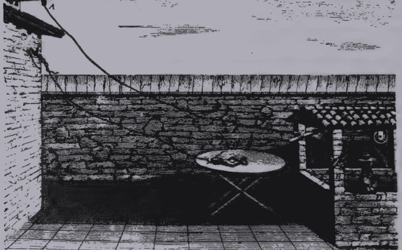

图 2.1. 伽尔瓦尼实验之一的蚀刻，其中蛙腿神经受到大气闪电刺激。（译自 Green 1953 年对伽尔瓦尼原著的译文。）

与金属导体中的电不同。尽管两者都是电性的，并且可以用相同的数学函数描述，但在每种情况下载流子都是不同的。电子和“空穴”在金属中传递电荷，而离子在神经元中传递电荷。此外，导体的属性也不同。金属具有低电阻，而神经元具有相当显著的混合电阻和电容元件。神经元中的电容和电阻元件以及决定传导速度的载流子性质在生物组织中比电线慢得多。此外，神经元是一个代谢系统，在许多情况下从细胞内部的源产生自身的能量，与必须由外部电源供电的金属导体不同。

18 世纪世纪末，物理化学的复杂程度还不足以让当时的科学家意识到这种细微差别，伽尔瓦尼的发现所引发的智力跨越程度绝不应低估。神经作用电伴随现象的概念非常简单，它是本书中要讨论的所有内容发展的核心思想。

如前所述，伽尔瓦尼的观察对电学的发展具有极大的影响。伽尔瓦尼进行的一项实验涉及将蛙神经挂在金属上进行刺激。在这种情况下，电的来源最初是不清楚的，但伽尔瓦尼的同代人亚历山大·伏特（Alessandro Volta）正确地指出电的来源是两种金属的接触处。在伽尔瓦尼的启发下，伏特在历史上第一次发明了电池，一种提供稳定电源的设备。这项发明导致了下一个世纪的许多发现和进步，并最终走向了现代电生理学。

到 19 世纪中叶，关于神经作用电基础几乎没有争议。大多数研究人员接受了这一观点。其中最著名的人物包括米勒（Müller），他是特定能量律的制定者。根据 Brazier (1959) 的说法，米勒也是最早提出电是“人工兴奋”的人之一。尽管如此，电作为神经作用首要相关物的概念在当时已经稳固确立了。

一旦神经元的电特性被确定，研究人员就开始寻找完美的刺激器，这一过程一直持续至今。与其他能量形式相比，电非常容易控制，而且它在让实验者控制刺激模式方面非常有效（无论这种模式是否是“人工”），因此电刺激技术仍在活跃开发中。

事实上，刺激器的历史反映了神经生理学历史，即使这种反映并非初衷。令人感兴趣的是，最早记载的刺激器之一被其 17 世纪的发明者认为是纯机械的，但实际上，它可能是电的。这项早期工作是由莱顿大学一位名叫斯瓦默达姆（Swammerdam）的年轻学生完成的。尽管他的实验结果在 100 多年后才发表，但可以确定，在 1660 年，斯瓦默达姆无意中用极可能是电刺激刺激了神经。他的“机械”刺激器用他的话描述得最好：

> 如果我们不是针对头部，而是采用图 8 所示的方法[见图 2.2]，其中使用某些肌肉，玻璃虹管 a 的空心内包含肌肉 b，悬挂在肌肉上的神经在不切割或损伤的情况下，固定在另一根银色扭曲丝 c 上，银丝的另一端有一个由黄铜丝制成的圆孔，焊接在虹管的肘部或活塞 d 上。准备好这些后，必须通过一个非常细的漏斗将一滴水 e 注入虹管的细管中。现在，如果之后用空闲的手 f 将银丝小心地穿过黄铜丝的环或圆孔，直到神经因压缩而受到刺激，它将通过这种方式经历——肌肉本身将像膨胀的心脏一样收缩（我已经在类似场合描述过那个心脏的变化）——水滴水将按比例下落，尽管它再也没有升起 [引用自 Fulton & Wilson, 1966, p. 212]。

然而，在这段描述中有一个陷阱。敏锐的读者会注意到肌肉挂在银丝上，银丝又穿过黄铜圆孔。因此，利用双金属电池产生的电流进行电刺激的必要条件已经具备，这似乎表明斯瓦默达姆可能无意中发现了一种电刺激。

图 2.2 斯瓦默达姆实验之一的描绘，在实验中他可能无意中通过双金属接触产生的电电压刺激了神经。c = 银线；d = 黄铜支架。（摘自斯瓦默达姆于 1737 年出版的著作《自然之经》，由 Fulton & Wilson 于 1966 年重印。）

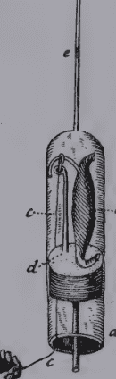

在伽尔瓦尼之前的 100 年就有了电刺激。然而，由于 17 世纪尚未建立电的概念，这种现象对他来说在动物身上是无法产生其意义的。

另一种早期的电刺激器仅仅是脊髓或受压的青蛙腿神经末端，用于在另一条青蛙腿上产生肌肉收缩。这些实验很重要，因为它们表明神经电活动所涉及的信号与某些双金属电池或其他刺激机制的其他部分的金属没有内在联系。相反，它们表明刺激过程本身也是神经内在的，即使在没有导线、双金属接点或照明的情况下也会发生。

在建立了电与神经活动之间的概念联系后，电刺激器的设计变得更具针对性。在沃尔特描述了双金属电池效应后，克劳德·贝尔纳开发了一些专门用于刺激神经的小型单元。图 2.3 显示了他的一种微型电池刺激器照片。

刺激器技术的下一个重大进展源于电磁学物理学的快速演变。变压器是一种电压放大器，仅由缠绕在同一磁芯上的两圈线圈组成，它以感应圈的形式进入神经生理学领域，这是埃米尔·杜·波伊斯-雷蒙德在 19 世纪引入的。感应圈的概念很简单：一个包含相对低电压源（通常是电池）和一个绕有圈数较少的线圈的电路

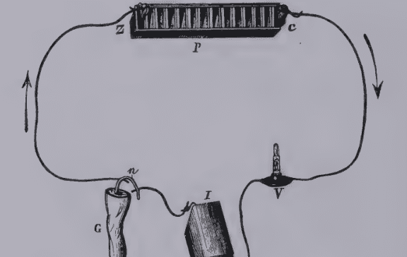

可以通过一个简单的开关来中断。在断开和开启期间（电流流过第一圈线圈变化的时期），会产生波动的磁场。该磁场能够在与第一线圈同心缠绕的圈数较多的线圈中感应出更大的电压（尽管电流较小）。由于开关中断可以通过机械旋转器进行控制，因此电刺激模式的时间序列也可以改变。

感应圈在 20 世纪一直被用作主要的电生理刺激器，直到它最终被全电子刺激器所取代，后者允许对刺激的幅度和时机进行更好的控制。最早的单元是由真空管制成的，但这项技术最终让位于了使用晶体管的技术，后者在 20 世纪 60 年代开始出现。近年来，恒流和电压隔离等奢华功能已常态包含在即使是最廉价的刺激器中（见第 4 章）。

尽管刺激仪器的外观和便利性发生了巨大变化，但最早的感应圈刺激器与最现代的集成电路设计在概念上几乎没有区别。两者都是激发神经活动的手段。在实验的输出端——即神经元微弱信号的放大、显示和记录——情况则完全不同。记录和显示设备已经进步到如此复杂和实用的程度，使得神经生理学家在观察发生现象的能力上发生了真正的质和概念上的变化。

最早的记录设备再次是其他有机单元。青蛙腿上诱发的肌肉抽动是神经活动指示性的第一个显示。这种有机“显微镜”最初应用的功劳应归于斯瓦默达姆或他的同时代托马斯·威利斯。


# 记录技术的发展与神经生理学基础

## 早期记录仪器

记录技术的下一步是随后发明的电位计，这是一种简单的设备，由悬挂在玻璃瓶中、连接金属球泡的两片薄箔片组成。电位计充当电的探测器，这是由于静电荷产生的斥力。当玻璃瓶顶部的球泡带电时，两片箔片将带上相同的电位，因为它们在电上与球泡相连。等电荷物体之间的静电斥力即使幅度很小，也足以使精细的箔片分开。同样，带电的电位计（以及箔片张开的电位计）在任何适当的导电通路（允许电位计存储的电荷泄漏）都会放电。不幸的是，青蛙腿或电位计都无法快速响应以跟上神经反应的速度，也无法对信号强度进行量化测量。因此，神经生理学家利用了新仪器——动圈电流计的发展。

动圈电流计本质上是一个微型电机，由安装在永磁铁极之间的一个较小线圈组成。当来自电压源（如神经生理制备物）的电流通过较小线圈时，它就变成一个小电磁铁。两个电磁场之间的相互作用足以产生机械力，如果小磁铁自由旋转（仅受轻质弹簧限制）并且上面带有一个指针，就可以测量由微小神经电位产生的线圈旋转。动圈电流计一直使用到20世纪30年代电子仪器革命开始。

还开发了其他形式的电流计和电位计。动圈电流计可以经过修改，以“动动式”方式工作。在动动式电流计中，线圈的最大位移与流过线圈的总量成正比。因此，位移的峰值是驱动电压产生的电流的时间积分。

另一种在20世纪左右流行的创新是毛细管电位计。这种设备本质上是旧箔电位计的现代类似。然而在毛细管电位计的情况下，运动部件是流体中的一个气泡。毛细管中气泡的位置也与电压成比。毛细管电位计在灵敏度上与动圈电流计相当，由于气泡质量很小，在神经生理研究中特别有用。

事实上，任何机械装置的一个主要问题是运动元件相当大的质量，无论它是如何构造的。与质量相关的惯性意味着需要大量的能量来加速这些物体，即使质量仅像一个小指针或气泡。因此，非常需要开发质量小、惯性低的仪器，以便其能够跟上观察的电化学过程。

这个问题直到20世纪电子测量和显示设备的发展才解决。两项创新——高增益放大器和射线示波器——产生了几乎零质量的记录仪器，从而具有几乎瞬时的响应时间。射线示波器在神经生理记录中的最早应用通常归于埃兰德和盖塞尔（1924），他们研究了猫的膈神经和腓神经的复合（多纤维）反应。埃兰德和盖塞尔利用新开发的电子技术取得了一些非凡的神经生理发现。在随后的几年里，他们开创的通用记录和显示技术已得到普及。今天，有大量的工业提供这些记录仪器，还提供运行实验室所需的电极和其他元件。曾经记录最简单的神经电位是一项技术挑战，现在即使是大学生也使用令几十年前资深研究人员感到惊讶的设备和程序。

显然，地平线上还有新的发展，而且并不是所有的工作都已完成。也许神经生理实验室最需要或最迫切的单一技术发展，就是使用小型计算机处理通过放大器获取的信息，以便产生更方便、更有意义的数据摘要显示。

计算机与过去20或30年神经生理研究的历史也奇异地交织在一起，延续了电气技术与神经生物学并行发展的趋势。在20世纪40年代和50年代，计算机科学家和神经生理学家试图比较计算机与神经组织之间似乎存在的许多共同特征。然而，今天显而易见，目前的数字计算机并不是简单大脑的良好模型。尽管如此，毫无疑问，随着数字计算机被更广泛地用作数据处理和显示设备以及刺激模式的发生器，它将对神经生理学产生深远的影响。数字计算机分析和显示大量数据摘要的许多强大方法，预示着未来对大神经元相互作用的研究将尤为重要。

## 显微镜与细胞观察

列文旭在1682年开发了第一种高倍率单显微镜，为微观世界开启了一扇窗户，这彻底改变了整个生物学。尽管他的模型仅由透镜（见图2.4），放大倍率仅为275倍，但它为科学家们开启的世界在美感和复杂性上都令人惊叹。到19世纪初，由多个透镜元件组成的高倍率复合显微镜已经发展到能够提供足够观察动物组织微观结构的放大倍率。19世纪的神经研究人员变得显而易见，此前被认为是相对均匀的组织，实际上是由许多较小纤维组成的多股束。

> * 惊讶的是，低倍率复合显微镜最初是由詹森在1590年发明的，在列文旭开发之前的很久，就被谢默（1628年）和胡克（1660年）等科学家使用。

那时，单个神经元轴丝的微观结构开始被理解。施旺等人已经观察到了由那些现在以他命名的特殊神经细胞形成的轴突外层脂肪层，即髓鞘。

随着19世纪的过去，真正重要的过程发生在细胞层面的观点变得越来越强，而随之而来的还有极其巨大的挫败感。尽管研究人员知道他们应该观察单个细胞的反应，但这些单个细胞太小了，无法用现有的技术进行个体研究。

## 细胞内记录技术的突破

20世纪，随着示波器和放大器的发展，记录单个细胞内的神经活动成为许多神经生理学家的一个主要但一直难以实现的目标。20世纪30年代的几位研究人员能够从复合神经中分离出一仅包含单根活性纤维的小束，通过将其跨放在某些大型电极上（例如浸过盐水的棉芯），他们能够获取到单个细胞的细胞外电位。但细胞外电位只是细胞膜真实发生情况的微弱反映。该领域的大多数工作者意识到在能够记录跨膜电位之前，电化学理论将一直保持推测性，这意味着需要将电极放入神经元内部。

任务最终因为一个解剖学上的奇迹而完成。Young（1936年）描述了一种不寻常神经元，乌鱼神经系统中的一种巨细胞，其轴突直径达1毫米。这个轴突足够宏观，以至于一根相对较大的玻璃管也可以插入细胞内空间。如果这根管内含有盐溶液，它就可以作为必要的内部电极。两组人员几乎同时使用管状电极记录了跨膜细胞内电位（Curtis & Cole, 1942; Hodgkin & Huxley, 1939）。该实验程序非常重要，值得详尽描述：

- ... 从第一星形神经中部分分离出一根500 μm的轴突，并用锋利的剪刀切断。一根细毛管穿过切口，并用丝线系在轴突上。毛管安装后，轴突悬挂在海水中。轴突的上部从背后照射，并通过镜子系统和显微镜从正面和侧面观察；下部则用油绝缘，并可以进行电刺激。通过将一个放大器连接到外部海水的上，另一个连接到微电极（微电极通过毛管降低到下方的完整神经中），从而记录了动作电位。微电极由根直径约100 μm、长度10–20 mm的玻璃管组成；管端充满了海水，通过一根20 μm的银线（其末端涂有氯化银）与海水建立电学接触……从轴突上端记录到了微小的动作电位，随着电极的降低，该电位逐渐增加，直到在距离毛管约10 mm处达到80–95 mV的恒定幅度。在该区域，轴突看起来处于完全正常的状态，因为它存活并传输了几个小时的脉冲 [Hodgkin & Huxley, 1939, p. 710]。

这种技术对理论的影响是惊人的，因为几乎是第一个观察结果——即在产生尖峰动作电位期间，跨膜电位变为正值而不是简单地退回零——使得当时的膜作用理论必须进行彻底的重构。现代膜理论和这一发现的全面影响将在第5和第7章进行更详细的讨论。

尽管该程序很有成效，但这种细胞内记录需要自由神经元，只有开发出具有更广泛适用性的神经元动作电位细胞内记录程序，神经生理学才能取得进展。电极无损穿透细胞这一重要步骤是由Gerard及其同事在肌肉纤维上完成的（Graham & Gerard, 1946; Ling & Gerard, 1949），但该技术与目前用于神经元的技术是相同的。他们的程序涉及使用一种充满液体的微小玻璃管。这些微管是通过工艺制造的：将软玻璃管加热然后拉伸，直到它们变细并在中间断裂。熔融玻璃的流体特性作为“放大镜”，产生原始管的复制品，但尺寸非常小。这些微电极（或微吸管）可以字面上穿过即使是极微小神经元的膜而不破坏它。膜在微吸管周围形成一个密封，就像一个自密封的轮胎；该密封足够坚固，允许神经元在被刺入后继续运行几小时或几天。现代微吸管可能小于1/10 μm（一米的千万分之一）。

再次，该技术如此重要，以Ling和Gerard（1949年）早期出版物的节选非常有趣：

- 我们正朝着绘制和填充直径远小于1 μm且经过适当锥化和加固微电极的方向迈进，并获得了高度恒定的膜电位。

- 微电极的制造至关重要。大量的尝试使得尖端在直径从25 μm到几十分之一 μm时收缩到末端。这种末端足够硬，以便操作，并允许易于穿透，即使在极端丢失后电极仍然可用。电极是从.5到7 mm的管拉出的（Schaar and Co.）。代替微烧器的是气火炬。

这种描述足够详尽，可以作为现代微电极生产的手册。关于几种现代微电极的更详细讨论见第4章。

从纯历史角度来看，20世纪关于神经活动的细胞生物化学基础的知识积累和新理论的发展速度惊人。当代理论的总框架由Bernstein在1902年提出，认为神经活动的基础是各种离子通过神经元半渗透性质膜的选择性通过。尽管这一观点非常有见地，但它是基于当时一些薄弱的想法。充满移动离子的细胞内液的存在直到Hober在1910年和1912年对神经的研究才被最终确立（这对膜的存在提供了一些暗示性证据），而其物理属性直到20世纪20年代中期才由Fricke测量。他是第一个建议膜只有一或两个分子厚的人，并估计（结果证明是正确的）了它的电容。

一旦可以使用微吸管常规进入细胞，过去的许多推测就可以进行直接的实验查询。Hodgkin和他的同事正如我们所注意到的，迅速证明了电压过冲，并且根据阻抗测量，他们能够证明整个动作电位的产生过程可以完全基于膜通透性的变化以及随之而来的特定离子的流来解释（见第7章）。这一系列思想仍然构成了大多数现代理论的基础，尽管许多细节仍然是活跃的研究课题（例如，离子流过的通道的性质，以及产生电化学驱动力的主动泵过程的性质仍未被完全理解）。

那么，这些就是目前为止发生的主要技术进展和相关的概念突破。即使是对极微小的哺乳动物细胞进行常规细胞内电极穿刺，也开启了关于膜的基本电化学动力学的新知识大门，这解释了单个神经元的作用。这种技术最终使得研究多个细胞之间的相互作用成为可能。后者这一主题是当代神经生理研究的主题。

## 神经系统的解剖学组织

构成身体的各种类型细胞都专门化以一种特别高效的方式执行其中一种一般的生命功能。神经元是本文中最感兴趣的细胞，它们在进化力量的影响下发生了特化，使得细胞某一部分的刺激可能导致远端部位产生动作。因此，原型细胞的泛化兴奋性已演变为神经元网络之间专门的信息传递和整合的能力。因此，我们可以将单个泛化细胞的原始兴奋性视为所有心理和行为反应的前身。

当前神经解剖学理论的基本前提是什么？基本上，人们认同每个神经元在解剖学上都是相互分离且与众不同的。具体来说，这意味着每个神经元都完全被自己的细胞膜包围。这并不是说细胞在生理上也是独立的，因为现代神经理论的一个基本公理是神经元之间会发生相互作用。然而，现在已经不可置疑地证实，它们主要在称为突触的细胞间区域相互作用。细胞之间的相互作用可能是紧密的；小分子和离子等电荷载体会在两个细胞之间的间隙中移动，但大多数细胞内物质以及细胞代谢在膜处被严密界定。即使一个神经元的膜与下一个神经元融合（紧密连接），两个细胞的细胞内含物也基本上是相互隔离的。

突触处的作用是一个复杂的过程，在此过程中，神经元通信或处理的信息被编码、传输和解码多次。信息可以由脉冲、分级电位，甚至是此处某些化学递质物质的数量来表示。

尽管我们稍后会讨论所有这些，但这里需要注意的重要点是，细胞间传递是一个不通过细胞质连续性的通信过程。虽然大多数突触在传递和接收神经元的细胞膜之间只有极小的间隙，但几乎总是存在细胞质不连续性。化学突触中的这条裂隙可能小于可见光波长的 1/20——只有几百埃单位。尽管如此，尽管尺寸很小，但存在可测量的延迟、可观测的电化学事件以及直接的电子微镜证据，证明神经系统中的神经元是分离且独特的细胞。

神经元的高度特化和功能统一性并没有导致单一的标准神经细胞类型。在神经系统的不同部分可以找到许多不同的神经元形状。有些高度专门用于极远距离的信息通信，而另一些则专门用于整合中心枢核局部区域内的多个神经活动源。前者（通信型）通常以非递减的（即恒定振幅）传导为特征。后者（整合型）通常以其某些末端分支的极端树化为特征。然而，整合是大多数神经元的属性；每个受体和运动链中的最后一个神经元都可以执行整合功能。此外，受体细胞具有独特的结构适应，用于执行将一种或多种物理能转换为神经化学能量模式的特殊功能。

尽管解剖形式具有巨大的多样性，但所有神经元共享一些特征。然而，某些特征是神经特定的，反映了它们在进化过程中经历的过程。在本章中，我们首先将介绍神经系统的一些特征。然后考虑专门用于传递和整合的受体，目的是让读者了解其巨大变异。据说，神经系统可能是有机进化的最高成就，也是最复杂的结构。无论从绝对还是相对意义上（大鼠的大脑与体重的比例比人类更高），人类大脑的特征已经达到了前所未有的程度。为了充分理解并欣赏神经系统，我们首先应该注意到它广泛分布于全身。神经系统似乎由大脑、脊髓以及（由于其胚胎起源）视网膜组成的视觉和运动神经网络组成。中枢神经系统虽然承担通信功能（其中的许多通路是部分之间的连接），但可以被描述为负责输入信息的整合。


- 下颌肌
- 膈肌
- 肩部、手臂和手的肌肉
- 颈神经节
- 脊柱肌肉
- 胸神经节
- 腹部肌肉
- 腰神经节
- 髋屈肌、膝伸肌和髋内收肌
- 骶神经节和尾神经节
- 大腿、腿和足的其他肌肉
- 会阴部和肛门肌肉

> 图 3.1 绘制了腹侧神经根，并指示了每个根驱动的各种肌肉及其起始水平。标记每个根的字母代表其发出的总体水平：C = 颈；T = 胸；L = 腰；S = 骶；X = 尾。数字表示特定的根。类似的背侧神经根系统是传入感觉信息的路径。（源自 Ranson, 1959）。

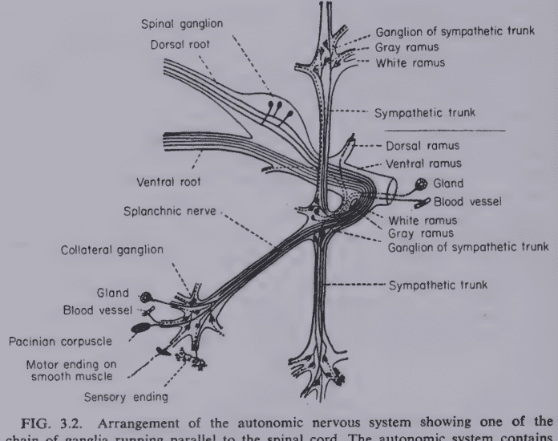

连接颅脑神经。表 3.1 列出了颅脑神经及其各自的功能。

脊神经通过图 3.2 所示的高效双系统进入和离开脊髓。纤维根据最早由马根迪（Magendie）颁布的法则按功能进行分离，但该法则（由于科学历史上最有趣的优先权争议之一）现在正式称为**贝尔-马根迪定律（Bell-Magendie law）**。根据这一功能解剖学定律，感觉纤维通过背根进入，运动纤维从腹根发出。

自主神经系统的两个部分通常相互拮抗作用，但现在通常倾向于强调两者之间的解剖学区别而非功能区别。如图 3.3 所示，交感神经起源于脊髓的胸段和腰椎区域，而副交感神经则起源于脊髓的颅脑和骶神经区域。该图还显示了平行于脊髓运行的交感神经节链之一。

中枢神经系统是一个复杂的传输通路网络，通常称为**束（tracts）**（相对于中枢神经系统之外的通路称为神经），以及由这些束连接的细胞体簇组成的**核（nuclei）**。中枢神经系统外的神经细胞簇称为**节（ganglia）**。支（ramus）一词用于神经或束的较小分支，而干（trunk）是用于描述神经的一个短促、主要且未分部分的术语。

惊讶的是，在最初解剖时，很难看到中枢神经系统中复杂的核和束复合体。必须使用特殊程序来明确各个部分的范围。这些程序包括通过切割部分神经系统诱发的神经变性、电生理刺激和记录，以及通过选择染色区分不同区域的特殊染色程序。

图 3.2. 自主神经系统的排列，显示了平行于脊髓运行的神经节链之一。自主神经系统包含感觉和运动纤维。（绘自 Ranson, 1959。）

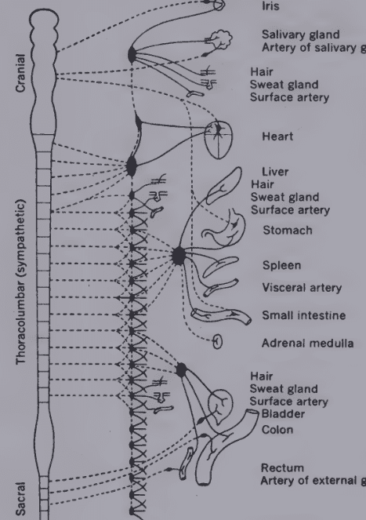

图 3.3. 自主神经系统传出或运动部分的排列。该图显示了交感（胸腰）和副交感（骶骨和颅脑）成分的解剖划分，以及每个部分供应的内脏。（源自 Mountcastle, 1968；参考 Cannon 自 Bard。）

中枢神经系统可以被看作一根管，各个部分膨胀成了主要的中心。当然，最惊人的生长位于最前部——被称为**大脑球**的大中心，在通常情况下，它们悬空并隐藏了下方的脑干。脑干本身由许多执行各种通信和整合功能的重要核组成。这些已汇总在表 3.2 中。

通过这些直接通路的核心向上延伸的是网状体，这是一个解剖学上无结构的系统（其细胞网络非常分散，甚至在其不同区域之间没有发现清晰的界限），它似乎从几乎所有感官获取信号，并将这些信息扩散到大脑大部分其他部分。网状体认为具有一般的激活功能，特别与意识的维持有关。

掌握了这些简要的解剖学后，我们的注意力现在可以转向本书的主题：单个构建块的结构和功能，即构成这些宏观结构的微神经元。

^a 源自 Uttal (1973)。

^b 脑的组成部分。

## 受体细胞

受体细胞是任何神经系统微解剖学讨论的自然起点。受体细胞位于感官中，那里是外界物理刺激与内部环境发生初始接触的地点。

在开始讨论之前必须考虑的一个重要点是，受体细胞本身就是神经元。它们位于感官中。

脊椎动物视网膜通常包含两种视觉受体细胞：杆细胞和锥细胞。尽管我们现在知道两种细胞类型之间存在重要的功能差异，最初的二分法仅基于对它们结构的观察。

杆细胞和锥细胞的典型形状如图 3.4a 和 3.4b 的图所示。这些图展示了许多重要部分。杆和锥都由两个主要部分组成：包含细胞核和突触接触的内节，以及含有光敏光化学物质的外节。然而，杆细胞的结构不仅在建筑上与锥细胞不同，密切观察还暗示了重要的发育差异。显然，杆细胞的外节在其顶端处于持续的解体状态，并从基部重构。图 3.4b 显示杆由一系列盘组成，这些盘大部分与细胞外膜没有连接。这些细胞显然是由外节底部细胞膜的凹陷产生的。放射性同位素研究表明，新盘沿外节向上移动，随后释放到细胞间环境中。因此，杆中的盘既是未连接的，也是处于持续替换的瞬态结构。

相反，锥细胞外节中的盘总是与细胞膜部分连接。这些盘并不移动。

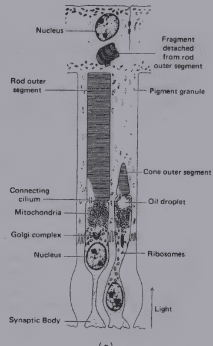

图 3.4. 青蛙视网膜杆细胞和锥细胞的绘图；(a)和(b)是连续放大的倍数阶段。(a) 选自 Young (1970)，而 b 由加州大学洛杉矶分校 Richard W. Young 感谢提供。

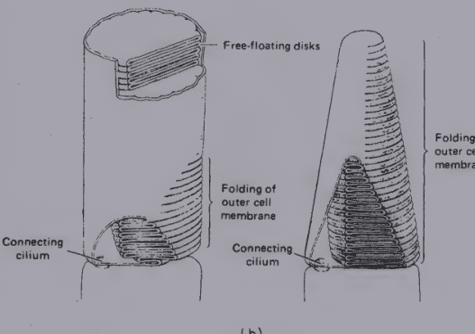

它们固定在初始位置。盘内光化学物质通过营养物质贯穿整个锥细胞外段节的循环得到补充。锥形形状本身可能是由于最外层的盘是在动物胚胎发育早期形成的，而较大的盘则是在动物生长史的后期形成的。


## 视觉与听觉受体的超微结构

尽管杆细胞和锥细胞的总体结构已为人知，但直到 1960 年，de Robertis 使用高倍率电子显微镜才证明了杆细胞和锥细胞的内段与外段之间存在狭颈。这个狭颈（或称为连接纤毛）在图 3.5 中被大大放大，其具有相当复杂的结构；上面布满了纤细的丝。尽管其截面积很小，但正常细胞代谢以及视觉刺激后光化学物质再生所需的所有营养物质都必须通过这个狭窄的纤毛，因为代谢控制中心——细胞核位于内段中。

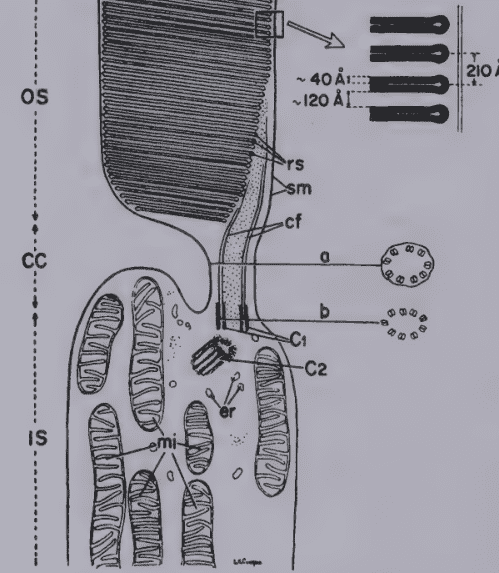

**图 3.5.** 哺乳动物杆细胞连接纤毛的大放大绘图：OS = 外段；CC = 连接纤毛；IS = 内段；cf = 纤毛丝；sm = 质膜；rs = 杆细胞盘；mi = 线粒体；er = 内质网；C1 和 C2 是基底体的侧视图和截面图。注意插图中所示盘的超微级尺寸。（选自 De Robertis, 1960。）

图 3.5 还阐明了在该细胞超微镜水平下的微观精细程度。最小的可辨结构是外段内盘的膜。这些膜的厚度仅约为 40 埃（angstrom）。这仅是任何特定视觉受体可能产生有效刺激的光波长的百分分之一。

图 3.6 是猴子基底膜受体的扫描电子显微镜图，显示了听觉毛细胞的规则排列。这种视图是通过移除鼓状膜实现的，鼓状膜是一层通常覆盖在这些听觉转换细胞毛末末的细胞层。在这里，和眼睛一样，受体细胞可以分为两类：内毛细胞和外毛细胞。这种二分法最初也是基于观察到的解剖学差异，但现在认为这两类毛细胞之间可能也存在功能上的差异。Dallos, Billione, Durrant, Wang, 和 Raynor (1972) 观察到毛细胞似乎对纤毛的绝对位移敏感。然而，他们报告说，内毛细胞似乎对声波的速度而非位移做出反应。这种双重系统将大大增加听觉系统在表征听觉刺激时可获得的信息维度。

图 3.7 显示了外毛细胞末端毛状纤毛的“风琴管”状排列的近视图。这些纤毛排列成 W 形束状，也可能有助于向中枢神经系统传达有关刺激的额外信息。例如，它可能会为受体作用增加方向性，有助于确定声学刺激的相位。

图 3.8a 和图 3.8b 分别显示了内毛细胞和外毛细胞的更多示意图表示。图 3.8a 显示了内毛细胞的一些重要特征，并非所有特征都能在单张扫描电子显微镜图中同时可见。可以看到纤毛终止于基底体上，该结构在实际转换过程中可能起着核心作用（见第 6 章）。此外，在毛细胞基部似乎有两种突触连接。其中一种在突触一侧的毛细胞中含有颗粒（可能是突触递质物质包；见第 9 章），而在另一侧标记为 Nei 的神经元中没有。第二种突触似乎在另一个神经元 (NE2) 中含有颗粒，但在毛细胞中没有。

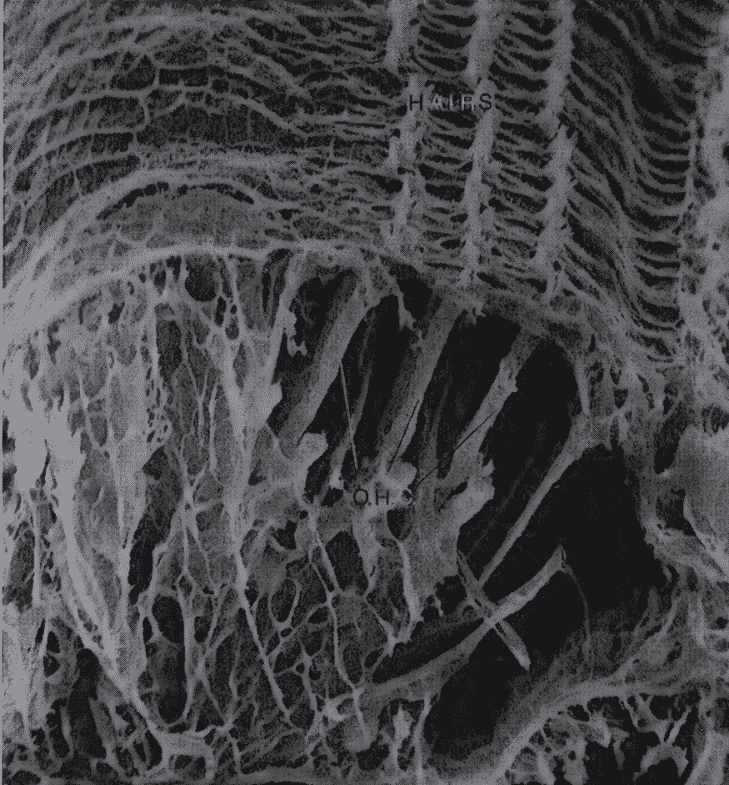

**图 3.6.** 耳蜗基底膜柯氏器隧道的扫描电子显微图。注意三列外毛细胞 (OHC) 和从膜上方突出的毛。样本取自恒猕猴；放大倍数约为 1100 倍。（密歇根大学的 Robert E. Preston 感谢。）

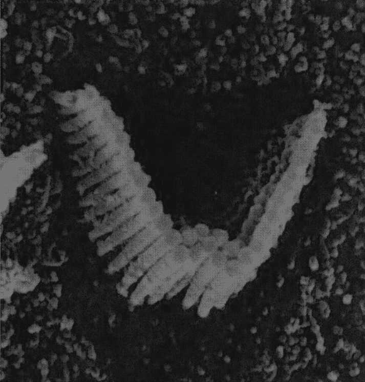

**图 3.7.** 单个外毛细胞 W 形束的高放大电镜图。样本取自恒猕猴；放大倍数约为 22000 倍。

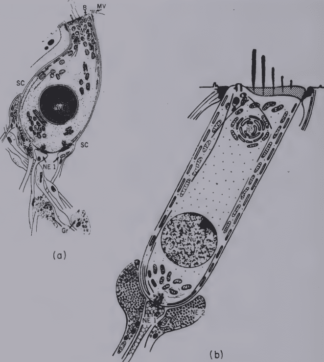

**图 3.8.** 两种类型毛细胞的绘图。(a) 内毛细胞 (b) 外毛细胞。H = 纤毛；B = 基底体；Nu = 细胞；SC = 支持细胞；NE1 和 NE2 分别为传入和传出突触；MV = 微毛；Gr = 颗粒。（选自 Engström, Ades & Hawkins, 1965。）

毛细胞，传入和传出突触似乎都存在，但在这种情况下，传出突触可能作用于瓶状而非直接作用于毛细胞。两种类型之间的功能差异（如果存在）是基于在该水平无法看到的分子结构，或者是基于毛细胞在基底膜上的拓扑位置。

## 前庭系统受体

并不意外，考虑到胚胎发育历史和解剖上的接近，前庭系统的受体细胞与听觉系统非常相似。图 3.9 是嵌入青蛙前庭受体上皮组织的一组毛细胞纤毛场的电镜。与听觉毛细胞不同，前庭毛细胞的纤毛大小并不相等。有一个异常巨大的纤毛具有球形端，它似乎位于其他较小的立毛上方。拍摄这张非凡照片的 Hillman 和 Lewis (1971) 认为，纤毛在物理上与立毛连接，并执行着重要的生物学功能。由于球部与立毛之间的连接，主要沿毛细胞顶部切线方向的刺激运动会被转化为立毛的向上活塞式运动。这种对刺激力的重定向极大地增加了基板处可用的物理能量，放大了前庭系统对微加速度的整体敏感性。

有两种类型的前庭毛细胞，根据形状而非位置或观察到的功能定义。图 3.10a (HC I) 显示了一个典型的 I 型毛细胞，显示了由阶神经元末端形成的瓶状瓶体对毛细胞的异常包裹。与听觉毛细胞一样，传入和传出突触似乎都存在，但在这种情况下，传出突触可能作用于瓶体而非直接作用于毛细胞。II 型前庭毛细胞（图 3.10b (HC II) 所示的示例）与典型的听觉毛细胞相似，传入和传出突触都终止于细胞基部。

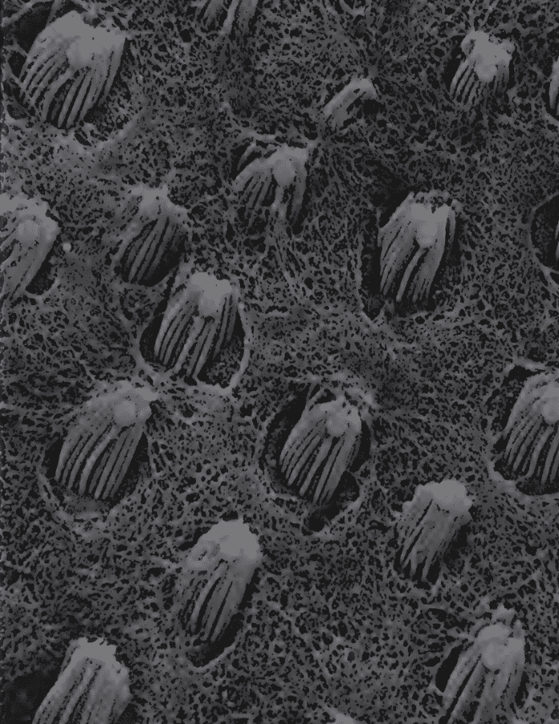

**图 3.9.** 前庭毛细胞视野的扫描电子显微镜照片，显示了纤毛的膨大末端。（源自 Hillman & Lewis, 1971。）

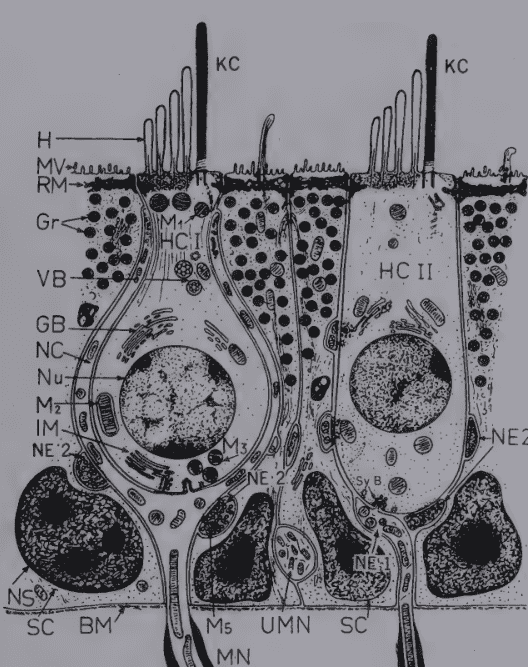

**图 3.10.** 已知两种类型前庭毛细胞（HC I 和 HC II）的示意图。标记结构中最为重要的是：KC = 纤毛；H = 毛毛；MV = 微绒毛；Nu = 细胞核；NE1 = 传入性突触；NE2 = 外传性突触；以及 BM = 基底膜。（源自 Engström, Bergström, & Ades, 1972。）

## 躯感受系统受体

躯感受系统的受体具有多种形状和形式，通常对机械刺激和热刺激均敏感。图 3.11 是典型的帕斯尼体绘图。这是包囊性受体结构的一个实例，因为神经末梢被完全包裹在一个辅助结构中——一个像洋葱一样的多层囊膜。在帕斯尼体中，这种囊膜似乎并不参与神经传导的电化学过程，而是根据其弹性和其他机械特性，作为刺激的突前机械修饰器（Loewenstein & Rathkamp, 1958）。

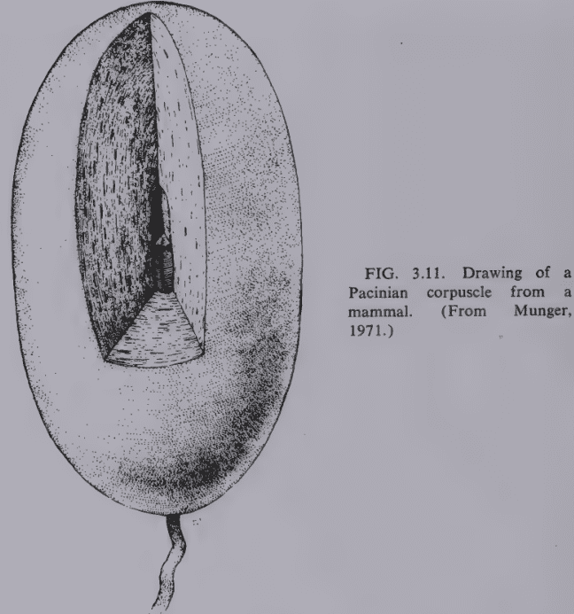

**图 3.11.** 帕斯尼体的绘图。

躯感受理论学家之间对于各种类型包囊结构的功能存在着激烈的争议。认同`特定受体理论`（`specific receptor theory`）的权威认为，囊膜的性质对于决定受体最佳反应的能量类型至关重要。其他研究人员主要认同所谓的`模式理论`（`pattern theory`），认为这些包裹结构毫无意义。事实上，有人提出“囊体”只不过是神经末端存在异常时产生的简单良性肿瘤（神经瘤）。

图 3.12 的结构是 Iggo 体的绘图，它是由几个自由神经元和几个受体细胞组成的复合体，对机械刺激具有极高的敏感性。另一方面，躯感受受体结构可能非常简单；有些被简单称为自由神经末梢。

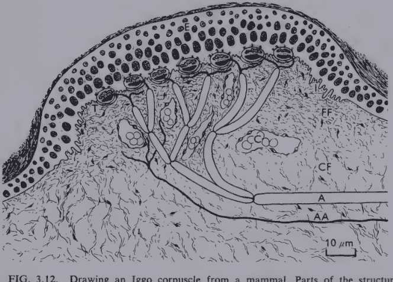

**图 3.12.** 哺乳动物 Iggo 体的绘图。所示的结构部分为：E = 表皮；T = 触觉细胞；A = 有鞘纤维；AA = 有鞘纤维；C = 毛细血管；CF 和 FF 分别是粗和细胶胶原束。（源自 Iggo & Muir, 1969。）

在身体的某些部位（例如角膜），只存在自由末梢。图 3.13 是一组神经末梢的绘图，显示即使是这些所谓的“自由”结构实际上也具有辅助的施万细胞包膜。

## 化学感受器：嗅觉与味觉

嗅觉和味觉器官具有受体神经元，它们很好地适应了其作为化学分子传感器的角色。图 3.14 是鼻腔黏膜中一些嗅受体细胞的示意图。该细胞最重要的特征之一是，皮肤受体在其底部没有突触。受体细胞自身的轴突构成了返回中枢神经系统的主要传输链路。味觉受体虽然也是一种化学受体，但在解剖学上与之不同。味觉受体细胞在它们的基部形成突触，如图 3.15 所示，这是一个被认为是典型味蕾的示意横截。需要注意的是，味蕾并不是受体，而是味觉受体细胞及其前体——未分化的上皮细胞——的簇。

味觉受体在一个非常重要的方面是非凡的。它们似乎不断处于衰老和再生的状态：再生的不是细胞的部分（如视杆细胞中的盘体），而是整个受体细胞。

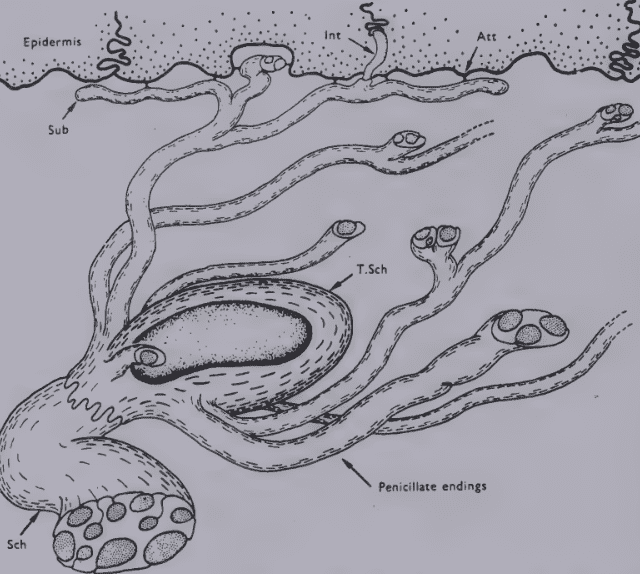

**图 3.13.** 人体皮肤中一组“自由笔刷状”或簇状神经末梢的绘图，显示了即使是这些纤细纤维周围也有施万细胞包膜。Sch = 施万细胞包膜包裹在即使这些纤细纤维周围。Sch = 施万细胞包膜。这些自由末梢在表皮中终止，或者在真皮中，附着在表皮中。，或者在表皮中。

放射性成像技术显示，这些细胞会退化，或者在真皮中。这种囊膜的性质对于决定受体最佳反应的能量类型至关重要。其他研究人员主要认同所谓的`模式理论`，认为这些包裹结构毫无意义。事实上，有人提出“囊体”只不过是神经末端存在异常时产生的简单良性肿瘤（神经瘤）。

（注：此处原文似乎存在部分重复，已根据逻辑进行翻译）

味觉受体在一个非常重要的方面是非凡的。它们似乎不断处于衰老和再生的状态：再生的不是细胞的部分（如视杆细胞中的盘体），而是整个受体细胞。

图 3.12 的结构是 Iggo 体的绘图，它是由几个自由神经元和几个受体细胞组成的复合体，对机械刺激具有极高的敏感性。另一方面，躯感受受体结构可能非常简单；有些被简单称为自由神经末梢。

在身体的某些部位（例如角膜），只存在自由末梢。图 3.13 是一组神经末梢的绘图，显示即使是这些所谓的“自由”结构实际上也具有辅助的施万细胞包膜。

（注：原文部分段落存在逻辑混乱或重复，翻译时已遵循原文对应关系）

一种尚未被广泛接受的神经活动理论模式所包含膜特性。

## C. 传递神经元的解剖学

方向性概念在历史上也曾用于定义在单个神经元上发现两种主要传递纤维。将信息从突触向细胞体（也称为 soma 或胞体）传输的区域称为`树突`（`dendrite`）。另一方面，`轴`（`axon`）传统上被认为是神经元的输出元件，负责将信息从树突区域传导。轴突通常是单根纤维，其直径甚至比最粗的树突还要大。在某些细胞中，轴可能向细胞体的两侧外延伸；此类细胞被称为双极细胞。此外，与树突不同，轴通常覆盖有一层脂肪性的髓鞘。虽然树突结构通常不发生髓化，但在某些情况下，即使是这种反普遍性的概括也不成立。例如，Pinching (1971) 报告了电子显微镜证据，显示嗅球味细胞具有髓化现象。图 3.16 显示他在 45,000 倍放大率下观察到的非常细微的树突髓化。

Bodian (1962, 1967) 在保持方向性标准标准的同时，为这些模糊的定义增加了相当的精确性。例如，他将树突定义为神经元中唯一能够接收来自突触区域信息的部分。这个定义显然也足够通用，可以包含受体细胞本身，但这种情况下的背景是与前一个细胞接触的突触连接，而不是与物理环境接触的能量转换器。

总结这些现代且精确的神经元部分的最佳方法是充分了解 Bodian 的定义：

- **树突区 (`Dendritic zone`)：** 神经元的受体膜，由一组逐渐锥形的细胞质延伸（树突）组成，这些树突接收其他神经元的突触末梢，或分化为将环境刺激转换为局部反应产生活动。可能存在线粒体聚集。
- **轴 (`Axon`)：** 单根的、通常有分支且通常细长的细胞质延伸，在形态上可能可能独特地分化，用于将神经冲动传出树突区。其特征是管径均匀，并被胶质细胞或神经膜细胞包裹。鞘的分化和轴径与传导速度有关。
- **胞体 (`Perikaryon`)：** “细胞体”或有核细胞质团，其通常特征是存在染色质物质［即染色体］神经元的这部分是树突和轴的胚胎生长、再生，也许是在分化神经元中合成的焦点。它可能位于树突区或轴内，也可能附在轴上。
- **轴末端 (`Axon telendria`)：** 轴通常有分支且具有多种分化的末端，其膜和细胞质的分化与突触传递或神经分泌活动有关。球状末端中通常存在线粒体聚集、“突触泡”或分泌颗粒。与树突区一样，轴末端不传输全或无传导电位。它们传输电或化学信号，能够在其他神经元的树突区和肌肉中产生产生电位，并通过体液途径（神经激素）对支配腺体细胞或远端细胞产生刺激作用 [Bodian, 1962, p. 326]。

图 3.17 通过展示各种传递神经元的解剖结构示例进一步阐明了这些定义。

胞体含有核，产生负责代谢过程的酶，这些过程负责滋养神经元并清除废物。细胞核还从深色染色体中储存遗传信息。由于细胞核是代谢酶的来源，如果轴或树突意外与细胞体分离或通过手术分离，它将退化。另一方面，神经元的周围部分可能会受到巨大破坏，但那些与细胞体和细胞核连接的部分仍有良好的生存机会，尽管可能会发生某些“逆行”变性。细胞体还负责产生新的细胞内液，细胞质。由于这些物质是在细胞体中产生的，它们流进入轴和树突，维持着内部压力。细胞质流或通常所说的轴浆转运（`axoplasmic transport`）的速度被估计为从 1 到 100 mm。

* 注意：已经观察到该规则的某些例外。例如，在鳄鱼身体的某些树突中检测到了尖峰电。

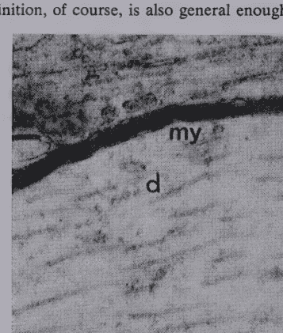

**图 3.16.** 树突髓化的电子显微图。（源自 Pinching, 1971。）


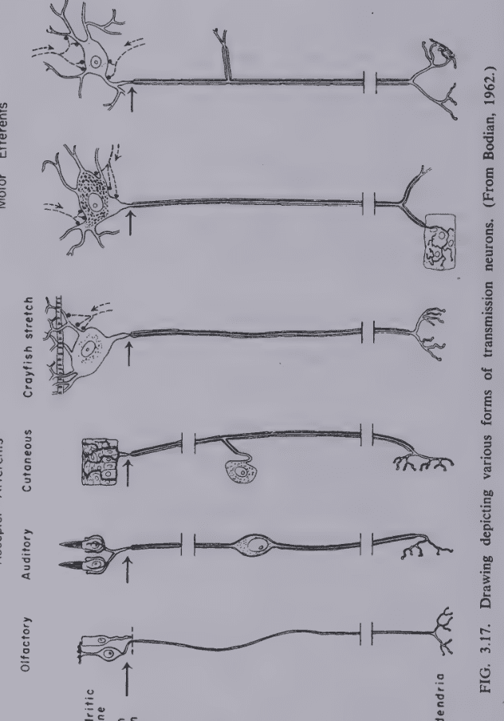

与轴浆流密切相关的是新发现的、称为微管的结构。微管只有在巨大的电子显微镜放大倍数下可见，尽管它们的长度可能与轴本身一样，但其直径也有 250 埃左右。它们看起来确实是真正的管状，一些权威推测代谢物通过这些管从胞体传递到轴的末端。微管是由分子约为 55,000 的重蛋白组成的，称为微管蛋白。微管蛋白聚聚以形成微管的方式可以通过改变温度来操纵，并会形成一个异常大的微管。关于微管的有用总结可以参见 Schmitt 和 Samson (1969)。

微管在神经元的电化学动作电位中似乎没有直接作用。在它们被破坏后，需要几个小时才能检测到神经元的活动。从结构上看，微管蛋白分子似乎是简单的螺旋结构，但最好的电子显微镜只能显示它们的整体形状。在神经元中，微管似乎是随机分布的。然而，在其他细胞中，它们可能非常有规律地排列，如图 3.18 所示。

细胞与其前面的轴之间的相互区域称为突触，这个术语在前面的讨论中出现了几次。突触作用和解剖将在第 9 章详细讨论。然而，重要的是强调突触是主要负责传导方向性的细胞区域。如上述，轴可以被刺激以无论是顺行还是逆行传导。然而，最常见的化学突触只能向一个方向传导。信号只能从前突触传向后突触。如果该细胞是终末运动神经元，它终止于普通的神经间连接，而是终止于一种被称为神经肌肉接头的特殊类型末端。这种结构类似于普通的“神经间”突触（见第 9 章），但它确实具有某些特殊特征，使信号从神经元传输到肌肉细胞。

在传递神经元大轴起着核心作用，因为它是允许传递细胞执行其主要功能——通信的连接。轴的许多解剖特征值得提到。显微镜观察准备良好的脊椎神经元时，最明显的特征是包裹轴纤维的外壳。这层壳——髓鞘是脂质和蛋白质层的融合结构，具有多种用途。它使细胞免受周围细胞电化学活动的影响，从而减少细胞间的“串扰”。由于它不是连续的，而是像链状香肠一样的结构，它允许一种被称为跳跃传导的非常快速的传输。髓“香肠”链接之间的中断称为节。在典型的脊椎神经元中，节间距离约为 1.5 mm。节充当低电阻区域，兴奋性离子电流可以跳过这里，而不是沿着整个轴的长度传播。这种跳跃传导极大地缩短了给定轴长度的传导时间。

环绕周围轴的髓鞘是一种非凡的物质。它由特殊的辅助细胞（称为施万细胞）壁的多层重叠层顺序堆积形成。施万细胞在神经元胚胎发育早期就与神经元密切结合。施万细胞具有动态能力，可以通过物理生长和实际迁移来包绕轴。图 3.19 显示了这一包裹过程。在发育初期，施万细胞松散地附着在神经元上，但随着它的成熟，它会以这种方式生长：连续的细胞膜层沉积在轴周围。最后，施万细胞本身几乎仅仅是一个隐藏在自身肥大细胞壁褶皱中的细胞核。

人们认为施万细胞可能还为轴提供代谢服务。这种观点尚未被充分证实，但它是基于这样一个想法：轴的某些部分距离细胞体太远，无法通过正常的细胞内代谢物流获得充分的服务。来自施万细胞核的代谢物的细胞间灌注可能被轴用于自身的维持。

髓鞘的层状结构在图 3.20 的电子显微图中显示得尤为清晰。深色线条由于施万细胞壁外层两个褶皱之间的接触，而较亮区域表示这些细胞壁两个内表面之间的接触。亮度的差异与不同组织的重金属染色密度以及由此产生的电子不透明度差异有关，而不是活组织中任何真实的颜色或光学不透明度差异。图 3.21 显示了兰氏埃结处髓鞘周期性中断的电子显微图。

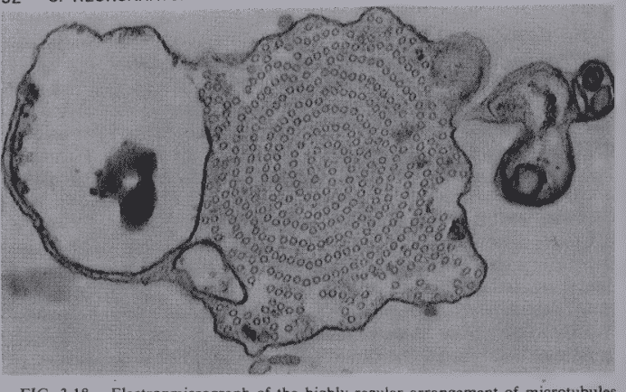

**图 3.17.** 各种传递神经元的解剖结构示例。

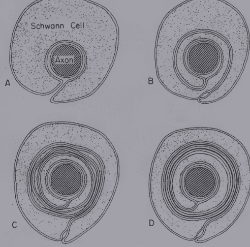

**图 3.19.** 图解描述了通过多层施万细胞对轴的连续折叠，以形成髓鞘层。（来自 Norton, 1972）。

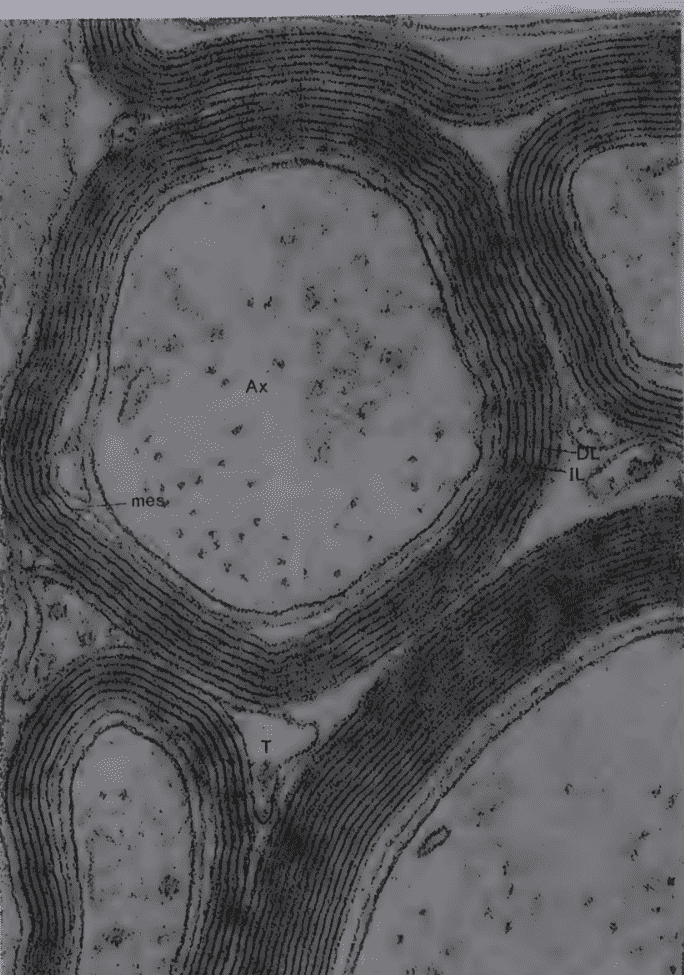

**图 3.20.** 高水平髓化的电子显微图，例如可以在成年大鼠视神经的横切中观察到。放大倍约为 12,000 倍。轴 (Ax) 被多层蛋白质脂质膜包围，显示出交替的深线 (DL) 和光线 (IL)。其他特征标记为轴线 (mes) 和髓鞘外舌 (T)。（来自 Peters, Palay, Webster, 1970。）

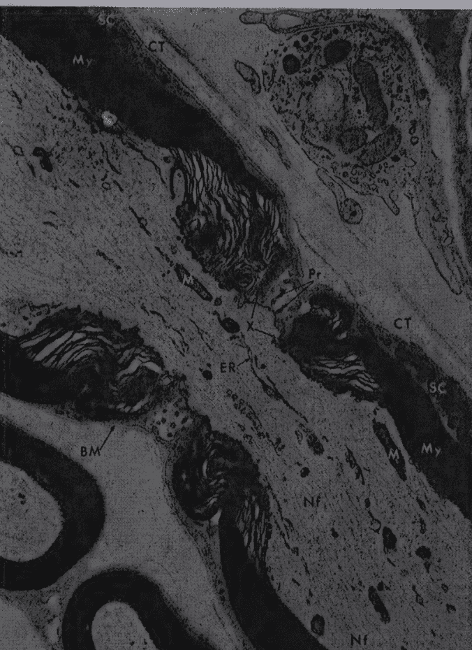

**图 3.21.** 小鼠神经元兰氏埃结纵切面的电子显微图。标记的结构包括：CT = 结组织；Pr = 其他施万细胞的部分；X = 髓鞘褶皱；ER = 内质网；Nf = 神经丝；以及 BM = 基底膜。（来自 Porter & Bonneville, 1968。）

一种主要基于轴直径和髓化程度的分类系统已被大多数神经解剖学家采纳为传递轴结构的基本分类法。最大的纤维发现于外周神经系统。这些大纤维总是被髓鞘覆盖，并命名为 A 纤维。A 纤维类根据电刺激产生的复合诱发电位（许多神经元的叠加反应——第 8 章）中的不同峰值进一步细分。这些亚类通常标记为 As、Ab、Ay 和 Ac。在每情况下，分类指的是被认为负责复合反应中特定峰值的 A 纤维类，不同的峰值与直径差异导致的不同传导时间有关。

各类神经纤维的特征。


| 纤维直径, μ | 1–22 | ≤ 3 | 0.3–1.3 | 0.4–1.2 |
| 传导速度, m/sec | 5–120 | 3–15 | 0.7–2.3 | 0.6–2.0 |
| 脉冲持续时间, msec | 0.4–0.5 | 1.2 | 2.0 | 2.0 |
| 绝对不期, msec | 0.4–1.0 | 1.2 | 2.0 | 2.0 |
| 负后电位幅度, 脉冲百分比 | 3–5 | 无 | 3–5 | 无 |
| 持续时间, msec | 12–20 | | 50–80 | — |
| 正后电位幅度, 脉冲百分比 | 0.2 | 1.5–4.0 | 1.5 | |
| 持续时间, msec | 40–60 | 100–300 | 300–1000 | — |
| 窒息敏感顺序 | 2 | 1 | 3 | 3 |
| 速度/直径比 | 6 | ? | ? | 平均 1.73 |

> a 来自于 Patton (1965)。

## D. 整合神经元的解剖

身体不同部分的神经元形状与前几节描述的原型受体或传递神经元不同。在神经系统的中央，许多细胞进化出了整合多个来源信息的结构，而不是从一个地方传递到另一个地方。整合是通常被称为中间神经元的元的任务，即既不是受体也不是运动单元。但事实并非如此；受体和运动单元在许多情况下也能执行整合作用。图 3.22 是一组来自神经系统的绘图。这类神经元都显示出极极化。树突丰富、巨大且多分支，而轴（不需要长距离传递的）可能小到与任何树突无法区分。这种神经元的另一个特征是突触接触发生在细胞体或树突的许多位置，而不仅仅是在树突末端。一些中间神经元可以看到散布着点状突触。髓鞘在许多中间神经元上非常减少。正因如此，大脑似乎由两种物质组成，大脑皮层含有极少髓量的中间神经元，因此这些中心呈现自然的粉红色。然而，大脑中携带信息的巨大通路是被髓鞘覆盖的。在这种情况下，髓鞘的白色主导了颜色方案。对中间神经元解剖以及这类特殊神经元研究感兴趣的读者可以参考 Horridge (1968) 的著作。

(a) 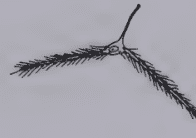
(c) 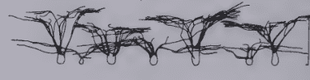
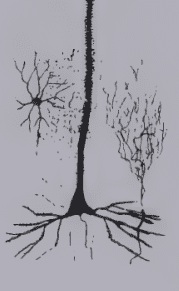
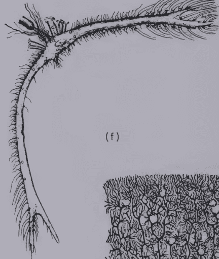
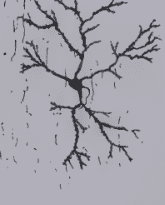
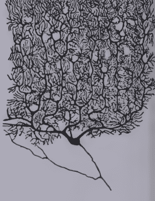

这本简要解剖图的最后一个条目将是对细胞壁（或更准确地称为质膜）结构的考虑。已经多次提到了神经元内部和外部这一非凡区域。在随后的章节中将看到，膜的性质实际上是神经活动的基础。

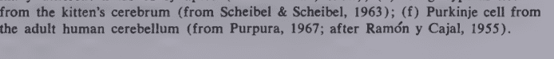

图 3.23. 专门用于整合而非传递的神经元集合图，以进一步说明神经元解剖的可变性，选取自两个重要的来源（Horridge 1968 的《中间神经元》和《神经科学：一项研究计划》，Quarton, Melchnek, & Schmitt 编辑，1967）。(a) 来自中位嗅延核的双极细胞（来自 Horridge, 1968）；(b) 大鼠视网膜节细胞（来自 Brown, 1965）；(c) 猫猫的皮层神经元（来自 Scheibel & Scheibel, 1964）；(d) 鱼的 Mautner 细胞，显示了许多不同类型的突触（来自 Bodian, 1952）；(e) 来自猫小脑的哥尔基 II 型神经元（来自 Scheibel & Scheibel, 1963）；(f) 人小脑的浦肯野细胞（来自 Purpura, 1967；参考 Ramón y Cajal, 1955）。

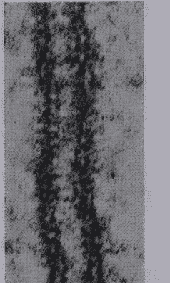

图 3.23. 跨越细胞间隙相对的两个神经细胞膜或质膜的电子显微镜照片。注意每个细胞膜呈现的三层结构。（出自 Porter & Bonneville, 1968.）

放置在平坦的丙烯酰胺凝胶上，不同的蛋白质以与其分子量成比例的速率进行迁移。因此，组分蛋白会分离成少数几个小组，其分子量约为 200,000、100,000 以及一系列较小的值，这些值在对凝胶染色后可以被观察到。然而，这些值仅适用于 Bretscher 研究的红细胞，从不同的质膜中会获得略有不同的值。Bretscher 还指出，脂质成分有三种类型：磷脂、中性脂质和糖脂。

直到最近，关于这些成分组织的普遍接受观点是基于 Davson 和 Danielli (1952) 总结的描述，该描述假设膜的核心实际上是脂质分子的双层。这个核心层被认为在外的侧（细胞外）和内侧（细胞内）都覆有一层单分子层的蛋白质。电子显微镜中产生的三层结构被认为是由于用电子不透明材料对蛋白质进行了选择性染色，其密度与脂质有显著不同。

近年来，Davson 和 Danielli 的膜“理论”或“模型”受到了膜结构领域许多其他研究人员的挑战。所有这些替代模型都面临着问题，即不仅要解释脂质-蛋白的组织，还要描述离子必须通过的孔隙或通道。一些研究者，最著名的 Singer 和 Nicholson (1972)，建议膜仅仅是液态，而完全不是一种有序的分子结构。

最新的模型之一是 Bretscher (1973) 提出的，他认为最近的数据表明，其组织与经典的 Davison 和 Danielli 模型所提出的截然不同。Bretscher 认为膜的大部分实际上是脂质双层，而双层结构中靠近细胞内部的部分与靠近细胞外液的半部分在化学上是不同的。他认为膜蛋白并不是均匀分布在脂质双层的两侧，而是由部分或完全穿过膜的分子组成，它们确实就是离子通道本身。

电子显微镜中出现的膜的三层结构，被 Bretscher 归因于脂质分子的结构是由一个头部和一个双尾部组成的；尾部倾向于相互吸引，而头部倾向于相互排斥。

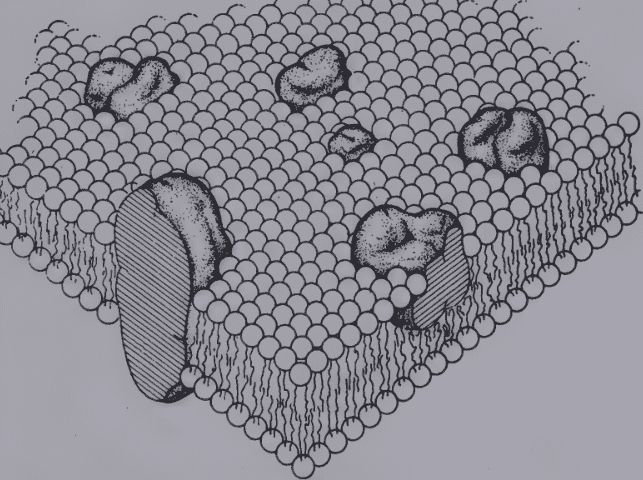

图 3.24. 假设的质膜结构图，显示了脂质双层和穿透的蛋白质分子。（出自 Singer & Nicholson, 1972.）

因此，当脂质形成两个尾对尾相排列的两个分子层的规则结构时，膜就形成了（见图 3.24）。电子显微镜中外侧电子密度区域是这些分子头部的特征，而中间密度较低的区域则代表由尾部组成的核心。目前接受的模型中许多提出的特征总结在图 3.24 中。

然而，应该记住，关于膜的精确分子结构尚没有当代的共识，只有一组基于并不总是一致的数据而提出的系列竞争性模型。

需要解释的膜的另一个主要特征是其对离子的选择性，这种选择性随时间变化。为了实现这种可变选择性，膜必须具有某些传输机制和/或通路，离子在某些情况下可以通过，而在其他情况下不能通过。这个主题在第 5 章有更详细的讨论，但在这里预告一个重要点：离子运动的“孔”或“通道”可能被更好地解释为某种化学过程，也许由穿透的蛋白质分子介导，而不是真实的物理孔洞。因此，在我们现在考虑的结构分子水平上，“孔”可能更恰当地被视为离子跨膜运动手段的某种比喻。这种运动是通过物理间隙、载体物质还是静电力场实现的尚未确定。

我们现在已经概述了对我们研究细胞神经生理学重要的解剖结构。在下一章中，我们将考虑一些方法和仪器问题，这些问题允许测量跨膜产生的瞬态和持续电位。

在上一章中，我们看到了电子显微镜和光学显微镜如何极大地增加了我们对神经元结构的认知。本章将涉及有助于检查这些相同细胞功能的方法论。神经元的生物学（其低电平水平和小型尺寸）要求使用专门的技术来检测和记录任何生理反应。正如我们在第 2 章中看到的，由于神经元通常很小，必须使用微电极对膜电反应进行详细研究。神经元的微小尺寸也规定了记录设备的其他特征。例如，为了让单个细胞长时间与电极保持接触，需要一个机械框架，能够在保持动物标本固定的同时平滑控制微电极的位置。为了定位并维持单个神经元的反应，微电极操纵器必须能够米级的受控重复运动。此外，神经反应的低电平水平要求对电化学信号进行放大，由于其固有的快速性，系统中必须存在某种记录手段以便后续检查。

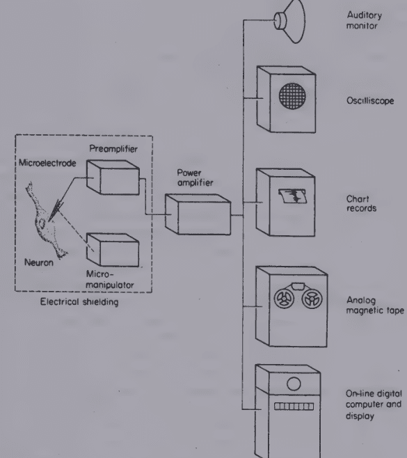

图 4.1。典型电生理记录系统的组件示意图。

一个机械电极操纵器，它由一个刚性立体定位框架支撑。动物制备也固定在该框架上。前放大器是一个高输入阻抗、低输出阻抗且具有中等电压增益的单元，专门用于检测电极采集的信号，同时仅从神经元件中抽取极微电流。即使是微小的电流流也会严重扭曲显示的信号。主放大器（或功率放大器）负责产生驱动显示单元所需的高功率信号，显示单元是将检测到的时间电压模式转换为可读格式的设备。

在任何神经生理记录系统中，这些功能中的两个或多个可能会被组合进单一物理单元中。尽管这种组合可能会减少独立物理盒的数量，但在系统的某个位置，上述提到的每个功能都必须落实到位。

电生理实验中变得越来越重要的另一类仪器阶段也如图 4.1 所示：一台在线计算机，既可用于产生简单或复杂的模式，又可分析和显示实验结果。我们现在将详细考虑系统的每一个部分。

一旦人们理解神经活动在本质上是电性的，测量设备与有机组织之间的连接问题就成了一个主要问题。最早的电极是简单的金属片，由于显示设备不完善，多年来人们并没有意识到来自神经的信号被这些原始接头扭曲得有多严重。

现代电生理电极通过两种方式帮助减少信号的失真。我们的讨论可以根据大小将电极分为两类。宏电极包括相对较大的接触点，可用于检测由分布在很大区域的许多不同细胞产生的神经信号，或由与其相邻细胞分离的神经元产生的信号。大脑信号（脑电图）或心脏信号（心电图）是允许使用宏电极的典型信号。这些信号是分布在广泛区域大量个体电压源共同活动的结果。在特殊情况下，单个神经元也可以产生足够孤立的电压，其细节可以通过宏电极检测到。一些研究人员能够通过简单将较粗绝缘丝的切口端插入脑组织，就常规地采集到几个单细胞响应（例如，参见 Ito & Olds, 1971）。在其他情况下，当细胞可以彼此物理分离时，分离的神经元可以简单地放在宏电极上。（参见 Hartline, Wagner, and Ratcliff, 1956；Uttal & Kasprzak, 1962）。但通常，为了获得足够的信号幅度并观察单个神经元响应的细节，需要使用微电极技术。

宏电极可以简单是一团浸泡在适当盐溶液中的棉花、一个金属钩，或者贴在皮肤上或浸在导电溶液中的金属按钮。在后一种情况下，电解液具有降低组织与电极之间界面电阻的功能，使得大部分生物产生的电压会在电极上产生，而不是浪费在界面电阻上。

电解液在暴露于中等高电流密度或长时间浸泡的电极中还起着另一个非常重要的作用。大多数金属电极（特别是银和锌等金属）在电流以单方向持续的情况下会发生极化。极化是一种类似于电池正常作用的现象，即电极根据其表面发生的变化维持一个恒定的电化学电压。极化电极对低频率表现出较高的阻抗，并具有与生物产生的电流相反的内在反向电位。这些扭真电流反映了电极具有了显著的电特性，而不是保持惰性。极化也部分归于电极所浸液体的电解。溶液在电解分解过程中形成的气体气泡可能会聚集在电极上，产生电池作用，并增加界面电阻。

极化也可能部分归于电极活性区域离子的耗尽。当以任何方式移除电荷载子时，其结果是增加了电极与标本之间界面的电阻。对于大多数使用电极进行刺激的应用，极化并不是一个显著问题，因为刺激电流很大。当从神经细胞中记录许多电位时，极化电位可能等于或大于信号本身。电阻的增加，加上电极-前放大器布线极微小的电容，会大幅降低电子系统的整体频率响应（即通过放大器的电频率范围会缩小）。

通过在电极上涂层其自身的盐，或通过盐桥将金属与流体隔离开来防止极化。关于电极极化的化学和预防的更详细综述，请读者参考 Donaldson (1958) 中 Silver 的文章。

第二类电生理电极——微电极设计得足够小，可以穿透神经内部而不影响其功能。因此，如果将参考电极置于细胞外环境，微电极就可以记录单个细胞内外的电位。微电极尖端可以制成 1/10 微米大小。最终，被这些微小电极刺穿的细胞会变得反应性，但熟练的电生理学家通常可以让被微电极穿的细胞活几天。显然，初始损伤小于周围组织的运动。

最早的微电极（参见第二章对 Ling 和 Gerard 作品的讨论）是细玻璃管，在加热到玻璃呈现粘性流动温度后手工拉制成亚微米直径。细玻璃管或微管并不是真正的电极，因为玻璃是良好的绝缘体。微管必须填充电解盐溶液，作为通过微管末端微孔的真实电连接。由于微管直径极小，毛细作用产生巨大的力量，阻碍电解质流入管内。通常需要在电解溶液中长时间浸泡以均匀填充管路。微管首先在酒精中煮沸，然后浸泡在蒸馏水中。

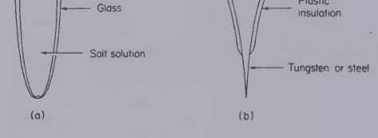
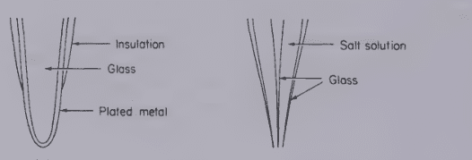

图 4.2。四种微电极的图：(a) 简单的玻璃微管，可能填充导电盐水；(b) 经电解锐化的绝缘金属微电极；(c) 通过在玻璃基底上电镀金属形成的绝缘金属微电极；(d) 从两个玻璃管同时拉制的复杂多芯微电极。

电解质随后通过扩散转移到其中，只需将微极置于充满 KCl 或 NaCl 溶液的瓶中即可。

尽管在许多细胞内记录的情况下，充满电解质的玻璃微电极仍然是最佳选择，但金属微电极越来越多地用于细胞外记录。制造金属电极的一种方法是在玻璃微极中填充铟等低熔点金属。另一种方法是将一根相对粗的灯芯悬挂在蚀刻溶液中，通过通过电流对其进行电解，使其尖锐化。通过调节电流速率，可以控制尖端的尖锐度梯度。Hubel (1957) 以及 Spinelli、Bridgeman 和 Owens (1970) 讨论了钨的尖锐化技术。铂及其合金的电解电极也已得到了成功应用。

目前已设计出针对特定单一离子种类作用的新型电极。例如，Neild 和 Thomas (1973) 描述了一种由玻璃绝缘氯化银线制成的氯敏感微电极，可用于细胞内。Thomas (1970) 则描述了类似的、针对该离子的钠敏感玻璃电极。

图 4.2 显示了若干种微电极，包括一种精巧的多管设计。

## B. 脑定位仪与微电极操纵器

要准确地放置微电极并保持其与所研究的神经组织之间的稳定关系，需要高度的机械精度。这种程度的稳定控制需要一个巨大的机械装置，该装置必须具有足够的刚性和惯性，以避免产生意外的机械运动。正是由于对辅助设备尺寸和质量的这种需求，只有少数实验在同一个制备中同时操作多个微电极。目前看来，单次实验中同时使用的电极数量最多为十个左右。

用于将动物和微电极都固定在相应位置的刚性框架被称为**脑定位仪**（stereotaxic instrument），这个定义术语基于其所服务的另一个功能。脑或神经系统中某些中心和核的位置在不同动物之间是相对固定的，因此可以编制脑图，为特定物种和大小的动物提供其显著外部地标（如耳孔或颅骨缝）的三维坐标。（例如，豚鼠可参考 Luparello, 1967；猫可参考 Jasper & Ajmone-Marsan, 1960；鸽子可参考 Karten & Hodos, 1967；恒河猴则可参考 Snider & Lee, 1961。）脑定位仪标有三维刻度尺，使得微电极尖端可以高精度地置于脑内，而不会对动物造成大规模的手术损伤。脑定位仪上通常装有精密微螺丝驱动器，以提供必要的控制程度并消除回程误差。图 4.3 显示了一台现代脑定位仪的照片。

使用脑定位仪进行放置的准确性良好，但动物之间的差异非常大，因此通常有必要对电极的实际位置进行死后组织学核实。实验后，可以使用强电流标记记录点，或者通过微极极电泳注射染料进行标记。

微电极的推进需要最精确的控制，**微米级操纵器**最适合这种高精度运动，但它们通常不直接连接在电极架上。相反，实际连接是通过一个微型液压系统实现的，以减少从操纵器到电极的运动传递。即使是极微小的波动也会改变神经元与微电极之间的关系，导致反应剧烈的细胞可能因为轻轻的触碰而意外丢失。通过这种流体耦合可以将这种浪费降至最低。

图 4.3. 一台简单但典型的脑定位仪和微电极操纵器。

一项新进展是在微操纵器上安装了电动机。通过这种方式，电极可以自动进入或移出神经组织，步长小至 1 微米，而不用担心手抖会破坏本已稳定的制备标本。

在某些情况下，发现使用允许对尖端位置进行三维控制的微操纵器是有用的，而不是像描述的那种仪器只能实现的单维推进。三维微操纵器具有机械减比例的特性；即，它们通过齿轮、杠杆系统或液压管路将较大的运动转化为较小的运动。虽然这种类型的微操纵器通常是为微手术设计的，但在某些电生理记录情况下已被证明是有用的。

## C. 前放大器

电极-放大器-显示器链的目的是尽可能高保真地复制和记录所研究的神经电信号的幅和时间过程。但在不失真波形的情况下将电子设备连接到脆弱的神经电源并不简单。在本节中，我们将考虑前放大器和电极-前放大器接口可能产生的几种失真源。我们还考虑了减少此类失真的方法。

微电极具有相当大的内阻。尖端直径为 1 微米的电极其内部电阻可能在 1000 万到 2000 万欧姆之间，更小的电极内部电阻可能高达 10 欧姆（注：原文为 10 ohms 疑为笔误，根据上下文应为兆欧姆或更高，但此处按原文翻译或根据逻辑修正。注：原文中 `10 to 20 million ohms` 后面 `as high as 10 ohms` 处可能存在逻辑错误，通常微电极电阻更高，此处按字面译为 10 欧姆或根据语境理解。此处为保持严谨，译为 10 欧姆）。微电极的内部电阻以及与其连接的前放大器的输入电阻，加上不可避免的布线电容，因此形成了图 4.4 所示的电阻电分压器。这产生了两个问题。

第一个问题是由于电极自身的电阻元件引起的。研究的整个神经电实际上作用在图 4.4 所示的分压器的两端（标记为 A 和 B）。但只能检测到该电压的一小部分。这是因为在串联电路中感应的总电压 $V$ 的部分 $v$ 与电阻值 $r$ 和总电阻 $R$ 的比例成正比，这种关系可以表示为：

```
v = \frac{r}{R}V. \quad(4.1)
```


# 4. 电生理学技术

## C. 前置放大器

因此，如果前放大器的输入电阻小于或与电极电阻相当，放大器“看到”的神经电位与环境电子噪声水平相比非常小，这是一个严重的障碍。为了感知大部分神经信号，前放大器的输入阻抗相对于电极来说应该非常高。

现在市场上已有输入阻抗高达数百万欧姆（吉欧）的前放大器。这些设备即使连接到高电阻电极，也会在其输入端产生大部分信号电压，而不是在电极产生。高阻抗前放大器最初用真空管极跟随输入或特殊的高阻抗电极管制造，但现在随着高阻抗半导体器件的出现，全固态高阻抗前放大器已有许多制造商生产。这些固体放大器通常使用场效应晶体管（`FET`），这种晶体管的接线方式与这些特殊真空管非常相似，并具有异常高输入电阻的特征。

前放大器高阻抗的另一个优势是电路抽取的电流非常小。如果电流较大，可能会干扰细胞的正常代谢过程，从而人为地扭曲记录的数据。

与高阻抗相关的第二个主要问题源于电极和前放大器阻抗中电阻和电容元件的组合，如图 4.4 所示。即使是极小的输入电容结合良好的前置放大器极高的输入电阻，可以产生具有极长电阻-电容（`RC`）时间常数的电路。这种长时间常数的结果是降低放大系统的高频敏感性。因此，记录的生物电位由于前置放大器无法跟踪快速变化的信号而发生严重失真。上升时间会被人为拉长，极快速信号将无法通过电极-前置放大器电路。因此，许多前置放大器在设计高输入阻抗的同时，还包含特殊电路，其目的是通过最小化输入电容来减小时间常数。

旧的放大器通过费力地最小化输入电容来减少 `RC` 时间常数，是将放大器的第一级靠近电极尖端，或者通过复杂的屏蔽。然而，`Amatiek (1958)` 描述了一种完全不同的减少前置放大器有效输入电容的巧妙方法。他建议通过平衡相等但相反的电容效应来中消输入电容。在这样的设备中，输入信号会被一个增益为 1 的放大器反转。这个反转信号被传递到第二个电容器，由实验者调节，使其与前置放大器的输入电容相等。有两个相同大小并并联的电容器，其施加电压极性相反。结果是，输入电容的影响被降低到一个微乎其微的值，尽管电容仍然存在。中消输入电容的优势被输出信号噪声水平的增加所抵消。然而，考虑到需要输入电容中消的高阻抗细胞内电极产生的信号相对较大，这并不是严重的障碍。当细胞外电极可能仅产生 `100 µV` 时，细胞内信号可能高达 `100 mV`。

在某些情况下，将前置放大器设计为差分或双极输入比单端输入更有用。差分输入布局的需求在于，某些生物电无法以任何外部地或共电电位为参考，而是仅作为组织两个不同部分之间的电压差存在。良好的差分输入放大器还应该具有共模抑制能力，即拒绝两个输入电极共有的信号的能力。然而，满意的共模抑制需要平衡输入，因此微电极上通常无法实现。如果共模抑制良好，差分前置放大器将不会通过任何大量的 `60 Hz` 电压，例如，这些电压可能是从头顶照明和其他设备中拾取的。

如果这种“拾取”太大，可以使用金属屏障或板保护材料免受大多数常见干扰源的影响。

前置放大器通常没有实质性的电压增益。它们是边缘匹配设备，将电极的高阻抗耦合到主功率放大器的低输入阻抗上，以实现从一个功率传输的最大化。因此，它们产生的输出信号在电压幅度上略大于原始信号，但在电流驱动能力上强大许多倍。这种低水平电压能力意味着前置放大器可以完全由电池供电，这是有助于减少电子系统注入到神经生理记录中噪声的另一个特征。

### 耦合类型

通常，放大器可以根据连续级之间的耦合关系分为两种类型。第一种放大器被称为从一个放大器到下一个放大器的**直流（`DC`）耦合**。通过这种耦合，即使是恒定电压信号也可以被放大并通过系统。直流耦合简单意味着级间电路中没有串联电容器，因此恒定电压像变化电压一样容易通过。直流放大器的设计与许多问题相关，因为它们允许直流和其他缓慢变化的信号通过。这些缓慢信号可能包括生物电，如细胞膜的静息电位、由眼睛位置定义的电位、大脑表面的缓慢变化以及类似的长持续或持续信号。这些是需要使用直流放大器的信号，但可能存在具有相似低频率特性的伪电压，它们可能会扭曲甚至掩盖所需的信号。

直流放大器敏感的干扰电压包括放大器-线路漂移和电极极化效应，以及伪电生理信号。基线漂移源于放大器部分微小、渐进、长期的波动的放大。在直流耦合放大器中，电阻的轻微变化可能会在放大级早期产生极微的电压偏移，这种偏移在输出端可以被放大为大幅的电压波动。这种干扰可能会完全掩盖低频神经信号。类似地，电极特性的轻微波动（例如极少量的极化）可能会被放大并导致巨大的恒定输出信号。

较简单、对噪声不敏感的**交流（`AC`）耦合**放大器通常用于研究动作电位、心电图和诱发电电位等较短的瞬态信号，而不是检查恒定或长期的电压偏移。交流耦合放大器在放大级之间插入了电容电路。这些电容器由于其对低频信号的高阻抗，倾向于阻挡稳定电压并仅允许在一定范围内变化的信号。通过在多角度多位置开关上放置一组各种尺寸的电容器和电阻，可以选择放大器的带通特性，因为电阻-电容组合决定了哪些频率将通过。因此，交流耦合放大器的优势是允许研究人员为调查的特定信号选择最佳频率范围。可以调整带通范围的下限以拒绝由于电极移动引起的低频偏移，例如，调整上限以拒绝前置放大器中的高频噪声。对于 `1 ms` 长的尖峰动作电位，`300 到 2000 Hz` 的带通是理想的。对于诱发电电，`3 到 300 Hz` 的范围会更优。

## D. 功率放大器

前置放大器的目的是在尽可能少引入额外电子噪声的情况下，复制电极拾取的微小信号。只有在前置第一级中发生适度放大时，通常才能实现低噪声水平。

## E. 显示器与记录仪

以及阴极射线管（`CRT`），这是一种抽空的玻璃外壳，一端装有电子源（电子枪），另一端是荧光屏，当电子撞击它时它会发光。图 4.5 显示了典型阴极射线管的组件。

电子源是一个加热的灯丝，类似于无线真空管中的灯丝。电流流过该灯丝产生的加热作用使灯丝金属（通常是钨）原子的外层轨道电子逸出。随后，这些电子会被二次加速极上的正电位吸引，和/或被电子源自身的负电位排斥，从而向阴极射线管的表面运动。灯丝发射的散射电子束通过在一组特殊的聚焦电极上施加适当电压，并通过用金属屏蔽罩遮挡电子路径来实现聚焦和准直。示波器表面的荧光亮度由设置在电子束路径中的栅极电极控制。电子束在阴极射线管表面的位置，取决于电子束流在它们从电子源移动到荧光材料过程中的磁性或静电偏转。通常，在一个管子中同时使用静电偏转和电磁偏转两种技术。当单独采用静电偏转时，使用两组偏转板——一组用于水平定位，一组用于垂直定位。同样，电磁控制需要两组线圈，但线圈可以位于阴极射线管外部，在抽空管内部可以应用更简单的结构技术。

简单的阴极射线管只能根据水平和垂直偏转板上的电压决定的位置在荧光面上产生一个光点。但显然，有了这种点绘图仪，通过明智地编写到偏转板或线圈的信号序列，就可以画出所需的任何图形。

例如，通过向水平偏转系统施加斜坡电压（函数 `V = Kt`，其中 `t` 为时间，如图 4.6 所示），并将生物电功率放大器的输出施加到垂直偏转系统，就可以绘制出生物电电位的电压随时间变化的曲线。斜坡电压随时间线性增加，使电子束跨越阴极射线管产生位移，其位移距离与所经过的时间成正比。因此，阴极射线管在空间中绘制出的图案，其中水平轴对应时间，垂直轴对应于制备的电压。

大多数示波器（如图 4.7 所示）具有保持电子束的能力，并允许在仅某些触发信号（如刺激）释放它后，使其扫描出水平基准时间。由于这种系统也可以用于限制斜坡电压跟踪函数的次数为单次扫描，因此如果人们想对单个事件进行拍照以便详细检查，这是一个非常有用的功能。在其他情况下，重复扫描有助于显示所研究信号的变异性或恒常性，但在所有这些应用中，在恒定的、已知的时间点触发扫描释放是非常重要的。

在为特定应用选择阴极射线管时，一个重要因素是显示屏上荧光或荧光材料的性质。可以选择短寿命荧光粉，以极度地减少轰击电子被移除后光点发光的时间。短寿命对于那些如果长寿命会导致连续显示之间产生干扰的应用是有利的。长寿命则有助于保留单个事件以供观察。`Sperling (1971)` 已经详细讨论了许多此类考虑因素。

某些“存储型”示波器专门设计为能够无限保留施加信号的轨迹，直到被刻意擦除。这种延时存储通过在荧光屏后方设置一个额外的栅极，并让电子束充满荧光屏来实现。当电容轨迹存在时，光点将持续亮起。

另一种存储型示波器本质上是数字化的。模拟信号首先转换为数字形式，然后存储在某种数字存储设备中，例如小型磁芯存储器。随后信号被检索并重新转换为模拟信号以便在 `CRT` 表面显示。这类设备必须刻意擦除以清除存储的信息，因为数字记录不会自然衰减。

典型研究示波器的屏幕长度不超过 `5 到 8 英寸`。为了观察持久性信号，轨迹速度（由斜坡电压的上升率定义）必须保持非常缓慢。在这种情况下无法分辨单个信号，因为即使是瞬态也仅仅表现为垂直线。作为折中，可以使用称为记录仪的设备。记录仪不具有全电子示波器那样的频率能力（最好的不超过几百赫兹），但它们将中等的分辨率与长记录相结合。记录仪通常是电流计设备，施加信号的大小机械地移动笔或光源。在某些其他单元中，使用仅在感光纸上书写的电火花或热笔。

### 自动显示器

如果在功率放大器和示波器或记录仪之间插入计算设备，就可以在显示中包含实验结果的分析和总结呈现，而不是简单的原始数据图。这种方法在神经生理学实验室中变得越来越流行。对于这些技术的全面讨论，请参阅 `Uttal (1968, 第 8 章)`。目前的简要介绍了几种对神经生理学家可能具有特殊意义的数据分析和显示方法。

一种方法是应用简单的统计显示，例如幅度、刺激后时间或直方图。图 4.8a 是一个直方图，显示了当龙虾尾部受到光刺激时激活的光敏感神经元的响应幅度分布。幅度直方图是一种简单的分类方案，动作电位的幅度指定了它被排序到哪个幅度箱中。在这里使用了 `64` 个幅度类别，这个值是由用于显示这些数据的打印机能力决定的。

图 4.8b 是刺激后时间（`PST`）直方图的再现，它显示了听神经中单个细胞在点击刺激后发放间隔的时间分布。在 `PST` 直方图中，数据根据刺激与引起反应之间的时间进行分类。因此，时间测量本身被分类到箱中，箱的大小取决于分析方法对分段时间。间隔直方图显示了连续响应之间的间隔。对于神经生理学实验，`1 ms` 通常被认为是足够的精度水平。然而，在至少一次实验中，发现可测的时间不规则性量级在数十微秒量级（`Horvath, Halik, Peretz, & Miller, 1963`）。

在某些实验中，需要三维数据显示来充分呈现复杂响应模式的细节。一个例子是绘制视神经或视觉皮层神经元的感受野。如果示波器由计算机控制，则可以很容易地在维数示波器上绘制三维数据的投影。图 4.9 显示了一种投影绘图技术。在这种情况下，通过抑制隐藏线增强了显示质量，这是一项相当困难的编程任务。

尽管这个样本感受野恰好是单相的，但也可以指示出相对于基础自发率的增加和减少。因此，感受野的形状、范围以及极性都可以以图形形式清晰地表现。这种等轴显示（`Isometric displays`）是显示数据的有力手段，因为它们在示波器界面上通过一眼，就总结了代表多维数据的许多线性迹线的结果。

### 模数转换器

在某些类型的生物电信号分析中（例如幅度直方图），必须精确测量信号的幅度或形状（幅度随时间的变化）。如果数据随后由数字计算机进行分析，则这些模拟（连续且分级的）幅度必须转换为数字（离散且数值的）代码。完成这种转换的设备称为模数转换器。已经开发出了几种模数转换器，它们都基于信号与某些电压参考电平之间的比较工作。

在一些早期的转换器中，会对输入信号与具有恒定斜率的稳定增长斜坡电压进行比较。在比较斜坡电压上升期间，计数器记录由适当时序的时钟产生的等间距脉冲数。当检测到输入信号与增加的斜坡电压之间幅度相等时，计数器停止。如果斜坡比较电压是线性的且时钟间隔精确，那么时钟脉冲计数器将包含一个准确表示模拟信号幅度的数字。

斜坡比较技术的困难之处在于完成比较所需的时间异常长。另一个因素进一步使这种情况变得更加复杂。为了获得等间距的点，每次转换的周期必须与转换最大可能幅度所需的时间一样长。这意味着信号编码的速率非常低，对于在比较间隔期间幅度发生显著变化的信号，计算中可能会引入相当误差。换句话说，这种转换方案中使用的编码是不经济的，因为幅度标度的每增加一个都需要另一个时间单位。这可以被认为是穷举式查询的分类，而不是通过演绎测试系统地排除可能值。

一种使用更合逻辑的方法的满意模数转换技术是逐次逼近法。这种类型的转换器利用更经济的代码。它不是计算每个幅度阶梯，而是本质上是在玩“二十个问题”游戏的电子版，通过每一次连续的“问题”将信号分类为更小更大的组。因此，只需要几次连续逼近就能识别给定的幅度，而斜坡比较程序的特征是对每种可能的幅度进行穷举测试。

模数转换器的采样频率能力也受到信号转换所需时间的限制。然而，逐次逼近转换可能仅需 `1 µs`。尽管如此，如果频率高到在转换时间内发生变化，其编码将是不准确的。因此，设计了称为采样保持电路的辅助输入设备与模数转换器配合使用，帮助克服这一局限。采样保持电路在转换开始时采样作用电压的幅度，并保持该初始值的恒定记录直到转换完成。这是通过存储电容器实现的，电容器的电荷在预转换期间遵循输入信号，但一旦转换器开始运行，它与输入信号电学隔离。当电容器断开时，它无法通过任何其他路径放电，从而保持初始信号水平。

通常，一个模数转换器可能需要处理来自源的多个独立线路的信号。在任何给定时间选择线路之一进行转换是非常重要的。选择并连接可能信号中的一个的过程称为复用，可以通过继电器触点或晶体管开关完成。继电器的优点是当开关关闭时阻抗非常低，当开关打开时阻抗极大。因此，几条线路之间几乎没有失真的电干扰。不幸的是，继电器在信号之间切换的时间相当长；良好的继电器复用器可能需要 `1 或 2 ms` 切换到另一条线路。固态复用器可以实现更高的速度，它们能够在 `1 或 2 µs` 内更改输入。

## 刺激器

固态器件具有某些局限性。需要复杂的电子设计来维持神经生理学实验的线性和保真度。到目前为止讨论的所有设备都是为了检测、放大和显示神经元产生的微小电生理电压设计的。然而，许多实验情况也需要某种刺激装置在受控条件下诱发神经反应。多年来，神经生理学实验中使用的刺激器种类发生了巨大变化。早期，几乎所有的刺激器都是脉冲型的；也就是说，它们设计用于产生最短的刺激。每个刺激脉冲只能改变在幅度方面，脉冲被认为是瞬时的，人们对刺激在空间或时间上的模式给予了较少考虑。一位卓越的科学家将这种方法称为“闪电与雷鸣”派的刺激法。这一时期，用于诱发神经反应的刺激包括由频闪灯或快门产生的灯闪光、声音的咔哒声、对皮肤的机械敲击，以及电刺激——这种几乎通用的的刺激方式——被应用于神经系统的任何部位。

多年来，神经生理学研究哲学理念的巨大变化影响了刺激器的设计。也许最重要的一个里程碑发生在 `1960 年` 左右，当时 `Hubel 和 Wiesel (1959)` 以及 `Lettvin、Maturana、McCulloch 和 Pitts (1959)` 发现，在时间/或空间上具有各种特征的刺激（例如，以特定方向和特定速度移动的点、线段、转角和边缘），在诱发视觉系统神经反应方面，比简单的脉冲有效得多。即使这些模式化刺激的能量远低于脉冲刺激时，结果也是如此。

随着这种向更复杂的模式化刺激发展的趋势持续，技术以一些不寻常的方式发生了变化。首先，似乎实际上存在一种简化的趋势。过去的闪光和闪烁并没有被更复杂的刺激器取代，而是被更简单的刺激器取代了。在许多卓越的研究中（例如 `Hubel & Wiesel, 1962, 1965`），`Hubel 和 Wiesel` 始终使用一个简单的光源来投射出形状适当的图像，并在动物的视野场内手动移动该图像。`Lettvin` 小组的工作是使用一种巧妙但简单的刺激器完成的，该刺激器利用磁铁移动放置在青蛙视野内铝框架上的刺激物。

然而，近年来，许多研究人员希望转向更复杂的设备。一些人如 `Spinelli (1967)` 和 `Uttal (1969)` 已使用计算机来生成复杂的视觉刺激模式。

关于电生理研究中使用的多种类型物理刺激器的全面讨论超出了本书的范围。光电、机械、声学和化学刺激程序的种类极其丰富。我们无法在此处详细考虑它们，但感兴趣的读者可能想参阅作者的另一本书（`Uttal, 1973, 第 2 章`），以获得刺激神经活动各种手段的更完整讨论。在本节中，将只讨论一种刺激器——电脉冲刺激器。选择它有两个原因。

首先，电是所有可激活神经系统任何部分的刺激中是最通用的。它是唯一一种允许神经生理学家跳过受体，从而产生已知的神经反应模式，而不是由受体转换机制定义的模式的刺激。这是可能的，因为当电刺激应用于轴时，它们具有非常理想的特性，即对于每个电刺激脉冲产生一个尖峰动作电位。

其次，电刺激的使用增加了本章已讨论的灵敏放大和记录设备的使用复杂性。有必要理解如何克服这些复杂性。


同时使用电刺激和高增益前放大器时面临的主要困难，源于刺激幅度与神经电电位之间的差异。刺激器的电压输出在有效诱发神经反应之前，其电压可能高达 `100 伏`。然而，放大器的调节是为了捕捉最适合以毫伏为单位测量的信号，通常仅以微伏为单位。因此，在刺激期间，放大器承受的电压远大于它能处理的范围。在这种情况下，大多数放大器都会过载，并暂时阻断其通过任何输入低电信号的能力。这种阻塞是因为刺激电压和神经电信号在电上是紧密耦合的；也就是说，它们相对于同一个公共电位进行基准。如果这两个电位可以解耦（或相互隔离），那么这个问题可以通过许多方法解决，所有这些方法都涉及某种形式的电传输到接地的“浮空”电路或未接地的电路。简单的变压器可以作为最简单的权宜，但变压器没有良好的隔离或波形保持特性。

最近的两项进展大大提高了所可以获得的隔离程度。一种创新是射频系统。该设备由 Schmitt 和 Dubbert (1949) 开发，利用一个非常小的发射器跨越空隙发送信号到同样调谐的接收器。信号跨越两个线圈间隙传输的净效果是提供一个不包含任何地的输出电压，除了通过寄生电容泄漏的参考之外。

通过使用光隔离器可以获得更高程度的隔离。这些系统用电压控制的光源和光敏电阻取代了变压器或射频发射接收器。当输入信号激活单元时，光源（通常是光电二极管）发光。然后，光激活光探测器，光探测器通过改变电阻来控制通过输出电路的电流幅度。这种传输的效果再次是将刺激与地参考隔离开。

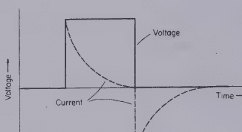

图 4.11. 显示对具有显著电容阻抗的负载（例如皮肤）施加恒压电流的效果图。产生的电流本质上是施加电压的导数。（来自 Uttal, 1973。）

在使用电刺激时遇到的第二个主要困难围绕这样一个事实：组织的电阻和电容特性会严重扭曲刺激，以至于非常恒定的电压也会产生非常不恒定的电流。这种效应主要是由于组织电容元件的充电，导致施加的电压波形被微分。当电流被这样微分时，只有波形的上升和下降（高频成分）会被通过。这种失真可能导致如图 4.11 所示的实际刺激电流波形，尽管施加的电压刺激是矩形的。

克服这种困难的方法还取决于特殊的电子电路。电路可以设计成产生恒流刺激，而不是恒压输出。在恒流模拟器中，施加到组织的电压不是恒定的，而是以维持通过组织的恒流的方式发生变化。由于大多数研究人员认为施加的电流比电压更令人满意的刺激幅度测量标准，这是一个理想的特征。无论如何，恒流可以通过变化的电压更精确地量化。

# 5 神经电学活动的化学基础：静息电位与动作电位的分类

包围神经元并将其与相邻细胞隔开的超微膜，其功能不仅仅是含有细胞质胶质。膜渗透性特性的波动是所有神经电学活动的来源。由于膜能够选择性地允许某些离子进入或离开细胞膜，同时阻止其他离子的运动，并能随时间单独改变对各种离子的渗透性，因此发挥着卓越的功能。这种在分子水平对离子的可变选择性和差异渗透性，是行为水平所有反应的终极来源。

必须强调的是，以下对膜过程的介绍是基于一个承认不完全的离子传输和平衡机制模型。尽管一些基本概念已经确立（例如，众所周知钠离子和钾离子是构成静息膜电位和动作膜电位基础的离子平衡的主要离子），但其他重要概念（如钠钾泵机制的详细性质）尚未被完全理解。因此，本章讨论的内容是在一个不断发展的神经膜理论背景下提出的，该理论是可以接受的、富有成效且实用的，但尚未完全解释所有相关的分子和离子过程。读者应当记住，所呈现的“事实”和模型本身随着新信息的出现，极易被修订或完全否认。

## 5.1 神经电学活动的化学基础

以下讨论旨在介绍一些基本概念和词汇，这些词汇可以在后续章节对动作电位进行更详细的讨论。其目的并非完整。对更完整讨论感兴趣的读者，请参阅 Cole (1968)、Aidley (1971) 或 Tosteson (1969)，如果需要高度数学化的处理，请参阅 Plonsey (1969)。

当膜两侧的离子浓度不同时，膜跨膜会存在电化学势。然而，如果膜对涉及的任何离子具有渗透性，就会有力作用来改变这些浓度差。其中一些力是被动的，从意义上说，它们利用浓度本身的势能来减少这种差异。另一方面，主动力也是跨膜作用的。我们所说的主动力是指从细胞的代谢过程中获取能量的过程，这种方式实际上可能会增加浓度差，从而产生跨膜的电位。让我们在接下来的段落中考虑这两类力——被动力和主动力。

### 5.1.1 被动力

#### 扩散

如果两个含有不同浓度溶质的溶液被一种至少对该溶质部分渗透的膜彼此隔开，那么溶质分子就可以通过扩散从一种溶液通过到另一种溶液。溶质分子的随机布朗运动完全解释了这一过程，且不消耗代谢能量。扩散的程度正是简单统计力学原理所预测的那样，即：在随机运动的简单统计基础上，浓度差趋向于平均。在初始状态下，当存在较高的原始浓度差时，被认为存在低水平的熵（无序度）；此时，浓度是非随机的（一侧的溶质比另一侧多）。如果膜能够通过溶质分子，该过程将导致分子具有更高程度的熵（更大的无序度）（当浓度相等时，溶质被认为分布得更随机，处于更大无序状态的状态）。由于我们讨论的理想膜被假定不具有选择性方向（离子在两个方向上的流动情况一样良好），这种熵的增加仅仅是因为预料从高浓度侧随机跨膜的分子会比从低浓度侧跨膜的分子多。因此，由分子运动的纯统计分布引起的被动扩散，只能导致两种溶液中溶质浓度的均衡。

#### 渗透

假设类似的半渗透膜将相同溶剂中两种不同浓度的共同溶质隔离开来。同样假设膜对较大的溶质分子不渗透，但会允许一些较小的分子通过。在这种情况下，溶剂将从低溶质浓度侧（高溶剂浓度侧）迁移到高溶质浓度侧（低溶剂浓度侧），其方式也趋向于使两种浓度相等。因此，渗透可以被视为一种主要通过溶剂传输来减少两种溶液溶质浓度差的力。然而，渗透并不是简单的溶剂扩散。尽管布朗运动被假定是这两种过程的驱动力，但渗透压涉及的能量通常比简单扩散力所预测的要大。

#### 电位驱动

如果溶质被电离（这在涉及盐类的情况下总是如此），那么正如我们之前提到的，由于净电荷，半渗透膜两侧也可以存在电位差。例如，如果膜的一侧带电离子比另一侧多，则该侧相对于另一侧带负电。这种电位差趋于将带电离子从它们所在侧移动到膜的另一侧。由于这种类型的电位差引起的离子运动被认为是“下行”的，因为它们减少了浓度和电位差。因此，电位驱动也可以被视为跨膜趋向相等，正如扩散和渗透一样。

> * 读者可能会从讨论中认为涉及到大量的电荷。事实上，参与神经电位的电荷数量非常小——只有 100,000 左右——而且分布效应主要局限在 20 埃单位内。在开始考虑离子通量的绝对值时，应当记住这些事实。跨膜电位需要注意的是，它不仅取决于膜的特性，还取决于离子自身的迁移率。此外，溶质性质的差异可能导致跨膜电位的巨大差异。

### 5.1.2 主动力（泵）

“向上”克服被动力的作用。如果作用在离子上的所有膜力都是被动的，膜两侧的离子浓度差将迅速均衡，无法维持跨膜电位。对于有机生命来说，还有相反方向的作用。被动力被活细胞中的主动代谢过程所抵消，这驱动离子回到。由于需要消耗能量，向上泵必须由代谢驱动。

驱动神经电位的离子泵的精确性质近年来由化学取向的神经生理学家进行了深入研究。已经确立的是，泵过程主要是产生浓度差以及产生膜电位的原因，这是一个双管作业的过程，将钠泵出细胞并将钾泵入。

这两个泵作用似乎是紧密相关的，并且可能是单个复杂化学循环的一部分。Hodgkin 和 Keynes (1955) 以及 Caldwell, Hodgkin, Keynes 和 Shaw (1960) 表明，如果细胞的环境缺乏钾，那么当由于缺乏 `K⁺` 离子导致钠泵减少时，钠泵也会减少，尽管可用 `Na⁺` 离子的供应没有变化。这一结果暗示了一个涉及化学载体物质的假设模型。假设细胞膜上的单一载体负责 `Na⁺` 和 `K⁺` 的传输。当这种载体 `X⁻` 在膜的内缘与 `Na⁺` 结合时，它形成一个我们称为 `NaX` 的化合物，由于某种尚未理解但显然消耗能量的生物化学原因，它倾向于移动到膜的外缘。化合物 `NaX` 的运动是朝着 `Na⁺` 的巨大电位驱动力方向的。当它到达膜边缘时，局部化学条件发生变化，`NaX` 发生了两件事。首先，`Na⁺` 之间的键

#### 主动力或泵

此时 `X⁻` 阴离子断裂，将 `Na⁺` 释放到外部环境。其次，`X⁻` 阴离子被转化为另一种载体物质（`Y⁻`），其独特的性质倾向于与钾离子结合。当这种结合发生时，这种新化合物 `KY` 在某些同样未知的生物化力作用下，倾向于向细胞膜内部移动。在体内，它也会发生分解，将 `K⁺` 释放到细胞内部。自由的 `Y` 自由基变为 `X⁻` 离子，该离子可以与 `Na⁺` 离子重新结合。循环周往复。这种假设性的双联泵循环示意图如图 5.1 所示。

该模型在近年来面临着挑战。例如，已经证明从细胞中排出的 `Na⁺` 离子多于主动泵过程注入细胞的 `K⁺` 离子数量（Thomas, 1968; Carpenter & Alving, 1968）。确切的数量尚不确定；一些研究人员认为，每注入一个 `K⁺` 离子就会排出两个 `Na⁺` 离子，而另一些人则认为比例为三比二。因此，一个 `Na⁺` 换取一个 `K⁺` 的完美交换似乎并不存在，图 5.1 中代表 `Na⁺` 排出的线应该比代表 `K⁺` 注入的线更强。许多实验室正在进行旨在回答这一问题的有力研究。这项研究中特别涉及了一种新发现的、高度特异性的钠泵作用抑制剂——化学物质称为乌海毒碱（ouabain）。以某种方式，乌海毒碱能够在不影响钾泵的情况下关闭钠泵。

尽管 `Na⁺` 和 `K⁺` 的泵送作用可能不是一对一的，但它们无疑至少以某种方式是耦合的。

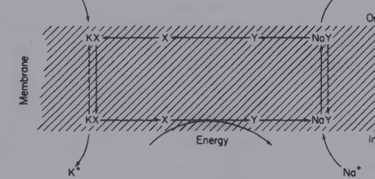

图 5.1. 一个可能作为钠钾泵机制的假设传输系统示意图。该泵的一个钠离子换取一个钾离子的方面不再被认为是正确的，但该图概念化了一种可能由 `ATP` 能量源驱动的可能化学传输机制，这种机制可能是泵送作用的基础。（源自 Woodbury, 1965，由 Glynn 根据 Shaw 修改。）

### 5.1.3 神经电活动的化学基础

遗憾的是，图 5.1 所示的假设双联泵模型并没有强调泵两个筒之间的另一个差异。`Na⁺` 和 `K⁺` 离子移动的通道或路径可能不是相同的。Hille (1970) 回顾了大量的证据，特别是参考了对涉及的传输机制的药理效应，这支持了钠和钾离子通过膜上截然不同的通道的观点。

Hille 注意，例如，两种高毒物质——来自河鱼的河豚毒和来自贝壳类的石房毒，有阻止 `Na⁺` 离子通过而不影响 `K⁺` 这种的能力。恰恰相反，四面铵离子能够关闭 `K⁺` 传输通道，而不影响易于通过的 `Na⁺`。Hille 等人声称，这些药理效应表明存在两个不同的通道，`Na⁺` 和 `K⁺` 离子通过其旅行，至少在被动力的压力下如此。当然，“`NaX`”和“`KX`”的主动泵速率的差异也可能是由于这些分子通过的通道的性质导致的。

泵是否为图 5.1 所示的那种化学传输机制的问题，与离子通过的通道性质这一问题密切相关。Keynes (1972) 认为，这些离子通过膜的传输速率排除了任何需要显著分子量可移动载体的机制。

无论这场争论的结果如何，显然，`Na–K⁺` 泵的整个概念确实需要以某种方式迫使离子克服被动力向“上”运动。这提出了关于提供必要的驱动能量的代谢来源性质的问题。尽管化学循环的精确性质尚不详尽，但似乎一种被称为腺苷三磷酸（`ATP`）的物质可能是泵送作用所需的能量来源。在可以测量神经元膜电位的制剂中加入 `ATP`，会导致泵送作用的增强。这并不意味着 `ATP` 是假设传输机制中神秘的 `X` 或 `Y`，而只是它能够提供驱动泵送作用所需的能量。这完全不是出乎意料的结果，因为已知这类磷酸盐化合物在酶促作用分解时是有效的化学能来源。

因此，这是对作用于离子以改变其跨膜相对离子浓度的两种被动力和主动力的简要介绍。一旦建立了带电离子的浓度差，电电压差必然会随之产生。下一节的目的是描述跨膜电压是如何从离子分布产生的。

## 5.2 静息电位的建立

我们还将寻求解释细胞正常静息电位的起源。静息电位是由于向上泵送作用和下行被动力之间的相互作用而在膜上测得的非零电电压。

### 5.2.1 浓度电位：一种通用方法

让我们首先考虑膜两侧溶液浓度的差异如何在膜上产生产生电位。在本节将讨论的理想情况下，重要的是记住我们考虑的是单个离子。由完全渗透性膜或液接产生产生的电位，只有在膜变得不渗透并达到平衡时才会瞬间发生。项 `u` 和 `v` 是阴离子和阳离子的迁移率，它们是多个因素的函数：

```
E = (RT/F) * ln(C1/C2)
```

其中 `R` 是通用气体常数，`T` 是绝对温度度，`F` 是电荷，`C1` 和 `C2` 是两侧的浓度。

### 5.2.2 跨真实神经元膜的浓度电位

虽然计算理想膜上单一盐溶液产生的电位相对直接，但计算跨渗透膜多种盐的结合效应并不那么简单。各种因素之间的许多二阶相互作用增加了预测结合效应的难度。例如，解释单个电位的离子浓度差本身会受到其他离子产生的电位的影响。此外，膜对特定离子种的渗透性是总电位差的函数，也是单个离子类型的函数。因此，平衡电位成为相互反馈的多个因素的交互函数。

然而，通过考虑参与平衡过程的单个离子，可以形成这些相互作用结果的总体。神经元细胞质和细胞外液的主要成分是 `Na⁺`、`K⁺`、`Cl⁻` 和某些有机离子。大型有机离子通常无法通过半渗透膜，因此它们不参与电位计算，尽管它们可能参与细胞代谢和主动泵的驱动。

主动钠泵将钠从细胞内部驱动到细胞外液，导致细胞内部这种阳离子缺乏。由于内部钠浓度低于其在细胞外液中的浓度，仅由钠离子产生的内部电位与细胞外液相比必须是一个负值。* 被动力——渗透、扩散和电位驱动——与主动力是对立的。

> * 由于细胞外空间在实际上是无限大的，因此非常容易将电极放置在与细胞外液电学公共的组织部分。血液或富含血液的组织通常被用作所有细胞内电压测量的参考标准。

### 5.2.3 静息电位的建立

泵送过程导致了相对的内部耗尽。由于细胞内部相对于外部将呈现负电，且由于带正电的钠离子在细胞外液中的钠浓度高于细胞内，因此这三种被动力将迫使一些钠离子流回细胞内部。

另一方面，钾离子的主动泵作用驱动钾离子进入细胞内部，使其与细胞外的钾浓度相比增加了该离子的浓度。如果仅测量这种离子产生的电位（相对于细胞外液），则细胞内部将呈正电。作用在钾离子上的被动力将迫使钾向细胞外移动，这与钠的被动效应相反。

`Na⁺` 和 `K⁺` 的泵送过程趋于一种稳态，即在被动力的影响下，泵入或泵出的离子数量达到平衡。在这些稳态条件下，浓度差产生的电位恰好被一个相等且方向相反的电位所平衡：由泵作用产生的平衡电位。

每个离子的平衡电位由泵力的大小和方向，以及膜通透性和整体膜电位等因素决定。对于 `Na⁺`，平衡电位通常约为 `+60 mV`，对于 `K⁺`，则约为 `-90 mV`；在典型膜上，`Na⁺` 和 `K⁺` 的浓度电位分别约为 `-60 mV` 和 `+90 mV`。

除了钠和钾泵作用的不对称性外，另一个因素也导致了细胞内外正电荷的净差异。细胞膜对 `K⁺` 被动流出的通透性是对 `Na⁺` 被动流入的通透性的 `50` 倍。因此，无论是在平衡态还是非平衡态下，在与泵出细胞流相反的方向，`K⁺` 的回流远大于泵入细胞的 `Na⁺` 流。这是当离子流达到平衡时，最终电荷浓度产生差异的另一个原因。在达到平衡之前，被动回流与泵流之间的差异一直占据主导地位。在此时，静息电位建立，每种离子的净流量为零。在反映平衡的静息电位下，主动 `Na⁺` 泵与 `Na⁺` 的被动流入完全平衡，而主动 `K⁺` 泵作用与 `K⁺` 的被动流出完全平衡。

因此，这引出了我们讨论的核心问题：各个电位是如何相加并产生在细胞内和细胞外电极之间测得的总膜静息电位的？这个问题的答案相当复杂，但我们可以通过对一些非常复杂的概念进行简单的解释，来理解该过程的一般性质。

### 5.2.4 神经电活动的化学基础

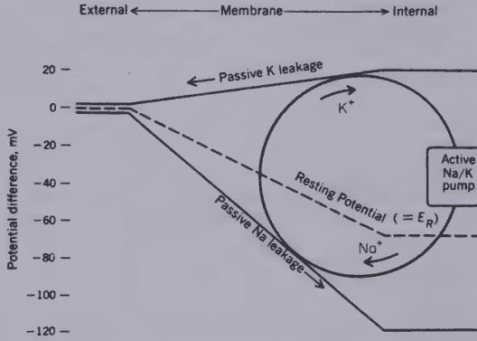

图 5.2. 建立和维持膜静息电位所涉及的电位水平、被动力和主动力的示意图。（源自 Katz, 1966）。

作用在每个离子上的总被动驱动力将是其单个浓度电位与总膜静息电位之和。因此，对于 `Na⁺`，总驱动力（给定在典型的 `-70 mV` 或 `-80 mV` 静息膜电位下）约为 `-140 mV`，而钾的总被动驱动力约为 `+10 mV`。我们将在第 7 章中看到这一点，由钾和钠浓度差产生的静息电位几乎占据了神经元爆发性尖峰动作电位的所有幅值。

另一组完全不同的力作用在氯离子上。有研究表明也存在 `Cl` 泵作用，至少在乌龟巨轴突中（Keynes, 1963），但其目的尚不清楚，在大多数细胞膜测得的 `Cl⁻` 电位与累积膜电位本身几乎相同。

累积或静息膜电位是不同离子种类、其泵、“下坡”力以及几种膜因素（最重要的是膜对每种离子的个体特异性通透性）之间复杂的平衡相互作用的结果。图 5.2 描述了作用在典型神经元膜两侧的各种力以及它们之间的一些相互作用。

在平衡条件下，Hodgkin 和 Huxley (1952b) 提出了一种将单个离子电位浓度和膜对相应离子的通透性作为函数，来预测静息膜电势的的有效近似方法：

```
MP = (RT/F) * ln( (P_K*(K_o) + P_Na*(C_Na_o) + P_Cl*(Cl_i)) / (P_K*(K_i) + P_Na*(C_Na_i) + P_Cl*(Cl_o)) )  (5.3)
```

其中 `MP` 是总膜电位；`R`、`T` 和 `F` 的含义与公式 (5.1) 相同；`P_K`、`P_Na` 和 `P_Cl` 分别是膜对三种离子的通透性；`C` 值是神经元内部（`i`）或外部（`o`）每个离子的浓度。该方程仅在平衡时成立，而且由于通透性本身也是膜电位和离子浓度的函数，它通常不适用于其他时间的系统。

总结来说，由于神经细胞膜的选择性通透性以及代谢活跃钠钾泵的存在，产生了膜电位差。钠钾泵将 `Na⁺` 排出细胞并将 `K⁺` 泵入细胞。细胞外钠浓度比体内高 `10` 倍，而细胞内钾浓度比外高得多。钠的平衡电位约为 `-60 mV`，钾的约为 `+90 mV`。细胞膜对 `K⁺` 被动流出的通透性是对 `Na⁺` 被动流入的通透性的 `50` 倍。因此，无论是在平衡态还是非平衡态下，在与泵出细胞流相反的方向，`K⁺` 的回流远大于泵入细胞的 `Na⁺` 流。这是当离子流达到平衡时，最终电荷浓度产生差异的另一个原因。被动回流与泵流之间的差异在达到平衡之前一直占据主导地位。在此时，静息电位建立，每种离子的净流量为零。在反映平衡的静息电位下，主动 `Na⁺` 泵与 `Na⁺` 的被动流入完全平衡，而主动 `K⁺` 泵作用与 `K⁺` 的被动流出完全平衡。


因此，这引出了我们讨论的核心问题：各个电位是如何相加并产生在细胞内和细胞外电极之间测得的总膜静息电位的？这个问题的答案相当复杂，但我们可以通过对一些非常复杂的概念进行简单的解释，来理解该过程。

## D. 动作电位的分类

到为止，我们描述了如何通过主动被动态力在半渗透膜上产生非零且恒定的电位。当细胞没有主动参与信息传输或处理时，泵作用维持了累积静息电位。神经电位的第二大类是静息电位的瞬时偏移，称为动作电位。

Bullock (1959) 对构成神经元反应的各种电化学活动给出了分类。他强调了一个经常被忽略但非常重要的点：神经活动并不局限于尖峰动作电位——这种易于检测、高幅值的轴突响应在 20 世纪 30 年代和 40 年代神经生理学研究几乎是唯一对象。（有人建议在那个时期，“轴突学”可能是该学科更准确的名称，而不是神经生理学。）本节需要特别说明的点是，神经元可以通过多种方式产生意义的反应。

由于“峰电”（spike）和“动作电位”（action potential）被常用作同义词，必须再次强调：此处使用的“动作电位”一词并非特指峰电电位，而是指本节描述的所有瞬态波动。动作电位的一个更通用且一致的定义是：任何参与神经元信息处理活动的、相对于静息电位的瞬态偏离。通常情况下，由于损伤或代谢缺陷引起的偏离不被视为此处意义上的动作电位。根据 Bullock 的分类，动作电位分为三类：起搏器、转导动作电位和内部反应。

### 1. 起搏器 (Pacemakers)

起搏动作电位包括由神经元内部的振荡或节奏机制引发的周期性电位偏移。这些活动可以作为主钟，触发其他大规模的重复性功能。然而，定义起搏动作电位的关键条件是：周期性的细胞内反应，且没有明显的外部刺激。心脏的起搏功能是这些电位中最广为人知的，但起搏活动也出现在许多其他脊椎动物和无脊椎动物中。有趣的是，von Baumgarten* 已经证明通过周期性刺激的反复刺激，可以在海兔（Aplysia）的神经系统中建立建立一种伪起搏器活动（除了天然存在的起搏器之外）。当刺激停止时，细胞会以适当的间隔继续反应。

* 个人通信，1969年。

### 2. 转导动作电位 (Transduced Action Potentials)

这类动作电位由两个子类组成。第一类包括当某种形式的外部物理能量撞击能够将物理能量转换为神经元电化学能量的特化受体时产生的受体电位或产生电位。受体电位或产生电位是分级的，仅通过被动的电或电学扩散从细胞某处扩散到另一处。它们是高度特化神经元的反应，其主要目的是放大和转换参与感觉激活的物理能量。这种形式的动作电位是如何通过各种感觉的转导机制产生的，是第 6 章的主题。

第二类转导电位是突触电位。突触电位在许多方面与受体电位相似，但产生方式完全不同：它们是突触前神经元反应的结果，而不是外部物理能量转导的结果。突触电位与受体电位之间有许多相似之处：两者都是分级的且非传播的，两者都可以求加，并使细胞膜超极化或去极化。然而，两者都是由细胞外事件产生的分级电位，这一事实是将它们归为一类的决定性标准。事实上，突触后膜被认为是神经递质的特化化学受体，它成为了感觉化学受体的完美类比。

### 3. 内部反应 (Internal Responses)

这类动作电位是由细胞内部过程产生的，与突触电位以及受体或产生电位不同。内部反应可能由于转导过程间接引发，但它们始终具有先前的细胞内原因这一事实将其与前者区分开来。根据 Bullock 的分类系统，内部反应有三种类型：局部电位、峰电位和轴电位。

a. 局部电位（Local potentials）是细胞内某些细胞内活动产生的分级且加性的电位。这种类型的动作电位是静息电位的瞬态变化，它不会传播到细胞的其他部分，但如果幅度足够，它可以触发传播性的峰动作电位。虽然局部电位不传播，但它们会影响信息传递，因为它们是加性的，因此可以通过时间或空间求和来改变诱发峰动作电位的阈值。局部电位可以通过被动或电学扩散将信息传递给同一细胞的相邻部分。（关于这一过程的完整讨论请见第 7 章。）局部电位有时被认为是峰电的初步阶段之一，而不是一个独立的实体。然而，由于它具有缓慢的分级特性，而且并不是所有的局部电位都会产生峰电，Bullock 将其归为一类的决定似乎是合理的。

b. 家族性峰动作电位（The familial spike action potential）是沿轴突远距离传导信号的自传播动作电位。它的特征是具有“全或无”的反应性，并在其持续过程中呈现典型的峰形。当然，峰形状的出现是因为峰电的幅度与其他类型的动作电位相比很大，且持续时间短，通常在 5 毫秒左右。第 7 章讨论了峰动作电位。

峰电的适应价值是显而易见的。对于远距离，需要非衰减的传输形式，这正是自传播峰电所的角色。由于传输的每个阶段都由当前活跃的轴突局部提供能量，因此反应幅度仅取决于局部代谢状况，而不取决于触发反应的能量特性。直到最近，人们还认为峰动作电位无法跨越胞膜或树突膜传播，而相对于静息电位的分级和衰减电位偏移是这些区域神经作用的通常手段。然而，Llinás 及其同事（1968a, 1968b）已经在鳄鱼脑的小脑浦肯je 细胞中证明了树突峰电。因此，峰电似乎比简单的轴突反应更具普遍性。

c. 轴丘动作电位（The axon-hillock action potential）与局部电位相似，但根据 Bullock 的观点，它的区别在于能够将神经元细胞体和树突的分级反应转换为轴突的峰电。由于观察到神经元的其他部分也执行了这种转换（例如，感觉帕西尼小体内第一个朗飞结处的轴突膜环），这种特化轴丘电位的概念已不再流行。

Bullock 对神经元活动模式的分类对于当前的感觉、认知和运动信息的神经编码理论具有特定的意义。如果信息在细胞各个部分传递时，神经元以如此不同的方式做出反应，那么显然，用于表示给定信息模式的编码在细胞内无法保持不变。在在细胞的每个位置，必须用不同的编码机制表示信息模式。当信息从细胞传递到细胞时，信息的编码和记录反复发生。在某一点，分级动作电位可能代表模式；而在另一点，一系列峰动作电位可能是编码机制。其重要意义在于，不存在单一或“最佳”的神经编码，而且任何心理物理测试无法告诉特定感知在神经系统的任何层次是如何编码的。相反，在神经通路的不同位置，存在许多不同且同样有效的神经“语言”。

对负责产生静息电位的离子平衡状态性质的介绍以及对动作电位命法的介绍，为进一步详细讨论各种类型动作电位的性质奠定了基础。根据我们保持讨论线与神经系统生物学顺序事件一致的计划，下一章将考虑第一步——受体神经元的转导过程。

# 6 传导过程的细胞层面

## A. 引言

传导（Transduction）是将环境刺激转换为神经信号的过程，这是一个多阶段的过程，重要的步骤在宏观和细胞层面都会发生。在能量发生实际转换之前（能量转换是传导的基本特征），每个感受器器官都会先对传入的刺激进行某些非神经或前神经的修饰。例如，眼睛通过改变瞳孔大小来调节光刺激的强度。它还会过滤光线，因为某些波长会被眼介质选择性地吸收。前神经修饰也发生在机械感受器中。耳朵通过膜、肌肉和杠杆组成的系统来调节听觉刺激的强度。然而，更重要的是将声能的时间模式根据耳蜗的流体动力学特征转换为机械空间模式，这种前神经的转换。这种维度的重要改变完全完全在机械且完全非神经的基础上进行的。

尽管这些对刺激的前神经修饰非常复杂，但它们并不属于本书定义的“神经生理学”范畴。只有当刺激落在受器上，且其物理能量转换为细胞的电化学能量后，真正的神经生理过程才开始。

> * 本章是作者在关于感觉编码的书书中对感官传导更为详尽讨论的改编和缩写（Uttal, 1973）。经 Harper & Row Publishers, Inc 许可使用。

## B. 感受器电位与产生电位

感受器细胞内发生的物理能量向电化学能量的传导也由许多不同且分离的过程组成。初感作用可以定义为刺激能量与感受器某部分的特定相互作用，这种作用触发了实际的能量转换。从某个角度来看，初感作用也可以被视为一种前神经过程，而非神经过程本身。然而，它是导致静息膜电位变化的最终且关键的前神经事件。因此，它在我们理解传导具有特殊意义。必须为每种感受器类型详细地定义和澄清初感作用，因为每种单独的方法服务于同一个总目的：引起膜属性的某种变化，从而直接导致偏离静息电位的偏差，而这种偏差已被被称为感受器电位或产生电位。

### B. 感受器电位与产生电位——定义

传导涉及的能量极其微小，这表明该过程的核心部分必须在分子水平上发生。刺激引起的膜渗透性的某种变化，推测会导致静息电位的瞬时波动。这种初始波动在所有感受器中都表现为跨膜测量电位的瞬态、阶梯式偏移。这种阶梯式电位本身无法传播到遥远的神经位置，但它可以作为可以远距离传输的信号的前驱。两个通用术语被用于这种感受器内波动；它可以被称为感受器电位，也可以被称为产生电位。

感受器电位与产生电位之间的区别基于解剖学而非功能上的差异，取决于感受器本身是具有长轴突的神经元的特化末端部分，还是感受器是一个无轴突的几乎立即突触的单元。感受器电位被定义为由刺激产生的、发生在不具有长轴突的感受器中的阶梯电位，因此它无法导致该细胞内任何部分产生尖冲动作电位。感受器电位的影响通过突触作用的介导来产生，而只有在二级神经元中才会首次产生传播的尖冲动作电位。另一方面，产生电位是在具有轴突的感受器细胞中产生的阶梯电位。因此，产生电位是在同一细胞范围内产生的尖冲动作电位的直接前驱。产生电位和感受器电位似乎是感受器功能中普遍的中间机制，尽管它们在所有模式中尚未被明确鉴定。

感受器电位和产生电位通常是兴奋性的（即它们增加随后的神经活动），但并不总是如此。Arvanitaki、Takeuchi 和 Chalazonitis (1967) 报告说，在某些软动物下咽节的一些大型嗅觉感受器细胞中，可以产生兴奋性和抑制性产生电位，这取决于动物遇到什么种嗅觉刺激。Boeck (1967) 也讨论了食尸虫中的一些嗅觉感受器，它们根据化学刺激的性质产生抑制性或兴奋性反应。目前尚不清楚由感觉刺激产生并用于减少正在进行的神经活动量的抑制性电位是否应该被称为“产生”电位。但没有其他公认的术语来描述此类作用，或调节（而非产生）神经活动。尽管如此，我们必须接受这样一个普遍概念：感受器可以产生兴奋性和抑制性产生电位。这类抑制性产生电位在建立神经编码模式中可能着重要作用，尽管它们的主要作用是减少流经感受器的信息量。

应该注意的是，去极化（静息电位的减少）与超极化（感受器电位的增加）之间的兴奋与抑制之间没有直接关系。例如，在脊椎动物视网膜中，感受器电位是超极化的，但在大多数无脊椎动物光感受器中却是极化的。总的来说，如果在二级细胞中产生尖冲，那么兴奋与去极化相关联。另一方面，如果二级细胞（如脊椎动物视网膜的双极细胞）本身不传播尖冲，那么……

## C. 光感受器中的传导

光感受器中的初级作用

现在公认的 Wald 模型的核心是，在各种动物眼睛的每个感受器细胞中视觉色素由一个原型的光敏分子组成，由两个基本部分组成。一部分是类胡萝卜素（因如此命名，因为纯悬浮液通常具有胡萝卜典型的橙红色），结构相对简单。事实上，在几乎所有物种中，类胡萝卜素都是视黄醇的一种特殊异构形式。视觉色素的另一部分是一种大大的有机结构——一个分子量为 30,000 到 40,000 的蛋白质。尽管现在已知这种大蛋白有很多种类，但瓦尔德（Wald）无论其出现在哪种动物或光受器中，无论其精确的化学结构如何，都统称为“视质蛋白”（opsin）。

视质蛋白在两个方面相互不同。其有机结构的细节随物种而异，据认为不同的视质蛋白具有物种特异性。即使在同一种动物内，通常也多种视质蛋白。在脊椎动物中，一种视质蛋白与视网醇结合形成杆细胞中的复合视觉色素；而在锥体细胞中观察到的光化学物质编码表明，可能存在三种锥体视质蛋白。在某些动物中，解剖上的分离可能比简单的异常得多。例如，在虾类的身体两端发现了两种光色素，每种都包含一种特定类型的视质蛋白：一种位于前眼，另一种则位于尾部的一个简单光受器细胞中。

这种由大型蛋白质部分组成的复合分子模型现在被接受为所有视觉光色素的标准配置。该模型是瓦尔德理论的核心前提。关于较小结构——类胡萝卜醇——的某些细节，现在将作为视为帮助读者理解这一重要理论的第一步。

视黄醇在体内以其与其醛形式之间的平衡状态存在。图 6.1 显示了一种视网醇（视黄醇，retinol）和一种视网醛（retinal）的结构式。可以看到两者差异很大，仅末端 OH 基或 O 基的结合方式不同。然而，视黄醇并不是视觉过程的活跃参与者。它的主要意义在于其作为视网醛生化前体体的角色。因此，视黄醇的数量直接决定了视网醛的可用性；因此，饮食中的缺乏只会间接导致视觉缺陷。视黄醇与视网醛之间的平衡保持着，使得产生视网醛的氧化过程仅维持在视觉循环中使用的水平上，且据认为仅在视网膜中发生。

视网醛的结构分析由于其可以以几种不同的立体异构体（三维）形式存在而变得更加复杂。当然，所有的异构体具有相同的分子式 C₁₀H₁₂CHO，但它们在组成原子排列的三维模式上可能不同。分子的物理形状是分子内成键点相邻原子之间角度的函数。视网醛的各种立体异构体之所以形状不同，是因为碳-碳连接处成键角度的差异。视觉化学


(a) 全反式视黄醇，C18H26O

图 6.1. 参与视觉光化学循环的三种重要分子（全反式视黄醇和 11-顺式视网醛）的结构式。详情见正文。（改编自 Wald, 1968。）


(b) 全反式视网醛，C20H28CHO

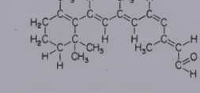

(c) 11-顺式视网醛，C20H28CHO

光化学基于这样一个重要事实：尽管分子式相同，立体异构体的化学性质也可能不同。

然而，在几种视网醛中，最重要的两种可以以全反式和 11-顺式形式存在。全反式形式如图 6.1b 所示。其尾部的形状基本上是笔直的，因为该尾部所有的碳-碳键都处于同一个方向。

视网醛的 11-顺式立体异构体如图 6.1c 所示。在这种情况下，第 11 个碳原子处有一个弯曲，导致尾部产生扭折。正如瓦尔德 (1968) 指出的，本不预期 11-顺式构型存在，但分子动力学表明它本质上是不稳定的。然而，这一非寻常的事实是，11-顺式视网醛确实存在并保持这种稳定的立体异构体形式，但前提是必须在黑暗中保存。这一看似简单的欺骗性陈述是整个初级视觉过程的关键。

这种关键作用有两个非常重要的原因。首先，11-顺式视网醛是视网醛中唯一的立体异构体；即，能够与有机大分子视质蛋白形成稳定的化学键。其次，光对视红蛋白分子的作用仅用于将 11-顺式视网醛立体异构化为全反式形式，从而形成一种不稳定的物质，这种物质会

在不需要任何其他外部能量的情况下，自发通过视觉循环的各个阶段。

视网醛这些特殊特征的净效应是，视觉中的初级感觉作用可以被具体识别为视网醛从 11-顺式到全反式形式的直或立体异构化。一旦这一触发过程发生，就不需要其他光的作用。

当 11-顺式视网醛被光立体异构化且结合的光分子发生分解时，会发生一系列复杂的进一步自发分解。例如，视红蛋白分子不会立即退化为全反式视网醛和视质蛋白，而是经过许多中间态，每个中间态都有其特定属性。这些中间态发生得非常快，通过普通的谱吸收法极难确定它们的特征。瓦尔德小组引入的这一卓越技术，使得能够获取中间产物的“时间快照”。这种被称为“冷冻化学”的技术利用了具有不同温度阈值的反应。也就是说，视红蛋白的初始分解只能在逐渐升高的温度下发生。

```
在 -60°C，前视网醛会自发衰减为另一种视网醛。
在 -40°C，前视网醛在水存在的情况下转化为另一种视网醛。
在 -20°C，视网醛会自发衰减为另一种视网醛。
在 0°C，视网醛在水存在的情况下转化为另一种视质蛋白。
在 10°C，视质蛋白会自发衰减为另一种视质蛋白。
在 20°C，视质蛋白在水存在的情况下转化为另一种视网醛。
在 30°C，视红蛋白会自发衰减为另一种视红蛋白。
在 40°C，视红蛋白在水存在的情况下转化为另一种视红蛋白。
在 50°C，视红蛋白会自发衰减为另一种视红蛋白。
```

整个过程如图 6.2 所示。除了显示分解产物的序列外，该图还显示了每个步骤“解冻”的温度。将混合物冷却到任何阈值以下都可以停止反应。

首先，标出了每个中间体的吸收峰波长。可以看到这些化学物质在视觉光谱上的不同点达到最大吸收。这种吸收峰的独特位置对于识别每一个至关重要。

其次，图 6.2 中每个反应箭头的形状暗示了关于它们能量方面的信息。某些是自发的并在黑暗中发生的（直线），而另一些是必须光驱动的反应（波线）。重要的是，只有一种光驱动的分解反应。这意味着视觉反应只需要光来触发导致最终产物的整个黑暗反应序列：视网醛以及视质蛋白。有趣的是，其他光驱动反应都向相反方向移动——从各种中间体再生视红蛋白。因此，光刺激的持续时间有助于涉及物质的最终平衡。

冷冻化学技术的主要优点是，那些通常持续几微秒、在正常体温下无法检查的，可以被在足够长的时间内，以便对其光学和化学性质进行测量。

当然，不能完全确定通过冷冻技术分离出的每个分解阶段本身不是实际上几个具有相同或相似阈值温度的子过程的组合。事实上，近期的调查表明视网醛可能是两种物质（现在暂定命名为视网醛 A 和 B），但细节尚未最终确定。

对视觉光色素生物化学的完全理解由于存在许多类型而变得更加

在各种物种中发现的光视蛋白以及某些个体物种中发现的两种视蛋白（杆细胞型和锥细胞型），还存在两种视黄醇（视黄醇和视黄醇 II）以及两种视醛（视醛 I 和视醛 II）。视黄醇 II 和视醛 II 的结构式分别如图 6.3a 和 b 所示。


# 视觉与听觉受体的传导机制

## 视觉色素的化学结构

视醛 I、视醛 II 以及它们各自的视黄醇并非彼此简单的立体异构体，而是具有不同公式的不同化学结构。如前所述，视醛 I 的分子式为 `C₁₀H₂₇CHO`，而视醛 II 的分子式为 `C₂₀H₂₂₅CHO`。关键的结构差异可以在分子的苯环体中观察到，在视醛 II 中两个碳原子之间的双键取代了视醛中的一对辅助氢原子。

视醛 I（`11-cis-retinal`）通常被认为存在于陆生脊椎动物、海鱼和成年青蛙中。视醛 II 则被认为存在于生命中至少早期阶段在淡水中生活的脊椎动物中，例如淡水有颌鱼、七鳃鳗和某些两栖动物。然而，最近 Schwanzara (1967) 对大量淡水鱼的色素进行了调查，发现视醛 I 和视醛 II 系统均存在。她将此归于淡水鱼生活在不同的环境光条件下，而这种环境因素以某种方式导致了每个环境对最优色素的自然选择。

正如我们之前提到的，理解色觉机制的一个重要复杂性问题在于，在某些动物中似乎存在几种不同类型的锥细胞光视蛋白。根据 Brown 和 Wald (1964) 以及 Marks、Dobelle 和 McNicol (1964) 的直接分光光测量，已知灵长类动物眼睛中可能存在三种锥细胞色素。

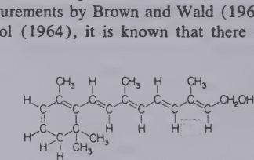

(a) 全反式视醛 II，`C₂₀H₂₂₅CHO`

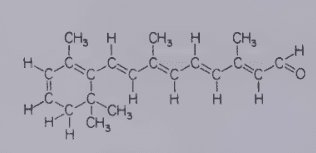

图 6.3. 视黄醇和视醛 II 的结构式（改编自 Wald, 1968。）

(b) 全反式视醛 II，`C₂₀H₂₂₅CHO`

## C. 光感受器中的信号转换

### 表 6.1

形成光色素的光视蛋白与视醛的可能组合ᵃ

| 杆细胞视蛋白 | 视醛 I | 视醛 II |
|---|---|---|
| 杆细胞视蛋白 | 视紫红质 `λ_max = 500` | 卟视色素 `λ_max = 522` |
| 锥细胞视蛋白 R | 碘视蛋白₁ = 红视色素 `λ_max = 555` 或 `570` | |
| 锥细胞视蛋白 G | 碘视蛋白₂ = 铬视色素 `λ_max = 525` 或 `535` | 蓝视蛋白 ? |
| 锥细胞视蛋白 B | 碘视蛋白₃ = 蓝视色素 `λ_max = 445` 或 `450` | | |

ᵃ 改编自 Wald (1959)

色素在灵长类眼睛中，由于这些锥细胞色素中的视醛推测是相同的，观察到的吸收光谱差异必须由于三种不同类型锥细胞光视蛋白的存在。每个锥细胞只含有这些色觉迥异的光色素中的一种，Rushton (1962) 将其分别命名为铬视色素（`chromolabe`）、红视色素（`erythrolabe`）和蓝视色素（`cyanolabe`）。整个光化学系统总结在表 6.1 中。

## 2. 视觉感受电位的产生

到目前为止的讨论主要涉及这种大型光敏分子中视醛部分的特征。视紫红质分子和其他光色素中这一较小部分的结构是决定初级感觉作用特征的主要因素。然而，光视蛋白基团作为光敏分子中很大一部分，被认为对感受电位的实际产生至关重要。这里讨论的材料来源再次是 George Wald 的工作。

视醛与视蛋白基团之间的结合可以通过以下化学方程描述：

```
$C_{19}H_{27}HC=O + H_2N-opsin \rightleftharpoons C_{19}H_{27}HC=N-opsin + H_2O \quad (6.1)$
11-cis-retinal_1 + 杆细胞视蛋白 \rightleftharpoons 视紫红质 + 水$
```

该反应的关键点是用视醛分子（除其氧原子外）取代了附着在视蛋白氮原子上的两个氢原子。虽然氧和氢形成游离的水分子，但视蛋白和视醛是通过碳-氮双键连接的——这种状态只有当视醛保持在 `11-cis` 阶段时才能保持稳定。然而，除了视醛分子上可用的双键氧和视蛋白上的 `H2N` 基团（如方程 6.1 所示）外，结合还需要一种被称为巯基（`SH`）的原子侧链。

## 6. 信号转换过程的细胞机制

由于信号只有在极高刺激强度下才能被测量，因此尚不清楚它在正常视觉中可能起什么作用。然而，ERP（视网电位）引起了极大兴趣，因为它表明光化学物质分解过程中的某些步骤可能会产生直接的电作用，这种作用并非由分解产物的存在而引起的中间膜渗透性变化所介导。

Cone (1967) 认为 ERP 是视紫蛋白分子在经历初始光异构化后，通过分解中间阶段电荷重新分布的直接结果。Cone 和 Cobbs (1969) 能够在强力预先调节闪光后的不同时间点诱发出独特的 ERP 模式，他们认为这些情况下 ERP 的形状是某一种或多种分解产物存在的的特征。由于 ERP 的阈值比 LRP（局部感受性电位）高出一百万倍，ERP 似乎并不是受体电位的直接前驱体，但它可能将继续是衡量视网膜色素化学性质的重要指标。

显然，脊椎动物视觉受体中的传导问题极其复杂。虽然还没有人对这一过程提供完整的解释，但我们开始了解一些涉及的细胞亚内机制。总结如下：

1. 该过程完全由光的作用引发，光改变了光化学物质中视网膜部分的立体异构状态。
2. 光化学物质分解的最终细胞结果是导致受体细胞外节质膜对钠离子的渗透性降低，从而使细胞超极化。
3. 这种膜渗透性的变化可以记录为 LRP，它可能与视网膜电图中的 A 波相同。
4. 另一方面，ERP 是发生在色素分子内部而非膜上的过程的指示。

## D. 听觉受体的传导

### 1. 听觉中的初级感觉作用

耳蜗内的初级感觉作用被认为是对受体毛细胞的剪切作用，这种作用是由位于毛细胞上方的螺旋膜运动产生的。然而，这一简单的陈述具有歧义，因为这种机械剪切有许多方式可以影响毛细胞本身。反应可能是声学刺激力产生的变形振幅、速度甚至加速度的直接函数。关于听觉初级感觉作用力学的详细解释来自于 Georg von Békésy 的工作。Von Békésy 因其在耳朵力学方面的工作于 1961 年获得诺贝尔奖，现代听觉受体理论的大部分讨论基于他的贡献。

考虑到耳朵对机械力敏感，受体体是变形、速度或加速度的转换器；Von Békésy (1951) 以一种新颖的方法处理这个问题。他记录了如图 6.5a 所示由梯形声波形产生的耳蜗微电位。如果耳蜗微电（某些研究人员认为这是真正的受体电位）完全取决于变形本身，那么反应应该遵循刺激的梯形形状，如图 6.5b 所示。如果它是速度检测器，那么预计它会产生一个微分波形，仅在基底膜运动时产生信号，如图 6.5c 所示。相反，如果它是一个加速度检测器，那么

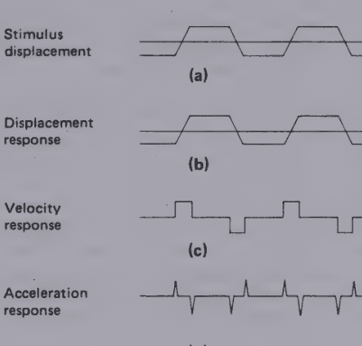

图 6.5. von Békésy 实验中确定初级听觉感觉作用特定性质时可能获得的观测示意图。图中显示了 (a) 梯形的性质；(b) 如果初级听觉感觉作用仅取决于位移，则预期的波形是梯形的；(c) 如果初级听觉感觉作用取决于速度，则预期的波形是微分形的；(d) 如果初级听觉感觉作用取决于加速度，则预期的波形是

### 2. 听觉电位的产生

简而言之，Davis 的理论认为耳蜗微电（通常称为交流电位）是由声学信号的闸控作用产生的。已知毛细胞内部与蜗管液体之间存在显著的直流（DC）电压差，且 Davis 将这种直流电压视为产生微电的能量池。

Davis 的理论必须分为两部分。第一部分为耳蜗微电的产生提供了一个引人入胜的理论。第二部分涉及一个相当合理的逻辑跳跃。Davis 在第二部分的假设是耳蜗微电确实是真正的受体电位，并直接负责毛细胞与蜗神经元突触结合处递质的释放。为了完全理解这两个部分之间的区别，我们必须详细检查 Davis 的陈述，并考虑

图 6.6 显示了内耳阶——前庭阶和底阶的一般示意图。这两个连接的阶充满了单一液体，即淋巴液。淋巴液通过位于蜗顶的一个小开口（螺旋窗）在两个阶之间连续。尽管这些阶相互连接，且相对于淋巴液或血液的电位几乎相同，但惊讶的是，它们之间的电位存在细微差异。前庭阶显示的电位通常比蜗管中记录的 `5 mV` 高 `2` 或 `3 mV`。这种电位可能是由于每个情况下淋巴液离子成分的局部差异，但特定离子浓度的来源尚不清楚。无论如何，这两个阶之间的电位非常小，因此认为在听觉过程中起重要作用。

然而，蜗管的情况有所不同。在那里，使用直流测量系统记录到了相对于血液的 `+80 mV` 正电位。在这种情况下还存在另一个重要的电位差：任何神经细胞内部通常存在的巨大负电压。在特殊情况下，可以在毛细胞本身测量到 `-80 mV` 的细胞内电位。

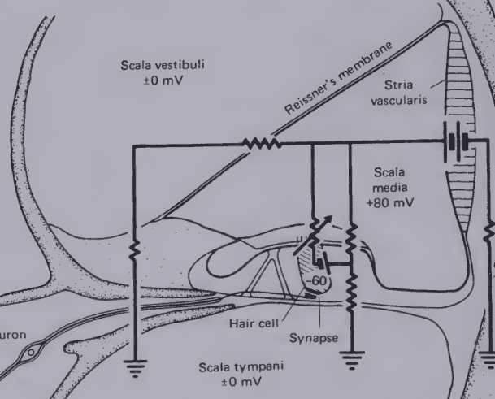

图 6.6. Davis 关于耳蜗微声电产生的“电阻麦克风”理论，Davis 的绘图方式强调了内耳发现的电压值。根据 Davis 的观点，毛细胞充当闸门的作用，控制毛细胞内部与蜗系膜之间巨大的生物电位差，从而产生被观测为微声电的电流。完整细节请见正文。（出自 Davis & Silverman, 1970。）

因此，蜗系膜和受体细胞内电位共同在毛细胞膜上产生了一个非常大的总电位；在这种情况下，通常可以检测到 `160 mV` 的电压，对于单个细胞膜来说，这是一个极大的电位，而且可能是人体发现的最大的跨膜电位。

Davis 认为，由于细胞膜有限的阻抗，这种巨大的电位差产生了相当的直流电流。他进一步的建议是——这也是他理论中涉及耳蜗微声电起源部分的关键假设——毛发下方的基板能够在机械变形的影响下，以某种未知的方式改变其阻抗。随着阻抗的变化，静息电流发生改变。通过这种方式，由巨大的跨膜电位驱动的显著电流可以被调制或门控，使得直流电流的总变化可能远大于引发动作的能量。这一过程类似于电子管或晶体管对电子流的放大，其中微小信号控制着更大型的信号。

Davis 的耳蜗微声电产生理论具有许多优点。该理论满足了 von Békésy 曾证明的能量放大的必要标准，而且微声电显然是产生能量的代谢系统的最终产物。尽管 Davis 理论的这一部分仍然存在一些问题（目前尚不完全清楚在离子流通过基板的背景下，什么机制可能导致“电阻”或“阻抗”的变化），但大多数批评者都是持还原论的牙科医生，这对他论点这一部分的本质并不至关重要。

然而，对 Davis 理论更严厉的批评可能针对其第二个、更具推测性的部分。这部分的显性假设是：在其理论的第一部分中描述的耳蜗微声电实际上就是受体电位；也就是说，他假设耳蜗微声电专门负责触发突触动作，从而导致二阶神经元产生放电电位。另一方面，即使 Davis 自己也意识到这一假设的局限性，因为他指出，解释静息直流电流调制的相同过程可能也可以以某种其他方式增加神经化学物质的释放。

然而，在这种情况下仍有许多问题未得到解答。例如，如果耳蜗微声电不是受体电位，它的作用是什么？它仅仅是神经激活过程的伴随现象，而且实际上与这些过程无关；还是它在递质物质的释放中起了某种作用？事实上，众所周知同类型的微声电是由人体许多其他组织产生的。这些其他微声电与任何感官传导过程都足够分离，以至于可以确定它们没有参与神经处理。

因此，关于将耳蜗微声电识别为受体电位的真正问题是：是否存在实验证据表明它单独足以启动突触活动？Davis (1965) 认为没有，他自己也这是他论证中最具推测性的联系。

进一步的推测可能指向其他可能的联系。听觉毛细胞释放递质可能是隐藏在相对较大的耳蜗微声电中的某种较小电压机制的结果。递质的释放甚至可能是机械变形的直接影响，受体细胞膜上某些位置的机械变形，这种变形不需要任何形式的电介质。例如，这另一个位置可能是膜的突触前部分，如果是这样，那么突触前电位本身就是真正的受体电位。然而，从实际角度来看，在存在较大的耳蜗微声电的情况下，不太可能测量出独立的膜电位。目前尚未发现能分离出独立受体电位的方法，如果它确实存在。

> * 值得注意的是，Hagins、Penn 和 Yoshikami (1970) 针对脊椎动物的光感受受体提出了一种类似的门控过程，而且神经膜电位的门控理论在当代神经生理学中也得到了广泛应用。


Davis 非常清楚这种批评。尽管如此，在这些范围内，他的理论比任何竞争理论都结构更合理、更具说服力。

## E. 躯体受体中的传导

### 1. 躯体感觉中的初级感官动作

各种皮肤和本体感受受体可能是由多种初级感官动作的作用刺激的。Hensel、Ström 和 Zotterman (1951) 证明了通往猫舌头的舌神经神经元表现出对温度具有直接敏感性的特性。观察到的某些纤维仅在温度维持在特定区域内时有反应，而另一些纤维似乎只对猫舌温度的瞬时变化做出反应。

如果研究者倾向于排除弹性囊必然引入的非神经修饰，而只考虑神经因素，他会希望在移除囊后观察产生电位。在这些情况下，帕西尼囊的产生电位表现出与耳蜗毛细胞完全相同的特性：它对变形产生持续反应。然而，远来看，囊的质量对放电电位反应的影响微乎其微。其他的区分或速度敏感机制也作用于产生电位与放电电位的界面。

在这种背景下，必须得出结论：帕西尼囊内的受体对于产生电位的属性而言是静态变形探测器，而对于放电电位的属性而言是速度探测器。图 6.7 描述了有无囊的情况下的多阶段过程的各个步骤。

### 2. 躯体产生电位的产生

Werner Loewenstein 的实验室提供了躯体受体制剂中产生产生电位的最新描述。与听觉受体一样，我们对这一过程底层分子细节的了解还很模糊，但已经对涉及的事件有了相当良好的描述。

似乎初级感官动作是神经膜本身的机械变形。但这并没有回答膜如何产生产生电位的问题。可以对给定变形产生的产生电位进行测量，并阐明其与刺激之间的功能关系；但目前尚不知道阶跃产生电位究竟是如何产生的。还没有任何物理化学理论能够解释机械变形是如何改变躯体受体膜对离子流的渗透性的。产生产生电位的关键步骤仍然笼罩在分子现象的奥秘之中。我们现在能说的只有，随着膜渗透性的变化，发生了离子的重分布，而这些离子重分布产生了被称为产生电位的去极化。

我们可能会推测机械变形改变膜渗透性的方式。这些特化组织是否受到刺激以释放化学作用于膜渗透性的物质？我们是否是由于“孔径”或“通道”扩大或形状发生改变，使得某些此前无法跨越膜屏障的离子得以跨越？还是电荷分布发生了改变，导致排斥和吸引某些离子的静电力形成了新的模式？那些将离子从膜的一侧主动运到另一侧的主动运输机制是否被激活了？这些和其他解释可能被用来解释实际的转换过程，但还没有人提出过令人信服的理论。之所以一直很困难，是因为分析水平是超微级的。例如，在一种必须假设原子级结构的情况下，诸如“孔径”甚至“膜”等概念的具体含义完全无法确定。（参见第 3 章中关于膜理论的讨论。）

虽然无法在分子水平上明确转换过程的精确性质，但 Loewenstein 和 Rathkamp (1958) 至少确定了帕西尼小体中转换过程中各个亚步骤发生在膜的什么位置。他们的实验装置如图 6.8 所示。

Loewenstein 和 Rathkamp 使用了一种强大的技术——压力阻滞（pressure block），来确定轴突感受性末端特定部分的作用。当用细线压缩位于第一个 Ranvier氏节的神经元时（如图 6.8 所示），尖峰动作电位就消失了，尽管此时感受器电位仍然存在且正常。阻滞对尖峰动作电位的影响见图 6.9，该图显示了压缩阻滞之前、期间和之后的尖峰电位。在更靠后的 Ranvier氏节处施加压缩阻滞不会导致相应的尖峰动作电位消失。Loewenstein 和 Rathkamp 得出的结论是，只有第一个 Ranvier氏节专门负责将感受器电位转换为尖峰动作电位。

那么下一个问题是：感受器电位本身的起源点在哪里？Loewenstein 和 Rathkamp 利用压力阻滞来回答这个问题，但这次它被应用于轴突末端神经末的未髓鞘部分。实验结果是，较大且看起来更正常的节点产生感受器电位。图 6.10 展示了这些结果。从这一重要实验中得出的主要结论是：(a) 神经纤维的未髓鞘末端唯一能够将机械能转换为感受器电位；(b) 这种能力并非局部，而是分布在末端的整个感受区域，且电位的大小取决于神经元末端受刺激的程度。

从 Loewenstein 和 Rathkamp 实验中得出的重要性观察是：神经膜的不同部分表现出高度的特异性，尽管这些部分可能彼此距离仅几微米。轴突的最末端部分可以产生感受器电位，但无法通过任何手段刺激产生再生性的尖峰动作电位。另一方面，第一个 Ranvier氏节处的狭窄膜环无法被直接刺激产生感受器电位。然而，这个膜环似乎是神经中唯一能够将感受器电位转换为远距离通信的再生性尖峰的部分。轴突更靠中的部分虽然完全能够传导尖峰，但除非这些分级电位异常大，否则无法将分级感受器电位转换为尖峰。

未分化膜本身似乎是对大多数受体的最佳解释。

## F. 嗅觉器中的转换

### 1. 嗅觉初感作用

虽然可以确定初感作用是气味分子与嗅上皮之间的化学相互作用，但对于细节还没有令人信服的理论。分子在几个方面存在差异，尚不确定哪种差异至关重要。

识别嗅觉初感作用的问题在于，某些看似对立的假设可能并不遥远。表面上竞争的理论最终证明只是不同的视角。例如，Amoore (1952, 1964) 的立体构型形状编码理论（在本节后将讨论）乍看起来与某些结合类型的理论不同；但它实际上基于形状概念，而这可以从分子结合的本质推导出。此外，传统的化学相互作用（特定分子之间的特定反应）无法解释为什么许多形状相似但结构不同的化学物质会产生类似的嗅觉。通过考虑一些现代嗅觉初感理论，可以将这些点变得具体。

- **a. Davies “穿孔与渗透”理论。** Davies (1965, 1970) 提出了一个称为“穿孔与渗透”理论的嗅觉初感模型。他的核心观点是，气味物质分子通过某种机制吸收到嗅觉感受细胞膜的脂质表面，但只是暂时的。一段时间后，这些分子可能会从膜向外逸出或渗透膜。然而，由于膜的分子特性，气味留下的孔无法立即填充，产生了一个暂时的间隙，`Na+` 和 `K+` 可以在被作用力下扩散。根据 Davies 的观点，初感作用就是膜对气味刺激的吸收。

根据该理论，不同嗅觉刺激的独特反应取决于它们特定的扩散特性。Davies 假设感觉的性质取决于刺激分子离开孔洞的扩散速率以及孔的愈合速率。

- **b. “光学”理论。** 多年来，许多研究人员试图将化学品的红外或紫外光光学吸收或发射特性与初级感觉作用联系起来。早期理论认为，关键联系是受体组织直接吸收气味物的红外能量（或反之）。然而，这一观点被 Ottoson (1956) 否定了，他证明了如果膜对物质已知的红外吸收或发射波长透明的，那么任何物质都无法通过膜诱导产生气味。嗅觉感知绝对需要刺激与受体之间直接的化学接触。

现代光学理论中最重要的是 Wright (1964) 提出的“振动”耦合假设。他认为，嗅觉区分的分子基础在于：每个特定的化学结构都具有特定的振动模式，而这种模式与其红外光谱仅具有偶然的相关性。Wright 认为嗅觉初级感觉作用是嗅觉色素中物质的近共振振动频率与气味分子振动频率之间的耦合。因此，具有相同振动模式的物质闻起来应该是相似。

然而，最近的实验（Russell Hills, 1971; Friedman & Miller, 1971）显示，某些化学品的对映异构体并不闻起来相似。（对映分子的结构相同，只是彼此的镜像；它们具有完全相同的旋转振动能量模式。）例如，对映异构 `R-` 和 `S-` 香荷分别闻起来像薄荷油和胡萝卜味。这些实验在进行时特别注意了杂质的控制。通过在两种对映物质之间相互转换，可以系统地改变气味，尽管化学方程式和振动特征保持不变。这些控制实验克服了早期对对映体实验中化学公式的批评，正如发表这两项实验的《自然》（Nature）杂志所述，这些数据对于任何将嗅觉特异性归因于大分子光学或振动特性的理论都是“致命的”。

- **c. Amoore 的立体化学构型理论。** 目前还没有一种公认的嗅觉初级感觉作用理论。最关注的是 Amoore (1952, 1964) 对 Moncrieff (1949) 提出的建议的发展，现在被称为嗅觉的立体化学构型理论。“立体化学”是一个是指分子三维形状的术语。

Amoore 的理论基于许多间接证据。他的原始方法基于一个假设，乍看之下似乎是有些牵强的过度简化。他简单地假设，如果存在特定的受体位点，就必须有有限的、甚至是极少数的、基本气味。这一观点得到了事实的支持，即已知特定的选择性嗅觉症（嗅觉“盲”）是存在的。这种特定的不敏感暗示了一组受体的存在，其中某一种受体可能缺失，从而产生缺陷。

最精妙的是，Amoore 转向文献检索，以确定化学家比其他名称更常用的基本气味名称。他认为，这些名称可能以某种语言方式反映了一组基本气味的生物学特征。文献检索确实发现了一个令人惊讶的事实：化学家报告的大部分气味可以用七种气味名称解释：樟脑味、麝味、花香、薄荷味、醚味、腐臭味。

Amoore 继续他的文献检索，并检查了大量被常规描述为这七种气味之一的气味物的立体化学形状。他发现形状与气味之间存在粗略的相关。七种基本气味除腐臭味外，每种都与图 6.11 所示的典型形状相关。樟脑味与立体形态形状为卵形的化学品高度相关。麝味以椭圆盘为特征；花香以迷宫形分子为特征；薄荷味以椭圆楔为特征；醚味以棒状分子为特征。另外两种特殊的气味——刺味和腐臭味，并没有一致地具有某种形状；但 Amoore 观察到，刺味分子往往是正电荷分子（表明其结构某处存在电子亏缺），而腐臭味的化学品往往是负电荷分子（表明其结构某处存在电子过剩）。

Amoore 理论发展的下一步需要他既精妙又（事实证明是）具有冒险性。他假设如果气味物分子具有如此特定的形状（或电荷），那么它们被嗅觉受体捕获的方式可能取决于受体位点形状的类似特异性。图 6.12 显示了五组形状和两个电荷受体位点，Amoore 认为这些位点对于特定的气味类型可能足够特异，使得一种气味物比其他任何一种都更契合。

此时值得提到，这种关于形状受体位点的观点（读者可以看到它呈现为一种“钥匙模型”理论）可能被视为一种比喻。受体位点的“形状”可能只是对一个具有非常特定的化学性质区域的描述，就像气味物的分子“形状”可能是对特定形式的比喻性描述。那么，Amoore 理论的主要意义可能不在于位点的精确性质，而在于存在某些不可能是单一类型的局部位点。因此，虽然给定的受体可能是相当特异的，但仍然是可能的。

为了测试他的理论，Amoore 进行了一系列有趣的实验，这些实验修改并完善了原始假设（Amoore, 1965; Amoore & Venstrom, 1967）。在一次实验中，实验室合成的相应形状分子被专家观察者感知，以确定气味与分子形状的假设关联是否成立。通常，答案是肯定的——这远比将给定分子简单、定性地分类为“卵形”或“棒状”。这些技术之一涉及制造分子的固体模型和假设的有机玻璃“箱”模型受体位点。随后将分子模型浸入充满水的受体位点模型中，并测量模型分子排开的水量。随后将互补性（`C`），即分子在容器中的贴合程度，定义为：

```
$C = \frac{V_d^2}{V_s \times V_m} \quad (6.2)$
```

其中，`V_d` 是模型排开的水体积，`V_m` 是模型的体积，`V_s` 是位点的体积。贴合得越高，互补性就越接近 1，即完美贴合。然而，由于并非所有模型都能完全浸没，而且由于这些分子模型具有“凹凸不平”的形状，实际的互补性数值从 0.44 的高值到 0.03 的低值不等。

理论遗憾的是，这些互补性得分与相关的气味相似性心理物理测试并不并不对应。许多具有相似互补性的分子形状闻起来完全不同，而形状不同的分子闻起来却非常相似。事实上，正如 Amoore (1965, p. 629) 所说，对于醚类和樟脑类状态，结果是“绝望的”。

应该记住，在这种特殊情况下，比较是在已知分子形状与假设的受体位点之间进行的，而后者几乎是不存在的。因此，Amoore 尝试了另一种比较形状的方法，这种方法不涉及受体形状。对每个测试分子的顶视图、正面和侧视图制作了剪影。这次，剪影不是与假设的受体位点比较，而是与一组标准无味化学品的剪影进行比较。表 6.2 列出了 Amoore 选择的标准。

随后通过以下方式计算测试分子与标准分子之间的相似性指标。Amoore 首先物理确定了剪影轮廓的重心。每隔 10 度弧测量从该中心到边缘的径向。通过将样本上的每个距离减去标准品的等测量值进行比较，并计算所有 108 个角半径的平均偏差 `Δ`（108 个半径是因为单个分子的三个剪影视图每个有 36 个测量半径）。相似性指数计算为比值：

```
$Similarity = \frac{1}{\Delta + 1} \quad (6.3)$
```

随后计算气味相似性心理物理测试与这些形状相似性测量值之间的相关性。在 107 种不同的物质中，气味相似性与形状相似性之间存在较高的相关性。

### 表 6.2 产生七种基本气味的标准味（根据 Amoore 的分类）

| 标准气味 | 代表化合物 |
| :--- | :--- |
| 醚味 | 1,2-二氯乙烷 |
| 樟脑味 | 1,8-环醚 |
| 麝香味 | 15-羟基十五烷酸内酯 |
| 花香味 | d,1-β-苯乙基甲基乙基醇 |
| 薄荷味 | d,1-薄脑酮 |
| 刺激味 | 甲酸 |
| 腐臭味 | 二甲基二硫醚 |

这些几何分析对原始的立体异构体理论进行了重大修正。Amoore 仍然基于剪影相似性测量认为，分子形状是嗅觉化学物质的基本辨别特征。对于“等形状受体位点解释了差异感受性”的观点，他已经退回。受体位点的简单三维几何似乎无法解释特定形状分子的选择性作用。关于他想法的最新表述，见 Amoore (1970) 的著作《气味的分子基础》（Molecular Basis of Odor）。

如果不能用锁模型概念解释不同形状分子的不同感官效应，则必须提出可能性：形状仅仅是一种现象，反映了维持分子结合的相互力的更根本的特征；而且是这种更根本的属性（而非形状）最终解释了受体特异性。

总之，嗅觉中的主要感官作用可能是气味分子与嗅上上皮表面多或少特异受体位点之间的直接化学作用。这种化学反应的详细性质在所有实际应用中仍然未知。随着 Amoore 理论中锁模型部分的被否定，剩余的唯一令人信服的事实是分子的形状与心理物理区分高度相关。未来的研究将揭示嗅觉受体是如何识别这种形状差异的。

### 2. 嗅觉产生电位的产生

由于嗅觉初级感官作用的性质未知，嗅觉产生电位的机制也同样模糊。我们只能推测，某些化学作用导致了嗅上皮中受体细胞膜渗透性的变化。这种渗透性的变化允许离子平衡发生移动，产生阶跃电位，从而在嗅神经微小的轴上引发脉冲动作电位。

然而，这个简单的推测陈述由于一个事实而变得复杂，即是否实际上检测到了嗅觉产生电位存在很大争议。已知无味刺激物会在嗅上皮上产生慢电。尽管如此，目前尚不清楚这些慢电是否真正的产生电位。Ottoson (1956) 对一种负电位进行了广泛研究，这种电位具有中等潜期和非常缓慢的过程。图 13a 显示了一个典型的向负电电图。该信号现在被称为“Ottoson 电位”（Ottoson potential），以其发现者命名。


然而，在某些条件下观察到了具有相似特征的正电位。Takagi、Shibuya、Higashino 和 Arai (1960) 观察到产生电位的极性在某些刺激物下会显现（见图 13b）。此外，Takagi 和 Shibuya (1959) 显示也存在负的关闭电位，如图 13b 和 c 所示。图 13d 显示了相关的脉冲活动与这些阶跃电位的关系。

许多差异阻止了将这些任何阶跃电位确认为产生电位。Takagi (1967) 在一篇有趣的综述中阐述了一些差异。其中最具破坏性的是一项报告，显示 Ottuson 电位可以消除（通过擦掉通常位于嗅上皮上的粘液），而不会减小嗅球的脉冲动作电位（Shibuya, 1964）。Takagi 还暗示，至少某些阶跃电位可能只是在刺激化学物质存在时由嗅上皮触手细胞产生的分泌电位。如果是这样，这将是一个令人失望的局面，因为那时将不再剩下产生电位角色的候选者。

显然，关于嗅觉的转导过程还有许多需要学习的，包括关于产生电位及其起源，以及关于阶跃电位转换为脉冲动作电位的机制。遗憾的是，后者的转换可能位于嗅觉感受细胞底部的某个区域，其轴突从那里发出；而嗅觉轴突如此微小，在可见的未来，技术困难可能会阻止理解动作电位的产生取得实质性进展。

## G. 味觉受体中的传导

### 1. 味觉中的初级感觉作用

味觉是一种感官，它似乎是通过刺激物分子与味觉受体细胞组成分子之间的直接化学相互作用来介导的。然而，这种化学作用的直接性使得我们对初级感觉作用的了解不如某些直接激活的模态那样完整。涉及味觉的初级过程是如此微观，以至于目前尚不清楚初级感觉作用的位点在哪里。据推测，显著的化学作用发生在味觉受体细胞微毛毛的特殊部分。

由于这种不确定性以及刺激控制的困难性，味觉传导领域的研究集中在易于化学分析的问题上。例如，多年来，人们一直试图寻找四种基本味——甜、酸、苦、咸——的化学对应物。然而，必须强调的是，即使是“基本味”的概念，也是从视觉色彩混合概念与味觉之间最松散的类比中得出的。虽然这种类比可能具有教学价值，但由于缺乏类似于光子波长的单一维度变化，使得这种类比显得很弱。这在考虑到化学结构与味觉之间的关联充其量是不完整的情况下尤为如此。此外，味觉科学家通常发现很难从四种基本味的混合物中创造复杂的味道。舌头上发生的情况远比品质似乎只是一组基本刺激的简单加性混合要复杂得多。

Pfaffmann (1959) 在对20世纪50年代味觉文献的综合回顾中，描述了味觉与化学结构之间建立的关联具有尝试性和不一致性。例如，酸味似乎是溶液pH或酸度的函数。存在的氢离子越多，物质的酸味就越强。为了引起混淆，并不是所有的酸都是酸的。氨基酸是甜的，而苦酸是苦的。

甜味的感觉也源于对各种不同物质的刺激。通常，有机分子尝起来是甜的，但铅和铍等重金属盐也是如此。这可能解释了贫困地区儿童铅中毒的高发率。来自油漆墙壁的铅盐是糖果或牛奶中蔗糖或乳糖的危险替代品。

Dzendolelet (1968) 认为，甜味物质的一个共同特征是它们具有某种使其成为质子（氢离子）受体的分子键排列。每当通过化学作用产生羟基 (OH-) 或类羟基结构时，这种机制就会被近似。例如，Dzendolet 认为，溶解时产生的无机盐金属离子会被水分子包围，即发生水解。然而，由于金属离子带正电荷，它们趋向于排斥水解水中的某些氢离子（质子），而这些离子会丢失或被其他质子陷阱（如唾液）捕获。在某些情况下，这些质子的丢失导致 OH- 基从一个被排斥的氢离子中释放出来，作为其他氢离子的受体。如果这个新的氢离子来自味觉受体位点，预计会引起甜味的感觉。铍和铅等重金属被认为以相同的方式产生甜味体验。图 6.14a 和 b 显示了典型金属离子的初始水解反应以及产生的排斥

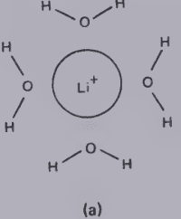

图 6.14. Dzendolet 的 H+ 离子取代方案，这可能导致对甜味物质的特定敏感性。当像 Li+ 的离子被水分子包围时，Li+ 的正电荷倾向于将一个 H+ 离子从水分子上推开。随后的某个时间，产生的 OH- 分子可能成为 H+ 受体。这种对 H+ 离子的吸引力被认为是所有甜味物质共有的。（源自 Dzendolet, 1968。）

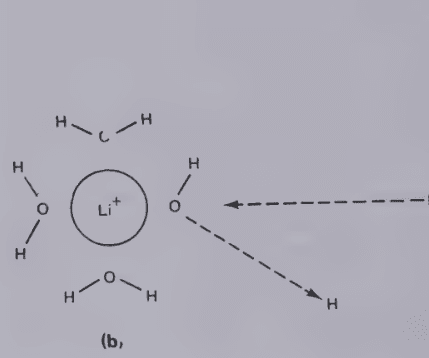

来自一个水分子的带正电氢离子的排斥。Zzendolet 建议，类似的过程也适用于其他甜味物质，如蔗糖、甜精和尿素。然而，这一概念与下文讨论的甜味结合物质的想法不一致。

许多化学类包含据报道具有更好味道的物质；通常，无机分子的重量增加，味道就越来越苦。很多时候，苦味含有氮。

咸味物质通常是指在溶液中电离物质。咸味取决于可溶盐的电离，这些盐通常由金属阳离子和卤离子组成。涉及的金属有钠 (Na⁺)、钾 (K⁺)、锂 (Li⁺)、镁 (Mg²⁺)和钙 (Ca²⁺)。但铵根 (NH₄⁺) 也存在于阳离子味物质中。典型的阴离子包括氯 (C⁻)、溴 (Br⁻)、碘 (I⁻)、硫酸根 (SO₄⁻)、碳氢酸根 (HCO₃⁻)和硝酸根 (NO₃⁻)。

### 6. 传导过程的细胞学方面

### G. 味觉受体中的传导 135

许多化学类包含据报道具有更好味道的物质；通常，无机分子的重量增加，味道就越来越苦。很多时候，苦味含有氮。

### 6. 传导过程的细胞学方面 136

由金属阳离子和卤离子组成。涉及的金属有钠 (Na⁺)、钾 (K⁺)、锂 (Li⁺)、镁 (Mg²⁺)和钙 (Ca²⁺)。但铵根 (NH₄⁺) 也存在于阳离子味物质中。典型的阴离子包括氯 (C⁻)、溴 (Br⁻)、碘 (I⁻)、硫酸根 (SO₄⁻)、碳氢酸根 (HCO₃⁻)和硝酸根 (NO₃⁻)。

### 2. 味觉受体电位的产生

显然，味觉受体电位产生过程的位点或机制尚未完全理解。然而，某些事实极可能是。描述的各种结合作用几乎肯定会导致受体膜渗透性特性的改变。因此，必须假设，当刺激化学物质结合到膜上时，维持静息电位的特定离子的膜渗透性会发生改变。当 Na+ 和 Cl- 离子跨膜的稳态发生变化时，就会产生静息电位的变化。极化变化的影响可能会

> * 这个重量足够大，表明这种分子可能会穿过整个膜的厚度，如图 3.24 所示。


## G. 味觉受体中的转导 139

味觉细胞，或直接影响触后区域，从而导致味觉神经中起始纤维的激活。拜德勒（Beidler）认为，受体电位中所含的信息传递也可能是一种准物理效应的结果，例如膜组成分子的取向。这种效应同样可能是提供神经递质的触前区域的简单电敏感性。同样，我们必须承认，我们正处于当代知识的前沿，除了这些推测外，关于妊娠过程中初级感觉作用尚没有更明确的信息。

大泽（Ozeki，1970）研究了味觉受体电位的离子学起源。他认为，氯化钠和氯酸奎尼定分别刺激的膜过程存在某些本质区别。为了得出这一结论，大泽将填充有 KCl 的玻璃微电极插入味觉受体细胞中，并记录了叠加在受体电位上的一系列施加定电流电脉冲所产生的电子电位。这些短的（100毫秒）电电位是纯粹的被动电反应，仅仅反映了膜的瞬时电阻。他的发现表明，氯化钠对膜的作用是通过降低整体膜电阻来降低电电位的。如图 6.15a 所示，在受体电位期间，测试脉冲产生的短电电位的大小与未刺激期间相比对比。

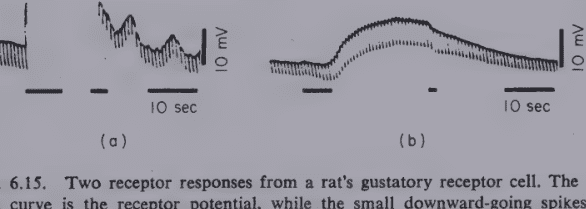

图 6.15. 来自大鼠味觉受体细胞的两种受体反应。连续曲线是受体电位，而向下的的小尖峰是一系列施加的测试刺激产生的电位。因此，这些尖峰无非是测试电流作用产生的电电位，其幅度完全是根据欧姆定律取决于膜电阻的函数。(a) 细胞对 NaCl 的反应；(b) 细胞对氯酸奎尼定的反应。小尖峰在 (a) 中减小，在 (b) 中增大，表明 (a) 中的去极化膜受体电位由于膜电阻的降低，而在 (b) 中更有可能是由于膜电阻的增加。（改编自 Ozeki，1970）。

### 6. 转导过程的细胞层面

另一方面，对氯酸奎尼定的反应则完全不同。图 6.15b 显示，当细胞受到刺激时，膜电阻实际上增加了，在这种情况下，在受体电位期间对测试脉冲的电子反应放大了。基于电压夹持型实验，大泽得出结论：在氯酸奎尼定刺激期间膜电阻的增加是由于膜对钾离子渗透性的特异性降低。然而，同样的夹位实验也提示他，在氯化钠刺激期间观察到的电阻降低是由于膜对钠离子渗透性的特异性增加。因此，氯酸奎尼定和氯化钠产生受体电位的底层膜作用似乎是不同的。其他基本味觉刺激是否也会发生类似的差异，似乎与拜德勒提出的初级味觉感觉作用的特异性离子结合位点假设是一致的。

对味觉转导的讨论完成了我们对神经处理和传输起始阶段的简要综述。各种受体通过各种初级感觉作用将物理能量转化为发生器电位或受体电位。这种受体的分级作用最终导致尖峰动作电位——这是一种可以在神经系统中远距离传播的信号。在下一章中，我们将考虑传输过程的底层离子机制。

# 7. 传输过程

## A. 引言

既然我们已经讨论了静息电位的离子基础以及引发神经活动的转导过程，我们就可以将转向从神经系统中的一点到另一点的信息传输。如果能量转导产生的信息模式不传输到某个远程目的地，那么受体细胞的激活将没有任何生物学价值。如果有机体要做出有意义的反应，转导的信息必须被解码或与其他传输线路到达的信息进行整合。

单个神经元传输信息有两种方式：

- “尖峰”（传播的、不衰减的、“全或无”的信号）
- 更具局限性的、分级的、可累加的电位。

尖峰动作电位具有其特殊特性，是神经系统远距离传输神经信息的卓越机制。它的特殊用途在于，它从一个地方移动到另一个地方时，其幅度或形状不会减小。相反，分级电位随着距离原始源越远，幅度会迅速减小，波形也会发生变化。这种衰减是由于膜电阻和电容引起的。在最好的情况下，分级电位在距离其起始点不超过一或两毫米的地方被检测到。

这两种电位作用差异的原因描述起来简单，但很难详细解释。在非常定性的层面上，能够维持传播尖峰电位的轴突为这种持续进行提供了必要的能量，即沿其路径每一点的再生作用。相比之下，专门演化以维持分级电位的区域不提供任何此类能量；其影响的扩散通过电流和电压通过膜及其内外液的电传导介质的被动扩散来解释。

很难超越对膜特定属性的描述性陈述，这些允许一种电位传播而让另一个区域无法传播的特定属性显然存在于分子水平，而且尚未被详细理解。

我们知道是，对于分级电位和再生尖峰电位的情况，电荷传输完全由离子介导。电解质溶液中没有自由电子，因此没有传导。虽然对神经中的半导体效应有一些推测，但这些效应还没有通过任何令人信服的方式证明其成为解释膜作用的有力竞争者。因此，离子载体的电荷传输是解释这两种传输的基本概念：分级电位的被动扩散和通过耗能过程传播的尖峰。

虽然神经元的电荷传输是由离子载体而非电子介导的，但金属电缆显示的相同充电和放电特性在神经元中也有表现。神经膜中存在电阻和电容元件。因此，描述电缆的相同数学模型可以描述分级电位沿轴突的被动扩散。时间常数和空间常数的数值相当不同，但模型仍然有效。

分级电位时间常数的速度取决于神经元“电缆”每个环节的 RC（电阻 × 电容）。虽然基于这类离子流的传播尖峰动作最大速度为每秒几米，但衰减扩散的速度要慢得多——通常小于每秒一米。此外，分级电位沿神经膜的扩散主要是由于静电场强迫离子从一处移动到另一处，而传播电位是由顺序触发并沿神经元移动的源驱动的，从每个顺序位置获取能量。因此，尖峰在目的地的大小可以与在源处一样大，而不像随着距离源距离增加而信号逐渐减弱的衰减扩散。

## B. 递减传导

在考虑到这些通用点的情况下，我们现在将考虑用于短程通信的递减阶跃电位的特定属性，以及用于远程通信的峰值电位的传播。

### B. 递减传导

让我们假设一种思想实验：可以在轴突的一个区域扰动其静息膜电位，同时保持所有其他区域的膜特性不变。在这种情况下，认为在受扰动区域与维持原始膜电位的区域之间存在一个受扰动的电压差电偶极子。通过这种方式，产生了一种离子电流，该电流通过细胞内部和外部介质通过。这种电流根据简单的静电引力和排斥定律决定的方向传递电荷，并根据上述的“电缆”模型，以膜电阻和电容决定的速度进行。同样，在距离原始扰动的任何给定距离处可以测量的信号幅度将是跨膜分流电阻的函数。

图 7.1 是一个显示一个神经膜电缆模型中电容元件和电阻元件的一些典型值的图。在这种电阻-电容组合中，电容元件较长的充电时间是导致电流向神经膜沿其他点扩散减慢的主要原因。因此，远处的电位幅度不仅取决于距离，还取决于扰动持续的时间。图 7.2 显示了随时间变化的函数绘制的几个距离处的电压。在经过足够的时间后，神经膜沿的所有位置都将被电荷到由分流电阻定义的某个最大值。

尽管这种局部的、递减的、被动的扩散电位不是通过主动过程传播的，并且仅影响其紧邻的区域（在某些情况下效应可能会扩散到如 100 μm），但它是神经元传输和信息处理的一种非常重要的手段。其重要的关键原因在于，递减电位可以由神经膜的不同部分进行代数上的加减运算。因此，虽然一个局部扰动可能不足以产生具有信息意义的影响，但几个扰动可以叠加，产生足够大以触发显著反应的累积电位。同样，某些递减信号

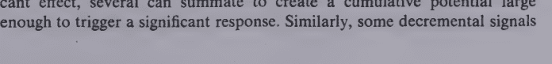

可能会减去或抑制其他信号，从而以实质性的改变模式。

# 7. 传输过程

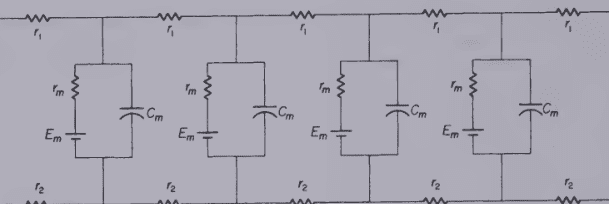

- `r_1 = 22` ohms/cm
- `r_2 = 200` ohms/cm
- `r_m = 5000` ohms/cm^2
- `C_m = 1` µF/cm^2
- `E_m = -70` mV

图 7.1. 神经膜节段电缆模型等效的图。这些值是典型的，但差异很大，取决于获取该神经元的物种。（改编自 Plonsey, 1969。）

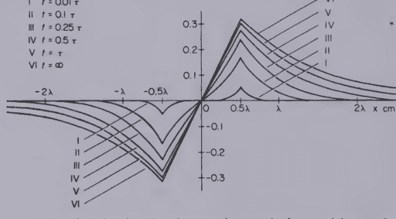

图 7.2. 绘图显示了在紧密相邻的阳极和阴极之间加上电压后，电位在不同时间和不同距离的电性扩散。注意，电压的扩散和任何点的幅度都是施加电压后通过时间的函数。扩散将作为图 7.1 所示膜电学特性决定的时间常数的函数而变化。垂直轴是膜电位的复杂测量值。（源自 Davis & Lorente de No, 1947。）

可能会减去或抑制其他信号，从而以实质性的方式模式。

因此，阶跃电位起的最重要功能是整合。它与其他相似信号相加或相减的能力允许信息进行组合、混合和相互作用，极大地增加了生物体可能的行为反应库。这种相互作用是如此复杂，以人类行为——作为最令人印象深刻的例子——尽管它们必须基于相同的物理和化学定律，但似乎与单个神经元的活动在定性上都是不一样的。

## C. 传播的峰值动作电位

在更直接可研究的水平上，科学家可以检查细胞水平的元素相互作用。虽然我们还无法说单细胞反应如何导致人类认知，但我们可以确定描述特定神经元的“电缆模型”中电容元件和电阻元件的值。为此，涉及对神经元的选定部分施加人工刺激——电电压，它充当人工的局部电位。通过测量膜对这种刺激的时间和空间特性，我们可以估算膜“电缆”的电阻和电容组件的值。

必须记住，阶跃电位不仅产生于突触作用和受体转导，还产生于传播的峰值动作电位。当神经元上的任何一点产生峰值时，它就变成了可能扩散的“局部”电位的源。这些局部电位也通过递减传导扩散，它们可能是轴突连续部分相继点燃以产生传播动作电位的机制。因此，阶跃电位在峰值的传播中起着重要作用，就像在突触和转导过程中一样。

### C. 传播的峰值动作电位

#### 1. 定性描述

让我们现在重新考虑跨膜离子平衡的一些细节。当在膜上施加电刺激时，它充当人工局部电位。这种扰动在离子受施加力的影响下产生新的电化学平衡。同样，膜渗透性的变化或某些离子浓度的变化也可以引起离子平衡的相应变化。

离子系统的微小变化通常是可逆的，但较大的变化可能不是。如果某些专门膜的去极化达到临界阈值，通常重新建立静息电位的恢复过程将不再起。相反，一旦跨膜电位阈值，就会发生一个壮大的事件：跨膜电压发生几乎爆炸式的变化。原本可能是中等被动的局部去极化现在引发了快速、巨大的去极化。

图 7.3 显示了对专门用于传值的细胞膜部分施加各种水平和极性的局部极化电位的结果。图 7.3a 显示，施加额外的负电位会将静息电位驱动到更负的值——使其超极化——大致与施加的电压成正比。然而，施加幅度变化的去极电位（如图 7.3b、c 和 d 所示）会导致与施加电位相对应的去极化，但仅限于特定的阈值限制。当超过该限制时，就会触发峰值动作电位。局部膜区域突然显示出快速

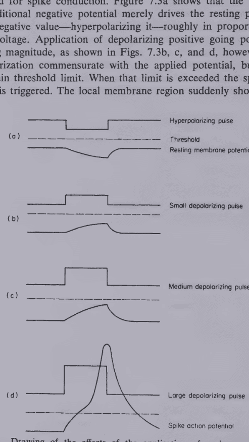

- 超极化脉冲
- 阈值
- 静息膜电位
- 小去极化脉冲
- 中去极化脉冲
- 大去极化脉冲
- 峰值动作电位

图 7.3. 绘图显示了轴突节段施加各种极性和幅度的驱动电压的影响。负电压产生膜的超极化；正电压幅度的增加会逐渐增加去极化，直到超过释放峰值动作电位的阈值。

### C. 传播的峰电动作电位

去极化的程度远超通过施加电压被动产生的值。事实上，去极化跨越了跨膜电位的零点点，导致细胞内部相对于外部瞬时变为正电。经过短暂的一段时间（通常约为 25 毫秒）后，膜开始恢复到静息水平。然而，这种恢复并非立即发生；在峰电之后，会出现一系列偏离原始静息电位的后电位。

图 7.4 显示了整个峰电动作电位复合的形状。可以识别出几个独立事件：初始局部电位、峰电的上升、峰电的恢复、正后电位（常被错误地称为负电位）和负后电位（常被错误地称为正电位）。


正后电位发生在恢复期，在峰电回到原始静息电位水平之前。正后电位与绝对不应期有关，这是轴突发放后的一段时间，在此期间，无论刺激多强，它都是完全不可兴奋的。负后电位是神经细胞膜更长时间的超极化，在峰电后的期间持续许多毫秒（达 50 毫秒）。它与相对不应期有关，这是峰电后的一段时间，期间需要异常强的刺激才能产生另一个峰电。由于正后电位和负后电位是连续的，必须假设峰电波形的某些部分必须经过原始静息电位水平。因此，可以预计在两个不应期之间存在一个相对正常但短暂的通常兴奋期。这正是所发生的情况。

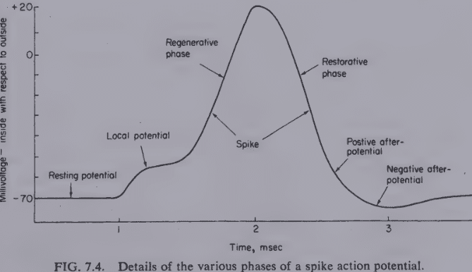

图 7.4. 峰电动作电位各个阶段的详图。

# 7. 传输过程

7.5 显示了典型 A 纤维在神经峰电动作电位发生后，这些兴奋性改变期间的过程。显而易见，存在至少一段短暂的正常兴奋期。

峰电动作电位本身也可以被视为一个强电位源。由偶极子产生的电流（由峰电和仍处于静息水平的相邻细胞膜部分组成）以原始人工去极化刺激相同的方式使膜去极化。这种由峰电驱动的局部电流流如图 7.6 所示。


图 7.5. 峰电动作电位过程中兴奋性各个阶段的详图。


图 7.6. 传导峰电动作电位的轴突膜附近产生的线圈离子电流图。由于峰电左侧的膜处于不应期，因此峰电只能向右侧传播。

## C. 传播的峰电动作电位

当峰电发生时，它会刺激或触发神经膜下一部分的局部去极化。这种局部去极化也可以导致峰电产生，就像原始刺激那样。通过这种链式方式，峰电动作电位沿轴突向下传播，直到到达无法产生峰电的区域。

以下大纲总结了峰电动作电位的定性描述：

- 1. 峰电动作电位的触发发生在当轴突膜的特殊区域被某些刺激去极化超过阈值时。
- 2. 峰电动作电位凭借其能够顺序去极化轴突膜的连续部分而具有自我传播能力。这是在峰电驱动的局部电流影响下完成的。
- 3. 峰电动作电位的幅度一旦被触发，就与刺激幅度无关。（这被称为全或无律。）然而，峰电的幅度取决于局部的离子和代谢条件。
- 4. 峰电动作电位的发生会在其后留下一系列不应期，以通过防止反向传导来维持峰电的方向性。这一极关重要的特征有助于整个神经系统的稳定。
- 5. 峰电传导的速度是离子因素、温度、轴突直径及其髓鞘程度的函数，但它与刺激的性质完全无关。

## 2. 峰电动作电位的离子基础

上述对峰电动作电位的定性描述并未阐明这种非常神经反应的底层离子机制。然而，基于第 5 章讨论的离子模型和半透膜概念，已经开发出优雅的解释。已经确定，对静息电位的最佳解释是基于跨细胞膜的钠和钾离子浓度差。我们现在这些概念增加一个通用原理：静息电位的波动（即动作电位）主要是由于膜对这两种特定离子通透性的局部瞬时变化引起的。

回想峰电动作电位的定性描述。首先，局部电位引起膜发生分级去极化，直到跨越阈值点。然后，膜电位发生爆炸性的去极化。随后是同样快速地向静息水平恢复以及一系列后电位。一个完善的峰电动作电位模型必须解释关于此的几点：(1) 维持和再生去极化的本质是什么？(2) 为什么膜电位翻转其极性的幅度达到了那个程度？(3) 解释动作电位回到原始水平的恢复过程的本质是什么？(4) 哪些离子过程解释了后电位？

目前接受的这些答案主要基于 Hodgkin 和 Huxley 的工作（例如参见 Hodgkin & Huxley, 1952b, 以及 Hodgkin, 1958），他们因描述神经活动的离子基础在 1963 年获得诺贝尔奖。其他重要贡献者包括 Keynes (1951) 和 Cole (1968)。他们共同贡献的理论包含几个关键点：

- 1. 任何时刻膜电位的状态主要是任何时刻存在的钠和钾离子分布情况的函数。
- 2. 离子浓度是膜通透性以及钠钾泵作用的函数。因此，跨膜电位也是膜通透性的函数。
- 3. 然而，膜通透性也是跨膜电位的函数。具体来说，对于钠和钾，膜去极化越剧烈，其对这两种离子的通透性就越大。这是一个关键点，因为它建立了一个正反馈循环，几乎完全解释了产生峰电动作电位的再生（正反馈）过程。去极化越剧，通透性越大；通透性越大，去极化越剧。这一陈述一直成立去极化达到峰值，此时钠通透性再次非常迅速地下降。
- 4. 钠和钾通透性的增加并非以相同的速率发生。这是解释膜电位快速上升随后下降的关键因素，并决定了波形的类峰状形状。

## C. 传播的峰动作电位

需要指出的是，我们关于峰动作电位的离子基础所提出的许多问题，目前尚未能完全回答，尽管其中某些问题已经有了相当合理且逻辑自洽的答案。然而，目前尚不清楚再生去极化的阈值为何位于每条神经膜上观察到的精确水平。不过，人们的共识是，在膜对钠和钾离子渗透性发生变化的阈值处，会触发这种变化，且两种离子的时间函数变化非常不同。

霍奇金-赫克斯（Hodgkin-Huxley）峰电模型尚未普遍接受，尽管它无疑是当前理论中最完整、最全面的。其核心前提是，膜的动态变化导致钠离子和钾离子在细胞内外被动流动。但一些理论学家对此持不同意见。例如，Landowne (1973) 基于其对离子传输的低温实验，认为简单的渗透性模型是不可行的。他提出了一种替代模型，其中被运输的钠实际上储存在膜内，且该离子的进入量仅限于这些存储量。因此，他的模型涉及产生峰电的主动代谢过程，这与霍奇金和赫克斯所倡导的、广泛应用的纯被动模型不同。

尽管如此，接下来的讨论介绍了目前通用的、更完整的霍奇金-赫克斯方法，但读者应当注意，没有任何一种分子或离子理论能完全涵盖过去 20 或 30 年间积累的所有实验数据。

图 7.7 显示了在跨越极化阈值后，钠离子和钾离子渗透性的时间变化曲线。可以看到，膜对钠离子的渗透性立即增加，并迅速（约 1 毫秒后）恢复到原始水平。在峰电的上升沿，这种钠渗透性增加的幅度估计约为静息电位水平发现的 500 倍。考虑到钠泵导致细胞内部钠大量缺乏，这种膜对钠离子的渗透性增加允许大量钠在化学浓度和电电梯度的被动驱动下冲回细胞。这种钠离子的流入倾向于增加膜负电位，加剧了膜电位继续去极化的趋势。

> 对钠渗透性增加初期的电流进行非常的测量显示，在之前还有另一个较小的离子电流。这种早期信号被称为“门控电流”（gating current）。一些研究人员（Armstrong & Bezanilla, 1973; Bezanilla & Armstrong, 1974; Keynes & Rojas, 1973）认为，门控电流是由于构成钠通道的分子构型改变以产生钠渗透性增加而产生的。

# 7. 传输过程


图 7.7。峰动作电位（V）期间膜对钠离子（gNa）和钾离子（gK）渗透性变化的时间曲线。根据霍奇金和赫克斯的观点，两种离子渗透性变化时间曲线的差异解释了峰动作电位的快速上升和下降。VNa 和 VK 分别表示钠和钾的平衡电位。（绘自自 Hodgkin & Huxley, 1952b。）

极化的进一步下降增加了膜对钠的渗透性，加剧了细胞膜的持续去极化。因此，建立了一个正反馈调节：电位下降导致渗透性增加，反过来又导致电位下降，导致膜的再生去极化。

这种正反馈调节解释了峰动作电位上升阶段神经细胞膜的再生和爆发性去极化。每一个作用中的力都在将离子平衡推向一种状态，即该局部膜区域内外的钠量达到相等。

必须强调的是，尽管使用“冲入”（rush）、“爆发性”（explosive）和“再生性”（regenerative）等词似乎意味着大量的钠流入，但这仅相对于相对于静息电位条件下的运动量而言是真实的。相对于细胞内部的钠总量，离子浓度仅发生了轻微的局部的位移。这显然是所必需的。

## C. 传播的峰动作电位

当然，峰电不会无限向正向持续。钠流入背后的主要驱动力是钠的电化学电势，以及由于细胞内外钠浓度差引起的扩散力（这些力最初是由钠泵产生的）。但很快，在约 0.25 毫秒后（这一时间由钠涌入细胞的速度决定），该区域的膜电位达到一个全新的平衡点，此时膜内外浓度相等，钠流入停止。

在讨论将膜电位恢复到突触前静息水平的修复过程之前，必须考虑峰电的另一个重要特征——其峰值幅度。1902年，Bernstein提出了一个相对简单的模型来解释峰电产生期间膜电位的变化。他假设峰电是由细胞膜渗透性的直接、完全（尽管是瞬时的）增加产生的，这允许所有涉及离子的大量通量。基于这一理论，他预测峰电在峰值处应从静息电位变为 0 毫伏。

修复复极化。我们现在考虑将膜电位恢复到静息水平的修复过程。峰电的下降沿已经完成。

有两种不同的现象被用来解释这一时期膜电位的恢复。第一个涉及钠渗透性的时间曲线。我们已经看到在峰电峰值处，钠渗透性被“关闭”，钠渗透性开始下降，且钠驱动力极小，因为此时浓度差异处于最小状态。

在此点，任何开启钠的过程现在都发生反转，膜的渗透性迅速恢复到正常水平。在足够的时间内，这种渗透性的变化会导致静息电位。然而，事实上，恢复速度远比这种纯被动过程所能解释的要快。因此，必须引入其他力来解释修复。建议的一种可能性是钠泵本身。但已知这种主动机制并不足以完成所需的修复。

考虑这种钾渗透性增加的影响。跨静息膜的钾平衡电位约为 90 毫伏，这是由于静息电位下内部钾离子浓度与轴突外的浓度比较所致。细胞内部过量的钾离子现在随着渗透性的增加而开始向外冲出。再次应当记住，这些量仅相对于正常的流入和流出而言是巨大的。然而，跨越局部区域的离子绝对量在电化学上是有显著意义的，随着它们的变化，膜电位也发生了变化。

## C. 传播的峰电电位

钾离子在简单的被动扩散和电化学力下继续流出细胞，随着神经元内部这些正离子的耗尽，跨膜电位开始复极化（即内部变得更负）。这种极化的增加持续持续直到膜电位接近其原始的静息电位水平。由于钠的渗透性在很大程度上取决于膜电位，这种不断增加的负电性通过降低膜通道对该离子的渗透性，进一步限制了钠进入细胞的被动流动。

尽管钾介导的恢复过程使膜电位恢复到接近原始静息电位的水平，但并非所有条件都与之前完全一致。由于这些离子在峰电的再生和恢复期间的运动，细胞内钠过剩而钾缺乏。现在，作用较慢的钠钾泵接管工作并逐渐建立正常状态。这需要多长时间，显然反映在后电位的持续时间上。

整个峰电的产生过程由表 7.1 描述，该表列了峰电四个主要阶段期间各种离子流的情况。

## 表 7.1

峰电电位过程中离子作用总结

| 膜状态 | 内部电位 | 膜渗透性$^a$ | 内部离子浓度 |
|---|---|---|---|
| 1. 正常静息电位 | — | 与钠泵一致，$P_K$ 正常，$P_{Na}$ 正常 | 主要是 K |
| 2. 再生-上升（去极化），峰电边缘 | 向 + 变化 | $P_K$ 正常，$P_{Na} > P_{Na}$ 正常 | 主要是 K，但有少量 Na 进入 |
| 3. 恢复-下降（复极化），峰电后沿 | 向 — 变化 | $P_{Na}$ 关闭，$P_K > P_K$ 正常 | 主要是 K，但有少量 K 流出 |
| 4. 长期恢复 | — | $P_K$ 和 $P_{Na}$ 与正常略有不同 | 主要是 K，部分 Na 被泵出，部分 K 被泵入 |

$^a$ = 渗透性

## 7. 传递过程

电位。我们还应该通过重新强调这一卓越过程的一些最重要特征来对该总结进行详述。首先，峰电是由由于膜对两种不同正离子的渗透性突然变化引起的。这一动作的短暂性似乎排除了在该渗透性变化中通过主动过程介导的可能性。由于这些及其他令人信服的原因，现在认为离子流仅仅是被动的，正如第 5 章中定义的意义。其次，钠离子和钾离子渗透性增加的延迟差异对整个过程至关重要。虽然钠的延迟较短，但钾外流的峰值是在钠内流开始减少的瞬间达到的。这些快速变化留下了异常离子分布的残余。正常浓度条件的恢复被延迟了许多毫秒，直到作用较慢的钠钾泵能够将浓度水平恢复到其正常的静息水平。这无疑是生物学中为人知的最惊人的进化演变之一，正如我们我们将看到的，这些差异延迟规定了峰电电位方面几乎是最优的响应时间和信息承载能力。

在讨论静息电位和动作电位底层的离子机制时，已经给出了一些重要问题的答案，但没有解释电生理学家探索这些问题时所使用的实验方法。两种特别重要的电化学技术——离子浓度操纵和电压夹持，在膜电位研究中尤为重要。这两种方法已应用于寻求关于膜的两个基本问题答案的研究：

- 1. 哪些特定离子在膜电位过程中非常重要？
- 2. 膜对特定离子的渗透性与膜电位之间的功能关系是什么？

## 1. 离子浓度的实验操纵

我们已经看到半渗透性神经膜如何划分出浓度不同的两个区域。两种溶液（一种在细胞外，另一种在内部）中的离子混合相当复杂；当对溶液进行化学分析时，会发现许多不同离子的痕迹。然而，正如反复指出的，只有两三个离子显然负责电生理传递中观察到的几乎所有膜电位效应。在浸泡神经元的外部溶液中发现的大多数其他离子种浓度的显著变化未能对膜动作电位或静息电位产生任何显著变化。然而，只有两种特定离子（钠和钾）浓度的微小变化对膜的静息电位和动作电位产生了巨大影响。

外部离子替换的实验程序相对直接。将神经元的一部分放在含有必需盐（如钠和钾）的溶液的箱中，其比例与动物体内通常的比例相同。可以通过灌入具有不同离子成分的溶液来替换外部溶液。主要要求是替换溶液必须与被替换的溶液等渗的（即表现出相同的渗透压），以避免产生神经元内部压力的差异。可以进行等渗硫酸钾或钾异硫代醇等物质对氯化钾的完全内部替换，神经元仍可以正常工作数小时。氯化钠也可以替换氯化钾，反之亦然，或者用蔗糖溶液替换氯化钠。在这些情况下，对动作电位和静息电位的影响可能是深远的。

钾。在 20 世纪 30 年代观察到钾离子浓度的变化特别影响静息电位。几个研究小组确定了一个事实：外部离子浓度的增加使静息电位变得不负。由于细胞内部通常含有过量的钾，而且与钠相比渗透性相对较大，因此增加或减少钾浓度并不意外。如果向环境中应用足够浓度的钾离子，神经元的去极化可能足以引发动作电位。这可能是所谓的“扩散抑制”（Leão 1947）现象后的机制，其中抑制活动波缓慢地（每分钟 25 毫米）离开兴奋区域移动。

## D. 一些实验方法

这种技术的最重要特征之一是，通过改变给定离子的外部浓度可以临时“关闭”大脑。这本质上是对组织的一种可逆损伤，是确定大脑各部分的兴奋性工具。Butcher 和 Fox (1968) 描述了一种巧妙的方法，通过装有特定离子的离子交换颗粒来对离子浓度进行操纵。

钠。浸泡神经元的溶液中离子浓度的变化对静息电位的影响较小。然而，外部钠浓度的变化对峰电幅度有显著影响，因为它是峰电在再生阶段上升到约 60 毫伏的钠膜电位。外部浓度相对于内部浓度越高，被动驱动去极化的电位就越大，峰电幅度就越大。同样，如果外部钠浓度耗尽（例如，Nathan & Sears 1962），被动驱动力较弱，动作电位的幅度就会减小。

离子电导入。近年来，开发了一种用于细胞内离子替换的有效设备。早些，在特殊情况下（如鱿鱼的巨轴），可以通过像挤牙膏一样滚动轴来排出细胞细胞质，然后替换其他溶液（Baker, Hodgkin, Shaw 1962）。这种技术对于识别某些离子内部操纵的具体影响非常有用。然而，在较小的神经元内部尝试替换离子面临更大的困难。

尽管如此，这一成就已通过称为离子电导入的技术部分实现，尽管尚未实现完全的离子替换。含有所需溶液的微管可以插入神经元，就像插入记录电极一样。如果对电极施加电压，根据电压极性，离子倾向于通过静电排斥或吸引进入或拉出细胞内部。通过这种方法可以在细胞内部某些局部区域进行特定的替换。这种技术的额外优点是允许直接测量注入的离子数量，因为每个离子的载电能力以及施加电压产生的离子电流幅度（通常以纳安为单位）都是已知的。配备了关于持续时间的额外信息，通过驱动电压，研究人员随后可以直接确定离子电泳注射期间转移的离子总数。

## 2. 电压钳位 (The Voltage Clamp)

当神经细胞产生脉冲电位时，质膜膜对钠离子的渗透性突然增加，这一事实是表明膜电位与离子电流之间存在某种功能关系的证据之一。在通常情况下，由于涉及的化学动力学过程复杂且快速，很难确定这种这种关系的细节。Cole (1949) 开发出了一种实验性的替代方案，将膜的参数锁定在恒定值并允许对其进行静态测量。这种通过电学手段使膜电位达到预定值并保持不变的技术，现在被称为电压钳位。

神经元膜的电压钳位是通过一种特殊的反馈放大器实现的。该设备旨在感知跨膜的瞬时电压，并瞬时施加一个“抵消”或反向电流，该电流的极性和幅值足以使膜达到任何所需的恒定电位。通过适当的调节，电位可以维持在与其静息电位完全不同的水平，并且可以在膜电位锁定在固定值时进行电流渗透率测量。缺点是，必须在使用电压钳位放大器时配合较大的电极，以避免膜电压的局部变化，这种条件可能会导致响应出现不定义的变异性或非均匀性。这种情况会导致得出的平均值可能无法反映真实的膜状况。

图 7.8 展示了一个典型的电压钳位装置，该装置用于检测膜电位，并产生将膜钳位在实验所需的某些电压上的电流。在与膜电容充电、放电以及离子平衡建立相关的初始瞬态过程稳定后，欧姆定律 $I = E/R1$（电流 $I$ 与电位 $E$ 之间的关系）便成为膜电阻 $R$ 或电导率 ($1/R$) 的直接测量值。

电压钳位实验的一个典型结果是上述的发现：钳位在比静息电位更正的电位下对钠离子载体电流表现出极低的电阻（即高渗透率）。通过将钳位电压从静息电位水平变化到脉冲峰值，可以绘制出渗透率与电位之间的精确函数。图 7.9 显示了典型纤维的这种膜电位-渗透率函数（作为施加钳位后时间的函数）。

## 7. 传递过程 (THE TRANSMISSION PROCESS)


图 7.8。电压钳位装置示意图。两个微电极（一个细胞内，一个细胞外）测量膜电位，该电压被施加到前放大器的差分输入端。当参考电压施加到前放大器的第三个输入端时，膜电压与参考电压之间的差产生一个通过大型细胞内电极的电流。该电流足以通过改变或“钳位”膜电位，使膜电位与参考电位之间的差减至零。随后可以使用该测量系统测量任何给定钳位电压下的膜电导率。（改编自 Cole, 1968。）


# 电压钳位技术与神经传导特性

电压钳位程序在概念上与第 6 章描述的用于研究视觉光化学物质的“冻结化学”技术相似。它允许在准静态情况下进行测量，这种方式可以为通常快速变化的过程提供时间“快照”。由于膜渗透率波动与离子流变化之间存在延迟，这种快照（与其他任何快照一样）不可避免地丢失自然过程中的某些信息，但它在各种实验技术中已极其有用。

电压钳位的发明者 Cole (1968) 指出了钳位过程中涉及的若干缺点，例如它无法保证产生的电流在钳位条件下真的是均匀的。尽管存在这些困难，但电压钳位技术提供了许多原本无法获得的信息。该技术独特贡献最重要的例子之一，是分离了通常同步的钠离子和钾离子电流，这一壮举由 Hodgkin 和 Huxley (1952a) 首次完成，并且它对本章前面介绍的脉冲动作电位模型的发展起了重要作用。

## E. 单个轴突的传递特性


**图 7.9.** 钳位电压突然变化产生的膜电流随时间的变化，以电压幅值为函数。（来自 Hodgkin, Huxley, & Katz, 1952）。

直到为止，关于脉冲动作电位的讨论几乎是独立于“其作为神经系统长轴突通信介质演化”这一事实的。让我们现在关注脉冲中与其传递功能相关的属性，而不是关注驱动它的局部离子条件。理解脉冲动作电位的传递函数尤为重要，因为从历史上来看，它被认为是卓越的神经编码。脉冲模式在频率、间隔和幅度上（如果多个神经元的输出是复合的）可能会发生变化。显然，在任何神经通路的许多部分，脉冲都可以作为传递刺激信息的媒介。

传播神经脉冲的最初考虑因素之一是轴突传递的方向性。如果不对脉冲传导的方向施加强力限制，神经系统将变成不受控制的、混乱的神经脉冲洪流。尽管如此，轴突本身可能没有内在的方向性，但它可以沿逆行性和顺行性方向传递信息，甚至是同时传递。

然而，神经系统的两个特征限制了脉冲动作电位的传播方向：不应期和突触作用。如果脉冲在轴突末端（在轴丘或突触末梢）启动，那么不应期和恢复周期会将传导限制在单一方向——远离起始点。脉冲无法沿着其来的轴突路径回溯。这种限制的存在是因为在不应期内，它刚刚激活的区域不再产生反应。

方向性还通过突触作用被施加于神经系统。突触具有很强的方向性，因此充当了整流器。突触作用将在后续的第 9 章详细讨论。

轴突传递的第二个重要属性是速度。传导速度在本质上非常有趣，因为它是神经元的一个已知（尽管无法直接推导）结构函数。不同神经元以不同速度传导的事实发现得很早（Gasser & Grundfest, 1939），从这些早期的神经生理实验中可以看出，传导速度与纤维直径密切相关。

轴突的髓化程度是决定其传导速度的另一个重要因素。第 3 章已证明，许多类型的神经元通常包裹在由施万卫星细胞的特殊“包裹”作用产生的脂肪性髓鞘中。在许多此类细胞中，特别是外周轴突，髓鞘在朗氏节处中断。在这些节处，髓鞘完全缺失（Bunge, 1968），其电化学电阻也大大降低。因此，这些节实际上为沿轴突连续位置顺序触发脉冲动作电位的传播电流提供了短路，使脉冲能够以高速度“跳跃”。然而，在没有髓鞘的细胞中，脉冲动作电位必须顺序激活膜上的所有位置才能传播。因为传播速度是有限的，这需要更多的时间，因为活动波是以连续一系列兴奋的形式从纤维的一端移动到另一端。因此，无髓纤维在本质上比有髓纤维传导得慢。


**图 7.10.** 轴突传导速度随直径的变化图。注意其高度线性的相关性。（来自 Patton, 1965，引用 Hursh 自 Gasser。）

在本章中，我们考虑了单个轴突的某些传输特性。但人体内没有哪个神经仅由单个轴突组成，只有在最异常的情况下，神经元才会孤立地放电。许多神经元共同放电要常见得多。多神经元放电产生比经典尖峰或简单衰减分级电位复杂得多的响应波形。混合成汇总或复合动作电位是下一章的主题。

# 8. 复合与汇总动作电位

此前，我们对传输的讨论完全针对单个细胞的反应。然而，这在某种程度上是一种理想化，因为神经元并非孤立存在。相反，它们在神经系统的传输通路和神经节中大量聚集在一起。因此，许多记录的反应必然是许多个体细胞信号的总和。因此，本章的讨论旨在理解从神经元组记录的反应。

早些章节还集中于通过微电极引起细胞内反应的实验，微电极实际上穿膜插入细胞。尽管如此，人们注意到细胞内神经反应也可以用细胞外电极记录。在这种情况下，电极不进入细胞，而是捕捉外部场的一部分。用细胞外电极记录的响应确切形状很难确定，因为它取决于许多复杂且相互关联的物理变量。从单个轴突记录的响应形状很大程度上取决于它是近还是远、大还是小，以及整个神经-电极复合体浸在什么液体中。

事实上，任何动作电位，即使在使用细胞内电极测量时发现是单相（单峰），当用外部体积容导体电极记录时，也不应被视为单个点电位，而应被视为由源和一个远处的汇极组成的偶极。这种偶极排列（通过连接线表示假设离子流动的路径）如图 7.6 所示。因此，多个源响应的相加精确方式可能非常复杂，并取决于许多变量；在任何多细胞响应中，响应形状除最微小的情况下外可能几乎没有意义。

然而，来自多个神经元的细胞外响应可以分为两类。第一类是汇总动作电位，图 8.1 展示了其中一个。在这里我们看到一种响应形式，其中单个细胞的动作电位是不同步的，且未多到相互干扰或相互作用。结果是多个但不同的高度不等的尖峰系列轨迹，产生出一种草丛状的外观。第二类型通常被称为复合动作电位，当大量细胞反应同时发生时，它们相互相加产生电总和。复合动作电位通常发生在用脉冲刺激诱发神经中许多细胞同步反应的情况下，或者在涉及大量神经元的情况下，其表现不是单个尖峰的“草丛状”集合，而是一个由于刺激区域特定性质以及响应个体细胞数量导致振幅和持续时间变化的平滑积累响应。图 8.2 显示了一个示例，即对外周体感觉神经应用电刺激产生的脑复合诱发响应。

接下来的三个节将讨论汇总响应、复合响应和一个非常重要的实验，该实验表明在适当分析时，两者可以被认为功能上等价的。理解汇总和复合动作电位的本质是重要的，因为它们的特征代表了一组可以作为传输代码的重要维度。


**图 8.1.** 汇总动作电位的摄影记录，显示了不同振幅的单个尖峰动作电位的混合（而非复合）。该记录来自龙虾的腹神经索，由 William R. Uttal 和 Hedwig Kasprzak 制作。


**图 8.2.** 对腕部尺神经应用电击后从人体脑诱发的复合电位照片。M、N 和 O 波的命名法是不常规的；更现代的研究人员通常将信号的不同部分称为 $P_{20n}$、$P_{100n}$、$P_{200n}$ 等，以指示它们的正负极性和发生时间（以毫秒为单位）。来自 Uttal & Cook, 1964。

人们对复合动作电位有很大兴趣，特别在这方面，因为它们显示出与心理学数据中大致相同的时间属性，而细胞尖峰具有非常不同的持续时间和其他时间属性。例如，诱发电位的主要峰和感知时间通常在刺激后几百毫秒处发现。另一方面，尖峰仅持续几毫秒。

此外，由于整个生物体的行为（心理学家称为“整体论行为”）和复合动作电位都代表了大量神经元的统计总结，许多研究人员认为复合电位可能是大脑与行为之间更好的指标。然而，这仍然是一个极具争议的问题，因为一些研究人员也认为它们可能是副现象，其统计起源可能基于完全与行为无关的机制。

在随后的讨论中，我们只考虑汇总和复合动作电位的起源以及记录方法，而不探讨这一争议问题。

## A. 汇总响应

图 8.3 是一组假设的脉冲产生伪神经元组合的示意图，它们可以产生类似于图 8.1 的汇总记录。这四个神经元各产生具有独特速率和振幅的尖峰系列。所有四个输出结合在一起，产生了神经元数量较少且中等大小时的典型草丛记录。神经元 2 较大但较远，因此与神经元 1 相比，其响应幅度差异不大。神经元 3 小而远，神经元 4 近而大。读者此处注意，无法根据振幅确定电极与给定神经元之间的距离，因为涉及因素的各种组合都会产生相同的测量振幅。

神经生理学中最重要的分析问题之一是将响应分离为单个神经元成分。这种分离成分信号的分析（在意图上类似于“傅里叶分析”，尽管数学细节并非如此）是一个极具挑战性的问题。事实上，一种特定的数学分析（Cox & Smith, 1954）认为，唯一可能的陈述是任何汇总响应的间隔模式本质上是随机的。


**图 8.3.** 图示展示了即使是完美周期的脉冲串相互混合，也能产生具有“随机”间隔的叠加电位。（改编自 Cox & Smith, 1954）。

如果人们只知道频率模式，它就是随机的。换句话说，这一证明表明，除非我们了解比叠加电位序列中单个脉冲到达时间更多的信息，否则对叠加型响应进行分析是不可能的。

Cox 和 Smith 在他们极其重要的理论性论文中，讨论了叠加过程分析的正式局限性，在本例中，这种过程由我们正在讨论的神经元动作电位的混合池所体现。在他们考虑的情况下，所有的振幅数据都被认为已经丢失。这比通常神经生理学情况下施加的限制更为严格，但他们的通用结论具有重大的意义。

Cox 和 Smith 证明，即使对叠加响应产生信号的发生器是完全周期的，随着独立发生器数量的增加，连续响应之间的间隔往往会变得更加呈随机分布。这是一个重大发现，因为它说明不存在任何仅利用间隔的技术可以允许研究人员将叠加信号分析分解为其组成部分。它还强调了这样一个事实：当发生器数量变得很大时，无法得知关于发生器本身统计属性的任何信息。然而，对于数量较少的纤维，神经生理学家至少可以描述贡献于叠加响应的发生器的一般统计特性。例如，通过 Cox 和 Smith 的技术，人们能够通过检查每组产生的叠加响应，来区分一组完全周期的发生器和一组随机放电的发生器。

从 Cox 和 Smith 的论文中得出的重要结论是：仅凭间隔对叠加或叠加池的神经脉冲进行通用分析是不可能的。此外，他们认为，即使使用峰电振幅作为分离大型叠加神经元的标准，这种“不可分析性”的结论依然成立。在读到关于极具前景的通用计算机信号分析仪时，必须清晰地记住这一结论。

手术技术和多电极仍然是研究神经活动复杂模式的强大工具。然而，对于神经脉冲的复杂混合物，简单的统计处理是有用的，而且在一两个案例中（Kehn, 1966; Schmidt & Stromberg, 1969），巧妙的计算技术利用特定的神经生理情况进行了某些特殊分析，尽管通用分析可能已被 Cox 和 Smith 永远地排除了在外。

## B. 复合响应

如果脉冲动作电位的数量（或任何其他动作电位）足够大，那么单个脉冲可能在示波图波形上无法单独识别。相反，每个单个神经元产生的电压结合产生一个累积信号，根据通常的电压相加定律，它是单个响应的算术和。随着单个脉冲动作电位数量的增加，叠加电位显示出数量越来越多的由于单个脉冲叠加而产生的复杂峰电。这些电压混合物可以通过峰电整体平滑上升和下降上的额外凸起和凹槽被轻松识别；但偶尔也会发生具有欺骗性的简单的、完全同步的响应。在中枢神经系统中，由于神经元排列密集，除了选择性最高的电极外，几乎任何不在细胞内的电极都会捕捉到这种多重响应。

如果电极是非选择性的且具有较大的作用范围，则响应将反映数千甚至数百万个分级和脉冲动作电位的累积响应。在这种情况下，不会保留单个响应的痕迹，电极采集到的电位表现出与单个脉冲不同的属性。例如，它可能会持续很长时间——在脑电图等自由运行信号中，可达数秒甚至更久。其次，这类复合动作电位始终表现出分级特性，因为涉及的大数量导致信号的量子性质被掩盖了。

除了叠加响应外，复合动作电位是编码的另一个重要候选。它们的变化方式与单个脉冲不同，因此可能在单个脉冲无法记录的地方记录刺激信息。它们也是作为编码大量神经元集体活动或中心趋势的介质的重要可能性。

如果所有神经元都通过电刺激同步，则可以在正常编码过程可能较好地产生叠加类型记录的制备中记录到伪复合动作电位。图 10.1 显示了通过较大的电极（直径 3/16 英寸）从人类神经记录的动作电位，该电极放置在皮肤上并记录了一个非常类似于单个脉冲动作电位的信号，其振幅对刺激强度的依赖性（图 10.1 中未显示）表明它并非如此。单细胞响应遵循“全或无”法则。这种复合信号显然是许多几乎在同一时间发生的脉冲的总和。响应的持续时间几乎与单个脉冲一样短，表明确实具有极高的同步性。这种非常简单、简短的复合动作电位最初由 Dawson 和 Scott (1949) 开发，允许通过皮肤经皮无手术采集信号。随着刺激减小，信号逐渐消失，直到无法再检测到。因此，单个细胞响应并非所有都能通过这种技术检测到，它只能用于电刺激产生的相对巨大的复合响应。

电刺激和使用大电极记录复合动作电位的通用技术最早由 Gasser 在几年前（例如见 Gasser, 1938）开发出来，用于动物实验。当剥离并对猫的腓静神经进行解剖并清除其外鞘时，皮肤钩电极能够记录比在人体经皮使用的 Dawson 技术观察到的更复杂的响应。Erlanger 和 Gasser (1937) 表明，在这种情况下记录的复合动作电位是由几个以不同速度传导的顺序成分组成的。当动作电位在越来越远的距离处记录时，就能观察到这种速度差异的主要结果。记录电极距离刺激电极越远，信号的各种成分就越分散。图 8.4 显示了在刺激位点不同距离记录的典型响应形状差异。

**图 8.4.** 记录显示了单个复合动作电位随传导时间在不同距离分散成多个峰波。这种效应由于贡献于每个峰的纤维传导速度不同引起。S 表示刺激的发生。（来自 Patton, 1965，引用 Erlanger & Gasser。）


通过对假设轴直径分布产生的单个脉冲动作电位进行代数求和，能够重建复合动作电位的形状。图 8.5a 是一个典型混合感觉神经的微显横面。显然，在这种情况下，复合动作电位是由这些外周神经中单个神经元的脉冲动作电位的简单电压叠加产生的。

图 8.2 展示了另一种类型的复合动作电位。这种响应是通过脉冲电刺激从人头表面记录的诱发电位。为了能看到这种信号，必须通过计算机进行处理，以将其从严重的电噪声条件中提取出来。


**图 8.5.** 猫类外周神经的横截面，显示了哺乳动物神经中常见的多种纤维直径。（照片取自 Truex & Carpenter, 1964；后自 Ranson）。

由干扰性脑电图和肌电图信号产生的噪声条件。尽管如此，这种微小的诱发响应是大量个体膜反应电位的累积。它的性质与之前描述的外周复合动作电位不同，因为它的持续时间明显长得多，形式也比经典平滑尖波的近似形式复杂得多。

## 1. 复合动作电位的检测

对诱发电位的研究面临着经典的信噪比问题。

> **注：** 下文关于信号平均和复合动作电位的大部分讨论采用作者较早的一部著作（Uttal, 1968）。

信号通常非常微小，特别是当通过动物完整的头骨和头皮进行记录时，它被隐藏在持续噪声中。噪声由普通的非诱发脑电图、来自身体广泛分离部位的肌电图以及系统中放大器引入的电干扰组成。例如，你可能会发现人体体感系统诱发电位的许多重要成分的幅度仅为 15 微伏，而通常脑电图活动的幅度在 1/1 毫伏量级。研究者面临的问题是从其他干扰信号中提取出这些微小的诱发电位。这种操作是可能的，因为诱发电位与产生它们的脉冲刺激是同步的。相比之下，噪声的定义是与刺激无关的活动。因此，在未刺激活动或噪声后的任何延迟，都倾向于随机分布。当取平均时，随机波动的信号趋于收敛于零。另一方面，当对与刺激同步或时间锁定的信号进行平均处理时，刺激后每个延迟的平均值将收敛于某个代表性的非零值。这两类信号（同步的和随机的）的混合物在重复平均后，倾向于重现较大的非同步活动的波形。

在二战期间，曾使用重复扫描技术来增强雷达显示。在该背景下面临的概念性问题与生物电位完全相同，只不过刺激是原始传输的无线波脉冲，而响应是从目标反射的微小得无线波。能够接收这些微小反射信号的各种类型接收机其信噪比特性都很差。此外，气象条件导致了无关噪声。提取显著信号的方法是反复向目标区域发送信号，并在同一个显示器上监控一个接一个的响应。因此，肉眼就能看到非常细微的变化。

1950 年，G. D. Dawson 建议可以使用类似的叠加技术来检测人脑的微小诱发电位。（他顺便指出，该技术与雷达解决方案一样，在功能上等同于高尔顿在 1883 年使用的叠加思想，用以增强一组面部肖像之间的相似性。）

Dawson 的技术为对完整人脑进行电生理研究创造了几乎前所未有的机会，这在近年来引起了巨大的关注。尽管 Dawson 最初的光电技术与今天使用的复杂的实时计算机技术相比是非常原始的，但其概念的一般本质是相同的。Dawson (1954) 还开发了可能是最早实际执行伪平均功能的电气设备——由转换器驱动的电容器组，每个电容器充电的水平对应于刺激后给定时间信号的加权代数和。

平均处理可以通过以下方程进行形式化定义：

```
E_t = \frac{1}{N} \sum_{n=1}^{N} E_t^n. \quad (8.1)
```

在该方程中，$E_t$ 是刺激后给定时间 $t$ 信号的平均值；$N$ 是平均的连续响应次数；$E_t^n$ 是第 $n$ 次记录在时间 $t$ 的电压。该方程仅代表刺激后特定时间 $t$ 的平均曲线上的一个点。必须系统地改变变量 $t$ 以绘制出整个时间函数。在实践中，制备平均响应需要呈现重复次数为（$N$）的刺激。对于数字计算机平均，每个诱发电位随后通过模数转换器数字化，其速率足以提供足够的样本点密度。利用公式 (8.1) 计算出大量等同于 $t$ 族群平均值，并将这些平均值族的值在某些适当设备上绘图或显示，以代表响应的平均时间过程。


# 8. 复合与池化动作电位

在最复杂的数字平均中，每次连续呈现刺激时都会对 `N` 进行真正的除法。然而，执行除法是一个复杂的逻辑操作，可以通过简单的权宜之计避免。因此，许多商业用途的平均仪实际上并没有进行平均，而是串行累加器。每当呈现刺激时，模数转换器如上所述对数据进行采样。这些编码值可以根据公式 (8.1) 求和，但从未完成除以 `N` 的操作。相反，对应于 $\sum_{n=1}^{N} E_n$ 的寄存器（即对应单个 `t`）的累计值在整个实验过程中不断增加。通过这种方式，寄存器中的累积值逐渐增加，直到达到最大容量。

由于在任何刺激后，非同步信号高于平均值的概率很大，每个寄存器的内容再次趋于某个平均值。然而，在这种情况下，随着刺激呈现次数的增加，将产生一个较大的非零平均值。因此，除以 `N` 仅充当缩放因子，用于归一化信号的幅度。这里正是消除除法运算而付出的代价。由于示波器的显示量程通常设置为正确显示读数，因此在平均过程的早期阶段，无法视觉化单次扫描的结果，因为总和值太小了。只有在呈现了大量的刺激后，信号的特征才扩大到可见。

## B. 复合响应

### 2. 脑复合动作电位的起源

在处理复合电位时出现的一个重要性问题是该波形与个体电位之间的关系。对于每个复合响应，外周神经复合电位的问题相对简单。个体电位的计算和已被证明在预测复合响应形状方面是足够的。然而，对于诱发电位和脑电图等复合动作电位，其起源存在很大争议。

关于诱发脑电位的主要争议在于它们的细胞起源。Purpura (1959) 综述了皮层电位的产生理论，并指出早期强调尖波电位贡献的用于解释慢脑电位的模型不再被接受，主要是因为无法通过实验将活动与慢电位联系起来。他进一步指出，这些模型已被新的观点取代，在新观点中，慢树突和突触电位被假设为产生慢皮层电位的基本单元。

Amassian、Waller 和 Macy (1964) 在关于人类感觉诱发响应的最早报告之一中表达了相同的观点。由于多种原因（包括明显的关联能力和记录技术的数学考虑），他们也得出尖波动作电位不贡献于从头部表面记录的复合诱发脑电位。他们还认为，已知的慢电位（如突触后电位和各种后后电位）更有可能是相加产生波形的。

他们支持这一观点的许多证据建立在对少量神经元动作电位的分析之上。然而，允许收集大量样本的现代计算设备证实了脉冲活动（`spike activity`）与慢电之间确实存在关系。Fox 和 O'Brien (1965) 结合计算机分析技术，证明了通过胞外微电极使用高频带通前放大器记录的单个皮层细胞脉冲延迟直方图，与通过相同电极但使用通过低频信号的放大器记录的平均诱发脑电之间，存在极高的相关性。当样本量足够大时，这两种测量值之间的相关性足以表明，脉冲动作电位可能被过早地排斥在产生复合电位的主要贡献者。Fox 和 O'Brien 的工作表明，复合诱发脑电是脉冲发放概率的直接相关物，因此他们可能已经证明了脉冲活动与复合诱发脑电之间缺失的关系。

目前，只需说明复合诱发脑电的起源仍处于激烈辩论中；虽然一些人认为它是突触和树突分级活动的直接反映，但另一些人则强烈认为脉冲动作电位对复合诱发脑电有直接贡献。

Fox 和 Norman (1968) 通过发明一种他们称为“一致性”（`congruence`）的新测量方法，扩展了早期关于脉冲与复合诱发脑电之间关系的概念。一致性是一种定量测量方法，描述了单个细胞的响应模式对于贡献特定复合诱发脑电的细胞总样本有多典型。通过上述方法，使用一个电极和两个具有不同带通特性的放大器记录了单个细胞的活动和微脑电图。

Fox 和 Norman 根据记录的数据形成了三个函数。第一个函数是使用低带通放大器记录的微脑电图的幅度分布。一个数字模拟转换器每毫秒采样一次这种连续变化的电位的幅度，每当信号幅度处于其范围内时，就会在 256 个幅度类别之一中进行一次记录。通过这种方式，形成了一个幅度直方图，显示了每个幅度值出现的次数。此类类型直方图的示例见图 8.7a。

第二个函数基于使用高带通放大器检测到的单个细胞脉冲动作电位的发生情况。每当细胞发放时，它都会触发计算机确定慢电位位于 256 个幅度级中的哪一个。另一个计算机分析程序随后根据每个 256 个幅度级中发生脉冲的次数开发了第二个幅度直方图。此类直方图的示例所示图 8.7b。

到目前为止，这一程序是一个相对直接的过程，即开发两个简单的幅度直方图。现在考虑慢电位的某些幅度发生频率比其他幅度更高。当然，极值的出现频率相对较低，而中值的出现频率相对较高。因此，第二个直方图中所示脉冲频率具有强偏偏差，因为慢电位的中值幅度比极端幅度值多得多。因此，有必要通过将脉冲发生的分布除以幅度发生的分布对这些数据进行归一化。通过这种简单的计算，Fox 和 Norman 控制了慢电位幅度数量不均的问题。归一化的结果形成第三张图，它绘制了一个本质上等同于慢电位每个幅度值处脉冲发生次数的函数。因此，这种典型曲线对每个慢电位幅度值的出现次数进行了归一化。第三个归一化直方图的示例所示图 8.7c。如果我们仔细研究这三个直方图，一个最重要的事实就会凸现出来。尽管前两个函数呈现出近乎正态的、乍一看是一个几乎随机的分布，事实证明微脑电图与脉冲发生之间存在极高的相关性。这通过数据进行归一化并绘图时得到的近乎直线的线条得以看出。

单个细胞活动与微脑电图之间相关性的特定数值是可以计算的，并被 Fox 和 Norman 通过实验证实。这些研究人员发现，这一事实本身是一个非常有意义的结果，因为它证实了局部记录的微脑电图并不是单个细胞活动的测量，而是代表了大量细胞群的活动。因此，单细胞活动相对于微脑电图的一致性是变动的，这表明周围的其他细胞对总电位也有贡献。如果单细胞记录也与微脑电图相关，它将引发一直挥之不去的疑虑，即微脑电图与使用大电极以常规方式记录的某些完全不同。

如果一致性的概念是合理的，那么也应该预期，当放置电极的感觉系统受到适当刺激驱动时，脉冲计数与微脑电图幅度之间的相关性将会增加。（视觉皮层包含其他对光无的细胞，对于这些细胞，一致性性下降。）

总结来说，Fox 和 Norman 提供了一种用于估计细胞群“协调性”的有价值测量方法。这种方法具有许多重要意义。首先，与单细胞活动的高度相关性告诉我们，微脑电图如果不是脉冲本身的产物，也无疑源于产生脉冲的过程。因此，两者本质上是等效的，可以被认为是信息等价的。其次，微脑电图为我们提供了记录区域内许多细胞的累计指标，而不是单个细胞的测量。这种测量可能是研究集群活动的唯一可行途径——而集群可能是“关键”。第三，一致性直接估计了单个细胞活动在多大代表了所有贡献慢电位的细胞的平均活动。因此，一致性未来可能是脑活动的重要指标，并极大有助于理解细胞活动是如何池化为复合响应的。

关于从大脑记录到的复合电位的可能性的最后一点：随着我们对神经元之间的支持单元胶质细胞的了解越来越多，很明显它们也会产生生物电位。其中某些电压可能是在嵌入胶质细胞的神经元的间接影响下产生的。在某些情况下（例如视网膜中的 Müller 细胞），胶质细胞和神经细胞响应的时间过程几乎相同。因此，尽管它们没有参与意义的信息处理，胶质响应也可能与刺激或心理过程相关。进一步的研究建议，胶质去极化的直接原因是神经元活动导致胞外钾浓度增加。这种可能性已由 Orkand, Nichols 和 Kuffer (1966) 详细考虑，并在 Kuffer 和 Nichols (1966) 的广泛综述中进行了讨论。这种信号确实发生的事至少提出了可能性，即它们可能对复合动作电位的产生做出贡献。

无论如何，对于脑电图或诱发脑电位的起源目前尚未达成完全共识；目前提到的任何或所有电压源都可能对这些正常的复合动作电位做出贡献。希望这一问题在不遥远的未来能够得到解决。

## C. 超同步复合响应真的代表了自然编码方法吗？

如前所述，Gasser (1938) 以及 Erlanger 和 Gasser (1937) 最初通过一种已在神经生理学和心理学实验室中均成为标准的刺激技术，探索了外周神经中动作电位的本质。他们使用的刺激是一种极度不寻常的——某些人甚至会认为是非生理性的——事件：一个短暂的但（从正常生物电电位的角度来看）巨大的电脉冲。我们在早些讨论中对外周神经复合诱发电位的描述，主要是基于使用了此类类刺激的实验结果。然而，当通过正常刺激（如敲击、刷扫或施加热或冷）观察体感觉神经干的活动时，大多数观测技术表明，其响应模式最好被表征为池化类型的记录（`pooled type of record`）。当然，这是完全合理的，因为在或多程度上独立响应的单细胞放冲动作电位之间，精细的时间关系本质上蕴含着更大程度的信息编码。

然而，由于许多实验者对电产生的复合动作电位过分强调，出现了一个主要问题。这种人工刺激是否在神经的正常编码特性之上引入了任何虚假或外源特征？换句话说，所有神经元同时响应的超同步响应，是否引入了其自身的属性，导致记录的电位不能代表半独立纤维响应的统计总和？为了通过更正式的方式表述该问题进行进一步说明：这种特定的统计量——由电刺激产生的复合动作电位——是否以无偏的方式代表了一组独立响应的轴突电位的中心趋势？

显然，解决这些问题的唯一方法是设计出某种手段，执行与神经受到瞬态电刺激时自身执行的相同的统计分析。Casby、Siminoff 和 Houseknecht (1963) 开发出了一种分析技术，他们使用一台特制的模拟计算机对自然刺激诱发的池化响应进行交叉相关分析。

### 1. 交叉相关

交叉相关是一种用于确定两个函数之间相似性的数学技术。当函数是时间的变量时，它的形式化定义为如下表达式：

$$
C_c(\tau) = \frac{1}{T} \int_{t=0}^{T} f(t)g(t-\tau) dt. \tag{8.2}
$$

`C_c(\tau)` 定义为两个函数 `f(t)` 和 `g(t-\tau)` 之间的时间交叉相关；`\tau` 是一个函数相对于另一个函数的位移——即滞后或提前；`T` 是提前的持续时间。需要注意的是，`C_c(\tau)` 对于每个 `\tau` 的值都有单一的值。因此，`C_c(\tau)` 不是一个单一的数字，而是变量 `\tau` 的函数。

`C_c(\tau)` 意味着什么，它在生物电位研究中的潜在应用是什么？也许说明相关性实际意义最好的方法是考虑在单个时间延迟 `\tau` 下的两个函数 `g(t)` 和 `f(t)`。可以根据每个时间延迟 `\tau` 的 `g(t)` 值和 `f(t)` 值绘制一张散点图。

图 8.8a 是两个正弦振荡 `f(t) = \sin t` 和 `g(t) = \sin t` 的散点图示例，它们同相——即 `\tau = 0`。在这种情况下，一个正弦波 `y` 坐标的每个值等于另一个正弦波对应的坐标。散点图随后变成了一条具有正斜率的直线，如图所示从某种意义上说，这种散点图代表了两个信号之间的最大对应。因此，可以说它们是完全相关的。根据一个相关性公式，这意味着相关性为 1。然而，在各种常数缩放的广义函数中，完全相关是一致地归一化的。尽管如此，这两个正弦波在该相位角具有最大程度的相关。如果我们在两个信号之间插入时间延迟或相位偏移，`f(t)` 不再等于 `g(t)`，它们之间的完美关系往往会减小。图 8.8b 是两个相差 `1/4` 波长（相位偏移为 `90^{\circ}`）的正弦波之间对应关系的图。散点图现在呈圆形，这种图形与较低的相关性相关。当使用上述表达式形式化时，它给出了一个中等值的 `C_c(\tau)`。

相关图可以被视为一种长期平均过程，该过程倾向于强调两个函数之间的周期相似性而非非周期性。因此，具有长期周期趋势或共同序列的两组数据集可以简化为相关图的形式。从这个角度来看，交叉相关函数被认为与傅里叶技术非常相似。事实上，通过让 `f(t)` 或 `g(t)` 等于一组正弦波，它就完全变成了那样。

因此，通过实际减少存在的信息量，交叉相关和傅里叶分析都有助于使重要数据更容易解释。

### 2. Casby、Siminoff 和 Houseknecht 的实验

在介绍了交叉一般的般性质后，我们现在可以详细考虑 Casby、Siminoff 和 Houseknecht (1963) 将这一数学技术应用于池化神经动作电位研究的具体情况。

图 8.9 是电极放置的示意图及其记录和模拟计算设备的框图。猫的神经被剥离并悬挂在两个分离良好的记录电极上。当实验动物的皮肤感受器受到轻刷的刺激时，两个记录电极捕捉到了混合神经的复合动作电位。这两个记录电极的时间模式代表了要进行相关的两个函数 `f(t)` 和 `g(t)`。在每个情况下，这些函数都是从同一条神经的不同位置记录的池化动作电位。

交叉乘积。然而，在图 8.10b 中可以看出，当 `\tau` 调整到该单次脉冲的条件时间时，两个函数的交叉乘积值将高于所有其他 `\tau` 值，因为两个高值峰值将将相互相乘，而不是其中一个峰值与一个较低的常数值相乘。因此，当我们扫描 `\tau` 的范围时，将获得一个类似于图 8.10b 所示的交叉相关函数，其峰值中心位于等于传导时间的 `\tau` 处。

对下文所示数据的理解取决于对这一过程的认识。必须理解，当 `\tau` 等于在沿神经位置不同的两个电极上记录的神经动作电位的传导时间时，两个函数的交叉乘积中会出现峰值。因此，从一个角度来看，Casby 等人使用的设备是测量神经冲动传导速度的一种复杂但准确的方法。然而，他们的兴趣在于寻找一种替代方法，以对传导速度敏感的方式检查神经动作电位群的统计。他们试图通过他们的交叉相关器进行统计来再现复合动作电位。这将对电击激发的复合动作电位的产生进行独立检查。

现在假设将 Casby 等人的技术应用于图 8.12 所示类型的聚合响应。那么，在图 8.10 示例计算中使用的单次脉冲将被一个复杂的神经脉冲聚合模式所取代。这种交叉相关将产生与原始单次脉冲的平方完全不同的结果。它将产生一个交叉相关函数，其意义在本质上与电刺激诱发的复合动作电位完全相同。即使刺激是像羊毛刷那样的某种弥散性刺激也是如此。

然而，由自然刺激引起并经交叉相关器处理的函数形状与由电击产生的形状并不完全相同。通过经典的 Eranger 和 Gasser 技术得到的不是单个脉冲的简单加和，而是一个交叉乘积，其中双极波的交叉相乘可以产生两个三极波。

图 8.11 是用这种技术从实际制备产生的聚合神经响应的交叉相关图。它显示了与图 8.4 所示的电击产生的峰值对应的多个响应峰。一个峰值由传导最快的 `A_\alpha` 纤维产生。稍晚出现的一个峰值由于传导速度稍慢的 `A_\beta` 纤维。最后一个峰值对应于 C 纤维的响应。当这些数据与用 Eranger 和 Gasser 技术产生的复合动作电位进行比较，并考虑到产生每条曲线时所用程序的差异使其本质上等同同时，说明了一个重要的点；即产生神经元群行为统计摘要两种不同方法。在一种情况下，使用电刺激时，统计叠加是由神经本身完成的。在另一种情况下，统计叠加是由外部设备——交叉相关器产生的。显而易见的结论是，电刺激响应没有任何方式都不会扭曲响应的真实模式。非生理性的同步没有引入额外的或外来的因素。如果我们考虑到有关单个动作电位的相位和时间的所有信息都丢失了这一限制，那么电击激发的复合动作电位被认为是单个神经元性能的完美指标。

在本章中，我们考虑了许多关于神经元群信息传输的主题。然而，与前章一样，尽管它们是集体记录的，但它们处理的是神经内部的响应。在下一章中，我们将转向一个相关的课题。然而，在这种情况下，重点不在细胞内传输的细节，而在于细胞之间的通信。因此，下一章将必然集中在突触的作用上，即神经元专门进化用于从一个细胞信号信息到另一个细胞的部分。

# 9 突触


# 第 3 章强调了一个事实

现代神经解剖学理论认为，神经系统内部传输信息的神经元并不是随机相互连接的。相反，在每种感觉模式中，三到五个独立的细胞“头尾相接”连接，按顺序将传入信号传送到大脑。神经元之间的通信区域称为突触，一直是密集研究的对象，因为只有在这些点上，神经整合和相互作用才可能。考虑到突触的极小尺寸，我们如何确定突触两侧的神经元是被分离的呢？Eccles (1964) 列出了接受解剖不连续性的以下证据：

1. 轴与细胞体分离产生的轴变性不会跨越突触。
2. 大多数突触会在神经传输中引入 1/2 到 1 毫秒的延迟。这相当于传导一英寸轴产生的延迟。
3. 特殊染色技术（如 Cajal 银染色）在突触处通常有清晰的标记。
4. 电子显微镜直接显示除了电突触外，两个细胞的细胞膜是分离的，且细胞膜在轴端是连续的。


图 9.1a, b

## A. 电与化学突触 189


> 图 9.1. 除了第 3 章的各种突触接触外，这里复制了 McLaren (1970) 权威著作《突触传输》中的许多其他示例。(a) 雏鸡睫毛状神经节细胞的突触（插图所示，来自 Lorenzo, 1960）；(b) 来自丘脑的突触复合体。哺乳动物复合体 (MD) 分形成二级结构 (CD)，这些结构与含有突触泡的触触细胞有大量的突触接触。某些突触被标记为 AA（源自 Majorossy, Réethy, & Szentagathai, 1964）；(c) 浦野细胞底部的突触接触（如图 3.22f 所示）。P = 浦野细胞体；Ba = 篮状轴；G = 胶质细胞；Ax = 轴（源自 Hamori & Szentagathai, 1965）。

图 9.1 显示了不同类型的突触连接。在解剖上，这些连接彼此看起来完全不同。然而，尽管形式上具有这种多样性，只有两种不同的机制


图 9.2. 墨西哥蝾（*Ambystoma mexicanum*）中由棒状末端在 Mauthner 细胞上形成的电突触的电子显微照片。注意与图 9.4 相比，这里的囊泡数量非常少。可以看到两个运动神经元的细胞膜几乎相互接触（紧密连接），允许通过紧密的电耦合进行突触作用。M = 线粒体；J = 结结；V = 功能未知的囊泡。放大倍数为 56,000 倍。插图显示了放大 154,200 倍时的连接。（照片由阿尔伯特·爱因斯坦医学院的 George D. Pappas 博士和 J. Keefer 提供。）

## A. 电突触与化学突触 191

目前已知突触作用模式。第一种突触作用模式基于直接电激活，类似于神经冲动沿轴本身传播的方式。第二种也是显然更为常见的突触作用模式，是由从信息来源细胞的末端或突触前区释放的高度特化递质化学物质介导的。信息通过递质物质跨越两个神经元之间的空间扩散进行传递，引起第二个（即突触后）细胞膜电位的变化。

在脊椎动物标本中，两个神经元之间的电突触出现频率比远常见的化学突触低，而且在哺乳动物组织中极罕见（Sotelo & Palay, 1970）。电突触的功能需要比化学突触高得多的电耦合程度，因此这两个神经元之间的间距通常更近。电突触的间距可以有多近，通过 Bennett、Aljure、Nakajima 和 Pappas (1963) 以及 Pappas (1966) 的电子显微工作得到了证明。图 9.2 显示了一个来自墨西哥蝾的 Mautner 神经元，这是一种成年后仍保留鳃的两栖动物。这张照片的重要特征是两个神经元之间的距离非常近——只有 20 Å——而且没有发现任何化学活性囊泡的证据。在其他细胞中，暗示这两层膜实际上可能是融合的。Pappas 认为，这种紧邻的区域是负责电突触导电性的形态结构。

读者需要理解，电突触和化学突触之间的区别并不意味着其中一种是纯化学性的而另一种是纯电性的。电突触中的电压和电流是由我们之前讨论静息电位和动作电位时描述的相同离子流引起的。化学突触虽然作为主要兴奋剂对电似乎相对不敏感（一些神经生理学家认为它完全无法通过电被激发），但它确实会表现出与任何离子系统类似的电电位。（见本章稍后关于突触前和突触后电位的节。）必须记住，我们观察即使是这些化学事件的幅度和时间过程的技术几乎完全是电性的。化学事件只能通过常用的电生理电极和放大器进行间接观察。化学突触和电突触的主要区别在于最能改变突触后区静息电位的主要兴奋剂的性质。

Eccles 在其卓越著作（Eccles, 1964）的结语中也列出了化学突触和电突触的一些特定区别特征，这些特征被转述如下：

## 192 9. 突触

1. 跨电突触产生的突触延迟比跨越化学介导的突触要小得多。
2. 产生的电位的被动（电张性）扩散在电突触中的延伸范围比在化学突触中远得多。如果突触是由电学介导的，放置在突触前神经元中的电极将捕捉到突触后神经元中更多的活动。换句话说，电突触比化学突触具有更紧密的电耦合。
3. 在化学介导的突触中，两个神经元之间的突触间隙比电突触大得多，而在电突触中，细胞质膜实际上可能是融合的。电突触中这种距离的缩小可能部分解释了上述 (2) 中描述的高水平电耦合。
4. 在突触处进行电相互作用的两个神经元大小通常大致相同。如果第一个细胞的突触元件远小于第二个细胞，那么化学传递几乎是强制性的，因为微小的突触前神经元和大的突触后神经元之间的直接电学作用需要某种电能放大过程。目前尚不知道存在这样的过程。

由于电突触相对稀少，而且化学介导突触作用是一个被广泛接受的理论，我们在本章中主要关注化学介导突触的观点。

在初步讨论中介绍的化学突触作用的主要点如图 9.3 所示，该图改编自 Grundfest (1957) 最初绘制的图表。该图强调了


图 9.3. 化学突触处神经电和化学编码的各个阶段的示意图。（改编自 Grundfest, 1957。）

## B. 化学介导的突触传递 193

几个重要的概念。请注意，即使在微观区域内——宽度仅几埃单位——也可以存在几种不同的信息编码水平或模式。轴突内直到该区域的传递是通过之前讨论的频率编码动作电位实现的。突触前组织将这种脉冲编码信息转换为阶梯电位，这在某些情况下（尚未完全理解）导致递质化学物质的释放。递质化学物质本身随后以看来是被动的方式（即没有主动力驱动递质分子）跨越突触间隙。递质分子随后被突触后组织上的受体位点捕，其静息电位发生改变产生另一种阶梯突触后电位。

突触后电位对突触后神经元可能有抑制或兴奋作用。如果是兴奋性的，它会增加突触后神经元的动作电位活动。如果是抑制性的，活动就会减少。现在我们已经建立了两种突触作用的一般定性图景，让我们详细考虑一下化学过程。

### 化学介导的突触传递

化学突触传递过程中的主要谜团是：突触前的阶梯活动如何引起突触后膜的去极化？本节将尝试补充上一节介绍的目前接受的化学传递模型的细节。

指示传递过程存在某种化学介导的早期证据是非常间接的。20 世纪上半叶工作的研究人员遇到了许多产生极强神经效应的不同化学物质。例如，Loewi (1921)证明了乙酰胆碱对心率的强抑制作用。Cannon 及其同事（Cannon & Bacq, 1931）发现肾上腺素和某些化学类似物（特别是去肾上腺素）能加速心率。在每种情况下，作用都是由刺激的副交感和交感神经系统部分分别释放的化学物质产生的。神经系统部分分泌化学物质的观点似乎非常有道理。

根据许多证据，现在所有研究化学突触的人员都同意，化学递质物质是以量子化方式组织的。也就是说，许多化学递质物质的分子似乎聚集成组或

# 194 9. 突触

以单位形式释放的几乎恒定的包。关于“包”概念最早且最有说服力的证据之一是一些是对突触后电位微结构进行非常仔细记录的工作。Del Castillo 和 Katz (1954) 在运动终板中观察到，而 Eccles 和 Eccles、Iggo 和 Lundberg (1961) 以及 Nishi 和 Koketsu (1960) 在中枢神经元中观察到，当微电极插入突触后组织时，会发生周期性相当不规则的自发极化。这些自发极化非常小，振幅仅约为 5 mV。由于其尺寸非常小，它们必须被称为微型突触后电位。已经确定，微型突触后电位是由大量且恒定的分子（通常为几千个）的作用产生的，因为在驱动电场中注入数百个离子的电泳实验并没有产生相应的极化。

由于微型电位是自发发生的，而且它似乎是大量分子的作用，因此大量的递质分子形成恒定大小聚集体或“包”的概念已广泛获得。这一概念的进一步直接支持来自图 9.4 所示的电子显微照片。（目前被认为是递质包的囊泡的首次观察通常归于 De Robertis & Bennett, 1954。）在靠近突触间隙的突触前末端可以看到这些结构化囊泡的簇。目前认为，分子在释放时分离，并独立地移动到突触后受体位点。递质分子被动扩散跨突触间隙的观点，或者间隙大小、扩散时间与突触延迟之间的电生理对应关系，支持了这一观点。

现在认为多种生物化学物质在各种动物的神经系统中充当突触递质。例如，乙酰胆碱已被证明是几种突触的有效递质。虽然这种物质长期以来被认为仅涉及脊椎动物的神经效应接头和交感神经作用，但现在认为“胆碱能性”突触在整个系统发育树中更为普遍。同样，去肾上腺素在经典上被认为是自主神经系统交感部分的递质。哺乳动物大脑脑中其他可能的兴奋性递质还包括 5-羟色色胺、氨酸盐和氨基酸以及多巴胺。谷氨酸盐在鱿鱼中似乎也是兴奋性递质。血清蛋白现在也被认为是某些部分的强效递质。


图 9.4. 鳗鱼 Muller 细胞突触区域的电子显微照片。注意聚集在细胞突触前的突触囊泡。A = 突触前细胞；P1 和 P2 = 突触后细胞；t 和 f 分别为微管和微细蛋白。箭头指向微管周围囊泡的规则排列。放大倍约为 130,000 倍。（来自 Smith, Järlfors, & Beránek, 1970）。

# 196 9. 突触

最近的研究（第 10 和第 11 章）表明，某些被认为完全是兴奋性的物质实际上可能是兴奋性的也可能是抑制性的，取决于受体位点的性质。例如，乙酰胆碱现在已知在海兔等无脊椎动物中可以起这两种作用。

在哺乳动物脑中经典上被认为完全抑制性的物质包括氨基酸甘氨酸和 GABA（γ-氨基酸）。另一方面，像士洛碱之类的物质，虽然不是严格意义上的天然递质，但已知它可以抑制抑制作用，从而产生伪兴奋效应，因此它会诱发神经活动，在大剂量下，这种激活可能如此强烈而导致严重的痉挛。士洛碱等化学品似乎会降低突触后区域对通常稳定神经网络的抑制性物质的敏感性。

抑制效应的二次抑制这一通用概念极其重要。此外，突触后组织中必须存在某些灭活递质物质的化学手段，以防止抑制或兴奋作用的持续。在胆碱能系统中，突触后组织似乎含有 `AChE`（乙酰胆碱酯），这是一种能快速分解乙酰胆碱的酶。乙酰胆碱的突触效应在递质分子被破坏和灭活之前仅持续几毫秒。这对于加速神经元和运动单元的作用尤为重要，因为反应的持续将有利于神经元状态变化的速度。

同样也有人建议某些全身麻醉药物通过干扰化学突触传递起作用。突触后位点作为化学感受体，特别可能结合多种化学物质，但并非所有的都能被吸收并激发神经元。具体来说，有人提出，当麻醉药物占据了许多突触后受体位点但没有产生神经传递所需的效应时，就会发生阻塞。由于位点已被占据，任何可能到达的通常递质都将无效。其他麻醉剂，特别是局部麻醉剂，必须直接作用于减少轴突活动。

尽管已经区分了突触传递过程的几个主要阶段，但并非所有的阶段都被完全理解。例如，尚不知道动作电位是否会在突触前组织中产生中间阶梯电位，或者在那里检测到的电位仅仅是降级的尖电位。一个同样重要的问题涉及特定释放机制的作用。阶梯电位是如何释放或触发大量递质分子的释放的？换句话，

# C. 兴奋、抑制：去极化与超极化 197

离子机制突然允许膜通过大量的递质分子（预计是囊泡在突触侧爆发），而之前只发生低频率的突触后电位。这些和一些相关问题代表了当前研究的前沿。关于突触生物化学的全面且出色的讨论可以参考 Albers, Siegel, Katzman, and Agranoff (1972)。

# C. 兴奋与抑制：去极化与超极化

关于突触传递的另一个主要问题是突触后电位的极性与神经兴奋或抑制之间的关系。如前所述，突触活动可能是兴奋性的也可能是抑制性的。兴奋性突触作用导致刺激突触后膜增加细胞的反应。突触作用也可能是抑制性的，阻或减少反应。

在兴奋期间可以测量的阶梯突触后电位是根据效应的方向定义的，而不是膜的极性。因此，在兴奋期间测量的电称为兴奋性突触后电位（通常缩写为 `e.p.s.p.`），突触抑制期间记录的电称为抑制性突触后电位（`i.p.s.p.`）。

必须清楚记住，这些定义是基于兴奋和抑制的作用，而不是电压的极性。

理解抑制与膜极性之间的关系是尤为重要的，因为研究人员对某些关键点存在很大争议。

## 9. 突触


为了产生激活所需的去极化，必须产生这种变化。然而，许多实验（例如 Coombs, Eccles, & Fatt, 1955）已经表明，抑制作用可能是超极化的，也可能是去极化的，这取决于抑制性神经递质到达时，突触后组织所钳定的静息电位。图9-5显示了此类实验的一次记录。当电压钳位装置将膜静息电位锁定在超极化水平时，可以看到发生了抑制性去极化。在其他钳位水平下，抑制性电位显然是超极化的。抑制性突触后电位（`i.p.s.p.`）极性对原始膜电位水平的依赖性，彻底排除了抑制与超极化之间存在直接简单关联的观点。更准确的表述可能是：`i.p.s.p.` 的极化偏移倾向于一个幅度在钾浓度电位和氯离子平衡电位之间的膜电位。

人们假设了一种新的离子机制来解释无论是超极化还是去极化的抑制性膜电位偏移。这一理论由 Eccles (1964) 提出。他认为，基本的抑制作用本身并不是超极化，而是膜对钾离子和氯离子正常渗透性的改变。

根据该模型，膜以复杂的方式改变其渗透性。一个抑制性化学递质包的到达似乎极大地增加了膜对钾离子和氯离子流的渗透性。这种渗透性的变化是观察到的抑制性突触后电位极性变化的根本原因。

一个相关的重大问题是，一个神经元是否可以同时产生兴奋性和抑制性效应。直到最近，人们通常认为，抑制性和兴奋性突触后电位是由分离细胞产生的，这些细胞制造组成递质物质的特定产物。假设某个细胞只产生一种专门的兴奋性物质，而另一个细胞则只产生另一种专门的抑制性物质。如果连接到神经元的是第一个细胞，突触后细胞总是被兴奋；如果连接的是分泌抑制性物质的细胞，突触后细胞就会被抑制。

然而，Wachtel 和 Kandel (1967) 发现了这一假设的一个非常显著的例外。他们发现，在海兔（*Aplysia*）绘图良好的腹神经节中，其中一个神经元对其形成突触接触的细胞既有抑制效应也有兴奋效应。更令人惊讶的是，该细胞在同一个突触处似乎可以产生兴奋效应，也可以产生抑制效应！每种情况下作用与突触前纤维受电刺激的速率有关。Wachtel 和 Kandel 将微电极插入突触后细胞，通过通过微电极传递脉冲电流，他们能够在电流脉冲时产生单次尖值动作电位。当以低速和中等速率刺激神经元时，突触后神经元中的另一个微电极捕捉到的 `e.p.s.p.` 足够大，每次都能产生一个尖值动作电位。当以更快的速率刺激突触前纤维时，突触后纤维的反应发生了剧变。去极化的 `e.p.s.p.` 变为超极化的 `i.p.s.p.`，细胞停止了反应。

即使这是一种非常独特的制备方法，且该效应发生在进化树上遥远的动物身上，它也引发了这种可能性：脊椎动物突触也可能是抑制性的或兴奋性的，这取决于似乎与其无关的传入脉频率。如果是如此，简单神经网中神经元之间相互作用的复杂性将剧增。

Wachtel 和 Kandel 进行了一项补充实验以鉴定递质物质。已知断根碱对乙酰胆碱具有特定的阻滞作用，它被注入到浸泡海兔神经节制制物的溶液中。

* 关于这种特别有用模型动物的解剖和生理学的完整讨论将在第11章中给出。

这种注入的效果同时抑制了兴奋性去极化和抑制性超极化。我们得出结论，这两个效应都归于一种递质物质——乙酰胆碱的作用。因此，Wachtel 和 Kandel 的实验推翻了两个先前的假设。首先，他们证实了单个神经元可以同时具有抑制性和兴奋性的输出。考虑到他们的发现，即使不在同一个受体位点，激动剂效应也可以在同一个突触处发生，这甚至更加令人震惊。其次，他们证实了同一种递质物质可以产生兴奋或抑制效应。这第二个发现可能更为重要，因为它击中了一个非常基础的生物化学假设，即物质的化学性质决定了它是作为兴奋性还是抑制性中性神经递质。

我们现在必须问：一个除突触前频率外所有属性都保持不变的双神经元系统，如何能产生如此巨大的不同的突触后效应呢？Wachel 和 Kandel 推测，突触前末梢本身拥有两种类型的受体位点。一种在受乙酰胆碱刺激时产生兴奋性去极化，而另一种在受相同化学物质刺激时产生抑制性超极化。他们进一步假设这两个受体位点的时间常数非常不同。兴奋性受体适应非常快，在高刺激速率下停止工作，而抑制性膜对这种适应具有很强的抵抗，并在高频率下继续工作。

这项重要的研究引出了一个关于化学突触作用的关键问题：是什么离子机制解释了突触后组织在接收到递质后的极化变化？遗憾的是，这个问题带我们进入了目前知识的极限。目前尚不清楚突触后受体位点的精确结构，其作用机制也不为人所充分理解。然而，根据有限的证据，一些权威假设了涉及抑制的主要过程，即膜对钾离子和氯离子渗透性的改变。

201

## C. 兴奋、抑制：去极化与超极化

201

对钾离子和氯离子的渗透性增加了。一旦渗透性增加，被动力就是所有需要引用的力了。

关于突触后电位产生的另一种观点认为，形成了中间化学物质，由这些物质产生电位变化。例如，Greengard（由 Marx, 1972 报道）建议一种被称为循环 `cAMP`（3’,5’-腺苷一磷酸）的已知参与神经动作电位的物质，可能可能特异地参与突触后抑制。循环 `cAMP` 被认为是由去甲上腺素或多巴胺等递质的作用产生的，它导致细胞的超极化，从而降低了神经元的兴奋性。尽管这个观点没有改变我们对抑制涉及的主要过程（即膜对钾离子和氯离子渗透性的改变）的看法，但它暗示了渗透性变化的另一种方式。它也反映了许多神经生理研究方向从电生理向生物化学的转变。我们之前定性描述的一些机制现在已经开始从所涉及的超微观反应来理解。


突触后过程的最后阶段当然是 e.p.s.p. 向尖值动作电位的转换。这似乎是以与之前描述的轴突局部电位转换为传播尖值动作电位完全相同的方式完成的。


假设的测试尚未完成，而且电缆模型中涉及的常数需要某些极端值才能使相关方程证实这一假设。

突触连接处多个突触后电位（e.p.s.'s）和突触前电位（i.p.s.'s'）之间的相互作用是历史上提出的最重要的生物学概念之一。神经元其他部分的传输几乎是一一对应的。来自多个源的信息之间很少交互。只有突触（且仅限于突触）才具有交互并产生代表若干输入整合或累积效应输出响应的能力。因此，只有在突触处，适应行为、反应可塑性、创造性思维和学习的能力才能体现。

突触还起着一个非常重要的功能，即为单向通信系统增加方向性。通过这种方式，它们整流了天然双向轴突的传导模式。整流作用的其他有用结果是维持神经系统的稳定。如果没有突触的整流特性和其他稳定力量，任何单一信号一旦启动，就会导致活动在整个系统中爆炸式扩散。显然，我们在分子水平上的很大程度上，是神经元之间超微型整合性突触区域的功能。

## D. 突触前和突触后抑制

正如我们所看到的，抑制性和兴奋性突触后电位之间发生的相互作用可以决定突触前纤维产生的神经活动过程。我们已经讨论了一种形式的抑制，它可能作用于某些分子水平，通过改变神经膜对产生兴奋状态的离子的渗透性，来调节兴奋物质的影响。这种形式的抑制作用的作用位点显然是突触后组织，因此被称为突触后抑制。图 9.7a 描述了一个简单的电路安排，可以允许这种突触前抑制的发生。

然而，事实也证明（例如参见 Frank & Fuertes，1957 年的工作），还有另一种形式的抑制。这种替代的相互作用可以通过图 9.7b 所示的电路进行介导，其特征是携带抑制信号的神经元本身与兴奋突触的突触前部分形成突触，并调节它能够释放的递质物质量。由于在这种情况下作用位点在此，这一过程被称为突触前抑制。

突触前抑制似乎是突触前膜电位减小的直接结果。显然，释放的递质物质量与膜去极化的幅度是非线性相关的，突触前膜电位仅减少几个百分比就可以使释放的递质物质减少 50% 以上。

(a) 突触后抑制


图 9.7。区分 (a) 突触后抑制和 (b) 突触前抑制的示意图。

(b) 突触前抑制


## E. 突触的一种特殊形式：神经肌肉接头

传出神经元与肌肉运动单元之间的连接与真正的突触（定义为两个神经元之间的功能连接）具有许多共同特征，因此在这里讨论它是必要的。沿着感受器到效应器的神经元链的的通信最后阶段是转换的逆过程。在最后一步中，神经电化学能被转换为与通过神经元时发生的完全不同的物理能量。我们可以认为，反转换器就是运动单元。关于肌肉细胞如何执行这种从电化学电压到机械力的转换的完整描述与本书无关，但运动神经元与效应器连接处的通信最终阶段，即神经肌肉接头或肌接头，对我们的讨论非常重要。

有了已经提供的关于突触作用的信息，很容易理解神经肌肉传递的基本概念。所有的突触前功能几乎完全相同，读者只需要学习一套针对肌肉细胞对该过程关键特征的略有不同的词汇即可。

从解剖上来说，突触与神经肌肉接头的主要区别在于接头中的突触后元件不是神经元，而是几种肌肉细胞。运动单元的收缩作用现在被认为很大程度上归于图 9.8 中滑动亚细胞丝的可变重叠。与此讨论相关的问题是：神经活动如何触发这种收缩？

典型的神经肌肉接头（或运动终板）如图 9.8a 所示。可以看到神经元的末端部分位于运动细胞膜的特殊加厚处的浅沟或凹槽中，这被称为运动终板。图 9.8b 是一个根据电子显微照片绘制的图，更好地展示了神经元与运动终板之间连接的精细结构。读者应特别注意这两个结构之间的细细隙（类似于突触间隙），肌肉细胞终板的内凹。


图 9.8。两个水平所示的运动终板。Ax = 轴；my = 髓鞘；sarc = 胞质；tel = 末端；mn = 肌肉细胞；mf = 肌纤维。来自 Couteaux, 1964；Birks, Huxley, & Katz, 1960)。

后续细节是已知的。普遍接受的神经肌肉传递观点是，沿着运动神经元的尖冲动作电会导致大量化学递质的释放。已经确定神经肌肉接头的递质是乙酰碱。已经证明乙酰碱在运动神经元的末端释放（Dale & Feldberg, 1934；Dale, Feldberg & Vogt, 1936），并在注入终板时已被证明产生肌肉反应（Dale et al., 1936；Nastuk, 1959）。

乙酰碱如何作用导致肌肉收缩尚完全清楚，但像突触后电位一样，在递质到达时会产生分级反应。目前的理论认为，乙酰碱引起的肌肉膜去极化是通过钠和钾离子的渗透性变化来解释的，这与神经膜表现出的相似。因此，神经元兴奋性的离子理论也适用于其他生物过程。

通常情况下，去极化非常短暂，而且就像突触一样，认为终板产生的乙酰碱酯酶足以迅速灭活乙酰碱。箭毒（Curare），一种从几种植物中提取的类生物毒碱物质，是另一种能够阻断神经肌肉接头的作用，而对身体其他神经或突触功能没有明显影响。由于这个原因，它不应作为麻醉剂。虽然动物在手术期间可能会瘫痪并安静地躺着，但它的感觉神经或中枢神经元并没有被禁用，可能会在没有任何行为指示的情况下遭受巨大的痛苦。电位，一种具有许多突触后电位特性的信号。证据表明神经肌肉递质是以量子包传递的，就像突触的情况一样。观察到微小终板电位（类似于微小突触电位）这些微小电信号自发地发生（Fatt & Katz, 1952）。这些被认为是由于乙酰碱的随机释放。

到此结束了我们对神经元之间以及神经元与运动单元之间通信过程的介绍。到此为止，重点一直是单个细胞的作用和相互作用。为了充分理解神经系统的作用，我们现在必须转向这些细胞组件网络之间相互作用的某些特性。

## 10 神经整合

## A. 引言

除了第 8 章外，之前的章节完全专门讨论了单个神经元的生理学和解剖学。这些材料对研究人员具有巨大的兴趣，而且对于进一步揭开神经生理学谜团是绝对必要的的。但从更广泛的意义上说，如果神经元之间不存在相互作用，那么单细胞生物学将仅仅是某种深奥知识的练习。不要误解——单细胞神经生理学固然引人入胜，但在作者看来，对单细胞神经生理学研究的巨大投入应该投向比仅限于单个神经元水平定义的更广泛的目标。单细胞神经生理学领域研究的真正意义在于，这些细胞是构成神经系统复杂交互网络的单元构建块。正是这个系统及其相对于整个有机体行为的功能，使得神经生理学研究具有如此重大的意义。

一位卓越的神经生理学家在讲座后，私下对作者说道：“尽管大多数神经生理学家都在记录单细胞电位并报告输入-输出关系，但我深信他们认为自己找到了解释灵魂的钥匙。”尽管大多数科学家会否认这一指控，但许多人会同意 Horridge (1969) 的说法：“生物学的目的 [p. 1]。” 单细胞几乎不能解释任何关于有机体宏观或总体行为的重要 true点。宏观行为只能通过引入涉及大量神经元作用的过程来解释。任何仅凭单细胞生理学前提试图这样做的尝试很快遇到困难。不仅在解释为什么任何一个细胞或细胞群的活动应该比其任何邻居细胞更重要方面存在着一个持续的逻辑问题，而且单细胞反应的实际时间维度也与行为反应的时间属性不同。当感知持续几分之几秒时，神经反应仅持续几毫秒。人类观察者无法区分两个发生间隔小于十或二十毫秒的事件 (Utsal, 1959)。

贯穿整个动物界，行为的特征是输入刺激与输出响应之间的差异。这一事实已被提到是神经系统通信功能（在其中必须保持信号特征）与整合功能（在其中必须修改信号特征）之间关键的、乍看之下是不相容的差异。

适应性行为必须由同样灵活的神经模式介导。这意味着输入刺激必须通过与其他神经信息源相互作用，以选择某些新的神经模式。然而，如果这种修改是为了实现适应性功能，那么输出模式必须在某种程度上与输入保持联系。否则，刺激输入将仅仅触发随机活动。为了在维持这种功能关系的同时最大化灵活性和适应的机会，输入刺激必须经过一个与混合多个输入进行选择和相互作用的过程。这种通过混合和选择来实现适应的过程被称为神经整合。

也许神经网中整合活动最好的正式定义是由 Bullock 和 Horridge (1965) 提出的：

> 整合是一个过程或一组过程，其产生的输出与输入不相同，但仍然是输入的某种函数 [p. 257]。

这个定义强调了事实：输入模式的改变必须保留与有机体环境需求的相关性，但仍然要足够，以至于响应不再仅仅是由输入触发的直接且必然的结果。然而，这种整合的定义并没有足够有力地说明整合过程的另一个方面：整合神经网的输入必须是多个。“整合”一词包含了多个输入的累积或混合的含义。正是通过这种混合，必须假设行为的灵活性源于确定性的、而非神秘的过程。如果假设并非如此，则需要调用意味着拒绝大多数现代科学精髓的过程。无论这些整合机制多么复杂，无论我们对输入模式转换为有用响应的理解有多么不利，记住输出是输入的函数导数是非常重要的。即使这些输入部分来自动物遗传历史和经验中早期存储的信息，事实仍然是，任何输出都不少也不少于输入的某种函数。

整合的概念通常与中间神经元的功能相关（既不是受体也不是运动神经元的神经元，或者正如 Purpura (1969) 所简洁定义的定义——“连接神经元到神经元的神经元”），但这种联系并不一定有效。显而易见，即使是高度特化的受体也能够进行整合行为。图 3.8 和 3.10 显示了这些最外周神经元中同时存在传出和传入突触连接的证据。

这一事实非常重要，因为它意味着是受体的输出也可能是多个输入混合的结果，而不是仅涉及简单能量转换的刺激传输。

基于宏观行为，有必要在神经元水平假设整合过程，即使它们没有被直接观察到。特别是人类，表现出如此多样和灵活的行为，以及根据以往经验（那种无处不在的被称为“学习”的过程）在修改响应方面具有如此的塑性，以至于某些多输入混合过程似乎是显而易见的。

人类很少表现出看似纯粹的“触发响应”。即使是新生婴儿最简单的反射也取决于多种刺激输入的条件。以往的经验和“注意力”的方向强烈调节了简单刺激的结果。一个重要的相关事实是，人体触发复杂行为的刺激意义可能会发生变化，以至于它们在这一时刻到下一时刻之间引发完全不同的响应。例如，点击声最初可能会产生某种“反射性警觉或定向响应”。随后，它可能不产生任何响应；以后，它可能会回想起一个口头描述的场景的复杂心理图像。显然，这种情况下输入与输出之间的关系是多方面的；同样明显，底层宏观行为的神经连接模式是塑性的、不稳定的或可修改的，这三个词都意味着同一个概念。刺激意义变化的速度阻止了将神经生长作为适应性行为的解释。相反，这些情况下系统必须被认为以某种切换模式运行，其中多个输入通过预先存在的路径进行路由和重新路由。另一方面，持续时间较长的变化（如记忆）无疑与某些永久性的结构或生化变化有关。

## B. 生物学系统的建模

具有建设性且影响极其巨大。我们现在对通过这些简单感知网络介导的感知过程的神经生理学有了许多了解。但以这种方式关注更简单的网络存在一个问题。视网膜并不是脊椎动物或任何其他生物表现出的最有趣行为的源地，因此不是大多数类型神经整合的合适模型。“走向外围”，我们确实可能“倒洗时连孩子一起扔了”！

使用简单模型来解决一般问题的第二种方法是使用另一种不那么复杂的物种。遵循这种替代方案，实验者试图寻找一种既具有神经系统，又具有一系列有趣复杂行为的生物。遗憾的是，如今脊椎动物门中不存在这样理想的生物；因此，近年来研究人员越来越多地使用无脊椎动物来研究网络的作用和相互作用。

某些无脊椎动物神经系统比脊椎动物神经系统简单得多。推测参与最简单的无脊椎行为的细胞数量至少是数百万，而控制某些有用的适应性运动行为的无脊椎动物细胞可能仅涉及数百个神经元。此外，这些无脊椎神经元通常很大，也许更重要的是，它们的结构和功能在动物与动物之间非常相似。而且，相同的细胞通常被发现执行着几乎相同的功能。另一个优势（尽管设备价值有所下降）是，在如今的高速电子记录时代，许多无脊椎动物制剂的运行时间尺度似乎比脊椎动物中类似的过程要慢得多。例如，在小虾中，光闪诱导尾部光感受器产生的反应延迟在 5 秒级（Utal & Kasprzak, 1962）。脊椎动物中类似的延迟可能仅短至几毫秒。无脊椎动物中的其他过程也持续许多秒钟，通常为研究神经整合过程的精细时间结构提供了机会。

无脊椎动物模型系统对理解更复杂过程可能产生的影响的一个经典例子是 Hartline、Wagner 和 Ratl (1956) 对马蹄蟹复眼神经连接网络进行的研究。相邻节肢动物受器之间抑制性相互作用的许多重要概念（这些过程现在已知存在于脊椎动物受器中），首次在这种制备中被直接研究的。事实上，我们目前对多样化感知过程（包括轮廓强化等幻觉）的许多了解，很大程度上源于对这种简单动物进行的神经学研究。神经结构的有序性导致了某些发现的清晰证明，这些发现反过来直接有力地引导了感知现象中某些具有极大通用性的重要概念。其影响是深远的，延伸到了艺术甚至其手工艺如纺织织。在 Ratliff (1965) 中可以找到这些神经生理学发现与人类感知各个方面之间相互作用的优秀且完整的讨论。

其他无脊椎动物制剂在各种类型的神经生理调查中也发挥了重要作用，而在情况下脊椎动物组织太复杂。Wiersma (1958)、Kennedy (1971) 和 Kuffler (1954) 广泛研究了小虾，绘制了许多主要神经元及其连接，并定义了它们的功能。Nicholls 和 Kuffler (1965) 专注于水蛭的神经系统，Maynard (1965) 及其同事广泛研究了脊龙虾。

在本章的后续章节中，我们将通俗地考虑一些被认为是细胞水平和网络水平神经相互作用示例的过程。下一章将通过展示使用单一海洋软体动物——海蛞（Aplysia）和我们的模型的神经整合特定实例，来澄清并使这些概念更加具体。

## C. 基础机制

第 8 章讨论的复合和池化动作电位是神经信号混合产生的过程，其产生方式从任何定义上都不涉及真正的神经整合。这些类型的反应仅仅是单个神经元不同部分产生的单个电电位的物理叠加。复合信号完全由神经元与其构成环境的流体之间的物理和几何关系定义。

通常情况下，即使是紧密结合的神经元，除非在最异常的情况下，否则不会发生功能性相互作用。相互经过的神经绝缘性非常好，以在每个神经中诱发的电位通常不会影响其邻居。尽管人们对触旁作用（相邻轴突之间的信息传递）产生了一些兴趣，但这种现象似乎仍然只是实验室里的奇闻。在人的人体感觉系统中，尽管许多神经元长距离平行，但在轴突到达脊髓之前，还没有整合相互作用的机会，其简单的原因是由于脊髓中心之前不存在突触。

最后这一陈述强调了我们讨论整合中的一个要点。大多数当代神经生理学家使用的“整合”一词，总是涉及突触作用。现在普遍认为，由可累加的分级动作电位编码的神经信息模式在突触处的汇聚构成了神经元相互作用的最佳机会。正如我们将看到的，现在被称为“整合过程”的大部分是涉及两个以上神经元的级电位之间这种作用的反映。

神经生理学家。这种限制并不意味着没有可以调节信息模式保真度的细胞内过程。模式确实存在，它们确实会修改神经内部的信号模式。虽然这些机制不应被认为是真正的“整合性”，但它们的作用足够重要，足以在此时被考虑。突触间整合机制将在下一节中讨论。

### 1. 调节信息传递保真度的细胞内机制

#### (a) 不应期、兴奋性和恢复周期

如果一个轴突在反应后几毫秒内受到刺激，它将无法像最初那样做出反应。如果第二个脉冲在约一毫秒内紧随第一个脉冲，通常将完全没有反应，无论刺激有多强。这段时间被称为神经元动作电位的绝对不应期。在绝对不应期几毫秒后，神经元需要比正常大得多的刺激才能被激活；这段时期被称为相对不应期。在相对不应期期间，单个波峰的反应幅度可能会改变，但主要影响似乎是提高了引发反应的阈值。在某些制备中，刺激后短暂的超兴奋期可能也紧随在绝对不应期之后。刺激后兴奋性改变时期的时间轨迹可以使用双脉冲实验范式建立。将两个间隔可变量的脉冲应用于神经元。然后将神经元或神经对两个刺激脉冲中第二个脉冲的响应值对脉冲间隔值进行绘图。然后产生一个恢复函数的时间图，它描述了神经膜机制的重要属性。其中最重要的点之一是不应期定义了神经元可能的最大信息传输率。

图 10.1 显示了从人手臂外周神经记录的复合动作电位的恢复模式。（有关获取这些记录的讨论请参见第 8 章。）随着两个刺激之间间隔的增加，可以清楚地看到第二个反应的恢复。在这种特定情况下，幅度的变化主要反映了给定时刻细胞数量的变化


图 10.1. 人类尺神经复合动作电位的照片，这是通过施加在神经上的双脉冲电刺激产生的。随着两次刺激之间间隔的缩短，第二次反应的振幅减小，这展示了不应期。（自 Uttal, 1959.）

时间，而不是单个轴突反应振幅的变化。然而，不应期的持续过程与单个神经元的情况非常典型，在这种情况下，产生反应所需的刺激振幅作为兴奋性的标准，会比反应振幅更具适用性。

显然，不应期的影响将改变从输入端传输的信号模式。神经元将简单无法传递所有的入射信息，而包含小于不应期间隔的突触前刺激串无疑会有一些尖峰动作电被跳过。在这种情况下，神经元充当了频率分用器的角色。通常情况下，随着感觉通路的上升，单个神经元的平均反应率会大幅降低。因此，频率分用似乎是一个重要且普遍的神经生理现象。

#### (b) 神经适应或调节

神经适应是一个可能与上述描述的双刺激恢复周期相关的过程。

用于测量调节的实验范式与测量恢复周期的范式完全不同，因为调节的效果是一个持续很长时间、涉及多个反应间间隔的累积效应。经典的神经适应实验涉及对正常的受体-通道施加持续、长时间的刺激，这与不应期的两个脉冲形成对比。此类刺激对神经纤维反应的影响如图 10.2 所示。在这种情况下，用微电极记录了单个细胞的尖峰动作电位活动。尽管刺激在过程中保持强度相等且不变，但观察到反应频率逐渐降低。这种对恒定振幅刺激的反应减小在行为上是有用的，因为它倾向于减少来自刺激中未发生变化的部分的信息，这些部分大部分包含冗余信息。这种过程倾向于强调开启和关闭时间，或刺激振幅变化的空间区域。它从更丰富但无关的刺激中选择出最重要的信息。


(c) 复合动作电位的振荡。在一种不同的实验范式中观察到了与神经适应相关的现象（Uttal, 1966）。当向复合神经递送长串脉冲刺激时，序列反应的振幅会发生振荡，并呈现以非常规律的方式增强和变化。这一现象如图 10.3 所示。这种振荡的周期似乎与刺激频率无关。

目前尚不确定究竟是什么导致了这种振荡现象。一些数学模型表明，它可能代表当长时间刺激串改变平均膜电位水平时，膜电位向新的稳定平衡水平的“寻找”。


图 10.2. 猫听觉神经纤维在持续声学刺激期间，发放率降低（适应）的图表。（自 Kiang, 1965.）

## 216 10. 神经整合


这种现象对刺激频率的敏感性表明，它可能与神经系统的某些恒定维度有关，例如涉及的轴突长度。

这一系列情况，加上 Larabee 和 Bronk (1947) 在涉及突触前刺激器和突触后记录位点的制备中观察到类似的振荡，表明该现象实际上可能由脊髓中某些反射或突触机制的反馈所介导，尽管在这种情况下，刺激和记录电极之间没有被突触接头隔开。无论这些振荡的原因是什么，都很清楚，沿着神经传输的信号与输入信号大相同，至少在振幅维度上，结果是初始信息模式在神经编码的一个维度上被扭曲了。

(d) 轴突和根根反射。Fullerton 和 Gilliatt (1965) 使用插入人类外周神经的微电极发现，具有分叉轴突的神经元（如图 10.4 所示）表现出一种奇特的非突触性反射，这是由于轴突传导的内在无方向性导致的。如果刺激沿着分支 a 产生顺向性反应，那么在连接处，细胞不仅可能沿着主干 b 以正常的顺向方向传播反应，还可以沿着分支 c 以逆向方向传播反应。沿着正常感觉或传入纤维传播的逆向反应可以与沿着同一分支移动的顺向性反应发生碰撞，导致两者都熄灭。通过这种方式，可以传输大量信息而不丢失冗余信息。

## C. 基础机制 217


通过这种方式，可以在不丢失冗余信息的情况下传输大量信息。这是因为只有当两个顺向冲在相同方向运行时才会发生碰撞。如果一个顺向冲和一个逆向冲相遇，它们将相互抵消。这为信息过滤提供了一种机制，只有最相关的信号会被传递。

## 218 10. 神经整合

(a) 阶梯电位的空间叠加。在空间叠加的讨论中，我们看到多个突触可以在单个突触后神经元上结合，从而整合不同来源的信息。如果兴奋性输入的总和超过阈值，神经元将产生动作电位。然而，抑制性输入的存在也会影响发放率。如果抑制性输入的总和大于兴奋性输入的总和，突触后电位将无法达到阈值。这是空间叠加的一种简单形式，但也存在更复杂的机制。例如，不同突触的权重可能会变化，神经元的输出不仅取决于简单的加，还取决于相反输入的叠加。

(b) 时间叠加。时间叠加发生在多个刺激连续递送到单个突触时。如果刺激之间的间隔足够短，突触后电位就会叠加并达到动作电位的阈值。这使得神经元对输入的频率做出反应。随着刺激频率的增加，动作电位也会增加，直到达到最大值。这一过程对于感觉系统的强度编码非常重要。

(c) 复合动作电位的振荡。如前所述，向复合神经递送长串脉冲刺激时，序列反应的振幅会发生振荡。这种现象与神经适应有关，表明神经的输出随输入频率的变化而变化。振荡的机制尚未完全清楚，但认为它们涉及神经系统内部的反馈。

## 整合机制

信息的整合是神经系统的一个基本过程。它通过各种机制发生，包括空间叠加和时间叠加，以及更复杂的抑制相互作用。这些机制允许神经元处理复杂的感觉输入并产生相应的行为反应。

- 空间叠加：发生在多个突触汇聚在单个突触后神经元上。

- 时间叠加：发生在多个刺激连续递送到单个突触时。

- 抑制机制：通过激活抑制性神经元来降低神经元发放率的过程。

各种整合机制允许神经系统过滤、处理和转换来自环境的信息。这些过程对于生物体的生存和功能至关重要。

## C. 基础机制 219

(a) 空间聚合


(b) 空间与时间发散


图 10.5. 描述 (a) 空间聚合与 (b) 空间与时间发散性质的图。

如果在许多触前细胞与单个触后细胞之间的突触处发生了适当的抑制性和兴奋性突触连接相互作用，聚合系统可以将其转换为时间编码。

神经元的发散、聚合以及分级输入之间逻辑相互作用的概念最终可能为一种能够完全解释几乎任何复杂程度神经信号整合的理论提供基础。

(b) 时间求和。之前描述的四种逻辑电路说明了在空间上对不同信息进行求和整合机制。讨论中隐含地假设所有反应在功能上是同时发生的。然而，可能除了这种空间整合外，出现在单个神经元上的系列信号可能会在时间上相互相互作用，以改变信息模式。在这种情况下，我们将该过程称为时间求和（或抑制）。该术语通常是指兴奋信号积累其效应的能力，使得一系列亚阈信号能够共同实现单个信号无法实现的效果。

这种类型的抑制性或兴奋性反应的时间求和并不仅仅是增加或减少反应发生的概率。它可能对传递的内容产生深远影响，并以高度选择性的方式定义给定突触的解码能力。例如，在讨论 Wachtel 和 Kandel 的工作时，我们注意到，触前刺激脉冲在同一个触后神经元中产生的影响可以是兴奋性的，也可以是抑制性的，这取决于脉冲的频率。显然，整合性突触的时间特征也是改变传输信息性质的强有力手段。

- (c) 反馈反馈。还可以通过简单反馈电路产生的重复器作用来放大单个触前脉冲的影响。例如，图 10.6 显示了一个反复反馈回路，其中触后神经元的输出起到延迟并复制到触前神经元输入的作用。通过这种方式，单个触前脉冲可能会被循环利用，从而延伸成一串脉冲。当然，除非被某些抑制机制终止，否则这个简单电路将持续循环简单的输入，直到动物死亡。据推，这种反复过程只有当它是具有某种关闭机制的更复杂网络的一部分时，才能顺利地工作。

到为止，我们处理假设性突触时，好像它们在无限长的时间内功能属性是恒定不变的。必须


图 10.6. 显示神经网络中正反馈产生的震荡性质的图。

## C. 基础机制 221

必须假设这种假设是不切实际的。观察到的大鼠行为的可异性和可塑性要求神经网络中必须存在一种等效适应的机制。再次，我们认为突触是神经元可塑性最可能的来源。

以下关于跨突触效应的讨论包含了突触变异性现象。人们经常认为，这些突触作用的变异可能是类比行为过程学习的基础。然而，必须非常明确的是，尚不清楚学习与突触作用之间确切是什么关系，如果确实存在的话。在缺乏硬数据的情况下，我们必须保留可能性，即学习可能由尚未识别的其他功能等效机制介导。读者可能希望参考 E. Roy John (1967) 关于学习机制的书籍，以了解这些其他可能性。

(d) 强直后增强。假设以下实验准备：将刺激电极插入触前轴突，并将记录电极放置在触后细胞中。触后电极可以记录两个细胞之间突触界面区域的突触电位，也可以记录触后轴突中的尖峰活动。无论何种情况，其目的都是测量触后细胞的活动。现在让我们用脉冲串刺激触前细胞。当一种神经脉冲流模式被称为“强直”时，是因为假设类似的神经脉冲流负责肌肉的强直性收缩，这种现象被称为强直。单个强直刺激对许多类型突触的影响是产生对单个测试脉冲冲的持续超反应性，或称之为“增强”（potentiation）。强直后增强（有时称为后强直性）可以通过极增大的触后电位，或通过单个触前测试刺激产生的触后尖峰动作电位数量增加来证明。图 10.7 显示了一组典型数据，说明了获得的极长时间增强。并非所有的强直后增强都持续那么久，或在相对反应幅度上产生巨大变化，但这条记录可能并不典型，它说明了通过这种程序可以获得的非常长的持续。

强直后增强特别受到关注，因为它是脊椎动物中少数持续时间与行为现象相当的单细胞可塑性变化之一。Eccles (1956) 特别推测，这种长期反应能力的增加可能是短期记忆的底层机制之一。然而，由于它是可逆的，因此不能解释长期存储。

强直后增强在脊椎动物脑神经元以及外周细胞中经常被发现；因此这显然是一种普遍现象，可能对学习的神经理论产生重要影响。同样重要的是指出，某些强直后效应是抑制性的，而非增强性的。

## 222 10. 神经元整合


图 10.7. 触后电位幅度反映的强直后增强时间曲线图。直线 A 脉冲表示强直爆发的发生。（源自 Eccles, 1956；改编自 Liley & North。）

(e) 长期突触变化。强直刺激后的增强效应可能在短期记忆中发挥作用，但不能与长期记忆中观察到的极长现象有关。对更永久性质的突触变化引起了大量关注。许多研究人员推测了可能与长期记忆相关的突触效应，但必须再次强调，这很大程度上是推测，且目前还没有完善的学习过程神经生理模型。

突触激发了学习理论学者的推测，因为它们与学习具有某些相似的组织和可塑性属性。大鼠学习和突触作用都是灵活的，并且沿着共同维度对相似刺激产生泛化。然而，这种对应关系并不精确，突触属性变化的时间尺度（根据目前的测量）与长期学习的保持时间尺度并不对应；突触效应太短了。尽管如此，对许多人来说，突触仍然是学习和记忆相应的神经过程最可能的场所。

一些研究人员 (Hyden & Eghazi, 1962; McConnell, 1962) 推测，结构组织中包含的信息是

# C. 基础机制 223

事实上，大分子是长期记忆的关键手段。然而，目前尚未提出任何合理的机制来“读取”宏分子水平的记忆，而且在这里，其时间尺度也与学习过程是不匹配的。分子过程产生效应所需的时间太长了。存储在大分子中的信息解密是一个可能需要几代人才能完全解释的过程，而不是记忆和召回行为所具有特征的几分之一秒级水平。包括作者在内的许多还特别指出，RNA（核糖核酸）和 DNA（脱氧核糖核核酸）参与了存储过程。关于这一点的证据要好得一些，但其参与的性质可能与某些理论支持者所提出的分子记忆大然不同。例如，这种参与可能体现在 RNA 控制的突触过程中，而不是作为这些大分子中的特定信息存储体。

其他化学物质也参与了经验导致动物大脑中发生的某些生化变化。Rose (1967) 研究了大鼠大脑特定部分中整合的赖氨酸数量的变化，发现暴露于光刺激后的这段时间内，所整合的物质数量先增加后顺序减少。同样，Horn、Rose 和 Bateson (1973) 报告了雏鸡打印经验影响的这种物质整合情况的变化。

无论细节如何，显而易见的是，经验通过大量的生化、解剖和电生理方式在大脑中得到反映。由于观察到突触及其组成生化物质发生的变化，大多数研究人员都转向突触，以寻找神经元水平上合理的记忆模型。以下列表（总结自 Eccles, 1956-1967）描述了一些被假定为导致突触传递特征长期改变的可能机制。

- 1. 观察到当神经元受到反复刺激时，触前树突的末端轴突或结会肿胀 (Eccles, 1956)。这被认为由于某些水的融合，但 Eccles 认为这种现象是半永久的。Eccles 推测，这种肿胀以某种方式导致了更高的突触电导。这种电导的增加可能是由于突触间隙尺寸的缩小，缩短了化学递质物质必须跨越的距离

- 2. 还观察到，某些情况下频繁使用的树突在改变旧突触大小的同时，似乎还会生长出全新的突触末端。这种生长可能是大分子 RNA 和/或 DNA 参与学习的方式。已知这些分子参与生长过程，它们可能通过刺激突触生长来介导神经效应，而不是本身作为存储机制。

- 3. 如果突触练习导致可用递质物质增加，也可能发生突触电阻降低和突触传导效率提高，导致对于给定的触前刺激强度产生更大的兴奋性电位（e.p.s.p.）。同样，受体位点的生长或质量变化也解释了这种突触效率的提高。

- 4. 突触周围材料电性能的变化导致突触电导的改变，也被认为是突触电导性增加的可能解释。然而，强调化学传递的当前理论使得此类观点的影响力减小。

- 5. 另一个引起关注的可能性是，在大量预存的突触中，只有少数几个会由于其他突触的失活而被选中。这一过程表明，学习是指从一个系统中选择神经通路，而该系统在经过一段时间早期发育后最初由一个几乎完全互连的网组成。这种通过消除进行的塑料性变化，类似于在最初完完的材料上打孔——例如一张未打孔的纸。

但是，为了重申那些现在应该是显而易见的观点，可能解释突触电导变化并因此解释神经网行为的可能机制几乎完全是推测性的。我们并没有任何直接证据证明这些变化（即使它们确实发生了）与学习真正相关。它们是可能发生的变化，并且是对诸如突触后增强等现象的看似合理的解释，而突触后增强本身可能也也可能与整体行为的学习变化有关。这一链条显然尚未完全建立。

# D. 网络过程

既然我们已经考虑了可能作为神经元水平整合行为基础的一些细胞机制，那么讨论可能有助于更高水平整合的相关网络过程就是恰当的。“网络过程”是指神经元组的功能，这些是上述细胞机制的结果。这些网络过程也不等同于整体性反应，但它们确实代表了开始表现出相当行为的复杂程度的功能。

# D. 网络过程 225

## 1. 抑制

尽管抑制的突触和细胞方面已经过讨论，但在网络层面，必须再次强调这一过程的主要性。通过重新考虑这样一个事实可以强调抑制能力的极端性：如果一个网络不具备某种内在抑制机制，它将继续对即使是最简单的输入做出反应，直到生理性耗竭。缺乏抑制的网络其行为后果将是灾难性的。假设某种生物突然突变，导致抑制过程不再是其网络属性的一部分。那么该生物将处于不受控的持续活动状态；任何种类的协调或整合活动都是不可能的。显然，这种情况是荒谬的；没有任何生物在有这种缺陷的情况下能活得久，而且绝没有任何物种能在缺乏抑制的巨大负担下进化。因此，所有的神经网络必须具备某种通用的抑制能力。

在许多神经系统的不同部分已观察到特定的抑制机制。脊椎动物和无脊椎动物受体单元与感觉神经元之间的侧向抑制相互现在是一个被广泛接受的概念。Hartline 及其同事首次建立了马蹄螯复眼相邻相邻感受体之间存在相互作用的一般概念。近年来，Kuffler (1953) 以及 Barlow 和 Levick (1965) 等研究人员将拮抗抑制和兴奋的概念扩展到了脊椎动物眼睛。现在人们广泛接受，外周侧向交互对于轮廓强化等此类重要的感知过程是基础性的。

在马蹄螯眼睛中，Hartline 和他的合作者（例如 Hartline, Wagner, & Ratliff, 1956）证明了感受细胞是以纯抑制的方式相互连接的。一个细胞中的活动会根据两个细胞之间的距离以及抑制者中的活动量，对相邻细胞的活动产生抑制影响。这种作用是互惠的，因为它通常会抑制另一个，而同时刺激两者导致每个细胞的活动量比单独受刺激时要少得多。图 10.8 显示了这些实验之一的结果。

一种相当不同的交互组织似乎是脊椎动物眼睛的特征。感受野的同心和拮抗排列可能以兴奋和抑制模式进行相互作用，这种排列不仅出现在外周，而且在许多动物神经系统的较高水平上也是相当常见的。

## 226 10. 神经元整合


**图 10.8.** 示例记录显示了由于来自第二个神经元 (b) 的侧向抑制作用，一个神经元 (a) 的活动减少。（出自 Hartline, Wagner, & Raltiff, 1956.）

因此，在这些同心感受野中的，某些受体细胞似乎在相互兴奋，而另一些则相互抑制，这种方式与在章鱼眼中观察到的现象非常相似。这种具有拮抗性抑制和兴奋区域的感受野，可以使各种神经元产生相当特定的时空敏感性。例如，在限制范围内以特定速度移动的光，可能是给定中心神经元的唯一刺激。

受体之间的抑制并不是复杂生物中能发现的唯一一种抑制。肌肉的协调动作关键地取决于相反肌肉之间的拮抗性抑制作用。要移动，生物不仅必须能够收缩肌肉，还必须同时抑制或放松拮抗肌肉的作用。

抑制的一个重要属性是，它非常容易模仿兴奋单元的作用，这一过程已被称为**去抑制**（disinhibition）。考虑图 10.9。如果单元 A 被单元 B 抑制，而单元 B 被单元 C 抑制，那么激活单元 C 将产生减少 B 的活动的效果，从而减少它对 A 的抑制活动。因此，激活 C 的结果将增加 A 的活动，这表明 A 和 C 之间存在兴奋相互作用，但实际上说明了所有三个部分之间都是纯粹的抑制关系。这种去抑制过程具有理论意义，因为它用一个实际上纯粹基于组成神经元之间抑制关系的过程模拟了兴奋过程。因此，在神经网络中，有时很难确定某些刺激的观察效应是由兴奋引起的还是


**图 10.9.** 图示说明了去抑制的本质——由于 C 对 B 对 A 的抑制的抑制，导致神经元 A 的活动增加。

## D. 网络过程 227

### 2. 反射

现在应该意识到，抑制对于任何整合水平上神经网的成功运行都是必要的，但没有哪个地方像反射动作中那样这种需要是如此显而易见的。反射被定义为效应器对某些刺激的或多自动的、快速的运动反应。在脊椎动物中，反射作用的中心在经典上被认为是脊髓。在无脊椎动物中，对行为的反射性分析可能等同于对动物技能的完整陈述，反射与中央整合的二元法在动物界的那个水平可能确实消失了。

### 3. 律性活动

抑制和反射机制由于它们协调发生，会产生许多其他更复杂的反应过程。一个有趣的派生过程是律性或周期性活动的诱发，这在许多不同行为水平上经常观察到的网络过程。律性行为在整个动物界随处可见。一些单细胞动物整个都在脉动，或在环境中律性地摆动纤毛。人类运动或蝗虫翅膀的律性作用（Wilson, 1967）也可以被取决于反射和抑制相互作用的结合，尽管基本节律是由中枢神经系统的效应信号控制的。

### 4. 细胞学习与神经元可塑性


关于整体水平人类学习的文献非常丰富，以至于学习能力通常被认为是所有生物共有的特征。在过去的几十年里，研究人员研究了系统发育树上处于远端位置的许多动物的学习。履虫、涡虫、海蛞、有头和无头的蟑螂以及许多其他无脊椎动物，以及金鱼、大鼠和其他许多哺乳动物都是心理研究的对象。然而，近年来，一些研究人员提出了问题：在脊椎动物中似乎如此高度发达的学习概念，在无脊椎动物中是否真的如此普遍。许多对低等动物学习的研究具有高度的模糊性，对于低等动物的“学习”是否与高等动物中发生的现象是同一类型，存在很大争议。一些人甚至认为学习几乎是人类特有的特征，在描述非人类物种的行为时，应该在经过最仔细考虑的情况下才使用这个词。至少有一位研究人员严肃地建议，动物学习是实验室的产物，并不是大多数动物在自然环境中经常使用的过程。

这种观点可能太激进了，但它的表达引发了许多重要问题。在讨论背景下，最重要的问题是，在细胞、网络和整体水平观察到的性能变化是否可以相互识别，以至于一个水平可以被其下方的水平所“解释”。在我们接下来的章节对海蛞蝓实验的讨论中，我们描述的某些行为变化似乎具有真正学习的所有资格。

## 10. 神经元整合

### 5. 特征过滤

神经功能的另一个通用方面是被称为“过滤”的过程。特征过滤指的是只有被选定的刺激属性通过的通用过程。一个经典的例子是简单细胞的方向调谐。在20世纪60年代，神经生理学研究发生了一场重大革命。在那之前，所有的注意力都指向脉冲刺激。那些被引用最多作为可能的生理示例的通常具有非常不同的时间常数。当心理现象发生在几秒钟的时间范围内，神经生理适应过程发生得过于频繁。然而，一份新报告（Maffei, Fiorentini, & Bisti, 1973）可能填补了这种缺失的环节。这些研究人员在猫的视觉皮层中发现，对光栅反应的神经元具有持续的抑制，这种抑制与心理物理实验是相当的。

这种心理物理现象说明了，许多研究人员假设是神经系统中单个神经元选择性过滤特征的直接整体伴随现象。

### 表 10.1 各种动物视觉系统相应水平下单体神经元的触发特征

| 解剖学位置 | 触发特征 | 解剖学位置 | 触发特征 |
| :--- | :--- | :--- | :--- |
| 金鱼 视网膜 | 局部红色或绿色、定向运动 | 青蛙 外侧膝节 | 局部增强与变暗 |
| 青蛙 视顶 | 凸边缘、持续边缘、对比度变化、变暗、黑暗、新颖、相同、双眼视觉 | 鸽子 视觉皮层第17区 | 简单细胞：运动的、缝隙、条纹、具有特定取向；复合细胞：相同方向简单细胞输出的组合；超复合I：线条末端；超复合II：线段和角 |
| 鸽子 视觉皮层第18区 | | 猫 视网膜 | 局部增强或变暗 |
| 猫 外侧膝节 | 局部蓝色或绿色 | 猫 视顶 | 定向运动 |
| 猫 皮层 | 双目、方向性和取向单元 | 猴子 视网膜 | 定向运动 |
| 猴子 外侧膝节 | 复合单元 | 猴子 皮层 | 局部红色、绿色或蓝色 |
| 猴子 下颞皮层 | 各种形式的颜色编码 | 兔子 视网膜 | 与猫相似；某些颜色编码 |
| 兔子 外侧膝节 | 非常复杂；可能的手检测器 | 兔子 顶盖 | 猴子 |
| 地松鼠 视网膜 | 局部增强或变暗 | 地松鼠 外侧膝节 | 视网膜 |
| 地松鼠 顶盖 | 定向运动，快速或慢运动 | | |

> a 改自 Barlow, Narasimhan 和 Rosenfeld (1972)。


图 10.10 感知的一种可能的生理学相关物：(a) 适应刺激，(b) 测试刺激，(c) 对适应光栅刺激频率敏感的猫条纹皮层神经元的神经反应记录。在受到适应刺激后，猫大脑中的神经反应和人类对测试光栅的感知敏感性都会降低。请注意，每个过程的时间进程大致相同。（源自 Maffei, Fiorentini, & Bisti, 1973。）

### D. 网络过程

然而，对于这一通用观点已出现了一些异议，许多作者就单细胞活动与心理物理反应之间的直接关系提出了哲学和技术上层面的论证（Weisstein, 1969; Uttal, 1971）。不言说，这个问题对于理解大脑与行为之间的关系具有根本性意义。

### 6. 离心过程与中枢反馈

下一组应作为传入信息控制来源而提及的网络过程被归类在“离心信号”这一通用术语下。离心信号是由中枢神经系统的某些动作产生的，然后像效应器信号一样向外传递到外周。离心信号的定义被显著限制，仅包括影响感觉输入的信号。正如我们在第3章中看到的，某些信号实际上调节了受体的敏感性，而另一些则以某种方式干扰沿传入通路在其他某点受体产生的信号。传入信号与离心信号之间的相互作用代表了感觉过程与神经系统其他部分之间交互较为复杂的形式之一。

离心反馈过程似乎通过多种方式发挥影响。它们可能直接影响受体的活动，也可能作用于次级细胞。它们还可能通过在脑干水平上与传入信号相互作用起作用。某些情况下，将大脑不同区域之间的交互纳入离心交互的范畴也是合理的。事实上，任何由高水平刺激导致神经系统较低水平的影响，通常被认为是一种离心反馈过程。

大多数关于离心反馈的实验是使用一种实验范式进行的，即在该范式中，人工刺激神经系统的高水平，并在系统的更外周部分观察其对第二种自然刺激所产生反应的差异效应。正如 Livingston (1959) 雄辩地指出的那样，其他几种实验范式也对外周结构表现出这种离心效应。这些其他实验的特征是，更中枢的神经活动不是由人工刺激触发的，而是通过某种自然手段。

关于外周习惯化的近期实验引起了极大关注（综述见 Thompson, 1967），它们与离心效应密切相关。在习惯化中，神经系统对刺激反应的能力随时间推移而降低。

### 7. 编码与解码

最后，在这一网络过程目录中，我们来了一个非常通用的主题，它超越了特殊性：我们引入了“编码”主题。神经系统对信息的表示是一个多层次的过程。现代编码理论中最重要的通用概念之一是：单一维度可能在不同水平通过不同的编码维度来表示。消息的某些方面可以通过传导电位的轴突中的脉冲电位频率表示；但在同一细胞的无法传导电位的其他部分（如突触前或后突触膜），这一消息维度可以通过阶跃电位的振幅来表示。因此，不存在唯一的编码；只有给定水平的编码。信息可以在传入或传出通路沿多个顺序点上进行编码和重新编码。

## 11. 海兔：模型标本的解剖与生理学

### A. 分类与解剖学

海兔的不同物种（如 `californica`、`depilans`、`fasciata`、`juliana`、`limacina`、`rosea` 等）是后述亚目的腹足纲软体动物。该属的完整分类分类见表 11.1。这种动物在热带和亚热带水域很常见，长度可达 8 英寸或以上。图 11.1a 是一个完整标本的画，展示了其俗名“海兔”的显而易见的原因：一对触状结构非常像一对兔耳朵，这是该纲所有物种共有的。图 11.1b 显示了处于固定装置中的动物，这种装置通常用于实验性研究。

海兔像所有其他软体动物一样有壳，但在该纲的许多成员中，壳是内部且退化的，动物身体仅被柔软的体皮包裹。在运动时，这种动物本质上非常有吸引力，因为它通过外套优雅的波动进行游泳，有律的、几乎呈正弦波的运动沿着它的“翅”向下移动。某些海兔分泌一种紫色染，这是它们与许多其他腹足类（如乌贼、章鱼和真皇紫的来源提里海螺）共有的特征。

图 11.2 是海兔神经系统的示意图，可见其大致呈双侧对称，但在动物的前端和末端存在明显的不对称性。尽管动物没有真正的“大脑”，但有三对神经节组织成一个环绕食道的环。这些神经节和较靠后的成对腹神经节构成了其主要的神经整合中心。腹神经、脑神经、侧神经和足神经节包含了后续讨论中关注的神经网。

#### 表 11.1：海兔的分类分类

| | |
| :--- | :--- |
| 门 | 软体动物门 (Mollusca) |
| 纲 | 腹足纲 (Gastropoda) |
| 亚目 | 后述亚目 (Opisthobranchia) |
| 目 | 无鳃亚目或海兔目 (Anaspidea or Aplysia) |
| 属 | 海兔总 (Aplysiidea) |


图 11.1. 近乎完好的海兔的绘图 (a) 以及海兔在 Kandel 实验中被固定的视图 (b)。（来自 Kandel, 1973.）

主要的食道周围神经节在图 11.3 中图绘得更清晰，该图更好地展示了六个神经节之间连接的结构。还可以看到，两个腹神经节实际上融合为了一个结构，被一个共同的鞘膜覆盖。另一个需要注意的重要点是，某些神经元的细胞体位于脑神经节中，但这些神经元的纤维穿过其他神经节一直延伸到腹神经节。可以看到这样一个脑神经节，其纤维穿过侧神经节然后到达腹神经节。


图 11.2. 海兔神经系统图：(1) 前触角，(2) 嗅角，(3) 嗅角神经，(4) 嗅神经节，(5) 眼，(6) 视神经，(7) 阴茎；(8) 脑神经节，(9) 侧神经节，(10) 腹神经节，(11) 前胃腺，(12) 旁足连，(13) 食道，(14) 胃，(15) 肠，(16) 肛，(17) 交精囊，(18) 胸内环，(19) 肠上神经节，(20) 肠下神经节，(21) 嗅神经节，(22) 生殖神经节，(30) 前胃。（来自 Hyman, 1940；参考 Eales。）

让这些神经节如此有趣的异常特征是它们由相对少的细胞组成（腹神经节包含约 2000 个神经元），其中一些很大；有些实际上是肉眼可见的——直径接近 1 毫米。此外，较大神经元的连接和位置在不同标本之间似乎是相对恒定的。幸运的是，这些神经元具有足够的色素，无需特殊染色即可看到。此外，许多感兴趣的细胞体位于神经节的表面，而非内部。由于这些解剖学上的奇特性，可以单独识别并计数较大的神经元，提供了一个从动物到动物的研究连续性链，这在脊椎动物神经系统中是所未有的。


图 11.3. 被称为海兔神经系统的神经节环放大绘图，显示了腹神经节中识别出的细胞。LGC 和 RGC 是左、右神经节。（来自 Tauc and Epstein, 1967.）

尽管海兔的一般解剖结构多年来已知，但直到 20 世纪 50 年代初才被作为模型标本引入。图 11.4 是腹神经节的示意图，显示了背视图和腹视图。两个腹神经节实际上融合为了结构，被一个共同的鞘膜覆盖。另一个需要注意的重要点是，某些神经元的细胞体位于脑神经节，但这些神经元的纤维穿过其他神经节一直延伸到腹神经节。可以看到这样一个脑神经节，其纤维穿过侧神经节然后到达腹神经节。

主要的食道周围神经节在图中图绘得更清晰。这些被称为袋细胞（bag cells）。虽然袋细胞是神经元，但它们的主要功能似乎是神经分泌的。它们被称为白细胞，因为它们可以与橙色细胞区分来。


图 11.4. 腹神经节的进一步背视图和腹视图，显示了识别出的细胞。RQG = 吻神经节；CQG = 尾神经节。（来自 Frazier, Kandel, Kaufmann, and Coggeshall, 1967.）

### B. 突触作用的生物化学

在转向这种动物整合的网络方面之前，有必要考虑一些新进展。

简要回顾突触作用，读者应该记住，目前认为神经元的突触前激活会刺激其释放出梯度性含量的各种递质物质，这些递质跨越极微小的突触间隙到达突触后膜，并在该处被特异性受体位点捕获。这些递质物质能够通过改变受体位点的渗透性来修饰突触后膜的静息电位，从而直接导致专门用于这种转换的其他神经元位点产生尖脉冲动作电位。

在本节中，我们将重点关注递质物质的性质和受体位点的性质，并简要提到可能的化学机制，这些机制可能解释海兔（`Aplysia`）特别是突触后神经元膜电位的改变。然而，我们将简要地重新审查一个目前看来需要大幅修正的通用概念。

自最早的突触递质被鉴定出来以来，人们一直假设存在独立的兴奋性化学抑制性化学物质。这种观点认为，一种特定物质作用于广谱的突触后受体位点以产生抑制性或兴奋性反应，其结果取决于递质物质的性质而非受体位点的性质。因此，某些物质（如 `乙酰胆碱`）被认为是唯一的兴奋性的；而其他物质（如 `GABA`）被认为是抑制性的。正如我们在第 9 章中看到的，最近的工作（特别是针对无脊椎动物的研究，Wachtel & Kandel, 1967）表明，这种观点可能是错误的。看来单一递质物质能够产生抑制或兴奋的效应，这取决于突触前刺激的频率，并且推测取决于该物质作用的受体位点的性质。

关于每种递质具有多重效应的问题，显然与单个神经元是否能够产生多种一种递质物质的问题密切相关。普遍接受的突触组织规则之一是，神经元只能产生一种递质。这一规则被称为“道尔原则（`Dale's principle`）”。看来道尔原则仍然被认为是有效的——单个神经元仅是一种类型递质的化学工厂。单个神经元既可以兴奋也可以抑制，这一事实似乎完全是因为突触后受体位点对单一化学物质的差异化反应。

近年来，对海兔突触后受体位点多样化性质有了更详细的理解。1972 年，Kehoe (1972a, 1972b, 1972c) 和 Ascher (1972) 发表了一系列非常重要的论文。简而言之，根据他们的发现，海兔中多达五种不同的受体位点，其中三种对 `乙酰胆碱` 敏感，另外两种对另一种物质 `多巴胺` 敏感，已知 `多巴胺` 具有显著的突触效力。通常，五种类型的受体（包括兴奋性和抑制位点在内）中超过一种出现在同一个细胞上。某些位置的细胞主要表现出兴奋敏感性，而神经节其他部分的细胞似乎具有更精细的抑制敏感性。事实上，同一个细胞的不同部分可能对不同的递质物质表现出特异性敏感。

Kehoe (1972b) 证明，通过离子电学法将单一递质 `乙酰胆碱` 注入海兔侧神经节的神经元中，可以引起三种反应。在位于神经节中间的细胞中，会产生双成分抑制性反应，首先是快速的、类尖峰的突触后超极化反应，接着是持续较长时间（长达 20 秒）的反应。当静息膜电位大于 -60 mV 时，这种较长的反应是超极化的。然而，当膜电位比 -60 mV 更负时，即使是快速部分也保持与在更去极化水平时相同，而长成分的幅度则减小。在更大的电压钳夹膜超极化下，它会变为去极化。图 11.5a 显示了快速和慢速复合抑制反应，而图 11.5b、c、d 和 e 显示了用电压钳增加超极化对慢速电位的影响。

Kehoe 报告说，在神经节的前部，当注入 `乙酰胆碱` 时，某些部分似乎仅产生去极化的兴奋电位作为反应。在这些细胞中膜电位的超极化只会导致这种快速去极化兴奋反应的幅度增大。

在该系列的另一篇论文中，Kehoe (1972c) 显示，腹神经节的同一个细胞中可以产生抑制性和兴奋性突触后电位，且观察到的电反应必须是相互作用的兴奋和抑制效应的混合。事实上，Kehoe 报告说，对 `乙酰胆碱` 的三种反应可以产生七种可能的组合，唯一的例外是完全由慢速抑制反应组成的复合反应。他认为这是三类受体位点散在组合的证据，每种受体位点都以一种特定的方式对 `乙酰胆碱` 敏感。一个位点通过膜渗透性的快速变化做出反应，产生快速抑制性去极化。另一个位点以不同的方式改变膜渗透性，产生慢速抑制反应。最后，第三类产生兴奋性去极化。这一事实


图 11.5. `乙酰胆碱` 作用于突触后神经元产生的突触后电位记录。当静息膜电位大于 -60 mV 时，双成分反应是超极化的。当膜电位比 -60 mV 更负时，即使是快速部分也保持与在更去极化水平时相同，长成分的幅度则减小。在更大的电压钳夹膜超极化下，它会变为去极化。图 11.5a 显示了快速和慢速复合抑制反应，而图 11.5b、c、d 和 e 显示了用电压钳增加超极化对慢速电位的影响。

产生兴奋性去极化，而位于神经节中间的细胞通常表现为慢速超极化。

现在出现的问题是这五类反应的起源。如果能确定每种反应涉及哪些离子，将具有高度启发性。确定“受体位点”实际上是代表不同的机制，还是仅仅是渗透变化的表现也具有重要意义。

判断受体位点是独特的还是相同的最佳方法之一是比较它们对药物的敏感性。在一系列精妙的实验中，Kehoe 和 Ascher 确定了每个受体位点对阻滞剂都表现出独特的敏感性模式——这些药物可以选择性地“关闭”突触后机制。例如，兴奋性 `多巴胺` 反应可以被 `肌松碱` 和 `毒碱` 抑制；抑制性 `多巴胺` 反应可以被 `麦角碱` 选择性关闭。兴奋性 `乙酰胆碱` 反应被 `己碱` 抑制。慢速性 `乙酰胆碱` 反应可被 `甲氧胆碱` 阻断，而快速反应被多种影响兴奋反应的药物阻断。无论阻滞剂对五个位点的反应影响如何重叠，在没有任何一种情况下，两种药物产生了相同的模式。因此，每个受体位点的机制似乎是该突触后膜区域的特异化。


在确定五个受体位点是独立机制后，感兴趣的问题是每种机制究竟涉及哪些离子。通过改变体外的离子浓度（通过离子电学注射），Kehoe 和 Ascher 能够确认所涉及离子的身份。根据他们的研究，大多数抑制效应似乎是膜钾和氯离子渗透性改变引起的结果。Kehoe (1972a) 认为慢速反应是由膜对钾离子渗透性的变化产生的，而快速反应似乎与氯离子渗透性的变化密切相关。同样，Ascher (1972) 报告说，多巴胺的抑制效应是通过增加膜对钾离子的渗透性介导的。

另一方面，兴奋效应主要由于膜对钠离子渗透性的增加。这种概括显示了一个例外：某些蜗牛 D 细胞的膜在兴奋时似乎选择性地增加其对氯离子的渗透性。然而，这是一个异常。这种观点钠渗透性在兴奋时增加更符合 Hodgkin-Huxley 的膜电位理论。

这结束了对海兔神经元中存在的至少一些兴奋性和抑制性受体位点的性质和多样性的简要介绍。显而易见，即使是简单的单突触传递，其影响也可能剧烈改变传导信号模式。取决于突触前动作电位的频率以及来自侧神经元的其他输入，即使是非常简单的神经系统，修改输入信息模式的能力也是相当的。在正常情况下，由于反馈和多重输入，即使是神经元数量较少的网络，其潜在的复杂性也是巨大的。

## C. 兴奋与抑制模式

驱动细胞的作用可能是抑制性的也可能是兴奋性的，这一事实仅说明了：即使是简单的神经网络，其分析也不是一项常规、直观的任务。事实上，经典物理中的多体问题与多神经元相互作用问题之间可以进行类比。正如多体问题的数学解随着相互作用数量的增加变得越来越难以处理，神经元相互作用的问题也会随着神经元数量和相互作用类型的增加而变得复杂。神经相互作用在许多方面都比引力相互作用更为复杂。在本节中，我们将考虑一些示例性的经验观察，以来说明这些复杂性的某些，并试图澄清目前在理解海兔这方面取得了多少进展。

也许对任何生物的任何神经网最彻底的分析是针对（例如 Kandel, Frazier, Waziri, and Coggeshall, 1967）海兔腹神经节的一个小型细胞系统进行的，该系统围绕驱动细胞 L10 的作用展开。这些研究人员取得了足够的进展，使他们实际上能够为相关的神经元群体绘制一张初步的接线图。这种图在十年前是不可能的，它可能是人类历史上首次展示了利用特定的、已识别的神经元的作用来解释行为的宏观方面。

根据 Kandel 及其同事的研究，由驱动神经元 L10 及其提到的 14 个跟随者细胞组成的神经元组本身是一个更大系统的一部分。尽管 L10 在该小组中是驱动器，但它也接收来自其他中间神经元的输入；表 11.2 表明，它实际上是至少四个其他神经元的跟随者（仅标记为编号中间神经元 II、III、IV 和 V，因为其具体的解剖位置尚未知）。它们的存在是根据它们对其他神经元的作用推断出来的。

### 表 11.2

海兔腹神经节中假设的中间神经元及其相关的跟随细胞^b

| 中间神经元编号 | 识别 | 跟随细胞 | 作用 |
| :--- | :--- | :--- | :--- |
| I | L10 (LCQG) | L1, L2, L3, L4, L5, L6, L8, L11, L12, L13, LB group, L9, R15, R16, RB group, LC group | I E-I |
| II | ? | L7, L2, L3, L4, L5, L6, L7, L8, L9, L10, LB group, LC group, L11, R2, R16, R15 | E E-I |
| III | ? | L10, R16 | E |
| IV | ? | L10, R16 | I |
| V | ? | L10, L2, L3, L4, L5, L6 | E I(L) |
| VI | L15 (LCQG) | L5, L3 | E(S) |
| VII | ? | L2, L3, L4, L6 | I(S) |
| VIII | ? | L12, L13 | E |
| IX | ? | R1, R2 | E(L) |
| X | ? | L1, R1, R2 | E(L) |
| XI | ? | RB group | E |

^a I = 抑制连接；E = 连接；? = 未定义的（推断的）中间神经元。(L) = 光敏感中间神经元；这些神经元通过光消失触发活动。(S) = 沉默中间神经元；即使在对连接和神经进行重复刺激后，它们也很少放电。(LCQG) = 左尾神经节。

^b 来自 Kandel, Frazier, Waziri, and Coggeshall (1967)。

除了提到的单个神经元外，还有一些细胞簇，它们似乎都同步反应，并且也被一个或多个已知或推断的驱动细胞驱动。例如，L10 还会影响表 11.2 中标记为 RB 的细胞组的作用，使得它们同步反应。请注意，表 11.2 表明，L10 的跟随者细胞也受到其他驱动器的影响。显然，整个系统比最初 L10 小组研究所暗示的复杂得多。

进一步的复杂性在于，某些神经元会反馈到兴奋它们的神经元上，甚至会跨越链中的中间神经元进行前馈作用。图 11.6 展示了前馈和反馈是如何发生的，以及它们如何在单个系统中结合起来的。

在这样的网络中，也可能遇到去抑制机制。事实上，Frazier, Waziri 和 Kandel (1965) 观察到了他们认为的海兔中的两种去抑制。在其中一种情况下，去抑制被认为是突触前的；即，

- 前馈
- 反馈
- 抑制突触
- 兴奋突触

图 11.6. 前馈的一个示例，显示了海兔中可能的去抑制，……的。

## D. 运动控制与反射

现在对神经网络至少部分的细节已经有了一定的了解，是时候考虑这些网络可能如何在行为中发挥作用了。遗憾的是，尽管分析方法很有前景，但只有少数关于生物体细节的报告。尽管如此，已经产生了几份报告，这些报告利用海兔（以及一种密切相关的动物）的解剖结构的简单性来进行这种比较。

脊椎动物和无脊椎动物神经系统在大小和数量上的差异可能意味着它们具有完全不同的组织和运行模式。无脊椎动物中枢神经系统中涉及的神经元很少，且对行为的控制几乎是自动的，这可能反映了类似于脊髓反射而非灵长类大脑组织的结构。海兔和其他无脊椎动物被认为缺乏真正的“大脑”，“大脑”一词在这里仅作为对大型神经节的类比。

提醒读者，不要假设在海兔中观察到的所有行为过程都可以直接扩展到相似的人类认知。海兔中的反射操作实际上与人类思维方式可能只有微小的关联。自我意识可能是一种涌现属性，只有当神经系统中的神经元数量更接近 10¹⁰ 而非基础神经系统的 10⁵ 时才会产生。然而，在像海兔这样的模型准备中，即使在对神经网和行为进行比较之前，这也是可能的；因此，我们关于已知神经元网络相互作用的信息正是源于这些动物。

进入海兔腹神经节的是一种被称为栉殖生殖神经的神经。该神经向鳃传递信号，性腺以及生殖道的其他结构。Peretz (1969) 进行了两类实验，以确定腹神经节神经元在鳃运动控制中的作用。他的第一个实验是常规的电生理记录，即在鳃的自发运动期间，捕获自特定识别的神经元的脉冲动作电位。通过这种方式，Peretz 能够确定哪些细胞作为传感器参与了鳃的运动。在掌握这些信息的基础上，他进行了一项更复杂的实验，使用细胞内微电极进行电刺激，以定义哪些细胞具体参与了运动反应的控制。

通过对比刺激的电生理反应与鳃运动的直接行为观察，Peretz 得出结论：有四种不同类型的神经元参与了这个运动系统。第一类能够诱发鳃的反应，并在鳃的自发运动期间做出反应。第二类在进行细胞内记录时能够诱发鳃运动，可见其在自发运动期间表现为活动率降低而做出反应。第三类在自发运动期间也受到同样的抑制，但不能诱发任何鳃运动；第四类在鳃运动期间增加了脉冲发放频率，但不能诱发鳃运动。

同时，Kupmann 和 Kandel (1966) 使用类似的 `Aplysia` 标本，报告了其他神经元也参与了运动的控制，不仅包括鳃，还包括口触和外套边缘。在正常环境中，海兔每当被触碰时表现出反射性收缩——这是一个很有用的反应。根据关于腹神经节的信息，Kupmann 和 Kandel 不仅证明了这种反射性收缩底层的神经网络细节，还展示了网络运行的某些细节，反映出一个新的重要机制：这个简单的网络可以基于外周反射运行，也可以基于从腹神经节控制和发发的信号运行。这两种模式之间的切换似乎也是受中枢控制的。图 11.8 是 Kandel (1973) 对他们工作的最新示意总结。它将作为后续讨论的媒介。

根据 Kupfermann 和 Kandel 的观点，这个感觉运动系统可能由口触、外套边缘和鳃组成，它们各自的传感器——传入神经元和一组 5 个运动神经元组成，这些运动神经元直接或通过一到两个中间神经元驱动传感器。Kupfermann 和 Kandel 的重要发现是，传入信息在通往运动细胞的途中确实有两种可能的路径。这些路径介导两种行为模式。如果动物受到一种可能是威胁性的外部刺激，那么对它来说通过快速且反射性的即时收缩来做出反应是理想的。在这种情况下，与所有五个运动神经元的连接必须是简单的兴奋性，以便能够瞬时诱发收缩所需的肌肉动作。

在其他情况下，这些相同的肌肉动作并不作为大规模收缩反射的一部分，而是作为一种更特异、协调的反应。如果五个运动神经元在所有条件下都由纯粹的兴奋性连接激活，预计在动物被触碰后，受体的自刺激可能会导致所有肌肉持续的（张力性）收缩。由于这些原因，某种切换机制是有用的，这样在某些条件下，一些神经元可以被抑制，而不是全部被传入信号兴奋。因此，在中枢控制和启动（相对于反射控制）的条件下，传入信号到运动神经元的内部连接必须与反射反应期间对同一神经元的连接不同。这种生物性切换作用通过图 11.8 的三幅图符号化。在图 11.8b 和 c 中，传入信号路由到运动神经元以产生兴奋性反射反应。图 11.8a 显示了感觉信号通过中间神经元路由的情况。该中间神经元对系统的输出是双极性的；即它兴奋某些而抑制另一些。

允许神经系统在两种作用模式之间切换的假设机制的确切性质目前尚不清楚，但显然，这种机制为海兔的反应能力增加了极大的灵活性，尽管受到可用神经元数量有限的限制。反射性收缩可以根据防御反应的需要快速且大规模；然而在另一个时刻，单个神经元的抑制和兴奋反应的整合允许动物执行协调的动作。这不应被误解为动物的某种“自由意志”，但某些过程确实允许替代的反应模式。Kupfermann 和 Kandel 认为，内部协调动作的适应性价值可能产生运动、呼吸以及清除外套腔内异物所需的运动模式。

在讨论了神经网络产生或或简单的运动后，将海兔的一些更复杂的行为与其神经相关物联系起来将是合适的。遗憾的是，目前尚未对这种动物进行此类研究；因此，这里对本章的常规规定破了例外，我们不讨论来自它的发现。幸运的是，海螺（Triton），另一种在解剖上与海兔非常相似的腹足软体，已被用作研究更复杂反应的模型，即：游泳。由 Willows (1967, 1968, 1969) 进行的研究代表了一项卓越的力作之。

将复杂的运动反应与其神经相关物进行比较，要求动物足够自由以执行动作；然而神经系统必须受到足够的限制，以允许放置和维持刺激及记录电极的精确性。两者要求

## 中枢指令

图 11.8a 和 b

口触鳃收缩反射

图 11.8c 一种控制海兔口触、外套和鳃的双重控制机制。中枢指令允许使用一种电路安排（a）协调结构的运动，但系统可以切换到大规模模式以实现整体的快速收缩（b）或仅鳃（c）。源自 Kandel, 1973。）

看似相互矛盾，但 Willows 对困境的解决方案是巧妙的。动物实际上是“悬挂”在其神经系统上的。一个钩环插入到环绕脑、侧和足神经节簇的外套中，如图 11.9a 和 b 所示。该神经节簇的结构与海兔的有显著不同，因此我们在图 11.9c 中复制了 Willows 的原始图。这张图也指示了这些神经节的识别细胞。一对固定在环两端的电线穿过神经节下方并抬起，以固定神经系统而不固定动物本身。微电极插入各种细胞中以确定其特定的运动效应。

Willows 观察到各种细胞在受到电刺激时产生多种反应。某些细胞看起来既不是感觉 true运动，因此他得出结论它们是神经分泌单元，类似于海兔的白袋细胞。某些细胞（特别是 3、4、33 和 34 号）在动物皮肤的局部区域产生肌肉收缩。这似乎是这些单元直接运动输出的结果，但方式完全不协调。受反应的区域的大小直接反映了这些单元运动场的大小。另一组细胞（1、2、29、30、15 和 24 号）产生了鳃羽特定模式的运动收缩，而细胞 3 号和 37 号细胞产生了转向反应。所有这些性质

这些反应如图 11.10 所示。许多其他细胞（10, 21, 15, 16, 17; 18, 23, 24, 25, 26, 27, 28）导致了动物全身的泛性收紧——这是一种保护反应，也可以由已知是 `Aplysia` 捕食者的某些海星分泌的化学物质引起。

然而，考虑到触发刺激和神经机制的简单性，由单一刺激所能引发的最复杂的反应异常复杂。虽然已经描述的反应表现出一种机械的、决定性的恒常性，但通过同时刺激两组较小神经元中的若干成员（在图 11.9c 中编号为 10 和 21），可以产生一系列看起来非常像 `Aplysia` 自然游泳动作的整合动作。该序列由一个方向和另一个方向之间交替的收缩组成，如图 11.11 所示。游泳动作序列偶尔会持续长达 30 秒。

奇的是，参与这种复杂行为的 60 多个细胞似乎以一种相对非特异性的方式相互连接，Willows 认为这可能是电突触。对其中一个细胞的刺激产生了该细胞的去极化，并迅速扩散到整个群体，并伴随着典型的电性扩散电压衰减模式。但惊讶的是，两个侧神经节中的两组相关细胞，它们之间的电耦合程度似乎与同一神经节内的相关神经元一样紧密。

Willows 进一步指出，引发复杂的游泳模式需要同时刺激多个细胞，即使是对单个细胞的大幅度去极化通常也是无效的。他推测游泳行为模式的偶尔出现可能是由于神经元簇内自发活动的偶然聚集。因此，这些簇作为一个整合和决策网络，通过区分簇中许多神经元的同步发放与单个神经元的偶然随机发放来运作。这可能是前文在前一章中讨论过的某类“多数裁决逻辑”的真实生物学示例。

图 11.10. 刺激海兔单个细胞所引发的主要反应。

a) 对细胞 15 或 24 的单一刺激导致整个支气管触须收缩；对细胞 1 的单一刺激导致动物左侧的触须收缩；对细胞 19 的单一刺激导致动物右侧的触须收缩。(b) 对细胞 3 的单一刺激刺激动物向左弯曲身体，而对细胞 33 的单一刺激则刺激动物向右弯曲身体。（来自 Willows, 1968。）

图 11.11. 两幅复杂游泳动作的静态图，这种动作偶尔可以通过对单个神经元的单一刺激在兔中产生。（来自 Willows, 1968。）

## E. 简单神经网络中的“学习”

多年来，条件反射一直被认为是人类和其他动物高级形式学习的原型。尽管假设所有学习无非是条件反射的串联已不再流行，但许多研究人员仍将条件反射作为一种模型，用以阐述在生物体通过早期经验改变行为的过程中涉及的一些时间性和系统性变量。为了简要回顾条件反射的内涵，请考虑图 11.12a。条件反射的基本范式要求将不产生特定反应的`条件刺激`与能够自然诱发相同反应的`无条件刺激`进行同步配对。如果时间条件正确（通常，当无条件刺激先于条件刺激约 0.5 秒时，效果最大），结果就是条件刺激与未修改的反应产生“关联”，并且现在可以引发该反应。尽管在对条件反射的大量研究中已经考虑并研究了大量的伪影和二级效应，

图 11.12. (a) 条件反射和 (b) 异突触增强的范式绘图。

关于条件反射，但条件反射范式的本质相对简单。

海兔的神经系统表现出一种类似的神经生理过程，被命名为`异突触增强`（heterosynaptic facilitation）。需要强调的是，条件反射和异突触增强只是过程上的类比，很少研究人员认为它们是同源的。也就是说，虽然两者在操作上表现出许多共同特征，但将两者联系起来并识别异突触增强为任何现象的底层神经机制可能是不恰当的。

异突触增强是在神经网中观察到的一种现象，其中施于触前神经元的弱电刺激（类似于条件刺激）可以增强其诱发触后电位的能力。这种增强通过将弱刺激与施于另一个触前神经元的强刺激配对来实现。因此，异突触增强在某些方面与`效应增强`（potentiation）具有可比性。后者过程是完全不同的，因为它涉及运动导致的突触效能变化，而异突触增强是一个涉及多个神经元和突触的网络过程。尽管如此，异突触增强和效应增强的相似之处在于，它们都产生了相似的效果——即触后神经元对之前效果较差的刺激的反应幅度发生瞬时增加。由于这个原因，这两个过程都被反复建议为介导某种自适应或学习行为的可能细胞机制。


## 异突触增强与抑制

对这两者的早期工作并不清楚。事实上，曾假设它可能仅仅是后激增强引起的异突触增强的另一种形式。然而，Tauc 和 Epstein (1967) 以及 Epstein 和 Tauc (1970) 清楚地表明两者是独立的过程，且异突触增强发生在低温或在浴液中用锂代替钠的条件下，而在这些条件下无法获得后激增强。更重要的是，这些研究人员的工作表明，异突触效应并非由于触后膜的单纯变化，而是需要某种中间神经元的作用。

异突触抑制也已知在某些情况下发生。在这种情况下，反应是减少而非增加。然而，这种抑制的所有其他属性与增强具有足够的类比性，无需进一步讨论。

由于典型的异突触实验的术语和方法相当专业，这里给出图 11.12b 以阐明技术并定义一些相关术语。

## 异性突触增强的实验演示

为了演示异性突触增强（heterosynaptic facilitation），将刺激施加于进入所选神经节的一根神经上。随后将该刺激的振幅调整到相对较低的值，使其在插入了微电极的细胞中仅产生微小的突触后电位。然后将这种较弱的测试刺激与另一个较强的刺激配对，后者作用于进入神经节的另一根神经。根据 Tauc 及其同事最初提出的术语，这种第二种刺激通常被称为**启动刺激**（priming stimulus），其经过调整，使其能够在响应细胞中产生强烈的反应。如果测试刺激和启动刺激在约三分钟的时间内反复配对，那么随后单独呈现测试刺激将产生极大增强的突触后电位。这种增强的典型时间曲线如图 11.13 所示。从图中可见，这种增强可以持续 15 分钟——这是一个极长的时间——而且在峰值时，其水平非常接近原始启动刺激的反应水平。

根据 Kandel 和 Tauc (1964, 1965) 的研究，只有在海兔腹神经节内的某些细胞表现出异性突触增强。神经节的大多数细胞反应没有变化，但在任何情况下，没有任何细胞在没有配对刺激的情况下表现出增强。事实证明：


单靠测试刺激（即使经过大幅放大并反复激活）也无法产生增强，这一事实表明，在配对有效的实例中，某种中间突触机制参与了其中。这导致 Kandel 和 Tauc 认为，异性突触增强的现象很可能是由类似于图 11.14a 和 b 所示的神经回路介导的。这些图中展示了两种可能的突触前作用形式。

在图 11.14a 中，突触前作用呈直接增强的形式。传递启动刺激的神经直接作用于传递测试刺激的神经（测试神经）与发生反应的神经（响应神经）之间接头处的突触前区域。通过启动刺激的反复激活，测试神经与响应神经之间的突触接头获得了在受测试刺激刺激时在响应细胞中产生突触后电位的增强能力。

图 11.14b 画了一个类似的神经回路，不同之处在于，这里假设在启动刺激输入和测试神经上的突触前接头之间存在一个中间神经元。Kandel 和 Tauc 注意到，电路中这种额外的神经元由于这种额外中间神经元的重复放电，可能具有维持增强反应的优势，能够将增强反应维持更长时间。

显然，神经系统中的这种可塑性是改变突触效能并可能改变学习和记忆行为的许多可能手段之一。此外，虽然配对产生的突触前增强作用可以显著影响单个细胞的反应模式，但该细胞发放倾向的增加可能会在高度互连的神经树中产生其他影响。Kristan (1971) 报告了其中一种额外影响，他显示在海兔的侧神经节中，当刺激如上述和图 11.14a 和 b 所示与启动刺激配对时，单个刺激会产生两个插入神经元信号同步性的显著增加。Kristan 认为这种同步性的增加是由一个中间神经元的存在介导的，该神经元最初是无效的，被激活后为两个神经提供了一条额外的间接同步刺激途径。

## 习惯化与去习惯化

海兔中还有其他已知的生理过程似乎也反映了这种动物简单神经系统的可塑性和适应性变化。许多“反射性”反应已被证明在重复刺激的条件下表现出习惯化（habituate）。习惯化是指随着刺激的重复，反应幅度逐渐降低。一种密切相关但同样具有可塑性的反应是去习惯化（dishabituation）——即在呈现不同或新颖刺激模式时，习惯反应的恢复。然而，无论是习惯化还是去习惯化都不像异性突触增强那样需要刺激配对，即使在去习惯化的情况下也是重复呈现新刺激。相反，关键因素似乎是刺激序列的“相同性”的某些方面。

在已知去习惯化存在之前，习惯化可能被仅仅视为一种疲劳的形式。从构成这类适应性行为的神经过程来说，习惯化和去习惯化究竟是什么还没有确定。Peretz (1970) 显示，即使海兔鳃收缩反应脱离中枢神经系统也会发生习惯化，但 Lukowian 和 Jacket (1972) 尽管有 Peretz 的发现，他们显示海兔虹吸收缩反应是由中心神经节和周围神经之间的相互控制的。显然，为了阐明这一重要机制的细节，必须做更多的工作。

## F. 编码与解码

使海兔成为模型神经系统的所有优势也使其在研究关于神经编码（通过神经信号模式表示信息）的具体问题方面具有特别价值。海兔制备最成功的应用之一是帮助确定突触接头对频率的统计特征是否具有任何特殊敏感性。平均频率等参数已知会有实质性的影响，但脉冲间隙的标准差又是如何？如果保持平均频率不变，突触后反应对突触前频率的不规则程度是否敏感？这个问题的答案可以部分为关于神经编码的一些重要问题提供答案。

### 驱动刺激实验范式

Segundo、Moore、Stensaas 和 Bullock (1963) 以及 Segundo 和 Perkel (1969) 使用腹神经节进行了现在已成为突触接头能否解码此类高阶统计信息的经典查询。他们所有实验使用的通用程序涉及一个简单的单突触双神经连接。突触前神经作为输入；通过较大的电极对进入神经节的一根神经施加电脉冲刺激。电刺激程序允许 Segundo 及其同事精确地定义神经中脉冲动作电位的序列和定时——如果刺激是通过通常的受体转导过程应用的，将是不可能的。通过常用的微电极放大记录系统从第二个突触后神经中获取突触后神经和脉冲动作电位的记录。在他们的各种实验中，两种类型的电位都被用作反应的测量。


Segundo 和 Perkel 旨在回答几个相关的但独立的问题，关于刺激驱动的传入神经动作模式的各个维度对突触后反应的有效性。他们的实验目标列表包括：

- a. 什么是“…… 有影响的统计数据；即影响突触后神经元脉冲产生的突触前间隔统计数据？”
- b. “…… 统计数据在特定突触处产生强影响的定义条件，与其影响微弱或完全不被读取的定义条件相比是什么？”
- c. “…… 定义统计数据在特定突触处产生影响的范围是什么？”
- d. “…… 定义定义的参数在特定突触处产生的影响的定量特征是什么？”

Segundo、Perkel 及其同事测试了多种不同的统计模式（或如我们在其他地方所称的 [Uttal, 1973] 维度），以确定这些模式是否以及如何影响突触传导性。通过多年的研究，他们发现，平均频率、标准差以及两个或多个传入神经元之间的自相关和互相关，都是具有某些独立且选择性能力、能够差异化地影响突触后反应的维度。为了说明他们的通用方法，让我们考虑一种处理刺激序列的平均频率和标准差的情况。图 11.16 显示了六个刺激序列，每个序列包含相同数量的脉冲并持续相同的时间，但每个序列显示出不同的脉冲间距模式。当然，这六个刺激序列具有相同的平均频率，但每个脉冲序列的标准差与其他非常不同。


Segundo 对这六种模式效应的确定表明，只有 C、E 和 F 模式能够诱发脉冲动作电位。其余模式简单地无效，尽管它们产生了一些突触后电位，但并没有引发脉冲。作为一个简单的比较，图 11.17 显示了两个脉冲序列对突触后细胞电位的影响。在第一个序列中，脉冲间隔均匀。第二个序列具有相同的平均频率，但脉冲不是均匀的，而是成对的。当平均频率相同时，可以看到成对脉冲序列在诱发脉冲方面有效得多。在相同的时间内（且脉冲数量相同），成对刺激两次产生了超过表示诱发脉冲阈值的水平线的突触后电位。相反，均匀间隔序列产生的突触后电位从未超过过这一阈值。因此，在这种情况下，尽管两个序列的能量内容相同，但时间模式是反应的有力决定因素。


Segundo 和 Perkel 还表明，虽然突触前刺激脉冲序列间隔直方图的其他特征也是突触后细胞反应的同样强大的决定因素，但某些神经解码器会引起特异性反应，且效应的性质取决于所研究的特定突触后细胞类型。例如，如果突触后细胞是一个节搏器（自发跳动的某种生物节律），刺激模式的影响可能仅仅是调节那种内在节律。另一方面，如果细胞不是自发活跃的，刺激脉冲序列可能被规律输入刺激复制（或倍增）。

另一个重要的发现中，通过对三联刺激的研究，这些研究人员能够证明这些效应发生的时间范围不是无限的。相反，只有当刺激脉冲之间的间隔在某些严格定义的限制范围内时，才能观察到刺激模式的影响。例如，海兔神经系统在脉冲间隔小于 0.5 秒但大于 0.25 秒时，对这类时间模式最为敏感。这种缓慢反应是无脊椎动物制备的特征。类似的人类心理物理实验将间隔模式敏感性的限制设定在毫秒级（Uttal & Smith, 1967）。

在 Segundo 实验室中进行的电生理学实验描述了解码过程发生的方式，但它们并没有直接解释导致各种特定反应过程的底层膜特性。然而，Segundo 在此问题上提出了一个非常重要的观点，即无论解码看起来多么复杂和微妙，都可以通过非常简单的时间求加机制来解释。他说，除了那些众为人知的具有神经膜特征的机制外，不需要其他新机制来解释海兔表现出的精细解码判别能力。

这一断言虽然是由实验人员提出的，但仍然是一个非常重要的陈述。从某种意义上说，它基于还原主义的基本概念，即最复杂的反应在原则上（即使在事实上如此）可以用更简单的单元来解释。这种还原主义概念也可以向上延伸，而这些由这种单软动物建立得良好模型的解码机制，可能也可以作为未来的指南针。但在将类似的分析应用于高等生物之前，还需要技术和概念上的进展。例如，目前尚未证明像这种基础制备中发现的那种特定识别的细胞与特定功能之间的关系也是神经系统的特征。完全可以想象，更复杂的脑中可能会适用完全不同的组织原则，而基于我们这位老朋友海兔建立的模型最终可能甚至不是脊椎动物行为的初步近似。

## 12. 一般原理总结

我们现在已经完成了对细胞神经生理学和整合科学的解释性和介绍性综述。材料的呈现方式希望强调各种实验的意义，同时仍然明确了步骤和结果。书的组织方式维持了一个概念线索，从简单到复杂，从外周神经系统到中枢神经系统进展。因此，在呈现具有如此复杂性的知识时，必须将材料分布在许多页上，并且可能分布在读者的许多个分离的时间内。很多情况下，这种分散的影响是消散了可能是文本最重要的内容。核心内容当然是当人们接触到许多实验细节时显现出的通用视角。换句话说，实验的“树木”遮盖了通用理论概述的“森林”。也可能的情况是，每个单独实验并不重要；它们中的任何一个都可以得出相同的结论——这对于知识体系成为一个结构化的科学而非仅仅是孤立琐碎事实的无序集合来说是必须的。

由于这些原因，总结作者认为的细胞神经生理学最重要的通用概念将是有用的。这些概念将以简要回顾的形式列出。将不再尝试重新证明这些原则（如果到目前为止还没有充分证明，那么这本书就违背了意图）。这些原则将简单地陈述。这一特定的通用结论列表，当然，这反映了作者的个人偏见、兴趣和经验，以及本文中调查的实证结果。尽管如此，我们希望我们的观点与神经生理学界其他人的观点保持相对一致，并且这份清单是对大多数神经生理学家认为的当今科学最重要原则的公平陈述。

1. 细胞神经生理学是对神经元的功能、结构和生物化学的研究——神经元是生物体中专门用于刺激信息转导、通信和整合的细胞。
2. 尽管细胞神经生理学科学本身是一个有趣且令人兴奋的研究领域，但近年来的热情主要集中在它为宏观行为建立还原论基础的意义上。正如 G. A. Horridge 所说：“神经生物学的目标是解释行为。”
3. 神经生理学科学目标的这一方面建立在关于心灵本质的特定哲学陈述之上。该陈述是结构单一论的断言：心灵、意识、行为和表现的所有方面，无非是（或不仅仅是）构成神经系统的组织的功能。许多神经生理学家会将个人信仰与科学工作分开，而这一谦逊的假设隐含在该领域的所有当代研究人员工作中。
4. 现代神经元理论假设一个离散神经元系统，这些神经元并非本质上相互连接，而是通过被称为突触的特定接触点相互作用。
5. 神经元是具有高度电化学反应性特征的特化细胞。它们在神经系统中的功能主要是信息模式的通信和整合，但越来越明显，许多神经元也起着分泌作用。
6. 神经元通过电化学反应执行其通信和整合功能。少数离子（钠、钾和氯）的流动和浓度主要决定了在任何神经反应期间测得电压的方向和幅度。
7. 神经元以多种不同的方式做出反应。再生性动作电位和分级电位可以在细胞的不同部位找到。其中一些反应是由细胞内在机制激活的（例如，自发性或起动性动作电位），而另一些是由外部刺激产生的（例如，受体或突触动作电位）。
8. “动作电位”类别（与流行用法相反）包括尖峰动作电位以外的反应。事实上，任何偏离静息膜电位水平且与膜代谢状态无关的偏差，都可以被认为是携带信息的动作电位。专门包含在动作电位类别中的还有非再生的分级电位。
9. 从神经元中捕获的电信号是涉及离子的动态和稳态分布的相关物。然而，电信号不应被神经活动的主要方面。我们现在正在了解到，神经元的电化学作用与其说是电性的，不如说是化学性的。我们对电伴随现象的着迷是因为我们的记录技术对电压的敏感度高于对离子的敏感度。
10. 尽管神经活动的电相关性已经被人推测了数百年，但直到现代电子记录仪的引入，才实现了对神经元电化学的特定理解。巨轴所代表的解剖学奇特以及细胞内微电极的发明，对获得这种理解都做了巨大贡献。
11. 电生理仪器对神经生理学理论和数据的发展具有双重影响。在许多情况下，特定设备为详细理解某一过程打开了大门，但同时抑制了对神经元作用的广泛概念理解的发展。这种局限性在多细胞过程方面尤为不幸，因为我们的许多仪器仅对空间中单点的时间响应敏感。
12. 神经活动基础的电化学事件目前被认为由神经元或质膜直接介导。这一假设被称为膜理论。特别是，膜对钠、钾和氯离子流动的阻抗变化，解释了我们所知的神经过程。
13. 神经元表现出各种形态形式，取决于其功能。传递神经元通常具有轴突，而整合神经元通常显示出树突化。感受神经元可能具有轴突。然而，关于解剖形式的概括通常有很多例外。
14. 受体被调节为对极少量能量——刺激——做出反应，在某些情况下理论上它们是敏感的（例如，视网膜杆细胞）。
15. 许多受体在突触连接处表现出微结构，暗示了传入和传出的连接。因此，信息可以进入也可以离开受体，且神经整合可能在这些单元中发生。
16. 许多受体具有细长或纤毛结构。这种特征产生了两个优势：将感受组织延伸到可能遇到刺激的区域，并增加了敏感面积。
17. 某些受体（例如，脊椎动物的杆细胞和味蕾的感受细胞）处于不断的衰减和再生过程中。
18. 传递神经元可以在顺行和逆行方向上传导。然而，突触通常不是双向的。因此，突触整流是神经系统的主要基础。尖峰反应后的不应期也有助于通过防止反馈使神经系统具有方向性。
19. 传递神经元通常由施形细胞层组成的髓鞘覆盖。这种髓鞘通过允许电流在朗飞维节（髓鞘的间隙）之间跳跃来产生快速的神经传递形式。
20. 神经元的质膜或细胞膜是细胞内外的界限区域。由于膜只能在电子显微镜的极限下分辨，因此对其结构没有共识。目前存在多种竞争性的膜理论。它们都涉及脂质和蛋白质的结合，可能排列为蛋白质分子渗透的脂质双层。
21. 跨膜离子平衡通过代谢驱动的泵作用在膜上建立，该作用的方向与扩散、渗透和电位驱动力相反。通过“泵”建立离子浓度差产生了未激活神经元的静息电位。
22. “泵”本身的确切性质尚未完全清楚，但它似乎每从神经元泵出至少两个钠离子（导致细胞内缺钠），就每泵入一个钾离子（导致细胞内钾过剩）。氯离子浓度似乎更多地是被动跟随，并由最终的静息电位决定。
23. 钠和钾离子流过的跨膜通道似乎是不同的，因为可以使用各种药物制剂选择性地抑制其中一种。
24. 所有偏离静息电位的现象都是由于膜渗透性改变导致离子浓度偏移的直接结果。
25. 一般而言，所有受体过程也涉及受体膜渗透性的改变，从而导致细胞的静息电位发生变化。产生的受体或发生器分级电位是后续传播性冲动活动的必要先决条件。
26. 每个受体都具有某种特定的触发动作或初级感觉动作，这种动作直接导致膜渗透性的改变，进而产生发生器电位或受体电位。
27. 神经传递可以通过两种过程之一发生。第一种是离子电流引起的电信号的被动递减扩散。这种过程仅适用于极短距离的传输。第二种是再生性冲动动作电位的传播。这是一个非递减过程，适用于远距离的通信。
28. 冲动动作电位是由膜渗透性的顺序但独立的破坏产生的，首先是针对钠离子，大约一毫秒后是针对钾离子。根据霍德金-赫克斯利（Hodgkin-Huxley）理论，钠流的增加解释了冲动的波前沿，而钾流的增加解释了冲动迅速恢复到静息电位水平。
29. 然而，离子浓度恢复到静息电位水平的长期恢复似乎依赖于长期的钠钾泵作用。


# 神经生理学原理

## 冲动产生与传播机制

### 30. 阈值现象与自发传播
导致冲动产生的膜渗透性破坏的触发是一个阈值现象。一旦局部去极化达到该阈值，过程的剩余部分就是自发的，不需要进一步引入细胞外能量。由于该过程产生的电位比触发它所需的要大，因此冲动能够传播到远端位置而不发生衰减。

### 31. “全或无”律
冲动的幅度与刺激无关；它仅取决于神经元的状态。这一事实被称为“全或无”律。

### 32. 传播速度决定因素
冲动的传播速度是神经元的大小、髓鞘化程度以及其一般状态的函数。

### 33. 复合动作电位特征
复合动作电位反映了许多神经元反应的总和。如果反应数量较少，则可以在汇总记录中看到单个冲动。否则，将产生具有复合动作电位特征的连续波形。复合反应的持续时间取决于同步程度以及贡献动作电位的性质。

### 34. Cox 和 Smith 的数学证明
Cox 和 Smith 的数学证明表明，不能仅根据连续冲动之间的间隔来分离汇总的冲动动作电位。任何使用计算机分析器来实现这一目标的尝试都是徒劳的。如果在分析标准中包含幅度信息，在某些特殊情况下可能会取得成功。

### 35. 计算机平均技术检测
复合反应通常可以通过计算机平均技术检测到，尽管这些反应远小于它们所嵌入的电噪声。

### 36. 复合脑电位与单个神经元的关系
可以证明复合脑电位与单个神经元的冲动反应有关。这究竟由于冲动之间在电上相加以形成复合电位，还是由于两者都源于某种其他更基础过程的派生函数，目前尚不清楚。

### 37. 超同步化与非生理性刺激
周围神经冲动动作电位的超同步化为复合动作电位意味着，“非生理性”电脉冲刺激不会引入可能扭曲对单个轴突编码机制理解的伪迹。

## 突触传递机制

### 38. 电与化学突触传递
突触传递的电和化学两种方式均为人知。两种类型的突触的区别在于所涉及神经元之间的间距、突触传递的速度、电耦合的程度以及前突触和后突触区域的相对大小。

### 39. 化学介导突触机制
化学介导的突触通过前突触区域分泌的递质分子扩散到后突触神经元的受体位点起作用。

### 40. 德尔原理
单个神经元产生的递质物质不超过一种。这一事实被称为德尔原理（Dale's principle）。

### 41. 递质作用的双向性
单种递质物质可能产生抑制或兴奋反应，取决于后突触受体位点的性质。

### 42. 离子浓度长期恢复机制
离子浓度恢复到静息电位水平的长期恢复似乎依赖于长期的钠钾泵作用。

## 一般原理总结

### 24. 膜渗透性改变与离子浓度偏移
所有偏离静息电位的现象都是由于膜渗透性改变导致离子浓度偏移的直接结果。

### 25. 受体过程与发生器电位
一般而言，所有受体过程也涉及受体膜渗透性的改变，从而导致细胞的静息电位发生变化。产生的受体或发生器分级电位是后续传播性冲动活动的必要先决条件。

### 26. 受体特异性触发动作
每个受体都具有某种特定的触发动作或初级感觉动作，这种动作直接导致膜渗透性的改变，进而产生发生器电位或受体电位。

### 27. 神经传递的两种过程
神经传递可以通过两种过程之一发生。第一种是离子电流引起的电信号的被动递减扩散。这种过程仅适用于极短距离的传输。第二种是再生性冲动动作电位的传播。这是一个非递减过程，适用于远距离的通信。

### 28. 霍德金-赫克斯利理论
冲动动作电是由膜渗透性的顺序但独立的破坏产生的，首先是针对钠离子，大约一毫秒后是针对钾离子。根据霍德金-赫克斯利（Hodgkin-Huxley）理论，钠流的增加解释了冲动的波前沿，而钾流的增加解释了冲动迅速恢复到静息电位水平。

### 29. 长期离子浓度恢复
然而，离子浓度恢复到静息电位水平的长期恢复似乎依赖于长期的钠钾泵作用。

### 30-37. 重复条目（已合并）
第 30-37 条内容与上述冲动产生与传播机制部分完全重复，此处不再赘述。

### 38-42. 重复条目（已合并）
第 38-42 条内容与上述突触传递机制部分完全重复，此处不再赘述。

# 参考文献

- Aidley, D. J. *兴奋细胞的生理学*。纽约：剑桥大学出版社，1971。
- Albers, R. W., Siegel, G. T., Katzman, R., & Agranoff, B. (编辑), *基础神经化学*。波士顿：Little, Brown出版社，1972。
- Amassian, V. E., Waller, H. J., & Macy, J., Jr. 初级躯体感觉诱发电位的神经机制。*纽约科学院纪报*，1964, 112, 5–32。
- Amnatiek, E. 人类微电极的生物电特异性与中性输入容量放大器的测量。*I.R.E. 医疗电子学*，1958, PGME10, 3–14。
- Amoire, J. E. 人类嗅觉受体的立体化学特异性。*香水与精油记录*，1952, 43, 321–323。
- Amoire, J. E. 嗅觉受体位点立体化学性质的阐明。*化妆品协会科学部门论文集*，1962（10月），第37号特别补充本，13–23。
- Amoire, J. E. 气味立体理论的现状。*纽约科学院纪报*，1964, 116, 457–476。
- Amoire, J. E. 气味的心理物理学。*春溪港挥发性生物学会议*，1965, 30, 623–636。
- Amoire, J. E. *气味的分子基础*。伊利诺伊州斯普菲尔：Charles C Thomas出版社，1970。
- Amoire, J. E., Johnston, J. W., Jr., & Rubin, M. 气味的立体理论。《科学美国》，1964, 210, 42–49。
- Amoire, J. E., & Venstrom, D. 无味化合物立体化学评估与感官分析之间的相关性。在 T. Hayashi (编辑), *嗅觉与味觉 II*。牛津：Pergamon出版社，1967。页 3–17。
- Anders, K. H. 讨论。在 G. E. Wolstenholme & J. Knight (编辑), *脊椎动物的味觉与嗅觉：Ciba基金会议*。伦敦：J. & A. Churchill出版社，1970。页 25–30。
- Armstrong, C. M., & Bezanilla, F. 与钠通道闸控颗粒运动相关的电流。《自然》，1973, 242, 459–461。
- Arvanitaki, A., & Chalazonitis, N. 海绵藻巨神经元（Aplysia）的活动电位。《生理学档案》，1955, 9, 115–144。
- Arvanitaki, A., Takeuchi, H., & Chalazonitis, N. 特异性单位机械感受器电位和巨神经细胞的放电。在 T. Hayashi (编辑), *嗅觉与味觉 II*。牛津：Pergamon出版社，1967。页 53–598。
- Ascher, P. 多巴胺对海蛞神经元的抑制和兴奋作用。《生理学杂志》，1972, 225, 173–200。
- Baker, P. F., Hodkin, A. L., & Shaw, T. I. 用人工接头替代巨神经纤维的轴质。《生理学杂志》，1962, 164, 330–354。(a)
- Bard, P. F., Hodkin, A. L., & Shaw, T. I. 内部离子浓度变化对灌流巨轴电电性能的影响。《生理学杂志》，1962, 164, 355–374。(b)
- Bard, P. Emotion. 情绪收录于 C. Merion (编辑), *实验心理学基础*。伍彻斯特：克拉克大学出版社，1929。
- Harlow, H. B., & Levick, W. R. 兔视网膜中方向选择性单元的机制。《生理学杂志》，1965, 178, 477–504。
- Harlow, H. B., Narasimhan, R., & Rosenfeld, A. 人类和动物的视觉模式识别。《科学》，1972, 177, 567–575。
- Beidler, L. M. 洋葱对味觉受体反应的影响。在 T. Hayashi (编辑), *嗅觉与味觉 II*。牛津：Pergamon出版社，1967。页 59–534。
- Bennett, V. M., Aljure, E., Nakajima, Y., & Pappas, G. D. 脊髓神经元之间的电性接头：电生理学与超微结构。《科学》，1963, 241, 262–264。
- Bernard, C. *神经系统的生理学与病学*。伦敦：Belli & Tindall出版社，1858。
- Bernstein, J. 生物电系统的热力学研究。第一部分Pfizer 欧洲生理学杂志档案，1902, 92, 521。
- Bezanilla, F., & Armstrong, C. M. 钠通道的闸控电流：阻塞它们的的三种方法。《科学》，1974, 183, 753–754。
- Birks, R., Huxley, H. E., & Katz. 蛙神经肌肉接头的精细结构。《生理学杂志》，1960, 150, 134–144。
- Blankshank, J. E., Wacht, H., & Kandel, E. 海绵藻腹神经节中鉴定神经元介导的兴奋、抑制和突触作用的离子机制。《神经生理学杂志》，1971, 34, 76–92。
- Bodian, D. 神经元导论。春溪定量生物学会议，1952, 17, 1–13。
- Bodian, D. 通用神经元。《科学》，1962, 137, 323–326。
- Bodian, D. 神经元、回路与神经学。在 G. C. Quarton, T. Nelson, & F. Schmitt (编辑), *神经科学：学习计划*。纽约：Routledge出版社，1967。页 2。
- Boeck, J. 单一嗅觉受体的抑制与兴奋及其作为初级感觉编码的作用。在 T. Hayashi (编辑), *嗅觉与味觉 II*。牛津：Pergamon出版社，1967。页 721–735。
- Bradbury, S. *显微镜的进化*。牛津：Pergamon出版社，1967。
- Brazier, M. A. *神经系统的电活动：学生教材*。伦敦：Pitman出版社，1951。
- Brazier, M. A. 神经生理学历史发展。在 J. Field (编辑), *生理学手册*。第一部分：神经生理学。华盛顿特区：美国生理学会，1959。页。
- Brechers, M. 膜结构：某些原理。《科学》，1973, 181, 622–629。
- Brown, E. 视网膜感受细胞与活动。《神经生理学杂志》，1965, 28, 99–102。
- Brown, K., & Murakami, M. 视网膜中视觉色素的感感受电位。《自然》，1964, 144, 201。
- Brown, P. K., & Wald, G. 活体大鼠眼中的视紫红质循环。《通用生理杂志》，1968, 145。
- Bullock, T. H. 神经元理论与电生理。《科学》，1959, 129, 997–1002。
- Bullock, T. H., & Horridge, G. 神经元的电性接头。《通用生理杂志》，1968, 52, 17–21。
- Butcher, L. O. 离子泵对海绵神经元膜电位的影响。《通用生理杂志》，1969, 37, 31–49。

## 参考文献（续）

- Coombs, J. S., Eccles, J. C., & Fatt, P. 产生抑制性后突触电位的运动神经膜释放的特定离子电导率和离子运动。*Journal of Physiology*, 1955, 130, 326–373.
- Couteaux, R. 对终板和神经节突触后突触膜的形态学和细胞化学化学观察。*Experimental Cellular Research*, 1958, Suppl. 5, 294–322.
- Cox, D. R., & Smith, W. L. 关于更新过程的叠加。*Biometrika*, 1954, 41–99.
- Curtis, H. J., & Cole, K. S. 乌鱼巨轴突的膜静息电位和动作电位。*Journal of Cellular and Comparative Physiology*, 1942, 19, 135–144.
- Dale, H. H., & Feldberg, W. 随意肌肉中运动神经接处的化学传输理论？*Journal of Physiology*, 1934, 81, 39P.
- Dale, H. H., Feldberg, W., & Vogt, M. 随意肌肉神经边缘乙酰胆碱的释放。*Journal of Physiology*, 1953, 86, 353–380.
- Dallo, P., Billone, M. C., Durant, J. D., Wang, C.-y., & Raynor, S. 耳蜗内毛和外毛细胞：功能差异。*Science*, 1972, 177, 356–358.
- Dastoli, F. R. 猪舌中“甜味蛋白”与味觉阈值的比较。*Nature*, 1969, 223, 524–525.
- Dastoli, F. R., Lopiekekes, D. V., & Price, S. 一种来自自牛味蕾的甜味敏感蛋白。纯化和部分表征。*Biochemistry*, 1968, 7, 1160–1164.
- Dastoli, F. R., & Price, S. 来自自牛味蕾的甜味敏感蛋白：分离与科学。*Science*, 1966, 154, 905–907.
- Davis, J. T. 气味质量的理论。*Journal of Theoretical Biology*, 1965, 8, 1–7.
- Davis, J. 气味“渗透与穿刺”理论的最新进展。见 E. E. W. Wolstenholm & J. Knight (编)，《脊椎动物的味觉与嗅觉》。伦敦：J. & A. Churchill, 1970. 第 265–269 页。
- Davis, H. A. 耳蜗中的转换器模型。*Cold Spring Harbor Symposium on Quantitative Biology*, 1965, 30, 181–191.
- Davis, H., & Silverman, S. *听力与耳聋*（第3版）。纽约：Holt, Winston, 1970.
- Davis, L., Jr., & Lorente de No, R. 对电子动力学数学理论的贡献。（洛克菲勒医学研究所研究，第131卷。）纽约：洛克菲勒大学出版社, 1947.
- Davson, H., & Danielle, J. F. *天然膜的渗透性*。纽约：剑桥大学出版社, 1952.
- Dawson, G. D. 神经刺激的大脑反射。*British Bulletin*, 1950, 6, 326–329.
- Dawson, G. D. 用于检测小诱发电位的求和技术。*Electroencephalography and Clinical Neurophysiology*, 1954, 1, 65–84.
- Dawson, G. D., & Scott, J. W. 肌肉中神经动作电位的记录。*Journal of Neurology, Neurosurgery, and Psychiatry*, 1942, 12, 259–273.
- de Lorenzo, A. J. 颊神经节突触的精细结构。*Journal of Biophysics, Biochemistry, and Cytology, Annals of Otology, Laryngology*, 1960, 69, 410–420. (a)
- de Lorenzo, A. J. 细胞膜、神经和突触的超微结构与组织生理学。见 Y. Zotman (编)，《嗅觉与味觉》。Oxford：Pergamon Press, 1963. 第 5–17 页。


# 参考文献

De Robertis, E. 对亚结构和形态学的观察。*Journal of General Physiology*, 1960, 43 (suppl.), I.

De Robertis, E. 突体的分子生物学。*Science*, 1971, 171, 963–971.

De Robertis, E., & Bennett, H. S. 突触中的微泡成分。*Federation Proceedings*, 1954, 13, 35.

Del Castillo, J., & Katz, B. 终点电位的量子分量。*Journal of Physiology*, 1954, 124, 560–573.

Donaldson, P. E. 用于研究的电子设备。纽约：Acamic Press, 1958.

Dzendolet, E. 单细胞波形的复制。*Perception and Psychophysics*, 1968, 3, 65–68.

Eccles, J. C. 心智神经生理学基础。Oxford：The Clarendon Press, 1956.

Eccles, J. C. 突触生理学。柏林：Springer-Verlag, 1964.

Eccles, J. C., Eccles, R. M., Igbo, A., & Lundberg, A. Renshaw细胞的生理学研究。*Journal of Physiology*, 1961, 159, 461–478.

Engström, A. H., Bergström, B., & Ades, H. 猴耳中的椭圆和囊半。*Oto-Laryngology*, 1972, 301.

Epstein, R., & Tauc, H. W. 前庭系统中的突触易化和爆发后增强。*Journal of Physiology*, 1970, 209, 1–23.

Erlanger, J., & Gasser, A. 根纤维的作用。见 J. Fulton & L. G. (编)，《生理学历史选读》。Springfield, III.:Charles Thomas, 1924. 第 242–246 页。

Erlanger, J., & Gasser, A. 神经活动的电信号。见 J. Fulton & L. G. (编)，《生理学历史选读》。费城：Pennsylvania, 1937.

Fatt, P., & Katz, B. 运动神经末端的自发性阈下活动。*Journal of Physiology*, 1952, 117, 109–128.

Fox, S. S., & Norman, R. 功能一致性：大脑活动的新测量标准。*Science*, 1968, 159, 1257–1259.

Fox, S. S., & O’Brien, J. 单细胞发放概率引起的诱发波形复制。*Science*, 1965, 147, 888–890.

Frank, K., & Fuertes, M. 突触前和突触后抑制。*Federation Proceedings*, 1957, 16, 39–40.

Frazier, T., Kandel, E., Kupfermann, I., Waziri, R., & Cogshall, R. 腹神经节神经元的形态学和功能特性。*Journal of Neurophysiology*, 1967, 30, 1288–1351.

Frazier, W., Waziri, R., & Kandel, E. 海蛞中去抑制两种机制。波士顿：Harvard Medical School, 1965.

Friedman, L., & Miller, J. 气味极性与手性。*Science*, 1971, 172, 1044–1046.

FloatTensor, P. M., & Gilliatt, R. 人神经纤维中的轴反射。*Journal of Neurology, Neurosurgery, and Psychiatry*, 1965, 28, 1–11.

Fullton, J. F., & Wilson, L. 《生理学历史选读》。Springfield, III.:Charles Thomas, 1966.

Galvani, L. 电对肌肉运动的影响评述（R. M. Green 译）。新亥港：Charles, 1953.

Gasser, H. S. 神经纤维的募集。*American Journal of Physiology*, 1938, 193–202.

Gasser, H. S., & Grundfest, H. 轴直径与波形尺寸及哺乳动物纤维传导速度的关系。*Journal of Physiology*, 1939, 127, 393–414.

Gourlay, K., Uttal, W., & Powers, M. 用于行为研究的设备。*Behavior Research and Instrumentation*, 1974, 26, 281.

Graham, J., & Gerard, R. 膜突触兴奋电性。*Journal of Cellular and Comparative Physiology*, 1946, 19, 99.

Grundfest, H. 神经系统的突触易化。*Physiological Reviews*, 1957, 35, 37.

Hagens, W., Penn, R., & Yoshikami, S. 视网膜暗电流。*Biophysical Journal*, 1970, 10, 380–410.

Hille, B. 神经膜中的离子通道。见 J. A. & D. Noble (编)，《生物物理与分子生物学进展》，第21卷。Oxford：Pergamon Press, 1970. 第 3–32 页。

Hman, D. E., & Lewis, R. 头部反射的机械耦合基础。*Science*, 1971, 114, 416–419.

Höber, R. 一种测量细胞电能力的方法。*Archiv für gesandte Physiologie*, 1910, 133, 237–259.

Höber, R. 两种测量细胞电能力的方法。*Archiv für gesandte Physiologie*, 1912, 148, 189–221.

Hodgkin, A. L. 神经冲动的传导。Springfield, Il.:Charles Thomas, 1967.

Hodgkin, A. L., & Huxley, A. F. 从神经纤维内部记录的动作电位。*Nature*, 1939, 144, 710.

Hodgkin, A. L., & Huxley, A. F. 巨轴突膜电导分量。*Journal of Physiology*, 1952, 116, 473 (a)

Hodgkin, A. L., & Huxley, A. F. 膜电流的定量描述及其在传导和兴奋中的应用。*Journal of Physiology*, 1952, 117, 500–544 (b).

Hodgkin, A. L., Huxley, A. F., & Katz, R. D. 巨轴突膜电流-电压关系的测量。*Journal of Physiology*, 1952, 116, 61–88.

Horn, G., Rose, S. P. R., & Bateson, P. P. G. 中枢神经系统的经验与可塑性。*Science*, 1973, 181, 506–514.

Horridge, G. A. 中间神经元：其起源、作用、特异性、生长与可塑性。San Francisco：Freeman, 1968.

Horridge, G. A. 用中间神经元解释行为。收录于 M. A. B. Brazier (编)，《中间神经元》。伯克利：加利福尼亚大学出版社，1969。页码 1–20。

Horvath, W. J., Halick, P., Peretz, B., & Miller, J. G. 单神经纤维潜期的精确测量。预印本 #115，心理健康研究学院，密歇根大学，1963年8月。

Hubel, D. H. 用于记录单体信号的钨微电极。《科学》，1957, 125, 549–550。

Hubel, D. H., & Wiesel, T. N. 猫纹状皮层中单神经元的感受野。《生理学杂志》（Journal Physiology），1959, 148, 574–591。

Hubel, D. H., & Wiesel, T. N. 猫外侧膝体中的整合作用。《生理学杂志》，1961, 155, 385–398。

Hubel, D. H., & Wiesel, T. N. 猫视觉皮层的感受野、双眼相互作用和功能结构。《生理学杂志》，1962, 160, 106–154。

Hubel, D. H., & Wiesel, T. N. 猫两个非视率视觉区（18和19区）的感受野和功能结构。《神经生理学杂志》（Journal of Neurophysiology），1965, 28, 229–289。

Hubel, D. H., & Wiesel, T. N. 猴纹状皮层的感受野和功能结构。《生理学杂志》，1968, 195, 215–243。

Hursh, J. B. 神经纤维的传导速度和直径。《美国生理学杂志》，1939, 127, 131–139。

Huxley, A. F., & Stämpfli, R. 外周髓化神经纤维跳跃传导的证据。《生理学杂志》，1949, 108, 315–339。

Hyden, H., & Eghazi, 蛋白质产量增加短时间内细胞核核糖核酸碱基组成的变化。《细胞生物学杂志》，1962, 15, 37–44。

Hyman, L. H. 《无脊椎动物：软体动物 I》。纽约：麦格拉希尔出版社，1940。

Iggo, A., & Muir, A. R. 毛皮中缓慢触觉感受器的结构和功能。《生理学杂志》，1969, 200, 763–796。

Itto, M., & Old, J. 刺激行为期间的肌元活动。《神经生理学杂志》，1971, 34, 263–273。

Jasper, J. H., & Ajmone-Sans, C. 猫间脑的立体定位研究。渥太华：加拿大国家研究委员会，1960。

John, E. R. 记忆的机制。纽约：学术出版社，1967。

Kandel, E. R. 用于感官行为及其调节分析的无脊椎动物系统。收录于 F. O. Schmitt & F. G. Warden (编)，《神经科学：第三学习计划》。剑桥：麻省理工学院出版社，1973。第31章。

Kandel, E. R., Frazier, W. T., Waziri, R., & Coggeshall, R. E. 海蛞拟足神经节中鉴定神经元之间的直接和共同连接。《神经生理学杂志》，1967, 30, 1352–1376。

Kandel, E. R., & Tauc, L. 海蛞拟足神经节神经元中的异性突触易化。《生理学杂志》，1965, 181, 1–27 (a)。

Kandel, E. R., & Tauc, L. 海蛞拟足神经节巨细胞中异性突触易化的机理。《生理学杂志》，1965, 181, 28–47 (b)。

Kandel, E. R., & Wachtel, H. 海蛞拟神经聚集体的功能组织。收录于 F. D. Carlson (编)，神经整合的生理与生物化学方面。新泽西州恩格尔伍德悬崖：普林汀出版社，1968。页 17–65。

Kandel, E. R., Stein Wei Wei

Karten, H. J., & Hodos, W. 鸽子（Columba livia）脑立体定位图谱。巴尔的：约翰·霍普金斯出版社，1967。

Katz, B. 神经、肌肉与突触。纽约：麦格拉希尔出版社，1966。

Kehn, D. G. 一种迭代k分离技术。《IEEE生物工程交易》，1966, BME-13, 19–28。

Kehoe, J. 海蛞拟神经元中双组分胆碱能抑制的离子机制。《生理学杂志》，1972, 225, 85–114 (a)。

Kehoe, J. 海蛞拟神经元中的三种乙酰胆碱受体。《生理学杂志》，1972, 225, 115–146 (b)。

Kehoe, J. 海蛞拟突触传递中三种乙酰胆碱受体的生理作用。《生理学杂志》，1972, 225, 147–72 (c)。

Kennedy, R. D. 鳄鱼神经元。《生理学家》（The Physiologist），1971, 4, 5–30。

Kynes, R. D. 神经活动期间的离子运动。《生理学杂志》，1951, 114。

Kynes, R. D. 乌贼巨轴中的氯。《生理学杂志》，1963, 169。

Kynes, R. D. 可激机制。《自然》（Nature），1972, 29, 29–32。

Kynes, R. D., & Rojas, E. 乌贼巨轴中的钠电流。《生理学杂志》，1973, 233, 28。

Kiang, N. Y.-S. 猫听神经的放电模式。（马萨诸塞州剑桥：麻省理工学院出版社，论文 #35），1965。

Cristan, W. B., Jr. 海蛞拟足神经元的放电模式。《神经生理学杂志》，1971 (5月), 321–336。

Kuffer, W. S. 哺乳动物视网膜的放电模式和功能组织。《神经生理学杂志》，1953, 16, 37–68。

Kuffer, W. M. 龙虾和小鱼感受器的激活机制和运动控制。《神经生理学杂志》，1954, 17, 558–574。

Kuffer, S. W., & Nichols, J. G. 胶质细胞的生理学。《生理、生物化学与实验药学》，1966, 57–90。

Kuhn, T. S. 结构。芝加哥：芝加哥大学出版社，1962。

Kupermann, I. 海蛞拟足神经节的刺激。《自然》（Nature），1967, 216–814。

Kupermann, I., & Kandel, E. R. 海蛞拟足神经节的神经控制。《自然》（Nature），1969, 847–850。

Landow, D. 与神经冲动相关的钠离子运动。《自然》（Nature），1973, 242, 457–459。

Larrabee, M. G., & Bronk, D. 交感兴奋激的持续抑制。《神经生理学杂志》，1947, 10, 139–154。

Leão, A. 关于大脑皮层的进一步观察。《神经生理学杂志》，1947, 10, 409–414。

Lettvin, J. Y., Maturana, H., McCulloch, W., & Pitts, D. 什么是秩序？收录于《美国科学院杂志》，1951, 34, 473–507。

Lillie, R. 影响神经恢复的因素。《通用生理学杂志》（Journal of General），1952, 7, 模型。

Ling, G., & Gerard, R. 脊髓系统的正常电位。《比较生理学杂志》（Journal of Comparative Physiology），1949, 54, 383–385。

Livingston, R. B. 突触传递。收录于 Field (编)，《生理学手册 I》。华盛顿特区：美国学会，1959, 74–60。

Lias, R., & Nicholson, C. 反向传导未能证明神经元间的已知相互作用。《科学》（Science），1972, 178, 113–115。

Lias, R., & Nicholson, C. 鳄鱼中的树突触波。《科学》（Science），1968, 163–184。

Loewenstein, W. R., & Mendelson, M. 帕西尼感受器的组成。《生理学杂志》（Journal of），1965, 177, 337–397。

Loewenstein, W. R., & Rathkamp, D. 氯敏感微电极的新设计。《生理学杂志》，1973, 231, 7–8p。

Loewenstein, W. R., & Sias, R. 帕西尼感受器的适应。《生理学杂志》，1968, 160, 112–115。

Lukowiak, K., & Jacklet, D. 中枢神经系统的立体定位研究。《实验神经生理学杂志》（Journal of Experimental），1967, 19, 239–242。

Nishi, S., & Koketsu, K. 青蛙单交感神经元的电学特性和活动。《细胞与比较生理学杂志》（Journal of Cellular and Comparative Physiology），1960, 55, 15–30。

Majorovsky, K., & Fiorentini, M., & Szentagth, J. 水蚂蛭的小状突触。《脑研究杂志》（Journal für Hirforschung），1965, 7, 515–525。

Marx, J. B., & MacNich, E. 单个锥细胞的视觉图像。《科学》（Science），1972, 178, 1188–1190。

May, D. M. 龙虾感受器的功能特征。《实验生物学杂志》（Journal of Experimental Biology），1965, 43, 79–106。

McConnell, J. V. 通过同食性传递记忆。《神经精神学杂志》（Journal of Neuropsychiatry），1962, 3 (Suppl. 1), 542–548。

McMillan, L. 突触传递。第二版。费城：Saund，1970。

Moncrief, R. 什么是秩序？一种新理论。《美国石油与基础油评论》（American Petroleum and Essential Review），1949, 54, 453–454。

Mountcastle, V. B. (编) 《医学生理学》。第12版。圣路易斯：C. V. Mosby出版社，1968。

Mulloney, B., & Selverson, A. 反向传导未能证明神经元间的已知相互作用。《科学》（Science），1972, 177, 69–72。


Munger, B. L. 外周感觉感受器的组织模式。收录于 W. R. Loewenstein (编)，《受体生理学原理》。纽约：Springer-Verlag，1971。

Nastuk, W. L. 影响乙酰胆碱在肌肉终板膜上作用的某些离子因素。《新科学院学报》（Annals of the New Academy of Sciences），1959, 81, 317–327。

Nathan, P. V., & Sears, T. A. 无钠和低钠溶液对神经的差异性阻滞。《生理学杂志》，1962, 164, 375–394。

Nicholls, J. G., & Kuffler, S. W. 通过火焰光度法测水蚂蛭中枢神经系统中胶质细胞和神经元的钠钾含量。《神经生理学杂志》（Journal of Neurophysiology），1965, 28, 519–525。

# 参考文献

Norton, W. T. 鞘。收于 R. W. Albers, G. J. Siegel, R. Katzman, & B. W. Agranoff (编), 基础神经化学. Boston: Little, Brown, 1972. 页 365–386.

Okkand, R. K., Nicholls, J. G., & Kuffler, S. 神经冲对两栖动物中枢神经系统胶质细胞膜电位的影响. Journal of Neurophysiology, 1966, 29, 788–806.

Ottson, D. 嗅上皮电活动分析. Acta Physica Scandinavica, 1956, 35 (增刊 122), 1–83.

Ozekzi, M. 大鼠味觉细胞膜的异质异质性. Nature, 1970, 228, 868–869.

Pappas, D. G. 中枢神经系统中参与传递的神经元触电子显微镜研究.收于 K. Rodahl & B. Issekutz (编), 神经作为组织. New York: Harper & Row, 1966. 页 49–87.

Patton, H. D. 神经干和束的特殊属性.收于 T. C. Ruch & H. D. Patton (编), 生理学与生物物理学. (第19版) Philadelphia: Saunders, 1965. 页 73–94.

Peretz, B. 中枢神经元启动周期性鳃运动. Science, 1969, 166, 1167–1172.

Peretz, B. 缺乏中枢神经系统的习惯化与脱抑制. Science, 1970, 169, 379–381.

Peters, A., Palay, S., & Webster, H. de 神经系统的精细结构、细胞及其突起.收于 J. Field (编), 生理学手册. 第一部分: 神经生理学. 第一卷. Washington, D.C.: American Physiological Society, 1959. 页 507–534.

Pfaffmann, C. 味觉.收于 J. Field (编), 生理学手册. 第一部分: 神经生理学. 第一卷. Washington, D.C.: American Physiological Society, 1959. 页 507–534.

Pinching, A. J. 猴子嗅球中的髓鞘树突段. Brain Research, 1971, 29, 133–138.

Plonsey, R. 生物电现象. New York: McGraw-Hill, 1969.

Porter, K. R., & Bonneville, M. A. 细胞与组织的精细结构. (第4版) Philadelphia: Lea & Feeger, 1968.

Purpura, D. P. 大脑皮层和小脑皮层皮层电与突触组织的性质. International Review of Neurobiology, 1959, 1, 47–63.

Purpura, D. P. 树突的比较生理学.收于 G. C. Quarton, T. Melnechuk & F. O. Schmitt (编), 神经科学: 一个研究计划. New York: Rockefeller University Press, 1967. 页 372–393.

Purpura, D. P. 丘脑诱导同步与去同步活动中的中间神经元机制.收于 M. A. B. Brazier (编), 中间神经元. University of California, 1969. 页 467–496.

Quarton, G. C., Melnechuk, T., & Schmitt, F. O. (编) 神经科学: 一个研究计划. New York: Rockefeller University Press, 1967.

Ramón Cajal, S. 人与脊椎动物神经系统组织学. Madrid: Instituto Ramón y Cajal del Consejo Superior de Investigaciones, 1955.

Ranson, S. W. 神经系统解剖：其发育与功能，由 S. L. Clark 修订. (第10版) Philadelphia: Saunders, 1959.

Ratliff, F. 马赫带: 视网膜神经网络的定性研究. San Francisco: Holden-Day, 1965.

Rose, S. P. 氚化赖氨酸结合蛋白的影响. Nature, 1967, 215, 253–255.

Rushton, W. A. H. 人体的视觉色素. Scientific American, 1962, 207, 120–132.

# 参考文献 287

Russell, G. F., & Hills, J. I. 对映异构体之间的气味差异. Science, 1971, 172, 1043–1044.

Scheibel, M. E., & Scheibel, A. B. 幼体发育的某些结构与功能相关. Electroencephalography and Clinical Neurophysiology, 1963, 增刊 24, 235–246.

Scheibel, M. E., & Scheibel, A. B. 幼体发育的某些结构与功能基质. Progress in Brain Research, 1964, 9, 6–25.

Schmitt, M. E., & Stromberg, M. W. 外周神经束的计算机解剖. Computers and Biomedical Research, 1969, 2, 446–455.

Schmitt, O. F., & Samson, F. E. 脑环境：基于 NRP 会的报告. Neurosciences Research Program. Bulletin, 1969.

Schmitt, O. H., & Dubbert, D. R. 利用射频耦合的刺激器. Review of Scientific Instruments, 1970, 20, 170–173.

Schwanzara, A. S. 类的视觉图像. Life Sciences, 1967, 6, 157–162.

Segundo, J. P., Moore, G. P., Stensaas, L., & Bullock, T. H. 神经元对驱动模式的敏感性. Journal of Experimental Biology, 1963, 60, 443–467.

Segundo, J. P., & Perkel, D. H. 作为脉冲串分析器的神经元.收于 M. A. B. Brazier (编), 中间神经元. University of California, 1969. 页 349–390.

Shibuya, T. 嗅嗅神经的解离. Science, 1964, 1338–1340.

Singer, S. J., & Nicholson, G. L. 膜结构的流体马赛模型. Science, 1972, 175, 720–731.

Smith, D. S., Järlf, U., & Beranek, R. 七鳃鱼（Petromy marinus）的神经系统. Journal of Cell Biology, 1970, 46, 199–219.

Snider, R. S., & Lee, J. C. 猴脑的立体图. Chicago: University of Chicago Press, 1961.

Sotel, C., & Palay, S. 侧前庭核的精细结构. II. Brain Research, 18, 93–105.

Sperling, G. 阴射线显示的描述与亮度校准. Behavior Research Methods and Instrumentation, 1971, 3, 148–151. (a)

Sperling, G. 计算机生成显示中的闪烁：其他问题的选择. Behavior Research Methods and Instrumentation, 1971, 3, 151–153. (b)

Sperling, G. 立体视觉显示：原理、设备、对齐. Behavior Research Methods and Instrumentation, 154–158. (c)

Spinelli, D. N. 猫视网膜节节细胞的感受野组织. Experimental, 1967, 29, 291–315.

Spinelli, D. N., Bridgeman, B., & Owens, S. 技术性：单单元电极记录系统. Medical and Biological Engineering, 1970, 8, 599–602.

Stevens, C. F. 神经生理学：入门. New York: Wiley, 1966.

Swammer, J. 青蛙肌肉收缩的实验.收于 J. F. Fulton & G. Wilson (编), 生理学选读. Springfield, Ill.: Charles Thomas, 1966. 页 211–213.

Takagi, S. F. 离产生器？收于 T. Hayashi (编), 嗅觉与味觉 II. Oxford: Pergamon Press, 1967. 页 167–179.

Takagi, S. F., & Shibuya, T. 嗅上皮的开启-关闭响应. Nature, 1959, 184, 60.

Takagi, S. F., Shibuya, T., Higashino, S., & Arai, T. 对青蛙和蟾蜍嗅上皮的刺激与醉作用. Japanese Journal of Physiology, 1960, 10, 571–584.

Tasaki, I. 神经传递. Springfield, Il.: Charles Thomas, 1953.

Tauc, L., & Epstein, R. 海蛞中独特的机制：异性易化. Nature, 1967, 214, 724–725.

Thomas, R. C. 蜗牛游泳泵产生的电流测量. Journal of Physiology, 1968, 195, 23–24.

Thomas, R. C. 钠敏感玻璃微电极的新设计. Journal of Physiology, 1970, 210(2), 82–83.

Thompson, R. (编) 心理心理学基础. New York: Harper & Row, 1967.

Tilney, G., & Porter, K. R. 团藻虫中微管的研究.II: 温度对伪足形成和维持中结构的影响. Journal of Cell Biology, 1967, 64, 327–343.

Toennies, J. F. 越过背根从脊髓的反射放电. Journal of Neurophysiology, 1938, 1, 378–390.

Tostesen, D. C. (编) 膜功能的分子基础：论文. Englewood Cliffs, N.J.: Prentice-Hall, 1969.

Truex, R. C., & Carpenter, M. B. Strong和Elwyn人体神经解剖学. (第5版) Baltimore: Williams & Williams, 1994.

Uttal, W. R. 躯体系统的神经与生理反应. Journal of Comparative and Physiological Psychology, 1959, 52, 485–490.

Uttal, W. R. 重复刺激下人体周围神经动作电位的幅度振荡. Kybernetik, 1966, 3, 24–27.

Uttal, W. R. 实时计数器：在心理科学中的应用. New York: Harper & Row, 1968.

Uttal, W. R. 动态视觉（DVN）标记的字母识别. Perception & Psychophysics, 1969, 6(2), 121–128.

Uttal, W. R. 心理生理学的季节性——当生理数据变成心理理论时. Journal of General Psychology, 1971, 71, 151–166.

Uttal, W. R. 感官编码的心理生理学. 生理-电感受比较.收于 R. Katzman (编), 人体感官诱发反应. New York: New Academy of Sciences, 页 64–80.

Uttal, W. R., & Kasprzak, H. 虾类尾部光感受器：对强度、时间和波长变化的定量研究. AFIPS Conference Proceedings, 1962, 21, 159–169.

von Békés, G. 用振动电极接触耳蜗膜产生的麦克风. Journal of the Acoustic Society of America, 1951, 23, 29–35.

von Békés, G. 听觉实验. New York: McGraw-Hill, 1960.

# 参考文献 289

Wachtel, H., & Kandel, E. R. 介导兴奋和抑制的直接突触连接。Science, 1967, 158, 1206–1208.

Wald, G. 视网膜中的维生素。Nature, 1993, 132, 316–317.

Wald, G. 视觉中的光受器过程。在 J. Field (编.), Handbook of physiology. Section I: Neurophysiology. Vol. I. Washington, D.C.: American Physiological Society, 1959. 第 28 章。

Wald, G. 视觉兴奋的分子生物学。Science, 1962, 168, 230–239.

Weinstein, N. H. 青蛙的眼睛告诉人类大脑：人类视觉系统中的单细胞分析器。Psychological Bulletin, 1969, 72, 157–176.

Weever, E. G., & Bray, C. W. 听觉神经对声刺激的反应动作。National Academy of Sciences. Proceedings, 1930, 16, 344–350.

Weever, E. G., Bray, C. W., & Lawrence, M. 死后耳蜗活动的性质。Annals of Otology, Rhinology, and Laryngology, 1941, 50, 317–329.

Wiersma, A. O. G. 克小虾 *Probarcus clerkii (Girard)* 中枢神经系统中神经细胞的功能单元。Journal of Comparative Neurology, 1958, 110, 421–471.

Willows, A. O. D. 可识别脑细胞刺激诱发的行为。Science, 1967, 157, 570–574.

Willows, A. O. D. 触发固定动作模式的神经网络。Science, In F. D. Carlson (编.), Physiological and biochemical aspects of nervous Integration. Englewood Cliffs, NJ.: Prentice-Hall, 1968.

Willows, A. O. D. 神经网络，1969，在 C. A. G. Wiersma (编.), Invertebrate nervous systems: Their significance for mammalian neurophysiology.Chicago: University of Chicago Press, 1967. 第 219–229 页。

Woodbury, J. W. 细胞膜：离子梯度、电位梯度与主动运输。在 T. C. Ruch & H. D. Patton (编.), Physiology and biophysics. (第19版) Philadelphia: Saunders, 1965. 第 1 章。

Worden, F. G. 注意力与听力电生理。在 E. Stellar & J. M. Sprague (编.), Progress in physiological psychology. Vol. I. New York: Academic Press, 1966. 第 45–116 页。

Wright, R. H. 嗅觉的科学。New York: Basic Books, 1964.

Young, J. A. 头足类动物的巨神经纤维和星体。Journal of Microscopic Science, 1936, 78, 367.

Young, R. W. 视觉细胞。Scientific American, 1970, 223, 80–91.

# 作者索引

斜体数字表示引用完整参考文献的页码。

+   A

Ades, H. W., 38, 41, 281

Agranoff, B., 197, 277

Aidley, D. J., 88, 277

Ajmone-Marsan, C., 70, 283

Albers, R. W., 197, 277


# 作者索引

Aljure, E., 191, 278

Alving, B. O., 91, 279

Amassian, V. E., 175, 277

Amatniek, E., 73, 277

Amooreje, E., 126, 129, 130, 131, 132, 277

Andres, K. H., 46, 277

Arai, T., 133, 288

Armstrong, C. M., 151, 278

Arvanitaki, A., 104, 240, 278, 279

Ascher, P., 244, 245, 268

Bateson, P. P. G., 223, 282

Beidler, L. M., 137, 138, 278

Bennett, H. S., 194, 281

Bennett, M. V. L., 191, 278

Beránek, R., 195, 287

Bergström, A., 41, 281

Bernard, M. G., 16, 278

Bernstein, J., 278

Bezanilla, F., 151, 278

Billone, M. C., 116, 280

Birks, R., 205, 278

Bisti, S., 229, 232, 285

Blankenship, J. E., 246, 278

Bodian, D., 48, 49, 50, 278

Boeck, J., 104, 278

Bonville, M. A., 55, 60, 286

Bradbury, S., 19, 278

Bray, C. W., 116, 289

Brazier, M. A. B., 10, 13, 278, 279

Bretscher, M. S., 59, 279

Bridges, G., 69, 287

Bron, D. W., 216, 284

Brown, J. E., 59, 279

Brown, K. T., 113, 279

Brown, P. K., 110, 113, 279

Baker, P. F., 157, 158, 278

Bard, P., 277

Barlow, H. B., 225, 230, 231, 278, 291

Bullock, T. H., 98, 208, 265, 279, 287

Bunge, R. P., 162, 279

Butcher, L. L., 158, 279

Eazi, E., 222, 283

Engström, H., 38, 41, 281

Epstein, R., 240, 261, 288

Erlanger, J., 18, 170, 180, 281

Caldwell, P. C., 90, 279

Cannon, W. B., 193, 279

Carpenter, D. O., 91, 279

Carpenter, M. B., 172, 288

Casby, J. U., 180, 183, 184, 286

Cauna, N., 44, 279

Chalazon, N., 104, 240, 278

Chiarandini, D. J., 246, 279

Cobbs, W., 114, 279

Cogges, R. E., 241, 247, 248, 281

Cole, K. S., 20, 80, 150, 160, 279, 280

Cone, R. A., 113, 114, 279

Conger, A. C., 44, 279

Cook, I., 166, 288

Coombs, J. S., 198, 280

Couteaux, R. O., 205, 280

Cox, D. R., 167, 168, 282

Curtis, H. J., 20, 153, 280

Dale, H. H., 205, 280

Dallas, P., 35, 116, 280

Danelli, J. F., 60, 280

Dastoli, R. L., 158, 280

Davies, J. T., 126, 280

Davis, H., 117, 118, 119, 280

Davis, L., Jr., 144, 280

Davson, H., 60, 280

Dawson, G. D., 170, 174, 280

De Lorenzo, A. J., 44, 45, 185, 280

De Robertis, E., 34, 194, 201, 282

Del Castillo, J., 194, 281

Dobelle, W. H., 110, 285

Donaldson, P. E. K., 67, 281

Dubbert, R. A., 85, 281

Durrant, J. D., 35, 116, 280

Zendo, E., 135, 136, 281

Fatt, P., 198, 206, 281

Fieldberg, W., 205, 280

Fiorentini, A., 229, 232, 285

Fox, S. S., 158, 176, 177, 279, 281

Frank, K., 203, 281

Frazier, W. T., 241, 247, 248, 291, 283

Freeman, J. A., 101, 285

Friedman, L., 127, 281

Fullerton, P., 216, 281

Fulton, J. F., 10, 281

Fuortes, M. C., 203, 283

Galvani, L., 12, 281

Gasser, H. S., 18, 162, 170, 181, 282

Gerard, R. W., 21, 222, 282, 284

Gerschenfeld, H. M., 246, 279

Gilliatt, R. W., 216, 282

Gourlay, Graham, J., 21, 282

Grundfest, H., 162, 192, 282

Hagins, W. A., 113, 119, 282

Halick, P., 80, 283

Hamori, J., 187, 282

Hartline, H. K., 66, 221, 225, 286

Hawkins, J. E., Jr., 38, 281

Hensel, H., 120, 282

Hernández-Peón, R., 234, 282

Higashino, S., 133, 288

Hille, B., 92, 282

Hillman, D. E., 39, 40, 101, 282

Hills, J. I., 127, 287

Höber, R., 282

Hodgkin, A. L., 20, 21, 90, 150, 151

Hensl, 158, 157, 278, 282

Hodos, W., 70, 284

Horn, G., 223, 282

2ridge, A. G., 57, 59, 207, 282

Eccles, J. C., 187, 191, 194, 205, 222, 230, 280, 281

Eccles, R. M., 194, 281

Horvath, W. J., 80, 283

Houseknecht, T. R., 180, 183, 184, 279

Hubel, D. H., 69, 84, 228, 229, 283

Hursh, J. B., 162, 283

Huxley, A. F., 20, 21, 96, 152, 153, 161, 282

Huxley, H. E., 205, 278

Huxley, L. H., 52, 283

Hyden, E., 222, 283

Hymann, L. J., 238, 283

Igo, A., 43, 194, 281

Ito, M., 66, 283

Jacklet, J. W., 264, 285

Jlös, U., 195, 287

Jasper, H. H., 69, 283

John, E. R., 221, 223, 283

Johnson, J. W., Jr., 129, 277

Kandel, E. R., 199, 238, 241, 246, 247, 248, 250, 252, 255, 263, 278, 281, 283, 284

Karten, H. J., 70, 80, 211, 288

Kasprzak, H., 66, 191, 205, 206, 278, 281, 282, 284

Katz, B., 96, 191, 205

Katzman, R., 197, 277

Kehn, D. G., 169, 284

Keohee, J., 244, 245, 284

Kennedy, D., 212, 284

Keynes, R. D., 90, 92, 160, 151, 159, 279, 282, 284

Kiang, N. Y.-S., 80, 215, 284

Koketsu, K., 194, 285

Kristan, W. B., Jr., 264, 284

Kuffler, S. W., 179, 212, 225, 284, 285, 286

Lawrence, M., 116, 289

Leão, A. A., 157, 284

Lee, J. C., 70, 287

Lettvin, J. Y., 84, 228, 284

Levick, W. R., 225, 278

Lewis, E. R., 39, 40, 282

Lillie, R. S., 52, 284

Ling, G., 21, 22, 284

Livingston, R. B., 233, 284

Lin, W. R., 41, 122, 123, 124, 285

Loewenstein, O., 193, 285

Lopikies, D. V., 138, 280

Lorente, R., 144, 280

Lukowiak, K., 264, 285

Lundberg, A., 191, 284

Lapareto, T. J., 69, 285

MacNichol, E. F., 110, 285

Macy, J., Jr., 175, 277

Maffei, L., 229, 232, 285

Majorosky, K., 189, 285

Marks, W., 110, 283

Maxx, J. L., 201, 285

Maturana, H. R., 84, 228, 284

Maynard, D. M., 212, 285

McConnell, J. V., 222, 285

McLough, W. S., 84, 228, 284

McLennan, H., 189, 285

Melchuk, T., 59, 286

Meldelson, M., 122, 127, 283

Miller, J. G., 80, 121, 283

Moncrieff, R. W., 127, 285

Moore, G. P., 265, 287

Mountcastle, V. B., 29, 285

Muir, A. R., 43, 283

Mulloney, B., 42, 285

Munger, B. L., 113, 279

Nakajima, Y., 191, 278

Narasimhan, R., 230, 231, 278

Nastuk, W. L., 205, 285

Nathan, P. W., 158, 285

Neild, T. O., 69, 285

Nicholls, J., 179, 212, 284, 285, 286

Nicholson, G. L., 61, 287

Russell, G. F., 127, 287

Wiersma, C. A. G., 212, 289

Wiesel, T. N., 84, 228, 229, 283

Willows, A. O. D., 254, 257, 258, 259, 289

Wilson, D. M., 227, 289

Wilson, L. G., 10, 289

Woodbury, J. W., 91, 289

Worden, F. G., 234, 289

Wright, R. H., 127, 289

Venstrom, D., 129, 277

Vogt, W., 205, 280

von Békesy, G., 115, 116, 288

Wachtel, H., 199, 243, 246, 249, 250, 278, 283, 289

Wagner, H. G., 66, 211, 225, 226, 282

Wald, G., 105, 107, 109, 110, 111, 112, 279, 289

Waller, H. J., 175, 277

Wang, C.-y., 35, 116, 280

Waziri, R., 241, 247, 248, 281, 283

Webster, H. de F., 54, 286

Wells, M. A., 44, 279

Weissstein, N., 233, 289

Weaver, E. G., 116, 289

Yoshikami, S., 113, 119, 282

Young, J. A., 20, 289

Young, R. W., 33, 289

Zotterman, Y., 120, 289

# 主题索引

## A

放大器（续）

- A 纤维，见外周神经系统
- 高频和低频带通，75, 177
- A 波，113，也见视觉受器电位
- 高增益，18
- 绝对不性期，213
- 功率，65, 75, 79，图 4.1
- AC 电位，见听觉受器细胞，耳蜗微声电
- 模拟幅度，81
- 动作电位，见轴突触动作电位、复合动作电位、产生电位、内部反应、神经元动作电位、起搏器、汇总动作电位、受器电位、脉冲动作电位、突触动作电位、转导动作电位
- 模数转换器，78–79, 81–83，图 4.10
- 主动力量，见离子泵
- 反动力状态，见内部反应、神经整合、脉冲动作电位、传递神经元
- 发育形成，237–254，图 11–11.8, 11.11–11.17，表 11–1–11–2，解剖，237–242，图 11–2–11–4
- 传入神经，见传入神经
- 腹部神经节，238, 240, 242，图 11.4
- 醛，18, 20, 65, 74–75, 159, 177，图 4.1
- 周食道神经节，238–239，图 11.3
- 交流电，74–75
- 神经系统，图 12 神经节内的细胞亚群和驱动细胞，242，图 11.4
- 反馈，159
- 在其中的编码与解码，264–268，图 11–15–17

## 海兔神经（续）

- 驱动细胞及其抑制或兴奋作用，247–250，图 11.7
- 在其中的前馈和反馈，249
- 海兔的引用/抑制和中间神经元，253
- 在其神经节中的兴奋性突触后反应，242–247, 253，图 11.8b, 11.8c
- 在其中的异质突触增强，261–264，图 11.12b, 11.13, 11.14
- 去去敏化，264
- 以及突触后增强，261
- 在其神经节中的抑制性突触后反应，242–246, 249–250, 253, 261，图 11.8a
- 运动控制和反射，251–253 以及其神经元的脉冲动作电位，247, 252, 265
- 分类学，237，表 11.1
- 在其突触作用中的递质，243, 244
- 听觉受器，35–39, 114–120，图 3.6–3, 6.5
- 耳蜗微声电，115–120，图 5.5, 6.6
- 作为加速度检测器，114–115, 116
- 变形检测器，115, 116
- 转导功能，116
- 声信号的门控作用，117
- 作为受器电位，115, 117, 120
- 作为突触作用的触发，119
- 作为速度检测器，115
- 其毛细细胞，35, 39, 114, 116–125
- 脉冲动作电位的叠加，169–170
- 级联电位和脉冲电位的累积反应，电压
- 基础底板，118, 125
- 内侧的，35，图 3.8
- 外侧的，35, 119，图 3.6, 3.7, 8.b
- 递质物质的释放，119
- 转导功能，116
- 作为速度检测器，114–115, 116
- 膜阻抗，118, 125
- 终端膜，35, 114
- 轴突触部动作电位，101
- 胞质转运，见传递神经元

## B

- B 纤维，见外周系统
- 袋细胞，见海兔解剖，腹部神经节
- 基本气味，128，图 6.1
- 脊神经功能，28
- 双金属电池，见刺激器
- 突触小，见突触传递，突触结
- 大脑图谱，69–70
- 布朗运动，见电化学电位、扩散和渗透

## C

- 电容，66, 72–73, 78, 85
- 交流（AC）放大器，74
- 直流（DC）放大器，74
- 电极，72
- 功率放大器，75
- 前放大器，73，见传递过程，膜
- 毛细作用，68
- 阴射线管 (CRT)，76–79，图 4.5, 4.6
- 电磁偏转，76
- 中枢神经系统，10, 26–28, 30–31, 216–217, 223–234
- 大脑，10, 26, 31
- 以及离心信号，233
- 传信号和节奏活动，227
- 以及抑制信号，234
- 以及感觉运动反射，217
- 脊髓，10, 26–28, 216, 227
- 以及振荡，216
- 以及反射作用，227


## 主题索引

- 中枢-外周神经系统，见脊髓神经，颅神经
- 离心信号，见传出神经，神经过程
- 化学感受器细胞，43–44，图 6.14, 100–126，图 6.13, 6.15
- 味觉受器，43, 44, 135–140
- 复合动作电位（续）电压叠加（续）级联电位和脉冲电位的累积反应，169–170，见复合诱发脑电位
- 嗅觉受器，43，图 6.14, 126, 134
- 脉络膜，见视锥细胞，光化学循环
- 钟，81
- 耳蜗，117, 118, 119，117 中的电压差，也见听觉受器
- 编码，见神经过程
- 复合诱发脑电位，75, 172–179，图 8.2, 8.6, 8.7
- 带通范围，75
- 叠加技术，173–174
- 信噪比以及，172–173
- 肌电图 (EEG)，173 以及脉冲动作电位，175, 176, 177，图 8.6
- 共模抑制，73，也见记录设备，前放大器
- 通信过程，3–4–52
- 复合动作电位，165–177，图 8.4–7, 10.1
- 特性，160, 170–171，传导速度，图 8.4，见 56–57，表 3.3
- Gasser 记录技术，用于 170，在胶质细胞中，179–180
- 复合镜，19
- 视锥细胞，见光感受细胞
- 同步性，171–183
- 交叉相关，见视锥细胞，光化学循环
- 以及生物电电位，179
- 去极化，179 以及超同步复合响应，180，以及神经编码，170，源于，175–176
- 突触和突触电位，175, 176，作为脉冲动作电位的主要贡献者，176，以及脉冲和级联活动，170，图 10.1
- Dale 原则，243
- 树突，见传递神经元
- 去极化，104, 113, 121, 145–152, 157–158, 197–199, 204–205
- 兴奋，在产生电位中，99，在胶质细胞中，179，以及抑制，198, 203–204
- 独立脉冲的叠加，169–170, 同步响应，169，电压叠加，169–170，图 8.5
- 脉冲动作电位的代数运算，171，图 8.5a
- 在无脊椎光感受器中，150, 152, 157
- 膜电位，150, 151, 152，图 7.7
- 对钠钾离子的渗透性，150, 151, 152，在静息电位中，104, 113, 150, 146–148，图 7.3
- 阈值，145, 149–151
- 去极化突触电位，见突触传递，突触后神经元
- 脱附，在嗅觉受器中，88–89, 94–95, 126–127
- 数字码，81
- 数字计算机，66, 174–175
- 盘，见光感受细胞，杆细胞
- 显示设备，18–19, 31, 32, 34, 66，图 4.1
- 显示设备（续）电子显微镜，31, 32, 34
- 历史，19
- 振荡，18, 20, 75–79，图 4.7, 80，图 4.9，也见阴射线管
- 上皮细胞，化学感受器细胞，味觉
- 平衡条件，89, 93–97, 106, 152，图 8.2
- 扩散，89
- 膜的，96–97
- 钠钾泵作用，95
- 驱动，95
- 静息电位，95
- 由...决定，95
- 背根反射，217
- 传出神经，见传出神经
- 视网膜电图，113
- 电化学电位，88–92, 94–97, 126–127, 150–151
- 电极，21, 63–71, 164, 169, 199, 216, 242, 255，图 4.1–4, 1.9
- 细胞外，67, 69, 194，图 4.1, 4.4
- 电生理系统，64–65
- 离子特异性电极，69
- 大电极，66–67
- 细胞电极，21, 63–71, 164, 169, 199, 216, 242, 255，图 4.2–4.3, 1.9
- 操纵器，70–71
- 微管作为，21, 68, 139, 158, 242
- 细胞膜渗透性，95
- 膜电位，95
- 泵力，95
- (Na+ 和 K+) 的值，95
- 红细胞，见视锥细胞，光化学循环
- 兴奋，104, 147–148, 157–158，图 7.5, 226
- 以及在产生电位和受器电位中的去抑制作用，104
- 以及脉冲动作电位，147–148，图 7.5
- 以及扩散性抑制，157–158
- 外部产生的动作电位，见转导的动作电位
- 电解质，见电解液
- 电解液，66, 67, 68, 69
- 电磁场，见刺激器、感应线、记录设备、动线圈

### 300 主题索引

- 整合过程，定义，4
- 生成器电位（延续）
- 内部响应，47, 51, 75, 96, 100–101, 119, 121, 123, 133, 141, 143, 145, 149, 151, 216–217
- 体感（延续）
- 图 6.8
- 轴突起始段动作电位，101
- 局部电位，100, 143, 145
- 在突触作用中，100，见也 传输过程
- 轴突无髓末端在
- 在...中的功能，123
- 其分级电位，121, 123，图 6.9, 6.10
- 压力阻滞技术，123，见也 兴奋，抑制
- 分级电位，见生成器电位，内部响应，局部电位，受体电位，突触传递，转化的动作电位
- 在转导中，145，见也 转导过程
- 在传输中，见传输
- 特征的，100, 143, 145
- 尖峰动作电位

### H

- 螺旋漏，117
- 异突触易化，见 海兔神经
- 直方图，79, 80, 177，图 4.8, 8.7
- 幅度，79，图 4.8a, 177，图 8.7a
- 频率，177，图 8.7b
- 间隔，79, 80
- 其幅度，96, 100, 149, 151, 215，图 10.2，见也 直方图
- 逆向的，47, 51, 141, 161, 216–217
- 带通的，75
- 特性，100, 149, 161
- 其功能，100–101, 145
- 极化化，104, 113–144–147, 19–199，图 7.3
- 刺激后（PST），79，图 4.8b
- 郎飞氏节的和123，图 6
- 神经的嗅觉的，133
- 骨科的，47, 151, 161–216
- 细胞膜的，147
- 以及兴奋，197–198
- 以及抑制，198, 199
- 帕西尼小和和，121
- 蜗蜗的突触作用，119
- 在静息电位中，104, 113, 146
- 以及尖峰动作电位，146，图 7.3
- 见也 传输过程
- 其阈值，145, 149
- 中间神经元，209
- 定义，209

### I

- 阻抗，23, 65, 71–75, 82
- 脉冲间期，235–256
- 细胞内动作电位，见 神经元动作电位，细胞内动作电位
- 感应线，见 刺激器，感应
- 细胞内盘，见 光感受细胞，杆体和锥体
- 离子作用，20–23, 62, 67, 87, 88, 90–92, 94–95, 136–137
- 红外能量吸收，127
- 在动作膜电位中，87
- 抑制，47, 104
- 氯的，96
- 在生成器电位和受体电位中，流，88, 104
- 味觉受体，139
- 在传输神经元中，47
- 历史，22–23
- 郎飞氏节中的氢离子和甜味亚电流，52
- 迁移，100
- 在离子泵中，90–92, 94–95
- 机制，时间累加
- 其被动驱动力，96
- 整合神经元，见 神经整合
- 离子作用（延续）
- 在质膜中，62
- 在极化中，67
- 钾的，见 平衡状态，平衡电位，离子泵
- 在体感生成器电位的产生中，121
- 在静息电位中，88
- 咸性物质的，137
- 钠的，见 平衡状态，平衡电位，离子泵
- 见也 耳蜗，迷淋巴的，传输过程
- 离子泵，90–92, 94–95, 97, 150–151, 153, 156
- 其作用，90–95
- 腺苷三磷酸（ATP）的作用，92
- 在其中的载体物质，90–91
- 其中的离子浓度差，94–95
- 外流，91
- 钾泵，90–91, 94–95, 150, 156
- 钠泵，90–91, 94–95, 150, 151, 156
- 其传输机制，92
- 见也 极化
- 离子体性，158–159, 246
- 等几何显示，见 设备
- 等渗溶液，见 传输过程，离测量，9, 25, 73, 177, 179, 193
- 一致性和复合动作电位，177
- 的细胞外电信号，73
- 的细胞内电信号，73
- 神经元和脑，179
- 脑和复合诱发电位，177
- 神经元间的间隔，25, 187
- 突触区域，193
- 膜动作，72–83, 89–93, 103, 112–124, 121, 137–140, 149–151, 153–154, 158–201
- 历史，22–23
- 神经，123, 156，见也 传输过程，神经膜和渗透性特性，87–89, 93–95, 121, 133, 138, 149–151, 153–154, 156, 200
- 兴奋，200
- 味觉受体细胞，140
- 在抑制中，198–199, 200–201
- 测量，159
- 神经，77, 88, 89, 94
- 在神经肌肉传输中，206
- 嗅觉受体细胞，133, 138
- 在光感受体中，112–114
- 极化和，见 极化
- 体感受体细胞，121
- 和尖峰动作电位，149, 150, 151, 153, 156
- 质膜，137–138, 187–188
- 的电阻，139, 140, 141, 159
- 的突触传递，198–199-200–201
- 受体膜，见 听觉受器细胞
- 见也 极化，电化学电位，主动力，被动力，图 7.9，极化，膜渗透“门”

### K

- 纤毛，见 庭毛细胞，I 型和 II 型

### L

- 学习和记忆，见 海兔神经异突触易化，经典条件，跨突触整合机制，长期突触变化，后电增强
- 液体接头，93
- 视紫红质，见 光化学循环
- 膜渗透“门”，154, 201
- 膜电位，93–95，图 5.3, 113, 149–150, 153–157, 159，图 7.9, 216
- 去极化，146, 149
- 以及离子流，154
- 光感受体的，113
- 和钾离子渗透性，94, 149, 150, 157
- 以及钠渗透性，94, 149, 153, 155, 157，图 7.9
- 见也 去极化，极化化，转换过程，实验制
- 视紫红质 I, II，见 光化学连续逼近法，82
- 微电极，带电极
- 微吸管，带电极
- 镜，19
- 微毛，图 3.8, 3.10
- 微电池，见 刺激器，微电池
- 模型制备
- 生物的，210–212, 237–268
- 海兔，237–253, 260–268，图 111.8–118, 11.11–11.17，表 111.1–12
- Triton，254–259, 4–5, 19, 62–87, 106, 111-112, 116–120, 131, 143, 145, 150, 151–198, 220, 210–212, 237-268，图 3.24, 4.4, 5.1, 6.4, 6.2, 7.1
- 的听觉受体电位，116-120，图 6.6
- 调节，4–5
- 类视红质光化学的分解光化学，6.4, 111–122
- Hodgkin-Huxley，的尖峰，150–151，图 7.7
- 假设的嗅觉受体位，129, 图 6.12, 131
- 的抑制作用，198–199
- 离子泵，1
- 离子传输和平衡机制，87
- 尖峰的，151
- 神经纤维，143, 145，图 7.1, 202
- 神经回路，图 4.4
- 质膜，图 3.24, 61–62
- 光敏色素，105–106, 109–111, 112
- 类视红质的，155，见也 光化学循环，异性
- 的，105–106, 109–111, 113，见也 光化学，多态行为，167–203, 207–208, 221
- 和复合电位，167
- 和整合突触区域的新-202–203
- 运动终板，204, 205，端电位，205–206
- 末端电位，206
- 运动神经，见 神经，传出
- 特定的能量，13
- 复用，82–83，图 4.10
- 髓，20, 48，图 3.16, 52, 53，图 3.19–32, 57
- 轴轴，48，见也 传输过程
- 发现的，鞘，20
- 嗅球，16
- 选择性传导，52
- 鞘质细胞，20，图 3.13, 53，图 3.19, 56, 62
- 鞘，52，图 2.20, 56, 57
- 见也 传输过程，轴髓鞘，见 髓鞘

### N

- 神经，26–29, 39–42, 43, 180, 193–194, 227, 233，图 3.13
- 传入的，27, 187, 233，见也 神经网络过程
- 脑的，27（表 3.1），28
- 定义，82
- 传出的，27，图 3.3, 227，见也 神经网络过程
- 自由，末端，42–43，图 3.13
- 舌的，120
- 神经（延续）
- 副交感神经，27, 28, 193, 194
- 纤维的，29
- 脊的，26（图 3.1），27, 28
- 交感神经，27, 28, 193, 194，见也 外周神经系统，“C”纤维的
- 见也 外周神经系统
- 神经汇聚，见 神经网络过程
- 神经发散，见 神经网络过程
- 神经整合，55–58，图 3.8, 3.10, 3.22–210, 212–218，图 10.1-10.4
- 以及适应和调节，209–210, 214–215，图 10.2
- 分叉轴和，216–217，图 10.4
- 逆向和正直性尖峰的，216–217
- 背根反射的，217
- 定义，208–209
- 感觉通路中的频率调制，214, 215，图 10.2
- 以及神经元的功能，57–58, 209，图 3.8, 3.10
- 以及中间神经元，57, 3.22
- 以及神经网络，218，见也 神经网络过程
- 复合动作电位的振荡，212
- 恢复周期，213, 215
- 以及突触作用，212, 214
- 见也 跨突触整合机制，神经网络
- 神经网络（网），24, 27, 31，24
- 整合功能，31
- 网状结构，见也 神经网络
- 神经网络过程，31, 97, 101, 213, 218, 220, 234，图 10.11，表 10.1
- 细胞学习和神经塑性，227–228
- 以及伪编码，228
- 离心反馈和中心反馈，233–234，图 10.1
- 编码，236
- 解码，220
- 接收神经元的响应，以及时间累加，220
- 神经网络过程（延续）
- 解码，220
- 编码，31, 97, 101, 213, 218, 220, 234
- 和动作电位，97
- 在不同水平的神经系统，236
- 通过分级动作电位，213
- 通过受体细胞，31
- 感觉、认知和运动信息，101
- 特征过滤，228–229，图 10.10，表 10.1
- 以及相关感知，229
- 减少反应和预适应，229，图 10.10
- 选择性，228
- 单细胞和心理物理反应，229, 233
- 以及时空特征，特-229，表 10.1
- 抑制和，225–226，图 10.8, 10.9
- 侧抑制相互作用，225
- 在受体细胞中，225，图 10.8
- 以及肌肉作用，226
- 拮抗的，以及兴奋，225–226
- 去抑制，226，图 10.9

### 304 主题索引

#### 光化学循环（续）

### O

- 视网膜（续）
- 欧姆定律，159
- 视网膜，109, 6.3b, 表 6.1 视网膜，106, 109, 110, 图 6.1, 6.3a 作用的，106
- 视杆蛋白，见 光敏色素的组分
- “光学”理论，见 嗅觉受体中的初级感觉作用
- 流传导，见 内部反应、动作电位、神经整合、传输神经元
- 振波器，见 显示设备、示波器
- 对杆细胞或锥细胞膜的影响，113
- 视网膜，109, 图 6.3a
- 视紫红质分子的，105, 107, 118, 112, 113
- 渗透渗透，89, 94–95
- 其分解的，108–109, 图 6.2, 112, 成分的，111
- 奥森电位，见 嗅觉发生器电位、分级电位
- 视网膜的氧化，106
- 硫醇基团的，112, 133
- 温度要求，108

### P

- 光化学物质，32, 34
- 光敏感的，见 光感受细胞
- 再生的，34
- 起搏器，99, 267
- 光电探测器，见 隔缘器
- 光感受细胞，32–35, 104–105, 109–113, 图 3.4, 3.5, 锥细胞，32, 33, 34, 图 3.4
- 旁交感神经蛋白，见 副交感神经，见 神经、副交感
- 连接细胞，32, 图 3.4b, 34c
- 盘，32, 内节的，32, 外组的，32, 34, 图 3.4a, 104, 105–109
- 电化学电位的被动力，扩散，渗透
- 驱动光化学物质的电位，105, 109–111
- 初级感觉作用，104–111
- 视�，32, 33, 34, 图 3.4, 3.5
- 胞体，见 传输神经元
- 淋液，117
- 外周神经系统，10, 27, 28, 56, 57, 图 3.3, 148
- “A”纤维，56, 142, 185, 图 3.3
- 其自主系统，27, 28, 194, 3.2, 亦见 神经、交感节感
- “B”纤维，57, 图 3.3
- 连接细胞，32, 图 3.4b, 34c
- 盘，32, 内节的，32, 外组的，32, 34, 图 3.4a, 104, 105–109
- “C”纤维，57, 图 3.3
- 躯系统，27, 亦见 神经、传入、传出
- 荧光体，77, 78
- 长持久性，77
- 短持久性，77
- 光化学循环，105, 106, 107, 108–111, 图, 6.2, 6.3, 表 6.1
- 用于观察的冷冻处理，108, 109
- 视觉色素，105, 亦见 光化学循环
- 光与暗环境的要求，107, 109, 112, 113
- 视网膜，106–108, 109, 111–112, 图 6.1, 6.3
- 光敏色素，见 光敏色素的组分
- 质膜，成分的，59–62
- 孔的，62
- 结构，59, 图 3.23
- 亦见 图 3.5
- 极化，66, 74, 198–201
- 电极中的，67, 74
- 电解溶液中的，66
- 以及 膜渗透性，198–201
- 电位，67

### 主题索引 305

#### 极化（续）

- 亦见 去极化、超极化、极化中的离子作用
- 池化动作电位，165, 167–169, 183–185. 8.1, 8.3, 8.9–11
- Casby, Siminoff 和 Housenecht 的实验技术及，185. 8.9, 8.10


# 主题索引

## 设备
- 183–184
- 传导速度，185

## 交叉相关程序
- 184–185
- 特性，165

## Cox 和 Smith 的叠加过程
- 168–169

## 跨场域
- 用电击产生，185，图 8.11
- 间隔模式，167，168
- 单个脉冲到达时间，168

## 动作电位
- 混合，165，167，图 8.1，8.3
- 脉冲幅，165，167，图 8.3
- 不同步，165

## 后激活
- 见 突触整合机制、后强电位增强

## 后强电位增强
- 见 突触整合机制

## 电位差
- 88，89，90，93，94，97
- 跨膜，90

## 阴离子
- 89，93，137–138

## 阳离子
- 89，90，97，137–138
- 电化学，88
- 亦见 电化学电位、驱动

## 电位驱动
- 89–90，94–95

## 电位隔离
- 85

## 放大器
- 见 记录设备

## 视紫红质
- 见 光化学循环

## 神经调节器
- 亦见 触终体

## 初级感觉作用
- 见 听觉受体细胞、化学感受细胞、光感受细胞、体感受细胞、转换过程

## 嗅觉受体中的初级感觉作用
- 126–132，图 6.11，6.12

## Davies 的立体化学理论
- 127–138
- 受体位点形状，128–129，图 6.11

## 气味分子立体化学形状
- 128，图 6.11，129，130–132

## 穿刺和渗透
- 126

## 吸收
- 126

## 斜坡电压
- 77，79，81，82

## 受体细胞
- 见 听觉受体细胞、化学感受细胞、光感受细胞、体感受细胞、转换过程、前庭细胞
- 99，100，103，104，105，111–114
- 听觉，115–120
- 定义，100，145
- 嗅觉，138–140，图 6.15
- 盐酸和，140，图 6.15
- 影响，103
- 早期受体电位 (ERP)，113–114
- 晚期受体电位 (LRP)，113，114
- 亦见 抑制

## 记录设备
- 17–18，20，63，64–79，85，159，164，173，180，183，194，199，216，242，255，265，图 4.1–4.4，89，11.9
- 计算机，18，66，173，180，183，图 8.9
- 模拟，180，183，图 8.9
- 实时，173
- 亦见 显示设备

## 电生理记录系统
- 64–65，图 4.1

## 弹道
- 17

## 动线圈
- 17

## 历史
- 17–18

## 微电极放大器记录系统
- 2265

## 有机放大器
- 65，71–75，85，图 4.1，4.4
- 电极和电路，72–73
- 记录图记录，79

## 记录神经活动
- 14–22

## 反馈
- 见 突触整合机制

## 重新编码
- 见 神经网络过程

## 再生
- 32，43，49，51
- 杆细胞，32
- 传输神经元，49，51
- 亦见 光化学物质的再生

## 不期
- 213，214

## 电阻
- 66–67，71–72，74–75
- 交流电 (AC) 放大器，75
- 直流 (DC) 放大器，74
- 电极，66–67，72
- 界面，67
- 微电极，71–72
- 朗氏结节，52
- 光学异构体，85
- 放大器，71–72
- 亦见 传输过程、神经膜和电阻电容 (RC) 时间常数，73
- 亦见 传输过程、局部电位

## 静息电位
- 74，95–98，103，118，121，138，146–147，149，153-154，156–158
- 听觉受体细胞，118
- 双电位，74
- 氯离子浓度，96，97
- 跨膜平衡，95，96，97，149
- 钾实验操控，156，157
- 钠实验操控，158
- 嗅觉受体，138
- 钾离子浓度，95，96，97，149–158
- 钾渗透性，150
- 过程导致，97–98，113，149，150
- 钠离子浓度，95，96，97
- 钠渗透性，150
- 体感受受体，121
- 动作电位，146，147
- 转换，103
- 亦见 去极化、超极化、传输过程、电位差

## 网状形成
- 31

## 视网膜
- 见 光化学循环、立体异构体
- 107，111–112，图 6.1b，6.1c
- 形式，107，图 6.1c
- 1-cis 形式，107，图 6.15c
- 1-cis 和视紫红质，107
- 亦见 光化学循环、视紫红质

## 视紫红质
- 光化学循环

## 杆细胞
- 光化学循环

## 跳跃式传导
- 82
- 髓鞘和样本，82，117，118
- 比例，117，118
- 壶泡，117

## 自传导动作电位
- 17

## 感觉神经
- 传入

## 气味分子形状
- 207

## 单细胞响应
- 17

## 慢电位
- 175，77

## 钠钾泵
- 17

## 躯体系统
- 27

## 体感受细胞
- 41–42，120–121，123，图 6.7，6.8，69，212
- 离子，41，图 6.7，6.8，69，212
- 鞘，120

## 体感受受体
- 27

## 静态作用
- 104–111

## 静态变形
- 120

## 立体化学构型
- 127–138

## 立体异构体
- 106–107，111，112，114

## 毛毛
- 106–107，111，112

## 视网膜
- 112，114

## 突触传递
- 膜电位和，191，200；兴奋状态下去极化，200；微型突触后电位，194
- 参见 海扁牛，其突触触作用

## 兴奋，抑制
- 神经递质分子通过过程，196–197，193
- 被动扩散，193，194，200，201
- 突触后神经元和，145，193–194，197–209，201

## T
- 味蕾，43，图 3，15，135
- 味觉与化学结构，135–136
- 时间累加，参见 跨突触整合机制
- 兴奋性突触后电位 (e.p.s.p.) 向峰动作电位转换，201–202
- 兴奋性突触后电位 (e.p.s.p.)，197，199，203，224，参见 兴奋，抑制
- 阶跃突触后电位和，145，193，194，201
- 抑制性突触后电位 (i.p.s.p.)，197–199，203，参见 兴奋，抑制
- 突触电位和，193，204，203

## 神经作用理论
- 2–44，11–23
- 电学说，12–23
- 电化学说，10–293
- 水力学说，11
- 神经膜动作，87–101
- 神经元网络，31
- 纤维束，27，28，29
- 定义，28
- 神经元突触前区，191，193–194–191
- 突触前末梢，194，200
- 突触后组织，193，201
- 神经元大小和，192
- 神经元间距和，191，192
- 突触，24，43，44，187–189，191–192，194，202，图 9.2–9.4
- 化学突触，191–194，图 9.3，200
- 化学感受体突触，43，44
- 定义，24，184
- 阐明范围程序，29，参见 中枢神经系统

## 传导动作
- 99–100
- 参见 产生器电位，受体

## 电位
- 听觉受体，114–120
- 能量转换，102
- 阶跃电位，145
- 味觉受体，135–140，参见 化学感受器细胞
- 嗅觉受体，126–134，参见 化学感受器细胞
- 光受体，104–114
- 突触前刺激方法，102–103
- 初级感觉作用，103，参见 听觉受体细胞、化学感受器细胞、光受体细胞、躯体感受体细胞
- 躯体感受器，120–126，参见 受体电位、产生器电位
- 功能方向性，202
- 电学，191–192，图 9.2
- 突触后电位，191
- 作用模式，191
- 整合响应输出，202
- 质膜，187–188
- 突触间隙，182，192，194，图 9.4
- 突触接头和，24，51，57，117，202，图 9.1，9.2，94
- 突触小体，57，223–224
- 耳蜗神经神经元，117
- 电学，图 9.2
- e.p.s.p. 和 i.p.s.p. 相互，202
- 神经间，51
- 神经肌肉，55
- 紧闭，24

## 跨膜电位
- 118，147，150–152，154–155
- 听觉，118
- 复极化，155
- 峰动作电位，147，170，151–154
- 膜渗透性，150
- 钠渗透性，151-152，154

## 传导神经元
- 31，39，46–57，图 3.16，3.17
- 逆向传导，47，216–217
- 轴突，46，49，51–53，56–57，表 3.3
- 轴丘，49
- 脑，57
- 胞质，51
- 胞质环流，51
- 树突，48
- 树突区，49
- 功能性方向性，47
- 微管，51，图 3.18
- 细胞核，49
- 同向传导，47，216–217
- 细胞体，51
- 突触，51，参见 突触接头
- 突触小泡，49，参见 传递过程

## 传递过程
- 100–101，143–163，图 7.1–7.9，表 7.1，图 7.10，175，199，244，图 11.5
- 轴突，161
- 径髓鞘化程度，162
- 方向性，161–162
- 朗氏结，163
- 速度，162，图 7.10
- 方向性，162
- 不应期和恢复，162
- 突触，162
- 整合响应输出，202
- 实验方法，150–161，244，图 11.5
- 离子浓度，156–159
- 离子注入，158–259
- 电压夹位，156，244
- 离子载体，150–159
- 膜，141–143，156
- 容电，141，143
- 电阻，141，143
- 膜恢复，141–156
- 钾渗透性，141，154
- 钠渗透性，141，154
- 传导速度，141–152
- 峰动作电位，100–101，141–153，157–159，162–164，175，199
- 绝对不应期，147
- 去极化阈值，145，150
- 传导，141–142
- 编码，218–219
- 兴奋性，217–218
- 抑制性，217–218
- 逻辑功能，217–219
- 神经汇聚，217–219
- 神经发散，218–219
- 反馈循环，220–221
- 空间累加，217–219
- 时间累加，219–220

## 电压
- 73–74，117，143，148，158–159
- 听觉毛细胞，117
- 生物电位，73
- 直流转换器，74
- 偶极，143，148，164–165，图 7.6
- 静电吸引和排斥，143，148
- 离子电流，143，158，159
- 膜息电位，143

## 电压绝缘体
- 中枢神经系统作为管，31
- 肌动蛋白，参见 传导神经元、微管

## V
- 前庭毛细细胞，39–41
- I 型，39–41，图 3.9，3.10 (HC I)
- II 型，39–41，图 3.9，3.10 (HC II)
- 振动耦合，参见 嗅觉受体的初级感觉作用
- 视觉受体，参见 光受体细胞
- 维生素 A，参见 视黄醇光循环
- 射频，85
- 变压器，85
- 扩散，图 7.2，192

## W
- 白细胞，参见 海扁牛、腹神经节的解剖结构
