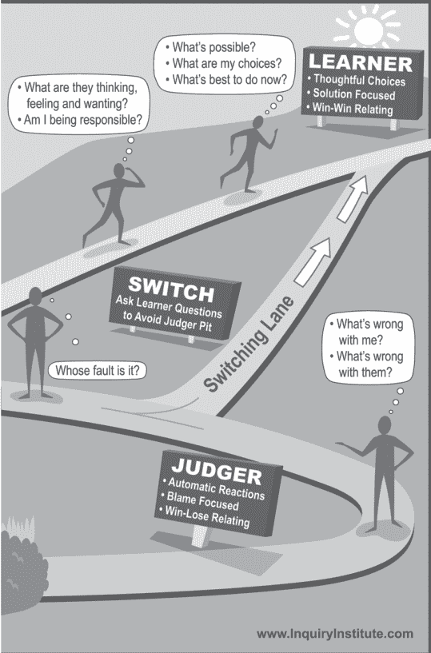
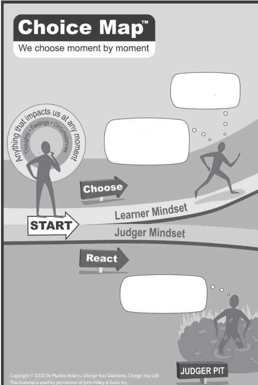
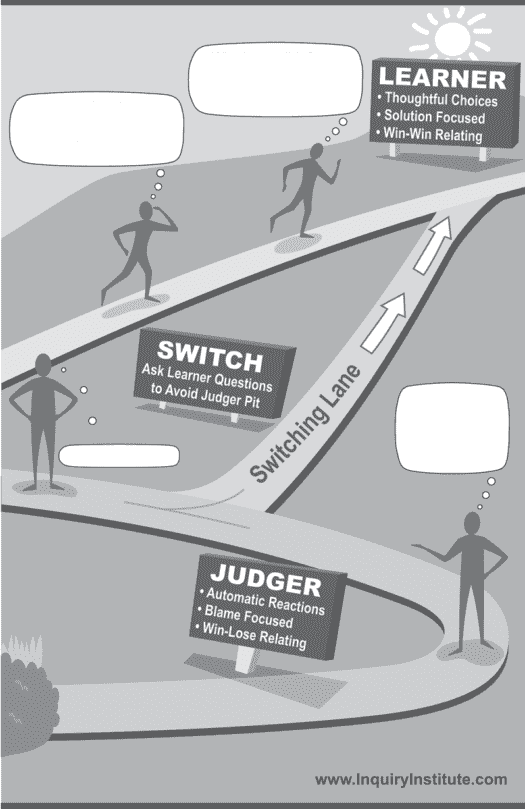
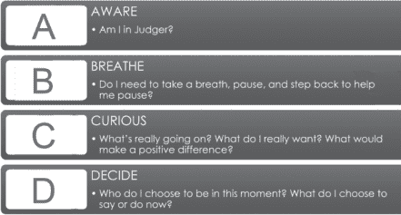
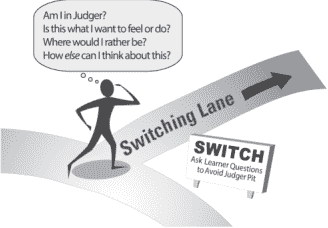
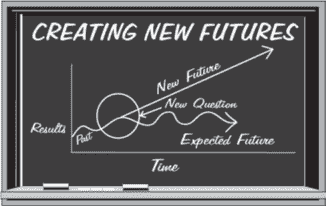
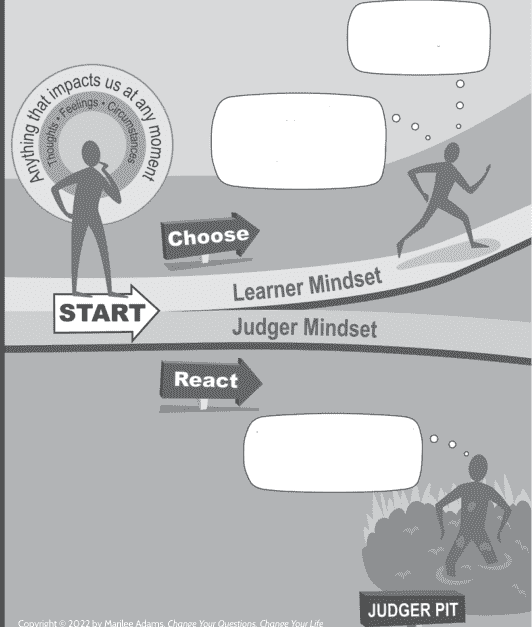

# 改变你的问题，改变你的人生练习册：运用提问思维掌控心态

## 献给 Hal Zina Bennett

导师、智者、推动者

*此页有意留白*

- 关于 Inquiry Institute 116

- 发现改变你的问题如何能改变你的人生
- 学习如何运用问题思考法掌控你的心态
- 增强你保持冷静、专注当下和战略性的能力
- 提升你成功沟通的能力——即使在你感到沮丧或有压力时
- 更有效地进行创造性协作和解决问题
- 将所学应用于你想改变的个人或职业情境——并看到一些进展！

### 我如何发现问题思考法？

很多年前，我在研究生院时，正努力完成学位论文。我备受挫败感和自我怀疑的折磨。我感觉自己像在泥里空转车轮，就是无法脱身。有一天，出于绝望，我决定只是观察自己是如何思考工作的，希望这能提供一些线索，帮我摆脱所处的可怕困境。我几乎不知道，我的发现会带来一次重大的个人突破、一整套工作体系，并最终促成本练习手册。

当我开始观察自己，观察我如何思考而不只是思考什么时，我意识到，所有让我如此不快乐的负面情绪，都以我问自己的问题的形式出现。那些问题诸如：“我怎么了？为什么我从来做不对任何事？我凭什么认为自己有什么可提供的？为什么其他人都比我聪明、成功得多？我的导师为什么等了这么久才分享这个反馈？他难道不知道早点知道会更有帮助吗？”任何花很多时间试图回答这类问题的人，都会明白那会让人感到多么卡住和沮丧。

*你会问自己哪些像这样令人泄气的问题？*

那天，当我坐下来观察自己的念头时，发生了非常不同的事。我对自己正在问的问题以及它们对我本人和学位论文工作的影响产生了好奇。我注意到，有些思考性问题把我往泥里推得更深，而另一种思考性问题则把我托举起来，甚至帮助我设想新的可能性。第二类问题的一些例子是：“这个主题哪里让我兴奋？什么会给我能量和灵感？我有哪些资源可以帮助我完成这项工作？我从过去的挣扎中学到了什么，可以用来在这次中取得成功？”

*你会问自己哪些像这样拓展思维的问题？*

这两组问题有什么不同？我意识到，这些问题来自两种截然不同的心态。通过仔细的观察，我注意到，那些更令人振奋、更有帮助的问题，对我的体验和结果产生了积极影响。我开始练习这种观察自己思维的过程。每当我注意到自己在问令人泄气类的问题，或以其他方式感到卡住时，我就有意识地问自己一个令人振奋类的问题。随着时间推移，我变得相当擅长观察自己。我发现，用第二组问题来思考，会激发我更多的能量、希望和创造力。我利用这一发现来重新引导自己的思维，这让我完成了学位论文——我甚至因此获得了赞誉！

如今，我把产生振奋性问题的心态称为“学习者心态”，把产生限制性问题的心态称为“评判者心态”。更重要的是，我意识到每个人都有这两种心态，而且永远都会有，这意味着这两种心态对我们所有人来说都是正常的。本练习手册将帮助你学会识别自己的学习者心态和评判者心态，并增强你有意识地选择如何回应生活中的人和情境的能力。我开发的用于改变问题和心态的方法，现在称为问题思考法，简称 QT。

我最初通过一本现在名为*改变你的问题，改变你的人生：领导力、教练与成果的12个强大工具*的书，向公众呈现了这些关于问题思考法的理念。那本书是一部商业寓言，后来成为国际畅销书，拥有数十万读者。这一成功让我有机会听到读者、工作坊参与者、我辅导过的个人以及组织客户的反馈，了解 QT 工具为他们带来的改变人生的差异。他们的反馈激励我创作了本练习手册，以便更多人能体验同样的益处，即使他们尚未读过那本寓言。我深切希望你能通过投入本练习手册，体验到同样美妙的结果！

### 新未来模型

本练习手册和原版寓言书之所以名为*改变你的问题，改变你的人生*，是因为当我们改变用来思考情境、他人或自己的问题时，我们就会改变所拥有的关系和所获得的结果，而这反过来又改变了我们的人生（见图1）。

寓言中的主角名叫本，这本练习册旨在让你体验一段与本的经历相似的成功改变之旅。通过学习提问式思维，本在提升自己作为团队领导者的技能时，变得更有能力、更自信，甚至与妻子建立了更好的关系。在你完成这本练习册的过程中，本的旅程将作为你的范例，你将看到他如何应对各种练习，从而让这些练习对你鲜活起来。

## 介绍本书

当我们在《改变你的问题，改变你的生活：领导力、教练与成果的12个强大工具》中遇见本时，他即将辞去自己的工作。本受聘于QTec的CEO亚历克萨——她也是他的朋友和前老板——来领导一个团队和项目，而如今这个项目濒临失败。在整个职业生涯中，本一直是“答案先生”，以深厚的技术专长和解决难题的能力著称。但现在本要领导他人，而他在这一点上正走向失败。

团队里似乎没有人听本的话，他们的会议最终只是令人沮丧的死胡同。他最大的问题出在查尔斯身上，查尔斯曾申请本现在担任的领导职位。与查尔斯的沟通越来越糟。事实上，本认为查尔斯正试图破坏他，并觉得自己被查尔斯没完没了的问题所困扰。

同样令人沮丧的是，本工作上的麻烦正蔓延到他和妻子格蕾丝的关系中。他们之间的紧张关系正在加剧。最后，本认定，要避免工作和家庭中的灾难，他唯一的选择就是从QTec辞职——但他的老板亚历克萨不同意。她拒绝接受他的辞呈，而是把他送到提问式思维教练约瑟夫那里，约瑟夫教给本你在这里将要学到的工具。

本页有意留白

## 第一章

## 你想改变什么？

*有意的改变通常涉及改变思维模式，所以我们就从这里开始。*

### 什么是思维模式？

既然你拿起这本练习册是为了掌握自己的思维模式，我认为有必要先定义一下思维模式。

思维模式不仅仅是一种态度；它是我们在任何特定时刻运作的出发点。它是一种存在方式，影响着我们如何思考和感受、我们做什么，以及我们如何与他人和自己相处。思维模式始终在影响我们的情绪、经历、行为和结果，并且对我们的个人生活和职业生活都有影响。

思维模式不是静态的；我们的思维模式可以每时每刻发生变化，常常是无意识的反应。我们对环境、与他人的互动，甚至对内心正在发生的事情——我们的想法和感受——作出反应。请记住，感受既可以是情绪性的，也可以是身体性的，这意味着思维模式也有躯体或身体层面。我们的思维模式并不只存在于头脑中。

**思维模式**代表了我们对自己、他人和世界所持有的信念、假设、期望和可能性。我们的思维模式不是静态的，可以每时每刻无意识地改变。学会掌握我们的思维模式意味着我们可以有意识地选择改变它。

### 本的思维模式挑战：本列出的烦人人物与情境

| 人物 *（列出他们的姓名和你们的关系）* | 我觉得烦人的行为 *（描述他们说的/做的让你困扰的事）* | 我如何反应 *（描述你的想法、感受、言语和行为）* |
|---|---|---|
| **查尔斯（我的员工）** | 查尔斯在会议上问太多问题，感觉他质疑一切，拖慢我们的进度。 | 我知道我在心里抱怨查尔斯。我想有时他问问题时我会大声叹气。有一次我翻了白眼。 |
| **格蕾丝（我的妻子）** | 格蕾丝在我上班时打电话给我，抱怨她的工作日，好像我不忙一样。 | 我对格蕾丝语气尖锐，有时告诉她我太忙没空说话。（我确实忙！） |
| **不使用转向灯的司机** | 这些人表现得好像路上只有他们一样，还强行加塞，可能造成事故。 | 我按喇叭。我咒骂。独自在车里时，有时我会冲他们大喊，好像他们能听见我一样。 |
| **我（本）** | 我对自己非常沮丧，似乎弄不明白团队为什么停滞不前。我通常是“答案先生”，但在这份新工作中我没有答案。 | 独自一人时，我沮丧又恼火地摇头。我告诉自己，离开旧工作是个错误。 |

为了最大限度地利用这本练习册，你要练习在与生活中一个实际的人的关系中掌握自己的思维模式。这意味着你不应该选择一群人——比如本清单上那些不使用转向灯的司机。

虽然我们确实与自己有关系，而且这些技能也可以应用于你如何与自己互动，但这本练习册中的练习是为涉及另一个人的情境设计的。当你从另一个人那里获得反馈的益处时，你会更有效地学会掌握自己的思维模式。当我说“从另一个人那里获得反馈”时，我并不是说你需要请那个人给你意见。但几乎可以肯定会发生的是，当你练习并应用提问式思维时，你们彼此的互动会发生变化，而这会为你正在进行的内在功课提供有用的反馈。

### 学习者反思

我对这个思维模式挑战有什么想法或感受？对于做这件事我有什么疑问？这对我可能有什么影响？

对于自己的思维模式挑战，本选择专注于改变他对查尔斯的反应，他认为查尔斯问太多问题。此外，虽然本没有明确去改善他与格蕾丝的关系，但他确实看到自己的婚姻有所改善。学习用提问式思维掌握思维模式的美妙之处在于，当我们在生活的某一部分熟练使用这些工具时，其他部分通常也会受益。

带着所有这些教练指导，回到你的清单，选择你想重点关注的那个人，以及那个人表现出的、你会负面反应的行为。这将是你的思维模式挑战，也是这本练习册中练习的主要焦点。

### 你为什么在意改变？

还记得我说过要选择一个人和一种情境，你对它们的在意程度足以在练习变得困难时让你保持动力吗？现在就是你的机会，去联系为什么改变你对这个人和其行为的反应对你很重要。

在你写下答案之前，让我们看看本会如何说明他为什么想改变对查尔斯的反应。

### 本的思维模式挑战：本为什么在意改变

> *这个人对我来说是谁？为什么这段关系重要？*

查尔斯是我的直接下属。他原本有望获得我现在拥有的领导团队职位。我每天都和他共事，他是这个项目团队的重要成员。如果我不改善与他的工作关系，我们的项目几乎肯定会失败。

> *他们一直做什么让我觉得烦人？（允许自己抱怨，并具体一些！）*

查尔斯问太多问题了。开会时他就只做这件事。他用问题、问题、更多问题质疑我说的每件事。有时我觉得他想用所有这些问题的来破坏我。

> *当他们这样表现时，我如何反应？我想什么、感受什么、说什么、做什么？（考虑你做的表情、你的呼吸方式、你的语气，以及你是变得烦躁还是封闭自己等。要具体描述你的反应；觉察是关键。）*

当查尔斯张嘴要问问题时，我能感觉到身体变得紧张。我咬紧牙关，我就是知道他要说的话会让我心烦。当我回答他的问题时，我能听出自己语气中的强烈情绪。其他时候，我干脆不理他的问题，因为我只能勉强忍住不发火。

为什么改变我对这个人和其行为的反应对我重要？

查尔斯和我正在做的项目落后于计划，我们需要合作才能成功。他所有的问题以及我对这些问题的沮丧正在阻碍我们。

如果我不改变我对这个人和其行为的反应，会让我付出什么代价？（例如，可能让你失去一段友谊或一次晋升，也可能只是不断耗尽你的快乐，或在家庭或工作中感到成功的感受。）

如果查尔斯和我继续像现在这样互动，这个项目会失败，那对我们所有人以及公司都不利。

### 你的思维模式挑战：你为什么在意改变

想一想你选择重点关注的那个人，以及他们经常说的/做的让你烦人的事，然后回答以下问题：

*这个人对我来说是谁？为什么这段关系重要？*

他们一直做的或说的什么事让我觉得烦？（允许自己抱怨，并且要具体！）

当他们这样做时，我作何反应？我想什么、感受什么、说什么、做什么？（想想你做出的表情、你的呼吸方式、你的语气，你是否会心烦意乱或沉默不语等等。具体描述你的反应；这些细节以后会对你有用。）

对我来说，改变我对这个人和他/她行为的反应，为什么很重要？

如果我不改变对这个人和他/她行为的反应，会付出什么代价？（例如，可能会让你失去一段友谊或一次晋升，也可能只是不断消耗你的快乐，或让你在家里或工作中失去成就感。）

### 你处于哪种心态？

### 心态检查

既然你已经确定了你想关注的恼人的人和情境，并探讨了它为什么对你很重要，现在是时候检查你与自己和他人的关系了。

**说明：** 阅读每项陈述。如果你在面对这个人和他/她行为时曾经想过、说过、感受过或做过那件事，请圈选“是”。如果没有，请圈选“否”。

### 心态检查：第一部分

*在此情境中，当我对**他人**感到不满或不同意时……*

| # | 陈述 | 是 | 否 |
|---:|---|:---:|:---:|
| 1. | 我沉默地退缩 | 是 | 否 |
| 2. | 我坚持立场并争辩我的观点 | 是 | 否 |
| 3. | 我完全避开那个人或那个情境 | 是 | 否 |
| 4. | 我会想起那个人过去犯过的错误 | 是 | 否 |
| 5. | 我问自己：“**他们**怎么会这么蠢？” | 是 | 否 |
| 6. | 我问自己：“**他们**到底有什么毛病？！” | 是 | 否 |
| 7. | 我感到沮丧 | 是 | 否 |
| 8. | 我感到紧张和压力大 | 是 | 否 |
| 9. | 我感到疏离和孤独 | 是 | 否 |
|  | **第1部分：** 你圈选每个选项多少次？ 在方框内输入数字。 |  |  |

### 心态检查：第二部分

*在此情境中，当我对**他人**感到不满或不同意时……*

| 编号 | 陈述 | 是 | 否 |
|---|---|---|---|
| 10. | 我停下来深呼吸 | 是 | 否 |
| 11. | 我向对方提问，以便了解他们关心的是什么 | 是 | 否 |
| 12. | 我会指出我们的共识，而不只是分歧 | 是 | 否 |
| 13. | 我问自己：“我遗漏了什么，或者我有什么假设？” | 是 | 否 |
| 14. | 我问自己：“**他们**对这种情况的看法与我有何不同？” | 是 | 否 |
| 15. | 我提醒自己，他们也是人，也会犯错 | 是 | 否 |
| 16. | 我接受他们对情况的看法——即使我不同意或不喜欢他们的观点 | 是 | 否 |
| 17. | 即使我们可能意见不一，我仍然关心对方 | 是 | 否 |
| 18. | 尽管我们有分歧或任何不同意见，我仍然在意他们是否感到被尊重和被倾听 | 是 | 否 |
|  | **第2部分：** 你圈选每个选项多少次？ 在方框内输入数字。 |  |  |

### 心态检查：第三部分

*在此情境中，当我对**自己**感到不满或不同意时……*

|  |  |  |  |
|---|---|---|---|
| 19. | 我拖延或逃避了吗？ 在方框内输入数字。 |  |  |

### 心态检查：第四部分

*在此情境中，当我对*  
***自己……*** *感到不满或不同意时*

| 编号 | 陈述 | 是 | 否 |
|---|---|---|---|
| 28. | 我会停下来深呼吸，或用其他技巧让自己冷静/安抚自己 | 是 | 否 |
| 29. | 我问自己：“我到底怎么了？” | 是 | 否 |
| 30. | 我会做一些照顾自己的事，比如散步、伸展、喝水、休息一下 | 是 | 否 |
| 31. | 我提醒自己，我是人，犯错是正常的 | 是 | 否 |
| 32. | 我会想我能从中学到什么 | 是 | 否 |
| 33. | 我提醒自己，这一切也会过去 | 是 | 否 |
| 34. | 尽管我犯了错或做错了什么，我仍然对自己怀有同情 | 是 | 否 |
| 35. | 无论我说了什么或做了什么，我都接纳自己 | 是 | 否 |
| 36. | 我接受自己的感受，无论是什么感受 | 是 | 否 |
| **第4部分：** 你圈选每个选项多少次？在方框内输入数字。 |  |  |  |

### 心态检查：汇总你的答案

按照说明填写下面的表格，以便直观地了解你在这个情境中、对相关他人以及对自己所处的心态。

|  | 评判者心态 | 学习者心态 |
|---|---|---|
| 对他人 | 第1部分“是”的答案数 | 第2部分“是”的答案数 |
| 对自己 | 第3部分“是”的答案数 | 第4部分“是”的答案数 |
| 此情境中的总体心态 | 面对自己的评判者 + 面对他人的评判者 | 面对自己的学习者 + 面对他人的学习者 |

在接下来的页面中，我们将探讨学习者心态和评判者心态，以及你的结果意味着什么。

## 第二章 什么是学习者心态和评判者心态？

恭喜！你刚刚观察到了自己的心态。通过回答这些问题，你体验到了在两个人类共有的心态中觉察到自己的感觉：学习者心态和评判者心态。让我们简要了解一下这两种心态。

> **学习者心态**的特点是好奇心、灵活性、开放的思想和欣赏——所有这些都编码在我们对自己、他人和世界所持的一系列信念、假设、期望和可能性中。*每个人*都有学习者心态。

> **评判者心态**的特点是渴望正确、掌控、安全和确定。它部分源于我们为生存而天生的硬连线。评判者心态常常对自我和他人充满批评和评判——所有这些都编码在我们对自己、他人和世界所持的一系列信念、假设、期望和可能性中。*每个人*都有评判者心态。

评判者心态产生了我写论文遇到困难时问自己的那种令人束缚的问题；学习者心态则产生了我教自己在每次注意到评判者心态的问题时去问的那些更开阔、更有力量的问题。

这两种心态都可以向内指向我们自己，就像我对待我的论文那样，也可以向外指向他人和世界上的情况。本就是在遇到不打转向灯的司机时体现了外向型评判者的例子。（坦白说：我对停车场里压线停车的人也有评判者的想法，有时还会说些评判者的话。）

### 学习者的特质

*当处于学习者心态时，我们常常会……*

- 思维开放
- 好奇且有创造力
- 懂得欣赏
- 接纳
- 灵活
- 乐于合作
- 专注于解决方案
- 专注于责任
- 专注于未来和可能性

### 学习者的相处方式

*当处于学习者心态时，我们与他人（或自己）的相处方式可能……*

- 双赢
- 有辨识力、包容
- 有联结
- 在冲突中具有建设性
- 倾向于欣赏、解决或创造

### 学习者的倾听

*当我们用“学习者的耳朵”倾听时，我们往往……*

- 关注共识和有效之处
- 听到我们认可的内容
- 注意到我们喜欢的东西
- 试图理解
- 假设积极的意图——即使我们不同意或不喜欢对方的信息
- 寻找分享内容中的价值

### 我注意到了什么？

现在，让我们花一点时间反思一下，关于你为心态挑战所选的那个恼人的人或情境，你注意到了什么样的心态平衡。

### 你的心态挑战：

### 关于你的心态，你注意到什么

结合你的情况，回答以下问题：

*我得到的对他人评判者心态的分数，说明了我在如何思考、感受、表现以及如何与这个人及其行为相处？*

*我得到的对自己评判者心态的分数，说明了当这个人这样表现时，我在如何思考、感受、表现以及如何与自己相处？*

*我获得的“面向他人的学习者思维”分数，说明了我对这个人的行为是如何思考、感受、表现和相处的？*

*当这个人以这种方式行事时，我获得的“面向自己的学习者思维”分数，说明了我对自己是如何思考、感受、表现和相处的？*

如果你发现自己有很多评判者思维，记住，生而为人，这很正常！不要灰心！

如果你发现自己经常处于评判者思维，或者很少处于学习者思维，请记住，这只是当前情况下的信息。你的回答只是某一时刻的剪影，你拥有选择和改变的力量。这本工作手册的目的是帮助你调整时间分配的天平，让学习者思维占据优势，从而创造新的未来。

继续前进！

### 学习者
- 他们在想什么、感受什么、想要什么？
- 我负责任吗？
- 有什么可能性？
- 我有哪些选择？
- 现在最好做什么？

- 深思熟虑的选择
- 专注于解决方案
- 双赢的相处

### 切换
提出学习者式的问题，避免落入评判者陷阱

切换车道

### 评判者
- 这是谁的错？
- 我有什么问题？
- 他们有什么问题？

- 自动反应
- 聚焦指责
- 输赢的相处

www.InquiryInstitute.com

## 第三章 思维模式与问题之间有什么关系？

正如选择地图上所示，当我们走在学习者路径上与走在评判者路径上时，我们向自己提出的问题截然不同。这表明我们的思维模式是如何编码在我们的问题中的。

回到选择地图，大声读出评判者路径上的所有问题。阅读时，问问自己：“当我读到这些评判者式的问题时，它们让我有什么感受？”在下方提供的空白处记录你的体验。

*当我大声读出评判者式的问题时，我有什么体验？留意你的想法、呼吸、情绪以及身体的感受。*

接下来，大声读出学习者路径上的所有问题，同时问自己：“当我读到这些学习者式的问题时，它们让我有什么感受？”在下方提供的空白处记录你的体验。

*当我大声读出学习者式的问题时，我有什么体验？留意你的想法、呼吸、情绪以及身体的感受。*

做得好！

在大声朗读评判者和学习者式问题时，观察自己在情感和身体上的感受，这个简单的练习是掌握思维模式的关键基础：建立对每种思维模式影响的觉察。

### 什么是问题思维？

问题思维描述了我们如何借助问题进行思考；当有意识地运用时，它是一种有目的、有技巧的提问方法，能提升我们向自己和他人提出的问题的质量和结果。

你可能已经注意到，选择地图上的想法气泡里全都充满问题。那是因为我们依靠问题来思考。在任何特定时刻，我们所处的思维模式决定了我们会用什么样的问题来思考。我还记得当我意识到我们是在用问题思考时，那种“恍然大悟”的感觉！

让我们通过探索你是如何决定穿现在这身衣服的，来看看问题思维是如何运作的。

### 你是如何决定今天穿什么的？

看看你现在穿的衣服。你穿衣服时考虑过以下哪些事项？请勾选所有适用的选项。

- [ ] **天气：** 会有多热/多冷？会下雨吗？
- [ ] **活动：** 我今天要做什么？我会见到谁？我要去哪里？
- [ ] **舒适度：** 对于今天的所有安排，穿什么会让我感觉舒适？
- [ ] **得体性：** 我会穿得太多/太少吗？其他人可能会穿什么？
- [ ] **外表：** 我穿这身看起来怎么样？干净吗？
- [ ] **其他考虑：** 写下你问自己的其他问题。

注意，你现在就穿着你那些问题的答案！

图4：我的选择地图#1

### 学习者
- 深思熟虑的选择
- 专注于解决方案
- 双赢的相处

### 切换
提出学习者式的问题，避免落入评判者陷阱

切换车道

### 评判者
- 自动反应
- 聚焦指责
- 输赢的相处

www.InquiryInstitute.com

现在你已经有了一张个人化的思维模式问题地图，与你遇到的“思维模式挑战”息息相关。在阅读本工作手册的过程中，请使用这张选择地图来帮助你驾驭自己的思维模式。在工作手册的末尾，你还会有一张空白的“选择地图”需要填写。完成整个工作手册后，你可能会发现自己注意到脑海中出现了新的问题。你可以用自己提出的问题填写第二张“选择地图”。

在这一章中，你将有机会检视与你的“思维模式挑战”相关的评判者思维反应，并从中学习。提升你对评判者思维的觉察——无论是朝向自己的还是朝向他人的——是掌握思维模式的第一步。我把这称为“学习者练习”。当我们带着好奇心审视自己的评判者思维时，我们就站在了选择地图的学习者路径上，反思是什么触发我们进入评判者思维，以及我们处于评判者路径时如何思考、感受和行动。

### 评判者思维与做出判断不是一回事！

- 评判者思维指的是一种对自己和他人持挑剔、批判态度的思维模式。
- 明智的判断是注重逻辑和事实的，而不是仅仅局限于情绪、观点和偏见。我们必须在个人和职业生活中做出明智的判断。

如果你像我以及多年来我指导、培训过的大多数人一样，那么你一生中经历过很多次“评判者劫持”。那是指某人说或做了某件事，触发了一种与实际情况不成比例的评判者反应。通常，过去的某些事件让我们变得如此易激惹，而这种反应模式确实会妨碍我们的人际关系、幸福和成果。也许在过去的某个时刻，你在当前所处理的情境中反应过度。也许这就是你选择处理这段关系和这种行为的缘故。

如果你经历过“评判者劫持”，请不要灰心。我们都经历过！探索你的评判者历史，将帮助你理解为什么这个特定的人所说或所做的事情会触发你的评判者反应。这就是为什么探索我们自己的评判者历史如此有用，而接下来你将要做的正是这件事。

### 我与评判者思维的历史是怎样的？

每个人都有评判者思维。每个人也都有自己内心深处的一串清单——人、行为、观点、话语、声音、气味等等——会触发评判者反应。在这个练习中，你将探索一生中的评判者思维，从而开始理解你的评判者是如何运作的。当你理解某件事时，就更容易与它和平共处。

### 学习者反思

对于陷入“评判者劫持”，我有什么想法或感受？我对这个观点有什么疑问？这可能对我产生什么影响？

在轮到你之前，我们先听听本（Ben）讲述他的评判者历史。

### 本的思维模式挑战：本的评判者历史

> *我记得最早遇到评判者思维是什么时候？当时发生了什么？我是那个以评判者思维做出反应的人，还是别人？*

我对评判者思维最早的记忆是父亲对母亲发火，因为他问了她一个问题，而母亲不知道答案。那时我还太小，甚至不记得他为什么生气的细节，只记得他说话的声音有多大，身影显得多么高大。母亲的脸涨得通红，然后变得非常沉默。

*当这一切发生时，我的评判者心态对自己说了些什么？*

我记得我对自己发誓，我永远会知道答案——或者至少永远不会承认自己不知道。我意识到，这可能就是让我走上“答案先生”之路的原因。

*当这一切发生时，我的评判者心态对他人和/或生活说了些什么？*

我的评判者心态告诉我，只有当你拥有他们想要的答案时，人们才会关心你；不知道答案是危险的、不安全的，而且看起来很糟。

*现在，作为一个成年人，什么样的情况、行为、话语或人容易触发我的评判者反应？当我“进入评判者状态”时，我会想什么、说什么、做什么——或不去说什么或做什么？*

当我自己或别人不知道某件事，或者本该知道却不知道时，我往往会生气。当人们不打转向灯或不正确地并线时，我会抓狂，因为我的评判者心态认为他们应该更懂。

当我没有答案时，我的评判者心态会让我躲起来，有时我想举起双手放弃。我努力解决问题，而当别人不这样做时，我就被触发。我对别人进入评判者状态，但无论我对查尔斯或我妻子格蕾丝有多生气，都比不上我对自己生气的程度。我讨厌自己不知道怎么解决问题或找不到答案。

我通常会将哪些情绪和身体感受与我的评判者体验联系在一起（当我对自己和他人进行评判时）？

当我进入评判者状态时，我会生气。我可能很刻薄。我说话语气尖锐，或者打断别人，截断他们的话。我的评判者心态一点也不微妙！我的评判者心态声音很大，而且，我很遗憾地说，还很骄傲。

前几天，当我感觉自己对查尔斯进入评判者状态时，我能感觉到手指握成了拳头。我感到紧张，想揍他。

我对自己形成了哪些评判者信念？评判者心态对我自己说了些什么？

我的评判者心态认为，除非我有答案并能解决问题，否则我一文不值。我的评判者心态认为，是我的答案让我值得被爱；如果我没有答案，格蕾丝就不会再尊重我或想和我在一起。

我现在对他人（或“类型”的人）和一般生活持有哪些评判者信念？它们如何影响并限制我的生活？

我有一个评判者信念：问很多问题的人不聪明，对解决方案没有贡献。虽然拥有答案过去帮了我很多，但我能看出，认为提问不聪明的想法正在阻碍我成为一名好的领导者和丈夫。唉。

反思我刚写下的内容，我对评判者心态及其对我的影响有什么观察？我把哪些信念和模式与评判者心态联系在一起？

### 我在假设什么？

再次将注意力转向你的心态转变，以及你正在努力改变其反应的评判者触发点。你对自己、对方以及情境本身做了哪些假设？在下方空白处记录你的反思。

*我在对自己做什么假设？*

______________________________
______________________________
______________________________
______________________________
______________________________

*我在对对方及其行为做什么假设？*

______________________________
______________________________
______________________________
______________________________
______________________________

查看你列出的假设，在评判者心态假设旁标“J”，在学习者心态假设旁标“L”。

*我能从自己所做的假设中学到什么？这如何帮助我以不同的方式看待自己、对方、他们的行为和/或情境？*

______________________________
______________________________
______________________________
______________________________
______________________________

*我的评判者心态向我展示了我在这段关系中在乎什么？*

干得好！

仔细审视我们的评判者心态需要勇气，也是掌握心态的重要一步。一旦你开始从评判者心态中学习，你就能把它变成顾问——甚至变成朋友！

深呼吸，继续前进！

问问自己……

*当我用“评判者的耳朵”倾听对方时，这会如何影响我们的关系以及我们应该共同创造的结果？*

*基于我的假设，我似乎对这个人的看法是什么？（考虑你给他们贴过的任何标签，即使是负面的。）*

*我可以对他们的行为或品格做出哪些基于学习者的替代解释？*

为了改善与这个人的关系，我可以问自己哪些新的学习者问题来取代我通常的评判者问题？

为了改善与这个人的关系并改善我们的沟通，如果我带着“学习者的耳朵”倾听他们，可能会有哪些可能？

**记住！与你的评判者交朋友是一种学习者实践！**

做得好！我知道那可能很有挑战性，但你对评判者触发点、行为、想法和感受（无论是身体上还是情感上）带来的学习者好奇心越多，你就越容易改变你与评判者的关系。你可以把评判者从对手变成顾问。

## 第四章

## 如果你可以选择切换心态呢？

### *剧透警告：你其实已经可以了！*

### 什么是切换？

切换的能力是改变和可能性的基础。切换是人类天生就拥有的能力，我们一生中都切换过很多次，很可能甚至没有意识到。我称之为无意识切换。要掌握我们的心态，我们必须发展有意切换的技能。

> 切换是我们与生俱来改变心态的人类能力，也是一项可以有意识地发展的技能。

有意切换要求我们首先注意到自己处于哪种心态，然后做出有意识的选择。我们可以选择保持当前心态，也可以选择从不同心态提出一个新问题。发展有意切换的技能需要练习——我们需要觉察到自己处于评判者状态，并有意识地决定切换到学习者状态。我们偶尔都会从评判者转到学习者，但这很少是有意的！

稍后我们将讨论如何建立有意切换的技能。在此之前，不妨先注意一下我们是如何自然地在学习者心态和评判者心态之间转换的。

### 学习者反思

对有意切换心态的可能性，我有什么想法或感受？我对这个想法有什么疑问？这可能对我意味着什么？

### 切换是什么感觉？

环顾四周。注意你空间里的所有事物。也许你在家里，透过窗户看到你种下的一棵美丽的树生机勃勃。也许你看到墙上挂着一幅画，发现它是歪的。也许你在飞机上，旁边有人在大声说话；或者，也许你向窗外看去，看到太阳在远处的山后落下。

当你环顾四周时，停下来观察每一种因周围环境而触发的心态。通过完成下方针对你在当下环境中注意到的至少五个不同的人或事物的句子，记录伴随心态出现的任何想法、情绪或身体感受：

- 1. 环顾四周，我注意到 ______________________________
  ______________________________。

  当我看到它时，我意识到自己处于 ______________________________
  心态，因为我想/感觉/问自己 __________________
  ______________________________。

  当我这样想/感觉/问自己时，我体验到 ____________
  ______________________________ 在我的身体里。

- 2. 环顾四周，我注意到 _________________________________________________。

  当我看到它时，我意识到自己处于 ___________________________________________
  心态，因为我想到/感觉到/问自己 _______________________________
  __________________________________________________________________________。

  当我这样想/感觉/问自己时，我体验到了 _______________________
  _________________________________________________在我的身体里。

- 3. 环顾四周，我注意到 _________________________________________________。

  当我看到它时，我意识到自己处于 ___________________________________________
  心态，因为我想到/感觉到/问自己 _______________________________
  __________________________________________________________________________。

  当我这样想/感觉/问自己时，我体验到了 _______________________
  _________________________________________________在我的身体里。

- 4. 环顾四周，我注意到 _________________________________________________。

  当我看到它时，我意识到自己处于 ___________________________________________
  心态，因为我想到/感觉到/问自己 _______________________________
  __________________________________________________________________________。

  当我这样想/感觉/问自己时，我体验到了 _______________________
  _________________________________________________在我的身体里。

### 切换策略1：用于切换的ABCD选择过程

ABCD是一种简单的记忆方式，用来提醒你切换——如果你发现自己陷入了评判者模式并且不想留在那里。每个字母都代表要问自己的问题。通常，养成对自己说ABCD的习惯就是你切换所需的全部（见图6）。我甚至与一些团队合作过，他们总是互相提醒这一点——当然是来自学习者思维模式！

**图6：** ABCD过程

### 我如何练习ABCD？

思考你的思维模式挑战，想想那个人说了或做了什么时常引发你的评判者思维反应。当你专注于这种评判者触发因素时，放慢脚步，善待自己。善待自己是一种很棒的学习者练习。

### A：你觉察到了什么？

既然你已经将那个评判者触发因素记在心里，请回答以下问题，以帮助你注意自己正在经历什么：

*我有哪些想法和感受？*

________________________________________
________________________________________
________________________________________
________________________________________
________________________________________

*我在问自己什么问题？*

________________________________________
________________________________________
________________________________________
________________________________________
________________________________________

*我的身体有什么感觉？*

________________________________________
________________________________________
________________________________________
________________________________________
________________________________________

### B：如果你暂停并有意地呼吸一次，会发生什么？

现在用鼻子深吸一口气，完全呼出，然后反思这些问题：

*充分吸气和呼气让我感觉如何？*

*充分而深长的呼吸如何影响我对评判者触发因素的体验？（例如，你紧咬的下巴是否放松了，或者你所感受到的情绪强度是否有所减弱？）*

*活动我的身体如何帮助我管理自己的评判者反应？*

### 身体练习：四拍呼吸

注意到自己处于评判者状态了吗？为了让自己集中精神，尝试一次四拍呼吸。

用鼻子吸气，数四拍，暂停一拍，呼气，数四拍，然后再暂停一拍。重复几次，直到你感到脚踏实地、更加平静。

### C：有什么值得好奇的？

在觉察自己的思维模式并选择呼吸的过程中，你已经在运用学习者的好奇心帮助自己切换。将学习者的好奇心带到我们的评判者反应中，是切换的重要方面。

让我们再来看看本，看看他的好奇心发现了什么。

### 本的思维模式挑战：

**本的学习者好奇心**

> **我到底怎么了？我真正感到沮丧的是什么？**
>
> 我必须面对它，我真正沮丧的不是查尔斯和他的问题。我对自己感到沮丧，对我正在失败这一事实感到沮丧，而且我为自己无法回答他的问题感到沮丧。查尔斯只是在提醒我，有太多我不知道的东西，而我讨厌不知道。

> **对方真正的情况是什么？他们关心什么？**
>
> 我不确定我是否知道查尔斯关心什么。保住他的工作？我曾以为他只关心升职，但即使他被忽略后他仍然留在QTC，所以也许事实并非如此。

> **对方想要/关心的事情与我关心的事情是如何一致或不一致的？我们如何找到共同点？**
>
> 我想，如果我想得到这个问题的答案，我最好开始问查尔斯一些问题。哈！

### D：你**决定**要做什么？

切换的最后部分是决定是留在评判者思维模式的道路上，还是有意识地踏上学习者思维模式的道路，并决定接下来要说什么或做什么。

**提醒！** 未来，即使你已经熟练掌握了你的思维模式和切换技巧，你仍然会被触发并从评判者角色作出反应！我多年来一直在努力掌握自己的思维模式，但有时我仍然会以评判者身份作出反应。好消息是，我去的次数减少了，强度也降低了，现在我通常可以一笑置之。

在这个练习中，你只是在反思你选择处理的评判者触发因素，这与实时体验评判者触发因素不同。花时间在这里问自己以下问题，将帮助你在将来被触发时决定切换。这种练习将支持你保持在学习者思维模式中。

*在这段关系中，我想成为什么样的人？*

______________________________

______________________________

______________________________

______________________________

______________________________

*我的评判者思维模式如何阻碍我成为我想成为的人？*

______________________________

______________________________

______________________________

______________________________

______________________________

### 切换策略2：切换问题

你也可以通过问自己一种特定类型的问题来触发思维模式切换，这种问题被称为“切换问题”。把切换问题看作是救援问题或“第一响应者”问题。一旦你意识到自己处于评判者状态，它们真的可以将你从评判者的体验或后果中拯救出来。切换问题让你有机会选择新的路线，有时还能取得重大突破——无论是在你自身还是在与他人的关系中。

切换问题是“从……到……”的问题，当你选择切换时，它们会带你从评判者思维模式走向学习者思维模式（图7）。切换问题实际上是学习者思维模式的问题，当你发现自己处于评判者模式而不想待在那里时，你可以使用它们。问这些问题是为了打断你评判者思维模式的想法、感受、行为和倾听。然后你可以邀请自己切换到学习者的路径上。切换问题嵌入在ABCD过程中，因为当我们好奇时，我们会问自己问题——通常来自学习者。

无论你是否意识到，你已经有了自己的切换问题。最终目标是将切换发展为一种可靠且可预测的技能。

图7：切换车道

### 我如何发现自己的切换问题？

最好的切换问题是那些让你感觉最自然、最易于使用的问题。查看这个列表，在每个你能想象自己在任何时间、任何地点、对任何人使用的问题旁边打勾。你可能会发现自己把所有问题都勾上了！欢迎在下一页提供的空白处添加你自己的切换问题。

- [ ] 我现在处于评判者模式吗？
- [ ] 我还能怎么想这件事？
- [ ] 这件事有什么令人惊讶的？
- [ ] 我更愿意在哪里？
- [ ] 我们有什么共识？
- [ ] 这是我想感觉到的吗？
- [ ] 这是我想做的事情吗？
- [ ] 这场战斗真的值得打吗？
- [ ] 我错过了什么或正在逃避什么？
- [ ] 我现在的目标是什么？
- [ ] 我现在害怕吗？
- [ ] 我是否正在成为我想成为的那种人（同事、朋友、家人、领导者）？
- [ ] 我现在致力于什么？
- [ ] 对方可能在想什么、感觉什么、想要什么？
- [ ] 我在这个情境中能找到什么幽默？
- [ ] 这是我想要为他人（我的孩子、同事、朋友等）树立的榜样吗？

- [ ] 还有哪些其他可能的解读？
- [ ] 我只是想证明自己是对的吗？
- [ ] 我对自己、他人和这种情况有什么期望？
- [ ] 这种感受/情绪在告诉我什么？
- [ ] 我可能如何促成了这种情况（即使是无意的）？
- [ ] 此刻我选择成为什么样的人？
- [ ] 现在，我的选择是什么？

*在此处添加你自己的转换问题：*

现在，在你正在处理的触发事件中，当你发现自己处于评判者状态时，在可以作为你的首选问题的那个转换问题旁标一颗星。下次当你发现自己处于评判者心态时，深吸一口气，问自己这个问题，然后看看会发生什么。也尝试一些其他的转换问题，看看哪些对你有效。

*用这个空间大胆写下你最好的“首选”转换问题。*

## 第五章 两种可能的未来是什么？

在前面“欢迎”部分，当我讲述自己在论文中挣扎时如何发现提问思维时，我向你展示了新未来模型。这一次，让我们通过“转换”的视角再看一次（图 8）。

**图 8：** 新未来模型

从根本上说，新未来模型向我们展示了转换如何影响我们的未来：当我们提出一个新问题时，我们就会创造新的可能结果。

让我们回顾一下本的故事，看看他如何通过提出新问题为自己和团队创造新的未来。

### 本的心态挑战：

### 本的新未来

与约瑟夫的合作让本学会了如何使用提问思维和选择地图，来识别自己在思考查尔斯时所用的评判者心态问题，例如“为什么查尔斯想破坏我的工作？”——并鼓励本进行转换。本接受了这一指导，将他的旧问题换成新问题，比如“查尔斯看到了什么是我没看到的？”以及“我还能如何理解查尔斯？”

> 在与约瑟夫进行一次辅导后，本选择与查尔斯坐下来，承认自己一直以评判者的方式倾听和回应。通过承认自己的评判者心态，本创造了一个让查尔斯也感到安全的空间。从这里开始，他们开始以学习者的姿态高效协作，这改变了他们的项目进程和彼此关系。最终，本和查尔斯按时交付了项目，并取得了巨大成功。

本获得的这些新成果并非奇迹。它们只是说明了一个道理：改变我们内心提出的问题，能够改变我们获得的结果。

### 你的心态挑战：

### 你的新未来

在这个练习中，你要为正在处理的情况探索两种可能的未来：

1. 如果你继续不断问自己那些关于自己、他人和情况的评判者问题，那么**可能的未来**是什么？
2. 当你面对这个恼人的情况时，运用学习者的好奇心，选择转而问自己转换问题，你所能创造的**新未来**是什么？

回答以下问题时，请再次思考你的情况：

*如果我继续用关于自己、他人及其行为的评判者问题来思考，可能的未来是什么？请考虑你可能会出现的分歧，以及这些问题会如何影响你们的关系和任何结果。*

### 但如果我还没准备好转换怎么办？

如果你在怀疑自己是否准备好并愿意转换，那么恭喜你！你展现出了某种程度的自我意识和诚实，这对于学习使用提问思维来掌控自己的心态至关重要。

有时候我们就是还没准备好转换——这完全没问题！

请注意，即使你问自己“我准备好从评判者心态中转换出来了吗？”这个问题本身也是一个转换问题。当你问自己一个转换问题时，你已经有一只脚踏上了学习者心态的道路——即使你对这个问题的回答是“不，我还没准备好转换！”

### 学习者反思

对于有时不愿转换，我有什么想法或感受？关于这个想法，我有哪些问题？这可能对我有什么影响？

转换通常需要我们对自己和他人抱有好奇心、同情心、同理心、宽恕和接纳。而有时，我们只是还无法给予自己或他人那种宽厚。

你可能一直固守着关于自己、他人或某种情况的评判者想法、感受、信念、假设或解读。如果你发现自己不愿放下评判者心态的反应，不妨暂停一下，看看能否用学习者的好奇心去审视那份抗拒。请记住，在这个过程中要善待自己。用评判者心态去评判评判者心态只会造成不必要的痛苦，而且毫无帮助！

让我们试一试。

### 是什么让我紧抓着评判者不放？

再一次，想一想你在心态挑战中一直在处理的评判者反应。在完成这个练习之前，你甚至可以回到第 1 章完成的“心态检查”，回顾你在第 1 部分和第 3 部分中对评判者心态问题的回答。

我可能固守着哪些与我的心态挑战相关的评判者心态想法、感受、信念、假设、解读或问题？（你的评判者反应可能是针对自己，也可能针对他人。）

为什么我固守着这些评判者心态的想法、感受、信念、假设、解读或问题？它们对我意味着什么？如果我挑战自己的评判者视角，会发生什么？固守这种评判者视角是如何让我觉得自己是对的，或帮助我感到安全和确定？

当我注意到自己有任何这些评判者想法、感受、信念、假设、解读或问题时，我可以问自己什么转换问题？

### 躯体练习：手放心口

琳达·格雷厄姆（Linda Graham），婚姻与家庭治疗师。*《回弹：重新训练大脑以获得最大韧性和幸福感》。*

“手放心口”练习是一种强大、简单且快速的方法，能让你平静下来并恢复专注。它也是一种从评判者切换到学习者的具体身体实践，因此我称之为“学习者练习”。它之所以有效，是因为它通过释放平静的荷尔蒙催产素来抵消压力荷尔蒙皮质醇。这有助于你发展出一种平静安详的状态。我经常做这个练习。我甚至会在会议上做，因为这是一个非常正常、日常的手势，没有人会注意到！

具体做法如下：

1. 将手放在心口，感受自己触碰的温暖。你可能会注意到温暖感从手边蔓延开来。你也可能会注意到随着吸气和呼气，胸部的起伏。
2. 通过鼻子缓慢而深地呼吸，将气吸入心口中心。
3. 回想一个与无条件爱你、让你感到完全安全的人在一起的经历（宠物也算！）。
4. 当你回想起这段经历时，注意身体中任何积极、平静的感受。
5. 当你与这些感受的连接稳定后，继续深而慢的呼吸，同时放下那个画面，只是沐浴在平静中约 30 秒。

### 学习者反思

对于更稳定地生活在学习者心态中的可能性，我有什么想法或感受？关于这个想法，我有哪些问题？这可能对我有什么影响和可能性？

### 如何才能（大部分）生活在学习者心态中？

如果你大部分时间都生活在学习者心态中，你的生活会有何不同？在这本工作手册的开头，我请你关注某个经常用言语或行动触发你评判者心态的人。当你选择那个触发情境来处理时，我问过你，如果你能改变自己的反应，你的生活会变得多好。我们稍后会回到那里，但首先让我们花点时间思考，主要生活在学习者心态中会如何在总体上改善你的生活。我鼓励你大胆想象你能为自己设想的所有快乐、爱和成功！

*如果我能把大部分工作时间都花在学习者心态上，会有什么可能？* 如果我大部分时间都处于学习者心态，我的工作关系会如何改善？

- *如果我大部分时间都能处于学习者**在家时的心态**，会有什么可能？如果我大部分时间处于学习者心态，我与**家人**的关系会如何变得更好？*
- *如果我能**在面临重要决定时**大部分时间都处于学习者心态，会有什么可能？*
- *如果我能**在经历冲突时**大部分时间都处于学习者心态，会有什么可能？*
- *如果我能**在犯错之后**大部分时间都处于学习者心态，会有什么可能？*
- *如果我能**在别人做了我觉得受伤或不尊重的事情时**大部分时间都处于学习者心态，会有什么可能？*

- *如果我能够迅速而可靠地切换，当我意识到自己处于评判者心态时，我会如何以更多的接纳和慈悲来对待**自己**？*
- *如果我能够迅速而可靠地切换，当我意识到自己处于评判者心态时，我会如何更慷慨、更有效地对待**他人**？*
- *如果我大部分时间都处于学习者心态，我的生活中还会有什么变得更好？我能否变得不那么紧张、更加平静？*

让我们回到你在这本工作手册中一直用于“心态挑战”的那个情境。

- *如果当这个人说出或做出触发我评判者反应的事情时，我能够主要保持学习者心态，我所得到的**结果**会如何改善？这对我与他人的关系有什么好处？*
- *在这种情境下，主要保持学习者心态会如何增强**我与自己的关系**？*

### 用 Q-Prep 准备一次对话

既然你已经看到了学习者心态创造的价值，是时候计划如何在可能触发评判者心态的情况下保持学习者心态了。具体来说，想一想你接下来可能会与“心态挑战”中的那个人进行的对话。很可能这次对话会再次给你提供触发评判者心态的机会。

很好。

与大多数人的对话都提供了大量练习切换的机会！

为什么？因为我们在进入对话时，已经带着自己的假设和独特的解读方式——对方也是如此。由于评判者心态总是在寻找分歧，对话很容易触发评判者心态。

在回答以下问题时，想一想你的情境。这些问题构成了我称之为 Q-Prep 的“提问思维”协议。

**Q-Prep** 是一种使用提示来为成功对话和会议做准备的协议，你可以这样问自己……

- 在这场对话中，我的评判者心态可能会如何被触发？
- 当我注意到自己处于评判者心态时，我会使用什么切换策略？（例如，问自己一个常用的切换问题，深呼吸，做一次身体练习，等等。）
- 我该如何准备自己，用学习者的耳朵去倾听对方？

现在把所有这些问题汇总起来，问自己……

- *理想情况下，我希望这场对话如何进行？*
- *对我来说，对对方来说，对这种情况来说，怎样才算赢？*
- *在这场对话中，我会说（或不说）什么，做（或不做）什么，才能向我表明我已经朝着掌握自己的心态迈出了步伐？*

记住，当你看到进步时，要庆祝——任何进步！记住，我们追求的是进步，而不是完美！

运用提问思维掌握心态需要意愿、准备和练习。我们越快地注意到——甚至预见到——评判者的存在，就能越早切换到学习者。我们练习得越多，心理准备越充分，就能越快注意到并切换。一旦进入学习者心态，我们就能专注于向前迈进，创造学习者的解决方案、体验和结果。

> **学习者生活提示。** 准备好让你的评判者心态定期被触发——这会发生，因为你是人。为这种不可避免的情况做好准备，准备一个切换策略，支持你回到学习者心态的道路上。

无论对方在我们的对话中表现如何，我该做些什么来让自己保持在学习者心态的道路上？

________________________________________

我鼓励你尽可能经常使用 Q-Prep。除了选择地图之外，它是许多人最喜欢的 QT 工具。我在桌上放一个笔记本，几乎每次对话前都会做一个简短的 Q-Prep。结果，我的会议更有效率，对话更令人满意，甚至偶尔会有突破。

### Q-Prep 反思

当你完成了 Q-Prep 之后，进行过对话后，用下面的空间反思发生了什么、取得了什么进步、学到了什么。

使用 Q-Prep 如何影响了我的对话方式？

________________________________________

在这场对话中，我的评判者心态是如何出现的？我是对它做出反应，还是仅仅注意到了它？我能否切换？如果能，我用了什么切换策略？我问了自己什么切换问题？结果如何？

________________________________________

- *如果我在对话前没有完成 Q-Prep，事情可能会如何发展？*
- *在这场对话中，我对自己心态的管理有什么值得庆祝的？我有没有说过（或没说过）什么、做过（或没做过）什么，反映出我日益增长的心态掌控力？*
- *我从这场对话中管理自己心态的方式中学到了什么，可以应用到未来？*

记住……反思是一种基础的学习者心态练习。它给了我们停顿、学习和从观察到的事物中成长的空间。

## 第六章

## 欢迎来到你的新未来

*你能想象哪些新的可能性？*

### 看看你已经走了多远

做得好！你表现出了对“学习者生活”改变之旅的承诺……不是每个人都能做到。花点时间庆祝一下吧。

如果你不是一个喜欢自我祝贺的人，请允许我提醒你你所取得的所有成就。通过全身心投入这段旅程，你加深了对自己的心态以及思考时所使用的问题的认识。这是发展真正自我意识的基础，是所有学习和成长的基石。你勇敢地审视了自己的评判者心态，并开始了将评判者转变为顾问的进程。你还通过自我反思和“心态挑战”建立了学习者心态的练习。当然，你还学会了关键的切换艺术。

### 唯一能改变的人是你自己……而这正是你力量的来源！

你有没有注意到，在这本工作手册中，我们只关注了你的心态——而不是对方的？这有一个重要的原因。

唯一能改变的人是你自己，唯一能掌握的心态也是你自己的。

尽管你可能很想在认为对方处于评判者心态时尝试“切换”他们，但这不是你的工作。想象一下，如果你正处于评判者心态反应的控制之下，而有人问你是否处于评判者心态，你会如何反应？那只会把我们大多数人推向更深的评判者深坑！

好消息是，当你掌握了自己的心态，当别人处于评判者心态时你的表现会改变。当你练习切换到学习者而不是从评判者反应时，你将创造出新的可能性和新的未来，而这些如果留在评判者心态中将永远不可能实现。

没有人能改变别人；然而，我们可以为可能使他人更容易改变的条件做出贡献。我们通过自己处于学习者心态来做到这一点，这样他们就能加入我们。保持通过掌握心态来成长和改变的承诺，是“学习者生活”的本质。

> “在对与错的想法之外，有一片田野。我将在那里与你相会。”
>
> 鲁米

强化我的学习者心态如何帮助我把生活变得更好？

在学习者生活之旅走到现在，我因为哪些方面而认可和庆祝自己？

### 更多学习方式

既然你已接近这段学习之旅的终点，我鼓励你利用其他一些方式保持前进势头。以下是一些关于如何持续践行学习者生活的建议：

- **1. 熟能生巧！**

  首先，要知道你随时可以从头再学一遍这本书，想学多少次都可以。选择另一个让你烦心的情境，可以是同一个人，也可以是全新的人和全新的情境，并做一次新的心态挑战。例如，如果你第一次选的是工作中的某个情境和某个人，你可以从个人生活中选择一个人和一个情境来练习。你甚至可以回顾第1章中列出的让你烦心的情境清单，再选一个来练习。

- **2. 找一个学习伙伴！**

  有些人在有一个学习伙伴分享旅程时学得更好。找一个愿意完成自己的心态挑战的人，这样你们可以比较经历、强化提问思维技能，并相互支持。你可以邀请工作中的同事、朋友，甚至配偶或伴侣。

  - a. 讨论并分享你的转换故事。
  - b. 彼此讲述自己掉进评判者陷阱的时刻，以及你当时如何应对。
  - c. 庆祝你们对自己有了新的发现，以及你们各自正在建立的新觉察。
  - d. 创建一个“学习者联盟”，定期交流，并借助选择地图、转换问题和 Q-Prep 等 QT 工具相互支持。

### 现在做什么？

你取得的成就是好消息，但我还有更好的消息要分享。你在这里完成的大部分工作，都与你选择练习的心态挑战情境有关。令人高兴的是，你学到的技能也可以应用到生活中任何会触发评判者心态的情境中。也就是说，处处都可以应用！

在接下来的两页中，你会看到一张新的空白选择地图可供填写（图9）。既然你已经体验了心态挑战的完整过程，你已经对自己、你的学习者和你的评判者有了很多了解。填写这张选择地图时，你将为自己创建一个强大的参考工具——一张帮助你识别自己的心态并进行转换的路线图。

我邀请你反思自己在生活中最常问自己的评判者心态问题，并把它们写在评判者心态路径的思考气泡中。你可以随意翻阅选择地图中的所有评判者问题，以及你在这本练习册中做过的练习，找出那些经常反复出现在你心中的问题。

同时反思你经常使用的学习者心态问题，并把它们写在学习者的思考气泡中。完成这本练习册后，你可能已经有了一些新的学习者问题。这些问题将帮助你推进学习者心态思维，或在察觉自己处于评判者心态时帮助你转换。

完成这个练习后，你将拥有一张个性化的地图，上面列出最常出现在你身上的学习者心态和评判者心态问题。带着这些学习者问题和新的自我觉察，哦，你将去往多么广阔的地方！

### 选择地图™

我们每时每刻都在选择

任何时刻影响我们的事物

想法 · 感受 · 境况

- 起点
- 选择

学习者心态

评判者心态

- 反应

评判者陷阱

### 我对学习者生活的个人愿景

这本练习册带你走过了一段学习者生活变革之旅。我希望你喜欢学习如何与评判者做朋友，以及如何从评判者心态转换到学习者心态。如果你已经做出了哪怕一个小改变，你也可以做出更多改变，直到学习者生活成为你的新常态。

现在，是时候进一步展开想象：学习者生活能为你的整个人生带来哪些美好和可能。在下方空白处，运用你的想象力，描绘一幅学习者生活成为你新常态的愿景。你在工作和家庭中的关系会是什么样？你与自己的关系会变成什么样？成为一个有韧性的学习者会如何影响你生活中的结果和体验？你能多享受多少轻松、平静、联结、乐趣，甚至爱？

你还能看到哪些额外的可能性？给自己充分的许可，去想象当你的生活和关系扎根于学习者生活时，它们会呈现出怎样的面貌和感受。

### 我的学习者生活承诺

既然你已完成心态挑战，并走到了这段变革之旅的终点，我邀请你投身于你自己的学习者生活愿景。这不可避免地包括偶尔掉进评判者心态。当这种情况发生时，你现在知道要善意地提醒自己：你是人，并寻找可以从评判者身上学到的东西，同时相信自己有能力完成转换！

我，________________________，承诺践行学习者生活。

我感谢我的评判者，因为[列出你的评判者教会你的一切]

____________________________________________
____________________________________________
____________________________________________
____________________________________________
____________________________________________
____________________________________________
____________________________________________

没有你，我就不会成为今天这样的学习者。

从今天起，我将运用心态掌控和提问思维的觉察与工具，持续培养我的学习者生活技能。这样我才能继续以学习者的身份出现在我的同事、家人、朋友、社区和我自己面前。通过这种方式，我可以为创造一个学习者世界贡献力量。

签名 ________________________________  日期 __________

*这里有一个建议：在日历上标记一个日期，回来重温这本练习册，以强化并庆祝你持续取得的进步。*

### 恭喜！

我们终于一起走到了这段旅程的终点。我非常感激你为取得这一成就所付出的时间、努力和承诺。我本人已经每天坚持这项工作大约30年了。如果没有一次又一次地以学习者身份生活并接纳评判者，我肯定不会有今天这样美好的生活（包括其中的起起落落！）。

我还有幸直接与世界各地成千上万的人一起做这项工作，包括在许多大大小小的组织中。我近距离亲身见证了提问思维在工作场所和家庭中能产生的显著积极影响。人们说，他们觉得 QT 工作“实用、深刻且易于使用”。他们告诉我，他们在生活中享受着更多平静、自信和联结。他们还说，自己变得更加乐观，相信无论境遇如何，个人都有可能拥有成功而令人满意的生活。

这也是我对你的衷心期望。你已经拥有所需的觉察、工具和练习。愿你常常善用它们，为你的生活带来更多清晰、智慧、爱与成功。

我知道，与同行者联结时，学习者生活会更容易，所以我邀请你加入我们的学习者社区。我也很乐意听到你的近况以及你可能有的任何问题。

以探究的精神！

*Marilee*

## 学习者资源

### 选择地图下载：

正如你在书中所学，选择地图是一个强大的自我教练工具，可帮助你了解自己的学习者心态和评判者心态，并发现新的问题，从而获得你想要的结果。要获取免费的全彩选择地图副本，请访问 InquiryInstitute.com。

### 改变你的问题，改变你的生活读书会：

加入“改变你的问题，改变你的生活读书会”，与我们的学习者社区互动！与来自世界各地、希望学习、参与并相互支持书中概念的其他学习者一起参与。请访问 https://InquiryInstitute.com/LearnerResources 注册加入。

### 在线课程

**选择地图课程：** 你是否好奇如何在日常生活中使用选择地图™，体验更多幸福、联结和生产力？选择地图在线课程将带你踏上探索自身心态的旅程，并学习如何在自己身上以及与他人的关系中有效使用选择地图。了解更多，请访问 https://InquiryInstitute.com/LearnerResources。

**七天走向学习者生活：** 为了强化你的学习者心态并培养学习者习惯，“七天走向学习者生活”在线课程将帮助你发展学习者心态的优势、理解评判者心态，并知道在掉入评判者心态时如何转换回学习者心态。了解更多，请访问 https://InquiryInstitute.com/LearnerResources。

### 现场项目（线下与线上）

你想为自己、你的团队和/或你的组织实现学习者生活和突破性成果吗？请访问我们网站的服务页面了解详情。

**提问思维（QT）基础：** QT 基础工作坊是对提问思维和心态掌控的实用、体验式入门。

它涵盖了你开启通往更多成功、满足感和突破性成果之旅所需的核心技能、工具和实践。

**问题思考（QT）基础与实践：** 在这个工作坊中，你将深化思维模式驾驭、问题思考、提问和沟通方面的技能。你将探索问题思考实践的应用，了解它们如何赋能领导者、团队和组织文化。在这一高强度、互动式的学习体验中，你还将获得新工具，将学习者式生活带入你职业与个人生活的方方面面。

**首席问题官®认证项目：** 这项沉浸式培训体验面向领导者、教练和顾问，他们希望将问题思考实践与解决方案内化，并娴熟地带给企业、团队和组织中的客户。首席问题官认证项目是一段为期六个月的转型学习之旅。成为首席问题官（CQO）后，你可以申请成为授权培训师，并为你所在的组织和客户获得问题思考材料授权。

**Q-Storming®工作坊：** 在这里，你将学习这一突破性流程；它能催化新问题、新可能和新解决方案的发现，而且往往比头脑风暴更有力量。你将学习Q-Storming流程的基础，该流程有助于协作、解决问题、创新和战略思维。推荐给个人、团队、项目管理和组织。

## 术语表

**思维模式：** 我们对自己、他人和世界所持有的信念、假设、期望和可能性。我们的思维模式并非一成不变，它可能每时每刻无意识地变化；或者，当我们学会驾驭它时，也可以有意识地选择改变自己的思维模式。

**问题思考：** 我们如何借助问题来思考；当有意识地运用时，它是一种有目的、有技巧的提问方法，能提升我们向自己和他人所提问题的质量与结果。

**学习者思维模式：** 一种以好奇心、灵活性、开放心态和欣赏为特征的思维模式——这些都编码在我们对自己、他人和世界所持有的一套信念、假设、期望和可能性之中。每个人都有学习者思维模式。

**评判者思维模式：** 一种以渴望正确、掌控、安全和确定為特征的思维模式，部分源于我们为生存而形成的先天机制。评判者思维模式常常对自我和他人持批评和评判态度——这些都编码在我们对自己、他人和世界所持有的一套信念、假设、期望和可能性之中。每个人都有评判者思维模式。

**选择地图：** 一种自我觉察与自我教练工具，展示我们共有的两种思维模式：学习者和评判者。它帮助我们定位自己在任何特定时刻处于哪种思维模式。这使我们能够描绘当前思维模式可能把我们带向何方，并帮助我们选择是继续沿当前路径前行，还是切换思维模式，走上另一条能带我们实现所期望结果的道路。

**切换：** 这是全人类与生俱来的改变思维模式的能力，也是一项可以有意识地培养的技能。

**ABCD选择流程：** 描述从评判者思维模式切换到学习者思维模式过程的QT工具：觉察（Aware）自己的思维模式，花点时间退后一步并呼吸（Breathe），对自己产生好奇（Curious），然后决定（Deciding）下一步怎么做。

**学习者式生活：** 致力于在日常生活中创造更好的体验、关系和结果，从而让我们花更多时间处于学习者模式，并减少评判者模式出现的频率和影响。

**学习者式倾听与评判者式倾听：** 我们倾听时所处的思维模式会影响我们如何解读所听到的内容。学习者思维模式带着学习者式问题倾听，例如：“他们说的内容有什么价值？”评判者耳朵则带着评判者式问题倾听，例如：“他们说的内容有什么错？”任何时刻，我们都可以选择用学习者耳朵还是评判者耳朵倾听。

**安德烈娅**首先想感谢玛丽莉，因为她为安德烈娅一生都在与之挣扎的内心声音命名——评判者思维模式——并给予她一套工具——问题思考——来学习驾驭自己的思维模式。玛丽莉，问题思考这项工作，以及在我学习使用这些工具时你充满爱的支持，帮助我走过了一些人生中最痛苦、最容易触发评判者模式的经历。多亏了你，我挺了过来，因为你教会我（大部分时候）与我的评判者和睦相处，我喜欢管它叫格特鲁德。

我感谢金·奥布里——这本工作手册的各位女性作者背后的女性。如果没有你始终如一的投入和对学习者式生活的以身作则，这本工作手册绝不可能走到终点。

我还想感谢家人的支持。我深深感激我的伴侣罗布·米勒，即使我身处“评判者深坑”时他也依然爱我；感激我的妹妹珍妮弗·利普顿-奥康纳，在我学会可靠地切换之前，她忍受了我几十年的评判者式胡闹（谢谢你一直陪着我，妹妹！）；也感激我的父母辛迪和迪克·利普顿，他们在我年幼时就教会我提问。他们在我心中种下了对学习的热爱，而这正是我幸福与成功的基础。

我还要感谢我亲爱的朋友们，他们每天都鼓励我成为最好的学习者版本的自己。珍妮弗和达雷克·康诺尔，我永远感激你们作为“安德烈娅团队”所做的一切。马加利·勒内、安伯·J·劳森、阿什莉·洛拉、莉莎·斯莫林和大卫·霍尔，我的Masterheart Crew（心灵大师团队）——你们督促我不断作为教练和人提升自己。凯瑟琳·维特、劳拉·伊曼纽尔和雷米·拉米雷斯，你们永远是我蜕变旅程中的姐妹，也是展现脆弱、亲密和同理心的榜样。最后，感谢我的朋友阿帕尔娜·慕克吉、珍妮·麦克亨利、迈克·柯蒂斯和米歇尔·汉斯布劳，以及我的老牌OG朋友加埃塔诺·琼斯、斯科特·塔科兰特和塔米斯·奥希罗，你们能相信我终于写了一本书吗？总算到时候了！

最后，我还要感谢问题思考的所有学生，以及每一位阅读本书的人，感谢你们有勇气踏上选择地图上那座遥远山峰的旅程——我侄子泰勒称它为“超级学习者山”。我期待在那里与你们相遇！

## 关于玛丽莉·亚当斯

玛丽莉·亚当斯博士是一位获奖作家，也是基于探询的教练、领导力、变革和组织效能领域的先驱。她是探询学院（Inquiry Institute）的创始人兼首席执行官，也是问题思考法的创立者。她还是一位思想领袖、顾问、高管教练和主题演讲者。玛丽莉曾在美国大学公共事务学院关键高管领导力项目担任兼职教授，并是凯斯西储大学韦瑟黑德高管教育的附属讲师。玛丽莉是生活教练培训学院和Expedition Coaching的教员，也是国际教练联合会（ICF）的ACC认证教练。她还是菲丁研究生大学社会创新研究所的研究员。

玛丽莉是国际畅销书*《改变你的问题，改变你的人生》*的作者，该书是亚马逊商业与组织学习类排名第一的畅销书。她还写了*《改变人生的教学》*，这本书将问题思考以及玛丽莉对探询的热爱带入教育领域，并荣获IPPY出版商奖金奖。玛丽莉的第一本书*《提问的艺术：短期以问题为中心的治疗指南》*被赞誉为“对心理治疗领域具有开创性和突破性的贡献”。玛丽莉发表过多篇文章，探讨如何在教练、商业、关系和组织转型中专业地运用问题。

问题思考以将“探询精神”转化为实用而强大的提问与思考技能和工具而闻名，这些技能和工具在世界各地产生着影响。玛丽莉的工作被视为教练行业探询卓越性的黄金标准，并被广泛用于领导力和组织发展。

玛丽莉有一股不懈的热情，热衷于学习，并用所学带来改变。她最高兴听到人们说：“你的工作非常实用，改变了我的生活——或者我的公司、我的领导力、我的团队，甚至我的婚姻——谢谢你！”她在菲尔丁研究生院获得临床心理学博士学位，并在弗吉尼亚联邦大学获得社会工作硕士学位（M.S.W.）。

玛丽莉和她的丈夫——艺术家、心理学家兼作家埃德·亚当斯——住在新泽西州兰伯特维尔的河畔小镇与艺术社区。

玛丽莉可提供高管教练、主旨演讲、咨询、教练培训和工作坊（线上与线下）。她热衷于“传播”学习者探询的力量，这种力量能为我们所有人的生活带来改变。欢迎通过 Marilee.Adams@InquiryInstitute.com 与她联系。

## 关于安德烈娅·F·利普顿

安德烈娅·F·利普顿是成人学习、教学设计和领导力发展专家，拥有超过25年经验，为各行各业的财富500强企业创建并推动学习与发展、导师辅导和教练计划。在探询学院，安德烈娅担任学习高级总监，与玛丽莉·亚当斯博士合作设计和开发问题思考工具，包括您此刻拿在手中的这本工作手册。她的思想领导力也曾在*Training Journal*、*Training Industry*、*People + Strategy*以及哈佛商业出版博客“Leading the Way”中发表。

除与探询学院合作外，安德烈娅还是“Ways of Being That Work Toolkit”的创建者，该工具包帮助个人和组织明确对他们最重要的领导者特质。她发布同名双月视频博客。访问安德烈娅的LinkedIn个人资料 https://www.linkedin.com/in/aflipton/ 查看她的最新文章。

安德烈娅曾在多家组织担任学习与发展领域的多个领导职务，包括哈佛商业出版；洛杉矶市交通局（她在那里担任FUSE Corps高管研究员）；以及专注于高管教练和领导力发展的精品公司Ferrazzi Greenlight。她为CBRE美洲区重新启动了企业大学，并领导过包括通用电气子公司Arden Realty和摩根大通在内的多家公司的学习与发展团队。

安德烈娅在哥伦比亚大学获得学士和硕士学位。

安德烈娅可提供高管教练、咨询和工作坊（线上与线下）。您可以通过 Andrea@InquiryInstitute.com 与她联系。

## 关于探询学院

我们的使命是帮助创造一个由开放思维、开放心灵的提问所启发的新思考者世界。

领导力、敬业度、沟通、协作、教练和创新能力，因玛丽莉·亚当斯博士和探询学院开创的问题思考™（QT）工具与实践体系而获得独特赋能。我们的教练、引导师和顾问团队是提供QT方法和解决方案的专家，帮助个人、团队和组织更成功、更满意地实现期望成果。

我们邀请您访问我们的网站，探索免费资源，包括选择地图、改变你的问题读书会，以及加入我们活跃学习者社区的信息。在网站和后续页面中，您还可以了解其他学习者资源（www.InquiryInstitute.com/LearnerResources），无论应用于何处，这些资源都能带来实质性的、往往是改变人生的不同。

**探询学院：**

- www.InquiryInstitute.com
- 邮箱：Choice@InquiryInstitute.com
- 电话：800-250-7823
- 10 York Street, PO Box 339, Lambertville, New Jersey 08530-3204

*本页有意留白*

**Berrett-Koehler**是一家独立出版社，致力于一项雄心勃勃的使命：*连接人与思想，创造一个适合所有人的世界。*

我们的出版物涵盖多种形式，包括印刷、数字、音频和视频。我们还提供在线资源、培训和聚会。我们将继续扩展产品和服务以推进我们的使命。

我们相信，世界问题的解决方案将来自我们所有人，在各个层面共同努力：在我们的社会中、在我们的组织中，以及在我们自己的生活中。我们的出版物和资源为创造一个更公正、更公平、更可持续的社会提供了路径。它们帮助人们使其组织更人性化、更民主、更多元、更有效（我们认为这之间并不矛盾）。它们还引导人们在自身生活中创造积极改变，并使个人实践与对更美好世界的向往相一致。

我们努力通过所谓的“The BK Way”来践行我们所倡导的理念。这种方法的核心是*管家精神*——一种深深的责任感，为我们所有利益相关者群体的利益管理公司，包括作者、客户、员工、投资者、服务提供商、销售合作伙伴，以及我们周围的社区和环境。我们所做的一切都围绕管家精神以及我们的其他核心价值观：*质量、合作、包容，*以及*可持续性。*

这就是为什么Berrett-Koehler是第一家同时成为B型企业（一项严格认证）和福利企业（一种营利性法律地位）的图书出版公司，这两者共同要求我们遵守企业、社会和环境绩效的最高标准。这也是为什么我们制定了许多开创性做法（您可以在 www.bkconnection.com 了解），包括《Berrett-Koehler章程》《BK作者权利与责任法案》以及我们独特的“作者日”。

我们感谢支持我们使命的读者、作者和其他朋友。我们邀请您在 www.bkconnection.com/impact 与我们分享BK出版物和资源如何在您的生活、组织和社区中带来改变。

亲爱的读者：

感谢您拿起这本书，欢迎加入全球BK社区！您正在加入一个特别的群体，他们汇聚在一起，在生活、组织和社区中创造积极改变。

## BK是什么？

我们的使命是连接人与思想，创造一个适合所有人的世界。

为什么？我们的社区、组织和生活被自利、排斥、等级和特权的旧范式所拖累。但我们相信这可以改变。这就是为什么我们寻找应对这些挑战的顶尖专家——并与您分享他们可付诸行动的想法。

## 一份欢迎礼物

为帮助您入门，我们想赠送您一本畅销电子书的**免费副本**：

**www.bkconnection.com/welcome**

当您领取**免费电子书**时，还将订阅我们的博客。

## 我们的最新见解

访问我们的博客 ideas.bkconnection.com，获取面向各级领导者的最佳新工具和新想法。

诚挚地，

Berrett-Koehler的朋友们

