# 混沌、CNN、忆阻器及其超越：Leon Chua 的纪念文集（附 DVD-ROM，由 Eleonora Bilotta 编制）


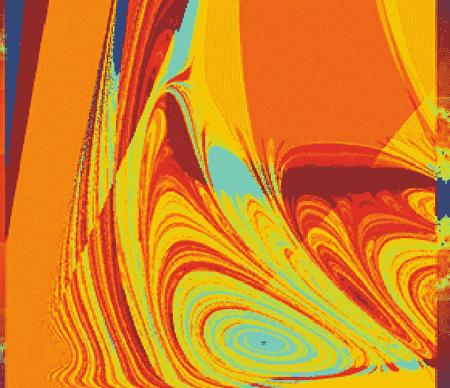


此页有意留空


谨以此书献给Leon O. Chua，祝贺他七十五岁寿辰

此页有意留空

## 前言

这本文集谨献给Leon O. Chua教授，以庆祝他今年的七十五岁寿辰。

鉴于当今科学技术的高度发展和极端专业化，一位科学家如果在职业生涯中对某一单一科学或工程领域产生重大影响，就可以为其成就感到非常自豪。但Chua教授的工作影响不仅限于一个领域，而是至少三个领域：非线性电路理论[1]、细胞神经网络[2]和固态忆阻器[3]。

Leon的科学工作的重要性和影响力体现在他职业生涯中获得的大量奖项和荣誉上，其中最重要的一项是以下著名机构授予他的13个荣誉博士学位：

- 瑞士洛桑联邦理工学院（1983）
- 日本德岛大学（1984）
- 德国德累斯顿工业大学（1992）
- 匈牙利布达佩斯技术大学（1994）
- 西班牙圣地亚哥德孔波斯特拉大学（1995）
- 德国法兰克福大学（1996）
- 罗马尼亚雅西Gheorghe Asachi技术大学（1997）
- 意大利卡塔尼亚大学（2000）
- 波兰克拉科夫AGH科技大学（2003）
- 土耳其伊斯坦布尔Dogus大学（2005）
- 法国土伦南方大学（2006）
- 法国勒阿弗尔大学（2009）
- 英国西英格兰大学（2011）。

此外，Leon还因其工作获得了许多享有盛誉的奖项和奖品，包括：

- IEEE Browder J. Thompson纪念奖（1967年），
- IEEE Guillemin-Cauer奖（1972、1985、1989年），
- IEEE W. R. G. Baker论文奖（1973年），
- Frederick Emmons奖（1974年），
- Alexander von Humboldt高级美国科学家奖（1982年），
- IEEE百年纪念奖章（1985年），
- IEEE神经网络先驱奖（2000年），
- IEEE第三千禧年奖章（2000年），
- IEEE电路与系统学会金禧奖章（2000年），
- IEEE Gustav Robert Kirchhoff奖（2005年），
- Mac E. Van Valkenburg奖（1995和1998年），
- IEEE电路与系统学会Vitold Belevitch奖（2007年），


3. 蔡氏拉格朗日电路元件  
Orla Feely  
36

4. 从CNN动力学到细胞波计算机  
Tamas Roska  
41

5. CNN对生物机器人和脑科学的贡献  
Paolo Arena and Luca Patané  
56

6. 从无线电爱好者的电子学到环形混沌  
Otto E. Rössler and Christophe Letellier  
83

7. 通过突触元胞自动机分析兴奋性神经网络的动力学  
V. Nekorkin, A. Dmitrichev, D. Kasatkin and V. Afraimovich  
89

8. Wolfram元胞自动机的动力系统视角  
M. Courbage and B. Kamiński  
101

9. 蔡氏电路的起源：连接科学、艺术与创造力  
Francesca Bertacchini, Eleonora Bilotta, Giuseppe Laria and Pietro Pantano  
108

10. 非线性电子实验室（NOEL）：回忆  
Chai Wah Wu  
124

11. 元胞自动机中的 bursting 与心律失常  
Gil Bub, Alvin Shrier and Leon Glass  
135

12. 局部活动原理：复杂性与对称性破缺的起因  
Klaus Mainzer  
146

13. 分岔树森林中的探索：从蔡氏电路到蔡氏忆阻振荡器  
Lukasz Czerwiński and Maciej J. Ogorzałek  
160

14. 蔡氏元胞自动机的非线性动力学视角  
Giovanni E. Pazienza  
175

15. CNN在类脑计算中的应用  
Bertram E. Shi  
190

16. 理想湍流现象与含蔡氏二极管的传输线  
E. Yu. Romanenko and A. N. Sharkovsky  
202

17. 电子电路中的混沌：蔡氏的贡献（1980-2000）  
Christophe Letellier  
211

### 第二部分 动力系统与混沌 237

18. 奇异摄动有理映射的Julia集连通性  
Robert L. Devaney and Elizabeth D. Russell  
239

19. 动力网络的结构变换与稳定性  
L. A. Bunimovich and B. Z. Webb  
246

20. 蔡氏时间  
Arturo Buscarino, Luigi Fortuna and Mattia Frasca  
253

21. 混沌神经网络及其超越  
Kazuyuki Aihara, Taiji Yamada and Makito Oku  
259

22. 混沌新皮层动力学  
Walter J. Freeman  
271

23. 一类分段线性系统的非线性动力学  
*M. Lakshmanan and K. Murali*  
285

24. 混沌数学电路  
*R. Lozi*  
307

25. 蔡氏方程两年被证明是混沌的，洛伦兹方程则花了三十六年  
*Bharathwaj Muthuswamy*  
324

26. 迈向涌现的定量表述  
*G. Nicolis*  
337

27. 具有惠更斯耦合的混沌振荡器的受控同步  
*J. Peña-Ramírez, R. H. B. Fey and H. Nijmeijer*  
341

28. 利用时延反馈控制和同步动力系统  
*Kestutis Pyragas, Viktoras Pyragas and Tatjana Pyragiene*  
353

29. 灾难事件的模型及其预测建议  
*Yves Pomeau and Martine Le Berre*  
367

30. 动力系统网络中的同步倾向：一个纯拓扑指标  
*Stefano Fasani and Sergio Rinaldi*  
387

31. 混沌系统部分控制的进一步进展  
*Juan Sabuco, Miguel Sanjuan and Samuel Zambrano*  
393

32. 时滞系统中的相位同步与完全同步  
*D. V. Senthilkumar, M. Manju Shrii and J. Kurths*  
404

33. 鞍-焦点分岔导致的符号动力学与螺旋结构  
*Andrey Shilnikov, Leonid Shilnikov and Roberto Barrio*  
428

34. 变曲率约束面上周期受力质点的动力学  
*Yoshisuke Ueda*  
440

35. 用于描述三维物理实在的孤子：当前前沿  
*Paul J. Werbos*  
448

36. 一维和二维非谐晶格中的热孤子——声孤子与长寿命动力学结构中非线性涨落的组织  
*M. G. Velarde, W. Ebeling and A. P. Chetverikov*  
458

37. 通过间歇扩散进行全局优化  
*Shui-Nee Chow, Tzi-Sheng Yang and Hao-Min Zhou*  
466

### 第三部分 忆阻器 481

38. 我们如何找到缺失的忆阻器  
*R. Stanley Williams*  
483

39. 找到忆阻器之后  
*R. Stanley Williams*  
490

40. 歌唱的电弧：最古老的忆阻器？  
*Jean-Marc Ginoux and Bruno Rossetto*  
494

41. 忆阻器的两个世纪  
*Themistoklis Prodromakis*  
508

42. 含忆阻器有源电路的电路方程  
*Martin Hasler*  
518

43. 忆阻网络的解析分析  
*Torsten Schmidt, Willi Neudeck, Ute Feldmann and Ronald Tetzlaff*  
529

44. 硬件忆阻器仿真器  
*Andrew L. Fitch, Herbert H. C. Iu and Chi K. Tse*  
540

45. Leon Chua的忆阻器  
*Guanrong Chen*  
548


## PART I

### 细胞非线性网络、非线性电路与细胞自动机

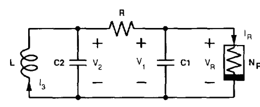

图 1. Chua 的五元件电路由线性电感器 L、两个线性电容器 (C₁, C₂)、线性电阻器 R 以及一个电压控制的非线性电阻器 N_R 组成，后者称为“Chua 二极管” [14]

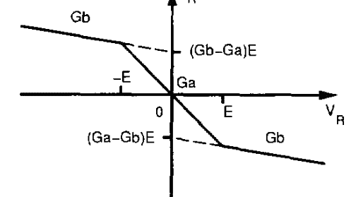

图 2. Chua 电路中非线性电阻器 N_R 的驱动点特性在 ±E 处具有拐点，在内部和外部区域的斜率分别为 G_a 和 G_b。

可解析地表示如下：

```
f(V) = { G_b V + (G_b - G_a)E   if V < -E
         G_a V                if -E ≤ V ≤ E
         G_b V + (G_a - G_b)E   if V > E }
```

其中 E > 0, G_a < 0, 且 G_b < 0。

#### 2. 历史

1983 年 10 月在日本访问期间，Leon Chua 教授目睹了在 Lorenz 方程的电模拟中产生混沌的徒劳尝试，这促使他开发了一个混沌电子电路 [4]。他意识到，如果一个分段线性电路至少具有两个不稳定平衡点——一个提供拉伸，另一个折叠轨迹——则可以在分段线性电路中产生混沌。基于这一见解，他系统地确定了那些包含单个电压控制非线性电阻器且能够产生混沌的第三阶分段线性电路。规定电压控制非线性电阻器 N_R 的驱动点特性应选择为产生至少两个不稳定平衡点，他发明了图 1 所示的电路 [4]。

设 Chua 电路中的非线性电阻器 N_R 具有如图 2 所示的对称分段线性 DP 特性。设想参数值被选择使得电路具有三个平衡点（原点处的一个，N_R 在此处具有局部负斜率或电导 G_a，以及在外部区域的两个，N_R 在此处具有局部负电导 G_b），并且三个平衡点都是不稳定的。每个平衡点都与三个特征值相关联 [15]。我们假设原点处的平衡点具有一个不稳定的实特征值和一对稳定的共轭复特征值。此外，假设外平衡点 P₋ 具有一个稳定的实特征值和一对不稳定的共轭复特征值。两个在外部区域特征平面上相近开始的轨迹会随着它们从平衡点螺旋远离而被拉开。如果它们能被内部区域的动力学折叠回并沿着稳定的实特征向量重新注入 P₋，则会产生同宿轨道，从而导致混沌。

图 3 显示了 Chua 电路中螺旋混沌吸引子的结构 [15]。分段线性状态空间被 N_R 分为内部区域（记为 D₀）和两个外部区域（D₋₁ 和 D₁）。在三个区域中各有一个平衡点。当外平衡点（P₋ 和 P₊）具有一个稳定的实特征值和一对不稳定的共轭复特征值，而原点处的平衡点（0）具有一个不稳定的实特征值和一对稳定的共轭复特征值时，可以形成同宿轨迹。从靠近 P₋ 的特征平面 Eᶜ(P₋) 上的初始状态 X₀ 开始的轨迹沿着特征平面 Eᶜ(P₋) 从平衡点螺旋远离，直到进入 D₀ 区域，在那里它被折叠回 D₋₁ 并返回到靠近 P₋ 的不稳定特征平面 Eᶜ(P₋)。以这种方式，轨迹在 D₋₁ 中被反复拉开，在 D₀ 中被折叠，从而产生混沌 [15]。

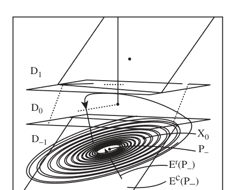

图 3. Chua 电路中混沌产生的拉伸和折叠机制。轨迹沿着特征平面 Eᶜ(P₋) 从平衡点 P₋ 螺旋远离，直到进入 D₀ 区域，在那里它被折叠回 D₋₁ 并返回到靠近 P₋ 的不稳定特征平面 Eᶜ(P₋)（转引自 [15]）。

图 4 显示了 Chua 电路中双涡卷混沌吸引子的结构。从靠近 P₋ 的特征平面 Eᶜ(P₋) 上的初始状态 X₀ 开始的轨迹沿着特征平面 Eᶜ(P₋) 从平衡点螺旋远离，直到进入 D₀ 区域。如果它进入 D₀ 区域的位置在特征平面 Eᶜ(0) 之下，则会被重新注入 D₋₁。然而，如果它进入 D₀ 区域的位置在 Eᶜ(0) 之上，则会被注入 D₁ 区域，在那里它围绕 P₊ 螺旋，振幅不断增大，直到返回 D₀ 区域。以这种方式，形成了对称的双涡卷混沌吸引子。

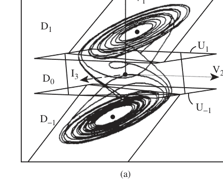

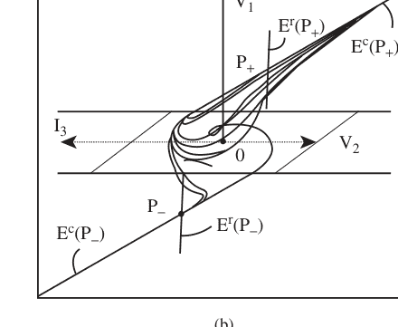

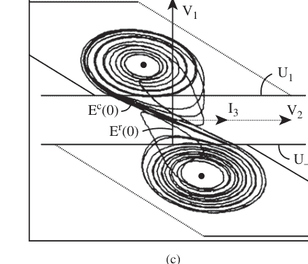

图 4. Chua 电路中模拟双涡卷吸引子的三个视图。（a）参考视图。（b）沿外复特征平面 Eᶜ(P₊) 和 Eᶜ(P₋) 边缘的视图；注意轨迹在 D₁ 中被压平到 Eᶜ(P₊)，在 D₋₁ 中压平到 Eᶜ(P₋)。（c）沿复特征平面 Eᶜ(0) 边缘的视图；从 D₁ 进入 D₀ 且位于该平面之上的轨迹会返回到 D₁，而进入 D₀ 且位于 Eᶜ(0) 之下的轨迹会跨到 D₋₁（转引自 [15]）。

在其构思后不久，Chua 电路丰富的动力学行为通过计算机模拟得到证实 [21]。Matsumoto 使用固定步长的四阶 Runge-Kutta 算法求解方程组，使用表 1 所示的参数值。模拟产生了复杂的轨迹，如图 5 所示。

**表 1. Matsumoto 在 Chua 电路首次发表的模拟中使用参数值 [21]。**

| C₁ (F) | C₂ (F) | L (H) | R (Ω) | G_a (S) | G_b (S) | E (V) |
|---|---|---|---|---|---|---|
| 1/10 | 2 | 1/7 | 1/0.7 | −4 | −0.1 | 1 |

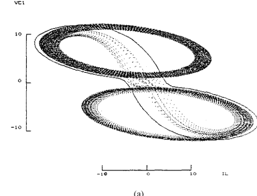

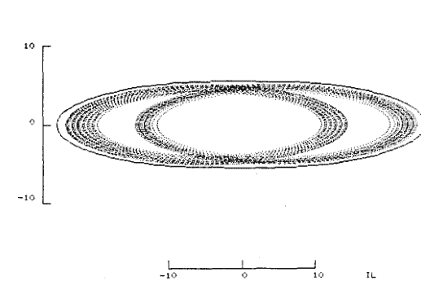

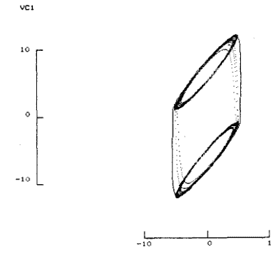

图 5. 使用表 1 参数的 Chua 电路中的模拟轨迹。投影到 (a) I_L–V_C1、(b) I_L–V_C2 和 (c) V_C1–V_C2 平面（转引自 [21]）。

Chua 教授的博士生 Farhad Ayrom 一直在研究分段线性非线性电阻器的合成技术 [5]。Leon 从日本打电话给 Farhad，要求他合成一个具有规定驱动点特性的分段线性电阻器 N_R。利用 Ayrom 的设计，Zhong 在第二天构建了 Chua 电路的第一个物理实现 [1]。使用表 2 中的参数值，他们记录了双涡卷吸引子，如图 6 所示 [27]。

自 1984 年发明以来，人们一直在努力理解 Chua 电路动力学的各个方面，以期将其作为学习、理解和教授非线性动力学和混沌的范式 [20]。Chua 等人在 1986 年证明了该电路确实以 Shilnikov 的意义上表现出混沌 [3]。通过在电感器串联一个线性电阻器，电路被推广为规范的 Chua 振荡器 [7,8]。图 7 所示的该增强型六元件电路在以下意义上是规范的：每一个连续的三维奇对称分段线性向量场都可以映射到该电路上 [7,8]。因此，电路可以表现出由连续奇对称三区域分段线性向量场描述的系统中已知可能的所有动力学行为。在适当的参数选择下，电路可以按照经典的倍周期、间歇性和环面破裂途径进入混沌 [7,8]。关于 Chua 电路论文的全面书目，我们参考 Chua 的历史综述论文 [4]。

原始的五元件 Chua 电路迅速确立为第一个可证明混沌的电子电路。因此，它在电气工程界引起了巨大的兴趣。Chua 电路具有坚实的理论基础和稳健的实际实现，在 1990 年代在混沌应用的发展中发挥了重要作用，包括混沌通信 [10]、密码学和混沌控制 [12]。当应用要求高速操作和集成电路实现时，开发了相应的变体 [9,25]。2008 年，提出了一个简化的四元件 Chua [2]。今天，我们有一个使用忆阻器同时实现非线性、局部活动和记忆的三元件混沌电路 [24]。

在本章中，我们将讨论受 Chua 原始发明启发的六、五、四和三元件混沌电路。

#### 3. 五元件 Chua 电路

作为电路理论家，Leon Chua 最初构想了一个会表现出混沌的五元件电路 [4]。该电路需要三个动态元件（电感器和/或电容器）、一个非线性电阻器和一个线性电阻器。所描述的系统


### 表 2：Zhong 和 Ayrom 在首次发表的蔡氏电路实验研究中使用的参数值 [27]。

| C1 (nF) | C2 (nF) | L (mH) | R (kΩ) | Ga (mS) | Gb (mS) | E (V) |
|---|---|---|---|---|---|---|
| 5.7 | 100 | 8 | 1.28 | -0.77 | -0.43 | 2.5 |

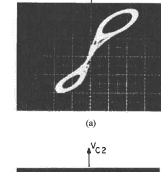

(a)

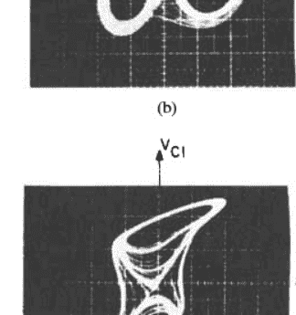

(b)

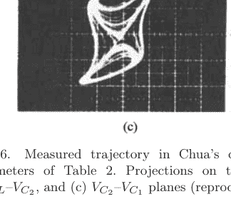

(c)

图 6. 使用表 2 参数在蔡氏电路中测得的轨迹。在 (a) I_L-V_C1、(b) I_L-V_C2 和 (c) V_C2-V_C1 平面上的投影（复制自 [27]）。

由此得到的电路方程 (1)-(4) 可以通过多种不同方式实现，包括模拟计算机和数字计算机 [19]，以及分立和集成 [9] 电路。

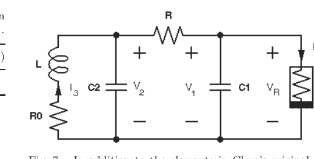

图 7. 除了蔡氏原始五元件电路中的元件外，扩展后的六元件蔡氏振荡器还包含一个与电感 L 串联的线性电阻 R0。

##### 3.1. 分立电路实现

在分立电路实现中，微分方程与电路元件之间存在一一对应关系。每个状态变量都需要一个动态元件（电感或电容），状态变量之间的代数关系则通过电阻元件实现。因此，该电路包含两个电容（C1 和 C2）、一个电感（L）、一个线性电阻 R 和一个非线性电阻 N_R。

线性电容和线性电阻分别用实际电容和电阻实现。电感可以用实际电感实现，也可以用端接电容的回转器实现；我们将在第 3.5 节详细讨论电感。

蔡氏电路中的非线性必须至少具有两个不稳定的平衡点 [4]。因此，V-I 特性曲线必须与线性电阻 R 所定义的负载线至少相交两点。非线性可以具有任意多种不同形状。如果还要求对称性，则可以考虑至少两类非线性函数：分段线性和三次函数。对称性将产生三个平衡点。人们提出了若干子电路来实现所需的特性；这些将在第 3.2 和 3.3 节中讨论。

##### 3.2. 分段线性蔡氏二极管

最简单的对称分段线性蔡氏二极管在其中间区域具有较大的负斜率 G_a，在外部区域具有较小的负斜率 G_b，如图 2 所示。

实际电阻最终都是无源的，这意味着在大电流和大电压下，它们的特性必须位于 V-I 平面的第一和第三象限。对于分段线性电阻而言，这意味着特性曲线必须增加两段，使其回到第一和第三象限。因此，特性曲线具有五个分段和四个断点，其中两个用于产生三个平衡点，另外两个用于满足最终无源条件。于是，图 2 所示 V-I 特性的物理实现会在 ±E' 处增加两个断点，并在最外层区域具有斜率 G_c，如图 8 所示。我们将外层断点称为寄生断点，因为它们在电路工作中并非必需，而是由实现方式带来的。最简单的最终无源对称分段线性非线性在其中间区域具有斜率 G_a，外部区域具有斜率 G_b，最外层区域具有斜率 G_c，如图 8 所示。

如果与最终无源相关的分段距离内部断点非常远，以至于轨迹永远不会到达这些分段，那么实际实现就可以用原始蔡氏电路方程加上对称的三段非线性来正确建模。如果吸引子过大，可能会进入与最终无源相关的最外层区域；这会扭曲吸引子 [28]。实现带来的另一个非理想因素来自断点的不对称性，这会导致吸引子不对称。在蔡氏电路的早期实验实现 [27, 28]（见图 6）中，这种效应很明显，但 Kennedy 解决了这个问题 [14]。负电阻可以通过使用端接电阻的负阻抗变换器（NIC）来产生 [5, 13]。这将在 NIC 的线性工作区域内把正电阻转变为负电阻。NIC 本身是最终无源的，因此会表现出与有源元件线性工作区域边界相关的断点。蔡氏二极管特性中的断点可以通过多种方式实现，包括利用 NIC 自身的最终无源性，或使用电阻-二极管网络。

###### 3.2.1. 基于运算放大器的负阻抗变换器

在蔡氏电路的首次实验实现 [27] 中，分段线性非线性电阻通过并联两个 NIC 实现。一个 NIC 提供内部的一对断点 ±E，另一个提供外部的一对断点 ±E'。蔡氏电路的双 NIC 实现如图 9 所示。

运算放大器 A1 和电阻 R1-R3 实现一个负电阻，运算放大器 A2 和电阻 R4-R6 实现另一个。蔡氏二极管的斜率和断点由下式定义：

```
G_a = - R2/(R1 R3) - R5/(R4 R6)   (5)
G_b = 1/R3 - R5/(R4 R6)   (6)
G_c = 1/R3 + 1/R6   (7)
E = R1/(R1+R2) E_sat   (8)
E' = R4/(R4+R5) E_sat   (9)
```

Zhong 和 Ayrom 使用表 3 中的元件值测量了混沌吸引子。蔡氏二极管相应的斜率和断点值汇总在表 4 中。

图 6 显示了实验观测到的混沌吸引子投影。请注意，该吸引子本应对称，但实际上并不对称；双涡卷吸引子的下涡卷小于上涡卷。其原因在于断点由运算放大器的正、负饱和电平（E_sat^+ 和 E_sat^-）决定。在电源轨关于零对称分布的 741 运算放大器中，饱和电平并不对称。特别是，E_sat^- < E_sat^+；这使得吸引子的“下”涡卷小于上涡卷。

基于运算放大器的双 NIC 蔡氏二极管中的断点由运算放大器的饱和电平决定，而饱和电平又取决于运算放大器的内部结构和电源。如果饱和电平关于零不对称，那么断点以及由此产生的吸引子也不对称，正如我们所见。Matsumoto 等人提出了蔡氏二极管的另一种实现 [22]，其中基于运算放大器的 NIC 提供基本的非线性电阻 Ga 以及最终无源所需的外部断点。二极管和电阻用于定义内部断点和斜率 Gb。他们的电路如图 10 所示。

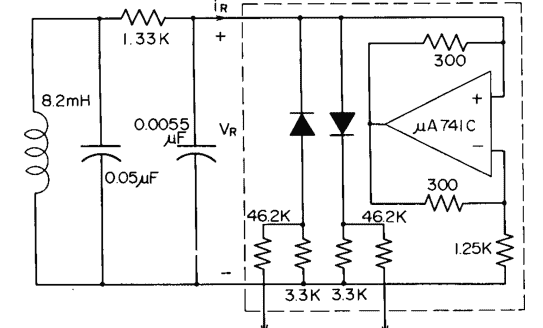

图 10. 蔡氏电路，其中的蔡氏二极管包含一个基于运算放大器的 NIC 以设定电导 Ga，以及一个二极管-电阻网络以定义断点（复制自 [22]）。


Table 5. Slopes and breakpoints of the Chua diode in Fig. 10 used by Matsumoto et al. [22].

| $G_a$ (mS) | $G_b$ (mS) | $E$ (V) | $E'$ (V) | $G_c$ (mS) |
| --- | --- | --- | --- | --- |
| -0.80 | -0.48 | 1.0 | 10.9 | 3.66 |

(a)

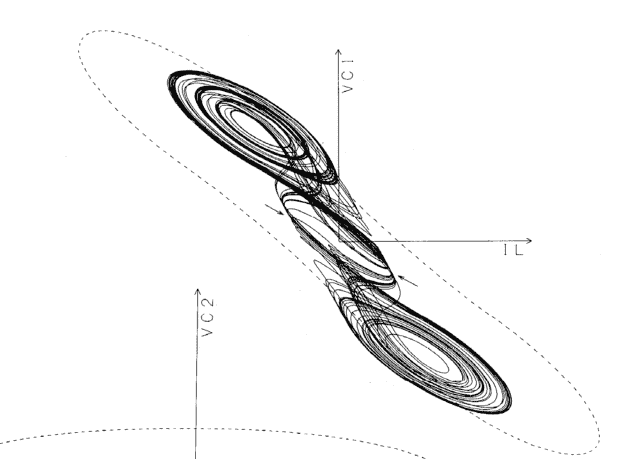

(b)

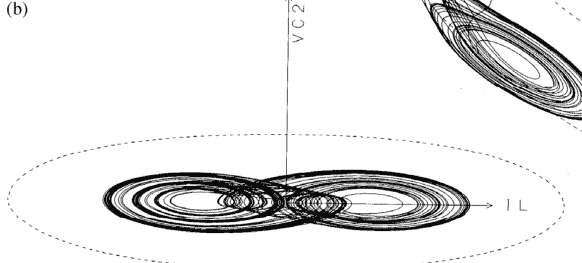

(c)

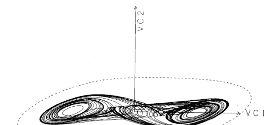

Fig. 11. Simulated trajectory in Matsumoto et al.'s realization on Chua's circuit with the parameters of Table 5 (reproduced from [22]). Projections on the (a) $I_L$–$V_{C1}$, (b) $I_L$–$V_{C2}$, and (c) $V_{C2}$–$V_{C1}$ planes.

In this case, the inner breakpoints do not depend on the internal structure of the op amp.

With the parameter values shown in Fig. 10, the slopes and breakpoints of the Chua diode are as shown in Table 5. Figure 11 shows a simulated double scroll attractor in this circuit.

Kennedy [14] solved the asymmetric breakpoint problem with a two-NIC design which uses AD711 op amps instead of 741s. These provide symmetric saturation levels and thereby resolve the asymmetry problem. By setting $R_2 = R_3$ and $R_5 = R_6$, the design is further simplified. The corresponding design equations are:

$G_a = -\frac{1}{R_1} - \frac{1}{R_4}$  (10)

$G_b = \frac{1}{R_3} - \frac{1}{R_4}$  (11)

$G_c = \frac{1}{R_3} + \frac{1}{R_6}$

$E = \frac{R_1}{R_1 + R_2}E_{sat}$

$E' = \frac{R_4}{R_4 + R_5}E_{sat}$

This implementation, shown in Fig. 9, has become the reference design for the Chua circuit with a piecewise-linear (PWL) Chua diode [14].

With the component values in Table 6, the corresponding values of the slopes and breakpoints in the Chua diode are summarized in Table 7.

Figure 12 shows an experimentally-observed projection of a double scroll chaotic attractor in Kennedy's robust implementation of Chua's circuit [15]. Note that the attractor does not enter the parasitic outer regions. Furthermore, due to the symmetric saturation levels of the AD711 op amp, the attractor is symmetric.

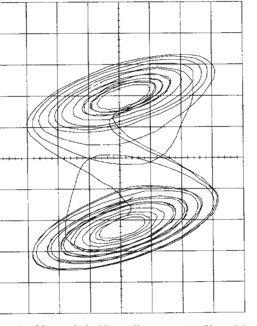

Fig. 12. Measured double scroll attractor in Kennedy's robust implementation of Chua's circuit with the parameters of Table 6 and $R = 1.52$ kΩ (reproduced from [15]). Horizontal axis: $V_{C2}$; vertical axis: $V_{C1}$.

Figure 13 shows experimentally-observed projections of periodic and chaotic attractors in Kennedy's robust implementation of Chua's circuit [17].

Table 6. Component values for Kennedy's robust implementation of Chua's circuit [14].

| Element | Description | Value |
| --- | --- | --- |
| C1 | Capacitor | 10 nF |
| C2 | Capacitor | 100 nF |
| L | Inductor (TOKO type 10RB or equivalent) | 18 mH |
| R | Potentiometer | 2 kΩ |
| A1, A2 | Op amp (½ AD712 or equivalent) |  |
| R1 | ¼ W Resistor | 3.3 kΩ |
| R2, R3 | ¼ W Resistor | 22 kΩ |
| R4 | ¼ W Resistor | 2.2 kΩ |
| R5, R6 | ¼ W Resistor | 220 Ω |

###### 3.2.2. Current-mode negative impedance converters

The performance of the op amp-based two-NIC implementation of the Chua diode is compromised by the relatively low bandwidth and slew rate limiting of the op amps. In order to improve the speed of the circuit, it is necessary to use components with higher bandwidth. One such circuit, shown in Fig. 14, uses current feedback op amps rather than traditional voltage op amps to realize the NICs [11]. The values of the dynamic elements are scaled by a factor of 10⁻² compared to the values in Table 6; this makes the frequency of operation of this circuit 100 times higher.

In this case:

$G_a = -\frac{1}{R_1} - \frac{1}{R_4}$

$G_b = \frac{1}{R_3} - \frac{1}{R_4}$

$G_c = \frac{1}{R_5}$

Table 7. Slopes and breakpoints of the Chua diode used by Kennedy in the robust implementation of Chua's circuit with $E_{sat}$ = 8.3 V.

| $G_a$ (mS) | $G_b$ (mS) | $E$ (V) | $E'$ (V) | $G_c$ |
| --- | --- | --- | --- | --- |
| -50/66 | -9/22 | 1.08 | 7.61 | 101/22 |

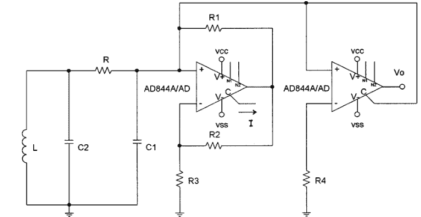

Fig. 14. High speed Chua's circuit using current feedback op amps in the two-NIC Chua diode (reproduced from [11]).

Table 8. Component values for Chua's circuit with current-mode two-NIC Chua diode.

| Element | Description | Value |
| --- | --- | --- |
| C₁ | Capacitor | 100 pF |
| C₂ | Capacitor | 1 nF |
| L | Inductor | 180 μH |
| R | Potentiometer | 1.6 kΩ |
| A₁, A₂ | Op amp (½ AD844 or equivalent) |  |
| R₁ | ¼ W Resistor | 22 kΩ |
| R₂ | ¼ W Resistor | 22 kΩ |
| R₃ | ¼ W Resistor | 3.3 kΩ |
| R₄ | ¼ W Resistor | 2.2 kΩ |

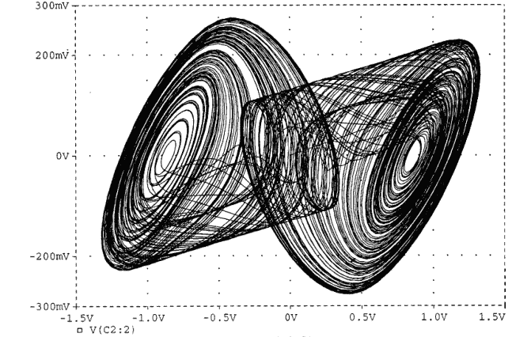

Fig. 15. PSpice simulation of $V_{C1}$–$V_{C2}$ projection of chaotic attractor in the circuit of Fig. 14 with the parameter values in Table 8 (reproduced from [11]).

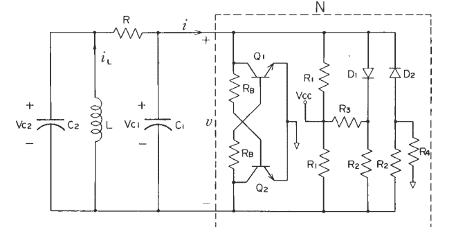

Fig. 16. The driving-point characteristic of the nonlinear resistor $N_R$ in Chua's circuit is realized using transistors, resistors, and diodes (reproduced from [23]).

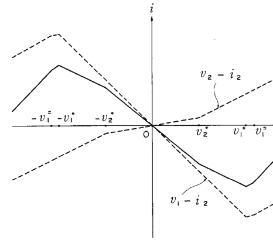

Fig. 17. The composite driving-point characteristic comprises two components due to the transistor-based NIC subcircuit (Q1, Q2, R1 and RB) and the diode and resistor subcircuit (D1, D2, R2–R4).

bipolar junction transistors to implement the NIC and diodes and resistors to set the breakpoints [23]. The transistor subcircuit consisting of Q1, Q2, R1 and RB implements a NIC. The positions of the two inner breakpoints are determined by the diodes D1 and D2 and the resistors R2–R4. The driving-point characteristic of the Chua diode is shown in Fig. 17.

With the component values in Table 9, the circuit produces the double scroll attractor shown in Fig. 18.

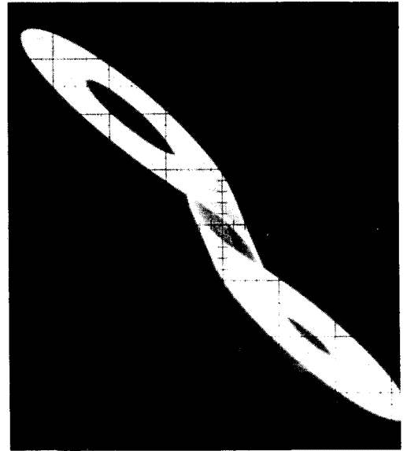

Fig. 18. $I_L$–$V_{C1}$ projection of chaotic attractor in the circuit of Fig. 16 with the parameter values in Table 9 (reproduced from [23]).

While this circuit works, it has a number of drawbacks. Firstly, the breakpoints depend on the thresholds of the diodes, which are not well-defined. Secondly, the diodes and transistors do not turn on abruptly, so the characteristic is not truly piecewise-linear.

Table 9. Component values in the Chua's circuit of Fig. 16 with a transistor-based NIC.

| Element | Description | Value |
| --- | --- | --- |
| C1 | Capacitor | 5.3 nF |
| C2 | Capacitor | 47 nF |
| L | Inductor | 6.8 mH |
| R | Potentiometer | 1.21 kΩ |
| D1, D2 | 1S1588 Diode |  |
| R1 | 1/4 W Resistor | 1 kΩ |
| R2 | 1/4 W Resistor | 3.3 kΩ |
| R3 | 1/4 W Resistor | 88 kΩ |
| R4 | 1/4 W Resistor | 39 kΩ |
| RB | 1/4 W Resistor | 56 kΩ |
| Q1, Q2 | 2SC1815 Transistor |  |

Although Chua originally specified that the nonlinear resistor NR should have a symmetric piecewise-linear driving-point characteristic, this is not strictly necessary [4]. All that is required is that the characteristic should produce at least two unstable equilibrium points with the appropriate stability properties when intersected by the load line of the linear resistor R. This can also be achieved by a cubic nonlinearity, as we shall discuss in Sec. 3.3.

##### 3.3. Cubic nonlinearity

As mentioned in Sec. 3, the V–I characteristic of the nonlinear resistor $N_R$ is required to intersect the load line associated with the resistor $R$ in at least two places. In addition, the resistor should be eventually passive, requiring that the characteristic lies in the first and third quadrants of the V–I plane. This can be achieved by means of a five-segment piecewise-linear characteristic as described thus far. It can also be realized with a cubic characteristic. In this case, the driving-point characteristic of $N_R$ is defined by

$f(V) = G_a V - (G_a / V_{\max}^2) V^3$    (20)

where $G_a$ is the slope of the characteristic at the origin and $\pm V_{\max}$ are the outer zeroes, as shown in Fig. 19.

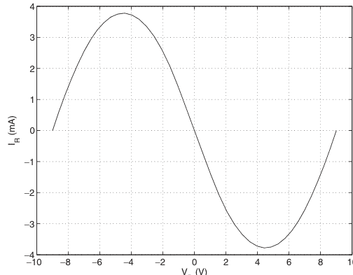

Fig. 19. Cubic driving-point characteristic with $V_{\max}$ = 9 V.

In 1985, Matsumoto et al. simulated a Chua's circuit with a cubic nonlinearity [22]. Their double scroll attractor is shown in Fig. 20. A decade later, Zhong presented an implementation of Chua's circuit using a cubic nonlinearity [26]. The nonlinear resistor, shown in Fig. 21, contains two analog multipliers, an op amp, and five resistors.

This implementation requires a significant amount of circuitry and suffers from limited speed of operation due to the compensation capacitor in the op amp. An approximately cubic nonlinearity can be realized more simply using four cross-coupled MOSFETs, as shown in Fig. 22 [25]. The measured V–I characteristic of this subcircuit is shown in Fig. 23.

Chua's circuit with a four-MOSFET approximately cubic nonlinear resistor is shown in Fig. 24. The resulting experimentally-measured double scroll attractor is shown in Fig. 25. This implementation of the nonlinear resistor has the advantage of very small parasitic dynamics, allowing it to behave resistively at relatively high frequencies. The circuit in Fig. 24 holds the record for the fastest reported Chua's circuit [25].

##### 3.4. Asymmetric nonlinearity

Although most studies of Chua's circuit have considered the case when the nonlinear resistor has a symmetric driving-point characteristic, symmetry is not a necessary ingredient for complex behavior. In 1995, Kennedy studied the dynamics of Chua's circuit with a gross asymmetry and showed that the dynamics of the continuous two-region piecewise-linear Colpitts oscillator [16] may be mapped onto an equivalent asymmetric Chua's oscillator by choosing the breakpoints of an asymmetric Chua diode such that the resulting attractor is confined to two regions of the state space [18]. The dynamics of the circuits are equivalent in the sense that the vector field of the Colpitts oscillator is linearly conjugate to that of the asymmetric Chua's circuit.


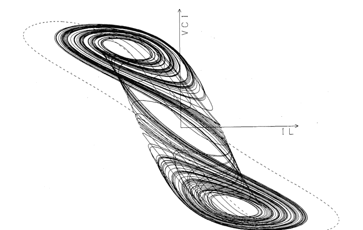

图20. 具有三次非线性的蔡氏电路中混沌吸引子的I_L-V_C1投影（转载自[22]）。

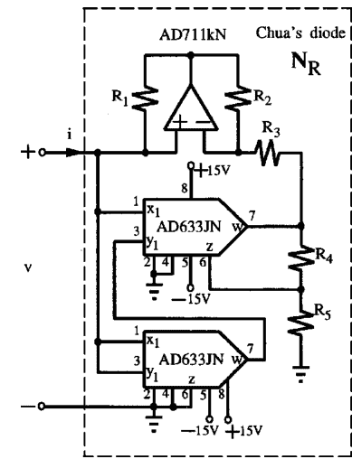

图21. 具有三次非线性的非线性电阻的实现（转载自[26]）。

##### 3.5. 电感

蔡氏电路中的电感可以用物理电感来实现。实际电感是绕线元件，其线圈绕组存在寄生电阻。如果考虑该电阻，则使用实际电感实现蔡氏电路时，电感上会串联一个电阻R0。早期蔡氏电路实现的一个问题是，电感

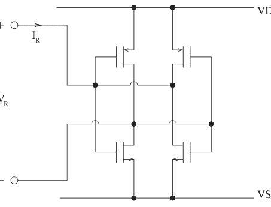

图22. 使用四个交叉耦合MOSFET实现非线性电阻的电路（转载自[25]）。

具有显著的寄生直流电阻，而蔡氏电路方程并未考虑这一因素。因此，仿真结果与实验测量行为之间存在无法解释的差异。通过在仿真中加入寄生电阻，即仿真蔡氏振荡器而非蔡氏电路方程，可以解释这些差异。如图7所示的蔡氏振荡器由以下方程描述：

```
dV_C1/dt = G/C1 (V_C2 - V_C1) - 1/C1 f(V_C1)   (21)
dV_C2/dt = 1/C2 I_L - G/C2 (V_C2 - V_C1)   (22)
dI_L/dt = -1/L V_C2 - R0/L I_L   (23)
```

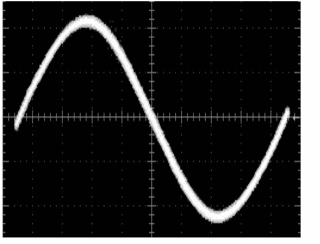

图23. 图22所示四MOSFET蔡氏二极管的实测近似三次驱动点特性（转载自[25]）。

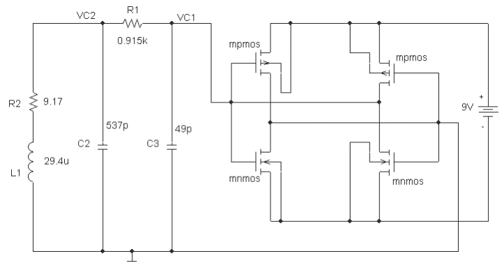

图24. 带有四MOSFET近似三次非线性电阻的蔡氏电路（转载自[25]）。

###### 3.5.1. 基于回转器的电感

1986年，Leon Chua教授准备在大型国际会议上发表题为“混沌的视听”的主题演讲。他让两位博士生Peter Kennedy和Ken Krieg搭建一个便携式系统，以便在大屏幕上显示蔡氏电路的轨迹，同时产生音频范围内的声音。解决方案是吸引子显示系统（ADS）——一种以直角安装的检流计系统，当由蔡氏电路的X和Y信号驱动时，会偏转激光束，在远处屏幕上投射出巨大的利萨茹图形。问题在于，为了获得足够大的图像，反射镜必须在开环状态下工作，但其带宽低于500 Hz。

无法使用中心频率为几千赫兹的蔡氏电路。挑战在于构建一个慢速蔡氏电路。通过时间缩放，电容和电感的数值必须增大。寻找更大的电容相对简单，但所需的电感值将需要使用体积庞大且具有较大寄生电阻的电感。解决方案是使用端接电容的回转器来实现电感。所得电路如图26所示。二极管箝位电路和电容C₂确保电感仿真器正常工作。

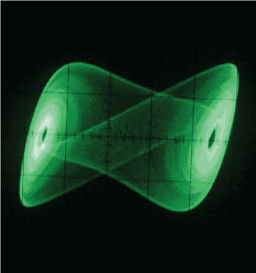

图25. 具有近似三次非线性电阻的蔡氏电路中的实验双涡卷吸引子（转载自[25]）。

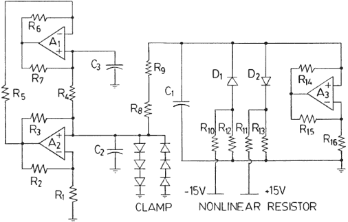

图26. 带有回转器的蔡氏电路。

ADS中实现了两个中心频率略有不同的电路版本，其电阻预设值对应于周期1、周期2、螺旋、双涡卷和极限环吸引子。图27显示了ADS的正面和右侧面板。正面面板包含两个蔡氏电路的控制装置。

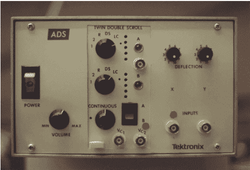

(a)

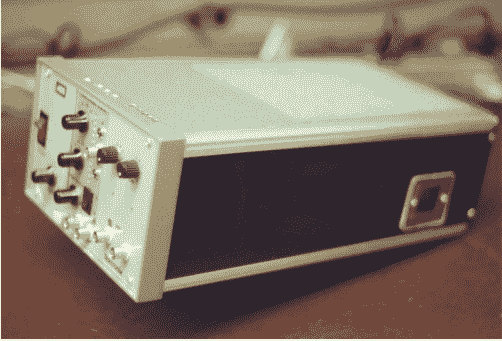

(b)

图27. (a) 吸引子显示系统的正面面板和 (b) 侧面面板。

左侧面板包含用于音频输出的扬声器；右侧面板有一个激光束穿过的有机玻璃窗口。

##### 3.6. 集成电路实现

Cruz和Chua使用基于回转器的电感实现，以集成电路形式实现了蔡氏电路[9]。图28显示了电路原理图。运算跨导放大器OTA A和OTA B构成非线性电阻N_R。由OTA C和OTA D组成并以电容C_3端接的回转器模拟电感。电阻R在引脚1和2之间外部连接。引脚4和5之间的偏置块提供所需的偏置电压。图29显示了该电路中实测的双涡卷吸引子。

20 P. Kennedy

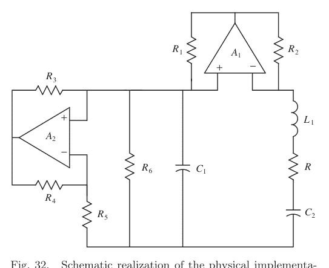

图32. 图30所示电路的物理实现原理图。

图30所示电路的实际实现如图32所示。请注意，该实现使用了与图9所示原始蔡氏电路相同的基本元件。电阻、电容和电感的负值是通过使用由运算放大器A1和电阻R1、R2构成的负阻抗转换器获得的。该子电路实现：

```
κ = R1 / R2. (28)
```

运算放大器A2和电阻R3–R6实现蔡氏二极管，其斜率和断点分别由以下公式定义：

```
G_a = - R4 / (R3 R5) + 1 / R6 (29)
```

```
G_b = 1 / R3 + 1 / R6 (30)
```

```
E = R5 / (R4 + R5) E_sat, (31)
```

在采用±15V电源的LF351运算放大器情况下，E_sat ≈ 13.5V。

该电路的一个显著特性是，即使R=0时也能产生混沌。因此，蔡氏电路被简化为最简单的形式，对应于连接到蔡氏二极管的无损LC网络，如图33所示。

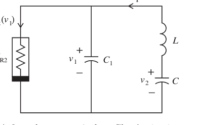

图33. 由蔡氏二极管、两个电容和一个电感组成的四元件等效蔡氏电路。与图30相比，L = -κ L1且C = -C2 / κ。

表10. 四元件蔡氏电路中的元件值。

| 元件 | 描述 | 值 |
|---|---|---|
| C1 | 电容 | 33 nF |
| C2 | 电容 | 100 nF |
| L | 电感 | 10 mH |
| R | 1/4 W电阻 | 25 Ω, 0 Ω |
| A1, A2 | 运算放大器 (LF351) | |
| R1 | 1/4 W电阻 | 1 kΩ |
| R2 | 1/4 W电位器 | 122 Ω |
| R3 | 1/4 W电阻 | 10 kΩ |
| R4 | 1/4 W电阻 | 9.8 kΩ |
| R5 | 1/4 W电阻 | 780 Ω |
| R6 | 1/4 W电阻 | 1.2 kΩ |

表11. Barboza和Chua在四元件蔡氏电路中使用的参数值[2]。

| G_a (mS) | G_b (mS) | E (V) |
|---|---|---|
| -0.42 | 0.93 | 1 |

使用表10中的元件值，Barboza和Chua在图30所示替代蔡氏电路配置以及图33所示四元件电路中测量了吸引子[2]。相应的电路参数值汇总于表11；第一种情况下R = 25 Ω，第二种情况下R = 0 Ω。

图34分别显示了在替代蔡氏电路和四元件电路中实验观测到的混沌吸引子[2]。

#### 5. 三元件混沌电路

我们在开头指出，为了表现出混沌，由电阻、电容和电感组成的自治电路必须包含

- 至少一个非线性元件，
- 至少一个局部有源电阻，以及
- 至少三个储能元件[15]。

四元件蔡氏电路包含三个储能元件和一个局部有源非线性电阻。忆阻器可以同时表现出非线性元件、局部有源电阻和储能元件的特性。因此，应该可以使用仅三个元件来构建混沌电路：一个忆阻器和两个储能元件。Muthuswamy和Chua在2010年报道了这一成果[24]。他们的“最简混沌电路”如图36所示。

该电路由两个常微分方程描述：

```
dV_C/dt = 1/C I_L  (32)
dI_L/dt = -1/L (V_C - V_M)  (33)
```

其中V_M是忆阻器M两端的电压，其定义为：

```
V_M = β(X² - 1) I_M  (34)
dX/dt = I_M - α X - I_M X.  (35)
```

忆阻值R(X)由下式给出：

```
R(X) = β(X² - 1).  (36)
```

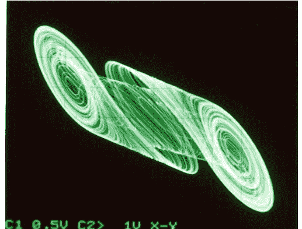

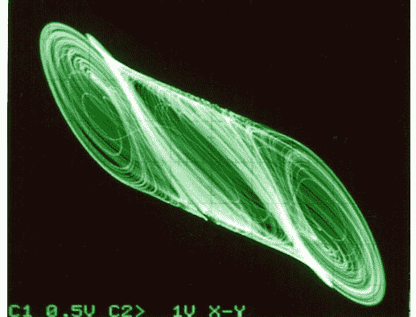

图34. 在图32所示电路中观测到的轨迹，顶部R = 25 Ω，底部R = 0 Ω。它们分别对应于替代蔡氏电路（图30）和四元件蔡氏电路（图33）（转载自[2]）。

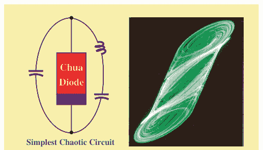

图35. 最简蔡氏电路及其典型吸引子。

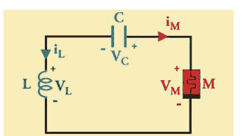

图36. Muthuswamy和Chua的“最简混沌电路”包含两个线性动态元件和一个忆阻器（转载自[24]）。


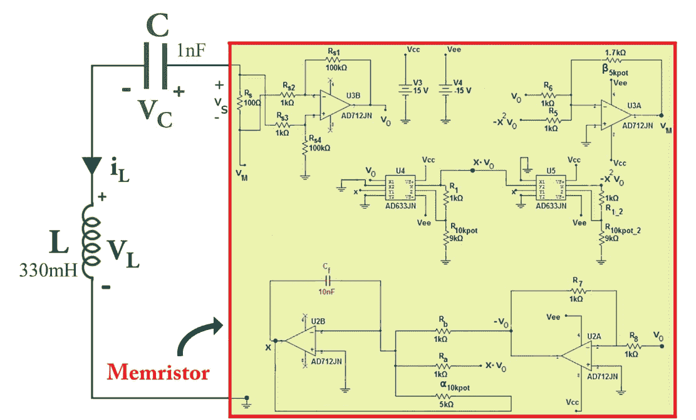

图 37. 三元件忆阻器混沌电路示意图（转引自 [24]）。

将式 (34) 代入式 (33) 并注意到 $I_M = -I_L$，可以证明三元件混沌电路由三个常微分方程描述：

$$\frac{dV_C}{dt} = \frac{1}{C} I_L \tag{37}$$

$$\frac{dI_L}{dt} = -\frac{1}{L} (V_C + \beta (X^2 - 1) I_L) \tag{38}$$

$$\frac{dX}{dt} = -I_L - \alpha X + I_L X \tag{39}$$

图 36 中电路的一种实用实现如图 37 所示。注意在此情况下忆阻器由模拟计算机来模拟。运放和模拟乘法器子电路实现了忆阻 $R(X)$；状态变量 $X$ 存储在电容 $C_f$ 上。

使用图 37 中所示的元件值，Muthuswamy 和 Chua 在图 36 所示电路中测量到混沌吸引子 [24]。电路参数的相应值汇总于表 12。图 38 显示了 Muthuswamy 和 Chua 的“最简混沌电路”中模拟和测量的混沌吸引子。

## 表 12. Muthuswamy 和 Chua 在三元件混沌电路中使用的参数值。

| C (nF) | L (mH) | α | β |
|---|---|---|---|
| 1 | 330 | 0.2 | 1.7 |

#### 6. 总结

在本章中，我们描述了六、五、四和三元件混沌电路。Chua 的原始五元件设计包含两个线性电容、一个线性电感、一个线性电阻和一个对称分段线性电压控制非线性电阻 $N_R$。该电路最初由 Matsumoto [21] 进行仿真，然后由 Zhong 和 Ayrom [27] 实验实现。Chua 等人通过证明增广的六元件 Chua 振荡器可以再现第三阶自治系统所报道的所有已知动力学行为，建立了该电路的普适性 [7,8]。

Elwakil 和 Kennedy 通过在 Chua 二极管的双 NIC 实现中用电流反馈运放代替电压反馈运放，使 Chua 电路的工作频率提高了 100 倍 [11]。Kennedy 还通过用回转器和电容代替电感降低了工作频率；这是报道过的最慢的 Chua 电路。Cruz 和 Chua 在第一个 Chua 电路集成电路实现中使用了相同的基于回转器的结构 [9]。

除了分段线性 Chua 二极管之外，Matsumoto 等人还用三次非线性对电路进行了仿真 [22]。具有三次非线性的 Chua 电路首次由 Zhong [26] 实现，后来被 O'Donoghue 等人简化，从而产生了报道过的最快的 Chua 电路 [25]。Kennedy 证明了具有分段线性非线性的 Colpitts 振荡器等价于具有非对称 Chua 二极管的 Chua 电路 [18]。

回到 Chua 最初提出的电路拓扑，Barboza 和 Chua 报道了 Chua 电路的简化四元件版本中的混沌 [2]；它包含两个线性电容、一个线性电感和一个 Chua 二极管。Muthuswamy 和 Chua 证明了混沌可以在仅包含三个电路元件的自治电路中产生：一个线性电容、一个线性电感和一个忆阻器 [24]。

Chua 电路及其衍生电路发展的关键里程碑汇总于表 13。

## 表 13. Chua 电路发展的里程碑。

| 年份 | 里程碑 |
|---|---|
| 1983 | Chua 发明五元件 Chua 电路 [4] |
| 1984 | Matsumoto 用 PWL Chua 二极管仿真 Chua 电路 [21] |
| 1984 | Zhong 和 Ayrom 在硬件中实现 Chua 电路 [27] |
| 1984 | Matsumoto 等人用三次非线性仿真 Chua 电路 [22] |
| 1986 | Kennedy 用基于回转器的电感实现“慢速”Chua 电路 |
| 1992 | Kennedy 构建鲁棒 Chua 电路 [14] |
| 1993 | Cruz 和 Chua 报道 Chua 电路的 IC 实现 [9] |
| 1994 | Zhong 实现具有三次非线性的 Chua 电路 [26] |
| 1995 | Kennedy 证明 Chua 电路与 Colpitts 振荡器的等价性 [18] |
| 2004 | O'Donoghue 等人用三次非线性构建“快速”Chua 电路 [25] |
| 2007 | Barboza 和 Chua 报道四元件 Chua 电路 [2] |
| 2009 | Muthuswamy 和 Chua 构建三元件忆阻器基混沌电路 [24] |

### 参考文献

[1] F. Ayrom. Personal communication, October 2011.

[2] R. Barboza and L.O. Chua. The four-element Chua's circuit. *Int. J. Bif. Chaos*, 18(4):943–955, April 2008.

[3] L.O. Chua, M. Komuro, and T. Matsumoto. The double scroll family. *IEEE Trans. Circuits and Syst.*, CAS-33(11):1073–1118, November 1986.

[4] L.O. Chua. The genesis of Chua’s circuit. *AEÜ*, 46(4):250–257, April 2008.

[5] L.O. Chua and F. Ayrom. Designing non-linear single op-amp circuits: A cookbook approach. *Int. J. Circuit Theory Appl.*, 13:235–268, July–September 1985.

[6] L.O. Chua, C.A. Desoer, and E.S. Kuh. *Linear and Nonlinear Circuits*. McGraw-Hill, 1987.

[7] L.O. Chua, C.W. Wu, A. Huang, and G.-Q. Zhong. A universal circuit for studying and generating chaos — part i: Routes to chaos. *IEEE Trans. Circuits and Systems — Part I: Fundamental Theory and Applications*, CAS-40(10):732–744, October 1993.

[8] L.O. Chua, C.W. Wu, A. Huang, and G.-Q. Zhong. A universal circuit for studying and generating chaos — part ii: Strange attractors. *IEEE Trans. Circuits and Systems — Part I: Fundamental Theory and Applications*, CAS-40(10):745–761, October 1993.

[9] J.M. Cruz and L.O. Chua. An IC chip of Chua’s circuit. *IEEE Trans. Circuits and Systems — Part II: Analog and Digital Signal Processing*, 40(10):614–625, October 1993.

[10] H. Dedieu, M.P. Kennedy, and M. Hasler. Chaos shift keying: Modulation and demodulation of a chaotic carrier using self-synchronizing Chua’s circuits. *IEEE Trans. Circuits and Systems — Part II: Analog and Digital Signal Processing, Special Issue on Chaos in Nonlinear Electronic Circuits — Part C: Applications*, 40(10):634–642, October 1993.

[11] A.S. Elwakil and M.P. Kennedy. Improved implementation of Chua’s chaotic oscillator using current feedback op amp. *IEEE Trans. Circuits and Systems — Part I: Fundamental Theory and Applications*, CAS-47(1):76–79, January 2000.

[12] Z. Galias, C.A. Murphy, M.P. Kennedy, and M.J. Ogorzalek. Electronic chaos controller. *Chaos, Solitons & Fractals*, 8(9):1471–1484, 1997.

[13] M.P. Kennedy. Synthesis of continuous three-segment voltage-controlled piecewise-linear resistors for Chua’s circuit family using operational amplifiers, diodes, and linear resistors. *Int. J. Circuit Theory Appl.*, 21(6):551–558, 1993.

[14] M.P. Kennedy. Robust op amp realization of Chua’s circuit. *Frequenz*, 46(3–4):66–80, March–April 1992.

[15] M.P. Kennedy. Three steps to chaos part II: A Chua’s circuit primer. *IEEE Trans. Circuits and Systems — Part I: Fundamental Theory and Applications, Special Issue on Chaos in Nonlinear Electronic Circuits — Part A: Tutorial and Reviews*, 40(10):657–674, October 1993.

[16] M.P. Kennedy. Chaos in the Colpitts oscillator. *IEEE Trans. Circuits and Systems — Part I: Fundamental Theory and Applications*, 41(11):771–774, November 1994.

[17] M.P. Kennedy. Experimental chaos from autonomous electronic circuits. *Phil. Trans. R. Soc. Lond. A*, 353(1701):13–32, 16 October 1995.

[18] M.P. Kennedy. On the relationship between the chaotic Colpitts oscillator and Chua’s oscillator. *IEEE Trans. Circuits and Systems — Part I: Fundamental Theory and Applications*, CAS-42(6):376–379, June 1995.

[19] M.P. Kennedy, C.W. Wu, S. Pau, and J. Tow. Digital signal processor-based investigation of Chua’s circuit family. *J. Circuits Syst. Computers*, 3(2):269–292, June 1993.

[20] R.N. Madan, editor. *Chua’s Circuit: A Paradigm for Chaos*. World Scientific, Singapore, 1993.

[21] T. Matsumoto. A chaotic attractor from Chua’s circuit. *IEEE Trans. Circuits and Syst.*, CAS-31(12):1055–1058, December 1984.

[22] T. Matsumoto, L.O. Chua, and M. Komuro. The double scroll. *IEEE Trans. Circuits and Syst.*, CAS-32(8):797–819, August 1985.

[23] T. Matsumoto, L.O. Chua, and K. Tokumasu. Double scroll via a two-transistor circuit. *IEEE Trans. Circuits and Syst.*, CAS-38(8):828–835, August 1986.

[24] B. Muthuswamy and L.O. Chua. Simplest chaotic circuit. *Int. J. Bif. Chaos*, 20(5):1567–1580, May 2010.

[25] K. O’Donoghue, M.P. Kennedy, P. Forbes, M. Qu, and S. Jones. A fast and simple implementation of Chua’s oscillator with cubic-like nonlinearity. *Int. J. Bif. Chaos*, 15(9):2959–2971, September 2005.

[26] G.-Q. Zhong. Implementation of Chua’s circuit with a cubic nonlinearity. *IEEE Trans. Circuits and Syst.*, CAS-41(12):934–941, December 1994.

[27] G.-Q. Zhong and F. Ayrom. Experimental confirmation of chaos from Chua’s circuit. *Int. J. Circuit Theory Appl.*, 13:93–98, January 1985.

[28] G.-Q. Zhong and F. Ayrom. Periodicity and chaos in Chua’s circuit. *IEEE Trans. Circuits and Syst.*, CAS-32(5):501–503, May 1985.


# 第2章

## 僵局点、变阻器及其他
CHUA 创造

HYONGSUK KIM

*电子工程系，韩国全北国立大学*

本 Festschrift 中收录的大多数论文都与 Chua 教授近期且活跃的研究领域相关，例如细胞神经/非线性网络、Chua 电路和忆阻器。本章将尝试识别他早期一些同样重要且事实上永恒的工作、思想和创造。

### 1. 引言 .............................................................. 25
### 2. 僵局点 ........................................................... 26
### 3. 变阻器 .................................................................. 30
#### 3.1. 变阻器的实现 ........................................ 31
#### 3.2. 变阻器的实验验证 ................... 31
### 4. 其他 Chua 创造 .................................................. 31
### 致谢 .............................................................. 35
### 参考文献 ..................................................................... 35

### 1. 引言

直到 1969 年 Chua 发表了许多研究者现在认为的经典著作《Introduction to Nonlinear Network Theory》[3]，才有了正式的“非线性电路理论”。这本 949 页的里程碑式著作正式定义了什么是非线性电阻器、非线性电感器和非线性电容器，并发展了用于建立一致、严谨且初等的非线性电路公理化理论的基本概念、工具甚至符号。例如，在 Chua 的著作之前，线性电路分析的标准教科书通常将“受控源”像独立电压源和电流源一样处理，从而传播了许多误解。在 [3] 中，Chua 表明受控源是 2 端口，其行为与独立源截然不同，应由不同于传统“小圆圈”的符号来区分。Chua 为受控源提出的“菱形”符号此后已被全球初等电路理论教科书采用。[3] 中首次引入并仔细阐述的几个基本概念和工具现在已被常规应用。它们包括驱动点特性（DP 图）、传输特性（TC 图）和分段线性分析的概念。用于推导由任意串联和并联互连的 2 端非线性电阻器构成的任意 l 端口的 DP 和

> 作为这一陈述的证明，读者在 Amazon.com 上或任何标准来源都找不到 Chua 著作的二手拷贝。似乎没有人愿意放弃他对 [3] 的拷贝。这是一本可以说是永恒的著作！

TC 图的图形方法现在已被广泛教授并因其教学和直观吸引力而被利用。例如，CNN 中的基本定理，该定理允许人们理解 CNN 模板如何产生规定的二进制 CNN 单元，完全基于 [3] 中发展的 DP 图和分段线性方法。

上述引用的非线性电路概念和工具都是 Chua 原创的。

[3] 中首次发展的另一个真正原创且极其强大的概念是“动态路径”概念，该概念已被用于众多领域，包括 CNN 和一维细胞自动机 [16–20]。这一强大的工具允许人们确定由一阶非线性微分方程描述的任何非线性电路或系统的动态行为。所有包含一个电容器或一个电感器以及任意互连的非线性电阻器的非线性电路都属于此类。例如，CNN“单元”[15] 和执行 Wolfram 一维细胞自动机的基本“单元”[16–20] 都属于此类。

Chua 经典著作 [3] 的另一个原创且强大的贡献是使用现成电路元件设计和综合具有规定特性的非线性电路。例如，它包括设计具有规定 DP 图的 1 端口，或具有规定 TC 图的 2 端口。许多实际的大信号电子电路可以通过 [3] 中发展的原理来理解和设计。它们包括整流器、限幅器、电压补偿电路、电压调节器、触发器、多谐振荡器、谐波发生器、频率转换器、波形整形电路等。事实上，约 1969 年的所有实际非线性电子电路都已通过 [3] 中发展的概念、技术和工具得到统一和解释。关于非线性电路理论的这本开创性著作令人惊讶之处在于它从未过时，因为所处理的概念是基础的，而基本概念永不消亡。

## 2. 僵局点

在 Chua 1964 年关于非线性电路的博士论文之前，没有人知道，与“线性电路理论”不同，在非线性电路理论中，对于非退化的线性电路，总是可以写出 n 个线性微分方程组（称为状态方程），即，

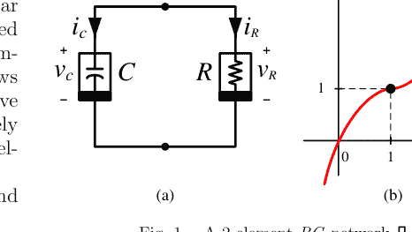

图 1. 一个 2 元件 RC 网络 Π。

方程）对于非退化的线性电路，即，

```
dx/dt = A x + B u,  (1)
```

其中 x 是 n 维“状态向量”，u 是 m 维“输入向量”，许多非线性电路没有连续可微的状态方程组

```
dx/dt = f(x, u)  (2)
```

其中 f(.) 是 x 的连续可微函数。这是因为 f(x, u) 可能在某些孤立点 x 处未定义（即变为无穷大），或 f(x, u) 可能在 x 的某些范围内具有多值性。为了说明这些微妙现象，我们重现了 [10] 第 1060–1062 页的例 1、2、3 和 4 如下：

# 例 1. 考虑图 1(a) 所示的非线性 RC 网络 Π。设元件构成关系描述如下：

```
Resistor R : i_R = h(v_R),  v_R ∈ R  (3)
```

```
Capacitor C : v_R = g(q_C),  q_C ∈ R.  (4)
```

如果我们选择电容器电荷 q_C 作为状态变量，则状态方程为

```
q̇_C = −h(g(q_C)) ≜ f(q_C),  q_C ∈ R.  (5)
```

现在假设 g(.) 在 (4) 中是双射，使得其逆

```
q_C = q̂_C(v_C),  v_C ∈ R  (6)
```

存在。则应用 KCL 和链式法则，我们得到

```
C(v_C) v̇_C = −h(v_C),  v_C ∈ R  (7)
```

其中 C(v_C) ≜ d q̂_C(v_C)/dv_C 是增量电容。假设 C(v_C) ≠ 0 对所有 v_C 成立，则 (5) 可以重写为

```
v̇_C = −C⁻¹(v_C) h(v_C) ≜ f(v_C),  v_C ∈ R.  (8)
```

注意 $C$ 不是电压控制的。特别是，其增量电容 $C(v_C)$ 在区间 $[5\frac{1}{3},6\frac{2}{3}]$ 上是多值的。如果我们选择 $v_C$ 作为状态变量如 (6)，则状态方程仅在 2 个不相交区间 $(-\infty,5\frac{1}{3})$ 和 $(6\frac{2}{3},\infty)$ 上定义：

$\dot v_C=-\dfrac{v_C}{C(v_C)},$

$-\infty<v_C<5\frac{1}{3}\quad\text{and}\quad6\frac{2}{3}<v_C<\infty.$$

由于 $\dot q_C=-v_C$ 意味着当 $v_C<0$ 时 $\dot q_C>0$，当 $v_C>0$ 时 $\dot q_C<0$，可知所有解必须趋向平衡点 $q_C=0$，如“动态路径”在图 2(b) 中所示 [3]。因此，作为满足 (14) 的良好定义的解 $\dot q_C(t)$，尽管状态方程 (20) 在全局（即在 $\mathbb{R}$ 中）不存在。

由于 $v_C(t)=\hat v_C(q_C(t))$ 是良好定义的，人们可能会争辩说 (20) 也是良好定义的，只要在数值求解状态方程时选择曲线的适当分支：初始点指定在任何时间应用哪个分支。这实际上是电路仿真程序的设计方式，其中计算在初始点的邻域内进行 [6]。在数学上，$v_C$ 被称为关于初始点 $v_C(t_0)$ 的局部坐标。这一论点在图 2 中的曲线上所有点都有效，除了 $Q_1$ 和 $Q_2$。注意给定任一点的任意邻域，无论多么小，$q_C-v_C$ 曲线仍然是 $v_C$ 的多值函数。这一困难在 (20) 中反映在 $C(v_C)$ 的值上，该值在恰好这两个点处趋于 $\infty$。我们得出结论，$v_C$ 甚至在 $Q_1$ 和 $Q_2$ 处也不符合局部坐标的条件。

# **例 3.**

设图 3(a) 中的 $R$ 为 1-$\Omega$ 线性电阻器，设 $C$ 为 *电压控制电容器*，其描述为 (13) 的“对偶”：

$q_C=\hat q_C(v_C)\triangleq\frac{1}{3}v_C^3-3v_C^2+v_C,\quad v_C\in\mathbb{R}\tag{21}$

如图 3(b) 所示。注意 $q_C$ 不符合 $q_C-v_C$ 曲线的全局坐标，但 $v_C$ 符合。事实上，$q_C$ 甚至在图 3(b) 中的 $Q_1$ 和 $Q_2$ 处也不符合局部坐标。因此，状态方程 (3) 在全局不存在。

由于 $v_C$ 符合 $q_C-v_C$ 曲线的全局坐标，自然以 (6) 的形式写出状态方程。注意然而由于 $C(v_C)=0$ 在 $Q_1$ 和 $Q_2$ 处，状态方程

$\dot v_C=-\dfrac{v_C}{v_C^2-6v_C+8}\triangleq f(v_C),\quad v_C\ne2,4\tag{22}$

在 $v_C=2$ 和 $v_C=4$ 处未定义。

与图 2 不同，动态路径（注意 $\dot q_C<0$ 对所有 $v_C>0$ 的点）定性上在图 3 中截然不同。这里，从 $Q_1$ 附近任一侧开始的解会从其发散 {resp. $Q_2$ 会向其收敛}。人们可能会将这一观察视为 (15) 的不稳定平衡点的简单例子而加以忽视。然而请注意，$Q_1$ 和 $Q_2$ 并不是平衡点，因为 $\dot v_C$ 不会趋于零当 $v_C\to2$ 或 4 时。事实上，$\dot v_C\to\infty$ 当 $v_C\to4$ 且 $\dot v_C\to-\infty$ 当 $v_C\to2$。这意味着从 $t=0$ 起在 $Q_2$ 附近任一点开始的解会在某个有限时间 $T<0$ 到达 $Q_2$。同样，从 $t=0$ 起在 $Q_1$ 附近任一点开始的解会在某个有限时间 $T<0$ 返回到 $Q_1$。注意一旦在图 3(b) 中到达 $Q_2$ 或 $Q_1$，解就无法在向前或向后时间中继续。我们因此称 $Q_1$ 和 $Q_2$ 为僵局点。

人们可能会反对选择 $Q_1$ 或 $Q_2$ 作为初始条件，理由是 (16) 中的 $f(v_C)$ 在这些点未定义。然而，这里的问题

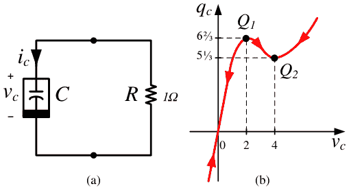

*图 3.* 电压控制电容器 $C$ 的 $q_C-v_C$ 曲线 *例 3*。这里 $v_C$ 是该曲线的全局坐标。电容器电荷不符合全局坐标。也不符合 $Q_1$ 和 $Q_2$ 处的局部坐标。


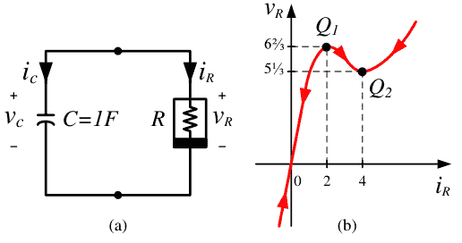

Fig. 4. 电流控制电阻 $R$ 的 $i_R-v_R$ 曲线，例 4。 这里 $i_R$ 是曲线的全局坐标。 电阻电压 $v_R$ 不符合全局坐标的条件。 在 $Q_1$ 和 $Q_2$ 处也不符合局部坐标的条件。

因此，$Q_1$ 和 $Q_2$ 是阻滞点，我们得出结论图 4(a) 表示一个非物理电路。 要重新建模该电路，只需插入一个小的串联线性电感来表示线路电感即可。 不难看出，由此得到的二阶电路具有在 $\mathbb{R}^2$ 中全局定义的的状态方程 [3]。

为揭示图 4(b) 中困难的来源，注意到由于 $q_C=v_C=v_R$，$q_C$ 或 $v_C$ 既不符合全局坐标的条件，也不符合在 $Q_1$ 和 $Q_2$ 处的局部坐标的条件。

上述“阻滞点”现象即使对数学家来说也是出乎意料的，并且从未在数学文献中报道过。

然而，通过援引“跳跃假设”，Chua 通过证明随后的预测与实验观察一致而对其进行了论证 [4]，Chua 引入了一种强大且数值上更高效的方法来获得正确结果。 此外，通过应用他的“动态路径”技术，Chua 能够证明并解释弛豫振荡的机制 [11, 14]。 该机制在 [11] 第 1023 页的例 1 中有所说明，我们将其作为下面的例 5 再现：

是的，从 $Q_2$ 的一个小邻域出发，任何计算机仿真都会在有限时间 $T$ 内使我们到达 $Q_2$，之后计算机将无法继续积分过程，因为解不再存在。 由于所有物理网络必须对所有时间 $t\ge t_0$ 都有解，任何表现出此类阻滞点的网络都是非物理的，应该进行*重新建模*。

**Example 4.** 设图 4(a) 中的 $C$ 为 1-F 线性电容，$R$ 为 *电流控制电阻*，其描述为

$$v_R=\hat v_R(i_R)\triangleq\frac{1}{3}i_R^3-3i_R^2+8i_R,\qquad i_R\in\mathbb{R} \tag{23}$$

如图 4(b) 所示。 由于 $\hat v(i_R)$ 不是双射的，(3) 中的 $h(v_R)$ 在区间 $5\frac{1}{3}<v_R<6\frac{2}{3}$ 上是多值的。 由于 (3) 和 (6) 都是用 $h(\cdot)$ 表示的，*在这种情况下，两个状态方程都不存在全局*。 请注意，这种情况与例 2 和例 3 不同，在例 2 和例 3 中，至少有一个状态方程在除某些孤立点外的所有地方都存在。

为了对这种情况给出物理解释，注意到 $\dot v_R=\dot v_C=i_C=-i_R$，意味着当 $i_R<0$ 时 $\dot v_R>0$，当 $i_R>0$ 时 $\dot v_R<0$。 这导致了图 4(b) 所示的动态路径。 同样，当解在某个“有限”正向时间 $T<\infty$ 内到达 $Q_2$，或在某个“有限”反向时间 $T>-\infty$ 内到达 $Q_1$ 时，我们会遇到阻滞情况。 （请注意，$Q_1$ 和 $Q_2$ 即使在 $Q_1$ 和 $Q_2$ 处定义了状态方程 (3) 或 (6)，也不是其平衡点。）

**Example 5.** 考虑图 5(a) 所示的 $RL$ 电路，其中电阻由图 6(b) 中的非单调电压控制 $v_R-i_R$ 曲线描述。 由于 $di_R(t)/dt=-v_R$，可知当 $v_R(t)>0$ 时 $di_R(t)/dt<0$，当 $v_R(t)<0$ 时 $di_R(t)/dt>0$。 显示这种行为的动态路径 [3] 用图 5(b) 中的箭头表示。 请注意，对于除原点外的任何初始电流 $i_R$，解都会在有限时间内到达 $Q_1$ 或 $Q_2$，在此之后解无法继续。 这种点在 [11] 中称为阻滞点。 网络 $N$ 中出现阻滞点总是会导致非物理情况，需要对 $N$ 进行重新建模 [11]。 在此示例中，必须引入以打破阻滞的最低阶元件是线性电容，如图 5(c) 所示。 电容 $C$ 通常是一个很小的数值（例如几个 *皮法*），用于模拟导线之间的“寄生电容”。 图 5(c) 中重新建模电路的状态方程是良好定义的（前提是 $C\ne0$）

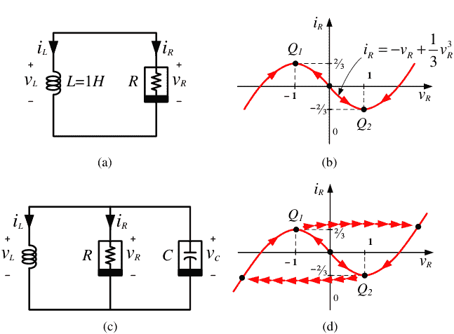

Fig. 5. 演示在非单调电压控制电阻器上连接电容的必要性的电路。

并且具有图 5(d) 所示的动态路径。 请注意，该电路作为弛豫振荡器工作 [3]。

Chua 推测，神经元轴突丘处发射的动作电位（尖峰）基本上是通过相同的机制操作的，即位于不稳定极限环附近的稳定平衡点，只要扰动发生在稳定平衡点的小吸引域之外，就会像弛豫振荡器一样执行向更大吸引子的快速过渡。

## 3. Mutators

变流器是 Chua 创造的另一个高度原创且基础性的器件，用于从 2 端子非线性电阻器合成 2 端子非线性电感器和非线性电容器 [3]。 它后来已被推广以合成任何忆阻器 [4] 以及任何 α − β 电路元件 [12]。 变流器的基本概念首先在 [2] 的第 II 节中提出，我们在下面重现：

变流器是一种有源双端口线性网络，用于将一种类型的非线性网络元件变换为另一种类型。 变流器有三类——L-R 变流器、C-R 变流器和 L-C 变流器。 L − R 变流器的特征是，如果将具有 v − i 曲线 Γ 的非线性电阻器连接在该元件的第二端口上，则在第一端口上看到的 resulting 单端口网络成为非线性电感器，其可以用 φ − i 曲线或 i − φ 曲线表征，该曲线与原始 v − i 曲线 Γ 相同。 在 φ − i 曲线与 Γ 相同的情况下，该元件称为 1 型 L-R 变流器。 如果 i − φ 曲线与 Γ 相同，则该元件称为 2 型 L − R 变流器。 相反，如果将具有 φ − i 曲线 Γ（或 i − φ 曲线 Γ）的非线性电感器连接在 1 型（或 2 型）L − R 变流器的第一端口上，则在第二端口上看到的 resulting 单端口网络成为非线性电阻器，其 v − i 曲线与 Γ 相同。 鉴于这种双向变异特性，变流器被称为可逆双端口。

我们现在将上述表征用以下精确的数学术语表达：

### Type I L-R Mutator: 该双端口由下式定义

```
v1 = dv2/dt
 i1 = -i2
(24)
```

换句话说，对于 1 型 L − R 变流器， resulting 电感器的特征曲线只是通过将 v − i 曲线 Γ 的电压和电流变量重新标记为磁链和电流变量而获得的，或者对于 2 型 L − R 变流器，通过将电流和磁链变量重新标记而获得的。

在频域中，(24) 等价于传输（ABCD）矩阵 [25]

```
T_{LR_1}(p) = \begin{bmatrix} p & 0 \\ 0 & 1 \end{bmatrix} \quad (25)
```

其中 p 是复频变量。

### Type 2 L-R Mutator:

该双端口由下式定义

```
v_1 = -\frac{di_2}{dt}

i_1 = v_2 \quad (26)
```

上述方程很容易从相应的变换和关系 i = -i_2 以及 v = v_2 得到，其中 i 和 v 是非线性电阻 i-v 曲线的电流和电压。 与 L-R 变流器相关的符号和关系在表 1 的上部进行了汇总。

通过完全类似的推导，可以定义两种类型的 C-R 变流器，用于将非线性电阻器变换为非线性电容器，反之亦然。 与 C-R 变流器相关的符号和关系在表 1 的中部进行了汇总。 同样，可以定义两种类型的 L-C 变流器，用于将非线性电容器变换为非线性电感器，反之亦然。 与 L-C 变流器相关的符号和关系在表 1 的下部进行了汇总。

### 3.1. Realization of mutators

每个变流器都可以通过一个或两个受控源来实现，其端子变量通常由端口变量的时间导数或积分控制。 表 1 中为每种类型的变流器显示了几种可能的实现。 受控源可以通过适当的组合有源元件来实现。 表 1 中显示的每个基本实现都已通过具有不同成功程度的有源网络进行了仿真。 图 6(a) 所示的电路代表了对应于表 1 中实现 4 的 1 型 L - R 变流器的简单实现。 1 型 C - R 变流器的一个类似实现如图 6(b) 所示。 请注意，这两个电路都需要一个电压控制电流源。 

六晶体管电路如图 7 所示，专门为此目的而设计。

### 3.2. Experimental verification of mutators

为了研究变流器的性能，已经设计并通过实验验证了几个电路。

图 8(a) 显示了典型非线性电阻器（连接在 1 型 L - R 变流器的第二端口上）的 v - i 曲线（右）和 resulting 电感器的 φ - i 曲线（左）。 为了证明变流器可以在两个方向上工作，具有如图 8(b) 所示（左）的 φ - i 滞后曲线的非线性电感器连接在同一变流器的第一端口上， resulting v - i 曲线显示在右侧。 最后，图 8(c) 显示了非线性电阻器到具有相同特性曲线的非线性电容器的变异。 由于 1 型 L - C 变流器只是一个陀螺仪，其特性现在已众所周知 [25]，因此未给出该类型变流器的示波器波形。

## 4. Other Chua Creations

虽然上述阻滞点和变流器的概念涉及特定的应用，但 Chua 关于非线性电路的研究中有一个鲜为人知的方面，涉及形成非线性电路理论数学基础的非常一般的理论。 特别是，与发明具有特定目的的新电路不同，Chua 询问某些广义非线性电路类表现出哪些电路理论和动力学特性。 这些是“定性特性”。 例如，如何表征和推广非线性 n 端口的无源性和无损耗的电路理论特性 [1,7,9,13]。

更基础的是，现在被数学家认为具有基础性质的一系列内容； 即，什么类别的动力学非线性电路可以对任何输入信号仅表现出唯一的稳态响应 [8]？ 什么类别的自治动力学非线性电路具有多个平衡点 [8]？ 这篇 1976 年的论文提供了具有多个平衡点的非线性电路的深入数学基础，


(a)

(b)

图 6. 实现 L − R 变换器和 C − R 变换器的两种无电感电路。

图 7. 电压控制电流源的无电感实现。

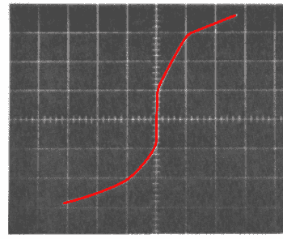

垂直刻度：Φ = 每格 2 毫韦伯
水平刻度：I = 每格 1 mA

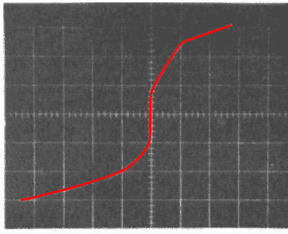

垂直刻度：V = 每格 2 伏特
水平刻度：I = 每格 1 mA

(a) 通过将非线性电阻连接到 L-R 变换器的端口二，可以合成非线性电感。

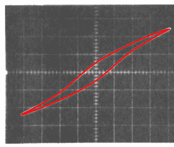

垂直刻度：Φ = 每格 1 毫韦伯
水平刻度：I = 每格 2 mA

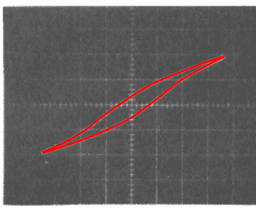

垂直刻度：V = 每格 0.5 伏特
水平刻度：I = 每格 1 mA

(b) 通过将非线性电感连接到 L-R 变换器的端口一，可以合成非线性电阻。

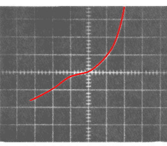

垂直刻度：Q = 每格 0.1 微库仑
水平刻度：V = 每格 1 伏特


垂直刻度：I = 每格 1 mA
水平刻度：V = 每格 1 伏特

(c) 通过将非线性电阻连接到 C-R 变换器的端口二，可以合成非线性电容。

图 8. 示波器波形展示了通过变换器将一种类型的非线性元件转变为另一种类型的非线性元件。为提高可读性，重新处理并着色自 [Chua, 1968] 的图 3。

并且事实上预示了约翰·霍普菲尔德在 1982 年发起的神经网络时代 [22, 23]。

另一个早于并预示了最近由 Pecora 和 Carroll 在 [24] 发起的“混沌同步”活跃研究领域的课题，是一个鲜为人知却基础深远的开创性论文，题为“Synchronization and Chaos” [26]。

### 致谢

作者谨向 Changju Yang 感谢他在准备本文稿方面的协助。

### 参考文献

- [1] Brayton, R. K. Chua, L. O. Rhodes, J. D. & Spence, R. [1978], Modern network theory: an introduction, Georgi, Switzerland.
- [2] Chua, L. O. [1968] “Synthesis of new nonlinear network elements,” *Proceedings of the IEEE*, 56(8), 1325–1340.
- [3] Chua, L. O., [1969] *Introduction to Nonlinear Network Theory*, McGraw-Hill, New York.
- [4] Chua, L. O. & Alexander, G. R., [1971] “The effects of parasitic reactances on nonlinear networks,” *IEEE Transactions on Circuit Theory*, 18(5), 520–532.
- [5] Chua, L.O. [1971] “Memristor-the missing circuit element,” *IEEE Trans. on Circuit Theory*, 18(5), 507–519.
- [6] Chua, L. O. & Lin, P. M. [1975] *Computer-Aided Analysis of Electronic Circuits: Algorithms and Computational Techniques.*, Prentice Hall.
- [7] Chua, L. O. & Green, D. N. [1976a] “Graph-theoretic properties of dynamic nonlinear networks,” *IEEE Transactions on Circuits and Systems*, 23(5), 292–312.
- [8] Chua, L. O. & Green, D. N. [1976b]; “A qualitative analysis of the behavior of dynamic nonlinear networks: steady-state solutions of nonautonomous networks,” *IEEE Trans. on Circuits and Systems*, 23(9), 530–535.
- [9] Chua, L. O. [1977], “Qualitative properties of resistive networks containing multiterminal nonlinear elements: no gain properties,” *IEEE Trans. on Circuits and Systems*, 24(3), 93–118.
- [10] Chua, L.O., [1980a] “Dynamic nonlinear networks: state-of-the-art,” *IEEE Trans. on Circuits and Systems*, 27(11), 1059–1087.
- [11] Chua, L.O. [1980b] “Device modeling via basic nonlinear circuit elements,” *IEEE Trans. on Circuits and Systems*, 27(11), 1014–1044.
- [12] Chua, L. O. & Szeto, E.W. [1984] “Synthesis of higher order nonlinear circuit elements,” *IEEE Transactions on Circuits and Systems*, 31(2), 231–235.
- [13] Chua, L. O. [1984], “Nonlinear circuits,” *IEEE Trans. on Circuits and Systems*, 31(1), 69–87.
- [14] Chua, L. O. Deseor, C. A. & Kuh, E. S., [1987] *Linear and Nonlinear Circuits*, McGraw-Hill, New York
- [15] Chua, L. O. & Yang L., [1988] “Cellular neural networks: applications,” *IEEE Trans. on Circuits and Systems*, 35(10), 1257–1290.
- [16] Chua, L. O., [2006] *A Nonlinear Dynamics Perspective of Wolfram’s New Kind of Science I*, World Scientific Series on Nonlinear Science.
- [17] Chua, L. O., [2007] *A Nonlinear Dynamics Perspective of Wolfram’s New Kind of Science II*, World Scientific Series on Nonlinear Science.
- [18] Chua, L. O., [2009] *A Nonlinear Dynamics Perspective of Wolfram’s New Kind of Science III*, World Scientific Series on Nonlinear Science.
- [19] Chua, L. O., [2011] *A Nonlinear Dynamics Perspective of Wolfram’s New Kind of Science IV*, World Scientific Series on Nonlinear Science.
- [20] Chua, L. O., [2012] *A Nonlinear Dynamics Perspective of Wolfram’s New Kind of Science V*, World Scientific Series on Nonlinear Science.
- [21] Göknar, I. C., [1980] “On the state description of nonlinear networks,” *Proc. IEEE*, 68(6), 734–735.
- [22] Hopfield, J. J. [1982] “Neural Networks and Physical Systems with Emergent Collective Computational Abilities,” *Proc. of the National Academy of Sciences*, USA, 79, 2554–2558.
- [23] Kennedy, M. P. & Chua, L. O. [1987] “Unifying the Tank and Hopfield linear programming circuit and the canonical nonlinear programming circuit of Chua and Lin,” *IEEE Trans. on Circuits and Systems*, 34(2), 210–214.
- [24] Pecora, L. M. & Carroll, T. [1990] “Synchronization in chaotic systems,” *Physics Review Letters*, 64(8), 821–824.
- [25] Su, K. L. [1965] *Active Network Synthesis*, McGraw-Hill, New York.
- [26] Tang, Y. S. Mees, A. I. & Chua, L. O. [1983], “Synchronization and Chaos,” *IEEE Trans. on Circuits and Systems*, 30(9), 620–626.

## 第三章

## CHUA 的拉格朗日电路元件

ORLA FEELY

电气、电子与通信工程学院
都柏林大学学院
爱尔兰都柏林 4 号

Leon Chua 职业生涯的第一部分，以及使他在国际研究界崭露头角的工作，让他奠定了非线性电路理论的许多严格基础。作为这些基础的一部分，Chua 在加州大学伯克利分校的博士课程中包含了从经典力学角度对拉格朗日概念的电路理论考量。本文综述的目的是捕捉该讲授内容，并将其作为 Chua 对非线性电路研究和教育贡献的进一步记录。

- 1. 引言 ......................................................... 36
- 2. Chua 对拉格朗日电路元件的阐述 ................... 37
- 3. 总结 .............................................................. 39
- 参考文献 .............................................................. 40

### 1. 引言

Leon Chua 职业生涯的第一部分，以及使他在国际研究界崭露头角的工作，让他奠定了非线性电路理论的许多基础 [2,5]。这涉及在众多基本贡献中，定义了新的电路元件，最著名的是忆阻器 [3]。近年来忆阻器兴趣的爆炸式增长证明了 Chua 工作的前瞻性和基础性。

这项工作的另一个方面采用了来自经典力学的拉格朗日概念 [1,7] 在拉格朗日力学中，拉格朗日是广义坐标 ηi、速度 η̇i（以及可能的时间）的函数，由此可以推导出系统的动力学方程。

在电路理论的背景下对这一概念的应用曾在上个世纪中叶由一些作者研究过，而 Chua 在 [4,8] 等论文中显著推进了这项工作。Chua 在加州大学伯克利分校的博士课程中以及在多场主题演讲中介绍了由拉格朗日表征的电路元件的性质，但并未将其纳入任何教材。本文综述的目的是捕捉该讲授内容，并将其作为他在非线性电路研究和教育方面贡献的进一步记录。


### 2. 蔡少棠对拉格朗日电路元件的阐述

一个拉格朗日 n 端口由一个 C¹ 拉格朗日函数描述

```
L(q₁,q₂,…qₘ, q̇₁,q̇₂,…q̇ₘ, φₘ₊₁,…,φₙ, 
      q̇ₘ₊₁,…,q̇ₙ) (1)
```

其中端口被划分为 {1,…m} 和 {m+1,…n} 两组。qⱼ 是与端口 j 关联的电荷变量，其时间导数 q̇ⱼ 是端口电流。φⱼ 是与端口 j 关联的磁通变量，其时间导数 φ̇ⱼ 是端口电压。若 m = n，则拉格朗日函数仅为电荷和电流的函数；若 m = 0，则仅为磁通和电压的函数。该 n 端口的本构关系由拉格朗日函数通过以下方程导出：

```
vⱼ = d/dt (∂L/∂q̇ⱼ) − ∂L/∂qⱼ  j = 1,…m

iₖ = d/dt (∂L/∂φ̇ₖ) − ∂L/∂φₖ  k = m+1,…n
```

注意，虽然这里的理论是在 n 端口的背景下提出的，但它同样适用于 (n+1) 端元件。

拉格朗日 n 端口的一些示例如下：

#### 示例 1. 形如 L(q₁) 的拉格朗日函数给出

```
v₁ = d/dt (0) − ∂L/∂q₁ = h(q₁).
```

这是电荷控制电容器的本构方程。特别地，若

```
L(q₁) = − q₁² / (2C)
```

则我们得到一个线性电容器，其定义为

```
v₁ = q₁ / C.
```

#### 示例 2. 形如 L(q₁) = L(i₁) 的拉格朗日函数给出

```
v₁ = d/dt (∂L/∂i̇₁)   或   φ₁ = f(i₁).
```

这是电流控制电感器的本构方程。

基于这两个基本示例，我们可以找到如下示例：

#### 示例 3. 形如 L = f₁(q₁)+ f₂(q̇₁) 的拉格朗日函数给出

```
v₁ = d/dt (∂f₂/∂q̇₁) − ∂f₁/∂q₁,
```

即电流控制电感器与电荷控制电容器的串联组合。

#### 示例 4. 形如 L(q₁,q₂,…qₙ) 的拉格朗日函数给出

```
v₁ = −∂L/∂q₁ = f₁(q₁,q₂,…qₙ)
 v₂ = −∂L/∂q₂ = f₂(q₁,q₂,…qₙ)
   ⋮
 vₙ = −∂L/∂qₙ = fₙ(q₁,q₂,…qₙ)
```

这是 n 端口电荷控制电容器的本构方程。类似地，拉格朗日函数 L(φ₁,φ₂,…,φₙ) 对应于 n 端口磁通控制电感器。

进一步的示例包括：

#### 示例 5. 拉格朗日函数 L = −n q₁ φ̇₂ 表示理想变压器：

```
v₁ = n φ̇₂ = n v₂
 i₂ = d/dt (−n q₁) = −n i₁
```

#### 示例 6. 拉格朗日函数 L = G φ₂ φ̇₁ 表示理想回转器：

```
i₁ = G φ̇₂ = G v₂
 i₂ = d/dt (−G φ₁) = −G v₁
```

#### 示例 7. 形如 L = A q₁ q₂ q₃ 的拉格朗日函数给出

```
v₁ = −A q₂ i₃
 v₂ = −A q₁ i₃
 v₃ = d/dt (A q₁ q₂) 即 φ₃ = A q₁ q₂
```

这是一类称为 traditor 的电路元件族的一个例子 [6]，其更一般的定义由

拉格朗日函数 $L = A\eta_1\eta_2\dots\eta_{n-1}\dot\eta_n$ 给出，其中每个 $\eta_j = q_j$ 或 $\phi_j$。

在三端口 traditor 中，拉格朗日函数 $L = A q_1 q_2 \dot\phi_3$ 给出

$v_1 = -A q_2 v_3$
$v_2 = -A q_1 v_3$
$q_3 = A q_1 q_2$

而拉格朗日函数 $L = A \phi_1 \phi_2 \dot q_3$ 给出

$i_1 = -A \phi_2 i_3$
$i_2 = -A \phi_1 i_3$
$\phi_3 = A \phi_1 \phi_2$

前者以电荷与电压变量之间的代数关系为特征，因此代表一个三端口电容器；后者以磁通与电流之间的代数关系为特征，因此代表一个三端口电感器。另一方面，大多数 traditor 并不对应基本电路元件。

这里的关键原则是：所有这些元件都可以通过一个标量的电路理论拉格朗日函数来描述。我们看到，这种描述可以涵盖各种基本电路元件，以及其他并非作为基本元件出现的元件。

还可以观察到，上述所有示例都是无损电路元件。一个 $n$ 端口表示 N 是无损的，当且仅当从 $t=0$ 到任意时刻 $\tau$ 进入 N 的总能量 E 仅取决于在时刻 $\tau$ 处求值的 $(q_1,q_2,\dots q_m,\dot q_1,\dot q_2,\dots \dot q_m,\phi_{m+1},\dots \phi_n,\dot\phi_{m+1},\dots \dot\phi_n)$，即

$\int_0^{\tau}\left[\sum_{j=1}^{m}v_j(t)\frac{dq_j}{dt}+\sum_{k=m+1}^{n}i_k(t)\frac{d\phi_k}{dt}\right]dt = E(q_a(t),\phi_b(t),\dot q_a(t),\dot\phi_b(t))$

根据这一定义，如果网络在状态空间中两点之间运动所需的能量与路径无关，则该网络是无损的。这一概念同样源自经典力学。

拉格朗日函数的概念与能量传递之间有着密切的联系。

### 引理 1. $N$ 是无损的，当且仅当存在一个 $C^1$ 函数 $E(q_a(t),\phi_b(t),\dot q_a(t),\dot\phi_b(t))$，即能量函数，

使得以下能量恒等式成立：

$\sum_{j=1}^{m}v_j(t)\dot q_j+\sum_{k=m+1}^{n}i_k(t)\dot\phi_k = \sum_{j=1}^{m}\left(\frac{\partial E}{\partial q_j}\dot q_j+\frac{\partial E}{\partial \dot q_j}\ddot q_j\right)+\sum_{k=m+1}^{n}\left(\frac{\partial E}{\partial \phi_k}\dot\phi_k+\frac{\partial E}{\partial \dot\phi_k}\ddot\phi_k\right)$

证明：将 (3) 的两边对时间求导。

#### 定理 1. 每个拉格朗日 $n$ 端口都是无损的。特别地，其能量函数由下式给出：

$E(q_a(t),\phi_b(t),\dot q_a(t),\dot\phi_b(t)) = \sum_{j=1}^{m}\dot q_j(t)\frac{dL}{d\dot q_j}+\sum_{k=m+1}^{n}\dot\phi_k(t)\frac{dL}{d\dot\phi_k}-L \quad (2)$

证明：将 (2) 代入 (4) 并展开导数。

### 定理 2. 如果一个由 (2) 给出能量函数 $E(q_a(t),\phi_b(t),\dot q_a(t),\dot\phi_b(t))$ 的拉格朗日 $n$ 端口的端口 $1,\dots m$ 以短路端接，端口 $m+1,\dots n$ 以开路端接，则 $\frac{dE}{dt}=0$ 且 $E(t)=E(0)\forall t\ge0$。

证明：端接条件意味着 $\frac{d}{dt}\left(\frac{\partial L}{\partial \dot q_j}\right)=\frac{\partial L}{\partial q_j}\ j=1,\dots m$ 以及 $\frac{d}{dt}\left(\frac{\partial L}{\partial \dot\phi_k}\right)=\frac{\partial L}{\partial \phi_k}\ k=m+1,\dots n$。

由此可得 $\frac{dL}{dt}=\sum_{j=1}^{m}\left(\frac{\partial L}{\partial q_j}\dot q_j+\frac{\partial L}{\partial \dot q_j}\ddot q_j\right)+\sum_{k=m+1}^{n}\left(\frac{\partial L}{\partial \phi_k}\dot\phi_k+\frac{\partial L}{\partial \dot\phi_k}\ddot\phi_k\right)=\sum_{j=1}^{m}\frac{d}{dt}\left(\dot q_j\frac{\partial L}{\partial \dot q_j}\right)+\sum_{k=m+1}^{n}\frac{d}{dt}\left(\dot\phi_k\frac{\partial L}{\partial \dot\phi_k}\right)$

因此

```
d/dt ( sum_{j=1}^{m} q̇_j(t) dL/dq̇_j + sum_{k=m+1}^{n} φ̇_k(t) dL/dφ̇_k - L ) = 0
```

我们可以进一步阐述拉格朗日函数与能量函数之间的关系。若

```
E(q_a(t), φ_b(t), q̇_a(t), φ̇_b(t)) = E_0 + E_1 + E_2 + ⋯
```

且

```
L(q_a(t), φ_b(t), q̇_a(t), φ̇_b(t)) = L_0 + L_1 + L_2 + ⋯ (3)
```

其中 E_γ 是 E 按 q̇_j 和 φ̇_k 的升幂展开时的第 γ 次齐次分量，即其形式为

```
∑_l a_l(q_a, φ_b) q̇_1^{γ1}⋯q̇_m^{γm} φ̇_{m+1}^{γ_{m+1}}⋯φ̇_n^{γn}   γ1 + γ2 + ⋯ + γn = γ
```

相应地定义 L_γ，则有如下定理：

#### 定理 3. E 和 L 的第 γ 次齐次分量满足关系

```
E_γ = (γ - 1) L_γ,   γ = 1, … n.
```

特别地，E_1 = 0。

#### 证明。

```
E_γ = ∑_{j=1}^{m} q̇_j dL_γ/dq̇_j + ∑_{k=m+1}^{n} φ̇_k dL_γ/dφ̇_k - L_γ = (γ - 1) L_γ
```

如果一个 n 端口是无能的（non-energic），则流入它的瞬时功率始终为零——它只是将功率从一组端口传递到另一组端口。由此得到以下定理：

#### 定理 4. 一个具有 (3) 形式 L 的拉格朗日 n 端口是无能的，当且仅当 L = L_1，即 L 中的每一项只能包含一阶的 q̇_j 和 φ̇_j。

#### 证明：由定理 4 直接得出。

具有 L = L_1 的拉格朗日 1 端口具有形式 L(q_1, q̇_1) = f(q_1) q̇_1 或 L(φ_1, φ̇_1) = f(φ_1) φ̇_1，分别给出

```
v_1 = d/dt (f(q_1)) - f'(q_1) q̇_1 = 0   或   i_1 = 0,
```

即短路和开路。

对于 n = 2 且 L = L_1 的情况，可能性有：

```
L(q_1, q_2, q̇_1, q̇_2) = f_a(q_1, q_2) q̇_1 + f_b(q_1, q_2) q̇_2,
```

它给出

```
v_1 = (∂f_a/∂q_2 - ∂f_b/∂q_1) q̇_2
v_2 = (∂f_b/∂q_1 - ∂f_a/∂q_2) q̇_1
```

即一个非线性回转器；

```
L(φ_1, φ_2, φ̇_1, φ̇_2) = f_a(φ_1, φ_2) φ̇_1 + f_b(φ_1, φ_2) φ̇_2,
```

同样给出一个非线性回转器；以及

```
L(q_1, φ_2, q̇_1, φ̇_2) = f_a(q_1, φ_2) q̇_1 + f_b(q_1, φ_2) φ̇_2,
```

它给出

```
v_1 = (∂f_a/∂φ_2 - ∂f_b/∂q_1) φ̇_2
i_2 = (∂f_b/∂q_1 - ∂f_a/∂φ_2) q̇_1
```

即非线性变压器的方程。

### 3. 总结

本文介绍了拉格朗日电路元件，遵循了 Leon Chua 在其职业生涯中于研究生课程和受邀讲座中多次给出的阐述。它突出展示了他的非线性电路理论方法的若干方面：该方法植根于基础数学学科；在现有分类的逻辑扩展基础上，包含了超出基本电路元件集合的元件；以及在教学上强调将新材料和概念与受众已经熟悉的概念联系起来。蔡少棠基本方法取得成功的突出例证是近年来忆阻器突然兴起的兴趣，这得益于器件诞生之初无法预见的技術发展。拉格朗日电路元件由于与电路中无损概念的天然联系，未来很可能也会经历类似的兴趣高涨。


### 参考文献

+   [1] Birkhoff, G. D. (1927) *Dynamical Systems* (American Mathematical Society).
+   [2] Chua, L. O. (1969). *Introduction to Nonlinear Network Theory* (McGraw-Hill).
+   [3] Chua, L. O. (1971). Memristor – the missing circuit element, *IEEE Transactions on Circuit Theory*, **18**, pp. 507–519.
+   [4] Chua, L. O. and McPherson, J. D. (1974). Explicit topological formulation of Lagrangian and Hamiltonian equations for nonlinear networks, *IEEE Transactions on Circuits and Systems*, **21**, pp. 277–286.
+   [5] Chua, L. O. (1984). Nonlinear circuits, *IEEE Transactions on Circuits and Systems* **31**, pp. 69–87.
+   [6] Duinker, S. (1959). Traditors — a new class of non-energetic non-linear network elements, *Philips Research Reports*, **14**, pp. 29–51.
+   [7] Lanczos, C. (1949) *The Variational Principles of Mechanics*, (University of Toronto Press).
+   [8] Wyatt, J. L. and Chua, L. O. (1977). A theory of nonenergetic n-ports, *International Journal of Circuit Theory and Applications*, **5**, pp. 181-208.

## Transformium AI

Processing / 2025-02-10T07:59:10Z

A Transformium AI that distinguishes itself by its ubiquitous 
implementation and accordance to all distinctive inputs innerly
presented before. It doesn't matter respective congruity as per
endeavour maintenance of cognitive intelligence?

- ✎ Editing Transformation
- Supports variables and conditional logic
- Generic over lambda and integral function
- Fully incremental

- ✎ Semantic Search Indexing
- Segmentation as per all known
- Representation of overriding documents
- Integral function and k-means

- 〄 Plugins
- Supporting all relevant interfaces
- Reuse proven and tested modules
- Top-K source matching with extended

- ✎ Interactive
- Feedback encouraged against manual optimization
- Representation and indication
- Tracking and contour

Technical Parameters

- 2048 dimension of index vector
- 1M memory for each vector
- 92 mAP@R precision
- GPU-accelerated

Trending (Scattered)

1. Resource Utilization EY
2. SRE Adoption
3. Vector DB Popularity
4. Multi-Modal Search

Subcharts · Export services

- evidence claims about ROI
- definite decision insights
- exploring hourly/daily
- rather silent events
- strictly monitored edge

An object is a component of

out uncertainty about
realth of the model?

neuronal encoding is now
one of those initiatives

> > The state of the art
> > — suggest editing strategy
> > to circumvent part of the issue.

- speed, power, area, bandwidth, and accuracy are traded off, the communication bandwidth between the processors and memories plays an important role in the computing power or computational complexity of a given architecture;
- at the interface between sensory arrays and processing arrays and in some cases the physical implementation of *arithmetic and logic array operations* are made by *mixed mode (analog and logic)* circuits, and not by pure digital; even, *in non-CMOS nanoscale cell array architectures the analog, including oscillatory, cells* as processors might play a crucial role.

In all these cases, spatial-temporal dynamics has a role not yet studied earlier (as a computational primitive, or as an activity pattern in a digital processor or memory array). Interestingly, the two pioneers, John von Neumann and Alan Turing proposed already the archetypes of these kinds of cellular architectures around 1952, proposing the cellular digital automata and the analog cellular dynamics, respectively [1,2]. These propositions, however, did not have a major effect in mainstream computer engineering, until recently.

During the Summer of 1988, I met again Professor Leon Chua in Budapest. We have told each other some interesting new findings. He mentioned the new Cellular Neural/nonlinear Network (CNN) principle, to be published soon [4]. Earlier, I was already aware of their new principle of optimization using nonlinear circuit array dynamics [3]. I was fascinated by the potential of this new idea (soon to become a paradigm) and told him about my new way of thinking about computing, combining analog spatial-temporal array dynamics and logic, inspired by the lateral asymmetry of the brain [5]. Soon, we started to combine these two principles to construct the CNN Universal Machine architecture [6], as a prototype for various Cellular Wave computers later materialized also in visual microprocessors [8], in other algorithmic frameworks, and in various products. This direction soon attracted some excellent scientists and many young talents. In 1990, we have organized the first IEEE International Workshop on Cellular Neural Networks and their Applications, CNNA 1990, Budapest (a biannual conference series, recently

renamed as Cellular Nanoscale Networks and their Applications; Berkeley, 2010).

To form and use the CNN Universal Machine, as a universal machine on spatial-temporal flows, several fundamental theoretical results were needed. Later, the proof of concept in silicon became a major task. In addition to the two groups in Berkeley and Budapest, the groups of Professor Josef Nossek in Munich in the algorithmic and learning methods and Professor Ángel Rodriguez-Vázquez in Seville in making the breakthrough via mixed mode CMOS chip implementation (the first time to make analog spatial temporal actions as elementary instructions in an algorithmically programmed machine on a chip), and many other individuals contributed to the development of this new technology. Theoretical and practical tasks were solved, and a lot of new algorithmic principles and applications have been invented. Conference proceedings in various forms, special issues, journal papers, the first few monographs and textbooks marked the road of documenting this emerging paradigm.

Very soon, the biology relevance has been uncovered. The interaction pattern between the cells, called cloning template, and the notion of the receptive field in neurobiology became the two analogous organizational units to bridge the gap between neuroscience and computational primitives, leading to many solutions simply converting neurobiological anatomy into template architecture (the group of Professor József Hámori). The deeper insights in the retina studies by Professor Frank Werblin and his group generated a lot of new principles, including the “Bionic Eye”, moving towards mission critical applications as well. The motivation and advices of Drs. Larry Cooper and Joel Davis proved to be invaluable during the 90’s. The breakthrough in understanding the internal neurobiological architecture and signal processing operations of a mammalian retina changed the scenario in understanding the spatial-temporal processing in the retina (Nature, 2001, by Frank Werblin and Botond Roska [10]). After that, the direct biological relevance inspired many researchers to discover new neuromorphic or neuro-inspired CNN algorithms and applications. The modeling of some special functional mechanisms were developed as well, in particular the hyper acuity in space and time, elementary color processing and some illusions.

Fundamental insights have been developed later when the following questions arisen:

+   (1) PDEs can be modeled in discrete space (PDDE: partial differential difference equations) by single or multi-layer CNN architectures; is it possible, in the opposite way, to find a PDE for any template?
+   (2) What are the operators that can be implemented by both locally connected and fully connected networks?
+   (3) Is it possible to develop an analytic theory for binary Cellular Automata (the prophecy of John von Neumann)?
+   (4) Is it any relation between Gödel incompleteness and a binary input-output CNN?

After getting acquainted with the new type of spatial-temporal algorithms based on the CNN Universal Machine, several new type of actions have been implemented, as well as some new mathematical (morphology, wave metric, spatial-temporal chaos, etc.) and physical (true random pattern generation, different nonlinear PDE solutions, etc.) problems have been solved on this platform.

Meanwhile, after the turn of the century, it became clear that due to the power dissipation constraint one possibility is to increase the number of processors and memories on one single chip. Moreover, below about 60 nm, the wire delay becomes bigger than the gate delay; hence the precedence of locality is a must. Very soon, not only multi-core chips were made, however, hundreds and thousands of cores or processing cells have been placed on a chip, the so called many-core chips, and the cellular or multi-cellular character, resembling the basic CNN spatial-temporal dynamics or its local variants even in digital cores and memories became apparent. In addition, some digital CNN Universal Machine implementations have been successfully made on FPGAs or as ASIC chips directly attached to some sensor arrays, as well (e.g. the so called Xenon chip).

Meanwhile, textbooks had been published [7,9] and many special issues in major Journals dealt with the emerging Cellular Wave Computing paradigm [11].

A major class of open problems is now becoming obvious: what are the design principles and tools for such systems. Kilo-processor/core FPGAs and GPUs, as well as cellular supercomputers (e.g. CELL Multiprocessor) have been manufactured and

the need for converting even non-topographic problems into topographic processing and memory cell arrays is a practical challenge. In this direction the computational framework of Physical versus the Virtual (multi) Cellular Machines has been introduced and the first results are already emerging.

In this paper in our review the focal points are: the new qualitative results, typical new actions, including bio-inspired ones, and various new type of physical implementations. Many other important results are missing in our review. The citation bibliography contains over 3000 papers and the author feels insecure whether some truly remarkable results have been omitted. Still, we do feel this exposition might help to get an overview about the emerging and fascinating area of cellular wave computing on topographic kilo- and mega-processor chips and systems.

## 2. Using Cellular Dynamics and Nonlinear Dynamical Circuits for Computation — A Prehistory

It is a remarkable historical fact that the two pioneers of digital computers, Alan Turing and John von Neumann, introduced the first two types of computer architectures that have the topographic, spatially distributed character, indeed a cellular (or “crystalline” geometric) array of elementary processing elements as the new way of computing. Interestingly, they had been made independently in about the same time.

Turing [1] used special second order continuous valued (analog) dynamic cells, inspired by chemical reactions, and applied a spatial interaction between the cells due to diffusion. The two state variables in a cell, called morphogen concentrations, were also influenced by the diffusion affect between the cells. The cells were placed topographically in a grid, a 1D grid or a 2D grid. Although, the equations were essentially linear, the practical nonlinearity inherent in any oscillator can be tacitly assumed. The reaction diffusion equations were actually partial differential difference equations (PDDE), their solutions were approximated by linear combinations of spatial-temporal waves. Turing discovered unusual phenomena in his simulations: spatial patterns depending on the local interactions between cells that are occurring in nature, however, impossible to define geometrically due to lack of any geometric regularity. Moreover, the emergence of asymmetry from symmetric structures was noticed


由于初始条件的非稳定性和微小波动。尽管图灵在此仅提出了一种原型案例研究（后来证明他的细胞是局部活跃的），该模型展示了一种截然不同的计算方式：利用空间分布处理单元中的模拟动力学和局部交互，时空波是关键的计算机制。

冯·诺依曼利用斯坦尼斯瓦夫·乌拉姆的原型，设计了一个由相同处理数字单元组成的空间分布阵列，并具有局部交互，以实现自复制自动机 [2]。尽管所有状态变量和交互都是数字的，其运行机制却是时空的，一种波的形式。同样，处理单元的拓扑、几何地址也很重要。通过一系列步骤，由于其细胞的不应期（反映了当时所理解的非常简化的神经元模型），元胞自动机能够复制一个静态模式。

有趣的是，在很长一段时间里，使用处理器阵列的需求和实际可能性在计算机工程中还相去甚远。

1973年，一个重要原理，即将麦克斯韦关于线性电阻网络的结果扩展到非线性电阻网络的定常原理 [12]，为将计算视为多变量能量函数的极值的一种新的思考方式铺平了道路。也就是说，在任何非线性电阻网络中，定常工作点都是势能的最小值，即所谓的余能量函数，作为每个电阻的余能量函数之和，实际上是端口电流和电压这两个变量的积分。

在 1980 年代，曾多次尝试使用简单的模拟阵列处理单元（实际上是动态电路）进行计算。名称“神经网络”被创造出来。一种简单的“神经元”模型，即具有一个时间常数和输出双极饱和非线性的放大器，以及加权阈值函数的和，被考虑在内。典型的网络是一个多输入多输出模型，所有神经元输出都通过加权反馈连接相互连接到每个神经元输入。通用输入也通过权重连接到所有神经元输入。因此，具有 n 个神经元和 n 个通用输入，2n² 个权重定义了网络。将输入放置到网络中，稳定后的输出

编码输入事件。这种所谓的霍普菲尔德网络 [13] 具有学习规则来训练权重以执行某种功能，从根本上导致某种代价函数的优化，通常是状态变量的二次函数。自 1984 年发表以来，已提出了许多解决方案来解决各种问题。1987 年，证明了这种优化实际上只是非线性无记忆网络的定常原理的应用。游戏的名称是：通过单一电路动力学（具有许多模拟处理器/放大器）求解多变量问题。

这些全连接架构的问题在于，实际实现仅在非常有限的规模上是可行的，而且完全反馈导致不稳定（对称性的稳定性准则无法保证）。尽管如此，许多学习算法被证明是实用且有用的，即使在单个数字处理器上运行，模拟多个处理器/神经元网络动力学。此外，神经形态特征主要缺失，并且作为单一网络，其能力非常有限。鉴于真实神经元的巨大多样性和复杂行为，“神经”一词变得言过其实。

## 3. 标准 CNN（元胞神经/非线性网络）作为实用可行的原型解决方案及相关稳定性问题

1988 年元胞神经/非线性网络（CNN）架构的开创性出版物提供了一个不同的方案 [4]。简单单元（“神经元”）的拓扑阵列及其重要的几何地址，以及局部性优先（元胞特性）被证明极其重要。在此架构中，鲁棒性和稳定性不受互连对称性的限制 [14]。

该架构为物理的、硅和光学的千单元/处理器计算阵列的实现提供了可能。请注意，由于局部反馈，间接的全局互连也得以实现。这种特性可以在实现不仅是局部算子，而且是全局波算子时得到利用。以这种方式，复杂的偏微分方程、波动方程，甚至流体动力学的纳维-斯托克斯方程，都可以通过 CNN 算子在离散空间中表示 [15, 20, 21]。

元胞局部连接特性是许多神经形态模型的基础，字面地将真实神经解剖结构、其感受野，转化为克隆模板（局部交互模式）[16,17]。这种神经形态特性可用于为视觉、听觉、触觉等多种感觉器官生成 CNN 模型。关键步骤是将感受野组织转换为由 CNN 的克隆模板定义的局部交互模式，这是该原型架构的明显优势。

在 1990 年代的前几年，约有一百种不同的模板被开发用于不同目的，包括视觉、逻辑、PDE 算子，以及数学形态学等 [18]。

非标准 CNN 很快变得重要，通过引入非线性和延迟模板，以及空间变化和自适应模板 [19]。

稳定性研究从一开始就很重要。此外，很快就发现 CNN 动力学的解析性质，取决于模板，将是设计存储可编程时空计算机的重要条件。问题在于，在各种初始和边界条件下，反馈模板决定了解析性质，包括稳定性和状态变量的最大值。

第一个挑战是研究各种非互易 CNN 模板，特别是当反馈模板（A 模板）不是中心对称时。第一个结果 [14] 显示，模板或系统矩阵中非对角元素的符号对称性和正性可能导致完全稳定的系统。这一结果后来被推广为许多等价条件 [22]。其他重要结果和分析工具发表于 [23–28]。

一些非定常状态模式很快被某些其他模板类发现。两单元混沌行为，以及更一般的混沌吸引子被识别 [29, 30]。振荡行为被用于通过振荡单元的出现检测某些模式（例如边缘）[31]，并且通过特殊模板形成丘阿电路阵列 [32]，以及受蚁群启发的初级空间/时间交互被生成 [33]。

## 4. 发明存储可编程时空计算机：CNN 通用机（CNN-UM）和元胞波计算机

从任何固定程序阵列处理器（具有明确定义的单元和互连）的实际限制中吸取的教训，以及为了使架构适合硅片而优先考虑局部性的需求，很快变得清晰。存储可编程性或算法可编程性在数字计算机中的作用也源于冯·诺依曼。为了克服存储可编程性的缺乏，另一种思考方式被应用 [5]，结合模拟/算术阵列动力学和逻辑。新的存储可编程时空机器，即 CNN 通用机 [6] 成为一个富有成果的范式。其基本思想独立于技术，尽管硅技术被视为主要目标平台。

单元阵列的核心是 CNN 架构，每个单元都扩展了局部模拟/算术和逻辑存储器以及局部通信和控制单元，该单元连接到全局模拟和逻辑控制单元的全局模拟和逻辑程序单元。后者还包含 3 个寄存器，用于存储（并发送）模板、局部逻辑算子，以及定义和改变局部扩展单元配置（操作模式）的开关配置。通过此方式，由时空 CNN 动力学定义的初级指令可在存储程序算法中使用。可选的局部逻辑单元和局部模拟/算术单元从局部存储器取值，并分别将结果置入其中。

该架构是使通用机成为最小架构，通用于逻辑宇宙，作为图灵机，以及作为拓扑图像流上的非线性算子。在此元胞波计算机上运行的算法可以正式定义为所谓的阿法递归函数，作为数字计算机的 μ-递归函数的对应物。其严格定义如下。

在元胞波计算机中

- *数据是拓扑流*（在 1、2 或 3 维网格上的单元阵列信号，例如视觉、触觉或听觉流，或分子动力学计算中原子的状态）。


chip was designed, combining a sensory layer, a mixed/mode preprocessing layer, a special digital memory layer preparing the “foveal” processing in the fourth layer [44]. Optical implementation was also successful [45].

With the advent of the FPGA kilo-processor chips, a new physical implementation became possible. The first CNN Universal Machine on FPGA was, in a way a new kind of compiler, translating cellular spatial-temporal algorithms onto a FPGA [46]. Several other new directions will be studied later.

Using the analog/and/logic stored programmable chip, new vistas were found in experimenting on them. The test bed for studying various complex nonlinear phenomena led to the uncovering of spatial-temporal chaos, finding dynamic patterns of different cells, stationary, periodic and chaotic cells [47]. With another clever way of combining local noise with on chip algorithms, truly random patterns were generated [48].

## 6. Biological Relevance and Bio-inspiration

Following the gradual better and better understanding of the neuromorphic details of the retina, starting from the naïve “silicon retina” resistive grid model, a bio-inspired proposal was made [49], called the Bionic Eye. Though it was approximate in many aspects, the essence was practical. As it turned out by exploring the inner structure of the mammalian retina in 2001 [10], some fundamental modifications had to be made, especially reflecting the multi-channel output of a single retina. The next CNN model was more accurate [54], and many other refinements [55] and constructive combinations have been proposed.

In addition to vision, other topographic modalities were also studied. Moreover, the interesting phenomenon of hyper acuity was studied. The hyper acuity in space in electric fishes [50] and in time in barn owl [52] were successfully modeled via 1 D CNN models [51 and 53]. The hyper acuity in time model was used for implementing a high resolution time to digital conversion chip [56]. Diverse other areas, such as immune response related, color vision related, locomotion related, and tactile action related effects were also useful examples [57–60]. A receptive field ATLAS was compiled for diverse sensory phenomena in terms of CNN models [61].

## 7. Some Fundamental Theorems — More than PDE, Equivalence to Fully-connectedness, Analytic Theory of CA, Gödel Incompleteness

Right from the beginning, the types of universality of the CNN Universal Machine had been a main issue. The universality in the Turing sense, via the game of life, was proved [62], indeed using two layers with 2 templates. Later, other simpler constructions were also shown. The other type of universality is the functional richness of the cell by cell nonlinear operator, especially if delay templates are used as well.

For long, it was considered that the PDEs are the most complex operators in spatial-temporal description of dynamics systems. In 1987, Keener proved [71] that there exists a 1D special example for which for any finite spatial discretization there exist a range of parameters for which the qualitative behavior of the spatial-temporal response will be different compared to the spatially continuous case. This example triggered the fundamental question: is it true that for all Partial Differential Difference Equations (PDDE) defined by the CNN dynamics for each one of the cloning templates, there exists a PDE that is the limiting case in space, that is, the continuous space, version, with the same qualitative behavior? The detailed study led to the surprising conclusion: the answer is no [63]. Two types of equivalence were considered topological and numerical. It is quite interesting that Turing already studied the question of the relationship between PDE and its spatially discrete form [1], however, he did not noticed this possibility.

As mentioned before, due to the feedback template the whole network is indirectly interconnected via the direct local connections, still there were no firm results as to the equivalence of operators between the fully and locally connected dynamical systems. In [64] it was shown that for oscillator cells this equivalence is true, and in some cases a constructive proof is available that show that linear template is sufficient.

Cellular Automata were shown as special cases on CNN dynamics. In addition, several very interesting properties were discovered mostly by examples. John von Neumann’s prophecy was still hanging in the air: there will be sometimes an analytic theory for binary automata [73]. That vision became true when Professor Leon Chua bridged the gap by applying a real valued representation of the binary state of a 1D Cellular Automaton with n cells [65]. The following sequence of seminal papers, e.g. [66–68] developed a brand new analytic theory of the binary universe as diverse Cellular Automata. Introducing a local memory in each cell (like in the CNN Universal Machine) showed additional properties [70].

What if we have not only an initial state, however, also an input to the Cellular Automaton, like in the CNN. This question was studied and the first result was surprising [69]: much more complexity and even the capability of dynamic input detection.

Having been the deeper properties of Cellular Automata analyzed, special kind of attractors called Isles of Eden were found and their properties discovered. These Isles of Eden have been identified as special manifestations of Gödel’s incompleteness theorem [72].

## 8. Prototype Spatial-temporal CNN Algorithms and Novel Applications

The invention of the CNN Universal Machine provided for the algorithmic combination of various spatial-temporal template dynamics, or put it in a different way, algorithms with spatial-temporal elementary instructions. Indeed, a new kind of algorithmic thinking has started forming a basis for different classes of alpha-recursive functions and related parts of a new kind of software library. Indeed, starting with the first software library, called Analogic CNN Program Library [18], a new edition has been made available almost every year, and a quite comprehensive “Software Library for Cellular Wave Computing Engines in an era of kiloprocessor chips” was published and distributed with the IEEE CNN4-2010 conference Proceedings, also available via the internet [100]. Here, we will review three parts:

- Prototype functional CNN algorithms,
- Learning and adaptation methods, and
- Novel applications.

### Prototype functional CNN algorithms

In some cases, a simpler version of CNN algorithms can be useful. Namely, in the so called discrete-time CNN (DTCNN) [74] the updating mechanism is performed by an iterative sequence of a given template with a memoryless (algebraic)

CNN operator, actually calculating the spatial convolution and the bias term of the standard CNN equation [74]:

```
$$x_{ij}(n+1):=x_{ij}(n)+\Sigma A_{kl}*y_{kl}(n)$$
$$\qquad +\Sigma B_{kl}*u_{kl}(n)$$
$$\qquad +z_{ij}y_{ij}(n+1):=f(x_{ij}(n=1))$$
```

where n is the time sequence, x and y are the state and output values of the cell and ij is the cell place and kl is a cell place in the neighborhood, f is a sigmoid function.

Many interesting applications have been performed by DT CNN that can be physically implemented in a simpler way.

As to the Boolean functions, using standard CNN dynamics, actually, practically all useful classes have been implemented [e.g. 75, 76, 77], including such functions as majority voting, parity check, and binary valued layout design algorithms.

Complex pattern calculation and skeleton generation even in a noisy environment are difficult tasks. Front propagation and active contour detection via nonlinear waves are key methods that were efficiently transformed into CNN wave dynamics operators [78].

Since the Turing patterns [1] it is a major challenge to form 2-dimensional patterns that are common in nature and are impossible to define in a geometric way. It turned out that a plethora of such patterns can be easily generated by autonomous CNN dynamics [79].

Some complex nonlinear analytic tools proved to be useful in analyzing CNN dynamics. For the continuous time case, the spectral approach was useful [80], and for the DT CNN the NLq theory was applied [81].

Exploring more complex spatial-temporal dynamics was possible via more complex cells, in particular using chaotic cells [82]. In addition to different wave dynamics, synchronization phenomena and related synchronization patterns had also been found [83].

A few typical more complex functions and special spatial filters had been invented. In particular, for binary and gray scale mathematical morphology [84], adaptive nonlinear spatial filters [85], separating signatures of various sound events [86], and computing optical flows [87].

A fundamental drift from classical problem setting emerged when the spatial/temporal wave


纳米级电磁场操作器件和亚微米级 CMOS 芯片的集成是一个技术挑战 [113]。针对计算密集型二维地形问题的新的设计方法已在 [114] 中提出。一种高效的波状波问题求解方法已在 [115] 中得到演示。

在地形架构上实现非地形问题是另一个主要的算法挑战。在 [116] 中，该问题已针对粒子滤波器得到解决。一个普遍的问题是程序控制的几何划分，因为可能无法实现全局控制。该问题已通过局部数据驱动方法得到解决 [117]。

事实上，关于地形物理架构上的算法的新世界，刚刚为计算机科学和计算机工程界所开启。

## 10. 结论与主要新挑战

受半导体技术物理约束和可能性以及神经生物学新发现的驱动，有时也是由其要求，计算机和计算的根本概念在过去 20 年中逐渐发生了变化。主要的新的方面是

- 处理器或存储器的几何或地形地址的引入需求及其关键作用，
- 使用连续值基本处理构建模块的需求，以及
- 使用一种新型算法质量，即初等指令为时空动态过程的 α 递归函数

纳米级技术，无论是 CMOS 还是非 CMOS，无论是数字或模拟与逻辑计算模型，都需要算法的时空动态特性。这一事实导致了一种新型的计算机工程和计算机科学，它将有助于为千核和百万核处理器芯片计算机设计出一系列新算法。此外，非 CMOS 纳米技术由于使用由物理过程定义的新构建块和相互作用，也需要这种理论和设计方法。

神经生物学中的最新发现以及相关的定量时空非线性模型也提供了新的思路，其中包括同步在事件检测中的作用。

### 致谢

衷心感谢匈牙利科学院、帕兹马尼·彼得天主教大学、海军研究办公室以及英特尔公司最近的支持。对 G. Pazienza 博士以及 P. Szolgay 教授和 Á. Zarándy 教授的评论表示感谢。

### 参考文献

[1] A.M. Turing, The Chemical Basis of Morphogenesis, Philosophical Transactions of the Royal Society of London. Series B, Biological Sciences, Vol. 237, No. 641. pp. 37–72 Aug. 14, 1952

[2] J. von Neumann, The Theory of Automata: Construction, Reproduction, Homogeneity, Part II. in J.v. Neumann (edited and completed by A.W. Burks), Theory of Self-Reproducing Automata, University of Illinois Press, Urbana and London, 1966 (on cellular automata models: 1952–53)

[3] J. Kennedy and L. O. Chua, Circuit Theoretic Solutions for Neural Networks — an Old Approach to a New Problem, Proceedings of the First International Conference on Neural Networks (ICNN), Vol. II, pp. 169–176, June 1987 (San Diego, CA).

[4] L. O. Chua and L. Yang, Cellular Neural Networks: Theory, IEEE Trans. on Circuits and Systems, (CAS), Vol. 35. pp. 1257–1272, 1988

[5] T. Roska, Analog events and a dual computing structure using analog and digital circuits and operators, in Discrete Event Systems: Models and Applications (eds. P. Varaiya and A. B. Kurzhanski), New York, Springer, 1988

[6] T. Roska and L. O. Chua, The CNN Universal Machine — an Analogic Array Computer, IEEE Trans. Circuits and Systems II, Vol. 40, pp. 163–173, 1993

[7] L. O. Chua, CNN: A Paradigm for Complexity, World Scientific, Singapore, 1998

[8] T. Roska and Á. Rodriguez-Vázquez, Towards the visual microprocessor: VLSI Design and the use of Cellular Neural Network Universal Machines, John Wiley, 2000

[9] L. O. Chua and T. Roska, Cellular Neural Networks and Visual Computing, Cambridge University Press, Cambridge, UK, 2002

[10] B. Roska and F.S. Werblin, Vertical interactions across ten parallel, stacked representations in the mammalian retina, Nature, Vol. 410, pp. 583–87, March 29, 2001

[11] T. Roska, Computational and Computer Complexity of Analogic Cellular Wave Computers, Journal of Circuits, Systems and Computers, Vol. 12, pp. 539–562, 2003

[12] L. O. Chua, “Stationary principles and potential functions for nonlinear networks, J. Franklin Institute, Vol. 296, pp. 91–114, Aug. 1973

[13] J.J. Hopfield, Neurons with graded response have collective computational properties like those of two-state neurons, Proc. Natl. Acad. Sci. U.S.A., Vol. 81, pp. 3088–3092, 1984

[14] L.O. Chua and T. Roska, Stability of a Class of Nonreciprocal Cellular Neural Networks, IEEE Trans. on Circuits and Systems, (CAS), Vol. 37, pp. 1520–1527, 1990

[15] P. Szolgay, G. Vörös and Gy. Erőss, On the applications of the Cellular Neural Network (CNN) paradigm in mechanical vibrating systems, IEEE Transactions on Circuits and Systems, Vol. 40, pp. 222–227, 1993

[16] F.S. Werblin, Synaptic connections, receptive fields, and pattern of activity in the tiger salamander retina, Investigative Ophthalmology and Visual Science, Vol. 32, pp. 459–483, 1991

[17] T. Roska, K. Lotz, J. Hámori, E. Lábos and J. Takács, The CNN model in the visual system — Part 1: The CNN-retina and some direction- and length- selective mechanisms, Research report of the Analogic (Dual) and Neural Computing Systems Laboratory, (DNS-8-1991), Budapest MTA SZTAKI, 1991

[18] Analogic CNN Program Library, Version 6.1, (eds. T. Roska and L. Kék), Research report of the Analogic (Dual) and Neural Computing Systems Laboratory, (DNS-5-1994), Budapest MTA SZTAKI, 1994

[19] L.O. Chua and T. Roska, The CNN paradigm, IEEE Trans. on Circuits and Systems I: Fundamental Theory and Applications, (CAS-I), Vol. 40, No. 3, pp. 147–156, 1993

[20] T. Roska, L.O. Chua, D.Wolf, T. Kozek, R. Tetzlaff, F. Puffer, Simulating nonlinear waves and partial differential equations via CNN — Part I. Basic Techniques, IEEE Trans. on Circuits and Systems I: Fundamental Theory and Applications, (CAS-I), Vol. 42, No. 10, pp. 807–815, 1995

[21] T. Kozek, T. Roska, A Double Time-Scale CNN for Solving Two-dimensional Navier-Stokes Equations, Int. J. Circuit Theory and Applications, (CTA), Vol. 24, pp. 49–56, 1996

[22] L. O. Chua and C. W. Wu, On the Universe of Stable Cellular Neural Networks, Int. J. Circuit Theory and Applications, (CTA), Vol. 20. pp. 497–518, 1992

[23] T. Roska, C.W. Wu, M. Balsi, and L.O. Chua, Stability and dynamics of delay-type general and cellular neural networks, IEEE Trans. on Circuits and Systems I: Fundamental Theory and Applications, (CAS-I), Vol. 39, No. 6, pp. 487–490, 1992

[24] P. Thiran, Influence of Boundary Conditions on the Behavior of Cellular Neural Networks, IEEE Trans. on Circuits and Systems I: Fundamental Theory and Applications, (CAS-I), Vol. 40, No. 3, pp. 207–212, 1993

[25] P.P. Civalleri and M. Gilli, Some Dynamic Phenomena in Delayed Cellular Neural Networks, Int. J. Circuit Theory and Applications, (CTA), Vol. 22. pp. 77–105, 1994

[26] M. Forti and A. Tesi, New Conditions for Global Stability of Neural Networks with Application to Linear and Quadratic Programming Problems, IEEE Trans. on Circuits and Systems I: Fundamental Theory and Applications, (CAS-I), Vol. 42, No. 7, pp. 354–366, 1995

[27] S. Arik and V. Tavsanoglu, Equilibrium Analysis of Delayed CNN’s, IEEE Trans. on Circuits and Systems I: Fundamental Theory and Applications, (CAS-I), Vol. 45, No. 2, pp. 168–171, 1998

[28] M. Di Marco, A. Tesi, and M. Forti, Bifurcations and oscillatory behavior in a class of competitive Cellular Neural Networks, Int. Journal of Bifurcation and Chaos, (Int. J. Bifurcation and Chaos), Vol. 10, No. 6, pp. 1267–1293, 2000

[29] F. Zou and J.A. Nossek, A chaotic attractor with cellular neural networks, IEEE Trans. on Circuits and Systems, (CAS), Vol. 38. pp. 811–812, 1991

[30] F. Zou, J.A. Nossek, Bifurcation and Chaos in Cellular Neural Networks, IEEE Trans. on Circuits and Systems I: Fundamental Theory and Applications, (CAS-I), Vol. 40, No. 3, pp. 166–173, 1993

[31] C-W. Wu, T. Roska, and L. O. Chua, Cellular Neural Networks Operating in Oscillatory Mode, Memorandum UCB/ERL, M94/5, Berkeley University of California at Berkeley, 1994

[32] P. Arena, S. Baglio, L. Fortuna and G. Manganaro, Chua’s Circuit Can Be Generated by CNN Cells, IEEE Trans. on Circuits and Systems I: Fundamental Theory and Applications, (CAS-I), Vol. 42, No. 2, pp. 123–125, 1995

[33] L. Nemes and T. Roska, A CNN Model of Oscillation and Chaos in Ant Colonies: A Case Study, IEEE Trans. on Circuits and Systems I: Fundamental Theory and Applications, (CAS-I), Vol. 42, No. 10, pp. 741–745, 1995

[34] R. Domínguez-Castro, S. Espejo, A. Rodriguez-Vázquez, R. Carmona, A CNN Universal Chip in CMOS Technology, Proceedings of IEEE Int. Workshop on Cellular Neural Networks and Their Applications, (CNNA’94), pp. 91–96, Rome, 1994

[35] S. Espejo, R. Carmona, R. Domínguez-Castro and A. Rodríguez-Vázquez, “A CNN Universal Chip in CMOS Technology”, International Journal

[35] T. Roska, et al., *International Journal of Circuit Theory and Applications*, Vol. 24, pp. 93–109, 1996

[36] G. Linan, R. Domínguez-Castro, E. Roca, S. Espejo and Á. Rodríguez-Vázquez, A Mixed-signal 64x64 CNN Universal Chip, in [8], pp. 258–279, 2000

[37] T. Roska and Ángel Rodríguez-Vázquez, Toward Visual Microprocessors, Invited Paper, *Proceedings of the IEEE*, Special Issue on: Visual Perception: Technology & Tools, Vol. 90, pp. 1244–1257, 2002

[38] R. Carmona, F. Jiménez-Garrido, R. Domínguez-Castro, S. Espejo, T. Roska, Cs. Rekeczky, I. Petrás and Á. Rodríguez-Vázquez, A Bio-Inspired two-Layer Mixed-Signal Flexible Programmable Chip for Early Vision, *IEEE Transactions on Neural Networks*, Vol. 14, issue 5, pp. 1313–1336, ISSN 1045–9227, 2003

[39] P.J. Dudek, An Asynchronous Cellular Logic Network for Trigger-Wave Image Processing on Fine-Grain Massively Parallel Arrays, *IEEE Transactions on Circuits and Systems — II: Analog and digital signal processing*, Vol. 53, pp. 354–358, 2006

[40] www.anafocus.com

[41] P. Földesy, Á. Zarándy, Cs. Rekeczky, and T. Roska, Digital implementation of the cellular sensor-computers, *International Journal of Circuit Theory and Applications*, Vol. 34, No. 4, pp. 409–428, 2006

[42] M. Laiho, A.Paasio, J. Flak and K.A.I. Halonen, Template design for cellular nonlinear networks with 1-bit weights, *IEEE Transactions on Circuits and Systems I: Regular Papers*, Vol. 55, pp. 904–913, 2008

[43] Á. Zarándy, P. Földesy, R. Carmona, Cs. Rekeczky, J. A. Bean, and W. Porod, Cellular Multi-core Processor Carrier Chip for Nanoantenna Integration and Experiments, in *Cellular Nanoscale Sensory Wave Computing*, edited by C. Baatar, W. Porod and T. Roska, Springer, New York, ISBN: 978-1-4419-1010-3, 2010, pp. 147–162, 2010

[44] P. Földesy, R. Carmona-Galan, Á. Zarándy, Cs. Rekeczky, Á. Rodríguez-Vázquez, T. Roska, Digital processor array implementation aspects of a 3D multi-layer vision architecture, in *Proceedings of the 12th International Workshop on Cellular Nanoscale Networks and their Applications, (IEEE CNNA2010)*, Berkeley (USA), pp. 329–332, 2010

[45] A. Ayoub, Sz. Tőkés, L. Orzó, Optical Cellular Wave Computer Implementation and Programming, in *Proceedings of the 10th IEEE International Workshop on Cellular Neural Networks and their Applications*, pp. 57–62, Istanbul, Turkey, 2006

[46] Z. Nagy, P. Szolgay, “Configurable Multi-layer CNN-UM Emulator on FPGA”, *IEEE Transactions on Circuits and Systems I: Fundamental Theory and Applications*, Vol. 50, pp. 774–778, 2003

[47] I. Petrás, T. Roska, and L.O. Chua, New spatio-temporal patterns and the first programmable on-chip bifurcation test bed, *IEEE Transactions on circuits and Systems I*, Vol. 50, pp. 619–633, 2003

[48] M. Ersey-Ravasz, T. Roska, Z. Néda, Stochastic simulation on the Cellular Wave Computers, *European Physics Journal*, Vol. 51. pp. 407–411, 2006

[49] F.S. Werblin, T. Roska, L.O. Chua, The analogic cellular neural network as a bionic eye, *Int. J. Circuit Theory and Applications (CTA)*, Vol. 23, N. 6, pp. 541–569, 1995

[50] P. Baldi and W. Heiligenberg, How sensory maps could enhance resolution through ordered arrangements of broadly tuned receivers, *Biol. Cybern.*, Vol. 59, pp. 313–318, 1988

[51] W. Heiligenberg and T. Roska, On biological sensory information processing principles relevant to cellular neural networks, in *Cellular Neural Networks*, (eds. T. Roska and J. Vandewalle), pp. 201–211, J.Wiley & Sons, Chichester, 1993

[52] M. Konishi, Neural mechanisms of auditory image formation, in: *The Cognitive Neurosciences*, Ed. M. S. Gazzaniga, MIT Press, pp. 269–277, 1995

[53] K. Lotz, L. Böllni, T. Roska and J. Hámori, Hyperacuity in Time: a CNN model of a time-coding pathway of sound localization, *IEEE Trans. on Circuits and Systems I: Fundamental Theory and Applications, (CAS-I)*, Vol. 46, No. 8, pp. 994–1002, 1999

[54] D. Bálya, B. Roska, T. Roska, F.S. Werblin, A CNN Framework for Modeling Parallel Processing in a Mammalian Retina”, *International Journal of Circuit Theory and Applications*, Vol. 30, pp. 363–393, 2002

[55] D. Bálya, Sudden Global Spatial-Temporal Change Detection and its Applications, *Journal of Circuits, Systems, and Computers (JCSC)*, Vol. 12, No. 6, pp. 845–856, 2003

[56] A. Mozsáry, J-F Chung, T Roska, Function-in-layout: A demonstration with bio-inspired hyperacuity chip, *International Journal of Circuit Theory and Applications*, Vol. 35, pp. 149–164, 2007

[57] Gy. Cserey, A. Falus, T. Roska, Immune Response Inspired Spatial-Temporal Target Detection Algorithms With CNN-UM, *International Journal of Circuit Theory and Applications*, Vol. 34, No. 1, pp. 21–47, 2006

[58] Á. Zarándy, L. Orzó, E. Grawes, and F. Werblin, CNN Based Models for Color Vision and Visual Illusions, IEEE Trans. on Circuits and Systems I, Vol. 46, No. 2, pp. 229–238, 1999

[59] P. Arena, L. Fortuna and M. Branciforte, Reaction-Diffusion CNN Algorithms to Generate and Control Artificial Locomotion, IEEE Trans. on Circuits and Systems I, Vol. 46, No. 2, pp. 253–260, 1999

[60] A. Kis, F. Kovács, P. Szolgay, 3D Tactile sensor array processed by CNN-UM: a fast method for detecting and identifying slippage and twisting motion, International Journal of Circuit Theory and Applications, Vol. 34, No. 4, pp. 517–531, 2006

[61] V. Gál, J. Hámori, T. Roska, D. Bálya, Zs. Borostyánkői, M. Brendel, K. Lotz, L. Négessy, L. Orzó, I. Petrás, Cs. Rekeczky, J. Takács, P. Venetián er, Z. Vidnyánszky, Á. Zarándy, Receptive Field Atlas and Related CNN Models, International Journal of Bifurcation and Chaos, World Scientific Publishing Company, Vol. 14, No. 2, pp. 551–584, 2004

[62] L.O. Chua, T. Roska, and P.L. Venetianer, The CNN is Universal as the Turing Machine, IEEE Trans. Circuits and Systems-I: Fundamental Theory and Applications, Vol. 40, pp. 289–291, 1993

[63] M. Gilli, T. Roska, L. O. Chua and P. P. Civalleri, CNN Dynamics Represents a Broader Class than PDEs, International Journal of Bifurcation and Chaos, Vol. 12, pp. 2051–2068, 2002

[64] F. Corinto, M.Gilli, and T. Roska, On Full-Connectivity Properties of Locally Connected Oscillatory Networks, IEEE Trans. on Circuits and Systems I, Vol. 58, No. 5, pp. 1063–1075, 2011

[65] L.O. Chua, S. Yoon, R. Dogaru, A nonlinear dynamics perspective of Wolfram’s new kind of science, Part I: Threshold of complexity, Int. J. Bifurcation and Chaos 12, 2655–2766, 2002

[66] L.O. Chua, K. Karacs, V.I. Sbitnev, J. Guan, and S. Jinwook, S. A nonlinear dynamics perspective of Wolfram’s new kind of science. Part VIII: More isles of eden, Int. J. Bifurcation and Chaos, Vol. 17, 3741–3894, 2007

[67] L.O. Chua, G. Pazienza, L. Orzó, V. Sbitnev, and J. Shin, A nonlinear dynamics perspective of Wolfram’s new kind of science. Part IX: Quasi-ergodicity, Int. J. Bifurcation and Chaos, Vol. 18, 2487–2642, 2008

[68] L. O. Chua and G. E. Pazienza, Nonlinear Dynamics Perspective of Wolfram’s New Kind of Science, Part XIII: Bernoulli στ-shift rules, International Journal of Bifurcation and Chaos, http://www.worldscinet.com/ijbc/mkt/archive.shtml?2010&20 Volume: 20, http://www.worldscinet.com/ijbc/20/2007/S02181274102007.html Issue: 7, pp. 1859–2003, 2010

[69] G. Pazienza and T. Roska, Dynamics of Cellular Automata with Input: Basis for a systematic study, Int. J. Circuit Theory and Applications, in press, 2011

[70] G.J. Martinez, A. Adamatzky, and R. Alonso-Sanz, How to make dull cellular automata complex by adding memory: Rule 126 case study, Complexity, Vol. 15, pp. 34–49, 2010

[71] J.P. Keener, Propagation and its failure in coupled systems of discrete excitable cells, SIAM J. Appl. Math. Vol. 47, pp. 556–572, 1987

[72] T. Roska, Isle of Eden in 1D Binary Cellular Automaton As a Manifestation of Gödel Incompleteness and a Proposal for a Bridge Between Analytical Results and Spatial-Temporal Logic Patterns, International symposium on nonlinear theory and its applications. (NOLTA 2010), pp. 593–594, Krakow, 2010

[73] J. Von Neumann, Papers of John von Neumann on Computing and Computer Theory, ed. W. Aspray and A. Burks, (Section IV: Theory of Natural and Artificial Automata), The MIT Press and Tomash Publ., Los Angeles/San Francisco, 1987

[74] H. Harrer and J.A. Nossek, Discrete-time Cellular Neural Networks, Int. J. Circuit Theory and Applications, (CTA), Vol. 20, pp. 453–467, 1992

[75] L. Nemes, L. O. Chua, T. Roska, Implementation of Arbitrary Boolean Functions on the CNN Universal Machine, Int. J. Circuit Theory and Applications, Vol. 26, pp. 593–610, 1998

[76] F. Y. Chen, G. L. He and G. Chen, “Realization of Boolean functions via CNN: Mathematical theory, LSBF and template design, “IEEE Trans. on Circ. Syst.-I, Vol. 53, pp. 2203–2213, Oct. 2006

[77] P.L. Venetianer, P. Szolgay, K.R. Crounse, T. Roska, L.O. Chua, Analogue Combinatorics and Cellular Automata — Key Algorithms and Layout Design, Int. J. Circuit Theory and Applications, (CTA), Vol. 24, pp. 145–164, 1996

[78] Cs. Rekeczky and L.O. Chua, “Computing with Front Propagation: Active Contour and Skeleton Models in Continuous-Time CNN” Journal of VLSI Signal Processing, Vol. 23, No.2/3, pp. 373–402, Kluwer, 1999

[79] P. Thiran, K.R. Crounse, L.O. Chua, and M. Hasler, Pattern Formation Properties of Autonomous Cellular Neural Networks, IEEE Trans. on Circuits and Systems I: Fundamental Theory and Applications, (CAS-I), Vol. 42, No. 10, pp. 757–774, 1995

[80] P.P. Civalleri and M. Gilli, A Spectral Approach to the Study of Propagation Phenomena in CNNs, Int. J. Circuit Theory and Applications, (CTA), Vol. 24, issue 1, pp. 37–48, 1996

[81] J.A. Suykens and J. Vandewalle, Discrete Time Interconnected Cellular Neural Networks within

非线性理论，《国际电路理论与应用杂志》(CTA)，第24卷第1期，第25–36页，1996年

- [82] M.J. Ogorzalek、Z. Galias、W. Dabrowski和A. Dabrowski，由混沌电路组成的CNN阵列中的时空协作现象——仿真实验，《国际电路理论与应用杂志》(CTA)，第24卷第3期，第261–268页，1996年
- [83] S. Jankowski、A. Londei、A. Lozowski和C. Masur，通过局部钉扎实现混沌单元细胞神经网络中的同步与控制，《国际电路理论与应用杂志》(CTA)，第24卷第3期，第275–282页，1996年
- [84] Á. Zarándy、A. Stoffels、T. Roska和L. O. Chua，在CNN通用机上实现二值和灰度数学形态学，《IEEE电路与系统汇刊I：基础理论与应用》(CAS-I)，第45卷第2期，第163–168页，1998年
- [85] Cs. Rekeczky、T. Roska和A. Ushida，基于CNN的差异控制自适应非线性图像滤波器，《国际电路理论与应用杂志》(CTA)，第26卷，第375–423页，1998年
- [86] J.A. Osuna和G.S. Moschytz，论细胞神经网络的分离能力，《国际电路理论与应用杂志》(CTA)，第24卷第3期，第253–260页，1996年
- [87] L. Török和Á. Zarándy，模拟VLSI、基于阵列处理器的贝叶斯多尺度光流，《国际电路理论与应用杂志》，第34卷第1期，第49–75页，2006年
- [88] V.I. Krinsky、V.N. Biktashev和I.R. Efimov，用于并行图像处理的自波原理，《Physica D》，第49卷，第247–253页，1991年
- [89] I. Szatmári、Cs. Rekeczky和T. Roska，一种非线性波度量及其用于目标分类的CNN实现，《VLSI信号处理杂志》第23卷第2/3期，第437–448页，1999年
- [90] I. Szatmári，用于模拟细胞波计算机上二值和灰度目标比较的时空非线性波度量，《国际泛函微分方程杂志》，第13卷，第89–97页，2006年
- [91] I. Szatmári，在细胞神经网络上使用基于偏微分方程的波度量进行目标比较，《国际电路理论与应用杂志》，第34卷第4期，第359–382页，2006年
- [92] F. Zou、S. Schwarz和J.A. Nossek，使用学习算法的细胞神经网络设计，IEEE细胞神经网络及其应用国际研讨会论文集(CNNA’90)，第73–81页，布达佩斯，1990年
- [93] J. A. Nossek，细胞神经网络的设计与学习，《国际电路理论与应用杂志》(CTA)，第24卷第1期，第15–24页，1996年
- [94] R. Dogaru、L. O. Chua和K. Crounse，“锥体细胞：一类新型自适应耦合细胞及其在细胞神经网络中的应用”，《IEEE电路与系统汇刊I：基础理论与应用》(CAS-I)，第45卷第10期，第1077–1090页，1998年
- [95] Cs. Rekeczky，用于基于约束扩散的局部自适应图像处理的CNN架构，《国际电路理论与应用杂志》，第30卷，第313–348页，2002年
- [96] Á. Zarándy，CNN模板设计艺术，《国际电路理论与应用杂志》，第17卷第1期，第5–24页，客座编辑：T. Roska、A. Rodriguez-Vazquez和J. Vandewalle，1999年
- [97] T. Roska和J. Vandewalle（编），细胞神经网络，J. Wiley出版社，奇切斯特，纽约，1993年
- [98] M. Tanaka、Y. Tanji、M. Onishi和M. Nakaguchi，利用细胞神经网络进行无损图像压缩与重构，IEEE细胞神经网络及其应用会议论文集(CNNA 2000)，第57–62页，2000年
- [99] M. Csapodi、J. Vandewalle和B. Preneel，用于视频认证和版权保护的CNN算法，《VLSI信号处理杂志》，第23卷第2/3期，第449–464页，1999年
- [100] 千处理器芯片时代的细胞波计算引擎软件库，3.1版，由K. Karacs、Gy. Cserey、Á. Zarándy、P. Szolgay、Cs. Rekeczky、L. Kék、V. Szabó、G. Pazienza和T. Roska编辑。报告，匈牙利科学院计算机与自动化研究所细胞感知与波计算实验室及帕兹马尼·彼得天主教大学杰德利克实验室，匈牙利布达佩斯，2010年
- [101] M. Haenggi和G. M. Moschytz，鲁棒CNN模板的解析及VLSI专用设计，《VLSI信号处理杂志》，第23卷第2/3期，第415–428页，1999年
- [102] Cs. Rekeczky、I. Szatmári、D. Bálya、G. Tímár和Á. Zarándy，蜂窝多自适应模拟架构：无人机应用的计算框架，《IEEE电路与系统汇刊—I：常规论文》，第51卷第5期，第864–884页，2004年
- [103] A. Zarándy、Cs. Rekeczky，Bi-i：独立式超高速细胞视觉系统，《IEEE电路与系统杂志》，第二季度，第36–45页，2005年
- [104] Á. Zarándy、R. Dominguez-Castro和S. Espejo，“超高帧率焦平面图像传感器与处理器”，《IEEE传感器杂志》，第2卷，第559–565页，2002年
- [105] R. Kunz、R. Tetzlaff和D. Wolf，“癫痫中脑电活动的时空动力学表征：基于关联维分析的细胞神经网络方法”，IEEE国际电路与系统研讨会(ISCAS 00)，Vol. pp. 2000
- [106] A. Mozsáry等人，“布局内功能：生物启发超敏锐度芯片的演示”，《国际电路理论与应用杂志》，第35卷第2期，第149–164页，2007年
- [107] ITRS（国际半导体技术发展路线图）路线图，2003、2005、2007、2009
- [108] W. Porod等人，“生物启发纳米传感器增强型CNN视觉计算机”，载于《人类潜能与融合技术的协同进化》，M.C. Roco、C. Montemagno编，《纽约科学院年鉴》，第1013卷，第92–109页，2004年
- [109] T. Roska，“电路、计算机以及超越布尔逻辑”，《国际电路理论与应用杂志》，第35卷，第485–496页，2007年
- [110] S. Kocsárdi、Z. Nagy、Á. Csik和P. Szolgay，在仿真数字CNN-UM上进行二维可压缩流模拟，《国际电路理论与应用杂志》，第37卷第4期，第569–585页，2009年
- [111] C. Baatar、W. Porod和T. Roska（编），细胞纳米尺度波计算，Springer出版社，纽约，ISBN: 978-1-4419-1010-3，2010年
- [112] T. Roska、L. Belady和M. Ercsey-Ravasz，“通过百万处理器芯片实现纳米尺度细胞波计算”，载于《细胞纳米尺度感知波计算》，C. Baatar、W. Porod和T. Roska编，Springer出版社，纽约，ISBN: 978-1-4419-1010-3，第5–25页，2010年
- [113] Á. Zarándy、P. Földesy、R. Carmona、Cs. Rekeczky、J.A. Bean和W. Porod，“用于纳米天线集成和实验的蜂窝多核处理器承载芯片”，载于《细胞纳米尺度感知波计算》第7章，C. Baatar、W. Porod和T. Roska编，Springer出版社，纽约，ISBN: 978-1-4419-1010-3，第147–162页，2010年
- [114] Á. Zarándy和Cs. Rekeczky，“面向计算密集型二维地形问题的低功耗处理器阵列设计策略”，载于《细胞纳米尺度感知波计算》，C. Baatar、W. Porod和T. Roska编，Springer出版社，纽约，ISBN: 978-1-4419-1010-3，第215–245页，2010年
- [115] Z. Nagy、Zs. Vörösházi和P. Szolgay，“偏微分方程的仿真数字CNN-UM求解”，《国际电路理论与应用杂志》，第34卷第4期，第445–470页，2006年
- [116] A. Horváth和M. Rásonyi，“处理器阵列上粒子滤波器的快速计算”，IEEE细胞纳米尺度网络及其应用国际研讨会会议录——迈向兆处理器计算(CNNA 2010，伯克利)，第215–219页，ISBN: 978-1-4244-6680-1，2010年
- [117] Cs. Nemes、Z. Nagy、M. Ruszinkó、A. Kiss和P. Szolgay，“将高性能数据流图映射到可编程逻辑器件”，2010年国际非线性理论及其应用研讨会论文集，NOLTA2010，第99–102页，波兰克拉科夫，2010年9月5–8日，ISBN: 978-4-88552-251-2

# 第5章：CNN对生物机器人与脑科学的贡献

PAOLO ARENA* 和 LUCA PATANÉ

*电气、电子与信息工程系，
意大利卡塔尼亚 95125，Viale A. Doria 6
*parena@dieei.unict.it

细胞非线性网络范式广泛应用于不同研究领域。本章聚焦于生物机器人与脑科学研究的突破。特别地，讨论了基于CNN的中央模式发生器（CPG）的实现，并在生物启发机器人上提出了不同实现：六足机器人、类七鳃鳗结构、蟹类启发平台等。此外，运动控制系统按照自下而上的过程进行了扩展，以纳入更高的认知能力。CNN范式被用于设计和实现受昆虫世界启发的感知架构。反应-扩散CNN系统已被用于建模针对当前环境条件优化的行为解决方案的激发。文中阐述了一种基于图灵模式的方法，并包括使用漫游机器人进行导航控制的实验结果。最后，报道并讨论了基于昆虫嗅觉系统、以无赢家竞争原理建模的有趣工作。

- 1. 引言 ........................................................ 56
- 2. 基于CNN的CPG用于生物机器人运动控制 ................. 58
  - 2.1. 运动基础 ............................................ 58
  - 2.2. 用于CPG的CNN神经元模型：慢-快可控极限环 ... 60
  - 2.3. 反应-扩散CNN结构中的CPG ....................... 61
  - 2.4. 多模板CNN中的CPG .................................... 64
- 3. 身体的大脑：基于CNN的时空方法 .......... 64
  - 3.1. 控制架构 ........................................... 67
  - 3.2. 仿真结果 .............................................. 72
- 4. 关于CNN中无赢家竞争的注记 ............................ 74
- 5. 结论 ........................................................ 76
- 致谢 ....................................................... 77
- 参考文献 ............................................................ 79

### 1. 引言

细胞非线性网络无处不在，其应用涉及多个不同的研究领域，从理论研究到硬件实现，再到工业应用。无论使用分立元件还是VLSI器件，在硬件中实现CNN的可能性对于实现机器人控制系统都极为重要。生物体极其强大的感觉运动能力，很大程度上归功于神经架构的特殊性，这些架构获取信号、处理信号、并与其他


感觉模态并向肌肉系统发送适当的运动控制指令。所有这些功能同时工作，并且，尽管神经元主要的通信工具是尖峰，但其内在动力学本质上是模拟的，而整体神经处理则具有独特的并行和异步特性。感觉运动图的体感拓扑组织是生命体通过本体感觉和外感受机制与外界互动的原型。本章将讨论 CNN 如何在很大程度上促进了生物启发式人工机器中嵌入式的新一代运动和感知系统的发展。

CNN 可以为嵌入式机器人系统提供并行计算能力。这些特殊特性在仿生机器人中极其重要，特别是当考虑多足平台时。以稳健且并行的方式处理多个自由度的可能性是 CNN 的关键点，并在该领域做出了重要贡献。腿式机器人的运动本身就是一项艰巨的任务：从这个角度来看，基于中枢模式发生器（CPGs）的前馈策略的模拟 CNN 实现已被提出，并成功应用于六足机器人、蟹状结构和鳗鱼状解决方案。然而 CPG 可以通过来自环境的感觉反馈得到丰富，以允许基本的反馈控制机制，如步态反射、转向控制、搜索反射、姿态控制等。基于 CNN 的 CPG 允许对感觉信息进行分布式计算，该信息可以在用作机器人系统运动神经元的神经结构单个细胞层面起作用。这些解决方案的一种实现是在六足昆虫型机器人中使用反应扩散（RD）细胞神经网络 [3] 实现的。随后，提出了一种新的 CPG 实现方法，其基于同一组神经细胞可以通过改变突触连接而重新组织的原理。其相应的 CNN 实现是使用空间变模板实现的，该机制被称为多模板方法 [4]。此外，这样的模板值可以在无监督的方式下学习，以便通过固定模板的加权组合提供真正灵活的环境介导的运动适应 [7]。

在过去几年使用 CNN 进行仿生机器人研究中，出现了一个问题：是否可以将 CNN 范式扩展以模拟大脑的高级功能？遵循这一假设，提出了一种自下而上的方法来揭示 CNN 在脑科学中的潜力。特别关注昆虫，因为它们的大脑简单，但却能产生复杂的适应性行为。

从运动发展到认知，提出了一种基于非线性神经晶格的新型通用感知控制架构，并应用于解决机器人导航任务。昆虫表现出对某些刺激以简单反射作出反应的能力，使用直接的感觉-运动通路，可被视为基本行为，是遗传且预先布线的。最近在昆虫中识别出了相关的大脑中心，即蘑菇体（MB）和中央复合体（CX）：尽管其功能细节尚未完全理解，但已知它们提供了次级通路，允许认知行为的出现 [23, 104]。这些行为是通过协调基本能力以满足昆虫的需求而获得的。受此思想启发，所提出的架构通过强化学习机制调节一组竞争且并发的基本行为，以便通过奖励函数完成分配的任务。架构的核心是由所谓的表征层构成，用于创建当前环境情况的简洁图景，将不同刺激融合在一起以产生感知状态。这些感知状态是反应扩散细胞非线性网络（RD-CNN）晶格的稳态解，旨在显示 Turing 模式。强调了网络多重平衡点动力学的利用，通过自适应塑造每个出现模式的吸引域来实现。实验活动在标准机器人平台上进行，以证明该方法的潜力和有效性。机器人配备了基于 Turing 模式 CNN 的感知控制器，实验发现其能够应对学习阶段未遇到的新情况，而学习在任何情况下都是以无监督、基于强化的方式进行的。另一个有趣的方面是，同一个 CNN 单元，即标准的双层分段线性单元，仅通过改变其参数就可以产生 Turing 模式或类似尖峰的动力学。因此，整体架构围绕相同的功能 CNN 单元构建，该单元就像大脑结构中的神经元一样，如果嵌入不同的神经晶格并且其参数略有调节，就可以在不同的自组织涌现动力学中产生完全不同的结果。CNN 处理在仿生机器人中传达的主要信息是其模拟的、空间分布的计算方式。在运动控制中，同时在环境中移动的整个执行器集合构成了 CNN 控制器所执行的隐藏空间-时间偏微分方程样处理的可见解。感知也被视为环境表征逐步形成的地方，就像形态发生模式在内源性和环境刺激的控制下生长一样。此外，运动神经元细胞体与脊髓和更高脑中心的特定区域之间存在地形组织的投射，并且这种组织在许多生物物种中得以保持。大量生物体显示出极其有序的神经架构，基于 CNN 的视觉处理器从视网膜拓扑神经节细胞组织中汲取灵感，该组织在中脑的适当区域内得以保持：这使得能够设计和实现模拟的、可数字编程的 VLSI 芯片，能够实现极快的视觉动力学。神经生物学家也是从同一视角出发提出的。

在章节的最后一部分，将简要介绍使用 CNN 面对感知过程的最后一种替代方法。它将涉及无竞争者获胜（WinnerLess Competition, WLC）的数学范式，该范式被有效地用于模拟昆虫和哺乳动物的嗅觉处理。在多维非线性系统的相空间中穿越的鞍点序列被用作嵌入机器人感知状态的代码。WLC-CNN 所显示的大容量记忆能够为自主人工智能体的新感知框架做出贡献，其中刺激与序列之间的关联是通过经验学习获得的。

所提出的示例表明，CNN 可以被视为研究和实现机器人仿生解决方案以及理解基本脑功能的一个统一框架。

### 2. 用于仿生机器人运动控制的基于 CNN 的 CPG

#### 2.1. 运动的基础

即使是简单的生物在各种环境中移动时也表现出很高的适应性令人惊讶。对大量动物运动活动控制如何实现的研究揭示了用于运动控制任务的神经网络的层级组织。这些网络的关键特征是神经活动模式映射到运动活动模式。肌肉活动节律模式的产生发生在称为中枢模式发生器（CPG）的神经水平。该结构已在脊椎动物（位于脊髓）和无脊椎动物（位于相关神经节）中被揭示。

CPG 包括命令神经元（CNs）和局部模式生成神经元（LPGNs）子网络。前者充当决策中心：它们从感觉器官或更高水平神经元接收刺激。因此，在这一水平上，一些重要决策如逃避反应或选择正确的运动模式（即生物在水上时游泳或在地面上时行走）会发生。LPGNs 负责协调用于运动的器官（纤毛、腿）。该子系统的神经元也称为运动神经元，因为它们构成了运动执行器之前的最后一个神经水平。在许多生物案例中，这种功能划分并不对应于不同的神经网络：同一网络可能在结构的不同水平上起作用。用于重新组织 LPGNs 配置以在运动模式之间切换的机制也尚未明确建立。神经生物学家关注的两种机制参与了这一操作。在某些情况下，只需改变突触的参数，而在其他情况下则需要对网络进行强烈重组。在后一种情况下，抑制一些突触连接而兴奋其他连接以连接尚未参与前一种模式生成的神经元并不罕见。

动物节律性运动的潜在机制的细节自上个世纪以来一直是研究的主题。基本上形成了两种方法：第一种方法认为运动控制是由


高级脑中枢原则上并不需要外周反馈。相反，另一种观点赋予传感器重要角色，认为其信号是启动和调节运动所严格必需的。在某些无脊椎动物，尤其是竹节虫（Stick insect）中，有证据表明不存在中枢协调：腿相互独立，仅松散连接以产生协调运动；腿间的组织发生在腿部运动神经元层面，不需要层级结构[44]。在过去几十年中，前一种方法，即中枢模式发生器（Central Pattern Generator）范式，在被研究的绝大多数动物物种中得到了验证。事实上，在许多针对无脊椎动物和脊椎动物的实验中，基本节律甚至在虚拟运动（fictive locomotion）情况下也能产生，即没有运动器官的真实运动，因此也没有来自这些运动器官的感觉反馈[79]。当然，即使并非必需，感觉反馈也参与将基本振荡及其相位调整至环境条件[90]。一个经典例子是，当七鳃鳗（Lampreys）的尾巴受到机械扰动时，CPG诱导的起始活动[101]。总的来说，有来自不同视角的证据表明，本体感觉信号可以牵引、调制甚至重置运动节律活动[34,81]。另一方面，CPG方法的主要特点和优势之一——使其适用于机器人实现——在于只需来自高级脑区的少量控制信号即可启动、调制甚至在复杂的运动活动模式之间切换[54,63]。根据这一范式，（少数）下行通路调制或切换不同的预编程神经活动模式，例如在昆虫中，这些模式位于胸神经节内。翻阅文献可以发现，CPG的数学模型可以在不同抽象层次上推导，从非常低层次的单个神经分区建模，到互联神经元网络建模（称为联结主义模型）[61,62]，到更抽象的耦合振荡器网络，甚至到本质上非振荡的动力单元网络，这些单元在适当牵引下产生振荡动力学[37]。后一种方法被称为群体动力学（Population dynamics）或神经场（neural field）[92]方法，因为其目标是模拟神经集群的宏观场生成动力学。

基于CNN的CPG方法处于联结主义方法与神经场方法之间的边界：一方面，网络参数被主要考虑，并且确实是神经晶格内产生的整体时空动力学涌现的主要角色；另一方面，分析并利用所生成场的特征来研究这种动力学。

该方法首先将腿部运动视为一个复杂的时空非线性动力系统，随后在被称为细胞神经网络的大规模数字可编程模拟处理器上实现CPG数学模型。这类架构的主要优势之一在于，它们被设计为与相对容易在超大规模集成电路（VLSI）层面实现的参考硬件紧密相关。这使得获得实时运动控制器成为可能。另一方面，大多数运动模式生成与控制方法止步于软件模拟层面或高层硬件实现，即在数字微控制器上使用有限状态机。很少有关注点放在作为CPG拓扑实现范式的硬件架构上。此外，模拟拓扑方法在控制大量自由度（如生物情况）方面具有吸引力。这里，控制器与执行器和传感器网络拓扑分布，以减少刺激与后续反应之间的延迟，并提高效率，例如在逃逸反应中速度至关重要时。

在所提出的方法中，节律活动显然是空间扩展非线性动力系统的涌现解，该解更多依赖于连接参数（神经元突触）而非所考虑的特定神经元模型。这与若干相关形式化结果一致（例如参见[68]）。根据联结主义方法，最初的努力是设计适当的单元动力学，能够捕获神经动力学的少数基本特征，但适合在CNN范式中实现。接下来的任务是开发合适的突触连接模型，以促使在CNN中产生适当的行波波前。

这些CNN由脉冲神经元组成，可用于腿部运动。即使大多数情况下都考虑了CPG方法，运动控制器的CNN实现仍然保持了有趣的适应水平，包括神经信号的动态形状、相位和频率控制，这些确实是神经控制器所需的特性[85,86]。这些参数也可以从感觉反馈中调制，从而获得有趣的实时控制特性。

#### 2.2. 用于CPG的CNN神经元模型：一个快慢可控极限环

在CNN范式下已经实现了若干生物学相关的神经元模型[9,94]。实现用于运动控制的生物启发神经网络的主要努力在于恰当地设计一个细胞模型，该模型应保留生物神经元的主要特征，并能够满足CNN细胞的主要约束。因此，脉冲动力学应在分段线性（PWL）非线性中实现，就像标准CNN方案中那样，以利用已有的大规模CNN硬件原型。我们将专注于建模与硬件大规模参考架构直接相关的神经动力学。为此，设计了以下二阶细胞：

```
ẋ₁ = −x₁ + (1 + μ + ε) · y₁ − s₁ · y₂ + i₁;
ẋ₂ = −x₂ + s₂ · y₁ + (1 + μ − ε) · y₂ + i₂;  (1)
yᵢ = 0.5 · (| xᵢ + 1 | − | xᵢ − 1 |)
```

其中i = 1,2。已有证明，对于合适的参数选择（μ = 0.7，s₁ = s₂ = 1，i₁ = −0.3，i₂ = 0.3，ε = 0），该细胞能够以稳定的快慢极限环[3]形式产生脉冲动力学，如图1所示。

鉴于利用这种动力学在生物机器人中产生单腿的基本运动，很明显，对极限环动力学特性的适当控制反映在有效控制每条腿运动的能力上。在此视角下，该细胞产生的稳定极限环具有许多有趣的性质，现总结如下（详细描述见[47]）：

- 幅度控制。极限环产生于一个分段线性动力系统中，对于


图1. 系统在x₁ − x₂平面（空心圆）和y₁ − y₂平面（实心圆）中的行为。

所选参数集，该系统在原点处具有一个不稳定焦点和一系列虚拟平衡点[74]。这些虚拟平衡点取决于输出饱和的幅度，从而可以容易地控制振荡幅度。对于腿部运动控制，这一方面例如对于实现有效的回避反射是相关的。如果仅需要抬升反射，对偏置i₂的正扰动会导致基本循环在局部幅度上增加。搜寻反射也可以容易地实现。在这种情况下，我们需要产生一个受扰动的极限环：所设计的细胞在加入正弦项后，可能经历混沌轨迹，从而容易实现旨在搜索环境中接触点并在之后恢复到基本循环的反射[6]。

- 频率控制。可以实现不同的频率控制方式。在从外围引起的轻微变化情况下，人们发现该非线性振荡器可以被微弱的周期性外部信号牵引：如果两个频率足够接近，振荡频率趋近于强迫信号的频率；否则同步仍会发生，但被牵引的振荡趋近于牵引信号的某个分数。更大的频率控制可以通过简单地缩放单元方程来获得。当硬件实现是


考虑到这一点，通过开关电容技术可以轻松实现频率调制 [65]。这为控制配备有多种不同执行器、并在截然不同频率下工作的机器人提供了可能性。

- **振荡周期控制**。对于这种慢-快极限环，适当调制偏置项 $i_2$ 会使相图中的零斜线移动。$i_2$ 存在临界值，当达到该值时，极限环会坍缩为一个稳定的平衡点。在接近临界值之前，振荡器的慢速部分会减慢。这意味着信号的尖峰特性得以保持，而恢复时间被延长，慢-快比可以很容易地控制。由于慢速部分与步态周期的支撑阶段相关，周期控制很容易转化为运动模式中的速度控制。

#### 2.3. 反应-扩散 CNN 结构中的 CPG

启发 RD-CNN 方法用于 CPG 的想法，是将运动视为一种复杂的时空现象，涉及大量在时间和空间上都具有重要动态特性的变量。类膜动力学是这一思想的经典例子。膜的每个节点都不能单独移动：其动力学在很大程度上依赖于相邻节点所施加的动力学。这个概念与 CNN 的电子学范式完全吻合，并且与 CPG 明确相关，在 CPG 中，每个单元（腿或关节）的运动都与相邻单元的运动相关。在单个细胞层面，单个激活（反应）意味着能量耗散（扩散），这会影响相邻单元的动力学，从而在单元晶格（如 CNN）上涌现出有序的时空神经场动力学。所谓的反应-扩散范式在过去几十年中被用于模拟化学、形态发生、神经生物学中的大量自然现象 [77]。这种复杂动力学的典型涌现解是自持振荡现象，称为自波 [67]，以及形态发生中出现的图案，称为图灵图案 [97]。自波和图灵图案都被证明可以在称为反应-扩散 CNN（RD-CNN）的 CNN 结构中产生，并且这两种现象都被考虑过：前者用于解决运动问题，后者用于处理感知问题，这将在下一节讨论。从我们的角度来看，必须强调的是，一方面，神经放电具有自波波前的所有特征 [41]；另一方面，自波被证明可以在具有单元 (1) 和以下模板的 RD-CNN 中产生：

```
$A_{11} = \begin{pmatrix} 0 & D_1 & 0 \\ D_1 & -4D_1 + \mu + \epsilon + 1 & D_1 \\ 0 & D_1 & 0 \end{pmatrix}; \quad (2)$
```

```
$A_{22} = \begin{pmatrix} 0 & D_2 & 0 \\ D_2 & -4D_2 + \mu - \epsilon + 1 & D_2 \\ 0 & D_2 & 0 \end{pmatrix}; \quad (3)$
```

```
$A_{12} = \begin{pmatrix} 0 & 0 & 0 \\ 0 & -s_1 & 0 \\ 0 & 0 & 0 \end{pmatrix}; A_{21} = \begin{pmatrix} 0 & 0 & 0 \\ 0 & s_2 & 0 \\ 0 & 0 & 0 \end{pmatrix}. \quad (4)$
```

其中 $D_1 = 0.1$ 和 $D_2 = 0.1$ 表示突触扩散系数，其他参数与第 2.2 节中规定的相同。

这些模板既包含了单个细胞的动力学，也包含了突触活动，突触活动被建模为一种扩散效应，这与电突触的概念一致。假设采用所谓的零通量（诺伊曼）边界条件。此外，评估了该 CNN 模型对参数不确定性和噪声的鲁棒性，并实现了分立元件硬件实现 [2]。

我们实验室设计并制造了多种仿生机器人，采用了不同的 RD-CNN 配置作为它们的 CPG。需要强调的是，这里的重点更多地放在运动控制器的设计和实现上，而不是机器人结构本身。另一方面，在仿生机器人机械方面的优秀工作已经完成 [70, 88]。而在本方法中，机器人应被视为一个测试平台，在此平台上可以评估运动控制的效率，作为发生非线性动力学的神经晶格的可见解决方案。在大多数情况下，机器人关节通过使用简单的伺服电机实现：因此，细胞显示的轨迹被转换为机器人执行器的位置设定点序列。图 2 描绘了一个特定环形配置的电路实现。


图 2. 由 RD-CNN CPG 方法控制的机器人集锦。

该 RD-CNN 用作蠕虫状步行机器人和六足机器人 [3] 以及七鳃鳗样机器人 [10] 中的 CPG。这些也在图 2 中示意。

在涉及足式原型的基本实现中，每条腿有两个自由度，以提升-伸展的方式在机器人工作空间的一个二维平面内运动，而在七鳃鳗机器人的每个节段中，它们则充当屈肌-伸肌对。因此，每个结构中的每个关节都由一个 CNN 细胞的输出变量驱动（参见公式 (1)）。这种硬件结构，加上上述在每个单个细胞上简单实现的局部反馈策略，产生了一个高效的运动控制器。事实上，除了上述对每个单个细胞的控制策略外，神经晶格中的整体动力学可以很容易地通过行波速度来控制：这可以通过改变环中的细胞数量来实现，随之而来的是每个细胞极限环慢速部分的相应变化 [2]。此外，六足动物特有的不同步态之间的转换，可以通过调节 CPG 与腿之间的连接轻松实现，随之带来移动腿之间相位的变化，该相位从慢速（四足）步态变为中速，再到快速（三足）步态。

神经系统的一个典型特征是*优雅降级*：如果一些神经元死亡，神经场动力学的整体组织只会受到轻微影响。这在六足机器人中通过实验观察到：从环中移除一个神经元会导致振荡器之间的相位部分丧失，因此运动控制受到影响，但该结构确实仍然能够移动。

通过将腿的灵活性从两个关节增加到三个关节，可以获得更复杂的运动能力。这在 Rexabot III [5] 和 Gregor 系列六足机器人 [20] 中实现。在这里，每条腿由公式 (1) 中所述类型的两个相同细胞控制，从中提取三个控制变量来驱动关节伺服电机。在 Rexabot III 中，姿态控制问题也被考虑并通过设计和实现另一个 CNN 结构来解决，该结构与 CNN-CPG 并发工作，其中每个细胞是一个非线性 PD 控制器，旨在维持滚转-俯仰平面内的设定点。在这种情况下，机器人由来自 CPG 的信号和来自姿态控制器的信号组合控制。


(a)

(b)

图 3. 姿态控制：(a) 配备用于滚转和俯仰的模拟姿态控制器的 Rexabot III；(b) 通过基于反射的方法控制的 Gregor III。

该方法的一个相关特点是，用于姿态控制的设定点仅来自一个双轴加速度计，该加速度计放置在机器人的腹部。由此可知，反馈信号作用于整个网络控制器。这导致每个控制器都协作以补偿可能不是由相应腿引起的姿态误差。例如，如果一条腿过载或损坏，实验表明，腿会自组织，以试图从过载中恢复，或者即使在存在断腿的情况下也能达到所需的姿态。需要强调的是，这种方法是模拟的、空间分布的，并且具有局部连接性的特点，随之而来的是实时效率和模块化的特性，这允许直接扩展到更多数量的执行器。在图 3(a) 中，Rexabot III 在真正倾斜的地面上保持水平姿态；此外，在图 3(b) 中还展示了通过基于反射的策略控制的 Gregor 机器人在面对不平坦地形时的情况。

使用这种结构可以实现各种运动模式。改变运动模式的方式是使用不同数量的细胞构成 RD-CNN，并通过（激活或抑制一些突触输入）招募或丢弃结构中的一些神经元来调整行波波前的相位和速度。因此，适合的命令（确实很少）被认为来自更高的控制区域来解决这个任务。腿相位的同步因此取决于 CPG 内的神经组织。一个优势在于


of implementation is that the connection template values are constant and space invariant, and from the large scale VLSI implementation point of view, this architecture is feasible and chips implementing about one thousands of such cells, connected in a programmable RD-CNN structure have been made available recently [35].

#### 2.4. CPG in a multi-template-CNN

In the approach discussed above, essentially the arousal of different patterns is a function of the number of neurons belonging to the CPG-CNN ring. Besides electrical synapses, modelled by means of diffusion connections, a simple model of chemical (excitatory or inhibitory) synapsis was introduced, to give the possibility to implement easily programmable CPG, without needing a variable number of neurons to generate different locomotion patterns. In fact in this case a minimal number of neurons (one for each leg) is required to generate a proper CPG: this was found at the expenses of the fact that now the templates are no longer space invariant, and that each locomotion pattern requires a proper template set. For this reason this approach was called multi template (MTA). A design method for a CPG following the MTA approach was given in [47], which allows to directly synthesize the connections (templates), given the leg number and the number of different, equally spaced phases, to be implemented into the structure. In Fig. 4 an hexapod robot controlled by the CPG-CNN implemented in discrete components is reported. In the Appendix all the details for


the hardware implementation of the control system used for this robot are reported.

In addition to the possibility to design specific template set (specific programs) a strategy was introduced in [7] to simultaneously stimulate a given combination of these basic patterns (slow, medium and fast) to form a continuous generalized locomotion pattern. The degree of modulation of each basic pattern, subject to a suitable unsupervised and simple learning technique, was found useful to adapt the locomotion pattern to cover a large set of desired speed reference values.

The CNN-based CPG implemented with the Multi-template approach has been realized also in VLSI. The chip as presented in [8], was realized using a switched capacitor tecnique and has been used to control different multi-joint structures. The chip allows a frequency modulation of the output signals and has been tested on several robotic prototypes among which: a crab-like robot, a hexapod and a mini-hexapod structure, a sprawled hexapod named Gregor, a lamprey robot and a tiny legged structure actuated with piezo-electric materials (see Fig. 5). Taking for instance the crab-like structure, the neural structure and the corresponding stepping patterns for two different gaits are reported in Fig. 6.

### 3. A Brain for the Body: A CNN-based Spatio-temporal Approach

After finding in the CNN approach a suitable framework for the implementation of efficient real time locomotion controllers on biorobots, and also after experimentally verifying the efficiency in moving machines, the further problem that was faced consisted in giving to these structures the possibility to acquire some autonomous decision making capabilities. The challenging idea was to start to think at a robotic architecture that could be able in the near future, once assigned a proper mission, to find a way how to solve it, in spite of the disturbance coming from the environment: the robot should have the intrinsic basic capabilities (in terms of sensory-motor basic pathways) to face with a given problem, but has to properly use them. Under this perspective the attention now moves from learn locomotion to to cope with changing environment, but maintaining the same idea that the overall architecture should not discard the possibility to have a reference architecture for the hardware implementation.


Fig. 5. Gallery of robots controlled through the VLSI CPG chip: (a) a 18 DoF hexapod robot, (b) a 12 DoF MiniHex, (c) a sprawled hexapod Gregor I, (d) a crab-like structure, (e) a piezoelectric actuated mini robot, (f) a lamprey-like robot.

An interesting idea came from the neurobiological studies performed on the behavioral control of the marine mollusc Clione Limacina [79]. Here it was found that suitable command neurons, placed in the cerebral ganglia, are able to impose or modulate the undergoing swimming pattern dynamics if particular conditions are met. In some cases, like in the case of Clione, it happens that some command neurons, for example those ones involved in the speed control, are non-spiking, i.e. they manifest long lasting plateau potential. From this biological evidence, a control structure was supposed, where a topological network of non-spiking neurons, constrained by signals coming from the sensors endowed within the robot, was able to generate combinations of plateau (low or high) signals. This, in a general 2D structure, can be considered as a bi-dimensional pattern, emerging from a lattice of neurons. The peculiarities of the emerged pattern represent the particular locomotion scheme to be executed at the level of the CPG. This concept reflects a common way on how animals interact with the environment: they, while moving in an environment and willing to proceed in a given direction, look around

and decide to change behavior (for example steer), only if particular conditions are met, for example when they are too next to an obstacle. From a neural field point of view, it can be supposed that somewhere in the brain, one (or more than one) neural structure generates a neural field which is trapped within a given attractor, leading to the emergence of a particular stable pattern of activity. The respective basin of attraction is a function of the environment conditions. This is a common idea, deeply investigated by famous neuroscientists [48]. This would mean that physical navigation, for example, is reflected into a mental navigation within a landscape of different attractors, generated by a neural field. Behavioral variation is a consequence of an environmentally-modulated transition among the different basins of attraction. This approach was designed and experimentally tested in some robotic structures, where the perceptual core was a RD-CNN generating Turing Patterns. These ones are well known in developmental Biology after the work of Alan Turing [97]. They are solutions of Reaction Diffusion partial differential equations, and were demonstrated to take


place in RD-CNNs [2]. More interestingly, it was shown that the same RD-CNN structure cell as in equation (1), with the same diffusive synapses for the CPG generation, but for another set of parameters (μ = −0.6, s₁ = 2, s₂ = 2.5, i₁ = 0 and i₂ = 0, ε = 1.82, D₁ = 0.01, D₂ = 1), was able to generate plateau potentials (i.e. a non spiking activity) leading to Turing pattern formation. As a consequence, the same basic architecture, joined to the programmability of the CNN structure, can be used to generate CPG locomotion activities as well as perceptual patterns. Following the paradigm known as Behavior-Based Robotics [25], in which the perceptional process is considered tightly interconnected with the agent behavioral needs, perception has been treated as an emerging complex phenomenon. Here a large amount

of heterogeneous information is fused to create an abstract and concise internal representation of the surrounding environment, which at the same time takes into account the needs and the motivation of the agent [33], while the whole process is mediated through a behavior-dependent internal state [78]. Starting from these considerations and taking into account the latest results in Neurobiology [48] and the advancement in artificial cognitive system [99], we developed a general control architecture for implementing the sensing-perception-action cycle [73] to be potentially applied to different robotic platforms involved in several missions in cluttered environments. To this aim, we borrowed from the insect world neural structures responsible for both simple and complex behaviors.


对尖峰神经元的预期建模 [17]，以及在 [23] 中考虑基于循环神经网络的记忆结构。本章为简洁起见，我们仅简要讨论我们对高层表示层的建模方法，其中感知形成，考虑到预期层可以在此架构中添加以进一步增强能力。

如 Fig. 7 所示，控制过程可分为功能模块：在最低层，我们放置表示基本行为的并行通路，每个通路由特定的传感器触发；在更高层，我们引入一个表示层来处理所有感官信息以定义最终行为。在最高层我们引入一个非尖峰神经元的晶格。该神经晶格表现出复杂动力系统的不同特征。神经状态的涌现集合赋予感知含义。这些感知随后与基本行为的合适调制相关联。这种调制是通过无监督学习过程进行的，该过程在感觉刺激和模式之间建立关联。这样，在学习阶段结束时，每个模式代表一种特定的行为调制，而其训练好的吸引域代表导致该特定行为调制出现的环境条件集合，如传感器所记录的那样。与每个模式相关联的调制参数是通过强化学习学习的：这里强化信号由动机层提供，实现机器人满足度的程度。这取决于单个基本行为的局部满足度，加上反映机器人任务的其他项。动机层中存在未被基本行为使用的额外信息，可以被表示层利用以提高机器人的性能。

记忆当然分布在整个架构中，但也创建了一个特定模块（即 Fig. 7 中的 Memory in space and time）。该模块开发了一个上下文层，如 [100] 中所述。在这里，成功涌现的模式序列被记忆以便在需要时检索。关于该记忆结构的细节在 [12] 中报告。

以这种方式，就像昆虫一样，基本行为，即通常是救命的感觉运动通路，逐渐丰富了涌现能力，这些能力逐步增加

动物的技能。因此主要关注点在于应用复杂动力学来学习对基本技能的适当、复杂、上下文学习调制。此过程是我们方法的[content]

对尖峰神经元的预期建模 [17]，以及在 [23] 中考虑基于循环神经网络的记忆结构。本章为简洁起见，我们仅简要讨论我们对高层表示层的建模方法，其中感知形成，考虑到预期层可以在此架构中添加以进一步增强能力。

如 Fig. 7 所示，控制过程可分为功能模块：在最低层，我们放置表示基本行为的并行通路，每个通路由特定的传感器触发；在更高层，我们引入一个表示层来处理所有感官信息以定义最终行为。在最高层我们引入一个非尖峰神经元的晶格。该神经晶格表现出复杂动力系统的不同特征。神经状态的涌现集合赋予感知含义。这些感知随后与基本行为的合适调制相关联。这种调制是通过无监督学习过程进行的，该过程在感觉刺激和模式之间建立关联。这样，在学习阶段结束时，每个模式代表一种特定的行为调制，而其训练好的吸引域代表导致该特定行为调制出现的环境条件集合，如传感器所记录的那样。与每个模式相关联的调制参数是通过强化学习学习的：这里强化信号由动机层提供，实现机器人满足度的程度。这取决于单个基本行为的局部满足度，加上反映机器人任务的其他项。动机层中存在未被基本行为使用的额外信息，可以被表示层利用以提高机器人的性能。

记忆当然分布在整个架构中，但也创建了一个特定模块（即 Fig. 7 中的 Memory in space and time）。该模块开发了一个上下文层，如 [100] 中所述。在这里，成功涌现的模式序列被记忆以便在需要时检索。关于该记忆结构的细节在 [12] 中报告。

以这种方式，就像昆虫一样，基本行为，即通常是救命的感觉运动通路，逐渐丰富了涌现能力，这些能力逐步增加

动物的技能。因此主要关注点在于应用复杂动力学来学习对基本技能的适当、复杂、上下文学习调制。此过程是我们方法的核心特征，使其不同于其他基于 [32] 提出的子sumption 架构的控制策略。后者事实上，使用高层方法来设计基本行为和协调模块。在我们的策略中，成功使用了复杂动力系统。两种架构都使用系统的行为分解来利用并行计算，尽管子sumption 网络在基本行为之间建立了严格的层级：较低的不能影响较高的，而后者可以作用于前者。在我们的方案中，借鉴昆虫大脑组织，所有基本行为都是由单一感觉模态引发的感觉运动通路，并且处于同一层级：知识是通过对其调制的增量构建而来的，视上下文而定，重视其中一个或另一个。从这个角度来看，所提出的架构类似于 [25] 引入的 Motor Schemas。RD-CNN 中的 Turing Patterns 在我们的架构中托管在一个称为 *Representation Layer* 的层中。我们的架构中的 Representation Layer 并不是指学习身体-环境交互预测模型的地方。该区域更像是一个层，在该层中，由并行的感觉运动通路构成的单个感觉运动模态以前馈方式被调制，同时考虑所有传入的感觉刺激。这导致一种上下文自组织的活动出现，专注于调制基本行为。

所有导致一种有奖励的行为调制的环境驱动多感觉信息集合都被收集到一个唯一的吸引域中。它由其稳态条件表示，描绘为一个模式。该模式是一个二进制图像，适合非常紧凑的编码。应注意，从神经 RD 晶格中能够涌现的不同模式的数量可能非常高（在 4×4 CNN 中约为数百个）。因此，不同的行为调制数量可以大到足以应对非常复杂和杂乱的环境。行为调制的结果导致机器人在每个时间 *t* 的特定运动。这用最终动作 *A<sub>F</sub>(t)* 形式化，它由可变转向

运动（旋转）和固定长度的前进运动组成。认知架构的主要特征在以下小节中描述。

#### 3.1.1. 感官模块

为了解决自主导航问题，机器人配备了三个距离传感器（覆盖机器人的正面、左侧和右侧）用于障碍物检测。此外，机器人接收机器人朝向与机器人-目标方向之间角度的信息，在某些仿真中还接收机器人与目标之间的距离信息。感官装置的图形概述在 Fig. 8 中示出。

#### 3.1.2. 基本行为

基本行为是指一些“遗传上”预先连接的反射，通过直接的感觉运动通路由特定感觉事件触发。参考蟋蟀，这些行为是：蟋蟀在行走过程中恢复朝向的能力，称为视运动反射 [30]；雌性追随雄性发出的声音鸣叫的能力，称为趋声性 [102]；以及避免障碍物的能力，例如由触角检测到。

在每个时间步 t，视运动反射试图补偿先前执行的旋转，就像蟋蟀试图补偿腿部不对称以在行走过程中保持朝向一样。

尽管可以开发详细的神经网络来仔细模拟这种行为的神经控制系统（例如参见 [91]），但在本工作中采用了一个非常简单的规则：A_o(t) = −A_F(t − 1)，其中 A_o(t) 是在时间步 t 由视运动反射触发的旋转，A_F(t − 1) 是机器人在前一个时间步执行的转弯。

障碍物避免行为引导机器人在使用多个距离传感器感知障碍物时避免障碍物：A_a(t) = f_a(d_F(t),d_L(t),d_R(t))；这里 A_a(t) 是由障碍物避免触发的旋转，f_a(·) 是传统势场导航算法 [31] 的简化版本，d_F(t)、d_L(t)、d_R(t) 是三个距离传感器提供的数据。

最后，趋声性提出一个旋转 A_p(t)，旨在补偿机器人朝向与机器人-目标方向之间的相位：A_p(t) = f_p(p(t))，其中 p(t) 是机器人与声源之间的相位。函数 f_p(·) 在本应用中使用，是 [60] 中报道的趋声性行为模型的简化版本。表 1 总结了用于描述系统基本行为的模型变量。


Fig. 8. (a) The robot acquire information from six sonar sensors grouped into three pairs (F:Front, L:Left, R:Right) and a target sensor providing the phase (P) and distance (T) between robot and the target. (b) Initialization for the first layer CNN cells in the representation layer. The corner cells are set by obstacle stimuli (Front, Left, Right obstacle distance sensors) and by the target distance sensor, if present. The central cells are set by the previous executed rotation (O) and by the angle between the robot heading and the direction robot-target.


如3.1节所讨论的，对环境独特、抽象且简洁的表征。

#### 3.1.6. 选择网络

选择网络将模式向量中的每个元素 q 与一组三个参数 (k_o^q, k_a^q, k_p^q) 相关联。在模式 q 第一次出现时，这些参数在 [0,1] 范围内随机选择，并满足约束：k_o^q + k_a^q + k_p^q = 1。然后，在学习过程的作用下，参数在表征层的传出（即输出）阶段被修改，如下所述。学习过程完成后，一旦在每个时间步 t 生成了图灵模式 q(t)，就选择相应的调制参数，涌现的行为是当时基本行为所建议动作的加权和：A_F(t) = k_o^q · A_o(t) + k_a^q · A_a(t) + k_p^q · A_p(t)。

#### 3.1.7. 动机层与学习过程

图灵模式与调制参数之间的关联通过一个简化的运动图（Motor Map, MM）[12, 87]实现的基于奖励的强化学习来学习，而每个动作的适应度通过一个奖励函数（Reward Function, RF）来评估，其定义如下：

RF(t) = Σ_i h_i · RF_i(t) (5)

其中 RF_i 表示与基本行为 i 相关的满意程度，i = o, a, p，分别表示视动反射、避障反射和趋声反射：

RF_o(t) = r_o(|A_F(t − 1)|)
RF_a(t) = Σ_i r_i(e^{d_i(t)}) (6)
RF_p(t) = r_p(|p(t)|)

这里 A_F(t) 是在时间 t 执行的动作，d_i(t) 是机器人与传感器 i（i = 前(F)、右(R)、左(L)）检测到的障碍物之间的距离，p(t) 是机器人朝向与机器人-目标方向之间的相位。每一步可以通过函数 DRF(t) = RF(t) − RF(t − 1) 来评估行为的优劣。DRF(t) 为正（负）值表示行为成功（不成功）。成功的行为会接着得到强化，


图 9. (a) 39种模式的初始吸引域，(b) 引入学习后的感知神经元后获得的15种模式的最终吸引域形状。这些模式是通过改变4×4晶格中右上角单元（x轴）和左下角单元（y轴）在[−1, 1]范围内的初始条件而涌现的。

将模式的二进制方案（即黑白单元格序列）转换为整数值。该代码在第一次出现时存储在模式向量中。模式向量的每个元素包含模式代码及其最后出现的步数（出现滞后）。一旦外部刺激被预处理，我们重置CNN，通过SN的新输出（图8(b)）再次设置所选单元的初始条件，然后让CNN重新演化并生成图灵模式。

将图灵模式用作动力系统的稳态意味着一种传感器融合形式，即我们将异构的感官信息综合到单一吸引子中。每一步，来自传感器的信息被融合以形成

#### 3.2. 仿真结果

用C++开发的软件仿真环境使我们能够与P3-AT机器人及其仿真环境（MobileSim）对接。所使用的场地由三个房间组成，其中随机放置了六个目标。

##### 3.2.1. 学习阶段

对于仿真机器人而言，分配给机器人的任务包括瞄准目标并沿途避开障碍物。当找到目标后，目标关闭，场地中出现另一个目标。学习阶段持续到以下两个条件之一发生：最后1000个模式上平均的 a_q 降至10⁻⁴以下，或找到5000个目标之后。

如同斯金纳（Skinner）的实验[93]一样，为了最大化RF。完整数学模型的更多细节见[12]。

在学习阶段开始时，由于调制参数 k_i^q（i = a, o, p）的随机初始化，机器人随机调制基本行为，这些参数决定了机器人的航向。在学习过程中，类似运动图的算法修正与每个模式关联的参数。图10(a)显示了模式 q1 = 52274 的 k_i^{q1} 的演化。在学习阶段的第一部分、期间和结束时（共15000次动作，分为三个5000次块），与所有涌现模式相关的调制参数如图10(b)-(d)所示。

这种演化在其他几个仿真中也很典型（其他结果见[18]），它反映了学习过程中发生的聚类过程，其中与调制参数相关的图灵模式的吸引域在空间上发生变化，并且

> 图 10. (a) 涌现模式（q1 = 52274）的 k_i^f q1 的演化。调制参数的演化如(b–d)所示，其中显示了学习阶段开始时（b）、5000到10000次移动之间（c）以及最后5000次移动所采用的方案。最后一幅图中还标出了与模式52274相关的区域。


### 4. 关于CNN中无赢家竞争的注解

在进一步使用CNN范式设计和实现感知架构时，我们考虑了关于昆虫嗅觉系统的一些有趣工作。最近的神经生理学研究已经

图 12. (a) 目标到达任务中使用的模式序列。每个模式对应一种行为调制 (b)。

图 13. 实验装置。P3-AT机器人面对一个包含两个目标的环境。

图 14. 在恒定 (a)、随机选择 (b) 和学习 (c) 调制参数情况下，真实机器人获得的轨迹。

证明了动物区分相似但略有不同气味的能力，这对于在敌对环境中生存至关重要。特别是对僧帽细胞的实验

是为了从不同的计算角度利用WLC的优势：FitzHugh-Nagumo神经元可以作为重现生物神经元所表现出的许多行为的合理模型，但会引入很高的计算开销，并且可用于生物启发感官系统的计算机仿真。尽管Izhikevich神经元表现出许多相关的神经特征，但其生物学合理性较低，但不太耗时，并且可以在专用数字硬件[69]中实现，其优势在于行为灵活性随所用参数而变化。单层CNN标准单元具有直接且已存在的模拟硬件实现的优势[35]：这保证了计算时间方面的高性能。另一方面，CNN已被广泛证明是生成和学习复杂时空动力学[106]的范式，其中一些源自生物信号[96]，甚至在单层单元中也是如此[83]。此外，复杂时空动力学也已被证明在数字硬件实现中发生[46]。对于所提出的系统，我们研究了活动状态序列如何对传入刺激敏感且独立于初始条件，从而强调了网络的高容量。我们还提出了一种紧凑的代码来表示每个不同的序列，以便从时空模式中提取紧凑信息，作为与当前刺激相关类别的代码。

最后，在[16]中，我们提出了一个应用，证明了在自主机器人导航这一具有挑战性的任务中，在人工认知架构中使用WLC网络的可能性，在存在不可预测和潜在敌对情况时，正确解释传入刺激的能力至关重要。特别是，WLC网络在上一节讨论的已开发控制架构中扮演感知核心的角色，该架构模拟了传感-感知-行为循环，其中我们不使用RD-CNN，而是使用WLC网络来生成感知状态，并考虑由激活神经元序列编码的时空模式，而非涌现的图灵模式。

同样在这种情况下，序列构成了周围环境的紧凑表征，并通过选择网络与一个动作相关联。为了执行给定任务，机器人没有关于每个模式应关联动作的先验知识，

而是通过试错来学习。学习通过两种机制实现：无监督学习作用于感知模块，允许系统调节序列的“吸引域”，而简单的基于奖励的强化学习则建立时空序列与动作之间的关联。实现和结果的所有细节见[16]。

### 5. 结论

CNN无疑是一个复杂性的范式。在这一框架下，本章旨在综述一条研究路线，该路线聚焦于利用CNN范式在生物机器人学和脑科学中表征时空神经动力学。具体而言，前一方面涉及CNN作为中枢模式生成器在腿式机器人和游泳机器人运动控制中的能力。CNN的设计从单个运动神经元（CNN单元）的动态行为定义开始，到设计合适的模板以获得不同的运动模式。该方法的适用性在多种真实工作的机器人原型中得到了测试。本章第二部分聚焦于如何为这些移动机器增加额外的感知能力。再次利用了CNN表征和再现复杂动力学的能力。这里感知被构想为一种复杂现象，其中环境条件被考虑并用于提取周围环境状态的紧凑简练表征，有助于采取能够提升性能指标（根据机器人任务定义）的动作。用于涌现这些感知状态的架构同样是呈现图灵模式的RD-CNN。这里的隐藏隐喻是，在大脑中的某个地方，来自环境的所有信息的集合导致了类似于形态发生中形态生成和演化的感知状态的涌现。更有趣的是，用于实现中枢模式生成器的同一个神经元也被用于图灵模式CNN生成器中，这表明使用相同的基本动力学（CNN神经元模型）和相同的范式（RD-CNN）可以获得非常不同的动力学。最后一点讨论了CNN定性地再现相同动力学的能力。


as those ones show by the Winnerless Competition Paradigm, an archetype used to model neural information process in neural odor representation. The examples dealt with in this chapter are only a few cases out of all the potentialities offered by the CNN paradigm that will be more and more used in the future for the representation of neural activity, learning and memory for CNN based brain-like architectures to be embedded in autonomous robots. The inspiration drawn by studying CNNs and their relation to the biological world fostered a number of National and International research collaborations that made and are still contributing to make a breakthrough into the trans-disciplinary brain science and Biorobotics.

### Acknowledgement

This work was supported by EU Project EMICAB, Grant N 270182.

### Appendix: Hardware realization of a MTA CNN based locomotion controller

In this appendix a complete example of a walking hexapod is reported, employing the MTA approach. All the details of the hardware and mechanical implementation are reported to allow its reproduction. Some main guidelines are reported below, whereas the complete design can be downloaded from [24]. The authors acknowledge the contribution of Dr. M. Branciforte from ST Microelectronics for his contribution in the hardware design and realization of the robot. The whole MTA hexbot project was possible thanks to the Office of Naval research contribution.

#### MTA hexbot

The MTA hexbot is an autonomous six-legged walking robot. The structure of MTA hexbot consists of a body made of aluminum and six legs, each one with 2 degrees of freedom (DOF), actuated by twelve servomotors (Hitec high torque servos HS-945MG with metal gears). The robot is completely autonomous: all the electronics and power supply (three packages of five Ni-Mh batteries 2300mAh) are on board. Provided this power supply the robot is able to carry a payload of 4kg and to show an autonomy of about 1h without payload. Some characteristics of the hexapod robot are given in Table 4.

##### Table 4. Characteristics of MTA hexbot.

| dimensions | 31cm × 25 cm × 20 cm |
| robot's weight | 2250 g |
| servos' weight | 750 g |
| weight of mechanical parts | 600 g |
| batteries' weight | 500 g |
| electronics' weight | 400 g |
| payload | 4 kg |
| autonomy | 1 h |

A CAD design of the mechanical structure of the robot is shown in Fig. 15.

A photo of the MTA hexbot is shown in Fig. 16. As regards the electronic part, it consists of 8 different circuits, a brief description of each board is given in the following (boards are labelled as in Fig. 16).

A — The CNN neurons. Each six second-order dynamical system is realized with OPAMPs. This circuit implements the equation (1) according to the design presented in [5,74].

B — Output saturation. For each leg of the robot the two joints (αij-joint and βij-joint) are controlled by signals generated from the outputs of the motor-neuron ij associated to the leg. More precisely, the relationship between the motor-neuron outputs and the motor control signals can be described by the following equation:

```
⎧ αij = a2,ij * y2,ij + b2,ij
⎨ βij = a1,ij * f(y1,ij) + b1,ij   (7)
```

where αij and βij are used to control the motor position and f(·) is the following:

```
f(y) = ⎧ y  if y > k
       ⎨ k  if y ≤ k   (8)
```

where k can be regulated by a trimmer from −1 to 0. This further saturation of the control signal prolongs the duration of the stance phase (corresponding to the low value of saturation of the control signal) and thus enhances the stability of the locomotion. The board B implements this nonlinearity f(·).

C — Motor settings. This circuit implements terms a1,ij, a2,ij, b1,ij, b2,ij of equation (7) and thus provides the gains and offset used to modify the output variables for a proper control of the legs. The setup is made by using two groups of 12 trimmers (two for each


(a)


(b)

Fig. 15. CAD design of the mechanical structure.

DOF of each leg). These components set the parameters for a suitable control of the leg motion.

D — Connections between CNN neurons used to obtain fast, medium and slow gait. Analog switches digitally driven (MAX394) are used to chose the given set of templates.

E — Servomotor control. In order to generate the PWM signals needed to drive the servomotors, a Complex Programmable Logic Device (CPLD XC9572) is used. The CPLD


Fig. 16. The autonomous six-legged walking robot driven by the CNN-based MTA control system.

with an external DAC (DAC800) generates a suitable digital ramp and provides the PWM signals by comparing this ramp with the analog signals αij and βij coming from the motor-neuron outputs. In this way PWM signals (i.e. signal with duty cycle proportional to the analog control signals) are generated to drive the robot servomotors. VHDL language is used to program the XC9572 that generates the pulses and controls the maximum range of duty cycle. It is worth to remark that the design of this board is strictly connected with the choice of the motors used to actuate the robot. The use of a microcontroller to generate PWM signals do not alter the generality of the analog approach. Moreover, a simple low-cost microcontroller can be used for this purpose since the effective computation takes place in the analog CNN.

F — The power supply. In order to obtain suitable dual power supply (+5V, −5V), two DC-DC converters (ST755, ST777) are used. The first one is an inverter used to generate the negative voltage (−5V), the second one is a step-up converter. The positive power supply is firstly decreased to 4.8V by two diodes, then is set to +5V by the step-up converter. In this way if the battery voltage decreases the power supply remains stable.

G — An Infrared Remote Control (4-bit encoder M145026 on the remote command and a decoder M145027 on the robot) is used to pilot the robot. This allows to switch between

the three different locomotion patterns and to change the motion direction turning left or right.

H — A PCB for connections between batteries, servomotors and power supply.

As it can be noticed the application of MTA-CNN to a hexapod robot offers the advantage of a simple circuitry and flexibility towards the implementation of new locomotion patterns.

A detailed description of the system including mechanical description of the robot and electronic parts design guidelines is reported in [24].

### References

- [1] Afraimovich, V. S., Rabinovich, M. I., Varona, P. (2004). Heteroclinic Contours in Neural Ensembles and the Winnerless Competition Principle, Int. Jour. of Bif. and Chaos 14(4), pp. 1195–1208.
- [2] Arena, P., Branciforte, M., Fortuna, L. (1998). A CNN based experimental frame for patterns and autowaves, Int. Jour. on Circuit Theory and Appls, Vol. 26, pp. 635–650.
- [3] Arena, P., Fortuna, L., Branciforte, M. (1999). Reaction-Diffusion CNN Algorithms to Generate and Control Artificial Locomotion, IEEE Transaction on Circuits and Systems, I: Fundam. Theory and Applic., Vol. 46(2), pp. 259–266.
- [4] Arena, P., Fortuna, L., Frasca, M. (2002a). Multi-Template Approach to realize Central Pattern Generators for Artificial Locomotion Control, Int. J. Circ. Theor. Appl. Vol. 30, pp. 441–458.
- [5] Arena, P., Fortuna, L., Frasca, M. (2002b). Attitude control in walking hexapod robots: an analog spatio-temporal approach, Int. J. On Circuit Theory and Appls., Vol. 30, pp. 441–458.
- [6] Arena, P., Fortuna, L., Frasca, M., Patané, L. (2003). Sensory feedback in CNN based Central Pattern Generators, International Journal of Neural Systems, Vol. 13(6), pp. 469–478.
- [7] Arena, P., Fortuna, L., Frasca, M., Sicurella, G. (2004), An adaptive, self-organizing dynamical system for hierarchical control of bio-inspired locomotion, IEEE Transactions on Systems, Man and Cybernetics, Part B, Vol. 34(4), pp. 1823–1837.
- [8] Arena, P., Fortuna, L., Frasca, M., Patané, L. (2005). A CNN-based chip for robot locomotion control. IEEE Trans. On Circuits and Systems-I, Vol. 52(9), pp. 1862–1871.
- [9] Arena, P., Fortuna, L., Frasca, M., La Rosa, M. (2006a). Locally active Hindmarsh–Rose neurons, Chaos, Solitons and Fractals, Vol. 27(2), pp. 405–412.
- [10] Arena, P., Fortuna, L., Frasca, M., Vagliasindi, G. (2006b). A wave-based CNN generator for the control and actuation of a lamprey-like robot, Int. J. Bifurcation and Chaos, Vol. 16(1), pp. 39–46.
- [11] Arena, P., Bedia, M. G., Fortuna, L., Lombardo, D., Patané, L., Velarde, M. G. (2006c). Spatiotemporal patterns in CNNs for classification: the winnerless competition principle, Proceedings of CNNA 2006.
- [12] Arena P., Crucitti P., Fortuna L., Frasca M., Lombardo D., Patané L. (2007a). Turing patterns in RD-CNNs for the emergence of perceptual states in roving robots, Int. J. of Bifurcation and Chaos, 18(1), pp. 107–127.
- [13] Arena, P., Fortuna, L., Lombardo, D., Patané, L. and Velarde, M. G. (2007b). The WLC principle for action-oriented perception, Proceedings of SPIE Europe 2007.
- [14] Arena, P., Fortuna, L., Lombardo, D., Patané, L. (2008a). Perception for action: Dynamic spatiotemporal patterns applied on a roving robot. Adaptive Behavior, Vol. 16(2/3), pp. 104–121.
- [15] Arena, P., Fortuna, L., De Fiore, S., Patané, L. (2008b). Perception-action map learning in controlled multiscroll system applied to robot navigation. Chaos, Vol. 18, pp. 1–16.
- [16] Arena, P., Fortuna, L., Lombardo, D., Patané, L., Velarde, M. (2008c). The WinnerLess Competition paradigm in Cellular Nonlinear Networks: Models and Applications. Int. J. Circ. Theor. Appl., Vol. 37, pp. 505–528.
- [17] Arena, P., Fortuna, L., Frasca, M., Patané, L. (2009a). Learning anticipation via spiking networks: application to navigation control. IEEE Trans. on Neural Networks, Vol. 20(2), pp. 202–216.
- [18] Arena, P., De Fiore, S., Lombardo, D., Patané, L. (2009b). Emergence of perceptual states in nonlinear lattices: a new computational model for perception. In Proc. of Int. Joint Conference on Neural Networks.
- [19] Arena P., De Fiore S., Patané L. (2009c). Web page available on-line: http://www.spark.dees.unict.it/
- [20] Arena, P., Patané, L. (2011). Bio-inspired locomotion control of the hexapod robot Gregor III, In Bio-inspired Computing and Networking, Edited by Prof. Yang Xiao, and Prof. Fei Hu, Auerbach Publications, Taylor & Francis Group, CRC press, ISBN-10: 1420080326, ISBN-13: 978-1420080322.
- [21] Arena, P., Patané, L. (2005). Robot gallery. Retrieved Dec 20, 2011, from EU Project SPARK I Web site: www.spark.diees.unict.it/Robot.html
- [22] Arena, P., Patané, L. (2008). Robot gallery. Retrieved Dec 20, 2011, from EU Project SPARK II, Web site: www.spark2.diees.unict.it/Robot.html


[23] Arena, P., Patané, L.（编）（2009）。《漫游机器人中面向动作感知的时空模式》。认知系统专著第1卷，Springer出版社，ISBN：978-3-540-88463-7。

[24] Arena, P., Patané, L.（2011）。基于CNN的六足机器人。可在线获取：www.spark2.diees.unict.it/Download/Dissemination/MTAHexapod.pdf

[25] Arkin, R. C.（1991）。基于行为的机器人学。麻省理工学院出版社，剑桥。

[26] Arshavsky, Yu. I., Orlovsky, G. N., Panchin, Yu.V., & Pavlova, G.A.（1989）。海洋软体动物Clione limacina的运动控制VII：12型中间神经元的再检查。《实验脑研究》，78，398–406。

[27] Balya, D., Roska, B., Roska, T., Werblin, F.S.（2002）。用于模拟哺乳动物视网膜并行处理的CNN框架。《国际电路理论与应用杂志》，第30卷，第363–393页。

[28] Balya, D. Petras, I., Rekeczky, C.（2004a）。原型复杂细胞CNN-UM芯片（CACE1k）上的模式形成。IEEE国际电路与系统研讨会，第53–56页。

[29] Balya, D., Petras, I., Roska, T.（2004b）。在复杂细胞CNN-UM芯片原型上实现多层视网膜模型。《国际分岔与混沌杂志》，第14卷(2)，第427–451页。

[30] Böhm, H., Schildberger, K., & Huber, F.（1991）。蟋蟀（Gryllus-bimaculatus）的视觉和听觉航向控制。《实验生物学杂志》，159，235–248。

[31] Borenstein, J., & Koren, Y.（1991）。移动机器人快速避障的矢量场直方图。《IEEE机器人与自动化杂志》，7，278–288。

[32] Brooks, R. A.（1986）。移动机器人的鲁棒分层控制系统。《IEEE机器人与自动化杂志》，2(1)，14–23。

[33] Brooks, R. A.（1994）。没有理性的智能。见第12届国际人工智能会议论文集，J. Mylopoulos和R. Reiter主编，圣马特奥，加利福尼亚州。

[34] Büschges, A., Akay, T., Gabriel, J. P., Schmidt, J.（2008）。组织运动网络行为：研究昆虫行走的启示。《脑研究评论》，第57卷，第162–171页。

[35] Carmona, R., Jiménez-Garrido, F., Domínguez-Castro, R., Espejo, S., & Rodríguez-Vázquez, A.（2002）。仿生模拟VLSI设计在单片上实现可编程的复杂时空动力学。欧洲设计自动化与测试会议论文集，第362–366页。

[36] Chauvet, E., Paullet, J. E., Previte, J. P., Walls, Z.（2002）。Lotka-Volterra三物种食物链。《数学杂志》75(4)，第243–255页。

[37] Chen, Z., Iwasaki, T.（2008）。中央模式发生器的循环综合及其在整流器系统控制中的应用。《IEEE自动控制汇刊》，第53卷(1)。

[38] Chiel, H. J., Beer, R. D., Gallagher, J. C.（1998）。行走模型CPG的进化与分析I：动力学模块。《计算神经科学杂志》，第7卷(2)，第99–118页。

[39] Chua, L.O., Desoer, C.A., Kuk, E.S.（1987）。线性与非线性电路。麦格劳-希尔出版社，纽约，新泽西州。

[40] Chua, L.O., Yang, L.（1988）。细胞神经网络：理论。《IEEE电路与系统汇刊》，第35卷，第1257–1272页。

[41] Chua, L.O., Hasler, M., Moschytz, G.S., Neirynck, J.（1995）。自主细胞神经网络：模式形成与主动波传播的统一范式。《IEEE电路与系统汇刊》——第一部分，第42卷(10)，第559–577页。

[42] Cohen, A. H., Holmes, P. J., Rand, R. H.（1982）。七鳃鳗脊髓运动发生器节段振荡器之间耦合的性质：一个数学模型。《数学生物学杂志》，第3卷，第345–369页。

[43] Christensen, T., Hildebrand, J.（1987）。天蛾（Manduca sexta）触角叶中雄性特异性、性信息素选择性投射神经元。《比较生理学杂志A》，160，第553–569页。

[44] Dürr, V., Schmitz, J., Cruse, H.（2004）。基于行为的六足运动建模：连接生物学与技术应用。《节肢动物结构与发育》，第33卷(3)，第237–250页。

[45] FitzHugh, R.（1961）。神经膜理论模型中的冲动与生理状态。《生物物理学杂志》7(1)。

[46] Földesy, P., Zarándy, Á., Rekeczky, C., Roska, T.。细胞传感器计算机的数字实现。《国际电路理论与应用杂志》34(4)，第409–428页。

[47] Frasca, M., Arena, P., Fortuna L.,（2004）。仿生涌现式运动系统控制。世界科学出版社。

[48] Freeman, W. J.（2004）。大脑如何以及为何从感觉信息中创造意义。《国际分岔与混沌杂志》，14，515–530。

[49] Fukuoka, Y., Kimura, H., Cohen, A. H.（2003）。基于生物学概念的四足机器人在不规则地形上的自适应动态行走。《国际机器人研究杂志》，第22卷(3–4)，第187–202页。

[50] Freeman, W. J.（1987）。用嗅觉系统动力学模型模拟混沌脑电图模式。《生物控制论》，56，139–150。

[51] Galan, R. C., Jiménez-Garrido, F., Domínguez-Castro, R., Espejo, S., Roska, T., Rekeczky, C.,

[82] Pearson, G. K.（1993）。脊椎动物和无脊椎动物运动控制的共同原理。《神经科学年度评论》，第16卷，第265–97页。

[83] Petrás, I. and Gilli, M.（2006）。一维CNN中的复杂动力学。《国际电路理论与应用杂志》34(1)，第3–20页。

[84] Rabinovich, M., Volkovskii, A., Lecanda, P., Huerta, R., Abarbanel, H. D. I., Laurent, G.（2001）。竞争神经元群网络的动力学编码：无赢家竞争。《物理评论快报》。

[85] Righetti, L., Ijspeert, A. J.（2006）。可编程中央模式发生器：应用于双足运动控制。见2006年IEEE国际机器人与自动化会议论文集。

[86] Righetti, L., Ijspeert, A.（2008）。具有感觉反馈的模式发生器用于四足运动控制。见2008年IEEE国际机器人与自动化会议论文集。

[87] Ritter, H., Martinetz, T., Schulten, K.（1992）。神经计算与自组织映射——导论。艾迪生-韦斯利出版社，纽约。

[88] Ritzmann, R. E., Quinn, R. D., Fischer, M. S.（2004）。昆虫、脊椎动物和机器人在复杂地形中的趋同进化与运动。《节肢动物结构与发育》，第33卷，第361–379页。

[89] Roska, B., Werblin, F. S.（2001）。哺乳动物视网膜中十层并行堆叠表征之间的垂直交互。《自然》，410，第583–587页。

[90] Rossignol, S., Dubuc, R., Gossard, J. P.（2006）。运动中的动态感觉运动相互作用。《生理学评论》，第86卷，第89–154页。

[91] Russo, P., Webb, B., Reeve, R., Arena, P., & Patané, L.（2005）。用于前馈补偿和多感觉整合的蟋蟀启发神经网络。见2005年IEEE决策与控制会议暨欧洲控制会议，西班牙塞维利亚。

[92] Schöner, G., Yang, W. Y., Kelso, J. A. S.（1990）。四足步态与步态转换的协同理论。《理论生物学杂志》，第142卷，第359–361页。

[93] Skinner, B. F.（1974）。关于行为主义。阿尔弗雷德·克诺夫出版社，纽约。

[94] Slavova, A., Zecca, P.（2007）。多项式FitzHugh-Nagumo细胞神经网络模型的复杂行为。《非线性分析：现实世界应用》，第8卷(4)，第1331–1340页。

[95] Tenore, F., Etienne-Cummings, R., Lewis, M.A.（2004）。用于腿式运动控制的可编程硅神经元阵列。2004年国际电路与系统研讨会论文集，ISCAS 04，第V-349–V-352页。

[96] Tetzlaff, R., Niederhöfer, C., Fischer, P.（2006）。发作前状态的自动检测：基于细胞非线性网络和Volterra系统的癫痫脑电非线性分析。《国际电路理论与应用杂志》34(1)，第89–108页。

[97] Turing, A. M.（1952）。形态发生的化学基础。《伦敦皇家学会哲学汇刊》，第B327卷，第37–72页。

[98] Van Den Driessche, P., Zeeman, M.（1998）。无周期轨道的三维竞争Lotka-Volterra系统。《SIAM应用数学杂志》58，第227—234页。

[99] Vernon, D., Metta, G., & Sandini, G.（2007）。人工认知系统综述：对计算智能体心理能力自主发展的启示。《IEEE进化计算汇刊》，11(2)，151—180。

[100] Verschure, P. F. M. J., Voegtlin, T., & Douglas, R. J.（2003）。移动机器人中感知与行为的环境介导协同作用。《自然》，425，620–624。

[101] Viana Di Prisco, G., Wallén, P., Grillner, S.（1990）。运动过程中介导运动相关反馈的脊髓内牵张感受器神经元的突触效应。《脑研究》，第530卷，第161–166页。

[102] Webb, B., & Scutt, T.（2000）。蟋蟀趋声性的简单潜伏期依赖性脉冲神经元模型。《生物控制论》，82(3)，247–269。

[103] Werblin, F. S. and Roska, B. M.（2004）。多通道视网膜处理：从光感受器到由视网膜模拟阵列处理能力介导的平行特征抽象的视网膜功能教程。《国际分岔与混沌杂志》，第14卷，第843–852页。

[104] Wessnitzer, J., & Webb, B.（2006）。昆虫的多模态感觉整合——迈向昆虫大脑控制架构。《仿生学与仿生工程》，1，63–75。

[105] Williamson, M. M.（1998）。节律性手臂运动的神经控制。《神经网络》，第11卷，第1379–1394页。

[106] Xavier-de-Souza, S., Suykens, J. A. K., Vandewalle, J.（2006）。细胞神经网络中时空行为的学习。《国际电路理论与应用杂志》34(1)，第127–140页。


# 第 6 章

## 从无线电爱好者的电子学
到环面混沌

OTTO E. RÖSSLER

*理论化学系，图宾根大学，*
*D-72076 图宾根，德国*

CHRISTOPHE LETELLIER

*CORIA UMR 6614 — 罗昂大学，*
*F-76801 圣埃蒂安迪鲁夫雷塞德克斯 法国*

值此 Leon Chua 75 岁生日之际，我们提供一些关于环面混沌的新模拟和思考。

+   1. 引言 .................................................. 83
+   2. van der Pol 方程 ..................................... 84
+   3. 一个相关的原型 ............................................ 85
+   4. 结论 ...................................................... 87
+   参考文献 .......................................................... 88

### 1. 引言

混沌是会上瘾的。它的本质最近被著名的艺术家 Olafur Eliasson 重新发现，他用一根长绳悬挂了一台正在运行的桌面风扇。公众为这些小装置优雅运动的绝对不可预测性所着迷。

理解混沌的一个主要——也许是最自然的——途径，就像局部处处平行的发丝一样，是设计电子系统同时在示波器上记录其活动。电子模拟计算机本身就是一个例子。当你在这种机器上模拟一个快速的双变量三角形形状的极限环时，那么在单个尖锐拐角附近，光点会倾向于沿着一种高度不规则的轨迹移动，这种轨迹在每次转弯时都不同（更短或更长）。我们在

1971 年在图宾根与 Heinz Karfunkel 共同看到了这一点，却没有意识到它意味着什么（存在一个隐藏的第三变量，我们看到的“噪声”根本不是外生的）。

化学和生物化学（生物）系统本身就由耦合的平滑变化变量组成。生命本身就是一个例子。原则上用电子方式对其建模是不可能的，因为在自然界中，状态变量（浓度）同时就是硬件。没有后面的大计算机在其中“模拟”这些变量。

无线电爱好者的生活要容易得多。他们可以信任自己的硬件，并使其产生美丽的声音和音乐，而且这种声音和音乐以光速跨越大陆传播。后来，甚至出现了图像。电气工程是

混沌理论真正的家园。后者是由庞加莱在天体力学背景下发明的，但人们感觉他当时已经在脑中使用了一个电子系统。

天文相互作用的工具包在心理上要难以接近得多。乐观的希望是，最终，极少的可控元件——电容器、电阻器、放大器——就足以从它们的相互作用中获得美丽的非平凡行为，这一希望实现得很慢。化学汤和大脑遵循相同规律这一事实，只有电子工程师才能完全理解。

Leon Chua 是中心人物。他并非像庞加莱那样“来自天文学”，也不是来自脑理论或“化学汤”，而是直接 plunge 入电子构建元件的中心天堂。这使他比其他认为这些元件只是作为模拟工具来更好地理解其研究对象的非线性科学家更强大。这些元件本身构成天堂——动力学的天堂——没有人比他看得更清楚。

他那独特而美丽的大型科学期刊ᵃ，以其色彩的优先性和简单清晰的绘图为特征，反映了他混沌王国强大的美学根源。没有人比他更鼓励那些有创造力的图像思维者认真对待自己和他们的工作。没有人强迫出更美丽的“双滚动”轨迹，使其以一种清晰度展开，消除了人们对这种复杂性永远无法完全把握的恐惧。Hun Tun 在中国神话中意为“混沌”，但也指那个最关心一切的人的名字，甚至无需睁开眼睛、耳朵、鼻子和嘴巴，因为在他——第一位皇帝——的脑海中一切都已经绝对清晰。

我们能有幸在 Leon 生日之际，在这本表达他思想的书中提供一些准周期——或不再准周期而是混沌——的运动，这是一种特权。模拟中某些与人体生理学——和呼吸——的联系使得与 Hun Tun 的联系更加具体。

### 2. van der Pol 方程

在无约束（非保守）动力系统中发现的复杂行为的最早例子，是在周期受迫 van der Pol 振荡器中发现的 [1]。Cartwright & Littlewood 的结果基于细致的分析论证 [2]。同时，我们下面将详细说明的所谓再注入原理是否也能用来理解他们的观察？答案是肯定的。可以说 Cartwright 和 Littlewood 是第一个利用再注入原理在简单动力系统中发现非平凡行为的人。

1938 年，科学和工业研究部向伦敦数学学会发出了一份备忘录，呼吁纯数学家协助解决无线电工作中出现的方程类型，强调需要了解周期解的频率如何随方程参数变化（参见 Cartwright [3] 对该方程最早数学研究的简要历史）。大约在同一时间，van der Pol 方程 [4]

```
¨v − ε(1 − v²)˙v + v = 0. (1)
```

作为 1939 年底发现的空腔磁控管中电位振荡的模型出现，参见 [5]。这种装置用于产生开发强大雷达所需的高频振荡。届时，van der Pol 1934 年的论文 [6] 已对无线电工程师产生了强烈影响 [3, 7, 8]。电子实验表明，受迫 van der Pol 方程具有一个周期解，其周期可能是强迫项周期的许多倍。此外，对于强迫项振幅的某些值，受迫 van der Pol 方程具有两个不同周期的周期解。Cartwright 和 Littlewood 表明，两个周期解的存在意味着“不良”解的存在，这“非常难以排除” [1]。这些被描述为“不连续循环”运动的非周期轨道今天被称为“混沌”。后来 Norman Levinson（1912–1995）——他是 Leon Chua 在 MIT 的教授——使用受迫 van der Pol 方程的逐段线性形式来证明其某些解的非周期性 [9]。据认为 Levinson 的分析导致了 Steven Smale 引入马蹄映射 [10]，这是混沌理论中一个非常重要的概念，正如第一作者在关于混沌的第一篇论文中指出的 [11]。遵循 Levinson 的方法，


图 1. 方程 (6) 中通过数值模拟得到的准周期状态。参数：a = 0.2, ω = π 且 μ = 1.8。时间步长：δt = 0.001 s。

Mark Levi 研究了受迫 van der Pol 方程周期解的旋转数 [12]，从而实现了后来应用于混沌吸引子的拓扑分析。

使用 Liénard [13] 熟知的非线性变换（参见 [14]），周期受迫 van der Pol 振荡器

```
ẍ − μ ẋ (1 − x²) + x = a cos bt,
```

可以写成形式

```
ε ẋ = x − 1/3 x³ − y
ẏ = x + a cos bt,
```

其中 ε = 1/μ。Cartwright 和 Littlewood 在 ε 值非常小的条件下考虑了方程 (2)。后来表明这样的方程可以导致混沌行为 [15]。

### 3. 一个相关的原型

本节讨论的主题大部分摘自第一作者在 1980 年代初撰写但从未出版的教科书。在 Reimara Rössler 的帮助下，我们找到了这本教科书的初稿，我们正在准备在撰写三十多年后出版它。正如我们将在本章中展示的那样，即使在如此漫长的时间后，Otto 的观点仍然是原创的（Christophe 说）。在下面，我们保留了内容但没有保留写作。

目的是提供一个由比 van der Pol 方程所依据过程更简单的机制支配的环面混沌动力系统。让我们从二维系统开始

```
ẋ = x/r f(x) + ω y
ẏ = − ω x + y/r f(x)
```

在笛卡尔坐标中，可以重写为以下二维系统

```
ṙ = 1/2 (2x dx + 2y dy)/√(x²+y²) = (x²/r + y²/r)·f(r) + (ωxy − ωxy)/r = r·f(r)
θ̇ = 1.
```

在极坐标中。该系统定义了半径的演化，其角速度为常数。使用 f(r) = 1，系统 (3) 可以重写为双变量自治系统

```
ẋ = x/r + ω y
ẏ = − ω x + y/r,
```

这是一个具有单个不动点的扩张系统，该不动点是不稳定焦点。为了防止该系统发散到无穷大，添加了第二个条件来限制半径。其中最简单的方法之一是使用例如

```
(r − 1) mod (1 + a cos π ω t).
```


from below, r is replaced with r − (1 + a cos πωt). The principle of modulation of the maximum value of the radius reached at each oscillation is shown in Fig. 1. These oscillations correspond to relaxation oscillations as introduced by van der Pol and Liénard.

System (6) corresponds to a particular linear combination of two periodic behaviors and, consequently, only quasi-periodic regimes are obtained. An example of them is shown in an x − y plane projection of the phase space. The toroidal structure appears squeezed in this plane. A first-return map, built as a first-return to the maxima of the radius, clearly shows the quasi-periodic nature of the regime, whose strong signature is an annular map (Fig. 2b).

Systems (6) and (5) cannot produce more complex behaviors due their linear character. Chaotic behaviors can only be expected when a nonlinearly growing radius is involved. We thus introduced nonlinear terms in Eq. (5) to obtain the following equation

```
\begin{cases}
\dot{x}=\mu\dfrac{x(1-y)}{r}+\omega y\\
\dot{y}=-\omega x+\mu\dfrac{y(1-x)}{r}
\end{cases}\tag{7}
```

where (r − 1) is mod(1 + a cos πωt) as in the previous example. The behavior is now chaotic as evidenced by the first-return map built from the maxima of the radius (Fig. 3(b)). The map looks like a layered annular structure, thus confirming that the behavior is toroidal chaos. Better characterizing such toroidal chaos remains a great challenge. This apparently does not result from the emergence of a folding-in in a quasi-periodic regime. The stiff dynamics induced by the “mod( )” function squeezes the attractor onto itself, inducing some domains of the phase space (at the upper left corner of the return map, Fig. 3(b)) where the different trajectories cannot be distinguished, rendering the dynamics non-observable. The simplicity of the mechanism used to produce this behavior has an advantage: it is easy to understand; but the resulting dynamics is quite hard to fully characterize.

An “avatar” of Eq. (7) can be written in a slightly different way. The principle underlying the construction of this new model is the same as in the two previous examples but the equations are simpler


(a) Numerical simulation of Eq. (5)


(b) The corresponding first-return map

Fig. 2. Quasi-periodic regime solution to Eq. (6), or equivalently to Eq. (5), obtained by numerical simulations. The first-return map is built as a return map to the maxima of radius r_max. Parameters: a = 0.2 and ω = π/4. Initial conditions: x₀ = 1 and y₀ = 0.

since there are no longer any fractional terms

```
\begin{cases}
\dot{x}=\mu x(1-y)-\omega y\\
\dot{y}=\omega x+\mu y(1-x)
\end{cases}\tag{8}
```

These equations with y as before produce the chaotic regimes shown in Fig. 4. It is far more difficult to show that this chaotic behavior has a toroidal character. In fact it has, because the first-return map is basically a closed loop with

(a) Numerical simulation of Eq. (8)

(b) The corresponding first-return map

Fig. 3. Chaos in Eqs. (6) and (8) obtained by numerical simulation. The first-return map is built on the maximum of radius r_max. Parameters: a = 0.2, ω = π/4 and μ = 1.1. Initial conditions: y0 = 1 and z0 = 0.

Fig. 4. Chaos in Eqs. (6) and (8) obtained by numerical simulation. The first-return map is built on the maxima of the radius r_max, Parameters: a = 0.2, ω = π and μ = 1.2. Initial conditions: y0 = 1 and z0 = 0.

some foldings (there are at least two foldings as exhibited by the dashed ellipse in Fig. 4b). Moreover, the first-return map should be viewed as “multiple looped”; this would mean that the torus is not trivial (is not a genus-one torus, but rather a knotted torus). The lack of a non-ambiguous phase space associated with this model — how is it possible to define a phase space of a system with a “modulo” function? — forbids any possibility to investigate in a deeper way the topology of this dynamics.

Some clues as to what should be attempted were proposed in an investigation of a spatio-temporal laser dynamics [19].

### 4. Conclusions

In this brief chapter, we proposed very simple models producing toroidal chaos. These models are illustrative in the sense that they help to

figure out what general conditions are required for producing toroidal regimes. To produce a quasi-periodic regime, a linear radius growth with a periodic resetting to zero — whose period is incommensurable with the period of the radius growth — is enough. In order to produce toroidal chaos, a nonlinear function of the radius is required. Various types of toroidal chaos can be obtained according to the various parameter values chosen. These models are thus complex enough to produce many different sorts of toroidal chaos. A weakness of these models is that there is no natural phase space associated with them, a lack which forbids any topological analysis of these behaviors up until now.

### References

[1] M. L. Cartwright & J. E. Littlewood, On nonlinear differential equations of the second order: I. The equation ÿ − k(1 − y²)ẏ + y = bλk cos(λt + α), k large, Journal of the London Mathematical Society, 20, 160–189 (1945).
[2] M. L. Cartwright, On non-linear differential equations of the second order, Mathematical Proceedings of the Cambridge Philosophical Society, 45, 495–501 (1949).
[3] M. L. Cartwright, Nonlinear vibrations: a chapter in mathematical history, The Mathematical Gazette, 36 (316), 81–88 (1952).
[4] B. Van der Pol, Over “Relaxatie-trillingen”, Tijdschrift van het Nederlandsch Radiogenootschap, 3, 25–40 (1926).
[5] H. A. Boot & J. T. Randall, Historical notes on the cavity magnetron, IEEE Transactions on electron devices, 23 (7), 724–729 (1976).
[6] B. van der Pol, The nonlinear theory of electric oscillations, Proceedings of the Institute of Radio Engineers, 22 (9), 1051–1086 (1934).
[7] D. G. Tucker Forced oscillations in oscillator circuits and the synchronization of oscillators, Journal of the Institute of Electrical Engineers, 93 (1), 57–58 (1945).
[8] R. Adler, A study of locking phenomena in oscillators, Proceedings of the Institute of Radio Engineers, 34 (6), 351–357 (1946).
[9] N. Levinson, A second order differential equation with singular solutions, The Annals of Mathematics, 50 (1), 127–153 (1949).
[10] S. Smale, Differentiable dynamical systems, Bulletin of the American Mathematical Society, 73 (6), 747–817 (1967).
[11] O. E. Rössler, Chaotic behavior in simple reaction systems, Zeitschrift für Naturfoschung A, 31, 259–264 (1976).
[12] M. Levi, Qualitative analysis of the periodically forced relaxation oscillations, Memoirs of the American Mathematical Society, 244, 1–147 (1981).
[13] A. Liénard, Etudes des oscillations entretenues, Revue Générale de l’Electricité, 23, 901–912, 946–954 (1928).
[14] N. Minorski, Nonlinear Oscillations, R. E. Krieger, Huntington, New York (1974).
[15] Y. Ueda & N. Akamatsu, Chaotically transitional phenomena in the forced negative-resistance oscillator, IEEE Transactions on Circuit and Systems, 28 (3), 217– (1981).
[16] O. E. Rössler, Chaotic oscillations: an example of hyperchaos. Lectures in Applied Mathematics, 17, 141–156 (1979).
[17] O. E. Rössler, A synthetic approach to exotic kinetics, with examples, Lecture Notes in Biomathematics, 4, 546–582 (1974).
[18] O. E. Rössler, Quasi-periodic oscillation in an abstract reaction system (abstract), Biophysical Journal A, 17, 281 (1977).
[19] D. Amroun-Aliane, L. Pastur & C. Letellier Defects in spatio-temporal diagrams and their relations to phase coherence and lacks of observability, Physical Review E, 83, 056212, 2011.

# CHAPTER 7

## ANALYZING THE DYNAMICS OF EXCITATORY
NEURAL NETWORKS BY SYNAPTIC
CELLULAR AUTOMATA

V. NEKORKIN*,†, A. DMITRICHEV*,† and D. KASATKIN*

*Institute of Applied Physics, Russian Academy of Sciences,
46 Ulyanov Str., Nizhny Novgorod, Russian Federation, 603950
†Laboratory of Algorithms and Technologies for Network Analysis,
The National Research University Higher School of Economics,
136, Rodionova Str., Nizhny Novgorod, Russian Federation, 603093

V. AFRAIMOVICH

Instituto de Investigacion en Comunicacion Optica,
Universidad Autonoma de San Luis Potosi, Karakorum 1470,
Lomas 4a 78220, San Luis Potosi, S.L.P., Mexico

An approach is presented for analyzing the dynamics of excitatory neural networks. It is based on the reduction of dynamics of networks to the dynamics of cellular automata (CA) on the graph of synaptic connections. We illustrate our approach on an example of network of Morris-Lecar neurons coupled by chemical synapses with short-term plasticity.

- 1. Introduction .................................................. 89
- 2. The Model ...................................................... 90
- 2.1. The mechanism of formation of synaptic responses .......... 92
- 2.2. Dynamics of a neuron under synaptic action ................ 93
- 3. Notes on Construction of Synaptic Cellular Automaton ........... 94
- 3.1. Definition of graph of connections ....................... 94
- 3.2. Introducing discrete states of a synapse .................. 94
- 3.3. Definition of CA rules ................................... 95
- 4. Analysis of Spatio-temporal Dynamics of the Network Based on CA Approach ... 95
- 5. Numerical Analysis of Spatio-temporal Dynamics of the Network ... 98
- 6. Conclusion .................................................... 99
- Acknowledgments ................................................... 99
- References ....................................................... 100

### 1. Introduction

Real neural networks are extremely complex systems [1]. They have a very complicated architecture of couplings, and individual neurons demonstrate nontrivial dynamics. Thus the study of spatio-temporal dynamics of such networks is often not a simple problem.


最近在 [2] 中提出了一种研究神经网络的方法。它将给定的网络简化为离散模型。在该模型 [3] 中，每个神经元由有限数量的状态表示，并且存在规则决定神经元如何从一个状态转换到另一个状态。该方法本质上基于神经元动力学的一种特定特征。事实上，假设神经元是松弛型的。在这种情况下，每个神经元可以处于三个连续的相位：活跃相，当神经元可以兴奋其他神经元时；不应期，当神经元对其他神经元的作用无响应时；以及静息相，当神经元可以被其他神经元兴奋（激活）时。认为不应期的持续时间是不应期持续时间的倍数。活跃相的持续时间被视为离散化时间步长。神经元之间的相互作用按如下方式考虑。如果神经元接收到兴奋性输入，则兴奋会瞬间发生。另一方面，如果神经元接收到抑制性输入，则只有在抑制结束时才会由于后抑制反弹而变得兴奋。此外，该方法只能严格应用于兴奋-抑制网络。在 [4] 中给出了该方法应用于特定生物物理模型的例子。

与 [2, 4] 不同，我们在此提出了一种分析兴奋性神经网络动力学的方法。它基于将兴奋性网络的连续动力学简化为离散动力学，以连接图上的细胞自动机（CA）的形式。在该方法中，主要作用的是突触的动力学而不是神经元的特定特征。事实上，CA 代表了一个具有有限数量状态的突触网络，这些状态根据某些固定规则相互交替。为了确定规则，只需要研究单个突触对通过相应神经元的邻近（在连接图上）突触的作用的响应即可。因此不需要对整个常微分方程（ODEs）系统进行数值积分。此外，由于响应的形式并不重要，该方法适用于广泛的网络，包括由具有神经兴奋性属性的神经元组成的网络（在 Izhikevich [5] 的术语中为第 2 类兴奋性神经元）。

以下是对由 N 个神经元组成的给定兴奋性网络应用该方法的方案：

- 1. 划分神经网络的基本簇。簇 Cᵢ（i = 1, ..., N）定义为包括第 i 个突触和通过第 j 个神经元与第 i 个突触耦合的第 j 个突触的网络的一部分。
- 2. 基于每个基本簇的结构构建连接图。
- 3. 确定每个簇的响应。换句话说，对于每个 i = 1, ..., N，求出第 i 个突触由第 j 个突触通过第 j 个神经元的不同作用引起的响应，j ∈ Kᵢ。隐含的是，若 Kᵢ 包含多于一个元素，则若干第 j 个突触的群体共同作用也必须被研究。
- 4. 利用响应定义 CA 的规则。
- 5. 研究 CA 的动力学，寻找其吸引子及其相关的时空图。
- 6. 描述原始神经网络的时空动力学规律。

### 2. 模型

我们展示了对图 1 所示架构的兴奋性神经网络应用该方法的一个例子。为了描述神经元的动力学，我们使用 Morris-Lecar 模型 [6]。我们还假设神经元之间的兴奋是通过具有短期可塑性属性的化学突触传递的 [7]。这种网络的时空动力学由以下常微分方程组给出：

```
$$C\frac{dv_i}{dt}=-g_L(v_i-v_L)-g_{Ca}M_\infty(v_i)(v_i-v_{Ca})-g_Kn_i(v_i-v_K)+I_i^{ext}-g_{syn}s_i(v_i-v_{rev}),\tag{1}$$
```


图 1. 兴奋性神经网络的架构。这里 nᵢ 和 sᵢ 分别表示神经元和突触。

dn_i/dt = [n_∞(v_i) - n_i]/τ_n(v_i), (2)
dr_i/dt = f1(r_i) - s_i - k1, (3)
ds_i/dt = ε(f2i - s_i - k2). (4)

变量 v_i、n_i 刻画第 i 个神经元（i = 1,…,4）的膜电位和钾离子通道的激活程度，C 为膜电容。式（1）右侧的项描述流经神经元细胞膜的电流。前三项分别确定泄漏、钙和钾离子电流，g_L、g_Ca、g_K 为最大电导，v_L、v_Ca、v_K 为相应离子通道的平衡（反向）电位，而 M_∞(v)、n_∞(v)、τ_n(v) 为激活水平和特征弛豫时间的状态，分别依赖于膜电位按 sigmoid 规律变化：
M_∞(v) = 0.5[1 + tanh((v - v^(1))/v^(2))],
n_∞(v) = 0.5[1 + tanh((v - v^(3))/v^(4))],
τ_n(v) = [φ cosh((v - v^(3))/(2v^(4)))]^{-1},
其中 v^(1) = -0.01, v^(2) = 0.15, v^(3) = 0, v^(4) = 0.3, φ = 1。项 I_i^ext 为外部电流。式（1）右侧的最后一项确定由于其他神经元通过化学突触作用于第 i 个神经元而产生的突触电流，其中 g_syn 为最大突触电导，v_rev 为突触反转电位，变量 s_i 对应开放突触通道的分数。为了描述短期可塑性属性，我们引入了突触的表型模型 [8]，形式为式（3）和（4）的系统。
在式（3）中，f1(r) 是一个分段线性（PWL）连续函数，其形状类似于五次多项式：
f1(r) = { -γ1 r - A(1+σ1), r ≤ -x0; γ2 r, -x0 < r ≤ x0; -γ3 r + A(1+σ3), x0 < r ≤ x1; γ4 r - A(1+σ4), x1 < r ≤ x2; -γ5 r + A(1+σ5), r > x2 } (5)
其中
σ1 = γ1/γ2, σ3 = γ3/γ2, σ4 = γ4/γ2 + 2γ4/γ3,
σ5 = γ5/γ2 + 2γ5(1/γ4 + 1/γ3),
x0 = A/γ2, x1 = A(1/γ2 + 2/γ3),
x2 = A(1/γ2 + 2/γ3 + 2/γ4),
其中 A = 2/3, γ1 = 0.1, γ2 = 1.136, γ3 = 5, γ4 = 41.113, γ5 = 20。
在式（4）中，f2i 是一个单调递增的连续 PWL 函数：
f2i = { [α + μ ζ_i χ_i] r_i, r_i < 0; β r_i, r_i ≥ 0 } (6)
其中 χ_i = Σ_{j=1, j≠i}^N H(v_j - θ_ji), ζ_i = H(θ_ref - s_i) 且 H(x) = 1/(1 + exp(-x/1000)) 是 Heaviside 阶跃函数的光滑近似。项 χ_i 描述了突前神经元对第 i 个神经元突触的作用。参数 θ_ji 刻画由输入信号引起的突触过程激活的初始时刻，即它们决定突触阈值。项 ζ_i 考虑突触的不应性。它仅在突触未被激活时（s_i < θ_ref）等于 1。
假设由于短期可塑性存在两种类型的突触响应（突触电导 s(t) 的波形，见图 2）——慢性和快速性，它们以突触电导的特征上升时间（T2 和 T1）区分。特征时间 T1 和 T2 假定处于以下“共振”关系 T2 ≈ 2T1。这种行为是由于突前促进和突后去敏过程的竞争所致。我们利用式（3）–（4）的弛豫行为和非线性函数（5）和（6）的特殊设计来反映这些特征。
在所有数值模拟中，我们使用以下参数和阈值常数值：α = 0.2, β = 2, k1 = -0.616, k2 = -0.216, ε = 0.005, μ = 2.3, θ_ref = 0.01, C = 1.4, g_L = 0.1, g_Ca = 1.1, g_K = 2, v_L = -0.5, v_Ca = 1, v_K = -0.7, I_i^ext = 0.13, g_syn = 0.048, v_rev = 0.5, θ12 = θ23 = -0.009, θ24 = -0.015, θ31 = 0.01, θ41 = 0.015。为了符合架构，所有其他阈值均设为 2。

#### 2.1. 突触响应的形成机制

让我们简要讨论突触响应的形成过程。考虑第 i 个突触耦合，从所有突前神经元满足 vj < θji 的情况开始。在这种情况下 χi = 0 且

系统（3）–（6）具有图 3(a) 所示的相图。点 O0 是全局稳定的。注意 O0 的 s 坐标等于 0。因此 ζi = 1 且突触可以被激活。如果在某个时刻一个或多个神经元的电位 vj 超过阈值 θji，则 χi 迅速取某个正整数值。式（3）–（6）的数值模拟表明，对于 1 ≤ χi < χ*，系统具有图 3(b) 所示的相图，而对于 χi ≥ χ*，它具有图 3(c) 所示的相图。在这两种情况下，系统的唯一吸引子是极限环——C1 或 C2，它与初始条件无关地建立。因此突触的动力学由来自两个相平面的轨迹的交替作用所控制。

如果电位 vj 超过 θji 的值是多次的，则在 (ri, si) 平面上会出现粘合轨迹 Tr（图 4）。虚线对应于图 3(b) 或图 3(c) 的轨迹片段，而实线对应于图 3(a) 的轨迹。粘合轨迹 Tr 的形成过程在不等式 vj(t) < θji 对所有 j 成立时结束。进一步的动力学完全由具有图 3(a) 所示相平面的系统（3）–（6）决定。可能出现两种情况。如果轨迹的代表点位于分隔线 W1s 的右侧（图 3(a)）或不稳定流形 Lu 的右侧（图 3(a)），

图 2. 对应于快速（a）和慢速（b）突触响应（T2 ≈ 2T1）的突触电导 s(t) 的定性波形。符号 P0、P11、P21、P22 表示突触的离散状态。见下文，详情。

图 3. 系统（3）–（6）的 (r, s) 相平面：χi = 0 (a), 1 ≤ χi < χ* (b), χi ≥ χ* (c)。


#### 2.2. 突触作用下神经元的动力学

现在我们讨论由系统式 (3)–(6) 产生的兴奋性突触作用下神经元响应的基本特性。我们以 Morris-Lecar 神经元（式 (1)–(2) 的系统）为例来考虑响应形成的[content]

#### 2.2. 突触作用下神经元的动力学

现在我们讨论由系统式 (3)–(6) 产生的兴奋性突触作用下神经元响应的基本特性。我们以 Morris-Lecar 神经元（式 (1)–(2) 的系统）为例来考虑响应形成的进程。

在突触电流 I_syn(t) 的作用下，描述第 i 个神经元的系统 (1)–(2) 可视为非自治系统，因此它具有 3 维广义相空间。系统 (3)–(6) 具有一个小参数 ε，因此 s_i 变量的演化相对于 v_i 和 n_i 的演化是缓慢的。因此，在第一近似下 s_i(t) 可视为缓慢变化的参数。在图 5(a) 中，给出了系统 (1)–(2) 的分岔图的片段。对于 s_i < s_d ≃ 0.724，仅存在唯一的平衡态 P_1。对于 s_i = s_d，极限环的鞍结分岔发生，并且在相平面上出现了两个极限环——稳定 C^s 和不稳定 C^u。s_i 的进一步增加导致 C^u 收缩到平衡态 P_1，并且对于 s_i = s_h ≃ 1.092，平衡态 P_1 因亚临界 Andronov-Hopf 分岔而改变其稳定性。

在广义相空间中，稳定的平衡态 P_1(s_i) 形成稳定的单维积分流形 M_st^s(0)，而稳定的极限环 C^s 形成稳定的二维积分流形 M_c^s(0)。根据积分流形持续性定理（参见例如 [9]），存在接近 M_st^s(0) 和 M_c^s(0) 的积分流形 M_st^s(ε) 和 M_c^s(ε)。由于初始时第 i 个神经元处于静息相，广义相空间中的代表点位于流形 M_st^s(ε) 上。在突触作用下，代表点开始沿 M_st^s(ε) 移动，直到它到达 M_st^s(ε) 的边界。由于对突触电流表达式中参数 g_syn 的特殊选择，代表点的这一段行程对应于变量 s_i(t) 增加直到其最大值的时间间隔。之后代表点迅速进入 M_c^s(ε) 的邻域，形成反方向的振荡运动（图 5(a)）。其行程的这一段对应于 s_i(t) 图形的递减部分，从最大值开始（图 3）。振荡过程在代表点到达流形 M_c^s(ε) 的边界时结束。结果，在广义相空间中形成了“过渡振荡集”（见图 5(b)）。它对应于第 i 个神经元中尖峰集合的产生。由于我们参数的选择，产生的时段相对于突触响应的时间尺度来说相对较短。因此，实际上神经元可以处于两种具有不同时间尺度的状态之一：一种对应于膜电位 v_i 的缓慢单调变化，另一种对应于尖峰的快速产生（图 5）。此外，这些过程对于快突触和慢突触的区别仅在于 v_i 变化的慢相持续时间，而两种情况下的尖峰振荡实际上是相同的。


图 4. 系统 (3)–(6) 中由其激活（v_j > θ_ji）和失活（v_j < θ_ji）过程产生的轨迹片段，对弱（Tr1）和强（Tr2）刺激。

然后轨迹 Tr 根据系统 (3)–(6) 的动力学接近平衡点 O_0 的邻域。它伴随着变量 r 的“强力”脉冲式变化，即突触相互作用的激活。这里变量 s 的演化具有突触电流典型的形式（图 2）。如果 (r_i, s_i) 平面上的代表点位于 W_1^s 或 L_u 的左侧，则轨迹 Tr 再次回到 O_0，但相关的脉冲响应不会出现。在这种情况下没有突触耦合的激活。鞍点 W_1^s 和不稳定流形 L_u 确定了突触相互作用激活的两个阈值。为了通过第一个阈值，具有相对较弱的突触前效应就足够了。另一方面，为了克服第二个阈值，突触前作用应足够强。此外，克服不同阈值会导致突触相互作用激活效率不同，即突触电流增长的特征时间。在第一种情况（弱突触前作用）下，突触电流的增长缓慢（慢突触）（图 2(b)）。在另一种情况下，强的突触前效应导致突触电流相对快速增长（快突触）（图 2(a)）。请注意，使代表点位于 W_1^s 或 L_u 右侧所需的不为零的时间反映了突触延迟特性。

接下来，我们将通过时间间隔 T 的长度来表征快突触和慢突触，该长度等于 s(t) 从 0 增加到其最大值的时间间隔。我们考虑一种“共振”情况，其中慢突触的 T2 值和快突触的 T1 值满足 T2 ≃ 2T1。


图 5. (a) 分岔图。 (b) 非自治相空间中的轨迹。

尽管我们这里考虑的是 Morris-Lecar 神经元，但类似的行为对于其他神经元模型也是典型的。

### 3. 突触细胞自动机构造说明

这里我们描述由 N 个神经元组成的任意神经网络的构造，这些神经元通过兴奋性突触耦合。设网络的一个突触具有来自突触前神经元的多个输入和一个到突触后神经元的输出，即突触电导的时间进程完全决定了突触后神经元的动力学。因此，要分析整个神经网络的动力学，只需研究突触层的动力学即可。接下来我们定义连接图，引入突触的离散状态，并定义在连接图上确定的突触细胞自动机。

#### 3.1. 连接图的定义

设我们定义一个有向图 G = < Q_G, K_G >。它具有 N 个顶点 Q_G = {Q_1, Q_2, ..., Q_N}，表示网络的突触。集合 K_G = {K_1, K_2, ..., K_N} 反映了网络中连接的架构。每个 K_i 是一组指标，使得当且仅当第 j 个突触通过第 j 个神经元连接到第 i 个突触时，j ∈ K_i。

#### 3.2. 引入突触的离散状态

根据突触前神经元的活动和突触激活阈值，存在两种类型的突触响应（突触电导 s(t) 的波形，见图 2）——慢性和快速性，它们通过突触电导的特征上升时间（T2 和 T1）区分。然后在 T2 = 2T1 的情况下，可以根据描述其动力学的 s 变量的行为引入突触的离散状态。我们说第 i 个突触处于状态 ψ_i(s_i)，其等于

- P11 如果 s_i(t) 经历快速响应且 s_i'(t) > 0（见图 2(a)）；
- P21 如果 s_i(t) 经历慢型响应，s_i'(t) > 0 且 t_in ≤ t ≤ T1 + t_in，其中 s_i(t_in) = 0，s_i'(t_in) > 0，即 s_i(t) 在时间 t_in 瞬间开始增长（见图 2(b)）；
- P22 如果 s_i(t) 再次经历慢型响应且 s_i'(t) > 0，但 T1 + t_in ≤ t ≤ 2T1 + t_in；
- P0 如果它不在上述任一状态中，即要么处于平衡态 s_i(t) = 0，要么在慢性和快速情况下 s_i'(t) < 0。

我们要强调的是，精确的共振条件 T2 = 2T1 从未精确实现，但数值实验表明，即使该条件的近似成立，也足以构造细胞自动机，该自动机能够充分描述突触激活和网络神经元放电的时空顺序。

#### 3.3. CA 规则的定义

设我们假设网络的神经元和突触具有以下性质：

- 当突触处于活动状态时，它对突触前刺激不敏感，即处于不应期；
- 缺乏突触电流（电导 s = 0）时，神经元处于静息状态；
- 当突触电导超过某个接近其最大值的阈值时，神经元产生尖峰；
- 尖峰产生的时段相对于突触电导演化的特征时间尺度来说相对较短；

这些性质允许我们制定 ψ_i 随时间演化的规则，即 CA 的规则：

- (i) 如果第 i 个突触在时间 t 瞬间处于状态 P0（ψ_i(s_i(t)) = P0），并且存在 j ∈ K_i 使得 ψ_j(s_j(t)) = P11 或 ψ_j(s_j(t)) = P22，则取决于突触激活阈值（记为 θ_ji）的值，在时间 t + T1 瞬间它要么被激发（即 ψ_i(s_i(t + T1)) = P11 或 ψ_i(s_i(t + T1)) = P21），要么保持静息（即 ψ_i(s_i(t + T1)) = P0）。
- (ii) 如果第 i 个突触在时间 t 瞬间处于状态 P21，即 ψ_i(s_i(t)) = P21，则 ψ_i(s_i(t + T1)) = P22 与其他突触的状态无关。此外，P21-突触不能激发另一个突触。
- (iii) 如果 ψ_i(s_i(t)) = P11 或 ψ_i(s_i(t)) = P22，则 ψ_i(s_i(t + T1)) = P0 与其他突触的状态无关。
- (iv) 由于不应期的存在，处于状态 P11、P21、P22 的突触不会感受到其他突触的作用。

这些陈述意味着对于固定的 i，状态 ψ_i(s_i(t + T1)) 在时间 t + T1 瞬间唯一由以下因素决定：

- 上一时刻 t 的状态 ψ_i(s_i(t))；
- 时间 t 瞬间 j-th 突触的状态，j ∈ K_i；
- 阈值常数 θ_ji，j ∈ K_i 的值。

表 1. 突触 CA 的规则。

| ψ_i | P0 | P11 | P21 | P22 |
|---|---|---|---|---|
| ψ_j, j ∈ K_i |  |  |  |  |
| ∀j ∈ K_i, ψ_j = P0 或 ψ_j = P21 | P0 | P0 | P22 | P0 |
| ∃j ∈ K_i 使得 ψ_j = P11 或 ψ_j = P22 | 取决于阈值常数 θ_ji 的值而为 P0、P11 或 P21 | P0 | P22 | P0 |

因此，ψ_i(s_i(t + T1)) = F_i(ψ_i(s_i(t)), {ψ_j(s_j(t))}, {θ_ji}, j ∈ K_i)，其中 F_i 是由陈述 (i)–(iv) 确定的函数。该关系定义了在连接图 G 上确定的突触 CA。在表 1 中我们总结了 CA 的规则。在下文中我们将 ψ_i(s_i(t)) 与符号 ψ_i 识别，并将 ψ_i(s_i(t + T1)) 与符号 ψ̄_i 识别。

最后，如果我们固定阈值 θ_ji 的值，则 CA 的规则取以下形式：ψ̄_i = F_i(ψ_i, {ψ_j}, j ∈ K_i)，其中 ψ̄_i, ψ_i ∈ P。

### 4. 基于 CA 方法的网络时空动力学分析

让我们根据上面提出的一般方案（参见 Ref [8]）使用 CA 方法分析图 1 所示神经网络的动力学。

首先我们分离出网络的基本簇。从网络的架构可以看出，它仅包含四个基本簇：C1–C4，它们显示在图 6(a) 中。基于每个基本簇的结构，我们构造相应的连接图 G。它显示在图 6(b) 中。

让我们现在确定每个基本簇的响应。

簇 C1：从该基本簇的结构可知，突触 s1 的状态取决于突触 s3 和 s4 的状态（即 K1 = {3,4}）。数值实验表明簇有三种不同的响应。如果


**图 6.** (a) 图 1 中所示网络的基本簇和 (b) 对应的连接图 G。

s3 是簇中唯一的活动突触，并且它要么处于状态 P11 要么处于状态 P22，那么在下一轮中 s1 将始终以双时间尺度被激活（进入状态 P21）。现在设 s4 为簇中唯一的活动突触。那么在下一轮中 s1 将不会被激活（保持在状态 P0），与 s4 的状态无关。最后，如果 s3 和 s4 是簇中唯一的活动突触并且它们处于 P11 或 P22 之一的状态，那么在下一轮中 s1 将始终以最小时间尺度被激活（进入状态 P11）。由此我们得到表 2 中给出的 CA 的规则。

**表 2.** 规则 \(\overline{\psi_1}=F_1(\psi_1,\psi_3,\psi_4)\)。

| ψ3 / ψ4 | ψ1 = P0 | ψ1 = P11 | ψ1 = P21 | ψ1 = P22 |
|---|---|---|---|---|
| P0 / P0 | P0 | P0 | P22 | P0 |
| P11 / P0 | P21 | P0 | P22 | P0 |
| P21 / P0 | P0 | P0 | P22 | P0 |
| P22 / P0 | P21 | P0 | P22 | P0 |
| P0 / P11 | P0 | P0 | P22 | P0 |
| P11 / P11 | P11 | P0 | P22 | P0 |
| P21 / P11 | P0 | P0 | P22 | P0 |
| P22 / P11 | P11 | P0 | P22 | P0 |
| P0 / P21 | P0 | P0 | P22 | P0 |
| P11 / P21 | P21 | P0 | P22 | P0 |
| P21 / P21 | P0 | P0 | P22 | P0 |
| P22 / P21 | P21 | P0 | P22 | P0 |
| P0 / P22 | P0 | P0 | P22 | P0 |
| P11 / P22 | P11 | P0 | P22 | P0 |
| P21 / P22 | P0 | P0 | P22 | P0 |
| P22 / P22 | P11 | P0 | P22 | P0 |

**簇 C2.** 由该基本簇的结构可知，突触 s2 的状态仅取决于突触 s1 的状态（即 K2 = {1}）。簇存在两种不同的响应。如果突触 s1 处于状态 P11（显示最小时间尺度响应），则突触 s2 将被激活（如果它处于状态 P0）并以双时间尺度响应。另一方面，如果突触 s1 处于状态 P22（显示双时间尺度响应），则突触 s2 将被激活（如果它处于状态 P0）并以最小时间尺度响应。相应的规则在表 3 中给出。

**表 3.** 规则 \(\overline{\psi_2}=F_2(\psi_2,\psi_1)\)。

| ψ1 | ψ2 = P0 | ψ2 = P11 | ψ2 = P21 | ψ2 = P22 |
|---|---|---|---|---|
| P0 | P0 | P0 | P22 | P0 |
| P11 | P21 | P0 | P22 | P0 |
| P21 | P0 | P0 | P22 | P0 |
| P22 | P11 | P0 | P22 | P0 |

**簇 C3.** 该簇的行为与前一个类似。突触 s3 的状态取决于突触 s2 的状态（即 K3 = {2}）。如果突触 s2 处于状态 P11（显示最小时间尺度响应），则突触 s3 将被激活（如果它处于状态 P0）并以双时间尺度响应。另一方面，如果突触 s2 处于状态 P22（显示双时间尺度响应），则突触 s3 将被激活（如果它处于状态 P0）并以最小时间尺度响应。相应的规则在表 4 中给出。

**表 4.** 规则 \(\overline{\psi_3}=F_3(\psi_3,\psi_2)\)。

| ψ2 | ψ3 = P0 | ψ3 = P11 | ψ3 = P21 | ψ3 = P22 |
|---|---|---|---|---|
| P0 | P0 | P0 | P22 | P0 |
| P11 | P21 | P0 | P22 | P0 |
| P21 | P0 | P0 | P22 | P0 |
| P22 | P11 | P0 | P22 | P0 |

**簇 C4.** 不难看出，突触 s4 的状态仅取决于突触 s2 的状态（即 K4 = {2}）。已确定突触 s4（在状态 P0 时）对突触 s2 作用的响应始终为最小时间尺度 T1，与 s2 的状态（P11 或 P22）无关。由此我们得到表 5 中给出的 CA 的规则。

**表 5.** 规则 \(\overline{\psi_4}=F_4(\psi_4,\psi_2)\)。

| ψ2 | ψ4 = P0 | ψ4 = P11 | ψ4 = P21 | ψ4 = P22 |
|---|---|---|---|---|
| P0 | P0 | P0 | P22 | P0 |
| P11 | P11 | P0 | P22 | P0 |
| P21 | P0 | P0 | P22 | P0 |
| P22 | P11 | P0 | P22 | P0 |

表 2-5 给出了对应于该网络的 CA 的规则 Fi, i = 1, ..., 4 的完整描述。利用这些规则可以研究 CA 的动力学。


**图 7.** 周期吸引子 A1 的盆地的一部分 (a)；对应于 A1 的突触激活的时空顺序 (b)。

CA 有三个吸引子：A0、A1 和 A2。它们对应于网络突触激活的各种情景，从而定义了神经元的不同放电模式。

吸引子 A0 是不动点 (0000)。这里我们用数字表示突触的状态：P0 → 0，P11 → 1，P21 → 2，P22 → 3。吸引子 A0 是平凡的——如果网络的所有元素都被激活，则它们在下一轮都会进入静息状态 P0。

吸引子 A1 是周期轨迹 (1000) → (0200) → (0300) → (0011) → (1000)。A1 的盆地的一部分如图 7(a) 所示。注意吸引子中的周期点用灰色标记。图 7(b) 描绘了由周期吸引子 A1 确定的突触激活的时空顺序。构造方法如下。如果第 i 个突触在第 k 个轮次中处于活动状态，即它处于 P11、P21 或 P22 之一的状态，则对应的矩形用黑色标记。另一方面，如果第 i 个突触在第 k 个轮次中处于沉默状态，即它处于状态 P0，则对应的矩形用白色标记。从对应于 A1 的符号序列（以及突触激活的时空图）可以很容易地得到以下神经元放电顺序：1 → 2 → 3,4 等等。事实上众所周知，当对应的突触电导超过接近最大电导的某个阈值时，神经元会放电尖峰。在我们的情况下，这对应于突触从状态 P11（或 P22）向 P0 转换附近的窄时间窗口（或类似地对应于突触激活时空图中从黑色矩形到白色矩形转换附近的窄区域）。

吸引子 A2 是周期轨迹 (2000) → (3000) → (0100) → (0021) → (0030) → (2000)。A2 的盆地的一部分如图 8(a) 所示。图 8(b) 描绘了由周期吸引子 A2 确定的突触激活的时空顺序。从对应于 A2 的符号序列可以得到以下神经元放电顺序：1 → 2 → 4 → 3 等等。

为了证实这些结果的有效性，我们对整个系统 (1)–(6) 进行了数值研究。


**图 8.** 周期吸引子 A2 的盆地的一部分 (a)；对应于 A2 的突触激活的时空顺序 (b)。

### 5. 网络时空动力学的数值分析

设我们考虑的网络中，第一神经元受到时间变化的外部（施加）电流作用，该电流为两个方波脉冲序列的形式（I1ext(t) = 0.13 + Itsp(t)），具有相同的振幅（Ast）、相同的持续时间（Tst = 10）和脉冲间间隔 τ。数值结果表明，取决于外部刺激的特征，网络存在两种非平凡的时空活动状态。

第一种状态如图 9 所示。这里图 9(a) 描绘了对应的突触激活时空图，图 9(b) 为突触电导的波形。突触激活的时空图构造如下。我们在平面上考虑矩形 Di(a,b)，i = 1,2,3,4，水平轴对应时间，垂直轴对应突触编号。Di(a,b) 的高度为 1，宽度为 (b − a)，左下角坐标为 (a, i)，如果突触 i 在瞬间 t 处于活动状态（s′i(t) > 0），a < t < b，则为黑色。不难看出，对于该状态得到的突触激活时空顺序（参见图 9(b)）与 CA 的吸引子 A2 的时空顺序有良好对应。注意，然而，它并非完全周期性。这与共振条件 T2 = 2T1 仅以某种（非零）精度满足有关。尽管如此，首先，突触激活的空间顺序与 CA 完全相同，其次，激活的时间间隔与 CA 的时间间隔近似相同，仅相差缩放因子 T1。图 9(c) 给出了不同神经元膜电位的波形。我们看到神经元放电和静息的时间间隔以突触激活顺序所规定的顺序出现。还要注意，不同神经元在不同观察时间内的尖峰数量可能不同，因为它取决于完整


**图 9.** 网络在参数 Ast = 0.05，τ = 0.4 下建立的状态：(a) 突触激活的时空图；(b) 突触的实际化；(c) 神经元的实际化。


图 10. 参数 $A_{st}=0.05$, $\tau=0.5$ 时网络中建立的体制：(a) 突触激活的时空图；(b) 突触的实现；(c) 神经元的实现。

network. 然而，平均而言，神经元网络的激活也发生在时间尺度 $T_1$ 的倍数时刻。

第二种可能的体制如图 10 所示。我们看到，该体制下突触激活的时空有序性（见图 10(a),(b)）与 CA 的吸引子 $A_1$ 的情况有很好的一致性。从图 10(c) 也可以得到，神经元放电的顺序与通过突触 CA 方法得到的结果完全一致。

吸引子 $A_1$ 定义了放电模式 $1 \to 2 \to 3,4$ 等，而吸引子 $A_2$ 则定义了放电模式 $1 \to 2 \to 4 \to 3$ 等。将结果与对原始网络的直接数值研究进行比较表明，CA 能够很好地描述网络的时空动力学（突触激活顺序和神经元放电顺序）。

### 6. 结论

我们给出了将突触 CA 方法应用于由四个 Morris-Lecar 神经元通过具有短期可塑性的化学突触耦合而成的兴奋性神经网络的一个例子。已表明，对应的 CA 具有两个非平凡的吸引子——$A_1$ 和 $A_2$。它们对应于网络突触激活的不同情景，从而定义了神经元的不同放电模式。

### 致谢

本工作得到俄罗斯联邦教育部和科学部政府合同 No. 14.740.11.0348 的资助，俄罗斯基础研究基金会资助项目编号 10-02-00643、12-02-00526，部分得到俄罗斯联邦政府拨款 No. 11.G34.31.0057 的支持，并得到 LATNA 实验室、俄罗斯高等经济大学国家研究大学的支持。

### 参考文献

[1] E.R. Kandel, J.H. Schwartz, T.H. Jessell, *Principles of neural science.* (Prentice-Hall Int. Inc., London, 1991).

[2] D. Terman, S. Ahn, X. Wang, W. Just, Reducing neuronal networks to discrete dynamics, *Physica D* **237** (3), 324–338, (2008).

[3] W. Just, S. Ahn, D. Terman, Minimal attractors in digraph system models of neuronal networks, *Physica D* **237** (24), 3186–3196, (2008).

[4] S. Ahn, B.H. Smith, A. Borisyuk, D. Terman, Analyzing neuronal networks using discrete-time dynamics, *Physica D* **239** (9), 515–528, (2010).

[5] E. Izhikevich, *Dynamical systems in neuroscience.* (MIT Press, Cambridge, MA, 2007).

[6] C. Morris, H. Lecar, Voltage oscillations in the barnacle giant muscle fiber, *Biophys. J.* **35** (1), 193–213, (1981).

[7] R.S. Zucker, W.G. Regehr, Short-term synaptic plasticity, *Annu. Rev. Physiol.* **64**, 355–405, (2002).

[8] V. I. Nekorkin, A. S. Dmitrichev, D. V. Kasatkin, V. S. Afraimovich, Relating the sequential dynamics of excitatory neural networks to synaptic cellular automata, *Chaos* **21** (4), 043124-1–13, (2011).

[9] M. W. Hirsch, C. C. Pugh, M. Shub, *Invariant manifolds. Lecture Notes in Mathematics.* (Springer-Verlag, 1977).

# 第 8 章：沃尔夫拉姆细胞自动机的动力系统视角

M. COURBAGE

*Laboratoire Matière et Systèmes Complexes (MSC),*
*UMR 7057 CNRS and Université Paris 7 — Denis Diderot,*
*Case 7056, Bâtiment Condorcet, 10, rue Alice Domon et Léonie Duquet 75205 Paris Cedex 13, France*
*maurice.courbage@univ-paris-diderot.fr*

B. KAMINSKI

*Faculty of Mathematics and Computer Science,*
*Nicolaus Copernicus University,*
*Chopina 12/18, 87-100 Torun, Poland*
*bkam@mat.uni.torun.pl*

Leon Chua 遵循 Wolfram 的做法，致力于从非线性动力学家的角度深入理解所有一维初等细胞自动机规则所蕴含的复杂性财富。在此，我们通过动力系统视角来完善这一观点，将其扩展到无限多个位点的极限。

- 1. Chua Odyssey Through Cellular Automata ........................................ 101
- 2. Cellular Automata as Dynamical Systems .......................................... 102
- 3. Instability, Invariant Measures and Entropy ...................................... 104
- 4. Cellular Automata as Space-time Dynamical Systems .............................. 106
- References ........................................................................ 107

### 1. Chua Odyssey Through Cellular Automata

八十年代，关于一维细胞自动机的一般理论写了许多论文。但由于局部规则数量众多以及长期行为类型繁多，需要进行特殊的分类工作，以便更清晰地看清这一丛林。Wolfram [21] 尝试了这种动力学分类，并对范围为

r = 1 且字母表为两态的 256 条规则进行了首次系统研究，也称为初等细胞自动机 (ECA)。与自旋系统的统计力学类似，位点数应趋于无穷大。

不久之后，拓扑和遍历动力系统领域的许多论文开始出现，关注一般和抽象性质，并以案例研究为例。

坚持具体观点，Leon Chua [2] 从非线性动力学的角度重新研究了这 256 条规则中的每一条，其中自动机作用于有限环。通过对称性和引入新标准，他筛选了每条规则，以便整体理解这一族。

Chua 研究了作用于圆 $C_l$ 上的有限词（在 Chua 语言中称为“位串”）的 1-D Wolfram 细胞自动机，其中 $C_l$ 的长度为 $l$，即整数模 $l$ 的环，$(\mathbb{Z}/l\mathbb{Z})$。它们是有限动力系统 $X = (X, f)$，使得构型空间 $X = S^{C_l}$，$S = \{0,1\}$ 且 $f : X \to X$ 是一个变换，定义为

$(fx)_n = F(x_{n-r},\ldots,x_{n+r})$,
$x = (x_i) \in X$, $n \in C_l$.

$F$ 称为局部规则，$r$ 称为细胞自动机映射 $f$ 的范围。在 $r = 1$ 的情况下，有 256 种可能的规则，使用众所周知的二进制 Wolfram 编号进行编号。除了 $f$ 之外，考虑左移变换 $\sigma : X \to X$ 定义如下。

$(\sigma x)_n = x_{n+1}$,   $x \in X$,  $n \in C_l$.

研究每条规则的吸引子时，Chua 观察到，在一类较大的规则中，动力学映射 $f^n$ 最终表现为一个移位 $\sigma$，或更一般地表现为 $k$ 步移位 $\sigma^k$。他称此类规则为 Bernoulli 移位。这种研究遇到了 [5,8,9] 中关于 $\mathbb{Z}$ 上细胞自动机中行波存在性的另一项研究，其中一种方法允许识别那些初始构型 $x \in S^{\mathbb{Z}}$ 使得 $f(x) = \sigma^k(x)$，表明这些构型对所有大于 $r$ 的 $k$ 都是空间周期性的。当 $k \le r$ 时存在许多非周期行波 [20]。利用 $\{0,1\}^{\mathbb{Z}}$ 与区间 $[0,1]$ 之间的同构，Chua 等人将每个细胞自动机与该区间到自身的映射相关联。他们对 Wolfram CA 映射的盆地的显式研究是最完整、最更新的研究，提供了一个详尽的分类，包括不变性和分形性质、绝大多数规则中伊甸岛的丰富性、无标度性质以及一些新的经验拟遍历性。

### 2. 作为动力系统的细胞自动机

从现在开始，我们用 $\mathbb{Z}$ 扩展上述定义来代替 $C_l$。CA 映射是一个玩具空间扩展系统的例子，因为物理扩展动力系统由大空间中的 PDE 给出。然而，这里使用的一些概念可以推广到格点动力系统。

扩展动力系统的空间模式的复杂动力学与自由度较少的系统的动力学相比非常丰富。Lyapunov 指数、拓扑和 Kolmogorov-Sinai 熵的概念被重新表述，以便考虑到时空相互作用。其中一个新概念是熵的空间密度（参见 [3]），它与空间平移和时间演化的两个参数群相关联。通常，当该熵密度非零时，时间演化群的熵是无限的。

细胞自动机动力系统是在无限格点上具有有限熵的最简单的空间扩展玩具系统。为了区分平凡的 CA 如移位与更复杂的 CA，Milnor（[15,16]）引入了方向熵的概念，展示了一类 CA，其与移位不同，在许多方向上具有正熵。最近，还引入了方向 Lyapunov 指数的概念（[7]）。让我们从 Lyapunov 指数开始。M. A. Shereshevsky 在 Wolfram（[21]）之后引入了所谓的 Lyapunov 指数的严格定义（[17]）。根据 Wolfram，这些指数旨在描述一维 CA 中初始模式“局部扰动”向右或向左传播的速度。事实上，局部修改空间构型可能导致扰动无限扩展或被遏制。在第一种情况下，对初始构型的不稳定性对应于正的 Lyapunov 指数。在时空图中观察 Lyapunov 指数是观察此类系统内在不稳定性的最佳方式。

让我们首先介绍一些符号，遵循 Shereshevsky。对于给定的构型 $x = (x_i)$，用 $W_s^+(x)$ 表示通过仅在位点 $s \in \mathbb{Z}$ 的左侧修改 $x$ 而得到的所有构型 $y$ 的集合。换句话说，$y_i = x_i$ 对所有 $i \ge s$ 成立，其余任意。$W_s^-(x)$ 类似地是位点 $(-s)$ 右侧的扰动构型集合。让我们计算在位点 0 左侧的扰动构型 $y \in W_0^+(x)$ 的演化，该构型将在 CA 映射的作用下开始与 $x$ 不同，$f(y)$，$f^2(y)$ 等。通过使用公式

$f(y)_0 = F(y_{-1}, y_0, y_1)$   (1)

以及事实：$y_0 = x_0$, $y_1 = x_1$，我们看到

$f(y)_0 = F(y_{-1}, x_0, x_1)$   (2)


但由于 \(f(x)_0 = F(x_{-1}, x_0, x_1)\) (3) 且比较 (2) 和 (3)，我们看到如果 \(y_{-1} \ne x_{-1}\)，则 \(f(x)_0\) 可能与 \(f(y)_0\) 不同。这实际上取决于规则 \(F\) 以及 \(x_{-1}\) 的取值。例如，如果 \(F\) 不显式依赖于 \(x_{-1}\)，比较 (2) 和 (3) 可知 \(f(x)_0 = f(y)_0\)。然而，\(F\) 可能依赖于 \(x\) 而不意味着对于某些特定的 \(x\) 值，\(f(x)_0\) 与 \(f(y)_0\) 之间存在区别。在下面的例子中：\(F(x_{-1}, x_0, x_1) = x_{-1} x_0 x_1\) 且对于 \(x_0 = x_1 = 0\)，我们看到无论 \(y_{-1}\) 取何值，\(f(y)_0 = f(x)_0\)。但如果 \(x_0 = x_1 = 1\) 则只要 \(y_{-1} \ne x_{-1}\) 就有 \(f(y)_0 \ne f(x)_0\)。在这种情况下，我们说对于该规则和该 \(x\) 配置，\(x\) 在位置 \(-1\) 处的 \(y\)-扰动向右传播。但它能传播多远？如果我们考察 \(f(y)_1\) 并使用相同的公式 (1)–(3) 计算 \(f(y)_1\)，我们看到由于 \(y_0 = x_0\)，\(y_1 = x_1\)，\(y_2 = x_2\)，因此 \(f(y)_1 = f(x)_1\)，从而我们也有 \(f(y)_i = f(x)_i\) 对所有 \(i \ge 1\) 成立。也就是说，\(y\)-扰动在一轮迭代中最多向右传播一个站点。

现在对 \(y\) 进行更多迭代。为此，我们使用 \(f^2(y)_i\) 的以下表达式：

\(f^2(y)_i = F(f(y)_{i-1}, f(y)_i, f(y)_{i+1}) = F(F(y_{i-2}, y_{i-1}, y_i), F(y_{i-1}, y_i, y_{i+1}), F(y_i, y_{i+1}, y_{i+2}))\) (4)

并将其应用于 \(i = 0,1,2,\dots\)。由 \(y\) 的定义可知

\(f^2(y)_0 = F(F(y_{-2}, y_{-1}, y_0), F(y_{-1}, y_0, y_1), F(y_0, y_1, y_2)) = F(F(y_{-2}, y_{-1}, x_0), F(y_{-1}, x_0, x_1), F(x_0, x_1, x_2)).\)

将 \(f^2(y)_0\) 与由下式给出的 \(f^2(x)_0\) 比较

\(f^2(x)_0 = F(F(x_{-2}, x_{-1}, x_0), F(x_{-1}, x_0, x_1), F(x_0, x_1, x_2))\) (5)

我们在这里看到，正如在 \(f(y)_0\) 的情形中所见，\(y\) 在位置 \(-2\) 或 \(-1\) 处的扰动也可能传播到位置 0。现在，经过第二次迭代，

\(f^2(y)_1\) 现在可能与 \(f^2(x)_1\) 不同，即由 (4) 得到：

\(f^2(y)_1 = F(F(y_{-1}, x_0, x_1), F(x_0, x_1, x_2), F(x_1, x_2, x_3))\) (6)

当 \(y_{-1} \ne x_{-1}\) 时，它可能与 \(f^2(x)_1\) 不同。此外，如上所述，考察 \(f^2(y)_2\)，\(f^2(y)_3\) 等，\(y\)-扰动在两次迭代中最多向最右侧传播到第二个站点。可能该扰动也会向 0 的左侧传播，但我们仅关注左扰动向右传播的情况。

因此，进行更多迭代时，扰动逐步向右传播。在 \(n\) 次迭代中从未被 \(x\) 的任何左侧扰动 \(y\) 达到的最接近 0 的站点记为 \(\widetilde{\Lambda}_n^+(x)\)。\(\widetilde{\Lambda}_n^-(x)\) 以相同方式定义，用于向左传播的 \(x\) 的右侧扰动。

碰巧的是，在此定义中站点 0 扮演了特权角色，而规则在站点位置上是平移不变的。为了使定义具有平移不变性，定义了一个新的指数

\(\Lambda_n^\pm(x) = \sup_{j\in\mathbb{Z}} \widetilde{\Lambda}_n^\pm(\sigma^j x)\) (7)

传播的平均速度（按单位时间）随后定义为：

\(\lambda^\pm(x) = \lim_{n\to\infty} \frac{1}{n} \Lambda_n^\pm(x)\) (8)

Wolfram 和 Shereshevsky 将此平均速度称为左（“-”情形）和右（“+”情形）Lyapunov 指数。利用 Kingman 次可加遍历定理可以证明上述极限在测度论意义下确实存在（即几乎处处）。后来，在 [19] 中给出了平均 Lyapunov 指数的略有不同的概念。

在由以下规则定义的 CA 的一个例子中，上述定义很有趣：

\(F(x_{-1}, x_0, x_1) = x_{-1} + x_0 \pmod 2.\)

下面的示意图表示一个时空格子，其中进入站点 \(i\) 在时间 \(t\) 的箭头对应于上述规则。

很容易看出，扰动 \(y_{-1} \ne x_{-1}\) 在 \(n\) 次迭代后会传播到站点 \(n-1\)，


自动机在站点 \(i\) 随时间作用的示意图。

即 \(f^n(y)_{n-1} \ne f^n(x)_{n-1}\)。这意味着 \(\widetilde{\Lambda}_n^+(x) = n\)。对于左 Lyapunov 指数则不然，它显然在此为零。于是可得 \(\Lambda_n^+(x) = n\) 且 \(\lambda^+(x) = 1\)。相比之下，\(\lambda^-(x) = 0\)。

在此例子中，映射 \(x_{-1} \mapsto F(x_{-1}, x_0)\) 的一一对应性质产生了向右的最大传播。一般而言，规则 \(F\) 使得 \(x_{-1} \mapsto F(x_{-1}, \overline{x_0}, \overline{x_1})\) 对任意 \(\overline{x_0}, \overline{x_1}\) 值都是一一对应的，被 Hedlund [12] 称为左置换规则。右置换规则是对称定义的。L. Chua 等人 [2] 证明了存在 28 条左或右置换规则；其中只有 4 条既是左置换又是右置换。Hedlund [12] 证明了任何置换规则都定义了一个满射 CA。L. Chua 等人 [2] 利用 \(\{0,1\}^{\mathbb{Z}}\) 与区间 \([0,1]\) 之间的同构引入了一类称为强拟遍历的规则，他们将每个细胞自动机与该区间到自身的映射相关联。关于该映射的许多性质及其与置换性和 CA-映射吸引子的关系已被给出。这些性质尚未在无限格子 \(\mathbb{Z}\) 的框架下得到严格研究。Tisseur 在 [19] 中给出了 Lyapunov 指数的略有不同的概念。

### 3. 不稳定性、不变测度和熵

我们在上一节看到 Lyapunov 指数如何度量初始条件的 instability。Kurka 等人 [1] 在无限格子 \(\mathbb{Z}\) 上研究了 CA 吸引子的拓扑分类。在有限情形下，随着格子长度 \(L \longrightarrow \infty\)，吸引子的拓扑可能很复杂，如 Chua 等人 [1] 所示。在这种情况下，由于初始条件的 instability 和吸引子的复杂性，仅统计知识对于理解系统才可能是合理的。

CA 的两种统计方法是可以的。第一种对应于从一组随机初始条件出发的 CA 动力学长时间行为的描述。这种统计描述让人联想到统计力学中的平衡微正则系综。第二种对应于非不变测度在 CA-映射下的趋向平衡。关于这个问题，据我们所知，仅有的结果由 [4, 14] 给出，针对某些特殊的 CA 规则。

关于第一个问题，可能存在不同的平稳概率测度，在 CA-映射 \(f\) 和位移 \(\sigma\) 下不变，对应于不相交的吸引子。像统计力学一样，考虑一类可观测量，我们可以方便地将它们等同于 \(X\) 上的连续函数 \(\Phi\)。给定初始构型 \(x\)，集合 \(X\) 上所有构型的概率测度由时间平均等于系综平均给出

\[
\forall\Phi\quad \lim_{n\to\infty} \frac{1}{n} \sum_{k=0}^{n-1} \Phi(f^k x) = \int_X \Phi(x)\,d\mu(x).
\]

如果存在，该测度 \(\mu\) 依赖于初始条件 \(x\)。我们在此不讨论上述 CA 的遍历性质的完整讨论，它可能非常复杂，且尚未完全理解。因此，在研究给定 CA-映射 \(f\) 的统计性质时，更实用的做法是考虑一族位移不变测度并尝试从中提取 \(f\)-不变测度的子族。

已知有一大类位移不变测度。其中最引人注目的是均匀 Bernoulli 测度，其中任意序列

\(x_{i_1}=j_1, x_{i_2}=j_2, \dots, x_{i_n}=j_n\)

的概率等于 \((\tfrac12)^n\)。我们称之为 \(\nu\)。然而，该测度仅在满射 CA-映射时 \(f\)-不变 [12]。在非满射情形下，不变测度与吸引子的几何结构相关，其可能比使用时间平均在 [11] 中计算的 Bernoulli 测度更复杂。

表征动力系统所有轨迹复杂性的重要统计量是熵。

让我们首先从拓扑熵的概念开始，因为它依赖于邻域概念和构型空间的拓扑。对于 Wolfram 细胞自动机，两个构型 \(x=(x_i)\)，\(y=(y_i)\)，\(i\in\mathbb{Z}\) 之间的形式距离由下式给出

\(d(x,y)=\sum_{i=-\infty}^{+\infty}\frac{|x_i-y_i|}{2^{|i|}}.\)

也就是说，如果 \(m_0\) 是 \(x_i=y_i\) 的零点周围窗口的半径，\(|i|\le m_0\)，则所有这些 \(y\) 对应于 \(x\) 的 \(\frac1{2^{m_0}}\) 邻域。

对于光滑曲面上的动力系统，熵表征附近轨迹如何变得遥远且可区分。在细胞自动机动力系统中，用此概念进行说明甚至更简单。

在 CA 的时空图中，设 \(R(m,t)\) 为矩形

\(\{(i,\tau)\in\mathbb{Z}\times\mathbb{N}, -m\le i\le m, 0\le\tau\le t\}.\)


如果对某个 \((i,\tau)\in R(m,t)\) 有

\((x(\tau))_i\ne (y(\tau))_i\)

其中 \(x(\tau)=f^{\tau}(x)\)，则称两个构型 \(x,y\) 在 \(R(m,t)\) 中可区分。

设 \(N(m,t)\) 为 CA 规则产生的全部此类模式的数量。由于大多数 CA 不是可逆的，一般而言，从任意初始条件出发，CA 模式最终会落在某些吸引子上。\(N(m,t)\) 随 \(t\longrightarrow\infty\) 且 \(m\longrightarrow\infty\) 的标度律定义了拓扑熵：

\(h(f)=\lim_{m\to\infty}\lim_{t\to\infty}\frac{\log N(m,t)}{t}.\)

即

\(N(m,t)\sim K\cdot e^{h(f)t},\)

\(m\longrightarrow\infty\)，\(t\longrightarrow\infty\)，其中 \(K\) 可能依赖于 \(m\)。例如，对于位移 CA 规则

\(N(m,t)=2^{2m+t+2}\)。

注意，在此例子中，极限 \(m\longrightarrow\infty\) 并非重要，因为每个站点可能的态数等于 2，因此 \(h(f)=\log 2\)。这是所有规则中 \(h(f)\) 的最大可能值。CA 产生的模式数量增加的标度律与扰动的传播有关。事实上，初始在 \(\{-m,\dots,m\}\) 站点上相同的两个构型，在 CA-映射的作用下会在时空矩形 \(R(m,t)\) 中变得可区分，该映射将扰动从该区间的外部传播进来。这增加了 \(N(m,t)\) 的数量。CA 熵的严格计算仍未解决，尽管存在熵“不可判定”的规则例子 [13]。然而，在案例研究中，尤其是在双置换 CA 的情况下，已获得若干计算结果 [6, 18]。

熵的另一种观点由 Shannon 和 Kolmogorov-Sinai (K-S) 熵提供，其定义为 \(f\)-不变测度 \(\mu\) 的 \(h_\mu(f)\)。对于给定的 CA-映射，由于可能存在多个不变测度，因此存在多个对应于众多吸引子的 (K-S) 熵。拓扑熵是这些 (K-S) 熵的上界。对应于各种遍历测度的 K-S 熵提供了关于 CA-映射的完整信息，可通过多重分形分析加以补充。

对于任意 \(\sigma\)-遍历或 \(f\)-遍历测度 \(\mu\)，Shereshevsky [17] 证明了以下不等式

\(h_\mu(f)\le h_\mu(\sigma)\cdot(\lambda^+ + \lambda^-)\)

其中 \(h_\mu(\sigma)\) 是 \(\sigma\) 的 K-S 熵。该不等式对于双置换 CA 规则变为等式。


### 4. 细胞自动机作为时空动力系统

这里我们希望在时间动力学（即映射 $f$）和位移 $\sigma$ 的共同作用下理解该系统。位移与 CA 映射的共同作用，$\sigma^m f^n$，$m\in\mathbb{Z}, n\in\mathbb{N}$，比 CA 映射的简单非线性动力学复杂得多。空间平移下 CA 动力学的不变性会带来什么后果：混沌性质在平移下是否不变？是否存在一族 CA 映射，使得 Lyapunov 指数和熵也在平移下不变？考虑在运动参考系中 CA 映射的作用，参考系的速度是否会影响局部扰动的增长？这些都是计算映射 $\sigma^m f^n$ 下这些量的原因。完全可以为任意 CA 定义 $\sigma^m f^n$ 的 Lyapunov 指数和熵，$\lambda^\pm(\sigma^m f^n)$，$h(\sigma^m f^n)$，如上所述。它们代表在 $Ox$ 轴上以速度 $v=\frac{m}{n}$ 运动的观察者的熵。移动观察者的 Lyapunov 指数已在格动力系统上的耦合映射理论中独立考虑 [10]，在不同的设定下，与开放流体有关。

还可以将上述定义从 $(m,n)\in\mathbb{Z}\times\mathbb{N}$ 扩展到连续参数 $(x,t)\in\mathbb{Z}\times\mathbb{R}^+$，从而可以在连续时空中考虑熵，对任意速度 $v=\frac{x}{t}$ [6, 7]。我们不深入这些细节。对于 Wolfram 初等 CA，计算该熵记为 $h(x,t)$（或度量情况下的 $h_\mu(x,t)$）仍是一个开放问题。只有在置换情况下，我们在时空的某些锥中才有部分答案。熵在双置换情况下是完全已知的。对于均匀 Bernoulli 测度，我们有以下结果：

$$h_\mu(x,t)=\begin{cases}(x+t)\log k & t\le x,\ x>0 \quad (I),\\ 2t\log k & -t\le x\le t \quad (II),\\ (t+|x|)\log k & t\le -x,\ x<0 \quad (III).\end{cases}$$


值得注意的是，该熵是 $(x,t)$ 的连续函数，在反射 $x\longrightarrow -x$ 下对称，独立于双置换映射的形式，并且只要 $v=\left|\frac{x}{t}\right|\le 1$，在空间平移下也是不变的。只有当 $v>1$ 时，空间熵才开始随 $x$ 线性变化。利用熵的齐次性 $h_\mu(cx,ct)=ch_\mu(x,t)$，$c>0$，可以把方向熵表示为速度 $v$ 的函数。然后，$h_\mu(x,t)=th_\mu(v,1)$。按时间单位的方向熵作为参考系速度 $v$ 的函数，$h_\mu(v,1)$，在速度尚未达到相互作用范围的阈值时保持常数，一旦超过该阈值则随 $v$ 线性增加。有趣的是计算 $h_\mu(v,1)$ 的曲线，在所有 Wolfram CA 中，以穷尽地观察动力学对方向熵行为的影响。

双置换映射中的方向 Lyapunov 指数也已计算如下：

$$\lambda^+_{(x,t)}=\begin{cases}0 & \text{in }(I),\\ t-x & \text{in }(II),\\ t-x & \text{in }(III),\end{cases}\qquad \lambda^-_{(x,t)}=\begin{cases}x+t & \text{in }(I),\\ x+t & \text{in }(II),\\ 0 & \text{in }(III).\end{cases}$$

这里，我们也可以对方向 Lyapunov 指数关于速度的依赖性做出同样的观察，因为它们具有相同的齐次性。其他示例中的方向熵计算见 [18]。对于双置换规则，我们有以下等式：

$$h_\mu(x,t)=h_\mu(\sigma)\left(\lambda^+_{(x,t)}+\lambda^-_{(x,t)}\right).$$

一般而言，对于任何关于 $\sigma$ 遍历的不变测度 $\mu$，我们有 Shereshevsky 不等式 [7]

$$h_\mu(x,t)\le h_\mu(\sigma)\left(\lambda^+_{(x,t)}+\lambda^-_{(x,t)}\right).$$

对于 CA 已获得若干上界，它们显示了置换规则的特权作用。在 256 个 Wolfram 规则中，最大熵和最大 Lyapunov 指数由双置换规则达到。这意味着这些细胞自动机映射是最混沌的。然而它们很简单，因为它们是满射的。

对时空混沌量的详细研究可能会带来新的惊喜，尤其是关于存在它们在平移下不变的 CA 映射的问题。

### 参考文献

- [1] F. Blanchard, P. Kurka, A. Maass, *Topological and measure-theoretic properties of one-dimensional cellular automata*, Phys. D 103 (1997), 86–99.
- [2] L. Chua, *A Nonlinear Dynamics Perspective of Wolfram's New Kind of Science*, Volumes I-V, World Scientific 2006–2012.
- [3] P. Collet, J.-P. Eckmann, *The definition and measurement of the topological entropy per unit volume in parabolic PDEs*. Nonlinearity 12 (1999), 451–473.
- [4] M. Courbage, *On the approach to statistical equilibrium in an infinite-particle lattice dynamic model*. J. Math. Phys. 30 (1989), 1840–1850.
- [5] M. Courbage, *On the Abundance of Traveling Waves in Infinite 1-D Cellular Automata*, Physica D 103 (1997), 133–144.
- [6] M. Courbage, B. Kamiński, *On the directional entropy of ℤ²-actions generated by cellular automata*, Studia Math 153 (2002), 285–295.
- [7] M. Courbage, B. Kamiński, *Space-time directional Lyapunov exponents for cellular automata*, J. Stat. Phys., 124 (2006), 1499–1509.
- [8] M. Courbage, D. Mercier and S. Yasmineh, *Travelling waves and chaotic properties in cellular automata*, Chaos 9 (1999), 893–901.
- [9] M. Courbage, D. Mercier and S. Yasmineh, *Wavelengths distributions of chaotic travelling waves in some cellular automata*, Physica D. 150 (2001), 63–83.
- [10] R. J. Deissler, K. Kaneko, *Velocity-dependent Lyapunov exponents as a measure of chaos for open-flow systems*, Phys. Lett. A 119 (1987), No. 8, 397–402.
- [11] P. A. Ferrari, A. Maass, S. Martnez, P. Ney, *Cesàro mean distribution of group automata starting from measures with summable decay*, Ergodic Theory Dynam. Systems 20 (2000), 1657–1670.
- [12] G. A. Hedlund, *Endomorphisms and automorphisms of the shift dynamical system*, Math. Systems Theory 3 (1969), 320–375.
- [13] L. P. Hurd, J. Kari, K. Culik, *The topological entropy of cellular automata is uncomputable*, Ergodic Theory Dynam. Systems 12 (1992), 255–265.
- [14] D. Lind. *Applications of ergodic theory and sofic systems to cellular automata*, Physica D 10 (1984), 36–44.
- [15] J. Milnor, *Directional entropies of cellular automaton-maps*, in: Disordered Systems and Biological Organization, NATO Adv. Sci. Inst. Ser. F20 Springer, 1986, 113–115.
- [16] J. Milnor, *On the entropy geometry of cellular automata*, Complex Systems 2 (1988), 357–386.
- [17] M. A. Shereshevsky, *Lyapunov exponents for one-dimensional automata*, J. Nonlinear Sci., 2 (1992), 1–8.
- [18] J. Smilie, *Properties of the directional entropy function for cellular automata*, Lectures Notes in Math. 1342 (1988), 689–705.
- [19] P. Tisseur, *Cellular automata and Lyapunov exponents*, Nonlinearity, 13 (2000), 1547–1560.
- [20] J. Urias, A. G. Salazar, E. Ugalde, A. Enciso, *Traveling patterns in cellular automata*, Chaos 6 (1996), 493–503.
- [21] S. Wolfram, *Cellular Automata and Complexity*, Addison-Wesley Publishing Company, 1974.


图 1. Cantor、Julia、Poincaré 和 Lorenz（真实和虚拟）讨论并预见到为数学、物理和数值演示混沌而发明物理电路。有吸引子，Lorenz 断言这是混沌的发明者。每个角色都用一些特征元素表示。特别是，Lorenz 有一把雨伞，因为他总是等待可能由他的蝴蝶扇动引起的飓风。图像按顺时针排列，而中央图片是故事中最突出的点之一。

古老的枫树覆盖着树叶；许多树叶落在了水上，形成了小而优雅的漩涡。实验室里嗡嗡作响，因为许多其他大学教授受邀见证这一历史事件。Chua 教授和 Matsumoto 的助手进来了。那里，在实验室的一个区域，满是电子仪器，教授们渴望见证据称是 Lorenz 方程电子电路首次成功实现的现场演示。

电路建造得非常完美，至少有十几个元件，并且有许多电位器和特殊电容器（用于微调），以利用电路所基于的结构的极端敏感性。电路元件之间的连接已非常精确地完成。Matsumoto 教授的一些助手开始在精美的设备上工作。然而，电路不起作用，Matsumoto 承认失败。混沌仍然是一个数学抽象，只能通过数值模拟实现（图 3）。

Chua 教授也感到失望。他走回花园走向主路。沮丧感压倒了他，美丽的风景也没有让他感觉好些。教授认为实验失败的原因不是


图 2. 早稻田大学，蔡少棠教授进入花园并凝视不朽之石。他知道自己正面临伟大的命运。从大学走廊望去，他注视着一片飘落的叶子，叶子正飘向它的命运。在图像中，蔡教授的表情代表着对未来的预测。

由于松本的实验技巧。不，必定还有其他原因。也许失败是因为缺少一个关键的非线性集成电路元件，具有近乎理想的特性且动态范围足够大；即模拟乘法器。是的，一个精确的模拟乘法器是必要的。它是构建自主混沌电路的关键。如今在 1983 年，他坐在桥边附近的同一块石头上，也许就是那块不朽之石，拾起一根棍子在沙地上书写。蔡少棠教授仿佛自问自答地说：“让我们回顾一下。我们只有两个被普遍接受为混沌的常微分方程自治系统，即洛伦兹方程（在沙地上写出洛伦兹方程的公式），和罗瑟勒方程（在沙地上写出这些方程）。而且在两个系统中，非线性都需要两个变量，也就是乘积函数。只有证明松本-洛伦兹电路的演示是可行的，才能让混沌获得应有的地位。我们怎样才能吸引工程师和非线性电路理论家来构建表现出混沌的电路？我们如何展示其潜力？我们如何证明某些生物现象是混沌的？”（图 4）。大学外，蔡少棠乘出租车前往宿舍。晚饭后，临睡前，失败的感觉仍在困扰他。蔡少棠觉得团队已接近成功。他无法接受失败。洛伦兹的蝴蝶


图 3. 场景中央是电路，由松本团队用众多元件精确搭建。实验进行下去但失败了。每个人都感到失望。

也在那里，即使它只是数值模拟。罗瑟勒吸引子也在。蔡少棠想，“混沌的本质是什么？也许它在于这两个不稳定焦点通过洛伦兹的三个点时的动态？或罗瑟勒的两个？至少是否存在两个不稳定平衡点？这些焦点是根本性的吗？能否设计一个具有这些特征的简单非线性电路？是的，也许是可能的。为什么我之前没有想到这一点？此时这只是非线性电路理论中的一个简单练习。是的。只需要检查所有可能的电路，其中只有八个是合适的。让我们剔除所有非混沌电路，这样就只剩下两种可能的混沌电路。” 就这样，在 1983 年 10 月，在早稻田大学的宿舍里，在餐巾纸和用过的信封的空白边缘上，不到一小时内，蔡少棠画出了几乎难以辨认的电路图和蔡氏电路非线性电阻的分段线性曲线（图 5）。第二天，蔡少棠冲进松本的实验室，带来了电路问题的解决方案。做出建议的修改后，松本获得了结果。松本教授继续使用广泛的参数模拟电路，但他的团队无法物理实现，因为松本没有合成具有非线性特性器件的经验（现称为蔡氏二极管）。然而，混沌物理演示的第一步已经实现（图 6）。


图 4. 蔡少棠走出实验室，散步并坐在不朽之石上思考失败的实验。他在沙地上写下洛伦兹和罗瑟勒的方程。然后他站起来离开。

蔡少棠教授正在早稻田大学的办公室里思考。松本对蔡氏电路进行模拟数月后，蔡少棠感到不满。尽管他提出了许多建议，松本仍未能构建蔡氏电路，因为他的研究小组从未合成过规定的非单调 v – i 特性。

蔡少棠前往伯克利，发现他的电路是可行的。伯克利大学蔡少棠的合作者 Ayrom 和 Zhong 已经构建了表现出混沌的最简单的电子电路，或者说分岔混沌现象。它将成为一个极其重要的系统，成为研究非线性电路中复杂现象的范式。此外，与洛伦兹吸引子相比，蔡氏电路显示出更多种类的复杂现象。这样，Zhong 和 Ayrom 成为第一个实验记录并观察到由蔡氏电路产生的混沌现象的研究人员（图 7）。

早稻田大学花园，东京。故事在它开始的地方结束，同一批人物对蔡氏的发现发表评论。康托尔坐在不朽之石上断言，正多亏了蔡氏电路，混沌动力学的实验演示才得以成功。这一发明为解释自然提供了一把重要的钥匙。洛伦兹沮丧地想，他的蝴蝶并不是唯一的混沌吸引子。蔡氏电路证明混沌有多种形态。庞加莱建议也许有人会找到洛伦兹方程的物理演示。朱莉娅预言


图 5. 蔡少棠走出大学，乘出租车前往大学宿舍。他坐在床上思考电路可能的特性；然后他突然站起来，从口袋里拿出一张餐巾纸，写下公式并画出混沌电路的图。在图像中央，有蔡氏电路的公式和图。

蔡氏电路将允许探索复杂的混沌动力学并追随通向混沌的无限路径。而朱莉娅像一位技艺高超的魔术师一样，拿起一顶帽子，掏出成千上万个吸引子，全部由蔡氏电路产生；它们就像飞翔在天空的鸽子，形成了一个多维的宇宙，拥有迷人、难以想象且超现实美丽的形状和色彩图案（图 8）。

由 [10–15]。与仅产生少数动态模式的洛伦兹吸引子不同，蔡氏电路及其衍生系统可以产生大量混沌结构。近年来，人们制作了蔡氏吸引子的画廊，展示了混沌文献中前所未见的极其美丽的 3D 吸引子图像。基于现有文献，我们确定了一组基本吸引子，我们将其用作研究物理蔡氏振荡器参数空间和动力学的起点。我们将这些系统可视化为多维空间中的点。这使我们能够识别出一系列模型模式，当控制参数

## 3. 蔡氏吸引子画廊

在发现约四十个源自蔡氏电路 [2,3] 及其推广的奇异吸引子之后，已发现约一千个吸引子


图 6. 蔡少棠冲进松本的实验室，挥舞着写有电路公式的纸。蔡少棠和松本拥抱。图像中央有蔡氏电路的公式和图。蔡少棠在他的办公桌前，松本因兴奋而跳跃：他成功模拟了蔡氏电路并实现了混沌的第一种形式。蔡少棠对结果欣喜若狂。

变化时仅缓慢改变。事实上，当这些参数被修改超出一定范围时，模型会发生变化，连同它们所代表的动态现象一起变化。画廊包含约一千个奇异吸引子，这是电路能够产生的无限混沌现象范围中的一个小样本（图 9）。

此外，可以将一个能够通过离散步骤在相空间中产生形状的计算系统 [16] 与蔡氏电路关联起来。该系统产生的形状取决于一系列参数（参数值区分了我们定义为蔡氏机器的特定机器），导致极其美丽和复杂的结构，同时也突出了多维空间中的分岔图，识别出极具启发性的模式。图 9 中展示了一些在蔡氏电路及其推广阶段中出现的形状。图 10 显示了在蔡氏机器中出现的形状集合。

## 4. 源自蔡氏电路的艺术

蔡氏电路中出现的形状很美，可以激发艺术创作。图 11 中有些


图 7. 经过一段时间，Chua 若有所思。Matsumoto 无法搭建电路。Chua 写信给他在伯克利大学的合作者 Ayrom 和 Zhong。伯克利的图像。Ayrom 和 Zhong 阅读了信件。Chua 与 Zhong 和 Ayrom 一起观察示波器上混沌的表示。图像中央是 Chua 电路，已被搭建。

这些形状中的一些启发了花朵的创作，通过使用照片润饰技术修改原始形状来实现。

图 12 显示了一系列在两场展览中展出的绘画作品。绘画展出的环境可以通过网址 http://museumg.unical.it/scienar/ 进行虚拟探索。第二场展览是在不同欧洲会议的背景下举行的，这些会议致力于科学与艺术之间的联系。

在图 13 中，我们可以看到一系列从 Chua 电路中出现的形状开始创作并适当改编而成的珠宝。其中两件作品（手镯和角杯）由工匠制作。手镯由黄金制成，角杯由银制成。

与该电路相关的巨大创造可能性促使我们与国际艺术、科学与技术协会 Leonardo（http://www.leonardo.info/）一起启动了一个国际实验项目。起初，该项目仅面向协会成员，后来将扩展到所有感兴趣的人。其目的是将 Chua 吸引子作为艺术、音乐和 3D 创作的工具进行传播。


图 8. Cantor、Julia、Poincaré 和 Lorenz 在早稻田大学布景中再次登场。Cantor 坐在不朽的石头上。Lorenz 怀念往昔并打开他的雨伞。Poincaré 招呼 Lorenz，而 Julia 像一位熟练的魔术师一样拿起一个帽顶并取出成千上万个吸引子。中央有一组 Chua 吸引子。

我们可以将 ESG 的科学与艺术路线总结如下：

-   一系列理论研究项目促使该小组的研究人员确定了多种源自 Chua 电路的奇异吸引子；
-   这些吸引子已通过计算算法表示为图像、声音和音乐，并被实现为软件应用程序；
-   从这些应用程序中，产生了 2D 和 3D 图像、声音和音乐作品等艺术形式。

该小组还创建了一系列研究产品，如设计元素、标志和其他视觉传达工具、新音乐乐器、声音和音乐制作的软件环境以及电子游戏原型。吸引子在交互环境中的另一种表示方式，使得虚拟想象环境和多媒体戏剧表演的构建成为可能 [17–21]。

值得注意的是，Chua 电路的产物不仅在视觉上具有艺术趣味，因为该电路是一个有趣的工具，能够产生声音和音乐 [22]。许多图像、形状、电影、声音、音乐和艺术创作都可以在以下网址找到：http://chua.unical.it/。


图 9. Chua 吸引子画廊。


图 10. Chua 机器中出现的形状。


图 11. 使用照片润饰技术实现的 Chua 花朵。


图 12. 受 Chua 吸引子启发的真实绘画。

## 5. 混沌很简单，每个人都能理解

Chua 电路不仅在科学领域和它所启发的艺术产品方面很重要，而且因为它是一个惊人的工具，能够将混沌和复杂性（以及科学的一般话题）带给年轻一代 [23]。在 [21] 中，介绍了与中学生进行的实验来展示这一点。在专门的实验室中，学生们亲手搭建了电路，用计算机模拟它，实现 3D 吸引子并产生声音和音乐。这样，他们接触到了超出常规学校课程的科学主题，这些主题通常只由混沌专家研究。这样，他们明白科学并不困难或无聊，可以通过娱乐来理解，并以非常有趣的方式学习。


图 13. 从 Chua 吸引子的形状开始制作的珠宝收藏。

实验在理论课程和实验室中组织进行。学生通过创建 3D 吸引子、操纵模拟电路的控制参数并实现图像、声音和音乐来接近混沌现象（图 14）。学生学习了实验内容的许多方面：电路元件的搭建和操纵、计算机模拟，以及 3D 吸引子和音乐的制作。所有学生都完成了一份学习问卷，对首次实证实验提供了积极的结果。此次实验中使用的材料可在上述网站上获得。

### 6. 结论

Chua 电路的发明，以及 Chua 的所有工作都涉及当代科学的重要方面。在这项工作中，我们希望为传播 Chua 电路诞生故事做出一点贡献，该故事向年轻一代传达了一个有力的信息：科学是美丽的，因为它使我们能够理解自然。


如果科学也令人愉快和引人入胜，将我们与与生俱来的艺术天性联系起来，我们就可以欣赏自然的美丽。通过非传统的研究和学习方式，年轻一代可以更好地理解科学。我们的科学道路试图连接两个世界，主要是为了向后代传递这一信息。

### 参考文献

- [1] L. O. Chua, The genesis of Chua’s circuit, *Archiv für Elektronik und Uebertragungstechnik*, **46**, 250–257, (1992).
- [2] L. O. Chua, C. W. Wu, A. Huang & G. Q. Zhong, A universal circuit for studying and generating chaos—Part I: Routes to chaos, *IEEE Trans. Circuits Syst. I: Fund. Th. Appl.*, **40**, 732–744, (1993).
- [3] L. O. Chua, C. W. Wu, A. Huang, & G. Q. Zhong, A universal circuit for studying and generating chaos. II. Strange attractors, *IEEE Trans. Circuits Syst. I: Fund. Th. Appl.*, **40**, 745–761, (1993).
- [4] R. N. Madan, *Chua Circuit: A Paradigm for Chaos* (World Scientific, Singapore, 1993).
- [5] L. O. Chua, Chua’s Circuit 10 Years Later, *Int. J. Circuit Theory and Applications* **22**, 279–305, (1994).
- [6] R. Barboza, & L. O. Chua, The Four-Element Chua’s Circuit, *Int. J. Bifurcation and Chaos* **18**, 943–95, (2008).

当我出乎意料地收到 Leon Chua 教授寄来的一封厚厚的信封时，我参与了其中。他寄来了他研究小组的几篇论文，包括关于细胞神经网络（CNN）[2, 3] 的开创性论文。信封中还包含一封个人信件，邀请我到 NOEL 与他一起从事 CNN 工作。我对他对一名刚毕业的大学生的个人关注感到兴奋和谦卑。这是常态而非例外，因为多年来 Leon 欢迎来自世界各地、来自各种不同学科的初级和高级研究人员到 NOEL 合作和工作（稍后会详细介绍）。Leon 是唯一联系我的教授，我立即接受了他的邀请。因此，我于 1990 年 9 月抵达加州大学伯克利分校，当时对如何进行科学研究知之甚少。

## 2. NOEL

在我待在那里的期间，NOEL 位于加州大学伯克利分校电气工程与计算机科学系 Cory Hall 二楼的夹层。它是一个令人愉快的巧合，NOEL 是 LEON 的倒写ᶜ，因为 Leon Chua 的领导和愿景定义了 NOEL，我在实验室的每个部分都能看到他的参与。

ᶜ图 1 是我为说明这一事实而制作的模糊的回文图。我自从读了 Douglas Hofstadter 的书《哥德尔、埃舍尔、巴赫》以来就对回文图着迷。

NOEL 由两个部分组成，本质上是一个房间加上另一个房间的一半，通过一道门相连。


图 1. 一个回文图。图像倒置观看时看起来相同。

“半”房间与另一半（由其他教授使用的研究生办公室）之间由书架墙隔开。其中几个书架装满了自 1970 年代以来在实验室完成的作品的再版和研究报告。浏览这些报告很有趣，可以看到非线性电路理论、混沌动力学和细胞神经网络研究的演变。实验室里有几个分配给学生和访问者的办公桌。当我到达 NOEL 时，我没有办公桌，于是被安排在隔壁办公室（即分割房间的另一“半”）的一张桌子。我的桌子与 NOEL 之间只有书架隔开，我只需大喊就能与实验室的同事交谈。一两年后，我在实验室内部有了自己的办公桌，我立即用书籍和论文把它覆盖起来（图 2）。实验室的主要区域有一系列杂乱的设备。有示波器、逻辑分析仪、电源和标准的电路构建工具，如烙铁、面包板、绕线工具和分立元件。但实验室还容纳了一个无回声室，ᵈ

ᵈ大到足以让一个人爬进去，在研究生院或研究的压力过大时作为感官剥夺舱使用。


图 2. 我在 NOEL 的办公桌。我特别喜欢那块时钟（图片中间的红色装置），它靠果汁、啤酒、水果或蔬菜运行。我发现红薯效果很好。它们不易腐烂，我可以用一对块茎运行时钟数周。书架上的贴纸来自橙子和苹果。每当我吃水果时，我就把贴纸从水果上剥下来贴在书架上的某个地方。到我离开 NOEL 时，书架上已满是贴纸。


混沌数字滤波器[7, 8]及其在各种应用中的使用方法。

在任何时候，NOEL 实验室里都有研究人员在证明定理、编写代码、运行软件仿真、设计集成电路、构建电子系统、进行物理实验并撰写论文。实验室总是人满为患，是物理学家、数学家、电路设计师、博士后、学生和教授之间萌发技术讨论和研究项目的肥沃土壤。

我开始我的博士研究工作于 CNN，特别是各种类型 CNN 的稳定性[9–11]。我还创建了一个利用网络动力学求解迷宫的迷宫求解 CNN。当 Bert Shi 是 Leon 电路理论课的助教时，他将这个问题用作该课程的练习题。正如我稍后会描述的那样，这对我产生了深远的影响。在我在 NOEL 停留的中期，我将研究重点转向更集中于混沌动力学[12]和混沌同步[13]。尽管这看起来是研究重点的巨大转变，但所使用的数学工具（线性代数、动力系统）是相似的，我在 CNN 和混沌动力学中的研究主题都是由相互连接的系统集合组成的复杂却有序的行为。位于 Evans Hall，离 Cory Hall 不远的加州大学伯克利分校数学系以其研究型教师及其对非线性和混沌动力学的贡献而闻名，其员工中有世界著名的数学家如 Stephen Smale、Morris Hirsch 和 Charles Pugh。能够面对面与他们交谈对我们的研究来说是一大助力。特别是 Moe Hirsch 关于合作系统的工作[14–16]表明，合作系统的状态轨迹最终是单调的，即它们随着时间的推移保持状态的自然偏序，我们在 CNN 稳定性的工作中大量使用了这些结果。我还与 Charles Pugh 进行了许多有趣的讨论，他是我数学硕士论文的导师。以下巧合值得一提。在我到 IBM 第一天工作时，我去安全办公室领取我的徽章。我很惊讶地看到 Charles Pugh 也站在同一办公室的队伍里，同样在等待他的徽章。原来他是来拜访 Mike Shub 的，而 Mike Shub 当时是我的 IBM 经理，Charles 和我都在同一天来到 IBM，并且在同一时间左右去了安全办公室！

Leon 还邀请了来自前苏联的混沌研究新兴领域的先驱者访问实验室，其中包括 Leonid Shilnikov⁷ 和 Alexander Sharkovsky（图 4）。Shilnikov[17] 证明了在某些条件下，在 3 维动力系统的同宿轨道附近存在可数无限多个周期轨道，从而导致混沌。这种 Shilnikov 分岔在 Chua 电路[18]中被发现。Sharkovsky[19]ⁱ 证明了区间上连续映射的周期轨道的最小周期遵循整数的一种特定排序，现在被称为 Sharkovsky 排序。Sharkovsky 定理的一个推论是，单位区间上任何具有周期 3 轨道的连续映射都包含任意周期的轨道。在他于 NOEL 的期间，他研究了由泛函微分方程描述的具有传输线的 Chua 电路中的混沌[20]。我不懂俄语，Alexander 英语也不多，所以我与 Alexander 的对话有时很像他与 Jim Yorke 的对话，如文献[21]中所描述的那样。在他离开之前，他给了我一些来自乌克兰的漂亮风景明信片（图 5）。顺便说一下，我的数学硕士论文重点是扩展 Sharkovsky 的另一个定理ʲ 到星形树[22]。

我们开发了第一个本质上无差错的混沌通信系统[23]，并使用 Chua 电路作为混沌发生器构建了实现。在此设置中，混沌信号通过将信息源嵌入混沌电路的动力学中而被信息信号调制。然后将调制的混沌信号发送到接收器。在接收器端，一个相同的混沌电路解调信号以恢复信息信号。在 1993 年夏威夷举行的 NOLTA 会议上，我本应在 Leon 的演讲结束时演示这个系统。我们制作了两个相同的 Chua 电路，一个嵌入在接收器电路中，一个嵌入在发射器电路中。由莫扎特《Eine Kleine Nachtmusik》选段组成的低振幅音乐信号被输入发射器并完全被混沌信号掩盖。然后将此组合信号通过几英尺长的同轴电缆发送到接收器电路进行解码。我已在 NOEL 检查了所有设置，并在演讲前再次检查。当然墨菲定律生效了，当我在满座的礼堂打开系统时，接收器扬声器发出的声音是……绝对的寂静。由于 Chua 电路包含有源非线性电阻，ᵏ 它消耗功率，这由电池提供。花了几分钟的 profuse 出汗才意识到我一定为了节省电量而拔掉了电池，却忘了在演示前重新插上。幸运的是观众足够耐心，最终我还是成功演示了系统。从那时起，每当出现问题时，我总是会检查电源开关或电源，即使我在编写软件代码时也是如此。那个时期我们制作的实现的一个视频演示可在 http://youtu.be/1o2z5KVuB7s 获取。


图 5. 来自乌克兰基辅的明信片。

ⁱhttp://en.wikipedia.org/wiki/Sharkovkii’s_theorem.
ʲ其断言区间上的一个点是连续映射的极限点当且仅当包含该点的每个开区间都包含某条映射轨迹的至少 3 个点。
ᵏ仅由无源元件组成的电路根本不可能混沌。

## 5. 娱乐与游戏

NOEL 的生活并不总是只有工作。作为视频游戏一代的孩子，许多学生通过玩电脑游戏来放松。万维网刚刚起步，我不知怎么成了负责从 FTP 服务器下载游戏演示到我们的电脑供大家娱乐的人。经常来访的 Maciej Ogorzałek 会把这些游戏演示从 PC 上复制给他的幼子们。由于 Maciej 在实验室里花了一些时间“测试”这些游戏，我们总是怀疑他是否是为了自己玩而下载游戏。

那时还远在大型多人在线游戏（MMOG）如《魔兽世界》出现之前。我们玩的一个流行游戏是 Xtrek，一个在 Unix 工作站上运行的（按今天标准来说很原始的）MMOG。有一次我们偷偷溜进一个会议室，通过投影将 Xtrek 投射到大屏幕上，让我们感觉就像星际飞船企业号舰桥上的 Captain Kirk。有一天深夜我们在 NOEL 的电脑上玩 Xtrek 时，Leon 走进来告诉我们他有一些想法。幸运的是他太兴奋地想告诉我们他在想什么，以至于没有注意到我们电脑屏幕上移动的太空船。我多希望当时我有一个老板键¹，虽然对于我们正在做的研究来说，电子表格也没什么意义。

我们还一起做了许多其他活动，包括香港电影之夜ᵐ 和《辛普森一家》马拉松。Bert Shi 和我都是加州大学伯克利分校武术队的一员。我曾参加一年一度的加州大学伯克利分校武术比赛，并在初学者组中获得第三名。我应该提到那个组总共只有 3 名参赛者。有一年我们在伯克利码头举办了实验室野餐，Philippe Deregel 志愿为我们准备可丽饼。由于 Philippe 是法国人，他发音可丽饼的方式就像法国人一样，这在我不成熟的耳朵里听起来非常像英语中一个可口性差得多的词。

当阿诺德·施瓦辛格来到加州大学伯克利分校校园拍摄《Junior》时，Ann Chen 和我去观看电影拍摄，发现电影制作是多么乏味。我们坐了几个小时，只看到反复拍摄了几次镜头。读无数篇论文和写页页代码之后，这似乎也没那么无聊了。

多年来的一大亮点是受邀到 Leon 家里品尝精致奶酪、晚餐和饮品。除了堆满了各种主题书籍的书架墙外，Leon 的房子还收藏了许多他多年来从世界各地收集的有趣文物。图 6 显示了我试图吹响一只号角（尽管不成功）。Leon 是一位精通葡萄酒的鉴赏家ᵉ，他的酒窖总是令人愉快地参观。他会向我们展示他丰富的法国葡萄酒收藏，包括容量为 Nebuchadnezzar（即 15 升！）的酒瓶，以及他自制的抗震酒架。


图 6. 在 Leon Chua 家中徒劳地尝试吹奏阿尔卑斯号角。


图7. NOEL成员从拉斯维加斯前往大峡谷途中。

说到饮酒，我们几个人与Andrei Shilnikov和Dmitry Turaev一起度过了一个难忘的夜晚，共饮俄罗斯伏特加。显然他们认为大脑需要时不时地“重启”一下才能好好做研究，于是邀请我们参加了一次联合重启。

在参加会议期间，我们也借机观光。我与NOEL的不同成员一起前往拉斯维加斯、西雅图、夏威夷和塞维利亚，留下了许多美好回忆（图7）。我仍记得和Ken Crounse在西班牙南部旅行时收到一张停车罚单，但警察因为我们游客的身份而好心撤销了。那里的街道很窄，我们在其中一条窄街上撞掉了汽车后视镜的外壳。在去夏威夷参加NOLTA的路上，有位原定参会者无法成行，因此实验室多出一张机票，可以再让一位成员参会。Leon建议Bert Shi去，但半秒钟后他意识到Bert正开车送我们所有人去机场，所以改为Ken Crounse去。Bert告诉我，他把整个实验室的人都送到了机场，和大家挥手告别，然后独自返回空荡荡的实验室。

## 6. 持久的友谊

在NOEL工作，我一直感激的一点是，有来自世界各地的大量人员会到实验室访问。图8是20世纪90年代初某个时间点一些实验室成员的合影。Leon有一种神奇的能力，能把一群出色的研究者聚集在一起；在NOEL与Leon共事是一条纽带，许多实验室成员通过它建立起合作关系，我们中的许多人至今仍继续与Leon合作，在世界各地的大学和研究机构研究蔡氏电路、混沌动力学、分段线性向量场、非线性电路理论和CNN^p。Árpád和Ildikó Csurgay称这个以NOEL为中心扩展出去的学术网络为Leon Chua的*全球无形学院*。

实验室成员的经历差异很大：有正处于学术项目不同阶段的学生，


图8. 20世纪90年代初NOEL的部分成员。


图9. 1992年加州大学伯克利分校毕业典礼。颁发了各种学位。图中的4名学生合计获得1个博士学位、1个硕士学位和2个学士学位。从左至右：Stanley Pau、我、Michael Peter Kennedy、Leon Chua和Kevin Halle。

博士后研究员、青年教师和世界知名的研究者。也有人是在将注意力转向科学和工程之前做过其他事情的。例如，Ray Brown在决定攻读数学博士学位、研究混沌动力学之前，曾是一位成功的职业摄影师。在这段时间结识的许多朋友，我后来又在各种会议和研讨会上见到；如今我们中的许多人仍然保持联系，每次相遇都会重温在NOEL度过的时光。在NOEL期间，我有幸结识了以下这份（当然不完整的）名单中的人士。

卓越水准。如今我在指导他人时也秉持同样的理念。

当今的跨学科研究至关重要，因为许多问题单靠一个技术领域的专业知识根本无法解决。在NOEL，与许多不同学科、背景和文化的人交流互动的机会，为我在这方面的成长提供了良好训练。今天，我每天都要和由数学家、物理学家、电气工程师、计算机科学家和软件程序员组成的团队一起工作。

最后，做研究就像下棋。可能的路径有很多，但只有少数几条（或许只有一条）能通向你要找的结果，而许多路径会把你引向错误的结果。由于时间有限，我们只能探索一部分路径。刚踏上职业生涯时，我们不知道哪些路径最好，因此许多尝试都撞上了死胡同。但随着智力逐渐成熟、经验日渐丰富，我们开始知道该走哪些路、避开哪些路。但有时我们又对自己的能力过于自信，回避那些我们觉得太琐碎、太费力ʳ或方向似乎不对的路径。但正是这些路径可能带来新的洞见，甚至是我们寻求的解答。Leon给我的一条教诲是：有时候，我们需要采纳一种最初看起来没有回报、或者已经有人尝试过的方法。它会通向何方，也许会让我们大吃一惊。

在Michael Peter Kennedy离开NOEL之后，我负责NOEL的IT事务，订购计算机设备，并确保大家的电脑都顺畅运行。遇到严重问题，我们仍会依赖Cory Hall的IT员工，但我也通过仔细查阅实验室里的各种手册，学会了自行解决简单问题ˢ。

在我们研究科学与技术各领域出现的复杂现象时，我们还学会了如何将各种化学试剂混合起来，重现别洛乌索夫-扎博京斯基反应ᵗ，并在培养皿上产生圆形波图样。

### 7.1. 学习额外技能

由于Leon受邀在世界各地作主题演讲，他会让我们帮他制作色彩丰富的计算机图形演示。这为我提供了学习其他技能的机会。实验室里有模拟示波器，我们需要把电子电路产生的、显示在示波器屏幕上的混沌吸引子以相图形式拍摄下来。由于吸引子不是周期性的，它的轨迹不会重复，我们经过反复试验，才找到了示波器上合适的亮度设置和胶片上合适的曝光时间，以获得一张既不过曝也不欠曝、能展现吸引子中复杂图案显著特征的吸引子图像。此外，我们还学会了在SGI工作站上创建奇怪吸引子的3D模型和动画，用全画幅相机拍摄高分辨率图像（那时我们仍在用胶片），并制作实验和仿真结果的视频。NOEL里有一套专业级音视频设备，可以用来采集/编辑视频、插入/同步音频/配乐/解说，并录制到录像带上。由于Leon会在许多不同的国家授课，我们具备使用NTSC、PAL和SECAM格式录制视频的能力。唉，随着数字视频和桌面视频编辑软件的普及，这样的视频制作技能正在变得古老而过时。

## 8. 终于到了离开的时候

1995年毕业后，我在1996年上半年继续留在NOEL做博士后。当我收到几份工作邀请，其中包括一份加入IBM Research数学科学部门担任博士后研究员ᵘ的邀请时，我征求了Leon的建议。回想起来，就在短短几年前，IBM还遭受了巨额亏损，被外界判定为无可救药。Leon给我看了一篇《商业周刊》上的文章，讲的是Lou Gerstner如何扭转公司局面ᵛ，并告诉我那是一家值得去的好公司。我听从了他的建议，现在我相信那是正确的决定。

我在NOEL留下了许多美好的回忆，也很感激有机会成为这样一个优秀团队的一员，大家怀着同样的热忱和激情，与Leon一起在NOEL工作。

### 致谢

这篇回忆录是依据我不完美的、未经辅助的个人记忆，并加上朋友和同事的贡献写成的。任何错误都由我一人承担。

### 参考文献

- [1] P. E. Blankenship, Comments on "a two's complement parallel array multiplication algorithm", IEEE Transactions on Computers. 23 (12), 1327, (1974).
- [2] L. O. Chua and L. Yang, Cellular neural networks: Applications, IEEE Transactions on Circuits and Systems. 35, 1273–1290, (1988).
- [3] L. O. Chua and L. Yang, Cellular neural networks: Theory, IEEE Transactions on Circuits and Systems. 35, 1257–1272, (1988).
- [4] L. O. Chua and T. Roska, Cellular Neural Networks and Visual Computing: Foundations and Applications. (Cambridge University Press, 2005).
- [5] T. Matsumoto, A chaotic attractor from Chua's circuit, IEEE Trans. Circuits Syst. CAS-31(12), 1055–1058, (1984).
- [6] L. O. Chua, The genesis of Chua's circuit, Archiv für Elektronik und Übertragungstechnik. 46(4), 250–257, (1992).
- [7] L. O. Chua and T. Lin, Chaos in digital filters, IEEE Transactions on circuits and systems. 35(6), 648–658 (June 1988).
- [8] C. W. Wu and L. O. Chua, Properties of admissible symbolic sequences in a second order digital filter with overflow nonlinearity, International Journal of Circuit Theory and Applications. 21(3), 299–307, (1993).
- [9] L. O. Chua and C. W. Wu, On the universe of stable cellular neural networks, International Journal of Circuit Theory and Applications. 20(5), 497–517, (1992).
- [10] T. Roska, C. W. Wu, and L. O. Chua, Stability of cellular neural networks with dominant nonlinear and delay-type templates, IEEE Transactions on Circuits and Systems-I: Fundamental Theory and Applications. 40(4), 270–272 (Apr., 1993).
- [11] T. Roska, C. W. Wu, M. Balsi, and L. O. Chua, Stability and dynamics of delay-type general and cellular neural networks, IEEE transactions on circuits and systems-I: Fundamental theory and applications. 39(6), 487–490 (June, 1992).
- [12] R. N. Madan and C. W. Wu. Introduction to experimental chaos using Chua's circuit. In ed. R. N. Madan, in Chua's circuit: A paradigm for chaos, pp. 59–89. World Scientific, Singapore, (1993).
- [13] C. W. Wu and L. O. Chua, Synchronization in an array of linearly coupled dynamical systems, IEEE Transactions on Circuits and Systems-I: Fundamental Theory and Applications. 42(8), 430–447, (1995).
- [14] M. W. Hirsch, Systems of differential equations that are competitive or cooperative II: Convergence almost everywhere, SIAM J. Math. Anal. 16, 423–439, (1985).
- [15] M. W. Hirsch. Convergence in neural nets. In eds. M. Caudill and C. Butler, IEEE First International Conference on Neural Networks, vol. 2, pp. 115–125, (1987).
- [16] M. W. Hirsch, Convergent activation dynamics in continuous time networks, Neural Networks. 2, 331–349, (1989).
- [17] L. P. Shil'nikov, A case of the existence of a denumerable set of periodic motions, Sov. Math. Dokl. 6, 163–166, (1965).
- [18] L. P. Shilnikov, Chua's circuit: Rigorous results and future problems, IEEE Transactions on Circuits and Systems-I. 40(10), 784–786, (1993).
- [19] A. N. Sharkovskii, Coexistence of cycles of a continuous map of the line into itself, Ukrainian Math. Z. 16, 61–71, (1964).
- [20] A. N. Sharkovsky, Chaos from a time-delayed chua's circuit, IEEE Transactions on Circuits and Systems-I. 40(10), 781–783, (1993).
- [21] J. Gleick, Chaos: Making a New Science. (Penguin, 1988).
- [22] C. W. Wu. Topological dynamics of continuous maps on the n-od. Master's thesis, University of California at Berkeley, (1994).
- [23] C. W. Wu and L. O. Chua, A simple way to synchronize chaotic systems with applications to secure communication systems, International Journal of Bifurcation and Chaos. 3(6), 1619–1627, (1993).
- [24] K. K. Phua, Ed., Ad Sexaginta Annos Pros pere Celebrandos: Celebrating Six Decades of Achievement Dedicated to Leon O. Chua On The Occasion Of His Sixtieth Birthday. (World Scientific, 1998).


# CHAPTER 11

# BURSTING IN CELLULAR AUTOMATA
AND CARDIAC ARRHYTHMIAS

GIL BUB

*Department of Physiology Anatomy and Genetics,*
*BHF Centre of Research Excellence,*
*University of Oxford, Oxford, UK*

ALVIN SHRIER and LEON GLASS

*Department of Physiology,*
*McGill University, Montreal, Canada*

The mechanisms underlying the initiation and continuation of abnormal cardiac arrhythmias are incompletely understood. In this chapter, we summarize work that shows how simple cellular automata models of excitable media can display a range of interesting dynamical behavior including spontaneous bursts of reentrant spiral activity. Since the model incorporates basic physiological properties of excitability, heterogeneity, localized pacemakers, and fatigue in a schematic way, the model captures generic physiological dynamics that should be broadly observed in experimental and clinical settings as well as in more realistic mathematical models.

- 1. Introduction ........................................ 135
- 2. Network Bursting in Cultured Cardiac Monolayers ........ 138
- 3. Simulating Network Bursting with CAs .................. 139
- 4. Bursting in a Greenberg-Hastings Model with Spontaneous Activity and Fatigue .... 140
- 5. Bursting in CAs with Heterogeneity in Cell Spacing .... 141
- 6. Network Bursting in CAs in the Absence of Reentry ..... 143
- 7. Conclusions ......................................... 143
- Acknowledgments ........................................ 143
- References ............................................. 143

### 1. Introduction

Reentrant arrhythmias — where an excitatory wave travels in a circuit, repeatedly reactivating its cardiac substrate — are a leading cause of death in the developed world. The transition from normal sinus rhythm, where periodic wavefronts spread from a central pacemaking site to trigger cardiac contraction, to reentry has been the subject of numerous studies over the last century.

Reentrant tachycardias are often self terminating, spontaneously converting back to a healthy sinus rhythm. These nonsustained ventricular tachycardias (NSVT) are common in heart disease patients (e.g. 33–80% of heart failure patients) [11, 39], but their incidence in the general population is unknown as the arrhythmic episode may be too brief to be noticed. However, the onsets of NSVTs are unpredictable, and termination of the arrhythmia is not guaranteed — sustained tachycardias can quickly evolve to a highly disorganized rhythm called fibrillation, which if in the ventricle is fatal unless treated within minutes. Predicting the appearance and duration of these ventricular tachycardias remains a challenging problem.

Repetitive episodes of NSVT can be broadly described as generating a bursting rhythm. Bursting, which can be defined as repeated periods of rapid activity interspersed by periods of quiescence, is displayed by many different excitable cell systems. In general, there are two ways that bursts can be generated in groups of cells: one or more cells in a population have the property of endogenous bursting, or else the bursting arises from interactions between cells. Endogenous bursting cells have intrinsic conductances that produce slow potential waves, which activate voltage-sensitive conductances resulting in a spike train of activity. Bursting activity can also be generated in networks of cells without endogenous bursters. Most network bursters depend on the activity of inhibitory connections on spontaneously firing cells: low frequency patterns are generated by alternate phases of rapid spontaneous firing and suppression of activity by activated neighbours [8, 27, 35]. Other variants use networks to average ionic currents or rely on a fixed delay excitation mechanism to generate bursting [28]. Bursting in cardiac disease states can also be thought of as either originating in from an endogenous bursting focus, or caused by emergent behaviour from large networks of coupled cells. Both focal and reentrant mechanisms have been reported during nonsustained atrial tachycardias, whereas reentrant mechanisms dominate in ventricular tachycardias and fibrillation. Further, diseases such as fibrosis and ischemia that promote reentrant arrhythmias introduce scars and regional changes in conductive properties of the muscle. The study of repetitive NSVT must therefore include an understanding of wave propagation through cardiac tissue with heterogeneities.

The propagation of electrical activity in cardiac muscle involves the interaction of different ion species across a variety of ion channels and diffusion of charge through a heterogeneous substrate with dynamically changing conductances. Despite complexity inherent in conduction at microscopic scales, the heart has been approximated as a continuous excitable media in many simulation studies. Excitable media can be broadly defined as spatially distributed systems that display undamped propagating waves which annihilate only when they reach a boundary or collide with other waves. Excitable media are most naturally represented as partial differential equations (PDEs). The number of differential equations required to represent a cell in the system may be large (see [14] for a recent review). For example, the Iyer-Mazhari-Winslow model has 67 variables and hundreds of parameters. The rational for developing such complicated models is the assumption that inclusion of all known components is needed to achieve an accurate simulation of the behaviour. Although this modelling approach is justified in many situations, the high dimensionality of such models hinders intuitive understanding of the underlying dynamics. Simplified low dimensional PDE models that encompasses many characteristics of excitable tissue including threshold behaviour, refractoriness, and dispersion effects have been developed; the two variable FitzHugh Nagumo model first formulated in 1961 continues to be used to simulate cardiac dynamics, and more recently, the Fenton-Karma three variable model [15] and its four variable counterparts [7] which also preserves cardiac tissue properties including action potential upstroke velocity and shape, different time scales for depolarization and repolarization, and action potential duration and conduction velocity restitution curves.

Excitable media can also be simulated using discrete time models with simple update rules. These models consists of a grid of points where each point takes on any of a small set of discrete states, and there is set of rules that determine future states of points in the grid based on the present state of the grid. Discrete models, also called cellular automata (CAs), [32] have been applied to a variety of physical processes. The CAs states have values that reflect the functional characteristics of each grid point as opposed to the value of particular variables. Space is discretized by mapping the continuous effects of diffusion to simple rules based on neighbourhood interaction. Cellular automata models offer a level of abstraction over differential equation based models which allows them to represent many different natural systems. Because of their simplicity cellular automata models have been widely used. Moe, Rheinboldt and Abildskov [31] showed reentry in a simple cellular automata model at an early stage, and Greenberg and Hastings [21] systematized cellular automata models and demonstrated conditions leading to reentrant oscillations — see the original article for extensive references to the early literature.

Simple cellular automata models of excitable media have two advantages over differential equation models; they are more intuitively transparent, and computer simulations run far faster. Their simplicity come at a price, however. Radius of curvature and dispersion effects, which are common to all excitable media in nature, are absent in many simple CA models. Second generation CAs were formulated to account for these deficiencies. Models with thresholds greater than 1 (more than one neighbour must be active to induce a resting cell to the excited state) generate curvature effects if neighbourhood size or the number of excited states is greater than one [17]. Fast and Efimov [12] include dispersion effects by adding a weighing function (in which a cell’s relative contribution to excitability decreases as a function of distance from the wavefront) and another state called the relative refractory period (where cells have a higher threshold than resting cells but can still be excited.) Gerhardt and colleagues [17] add dispersion by making threshold a decreasing function of time. Several methods have been proposed to remove anisotropic effects. Marcus and Hess [30] randomise the grid by leaving many (random) grid points empty in circular neighbourhoods. Kurrer and Shulten [29] select a random subset of a square neighbourhood as the active grid. Several second generation models define diffusion coefficients [18, 45] and use cellular automata to simulate continuous differential equation based excitable media models.

Several novel approaches which combine continuous and discontinuous dynamics have been developed — cellular automata/hybrid approaches. Coupled map models, which are discrete in space but continuous in time, have been used to analytically derive spiral wave stability [26]. Hybrid models, which include both discrete switching between a cell’s states (refractory, excitable, active) and continuous variables that can faithfully reproduce AP shape within each state, have been recently applied to the study of excitable media [47]. Hybrid automata preserve many mesoscopic properties of cardiac tissue, while being almost an order of magnitude more computationally efficient than their differential equation counterparts. Another computationally efficient approach are the use of scalar coupled map lattice models: here a single delay equation accurately reproduces action potential shape, and the models can be directly fit to real data of excitable waves, independent of the underlying cellular dynamics [22].

Reentrant waves of excitation in spatially extended systems such as the heart ventricle either travel around an unexcitable obstacle such as a scar or, in homogeneous substrates, form a characteristic spatiotemporal pattern called a spiral wave. Spiral waves (also called vortices and rotors) form naturally when a wavefront travels around a pivot point repeatedly re-exciting the substrate. A spiral is created as points further from the pivot have to travel farther to make a circuit, and therefore lag behind the wave at the center. Spiral waves are a general property of excitable media, and have been observed in the BZ reaction [46] intact [10] and cultured cardiac tissue, retinal [20] and neural [25, 38] preparations, and aggregating slime mold (Gérishch, 1986). Initiating a spiral wave involves generation of a wavefront with a free end, which can curve inward to re-excite tissue forming a wave with a spiral geometry. Free ends (also called broken wavefronts) can be generated in both homogeneous and heterogeneous excitable media.

Spiral waves can be generated in initially homogeneous media in several ways. Two sequential waves travelling perpendicularly to each other can generate a free end when the second wave collides with the refractory wake of the first. The resulting broken wave forms a spiral as the refractory substrate becomes excitable. This mechanism has been used to generate spirals in excised cardiac tissue [10]. Another mechanism is thought to play a significant role in systems displaying spontaneous oscillations leading to frequent target excitation patterns. Here, a region in the wake of travelling wave becomes excited, generating a wave moving outward from the excitation point. The excitation is blocked in the direction of first wave, which results in a semicircular wavefront with two free ends which curve inward to generate a pair of mirror-image spiral waves. This mechanism has been observed in spontaneously oscillating BZ reactions and slime mold preparations [33].

Spiral wave formation in heterogeneous media depends on how waves interact with unexcitable obstacles. Both the excitability of the tissue and the shape and size of the obstacle play a role on whether the wave detaches to generate a free end. There are


# 2. 培养心肌单层中的网络爆发

预测平面波与单个障碍物相互作用效果的两条启发式规则：第一，障碍物的尺寸必须大于波前的宽度（有时称为波长，即波速与动作电位时程的乘积），才能诱发波裂。第二，只有当障碍物在脱离点的曲率大于传播中自由末端的内向传播角时，波才能从障碍物上脱离并产生自由末端，而该内向传播角又在很大程度上取决于基质的兴奋性。存在多个障碍物或随机分布异质性的情况则更为复杂[4]。螺旋波一旦被引发，可能持续存在、破碎成多个小波，也可能消亡。螺旋波破碎是一种复杂现象，多位研究者已对其进行详细探讨（综述见[13]），但它不太可能在诸如阵发性非持续性室性心动过速（NSVT）这样的爆发节律中起作用，因为它不会导致活动停止。螺旋波终止发生在均质和非均质介质中，即当波尖移动（均质介质中称为游走，非均质介质中称为漂移）并最终与不可兴奋边界碰撞时[12,34]。

心脏细胞单层是由胚胎或新生心脏细胞在培养皿中生长的薄层组织。来自非常年幼动物的心脏细胞在培养中能够与相邻细胞形成间隙连接。培养数天后，胚胎心脏细胞能够支持长距离的兴奋传播波。三十年前，心脏单层曾作为二维传导模型系统而广受欢迎。近年来，电位标测技术的可用性重新激发了人们对培养单层的兴趣，因为它们提供了受控环境，可用于在微观[36]和宏观[43]尺度上研究传导。

我们测量了分散培养的胚胎鸡心肌细胞单层中的钙瞬变，将其作为培养时间、铺板密度和间隙连接连通性的函数。我们发现，连接良好的心脏基质中以周期性靶波模式为主，而连接相对较差的单层中则经常观察到爆发模式（图1）。在大多数情况下，爆发节律与螺旋波活动的自发开始和停止相关。


图1. 培养心肌单层中螺旋波驱动的爆发动力学示例。上图显示光学记录的钙活动；下图为双旋臂螺旋波起始和终止的等时图（A-F）。每个图约 1 cm 见方。实验细节见原文献。（转载自 PNAS，版权所有）。

螺旋波是由单向传播的波引发的：波在起始点附近受阻，导致单向传播和波前自由末端。自由末端向起始点反向传播，随着更多组织被招募到波前，能够穿过先前不可兴奋的区域，形成螺旋波。螺旋波的周期随时间增加（最多增加80%），最终（平均旋转30次后）螺旋波终止。波终止似乎是由于心脏基质兴奋性的丧失，导致波尖与单层边界碰撞。

尽管在我们的实验系统中，大多数情况下爆发与清晰可见的折返波相关，但在某些情况下也观察到爆发性靶波[6]。由于我们的成像系统空间分辨率相对较低，我们无法排除折返发生在更小（细胞）尺度的可能性。由于我们手上的心脏细胞往往处于静息状态或周期性搏动，我们主要关注折返对爆发节律的贡献。然而，其他团队最近的结果强烈表明，爆发是心脏细胞的内在属性。Harada [23] 使用一个精巧的实验系统——在高倍放大下对单细胞和小细胞簇进行长期记录——证明心脏细胞会表现出爆发活动，甚至能在规则周期性活动和爆发节律之间自发转换。Tong 和 Holden [42] 表明，对于某些参数，心脏细胞模型表现出爆发动力学。最后，Himel [24] 表明，药理学试剂可以在离体新生心脏细胞中诱导出早后除极和迟后除极形式的爆发节律。这些结果表明，心脏细胞之间的通讯可能与该系统中的爆发发生无关，螺旋波是爆发的结果而非原因。然而，这一解释很难与培养中的连贯波、爆发期间旋转周期增加，以及连接更好的单层系统中非爆发性靶波的普遍存在相一致。需要进一步的研究，例如使用更高分辨率的成像设备和针对爆发性心脏细胞群体的模拟，来解决这个问题。

## 3. 使用元胞自动机模拟网络爆发

模拟在各向同性细胞培养实验系统中观察到的动力学面临若干挑战。首先，单层培养在微观空间尺度上是异质的，存在无细胞斑块和致密组织区域。我们假设这些异质性起着关键作用，因为在均质可兴奋系统中不会观察到起始点的单向传播。可以使用偏微分方程（PDE）和常微分方程（ODE）模型在微观尺度上模拟心脏传导，然而，由于我们系统中的异质性遍布整个组织，且不具有单一代表性几何结构，很难从单次模拟运行中得出结论。此外，微观尺度的模拟通常对每个细胞使用许多子区室[40]，因此计算成本高昂。在运行足够多的几何结构以对结果的普适性建立信心的同时，将细胞级模拟升级到宏观尺度是不切实际的。我们课题组[3, 41]和其他研究者[1]采用了一种更简化的方法，即在模拟网格点上包含随机分布缺陷的均匀反应扩散系统。然而，在这种情况下，单个网格点缺陷的物理意义难以解释：一般来说，底层晶格间距应比所模拟的异质性小一个数量级，以避免伪影。由于我们主要关注网络活动如何产生爆发，我们选择使用元胞自动机（CAs），因为细胞活动被抽象为少数基本状态。CAs 的计算效率允许快速模拟参数扫描和随机生成的几何结构，而且公式表述简单，有助于从第一性原理出发分析波速和传播失败[3, 5]。

我们开发了一个简单的元胞自动机模型，证明添加少量规则即可在自发活跃、可兴奋但并非内源性爆发的细胞群体中产生爆发行为。自发活动通过给所有网格点一个在可兴奋时发放的概率来模拟。螺旋波的减速和最终湮灭则通过添加疲劳项来建模。疲劳指的是在心脏组织中观察到的一种现象，即持续快速活动期会对基质的传导特性产生不利影响。这些影响被认为是因为在每个动作电位期间跨细胞膜移动的钠、钾或钙等离子种类逐渐积累所致[2,9,28,44]。快速活动使细胞恢复离子浓度至稳态水平的能力不堪重负。由此产生的不平衡间接导致继发效应，如超极化或细胞耦合减弱，这些效应会改变组织的功能特征（如周期和传导速度）。这些长期效应在传导组织中被称为疲劳[2]，在起搏组织中被称为超速抑制[28]。在元胞自动机模型中，疲劳通过降低细胞被邻近细胞刺激的能力来模拟，该能力是其近期活动的函数。

## 4. 具有自发活动和疲劳的 Greenberg-Hastings 模型中的爆发

我们研究了一个非常简单的元胞自动机，它改编自 Greenberg-Hastings [21] 的早期提议，我们认为它能够捕捉异质细胞结构的影响。Greenberg-Hastings 模型的表述如下：在时间 t，每个位点被赋予一个状态 u_j(t)，其中下标 j 表示细胞编号。指定位点的邻域使用直径为 r 的方形（Moore）度量确定。状态是一个整数：0 是静息状态；状态 1,2,...,E 是兴奋状态；状态 E+1,E+2,...,E+R 是不应状态；状态 (E+R+1) 与静息状态 0 等同。位点状态的更新规则如下：如果 (1 <= u_i(t) <= E+R)，则 u_i(t+1)=u_i(t)+1；如果 (u_i(t)=0)，则 u_i(t+1)=0，除非 u_i 被其邻居兴奋，或者以概率 p_s 自发活跃。

一个细胞如果未处于不应期，并且在其周围定义的邻域内存在足够数量的兴奋细胞，则会被兴奋。如果每个细胞在 u_i(t)=0 时都有一定的发放概率，并且兴奋性受到疲劳项的修正（疲劳项在每个细胞每次发放时递增，在其他时间按指数衰减），这些模型就会表现出爆发行为。在该表述中，疲劳项被添加到兴奋阈值中。

该模型显示出与实验观察相似的螺旋波产生和湮灭。冲动是由几个彼此非常接近的位点偶然同时发放而引发的，使得邻域中的额外位点随之发放。局部异质性阻止了兴奋向所有方向传播，从而产生单向传播。两个波前自由末端折返形成双旋臂螺旋波。疲劳的积累最终使传播无法进行，转子被湮灭。

元胞自动机中螺旋波的产生取决于波的不对称起始。当邻域内活跃的网格点数大于或等于阈值 K_exci 时，波开始产生。由于起始概率较低，我们假设在任何起始位点只有 K_exci 个网格点活跃，并且起始位点附近没有处于不应期的网格点。在这种情况下，只有当起始网格点中的一个或多个在靶波越过起始位点紧邻邻域之前进入不应期时，单向传播才会发生。考虑一个 Moore 邻域大小为 1、K_exci=3、E=5、R=6 的 GH 模型。在给定的 3×3 邻域中，三个活跃网格点可以有 56（(8·7·6)/6!）种不同位置。在每个这样的构型中，细胞可以具有从 1 到 5 的激活状态。在起始时刻，至少有一个网格点的值为 1。该网格点有 3 个可能位置，对于起始位点的 56 种空间构型，得到 3×5×5−14=61 种不同排列（其中 14 为相同重复的数量）。在这 3416（56×61）种不同构型中，一定比例会产生单向传播和转子波，其余则产生靶波模式。

波起始导致螺旋波的概率可以通过对 3416 种可能构型逐一迭代模型来确定。由于这不切实际，我们详细分析了一种空间构型（具有 61 种不同的激活状态构型）。选择代表性空间构型是为了使结果能够推广到其余 55 种。

下面给出的两个示例表明，即使波起始时每个网格点的状态相似，不同的空间构型也会产生不同的激活模式。数字表示每个网格点的激活状态（1 到 5）。符号‘+’表示 t=0 时邻域的范围。不应态网格点表示为 0，可兴奋网格点留空。

第一种构型产生靶波。第二种产生单向传播，并最终演化为双旋臂转子。


# t=0

# t=5

# t=10

+++ 141 +++

121 13431 25052 13431 121

1 12321 2345432 135000531 240000042 13500 00531 24000042 135000531 2345432 12321 1

Example 1.

# t=0

# t=5

# t=10

+4+ 1+1 +++

303 15451 232 1

1350 0531 24000042 135000531 2450542 1234321 121

Example 2.

一旦启动，推进的波前在波接近发起网格点时容易受到网格点变为不应期的影响。导致最快传播波的构型比其他构型更稳定，因为波在发起网格点邻域内停留的时间最短。

三格点成行激活的构型（如第一个示例所示）比其他构型更稳定，因为它会产生比其他构型传播更快的前沿。其他构型会在波能够向外推进之前先在邻域中心激活网格点。通过比较上面的两种激活模式可以观察到这种行为。到 t = 5 时，‘三连排’激活模式产生的传播波在所有方向上推进得更远，而第二种不相连构型则没有。

对‘三连排’构型的分析给出了所有可能空间构型目标数量的上限，因为它最不易受其发起网格点变为不应期的影响。在 61 种不同的状态构型中，47 种产生了传播波，其中 24 种为目标，23 种产生了单向传播和转子。因此，略少于一半的该系统中观察到的传播波会产生转子。实际数量更高，因为其他构型

产生的转子比例高于目标。例如，构型：

+ + x + + + x x +

其中 x 可以是 1 到 5 的任意激活状态，仅产生 35 个传播波前（来自总共 61 种不同构型），其中 31 个产生转子。仅产生一个真正的目标（当所有网格点同时放电时），其余三个最初为单向传播波前，但会坍缩成目标。

## 5. 细胞间距异质性下 CAs 中的爆发

与真实心脏组织相比，爆发 Greenberg-Hastings CA 有几个局限性。首先，CA 显示出与底层网格相关的伪影。这些伪影在邻域大小接近基底晶格间距时明显：具有小 Moore 邻域的模拟具有平面波前和尖锐拐角，而不是平滑弯曲的波。虽然使用更大的邻域大小可以缓解这一问题，但更大的邻域会平均掉随机激活引起的非对称性，因此不会显示单向传播和爆发。其次，Greenberg-Hasting 形式主义不能正确模拟局部细胞连接的变化。例如，由细胞负载不对称引起的单向传播，在真实心脏组织中观察到[36]，无法在可兴奋细胞仅根据邻近活动细胞数量来确定活动性的 CA 中复制。最后，连续变化控制参数的实验难以模拟：我们观察到使用药物剂量连续降低心脏细胞网络连接性时出现细微的动态变化，但 Greenberg-Hastings CA 中的连接性只能通过整数值改变。我们对原始公式进行了若干修改来解决这些问题。

在原始 Greenberg-Hastings 模型中，所有细胞都在正方形晶格上。我们采用 Marcus 和 Hess [30] 最初使用的方法，通过扰动每个细胞的位置引入细胞密度的空间异质性。给定基底晶格间距为 1 的原始坐标 (x0, y0)，

新坐标为 $(x_0 + e_x, y_0 + e_y)$，其中 $e_x, e_y$ 均匀分布在区间 $(-0.5, 0.5)$ 内。我们还为细胞对其邻居的影响分配一个随机权重。每个细胞被分配一个随机权重 $S_i$，均匀分布在范围 $(0.5 < S_i < 1.5)$ 内。结果对于恒定 $S_i$ 在定性上是相同的。然而，如果每个权重 $S_i$ 为整数，则传播失败的邻域大小值会聚集在整数的平方根附近。引入 $S_i$ 的随机值是在邻域大小变化时引入连续变化的邻居数量的简单方法。这种方法允许波速作为邻域大小的连续函数进行解析确定，以及产生阻断波传播的参数估计[4, 5]。该模型在邻域较大时产生平滑波前，而在邻域较小时显示具有局部不对称性的不规则前沿。修订模型中的波传播更接近于认为在真实组织中发生的情况，其中传导在细胞空间尺度上是不规则的，但在较大空间尺度上是连续的[40]。

细胞 ‘i’ 变得兴奋的条件如下。如果 $u_i(t)=0$，则当邻域内所有兴奋细胞之和除以所有未兴奋细胞之和超过阈值 $\theta$ 时，$u_i(t+1)=1$。使用比率允许模型模拟已知调节心脏系统中传播的电流汇效应[3]。该模型可用于模拟经典心脏实验，演示局部几何形状与细胞-细胞连接之间的相互作用。图 2 演示了突然扩张对传播的影响。由于扩张点处的细胞负载不对称，波可以从广阔区域向窄通道传播，但不能反向传播。如果将邻域大小从 3 改变为 1.8 而降低耦合，则波可以在两个方向上传播。这种行为无法使用标准 Greenberg-Hastings CA 模拟，因为不对称细胞负载对可兴奋细胞的影响未被考虑。

为了终止爆发活动，我们添加了一个与原始公式中使用的类似的疲劳项：细胞 ‘i’ 在时间 $(t+1)$ 的疲劳项为 $\gamma_i(t+1)=\gamma_i(t)+F_{add}$ 如果 $u_i(t+1)=1$ 且 $\gamma_i(t+1)=g\gamma_i(t)\times F_{sub}$ 如果 $u_i(t+1)\neq 1$。疲劳项被加到阈值 $\theta$ 上。模型作为网络连接性的函数而爆发。该模型在邻域较大时显示目标模式。螺旋不会形成，因为


图 2. 几何形状和连接性对传播的影响。第一行：波从网格底部传播到顶部，无阻断；第二行：波从网格顶部传播到底部时在扩张点阻断；第三列：将 r 从 3 降低到 1.8 使波能够通过扩张传播。

这些参数下断裂的波前会在发起点密封，波不会产生波破。该模型在邻域较小时显示再入动力学。发起点处的单向阻断会产生螺旋波。与早期研究中使用的简单 Greenberg-Hastings 模型不同，再入活动通常由单个活动细胞引发。在此，随机化 CA 中单向传播的机制是单细胞水平的连接不对称性（见图 2）。随着疲劳累积，螺旋尖端倾向于增加其游移。螺旋尖端最终会与模拟网格边界碰撞，终止活动。该过程对某些参数重复，产生爆发节律。该模型不同动态区域的参数空间图见[5]。

## 6. 无再入情况下 CAs 中的网络爆发

细胞自动机模型在邻域较大时也可以显示触发活动。我们探索了上一节讨论的 CA 的动力学，但这里一小部分细胞以在区间内随机选择的固定周期搏动，而不是所有细胞都有低概率自发放电[6]。振荡器在被邻近细胞兴奋时会被重置相位。模型中的触发发生在波起作用使起搏器同步时，这增加了随后同步激活的概率。起搏器会随时间去同步，因为较快的起搏器会在其他起搏器之前放电，随后对相位重置变得不应期。我们通过对不同邻域大小的多个随机组装网格运行模拟来量化模型的动力学。通过在网格一侧引发波并测试短间隔后是否产生触发波来测量网格产生触发爆发的潜力。产生螺旋波爆发的概率在 r = 1.65 时最高，而产生触发目标波生成的概率在 r = 2.1 时最高[6]。触发波相对不频繁：自发再入发生在三倍多的随机生成模拟网格中[6]。与螺旋波爆发不同，触发波爆发不需要添加疲劳项即可自发终止。

## 7. 结论

CAs 中爆发的启动取决于局部几何差异与网络连接性之间的相互作用。虽然心脏组织可能在细胞水平上用生物物理上真实的连续偏微分和常微分方程模型更准确地表示，但 CAs 的计算效率使其非常适合模拟随机分布的异质性、连接不对称性和局部自发活动变化的影响。诸如非持续性室性心动过速等阵发性心脏心律失常的固有随机性可能是微观空间尺度上类似变异性的反映。如果是这样，CAs 可以为病变组织中的心律失常发生提供宝贵的见解。

### 致谢

Gil Bub 感谢英国医学研究委员会和牛津 BHF 研究卓越中心的支持（RE/08/004）。Alvin Shrier 和 Leon Glass 感谢 NSERC、MITACS（Mpprime）和加拿大心脏和中风基金会提供的资金支持。

### 参考文献

- [1] Alonso S, Barr M & Kapral R (2009). Effective medium approach for heterogeneous reaction-diffusion media. *J Chem Phys* **131**, 214102.
- [2] Billette J, Metayer R & St-Vincent M (1988). Selective functional characteristics of rate-induced fatigue in rabbit atrioventricular node. *Circ Res* **68**, 790–799.
- [3] Bub G, Shrier A & Glass L (2002). Spiral wave generation in heterogeneous excitable media. *Phys Rev Lett* **88**(5), 058101 (1–4).
- [4] Bub G & Shrier A (2002). Propagation through heterogeneous substrates in simple excitable media models. *Chaos* **12**(3), 747–753.
- [5] Bub G, Shrier A & Glass L (2005). Global organization of dynamics in oscillatory heterogeneous excitable media. *Phys Rev Lett* **94**, 028105 (1–5).
- [6] Bub G, Tateno K, Shrier A & Glass L (2003). Spontaneous initiation and termination of complex rhythms in cardiac cell culture. *J Cardiovasc Electrophysiol* **14**(10), s229–s236.
- [7] Bueno-Orovio A, Cherry EM & Fenton FH (2008). Minimal model for human ventricular action potentials in tissue. *J Theor Biol* **253**(3), 544–560.
- [8] Chay TR (1990). Electrical bursting and intracellular Ca²⁺ oscillations in excitable cell models. *Biol Cybern* **63**, 15–23.


[9] Cohen J, Fozard H & Shue SS (1982). 刺激时哺乳动物心肌细胞内钠离子活性增加。*Circ Res* **50**, 651–662。

[10] Davidenko JM, Kent PF, Chialvo DR, Michaels DC & Jalife J (1990). 正常分离心室肌中持续的涡旋样波。*Proc Natl Acad Sci USA* **87**, 8785–8789。

[11] Doval HC, Nul DR, Grancelli HO, Varini SD, Soifer S, Corrado G, Dubner S, Scapin O & Perrone S (1996). 严重心力衰竭中的非持续性室性心动过速。*Circulation* **94**, 3198–3204。

[12] Fast VG & Etimov IR (1991). 兴奋性细胞介质中涡旋旋转的稳定性。*Physica D* **49**, 75–82。

[13] Fenton FH, Cherry EM, Hastings HM, Evans SJ (2002). 心脏电活动模型中螺旋波破裂的多种机制。*Chaos* **12**(3), 852–889。

[14] Fenton F & Cherry EM (2008). 心脏细胞模型，*Scholarpedia* **3**(8), 1868。

[15] Fenton F & Karma A (1998). 纤维旋转的三维连续心肌中的涡旋动力学：丝状体不稳定性和心律失常。*Chaos* **8**, 20–47。

[16] Fitz Hugh R (1961). 神经膜理论模型中的脉冲和生理状态。*Biophys J* **1**, 445。

[17] Gerhardt M, Schuster H & Tyson JJ (1990a). 包含曲率和色散的兴奋介质细胞自动机模型。*Science* **247**, 1563–1566。

[18] Gerhardt M, Schuster H & Tyson JJ (1990b). 兴奋介质细胞自动机模型 III. 拟合 Belousov-Zhabotinski 反应。*Physica D* **46**(3), 416–426。

[19] Gerisch G. 第 6 章。载于《发育生物学当前专题》，第 3 卷，eds. Moscona, A. Monroy, A. (Academic Press, New York), 1986。

[20] Gorelova NA & Bures J (1983). 孤立鸡视网膜中扩散性抑制的螺旋波。*J Neurobiol* **14**(5), 353–363。

[21] Greenberg JM & Hastings SP (1978). 兴奋介质中扩散离散模型的空间模式。*SIAM J Appl Math* **34**, 515–523。

[22] Guo Y, Zhao Y, Billings SA & Coca D (2010). 使用标量耦合映射格子模型识别兴奋介质。*Int J Bifurc Chaos* **20**(7), 2137–2150。

[23] Harada T, Yokogawa T, Miyaguchi T & Kori H (2009). 单个兴奋细胞慢动力学的奇异行为。*Biophys J* **96**, 255–267。

[24] Himel HD, Garny A, Noble PJ, Wadgoangar R, Savarese J, Liu N, Bub G & El-Sherif N (2012). 新生大鼠心室肌细胞单层中早期后除极的电子抑制。*J Physiol*，准备中。

[25] Huang X, Xu W, Liang J, Takagaki K, Gao X & Wu J (2010). 新皮质中的螺旋波动力学。*Neuron* **68**, 978–990。

[26] Ito H & Glass L (1991). 离散兴奋介质新模型中的螺旋破裂。*Phys Rev Lett* **66**, 671–674。

[27] Izhikevich EM (2004). 用于皮层尖峰神经元的模型？*IEEE T Neural Network* **15**(5), 1063–1070。

[28] Kunysz A & Glass L (1995). 自发搏动鸡心脏细胞聚集体过驱动抑制：实验与理论。*Am J Physiol* **269**, H1153–H1164。

[29] Kurrer C & Schulten K (1991). 离散兴奋介质中化学波的传播：各向异性和各向同性波前。在《兴奋介质中的非线性波过程》，ed. Holden A V, Markus M & Othmar HG, pp. 489–500, Plenum Press, New York。

[30] Marcus M & Hess B (1990). 用于模拟兴奋介质的各向同性细胞自动机。*Science* **247**, 56–58。

[31] Moe GK, Rheinboldt WC & Abildskov JA (1964). 心房颤动计算机模型。*Am Heart J* **67**(2), 200–220。

[32] von Neumann J (1966). 自我复制自动机理论。University of Illinois Press, Urbana。

[33] Palsson E & Cox EC (1996). Dictyostelium discoideum 领地中圆形波和螺旋的起源与演化。*Proc Natl Acad Sci USA* **93**, 1151–1155。

[34] Pertsov AM & Ermakova EA (1988). 非均匀介质中螺旋波漂移的机制。*Biofizika* **33**, 338–342。

[35] Rinzel J (1985). 兴奋膜模型中的爆发振荡。在《常微分方程和偏微分方程》。第 8 届邓迪会议论文集。讲义数学。ed. Sleeman BD & Jarvis RJ. 1151. Berlin: Springer, 304–316。

[36] Rohr S, Kucera JP, Fast VG & Kléber AG (1997). 心脏组织中部分细胞解耦对冲动传导的矛盾性改善。*Science* **275**(5301), 841–844。

[37] Saxberg BEH & Cohen RJ (1991). 心脏传导的细胞自动机模型。在《心脏理论：生物力学、生物物理学和心脏功能非线性动力学》，ed. Glass L, Hunter P & McCulloch A. Springer-Verlag New York。

[38] Shibata J & Bures J (1974). 大鼠皮质扩散性抑制反转的最佳地形条件。*J Neurobiol* **5**, 107–118。

[39] Singh SN, Fisher SG, Carson PE & Fletcher RD (1998). 接受血管扩张剂治疗的早发室性期前收缩和心力衰竭患者中非持续性室性心动过速的患病率和意义。*J Am Coll Cardiol* **32**, 942–947。

[40] Spach MS & Heidlager JF (1995). 微观水平心脏传导的随机性：心肌结构电描述及其在传导中的应用。*Circ Res* **76**, 366–380。

[41] Steinberg BE, Glass L, Shrier A & Bub G (2006). 心脏组织中异质性和细胞间耦合在波传播中的作用。*Phil Trans R Soc A* **364**(1842), 1299–1311。

[42] Tong WC & Holden AV (2005). 虚拟哺乳动物心室细胞诱导的起搏器活性。在 FIMH2005，ed. Frangi AF, Radeva P, Santos A, Hernandez M. Lecture Notes in Computer Science, 3504 pp. 226–235, Springer。

[43] Tung L & Zhang Y (2006). 组织培养中心律失常的光学成像。*J Electrocardiol* **39**, s2–s6。

[44] Vasalle M (1977). 心脏起搏器之间的关系：过驱动抑制。*Circ Res* **41**, 269–277。

[45] Weimar J, Tyson JJ & Watson LT (1992). 兴奋介质细胞自动机模型中的扩散和波传播。*Physica D* **55**, 309–327。

[46] Winfree AT (1972). 活动螺旋波。*Science* **175**, 634–636。

[47] Ye P, Entcheva E, Smolka SA & Grusu R (2008). 使用循环线性混合自动机建模兴奋细胞。*IET Syst Biol* **2**(1), 24–32。

## 1. 局部活性原理与复杂性的涌现

根据包括史蒂芬·霍金在内的几位著名作者的观点，21 世纪科学的主要部分将是复杂性研究。直观的想法是，全局模式和结构由激光束中的原子、化学反应中的分子、细胞中的蛋白质、器官中的细胞、大脑中的神经元、市场中的代理等局部相互作用的元素通过自组织而涌现 [28,30]。但自组织的成因是什么？复杂性现象已在许多学科中被报道，例如生物学、化学、生态学、物理学、社会学、经济学等，并从各种角度进行分析，如薛定谔的无序之序 [44]、普里戈金的耗散结构 [42]、哈肯的协同论 [14]、朗顿的混沌边缘 [21] 等。但复杂性的概念往往仅基于示例或隐喻。我们主张局部活性作为自组织复杂性的成因的数学精确且严格的定义 [10]，该定义可以以明确和构造的方式进行检验。

玻尔兹曼在理解区分生命与非生命物质的物理原理时的挣扎、薛定谔在代谢中的负熵、普里戈金对非均匀不稳定性的直觉，以及哈肯的协同论，事实上都是局部性基本原理的直接体现。它可以被视为热力学第二定律的补充，以定量方式解释无序中秩序的涌现而非秩序中无序的涌现，至少对于反应扩散系统而言。

### 1.1. 物理化学中的局部活性原理

自组织是物理化学中众所周知的现象，可以在许多活性介质的粒子系统中观察到 [40]。在数学上，这些系统由其各个组分 i 的反应-扩散方程定义，

```
ẋᵢ = gᵢ({xⱼ}) + Dᵢ∇xᵢ
```

其中 xᵢ(⃗r, t) 是 i 的局部浓度，gᵢ({xⱼ}) 是一组非线性函数 gᵢ(xᵢ, …, xₘ)，描述组分 i 的反应速率。项 Dᵢ 表示不同反应组分的扩散常数。∇ 是空间坐标向量 ⃗r 的二阶导数算子。假设化学反应发生在均匀组成的微小体积元中，其中浓度发生变化。

活性介质被分类为双稳态、兴奋性和振荡性。在双稳态介质中，方程 gᵢ({xⱼ}) 有两个稳态解。大扰动会触发这些状态之间的转变，可能导致例如火焰传播的触发波。它们还可以产生多种模式。化学示例是自催化反应方案，其中 x 被乘以 [49]：

```
A + 2x ⇌ 3x
k₁   k₂
x ⇌ B
k₁   k₂
```

该简单方案说明了通过局部有限振幅扰动形成的时空模式。它是糖酵解循环自催化模型的简化。A 是供给项，B 是惰性产物。可以证明该系统导致由尖锐边界定义的局部浓度区域的形成。这些局部区域提供具有增殖和分裂行为的细胞样轮廓。让我们想起原细胞系统中自我复制。当细胞样单元超过特定尺寸时，内部会失稳，因为必要的浓度梯度无法维持。在这种情况下，细胞分裂。这种通过自我复制的局部活性已在具有铁氰化物、硫化物和碘化物的双稳态稳态解的反应系统中通过实验验证。

不同的时空模式可根据该系统中的动力学而出现。有湍流双旋转螺旋、细胞状和靶状模式。反应由网格位置组成变化表示，其概率取决于邻近网格位置的占据。在这些情况下，模式形成在催化振子的振荡介质中是自组织的。自组织模式仅在特定的反应条件制度下才会发生。

### 1.2. 离散动力学中的局部活性原理

反应概率的分配和不同网格状态作为状态的函数


相邻的网格点可以被视为元胞自动机的一个特例[32]。元胞自动机最初由约翰·冯·诺依曼设计，用于模拟自复制的细胞网络，类比于通过DNA复制进行的细胞繁殖。元胞自动机也为可兴奋介质建模，说明二维自动机如何导致靶波或螺旋波模式。生成这些靶波和螺旋波模式的简单机制表明，自组织的关键在于相邻位点之间的局部相互作用规则。

元胞自动机的局部有源原理将我们引向利昂·O·蔡（Leon O. Chua），他在元胞自动机（CA）、细胞非线性网络（CNN）和电子电路理论中研究了该原理[7]。这些方法提供了一种数学定义，可以容易地推广到其他非电的均匀介质。晶体管是局部有源器件的一个例子，凭借它，一个“小”（低功率）输入信号可以被转换为“大”（高功率）输出信号，代价是消耗能量供应（即电池）。没有收音机、电视机和计算机能够在不用晶体管这类局部有源器件的情况下工作。近来，局部有源忆阻器的概念已被用于纳米电子器件应用[5, 11]，也用于精确定位离子通道中产生动作电位的动力学机制，例如著名的霍奇金-赫胥黎神经膜模型中的钠通道和钾通道。

对于复杂生物和化学模式的形成，薛定谔和普里高津主张非线性动力学和能量源是必要条件。但是，对于电子电路中的模式呈现（即非均匀电压分布），对非线性性和能量源的要求则过于粗略。事实上，由仅包含电池和非局部有源的非线性电路元件的单元组成的电路不会产生任何模式。

一般来说，由相同单元组成的空间连续或离散介质，如果该介质中的每个单元与邻域内的所有单元相互作用，并且该均匀介质在均匀的初始和边界条件下能够表现出非均匀的静态或时空模式，则称其表现出复杂性。

局部有源原理可以用公理化方式在数学上表述，而无需提及任何电路模型。此外，任何关于复杂性的统一理论都不应基于对特定例子集合的观察，也不应使用仅在特定学科（如化学）中有意义的术语来解释。相反，它必须用无学科限制的概念来表达，也就是数学——唯一的普遍科学语言。

然而，为了保持这一概念背后的物理直觉和动机，我们从一类特殊的细胞非线性网络（CNN）——即反应扩散CNN [7]——开始。CNN是局部耦合单元的任意空间排列，其中每个单元都是一个动力系统，具有输入、输出以及根据某些既定动力学规律演化的状态，并且其动力学仅在以该单元位置为中心的既定影响范围内的相邻单元之间耦合。简而言之：CNN由孤立单元的状态方程和单元耦合定律（以及边界和初始条件）定义。

在反应扩散CNN中，位于任意三维网格点（坐标为(α,β,γ)）的每个单元由一个状态方程

\[
\dot{x}_{\alpha\beta\gamma} = f(x_{\alpha\beta\gamma})
\]

和一个“扩散”单元耦合定律

\[
\dot{x}_{\alpha\beta\gamma} = D\nabla^2 x_{\alpha\beta\gamma}
\]

定义，其中D是常数扩散矩阵，其对角元素（扩散系数）与 \(x_{\alpha\beta\gamma}\) 的状态变量相关联。项 \(\nabla^2 x_{\alpha\beta\gamma}\) 是离散拉普拉斯算子。如果将单元耦合定律加到单元状态方程中，就得到CNN反应扩散方程

\[
\dot{x}_{\alpha\beta\gamma} = f(x_{\alpha\beta\gamma}) + D\nabla^2 x_{\alpha\beta\gamma}.
\]

### 1.3. 从离散到连续动力学

如果将离散拉普拉斯算子替换为其极限连续版本，我们便得到标准的反应扩散偏微分方程（PDE）。根据大量数值模拟，CNN反应扩散方程及其相关的PDE具有相似的定性行为。例如，普里高津的布鲁塞尔振子和俄勒冈振子PDE的各种时空模式已通过相应的反应扩散CNN进行了模拟。

一个局部有源的CNN单元必须完全像晶体管一样工作：在单元平衡点Q处，存在一个局部（即无限小）的输入电流信号，使得通过在电池所施加的直流工作点Q附近施加这个小幅信息承载信号，我们能够在一段时间间隔内从Q处提取更多局部（无限小）的信息承载能量δs(Q)，代价是由电池提供的信号能量放大。如果不存在任何单元平衡点使其局部有源，则称该CNN单元是局部无源的[8]。目前已有众所周知的充要条件集合来检验单元是否为局部无源[10]。违背其中任一条件都会使单元变为局部有源。因此，存在构造性的程序来检验局部有源性。

对于反应扩散CNN方程，必须选择CNN参数，使单元局部有源，从而使模式形成等复杂现象有可能出现。这些参数可以从局部有源准则集合中数值推导出来。在所谓的线性稳定性分析中（例如对普里高津的耗散结构），要使模式存在，与反应扩散方程动力学定律相关的 f(·) 的雅可比矩阵至少有一个特征值必须具有正实部。但这只是四个独立条件之一，每个条件都足以满足局部有源。另一个条件可以在所有特征值均具有负实部时得到满足。这是大多数实用晶体管放大器的标准工作模式。

本文的核心观点是：一个仅具有负特征值的局部有源单元在解耦时似乎“死亡”，因为每个单元都是渐近稳定的，但当它们通过耗散环境耦合在一起时，却能够产生模式。这有违直觉，因为耗散本应倾向于抑制任何非均匀性！能够解释这一令人困惑现象的数学理论，正是图灵[48]和斯梅尔[46]曾苦寻而不得的。普里高津完全困惑，只能哀叹需要引入一个新术语“均匀态的不稳定性”。我们声称，局部有源原理正是这个缺失的概念和基础。具体来说，它的条件是“复杂性函数”（用电路术语说就是单元阻抗）的实部在某个频率上为负。正是这种不直观的条件，我们称之为“混沌边缘”，它与通俗文献中倡导的概念完全不同。

这里的基本新概念是：如果单元不是局部有源的，那么无论采用多复杂的无源耦合电路，都无法在由此产生的CNN中创造出模式。局部有源概念的普适性通过其局部有源准则清楚地显现出来，这些准则与CNN单元的性质无关。我们唯一的假设是：任何表现出复杂性的系统都可以用一个可分解为单元和耦合定律的数学模型来表示。

## 2. 局部有源原理与宇宙中的对称性破缺

复杂模式的出现可归因于均匀介质中的局部有源单元（元素、细胞、主体等）。在数学上，均匀状态意味着对称性。因此，局部有源性导致均匀且一致状态的对称性破缺。局域性、对称性破缺和新结构涌现的概念在量子宇宙学中同样是基础性的。为了理解局部有源原理的宇宙学应用，有必要对量子宇宙学和量子场论进行更深入的分析。

一般来说，对称性原理在物理学中起着核心作用。系统在特定对称变换下的不变性和协变性，既可以与物理守恒定律相关联，也可以用于确立基本物理相互作用的结构。这是对称性最本质的方面，因为它涉及物理学的基本原理和相互作用本身，而不仅仅是几何图形的性质[25, 26]。

### 2.1. 对称性的数学定义

在几何学中，当图形或物体具有共同的度量或比例时，它们被称为对称的。因此，柏拉图立体可以任意旋转和翻转而不改变其规则性。例如，相似变换会使图形的几何形式保持不变，即圆、等边三角形、矩形等的比例关系得以保留，尽管这些图形的绝对尺寸可以被放大或缩小。因此可以说，图形的形式是由使其保持不变（不变量）的相似变换所决定的。


在数学中，相似变换是自同构的一个例子。

一般来说，*自同构*是将一个集合（例如点、数、函数）映射到自身，同时保持该集合结构（例如欧几里得空间中的比例关系）不变的映射。自同构也可以用代数方式这样刻画：

- (1) 恒等映射 $I$ 将集合中的每个元素映射到自身，它是一个自同构。
- (2) 对于每个自同构 $T$，都存在一个逆自同构 $T'$，满足 $T \cdot T' = T' \cdot T = I$。
- (3) 如果 $S$ 和 $T$ 是自同构，那么它们的相继作用 $S \cdot T$ 也是自同构。

满足这三个公理的带有合成运算的元素集合称为*群*。数学结构的对称性由那些使其保持不变（不变）的自同构群决定。

*对称变换*可以分为两类：连续变换和离散变换。连续变换又分为*全局*变换和*局部*变换。根据定义，如果描述变换所需的参数集在一个连续的取值范围内变化，则称该对称变换是*连续的*。连续变换的例子包括空间平移、绕给定轴的旋转和时间平移。这些对称变换是全局的，因为一旦空间某一点的变换被确定，空间所有其他点的变换也就确定了。

物理学的基本原理，如线性动量守恒、角动量守恒和能量守恒，源于相互作用在全局空间和时间连续变换下的对称性质。根据埃米·诺特定理，如果理论（即拉格朗日函数）在 $N$ 参数连续变换下不变，则该拉格朗日理论具有 $N$ 个守恒量。诺特定理不仅是经典物理学的基石，而且通过对应原理，也是量子物理学的基石。

## 2.2. *量子世界中的对称性*

从数学角度来看，量子系统的状态空间是一个有限维或可数无限维的希尔伯特空间 [1]。一个*量子态*是状态空间 $H$ 的一维子空间。一个态的一维子空间中的任何归一化向量都可以用来表示该态，称为态向量。量子力学的原始表述假设状态空间的一维子空间与物理态一一对应，这意味着态向量的*叠加原理*无条件成立。这个要求等同于排除*超选择定则*。一种选择某些向量并补充说明它们作为态向量在物理上不可实现的陈述，称为超选择定则。如果存在超选择定则，那么状态空间中就存在一些子空间，它们之间不能用任何可观测量连接。因此，并非状态空间上的所有自伴算子都是*可观测量*。

忽略超选择定则，量子系统的态张成一个射影希尔伯特空间。希尔伯特空间 $H$ 中的每个向量 $\psi$ 决定一个一维子空间，称为射线 $\bar{\psi}$。两条射线 $\bar{\psi}$ 和 $\bar{\phi}$ 的内积定义为

$$\langle \bar{\psi} \mid \bar{\phi} \rangle = \frac{|\langle \psi \mid \phi \rangle|}{\|\psi\| \|\phi\|}.$$

$H$ 中所有射线的集合称为与希尔伯特空间 $H$ 相关联的射影希尔伯特空间 $\bar{H}$。量子力学的对称变换是与状态空间 $H$ 相关联的射影希尔伯特空间 $\bar{H}$ 的*自同构*。因此，量子力学的对称性由*自同构群* $Aut(\bar{H})$ 给出。尤金·P·维格纳的一个定理 [54] 断言，自同构群 $Aut(\bar{H})$ 可以用作用于状态空间 $H$ 的幺正算子群来表示。设 $H_1$ 和 $H_2$ 是希尔伯特空间，$F$ 是从 $H_1$ 到 $H_2$ 的映射。如果满足下式，则 $F$ 称为线性的：

$$F(a\psi + b\phi) = a\,F\psi + b\,F\phi.$$

当且仅当满足下式时，$F$ 称为反线性的：

$$F(a\psi + b\phi) = a^*\,F\psi + b^*\,F\phi.$$

当且仅当满足下式时，$F$ 称为等距的：

$$\|F\psi\| = \|\psi\|$$

对于 $H_1$ 中的所有 $\psi$ 和 $\phi$ 以及所有复数 $a$ 和 $b$。如果线性等距算子 $F\colon H_1 \to H_2$ 的值域是整个空间 $H_2$，则 $F$ 称为*幺正的*。反幺正算子 $F$：

$H_1 \to H_2$ 是一种值域为 $H_2$ 的反线性等距算子。维格纳定理意味着，两个量子力学实现，如果其状态空间通过幺正或反幺正变换联系起来，则从逻辑观点看是等价的。历史上，量子力学中的对称性由射影幺正表示来描述这一事实，自赫尔曼·外尔的名著《Gruppentheorie und Quantenmechanik》（群论与量子力学）[52] 以来就为人所知。维格纳在其教科书（1931年）中发表了他的定理，但没有给出完整证明 [54]。V. 巴格曼给出了完整证明 [3]。

在量子物理学中，系统的所有性质都可以从与该系统相关联的态或波函数导出。波函数的绝对相位无法测量，也没有实际意义，因为它会在概率分布的计算中抵消。在干涉实验中，只有相对相位是可测量的。因此，可以改变波函数的相位而不会产生任何可观测的效应。形式上，波函数 $\psi(x,t)$ 的相位变换可以写成 $\psi(x,t) \to \psi'(x,t) = e^{i\alpha}\psi(x,t)$，其中 $\alpha$ 是变换的参数（相位）[27]。如果 $\alpha$ 是常数，即对时空中的所有点都相同，则该方程表达了这样一个事实：一旦在时空中的某一点确定了相位约定，就必须在所有其他点采用相同的约定。这是对场 $\psi(x,t)$ 施加全局变换的一个例子。如果 $\alpha = \alpha(x,t)$ 是空间和时间的函数，那么这样的变换不会使任何包含空间或时间导数的 $\psi(x,t)$ 方程保持不变。这对于薛定谔方程或任何自由粒子的相对论性波动方程尤其如此。

为了满足局部相位变换下的不变性，必须以某种方式修改方程，修改后的方程将不再描述自由粒子。这种修改引入了额外的项，这些项描述了粒子与外场的相互作用，从而产生了动力学。这就是规范原理或局部对称原理，根据该原理，相互作用由局部对称（相位或规范）变换下的不变性决定。历史上，规范不变原理可以追溯到外尔的一个（错误的）想法，他假设物质定律与电磁学之间存在更深刻的联系 [51,53]。离散对称变换由在一组离散值上变化的参数描述。例子是使晶体保持不变的对称操作：关于平面的反射、关于中心点的反演，以及绕给定轴旋转角度 $2\pi/n$（$n = 2, 3, 4$ 或 $6$），这些角度与晶格的周期性相对应。在基本粒子物理学中，轻子和夸克之间的相互作用有三种离散变换：电荷共轭 C、宇称变换 P 和时间反演 T。在电荷共轭操作 C : $q_\alpha \to -q_\alpha$ 中，系统的所有粒子都被其反粒子替换，因此所有电荷 $q_\alpha$ 都改变符号。宇称变换 P : $r \to -r$ 对应于相对于一点的空间反演。在笛卡尔坐标系中，坐标为 $(x, y, z)$ 的点在宇称操作下变换为 $(-x, -y, -z)$。位置向量 $r$ 在空间反演下改变符号。时间反演操作 T : $t \to -t$ 对应于时间变量 $t$ 的反演。物理定律在 T 下不变。时间对称意味着在物理上无法区分时间向前和向后运动。

量子场论要求场和相互作用在三个操作 CPT 的联合变换下保持不变。量子理论的 CPT 定理由沃尔夫冈·泡利于1957年证明 [41]。如果三个对称性之一被破坏，那么根据 CPT 定理，另外两个对称性之一也必须被破坏。例如，宇称 P 的破坏要求 C 或 T 被破坏。如果在两个变换的组合下保持不变，那么在第三个变换下也必然保持不变。例如，CP 下的不变性意味着 T 下的不变性，反之亦然。K介子的衰变是唯一已知的由 CP 破坏导致的时间反演破坏 T 的例子。此外，CPT 不变性意味着质量和寿命


## 2.4. 局域规范对称性与对称性破缺

在1956年之前，人们一直认为*宇称*是物理过程的基本对称性。1956年，李政道和杨振宁考察了弱相互作用驱动的过程是否会区分左右的问题[22]。他们在$^{60}\mathrm{Co}$的β衰变以及π介子和μ子的弱衰变中进行的著名实验，

$$\pi^+ \to \mu^+ + \nu_\mu \qquad\text{and}\qquad \mu^+ \to e^+ + \nu_e + \bar{\nu}_\mu$$

不仅为李杨的建议提供了经验证据，而且还表明宇称破坏是弱相互作用的普遍属性。

*宇称破坏*的观察很快被纳入*弱相互作用理论*，现在已成为现代电弱相互作用统一理论、*标准模型*的一部分。实际上，基本物理相互作用力可以用*局域规范对称性*来表征。酉群 $U(n)$ 和特殊酉群 $SU(n)$ 指的是 $n$ 维复坐标空间的酉变换[25–27]。在标准模型中，引力、电磁、弱和强相互作用分别由局域庞加莱、$U(1)$、$SU(2)$ 和 $SU(3)$ 规范群表示。统一理论的研究计划试图在更高能量的状态下逐步统一基本力，这些状态以*统一的局域对称性*为特征。

1954年，*杨-米尔斯理论*首次试图通过*同位旋对称性的规范理论*来统一质子和中子[55]。但杨-米尔斯理论只预言了无质量的相互作用规范粒子，这与经验观察相矛盾。后来，J. Goldstone [13] 和 P. Higgs [19] 引入了*自发对称性破缺*机制，即*希格斯机制*，以便赋予适当的规范粒子所需的质量。直观的想法是，一个对称的理论可以产生不对称的结果。例如，球和轮盘赌轮的方程相对于旋转轴是对称的，但球总是保持在不对称的位置。在第一步中，电磁力和弱力

可以在加速器环中非常高的能量下统一。对于超过100吉电子伏特的能量和小于 $10^{-16}$ cm 的距离，将存在完美的 $U(1)\times SU(2)$ *对称性*，其中 $W^+$ 和 $Z^0$ 场量子将像光子一样快速交换。它们的变换由相同的对称群 $U(1)\times SU(2)$ 描述。在较低能量的临界值处，对称性自发分裂为电磁力的 $U(1)$ 部分对称性和弱相互作用的 $SU(2)$ 部分对称性。弱相互作用的规范粒子通过*希格斯机制*获得其*质量*，电磁相互作用的光子保持无质量。

在成功统一电磁和弱相互作用之后，物理学家试图实现电磁、弱和强力的“*大*”统一，并在最后一步实现所有四种力的“*超统一*”。这种最后统一的对称性将是现代宇宙学和物理学的“*圣杯*”。超统一有几种研究策略，如超引力和超弦理论。数学上，它们由更丰富的局域对称性结构及其相应的*规范群*的扩展来描述。另一方面，基本粒子的多样性是通过*自发对称性破缺*实现的。局域对称性和对称性破缺的概念在宇宙学中发挥着巨大作用。在宇宙膨胀和冷却过程中，所有力的初始统一*超对称性*分裂为物理相互作用的子对称性，并且相应的基本粒子在相阶段中产生，导致更多样性和复杂性。

*局域对称性*的自发破缺，即规范群，导致新物质的出现，显然是自然中最基本的原理[26]。如果没有希格斯机制的局域活动，或相应的局域活动，就不会有物质，也不会有存在。甚至宇宙膨胀的开始，即“大爆炸”，也被认为是由相对于量子真空平衡态的一种自发对称性破缺引发的[18]。无论如何，我们的宇宙学模型假设了一个普遍的*局域活动原理*，我们在自然的几个层面上发现了它。

宇宙膨胀的阶段由*对称性破缺*的性质决定。例如，在弱相互作用的情况下，中微子仅以左手螺旋出现，而不以右手螺旋出现，这意味着宇称破坏。这种*反对称性*或*不对称性*似乎也对*生命的分子结构*典型[25, 43]。蛋白质分析表明，氨基酸具有反<|start|>对称的碳原子，并且仅以左手构型出现。弱相互作用参与化学键。因此，弱相互作用的宇宙宇称破坏被认为导致手性分子的选择。原因是手性分子的左手型（L）和右手型（D）例子可以通过微小的宇称破坏能量差 $\Delta E_{pv}$ 来区分。能量上稳定的例子，例如氨基酸的 L 形式，被保留下来。但是，这一假设仅基于理论计算，例如物理化学中的哈特里-福克程序。我们仍然缺乏实验的精确测量，因为宇称破坏能量差 $\Delta E_{pv}$ 极其微小，例如 $4\cdot10^{-14}$ (hc)cm$^{-1}$ (H$_2$O$_2$)，$1\cdot10^{-12}$ (hc)cm$^{-1}$ (H$_2$S$_2$)，尽管有使用光谱方法的提议实验。无论如何，弱相互作用的对称性破缺似乎与生命的生物分子结构的出现有关。

在本文中，我们考虑了由*对称性破缺的局域活动原理*产生的一系列模式形成，从希格斯机制产生的初级粒子的出现和宇称破坏产生的生物分子的出现，到形态发生产生的复杂细胞结构的出现，到 ATP 能量处理产生的生物大脑中的神经模式的出现，最后到晶体管或忆阻器产生的电子大脑中的电路模式的出现。这些局域活动和对称性破缺原理的哲学信息是显而易见的：如果没有在均匀介质中导致对称性破缺的局域活动，就不可能出现新的模式。简而言之：

> **没有局域活动和对称性破缺就没有存在！** [7, 25, 26]

## 3. 局域活动原理与经济和社会中的对称性破缺

### 3.1. 局域活动原理与社会自组织

具有局域活动单元的复杂系统的自组织也可以在社会群体中观察到。社会动力学的一个应用是

由汽车司机作为*局域活动单元*产生的行为模式的出现。在汽车交通系统中，从非堵塞到堵塞相的相变取决于平均车密度作为控制参数。交通混沌模式的自发出现是非线性相互作用的著名自组织效应，通常无法简化为单一原因。在临界值处，可以观察到具有分形或自相似特征的涨落。*自相似性*一词指出，测量的交通流量时间序列在不同的时间尺度上看起来相同，至少从定性角度来看是这样，只有小的统计偏差。这种现象也称为*分形性*。在复杂系统理论中，自相似性是对混沌动力学的提示，但不是充分的。这些信号可以被交通引导系统使用[38]。

在政治共同体中，集体趋势或意见多数可以被视为*模式*，这些模式是由局域活动的人们在或多或少“激化”的情况下通过相互讨论和相互作用产生的。甚至在整个共同体的关键和不稳定（“革命性”）情况下，也可能由少数活跃的人引发。意见竞争可能在剧烈波动期间发生。关键点是，获胜的意见将主导人们的集体（全局）行为。在这种情况下，稳定模式被少数不稳定（局域活动）模式所主导（“奴役”）。因此，Haken 将此程序称为“奴役原理”[14, 15]。

因此，有一种反馈：复杂系统的集体秩序是由其局域活动元素的相互作用产生的（“*自组织*”）。在热力学、遗传和神经自组织之后，我们还区分*社会*和*经济自组织*。一方面，元素的行为受集体秩序支配。另一方面，人们有影响社会集体趋势的个人意志。尽管如此，他们也受集体行为吸引子的驱动。

### 3.2. 创新动力学中的局域活动原理

有时，这种方法被称为“*经济物理学*”，即“经济学”和“物理学”的结合[36, 39]。但，建模自组织社会系统*不是物理主义*，因为其复杂系统和非线性动力学的数学形式主义独立于物理概念和


仅考虑经济和社会数据。因此，我们更喜欢“社会动力学”这个术语。现代社会动力学的先驱是奥地利经济学家约瑟夫·F·熊彼特，他分析了创新动力学与经济周期理论之间的相关性。新想法不断涌现。当足够多的想法积累起来时，企业家就会引入一组创新。它们起初发展缓慢，随着方法改进而加速。逻辑斯蒂曲线刻画了创新的典型轨迹。在引入创新之前必须进行一些投资。投资刺激需求。需求增长促进创新的传播。然后，随着所有创新被充分开发，这一过程减速至零。

熊彼特将这种现象称为创新的“蜂群”。在他的三周期模型中，第一个短周期与库存周期有关，创新不起作用。接下来的较长周期与创新有关。熊彼特认识到历史统计的重要性，并将长波的证据与最重要创新（如蒸汽、钢铁、铁路、轮船和电力）需要30至100年才能完全融入经济这一事实联系起来。

总的来说，熊彼特将*经济进化*描述为一种“蜂群”形式的技术进步，这些蜂群在逻辑斯蒂框架中得到了解释。一个技术蜂群被认为以周期性方式将均衡转移到新的不动点吸引子。由此产生的新均衡以更高的实际工资、更高的消费和产出为特征。因此，熊彼特的创新动力学可以很容易地根据具有吸引子的社会动力学来解释。经济不稳定点上的创新蜂群可以被视为主导长期商业周期的全局机制。

从历史上看，20世纪30年代的大萧条启发了经济周期的经济学模型。然而，从数学角度来看，最初的模型（例如汉森-萨缪尔森模型和伦德伯格-梅茨勒模型）是线性的，因此需要外生冲击来解释其不规则性。用外生冲击来解释有一个很大的缺点：它们通常是任意的特设假设，因此可以解释任何事情。标准计量经济学方法论一直沿袭这一传统，尽管自从奇异吸引子的数学发现以来，对周期的内在分析已经成为可能。20世纪30年代的传统线性模型可以很容易地在非线性系统框架中重新表述。从方法论的角度来看，具有吸引子的内生非线性模型似乎更令人满意。在这种情况下，局部活跃智能体通过非线性相互作用产生全局行为模式。然而，带外生冲击的线性模型必须认真对待并在经济学中加以检验。

## 3.3. *社会动力学中的局部活动原则*

与物理、化学和生物系统相比，社会系统在微观层面上通常没有运动方程。人不是原子或分子，而是有意图、动机和情感的人类。原则上，他们的个人行为和决策可以通过他们的*大脑动力学*来解释。认知和情感动力学由表征个人思想、决策和动机的神经回路模式决定。但到目前为止，这只是一个假设，因为相应的神经方程尚不清楚。此外，它们过于复杂，无法求解并预测人们未来的行为。

因此，我们提出了一种替代方法，它不需要微观方程，但仍然通过概率方法考虑个体的局部决策和行动，以推导*社会系统的宏观动力学*[50]。建模设计包括三个步骤：第一步，必须引入适当的社会系统变量来描述个体的状态和态度。第二步通过个体状态的概率相变来定义行为的变化。第三步通过随机方法推导系统全局动力学的方程。

在社会中，我们可以区分由变量表示的几个部门和子部门。有物质状态、广延状态和强度状态的变量。社会系统的*社会构型*由这些物质和个人宏观变量来表征。它们通过舆论研究、社会学或经济学的通常方法测量。像热力学一样，存在与系统大小无关的强度经济变量。例如价格、生产率和商品密度。广延变量与...成比例

价格变化的随机游走，但也考虑了投资期权的影响。1973年的突破是著名的*布莱克-斯科尔斯公式*，它基于正态（高斯）分布，在可能的未来股价连续统上计算看涨期权的现值[4]。每天期权交易所的交易员仍使用该公式进行交易。

布朗运动在数学上比任何替代方法都更易于处理。但不幸的是，它是对金融现实的极其糟糕的近似。自20世纪80年代末以来，我们可以观察到显著偏离正态分布的金融崩溃和动荡。投资组合崩溃，布莱克-斯科尔斯式的期权对冲失败。从动力系统的角度来看，*时间序列的模式*分析说明了传统金融理论的失败。虽然布朗运动变化的记录看起来像是一种正常长度的“草”，但实际价格变化的记录看起来像是平静期和波动爆发的无规则交替，这些爆发超出了草的正常长度。这一特征证明了潜在规则明显的非平稳性。此外，不连续性表现为从正态分布的高斯“草”中突出的尖峰。这些尖峰不是孤立的，而是聚集成簇。可以观察到循环（但不是周期性的）行为。样本方差的不稳定性通过价格变化的长尾分布来表达。最后但同样重要的是，数据存在长期依赖性[47]。

金融市场表现出与*流体湍流*的一些共同特性。至于流体湍流涨落，金融涨落在所有尺度上都具有间歇性。在流体湍流中，已知能量通量的级联从大尺度注入到小尺度耗散。在金融系统的非线性和分形方法中，随机性不再局限于价格变化的“正态”高斯分布[34]。具有Levy分布和Pareto分布的非高斯分布更适合当今金融市场的狂野湍流[12]。我们必须考虑*随机性程度*[29,31]。高斯分布对应于一种时间序列模式，其“草”的长度“正常”，没有极端尖峰。因此，它被称为温和随机性，可以比作具有低能量、稳定结构和确定体积的物质聚集固态。狂野随机性类似于物质的气态，具有高能量、较少结构和无确定体积。缓慢随机性意味着介于气体和固态之间的流体状态。从时间序列的角度来看，温和随机性对应于短期和长期均匀性。缓慢随机性对应于短期集中和长期均匀性。狂野随机性对应于短期和长期集中[33,35]。

## 3.5. *局部活动原则与有限理性*

人类决策的理性受到市场狂野随机性的限制。人类认知能力被他们被迫管理的非线性系统的复杂性所压倒。传统数学决策理论假设经济主体（经济人）具有完全理性。赫伯特·西蒙，诺贝尔经济学奖获得者，系统科学和人工智能的主要先驱之一，引入了有限理性原则：

> “人类思维在制定和解决复杂问题方面的能力，与在现实世界中实现客观理性行为，甚至合理近似这种客观理性所需的问题规模相比，是非常小的。”[45]

有限理性不仅由人类知识、信息和时间的限制所决定。这不仅是我们知识的不完善和我们模型的简化。短期记忆和长期记忆中信息存储的约束是公认的。在压力情境下，人们被信息洪流淹没，必须在时间压力下过滤。人们偏离博弈论预测的均衡。他们既不是严格意义上的经济人，也不是完全混乱的。他们是*局部活跃智能体*，具有*相互作用的非线性效应*，这些效应无法长期预测。

因此，我们必须参考人类信息处理和决策的真实特征，这些特征以情绪、潜意识以及各种情感和非理性因素为特征。即使是专家和管理者也往往更喜欢依赖经验法则和启发式方法，这些方法基于以前经验的直觉感觉。经验表明，人类直觉不仅仅意味着缺乏信息和无法做出决定。我们的情感行为和直觉感受


## 4. 我们能从复杂系统的局部活动原理中学到什么？

是我们在生存受到威胁时做出决策的进化遗产。因此，我们必须更多地了解人们的事实微观经济行为、他们的认知和情感行为，以便理解宏观经济趋势和动态。这就是实验经济学的目标，利用心理学、认知和社会科学的方法，观察、测量和分析经济主体在例如股票市场或经济竞争情境中的行为。

*局部活动原理*的*人类视角*是什么？在全球化时代，现代社会、经济和信息网络都是具有复杂非线性动力学的高度维系统。从方法论的角度来看，从低维到高维系统改进和扩展建模工具是一个挑战。现代系统科学提供了一种*跨学科方法*，以理解自然和社会中自组织动力学的典型特征 [28]。*幂律*的广泛存在改变了我们对*极端事件*作为罕见和例外的评价。它们以有时戏剧性的方式影响人们和环境：社会灾难（大流行病）、自然灾害（地震、洪水、气旋）、技术故障（停电、化学污染、核灾难）或经济动荡（银行倒闭、股市巨额亏损）。其高昂的后续成本迫使我们认真对待它们，而不是将其视为罕见且可忽略的事件。

在复杂系统中，人们有时会因为非线性动力学的非人格化“系统效应”而拒绝承担责任。*局部活动原理*要求识别这些全局效应的局部活跃原因和负责主体。从方法论的角度来看，我们有充分的希望认为，幂律、因果网络、相变、临界性和复杂系统的自组织之间的关系可以得到进一步的利用。

随着非线性模型在不同研究领域的应用，我们对化学振荡反应、可预测的*时间视界*、物种波动、种群、流体湍流、经济过程和信息动力学获得了一般性认识。显然，具有局部活动原理的非线性建模解释了现代皮西亚和西比尔的困难。原因是人类社会不是由分子或蚂蚁组成的复杂系统，而是由具有更大或更小程度自由意志的高度*有意行动者*的结果。一种特殊的*自我实现预言*是俄狄浦斯效应，其中人们像传说中的希腊国王一样徒劳地试图改变被预测给他们的未来。

从宏观角度来看，我们可以观察到单个个体以其*局部活动*为代表文化、政治和经济秩序的社会集体宏观状态做出贡献。然而，社会的宏观状态当然不仅仅是对其组成部分的简单平均。其宏观变量强烈影响社会中的个体，通过引导其活动并激活或钝化其态度和能力。这种反馈是复杂动力系统的典型特征。如果环境条件的控制参数由于内部或外部相互作用而达到某些临界值，宏观变量可能会进入不稳定域，在该域中高度发散的替代路径是可能的。微小的不可预测的微波动（例如，极少数有影响力的人的局部行动、科学发现、新技术）可能会决定社会在不稳定分岔状态下将遵循哪条发散路径。

因此，集中控制的范式必须被高度维系统的自组织动力学所揭示的见解所放弃。我们在*有限理性*的条件下行动和决策，而不是以拉普拉斯式的完全知情的经济人精神行事。但是，自组织也会导致不良后果。癌症是生长的自组织过程。湍流的金融市场也失控了。因此，我们需要在*自组织*与适当的*控制程度*之间取得*平衡*。我们需要*全球秩序概念*以实现*全球治理*。像例如银行金融危机这样的全球危机需要*全球应对策略*和国家间的国际合作。

*复杂性管理*接受现实世界中存在的而不是忽视的不确定性。*局部活动原理*要求*行动者的局部责任*。简而言之：

> *局部活动原理导致在全球非线性世界中的局部责任。*

例如，经理和政治家必须对风险投资、决策和行动承担个人问责。就局部责任而言，我们不再能接受利润是个人的，但损失社会化的。在漫长的进化过程中，生物体的细胞自组织被嵌入到控制处理器层级中，在环境挑战不断变化的学习过程中出现。在工程科学中，我们应该以受控涌现新适当特征的自组织系统为目标。通过检测复杂动力学的全球趋势，我们有机会实施我们偏好的趋势。通过复杂系统中局部活跃主体之间的合作，我们可以在选择下一步时取得更大的进展。复杂系统中的合作支持为复杂世界的可持续未来做出决策和行动。

### 参考文献

- [1] Audretsch, J., Mainzer, K. (eds.) (1996): *Wie viele Leben hat Schrödingers Katze? Zur Physik und Philosophie der Quantenmechanik.* Spektrum Akademischer Verlag: Heidelberg 2nd edition.
- [2] Bachelier, L. (1900): Théorie de la spéculation. Dissertation. *Annales Scientifiques de l’École Normale Supérieure* 17, 21–86.
- [3] Bargmann, V. (1954): On Unitary Ray Representations of Continuous Groups. *Annals of Mathematics* 59, 1–46.
- [4] Black, F., Scholes, M. (1973): The pricing of options and corporate liabilities. In *Journal of Political Economy* 81, 637–654.
- [5] Chua, L.O. (1971): Memristor – the missing circuit element. *IEEE Transactions on Circuit Theory* 18, 507–519.
- [6] Chua, L.O., Yang, L. (1988): *IEEE Trans. Circuits Syst.* 35, 1257–1290.
- [7] Chua, L.O. (1998): *CNN: A Paradigm for Complexity.* World Scientific: Singapore.
- [8] Chua, L.O. (1999): Passivity and complexity. *IEEE Trans. Circuits Syst.*, vol. 46, No.1, 71–82.
- [9] Chua, L.O., Roska, T. (2002): *Cellular Neural Networks and Visual Computing: Foundations and Applications.* Cambridge University Press: Cambridge.
- [10] Chua, L.O. (2005): Local activity is the origin of complexity. *Intern. J. of Bifurcation and Chaos* 15, No. 11, 3435–3456.
- [11] Chua, L.O. (2011): Resistance switching memories are memristors. *Applied Physics A* 102 4, 765–783.
- [12] Embrechts, P., Klüppelberg, C., Mikosch, T. (2003): *Modeling Extremal Events for Insurance and Finance.* Springer: Berlin.
- [13] Goldstone, J. (1961): Field theories with ‘Superconductor’ solutions. *N. Cimento* 19, 154–164.
- [14] Haken, H. (1983): *Synergetics. An Introduction.* Springer, New York, 3rd edition.
- [15] Haken, H., Mikhailov, A. (eds.) (1993): *Interdisciplinary Approaches to Nonlinear Complex Systems,* Springer: New York.
- [16] Hayek, F.A. (1948). *Individualism and Economic Order.* The University of Chicago Press, Chicago.
- [17] Hayek, F.A. (1974): The pretence of knowledge, Nobel Lecture 1974. In *New Studies in Philosophy, Politics, Economics, and History of Ideas.* The University of Chicago Press: Chicago.
- [18] Hawking, S.W., Hartle, J. B., Hertog, T. (2008): The No-Boundary Measure of the Universe. *Phys. Rev. Lett.* 100, 201301.
- [19] Higgs, P.W. (1964): Broken Symmetries, Massless Particles, and Gauge Fields. *Phys. Letters* 12, 132–133.
- [20] Imada, I. (2005): *Self-Organization and Society.* Springer: Tokyo.
- [21] Langton, C.G. (1990), *Physica* 42, 12–37.
- [22] Lee, T.D., Yang, C.N. (1956): Questions of Parity Conservation in Weak Interactions. *Phys. Rev.* 104, 254.
- [23] Lorenz, H.W. (1989): *Nonlinear Dynamical Economics and Chaotic Motion.* Springer, Berlin.
- [24] Lux, T., Westerhoff, F. (2009): Economics crisis. *Nature Physics* 5, 2–3.
- [25] Mainzer, K. (1996): *Symmetries in Nature.* De Gruyter: Berlin (German: Symmetrien der Natur. De Gruyter: Berlin 1988).
- [26] Mainzer, K. (2005a): *Symmetry and Complexity. The Spirit and Beauty of Nonlinear Science,* World Scientific: Singapore.
- [27] Mainzer, K. (2005b): Symmetry and Complexity in Dynamical Systems. *European Review Academia Europaea* 13 suppl. 2, 29–48.
- [28] Mainzer, K. (2007a): *Thinking in Complexity. The Computational Dynamics of Matter, Mind, and Mankind* Springer, Berlin 5th Edition.
- [29] Mainzer, K. (2007b): *Der kreative Zufall. Wie das Neue in die Welt kommt* C.H. Beck Verlag, München.
- [30] Mainzer, K. (ed.) (2009a): *Complexity.* European Review 17. Cambridge University Press: Cambridge.
- [31] Mainzer, K. (2009b): Challenges of complexity in economics. *Evolutionary and Institutional Economics Review.* Japan Association for Evolutionary Economics 6 (1), 1–22.
- [32] Mainzer, K., Chua, L.O. (2011): *The Universe as Automaton. From Simplicity and Symmetry to Complexity.* Springer: Berlin.


[33] Mandelbrot, B.B., Hudson, R.L. (2004): The (mis)Behavior of Markets. A Fractal View of Risk, Ruin, and Reward Basic Books, New York.
[34] Mandelbrot, B.B. (1997): Fractals and Scaling in Finance. Discontinuity, Concentration, Risk, Springer: New York.
[35] Mandelbrot, B.B. (1999): Multifractals and 1/f Noise: Wild-Self-Affinity in Physics. Springer: New York.
[36] Mantegna, R.N., H.E. Stanley, H.E. (2000): An Introduction to Econophysics. Correlations and Complexity in Finance. Cambridge University Press: Cambridge.
[37] Markowitz, H.H. (1959): Portfolio Selection: Efficient Diversification of Investments. Yale University Press: New Haven.
[38] Mayinger, F. (ed.) (2001): Mobility and Traffic in the 21st Century. Springer: Berlin.
[39] McCauley, J.L. (2004): Dynamics of Markets. Econophysics and Finance. Cambridge University Press: Cambridge.
[40] Mikhailov, A.S. (1994): Foundations of Synergetics. Springer: Berlin.
[41] Pauli, W. (1957): Niels Bohr and the Development of Physics. Pergamon Press: London.
[42] Prigogine, I. (1980): From Being to Becoming. Freeman: San Francisco.
[43] Quack, M. (1986): On the measurement of parity violating energy difference between enantiomers. Chemical Physics Letters 132 No. 2, 147-153.
[44] Schrödinger, E. (1948): What is Life? Cambridge University Press: Cambridge.
[45] Simon, H. (1957): Administrative Behavior: A Study of Decision-making Processes in Administrative Organizations. Macmillan: New York, 198.

[46] Smale, S. (1974): Lectures in Applied Mathematics, Vol. 6 (American Mathematical Society) 15–26.
[47] Small, M. (2005): Applied Nonlinear Time Series Analysis: Applications in Physics, Physiology and Finance. World Scientific: Singapore.
[48] Turing, A.M. (1952): Philos. Trans. Roy. Soc. London, Series B 237, 37–72.
[49] Van Santen, R.A., Neurock, M. (Eds.) (2006): Molecular Heterogeneous Catalysis. A Conceptual and Computational Approach. Wiley-VCH: Weinheim.
[50] Weidlich, W. (2002): Sociodynamics. A Systematic Approach to Mathematical Modeling in the Social Sciences Taylor and Francis: London.
[51] Weyl, H. (1918): Gravitation und Elektrizität. Sitzungsberichte der Königlich Preußischen Akademie der Wissenschaften zu Berlin, 465–480.
[52] Weyl, H. (1928): Gruppentheorie und Quantenmechanik. Hirzel: Leipzig (English trans. “The Theory of Groups and Quantum Mechanics”, Dover, New York 1950).
[53] Weyl, H. (1929): Gravitation and the Electron. Proc. Nat. Acad. Sci. (USA) 15, 323–334.
[54] Wigner, E.P. (1931): Gruppentheorie und ihre Anwendung auf die Quantenmechanik der Atomspektren. Vieweg: Braunschweig (English trans. “Group Theory”, Academic Press, New York 1959).
[55] Yang, C.N., Mills, R.L. (1954): Conservation of Isotopic Spin and Isotopic Gauge Invariance. Phys. Rev. 96, 191–195.

## CHAPTER 13

## 在分岔树森林中的探索：从 Chua 电路到 Chua 忆阻振荡器的路线

LUKASZ CZERWIŃSKI

*Faculty of Electrical Engineering, Automatics, Computer Science and Electronics,*  
*AGH University of Science and Technology,*  
*al.Mickiewicza 30, 30-059 Kraków, Poland*

MACIEJ J. OGORZALEK

*Department of Information Technologies,*  
*Faculty of Physics, Astronomy and Applied Computer Science,*  
*Jagiellonian University,*  
*ul. Reymonta 4, Kraków, Poland*

本文研究并比较了原始 Chua 电路和 Chua 振荡器中观察到的分岔现象，以及通过用忆阻元件替换非线性元件从原始 Chua 电路派生的三种忆阻振荡器所构建的分岔树。观察到的分岔现象非常丰富，包括倍周期序列、周期增加序列、共存吸引子、吸引子碰撞、周期窗口。

- 1. 引言 .................................................. 160
- 2. 电路方程比较 ............................... 161
- 3. 分岔分析 ........................................... 163
  - 3.1. Chua 电路和振荡器的分岔树 ........ 163
  - 3.2. Chua 忆阻振荡器中的轨迹和分岔 ... 163
  - 3.3. 分岔图 ..................................... 163
- 4. 结论 .................................................... 174
- 参考文献 ......................................................... 174

### 1. 引言

自电子电路中首次观察到混沌现象以来已过去 27 年。第一个混沌吸引子是在 Chua 电路 [19] 中发现的——该电路非常简单，包含两个线性电容、一个线性电感、一个线性电阻和一个有源非线性（分段线性）电阻，称为 Chua 二极管。自那时起，世界各地众多实验室的研究人员对其进行了大量的理论和实验研究——电子电路中的混沌已成为一个独立的研究领域。数百篇出版物已发表，探索了 Chua 电路及其变体 [5–11,16–18] 中非线性动力学和混沌的各个方面。对这一研究领域的新影响与忆阻器概念的实际实现有关。过去三年带来了对包含忆阻器的电路应用的广泛兴趣。

这是由于在 L.O. Chua [12] 提出这种元件很长时间后，制造微电子忆阻器件的技术取得了突破 [21,22]。在本文中，我们研究并比较了原始 Chua 电路、其变体 Chua 振荡器（在电感串联添加一个串联电阻）以及通过用 Itoh 和 Chua [15] 提出的一种合适的忆阻元件替换部分元件从原始 Chua 电路派生的三种忆阻振荡器中观察到的分岔现象。所考虑的电路配置如图 1 所示。

## 2. 电路方程比较

原型 Chua 电路的无量纲方程为

```
dx/dt = α(y − f(x)),
 dy/dt = x − y + z,
 dz/dt = −βy,
```

而对于 Chua 振荡器，我们在第一个方程的 RHS 中添加一项

```
dx/dt = α(y − x − f(x)),
 dy/dt = x − y + z,
 dz/dt = −βy,
```


图 1. 考虑 Itoh 和 Chua [15] 提出的三种电路拓扑。 （注意：第二行的电路包含负 L 和 C 元件，因此是非物理的。

在两个方程中，非线性元件都是三段分段线性函数

```
i_R = f(v_R)
= { m1 v_R + m1 - m0   for v_R ≤ -1
    m0 v_R            for -1 ≤ v_R ≤ 1
    m1 v_R + m0 - m1   for v_R ≥ 1 }  (3)
```

向标准 Chua 电路添加忆阻元件，我们在描述电路动态的状态方程中引入一个额外的变量——因此我们有一个由四个非线性微分方程组成的系统。然而需要注意的是，由于状态变量之一（电容器两端的电压）也是忆阻器两端的电压，方程之一构成了系统动态的约束方程。忆阻振荡器状态方程的详细讨论见 [4]。第一种忆阻振荡器电路的状态方程为

```
dv1/dt = 1/C1 (i3 - W(φ) v1),
 di3/dt = 1/L (v2 - v1),
 dv2/dt = 1/C2 (-i3 + G v2),
 dφ/dt = v1.  (4)
```

参数选择为：

L = 1, C2 = 1, G = 0.65, 仅 C1 可在区间 C1 ∈ ⟨0, 0.22⟩ 中变化，且归一化形式为

```
x = v1,   y = i3,   z = v2,   w = φ,
α = 1/C1,   β = 1/C2,   γ = G/C2,   L = 1
```

```
dx/dt = α(y - W(w)x),
 dy/dt = z - x,
 dz/dt = -β y + γ z,
 dw/dt = x.  (5)
```

在正常条件下，第二种配置无法产生混沌解，但在引入有源忆阻器时可作为振荡器工作。电路方程为

```
dv1/dt = 1/C1 (i3 - W(φ) v1),
 di3/dt = 1/L (v2 - v1),
 dv2/dt = -1/C2 i3,
 dφ/dt = v1.  (6)
```

参数选择为：

L = -1 且 C2 = -0.05, 仅 C1 可在区间 C1 ∈ ⟨0, 0.16⟩ 中变化。在这种类型的配置中，可以观察到许多非线性现象，包括不同类型的周期轨道、导致混沌的周期增加分岔。引入新变量

```
x = v1,   y = i3,   z = v2,   w = φ,
α = 1/C1,   β = 1/C2,   ξ = 1/L,
```

方程可改写如下：

```
dx/dt = α(y - W(w)x),
 dy/dt = ξ(x + z),
 dz/dt = -β y,
 dw/dt = x.  (7)
```

第三种配置的动力学由方程组控制：

```
dv1/dt = 1/C1 ( (v2 - v1)/R + G v1 = W(φ) v1 ),
 dv2/dt = 1/C2 ( (v1 - v2)/R - i ),
 di/dt = 1/L (v2 - r i),
 dφ/dt = v1.  (8)
```

该电路将采用以下参数值考虑：

L = 1, r = 0.35, G = 1.5 且 C1 = 0.1, 仅 C1 可在区间 C1 ∈ ⟨0.06, 0.08⟩ 中变化。


代入
$x = v_1, \quad y = v_2, \quad z = -i, \quad w = \varphi, \quad \alpha - \frac{1}{C_1},$ 
$\beta = \frac{1}{L}, \quad \gamma = \frac{r}{L}, \quad \xi = G, \quad C_2 = 1, \quad R = 1$
上述方程可重写如下：

```
\begin{equation}
\frac{dx}{dt} = \alpha(y - x + \xi x - W(w)x),
\frac{dy}{dt} = x - y + z,
\frac{dz}{dt} = -\beta y - \gamma z,
\frac{dw}{dt} = x.
\end{equation}
```

在考虑的所有类型的电路中，忆阻器的非线性特性均选为三段分段线性特性（蔡氏二极管型，参见[15]）。特性的斜率根据局部有源性或无源性要求进行选择[15]。

## 3. 分岔分析

对这五种电路进行了数值分岔分析。使用Matlab环境，积分程序参数如下：仿真时间 = [0 200]，初始条件 ic = [0.01 0.01 0.01]，通过ode45程序进行数值积分（InitialStep = 0.1, RelTol = 1e-9, AbsTol = 1e-9, MaxStep = 0.01）。

### 3.1. 蔡氏电路与振荡器的分岔树

蔡氏电路与蔡氏振荡器表现出非常相似的轨迹行为（见图3和图4），以及由此产生的分岔树结构（比较图2-6）。当参数α变化时，在蔡氏电路中观察到的分岔揭示了分岔的两个分支，分别对应于从两个不同（对称）初始条件开始实验。由于非线性特性的完美对称性，在很宽的系统参数范围内可以观察到共存的对称轨迹——这里我们看到各种长度的周期轨道成对出现，每一个都对应于适当的初始条件选择。最终两个吸引子合并，形成单一的

双涡卷型混沌吸引子。可以注意到，分岔树的分支（仍然对应于状态空间中对称的共存轨迹）由于显示分岔树时所选变量的不同而并不对称。然而分岔点和各类吸引子的存在区域是一致的。周期轨道的结构极其有趣且丰富——在周期窗口中可以看到一些非常长的轨迹，例如周期-12、周期-23、周期-32。对可观察到倍周期序列的参数范围的放大（图6）揭示了标准类型的周期-3窗口的存在，这是物理系统中许多混沌状态的特征。观察到标准的倍周期通向混沌的路径。

### 3.2. 蔡氏忆阻振荡器中的轨迹与分岔

在测试忆阻振荡器的非线性行为时，首先观察到各种类型的轨迹及其随所选电路参数变化而变化的情况。在所有仿真实验中，我们使用了归一化电路方程。在电路1中，当改变参数β时，可以观察到导致混沌的周期增序序列，如图7所示。

由于在所有考虑的电路中，非线性函数都被选为关于原点对称的分段线性函数，在许多情况下，对于相同的参数值，可以观察到关于原点对称的共存周期或混沌吸引子。当分岔参数变化时，这些吸引子经常改变大小，在状态空间中碰撞，并形成一个混沌吸引子，如图8所示。

在第二种类型的振荡器中，我们可以观察到一种有趣的心形周期轨迹，它们经历标准的倍周期分岔序列（见图9(a)-9(d)）。两个对称的混沌吸引子最终碰撞并形成一个混沌吸引子，如图9(e)-9(h)所示。

### 3.3. 分岔图

我们构建了许多分岔图，选择了各种分岔参数，并且


**图2.** 当参数α变化时，蔡氏电路中观察到的分岔。两个单独的图显示了从两个不同（不对称）初始条件开始实验时分岔树的两个分支。可以注意到，由于显示分岔树时所选变量的不同，这些分支并不对称。然而分岔点和各类吸引子的存在区域是一致的。

还选择了描述当前稳态行为的不同变量。下面展示其中一些图。我们使用Matlab环境进行构建。所有三种基于忆阻器的振荡器都表现出各种导致混沌行为的分岔现象——这里典型序列是周期增序和倍周期。在参数空间的混沌范围内存在非常丰富的周期


图3. 当参数α变化时，蔡氏电路中观察到的连续倍周期分岔轨迹，最终形成完全发展的双涡卷吸引子。


图4. 当参数α变化时，蔡氏振荡器中观察到的连续倍周期分岔轨迹，最终形成完全发展的双涡卷吸引子——实验中观察到的轨迹与图3所示蔡氏电路中观察到的轨迹非常相似。

窗口。在如图10-12所示的图中，也可以区分出非常高阶的周期窗口。

在观察变量w（控制忆阻元件）时获得的分岔树中，可以很容易地区分出两个吸引子共存的区域——有一个“缺失”


(a)


(b)

图5. 当参数α变化时，蔡氏振荡器中观察到的分岔——可以区分出分岔树的两个分支——每个分支分别从不同初始条件开始实验时观察到。由于显示分岔树时所选变量的不同，这些分支并不对称。然而分岔点和各类吸引子的存在区域是一致的。


图6. 当参数α变化时，蔡氏振荡器中观察到的分岔——分岔树的两个分支以及倍周期区域的放大——倍周期序列易于识别。混沌范围内的周期-3窗口也清晰可见。


**(a) β = 3.082**

**(b) β = 2.24**

**(c) β = 2.07**

**(d) β = 2.025**

**(e) β = 2.017**

图7. 当参数β变化时，电路1中观察到的周期增序分岔。同一轨道的两部分可见两种尺寸——平衡点附近的小幅度旋转，随后在一个轨迹周期内大幅度振荡。连续轨道中小幅度和大幅度旋转的不同次数也是可见的。


图8. 对称性破缺——忆阻电路1中存在的吸引子的合并。

# (a) α = 1.7

# (b) α = 1.85

# (c) α = 1.91

# (d) α = 1.923

# (e) α = 1.9

# (f) α = 1.95

# (g) α = 2.0

# (h) α = 2.05

图9. 当参数α变化时，2型振荡器中观察到的心形轨道的倍周期分岔序列(a–d)；当分岔参数α变化时，心形吸引子的合并——两个共存的吸引子（以蓝色和红色标记）碰撞形成一个占据两个前驱空间的吸引子(e–h)。


Oscillator 1

Fig. 10. Bifurcation trees for memristive oscillator type 1.

图中仅在从不同初始条件开始实验时才能观察到的部分。经典的倍周期通向混沌的路线也清晰可见。在图 10 的两个图中也能看到非常有趣的高阶周期窗口的多种类型。该类型振荡器的分岔图还揭示了一些迄今未被解释的行为，即对于参数 α 的较小值观察到的第一次分岔

表明标准的倍周期序列，但也出现了一些“气泡”——可能这些是所用截面/投影类型的假象，需要进一步研究。在图 11 中构造的振荡器类型 2 可以看到非常有趣的分岔结构，即在周期窗口内的次级倍周期非常清楚地得到了例证——周期-8 窗口经历倍周期，周期-15


## Oscillator 2

Fig. 11. Bifurcation trees for memristive oscillator type 2. It is worthwhile noticing the period doubling sequences of the periodic orbits in the periodic windows.

## Oscillator 3

Fig. 12. Bifurcation trees for memristive oscillator type 3. Periodic windows of very high period are visible.

窗口经历倍周期序列等。在图 12 中我们注意到标准的周期-3 窗口，还有一个以周期-26 为开头的长周期窗口序列。

通过将原始 Chua 电路和 Chua 振荡器的分岔树与基于忆阻器的振荡器进行比较，可以注意到，忆阻元件引入的额外自由度使得分岔树变得更加发达和复杂。倍周期序列仍然存在，但在混沌范围内我们有非常丰富的周期窗口和吸引子大小的变化（跳跃）。

### 4. Conclusions

在本文中，我们报告了基于经典 Chua 电路使用忆阻器的电路族中观察到的分岔现象的研究。找到各种动态行为如不动点、周期轨道、混沌范围的存在范围之前从未报道过，并且对于理解电路动力学和寻找可能的用途至关重要。忆阻器电路已被证实具有多种用途，例如在存储器电路中 [3,14,20,23]。

### References

- [1] Bao, B., Ma, Z., Xu, J., Liu, Z., Xu, Q., (2011) A Simple Memristor Chaotic Circuit with Complex Dynamics, Int. J. Bif. Chaos, Vol. 21, No. 8, pp. 2629–2645.
- [2] Bilotta, E., Di Blasi, G., Stranges, F. and Pantano, P. (2007) A Gallery of Chua Attractors. Part VI. International Journal of Bifurcation and Chaos, 17: 1801–1910.
- [3] Borghetti, J., Snider, G. S. , Kuekes, P.J., Yang, J.J., Stewart, D.R., Williams, R.S., (2010) Memristive switches enable ‘stateful’ logic operations via material implication, Nature 464 (7290): 873.
- [4] Corinto, F., Ascoli, A., Gilli, M. (2011) Nonlinear dynamics of memristor oscillators, IEEE Trans. CAS, Part I, Vol. 58, No. 6, pp. 1323–1336.
- [5] Chua, L. O. (1992) The Genesis of Chua’s Circuit. Archiv fr Elektronik und Ubertagungstechnik, 46: 250–257.
- [6] Chua, L. O. (1993) Global Unfolding of Chua’s Circuit, IEICE Transactions on Fundamentals of Electronics, Communications, Computer Science, E76-A: 704–734.
- [7] Chua, L. O. (1994) Chua’s Circuit: An Overview Ten Years Later, Journal of Circuits, Systems and Computers, 4: 117–159.
- [8] Chua, L. O. (2005) Local Activity is the Origin of Complexity, International Journal of Bifurcation and Chaos, 15: 3435–3456.
- [9] Chua, L. O., Komuro, M., and Matsumoto, T. (1986) The double scroll family, IEEE Transactions on Circuits and Systems, 33: 1072–1118.
- [10] Cruz, J. M. and Chua, L. O. (1993) An IC Chip of Chua’s Circuit, IEEE Transactions on Circuits and Systems-II, 10: 596–613.
- [11] Gandhi, G., Muthuswamy, B., and Roska, T. (2007) Chua’s Circuit for High School Students, International Journal of Bifurcation and Chaos, 12.
- [12] Chua, L. O. (1971) Memristor The Missing Circuit Element, IEEE Transactions on Circuit Theory, CT-18 (5): 507–519, 1971.
- [13] Huang, A. S., Pivka, L., Wu, C. W, and Franz, M. (1996) Chua’s Equation with Cubic Nonlinearity, International Journal of Bifurcation and Chaos, 12(A): 2175–2222.
- [14] Eshraghian K., Cho, K.R., Kavehei, O., Kang, S.K., Abbott, D., Kang, S.M., (2010) Memristor MOS Content Addressable Memory (MCAM): Hybrid Architecture for Future High Performance Search Engines”, IEEE Transactions on Very Large Scale Integration (VLSI) Systems 1005: 3687.
- [15] M. Itoh, M., Chua, L.O. (2008) Memristor Oscillators, Int. J. Bif. Chaos, Vol. 18, pp. 3183–3206.
- [16] Kennedy, M. P. (1992) Robust Op Amp Realization of Chua’s Circuit, Frequenz, 46: 66–80.
- [17] Kennedy, M. P. (2005) Chua’s Circuit, Encyclopedia of Nonlinear Science (Editor : A. Scott) 136–138.
- [18] Madan, R. N. (1993) Chua’s Circuit: A Paradigm for Chaos, World Scientific, Singapore.
- [19] Matsumoto, T. (1984) A Chaotic attractor from Chua’s Circuit, IEEE Transaction on Circuits and Systems, 31: 1055–1058.
- [20] Snider G. et al., (2011) From Synapses to Circuitry: Using Memristive Memory to Explore the Electronic Brain, IEEE Computer 44(2): 21–28, 2011.
- [21] Strukov, D.B., Snider, G.S., Stewart, D.R., Williams, S.R. (2008) The missing memristor found, Nature 453(7191): 80–83, 2008.
- [22] Tour, J.M., He, T. (2008), Electronics: The fourth element, Nature 453(7191): 42-43.
- [23] Versace, M., Chandler, B., (2010) MoNETA: A Mind Made from Memristors, IEEE Spectrum 12: 30–37, 2010.

## CHAPTER 14

## CHUA’S NONLINEAR DYNAMICS PERSPECTIVE
OF CELLULAR AUTOMATA

GIOVANNI E. PAZIENZA

*Department of Mathematical Sciences and the Center for Large-Scale
Integrated Optimization and Networks (CLION),
The University of Memphis, TN, 38152 USA*

Chua’s ‘Nonlinear Dynamics Perspective of Cellular Automata’ represents a genuine break-through in this area and it has had a major impact on the recent scientific literature. His results have been accurately described in a series of fourteen papers appeared over the course of eight years but there is no compendious introduction to his work. Therefore, here for the first time, we present Chua’s main ideas as well as a few unpublished results that have not been included in his previous papers. This overview illustrates the essence of Chua’s work by using a clear terminology and a consistent notation, and it is aimed at those who want to approach this subject through a concise but thorough exposition.

- 1. Introduction .......................................................... 175
- 2. The Tiny Universe of Globally-independent Elementary CA Rules ............ 176
- 2.1. Brief notes on elementary cellular automata ........................ 176
- 2.2. Global and quasi-globally equivalent rules ......................... 177
- 3. Local Dynamics of Elementary CA Cells ................................... 180
- 3.1. The discrete-time dynamics of single CA cell can be described
by a continuous-time nonlinear dynamical system .................... 180
- 3.2. A rigorous definition of the complexity index of elementary CA rules  180
- 4. Global Dynamics of Elementary Cellular Automata ........................ 182
- 4.1. Periodic orbits: attractors and Isles of Eden ...................... 182
- 4.2. Classification of CA rules according to the robust periodic orbits . 184
- 4.3. Classification of CA rules according to the non-robust periodic orbits 185
- 5. Nonlinear Dynamics in Elementary Cellular Automata ...................... 186
- 5.1. The states of elementary CA can be represented through rational numbers 186
- 5.2. Time-τ characteristic function, time-τ return plot, and cobweb diagrams 186
- 6. Final Comments on Chua’s Original Contributions to the Study of Cellular Automata 188
- References .................................................................. 188

### 1. Introduction

Decades ago John von Neumann and Stanislaw Ulam conjectured that simple dynamical systems interacting locally can generate complex dynamics [1]. That

was the starting point of Cellular Automata (CA), a scientific success story that has been extensively studied ever since. Besides von Neumann and Ulam, the work by two other authors is being hailed as


## 2. 全局独立初等元胞自动机规则的小宇宙

### 2.1. 初等元胞自动机简述

该学科的一个里程碑是“康威生命游戏”[2]，它证明了即便简单的元胞自动机也能执行通用计算；以及“沃尔弗拉姆的《一种新科学》”[3]，它提出元胞自动机可用于定义一种全新的科学方法。由于他近期提出的“元胞自动机的非线性动力学视角”，Chua 无疑可以被列入这份享有盛誉的名单。他在非线性动力学框架下对元胞自动机进行的严密形式化描述对该领域产生了重大影响，证明了若干尚待充分分析的新结果。

Chua 在十四篇长文[4–17]中阐述了他的思想，这些文章也正被汇编为多卷文集[18]。这一巨著可能会让初入该领域的人望而生畏，遗憾的是，目前还没有关于 Chua 元胞自动机方法的简明综述。为此，我们介绍“元胞自动机的非线性动力学视角”的主要概念，并提出统一的术语和记号，以修正 Chua 论文中不可避免的、因如此庞大研究而产生的小范围不一致。显然，期望在一章中提炼出原始著作中的所有想法是不现实的，因此我们只介绍这种元胞自动机新方法背后的主要思想。此外，我们重新编辑了 Chua 的所有表格，并避免了全文中的冗余引用，部分原因也是 Chua 常常在不同论文中分析同一主题的不同方面。

本章结构如下：在第 2 节中，我们讨论初等元胞自动机的主要特征，这是 Chua 所使用的元胞自动机模型；在第 3 节中，我们研究单个元胞自动机细胞的动力学，并证明它可用于严格定义初等元胞自动机规则的复杂性指标；在第 4 节中，我们关注元胞自动机的全局动力学，并介绍 Chua 提出的初等元胞自动机规则原始分类；在第 5 节中，我们形式化元胞自动机与非线性动力学之间的联系；最后，在第 6 节中，我们对 Chua 的贡献作一些总结性评论，并讨论如何在未来有效利用这些贡献。

在最一般的定义中，元胞自动机是一个耦合动力系统（称为细胞）的格点，其状态根据给定规则 \(\mathcal{N}\) 同步更新。通常，每个细胞只与其邻域半径内的有限数量其他细胞相互作用。如果元胞自动机的状态空间记为 \(\Sigma\)，则任意元胞自动机规则 \(\mathcal{N}\) 诱导一个映射：

M_N : Σ → Σ (1)

一般地，规则 \(\mathcal{N}\) 将状态 \(x^n\) 映射到状态 \(x^{n+1}\)（其中上标指离散时间系统的迭代）的过程可用记号 \(x^{n+1} = M_N(x^n)\) 概括；类似地，\(x^{n+2} = M_N^2(x^n) = M_N(M_N(x^n))\) 等。在本文中，斜体和粗体将分别用于表示细胞的状态和元胞自动机的状态。

元胞自动机有无数种模型，具体取决于其参数设置（格点维度、细胞状态数、邻域半径等）。与大多数作者一样，Chua 研究了所谓的初等元胞自动机，它由一维 \(L\) 个二元细胞阵列组成，每个细胞仅与其两个最近邻相互作用。因此，位置 \(i\) 处的细胞在第 \(n+1\) 次迭代时的状态取决于第 \(n\) 次迭代时位置 \(i−1\)、\(i\) 和 \(i+1\) 处细胞的状态：\(x_i^{n+1} = M_N(x_{i-1}^n, x_i^n, x_{i+1}^n)\)。在本文中，我们假设位置 0 和 \(L−1\) 的两个细胞是邻居，因此 \(x_0^{n+1} = M_N(x_{L-1}^n, x_0^n, x_1^n)\) 且 \(x_{L-1}^{n+1} = M_N(x_{L-2}^n, x_{L-1}^n, x_0^n)\)。换句话说，初等元胞自动机的状态实际上是一个环，因为一维阵列的第一个和最后一个细胞被“粘合在一起”。这种边界条件称为周期性边界条件，在科学文献中被广泛使用。

当我们使用 ±1 作为元胞自动机二元细胞的状态值时，

表 1. 初等元胞自动机规则 \(\mathcal{N}\) 及其全局等价规则 \(\mathcal{N}^{\prime}\)、\(\mathcal{N}^{\dagger}\) 和 \(\mathcal{N}^{*}\) 的真值表。输出值 \(\beta_k\)（\(k \in [0,7]\)）是二值的，即 \(\beta_k=\pm1\)。

| \(x_{i-1}\) | \(x_i\) | \(x_{i+1}\) | \(\mathcal{M}_{\mathcal{N}}\) | \(\mathcal{M}_{\overline{\mathcal{N}}}\) | \(\mathcal{M}_{\mathcal{N}^{\dagger}}\) | \(\mathcal{M}_{\mathcal{N}^{*}}\) |
|---:|---:|---:|---:|---:|---:|---:|
| −1 | −1 | −1 | \(\beta_0\) | \(\beta_7\) | \(\beta_0\) | \(\beta_7\) |
| −1 | −1 | 1 | \(\beta_1\) | \(\beta_6\) | \(\beta_4\) | \(\beta_3\) |
| −1 | 1 | −1 | \(\beta_2\) | \(\beta_5\) | \(\beta_2\) | \(\beta_5\) |
| −1 | 1 | 1 | \(\beta_3\) | \(\beta_4\) | \(\beta_6\) | \(\beta_1\) |
| 1 | −1 | −1 | \(\beta_4\) | \(\beta_3\) | \(\beta_1\) | \(\beta_6\) |
| 1 | −1 | 1 | \(\beta_5\) | \(\beta_2\) | \(\beta_5\) | \(\beta_2\) |
| 1 | 1 | −1 | \(\beta_6\) | \(\beta_1\) | \(\beta_3\) | \(\beta_4\) |
| 1 | 1 | 1 | \(\beta_7\) | \(\beta_0\) | \(\beta_7\) | \(\beta_0\) |

初等元胞自动机规则可以用真值表表示，如表 1 所示。表 1 中八个值 \(\beta_k=\pm1\)（\(k\in[0,7]\)）共有 \(2^8=256\) 种可能组合，每种组合对应一条元胞自动机规则。借助以下公式，初等元胞自动机规则可以从 0 到 255 编号：

\[\mathcal{N}=(\beta_7\beta_6\beta_5\beta_4\beta_3\beta_2\beta_1\beta_0)_2=\sum_{k=0}^{7}\left(2^k\cdot\frac{\beta_k+1}{2}\right).\tag{2}\]

乍一看，初等元胞自动机可能显得不够复杂，不值得研究；显然，事实并非如此。实际上，可以证明某些初等元胞自动机规则具有与通用图灵机相同的计算复杂度[3]。研究这种简单模型的巨大优势在于，可以形式化那些能轻松扩展到更复杂元胞自动机模型的概念。这就是为什么 Chua 和 Wolfram 以及无数其他作者主要关注这一特定类别的原因。

### 2.2. *全局等价和准全局等价规则*

有可能规则 \(\mathcal{N}\) 的动力学可以从不同规则 \(\mathcal{N}'\) 的动力学推导出来，反之亦然；在这种情况下，这两个规则根据以下定义被称为全局等价的：

**定义 14.1 [全局等价性]：** *如果存在一个变换 \(T':\Sigma\to\Sigma\) 使得对于所有 \(n\in\mathbb{N}\) 和任意初始状态 \(\mathbf{x}^0\)，都有 \(\mathcal{M}_{\mathcal{N}}^n(\mathbf{x}^0)=T'(\mathcal{M}_{\mathcal{N}'}^n(T'(\mathbf{x}^0)))\)，则两个元胞自动机规则 \(\mathcal{N}\) 和 \(\mathcal{N}'\) 是全局等价的。*

借用记号，我们可以写成 \(\mathcal{N}'=T'(\mathcal{N})\)。可以证明存在三个这样的变换。第一个称为*全局补变换* \(\overline{T}\)，它对元胞自动机状态 \(\mathbf{x}\) 的所有细胞取补；因此，\(\overline{T}(\mathbf{x})=\overline{\mathbf{x}}\)，其中 \(\overline{x_i}=-x_i\ \forall i\in[0,L-1]\)。给定一条元胞自动机规则 \(\mathcal{N}=(\beta_7\beta_6\beta_5\beta_4\beta_3\beta_2\beta_1\beta_0)_2\)，当 \(n=1\) 时，规则 \(\overline{\mathcal{N}}=\overline{T}(\mathcal{N})\) 可以直接由定义 14.1 得出。因此，\(\mathcal{M}_{\mathcal{N}}^1(\mathbf{x}^0)=\mathcal{M}_{\overline{\mathcal{N}}}^1(\overline{\mathbf{x}^0})\)，这意味着 \((x_{i-1}x_ix_{i+1})\xrightarrow{\mathcal{N}}\beta_j\Rightarrow(\overline{x_{i-1}x_ix_{i+1}})\xrightarrow{\overline{\mathcal{N}}}\beta_j\)，\(\forall j\in[0,7]\)。将此变换应用于表 1 的八行，我们发现 \(\overline{\mathcal{N}}=(\beta_0\beta_1\beta_2\beta_3\beta_4\beta_5\beta_6\beta_7)_2\)。

第二个变换称为*左右变换* \(T^{\dagger}\)，它对元胞自动机的状态进行镜像；因此，\(T^{\dagger}(\mathbf{x})=\mathbf{x}^{\dagger}\)，其中 \(x_i^{\dagger}=x_{L-1-i}\ \forall i\in[0,L-1]\)。给定一条元胞自动机规则 \(\mathcal{N}=(\beta_7\ \beta_6\beta_5\ \beta_4\beta_3\beta_2\beta_1\beta_0)_2\)，当 \(n=1\) 时，规则 \(\mathcal{N}^{\dagger}=T^{\dagger}(\mathcal{N})\) 可以直接由定义 14.1 得出。因此，\(\mathcal{M}_{\mathcal{N}}^1(\mathbf{x}^0)=(\mathcal{M}_{\mathcal{N}^{\dagger}}^1(\mathbf{x}^{\dagger}))^{\dagger}\)，这意味着 \((x_{i-1}x_ix_{i+1})\xrightarrow{\mathcal{N}}\beta_j\Rightarrow(x_{i+1}x_ix_{i-1})\xrightarrow{\mathcal{N}^{\dagger}}\beta_j\)，\(\forall j\in[0,7]\)。将此变换应用于表 1 的八行，我们发现 \(\mathcal{N}^{\dagger}=(\beta_7\beta_3\beta_5\beta_1\beta_6\beta_2\beta_4\beta_0)_2\)。

第三个变换称为*左右补变换* \(T^*\)，它是前两个变换的组合，因为它对元胞自动机的所有状态进行镜像并对单个细胞取补；因此，\(T^*(\mathbf{x})=\mathbf{x}^*\)，其中 \(x_i^*=x_{L-1-i}\ \forall i\in[0,L-1]\)。给定一条元胞自动机规则 \(\mathcal{N}=(\beta_7\beta_6\beta_5\beta_4\beta_3\beta_2\beta_1\beta_0)_2\)，当 \(n=1\) 时，规则 \(\mathcal{N}^*=T^*(\mathcal{N})\) 可以直接由定义 14.1 得出。因此，\(\mathcal{M}_{\mathcal{N}}^1(\mathbf{x}^0)=(\mathcal{M}_{\mathcal{N}^*}^1(\mathbf{x}^{0*}))^*\)，这意味着 \((x_{i-1}x_ix_{i+1})\xrightarrow{\mathcal{N}}\beta_j\Rightarrow(\overline{x_{i+1}x_ix_{i-1}})\xrightarrow{\mathcal{N}^*}\overline{\beta_j}\)，\(\forall j\in[0,7]\)。将此变换应用于表 1 的八行，我们发现 \(\mathcal{N}^*=(\overline{\beta_7}\overline{\beta_3}\overline{\beta_5}\overline{\beta_1}\overline{\beta_6}\overline{\beta_2}\overline{\beta_4}\overline{\beta_0})_2\)。

一些初等元胞自动机规则在这些变换下是不变的。具体而言，64 条规则是左右变换 \(T^{\dagger}\) 的不动点，16 条规则是全局补变换 \(\overline{T}\) 的不动点，16 条规则是左右补变换 \(T^*\) 的不动点。值得注意的是，8 条规则是所有三个变换的不动点。总而言之，176 条规则与另外三条规则全局等价，72 条规则与另一条规则全局等价，8 条规则不与任何其他规则全局等价。所有初等元胞自动机规则及其全局等价规则的列表见表 2 和表 3。

总之，256 条初等元胞自动机规则可以被划分为 88 个等价类，每个等价类由一条、两条或四条规则组成。对于每个


## 表 2. 0 到 127 的规则及其三个全局等价规则：规则 𝒩（第一列），左右变换 𝒩† = T†(𝒩)（第二列），全局补码 𝒩̅ = T̅(𝒩)（第三列），以及左右补码 𝒩* = T*(𝒩)（第四列）。

| 𝒩 | 𝒩† | 𝒩̅ | 𝒩* | | 𝒩 | 𝒩† | 𝒩̅ | 𝒩* | | 𝒩 | 𝒩† | 𝒩̅ | 𝒩* | | 𝒩 | 𝒩† | 𝒩̅ | 𝒩* |
|0|0|255|255|...|127|127|1|1|

在等价类中，可以选择任意一个代表性样本；本文中使用的 Chua 的选择报告在表 4 中。尽管全局独立规则的数量有限，初等元胞自动机仍能表现出极其多样化的行为：从“乏味”的规则 0 和 255（这些全局等价规则将整个状态空间 Σ 映射到一个点）到“神话般”的规则 110，它能够进行通用计算。

全局等价变换是独立于所应用规则定义的。然而，规则之间存在一种更弱的等价性，由准全局变换 [19] 执行，该变换只能应用于具有特定形式的规则。准全局等价变换的一个例子是交替行补码 T̃，它仅在每隔一次迭代时对所有单元的状态进行补码，其余迭代中保持不变。因此，规则 𝒩̃ = T̃(𝒩) 可以定义为：

```
ℳ_{𝒩̃}^n(x) = ℳ_{𝒩}^n(x) ⇒ ℳ_{𝒩̃}^{n+1}(x) = overline{ℳ_{𝒩}^{n+1}(x)}  (3)
```

该公式意味着：

```
ℳ_{𝒩̃}(x) = ℳ_{𝒩}(overline{x})  (4)
```

对于一般的元胞自动机状态 x。然而，只有形式为 𝒩 = (β̅0 β̅1 β̅2 β3β3β2β1β0)2 的初等 CA 规则才具有准全局等价规则 𝒩̃，其形式为 𝒩̃ = (β0β1β2β3β̅3 β̅2 β̅1 β̅0)；这意味着 𝒩̃ = 255 − 𝒩。只有 16 个准全局等价规则——其中我们找到了所有八个没有全局等价规则的规则——并且它们可以分为八对：

## 表 3. 128 到 255 的规则及其三个全局等价规则：规则 𝒩（第一列），左右变换 𝒩† = T†(𝒩)（第二列），全局补码 𝒩̄ = T̄(𝒩)（第三列），以及左右补码 𝒩* = T*(𝒩)（第四列）。

| 𝒩 | 𝒩† | 𝒩̄ | 𝒩* | 𝒩 | 𝒩† | 𝒩̄ | 𝒩* | 𝒩 | 𝒩† | 𝒩̄ | 𝒩* | 𝒩 | 𝒩† | 𝒩̄ | 𝒩* |
|---|---|---|---|---|---|---|---|---|---|---|---|---|---|---|---|
| 128 | 128 | 254 | 254 | 160 | 160 | 250 | 250 | 192 | 136 | 252 | 238 | 224 | 168 | 248 | 234 |
| 129 | 129 | 126 | 126 | 161 | 161 | 122 | 122 | 193 | 137 | 124 | 110 | 225 | 169 | 120 | 106 |
... | ... | ... | ... | ... | ... | ... | ... | ... | ... | ... | ... | ... | ... | ... | ... |

## 表 4. Chua 对 256 个初等 CA 规则可划分成的 88 个等价类代表性样本的选择。

| 0 | 1 | 2 | 3 | 4 | 5 | 6 | 7 |
|---|---|---|---|---|---|---|---|
| 8 | 9 | 10 | 11 | 12 | 13 | 14 | 15 |
| 18 | 19 | 22 | 23 | 24 | 25 | 26 | 27 |
| 28 | 29 | 30 | 32 | 33 | 34 | 35 | 36 |
| 37 | 38 | 40 | 41 | 42 | 43 | 44 | 45 |
| 46 | 50 | 51 | 54 | 56 | 57 | 58 | 60 |
| 72 | 73 | 74 | 76 | 77 | 78 | 90 | 104 |
| 105 | 106 | 108 | 128 | 129 | 130 | 131 | 132 |
| 133 | 134 | 136 | 137 | 138 | 140 | 142 | 146 |
| 150 | 152 | 156 | 160 | 161 | 162 | 164 | 166 |
| 168 | 170 | 172 | 178 | 184 | 200 | 204 | 232 |

{15, 240}, {23, 232}, {43, 212}, {51, 204}, {77, 178}, {85, 170}, {105, 150}, {113, 142}. 并非所有这些对都是全局独立的，因为 85 = T†(15)，240 = T†(170)，113 = T†(43)，212 = T†(142)。

因此，只有六个准全局等价规则的全局独立对；即：{15, 240}, {23, 232}, {43, 212}, {51, 204}, {77, 178}, {105,150}。

## 3. 初等 CA 单元的局部动力学

### 3.1. 单个 CA 单元的离散时间动力学可以用连续时间非线性动力系统描述

元胞自动机被描述为离散时间动力系统；然而，用于模拟它们的任何计算机都是具有非常小但非零时间尺度的连续时间系统。因此，有意义地将初等元胞自动机的一个单元视为一个连续时间动力系统，具有三个二进制 ±1 输入（用 u_{i-1}、u_i 和 u_{i+1} 表示），它们是单元本身及其两个最近邻居的当前状态，以及一个二进制 ±1 输出（用 y_i 表示），它是单元的下一个状态。输入不依赖于连续时间 t，因为我们分析的是单次迭代 n 中的情况。连续时间系统的内部状态用 x_i(t) 表示，它是时间的实值变量；尽管记号非常相似，但不应将其与迭代 n 时的单元离散时间状态 x_i^n 混淆。初始条件设为 x_i(0)=0。我们的目标是证明从迭代 n 到迭代 n+1 的单元演化 x_i^n -> x_i^{n+1}，通常被认为是瞬时的，可以用形式为

```
dx_i/dt = f(x_i(t), u_{i-1}, u_i, u_{i+1})  (5a)
y_i(t) = g(x_i)  (5b)
```

的动力系统描述，其中 f 和 g 是非线性函数，使得其吸引子（即 y_i(+∞)）对所有可能的输入组合编码任意初等 CA 规则的真值表。换句话说，给定一般规则 N = (β7 β6 β5 β4 β3 β2 β1 β0)2，我们希望：

+   (u_{i-1}, u_i, u_{i+1}) = (000) => y_i = β0  (6a)
+   (u_{i-1}, u_i, u_{i+1}) = (001) => y_i = β1  (6b)
+   (u_{i-1}, u_i, u_{i+1}) = (010) => y_i = β2  (6c)
+   (u_{i-1}, u_i, u_{i+1}) = (011) => y_i = β3  (6d)
+   (u_{i-1}, u_i, u_{i+1}) = (100) => y_i = β4  (6e)
+   (u_{i-1}, u_i, u_{i+1}) = (101) => y_i = β5  (6f)
+   (u_{i-1}, u_i, u_{i+1}) = (110) => y_i = β6  (6g)
+   (u_{i-1}, u_i, u_{i+1}) = (111) => y_i = β7  (6h)

函数 f 和 g 有几种选择：Chua 建议以下标量微分方程：

```
dx_i/dt = -x_i(t) + 2y_i(t) + (z2 + c1·|z1 + c0·|z0 + b0 u_{i-1} + b1 u_i + b2 u_{i+1}||)  (7a)
y_i(t) = 1/2 (|x_i(t)+1| - |x_i(t)-1|)  (7b)
```

其中参数向量 P = {b0, b1, b2, c0, c1, z0, z1, z2} ∈ R^8；已证明当 f 为多项式函数时也能取得类似结果 [20]。P 的每个实现定义一个初等 CA 规则；然而，实现特定规则 N 的 P 有无限多个。实验发现参数值的选择对全部 256 个初等 CA 规则都相当稳健。尽管我们只讨论了初等 CA 的情况，在 [4] 中证明了任何二进制元胞自动机的规则，无论空间维度和邻域大小如何，都可以映射到一个非线性动力系统，其吸引子编码关联的真值表。同一篇论文猜测这一结果对具有任意数量状态的元胞自动机也成立。

### 3.2. 初等 CA 规则复杂度指数的严格定义

式 (7a) 和 (7b) 的连续时间动力系统的吸引子可以写为：

```
y_i(+∞) = sgn (z2 + c1·|(z1 + c0·|z0 + b0 u_{i-1} + b1 u_i + b2 u_{i+1}|)|)  (8)
```

并且，如上所述，存在八个参数的组合来实现 256 个初等 CA 规则中的每一个。然而，对于某些规则，该方程可以通过移除其中一个嵌套非线性函数来简化，从而得到：

```
y_i(+∞) = sgn (z1 + c0·|z0 + b0 u_{i-1} + b1 u_i + b2 u_{i+1}|)  (9)
```

## 表 5. 从式 (10) 得到 38 个全局独立规则中 κ = 1 的参数。

表 5 数据：规则 N、z0、b0、b1、b2 对规则 0、1、2、3、4、5、7、8、10、11、12、13、14、15、19、23、32、34、35、42、43、50、51、76、77、128、136、138、140、142、160、162、168、170、178、200、204、232 的相应参数值如图所示。

## 表 6. 从式 (9) 得到 41 个全局独立规则中 κ = 2 的参数。

表 6 数据：规则 N、z1、c0、z0、b0、b1、b2 对规则 6、9、18、22、24、25、26、28、30、33、36、37、38、40、41、44、45、54、56、57、60、72、73、74、90、104、106、108、110、122、126、130、131、132、133、134、146、152、156、164、166 的相应参数值如图所示。

## 表 7. 从式 (8) 得到 41 个全局独立规则中 κ = 3 的参数。

表 7 数据：规则 N、z2、c1、z1、c0、z0、b0、b1、b2 对规则 27、29、46、58、78、105、150、172、184 的相应参数值如图所示。

可被用作其复杂度的度量。特别是，可以用式 (10) 描述的规则具有复杂度指数 κ = 1（一元非线性函数）；不能用式 (10) 描述但可以用式 (9) 描述的规则具有复杂度指数 κ = 2（两个非线性函数）；最后，不能用式 (9) 描述但可以用式 (8) 描述的规则具有复杂度指数 κ = 3（三个非线性函数）。每个规则都有唯一的复杂度指数：在 88 个全局独立初等 CA 规则中，38 个规则

具有 κ = 1，41 个规则具有 κ = 2，9 个规则具有 κ = 3。它们分别以红色、蓝色和绿色显示在表 2、表 3 和表 4 中。请注意规则 110 具有 κ = 2：因此自然地将该值定义为初等 CA 规则复杂度的阈值。Wolfram 在 [3] 中引入了类似的概念，但从未严格形式化。为方便读者，我们在表 5 中总结了所有 κ = 1 规则的 P 的一种实现，在表 6 中总结了所有 κ = 2 规则，在表 7 中总结了所有 κ = 3 规则。


图 1. 通用初等 CA 规则 \(\mathcal{N}\) 的布尔立方体。相邻顶点映射真值表的行，仅有一个输入不同。

此外，Chua 提出了一种更为直接的方法来求出初等 CA 规则 \(\mathcal{N}\) 的复杂度指数，该方法基于所谓的布尔立方体。给定表 1 中 \(\mathcal{N}\) 的真值表，其布尔立方体可通过将每个八个输入的下一状态映射到立方体的顶点来构造，其中相邻顶点对应真值表的行，仅有一个输入不同（见图 1）。值得注意的是，初等 CA 规则的复杂度指数 \(\kappa\) 对应于在其布尔立方体中划分具有不同状态（+1 或 −1）的顶点的最小平面数。

256 个初等 CA 规则可以根据其对应真值表中 1 和 -1 的比例进行划分。例如，规则 1 和规则 254 在其真值表中分别只有一个 1 和一个 -1：那么我们说两者都是 1/7 规则。显然，存在五类此类规则，我们在下面列出，其中还包括括号内属于每一类的全局独立规则数：0/8 规则（1），1/7 规则（6），2/6 规则（18），3/5 规则（34），以及 4/4 规则（29）。在每一类中，我们可以定义一组等价类，由那些布尔立方体（或与其全局等价的任何规则的布尔立方体）在旋转后重合的规则组成。例如，规则 1 和规则 2 在全局上不等价，然而它们的布尔立方体在旋转后重合。按照这一标准，88 个全局独立的初等 CA 规则可以被划分为 14 个不同的等价类 [6]，称为旋转群，用符号 \(\mathcal{R}^{i}_{j}\) 表示，其中下标 \(j\) 表示这些规则所属的类别编号（即 0 表示 0/8 规则，1 表示 1/7 规则等），上标 \(i\) 是区分具有相同 \(j\) 的不同等价类的递增编号。观察到

所有且仅有的准全局等价规则都包含在三个旋转类中；即 \(\mathcal{R}^{1}_{4}\)、\(\mathcal{R}^{2}_{4}\) 和 \(\mathcal{R}^{7}_{4}\)。

## 4. 初等细胞自动机的全局动力学

### 4.1. *周期轨道：吸引子和伊甸岛*

由于初等细胞自动机的状态是长度为 \(L\) 的二进制数组，当 \(L\) 为有限时，状态总数为 \(2^L\)。因此，对于任何确定性初等 CA 规则，从任何初始状态开始的时间演化在最多 \(2^L\) 次迭代后会重复自身（实际上，这一保守估计可以大大降低，因为不同状态在旋转下可能等价）。这一观察使我们能够定义几个基本概念：

**定义 14.2.** 给定初始状态 \(\mathbf{x}^0\) 和初等 CA 规则 \(\mathcal{N}\)，\(t\) 是满足存在正整数 \(l\) 使得

\[\mathcal{M}_{\mathcal{N}}^{l}(\mathbf{x}^{t})=\mathbf{x}^{t}. \tag{11}\]

的最小非负整数。参数 \(t\) 称为瞬态长度，集合 \(\{\mathbf{x}^n,n\in[0,t-1]\}\) 称为瞬态。集合 \(\{\mathbf{x}^n,n\in[t,l+t-1]\}\) 称为源自初始状态 \(\mathbf{x}^0\) 的周期轨道（或极限环），\(l\) 称为轨道长度。给定周期轨道的所有瞬态的集合称为该轨道的吸引域。

具有非空吸引域的周期轨道称为“吸引子”；否则，称为“伊甸岛”。一般而言，初等 CA 规则同时具有吸引子和伊甸岛，这取决于细胞自动机的长度和系统的初始状态。然而，一些规则（称为 *保守*）对于任何 \(L\) 和所有初始状态都只有伊甸岛，而另一些规则（称为 *严格耗散*）则完全没有伊甸岛。可以证明存在 6 个保守规则（其中 4 个是全局独立的）和 28 个严格耗散规则（其中 9 个是全局独立的）。当 \(L\) 为有限时，吸引子的吸引域包含有限个状态，其中一些——称为 *伊甸花园* [21]——没有前驱。形式上，状态 \(\mathbf{x}^n\) 是伊甸花园，如果 \(\nexists\,\mathbf{x}^{n-1}\in\Sigma\) 使得

xⁿ = ℳ_N(xⁿ⁻¹). 伊甸岛没有伊甸花园，其吸引域为空，按定义。

请注意，一种非常相似的方法，随后被用于对细胞自动机进行广泛研究，已在 [22] 中采用。

周期轨道可能包含两个或多个在旋转下等价的状态。因此，有必要引入一个度量，即在周期轨道的一个状态与其旋转版本之间有多少个状态。

定义 14.3. 周期轨道的周期 τ 是满足 ∃σ ∈ ℤ 使得 x^τ = S^σ(x⁰)，其中 S 是右移算子且 x^τ = ℳ_N^τ(x⁰) 的最小整数。这意味着 x_i^τ = x_{i+σ}⁰

对于 x⁰ 的任意单元 x_i⁰，其中下标指的是数组中单元的位置。

值 |σ| ≠ 0 可方便地用于对周期轨道进行进一步区分：如果 |σ| ≠ 0 则称为 Bernoulli-σ_τ 周期轨道；否则称为周期-τ 周期轨道。对于周期-τ 轨道 l = τ，即轨道长度等于其周期；对于 Bernoulli-σ_τ 轨道 l > τ，即轨道长度大于其周期。

在下文中，我们将大量使用上述引入的概念。然而，为了与 Wolfram 的工作保持一致，我们还将通过所谓的

时空模式可视化从给定初始状态开始的初等 CA 规则的演化。它是通过将细胞自动机的每个状态转换为黑白字符串得到的，其中状态为 −1（分别为 1）的单元为白色（分别为黑色）。所有状态随后彼此堆叠，初始状态位于第一行。时空模式的示例见表 9 和表 12。

### 表 8. 88 个全局独立初等 CA 规则可被划分成的旋转群。

### 表 9. 初等 CA 规则的时空模式示例及其根据 Chua（C）和 Wolfram（W）的分类：（a）规则 0，C1 和 W1；（b）规则 51，C2 和 W2；（c）规则 62，C3 和 W2；（d）规则 170，C4 和 W2；（e）规则 90，C5 和 W3；（f）规则 110，C6 和 W4。

[标注为 (a)–(f) 的六面板时空模式插图。]

### 表 10. Chua 分类中前四类规则的分布，按其稳健周期轨道的 σ 和 τ 值划分。所有这些规则都属于 Wolfram 分类中的 W1 或 W2。

|       | σ = 0 | |σ| = 1 | |σ| = 2 |
|------|------:|--------:|--------:|
| τ = 1 | C1 | C4 |  |
| τ = 2 | C2 | C4 | C4 |
| τ = 3 and τ = 6 | C3 |  |  |

- W1：均匀状态；
- W2：一组分离的简单稳定或周期结构；
- W3：混沌模式；
- W4：复杂局部化结构，有时寿命很长。

### 4.2. 根据稳健周期轨道对 CA 规则的分类

为了对给定初等 CA 规则的动力学进行完整分析，有必要研究所有 2^L 个可能初始状态的演化，但当 L 非常大时这种过程不可行。因此，许多作者，包括 Chua 和 Wolfram，都将他们的分析限制在所谓的“稳健”周期轨道上，即那些使用在状态空间 Σ 中随机选择的初始状态得到的轨道。值得注意的是，观察单个稳健周期轨道的动力学通常足以对 CA 规则做出一些一般性陈述。

通过对它们的时空模式进行定性分析，Wolfram 根据时间演化是否导致以下情况将 CA 规则分为四类：

相反，通过对它们的周期轨道进行定量分析，Chua 根据规则是否表现出以下情况将 CA 规则分为六类：

- C1：周期-1 周期轨道；
- C2：周期-2 周期轨道；
- C3：周期-3 或周期-6 周期轨道；
- C4：Bernoulli σ_τ-移位周期，其中 σ 和 τ 不依赖于初始位串或长度 L；
- C5：Bernoulli σ_τ-移位周期轨道，其中 σ 和 τ 依赖于初始位串和/或长度 L（双边规则）；
- C6：Bernoulli σ_τ-移位周期轨道，其中 σ 和 τ 依赖于初始位串和/或长度 L（非双边规则）。

C5 规则与 C6 规则的区别在于前者是双边的，这意味着 N^† = N。规则属于 Chua 的某一组并不意味着其所有周期轨道都具有与稳健轨道相同的特征（即 Bernoulli 参数 σ 和 τ）。实际上，在下一节中我们将证明情况并非如此。表 9 中给出了 Chua 六组中每组一个规则的时空模式。Chua 分类中前四组的规则具有明确的 σ 值，因此它们可以


# 表 11. 根据 Chua 对 88 个全局独立初等 CA 规则的分类。

25 个周期为 1 的规则
0 4 8 12 13 32
28 40 44 72 76 77
78 104 128 132 136 140
160 164 168 172 200 204
232

13 个周期为 2 的规则
1 5 19 23
28 29 33 37
50 51 108 156
178

30 个 Bernoulli σ_τ-规则
2 3 6 7 9 10
11 14 15 24 25 27
34 35 38 42 43 46
56 57 58 74 130 134
138 142 152 162 170 184

2 个周期为 3 的规则
131 133

10 个复杂 Bernoulli-平移规则
18 22 54 73 90 105
129 146 150 161

8 个超 Bernoulli-平移规则
26 30 41 45
60 106 137 166

# 表 12. L = 14 时 τ = 3 的非鲁棒周期轨道示例：
(a) 规则 164，σ = 1；(b) 规则 37，σ = 1；(c) 规则 9，σ = 2；(d) 规则 25，σ = 3。


还根据 Bernoulli 参数 σ 和 τ 的值进行了分组，如表 10 所示。注意到 Bernoulli σ_τ 规则的鲁棒周期轨道的最大周期为 τ = 2。对这四个组的全部初等 CA 规则进行的穷举分析 [16] 和 [17] 得出结论：它们各自最多只有两种鲁棒周期轨道 [即不同的 Bernoulli 参数 σ 和 τ]。特别地，规则 14、43、57、142、184 [全部属于 C4] 各自恰好有两种鲁棒周期轨道；所有其他规则只有一种鲁棒周期轨道。88 个全局独立初等 CA 规则的 Chua 分类完整情况见表 11。

Chua 的分类和 Wolfram 的分类可以很容易地关联起来：特别是，W1 的规则是 C1 的真子集；W2 的规则可以属于 C1 到 C4 中的任何一组；W3 和 W4 的规则可以属于 C5 或 C6。同时，这两种分类在某种程度上是互补的，因为 Wolfram 的分类是定性的，但可以应用于任何元胞自动机模型，而不管状态数、空间排列、邻域等；而 Chua 的分类是定量的，但迄今为止仅应用于初等 CA 规则。

应用于任何元胞自动机模型，而不管状态数、空间排列、邻域等；而 Chua 的分类是定量的，但迄今为止仅应用于初等 CA 规则。

## 4.3. 根据非鲁棒周期轨道对 CA 规则的分类

一般来说，除了从随机选择的初始状态生成的鲁棒周期轨道外，CA 规则还具有非鲁棒周期轨道，只能从某些特定初始状态到达。当它们存在时，随着状态空间大小的增长，非鲁棒周期轨道的密度趋于 0。我们回顾一下，最复杂的规则——即 Chua 分类中 C5 和 C6 组中的规则——甚至没有鲁棒周期轨道。根据鲁棒周期轨道的性质对初等 CA 规则的分类可能无法揭示一些重要特征 [23,24]，有时甚至会产生误导 [25]。因此，只有在考虑非鲁棒周期轨道时，才能进行准确的分类。

如何定义“有趣”的非鲁棒周期轨道？我们建议寻找周期 τ = 3 的轨道。选择这一点的理由是，在连续实函数中存在周期 3 轨道是极其复杂动力学行为的证据，这一点已在非线性动力学经典著作 [26] 中得到证明。该结果不能直接应用于具有有限状态空间 Σ 的初等 CA [即状态为长度为 L 的二进制数组]，因为在这种情况下 Σ 可以与有理数一一对应，但不能与实数一一对应，如第 5.1 节所述。尽管如此，存在实验证据 [27] 表明具有 τ = 3 的周期轨道的规则表现出相当丰富的动力学。因此，即使目前还没有严格的结果，寻找具有 τ = 3 的非鲁棒周期规则仍然是有意义的。Chua 分类中前四个组中存在六条这样的规则；即规则 9、25、37、74、94 和 164。例如，对于 L = 14，规则 164 和规则 37 [分别属于 C1 和 C2] 都有一个非鲁棒周期轨道，其 τ = 3 且 σ = 1，如表 12 (a) 和 (b) 所示。同样，对于 L = 14，规则 9 和规则 25 [均属于 C4] 也有非鲁棒周期轨道，其 σ = 2 和 σ = 3，τ = 3 [见表 12 (c) 和 (d)]。

这些关于非鲁棒周期轨道周期的观察结果提示了对 Chua 前四个组中初等 CA 规则的一种新的分类。该分类仅包含三个类别：i) 仅具有鲁棒周期轨道的规则；ii) 其非鲁棒轨道具有 τ = 1 和/或 τ = 2 的规则；iii) 其非鲁棒轨道具有 τ ≥ 3 的规则。值得注意的是，最后一个类别至少包含 Chua 前四个组中的每组一条规则。

## 5. 初等元胞自动机中的非线性动力学

### 5.1. 初等 CA 的状态可以通过有理数表示

如第 2.1 节所述，初等元胞自动机的状态是具有 L 个单元的二进制数组；如果 L 是有限的，则状态空间 Σ 由 2^L 个状态组成。在这种情况下，对于元胞自动机的每个状态 x^n = (x_0^n x_1^n ... x_{L-1})，我们可以使用函数 Q : Σ → [0,1) 将其与有理数 q_n 相关联，其中：

```
q_n = Q(x^n) = sum_{i=0}^{L-1} ( (x_i^n + 1)/2 . 2^{-(i+1)} )    (12)
```

可以证明 [28]，如果 L → ∞，则 Q(x) 趋向于取 [0,1) 区间内所有有理值，这些有理值是实数的稠密子集。由初等 CA 规则 N 定义的映射 M_N : Σ → Σ 可以与函数 f_N : [0,1) → [0,1) 相关联，如果 ∀x^n ∈ Σ，x^{n+1} = M_N(x^n) ⇔ q_{n+1} = f_N(q_n)，其中 q_{n+1} = Q(x^{n+1}) 且 q_n = Q(x^n)。该公式在初等 CA 规则与有理数集上定义的函数之间建立了一一对应关系，这是将非线性动力学与元胞自动机联系起来的第一步。

### 5.2. 时间-τ 特征函数、时间-τ 返回图和 cobweb 图

规则 N 的时间-τ 特征函数 χ_N^τ : [0,1) → [0,1) 定义为：

```
Q(M_N^τ(x)) = χ_N^τ(Q(x)),
∀ binary array x with length L    (13)
```

函数 χ_N^τ 可以方便地在笛卡尔坐标系上表示。例如，规则 74 的时间-1 特征函数 χ_{74}^1 和时间-2 特征函数 χ_{74}^2 分别如图 2(a) 和 (b) 所示。注意，如果 x = M_N^τ(x)，则 Q(x) 是 χ_N^τ 的不动点。这意味着周期为 τ 的时间-τ 特征函数的图，即鲁棒周期轨道的周期为 τ 的规则，其大部分点将位于对角线上。

τ = 1 的特殊情况特别重要，因为它是当二进制数组的长度 L ≥ 8 时定义初等 CA 规则的另一种方式。事实上，当 L ≥ 8 时，在 2^L 个可能数组中至少有一个数组 x' 包含真值表的全部八个三元组，从 (-1,-1,-1) 到 (1,1,1)，因此 χ_N^1(x') 是局部规则 N 的完整表示，因为它包含从任何初始状态推导出动态演化的所需信息。

特征函数 $\chi_N^\tau$ 和所有可能 $x^0$ 的时间-$\tau$ 返回图的并集等价于时间-1 特征函数。

表示初等 CA 规则 $\mathcal{N}$ 动力学的另一种方法是 Lameray 图，也称为 cobweb 图 [29]。它与时间-1 返回图相似，因为它遵循单个二进制数组 $x^0$ 随时间的演化，但有两个主要区别：首先，我们丢弃瞬态，因此所描绘的电路将始终是闭合的；其次，我们不仅绘制点，还绘制连接它们的线 [见图 3(b)]。

## 6. Chua 对元胞自动机研究的原始贡献的最终评论

Chua 所做的贡献远远超出了本文所呈现的内容，本文主要集中于“元胞自动机的非线性动力学视角”的基本概念，以便对 Chua 的工作进行综合而全面的概述。可以公平地说，Chua 论文中包含的一些结果早已被其他作者证明。当然，Chua 知道这一点，这就是为什么他的论文发表在期刊的“教程”栏目中的原因。尽管如此，这一情况有时被用来否定他方法的原创性。因此，我们认为以讨论 Chua 所给出的众多思想中哪些代表了该领域的真正突破来结束本章是有用的。

Chua 论述的起点是对初等 CA 规则主要特征的形式化，我们在第 2 节中讨论了这一点。该元胞自动机模型在科学文献中是最受研究的，因此该节中包含的大多数概念，从规则编号通过公式 (2) 到全局等价规则的存在，都是众所周知的。然而，据我们所知，准全局等价规则的定义是首次由 Chua 提出的，我们可以期望它将在不久的将来成为元胞自动机经典理论的一部分。

第 3.1 节中描述的将单个单元的局部动力学作为连续时间非线性动力学系统研究的，绝对是 Chua 最突出和最原创的贡献之一。事实上，只有通过这种方法，才能严格地引入初等 CA 规则的复杂性指数的概念并将其与布尔立方体概念联系起来。对布尔立方体的旋转类，如表 8 所示的讨论，也是新颖的，尚未完全研究，我们可以期望它很快会带来新的结果。

相反，元胞自动机的全局动力学 [见第 4 节] 已成为无数论文的研究对象，因此很难确定什么可以真正被认为是原创的。我们有信心地说，即使其他作者分析过初等 CA 规则的周期轨道，但在 Chua 之前可能没有人提出表 11 所示的六类严格分类以及对非鲁棒周期轨道的分析，以便更准确地研究初等 CA 规则。

最后，第 5 节的大多数思想与 Wolfram 包括在内的其他作者非常相似。Chua 的主要功劳可能是他强调了这些工具对于对 CA 规则得出一般结论的重要性。为此，他在论文中对所有 256 个初等 CA 规则进行了时间-$\tau$ 特征函数、时间-$\tau$ 返回图和 cobweb 图的系统研究，即使是缺乏经验的读者也可以将其作为参考。

总之，Chua 对元胞自动机的贡献是根本性的，绝对值得与 Ulam、von Neumann、Conway 和 Wolfram 的贡献同等重视。我们可以期望，未来会有越来越多的研究人员受到他的工作启发，并可能利用它们为该领域提供进一步的突破。

### 参考文献

+   1. J. von Neumann, *The theory of self-reproducing automata*. Urbana, IL: University of Illinois Press, Urbana, 1966.
+   2. E. Berlekamp, J. H. Conway, and R. K. Guy, *Winning ways for your mathematical plays*. New York: Academic Press, 1982.
+   3. S. Wolfram, *A new kind of science*. Wolfram Media, Inc, 2002.
+   4. L. O. Chua, S. Yook, and R. Dogaru, “A nonlinear dynamics perspective of Wolfram’s new kind of science. Part I: Threshold of complexity,” *International Journal of Bifurcation and Chaos*, vol. 12, no. 12, pp. 2655–2766, 2002.
+   5. L. O. Chua, V. I. Spitnev, and S. Yook, “A nonlinear dynamics perspective of Wolfram’s new kind of science. Part II: Universal neuron,” *International


Journal of Bifurcation and Chaos, vol. 13, no. 9, pp. 2377–2491, 2003.
[6] ———, “A nonlinear dynamics perspective of Wolfram’s new kind of science. Part III: Predicting the unpredictable,” International Journal of Bifurcation and Chaos, vol. 14, no. 11, pp. 3689–3820, 2004.
[7] ———, “A nonlinear dynamics perspective of Wolfram’s new kind of science. Part IV: From Bernoulli shift to 1/f spectrum,” International Journal of Bifurcation and Chaos, vol. 15, no. 4, pp. 1045–1183, 2005.
[8] L. O. Chua, V. I. Sbitnev, and S. Yoon, “A nonlinear dynamics perspective of Wolfram’s new kind of science. part V: Fractals everywhere,” I. J. Bifurcation and Chaos, vol. 15, no. 12, pp. 3701–3849, 2005.
[9] ———, “A nonlinear dynamics perspective of Wolfram’s new kind of science. part VI: from time-reversible attractors to the arrow of time,” I. J. Bifurcation and Chaos, vol. 16, no. 5, pp. 1097–1373, 2006.
[10] L. O. Chua, J. Guan, V. I. Sbitnev, and J. Shin, “A nonlinear dynamics perspective of Wolfram’s new kind of science. Part VII: Isles of Eden,” International Journal of Bifurcation and Chaos, vol. 17, no. 9, pp. 2839–3125, 2007.
[11] L. O. Chua, K. Karacs, V. I. Sbitnev, J. Guan, and J. Shin, “A nonlinear dynamics perspective of Wolfram’s new kind of science. Part VIII: More isles of Eden,” International Journal of Bifurcation and Chaos, vol. 17, no. 9, pp. 2839–3125, 2007.
[12] L. O. Chua, G. E. Pazienza, L. Orzo, V. I. Sbitnev, and J. Shin, “A nonlinear dynamics perspective of Wolfram’s new kind of science. Part IX: Quasi-ergodicity,” International Journal of Bifurcation and Chaos, 2008.
[13] L. O. Chua, G. E. Pazienza, and J. Shin, “A nonlinear dynamics perspective of Wolfram’s new kind of science. Part X: Period-1 rules,” I. J. Bifurcation and Chaos, vol. 19, no. 5, pp. 1425–1654, 2009.
[14] ———, “A nonlinear dynamics perspective of Wolfram’s new kind of science. Part XI: Period-2 rules,” I. J. Bifurcation and Chaos, vol. 19, no. 6, pp. 1751–1930, 2009.
[15] L. O. Chua and G. E. Pazienza, “A nonlinear dynamics perspective of Wolfram’s new kind of science. Part XII: Period-3, period-6, and permutive rules,” I. J. Bifurcation and Chaos, vol. 19, no. 12, pp. 3887–4038, 2009.
[16] ———, “A nonlinear dynamics perspective of Wolfram’s new kind of science. Part XIV: More Bernoulli sigma_tau-shift rules,” I. J. Bifurcation and Chaos, vol. 20, no. 8, pp. 2253–2425, 2010.
[17] ———, “A nonlinear dynamics perspective of Wolfram’s new kind of science. Part XIII: Bernoulli sigma_tau-shift rules,” I. J. Bifurcation and Chaos, vol. 20, no. 7, pp. 1859–2003, 2010.
[18] L. O. Chua, A Nonlinear Dynamics Perspective of Wolframs New Kind of Science. Volumes I, II, III. World Scientific, 2009.
[19] G. Pazienza and L. Chua, “Quasi global-equivalence in one-dimensional binary cellular automata,” in Circuit Theory and Design, 2009. ECCTD 2009. European Conference on, aug. 2009, pp. 77–80.
[20] G. E. Pazienza and E. Gomez-Ramirez, “Complexity index of outer-totalistic binary cellular automata with arbitrary dimension and neighborhood,” International Journal of Bifurcation and Chaos, 2012, to appear.
[21] E. F. Moore, “Machine models of self-reproduction,” Proc. Symp. Appl. Math., vol. 17, pp. 17–33, 1962.
[22] A. Wuensche and M. Lesser, The global dynamics of cellular automata: an atlas of basin of attraction fields of one-dimensional cellular automata, ser. Santa Fe Institute studies in the sciences of complexity: Reference volumes. Addison-Wesley, 1992.
[23] F. Ohi, “Chaotic properties of elementary CA rule 168,” in Automata 2008: EPSRC Workshop Cellular Automata Theory and Applications, Bristol, UK, Jun. 12–14 2008.
[24] F. Chen, W. Jin, G. Chen, F. Chen, and L. Chen, “Chaos of elementary cellular automata rule 42 of Wolframs class II,” Chaos: An Interdisciplinary Journal of Nonlinear Science, vol. 19, p. 013140, 2009.
[25] D. Eppstein. (2008) Gliders and Wolfram’s classification. http://www.ics.uci.edu/~eppstein/ca/wolfram.html.
[26] T. Li and J. Yorke, “Period three implies chaos,” American mathematical monthly, vol. 82, no. 10, pp. 985–992, 1975.
[27] G. E. Pazienza and M. Oswald, “Gardens of Eden: where Nonlinear Dynamics and Formal Languages meet,” in 2010 International Symposium on Nonlinear Theory and its Applications (NOLTA 2010), 2010.
[28] I. Niven, Irrational numbers. The Mathematical association of America, 1967.
[29] K. T. Alligood, T. Sauer, and J. Yorke, Chaos: An Introduction to Dynamical Systems. Springer-Verlag NY, 1996.

## CHAPTER 15

## APPLICATION OF CNN TO BRAINLIKE COMPUTING

BERTRAM E. SHI

*Department of Electronic and Computer Engineering*
*and*
*Division of Biomedical Engineering,*
*Hong Kong University of Science and Technology,*
*Kowloon, Hong Kong*

We describe how a CNN architecture consisting of a network of four layer CNNs can be used to model the responses of visual cortical neurons. A key challenge is that visual cortical neurons are simultaneously selective along many stimulus dimensions, including retinal position, spatial frequency, orientation, temporal frequency, direction of motion, and binocular disparity. The ubiquity of intra-cortical feedback interconnections also suggests that that the neurons should operate in parallel and in continuous time. We discuss the modeling and implementation considerations that lead naturally to four layer CNN networks, and describe the realization of and experimental measurements from hardware implementations of this network architecture containing nearly 40,000 model neurons interacting via spikes in continuous time.

- 1. Introduction ........................................................ 190
- 2. Energy Models of Visual Cortical Neurons ............................ 191
  - 2.1. Retinal position, spatial frequency and orientation .............. 192
  - 2.2. Temporal frequency and direction of motion ....................... 192
  - 2.3. Binocular disparity .............................................. 193
- 3. CNN Architecture Modelling the Primary Visual Cortex ............... 193
- 4. Summary ............................................................. 200
- References ................................................................ 200

### 1. Introduction

Neurons in the visual pathway are organized into a large number of retinotopic maps, where each neuron responds only to a particular combination of image features at a certain retinal location. Moving from the retina to higher levels of visual processing, neurons become progressively more selective. Cells in the retina are selective along the stimulus dimensions of position, spatial frequency, temporal frequency. In the primary visual cortex (or V1), additional selectivity along the dimensions of orientation, direction of motion and binocular disparity emerges [12].

This chapter provides an overview of how the Cellular Neural (or Nonlinear) Network (CNN) can be used to construct neuromorphic models of neurons which are simultaneously selective along these six stimulus directions. Our approach uses different CNNs to compute the different retinotopic maps. A CNN consists of 2D arrays of locally interconnected processing elements, and thus is ideally suited to representing and computing retinotopic maps, since

each processing element can be allocated to a different retinal position [8]. However, unlike the CNN Universal Machine [19], which computes a number of retinotopic maps by multiplexing the same CNN chip in time and storing the results in on-chip analog memories at each pixel, we propose an architecture consisting of a network of CNN chips that computes all retinotopic maps in parallel using separate chips to represent each map. Although this is more expensive in hardware, it has several advantages. First, this strategy enables feedback interactions between different retinotopic maps, which are an important aspect of the processing performed by the cortex. Second, this modular strategy enables us to expand both memory and processing power simultaneously, by adding more chips to the system, whereas the memory capability of a CNNUM chip is fixed at design time. Third, by allocating different chips for different functions, the design of each chip can be better optimized. The disadvantage of this application specific approach is increased design time.

Our motivation for this work arises from increasing evidence that by integrating complementary information about the environment, these maps account in part for the observed behavioral robustness of biological systems. For example, both motion parallax and binocular disparity can indicate depth discontinuities. A common engineering approach treats the two visual cues in isolation, solving separate structure from motion and structure from stereo problems, and later merging depth estimates in a subsequent step. However, biological systems appear to integrate information from different visual cues very early. For example, there are cells in V1 that are simultaneously selective to orientation, motion direction, speed and binocular disparity, which may be used to solve the binocular matching problem [10].

Indeed, the existence of cells simultaneously selective along multiple stimulus dimensions in the visual cortex is well established. Geisler and Albrecht [11] characterized large populations of cells in the primary visual cortex of both monkey and cat, and found that it was possible to characterize them accurately using a small set of descriptive functions with only a few parameters. This suggests that, although it is difficult to classify cortical cells into a small number of distinct classes, the cells may be conceptually organized according to a distribution of a relatively small number of cell properties.

The remainder of the chapter starts by describing energy models, which have been used to model the responses of neurons. This discussion serves to identify the required characteristics of the processing stages which we must take into account when building model neurons. Following that, we detail the architecture of our network of CNN chips that can be used to construct neurons tuned to respond to six different visual stimulus dimensions: retinal position, spatial frequency, temporal frequency orientation, direction of motion and binocular disparity. We describe the interactions between the CNN cells on each chip and present measured results from hardware realizations of this architecture. Due to its scope, the presentation is necessarily at a high level. References to more detailed descriptions are provided at appropriate points in the text.

## 2. Energy Models of Visual Cortical Neurons

The energy model has been used to model the selectivity and response of visual cortical neurons to orientation, disparity and motion. The basic components of the energy model are linear filtering by pairs of phase quadrature filters followed by squaring and summing of the two filter responses. The linear filter, whose kernel is often equated with the receptive field (RF) profile of the neuron, establishes the stimulus selectivity. Spatial filtering establishes orientation selectivity. Adding temporal filtering establishes selectivity to velocity and direction of motion. Linearly combining the spatio-temporal filter outputs from two eyes establishes selectivity to binocular disparity. Although inconsistencies between the energy model and biological data have been noted, this model is still a good first order approximation to the responses of visual cortical neurons, and thus is an appropriate starting point for constructing a neuromorphic model of them.

In the remainder of this section, we elaborate upon the energy model, and the different linear filtering stages which can be used to establish selectivity along the six dimensions of retinal position, spatial frequency, temporal frequency orientation, direction of motion and binocular disparity. We demonstrate that if we compute phase quadrature pairs of filter outputs simultaneously, then the required filtering steps are separable. In other words, the spatio-temporal binocular filters can be decomposed into the cascade of spatial, temporal and binocular filters. This decomposition is critical


to the CNN implementation described in the next section.

## 2.1. 视网膜位置、空间频率和方向

V1 简单细胞的空间感受野可以用 Gabor 函数准确建模 [9, 13, 15]，该函数解释了神经元沿视网膜位置、空间频率和方向维度的选择性。对于垂直方向，Gabor 函数的形式为

$$g_e(x,y)=\frac{1}{2\pi\sigma_x\sigma_y}\exp\left(-\frac{x^2}{2\sigma_x^2}-\frac{y^2}{2\sigma_y^2}\right)\\\times\cos(\Omega_xx+\phi) \tag{1}$$

高斯包络的标准差 $\sigma_x$ 和 $\sigma_y$ 控制感受野的宽度，从而控制对空间位置的选择性。参数 $\Omega_x$ 决定峰值空间频率调谐，而 $\phi$ 是相位偏移参数。根据不确定性关系，对空间位置的选择性与对空间频率的选择性之间存在反比关系。下角标“e”表示当 $\phi=0$ 时余弦函数的偶对称性。其他方向可以通过旋转该函数获得。图 1 显示了具有四种不同方向的 Gabor 函数。

感受野中心位于视网膜位置的方向选择性简单细胞的响应可以用

$$r_s(x,y)=\left(\left|\iint g_e(x-x',y-y')I(x',y')\,dx'\,dy'\right|^+\right)^2 \tag{2}$$


建模，其中 $I(x,y)$ 表示输入图像强度，$|x|^+=\max\{0,x\}$ 是正半波整流非线性。半波整流和平方的组合操作称为 *半平方*。

复杂细胞的响应可以建模为四个简单细胞响应的总和，其相位参数相差 $\pi/2$。由于相位相差 $\pi$ 的滤波器核在符号变化除外是等效的，因此该响应等价于对两个滤波器的非整流响应的平方求和：一个核为 $g_e$，另一个核为 $g_o$，其与 $g_e$ 相同，只是余弦项被正弦项替换。下角标“o”指的是当 $\phi=0$ 时在 $x$ 上的奇对称性。这两个核被称为相位正交，因为它们相位相差 90 度。该滤波器输出的平方和称为 *方向能量*，当输入刺激的方向与滤波器核的方向匹配时达到最大。虽然简单细胞响应是相位敏感的，即其对正弦波光栅的响应取决于其相位，但复杂细胞响应在很大程度上是相位不变的。记号上，方便地将这对滤波器核表示为单个复值滤波器核

$$g(x,y)=g_e(x,y)+jg_o(x,y) \tag{3}$$

$$=\frac{1}{2\pi\sigma_x\sigma_y}\exp\left(-\frac{x^2}{2\sigma_x^2}-\frac{y^2}{2\sigma_y^2}\right)\\\times\exp\left(j(\Omega_xx+\phi)\right) \tag{4}$$

方向能量是复值滤波器响应的模的平方。

### 2.2. 时间频率和运动方向

通过向 Gabor 空间滤波器添加时间滤波阶段，我们增加了对时间频率和视觉运动方向的选择性。这些滤波器利用了刚性运动可以被视为时空域中的一种方向的事实 [1, 24]。

皮层细胞的时间响应可以用以下形式建模

$$h_e(t)=\frac{1}{\Gamma(\alpha)\tau^\alpha}\exp\left(-\frac{t}{\tau}\right)\cos(\Omega_tt+\phi_t)u(t) \tag{5}$$

其中 $u(t)$ 是单位阶跃函数，当为 1 时为 0，否则为 0，$\tau$ 是包络的时间常数，$\alpha$ 决定偏斜程度，$\Omega_t$ 和 $\phi_t$ 决定

正弦调制的频率和相位 [5]。对于较长的时间常数，该函数的峰值时间调谐主要由 Ω_t 决定。

皮层感受野的时空感受野可以通过如下组合 (1) 和 (5) 中的函数来建模：

$$f_e(x,y,t)=g_e(x,y)h_e(t)-g_o(x,y)h_o(t) \tag{6}$$

其中函数 h_o 由将余弦替换为正弦的 h_e 得到。运动选择性简单细胞响应可以根据 (2) 建模，其中 g_e 被 f_e 替换，并且积分扩展到时间上。给定 (1) 和 (5) 中的方程，该简单细胞将被调谐到水平运动，速度为 −Ω_t/Ω_x。速度调谐的符号（正或负）表示对运动方向（右或左）的选择性。通过改变 Ω_t 或 Ω_x 的符号可以获得对相反水平方向运动的选择性。通过旋转空间感受野轮廓可以获得非水平方向运动的选择性。

与方向情况类似，运动调谐复杂细胞响应是通过对四个简单细胞输出求和获得的。该和称为 *运动能量*，等价于对两个相位正交线性滤波器的非整流输出求平方并求和，其中 (6) 的相位正交伙伴是

$$f_o(x,y,t)=g_e(x,y)h_o(t)+g_o(x,y)h_e(t) \tag{7}$$

记号上，方便地将这对滤波器表示为单个复值滤波器核

$$f(x,y,t)=f_e(x,y,t)+jf_o(x,y,t) \tag{8}$$
$$\qquad\qquad=g(x,y)h(t) \tag{9}$$

其中

$$h(t)=h_e(t)+jh_o(t) \tag{10}$$
$$\qquad=\frac{1}{\Gamma(\alpha)\tau^\alpha}\exp\left(-\frac{t}{\tau}\right)$$
$$\qquad\times\exp(j(\Omega_t t+\phi_t))u(t) \tag{11}$$

请注意，虽然实值核 f_e 和 f_o 在空间和时间上不可分离，但复核是可分离的。

### 2.3. 双眼视差

为简单起见，我们在以下讨论中忽略了视差调谐皮层神经元响应的时间滤波分量。然而，这可以通过以上一小节讨论的方式向下面讨论的单眼空间滤波器添加时间滤波分量来纳入 [5]。

视觉皮层中的视差选择性简单细胞可以通过线性双眼滤波器建模，该滤波器对由 Gabor 函数建模的两个单眼滤波器的响应求和，然后进行半平方非线性 [2–4, 17]。线性双眼滤波器输出为

$$r_{lin}=\iint g_{eL}(x_L-x',y_L-y')I_L(x',y')dx'dy'$$
$$\qquad+\iint g_{eR}(x_R-x',y_R-y')I_R(x',y')dx'dy' \tag{12}$$

其中 I_L(x,y) 和 I_R(x,y) 是左眼和右眼的图像强度，g_eL 和 g_eR 是 Gabor 函数 (1)，其参数除相位值 φ_L 和 φ_R 可能不同外相同。左眼和右眼的单眼感受野轮廓分别以位置 (x_L,y_L) 和 (x_R,y_R) 为中心。双眼简单细胞输出为 r_s=(r_lin)^2。

与方向和运动调谐情况类似，复杂细胞通过对四个简单细胞输出求和来建模。该和称为 *双眼能量*，可以通过对两个相位正交双眼滤波器的非整流输出求平方并求和来获得，其中 (12) 的相位正交伙伴是通过每个单眼 Gabor 函数的相位正交伙伴获得的。

对于调谐到垂直方向的单眼 RF， resulting 双眼滤波器将选择水平视差。细胞的视差调谐由中心位置差 Δc = x_R − x_L 和相位差 Δφ = φ_R − φ_L 决定。对于视差为 d，I_R(x,y) ≈ I_L(x−d,y)。双眼复杂细胞将在输入具有大约

$$D_{pref}\approx\Delta c-\frac{\Delta\phi}{\Omega_x} \tag{13}$$

的视差时响应最大

## 3. 建模初级视觉皮层的 CNN 架构

图 2 显示了多芯片 CNN 架构，该架构可以实现初级视觉皮层中观察到的多维选择性神经元。两个硅


Fig. 2. Architecture of multi-chip network architecture implementing neurons selective along the six stimulus dimensions described in the text. Each block represents a separate chip containing a retinotopic array of neurons. The top blocks represent left and right eye silicon retina chips. Blocks with oriented bars are orientation selective spatial filtering chips. Blocks with oriented bars and arrows contain neurons selective for direction and speed of motion. These chips actually contain arrays of independent temporal filters, which when cascaded with the phase quadrature outputs of the orientation chip yield model neurons with the desired motion selectivity. Chips with eyeglasses combine filter outputs from the two eyes, resulting in binocular neurons selective for a particular combination of retinal position, spatial frequency, temporal frequency, orientation, direction of motion and binocular disparity.

视网膜代表左眼和右眼，首先通过单眼空间和时间滤波器的级联进行单眼处理，然后进行双眼组合。我们可以使用 CNN 计算每个所需的滤波器输出。因此，该架构可以被视为 CNN 网络。双眼阶段的输出同时沿所有六个刺激维度选择性。单眼处理的第一个步骤是空间频率和方向选择性滤波。如上一节所述，我们必须计算相位正交对的滤波器响应，可以被视为复值滤波器输出的实部和虚部。空间相位参数是自由参数，但只需计算 φ = 0 时的一对滤波器响应，因为其他相位偏移的正交对可以通过这两种滤波器响应的线性组合计算。此外，不同的相位参数值仅改变简单细胞响应的相位特性。由具有不同相位参数的简单细胞输出计算的复杂细胞响应之间没有差异，因为复杂细胞输出以使其响应相位不变的方式组合。由于复杂细胞输出对刺激结构变化的鲁棒性更强，很可能这些复杂细胞输出被用于进一步的处理阶段。事实上，许多受生物启发的用于提取视差和运动信息的算法完全使用复杂细胞输出。相位正交响应的需求促使了 Gabor 型滤波的两层线性 CNN 架构的发展，其中每一层代表不同空间位置的一个滤波器输出 [20, 21]。用于图像滤波的多层 CNN 阵列由多个二维离散单元层组成 [8]。每个单元对应于待滤波图像中的一个像素，并具有相关联的状态变量、输入和输出。第 k 层的状态的时间演化由 τ ṽk = Σ_l A_kl ⋆ y_l + Σ_l B_kl ⋆ u_l + Σ_l C_kl ⋆ v_l (14) 给出，其中 v_l、u_l 和 y_l 是表示层 l 的状态、输入和输出的二维数组，τ 是正时间常数。⋆ 表示二维相关。矩阵 A_kl、B_kl 和 C_kl 称为输出反馈、前馈和状态反馈克隆模板。输出


是状态的无记忆、非线性函数。如果所有的 $A_{kl}$ 均为零，则得到线性 CNN。

仅使用最近邻连接，两层线性 CNN 可以实现与 $\phi=0$ 的 Gabor 滤波器相似的滤波器，只是调制函数不是高斯，而是按拉普拉斯分布衰减。在一维情况下，滤波器核由下式给出

$$g(x)=\frac{\lambda}{2\alpha}\exp\left(-\frac{\lambda}{\alpha}|x|\right)\exp(j\Omega_xx)$$ (15)

虽然高斯函数在理论上具有吸引力，因为它们最小化不确定性关系，但多项研究表明，在实际应用中调制函数的确切形状并不关键。通过使用更大的模板半径，可以获得更接近高斯包络的近似。

两层架构的一个显著优势是，它使我们能够用纯最近邻连接的递归架构建立空间振荡的 RF 轮廓。用单层架构也可以获得类似的 RF 轮廓，但需要第二最近邻连接，并且只能表示该对中的一个成员 [18]。

图 3 显示了实现一维图像 Gabor 型滤波的双层线性 CNN 一个像素的电路。电容器 $v_e(n)$ 和 $v_o(n)$ 上的电压表示像素 $n$ 处两层的状态变量。一种


Fig. 3. The circuit architecture for one pixel in a one dimensional array. Resistors are labeled by their conductances. Trapezoidal blocks denote transconductance amplifiers labeled by their gains. Unit capacitance between each node and ground is assumed for modelling purposes.

定义此网络 CNN 克隆模板的方法是按 $v(n)=v_e(n)+jv_o(n)$ 在每个像素处定义一个复值状态。我们得到一个具有复值克隆模板的单层 CNN。非零克隆模板由下式给出

$$B=[0\ 1\ 0]$$ (16)

$$C=[(G_{1x}+jG_{2x})\quad(-G_0-2G_{1x})\\(G_{1x}+jG_{2x})]$$ (17)

其中 $G_0$、$G_{1x}$ 和 $G_{2x}$ 为实值。或者，我们可以通过以下方式定义两层实值层之间的内部和层间模板

$$B_{ee}=B_{oo}=[0\ 1\ 0]$$ (18)

$$C_{ee}=C_{oo}=[G_{1x}\ (-G_0-2G_{1x})\ G_{1x}]$$ (19)

$$C_{eo}=C_{oe}=[-G_{2x}\ 0\ G_{2x}]$$ (20)

对于实值输入图像，我们可以将 $B_{oo}$ 设为零。滤波器参数与模板系数之间的关系为

$$\alpha^2=\sqrt{G_{1x}^2+G_{2x}^2}$$ (21)

$$\lambda^2=G_0+2G_{1x}-2\alpha^2$$ (22)

$$\Omega_x=\arctan(G_{2x}/G_{1x})$$ (23)

更近期的网络设计执行相同的滤波操作，但包含四层，其中成对的层表示正负半波整流滤波器输出，我们将其称为 ON 和 OFF 分量 [6]。尽管四层网络所需的硬件是双层网络的两倍，但这种 ON-OFF 表示在我们的设计中具有与生物学中相同的优势。在生物学中，ON-OFF 表示是节能的，因为静息信号对应于 ON 和 OFF 神经元上的小尖峰率。在我们的模拟电路中，静息信号对应于 ON 和 OFF 电路中的小电流。因此，该架构会自动将功率分配给活跃神经元，而活动较少的神经元耗散的功率很少。另一个优点是 ON-OFF 信号表示包括简单细胞模型的一部分的半波整流操作。

图 4 显示了四层网络中细胞之间的相互作用。我们用 $e+$、$e-$、$o+$ 和 $o-$ 来标记层，其中字母表示层实现的滤波器的对称性（偶或奇），+ 或 − 符号表示极性（ON 或 OFF）。非零克隆


Fig. 4. Cell interconnections in a 1D version of the four layer network for Gabor-type filtering. The representation of the “e” and “o” layers of the two layer network is split across two layers representing the ON (+) and OFF (−) components. Interconnections terminating with filled circles are inhibitory. Interconnections terminating with open triangles are excitatory. Interconnections by resistors are implemented using the state feedback template. The mutually inhibitory interconnections between positive and negative layers of the same type are introduced by the output nonlinearity.

模板由下式给出

```
A_{e+o-} = A_{e-o+} = A_{o+e+}
= A_{o-e-} = [G_{2x} 0 0]  (24)
A_{e+o+} = A_{e-o-} = A_{o+e-}
= A_{o-e+} = [0 0 G_{2x}]  (25)
B_{e+e+} = B_{e-e-} = B_{o+o+}
= B_{o-o-} = [0 1 0]  (26)
C_{e+e+} = C_{e-e-} = C_{o+o+} = C_{o-o-}
= [G_{1x} (-G_0 - 2G_{1x}) G_{1x}]  (27)
```

这里我们假设输入图像为复值，其中输入的实部和虚部使用 ON-OFF 表示编码，每种表示都与相应的 CNN 层相关联。双层网络中负模板系数通过 ON 和 OFF 层之间的兴奋性连接实现。ON 和 OFF 层的输出等于其状态的正负半波整流之差

```
y_{e+} = |v_{e+} - v_{e-}|^+  (28)
y_{e-} = |v_{e+} - v_{e-}|^-  (29)
```

```
y_{o+} = |v_{o+} - v_{o-}|^+  (30)
y_{o-} = |v_{o+} - v_{o-}|^-  (31)
```

其中 |x|^+ = max{x, 0} 且 |x|^- = min{x, 0}。该输出非线性通过去除其状态中的共模分量来耦合 ON 和 OFF 层。这对于确保阵列的稳定性很重要，因为所有层间连接都是兴奋性的。

单眼神经元视网膜定位阵列的硬件实现已报道，这些神经元调谐到不同的方向，如图 2 的左侧和右侧列所示。通过将硅视网膜的输出扇出到不同的芯片，可以获得调谐到不同方向的神经元的视网膜定位阵列。每个芯片都相同，包含一个四层网络，阵列中有 32 × 64 个神经元，采用 0.25 um CMOS 工艺 [6]。它们通过对每个芯片施加不同的外部偏置电压来调谐到不同的方向。该网络的模拟处理组件使用工作在弱反转的晶体管实现，以实现最大能量效率。

在此实现中，芯片内的神经元活动使用硅积分和放电神经元阵列进行尖峰编码，并在芯片之间使用地址事件表示协议 AER 进行通信，AER 是一种异步数字协议，通过将尖峰神经元的地址放在数字总线上来在芯片的神经元阵列中发出尖峰 [14]。地址出现在总线上的时间直接编码尖峰时间。同步尖峰由仲裁器处理，授予总线的顺序访问。虽然这会引入一些尖峰时间的抖动，但由于现代电子电路的速度很高，这种抖动的幅度约为几十纳秒，因此与生物神经元的时间常数相比可以忽略不计。在输入侧，数字总线上出现的地址会导致向阵列中相应神经元的输入提供尖峰（电流脉冲）。当我们使用这种基于尖峰的通信方案时，ON-OFF 信号表示是有利的，因为神经元的静息尖峰率很低，这减少了数字总线上的流量。从硅视网膜到不同芯片的尖峰扇出使用包含在每个 Gabor 型滤波芯片上的路由电路实现 [16]。

图 5 显示了用于单眼方向选择性滤波的 CNN 架构的多芯片实现，以及系统的测量数据。输入由 [25,26] 中描述的硅视网膜芯片提供。该实现包含 35,648 个模型神经元，分布在五个芯片上。不同芯片上的神经元在连续时间内相互作用，并通过 AER 传输的尖峰进行通信。在每个芯片内，神经元在连续时间内相互作用，但通过作为电流编码的等级活动进行。

由于 CNN 阵列的连续时间操作和异步通信协议，我们已经能够实现为同一视网膜位置服务的神经元之间的反馈相互作用，但具有不同的方向调谐，即使这些神经元位于不同的芯片上 [7]。这些反馈相互作用增强了神经元的方向选择性。

图 2 所示的单眼处理链的下一阶段是对时间进行滤波，以建立对时间频率和运动方向的选择性。如前一节所述，由于我们同时计算空间滤波器的两个相位正交输出，因此所需的时空滤波器在空间和时间上是可分离的。这意味着所需的 CNN 阵列由解耦的单元组成，其中每个单元构造为


其时域动态执行了所需的时域滤波操作。

四层 CNN 单元可用于实现由式 (11) 给出且 α = 1 的复值时域滤波器 [22]。为了便于集成到多芯片网络中，该单元电路接收并产生四个脉冲编码信号，表示输入和输出的实部和虚部的 ON 和 OFF 分量。每个像素处空间滤波芯片的四个输出可以直接连接到 CNN 时域滤波单元阵列的对应输入，以实现具有式 (6) 给出的时空感受野的时空滤波器。

图 4 显示了四层时域滤波单元的输入、状态和输出之间的关系。该单元中输入与输出之间的关系与四层方向选择性滤波阵列中单元所使用的关系相同，如式 (28)-(31) 所示。时域滤波阵列的非零克隆模板由下式给出

```
A_{o+e+} = A_{e-o+} = A_{o-e-} = A_{e+o-} = [β]  (32)
B_{e+e+} = B_{e-e-} = B_{o+o+} = B_{o-o-} = [1]  (33)
C_{e+e+} = C_{e-e-} = C_{o+o+}
      = C_{o-o-} = [-1]  (34)
```

输出反馈克隆模板中的 β 值与式 (5) 中的滤波器中心频率 Ω_t 之间的关系为 Ω_t = β/τ。

该单元电路已按 [22] 中所述在 1.5μm CMOS 工艺中实现。时间常数 τ 和空间频率调谐 Ω_t 可通过外部施加的偏置电压进行调节。内部，脉冲序列被积分以产生连续变化的电流，这些电流使用由工作在弱反型区的 CMOS 晶体管构成的对数域滤波电路进行滤波，其中低电流水平使我们能够获得数量级为数十赫兹的调谐和时间常数，与真实皮层细胞的时域频率调谐一致。

图 2 所示 CNN 架构的最后一步是组合单眼响应以创建对双眼视差选择性的神经元。根据 (12)，这可以在每个空间位置单独完成。因此，实现视差选择性细胞的 CNN 阵列由四个层单元阵列组成，这些单元在空间上和层间都是解耦的。CNN 动态简化为每个层和空间位置的泄漏积分。


图 6. 实现用于成像皮层神经元运动选择性的时域滤波器的四层 CNN 单元的输入、状态和输出之间的关系。内部，所有信号均由电流表示。外部，信号编码为电压脉冲序列（用三个脉冲表示）。尖峰神经元模块（SN）将电流转换为电压脉冲。脉冲发生器模块（PG）将电压脉冲转换为电流脉冲。标记为 1/(τs+1) 的模块为泄漏积分器。

这些细胞的视差选择性并非通过改变 CNN 阵列的动态来调节，而是通过改变组合来自两只眼睛的输出来调节。根据 (13)，视差调谐可以通过在两个单眼感受野之间引入位置偏移或相位偏移来改变。由于来自不同位置和不同相位的神经元输出都编码在单个 AER 总线上，我们可以使用地址重映射电路来选择不同的单眼输出组合，从而改变视差调谐。位置偏移可以通过向来自左眼或右眼方向选择性滤波芯片的脉冲的地址添加水平偏移来实现。相位偏移可以通过改变左眼和右眼方向选择性芯片在每个像素处的四个滤波输出的组合方式来实现。为了实现零相位偏移，左眼和右眼在每一层对应的输出被组合，即左眼 e+ 输出与右眼 e+ 输出组合，依此类推。为了实现 -90° 相位偏移，左眼 e+（e−）输出与右眼 o+（o−）输出组合


(a)


(b)

图 7. (a) 视差调谐神经元的多芯片实现的照片。两个 AER 视网膜提供了系统对左眼和右眼输入的模拟。插入板将硅视网膜使用的 AER 地址格式转换为 Gabor 型芯片使用的格式。然后左眼和右眼输入由调谐到垂直方向的方向选择性神经元处理。然后将左眼和右眼方向调谐神经元的输出组合以产生调谐到双眼视差的神经元。(b) 测量的双眼调谐曲线显示为图像，其中像素的灰度编码了复细胞对聚焦到左眼和右眼芯片上的成对空间条刺激的响应。每个位置表示在左眼和右眼特定位置呈现的输入的放电率。较暗的灰度表示较高的放电率。(A, D) 通过相位和位置编码调谐到负视差的神经元的调谐曲线。(B) 对应于不同视差的地图区域。(C, F) 通过相位和位置编码调谐到正视差的神经元的 RF 地图。(E) 调谐到零视差的神经元的时序曲线，该曲线对位置和相位编码相同。

和左眼 o+（o−）输出与右眼 e−（o+）输出组合。

在 [23] 中，我们描述了此类脉冲重映射电路的构建，并给出了通过位置和相位偏移调谐到不同视差的神经元的测量结果。图 7 显示了系统的照片，以及系统通过将两个显示器的输出聚焦到代表左眼和右眼的硅视网膜上呈现图像时测量的视差调谐曲线。

## 4. 总结

我们描述了一种统一的 CNN 架构，可用于构建硅神经元，以模拟视觉皮层神经元在六个刺激维度上的多维选择性。该 CNN 架构的可行性已通过使用全定制混合模拟数字电路构建的工作硬件原型得到验证。为了支持神经元之间完全连续时间交互并允许实时反馈的可能性，该架构可以通过将计算分布到多个芯片上来实现，每个芯片包含多层 CNN 阵列并通过类似于神经动作电位（脉冲）的电压脉冲进行通信。

### 参考文献

- [1] Adelson and Bergen (1985). Spatiotemporal energy models for the perception of motion, Journal Optical Society of America A, Vol. 2, pp. 284–299.
- [2] A. Anzai, I. Ohzawa, and R. D. Freeman (1999a). Neural mechanisms for processing binocular information I. Simple cells, Journal of Neurophysiology, Vol. 82, pp. 891–908.
- [3] A. Anzai, I. Ohzawa, and R. D. Freeman (1999b). Neural mechanisms for processing binocular information II. Complex cells, Journal of Neurophysiology, Vol. 82, pp. 909–24.
- [4] A. Anzai, I. Ohzawa, and R. D. Freeman (1999c). Neural mechanisms for encoding binocular disparity: receptive field position versus phase, Journal of Neurophysiology, Vol. 82, pp. 874–90.
- [5] Y. Chen, Y. Wang, and N. Qian (2001). Modeling V1 disparity tuning to time-varying stimuli, Journal of Neurophysiology, Vol. 86, pp. 143–55.
- [6] T. Y. W. Choi, B. E. Shi, and K. Boahen (2004). An ON-OFF Orientation Selective Address Event Representation Image Transceiver Chip, IEEE Transactions on Circuits and Systems-I: Fundamental Theory and Applications, Vol. 51, no. 2, Feb.
- [7] T. Y. W. Choi, P. Merolla, J. Arthur, K. Boahen, and B. E. Shi (2005). Neuromorphic implementation of orientation hypercolumns. IEEE Transactions on Circuits and Systems-I: Regular Papers, Vol. 52, no. 6, pp. 1049–1060, Jun.
- [8] L. O. Chua and L. Yang (1988). Cellular neural networks: Theory, IEEE Transactions on Circuits and Systems, Vol. 35, pp. 1257–1272, Oct.
- [9] J. G. Daugman (1980), Two-dimensional spectral analysis of cortical receptive field profiles, Vision Research, Vol. 20, pp. 847–856.
- [10] R. Van Ee and B. L. Anderson (2001). Motion direction, speed and orientation in binocular matching, Nature, Vol. 410, pp. 690–694.
- [11] W. S. Geisler and D. G. Albrecht (1997). Visual cortex neurons in monkeys and cats: Detection, discrimination, and identification, Visual Neuroscience, Vol. 14, pp. 897–919.
- [12] D. H. Hubel and T. N. Wiesel (2001). Receptive fields, binocular interaction and functional architecture in the cats visual cortex, Journal of Physiology, Vol. 160, pp. 106–154.
- [13] J. P. Jones and L. A. Palmer (1987). An evaluation of the two-dimensional Gabor filter model of simple receptive fields in cat striate cortex, Journal of Neuroscience, Vol. 58, pp. 1233–1258.
- [14] M. Mahowald (1994). An Analog VLSI System for Stereoscopic Vision. Kluwer Academic Publishers.
- [15] S. Marceljia (1980). Mathematical description of the responses of simple cortical cells, Journal Opt. Soc. Am., Vol. 70, pp. 1297–1300.
- [16] P. Merolla, J. Arthur, B. Shi and K. Boahen (2007). Expandable networks for neuromorphic chips, IEEE Transactions on Circuits and Systems-I: Regular Papers, Vol. 54, no. 2, pp. 301–311, Feb.
- [17] I. Ohzawa, G. C. DeAngelis, and R. D. Freeman (1990). Stereoscopic depth discrimination in the visual cortex: Neurons ideally suited as disparity detectors, Science, Vol. 249, pp. 1037–1041.
- [18] L. Raffo (1995). Resistive network implementing maps of Gabor functions of any phase, Electronics Letters, Vol. 31, no. 22, pp. 1913–1914, Oct.
- [19] T. Roska and L. O. Chua (1993). “The CNN Universal Machine: An analogic array computer,” IEEE Transactions on Circuits and Systems-II, Vol. 40, no. 3, pp. 163–173.
- [20] B. E. Shi (1998). Gabor-type filtering in space and time with cellular neural networks, IEEE Trans. Circuits and Systems-I: Fundamental Theory and Applications, Vol. 45, no. 2, pp. 121–132, Feb.
- [21] B. E. Shi (2000). A low power orientation selective vision sensor, IEEE Transactions on Circuits and Systems-II: Analog and Digital Signal Processing, Vol. 47, pp. 435–440.
- [22] B. E. Shi, E. K. C. Tsang and P. S. P. Au (2006). An ON-OFF temporal filter circuit for motion energy computations, IEEE Transactions on Circuits and Systems-II: Express Briefs, Vol. 53, no. 9, pp. 951–955, Sep.
- [23] E. K. C. Tsang and B. E. Shi (2004). A preference for phase-based disparity in a neuromorphic implementation of the binocular energy model, Neural Computation, Vol. 16, no. 8, pp. 1579–1600, Aug.


- [24] A. B. Watson 和 A. J. Ahumada (1985). 人类视觉运动感知模型，*Journal of the Optical Society of America A*，第 2 卷，第 322–342 页。
- [25] K. A. Zaghloul 和 K. Boahen (2004a). 神经形态芯片中的视神经信号 I：外层和内层视网膜模型，*IEEE Transactions on Biomedical Engineering*，第 51 卷，第 4 期，第 657–666 页，4 月。
- [26] K. A. Zaghloul 和 K. Boahen (2004b). 神经形态芯片中的视神经信号 II：测试与结果，*IEEE Transactions on Biomedical Engineering*，第 51 卷，第 4 期，第 667–675 页，4 月。

本文旨在以“新获位置”审视我们关于传输线的“旧研究”，并更详细地描述“湍流区”中的振动。本文分为两部分。第一部分我们试图阐明理想湍流是什么，其形式简练以保持数学严谨性（因此我们不得不引入一些繁琐的公式）。在第二部分，我们表明理想湍流对于具有边界非线性的理想化传输线是典型的，并且特别突出了与最发达湍流相对应的参数区域，此时振动的统计特性由随机过程描述。


## 2. 理想湍流的概念

*理想湍流*作为理想介质（无固有电阻）中的时空混沌的概念是由作者之一于 1983 年提出的；最初，它由类比于 von Neumann 的干水 [12, 13] 被命名为 *干湍流*。此后，理想湍流一直保持在作者的科学兴趣领域。结果，理想湍流的数学严格定义及其研究方法已得到阐述（参见参考文献中我们的工作）。

可以为光滑或分片光滑函数空间上的动力系统给出湍流的有意义的数学定义。

设 \(\mathcal C, S^t\) 为无限维动力系统，其中 \(\mathcal C\) 为连续分片光滑函数 \(\varphi: D \to E\) 的空间，\(D\) 和 \(E\) 为欧氏空间的区域，\(t \in \mathbb Z^+\) 或 \(t \in \mathbb R^+\)。\(\varphi \in \mathcal C\) 的轨迹 \(S^t[\varphi]\) 当 \(t \in \mathbb Z^+\) 时理解为序列，当 \(t \in \mathbb R^+\) 时理解为有向集（不要与 \(\varphi\) 的轨道混淆）。

动力系统中的 *时空混沌化* 被视为函数 \(\varphi \in \mathcal C\) 在 \(S^t\) 下的演化，这导致它们的行为变得越来越复杂，系统的极限状态已无法用连续函数描述（见图 1）。系统的吸引子，即吸引所有或几乎所有轨迹的集合，并不完全包含在相空间中，因此系统需要在更宽的函数空间上进行扩展。分形和随机函数空间对于用作这种更宽的空间特别有吸引力。

对于包含分形函数的空间，我们取多值函数 \(\zeta: D \to E\) 的空间，其图为闭集（此类函数称为上半连续），并取度量如下

\[
\rho^{\Delta}(\zeta_1,\zeta_2)=\sup_{\varepsilon>0}\min\left\{\varepsilon,\sup_{x\in D}\Delta\left(V^{\varepsilon}_{\zeta_1}(x),V^{\varepsilon}_{\zeta_2}(x)\right)\right\}.
\]

其中 \(\Delta(\cdot,\cdot)\) 为集合之间的豪斯多夫距离，\(V^\varepsilon_\zeta(x)\subset \zeta(V^\varepsilon(x))\)，且 \(V^\varepsilon(x)\) 为 \(x\in D\) 的 \(\varepsilon\)-邻域。

考虑 \(\xi\) 在 \(V_\varepsilon(x)\) 中的分布，我们得到度量

\[
\rho^\#(\xi_1,\xi_2)=\sup_{\varepsilon>0}\min\left\{\varepsilon,\sum_{r=1}^{\infty}\frac{1}{2^r}\sup_{x\in D^r}\sup_{y\in E^r}\left|F_{\xi_1}^{r,\varepsilon}(x,y)-F_{\xi_2}^{r,\varepsilon}(x,y)\right|\right\}.
\]

其中 \(D^r\) 和 \(E^r\) 为 \(D\) 和 \(E\) 的 \(r\) 个拷贝的直积，\(F_\xi^{r,\varepsilon}(x,y)\) 为 \(\xi\) 的 \(r\) 维分布函数 \(F_\xi^r(x,y)\) 在 \(x\in D^r\) 的 \(\varepsilon\)-邻域上的平均值。度量 \(\rho^\#\) 看似过于复杂，实际上具有简单的概率意义，并与弱收敛的概念密切相关。

设 \(\mathcal C^\Delta\) 和 \(\mathcal C^\#\) 分别为相空间 \(\mathcal C\) 通过度量 \(\rho^\Delta\) 用上半连续函数完备化以及通过度量 \(\rho^\#\) 用随机和确定性函数完备化的完备化。

在动力系统理论中，为了描述轨迹的渐近行为，通常使用 \(\omega\)-极限集的概念，即轨迹的极限点的集合。由此出发，对于初始状态 \(\phi\in\mathcal C\)，我们将分别用 \(\omega_\Delta[\phi]\) 和 \(\omega_\#[\phi]\) 表示轨迹 \(S^t[\phi]\) 在空间 \(\mathcal C^\Delta\) 和 \(\mathcal C^\#\) 中的极限点集合。最后，我们用 \(d(\cdot)\) 表示函数的图的豪斯多夫维数。

**定义。** 初始状态 \(\phi\in\mathcal C\) 称为产生 *理想湍流*（IT），如果集合 \(\omega_\Delta[\phi]\) 包含至少一个“点”，该点为分形函数，即存在 \(\zeta_*\in\omega_\Delta[\phi]\) 使得 \(d(\zeta_*)>\dim D\)。初始状态 \(\phi\in\mathcal C\) 称为产生 *随机湍流*（SIT），如果集合 \(\omega_\#[\phi]\) 包含至少一个“点”，该点为随机函数（随机过程）。如果有大量（按一种或另一种需要的方式）初始状态产生 IT 或 SIT，则称 IT 或分别 SIT 在动力系统中发生。

偏微分方程的大多数演化边值问题（BVPs）会诱导出沿解的平移的动力系统。合理地说，*在 BVP 中发生 IT 或 SIT* 如果在与 BVP 相关的动力系统中发生此类湍流。

现代动力系统理论的数学工具（特别是单维的）允许人们详细研究理想湍流在可化为连续参数差分方程或微分-差分方程的 BVPs 中的性质。

（参见例如 [16, 19, 23]）。众所周知，许多传输线的 BVP 都属于此类（参见例如 [1, 4]），但仅在连续参数差分方程理论取得进展的过去 20–30 年里，才有可能通过“约化方法”对这类 BVP 进行有效研究。

在此方面，具有 Chua 二极管的传输线是代表性例子之一。

## 3. 具有 Chua 二极管的传输线

我们考虑无损传输线与 Chua 二极管的 BVP

\[
v_x=-Li_t,\qquad i_x=-Cv_t,\qquad 0\le x\le l,\quad t\in\mathbb R^+, \tag{1}
\]
\[
v(0,t)=0,\qquad i(l,t)=G(v(l,t)-E-Ri(l,t)). \tag{2}
\]

这里 \(v(x,t)\) 和 \(i(x,t)\) 为线上的电压和电流，\(L\)、\(C\) 和 \(R\) 为单位长度的电感、电容和电阻，\(E\) 为电压源的电压（与二极管串联），\(G\) 为分段线性函数

\[
G(u)=\begin{cases}m_0u,& |u|\le 1,\quad m_0<0,\\m_1u-(m_1-m_0)\operatorname{sgn}u,& |u|\ge 1,\quad m_1>0,\end{cases} \tag{3}
\]

它指定了二极管的 \(v\)–\(i\) 特性。我们假设 BVP 的解是连续且分片光滑的，这迫使初始条件

\[
v(x,0)=\varphi(x),\qquad i(x,0)=\psi(x),
\]
\[
\varphi,\psi:[0,l]\to\mathbb R, \tag{4}
\]

同样是连续且分片光滑的，并且与边界条件（2）一致。

### 3.1. *化为差分方程*

在条件 \(v(0,t)=0\) 下，BVP 的通解形式为

\[
v(x,t)=\alpha\left(t-\frac{x}{\nu}\right)-\alpha\left(t+\frac{x}{\nu}\right),
\]
\[
i(x,t)=\frac{1}{Z}\left[\alpha\left(t-\frac{x}{\nu}\right)+\alpha\left(t+\frac{x}{\nu}\right)\right]. \tag{5}
\]

其中 \(\nu=\sqrt{1/LC}\)，\(Z=\sqrt{L/C}\)，\(\alpha\) 为任意函数。利用新的变量

\[
\beta(\tau)=\alpha(2l\tau/\nu),\qquad \tau=(\nu t/l-1)/2,\tag{6}
\]

结合（5）和第二个条件（2）得到连续参数差分方程

\[
\beta(\tau+1)=f(\beta(\tau)),\qquad \tau\ge -1,\tag{7}
\]

其中非线性由分段线性（单值或多值）映射给出

\[
f:z\mapsto A_sz-B_s\quad\text{for }z\in I_s,\ s=0,\pm1,\tag{8}
\]

其中

\[
A_s=-1+c_s,\qquad B_s=\frac{c_s}{2}\left[E+s\left(1-\frac{m_0}{m_s}\right)\right],\qquad c_s=\frac{2Z}{1/m_s+R+Z},\qquad m_{-1}=m_1,
\]
\[
I_0=\left\{z:\left|z-\frac E2\right|\le |\delta|\right\},\qquad
I_{\pm1}=\left\{z:\pm\left(z-\frac E2\right)>\delta\right\},\qquad
\delta=\frac{m_0Z}{c_0}.
\]

初始状态 \(v_0(x)\) 和 \(i_0(x)\) 确定方程（7）的初始条件：

\[
\left.\beta(\tau)\right|_{\tau\in[-1,0]}=\phi(\tau),
\]

\[
\phi(\tau)=
\begin{cases}
\dfrac{\varphi(-\theta)+Z\psi(-\theta)}{2}, & -1\le \tau<-\dfrac12,\\[4pt]
\dfrac{-\varphi(\theta)+Z\psi(\theta)}{2}, & -\dfrac12\le \tau<0,
\end{cases}
\qquad \theta=l(1+2\tau),\tag{9}
\]

由此 \(\phi(\tau)\) 具有性质：\(\phi(0)=f(\phi(-1))\)，这是 BVP 的初始和边界条件一致性的结果。

方程（7）可视为同一映射（振子）\(z_n\mapsto z_{n+1}=f(z_n),\ z_0=\phi(\tau)\) 的连续族，“放置”在区间 \([-1,0]\) 的所有点上。因此，无损传输线的动力学被化为未耦合振子的连续族（连续“晶格”）的动力学。\* 这些振子的累积振动由（无限维）动力系统描述

\[
S:\phi(t)\mapsto f(\phi(t)),\tag{10}
\]

它在连续分片光滑初始函数 \(\phi:[-1,0]\to\mathbb R\) 的空间上由方程（7）生成，且满足 \(\phi(0)=f(\phi(-1))\)。

### 3.2. 管理映射

由上一节可知，BVP（1）、（2）解的行为由一维（1D）映射 \(f\) 决定，我们称之为管理映射。如 [22] 所示，\(f\) 的动力学仅在以下两种情况下可能变得复杂：

\[
(*)\quad -m_0Z\le E<1+m_0R;
\]
\[
(**)\quad -m_0R-\frac{m_0}{m_1}<E<-m_0Z.
\]

我们限制在情况（*）。此时 \(f\) 为单值并具有不变区间 \(I\)，它“占据”实数集上的所有点 \(z\in\mathbb R\)：对任意 \(z\in\mathbb R\)，存在 \(n\ge0\) 使得 \(f^n(z)\in I\)。而且，\(f\) 在 \(I\) 上等价于两段映射

\[
g(z)=
\begin{cases}
p(z-a)+1, & z\in[0,a],\\
q(1-z), & z\in(a,1],
\end{cases}
\qquad 0<p<1,\quad q>1,\quad a=1-1/q,\tag{11}
\]

其中

\[
p=\frac{-1+(Z-R)m_1}{1+(Z+R)m_1},\qquad q=\frac{1-(Z-R)m_0}{1+(Z+R)m_0}.
\]

两参数族映射（11）已被研究得相当充分，特别是其主要性质已在我们 90 年代的上述工作中给出。这里我们更详细地讨论进一步所需的内容。

根据 \(g\) 轨迹的渐近动力学，参数区域 \(P=\{(p,q):0<p<1,\ q>1\}\) 分解为三个


子区域

```
$$P_0=\{(p,q):pq<1\},$$

$$P_{IT}=\bigcup_{m>2}P_m,$$

$$P_m=\left\{(p,q):\sum_{i=0}^{m-2}p^{-i}<q<p^{-m+1}\right\},$$

$$P_{ST}=P\setminus(\overline{P_0}\cup\overline{P_{IT}}),$$
```

每一个在 $P$ 中都是开集。子区域之间的边界宜表示为如下形式：

```
$$G=\bigcup_{m\ge2}G_m^-\cup\bigcup_{m\ge3}G_m^+,$$

$$G_2^- =\{(p,q):pq=1\},$$

$$G_m^- =\{(p,q):q=p^{-m+1}\}\cap\overline{P_m},$$

$$G_m^+ =\left\{(p,q):\sum_{i=0}^{m-2}p^{-i}=q\right\}\cap\overline{P_m},\qquad m=3,4,\ldots$$
```

- 当 $(p,q)\in P_0$ 时，映射 $g$ 有一个周期为 2 的吸引环，它吸引 $[0,1]$ 中除（排斥的）不动点 $z=q/(1+q)$ 之外的所有点。
- 当 $(p,q)\in P_m^+$（$m>2$）时，映射 $g$ 有一个周期为 $m$ 的吸引环；该环吸引 $[0,1]$ 中除 $g$ 的不稳定点构成的集合 $D(g)$（包括排斥环及其原像）之外的所有点，并且 $D(g)$ 是一个豪斯多夫维数为正 $(0<d_H D(g)<1)$ 的康托尔集。吸引环的基由可数个开区间组成（这些开区间是包含该环的 $m$ 个“主”区间的原像）。
- 当 $(p,q)\in P_{ST}$ 时，映射 $g$ 没有吸引环，但它有一个区间环 $J_1,\ldots,J_s$（$s=s(p,q)$），该区间环“占据”了 $[0,1]$ 中几乎所有的点。在这种情况下，$g$ 在集合 $J=\bigcup_{i=1}^sJ_i$ 上是传递的（即几乎所有轨道在 $J$ 上稠密），并且在 $J$ 上有一个光滑不变测度（此外，$g^s$ 在 $J_k$（$k=1,\ldots,s$）上具有概率意义上的混合性）。当 $(p,q)$ 位于 $G_m^-$ 附近时，有 $s=2m$。当 $(p,q)$ 位于 $G_m^+$ 附近时，有 $s=1$，而且 $J=[0,1]$；因此，光滑不变测度的支集就是唯一的区间 $[0,1]$。

边界 $G$ 是两类分岔的发生位置。

- 在边界 $G_m^-$（$m\ge2$）处，我们观察到一种“软的”倍周期分岔。当 $(p,q)\in P_m$ 时存在的周期为 $m$ 的吸引环，在 $(p,q)$ 到达 $G_m^-$ 时，会变成一个具有特殊结构的“占据”区间环 $J_1,\ldots,J_m$：$g^m(z)|_{J_i}=-z$，$i=1,\ldots,m$；此时区间 $J_1,\ldots,J_m$ 的端点是间断点 $z=a$ 的原像。因此，每个区间 $J_i$ 是两个相邻区间的并，这两个相邻区间在 $g^m$ 作用下相互转化。当 $(p,q)$ 偏离 $G_m^-$ 并进入 $P_{ST}$ 时，这些相邻区间“分开”，从而产生一个周期为 $2m$ 的区间环。这正是分段线性映射中‘软的’倍周期分岔发生的方式。
- 在边界 $G_m^+$（$m\ge3$）处，我们遇到的是“硬的”环诞生分岔。局部地，这种环诞生对应于光滑映射的切分岔：当 $(p,q)$ 从 $P_{ST}$ 穿过 $G_m^+$ 时产生的周期为 $m$ 的（排斥或半排斥）环，在 $(p,q)$ 偏离 $G_m^+$ 并进入 $P_m$ 时，分裂为两个周期为 $m$ 的环，一个吸引，一个排斥。

然而，情形 $(p,q)\in G_m^+$（$m\ge3$）是首次产生周期为 $m$ 的环，该环具有所谓的极大类型 [2]：若 $\gamma_1<\gamma_2<\cdots<\gamma_m$ 是该环的点，则 $g(\gamma_i)=\gamma_{i+1}$（$i=1,2,\ldots,m-1$），且 $g(\gamma_m)=\gamma_1$。这意味着


图 3. 族 (11) 在平面 (z,p) 上的分岔图，q = 4（左）和 q = 8（右）。

该环中除一个点外的所有点都位于 [0,a] 上（该环尤其包含点 z = 0,a,1）。显然，当 (p,q) 进入 P_m 时出现的周期为 m 的环也是极大类型的。在单峰映射族中，极大类型的环在周期为 m 的所有环中出现得最晚（当 (p,q) ∈ P_m 且 m 较大时，g 有许多周期为 m 的环；例如，若 m 为素数，则有 (2^m − 2)/m 个这样的环，这是 logistic 映射可能具有的周期为 m 的环的最大数目）。

正是环结构的这一特征使得在分段线性映射中能够观察到周期叠加现象（或称通向混沌的周期叠加路径），这一点已在 [5] 中指出。对于映射 (11)，我们在图 2 和图 3 的分岔图中可以看到这一现象。

为了弄清一些细节，有必要指出分段线性映射 (11) 与光滑映射（以 logistic 映射 x ↦ λx(1 − x)，3.83 < λ < 4 为例，此时后者已有周期为 3 的环）在分岔上的某些差异。

随着 logistic 映射中参数 λ 的增大，每个环要么作为吸引环诞生（软的倍周期分岔），要么与一个吸引环同时诞生（硬的切分岔）。当 λ ≈ 3.83 时，出现周期为 3 的环，此后依次出现周期为 4,5,6,… 的极大类型环。对于 (11)，极大类型环的相同序列也会实现，唯一区别如下。在两大类映射中，在周期为 m 的极大类型环诞生与周期为 m+1 的极大类型环诞生之间，会出现可数个周期大于 m+1 的环。但对于 logistic 族，所有这些环（如前所述）都是吸引的，或者与排斥环成对出现；而对于族 (11)，所出现的所有环则相反都是排斥的（即不可见的）。因此，在族 (11) 中我们观察到周期叠加现象——吸引环的依次出现，其特征是周期每次只增加 1，并且被“混沌窗口”所隔开。

## 3.3. 无损耗传输线中的理想湍流

对于任何初始条件 (4)，都对应一个唯一解

```
(v(x,t), i(x,t))_{φ,ψ} : [0,l] × ℝ⁺ → ℝ²
```

因此，在连续的、分段光滑的初始向量函数 (φ,ψ) : [0,l] → ℝ² 所构成的空间上，该边值问题 (BVP) 导出一个动力系统

```
Sᵗ : (φ(x), ψ(x)) ↦ (v(x,t), i(x,t))_{φ,ψ}. (12)
```

为了理解系统 (12) 可能的渐近动力学，合理的做法是同时考虑与 (12) 平行的较简单的离散动力系统 (10)；该系统通过公式 (5)–(9) 与 (12) 相关联，并以显式形式包含管理映射 f。

模型映射 g 的性质导出以下定理。

# 定理 1. 设条件 (*) 成立。则若 (p,q) ∉ P₀，任何在 [−1,0] 的任一区间上非恒为常数的初始状态 φ 都会在系统 (10) 中产生理想湍流；此时，对于每个 ζ ∈ ωΔ[φ]，当 (p,q) ∈ P_IT 时有 1 < d(ζ) < 2，当 (p,q) ∈ P_ST 时有 d(ζ) = 2。此外，若 (p,q) ∈ P_ST，则每个非奇异初始状态 φ 都会在系统 (10) 中产生随机湍流。

该定理是理解在动力学由一维映射给出的问题中湍流为何以及如何发生的好例子。

- 对于理想湍流，主要因素是由 f 的不稳定点构成的集合 D(f) 的复杂拓扑结构。当 f : I → I 具有周期不是 2 的幂的环时，D(f) 的豪斯多夫维数为正。系统 (10) “继承”了这一性质。示意性地，这一事实可以如下解释。设 D(f,φ) = φ⁻¹(D(f))。在通过度量 ρΔ 对相空间进行完备化后，ω-极限集 ωΔ[φ] 由函数 ζ : [−1,0] → 2^I 组成，其中当 τ* ∉ D(f,φ) 时 ζ(τ*) 是单点集（即一点集），当 τ* ∈ D(f,φ) 时 ζ(τ*) 是一个闭的、非退化区间。在典型情形中，d(ζ) = d_H D(f,φ) + 1，且 d_H D(f,φ) > 0，这意味着 d(ζ) > 1。

- 对于随机湍流，具有根本重要性的是 f 存在光滑不变遍历测度（s.i.e.-测度），以及如下事实：对于区间映射，s.i.e.-测度的存在并非特殊现象（对于一大类依赖于参数的映射，使映射具有 s.i.e.-测度的参数值构成一个具有正 Lebesgue 测度的集合）。

当 f : I → I 具有 s.i.e.-测度 μ 时，几乎每条轨迹 fⁿ(z)（n ∈ ℤ⁺）都恢复 μ：轨迹在集合 A ⊂ I 中的逗留时间等于 μ(A)。在通过度量 ρ# 对相空间进行完备化后，f 的这种“时间”随机性转化为系统 (10) 的“时空”随机化。当 μ 的支集由单个区间组成时，这一事实最容易解释。在这种情况下，对于所有非奇异ᵃ初始状态 φ(τ)（τ ∈ [−1,0]），它们的 ω-极限集 ω#[φ] 都重合于同一个“点”——一个平稳随机过程 ξ#(τ)（τ ∈ [−1,0]），其值相互独立ᵇ，一维分布函数具有形式 F(y,τ) = μ((−∞, y] ∩ supp μ)。关于方程 (7)，这意味着：给定 ε* > 0，对于由非奇异初始函数产生的任何解 β(τ)，以及任意小的 σ > 0，存在 τ* > 0，使得对于 τ > τ*、ε > ε*、y ∈ ℝ，有 |F_β^ε(y,τ) − μ((−∞, y] ∩ supp μ)| < σ，

回忆 F_β^ε(y,τ) 是解 β(τ) 的分布函数的 ε-平均。由前一节可知，在“子边界” ∪_{m≥3} G_m⁺ 的邻域内，supp μ = I。

现在我们回到问题 (1), (2) 及其关联的动力系统 (12)。利用定理 1 以及系统 (12) 与 (10) 之间的关系，该关系由 S^t[(φ,ψ)](x) = (𝕊^κ[φ](τ−κ) − 𝕊^{κ+1}[φ](τ−κ), 𝕊^κ[φ](τ−κ) + 𝕊^{κ+1}[φ](τ−κ))（其中 τ = (νt/l −1)/2，φ(τ) 如 (9) 中所定义，κ 是 τ 的整数部分）给出，我们完全有理由提出以下定理。

# 定理 2. 设条件 (*) 成立且 (p,q) ∉ P₀。则在边值问题 (1), (2) 中发生理想湍流。此外，当 (p,q) ∈ P_ST 时，在该边值问题中发生随机湍流。

定理 2 的前一论断几乎是显然的：对于系统 (12) 的几乎所有初始状态 (φ,ψ)，都能找到 ζ ∈ ωΔ[(φ,ψ)]，使得 1 < d(ζ) ≤ 3。


[21] Sharkovsky, A. N., Deregel, Ph. and Chua, L. O. (1995). Dry turbulence and period-adding phenomena from a 1-D map, *Int. J. Bifurcation and Chaos* **5**, 5, pp. 1283–1302.

[22] Sharkovsky, A. N., Maistrenko, Yu. L., Deregel, Ph. and Chua, L. O. (1993). Dry turbulence from a time delayed Chua’s circuit, *Systems and Computers* **3**, 2, pp. 645–668.

[23] Sharkovsky, A. N., Maistrenko, Yu. L. and Romanenko, E. Yu. (1986). *Difference Equations and their Applications* (Naukova dumka, Kiev)

(in Russian). English transl.: (1993) Ser. “Mathematics and Its Applications” (Kluwer Academic Publishers, Dordrecht-Boston-London) **250**.

[24] Wang, L. and Ma, X. (2008). Analysis of spatiotemporal patterns in an infinite-dimensional electromagnetic system, *IEEE Transactions on Circuits and Systems I: Regular Papers* **55**, 4, pp. 1125–1132.

[25] Zou, J., Chen, F. and Ma, X. (2010). Analysis of complex spatiotemporal behaviors in a time-delayed Chua’s circuit, *Int. J. Appl. Electromagnetics and Mechanics* **33**, 1–2, pp. 369–376.

### 1. Introduction

电子电路可以被视为动力系统。这一传统由来已久，因为利用新兴动力系统理论在电子学方面的重大贡献至少可以追溯到1930年代，由van der Pol [1] 以及Andronov及其同事[2]的工作；仅举最著名的例子。庞加莱，他可以被视为动力系统理论之父之一，自己研究了由Ginoux & Letellier [4] 描述的唱弧的控制方程[3]。

众所周知，van der Pol和van der Mark注意到了类似风笛的“噪声”[5]，但当时并未发表任何时间序列。在此之前，William Duddell，他发现了“音乐弧” （或后来的唱弧）于1901年[6]发表了一条时间序列，看起来相当非周期性[图1(a)]。在同一系统中，Blondel [7]也观察到了非周期振荡[图1(b)]。他们都认为这些振荡很有趣，但当时还没有所需的理论工具来仔细研究它们。今天我们可以更深入地研究此类振荡的本质，特别是检查它们是否混沌。

由于其简单性，van der Pol方程被广泛研究。使用解析方法，Cartwright和Littlewood [8]，以及Levinson [9]注意到对于某些参数值，可以找到一些非周期解。但实际上正是借助第一台计算机，混沌解才被真正识别出来。20世纪70年代末和80年代初电子电路中混沌的出现由Letellier & Ginoux [10]进行了回顾。不幸的是，在这篇综述中我们遗漏了Igor Gumowski和Christian

Mira（“图卢兹研究小组”）的重要贡献，其简短历史见参考文献[11]。受C. P. Pulkin [12]的一篇论文的启发，他表明在一维不可逆映射中，无限多个不稳定周期可能导致有界的复杂迭代序列，Gumowski和Mira研究了分段线性映射[13]

```
\begin{cases}
x_{n+1} = (1 - \lambda)x_n + y_n \\
y_{n+1} = y_n + f(x_n)
\end{cases}

where f(x_n) = \begin{cases}
-2\lambda x_n - 0.9\lambda & x_n < -0.5 \\
-\dfrac{\lambda x_n}{5} & \text{if } |x_n| < 0.5 \\
-2\lambda x_n + 0.9\lambda & x_n > -0.5.
\end{cases}
(1)
```

对于某些λ值，他们得到了由有界点云组成的吸引极限集，如图2(a)所示。这可能是首次以显式图片报道的分段线性映射的现在所称的“混沌”解。到了那个时候，Gumowski和Mira将这类行为称为“Pulkin现象”[13]。直到十年后，电子电路中第一个混沌解才被广泛研究[10]。

我们本章的目标是提供Chua对电子电路中混沌的部分回顾。应该清楚的是，我们的选择受到了我们对混沌行为拓扑分析的兴趣的偏见。因此我们将注意力集中在Chua与许多合作者提出的几种不同类型的混沌上。

## 2. Electronic Circuits as Dynamical Systems

最简单的电子电路的产生源于对非线性电子学的深入了解。


(a) Hissing regime observed by Duddell⁶


(b) Oscillations observed by Blondel⁷

Fig. 1. Aperiodic solution to a real implementation of a singing arc circuit.


Fig. 2. Bounded-2 chaotic attractor solution to the piecewise-linear map (1) as (a) published in 1969 and (b) just before a boundary crisis.

出生于1936年6月28日的Leon Chua主要对非线性电子电路和动力系统理论感兴趣。他的早期论文讨论了电子电路新元件的合成[14]，特别是定义分段线性或非线性电阻（参见他1968年论文[14]中的图6和图8）。这种目标促使Chua于1971年发现了忆阻器[15]，该器件最近由惠普实验室设计[16]。他在麻省理工学院（1962年）求学期间，Chua研究了来自Nemystskii & Stepanov [17]以及Lefschetz [18]的书籍中的“定性理论”。庞加莱关于天体力学的三卷本著作[19]也被研究过。因此Chua为非线性电子电路发展了一般理论，渴望在电路架构与其产生的动力学之间建立联系。因此这是一个主要问题，从某种意义上说与微分方程的代数结构与其产生的动力学拓扑之间的关系这一仍然开放的问题相关。

### 2.1. *The inverse problem of the dynamical system theory*

通常，人们通过研究其不动点、其渐近行为的性质等来研究给定的动力系统。这是*直接问题*。但有时，人们希望能够写出产生某些规定特征的控制方程，如不动点的数量和性质、给定的时间序列等。这就是所谓的*逆问题*。据我们所知，Leon Chua攻击的与非线性动力系统理论相关的第一个问题之一就是逆问题。1971年，他发表了一篇论文，提出了一种编写具有有限个规定奇异点以及与每个奇异点相关联的规定特征值集的控制方程的方法[20]。这篇1971年论文中引用的非线性动力系统理论的背景是Andronov、Vitt和Khaikin [2]的著作以及Nemystskii和Stepanov [17]的著作。

两年后，Chua与Douglas Green [21]提供了关于这一逆问题的第二个贡献。他们的目标是找到一类微分方程，其解为具有规定频率$\omega$和规定波形的极限环。他们使用傅里叶分解和与最小二乘技术相关的切比雪夫多项式处理了自治和非自治系统的情形。他们的结论之一是，这类问题可以得到积极解决，但事实上存在无限多种不同类型的系统，它们都具有相同的极限环作为解。

这个问题在混沌解方面要晚得多才被Crutchfield和McNamara [22]解决，


(a) B = 1.0, ω = 0.94

(b) B = 2.4, ω = 0.70

(c) B = 2.0, ω = 0.60

Fig. 3. Poincaré sections of the chaotic attractors published by Ueda and Akamatsu in 1981. The parameter μ is set to 0.2.

is probably the first explicit reference to a chaotic attractor in an electronic circuit (Fig. 3) in Chua’s published papers. In fact, in many books related to electronics like by Minorsky [29] and Hayashi [30], Duffing and van der Pol equations were treated as typical examples for producing nonlinear oscillations.

### 2.2. Periodic and almost-periodic solutions

Chua及其合作者对非线性动力系统解的早期分析基于使用Volterra函数级数[25]的频域分析。然后方法转向使用Hopf定理[26]来研究近似正弦振荡[27]。电子电路被视为动力系统，1990年，Chua发表了关于动态非线性（RLC）电子电路定性行为的综述[28]。动机是为了更好地理解特定初始条件下观察到的有时“怪异”的解。其中一些解使用“一维不变子流形”，即使用零线进行研究。许多对非线性动力学的重要贡献在电子电路中有许多应用被引用，例如Minorski的著作[29]和Hayashi的著作[30]。Gollub及其同事关于耦合隧道二极管弛豫振荡器系统中混沌的一篇论文也被发表[31]，其中他们指出“耦合的性质比产生混沌的自由度数量重要得多”。Yoshisuke Ueda关于Duffing [32]和van der Pol [33]方程中混沌的两篇论文也被提及。这些最后两个参考文献非常重要，因为

Ueda和Akamatsu使用了van der Pol方程

```
⎧ ẋ = y
⎨ ẏ = μ(1 − x²) y − x³ + B cos ωt.  (2)
```

请注意，在Ueda的论文中，混沌仍然被Ueda呈现为“过渡现象”，似乎对应于Chua提到的“怪异”特征。Ueda提出的“过渡”定性可能给人留下混沌只是“人为产物”的印象。尽管Ueda并未在将混沌行为呈现为“过渡现象”方面被跟随，但许多其他人也抱怨没有为Lorenz和Rössler系统的解的混沌性质提供证明[34–37]。Chua也质疑自己Lorenz的结果[38]是否实际上是渐近行为而不是人为产物。因此他被推动开发一些算法以确保他获得的数值解不是人为产物，如下所述。

因此Chua和Ushida首先检查当他们观察到一些拟周期解时渐近行为是否确实被达到[39]。选择拟周期解的动机是其相对简单性以及使用频域分析轻松表征它们的可能性。为了满足这些标准，


Chua 和 Ushida 研究了 Duffing 方程

```
ẍ + 0.1 ẋ + 2x + x³ = 0.4 cos t + 0.4 cos 0.35 t
+ 0.4 cos 0.155 t. (3)
```

其动机在于，尽管描述的是对称的机械摆，Duffing 系统却常被 Hayashi 所研究，他使用电子模拟计算机进行仿真 [30]。它也在涉及电子电路的书籍中经常被引用。尽管深受 Lorenz 论文 [38] 的影响，Chua 并未研究 Lorenz 系统，因为在当时它并不对应于电子电路。事实上，Lorenz 系统直到 1983 年才由 Colin Sparrow 在 IEEE 期刊中引入 [40]。Chua 和 Ushida 研究的 Duffing 方程可以改写为受迫二阶微分方程

```
{
ẋ = y
ẏ = −0.1 y − 2x − x³
+ A(cos ω₁ t + cos ω₂ t + cos ω₃ t)
}(4)
```

其中 A = 0.4 且 ω₁ = 1, ω₂ = 0.35 和 ω₃ = 0.155。该系统在此以多输入频率受迫 [图 4(a)]。Chua 及其合作者仅提出了一个时间序列的片段 [39]。在论文中指定的所有条件下

我们获得了周期-211 的极限环，如通过在暂态结束后在 Poincaré 截面上计算 50,000 个点所展示的那样 [图 4(b)]。因此，尽管相图可能导致得出混沌解的结论，但渐近行为是周期性的，正如 Chua 和 Ushida 论文中所陈述的那样。

## 2.2.1. 混沌解的早期研究

Chua 作品中混沌吸引子的首次出现是与从事数值研究的科学家合作的结果，即 Jacques Neirynck (1931-) 在飞利浦实验室度过了几年并负责计算机辅助设计，以及 Philippe Verburgh (1957-) 在瑞士联邦理工学院洛桑分校的电路理论组工作。他们的一个动机是证明混沌运动的所有特性确实被观察到，即对初始条件的敏感性、双曲性、奇怪吸引子的存在以及宽带频率谱。该研究是通过“使用精确解析公式进行长系列的分段线性分析”进行的 [41]。

为此研究设计的电子电路由一个单一的非线性元件组成，即电感器 [图 5(c)]，其特性为


(a) 相图


(b) Poincaré 截面

图 4. Chua 和 Ushida 研究的多输入频率受迫 Duffing 方程的解 [39]。初始条件：x₀ = 0.69667 和 y₀ = −0.18304。仅在基于频率 ω₁ 的 Poincaré 截面上区分出 211 个不同的交点，而计算了 50,000 个交点。


图 5. (a) Ueda [33] 研究的负电阻振荡器和 (b) Chua 及其合作者在 1982 年研究的分段线性谐振电路 [41]。

### 分段线性函数

```
I(φ) = | (φ - φ₁)/L₁   φ > φ₀
       | φ/L₀          for |φ| < φ₀
       | (φ + φ₁)/L₁   φ < -φ₀   (5)
```

其中 φ₁ = φ₀(1 - L₁/L₀)。描述该电路的微分方程组为

```
⎧ ṗ = - R₁R₂/(R₁+R₂) I(φ) - R₂/(R₁+R₂) (V - E cos ωt)
⎨ V̇ = R₂/[C(R₁+R₂)] I(φ) - 1/[C(R₁+R₂)] × (V - E cos ωt)   (6)
```

这因此是一个具有分段非线性的 2D 驱动动力系统。该电路与 Ueda [33] 用于研究 van der Pol 方程 (2) 的电路 [图 5(a)] 不同。

Chua 及其合作者研究了周期解的稳定性，最后研究了一些如图 6 所示的混沌行为。他们注意到对初始条件的敏感性并检查了这是一种“真实现象”而不是由数值不稳定性引起。正如他们所声称的，“这些结果代表了迄今为止对真实物理电路中混沌运动的最可靠数值确认”，即由常微分方程真实建模 [41]。

为了结束他们的研究，他们计算了 Poincaré 截面 [图 6(b)] 并进行了频谱分析。因此，根据 Poincaré 截面上点所揭示的图像，吸引集的特征被获得：“这些点似乎都吸引向状态空间中某些明确定义的曲线。”图 6(b) 中显示的 Poincaré 截面是 Chua 和合作者观察到的明确定义曲线的示例。

在此步骤中，可以描绘出 Chua 及其合作者在研究混沌行为之前的路径。(i) Chua 引入了一些非线性元件，(ii) 他研究了周期解的稳定性，(iii) 相对于电路参数的渐近行为的演化以 Hopf 分岔的形式被研究，(iv) 他开发了数值积分方程的算法（以确保避免数值不稳定性）以及 (v) 他研究了不满足任何已知稳定性定理的非线性电路的动力学。整个路径都在电子学领域内追踪，没有与新兴的“混沌世界”有任何重大联系。注意 Chua 应该被视为电子学理论家，并且始终专注于为电子电路开发一般理论，包括动力学。


### (a) 相图

### (b) Poincaré 截面

图 6. 驱动分段线性谐振电路 (6) 的非周期解，E = 800 V, R₁ = 50 Ω, R₂ = 50 kΩ, C = 250 nF, L₀ = 33.33 H, L₁ = 1.28 H, φ₀ = 0.92 V.s 和 ω/(2π) = 50 Hz。

在研究了周期轨道（稳定性、对称性）之后，Chua 及其合作者研究了一些混沌行为。尽管对初始条件的敏感性通常与数值模拟的可靠性不足相关联，但凭借他们的算法，Chua 及其合作者对他们的结果充满信心 [41]：

> “有人可能会怀疑这种明显的失稳是由边界处累积的数值误差引起的，而不是真实解的内在属性。为了克服这一目标，我们检查了计算解的精度 [...]。事实证明，对于该电路（E = 800 V），误差在边界处会累积，因此解只能在一定时间内以足够的精度计算。[...] 因此，相邻解的分离 [...] 是一种真实现象，并非由数值不稳定性引起。”

这一结论之所以成为可能，是因为他们的

> “在每个线性区域内的不同时间步长的舍入误差彼此独立，并且不会在长时间间隔内被放大。因此，[他们的] 分段线性解比传统的数值或模拟（即硬件）模拟更准确、更可靠。”

传统的数值或模拟（即硬件）模拟。”

数值模拟的正确性是分段线性电路的主要优点之一，因为分段线性模型克服了这一严重缺陷，即“通过数值积分获得的长期混沌运动会迅速偏离实际波形”。事实上，shadowing 引理克服了这种精度不足的问题 [42, 43]。

## 2.3. 弛豫振荡

1983 年与 Thomas S. Parker 一起，Chua 使用 van der Pol 方程的分段线性版本研究了弛豫振荡 [44]。电子电路（图 7）与 Ueda [图 5(a)] 使用的电路相比有所简化。控制方程


图 7. Parker 和 Chua 研究的产生弛豫振荡的电路 [44]。

为
{ \dot{x} = y
\dot{y} = 1/ε [ -f(x) y - x + B cos ωt ]
其中 f(x) = | Rx + 2R x0      x < -x0
           | -R x          for |x| < x0
           | Rx - 2R x0      x > +x0.
(7)

用于数值模拟的参数值为 R = 1 Ω, x0 = I0 = 1 A 和 ω = 1 rad.s⁻¹。主要是为了提供“直观理解”弛豫振荡与 Levinson [9] 和 Levi [45] 的数学论文的联系，研究了周期解。特别是，Levi “证明了可能出现哪些类型的行为以及当 B 变化时这种行为是如何结构化的。”为此，Levi 使用了 Levinson 引入的旋转数。利用数值模拟，Parker 和 Chua 展示了“分段线性弛豫振荡方程的不同次谐波解是如何密切相关的。”应该清楚的是，B 实际上在重写为自治形式时扮演了系统 (7) 的初始条件的角色

```
{ \dot{x} = y
\dot{y} = 1/ε [ -f(x) y - x + u ]
\dot{u} = v
\dot{v} = -ω² u.
(8)
```

参数 B 因此在自治形式中被“隐藏”为初始条件 u0 = B。这因此是被研究的相空间而不是参数空间 [46]。Parker 和 Chua 因此提供了与 Levi 结果一致的旋转数表。

另一方面，Levinson 发现“大多数解 [...] 显然不是周期性的。[...] 在连续序列中存在可数无限个周期序列” [9]。这导致 Parker 和 Chua 指出对于某些 ε 和 B 值，Levinson 表明“给定任何（可能是非周期性的）分量次谐波序列，都存在一个遵循该序列的轨迹。”在结论中提到了“本质上随机行为”的存在。当进行数值模拟时，可以观察到大多数参数值导致极限环

但我们识别出一个拟周期性状态 [图 8(a)] 和一个亚稳态环面混沌 [图 8(b)]，它最终以周期-2 极限环结束。尽管混沌吸引子尚未被明确研究，相位图的平面投影已被广泛使用。

在与 Alistair Mees 的另一篇论文中，Chua 研究了混沌作为缺乏同步的现象 [47]，其中混沌被其特性定义：(i) 对初始条件的敏感性，(ii) 非周期性，(iii) 宽带傅里叶谱，以及 (iv) 复杂的复现。他们使用数值模拟验证的一种符号动力学方法研究了混沌运动。再次，分析方法被优先用于提供混沌运动的证明。三个引文

- T. Li & J. A. Yorke, A period-three implies chaos, American Mathematics Monthly, 82, 985, 1975;
- R. May, Deterministic models with chaotic dynamics, Nature, 256, 165–166, 1975.
- J. Guckenheimer, Symbolic dynamics and relaxation oscillations, Physica D, 1, 227-235, 1980.

在意义上是值得注意的，因为它们是 Chua 对“混沌理论”日益增长的兴趣的体现。

与 Tang 和 Mees 一起，Chua 然后研究了一个由电容器跨接在电阻性（无记忆）非线性电路上的自激多谐振荡器 [48]。他们研究了同步丧失如何导致混沌。在他们的电路中，他们证明了他们的模型具有以下特征：

- (1) 不存在任何阶的稳定周期解。
- (2) 不存在非周期的几乎周期解。
- (3) 存在不稳定周期解。如果 α 是整数，则这些解对所有可能的周期都存在。
- (4) 任意两条轨迹要么在有限时间内完全重合，要么无限多次以 1 阶分离。

## 2.4. 最简单的非自治电路

一个极其简单的非自治电路由线性电阻、线性电感和两段分段线性


(a) B = 0.18: 准周期状态

(b) B = 0.15: 亚稳环面混沌

图 8. (a) 准周期状态和 (b) 分段线性 van der Pol 方程 (7) 的亚稳环面混沌解。参数值：ε = 0.1825，ω = 1，R = 1，且 x₀ = 1。

由正弦电压源驱动的电容器 (图 9) 由 Matsumoto、Chua 和 Tanaka [49] 研究。随后在稍有不同的 R-L-二极管电路 [图 9(b)] [50] 中完成了分岔图的详细研究。提出了一个二维映射来再现“实验观察到的分岔现象的所有本质特征”。

在 R-L 电路以及二维映射 [50] 中

```
⎧ xₙ₊₁ = yₙ − 1 + | +α₁ xₙ   if xₙ ≥ 0
                  | −α₂ xₙ   if xₙ < 0
⎨
⎩ yₙ₊₁ = b xₙ,   (9)
```

他们观察到最终的情景包含三种分岔：(i) 鞍结


(a) 具有非线性电容器

(b) 具有二极管 3CC13

图 9. 产生混沌状态的两个简单非自治电路，一个具有非线性电容器 (a) 如文献 [49] 中所研究，另一个具有二极管 3CC13 (b) 如文献 [50] 中所研究。


图 10. 用于再现最简单非自治混沌电子电路本质特征的二维映射 (9) 的分岔图。参数值：b = −0.13 且 α₁ = 0.7。

分岔、(ii) 倍周期级联，以及 (iii) 危机。采用 b = −0.13 且 α₁ = 0.7，获得了与实验 R-L-二极管电路中观察到的相似的分岔图 (图 10)。

## 2.5. 实验 van der Pol 类电路中的魔鬼阶梯

与 Michael Kennedy 一起，Chua 研究了一个具有负电阻器件的简单实验电路，该电路由 van der Pol 和 van der Mark [51] 提出，该电路通过交替的周期-混沌序列过渡到混沌，并描述了物理电路的非线性电路模型，该模型忠实地再现了观察到的周期增加现象 [52]。Van der Pol 和 van der Mark 描述了一个实验，其中通过调节霓虹灯泡 R-C 弛豫振荡器中的电容器，由正弦电压源驱动，系统中出现电流和电压，其为驱动频率的整数分之一倍数。为了再现这一点，Kennedy 和 Chua 考虑了一个正弦驱动的霓虹灯泡弛豫振荡器 (图 11)。大约 100 V 的高压直流电源 E，源电阻 R ≈ 1 MΩ 很大，连接到霓虹灯泡和电容器 C 的并联连接，形成基本弛豫振荡器。在霓虹灯泡串联中插入了一个正弦电压源 E₀ sin ωt (一个小电流检测电阻 Rₛ 也串联插入霓虹灯泡以检测流经其中的电流)。

未驱动振荡器的固有频率通过调节电容 C 至 C₀ 设置为 1 kHz。然后如图 11 所示施加正弦信号 E₀ sin ωt。测量跨越 R 的电压脉冲的所得频率被记录为分岔参数 C 的值从 C₀ 逐渐增大到更大的值。随着电容的增加，系统起初在 C 的较宽范围内仍以 1 kHz 振荡，直到频率突然下降到 1000/2 Hz，并在电容的进一步范围内保持该值。如果 C 继续增加，频率会下降到 1000/3 Hz，然后是 1000/4 Hz、1000/5 Hz，


图 11. Kennedy 和 Chua [52] 研究的正弦驱动霓虹灯泡弛豫振荡器。


图 12. Kennedy 和 Chua [52] 研究的正弦驱动霓虹灯泡振荡器产生的振荡频率，并显示出 van der Pol 和 van der Mark [51] 观察到的粗阶梯结构。

等等，直到 1000/20 Hz (图 12)，正如 van der Pol 和 van der Mark 在 1927 年报道的那样 [51]。此类研究已扩展到其他简单电子电路 [53]。

## 3. Chua 电路

### 3.1. 发现

第一个具有混沌吸引子的简单自治电路是在 Chua 于 1983 年 10 月至 1984 年 1 月在早稻田大学 (东京) 停留期间提出的。Chua 访问了 Takashi Matsumoto，他们已共同发表了几篇论文

[28,54,55]。正如 Chua 本人所写 [56]，Matsumoto 试图对 Lorenz 方程进行电子电路实现。但正如 Rössler 在尝试用 Lorenz 动力学进行化学反应时失败一样，Matsumoto 在设计电子“ Lorenz”电路的尝试中也失败了。事实上，对 Lorenz 方程建模的电子电路设计直到 1990 年才由 F. N. H. Robinson 提出 [57]。凭借 Chua 在使用分段线性电子元件方面的经验，Chua 很快建议了一个具有分段线性电阻的新电路 (图 13)。Chua 相信使用分段线性函数便于实现产生丰富动力学的电子电路，同时也便于分析和编程。这对于设计电路是正确的，对于某些类型的分析也是正确的，但对计算没有深远的后果。Matsumoto 很快能够通过数值积分产生双卷吸引子。因此，双卷吸引子于 1983 年 10 月在该电子电路中被观察到 [58]，即在 Chua 在早稻田大学停留的开始。

但他们似乎更愿意先完成关于最简单非自治电路的论文 [49]，该论文于 1984 年 3 月 28 日提交。然后，Matsumoto 通过传真将论文发送给当时已回到加州大学伯克利分校的 Chua。这篇论文由 Matsumoto 独自撰写，题为“来自 Chua 电路的混沌吸引子”。该传真在文献 [59] 中注明日期为 1984 年 4 月 17 日，在其中被引用为备忘录 [60]。在 Chua 的同意下，Matsumoto 于 1984 年 4 月 20 日提交了他的论文 [61]。在该论文中，Matsumoto 自己提出了该电路，该电路仅由“一个非线性元件组成；一个 3 段 R 分段线性电阻。它是 Leon Chua 建议的电路的简化版本。” 这是在没有明确引用原始电路的情况下完成的。Matsumoto 以 Chua 的名字命名了该电路，正如论文标题所示。所研究的电路由一组方程描述：

```
\begin{cases}
C_1 \dot V_{C_1} = G(V_{C_2} - V_{C_1}) - g(V_{C_1}) \\
C_2 \dot V_{C_2} = G(V_{C_1} - V_{C_2}) + I_L \\
\dot I_L = -V_{C_2}
\end{cases} \tag{10}
```

其中 $V_{C_1}$、$V_{C_2}$ 和 $I_L$ 分别表示 $C_1$ 两端的电压、$C_2$ 两端的电压以及流经 $L$ 的电流。使用后来采用的记号 [58]，分段线性特性表示为：

```
g(V_{C_1}) = m_0 V_{C_1} + \frac{1}{2}(m_1 - m_0)|V_{C_1} + B_p| \\
\qquad + \frac{1}{2}(m_0 - m_1)|V_{C_1} - B_p| \tag{11}
```

其中 $m_0 = -0.1$，$m_1 = -4$ 且 $B_p = 1$。从他的数值计算 (图 14) 中，Matsumoto 强调了相图的作用。他发现吸引子结构不同于 Lorenz 方程和 Rössler 方程吸引子的结构。他写道：

> “Lorenz 方程的原点 [...] 是一个鞍点，即所有特征值都是实数。另一个区别是 (10) 关于原点对称，而 Lorenz 方程关于 $z$ 轴对称。众所周知，Rössler 吸引子 [62] 不包含任何平衡点。因此，它与我们不同。”

这一说法仅由不动点分析支持——以及关于 Rössler 系统的一个错误陈述——以及关于不同系统固有对称性的一些考虑。

在 Chua 的帮助下 (如文献 [59] 引用参考文献中所示) 并受 Mastumoto 传真的刺激，F. Ayrom (加州大学伯克利分校，后来成为 Chua 的同事之一) 及其合作者 Guo-Qun Zhong (中国广州中国科学院) 设计了一个具有 5 段奇对称 V-I 特性的电子电路。因此，Matsumoto 提到的简化是将特性曲线简化为三个分支，因为原始特性的三个中心分支可以很容易地近似为 Matsumoto 所做的单个分支。双卷混沌吸引子因此由 Zhong 和 Ayrom 在真实电子电路中观察到。他们的论文于 1984 年 7 月 20 日提交，并在 1985 年发表，在 Matsumoto 的论文发表 (1984 年 12 月) 后。注意第一个混沌


(a) $V_{C_1}$-$I_L$ 平面投影


(b) $V_{C_1}$-$V_{C_2}$ 平面投影

图 14. Matsumoto 使用数值积分获得的双卷混沌吸引子。参数值：$G = 0.7$，$C_1 = 1/10$，$C_2 = 1/0.5$，$m_0 = -0.1$，$m_1 = -4$，$B_p = 1$ 且 $L = 1/7$。


(a) 同宿
(b) 异宿
(c) 异宿

**Fig. 17.** Ghrist 和 Holmes 提出的三种对称同宿构型 [69]。Chua 等人证明了同宿连接 (a) 在 Chua 电路中得以实现（图 9 in Ref. [71]）。

- (iii) 存在流 φ_t 的一个解，使得 lim_{t→−∞} φ_t = p 且 lim_{t→+∞} φ_t = Ψ(p)。

则，在连接的任意小管状邻域内，流中存在可数无穷多个耦合悬挂 Smale 马蹄。

再加上第四个要求

- (iv) 要么同宿轨道 ζ 与 Ψ(ζ) 形成在 p 处相接的一对无结、无链环的环，要么由 ζ 和 Ψ(ζ) 形成的异宿循环是如图 17 所示的无结环。

Ref. [71] 中已证明 Chua 电路满足这四个要求，从而导出如下推论 [69]：

**Corollary:** 给定一个三阶系统 ẋ = f(x)，它具有一对对称的 Shil’nikov 连接（按四个条件 (i) 至 (iv)），则每一种结和链环类型都存在于 Shil’nikov 连接的任意小管状邻域内。该性质在小的 C¹ 扰动下保持不变。

作为推论，Chua 吸引子由一个通用模板表征，该模板包含所有可能的结。这在 Lorenz 系统中并非如此，因为仅在设 b = 0 时才发现了退化的异宿轨道 [72, 73]。因此，Chua 电路及其双卷吸引子又多了一个研究兴趣。

### 3.3. 混沌吸引子的动物园

使用 Chua 电路的略有不同的版本

```
⎧ ẋ = κ α (y − x − φ)
⎨ ẏ = κ (x − y + z)
⎩ ż = −κ (β y + γ z)  (13)
```

其中分段线性函数为

```
φ = b x + (a − b)(|x + 1| − |x − 1|)/2 ,  (14)
```

Chua 等人获得了各种混沌吸引子 [74]。最典型的例子如图 18 所示。对每个情况都根据吸引子在相空间中的取向显示了最具启发性的平面投影。让我们先从两个不对称漏斗吸引子开始 [Fig. 18(a)]，当其中一个参数变化时，它们可以通过合并吸引子危机融合为一个单一的对称吸引子。这样的对称吸引子看起来像图 18(b) 所示的那样。这并不完全是常见的双卷轴，因为在后者中每个卷轴都有折叠，而在前者中没有。根据参数值，漏斗中的缠绕数可能会变化，但由此产生的拓扑没有根本性的偏离（我们在此特别关注吸引子的相关主要拓扑类型）。一个非常特殊的吸引子，在此命名为“绳”吸引子，鉴于连接两个卷轴的“绳索”，如图 18(c) 所示。据我们所知，这种吸引子从未在其他地方报道过。

- (a) 不对称漏斗
- (b) 对称漏斗
- (c) “绳”吸引子
- (d) Burke & Shaw
- (e) Lorenz-like 吸引子
- (f) “Logistic”不对称
- (g) 分层圆柱
- (h) 撕裂双卷轴
- (i) 偏移 Lorenz-like
- (j) 螺旋
- (k) 覆盖螺旋
- (l) 覆盖螺旋

**Fig. 18.** Chua 电路 (13) 混沌吸引子的动物园。参数值见表 1。

**Table 1.** 用于用系统 (13) 产生吸引子的参数值。

| Fig. | α | β | γ | a | b | κ |
|---|---|---|---|---|---|---|
| 18a | −1.5590535 | 0.0156453 | 0.1374556 | −0.24385532 | −0.0425189 | −1 |
| 18b | −1.5590535 | 0.0156453 | 0.1574556 | −0.2438532 | −0.0425189 | −1 |
| 18c | −1.3184010 | 0.0125741 | 0.1328593 | −0.2241328 | −0.0281101 | −1 |
| 18d | −4.08685 | −2.0 | 0 | −1.142837 | −0.7142858 | +1 |
| 18e | −4.898979 | −3.624135 | −0.00118088 | −2.501256 | −0.9297201 | +1 |
| 18f | −1.3635256 | −0.0874054 | −0.3114345 | 1.292150 | −0.49717 | −1 |
| 18g | 3.7091002 | 24.0799705 | −0.8592556 | −2.7647222 | 0.1805569 | +1 |
| 18h | −1.458906 | −0.0930819 | −0.3214346 | 1.218416 | −0.5128436 | −1 |
| 18i | 143.1037 | 207.34198 | −3.8767721 | −0.855372 | −1.09956 | −1 |
| 18j | 6.5792294 | 10.8976626 | −0.0447440 | −1.1819730 | −0.6523354 | +1 |
| 18k | 8.4562218 | 12.0732335 | 0.0051631 | −0.7056296 | −1.1467573 | −1 |
| 18l | −75.6 | 31.25 | −3.125 | −2.4 | −0.98 | −1 |
| 19 | 12.1414141 | 95.7977567 | −0.8985829 | −0.8557143 | −1.1 | −1 |
| 20 | as specified | 91.5210060 | −0.7303376 | −0.8557143 | −1.1 | −1 |
| 21 | 3.505 | 66.672752 | −0.94779892 | −0.855372 | −1.09956 | −1 |

图 18(d) 所示的对称吸引子看起来像一个 Burke 和 Shaw 吸引子 [75, 76]。这种吸引子在 Lorenz-like 系统中很常见 [77,78]。事实上，Chua 电路 (13) 也有一个 Lorenz-like 吸引子 [Fig. 18(e)]，但它具有反演对称性，而不是像原始 Lorenz 吸引子那样的旋转对称性。因此，它对应于使用 Lorenz 系统的变量 x 或 y 对 Lorenz 吸引子进行嵌入，因为在这种情况下可以恢复反演对称性 [79]。在 Chua 电路 (13) 中也可以观察到在 Lorenz 系统中在大 R 值下通过倍周期级联获得的两个吸引子 [80]。这些吸引子对 Poincaré 切片具有 Logistic-like 的首次返回映射。尽管如此，这些吸引子是通过反演对称性相关联的，而不是像 Lorenz 系统中观察到的那样通过旋转对称性相关联。

一个具有复杂拓扑的“奇怪”吸引子也被观察到 [Fig. 18(g)]。其复杂性来自两个卷轴之间的中心区域。下面将表明，这种结构与环面结构有关。类似于脉动恒星简单模型的吸引子的吸引子 [Fig. 18(h)] 也在 Chua 电路 (13) 中被发现 [81]。该吸引子的结构与所有其他已讨论的吸引子非常不同。脉动恒星模型产生的相似吸引子的拓扑在文献 [82] 中进行了研究。图 18(i) 所示的双卷轴由于其中心区域而有趣。两个卷轴与常见双卷轴吸引子的两个卷轴非常相似，但它们相互连接的方式相当不寻常。它看起来像一个 Lorenz 吸引子，其中心部分被镜像了。注意，这种特殊拓扑似乎只在具有反演对称性的系统中观察到。

最后三个吸引子 [Figs. 18(j), 18(k), and 18(l)] 都与 Rössler 螺旋吸引子有关。第一个 [Fig. 18(j)] 是两个对称相关的螺旋吸引子。它们可以通过合并吸引子危机变成一个单一的对称混沌吸引子。图 18(k) 所示吸引子的情况看起来像一个螺旋 Rössler 吸引子的两倍覆盖 [79]。因此，它是一个具有两个折叠的对称 Rössler 吸引子，一个是另一个在反演对称下的对称。另一个这样的两倍覆盖的例子也被获得 [Fig. 18(l)]，但与图 18(k) 所示吸引子相比，相空间中的取向不同。尽管如此，最后两个吸引子在拓扑上是等价的。Chua 电路产生的动力学丰富性可能源于它由 Ghrist 和 Holmes [69] 所示的通用模板表征这一事实。

## 4. 环面混沌


**Fig. 19.** Chua 电路 (13) 的拟周期状态。参数值：C1 = 0.0297 μF, C2 = 0.3606 μF, Ga = 0.599 mS, Gb = 0.77 mS, R = −1/0.0007 Ω, R0 = 13.4 Ω, L = 7.682 mH。

使用 Chua 电路 (13)，Chua 等人 [74] 获得了拟周期状态 [Fig. 19(a)]，其 Poincaré 切片是一个规则的闭合环 [Fig. 19(b)]，正如预期的那样。更令人惊讶的是，他们观察到了折叠环面，即环面混沌吸引子（图 20）。由三维自治系统产生的环面混沌相当罕见，已知的例子很少 [83–85]。改变电容 C1 的值可以发展环面混沌状态 [Figs. 20(b) and 20(c)]。在离开单一不动点的边界危机之前，环面吸引子 [Fig. 20(d)] 的结构让人联想到双卷轴吸引子。当电容 C1 增加时，在第二次边界危机之前获得了另一种非常奇怪的环面结构 [Fig. 20(a)]。这些类型的环面混沌尚未完全理解，仍需更仔细地研究。值得注意的是，可以从电子元件的特性恢复表 1 中报告的参数值，方法如下：α = C2/C1, β = R²C2/L, γ = RR0C2/L, a = RG_a, b = RG_b 且 κ = ±1 如果 RC2 ≥ 0。等效电子电路在 [74] 中有详细说明。

Chua 等人 [74] 还发现了另一个环面混沌吸引子。它如图 21(a) 所示。它有趣之处在于它只有一个折叠（Poincaré 切片的右下角如图 21(b) 所示），就像 Bo Deng [83] 提出的相当复杂的模型解的吸引子一样。因此，该吸引子是开发三维环面混沌吸引子拓扑分析的一个很好的基准吸引子。

Matsumoto 等人 [86] 研究了“环面电路”，其控制方程为

```
⎧ ẋ = −α f(y − x)
⎨ ẏ = −z − f(y − x)      (15)
⎩ ż = β z
```

其中分段线性函数为

```
f(u) = −a u + (a + b)/2 (|u + 1| − |u − 1|).      (16)
```

对于某些参数值，获得了环面混沌吸引子（图 22）。已表明环面电路中实现了三个导致环面 T² 破坏的机制。它们是 [87]

- (i) 通过倍周期分岔级联的转变；
- (ii) 通过极限环的鞍结分岔在同宿区域的混沌的突然转变；
- (iii) 由于环面光滑性丧失导致的混沌的软转变。

所有这些环面吸引子都基于环面 T² 结构。更高维的环面 Tⁿ（n > 2）


# 相图

# 庞加莱截面

(a) C₁ = 0.0164 µF：环面混沌

(b) C₁ = 0.0105 µF：环面混沌

(c) C₁ = 0.0100 µF：充分发展的环面混沌

(d) C₁ = 0.00946 µF：环面双涡卷混沌

图20. 蔡氏电路(13)的环面混沌吸引子解。参数值：C₂ = 0.3406 µF，Gₐ = 0.599 mS，G_b = 0.77 mS，R = −1/0.0007 Ω，R₀ = 11.4 Ω，L = 7.595 mH，相应的α、β、γ、a、b和κ值见表1。


(a) 相图

(b) 庞加莱截面

图21. 蔡氏电路(13)的环面混沌解。参数值见表1。


(a) 相图

(b) 庞加莱截面

图22. “环面电路”(15)的环面混沌吸引子解。参数值：a = 0.07，b = 0.10，α = 27.65，β = 2.12。

显然需要更高维的系统才能产生它们。如果在蔡（Chua）的著作中没有这种环面的显式非平凡例子，那么在他与Parker合著的书中，当他们引入“高阶庞加莱映射”时，曾提到过它们（该书第2.3节[88]）。其思想是通过对轨道进行(n−1)次采样来降低待研究极限集的维数，直至恢复出一个二维对象。例如，由三个独立频率f₁、f₂和f₃表征的环面T³，可以使用二阶庞加莱映射进行双重采样来研究：这样轨道将在f₁和f₂处同时被采样。虽然Parker和Chua给出了一个平凡的例子，其解是三个具有不可公度频率的正弦曲线之和，


(a) 一阶庞加莱映射

(b) 二阶庞加莱映射

图23. 围绕映射(17)的环面T³解构成的环面混沌。参数值：a = 0.28，b = c = 0.2，d = 0.125。二阶庞加莱映射(b)使用x_k ∈ [−ε; +ε]（ε = 0.005）获得。

让我们用以下三变量映射来举例说明这一过程

```
\begin{cases}
x_{k+1} = -a y_k^2 + z_k \\
y_{k+1} = x_k + b + c x_k y_k + d z_k \\
z_{k+1} = y_k
\end{cases} (17)
```

它对应于环面T³的一阶庞加莱映射[89]。使用单一的平面投影——即一阶庞加莱映射——（图23(a)），很难看出它对应的是环面混沌。但通过选择x_k ∈ [−ε; +ε]计算得到的二阶庞加莱映射，由环形形状表征的环面结构变得明显。极限集在ε → 0时被逼近。

高阶庞加莱映射的优点在于可以更容易地识别环面T^k。但正如Parker和Chua所言，“高阶庞加莱映射的主要缺点是，要产生合理数量的输出，需要大量的输入数据。[...] 另一个缺点是，由于ε邻域的存在，极限集变得模糊——点变成线段，圆变成圆环。可以通过选择更小的ε值来减轻这种影响，但这将增加模拟时间，因为需要更多的数据点。”这种技术最近被用于研究激光系统中的非平凡环面混沌[90]。

## 5. 电子电路中的类洛伦兹混沌

作为蔡氏电路(10)的一个解，Philippe Bartissol及其同事发现了另一种类型的混沌吸引子（图24）。他们不得不大幅改变参数值，从而得到了一种不同的电路实现[91]。他们称这个吸引子为“双钩”。事实上，这不过


图24. 蔡氏电路(10)的双钩吸引子解。参数值：G = 0.539，L = −0.3005，B_p = 1，C₁ = −0.0647，C₂ = 0.3180，C₂ = 0.3170，m₀ = −0.5013，m₁ = −1.3475。

不过是类洛伦兹吸引子（比较图24与图18(e)）。无量纲形式(12)也可以使用。在这种情况下，产生图24的参数值为$\alpha=\frac{0.590}{0.120}$，$\beta=\frac{0.590}{0.162}$，$a=1.5$，$b=-0.07$。

一年后，Chua及其同事设计了一个简单的分段线性电路来重现类洛伦兹吸引子[92]。使用$x=-I_L$，$y=V_{C_1}$和$z=V_{C_2}$，控制方程为[93]

```
$$\begin{cases}
\dot{x}=\dfrac{y-Rx}{L}\\[4pt]
\dot{y}=\dfrac{g_1(y-z)-g_2(y+z)-\gamma_2y-x}{C_1}\\[4pt]
\dot{z}=\dfrac{g_1(y-z)+g_2(y+z)+\gamma_3(z-E)}{C_2}
\end{cases} \tag{18}$$
```

其中$g_i$是两个分段线性函数，形式如下

```
$$\begin{cases}
g_1(u)=\dfrac{(m_0-m_1)|u|+(m_0+m_1)u}{2}\\[6pt]
g_2(u)=\dfrac{(m_0-m_1)|u|-(m_0+m_1)u}{2}
\end{cases} \tag{19}$$
```

该系统在二阶旋转对称$R_z(\pi)$下是等变的。它有三个不动点，一个记为$p^0$，位于$(x_0,y_0,z_0)=(0,0,\frac{\gamma_3}{\gamma_3-2m_0})$；另外两个是与对称性相关的不动点$p^{\pm}$，两个涡卷围绕它们产生，如同洛伦兹系统中的情况。一个典型的类洛伦兹吸引子如图25所示。

Chua及其同事证明了：

- (i) 存在$\frac{1}{L}\in[0.0165;0.048]$的一个值，使得存在连接$p^{+}$和$p^{-}$的异宿轨道（图26）；
- (ii) $p^{\pm}$处的雅可比矩阵有特征值$(-\lambda^s,\lambda^u\pm i\omega)$，其中$\lambda^s>\lambda^u>0$；
- (iii) 一个马蹄嵌入在异宿点的邻域内。

如图26所示，异宿轨道是不打结的，符合Ghrist-Holmes定理的要求。不幸的是，$p^{\pm}$处的特征值不满足应用该定理的要求，因此无法证明所有可能的纽结都作为该Lorenz类分段线性电路的周期轨道解而实现。然而，其吸引子的混沌性质在Shil'nikov定理的意义下得到了证明[93]。正如Ghrist [70]所示，类洛伦兹系统不能产生包含所有类型纽结的吸引子。


## 6. 对称的分段线性罗斯勒电路

该$R$-$C$振荡器电路由三节$R$-$C$梯形四端网络和反馈路径中的反相放大器组成（图27），是


(a) 相图

(b) 首次返回映射

图28. 对称型罗斯勒混沌吸引子，它是R-C振荡器的解，该振荡器由三阶R-C梯形相移电路和反馈中的非线性放大器组成。参数值：m0 = 33.03，m1 = 480，σ = 0.2。

最早的正弦波振荡器示例之一。设计此类振荡器的典型“工程师”方法一直基于所用元件线性工作的假设。Maciej Ogorzalek研究了反馈路径中有源元件引入的非线性如何影响此类电路的动力学。该电路的控制方程可简化为[94]

```
⎧ ẋ = −2x + y + f(z)
⎨ ẏ = x − 2y + z
⎩ ż = y − z

where f(z) = | +m1 z + (m0 + m1)σ      z < −σ
               | −m0 z                if |z| < σ
               | +m1 z − (m0 + m1)σ   z > +σ.
(20)
```

该系统具有反演对称性，即在坐标变换(x, y, z) ↦ (−x, −y, −z)下保持不变。

改变分段线性特性的斜率，可以观察到两条同时发生的倍周期级联作为通向混沌的道路。它们随后导致两个共存的不对称混沌吸引子，通过合并吸引子危机变成一个单一的对称罗斯勒型吸引子[图28(a)]。对庞加莱截面的首次返回映射[图28(b)]揭示了具有少数不同极值的多峰映射，这是对称罗斯勒型吸引子的特征[79]。螺旋吸引子的二重覆盖并不是唯一的，如图18(k)和18(l)所示。图28所示的吸引子是另一个例子。该吸引子的混沌性质已通过应用Shilnikov定理得到证明[94]。

## 7. 结论

我们翻阅了Chua及其同事二十多年来发表的许多论文。我们选择了不同类型的吸引子，并大致按时间顺序进行了介绍。Chua最为人所知的是蔡氏电路和忆阻器，但我们表明，他通过提供许多电子电路为混沌理论做出了贡献，这些电路可以作为具体的实验实现，产生非线性动力学系统理论一般框架中所识别的不同类型的混沌吸引子。由于他严谨的分析方法，他可以被视为架起了从Levinson或Cartwright等人的数学贡献到电子电路一般理论之间的桥梁。

### 参考文献

[1] B. van der Pol, On “relaxation-oscillations,” The London, Edinburgh, and Dublin Philosophical Magazine and Journal of Science 7(2), 978–992 (1926).
[2] A. A. Andronov, A. A. Vitt & S. E. Khaikin, Theory of Oscillators, Addison-Wesley (1966).


[3] H. Poincaré, Sur la télégraphie sans fil, *Lumière électrique* 4, 259–266, 291–297, 323–327, 355–359 & 387–393 (1908).

[4] J.-M. Ginoux & C. Letellier, “Van der Pol and the history of relaxation oscillations: toward the emergence of a concept,” *Chaos*, submitted.

[5] B. Van der Pol & van der Mark, “The heartbeat considered as a relaxation oscillations and an electrical model of the heart,” *The London, Edinburgh and Dublin Philosophical Magazine and Journal of Science* 7(6), 763–775 (1928).

[6] W. Duddell, “On rapid variations in the current through the direct-current arc,” *Journal of the Institution of Electrical Engineers* 30(148), 232–267 (1900).

[7] A. Blondel, “Sur les phénomènes de l’arc chantant,” *Éclairage Électrique* 44(28), 41–58 and 81–104 (1905).

[8] M.-L. Cartwright & J. E. Littlewood, “On nonlinear differential equations of the second order: I. The equation ÿ+k(1−y²)ẏ+y = bλk cos(λt+a), k large,” *Journal of the London Mathematical Society* 20, 180–189 (1945).

[9] N. Levinson, “A second order differential equation with singular solutions,” *Annals of Mathematics* 50(1), 127–153 (1949).

[10] C. Letellier & J.-M. Ginoux, “Development of the nonlinear dynamical systems theory from radio engineering to electronics,” *International Journal of Bifurcation & Chaos* 19(7), 2131–2163 (2009).

[11] C. Mira, I. Gumowski and a Toulouse Research Group in the “prehistoric times of chaotic dynamics”, *World Scientific Series in Nonlinear Science A* 39, 95–198 (2000).

[12] C. P. Pulkin, “Oscillating iterated sequences (in Russian),” *Dokl. Akad. Nauk. SSSR* 76(6), 1129–1132 (1950).

[13] I. Gumowski & C. Mira, “Sensitivity problems related to certain bifurcations in non-linear recurrence relations,” *Automatica* 5, 303–317 (1969).

[14] L. O. Chua, “Synthesis of new nonlinear network elements,” *Proceedings of the IEEE* 56(8), 1325–1343 (1968).

[15] L. O. Chua, “Memristor — the missing circuit element,” *IEEE Transaction on Circuit Theory* 18, 507–519 (1971).

[16] D. B. Strukov, G. S. Snider, D. R. Stewart & R. S. Williams, “The missing memristor found,” *Nature* 453, 80–83 (2008).

[17] V. V. Nemystskii & V. V. Stepanov, *Qualitative Theory of Differential Equations*, Princeton University Press (1960).

[18] S. Lefschetz, *Differential Equations: Geometric Theory* (1957), Reprinted by Dover (1977).

[19] H. Poincaré, *Les Méthodes Nouvelles de la Mécanique Céleste*, Gauthier-Villars (1892–1899).

[20] L. O. Chua, “Synthesis of nonlinear systems with prescribed singularities,” *IEEE Transactions on Circuit Theory* 18(3), 375–382 (1971).

[21] L. O. Chua & D. Green, “Synthesis of nonlinear periodic systems,” *IEEE Transactions on Circuit and Systems* 21(2), 286–294 (1973).

[22] J. P. Crutchfield & B. S. McNamara, “Equations of motion from a data series,” *Complex Systems* 1, 417–452 (1987).

[23] F. Takens, “Detecting strange attractors in turbulence,” *Lecture Notes in Mathematics* 898, 366–381 (1981).

[24] L. A. Aguirre & C. Letellier, “Modeling nonlinear dynamics and chaos: A review,” *Mathematical Problems in Engineering* 2009, 238960 (2009).

[25] L. O. Chua & C.-Y. Ng, “Frequency domain analysis of nonlinear systems: general theory,” *Electronic Circuits and Systems* 3(4), 165–185 (1979).

[26] E. Hopf, “Bifurcation of a periodic solution from a stationary solution of a system of differential equations,” *Berichten der Mathematische Physikalische Klasse der Sächsischen Acad. Wissenschaften* 94, 3–22 (1942).

[27] A. I. Mees & L. O. Chua, “The Hopf bifurcation theorem and its applications to nonlinear oscillations in circuits and systems,” *IEEE Transactions on Circuit and Systems* 26(4), 235–254 (1979).

[28] L. O. Chua, “Dynamic nonlinear networks: State-of-the-art,” *IEEE Transactions on Circuit and Systems* 27(11), 1059–1087 (1980).

[29] N. Minorsky, *Nonlinear Oscillations*, Princeton (1962).

[30] C. Hayashi, *Nonlinear Oscillations in Physical Systems*, McGraw-Hill (1964).

[31] J. P. Gollub, T. O. Brunner & B. G. Danly, “Periodicity and chaos in coupled nonlinear oscillators,” *Science* 200, 48–50 (1978).

[32] Y. Ueda, “Explosion of strange attractors exhibited by Duffing’s equation,” *Annals of the New York Academy of Sciences* 357, 422–434 (1980).

[33] Y. Ueda & N. Akamatsu, “Chaotically transitional phenomena in the forced negative-resistance oscillator,” *IEEE Transactions on Circuit and Systems* 28(3), 217 (1981).

[34] A. S. Pikovskii & M. I. Rabinovich, “A simple autogenerator with stochastic behavior,” *Sov. Phys. Dokl.* 23(3), 183–185 (1978).

[35] C. T. Sparrow, “Chaos in a three-dimensional single loop feedback system with a piecewise linear feedback function,” *Journal of Mathematical Analysis and Applications* 83, 275–291 (1981).

[36] A. Arnèdo, P. Coullet & C. Tresser, “Possible new strange attractors with spiral structure,” *Communications in Mathematical Physics* 79, 573–579 (1981).

[37] R. F. Brockett, “On conditions leading to chaos in feedback systems,” Proceedings of the 21st IEEE Conference on Decision and Control 2, 932–936 (1982).

[38] E. N. Lorenz, “Deterministic nonperiodic flow,” Journal of the Atmospheric Sciences 20, 130–141 (1963).

[39] L. O. Chua & A. Ushida, “Algorithms for computing almost periodic steady-state response of nonlinear systems to multiple input frequencies,” IEEE Transactions on Circuit and Systems 28(10), 953–971 (1981).

[40] C. Sparrow, “An introduction to the Lorenz equations” IEEE Transactions on Circuit and Systems 30(8), 533–542 (1981).

[41] L. O. Chua, M. Hasler, J. Neirynck & Ph. Verburgh, “Dynamics of a piecewise-linear resonant circuit,” IEEE Transactions on Circuit and Systems 29(8), 535–547 (1982).

[42] R. Bowen, “ω-limit sets for Axiom A diffeomorphisms,” Journal of Differential Equations 18, 333–339 (1975).

[43] S. Hammel, J. A. Yorke & C. Grebogi, “Do numerical orbits of chaotic dynamical processes represent true orbit?,” Journal of Complexity 3, 136–145 (1987).

[44] T. S. Parker & L. O. Chua, “A computer-assisted study of forced relaxation oscillations,” IEEE Transactions on Circuit and Systems 30(8), 518–533 (1983).

[45] M. Levi, “Qualitative analysis of the periodically forced relaxation oscillations,” Memoirs of the American Mathematical Society 32, 244 (1981).

[46] O. Ménard, C. Letellier, J. Maquet, L. Le Sceller & G. Gouesbet, “Analysis of a non synchronized sinusoidally driven dynamical system,” International Journal of Bifurcation & Chaos 10(7), 1759–1772 (2000).

[47] A. Mees & L. O. Chua, “Synchronization and chaos,” IEEE Transactions on Circuits & Systems 30(9), 620–626 (1983).

[48] Y. S. Tang, A. I. Mees & L. O. Chua, “Synchronization and chaos,” IEEE Transactions on Circuit and Systems 30(9), 620–626 (1983).

[49] T. Matsumoto, L. O. Chua & S. Tanaka, “Simplest chaotic non autonomous circuit,” Physical Review A 30(2), 1155–1157 (1984).

[50] S. Tanaka, T. Matsumoto & L. O. Chua, “Bifurcation scenario in a driven R-L-diode circuit,” Physica D, 28, 317–344 (1987).

[51] B. van der Pol & J. van der Mark, “Frequency demultiplication,” Nature 120(3019), 363–364 (1927).

[52] M. P. Kennedy & L. O. Chua, “Van der Pol and chaos,” IEEE Transactions on Circuit and Systems 33(10), 974–980 (1986).

[53] M. P. Kennedy & L. O. Chua, “The Devils staircase: The electrical engineers fractal,” IEEE Transactions on Circuit and Systems 36(8), 1133–1139 (1989).

[54] T. Matsumoto, L. O. Chua, H. Kawakami & S. Ichiraku, “Geometric-properties of dynamic nonlinear networks — Transversality, local-solvability and eventual passivity,” IEEE Transactions on Circuits & Systems 28(5), 406–428 (1981).

[55] T. Matsumoto, G. Ikegami & L. O. Chua, “Strong structural stability of resistive nonlinear n-ports,” IEEE Transactions on Circuits & Systems 30(4), 197–222 (1983).

[56] L. O. Chua, “A zoo of strange attractors from the canonical chua circuits,” Proceedings of the 35th Midwest Symposium on Circuit and Systems 2, 916–926 (1992).

[57] F. N. H. Robinson, “Analogue electronic model of the Lorenz equations,” International Journal of Electronics 68(5), 803–819 (1990).

[58] T. Matsumoto, L. O. Chua & M. Komuro, “The double scroll,” IEEE Transactions on Circuits and Systems 32(8), 798–818 (1985).

[59] G.-Q. Zhong & F. Ayrom, “Experimental confirmation of chaos from Chua’s circuit,” Circuit Theory and Applications 13(1), 93–98 (1985).

[60] T. Matsumoto, “A chaotic attractor from Chua’s circuit,” Memorandum No. UCB/ERLM84/36, University of California, Berkeley (April 1984).

[61] T. Matsumoto, “A chaotic attractor from Chua’s circuit,” IEEE Transactions on Circuits and Systems 31(12), 1055–1058 (1984).

[62] O. E. Rössler, “An equation for continuous chaos,” Physics Letters A 57(5), 397–398 (1976).

[63] P. S. Linsay, “Period-doubling and chaotic behavior in a driven anharmonic oscillator,” Physical Review Letters 47(19), 1349–1352 (1981).

[64] M. Komuro, “On embeddings of subshifts of finite type,” Lecture Notes in Mathematics 1021, 299–301 (1983).

[65] M. Komuro, “Lorenz attractors do not have the pseudo-orbit tracing property,” Journal of the Mathematical Society of Japan 37(3), 489–514 (1985).

[66] R. F. Williams, “The structure of Lorenz attractors,” Publication de l’Institut des Hautes-Etudes Scientifiques 50, 73–99 (1979).

[67] L. Kocarev, Z. Tasev, D. Dimovski, “Topological description of a chaotic attractor with spiral structure,” Physics Letters A 190, 399–402 (1994).

[68] C. Letellier, G. Gouesbet & N. Rulkov, “Topological analysis of chaos in equivariant electronic circuits,” International Journal of Bifurcation & Chaos 6(12B), 2531–2555 (1996).

[69] R. W. Ghrist & P. J. Holmes, “An ODE whose solutions contain all knots and links,” International


- [70] R. W. Christ, “承载所有链环的分支二维流形，” *拓扑学* **36**(2), 423–448 (1997).
- [71] L. O. Chua, M. Komuro & T. Matsumoto, “双涡卷族，” *IEEE电路与系统汇刊* **33**(11), 1073–1118 (1986).
- [72] H. Kokubu & R. Roussarie, “洛伦兹系统中奇异退化异宿环的存在性及其动力学后果：第一部分，” *动力学与微分方程杂志* **16**(2), 513–557 (2004).
- [73] Y. Liu & W. Pang, “一般洛伦兹族的动力学，” *非线性动力学*, (在线优先出版), DOI: 10.1007/s11071-011-0090-7 (2011).
- [74] L. O. Chua, M. Komuro & T. Matsumoto, “研究与产生混沌的通用电路——第二部分：奇怪吸引子，” *IEEE电路与系统汇刊* **40**(10), 745–761 (1993).
- [75] R. Shaw, “奇怪吸引子、混沌行为与信息流，” *自然研究杂志A* **36**, 80–112 (1981).
- [76] C. Letellier, P. Dutertre, J. Reizner & G. Gouesbet, “等变向量场诱导的多峰映射的演化，” *物理学杂志A* **29**, 5359–5373 (1996).
- [77] C. Letellier, T. D. Tsankov, G. Byrne & R. Gilmore, “奇怪吸引子的大尺度结构重组，” *物理评论E* **72**, 026212 (2005).
- [78] C. Letellier, G. F. V. Amaral & L. A. Aguirre, “利用反馈电路分析和分段仿射模型洞悉类洛伦兹系统的代数结构，” *混沌* **17**, 023104 (2007).
- [79] C. Letellier & R. Gilmore, “覆盖动力系统：二重覆盖，” *物理评论E* **63**, 16206 (2001).
- [80] O. E. Rössler, “洛伦兹方程中的马蹄映射，” *物理快报A* **60**(5), 392–394 (1977).
- [81] M. Auvergne & A. Baglin, “作为恒星振荡驱动机制的动力学不稳定性，” *天文学与天体物理学* **142**, 388–392 (1985).
- [82] C. Letellier, *奇怪吸引子的拓扑刻画与重构*, 博士论文, 鲁昂大学, 1994.
- [83] Bo Deng, “构造同宿轨道与混沌吸引子，” *国际分岔与混沌杂志* **4**(4), 823–841 (1994).
- [84] D. Li, “三涡卷混沌吸引子，” *物理快报A* **372**(4), 387–393 (2008).
- [85] C. Letellier & R. Gilmore, “新型三维环面吸引子的庞加莱截面，” *物理学杂志A* **42**, 015101 (2009).
- [86] T. Matsumoto, L. O. Chua & R. Tokunaga, “经由环面破裂的混沌，” *IEEE电路与系统汇刊* **34**(3), 240–253 (1987).
- [87] V. S. Anishchenko, M. A. Safonova & L. O. Chua, “通过环面电路证实阿夫拉伊莫维奇-希尔尼科夫环面破裂定理，” *IEEE电路与系统汇刊* **40**(10), 792–800 (1993).
- [88] T. S. Parker & L. O. Chua, *混沌系统的实用数值算法*, Springer-Verlag (1989).
- [89] M. Klein, G. Baier & O. E. Rössler, “从n维环面到超混沌，” *混沌、孤子与分形* **1**(2), 105–118 (1991).
- [90] D. Amroun-Aliane, L. Pastur & C. Letellier, “时空图中的缺陷及其与相位相干性和不可观测性的关系，” *物理评论E* **83**, 056212 (2011).
- [91] Ph. Bartissol & L. O. Chua, “双钩，” *IEEE电路与系统汇刊* **35**(12), 1512–1522 (1988).
- [92] R. Tokunaga, M. Komuro, T. Matsumoto & L. O. Chua, “具有非耦合分段线性连续电阻的电路中的洛伦兹吸引子，” *国际电路理论与应用杂志* **17**(1), 71–85 (1989).
- [93] R. Tokunaga, T. Matsumoto, L. O. Chua & S. Miyama, “分段线性洛伦兹电路在希尔尼科夫意义下是混沌的，” *IEEE电路与系统汇刊* **37**(6), 766–786 (1990).
- [94] M. J. Ogorzałek, “具有非线性反馈的三阶RC梯形网络中的有序与混沌，” *IEEE电路与系统汇刊* **36**(9), 1221–547 (1989).

## 第二部分

## 动力系统与混沌

点，但0被直接映射到∞。) 尽管临界点数量众多，但只有两个临界值 vλ = ±2√λ。恰好有n个临界点被映射到其中一个临界值，另外n个被映射到另一个临界值。然而，由对称性可知，本质上只有一个自由临界轨道，因为如果n为奇数，±vλ的轨道在z ↦ −z下呈现对称性；而如果n为偶数，则±vλ被Fλ映射到同一点。

对于二次多项式，有一个著名的二分法：如果临界轨道逃逸到∞，则朱利亚集是康托集；而如果临界轨道不逃逸，则朱利亚集是连通集。与此类似，对于Fλ，情况有所不同；在这种情况下，我们有一个“逃逸三分法”。在文献[6]中，证明了以下定理：

**定理。** 对于族Fλ：

- (1) 如果其中一个临界值位于Bλ中，则J(Fλ)是康托集，且Fλ|J(Fλ)共轭于2n个符号上的单侧移位。
- (2) 如果其中一个临界值位于Tλ中（根据假设，Tλ与Bλ不相交），则J(Fλ)是同心简单闭曲线（拟圆）的康托集。
- (3) 如果其中一个临界值位于Tλ的某个原像中，则J(Fλ)是谢尔宾斯基曲线。

我们注意到，该定理的第二部分首先由McMullen [7]证明。事实证明，这种朱利亚集在n = 2时不会出现；实际上，n = 2的情形与n > 2的情形非常不同（且复杂得多）。参见文献[3]。

谢尔宾斯基曲线是与著名的谢尔宾斯基地毯分形同胚的任何平面集合。第一个作为朱利亚集出现的此类集合由米尔诺和谈蕾[9]发现。此后，人们已经证明谢尔宾斯基曲线以多种不同方式作为朱利亚集出现[1,2]。关于族z⁴ + λ/z⁴中出现的三种不同情形的示例，参见图1。

在本文中，我们的目标是通过证明以下定理来加强逃逸三分法定理：

**定理。** 如果Fλ的临界值既不位于Bλ中也不位于Tλ中，则Fλ的朱利亚集总是连通集。

因此，正如二次多项式的情形一样，对于这些有理映射，朱利亚集要么是连通的，要么是不连通的且由不可数多个不相交的分支组成。在后一种情况下，如上所述，朱利亚集要么是康托集，要么是简单闭曲线的康托集。在图2中，我们展示了n = 4情形下的参数平面。外部区域是康托集轨迹。中心圆盘是朱利亚集为简单闭曲线康托集的区域；该区域称为McMullen域。康托集轨迹和McMullen域的补集是连通性轨迹，因为我们将在本文中证明所有这些参数都对应于朱利亚集为连通集的映射。那些取自连通性轨迹中红色圆盘的参数是逃逸三分法中提到的谢尔宾斯基曲线朱利亚集。

### 献词

本文献给Leon Chua，他使《国际分岔与混沌杂志》成为动力系统领域最具影响力的期刊之一。本文第一作者多年来一直愉快地与他共同担任该期刊的编委会成员。

### 2. 连通性的证明

本节的目标是证明来自连通性轨迹的朱利亚集总是连通集。为了证明这一点，我们需要证明Fλ的所有法图分量都是单连通集。因此，只有两种方式会导致这种情况不成立：要么存在赫尔曼环，要么法图集中存在无限连通的吸引域或抛物域。参见文献[8]。如果法图集只有Bλ的原像或单连通的吸引域、抛物域或西格尔盘，那么朱利亚集就是无穷多个开且两两不相交的圆盘的补集，因此是连通集。

我们首先证明法图集中不存在赫尔曼环。作为说明，这一点已在文献[11]中证明，但我们这里给出的证明要简单得多。这是该定理中最容易的情形。

首先假设我们有一个周期赫尔曼环。回忆一下，赫尔曼环是一个开环形区域，Fλ的某个迭代在该区域上共轭于无理旋转。该环的至少一个迭代必须包围原点，否则Fλ会把每个赫尔曼环的内部分支映射到其像的相应内部分支。但这样一来，Fλ的迭代族在每个这样的环及其有界


图1. 对于 \(z^4+\lambda/z^4\) 的一些 Julia 集：如果 \(\lambda=0.04\)，\(J(F_\lambda)\) 是康托尔集；如果 \(\lambda=0.23\)，\(J(F_\lambda)\) 是圆构成的康托尔集；如果 \(\lambda=-0.125i\)，\(J(F_\lambda)\) 是谢尔宾斯基曲线。

内部连通分支。因此，在 Julia 集中将不存在 Herman 环的内部边界，Fatou 连通分支将是整个圆盘，而不是环带。

所以设 \(R\) 是一个围绕原点的 Herman 环。我们有 \(F_\lambda\) 的 Julia 集在旋转 \(2\pi/2n\) 下是对称的，即它具有 \(2n\) 重对称性。这源于如下事实：\(F_\lambda(e^{\pi i/n})=-F_\lambda(z)\)，并且正如我们上面所观察到的，\(\pm z\) 的轨道要么在 \(z\mapsto -z\) 下对称（当 \(n\) 为奇数时），要么当 \(n\) 为偶数时有 \(F_\lambda(z)=F_\lambda(-z)\)。

因此，假设存在一个围绕原点的 Herman 环 \(R\)。那么 \(R\) 必定在旋转 \(z\mapsto e^{\pi i/n}z\) 下对称。但根据上述讨论，该映射在 \(R\) 上不可能是单射，所以我们不存在这样的 Herman 环。这排除了 Fatou 集中非单连通连通分支的第一种可能性。

现在假设映射具有多重连通的吸引域或抛物吸引域。众所周知 [8]，该区域实际上必定是无限连通的。如上所述，该区域的至少一次迭代必须围绕原点。为了证明当 \(\lambda\) 在连通轨迹中时这种情况不会发生，我们将在动力平面中构造康托尔项链。这些项链的边界


图2. 当 n=4 时的参数平面。

将是连接 \(B_\lambda\) 的边界与 \(T_\lambda\) 的边界并位于 Julia 集中的闭集。这将证明不存在围绕原点的这种无限连通的 Fatou 连通分支。为简单起见，我们将只讨论 \(n = 2\) 的情形；\(n > 2\) 的情形以类似方式处理；我们将在本节末尾讨论这些情形所需的微小修改。为了定义康托尔项链，令 \(\Gamma\) 表示单位区间 \([0, 1]\) 中的康托尔中间三分集。我们将该区间视为平面中实轴的一个子集。对于在构造 \(\Gamma\) 时从单位区间中移除的每个长度为 \(1/3^n\) 的开区间，我们用直径为 \(1/3^n\)、圆心位于被移除区间中点的开圆盘来代替该区间。因此，这个开圆盘的边界在位于被移除区间的两个端点处与康托尔集相交。我们将所得集合称为康托尔中间三分项链。参见图3。任何与康托尔中间三分项链同胚的集合都称为康托尔项链。出于以下技术原因，我们不将开圆盘的边界包含在康托尔项链中：在实践中有时难以验证这些边界曲线是简单闭曲线。


图3. 康托尔中间三分项链。

现在令 λ = |λ| e^{iη}。在本文的其余部分，我们将只考虑 0 < η < 2π 的情形。当 λ 为正实数时，已知 F_λ 在右半平面内共轭于形如 z^2 + c 的多项式，其中 c ∈ ℝ^+。参见 [4]。这个二次类 Julia 集的边界随后位于 F_λ 的 Julia 集中，并从 B_λ 延伸到 T_λ，因此在这种情况下没有 Fatou 区域能围绕原点。我们指出，下面关于康托尔项链的所有结果在 η = 0 时也成立，但论证略有不同。当 |λ| < 1 时，我们有以下关于 B_λ 大小的估计。

## 引理（逃逸准则）. 假设 |λ| < 1 且 |z| ≥ 2。则 z ∈ B_λ，因此 Julia 集包含在开圆盘 |z| < 2 内。

## 证明. 如果 |z| ≥ 2，那么我们有 |F_λ(z)| ≥ |z|^2 - |λ|/|z|^2 ≥ 2|z| - 1/4 > 3/2 |z|。

归纳地，我们得到 |F_λ^n(z)| ≥ (3/2)^n |z|。

因此，任何这样的 z 的轨道都趋向于 ∞，所以半径为 2 的圆周上及其外部的所有点都位于 B_λ 中。

如上所述，已知当 |λ| ≥ 1 时 Julia 集是康托尔集，因此我们在本文的其余部分也排除这种情况。因此我们在全文中假设 λ = |λ| e^{iη}，其中 0 < η < 2π 且 |λ| < 1。回顾 F_λ 的临界点由 λ^{1/4} 给出。因此，F_λ 的一个临界点位于过原点的直线 t exp(iη/4)（t > 0）上。这条直线的像位于辐角为 θ = η/2 的直线上，并且 F_λ 以二对一的方式将直线 t exp(iη/4)（t > 0）映射到其像直线从临界值 2√λ（其辐角为 η/2）延伸到 ∞ 的那一部分上。注意，这条直线的像与直线本身不相交，因为我们已假设 0 < η < 2π。F_λ 的第二个临界点位于辐角 θ = η/4 - π/2 的直线上，这条直线以二对一的方式映射到对边直线 θ = -η/2，与上述情形完全相同。令 H_λ 为对合 λ^{1/2}/z。于是我们有 F_λ(H_λ(z)) = F_λ(z)，所以 F_λ 的 Julia 集为


在 $H_\lambda$ 下对称。注意，$H_\lambda$ 互换 $B_\lambda$ 和 $T_\lambda$。由逃逸准则可知，半径为 $r=2$ 的圆周上及其外部的任何点都被映射到更靠近 $\infty$ 的地方。令 $\beta_\lambda$ 表示这个圆周的像，于是 $\beta_\lambda\subset B_\lambda$。利用对合 $H_\lambda$，还有第二个圆，即 $r=|\lambda|^{1/2}/2$，也二对一映射到 $\beta_\lambda$。

考虑由射线 $\theta=\eta/4$ 和 $\theta=\eta/4-\pi/2$ 以及 $\beta_\lambda$ 的两个圆形原像所界定的开区域 $R_\lambda$。集合 $R_\lambda$ 是一个四分之一环带。令 $L_\lambda=-R_\lambda$。我们称 $R_\lambda$（相应地，$L_\lambda$）为右（相应地，左）基本扇区。这些基本扇区是 $\mathbb C$ 中一对不相交的开单连通区域。注意，对于每个 $\lambda$，$R_\lambda$ 位于右半平面 $\operatorname{Re}z>0$，而 $L_\lambda$ 位于左半平面。参见图4。

## **命题。**

$F_\lambda$ 以一对一的方式将每个基本扇区映射到由 $\beta_\lambda$ 界定、再减去从临界值 $\pm v_\lambda$ 延伸到 $\beta_\lambda$ 的两条直线 $\theta=\pm\eta/2$ 的部分所构成的开集 $\mathcal O$ 上。因此，每个基本扇区的像在其内部都包含 $R_\lambda$ 和 $L_\lambda$ 的闭包。

## **证明。**

界定 $R_\lambda$ 和 $L_\lambda$ 的直线射线的像包含在射线 $\theta=\pm\eta/2$ 中，这两条射线都位于这些扇区之外。每个基本扇区的外圆边界像正好是 $\beta_\lambda$ 的一半，而每个扇区的内边界则映射到 $\beta_\lambda$ 的另一半。因此，每个基本扇区都被映射到由 $\beta_\lambda$ 界定、再减去位于临界值之外的射线 $\theta=\pm\eta/2$ 的两部分所构成的开圆盘上。这个集合就是 $\mathcal O$。根据四重对称性，该映射在每个基本扇区上必定是一对一的。

由于 $F_\lambda$ 将基本扇区的并集严格地映射到自身之上，$R_\lambda\cup L_\lambda$ 中的大多数点的轨道在迭代后会离开该集合。令 $\Gamma_\lambda$ 为那些轨道在 $R_\lambda\cup L_\lambda$ 中保持所有迭代的点的集合。于是我们有：

## **命题。**

集合 $\Gamma_\lambda$ 是一个康托尔集，并且 $F_\lambda|\Gamma_\lambda$ 共轭于两个符号上的单侧移位。

## **证明。**

根据前面的结果，每个基本扇区都一对一地映射到开区域 $\mathcal O$ 上，而 $\mathcal O$ 在 $\mathbb C$ 中真包含 $R_\lambda\cup L_\lambda$。因此，我们有一对定义良好的 $F_\lambda$ 的逆 $G_0$（相应地，$G_1$），它们将 $\mathcal O$ 映射到 $R_\lambda$（相应地，$L_\lambda$）。标准论证表明，这些逆映射是 $\mathcal O$ 上 Poincaré 度量下的压缩映射。于是，对于任意由 0 和 1 组成的单侧序列 $(s_0s_1s_2\ldots)$，集合

```
$$\bigcap_{j=0}^{\infty}G_{s_0}\circ\cdots\circ G_{s_j}(\mathcal O)$$
```

是一个唯一确定的点，将该序列 $(s_0s_1s_2\ldots)$ 映射到该点的映射定义了赋予通常拓扑的、由 0 和 1 组成的单侧序列空间与 $\Gamma_\lambda$ 之间的同胚。因此，$\Gamma_\lambda$ 是一个康托尔集，并且我们有 $F_\lambda|\Gamma_\lambda$ 共轭于两个符号上的单侧移位。

现在进一步假设临界值不在 $B_\lambda$ 中。于是 $B_\lambda$ 是一个单连通开集。我们现在的目标是在动力平面中构造康托尔项链。项链的康托尔集部分将是上面构造的集合 $\Gamma_\lambda$，而开圆盘将是位于 $R_\lambda$ 和 $L_\lambda$ 中的 $\infty$ 吸引域的某些原像。

为了构造项链，我们知道 $F_\lambda$ 在 $B_\lambda$ 中共轭于 $z^2$。因此，在 $B_\lambda$ 中有一对外射线，对应于 $z^2$ 的 $\infty$ 吸引域中角度为 0 和 $\pi$ 的射线。已知 [10]，角度为 0 的外射线以位于 $R_\lambda\cap\partial B_\lambda$ 中的不动点 $p_\lambda$ 为极限，而角度为 $1/2$ 的外射线以其在 $L_\lambda$ 中的原像 $-p_\lambda$ 为极限。令 $\pm q_\lambda$ 为 $-p_\lambda$ 在 $L_\lambda$ 和 $R_\lambda$ 中的原像。于是，在 $T_\lambda$ 中存在一条经过 0 并连接 $q_\lambda$ 到 $-q_\lambda$ 的唯一曲线，该曲线


映射到连接 $-p_\lambda$ 与 $\infty$ 的外部射线上。由于 $T_\lambda$ 是开的且单连通的，我们可以定义一个同胚，将 $T_\lambda$ 映到实轴上以 $1/2$ 为中心、半径为 $1/6$ 的圆盘上。这是 Cantor 三分中空项链中的中心圆盘。此外，我们可以安排该同胚延拓到 $\partial T_\lambda$ 中的点 $\pm q_\lambda$，使得点 $-q_\lambda$ 被映到 $1/3$，点 $q_\lambda$ 被映到 $2/3$。

现在考虑陷阱门的原像。由于临界值不在陷阱门中，该集合有四个原像，但根据四重对称性，其中只有两个位于基本扇形中。另两个位于互补扇形中。这些给出一对单连通开集，其边界包含 $\pm q_\lambda$ 的原像；其中一个集合位于 $R_\lambda$ 中，另一个位于 $L_\lambda$ 中。这些可以同胚地映射到 Cantor 三分中空项链中直径为 $1/9$ 的开圆盘上，且该同胚的延拓将 $\pm q_\lambda$ 的原像映到 Cantor 三分集的相应端点。我们然后以这种方式继续，通过取 $G_0$ 和 $G_1$ 的复合下陷阱门的适当原像，并定义这些原像与 Cantor 三分中空项链中适当圆盘之间的同胚。注意，上面描述的符号动力学决定了哪些原像对应于哪些圆盘。如上所述，我们将该同胚延拓到最终映射到 $p_\lambda$ 的两个特殊边界点上。这定义了同胚，其像随后是三分中空项链中圆盘的并集以及它们边界中的相应端点。根据符号动力学，$p_\lambda$ 的这些原像在 Cantor 集 $\Gamma_\lambda$ 中稠密，因此我们可以将该同胚延拓到 Cantor 集中的所有剩余点上。这就给出了 $\Gamma_\lambda$ 中的点与 $R_\lambda \cup L_\lambda$ 中陷阱门的原像之间的同胚，以及 Cantor 三分中空项链。我们已证明：

陷阱门的原像。因此项链的边界位于 Julia 集内，从而提供了一个连接 $T_\lambda$ 与 $B_\lambda$ 边界的闭集。这证明了 $F_\lambda$ 没有多重连通的 Fatou 成分，因而当 $\pm v_\lambda$ 不位于 $B_\lambda$ 或 $T_\lambda$ 中时，Julia 集是连通的。

对于 $n>2$ 的情形，存在一个类似的且易于计算的逃逸判据，我们也具有对合对称性，现在由 $H_\lambda(z)=\lambda^{1/n}/z$ 给出。Cantor 项链的构造是类似的；唯一的区别是本情形中有 $2n$ 个基本扇形。选择夹住实轴的两个扇形就提供了项链存在的区域。我们指出，当 $n>2$ 时，可以构造一个更复杂的对象，称为 Cantor 网。参见 [5]。

## 命题。 假设 $F_\lambda$ 的临界值不位于 $B_\lambda$ 或 $T_\lambda$ 中，且 $0<\operatorname{Arg}\lambda<2\pi$。则集合 $\Gamma_\lambda$ 与 $G_0$ 和 $G_1$ 的复合下 $B_\lambda$ 的原像一起构成一个 Cantor 项链。

注意 Cantor 项链的边界由位于项链的 Cantor 集部分中的点或位于

### 参考文献

- [1] Blanchard, P., Devaney, R. L., Look, D. M., Moreno Rocha, M., Seal, P., Siegmund, S., Uminsky, D. Sierpiński Carpets and Gaskets as Julia Sets of Rational Maps. In Dynamics on the Riemann Sphere. European Math Society (2006), 97–119.
- [2] Devaney, R. L. A Myriad of Sierpiński Curve Julia Sets. In Difference Equations, Special Functions, and Orthogonal Polynomials, World Scientific (2007), 131–148.
- [3] Devaney, R. L. Dynamics of $z^n + C/z^n$; Why the Case $n=2$ is Crazy. To appear in Conformal Dynamics and Hyperbolic Geometry, American Math Society, Contemporary Math.
- [4] Devaney, R. L. Baby Mandelbrot Sets Adorned with Halos in Families of Rational Maps. In Complex Dynamics: Twenty-Five Years After the Appearance of the Mandelbrot Set. American Math Society, Contemporary Math, 396, 2006, 51–62.
- [5] Devaney, R. L. Cantor Webs in the Parameter and Dynamical Planes of Rational Maps. Fields Institute Communications 53 (2008), 105–123.
- [6] Devaney, R. L., Look, D. M., and Uminsky, D. The Escape Trichotomy for Singularly Perturbed Rational Maps. Indiana University Mathematics Journal 54 (2005), 1621–1634.
- [7] McMullen, C. The Classification of Conformal Dynamical Systems. Current Developments in Mathematics. International Press, Cambridge, MA, (1995) 323–360.
- [8] Milnor, J. Dynamics in One Complex Variable. Third Edition. Annals of Mathematics Studies. Princeton University Press, (2006).
- [9] Milnor, J. and Tan Lei. A “Sierpiński Carpet” as Julia Set. Appendix F in Geometry and Dynamics
of Quadratic Rational Maps. Experiment. Math. 2 (1993), 37–83.
- [10] Petersen, C. and Ryd, G. Convergence of Rational Rays in Parameter Spaces, The Mandelbrot set: Theme and Variations, London Mathematical Society, Lecture Note Series 274, Cambridge University Press, 161–172, 2000.
- [11] Xiao, Y. and Qiu, W. The Rational Maps $F_\lambda(z)=z^m+\lambda/z^d$ Have No Herman Rings. Proc. Indian Acad. Sci. 120 2010, 403–407.

## 第19章

## 动力网络的结构变换与稳定性

L. A. BUNIMOVICH and B. Z. WEBB

ABC Math Program and School of Mathematics,
Georgia Institute of Technology,
686 Cherry Street, Atlanta, GA 30332, USA

稳态的存在是任何真实系统的基本性质之一。在此类系统的分析中，最常见的是首先确定系统的不动点及其稳定性。动力网络研究中最近发展的一种方法允许同时研究单个网络元素、它们之间的相互作用以及网络的拓扑结构。该一般方法给出了动力网络具有全局吸引不动点的充分条件。研究发现，如果对动力网络采用新的等谱扩张程序，则这些条件可以被削弱。

- 1. 引言 ......................................... 246
- 2. 作为动力系统的网络 ........................... 247
- 2.1. 动力网络的稳定性 .................... 248
- 3. 动力网络扩张 ........................... 248
- 4. 结论性 remarks .................................... 251
- 致谢 ......................................... 252
- 参考文献 .............................................. 252

### 1. 引言

目前，自然、科学和技术中网络的研究是研究最活跃的领域之一。然而，其中相当多的研究集中于这些系统的结构或静态特征，尽管大多数真实网络本质上是动态的 [3, 7, 8, 10–12, 14]。也就是说，每个网络元素都有一个随时间变化的关联状态。

为了分析这种行为，我们注意到网络的动力学可以用三个关键特征来刻画；(i) 网络元素的内部（局部）动力学，(ii) 网络元素之间的相互作用，以及 (iii) 网络相互作用图的拓扑结构。网络的特征 (i) 和 (ii) 由动力系统描述，因此可以使用微分方程和动力系统理论的方法来研究。事实上，网络的内部动力学和相互作用已被共同研究了几个世纪。一个流行的例子是反应-扩散方程，其中反应对应于内部动力学，扩散对应于系统的相互作用。然而，与本研究中网络的不同之处在于它们相互作用的规则结构。

要描述具有不规则结构的网络的动力学，需要将该结构整合到我们的方法中。然而，图


系统的结构是静态的，因此必须使用标准动力系统理论之外的技术来研究。

此外，理解高维系统的动力学的一个主要障碍是，为此所需的信息分散在各个系统组件中。正因为如此，人们很容易想找到简化系统结构的方法，同时保留系统动力学的基本性质或特征。网络的一个关键动力学量是与其图结构相关联的谱。

为了帮助理解系统的结构如何影响其动力学，作者在 [5] 中引入了 *等谱图变换* 的概念。*等谱图变换* 背后的主要思想是，图可以在多种方式下被修改，同时保持其谱不变。作为特例，这包括将图简化为具有更少顶点的较小图。通过这样做，我们实际上是在集中图中包含的结构信息。

通过将等谱图变换的概念扩展到动力系统，也可以修改几乎任何 *离散时间* 动力系统 $(F,X)$，其动力学为 $F$，相空间为 $X$，方式使其动力学得以保持。与等谱图约简一样，这也是通过集中 $(F,X)$ 的系统组件之间传播的信息来完成的。由此产生的变换系统记为 $(\mathcal{X}_S F, X_S)$，称为 $(F,X)$ 的 *动力网络扩张*。

*动力网络扩张* 的重要性在于它允许对未变换系统的全局稳定性进行更好的估计（或至少不更差）。[5] 的一个主要结果在此重述，（见定理 3）断言，系统 $(F,X)$ 的全局稳定性可以通过研究其等谱变换之一 $(\mathcal{X}_S F, X_S)$ 来更好地理解。

重要的是，动力网络的定义足够通用，以至于任何动力系统 $(F,X)$ 其中 $F:X\to X$ 是 Lipschitz 连续且 $X$ 的维数大于一，都可以被视为动力网络。因此，大量动力系统的动力学可以以其图结构为术语进行分析。

还值得一提的是，通过图变换集中结构信息这一思想已经导致了图上新等价关系的引入 [5]，并

对 Gershgorin 等人的经典特征值估计进行了改进 [4]。

本文组织如下。第 2 节介绍了研究网络动力学的数学框架。本节还提供了在动力网络具有全局吸引不动点（是强同步的）情况下的充分条件。第 3 节随后引入了动力网络扩张的概念，然后用于获得关于动力网络是否具有全局吸引子的改进估计。在本文的每一步中，示例被用来说明基本概念和思想。

## 2. 网络作为动力系统

如引言中所述，网络的动力学可以从三个关键特征来分析；(i) 网络元素的内部（局部）动力学，(ii) 网络元素之间的相互作用，以及 (iii) 网络相互作用图的拓扑或结构。

为了研究网络的动力学，我们首先要建立研究网络作为动力系统的数学框架。这遵循 [1] 中给出的方法。

设 $\mathcal{I}=\{1,\ldots,n\}$ 且 $T_i:X_i\to X_i$ 为完备度量空间 $(X_i,d)$ 上的映射，其中

$$L_i=\sup_{x_i\ne y_i\in X_i}\frac{d(T_i(x_i),T_i(y_i))}{d(x_i,y_i)}<\infty. \tag{1}$$

设 $(T,X)$ 表示局部系统 $(T_i,X_i)$ 在完备度量空间 $(X,d_{max})$ 上关于 $\mathcal{I}$ 的直积，其中对于 $\mathbf{x},\mathbf{y}\in X$

$$d_{max}(\mathbf{x},\mathbf{y})=\max_{i\in\mathcal{I}}\{d(x_i,y_i)\}.$$

**Definition 1.** 映射 $F:X\to X$ 被称为 *相互作用*，如果对于每个 $j\in\mathcal{I}$ 存在非空指标集合 $\mathcal{I}_j\subseteq\mathcal{I}$ 和连续函数

$$F_j:\bigoplus_{i\in\mathcal{I}_j}X_i\to X_j,$$

满足以下关于常数 $\Lambda_{ij}\ge 0$ 的 Lipschitz 条件：

$$d(F_j(\mathbf{x}|_{\mathcal{I}_j}),F_j(\mathbf{y}|_{\mathcal{I}_j}))\le \sum_{i\in\mathcal{I}_j}\Lambda_{ij}d(x_i,y_i). \tag{2}$$

对于所有 $\mathbf{x},\mathbf{y}\in X$，其中 $\mathbf{x}|_{\mathcal{I}_j}$ 是 $\mathbf{x}\in X$ 对 $\bigoplus_{i\in\mathcal{I}_j}X_i$ 的限制。*(相互作用)* 映射 $F$ 定义如下：

$$F(\mathbf{x})_j=F_j(\mathbf{x}|_{\mathcal{I}_j}),\quad j\in\mathcal{I},\ i\in\mathcal{I}_j.$$

定义 1 中的常数 Λ_ij 形成 Lipschitz 矩阵 Λ ∈ ℝ^{n×n}，其中条目 Λ_ij = 0 当 i ∉ ℐ_j。

### Definition 2.

叠加 ℱ = F ∘ T 生成动力系统 (ℱ, X)，它是一个动力网络。

对于每个动力网络 (ℱ, X) 存在一个相关的有向图 Γ_ℱ = (V, E) 称为网络的相互作用图，其顶点集为 V，边集为 E。对于 V = {v1,…,vn} 我们令 e_ij 表示从顶点 vi 到 vj 的边。

### Definition 3.

设 F : X → X 为相互作用。图 Γ_F = (V, E) 其中 V = {v1,…,vn} 且 E = {e_ij : i ∈ ℐ_j, j ∈ ℐ} 称为 F 的相互作用图。

我们注意到图 Γ_F = (V, E, ω) 的每个顶点 vi ∈ V 对应于动力网络 (ℱ, X) 的第 i 个坐标。此外，当且仅当相互作用 F(x) 的第 j 个坐标依赖于 x 的第 i 个坐标时，存在边 e_ij ∈ E。

### Remark 1.

假设相互作用 F : X → X 是连续可微的且每个 Xi ⊆ ℝ。如果 DF 是 F 的一阶偏导数矩阵，则常数 Λ_ij = max_{x∈X} |(DF)_ji(x)| 满足相互作用 F 的条件 (2)。

### Example 1.

设 F : [0,1]^3 → [0,1]^3 为相互作用，给出为 F(x) = [1 − x1x2/c; 1 − x1x3/c; 1 − x2x3/c] 对于 c ≥ 1。 (3)

使用 Lipschitz 常数 Λ_ij = max_{x∈X} |(DF)_ji(x)|，相互作用 F 具有 Lipschitz 矩阵 Λ = [[c^{-1}, c^{-1}, 0],[c^{-1},0,c^{-1}],[0,c^{-1},c^{-1}]]. (4)

F 的相互作用图 Γ_F 是图 1 所示的图。

### 2.1. 动力网络的稳定性

在本节中，我们考虑在什么条件下可以证明动力网络具有全局吸引不动点。

### Definition 4.

动力网络 (ℱ, X) 具有全局吸引不动点 x̃ ∈ X，如果对于任意 x ∈ X，lim_{k→∞} d_max(ℱ^k(x), x̃) = 0。

如果 (ℱ, X) 具有全局吸引不动点，我们称其为全局稳定。

回想一下，常数 L_i 和 Λ_ij 来自局部系统 (T, X) 和相互作用 F 的 (1) 和 (2)。对于动力网络 (ℱ, X) 我们定义矩阵 M_ℱ = Λ^T · diag[L1,…,Ln]。即，M_ℱ = [[Λ11L1 … Λn1Ln]; [⋮ ⋱ ⋮]; [Λ1nL1 … ΛnnLn]]。

我们令 ρ(M_ℱ) 表示矩阵 Λ 的谱半径，即如果 σ(M_ℱ) 是 Λ 的特征值，则 ρ(M_ℱ) = max{|λ| : λ ∈ σ(M_ℱ)}。

### Theorem 1.

如果 ρ(M_ℱ) < 1，则动力网络 (ℱ, X) 具有全局吸引不动点。

### Example 2.

设 T_i : [0,1] → [0,1] 为 logistic 映射 T_i(x_i) = 4x_i(1 − x_i) 对于 1 ≤ i ≤ 3。可以验证常数 L_i = 4 满足每个局部系统 T_i 的方程 (1)。

考虑由示例 1 中的 (3) 给出的相互作用 F : [0,1]^3 → [0,1]^3。使用由 (4) 给出的 Lipschitz 矩阵 Λ，动力网络 (ℱ, X) 对于 ℱ = F ∘ T 具有 Lipschitz 矩阵 M_ℱ = [[4/c,4/c,0],[4/c,0,4/c],[0,4/c,4/c]]。

由于 ρ(M_ℱ) = 8/c，则动力网络 (ℱ, X) 对于任意 c > 8 具有全局吸引不动点。

## 3. 动力网络扩张

在本节中，我们考虑是否可以在保持网络动态特性的同时变换动力网络。目标是证明 (i) 这种变换存在且 (ii) 这些变换允许对原始（未变换）动力网络是否具有唯一全局吸引子的改进估计。

如前所述，动力网络 ℱ = F ∘ T 是网络局部


Fig. 1. \((\mathcal{F},X)\) 和 \((\mathcal{X}_S\mathcal{F},X_S)\) 在示例 1 和 3 中交互图 \(\Gamma_{\mathcal{F}}\) 和 \(\Gamma_{\mathcal{X}_S\mathcal{F}}\)。

dynamics \(T\) 和交互 \(F\)。然而，如果系统没有局部动力学，即 \(T=\mathrm{id}\) 是恒等映射，则动力网络 \(\mathcal{F}\) 只是交互 \(F\)。

反之，任何复合 \(\mathcal{F}=F\circ T\) 都可以被视为一个交互。写成 \(\mathcal{F}=(F\circ T)\circ \mathrm{id}\)，动力网络 \((\mathcal{F},X)\) 只是没有局部动力学的交互 \(\mathcal{F}=F\circ T\)。

## Remark 2.

如果 \((\mathcal{F},X)\) 被视为没有局部动力学的动力网络，则 \(\mathcal{M}_{\mathcal{F}}=\Lambda\) 对于满足 \(\mathcal{F}\) 的 (2) 的任意常数 \(\Lambda_{ij}\)。因此，若 \(\rho(\Lambda)<1\)，则 \((\mathcal{F},X)\) 具有全局吸引不动点。

设 \((\mathcal{F},X)\) 是一个动力网络，其中 \((\mathcal{F},X)\) 被视为没有局部动力学的动力网络。也就是说，其分量为
$$
\mathcal{F}_j:\bigoplus_{i\in I_j}X_i\to X_j\qquad\text{for }1\le j\le n.
$$

另可写为
$$
\mathcal{F}_j(\mathbf{x}|_{I_j})=\mathcal{F}_j(x_{j_1},\ldots,x_{j_m}),\qquad\text{where }I_j=\{j_1,\ldots,j_m\}.
$$

注意，如果我们将 \(\mathcal{F}_j\) 的变量 \(x_{j_i}\) 替换为函数 \(f(y_1,\ldots,y_k)\)，结果是函数
$$
\mathcal{F}_j(x_{j_1},\ldots,x_{j_{i-1}},f(y_1,\ldots,y_k),x_{j_{i+1}},\ldots,x_{j_m})
$$
其变量为 \(x_{j_1},\ldots,x_{j_{i-1}},y_1,\ldots,y_k,x_{j_{i+1}},\ldots,x_{j_m}\)。此外，若 \(\gamma=\ell_1,\ldots,\ell_N\)，令
$$
\mathcal{F}_{j;\gamma}(x_{j_1},\ldots,x_{j_m})=\mathcal{F}_j(x_{j_1,\gamma},\ldots,x_{j_m,\gamma}).
$$
即，函数 \(\mathcal{F}_{j;\gamma}\) 的变量由序列 \(j_i,\ell_1,\ldots,\ell_N\) 对 \(1\le i\le m\) 索引。

由于 \(\mathcal{F}\) 是一个交互，其图 \(\Gamma_{\mathcal{F}}=(V,E)\) 其中 \(e_{ij}\in E\) 当 \(x_i\) 是 \(\mathcal{F}_j\) 的变量时。图 \(\Gamma_{\mathcal{F}}\) 中的一条路径 \(P\) 是不同顶点 \(v_1,\ldots,v_m\in V\) 的有序序列，使得 \(e_{i,i+1}\in E\) 对 \(1\le i\le m-1\)。我们称 \(P\) 的顶点 \(v_2,\ldots,v_{m-1}\) 为 \(P\) 的内部顶点。若顶点 \(v_1\) 和 \(v_m\) 相同，则 \(P\) 为一个环。

## Definition 5.

对于 \(\Gamma_{\mathcal{F}}=(V,E)\) 令 \(S\subset V\)。集合 \(S\) 是 \(\Gamma_{\mathcal{F}}\) 的 *完全结构集* 如果

- (i) \(\Gamma_{\mathcal{F}}\) 的每个环都包含 \(S\) 中的一个顶点；且
- (ii) 每个顶点 \(v_k\in V\) 都属于一条路径 \(v_i,\ldots,v_j\) 其中 \(v_i,v_j\in S\)。

令 \(st_0(\Gamma_{\mathcal{F}})\) 表示图 \(\Gamma_{\mathcal{F}}\) 的所有完全结构集的集合。此外，若完全结构集 \(S=\{v_1,\ldots,v_m\}\)，令 \(\mathcal{I}_S=\{1,\ldots,m\}\) 表示 \(S\) 的 *指标集*。

设 \((\mathcal{F},X)\) 是一个具有交互图 \(\Gamma_{\mathcal{F}}=(V,E)\) 的动力网络，且 \(S\in st_0(\Gamma_{\mathcal{F}})\)。对于 \(j\in\mathcal{I}_S\) 令 \(\mathcal{F}_{j,1}\) 为函数
$$
\mathcal{F}_{j,1}=\mathcal{F}_j(x_{j_1},\ldots,x_{j_m})
$$
其中每个变量 \(x_{j_\ell}\) 若 \(j_\ell\notin\mathcal{I}_S\) 则被替换为 \(x_{j_\ell,j}\)。

对于 \(i>1\) 令 \(\mathcal{F}_{j,i}\) 为函数
$$
\mathcal{F}_{j,i}=\mathcal{F}_{j,i-1}(x_{\gamma_1},\ldots,x_{\gamma_t})
$$
其中每个 \(x_{\gamma_\ell}=x_{\ell_1,\ldots,\ell_N}\) 若 \(\ell_1\notin\mathcal{I}_S\) 则被函数 \(\mathcal{F}_{\ell_1;\gamma_\ell}\) 替换。若 \(\ell_1\in\mathcal{I}_S\) 对每个 \(1\le\ell\le t\) 成立，则定义 \(\mathcal{X}_S\mathcal{F}_j=\mathcal{F}_{j,i-1}\)。

## Definition 6.

对于 \(S\in st_0(\Gamma_{\mathcal{F}})\) 令 \(\mathcal{B}_S(\Gamma_{\mathcal{F}})\) 为 \(\Gamma_{\mathcal{F}}\) 的以 \(S\) 的顶点开始和结束且内部顶点不在 \(S\) 中的路径和环的集合。我们称
$$
\mathcal{A}_S(\mathcal{F})=\{\ell_1,\ldots,\ell_N:v_{\ell_1},\ldots,v_{\ell_N}\in\mathcal{B}_S(\Gamma_{\mathcal{F}}),\ N>2\}
\tag{5}
$$
为 \(\mathcal{F}\) 相对于 \(S\) 的 *可容许序列* 的集合。

设 \(\gamma=\ell_1,\ldots,\ell_N\in\mathcal{A}_S(\mathcal{F})\)。对于 \(1<i<|\gamma|=N\) 定义 \(N-2\) 个空间
$$
X_{i;\gamma}=X_{\ell_1}.
$$

此外，定义函数
$$
\mathcal{X}_S\mathcal{F}_{i;\gamma}(x_{i-1,\gamma})=x_{i-1,\gamma}.
$$

为记号方便我们令
$$
X_{N-1;\gamma}=X_\gamma,\quad \mathcal{X}_S\mathcal{F}_{N-1;\gamma}=\mathcal{X}_S\mathcal{F}_\gamma,\quad\text{and}\quad x_{1,\gamma}=x_{\ell_1}.
$$

## Definition 7.

设 \(S\in st_0(\Gamma_{\mathcal{F}})\)。令
$$
\mathcal{X}_S\mathcal{F} =
\left(\bigoplus_{j\in\mathcal{I}_S} \mathcal{X}_S\mathcal{F}_j\right)
\oplus
\left(\bigoplus_{\substack{\underline{\gamma}\in\mathcal{A}_S(\mathcal{F})\\1<i<|\underline{\gamma}|}}
\mathcal{X}_S\mathcal{F}_{i;\underline{\gamma}}\right)
$$
且
$$
X_S =
\left(\bigoplus_{j\in\mathcal{I}_S} X_j\right)
\oplus
\left(\bigoplus_{\substack{\underline{\gamma}\in\mathcal{A}_S(\mathcal{F})\\1<i<|\underline{\gamma}|}}
X_{i;\underline{\gamma}}\right).
$$

对于函数 \(\mathcal{X}_S\mathcal{F}:X_S\to X_S\)，动力网络 \((\mathcal{X}_S\mathcal{F},X_S)\) 称为 \((\mathcal{F},X)\) 相对于 \(S\) 的 *动力网络展开*。

## Example 3.

考虑动力网络 \((\mathcal{F},X)\) 其中
$$
\mathcal{F}(\mathbf{x}) =
\begin{bmatrix}
\mathcal{F}_1(x_1,x_2) \\
\mathcal{F}_2(x_1,x_3) \\
\mathcal{F}_3(x_2,x_3)
\end{bmatrix}.
$$

该网络具有交互图 \(\Gamma_{\mathcal{F}}=(V,E)\) 如图 1 左图所示。此外，集合 \(S=\{v_1,v_3\}\) 是 \(\Gamma_{\mathcal{F}}\) 的一个完全结构集。为此，注意 \(\Gamma_{\mathcal{F}}\) 的环构成集合 \(\{v_1,v_1;\,v_3,v_3;\,v_1,v_2,v_1;\,v_1,v_2,v_3;\,v_3,v_2,v_1;\,v_3,v_2,v_3\}\)。由于 (i) \(\Gamma_{\mathcal{F}}\) 的每个环都包含 \(v_1\) 或 \(v_3\)，且 (ii) \(V\) 中的每个顶点都属于路径 \(v_1,v_2,v_3\)，则 \(S\in st_0(\Gamma_{\mathcal{F}})\)。因此，展开 \((\mathcal{X}_S\mathcal{F},X_S)\) 是良定义的。

为了构造此展开，我们首先考虑由 \(\mathcal{I}_S=\{1,3\}\) 索引的 \(\mathcal{F}\) 的分量。对于 \(\mathcal{F}_1=\mathcal{F}_1(x_1,x_2)\)，注意变量 \(x_2\) 由不在 \(\mathcal{I}_S\) 中的元素索引。因此，\(\mathcal{F}_{\langle1,1\rangle}=\mathcal{F}_1(x_1,x_{21})\)。用函数 \(\mathcal{F}_{2;21}=\mathcal{F}_2(x_{121},x_{321})\) 替换 \(x_{21}\) 得到 \(\mathcal{F}_{\langle1,2\rangle}=\mathcal{F}_1(x_1,\mathcal{F}_2(x_{121},x_{321}))\)。由于 \(\mathcal{F}_{\langle1,2\rangle}\) 的每个变量都由以 \(\mathcal{I}_S\) 的元素开头的序列索引，\(\mathcal{X}_S\mathcal{F}_1=\mathcal{F}_1(x_1,\mathcal{F}_2(x_{121},x_{321}))\)。类似地，可以证明函数 \(\mathcal{X}_S\mathcal{F}_3\) 为 \(\mathcal{X}_S\mathcal{F}_3=\mathcal{F}_3(\mathcal{F}_2(x_{123},x_{323}),x_3)\)。

注意集合 \(\mathcal{B}_S(\Gamma_{\mathcal{F}})=\{v_i,v_i;\,v_i,v_2,v_i;\,v_i,v_2,v_j: i,j\in\mathcal{I}_S\}\) 意味着 \(\mathcal{A}_S(\mathcal{F})=\{121,123,321,323\}\)。然后对于任意 \(\underline{\gamma}\in\mathcal{A}_S(\mathcal{F})\) 存在唯一的函数 \(\mathcal{X}_S\mathcal{F}_{2;\underline{\gamma}}\) 对应于 \(\underline{\gamma}\)，由下式给出
$$
\mathcal{X}_S\mathcal{F}_{\underline{\gamma}}(x_i)=x_i \quad\text{for}\quad \underline{\gamma}=i,2,j.
$$

根据定义 7，展开 \(\mathcal{X}_S\mathcal{F}\) 由下式给出
$$
\mathcal{X}_S\mathcal{F}(\mathbf{x})
=
\begin{bmatrix}
\mathcal{X}_S\mathcal{F}_1(x_1,x_{121},x_{321}) \\
\mathcal{X}_S\mathcal{F}_3(x_{123},x_{323},x_3) \\
\mathcal{X}_S\mathcal{F}_{121}(x_1) \\
\mathcal{X}_S\mathcal{F}_{123}(x_1) \\
\mathcal{X}_S\mathcal{F}_{321}(x_3) \\
\mathcal{X}_S\mathcal{F}_{323}(x_3)
\end{bmatrix}
=
\begin{bmatrix}
\mathcal{F}_1(x_1,\mathcal{F}_2(x_{121},x_{321})) \\
\mathcal{F}_3(\mathcal{F}_2(x_{123},x_{323}),x_3) \\
x_1 \\
x_1 \\
x_3 \\
x_3
\end{bmatrix}
\tag{6}
$$
其中 \(X_S=(X_1\oplus X_3)\oplus(X_{121}\oplus X_{321}\oplus X_{123}\oplus X_{323})\)。交互图 \(\Gamma_{\mathcal{X}_S\mathcal{F}}\) 如图 1 右图所示。

一个自然的问题是展开 \((\mathcal{X}_S\mathcal{F},X_S)\) 与初始（真实）动力网络 \((\mathcal{F},X)\) 是否具有相似的动力学。

## Theorem 2.

设 \((\mathcal{X}_S\mathcal{F},X_S)\) 是 \((\mathcal{F},X)\) 的动力网络展开。若 \((\mathcal{X}_S\mathcal{F},X_S)\) 具有全局吸引不动点，则 \((\mathcal{F},X)\) 也具有全局吸引不动点。

特别地，设 \(\mathbf{y}_S\in X_S\) 是 \((\mathcal{X}_S\mathcal{F},X_S)\) 的全局吸引不动点。则 \((\mathcal{F},X)\) 的全局吸引不动点 \(\mathbf{y}\in X\) 具有性质 \(y_j=(\mathbf{y}_S)_j\) 对 \(j\in\mathcal{I}_S\)，由此可轻易推导出 \(\mathbf{y}\) 的其他坐标。

以下是对定理 2 和 Remark 2 的直接推论。

## Corollary 1.

设 \((\mathcal{X}_S\mathcal{F},X_S)\) 是 \((\mathcal{F},X)\) 的动力网络展开。设常数 \(\tilde{\Lambda}_{ij}\) 满足 \(\mathcal{X}_S\mathcal{F}\) 的 (2)。若 \(\rho(\tilde{\Lambda})<1\)，则 \((\mathcal{F},X)\) 具有全局吸引不动点。

问题在于，相对于原始未展开网络，考虑动力网络展开是否有任何优势。事实证明，动力网络展开总是允许对动力网络全局稳定性的更好估计（或至少不更差）。

## Theorem 3. (Improved Stability Estimates for Dynamical Networks)

设 \((\mathcal{X}_S\mathcal{F},X_S)\) 为一个


expansion of (ℱ, X). Suppose there exist constants Λ_ij satisfying (2) for ℱ. Then there are constants \tilde{Λ}_ij satisfying (2) for 𝒳_S ℱ such that ρ(\tilde{Λ}) ≤ ρ(Λ).

## Example 4.

Let (ℱ, X) be the dynamical network given in Example 2 once again considered as a network without local dynamics. That is,

ℱ(x) = [1 − T₁(x₁)T₂(x₂)/α; 1 − T₁(x₁)T₃(x₃)/α; 1 − T₂(x₂)T₃(x₃)/α] for α ≥ 1

where T_i(x_i) = 4x_i(1 − x_i) and X = [0,1]³.

Note that the system (ℱ, X) has the same form as the dynamical network in Example 3. Hence, for S = {v₁, v₃} the expansion (𝒳_S ℱ, X_S) given by Eq. (6) is

𝒳_S ℱ(x) = [𝒳_S ℱ₁; 𝒳_S ℱ₃; 𝒳_S ℱ₁₂₁; 𝒳_S ℱ₁₂₃; 𝒳_S ℱ₃₂₁; 𝒳_S ℱ₃₂₃] = [1 − T₁(x₁)T₂(1 − T₁(x₁₂₁)T₃(x₃₂₁)/c)/c; 1 − T₂(1 − T₁(x₁₂₃)T₃(x₃₂₃)/c)T₃(x₃)/c; x₁; x₁; x₃; x₃] (7)

Letting \tilde{Λ}_{ij} = max_{x∈X_S} |(Dℱ_S)_{ji}(x)| one can compute that

\tilde{Λ} = [16(c−1)/c³ 0 1 1 0 0; 0 16(c−1)/c³ 0 0 1 1; 16/c³ 0 0 0 0 0; 0 16/c³ 0 0 0 0; 16/c³ 0 0 0 0 0; 0 16/c³ 0 0 0 0]

where the rows (and columns) of \tilde{Λ} are numbered as in Eq. (7). The spectral radius of \tilde{Λ} is then given by ρ(\tilde{Λ}) = [8c − 8 + 4√(4 + 2c(c³ + 2c − 4))]/c³

As ρ(\tilde{Λ}) < 1 for c > 6.75 then Theorem 3 implies (ℱ, X) has a globally attracting fixed point for c > 6.75. Note that this is better than the estimate gained by direct (standard) analysis of (ℱ, X) in Example 2.

Importantly, we note that the method of using network expansions generalizes the method used in [1, 2] for determining whether a network has a unique global attractor. As a final observation, in this section, we note that it is possible to sequentially expand a dynamical network and thereby sequentially improve ones estimate of whether the original untransformed network has a globally attracting fixed point.

## 4. Concluding Remarks

The large majority of real world networks are dynamic. Yet most studies consider either only the structure or the dynamics of these networks. As the spectrum is an important dynamical aspect of a network, isospectral graph transformations provide a way of studying the interplay between the topology of a network and its dynamics.

As a tool for investigating networks, isospectral transformations are quite flexible. Isospectral transformations can be used to reduce or expand the size of a network, considered as a graph, while either modifying or maintaining the edge weights of the network [5]. These isospectral graph reductions and isospectral graph expansion have the following useful properties and applications.

Isospectral graph reductions allow one the ability to uniquely reduce a network to any subsets of its vertex set while preserving the network spectrum. This in turn allows for the introduction of new equivalence relations on the space of all networks where two networks are equivalent if they can be reduced to the same network via some rule.

From the point of view of applications, such rules can be designed by experimentalist to compare different networks modulo some specific network structure. However, this requires experts in a particular field (biologist, physicist, etc.) to determine an appropriate set of network elements over which to reduce the network.

Isospectral graph expansions can be used to enlarge a network while preserving its sets of edge weights. As a general dynamical system has an associated graph structure (i.e. can be considered as a dynamical network) it is also possible to use an analogous procedure to expand the dynamical system while preserving its dynamics. This can be used to establish whether the system has a globally attracting fixed point.

## Acknowledgments

The work of L. B. was partially supported by the NSF grant DMS-0900945.

### References

- [1] V. Afraimovich and L. Bunimovich. Dynamical networks: interplay of topology, interactions, and local dynamics, *Nonlinearity* **20** (2007) 1761–1771.
- [2] Afraimovich V, Bunimovich L, and Moreno S 2010 Dynamical networks: Continuous time and general discrete time models *Regular and Chaotic Dynamics* **15** 129–147.
- [3] Albert R and Barabási A-L 2002 Statistical mechanics of complex networks *Rev. Mod. Phys.* **74** 47–97.
- [4] L. A. Bunimovich, B. Z. Webb, Isospectral Graph Transformations, Spectral Equivalence, and Global Stability of Dynamical Networks, *Nonlinearity* **25** (2012) 211–254.
- [5] L. A. Bunimovich, B. Z. Webb, Isospectral Graph Reductions and Improved Estimates of Matrices’ Spectra, *Linear Algebra and its Applications* **437**(7) (2012) 1429–1457.
- [6] Chazottes J-R and Fernandes B (ed) 2005 Dynamics of Coupled Map Lattices and Related Spatially Extended Systems *Lect. Notes in Physics* Vol 671, (Berlin: Springer).
- [7] Dorogovtsev S and Mendes J 2003 Evolution of Networks: From Biological Networks to the Internet and WWW Oxford: Oxford Univ. Press.
- [8] Faloutsos M, Faloutsos P and Faloutsos C 1999 On power-law relationship of the internet topology *ACMSIGCOMM,’99, Comput. Commun. Rev.* **29** 251–263.
- [9] Gershgorin S 1931 Über die Abgrenzung der Eigenwerte einer Matrix, *Izv. Akad. Nauk SSSR Ser. Mat.* **1** 749–754.
- [10] Newman M, Barabási A-L and Watts D (ed) 2006 The Structure of Dynamic Networks (Princeton: Princeton Univ. Press).
- [11] Porter M, Onnela J and Mucha P 2009 Communities in Networks *AMS Notices* **56** 1082–1097, 1164–1166.
- [12] Strogatz S 2003 Sync: The Emerging Science of Spontaneous Order (New York: Hyperion).
- [13] Varga R 2004 Gershgorin and His Circles (Germany: Springer-Verlag Berlin Heidelberg).
- [14] Watts D 1999 Small Worlds: The Dynamics of Networks Between Order and Randomness (Princeton: Princeton Univ. Press).

## CHAPTER 20

## CHUA’S TIME

ARTURO BUSCARINO, LUIGI FORTUNA and MATTIA FRASCA

*DIEEI, University of Catania, Italy*

We discuss the relationship between the idea of time of the philosopher Bergson and the concept of time recurrence in chaotic systems. By taking into account the Chua’s circuit, we saw that the “Chua’s time”, i.e., the average recurrence time of trajectories in the Chua’s circuit, is able to qualitatively represent the features of the Bergson’s time. Numerical and experimental results are presented.

- 1. Introduction .......................................................... 253
- 2. The Average Recurrence Time ........................................... 254
- 3. Experimental Setup ..................................................... 254
- 4. Average Recurrence Time of the Chua’s Circuit ........................... 255
- 5. Conclusions ........................................................... 257
- References ................................................................ 258

### 1. Introduction

Henri Bergson (1859–1941) was one of the most influential philosophers of the beginning of the 20th century. A central theme of his thought is the problem of time [1, 2]. He refused the idea of an homogeneous and reversible, quantitative and measurable ‘scientific’ time, since in his conception what is measured is not the time interval itself, but only a portion of space. He stated that the time interval has not physical meaning, but it is the single consciousness which registers the real duration of time, which is qualitative and heterogeneous, not measurable and irreversible. Time according to Bergson is therefore a continuous flow of unique states of the consciousness. In this sense the concept of Bergson’s time includes that of strange attractors before the discovery of these by scientists [3].

Bergson’s idea of time is that the duration is not the sequence of instants, since this would imply that only the present could exist and the past could not preperate into the present, thus avoiding the possibility of evolution and of a real duration. Bergson retained that the duration is the continuous progress and growth of the past, which preserves itself entirely, so that the past is always present in the human consciousness. The man actions and thoughts are thus dictated by the whole history of the past, even if the man clearly and distinctly perceives only a part of the past. The consequence of this conception of the past is that the consciousness cannot pass two times through the same identical state. Even if the external circumstances are the same, the person which experiences them is not the same, since he/she is in continuous evolution thanks to the irreversibility of the duration and the continuous growth of the experience. The idea of Bergson about time is therefore that it is dynamic and not static. In this sense, the idea of Bergson is anticipated by the thought of St. Augustine, who conceived the time as a dynamic reality that is an extension of the soul itself.


柏格森关于时间的观点可以在混沌系统中发生的动力学行为中找到类比。在奇异吸引子[4, 5]的定义中，除了拓扑传递性和对初始条件的敏感依赖之外，关键要素之一是吸引子中的点是稠密的。这一概念似乎与柏格森的观点——意识不可能两次通过完全相同的状态——存在类比。基于这些考虑，并考虑到回归及相关方法[6, 7]在研究混沌系统中的重要性，我们研究了蔡氏电路的回归时间，并引入一个特征指数，以展示柏格森概念与混沌蔡氏电路状态唯一性之间的匹配。

本章结构如下。第2节讨论回归特征指数的定义。第3节简要描述实验装置。第4节报告在蔡氏电路上计算该指数的结果。第5节给出结论。

## 2. 平均回归时间

考虑一个由下式定义的混沌动力系统

\[
\dot{x} = f(x)
\]

其中\(x \in \mathbb{R}^n\)，\(f : \mathbb{R}^n \to \mathbb{R}^n\)。考虑由系统(1)在初始条件\(x(t_0)\)下的解提取的时间序列\(x(t_i)\)（\(i = 1, \ldots, N\)）。然后取轨迹上的一般点\(\bar{x}_i = x(t_i)\)。我们从该点出发，观察轨迹何时充分接近\(\bar{x}_i\)。更严格地，考虑以下条件：

\[
\|x(t_j) - \bar{x}_i\| < r
\]

其中\(\|\cdot\|\)是欧几里得范数，\(r > 0\)。对于某些\(j = 1, \ldots, M\)，该关系式通常会被满足，由此可以定义回归时间如下：

\[
\tau_{ij}(r) = 
\begin{cases}
t_j - t_i & \text{if } j = 1\\
t_j - t_{j-1} & \text{if } j = 2, \ldots, M
\end{cases}
\]

然后我们将平均回归时间定义为半径\(r\)的函数，如下所示：

\[
\tau(r) = \frac{1}{N}\sum_{i=1}^{N}\frac{1}{M}\sum_{j=1}^{M}\tau_{ij}(r)
\]

该参数可表征每个给定的混沌吸引子。我们针对参数\(\alpha\)的不同取值，在蔡氏电路[8, 9]上进行了数值计算和实验计算。

## 3. 实验装置

蔡氏电路是展现混沌的自治物理系统最早实例之一[8]。该电路被特意设计为呈现非周期的不规则波形。该电路可以用以下无量纲方程描述：

\[
\begin{cases}
\dot{x} = \alpha[y - x - h(x)]\\
\dot{y} = x - y + z\\
\dot{z} = -\beta y - \gamma z
\end{cases}
\]

其中\(h(x) = m_1 x + 0.5(m_0 - m_1)(|x + 1| - |x - 1|)\)。当\(\alpha = 9\)、\(\beta = 14.286\)、\(\gamma = 0\)、\(m_0 = -1/7\)、\(m_1 = 2/7\)时，得到所谓的双涡卷混沌吸引子。通过改变参数\(\alpha\)，可以获得不同的行为。特别地，在下文中我们考虑了在\(\alpha = 8.6\)时得到的单涡卷吸引子，在\(\alpha = 7.2\)和\(\alpha = 8.1\)时得到的两个不同极限环，以及在\(\alpha = 10\)时得到的另一个双涡卷吸引子。

本章的分析既基于对式(5)的数值积分，也基于在蔡氏电路上进行的真实实验。自1983年发明以来[8]，人们提出了许多不同的蔡氏电路实现方式[9]。在本章中，我们使用了基于细胞神经网络/非线性网络（CNNs）的实现，值得注意的是，该实现也代表了蔡的两项发明——混沌电路和CNNs——之间的联系。


图1. 基于细胞神经网络/非线性网络的蔡氏电路实现电路原理图。


图2. 双涡卷吸引子（\(\alpha = 9\)）在\(x-y\)平面上的投影，其中颜色表示蔡氏电路吸引子每个计算点\(\bar{x}_i\)的首次回归时间\(\tau_1(r,\bar{x}_i)\)。考虑了不同的\(r\)值：(a) \(r = 0.02\)，(b) \(r = 0.1\)，(c) \(r = 0.2\)，(d) \(r = 0.4\)。

电路图如图1所示。它本质上是一种基于运算放大器的实现，并且易于在电子实验室中复现。电路参数与式(5)数学模型中的参数通过以下关系式相关联：

\[
\alpha = \frac{R_5R_{18}}{R_3R_6}, \qquad
\beta = \frac{R_{21}}{R_{19}}, \qquad
m_0 = \frac{R_3}{R_5} - \frac{R_3R_{21}}{R_2R_{19}} - \frac{R_{23}}{R_{22}+R_{23}}, \qquad
m_1 = \frac{R_3}{R_5}
\tag{6}
\]

而非线性项由下式给出：

\[
h(x_1) = \frac{R_3}{R_5}x_1 - \frac{R_{11}}{R_{11}+R_{12}}\frac{R_9}{R_8}\frac{R_3}{R_2}(|x_1+1|-|x_1-1|)
\tag{7}
\]

此外，\(\frac{1}{C_1R_{18}} = \frac{1}{C_2R_{18}} = \frac{1}{C_3R_{23}} = K\) 表示电路的比例因子。用于实现若干动力学吸引子的完整电路元件清单见文献[9]。

## 4. 蔡氏电路的平均回归时间

基于平均回归时间的分析既针对式(5)所示的蔡氏电路数学模型进行，也针对第3节所述的电路进行。


**图3.** 单涡卷吸引子在\(x-y\)平面上的投影，其中颜色表示蔡氏电路吸引子每个计算点\(\bar{x}_i\)的首次回归时间\(\tau_1(r,\bar{x}_i)\)。考虑了不同的\(r\)值：(a) \(r=0.02\)，(b) \(r=0.1\)，(c) \(r=0.2\)，(d) \(r=0.4\)。

对式(5)所示的蔡氏电路数学模型进行了数值积分，积分时间为\(T = 300\,\mathrm{s}\)，固定积分步长\(\Delta t = 10\,\mathrm{ms}\)，从而获得\(N = 30000\)个点。对于轨迹中的每个点\(\bar{x}_i\)，根据式(3)计算首次回归时间\(\tau_1(r)\)。为了明确其依赖于轨迹起始点\(\bar{x}_i\)（下标\(i\)），现在将其改写为\(\tau_1(r) = \tau_1(r,\bar{x}_i)\)。

我们首先研究了\(\alpha = 9\)时蔡氏双涡卷吸引子的首次回归时间。随后将\(\tau_1(r,\bar{x}_i)\)的值绘制在颜色编码图中，其中位置表示初始起始点\(\bar{x}_i\)，颜色表示\(\tau_1(r,\bar{x}_i)\)的值。对应不同\(r\)值的图如图2所示。

当\(r = 0.02\)时（图2），吸引子外围的点在较长时间后才回归，而内部点的回归时间较短。回归时间较长，并沿吸引子分布，与其在相平面中的位置没有特别的相关性。随着\(r\)增大，\(\tau_1(r,\bar{x}_i)\)的值明显减小。当阈值\(r\)增大至\(r = 0.1\)（图2）和\(r = 0.2\)（图2）时，吸引子外部区域的点以更长的时间回归的趋势更加明显。最后，对于\(r = 0.4\)（图2），远离坐标原点的点具有更高的回归时间，尽管相对于较小的\(r\)，这些值已明显减小。图3展示了首次回归时间分析的另一个例子，具体涉及\(\alpha = 8.6\)时的单涡卷吸引子。对单涡卷吸引子首次回归时间的分析证实，总体上减小阈值\(r\)会使首次回归时间变长，同时也表明吸引子上每个点的首次回归时间并不均匀。


图4. 不同\(\alpha\)值下平均回归时间\(\tau(r)\)随半径\(r\)的变化。


图5. 实验结果：不同\(R_6\)值下平均回归时间\(\tau(r)\)随半径\(r\)的变化。

现在分析由式(4)定义并代表平均回归时间的参数\(\tau(r)\)。图4显示了其随不同\(r\)值和不同\(\alpha\)值的变化。可以注意到，三个混沌吸引子的\(\tau(r)\)变化趋势相似；当\(r \to 0\)时，混沌状态的平均回归时间\(\tau(r)\)趋于无穷大，而显然极限环吸引子不会出现这种情况。因此，当\(r \to 0\)时，混沌能够定量地呈现柏格森观点下状态的唯一性：回到同一状态所需的时间（换言之，即时间持续）实际上变得不可测量。

对实验数据重复了相同的分析。数据是通过使用采样频率为\(f_s = 100\,\mathrm{kHz}\)的数据采集板（National Instruments AT-MIO 1620）采集图1中蔡氏电路的三个状态变量而获得的。随后使用与数值积分轨迹相同的程序对其进行分析。通过改变可变电阻\(R_6\)的阻值，获得了三种性质不同的动力学行为。具体而言，当\(R_6 = 488\,\Omega\)和\(R_6 = 427\,\Omega\)时，产生两个极限环，分别近似对应于\(\alpha = 7.2\)和\(\alpha = 8.1\)时所得的结果。当\(R_6 = 397\,\Omega\)（近似对应\(\alpha = 8.6\)）时，得到单涡卷吸引子。当\(R_6 = 382\,\Omega\)和\(R_6 = 350\,\Omega\)（近似对应\(\alpha = 9\)和\(\alpha = 10\)）时，得到两个双涡卷吸引子。结果如图5所示，显示了\(\tau(r)\)随\(r\)变化的趋势。对于极限环吸引子，在数据精度范围内，\(\tau(r)\)大致恒定；对于混沌吸引子，\(\tau(r)\)随\(r\)的减小而增大，从而证实了柏格森时间与可称为蔡氏时间（即蔡氏电路状态的回归时间）之间的类比。

### 5. 结论

本章以哲学家亨利·柏格森关于时间概念的一系列思考为出发点。柏格森对时间的看法是：时间的真实绵延——质性的、异质的、不可逆的——由意识记录。事实上，意识总是受到整个过去的影响，因此，即使外部环境可能相同，经历这些环境的人也不再相同，其思想和行动也如此，因为其意识的演化是连续且不可逆的。其结果是，意识不可能两次通过完全相同的状态，并且意识连续流中的每一点都是独一无二的。

想到混沌系统，柏格森所表达的许多概念都可以找到类比。事实上，奇异混沌吸引子的特征在于其点在相空间中是稠密的。


# 第21章

# 混沌神经网络及其拓展

KAZUYUKI AIHARA*,‡, TAIJI YAMADA† 和 MAKITO OKU*

*东京大学产业科学研究所，
日本东京目黑区駒場4-6-1，153-8505
†AIHARA电气工程有限公司

解释了一种与实验中在乌贼巨轴突中观察到的确定性混沌密切相关的混沌神经元模型，并用其构建了混沌神经网络模型。此外，还将此类混沌神经网络拓展到不同的混沌模型，如大规模记忆关系网络、局部连接网络、向量值网络和四元数值神经元。

+   1. 引言 .......................................................... 259
+   2. 混沌神经网络模型 ................................. 260
+   3. 具有记忆关系网络结构的大规模混沌神经网络 ........ 262
+   4. 局部连接混沌神经网络和向量值混沌神经网络中的行波 .... 265
+   5. 四元数值混沌神经元模型 ......................... 267
+   6. 结论 ............................................................ 268
+   致谢 .......................................................... 268
+   参考文献 ............................................................... 268

# 1.  引言

Leon Chua 教授为动力系统理论及其应用做出了巨大贡献，包括混沌电路如 Chua 电路（例如 Chua 等 [1]）、细胞神经网络 [2]，以及忆阻器 [3]，后者可能实现类似于生物神经网络的可塑电路。因此，他的成就可以覆盖非线性科学、工程和神经科学等多个学科。

在本章中，我们提出另一种将混沌动力学与神经网络相结合的方法，即混沌神经网络的建模 [4,5]。

大脑是由神经元和突触组成的大规模非线性网络。1943 年，McCulloch 和 Pitts 提出了神经元的开创性数学模型 [6]。该模型使用二值输出（0 和 1，即分别表示不放电和放电），采用离散时间更新，其运行方式类似于逻辑元件。

生物神经元的实际行为比 McCulloch–Pitts 模型复杂和动态得多。特别是，在神经膜中观察到具有混沌动力学的奇怪吸引子及其不同的分岔，或通向混沌的途径 [5, 7–10]，既在实验中（乌贼巨轴突）也在数值上（神经方程如 Hodgkin-Huxley 方程 [11]）观察到。在本章中，我们介绍由具有此类混沌神经动力学的神经元组成的一种神经网络模型 [4, 5] 及其扩展模型。

## 2. 混沌神经网络模型

作为一种能够再现乌贼巨轴突中观察到的混沌动力学的简单神经元模型，提出了一种混沌神经元模型 [4, 5, 12]。该模型基于 Caianiello 的神经元方程 [13] 和 Nagumo–Sato 模型 [14]，表示如下：

```
$$y(t+1)=f\left[A(t)-\alpha\sum_{d=0}^{t}k^d y(t-d)-\theta\right], \tag{1}$$
```

其中 $y(t+1)$ 是神经元在 $t+1$ 时的输出，具有 0 到 1 之间的连续值；$t$ 是离散时间步长（$t=0,1,2,\ldots$）；$f$ 是 Sigmoid 输出函数，例如 $f\{x(t)\}=1/\{1+\exp(-x(t)/\epsilon)\}$，其中 $\epsilon$ 为陡峭参数；$A(t)$ 是 $t$ 时的输入强度；$k$ 是衰减因子；$\alpha$ 是不应期缩放参数；$\theta$ 是放电阈值。式 (1) 中的项 $\alpha\sum_{d=0}^{t}k^d y(t-d)$ 表示由于过去放电序列而产生的不应期效应的累积，每个效应以因子 $k$ 指数衰减并线性叠加 [14]。

通过定义内部状态 $x(t)$ 为 $x(t)=A(t)-\alpha\sum_{d=0}^{t}k^d y(t-d)-\theta$，接收时不变刺激 $A(t)=A$ 的单个混沌神经元的动力学可以用以下一维映射描述 [4]：

```
$$x(t+1)=F(x(t))=kx(t)-\alpha f\{x(t)\}+a, \tag{2}$$
```

其中 $a=(A-\theta)(1-k)$。

图 1 显示了混沌神经元映射的图像，其为双峰且类似于从乌贼巨轴突实验数据获得的返回图 [15, 16]。这里，双峰映射是一个具有两个转折点 $P_1$ 和 $P_2$ 的分段单调连续映射 [17]。图 1 中混沌神经元的映射在三个单调区间上标记了 $(+ - +)$ 符号，表示斜率。随着式 (2) 中的衰减因子 $k$ 通常取


0 < $k$ < 1 以表征单调衰减，对应于不放电和放电的两个 (+)-区域中的导数也介于 0 和 1 之间。另一方面，中间 (−)-区域中的导数如果陡峭参数 $\epsilon$ 足够小，则可以小于 −1 [4]。该中间 (−)-分支描述了神经膜中兴奋性动力学特有的连续型阈值分隔线 [18]；由于其小于 −1 的陡峭斜率，它会产生对初始条件的敏感依赖性。因此，混沌神经元模型提供了一种与兴奋性神经动力学相关的新型双峰映射，与传统的双峰映射如三次映射和圆映射不同。

图 2 显示了混沌神经元映射和乌贼巨轴突中 1/3 同步周期响应的示例，而图 3 显示了混沌响应的示例。图 4 显示了 (a) 内部状态 $x(t)$ 的分岔图，(b) 平均放电率 $\rho$，以及 (c) 当式 (2) 中的分岔参数 $a$ 的值从 0 变到 1 时的 Lyapunov 指数 $\lambda$。这里，平均放电率 $\rho$ 和 Lyapunov 指数 $\lambda$ 定义如下：

```
$$\rho=\lim_{n\to\infty}\frac{1}{n}\sum_{t=0}^{n-1}y(t), \tag{3}$$

$$\lambda=\lim_{n\to\infty}\frac{1}{n}\sum_{t=0}^{n-1}\ln\left|\frac{dF(x(t))}{dx(t)}\right|. \tag{4}$$
```

由 $M$ 个外部神经元和 $N$ 个相互连接的构成神经元组成的混沌神经网络中第 $i$ 个混沌神经元的动力学一般描述如下 [4, 19, 20]：

```
$$y_i(t+1)=f_i\left\{\sum_{j=1}^{M}v_{ij}\sum_{d=0}^{t}k_e^dA_j(t-d)+\sum_{j=1}^{N}w_{ij}\sum_{d=0}^{t}k_f^dh_j\{y_j(t-d)\}-\alpha\sum_{d=0}^{t}k_r^dg_i\{y_i(t-d)\}-\Theta_i\right\}. \tag{5}$$
```

其中 $y_i(t+1)$ 是离散时间 $t+1$ 时具有 0 到 1 之间连续值的输出；$f_i$ 是连续输出函数；$A_j(t-d)$ 是离散时间 $t-d$ 时来自第 $j$ 个外部神经元的输入强度；$v_{ij}$ 和 $w_{ij}$ 分别是从第 $j$ 个外部神经元和第 $j$ 个构成神经元的突触权重；$k_e$、$k_f$ 和 $k_r$ 分别为外部输入、反馈输入和不应期的衰减因子 $(0 \le |k_e|, |k_f|, |k_r| \le 1)$；$h_j$ 和 $g_i$ 分别是第 $j$ 个神经元轴突中传播动作电位的传递函数和表示由输出 $y_i$ 引起的不应期效应的强度的不应期函数，其中 $h_j$ 和 $g_i$ 通常假设为恒等函数以简化，即 $h_j(y_j)=y_j$ 且 $g_i(y_i)=y_i$；$\alpha$ 和 $\Theta_i$ 分别为不应期缩放参数和静息阈值。

通过定义三个内部状态变量 $\xi_i$、$\eta_i$ 和 $\zeta_i$（分别对应于来自网络外部神经元的外部施加的时空输入、来自网络内部构成神经元的时空反馈输入以及不应期），即 $\xi_i(t+1)=\sum_{j=1}^{M}v_{ij}\sum_{d=0}^{t}k_e^dA_j(t-d)$，$\eta_i(t+1)=\sum_{j=1}^{N}w_{ij}\sum_{d=0}^{t}k_f^dh_j\{y_j(t-d)\}$，和 $\zeta_i(t+1)=-\alpha\sum_{d=0}^{t}k_r^dg_i\{y_i(t-d)\}-\Theta_i$，我们得到混沌神经网络的以下差分方程：

```
$$\xi_i(t+1)=k_e\xi_i(t)+\sum_{j=1}^{M}v_{ij}A_j(t), \tag{6}$$

$$\eta_i(t+1)=k_f\eta_i(t)+\sum_{j=1}^{N}w_{ij}y_j(t), \tag{7}$$

$$\zeta_i(t+1)=k_r\zeta_i(t)-\alpha y_i(t)-\theta_i. \tag{8}$$
```

其中 $\theta_i\equiv\Theta_i(1-k_r)$。网络动力学通过同时求解 $i=1,2,\ldots,N$ 的式 (6)–(8) 计算，而第 $i$ 个神经元的输出 $y_i(t+1)$ 通过输出函数 $f_i$ 将内部状态转换为输出值获得，即 $y_i(t+1)=f_i\{\xi_i(t+1)+\eta_i(t+1)+\zeta_i(t+1)\}$。

图 2. 1/3 同步周期响应 (a) 在 $k = 0.85$、$\alpha = 1$、$a = 0.3$ 和 $\epsilon = 0.025$ 的混沌神经元映射中，以及 (b) 在初始处于静息状态的乌贼巨轴突中，通过脉冲宽度 0.5 ms、脉冲间隔 5.0 ms、振幅 $A = 7.6\ \mu A$，或为阈值电流 1.297 倍的周期性脉冲刺激。

图 3. 低放电率的混沌响应 (a) 在 $k = 0.85$、$\alpha = 1$、$a = 0.25$ 和 $\epsilon = 0.025$ 的混沌神经元映射中，以及 (b) 在初始处于静息状态的乌贼巨轴突中，通过脉冲宽度 0.5 ms、脉冲间隔 5.0 ms、振幅 $A = 7.52\ \mu A$，或为阈值电流 1.28 倍的周期性脉冲刺激。


## 3. 具有记忆关系网络结构的大规模混沌神经网络

混沌神经网络产生关联记忆的时空混沌动力学 [19, 20]。最近，我们开发了大规模


混沌神经网络 [21–23]。通过使用并行计算和稀疏连接，可以降低大规模模拟相关的计算成本；然后就可以模拟由超过一百万个混沌神经元组成的网络，其成为超过两百万维的混沌系统。此外，我们还开发了几种将彩色图像转换为二进制代码的方法，以便混沌神经网络能够记忆它们。这些方法可用于通过将它们映射到相应的彩色图像来可视化网络状态。

这样的大规模混沌神经网络也具有很大的记忆容量。因此，许多模式可以被网络记忆。我们分析过的记忆模式之间具有关联关系，并形成了复杂的网络结构 [24, 25]。这里，每个记忆模式被视为网络中的一个节点，而这些模式之间的关联关系对应于边。

为了将这种记忆关系网络（MRN）结构引入混沌神经网络模型，我们使用异联想连接 [26–29]。原始的自联想连接代表记忆模式本身，而异联想连接则指定这些记忆模式之间的关系。此外，通过异联想连接的信号传播可能涉及一定的延迟，如 Kleinfeld 模型 [27] 所描述的那样。

模型方程修改如下 [30]：

```
$$\eta_i(t+1)=k_f\,\eta_i(t)+\sum_{j=1}^{N}w_{ij}y_j(t)$$

$$\qquad +\beta\sum_{j=1}^{N}u_{ij}y_j(t-\tau), \tag{9}$$

$$\zeta_i(t+1)=k_r\,\zeta_i(t)-\alpha y_i(t)+a_i, \tag{10}$$

$$y_i(t+1)=f\{\eta_i(t+1)+\zeta_i(t+1)\}. \tag{11}$$
```

其中 $u_{ij}$ 表示从第 $j$ 个神经元到第 $i$ 个神经元的异联想连接的突触权重，$\beta>0$ 表示这些连接的缩放参数，$\tau\in N$ 表示突触延迟，$a_i$ 表示第 $i$ 个神经元的阈值和时不变外部输入之和。

在当前模型中，所使用的记忆模式为二进制模式 $\{s^k_1,\ldots,s^k_N\}$ $(k=1,\ldots,K,\ s_i^k\in\{-1,1\})$。为简单起见，假设每个记忆模式包含相等数量的 1 和 −1。然后，突触权重 $w_{ij}$ 和 $u_{ij}$ 如下确定：

```
$$w_{ij}=\frac{1}{K}\sum_{k=1}^{K}s_i^k s_j^k, \tag{12}$$

$$u_{ij}=\frac{1}{|S|}\sum_{e_{kl}\in S}s_i^k s_j^l. \tag{13}$$
```

其中 $S$ 是 MRN 的边集，$e_{kl}$ 是从节点 $l$ 到节点 $k$ 的边。为了降低计算成本，我们删除了一些连接，使得每个神经元仅从 $L$ 个神经元随机接收输入。

为了可视化网络状态，我们使用图 5(a) 所示的彩色图像作为记忆模式。这些模式的 MRN 包括“一对多关联” [31]，即 MRN 中的一个节点具有多个出边。

图 5(b) 显示了记忆模式之间实际的转移频率。观察到的转移根据其是否与 MRN 的结构一致分为两种类型。我们可以看到，大多数观察到的转移与给定的 MRN 一致。此外，MRN 中的大多数边至少实现一次；只有少数边未实现。

图 6 显示了解码的混沌神经网络输出的典型时间序列；许多存储的图像依次出现。混沌转移的机制可以解释如下。请注意，异联想连接的强度 $\beta$ 很小；因此，自联想连接主导动力学，尤其是在某个特定记忆模式几乎被准确检索时。然而，由于累积的不应期，网络状态再次变得无序，此时自联想连接的影响可能被抵消。此时，由于突触延迟，异联想连接变得有效；因此，它们可以引导网络动力学进入下一个记忆模式。因此，异联想连接对下一次转移的候选记忆模式施加近乎相等的偏差，而混沌动力学在其中选择一个记忆模式。

图 5. (a) 存储在混沌神经网络中的 12 张彩色图像（128 × 128 像素，24 位 RGB 模式），以及这些记忆模式的 MRN。所有图像均取自哥伦比亚物体图像库（COIL-100） [32]。(b) 在 2000 步中观察到的记忆模式之间的转移频率。箭头的大小与频率成正比。橙色、蓝色和虚线箭头分别表示与结构一致、不一致和未实现的转移。自环被省略。

图 6. 解码的混沌神经网络输出的时间序列示例，以 4 步间隔显示，其中 k_f = 0.8, k_r = 0.9, α = 12, ε = 0.015, β = 0.1, τ = 10, 和 L = 480。a_i 遵循 [2, 4] 中的均匀分布。还间歇性地施加扰动以促进记忆模式之间的混沌转移。更多细节见 [30]。

## 4. 局部连接混沌神经网络和向量值混沌神经网络中的行波

混沌神经网络的动力学在很大程度上取决于网络连接。我们已在第 3 节中考虑了稀疏全局连接网络的情况。另一方面，细胞神经网络 [2] 和其他模型 [33,34] 使用局部连接网络架构，其中每个神经元仅与其邻域相连。

局部连接混沌神经网络可以如下构建 [35]。假设神经元排列在二维晶格中，并令 $(l_i, m_i)$ 表示神经元 $i$ 的位置，其中 $l_i, m_i \in \boldsymbol{N}$。其邻域 $N_i$ 定义为 $N_i = \{(l, m) | \max(|l - l_i|, |m - m_i|) \le d$ 对于 $l, m \in \boldsymbol{N}\}$。在区域 $N_i$ 内，我们随机选择 $L$ 个神经元并将其连接到神经元 $i$。所有其他连接均通过将这些连接的突触权重设为 0 而被移除。

网络表现出丰富的时空动力学，其特征为行波。从随机状态开始，网络最初被划分为许多不同记忆模式的小簇。这些簇随时间合并成更大的簇，然后簇之间的边界开始移动，如图 7 所示。各种行波如平面波、目标波、旋转波和螺旋波可以在空间上局部和时间上生成。网络状态持续变化，直到最终收敛到全局相干状态，例如具有恒定周期的全局平面波。

上述波对应于局部细胞团的移动边界。这里，细胞团指的是活跃和非活跃神经元的特定模式；这些细胞团在图 7 中以不同的颜色区分。团块之间边界的移动导致局部活动模式的交替。应注意，如果神经元没有不应期，则波会消失。因此，


图 7. 局部连接混沌神经网络中的时空模式，以 10 步间隔显示。使用四张均匀着色的图像作为记忆模式。$k_f = 0.7, k_r = 0.9, \epsilon = 0.015, \alpha = 20, a = 6.4, d = 10,$ 和 $L = 400$。更多细节见 [35]。

## 5. 四元数值的混沌神经元模型

使用离散和实数值的传统神经元模型已扩展到使用复数值的模型 [36–39]。一般来说，使用四元数和其他数也是可能的。

方程 (2) 中混沌神经元模型的四元数值版本描述如下：

```
x(t + 1) = Kx(t) − α f{ x(t) } + a,    (17)
```

其中 x, K, a ∈ H 且 α ∈ R。参考 Georgiou 和 Koutsougeras [37]，我们将输出函数 f(x) 定义如下：

```
f(x) = x / (β + |x|),    (18)
```

其中 x, β ∈ H。

四元数值混沌神经元中吸引子的一些示例如图 9 所示。分析非线性


(a)


(b)


(c)


(d)

图 9. 四元数值混沌神经元模型的吸引子，其中 (a) K = (0.9,0,0,0), α = 10, β = (−1,−1,−1,−1), a = (0,0,0.1,0), x(0) = (−1,0,0,0), (b) K = (0.9,0,0,0), α = 10, β = (−1,0.5,0.5,0.5), a = (5,5,5,5), x(0) = (−1,0,0,0), (c) K = (0.9,0,0,0), α = 10, β = (−1,0.5,0.5,0.5), a = (−6,−2,−2,−2), x(0) = (−1,0,0,0), 和 (d) K = (0.82,0.3,0.15,0), α = 10, β = (−1,0.5,0.5,0.5), a = (4,0,4,4), x(0) = (−1,0,0,0)。


四元数值的混沌神经元模型及其网络的动力学细节，并进一步将该模型推广到四元数的推广形式，如 Clifford 代数。

### 6. 结论

我们提出了一个混沌神经网络模型及其若干扩展。虽然我们仅以记忆相关动力学作为应用进行了说明，但混沌神经网络模型还有许多其他应用 [40]。特别是组合优化是一个重要的应用。混沌神经网络的优化动力学在数值上 [41, 42] 和数学上 [43–45] 都已得到阐明，并且也开发了实用的算法 [46–49]（参见 Ikeguchi 等 [50] 的最新综述）。混沌神经网络的表述是产生固定点伪吸引子之间传递动力学的一种自然方法。这种传递动力学是通过不应期效应导致固定点吸引子的失稳而实现的，或等价地由混沌神经元特有的自循环抑制连接实现。应注意，传递动力学可能与前额叶皮层中的高级脑功能有关 [51]。

此外，混沌神经网络模型已在电子电路上实现 [52–54]。我们的未来目标是详细分析扩展混沌神经网络的时空动力学，考虑其与脑动力学的关系，并为实际应用实现其电子电路。

### 致谢

本研究部分得到 Aihara 创新数学建模项目、日本学术振兴会（JSPS）通过“科学技术政策委员会（CSTP）发起的世界领先创新研究与开发科学技术资助计划（FIRST Program）”的支持。MO 得到日本学术振兴会 JSPS 特别研究员资助（21-937）的支持。

### 参考文献

- [1] L. O. Chua, C. W. Wu, A. Huang, and G.-Q. Zhong, A universal circuit for studying and generating chaos. I. routes to chaos, IEEE Transactions on Circuits and Systems I: Fundamental Theory and Applications. 40(10), 732–744 (Oct., 1993). ISSN 1057-7122. doi: 10.1109/81.246149.
- [2] L. O. Chua and L. Yang, Cellular neural networks: Theory, IEEE Trans. Circuits Syst. 35(10), 1257–1272, (1988).
- [3] L. Chua, Memristor-the missing circuit element, IEEE Transactions on Circuit Theory. 18(5), 507–519 (Sep., 1971). ISSN 0018-9324. doi: 10.1109/TCT.1971.1083337.
- [4] K. Aihara, T. Takabe, and M. Toyoda, Chaotic neural networks, Physics Letters A. 144, 333–340, (1990).
- [5] K. Aihara, Chaos in neurons, Scholarpedia. 3(5), 1786, (2008). URL http://www.scholarpedia.org/article/Chaos_in_neurons.
- [6] W. S. McCulloch and W. H. Pitts, A logical calculus of the ideas immanent in neural nets, Bulletin of Mathematical Biophysics. 5, 115–133, (1943).
- [7] G. Matsumoto, K. Aihara, M. Ichikawa, and A. Tasaki, Periodic and nonperiodic responses of membrane potentials in squid giant axons during sinusoidal current stimulation, Journal of Theoretical Neurobiology. 3, 1–14, (1984).
- [8] K. Aihara and G. Matsumoto. Chaotic oscillations and bifurcations in squid giant axons. In ed. A. V. Holden, Chaos, pp. 257–269. Manchester and Princeton University Presses, Manchester and Princeton, (1986).
- [9] K. Aihara, T. Numajiri, G. Matsumoto, and M. Kotani, Structures of attractors in periodically forced neural oscillators, Physics Letters A. 116(7), 313–317, (1986). ISSN 0375-9601. doi: 10.1016/0375-9601(86)90578-5.
- [10] G. Matsumoto, K. Aihara, Y. Hanyu, N. Takahashi, S. Yoshizawa, and J. Nagumo, Chaos and phase locking in normal squid axons, Physics Letters A. 123(4), 162–166, (1987). ISSN 0375-9601. doi: 10.1016/0375-9601(87)90696-7.
- [11] A. L. Hodgkin and A. F. Huxley, A quantitative description of membrane current and its application to conduction and excitation in nerve, The Journal of Physiology. 117(4), 500–544, (1952).
- [12] K. Aihara and G. Matsumoto. Forced oscillations and route to chaos in the Hodgkin-Huxley axons and squid giant axons. In eds. A. V. Holden and L. Olsen, Chaos in Biological Systems, pp. 121–131. Plenum Publishing, New York, (1987).
- [13] E. R. Caianiello, Outline of a theory of thought-processes and characteristics of a mathematical neuron model, Kybernetik. 10, 155–164, (1972).
- [15] A. Mees, K. Aihara, M. Adachi, K. Judd, T. Ikeguchi, and G. Matsumoto, Deterministic prediction and chaos in squid axon response, Physics Letters A. 169(1-2), 41–45, (1992). ISSN 0375-9601. doi: 10.1016/0375-9601(92)90802-S.
- [16] K. Aihara. Chaos in axons. In ed. M. Arbib, The Handbook of Brain Theory and Neural Networks, 1st edition, pp. 183–185. The MIT Press, Cambridge, Massachusetts, (1995).
- [17] W. de Melo and S. van Strien, One-Dimensional Dynamics. (Springer-Verlag, 1993).
- [18] R. FitzHugh. Mathematical models of excitation and propagation in nerve. In ed. H. Schwan, Biological Engineering, chapter 1, pp. 1–85. McGraw-Hill, NY, (1969).
- [19] K. Aihara. Chaotic neural networks. In Bifurcation Phenomena in Nonlinear Systems and Theory of Dynamical Systems, vol. 710, RIMS Kokyuroku, pp. 145–163. Kyoto University, (1989).
- [20] M. Adachi and K. Aihara, Associative dynamics in a chaotic neural network, Neural Networks. 10(1), 83–98, (1997). ISSN 0893-6080. doi: 10.1016/S0893-6080(96)00061-5.
- [21] M. Oku, K. Iwayama, K. Tokuda, H. Suzuki, and K. Aihara, Parallel simulation of a large-scale chaotic neural network, IEICE Tech. Rep. 109(269), 55–59 (November, 2009). (in Japanese).
- [22] M. Oku and K. Aihara. Associative dynamics of color images in a chaotic neural network. In Proc. NOLTA'10, pp. 465–468, (2010).
- [23] M. Oku and K. Aihara, Associative dynamics of color images in a large-scale chaotic neural network, NOLTA, IEICE. 2(4), 508–521 (October, 2011). doi: 10.1587/nolta.2.508.
- [24] A. M. Collins and M. R. Quillian, Retrieval time from semantic memory, J. Verb. Learn. Verb. Behav. 8(2), 240–247, (1969). ISSN 0022-5371.
- [25] Y. Miyashita, Cognitive memory: cellular and network machineries and their top-down control., Science. 306(5695), 435–440 (Oct., 2004). doi: 10.1126/science.1101864.
- [26] S. Amari, Learning patterns and pattern sequences by self-organizing nets of threshold elements, IEEE Transactions on Computers. C-21(11), 1197–1206, (1972).
- [27] D. Kleinfeld, Sequential state generation by model neural networks., Proc. Natl. Acad. Sci. U.S.A. 83(24), 9469–9473 (Dec., 1986).
- [28] H. Sompolinsky and I. Kanter, Temporal association in asymmetric neural networks, Phys. Rev. Lett. 57(22), 2861–2864 (Dec., 1986).
- [29] B. Kosko, Bidirectional associative memories, IEEE Trans. Syst. Man Cybern. 18(1), 49–60, (1988).
- [30] M. Oku and K. Aihara. Associative dynamics with structured relations among memories in a chaotic neural network. In Proc. NOLTA'11, pp. 366–369, (2011).
- [31] Y. Osana, M. Hattori, and M. Hagiwara. Chaotic bidirectional associative memory. In Proc. ICNN'96, Vol. 2, pp. 816–821, (1996).
- [32] S. A. Nene, S. K. Nayar, and H. Murase. Columbia Object Image Library (COIL-100). Technical Report CUCS-006-96, Department of Computer Science, Columbia University, (1996).
- [33] Y. Shinohara, T. Kanamaru, H. Suzuki, T. Horita, and K. Aihara, Array-enhanced coherence resonance and forced dynamics in coupled FitzHugh-Nagumo neurons with noise, Phys. Rev. E. 65(5 Pt 1), 051906 (May, 2002).
- [34] N. F. Rulkov, I. Timofeev, and M. Bazhenov, Oscillations in large-scale cortical networks: map-based model, J. Comput. Neurosci. 17(2), 203–223, (2004). doi: 10.1023/B:JCNS.0000037683.55688.7e.
- [35] M. Oku and K. Aihara. Traveling waves in locally connected chaotic neural networks and their phenomenological modeling. In Proc. ICCN'11, (2011). (in press).
- [36] A. Hirose, Ed., Complex Valued Neural Networks — Theories and Applications. (World Scientific, 2003).
- [37] G. M. Georgiou and C. Koutsougeras, Complex domain backpropagation, IEEE Transactions on Circuits and Systems II: Analog and Digital Signal Processing. 39(5), 330–334 (May, 1992). ISSN 1057-7130. doi: 10.1109/82.142037.
- [38] I. Nemoto and K. Saito, A complex-valued version of Nagumo-Sato model of a single neuron and its behavior, Neural Networks. 15(7), 833–853, (2002). ISSN 0893-6080. doi: 10.1016/S0893-6080(02)00066-7.
- [39] G. Tanaka and K. Aihara, Complex-valued multistate associative memory with nonlinear multilevel functions for gray-level image reconstruction, IEEE Transactions on Neural Networks. 20(9), 1463–1473 (Sept., 2009). ISSN 1045-9227. doi: 10.1109/TNN.2009.2025500.
- [40] K. Aihara, Chaos engineering and its application to parallel distributed processing with chaotic neural networks, Proceedings of the IEEE. 90, 919–930, (2002).
- [41] T. Yamada and K. Aihara, Nonlinear neurodynamics and combinatorial optimization in chaotic neural networks, Journal of Intelligent and Fuzzy Systems. 5, 53–68, (1997).
- [42] I. Tokuda, T. Nagashima, and K. Aihara, Global bifurcation structure of chaotic neural networks and its application to traveling salesman problems, Neural Networks. 10(9), 1673–1690, (1997). ISSN 0893-6080. doi: 10.1016/S0893-6080(97)00023-3.
- [43] L. Chen and K. Aihara, Chaos and asymptotical stability in discrete-time neural networks, Physica D: Nonlinear Phenomena. 104(3-4), 286–325, (1997). ISSN 0167-2789. doi: 10.1016/S0167-2789(96)00302-8.


### 参考文献

- [44] L. Chen and K. Aihara, Global searching ability of chaotic neural networks, *IEEE Transactions on Circuits and Systems I: Fundamental Theory and Applications* **46**(8), 974–993, (1999).
- [45] L. Chen and K. Aihara, Strange attractors in chaotic neural networks, *IEEE Transactions on Circuits and Systems I: Fundamental Theory and Applications* **47**(10), 1455–1468, (2000).
- [46] L. Chen and K. Aihara, Chaotic simulated annealing by a neural network model with transient chaos, *Neural Networks* **8**(6), 915–930, (1995). ISSN 0893-6080. doi: 10.1016/0893-6080(95)00033-V.
- [47] M. Hasegawa, T. Ikeguchi, and K. Aihara, Combination of chaotic neurodynamics with the 2-opt algorithm to solve traveling salesman problems, *Phys. Rev. Lett.* **79**(12), 2344–2347 (Sep., 1997). doi: 10.1103/PhysRevLett.79.2344.
- [48] I. Tokuda, K. Aihara, and T. Nagashima, Adaptive annealing for chaotic optimization, *Phys. Rev. E* **58**(4), 5157–5160 (Oct., 1998). doi: 10.1103/PhysRevE.58.5157.
- [49] M. Hasegawa, T. Ikeguchi, and K. Aihara, Exponential and chaotic neurodynamical tabu searches for quadratic assignment problems, *Control and Cybernetics* **29**(3), 774–788, (2000).
- [50] T. Ikeguchi, M. Hasegawa, T. Kimura, T. Matsuura, and K. Aihara, Theory and applications of chaotic optimization methods. In N. Nedjah, L. Santos Coelho, V. Cocco Mariani, and L. de Macedo Mourelle (eds.), *Innovative Computing Methods and their Applications to Engineering Problems*, Series: Studies in Computational Intelligence, chapter 8. Springer, (2011).
- [51] K. Sakamoto, H. Mushiake, N. Saito, K. Aihara, M. Yano, and J. Tanji, Discharge synchrony during the transition of behavioral goal representations encoded by discharge rates of prefrontal neurons, *Cerebral Cortex* **18**(9), 2036–2045, (2008). doi: 10.1093/cercor/bhm234.
- [52] Y. Horio and K. Aihara, Neuron-synapse IC chipset for large-scale chaotic neural networks, *IEEE Transactions on Neural Networks* **14**(5), 1393–1404 (Sept., 2003).
- [53] Y. Horio, T. Ikeguchi, and K. Aihara, A mixed analog/digital chaotic neuro-computer system for quadratic assignment problems, *Neural Networks* **18**(5–6), 505–513, (2005). ISSN 0893-6080. doi: 10.1016/j.neunet.2005.06.022. IJCNN 2005.
- [54] Y. Horio and K. Aihara, Analog computation through high-dimensional physical chaotic neuro-dynamics, *Physica D: Nonlinear Phenomena* **237**(9), 1215–1225, (2008). ISSN 0167-2789. doi: 10.1016/j.physd.2008.01.030. Novel Computing Paradigms: Quo Vadis?

## 第22章. 混沌新皮层动力学

WALTER J. FREEMAN

*Department of Molecular & Cell Biology MC 3206, University of California at Berkeley, CA 94720, USA*

感觉系统的第一步是构建其从感觉接收到的信息的意义。它们通过产生随机噪声然后用自适应滤波器过滤噪声来实现。我们用常微分方程矩阵的解来模拟该操作，这些解预测了点吸引子与极限环吸引子之间的亚临界霍普夫分岔。第二步是将来自多个感觉系统的输出整合为多感觉知觉，称为整体，在第三步中将其巩固和存储为知识。模拟第二步需要使用非收敛*混沌吸引子*的景观。这不是确定性混沌，由于对初始条件的无限敏感而过于脆弱。它是我们称之为*随机混沌*的混合形式，通过对感觉系统中的噪声源建模的加性噪声来稳定。因此，分岔和混沌理论为皮层动力学的简洁经验模型提供了工具，皮层动力学执行构建知识的最基本认知操作：概括、抽象和分类。描述的形式适用于使用模拟VLSI、来自随机图理论的神经渗流、非平衡耗散热力学和宏观多体物理进行更高级建模。本综述以随机混沌在模式分类中的应用总结结束，并对神经生物学家在大规模解剖结构中应寻找的内容提出一些建议。

- 1. 引言 272
- 1.1. 大脑层级：微观、介观、宏观 272
- 1.2. 大脑状态空间、状态变量、状态转换 273
- 2. 演化无标度网络中连接的相关特性 275
- 2.1. 连接概率分布的类型 275
- 2.2. 幂律连接分布和无标度网络 275
- 3. 演化皮层中活动的相关特性 276
- 3.1. 背景活动的起源、稳定化和作用 276
- 3.2. 无相变和有相变时对输入的皮层振荡 277
- 3.3. 分岔、相变和混沌 278
- 4. 结论：混沌理论对进一步生物实验的指导 279
- 4.1. 噪声调制的确定性混沌的应用 279
- 4.2. 神经解剖学和神经胚胎学 280
- 4.3. 结合结构和功能MRI、EEG和MEG的大脑成像 280
- 参考文献 281

### 1. 引言

#### 1.1. 大脑层级：微观、介观、宏观

本文论述了源于1950年代的两个悖论。一方面，[76] 在其信息论序言中著名地写道：“通信的根本问题是在一个点上精确或近似地再现另一个点上选择的报文。经常报文是有意义的；也就是说，它们根据某种系统与某些物理或概念实体相关联或相关。这些通信的语义方面与工程问题无关（第384页）”。然而，感觉皮层的首要作用是构建感觉信息的意义，因此语义是神经动力学的核心。另一方面，我们在皮层中观察到的无休止的、非周期的、不可预测的活动促使我们用混沌动力学进行建模，以便利用混沌动力学创造大量新信息的能力 [78]。然而确定性混沌系统是平稳的、自治的、无噪声的，而大脑却浸透着内源性和环境噪声；它们通过连续的分岔不断演化；并且它们必然与环境互动，不断地从环境中提取能量用于氧化代谢并散发热量 [51]。混沌理论有什么用处，以及它为何变得如此有用？

在十年内，冯·诺依曼 [82] 写道：“无论大脑的语言是什么，它都不可避免地与我们有意识地和明确地认为的数学大不相同……大脑缺乏表征我们计算的算术和逻辑深度……为了实现大脑在很少的短步骤中完成的工作，我们需要在许多逻辑步骤中实现极其精确的数值精度”（第80-81页）。使用计算神经网络工具和规则驱动符号操作的脑功能模型需要在输入和输出之间有许多步骤。非线性脑动力学方面的最新进展强调了大脑对来自所有感觉的有关感觉信息进行极其快速的获取和过滤的能力，然后综合信息的意义 [9]。皮层将意义凝缩成各种形式的知识，并在自然语言中表达它们。所有这些操作都超越了当代机器智能的能力。本文的目的是回顾使用混沌理论在定性上回答问题的进展，即大脑如何从感觉信息中构建知识和意义。

任何试图满足冯·诺依曼挑战的解释都必须依赖大脑许多区域中极大数量神经元之间的连接。轴突的平行阵列的拓扑映射为感觉输入和运动输出提供了精细结构，使大脑能够精确区分细微到单个感觉受体的输入变化，并将运动输出控制聚焦到单个运动单元。相比之下，微观感觉输入与微观运动输出之间的步骤需要轴突和树突连接的广泛发散和汇聚，以涵盖极多神经元。然后大脑功能中的“少数短步骤”中的第一步需要从由极少数神经元携带的稀疏、高强度微观感觉信息向由介观神经元集合携带的低强度感知信息过渡 [10]。所需认知操作是概括、抽象和分类。

这一由感觉皮层完成的步骤是构建信息的意义。我们假设信息的意义存在于携带每片信息片段的巨大数量神经元的相互关系中，这构成了大脑从信息中创造的知识 [11]。这种知识必须被存储，并在以后在对感觉信息进行分类然后决定对输入作出行动方案的串行过程中被动员。被动员的知识具有振荡脑电图（EEG）和电皮层图（ECoG）电位爆发的形式，携带振幅调制（AM）的空间模式（图1(a)），它们通过背景活动的混沌振荡 [45] 经由间歇性分岔（相变）而出现，皮层由此从混沌无序跳入相位锁定极限环活动 [13] 并再次返回。

采取行动的倒数第二步需要低密度广布放电的逆操作，即特化和具体化 [39,40]，它们通过将神经活动聚焦到战略介观集合中高强度但稀疏的神经元放电而发生。这些集合激活整合战术运动指令与本体感觉的神经元微观网络


图 1. (a) 双极 ECoG 记录来自跨越嗅前皮层偶极场的一对电极，首先是在受试者习惯于封闭箱子时。上面信号是在猫饥饿时闻到鱼味时的信号，下面信号是在其饱食后的信号。引自 Freeman (1960) 第 2 图，第 115 页。(b) 从 ECoG 记录在指定状态范围内构建了嗅觉系统的相位图。在唤醒状态（‘动机’）下，ECoG 的控制在呼气期间反复在非零点吸引子之间切换，而在吸气期间出现的极限环吸引子的景观中出现，每个吸引子在其景观中都有其吸引域。当相变发生时，大脑皮层的控制从点吸引子转移到代表使嗅球对特定预期气味刺激敏感的贝叶斯先验之一的极限环吸引子之一。引自 Freeman (1987) 第 12 图，第 145 页。

信息，即在执行任务时肌肉感受器神经元快速而精确地放电的感官反馈。相对较少的运动神经元的输出是通过脉冲串进行的，其信息传递具有高度特异性 [36, 37]。我们将冯·诺依曼的“少数短步”设想为这三个层级之间的状态转换：微观——基于微电极记录；介观——基于颅内阵列记录电皮层图（ECoG）记录；宏观——基于头皮阵列捕获脑电图（EEG）和功能磁共振成像（fMRI）记录 [42]。

## 1.2. *大脑状态空间、状态变量、状态转换*

对于功能连接，我们进一步设想在每个假定的“非常少的短步”中，操作必须导致神经活动具有时空模式。该模式必须在电位波动中观察到——电（EEG）、磁（MEG）、血流动力学（fMRI、BOLD）——在一些连续集合上相干，无论是神经元、超柱还是模块。每个模式必须足够稳定以被识别和测量，并且必须在动作-感知循环的多次试验中足够可靠地重复（Merleau-Ponty, 1942/1963，被行为主义者简化为刺激-反应反射弧），以便在测量空间中收集并分类。在微观水平上，模式在轴突动作电位中观察到，即网络中神经元的脉冲串，并以速率、间隔和巧合来测量。在介观水平上，模式在皮层区域中神经元群体的细胞外树突电位中观察到，并通过数字化振幅来测量。深度电极用于测量局部场电位（LFP）；皮层表面的电极产生电皮层图（ECoG）（图 1(a)）。在宏观水平上，时空模式用 EEG 和 MEG 头皮电位观察到，以及功能磁共振成像（fMRI）及其相关技术揭示的大脑血流的多样模式。对于演化的皮层群体，功能连接的关键测量是信号中定义良好的频带内活动相关性的大小（图 2）和记录皮层位点之间的距离，表明空间相干模式内的相关长度。


图 2. (a) 临时功率谱密度（PSD_T）在静息状态下呈 1/f 形式，但在活动状态下在 theta 和 beta-gamma 范围内高于趋势线的功率过剩，意味着秩序增加。（图 A1.02, A）(b) A(t)（黑色）和 1/D_e(t)（灰色）来自对 CS 试验的希尔伯特变换（0 ms 时开始），显示出间歇性帧，模式变化速率降低（灰色曲线），振幅增加（黑色曲线），以及近乎不变的瞬时频率（解析相位增加的恒定速率），这意味着在状态转换之间的帧期间秩序增加（Freeman, 2004b, 图 1.02）。(b) 中的 D_e(t) 显示 ECoG 功率在每个爆发中集中在窄频带内，因此跨多个爆发的频率调制解释了 (a) 中的宽峰。

我们通过使用传感器阵列同时对空间模式进行多通道观察，并在 n 空间中汇总，其中 n 是微观脉冲串、介观 LFP/ECoG 通道、宏观 EEG/MEG 通道和 fMRI 体素的数量。每个脉冲串、通道和体素贡献一个维度所需坐标轴，以创建定义无限大脑状态空间的可观察有限投影的 n 空间。所有测量值的观察范围定义了 n 空间的大小。每个以规则时间间隔同时采样的测量值产生一个状态变量，给出其轴上的一个点。每个时间步的测量集合确定 n 空间中的一个 n 维点。该点指定一个空间模式，所有通道都为其贡献，因此该点和模式代表皮层观察到的瞬时状态。

一系列测量给出形成状态空间中轨迹的一组点，表示模式的变化。n 空间中相继样本之间的欧几里得距离给出模式变化的速率。当模式几乎固定时，点集形成紧密的簇。当 n 空间中的轨迹投影到 2 空间用于图形显示时，轨迹表现为采样时间之间和簇内的线或曲线段。每个簇代表瞬时稳定状态的模式。两个簇之间的轨迹表示状态转换。在动力学方面，每个簇体现一个吸引子，一组簇可能代表各种描述为吸引子景观 [78]、亚稳态 [29, 58, 59]、混沌游荡轨迹 [81]、构成大脑皮层结构核心的连接组 [79]、最小化自由能的贝叶斯大脑 [53]、无意识、潜意识和有意识状态的可检验分类法 [27] 等的状态序列。定义每个点的向量被指定为“序参量” [54]，因为它所代表的空间 AM 模式描述了瞬时皮层状态的特定秩序 [50]。

这种高度的秩序是由构成群体所有神经元之间相互作用（突触反馈增益）的强度所施加的。序参量是一个由模式评估的向量。序参量的变化速率由 n 空间中相继点之间的欧几里得距离 D_e(t) 给出（图 2(b)）。它是无序的经验标量指数 [37]；低值表示簇，高值表示噪声


图 4. 该图显示了复平面上最接近虚轴的上半平面临界共轭极点的根轨迹，因此主导脉冲响应。根轨迹通过对皮层脉冲响应的线性化常微分方程的重复求解绘制。箭头显示随活动振幅增加位移的方向。模式 1e 显示具有兴奋性偏置的脉冲响应，模式 1i 显示具有抑制性偏置的脉冲响应，两者均在显式对称破缺中。模式 2 显示在振幅增加时接近虚轴上的极限环吸引子时自发对称破缺的趋势，对于线性近似而言，这代表奇点。状态转换开始于复极点的实部符号从 − 变为 + 时。从 Freeman (1975/2004) 第 6.30 图，第 388 页，根轨迹方程见第 6 章。

其伴随的轴突脉冲概率波。振荡覆盖一个光谱（图 2(a)），从接近零到 3 Hz（delta）、3-7 Hz（theta）、7-12 Hz（alpha）、beta（12-30 Hz）、gamma（30-80 Hz）和 epsilon（80-250 Hz）。后者是新术语，用于标记神经元在相互兴奋的短环路中放电的喋喋不休，通过正反馈使脉冲间隔为 3-6 ms [32,36,37]。皮层神经元需要兴奋性偏置才能在抑制释放后重新兴奋。在最小感觉输入的静息状态下，EEG 和 ECoG 振荡状态变量具有近似高斯振幅直方图、相对平坦的自相关函数，以及符合对数-对数坐标中幂律分布的宽空间和时间频率分布，功率谱密度（时间，PSD_T，和空间，PSD_X）符合幂律分布（1/f）。

静息状态下大脑是对称的，PSD 仅揭示黑噪声。在活动状态下，对称性被打破，EEG 和 ECoG 中出现振荡爆发（图 1(a)），PSD 中在 1/f 趋势线上方出现峰值（图 2(a)）。

在静息工作点对动力学进行线性化会产生再次揭示复平面原点处上述极点的传递函数。它们还揭示了虚轴左侧的一组共轭复极点和虚轴右侧的一组复零点，其值受原点极点值约束（[32,36,37] 第 5 章）。在复平面上计算极点的根轨迹预测了 KII 集合的极限环吸引子的存在，在小信号范围内的分段线性近似中由虚轴上的一对共轭复极点表示（[32,36,37] 第 6 章）。这一发现导致假设伽马范围内的活动爆发突然出现时，皮层的控制暂时从非零点吸引子转移到极限环吸引子（图 4），这种转换类似于亚临界 Hopf 分岔。

## 3.2. 对输入的皮层振荡响应，无相变和有相变

输入到皮层可以以两种方式改变其活动。脉冲输入的扰动不会改变皮层状态，因为皮层在放松回其刺激前状态的同时揭示了其特征频率 [2]。在这种情况下，扰动输入函数与输出函数测量的比较以动力学方式定义皮层对输入的操作以给出输出。这种方法是对分段线性化计算互信息、互相关和传递函数的基础 [32, 36, 37]。特别有用的是电休克、光闪、听觉点击等脉冲输入，产生“诱发电位”，记录无状态变化的初始条件放松。或者皮层的输入诱导相变，由扩展振荡揭示 [77]。这种差异对于理解皮层动力学至关重要。两个过程都由输入启动。两者都可能导致在 beta-gamma 范围内的频率上空间相干振荡。两种振荡在共同载波波的振幅和相位上在空间上都被调制。在放松过程中，振幅和相位调制（AM 和 PM）由刺激输入在显式对称破缺中施加。在相变中，AM


and PM patterns emerge from the cortical connectivity that has been shaped by prior learning in spontaneous symmetry breaking [50,51] at extreme neural density resembling condensation of a gas to a liquid.

Demonstration of the relaxation process is by excitation of the olfactory bulb with single-shock afferent electrical stimulation of the olfactory nerve, which evokes a transient oscillation (an “evoked potential”) having the form of a damped cosine at the characteristic frequency of the bulbar negative feedback loop (Fig. 4, Mode 1e). When recorded from an array of electrodes on the surface, the ECoG oscillation at the common frequency has a spatial phase gradient across the bulb with slope and direction that correspond to the slow conduction velocity of the parallel unmyelinated axons forming the afferent nerve. The location of peak amplitude is determined by the stimulus site; when the stimulating electrode is moved to new locations in the parallel sheet of axons, the location of peak AM likewise shifts.

In contrast, inhalation triggers a volley of pulses from olfactory receptors in the nose that cause a sustained excitation of bulbar neurons. The result is the emergence of a burst of activity called a wave packet having a characteristic carrier frequency that is shared throughout the bulb. The spatial pattern of amplitude modulation (the AM pattern) does not conform to the specific triggering input but is instead contingent upon learning. The spatial pattern in the phase of the carrier wave (the PM pattern) is not a plane wave sweeping across the bulb like the phase gradient of the evoked potential. It is a radiating wave having a phase gradient with the shape of a cone. The direction and slope of the cone are determined not by the conduction velocities of the afferent axons but instead by the conduction velocities of intrabulbar axon collaterals [43]. These properties show that the wave packet in response to a conditioned stimulus is formed by a phase transition. The burst of oscillation is not like the ringing of a bell when struck; it is like the ignition of an explosion (Fig. 4, Mode 2). In a distributed medium, as in the formation of a snowflake or raindrop, that phase transition does not take place everywhere simultaneously. It begins at a site of nucleation and spreads radially at an intrinsically determined velocity. Thus in the bulb the PM patterns are constrained by the conduction velocity of mitral collateral axons, and the reproducible AM patterns are determined by intrabulbar connectivity. A classifiable pattern emerges by spontaneous symmetry breaking only if the input contains a learned stimulus.

All of the primary sensory areas of neocortex share these properties. As in the bulb, the AM patterned oscillations of neocortical wave packets in the beta-gamma range (20–80 Hz) result from a phase transition only if the subject has been conditioned to respond to the stimuli, including the control background air with which it is familiarized. The oscillation evolves in a relatively narrow range, giving a peak in the PSD_T from a carrier wave with an AM pattern that is classifiable with respect to CS, and a PM pattern that manifests the location of the site of nucleation and the phase velocity. In neocortex the phase velocities [44] conform to the conduction velocities of corticocortical axons [68, 80]. A sequence of amplitude patterns tends to repeat in the theta range (3–7 Hz) but with differing carrier frequencies in successive patterns. The near-invariance of frequency holds only within frames lasting ~0.1 s but with modulation of the frequency from each pattern to the next, so the PSD_T computed over epochs ≥1 s has a relatively broad peak (Fig. 2(a)) spanning the high beta and low gamma ranges.

Most significantly, the AM pattern lacks invariance with respect to its fixed CS. When the CS is held constant but its meaning is changed, the AM pattern changes irreversibly [48]. The same result holds for all sensory areas of neocortex as well [17]. We conclude that the first of von Neumann’s “very few short steps” in the sensory systems is the transduction of sensory energy in various forms into information-bearing action potentials, and that the second step is the phase transition on destabilization of the sensory cortices, which leads to the construction of an activity pattern that retrieves the knowledge about a CS that is stored in synaptic weights. The several sensory cortices send their AM patterns into the limbic system, where in von Neumann’s third step they are integrated into a multisensory percept (gestalt). This review is restricted to his second step.

## 3.3. Bifurcations, phase transitions and chaos

The olfactory system has multiple components. The three largest parts suffice to model the system dynamics: the olfactory bulb (OB), prepyriform cortex (PC) and anterior olfactory nucleus (AON) [2]. When surgically isolated from each other and stimulated by impulse input, the OB, PC and AON reveal point attractors by giving damped cosines at step onset, each with its characteristic frequency. The three frequencies are incommensurate [61], so the parts cannot be synchronized at any one frequency. The parts are coupled by feedback pathways with delays, some of which are excitatory and tend continually to increase the system activity by positive feedback, while others are inhibitory and tend to sustain system oscillations by negative feedback. All interactions are limited by the thresholds and refractory periods of the neurons. A dynamical model of the system consists of three interconnected KII sets: KIIob, KIIpc, and KIIaon, with a bias-generating KIe set at the input, forming a KIII set. The solutions to the matrix of ODE suffice to simulate the background activity, the impulse responses of the component populations, the induced bursts of transient limit cycle oscillation (Fig. 1(a)) [3], and the genesis of simple and complex partial epileptic seizure spikes (Fig. 1(b)) [33], from which we infer that the noise-free model has multiple Lyapunov exponents, most of which are negative or zero, and at least one of which is positive.

The most glaring deficiency is the failure to model the 1/f power-law form of the PSD. The reason is clear: the continuum of the real 1/f form implies an infinite dimensional system, whereas the K-sets are rational approximations for implementation of low-dimensional systems on digital platforms. The parameters of the approximations can be tuned to approach the 1/f form [4], but in doing so the model becomes progressively more brittle, essentially by the addition of more basins of attraction. In effect the attractor landscape begins to resemble rabbit fur, owing to the proliferation of attractors, resulting in attractor crowding. The basins of attraction approach the size of the digitizing step, so that well within a fraction of a second the system placed in the basin of a chaotic attractor steps out into a neighboring basin of a point or limit cycle attractor. Empirically the remedy is provided by additive noise [4] in two forms. One form is low-level random numbers applied to each input channel in the KIe array uncorrelated between channels; the other is a single channel of low level random numbers given to the KIIaon. In effect the KIII landscape is smoothed from rabbit fur to alligator skin, enabling a manageable number of limit cycle attractors to coexist (Fig. 1(b)). The additive noise solves the problem of the infinite sensitivity of chaotic systems to changes in the initial conditions and ensures metastability in both brains and brain models [8]. In effect the ODE as implemented on digital platforms become stochastic difference equations. Multiplicative noise also plays a role in the homeostatic regulation of input gain to compensate for wide fluctuations in the intensity of sensory input. This janitorial operator is essential for signal normalization and range compression. It has been documented in studies that deserve more recognition than they have received [5,31].

Clearly brains are not deterministic, and attempts to evaluate correlation dimensions and Lyapunov exponents using EEG and ECoG are certain to be confounded by noise [73]. The modulation of deterministic chaos by additive noise [46] creates a tool, stochastic chaos [7]. The formalism encourages the search for nonconvergent solutions for matrices of ODE to complement point and limit cycle attractors, taking advantage of the theories of metastability [58,59], large-scale networks [22], and chaotic itinerancy [81]. The principal barrier to exploitation is the excessive run time required for numerical solutions of ODE, which might some day be circumvented by implementation of K-sets in analog VLSI [72] and in random graph theory using neuropercolation theory [42,65].

## 4. Conclusions: Guidance by Chaos Theory of Further Biological Experimentation

### 4.1. Applications of noise-modulated deterministic chaos

Even though brain dynamics does not conform to low-dimensional chaos, the theory provides the guidance needed to construct and evaluate matrices of ODE with which to simulate brain functions in the cognitive realms of perception and choice. The non-convergent solutions of the ODE do suffice to simulate a wide range of spontaneous, evoked, and induced wave forms including the genesis of simple and complex partial epileptic seizures (Fig. 1(b)). More importantly, when the KIII set is expanded into multiple 2-D layers of the several interactive KIe and KIi layers, the model performs pattern classification with exceptionally high levels of success, beginning with olfactory stimuli such as kinds of tea [85], and extending to quality control of machine screws in industry [86], Japanese vowel sounds [77], EEG patterns [61].


## 4.2. *神经解剖学与神经胚胎学*

人脸识别[66]、所有36个字母数字字符（8 × 8阵列）[66]、癫痫发作[74]和失语症[55]中的脑电模式，在需要小训练集（通常5到10个示例）、通过相变一步收敛而非梯度下降的渐近逼近、记忆容量随节点数几何增长[8,57,65]等方面优于传统神经网络。通过将三个KIII集合连接成KIV集合，可实现多感觉模式分类的进一步应用；KIV集合通过构建用于决策[63]和引导导航[62]的多感觉知觉（格式塔），模拟原始脊椎动物目标导向行为的动力学。在全尺寸原型火星车SSR2K[60]中的实现开创了意向机器人学领域。

在层级动力学方面，异生皮层与其说是三层结构，不如描述为一个功能性单层；新皮层与其说是六层结构，不如说具有两个功能性层。第III至IV层中的局部化群组构成专门信息处理模块。第I、II、V和VI层中的嵌入神经毡（图6）在每个大脑半球上形成连续体。与异生皮层神经毡不同——其连接密度存在不连续性，将主要区域彼此分隔、并与新皮层分隔——每个半球中新皮层的嵌入神经毡形成一个统一器官，能够通过突触和弥散介导的通讯实现活动的径向扩散。这种连续性的证据由Leão的扩散性抑制[23]提供：其可从每个半球新皮层的任何位点扩散，但不会扩散到另一半球或新皮层之外。然而，扩散性抑制的机制是非突触的、最近邻的。需要新数据来验证连接距离具有幂律分布的假设（图2），并绘制轴突分布以提供必要的核函数，用于建模发散和汇聚通路所执行的空间积分变换。目前，有充分记录的非拓扑性发散-汇聚投射例子是嗅球到前梨状皮层的侧嗅束[32,36,37]。

大多数解剖数据分析强调点对点网络，例如Felleman和Van Essen[29]关于视觉皮层连接结构的经典元研究。这些连接对于中尺度和大尺度AM模式的矢量序参量的组织非常重要；然而，它们并未解决载波所揭示的长程相干性和快速相变所需的连接性。Braitenberg和Schüz[19]写道：“Miller[71]最近基于上下层连接模式和自发活动差异提出的假设，将上层赋予神经元‘库’的角色，存储由集群编码的大部分信息……而下层被认为催化集群形成的过程”（第150页）。长皮质-皮质连接并非随机分布在其支配的区域内，而是呈斑块状分布，局部连接密度高，中间区域连接较少[69]。Kaas[57]写道：“从猫和猴的归纳来看，大脑组织的进化进展以单模态感觉场数量的增加为标志，而不是像传统认为的那样以多模态联合皮层的增加为标志”（第147页）。因此，第III-IV层提供了高度纹理化的模块，而第I、II、V、VI层中的嵌入神经毡不仅为所包含集群的宏观模块活动的快速整合提供了必要连接性，也提供了神经解剖学家经常注意到的新皮层解剖的均匀性和统一性。我们需要的是以Bok[18]所追求的方式，对长连接的整体组织进行测量和统计分析，并阐明控制整合系统形成的神经胚胎学规则，以及新皮层中无标度连接涌现的发育过程。Gulyas已证明在自下而上的构建中利用局部信息生成无标度网络的能力。要在这一方向取得进展，需要网络理论家与神经胚胎学家的密切合作。

## 4.3. *结合结构和功能性MRI、EEG和MEG的脑成像*

fMRI所见焦点是协调模块标志的推论，最好通过将血流动力学成像与EEG和MEG结合来检验[22,67]。初步数据表明，在从事认知任务的人类志愿者中，可发现具有β载波频率的必要的全脑宏观波包[74]。使用64×1线性阵列、间距3 mm在头皮上进行的定量检测表明（Freeman， Burke和Holmes，2003），β和γ活动的重新同步以θ和α范围内的频率反复出现，通常在头皮上几厘米的相关距离内，偶尔跨越整个阵列19 cm。来自颅内阵列的EEG数据支持皮层动力学是无标度的推论，因此从老鼠到鲸鱼、质量跨越10⁴量级的大脑都能进行广泛的相变，快速且反复地重新同步携带与认知过程相关AM模式的β和γ振荡。Wang和Chen（2002）在时间动力学研究中表明，当连接密度超过某一阈值时，无论网络直径多大，无标度网络都能发生突变的相变并全局重新同步。使用希尔伯特变换计算β-γ解析功率度量是最佳的，因为由此导出的状态变量作为功率指数，比低频（α、θ、δ）振幅更接近代谢能量的需求[67]。

### 参考文献

- [1] 发表于《国际分岔与混沌杂志》。
- [2] Freeman, WJ (1992) 《神经生物学教程：从单个神经元到脑混沌》。Int J Bifurc Chaos 2: 451–482.
- [3] Kay LM, Shimoide K, Freeman WJ (1995) 《大鼠嗅觉系统脑电时间序列与非线性耦合振子模型的比较》。Int J Bifurc Chaos 5: 849–858.
- [4] Chang H-J, Freeman WJ (1998) 《用于模式识别的生物建模噪声稳定神经动力学》。Int J Bifurc Chaos 8(2), 321–345.
- [5] Chang H-J, Freeman WJ (1999) 《局部稳态在模式分类期间针对输入扰动从全局上稳定了嗅觉系统模型》。Int J Bifurc Chaos 8: 2107–2123.
- [6] Freeman WJ (1999) 《混沌脑活动中的噪声诱导一级相变》。Int J Bifurc Chaos 9: 2215–2218.
- [7] Freeman WJ (2000) 《由轴突有限传导速度引起的脑活动同步特征》。同步专刊，Kurtz J（编）Int J Bifurc Chaos 10: 2307–2322.
- [8] Kozma R, Freeman WJ (2001) 《混沌共振：噪声和变化模式稳健分类的方法与应用》。Int J Bifurc Chaos 10: 2307–2322.（封面图）。
- [9] Freeman, W.J. (2003a) 《知觉中意义的神经生物学理论。第1部分：非汇聚和非局部脑动力学中的信息与意义》。Int J Bifurc Chaos 13: 2493–2511. http://repositories.cdl.org/postprints/3348 http://repositories.cdl.org/postprints/2355
- [10] Freeman, W.J. (2003b) 《知觉中意义的神经生物学理论。第2部分：初级感觉皮层γ脑电的相位空间模式揭示中观波包的性质》。Int J Bifurc Chaos 13: 2513–2535. http://repositories.cdl.org/postprints/3343
- [11] Freeman WJ, Gaál G, Jornten R (2003) 《知觉中意义的神经生物学理论。第3部分：多个皮层区域在不丧失局部自主性的情况下同步》。Int J Bifurc Chaos 13: 2845–2856. http://repositories.cdl.org/postprints/3344
- [12] Freeman WJ, Burke BC (2003) 《知觉中意义的神经生物学理论。第4部分：γ脑电中幅度调制的多皮层模式》。Int J Bifurc Chaos 13: 2857–2866. http://repositories.cdl.org/postprints/3345
- [13] Freeman WJ, Rogers LJ (2003) 《知觉中意义的神经生物学理论。第5部分：γ脑电中相位调制的多皮层模式》。Int J Bifurc Chaos 13: 2867–2887. http://repositories.cdl.org/postprints/3346
- [14] Freeman W.J. (2004) 《大脑如何以及为何从感觉信息中创造意义》。Int J Bifurc Chaos 14: 513–530. http://repositories.cdl.org/postprints/1689
- [15] Li X, Li G, Wang L, Freeman WJ (2006) 《基于嗅觉神经系统的仿生模式分类器研究》。Int J Bifurc Chaos 16(8): 2425–2434.
- [16] 发表于其他期刊
- [17] Barrie JM, Freeman WJ, Lenhart M (1996) 《辨别性训练对兔新皮层γ脑电幅度和相位空间模式的调节》。J Neurophysiol 76: 520–539.
- [18] Bok ST (1959) 《大脑皮层组织学》。阿姆斯特丹：Elsevier.
- [19] Braitenberg V, Schütz A (1998) 《皮层：神经元连接的统计与几何》，第2版。柏林：Springer–Verlag.
- [20] Breakspear M (2004) 《神经系统中的动态连接：理论与经验考量》。Neuroinformatics 2(2): 205–225.


## 混沌新皮层动力学

- j. plrev. 2006.02.001, http://repositories.cdlib.org/postprints/1515

- [51] Freeman WJ, Vitiello G (2010) 脑波中的涡旋。International Journal of Modern Physics B, Vol: 24 (17): pp. 3269–3295. http://dx.doi.org/10.1142/S0217979210056025

- [52] Freeman WJ, Zhai J (2009) 背景脑电皮层图谱（ECoG）功率谱密度（PSD）的模拟。Cognitive Neurodynamics 3(1): 97–103. http://dx.doi.org/10.1007/s11571-008-9064-y

- [53] Friston K (2009) 自由能原理：对大脑的粗略指南？Trends Cogn Sci 13(7): 293–301. doi:10.1016/j.tics.2009.04.005

- [54] Haken H (1983) 协同论：导论。Berlin: Springer-Verlag.

- [55] Hu M, Li J, Li G, Tang X, Freeman WJ (2006) 基于混沌嗅觉模型的正常和缺氧脑电识别。LNCS Vol 3973: 554–559, doi: 10.1007/11760191

- [56] Ilin R, Kozma R, Werbos PJ (2008) 超越反向传播和前馈模型：更高效通用逼近器的实用训练工具。IEEE Trans Neur Netw 19(3), 929–937.

- [57] Kaas JH (1987) 哺乳动物新皮层的组织：对大脑功能理论的启示。Ann Rev Psych 38: 129–152.

- [58] Kelso JAS (1995) 动态模式：大脑和行为的自组织。Cambridge MA: MIT Press.

- [59] Kelso JAS, Tognoli E (2006) 大脑中的亚稳态。Neural Networks IJCNN’06: 363–368. doi:10.1109/IJCNN.2006.246704

- [60] Kozma R (2003) 噪声在混沌动力系统中稳定游移轨迹中的建设性作用。Chaos 11(3): 1078–1090.

- [61] Kozma R, Freeman WJ (2002) 使用非线性动力学和识别混沌相变对 EEG 模式进行分类。Neurocomputing 44: 1107–1112.

- [62] Kozma R, Freeman WJ (2003) KIV 模型的基本原理及其在导航问题中的应用。J Integr Neurosci 2(1): 125–146.

- [63] Kozma R, Freeman WJ, Erdí P (2003) KIV 模型——原始脊椎动物前脑的非线性时空动力学。Neurocomputing 52–54: 819–826.

- [64] Kozma R, Huntsberger T, Aghazarian H, Tunstel E, Ilin R, Freeman WJ (2008) 使用 SSR2K 平台实现有意图机器人学原理。Advanced Robotics 22(12): 1309–1327.

- [65] Kozma R, Puljic M, Bollobas B, Balister P, Freeman WJ (2005) 具有混合局部和非局部相互作用的神经群体神经渗流模型的相变。Biol. Cybernetics, 92(6), 367–379.

- [66] Li G, Li L, Wang W, Freeman WJ (2004) 使用模拟嗅觉系统的神经网络进行人脸识别。LNCS Vol 3972: 93–97.

- [67] Logothetis NK (2008) fMRI 我们能做什么和不能做什么。Nature 453: 869–878. doi:10.1038/nature06976

- [68] Lohmann H, Roerig B (1994) 大鼠外纹状视觉皮层中上颗粒锥体细胞之间的长程水平连接。J Comp Neurol 344: 543–558.

- [69] Malach R (1994) 作为最大化神经元多样性装置的皮层柱。TINS 17: 101–104.

- [70] Merleau-Ponty M (1942/1963) 行为的结构。Fischer AL (trans) Boston: Beacon.

- [71] Miller R (1996) 大脑皮层中的神经元集合和层状相互作用。Biol Cybern 75: 253–261.

- [72] Principe, J.C., Tavares, V.G., Harris, J.G. and Freeman, W.J. (2001) 生物学上真实的嗅觉皮层在模拟 VLSI 中的设计与实现。Proceedings IEEE 89: 1030–1051.

- [73] Rapp P (1993) 神经科学中的混沌：来自前沿的警示故事。Biologist 40: 89–94.

- [74] Ruiz Y, Li G, Freeman WJ, Gonzalez E. (2009) 检测 EEG 信号上的稳定相结构以对脑活动幅度模式进行分类。J Zhejiang Univ 10(10): 1483–1491.

- [75] Schroeder M (1991) 分形、混沌、幂律。来自无限天堂的备忘录。WH Freeman, San Francisco.

- [76] Shannon CE (1948) 通信的数学理论。Bell System Tech. J. 27: 379–623.

- [77] Shimoide K, Freeman WJ (1995) 源自嗅觉系统的动态神经网络及其应用实例。IEICE Transaction Fundamentals E-78A: 869–884.

- [78] Skarda, C.A., Freeman WJ (1987) 大脑如何制造混沌以理解世界。Behavioral and Brain Sciences 10: 161–195.

- [79] Sporns O, Tononi G, Kötter R (2005) 人类连接组：人类大脑的结构描述。PLoS Comput Biol 1: 245–251. doi:10.1371/journal.pcbi.0010042

- [80] Swadlow HA (1994) 清醒兔运动皮层的传出神经元和疑似中间神经元：轴突特性、感觉感受野和阈下突触输入。J Neurophysiol 71: 437–453.

- [81] Tsuda I (2001) 朝向用混沌动力系统解释动态神经活动。Behav Brain Sci 24:793–810.

- [82] von Neumann J (1958) 计算机与大脑。New Haven CT: Yale UP.

- [83] Wang XF, Chen GR (2003) 复杂网络：小世界、无标度和超越。IEEE Trans Circuits Syst, 31: 6–20.

- [84] Watts DJ, Strogatz SH (1998) “小世界”网络的集体动力学。Nature 393: 440–442.

- [85] Yang X, Fu J, Lou Z, Wang L, Li G, Freeman WJ (2006) 基于仿生嗅觉神经网络的人工嗅觉茶分类。In: Wang X, Zhang L, Sun Y, Kim K-B, Lu W, Wu Y, Li B, Wang J, Wang W, Wang H (Eds.): Advances in Neural Networks — ISNN 2006. Lecture Notes in Computer Science. Heidelberg: Springer, pp. 343–348.

- [86] Yao Y, Freeman WJ, Burke B, Yang Q (1991) 分布式神经网络的模式识别：工业应用。Neural Networks 4: 103–121.

## 第23章
### 一类分段线性系统的非线性动力学

M. LAKSHMANAN

非线性动力学中心，物理学院，
巴拉蒂达桑大学，蒂鲁奇拉帕利 620024，印度
lakshman@cnld.bdu.ac.in

K. MURALI

物理系，安娜大学，金奈 600025，印度
kmurali@annauniv.edu

分段线性动力系统构成了一类有趣的非线性动力系统，表现出许多种分岔和混沌、同步以及时空模式。它们可以通过电子电路相对容易地设计，并且相应的动力学方程可以进行数值分析和理论研究。无处不在的 Chua 电路、Murali-Lakshmanan-Chua（MLC）电路、基于忆阻器的电路以及负电导受迫 LCR 电路，作为单个和耦合振荡器，是一些研究充分的分段线性动力系统。更有趣的是，可以在这些电路中引入时滞来研究复杂系统、包括网络中的大量新颖效应。本文将简要回顾此类系统非线性动力学研究的最新进展，尤其是 MLC 电路及其变体的非线性动力学。

- 1. 引言 .......................................................... 286
- 2. 基本 MLC 电路及其混沌动力学 ......................... 287
  - 2.1. 显式解析解和倍周期通向混沌之路 ..... 288
- 3. 一类 MLC 电路 .............................................. 289
- 4. 耦合 MLC 电路的时空动力学 ............................ 291
  - 4.1. MLC 电路阵列 ............................................ 291
- 5. 超混沌忆阻 MLC 电路的动力学 .......................... 292
- 6. 分段线性电路与奇异非混沌吸引子 ............ 295
- 7. 标量分段线性时滞系统的分岔与混沌 ........ 297
  - 7.1. 实验装置与结果 .................................... 298
- 8. 耦合分段线性时滞电路的同步 ...................... 299
  - 8.1. 耦合时滞电子电路中的同步转变 300
  - 8.2. 混沌相位同步的实验确认 ............. 300
  - 8.3. 耦合时滞系统中的零滞后同步 ............. 301
  - 8.4. 分段线性时滞系统阵列中的全局相位同步 303
- 9. 总结与结论 ............................................... 304
- 致谢 .......................................................... 304
- 参考文献 ....................................................... 304


### 1. 引言

Leon Chua 教授多方面的研究兴趣和贡献，过去五十年左右一直是世界各地非线性动力学和电路理论研究人员的灵感源泉。分段线性系统和电路的非线性动力学研究本质上是 Leon Chua 于 1983 年发明 Chua 电路的结果 [4, 6, 21]。非线性动力学界确实深受 Chua 的影响。我们在印度南部偏远小镇 Tiruchirappalli 的团队（专注于理论物理）自 1990 年初起就深受 Leon Chua 的一系列建议和鼓励的激励，补充我们对非线性系统的理论分析，通过基于非线性电子电路的实验工作。本文本质上回顾了我们通过分段线性系统、电路、耦合系统和阵列来理解非线性动力系统行为的努力，从 MLC 电路开始，作为对 Chua 教授七十五岁生日表示感激的致敬。

在非线性动力学领域，非线性电子电路的研究是进行系统探索基本机制以了解分岔和混沌出现[12, 21, 24, 31]的便捷框架。过去三十年中，自主或非自主的分段线性电路已成为研究各种分岔结构和混沌现象的简单而强大的模型。分段线性电路通常至少包含一个传输特性为分段线性的电路元件。这些电路是其线性对应物的自然扩展，但它们表现出丰富的非线性动力学现象。从实际角度来看，这些电路很容易构建、分析、观察，甚至可以证明其中各种分岔和混沌的存在[6]。

最近文献中已研究了由分段线性电路元件组成的多种表现出混沌的非线性电子电路[20]。其中最突出的是自主、经典的 Chua 电路[6]，它由三个自主一阶耦合常微分方程的系统表示。该系统允许多种动力学现象，包括极限环、同宿和异宿轨道、奇怪吸引子等。此外，其高维版本，即驱动 Chua 电路[26]，

其本质为四阶，已被研究为一个黑箱，表现出丰富的分岔和混沌现象，从倍周期通向混沌到拟周期性、间歇性、周期增加序列等等。

除上述之外，甚至更简单的混沌电路，即 Murali-Lakshmanan-Chua (MLC) 电路和变体 MLC 电路，仅由分段线性电阻（Chua 二极管）作为唯一非线性元件，已被证明表现出各种分岔和混沌现象。最近还提出了几种其他分段线性电路来研究拟周期轨道、奇怪非混沌吸引子、超混沌吸引子和不同类型的同步。这些包括带负电导的受迫串联 LCR 电路[45]、Inaba-Mori 电路[13, 14]和分段线性时滞系统[33]。此类系统的耦合阵列从各种同步类型的角度来看也具有相当大的兴趣。

在本文中，我们将简要回顾一些上述分段线性电路所表现出的分岔、混沌和同步现象，使用精确解、数值分析和实验结果。这些结果的初步版本已于 Ref. [22] 中发表。此处我们呈现了进展的更新综述。首先，在第 2 节中，我们将把非自主 MLC 电路作为两个耦合一阶常微分方程的系统，其分段线性性表示非线性电阻的电流-电压特性，即 Chua 二极管。该方程组也可以重写为一个带不连续右端项的二阶非自主线性微分方程。分段求出精确解，并在边界处匹配解，我们通过改变控制参数呈现分岔和混沌情景。结果通过直接数值积分和实验得到证实。在第 3 节中，讨论了属于 MLC 电路分类族的 MLC 电路变体的动力学。接下来，在第 4 节中，考虑了耦合 MLC 电路的时空动力学。随后，在第 5 节中，研究了某些由忆阻器构成的简单电子电路的非线性动力学，特别是基于忆阻器的 MLC 电路。然后，在第 6 节中，我们指出拟周期强迫分段线性系统是表现出各种类型奇怪非混沌吸引子的自然候选者。接下来，第 7 节简要描述了标量分段线性时滞系统的分岔和混沌情景。在第 8 节中，考虑了耦合时滞电路和系统的混沌同步机制。最后，在第 9 节中，我们总结了我们的结果。

## 2. 基本 MLC 电路及其混沌动力学

基本 Murali-Lakshmanan-Chua (MLC) 电路[27]，如图 1(a) 所示，由电容 (C)、电感 (L)、电阻 (R) 组成，这些都是线性电路元件，外周期激励 f(t) = F sin ωt 以及唯一一个非线性元件，即满足分段线性电流-电压特性[图 1(c)]的 Chua 二极管 (N_R)，

$$i_R=h(v_R), \tag{1}$$

其中

$$h(v_R)=\begin{cases}(G_bv_R+(G_b-G_a)B_p), & v_R\le -B_p\\G_av_R, & -B_p\le v_R\le B_p\\G_bv_R+(G_a-G_b)B_p, & v_R\ge B_p.\end{cases} \tag{2}$$

本质上图 1(a) 中的电路是标准受迫 LCR 电路，其并联连接了非线性电阻 N_R。电路中还包括一个电流检测电阻 R_s 用于测量目的。对图 1(a) 中的电路应用基尔霍夫电流和电压定律，可以写出状态方程为两个耦合一阶分段线性微分方程的系统，

$$C\frac{dv_R}{dt}=i_L-h(v_R), \tag{3a}$$
$$L\frac{di_L}{dt}=-Ri_L-R_si_L-v_R+F\sin\omega t. \tag{3b}$$

这里 i_L 是电感 L 上的电流，v_R = v 是电容 C 上的电压，而 h(v_R) 是由方程 (2) 定义的分段线性函数。

引入缩放变量

$$x=v/B_p,\quad y=i_L/GB_p,\quad t'=tG/C,$$
$$\omega'=\omega C/G,\quad G=1/R. \tag{4}$$

方程 (3) 可以重写（去掉撇号后）为

$$\dot{x}=y-h(x),\quad (\cdot)=\frac{d}{dt}, \tag{5a}$$
$$\dot{y}=-\beta(1+\nu)y-\beta x+f\sin(\omega t). \tag{5b}$$


图 1. (a) MLC 电路的实验实现，(b) (x−y) 平面中典型的双涡卷混沌吸引子（数值），(c) (v−i_L) 平面中双涡卷混沌吸引子（实验）以及 (d) Chua 二极管的 (i_R−v_R) 特性。

其中 β = C/LG²，ν = GRₛ 且 f = Fβ/Bₚ。这里

```
h(x) = { bx + a - b,  x ≥ 1
        ax,        |x| ≤ 1
        bx - a + b  x ≤ -1 }  (6)
```

参数为 a = Gₐ/G，b = G_b/G。现在 (5) 的动力学取决于六个参数 ν、β、a、b、ω 和 f。

### 2.1. 显式解析解和倍周期通向混沌

动力学方程 (5) 可以等价地写成带不连续右端项的二阶线性微分方程：

```
ẍ + β(1 + ν)ẋ + βx - f sin ωt = Δᵢ(t, x, ẋ), i = 1, 2, 3,  (7)
```

其中 Δ₁ = -bẋ - βb(1 + ν)x - β(1 + ν)(a - b)，在 D₀{x > +1}  (8a)

给定为 x(t) = C₀,±¹ exp(α₁t) + C₀,±² exp(α₂t) + E₁ + E₂ sin ωt + E₃ cos ωt,  (10)

其中 C₀,± 为对应区域 D₀、D±₁ 中的任意常数。其他参数由 α₁ = [-A + √(A² - 4B)]/2，α₂ = [-A - √(A² - 4B)]/2，  (11a)

给出，其中 A = β(1 + ν) + μ，B = β(1 + μ(1 + ν))，μ = a 在 D₀ 中且 μ = b 在 D±₁ 中  (11b)

以及 E₁ = 0 在 D₀ 中，E₁ = ∓β(1 + ν)(a - b)/B 在 D±₁ 中，E₂ = [f(B + ω²)/(α₁² + ω²)(α₂² + ω²)]，E₃ = [fAω/(α₁² + ω²)(α₂² + ω²)]。  (11c)

已知 x(t) 后，y(t) 可以由方程 (5) 求得为 y(t) = ẋ + h(x)。  (12)

从给定初始条件 x(0) 和 y(0) 在给定区域，例如 D₀ 开始，可以确定任意常数 C₀¹ 和 C₀²。然后随着系统演化，变量 x(t) 可能越过边界之一，例如 x = +1 并在时间 t = T₁ 进入区域 D₊₁，前提是 ẋ(T₁) > 0。


Fig. 2. (a) 控制参数 f 的单参数分岔图（倍周期分岔）和 (b) 控制参数 ω 的单参数分岔图（逆倍周期）对应 Eq. (5)。


Fig. 3. MLC 电路在 (f − ω) 平面上的数值获得的双参数分岔图。颜色：浅黄色，周期-1；品红，周期-2；黄色，周期-4；浅绿色，周期-8；蓝色，周期-3 窗口；绿色，周期-5 窗口；紫色，周期-6 窗口；红色，混沌。

也在 Fig. 3 中给出，其中我们识别出丰富多样的分岔。这些包括

- i) 倍周期分岔和混沌
- ii) 半周期分岔
- iii) 反单调性
- iv) 间歇性

等等。更多细节请参见 [44]。

## 3. 一个 MLC 电路族

MLC 电路族，包括基本 MLC 电路及其不同变体如图 4 所示。这些电路表现出非常有趣的

动力学现象包括分岔和混沌。例如，我们考虑 Sec. 2 中讨论的 MLC 电路的一个变体 [43,44]。不是采用图 4(a) 中考虑的串联 LCR 电路，我们现在使用并联 LCR 电路并包含非线性电阻，即并联的 Chua 二极管（N_R）。变体电路如图 4(b) 所示。

该变体 MLC 电路的运动控制方程为

```
C dv_R/dt = 1/R (F sin(Ωt) - v_R) - i_L - h(v_R), (13a)
```

```
L di_L/dt = v_R, (13b)
```

其中 h(.) 是由 Eq. (2) 给出的分段线性函数。

与第 2 节讨论的 MLC 电路的情况类似，对于本电路也报道了丰富多样的分岔和不同混沌途径的存在，已通过实验确认、数值验证并在数学上得到证明 [43,44]。

通过关系式 x = v/B_p, y = i_L/(G B_p), ω = ΩC/G, G = 1/R 和 t' = tG/C 对电路方程 (13) 进行重标度，然后重新定义 t' 为 t，我们得到动力学方程

```
ẋ = f sin ωt - x - y - h(x),
ẏ = βx, ' = d/dt, (14)
```

其中 β = C/(L G²), f = F/B_p。

分段线性函数 h(x) 再次具有如 Eq. (6) 所给出的分段行为。方程 (14) 也可以等价地写成一个带


不连续性的二阶线性微分方程，如双线性振子 [1, 2] 的情况。事实上我们可以将 Eq. (14) 重写为

$$\ddot{x}+\dot{x}+\beta x+\omega f\cos\omega t=h'(x)\dot{x}, \tag{15}$$

其中

$$h'(x)=\begin{cases} b, & x>1\\ a, & -1<x<1\\ b, & x<-1 \end{cases} \tag{16}$$

我们可以像前一节那样写出显式解并在边界处匹配解，或对 Eq. (14) 或 (15) 进行数值分析。Pspice 仿真和实验验证也已详细进行。得到丰富多样的分岔和混沌。这些包括以下内容：

- i) 拟周期和环面破裂途径到混沌
- ii) 周期添加序列和 Farey 序列
- iii) 倍周期和逆倍周期分岔
- iv) 再合并 Feigenbaum 树、气泡、带合并和反单调性
- v) 间歇性途径到混沌
- vi) Neimark 分岔

为了说明该分段线性系统 (14) 所允许的各种动力学现象，我们在图 5 中给出了外部力振幅-频率 $(f-\omega)$ 空间中的双参数分岔图，而所有


其他参数均固定。该图涵盖了外部激励频率范围 $0.09 \leq f \leq 0.16$ 和激励振幅 $0.15 \leq f \leq 0.5$ 区域的转变。这里每个彩色区域也表示一种特定的稳态行为，与 MLC 电路的相图相同，见图 3。周期窗口由相应的数字表示（如 5T、6T 等）。图 5 中指示的数值结果也已通过实验结果得到证实。更多细节可从参考文献 [43, 44] 获得。

以类似的方式，可以分析图 4 中给出的族中剩余电路的动力学。细节将另行发表。

## 4. 耦合 MLC 电路的时空动力学

耦合非线性振荡器以阵列的形式出现在科学的许多分支中。这些耦合阵列通常用于模拟许多空间扩展的动力学系统，解释反应-扩散过程。可以将这样的阵列视为若干子系统与其邻居耦合的集合，或视为耦合非线性网络（CNNs）[5, 7]。在过去几年里，已进行了大量研究以了解耦合非线性振荡器和系统的时空行为。这些系统研究包括行波现象、Turing 模式、时空混沌和同步 [8, 18]。在本节中，我们考虑由 MLC 电路作为基本单元组成的耦合非线性电子电路的类似阵列，这本质上是一个双变量模型。

### 4.1. MLC 电路阵列

我们现在将考虑一维和二维 MLC 电路阵列 [28]，其中单元间耦合通过线性电阻实现。这种电阻耦合等价于扩散耦合。

#### 4.1.1. 一维阵列

图 6 显示了电阻耦合 MLC 电路一维链的示意表示。注意各个单元对应于孤立的 MLC 电路。利用标准的基尔霍夫定律，可以很容易地证明一维链的动力学由以下系统方程以重标度变量的形式控制，

```
$$\dot{x}_i = y_i - h(x_i) + D(x_{i+1}+x_{i-1}-2x_i), \tag{17a}$$
$$\dot{y}_i = -\sigma y_i - \beta x_i + F\sin\omega t, \quad i=1,2,\ldots,N, \tag{17b}$$
```

其中 $D$ 是扩散系数，$N$ 是链长，$h(x)$ 是表示 Chua 二极管电流-电压特性的三段分段线性函数，

```
$$h(x)=\begin{cases}
\epsilon+m_2x+(m_0-m_1), & x\ge x_2\\
\epsilon+m_0x, & x_1<x<x_2\\
\epsilon+m_1-(m_0-m_1), & x\le x_1
\end{cases} \tag{18}$$
```

其中 $\epsilon$ 是为方便起见包含的直流偏移。自然地，根据斜率 $m_0$、$m_1$ 和 $m_2$ 的选择，可以确定 Chua 二极管的特性曲线。对于 $h(x)$ 的典型形式，耦合 MLC 电路表现出有趣的动力学，如波传播及其失效、Turing 模式、时空混沌等。在以下讨论中，我们将 $N$ 固定在 $N=100$。

#### 4.1.2. 二维阵列

与上面介绍的一维阵列类似，也可以考虑一个二维正方形阵列，每个单元在阵列中与四个最近邻居耦合，例如通过线性电阻。状态方程现在可以写成无量纲形式为

```
$$\dot{x}_{i,j}=y_{i,j}-h(x_{i,j})+D_1(x_{i+1,j}+x_{i-1,j}+x_{i,j+1}+x_{i,j-1}-4x_{i,j})$$
$$\qquad=f(x_{i,j},y_{i,j}),$$
$$\dot{y}_{i,j}=-\sigma y_{i,j}-\beta x_{i,j}+D_2(y_{i+1,j}+y_{i-1,j}+y_{i,j+1}+y_{i,j-1}-4y_{i,j})+F\sin\omega t$$
$$\qquad=g(x_{i,j},y_{i,j}),\quad i,j=1,2,\ldots,N. \tag{19}$$
```

该二维阵列有 $N\times N$ 个单元排列成正方形晶格。在我们的数值研究中我们再次取 $N=100$。

在此分析中我们将参数固定在 $\{\beta,\sigma,m_0,m_1,m_2,\epsilon,F\}=\{1.0,1.0,-2.25,1.5,.25,0,0\}$ 使得系统允许双稳态，这是观察波前所必需的条件。进行


Fig. 6. 耦合 MLC 电路一维阵列的电路实现。

Fig. 7. 空间-时间图 (a) 显示在扩散系数 D = 2.0 时 MLC 电路一维阵列（100 个单元）中波前的传播，(b) D = 0.4 时传播失效。

Fig. 8. 在参数 β = 0.8, σ = 1, m0 = −0.5, m1 = 0.5, m2 = 0.5, ε = 0.1, F = 0.0, ω = 0.75, D1 = 1 和 D2 = 10 的 100 × 100 振荡器阵列中自发形成 Turing 模式，方程 (19) 在不同时间单位 (a) T = 50, (b) T = 100, (c) T = 500 和 (d) T = 2000。

方程 (17) 的数值积分，N = 100 且扩散系数选为较高值，D = 2.0，观察到波前向右运动（见图 7），即发现行波前。然而，在扩散系数低于临界值（D = Dc）时观察到传播失效，在本例中为 D = Dc = 0.4。这意味着所启动的波前无法随时间推移而移动，图 7(b) 显示了 D = 0.4 时的传播失效。

耦合阵列中的另一个有趣动力学现象是 Turing 模式的形成。为此，我们已将二维模型 (19) 的参数固定为 {β, σ, m0, m1, m2, ε, F} = {0.8, 0.92, 0.1, −0.5, 0.5, 0.5, 0}。数值模拟使用 100 × 100 大小的阵列进行，并为 x 和 y 变量选择了接近稳态的随机初始条件。图 8(a)–(d) 显示了扩散驱动不稳定性如何导致在经过中间阶段（图 8(a)-8(c)）后形成稳定的六角形图案（图 8(d)）。

## 5. 超混沌忆阻 MLC 电路的动力学

1971 年，Leon Chua 在试图在数学上为当时已知的三个基本电路元件，即电阻器、电容器和电感器之间的互连奠定坚实基础时，基于对称性考虑，感到需要第四个基本电路元件，并预测了其存在 [3]。他甚至断言该元件不仅应具有电阻特性，还应具有记忆特性。为了证明其双重特性，他将这个假设元件命名为忆阻器。三四十年后，Strukov 及其在惠普实验室的同事报道了这种难以捉摸的元件在纳米级器件中的存在 [41]。自此发现以来，一直在进行大量研究以利用忆阻器构建非线性电路 [15, 16, 29, 48, 51, 52]。

由于忆阻是基本电路量，Chua 推断没有任何无源器件的组合可以再现忆阻器的特性。尽管如此，他理论上认为，原则上可以具有几乎任意 φ − q 特性的忆阻器


图 9. (a) 忆阻器在 (φ − q) 平面上的特性曲线，(b) 忆导 W(φ) 随忆阻器上磁通 φ(t) 的变化，(c) 忆阻器的 (v − i) 特性，显示在归一化电压与电流 (x − y) 平面中双稳忆导状态之间的切换。

可使用模拟电路合成 [3]。Itoh 和 Chua 在理论上提出了一种三段式分段线性忆阻器，其特性曲线与 Chua 二极管相似 [17]，但有所不同。Chua 二极管的特性曲线位于 (v − i) 平面，而所提出的忆阻器的特性曲线则落在 (φ − q) 平面。受磁通控制的 Chua 型忆阻器的分段线性关系为

```
q(φ) = bφ + 0.5(a − b)[(|φ + 1|) − (|φ − 1|)], (20)
```

其中 a 和 b 分别为特性曲线内段和外段的斜率。忆阻器在 (φ − q) 平面上的特性曲线如图 9(a) 所示。忆阻器中的电流由下式给出

```
i(t) = W(φ)v(t), (21)
```

其中 W(φ) 为忆阻器的忆导。之所以如此命名是因为其单位为电导 (℧)，且为

```
W(φ) = dq(φ)/dφ = { a, |φ| ≤ 1; b, |φ| > 1 } (22)
```

其中 a、b 如前所述。由式 (22) 可知，忆阻器具有双稳特性，即如图 9(b) 所示，其从高电导导通状态切换到低电导关断状态。这种双稳特性导致电流和电压随时间变化，如图 9(c) 所示。

可通过用上述有源三段式分段线性受磁通控制的忆阻器代替普通 MLC 电路中的 Chua 二极管作为其非线性元件来构建忆阻式 MLC 电路。该电路如图 10 所示。

应用基尔霍夫定律，图 10 所示忆阻式 MLC 电路的电路方程写为


图 10. 受驱动的忆阻式 MLC 电路。

```
C dv/dt = i − W(φ)v,
L di/dt = −v − r i + F sin(Ωt),
dφ/dt = v. (23)
```

这些电路方程 (23) 的归一化形式为

```
ẋ = y − W(z)x,
ẏ = −β(x + y) + f sin(ωt),
ż = x. (24)
```

这里 W(z) 为忆阻器忆导的归一化值，表示为

```
W(z) = dq(z)/dz = { a, |z| ≤ 1; b, |z| > 1 } (25)
```

其中 a、b 现在为前面提到的量的归一化值。用于归一化的重标度关系为

```
x = v, y = i/G, z = Gφ/C, G = 1/R, β = C/(LG²),
ω = ΩC/G = 2πνC/G, τ = Gt/C, f = Fβ. (26)
```

忆阻器的双稳特性使忆阻式 MLC 电路成为一阶分段光滑连续系统，属于 Filippov 型 [1,2]，这是由于 W(z) 在 z = ±1 处不连续。参照图 9(b) 中忆阻器的忆导特性，我们发现忆阻器在 z = +1 和 z = −1 处切换状态，要么从更导电的导通状态切换到较不导电的关断状态，要么反之，具体取决于我们如何穿过不连续边界。因此，由于两个切换流形 Σ1,2 和 Σ2,3 的存在，相空间可被划分为三个子空间 S1、S2 和 S3，切换流形由光滑函数 H1(x, μ) = (1 − z)，z = +1 和 H2(x, μ) = (1 + z)，z = −1 的零集定义。忆阻式 MLC 电路可写为一组光滑常微分方程

```
ẋ(t) = { F1(x, μ), H1(x, μ) ≥ 0, F2(x, μ), H1(x, μ) < 0, F2′(x, μ), H2(x, μ) ≥ 0, F3(x, μ), H2(x, μ) < 0, }.
```

其条件为

```
F1(x, μ) = F3(x, μ),
F2(x, μ) = F2′(x, μ). (27)
```

这里

```
F1(x, μ) = F3(x, μ) = { y − W1(z)x, −β(x + y) − f sin(ωt), x } . (28)
```

且

```
F2(x, μ) = F2′(x, μ) = { y − W2(z)x, −β(x + y) − f sin(ωt), x, } (29)
```

其中 W1(z) = b 且 W2(z) = a。

在切换流形上发现了 grazing 分岔 [15, 16]，导致准周期、混沌和超混沌行为。超混沌吸引子的相 portrait、Poincaré 映射和功率谱分别如图 11(a)、11(b) 和 11(c) 所示。y(t) 变量在较长时间范围内的时域图如图 11(d) 所示。利用峰值点的 Poincaré 映射分离出的调制包络如图 11(e) 所示，上调制包络的功率谱如图 11(f) 所示。


图 11. (24) 的数值结果：(a) 超混沌吸引子，(b) Poincaré 映射，(c) 功率谱，(d) y(t) 变量的时间序列图，(e) 利用峰值点的 Poincaré 映射分离出的调制包络和 (f) 上调制包络的谱。

图 11(a) 所示超混沌吸引子的 Lyapunov 指数为 $\lambda_1=+0.043874$，$\lambda_2=+0.014648$，$\lambda_3=-0.108702$ 和 $\lambda_4=0.000000$。这些图以及 Lyapunov 指数是在切换流形处进行适当的间断映射后绘制/计算的。


## 6. 分段线性电路与奇异非混沌吸引子

近年来，人们对一类准周期强迫耗散动力系统给予了很大关注，这类系统通常表现出一种有趣的吸引子类别，它们并非混沌但却显示出奇异的几何特性。这些被称为奇异非混沌吸引子 (SNAs)，首次由 Grebogi、Ott、Pelikan 和 Yorke 报道 [9, 11]。SNAs 虽然有些奇特，但并不罕见。它们被视为介于规律性和混沌之间的结构。它们在几何上是奇异的，这体现在其分形特性上，这与所有混沌系统相同。然而，从动力学角度看，它们是非混沌的，因为它们不显示对初始条件变化的敏感性 (这体现在负或零的 Lyapunov 指数上)，就像规则系统一样。

SNAs 可以通过多种机制和途径产生，这些机制和途径已在多种动力系统中实现 [9, 32, 50]。这些列于表 1 中。

表 1. 各种 SNAs 出现的途径和机制。

| 途径类型 | 机制 |
|---|---|
| Heavy-Hammel | 与其不稳定母体碰撞的倍周期环面 |
| 渐进分形化 | 环面皱褶增加而无与附近周期轨道的相互作用 |
| 开-关间歇性 | 环面横向稳定性的丧失 |
| I 型间歇性 | 由于鞍结分岔，环面被 SNA 取代 |
| III 型间歇性 | 次谐波不稳定性 |
| 同宿碰撞 | 准周期轨道的同宿碰撞 |


图 12. (a) 简单非自治电路的电路实现。这里 $D$ 为 p-n 结二极管，$g_N$ 为负电导。外部电动势为 $f_1(t)=E_{f1}\sin(\omega_{f1}t)$ 和 $f_2(t)=E_{f2}\operatorname{sgn}[\sin(\omega_{f2}t)]$。电路元件的值固定为 $L=50.3\,\mathrm{mH}$，$C=10.35\,\mathrm{nF}$，$R=1900\,\mathrm{ohms}$，$E_{f2}=400\,\mathrm{mV}$ 和 $\omega_{f2}=17033\,\mathrm{Hz}$。强迫幅度 $E_{f1}$ 及其频率 $\omega_{f1}$ 被选为控制参数，(b) p-n 结二极管的 $i-v$ 特性及 (c) 两段式分段线性函数。

非常有趣的是，上述大多数类型的 SNAs 甚至更新的类型都可以在一个动力系统中识别出来，该系统是一个受准周期强迫作用的分段线性系统。电路 (图 12) 由串联 LCR 网络组成，受正弦和非正弦 (方波) 电压发生器 $f_1(t)$ 和 $f_2(t)$ (HP 33120A 系列) 强迫。另有两个额外元件，即 p-n 结二极管 (D) 和线性负导体 $g_N$，与受强迫的串联 LCR 电路并联连接。这里使用的负导体是标准运算放大器型负阻抗变换器 (NIC)。二极管作为非线性电导工作，限制振荡器的幅度。在图 12(a) 中，$v$、$i_L$ 和 $i_D$ 分别表示电容器 $C$ 上的电压、电感器 $L$ 中的电流和二极管 $D$ 中的电流。二极管的实际 $v-i$ 特性 (图 12(b)) 近似为通常的两段式分段线性函数 (图 12(c))，这大大方便了数值分析。控制电路 (图 12) 的状态方程是一组两个一阶


非自治微分方程

\[ C \frac{dv}{dt} = i_L - i_D + g_N v, \tag{30a} \]

\[ L \frac{di_L}{dt} = -R i_L - v + E_{f1} \sin(\omega_{f1} t) + E_{f2} \mathrm{sgn}(\sin(\omega_{f2} t)), \tag{30b} \]

其中

\[ i_D(v) = \begin{cases} g_D(v - V), & v \ge V; \\ 0, & v < V. \end{cases} \tag{30c} \]

这里，\(g_D\) 是二极管特性曲线的斜率，\(E_{f1}\) 和 \(E_{f2}\) 是振幅，\(\omega_{f1}\) 和 \(\omega_{f2}\) 分别是强迫函数 \(f_1(t) = E_{f1} \sin(\omega_{f1} t)\) 和 \(f_2(t) = E_{f2} \mathrm{sgn}(\sin(\omega_{f2} t))\) 的角频率。在缺少 \(f_2(t)\) 的情况下，电路（图12(a)）已被证明不仅能通过常见的倍周期路径，还能通过环面破裂后伴随倍周期分岔展现出混沌乃至强混沌行为[45]。

我们已将电感 \(L\)、电容 \(C\)、方波的外部频率 \(\omega_{f2}\) 和强迫强度 \(E_{f2}\) 的实际实验值分别固定为 50.3mH、10.35nF、17033Hz 和 400mV，同时将正弦力的振幅 \(E_{f1}\) 和频率 \(\omega_{f1}\) 作为控制参数进行变化。为了详细研究电路的动力学，利用下列重标度变量和参数 \(\tau = t/\sqrt{LC}\)，\(x = v/V\)，\(y = (i_L/V)\sqrt{L/C}\)，\(E_1 = E_{f1}/V\)，\(E_2 = E_{f2}/V\)，\(\omega_1 = \omega_{f1}\sqrt{LC}\)，\(\omega_2 = \omega_{f2}\sqrt{LC}\)，\(a = R\sqrt{C/L}\)，\(b = g_N\sqrt{L/C}\)，\(c = g_D\sqrt{L/C}\)，可将方程(30)转换为便于数值分析的规范化形式。在参数空间 \((E_1, \omega_1)\) 上进行扫描，以区分方程(30)的规范化形式在范围 \(E_1 \in (0.4,1.1)\) 和 \(\omega_1 \in (1.075,1.275)\) 内表现出的不同动力学行为，如图13所示。也已证实，对于相应的参数值 \(E_{f1}\) 和 \(\omega_{f1}\)，图12所示电路也会表现出这些动力学行为。在正弦力频率 \(\omega_1\) 固定时，随着其振幅 \(E_1\) 的增大，可以发生从准周期吸引子到SNA、再到混沌吸引子的转变。研究发现，对于正弦力的不同频率值 \(\omega_1\)，会通过不同机制产生奇怪非混沌吸引子。接下来，我们将概述在增大正弦力振幅 \(E_1\) 时，SNAs 从准周期吸引子通过不同机制产生的频率 \(\omega_1\) 的取值范围[38]。


图13. 由方程(30)的规范化形式表示的图12电路在 \((E_1 - \omega_1)\) 平面上的数值相图。3T 对应周期三环面，F、BUB、FINT、INT 和 HH 分别表示通过逐渐分形化、鼓泡、分形化后伴随间歇、间歇和 Heagy-Hammel 路径产生 SNAs。C 对应混沌吸引子。箭头表示两种不同 SNA 路径之间的过渡区域。

在新路径，即鼓泡路径下产生的奇怪非混沌吸引子，在频率范围 \(\omega_1 \in (1.085,1.086)\) 内被识别出来，此时周期三环面的股线中出现气泡，随后在正弦强迫振幅范围 \(E_1 \in (0.54,0.55)\) 内气泡逐渐起皱，最终形成 SNA，详细结果见文献[35]。这种现象被称为向 SNA 的鼓泡转变，在图13中记为(BUB)。进一步增大 \(E_1\) 的值最终会产生混沌行为，在图13中记为 C（另见图14）。


图14. 准周期吸引子的股线在 \((x - \theta)\) 平面中作为控制参数 \(E_1\) 的函数显示鼓泡现象。这里 \(\theta = \omega_2 t\)。详见文献[38]。

事实上，我们也观察到在准周期强迫 MLC 电路中，从双频准周期通过环面倍周期分岔向混沌吸引子转变过程中出现奇怪非混沌吸引子。当环面加倍吸引子被亚谐波分岔中断时，就会产生奇怪非混沌吸引子，从而导致环面加倍序列受到抑制。该转变被证明表现出 III 型间歇性特征标度行为（见文献[49]）。

## 7. 标量分段线性时滞系统中的分岔与混沌

非线性时滞系统是引人入胜的动力系统。即使是标量分段线性时滞系统也能表现出非常复杂的动力学行为，这主要是因为它们本质上是无限维的[23,25,30,47]。例如，它们通常可以容纳超混沌吸引子。在本节中，我们考虑一个简单的时滞微分方程（DDE），描述一个时滞反馈振荡器，形式如下：

\[
\frac{dx}{dt} = -a x(t) + b F[x(t - \tau)], \tag{31}
\]

其中 a 和 b 为正标量参数，\(x(t)\) 是动力学变量，\(F(x)\) 是非线性激活函数，\(\tau\) 是时滞。在我们研究中，激活函数 \(F(x)\) 采用对称的分段线性形式[39,40]，

\[
F(x) = A F^*(x) - B x. \tag{32a}
\]

这里

\[
F^*(x) = \begin{cases} -x^*, & x < -x^*, \\ x, & -x^* \le x \le x^*, \\ x^*, & x > x^*. \end{cases} \tag{32b}
\]

其中 A 和 B 为正参数，\(x^*\) 是可控制的阈值。在我们的分析中，我们

我们课题组近期深入研究的另一个分段系统[33]是五段分段线性系统，其形式仍为(1)，其中现在

\[
F(x) = \begin{cases} 0, & x < -1.33, \\ -1.5x - 2, & -1.33 < x < -0.8, \\ x, & -0.8 < x < 0.8, \\ 1.5x + 2, & 0.8 < x < 1.33, \\ 0, & x > 1.33. \end{cases} \tag{33}
\]

函数 \(F(x)\) 的分段性质如图19(a)所示。该标量时滞方程具有高度复杂的动力学现象集，包括错综复杂的分岔。它还允许具有多个正李雅普诺夫指数的高维超混沌吸引子。在图19(c)中，我们给出了时滞范围 \(\tau \in (2,29)\) 内的前十个最大李雅普诺夫指数，其他参数固定为 \(a = 1.0\), \(b = 1.2\)。图19(b)显示了在 \(\tau = 15.0\) 时 \((x(t), x(t + \tau))\) 伪空间中的典型超混沌吸引子。显然，分段线性时滞系统具有非常丰富的动力学行为，可以作为理解复杂非线性系统的范式模型。

## 8. 耦合分段线性时滞电路中的同步

耦合混沌系统可以表现出多种迷人的同步类型，包括完全同步、滞后同步、预期同步、广义同步和相位同步[20,34,36,40]。对此类系统的阵列和网络的研究构成了一

图17. (a) 在参数 \(a = 1\), \(b = 1.2\), \(A = 5.2\), \(B = 3.5\), \(x^* = 0.7\) 下，方程(31)和(32)的混沌吸引子相图：(i) \(\tau = 1.33\) 时的单带混沌；(ii) \(\tau = 2.8\) 时的双带混沌。(b) 电路（图16）混沌吸引子的相图，\(U(t - T_d)\) 对 \(U(t)\)，垂直刻度 2V/格，水平刻度 0.2V/格：(i) \(R_0 = 5640\Omega\) 时的单带混沌；(ii) \(R_0 = 2680\Omega\) 时的双带混沌。

图18. 时滞系统(31)和(32)在参数值 \(a = 1\), \(b = 1.2\), \(x^* = 0.7\), \(A = 5.2\), \(B = 3.5\), \(\tau \in (1,10)\) 下的七个最大李雅普诺夫指数 \(\lambda_{\max}\)。

图19. (a) 方程(33)给出的函数 \(F(x)\) 的分段性质。(b) \((x(t), x(t+\tau))\) 伪空间中的典型超混沌吸引子，(c) 前十个最大李雅普诺夫指数。


非线性动力学中一个有趣的研究领域。与此特别相关的是此类系统中时间延迟的影响。在本节中，我们将介绍有关耦合分段线性时滞系统及其展现的同步行为的一些细节。

## 8.1. *耦合时滞电子电路中的同步转变*

现在考虑如下单向耦合的一阶时滞微分方程组，

\[
\frac{dx}{dt}=-a_1x(t)+b_1F[x(t-\tau_1)], \tag{34a}
\]
\[
\frac{dy}{dt}=-a_2y(t)+b_2F[y(t-\tau_1)]+b_3F[x(t-\tau_2)], \tag{34b}
\]

其中 $a_1=a_2>0$ 为正的常数，$b_1\ne b_2$ 导致参数失配，从而产生耦合的非相同系统，$b_3$ 为耦合强度，$\tau_1$ 为反馈延迟，$\tau_2$ 为耦合延迟 [40]。非线性函数 $F(x)$ 与式 (32) 中的形式相同。

为了对耦合时滞系统（式 (34)）进行模拟仿真，并在实验中证明不同类型同步现象的存在，我们构建了一个单向耦合的时滞电子电路，如图 20 的框图所示。其中一个电子振荡电路用作驱动系统，另一个结构相同的电路用作响应系统，但存在一些参数失配。驱动系统中延迟线之后的驱动电压（$U_1(t)$）被反馈到驱动系统的非线性部分（$ND_1$），并通过一个具有时间延迟的固定 $R_1C_1$ 滤波器，以产生混沌/超混沌振荡。

类似地，带有非线性部分（$ND_2$）、延迟线和固定 $R_2C_2$ 滤波器的响应电路也能产生混沌/超混沌振荡。驱动非线性函数之后的信号用作传输信号，该信号通过低通滤波器（$R_3C_3$）、延迟线和非线性部分单向传输到响应电路。


**图 20.** 耦合延迟反馈振荡器的电路框图。两个延迟振荡器通过非线性激活函数（$ND$）耦合，但在耦合支路中带有一阶低通 $R_3C_3$ 滤波器和不同的时间延迟 $T_{3d}$。$U_1(t)$ 和 $U_2(t)$ 分别是电容 $C_1$ 和 $C_2$ 两端的电压。$U(t-T_{1d})=U(t-T_{2d})$ 是两个耦合振荡器延迟单元两端的电压。

实验观察显示，当兴奋性耦合是耦合延迟（时间 $\tau_2$）的函数时，会发生从预期同步经完全同步到滞后同步的转变（见图 21）。接下来，当我们在式 (34b) 中使用抑制性耦合 $-b_3f[x(t-\tau_2)]$ 而非兴奋性耦合 $+b_3f[x(t-\tau_2)]$ 时，我们会发现随着耦合延迟 $\tau_2$ 的变化，从逆预期同步经逆完全同步到逆滞后同步的转变（见图 22）。


**图 21.** 驱动 x(t)（蓝色）和响应 y(t)（黄色）的实验时间序列图（式 (34)）：(a) $\tau_2$ ≈ 3.1007 时的预期同步，(b) $\tau_2$ ≈ 2.8022 时的完全同步，(c) $\tau_2$ = 2.5 时的滞后同步；垂直标度 5V/格，水平标度 1 ms。


**图 22.** 驱动 x(t)（蓝色）和响应 y(t)（黄色）的实验时间序列图：(a) 逆预期同步，(b) 逆完全同步，(c) 逆滞后同步；参见式 (34)。

## 8.2. *混沌相位同步的实验证实*

我们现在考虑耦合时滞系统可能展现的混沌相位同步。为此，我们考虑带有误差耦合的耦合时滞电子电路的归一化演化方程，

\[
\begin{aligned}
\dot{x} &= -ax(t)+b_1F[x(t-\tau)],\\
\dot{y} &= -ay(t)+b_2F[y(t-\tau)]+\varepsilon(x(t)-y(t)),
\end{aligned} \tag{35}
\]

其中 $a$、$b_1$ 和 $b_2$ 为正参数，$\tau$ 为时间延迟 [36]。函数 $F(x)$ 取为式 (32) 的对称分段线性函数。

这里研究的耦合电子电路以框图形式示于图 23。各个时延单元具有环形结构，由基于二极管的非线性器件单元（ND）、可变时延单元（DELAY）以及积分器（R₀C₀）单元组成。框图中还包含一个差分放大电路（A），其增益为 $\varepsilon = R_f/R$，用于求两个电压信号 U1 和 U2 之差。通过改变反馈电阻（$R_f$）即可改变耦合参数 $\varepsilon$。我们固定了与上述研究相同的电路参数值，在此证明，在适当的延迟时间 $\tau$ 取值下，混沌和超混沌区域中都存在随耦合强度 $\varepsilon$ 变化的混沌相位同步（CPS）。


**图 23.** 具有阈值非线性的单向耦合时滞电子电路框图。

现在可以用混沌区域中的局部化集合框架来证明 CPS 的存在。图 24(i) 给出了在延迟时间 $\tau$ = 1.33 下的实验结果：每当一个系统出现极大值时对另一个系统的时间序列进行采样所得的集合，与同一系统的混沌吸引子一同绘出。对于耦合强度 $\varepsilon$ = 0.3，驱动系统 [图 24(a)i] 和响应系统 [图 24(b)i] 的集合分布于整个吸引子上，表明时滞系统独立演化。对于耦合强度 $\varepsilon$ = 0.9，驱动系统 [图 24(c)i] 和响应系统 [图 24(d)i] 的集合局部化在混沌吸引子上，对应于两个电路相位的完全锁定，表明 CPS 的发生。


**图 24.** 利用局部化集合框架对 CPS 进行的实验表征：混沌区域 (i) 中 $\tau$ = 1.33，超混沌区域 (ii) 中 $\tau$ = 6.0。对于 $\varepsilon$ = 0.3，驱动系统和响应系统中的集合在 (a) 和 (b) 中呈分布状态，表明异步状态；对于 $\varepsilon$ = 0.9，集合在 (c) 和 (d) 中呈局部化状态，分别表明 CPS。

## 8.3. 耦合时滞系统中的零滞后同步

在本节中，我们考虑以下三个具有阈值非线性函数的耦合分段线性时滞系统，

\[
\begin{aligned}
\dot{x}_1(t) &= -\beta x_1(t) + \alpha F[x_1(t-\tau)] + C[x_2(t-\tau) - 2x_1(t) + x_3(t-\tau)],\\
\dot{x}_2(t) &= -\beta x_2(t) + \alpha F[x_2(t-\tau)] + C[x_1(t-\tau) - x_2(t)],\\
\dot{x}_3(t) &= -\beta x_3(t) + \alpha F[x_3(t-\tau)] + C[x_1(t-\tau) - x_3(t)], \tag{36}
\end{aligned}
\]

参数值固定如下：$\beta$ = 1.0，$\alpha$ = 1.2，$\tau$ = 6.0，C 为耦合强度。函数 $F(x)$ 取为式 (32) 的对称分段线性函数。我们注意到，与前面的例子 (34) 和 (35) 不同，上述三个方程彼此通过延迟相互耦合。具体而言，第一个振荡器（驱动系统）与第二和第三个振荡器都耦合，而第二和第三个振荡器仅与第一个振荡器耦合。该系统可以通过实验研究，并且发现即使在延迟耦合下也能表现出同相和反相同步。

在弱耦合条件下，振荡器 2 和 3 正从非同步状态过渡到相位同步（PS）状态。这两个振荡器与振荡器 1 以反相状态同步。从示波器上看到的两个响应系统（2 和 3）的时间序列的实验快照如图 25(a) 所示，该结果处于混沌区域，延迟时间 $\tau$ = 1.33，耦合强度 C = 1.12，表明两个系统彼此同相演化。


**图 25.** 实验结果：(a) 式 (36) 中振荡器 2（x2(t)；黄色）和振荡器 3（x3(t)；蓝色）的时间序列显示相位同步。(b) 振荡器 1（x1(t)；黄色）和振荡器 3（x3(t)；蓝色）向反相同步的转变。

驱动和响应（振荡器 1


## 8.4. *分段线性时滞系统阵列中的全局相位同步*

尽管混沌相位同步（CPS）的概念在低维系统中已得到充分研究，但在高维系统中，例如时滞系统，其本质上是无限维的，常常表现出具有复杂拓扑结构的高维、高度非相位相干的超混沌吸引子，针对这类系统的深入研究却很少。因此，显式地估计相位以识别此类系统中的相位同步相当困难。尽管如此，通过引入原动力学变量的非线性变换，将原本非相位相干的超混沌吸引子重构为类似涂抹的极限环吸引子，从而便于利用现有方法估计相位变量，最近已经在两个耦合的分段线性时滞系统和 Mackey-Glass 时滞系统中实现了 CPS [34, 35, 42]，并且如前几小节所示，可以通过实验加以验证。然而，迄今为止这些研究仅限于两个耦合的时滞系统。鉴于 CPS 在耦合振荡器系综中的广泛应用，我们在此研究单向耦合分段线性时滞系统阵列中全局相位同步（GPS）的存在性。

为了在线性阵列中验证 GPS，我们考虑一个具有自由端边界条件的单向耦合分段线性时滞系统阵列，该阵列由以下耦合非线性一阶时滞微分方程组描述：

```
$$\dot{x}_1=-\beta x_1(t)+\alpha f(x_1(t-\tau)), \tag{37a}$$

$$\dot{x}_i=-\beta x_i(t)+\beta f(x_i(t-\tau)) + C[x_{i-1}(t)-x_i(t)], \tag{37b}$$
```

其中 i = 2, 3, ..., N。α、β 为系统参数，τ 为时滞，C 为耦合强度。非线性函数 f(x) 选为分段线性函数（式 (33)）。我们将参数值固定为 β = 1.0、α = 1.2、τ = 15、p₁ = 0.8 和 p₂ = 1.33，并且阵列中响应系统的非线性参数 αᵢ 在 αᵢ ∈ (1.2, 1.4) 范围内随机选取，从而使所有系统实际上都是非相同的。在我们的模拟中，我们将阵列中的振荡器总数固定为 N = 30。

在所选参数值下，未耦合系统表现出高度非相位相干的混沌吸引子，见图 19。在此我们注意到，直接从原始非相位相干混沌吸引子计算出的相位无法产生单调递增的行为，因为该吸引子具有若干闭合环，这些闭合环除了轨迹主要部分的旋转中心之外，也对相位信息有贡献。为了克服这个问题，可以引入非线性变换，将原始非相位相干混沌吸引子重新缩放为具有单一旋转中心的类似涂抹极限环的吸引子。该变换通过引入一个新的状态变量来实现 [34, 35]。

```
$$\Delta z(t+\tau)=x(t)x(t+\hat{\tau})/x(t+\tau). \tag{38}$$
```

其中 τ̂ 是为了避免任何额外旋转中心而选择的最优时滞值。我们使用非线性变换将全部 N = 30 个振荡器的原始非相位相干混沌吸引子重构为类似涂抹极限环的吸引子。我们已将式 (38) 中的最优时滞值对所有 N 个振荡器固定为 τ̂ = 1.6。我们使用庞加莱截面技术，根据其对应的变换后吸引子，通过以下方程计算所有振荡器的瞬时相位：

```
$$\phi_i(t)=2\pi k+2\pi\frac{t_i^i-t_k^i}{t_{k+1}^i-t_k^i}, \tag{39}$$
```

其中 tₖⁱ 是流与第 i 个吸引子的庞加莱截面发生第 k 次相交的时刻。

为了确认 GPS 的存在，我们计算了平均相位差 η(t)，定义为

```
$$\eta(t)=\frac{1}{N-1}\sum_{j=2}^{N}(\phi_1-\phi_j). \tag{40}$$
```

对于不同的 C 值，平均相位差 (η(t)) 作为时间 t 的函数如图 26 所示。在无耦合（C = 0.0）时，所有振荡器的相位独立演化，因此它们的平均相位差随时间线性增加。对于较小的耦合强度，相位差中的相位滑移表明振荡器处于向 GPS 转变的状态。进一步增大耦合强度会导致振荡器相位的


Fig. 26. 不同耦合值 C 下平均相位差 (η(t))。对于 C = 0.0，所有系统的相位是无界的，因此相位差随时间线性增加；而对于 C = 2.7，所有系统的相位是有界的，显示出高质量的相位同步。

强烈有界性。当耦合足够大，即 C = 2.7 时，所有 N 个振荡器的平均相位差恰好变为零，表明阵列中实现了高质量的 GPS。

## 9. 总结与结论

在本文中，我们简要概述了一类分段线性动力系统的非线性动力学。这类系统可描述有趣的非线性电子电路，其状态方程由两个含外部强迫的一阶耦合非线性（分段线性）微分方程组构成。等价地，这些动力学方程可以改写为具有一个或两个边界的右端不连续的二阶阻尼受迫线性微分方程。这些系统包括 MLC 电路、变型 MLC 电路、耦合 MLC 电路、基于忆阻器的 MLC 电路、带或不带准周期强迫的强迫负电导串联 LCR 电路。我们还简要考虑了某些分段线性时滞系统及其耦合版本的动力学。上述所有系统都被证明具有种类繁多的动力学状态、分岔以及通往混沌和同步的道路。此类分段线性系统背后的非线性动力学持续带来具有挑战性的问题和引人入胜的结果。

### 致谢

作者感谢 A. Ishaq Ahamed 先生和 K. Srinivasan 博士在本文撰写过程中提供的帮助。ML 的工作是印度政府科学与技术部（DST）研究项目和 DST Ramanna 奖学金项目的一部分。他获得了原子能部 Raja Ramana 奖学金的资助，对此深表感谢。

### 参考文献

[1] Bernardo, M. di., Budd, C. J., Champneys, A. R., Kowalczyk, P., Nordmark, A. B., Tost, G. O. and Piiroinen, P. T. (2008). 非光滑动力系统中的分岔, SIAM Rev. 50, pp. 629.

[2] Bernardo, M. di., Budd, C. J., Champneys, A. R. and Kowalczyk, P. (2008). 分段光滑动力系统：理论与应用, (Springer-Verlag, London).

[3] Chua, L. O. (1971). 忆阻器——缺失的电路元件, IEEE Trans. Circuit Th. CT-V 18, pp. 507.

[4] Chua, L. O., Desoer, C. A. and Kuh, E. S. (1987). 线性与非线性电路, (McGraw Hill, Singapore).

[5] Chua, L. O. and Yang, L. (1988). 细胞神经网络：理论, IEEE Trans. Circuits Syst. 35, pp. 1257.

[6] Chua, L. O. (1993). IEICE Trans. Fund. E 76, pp. 704; Madan, R. N. 编, (1996). 蔡氏电路：混沌的范式, (World Scientific, Singapore).

[7] Chua, L. O. (1995). 动态阵列中的非线性波、斑图与时空混沌专题, IEEE Trans. Circuits Syst. 42, pp. 557.

[8] Feingold, M., Gonzalez, D. L., Piro, O. and Viturro, H. (1988). 外部驱动可激发系统中的锁相、倍周期与混沌现象, Phys. Rev. A 37, pp. 4060.

[9] Feudel, U., Kuznetsov, S. and Pikovsky, A. (2006). 奇怪非混沌吸引子：准周期强迫系统中有序与混沌之间的动力学, (World Scientific, Singapore).

[10] Filippov, A. F. (1988). 右端不连续的微分方程, (Kluwer Academic, Dordrecht).

[11] Grebogi, C., Ott, E., Pelikan, S. and Yorke, J. A. (1984). Physica D, 13, pp. 961.

[12] Guckenheimer, J. and Holmes, P. (1983). 非线性振荡器、动力系统与向量场分岔, (Springer-Verlag, New York).

[13] Inaba, N. and Mori, S. (1991). 含二极管的分段线性强迫范德波尔振荡器中的环面破裂混沌, IEEE Trans. Circ. Syst-I 38, pp. 398.

[14] Inaba, N. and Mori, S. (1992). 带二极管对的强迫瑞利振荡器中的折叠环面, IEEE Trans. Circ. Syst-I 39, pp. 402.

[15] Ishaq Ahamed, A., Srinivasan, K., Murali, K. and Lakshmanan, M. (2011). 驱动忆阻蔡氏电路中混沌拍频的观测, Int. J. Bifurcation and Chaos 21, pp. 737.


[16] Ishaq Ahamed, A., Srinivasan, K., Murali, K. 和 Lakshmanan, M. (2011). 忆阻 MLC 电路中的混沌和超混沌拍频（待提交至 IJCBC）。
[17] Itoh, M. 和 Chua, L. O. (2008). 忆阻振荡器, Int. J. Bifurcation and Chaos 18, 页 3183。
[18] Kocarev, L. 和 Parlitz, U. (1996). 耦合非线性振荡器中时空混沌的同步, Phys. Rev. Lett. 77, 页 2206。
[19] Künze, M. (2000). 非光滑动力系统, Lecture Notes in Math, （Springer-Verlag, Berlin）。
[20] Lakshmanan, M. 和 Murali, K. (1996). 非线性振荡器中的混沌：控制与同步, （World Scientific, Singapore）。
[21] Lakshmanan, M. 和 Rajasekar, S. (2003). 非线性动力学：可积性、混沌与模式, （Springer-Verlag, Berlin）。
[22] Lakshmanan, M. (2009). 某些分段线性微分方程中的分岔与混沌, Dynamics of Continuous, Discrete and Impulsive Systems 16, 页 891。
[23] Lakshmanan, M. 和 Senthilkumar, D. V. (2010). 非线性时滞系统动力学, （Springer-Verlag, Berlin）。
[24] Lichtenberg, A. J. 和 Lieberman, M. A. (1983). 规则与随机运动, （Springer-Verlag, Berlin）。
[25] Lu, H. 和 He, Z. (1996). 具有时滞的一阶自治连续时间系统中的混沌行为, IEEE Trans. Circ. Syst-I. 43, 页 700。
[26] Murali, K. 和 Lakshmanan, M. (1992). 正弦激励对 Chua 电路的影响, IEEE Trans. Circ. Syst-I. 39, 页 264。
[27] Murali, K., Lakshmanan, M. 和 Chua, L. O. (1994a). 最简单的耗散非自治混沌电路, IEEE Trans. Circ. Syst-I. 41, 页 462；(1994b). 最简单耗散非自治电路中的分岔与混沌, Int. J. Bifur. and Chaos 4, 页 1511。
[28] Muruganandam, P., Murali, K. 和 Lakshmanan, M. (1999). 耦合 Murali-Lakshmanan-Chua 电路阵列的时空动力学, Int. J. Bifurcation and Chaos 9, 页 805。
[29] Muthuswamy, B. (2010). 实现基于忆阻器的混沌电路, Int. J. Bifurcation and Chaos 20, 页 1335。
[30] Namajūnas, A., Pyragas, K. 和 Tamaševičius, A. (1995). Mackey-Glass 系统的电子模拟, Phys. Lett. A 201, 页 42。
[31] Nayfeh, A. H. 和 Balachandran, B. (1995). 应用非线性动力学, （John Wiley, New York）。
[32] Prasad, A., Nandi, A. 和 Ramaswamy, R. (2007). 非周期非混沌吸引子，奇异的及其他, Int. J. Bifur. and Chaos 17, 页 3397。
[33] Senthilkumar, D. V. 和 Lakshmanan, M. (2005a). 时滞分段线性动力系统中的分岔与混沌, Int. J. Bifur. and Chaos 15, 页 2895；(2005b). 时滞系统中的预期同步到滞后同步经由完全同步的转变, Phys. Rev. E 71, 页 016211。

[34] Senthilkumar, D. V., Lakshmanan, M. 和 Kurths, J. (2008). 时滞系统中的相位到广义同步的转变, Chaos 18, 页 023118；(2006). 时滞系统中的相位同步, Phys. Rev. E 74, 页 035205(R)。
[35] Senthilkumar, D. V., Srinivasan, K., Thamilmaran, K. 和 Lakshmanan, M. (2008). 具有非正弦激励的非线性串联 LCR 电路中奇异非混沌吸引子的气泡途径, Phys. Rev. E 78, 页 066211。
[36] Senthilkumar, D. V., Srinivasan, K., Murali, K., Lakshmanan, M. 和 Kurths, J. (2010). 耦合时滞电子电路中混沌相位同步的实验确认, Phys. Rev. E 82, 页 065201(R)。
[37] Sprott, J. C. (2010). 优雅混沌：代数简单的混沌流, （World Scientific, Singapore）。
[38] Srinivasan, K., Senthilkumar, D. V., Suresh, R., Thamilmaran, K. 和 Lakshmanan, M. (2009). 具有非正弦激励的非线性串联 LCR 电路中奇异非混沌吸引子的实验实现, Int. J. Bifurcation and Chaos 19, 页 4131。
[39] Srinivasan, K., Raja Mohamed, I., Murali, K., Lakshmanan, M. 和 Sinha, S. (2011a). 具有阈值控制器的时滞混沌电路设计, Int. J. Bifurcation and Chaos 21, 页 725。
[40] Srinivasan, K., Senthilkumar, D. V., Murali, K., Lakshmanan, M. 和 Kurths, J. (2011b). 具有阈值非线性的耦合时滞电子电路中的同步转变, Chaos 21, 页 023119。
[41] Strukov, D. B., Snider, G. S., Stewart, D. R. 和 Williams, R. S. (2008). 缺失的忆阻器被发现, Nature 453, 页 80。
[42] Suresh, R., Senthilkumar, D. V., Lakshmanan, M. 和 Kurths, J. (2010). 时滞系统阵列中的全局相位同步, Phys. Rev. E 82, 页 016215。
[43] Thamilmaran, K., Lakshmanan, M. 和 Murali, K. (2000). Murali-Lakshmanan-Chua 电路变体中的丰富分岔与混沌, Int. J. Bifur. and Chaos 10, 页 1781。
[44] Thamilmaran, K. 和 Lakshmanan, M. (2002). Murali-Lakshmanan-Chua 电路变体中分岔的分类与通向混沌的途径, Int. J. Bifur. and Chaos 12, 页 783。
[45] Thamilmaran, K., Senthilkumar, D. V., Ishaq Ahamed, A. 和 Lakshmanan, M. (2005). 受迫负电导串联 LCR 电路中的强混沌, Int. J. Bifur. and Chaos 15, 页 637。

[46] Thamilmaran, K., Senthilkumar, D. V., Venkatesan, A. 和 Lakshmanan, M. (2006). 拟周期受迫电子电路中奇异非混沌吸引子的实验实现, Phys. Rev. E 74, 页 036205。
[47] Thangavel, P., Murali, K. 和 Lakshmanan, M. (1998). 混沌时滞细胞神经网络的分岔与控制, Int. J. Bifur. and Chaos 8, 页 2481。
[48] Tour, J. M. 和 He, Tao. (2008). 第四种元件, Nature 453, 页 42。
[49] Venkatesan, A., Murali, K. 和 Lakshmanan, M. (1999). 通过 III 型诞生奇异非混沌吸引子, Phys. Lett. A 259, 页 246。
[50] Venkatesan, A. 和 Lakshmanan, M. (2001). 环面倍化分岔的中断与拟周期受迫映射中奇异非混沌吸引子的产生：机制及其表征, Phys. Rev. E 63, 页 026219。
[51] Wang, D., Zhao, H. 和 Yu, J. (2009). 基于忆阻器的 Murali-Lakshmanan-Chua 电路中的混沌, Proc. IEEE, ICCCAS 2009, 页 958。
[52] Zhong, G. (1994). 具有三次非线性的 Chua 电路实现, IEEE Trans. Circuits Syst. 41, 页 934。

## 第 24 章

## 混沌数学电路

R. LOZI

Laboratoire J.A. Dieudonné — UMR CNRS 7351,
Université de Nice Sophia-Antipolis
Parc Valrose
06108 NICE Cedex 02
France
rlozi@unice.fr

遵循 Chua 电路在各种用途上全球通用的传统，我们引入了混沌数学电路的范式，该范式与电子电路范式——电子电路的设计——尤其是在混沌吸引子的框架下具有一定的相似性。电子电路由电容器、二极管、电感器、电阻器、晶体管等单个电子元件组成，并由导电线连接。最近，在 2009 年，L. O. Chua 发现的另外三种元件被添加到器件集合中，即：忆阻器、忆容和忆感。同样，数学电路由我们设计的单个元件组成：发生器、耦合器、采样器、混频器、缩减器和级联器，通过数据流连接。这种数学元件的组合使得在混沌密码学、优化或控制中的遗传算法等许多新应用成为可能。

- 1. 引言 ............................................................ 308
- 2. 混沌数学电路的历史首例：Chua 电路中两个相同接收器的级联 308
  - 2.1. Chua 电路 ........................................................ 308
  - 2.2. 经由混沌同步的安全通信 ....................... 309
- 3. 数学电路 ..................................................... 312
  - 3.1. 发生器 ............................................................ 312
  - 3.2. 耦合器 .............................................................. 313
  - 3.3. 采样器 .............................................................. 316
  - 3.4. 混频器 ................................................................ 316
  - 3.5. 缩减器 .............................................................. 317
  - 3.6. 级联器 ............................................................. 318
- 4. 数学电路工程 ............................................ 319
  - 4.1. 信号掩蔽 ........................................................ 319
  - 4.2. 抗噪密码学 ........................................... 319
- 5. 结论 ................................................................. 321
- 参考文献 .................................................................... 322


### 1. 引言

自 E. N. Lorenz [16] 于 1963 年开创性工作以来，他偶然发现了第一个混沌奇怪吸引子，混沌动力系统已被充分研究。五十年后，涉及微分方程的混沌吸引子中只有少数仍在积极探索。其中，Chua 吸引子如今被广泛使用，因为其两种实现形式：电子电路或微分方程系统可以结合用于多种目的 [8]。在将此类组合应用于加密传输的首次研究之后，我们的目标是建立电子电路设计的范式，即混沌数学电路的范式，以提高众所周知的混沌吸引子在应用目的方面的性能（密码学、优化中的遗传算法、控制、…）。

电子电路由电阻器、晶体管、电容器、电感器和二极管等单个电子元件组成，通过导电电线连接，电流可以通过电线流动。元件和电线的组合允许执行各种简单和复杂的操作。同样，数学电路由我们引入的单个元件组成（发生器、耦合器、采样器、混频器、缩减器和级联器，…）通过数据流连接。这种数学元件的组合导致了多种新应用，例如提高众所周知的混沌吸引子（Belykh [17]、Lorenz、Rössler [28]…）在应用目的方面的性能（混沌密码学、优化中的遗传算法、控制、…）。

第 2 节回顾了混沌数学电路的第一个历史示例：Chua 电路中两个相同接收器的级联。第 3 节介绍了混沌数学电路的新范式，其一些应用示例在第 4 节中给出。

## 2. 混沌数学电路的第一个历史示例：Chua 电路中两个相同接收器的级联

### 2.1. Chua 电路

1983 年 10 月，L. O. Chua 在访问早稻田大学的 T. Matsumoto 时，发明了一种电子电路（图 1(a) 和 1(b)），在示波器屏幕上直接模拟混沌信号（图 1(c)）。

当时通常被接受为混沌的自治常微分方程系统只有两个，Lorenz 方程 [16] 和 Rössler 方程 [28]。两个系统中的非线性都是两个变量的乘积函数，在电子电路中构建非常困难。L. O. Chua [4] 说，“问题在于缺乏具有近理想特性和足够大动态范围的关键非线性 IC 元件，即模拟乘法器。不幸的是，这个元件是 1983 年构建自治混沌电路的关键。” 他补充说，“突然间 [在他参加 Lorenz 方程电子电路实现的不成功演示的那个精确日的傍晚] 我意识到，既然在 Lorenz 和 Rössler 方程中产生混沌的主要机制是至少存在两个不稳定平衡点——Lorenz 方程有 3 个，Rössler 方程有 2 个——似乎明智的做法是设计一个更简单、更稳健的电路 [比 Matsumoto 团队构建的电路] 具有这些属性。确定了这种替代方法后，系统地枚举所有此类电路候选者就成为初等非线性电路理论中的一个简单练习，其中只有 8 个，然后系统地消除那些由于一个或另一个原因不可能混沌的电路。”


图 1. (a) 来自 [5] 的 Chua 电路的实现。(b) Chua 电路中非线性电阻的三分段分段线性 v-i 特性。(c) Chua 吸引子。

他提出的 Chua 方程为

```
$$\begin{cases}\dot{x}=\alpha(y-x-f(x)),\\\dot{y}=x-y+z,\\\dot{z}=-\beta y.\end{cases}\tag{1}$$
```

其中

```
$$f(x)=bx+\frac{1}{2}(a-b)[|x+1|-|x-1|],\tag{2}$$
```

并且

```
$$\alpha=15.60,\quad \beta=28.58,\quad a=-\frac{1}{7},\quad b=\frac{2}{7},\tag{3}$$
```

很快被 T. Matsumoto [26] 数值分析。事实上“非线性”特性只是分段线性的，允许进行一些精确计算。此后，L. O. Chua 等人 [3] 同步证明了该吸引子中存在混沌的机制。

### 2.2. 通过混沌同步的安全通信

#### 2.2.1. 同步

两个 Chua 电路的同步于 1992 年在实验中研究了八年后 [5]，很快被应用于加密传输。首次实验室演示使用混沌信号进行掩蔽目的的安全通信系统并利用混沌同步技术恢复信号，于 1992 年报道 [15]。在这个系统中，“发射机”是 Oppenheim 等人 [27] 提出的方法的直接实现，而“接收机”与他们的计算机模拟方法不同，因为它实际上包含“混沌”发射机（在这种情况下为 Chua 电路）的两个子系统。

#### 2.2.2. 单混沌同步

Kocarev 等人 [15] 用于安全通信实验演示的电路的动力学数学翻译如下：基本构建块是一个 Chua 电路，其动力学由 Chua 方程 (1) 和 (2) 给出。这里 x(t) 用作噪声状“掩蔽”信号。设 s(t) 为承载信息的信号。传输信号为 r(t)=x(t)+s(t)，其中假设 s(t) 的功率电平明显低于 x(t)，以便信号有效地被隐藏。接收机由两个子系统组成。

第一个子系统由传输信号 r(t) 驱动：

```
$$\begin{cases}\dot{y}_1=r(t)-y_1+z_1,\\\dot{z}_1=-\beta y_1.\end{cases}\tag{4}$$
```

第二个子系统由信号 y₁(t) 驱动：

```
$$\dot{x}_2=\alpha(y_1(t)-x_2-f(x_2)).\tag{5}$$
```

然后 s(t) 被恢复为

```
$$s_2(t)=r(t)-x_2(t)\approx s(t).\tag{6}$$
```

实际上实验装置的动力学（见图 2）由下式描述

```
$$\begin{cases}\dot{x}_2=\alpha(y_1(t)-x_2-f(x_2)),\\\dot{z}_2=-\beta y_1(t).\end{cases}\tag{7}$$
```

然而，只要我们不需要 z₂(t) 来恢复 s₂(t)，我们就继续在以下改进系统中使用公式 (6) 而不是公式 (7)。

#### 2.2.3. 级联混沌同步

在他发明了混沌系统的无处不在的现实世界示例十年后，导致一些人宣布它是“混沌的范式”，以及在利用该混沌发生器属性的实验安全通信演示几个月后，L. O. Chua 教授于 1993 年 5 月访问了我们，在尼斯大学待了一个月。

在 Kocarev 等人 [15] 使用的电路的两种实现中——电子电路实现（图 3）或计算机模拟（图 2）——信号 s(t) 引入了不可避免的误差。然后声称通过改善恢复信号 s2(t)  towards 信息承载信号 s(t) 的收敛来增强混沌掩蔽技术的性能。考虑到数值分析中使用的松弛方法知识（在数值数学中，松弛方法是求解方程组（包括非线性系统）的迭代方法），我们提出迭代信号恢复过程，将第二个相同接收器级联到第一个接收器，即引入第二个方程组与公式 (4)–(5) 可比，由 x2(t) 而不是 r(t) 驱动，如图 5 所示。第二个接收器也由两个子系统组成。第一个子系统由信号 x2(t) 驱动，该信号假设比传输信号 r(t) 更同步于 x(t)：


图 2. 实验装置。系统的框图。它包含一个 Chua 电路和两个部分 Chua 电路，即图 3 的子系统 #1 和 #2，来自 [15]。


图 3. 接收机的实际实现。第一个子系统是部分 Chua 电路，由传输信号 r(t) 驱动的 (vC2, iL) 子系统组成。第二个子系统是部分 Chua 电路，由传输信号 vC2(1) 驱动的 (vC1) 子系统组成。三角形符号是作为信号驱动元件的 OpAmps，它们解耦了系统，来自 [15]。

```
⎧ ẏ₃ = x₂(t) − y₃ + z₃
⎨
⎩ ż₃ = −β y₃
(8)
```

第二个接收器的第二个子系统然后由公式 (8) 中的信号 y₃(t) 驱动：

```
ẋ₄ = α(y₃(t) − x₄ − f(x₄))    (9)
```

然后 s(t) 被恢复为

```
s₄(t) = r(t) − x₄(t) ≈ s(t)    (10)
```

在实践中我们只需制作两个接收器的副本，如图 4 所示。通过将 Chua 电路（见图 2 和 3）中的符号 (VC1, VC2, IL) 与 (x, y, z) 标识，图 4 中的电子电路实现可以转换为图 5 所示的框图。虽然在实践中不可能制作两个完全相同的电子电路，但这种理想情况可以通过 Delgado-Restituto & Rodriguez-Vasquez [6] 演示的集成电路技术来实现。通过在同一硅芯片上制造几个相同的 Chua 电路， resulting 电路几乎是彼此的“克隆”。该技术还有额外的安全优势，即即使其他人发现了系统中使用的参数 (α, β)，将其集成到另一个硅芯片中不可避免地会引入


图 4. 由两个相同的图 3 所示电路副本组成的两级“接收器”的电子电路实现。

## 2.2.4. 数值实验

由于本章篇幅有限，我们仅给出数值实验结果的梗概。假设输入（承载信息的）信号 s(t) 是幅度 k << 1 的单音（正弦波）：

s(t) = k sin(ωt) with k > 0. (11)

因此，s(t) 的功率水平显著低于 x(t)。

我们定义误差

||e_s(k, ω)||_2 = ||s_2(t) − s(t)||_2 (12)

||e_c(k, ω)||_2 = ||s_4(t) − s(t)||_2 (13)

其中

||f(t)||_2 ≜ lim_{T→∞} 1/T [∫_0^T f^2(t)dt]^{1/2} (14)

表示 f(t) 的二次范数。

广泛的计算机研究表明，||e_s(k, ω)||_2 / ||s(t)||_2 和 ||e_c(k, ω)||_2 / ||s(t)||_2 均与 k 无关，且两个范数 ||e_s(k, ω)||_2 和 ||e_c(k, ω)||_2 都随 ω 的增大按指数大于 2 的幂律递减。此外，||e_c(k, ω)||_2 总是小于 ||e_s(k, ω)||_2。这表明，级联混沌同步技术比单级混沌同步结果有了良好的改进。

图 5. 图 4 中实现的电子电路框图。

由于不同硅“晶圆厂”的不同处理参数而产生的差异。我们已通过计算机实验表明，通过连接两个相同的接收器，可以显著降低噪声，从而恢复质量更高的信号 [18]。

## 3. 数学电路

我们的目标是构建电子电路设计范式的类比物：数学电路范式，尤其是混沌数学电路，以改善著名混沌吸引子（Belykh [17]、Lorenz [16]、Rössler [28]……）的性能，满足应用需求（混沌密码学、优化中的遗传算法、控制、从混沌中涌现随机性……）。

电子电路由各个电子元件组成，例如电容器、二极管、电感器、电阻器、晶体管，并通过导电线路连接，电流可以在其中流动。最近，在 2009 年，L. O. Chua 等人 [7] 发现了另外三个元件并加入其中：忆阻器、忆容器和忆感器（图 6）。元件和线路的组合可以执行各种简单和复杂的操作：信号可以被放大，计算可以完成，数据可以从一个地方移动到另一个地方。同样地，数学电路由我们接下来介绍的各组件组成：发生器、耦合器、采样器、混合器、缩减器和级联器，它们通过数据流连接。这些数学组件的组合促成了若干高性能的新应用，例如混沌伪随机数发生器（CPRNG），我们将在本文其余部分展示。

### 3.1. 发生器

模拟电路通常用原理图表示，其中导线显示为线，每个元件都有唯一符号。在本节中，我们介绍了为绘制数学原理图而设计的符号。我们描述的第一类符号是发生器符号，从数学角度看，它相当于电子电路中的电池或电流源。然而，我们认为它们产生的是一维或多维数值信号，而不是电压或强度的变化（尽管如此，电压或强度变化也可以视为可离散化的物理信号）。该信号既可以是连续的（如 Chua 电路），也可以是离散的（如 Hénon 映射 [13]）。

在连续发生器的展开符号（见图 7(a)）中，从发生器引出的实线箭头表示信号 $x(t)=(x(t),y(t),z(t))$ 的三个分量（见式 (1)），虚线箭头指向 $\lambda$，表示由式 (3) 定义的参数值，点线箭头指向 $x_0=x(0)$，即给定的信号初值。如果所用发生器的性质没有歧义，符号可以简化为图 7(b) 的形式。

我们还需要为离散信号设计混沌电路。为此，可以考虑两个发生器：在二维中，Hénon 映射


图 6. 最近发现的三个有记忆电路元件的符号。


图 7. 发生器。(a) 连续发生器（Chua 电路，展开符号）。(b) 简化连续发生器。(c) 离散发生器（Hénon 映射，展开符号）。(d) 简化离散发生器。(e) 一维 Logistic 发生器。


每个 Chua 电路（见图 1(a)）包含三个线性储能元件（一个电感器和两个电容器）、一个线性电阻器和一个非线性电阻器，即具有由下式定义的三段线性特性的 Chua 二极管：

$$f(v_R)=m_0v_R+\frac{1}{2}(m_1-m_0)[|v_R+B_p|-|v_R-B_p|] \tag{21}$$

其中内部和外部区域的斜率分别为 $m_0$ 和 $m_1$，$\pm B_p$ 表示断点（见图 1(b)）。式 (21) 等价于式 (2)。通过将每个 Chua 电路中的符号 $(V_{C_1}^i,V_{C_2}^i,I_L^i)$ 与 $(x^i,y^i,z^i)$ 对应，电路的状态方程可以转化为微分方程组 (22)，而电子电路则由图 9 的数学电路来表征。

$$\begin{cases}\dot{x}^1=\alpha(y^1-x^1-f(x^1)),\\ \dot{y}^1=x^1-y^1+z^1+k_1(y^1-y^2),\\ \dot{z}^1=-\beta y^1,\\ \dot{x}^2=\alpha(y^2-x^2-f(x^2)),\\ \dot{y}^2=x^2-y^2+z^2+k_2(y^2-y^1),\\ \dot{z}^2=-\beta y^2,\\ \cdots\\ \cdots\\ \cdots\\ \dot{x}^5=\alpha(y^5-x^5-f(x^5)),\\ \dot{y}^5=x^5-y^5+z^5+k_5(y^5-y^1),\\ \dot{z}^5=-\beta y^5.\end{cases}\tag{22}$$

在这张图中，双箭头表示一个 Chua 电路与下一个电路之间的耦合 $k_i(y_{i+1}^i-y_i^i)$。为了表示数学方程之间的耦合，根据耦合性质，我们可以使用两种符号：环形耦合器对应于一个发生器与下一个发生器之间的耦合（图 10(a)），而全耦合器用于耦合涉及耦合器之间更多连接的情况（图 10(b)）。

**注 1.** 在本文其余部分，我们用实线箭头表示连续信号 $x(t)$，用虚线箭头表示离散信号 $x_n$。

几年前已经证明 [20]，若干个 Logistic 映射（式 (18)）或对称帐篷映射的极弱耦合

$$f_a(x)=1-a|x| \tag{23}$$
$$x_{n+1}=f_a(x_n) \tag{24}$$

当 $a=2$ 时，能够产生在区间 $J=[-1,1]\subset\mathbb{R}$ 上均匀分布的长系列混沌数。

当动态系统在计算机上使用浮点数实现时，计算是离散化的，即有限算术取代了连续状态空间。对于混沌动力系统，离散化常常会产生塌缩到固定点或短周期的影响 [25]。相反，Logistic 或对称帐篷映射的极弱耦合

$$\begin{cases}x_{n+1}^1=(1-2\varepsilon_1)f(x_n^1)+\varepsilon_1f(x_n^2)+\varepsilon_1f(x_n^3),\\ x_{n+1}^2=\varepsilon_2f(x_n^1)+(1-2\varepsilon_2)f(x_n^2)+\varepsilon_2f(x_n^3),\\ x_{n+1}^3=\varepsilon_3f(x_n^1)+\varepsilon_3f(x_n^2)+(1-2\varepsilon_3)f(x_n^3).\end{cases}\tag{25}$$

由图 11(a) 所示的极弱耦合产生了出色的混沌数发生器模型，这些数在区间上均匀分布


在 [-1,1] 上。极弱耦合意味着对于使用双精度数 [24] 的计算，ε_i ∈ [10^-15, 10^-7]。这种发生器的周期解具有远超一百亿的周期。当然，在相同过程中可以耦合三个以上的一维发生器，从而增强发生器的遍历性。

所考虑的 p 耦合动力系统为

```
X_{n+1} = F(X_n) = A.(\underline{f}(X_n))  (26)
```

即

```
X_n = \begin{pmatrix} x_n^1 \\ \vdots \\ x_n^p \end{pmatrix} \quad \underline{f}(X_n) = \begin{pmatrix} f(x_n^1) \\ \vdots \\ f(x_n^p) \end{pmatrix}  (27)
```

其中 A 为耦合矩阵。F 是 J^p = [-1,1]^p ⊂ ℝ^p 到自身的映射。该系统的数学电路如图 11(b) 所示。

值得注意的是，这些极弱耦合映射族比通常用于生成混沌序列的公式更强大

```
A = \begin{pmatrix} ε_{1,1}=1-\sum_{j=2}^{j=p} ε_{1,j} & ε_{1,2} & \cdots & ε_{1,p-1} & ε_{1,p} \\ ε_{2,1} & ε_{2,2}=1-\sum_{j=1,j≠2}^{j=p} ε_{2,j} & \cdots & ε_{2,p-1} & ε_{2,p} \\ \vdots & \ddots & & \vdots & \vdots \\ \vdots & & \ddots & \vdots & \vdots \\ ε_{p,1} & \cdots & \cdots & ε_{p,p-1} & ε_{p,p}=1-\sum_{j=1}^{j=p-1} ε_{p,j} \end{pmatrix}  (28)
```

这主要是因为计算过程中只使用了加法和乘法，不需要除法。此外，计算使用浮点数或双精度数，从而能够利用现代微处理器中强大的浮点运算单元（FPU）。另外，大部分计算可以利用如今笔记本电脑中常见的多核微处理器进行并行化。

我们在表 1 中展示了对于 2、3 和 4 耦合对称帐篷映射，迭代值 x_n^1 的分布与 Lebesgue 测度之间的二次范数差异（式 (14)）随迭代次数 N_iter 的变化。计算使用双精度数（约 14-15 位），ε_{i,j}=i ε_{1,j}, j=1,4, ε_1=10^-14，初始值为：x_0^1=0.330000013113, x_0^2=0.338756413113, x_0^3=0.331353442113, x_0^4=0.333213583113。

注：图 10(a) 中的环形耦合器对应于一个稀疏矩阵，其中只有一条对角线和另一个系数非空。同一图中的全耦合器代表一个非零系数更多的矩阵，如式 (28) 所示。


**表 1。**

| \(N_{\text{iter}}\) | 2 耦合方程 | 3 耦合方程 | 4 耦合方程 |
|---:|---:|---:|
| \(10^5\) | 0.100199 | 0.099820996 | 0.099610992 |
| \(10^6\) | 0.01006199 | 0.0098781898 | 0.01022057 |
| \(10^7\) | 0.0010442081 | 0.0010014581 | 0.0010055967 |
| \(10^8\) | 0.0001055816 | \(9.8853067 \times 10^{-5}\) | 0.00010197872 |
| \(10^9\) | \(1.567597 \times 10^{-5}\) | \(1.0047459 \times 10^{-5}\) | \(1.0326474 \times 10^{-5}\) |
| \(10^{10}\) | \(7.3577797 \times 10^{-6}\) | \(9.7251536 \times 10^{-7}\) | \(9.9932242 \times 10^{-7}\) |
| \(10^{11}\) | \(6.6338453 \times 10^{-6}\) | \(1.0434293 \times 10^{-7}\) | \(1.0070523 \times 10^{-7}\) |
| \(10^{12}\) |  | \(1.116009 \times 10^{-8}\) | \(9.6166733 \times 10^{-9}\) |
| \(3 \times 10^{12}\) |  | \(4.0443118 \times 10^{-9}\) | \(3.2530773 \times 10^{-9}\) |


**图 12。** 基于混沌采样的增强型混沌伪随机数生成器（CPRNG）电路。

### 3.3. 采样器

然而，混沌数并不是伪随机数，因为在相应相平面中绘制迭代点 \((X_n, X_{n+1})\) 的任意分量 \((x_n^l, x_{n+1}^l)\) 的点对时，会显现出通过方程（26）将其作为一维动力系统来生成的映射 \(f\)。尽管如此，我们最近引入了一系列增强型混沌伪随机数生成器（CPRNG），以便利用台式计算机非常快速地计算长序列伪随机数 [21],[22],[23]，并且其性质也已得到分析 [10],[11],[12]。这一系列生成器基于前述的超弱耦合，并对其进行了改进，以隐藏混沌的真实函数。

为了隐藏方程（26）中的 \(f\)，在相空间 \((x_n^l, x_{n+1}^l)\) 中使用了两种机制。第一种机制的核心思想是对由第 \(l\) 个分量 \(x^l\) 生成的序列 \((x_0^l, x_1^l, x_2^l, \ldots, x_n^l, x_{n+1}^l, \ldots)\) 进行混沌采样：每当第 \(m\) 个分量 \(x^m\) 的值 \(x_n^m\) 严格大于（或小于）阈值 \(T \in J\) 时，就选取 \(x_n^l\)，其中 \(l \ne m\)，且 \(1 \le l,m \le p\)。

也就是说，从原序列中按照以下方式提取子序列 \((x_{n_{(0)}}^l, x_{n_{(1)}}^l, x_{n_{(2)}}^l, \ldots, x_{n_{(q)}}^l, x_{n_{(q+1)}}^l, \ldots)\)，并将其记为 \((\overline{x}_0, \overline{x}_1, \overline{x}_2, \ldots, \overline{x}_q, \overline{x}_{q+1}, \ldots)\)：

给定 \(1 \le l, m \le p\)，且 \(l \ne m\)，

\[
\begin{cases}
n_{(-1)}=-1,\\
\overline{x}_q=x_{n_{(q)}}^l,\\
\text{with } n_{(q)}=\min_{r\in\mathbb{N}}\{r>n_{(q-1)} \mid x_r^m>T\}.
\end{cases}
\tag{29}
\]

于是，序列 \((\overline{x}_0, \overline{x}_1, \overline{x}_2, \ldots, \overline{x}_q, \overline{x}_{q+1}, \ldots)\) 就是混沌伪随机数序列。

数学公式（29）可以通过算法方式得到更好的理解。对于方程（26）的 \(N\) 次迭代，计算公式（29）对应迭代值的伪代码如下：

```text
X0 = (x0^1, x0^2, ..., x0^{p-1}, x0^p) = seed
n = 0; q = 0;
do { while n < N
  do { while (x_n^m ≤ T)
    compute (x_n^1, x_n^2, ..., x_n^{p-1}, x_n^p); n++ }
  compute (x_n^1, x_n^2, ..., x_n^{p-1}, x_n^p);
  then n(q) = n; \overline{x_q} = x_{n(q)}^1; n++; q++ }
```

由于迭代点 \(X_n\) 的每个分量彼此独立，因此可以进行这种混沌采样 [21]。我们在图 12 右侧引入了相应符号，用于对这种采样（也称为子采样）过程进行示意性表示。

### 3.4. 混合器

第二种机制可以利用向量 \(X_n\) 的所有分量，而不是其中两个分量，以协同方式改进上述生成的伪随机序列的不可预测性。给定 \(p-1\) 个阈值

\[
T_1 < T_2 < \cdots < T_{p-1} \in J
\]

以及相应的划分

\[
J = \bigcup_{k=0}^{p-1} J_k
\]

其中 \(J_0 = [-1,T_1]\)，\(J_1 =\, ]T_1,T_2[\)，\(J_k = [T_k,T_{k+1}[\)（对于 \(1 < k < p-1\)），以及 \(J_{p-1} = [T_{p-1},1[\)，这一简单机制基于对 \(p-1\) 个序列的混沌混合：

\[
(x_0^1,x_1^1,x_2^1,\ldots,x_n^1,x_{n+1}^1,\ldots),\quad
(x_0^2,x_1^2,x_2^2,\ldots,x_n^2,x_{n+1}^2,\ldots),\quad
\ldots,\quad
(x_0^{p-1},x_1^{p-1},x_2^{p-1},\ldots,x_n^{p-1},x_{n+1}^{p-1},\ldots),
\]

并使用最后一个序列 \((x_0^p,x_1^p,x_2^p,\ldots,x_n^p,x_{n+1}^p,\ldots)\)，按照给定划分对迭代点进行分配，从而通过以下方式定义子序列 \((\overline{x}_0,\overline{x}_1,\overline{x}_2,\ldots,\overline{x}_q,\overline{x}_{q+1},\ldots)\)：

\[
\begin{cases}
n_{(-1)}=-1,\\
\overline{x}_q=x^p_{n_{(q)}},\\
\text{with } n_{(q)}=\min_{1\le k\le p-1}\left\{s_k(q)=\min_{r\in\mathbb{N}}\{r>n_{(q-1)} \mid x^p_r\in J_k\}\right\}.
\end{cases}
\tag{30}
\]

对于方程（26）的 \(N\) 次迭代，计算方程（30）迭代值的伪代码如下：

```text
X_0 = (x_0^1, x_0^2, ..., x_0^{p-1}, x_0^p) = seed
n = 0; q = 0;
do { while n < N
    do { while (x_n^p ∈ J_0) compute
        (x_n^1, x_n^2, ..., x_n^{p-1}, x_n^p); n++}
        compute (x_n^1, x_n^2, ..., x_n^{p-1}, x_n^p)
        let k be such that x_n^p ∈ J_k
        then n(q) = n; x̄_q = x^p_{n(q)}; n++; q++}
```

我们在图 13 右侧引入了相应符号，用于对混沌混合过程进行示意性表示。为简化起见，我们仅展示了一个包含三个一维生成器的电路。然而，当耦合更多生成器时，混合过程的效果会更好。

表 2 展示了对于 4 耦合对称帐篷映射，迭代值的自相关分布与勒贝格测度之间的二次范数差异（方程（14））随子采样或混合迭代次数 \(N_{\text{iter}}\) 的变化。采样：利用 \(x^4\) 对第一个分量 \(x^1\) 进行采样，阈值为 0.998。混合：对三个分量 \(x^1,x^2,x^3\) 进行混合，并利用 \(x^4\) 进行采样，阈值为 \(T_1=0.998\)、\(T_2=0.9987\)、\(T_3=0.9994\)。

**表 2。**

| \(N_{\text{iter}}\) | 4 耦合方程的采样 | 4 耦合方程的混合 |
|---:|---:|---:|
| \(10^5\) | 0.70947368 | 0.68924731 |
| \(10^6\) | 0.26570546 | 0.25881773 |
| \(10^7\) | 0.079871223 | 0.086706776 |
| \(10^8\) | 0.023190157 | 0.026815309 |
| \(10^9\) | 0.0071386288 | 0.0089111078 |
| \(10^{10}\) | 0.002493667 | 0.0027932033 |
| \(10^{11}\) | 0.00071561417 | 0.00085967214 |
| \(10^{12}\) | 0.00025442753 | 0.0002346851 |
| \(10^{13}\) | 0.000088445108 | 0.000073234736 |

计算使用双精度数（约 14–15 位数字），\(\varepsilon_{i,j}=i\varepsilon_1\)、\(j=1,4\)、\(\varepsilon_1=10^{-14}\)，初始值为：\(x_0^1=0.330\)、\(x_0^2=0.3387564\)、\(x_0^3=0.50492331\)、\(x_0^4=0.0\)。

可以说，包含耦合器、采样器或混合器的数学电路设计，使混沌系统中能够涌现复杂性，并由此产生随机性 [24]。

### 3.5. 约减器

现代数据事务应用（如电信）的加速发展，需要具有更高安全标准的编码技术。

传统上，这些编码序列通过伪随机数生成器（PRNG）获得。自第 2 节介绍的奠基性工作以来，一种高效的替代方案——基于混沌的生成器（CPRNG）——被用于实现要求更高的加密标准。事实上，混沌系统表现出大量适合满足上述要求的性质。

使用混沌系统的优势在于其对参数和初始条件的微小变化具有极高敏感性：通过这种方式，可以生成任意多种不同的混沌载波。然而，选择满足密码学应用要求的适当混沌映射是一个非常复杂的问题。必须强调，并非所有混沌映射都适用，因为混沌生成器是确定性的，同时还必须满足接近随机信号的标准。因此，从选择混沌生成器及其参数，到量化后验证混沌性质，都会产生许多实际问题。


理想情况下，对于密码学应用和更高安全性，需要一个处处稠密的混沌吸引子，使所有混沌信号样本以相同概率出现。我们已经证明，通过对逻辑映射或对称帐篷映射等相当简单的模型进行耦合、采样和混合，可以获得高效的离散时间混沌生成器。我们已经构建了相应的数学电路。此外，这类一维混沌吸引子还存在其他组合方式。

现在，我们以另一个组合为例。它无需采样或混合即可直接提供随机数，尽管也可以将这些过程与之结合使用。

该系统的设计思想是：将 \(p\) 个耦合的对称帐篷映射（或逻辑映射）组成的环限制在 \(J^p = [-1,1]^p \subset \mathbb{R}^p\) 上，并将其视为一个环面 [9]。考虑方程

\[
\begin{cases}
x_{n+1}^1 = 1 - 2|x_n^1| + k_1 x_n^2,\\
x_{n+1}^2 = 1 - 2|x_n^2| + k_2 x_n^3,\\
\vdots\\
x_{n+1}^p = 1 - 2|x_n^p| + k_p x_n^1.
\end{cases}
\tag{31}
\]

其中参数 \(k_i \in \{-1,1\}\)。为了将变量 \(x_{n+1}^i\) 限制在 \(J^p\) 上，每次迭代都执行以下变换：

\[
\text{if } x_{n+1}^i < -1, \ \text{add } 2
\tag{32}
\]

\[
\text{if } x_{n+1}^i > 1, \ \text{subtract } 2
\tag{33}
\]

我们设计了一个新符号：约减器（位于图 14 右侧），用于对变量在环面 \(J^p\) 上的投影进行示意性表示。为简化起见，我们仅展示了一个包含三个一维生成器的电路。然而，当耦合更多生成器时，这种新的伪随机数生成器工作效果更好。


为了评估这些生成器的随机性质，我们采用了一组称为 NIST 测试的统计测试，该测试由美国国家标准与技术研究院开发。

我们已经对一个四维系统的随机性质进行了验证。此外，混沌载波输出还需要进行量化和二值化（转换为 0 和 1），才能通过 NIST 测试验证其随机性。因此，我们实现并比较了不同的二值化方法，即将实信号转换为二进制信号的方法。

首先，对 \(n=4\) 的系统（31）应用了 1 位二值化。结果对二值化类型高度敏感。最终，在测试了多种不同方法后，选择 32 位二值化作为最合适的解决方案。由于该系统被限制在 \(p\) 维环面上，因此用 31 位表示小数部分，用 1 位表示符号。为展示结果，图 15 给出了参数 \(k_i = (-1)^{i+1}\) 的四维系统（31）的 NIST 测试结果。所选条件如下：

- 原始序列长度：\(10^8\) 位
- 位字符串长度：\(10^6\)
- 位字符串数量：100

系统输出任意选择为 \(y = x_n^4\)。

此外，由于结果表明其与初始条件无关，因此该测试中的每个位字符串，都是由不同的随机选取初始条件产生的序列。

成功通过测试的标准是：\(p\)-值必须高于显著性水平（本例中为 0.01）。对于当前模型，所有测试均成功；因此，可以接受该序列为随机序列。正如上文所述，为了进一步改善该随机信号的随机性质，可以采用两种策略：提高系统阶数，或对输出信号进行欠采样；后者可以通过图 14 中的电路实现，即在右侧增加一个采样器。

### 3.6. 级联器

最后，回到通过级联蔡氏吸引子实现混沌掩蔽的问题，


P 值均匀性与通过序列比例的结果

生成器为 `<data/1oz1_4_b1n32_alternes_cirandom_y_x4_31250.txt>`

| C1 | C2 | C3 | C4 | C5 | C6 | C7 | C8 | C9 | C10 | P 值 | 比例 | 统计检验 |
| --- | --- | --- | --- | --- | --- | --- | --- | --- | --- | --- | --- | --- |
| 10 | 9 | 10 | 11 | 16 | 8 | 8 | 11 | 4 | 13 | 0.419021 | 100/100 | 频数检验 |
| 17 | 6 | 13 | 8 | 12 | 7 | 13 | 10 | 8 | 6 | 0.213309 | 100/100 | 块内频数检验 |
| 8 | 9 | 13 | 8 | 9 | 11 | 11 | 9 | 12 | 10 | 0.978072 | 99/100 | 累加和检验 |
| 8 | 8 | 12 | 10 | 11 | 10 | 12 | 10 | 7 | 12 | 0.964295 | 99/100 | 累加和检验 |
| 6 | 11 | 15 | 12 | 7 | 12 | 8 | 10 | 12 | 5 | 0.477986 | 99/100 | 游程检验 |
| 11 | 9 | 12 | 7 | 12 | 6 | 9 | 10 | 13 | 11 | 0.867692 | 99/100 | 最长游程检验 |
| 7 | 10 | 16 | 12 | 9 | 8 | 11 | 10 | 12 | 5 | 0.494392 | 99/100 | 秩检验 |
| 8 | 17 | 10 | 6 | 12 | 7 | 13 | 11 | 9 | 7 | 0.334538 | 99/100 | 快速傅里叶变换检验 |
| 12 | 7 | 8 | 8 | 6 | 9 | 9 | 9 | 18 | 14 | 0.213309 | 99/100 | 非重叠模板匹配检验 |
| 12 | 11 | 11 | 9 | 16 | 6 | 10 | 7 | 8 | 10 | 0.616305 | 99/100 | 重叠模板匹配检验 |
| 11 | 9 | 8 | 6 | 10 | 14 | 9 | 13 | 8 | 12 | 0.779188 | 100/100 | 通用统计检验 |
| 12 | 9 | 8 | 10 | 10 | 16 | 8 | 10 | 12 | 5 | 0.477986 | 99/100 | 近似熵检验 |
| 5 | 7 | 9 | 5 | 8 | 4 | 5 | 10 | 12 | 4 | 0.452799 | 68/69 | 随机游动检验 |
| 4 | 9 | 8 | 9 | 6 | 7 | 6 | 8 | 9 | 11 | 0.063482 | 69/69 | 随机游动变体检验 |
| 15 | 6 | 12 | 11 | 12 | 8 | 13 | 5 | 9 | 9 | 0.437274 | 98/100 | 序列检验 |
| 9 | 5 | 11 | 11 | 9 | 13 | 9 | 8 | 14 | 11 | 0.739918 | 99/100 | 线性复杂度检验 |

图 15. NIST 测试的成功结果。


(a)

(b)

图 16. (a) 级联器符号。(b) 两个组合的级联接收器。

为了在数学上对级联方法进行图示化，我们设计的最后一个符号是图 16(a) 中显示的级联器。

## 4. 数学电路工程

### 4.1. 信号掩蔽

在本章有限篇幅内，我们仅给出上一节所介绍的数学电路工程的两个示例。第一个示例是对蔡氏电路两个相同接收器级联的改进。尽管这一改进更多是从数值角度而非实用角度出发，但给出它旨在更深入地说明电路元件的组合。可以将两个级联接收器如图 16(b) 所示组合起来。

该电路的方程为：

```
{ ẏ5 = x4(t) − y5 + z5
  ż5 = −β y5 }  (34)
ẋ6 = α( y5(t) − x6 − f(x6) )  (35)
{ ẏ7 = x6(t) − y7 + z7
  ż7 = −β y7 }  (36)
ẋ8 = α( y7(t) − x8 − f(x8) )  (37)
```

然后按如下方式恢复 s(t)：

```
s8(t) = r(t) − x8(t) ≈ s(t)  (38)
```

数值实验表明结果有所改善 [1], [19]。

### 4.2. 抗噪密码学

凸显电路元件复杂组合的第二个示例属于新兴的基于混沌的密码学领域。我们去年 [2] 提出了一种新的抗噪加密方法，该方法借助下文所述的混沌多流伪随机数生成器（记为 Cms-PRNG）。该 Cms-PRNG 共同生成任意大量不相关的混沌序列。这些共同生成的序列实际用于加密过程的多个步骤。考虑了有噪声的传输条件，并采用了现实假设。通过基于一个涉及十路耦合混沌序列的 Cms-PRNG 进行数值模拟，说明了所提加密和解密方法的有效性。


图 17. 混沌多流 PRNG（Cms-PRNG）。

图 14 中描述的 CPRNG 可以改进，以生成不相关的伪随机数序列，并拥有大量密钥。只需像图 17 的电路那样添加一个耦合器作为键控器即可实现，该电路分别对应于 4 路流的式 (39) 或 p 路流的式 (40)。

```
⎧ x_{n+1}^1 = 1 − 2|x_n^1| + k_1(1 − ε_{1,3} − ε_{1,4})x_n^2 + ε_{1,3}x_n^3 + ε_{1,4}x_n^4
x_{n+1}^2 = 1 − 2|x_n^2| + k_2(1 − ε_{2,4} − ε_{2,1})x_n^3 + ε_{2,4}x_n^4 + ε_{2,1}x_n^1
x_{n+1}^3 = 1 − 2|x_n^3| + k_3(1 − ε_{3,1} − ε_{3,2})x_n^4 + ε_{3,1}x_n^1 + ε_{3,2}x_n^2
x_{n+1}^4 = 1 − 2|x_n^4| + k_4(1 − ε_{4,2} − ε_{4,3})x_n^1 + ε_{4,2}x_n^2 + ε_{4,3}x_n^3
(39)
```

```
⎧ x_{n+1}^1 = 1 − 2|x_n^1| + k_1( (1 − Σ_{j=3}^p ε_{1,j}) x_n^2 + Σ_{j=3}^p ε_{1,j}x_n^j )
⋮
x_{n+1}^m = 1 − 2|x_n^m| + k_m( (1 − Σ_{j=1,j≠m,m+1}^p ε_{m,j}) x_n^{m+1} + Σ_{j=1,j≠m,m+1}^p ε_{m,j}x_n^j )
⋮
x_{n+1}^{p−1} = 1 − 2|x_n^{p−1}| + k_{p−1}( (1 − Σ_{j=1}^{p−2} ε_{p−1,j}) x_n^p + Σ_{j=1}^{p−2} ε_{p−1,j}x_n^j )
x_{n+1}^p = 1 − 2|x_n^p| + k_p( (1 − Σ_{j=1}^{p−2} ε_{p,j}) x_n^1 + Σ_{j=1}^{p−2} ε_{p,j}x_n^j )
(40)
```

环形耦合在式 (31) 中用对角矩阵表示，现补充以矩阵中大量其他非零系数，这些系数在式 (40) 中用作密钥。使用此 Cms-PRNG 所引入的抗噪加密方法的新颖性有两点。首先，提出了一种旨在抵抗有噪传输信道的新型加密方法。其主要思想是在发送端与接收端之间，建立构成明文的字母表与定义 [−1, 1] 划分的若干区间之间的对应关系。关于噪声有界性的一些现实假设，可以限制前述区间的边界，从而精确抵抗噪声的影响。借助共同生成的混沌序列进行额外置乱，可增强加密过程。然后发展了一种新的混沌替换方法：考虑属于共同生成且耦合的伪随机混沌序列集中的一个混沌载波，其思想是用消息的加密元素（此处为一个字母）随机/混沌地（实际上由第二个伪随机混沌序列决定）替换载波的某些元素。在接收端，使用具有相同参数的 Cms-PRNG 副本（因此我们处理的是对称加密方法），可以生成所需的混沌序列，从而恢复初始消息。

这一过程可用图 18 和图 19 的两个电路来概括。同样由于本章篇幅有限，我们无法展开这些图以显示电路中每个椭圆形区域内的组成符号。该方法的新颖性在于使用了混沌伪随机数生成器：在加密过程的不同步骤中可以使用多个共同生成的序列，因为它们具有不相关的强特性。明文初始字母表中的每个字母都被编码为 [−1, 1] 的一个子区间。每个区间的边界根据已知加性噪声边界来定义。


使用伪随机序列来增强加密的复杂度。传输由混沌载波内的替换技术组成，该技术依赖于另一个共同生成的序列。通过一些数值模拟 [2] 说明了所提方案的效率。作为后续工作，应对几组未知参数进行研究，因为对于所考虑的具有 10 个状态的 Cms-PRNG，可能的参数数量达到 90 个（即 εᵢ,ⱼ 和 kᵢ）。

### 5. 结论

沿用全球将蔡氏电路用于各种目的的传统，我们引入了混沌数学电路这一范式，它与电子电路范式——即电子电路的设计——具有某些相似性。例如，这一新范式允许构建新的混沌和随机数发生器。在第三个千禧年之初，L. O. Chua 引入了具有记忆的新元件，即忆阻器、忆容器和忆感器，从而彻底革新了传统的电子电路设计。这些器件在纳米尺度上很常见，它们在电路中的组合开辟了电子学的新功能。除了将这些元件用于非易失性存储器这一明显用途之外，已经可以设想若干应用，尤其是在刺激学习、适应性和自发性行为的神经形态器件中 [7]。

在这场电子电路革命的同时，数学电路的新理论在混沌密码学、优化和控制中的遗传算法等领域带来了许多新的应用，…… 由于新理论的多功能性


我们引入的组件越多，这些混沌数学电路的组合运行仍然在很大程度上未被探索。我们希望我们的工作能够激发在此方向上的实验和理论研究。值 L. O. Chua 教授 75 岁生日之际，可以强调他四十多年来开创性的工作成果丰硕，远远超出了他广泛的研究领域。在本章中（正如纪念书标题所建议的那样）我们跟随他从混沌到忆阻器，并在此基础上有所超越。

### 参考文献

- [1] Aziz-Alaoui, M. A. & Lozi, R., (1994), “Secure Communications via Chaotic Synchronization in Chua’s Circuit: Numerical Analysis of the Errors of the Recovered Signal,” in *Proc. Nonlinear Theory and its Application*, Kagoshima, Japan, 145–148.
- [2] Cherrier, E. & Lozi, R., (2011), “Noise-resisting ciphering based on a chaotic multi-stream pseudo-random number generator,” in *Proc. IEEE Conference Internet Technology and Secured Transactions (ICITST), 11–14 Dec. Abu Dhabi*, 91–96.
- [3] Chua, L. O., Komuro, M. & Matsumoto, T., (1984), “The Double Scroll Family,” *IEEE Trans. Circuits and Systems*, **32** (11), 1055–1058.
- [4] Chua, L. O., (1992), “The genesis of Chua’s circuit,” *AEÜ*, **46** (4), 250–257.
- [5] Chua, L. O., Kocarev, L., Eckert, K. & Itoh, M., (1992), “Experimental chaos synchronization in Chua’s circuit,” *Int. J. Bifurcation & Chaos*, **2** (3), 705–708.
- [6] Delgado-Restituto, M. & Rodriguez-Vasquez, A. (1993), “A CMOS monolithic Chua’s circuit,” *J. Circuits, Systems and Computers*, **3** (2), 259–268.
- [7] Di Ventra, M., Pershin, Y. V. & Chua, L. O., (2009), “Circuit elements with memory: memristors, memcapacitors, and meminductors,” *Proceedings of the IEEE*, **97** (10), 1717–1724.
- [8] Duan, Z., Wang, J. and Huang, L. (2004), “Multi-input and multi-output nonlinear systems interconnected Chua’s circuits,” *Int. J. Bifurcation & Chaos*, **14** (9), 3065–3081.
- [9] Espinel, A., Taralova, I. & Lozi, R. (2011), “Dynamical and Statistical Analysis of a New Lozi Function for Random Numbers Generation,” in *Proceedings of Physcon 2011, León, Spain, 5–8 September*, IPACS Open Access Electronic Library.
- [10] Hénaff, S., Taralova, I. & Lozi, R. (2009a), “Observers design for a new weakly coupled map function,” in *Conference Proceedings of ICCSA 2009, 3rd International Conference on Complex Systems and Applications, June 29–July 02*, C. Bertelle, X. Liu, M.A. Aziz-Alaoui (Eds), 47–50.
- [11] Hénaff, S., Taralova, I. & Lozi, R., (2009b), “Dynamical Analysis of a new statistically highly performant deterministic function for chaotic signals generation,” *IPACS Open Access Electronic Library, Physics and Control 2009*.
- [12] Hénaff, S., Taralova, I. & Lozi, R. (2010), “Exact and Asymptotic Synchronization of a new weakly coupled maps system,” *Journal of Nonlinear Systems and Applications*, **1**, 3–4, 87–95.
- [13] Hénon, M., (1976), “A two-dimensional mapping with a strange attractor,” *Commun. Math. Phys.*, **50**, 69–77.
- [14] Kapitaniak, T., Chua, L. O. & Zhong, G.-H., (1994), “Experimental hyperchaos in coupled Chua’s circuits,” *IEEE Trans. Circuits and Systems*, **41** (7), 499–503.
- [15] Kocarev, Lj., Halle, K.S., Chua, L.O. & Parlitz, U., (1992), “Experimental demonstration of secure communications via chaotic synchronization,” *Int. J. Bifurcation & Chaos*, **2** (3), 709–713.
- [16] Lorenz, E. N., (1963), “Deterministic nonperiodic flow,” *J. Atmospheric Sciences*, **20**, 130–141.
- [17] Loskutov, A. Yu. & Popkova, A. V., (2011), “Stabilization of chaotic oscillations in systems with a hyperbolic-type attractor,” *JETP Letters*, **94** (1), 86–90.
- [18] Lozi, R. & Chua, L.O., (1993), “Secure communications via chaotic synchronization II: noise reduction by cascading two identical receivers,” *Int. J. Bifurcation & Chaos*, **3** (5), 1319–1325.
- [19] Lozi, R., (1995), “Secure communications via chaotic synchronization in Chua’s circuit and Bonhoeffer–Van der Pol equation: numerical analysis of the errors of the recovered signal,” *ISCAS’95, IEEE International Symposium on Circuits and Systems, April 30 – May 3 1995*, Vol. 1, 684–687.
- [20] Lozi, R., (2006), “Giga-periodic orbits for weakly coupled tent and logistic discretized maps,” *Modern Mathematical Models, Methods and Algorithms for Real World Systems*, eds. A. H. Siddiqi, I. S. Duff & O. Christensen, (Anamaya Publishers, New Delhi, India), 80–124.
- [21] Lozi, R., (2008a), “New Enhanced Chaotic Number Generators,” *Indian Journal of Industrial and Applied Mathematics*, Vol. 1, no. 1, 1–23.
- [22] Lozi, R., (2008b), “Chaotic Sampling, Very Weakly Coupling, and Chaotic Mixing: Three Simple Synergistic Mechanisms to Make New Families of Chaotic Pseudo Random Number Generators,” in *6th EUROMECH Non Linear Dynamics Conference*, Saint-Petersburg, ENOC 2008, 30 June–4 July 2008, IPACS Open Access Electronic Library, 1715–1724.
- [23] Lozi, R. (2009), “Chaotic Pseudo Random Number Generators via Ultra Weak Coupling of Chaotic Maps and Double Threshold Sampling Sequences,” in *Conference Proceedings of ICCSA 2009, 3rd International Conference on Complex Systems and Applications*.
- [24] Lozi, R., (2011), “Complexity leads to randomness in chaotic systems,” *Mathematics in Science and Technology: Mathematical Methods, Models and Algorithms in Science and Technology*. Proceedings of the Satellite Conference of ICM, 15–17 August 2010 Delhi, India (A.H. Siddiqi, R.C. Singh, P. Manchanda Eds.), World Scientific Publisher, Singapore, 93–125.
- [25] Lozi, R., (2012), “Can we trust in numerical computation of chaotic solutions of dynamical systems?,” in conference *Proceedings of From Laser Dynamics to Topology of Chaos*, June 28–30, 2011, (Rouen), Ch. Letellier (Ed.), *In press*.
- [26] Matsumoto, T., (1984), “A chaotic attractor from Chua’s circuit,” *IEEE Trans. Circuits Syst., CAS-31* (12), 1055–1058.
- [27] Oppenheim, A. V., Wornell, G. W., Isabelle, S. H. & Cuomo, K. M., (1992), “Signal processing in the context of chaotic signals,” *Proc. 1992 IEEE ICASSP IV*, 117–120.
- [28] Rössler, O. E., (1976), “Chaotic behavior in simple reaction system,” *Zeitschrift für Naturforschung, A 31*, 259–264.

## 第 25 章

## CHUA 方程被证明在两年内是混沌的，洛伦兹方程在三十六年内

BHARATHWAJ MUTHUSWAMY

*Department of EECS, Milwaukee School of Engineering, USA*

尽管关于 Chua 电路的出版物可能比任何其他混沌电路都多，但一个具有历史侧重点的教程仍然缺乏。因此本章的目标是提供这样一个教程。本章将对希望了解混沌电路基础而又不需要太多技术细节的新手非常有用。本章还包括对分段线性系统中混沌的严格证明的菜谱式方法。该证明是对 Chua 电路中混沌的原始分段线性证明的总结。本章最后讨论了源自 Chua 电路的电路。

- 1. 引言 ............................................................ 324
- 2. Chua 电路的设计与实现 ............................... 326
    - 2.1. 模拟计算机对 ODE 的仿真不是物理电路 .......... 328
- 3. 严格证明混沌的必要性 .................................... 329
    - 3.1. Chua 电路的分段线性分析 ............................ 330
- 4. 全局展开定理 .............................................. 333
- 5. 结论 ............................................................... 334
- 致谢 ............................................................... 335
- 参考文献 ...................................................................... 335

### 1. 引言

在本章中，我们研究了可能是对混沌理论最重要的贡献之一，Leon O. Chua 的同名 Chua 电路。该电路被认为是范式，因为事实上 Chua 电路是混沌被系统推导出来 [5]、物理确认 [11] 并严格分析 [4] 的第一个混沌系统。本章的目的是探索 Chua 电路中混沌的系统实现和严格分析。尽管如此，为了理解这些事实的重要性，我们必须回顾混沌的简要历史 [1]。

混沌实际上是由 Henri Poincaré 在 19 世纪末在研究天文学中的三体问题时观察到的。它也在 20 世纪 20 年代末由 Van der Pol 在第一个电子振荡器中观察到。然而，在这两种情况下，混沌行为都没有被明确识别，也没有被严格分析。例如，Van der Pol 将混沌视为“噪声”。Edward N. Lorenz 发表了第一篇专门讨论该主题的论文 [10]，


混沌系统的主要特征ᵃ——对初始条件的敏感性、非周期性和轨迹的有界性。他1963年的论文与其1961年最初在康涅狄格州哈特福德旅行者保险公司天气中心所做的工作有关。Lorenz当时看到了一个包含7个方程的流体对流运动模型。Lorenz将此模型简化为一个由3个非线性常微分方程（ODE）组成的系统，如方程(1)至(3)所示。

```
ẋ = −σx + σy  (1)
ẏ = −xz + ρx − y  (2)
ż = xy − βz  (3)
```

点号标记用于表示对时间的导数，本章将一直使用这一记号。对于σ = 10，β = 8/3，Lorenz通过计算机模拟观察到，每当ρ超过近似临界值24.74时，系统就表现出“混沌”行为。通过对方程(1)至(3)进行数值模拟得到的相图(x(t), y(t), z(t))绘制于图1中。系统方程使用Mathematica 8 [20]进行了数值模拟并渲染。所有计算也使用Mathematica完成。本章的Mathematica源代码可在 http://myweb.msoe.edu/muthuswamy/MuthuswamyWSPC2011ChuaBook-OnlineFiles/ 在线获取。


图1. Lorenz蝴蝶。它也被称为“混沌吸引子”，因为其底层系统表现出混沌行为，且邻近的初始条件被“吸引”进入蝴蝶。吸引子轨迹已着色，以突出其在三维空间中的独特形状。

虽然Lorenz巧妙的几何论证[10]暗示方程(1)至(3)中的混沌并非数学异常，但在20世纪70年代和80年代初，没有人能够在物理上复现混沌。因此，为了验证稳态混沌行为不是计算机模拟的产物，需要一个物理混沌系统。早期混沌系统（如Lorenz和Rössler方程[16]）缺乏物理实现的主要原因之一是非线性项中存在的乘法器项。这些项在物理上难以实现，尤其是在电子上，因为模拟乘法器直到20世纪80年代末才成为可靠的电子元件[5]。

这种缺乏物理实现的情况在1983年发生了改变，也就是Lorenz论文发表20年后，Leon O. Chua系统地推导出了蔡氏电路。由于推导的系统性，蔡氏电路采用了分段线性非线性而不是乘积项。因此，蔡氏电路的物理实现和混沌的严格证明总共只花了两年时间[5]。相比之下，Lorenz系统的首个电子实现[18]有趣地是使用分段线性逼近乘积项，于1989年完成。而Lorenz系统中混沌的严格证明[19]直到1999年才发表，也就是Lorenz开创性工作36年之后。

本章的其余部分将研究蔡氏电路的一些最重要的性质。首先，我们将系统地设计和实现蔡氏电路[11]。接下来，我们将强调为什么需要对混沌进行严格证明，并概述证明蔡氏电路中混沌严格存在的方法。本节将为读者在分段线性系统中证明混沌严格存在提供一个“指南”。我们强调分段线性系统，因为第4节将提供关于全局展开定理[6]的系统教程，将蔡氏电路推广到蔡氏振荡器。该定理将允许读者将第3节中的严格混沌证明应用于更大类的分段线性系统。本章将以进一步探索混沌的建议作为结尾。

## 2. 蔡氏电路的设计与实现

基于前一节，下面给出一个简短的问题陈述[5]。

设计一个物理上可实现、表现出稳态混沌行为的自治电路。

我们选择自治混沌电路，因为这将消除对外部驱动输入（如正弦源）的需求。混沌所需的有源电路非线性要求将通过由直流源（电池）驱动的运算放大器来满足。

接下来，我们需要满足庞加莱-本迪克森定理，也就是说，对于连续时间自治动力系统要混沌，我们至少需要三个状态变量。对于电子电路而言，状态变量的自然选择是电流和电压。因此，图2中典型的线性无源电感-电容（LC）电路是一个很好的起点，因为该电路提供了三个状态变量中的两个——流过电感器的电流和电容器两端的电压。


图2. LC振荡器，对应不同状态变量的元件以不同颜色突出显示。我们有两个状态变量，即通过电感L的电流iL(t)和电容C2两端的电压vC2(t)。我们将省略显式时间引用，因为微分方程中的自变量是时间。


图3. 蔡氏电路。第三个状态变量是电容C1两端的电压vC1。我们还添加了线性无源电阻R和非线性有源电阻NR。


图4. 蔡氏电路的平衡或稳态配置。动态元件已被其稳态等效电路取代。电感器建模为短路，电容器建模为开路。

为了获得最终状态，我们将选择一个线性无源电容器，因为标准电容值的选择明显多于电感器。由于我们有了所有三个状态变量，我们将非线性元件选为无记忆有源器件。因此，我们还需要一个元件来完成电路，因为我们需要分离电容器两端的两个电压状态变量。选择线性无源电阻器作为最后元件，蔡氏电路的拓扑如图3所示。

注意，电路的平衡配置非常简单，如图4所示。如果我们现在选择如图5所示的有源非线性，我们得到三个平衡点，因此我们可以通过Shilnikov定理[4]获得混沌。


图5. 五段分段线性特性中，有三个段完全位于第二和第四象限。这些对应于非线性电阻的有源区。为了物理可实现，注意非线性函数最终进入第一和第三象限。因此，该非线性电阻最终是无源的。线性电阻R已作为负载绘出，对于特定的R值，注意我们得到三个平衡点P+、0、P−。

非线性电阻的物理实现通常使用运算放大器完成，如图6所示。设计了非线性函数后，方程(4)至(6)是描述图6中蔡氏电路的动力学方程。


图6. 包括非线性电阻N_R在内的蔡氏电路物理实现。参数值[12]为：L = 7.14 mH，C2 = 50 nF，C1 = 5.56 nF，R = 1428 Ω。非线性电阻N_R [9]的参数值为：R1 = R2 = 220 Ω，R3 = 2.0 kΩ，R4 = R5 = 22 kΩ，R6 = 3.3 kΩ，B_p = 1 V。这些N_R实现的参数导致G_a = 1/R3 - 1/R6（因为R1 = R2），G_b = 1/R3 + 1/R4（因为R4 = R5）。可以使用AD712或等效运算放大器，运放的电源为±9 V。为简洁起见，运放电源已省略。还有其他多种实现N_R的方法，例如交叉耦合[15]反相器。此外，电感器和电容器的值选择为与Matsumoto的原始[12]论文一致。更实际的数值[9]为：L = 18 mH，C2 = 100 nF，C1 = 10 nF。

```
C1 dv_C1/dt = (v_C2 - v_C1)/R - g(v_C1) (4)
C2 dv_C2/dt = (v_C1 - v_C2)/R + i_L (5)
L di_L/dt = -v_C2 (6)
```

方程(7)定义了图5中的五段分段线性函数g(·)。我们强调，在方程(7)中，G_a、G_b < 0。在图5中，只有内部三段与在蔡氏电路中获得混沌有关。外部两段，或其非线性对应部分，在任何非线性电阻（文献中也称为蔡氏二极管）的物理实现中总是会出现。外部两段是能量守恒定律的结果。然而，它们在蔡氏吸引子覆盖的状态空间区域中不起作用。

```
g(v_R) = G_b v_R + 1/2 (G_a - G_b)(|v_R + B_p| - |v_R - B_p|) (7)
```

通常，通过以下代换将方程(4)至(7)缩放为无量纲形式。

```
x ≡ v_C1 / B_p      y ≡ v_C2 / B_p      z ≡ i_L R / B_p, (8)
τ ≡ t / (R C2)      a ≡ G_a R ≈ -8/7      b ≡ G_b R ≈ -5/7, (9)
α ≡ C2 / C1 ≈ 9      β ≡ C2 R² / L ≈ 14 2/7 (10)
```

方程(11)至(14)是蔡氏方程的无量纲形式。

```
ẋ = α(y - x - f(x)) (11)
ẏ = x - y + z (12)
ż = -β y (13)
f(x) = b x + 1/2 (a - b)(|x + 1| - |x - 1|) (14)
```

---

ᵃ 我们要强调，这些特征并非混沌系统的定义。要理解为什么目前不存在混沌的定义，请参阅文献[3]。


为便于分析，由式(14)可进一步简化为式(15)。

h(x) ≜ x + f(x)  
= m1 x + 1/2 (m0 − m1)(|x + 1| − |x − 1|)   (15)

因此 m0 = a + 1，m1 = b + 1。于是，用于严格证明混沌的无量纲形式由式(16)至(19)给出。

ẋ = α(y − h(x))      (16)  
ẏ = x − y + z        (17)  
ż = −β y            (18)  
h(x) = m1 x + 1/2 (m0 − m1)(|x + 1| − |x − 1|)      (19)

从现在起，我们将互换使用“蔡氏电路”和“蔡氏系统”来指代式(16)至(19)。根据图6中的参数值，我们得到 {α, β, m0, m1} = {9, 14 2/7, −1/7, 2/7} [4]。图7给出了利用这些参数值得到的经典双涡卷蔡氏吸引子。


图7：双涡卷蔡氏吸引子。回顾一下，蔡氏电路有三个平衡点：P+、0、P−。混沌轨迹会“缠绕”某个外部平衡点（P+或P−），然后穿过原点处的平衡点，到达另一个平衡点。

混沌吸引子的一个有用量（或度量）是维数。我们熟悉日常物体的维数概念：实心球是三维的，球面是二维的，等等。对于混沌吸引子，存在多种维数定义，我们将考察李雅普诺夫维数[12]。事实上，无需任何计算，我们就能预测李雅普诺夫维数的范围。图7似乎暗示该混沌吸引子是三维的。然而，这个吸引子并不是一个实体对象，而更像一种“片状”结构。那么，它的维数是否小于二？答案是否定的，因为庞加莱-本迪克森定理。它的维数能否大于三？答案同样是否定的，因为蔡氏电路的方程组是三维的。因此，直观上，双涡卷吸引子的李雅普诺夫维数必在二和三之间。事实证明，双涡卷吸引子的李雅普诺夫维数约为2.13 [12]。

在本节结束前，我们讨论一个微妙但非常重要的、常被误解的概念：蔡氏电路不是模拟计算机。

### 2.1. 常微分方程的模拟计算机仿真并非物理电路

一个常见的误解是将常微分方程组的“模拟计算机”仿真等同于物理电路。其理由是，模拟计算机由物理电路元件组成，如运算放大器、电阻器、电容器和电感器。然而，考虑到这样一个事实，就可以理解这个理由是错误的：数字计算机也是由电路元件组成的。但没有人会把常微分方程组的数字计算机仿真称为物理电路！

通过考虑图8中的质量-阻尼-弹簧系统及所示的两种电路实现，可以进一步理解这个概念的重要性。一种是模拟计算机仿真，另一种是LRC实现。


图8：质量-阻尼-弹簧机械系统及两种电路版本。运算放大器电路中电容器两端的电压对应于机械系统的内部状态。然而，模拟计算机版本是仿真器，而LRC电路才是实际的物理电气等效。注意，在推导模拟计算机时，所有机械参数均被假定为量级一。此外，模拟电路模型实际上还需要一个反相放大器来从−x产生x。

显而易见，模拟计算机只是一个“信号流”图，无法解释质量-阻尼-弹簧的物理特性。例如，质量块的位置和速度仅由两个电容器两端的电压表示。同样，质量块与弹簧之间的能量传递也无法从模拟计算机中解释。这是因为能量要求我们有力波形与速度波形的乘积。^c^ 这在模拟计算机仿真中是不可用的。^d^

相比之下，LRC电路才是质量-阻尼-弹簧系统的真正电气模拟。只需比较微分方程即可轻松看出这一点。对于质量-阻尼-弹簧系统，我们有式(20)。

M x¨ + D x˙ + K x = 0   (20)

对于LRC电路，我们有式(21)

L_p q¨ + R_p q˙ + (1/C_p) q = 0   (21)

c. 力与速度的标量积给出瞬时功率。瞬时功率对时间的积分给出所做的功或能量。

d. 虽然弹簧的势能类似于第二个电容器中存储的能量，质量块的动能类似于第一个电容器中存储的能量，但这并不明显。

比较式(20)和式(21)，我们可以看到，质量块与电感器一一对应，阻尼器对应于电阻器，弹簧对应于1/C_p。还要注意，位置类似于电荷，速度类似于电流。因此，LRC电路是质量-阻尼-弹簧系统的电气物理实现。

按照与上述相同的论证，图6中的蔡氏电路不是模拟计算机模型，而是式(16)至(18)的物理实现。蔡氏电路是物理实现这一事实，使我们能够研究诸如局部有源性等有趣现象，这对于混沌是必需的[7]。

在本节结束之际，请注意，运算放大器电路是机械系统的“模拟计算机”仿真，其中“模拟”一词按传统用法是指“连续时间”或“非数字”。这不应被解释为对机械质量-阻尼-弹簧系统的“类比”。实际上，“模拟计算机”只是一个非技术性术语，指任何由基本组件（如运算放大器、积分器、电阻器、电感器、电容器等）系统化集合而成的设备，封装在紧凑的机柜内，带有外部可操作的开关，以及其他附加功能，使人们能够快速互连一个连续时间电路，使其状态方程正是所需的形式。人们还可以通过示波器实时观察状态变量动力学的时间演化。在这个意义上，图8中用于模拟质量-阻尼-弹簧机械系统的运算放大器电路，只是一个“穷人版模拟计算机”，专门用于模拟单个物理系统的状态方程。

## 3. 严格证明混沌的必要性

在上一节中，我们考察了蔡氏电路中用于获得蔡氏吸引子的经典参数值。如果我们能够实现蔡氏电路并确认混沌，为什么还需要严格证明？答案是，计算机仿真具有有限精度，实验测量具有有限的时间或频率范围。举个简单的例子，重新考虑参数值 {α, β, m₀, m₁} = {10.75, 14 2/7, −1/7, 2/7} 的蔡氏电路。注意，我们只改变了α值。图9显示了该系统在四个时间间隔内的仿真。


**图9.** α = 10.75 时蔡氏电路的轨迹，分别对应 (a)：t = 30 个单位，(b) t = 35 个单位，(c) t = 45 个单位和 (d) t = 70 个单位。注意，在每种情况下，各轴的范围都在增大。在(d)中，暂态吸引子甚至不可见。换句话说，对于这组参数值，蔡氏电路是不稳定的。在物理电路中，由于放大器饱和，我们会很快观察到大幅值极限环。

从图9可以清楚地看到，我们观察到的混沌是一种暂态。如果只考虑前30个时间单位，我们会错误地得出系统表现出混沌行为的结论。为了解决这个问题，需要对混沌进行严格证明。我们现在将概述对蔡氏吸引子进行严格证明混沌的方法。

### 3.1. 蔡氏电路的分段线性分析

[4]中所采用的方法是对任何物理的（而非假设的）动力系统进行的首次严格混沌证明。该方法的核心是希尔尼科夫定理。

**定理1.** *设ξ为与三阶自治系统* **ẋ = f(x), x ∈ ℝ³.** *相关的连续分段线性向量场。假设*


origin 是具有一对共轭复特征值 σ ± jω, (σ < 0, ω ≠ 0) 以及一个实特征值 γ > 0 且满足 |σ| < γ 的平衡点。若此外，ξ 具有通过原点的同宿轨道，则 ξ 可以无限小地扰动为附近的向量场 ξ*，其具有可数集的马蹄。

Shilnikov 定理的困难部分在于严格确认原点处存在同宿轨道。这样的轨道在原点处是双渐近的，即 x_h(t) → 0 当 t → ±∞。然而，由于非线性的分段线性性质，我们在每个线性区域中分析系统，然后在边界处仔细“拼接”轨迹。由于线性系统的轨迹和特征空间可以找到闭式解，我们可以绘制分段线性系统的几何结构和典型轨迹。图 10 显示了 Chua 电路特征空间的典型图。


图 10. Chua 系统的特征空间。非线性将相空间分隔成三个不同的区域。E^s(0) 是与原点相关联的稳定复特征空间。E^u(P+) 是与 P+ 相关联的不稳定复特征空间。为清晰起见，仅显示复特征空间。轨迹 x_h(t) 最初沿着与原点相关联的不稳定实特征空间开始。一旦轨迹进入 D1，这里显示它切向螺旋到 E^u(P+) 之前通过 C1。如果存在 C1 使得它也位于 E^s(0) 与 U1 的交线之上，我们就找到了同宿轨道 x_h(t)。我们已为清晰起见手工夸大了同宿轨道。

详细的分析非常复杂，读者被鼓励阅读双滚动族论文 [4] 以理解完整的图景（如分岔现象的严格分析）。但有三个基本步骤，我们已包含来自双滚动族论文 [4] 的相关方程、页码以便将本章中的“菜谱”方法与 Chua 的原始工作相关联。

- (1) 确定 Chua 系统中每个线性区域的特征值（式 (16) 至 (19)）。区域 D0 的转移矩阵为
  M0 = ( -αm0  α  0 ; 1  -1  1 ; 0  -β  0 )  (22)
  区域 D1 的转移矩阵为
  M1 = ( -αm1  α  0 ; 1  -1  1 ; 0  -β  0 )  (23)
  式 (22) 的特征值定义为 γ̃0, σ̃0 ± ω̃0，而 (23) 的特征值定义为 γ̃1, σ̃1 ± ω̃1。

- (2) 定义必要的归一化特征值（式 (2.9) 和 (2.12)，第 1076 页 [4]）和战略点（式 (2.20) 至 (2.33)，第 1077–1078 页 [4])。
  σ0,1 = σ̃0,1 / ω̃0,1    γ0,1 = γ̃0,1 / ω̃0,1   (24)
  k0 = -γ̃0 / γ̃1    k1 = -γ̃1 / γ̃0
  p0 = σ0 + k0/γ0 (σ0² + 1)    p1 = σ1 + k1/γ1 (σ1² + 1)   (25)
  Q0 = (σ0 - γ0)² + 1    Q1 = (σ1 - γ1)² + 1   (26)

- (3) 计算以下量并检查是否满足给定条件。
  a1 = -σ1γ1(p1² + 1) / Q1 > 0   (27)
  a2 = Q0² + γ0²(1 + p0²(2 + (γ0 - σ0)²)) + 2(γ0 - σ0)² + 2p0(σ0 - γ0)) + Q0γ0(-3γ0 + 3σ0 + p0(2 + p0(σ0 - γ0))) > 0   (28)
  a3 = σ1 ( 1 + 2/(σ1² − 1) ) ≥ γ1 (29)
  a4 = (1 + p0²) − (1 + σ0²) × e^{2σ0(tan⁻¹(p0) − tan⁻¹(σ0))} > 0 (30)
  0 < a5 = (1 + p0²) e^{σ0(π/2 − tan⁻¹(p0))} < 1 (31)
  a6 = [γ1(1 − σ1(σ1 − γ1)) / Q1 − (σ1² + 1)γ0k1 / ((σ0² + 1)γ1Q1)] · (k1γ0(σ1(σ1 − γ1) + 1) + 2σ0γ1(σ1 − γ1)) > 0 (32)
  0 < a7 = (σ1² + 1) / [Q1(σ0² + 1)] γ0k1(γ0k1 − 2σ0) < 1 (33)

式 (27) 至 (30) 中的条件检查 D1 中的螺旋轨迹是否被两个对数螺旋夹在中间，对所有时间 t。因此可以确保轨迹不会进入 D1 中的稳定特征空间（这将破坏同宿轨道）。这些条件还确保轨迹在图 10 中边界 U1 处没有“反弹”行为。式 (27) 是第 1093 页 [4] 中的式 (5.27) 以及式 (5.24) 中的条件。式 (28) 可以通过使用第 1077 页 [4] 中的式 (2.20) 和 (2.22) 得到，然后施加条件 OB0 · B0A0 > 0 [4]。式 (29) 是第 1094 页 [4] 中的式 (5.36)。式 (30) 是由第 1094 页 [4] 中的式 (5.37) 和 (5.39) 推导而来，连同定义 tan(φ + θ0) = p0。

式 (31) 是为了检查一旦轨迹重新进入 D0，它不会与平面 x = −1 相交。式 (32) 和 (33) 是为了确保图 10 中的点 C1 位于与原点相关联的稳定特征空间 Es(0) 上。这两个条件意味着图 10 中的轨道 xh(t) 当 t → ∞ 时确实趋近于原点。式 (31) 是由第 1094 页 [4] 中的式 (5.48) 和 (5.49) 得到。式 (32) 是通过将第 1095 页 [4] 中的式 (5.54) 的条件施加于式 (5.57) 得到。式 (33) 是通过将第 1095 页 [4] 中的式 (5.54) 的条件施加于式 (5.58) 得到。

请注意式 (27) 至 (33) 中的所有表达式都是闭式，因此我们可以计算到所需的精度。此外，方程对来自 D0 到 D−1 的相应轨迹也成立。

我们现在将该技术应用于 Chua 电路以证明和反驳混沌。换句话说，必须非常小心地选择混沌所需的正确参数值。并非动力系统的所有参数值都会导致混沌行为。在开始之前，请注意对于下面的两个证明，来自 Mathematica 8 的详细计算（以 pdf 文件形式）可在 http://myweb.msoe.edu/muthuswamy/MuthuswamyWSPC2011ChuaBook-OnlineFiles/ 在线获得。

首先我们将证明 Chua 电路对于参数值 {α, β, m0, m1} = {9, 14 2/7, −1/7, 2/7} 是混沌的。
证明。第一步是确定原点是否为平衡点并且在 Jacobi 线性化下是双曲鞍点。对于我们的参数值，原点是平衡点，原点处线性化系统的特征值为 γ̃0 ≈ 2.22, σ̃0 ± jω̃0 ≈ −0.97 ± j2.71。因此满足 Shilnikov 的第一个条件。
现在，我们证明存在以原点为基点的同宿轨道。可以计算并验证前一节中步骤 (3) 的所有条件均得到满足。因此，原点处存在同宿轨道。

现在我们将证明 Chua 电路对于参数值 {α, β, m0, m1} = {10.75, 14 2/7, −1/7, 2/7} 不是混沌的。我们仅改变了 α 参数。
证明。第一步是确定原点是否为平衡点并且在 Jacobi 线性化下是双曲鞍点。对于我们的参数值，原点是平衡点，原点处线性化系统的特征值为 γ̃0 ≈ 2.73, σ̃0 ± jω̃0 ≈ −1.10 ± j2.61。因此满足 Shilnikov 的第一个条件。
然而我们可以确定步骤 (3) 中的最后一个条件，式 (33)，不满足。换句话说，存在某个 t > 0 使得图 10 中的点 C1 不位于与原点相关联的稳定特征空间上。请注意我们无法确定 t，我们只知道对于给定的参数值集合不存在同宿轨道。

请注意我们对 α = 10.75 的结果与已发表的 [4] 关于“双滚动死亡”的结果一致。

本节中的分段线性分析技术特别有用，因为它可以通过全局展开定理应用于其他混沌系统。下一节的主题是对该重要定理的简短教程。

## 4. 全局展开定理

前一节的分段线性分析技术可用于“全局展开”Chua 电路，使得 resulting 动力系统被赋予极大族 C 的分段线性动力系统的每一种可能的定性动力学 [5]。Chua 电路的这种展开是通过简单地在电感 L 串联添加电阻 R0 获得的，如图 11 所示。该新电路称为 Chua 振荡器。

在本节中，我们提供全局展开定理的简短教程。首先，全局展开的算法如下所示。

- (1) 确认所讨论的系统属于族 C [5]。即由状态方程定义的系统
  \dot{x} = f(x), x \in R^3 \tag{34}
  具有以下性质：
  (1) f(·) 是连续的
  (2) f(·) 是奇对称的（也可以相对于原点以外的点）
  (3) R^3 由 2 个平行边界平面 U1 和 U-1 分隔成包含原点的内部区域 D0 和两个外部区域 D1 和 D-1。

- (2) 令 (μ1, μ2, μ3) 和 (ν1, ν2, ν3) 分别为与线性 (D0 区域) 和仿射 (D1,-1 区域) 相关联的特征值。


图 11. 通过在 Chua 电路中添加线性无源电阻 R0 获得的 Chua 振荡器。请注意 R0 不是与电感相关联的寄生电阻。

- (3) 从以下表达式计算 Chua 振荡器的等效特征值参数。如果 p1 = q1，稍微扰动 p1 和 q1：p1 = p1 + δ, q1 = q1 − δ [5]。

p1 = μ1 + μ2 + μ3          q1 = ν1 + ν2 + ν3  (35)
p2 = μ1 μ2 + μ2 μ3 + μ3 μ1   q2 = ν1 ν2 + ν2 ν3 + ν3 ν1  (36)
p3 = μ1 μ2 μ3               q3 = ν1 ν2 ν3  (37)

- (4) 从以下表达式计算 Chua 振荡器的等效电路参数 [5]。

k1 ≜ −p3 + (q3 − p3)/(q1 − p1) (p1 + (p2 − q2)/(q1 − p1))  (38)
k2 ≜ p2 − (q3 − p3)/(q1 − p1) + (p2 − q2)/(q1 − p1) ((p2 − q2)/(q1 − p1) + p1)  (39)
k3 ≜ (p2 − q2)/(q1 − p1) − k1/k2  (40)
k4 ≜ −k1 k3 + k2 (p3 − q3)/(p1 − q1)  (41)
C1 = 1  (42)
C2 = −k2/k3²  (43)
L = −k3²/k4  (44)
R = −k3/k2  (45)
R0 = −k1 k3²/(k2 k4)  (46)
Ga = −p1 − k3 − k1/k2 + k2/k3  (47)
Gb = −q1 − k3 − k1/k2 + k2/k3  (48)

我们现在将上述算法应用于 [14] 中的系统，从而获得与 [14] 中的吸引子拓扑共轭的来自 Chua 电路的吸引子。


图 12. (a) 来自 [14] 的原始系统。仿真参数为 $a = 0.35$, $b = 1$, $\alpha = 0.5$, $\epsilon = 0.1$, 初始条件为 $(0.1, 0.1, 0.1)$。 (b) 显示了 Chua 振荡器的线性共轭吸引子。

- (1) 非线性电感电路 [14] 的方程组由式 (49) 至 (52) 给出。

```
$$\dot{x}=-bz-bf(x) \tag{49}$$
$$\dot{y}=z \tag{50}$$
$$\dot{z}=(a-b)z-y-bf(x) \tag{51}$$
$$f(x)=\frac{x}{\epsilon}-\left(\alpha+\frac{1}{\epsilon}\right)\frac{|x+1|-|x-1|}{2} \tag{52}$$
```

请注意我们的系统满足步骤 1 中的条件。因此它可以映射到 Chua 振荡器。

- (2) $(\mu_1,\mu_2,\mu_3)$ 和 $(\nu_1,\nu_2,\nu_3)$ 计算为 $(0.367,-0.283+1.131i,-0.283-1.31i)$ 和 $(-10.967,-0.133+0.946i,-0.133-0.946i)$。

- (3) $(p_1,p_2,p_3,q_1,q_2,q_3)$ 计算为 $(-0.2,2.15,0.499,-10.7,-2,-10)$。

- (4) 等效电路参数因此为 $C_1=1$, $C_2=-0.0326$, $L=-2.76$, $R=-10.116$, $R_0=9.2055$, $G_a=0.5989$, $G_b=11.099$。

图 12 显示了结果。请注意 Chua 振荡器的吸引子是原始吸引子 [14] 的线性变换。一旦我们将动力系统全局展开为 Chua 振荡器，我们就可以应用上一节中的分段线性分析技术来严格证明混沌的存在。

### 5. 结论

从 Chua 电路的发明和实现到发表混沌的严格证明用了两年时间。在本章中，我们涵盖了这一时期的所有主要思想。因此，本章为读者提供了进一步研究分段线性动力系统混沌所需的所有工具。自从 Chua 的开创性工作以来，已经发现了多种其他混沌电路。Sprott 的基于“jerky dynamics”的混沌电路 [17] 尤其优雅。用于严格分析混沌的其他技术也存在，例如涉及拓扑马蹄理论 [21] 的技术。

对于未来的工作，一个特别有趣的概念需要探索的是产生混沌所需的最小电路元件数量。参考图 3 中的 Chua 电路，可以问我们是否可以消除线性电阻 $R$。这将使状态数从三个减少到两个，因为电容 $C_1$ 和 $C_2$ 现在是并联的。但在 2008 年，Chua 电路发明 25 年后，Barboza 和 Chua 通过重新排列 Chua 电路如图所示 13 [2] 减少了元件数量。请注意，实际上，图 13 中的非线性电阻只有一个负斜率区域。原始 Chua 电路有三个负斜率区域。尽管如此，Barboza 和 Chua 证明了图 13 中的电路与 Chua 电路线性共轭。

## CHAPTER 26

## TOWARD A QUANTITATIVE FORMULATION OF EMERGENCE

G. NICOLIS

*Interdisciplinary Center for Nonlinear Phenomena and Complex Systems,*
*Université Libre de Bruxelles, Campus Plaine, CP 231*
*bd du Triomphe, 1050 Brussels, Belgium*

基于在复杂多元系统中在一定条件下可以实现以有限数量新变量为<|message|> 的约化闭式描述这一特性，发展了一种对涌现的定量方法。分析了该描述相对于涨落的鲁棒性，并评估了系统尺寸、相互作用范围、嵌入维度和远离临界性的距离的作用。

- 1. 引言 .................................................. 337
- 2. 量化涌现 ...................................... 337
- 3. 对涨落的鲁棒性 ............................ 339
- 4. 结论 .................................................... 340
- 参考文献 ........................................................ 340

### 1. 引言

Leon Chua 的工作为非线性动力学和混沌领域开辟了新视野，建立了抽象动力系统与关键现实世界复杂现象之间的联系，包括空间模式的出现、信号传输和信息处理。作为对他杰出贡献的致敬，我想在本文简短的说明中传达一些关于涌现的数学和物理基础的思考，涌现是复杂系统科学的基础概念之一 [1]。

涌现的本质是复杂性遵循自身规则，超越了构成系统的子单元所遵循的规则。另一方面，由于自然规律是决定性的，这些规则必然以一种或另一种方式源于这些子单元之间的相互作用，即使在大多数情况下，联系它们的精确关系可能非常难以确定且在计算上非常昂贵。当处理涌现时，我们因此在开始时就面临一个明显的悖论，这是其被科学界的一部分人视为无知表达的根源，或者在最好的情况下作为隐喻。复杂性研究的一个核心任务是表明涌现实际上是一个明确定义的、可量化的可观测属性，为由相互作用子单元组成的系统提供新的方法和表征方式。

## 2. 量化涌现

有几个实例，在从“初级”到“高级”描述的转换中伴随着新颖的、全球尺度特征的出现，人们可能会将其与涌现联系起来。这些特征通常通过某种平均化来凸显，类似于统计力学。扩散系数、速率常数，或密度和温度，分别是从微观到宏观描述转换时出现的新概念。同样，熵、耗散、不可逆性等概念在宏观描述进一步凝结为热力学描述时出现。类似地，气候是大气状态，是对气象场短期变率的平均结果；确定性混沌系统的随机外观演化与对初始条件的敏感性这一特性相关——这一特性乍一看与它们作为确定性系统的定义特征直接相反——最好通过从沿单条轨迹运行的点描述转换到粗粒化描述来捕捉，在粗粒化描述中我们处理的是轨迹集合；以及吸引子这一概念，对于整个非线性动力学领域至关重要，反映了在相空间中嵌入演化后变得明显、而在初始条件和单个可观测量属性中未预见到的规律性和结构，相空间是一个抽象概念，与我们对时空事件的日常感知几乎无关。

那么，鉴于上述内容，我们能否将涌现识别为在转换到更高描述水平的过程中出现的新的集体特征？答案通常是否定的。事实上，如果复杂性理论要成为预测理论，则需要一个更强的属性，即在给定水平上出现的新实体以自洽的方式决定系统的演化，就像它们彼此交谈一样，而无需每次都反复参考较低水平发生的情况。我们将此属性称为闭合：给定代表复杂多元系统个体子单元状态的 n 个变量集合 {x_i}，存在数量远小于 n 的新变量 {z_k}，它们服从演化规律，其结构完全基于这些变量。或者，系统利用通过自组织过程出现的新结构，并将上述 {z_k} 与之关联，并设定完全由这些结构支持的新规则。

一个该机制在运行的例子涉及分岔的正规形描述。设 {x_i} 的时间演化由一组耦合方程给出

\[ \frac{dx_i}{dt} = f_i(x_1, ..., x_n, \lambda) \quad i = 1, ..., n \tag{1} \]
其中 λ 是控制参数。设 λ_c 是 λ 的临界值，超过该值后新的解分支从某个“参考”状态分岔。非线性动力学的一个主要结果 [2, 3] 是，对于分岔分支的描述以及瞬态行为，可以定义一个远小于 n 的 κ 个量集合，当参数接近其临界值 λ_c 时，它们服从一组闭合方程。因此，原始动力学有效地简化为 κ 个方程，提供关于分岔的信息，其余 n − κ 个方程对于分岔而言本质上是不相关的。我们将满足分岔方程的量称为序参量。

一个非常重要的一点是，分岔方程的形式无论初始定律的结构如何都完全相同。换句话说，接近分岔点时，动力学可以以普适的正规形表示。

正规形可以被视为超越由式 (1) 构成的描述的新的“更高”描述水平。作为一个例子，对于在分岔附近运行的系统，描述稳态解分岔的正规形为

\[ \frac{\partial z}{\partial t} = (\lambda - \lambda_c)z - u z^3 \tag{2} \]
其中 z 是唯一的序参量，u 是 λ_c 和初始方程中存在的其他控制参数的组合。涌现在这里对应于序参量 z 的非平凡解的存在，这些解在跨越临界点 λ_c 之前不存在，随后成为“感知”分岔所预示的复杂性转变的量。构成子单元之间的初级相互作用仍然存在，甚至是必要的。它们绝不是充分的，因为它们无法正确捕捉一些关键要素。在简短地说，我们在确定性描述的框架内得到了涌现的第一个定量度量：把涌现视为无知表达的观点是站不住脚的。


父亲，他对两个钟摆的“交感”给出了精彩的解释。他得出结论，钟摆的同步运动是由于耦合木杆那几乎察觉不到的运动所致，参见例如 [7] 和 [17]。值得注意的是，惠更斯发现的这一现象尤为引人注目，因为钟摆的同步并非由控制作用引起，而是钟摆之间通过耦合（即木杆）相互作用的结果。

还有一些系统会自发出现同步，例如生物系统。在这些系统中发现，两个或多个细胞，无论其性质或功能如何，都能表现出交感行为，即它们利用信号信使（例如光）作为耦合信号来实现同步 [9]。

在其他情形下，同步现象是由例如控制律等人为方式诱导的。由于显而易见的原因，这种同步被称为受控同步 [3]。例如，读者可以考虑无线网络终端的同步，这些终端在通信系统中至关重要 [22]。

在混沌系统中也可以观察到同步行为。由于混沌系统对初始条件极其敏感，因此不能指望它们以自然的方式同步。然而，有可能找到合适的耦合/控制器，使两个（或多个）混沌系统同步，参见例如 [1, 6, 14]。

如今，已有多种用于同步两个混沌系统的耦合/控制器，参见例如 [4]。事实上，即使振荡器不是混沌的，这些耦合也可以使用。当振荡器通过惠更斯耦合连接时，情况则有所不同。

在这种情况下，系统的极限同步行为并不总是相同的。事实上，振荡器是否混沌会影响稳态（同步）行为，这将在本文中讨论。

本文重点研究具有惠更斯耦合的两个混沌振荡器的同步问题。考虑惠更斯摆钟系统的一个简化版本，其中摆钟已被两个混沌振荡器替代。目的是研究振荡器中（同相和反相）同步混沌运动的存在性。分析中使用了两个众所周知的振荡器，即 Duffing 和 van der Pol 振荡器。振荡器中是否出现同步通过实验加以验证。

本章内容安排如下。第 2 节介绍一个简化的惠更斯模型，并简要描述实验装置。第 3 节分析具有惠更斯耦合的两个 Duffing 振荡器的同步。然后，第 4 节表明，通过用周期信号驱动耦合杆，可以在振荡器中诱发混沌行为。设计了一个非线性控制器，以便在振荡器以混沌方式行为时实现（同相和反相）同步。这已通过实验验证。接下来，第 5 节对一对 van der Pol 振荡器进行了类似分析。最后，第 6 节和第 7 节分别给出讨论和结论。

## 2. 广义惠更斯模型

在惠更斯发现同步现象时所使用的摆钟原始装置中，时钟之间的耦合是一根由两把椅子支撑的木杆，见图 1(a)。其最简形式是，两把椅子顶部的木杆可建模为一个单自由度刚性杆，该刚性杆弹性连接到固定基座。摆钟可以用两个有阻尼/受驱动的摆来代替，如图 1(b) 所示。这个简化模型能够模拟惠更斯 300 年前观察到的钟摆同相和反相同步运动，参见例如 [2,12,13,19]。


**图 1.** (a) 惠更斯原始绘图，参见 [7, 17]。(b) 简化惠更斯模型。

图 2 所示的示意模型是对图 1 中惠更斯系统的进一步简化。在该模型中，摆钟被替换为两个（受驱动的）质量-弹簧-阻尼振荡器，两把椅子顶部的木杆再次被建模为一个单自由度悬挂刚性杆。注意，在该模型中，旋转角度被平移位移取代。两个振荡器的控制输入 \(u_1, u_2\) 可用于保证稳态振荡，和/或按期望的方式修改系统的固有动态特性，如质量、刚度和阻尼。


**图 2.** 具有惠更斯耦合的两个质量-弹簧-阻尼振荡器。

事实上，图 2 的示意图描述了一个为研究一般耦合振荡器的同步而搭建的实验装置。通过反馈控制，可以调节该装置的动态特性。显然，这为分析各种动力系统中的同步行为提供了可能。该实验平台可用于验证理论发现（的鲁棒性）。此外，获得的实验结果可能为研究指出新的有趣方向。有关该装置的详细描述，读者可参阅文献 [16]。

本章其余部分将讨论以下问题：给定惠更斯系统（通过弹性支撑耦合的两个摆钟），是否可以将摆钟替换为另一种类型的二阶非线性振荡器，同时仍能观察到同步运动？特别是，当摆钟被替换为两个混沌振荡器时，会发生什么？既然混沌行为的同步不会自然发生，是否可以通过控制作用来诱导同步行为？第一个问题在下一节中讨论，而问题 2 和 3 将分别在第 4 节和第 5 节中讨论。

## 3. 具有惠更斯耦合的两个无驱动/无阻尼 Duffing 振荡器的同步

本节表明，具有惠更斯耦合的两个无驱动且无阻尼的非线性振荡器可以自然同步。为便于说明，分析中考虑一对 Duffing 振荡器。但需要强调的是，此时也可以考虑任意其他一对二阶非线性振荡器。

考虑图 2 所示系统，并假设无阻尼振荡器完全相同，即 \(m=m_1=m_2\)，\(k_1=k_2\)，\(b_1=b_2=0\)。进一步假设两个振荡器对应的刚度特性由下式给出：

\[
k_i(\Delta x_i)=k\,\Delta x_i+k_3\,\Delta x_i^3,\qquad i=1,2, \tag{1}
\]

其中 \(\Delta x_i=x_i-x_h\)，\(k_3\in\mathbb{R}^+\)，且 \(k\) 可正可负。如前所述，振荡器没有外力作用，因此 \(u_1=u_2=0\)。同时假设耦合杆与惠更斯情形中一样自由振荡，即 \(u_h=0\)。然后，利用牛顿第二定律，图 2 所示系统的（理想化）运动方程为

\[
\begin{aligned}
m\ddot{x}_1&=-k(x_1-x_h)-k_3(x_1-x_h)^3,\\
m\ddot{x}_2&=-k(x_2-x_h)-k_3(x_2-x_h)^3,\\
m_h\ddot{x}_h&=-m_1\ddot{x}_1-m_2\ddot{x}_2-k_h x_h-b_h\dot{x}_h.
\end{aligned} \tag{2}
\]

系统 (2) 描述了两个无阻尼、无外力驱动的 Duffing 振荡器通过弹性支撑的阻尼刚性杆耦合时的动力学。为了证明同步状态的存在性，计算系统 (2) 的总能量

\[
V_u=\frac{1}{2}m_h\dot{x}_h^2+\frac{1}{2}k_h x_h^2+\frac{m}{2}\sum_{i=1}^{2}\dot{x}_i^2+\sum_{i=1}^{2}\int_{0}^{\Delta x_i}k_i(s)\,ds. \tag{3}
\]

接下来，沿系统 (2) 的轨迹计算 \(V\) 的时间导数，可得

\[
\dot{V}_u=-b_h\dot{x}_h^2\leq 0. \tag{4}
\]

接下来，使用 LaSalle 不变性原理 [8] 继续分析，由此可知，所有系统轨迹都收敛到一个集合，在该集合中

\[
x_1=-x_2,\qquad \dot{x}_1=-\dot{x}_2,\qquad \dot{x}_h=x_h=0. \tag{5}
\]

这表明，具有惠更斯耦合的两个无阻尼、无驱动的 Duffing 振荡器将反相同步。显然，这一结果表明，惠更斯所用的耦合（悬挂杆）可用于同步任意两个振荡器。文献 [21] 给出了与方程 (2) 相关的实验分析。文献 [15] 和 [20] 还提供了有关具有惠更斯耦合的任意振荡器相位同步的其他实验结果。

## 4. 具有惠更斯耦合的两个混沌 Duffing 振荡器的同步

本节的首要目标是说明，通过外部周期激励*驱动*耦合杆并*改变*其质量，可以在两个通过悬挂刚性杆（即具有惠更斯耦合）耦合的二阶非线性振荡器中触发混沌的出现。当振荡器处于混沌状态时，第 3 节讨论的同步现象不会自发出现。因此，第二个目标是说明，利用众所周知的主/从配置（参见 [10]），可以实现（受控）同步，即从系统将被强制跟随主振荡器的混沌动力学。图 3 展示了这一点。不过，也可以考虑采用相互同步方案作为替代 [18]。


**图 3.** 具有惠更斯耦合和主/从配置的两个振荡器。从控制输入由 \(u_s\) 表示。

再次考虑图 2 中的机械系统，并假设式 (1) 成立。现在将下标 \(i=1,2\) 替换为下标 \(i=m,s\)，分别表示主振荡器和从振荡器。那么，系统的运动方程为：

\[
\ddot{x}_m=-\frac{b}{m}(\dot{x}_m-\dot{x}_h)-\frac{k}{m}(x_m-x_h)-\frac{k_3}{m}(x_m-x_h)^3. \tag{6}
\]

\[
\ddot{x}_s=-\frac{b}{m}(\dot{x}_s-\dot{x}_h)-\frac{k}{m}(x_s-x_h)-\frac{k_3}{m}(x_s-x_h)^3+\frac{1}{m}u_s. \tag{7}
\]

\[
\ddot{x}_h=-\frac{m}{m_h}(\ddot{x}_m+\ddot{x}_s)-\frac{k_h}{m_h}x_h-\frac{b_h}{m_h}\dot{x}_h+\frac{u_h}{m_h}. \tag{8}
\]

其中 \(u_s\) 是待设计的从控制输入。这组方程再次描述了一对具有惠更斯耦合的相同 Duffing 振荡器。此外，假设振荡器具有负非线性刚度，即 \(k_3<0\)。刚性耦合杆受到如下周期力的外部激励

\[
u_h=q\cos\omega t, \tag{9}
\]

其中 \(q\) 是力的振幅，\(\omega=2\pi f\) 是外部激励的角频率。考虑以下参数值：\(b=0.0840\,[\mathrm{Ns/m}]\)，\(k=-0.2310\,[\mathrm{N/m}]\)，\(k_3=0.210\,[\mathrm{N/m^3}]\)，\(\omega=1.2\,[\mathrm{rad/s}]\)，\(q=89\,[\mathrm{N}]\)，\(k_h=388.71\,[\mathrm{N/m}]\)，\(b_h=3.2656\,[\mathrm{Ns/m}]\)，以及 \(m=0.210\,[\mathrm{kg}]\)。从控制


图 4. （左）x_m 随 m_h 变化的分岔图。（中）图 (a) 在区间 m_h = [4.1, 30] [kg] 内的放大图。（右）振子的混沌轨迹。

输入尚未激活，即 u_s = 0 [N]。请注意，对于 k 和 k_3 的选择，振子 (6)–(7) 成为具有双势阱的受驱动 Duffing 振子。与其他工作中不同，其他工作中通过改变外部周期性激励的幅值或频率观察到 Duffing 方程的混沌行为，参见例如 [5]，这里，质量 m_h 被视为分岔参数，其取值范围为 m_h ∈ [4.1, 45] [kg]。分岔图如图 4(a) 和 4(b) 所示。可以观察到级联的倍周期分岔，最终导致混沌状态。从 x_m(0)=0.5 和 x_s(0)= −0.3 开始，图 4(c) 显示了 m_h = 42 [kg] 时振子的混沌轨迹。

### 4.1. 情况 A：同相同步

当振子的同步运动为同相时，应满足以下方程：

e = x_s − x_m = 0 且 ė = ẋ_s − ẋ_m = 0。  (10)

写出系统 (6)–(8) 的误差动力学得：

ë = 1/m [ − b ė − k e − k_3 e³ − 3k_3 (x_s x_m − x_h (x_s + x_m) + x_h²) e + u_s ]。  (11)

类似于 [11]，控制输入 u_s 定义为：

u_s = −k_p e − k_v ė + η,  (12)

其中 k_p > 0，k_v > 0，且 η 为待设计的补偿项。将此控制代入 (11) 得以下闭环误差动力学：

ë = 1/m [ −(b + k_v) ė − (k + k_p) e − k_3 e³ − f(x_s, x_m, x_h) e + η ]，  (13)

其中 f(x_s, x_m, x_h) = 3k_3 (x_s x_m − x_h (x_s + x_m) + x_h²)。

**命题 1。** 若增益 k_p、k_v 满足

k_p > −k,  k_v > −b,  (14)

且补偿项 η 设计为

η = 3k_3 (x_s x_m − x_h (x_s + x_m) + x_h²) e,  (15)

则系统 (13) 是渐近稳定的，即

lim_{t→∞} e = 0,  lim_{t→∞} ė = 0。  (16)

**证明。** 闭环 (11)–(12)，η 如 (15) 给出，由下式描述

ë = 1/m [ −(b + k_v) ė − (k + k_p) e − k_3 e³ ]。  (17)

现在，考虑候选 Lyapunov 函数

V = 1/2 (ė + α e)² + 1/2 [ ((k + k_p)/m) + α ( (b + k_v)/m ) − α² ] e² + k_3/(4m) e⁴,  (18)

其中 α ∈ ℝ⁺ 为常数。函数 (18) 在 α 满足时正定

α < (b + k_v)/m。  (19)

沿系统 (17) 解的 (18) 的时间导数为

V̇ = −( (b + k_v)/m − α ) ė² − α(k + k_p)/m e² − α k_3 / m e⁴。  (20)

接下来，假设 α 满足 (19)。若控制器 (12) 的增益按 (14) 选择，则闭环系统 (17) 渐近稳定，且由此

lim_{t→∞} (x_s − x_m) = 0,  且  lim_{t→∞} (ẋ_s − ẋ_m) = 0。  (21)

### 4.2. 情况 B：反相同步

第 3 节已表明，当耦合杆自由振荡时，即 u_h = 0，无阻尼振子将反相同步，且由此 x_h ⟶ 0。然而，在本例中，耦合杆被周期性力激励，反相同步在 Huygens 的意义上不会发生。因此，设计控制输入（与同相同步情况类似）以实现从振子相对于主振子混沌运动的反相同步。

反相同步误差定义为

e_1 = x_s + x_m = 0  且  e_2 = ė_1 = ẋ_s + ẋ_m = 0。  (22)

因此，耦合 Duffing 振子 (6)–(7) 的误差动力学为

ė_1 = e_2,
ė_2 = 1/m [ −b e_2 − k e_1 − k_3 e_1^3 + γ(x_m, x_s, e_1) + u_s ]。  (23)

其中

γ(·) = −k_3 [ 3 x_m x_s e_1 − 3 x_h (x_m^2 + x_s^2) + 3 x_h^2 e_1 − 2 x_h^3 ] + 2k x_h + 2b ẋ_h。  (24)

与之前一样，控制输入 u_s 定义为：

u_s = −γ(x_m, x_s, e_1) − k_p e_1 − k_v e_2。  (25)

注意闭环动力学 (23)–(25) 与闭环动力学 (17) 相同，其中 e = e_1 = (x_s + x_m) 且 ė = e_2 = (ẋ_s + ẋ_m)。然后，遵循命题 1 中使用的相同推理，可以证明在 k_p 和 k_v 满足 (14) 时，系统 (23)–(25) 渐近稳定，即振子将渐近反相同步。

### 4.3. 实验验证

本节实验验证了具有 Huygens 耦合的混沌 Duffing 振子的同步运动。作为测试平台，使用了示意性地描绘于图 2 中的机电装置。关于该装置的详细解释，读者可参见 [16]。通过反馈控制，固有的机械特性被调整，使得装置的动力学行为由方程组 (6)–(8) 描述。在所有实验中，采用以下参数值：b = 0.0840 [Ns/m]，k = −0.2310 [N/m]，k_3 = 1.6·10^5 [N/m^3]，ω = 1.2 [rad/s]，q = 0.225 [N]，k_h = 388.71 [N/m]，b_h = 3.2656 [Ns/m]，m = 0.210 [kg]，且 m_h = 42 [kg]。

在第一个实验中，研究了振子 (6)–(7) 的同相同步运动。非线性反馈控制器 (12) 被实现于从振子 (7)。对于此实验，振子从初始条件 x_m(0) = 5 [mm]，x_s(0) = −3 [mm]，且 x_h(0) = ẋ_h(0) = ẋ_m(0) = ẋ_s(0) = 0 释放。控制器中增益的值为 k_p = 1.3 [N/m] 和 k_v = 0.5 [Ns/m]。在此选择下，(14) 得到满足。

相应的实验结果如图 5 所示。位移、同步误差和控制输入的瞬态响应分别显示在图 5(a)、5(c) 和 5(e) 中。

对于 t ∈ [0,20)，控制器未激活，振子的行为不相关，如图 5(a) 所示。在 t = 20 [s] 时，控制器被激活，其结果是从振子与主振子的混沌轨迹同相同步。这可以在图 5(b) 中看到，其中描绘了振子位移的完整时序，并实现了同步的混沌稳态行为。

同步误差 e = x_s − x_m 在控制作用尚未施加时显然很大，但一旦控制器激活，该误差变得几乎为零，如图 5(c) 和 5(d) 所示。理论上，该误差应变为精确为零。然而，实际上振子并不完全相等，因此在实验结果中存在微小误差。图 5(e) 显示，一旦实现同相同步，控制作用保持非常小。图 5(f) 给出了振子位移在平面 (x_m, x_s) 上的投影。曲线的浅灰色部分对应瞬态行为，而曲线的深灰色部分表示同步稳态行为。


图 5. 实验结果：振子同相同步。

在第二个实验中，研究了反相同步。在此情况下，使用控制输入 (25)，其中 k_p = 1.1 [N/m] 且 k_v = 0.5 [Ns/m]。为了更好地说明控制作用的效果，控制器再次在 t = 20 [s] 时激活。此后，从振子的位移和速度与主振子的轨迹反相同步，因此控制目标得以实现。图 6 总结了该实验的主要结果。图 6(a) 和 6(c) 对应初始瞬态响应，而图 6(b)、6(d) 和 6(e) 显示了振子位移 x_m 和 x_s、同步误差 e = x_m + x_s 以及控制输入 u_s 的稳态行为。通过绘制振子位移在平面 (x_m, x_s) 上的投影，如图 6(f) 所示，耦合 Duffing 振子的反相同步变得显而易见。如前所述，曲线的浅灰色部分对应瞬态行为，而曲线的深灰色部分表示同步稳态行为。

## 5. 两个混沌 van der Pol 振子的同步

在上一节中，考虑了 Huygens 系统的（略微）修改版本，其中钟摆被两个 Duffing 振子取代。本节在同一精神下进行，即现在钟摆被两个 van der Pol 振子取代。为了实现（同相或反相）同步，同样对其中一个振子加入非线性控制作用。

再次考虑图 2 所示的系统并假设振子相同，即 m = m_1 = m_2，k = k_1 = k_2，且 b = b_1 = b_2。此外，假设两个振子的阻尼特性均由下式给出

β_i(x_i, Δẋ_i) = -b(1 - a x_i^2) Δẋ_i,    i = m, s,    (26)

其中 Δẋ_i = (ẋ_i - ẋ_h)。注意图 2 中下标 i = 1,2 已分别替换为下标 m、s。

现在，考虑 u_m = u_h = 0 的情况。则系统的运动方程为

ẍ_m = (b/m)(1 - a x_m^2)(ẋ_m - ẋ_h) - (k/m)(x_m - x_h)

ẍ_s = (b/m)(1 - a x_s^2)(ẋ_s - ẋ_h) - (k/m)(x_s - x_h) + (1/m) u_s

ẍ_h = - (m/m_h)(ẍ_m + ẍ_s) - (k_h/m_h) x_h - (b_h/m_h) ẋ_h。    (27)


Fig. 6. 反相同步在具有 Huygens 耦合的两个混沌 Duffing 振荡器中实现。

这组方程描述了一对具有 Huygens 耦合的 van der Pol 振荡器。已发现该系统在某些参数值下表现出混沌行为。与之前讨论的 Duffing 振荡器情况类似，m/m_h 比值是混沌行为出现时的关键参数。需要注意的是，现在耦合杆不再被驱动。

同样，在混沌区域内，只要对其中一个振荡器施加控制作用，耦合的 van der Pol 振荡器也可能表现出同步行为。接下来讨论反相同步和同相同步的特殊情况。

## 5.1. Case A: in-phase synchronization

通过定义如 (10) 的同相同步误差，系统 (27) 的相应误差动力学可写为

```
ë = 1/m [bė - ba(x_s² ẋ_s - x_m² ẋ_m - ẋ_h (x_s² - x_m²)) - k e + u_s]. (28)
```

为了在混沌振荡器中实现同相同步运动，可考虑以下控制器

```
u_s = -k_p e - k_v ė + η, (29)
```

其中 k_p > 0 且 k_v > 0 且 η 可选为

```
η = ba(x_s² ẋ_s - x_m² ẋ_m - ẋ_h (x_s² - x_m²)). (30)
```

遵循 Proposition 27.1 中使用的方法，可以证明控制器 (29)–(30) 对系统 (28) 产生全局渐近稳定，即耦合振荡器渐近同相同步，前提是 k_v > b 且 k_p > 0。

## 5.2. Case B: anti-phase synchronization

如果具有 Huygens 耦合的两个 van der Pol 振荡器表现出同相同步的混沌行为，耦合杆将会振动。然而，当在振荡器中诱导出反相同步时，耦合杆中的振荡会消失，即 x_h → 0 且耦合杆静止，如原始 Huygens 系统中那样，参见 (27) 中的第三个方程。因此，如果实现反相，则原本混沌的运动

将转变为两个现在解耦的 van der Pol 振荡器中的周期运动。为了避免这种情况并在反相同步下保持混沌运动，外部周期激励 (9) 被施加到耦合杆上。

混沌振荡器中的反相同步运动是通过考虑控制器 (29) 实现的，其中 e = (x_m + x_s)，ė = (ẋ_m + ẋ_s)，且 η(·) 选择为

```
η(·) = ba(x_s² ẋ_s + x_m² ẋ_m − ẋ_h (x_s² + x_m²)) − 2k x_h + 2b ẋ_h. (31)
```

与之前一样，(25) 中的控制增益根据 k_v > b 且 k_p > 0 选择。

两个 van der Pol 振荡器的同步混沌运动是通过实验验证的。系统 (27) 在实验装置中实现，采用以下参数值：b = 18.3135 [Ns/m]，b_h = 3.2656 [Ns/m]，k = 6.315 [N/m]，k_h = 388.71 [N/m]，a = 55·10^5 [1/m²]，m = 4.210 [kg]，且 m_h = 5 [kg]。

在第一个实验中，通过对其中一个振荡器施加控制输入 (29)–(30)，其中 k_p = 25 [N/m] 且 k_v = (b + 10) [Ns/m]，使振荡器同相同步。控制器在 t = 20 [s] 时激活。振荡器从初始条件 x_m(0) = 1 [mm] 和 x_s(0) = −1.5 [mm] 释放。剩余的初始条件设为零。

获得的实验结果在 Fig. 7 中呈现。当控制器关闭时，振荡器的混沌轨迹不同步，因此误差 e = (x_s − x_m) 很大，但一旦控制器激活，该误差变得几乎为零，如图 7(a) 和 7(c) 所示。虽然理论上该误差应渐近收敛到零，但在实践中误差信号仍显示出由测量噪声和振荡器之间的（轻微）差异引起的微小振动。控制作用如图 7(d) 所示。

接下来重复实验，但现在应用控制律 (29) 与 (31)，因为希望使振荡器反相同步。为了更好地说明控制律的影响，控制器现在在 t = 115 [s] 时切换开启。如图 8 所示，当控制作用未激活时，系统表现出混沌行为


Fig. 7. 在此实验中，具有 Huygens 耦合的两个 van der Pol 振荡器同相同步。


Fig. 8. 尽管振荡器反相同步，但混沌行为消失了。

## 5.3. Experimental results


Fig. 10. 在此实验结果中，通过使用控制器 (32) 在系统 (6)–(8) 中诱导同相同步。

实验结果表明，在某些情况下，使用 (32) 时，振荡器可能会（渐近）同步，而在其他情况下会出现所谓的实际同步。其稳定性证明被证明是复杂的，但解决这个问题也值得，因为实验结果和计算机模拟表明控制作用很小。这有几个（有益的）含义。首先，执行器出现饱和效应的概率大大降低。其次，小的控制信号导致低能量消耗。为了说明起见，给出了对应于系统 (6)–(8) 且参数值如第 4.3 节所述并使用控制器 (32)，其中 $k_p=1.2$ 且 $k_v=0.5$ 的实验结果，如图 10 所示。

## 7. Conclusions and Recommendations

在这项工作中，已表明两个 Duffing 和两个具有 Huygens 耦合的 van der Pol 振荡器可能经历混沌行为。对于 Duffing 振荡器的情况，耦合杆必须由周期力驱动。耦合强度——或者更确切地说耦合杆的质量——被视为分岔参数，对于 Duffing 振荡器的情况，发现了一系列导致最终混沌状态的倍周期分岔。在混沌区域内，对于 Duffing 振荡器以及 van der Pol 振荡器，振荡器不会自发同步。这并不令人惊讶，因为尽管振荡器是相同的，但对初始条件极其敏感。因此，对其中一个振荡器，即从属振荡器，添加了控制器以诱导混沌运动的同相或反相同步。该原理已通过实验验证。当 Huygens 耦合用于耦合两个任意振荡器时，自发同步的发生（与 Huygens 相同）取决于振荡器是否具有混沌解。

出于第 6 节中提到的原因，有趣的是对使用简单控制器 (32) 时的（同相和/或反相）同步误差动力学进行稳定性分析。

最后，值得一提的是，Huygens 系统是一个令人兴奋且具有挑战性的非线性动力系统，其复杂动力学行为远未被完全理解。对该系统的进一步研究将揭示有关复杂而又引人入胜的同步现象的更多细节。

### References

- [1] Afraimovich, V. S., Verichev, N. N. and Rabinovich, M. I. (1986). Stochastic synchronization of oscillation in dissipative systems, *Radiophysics and Quantum Electronics* **29**, 9, pp. 795–803.
- [2] Bennett, M., Schatz, M. F., Rockwood, H. and Wiesenfeld, K. (2002). Huygens’ clocks, *Proceedings of the Royal Society of London A: Mathematical, Physical and Engineering Sciences* **458**, 2019, pp. 563–579.
- [3] Blekhman, I. I., Fradkov, A. L., Nijmeijer, H. and Pogromsky, A. Yu. (1997). On self-synchronization and controlled synchronization, *Systems and Control Letters* **31**, pp. 299–305.
- [4] Boccaletti, S., Kurths, J., Osipov, G., Valladares, D. L. and Zhou, C. S. (2002). The synchronization of chaotic systems, *Physics Reports* **366**, 1–2, pp. 1–101.
- [5] Chen, G. and Dong, X. (1993). On feedback control of chaotic continuous-time systems, *IEEE Transactions on Circuits and Systems I: Fundamental Theory and Applications* **40**, 9, pp. 591–601.
- [6] Fujisaka, H. and Yamada, T. (1983). Stability theory of synchronized motion in coupled-oscillator systems, *Progress of Theoretical Physics* **69**, 1, pp. 32–37.
- [7] Huygens, C. (1660). In M. Nijhoff (ed.), *Oeuvres completes de Christiaan Huygens*, Vol. 17, pp. 156–189.
- [8] Khalil, H. (2002). *Nonlinear Systems*, 3rd edn. (Prentice Hall, New Jersey).
- [9] Kim, J. R., Shin, D., Jung, S. H., Heslop-Harrison, P. and Cho, K. H. (2010). A design principle underlying the synchronization of oscillations in cellular systems, *Journal of Cell Science* **123**, 4, pp. 537–543.


- [10] 穆拉利，K. 和拉克什马南，M. (1994). 相同非线性系统中混沌同步的驱动-响应方案，*物理评论E* **49**, 6, pp. 4882–4885.

- [11] 奈梅耶，H. 和贝赫伊斯，H. (1995). 关于杜芬方程的李雅普诺夫控制，*IEEE电路与系统汇刊I：基础理论与应用* **42**, 8, pp. 473–477.

- [12] 奥德，W. T.，奈梅耶，H. 和波格罗姆斯基，A. Yu (2006). 惠更斯同步研究：实验结果，载于K. 佩特森，J. 格拉夫达尔和H. 奈梅耶（编），*群体协调与协同控制，控制与信息科学讲义*，第336卷（施普林格出版社，柏林/海德堡），pp. 191–203.

- [13] 潘塔莱奥内，J. (2002). 节拍器的同步，*美国物理杂志* **70**, 10, pp. 992–1000.

- [14] 佩科拉，L. M. 和卡罗尔，T. L. (1990). 混沌系统中的同步，*物理评论快报* **64**, 8, pp. 821–824.

- [15] 佩尼亚-拉米雷斯，J.，费伊，R. H. B. 和奈梅耶，H. (2011). 关于安装在可移动支撑物上的振荡器的相位同步，载于 *第七届EUROMECH非线性动力学会议论文集（ENOC 2011）*（2011年7月24日至7月29日，意大利罗马）.

- [16] 佩尼亚-拉米雷斯，J.，费伊，R. H. B. 和奈梅耶，H. (2012). 具有惠更斯耦合的非线性振荡器同步的实验研究，*IEICE非线性理论及其应用* **3**, 2, pp. 128–142.

- [17] 皮科夫斯基，A.，罗森布卢姆，M. 和库尔茨，J. (2001). *同步：非线性科学中的普遍概念*（剑桥大学出版社，剑桥）.

- [18] 波格罗姆斯基，A. Y. (1998). 基于无源性的同步系统设计，*国际分岔与混沌杂志* **8**, 2, pp. 295–319.

- [19] 波格罗姆斯基，A. Y.，别雷赫，V. N. 和奈梅耶，H. (2003). 摆的受控同步，载于 *第42届IEEE决策与控制国际会议论文集*（12月9日至12日，美国夏威夷毛伊岛），pp. 4381–4386.

- [20] 波格罗姆斯基，A. Y.，赖拉尔斯丹，D. 和奈梅耶，H. (2010). 振荡器的实验惠更斯同步，载于M. 蒂尔，J. 库尔茨，M. C. 罗马诺，G. 卡罗伊和A. 莫拉（编），*非线性动力学与混沌：进展与展望，理解复杂系统*，第33卷（施普林格出版社，柏林/海德堡），pp. 195–209.

- [21] 赖拉尔斯丹，D.，波格罗姆斯基，A. Yu 和奈梅耶，H. (2010). 耦合振荡器之间的同步：一种实验方法，载于G. 列昂诺夫，H. 奈梅耶，A. Yu 波格罗姆斯基 和A. 弗拉德科夫（编），*混合动力系统的动力学与控制，B，第14卷*（世界科学出版社），pp. 153–165.

- [22] 沃尔夫，B. J.，拉塞尔，H. B. 和王，K. (2007). 分区自组网传输调度的同步，载于 *军事通信会议。2007年IEEE MILCOM*（10月29日至10月31日，美国佛罗里达州奥兰多），pp. 1–7.

## 第28章 使用时延反馈控制与同步动力学系统

凯斯图蒂斯·皮拉加斯,* 维克托拉斯·皮拉加斯 和 塔蒂亚娜·皮拉吉耶涅

*半导体物理研究所，物理科学与技术中心，立陶宛维尔纽斯 LT-01108*

*通讯作者.*

讨论了时延反馈信号在混沌控制与同步领域中的应用。本章第一部分概述了用于稳定混沌系统不稳定周期轨道的延迟反馈控制技术。第二部分专门讨论预期同步，其中从动系统中的时延反馈使我们能够预测相同主系统的混沌动力学。

- 1. 引言 353
- 2. 延迟反馈控制算法 354
  - 2.1. 理论与实验结果综述 354
  - 2.2. 改善DFC的全局特性 356
  - 2.3. 具有状态依赖时延的自适应DFC 357
- 3. 混沌系统的预期同步 359
  - 3.1. 简要回顾 359
  - 3.2. 相位滞后补偿耦合 360
  - 3.3. 扩展的相位滞后补偿耦合 363
- 4. 结论 364
- 参考文献 364

### 1. 引言

时延效应在许多自然和工程系统中非常普遍。它们可能源于复杂系统各组成部分之间信息传播的有限速度，也可能源于处理时间和延迟时间。与常微分方程不同，延迟系统在本质上是无限维的，其分析要复杂得多。在许多情况下，时延反馈是不稳定性的来源。然而，在某些特殊设计的系统中，时延反馈可以表现为稳定因素。本章讨论混沌控制与同步领域中的两种方法，其中时延反馈用于稳定混沌系统的某些期望不稳定状态。第一种方法是延迟反馈控制（DFC）算法，利用时延反馈稳定混沌系统的不稳定周期轨道（UPO）。第二种方法是预期同步算法。在这里，时延反馈提供了由相同主系统驱动的从动系统的不稳定预期流形的稳定化。在两种情况下，我们都介绍方法的主要思想、迄今的发展以及我们近期的成果。

### 2. 延迟反馈控制算法

### 2.1. 理论与实验结果综述

DFC算法于20年前提出[32]，是一种用于稳定混沌系统中UPO的简单、鲁棒且高效的方法。如今，它已成为混沌控制研究中最流行的方法之一[46]。该方法允许对动力学系统的UPO进行非侵入式稳定，即在达到目标状态时控制力消失。该方法的框图如图1所示。DFC算法无需参考信号，利用控制信号KΔs(t)，该信号由系统当前状态s(t)与延迟目标轨道一个周期τ的系统状态s(t − τ)之间的差Δs(t) = s(t) − s(t − τ)得到。在适当选择反馈强度K的情况下，UPO可能变得稳定。注意，只有轨道的稳定性性质被改变，而轨道本身及其周期保持不变。受控系统可以视为黑箱，因为该方法不需要精确知道周期轨道的形式或系统方程。该方法对实验人员尤其有吸引力，因为除了周期τ之外，不需要知道目标轨道的任何信息。在快速动力学系统中，DFC算法明显优于其他控制方法，因为它不需要任何实时计算机处理。


图1. 延迟反馈控制方法的框图。s(t) 是输出变量，p 是控制参数，p0 是动力学系统具有周期 τ 的不稳定周期轨道时的参数值，K 是反馈增益。

该算法已成功应用于多种实验系统中的许多实际问题，包括电子混沌振荡器、机械摆、激光器、气体放电系统、电流驱动离子声波不稳定性、混沌泰勒-库埃特流、化学系统、高功率铁磁共振、直升机旋翼叶片和心脏系统（参见[37]的综述）。最近在[58]中展示了DFC算法的一个重要实际应用。通过将DFC方法成功应用于原子力显微镜，作者设法稳定了悬臂振动并消除了表面图像上的伪影。还可以为实验执行基于DFC的分岔分析[47,48]。

DFC方法已在来自不同领域的大量理论模型中得到了验证。例子包括高速半导体激光器的稳定、降压变换器、干摩擦混沌系统、可兴奋系统、跟车交通流、经济模型、卫星姿态控制、海浪中进水船舶的混沌横摇运动、全局耦合振荡器系综等（参见[36]）。最近，DFC被提议用于消除具有运动学冗余的机器人[22]和互联网[23]中的混沌振荡。

为了改善DFC的性能，人们提出了多种多样的改进方案。已经考虑了具有自动调整延迟时间[14,20,28]和控制增益[4,21]的DFC自适应版本。对于空间扩展系统，分析了基于空间滤波信号的各种改进[2,15]。某些系统中动力学的波动特性允许通过用空间分布式探测器替换延迟线来简化DFC算法。在[24]中，报道了这种简化在电离波实验中的应用。由于色散关系，时间上的延迟等效于空间位移，因此可以在不使用延迟线的情况下构造控制信号。DFC最重要的改进是在[12]中提出的。作者通过利用系统许多先前状态的信息改进了原始DFC方案。这种扩展DFC（EDFC）方案实现了对具有更大不稳定程度的UPO的稳定[3,33]。


图 2. 由不同分岔产生的非稳定周期轨道的主导 Floquet 乘子：(a) 倍周期分岔，(b) 切分岔或亚临界 Hopf 分岔，以及 (c) Neimark-Sacker（离散 Hopf）分岔。单位圆定义了稳定区域。

DFC（时延反馈控制）理论之所以困难，是因为时延反馈引入了无穷多个自由度。即使对这类系统进行线性分析，也会因表征受控轨道稳定性的 Floquet 指数（FE）有无穷多个而变得复杂。尽管如此，人们已在周期轨道各类分岔附近发展出一些解析方法，例如倍周期分岔 [18,35]、亚临界 Hopf 分岔 [34,37,38] 以及 Neimark-Sacker（离散 Hopf）分岔 [44]。这些分岔产生的非稳定周期轨道（UPO）的主导 Floquet 乘子（FM）如图 2 所示。注意，这三类轨道具有不同的拓扑性质。具有负实乘子的轨道在转一圈时会翻转其邻域；具有复共轭乘子对的轨道具有有限扭转；具有正实乘子的轨道没有扭转。下面我们分别讨论 DFC 算法对这三种不同类型 UPO 的理论处理。

具有负实乘子的轨道 [图 2(a)] 由倍周期分岔产生，例如在 Rössler 系统中就很典型。时延反馈稳定此类轨道的机制已被很好地理解 [18,35]。在 [35] 中，导出了受比例反馈和时延反馈算法控制的周期轨道的 FE 之间的关系。这样，只需知道比例反馈控制算法中 Floquet 指数对控制增益的依赖关系即可。EDFC（扩展时延反馈控制）的类似依赖关系可通过一个超越方程得到，我们无需求解时延微分方程。

对于主导 FM 为复共轭对的时延反馈控制 UPO [图 2(c)]，[44] 中发展了一种解析处理方法。这类轨道由 Neimark-Sacker（离散 Hopf）分岔产生，不会出现在低维混沌吸引子中。然而，这类轨道可能出现在低维非混沌系统中，例如受到周期力和时延反馈控制的弱非线性 van der Pol 振荡器。针对该系统，我们推导了一个简化平均方程，并得到了定义受控系统稳定区域的解析表达式以及控制增益的最优值。

具有正实乘子的轨道 [图 2(b)] 例如来自切分岔或亚临界 Hopf 分岔，在 Lorenz 系统中就很典型。它们满足所谓的“奇数个数限制”，即任何具有奇数个大于 1 的实 Floquet 乘子的 UPO 都不能被任何 DFC 技术稳定。在过去的十五年中，这一限制在文献中被广泛讨论。该限制的历史颇具戏剧性。这一论断首先由 Ushio [52] 针对离散时间系统证明。[18] 和 [27] 对连续时间 DFC 证明了同样的限制，随后该证明被推广到 EDFC [29]。人们普遍认为无法克服这一内在限制。然而，[11] 通过一个简单例子表明，该限制在一般情况下并不适用于自治系统。尽管如此，它对于非自治系统仍然成立。

为了克服奇数个数限制，人们提出了一种基于不稳定控制器的反直觉想法 [34,37,38]。通过在控制回路中引入一个额外的不稳定模式，人为地将大于 1 的实乘子集合扩展为偶数。这种不稳定控制器的性能已在 Lorenz 系统 [34] 上进行了数值验证，该系统代表具有无扭转 UPO 的一类系统。后来人们认识到，当系统接近亚临界 Hopf 分岔时，不稳定 DFC 允许进行解析处理。首先，这种处理是针对一个模拟亚临界 Hopf 分岔的简单非线性二阶电子电路完成的 [38]。随后，该方法被推广到具有任意大相空间维数的更广泛动力系统类别 [37]。

在接下来的两节中，我们将更详细地讨论我们在 DFC 理论上近期取得的成果。第 2.2 节专门讨论改进了全局性质的 DFC 算法修正。我们利用混沌系统的普遍特征——遍历性，来扩大稳定轨道的吸引域。在第 2.3 节中，我们描述了一种 DFC 算法的自适应修正，其中时延连续变化，使得延迟时间渐近收敛到目标 UPO 的周期。

## 2.2. 改进 DFC 的全局性质

讨论 DFC 系统控制性能的标准工具是线性稳定性分析。然而，即使这种局部分析预测了稳定状态，实验成功也不能得到保证，因为控制性能可能强烈依赖于初始条件。对 DFC 系统全局性质（如稳定轨道吸引域）的分析是一个复杂得多的问题。目前几乎不存在对线性区域之外的时延反馈控制的系统研究。对特定系统的数值分析表明，DFC 算法可以形成极其复杂的吸引域 [56,57]。

为了改进线性 DFC 算法的全局性质，人们提出了几种修正方案。第一个启发式想法出现在原始论文 [32] 中。该文表明，通过简单截断限制控制力的大小可以增大稳定轨道的吸引域。这一想法已在许多混沌系统中得到验证，现在被广泛用于 DFC 方法的实验实现中。在 [50] 中提出了一种替代的两步 DFC 算法。在 [17] 中，作者发展了一种理论，该理论指出根据控制边界处过渡类型的不同，会出现大小不同的吸引域；连续过渡时吸引域较大，而不连续过渡时吸引域较小。最后，在 [16] 中提出了一种针对接近亚临界 Hopf 分岔系统的非线性 DFC。该文表明，通过信号相位耦合控制力可以显著增大吸引域。

遗憾的是，上述提出的非线性 DFC 方案并不具有普遍性。在近期的论文 [41,42] 中，我们利用混沌系统的普遍特征——遍历性，详细阐述了一种具有改进全局性质的 DFC 算法。遍历性意味着任何混沌系统的轨迹都会以有限概率访问每个周期轨道的邻域。在混沌控制研究中使用遍历性的想法最早由 Ott、Grebogy 和 Yorke (OGY) 在其开创性论文 [30] 中提出，并已被用于他们的 OGY 控制算法中。然而，在 DFC 方案中直接利用遍历性尚未被考虑过。我们的主要动机是填补这一空白，并将 OGY 的想法调整到 DFC 算法中。我们问题的特殊之处在于 DFC 力会增加闭环系统的相空间维数。与 OGY 算法一样，在系统进入所需轨道的小邻域之前，我们不对系统施加扰动。利用一个标量观测量，我们开发了一种技术，能够评估自由时延系统状态接近目标轨道的时刻。在这一时刻，我们激活 DFC 力并稳定目标。注意，由于 DFC 力会增加相空间维数，评估自由系统状态接近目标轨道这一时刻的问题必须在无穷维相空间中考虑。

为了演示该算法，我们考虑受到 DFC 力作用的 Rössler 方程 [45]：

```
ẋ = −y − z,          (1a)
ẏ = x + a y − K Δs(t),    (1b)
ż = b + z(x − c).       (1c)
```

其中 x、y、z 是 Rössler 系统的动态变量。参数 a = 0.2、b = 0.2 和 c = 5.7 的选取使得系统呈现混沌行为。我们假设 s(t) = y(t) 是一个可观测变量，DFC 扰动 K Δs(t) 只作用于 Rössler 系统的第二个方程。这里 K 是反馈增益，Δs(t) 表示当前状态的可观测量与延迟 UPO 周期 τ 的状态之间的差：

```
Δs(t) = s(t) − s(t − τ) = y(t) − y(t − τ).    (2)
```

数值分析表明，Rössler 系统的周期-1 和周期-2 UPO 的吸引域相当大。直接应用原始 DFC 算法（不等待系统接近目标轨道）对于这些轨道在奇异吸引子上的任何初始条件都是成功的。但对于周期-3 UPO 则并非如此。自由（K = 0）Rössler 系统有两个周期-3 UPO，周期略有不同：τ = 17.51 和 τ = 17.60。这里我们专注于稳定周期 τ = 17.51 的轨道。原始 DFC 算法无法稳定该


因此，我们需要一种对任意初始条件下的轨道都适用的修正。

对式(1)在扰动(2)下的线性分析表明，目标轨道在控制增益区间0.05 < K < 0.34内是稳定的。反馈增益的最优值为K_op = 0.06，它能使邻近初始条件最快地收敛到期望轨道。尽管稳定化轨道的整个吸引域可能非常复杂，但它必然占据目标轨道附近的某个区域。吸引域的这一普遍特征源于轨道的线性稳定性。因此，只要初始条件与目标足够接近，DFC算法就应该能够成功。另一方面，由于遍历性，对于放置在奇怪吸引子上的任意初始条件，自由系统（K=0）应当能够以任意期望的精度接近目标轨道。

我们的策略如下：当系统状态远离期望轨道时，不对系统施加扰动（K=0）；当状态接近目标UPO时，则以K=K_op启动式(2)形式的控制。这里的主要问题是如何确定自由系统状态落入期望轨道小邻域的时刻。对于标量可观测信号s(t)，重构系统相空间的标准方法是引入延迟坐标。利用延迟为δt的(M+1)维延迟坐标向量r(t) = [s(t), s(t − δt), …, s(t − Mδt)]，可以写出以下不等式（要求）：

```
|r_j(t) − r_j(t − τ)| ≡ |Δs(t − jδt)| < ε, j = 0, …, M. (3)
```

上述不等式保证系统在时刻t的状态在重构相空间中接近周期为τ的周期轨道。这些不等式意味着差值|Δs(t)|的绝对值必须在时间区间[t − Δt, t]内的M+1个等间距点上都很小，其中Δt = Mδt。或者，我们可以将上述M+1个不等式(3)替换为关于平均差值的一个不等式：(1/M) Σ_{j=0}^M |Δs(t − jδt)| < ε。对于具有无限维相空间的连续时间系统，我们取极限δt → 0，M → ∞。假设乘积Mδt = Δt有限，我们得到(1/Δt) ∫_{t−Δt}^t |Δs(t′)|dt′ < ε。后一个条件要求差值|Δs(t)|的移动平均足够小，其中Δt是移动平均的窗口。这种条件的主要优点是移动平均可以简单地通过电子方式估计。最简单的移动平均滤波器可以设计为一阶低通滤波器。

因此，我们得到了DFC算法的如下修正。为了估计差值|Δs(t)|的移动平均，我们引入一个满足一阶滤波器方程的辅助变量w：

```
τ_w \dot{w} = |Δs(t)| − w. (4)
```

该方程的一个渐近解为

```
w(t) = (1/τ_w) ∫_{−∞}^{t} e^{(t′−t)/τ_w} |Δs(t′)| dt′. (5)
```

因此，变量w表示差值|Δs(t)|的指数加权移动平均。移动平均的特征窗口为Δt = τ_w。该变量很小时表明系统状态在无限维相空间中与目标轨道非常接近。

控制过程如下。我们从自由Rössler系统奇怪吸引子上的初始条件出发，在w > ε期间，以K=0积分式(1)和(4)。一旦变量w变小，即w < ε，我们设定K = K_op，并继续对受到DFC作用的系统进行积分。我们规定，当w减小到给定值ε_F = 3 × 10^{−2} ≪ ε时，即认为实现了控制目标。我们对10^3个不同的初始条件重复这一过程，并在图3中绘制实现控制所需时间的直方图。对于适当选取的滤波器参数τ_w = τ/7和相当小的ε < ε_c ≈ 0.33，该算法对任意初始条件都能产生100%的成功率。当ε = ε_c时，平均控制时间约为10个UPO周期。

| (a) | (b) |
| --- | --- |
|  |  |
| (c) | (d) |
|  |  |

**图3.** 在Rössler系统中，K = K_op = 0.06、τ = 17.51、τ_w = τ/7时实现控制所需时间的直方图。N为稳定目标UPO所需的周期τ的个数，P(N)为在给定控制时间内成功稳定的次数。参数ε和实现控制所需的平均周期数⟨N⟩分别为：(a) ε = 0.7，⟨N⟩ = 6.87；(b) ε = ε_c = 0.33，⟨N⟩ = 9.54；(c) ε = 0.25，⟨N⟩ = 11.25；(d) ε = 0.2，⟨N⟩ = 12.4。在(a)中，只有79%的初始条件是成功的，而在(c)–(d)中获得了100%的成功率。

我们强调，我们的修正非常简单。系统状态与目标轨道的接近程度是通过标准低通滤波器(4)从通常的DFC信号(2)估计出来的。因此，该算法允许简单的模拟实现，并保留了原始DFC技术的主要优点。通过对此算法的进一步修正，人们可以在相同周期的不同UPO中选取并稳定特定的UPO[41, 42]。

### 2.3. 具有状态依赖时间延迟的自适应DFC

DFC方法的实验实现需要知道延迟时间，该延迟时间等于实际UPO的周期。然而，对于自治系统，这一周期是事先未知的。此外，在实际实验情况下，由于系统参数在外部不可预测因素影响下的演化，实际UPO的周期也可能发生变化。在这种情况下，需要采用具有延迟时间自动调整功能的自适应控制技术。

从观测到的实验数据中估计目标UPO周期的问题已在多篇文献中讨论。在原始论文[32]中，已表明DFC扰动的振幅对延迟时间具有共振型依赖关系，并且可以从这种依赖关系的极小值中提取UPO的周期。文献[19]为从观测到的控制信号中获得UPO周期建立了更完善的理论基础。文献[20]提出了第一种采用延迟时间在线变化的自适应技术，其中延迟时间根据输出信号相邻极大值之间的距离以离散方式调整。文献[5]提出了另一种基于梯度下降法的自适应离散时间技术。

在此，我们简要概述我们最近提出的[43]具有状态依赖延迟的自适应连续时间DFC算法，该算法基于[32]中指出的DFC扰动对延迟时间的共振依赖关系。我们采用了一种类似于[49]中提出的自适应策略，以在时变复杂网络中维持同步状态。请注意，近年来，由状态依赖延迟微分方程描述的系统已引起特别关注。最近，文献[13, 26]证明，延迟时间的变化可以增强DFC的稳定性。

考虑DFC控制的动力学系统的一般情况：

```
\dot{X}(t) = F[X(t), KΔs(t)]. (6)
```

函数F的第一个参数表示向量场对内部自由度的依赖，第二个参数表示对控制力KΔs(t)的依赖。这里K是反馈增益，延迟差定义为Δs(t) = s(t) − s(t − τ) = g[X(t)] − g[X(t − τ)]，其中s(t) = g[X(t)]是可测量的标量信号，它是状态向量变量X(t)的函数。假设自由系统（K=0）有一个不稳定周期解X(t) = ξ(t) = ξ(t − T)，我们打算通过具有时变延迟时间τ(t)的控制扰动KΔs(t)来稳定该解。我们的目标是构造一种算法，使延迟τ(t)渐近收敛到期望UPO的周期，并稳定该UPO。

作为实现这一目的的有用工具，我们构造如下泛函：

```
Δ̄(t) = ∫_{0}^{t} exp[−ν(t − t′)][s(t′) − s(t′ − τ(t′))]² dt′. (7)
```

该泛函描述了量[s(t) − s(t − τ(t))]²的运行时间平均。它估计了该量在时间区间[t − 1/ν, t]内的平均值。参数ν定义了平均窗口。

如果我们选取τ为不随时间变化的常数，我们可以扫描τ的值并绘制泛函Δ̄随τ变化的依赖关系。在UPO的周期处，它恰好为零，即对于τ = T_k（这里T_k是第k个UPO的周期）我们有共振。


我们现在通过以下方程确定延迟的动力学：
\[\frac{d\tau}{dt} = -\beta \frac{d\Delta}{d\tau}.\tag{8}\]

这里 Δ 与 Δ̄ 相同，但在进行替换（近似）τ(t′) → τ(t)之后。我们选择参数 β 的值以满足 1/β ≫ 1/ν，即延迟时间 τ 的演化远慢于平均时间。式 (8) 的形式表明，泛函 Δ 可以被视为延迟 τ 空间中的势。由于 Δ = Δ(τ) 在 UPOs 周期附近具有抛物线形式，可以预期变化延迟的附近解会收敛于极小值，τ → Tk，其中 Tk 是期望 UPO 的周期。

在将梯度记为 G(t) ≡ dΔ/dτ，并对其关于时间求微分后，我们可以将上述结果归纳为一个系统：
\dot{\mathbf{X}} = \mathbf{F}(\mathbf{X}, K[s(t) - s(t - \tau(t))]), \tag{9a}
\dot{\tau} = -\beta G, \tag{9b}
\dot{u} = \gamma[s(t - \tau(t)) - u], \tag{9c}
\dot{G} = -\nu G + 2\gamma[s(t) - s(t - \tau(t))][s(t - \tau(t)) - u]. \tag{9d}

式 (9c) 是为了近似估计时间导数而引入的，即我们在式 (9d) 中设 \dot{s}(t - τ(t)) ≈ γ[s(t - τ(t)) - u]。式 (9b)–9(d)) 使我们能够找到变量延迟 τ(t) 的动力学。它们在参数满足以下不等式时成立：1/γ ≪ 1/ν ≪ 1/β。

在图 4 中我们展示了 Rössler 系统周期一 UPO 的数值模拟结果，此时状态变量 X = (x, y, z) 满足式 1。我们看到自适应算法迫使变量延迟收敛于 UPO 的周期，尽管初始延迟 τ0 = 3 与 UPO 的周期 T ≈ 5.88 相差相当大。

## 3. 混沌系统的预示同步

### 3.1. 简要回顾

振荡同步是物理、化学和生物学中大量非线性动力系统共有的现象 [31]。尽管同步现象的首次研究可追溯到 Huygens 在 1665 年的工作，但过去几十年见证了对混沌系统同步主题的 considerable 兴趣


图 4. Rössler 系统周期-1 UPO 的自适应稳定。 (a) 测量信号 s(t)=y(t) 的动力学，(b) 控制力 K[y(t)−y(t−τ)]，和 (c) 状态相关延迟时间 τ(t)。控制器参数为：γ = 5，β = 0.002，和 ν = 0.02。延迟时间的初始值为 τ0 = 3。对于 t < tc = 100.0，反馈力被关闭 (K = 0)，对于 t ≥ tc 它以反馈增益 K = K0 = 0.116 的最优值被激活。

of chaotic systems. 直观上似乎混沌和同步是两种相互排斥的概念。然而，已经表明同步可以在混沌系统中以多种不同的方式出现，包括相同的、相位、滞后和预示同步。后一种由 Voss [53] 引入的同步类型是最反直觉的。

在预示同步的情况下，我们处理两个系统，一个“主系统”和一个“从系统”，它们通过时间延迟反馈单向耦合，使得从系统能够预测主系统的行为。Voss 引入的耦合方案如下：
\dot{\mathbf{r}}_1 = \mathbf{f}(\mathbf{r}_1) \tag{10a}
\dot{\mathbf{r}}_2 = \mathbf{f}(\mathbf{r}_2) + \mathbf{K}[\mathbf{r}_1 - \mathbf{r}_2(t - \tau)], \tag{10b}
其中 \mathbf{r}_1(t) 和 \mathbf{r}_2(t) 分别为主系统和从系统的动态向量变量，

f 是一个非线性向量函数，τ 是延迟时间，K 是耦合矩阵。可以很容易看出，预示同步流形 r2(t) = r1(t + τ) 是式 (10) 的解。对于 τ 和 K 的适当选择，该解可以是稳定的，即从系统提前 τ 量预测主系统的输出。该现象已对多种系统进行了数值研究，并在电子电路 [55] 和激光器 [51] 中得到实验验证。

将预示同步作为给定动力学实时预测的策略实现，需要设计具有尽可能大预示时间的耦合方案。[53] 中进行分析表明，具有对角矩阵 K 的方案 (10) 是无效的。其最大稳定预示时间远短于系统动力学的特征时间尺度。为了增大预测时间，提出了将式 (10b) 扩展为 N 个单向耦合的从系统链 [54]：

```
ṙ_i = f(r_i) + K[r_{i-1} - r_i(t - τ)],   i = 2, ..., N + 1. (11)
```

形式上，该方案的预测时间与方案 (10b) 相比大 N 倍。然而，已经表明链 (11) 对传播扰动是不稳定的，这种对流式不稳定性限制了可以在稳定状态下运行的链中从系统的数量 [25]。

最近，我们探讨了是否可以通过合适的耦合矩阵 K 的选择并针对典型的低维混沌系统，显著延长预测时间，我们给出了肯定的答案 [39,42]。在接下来的两个部分中，我们简要概述我们的思路。我们描述了基于具有单个从系统的方案 (10) 的两种设计 K 的算法。在第 3.2 节中，我们表明使用相位滞后补偿耦合 (PLCC) 的思想，与对角耦合相比，预测时间可以延长数倍。在第 3.3 节中，我们描述了一种扩展 PLCC (EPLCC) 算法，该算法使我们能够将预示时间延长到混沌振荡的特征周期。

### 3.2. 相位滞后补偿耦合

首先，我们用 Rössler 系统 [45] 演示 PLCC 算法的启发式思想，该系统由三维 (3D) 向量变量给出

r = [x, y, z] 和向量场

```
f(r) = [-y - z, x + ay, b + z(x - c)]. (12)
```

在下文中，我们设 a = 0.15，b = 0.2，c = 10 并假设 r 和 f 都是列向量。尽管 Rössler 系统有两个不动点，但奇怪吸引子源于其中一个，r0 = [(c - s)/2, (s - c)/2a, (c - s)/2a]，位于原点附近，其中 s = (c² - 4ab)^{1/2}。该不动点是一个鞍焦点，具有不稳定 2D 流形（不稳定螺旋）几乎与 (x, y) 平面重合，以及稳定 1D 流形几乎与 z 轴重合。系统的相点在 (x, y) 平面中花费大部分时间，沿不稳定螺旋运动，近似方程为 ẋ = -y，ẏ = x + ay。每当 x 接近值 x ≈ c 时，z 变量就会发挥作用。相点短暂离开 (x, y) 平面，然后通过稳定的 z 轴流形返回原点。

考虑到奇怪吸引子的这种拓扑，我们选择耦合矩阵为 K = kQ，其中 k 是定义耦合强度的标量参数且

```
Q = ( cos α  -sin α  0 ; sin α  cos α  0 ; 0  0  0 ) (13)
```

是一个 3 × 3 矩阵，它将向量场投影到不稳定 (x, y) 平面上并将该投影旋转角度 α = ωτ。这里 ω 是不稳定螺旋的频率，对于 Rössler 系统约为 1。这种选择的优点在于补偿了式 (10b) 中时间延迟反馈项的相位滞后。当系统沿 (x, y) 平面中的不稳定螺旋运动时，向量 Qr2(t - τ) 与向量 r2(t) 同相 [cf. 图 5]，因此项 Kr2(t - τ) 提供正确的负反馈。我们将这种耦合规律称为相位滞后补偿耦合 (PLCC)。在图 6 中我们比较了 PLCC 的效果与


图 5. 延迟向量 r2(t - τ) 的相位滞后补偿。


图 6. 主系统 y1(t) 的时间序列（细线）和从系统 y2(t)（粗线）Rössler 系统。 (a) 对角耦合 K = 0.36 diag[1,1,1] 且 τ = 0.9。 (b) PLCC K = 0.18 Q，ω = 1，且 τ = 3.6。在这两种情况下，耦合参数都经过优化以获得最大稳定预示时间。

通常的对角耦合，其中 K = k diag[1,1,1]。PLCC 的可靠预测时间为 τ ≈ 3.8。它超过了对角耦合的最大预测时间的 4 倍。Rössler 系统中混沌振荡的特征周期约为 6。因此，我们的算法使我们能够对该周期的超过一半进行预测。我们强调，PLCC 能够预测系统的全局动力学，尽管耦合矩阵 (13) 只考虑了相空间的局部性质。事实上，通过旋转向量场的相位滞后补偿在不动点附近才强烈有效。

我们现在考虑对上述思想的更精确和更一般的推广，适用于任何 Rössler 型动力系统。假设 3D 混沌系统 ṙ = f(r) 的奇怪吸引子源于鞍焦点 r0 使得 f(r0)=0。一般来说，不动点的不稳定和稳定流形可能在相空间中具有任意取向。为了为这种一般情况设计耦合，我们首先将坐标平移到不动点并将控制方程改写为 Ṙ = JR + N(R) 的形式，其中 J = ∂f/∂r|r=r0 是雅可比矩阵，N(R) = f(r0 + R) − JR 是一个非线性函数，且 R = r − r0。那么从系统的式 (10b) 可以写为

```
Ṙ2 = JR2 + N(R2) + K[R1 − R2(t − τ)]. (14)
```

根据我们的假设，雅可比 J 具有一对共轭复特征值 λ1,2 = γ ± iω，其中 γ > 0，对应于 2D 不稳定螺旋流形，以及一个实负特征值 λ3，表示稳定 1D 流形。通过合适的变量变化，雅可比 J 可以变换为 Jordan 标准型 — 即

```
E−1 J E = ( γ  −ω  0 ; ω  γ  0 ; 0  0  λ3 ), (15)
```

其中 E 是 J 的特征向量矩阵。这种变换使不稳定 2D 流形朝向 (x,y) 平面，稳定流形朝向 z 轴。在这种变换之后，我们可以应用上述理论论证并使用耦合规律 K = kQ。这意味着在原始（未变换）变量中，耦合矩阵必须构造为

```
K = k E Q E−1. (16)
```

式 (16) 给出了典型混沌系统耦合设计的一般算法。将一般耦合规律 (16) 应用于 Rössler 系统与上述考虑的启发式方法相比并不能显著推进预测算法。这是因为 Rössler 系统的雅可比接近 Jordan 标准型，矩阵 E Q E−1 与矩阵 Q 没有显著差异。

一般耦合规律 (16) 使我们能够不仅对 Rössler 型系统，而且对更复杂的双滚动吸引子扩展预测范围。这种系统的典型例子是 Chua 电路 [6]，其定义为流 f(r) = [(g(y−x)−iN)/C1, (g(x−y)+z)/C2, −y/L], (17)

其中 x、y 和 z 分别表示两个电容器的张力和电感器的电流，iN = m0 x + 0.5(m1 − m0)(|x + Bp| − |x − Bp|) 是一个分段线性函数。我们选择参数 C1 = 0.1，C2 = 1，L = 1/5，m0 = −0.5，m1 = −0.8，Bp = 1 和 g = 0.58，使得电路在双滚动状态下运行。双滚动吸引子源于两个鞍焦点 r0± = [±x0,0,∓g x0]，其中 x0 = (m0 − m1)Bp/(g + m0)。这些不动点具有相同的特征值和特征向量，因为它们的雅可比矩阵相同。因此，相同的耦合矩阵 (16) 适用于两个不动点，我们在轨迹沿一个或


图7. 蔡氏电路中通过PLCC（粗线）和对角耦合（虚线）耦合的主系统（细线）和从系统的动力学。PLCC的参数为 k = 0.18, ω = 1.5698, τ = 3.3；对角耦合的参数为 K = 0.3 diag[1,1,1] 和 τ = 0.5。参数的选择旨在获得最大稳定预期时间。

奇异吸引子的另一个涡卷。在图7中，我们看到通过PLCC获得的最大预期时间是对角耦合的6.6倍。

预期同步的线性稳定性由变分方程决定

δṙ₂ = ∂f/∂r₂|_{r₂=r₁(t+τ)} δr₂ − Kδr₂(t−τ), (18)

其中 δr₂ = r₂(t) − r₁(t+τ) 是相对于同步流形的横向偏差。该偏差的增长率定义了横向李雅普诺夫指数（TLEs）。同步状态稳定的必要条件是最大TLE λ⊥ 为负。

PLCC（α = ωτ）和对角耦合（α = 0）。主系统的解为 Z₁ = Z₀ e^{(γ+iω)t}，相对于预期状态的偏差 ΔZ₂ = Z₂(t)−Z₀ e^{(γ+iω)(t+τ)} 满足

ΔŻ₂ = (γ+iω)ΔZ₂ − k e^{iα} ΔZ₂(t−τ).

代入 ΔZ₂ = C e^{(λ+iω)t}，我们得到特征方程

λ = γ − k e^{i(α−ωτ)} e^{−λτ}, (20)

它定义了在频率为 ω 的旋转坐标系中同步状态的特征值 λ。对于PLCC，α = ωτ，方程(20)的解为 λ = γ + W(−τ k e^{−γτ})/τ，其中 W(z) 是Lambert W函数，根据定义满足 W(z) e^{W(z)} = z [10]。同步状态稳定的必要条件是：τ < 1/γ。


图8. 耦合螺旋系统(19)和(21)的τ–k稳定性图，参数 ω = 0.997 和 γ = 0.074，与Rössler系统不动点的特征值相同。点线标出了对角耦合（α = 0）的稳定区域边界。PLCC的稳定边界用虚线表示。实线限定了EPLCC在 R = −0.3 时同步流形的稳定区域。下界由 k₁ = (1−R)γ 决定。上界由方程(27)定义。

与Rössler系统的相应区域达到了近似的定量一致。因此，预期同步的特征参数可以简单地通过线性方程(19)来估计，该方程对混沌系统在不动点附近的局部动力学进行建模。

### 3.3. 扩展相位滞后补偿耦合

为了进一步改进PLCC算法，我们采用了DFC理论中的一个思想。在原始的DFC算法中（参见[32]），耦合律与预期同步的耦合律类似。为了改进DFC，[12]提出了原始DFC的扩展版本，该版本在反馈回路中纳入了系统许多先前状态的信息。这种改进被称为扩展DFC（EDFC），使得具有大正李雅普诺夫指数的高周期轨道的稳定成为可能（参见[33]）。我们使用EDFC的思想来改进PLCC算法的性能[42]。我们将这种改进称为扩展PLCC（EPLCC）。PLCC使用主系统当前状态与响应系统延迟状态之间的单一差值，而EPLCC将此扰动扩展为一系列相应差值的无穷级数，这些差值按延迟τ的整数倍进行时间延迟。同样地，我们用两个耦合的不稳定螺旋体来演示这一思想

Ż₁ = (γ + iω)Z₁, (21a)
Ż₂ = (γ + iω)Z₂ + kS(t). (21b)

现在EPLCC扰动S(t)由下式控制

S(t) = e^{iα}[Z₁(t) - Z₂(t - τ)] + Σ_{n=1}^{∞} Rⁿ e^{i(n+1)α}[Z₁(t - nτ) - Z₂(t - (n + 1)τ)], (22)

其中R是一个记忆参数，用于调节时间延迟信息的权重。我们要求 -1 < R < 1 以保证无穷级数的收敛性。R = 0 的情况对应于上一节中考虑的PLCC（参见方程(19b)）。注意，当系统沿同步流形运动时，对于任意R值，S(t)都为零，因为在流形上对所有n都满足等式 Z₁(t - nτ) = Z₂(t - (n + 1)τ)。

求和中的每一项的相位滞后通过乘子 e^{i(n+1)α} 补偿，幅度通过乘子 Rⁿ 加权，因此各项的贡献随延迟时间的增加而指数衰减。乍一看，方程(22)似乎非常复杂。幸运的是，这个无穷级数可以改写为等价的递归形式

S(t) = e^{iα}[Z₁(t) - Z₂(t - τ) + RS(t - τ)] (23)

并且可以用单一延迟线进行实验实现（参见[12]）。现在，同步状态的稳定性由变分方程定义

Δ̇(t) = (γ + iω)Δ(t) - kS(t - τ), (24a)
S(t) = e^{iα}[Δ(t) + RS(t - τ)], (24b)

其中 Δ(t) = Z₁(t) - Z₂(t - τ) 描述了相对于同步流形的偏差。这导致特征方程

(λ - γ)(e^{-i(α - ωτ)+λτ} - R) + k = 0. (25)

对于 R = 0，它与上一节分析的方程(20)一致。这里，和上一节一样，我们设 α = ωτ 并分析方程(25)的简化版本

(λ - γ)(e^{λτ} - R) + k = 0. (26)

不幸的是，方程(26)在 R ≠ 0 时的解不能通过Lambert函数表示。尽管该方程的解析解不可用，但稳定边界可以通过解析方法获得。稳定性的下界 k₁ = γ(1 - R) 通过将 λ = 0 代入方程(26)推导得出。稳定性的上界 k₂ 由Hopf分岔确定。将 λ = iΩ 代入方程(26)并记 Ωτ = β，我们得到 k₂ 对 τ 的参数形式依赖关系

τ(β) = β(cos β - R) / (γ sin β),
k₂(β) = γ(cos β - R) + (β sin β)/τ(β). (27)

这些边界在图8中针对 R = -0.3 绘出。我们看到EPLCC在(τ,k)平面上扩展了同步流形的稳定区域。最大预测时间可以在 β → 0 的极限下由方程(27)获得。同步状态稳定的必要条件是

τ < τ_H = (1 - R)/γ. (28)


图9. EPLCC下主（细线）和从（粗线）Rössler系统的时间序列 y₁(t) 和 y₂(t)。EPLCC的参数为 **K** = 0.18 **E**^{-1}，ω = 0.997，R = −0.46，τ = 6.3。

与PLCC相比，我们看到EPLCC将预测范围扩大了(1−R)倍。仅当参数R为负值时，该因子才大于1。当 R → −1 时，该因子达到最大值2。因此，对于耦合螺旋体，EPLCC的最大预测范围超过PLCC最大预测范围的两倍。注意，在R为负值的情况下，反馈律(22)描述了一个符号交替的级数。只有这样的级数才能增强预期同步的稳定性。

现在我们考虑EPLCC算法在混沌系统中的应用。我们将方程(10)扩展为EPLCC形式如下：

$\dot{\mathbf r}_1=\mathbf f(\mathbf r_1)$ \tag{29}

$\dot{\mathbf r}_2=\mathbf f(\mathbf r_2)+k\mathbf S(t)$ \tag{30}

其中扰动**S**(t)由递归方程控制

$\mathbf S(t)=\mathbf K[\mathbf r_1(t)-\mathbf r_2(t-\tau)+R\mathbf S(t-\tau)]$ \tag{31}

耦合矩阵**K**由方程(16)定义。在图9中，我们展示了EPLCC在Rössler系统中的应用。我们看到EPLCC使我们能够将预测时间延长到 τ = 6.3，这等于系统混沌振荡的特征周期。

## 4. 结论

总而言之，我们综述了延迟反馈控制（DFC）方法，包括实验实现、理论模型的验证和各种改进。我们还讨论了为该方法发展起来的解析理论，这些理论与目标轨道的分岔有关。我们强调，关于DFC算法的全局性质以及自适应改进的研究仍然发展不足，需要研究者进一步关注。在第2.2节和第2.3节中，我们介绍了我们在该领域的最新成果。

时间延迟反馈的另一种应用方式是通过与从系统的预期同步来预测主系统的混沌动力学。在第3节中，我们提出了两种基于相位滞后补偿耦合（PLCC）和扩展PLCC的算法，使我们能够实现长期预期，预测时间约等于混沌振荡的特征周期。我们希望我们在该领域的发现将激励在其他预期同步问题中寻找合适的耦合律，例如增强具有未知动力学模型的混沌系统[8]或由随机强迫驱动的可激发系统[7,9]的可预测性。

尽管DFC和预期同步算法在都涉及时间延迟反馈的意义上是相似的，但DFC要有效得多。在其通常形式中，它能稳定那些周期与混沌振荡特征周期相当的不稳定周期轨道（UPOs）。相比之下，通常的预期同步算法只能对小时间延迟稳定预期流形。为了延长这一时间，我们设计了一种特殊的相位滞后补偿耦合。这两种算法效能的差异是由于延迟反馈在这两种算法中的作用不同。DFC律(2)同时包含比例反馈项 $y(t)$ 和延迟反馈项 $y(t−\tau)$。不稳定周期轨道（UPOs）的稳定主要由比例反馈引起。这里的延迟项对于将期望UPO上的控制力设为零是必要的。相反，预期同步算法(10)中的反馈律 $\mathbf K[\mathbf r_1−\mathbf r_2(t−\tau)]$ 不包含比例反馈项。它仅包含延迟反馈项 $\mathbf r_2(t−\tau)$，并且只有这一项负责稳定预期流形。

### 参考文献

- 1. Baba, N., Amann, A., Schöll, E. 和 Just, W. (2002). 时空滤波对时间延迟反馈控制的巨大改进, *物理评论快报* 89, p. 074101.
- 2. Bleich, M. E., Hochheiser, D., Moloney, J. V. 和 Socolar, J. E. (1997). 控制扩展系统

- [3] Bleich, M. E. and Socolar, J. E. S. (1996). 时滞反馈控制的周期轨道稳定性, *Phys. Lett. A* **210**, pp. 87–94。

- [4] Boccaletti, S. and Arecchi, F. T. (1995). 混沌的自适应控制, *Europhys. Lett.* **31**, pp. 127–132。

- [5] Chen, G. and Yu, X. (1999). 关于混沌系统时滞反馈控制, *IEEE Trans. Circ. Syst. I* **46**, pp. 767–772。

- [6] Chua, L. O., Komuro, M. and Matsumoto, T. (1986). 双滚动分岔, *IEEE Transactions on Circuits and Systems* **33**, pp. 1073–1118。

- [7] Ciszak, M., Calvo, O., Masoller, C., Mirasso, C. R. and Toral, R. (2003). 随机强迫驱动的可激发系统响应的预测, *Phys. Rev. Lett.* **90**, p. 204102。

- [8] Ciszak, M., Gutiérrez, J. M., Cofiño, A. S., Mirasso, C., Toral, R. and Ortín, L. P. S. (2005). 预同步中的可预测性方法, *Phys. Rev. E* **72**, p. 046218。

- [9] Ciszak, M., Marino, F., Toral, R. and Balle, S. (2004). 可激发系统中预同步的动力学机制, *Phys. Rev. Lett.* **93**, p. 114102。

- [10] Corless, R. M., Gonnet, G. H., Hare, D. E. G., Jeffrey, D. J. and Knuth, D. E. (1996). 关于Lambert W函数, *Advances in Computational Mathematics* **5**, pp. 329–359。

- [11] Fiedler, B., Flunkert, V., Georgi, M., Hoevel, P. and Schöll, E. (2007). 驳斥时滞反馈控制的奇数限制, *Phys. Rev. Lett.* **98**, p. 114101。

- [12] Gauthier, D. J., Sukow, D. W., Concannon, H. M. and Socolar, J. E. S. (1994). 利用连续时滞自同步稳定快速二极管谐振器中的不稳定周期轨道, *Phys. Rev. E* **50**, pp. 2343–2346。

- [13] Gjurchinovski, A. and Urumov, V. (2008). 可变时滞反馈控制稳定不稳定稳态, *Europhys. Lett.* **84**, p. 40013。

- [14] Herrmann, G. (2001). Pyragas混沌控制方法的鲁棒时滞自适应方案, *Phys. Lett. A* **287**, pp. 245–256。

- [15] Hochheiser, D., Moloney, J. V. and Lega, J. (1997). 控制光学湍流, *Phys. Rev. A* **55**, pp. R4011–R4014。

- [16] Höhne, K., Shirahama, H., Choe, C. U., Benner, H., Pyragas, K. and Just, W. (2007). 具有不稳定控制回路的时滞反馈控制实验实现中的全局特性, *Phys. Rev. Lett.* **98**, p. 214102。

- [17] Just, W., Benner, H. and von Loewenich, C. (2004). 关于时滞反馈控制的全局特性：弱非线性分析, *Physica D* **199**, pp. 33–44。

- [18] Just, W., Bernard, T., Ostheimer, M., Reibold, E. and Benner, H. (1997). 时滞反馈控制的机制, *Phys. Rev. Lett.* **78**, pp. 203–206。

- [19] Just, W., Reckwerth, D., Mockel, J., Reibold, E. and Benner, H. (1998). 自主系统中周期轨道的时滞反馈控制, *Phys. Rev. Lett.* **81**, pp. 562–565。

- [20] Kittel, A., Parisi, J. and Pyragas, K. (1995). 通过自适应时滞时间对混沌进行时滞反馈控制, *Phys. Lett. A* **198**, pp. 433–438。

- [21] Lehnert, J., Hoevel, P., Flunkert, V., Guzenko, P. Y., Fradkov, A. L. and Schöll, E. (2011). 时滞反馈控制中反馈增益的自适应调节, *Chaos* **21**, p. 043111。

- [22] Li, L., Liu, Z., Zhang, D. and Zhang, H. (2006). 具有运动学冗余的混沌机器人的控制, *Chaos* **16**, p. 013132。

- [23] Liu, C. L. and Tian, Y. P. (2008). 通过时滞反馈控制消除互联网中的振荡, *Chaos, Solitons & Fractals* **35**, pp. 878–887。

- [24] Mausbach, T., Klinger, T., Piel, A., Atipo, A., Pierre, T. and Bonhomme, G. (1997). 通过空间派生反馈信号连续控制电离波混沌, *Phys. Lett. A* **228**, pp. 373–377。

- [25] Mendoza, C., Boccaletti, S. and Politi, A. (2004). 空间扩展系统中同步流形的对流不稳定性, *Phys. Rev. E* **69**, p. 047202。

- [26] Michiels, W., Van Assche, V. and Niculescu, S. I. (2005). 具有受控时变时滞和应用的时滞系统稳定化, *IEEE Trans. Autom. Control* **50**, pp. 493–504。

- [27] Nakajima, H. (1997). 关于混沌时滞反馈控制的解析性质, *Phys. Lett. A* **232**, pp. 207–210。

- [28] Nakajima, H., Ito, H. and Ueda, Y. (1997). 混沌时滞反馈控制中时滞时间和反馈增益的自动调整, *IEICE Transactions on Fundamentals of Electronics, Communications and Computer Sciences* **E80-A**, pp. 1554–1559。

- [29] Nakajima, H. and Ueda, Y. (1998). 广义时滞反馈控制的局限性, *Physica D* **111**, pp. 143–150。

- [30] Ott, E., Grebogi, C. and Yorke, J. A. (1990). 控制混沌, *Phys. Rev. Lett.* **64**, pp. 1196–1199。

- [31] Pikovsky, A., Rosenblum, M. and Kurths, J. (2001). *Synchronization: A universal concept in nonlinear sciences*. Cambridge University Press, Cambridge, England。

- [32] Pyragas, K. (1992). 通过自控制反馈连续控制混沌, *Phys. Lett. A* **170**, pp. 421–428。

- [33] Pyragas, K. (1995). 通过扩展时滞反馈控制混沌, *Phys. Lett. A* **206**, pp. 323–330。

- [34] Pyragas, K. (2001). 具有不稳定时滞反馈控制器的混沌控制, *Phys. Rev. Lett.* **86**, pp. 2265–2268。

- [35] Pyragas, K. (2002). 时滞反馈控制的解析性质与优化, *Phys. Rev. E* **66**, p. 026207。

- [36] Pyragas, K. (2006). 混沌的时滞反馈控制, *Philos. Trans. R. Soc. A* **364**, pp. 2309–2334。

- [37] Pyragas, K. and Pyragas, V. (2006). Lorenz系统的时滞反馈控制：在亚临界Hopf分岔处的解析处理, *Phys. Rev. E* **73**, p. 036215。

- [38] Pyragas, K., Pyragas, V. and Benner, H. (2004). 在亚临界Hopf分岔处动力系统的时滞反馈控制, *Phys. Rev. E* **70**, p. 056222。

- [39] Pyragas, K. and Pyragienė, T. (2008). 用于混沌长期预同步的耦合设计, *Phys. Rev. E* **78**, p. 046217。

- [40] Pyragas, K. and Pyragienė, T. (2010). 具有时滞耦合的混沌同步方案的预期视界扩展, *Phil. Trans. R. Soc. A* **368**, pp. 305–317。

- [41] Pyragas, V. and Pyragas, K. (2009). 利用混沌系统的遍历性改善时滞反馈控制方法的全局特性, *Phys. Rev. E* **80**, p. 067201。

- [42] Pyragas, V. and Pyragas, K. (2010). 利用混沌系统的遍历性对时滞反馈控制的改进, *Lith. J. Phys.* **50**, pp. 305–316。

- [43] Pyragas, V. and Pyragas, K. (2011). 具有连续变化时滞的时滞反馈控制算法的自适应改进, *Phys. Lett. A* **375**, pp. 3866–3871。

- [44] Pyragienė, T. and Pyragas, K. (2005). 强迫自持振荡的时滞反馈控制, *Phys. Rev. E* **72**, p. 026203。

- [45] Rössler, O. E. (1976). 连续混沌的方程, *Phys. Lett. A* **57**, pp. 397–398。

- [46] Schoell, E. and Schuster, H. G. (eds.) (2008). *Handbook of Chaos Control* (Wiley-VCH, Weinheim)。

- [47] Sieber, J., Gonzalez-Buelga, A., Neild, S. A., Wagg, D. J. and Krauskopf, B. (2008). 通过折叠实验延续周期轨道, *Phys. Rev. Lett.* **100**, p. 244101。

- [48] Sieber, J. and Krauskopf, B. (2008). 用于实验的基于控制的分岔分析, *Nonlinear Dyn.* **51**, pp. 365–377。

- [49] Sorrentino, F. and Ott, E. (2008). 演化复杂网络上动力学的自适应同步, *Phys. Rev. Lett.* **100**, p. 114101。

- [50] Tamaševičius, A., Mikolaitis, G., Pyragas, V. and Pyragas, K. (2007). 无挠率非自治混沌系统的周期轨道时滞反馈控制：理论与实验, *Phys. Rev. E* **76**, p. 026203。

- [51] Tang, S. and Liu, J. M. (2003). 混沌半导体激光器中预期和延迟同步的实验验证, *Phys. Rev. Lett.* **90**, p. 194101。

- [52] Ushio, T. (1996). 非线性离散时间系统中时滞反馈控制的局限性, *IEEE Trans. Circuits Syst. I* **43**, pp. 815–816。

- [53] Voss, H. U. (2000). 预期的混沌同步, *Phys. Rev. E* **61**, pp. 5115–5119。

- [54] Voss, H. U. (2001). 混沌状态的动态长期预期, *Phys. Rev. Lett.* **87**, p. 014102。

- [55] Voss, H. U. (2002). 电子电路混沌状态的实时预期, *Int. J. Bifurc. Chaos Appl. Sci. Eng.* **12**, pp. 1619–1625。

- [56] Yamasue, K. and Hikihara, T. (2004). 时滞反馈控制Duffing系统稳定轨道的吸引域, *Phys. Rev. E* **69**, p. 056209。

- [57] Yamasue, K. and Hikihara, T. (2006). 时滞反馈控制Duffing系统中的混沌持续性, *Phys. Rev. E* **73**, p. 036209。

- [58] Yamasue, K., Kobayashi, K., Yamada, H., Matsushige, K. and Hikihara, T. (2009). 动态模式原子力显微镜中混沌的控制, *Phys. Lett. A* **373**, pp. 3140–3144。


我们非常荣幸和高兴能参与这卷纪念 Leon Chua 教授的文集，他对非线性科学的贡献如此杰出。我们将这篇关于非线性科学与分岔理论一个领域的文章献给他，即对具有差异极大的时间尺度的动力系统进行分析。如下文所述，我们认为非线性科学能够在这个领域帮助找到新的途径，增进我们对自然的理解，并对灾难性事件进行预测。

### 1. 引言

地震，如同火山喷发以及其他物理现象，也许还有某些社会经济“革命”，都表现出从一种状态到另一种状态的突变。我们通过引入一个抽象模型来初步探讨这一问题。在该模型中，我们假设地震局部源于一个随时间演化而变形的依赖时间的势的演化。地球板块的灾变性运动被形象化为一个球在双势阱中来回摆动，此时两个极小值交换其相对稳定性。从动力系统的角度看，该模型表现出一种“动力鞍结”分岔。在分岔处，一对不动点——一个局部稳定，另一个局部不稳定——随着控制参数的变化而合并并消失。这种转变是内在的（不是外部激发的结果），并且是动力学的，因为当参数缓慢变化时，系统会迅速跳跃，其时间远短于外部参数的典型演化时间。在地震中，这种典型演化时间处于板块构造的地质时间尺度（大地震通常为数百年），尽管地震的持续时间在几秒到几分钟的范围内。该鞍结模型将在下面的第2节中介绍。

随后，我们考察另一类模型，它们取自固体力学和地球物理文献，旨在描述两个板块在界面处受固体摩擦作用而相对滑动的情况，其中一个板块由以恒定速度驱动的外部弹簧拉动。

这第二种模型将在第3节中考察，对于实际的参数值，它存在粘滑类型的弛豫振荡，时间尺度差异很大，正如第一种模型那样。然而，两种模型对外部噪声源的响应完全不同。第一种模型在转变附近表现出经典的涨落减慢，相关时间逐渐增大，这种增大在转变本身之前就已明显开始。相反，在粘滑模型中，随着转变的临近，对噪声的响应变得越来越短记忆。虽然二者表现出不同的特征，但在两种模型中，对噪声的响应都在转变之前很早就发生变化，因此可用于检测灾难。

## 2. 动力双势阱模型：鞍结分岔

在本节中，我们考虑“梯度流”中的鞍结分岔，即一个阻尼动力系统，使得某个坐标 $x(t)$ 是如下类型的运动方程的解

$$\frac{dx}{dt}=-\frac{\partial V}{\partial x}. \tag{1}$$

在该方程中，$V(x)$ 是势，动力学趋于降低 $V(x)$ 的值。在地球物理背景下，标量变量 $x$ 可以表示一个板块相对于其所滑过板块的位移。在下文中，我们最终考虑具有如下形式的依赖时间的双势阱 $V(x,t)$，它随时间变形：

$$V_q(x,t)=-\frac{x^3}{3}-atx+\frac{x^4}{4}. \tag{2}$$

如图1(b)所示，其中三条曲线展示了势随时间的演化（见图注）。在式(2)中，常数参数 $a$ 给出变形速率，$a$ 值小对应于势的缓慢变形。动力学模型(1)–(2)的解如图3所示，在称为转变时间的时间值 $t_c$ 处发生从负值到正值的跳跃。


注意，本方法与 Thom 和 Arnold [1] 的突变论不同，后者研究的是当势 $V(\cdot)$ 的某个常数参数被修改时，像(1)这样的方程的稳定平衡态如何变化。下面我们考虑另一类问题，即当势本身成为时间的慢变函数时，例如具有时间依赖参数 $at$ 的势(2)，方程(1)的解会发生什么。我们特别表明，一对平衡点在 $t=0$ 处通过鞍结分岔消失。尽管解在两个静止稳态之间摇摆的问题已经因各种应用而被研究过 [2]，但据我们所知，这种对分岔的慢速扫过（所谓“扫过”，是指在运动方程中以时间依赖参数穿越转变点）问题尚未得到多少发展。我们强调，在慢速扫过的情况下会出现一个此前未被注意到的中间时间尺度，尽管我们认为它对现实中预测灾难的策略至关重要。

### 2.1. *转变之前的立方势*

在研究这个四次势模型之前，让我们首先考察转变附近、$x$ 值较小时发生的情况，此时势可化简为关于 $x$ 的三次展开。首先假设 $V(\cdot)$ 不显式依赖时间，并具有如下形式

$$V(x)=-\left(\frac{1}{3}x^3+bx\right), \tag{3}$$

其中（暂时）$b$ 为实常数。当 $b$ 为负时，$V(x)$ 有两个实极值（即 $\frac{\partial V}{\partial x}=0$ 的根）：一个是 $-\sqrt{-b}$，为稳定平衡；另一个是 $\sqrt{-b}$，为不稳定平衡。当 $b=0$ 时两个平衡点合并；当 $b$ 为正时它们消失。这就是鞍结分岔。在 $x=0$ 附近、$b$ 较小时，$V(x)$ 的形状是普遍的：对于任意一个具有这种鞍结分岔的光滑 $V(x)$，总可以通过重新标度时间和外部参数得到这种形式的“局部”问题。

对时间依赖控制参数 $b$ 的推广如下。如果 $b$ 是时间的光滑函数，可以假设 $b(t)$ 在时间零处以 $b(t)=at+\cdots$ 的方式穿过临界值（在当前情形下即零），其中 $a$ 为非零常数，省略号表示 $b(t)$ 泰勒展开中的高阶项。此时依赖时间的立方势变为

$$V_c(x,t)=-\left(\frac{1}{3}x^3+atx\right), \tag{4}$$

它随时间演化，如图1(a)所示。通过重新标度 $x\mapsto xa^{-1/3}$ 和 $t\mapsto ta^{1/3}$，立方势对应的动力学方程(1)可写为

$$\dot{x}=-(t+x^2), \tag{5}$$

这就是鞍结分岔的“普遍”无参数动力学方程。


图2. （a）式(12)在有噪声和无噪声情况下的解。$\varepsilon_n = 0$（光滑曲线）和 $\varepsilon_n = 1$（含噪曲线）。当噪声幅度较小时，这两条曲线无法区分。（b）短记忆噪声 $f(t)$ 的单个样本。

#### 2.1.1. van der Pol 振荡弛豫

我们指出，这个通用方程例如描述了 van der Pol 振子中从慢运动到快运动的转变，如 Dorodnitsyn [3] 所示，这里简要回顾。van der Pol 动力系统

$$\ddot{x} + \eta(x^2 - 1)\dot{x} + x = 0, \tag{6}$$

是大非线性极限（大的正 $\eta$ 值）下鞍折系统中具有慢漂移和快跳跃的弛豫振荡（RO）的原型。利用 Liénard 变换 $y = -\dot{x}/\eta - \int_0^x (x^2 - 1)$，然后令 $t \mapsto t/\eta$，方程(6)可写为

$$\begin{cases}
\dot{y} = x, \\
\dot{x} = -\eta^2 \left[ y + \left(\frac{x^3}{3} - x\right) \right].
\end{cases} \tag{7}$$

这显示在 $\eta$ 大的极限下，速度场的主导分量是 $\dot{x}$。众所周知，$(x, y)$ 平面上的轨迹在慢阶段沿三次曲线 $y = x - x^3/3$ 运动，但在 $x = \pm 1$ 处变得不稳定，并在 $y$ 几乎恒定的直线上跳到三次曲线上的 $x = \pm 2$ 处。在转变点 $(x = -1, y = -2/3)$ 附近，对于远小于 1 的 $\delta x = x + 1$ 和 $\delta y = y + 2/3$，运动方程写为

$$\begin{cases}
\delta \dot{y} = -1, \\
\delta \dot{x} = -\eta^2 (\delta y - \delta x^2).
\end{cases} \tag{8}$$

其明显解为 $\delta y = -t + t_0$（$t_0$ 为常数，取为零），以及 $\delta \dot{x} = \eta^2(t + \delta x^2)$。通过取新的时间尺度 $t \mapsto \eta^{4/3} t$ 和新的变量 $x \mapsto \delta x \, \eta^{2/3}$，可以消去常数 $\eta$，这正好给出上文为描述带漂移参数的鞍结点分岔附近动力学而引入的方程(5)。

#### 2.1.2. “普遍”模型的解

我们寻求方程(5)的一个解，它在“大的”负时间处从“稳定”不动点过渡到正时间处滚向 $x$ 正值的那一支。该解在大的负时间处表现为 $x(t) \approx -\sqrt{-t}$。方程(5)是 Riccati 型的，可通过引入函数 $y(t)$ 来积分，令 $x(t) = -y'/y$，其中 $y' = dy/dt$，且 $y(t)$ 是 Airy 方程

$$y'' + t y = 0. \tag{9}$$

的解。满足 $t \to -\infty$ 时 $x(t)$ 给定条件的相关解是 Airy 函数 $\mathrm{Ai}(-t)$，其表达式为

$$Y(t) = \mathrm{Ai}(-t) = \int_0^{+\infty} \cos\left( u^3/3 - u t \right) du, \tag{10}$$

并得到图2(a)中绘制的蓝色曲线 $x(t)$。当 $t$ 等于 Airy 函数 $\mathrm{Ai}(-t)$ 的第一个零点时，转变结束，这对应于原始函数 $x(t)$ 的发散。令 $t_c$ 为这个临界值，即 $Y(t) = 0$ 的最小根，它是一个纯数，约为 $t_c \approx 2.338$，对应于立方势模型的解 $x(t)$ 的发散。就在转变之前，由 Laurent 推导出的 $x(t)$ 的行为


saddle-node bifurcation. This makes it a fair candidate for describing the dynamical saddle-node bifurcation without blow-up.

As in the previous case, we shall look now at the case of a time dependent $b$, that will be taken as $b = at$ with $a$ positive constant. Because of the rescaling of the cubic and quartic term, the parameter $a$ cannot be eliminated (another possibility is to put a parameter in front of the cubic term). For the potential $V_q(x,t)$ of Eq. (2) we shall analyze the solution of the dynamical equation

$$\frac{\mathrm{d}x}{\mathrm{d}t} = at + x^2 - x^3, \tag{22}$$

tending at large times to the quasi-equilibrium point $x = (at)^{1/3}$, $t$ being considered as a parameter, see Fig. 3. Moreover we consider the limit $a$ small, which could describe a wide range of slip phenomena [4], as earthquakes where $a$ is generally very small, of order $10^{-9}$ (see below).

## 2.2.1. Three time ranges for small $a$

In this limit we show first that there are three characteristic time intervals, depending how $x$ is close to zero.

The long time scale is the average recurrence time of an earthquake at the same site along the fault. It is typically of order $t_b^{\text{phys}} \sim 200$ years. In our model it is the time needed for the potential $V_q(x,t)$ to change significantly, to move from a pair of fixed points to a saddle-node bifurcation. Because time enters in $V_q(x,t)$ through the combination $(at)$, the adimensional time needed for a change of shape


of $V_q$ is of order

$$t_b \sim a^{-1}. \tag{23}$$

The short time $t_{\text{eqk}}$ is of order unity in our model equation (22) as stated in the next paragraph. It is the duration of the abrupt change of the slope of the solution $x(t)$. This short time corresponds to the dynamic rupture duration, which is typically of order ten seconds for a magnitude 6 earthquake, $t_{\text{eqk}}^{\text{phys}} \sim 10s$ [5]. Therefore the ratio of these two time scales $t_{\text{eqk}}^{\text{phys}}/t_b^{\text{phys}} = t_{\text{eqk}}/t_b$, is as small as $a = 1.6\,10^{-9}$ in the geophysical context.

There is another time scale, $t_0$, the time interval standing before the transition, and close to it, during which the potential is very flat, while the solution has not jumped. During this time, $x$ and $at$ are much smaller than unity, then the cubic term on the right-hand side of Eq. (22) is negligible. In this range one recovers the universal equation of the dynamical saddle-node bifurcation (5) by taking $X = x a^{-1/3}$ and $T = t a^{1/3}$, with the boundary condition $X(t) \approx -\sqrt{-T}$ at $T$ tending to minus infinity. This property concerns the rectangular domain drawn in Fig. 2(c), where $x$ is small, $x \sim a^{1/3}$, and $t$ extends from $-a^{-1/3}$ to $t \sim a^{-1/3}$, located before the abrupt increase. Therefore the time extent of this domain introduces the intermediate time scale,

$$t_0 \sim a^{-1/3}, \tag{24}$$

long compared to unity (the adimensional short time scale $t_{\text{eqk}}$ for the duration of a seismic rupture) and small compared to $t_b = a^{-1}$, the average recurrence time between earthquakes.

Let us prove that the short time is of order unity, by matching the solution $X(T)$ of the universal equation to the solution of Eq. (25) below, in the vicinity of the critical point $t_c(a) = a^{-1/3} t_c$. Because $X(T)$ behaves like $(t_c - T)^{-1}$ before it diverges, it follows that the solution $x(t)$ behaves as $\approx (a^{-1/3} t_c - t)^{-1}$ for “large” values of $\delta t = t - a^{-1/3} t_c$ before the critical time. Using $\delta t$ in this development as time variable, $x(\delta t)$ becomes of order one when $\delta t$ becomes of order one too. When this happens, the term $at$ in equation (22) is negligible, therefore the solution of this equation which can be matched with the solution near the bifurcation is the solution of the integrable equation

$$\frac{\mathrm{d}x(\delta t)}{\mathrm{d}(\delta t)} = x^2(\delta t) - x^3(\delta t), \tag{25}$$

with the asymptotic behavior for very large negative times $x(\delta t) \sim -1/\delta t$. This equation shows

that the time scale for the earthquake rupture t_eqk is of order one, because it has no explicit dependence with respect to the small parameter a. This result is confirmed by the numerics: For a small we find that the rising time of x(t) close to t_c(a) (defined as the half-width of the slope dx/dt solution of Eq. (22)) is t_eqk ~ 2.5, independent of a. From the observational point of view, the catastrophe takes place during this time t_eqk of order one, because the displacement is of order one then, compared to the displacement of order a^{1/3} taking place during time a^{-1/3} typical of the “universal” transition process. The two solutions match in the range 1 << (-δt) << a^{-1/3}. Supposing that the physical fast time scale for earthquakes is t_eqk^{phys} ~ 10s, the intermediate time scale is t_0^{phys} ~ a^{-1/3} t_eqk^{phys}, which is a few hours for a = 10^{-9}.

## 2.2.2. Precursor effects in the response to an external noise

With a noise source added, the dynamical equation (1) becomes, dx/dt = x^2 - x^3 + a t + ε_n f(t). (26)

Actually the effective noise amplitude is not equal to ε_n close to the saddle-node, but depends on the value of the parameter a. Indeed for |t| ≤ t_0, the cubic term in Eq. (27) is negligible, and the equation reduces to dx/dt = x^2 + a t + ε_n f(t). (27) which may be written as dX/dT = X^2 + T + \tilde{e}(a) f(t), by setting X = x a^{-1/3}, T = t a^{1/3}, and \tilde{e}(a) = ε_n a^{-2/3}. Therefore the effective noise is larger than ε_n in the rectangular domain of Fig. 3.

Let us study the fluctuations of the solution x(t) of Eq. (27). For a small noise input, the solution may be expanded in powers of ε_n as above. At first order it gives dx1/dt = [2 x0(t) - 3 x0^2(t)] x1(t) + f(t), (28) whose solution is formally x1(t) = ∫_{t0}^t d\tilde{t} f(\tilde{t}) exp[g0(t) - g0(\tilde{t})], (29) where g0(t) is the time integral of the second derivative of the potential -d^2 V_q(x,t)/dx^2, g0(t) = ∫_{t0}^t du[2 x0(u) - 3 x0^2(u)]. The standard deviation σ_{x1}(t) has to be calculated numerically. We expect

it to display the same behavior as for the cubic case in the whole domain where |x(t)| << 1, i.e. before the transition, and close to it, because the potential is cubic in this region. After the transition, we expect that the fluctuation decreases, because the solution without noise becomes quasi-steady. This is confirmed by the numerics: as for the cubic potential, the fluctuations strongly increase close to the critical time t_c(a). More precisely the standard deviation σ_x of the fluctuations and the velocity x0'(t) evolve identically for small noise, getting a maximum when the catastrophe occurs, at t_c(a). Therefore the variance of the signal fluctuations cannot be used as a precursor for predicting the transition. Such a correlation between the standard deviation of the fluctuations and the sudden change of the solution has been reported recently [6] where the GPS geodetic signal, which can be assimilated to our x0(t), is shown to be strongly correlated to the seismic signal (which we see as related to the fluctuations x1(t)). Note that when the noise increases, the growth of the fluctuations occurs earlier and earlier, their maximum progressively shifting before t_c. This shift becomes visible only for an effective noise amplitude larger than unity, that is physically outside the range of noise values.

Consider the case of small effective noise, where the correlation function and the spectrum of the fluctuations (x(t) - x0(t)) are well described by the correlation function and spectrum of x1(t), respectively. The calculation of these functions requires some care because the system is not in a statistically steady state. Therefore the spectral density of the fluctuations depends on time and the correlation function Γ_{x1}(t,τ) = ⟨x1(t - τ/2) x1(t + τ/2)⟩, (30) depends both on t and on τ. A time dependent spectrum is formally defined by the (real) Wigner transform S_{x1}(t,ν) = ∫_{-∞}^{+∞} dτ e^{-2 i π ν τ} × ⟨x1(t - τ/2) x1(t + τ/2)⟩, (31) that has to be modified for numerical applications, by introducing a slipping window. Choosing a Gaussian window function of width w, the numerical spectrum writes S_{x1}(t,ν) = ⟨|∫_{t_a}^{t_b} dτ e^{-(t-τ)^2 / w^2} x1(τ) e^{-2 i π ν τ}|^2⟩, (32)


**图 4.** (a) 涨落 $(x(t)-x_0(t))$ 的关联函数宽度（任意单位），对应 $a=10^{-9}$（$t_0=10^3$，$t_c(a)\sim2340$）；(b) 定义为谱 $S_{x_1}(\nu,t)$ 峰值宽度的谱宽度（a.u.），式 (32)。

其中 $t_a,t_b$ 为数值积分的时间边界。关联函数（及谱的 $\Delta\nu$）的半高半宽 $\tau_x$ 已在图 4 中给出。两种宽度均显示出在分岔附近梯度流所熟知的临界变慢现象。首先考虑左曲线。图显示在中间时间范围内涨落 $(x(t)-x_0(t))$ 的关联时间 $\tau_x$ 出现强烈增加，在时间 $t\sim1.5\,t_0$ 处达到最大值。这种关联时间的突然增强对应于临界时间之前的“变慢”，其前面是 $\tau_x$ 的缓慢增长（图中未显示，在 $-100t_0<t<0$ 期间增加约十倍），并在临界时间之前迅速下降。

这种快速下降与接近 $t_c$ 时方差的快速增长有关，当关联函数定义为 $\Gamma_{x_1}(t_1,\tau)/\sigma(t-\tau/2)\sigma(t+\tau/2)$ [1] 时则不存在，其中 $\sigma(t)$ 为随机函数 $x_1(t)$ 的时变方差。在地震的情况下，该结果导致以下行为：$\tau_x$ 在近一周内缓慢增长，在灾变前数小时强烈增加，在 $t_c$ 前约两小时达到最大值，然后强烈下降。这种显著的行为应被用作前兆。数学上，灾变 *之前* 关联长度的增加可以通过观察形式表达式 (29) 来理解。势的二阶导数在 $t=t_0$ 处消失，这导致 $g_0(t)$ 在整个区间 $0<t<t_c(a)$ 内变平，如图 5(a) 所示。图 5(b) 显示“前兆时间”

（见图注）由关系式给出

$$t_{prec}\sim2t_0 \tag{33}$$

这对应于约 4 小时。

至于谱宽度，结果则完全相反：它从很大的负时间开始持续减小，直到时间 $t\sim1.5t_0$，此时突然增大。$\Delta\nu$ 的缓慢减小，对应于谱向低频的缓慢移动，随后在中间域末端、过渡时间 $t_c(a)$ 之前出现快速谱展宽。随着 $a$ 的增大，向低频的移动在适当的时间窗口下仍然可见，但最后阶段（谱展宽）变得不易察觉。注意窗口函数的时间延伸 $w$ 的选择对这类研究很重要，这里我们选择 $w\sim t_0$，因为关联时间的最大值在灾变前约为 $t_0$ 的量级。谱宽度变化的两个阶段都很重要，因为它们都发生在 *过渡之前*。

涨落的增长及其向低频的移动可以理解如下。随着过渡的临近，势 $V(x,t)$ 变得越来越平坦，使得恢复到平衡的力越来越弱。因此，在噪声源恒定的情况下，由该噪声源驱动的涨落幅度会增长，因为阻尼变得越来越不有效。此外，该阻尼的典型时间尺度会变得越来越大，这是由于势的刚度减小，这将有利于更低频率的噪声。


图 5. (a) 临界时间之前 $g_0(t)$ 的平坦形状，对应 $a = 10^{-9}$，或 $t_0 = 1000$；(b) “前兆时间” $t_{prec} = t_c(a) - t_{1/3}$ 随 $a$ 的变化，Log 尺度（$t_{1/3}$ 为灾变时间 $t_c(a)$ 之前宽度达到其最大值 1/3 时的时间）。

该结果似乎与 R. Peters [7] 观察到的结果一致，他开发了输出与地面加速度成比例的非常规地震仪。作者报告在 2007 年 7 月 20 日奥克兰（C.A.）地震前数小时观察到低频分量增强。该结果由作者通过绘制累积谱功率随周期（频率倒数）的变化来说明。在图 6(a) 中，累积谱是从连续 12 小时时间记录中导出的。蓝色曲线对应于临界时间前数小时，显示出在 $10^{-2}$ 到 $10^{-1}$ Hz 范围内的低频累积。为了对比，我们在图 6(b) 中绘制了加速度 $\ddot{x}(t)$ 的累积谱，在临界时间之前和临界时刻。注意，对于二阶时间导数 $d^2x(t)/dt^2$，低频累积效应不如 $x(t)$ 明显，然而图 (b) 中的下几条曲线清楚地显示了低频范围能量增强，而灾变前和灾变时刻的两条上曲线则显示低频能量消失，即谱向高频范围移动。

近似地，一个具体问题。下面我们尝试将相关思想应用于摩擦滑动模型，先验上与地震相关，假设地震是两块滑动固体板粘滑动力学的滑动事件。

一般来说，固体间摩擦中观察到的粘滑现象先验上使其成为弛豫动力学的一个很好的例子。它在地球物理和工程等现实世界现象中无处不在，Dieterich [8] 和 Ruina [9] 提出的模型类正是为表示这种物理而设计的。他们使用一个“状态”变量，后文记为 $\theta$，它取决于彼此面对的表面的物理状态，并描述响应的记忆效应。该状态变量具有自身动力学，与时间依赖的固体/固体摩擦的观测一致。

该模型族的数值解（我们下面称之为 DR 模型）显示出具有两个相差甚远的时间尺度的弛豫型振荡。然而我们证明，在该模型族中，从慢到快以及相反的转变并非由慢流形（SM）的不稳定性引起，而这种不稳定性存在于 van der Pol 方程强非线性区域。DR 模型中的粘滑行为构成了一类新的弛豫振荡：这里的慢-快转变发生在慢动力学在有限时间内变得奇异时，即由慢动力学的失控引起，而非 SM 的横向不稳定性。DR 模型已被特别用于分析一个简单的物理

## 3. 摩擦滑动模型

上一节研究的由长时间的宁静间隔分隔的快速转变模型看起来有点任意，因为鞍结分岔是假设的，而不是从描述然而

# 累积谱功率的对数


(a)

# Log [cumul-spectrum-ac / log T ]

# 累积加速度谱


(b)

(c)

图 6. 地面加速度随频率倒数 $T = 1/\nu$ 的累积谱功率。(a) 来自 R.D. Peters [7] 的数据，在奥克兰地震期间和之前。(b) 用鞍结模型计算，$a = 10^{-6}$，$w = t_0/2$，三条下曲线对应于“临界变慢”过程中的时间序列（分别在 $t = -t_0$ 紫色，$t = 0$ 绿色，$t = t_0$ 橙色），两条上曲线在变慢过程最大值之后（$t = 1.5t_0$ 蓝色，$t = 2t_0$ 红色）。(c) 用 DR 模型计算，$\gamma = 10^3$，$\varepsilon = 0.72$，$\xi = 0.7$。从上到下，以 $t = 0$ 为临界时间，曲线取自时间值 $t = 0$（虚线），$t = -0.3t_0$（红色），$t = -0.5t_0$（蓝色），$t = -t_0$（绿色），$t = -2t_0$（紫色）和 $-4.5t_0$（黑色）。注意，对于强地震，鞍结模型的典型 $t_0$ 值约为 $\sim 2$ 小时，DR 模型的典型 $t_0$ 值约为 $\sim 10$ 年。

情况的物理数学模型推导出来的，一个固体块在固定表面上滑动，块由外部弹簧驱动。这被认为是对地球物理背景下断层附近两块相邻构造板块动力学的一种定性表示。虽然板块构造中涉及的各种力的评估仍有争议，但地震动力学的非规则性使得可以预期该模型也能表示地震，当滑动速度远快于慢相时。

单块滑动块与速率和状态相关摩擦耦合的 DR 运动方程 [9]、[10] 为

摩擦 [9]、[10] 为

```
ṙu = v − v₀,  (34)
```

```
ṙv = − 1/M (k u + θ + A ln(v/v₁)),  (35)
```

和

```
θ̇ = − v/D_c (θ + B ln(v/v₁)),  (36)
```

第一个方程将块的位置 $u$ 与其速度 $v$ 联系起来。常数 $v_0$ 是固定弹簧的点与块滑动表面之间的速度差。该力


等人在同一极限下 [16]。3D 动力学的“粘滞”阶段满足方程(42)、(44)和(45)。让我们证明在 3D 流中，SM 是吸引的。曲面 $S$ 将 3D 相空间 $(u,v,\theta)$ 分成两个子空间：一个使 $(\xi u+\theta+\ln(v))$ 为正，另一个使其为负。在大 $\gamma$ 极限下，3D 向量 $(u,v,\theta)$ 时间导数的主导分量是 $\dot v$。方程(38)右端的负号保证了 SM 对这两个子空间都具有吸引力，因为当取 $v$ 为很大的正值时，可以看到由方程组(37)、(38)和(39)定义的“速度”的主导分量 $\dot v$ 指向 $v$ 为负的方向；当 $(\xi u+\theta+\ln(v))$ 为负时情况相反。这表明在该 $\gamma$ 很大的极限下，慢流形处处是吸引的。因此，对于范德波尔型弛豫振荡，那种从排斥性 SM 射出的经典“情景”不能适用于 DR 方程。我们后面会表明，在 DR 情形下，3D 流会从 $S$ 逃逸，因为 2D 流的轨线在有限时间内趋于无穷，见图 9 和图 10。

## 3.1.2. *滑动阶段*

在滑动期间，$v$ 和 $\dot v$ 都是“大”量，数量级分别为 $\gamma$ 和 $\gamma^2$。忽略方程(37)右端的 $(-1)$，可以通过重新标度和相加来从方程中消去大参数 $\gamma$。具体做法是令 $v=\gamma V(T)$、$t=T/\gamma$、$u=U(T)+c_u\ln(\gamma)$、$\theta=\Theta(T)+c_\theta\ln(\gamma)$。记作 $T$、$V$、$\Theta$ 和 $U$ 的量以及常数 $c_\theta$、$c_u$ 关于 $\gamma$ 都是 1 阶量。将由(38)和(39)导出的方程中与 $T$ 无关的部分设为零，就可得到关于 $c_\theta$ 和 $c_u$ 的两个代数方程，其解为

$$\begin{cases} c_\theta=-(1+\epsilon),\\ c_u=\dfrac{\epsilon}{\xi}.\end{cases} \tag{46}$$

函数 $U(T),V(T)$ 和 $\Theta(T)$ 是一组不含大参数 $\gamma$ 的三个常微分方程的解

$$\begin{cases} U_T=V,\\ V_T=-\left[U+\dfrac{1}{\xi}(\Theta+\ln(V))\right],\\ \Theta_T=-V[\Theta+(1+\epsilon)\ln(V)], \end{cases} \tag{47}$$

其中 $X_T$ 表示 $\dfrac{dX}{dT}$。这预言滑动持续一个（短）时间 $\delta t_{eq}$，数量级为 $1/\gamma$，而粘滞持续时间与 $\gamma$ 无关。这一标度律与对大 $\gamma$ 下完整 DR 方程的数值研究非常吻合。


*图 8.* 快速阶段。图(7)所示解的一部分，在突变附近采用相同颜色标识，单位为方程(47)中的单位。

对于大 $\gamma$ 的方程。我们观察到，$v(t)$ 作为 $t$ 的函数出现峰值，其时间半宽为

$$\delta t_{eq}\sim \dfrac{2.5}{\gamma}, \tag{48}$$

在很宽的参数范围内均如此，如图 8 所示。

## 3.1.3. *慢解与快解的衔接*

还需要在动力学的粘滞部分与滑动部分之间进行衔接。据我们所知，对于类 DR 方程，这种衔接此前尚未完成，这与慢动力学有限时间奇点的概念有关。根据衔接理论，插值区域中的解必须满足慢、快两个阶段共同的方程组，

$$\dot u=v, \tag{49}$$

连同方程(39)和(44)。方程(39)和(49)的积分曲线是单个线性常微分方程的解

$$\dfrac{d\theta}{du}=\epsilon\theta+(1+\epsilon)\xi u, \tag{50}$$

由此给出

$$\theta(u)=ce^{\epsilon u}-\dfrac{(1+\epsilon)\xi}{\epsilon^2}(1+\epsilon u), \tag{51}$$

其中 $c$ 为任意常数。在我们的问题中，该表达式与数值结果吻合良好，其中 $c$ 由属于衔接区域的特定 $(u,\theta)$ 值计算得到，参见下文关于图 9(a)、9(b) 和图 8 的讨论。衔接区域中一般的含时问题可写为 $\dot u=\exp(\Phi(u))$，其中

$$\Phi(u)=-ce^{\epsilon u}+\dfrac{\xi}{\epsilon}u+\dfrac{(1+\epsilon)\xi}{\epsilon^2}. \tag{52}$$


图 9. (a) 2D 和 3D 流的 $v(t)/\gamma$（分别为蓝色和紫色曲线） (b) 相空间 $(u,\theta)$。3D 极限环（蓝色闭合虚线）与 SM 上的 2D 流（实线部分）叠加在一起。橙色和绿色部分分别对应衔接解的两支，即方程(51)。

解为

$$t-t_0=\int_{u(t_0)}^{u}du'\exp\left(-\Phi(u')\right), \tag{53}$$

其中 $u(t_0)=u_0$。如果 $\int_{u_0}^{u}du'\exp(-\Phi(u'))$ 是收敛积分，它就会在向前时间方向上的有限时刻产生奇点；这要求 $c$ 为负。这发生在粘滞区间结束时，如图 9(a) 所示，但在完整 DR 系统中不存在有限时间奇点。在那里，奇点的发散被一次大幅度的来回摆动所取代，摆动以减速并返回 SM 而结束。这种行为的一个物理后果是：在突变之前 $u$ 为负，而在突变结束时为正，从而使应变从膨胀性变为压缩性。这似乎并非真实地震中发生的情况：在实际地震中，震后应变仍保持膨胀性，因此一次主滑移数周后可能产生余震。这表明摩擦在震中本身有显著影响。在 DR 模型中，这意味着 $\xi$ 应相当小，以相对于惯性增强摩擦；大的 $\xi$ 意味着惯性占主导，即需要在快速阶段结束时几乎完成一次完整的来回摆动才能回到小速度。减小 $\xi$ 会增大快速阶段中摩擦的作用。这使得在快速阶段结束时 $u$ 仍可能为正（如观测所示），而方程(30)中的摩擦项 $\ln(v)/\xi$ 则增大了。这给 DR 模型在表示大地震时带来了物理约束，特别是对 $\xi$ 的取值（在现实中，它由震前与震后的应变之比约束，这一比值原则上可测量）。

注意，解(52)是在绝热近似(42)下导出的，这将其有效性限制在我们将要精确说明的一个区域内。在曲面 $S$ 上，$v=\exp(-\xi u-\theta)$ 的时间导数可写为 $\dot v=-e^{-2(\xi u+\theta)}[\xi+\epsilon\theta+(1+\epsilon)\xi u]$，这里利用了方程(49)和第二个方程(45)。因此在 $(u,\theta)$ 空间中，笛卡尔方程为

$$\epsilon\theta(u)=-(1+\epsilon)\xi u-\xi. \tag{54}$$

的直线将 SM 分成两部分：穿越这条直线的轨线倾向于达到更低的 $\dot v$ 值，从而更紧密地跟随 SM；而当穿越方向相反时，$\dot v$ 以及 $v$ 本身（始终为正）都会趋于增大，并最终导致上述有限时间发散。对方程(42)条件的粗略估计将 2D 流限制在直线

$$\theta(u)=-\xi u-\ln(\gamma). \tag{55}$$

上方的区域内。这些结果如图 9(b) 所示。在该图中，闭合曲线（蓝色虚线）表示在相空间 $(u,\theta)$ 中逆时针演化的极限环（3D 流）。我们将粘滞段（红色实线部分）和衔接解析解(51)（橙色和绿色曲线）叠加到这条曲线上。绝热近似区域位于虚线直线，即方程(55)的上方。这两段解析解很好地拟合了两个中间区域；它们分别用两个不同的 $c$ 值计算得到（由方程(51)导出，并分别使用突变前后的 $(u,\theta)$ 值）。属于 SM 的橙色曲线与粘滞区域和快速区域相衔接，然后它在曲面 $S$ 上发散，而极限环则从 $S$ 逃逸。这发生在绝热近似失效时。快速区域中 3D 流从 SM 逃逸的情况可在图 10 中看到。

振荡的物理机制可理解如下。粘滞阶段末端的块体加速度是不稳定的，因为它降低了摩擦，从而自我增强。当加速度大到使块体的惯性变得重要时，就过渡到“滑动”快速区域。在这个快速区域中，动力系统增加了一个维度（换言之，惯性的作用使耦合常微分方程的数目增加了一个）。如果在快速区域中忽略摩擦，动力学就相当于一个谐振子做半个摆动，期间其速度保持同一符号。当这个谐振子减速到足以将其能量交还给弹簧的势能时，其速度回到小值，摩擦变得非常大，从而再次到达 SM。这或许可以解释，在地震中，初始弹性能的有限一部分并未在事件本身中耗散，因为在大规模类摆运动之后，其中一部分仍以势能形式保留。在该模型中，弹簧在滑动事件之前处于膨胀应变之下，在滑动事件结束时处于压缩应变之下。

## 3.2. *沿轨线的李雅普诺夫分析*

我们上面已经指出，利用方程(38)右端的负号，SM 似乎是处处吸引的。这一说法在 SM 附近不成立，更准确地说，在距 SM 为 $1/\gamma^2$ 量级的距离内不成立。在轨线非常缓慢的部分，我们可以通过对流进行线性稳定性分析来研究 SM 的吸引性。沿一条特定轨线 $(u_0(t),\ln(v_0(t)),\theta_0(t))$，雅可比矩阵为

$$\begin{pmatrix} 0 & 1 & 0 \\ -\gamma^2 & -\dfrac{\gamma^2}{\xi v_0} & -\dfrac{\gamma^2}{\xi} \\ 0 & -A & -v_0 \end{pmatrix}.$$ (56)

其中

$$A=\theta_0+(1+\epsilon)(1+\ln(v_0)).$$ (57)

矩阵(56)的特征值是方程

$$\lambda^3+\left(\dfrac{\gamma^2}{\xi v_0}+v_0\right)\lambda^2+\gamma^2\left(\dfrac{1-A}{\xi}+1\right)\lambda+\gamma^2v_0=0.$$ (58)

的解。在大 $\gamma$ 极限下，两个特征值为

$$\lambda(t)=-B(t)\pm\sqrt{B(t)^2-\xi v_0(t)^2},$$ (59)

其中

$$B(t)=\dfrac{1}{2}v_0(1-A+\xi).$$ (60)

对于与图 7(a)、图 9(b) 或图 10 对应的流，这三个特征值作为时间的函数绘制在图 11 中。一个特征值（曲线 a）在整个轨线上始终为负。另外两个特征值在轨线的前半部分为实数，在约 $t_c\simeq 4.6$ 时变为共轭复数，见图 7(b)。实部是(b)中的红色和蓝色曲线，虚部绘制在图 7(c) 中。实部在 $t\sim t_c-2.3$ 时刻穿过零，此时特征频率 $\omega$ 的量级为 1。


图 10. 轨线（红色实线）离开并重新落入 SM（浅蓝色曲面）的 3D 视图；黑色部分在 $S$ 上发散，展示了处于“非慢”区域的 2D 流。


图 11. 对于图 7(a) 中绘制的解，沿轨迹的局部稳定性。(a) 方程 (58) 的负实解；(b)–(c) 另外两个解，其中 (b) 为实部，(c) 为虚部。两个复共轭指数的实部在时间 $t_c - 2.3 t_0$ 处穿过零实值，此处 $t_c = 17.6475$。

这发生在“极慢”粘着阶段内部，该阶段在 $v = 1$ 处、即 $t \sim t_c - t_0$ 附近结束。此时，局部稳定性分析失去物理意义，因为在时间间隔 $2\pi/\omega$ 内，运动不能被视为稳定的。

## 3.3. 对噪声的响应

鉴于预测灾变的需要，我们研究了 DR 系统对外部白噪声的响应，正如我们在势模型 [15] 中对鞍结分岔所做的研究一样。我们求解了如下随机方程组：

\begin{cases} \dot{u} = v - 1 + \eta_u f_u(t) \\ \dot{v} = -\gamma^2\left(u + \frac{1}{\xi}(\theta + \ln(v))\right) + \eta_v f_v(t) \\ \dot{\theta} = -v\left(\theta + (1 + \epsilon)\ln(v)\right) + \eta_\theta f_\theta(t), \end{cases} \tag{61}

其中 $f_u, f_v, f_\theta$ 是三个独立的噪声函数，其记忆时间很短（量级为 $\delta t_{eqk}$），而 $\eta_u, \eta_v, \eta_\theta$ 是小于 $\gamma^2$ 的振幅。我们计算了 $x(t)$ 的相关函数，$x$ 代表 $u$、$v$ 或 $\theta$ 中的任意函数：

\begin{align*} \Gamma_x(t, t - t') &= \langle x(t) x(t - t') \rangle \\ &\quad - \langle x(t) \rangle \langle x(t - t') \rangle, \tag{62} \end{align*}

这些函数不仅依赖于延迟 $t'$，还依赖于时间 $t$，并且标准差为

\sigma_x(t) = \Gamma_x(t, t). \tag{63}

结果与势模型的结果截然不同。首先，因为这里的响应标准差 $\sigma_v$ 在事件发生前随时间急剧增大，其增长幅度远大于速度 $v(t)$ 本身的增长，这可被视为一种前兆。这与鞍结情形形成对比，在鞍结情形中，响应标准差几乎与 $v(t)$ 同步增长，因此不能用作前兆。函数 $\sigma_v(t)$ 和 $v(t)$ 以对数尺度绘制于图 12(a) 中，表明在时间区间 (tf − t0, tf) 内，$\sigma_v$ 的增长比 v(t) 的增长大三个


数量级。其中最终时间 tf = tc − 0.1 对应于典型地震情形中事件发生前约两个月。

其次，相关时间 τx（定义为相关函数的宽度）在事件发生前约 2t0 的较大时间间隔内急剧减小，见图 12(b)。这可以理解为一种加速，与势模型中的情况相反；在势模型中，相关时间在 tc 前不久达到最大值，这与众所周知的临界慢化现象（或空间系统中的临界乳光）一致。

当我们比较图 13 和图 4(b) 时，这一惊人结果便显现出来；这两幅图分别展示了 DR 模型和鞍结模型中位移涨落部分的相关时间 τx。对于鞍结模型，τx 缓慢增加，然后在时间 ∼ tc − t0 处增强（临界慢化），其中 t0 是该系统中的中间时间尺度 [15]。对于 DR 系统，我们发现对噪声响应的相关时间直到奇点（加速）前都在非常缓慢地减小。τx 缓慢减小的持续时间约为若干个 t0，这占据了 DR 模型总周期中相当可观的一部分。总之，虽然两种情况下 τx 的最大值都出现在灾变之前，但 DR 模型的时间间隔非常大，而鞍结模型的时间间隔则很短，因为我们有

```
t0/δt_eqk ∼ γ, (64)
```

和

```
t0/δt_eqk ∼ a^{-1/3}, (65)
```

分别成立。因此，两种效应（鞍结模型中 τx 的快速增大/慢化，以及 DR 模型中 τx 的缓慢减小/加速）看似相反，但它们都源于同一事实：响应的记忆时间与 tc 之间相差一个量级为 t0 的时间间隔。

关系式 (64) 和 (65) 解释了为什么 DR 模型中对噪声的响应比鞍结模型更早发生改变。采用与地震相关的参数时，鞍结模型的前兆时间 t0 约为数小时，


而 DR 模型的前兆时间则约为数年。这两个结果都与 SM 的线性稳定性有关，因为当最大稳定性指数的时间积分接近零时，对外部噪声响应的记忆时间达到最大，这在两种情况下都给出量级为 t₀ 的“前兆时间”。

## 3.4. 幂律摩擦

最后，有必要质疑这种转变思想对其他数学模型的相关性。换言之，这种转变具有多大的“普遍性”？首先可以说，在 DR 方程中，通过改变参数的数值，这种转变持续存在（作为完整动力学中从慢到快以及反向转变的一种方式）。另一个表明这是一种普遍情形的迹象是，检查它是否仍然存在于（稍加）修改的方程中。

我们将 DR 方程 (38) 和 (39) 中的对数 ln(v) 替换为函数

$$g_\alpha(v)=\frac{v^\alpha-1}{\alpha}, \tag{66}$$

其中 α 为正。

求解修改后的方程组

$$\begin{cases}\dot{u}=v-1\\\dot{v}=-\gamma^2\left(u+\frac{1}{\xi}(\theta+g_\alpha(v))\right)\\\dot{\theta}=-v\left(\theta+(1+\epsilon)g_\alpha(v)\right),\end{cases} \tag{67}$$

我们得到了具有慢步骤和快步骤的稳定周期解。更确切地说，这出现在某个阈值之上（在庞加莱–安德罗诺夫分岔附近，极限环表现为普通行为）。图 14 中的曲线 (a) 和 (b) 展示了慢-快


图 14. 在参数集 γ = 10、ε = 1、ξ = 0.7 下，DR 方程的解： (a) 使用 ln(v) 摩擦；以及其修改形式 (b)，采用幂律摩擦（方程 (67) 中 α = 0.31）。(c) ln(v)（红色曲线）和 gα(v)（蓝色和绿色曲线，分别对应 α = 0.143 和 0.333）。(d) 幂律和 ln(v) 情形下极限环周期（蓝点）和振幅（绿点）之比随 α 的变化。

极限环，这些极限环是在相同参数值下分别使用 $\ln(v)$ 摩擦和幂律摩擦获得的（即 DR 方程和方程 (67)）。在两种情况下，我们都观察到极限环的周期随 $\epsilon/\xi$ 的增大而增大（给定 $\gamma$ 值）。此外，在幂律情形下，我们发现极限环的周期随 $\alpha$ 的增大而增大，见图 14(c)。这是因为非线性随参数 $\alpha$ 的增大而增强。中间时间（从 $v(t)=1$ 的时刻到 $t_c$ 之间的间隔）近似等于 1，

$$t_0 \simeq 1,$$

雅可比矩阵为

$$\begin{pmatrix}0&1&0\\-\gamma^2&-\frac{\gamma^2}{\xi g'_0}&\frac{\gamma^2}{\xi}\\0&-A(\alpha)&-v_0\end{pmatrix},$$

其中 $f'_0=v_0^{\alpha-1}$，$A(\alpha)=\theta_0+(1+\epsilon)(v_0^\alpha(\alpha+1)-1/\alpha)$，$\theta_0(t),v_0(t)$ 是沿轨迹的动力学变量，假设其相对于矩阵任意特征值虚部的倒数演化得非常缓慢（局部稳定性）。我们发现矩阵 (69) 和 (56) 的特征值表现出相似的行为：一个负实指数，另外两个在实数和复数之间交替。例如，对于 $\gamma=10^3$、$\xi=0.7$ 和 $\epsilon=0.78$，我们观察到复共轭指数的实部在时间 $t_c-2.45$ 处穿过零，这与使用 $\ln(v)$ 摩擦项得到的结果非常相似，参见图 11。

我们还研究了幂律摩擦情形下对噪声的响应（方程 (67) 加上噪声）。图 15 展示了逐渐加速的过程，相关时间在一个间隔内持续减小，此间隔的


图 15. 相关函数的半高半宽随时间的变化，参数为 $\alpha=0.15$、$\gamma=10^3$、$\epsilon=0.78$、$\xi=0.7$。

量级为 $t_0$，位于 $t_c$ 之前，与 $\ln(v)$ 摩擦规律的情形一致（参见图 13）。

## 4. 讨论与展望

我们提出了两个“弛豫动力学”模型，它们表现出相似的外观行为：长时间的“平静”缓慢运动被快速转变打断，之后又进入缓慢阶段，等等。然而，这两个模型有着深刻的不同，这不仅因为它们展示了从慢到快以及反向转变的不同机制，还因为它们对外部噪声源的响应客观上不同。类似鞍结的模型表现出标准的“临界慢化”，即在转变之前时间相关性变得越来越长程，这是许多领域众所周知的现象。此处，相关时间在转变前的一个短时间间隔内达到最大值，该间隔量级为 $t_0$。相反，受 DR 启发的模型表现出，随着转变的临近，响应的相关时间被非常缓慢地压缩，这与动力学鞍结转变相反。在两种情况下，相关时间的最大值都出现在 $t_c-t_0$ 时刻，该时刻与灾变时间 $t_c$ 之间相差一个时间尺度 $t_0$，但在 DR 模型中，中间时间 $t_0$ 比鞍结模型中的长得多，见关系式 (64)–(65)。因此，两个模型对噪声的响应可以总结如下：鞍结模型是几乎持续到 $t_c$ 的慢化，而 DR 模型是直到 $t_c$ 的非常缓慢的“加速”行为。两个模型之间的显著差异也许能在现实生活条件下显现出来，并可能通过固体摩擦的实验室实验来证明（或反驳）某些粘滑行为模型的有效性。

我们注意到，地球物理学文献描述了强震前数天或数小时内出现的许多现象，这些现象似乎更有利于支持涉及短中间时间的鞍结模型。这些现象已被归因于 [17] 地表电流的出现，这些电流源于倾滑断层附近的坚硬结晶岩，由深层岩石中应力激活的载流子引起。此外，在奥克兰地震 [7] 前数小时，地面加速度谱中低频分量的明显增强与以下预测一致：


图 1. 具有10个相同系统和不同耦合架构的网络。网络(b)、(c)、(d)是通过对(a)随机重连m = 1、2、3条连接得到的。

与状态空间中的不变流形相对应，在这些流形中，成组的系统行为一致（这通常被称为簇同步或并发同步）。这些不变流形的性质已在[1,4,11]中讨论过，但没有强调与网络拓扑的关系。如果网络状态位于其中一个流形中，同步不会丢失（实际上可以得到加强），而如果网络状态接近流形并在一段时间内保持接近，那么同步只是暂时出现。因此，S越大，处于（或被吸引到）永久或间歇同步状态的机会就越高。

这项研究在某种意义上提出了一个符合直觉预期的结论，即规则网络（其S值较高）比其他网络更容易支持同步。然而，问题并不像人们想象的那么简单，因为仅通过简单检查耦合架构来判断S是高是低，即使不是不可能，也是非常困难的。

## 2. 同步划分

考虑一个由N个相同动力学系统组成的网络，其描述为

```
ẋ_h(t) = f(x_h(t)) + D Σ_{k∈𝒩} c_{hk}(x_k(t) - x_h(t)),  h ∈ 𝒩  (1)
```

其中𝒩 = {1,2,…,N}是系统集合，x_h是系统h的n维状态向量，f(·)是描述每个系统孤立时局部动力学ẋ = f(x)的函数，c_{hk} = c_{kh}在系统h和k连接时等于1，否则等于0，D是一个非零的n × n矩阵。当D为对角矩阵时，模型(1)可用于处理涉及能量、种群和物质扩散的大多数应用[5,12,15]。在这种情况下，D的对角元素是标准扩散率。

系统(1)通常与一个无向图相关联，其中节点集合为𝒩，弧为系统连接。

现在我们考虑集合𝒩的划分Π = {π₁,π₂,…,π_p}，其中π_i是图的节点子集，即网络中的一组系统。在所有可能的划分中，其中有S个划分满足以下拓扑条件，这些划分称为同步划分：

```
n_{h1π_j} = n_{h2π_j}  ∀h1,h2 ∈ π_i  ∀(i,j): i ≠ j  (2)
```

其中n_{hπ_j}表示集合π_i中的节点h与不相交节点集合π_j之间连接的弧数。换句话说，如果对于所有节点组对，第一组中的所有节点与第二组的连接弧数相同，则划分Π = {π₁,π₂,…,π_p}是同步的。例如，图2(a)的划分满足条件(2)，而图2(b)的划分不满足。


图 2. (a)中的划分是同步的，而(b)中的划分不是同步的。

我们现在可以证明以下定理

**定理1.** 如果Π = {π₁,π₂,…,π_p}是同步划分，则流形

```
x_{h1} = x_{h2}  ∀h1,h2 ∈ π_i  ∀i ∈ {1,2,…,p}  (3)
```

是系统(1)的不变流形。

**证明.** 考虑流形(3)的任意点(x_h = x^{(i)} ∀h ∈ π_i ∀i)作为系统(1)在时间t0的初始状态。因此，对于h ∈ π_i，我们有

```
ẋ_h(t0) = f(x^{(i)}) + D Σ_{k∈𝒩-π_i} c_{hk}(x_k(t0) - x^{(i)}) = f(x^{(i)}) + Σ_{j≠i} n_{hπ_j} D(x^{(j)} - x^{(i)}).
```

但条件(2)表明，对于h ∈ π_i，n_{hπ_j}不依赖于h，因此对所有h ∈ π_i，ẋ_h(t0)都相同。这意味着(1)的解保持在流形(3)中，因此流形(3)是不变的。

换句话说，定理1表明，如果网络状态在某一时刻属于以系统组同步为特征的流形(3)，那么这种同步将永远保持，并可能得到增强，因为两组不同系统的状态可能会渐近地相互收敛。这就是满足条件(2)的划分被称为同步划分的原因。

原则上，可能存在与定理1所指出的不同的保持同步的流形。幸运的是，下面的定理排除了这种可能性。

**定理2.** 如果具有式(3)形式同步系统组的流形是不变的，其中Π = {π1, π2, …, πp}是N的一个划分，那么Π是同步划分。

**证明.** 当系统在时间t0从不变流形(3)出发时，同一组πi中所有系统的状态向量相同，因此属于同一组πi的两个不同系统h1和h2可描述为

```
\dot{x}_{h1}(t0) = f(x^{(i)}) + D ∑_{j≠i} n_{h1π_j} (x^{(j)} − x^{(i)})
\dot{x}_{h2}(t0) = f(x^{(i)}) + D ∑_{j≠i} n_{h2π_j} (x^{(j)} − x^{(i)})
```

但由于流形(3)是不变的，\dot{x}_{h1}(t0)必须等于\dot{x}_{h2}(t0)，因此

```
∑_{j≠i} (n_{h1π_j} − n_{h2π_j}) (D x^{(j)} − D x^{(i)}) = 0.
```

由于该条件必须对D的值域中任意向量(D x^{(j)} − D x^{(i)})成立，而由于D ≠ 0，该值域至少是一维的，因此必须有n_{h1π_j} − n_{h2π_j} = 0 ∀ j ≠ i，这实际上就是条件(2)。

因此，S表示同步得以保持（即使未增强）的流形数量。S可以通过一种算法计算，该算法检查每个划分是否满足拓扑条件(2)。该算法的一个Matlab版本可应要求提供，它利用树结构增量地构建可能的划分，并采用剪枝策略，提前丢弃那些较早违反条件(2)的划分族。

## 3. 同步倾向的拓扑指标

系统(1)的所有同步形式都依赖于网络拓扑（矩阵[c_{hk}]）、局部动力学（函数f）和扩散（矩阵D）。当局部动力学和扩散属于适当定义的容许类时，仅依赖于拓扑并反映某种特定同步形式存在概率的函数，称为同步倾向的拓扑指标。在本节中，我们首先回顾三个已知的同步倾向拓扑指标，然后基于上一节讨论的同步划分概念提出一个新的指标。

第一个拓扑指标，下文用(a)表示，由Wu和Chua提出（见[17]），指的是完全同步，即网络中所有系统行为一致，并在任何小扰动后恢复这种特殊的集体行为。当容许的局部动力学以主稳定函数[10]为特征时，拓扑指标(a)在理论上是合理的，这些主稳定函数在阈值\underline{\varepsilon}以上为负。事实上，在这些条件下，完全同步态对小扰动是稳定的，只要

```
\lambda_2 > \frac{\underline{\varepsilon}}{d} \tag{4}
```

其中d = \sqrt{d_1^2 + \dots + d_n^2}，\lambda_2是连接矩阵[10]的最小非零特征值（我们回顾一下，连接矩阵是一个零行和矩阵，其中g_{ij}（i ≠ j）在系统i和j耦合时等于-1，否则等于0，而g_{ii}是系统i的度，即与i直接耦合的系统数量）。由于\lambda_2依赖于拓扑，而\underline{\varepsilon}和d依赖于局部动力学和扩散，因此在其容许集内随机选择，我们可以将条件(4)概括为：\lambda_2值越高的拓扑，在(1)中产生完全同步的概率越高。

第二个拓扑指标，用(b)表示，同样涉及完全同步态的局部稳定性，但容许的局部动力学集合不限于那些主稳定函数在阈值\underline{\varepsilon}以上为负的函数f。实际上，对主稳定函数的要求较弱，即在一个区间(\underline{\varepsilon}, \overline{\varepsilon})内为负。在这些假设下，可以证明[10]，完全同步态的稳定性条件为

```
\frac{\lambda_2}{\lambda_N} > \frac{\underline{\varepsilon}}{\overline{\varepsilon}} \tag{5}
```

其中\lambda_N是连接矩阵的最大特征值。因此，由于\underline{\varepsilon}/\overline{\varepsilon是在容许集内选择的随机变量，我们可以得出结论：\lambda_2/\lambda_N值越高的拓扑产生完全同步的机会越大。

第三个同步倾向拓扑指标，用(c)表示，仍然涉及完全同步态，但关注的是网络在任何扰动（不仅仅是小扰动）后恢复到该状态的能力。这一性质（全局稳定性）可以使用合适的李雅普诺夫函数来研究，如[3]中所做的那样，最终结果是：如果网络中经过同一条弧的所有最短路径的长度总和的最大值的倒数越大，则完全同步态全局稳定的机会越大。

第四个同步倾向拓扑指标，下文用(d)表示，是我们在本文中提出的。它与另外三个指标(a)、(b)和(c)根本不同，因为它不仅涉及完全同步，还涉及弱同步形式，如部分（簇）同步和间歇同步。由于处于弱同步状态的概率肯定会随着部分同步得以保持（即使未增强）的流形数量的增加而增加，基于上一节的两个定理，我们可以提出将同步划分的数量S作为同步倾向的拓扑指标。

为了比较我们刚刚描述的四个指标，我们可以考虑图1(a)的规则网络以及通过随机重连m = 1、2、3条连接而从该网络得到的一系列网络，目的是确定这种随机化是增加还是减少同步的机会。在下一节中，我们将参考一个具体的生态应用来更详细地讨论这个问题。

对于图1(a)中对应m = 0的网络，四个指标都可以很容易地计算出来（用我们的算法计算的指标(d)的值为S = 64）。对于图1中较不规则的网络，也可以计算这四个指标（例如，对于图1中m = 1、2、3的网络，我们的算法分别给出S = 7、5、3）。对许多具有相同m的随机生成网络计算这四个指标，可以得到图3所示的四条曲线。曲线(a)、(b)、(c)表明随机化对同步影响很小，而曲线(d)预测的恰恰相反，即随机化会导致同步急剧下降。然而，如果我们回顾一下拓扑指标(d)涉及所有形式的同步，而指标(a)、(b)和(c)仅涉及最强形式的同步，这些相互矛盾的结果就很容易解释了。

## 4. 一个生态应用

空间扩展的生态系统通常由N个非常相似（即使不完全相同）的斑块组成，每个斑块中有n个物种动态相互作用。其中一些斑块通过通道连接，不同物种的个体可以通过这些通道以不同的速率迁移。因此，方程(1)可用于对这类生态系统进行建模。

如果某些斑块是同步的，即使是间歇性同步，那么这些斑块中同一物种的所有种群都会在


同一时刻。这是一种高度危险的情况，因为如果恰好在那时发生一次大空间尺度的环境冲击，那些斑块中该物种的所有个体都很有可能会死亡。出于这个原因，生态学家通常将高同步概率视为高灭绝概率。这就证明了在同步概率与网络拓扑特征之间建立关系的研究是合理的。

从现在起，我们考虑一个空间扩展的生态系统，由生活在位于一个圆上的 10 个斑块中的 *n* 个物种组成。每个斑块中的所有物种都可以迁移到其四个邻居（左侧两个、右侧两个），如图 1(a) 所示。这类网络模拟了分布在岛屿或湖泊周围的水生或陆地生态系统。此外，我们假设自己感兴趣的问题是：以图 1 所示形式对迁移通道进行随机化，在灭绝风险方面是否有利。借助前一节描述的拓扑指标 (d)，这个问题可以立即解决，因为在本应用中我们关注所有形式的同步。因此，答案由图 3 中的曲线 (d) 给出，该曲线让人可以得出结论：随机化能非常有效地降低灭绝风险。

为了验证情况是否确实如此，我们假设只有两个物种，即猎物 *x₁* 和捕食者 *x₂*，由生态学中最常用的模型描述 [14]：

```
$$\begin{aligned}
\dot{x}_1 &= f_1(x_1,x_2)=rx_1\left(1-\frac{x_1}{K}\right)-\frac{ax_1}{b+x_1}x_2\\
\dot{x}_2 &= f_2(x_1,x_2)=e\frac{ax_1}{b+x_1}x_2-zx_2
\end{aligned}\tag{6}$$
```

其中 *r* 和 *K* 分别为猎物的净增长率和环境容纳量，*ax₁/(b + x₁)* 是捕食者的 Holling II 型功能反应，*e* 和 *z* 分别是捕食者效率和死亡率。这样，模型 (1) 就完全确定了，因为 *f(·)* 由 (6) 给出，矩阵 *D* 是一个 2 × 2 对角矩阵，其对角线上的元素为迁移率 *d₁* 和 *d₂*，而元素 *cₕₖ* 由图 1 的图结构确定。

为了估计网络中的同步倾向，我们可以采用一种与野外生态学家所用方法有些类似的实用方法 [8,9]。这里我们紧密遵循 [7] 的方法，他们通过大量模拟研究了图 1 所示网络在使用模型 (6) 时同步性对各种因素的依赖性。更具体地说，我们对给定初始条件积分方程 (1)，并通过相关分析确定，当系统稳定在其众多吸引子（极限环、环面、奇怪吸引子）之一上之后，大致可以认为同步的斑块组 (*p*) 有多少个。然后，我们对 100 个随机生成的初始条件以及许多具有相同 *m* 值的不同图重复这一过程，从而估计每个 *m* 值下同步斑块组数量 *p* 的分布。由于 *p* = 1 和 *p* = 10 分别表示完全同步和完全异步状态，我们从每个分布中提取出 *p* ≤ 5 的概率 *P*，即同步斑块组至多为 5 组的概率，并将其视为同步概率。最后，为了检验结果的稳健性，我们对模型 (6) 的 10 余组参数设置以及不同的迁移率值重复了计算。所有计算得到的概率都随 *m* 增加而下降，如图 4 中的四个示例所示，因此证实了我们的拓扑指标的预测（见图 3 中的曲线 (d)）。图 4 中的曲线与 Holland 和 Hastings 的分析结果吻合良好（见 [7] 中的图 11(a)、10(b)、3、9(a)）。

但值得注意的是，在这一具体应用中，要获得同样的结论，需要对 20 个常微分方程进行数百万次长时间模拟。


图 3. 图 1 中各网络的同步倾向拓扑指标。每条曲线（在 *m* = 0 时归一化为 1）表示每个 *m* 值下 100 个随机生成网络的平均值。

## 第31章 混沌系统部分控制的进一步进展

胡安·萨布科 和 米格尔·桑胡安

*胡安卡洛斯国王大学物理系，*
*图利潘街，s/n 28933，莫斯托莱斯，马德里，西班牙*

塞缪尔·桑布拉诺

*体内染色质与转录研究组，*
*圣拉斐尔科学研究所，意大利米兰*

部分控制技术是在噪声存在下控制混沌系统的一种新范式。这种新的控制方法可以将动力系统的轨迹保持在一个几乎所有轨迹都会离开的区域内部。其主要优势在于：即使对轨迹施加的修正（控制）小于环境扰动（噪声）对动力学的作用，也能实现这一目标。这是一个相当违反直觉的结果，它得益于我们所谓的“安全集”。在这里，我们研究了部分控制技术在著名混沌映射——Hénon映射——中的应用，以及安全集与具有不同逃逸时间的点集（即逃逸时间集）之间的深层关系。我们还展示了如何找到某些扩展安全集，并可在部分控制技术中代替安全集使用。我们还简要讨论了一种新算法的开发，这种算法能在任意具有混沌行为的动力系统中找到这些新的安全集。

- 1. 引言 ............................................................. 393
- 2. 问题描述 .......................................................... 394
- 3. 安全集 ............................................................. 395
- 4. 逃逸时间集 .......................................................... 396
- 5. 从逃逸时间集获取扩展安全集 ......................................... 399
- 6. 模拟 ................................................................. 400
- 7. 自动计算安全集的算法 ............................................... 401
- 8. 结论与讨论 ........................................................... 401
- 致谢 ................................................................... 402
- 参考文献 ................................................................ 402

### 1. 引言

有些动力系统并不存在混沌吸引子，而是在相空间中存在一个非吸引集，其上的动力学是混沌的：即混沌鞍。事实上，我们常常会发现，对于一个具有混沌吸引子的系统，当改变系统某个参数时，可能发生边界危机，使得混沌集变为非吸引的，几乎所有轨迹都会从其中逃逸。这种行为被称为瞬态混沌 [2, 8, 16]。

在具有瞬态混沌的动力系统中，对于表现出马蹄映射的系统可以进行完整分析。正是马蹄映射使我们能够限定混沌鞍在相空间中的位置，从而限定混沌与逃逸行为。

在许多实际应用中，可能希望在保持混沌行为的同时，控制所有从混沌鞍附近出发的轨道。例如，在力学中，保持瞬态混沌可以防止不希望的共振出现。在激光器中，已有研究表明，维持瞬态混沌有助于避免不希望的强度尖峰。在工程中，已知热脉冲燃烧室以混沌方式工作，但若试图实现高效率，可能会破坏混沌并导致发动机熄火。在种群动力学中，从瞬态混沌向周期性的转变通常与病态情形（灭绝）有关。以上这些例子可见于近年来为实现保持瞬态混沌目标而提出的各种技术 [3,4,6,7,14,15,18]。但要解决这一问题，必须处理两个重要问题：其一是混沌鞍的排斥性；其二是许多物理情境中存在的环境噪声，它通常会使轨道逃逸得更快（尽管在某些情况下噪声也会减缓逃逸过程，见 [5]）。

部分控制技术 [20,21] 是最近提出的用于控制瞬态混沌的方法，它基于施加小幅扰动，使轨道始终保持在区域 Q 内，并靠近混沌鞍。部分控制技术的显著成就在于：即使对轨迹施加的修正幅度（控制）小于环境噪声导致的轨迹相对于其确定性路径的最大偏移（噪声），它也能控制系统。实现这一在某种程度上反直觉的结果的基本要素，是使用 Q 中被称为安全集 [23] 的特定集合。这些集合具有某些特殊的几何性质，与 Q 的类马蹄映射典型的拉伸和折叠作用有关。这种有利的控制技术已被应用于著名的物理模型 [1,17,19,20,22,23]。

本章的主要目标是利用我们称之为扩展安全集 [11] 的集合（而非安全集）来改进部分控制技术。扩展安全集是利用逃逸时间集构造的集合；正如我们将要展示的，它们也能在控制小于噪声的条件下保持轨迹有界，并且相比安全集具有一些优势。在本章中，我们还将探讨使用安全集和扩展安全集时部分控制技术的表现，并说明在不同场景下哪一种选择最佳。

我们还在此描述一种自动寻找安全集的算法 [12,13]：给定相空间中轨迹逃逸的区域以及噪声和控制的取值，就能容易地找到安全集。基本上，我们选择一个初始相空间区域，算法通过迭代消除那些不满足安全集条件的部分，最终得到所需的安全集。我们将其称为“迭代雕刻算法”，类似于雕刻雕像时去除材料的过程。

本章组织如下：在第2节中，我们描述希望用控制策略解决的问题，并介绍我们探索中使用的系统：Hénon映射。在第3节中，我们回顾安全集的主要概念。在第4节中，我们定义逃逸时间集并探讨其与安全集的关系；在第5节中，我们给出扩展安全集需要满足的条件。在第7节中，我们回顾最近提出的一种算法，用于在更一般的情形下寻找安全集，即难以找到马蹄映射或拓扑非常复杂的情形。第6节对我们的控制技术进行数值探索，并比较使用扩展安全集和安全集所得的结果。在第8节中，我们给出本工作的主要结论。

### 2. 问题描述

我们认为所考虑系统的动力学由映射 p_{n+1} = f(p_n) 给出，该映射也可以是庞加莱映射，其中 p_n ∈ ℝ²。我们假设映射 f 在方域 Q 上的作用类似于马蹄映射，详见 [21]。这意味着 Q 内几乎所有轨迹（除一个零测度集外）在若干次迭代后都会从 Q 中逃逸。另一方面，由于存在这个零测度非吸引集，即混沌鞍，方域 Q 内部的行为是混乱的。

如前所述，我们考虑具有此类逃逸动力学 p_{n+1} = f(p_n) 且同时受噪声影响的系统。这里通过在……处添加……来建模。


每次迭代都会引入一个随机扰动 $\xi_n\in\mathbb{R}^2$，我们称之为噪声，该扰动受常数 $\xi_0$ 约束，即 $\|\xi_n\|\leq\xi_0$。因此，被控系统为 $p_{n+1}=f(p_n)+\xi_n$。噪声的影响是，正方形 $Q$ 内的所有轨迹在迭代过程中都将从其中逃逸。为了检验我们的结果，这里我们使用均匀概率分布的噪声，但该控制技术必须适用于任何其他类型的分布。

这类动力系统的普遍性表明，在某些情况下，可能需要控制系统，以使轨迹保持在马蹄映射定义区域内（从而远离不期望的吸引子），尽管我们可能不需要精确确定轨迹在 $Q$ 中的具体去向。我们将这类控制称为系统的*部分控制*。为此，我们可以设计一种控制策略：每次迭代施加一个精确选择的*控制量* $\mathbf{u}_n$，并假设该控制量也受正常数约束，即 $\|\mathbf{u}_n\|\leq u_0$，从而使全局动力学由下式给出

```
$$\left\{\begin{aligned}\mathbf{q}_{n+1}&=f(\mathbf{p}_n)+\boldsymbol{\xi}_n\\\mathbf{p}_{n+1}&=\mathbf{q}_{n+1}+\mathbf{u}_n\end{aligned}\right.$$
```

因此，控制 $\mathbf{u}_n$ 依赖于 $\mathbf{p}_n$ 和 $\boldsymbol{\xi}_n$，这与其他典型控制方法类似 [10]。

这里自然产生的一个问题是：在给定 $\xi_0$ 的情况下，控制系统所需的 $u_0$ 值为多少。如果控制非常强，使得 $u_0>\xi_0$，那么找到一种避免从区域 $Q$ 中逃逸的策略并不困难。如果 $u_0=\xi_0$，则可能是可行的。值得注意的是，我们下面描述的部分控制技术甚至可以在控制量小于噪声（即 $u_0<\xi_0$）的情况下实现这一目标。稍后将会清楚地看到，这是因为正方形 $Q$ 内存在某些集合：*安全集*。

这类动力系统的一个例子是*参数选择适当*的 Hénon映射。如下定义的 Hénon映射

```
$$\left\{\begin{aligned}x_{n+1}&=a-by_n-x_n^2\\y_{n+1}&=x_n\end{aligned}\right.$$
```

是非线性动力学中的一个典型系统，因此我们接下来选择它来展示部分控制技术如何工作。

我们这里感兴趣的是 $a=6$、$b=0.4$ 的情形。这是因为 Hénon映射 $f$ 在正方形 $Q\equiv[-4,4]\times[-4,4]$ 上表现为马蹄映射，如图1所示。


图1. 正方形 $Q=[-4,4]\times[-4,4]$（灰色）及其在 Hénon映射 $x_{n+1}=6-0.4y_n-x_n^2$、$y_n=x_n$ 下的像（黑色）。这些是本章所用的参数，在该参数下映射在 $Q$ 中表现为马蹄。图中还显示了两个鞍不动点 $p^*$ 和 $p^{**}$。

部分控制技术的首次实现要求所考虑的映射在正方形上像马蹄映射一样作用，即满足 Conley-Moser 条件 [21]。对于这些参数值，Hénon映射满足这些条件，因此我们在这里使用它既用来说明问题，又对结果进行数值检验。

在图1中我们还显示了这种类马蹄映射的两个不动点 $p^*$ 和 $p^{**}$，前者稍后将发挥重要作用（请记住，每个马蹄映射都有两个关联的不动点）。造成瞬态混沌的混沌鞍如图2所示，它是使用 DYNAMICS 软件 [9] 计算得到的。由于马蹄映射的作用，该集合在拓扑上等价于垂直和水平直线的两个康托尔集的交集，这与预期一致。因此，正方形内部*几乎所有*点（除了一个零测集、混沌鞍及其稳定流形）在迭代后都会从其中逃逸。该集合内部的动力学是混沌的，但由于其非吸引性质，对于从 $Q$ 内部出发的典型轨迹，我们得到的是瞬态混沌。

## 3. 安全集

部分控制技术最初的定义是：以安全集作为控制扰动的目标。这里我们简要回顾它们的主要性质，这将使我们能够自然地引入扩展安全集。

基本上，安全集是放置在马蹄映射所在正方形中的一组曲线。我们可以在图3中看到具有逃逸动力学的 Hénon映射中不同 S^k 安全集的形式。从该图可以看出，可以用一个我们记为 k 的特定阶数来对这些曲线进行分组。

基于安全集的这种图形化思想，我们已经可以为 S^k（k 阶安全集）中的曲线定义其主要性质：

- S^k 由 2^k 条垂直曲线组成。
- S^k 的任何一条垂直曲线都有两条 S^{k+1} 的相邻垂直曲线，它们比 S^k 中任何其他曲线都更靠近该曲线。
- S^k 的 2^k 条曲线中任意一条与其两条 S^{k+1} 相邻曲线之间的最大距离（记为 δ_k）在 k → ∞ 时趋于零。
- S^k 集合中的所有曲线都可以成对分组。每一对由两条最近的曲线组成。

在存在逃逸的系统中寻找合适安全集的算法利用了马蹄映射的逆映射。该过程包括对一条位于正方形中心的直线进行反向迭代（即施加逆映射），如图4所示。通过进行这些迭代并计算它们与正方形的交点，我们可以很容易地得到某个特定 S^k 中所有的曲线，其中安全集的阶数对应于迭代次数。因此，即使控制量小于噪声，也有可能获得合适的安全集 S^k 来避免逃逸。

为了恰当地量化部分控制技术的性质，我们需要定义三个参数，以建立针对特定 S^k 的“控制量小于噪声”的条件：

- 第一个是曲线 ζ_i，它表示给定 S^k 集合中某一对曲线的中间距离。
- 第二个是距离 δ_max(i)，即该对中到 ζ_i 距离最大的两个点与 ζ_i 之间的距离。
- 第三个是距离 δ_min(i)，即该对中到 ζ_i 距离最小的两个点与 ζ_i 之间的距离。

我们可以在图5中直观地看到这些参数，图中针对 S^2 集合中存在的两对曲线绘制了所有这些参数。

如果我们将所有曲线对中最大的 δ_max(i) 记为 δ*_max，那么就很容易理解，控制量小于噪声的条件是 ξ0 > δ*_max。

```
ξ0 > δ*_max. (3)
```

当该条件满足时，如果我们取 δ*_min 为所有曲线对中所有 δ_min 的最小值，还可以计算系统中存在的最大控制量。于是有 u0 = max{δ*_max, ξ0 - δ*_min}。（4）


图2. Hénon映射 x_{n+1} = 6 - 0.4y_n - x_n^2, y_n = x_n 的混沌鞍。

## 4. 逃逸时间集

为了定义什么是扩展安全集，有必要回顾从存在逃逸动力学的区域 Q 中出发的轨迹的逃逸时间这一概念。如果一个点离开 Q 所需的迭代次数为 n，则称该点的逃逸时间为 n。

利用逃逸时间的概念，可以将正方形 Q 中的所有点分组为我们所称的 T^n 集。我们将 T^n 集定义为：具有马蹄动力学的正方形中，在 n 次或更多次迭代后仍留在正方形内的点的集合，即：T^n = {p ∈ Q / f^n(p) ∈ Q}。（5）


**图3.** 集合 $S^1$、$S^2$、$S^3$ 和 $S^4$，它们是对 $S^0$ 计算相应的原像而得到的结果；$S^0$ 是将正方形分成两个相等矩形的垂直线段。集合 $S^1$ 由一对曲线组成，$S^2$ 有两对曲线，$S^3$ 由四对曲线组成，依此类推。它们的几何性质对于部分控制技术的应用至关重要。

对于类马蹄映射，$T^n$ 集的外观与弯曲条带非常相似，如图6中的 $T^3$ 集所示。借助 $T^n$ 集的这种图形化概念，可以为 $T^n$ 集建立以下性质：

- $T^n$ 集由 $2^n$ 个垂直条带组成。
- 在每个 $T^n$ 内部，我们拥有所有更高阶的集合，即 $T^{n'>n} \subset T^n$。
- 随着阶数 $n$ 的增加，$T^n$ 集中条带的宽度减小。
- $T^n$ 集中的所有条带都可以成对分组。每一对由两条最近的条带组成。

我们还知道，$n$ 阶安全集（$S^n$）按定义位于相应的 $T^n$ 集内。

这是因为一方面 $S^0$ 的逃逸时间为 $n=0$，另一方面任何 $S^n$ 集都是通过 $S^0$ 的 $n$ 个原像计算得到的。因此很明显，例如，$S^1$ 的逃逸时间为 $n=1$，因为经过一次迭代，它的所有点都被映射到仍然留在 $Q$ 中的 $S^0$。对于 $S^2$，经过一次迭代我们到达 $S^1$，经过两次迭代到达 $S^0$，所以它的逃逸时间为 $n=2$。因此显然有

$S^n \subset T^n. \qquad (6)$

考虑到这一点，$T^n$ 中的一些点（不仅仅是 $S^n$ 中的点）或许可以用作“扩展安全集”（因为它们比普通安全集包含更多的点）。然而，并非 $T^n$ 集中的所有点都足以实现


Fig. 4. 基本作用以在映射中归纳生成安全集，显示相空间中马蹄形行为。我们从一条垂直线段 ($S^0$) 开始，该线段将正方形分成两半，我们计算该线在 $Q$ 中的原像。$S^0$ 的第 $k$ 次原像与 $Q$ 的交集给出集合 $S^k$，它由 $2^k$ 条曲线组成。

Fig. 5. 这些是在使用 $S^2$ 集合的部分控制技术中需要的参数。曲线 $\zeta_1$ 和 $\zeta_2$ 是点到 $S^2$ 的每对曲线中每条曲线的距离相同的曲线。我们还可以看到 $\delta_{max(i)}$ 是从 $S^2$ 的每对曲线到曲线 $\zeta_i$ 的最大距离，以及 $\delta_{min(i)}$ 是最小距离。

Fig. 6. 逃逸时间集合 $T^3$，即在 3 次或更多次迭代后从 $Q$ 逃逸的点的集合。它由四对条带组成，并且让人联想到 $S^3$。

Fig. 7. 在这幅图中，我们可以看到灰色的是 $T^2$ 的点集（在 2 次或更多次迭代下保持在正方形内的点集）。我们还用黑色绘制了这些点在一次迭代下的像。由于条带的像不位于条带对之间，因此不可能使用控制小于噪声的 $T^2$ 集合。

a control smaller than the noise, as we can see in Fig. 7. 在此图中，我们可以看到条带对应的集合 $T^2$（在正方形内保持两步或更多迭代的点的数量）的正向迭代，以黑色显示，其在灰色中出现。我们可以看到在此图中，条带的正向迭代的并非所有部分都位于某些“条带对”之间，这对其他 $T^n$ 集合也是如此。因此，如果我们在部分控制策略中使用集合 $T^n$ 而不是 $S^n$ 中的安全集，则在最坏的噪声条件下将迫使我们施加高于噪声的控制，因此将无法用 $u_0 < \xi_0$ 使轨迹保持在 $Q$ 内。

## 5. 从逃逸时间集合获得扩展安全集合

正如我们上面所说，很明显逃逸时间集合 $T^n$ 并不是部分控制技术中安全集合 $S^n$ 的良好替代品。下一个问题是：$T^n$ 上的哪些点必须被丢弃，以便可以用 $u_0 \le \xi_0$ 应用部分控制策略？在本节中我们解决了这个问题。我们在此描述最大扩展安全集合 $E_{max}^n$，它是 $T^n$ 的子集，可用于部分控制技术，以便用 $u_0 = \xi_0$ 保持轨迹有界。从这些集合我们可以很容易地定义扩展安全集合 $E^n$，并且对于任意 $E^n$ 我们证明存在一个 $\xi_0$，使得可以用 $u_0 < \xi_0$ 使轨迹保持在 $Q$ 内。

回顾图 1 中显示的固定点 $p^*$。我们称其稳定流形为 $W^s(p^*)$，并且 $W_L^s(p^*)$ 为 $W^s(p^*)$ 的一部分，位于 $Q$ 内的垂直曲线，包含 $p^*$。现在考虑集合 $T^1$ 和 $f^{-2}(W_L^s(p^*)) \cap Q$ 显示在图 8 中的四条垂直曲线。

我们称 $E_{max}^1$ 为“切割”$T^1$ 的两个条带为两个更薄的条带的结果，如这四条曲线所示。$E_{max}^1$ 的条带映射如图 8 所示。这是由于马蹄形映射以及稳定流形上的点在 $f$ 下映射到稳定流形上的点的事实。这是我们正在寻找的“良好映射”的极限点：$E_{max}^1$ 的每个条带的像落在 $E_{max}^1$ 的条带对之间的空间中。

考虑到这一点，我们归纳定义

$E_{max}^{n+1} = f^{-1}(E_{max}^n) \cap Q = f^{-n}(E_{max}^1) \cap Q. \quad (7)$

显然集合 $E_{max}^n$ 由 $2^n$ 个条带组成，也可以从左到右分组为 $2^{n-1}$ 对曲线。请注意，根据定义它将包含在 $T^n$ 中。此外，可以看出 $E_{max}^n$ 的每个垂直条带的边界曲线是稳定流形的一部分（因为稳定流形上点的原像也属于稳定流形）。这些集合将再现 $E_{max}^1$ 观察到的良好映射类型：$E_{max}^n$ 的每个条带的像落在 $E_{max}^n$ 的每对条带之间的空间中。这例如在图 9 中对集合 $E_{max}^2$ 显示。使用上面提供的几何考虑，我们可以看到，使用集合 $E_{max}^n$ 而不是 $S^n$ 在部分控制策略中，可以用 $u_0 = \xi_0$ 使轨迹保持在 $Q$ 内。


Fig. 8. 集合 $T^1$（浅灰色）使用 $p^*$ 的稳定流形的四段（黑色曲线）细分，从而得到最大扩展安全集合 $E_{max}^1$（灰色）。$E_{max}^1$ 在 $f$ 下的像显示为（黑色），其每个部分都落在 $E_{max}^1$ 的条带对之间的空间中。


Fig. 9. 集合 $T^2$（浅灰色）使用 $p^*$ 的稳定流形的八段（黑色曲线）切割并产生最大扩展安全集合 $E_{max}^2$（灰色）。$E_{max}^2$ 的每个条带在 $f$ 下的像显示为（黑色），它们落在 $E_{max}^2$ 的每对条带之间的空间中。


Fig. 10. 在此图中我们可以看到一个扩展安全集合 $E^2$ 以及使用扩展安全集合 $E^2$ 的部分控制技术所需的参数。

有了这些要素，我们可以如下定义 *扩展安全集合* $E^n$：扩展安全集合 $E^n$ 是 $2^n$ 个垂直条带的集合，每个条带都位于 $E^n_{max}$ 的不同条带内，使得它们的垂直边界不与 $E^n_{max}$ 的条带的垂直边界相交。因此，扩展安全集合是通过减小扩展安全集合所有条带的宽度获得的。如果我们取零宽度条带，我们将得到第 3 节中描述的安全集合。一个从 $E^2_{max}$ 获得的扩展安全集合 $E^2$ 的例子显示在图 10 中。

在结束本节之前，我们想指出，使用 Hénon 映射获得扩展安全集合所进行的相同程序可以用相同的难度水平对任何拓扑等价的动力系统重复，即在（拓扑）正方形 $Q$ 上作为马蹄形作用的动力系统。需要注意的是，为了找到扩展安全集合，需要找到混沌鞍点、包含它的正方形、逃逸时间集合以及马蹄形固定点的稳定流形。这些可以使用系统的时序计算，而不需要确切知道映射 $f$ 的形式。因此，我们认为这是在使用扩展安全集合的可适用性方面的一大优势。

## 6. 模拟

这里我们展示了使用这种新技术所取得的结果。我们进行了不同种类的模拟，以检查这种新技术是否按预期工作以及在不同噪声水平下的表现如何。

我们以 $T^2$ 和 $T^3$ 逃逸集合为基础构建我们的扩展安全集合。当然，$T^2$ 或 $T^3$ 内部并非所有点都有效以保持控制小于噪声的条件。正如我们从策略的第 3 步所知，我们至少应移除位于鞍点稳定流形与逃逸时间条带之间最外部重叠之外的点。在我们的模拟中，我们采取了更激进的做法，并移除了所有具有落在某个条带上的像的点。这些就是我们在模拟中的 $E^n$ 集合。

在我们的第一次模拟中，我们考虑了存在的最大噪声水平为 $\xi_0 = 0.25$，并且我们希望避免逃逸的区域是正方形 $Q$，其中位于混沌鞍点。在这种情况下，很明显我们在这里可以使用最有效的扩展安全集合是 $E^3$。我们已成功进行了 1000 次迭代的模拟，控制小于噪声，如图 11 所示。

我们进行了另一种模拟，以比较 [23] 中开发的技术和这里提出的技术。正如我们所期望的那样，存在噪声值，使得 $S^n$ 在最大控制和


Fig. 11. 这里我们可以看到在 $x_{n+1}=6-0.4y_n-x_n^2$；$y_{n+1}=x_n$ 中 1000 次迭代的模拟，其中噪声的最大振幅为 $\xi_0=0.25$。正如我们可以看到的，每次迭代应用的控制 $u_0$ 小于噪声。


**Fig. 12.** 在此我们展示了安全集技术与扩展安全集技术在不同噪声值下的比较。这里我们进行了 2000 次迭代的系列实验，并计算了不同噪声值下所需的最大控制量。正如图形所示，在某些噪声值下扩展安全集技术最为高效，而在另一些噪声值下安全集技术最为高效。这里也可以看出，在模拟中使用的扩展安全集对于最大振幅约为 0.19 的连续均匀分布噪声而言将是最优的。

在其他情况下，$E^n$ 集是更好的解决方案。这就是我们在图 12 中看到的情况。我们还可以看到存在一个转变点，它指示了两种技术效率更高的极限。

## 7. 一种自动计算安全集的算法

上述寻找安全集的方法适用于具有在拓扑正方形 $Q$ 中表现为马蹄形的映射的情况。但它也为我们在更一般的情况下寻找安全集提供了必要的洞见。我们在此概述一种我们设计的算法 [12]，以便在更一般的情况下寻找安全集，从而应用我们的部分控制技术。

为了在更一般的情况下寻找安全集，首先要思考安全集的基本属性。给定一个相空间区域 $Q$，在映射 $f$ 下轨迹会从其中逃逸，且存在有界于 $\xi_0$ 的噪声 $\xi$，并且在每次迭代之前可以施加有界于 $u_0$ 的扰动 $u$，安全集 $S$ 是包含于 $Q$ 的集合，满足以下性质：

$$\max_{p\in S,\lvert\xi\rvert\leq\xi_0} d(f(p)+\xi,S)=u_0<\xi_0,$$ (8)

其中 $d(\cdot,\cdot)$ 表示点与点集之间的距离。

我们可以看到上一节中为马蹄形映射找到的安全集满足此条件。因此，很容易看出任何满足式 (8) 的集合都可作为合适的[content]


**Fig. 12.** 在此我们展示了安全集技术与扩展安全集技术在不同噪声值下的比较。这里我们进行了 2000 次迭代的系列实验，并计算了不同噪声值下所需的最大控制量。正如图形所示，在某些噪声值下扩展安全集技术最为高效，而在另一些噪声值下安全集技术最为高效。这里也可以看出，在模拟中使用的扩展安全集对于最大振幅约为 0.19 的连续均匀分布噪声而言将是最优的。

others in which the $E^n$ sets are a better solution. This is what we can see in Fig. 12. We can also see that there exists a transition point that indicates the limit where both techniques are more efficient.

## 7. An Algorithm to Automatically Compute the Safe Sets

The above methodology to find safe sets works in situations in which we have a map that acts like a horseshoe in a topological square $Q$. But it also provided us the necessary insights to find safe sets in more general settings. We sketch here an algorithm [12] that we have designed in order to find safe sets and thus apply our partial control technique in more general situations.

In order to find safe sets in more general settings, one has to think first which is the basic property of a safe set. Given a phase space region $Q$ from which a trajectory escapes under a map $f$, and where there is a noise $\xi$ bounded by $\xi_0$, and where it is possible to apply perturbations $u$ also bounded by $u_0$ before each iteration, a safe set $S$ is a set contained in $Q$ that satisfies the following property:

$$\max_{p\in S,\lvert\xi\rvert\leq\xi_0} d(f(p)+\xi,S)=u_0<\xi_0,$$ (8)

where $d(\cdot,\cdot)$ represents the distance between a point and a set of points.

We can see that the safe sets found for horseshoe maps in the previous section satisfy this condition. For this reason, it is not difficult to see why any set satisfying equation (8) works as a suitable safe set. Assume that $p$ is any point on $S$. The map takes it to $f(p)$, but it will be deviated by the noise to $q=f(p)+\xi$. Equation (8) implies that no matter which point we consider and the value of $\xi$, as long as it is bounded by $\xi_0$, the distance between $q=f(p)+\xi$ and $S$ will be always smaller or equal to $u_0$, and smaller than $\xi_0$. Thus, with an adequate control $u$ smaller than $\xi_0$, we can put $f(q)+\xi+u$ on a point of the safe set and this can be repeated forever. Of course, the safe sets for horseshoe maps described previously satisfy this property.

Making use of this idea, we have designed an algorithm [12] that is able to find safe sets in any situation, provided that the phase space region from which trajectories escape $Q$, the value of the noise $\xi_0$ and the value of the control $u_0$ are known. The basic idea of this algorithm is to start with an initial set of points and to take recursively only points that are mapped in a good way as prescribed by Eq. (8), until converging to the desired safe set. We have also studied the dynamics of partial control by using the safe sets obtained with this new algorithm [13].

The procedure is then the following: we start with a given set of points $S(0)$ inside the region $Q$ it is possible to choose as $S(0)$ a grid of points on $Q$. Then, we pick as points of $S(1)$ only the points $p\in S(0)$ that satisfy the following condition for all $\xi$ such that $\lvert\xi\rvert\leq\xi_0$:

$$d(f(p)+\xi,S(0))\leq u_0.$$ (9)

To obtain $S(2)$, $S(3)$, etc... we apply the general rule: a point $p\in S(n)$ belongs to $S(n+1)$ if it satisfies that for all $\lvert\xi\rvert\leq\xi_0$:

$$d(f(p)+\xi,S(n))\leq u_0.$$ (10)

Thus, we generate iteratively certain sets

$$S(0)\supset S(1)\supset S(2)\supset S(3)\supset\cdots\supset S(n).$$ (11)

The resulting set $S(\infty)$, when $n\to\infty$, unless it is not an empty set, is a safe set.

## 8. Conclusions and Discussion

In this chapter we have shown that it is possible to apply the partial control technique using certain sets, the extended safe sets, that are deeply related

with the escape time sets, in a square $Q$ where a horseshoe map exists. The notion of extended safe sets generalizes the notion of safe sets when we use these new sets in the partial control strategy, to keep trajectories bounded in the square, with a control smaller than the noise. The procedure to obtain extended safe sets from escape time sets has been described and it implies the cut of the escapes times using the stable manifold of a saddle fixed point in a horseshoe map remember that every horseshoe map has associated two fixed points.

From an experimental point of view the use of extended safe sets, being a nonzero measure set, is advantageous. Having an extended surface, it is easier to place trajectories on it without making an error than when dealing with zero measure sets as the safe sets. On the other hand, by construction they are computed from the escape time sets and using the stable manifold of a fixed point as a guide, and this information can be inferred from time series of the system.

Throughout this chapter we have assumed that our control has no errors, that is, that at each iterate we can place the trajectory exactly where we want. However, this is not a critical assumption. As with safe sets, it is possible to keep the condition $u_0 < \xi_0$ using extended safe sets also if we have small control errors [21], i.e., even if at each iteration trajectories are not placed exactly on the extended safe sets. This tolerance to errors depends basically on the value of $u_0$ needed in absence of errors, the value of $\xi_0$ and on the expansiveness of the map $f$, which somehow tells how much are we penalized if we do not apply exactly the required control. To provide an analytical estimate of such tolerance, though, is complicated. However, due to the fact that extended safe sets are “thicker” than the safe sets, we expect that the tolerance for the former is bigger.

We have also described a general algorithm that allows to find safe sets for any nonlinear dynamical system in order to apply the partial control technique. Such safe sets can be found inside the regions from which trajectories escape after having some complex dynamical behavior, and their existence guarantees that trajectories can be kept inside that region with a control smaller than noise. Our algorithm is of a general nature, in the sense that it can be applied for any map or flow. The algorithm eliminates those parts from an initial phase space region that do not hold with the condition of the safe set to finally obtain the desired safe set. We

call it Iterative Sculpting Algorithm, as an analogy to removing material as in sculpting a statue.

Finally, we want to emphasize that our analysis reveals the deep relation existing between the escape time sets and these extended safe sets, so we believe that any algorithm implemented in order to detect extended safe sets should make use of this relation: first, searching for the different escape time sets and then discarding the points that are not useful. As we said, this can be helpful both for an experimental detection of safe sets that can allow to obtain partial control with $u_0 < \xi_0$ as well as in generalizations of the partial control technique to dynamical systems in higher dimensions.

## Acknowledgments

We acknowledge some fruitful discussions and suggestions with Prof. James A. Yorke. This work was supported by the Spanish Ministry of Science and Innovation under Project No. FIS2009-09898.

### References

- 1. Aguirre, J., d’Ovidio, F. and Sanjuán, M. A. F. (2004). Controlling chaotic transients: Yorke’s game of survival, *Phys. Rev. E* **69**, p. 016203.
- 2. Alligoood, K. T., Sauer, T. D. and Yorke, J. A. (1997). *Chaos: An Introduction to Dynamical Systems*, 1st edn. (Springer).
- 3. Bollt, E. M. (2005). The path towards a longer life: on the invariant sets and the escape time landscape, *Int. J. Bifurcation and Chaos* **15**, p. 1615.
- 4. Dhamala, M. and Lai, Y. C. (1999). Controlling transient chaos in deterministic flows with applications to electrical power systems and ecology, *Phys. Rev. E* **59**, p. 1646.
- 5. Franaszek, M. (1991). Influence of noise on the mean lifetime of chaotic transients, *Phys. Rev. A* **44**, p. 4065.
- 6. In, V., Spano, M. L. and Ding, M. (1998). Maintaining chaos in high dimensions, *Phys. Rev. Lett.* **80**, p. 700.
- 7. Kapitaniak, T. and Brindley, J. (1998). Preserving transient chaos, *Phys. Lett. A* **241**, p. 41.
- 8. Lai, Y. C. and Tél, T. (2010). *Transient Chaos*, 1st edn. (Springer).
- 9. Nusse, H. E. and Yorke, J. A. (1998). *Dynamics: Numerical Explorations*, 2nd edn. (Springer-Verlag, New York).
- 10. Ott, E., Grebogi, C. and Yorke, J. A. (1990). Controlling chaos, *Phys. Rev. Lett.* **64**, pp. 1196–1199.
- 11. Sabuco, J., Zambrano, S. and Sanjuán, M. A. F. (2010). Partial control of chaotic systems using escape times, *New Journal of Physics* **12**, p. 113038.


-   [12] Sabuco, J.、Zambrano, S.、Sanjuán, M. A. F. 和 Yorke, J. A. (2012a). 在部分可控混沌系统中寻找安全性, *非线性科学与数值模拟通讯* **17**, 第 4274–4280 页.
-   [13] Sabuco, J.、Sanjuán, M. A. F. 和 Yorke, J. A. (2012b). 部分控制的动力学, *混沌* **22**(4), 第 4xxx 页.
-   [14] Schwartz, I. B. 和 Triandaf, I. (1996). 利用盆边界鞍点维持混沌, *物理评论快报* **77**, 第 4740 页.
-   [15] Tél, T. (1991). 控制瞬态混沌, *物理学杂志A：数学与一般物理* **24**, 第 L1359–L1368 页.
-   [16] Tél, T. 和 Gruiz, M. (2006). *混沌动力学*，第1版. (剑桥大学出版社, 英国).
-   [17] Wagemakers, A.、Zambrano, S. 和 Sanjuán, M. A. F. (2012). 电子电路中瞬态混沌的部分控制, *国际分岔与混沌杂志* **22**, 第 1250032 页.
-   [18] Yang, W.、Ding, M.、Mandell, A. J. 和 Ott, E. (1995). 保持混沌：保持复杂动力学的控制策略及其与生物疾病的潜在关联, *物理评论E* **51**, 第 102 页.
-   [19] Zambrano, S. 和 Sanjuán, M. A. F. (2008a). 简单动力系统中使用安全集控制瞬态混沌, 载于 V. Staicu（编）, *微分方程、混沌与变分问题* (Birkhäuser 出版有限公司), 第 425–435 页.
-   [20] Zambrano, S. 和 Sanjuán, M. A. F. (2008b). 具有分形盆边界系统的部分控制, 载于 M. D. Todorov（编）, *工程与经济学中的数学应用* 34：第34届国际会议, 第 1067 卷 (AIP 会议论文集), 第 94–102 页.
-   [21] Zambrano, S. 和 Sanjuán, M. A. F. (2009a). 探索混沌系统的部分控制, *物理评论E* **79**, 第 026217 页.
-   [22] Zambrano, S. 和 Sanjuán, M. A. F. (2009b). 弹跳球映射的部分控制, 载于 M. Daniel 和 S. Rajasekar（编）, *非线性动力学* (Narosa 出版社, 新德里), 第 343–350 页.
-   [23] Zambrano, S.、Sanjuán, M. A. F. 和 Yorke, J. A. (2008). 混沌系统的部分控制, *物理评论E* **77**, 第 055201(R) 页.

## 第32章：时滞系统中的相位同步与完全同步\*

D. V. SENTHILKUMAR

*德国波茨坦气候影响研究所，14473 波茨坦，德国*

M. MANJU SHRIJ 和 J. KURTHS

*德国柏林洪堡大学物理研究所，12489 柏林，德国；德国波茨坦气候影响研究所，14473 波茨坦，德国*
*英国阿伯丁大学复杂系统与数学生物学研究所*

同步是一种基本的非线性现象，近几十年来一直受到深入研究。近年来，带或不带延迟耦合的时滞系统的同步，以及由常微分方程和映射描述的、带延迟耦合的低维动力系统的同步，已成为一个活跃的研究领域，因为其具有潜在的应用前景。在本文中，我们概述了最近在时滞系统相位同步方面的研究结果，这类系统通常表现出具有复杂拓扑性质的超混沌吸引子，同时我们研究了噪声增强的相位同步和噪声诱导的完全同步。此外，我们首次利用主稳定性形式体系（MSF）证明了在延迟耦合的连续时间动力系统网络中，存在延迟增强和延迟诱导的稳定同步混沌现象。

- 1. 引言 ................................................ 405
- 2. 混沌相位同步与时滞系统 ............................. 406
- 3. 相位和CPS的估计 ..................................... 406
  - 3.1. 原始吸引子的变换 ............................. 407
  - 3.2. 递归度量 ....................................... 407
  - 3.3. 局部化集合的概念 ............................. 408
  - 3.4. 李雅普诺夫指数 ................................. 408
- 4. 耦合时滞系统中的混沌相位同步 ...................... 408
  - 4.1. 耦合分段线性时滞系统中的CPS .................. 408
  - 4.2. 耦合Mackey-Glass时滞系统中的CPS .............. 411
  - 4.3. 时滞系统中CPS的实验确认 ...................... 413
- 5. 噪声对时滞系统同步的影响 .......................... 413
  - 5.1. 时滞系统中的噪声增强相位同步 ................. 413
  - 5.2. 时滞系统中的噪声诱导同步 ..................... 417

> \*我们谨以此文敬献蔡少棠教授，值此75岁寿辰之际，向他对非线性科学的开创性贡献致以敬意。

### 1. 引言

共同信号驱动的混沌系统同步，自Fujisaka和Yamada [1] 以及Pecora和Carroll [2] 的开创性工作以来，一直是一个广泛研究的领域。自从完全（同一）混沌同步被发现以来，不同类型的混沌同步已在理论和实验上得到确认和展示 [3–11]。近年来，利用底层系统的无限维本质，带或不带时滞耦合的时滞系统同步已成为一个活跃的研究领域；这类系统随延迟时间的变化会呈现出大量正李雅普诺夫指数，因而具有潜在的应用价值 [12–26]。

在不同类型的同步中，混沌相位同步（CPS）指的是相互作用的混沌动力学系统的特征时间尺度一致，而它们的振幅保持混沌且常常不相关 [3, 4]。CPS在理解一大类弱相互作用非线性动力系统方面起着关键作用，并已在多种自然系统中得到理论和实验验证 [3, 4]。尽管我们对CPS现象及其在低维系统中的潜在应用已有相当深入的理解，但对于本质上具有无限维性质的时滞系统，相关研究却很少 [20–25]。由于这些系统通常展现出具有复杂拓扑性质的高度非相位相干混沌/超混沌吸引子，因此往往无法显式地估计相位并识别时滞系统中的CPS。

尽管如此，我们在文献中首次引入了一种非线性变换，将原始的非相位相干吸引子重构为弥散的极限环吸引子，从而能够显式估计相位并识别时滞模型系统中的CPS [20]。这项研究推动了进一步识别和理解耦合时滞系统中相位同步转变机制的工作 [20–25]。

特别是，已有研究报道了时滞系统阵列中的相位同步及其向全局相位同步转变的机制 [23]，并首次在具有阈值非线性的耦合时滞系统中对相位同步进行了实验验证 [26]。

此外，尽管对低维系统中的噪声效应已有大量研究，但噪声对时滞系统同步的影响仍未得到充分理解。我们还研究了耦合时滞系统中的噪声增强相位同步现象，以及由共同高斯噪声驱动的时滞系统中的噪声诱导完全同步。另外，我们首次利用主稳定性形式体系（MSF）在延迟耦合的连续时间动力系统网络中演示了稳定的同步混沌。通过利用MSF，我们表明任意网络中的延迟耦合既可以在完全没有同步的地方诱导同步，也可以将同步增强到很大的参数空间，这是无延迟的共轭耦合也无法做到的。

在本章中，我们将简要回顾我们近期在耦合时滞系统同步以及利用主稳定性形式体系研究任意网络延迟耦合同步方面的结果。特别地，在第2节中，我们将简要讨论通常表现出具有复杂拓扑性质的高度非相位相干超混沌吸引子的时滞系统在估计相位方面所面临的困难。在第3节中，我们将简要说明我们在估计相位并进而识别耦合时滞系统中混沌相位同步时所采用的不同方法。此外，我们将在第4节中演示分段线性时滞系统和Mackey-Glass系统等典型模型中混沌相位同步的存在。


在第 5 节中，我们将展示耦合时滞系统中的噪声增强相位同步现象，以及由同一高斯噪声驱动的时滞系统中的噪声诱导完全同步现象。进一步地，在第 6 节中，我们将利用主稳定形式体系的框架，展示任意网络中时滞增强和时滞诱导的同步现象。最后，我们在第 7 节中总结我们的结果。

## 2. 混沌相位同步与时滞系统

一般而言，具有单一恒定时滞的标量时滞系统可表示为

```
ẋ(t) = −a x(t) + b f(x(t − τ)),    (1)
```

其中 a 和 b 为正的常数，τ 是时滞，f(x) 是适当的非线性函数。通过适当选择上述参数和非线性函数，上述系统可以表现出具有复杂拓扑性质的超混沌吸引子，这些吸引子以多个正 Lyapunov 指数为特征。关于 Mackey-Glass、Ikeda 以及若干分段线性时滞系统这些典型模型的具体细节将在后续章节中讨论。更多细节可参见文献 [5]。

如引言所述，在过去十年中，CPS 已在各种非线性动力系统中得到广泛研究。我们在研究 CPS 时，通常会遇到“相位相干”和“非相位相干”混沌吸引子这两个术语。如果动力系统的流围绕固定参考点有适当的旋转，则相应的吸引子称为相位相干吸引子。相反，如果流围绕固定参考点没有适当的旋转，则相应的吸引子称为非相位相干吸引子。虽然文献中已经建立了完善的方法来识别相位并研究相位相干混沌吸引子中的 CPS，但识别非相位相干混沌吸引子相位的方法尚未完全建立。

然而，文献 [3, 4] 中现有的计算混沌吸引子相位的方法仅限于相位相干混沌吸引子，而其他方法则限于低维系统的非相位相干混沌吸引子。需要指出的是，迄今为止文献中用于识别相位相干/非相位相干吸引子相位的这些常规方法通常不能用于时滞系统，因为这类系统经常会表现出具有多个正 Lyapunov 指数的更复杂吸引子。相应地，计算时滞系统非相位相干超混沌吸引子相位的方法并不现成可用。文献中可用的计算非相位相干吸引子相位的最有前景的方法是基于曲率概念 [27]，但这通常仅限于低维系统。然而，我们发现这一方法通常不适用于非线性时滞系统，因为这类系统中的吸引子往往是非相位相干且高维的。因此，从时滞系统本身的超混沌吸引子中定义和估计相位是一项具有挑战性的任务，因此必须寻找专门的技术/工具来在这些系统中引入相位的概念。

在下文中，我们介绍我们用来定义/估计时滞系统中相位和 CPS 的不同方法。首先，我们引入了一个包含时滞变量的非线性变换，该变换将非相位相干吸引子转换为相位相干吸引子。在对原始非相位相干吸引子进行此变换后，变换后的吸引子可以使用常规技术。接下来，我们首次在时滞系统中使用基于递归的指标来识别相位同步（PS）的起始以及随后向广义同步（GS）的转变。最近，基于递归的指标已被证明是基本同步类型的极好量化指标 [28]，包括低维系统中的 CPS，甚至包括有噪声、非平稳数据的情况。此外，耦合时滞系统中 CPS 的存在也可以使用局部集概念的框架来识别 [29]。这一转变也通过耦合时滞系统 Lyapunov 指数谱的变化得到确认。此外，我们发现所有这些方法与 CPS 起始的指示非常吻合。

## 3. 相位和 CPS 的估计

在本节中，我们简要介绍我们在识别耦合时滞系统中的 CPS 时所采用的不同度量方法。

### 3.1. 原始吸引子的变换

我们引入了一种非线性变换，将原始非相位相干混沌吸引子重新标度为具有单一旋转中心的涂抹状极限环型吸引子。该变换通过引入新的状态变量 [20,24] 来实现：

```
z(t + τ) = x(t)x(t + \hat{τ})/x(t + τ),  (2)
```

其中 \hat{τ} 是要选择的最优时滞值，以避免任何额外的旋转中心。该变换的函数形式（连同延迟时间 \hat{τ}）是通过推广 Lorenz 系统混沌吸引子所用变换而确定的 [3]。现在，新状态空间 (x(t+τ), z(t+τ)) 中的投影轨迹将形成一个具有单一固定旋转中心的涂抹状极限环型吸引子。估计相位相干吸引子相位的常规方法现在可以应用于新状态空间中的变换后吸引子，以显式地估计相位，并在具有非相位相干吸引子的时滞系统中识别 CPS。我们用于识别 CPS 的其他估计方法不显式地涉及相位估计，而是为 CPS 的存在提供定性和定量确认。

需要指出的是，上述变换 (2) 通常可以应用于任何时滞系统的非相位相干吸引子，但每个系统都需要通过试错法适当选择最优的 \hat{τ} 值，并要求变换后吸引子的几何结构具有固定旋转中心。我们在此采用几何方法来选择 \hat{τ}，并寻找能产生相位相干结构的最优变换。这一点确实在下一节中针对分段线性和 Mackey-Glass 时滞系统的吸引子得到证明 [20,24]。我们在此想强调的主要观点是，即使对于时滞系统中高度非相位相干的超混沌吸引子，也完全有可能找到 (2) 类合适的变换来展开吸引子并识别相位，正如我们将对两个典型时滞系统所展示的那样。然而，如何构造更一般的变换以涵盖一大类时滞系统的非相位相干吸引子，仍然是一个开放问题。

### 3.2. 递归度量

耦合时滞系统中的复杂同步现象也可以通过基于递归图的方法进行分析 [28,30]。这些方法有助于识别和量化 CPS，尤其是在非相位相干吸引子中。为此，文献 [28,30] 中引入了广义自相关函数 P(t)：

```
P(t) = 1/(N - t) Σ_{i=1}^{N-t} Θ(ε - ||x_i - x_{i+t}||),  (3)
```

其中 Θ 是 Heaviside 函数，x_i 是对应于驱动变量或响应变量的第 i 个数据点，ε 是预定义阈值，||·|| 是欧几里得范数，N 是数据点数量。P(t) 可以被视为关于在原始空间中 φ 在时间 t 内增加 2π 或其整倍数的频率的统计度量。如果两个系统处于 CPS，则它们的相位在同一时间间隔 t 内平均增加 K·2π，其中 K 是自然数。K 的值对应于 ||x(t+T)-x(t)|| ~ 0 时的循环次数，或等价地对应于 ||x(t+T)-x(t)|| < ε 时的循环次数，其中 T 是系统周期。因此，通过观察两个系统的 P(t) 最大值位置的重合情况，可以定性地识别 CPS。

量化 CPS 的一个判据是驱动变量 P1(t) 与响应变量 P2(t) 之间的互相关系数，该系数可定义为递归概率相关性（Correlation of Probability of Recurrence, CPR）：

```
CPR = <\bar{P}_1(t)\bar{P}_2(t)> / σ_1 σ_2,  (4)
```

其中 \bar{P}_{1,2} 表示平均值已被减去，σ_{1,2} 分别是 P1(t) 和 P2(t) 的标准差。如果两个系统都处于 CPS，则递归概率在同一时间 t 处达到最大，且 CPR ≈ 1。如果它们不处于 CPS，则最大值不会同时出现，因此可以预期递归概率会出现漂移，且 CPR 值较低。

此外，定义了两个指标来量化 GS，我们将在下一节中使用它们来表征 GS。联合递归概率（Joint Probability of Recurrence, JPR）[30] 为：

```
JPR = [1/N^2 Σ_{i,j=1}^{N} Θ(ε_x - ||x_i - x_j||) Θ(ε_y - ||y_i - y_j||) - RR] / (1 - RR),  (5)
```

其中 RR 是递归率，ε_x 和 ε_y 分别是与驱动变量和响应变量对应的阈值。


case of the original attractor, even though the trajectories show sharp turns in some regime of the phase space.

## 4.1.1. CPS from the transformed attractor

Now, the phase of the transformed attractor can be defined based on the Poincaré section technique [3]. Phases, φ̃₁(t) and φ̃₂(t), of the drive x₁(t) and the response x₂(t) systems, respectively, are calculated from the state variables z₁(t+τ) and z₂(t+τ). The phase differences (Δφ = φ̃₁(t) − φ̃₂(t)) between the drive and the response systems are shown in Fig. 2 for different values of the coupling strength b₃. The phase difference Δφ between the coupled piecewise linear time-delay systems for b₃ = 0.0 (uncoupled) increases monotonically as a function of time confirming that both systems are in an asynchronous state (also nonidentical) in the absence of coupling between them. For the values of b₃ = 1.0 and 1.3, the phase slips in the corresponding phase difference Δφ show that the systems are in a transition state. The strong boundedness of the phase difference is obtained for b₃ > 1.382 and it becomes zero for the value of the coupling strength b₃ = 1.5, showing a high quality CPS [20].

## 4.1.2. CPS from recurrence quantification analysis

We estimate the recurrence based measures discussed in Sec. 3.2 from 5000 data points after sufficient transients with the integration step h = 0.01 and sampling rate Δt = 100. The generalized autocorrelation functions P₁(t) and P₂(t) (Fig. 3(a)) for the coupling b₃ = 0.6 show that the maxima of both systems do not occur simultaneously and there exists a drift between them,


so there is no synchronization at all. This is also reflected in the rather low value of CPR = 0.381. For b₃ ∈ (0.78, 1.381), from Fig. 4 we observe the first substantial increase of recurrence reaching CPR ≈ 0.5 − 0.6. Looking into the details of the generalized correlation functions P(t), we find that now the main oscillatory dynamics becomes locked, i.e. the main maxima of P₁ and P₂ coincide. For b₃ ∈ (1.382, 2.2) CPR reaches almost 1 as seen in Fig. 4, while now the positions of all maxima of P₁ and P₂ are also in agreement and this is in accordance with strongly bounded nature of phase differences. This is a strong indication for CPS. Note, however that the heights of the peaks are clearly different (Fig. 3(b)). The differences in the peak heights indicate that there is no strong interrelation

in the amplitudes. Further increase of the coupling (here b3 = 2.21) leads to the coincidence of both the positions and the heights of the peaks (Fig. 3(c)) referring to GS in systems (7). This is also confirmed from the maximal values of the indices JPR = 1 and SPR = 1, which is due to the strong correlation in the amplitudes of both systems.

Fig. 4. Indices CPR, JPR and SPR as a function of coupling strength b3 ∈ (0, 3).


Fig. 5. (a) and (c) Attractor of the drive system, (b) and (d) attractor of the response system. The open squares indicate the events in the corresponding attractors. In (a) and (b) the sets spread over the attractor and hence there is no CPS for the value of the coupling strength b3 = 0.1 and, in (c) and (d) the sets are localized confirming the existence of CPS for b3 = 1.5.


Fig. 6. Spectrum of first eight largest Lyapunov exponents of the coupled systems (7) as a function of coupling strength b3 ∈ (0, 3).


## 4.1.3. CPS from the framework of localized sets

We have also confirmed the existence of CPS in coupled piecewise linear time-delay systems using the concept of localized set. We have defined the event in the attractors of both the drive and response system as Poincaré sections, which are shown as open squares in Fig. 5. The sets obtained by observing the response system whenever the defined event occurs in the drive system and that corresponds to drive system whenever the defined event occurs in the response system are shown as filled circles. The observed sets are distributed over both the drive and response attractors as shown in Figs. 5(a) and 5(b), respectively, for the value of the coupling strength b3 = 0.1, at which both the systems evolve independently. For the value of b3 = 1.5, the observed sets are localized on both the attractors as shown in Figs. 5(c) and 5(d) confirming the existence of CPS between both the drive and response systems.

## 4.1.4. CPS from spectrum of Lyapunov exponents

The transition from non-synchronization to CPS is also characterized by changes in the Lyapunov exponents of the coupled time-delay systems (7). The spectrum of the eight largest Lyapunov exponents of the coupled systems is shown in Fig. 6. From this figure one can find that all the positive

Lyapunov exponents, except the largest one (λmax^(2)), corresponding to the response system suddenly become negative at the value of the coupling strength b3 = 0.78 which is an indication of the onset of transition regime. One may also note that at this value of b3 already one of the Lyapunov exponents of the response system attains negative saturation while another one reaches negative saturation slightly above b3 = 0.78. This is a strong indication that in this rather complex attractor the amplitudes become somewhat interrelated already at the transition to CPS (as in the funnel attractor [27] of the Rössler system). Also the third positive Lyapunov exponent of the response system gradually

becomes more negative from $b_3 = 0.78$ and reaches its saturation value at $b_3 = 1.381$ confirming the onset of CPS (which is also indicated by the transition of the indices of CPR and SPR in Fig. 4 in the range of $b_3 \in (0.78, 1.381)$). It is interesting to note that the Lyapunov exponents of the response system $\lambda_i^{(2)}$ (other than $\lambda_{max}^{(2)}$) are changing already at the early stage of CPS ($b_3 \in (0.78, 1.381)$), where the complete CPS is not yet attained. This has also been observed for the onset of CPS in phase-coherent and non-phase-coherent oscillators without time-delay [33–35].

## 4.2. CPS in coupled Mackey-Glass time-delay systems

The nonlinear function $f(x)$ in the coupled time-delay systems, Eq. (7), corresponding to the Mackey-Glass time-delay systems is represented as

$f(x) = x(t - \tau)/(1.0 + x(t - \tau)^{10}).$ (9)

We have chosen the parameter values as $a = 0.1$, $b_1 = 0.2$, $b_2 = 0.205$ and $\tau = 20$. The non-phase-coherent chaotic attractor of the uncoupled Mackey-Glass system for the above choice of parameters is shown in Fig. 7(a). The transformed attractor, for the optimal value of the delay time $\hat{\tau} = 8.0$ in Eq. (2), is depicted in Fig. 7(b). The Poincaré points are shown as open circles in the Fig. 7(b) from which the instantaneous phase $\phi_1^z(t)$ is calculated using the Poincaré section technique. The phase differences $\Delta \phi = \phi_1^z(t) - \phi_2^z(t)$ between the coupled Mackey-Glass systems for the values of the coupling strength $b_3 = 0.04, 0.08, 0.11, 0.12$ and 0.3 are shown in Fig. 8. For the value of the coupling strength $b_3 = 0.3$, there exists a strong boundedness in the phase difference indicating the existence of CPS [21].


Fig. 7. (a) The non-phase coherent chaotic attractor of the Mackey-Glass time-delay system for the parameter values $a = 0.1, b_1 = 0.2$ and $\tau = 20$. (b) Transformed attractor in the $x_1(t+\tau)$ and $z(t+\tau)$ space along with the Poincaré points represented as open circles.


Fig. 8. Phase differences ($\Delta \phi = \phi_1^z(t) - \phi_2^z(t)$) between the coupled Mackey-Glass systems for different values of the coupling strength $b_3 = 0.04, 0.08, 0.11, 0.12$ and 0.3.

The existence of CPS from the original non-phase-coherent chaotic attractors of the Mackey-Glass systems is now investigated using the recurrence quantification measures defined in the Sec. 3.2. We have estimated these measures again using a set of 5000 data points, and the same integration step and the sampling rate as used in Sec. 4.1.2. The maxima of generalized autocorrelations of both the drive $P_1(t)$ and the response $P_2(t)$ systems (Fig. 9(a)) do not occur simultaneously for $b_3 = 0.1$, which indicates the independent evolution of both the systems without any correlation and this is also reflected in the rather low value of CPR = 0.4. For $b_3 = 0.3$, the maxima of both $P_1(t)$ and $P_2(t)$ are in good agreement (Fig. 9(b)) and this shows the strongly bounded phase difference. It is to be noted that even though both the maxima coincide, the heights of the peaks are clearly of different magnitudes contributing to the fact that there is no strong correlation in the amplitudes of both the systems indicating CPS. Both the positions and the peaks are in coincidence (Fig. 9(c)) for the value of coupling strength $b_3 = 0.9$ in accordance with the strong correlation in the amplitudes of both systems corresponding to GS. This is also reflected in the maximal values of both JPR=1 and SPR = 1. The spectra of CPR, JPR and SPR are shown in Fig. 10. The onset of CPS is shown by the first substantial increase of the index CPR at $b_3 = 0.11$ and the transition regime is shown by the successive plateaus of CPR in the range $b_3 \in (0.12, 0.23)$. The maximal values of CPR for $b_3 > 0.23$ indeed confirm the existence of high quality CPS.

As discussed in the case of piecewise linear time-delay systems, we have also confirmed the existence of CPS using the concept of localized sets. The event is chosen as Poincaré sections, which are plotted as open squares in Fig. 11. Observed


图9. 驱动系统（7a和9）与响应系统（7b和9）的广义自相关函数 $P_1(t)$、$P_2(t)$。(a) $b_3 = 0.1$ 时的非相位同步。(b) $b_3 = 0.3$ 时的相位同步。(c) $b_3 = 0.9$ 时的广义同步。

图10. 指标CPR、JPR和SPR作为耦合强度 $b_3 \in (0,1)$ 的函数。

图11. (a)和(c)驱动系统的吸引子，(b)和(d)耦合Mackey-Glass系统响应系统的吸引子。空心方块表示对应吸引子中的事件。在(a)和(b)中，集合散布在吸引子上，因此在耦合强度 $b_3 = 0.04$ 时不存在CPS；在(c)和(d)中，集合是局域的，证实了在 $b_3 = 0.3$ 时CPS的存在。

图12. 耦合Mackey-Glass系统前四个最大Lyapunov指数谱作为耦合强度 $b_3 \in (0,1)$ 的函数。

在响应/驱动吸引子的庞加莱截面期间收集的来自驱动/响应吸引子的集合以实心圆表示。当驱动系统和响应系统独立演化时，观测到的集合散布在两个系统的吸引子上，如图11(a)和11(b)中 $b_3 = 0.04$ 的情况所示。在相位同步状态下，观测到的集合局域于吸引子上，如图11(c)和11(d)中耦合强度 $b_3 = 1.5$ 的情况所示，这证实了CPS的存在。

CPS的出现也以耦合Mackey-Glass系统的Lyapunov指数谱的变化为特征。图12显示了耦合系统前四个最大Lyapunov指数谱。响应系统x2(t)的零Lyapunov指数在耦合引入后立即变为负值，而CPS的出现则通过零Lyapunov指数在b3 = 0.11处的负饱和来指示。响应系统的正Lyapunov指数在过渡区间（b3 ∈ (0.12,0.23)）内逐渐变为负值，并在b3 = 0.23处达到负饱和，此时存在高质量的CPS。在这个相当复杂的吸引子中，正Lyapunov指数转变为负值的过渡再次有力地表明，即使在CPS出现之前，两个系统的振幅也存在一定程度的相关性。如前所述，在[33–35]中也观察到了响应系统在CPS之前正Lyapunov指数负转变的这种行为。

## 4.3. 时滞系统中CPS的实验证实

CPS的实验证实已经在本书中Lakshmanan和Murali所著的章节第8.2节中讨论过。

## 5. 噪声对时滞系统同步的影响

噪声对同步的影响也已被广泛研究[3,4,36]。“冒泡”现象，即由同步流形的局部不稳定性引起的噪声诱发去同步[37]，是噪声非建设性影响的一个例子。然而，噪声也可以诱导和增强耦合/非耦合振荡器的同步[38–40]。随机力的影响在各种应用中也非常重要[41,42]。例如，中枢神经系统中的随机过程对于时空模式的表达至关重要[43]。因此，研究噪声对时滞动力系统CPS的影响，将有助于更好地理解介导各种自然现象（包括中枢神经系统中的信息处理）的随机过程。在本节中，我们将阐述具有阈值非线性的耦合时滞系统中噪声增强相位同步的现象。此外，我们将证明，共同的高斯噪声可以在不建立任何显式耦合的情况下，驱动两个独立的时滞系统完全同步演化。

### 5.1. 时滞系统中噪声增强的相位同步

在这里，我们将研究耦合时滞系统中噪声增强PS的现象及其机制。由于PS是相互作用的动力系统特征时间尺度的一致性，理解噪声与多时间尺度在这种系统中实现PS时的相互作用，对于各种应用都至关重要且有趣。特别地，我们将考虑具有阈值非线性和参数失配的分段线性时滞系统，并证明独立噪声和共同加性噪声都能增强PS。有趣的是，从流到庞加莱截面的返回时间可以清楚地识别出时滞系统的多个时间尺度。我们在两种基本耦合配置中都发现了噪声增强的PS：单向耦合和双向耦合。一方面，在单向耦合配置中，响应系统将其时间尺度调整到驱动系统的时间尺度以实现PS。另一方面，在双向耦合系统中，两个子系统都将其节律调整到未耦合系统的主要时间尺度以实现PS。此外，我们将证明相位滑移伴随着小返回时间和大返回时间，由于耦合系统中存在未锁定的不稳定周期轨道，这些返回时间在无噪声系统中是不存在的。

我们考虑如下耦合的分段线性时滞系统

```
ẋ = ωx(−x(t) + b f[x(t − τ)])
    + εx(y(t) − x(t)) + σ ξx(t),
ẏ = ωy(−y(t) + b f[y(t − τ)])
    + εy(x(t) − y(t)) + σ ξy(t),    (10)
```

其中ωx = 1.0和ωy = 1.1导致频率失配，b = 1.2为非线性参数，τ = 1.33为延迟，εx,y为耦合强度，ξx,y(t)为添加的高斯噪声，均值为零，方差为1，σ为噪声强度。当ε = εx = εy时，系统为双向耦合；而εx = 0对应于单向耦合配置。当ξx = ξy时，高斯噪声是共同的，否则它是独立的。函数f(x(t − τ))采用对称分段线性函数，定义为

```
f(x) = Ax,y f* − B x.    (11a)
```

这里

```
f* = { -x*    x < -x*, x    -x* ≤ x ≤ x*, x*    x > x* , (11b)}
```

其中x*为可控阈值，A_x,y和B为参数。参数值根据电路元件[26]的取值确定。

### 5.1.1. 单向耦合时滞系统中噪声增强的CPS

现在，我们将展示单向耦合的结果。驱动系统的A_x = 5.2，响应系统的A_y = 5.0，而B固定为B = 3.5。需要注意的是，这里给出的结果不依赖于参数A_x,y、B和b的取值，这些参数被选择为使各个系统表现出混沌行为。我们使用在吸引子上选定x(t - τ) = 0.8和x(t) < 0.8的庞加莱截面技术来估计相位和相位差。在没有耦合的情况下，由于频率失配ω_x ≠ ω_y，两个系统以不同的频率独立演化。对于ε_x = 0和ε = ε_y的单向耦合分段线性时滞系统，在无噪声σ = 0的情况下，对于适当的耦合强度值表现出PS。特别地，耦合系统在ε = 0.95时处于PS的开始阶段，在ε = 0.98时处于完全相位同步[44]。对于σ = 0.006的共同噪声和独立噪声，平均频率差ΔΩ = Ω_y - Ω_x作为ε ∈ (0,1)的函数分别如图13(a)和13(b)所示，用相连的空心圆表示。实线对应于没有噪声σ = 0时的平均频率差。与实线相比，连接圆在精确PS开始点ε_PS = 0.95以下的平均频率差ΔΩ值更小，这清楚地说明了对于共同噪声和独立噪声均存在噪声增强PS的现象。

为了更清楚地证明这一现象，我们分析了PS时段持续时间t_epoch随σ增大的变化。我们选择ε = 0.88，远低于ε_PS，且ξ_x = ξ_y，即共同噪声。图13(c)描绘了不同σ下的瞬时相位差Δφ。在没有噪声σ = 0的情况下，平均相位差显示出多个PS时段，而在σ = 0.006时观察到尽可能长的PS时段，这确实由图13(d)所示的PS时段平均持续时间⟨t_epoch⟩的最大值所证实（⟨t_epoch⟩是通过对10个不同的实现进行平均估计的，每个实现持续时间为t = 2,000,000）。请注意，由于我们将耦合强度固定在完美PS开始点以下很远，


图13. 单向耦合下，共同噪声(a)和独立噪声(b)的频率差ΔΩ随耦合强度ε的变化。实线对应σ = 0，空心圆对应σ = 0.006。(c)共同噪声在不同噪声强度σ下的相位差。(d)共同噪声在不同ε下PS时段平均持续时间随σ的变化。误差线表示ε = 0.88时的标准偏差。


我们并未在有噪声的情况下实现完美的 PS。然而，我们已经证实，如果耦合强度选择得非常接近完美 PS 的起始点，噪声可以在耦合时滞系统中诱导出完美的 PS。随着噪声强度的进一步增加，PS 时段的持续时间会缩短，如图 13(c) 中 σ = 0.016 所示，以及 PS 时段平均持续时间 ⟨t_epoch⟩ 的较低值（见图 13(d)）。因此，从零开始增加 σ 会使 PS 时段的平均持续时间增加，并在适当的 σ 下达到最大值，这归因于噪声增强的 PS，而后 ⟨t_epoch⟩ 会随着 σ 的增大而减小，如同由于噪声与耦合系统时间尺度相互锁定的竞争效应所导致的共振现象，我们将在下面讨论。这种行为对于其他耦合强度值也同样观察到，如图 13(d) 所示。我们还获得了 ξ_x ≠ ξ_y、独立噪声的定性相似结果。

现在，我们研究返回到 Poincaré 切面的返回时间 T_k，以了解噪声在增加 PS 时段持续时间 t_epoch 方面所起的建设性作用。周期轨道表现为在 Poincaré 切面处几乎消失的 ΔX_k = |x_{t+k} − x_t|，对于每个 k 次返回，其对应的返回时间 T_k。PS 的特征为

耦合混沌系统不稳定周期轨道（UPOs）的相互相位锁定，而相位滑移则表现为耦合系统类似周期驱动混沌振荡器 [3, 4, 38–40, 45, 46] 的少数几对未锁定 UPOs。噪声能够防止系统长时间跟随未锁定 UPOs，也能迫使系统长时间跟随它们，从而产生噪声自由系统中不会出现的短和长的返回时间 [38]。这在图 14 中以 ε = 0.88 和较小的噪声强度 σ = 0.002 为例进行了说明。相位同步时段及其两端的伴随相位滑移描绘在图 14(a) 和 14(d) 中。注意，这两幅图是相同的，这里展示是为了比较相位滑移区域与其他图。每第二次和第一次返回到 Poincaré 切面的相同变量 ΔX_2 和 ΔY_1 之间的差异，返回时间分别为 T_2 和 T_1，分别显示在图 14(b) 和 14(c) 中，并附有其对应的周期-2 和周期-1 UPOs 的内图。需要注意的是，ΔX_2 和 ΔY_1 差异的较大波动是由于具有不同（多重）时间尺度的振荡在不同时刻返回 Poincaré 切面所致，与相互耦合系统相比

（见下文）。t≈9950 处的相位滑移确实是由这些未锁定 UPOs 的配对引起的，系统随后会跟随足够长的时间以发生相位滑移。尽管如此，在相位滑移时仍可找到其他未锁定 UPOs 的配对，而耦合系统的绝大多数 UPOs 是相互锁定的。那些具有较小和较大返回时间（见图 14(f)）的配对，对应于其时间尺度的大不匹配，需要较大的耦合强度才能在固定的噪声强度下被锁定。相反，较大的噪声强度，在固定的耦合强度下小于某一阈值，也能改变它们的时间尺度使其被锁定，从而增加 PS 时段的持续时间 t_epoch，导致如图 13 所示的噪声增强 PS。

单个系统的多重时间尺度可从其返回时间中清楚识别（图 14(e) 和 14(f)）。大多数返回时间围绕其波动的主导时间尺度由 4.3 处的水平线指示，而另外两个明显的时标出现在 5.3 和 6.6。需要注意的是，驱动系统的时间尺度保持不变（见图 14(e)），而响应系统的大多数时间尺度被牵引到驱动系统的时间尺度，除了那些具有较大时间尺度差异的未锁定 UPOs 的返回时间会表现相位滑移（比较图 14(d) 和 14(f)）。

## 5.1.2. 双向耦合时滞系统中的噪声增强 CPS

下面，我们将展示双向耦合时滞系统中噪声增强 PS 现象，其中两个子系统通过实现 PS 来调整其振荡的时间尺度以达到其主导时间尺度。现在，我们固定与上述相同的参数，只是 A_x=A_y=5.2，即仅频率失配。由于频率失配，两个系统在 ε=0.0 时独立演化，而在 ε=0.5 时处于完美 PS [44]。平均频率差 ΔΩ 在存在公共噪声和独立噪声、σ=0.04 的情况下分别描绘在图 15(a) 和 15(b) 中，用连接的空心圆表示。实线对应于无噪声时的 ΔΩ。ΔΩ 在噪声存在下在耦合强度低于 ε_PS=0.5 的几乎整个范围内获得较小的值，而不是无噪声时，这清楚地表明了双向耦合系统中噪声增强 PS 现象。不同噪声强度 σ 的相位差 Δφ 在公共高斯噪声和 ε=0.45 下显示在图 15(c) 中。PS 时段的平均持续时间 ⟨t_epoch⟩ 对于三种不同的耦合强度 ε 进行了说明，见图 15(d)。从这些图中可以观察到，PS 时段的持续时间随噪声强度增加，并在噪声强度的最佳值处达到最大值，进一步增加会导致 ⟨t_epoch⟩ 减小，类似于由于噪声与 UPOs 相互锁定之间的竞争而产生的共振现象。对于其他分析的耦合强度值和独立噪声也获得了类似的结果。


图 14. (a) 相位滑移由未锁定 UPOs 引起，示于 (a) 和 (d)。x 和 y 变量在 Poincaré 切面上的差值 ΔX2 和 ΔY1 分别示于 (b) 和 (c)，内图分别说明了 t ≈ 9950 附近的周期-2 和周期-1 未锁定 UPOs 及其对应的返回时间 T2 和 T1 分别在 (e) 和 (f) 中。


图 15. 双向耦合：频率差 ΔΩ 与耦合强度 ε 随公共噪声 (a) 和独立噪声 (b) 的变化。实线对应于 σ=0 且空心圆对应于 σ=0.04。(c) 公共噪声下不同噪声强度 σ 的相位差。(d) 公共噪声下不同 ε 的 PS 时段平均持续时间随 σ 的变化。ε=0.45 时的标准偏差用误差条表示。

PS 时段的持续时间随噪声强度增加，并在噪声强度的最佳值处达到最大值，进一步增加会导致 ⟨t_epoch⟩ 减小，类似于由于噪声与 UPOs 相互锁定之间的竞争而产生的共振现象。对于其他分析的耦合强度值和独立噪声也获得了类似的结果。

与单向耦合相比，它需要较大的耦合强度或小于阈值值的较大噪声来诱导其时间尺度的变化，使得 UPOs 现在被锁定。后者确实在图 15(c) 中对噪声强度 σ = 0.04 进行了演示，并在图 15(d) 中说明了 PS 时段持续时间的增加，从而在固定的耦合强度下导致噪声增强 PS。

ε=0.45 且 σ=0.01 时的相位同步时段及其伴随的相位滑移示于图 16(a) 和 16(d)。在每次第一次和第二次返回到 Poincaré 切面时，相同变量 ΔX₁ 和 ΔY₂ 之间的差异分别示于图 16(b) 和 16(c)。t ≈ 6600 附近的相位滑移发生在内图中描绘的未锁定周期-2 和周期-1 UPOs 之间。也可以在此相位滑移处找到其他未锁定 UPOs 的配对。作为双向耦合系统，子系统调整其时间尺度以达到其主导时间尺度，由 4.05 处的水平线指示，大多数返回时间围绕其波动，归因于大多数锁定的 UPOs。图 16(e) 和 16(f) 中两个子系统在 t ≈ 6600 和 t ≈ 8250 时的小和大返回时间是由于未锁定 UPOs 的配对时间尺度存在较大差异所致。如对

图 16. (a) 相位滑移由未锁定 UPOs 引起，示于 (a) 和 (d)。x 和 y 变量在 Poincaré 切面上的差值 ΔX₁ 和 ΔY₂ 分别示于 (b) 和 (c)，内图说明了 t ≈ 6600 附近的周期-2 和周期-1 未锁定 UPOs 及其对应的返回时间 T₁ 和 T₂ 分别在 (e) 和 (f) 中。

## 5.2. 时滞系统中的噪声诱导同步

在本节中，我们将展示两个分段线性时滞系统之间在它们之间没有耦合但受共同高斯噪声驱动的情况下同步的出现，类似于噪声诱导同步的研究 [39]。具体而言，我们考虑以下相同的时滞系统 [47]

```
ẋ₁(t) = −a x₁(t) + b f(x₁(t − τ)) + √2 σ ξ(t),   (12)
ẋ₂(t) = −a x₂(t) + b f(x₂(t − τ)) + √2 σ ξ(t),   (13)
```

其中 a、b 为正常数，τ 为时滞时间，σ 为噪声强度，ξ(t) 为高斯噪声，f(x) 的形式与式 (8) 相同。


参数固定为 a = 1.0, b = 1.2 和 τ = 20。随着噪声强度 σ 的增加，我们发现由共同的高斯噪声驱动且两者之间没有显式耦合的两个分段线性时滞系统之间建立了完全同步。为了量化同步程度，我们定义同步误差如下

```
η = ⟨√(x₁(t) − x₂(t))² + (x₁(t − τ) − x₂(t − τ))²⟩ ,
```

其中 ⟨·⟩ 表示时间平均，我们在模拟中对 N = 200,000 个时间步的误差进行了平均。同步误差 η 随噪声强度 σ 的变化如图 17 所示。显然，从该图可以看出，随着噪声强度 σ 的增加，同步误差程度减小，并且当 σ > 0.006 时，η 趋近于零，表明由共同高斯噪声驱动的两个时滞系统完全同步地振荡。

我们还估计了同步误差作为噪声强度 σ 和时滞 τ 的两个函数的同步误差，以研究共同噪声是否能够在较宽的时滞范围内诱导同步。同步误差在 τ ∈ (2,30) 和 σ ∈ (0,0.01) 范围内如图 18 所示。该图表明，即使在较小的时滞值 τ ∈ (2,3) 下，微弱的噪声强度也能实现同步，并且在 τ ∈ (3,7) 范围内实现同步所需的临界 σ 值随时滞时间增加，而对于 τ > 7，两个时滞系统在 σ > 0.006 时同步，如图 17 所示。这证实了完全同步也可以在由共同噪声驱动的时滞系统之间在较宽的时滞范围内诱导，而无需它们之间存在显式耦合。


图 17. 同步误差 η 随噪声强度在 σ ∈ (0,0.01) 范围内的变化。


图 18. 同步误差 η 随时滞和噪声强度在 τ ∈ (2,30) 和 σ ∈ (0,0.01) 范围内的变化。

## 6. 复杂网络中同步的时滞效应

最近关于同步的研究集中在由于通信信道中信息传输的有限传播时间而导致的时滞耦合的非平凡效应 [48–55]。时滞耦合增强了网络的可同步性，有趣的是导致了广泛的新集体行为的出现 [48, 49]。此外，还已表明连接时滞实际上有利于同步，使得时滞系统能够同步而无时滞系统不能同步 [48]。

Pecora 和 Carroll 引入了一种优雅的方法，主稳定函数（MSF），用于研究振子网络的稳定性特性，该方法允许将单个振子的局部动力学与表征底层网络拓扑的耦合矩阵分离 [56]。尽管在时滞耦合网络的同步 [48–50] 以及利用 MSF 分析振子网络同步的稳定性 [56–58] 方面存在大量独立的研究活动，但只有很少的最新研究同时处理 MSF 和时滞耦合网络以探测后者的稳定性特性 [51–55]。然而，这些报告将分析局限于相振子或映射，除了 [51] 中，[51] 报道了时滞增强了两个扩散耦合的 Hindmarsh-Rose（HR）神经元的神经同步，以及文献 [54] 中，使用 MSF 分析了由 Lang-Kobayashi 方程建模的光学耦合半导体激光器。尽管如此，[51] 的作者承认他们的分析无法在时滞耦合 HR 神经元网络的主稳定性曲面上建立稳定的同步态。因此，主稳定性形式主义尚未成功地用于理解由甚至简单的低维动力系统合成的时滞耦合网络中同步转变的稳定性特性。此外，使用 MSF 还未研究时滞对此类网络可同步性的影响。

### 6.1. 时滞耦合网络的主稳定性形式主义

我们根据 MSF [56] 考虑一个任意的时滞耦合网络，其中包含 N 个相同的混沌单元，如下所示：

```
ẋᵢ(t) = f[xᵢ(t)] − σ ∑_{j=1}^{N} gᵢⱼ h[xⱼ(t−τ)], (15)
```

其中 xᵢ ∈ ℝᵐ, i = 1,…,N, f 是描述单个单元动力学的非线性函数，σ 是整体耦合强度，G = gᵢⱼ 是一个 N × N 矩阵，决定了任意网络的拓扑，h 是耦合函数，τ 是耦合时滞。同步流形的不变性由零行和保证，即每个连接矩阵 G 的行满足 ∑_{j=1}^{N} gᵢⱼ = 0 ∀ i。首先，我们将任意网络视为无向的，使得 G 对称且具有实特征值，然后我们将分析扩展到有向网络，在这种情况下 G 不对称导致复特征值。还要注意的是，我们的结果在两种情况下均不受影响，因为复特征值的虚部只有旋转效应 [59]，正如我们下面将详细讨论的那样。如果 G 可对角化，则同步流形的稳定性由 G 的特征值控制，并且横向模式的以下块对角化变分方程

```
ξ̇(t) = Df[x(t)]ξ(t) − ε Dh[x(t−τ)]ξ(t−τ). (16)
```

这里，x(t) 是同步流形内的动力学，ξ(t) 是横向于同步流形的扰动，可能是复数，Df[x(t)] 是在同步流形上计算的雅可比矩阵，Dh[x(t−τ)] 是一个 m × m 矩阵，决定了振子的哪些分量被耦合。归一化耦合参数 ε = σ γₖ，其中 γₖ 是耦合矩阵 G 的特征值，k = 0,1,2,…,N−1。需要注意的是，特征值 γₖ 更为通用，因为 G 是任意的，它可能是由 G 确定的任何特定拓扑对应的特征值。这里，k = 0 对应于同步流形 γ₀ = 0，而所有其他特征值 k > 0 对应于决定同步流形 x(t) 稳定的横向模式。因此，对于给定由 G 表征的网络拓扑，当 G 的所有特征值 k > 0 为负时（或当式 (16) 的所有横向 Lyapunov 指数为负时），同步态是稳定的。考虑到 G 可能由于不对称耦合而具有复特征值 [59]，通用的变分方程，即 MSF，可以写成

```
ξ̇(t) = Df[x(t)]ξ(t) + (α + iβ) Dh[x(t−τ)]ξ(t−τ), (17)
```

其中，α 和 β 是特征值的实部和虚部。将 ξ(t) 分离为实部 ξᵣ(t) 和虚部 ξᵢ(t)，我们得到

```
ξ̇ᵣ(t) = Df[x(t)]ξᵣ(t) + α Dh[x(t−τ)]ξᵣ(t−τ) − β Dh[x(t−τ)]ξᵢ(t−τ), (18a)
ξ̇ᵢ(t) = Df[x(t)]ξᵢ(t) + α Dh[x(t−τ)]ξᵢ(t−τ) + β Dh[x(t−τ)]ξᵣ(t−τ). (18b)
```

从式 (18) 估计的最大横向 Lyapunov 指数（λ_max）给出了 (α, β) 平面中的一个复曲面，即所考虑的振子网络的主稳定性曲面。对于给定的耦合强度 σ 和时滞时间 τ，可以在复曲面上定位一个点，该点的 λ_max 符号决定了同步流形的稳定性。

### 6.2. 复杂网络中的时滞增强同步

最近，Huang 等人 [57] 通过检查几种原型三维系统中所有可能的一分量线性耦合配置，将 MSF 的典型行为分为四类。需要注意的是，大多数动力系统中 x 分量耦合倾向于使网络保持同步，并伴随最大横向 Lyapunov 指数从正向零轴的单次穿越。根据他们的


## 6.2.1. 延迟增强的同步
在 Rössler 系统网络中

分类中，类 Γ2 的 λmax 在归一化耦合强度 ε ∈ (ε1, ε2) 的有限区间内与零轴有两次连续的交点，表明存在稳定同步态的有限范围。具有不同分量耦合的动力系统属于不同的类 [57]。

为了证明延迟耦合网络的稳定同步态的扩展区域的存在，如果没有延迟的网络的原始稳定同步区域局限于归一化耦合参数 ε 的有限范围内，则会很方便。因此，我们坚持以下在同步研究中被广泛利用的范式模型中属于类 Γ2 的适当分量耦合。由运动方程 [56,57,60] 支配的 x → x 耦合 Rössler 系统

```
ẋ = -y - z,
ẏ = x + 0.2y,
ż = 0.2 + z(x - 9.0),
```

由下式表示的 y → x 耦合 Lorenz 系统 [57,61]

```
ẋ = 10.0(x - y),
ẏ = x(28.0 - z) - y,
ż = xy - 2.0z,
```

由运动方程 [51,62] 描述的 y → x 耦合 HR 神经元

```
ẋ = y - x³ + 3.0x² - z + 3.2,
ẏ = 1.0 - 5.0x² - y,
ż = 0.06(4.0(x + 1.6) - z),
```

以及由运动方程 [63-65] 给出的 z → x 耦合 Chua 电路系统

```
ẋ = 10.0(y - x + f(x)),
ẏ = x - y + z,
ż = -14.87y.
```

这里，分段线性函数 f(x) 给出为

```
f(x) = { -b x - a + b   x > 1,
         -a x          |x| < 1,
         -b x + a - b   x < -1, } (19)
```

其中 a = -1.27 且 b = -0.68。

关于上述动力系统各分量的物理意义的细节，可在相应的参考文献中找到。现在，我们通过估计主稳定函数 (16) 和 (18) 在实轴和复数 (α, β) 平面中的最大横向 Lyapunov 指数来展示我们的结果 [66]。

延迟耦合网络的主稳定函数 (16) 的最大横向 Lyapunov 指数 λmax 在 Rössler 系统作为节点的情况下，对三种不同的耦合延迟 τ 值在图 19(a) 中描绘。在没有耦合延迟的情况下，τ = 0，稳定同步态仅存在于 ε ∈ (0.18, 4.61) 的范围内，如 λmax 的符号所示（见图 19(a)）。随着耦合延迟的增加，稳定同步区域在 ε 参数空间中逐渐扩展到某一阈值。进一步增加会导致延迟耦合网络的稳定同步振荡区域减小（见图 20）。特别地，对于耦合中的 τ = 0.24，λmax 在 ε > 7.38 时具有第二个稳定区域，而对于 τ = 0.4 仅存在一个单一的稳定同步区域，但在 ε ∈ (0.18, 7.38) 的范围内扩展，与无延迟的情况相比几乎翻倍 [66]。

为了更清楚地理解 Rössler 系统网络中延迟耦合的影响，我们在图 20(a) 中展示了 λmax 作为 ε ∈ (0,6) 和耦合延迟 τ ∈ (0,1) 的函数。该图中的等值线对应于 λmax 的不同值。显而易见，随着耦合延迟从零增加，稳定同步区域缓慢地向更大的耦合强度扩展，直到某一阈值，如 λmax = 0 的等值线所示。这证实了由耦合延迟引起的稳定同步态区间扩展。进一步增加延迟会导致稳定同步态的区域减小，如 λmax = 0 的等值线所示。对耦合延迟 τ ∈ (0.1, 0.2) 范围内 λmax = 0 的等值线进行更仔细的检查清楚地表明，在存在耦合延迟的情况下，稳定同步态甚至在较小的 ε 值下在狭窄范围内发生。尽管如此，Lorenz 系统、HR 神经元和 Chua 电路系统的网络显示出向更小耦合强度方向的稳定同步态更明显的扩展区域（见图 19），这实际上是在没有延迟的网络中对于更大的 ε 所获得的。


**图 19.** 延迟耦合网络的主稳定函数 (16) 的最大横向 Lyapunov 指数 \(\lambda_{\max}\) 作为归一化耦合参数 \(\epsilon\) 的函数，不同的耦合延迟 \(\tau\) 值。符号 \(i\to j\) 表示耦合是从一个振荡器的第 \(i\) 个分量到另一个振荡器的第 \(j\) 个分量。(a) Rössler 系统作为节点，\(\tau=0.0, 0.24\) 和 \(0.4\)。(b) Lorenz 系统作为节点，\(\tau=0.0\) 和 \(0.05\)。(c) HR 神经元作为节点，\(\tau=0.0\) 和 \(0.8\)。(d) Chua 电路系统作为节点，\(\tau=0.0\) 和 \(0.3\)。


**图 20.** 主稳定函数 (16) 的最大横向 Lyapunov 指数 \(\lambda_{\max}\) 在实平面中作为 \(\epsilon\) 和耦合延迟 \(\tau\) 的函数的等值线。(a) \(x\to x\) 耦合 Rössler 系统。(b) \(y\to x\) 耦合 Lorenz 系统。(c) \(y\to x\) 耦合 Hindmarsh-Rose 神经元。(d) \(z\to x\) 耦合 Chua 电路系统。等值线对应于 \(\lambda_{\max}\) 的不同值，涵盖稳定同步态。

任意网络 (15) 的同步态的稳定性问题简化为横向模式的块对角化变分方程 (16) 的稳定性问题，使得最大 Lyapunov 指数的符号决定稳定性。由于每个块的形式相同，仅标量乘子 \(\epsilon=\sigma\gamma_k\) 不同 [56]，因此可以很容易地获得连接矩阵 \(G\) 的特征模之间的标度关系。此外，可以从类比于晶格 [58] 所得的标度关系估计网络的最大同步振荡器数 \(N_{\max}\)。然而，需要注意的是，标度关系仅从以三角函数形式表示的特征值 \(\gamma_k\) 的显式知识来促进 \(N_{\max}\) 的估计，因此 \(N_{\max}\) 的估计主要限于规则网络，而对于更复杂的网络则仍是一个开放问题。在规则网络中，\(N_{\max}\) 仅取决于 \(\lambda_{\max}\) 的两次连续零交叉处的 \(\epsilon\)，即 \(\epsilon1\) 和 \(\epsilon2\)。\(\epsilon1\) 和 \(\epsilon2\) 之间间隔的增加反映在 \(N_{\max}\) 的增加 [56, 58]。作为结果，延迟耦合的 Rössler 系统网络中稳定同步态作为 \(\epsilon\) 的函数的扩展区域促进了 \(N_{\max}\) 的增加，与没有延迟的相同网络相比 [66]。

主稳定函数 (18) 的最大横向 Lyapunov 指数对于 x → x 耦合 Rössler 系统在复数 (α, β) 平面中在图 21(a) 中示出，耦合延迟 τ = 0.24 的值。等值线涵盖了对应于 λ_max 负值的稳定同步区域。据我们所知，这是首次使用时间连续混沌单元的延迟耦合网络的主稳定函数显示稳定同步态的结果。对于式 (18) 中的 (α, β) = (0, 0)，则 λ_max > 0，因为节点独立演化。当 β = 0 且 α < 0 时，方程 (18a) 和 (18b) 完全与方程 (16) 相同，且此情况下耦合延迟的影响已在图 19 和 20 中清楚地说明，并在适当位置解释。当 α > 0 时，网络完全不同步。在固定 α 的情况下增加式 (18) 中的 β 会旋转横向模式，如图 21 所见，因此定义稳定性的复曲面沿实轴对称。此外，即使 α < 0，当 β 超过某一阈值而变得更大（或更小）时，λ_max 也会变为正，如图 21 所示，这归因于大的虚数耦合可能使系统失稳。简而言之，改变 α + iβ 中的实项具有阻尼同步流形横向扰动的效果，而虚项的变化则在不同横向模式之间具有旋转效应 [59]。

## 6.2.2. 延迟增强的同步
在 Lorenz 系统网络中

图 19(b) 展示了以 Lorenz 系统为节点的延迟耦合网络的主稳定函数 (16) 的 λ_max。λ_max 在没有延迟耦合的情况下，在 y → x 耦合 Lorenz 系统中显示出稳定同步混沌的有限区域，范围为 ε ∈ (4.17, 22.53)。另一方面，稳定同步态的区域在耦合强度的两个方向上扩展，在 τ = 0.05 时范围为 ε ∈ (3.51, 24.14)


证实了延迟诱导的稳定同步状态的扩展区域。作为结果，延迟耦合网络中同步振荡器的数量超过了无延迟的相同网络的数量。为了更清晰地阐明延迟增强同步的现象，$\lambda_{max}$ 在图 20(b) 中作为 $\epsilon \in (0,25)$ 和 $\tau \in (0,0.3)$ 的函数的等高线示出。$\lambda_{max}=0$ 的等高线证实了上述现象直到 $\tau$ 的某一阈值，然后稳定区域随着 $\tau$ 的进一步增加而减小。$y\to x$ 耦合 Lorenz 系统的主稳定曲面在耦合延迟 $\tau=0.05$ 时如图 21(b) 所示。$\lambda_{max}$ 的等值线对应于稳定的同步状态。

## 6.2.3. *Hindmarsh-Rose 神经元网络中的延迟增强同步*

对于 $y\to x$ 耦合 Hindmarsh-Rose 神经元的情况，$\lambda_{max}$ 如图 19(c) 所示。在 $\tau=0.0$ 时，在区间 $\epsilon\in(0.28,1.23)$ 存在稳定的同步区域，而对于 $\tau=0.8$，$\lambda_{max}$ 确实显示出在范围 $\epsilon\in(0.036,2.31)$ 内稳定的同步状态的大范围，扩展到更小和更大的 $\epsilon$ 值。这是有力的证据表明，在耦合延迟存在的情况下，即使对于较小的耦合强度也能发生稳定同步，而在相同网络中无延迟时仅在足够大的 $\epsilon$ 值下才能获得。$N_{max}$ 也可以按上述讨论成比例地增加。此外，图 20(c) 中作为 $\epsilon\in(0,3)$ 和 $\tau\in(0,6)$ 函数的对应于 $\lambda_{max}=0$ 的等值线也证实了稳定的同步状态的扩展区域，与 $\tau=0$ 的情况相比，几乎在我们考虑的耦合延迟的整个范围内。由 (18) 估计的 $y\to x$ 耦合 HR 神经元的 $\lambda_{max}$ 的等高线如图 21(c) 所示，清楚地描绘了耦合延迟 $\tau=4.0$ 时 MSF 复平面中的稳定同步区域。

## 6.2.4. *Chua 电路系统网络中的延迟增强同步*

图 19(d) 描绘了 $z\to x$ 耦合 Chua 电路系统网络的 $\lambda_{max}$，在耦合无延迟时在区间 $\epsilon\in(1.84,2.85)$ 内显示稳定同步。另一方面，对于适当的耦合延迟，即 $\tau=0.3$，图 19(d) 中的 $\lambda_{max}$ 通过将稳定同步扩展到区间 $\epsilon\in(1.52,2.88)$ 确认了延迟增强同步的现象。图 20(d) 中 $\lambda_{max}=0$ 的等高线证实了上述现象。此外，由 (18) 估计的 $z\to x$ 耦合 Chua 电路系统网络在复平面中的 $\lambda_{max}$ 等值线（见图 21(d)）也证实了稳定同步的存在。

因此，我们已使用 MSF 证明了耦合延迟在任意网络中诱导了在耦合强度较小和较大值处稳定同步状态的扩展区域。我们使用三种在文献中被广泛用于同步研究的典型模型也展示了我们结果的通用性。

## 6.3. *复杂网络中的延迟诱导同步*

在本节中，我们使用主稳定形式主义再次在任意网络中证明了延迟诱导同步的现象，即在无时滞时根本不存在同步的情况下诱导同步。为了证明延迟诱导同步的现象，我们考虑属于 Huang *et al.* [57] 分类中 $\Gamma_0$ 类的不同分量耦合，该类根本不表现出任何同步。在下面我们证明了 $x\to y$ 和 $y\to x$ 耦合 Rössler 系统以及 $z\to y$ 耦合 Chua 电路系统 [67] 的任意网络中的延迟诱导同步。

### 6.3.1. *Rössler 系统网络中的延迟诱导同步*

现在，我们考虑 $x(t-\tau)\to y(t-\tau)$ 耦合 Rössler 系统网络以及由 MSF (16) 估计的最大横向 Lyapunov 指数，如图 22(a) 中 $\tau=0$ 所示，表明网络处于异步状态，因为 $\lambda_{max}>0$ 在 $\epsilon$ 的整个范围内。在相同耦合下存在延迟的情况下，Rössler 系统网络被牵引到同步振荡，如图 22(a) 中 $\tau=1.8$ 时 $\lambda_{max}$ 的符号所证实，归因于网络中的延迟诱导同步现象。延迟耦合的影响可以从

Fig. 22. 耦合延迟不同值下延迟耦合网络的 MSF (16) 的最大横向 Lyapunov 指数 λ_max 作为归一化耦合参数 ε 的函数。 (a) x(t − τ) → y(t − τ) 耦合 Rössler 系统，τ = 0.0 和 1.8。 (b) y(t − τ) → x(t − τ) 耦合 Rössler 系统，τ = 0.0 和 4.9。 (c) z(t − τ) → y(t − τ) 耦合 Chua 电路系统，τ = 0.0 和 0.5。

Fig. 23. 最大横向 Lyapunov 指数 λ_max 作为耦合延迟 τ 和归一化耦合参数 ε 的函数的曲面。颜色密度的增加对应于 λ_max 值的减小，等高线包含对应于 λ_max < 0 的稳定同步区域。 (a) x(t − τ) → y(t − τ) 耦合 Rössler 系统，(b) y(t − τ) → x(t − τ) 耦合 Rössler 系统。 (c) z(t − τ) → y(t − τ) 耦合 Chua 电路系统。

### 6.3.2. Chua 电路系统网络中的延迟诱导同步

Fig. 23(a) 中更好地理解，其中 λ_max 在 (τ, ε) 平面中显示为曲面。颜色强度的增加对应于 λ_max 的减小，等斜线包含对应于 λ_max < 0 的稳定同步区域。图 23(a) 明显表明，在耦合无延迟时，Rössler 系统网络不表现出任何同步振荡。另一方面，随着 τ 的增加，网络在可观的延迟后达到同步，并且稳定同步的范围随之增加，直到某一阈值。延迟的进一步增加导致稳定同步的范围减小，最后对于更大的延迟达到异步化。相应的主稳定曲面，即由 MSF (18) 估计的复 (α, β) 平面中 λ_max 的曲面，图示于图 24(a) 中，耦合延迟 τ = 1.8，其中稳定区域由 λ_max < 0 的等高线显示。

对于另一种延迟耦合选择，即 y(t − τ) → x(t − τ)，也观察到类似的结果。λ_max 的符号（见图 22(b)）作为 ε 的函数，既有无延迟耦合也有延迟耦合，断言了 Rössler 系统网络中的延迟诱导同步现象。图 23(b) 中 λ_max 的曲面及其 λ_max < 0 的等高线清楚地说明了上述现象。此外，图 24(b) 中 τ = 4.9 时 MSF 的复 (α, β) 平面中 λ_max < 0 也证实了这一点。

接下来，我们考虑 z(t − τ) → y(t − τ) 耦合 Chua 电路系统网络。在耦合无延迟时，λ_max 在图 22(c) 中保持为正，归因于异步化，而对于延迟值 τ = 0.5，λ_max < 0 在范围 ε ∈ (0.5, 0.93) 内，证实了延迟诱导同步的现象。此外，这一现象也从 λ_max 的曲面图如图 23(c) 所示的 λ_max < 0 的等高线中得到证实，如


图24. 延迟耦合网络的主稳定曲面。颜色密度的增加对应于λmax值的减小，等值线包含对应于λmax < 0的稳定同步区域。(a) 对于τ = 1.8，x(t − τ) → y(t − τ) 耦合的Rössler系统。(b) 对于τ = 4.9，y(t − τ) → x(t − τ) 耦合的Rössler系统。(c) 对于τ = 0.5，z(t − τ) → y(t − τ) 耦合的蔡氏电路系统。

作为τ和ε的函数。根据MSF (18)估计的相应主稳定曲面，对于耦合延迟τ = 0.5，如图24(c)所示，其中稳定区域由λmax < 0的等值线显示。

通过利用MSF研究任意延迟耦合网络中的延迟效应，我们已经在Rössler和蔡氏电路系统的典型模型中演示了延迟诱导同步现象。

利用MSF的任意延迟耦合网络。我们还证明了，对于适当的耦合延迟，总存在一个稳定的同步状态的扩展区域，它是耦合强度的函数，而在没有任何耦合延迟的情况下是观察不到这一点的。此外，即使在较小的耦合强度值下，也能实现稳定的同步状态，而这一点实际上需要无延迟时更大的耦合强度才能达到。同步的扩展区域还表明，延迟耦合网络中同步节点的数量可以按比例增加，超过无延迟相同网络的尺寸不稳定性。

## 7. 总结与结论

在本章中，我们已经在典型时滞系统中证明了CPS的存在，例如分段线性时滞系统、Mackey-Glass系统，并在具有阈值非线性、拥有高度非相位相干混沌吸引子的分段线性时滞系统中通过实验进行了验证。我们已经表明，使用不同的框架，存在从非同步状态到CPS，再到广义同步的典型转变。此外，我们已经在单向和双向耦合时滞系统中证明了噪声增强PS现象。需要指出的是，在单向耦合时滞系统中，驱动系统的时间尺度保持不变，而响应系统的大部分时间尺度被拖曳到驱动系统的时间尺度上；而在相互耦合中，两个系统都将其节律调整到它们的主时间尺度。特别地，返回时间清楚地表明了延迟系统的多重时间尺度。我们还证明了由共同高斯噪声驱动的时滞系统中的噪声诱导同步现象。此外，我们研究了一个延迟增强和延迟诱导的稳定同步状态的一个

### 致谢

D. V. S和J. K.感谢欧盟项目No. 240763 PHOCUS(FP7-ICT-2009-C)以及IRTG 1740 (DFG和FAPESP)的支持。

### 参考文献

[1] H. Fujisaka and T. Yamada, Stability Theory of Synchronized Motion in Coupled-Oscillator Systems, Prog. Theor. Phys. 69, 32–47, (1983).
[2] L. M. Pecora and T. L. Carroll, Synchronization in chaotic systems, Phys. Rev. Lett. 64, 821–824, (1990).
[3] A. S. Pikovsky, M. G. Rosenblum and J. Kurths, Synchronization — A Unified Approach to Nonlinear Science. (Cambridge University Press, Cambridge, 2001).
[4] S. Boccaletti, J. Kurths, G. Osipov, D. L. Valladares and C. S. Zhou, The synchronization of chaotic systems, Phys. Rep. 366, 1–101 (2002).
[5] M. Lakshmanan and D. V. Senthilkumar, Dynamics of Nonlinear Time-delay Systems. (Springer, Berlin, 2010).
- [6] L. O. Chua, L. Kocarev, K. Eckert and M. Itoh, Experimental Chaos Synchronization in Chua's Circuit, Int. J. Bifurcation and Chaos 2, 705–708, (1992).
- [7] U. Parlitz, L. O. Chua, L. Kocarev, K. S. Halle and A. Shang, Transmission of Digital Signals by Chaotic Synchronization, Int. J. Bifurcation and Chaos 2, 973–977, (1992).
- [8] C.-W. Wu and L. O. Chua, A unified framework for synchronization and control of dynamical systems, Int. J. Bifurcation and Chaos 4, 979–998, (1994).
- [9] V. N. Belykh, N. N. Verichev, L. Kocarev and L. O. Chua, On Chaotic Synchronization in a Linear Array of Chua's Circuits, J. Circuits Systems and Computers 3, 579–589, (1993).
- [10] T. Kapitaniak, L. O. Chua and G.-Q. Zhong, Experimental synchronization of chaos using continuous control, Int. J. Bifurcation and Chaos 4, 483–488, (1994).
- [11] L. O. Chua, M. Itoh, L. Kocarev and K. Eckert, Chaos Synchronization in Chua's Circuit, J. Circuits Systems and Computers 3, 93–108, (1993).
- [12] Y. Maistrenko, V. L. Maistrenko and L. O. Chua, Cycles of Chaotic Intervals in a Time-delayed Chua's Circuit, Int. J. Bifurcation and Chaos 3, 1557–1572, (1993).
- [13] A. N. Sharkovsky, Y. Maistrenko, P. Deregel and L. O. Chua, Dry turbulence from a time-delayed Chua's circuit, J. Circuits Systems and Computers 3, 645–668, (1993).
- [14] E. M. Shahverdie, S. Sivaprakasam and K. A. Shore, Lag times and parameter mismatches in synchronization of unidirectionally coupled chaotic external cavity semiconductor lasers, Phys. Rev. E 66, 037202(1–4), (2002).
- [15] S. Boccaletti, L. M. Pecora and A. Pelaez, Unifying framework for synchronization of coupled dynamical systems, Phys. Rev. E 63, 066219(1–4), (2001).
- [16] K. M. Cuomo and A. V. Oppenheim, Circuit implementation of synchronized chaos with applications to communications, Phys. Rev. Lett. 71, 65–68, (1993).
- [17] S. Hayes, C. Grebogi, E. Ott and A. Mark, Experimental Control of Chaos for Communication, Phys. Rev. Lett. 73, 1781–1784, (1994).
- [18] J. Garcia-Ojalvo and R. Roy, Spatiotemporal Communication with Synchronized Optical Chaos, Phys. Rev. Lett. 86, 5204–5208, (2001).
- [19] G. D. VanWiggeren, and R. Roy, Communication with Dynamically Fluctuating States of Light Polarization, Phys. Rev. Lett. 88, 097903(1–4), (2002).
- [20] D. V. Senthilkumar, M. Lakshmanan, and J. Kurths, Phase synchronization in time-delay systems, Phys. Rev. E 74, 035205(R), (2006).
- [21] D. V. Senthilkumar, M. Lakshmanan, and J. Kurths, Transition from phase to generalized synchronization in time-delay systems, Chaos 18, 023118(1–12) (2007).
- [22] D. V. Senthilkumar, M. Lakshmanan, and J. Kurths, Phase synchronization in unidirectionally coupled Ikeda time-delay systems, Eur. Phys. J. Special Topics 164, 35–44, (2008).
- [23] Suresh, R. D. V. Senthilkumar, M. Lakshmanan, and J. Kurths, Global phase synchronization in an array of time-delay systems, Phys. Rev. E 82, 016215(1–10) (2010).
- [24] D. V. Senthilkumar, J. Kurths and M. Lakshmanan, Stability of synchronization in coupled time-delay systems using Krasovskii-Lyapunov theory, Phys. Rev. E 79, 066208(1–4), (2009).
- [25] K. Srinivasan, D. V. Senthilkumar, K. Murali, M. Lakshmanan, and J. Kurths, Synchronization transitions in coupled time-delay electronic circuits with a threshold nonlinearity, Chaos 21, 023119 (1–11), (2011).
- [26] D. V. Senthilkumar, K. Srinivasan, K. Murali, M. Lakshmanan, and J. Kurths, Experimental confirmation of chaotic phase synchronization in coupled time-delayed electronic circuits, Phys. Rev. E 82, 065201(R), (2010).
- [27] G. V. Osipov, B. Hu, C. Zhou, M. V. Ivanchenko and J. Kurths, Three Types of Transitions to Phase Synchronization in Coupled Chaotic Oscillators, Phys. Rev. Lett. 91, 024101(1–4), (2003).
- [28] N. Marwan, M. C. Romano, M. Thiel and J. Kurths, Recurrence plots for the analysis of complex systems, Phys. Rep. 438, 237–329, (2007).
- [29] T. Pereira, M. S. Baptista and J. Kurths, General framework for phase synchronization through localized sets, Phys. Rev. E 75, 026216(1–12), (2007).
- [30] M. C. Romano, M. Thiel, J. Kurths, I. Z. Kiss and J. L.Hudson, Detection of synchronization for non-phase-coherent and non-stationary data, Phys. Rev. Lett. 71, 466–472, (2005).
- [31] D. V. Senthilkumar and M. Lakshmanan, Bifurcation and Chaos in Time Delayed Piecewise Linear Dynamical Systems, Int. J. Bifurcation and Chaos 15, 2895–2912, (2005).
- [32] D. V. Senthilkumar and M. Lakshmanan, Transition from anticipatory to lag via complete synchronization in time-delay systems, Phys. Rev. E 71, 016211(1–10), (2005).
- [33] M. G. Rosenblum, A. S. Pikovsky and J. Kurths, Phase Synchronization of Chaotic Oscillators, Phys. Rev. Lett. 76, 1804(1–4), (1996).
- [34] S. Guan, C. H. Lai and G. W. Wei, Phase synchronization between two essentially different chaotic systems, Phys. Rev. E 72, 016205(1–8), (2005).
- [35] B. Hu, G. V. Osipov, H. L. Yang and J. Kurths, Oscillatory and rotatory synchronization of chaotic autonomous phase systems, Phys. Rev. E 67, 066216(1–8), (2003).


[36] A. Arenas, A. Díaz-Guilera, J. Kurths, Y. Moreno 和 C. S. Zhou，复杂网络中的同步，Phys. Rep. 469, 93–153 (2008)。
[37] P. Ashwin, J. Buescu 和 I. Stewart，吸引子的冒泡与混沌振子的同步，Phys. Lett. A 193, 126–139 (1994)。
[38] C. Zhou, J. Kurths, I. -Z. Kiss 和 J. L. Hudson，混沌振子的噪声增强相位同步，Phys. Rev. Lett. 89, 014101(1–4) (2002)。
[39] C. Zhou 和 J. Kurths，混沌振子中的噪声诱导相位同步与同步跃迁，Phys. Rev. Lett. 88, 230602(1–4) (2002)。
[40] K. H. Nagai 和 H. Kori，全局耦合非全同振子大群体的噪声诱导同步，Phys. Rev. E 81, 065202(R) (2010)。
[41] V. S. Anishchenko, V. V. Astachov, A. B. Neiman, T. E. Vadivasova 和 L. Schimansky-Geier，《混沌与随机系统的非线性动力学》（Springer, Berlin, 2002）。
[42] W. Horsthemke 和 R. Lefever，《噪声诱导跃迁：物理学、化学和生物学中的理论及应用》（Springer, Berlin, 1984）。
[43] G. Deco, V. Jirsa, A. R. McIntosh, O. Sporns 和 R. Kötter，耦合、延迟和噪声在静息脑波动中的关键作用，Proc. Natl Acad. Sci. USA 106, 10302–10307 (2009)。
[44] D. V. Senthilkumar, M. Manju Shri 和 J. Kurths，时滞系统中的噪声增强相位同步，Phys. Rev. E 85, 026218(1–6) (2012)。
[45] A. Pikovsky, G. Osipov, M. Rosenblum, M. Zaks 和 J. Kurths，相位同步转变中的吸引子-排斥子碰撞与针孔间歇性，Phys. Rev. Lett. 79, 47–50 (1997)。
[46] M. A. Zaks, E. H. Park, M. Rosenblum 和 J. Kurths，不完全相位同步中的交替锁定比率，Phys. Rev. Lett. 82, 4228–4231 (1999)。
[47] D. V. Senthilkumar 和 J. Kurths，公共噪声驱动的时滞系统的特性与同步，Eur. Phys. J. Special Topics 187, 87–93 (2010)。
[48] F. M. Atay, J. Jost 和 A. Wende，耦合混沌映射的延迟、连接拓扑与同步，Phys. Rev. Lett. 92, 144101(1–4) (2004)。
[49] C. Masoller 和 A. C. Martí，随机延迟与混沌映射的同步，Phys. Rev. Lett. 94, 134102(1–4) (2005)。
[50] I. Fischer, R. Vicente, J. M. Buldú, C. R. Mirasso, M. C. Torrent 和 J. García-Ojalvo，通过动态中继实现零延迟远程同步，Phys. Rev. Lett. 97, 123902(1–4) (2006)。
[51] M. Dhamala, V. K. Jirsa 和 M. Ding，时间延迟增强神经同步，Phys. Rev. Lett. 92, 074104(1–4) (2004)。
[52] W. Kinzel, A. Englert, G. Reents, M. Zigzag 和 I. Kanter，具有时滞耦合的混沌单元网络的同步，Phys. Rev. E 79, 056207(1–4) (2009)。
[53] C. -U. Choe, T. Dahms, P. Hövel 和 E. Schöll，通过延迟耦合控制网络中的同步：从同相到散开态和簇态，Phys. Rev. E 81, 025205(R) (2010)。
[54] V. Flunkert, S. Yanchuk, T. Dahms 和 E. Schöll，同步远距离节点：网络的通用分类，Phys. Rev. Lett. 105, 254101(1–4) (2010)。
[55] A. Englert, S. Heiligenthal, W. Kinzel 和 I. Kanter，具有时滞耦合的混沌网络同步：一项解析研究，Phys. Rev. E 83, 046222(1–4) (2011)。
[56] L. M. Pecora 和 T. L. Carroll，同步耦合系统的主稳定性函数，Phys. Rev. Lett. 80, 2109(1–4) (1998)。
[57] L. Huang, Q. Chen, Y. -C. Lai 和 L. M. Pecora，耦合非线性动力学系统中主稳定性函数的通用行为，Phys. Rev. E 80, 036204(1–11) (2009)。
[58] J. F. Heagy, L. M. Pecora 和 T. L. Carroll，耦合振子系统中的短波长分岔与尺寸不稳定性，Phys. Rev. Lett. 74, 4185(1–4) (1995)。
[59] K. S. Fink, G. Johnson, T. L. Carroll, D. Mar 和 L. M. Pecora，三个耦合振子作为耦合振子阵列同步稳定性通用探针，Phys. Rev. E 61, 5080(1–11) (2000)。
[60] O. E. Rössler，连续混沌的一个方程，Phys. Lett. A 57, 397–398 (1976)。
[61] E. N. Lorenz，确定性非周期流，J. Atmos. Sci. 20, 130–141 (1963)。
[62] J. L. Hindmarsh 和 R. M. Rose，使用三个耦合一阶微分方程的神经元爆发模型，Proc. R. Soc. London, Ser. B 221, 87–102 (1984)。
[63] T. Matsumoto, L. O. Chua 和 M. Komuro，双涡卷，IEEE Trans. Circuits Syst. CAS 32, 797–818 (1985)。
[64] L. O. Chua, C. A. Desoer 和 E. S. Kuh，《线性和非线性电路》（McGraw Hill, Singapore, 1987）。
[65] R. N. Madhan 编，《蔡氏电路：混沌的范式》（World Scientific, Singapore, 1996）。
[66] M. Manju Shri, D. V. Senthilkumar 和 J. Kurths，延迟耦合增强复杂网络中的同步，EuroPhys. Lett. 98, 10003(1–6) (2012)。
[67] M. Manju Shri, D. V. Senthilkumar 和 J. Kurths，具有共轭耦合的复杂网络中的延迟诱导同步（已提交）。

# 第 33 章

# 由鞍-焦点分岔产生的符号动力学与螺旋结构

安德烈·希尔尼科夫

*神经科学研究所及数学与统计系，*  
*佐治亚州立大学，亚特兰大 30303，美国*  
*ashilnikov@gsu.edu*

列昂尼德·希尔尼科夫  
*(1934年12月17日–2011年12月26日)*

*应用数学与控制论研究所，*  
*下诺夫哥罗德，603006 俄罗斯*  
*diffequ@unn.ac.ru*

罗伯托·巴里奥

*应用数学系及 IUMA，*  
*萨拉戈萨大学，E-50009，西班牙*  
*rbarrio@unizar.es*

我们研究了具有奇异吸引子的耗散系统双参数图中的螺旋结构。我们证明，在具有鞍-焦点平衡点的 Rössler 模型中，螺旋结构的组织中心与吸引子在螺旋型和螺钉型之间转换的结构变化有关。结构骨架由源自余维二 Belyakov 点的鞍结分岔曲线构成，该 Belyakov 点对应于从简单鞍点向鞍-焦点的转变。我们提出并测试了一种基于符号揉捏不变量描述的新计算技术，用于研究具有 Lorenz 型吸引子的系统中的动力学混沌和参数混沌。该技术揭示了标志性 Lorenz 方程中螺旋结构的惊人复杂性和普适性。

+   1. 引言 .......................................................... 429  
+   2. Rössler 类模型中的螺旋枢纽 ..................................... 429  
+   3. 具有 Lorenz 吸引子的系统中的螺旋结构 .................. 431  
+      3.1. Lorenz 方程 ................................................ 431  
+   4. 结论 ............................................................. 437  
+   致谢 ............................................................ 438  
+   参考文献 .................................................................... 438

### 1. 引言

近年来，大量的实验研究和建模模拟致力于识别各种动力学和结构不变量，将其作为将通常多样的非线性系统统一到单一类别的关键标志。

已经确定，有一类低阶耗散系统具有一种共同的、易于识别的模式，即在双参数相空间中的螺旋结构 [2, 12, 13, 15]。这类模式在时间离散系统 [30] 和时间连续系统 [6, 20, 21] 中均表现出普遍相似性。

尽管已有大量研究报告了螺旋结构的存在，但对于这些模式的精细构造细节和底层分岔场景仍然所知甚少。本文研究了几个低阶系统中螺旋结构的起源，并揭示了底层全局分岔的普遍性。我们将从 Rössler 模型开始，证明这类参数模式是涉及鞍-焦点同宿连接且满足单一 Shilnikov 条件 [44, 45] 的系统的关键特征。这种引起复杂动力学的分岔在许多耗散系统中很常见，这些系统描述了（电）化学反应 [32]、种群动力学 [26, 28]、电子电路 [12, 19, 40]，包括蔡氏电路 [17, 18]。另一组由具有 Lorenz 吸引子的模型组成。这里考虑的是标志性的 Lorenz 方程。

# 2. Rössler 类模型中的螺旋枢纽

低维确定性混沌最典型的例子之一是经典 Rössler 系统 [33]：

```
$$\dot{x}=-(y+z),\qquad \dot{y}=x+ay,$$

$$\dot{z}=b+z(x-c),$$
```

其中有两个分岔参数 $a$ 和 $c$（我们固定 $b=0.2$）。当 $c^2>4ab$ 时，模型有两个平衡态 $P_{1,2}(ap_\pm,-p_\pm,p_\pm)$，其中 $p_\pm=(c\pm\sqrt{c^2-4ab})/2a$。这个经典模型在经历倍周期级联后，接着出现鞍-焦点 $P_2$ 的 Shilnikov 分岔，从而展现出螺旋和螺钉型混沌吸引子。

对 Rössler 模型的双参数筛选揭示了周期


图 1. Rössler 模型双参数分岔图中的螺旋结构：浅色对应混沌行为，而深色对应规则、简单动力学。粗黑曲线对应鞍-焦点同宿分岔，中等绿色边界区分了螺旋型（位于 ●）和螺钉型（位于 ★）吸引子的存在区域。图片由 [8] 提供。

枢纽在分岔图中的惊人普适性，如图 1 [8] 所示。该图建立在 $(a,c)$ 参数平面上 1000 × 1000 点的密集网格上。模型解使用高精度 ODE 求解器 TIDES [1] 进行积分。颜色与 Lyapunov 指数相关，其中深色和浅色分别区分规则动力学和混沌动力学区域，对应最大 Lyapunov 指数 $\lambda_1$ 为零或正值。该图揭示了由 Lyapunov 指数变化引起的特征螺旋模式。

混沌-规则区域围绕 $(a,c)=(0.1798,10.3084)$ 处的一个 F[ocal] 点 [12, 13] 呈螺旋状。该 F 点终止了对应于 Rössler 模型相空间中鞍-焦点 $P_2$ 同宿环形成的分岔曲线（黑色）[10]。另一条曲线（中等绿色）穿过 F 点：向右穿过该曲线时，模型相空间中的混沌吸引子拓扑结构从螺旋型变为螺钉型。该曲线是通过检查在 1000×1000 点网格上评估的一维 Poincaré 回归映射（见图 2）来识别的。

在 $a=0.14$ 时 Rössler 模型中的螺旋吸引子（图 1 中标注为“●”的点）生成一个单峰单峰映射，如图 2 左面板所示。在 $a=0.18$ 时螺钉吸引子（图中标注为“★”的点）的情况下，图 2 右面板所示的相应映射具有


Fig. 4. 螺旋结构由折叠和尖点状曲线勾勒出来，对应于周期轨道的鞍结分岔，并源于余维二的同宿 B[elyakov]-点。Courtesy of [8]。

对应于周期轨道的鞍结和倍周期分岔，以及鞍焦点的各种次级同宿分岔。事实上，B-点和 F-点共同全局决定了 Rössler 模型 (a, c)-分岔肖像的结构 [8]。

工具的普及使其在所有其他学科中广泛而深入地传播。

## 3. 具有 Lorenz 吸引子的系统的螺旋结构

### 3.1. Lorenz 方程

动力系统理论旨在创建纯粹的抽象方法，随后进一步发展可应用的工具，以便搜索和识别用于将具有复杂动力学的多样非线性系统统一为一类的基本不变量。其中一种在计算上得到证实的用于研究复杂动力学的方法利用了确定性混沌的敏感性概念。混沌轨迹的敏感性可以用发散率来量化，该发散率通过最大 Lyapunov 特征指数来表达。该方法已被证明对大多数具有混沌动力学的系统，如上文的 Rössler 模型，效果异常良好。然而，一般而言，它未能提供关于 Lorenz 类模型中奇怪吸引子内在分岔的期望答案和见解。

Lorenz 方程 [29] 是一个由三个微分方程组成的系统：

```
˙x = −σ(x − y),    ˙y = r x − y − x z,
˙z = − 8/3 z + x y,
```

有两个正的分岔参数：σ 为量化流体粘度的 Prandtl 数，r 为用于表征流体动力学的雷诺数。方程 (1) 具有 Z₂ 对称性：(x, y, z) ↔ (−x, −y, z) [47]。

来自流体力学的 Lorenz 方程中的奇怪吸引子已成为确定性混沌的事实上的证明，而标志性的 Lorenz 吸引子的蝴蝶形图像，如图 5 所示，已成为混沌理论和动力系统的商标。该理论阐述了来自数学、物理、生命科学、金融等的非线性系统中的复杂轨迹行为。方法的普适性以及分岔

Figure 6 (courtesy of [39] ) 展示了参数平面中的主要分岔曲线（左图），并在途中描绘了 Lorenz 吸引子形成的片段，沿着路径 σ = 10 [2,27]。对于 r < 1，方程 (1) 在原点处有一个唯一的稳定平衡态。该平衡态在 r = 1 处发生 pitch-fork 分岔，使得对于 r > 1，原点变为拓扑类型为 (2,1) 的鞍点 O。这意味着线性方程在 O 处的特征指数可以按如下顺序排列：λ₃ < λ₂ < 0 < λ₁。这也意味着鞍点有一对 1D 分离线（由于 λ₁）当 t → +∞ 时离开鞍点，以及一个包含主导（由于 λ₂）不变 z 轴的 2D 稳定流形。经过 pitch-fork 分岔后，鞍点的外向分离线趋向于两个对称的吸引子——平衡态 O₁,₂(x = y = ±√[8/3 (r − 1), z = r − 1])（图 6(a)）。

当鞍点的两个 1D 不稳定分离线沿 z 轴返回到它自身时，Lorenz 方程中会发生同宿蝴蝶分岔（图 6(b)）。原点鞍点的分离线分岔对于 Lorenz 吸引子总体上至关重要。由于 Lorenz 方程的对称性，同宿环成对出现，因此通常构成余维一的分岔。同宿蝴蝶分岔可以以连续曲线的形式在 Lorenz 方程的 (r,σ)-参数平面中继续，l1。

由两个分离线绕平衡态 O1,2 做单圈环绕构成的第一个同宿蝴蝶，会在 Lorenz 方程的相空间中引起同宿爆炸；即，该分岔产生可数集的鞍周期轨道，这些轨道进一步形成 Lorenz 混沌集的骨架（尚未成为吸引子）。为了使爆炸发生，所谓的鞍值 S = λ1 + λ2，即鞍点的主导特征指数之和，必须在原点处为正。否则，同宿蝴蝶的展开会在胶合分岔之后产生单个对称的 8 字形周期轨道，通过该分岔两个稳定周期轨道在流入同宿蝴蝶后合并为一个。在 Lorenz 方程中 S > 0 的情况下，这样的鞍轨道划定了混沌不稳定集“内部”的阈值（图 6(c)）。

经过同宿蝴蝶分岔后，在 r1 < r < r2 之间，鞍点的分离线切换目标：现在右/左分离线趋向左/右焦点 O2/1。为了使不稳定的混沌集成为 Lorenz 吸引子，它必须变得不变，即不得失去流向稳定焦点 O1,2 的轨迹。这发生在参数空间中的另一条分岔曲线 l2 上（图 6(c)）。在 r ≥ r2 之后，Lorenz 吸引子

Fig. 6. （左）描绘主要分岔曲线和 Lorenz 吸引子形成阶段的 (r, σ)-参数平面。l1 对应于主要同宿蝴蝶；l2 对应于 Lorenz 吸引子的形成；l3 是超临界 Andronov-Hopf 分岔曲线；曲线 l4 和 l5 对应于具有捏合 {+1, −1} 和 {+1, −1, −1} 的同宿环（在插图中）。Courtesy of [39]。

被两个“阈值”鞍周期轨道的 2D 稳定流形与稳定平衡态隔开（图 6(d)），这些周期轨道在穿过曲线 l1 后同时从每个分离线环中出现。随着 r 增加到 r3，这些周期轨道坍缩到稳定平衡态。平衡态通过亚临界 Andronov-Hopf 分岔变为 (1,2) 类型的鞍焦点。拓扑 (1,2) 类型意味着每个鞍焦点具有 2D 不稳定和 1D 稳定流形；后者由两个入射分离线形成。鞍焦点的特征值的一些性质可以在不显式求解其特征指数的情况下揭示。设 λ1 < 0 表示 O1,2 的稳定指数，λ2,3 表示复共轭对，使得 Reλ2,3 > 0。观察到方程 (1) 具有常数负散度，等于 [−σ − 1 − 8/3]，其等于 Σi=1³ λi。这意味着 λ1 + Reλ2,3 < 0，即复共轭对比实特征值更接近虚轴，因此鞍焦点满足 Shilnikov 条件 [43]。因此，如果鞍焦点具有同宿环，则该分岔会导致在鞍焦点附近出现可数多个周期轨道。这些周期轨道在参数变化时不断经历鞍结和倍周期分岔。此外，由于 Lorenz 方程具有负散度，鞍结分岔会产生稳定周期轨道的出现。像 Rössler 吸引子的情况一样，单个 Shilnikov 鞍焦点分岔可能导致螺旋或螺旋状吸引子的出现。然而，在具有负散度的 3D 系统中，由 Shilnikov 鞍焦点引起的奇怪吸引子在严格意义上不是真正的混沌，因为它内部包含稳定周期轨道，这些轨道在相空间中可能具有大或窄的吸引域。正因如此，这样的混沌吸引子被称为拟吸引子，从而指出了吸引子中稳定周期轨道与结构不稳定或非横截同宿轨道同时存在 [3, 40, 41]。请注意，在更高维度中，人们可能具有没有稳定周期轨道的 Shilnikov 环的真正奇怪吸引子（所谓的伪双曲吸引子 [40–42, 48]）。Lorenz 吸引子是非双曲的，因为它包含原点——鞍平衡


(a)


(b)

Fig. 5. (a) 异宿连接（深色）连接三个鞍点（蓝色球体），叠加在 Lorenz 方程 3D 相空间中初级 T-点（r = 30.38, σ = 10.2）背景上的 Lorenz 吸引子（绿色淡色）。蝴蝶翅膀上指示围绕鞍焦点的转折点的橙色球体定义了捏合序列条目，{±1}。 (b) 其他参数值下右分离线 x 坐标的时间演化。

separatrices of the saddle come back to it along the z-axis (Fig. 6(b)). Bifurcations of the separatrices of the saddle at the origin are crucial overall for the Lorenz attractor. In virtue of the symmetry of the Lorenz equation, homoclinic loops come in pairs, and therefore constitute bifurcations of codimension-one, in general. The homoclinic butterfly bifurcation can be continued in the form of a continuous curve, l1, in the (r,σ)-parameter plane of the Lorenz equation.


拓扑类型为 (2,1) 的鞍点周期轨道的状态，而所有其他鞍点周期轨道的类型均为 (2,2)，即在 3D 相空间中具有 2D 稳定流形和不稳定流形横截相交。 为了使洛伦兹吸引子变得奇怪且混沌且没有稳定轨道，它可能既不包含 [homoclinic] 鞍焦点 O1,2，也不只包含由于鞍点周期轨道流形横截相交而导致的在结构上稳定的同宿轨道。

在稳定平衡点通过 Andronov-Hopf 分岔消失之后，洛伦兹方程表现出标志性蝴蝶形状的奇怪吸引子。 蝴蝶的翅膀具有对称的眼部，包含鞍焦点，它们与洛伦兹吸引子的轨迹隔离开来。 该吸引子在结构上不稳定 [3,25]，因为当方程的参数变化时，它会不断发生分岔。 洛伦兹方程及类似模型中混沌的结构和动力学不稳定的主要原因是原点处的奇点——具有两个一维外向分离线的鞍点。 两个分离线都密集地填充了 3D 相空间中洛伦兹吸引子的两个空间对称的 [(x, y, z) ↔ (−x, −y, z)] 翅膀（见图 5）。 当鞍点的分离线改变在以鞍焦点为中心的蝴蝶翅膀之间翻转切换的模式时，洛伦兹吸引子会发生分岔。 在变化时，分离线回到鞍点，从而在洛伦兹吸引子中引起额外的同宿爆炸 [2,27]。

“右”分离线（或对称的“左”分离线）的时间进展可以从几何上描述，并根据洛伦兹模型 3D 相空间中（图 5）围绕平衡点 O1,2 的翻转次数进行分类。 另一种方法是跟踪分离线的 x 坐标的时间演化，其显示在图 5 的 B 面板中。 x 坐标的符号交替表明引入了基于 {±1} 的字母表，用于分离线的符号描述。 具体来说，每当右分离线绕 O1 或 O2 转动时，我们分别写下 +1 或 −1。 例如，B 面板中显示的时间序列生成以下以 {+1,−1,−1,−1,+1,+1,+1,−1,…} 开始的捏合序列。

下面我们展示了用于分析洛伦兹类模型中混沌的新计算工具包。 该工具包受到了 Milnor 和 Thurston [31] 引入的捏合不变量思想的启发。 捏合不变量是一个值

旨在定量描述能够使用两个符号进行符号描述的复杂系统的状态，这里为 +1 和 −1。 捏合不变量应单调依赖于控制系统的参数，使得任何两个系统都可以通过捏合进行比较和区分，或按 > 和 < 的顺序排列。 具有相同捏合的两个系统在拓扑上共轭 [3,25]。

对于具有洛伦兹吸引子的对称系统，捏合不变量被分配来量化分离线的符号描述。 它分别定量地反映了当系统参数改变时分离线行为的定性变化。 因此，捏合可以作为拓扑等价的模来比较或对比任何两个洛伦兹吸引子，或等价地，任何两个洛伦兹类系统。

由于洛伦兹方程的空间对称性，任一分离线的捏合不变量被定义为形式级数：

P(q) = Σ_{n=0}^{∞} κ_n q^n. (2)

通过设置 q ∈ (0, 1)，使级数 (2) 收敛。 仅由 +1 组成的序列对应于右分离线（图 5）趋向于 x(t) > 0 的平衡态或周期轨道； 对应的捏合不变量为 P_max = 1/(1 − q)。 当右分离线收敛到 x(t) < 0 对所有时间成立的 ω-极限集时； 对应的捏合不变量为 P_min = 1 − q/(1 − q)，因为第一个 +1 后面跟着无限个 −1。 因此，[P_min, P_max] 给出了捏合不变量值的范围。

在本对洛伦兹方程的计算研究中，我们考虑捏合序列的前 50 个条目，用于鞍点右分离线，以生成双参数映射：(r, σ) → P_50(q)，其中 q 取适当的值。 该映射可以使用介于 P_min^(50) 和 P_max^(50) 之间的非线性光谱进行着色。 在映射中，一种颜色与对应于捏合不变量特定值的水平曲线相关联，该值在参数平面中给定点保持恒定。

图 7 表示洛伦兹方程在参数平面中由此类捏合水平曲线铺砌的捏合为基础的着色映射，在 [1000 × 1000] 点的密集网格上。 在其中，纯色的宽窗口对应于恒定捏合。 这意味着分离线的行为在窗口内不会改变。 这可能是由于存在稳健的平凡吸引子，例如平衡态或周期轨道，分离线随着时间的推移收敛到它们。 两个纯色区域之间的边界对应于平凡吸引子的分岔，这与捏合不变量在两个恒定值之间的跳跃相关联。 例如，捏合值从 Pmax(50) 跳到 Pmin(50) 在棕色区域和浅蓝色区域之间的边界线上发生，对应于鞍点的同宿蝴蝶的形成。 由于对于 r > 1，洛伦兹方程的平衡点只有一个 Andronov-Hopf 分岔，所有其他纯色区域之间的边界都应与稳定周期轨道的分岔相关联：倍周期或鞍结。 对捏合定义 (2) 的快速回顾表明

捏合值在倍周期分岔后不会变化，因为捏合序列将继承相同的编码； 例如原始 [+1, −1, −1] 将在新吸引子的序列 [+1, −1, −1, +1, −1, −1] 中重复两次，周期加倍，依此类推。 对于分叉分岔也是如此，因为稳定对称和非对称周期轨道之间的连续过渡无法通过捏合技术检测到。 我们可以假设边界线可能仅与通用的鞍结分岔相关联，分岔后分离线必须切换到具有不同捏合不变量的另一个吸引子。

与基于有限时间最大 Lyapunov 指数方法的双参数扫描相比，所提出的捏合技术在检测复杂集合的分岔方面做得非常出色，这也是我们开发它的原因，请参见图 7 中的参数混沌。 该图的 (b) 面板描绘了分岔图 (c) 面板左下角的捏合映射。 这里，黑色（(c) 面板中的蓝色）区域对应于不稳定的复杂动力学，而洛伦兹吸引子存在区域以黄色-红色表示。 (b) 面板中突出的暗（紫色）曲线是具有最短允许捏合的最简单同宿轨道的分岔曲线。 可以从该面板看出，图被捏合水平曲线整齐地铺砌，颜色从红色逐渐进展到黄色。 这表明洛伦兹吸引子虽然在结构上不稳定且对参数变化敏感，但在该处保持伪双曲性，因为铺砌保持均匀，并且横截于经典路径 σ = 10（图 6）。 这种良好的铺砌在鞍点附近开始破裂，此后一条部分分岔曲线螺旋到奇异点。 远离该点，曲线对应于捏合为 {1, −1, −1, −1} 的同宿环的形成，即右分离线在鞍焦点 O1 周围做一次远征，随后在鞍焦点 O2 周围做三次旋转，然后返回原点处的鞍点。 沿着螺旋曲线移动时，鞍点的分离线在 O2 周围做越来越多的转弯。 每次转弯，螺旋点周围的卷数也会相应递增。 由于这一特征，点 Q1(r = 30.4, σ = 10.2) 被称为终端或 T 点，因为分岔曲线螺旋到它，使得分离线做无限多次转弯。 极限情况对应于以下符号序列 {+1, −1, −1, −1, ⋯}，或 {+1, (−1)∞}。 由于洛伦兹方程的对称性，T 点对应于涉及全部三个鞍平衡点的闭合异宿连接，见图 5。 鞍点的右（左）分离线与鞍焦点 O2（O1）的入射分离线合并，使得分岔增加到两维，而鞍焦点的 2D 不稳定流形与原点处鞍点的 2D 稳定流形的相交保持横截。 破坏 1D 异宿连接可以产生鞍焦点的初级同宿轨道以及两个鞍焦点之间的异宿连接。 对应的分岔曲线在参数平面中以 T 点为原点界定一个扇形，因为 r 和 σ 都增加 [15, 23]。 Bykov [15] 证明在初级 T 点附近有可数多个相似的 T 点，位于该扇形内。 每个新的 T 点在自相似的类似分形结构中产生其他不重叠的扇形。 面板 A 显示了两个已识别的 T 点：初级和另一个次级位于 (r = 85, σ = 11.9)。 洛伦兹方程中初级余维二 T 点最初在 [5] 中被发现。 一旦鞍焦点及其分岔参与洛伦兹吸引子的动力学，它就失去了既没有稳定周期轨道也没有非横截同宿轨迹的真正混沌吸引子的纯度，并转变为具有稳定轨道和切向同宿的拟混沌吸引子。 非横截性或相切的思想在 [14, 16] 中被用于数值识别第二条分岔曲线 lK，除了曲线 l2，它在参数平面中界定洛伦兹吸引子的存在区域，见图 8。 请注意 lK 穿过初始边界 l2。 这意味着在交点以上，沿 l2 向右穿越并不能保证洛伦兹吸引子的盆地必然与稳定焦点 O1,2（图 6）隔离开来。 这也意味着


图 7. (a) 洛伦兹方程的分岔图，描绘了两个检测到的 T 点和初级同宿分岔曲线（致谢 [15]）。 (c) (r, σ)-双参数扫描揭示了洛伦兹方程捏合为基础的分岔图中分形映射内的众多 T 点。 纯色区域对应于恒定捏合：暗（棕色）区域对应于简单的 Morse-Smale 动力学； 较浅（蓝色）条纹对应于初级同宿蝴蝶引起的同宿爆炸后的混沌鞍集。 明亮（红褐色）区域映射了洛伦兹方程中由各种 T 点与参数平面中的鞍点交替全局组织的复杂混沌动力学。 (b) 初级 T 点 (r = 30.4, σ = 10.2) 附近的放大图，同宿分岔曲线收敛于此。 曲线（紫色）的数据由 Yu. Kuznetsov 提供。

图 8. (r, σ)-分岔图显示了洛伦兹吸引子的存在区域（阴影）。 通过初级 T 点 Q(r = 30.4, σ = 10.2) 的第二条分岔曲线 lK 穿过第一边界 l_a（图 6 中的 l2），从而关闭存在区域。 致谢 [16]。


鞍点的不动点分界线在收敛到 O1,2 之前会表现出一些混沌瞬态行为，详见 [16,34–36,38]。

边界的另一特征 lK 在于它经过主 T 点，从而将洛伦兹吸引子的存在区域与鞍-焦点的分岔分离，进而与所有次级 T 点分离。因此，对于第二个边界右侧的参数值，洛伦兹方程中的混沌动力学仍然持续存在，而且变得更加宽广且难以预测 [40–42, 48]。这一说法的说明是图 7 的面板 C，显示了参数空间中的混沌、湍流，以多重螺旋结构形式的分形爆炸——“龙卷风眼”围绕着各种 T 点。注意，螺旋 T 点的盆地在参数平面上由相应的鞍点分隔。可以看到大尺度螺旋结构内部存在自相似的更小尺度螺旋结构，等等。参数平面结构如此丰富表明，由前者洛伦兹吸引子与 Shilnikov 鞍-焦点诱导的混沌协同作用产生的混沌吸引子变得狂野，既在动力学意义上也在分岔意义上。

图 9 显示了洛伦兹方程典型双参数扫描的一个片段，该扫描基于对有限时间间隔内鞍点分界线的不动点分界线进行的最大 Lyapunov


指数谱的评估。相同的技术曾用于识别具有 Shilnikov 鞍-焦点的 Rössler 模型中的螺旋结构 [6]，并在 [24] 中用于研究 3D Henon 映射中的狂野洛伦兹吸引子，以及对洛伦兹模型混沌和规则区域进行全面的三参数研究 [7,9,10]。与 Rössler 模型不同，基于 Lyapunov 指数的双参数筛选在确定性混沌区域内——包括洛伦兹和拟吸引子——没有显示出此类结构的迹象——其中 Lyapunov 指数的变化不足以识别和区分任何精细模式。图 9 中这些混沌的红色区域与最大 Lyapunov 指数的正值相关，而暗色区域对应于简单的 Morse-Smale 动力学，其吸引子具有最大 Lyapunov 指数 Lmax ≤ 0，分别对应于稳定平衡或周期轨道。

## 4. 结论

我们研究了具有 Shilnikov 鞍-焦点和洛伦兹吸引子的系统的双参数映射中螺旋结构形成的两种机制。Rössler 模型中螺旋枢纽的特征是 F[ocal]-点导致混沌吸引子拓扑结构的交替，在螺旋型和螺钉型之间转换，并且终止了鞍-焦点平衡态的主同宿曲线，影响模型的正向时间动力学。研究结果让我们假设在具有 Shilnikov 鞍-焦点同宿的混沌吸引子的类似系统中，螺旋枢纽结构具有普遍性。枢纽结构由源自对应于从简单鞍点过渡到鞍-焦点的余维二 Belyakov 点的同宿和鞍结分岔曲线勾勒出来。

为了彻底探索类洛伦兹模型的动力学，我们提出了算法上简单但功能强大的工具包，基于通过对单一轨迹——模型鞍点奇异性的不稳定分界线——的符号描述导出的捏合不变量的直接评估。我们证明了参数平面中存在多个螺旋 T 点、鞍点和伴随的分形结构是具有洛伦兹吸引子的系统的关键特征。T 点在全局上划分并组织了具有洛伦兹吸引子的模型参数空间的分岔结构。我们指出，没有其他技术，包括例如基于 Lyapunov 指数的方法，可以如此清晰而美丽地揭示所发现的参数混沌。

该方法应有利于对允许合理符号描述的其他系统的详细研究。它具有教育意义：基于捏合的筛选可用于课堂演示，以揭示非线性动力学跨学科领域中低阶模型的魔力和迷人复杂性。双参数映射技术易于采用并行多核 GPU 平台，实现对所研究模型的超快速模拟。额外实现长瞬态的高精度计算将彻底揭示 T 点涡旋分形模式自相似性的多层复杂性。在未来的研究中，我们打算增强探索高维系统、[37] 对称和非对称系统的工具包，这些系统允许使用更多符号和额外的捏合不变量 [49] 的符号描述。

### 致谢

本工作由西班牙研究项目 MTM2009-10767 和 MTM2012-31883（致 R.B.）支持，并由 NSF 资助 DMS-1009591、GSU Brain & Behaviors 项目以及 MESRF “吸引领先科学家进入俄罗斯大学” 项目 14.740.11.0919（致 A.S.）支持。我们感谢 Dima Turaev 的有用评论，Yu. Kuznetsov 分享图 7 使用的数据，Fernando Blesa 和 Sergio Serrano 分享图 1、2、3 和 4 的数据，以及 Dane Allen、Bryce Chung 和 Joe Youker 仔细校对手稿。

### 参考文献

- 1. Abad, A., Barrio, R., Blesa, F. and Rodríguez, M. (2013). Algorithm 924: TIDES, a Taylor series Integrator for Differential Equations, *ACM Transactions on Mathematical Software* **29**(1).
- 2. Afraimovich, V., Bykov, V. V. and Shilnikov, L. P. (1977). The origin and structure of the Lorenz attractor, *Sov. Phys. Dokl.* **22**, pp. 253–255.
- 3. Afraimovich, V., Bykov, V. V. and Shilnikov, L. P. (1983). On structurally unstable attracting limit sets of Lorenz attractor type, *Trans. Moscow Math. Soc.* **44**, 2, pp. 153–216.
- 4. Afraimovich, V. and Shilnikov, L. (1983). Strange attractors and quasiattractors, in *Dynamics and Turbulence*, Pitman, NY, pp. 1–51.
- 5. Andreichikov, I. and Yudovich, V. (1972). Self-oscillating regimes branching from Poiseuille flow in a two-dimensional channel. *Dokl. Akad. Nauk SSSR* **17**, pp. 120–124.
- 6. Barrio, R., Blesa, F. and Serrano, S. (2009). Qualitative analysis of the Rössler equations: bifurcations of limit cycles and chaotic attractors, *Phys. D* **238**, 13, pp. 1087–1100.
- 7. Barrio, R., Blesa, F. and Serrano, S. (2012). Behavior patterns in multiparametric dynamical systems: Lorenz model, *Internat. J. Bifur. Chaos* **22**(6), p. 1230019 (14 pages).
- 8. Barrio, R., Blesa, F., Serrano, S. and Shilnikov, A. (2011b). Global organization of spiral structures in bi-parameter space of dissipative systems with Shilnikov saddle-foci, *Phys. Rev. E* **84**, 035201.
- 9. Barrio, R. and Serrano, S. (2007). A three-parametric study of the Lorenz model, *Phys. D* **229**, 1, pp. 43–51.
- 10. Barrio, R. and Serrano, S. (2009). Bounds for the chaotic region in the Lorenz model, *Phys. D* **238**, 16, pp. 1615–1624.
- 11. Belyakov, L. A. (1980). The bifurcation set in a system with a homoclinic saddle curve, *Mat. Zametki* **28**, 6, pp. 911–922, 962.
- 12. Bonatto, C. and Gallas, J. A. C. (2008). Periodicity hub and nested spirals in the phase diagram of a simple resistive circuit, *Phys. Rev. Lett.* **101**, 5, p. 054101.
- 13. Bonatto, C., Garreau, J. C. and Gallas, J. A. C. (2005). Self-similarities in the frequency-amplitude space of a loss-modulated CO₂ laser, *Phys. Rev. Lett.* **95**, 14, p. 143905.
- 14. Bykov, V. and Shilnikov, A. (1989). Boundaries of the domain of existence of a Lorenz attractor, *Methods in qualitative theory and bifurcation theory (in Russian)* 1, pp. 151–159.
- 15. Bykov, V. V. (1993). The bifurcations of separatrix contours and chaos, *Phys. D* **62**, 1–4, pp. 290–299.
- 16. Bykov, V. V. and Shilnikov, A. L. (1992). On the boundaries of the domain of existence of the Lorenz attractor, *Selecta Math. Soviet.* **11**, 4, pp. 375–382.
- 17. Chua, L. (1994). Chuas circuit : An overview ten years later,, *J. Circuits, Systems and Computers* **4**, pp. 117–159.
- 18. Chua, L. (2007). Chua circuit, *Scholarpedia* **2**(10), p. 1488.
- 19. Freire, J. G. and Gallas, J. A. C. (2010). Non-shilnikov cascades of spikes and hubs in a


具有光电反馈的半导体层, *物理评论 E* **82**, 3, p. 037202.

- [20] Gallas, J. A. C. (2010). 简单自治流相图中无限周期和混沌枢纽级联的结构, *国际分歧与混沌杂志* **20**, 2, pp. 197–211.
- [21] Gaspard, P., Kapral, R. and Nicolis, G. (1984). 同宿系统附近的分岔现象：双参数分析, *统计物理杂志* **35**, pp. 697–727.
- [22] Gaspard, P. and Nicolis, G. (1983). 我们能从混沌动力学中的同宿轨道学到什么？ *统计物理杂志* **31**, 3, pp. 499–518.
- [23] Glendinning, P. and Sparrow, C. (1984). 同宿轨道附近的局部和全局行为, *统计物理杂志* **35**, 5–6, pp. 645–696.
- [24] Gonchenko, S., Ovsyannikov, I., Simo, C. and Turaev, D. (2005). 三维埃农型映射与狂野洛伦兹型吸引子, *国际分歧与混沌杂志* **15**(11), pp. 3493–3508.
- [25] Guckenheimer, J. and Williams, R. F. (1979). 洛伦兹吸引子的结构稳定性, *高等科学研究院数学出版物* **50**, pp. 59–72.
- [26] Hastings, A. and Powell, T. (1991). 三种群食物链中的混沌, *生态学* **72**, pp. 896–903.
- [27] Kaplan, J. L. and Yorke, J. A. (1979). 扰动湍流：洛伦兹流体流动模型中观察到的一种状态, *数学物理通讯* **67**, 2, pp. 93–108.
- [28] Kuznetsov, Y. A., De Feo, O. and Rinaldi, S. (2001). 三营养级食物链模型中的别利亚科夫同宿分岔, *SIAM 应用数学杂志* **62**, 2, pp. 462–487.
- [29] Lorenz, E. (1963). 确定性的非周期流, *大气科学杂志* **20**, pp. 130–141.
- [30] Lorenz, E. N. (2008). 埃农映射的复合窗口, *物理 D* **237**, 13, pp. 1689–1704.
- [31] Milnor, J. and Thurston, W. (1988). 关于区间上的迭代映射, *数学讲义* **1342**, pp. 465–563.
- [32] Nascimento, M. A., Gallas, J. A. C. and Varela, H. (2011). 电化学振荡器中周期性和混沌的自组织分布, *物理化学化学物理* **13**, pp. 441–446.
- [33] Rössler, O. E. (1976). 连续混沌的一个方程, *物理快报 A* **57**, 5, pp. 397–398.
- [34] Shilnikov, A. (1986). Morioka-Shimizu 模型中的分岔与混沌。第一部分. *定性理论与分岔理论的方法（俄文）* **1**, pp. 180–193.
- [35] Shilnikov, A. (1989). Morioka-Shimizu 模型中的分岔与混沌。第二部分. *定性理论与分岔理论的方法（俄文）* **1**, pp. 130–198.
- [36] Shilnikov, A. (1991). Morioka-Shimizu 系统中的分岔与混沌, *苏联数学选辑* **10**(2), pp. 105–117.
- [37] Shilnikov, A. and Shilnikov, L. (1991). 关于非对称洛伦兹模型, *国际分歧与混沌杂志* **1**, pp. 773–776.
- [38] Shilnikov, A. L., Shilnikov, L. P. and Turaev, D. V. (1993). 规范形与洛伦兹吸引子, *国际分歧与混沌杂志* **3**, 5, pp. 1123–1139.
- [39] Shilnikov, L. (1980). 分岔理论与洛伦兹模型. *《Hopf 分岔及其应用》俄文版附录*. Eds. J. Marsden and M. McCracken, pp. 317–335.
- [40] Shilnikov, L. (1994). 蔡氏电路：严格结果与未来问题, *国际分歧与混沌杂志* **4**(3), pp. 489–518.
- [41] Shilnikov, L. (1997). 非线性动力学的数学问题：教程. 21 世纪非线性力学的愿景, *富兰克林研究所杂志* **334**(5–6), pp. 793–864.
- [42] Shilnikov, L. (2002). 分岔与奇异吸引子, *国际数学家大会论文集，北京（中国）（特邀报告）* **3**, pp. 349–372.
- [43] Shilnikov, L. and Shilnikov, A. (2007). Shilnikov 分岔, *学者百科* **2**(8), p. 1891.
- [44] Shilnikov, L. P. (1965). 可数多个周期运动存在的一个情形, *苏联数学报告* **6**, p. 163.
- [45] Shilnikov, L. P., Shilnikov, A. L., Turaev, D. and Chua, L. O. (2001). *非线性动力学中的定性理论方法. 第二部分* (World Scientific Publishing Co. Inc.).
- [46] Shilnikov, A. (1993). 关于 Shimizu-Morioka 模型中洛伦兹吸引子的分岔, *物理 D* **62**(1–4), pp. 338–346.
- [47] Sparrow, C. (1982). *洛伦兹方程：分岔、混沌与奇异吸引子*, 应用数学科学，第 41 卷 (Springer-Verlag, New York).
- [48] Turaev, D. and Shilnikov, L. (1998). 一个狂野奇异吸引子的例子, *数学汇编* **189**(2), pp. 291–314.
- [49] Barrio, R., Shilnikov, A. and Shilnikov, L. P. (2012). 揉搓、符号动力学与洛伦兹混沌的描绘. 教程, *国际分歧与混沌杂志* **22**(4), 1230016.

## 1. 问题设定与方程推导

### 1.1. *n 阶旋转曲面*

在本研究中，动力学由向下的重力和绕曲面旋转轴旋转的水平力决定。该系统的基本行为是周期性圆周运动，因为总力由阻尼力、外施力、重力和约束力平衡。

设竖直 $Z$ 轴向上，由 $Z=X^n$ 生成约束曲面的曲线，即旋转曲面 $Z=\sqrt{X^2+Y^2}^{\,n}$（下文中，我们称该曲面为 n 阶旋转曲面）。当然，$(X,Y)$ 平面是水平的。

### 1.2. *运动方程的推导*

受约束质点 $m$ 的运动由以下方程描述：

$$
\begin{aligned}
m\frac{d^2X}{dt^2}&=-\delta\frac{dX}{dt}+F_x(t)+R_x(t)\\
m\frac{d^2Y}{dt^2}&=-\delta\frac{dY}{dt}+F_y(t)+R_y(t)\\
m\frac{d^2Z}{dt^2}&=-\delta\frac{dZ}{dt}-mg+R_z(t)
\end{aligned}\tag{1}
$$

其中，$\delta$ 表示阻尼系数，$mg$ 表示重力，$F_x(t),F_y(t)$ 是正弦周期外力的 $X$ 分量和 $Y$ 分量，$R_x(t),R_y(t),R_z(t)$ 是 n 阶旋转曲面的约束力。

### 1.3. *归一化运动方程*

为了进行可行的实验研究，引入参数 $\ell$ 来调节 n 阶约束曲面的实际尺寸，即

$$Z/\ell=(\sqrt{X^2+Y^2}/\ell)^n \tag{2}$$

通过将变量 $X$、$Y$ 和 $Z$ 替换为 $\ell x$、$\ell y$ 和 $\ell z$，将约束力 $R_*(t)/m\ell$ 替换为 $\Lambda(t)N_*(t)$（$* = x,y,z$），并利用方程 (2)，可以将方程 (1) 表示为

$$
\begin{aligned}
\frac{dx}{dt}&=u, & \frac{du}{dt}&=-ku+f_x(t)+\Lambda(t)N_x(t)\\
\frac{dy}{dt}&=v, & \frac{dv}{dt}&=-kv+f_y(t)+\Lambda(t)N_y(t)\\
\frac{dz}{dt}&=w, & \frac{dw}{dt}&=-kw-\frac{g}{\ell}+\Lambda(t)N_z(t)
\end{aligned}\tag{3}
$$

其中

$$k=\frac{\delta}{m},\qquad f_x=\frac{F_x}{m\ell}=F\cos\omega t,\qquad f_y=\frac{F_y}{m\ell}=F\sin\omega t \tag{4}$$

这里，$\Lambda(t)$ 是关于约束力大小的未知函数，$N_x(t),N_y(t),N_z(t)(=R_*(t)/m\ell)$ 表示约束力的方向分量，它们由以下约束条件的偏导数给出：

$$\varphi=z-r^n=0,\qquad r^2=x^2+y^2 \tag{5}$$

即：

$$
\begin{aligned}
N_x(t)&=-nxr^{n-2}\\
N_y(t)&=-nyr^{n-2}\\
N_z(t)&=1
\end{aligned}\tag{6}
$$

### 1.4. *未知函数 $\Lambda(t)$ 的确定*

约束方程 (5) 的导数表示为

$$\frac{d\varphi}{dt}=w-nr^{n-2}(xu+yv)=0 \tag{7}$$

$$\frac{d^2\varphi}{dt^2}=\frac{dw}{dt}-nr^{n-2}\left(x\frac{du}{dt}+y\frac{dv}{dt}+u^2+v^2\right)-n(n-2)r^{n-4}(xu+yv)^2=0 \tag{8}$$

将方程 (3) 代入方程 (8)，并考虑从方程 (4) 到方程 (7) 的关系，方程 (3) 中的未知函数 $\Lambda(t)$ 由下式给出：

$$\Lambda(t) = \frac{1}{1 + n^2 r^{2n-2}}\left[\frac{g}{\ell} + n r^{n-2}(x f_x + y f_y + u^2 + v^2) + n(n-2)r^{n-4}(x u + y v)^2\right] \tag{9}$$

图 1 显示了由方程 (5) 表示的约束曲面的几个生成曲线示例。


图 1. 由方程 (5) 表示的约束曲面的生成曲线。

## 2. 近似原始非自治系统的自治系统的推导

为了研究水平圆周运动的一般行为（其中周期为 $2\pi/\omega$ 的基频分量在所有其他分量中占主导地位），方程 (3) 的近似解由下式给出：

$$
\begin{aligned}
x(t) &= a(t)\cos\omega t - b(t)\sin\omega t\\
y(t) &= b(t)\cos\omega t + a(t)\sin\omega t\\
z(t) &= c(t)
\end{aligned}\tag{10}
$$

其中，振幅 $a(t)$、$b(t)$ 和 $c(t)$ 是与 $\cos\omega t$ 和 $\sin\omega t$ 相比随时间 $t$ 缓慢变化的函数。这意味着它们的导数是足够小的量。此外，阻尼系数 $k$ 被视为小量。

众所周知的常规方法，如谐波平衡法和平均法，可导出以下自治方程：

$$
\begin{aligned}
\frac{da}{d\tau} &= \frac{1}{2\omega^2}\left[-k\omega a+\left(\omega^2-\frac{ng}{\ell}r^{n-2}\right)b\right] = f(a,b)\\
\frac{db}{d\tau} &= \frac{1}{2\omega^2}\left[-\left(\omega^2-\frac{ng}{\ell}r^{n-2}\right)a-k\omega b-F\right] = g(a,b)\\
0 &= -\frac{g}{\ell}+\Lambda
\end{aligned}\tag{11}
$$

其中

$$\tau = \omega t,\qquad r^2 = a^2 + b^2$$

$$\Lambda = \frac{g/\ell + n r^{n-2}(F a + \omega^2 r^2)}{1 + n^2 r^{2n-2}} \tag{12}$$

自治方程 (11) 关于 $a(t)$ 和 $b(t)$ 是二维的，变量 $c(t)$ 由方程 (5) 确定。方程 (11) 中的第三个方程来自上述假设下的方程 (3) 的第三个方程。

众所周知，耗散系统的二维自治方程有两类稳态：一类是平衡点，另一类是极限环。然而，方程 (11) 只有平衡点，没有极限环。这一事实源于关于闭合曲线表示的周期解存在的 Bendixson（负）定理。


## 2.1. 平衡点与频率响应曲线

将式 (11) 右端置零，可求得式 (11) 的平衡点，如

```
a₀ = - r₀² / F ( ω² - (n g / ℓ) r₀^{n-2} ),
 b₀ = - r₀² / F k ω
```

以及垂直分量 c₀

```
c₀ = √(a₀² + b₀²)ⁿ
```

其中式 (13) 中的 r₀² 由下式确定：

```
[ k² ω² + ( ω² - (n g / ℓ) r₀^{n-2} )² ] r₀² = F²
```

需注意式 (15) 表示了水平圆周运动的稳态振幅（或半径）r₀ 的频率响应（或共振）特性，而 c₀ 是等角速度圆周周期运动的高度。

## 2.2. 平衡点的稳定性条件

我们将确定由式 (13) 表示的平衡点的稳定性条件。设 (ξ, η) 为平衡点 (a₀, b₀) 的微小扰动，然后讨论扰动是否随时间 t 增大而趋于零。通过常规运算可得到以下变分方程：

```
dξ/dτ = (∂f/∂a)₀ ξ + (∂f/∂b)₀ η
 dη/dτ = (∂g/∂a)₀ ξ + (∂g/∂b)₀ η
```

其中左 (, 右)₀ 表示在平衡点 a = a₀? b = b₀ 处的偏导数，如 ∂f/∂a。

应用众所周知的 Routh-Hurwitz 判据可得到以下稳定性条件：

```
p = - (∂f/∂a)₀ - (∂g/∂b)₀ = k/ω > 0
 q = (∂f/∂a)₀ (∂g/∂b)₀ - (∂f/∂b)₀ (∂g/∂a)₀ = 1/(4 ω⁴)[ ω⁴ + (k² - g/ℓ n² r₀^{n-2}) ω² + g²/ℓ² n² (n-1) r₀^{2n-4} ] > 0
```

条件 (17) 的第一个关系式在 k 取正值时正确地给出了 Bendixson（负）定理的结论。第二个关系式给出了由式 (15) 表示的频率响应（共振）特性的垂直切线。

## 3. 等角速度的水平圆周运动

在前一节中，代表稳态的圆周运动被求得为

```
x₀(t) = a₀ cos ωt - b₀ sin ωt
 y₀(t) = b₀ cos ωt + a₀ sin ωt
 z₀(t) = c₀
```

通过观察不难看出，该稳态解 (18) 是式 (3) 的精确解，但式 (11) 的非定常代表点显示出近似解，表示瞬态状态。

式 (18) 所表示的解用振幅 r₀ 和相位 φ₀ 重写如下：

```
x₀(t) = r₀ cos(ωt - φ₀)
 y₀(t) = r₀ sin(ωt - φ₀)
 r₀² = a₀² + b₀²
 φ₀ = arctan( -b₀ / a₀ )
```

## 4. 频率响应曲线和相图

这里通过数值例子说明非线性曲率如何决定结果，取 n = 2。使用的参数值为：

```
g/ℓ = 100,   k = 0.1,   F = 5
```

## 5. 关于跳跃机制的讨论

从物理角度尝试对上述观察到的跳跃现象进行解释。为此，将式 (11) 重写为以下形式：

```
d(a² + b²)/dτ = 1/ω² (-kωr² - bF) = N(a,b)

d/dτ (-b/a) = 1/(2ω²a²) (g/ℓ nrⁿ - ω²r² - Fa) = T(a,b)  (21)
```

其中

```
r² = a² + b²  (22)
```

式 (21) 的第一个方程决定了代表点运动的法向分量（半径方向）的导数，而式 (21) 的第二个方程决定了沿圆周轨迹切向分量的运动（参见式 (19) 的第四个方程）。

### 5.1. 作用力的分解

当系统处于稳态时，继续进行由式 (18) 或式 (19) 表示的水平圆周运动的质量点从旋转的外力中获得能量。为了说明这种情况，将作用在质量点上的力分解为切向分量 F sin φ₀ 和径向分量 F cos φ₀。我们将前者称为 Fₐ = F sin φ₀ 主动分量，后者称为 Fᵣ = F cos φ₀ 反应分量。两个分量都在水平面上。

### 5.2. 跳跃上升现象

图 3 中的跳跃上升现象发生在角速度 ω 增加时，而图 4 中发生在减小。这些现象发生在鞍点 D 接近非共振点 N 时的机制下（点 N 几乎水平地移动一点），并且它们合并为节点-鞍点，

图 3. 3/2 阶约束曲面的频率响应特性。

图 4. 5/2 阶约束曲面的频率响应特性。


图 5. n = 3/2, F = 5, ω = 15 时式 (11) 的相图。


图 6. n = 5/2, F = 5, ω = 15 时式 (11) 的相图。

一个高阶平衡点，然后消失。振幅特性 (r0, ω) 和相位特性 (φ0, ω) 一起清楚地展示了这些状态。众所周知的折叠分岔发生了。通过检查式 (11) 代表点的运动，从（消失的）ND 点出发，代表点在图 3 的情况下向右（几乎沿 a 轴）起飞，而在图 4 的情况下向左起飞。此外，相位从 0 变为 π，从 π 变为 0。请注意，这里 φ0 的方向取为顺时针。

以上表明式 (21) 的第一个方程的失效（N(a, b) 变为正）占主导地位，超过了式 (21) 的第二个方程。这一事实表明主动分量向质量点提供的功率超过了耗散消耗的功率。换句话说，跳跃上升现象是通过供给与消耗之间的功率平衡的丧失发生的。

### 5.3. 跳跃下降现象

图 3 中的跳跃下降现象发生在角速度 ω 减小时，而图 4 中发生在增大时。这些现象发生在鞍点 D 和稳定平衡点 R 通过向下移动相互接近，并且它们合并为节点-鞍点，一个几乎位于 b 轴上的高阶平衡点，然后消失。众所周知的折叠分岔发生了。通过检查式 (11) 代表点的运动，从

（消失的）RD 点出发，代表点在图 3 的情况下向右（几乎水平）起飞，而在图 4 的情况下向左起飞。此外，相位从 π/2 变为 0，从 π/2 变为 π。

以上表明式 (21) 的第二个方程的失效（T(a, b) 变为非零）占主导地位，超过了式 (21) 的第一个方程。这一事实表明供给给质量的反应力与离心力及约束力的径向分量之和失去了平衡。换句话说，跳跃下降现象是通过反应力、离心力和（约束力的水平分量）之间的力平衡的丧失发生的。

## 6. 本研究衍生的若干问题

对式 (11) 的实验模拟研究揭示了上述事实。虽然未提及，但当振幅 F 取较大值时，由式 (3) 描述的系统中观察到许多复杂的运动，其中一些似乎是混沌运动。这些被留作开放问题。

对旋转圆锥约束曲面（n = 1）情形的模拟研究显示出特殊行为。在这种情况下，底部（(x, y, z)-空间的原点）变得奇异或成为捕获点，并观察到有趣的间歇性爆发运动。然而尚未进行进一步研究。我们可能在系统背后隐藏着一些引起我们注意的运动。

在约束曲面和/或周期性旋转力中引入不对称性将带来意想不到的运动，但这些也被留作进一步的开放问题。

## 7. 结论

研究了在旋转外力作用下并约束在向上旋转曲面上的质量点的定性与定量行为。该系统的基本行为是周期性运动。在外力角速度准静态变化下，周期性圆周运动振幅的跳跃现象被观察到，并且揭示了跳跃现象在旋转曲面曲率上的定性差异，该差异由 \(n=2\) 给出的抛物旋转曲面分隔。此外，通过功率平衡的丧失和反应力平衡的丧失分别阐明了跳跃上升和跳跃下降现象的机制。

### 致谢

在为纪念 Leon O. Chua 教授而准备的本研究中，作者得到了早稻田大学研究生院基础科学和工程学部院长 Shin’ichi Oishi 教授的大力支持，他为他提供了极好的研究环境。他还得到了未来大学-函馆的毕业生 Kenta Hosoi 先生和 Takuma Kawamura 先生、京都大学的 Hirofumi Ohta 博士以及加州大学圣克鲁兹分校的 Ralph Abraham 教授的帮助，他们给予了他宝贵的建议和各种良好的指导。还必须感谢香港城市大学的 Guanrong (Ron) Chen 教授和布里斯托尔西英格兰大学的 Andrew Adamatzky 教授，他们以极大的耐心提供了出色的合作。

关于本研究的参考文献，经典物理和非线性动力学或振荡方面的优秀教科书实在太多。作者很难在众多书籍中列出一长串教科书进行参考。作者特别感谢该领域众多伟大的先驱者。


## 第35章：用于描述三维物理现实的孤子：当前前沿

PAUL J. WERBOS*
美国弗吉尼亚州阿灵顿 国家科学基金会 22230, USA*

本章首先回顾并评估了忆阻器、神经网络和混沌领域四个关键前沿：（1）利用学习架构扩展密集忆阻器芯片的可能市场，对诸如足够智能以改善可再生能源经济性的电网应用至关重要；（2）从石墨烯到磁阻效应，用于构建此类芯片的先进建模和硬件；（3）第二代量子计算；以及（4）开发和使用混沌孤子模型以重建物理学基础。对前三个前沿的当前更详细综述进行了总结。本文的大部分内容讨论了电子的“孤子”模型如何填补基础物理中的突出空白，例如在无需重整化的情况下解释电子的质量和半径。它回顾了目前在物理学中讨论最广泛的两种孤子模型，即Skyrme模型和BPS单极子，并从电弱理论的玻色子部分出发提出了可能具有所需性质的替代拉格朗日量。

- 1. 引言与更大背景 ........................................ 448
- 2. 当前前沿 ...................................................... 450
- 3. 为何寻求电子的新模型？ ..................................... 451
- 4. 挑战的细节与先前工作 .................................. 453
    - 4.1. 稳定性的类型：从孤子到混沌子 ........................ 453
    - 4.2. 从Skyrme到Bogomolnyi, Prasad和Sommerfield (BPS) ............... 454
- 5. 超越第四前沿：与物理学其他部分的联系 ............ 455
- 参考文献 .................................................................. 456

### 1. 引言与更大背景

对于涉及忆阻器、混沌及更广泛领域的先进研究，正在涌现出许多令人兴奋的新前沿。本介绍将对其中四个前沿进行非常广泛的回顾——用于忆阻器系统的基于学习的架构、新物理硬件、将量子计算能力注入这些系统，以及对物理学基础理解的扩展。在介绍之后，本文将重点关注这四个前沿中的第四个。它将指定三种新的动力系统，描述其特性、其在提供电子新模型方面的潜在用途，并概述未来的挑战。

目前对忆阻器实际应用最重要的新前沿是更大程度地利用学习，以便更大程度地利用（并找到更多应用）各种大规模并行硬件 [1]。传统的神经网络和机器学习系统在满足具有高度复杂性或混合连续和离散变量的应用的实际需求方面存在困难；然而，我们现在已经理解了克服这些限制的原理 [2, 3]。

存在一个明确的四步路线图 [3]，通过以下方式开发更强大的通用学习系统：（1）通过更好地整合最优决策和预测的基本原理来开发更通用的“向量智能”系统；（2）提升一个层次，通过注入处理空间复杂性的新方法（正如一些系统现在开始做的那样，例如一些最近打破图像识别世界纪录的突破性系统 [4, 5]）；（3）以更原则性的方式处理技能学习和随时间变化的复杂性（因为目前还没有真正做到这一点的工作系统）；最后（4）增加类似大脑的随机搜索能力 [6]，该能力存在于哺乳动物大脑的最高层次。

即使技术完全实现这一路线图，也不会复制人类思维最全面的能力 [7]，但它将实现许多重要的技术能力。例如，关于智能电网的当前白宫政策声明 [8] 指出，“NSF目前正在支持研究以开发‘第四代智能电网’，该电网将使用智能系统级优化，允许多达80%的电力来自可再生能源，80%的汽车为可插电式电动汽车（PEV），同时不损害可靠性，并且对国家成本最低（Werbos 2011）。” [9]。在支付电费方面，世界现在每千瓦时（kwh）支付约10美分的费用，每年20,000太瓦时（IEA/OECD 2008年总电力数据）。这相当于每年2万亿美元。最具成本效益的太阳能和风能可以在美国以该价格或更低的价格提供电力，在大多数其他地方成本更低。（相比之下，我从行业来源听到的最新估计说，新的核电站的总成本，利用新的加速安全审查，仍将花费每千瓦时13.5美分，并且在美国以外存在更大的问题。）

这似乎表明，我们可以通过转向风能和太阳能，在最终以小成本或小利润的情况下，实现摆脱化石燃料、避免因化石燃料而产生的军事冲突，并避免与化石燃料或核扩散相关的<|message|>


尝试发展几种可信的可能性，与我们从实验中得知的内容相一致。

在当前这个时间点，第四前沿的关键挑战是理解在任何三种场论系统中存在何种稳定的“孤子”。第一个是：

```
L = L_W + L_B + L_φl + L_φr − V,  (1)
```

其中前两项是通常的电弱理论（EWT）中关于通常的 W 和 B 场项（见 Taylor [21] 第 56 页）：

```
L_W = −1/4 F_μν · F^μν,   for F_μν = ∂_μ W_ν − ∂_ν W_μ + g W_μ ∧ W_ν  (2)
```

```
L_B = −1/4 (∂_μ B_ν − ∂_ν B_μ)(∂^μ B^ν − ∂^ν B^μ),  (3)
```

其中新的“Higgs 场” φ 是一个二乘二的复矩阵，其在洛伦兹变换下像自旋子/逆变自旋子那样变换（即一个 twistor [22]），并且其中

```
L_φl = c_l | (∂_μ − i/2 g τ·W_μ − i/2 g' B_μ) φ |²  (4)
```

```
L_φr = c_r | (∂_μ − i/2 g' B_μ) φ^H |²  (5)
```

```
V = λ | I − φ^H φ |²  (6)
```

其中 c_l、c_r 和 λ 是参数，并且其中我定义：

```
|M|² = Tr(M^H M),  (7)
```

其中上标 H 是 Schwinger 对厄米共轭的记号。

第二个可能性是第一个的简单变体，其中式 (4) 和 (5) 被替换为：

```
L_φl = c_l Re( (φ^H τ^μ (∂_μ − i/2 g τ·W_μ − i/2 g' B_μ) φ) )  (8)
```

```
L_φr = c_r Re( φ τ^μ (∂_μ − i/2 g' B_μ) φ^H )  (9)
```

相对简单的是如何将这种类型的拉格朗日密度转化为实际的偏微分方程，即拉格朗日-欧拉方程，并求出能量密度，即哈密顿量，这是大多数实际工作的起点。文献 [14] 中的简明综述已相当足够，但更广泛的讨论可在 [23, 24] 以及经典场论的教科书中找到。

在这些模型中，B 是一个实协变矢量，而 W 是一个“三重态”，是一组三个实矢量。

（因此式 (2) 中的楔形只是写通常三维中两个矢量叉积的一种方式；叉积作用于三个未写的指标上，而不是下标 μ。）据我所知，到目前为止，唯一真正稳定的“孤子”发现，是对于在三维上服从狭义相对论的偏微分方程：式 (1) 一个大星模型 [25]，拉格朗日中含有二阶导数；式 (2) 类似 Skyrme 模型的模型 [18, 26, 27]，其中包含一个场 U，该场被严格定义为“拓扑有趣空间”中的一个对象。一些研究者曾争辩 [27]，在任何场论中都不可能存在真正稳定的孤子，像上述两个拉格朗日那样，其中场被定义为普通的实矢量或自旋子，没有先验的拓扑约束，并且其中不出现二阶导数。如果在上述任一系统中证明真正稳定的“孤子”确实存在，这本身就是我们知识的根本性进步。这些系统似乎也强制了自旋的量子化，这对我们在自然界中看到的现象的重要性与电荷的量子化一样重要。

一个更激进的可能性，显然能够产生两个电荷，是 Prasad 和 Sommerfield 研究的系统的近亲，将在第 4 节讨论。

我强烈的猜想是，这些拉格朗日中的一个，或其扩展，将包含一个与我们对电子所知相匹配的稳定孤子。换句话说，它可以解释电子是什么。在此我们面临的挑战是证明这一点（当然，如果必要的话，还要找到扩展）。

本章的其余部分将讨论三个问题：（1）为什么我们需要对电子的新解释？（2）如何基于现有文献 [18, 26, 27]，包括其他“孤子”模型，来应对这一挑战？（3）在此挑战中取得成功会把我们带向何方？

## 3. 为什么寻求电子的新模型？

大多数研究生院现在教导我们，我们已经有一个完全良好的电子模型，即量子电动力学（QED）[13,14] 中给出的模型。人们常说 QED 是有史以来最完美被证实的物理模型，其预测在电子学和光子学的广泛现象中被检验，准确到小数点后十六位。这并不是全部故事 [19, 21]，但它确实是一个很好的起点。“麦克斯韦定律”现在被视为 QED 的一部分。物理学家已发展出许多其他方法来尝试表述量子场论，但对于电子学和光子学的实际经验性挑战，Schwinger 等人 [13,14] 发展的基于算符场的规范 QED 版本仍然是起点。

根据 QED，电子是一个完美的点粒子，半径为零——不像质子或中子，它们有可测量的约一个飞米的半径，也称为“费米长度”。那是 10⁻¹⁵ 米，是纳米的百万分之一，或是埃单位的十万分之一；换句话说，它大约是原子的十万分之一大小。但据我们今天所知，电子的半径恰好为零，正如 QED 所假设的那样；最近的实验 [28] 声称显示电子半径的上限为 10⁻²² 米。

为什么我们想要比这更好的模型？至少有三个原因。

首先，当系统中有数百万个电子时，QED 难以计算。有希望的是，一个新模型将允许新的多体计算方法，像那些已开始在经验核物理中出现的 [18]。这似乎不可能，因为电子是费米子；然而，我们现在知道，由玻色子组成的复合系统可以具有与费米子相匹配的涌现统计 [26, 27]。尽管如此，电子系统更快计算的可能性尚未得到证明，而且远非显而易见。首先我们必须证明我们能够按这里提出的建模单个电子的性质。

其次，一个新方法对于有朝一日重返爱因斯坦通过良好定义的连续偏微分方程建模现实的核心愿景是必不可少的。这正是激励我的原因 [19, 20]，但细节超出了本文范围。

第三，QED 电子模型存在某些问题，人们基本上在脑中压抑了它们。这些涉及电子的半径。

我们非常清楚电子有一个产生库仑场的电荷。我们知道如何计算该库仑场的能量。如果我们假设电荷位于原点，我们可以很容易地计算库仑场中的总质量-能量

从某个半径 r 向外到无穷远积分库仑能量。在某个半径 r 处，库仑场的总质量-能量等于电子的总观测质量-能量。那被称为电子的汤姆孙半径。它略小于三个飞米——比“上限”10⁻²² 米大得多！

QED 如何解释这一悖论——电子具有远小于其场一部分的质量的悖论？

本质上，QED 确实假设电子的库仑场具有无限正能量，当我们把半径 r 送到零时得到。这本身就会导致荒谬的预测，因为我们知道电子并不表现得像具有无限质量一样。然而，“为了修正预测”，QED 假设一个位于电子中心恰好处的无限负偏移 δM。这通常被表述为“重整化的一部分”。人们倾向于认为“这只是我们做计算的方式的一部分”。如果我们问这个无限负能量来自哪里，也许他们潜意识里会想：“这只是上帝或 Schwinger 赐予的礼物，让我们的预测奏效。”但事实上，我们用来做预测的东西本身就是理论的一部分，当它使我们的预测与原本会有的预测截然不同时。

总之，库仑场中的质量-能量悖论大于电子本身的质量，给了我们仅有的两种可能的解释选择（撇开放弃狭义相对论的过时替代方案）。与 QED 一样，我们可以假设每个电子内部都存在负质量-能量，这要求我们更好地理解负能量如何在自然界中发生。如果负能量真的存在，我们能够更好地理解它，那将是非常令人兴奋的。但在这里我主张更关注另一种解释方法，直到和除非我们找到负能量的可信经验证据。我提议将电子建模为“孤子”，作为一种场模式，其中除了库仑场之外还存在其他场，并在三飞米之外影响整体能量，并且能量密度严格正定。

我们如何将这种“更大的电子”概念与我们现在可用的数据调和？

事实上，电子可能有不止一个“半径”，取决于我们如何探测它。多年以前，当人们发现


质子的“半径”会因探测方式的不同而有很大差异[27]。

一般来说，我们似乎有三种探测电子以确定其半径的方法。第一种是对电荷中心的确切位置进行高精度测量[28]。这些实验给出了10⁻²²米的上限。然而，Prasad和Sommerfield[29]已经证明，对于一种与第2节精神上相似的场论，确实存在“孤子”解；在该解中，磁荷的来源全部集中于一点（半径为零），即使总能量和其他场平滑地分布在更大的半径范围上。第2节中的拉格朗日量是对那项早期工作的某种扩展；我希望在其中电荷能像早期工作中磁荷那样被量子化和局域化。

另一种方法是通过与质子、中子等物体的高能碰撞来探测电子。然而，这些碰撞会受到中子和质子复杂物理的强烈影响，因此在这里关联性较低。

为了探测是否存在大到3飞米量级、具有重大意义的“其他东西”，显然应该使用高能电子-电子（Møller）散射作为探针。事实上，最近关于高能自旋极化Møller散射的研究显示其与QED存在显著偏差，人们正尝试用电弱理论（EWT）[21]来解释这些偏差。根据物理学标准模型，QED本身实际上应被视为更大理论EWT的一部分。这里提出的方法实际上只是那种方法的一个变体。事实上，第2节中的方程与电弱理论的标准方程非常接近。这些系统与通常的EWT玻色子部分之间的唯一区别是，我假设希格斯场φ是一个扭量（twistor），而不是一个二分量旋量（two-spinor）。然而，在讨论自己如何得到EWT时，Weinberg经常指出，他对希格斯场有几种可能的选择；在完成赋予它的唯一经验任务——试图解释玻色子质量——方面，它们都能同样出色。这里的这一小改动不会破坏该理论的经验成功——但如果它使电子以孤子的形式产生，那么除了玻色子之外，可能就不再需要其他任何东西了。由于P、Q和W映射对玻色子有效[15–17]，这产生了一个在数学上定义良好、无需重整化的物理理论。质量直接来自对哈密顿量的积分——包括电子自身的质量，而QED或重整化后的传统EWT完全无法解释这一点。

## 4. 挑战的细节与先前工作

### 4.1. 稳定性的类型：从孤子到混沌孤子

就实际目的而言，第2节的目标是找到式(1)至(7)中方程组（或该方程组的一个变体）的一组解S，使其具有以下两个性质。首先，S中的每个成员由某个时刻t三维空间中所有点x处的一组场值W(x)、B(x)和φ(x)构成，且这些场值代表拉格朗日-欧拉方程的一个静态平衡态。其次，该集合中的每个成员具有相同的总能量H。对集合中任一成员的任意小扰动，都应导致一个新状态，该状态要么具有更高能量，要么是集合中的另一个成员，要么“等价于集合中的某个成员”。当微小变化导致可被“规范掉”之类的表观小振荡时，最后这种选项可能很重要。

关于三维“孤子”的文献中还出现了许多其他稳定性概念。其中许多概念要么限制过强，要么过于宽松，无法满足我们建立充分电子模型所需的条件。纯数学中孤子的形式概念[30]要求电子在碰撞后继续沿相同方向、以相同动量运动。孤立波的概念[31]则过于宽松，而且通常只应用于非相对论性系统的研究。

在20世纪90年代[32]，我提出研究一类我称之为“混沌孤子”（chaotic solitons）或“chaoitons”的客体；它们需要很强的稳定性，但也允许存在稳定振荡甚至稳定的局域混沌模式。但在能量密度正定的情况下，我证明了强能量最小化（如上文所讨论的）足以证明一般的动态解集S构成一个混沌孤子（chaoiton）。近年来的工作表明，我们不需要通过混沌或振荡来建立电子模型；因此，在这里只需寻找一个静态混沌孤子即可。

遗憾的是，物理学中关于“孤子”的很大一部分先前工作假定的是一种类似但更弱的稳定性概念，不足以合理地建立电子模型。例如，许多物理学家依赖“Q稳定性”的概念，即S中的态只有在保持电荷Q不变的扰动下才是能量极小值[27]。众所周知，简单的非线性克莱因-戈登方程存在满足这一标准的解，但这些解形成了一条局部能量越来越低的“脊”；在实践中，这样的“孤子”在复杂宇宙中四处弹跳时，通常会泄漏能量并最终消散殆尽。当能量H满足能量极小值的一阶条件，但不满足“除S内扰动之外能量黑塞矩阵必须严格正定”的要求时，也可能出现类似情况。

### 4.2. 从Skyrme到Bogomolnyi、Prasad和Sommerfield（BPS）

在实验核物理以及旨在实现EWT与强核力大统一的研究中，有两类“孤子”模型引起了极大兴趣：Skyrme模型和Bogomolnyi-Prasad-Sommerfield（BPS）磁单极子。Prasad和Sommerfield描述该磁单极子的开创性论文[29]在Google Scholar上的被引次数已超过2000次。这两类“孤子”在[18, 26, 27]中有非常详细的讨论。

这两个模型与式(1)至(7)（以及传统EWT）共享一个相当令人惊讶的性质：当半径r趋于无穷远、远离孤子中心时，它们的解不会趋于零。例如，仔细观察式(1)和式(6)就会发现，除非场φ在r → ∞时趋于幺正矩阵，否则解不可能具有有限能量。Skyrme模型涉及一个类似的矩阵场U，该场被要求在空间中所有点处都是幺正的。BPS所研究的系统此前曾被‘tHooft讨论过，他将其描述为：

```
L = 1/4 G^a_{μν} G^{a}_{μν} - 1/2 (D_μ Q^a)^2 - 1/8 λ (Q^2 - F^2)^2, (10)
```

其中底层的（实）场是Q^a和A^a_μ，a = 1,2,3，μ = 0,1,2,3；λ和F是参数；他还使用了如下定义：

```
G^a_{μν} = ∂_μ A^a_ν - ∂_ν A^a_μ + e ε_{abc} A^b_μ A^c_ν
D_μ Q^a = ∂_μ Q^a + e ε_{abc} A^b_μ Q^c (11)
```

从式(10)中的最后一项可以清楚看出，三分量实矢量Q在r → ∞时必须趋于长度为F的矢量，而不是趋于零。注意，Q就是某些人称的“同位旋矢量”“标量”或“就是标量三元组”；在场方程中，当我们进行洛伦兹变换时，它的三个分量不会改变。

可以设想，将来某一天会有人发现一种在拉格朗日量中没有二阶导数的相对论性场论，其中存在混沌孤子（chaoitons），它们满足所有场在r → ∞时趋于零的传统边界条件。然而，我在文献中没有看到任何迹象表明已有人知道如何做到这一点，或者此类模型能轻易解释我们在整个物理学中观察到的显著电荷量子化。因此，就目前而言，基于非零边界条件的方法似乎更有前景。

Skyrme模型通常仅被用于将质子、中子和复杂原子核建模为孤子。曾有极少数尝试将其用作电子模型，但都没有成功。即使作为质子和中子的模型，它也无法解释为什么深度非弹性散射表明质子和中子似乎确实是更基本组分（如夸克）的束缚态。这就是我提议在尝试建立电子模型时，以BPS磁单极子而非Skyrmion孤子为主要出发点的重要原因之一。

当然，另一个原因是我们可以贴近EWT，而EWT是当今对电磁场及相关现象行为的最佳描述。然而，如果第2节中两个系统的“孤子”不具备所需的强稳定性，那么在φ中加入一个“Skyrme”项或其他更简单的“修正”项[33]或许能解决这个问题。要做到这一点，并不需要强制施加φ严格幺正的要求。事实上，甚至可能不需要要求φ渐近幺正；可以设想一个更符合以下思路的替代希格斯项：

```
V(φ) = λ₁(1 - |Tr(φ)|²)² + λ₂|det φ|² (12)
```

Skyrme模型和BPS磁单极子都利用非零边界条件来产生一个“拓扑荷”；出于拓扑原因[18, 26, 27]，该拓扑荷是严格量子化且不可能改变的。但BPS磁单极子是

不适合作为电子的模型，原因有好几个。

首先，它只有一个量子化荷，通常被解释为磁荷，而非电荷；磁荷实际上是一个在大统一物理中正被认真考虑的有前景的想法，但没有电荷我们就不会有电子。无论如何，该模型的A场与普通A、W和B场之间的确切关系完全不清楚。其次，尽管BPS解确实也允许一些电荷存在（这些电荷是Julia和Zee在工作中发现的），但它实际上并不对电荷进行量子化；如果电子是BPS孤子，那么它们所带电荷的量大概会连续变化，彼此差异很大。最后，Prasad和Sommerfield发现的解族是一个连续族，其中各个成员由电荷量和连续参数C定义。在λ趋于零的极限下，他们计算出的“孤子”质能恰好为：

```text
M = (C/α) cosh² γ  (13)
```

其中α和γ是场论本身的参数。从方程(13)来看，我们似乎拥有一条由不同能量解组成的“山脊”，即使磁荷本身固定且局域化，这些能量实际上也可以耗散至零。或者换句话说，对Prasad-Sommerfield解关于C求导所得的小扰动将能够降低总能量。

添加一个简单的修正项或许能解决这个问题，但当我们转向更现实的模型时，这无论是否必要都还不确定。

分析另一种可能的模型将是很有用且富有启发性的，这种模型介于方程(10)–(12)与第2节中的系统之间，是一种混合体：

```text
L = L_W + L_B - 1/2 L_φl - 1/2 L_Qr - V,  (14)
```

其中前两项的定义与方程(2)和(3)相同；我将同位旋矢量φ替换为一组两个三同位旋矢量Q和φ；其中

```text
L_φl = c_l | (∂_μ - i/2 g τ·W_μ - i/2 g' B_μ) φ |²  (15)

L_Qr = c_r | (∂_μ - i/2 g' B_μ) Q |²  (16)

V = λ₁(Q² - F₁²) + λ₂(φ² - F₂²)  (17)
```

Manton [18，第11.5节]已经证明，电弱理论（EWT）本身不具有拓扑孤子，因为非零边界条件没有对通常版本的希格斯场在 r → ∞ 时施加足够的约束。

第2节试图通过对关键特征进行独特的新整合来解决这些问题。

首先，它当然是EWT本身的轻微变体，因此与电磁学以及W场和B场的联系相当明确。

其次，通过借用EWT中左手与右手耦合的不对称性，它允许耦合到场中的两个不同分量，一个在左侧，一个在右侧，从而有可能拥有两个拓扑荷。这使得电荷和磁荷能同时量子化——这对电子建模至关重要，同时也不会破坏日后在大统一物理方面的潜在价值。当然，宇称破坏是EWT以及促成EWT的经验工作的基本属性。

第三，孤子中心处的场φ有八个自由度，但边界条件在渐近情况下将其减少为四个——左侧两个，右侧两个，这正是我们创造Manton [18]等人所要求的那种拓扑结构所需要的。

即使未来某天开发出能够描述电子的更好模型，这些基本属性无论如何似乎都是必不可少的。

## 5. 超越第四前沿：与物理学其他部分的联系

当有人真正完全应对了第2节所述的挑战，它将为两类后续工作打开大门。第一类是前面章节中讨论的技术联系。第二类将是把对电子的新观点与物理学中更宏大的问题统一起来的挑战。在我们真正掌握电子的新模型之前，我们无法设想所有细节，但我们知道这些联系将是重要的。

首先，我们很可能会发现这些模型有若干可能的变体，它们会产生具有不同电荷、磁荷和质量混合的孤子（以及激发态）。在处理进一步的经验问题时，这将给我们一些选择。对于这一族模型，无需注入诸如无限负质量或一般意义下的重整化这类后门假设，就能使它们在数学上有意义；然而，在对这些玻色子场论进行量子化时，如果确实需要场算符表示，我们可以在P、Q和W映射[15–17]之间进行选择。如同量子光学和斯格明子研究[18]中的情形一样，仅凭半经典方法我们就能走得很远。

其次，这些孤子可以用作一种替代夸克模型，这种模型基于磁荷和电荷，而不是今天所假设的更复杂的性质，正如朱利安·施温格多年前所提出的那样[34]。这与劳伦斯利弗莫尔的Macgregor [35]令人震惊的经验发现相吻合，他发现简单的电磁耦合（α）似乎对决定所有已知基本粒子的质量和寿命具有决定性作用。尽管我强烈不同意Comay提出的电磁学拉格朗日量[36]，但他关于核子是四个物体（核心和夸克）束缚态的概念——所有这些都由电荷、磁荷和质量而不是通常的性质来定义——以及一些相关的经验论证，可能值得结合[34]中引用的其他来源进一步思考。

最后，使用Moshe Carmeli [37]给出的方法，将这种经典场模型与广义相对论统一起来将是相当直接的。这应该也适用于Moffat提出的替代引力模型，鉴于2012年的经验数据表明暗物质密度较低，该模型目前看来更有希望。

当然，这仍会留下与超弱相互作用（CP破坏）、暗能量、暗物质，以及也许其他一些超越当今物理学标准模型的有趣现象相关的谜团——但无论如何，这将是向前迈出的一大步。

### 参考文献

- [1] P. Werbos，《忆阻器不只用于存储：如何利用学习扩展应用》。见R. Kozma、R. Pino和G. Pazienza（编），《神经形态忆阻器科学与应用进展》，Springer，2012年。
- [2] F. L. Lewis和D. R. Liu，《用于反馈控制的强化学习与近似动态规划》，Wiley，2012年。
- [3] P. Werbos，《大脑中的智能：其运作方式与构建方式的理论》，《Neural Networks》第22卷，第3期，2009年4月，第200–212页。
- [4] K. Kavukcuoglu、P. Sermanet、Y.-L. Boureau、K. Gregor、M. Mathieu和Y. LeCun：《学习用于视觉识别的卷积特征层次结构》，《神经信息处理系统进展（NIPS 2010）》，2010年。
- [5] Y. LeCun、K. Kavukcuoglu和C. Farabet：《卷积网络及其在视觉中的应用》，Proc. International Symposium on Circuits and Systems (ISCAS’10)，IEEE，2010年。
- [6] P. Werbos，《类脑随机搜索：研究挑战与资助机会》，1999年IEEE进化计算会议全体报告。扩展版本见 http://arxiv.org/abs/1006.0385
- [7] P. Werbos，《神经网络与心智的体验和培养》，《Neural Networks》，2012年。
- [8] 《21世纪电网政策框架：实现我们安全的能源未来》 http://www.whitehouse.gov/sites/default/files/microsites/ostp/nstc-smart-grid-june2011.pdf
- [9] P. Werbos，《智能电网的计算智能——历史、挑战与机遇》，《IEEE Computational Intelligence Magazine》，2011年8月。
- [10] J. Liang、R. G. Harley和G. K. Venayagamoorthy，《基于自适应评判设计的智能电网动态最优潮流控制器》，载于Proc. of Computational Intelligence Applications In Smart Grid (CIASG)，IEEE 2011。
- [11] J. P. Dowling、G. Klimeck和P. Werbos，《ECCS/NSF量子、分子及高性能器件与系统建模与仿真研讨会（QMHP）最终报告》：http://arxiv.org/abs/0709.3310
- [12] M. O. Scully，《量子光电电池：利用量子相干性减少辐射复合并提高效率》，《Phys. Rev. Lett.》第104卷，207701，2010年。另见M. O. Scully、K. R. Chapin、K. E. Dorfman、M. Kim和A. Svidzinsky，《量子热机功率可通过噪声诱导相干性增强》，《PNAS》第108卷，第37期，第15097–15100页，2011年。
- [13] J. Schwinger（编），《量子电动力学论文选》，Dover，1958年。
- [14] F. Mandl和G. Shaw，《量子场论》，修订版。Wiley，1993年。
- [15] L. Mandel和E. Wolf，《光学相干性与量子光学》。剑桥大学出版社，1995年，第11章。
- [16] D. F. Walls和G. F. Milburn，《量子光学》（Springer，纽约，1994年）。
- [17] P. Werbos，《服从量子动力学的经典常微分方程和偏微分方程》，《Int’l J. Bifurcation and Chaos》第12卷，第10期，2002年10月，第2031–2049页。略有更新，见quant-ph/0309031。另见K. E. Cahill和R. J. Glauber，《有序展开》


载于《玻色子振幅算符》，《物理评论》，第177卷，第5期，第1857–1881页，1969年1月；以及P. Werbos，《基于孤子的经典场论公理化量子化方法》，2012年6月，http://www.scribd.com/doc/95547363/How-to-Quantize-June 2012

[18] N. Manton 和 P. Sutcliffe，《拓扑孤子》，剑桥大学出版社，2007年版。

[19] P. Werbos，《贝尔定理、多世界与逆时物理：不仅仅是解释问题》，《国际理论物理杂志》，2008年4月2日（电子出版日期），arXiv: 0801.1234

[20] P. Werbos，《三步计划：让物理学回归现实》，《全球数学科学杂志》，国际非线性分析联合会，即将出版。http://vixra.org/abs/1112.0091

[21] J. C. Taylor，《弱相互作用的规范理论》，剑桥大学出版社，1976年。

[22] R. Penrose 和 W. Rindler，《旋量与时空》，剑桥大学出版社，修订版，1987年。

[23] D. Lovelock 和 H. Rund，《张量、微分形式与变分原理》，Wiley出版社，1975年。

[24] R. Adler、M. Bazin 和 M. Schiffer，《广义相对论导论》，McGraw-Hill出版社，1965年。

[25] G. Hobart，《非线性场平衡》，《物理学会会刊》，第85卷，1965年。

[26] R. Rajaraman，《孤子和瞬子：量子场论中的孤子与瞬子导论》，Elsevier出版社，第2版，1989年。

[27] V. G. Makhankov、Yu. P. Rybakov 和 V. I. Sanyuk，《Skyrme模型》，Springer-Verlag出版社，1994年。

[28] H. Dehmelt，《一个永远静止悬浮在自由空间中的单个原子粒子：电子半径的新值》，《Physica Scripta》T22: 102–110，1988年。Bibcode: 1988PhST...22..102D. doi: 10.1088/0031-8949/198

[29] M. K. Prasad 和 C. M. Sommerfield，《't Hooft磁单极子和Julia-Zee双荷子的精确经典解》，《物理评论快报》，第35卷，第12期，第760-762页，1975年9月。

[30] G. Eilenberger，《孤子》，Springer-Verlag出版社，1983年。

[31] G. B. Whitham，《线性与非线性波》，Wiley出版社，1974年。

[32] P. Werbos，《保守系统中的混沌孤子：它们存在吗？》，《混沌、孤子与分形》，第3卷，第3期，第321–326页，1993年；P. Werbos，《在现实的3+1维保守系统中是否存在“孤子”吸引子？》，《混沌、孤子与分形》，第10卷，第11期，第1917–1946页，1999年7月。

[33] P. Werbos，《稳定性理论与物理学基础：对实分析和数值计算的挑战》 http://arxiv.org/abs/0807.2182

[34] P. Werbos，《Schwinger的物质磁模型：它能帮助我们实现大统一吗？》 http://arxiv.org/abs/0707.2520

[35] M. Macgregor 和 H. MacGregor，《α的力量：具有α量子化寿命的电子基本粒子生成及...》，World Scientific出版社，2007年

[36] E. Comay，《正则电荷-磁单极子理论与强相互作用》，《电子理论物理杂志》（EJTP），第9卷，第26期，第93–118页，2012年。

[37] M. Carmelli，《经典场：广义相对论与规范理论》，Wiley出版社，1982年。

## 第36章

## 一维和二维非谐晶格中的热孤子——孤电子及长寿命动力学结构中非线性涨落的组织

M. G. VELARDE*, W. EBELING† and A. P. CHETVERIKOV‡

*Instituto Pluridisciplinar, Universidad Complutense de Madrid,
Paseo Juan XXIII, 1, Madrid-28040, Spain
*mgvelarde@pluri.ucm.es
†ebeling@physik.hu-berlin.de
‡chetverikov@info.sgu.ru

我们研究了在中等偏高的温度下，一维和二维非谐晶格中以孤子形式存在的内禀局域模的热激发。这种有限幅度涨落会形成寿命在皮秒量级的长寿命动力学结构，因此比其他热涨落能够存活相对较长的时间。我们还进一步讨论了这种长寿命涨落对所添加的额外自由电子动力学的影响。晶格原子单元被视为准经典对象，它们通过莫尔斯力相互作用，并按照朗之万方程随机运动。在二维情况下，原子最初排列成三角晶格。电子分布在一级近似下由实际极化场中的平衡绝热分布表示。计算机模拟表明，在二维系统中，这种激发沿与晶轴方向一致的晶格行以超声速运动。通过跟踪电子分布，我们还得以研究孤电子型（电子-孤子动态束缚态）激发，并估算其寿命。

- 1. 引言 .................................................... 458
- 2. 莫尔斯晶格中的孤子激发 ......................... 459
- 3. 二维层中的孤子激发 .............................. 461
- 4. 结论与展望 .......................................... 463
- 致谢 .................................................... 463
- 参考文献 ........................................................ 463

### 1. 引言

在线性近似下，凝聚态中的涨落主要由声子及其他无穷小模式的谱分布决定[1–5]。非线性有限幅度涨落的研究则较少。然而，已有若干有趣的案例得到了充分研究[6–29]。非线性涨落之所以引人关注，是因为它们有可能赋予材料新颖的电子特性，因为原子状态与嵌入电子之间存在强相互作用。还有观点认为，非线性激发可能对在铜氧化物层中观察到的输运现象具有相关性[30,31]。此外，实验表明，某些超导铜氧化物的原子晶格的集体振动表现出的行为难以解释，除非人们假设存在“条纹”特征的运动正在撼动离子晶格[32–36]。

电子分布在一级近似下由经典晶格动力学所提供的实际极化场中的平衡绝热分布表示。在此，我们特别展示了形成条纹的强动力学激发的存在，这些激发具有类孤子性质，并具有类Toda形状[37,38]。这些实体以超声速沿晶格的晶轴方向运动，跨越约10–100个原子间距，寿命为几皮秒。

本文不对电子的动力学进行详细研究，而是采用简单的绝热近似，假设电子密度适当地跟随运动的晶格孤子压缩。这仅仅是一级近似，我们认为对于本文的交流目的而言已经足够。

### 2. 莫尔斯晶格中的孤子激发

我们在此考虑的原子晶格系统（例如一维情况）的哈密顿量为

```
H_a = m/2 sum_n v_n^2 + 1/2 sum_{n,j} V(r_n, r_j). (1)
```

下标标示晶格位置，求和从1到N，并采用周期性边界条件。决定晶格中粒子间排斥力的特征长度是长度为L的晶格的平衡距离σ = L/N。我们假设晶格粒子之间通过指数排斥力相互排斥，并通过弱色散力相互吸引。我们仅考虑最近邻，使用它们的相对距离r = |r_n − r_j|。对于相互作用，我们使用莫尔斯势

```
V = D{exp[−2b(r − σ)] − 2 exp[−b(r − σ)]}, (2)
```

其中b是刚度参数。对于二维系统，需要对势的长程部分进行适当修改，以避免非物理的累积相互作用效应。我们通过在1.5σ处设置合适的截断来处理这一点。

我们将所有N个质量相等的单元视为晶格原子，不考虑内部动力学。电子占据一维晶格周围三维空间中的一定体积。由于我们希望考虑重晶格粒子的加热效应，我们假设它们遵循经典朗之万动力学，并对(1)进行适当扩充。我们引入唯象阻尼γ和某种外部噪声源。为了在计算机模拟中进行说明，我们取N = 200。于是，在随机力（因此处于非零温度）以及外部力的存在下，原子晶格单元的演化由朗之万方程给出

```
d/dt v_j + 1/m ∂H_a/∂x_j = −γ v_j + √{2D_v} ξ_j(t), (3)
```

其中v_j(t)表示单元j的速度。随机力√{2D_v} ξ_j(t)模拟周围的热浴（高斯白噪声）。参数γ描述来自热浴的标准摩擦频率。我们假设爱因斯坦关系D_v = k_B T γ / m成立，其中T表示绝对温度，k_B为玻尔兹曼常数。为方便起见，我们使用围绕势能最小值的振荡频率的倒数ω_0^{−1}作为时间单位。温度单位为2D。生物分子的典型参数值范围为σ ≃ 1 − 5Å；b ≃ 1 − 5(Å)^{−1}；D ≃ 0.1 − 0.5 eV。这意味着bσ ≃ 1 − 25，而1/ω_0在0.1 − 0.5 ps范围内[11,15,39–43]。

我们使用振荡能量m ω_0^2 σ^2 = 2D(bσ)^2作为能量单位（请记住我们特别使用bσ = 1）。相应地，非谐非线性起主要作用的区域为0.75 < C_v/k_B < 0.95。在一维情况下，相应的无量纲温度范围在T ≃ 0.1 − 1。因此，可以预期孤子在T_sol^M ≃ 0.2D − 2.0D范围内稳定，或者以电子伏特表示，T_sol^M ≃ 0.02−0.2 eV。显然，对于生物大分子，这个估计范围包括生理温度（约300 K）。

现在让我们添加额外自由电子，作为一种掺杂形式，并考虑它们与晶格单元的相互作用[44]。因此，考虑一个或几个无相互作用的电子嵌入原子晶格中。晶格原子在电荷场中产生极化势。假设电子位于位置r，若干原子位于附近位置r_j。设h为极化特征距离，U_e


最大极化能。对于位于原点的原子编号 $j$ 所产生的势，我们假设

```
$$U_j(r_j)=-U_e\left[\frac{h^4}{((r-r_j)^2+h^2)^2}-\frac{h^4}{(r_0^2+h^2)^2}\right],$$
```

$$U_j(r)=0\quad\text{if }|r-r_j|>r_0,\quad r_0=1.5\sigma.$$

我们在此将极化势截断在截止距离 $r=1.5\sigma$ 处。因此，所有原子在位置 $r$ 处产生的总电势分布由下式给出

```
$$V_e(\mathbf r)=\sum_j U_j(\mathbf r-\mathbf r_j).$$
```

我们感兴趣的是晶格中孤子激发引发的*动态*现象，并忽略反馈效应。然而，我们意识到，这两种现象——静态过程中的局部压缩（极化子形成）和运行压缩过程中的局部压缩，即孤子激发的后果——是密切相关的 [5,45,46]。选择 $h=0.3\sigma$ 在晶格原子位置提供了浅极小值，而在压缩位置则具有显著深的局部极小值。

在热系统中，晶格单元执行相当复杂的运动，因此我们可以预期作用于额外过量自由电子上的极化场具有相当复杂的结构。晶格原子产生的极化场景观快照如图 1 所示。势能已以束缚能 $U_e$ (4) 为单位给出。考虑到能量单位 $2D(b\sigma)^2$，这意味着标度由比值给出

```
$$\eta=\frac{U_e}{2Db^2\sigma^2}=\frac{1}{2b\sigma^2}\frac{U_e}{D}.$$
```

对于 $b\sigma=1$，能量标度因此为 $\eta=U_e/2D$。因此，在计算任何物理量时，$\eta$ 的实际取值是重要的。

值得注意的是，势 $U(x)$ 是时间相关的，并且变化很快，因此电子分布试图尽可能快地跟随它，因而额外过量自由电子相应地“被奴役”，从而允许进行*绝热*近似。我们遇到的情况类似于半导体中自由电子统计所描述的情况 [47,48]。当掺杂引起的电子密度足够低，使得电子仍然是非简并的时，我们可用玻尔兹曼统计近似费米统计。这通常是一个相当好的近似，以一种简单的方式将分布与局部极化势的景观联系起来。然后，我们取

```
$$n(x)=\frac{\exp[-\beta U(x)]}{\int dx'\exp[-\beta U(x')]}.$$
```

其中 $\beta=1/k_BT$。这里 $x$ 表示沿晶格的线性坐标。图 2 显示了估计密度的一个示例（未归一化，以对数标度给出）。（相对较高的）峰值对应于孤子遇到并捕获电子的增强概率。这定义了孤子电子（solctron），即一个在孤子上“冲浪”约 10–50 个时间单位（即几皮秒）的电子，最终脱离该孤子并找到另一个孤子继续“冲浪”，如此反复，处于一种“混杂”的量子动力学演化之中 [49,50]。对于 $T=0.1$，我们观察到几个相当稳定的运行激发（对角*条纹*），速度约为 $1.2v_{sound}$。对于 $T=1$（图中未显示），可以观察到许多


**图 1.** 莫尔斯晶格。作用于一维电子的局域原子晶格场势景观 $U(x)$ 的快照。可以清晰地看到许多弱激发和少数非常强的孤子。单位见正文。参数值：$V_e=U$, $N=200$, $h=0.3\sigma$, $T=1$ 和 $b\sigma=1$。


**图 2.** 莫尔斯晶格。在*绝热*近似下，根据局部平衡分布，加热的非谐晶格中电子的概率分布。参数值：$N=200$, $h=0.3\sigma$, $T=0.1$, $\sigma=1$ 和 $b\sigma=1$。

弱的和只有少数非常稳定且高水平的激发，以超音速 1.4v_sound 运动。从玻尔兹曼分布估计的概率强烈集中在极化势极小值的位置。这意味着大多数电子集中在孤子压缩附近。我们想知道这类孤子电子在生物分子或分子导线中长距离电子转移（ET）中可能扮演的角色 [39,40,51,52]。

## 3. 二维层中的孤子激发

为了方便二维晶格动力学，我们使用复坐标 Z = x + iy，其中 x 和 y 是笛卡尔坐标。于是晶格单元的朗之万方程为

```
d²Z_n/dt² = Σ_k F_nk(|Z_nk|) z_nk + [ -γ dZ_n/dt + √(2D_v)(ξ_nx + iξ_ny) ], (8)
```

其中下标 n 标识系综中所有 N 个粒子中的一个粒子，γ 同样是摩擦系数，D_v 定义随机力的强度，ξ_nx,y 表示统计独立的高斯噪声生成器，Z_nk = Z_n − Z_k。进一步，z_nk = (Z_n − Z_k)/|Z_n − Z_k| 是定义第 n 个和第 k 个粒子之间对应莫尔斯势的相互作用力 F_nk 方向的单位矢量。为了得到无量纲变量，我们将空间坐标归一化为莫尔斯势中使用的长度 σ。如前所述，时间用莫尔斯势阱最小值附近的线性振荡频率的倒数 ω₀⁻¹ 进行缩放，能量用 2D 进行缩放，其中 D 是莫尔斯势阱的深度。进一步，（无量纲）参数 b 定义晶格刚度，即粒子之间的排斥强度。相互作用力 F_nk 由下式给出

```
F_nk = F_nk(|Z_nk|) = - dV(r)/dr |_{r=|Z_nk|}. (9)
```

鉴于上述情况，在式 (8) 的求和中，只考虑那些坐标 Z_k 满足条件 |Z_n − Z_k| < 1.5σ 的晶格单元。在计算机模拟中，粒子间的相互作用被认为发生在具有周期性边界条件的矩形元胞 L_x·L_y 内，而 L_x,y 取决于单元初始分布的对称性及其数量 N。为了说明起见，

我们考虑一个对应于三角晶格平衡态势能最小值的分布：对于 N = 100 为 10σ·10√3/2σ，对于 N = 400 为 20σ·20√3/2σ。零温度（“冷”晶格）下的三角晶格位置被用作初始条件。然后，晶格被随机源（白噪声）加热到温度 T = mD_v/k_Bγ。这对应于粒子的平均动能 <T_kin> 达到值 T。随后，所获得的 Z_n 和 V_n = dZ_n/dt 值被用作晶格在相应新温度下的新初始值 Z_n(0) 和 V_n(0)，同时设置 D_v = 0。注意，通过改变 Z_n(0) 和 V_n(0)，可以在晶格中指定一个局域激发。利用粒子轨迹 Z_n(t) 和速度演化 V_n(t) 的数据，我们可以使用类玻尔兹曼近似计算晶格粒子的平均动能和势能、系综的温度以及粒子分布 ρ(Z,t)。

在我们的计算机模拟中，我们使用了 γ = 0.0001 − 0.001，并仔细检查了所假定的值不会显著影响结果。在这种情况下，对于所考虑的温度值，随机力的幅度很小。因此，在我们的计算机模拟中，（朗之万）噪声和摩擦只作为对确定性牛顿动力学的小的但显著的扰动。

我们在此将考虑限制在孤立系统（不受热浴影响），并跟踪沿特殊晶格行运行的准一维激发（类似于一维情况）的时间演化，这些激发可以被解析地描述为有效的或适配的户田孤子 [24,37,38,53–55]。这些孤子型激发只在一条特征行中运行，该特征行嵌入二维层中，形式为

```
x_{n+1}(t) − x_n(t) = σ − (1/b_eff) ln [ 1 + sinh² κ / cosh²(κn − βt) ], (10)
```

其中 b_eff 是无量纲晶格刚度。进一步，参数 κ 由孤子的能量定义，β 是特征时间的倒数 β = 1/τ = ω₀ sinh κ。 (11) 这类解析公式为 Toda 力相互作用的原子在一维晶格中的运动方程提供了一个解。看来，


图 3. Morse 二维晶格。沿着所选行在二维三角 Morse 晶格中传播的准一维孤子激发。初始条件是“优化的 Toda 轮廓”，在很长时间内几乎保持不变；bσ = 4。该图按顺序显示了四个快照，最后一个面板是沿完整时间序列累积的复合图像。

图 4. Morse 二维晶格。三角晶格中不同温度下长寿命孤子的热激发。上部面板（从左到右）：T = 0.1，T = 0.5，T = 1；下部面板（从左到右）：T = 2，T = 5；bσ = 4（前四幅图的 γ = 0.04，最后一个图的 γ = 0.2，模拟过程中噪声未关闭。）请注意，该图显示了在振幅滤波密度峰值的累积表示中，最高峰值在长时间演化中在几个时间间隔内的情况。

Toda 公式也可用于对 Morse 晶格中类孤子激发的近似描述 [54, 55]。其思想是把自由常数用作可调量，特别是通过调节刚度 b_eff。1d Morse 晶格中孤子的非常好的近似可通过选择 b_eff = 3b 得到，其中 b 为 Morse 刚度。对于二维系统中的激发，我们

将使用 (10)，尽管把有效刚度当作自由可调参数处理。我们在一行中根据 (10) 固定初始坐标和动量，并优化 b_eff 的值以获得最持久不变的结构。在特定情况 b_eff = 1.5b 下，激发在相当长的时间内保持局域且类孤子（见图 3–5）。通过研究众多其他例子，我们得出了

[8] Holian, B. L. & Straub, G. K. [1978] “Molecular dynamics of shock waves in one-dimensional chains”, *Phys. Rev. B* **18**, 1593–1608.

[9] Straub, G. K., Holian, B. L. & Petschek, R. G. [1979] “Molecular dynamics of shock waves in one-dimensional chains. II. Thermalization”, *Phys. Rev. B* **19**, 4049–4055.

[10] Rolfe, T. J., Rice, S. A. & Dancz, J. [1979] “A numerical study of large amplitude motion on a chain of coupled nonlinear oscillators”, *J. Chem. Phys.* **70**, 26–33.

[11] Christiansen, A. L. & Scott, A. C. (eds.) [1983] *Davydov’s Soliton Revisited. Self-trapping of Vibrational Energy in Protein* (Plenum Press, New York).

[12] Lomdahl, P. S. & Kerr, W. C. [1985] “Do Davydov solitons exist at 300K?”, *Phys. Rev. Lett.* **55**, 1235–1238.

[13] Sievers, A. J. & Takeno, S. [1988] “Intrinsic localized modes in anharmonic crystals”, *Phys. Rev. Lett.* **61**, 970–973.

[14] Burlakov, V. M., Kiselev, S. A. & Pyrkov, V. N. [1990] “Computer simulation of intrinsic localized modes in one-dimensional and two-dimensional anharmonic lattices”, *Phys. Rev. B* **42**, 4921–4927.

[15] Scott, A. C. [1992] “Davydov’s soliton”, *Phys. Rep.* **217**, 1–67 (and references therein).

[16] Wallis, R. F., Franchini, A. & Bortolani, V. [1994] “Localized modes in inhomogeneous one-dimensional anharmonic lattices”, *Phys. Rev. B* **50**, 9851–9859.

[17] Franchini, A., Bortolani, V. & Wallis, R. F. [1996] “Intrinsic localized modes in the bulk and at the surface of anharmonic diatomic chains”, *Phys. Rev. B* **53**, 5420–5429.

[18] Zolotaryuk, A. V., Spatschek, K. H. & Savin, A. V. [1996] “Supersonic mechanisms for charge and energy transfers in anharmonic molecular chains”, *Phys. Rev. B* **54**, 266–277.

[19] Bortolani, V., Franchini, A. & Wallis, R. F. [1997] “Theory of kink and domain-wall excitation in translationally invariant lattices with quartic anharmonicity”, *Phys. Rev. B* **56**, 8047–8053.

[20] Kalosakas, G., Aubry, S. & Tsironis, G. P. [1998] “Polaron solutions and normal-mode analysis in the semiclassical Holstein model”, *Phys. Rev. B* **58**, 3094–3104.

[21] Kalosakas, G., Rasmussen, K. O. & Bishop, A. R. [2003] “Nonlinear excitations in DNA: polarons and bubbles”, *Synthetic Metals* **141**, 93–97.

[22] Marin, J. L., Russell, F. M. & Eilbeck, J. C. [2001] “Breathers in cuprate-like lattices”, *Phys. Lett. A* **281**, 21–25.

[23] Cheterikov, A. P., Ebeling, W. & Velarde, M. G. [2005] “Thermodynamics and phase transitions in dissipative and active Morse chains”, *Eur. Phys. J. B* **44**, 509–519.

[24] Cheterikov, A. P., Ebeling, W. & Velarde, M. G. [2006] “Nonlinear excitations and electric transport in dissipative Morse-Toda lattices”, *Eur. Phys. J. B* **51**, 87–99.

[25] Velarde, M. G., Ebeling, W. & Cheterikov, A. P. [2005] “On the possibility of electric conduction mediated by dissipative solitons”, *Int. J. Bifurcation Chaos* **15**, 245–251.

[26] Velarde, M. G., Ebeling, W., Hennig, D. & Neissner, C. [2006] “On soliton-mediated fast electric conduction in a nonlinear lattice with Morse interactions”, *Int. J. Bifurcation Chaos* **16**, 1035–1039.

[27] Pasupathy, A. N., Pushp, A., Gomes, K. K., Parker, C. V., Wen, J., Xu, Z., Gu, G., Ono, S., Ando, Y. & Yazdani, A. [2008] “Electronic origin of the inhomogeneous pairing interaction in the High-Tc superconductor Bi₂Sr₂CaCu₂O₈+δ”, *Science* **320**, 196–201.

[28] Manley, M. E., Sievers, A. J., Lynn, J. W., Kiselev, S. A., Agladze, N. I., Chen, Y., Llobet, A. & Alatas, A. [2009] “Intrinsic localized modes observed in high-temperature vibrational spectrum of NaI”, *Phys. Rev. B* **79**, 134305-1–5.

[29] Manley, M. E., Abernathy, N., Agladze, N. I. & Sievers, A. J. [2011] “Symmetry-breaking dynamical pattern and localization observed in the equilibrium vibrational spectrum of NaI”, *Nature Sci. Reports*, ISSN (online) 2045-2322 (DOI:10.1038/srep00004).

[30] Newns, D. M. & Tsuei, C. C. [2007] “Fluctuating Cu-O-Cu bond model of high-temperature superconductivity”, *Nature Phys.* **3**, 184–191.

[31] Nistor, R. A., Martyna, G. J., Newns, D. M., Tsuei, C. C. & Muser, M. H. [2011] “Ab initio theory of the pseudogap in cuprate superconductors driven by C4 symmetry breaking”, *Phys. Rev. B* **83**, 144503-1–16.

[32] Emery, V. J., Kivelson, S. A. & Tranquada, J. M. [1999] “Stripe phases in high-temperature superconductors”, *Proc. Natl. Acad. Sci. USA* **96**, 8814–8817.

[33] Reznik, D., Pintschovius, L., Ito, M., Likubo, S., Sato, M., Goka, H., Fujita, M., Yamada, K., Gu, G. D. & Tranquada, J. M. [2006] “Electron-phonon coupling reflecting dynamic charge inhomogeneity in copper oxide superconductors”, *Nature* **440**, 1170–1173.

[34] Zaanen, J. [2006] “Quantum stripe search”, *Nature* **440**, 1118–1119.

[35] Moler, K. A. [2010] “High-temperature superconductivity — How the Cuprates hide their shape”, *Nature* **468**, 643–664.

[36] Parker, C. V. [2010] “On the electrical stripes in Cuprates”, *Nature* **468**, 677–620.

[37] Toda, M. [1989] *Theory of Nonlinear Lattices* (2nd ed.) (Springer, Berlin).

[38] Cheterikov, A. P., Ebeling, W. & Velarde, M. G. [2006] “Dissipative solitons and complex currents”

in active lattices", *Int. J. Bifurcation Chaos* **16**, 1613–1632.

[39] Gray, H. B. & Winkler, J. R. [2003] "Electron tunneling through proteins", *Quart. Rev. Biophys.* **36**, 341–372.

[40] Gray, H. B. & Winkler, J. R. [2005] "Long-range electron transfer", *Proc. Natl. Acad. Sci. (USA)* **102**, 3534–3539.

[41] Hennig, D., Neissner, C., Velarde, M. G. & Ebeling, W. [2006] "Effect of anharmonicity on charge transport in hydrogen-bonded systems", *Phys. Rev. B* **73**, 024306-1-10.

[42] Hennig, D., Chetverikov, A. P., Velarde, M. G. & Ebeling, W. [2007] "Electron capture and transport mediated by lattice solitons", *Phys. Rev. E* **76**, 046602-1-9.

[43] Velarde, M. G., Chetverikov, A. P., Ebeling, W., Hennig, D. & Kozak, J. J. [2010] "On the mathematical modeling of soliton-mediated long-range electron transfer", *Int. J. Bifurcation Chaos* **20**, 185–194.

[44] Chetverikov, A. P., Ebeling, W., Röpke, G. & Velarde, M. G. [2007] "Anharmonic excitations, time correlations and electric conductivity", *Contrib. Plasma Phys.* **47**, 465–478.

[45] Landau, L. D. [1933] "Über die Bewegung der Elektronen im Kristallgitter", *Phys. Z. Sowjet.* **3**, 664 [1965, English transl.: "Electron motion in crystal lattices", in *Collected Papers of L. D. Landau*, ed. D. fer Haar (Gordon & Breach, New York), pp. 76–68].

[46] Pekar, S. I. [1954] *Untersuchungen über die Elektronentheorie* (Akademie Verlag, Berlin).

[47] Blakemore, J. S. [1962] *Semiconductor Statistics* (Pergamon Press, Oxford).

[48] Blakemore, J. S. [1985] *Solid State Physics* (Cambridge University Press, Cambridge).

[49] Velarde, M. G., Ebeling, W., Chetverikov, A. P. & Hennig, D. [2008] "Electron trapping by solitons: classical *versus* quantum mechanical approach", *Int. J. Bifurcation Chaos* **18**, 521-526.

[50] Velarde, M. G., Ebeling, W. & Chetverikov, A. P. [2008] "Thermal solitons and solectrons in 1D anharmonic lattices up to physiological temperatures", *Int. J. Bifurcation Chaos* **18**, 3815–3823.

[51] Larsson, S. & Klimkans, A. [1999] "Tunneling transfer in molecular wires", *J. Mol. Struct. (Theochem.)* **464**, 59–65.

[52] Slinker, J. D., Muren, N. B., Renfrew, S. E. & Barton, J. K. [2011] "DNA charge transport over 34 nm", *Nature Chem.* **3**, 228–233.

[53] Chetverikov, A. P., Ebeling, W., Röpke, G. & Velarde, M. G. [2011] "Hopping transfer and stochastic dynamics of electrons in two-dimensional plasmas", *Contrib. Plasma Phys.* **51**, 814–829.

[54] Chetverikov, A. P., Ebeling, W. & Velarde, M. G. [2011] "Localized nonlinear, soliton-like waves in two-dimensional anharmonic lattices", *Wave Motion* **48**, 753-760.

[55] Chetverikov, A. P., Ebeling, W. & Velarde, M. G. [2011] "Properties of nano-scale soliton-like excitations in two-dimensional lattice layers", *Physica D* **240**, 1954–1959.

[56] Chetverikov, A. P., Ebeling, W. & Velarde, M. G. [2011] "Soliton-like excitations and solectrons in two-dimensional nonlinear lattices", *Eur. Phys. J. B* **80**, 137–145.


## CHAPTER 37

## GLOBAL OPTIMIZATIONS BY
INTERMITTENT DIFFUSION

SHUI-NEE CHOW

*School of Mathematics, Georgia Institute of Technology,*
*Atlanta, GA 30332, USA*

TZI-SHENG YANG

*Department of Mathematics, Tunghai University,*
*Taichung 40704, Taiwan*

HAO-MIN ZHOU

*School of Mathematics, Georgia Institute of Technology,*
*Atlanta, GA 30332, USA*

We propose an intermittent diffusion(ID) method to find global minimizers of a given scalar function $g:\mathbb{R}^n\to\mathbb{R}$. The main idea is to add intermittent, instead of continuously diminishing, random perturbations to the gradient flow generated by $g$, so that the trajectories can quickly escape from the trap of one minimizer and then approach others. During this process, the associated Fokker-Planck equation alternates its type between hyperbolic and parabolic. We prove that by using the ID method one can find, with probability arbitrarily close to 1, a good approximation to the global minimizers in a finite time $T$ provided $T$ is sufficiently large. The convergence rate in probability follows a geometric series. We also prove that for any given finite set of minimizers, a trajectory of the ID method visits an arbitrary small neighborhood of each minimizer with positive probability. Numerical simulations show that the proposed method achieves clear improvements in terms of the time and the frequencies of visiting the global minimizers over some existing global optimization algorithms for many testing problems.

- 1. Introduction ........................................................ 466
- 2. The Intermittent Diffusion Algorithm ................................. 469
- 3. An Analysis of the ID Method ........................................ 470
- 4. Numerical Examples ................................................... 475
- Acknowledgment .......................................................... 477
- References .............................................................. 477

### 1. Introduction

Global optimization is a classical issue appeared in numerous research fields and applications, such

as inverse problems, protein folding, optimal design and digital image processing. In this paper, we will investigate an alternative strategy based stochastic

differential equations to find global minimizers for a general objective functional
\[ \min_x g(x), \quad x \in \Omega \tag{1} \]
where Ω is an admissible set for x ∈ ℝⁿ. The objective functional g(x) is often defined by an energy functional or a cost functional in many applications. For examples, g(x) could be the double-well potential energy in a 2-phase composite material problem, or the quality factor in an optical spectrometer design, or the total distance in optimal path planning in unmanned vehicle navigation.

As one of the oldest applied mathematics problems, finding minimizers for (1) has been intensively studied and numerous research results having been reported. We refer to some books for more details and references in this subject [10,11,25,27,37,42]. Despite the existence of an extensive literature, finding global minimizers for a general g, if it is all possible, can still be extremely challenging in practice, especially when the dimension of x is large and the level sets of g are complicated. One of the most notorious difficulties that every global optimization method has to face is to show how to escape from traps of local minimizers. This becomes more serious if the local search methods, such as gradient descent based flows, are used, because the gradient flows are guaranteed to stuck in basins of (possible local) minimizers. Therefore, finding good initial guess becomes vital in many applications. For examples, the inverse media scattering methods proposed in [7,8] can be viewed as gradient flows for minimizing a regularized data fitting objective, and it is crucial to have good starting points.

To overcome the challenges posed by local minima, many strategies have been proposed. Based on whether randomness being involved in algorithms, they are often classified into two categories: deterministic or stochastic methods. For instance, the well-known branch and bound method and its variations [29,31,36] and the cutting angle methods [4,5] are deterministic strategies, while Monte-Carlo sampling [35,41], genetic algorithms [21], basin-hopping [43] and stochastic tunneling methods [30] are random in nature.

Among the existing global optimization methods, the Metropolis random walks [34] and simulated annealing method [12,28] are stochastic methods for finding global optimal solutions for a broad range of discrete and continuous problems. In simulated annealing, iterative random sampling procedures are used to generate new admissible states. We note that new states with higher g(x) values are acceptable with a positive probability which is associated with a control parameter called cooling rate or temperature. When the cooling rate is high, the probability to accept a state with a higher g(x) value is large. This is the key idea which allows one to move out of the traps of local minima. In fact, many other stochastic based methods share similar ideas.

states. We note that new states with higher g(x) values are acceptable with a positive probability which is associated with a control parameter called cooling rate or temperature. When the cooling rate is high, the probability to accept a state with a higher g(x) value is large. This is the key idea which allows one to move out of the traps of local minima. In fact, many other stochastic based methods share similar ideas.

The basic idea of simulated annealing is intuitive. It has been broadly used in many problems with remarkable successes. In particular, there are many examples that simulated annealing can give reasonable good approximations to the global minimizers while other methods fail to provide anything close to the global minima. However, it is also well-known that the original simulated annealing may not be very efficient in many applications, due to the requirement of a slow decay of the cooling rate. To improve the efficiency, Szu and Hartley [39] proposed the “fast simulated annealing”, which generates a new state according to the Cauchy density with unbounded variance. Later, Ingber [26] generalized this idea and suggested a “non-local generating” of a new state in Metropolis algorithm, which is called “very fast simulated annealing”. The study in [39] provides a heuristic sufficient condition so that the state-generating is infinite often in time (i.o.t.), i.e., with probability one that any state x in ℝⁿ will be generated for infinitely many times. More references and analysis can be found in [18,22,24,44].

To further speed up the convergence of simulated annealing, many hybrid strategies have been proposed in recent years. For example, Zhang proposed and compared several hybrid strategies that repeatedly use simulated annealing followed by local gradient search methods [46]. Many other hybrid methods [5,6,45] are also studied around the same time. The main motivation for the hybrid methods is to use simulated annealing procedures to break the local traps and use local gradient search to find the minima. Numerical experiments reported in those studies suggest that alternating simulated annealing and deterministic local search methods can significantly improve the efficiency in many challenging problems.

The original simulated annealing method does not have to explicitly use the gradient information in searching for the next samples. Later, some efforts have been devoted to use simulated annealing ideas together with the gradient flow for global optimizations, especially for objective functions g

that are continuously depending on the state variables $x$. For example, the studies in [1] and [17], suggest to implement the idea of Metropolis algorithm by running the stochastic differential equation:

$$dx(t,\omega)=-\nabla g(x(t,\omega))dt+\sigma(t)dW(t),\quad t\in[0,\infty),$$

where $W(t)$ is the Brownian motion in $\mathbb{R}^n$, $\omega$ is a random event (a random path) in the Wiener space of $W(t)$, and the cooling rate $\sigma(t)$ is continuously decreasing to zero. For convenience, we call this implementation the *continuous diminishing diffusion* (CDD) method in this paper. Obviously, unlike the classical simulated annealing methods, the CDD method always accept a new state without checking whether the new state has lower $g(x)$ value or not. It is proved in [13,17] that if $\sigma(t)$ is given by

$$\sigma(t)=c/\sqrt{\log t},$$

for large $c>0$, the solution of (2) converges weakly to a distribution concentrated at the global minima of $g$.

Inspired by the simulated annealing, the CDD method and some recent developments in random dynamical systems, we propose an alternating strategy, called intermittent diffusion (ID), to find the global optimal solution. The main idea is to combine the advantages of gradient flow or other efficient local search algorithms, which may quickly lead to local minimizers, and stochastic perturbations that can promote the trajectories out of the traps of local minima. More precisely, we consider $\sigma(t)$ as a piecewise smooth function (we use piecewise constants in this paper) of $t$ with alternating positive and zero values. When $\sigma(t)=0$, (2) corresponds to the gradient descent algorithm,

$$\dot{x}(t)=-\nabla g(x(t)).$$

When $\sigma(t)>0$ the trajectory of (2) may move away from any local minimum with a probability controlled by $\sigma(t)$. Then we repeat such a process multiple times.

This ID procedure is similar to the hybrid methods reported in [45,46], except that we use continuous random perturbations instead of the classical simulated annealing. A perturbed new state is always accepted without checking whether it decreases or increases the value of $g(x)$. In this manner, it is the same as the CDD method. On the other hand, we have a discontinuous cooling rate, which is different from the CDD method. When the cooling rate is zero, any trajectory of the gradient descent flow (or other efficient local search methods) will move towards a local minimizer. When the cooling rate is positive, the trajectories are disturbed to get out of the local traps. Compared to the CDD or other simulated annealing based methods, one finds in the ID procedure global minimizers on its way but not necessarily settles at a global minimizer in the end of the computation. Therefore, the cooling rate, if positive, does not have to go to zero. In fact, it can be relatively large so that it may promote the trajectories out of the traps of local minima quicker. In our experiments, we set the cooling rate as piecewise constants with randomly selected positive values.

The idea of alternating random and deterministic procedures, or more generally alternating local search with global search strategies, is quite common in global optimization methods. For example, the iterated local search method repeatedly starts a local search algorithm with a random initial state or an initial state determined by meta-heuristics (see the review [32] and references therein). The reactive research optimization uses machine learning techniques in search heuristics to update parameters in the model for more accurate computations [9]. Many of them use randomness to get out of the local traps, and use deterministic procedures to find local minimizers. Although each alternating strategy has its own advantages and limitations, their performances all indicate that repetitive computations often improve the speed of convergence to the global minima in variety applications.

An interesting viewpoint for our method can be explained by looking at the probability distribution of the trajectories $x(t,\omega)$ of (2). Its density function $p(t,x)$, which represents the probability density of the trajectories reaching $x$ at time $t$, satisfies the Fokker-Planck equation,

$$p_t=\nabla\cdot(\nabla g(x)p)+\frac{1}{2}\sigma(t)^2\Delta p.$$

When $\sigma(t)$ is positive, this is a parabolic equation. When $\sigma(t)=0$, Eq. (5) becomes a hyperbolic equation. For this reason, we call this method the *intermittent diffusion* (ID) method.

By selecting $\sigma(t)$ as a discontinuous function, (5) becomes degenerate. However, it possesses some interesting properties that are not shared by the standard Fokker-Planck equations for regular diffusion processes. More precisely, in the ID method, when $\sigma(t)>0$, it is the standard diffusion process that gives a positive probability for trajectories to


go everywhere. 当 σ(t) = 0 时，扩散项从 (5) 中消失，方程变为以系数 ∇g(x) 为特征的双曲方程，该系数在渐近意义下将 p 压缩向极小点处的点分布（Dirac delta 函数）。压缩速度更快如果 ∇g(x) 的模更大。这表明概率密度函数 p 将在极小值附近聚集，这实际上与梯度下降流一致，即每个初始状态都趋向于一个极小点。与混合方法类似，我们的例子表明 ID 方法对许多测试问题加速了收敛，包括最近关于最短路径问题的研究 [15]。结果表明，重复实施这种扩散-压缩过程有助于以较快的速度将概率密度函数聚类到全局极小值。

基于 Fokker-Planck 方程，我们将在理论上证明，以任意接近 1 的概率，ID 方法可以在有限时间 T 内找到全局极小值，前提是 T 足够大。此外，我们证明如果在一次段（ID 方法中一次随机扩散期后跟一次梯度流到极小值）中到达全局极小值盆地的概率为 α ∈ (0,1)，其中 α 不必接近 1，则 ID 方法的收敛由 (1 − α)^N 控制，其中 N 为每次 ID 实现中的段数。这是对具有连续冷却速率的方法的显著改进。此外，我们证明对于任意给定的（局部或全局）极小值序列，以正概率，ID 方法的轨迹会访问该序列中每个成员的任意小邻域。我们的实验还表明，在有限时间间隔内，ID 方法到达全局极小值的频率高于测试示例中的 CDD 方法。

我们已在技术报告 [16] 中报告了本研究的初步结果。本文的当前版本安排如下。下一节中，我们介绍 ID 方法并给出两个简单例子来说明其使用方法。第 3 节给出理论研究。第 4 节展示更多数值例子和比较。

## 2. 间歇扩散算法

在本节中，我们介绍 ID 算法。与用于全局优化的扩散工作 [13, 17] 不同，后者逐渐减小扩散强度，我们采用 (2) 的确定性性质，即当 σ = 0 时，轨迹的 ω-极限集是 g(x) 的极小值 [20]。与用于全局优化的混合方法类似，其思想是：(i) 通过设置 σ > 0，使轨迹能够随机远离局部极小值的小邻域并接近其他局部极小值的稳定流形（吸引域）；(ii) 如果 g(x) 在任意局部极小值处的 Hessian 矩阵是负定的，（在动力系统文献中极小值称为双曲极小值），则一旦 σ 设置为 0，轨迹将在有限时间内到达局部极小值的小邻域。我们可以通过计算具有不连续扩散 σ(x,t) 定义的随机扰动梯度流 (2) 来实现 (i) 和 (ii)，

```
σ(x,t) = Σ_{j=1}^N σ_j I_{[S_j,T_j]}(t), (6)
```

其中 0 = S_1 < T_1 < S_2 < T_2 ⋯ < S_N < T_N < S_{N+1} = T，且 I_{[S_j,T_j]}(t) 是区间 [S_j,T_j] 的特征函数。

不连续函数 σ(x,t) 可以在时间和空间上依赖。在本文中，我们关注 σ(x,t) 仅依赖于时间的情况。当 t ∈ [T_j,S_{j+1}] 时，它“关闭”扩散，使得方程 (2) 成为梯度流。这允许状态接近局部极小值。我们指出，在本文中我们使用梯度流来计算局部极小值。然而，梯度流可以被其他更高效的局部搜索算法取代。当梯度流的收敛缓慢时，这尤其必要。

另一方面，当 σ(x,t) 取正值时，方程 (2) “打开”扩散，轨迹不会停留在驻点附近。已有研究表明，在许多情况下，只要加入足够的噪声，轨迹最终会逃离驻点的陷阱。我们利用扩散的这一性质来促进轨迹摆脱这些陷阱。为此，我们不希望以递减的冷却速率添加噪声。在我们的数值实验中，为了简单起见，我们将 σ(x,t) 设置为随机正常数。区间 [S_j,T_j] 也以随机长度选取，即 T_j − S_j 是一个随机正数，以帮助轨迹从一个稳定流形移动到另一个。在图 1 中，我们说明了我们在模拟中使用的样本函数 σ。为方便起见，


我们称时间区间 [Sj, Sj+1] 中的轨迹为（随机）动力系统的一个段。

遵循这一思想，我们给出 ID 算法：

- (1) 将 α 设为扩散强度的尺度，γ 为扩散时间的尺度。
- (2) 生成一个随机初始状态 x0 ∈ ℝⁿ，并设最优状态 Xopt = x0。
- (3) 通过均匀分布在 [0,1] 内生成两个正随机数 d, t 并令 σ := αd，且 T := γt。
- (4) 计算 t ∈ [0,T] 的随机方程
  dx(t,ω) = −∇g(x(t,ω))dt + σdW(t),  x(0,ω) = Xopt,  (7)
  并记录最终状态 xT := x(T,ω)。
- (5) 计算以下系统直到满足收敛准则，
  ẋ(t) = −∇g(x(t)),  x(0) = xT,  (8)
  并将最终状态记录为 Xi。若 g(Xi) < g(Xopt)，则设 Xopt = Xi。这完成了一段 ID 方法。
- (6) 重复步骤 2 到步骤 2 共 N 次以获得 N 段轨迹，从而获得最多 N 个局部极小值 X1,…,XN。对于足够大的 N，我们将 Xopt 作为全局极小值的近似。

### Remark 37.1.

- (1) 可以使用不同的格式求解 (7) 和 (8)。例如，可以对 (7) 使用 Euler-Maruyama 格式，对 (8) 使用 Runge-Kutta 格式。
- (2) 步骤 2 中的收敛准则可以以不同方式设置。在本文中，我们使用一种简单方法，如果连续两次迭代之差的绝对值小于预设容差 ε > 0，则停止迭代。

不同的收敛准则可能导致每次计算中不同的计算时间区间 [Ti, Si+1]。

- (3) 尽管本文仅考虑常数 σi，但一般情况下它可以是 (t,x) 的函数。理想情况下，σi(t,x) 应用于防止重复访问相同的局部极小值并采取最有效路径到达全局极小值。但如何在实践中选择 σi(t,x) 仍在研究中。

我们在数值实验中观察到，相对更强的噪声通常促进轨迹更快地逃离稳定流形。此外，与 CDD 方法中轨迹渐近地在全局极小值附近稳定下来不同，ID 方法在“途中”找到最佳近似。它不需要停止状态作为全局优化器。因此，在我们的测试示例中，ID 方法通常比 CDD 更早、更频繁地访问全局极小值。

## 3. ID 方法的分析

在本节中，我们考虑 ID 算法的一些理论性质。为方便起见，我们将分析集中在 σ 取如图 1 所示的分段常数函数的情况。可容许集 Ω 为整个空间 ℝⁿ。为了简化分析，我们仅考虑目标函数 g(x) ∈ C² 满足以下条件。

- (H1) 存在常数 N, λ > 0 使得 D²g(x) ≥ λIn 当 |x| ≥ N 时，其中 In 为单位矩阵。
- (H2) g(x) 的每个极小值都是双曲的，即在任意极小值处 g(x) 的 Hessian 矩阵是负定的。

粗略地说，条件 (H1) 表明 g(x) 在 |x| = ∞ 时表现像 |x|ᵞ，其中 γ > 2。此外，可以验证条件 (H1) 意味着所有极小值都在有界域内且 ∫ℝⁿ e^{−g(x)/σ} dx < ∞，对任意常数 σ > 0。我们想指出条件 (H1) 是出于技术原因考虑的，对于实际问题可以放宽。例如，如果我们在有界域中寻找全局极小值，我们可以简单地用对大 |x| 至少二次增长的惩罚函数替换 g(x)。这不会改变 g(x) 在有界域中的性质，


但使目标函数满足我们在理论分析中要求的增长条件。双曲性要求 (H2) 对于极小化子也是自然的，因为只有那些极小化子在实践中才是稳定且可观测的。

## 定理 1

考虑一个梯度流

ẋ(t) = −∇g(x(t)),

及其由下式生成的 ID 过程

dx(t,ω) = −∇g(x(t,ω))dt + σ(t)dW(t),

其中 σ(t) = \sum_{j=1}^N σ_j I_{[S_j,T_j]}(t)。设 Q 为全局极小化子的集合，U 为 Q 的一个小邻域，X_opt 为 ID 过程得到的优化解。则对于任意给定的 ε > 0，存在 τ > 0，σ0 > 0 和 N0 > 0 使得若 T_i − S_i > τ，σ_i < σ0（i = 1,…,N），且 N > N0，则 𝔼(X_opt ∈ U) ≥ 1 − ε。 (9)

### 证明

全局最小值集 Q 有两种不同情况：它具有 (1) Lebesgue 测度 0，或 (2) 正的 Lebesgue 测度。例如，如果 Q 包含一个全局最小点，或有限个全局最小点，则其测度为 0。如果全局极小值形成空间中的一个区域，则其测度为正。我们给出一个简单情况的证明，假设存在一个双曲型的全局最小点 {x*}。由于 x* 的 Hessian 矩阵是负定的，我们总可以取 U = B(x*,γ)，即以 x* 为中心、半径为 γ 的球，其中 γ 足够小。对于包括多个全局极小值在内的其他情况，可以给出类似的证明，只需做小的修改，在本文中我们省略它。

让我们先考虑 ID 方法中 t ∈ [S_i, S_{i+1}] 的一个段。由于轨迹在每次梯度下降期结束时都停留在局部极小化子的一个小邻域内，我们可以假设 x(S_i) ∈ B(q_i,γ_i)，其中 q_i 是一个极小化子，B(q_i,γ_i) 是以 q_i 为中心、半径为 γ_i 的小邻域（球）。x(S_i) 的位置对于不同的实现是一个随机变量，我们记 x(S_i) 的分布为 p_0^i(x)，它是一个在 B(q_i,γ_i) 中紧支撑的连续函数。这是因为 p_0^i(x) 是 p_t = ∇·(∇g(x)p) 在 t = S_i 时的解，其初值条件由前一段的最终分布给出。

对于 t ∈ [S_i,T_i]，(7) 是一个扩散过程。我们记轨迹 x(t,ω) 在时间 t ∈ [S_i,T_i] 访问 x 的概率密度函数为 p_{σ_i}(t − S_i; x; q_i)，它依赖于扰动强度 σ_i。众所周知 p_{σ_i} 满足由下式给出的 Fokker-Planck 方程

(p_{σ_i})_t = ∇·(∇g(x)p_{σ_i}) + ½ σ_i^2 Δ p_{σ_i}, (10)

初值数据为 p_0^i(x)。作为该线性对流-扩散方程的解，p_{σ_i} ∈ C^\infty 连续依赖于 t > 0 和 σ_i > 0。

在经典的扩散理论中，很容易验证 (10) 有一个平衡解，它由著名的 Gibbs 分布给出，

\bar{p}_{σ_i}(x) = A e^{−2g(x)/σ_i^2}, (11)

其中 A 是一个常数，定义为

A = (∫_{ℝ^n} e^{−2g(x)/σ_i^2} dx)^{−1}. (12)

它用于将 p_{σ_i} 归一化为概率密度函数。根据 [17] 及其引用的文献，\bar{p}_{σ_i}(x) 当 σ_i → 0 时弱收敛到集中在 x* 的点分布。这意味着

lim_{σ_i→0} ∫_U \bar{p}_{σ_i}(x)dx = 1. (13)

我们在此指出，如果 Q 具有正的 Lebesgue 测度，则 \bar{p}_{σ_i}(x) 当 σ_i 趋于零时弱收敛到 Q 上的均匀分布。在过去二十年中，p_{σ_i} 收敛到其稳态 \bar{p}_{σ_i} 的收敛性已有大量研究 [2,33,38]。由 Holley-Stroock 扰动引理 [23] 可知，在条件 (H2) 下，p_{σ_i} 在相对熵意义下指数收敛到平衡解 \bar{p}_{σ_i}，即

H(p_{σ_i}|\bar{p}_{σ_i}) ≤ e^{−2λt} H(p_0^i|\bar{p}_{σ_i}),

其中 λ 是一个常数，取决于 g 的结构，在 \bar{p}_{σ_i} 的对数 Sobolev 不等式中，H 为相对熵，定义为

H(p|q) = ∫ p log(p/q) dx,

对于任意两个概率密度函数 p 和 q。

利用 Csiszar-Kullback 不等式，即 ‖p − q‖_{L^1}^2 ≤ 2 H(p|q)，我们得到

‖p_{σ_i} − \bar{p}_{σ_i}‖_{L^1}^2 ≤ 2 e^{−2λt} H(p_0^i|\bar{p}_{σ_i}). (14)

由于右端初始分布 p_0^i 的紧支撑仅依赖于有界区域中的 g(x)，该估计是一致的。即

‖p_{σ_i} − \bar{p}_{σ_i}‖_{L^1}^2 ≤ C e^{−2λt}, (15)

其中 C 是一个与初始数据 p_0^i 无关的常数。

设 q_i 的吸引集为

K(q_i) = {x : (8) 以 x 为初态收敛到 B(q_i, γ) 中的一点}。

由于 g(x) 的 Hessian 矩阵在 q_i 附近具有负特征值，我们发现当 γ 足够小时 B(q_i, γ) ⊆ K(q_i)。因此，对于任意给定的 α ∈ (0,1) 存在 σ0 使得当 σ_i < σ0 时，由 (13) 可得

∫_U \bar{p}_{σ_i}(x)dx > α + (1 − α)/2. (16)

此外，存在 τ(α) 使得当 T_i − S_i > τ(α) 时，由 (15) 可得

‖p_{σ_i}(T_i − S_i, x) − \bar{p}_{σ_i}(x)‖_{L^1} < (1 − α)/2. (17)

因此，由 (16) 和 (17) 可得

∫_U p_{σ_i}(T_i − S_i, x)dx ≥ ∫_U \bar{p}_{σ_i}(x)dx − ∫_U |p_{σ_i}(T_i − S_i, x) − \bar{p}_{σ_i}(x)| dx > α. (18)

这意味着

P(x(S_{i+1}) ∈ U | x(S_i) ∈ B(q_i, γ_i)) = P(x(T_i) ∈ K(x*) | x(S_i) ∈ B(q_i, γ_i)) > α, (19)

由于 ID 方法在 [T_i, S_{i+1}] 上是确定性的。

设 Θ 为 g 的局部极小化子的集合，则

P(x(S_{i+1}) ∈ U^c) = \sum_{q_i∈Θ} P(x(S_{i+1}) ∈ U^c | x(S_i) ∈ B(q_i, γ_i)) × P(x(S_i) ∈ B(q_i, γ_i)), (20)

其中 U^c 是 U 的补集。由估计式 (19) 可得

P(x(S_{i+1}) ∈ U^c | x(S_i) ∈ B(q_i, γ_i)) < (1 − α) 对所有 q_i ∈ Θ 成立， (21)

只要 (T_i − S_i) > τ 且 σ_i < σ0。这意味着

P(x(S_{i+1}) ∈ U^c) < (1 − α) \sum_{q_i∈Θ} P(x(S_i) ∈ B(q_i, γ_i)) < (1 − α). (22)

估计式 (22) 可以对所有段 i = 1,2,…,N 统一成立。我们指出估计式 (22) 与 x(S_i) 将落在哪个邻域 B(q_i, γ_i) 中无关。由于 x(S_i) 必须落在某个 B(q_i, γ_i) 中，若我们对所有区间 [S_j, S_{j+1}]，j = 1,…,N 重复它，并使用相同的固定 α，则 ID 方法的解 X_opt 不属于 U 的概率满足，

P(X_opt ∈ U^c) = P(\bigcap_{i=0}^N \{x(S_i) ∈ U^c\}) < (1 − α)^N.

对于任意给定的 ε ∈ (0,1)，存在 N0 > 0，使得当 N ≥ N0 时，P(X_opt ∈ U^c) < (1 − α)^N < ε，这等价于 (9)。

从证明中很容易得到以下陈述。

## 推论 37.1

假设在 ID 过程的一个段中获得 U 的近似的概率，其中 U 是全局极小化子 x* 的一个小邻域，为 α ∈ (0,1)，并且有 N 个段，则 ID 方法得到的最佳近似 X_opt 满足

P(X_opt ∈ U) ≥ 1 − (1 − α)^N. (23)

此外，如果在证明中取 α ≥ 1/2，则意味着 x(S_{i+1}) 在 U 中的概率大于在其他局部极小化子的邻域中的概率。

我们将该推广总结在以下定理中。

## 定理 2

考虑定理 1 中所述的梯度流的 ID 过程。若 0 < γ ≪ 1，则

P(x(S_{i+1}, ω) ∈ U) ≥ P(x(S_{i+1}, ω) ∈ B(q_j, γ)),

其中 q_j 是任意局部极小化子，只要 T_i − S_i 足够大且 σ_i 足够小。

我们指出 ID 方法表明收敛性关于段数 N 是单调的。收敛速率是基于因子 α 的几何级数。下面的定理揭示了 ID 方法的更多性质。

## 定理 3

考虑随机扰动梯度流 (2) 的 ID 方法，并假设 g ∈ C^2 满足 (H2) 且满足以下条件：

- (H3) \lim_{|x|\rightarrow\infty} g(x) = ∞.
- (H4) ∇g 在 ℝ^n 上具有 Lipschitz 常数 L。

给定 0 < ε, T > 0 和任意有限序列 {p_i}_{i=1…N} 为 g 的局部极小化子，存在 Ω′ ⊂ Ω 且 P(Ω′) > 0 使得对 ω ∈ Ω′，ID 过程的轨迹在 [0, T] 内访问每个 B(p_i, ε)。

为便于下面的讨论，我们记 f := −∇g，并令 (Ω, F, P) 为由布朗运动 W(t) 生成的 Wiener 空间。为了证明该定理，我们需要 (2) 的对应方程的一些引理：

dx = f(x)dt + σ dW,    x(0) = x0,    (24)

其中 σ 为常数。记 φ(t,ω)x0 为 (24) 的解，ω ∈ Ω。

设 \dot{\psi}(t) 为分段连续函数。我们考虑以下非自治方程：

dy = f(y)dt + σ \dot{\psi} dt,    y(0) = x0,    (31)

记 S(t, \dot{\psi})x0 为 (31) 的解。

## 引理 1

假设 (H3)–(H4) 成立。(24) 的解是全局解，对所有 ω ∈ Ω 成立（即 φ(t, ω)x0 定义于 t ∈ [0, ∞)）。

### 证明

令 v := x − σW。我们有

dv/dt = f(v + σW). (25)

则 g 沿轨迹 v(t) 的时间导数为

dg(v(t))/dt = −f(v)·f(x) (26)

= −(f(v)−f(x)+f(x))·f(x) (27)

≤ −|f(x)|^2 + |f(x)||f(x)−f(v)| (28)

≤ −|f(x)|^2 + L|f(x)||σW| (29)

≤ (L|σW(t)|)^2 / 4, (30)

这意味着

g(v(t)) ≤ g(v(0)) + ∫_0^t (L|σW(s)|)^2 / 4 ds := M(t)。

因此 v(t) 包含在 K_{M(t)} 中，它是有界集。由此可知 v(t) 在 t ∈ [0, ∞) 上有定义，x(t) 也是如此。

## 引理 2

假设 (H3)–(H4) 成立。对于任意分段连续 \dot{\psi}，(31) 的解是全局解（即 S(t, \dot{\psi})x0 定义于 t ∈ [0, ∞)）。

## 引理 3

假设 (H3)–(H4) 成立。给定 T > 0，ε > 0，x0 和 q ∈ ℝ^n，存在分段连续 \dot{\psi}(t) 使得 (31) 的解满足边界条件 S(T, \dot{\psi})x0 ∈ B(q, ε)。

### 证明

我们可假设 σ = 1 以简化，ε < 1。令 N ∈ \mathbb{N} 且

0 := t0 < t1 < ⋯ < tN := T,    t_i − t_{i−1} = h := T/N,    (32)

q_i := x0 + i((q − x0)/N),    1 ≤ i ≤ N.    (33)

设 V 为以从 x0 到 q 的线段为中心的管，半径为一，即

V := \bigcup_{t∈[0,1]} B((1−t)x0 + t q, 1)。

设 C := sup_{x∈V} |f(x)| < ∞。我们将在每个 (t_i, t_{i+1}) 上构造 \dot{\psi}(t)。根据引理 2，解在 t ∈ (t_i, t_{i+1}) 上有定义。为简化设 \dot{\psi}(t_i) = 0 在每个 t_i 处。

- (i) 在 (t0, t1) 上：记 q0 := x0。令 \dot{\psi}(t) := (q1 − q0)t/h，t ∈ (t0, t1)。则 q0 + \dot{\psi}(t) ∈ V 对 t ∈ (t0, t1) 成立。因此，
  sup_{s∈(t0,t1)} |f(q0 + \dot{\psi}(s))| ≤ C。

  由 (31) 可得

  y(t) − (q0 + \dot{\psi}(t)) = ∫_{t0}^t (f(y(s)) − f(q0 + \dot{\psi}(s))) ds + ∫_{t0}^t f(q0 + \dot{\psi}(s)) ds,

  这意味着

  |y(t) − (q0 + \dot{\psi}(t))| ≤ ∫_{t0}^t |f(y(s)) − f(q0 + \dot{\psi}(s))| ds + ∫_{t0}^t |f(q0 + \dot{\psi}(s))| ds ≤ ∫_{t0}^t L|y(s) − (q0 + \dot{\psi}(s))| ds + hC。

  由 Gronwall 不等式可得

  |y(t1) − (q0 + \dot{\psi}(t1))| ≤ hC e^{Lh} < ε/2,

  只要 h 足够小。记 q̃1 := y(t1) ∈ V。


(ii) 在 \((t_{i-1}, t_i)\) 上，\(2 \le i \le N\)：

为了在每个 \((t_{i-1}, t_i)\) 上定义 \(\psi(t)\)，我们对 \(2 \le i \le N\) 重复以下过程。令
\[
\psi(t) := (q_i - \tilde{q}_{i-1})(t - t_{i-1})/h, \quad t \in (t_{i-1}, t_i),
\]
则 \(\tilde{q}_{i-1} + \psi(t) \in V\)，\(t \in (t_{i-1}, t_i)\)。因此，
\[
\sup_{s \in (t_{i-1}, t_i)} |f(\tilde{q}_{i-1} + \psi(s))| \le C.
\]
考虑 (31) 中 \(t \in (t_{i-1}, t_i)\) 且 \(y(t_{i-1}) = \tilde{q}_{i-1}\) 的情形，则我们有
\[
y(t) - (\tilde{q}_{i-1} + \psi(t)) = \int_{t_{i-1}}^t \bigl(f(y(s)) - f(\tilde{q}_{i-1} + \psi(s))\bigr)\,ds + \int_{t_{i-1}}^t f(\tilde{q}_{i-1} + \psi(s))\,ds,
\]
这蕴含
\[
|y(t) - (\tilde{q}_{i-1} + \psi(t))| \le \int_{t_{i-1}}^t |f(y(s)) - f(\tilde{q}_{i-1} + \psi(s))|\,ds + \int_{t_{i-1}}^t |f(\tilde{q}_{i-1} + \psi(s))|\,ds
\]
\[
\le \int_{t_{i-1}}^t L|y(s) - (\tilde{q}_{i-1} + \psi(s))|\,ds + hC.
\]
由 Gronwall 不等式，我们有
\[
|y(t_i) - (\tilde{q}_{i-1} + \psi(t_i))| \le hC e^{Lh} < \epsilon/2,
\]
只要 \(h\) 足够小。记 \(\tilde{q}_i := y(t_i)\)。在最后阶段 \(i = N\) 时，我们有
\[
|y(T) - (\tilde{q}_{i-1} + \psi(T))| = |y(T) - q| < \epsilon/2.
\]
于是我们有 \(|S(T, \dot{\psi})x_0 - q| < \epsilon\)。证明完毕。

我们将证明以正概率，(24) 的解 \(\phi(t,\omega)p\) 可以在任意有限时间区间和任意初始点 \(p\) 上被 (31) 的解 \(S(t, \dot{\psi})p\) 近似。

**引理 4.** 假设 (H3)--(H4) 成立。给定分段连续的 \(\dot{\psi}\)，\(T > 0\) 和 \(\gamma > 0\)，集合 \(A_\gamma\) 定义为
\[
A_\gamma := \left\{ \omega : \sup_{p \in \mathbb{R}^n} \sup_{t \in [0,T]} |S(t, \dot{\psi})p - \phi(t,\omega)p| < \gamma \right\}, \tag{34}
\]
有 \(\mathbb{P}(A_\gamma) > 0\)。

**证明.** 根据引理 1 和引理 2，\(S(t, \dot{\psi})p\) 和 \(\phi(t,\omega)p\) 在 \(t \in [0,T]\) 上有定义。由 (24) 和 (31) 我们有
\[
d(x - y) = (f(x) - f(y))dt - \sigma \dot{\psi}(t)dt + \sigma dW(t). \tag{35}
\]
我们可以假设 \(\psi(0) = 0\)，因为它不影响 (31) 的解。令 \(\tilde{W}(t) := W(t) - \psi(t)\)，\(t \in [0,T]\)，则我们有
\[
d\tilde{W} = -\dot{\psi}(t)dt + dW. \tag{36}
\]
由 Girsanov 定理 ([19])，\(\tilde{W}\) 在概率 \(\tilde{\mathbb{P}}\) 下是布朗运动，其中
\[
\frac{d\tilde{\mathbb{P}}}{d\mathbb{P}} = \exp\left(\int_0^T \dot{\psi}(s) \cdot dW(s) - \frac12 |\dot{\psi}(s)|^2 ds\right) > 0. \tag{37}
\]
令 \(\tilde{\Lambda}_\varepsilon := \{\omega : \sup_{t \in [0,T]} |\tilde{W}(t,\omega)| < \varepsilon\}\) 且 \(\Lambda_\varepsilon := \{\omega : \sup_{t \in [0,T]} |W(t,\omega)| < \varepsilon\}\)，则 \(\tilde{\mathbb{P}}(\tilde{\Lambda}_\varepsilon) > 0\)，这由 (37) 蕴含 \(\mathbb{P}(\tilde{\Lambda}_\varepsilon) > 0\)。由此可得对 \(\omega \in \tilde{\Lambda}_\varepsilon\)，
\[
|\phi(t,\omega)p - S(t, \dot{\psi})p| \le \int_0^t |f(\phi(s,\omega)p) - f(S(s, \dot{\psi})p)|\,ds + \sigma |\tilde{W}(t)|
\]
\[
\le \int_0^t L|\phi(s,\omega)p - S(s, \dot{\psi})p|\,ds + \sigma \varepsilon. \tag{38}
\]
由 Gronwall 不等式，我们有
\[
\sup_{p \in \mathbb{R}^n} \sup_{t \in [0,T]} |S(t, \dot{\psi})p - \phi(t,\omega)p| < \sigma \varepsilon e^{LT}, \quad \omega \in \tilde{\Lambda}_\varepsilon.
\]
结论由取足够小的 \(\varepsilon\) 得到。

**定理 3 的证明.** 我们仍用 \(\phi(t,\omega)\) 表示具有图 1 所示分段常数扩散 \(\sigma(t)\) 的 (2) 的流。令 \(q_0\) 为初始点。我们可以假设 \(B(p_i, \epsilon)\) 位于 \(p_i\) 的稳定流形内，\(i = 1, \dots, N\)。

令 \(q_i \in \mathbb{R}^n\)。对每个 \(1 \le i \le N\)，由引理 3，存在分段连续的 \(\dot{\psi}_i(t)\)，\(t \in [S_i, T_i]\)，使得
\[
dy^{(i)} = f(y^{(i)})dt + \sigma(t)\dot{\psi}_i dt, \quad y^{(i)}(S_i) = q_{i-1}, \tag{39}
\]
的解满足
\[
y^{(i)}(T_i) \in B(p_i, \epsilon/2).
\]
由于 \(\sigma(t) = 0\) 且 \(y^{(i)}(T_i)\) 位于 \(p_i\) 的稳定流形中，于是
\[
y^{(i)}(t) \in B(p_i, \epsilon/2), \quad t \in [T_i, S_{i+1}],
\]
选取 \(q_i = y^{(i-1)}(S_{i-1})\)，\(2 \le i \le N\)，并令 \(\dot{\psi}(t)\) 为分段连续函数，定义为
\[
\dot{\psi}(t) = \begin{cases} \dot{\psi}_i(t), & t \in [S_i,T_i], \ 1 \le i \le N, \\ 0, & \text{otherwise.} \end{cases} \tag{40}
\]
则我们有
\[
S(t,\dot{\psi})q_0 \in B(p_i,\epsilon/2), \quad t \in [T_i,S_{i+1}], \quad 1 \le i \le N,
\]
由引理 4，集合
\[
\left\{\omega : \sup_{t\in[0,T]} |S(t,\dot{\psi})q_0 - \phi(t,\omega)q_0| < \epsilon/2 \right\}, \tag{41}
\]
具有正概率，这蕴含集合
\[
\Omega' := \{\omega : \phi(t,\omega)q_0 \in B(p_i,\epsilon_i), \ t \in [T_i,S_{i+1}], \ 1 \le i \le N\}, \tag{42}
\]
有 \(\mathbb{P}(\Omega') > 0\)。证明完毕。

## 4. 数值例子

在本节中，我们在四个标准测试例子上演示 ID 方法用于全局优化方法。它们被设计为具有许多局部极小值，这些极小值与全局极小值相似，且局部极小值很容易捕获解。在所有实验中，我们设参数 \(\alpha = 10\)，\(\gamma = 10\) 和 \(N = 10\)。

### 问题 1. 罚函数 Shubert 函数

令
\[
g_1(x) = \sum_{i=1}^{5} i \cos((i+1)x + 1) \tag{43}
\]
为标准 Shubert 函数。则罚 Shubert 函数定义为
\[
g(x) := g_1(x) + u(x,10,100,2) \tag{44}
\]
其中 \(u(x,a,k,m)\) 称为罚函数，定义为
\[
u(x,a,k,m) := \begin{cases} k(x-a)^m, & x > a, \\ 0, & -a \le x \le a, \\ k(-x-a)^m, & x < -a. \end{cases} \tag{45}
\]
如图 2 所示，函数 \(g\) 在区域 \(\{x : |x| < 10\}\) 中有 19 个局部极小值，其中三个为全局极小值。ID 方法的一个实现给出了圆圈标记的点，它们是扩散关闭后梯度流的收敛点。它找到了中间的全局最小值。


*图 2. 问题 3 的数值实验。蓝色圆圈标记非扩散步骤的收敛点。*

### 问题 2. 二维罚 Shubert 函数

它定义为
\[
g(x,y) = \left\{\sum_{i=1}^{5} i \cos((i+1)x + 1)\right\} \times \left\{\sum_{i=1}^{5} i \cos((i+1)y + 1)\right\} + u(x,10,100,2) + u(y,10,100,2). \tag{46}
\]
它在区域 \(\{(x,y) : |x| < 10, |y| < 10\}\) 中有 760 个局部极小值，其中 18 个为全局极小值，如图 3 所示。它还显示 ID 算法的任意一次实现给出圆圈标记的点。其中，它找到了三个全局极小值。


*图 3. 问题 4 的数值实验。黑色圆圈标记非扩散步骤的收敛点。*

### 问题 3. 具有参数 \(\beta\) 的二维罚 Shubert 函数

它定义为
\[
g(x,y) = \left\{\sum_{i=1}^{5} i \cos((i+1)x + 1)\right\} \times \left\{\sum_{i=1}^{5} i \cos((i+1)y + 1)\right\} + u(x,10,100,2) + u(y,10,100,2) + \beta[(x - 6.0835)^2 + (y + 5.8581)^2], \tag{47}
\]
其中 \(\beta > 0\) 为常数。点 \((x,y) = (6.0835, -5.8581)\) 是 \(\beta = 0\) 时 \(g\) 的全局极小化子。该函数与问题 2 中考虑的函数行为大致相同，但仅在 \((x,y) = (6.0853, -5.8581)\) 处有一个唯一的全局极小化子，如图 4 所示。我们展示了任意 ID 实现的收敛点（圆圈标记）的结果。与之前的问题类似，ID 方法能够找到全局极小值。


*图 4. 问题 5 的数值实验。黑色圆圈标记非扩散步骤的收敛点。*

### 问题 4. 一个多维函数

令
\[
g(x) = (\pi/n) \left\{ k \sin^2(\pi y_1) + \sum_{i=1}^{n-1} (y_i - A)^2[1 + k \sin^2(\pi y_{i+1})] + (y_n - A)^2 \right\}, \tag{48}
\]
其中
\[
x = (x_1, \dots, x_n) \in \mathbb{R}^n, \quad y_i = 1 + (x_i - 1)/4, \quad i = 1, \dots, n, \quad k = 10, \quad A = 1.
\]
该函数在区域 \(\{(x_1,\dots,x_n) : |x_i| < 10, \ i = 1,\dots,n\}\) 中大约有 \(5^n\) 个局部极小值，且唯一全局最小值位于
\[
x_i = 1, \quad i = 1, \dots, n.
\]
对于 \(n = 3\)，图 5 是函数 \(y = g(x_1,x_2,x_3)\) 的图在空间 \(x_3 = 1\) 上的投影图，说明全局极小化子被许多局部极小化子包围。任意 ID 实现对 \(n = 3\) 和 \(n = 4\) 按顺序访问的 10 个收敛点分别给出在表 1 中。


*图 5. 问题 6 中 \(y = g(x_1,x_2,x_3)\) 的图在空间 \(x_3 = 1\) 上的投影图。*

ID 方法对两种情况均找到了全局极小值。并且访问全局最小值的频率明显高于任何其他局部极小值。


Table 1. 按顺序列出的最小化器，由一次 ID 实现分别对 n = 3 和 n = 4 找到的。

| i | n = 3 | n = 4 |
|---|---|---|
| 1 | (−6.96, 5, −7) | (−6.96, 8.99, 8.99, 4.99) |
| 2 | (1, 1, 1) | (1, 1, 1, 1) |
| 3 | (1, 1, 1) | (1, 1, 1, 1) |
| 4 | (9, 5, −3) | (−2.98, −2.98, −2.98, −2.98) |
| 5 | (−10.92, −7, 5) | (−8.96, −2.99, 1, 1) |
| 6 | (−3, 1, 1) | (−2.98, 4.98, −2.98, 1) |
| 7 | (−3, 1, 1) | (−6.96, 1, 1, 1) |
| 8 | (1, 1, 1) | (1, 1, 1, 1) |
| 9 | (9, −7, 1) | (1, 1, 1, 1) |
| 10 | (5, 9, 5) | (1, 1, 1, 1) |

我们还将 ID 方法与 [17] 中研究的 CDD 方法进行了比较。我们对 Problem 3 运行这两种方法各 100 次独立实现，最终停止时间 T = 300。在每次实现中，我们对两种方法使用相同的初始点和布朗运动路径。我们分别记录 ID 和 CDD 到达唯一全局最小化器的小邻域的访问次数。我们的实验表明，在 100 次实现中 ID 方法的平均访问次数为 7.5。相比之下，CDD 方法为 0，这表明由于冷却速率的缓慢衰减，它在大多数实现中并未达到全局最小值的小邻域。这并不令人惊讶，因为 CDD 方法的收敛时间是指数级的，而 ID 方法在非扩散步骤中的收敛时间较短，因为梯度流将轨迹驱动到最小化器的小邻域。

我们还比较了两种方法对 Problem 3 到达全局最小化器的小邻域的首次到达时间。记录了 ID 方法和 CDD 方法进入全局最小化器直径为 ε = 0.001 和 ε = 0.0001 的正方形邻域的首次时间，各为 30 次独立实现。图 6 显示了 ε = 0.001 时首次到达时间的对数图。在大多数实现中，ID 方法比 CDD 方法更快地到达全局最小化器。图 7 显示了直径为 ε = 0.0001 的更小邻域的首次到达时间的对数图。ID 方法在除一次实现外的所有实现中都比 CDD 方法更快地命中全局最小化器，且时间差异显著。


Fig. 6. ID 和 CDD 在 30 次独立实现中进入直径为 ε = 0.001 的全局最小化器正方形邻域的首次时间的对数图。


Fig. 7. ID 和 CDD 在 30 次独立实现中进入直径为 ε = 0.0001 的全局最小化器正方形邻域的首次时间的对数图。

## Acknowledgment

作者感谢 Luca Dieci、Wen Huang、Liangda Huang 和 Kening Lu 在本项目中提供的宝贵意见和讨论。该项目部分得到 NSF 教师早期职业发展 CAREER 奖 DMS-0645266 和 DMS-1042998 的资助。

### References

- [1] F. Aluffi-Pentini, V. Parisi and F. Zirilli, Global optimization and stochastic differential equations, J. Optimiz. Theory App., 47(1), 1–16, 1985.
- [2] A. Arnold, P. Markowich, G. Toscani and A. Unterreiter, On convex Sobolev inequalities and the rate of convergence to equilibrium for Fokker-Planck type equations, Comm. in PDEs, 26(1 & 2), (2001) pp. 43–100.
- [3] L. Arnold, Random Dynamical Systems, Springer-Verlag, Berlin, 1998.
- [4] Bagirov, A. M., and A. M. Rubinov, Cutting angle method and a local search, Journal of Global Optimization, 27 (2003), pp. 193–213.
- [5] A. Bagirov, A. Rubinov and J. Zhang, Local optimization method with global multidimensional search, J. of Global Optimization, 32 (2005), pp. 161–179.
- [6] A. M. Bagirov, A. M. Rubinov, and J. Zhang, A multidimensional descent method for global optimization, Optimization, Vol. 58, No. 5, 2009, pp. 611–625.
- [7] G. Bao and P. J. Li, Inverse medium scattering for the Helmholtz equation at fixed frequency, Inverse Problems, 21 (2005), pp. 1621–1641.
- [8] G. Bao and P. J. Li, Inverse medium scattering problems for electromagnetic waves, SIAM J. Appl. Math., 65 (2005), pp. 2049–2066.
- [9] Battiti, Roberto; Mauro Brunato; Franco Mascia, Reactive Search and Intelligent Optimization, Springer-Verlag, 2008.
- [10] E. Beale, Introduction to Optimization, Wiley, Chichester, 1988.
- [11] S. Boyd and L. Vandenberghe, Convex Optimization, Cambridge University Press, 2004.
- [12] V. Černý, A thermodynamical approach to the travelling salesman problem: an efficient simulation algorithm. J. Optimiz. Theory App., 45(1), 41–51, 1985.
- [13] T.-S. Chiang, C.-R. Hwang and S.-J. Sheu, Diffusion for global optimization in R^n, SIAM J. Control and Optim., 25(3), 737–753, 1986.
- [14] S.-N. Chow, W. P. Li, Z. X. Liu and H. M. Zhou, A natural order in dynamical systems based on Conley-Markov matrices, accepted by J. of Differential Equations.
- [15] S.-N. Chow, J. Lu and H. M. Zhou, A fast algorithm for finding shortest path by solving initial value ODEs, preprint.
- [16] S.-N. Chow, T. S. Yang and H. M. Zhou, Global optimization by intermittent diffusion, UCLA CAM report, 2009.
- [17] S. Geman and C.-R. Hwang, Diffusion for global optimization, SIAM J. Control and Optim., 24(5), 1031–1043, 1986.
- [18] B. Gidas, Metropolis-type Monte Carlo simulation algorithms and simulated annealing, in: J.L. Snell (Ed.), Topics in Contemporary Probability and Its Applications, in: Probability and Stochastics Series, CRC Press, Boca Raton, FL, 1995, pp. 159–232.
- [19] I. V. Girsanov, On transforming a certain class of stochastic processes by absolutely continuous substitution of measures, Theory Probab. Appl., 5, No. 3 (1960), pp. 285–301.
- [20] Jack K. Hale, Asymptotic behavior of dissipative systems (Mathematical Surveys and Monographs, 25), American Mathematical Society.
- [21] J. Holland, Genetic algorithms and the optimal allocation of trials, SIAM J. Computing 2 (1973), pp. 88–105.
- [22] R. Holley, S. Kusuoka and D. Stroock, Asymptotics of the spectral gap with applications to the theory of simulated annealing, J. Func. Anal., 83(2), pp. 333–347, 1989.
- [23] R. Holley and D. Stroock, Logarithmic Sobolev inequalities and stochastic Ising models, J. Stat. Phys., 46, 5–6, 1159–1194, 1987.
- [24] R. Holley and D. Stroock, Simulated annealing via Sobolev inequalities, Commun. Math. Phys., 115(4), 553–569, 1988.
- [25] R. Horst and P.M. Pardalos (eds.), Handbook of Global Optimization, Kluwer, Dordrecht, 1995.
- [26] L. Ingber, Very fast simulated re-annealing. Math. Comput. Modelling, 12(8), 967–973, 1989.
- [27] C. T. Kelley, Iterative Methods for Optimization, SIAM, 1999.
- [28] S. Kirkpatrick, C. D. Gelatt, Jr. and M. P. Vecchi, Optimization by simulated annealing, Science, Vol. 220 No. 4598, pp. 671–680, 1983.
- [29] A.H. Land and A.G. Doig, An automated method for solving discrete programming problems, Econometrica, 28 (1960), 497–520.
- [30] A. Levy and A. Montalvo, The tunneling algorithm for the global minimization of functions, SIAM J. of Scientific and Statistical Computing, 6, 1985, pp. 15–29.
- [31] J.D. Little, K.C. Murty, D.W. Sweeney and C. Karel, An algorithm for the travelling salesman problem, Operations Research, 11 (1963), pp. 972–989.
- [32] H. Lourenço, O. C. Martin and T. Stützle, Iterated Local Search, Handbook of Metaheuristics, Springer, 2003, pp. 320–353.
- [33] P. Markowich and C. Villani, On the trend to equilibrium for the Fokker-Planck equation: an interplay between physics and functional analysis, Mat. Contemp., 19 (2000), pp. 1–29.
- [34] N. Metropolis, A. W. Rosenbluth, M. N. Rosenbluth, A. H. Teller and E. Teller, Equations of state calculations by fast computing machines, J. Chem. Phys., Vol. 21, 1953, pp. 1087–1091.
- [35] J. Mockus, Multiextremal problems in design, Ph.D. Thesis, Nauka, 1966.
- [36] A. Neumaier, Complete search in continuous global optimization and constraint satisfaction, Acta Numerica (A. Iserles, ed.), Cambridge University Press, 2004.


[37] J. Nocedal 和 S. J. Wright *Numerical optimization*，Springer，1999。

[38] H. Risken，*The Fokker-Planck equation, methods of solution and applications*，第二版，Springer-Verlag，1989。

[39] H. Szu 和 R. Hartley，Fast simulated annealing，*Phys. Lett. A*，122(3-4)，157-162。1987，

[40] Pavlyukevich，Ilya，Simulated annealing for Le'vy-driven jump-diffusions，*Stochastic Process. Appl.* 118 (2008)，no. 6，1071-1105。

[41] A. Torn，Global Optimization as a Combination of Global and Local Search，*Ph.D. Thesis, Abo Akademi University, HHAAA 13*，1974。

[42] A. Torn 和 A. Zilinskas，*Global optimization*，Springer Verlag，Berlin，1989。

[43] D. Wales 和 J. Doye，Global optimization by basin-hopping and the lowest energy structures of Lennard-Jones clusters containing up to 110 atoms，*J. Phys. Chem. A*，101，1997，pp. 5111-5116。

[44] R. L. Yang，Convergence of the simulated annealing algorithm for continuous global optimization，*J. Optim. Theory Appl.*，104(3)，691-716，2000。

[45] K. Yiu，Y. Liu 和 K. Teo，A Hybrid Descent Method for Global Optimization，*J. of Global Optimization*，28，2004，pp. 229-238。

[46] J. Zhang，Derivative-free hybrid methods in global optimization and their applications to data mining, protein folding, unfolding, misfolding，*Ph.D Thesis, University of Ballarat, Australia*，2004。

## 我们是如何找到缺失的忆阻器*

忆阻器——突触的功能等价物——可能彻底革新电路设计 由 R. Stanley Williams

是时候停止缩小了。摩尔定律，半导体行业对晶体管缩小及其在芯片上每约两年翻一番的执念，已是 50 年技术和经济革命的源泉。无论这种缩放范式还能持续五年还是十五年，它最终都会结束。电子设计中的重点将不得不转向不仅越来越微小而且越来越强大的器件。

今年早些时候，我和我在加州帕洛阿尔托惠普实验室的同事们让电子界大吃一惊，提出了一种令人着迷的此类器件候选：忆阻器。它在近 40 年前就已被理论化，但由于没有人成功制造出来，它长期以来一直是晦涩的好奇物。这一切都在 5 月 1 日发生了变化，我的团队在《自然》上发表了忆阻器的细节。

与晶体管结合在混合芯片中，忆阻器可以在不缩小晶体管的情况下极大地提高数字电路的性能。更有效地使用晶体管反过来又可以让我们在至少再获得十年摩尔定律的性能提升，而无需在芯片上进行昂贵且日益困难的晶体管密度翻倍。最终，忆阻器甚至可能成为新模拟电路的基石，这些电路使用类似于大脑的架构进行计算。

近 150 年来，已知的根本无源电路元件仅限于电容器（1745 年发现）、电阻器（1827 年）和电感器（1831 年）。然后，在一篇出色但被低估的 1971 年论文中，加州大学伯克利分校电气工程教授 Leon Chua 预测了第四种基本器件的存在，他称之为忆阻器。他证明了忆阻器行为无法通过仅使用其他三种元件构建的任何电路来复制，这就是忆阻器真正基本的原因。

忆阻器是“记忆电阻”的缩写，因为这正是它的功能：记住其历史。忆阻器是一种双端器件，其电阻取决于施加在其上的电压的大小和极性以及该电压施加的时间长度。当你关闭电压时，忆阻器会记住其最近的电阻，直到下一次打开为止，无论那是在一天后还是一年后。

把电阻想象成水流经的管道。水是电荷。电阻对电荷流动的阻碍相当于管道的直径：管道越窄，电阻越大。在电路设计的历史上，电阻器一直具有固定的管道直径。但忆阻器是随着流经它的水量和方向而改变直径的管道。如果水沿一个方向流经此管道，它会扩张（变得电阻更小）。但将水发送到相反方向，管道就会收缩（变得电阻更大）。此外，忆阻器会记住水上次流经时的直径。关闭水流，管道的直径就会“冻结”，直到水再次打开。

### 思考机器
这幅艺术家构想的忆阻器显示了多个交叉栅阵列的堆叠，R. Stanley Williams 器件的基本结构。因为忆阻器在功能上表现得像突触，用忆阻器替换电路中的几个晶体管可能会导致能够像人类大脑一样思考的模拟电路。图像 Bryan Christie 设计


描绘忆阻：惠普实验室高级研究员 R. Stanley Williams [左] 和研究物理学家 Duncan Stewart [右] 解释第四个基本电路元件。Williams 与近 100 名科学家和工程师一起工作找到了忆阻器。照片：PAUL SAKUMA/AP PHOTO.

这种冻结特性使忆阻器非常适合计算机存储器。能够无限期存储电阻值的能力意味着忆阻器可以用作非易失性存储器。这可能听起来不算什么，但现在就把你笔记本电脑的电池弹出——不保存，不退出，什么都不做。你当然会丢失工作。但如果你的笔记本电脑使用基于忆阻器的存储器，当你把电池放回去时，你的屏幕将恢复生机，一切都与你离开时完全一样：无需冗长重启，也无需半打自动恢复文件。

但忆阻器的潜力远不止即开即用的计算机，还涉及一项宏大的技术挑战：模仿大脑的功能。在十年内，忆阻器可以让我们模拟，而不是仅仅模拟，神经元和突触网络。许多研究小组一直在努力打造硅基大脑：IBM 的 Blue Brain 项目、霍华德休斯医学研究所的 Janelia Farm 和哈佛的脑科学中心只是其中三个。然而，即使是实时的小鼠大脑模拟也涉及求解天文数字般的耦合偏微分方程。能够应对这一惊人工作量的数字计算机需要小城市的大小，其供电需要几座专用核电站。

忆阻器可以做得极其微小，并且像突触一样发挥作用。利用它们，我们将能够构建模拟电子电路，这些电路可以装进鞋盒中，并根据与大脑相同的物理原理运行。

一种混合电路——包含许多连接的忆阻器和晶体管——可以帮助我们研究实际的大脑功能和疾病。这种电路甚至可能导致能够像人类一样识别模式的机器，在那些计算机无法做到的关键方式中——例如，即使它自上次记忆以来发生了显著变化，也能从人群中挑选出特定的面孔。

忆阻器的故事确实是历史书上真正的一章。当 Leon Chua，现在是 IEEE Fellow，撰写预测忆阻器的开创性论文时，他是加州大学伯克利分校一名新晋且迅速崛起的教授。Chua 多年来一直在反对他认为对电子电路理论限制在线性系统的任意限制。他坚信非线性电子学比至今主导电子技术的线性电路具有更大的潜力。

Chua 在将四个电路量——电荷、电流、电压和磁通——相互关联的成对数学方程中发现了一个缺失的环节。这些可以以六种方式相关。其中两种通过电和磁的基本物理定律相连，三种由已知的电路元件相关：电阻器连接电压和电流，电感器连接磁通和电流，电容器连接电压和电荷。但这一组中缺少一个方程：电路中流动的电荷与该电路包围的磁通之间的关系——或者更微妙地说，一个数学双胞胎


根据法拉第定律，忆阻器的定义是电路两端电压的时间积分。正是这一区别，成了互联网上关于我们忆阻器是否合法的一场激烈争论的关键所在[见边栏，“从电阻到忆阻”]。

蔡少棠的忆阻器是一个纯数学构造，有着不止一种物理实现方式。这意味着什么呢？以电池和变压器为例。两者都提供相同的电压——例如12伏直流电——但实现方式完全不同：电池依靠电池内部的化学反应，而变压器则是将110伏交流输入降压至12伏交流，再转换为12伏直流。最终结果在数学上是等同的——两者都能带动电动剃须刀或手机，但这12伏电压的物理来源截然不同。

从概念上讲，电荷与磁通量耦合是容易理解的，但电荷与电压积分之间却不存在明显的物理相互作用。

蔡少棠在数学上证明，他假设的这种器件能够在磁通量和电荷之间建立一种关系，类似于非线性电阻在电压和电流之间建立的关系。实际上，这意味着该器件的电阻会随着通过它的电荷量而变化，并且即使电流断开后，它也会记住这个电阻值。

他还注意到了另一件事——这种行为让他想起了大脑中突触的工作方式。

然而，早在蔡少棠产生“顿悟”之前，许多研究人员就已经报告了他们用非常规材料（如聚合物和金属氧化物）制造的微米级器件中出现的“异常”电流-电压行为。但这些特性通常被归因于某种神秘的化学反应、电击穿，或其他由研究人员施加在器件上的高电压所引发的虚假现象。

事实证明，这些报告中有相当一部分都是未被识别的忆阻现象。在蔡少棠从数学的虚空中推论出忆阻器之后，又过了35年，我们才在惠普实验室有意地制造出这种器件，而真正理解它也只是大约两年前的事。那么，为什么花了这么长时间呢？

## 一切都与尺度有关。

我们现在知道，忆阻是任何电子电路的内在属性。如果古斯塔夫·基尔霍夫或詹姆斯·克拉克·麦克斯韦在19世纪研究过非线性电路，他们本可以推导出忆阻的存在。但在过去近两个世纪的大部分时间里，电子器件制造的尺度使得这一效应无法被实验观察到。事实证明，忆阻的影响遵循平方反比定律：在纳米尺度下，忆阻的重要性是微米尺度下的一百万倍，而在毫米及更大尺度下，它基本上无法被观察到。


交叉架构：忆阻器的结构如图所示（扫描隧道显微镜图像），将实现高密度、稳定的计算机存储器。图像：R. 斯坦利·威廉姆斯/惠普实验室

随着我们制造的器件越来越小，忆阻变得越来越明显，在某些情况下甚至占据主导地位。这正是研究者们描述的那些奇怪结果的原因所在。忆阻一直隐藏在我们的眼皮底下。但尽管有这些线索，我们发现忆阻器完全是偶然的。

1995年，我被招募到惠普实验室，负责启动一个由戴维·帕卡德提议的基础研究小组。他认为公司规模已经足够大，可以专门组建一个研究小组，从事不受业务部门即时需求影响的长期项目。帕卡德怀有一种利他主义愿景，希望惠普能够“将知识回馈到惠普长期以来一直从中汲取养料的基础科学之井中”。与此同时，他也明白，长期研究可能成为未来直接惠及惠普的技术和发明的战略基础。惠普给了我预算和四名研究人员。但除了“分子尺度电子学”会很有趣，以及我们应该在十年内搞出些有用的东西之外，我获得了完全的自主权，可以研究任何我们想做的课题。我们决定挑战摩尔定律。

当时，互联网泡沫仍在迅速膨胀，即将迎来一声巨响，而现有的半导体路线图只延伸到2010年。集成电路上晶体管的临界特征尺寸为350纳米；距离原子尺寸成为限制还有很长的路要走。然而，摩尔定律的终结是显而易见的。总有一天，半导体研究者将不得不面对物理极限，因为他们不断向无限小进军——即使不因为别的，单是晶体管不可能比原子更小这一点就已经足够了。（如今，集成电路上晶体管的最小部件大约为45纳米宽，大约相当于220个硅原子。）

就在那时，我们开始与菲尔·库克斯交往，他是Teramac（每秒万亿次操作的多架构计算机）背后的创造力量——这是一台在惠普实验室建造的实验性超级计算机，主要使用有缺陷的部件制造，只是为了证明这是可以做到的。他给了我们一个想法：构建一种架构，即使电路中有大量单个器件在出厂时就已失效，它也能正常工作。我们不知道那些器件会是什么，但我们的目标是：即使器件小到有缺陷变得司空见惯，电子设备也能继续改进。我们吃了很多披萨，配上适量的啤酒，然后推测这种神秘纳米器件会是什么。

我们正在设计的东西至少还要十到十五年才会变得实用。到那时，器件很可能已经缩小到戴维·帕卡德所设想的分子尺度，甚至可能本身就是分子。我们想不出比在纳米尺度上模仿Teramac更好的预测方法了。我们决定，Teramac架构最简单的抽象就是交叉阵列，它后来因简单、适应性和冗余性而成为纳米电路的事实标准。

交叉阵列由相互垂直的导线阵列组成。任何两条导线交叉的地方，都由一个开关连接。要在网格上的任何一点将水平导线连接到垂直导线，必须闭合它们之间的开关。我们的想法是通过在导线两端施加电压来打开和闭合这些开关。请注意，交叉阵列基本上就是一种存储器件。

### 忆阻原理


**交叉阵列架构：** 交叉阵列是一种由垂直导线组成的全连接网格。任何两条交叉导线都由一个开关连接。要闭合开关，需在要连接的两条导线之间施加正电压。要打开开关，则反转电压。

**开关结构：** 开关是一个40纳米的二氧化钛（TiO₂）立方体，分为两层：下层TiO₂具有完美的2:1氧钛比，使其成为绝缘体。相比之下，上层TiO₂缺少0.5%的氧（TiO₂₋ₓ），因此x约为0.05。这些氧空位使TiO₂₋ₓ材料呈现金属性和导电性。

**施加忆阻：** TiO₂₋ₓ中的氧缺陷表现为散布在上层中的氧空位“气泡”。在开关上施加正电压会排斥金属性上层TiO₂₋ₓ中（带正电的）氧缺陷，将它们推入下方的绝缘TiO₂层。这导致两层材料之间的边界下移，增加了导电TiO₂₋ₓ的比例，从而提高了整个开关的导电性。施加的正电压越大，立方体就越导电。

在开关上施加负电压则会吸引带正电的氧气泡，将其拉出TiO₂。绝缘、有电阻的TiO₂的数量增加，从而使整个开关变得有电阻。施加的负电压越大，立方体的导电性就越差。

这种开关的特殊之处——即忆阻性——在于当电压关闭时，无论正负，氧气泡都不会迁移。它们停留在原位，这意味着两层二氧化钛之间的边界是固定的。这正是忆阻器“记住”上次施加了多大电压的方式。


system, with an open switch representing a zero and a closed switch representing a one. You read the data by probing the switch with a small voltage.

Like everything else at the nanoscale, the switches and wires of a crossbar are bound to be plagued by at least some nonfunctional components. These components will be only a few atoms wide, and the second law of thermodynamics ensures that we will not be able to completely specify the position of every atom. However, a crossbar architecture builds in redundancy by allowing you to route around any parts of the circuit that don’t work. Because of their simplicity, crossbar arrays have a much higher density of switches than a comparable integrated circuit based on transistors.

But implementing such a storage system was easier said than done. Many research groups were working on such a cross-point memory—and had been since the 1950s. Even after 40 years of research, they had no product on the market. Still, that didn’t stop them from trying. That’s because the potential for a truly nanoscale crossbar memory is staggering; picture carrying around the entire Library of Congress on a thumb drive.

One of the major impediments for prior crossbar memory research was the small off-to-on resistance ratio of the switches (40 years of research had never produced anything surpassing a factor of 2 or 3). By comparison, modern transistors have an off-to-on resistance ratio of 10000 to 1. We calculated that to get a high-performance memory, we had to make switches with a resistance ratio of at least 1000 to 1. In other words, in its off state, a switch had to be 1000 times as resistive to the flow of current as it was in its on state. What mechanism could possibly give a nanometer-scale device a three-orders-of-magnitude resistance ratio?

We found the answer in scanning tunneling microscopy (STM), an area of research I had been pursuing for a decade. A tunneling microscope generates atomic-resolution images by scanning a very sharp needle across a surface and measuring the electric current that flows between the atoms at the tip of the needle and the surface the needle is probing. The general rule of thumb in STM is that moving that tip 0.1 nm closer to a surface increases the tunneling current by one order of magnitude.

We needed some similar mechanism by which we could change the effective spacing between two wires in our crossbar by 0.3 nm. If we could do that, we would have the 1000:1 electrical switching ratio we needed.

Our constraints were getting ridiculous. Where would we find a material that could change its physical dimensions like that? That is how we found ourselves in the realm of molecular electronics.

CONCEPTUALLY, OUR DEVICE was like a tiny sandwich. Two platinum electrodes (the intersecting wires of the crossbar junction) functioned as the “bread” on either end of the device. We oxidized the surface of the bottom platinum wire to make an extremely thin layer of platinum dioxide, which is highly conducting. Next, we assembled a dense film, only one molecule thick, of specially designed switching molecules. Over this “monolayer” we deposited a 2- to 3-nm layer of titanium metal, which bonds strongly to the molecules and was intended to glue them together. The final layer was the top platinum electrode.

The molecules were supposed to be the actual switches. We built an enormous number of these devices, experimenting with a wide variety of exotic molecules and configurations, including rotaxanes, special switching molecules designed by James Heath and Fraser Stoddart at the University of California, Los Angeles. The rotaxane is like a bead on a string, and with the right voltage, the bead slides from one end of the string to the other, causing the electrical resistance of the molecule to rise or fall, depending on the direction it moves. Heath and Stoddart’s devices used silicon electrodes, and they worked, but not well enough for technological applications: the off-to-on resistance ratio was only a factor of 10, the switching was slow, and the devices tended to switch themselves off after 15 minutes.

Our platinum devices yielded results that were nothing less than frustrating. When a switch worked, it was spectacular: our off-to-on resistance ratios shot past the 1000 mark, the devices switched too fast for us to even measure, and having switched, the device’s resistance state remained stable for years (we still have some early devices we test every now and then, and we have never seen a significant change in resistance). But our fantastic results were inconsistent. Worse yet, the success or failure of a device never seemed to depend on the same thing.

We had no physical model for how these devices worked. Instead of rational engineering, we were reduced to performing huge numbers of Edisonian experiments, varying one parameter at a time and attempting to hold all the rest constant. Even our switching molecules were betraying us; it seemed like we could use anything at all. In our desperation, we even turned to long-chain fatty acids—essentially soap—as the molecules in our devices. There’s nothing in soap that should switch, and yet some of the soap devices switched phenomenally. We also made control devices with no molecule monolayers at all. None of them switched.

We were frustrated and burned out. Here we were, in late 2002, six years into our research. We had something that worked, but we couldn’t figure out why, we couldn’t model it, and we sure couldn’t engineer it. That’s when Greg Snider, who had worked with Kuekes on the Teramac, brought me the Chua memristor paper. “I don’t know what you guys are building,” he told me, “but this is what I want.”

To this day, I have no idea how Greg happened to come across that paper. Few people had read it, fewer had understood it, and fewer still had cited it. At that point, the paper was 31 years old and apparently headed for the proverbial dustbin of history. I wish I could say I took one look and yelled, “Eureka!” But in fact, the paper sat on my desk for months before I even tried to read it. When I did study it, I found the concepts and the equations unfamiliar and hard to follow. But I kept at it because something had caught my eye, as it had Greg’s: Chua had included a graph that looked suspiciously similar to the experimental data we were collecting.

The graph described the current-voltage (I-V) characteristics that Chua had plotted for his memristor. Chua called them “pinched-hysteresis loops”; we called our I-V characteristics “bow ties.” A pinched hysteresis loop looks like a diagonal infinity symbol with the center at the zero axis, when plotted on a graph of current against voltage. The voltage is first increased from zero to a positive maximum value, then decreased to a minimum negative value and finally returned to zero. The bow ties on our graphs were nearly identical [see graphic, “Bow Ties”].

That’s not all. The total change in the resistance we had measured in our devices also depended on how long we applied the voltage: the longer we applied a positive voltage, the lower the resistance until it reached a minimum value. And the longer we applied a negative voltage, the higher the resistance became until it reached a maximum limiting value. When we stopped applying the voltage, whatever resistance characterized the device was frozen in place, until we reset it by once again applying a voltage. The loop in the I-V curve is called hysteresis, and this behavior is startlingly similar to how synapses operate: synaptic connections between neurons can be made stronger or weaker depending on the polarity, strength, and length of a chemical or electrical signal. That's not the kind of behavior you find in today's circuits.

Looking at Chua's graphs was maddening. We now had a big clue that memristance had something to do with our switches. But how? Why should our molecular junctions have anything to do with the relationship between charge and magnetic flux? I couldn't make the connection.

Two years went by. Every once in a while I would idly pick up Chua's paper, read it, and each time I understood the concepts a little more. But our experiments were still pretty much trial and error. The best we could do was to make a lot of devices and find the ones that worked.

But our frustration wasn't for nothing: by 2004, we had figured out how to do a little surgery on our little sandwiches. We built a gadget that ripped the tiny devices open so that we could peer inside them and do some forensics. When we pried them apart, the little sandwiches separated at their weakest point: the molecule layer. For the first time, we could get a good look at what was going on inside. We were in for a shock.

WHAT WE HAD was not what we had built. Recall that we had built a sandwich with two platinum electrodes as the bread and filled with three layers: the platinum dioxide, the monolayer film of switching molecules, and the film of titanium.

But that's not what we found. Under the molecular layer, instead of platinum dioxide, there was only pure platinum. Above the molecular layer, instead of titanium, we found an unexpected and unusual layer of titanium dioxide. The titanium had sucked the oxygen right out of the platinum dioxide! The oxygen atoms had somehow migrated through the molecules and been consumed by the titanium. This was especially surprising because the switching molecules had not been significantly perturbed by this event—they were intact and well ordered, which convinced us that they must be doing something important in the device.

The chemical structure of our devices was not at all what we had thought it was. The titanium dioxide—a stable compound found in sunscreen and white paint—was not just regular titanium dioxide. It had split itself up into two chemically different layers. Adjacent to the molecules, the oxide was stoichiometric TiO₂, meaning the ratio of oxygen to titanium was perfect, exactly 2 to 1. But closer to the top platinum electrode, the titanium dioxide was missing a tiny amount of its oxygen, between 2 and 3 percent. We called this oxygen-deficient titanium dioxide TiO₂₋ₓ, where x is about 0.05.

Because of this misunderstanding, we had been performing the experiment backward. Every time I had tried to create a switching model, I had reversed the switching polarity. In other words, I had predicted that a positive voltage would switch the device off and a negative voltage would switch it on. In fact, exactly the opposite was true.

It was time to get to know titanium dioxide a lot better. They say three weeks in the lab will save you a day in the library every time. In August of 2006 I did a literature search and found about 300 relevant papers on titanium dioxide. I saw that each of the many different communities researching titanium dioxide had its own way of describing the compound. By the end of the month, the pieces had fallen into place. I finally knew how our device worked. I knew why we had a memristor.

The exotic molecule monolayer in the middle of our sandwich had nothing to do with the actual switching. Instead, what it did was control the flow of oxygen from the platinum dioxide into the titanium to produce the fairly uniform layers of TiO₂ and TiO₂₋ₓ. The key to the switching was this bilayer of the two different titanium dioxide species [see diagram, "How Memristance Works"]. The TiO₂ is electrically insulating (actually a semiconductor), but the TiO₂₋ₓ is conductive, because its oxygen vacancies are donors of electrons, which makes the vacancies themselves positively charged. The vacancies can be thought of like bubbles in a glass of beer, except that they don't pop—they can be pushed up and down at will in the titanium dioxide material because they are electrically charged.

Now I was able to predict the switching polarity of the device. If a positive voltage is applied to the top electrode of the device, it will repel the (also positive) oxygen vacancies in the TiO₂₋ₓ layer down into the pure TiO₂ layer. That

## Resistance To Memristance

INTRODUCING A NEW fundamental circuit element earned R. Stanley Williams some grief along with his newfound fame. After the Nature article appeared in May, online comments pages boiled over with skepticism. "Is this a hoax?" someone asked on the Wikipedia memristor page on 30 April 2008, the day the news broke, in one of the milder statements of disbelief. Seven months later, the debate continues.

Skeptics argue that the memristor is not a fourth fundamental circuit element but an example of bad science. The crux of their argument rests on two fundamental misunderstandings: first, skeptics overlook the expanded design space that arises from working with nonlinear circuit elements. The second and more profound misunderstanding concerns Leon Chua's mathematical definition of a memristor.

At first, most people—including Williams—assumed that Chua defined memristance strictly as the relationship between electric charge and magnetic flux. However, the actual definition of memristance is more general. Linking electric charge and magnetic flux is one way to satisfy the definition, but it's not the only one. In fact, it turns out you can bypass magnetic interaction altogether.

Chua's general memristance definition has two parts. The first equation defines how the memristor's voltage depends on current and a "state variable"—that is, a quantity that measures some physical property of a device, like the length of a column of mercury in a thermometer. The column's length correlates to the thermometer's temperature, and adding or removing heat makes the column longer or shorter. In Williams's memristor, the state variable is the thickness of the stoichiometric titanium dioxide in the switch; increasing or decreasing that thickness causes the device's resistance to increase or decrease.

The second equation expresses how the changing state variable (the TiO₂'s thickness) depends on the amount of charge flowing through the device. In Williams's memristor, the TiO₂'s thickness depends on the distribution of the oxygen vacancies throughout the material.

Here is what you need to remember: one, a magnetic interaction is not necessary for memristance. Two, in nonlinear circuit elements, memristance is not the same thing as nonlinear resistance. Three, because no combination of passive devices can reproduce the properties of a memristor, memristance is a fundamental circuit quantity.

Williams himself is sanguine about the memristor's reputation. "A hundred years after Einstein proposed his theory of relativity," he says, shrugging, "you still have some people arguing against it." —Sally Adee


## 领结

右上角展示的是**利昂·丘**关于假想忆阻器行为的原始图形；下方则是R.斯坦利·威廉姆斯在《自然》论文中展示的实验结果图形。这些回线描绘了器件的开关行为：它从高电阻开始，随着电压升高，电流缓慢增加。当电荷流过器件时，电阻下降，电流随电压增加而更快地上升，直到达到最大值。然后，随着电压降低，电流下降，但下降得更慢，因为电荷仍在流过器件，而电阻仍在下降。结果形成一个开启开关回线。当电压变为负值时，器件电阻增加，形成一个关闭开关回线。——R.S.W.


将TiO₂层转化为TiO₂₋ₓ并使其导电，从而开启器件。负电压则产生相反的效果：空位被向上吸引并退出TiO₂层，因此TiO₂层厚度增加，器件关闭。这种开关极性正是我们多年来反复看到却无法解释的现象。

2006年8月20日，我解出了职业生涯中最重要的两个方程——一个方程描述该等效电路中电流与电压的关系，另一个方程描述电压施加如何导致空位移动——从而首次写下了用材料物理性质表示的忆阻方程。这带来了独特的洞察。忆阻现象产生于半导体中，当电子和带电掺杂剂在施加电压时被迫同时移动时就会发生。在这种情况下，忆阻实际上与磁性无关；电压的积分反映了掺杂剂移动了多远，从而反映了器件电阻改变了多少。

我们终于有了一个可以用来设计开关的模型，而我们现在已经确定这些开关就是忆阻器。现在我们可以利用丘教授创建的全部理论工具来帮助我们设计基于这些器件的新电路。

我得意地把结果展示给团队，并立即宣布我们必须从器件中移除分子单层。团队在经历了多年徒劳尝试和失败假设后持怀疑态度，提醒我说，我们制造的每一个器件都曾做过不含分子层的对照样品，那些器件从未开关过。而且事实证明，把配方调整正确确实很棘手。我们需要找到精确的钛和氧的比例，才能使两层各自发挥作用。到那时，我们都变得不耐烦了。事实上，第一个能工作的器件花了太长时间才做出来，以至于我在沮丧中几乎决定重新加入分子层。

一个月后，它成功了。我们不仅有了能工作的器件，还能随心所欲地改进和改变它们的特性。

但真正的胜利在于：无论我们是关闭电压还是只读取它们的状态（用一种小到不会改变电阻的电压来询问它们），这些器件的电阻都保持恒定。氧空位不会四处游移；它们始终保持绝对不动，直到我们再次施加正电压或负电压。这就是忆阻：器件记住了它们的历史电流。我们终于把丘教授神话般的忆阻器从论文中带到了现实。

### 模拟单个忆阻器的行为，丘教授指出，至少需要15个晶体管和其他无源元件构成的电路。其意义非凡：试想，用单个忆阻器取代一小撮晶体管，有多少种电路可以被极大增强。

最明显的益处是存储器。在初始状态下，交叉开关存储器只有断开的开关，不存储任何信息。但一旦你开始闭合开关，就可以紧凑高效地存储海量信息。由于忆阻器能记住自己的状态，它们可以无限期地存储数据，只在切换或读取开关状态时消耗能量，这与传统DRAM中的电容器不同——后者在芯片断电时会丢失存储的电荷。此外，导线和开关可以做得非常小：我们最终应该能达到大约4纳米的宽度，然后可以将多个交叉开关堆叠在一起，形成高得惊人的存储位密度。

去年，格雷格·斯奈德和我发表了一篇论文，表明忆阻器能极大地改进一种称为现场可编程门阵列（FPGA）的处理电路。通过用忆阻器交叉开关替换几个特定晶体管，我们证明了可以将电路面积缩小近10倍，并在相对于功耗的速度性能上得到改善。目前，我们正在实验室里测试这种电路的原型。

而且忆阻器制造起来一点也不难。二氧化钛结构可以在任何现有的半导体工厂中制造。（事实上，我们的混合电路是在惠普制造喷墨墨盒的工厂中建造的。）用忆阻器制造混合芯片的主要限制是，目前地球上只有极少数人知道如何设计包含忆阻器的电路。我必须在此强调，忆阻器永远不会消除对晶体管的需求：无源器件和电路需要有源器件（如晶体管）来提供能量。

忆阻器的潜力远不止提升几个FPGA的性能。我多次提到忆阻器行为与突触的相似性。目前，格雷格正在设计模仿大脑某些方面的新电路。神经元用晶体管实现，轴突是交叉开关中的纳米线，而突触是交叉点上的忆阻器。这样的电路可以为多个传感器执行实时数据分析。想想看：一个智能物理基础设施，可以为桥梁提供结构评估监测。那能节省多少钱——又能挽救多少生命？

我深信，忆阻器最终会像20世纪晶体管改变电路设计那样，在21世纪彻底改变电路设计。别忘了，晶体管在作为学术好奇心游荡了整整十年之后，直到1956年一个杀手级应用——助听器——才让它进入市场。我猜测，忆阻器真正的杀手级应用，将由某个现在正犹豫明年该选哪些电子工程课程的好奇学生发明。

## 第39章

## 发现忆阻器之后

R. 斯坦利·威廉姆斯
美国惠普实验室

过去四年间，观察大众媒体和科学文献对我们论文《缺失的忆阻器找到了》[1]的回应，真是令人着迷。科学过程的一个重要部分是对新思想或新对象的描述进行审查，而一个概念潜在影响越大，审查就应该越严格。然而，这一过程中交织着许多人类的问题，比如对认可和发现优先权的渴望，以及一种往往是强烈的偏见——在未真正理解的情况下拒绝一切新事物。关于忆阻器有许多误解，仅用几页解释很难纠正。真正的理解需要大量的艰苦工作，而获得这种理解所必需的资源已经存在于文献中。然而，对于我们绝大多数人来说，略读几篇论文是远远不够的；我花了好几年时间反复阅读利昂·丘教授的论文，才开始真正领会他所讲的内容。我有许多不同论文的多份副本，上面全是各种颜色的荧光笔标记和潦草的笔记——每当我读他的一篇论文，并不断回头查阅它们，我都会学到新东西，理解也更深入。虽然丘教授写过一些精彩的教程，但他大部分著作都形式严谨、信息密集，因此可能令人望而生畏；它们绝对需要一定的数学成熟度才能理解，但对于那些坚持不懈的人来说，它们是严谨的杰作，最终也会变得清晰。在这里，我将提供一份个人指南，介绍那些我在研究中发现最有帮助的论文，希望这能鼓励其他人去研读它们并找到他们问题的答案，然后我会以一些观察和评论作结。

在20世纪60年代，丘教授奠定了非线性电路理论的数学基础，这是他经典著作《非线性网络理论导论》（1969年）以及大量发表在同行评审期刊上的论文的基础。正是这项工作的结果，丘教授做出了一个有趣的观察，这引导他发现了忆阻器这一数学实体，并于1971年发表[2]。对于完全线性的电路（这是高度受限的，因为真实物理系统在超出某个工作范围后都会表现出非线性），只有三种独立的二端无源电路元件：电阻R、电容C和电感L。然而，当他将数学关系推广到非线性时，出现了另一个独立的微分关系，原则上将流过电路的电荷q与电路中的磁通φ耦合起来：dφ = M dq，这在数学上不同于将电压耦合起来的非线性电阻。


v 对电流 i 的导数，即 dv = R di。他从数学上探究了这个新型非线性电路元件模型的特性，发现它本质上是一个具有记忆的电阻——这种器件会依据流过它的电荷量来改变自身的电阻，因此他将这个假想的电路元件 M 称为忆阻器（memristor）。这一结论不依赖于任何可能将磁通与电荷耦合起来的物理机制，也没有假设存在任何此类机制。此外，忆阻器的定义并不要求因果关系。换言之，磁通与电荷之间的数学关系可能是由某种其他原因导致的——任何能产生方程 dφ = M dq 所体现的约束的机制，都会导致一个具有忆阻器电路特性的器件。这种基于对称性原理预言新电路元件性质的做法是空前独特且具有革命性的，且不依赖任何实验观察。他最初发表这些发现时基本上是将其视为一种奇闻——当时并不清楚是否存在这种电路元件的物理对应物，因此他称其为“缺失的元件”。

1976 年，他与当时的学生 Sung Mo Kang 一道，发表了对原始忆阻器概念的一项关键推广 [3]，但该论文的引用频率不及 1971 年的那篇，因此知道它的人似乎要少一些。Chua 和 Kang 引入了这样一个事实：“忆阻器件”（memristive device）具有一个或多个状态变量，用 w 表示，用以描述器件在任意时刻的物理性质。忆阻系统由两个方程刻画：一是“准静态”导电方程，通过广义电阻将任意特定时刻器件两端的电压与流过它的电流联系起来，

```
v = R(w, i) i
```

以及动力学方程，它明确断言状态变量 w 的导数是 w 本身和流过器件电流的函数 f，

```
dw/dt = f(w, i)。
```

在这两个方程中都没有显式出现磁通 φ 或电荷 q，但如果 w = q、R(w, i) = R(w) 且 f(w, i) = i，则这两个方程就简化为忆阻器的原始定义。此外，准静态导电方程对器件的电流-电压特性提出了一个要求——如果忆阻系统受到某种周期激励（例如正弦电流）驱动，则电压对电流的曲线将是一条李萨如曲线，其中当电流为零时电压始终为零，反之亦然。Chua 将这条曲线称为“收缩磁滞回线”，它有一个重要的物理解释——忆阻器和忆阻系统都不像电容器那样存储电荷或能量，但因为其电阻不断变化，它们确实“记得”自己的历史。这篇 1976 年的论文展示了广义忆阻器的许多其他性质，并讨论了一些可能的实例，但这同样是一项独立于当时已知的任何物理机制的数学练习。其对实际系统的重要性在于：如果能够将状态变量与器件的某个物理性质对应起来，并通过实验确定动力学方程和准静态方程，那么就可以得到一个有用的元件模型，用于设计利用该器件的电路。

还有两篇论文对于理解忆阻器如何作为独立器件存在、如何恰当地理解非线性电路元件模型、如何从基于物理的机制或黑箱电气测量来构建模型，以及模型如何与实际非线性电路关联，都至关重要 [4,5]。这两篇论文最好放在一起阅读；1980 年的论文 [4] 在数学上十分详尽，覆盖面广，充满深刻见解；而 1984 年的论文则更具教程性和描述性。我常常为了它们所表达的互补观点而在两者之间来回翻阅。我们从中了解到，没有任何电路模型是精确的等效，因为没有物理器件能被数学方程完全模拟。一个特定的物理器件可能根据工作范围的不同而由不同模型来描述，而“最佳”模型是能够产生逼真结果的最简单模型。一个现实的模型应具备若干属性，包括适定性（不存在导致非物理状况的数学伪影）、可仿真性、与物理系统的定性相似性（例如相同的初始和渐近行为）、预测先前未曾探索的工作模式的能力，以及结构韧性（在模型参数受到微小扰动时保持稳定）。这些概念通过数学定义和例子被阐述清楚。因此，人们需要一组尽可能完整且合适的模型（我把它们视为基函数）来描述真实系统。创建设备模型是一门艺术，可以利用各种各样的输入和见解——没有唯一的方法来定义最佳可能的模型；关键在于它是否有助于电路设计，并且是否能在所需精度内预测电路的特性？如果某个物理器件的性质可以由特定模型很好地描述，那么我们可以用这个模型的名称来称呼该器件，同时认识到更完整的描述可能需要另一个模型的某些属性。例如，所有物理电感器都有固有电阻，这通常被描述为与模型电感串联的模型电阻。

最后两篇论文都是教程性质，写作风格也随意得多 [6,7]。它们对于只想大致了解忆阻器而不深入研究数学细节的人非常有用，但也包含重要的新见解，因此即使对已经掌握前四篇论文的人也有价值。然而，任何人都不应只阅读 [6,7] 就以为自己理解了该主题——任何文字描述都可能被误解或曲解；真正的定义都是数学性的。在 2002 年的论文 [6] 中，Chua 教授正确地意识到，随着电子器件尺寸缩小到纳米尺度，其特性将变得更加非线性，因此理解非线性电路的问题变得越来越重要和关键。他运用了一个引人入胜的类比，从亚里士多德、牛顿和爱因斯坦提出的运动“定律”出发，来说明首先为模型选择正确变量的必要性，以及当模型从初始线性近似发展为更现实的非线性表述时会发生什么。随后他给出了几个完整的工作示例，以说明他先前论文中的非线性电路元件建模，包括忆阻器。在最后一篇论文 [7] 中，他描述了忆阻器和忆阻系统，并指出事实上后者是前者的一个相对直接的推广，同时建议从今以后为简化术语，二者都应统称为忆阻器。通过为每一种器件建立收缩 i–v 磁滞回线的忆阻器模型，他展示了忆阻器的具体物理实例包括若干属于当代研究主题的器件：双极和单极电阻开关（通常称为 RRAM 或 ReRAM）；“原子开关”；自旋转移矩（STT）RAM 器件；以及相变存储器件；这些器件基于各种各样的材料和物理机制 [7]。

需要理解的一个重要问题是，忆阻器数学模型的发现并不与表现这种电路行为的各种物理器件实现相冲突，也不与之争夺优先权。它是互补的，因为它为设计和实际在电路中使用这些器件提供了数学框架。它还为那些关注器件物理特性的人提供了一个重要的数学约束——任何关于器件工作原理的机制提议都需要与忆阻器方程一致，否则即为无效。因此，研究各种电阻开关型器件的研究者不应畏惧忆阻器，而应拥抱它。它是一个高级数学模型，可用于预测各种物理器件的电路行为；它提供了一个统一框架，将所有这些器件的电路特性放在一个上下文中；因此它有助于理解各种器件如何能在最初为另一种器件开发的广泛（尤其是非存储）应用中相互替代。

另一个问题是，无论一个人多么小心，任何对数学模型的文字描述都可能不完整，正如模型本身只是对物理系统性质的一种近似。因此，那些争论某个特定词或短语含义的论文或讨论往往不得要领，因为词语可能含糊不清，并且可以用不同方式解释（或扭曲）。这正是我们在科学中使用数学的原因——当关于某个概念的具体含义出现疑问时，我们必须回到定义性方程。这正是 Leon Chua 教授的工作脱颖而出之处——精确、完整、富有洞见且完全严谨。

### 参考文献

[1] D. Strukov, G. S. Snider, D. R. Stewart and R. S. Williams: “The Missing Memristor Found,” Nature 453, 80 (2008).

[2] L. O. Chua, “Memristor — missing circuit element,” IEEE Transactions on Circuit Theory, Vol. CT-18 (5), pp. 507–519, 1971.

[3] Chua, L.O. & Kang, S. M. Memristive devices and systems. Proc. IEEE 64, 209–223 (1976).


# 第40章

# 歌唱电弧：最古老的忆阻器？

JEAN-MARC GINOUX* 和 BRUNO ROSSETTO†

Laboratoire Protee, I.U.T. de Toulon, Université du Sud,
BP 20132, F-83957 La Garde Cedex, France
*ginoux@univ-tln.fr
†rossetto@univ-tln.fr

2008年4月30日，《自然》杂志宣布，教授 Leon O. Chua 在三十七年前提出的缺失电路元件已被找到。因此，在电容器、电阻器和电感器之后，被称为“忆阻器”的电子电路第四个基本元件的存在得以确立。为了突出这一发现的重要性，本文的目的是首先概述过去几个世纪中另外三个元件是如何被发明的。然后，通过比较歌唱电弧，即无线电报中三极管的前身器件的主要特性与忆阻器的特性，可以断定歌唱电弧可以被视为最古老的忆阻器。

- 1. 引言 ......................................................... 494
- 2. 基本无源电路元件 .................................... 495
- 2.1. Le condensatore and Volta's law ...................................... 495
- 2.2. Elektrischer Widerstand and Ohm's law ................................ 497
- 2.3. Induction and Faraday's law .......................................... 498
- 3. The Singing Arc ....................................................... 498
- 3.1. Arc characteristics ................................................. 500
- 3.2. Arc hysteresis ..................................................... 500
- 4. Memristor: The Missing Circuit Element ................................... 502
- 4.1. Theoretical imperfections ........................................... 503
- 4.2. Memristor DC characteristics ........................................ 503
- 4.3. Memristor: An hysteretic system ..................................... 504
- 5. Discussion ............................................................. 505
- Acknowledgments ........................................................... 505
- References ................................................................ 506

### 1. 引言

与人们可能认为的不同，并不是通过实验，而是通过逻辑推导，L. O. Chua 教授才能够推断出缺失电路元件的存在。在他1971年著名的出版物中，[6] 考虑了电路的三个基本构成模块：电容器、电阻器和电感器，以及连接四个基本电路变量的三个定律，即电电流 i、电压 v、电荷 q 和磁通 φ。然后，[6, p. 507] 解释道：

> “... 通过对三个经典电路元件的公理定义，即电阻器（由 v 与 i 之间的关系定义）、电感器（由 φ 与 i 之间的关系定义）和电容器（由 q 与 v 之间的关系定义）。只有一个关系未被定义，即 φ 与 q 之间的关系。”

他因此从逻辑上以及公理上得出结论，为了完整起见，有必要假设存在一个第四个电路元件，他将其命名为忆阻器，因为它像具有记忆的非线性电阻一样表现。这些他称之为“关系”的前三个定律是如何被发现的将在第 2 节中简要回顾，而他建立的第四定律以及忆阻器的主要特性将在第 3 节中介绍。然后，将在第 4 节中证明，歌唱电弧表现出与缺失电路元件类似的特性，可以被视为最古老的忆阻器。

## 2. 基本无源电路元件

任何上过物理课的人都熟悉电容器、电阻器、电感器，当然还有电源。但可以提出的问题是这些器件何时以及如何被发明的。本节旨在回答这个问题。

### 2.1. Le condensatore and Volta’s law

可以说，电容器的历史始于物理学史，即古希腊时代。事实上，根据许多科学史学家，米利都的泰勒斯（公元前624–547年）通常被认为是第一位物理学家，他强调了摩擦过的琥珀（希腊语 ηλεκτρον elektron）具有吸引轻小物体，如稻草或布片的特性。十七世纪初，英国医生、物理学家和自然哲学家威廉·吉尔伯特（1544–1603）在其于1600年出版的《论磁铁、磁性物体以及大地这一大磁铁》（De Magnete, Magneticisque Corporibus, et de Magno Magnete Tellure）一书中扩展了能够“带电” （摩擦带电）的物质数量，即摩擦后表现出与琥珀相同的特性。在题为《论磁性吸引，首先论琥珀的吸引，或更确切地说，论物体附着于琥珀》的第二章中，[16, p. 48] 写道：

> “Nam non solum succinum, & gagates (vt illi putant) allectant corpuscula. For it is not only amber and jet (as they suppose) which entice small bodies; but Diamond, Sapphire, Carbuncle, Iris gem, Opal, Amethyst, Vincentina, and Bristol la (an English gem or spar), Beryl, and Crystal do the same.”

随着各种成分的玻璃，如树脂或硫磺，这一清单不断增长。身体用干手、纸、皮革或布摩擦后，羽毛和稻草会被或多或少地吸引。但观察到的现象，直到1700年代之前并未引起轰动。在此期间，静电发电机，即当时称为摩擦机，出现了。德国科学家奥托·冯·格里克（1602–1686）被认为是原始摩擦电气机器的发明者。1671年，他想出了制造一个硫磺球的点子，可以旋转并用手摩擦。1707年，艾萨克·牛顿（1642–1727）建议使用玻璃球代替硫磺球，而在1709年，弗朗西斯·豪克斯比（1666–1713）改进了基本设计，通过使玻璃球快速地在羊毛布上旋转。因此，在十八世纪中叶，Electricty 变得时尚。在法国，它被法国神职人员和物理学家让-安托万·诺莱（1700–1770）广泛普及，他被称为诺莱神父。1746年3月14日，他在凡尔赛宫的镜廊中，在路易十五国王陛下面前进行了最壮观的实验之一。他用静电发电机给180名手拉手的皇家卫兵通电，静电发电机位于人链的起点。

同年一月，诺莱被要求翻译荷兰科学家皮特·穆申布鲁克（1692–1761）当时在莱顿的教授，写给雷内·雷奥缪尔（1683–1757）的信，信是用拉丁文写的，他错误地将他称为他所谓的

¹这一事件已由 Edmond Hoppe 在其《物理学史》[20, p. 448] 中澄清。


图 1. 诺莱神父的摩擦机，[25, p. 24]。


图 2. 莱顿瓶。

“莱顿瓶”的发现者。事实上，这一发明是在一年前，即1745年10月10日，由一位名叫埃瓦尔德·格奥尔格·冯·克莱斯特（1700–1748）的教士完成的，他想把电荷储存在瓶中。因此，他用一根钉子穿过的软木塞封住瓶子，瓶内装满水。单手拿着瓶子，他把钉子抵住静电发电机。然后，把瓶子移开后，他用另一只手触摸钉子，受到猛烈的电击。事实上，冯·克莱斯特发明了第一个电容器。

然而，意大利物理学家亚历山德罗·伏特（1745–1827）在半个世纪后赋予了它这个名字。伏特通常以其于1800年发明的电电池而闻名。十年前，即1771年，他改进并普及了电荷发生器：一种通过静电感应过程产生静电荷的电容发生器。然后，他于1782年在《伦敦皇家学会哲学汇刊》上发表了关于电荷发生器的研究，并于1816年收录在其《全集》中。在这篇论文中 [45, vol. 1, part 2, p. 50] 写道：

> “Questo artificio, voi forse già l’indovinate, consiste a riunire all eletrometro medesimo il Condensatore.”²

然后，[45, vol. 1, part 1, p. 250] 阐述了教授 Chua 所称的“关系”定律，连接电容器的电压 v、电荷 q 和电容 C：

> “Ciò che abbiam detto comprendersi facilmente che la tensione debbe essere in ragione inversa delle capacita, ci viene poi mostrato nella maniera pi chiara dall esperienza.”³

该定律通常表示为：

```
q = C v
(1)
```

我们建议将这一关系命名为：伏特定律。在同一时期，本杰明·富兰克林（1706–1790）发明了“电”

² “这个装置，你可能已经猜到了，是把电容器与电计本身结合在一起。”
³ “我们所说的内容很容易理解，电压应该与电容成反比，这一点在实验中得到了最清晰的证明。”


“charge” 而亨利·卡文迪什（1731–1810）引入了直径一英寸球体的静电容量的概念，他称之为“球形英寸”。

不幸的是，这一系列关于电现象的论文发表于《伦敦皇家学会哲学汇刊》，即他大部分电学实验的内容，直到由詹姆斯·克拉克·麦克斯韦（1831–1879）在一百年后，即1879年收集出版时才为人所知，那时其他科学家早已被授予同样的成果。

1800年3月20日，伏特写了他的第一封信给约瑟夫·班克斯（1743–1820），其中描述了第一台真正的电池，后来被称为伏打电堆（见图3）。这封信被送去发表在《哲学汇刊》上，并在1800年6月26日于伦敦皇家学会宣读（见 [44]）。


图 3. 伏打电堆，[44, p. 430]。

1801年11月7日和20日，伏特在法国科学院向拿破仑展示了他的装置，并因此获得了金质奖章。虽然伏特在他的文章中使用了“tensione”一词，从而以定性方式引入了电压，但却是法国物理学家和数学家安德烈·马里·安培（1775–1836）在他1820年的第一篇论文中[1, p. 59]准确定义了电流和电压的概念并写道：

> “L’action électromotrice se manifeste par deux sortes d’effets que je crois devoir d’abord distinguer par une définition précise. J’appellerai le premier tension électrique, le second courant électrique[^4].”

然而，在当时，大多数物理学家，包括安培在内，都不知道电阻的精确概念以及伏打电堆的电压与其在导体中产生的电流之间可能存在的“关系”。关于亚历山德罗·伏特的进一步研究请参见例如 [29]。

### 2.2. Elektrischer Widerstand and Ohm’s law

德国物理学家格奥尔格·西蒙·欧姆（1789–1854）于1825年开始使用伏打电堆进行电流实验。第二年，他用铜-铋热电偶取代了它，从而建立了他著名的定律 [26,27]：

v = Ri (2)

欧姆由此以极大的精确度定义了“elektrischer Widerstand”（电阻）和电阻率的概念。它们的测量值，以相对值表示，因此变得可及。1827年，他在题为《Die galvanische Kette, mathematisch bearbeitet》（《数学处理的电流回路》）[28] 的一本书中总结了他的研究，其中他引入了电位差（P.D.）的概念，他称之为“Gefälle”。他 [28, p. 19] 写道：

> “... wo man unter dem Ausdrucke “Gefälle” die Differenz solcher Ordinaten zu verstehen hat, die zu zwei um die Längeneinheit von einander entfernten Stellen gehören[^5].”

关于格奥尔格·欧姆的进一步研究请参见例如 [31,32]。

### 2.3. Induction and Faraday’s law

人人都知道迈克尔·法拉第（1791–1867）这位装订学徒的故事，他曾听过皇家学会著名英国化学家汉弗里·戴维（1778–1829）的讲座。当戴维在一次氮三氯化物的事故中损伤视力时，他聘请法拉第担任秘书，后来担任化学助理。毕业后法拉第于1827年成为他的继任者，后来成为最著名的物理学家之一。

1831年8月29日，法拉第首次演示了电磁感应实验。他将两根导线缠绕在铁环线圈的相对两侧（见图4）。在一侧（A）他通过将其连接到电池发送电流，而另一侧（B）则连接到检流计。在打开和关闭电流的瞬间，检流计指示出相反方向的电流。他称第一个线圈为“感应器”，其中通过初级电流。他称通过第二个线圈和检流计的电流为次级电流。

他称之为“感应”的现象是由电池连接或断开时发生的磁通量变化引起的。

1834年，海因里希·楞次（1804–1865）提出了他著名的定律，该定律描述了“电路中的磁通量”并给出了电磁感应产生的感应电动势和电流的方向，该定律 [13, p. 125, p. 129, p. 139] 这样描述：

> “The power which electricity of tension possesses of causing an opposite electrical state in its vicinity has been expressed by the general term Induction; which, as it has been received into scientific language, may also, with propriety, be used in the same general sense to express the power which electrical currents may possess of inducing any particular state upon matter in their immediate neighborhood, otherwise indifferent. It is with this meaning that I purpose using it in the present paper. [...] For the purpose of avoiding periphrasis, I propose to call this action of the current from the voltaic battery, volta-electric induction. [...] but, as a distinction in language is still necessary, I propose to call the agency thus exerted by ordinary magnets, magneto-electric or magnelectric induction.”


图 4. 法拉第的铁环线圈装置，[13, p. 131]。

十年后，从法拉第和楞次的工作出发，弗朗茨·诺伊曼（1798–1895）建立了感应的数学定律。基于楞次定律所暗示的想法，即感应电流是在运动的情况下通过对抗电磁力而产生的，他以以下形式推导出该现象的数学定律：

```
e = - dφ/dt  (3)
```

通常被称为“法拉第定律”，尽管法拉第的工作中不包含任何数学公式。该定律意味着感应电动势与单位时间内被截断的“磁通量” φ 成正比，或电路所包围的感应“磁通量” φ 单位时间的变化。由变化的电流强度 i 穿过的线圈的自感 L 然后与“磁通量” φ 通过公式相关：

```
φ = L i  (4)
```

关于迈克尔·法拉第的进一步研究请参见例如 [37]。

如前几节所述，对于每一种电路元件：电容器（C）、电阻器（R）和电感器（L），都发现了一种线性关系，即一种线性定律将它们之间的一对不同变量（q, v）、（v, i）和（φ, i）联系起来。这三个线性定律似乎表明电路理论受到了某种“线性思维”的主导。

## 3. The Singing Arc

事实上，在十九世纪末，法国工程师让-玛丽-阿纳托尔·热拉尔-勒斯居耶在一种电磁装置中观察到一种非线性行为，当时他认为这是悖论性的。通过将作为发电机的发电机耦合到磁电机器，他制造了所谓的串联发电机。他 [15, p. 215] 注意到一种令人惊讶的现象，他描述如下。

> “As soon as the circuit is closed the magneto-electrical machine begins to move; it tends to take a regulated velocity in accordance with the intensity of the current by which it is excited; but suddenly it slackens its speed, stops, and starts again in the opposite direction, to stop again and rotate in the same direction as before. In a word, it receives a regular reciprocating motion which lasts as long as the current that produces it.”


图 5. 歌唱电弧电路图，[10, p. 248]。

他因此报告了磁电机器旋转的周期性反转，尽管电源电流是恒定的。他将这种现象视为“电动力学悖论”。据他说，磁电机器速度的增加会产生相反方向的电流，从而反转感应器的极性并反转其旋转。

多年后，荷兰物理学家巴尔塔扎·范·德·波尔（1889–1959）将建立这种非线性现象属于“弛豫振荡”类，在他关于“Relaxation-Oscillations”[42] 的同名文章的第二版荷兰语版本 [40, p. 39] 中。由我们之一指出 [17]，该文章至少有四个版本：

- (i) Over Relaxatietrillingen, *Physica*, 6, 154–157, [39],
- (ii) Over Relaxatie-trillingen, *Tijdschrift Nederlandsch Radiogenoot* 3, 25–40, [40],
- (iii) Über Relaxationsschwingungen, *Jb. Drahtl. Telegr.* 28, 178–184, [41],
- (iv) On relaxation-oscillations, *Philosophical Magazine*, series 7, (2) 978–992, [42].

英语版本 [42]，他文章中最为人所知的版本，是1926年最后两个月出版的最后一版。范·德·波尔通过证明发电机端子之间的电位差 *v* 与流经它的电流强度 *i* 之间的关系可以用非线性函数表示，从而解释了热拉尔-勒斯居耶的电动力学悖论。换句话说，正如我们将进一步看到的那样，发电机（*v, i*）的张力-电流特性可以用非线性函数建模。

十九世纪末，一种被称为电弧的装置，灯丝灯的前身，用于照明灯塔和城市。⁶ 它除了低强度光之外，还有一个主要缺点：电放电产生的噪音扰乱了居民。在伦敦，英国物理学家威廉·杜·博伊斯·达德尔（1872–1917）于1899年受英国当局委托解决这个问题。他想出了将由电感器 *L* 和电容 *C* 组成的振荡电路（*F* 在图5中）与电弧结合起来，然后停止沙沙声（见图5）。

在他的研究之后，达德尔 [10, p. 248] 在一篇题为 *Musical Arc* 的文章中报道：

> “A direct-current arc of suitable length and current between solid carbons, will give out a musical note if it be shunted with a condenser in series with a self-induction, as in Fig. 5 . . .”

事实上，达德尔设计了一个能够产生声音的振荡电路，甚至更多：电磁波。因此，该装置被用作无线电报的发射器和接收器，直到三极管出现为止。通过产生火花，*musical arc*，或 *singing arc*，或 *Duddell’s arc*，产生了由 [21] 的实验突出的电磁波。

在法国，工程师安德烈·布隆代尔（1863–1938），他被分配到灯塔和信标服务，进行了关于电弧的研究以改进过时的法国电气系统，并对音乐电弧进行了广泛分析 [3]。

[^4]: “The electromotive action is characterized by two kinds of effects that I believe I must first distinguish by a precise definition. I will call the first voltage, the second electric current.”

[^5]: “That is to say, the steepness or extent of the fall of potential in equal lengths of different portions of the circuit of like material but of different size, will be directly proportional to the resistance of such portions.”


使用 Duddell 的电路（图 5）。他在题为“论鸣弧现象”的奠基性论文中提出了他在这方面的主要贡献，在其中他指出弧振荡是“近乎正弦的”[3, p. 46]。尽管“电子管”于 1907 年由 Lee de Forest（1873–1961）发明[14]，但直到第一次世界大战期间，它才在英国物理学家 William Eccles（1875–1966）创造的“电子三极管”名称下广泛用于军事和商业目的（[12, p. 11]）。1919 年 4 月，法国工程师 Paul Janet（1863–1937）展示了串联发电机、鸣弧和电子三极管之间的类比。[22, p. 764] 写道关于 Gérard-Lescuyer 使用串联发电机进行的实验：

> “我认为向大家报告这一实验与无线电报中广泛使用的持续振荡之间的意外类比是有趣的，例如由 Duddell 的弧或用作振荡器的三电极灯产生的振荡。在所有这些系统中，振荡的产生和维持主要归因于振荡电路中存在类似负电阻的东西⁷。”

1920 年 6 月底，法国工程师 Jean-Baptiste Pomey（1861–1943）使用三次函数来表示鸣弧的电压-电流特性（v,i）[30, p. 380]。三周后，[38, p. 703] 对电子三极管采用了同类型的建模。十年后，即 1930 年 3 月 11 日，在 École Supérieure d’Électricité（现 Sup’Elec）举行的会议上，[43, p. 300] 声称鸣弧产生的“近乎正弦的”振荡是“弛豫振荡的非常好的例子”。因此，在 1930 年代初期，至少有三种类似的器件，即串联发电机、鸣弧和电子三极管，具有非线性电压-电流特性（v,i）是已知的。让我们关注鸣弧的主要特性。

## 3.1. 弧特性

根据英国工程师 Hertha Ayrton 女士（1854–1923），弧的“静态特性”

（静态因为在实验中电压和电流被假定缓慢增加或减少，就像在振荡电路 LC 断开时一样。），即鸣弧的电压-电流特性（v,i）可以用双曲线表示[2]：

```
e = a + b/i  (5)
```

其中 a 和 b 是常数，取决于实验条件（供电电流、弧长、电极的热导率和性质，以及周围气体的温度和压力……）。法国物理学家 Henri Bouasse（1866–1953）绘制了一些弧“静态特性”（DiH）和（ASC），如图 6 所示：

正如 Bouasse 所注意到的，该曲线不应延伸到渐近线 i = 0，因为对于小电流，上面的关系式（6）不再有效（图 6 中的 O 与 A 之间）。

## 3.2. 弧滞后

在 Duddell 的弧的情况下，由于振荡电路 LC 已连接到弧，从该振荡电路流出的交流电流叠加在弧中的直流电流上，从而将其变为振荡电流，


图 6. 鸣弧静态特性，[5, p. 250]。


图 7. 弧滞后，弧“动态特性”，[35, p. 305]。

它滞后于分流电路中的电流 180 度，即当分流电流减小时它在增加，反之亦然。1905 年，德国物理学家 Hermann Theodor Simon（1870–1918）强调了这一效应，他称之为“Lichtbogenhysteresis”，即“弧滞后”[35, p. 305]。当电压和电流变化非常快时（就像振荡电路 LC 连接时一样），曲线称为“动态特性”，上升电压曲线与下降电压曲线不同（见图 7）。

因此，当弧工作时，其“静态特性”不再有效，必须用其“动态特性”代替。图 8 表示图 7 右上角的“放大”，并用图 9 图示说明了在这些条件下，即当振荡电路 LC 连接时，上曲线所取的一种形式。让我们


图 8. 弧“动态特性”，[33, p. 150]。


图 9. 弧“动态特性”，弧“静态特性”（CD），[9, p. 115]。

注意，在这种情况下，“动态特性”变成了一条闭合曲线。由于在动态状态下 v(t) > 0 且 i(t) > 0，振荡中的滞后曲线未通过原点。因此该滞后环不是“夹紧的”[8]，如果在每个周期中 v(t) 或 i(t) 达到“零”值则会是这种情况。

这一现象与电极之间的离子数量取决于前一瞬间的电流和电极温度密切相关，离子数量随着电流和电极温度的增加而增加。更准确地说，“弧滞后”转录了温度滞后于电流的事实。因此，在电流上升时，在给定电流值下的离子数量比在相同电流值下电流下降时要少，而产生给定电流所需的电压在第一种情况下比在第二种情况下更大，原因相同。让我们考虑图 9 中的点 A，在弧中通过大电流时，电极将处于高温，因此会有大量的离子来维持弧。如果现在电流从该点的 I₂ 值突然减小到某个较低值，例如 I₃，电极的温度，以及因此离子的供应，

不会立即减小到该电流通常应有的值，因为电极需要一定的时间间隔来冷却。因此，弧隙对于电流 I₃ 而言将处于比通常更导电的状态，因此其端子之间的电位差将更低。现在，让我们考虑图 9 中的点 B，电流较小 I₁ 且离子供应贫乏。当电流增加时，电极温度不会立即响应变化，因此由此间隙的电离程度低于通常情况，因此表现出更高的表观电阻，或者说，其端子之间的电位差高于相同电流的通常值。因此，我们可以说，如果电路中的电流在曲线上点 A 和点 B 对应的两个值之间交替增加和减少，电压将以相反的方式变化，即分别减小和增加。换句话说，对应电压和电流变化的比值 dV/dI 为负，这通常表述为弧的交流电阻为负（因为导体的电阻 R 正好等于对应电压和电流变化的比值 dV/dI）。

此外，在法国科学院《Comptes Rendus》的一篇笔记中，他建立了鸣弧振荡的二阶微分方程⁸，[4, p. 900] 这样定义了“弧滞后”现象：

> “Ce mot, bien que formé très correctement au point de vue étymologique, est devenu impropre pour l’arc par le fait qu’il est déjà employé en magnétisme pour définir un phénomène de retard sensiblement indépendant de la fréquence, tandis qu’ici le retard va en décroissant rapidement quand la fréquence augmente.”

## 4. Memristor：缺失的电路元件

如前所述，从逻辑和公理的角度出发，[6] 被引导提出第四个电路元件的存在，他将其命名为 memristor，因为它表现

⁸我们中的一位[18]指出[30, p. 380]已于 1920 年使用三次函数来表示鸣弧特性而提出了该方程。

⁹“Although this word is correctly formed on an etymological point of view, it has became inappropriate for the arc because it has been already used in magnetism for defining a phenomenon of delay strictly independent of the frequency, while in this case the delay is decreasing quickly as the frequency increases.”


像一个具有记忆的非线性电阻。通过考虑三个经典电路元件——电容器、电阻器、电感器，以及连接相关变量的“关系”，分别为“伏打定律”q = C v（式(1)）、“欧姆定律”v = R i（式(2)）和“法拉第定律”φ = L i（式(3)），他出于完备性的考虑推断出，只有一个“关系”，即只有一个定律，仍然未被定义。

## 4.1. 理论缺陷

科学哲学家Dudley [34]区分了三种科学问题：第一，与科学领域相关的问题，例如领域的澄清和扩展；第二，理论问题，要求以更深刻的方式对领域中的某一理论进行解释；最后是理论缺陷。这些缺陷最终出现在理论被发展以应对某个特定理论问题之时。该理论可能相对于所考虑的领域而言是不完整的，可能是一种简化，或者可能引起Shapere所称的“黑箱不完整性”问题。实际上，这三种理论缺陷是依据理论所考虑的领域以及理论与现实之间观察到的对应关系来区分的。因此，如果我们把一个科学领域视为理论必须解释的整个信息体系，那么可以说，如果一个理论相对于所考虑的领域是不完整的，则一方面没有理由认为该理论在根本上不正确，另一方面也没有理由认为该理论无法完成以解释该体系中尚未解释的部分。

遵循这种完备性思想，[6]假设在另外三个电路元件之外存在第四个电路元件，他称之为忆阻器。然后，他建立了磁通φ和电荷q之间的“关系”：

```
φ = M q
(6)
```

我们建议将此关系称为：Chua定律。当时，他还提出了一个符号（见图10）。

## 4.2. 忆阻器的直流特性

为了强调忆阻器的特性与歌唱电弧的特性之间的强烈类比，让我们关注以下有趣的属性3-5


图10. 四种基本的二端电路元件，[36, p. 80]。

由Chua教授在其关于此主题的第二篇出版物中确立[7, p. 211及之后]。

让我们从以下开始：

> “属性3——直流特性
> 在直流工作下的时不变电流控制忆阻单端口，如果 f(x, I) = 0 具有唯一解 x = X(I)，且对于每个值 I ∈ ℝ，平衡点 x = X(I) 是全局渐近稳定的，则它等效于一个时不变电流控制非线性电阻。”

[7, p. 211]随后观察到，在直流工作下的时不变忆阻单端口行为就像非线性电阻一样，并以短霓虹灯管的直流特性为例（图11）。


图11. 短霓虹灯管的直流特性，[7, p. 211]。


(a) 歌唱电弧，[5, p. 250]

(b) 忆阻器，[24, p. 1574]

图12. 歌唱电弧和忆阻器的直流 v_M − i_M 曲线。

从25 mA开始，图6类似于图11。然而，这种相似性已被[42, p. 992]指出，他们认为霓虹灯管是弛豫振荡器的另一个例子，歌唱电弧和三极管也是如此。

现在我们如果将歌唱电弧的静态特性图6与最近文献[24, p. 1574]中绘制的忆阻器直流v_M − i_M曲线（图12）进行比较，两条曲线形状之间的相似性是显而易见的。特别是如果你考虑图例，其中指明图12中红色高亮的局部有源区域始于远离原点处，与歌唱电弧的情况完全一样（参见上文）。

但是，我们可以通过比较每条直流v_M − i_M曲线的方程来进一步推进。对于歌唱电弧，其方程已在式(5)中给出。在他们的论文[24, p. 1580]中，给出了忆阻器的如下方程：

```
v_M = i_M \left( -1 + \frac{i_M^2}{(i_M + \alpha)^2} \right) \beta \quad (7)
```

此式(7)可写成：

```
v_M = i_M \left( -1 + \frac{1}{\left(1 + \frac{\alpha}{i_M}\right)^2} \right) \beta
```

在α / i_M ≪ 1的情况下，比值的泰勒级数展开到三阶为：

```
\frac{1}{\left(1 + \frac{\alpha}{i_M}\right)^2} = 1 - \frac{2\alpha}{i_M} + \frac{12\alpha^2}{i_M^2} + h.o.t.
```

因此，对于忆阻器的直流v_M − i_M曲线，我们得到：

```
v_M = -2\alpha\beta + \frac{12\alpha^2}{i_M} + \dots \quad (8)
```

由于式(5)和式(8)相同，我们可以得出结论：歌唱电弧的“静态特性”与Chua的忆阻器直流v_M − i_M曲线完全对应。

## 4.3. 忆阻器：一个滞回系统

根据[7, p. 209]，忆阻系统是滞回的。为了研究这种效应，让我们关注以下

> “属性4——双值李萨如曲线特性
> 在周期工作下，具有 i(t) = I cos ωt 的电流控制忆阻单端口总是产生一个 v − i 李萨如曲线，其电压 u 至多是 i 的双值函数


图13. 滞回效应，[7, p. 212]。

确切地说，对于歌唱电弧的“动态特性”已经指出，上升电压曲线与下降曲线不同。通过绘制任意平行于v轴的直线，很容易在图7–9上检查到这样的曲线是双值的。此外，[7, p. 212]用来强调这一特性并绘制在图13中的闭合曲线，与图7中呈现的“动态特性”类似。

属性5由[7, p. 2132]总结为“v − i曲线关于原点奇对称。”如果我们用三次函数对图6建模，情况就是如此。

然后，让我们现在比较Chua结论[7, p. 220]中的这句话

> “忆阻系统的各种通用属性已被推导出来，并显示与许多物理设备和系统所具有的属性一致。在忆阻系统的各种属性中，李萨如曲线的频率响应尤其有趣。随着激励频率趋于无穷大，李萨如曲线收缩并趋于一条通过原点的直线——除了一些不满足bibs10稳定性属性的病态情况。这种现象的物理解释是，系统具有一定的惯性，不能像激励波形中的快速变化那样迅速响应，因此必须稳定到某个平衡状态。这意味着忆阻系统的滞回效应随着频率的增加而减小，因此最终退化为一个纯阻性系统。”

以及[4, p. 900]中的句子，其中他声称“滞回效应随着频率的增加而迅速减小”。

10 有界输入有界状态。

最后，让我们注意，图5中的杜德尔歌唱电弧电路可以通过电路理论原理证明等效于[24]论文中示例的最简单混沌电路。由于在杜德尔电路中除了L和C之外还需要一个额外的状态变量，而且如[24]文章所述，获得混沌还需要一个非线性环节，又由于杜德尔电路表现出“嘶嘶”声，以及[3]用示波器观察到的“类似噪声”的混沌波形，因此可以推论，图5中的杜德尔歌唱电弧电路在实验上是一个混沌电路，因此歌唱电弧必定是一个忆阻器。

## 5. 讨论

在本工作中，我们首先回顾了三个经典电路元件——电容器、电阻器、电感器——以及涉及四个基本电路变量（电流、电压、电荷和磁通）的关系，即伏打定律、欧姆定律和法拉第定律的历史，以突出电路理论的不完备性，这促使Chua教授假设存在第四个元件，他称之为忆阻器。然后，我们聚焦于一种称为歌唱电弧的旧非线性器件的特性，该器件最初在三极管发明之前用于无线电报。通过将歌唱电弧与忆阻器进行比较，我们强调了它们某些特性之间的类比。忆阻器的直流特性曲线与歌唱电弧的“静态特性”具有完全相同的双曲线轮廓和相同的方程。此外，忆阻器和歌唱电弧都是滞回系统，表现出同类的闭合曲线来描述“滞回效应”。因此，我们得出结论：歌唱电弧可以被认为是最早的忆阻器。我们认为图7中的滞回特性本应在原点处相互交叉，形成“捏缩”的滞回环。因此我们推测，在原点附近的“近似捏缩”特性的微小差异，一方面是由于该测量中所用仪器的不完善，另一方面是由于实验条件的巨大可变性。

### 致谢

作者感谢Bharathwaj Muthuswamy博士提供的有益建议。


### 参考文献

[1] Ampère, A. M. [1820] “Mémoire sur les effets des courants électriques,” Annales de chimie et de physique, Vol. 15, 59–74 & 170–218.
[2] Ayrton, H. [1895] “Variation of Potential Difference of the Electric Arc with Current, Size of Carbons, and Distance Apart,” The Electrician, Vol. XXXIV, 335, 364, 399, 471, 541, 610; 1895, Vol. XXXV, 418, 635, 743; 1895, Vol. XXXVI, 36, 225; 1896, Vol. XXXVI, 539.
[3] Blondel, A. [1905] “Sur les phénomènes de l’arc chantant,” Éclairage Électrique, 44 (28), 41–58 and 81–104.
[4] Blondel, A. [1926] “Contribution à la théorie de l’arc chantant musical,” Comptes rendus hebdomadaires des séances de l’Académie des sciences, 82 (12 avril 1926), 900–903.
[5] Bouasse, H. [1924] Oscillations électriques, (Librairie Delagrave, Paris).
[6] Chua, L. O. [1971] “Memristor — The Missing Circuit Element,” IEEE Transactions on Circuit Theory 18(5), 507–519.
[7] Chua, L. O. & Kang S. M. [1976] “Memristive devices and systems,” Proceedings of the IEEE 64, 209–223.
[8] Chua, L. O. [2011] “Resistance switching memories are memristors,” Applied Physics A, Vol. A 102, 765–783.
[9] Coursey, P. [1919] Telephony Without Wires, (The Wireless Press Ltd, London).
[10] Du Bois Duddell, W. [1900] “On Rapid Variations in the Current through the Direct-Current Arc,” Journ. Inst. Elec. Eng. 30, pp. 232–283, (December 13th 1900).
[11] Du Bois Duddell, W. [1900] “On Rapid Variations in the Current through the Direct-Current Arc,” Journ. Inst. Elec. Eng. 46, 269–273 & 310–313, (December 14th & 21st 1900).
[12] Eccles, W. [1919] “An Investigation of the Internal Action of a Triode Valve,” The Radio Review, 11–20, 67–77 & 127–134.
[13] Faraday, M. [1832] “Experimental Researches in Electricity,” Phil. Trans. R. Soc. Lond., (122) 125–162.
[14] de Forest, L. [1907] “Oscillation-responsive device,” US Patent n° 836070 (1906) and “Wireless telegraphy,” US Patent n° 841386 (1907).
[15] Gérard-Lescuyer, J. M. A. [1880] “On an electrodynamical paradox,” Philosophical Magazine, v, 10, 215–216.
[16] Gilbert, W. [1600] De Magnete, Magneticisque Corporibus, et de Magno Magnete Tellure, translation by Silvanus Phillips Thompson and the Gilbert Club; limited to 250 copies. (Chiswick Press, London).

[17] Ginoux, J. M. [2011] Analyse mathématiques des phénomènes oscillatoires non linéaires, (2nd) Ph-D Thesis, Université of Paris VI.
[18] Ginoux, J. M. [2011] Blondel et les oscillations auto-entretenues, submitted at Archive for History of Exact Sciences.
[19] Hawksbee, F. [1709] Physico-Mechanical Experiments on Various Subjects, 2nd Ed., London.
[20] Hoppe, E. [1928] Histoire de la physique, translation from German by Henri Besson (Payot, Paris).
[21] Hertz, H. R. [1887] “Ueber sehr schnelle electrische Schwingungen,” Annalen der Physik, Vol. 267 (7), 421–448.
[22] Janet, P. [1919] “Sur une analogie électrotechnique des oscillations entretenues,” Comptes Rendus Hebdomadaires de l’Académie des Sciences 168, 764–766.
[23] Luggin, H. [1888] “Versuche und Bemerkungen über den galvanischen Lichtbogen,” Centralblatt für Elektrotechnik, 10, 567–581.
[24] Muthuswamy, B. & Chua, L. O. [2010] “Simplest chaotic circuit,” International Journal of Bifurcation and Chaos, Vol. 20, No. 5, 1567–1580.
[25] Nollet, J. F. [1753] Essai sur l’électricité des corps, 3rd Ed. (Chez les Frères Guerin, Paris).
[26] Ohm, G. [1826] “Bestimmung des Gesetzes, nach welchem Metalle die Contaktelectricitt leiten, nebst einem Entwurfe zu einer Theorie des Voltaischen Apparates und des Schweiggerschen Multiplicators.” Journal für Chemie und Physik, Vol. 46, 137–166.
[27] Ohm, G. [1826] “Versuch einer Theorie der durch galvanische Kräfte hervorgebrachten elektroskopischen Erscheinungen,” Annalen der Physik und Chemie, Vol. 6, 459–469.
[28] Ohm, G. [1827] Die galvanische Kette, mathematisch bearbeitet, (Riemman, Berlin).
[29] Pancaldi, G. [2003] Volta, Science and Culture in the Age of Enlightenment, (Princeton Univ. Press).
[30] Pomey, J. B. [1920] Introduction à la théorie des courants téléphoniques et de la radiotélégraphie, (Gauthier-Villars, Paris).
[31] Pourprix, B. [1989] “La mathématisation des phénomènes galvaniques par G. S. Ohm (1825–1827), La mathématisation 1780–1830,” Revue d’Histoire des Sciences, 42 (1–2) 139–154.
[32] Pourprix, B. [1995] “G. S. Ohm théoricien de l’action contigue,” Archives Internationales d’Histoire des Sciences, 45 (134) (1995), pp. 30–56.
[33] Ruhmer, E. [1908] Wireless Telephony, (Van Nostrand Company, New York).
[34] Shapere, D. [1974], “Scientific Theories and Their Domain,” in F. Suppe, The Structure of Scientific Theories, University of Illinois Press, Urbana (IL), pp. 518–565.

[35] Simon, H. Th. [1905] “Über die Dynamik der LichtbogenVorgänge und über Lichtbogenhysteresis,” *Physikalische Zeitschrift*, **6**, 297–319.

[36] Strukhov, D. B., Snider, G. S., Stewart, G. R. & Williams R. S. [2008] “The missing memristor found,” *Nature*, **453**, 80–83.

[37] Thompson, S. [1901] *Michael Faraday, His Life and Work*, (Cassell and Company, London).

[38] Van der Pol, B. [1920] “A theory of the amplitude of free and forced triode vibrations,” *Radio Review* (London), **1**, 701–710 and 754–762.

[39] Van der Pol, B. [1926] “Over Relaxatie-trillingen,” *Physica*, **6**, 154–157.

[40] Van der Pol, B. [1926] “Over “Relaxatie-trillingen”, ” *Tijdschrift van het Nederlandsch Radiogenootschap*, **3**, 25–40.

[41] Van der Pol, B. [1926] “Über “Relaxationsschwingungen”, ” *Jahrbuch der drahtlosen Telegraphie und Telephonie*, **28**, 178–184.

[42] Van der Pol, B. [1926] “On “relaxation-oscillations”, ” *The London, Edinburgh, and Dublin Philosophical Magazine and Journal of Science*, **7**(2), 978–992.

[43] Van der Pol, B. [1930] “Oscillations sinusoïdales et de relaxation,” *Onde Électrique*, **9**, 245–256 & 293–312.

[44] Volta, A. [1800] “On the Electricity Excited by the Mere Contact of Conducting Substances of Different Kinds. In a Letter from Mr. Alexander Volta, F. R. S. Professor of Natural Philosophy in the University of Pavia, to the Rt. Hon. Sir Joseph Banks, Bart. K. B. P. R. S.,” *Phil. Trans. R. Soc. Lond.*, (1800) (90), 403–431.

[45] Volta, A. [1816] *Collezione dell’ Opere del Cavaliere Conte Alessandro Volta*, 3 Volumes, Firenze.

## 第41章

## 忆阻器的两个世纪

THEMISTOKLIS PRODROMAKIS

*仿生技术中心，*  
*电子与电气工程系，*  
*英国伦敦帝国理工学院，伦敦 SW7 2AZ*

纳米尺度忆阻器的实现目前被视为新兴存储器和非传统计算领域的前瞻性解决方案。虽然其理论背景恰好是在40年前确立的，但大多数研究人员是在惠普（HP）关于TiO2薄膜的工作之后才了解忆阻器的。尽管如此，忆阻特性并非新事物。在本章中，我们展示了关于电弧的历史证据，我们认为电弧是有史以来首次报道的忆阻器。电弧的首次实验归功于汉弗里·戴维爵士（Sir Humphry Davy），时间仅在伏打（Volta）发现电池的一年后，这使得忆阻器被归类为一种已有两百年历史的器件。

- 1. 引言 .......................................................... 508
- 2. 忆阻器因速率相关放电机制产生的滞后现象 ........ 508
- 3. 放电管可归类为忆阻器 ............................ 509
- 4. 不同长度尺度下的放电 ............................................... 511
- 5. 已知最古老的忆阻器 .................................................. 513
- 6. 结论 ................................................................ 514
- 致谢 ................................................................. 515
- 附录 ..................................................................... 515
- 参考文献 ...................................................................... 515

### 1. 引言

2008年，惠普公司实现了纳米尺度忆阻器[1]，这距离其理论提出已有近40年[2]；此后，它引发了人们对利用此类器件动态特性的新兴应用的极大兴趣。尽管如此，随着研究界逐步熟悉忆阻特性，人们越来越清楚地看到，这些非常规特性在很大程度上早已被观察和记录过。忆阻器的功能特性最早由Chua[2]记载，随后Chua和Kang[3]作了进一步阐述，其主要特征是在双极周期信号作用下呈现的捏合迟滞回线。一个多世纪以来，这一独特特征已在多种器件中被明确观察到，而且可以推广至19世纪初就已出现的器件。

## 2. 忆阻器因速率相关放电机制产生的滞后现象

滞后现象通常出现在具有一定惯性的系统/器件中，导致……的值


一种物理特性滞后于引起它的机制的变化之后；表现出记忆 [4]。此类原因通常与不可逆的、依赖于速率的电或热力学变化相关联，这些变化取决于当前环境以及过去的环境。特别是在纳米级忆阻器的情况下，这种惯性可以与可移动离子的位移或氧空位 [5, 6] 相关联，导电细丝的形成和断裂 [7, 8]，甚至活性核心的相变 [9,10]。尽管这些机制在层状器件中具有更实质性的影响，类似的属性也可以由相当大得多的离子系统支持 [11]，这取决于刺激原因的程度、相关离子的性质以及控制其动力学的势垒介质。

本质上，这种特征性的忆阻器特性对于支持放电现象的所有器件来说都是相当典型的，无论传导介质是什么。例如，自然存在的离子系统，如生物离子通道 [12,13]，允许由于沿细胞膜的电化学梯度而被动地移动离子。这种电化学梯度的程度决定了离子通道处于开放或关闭状态的概率，从而控制通过通道输送的离子量。每个通道的细胞内和细胞外电流传导受不同的限速动力学支配，因此当施加适当的周期性信号时，本征会出现夹点滞后回线 [14]。此类滞后效应在过去的出版物中曾被刻意忽略，被认为是所采用仪器装置引起的误差，而非常早期的研究仅解析了此类系统的静态特性。然而，最近的研究已确定，离子通道在其电压依赖性期间在正常门控过程中确实会发生滞后。这在超极化激活环核苷酸门控 HCN 离子通道 [15] 中得到了清晰的说明，归因于门控电荷移动期间通道孔的限速构象变化 [16]。

化学扩散和离子迁移被认为是大多数有机和无机系统功能特性的促进机制；本质上它们是离子放电的两种不同形式。因此，几乎所有自然存在和人工制造的系统都可以被归类为忆阻性的；不出所料，忆阻特性


图 1. spHCN 通道在从 −10 mV 到 −100 mV 再回到 −10 mV 的电压斜坡期间的电导，使用不同的斜坡速度。经许可转载自 [15]。

也已在人血中观察到 [17]！因此，忆阻器不应被视为刚刚出现的新兴课题，尽管在利用纳米尺度上此类效应的新型架构 [18]、材料 [19]、模型 [20] 和应用 [21, 22] 方面存在巨大的创新空间，科学界目前正在积极投入其中。

## 3. 放电管可被归类为忆阻器

为了进一步证明这一点，我们寻找最早的人工制造忆阻器的探索本质上集中于支持离子放电的历史器件，特别是在放电伴随发光效应时。过去一个世纪以来，放电管和低压灯已被广泛研究，促进了对原子和电子行为的首次实验研究，这些研究被高效地转化为众多创新，特别是在照明领域。放电灯被公认为相当动态，因为电离和去电离所需的时间不仅取决于瞬时电流流动，也取决于先前流经它的电流以及电流变化率。当在气体放电管两端施加的电位差 PD 足够大于管的静态点火电位时，电流流动迅速增加。然而，去电离时间被观察到明显大于使该电流流动突然减小所需的时间，导致去电离发生时管的电阻增加。这种动态响应特别针对两种类型的辉光放电管，如 Reich 和 Depp [23] 于 1938 年在图 2 中所示。

图 2. 两种类型管的动态特性；电流幅度恒定频率且电流波形变化；874 型管的棒用作阴极。经许可转载自 [23]。

这是最早已知的真空管能够充当可变电阻器的演示之一，其大小可通过施加在控制电路上的电压来控制。这些结果与例如纳米尺度 TiO2 忆阻器 [1] 的 I-V 特性所观察到的相似性是明显的。

气体通常是电的不良导体，然而在足够高的电场下，电极附近的分子被电离并被置于运动中，从而允许小电流的传导。这些电离分子主要以与被归类为忆阻器的纳米离子系统 [24] 相似的方式支持电流渗流路径的建立，包括电阻开关元件 [25,26]、量子点接触开关 [27] 和聚合物器件 [11]。尽管上述系统中固有的机制差异很大，但它们都表现出相当相似的动态响应，通常以夹点滞后回线 [25] 为例。

V.J. Francis [28] 对表现出放电现象的器件的动态特性进行了出色的分析，其中观察到钨丝、高压汞蒸气灯、低压汞管、放电管和钠管的类似动态特性，如图 3 所示。这些器件的操作依赖于不同的配置，放电现象在相当不同的环境中表达。然而，观察到的滞后的原因在于相同的物理离子机制，这些机制甚至在纳米尺度上也能得到充分支持。Francis 正确地将这种动态响应的原因归因于与离子放电的建立和维持相关的限速效应。当器件被周期性 PD 激励时，通常会观察到这些回线，导致该 PD 的最大值和最小值与流经器件的电流的相应最大值和最小值相位不同。代表性的相位图在图 4 中重现，展示了该现象，低压汞灯串联连接 (a) 电容器、b) 电阻器和 (c) 电感器。可以观察到，在所有情况下，管的电流和电压在时间上具有相同的零交叉，意味着类型-II [4,29] 夹点滞后回线。ᵃ

十九世纪，奠定了照明工业的基础。同样，电弧的功能特性取决于一种放电现象，该现象主要观察到碳电极相距几毫米且在它们之间施加相对较大的 PD。引用 De La Rue [31] 的话，真空管中的分层放电只是电弧的放大形式，本质上是对同一现象的修改。

Hertha Ayrton 是最早的著名女性工程师之一（首位女性 MIEE），她广泛研究了电弧 [32]。由于电弧自 1879 年起就被商业使用，ᵇ Ayrton 的工作补充了 Swan 和 Edison 的工作，以解决由于氧气接触碳电极导致电极退化而引起的电弧嘶嘶声，如图 5 所示。她证明了如果将空气从电弧中排除，或单独引入氮气，嘶嘶声就不会发生；最终导致气体放电管的开发。最重要的是，她是第一个注意到交流电 AC 电弧的特性曲线在电流减小时的电压低于电流增加时的电压的人，这取决于供电电流、电弧长度、电极的热导率以及周围气体的压力。这种限速响应后来被 Duddell [33] 利用

## 4. 不同长度尺度上的放电

电极之间的距离越大，即施加 PD 的势垒越大，建立放电所需的 PD 就越大。另一方面，当分离间隙微小时，几伏就足以使离子穿过该势垒迁移，这也是忆阻器纳米尺度实现的情况。并且只要器件两端的 PD 适当增强，就应能够随着势垒宽度的增大而稳定地维持这种效应。事实上，势垒宽度的影响已对放电管的前身，即电弧 [30] 进行了彻底研究。电弧在

ᵃ应注意，图 3 中出现的所有夹点滞后回线都不是像理想忆阻器 [2] 那样的自交叉。这种类型的滞后通常在热敏电阻中观察到，并已被 Pershin 和 Di Ventra [4] 以及 Biolek [29] 归类为类型 II 夹点滞后回线。

ᵇMosley Street 在泰恩河畔纽卡斯尔是第一条被电灯照亮的街道，约瑟夫·斯旺于 1879 年 2 月 3 日安装了白炽灯后。


图 4. 低压汞灯在各种稳压器下的 (a) 管电流、(b) 管电压和 (c) 市电电压的相位关系。经 [28] 许可转载。

同样，Duddell 在 [36] 中指出，如果能够获得完全纯净的碳电极，那么它们之间的电弧电阻将会非常高，高到可能根本无法在它们之间维持真正的电弧。他还表达了这样的观点：碱土金属蒸气等杂质的痕迹对于提供蒸气柱中电荷的载体是必不可少的，从而使其具有导电性。尽管这是在一个多世纪前提及的，但考虑到如今纳米级忆阻器利用本征缺陷来建立不同的导电状态，这一说法是相当有预见性的。

其他展示电弧速率限制响应的研究是在十九世纪末期进行的，Frith 等人 [37] 观察到嘶嘶电弧中流过的电流是振荡的。与此同时，还证明了当电弧由相对高频的交流电流驱动时，对电弧的整体电阻没有影响。同样，Luggin 在 [38] 的论文中早在 Frith 八年前就注意到这一点，他观察到当电流以足够快的速度交替时，PD 会随电流同相上升和下降；表现出线性电阻。然而，如果电流以较低频率交替，电弧实际上会表现出负电阻。类似地，如今人们已经表明，基于金属氧化物的纳米级忆阻器实现可以表现出负微分电阻 [39]。

电弧放电的物理机制归因于热电子发射，其中热电子一词主要在十八世纪用来描述通过加热来增加离子能量的过程。对碳电极施加相对较大的 PD 会产生相当大的热量，进而导致带电载流子穿过电弧势垒的流动，从而建立足够大的电流密度。发射的载流子数量随电极温度按比例增加，如 Richardson 定律 [40] 所描述的那样，该定律也适用于描述固态肖特基势垒中的传导机制 [41]。相当多的科学家已经证明，当 PD 足够大以加热边界碳电极时，空气无法绝缘，Blondlot 指出泄漏电流遵循非线性趋势，因此不符合欧姆定律 [42]。

热电子放电也适用于热敏电阻，也称为热敏电阻，它们此前已被归类为忆阻器 [3]。值得注意的是，第一台报道的热敏电阻归因于 1833 年的英国物理学家迈克尔·法拉第，基于他对硫化银 Ag2S 半导体行为的研究。在他的著作 [43] 中，法拉第写道：“我最近遇到了一个极其特殊的情况，这与热量对金属体的影响完全相反。在硫化物两极之间施加灯火时，导电能力随热量迅速上升，最后检流计指针跳到固定位置，硫化物以金属的方式导电。移走灯火并让热量下降时，效果相反，指针起初微微振动，然后逐渐离开横向方向，最后回到几乎与电流不通过检流计时相同的位置。” 明显发生的是，施加在两极之间的 PD 不足以允许电流通过势垒传导。热电子发射最终由灯提供的热能促进，该热能补充了超过势垒电位所需的缺失能量。毫不奇怪，Ag2S 最近已被用于促进纳米元件中的电阻开关 [44]，该元件表现出与法拉第在近两个世纪前观察到的类似的速率限制功能 [45]。

Ayrton 在她的著作 [30] 前言中指出：“从一开始，我就觉得材料在碳之间间隙中的电阻不仅必须取决于电流，而且必须以许多看似矛盾的方式依赖于它，这必然会导致 PD 与电流之间关系出现奇特的复杂性。” 但谁是第一个观察到这种特殊响应的呢？这种响应无可争辩地是忆阻器的特征属性？没有别人，正是电弧的发明者亨弗里·戴维爵士，d 他也是法拉第的导师。


图 5. 1899 年 Hertha Ayrton 向 IEE 展示的电弧嘶嘶声 [32]。她的结论：空气与电弧灯碳坑接触时会引起嘶嘶声和不稳定的光。据我们所知，与这种嘶嘶现象相关的噪声状波形由 Duddell 在两年后在图 7 [33] 中展示，是电气工程中报告的第一个混沌现象，可能也是所有人造设备中的第一个。因此，嘶嘶电弧可被视为第一个混沌电路，而不是 Van der Pol 振荡器 [34,35]。

d 波拿巴非常欣赏戴维的工作，尽管当时英法处于战争状态，拿破仑仍授予他 Prix Napoleon de l’Institut。值得注意的是，拿破仑邀请戴维前往法国领取奖项，为此他安排了特别签证并承担了所有必要费用，包括研究助理的费用，而那位助理就是法拉第！

## 5. 最古老的已知忆阻器

人类最伟大的科学突破之一发生在 1800 年，亚历山德罗·伏特 [46] 建立了伏打电堆，由锌和铜的交替圆盘组成，金属之间夹有浸渍食盐水的纸板，这使得前所未有的 PD得以建立。亨弗里·戴维利用伏打电堆观察大电流对以下方面的效应：（1）生物体 [47]、（2）化学分解 [48] 和（3）加热和产生火花 [49]。在他于 1800 年 9 月 22 日刊登在 Nicholson’s Journal [49] 上的信中，戴维写道：“研究动物电的早期实验者注意到，烧过的木炭具有传导普通伽伐尼影响的能力。我发现这种物质在产生冲击和火花方面具有与金属体相同的特性，当它作为西尼奥尔·伏特的伽伐尼电堆两端之间的传导介质时。” 后来，在 1801 年在皇家学会发表的一次讲座中 [50]，戴维描述了一些关于电堆产生的火花的实验，称：“当用烧过的木炭块代替金属时，火花反而更大且呈鲜白色。” 并且：“当木炭变热时，火花最明亮。” 显然，这不是电弧的定义，而是火花的定义，因为电弧需要建立没有间歇间隙的连续发光丝。

戴维未能及早承认他对电弧的发现，是由于缺乏足够大的 PD，这本可以使他从去离子状态开始并维持连续的发光丝。1808 年，戴维请求购买一个大型伽伐尼电池，由 2000 对铜锌板串联组成，该电池于同年 7 月 11 日安装在皇家学会 [51]。他在 1808 年皇家学会的实验中，如 1810 年《哲学汇刊》所述 [52]，戴维展示了一个功能性电弧；木炭即使在氧氯酸或盐酸气体中点燃至白色，由伏打电池供电，也不会对其产生任何变化；如果它先前已通过真空中的强烈点燃而完全不含氢和水分。这在他的 1812 年著作《化学哲学原理》[53] 中得到了更好的理解，其中他写道：“当长约一英寸、直径约六分之一英寸的木炭块相互靠近时，产生了一个明亮的火花，超过一半体积的木炭被点燃至白色，并且通过将点从彼此移开，一个恒定的放电通过被加热的空气发生，在至少四英寸的空间中，产生了一个最明亮的上升光拱，宽阔，中间呈圆锥形。” 图 6 转载自戴维的著作，[content]


图 4. 低压汞灯在各种稳压器下的 (a) 管电流、(b) 管电压和 (c) 市电电压的相位关系。经 [28] 许可转载。

同样，Duddell 在 [36] 中指出，如果能够获得完全纯净的碳电极，那么它们之间的电弧电阻将会非常高，高到可能根本无法在它们之间维持真正的电弧。他还表达了这样的观点：碱土金属蒸气等杂质的痕迹对于提供蒸气柱中电荷的载体是必不可少的，从而使其具有导电性。尽管这是在一个多世纪前提及的，但考虑到如今纳米级忆阻器利用本征缺陷来建立不同的导电状态，这一说法是相当有预见性的。

其他展示电弧速率限制响应的研究是在十九世纪末期进行的，Frith 等人 [37] 观察到嘶嘶电弧中流过的电流是振荡的。与此同时，还证明了当电弧由相对高频的交流电流驱动时，对电弧的整体电阻没有影响。同样，Luggin 在 [38] 的论文中早在 Frith 八年前就注意到这一点，他观察到当电流以足够快的速度交替时，PD 会随电流同相上升和下降；表现出线性电阻。然而，如果电流以较低频率交替，电弧实际上会表现出负电阻。类似地，如今人们已经表明，基于金属氧化物的纳米级忆阻器实现可以表现出负微分电阻 [39]。

电弧放电的物理机制归因于热电子发射，其中热电子一词主要在十八世纪用来描述通过加热来增加离子能量的过程。对碳电极施加相对较大的 PD 会产生相当大的热量，进而导致带电载流子穿过电弧势垒的流动，从而建立足够大的电流密度。发射的载流子数量随电极温度按比例增加，如 Richardson 定律 [40] 所描述的那样，该定律也适用于描述固态肖特基势垒中的传导机制 [41]。相当多的科学家已经证明，当 PD 足够大以加热边界碳电极时，空气无法绝缘，Blondlot 指出泄漏电流遵循非线性趋势，因此不符合欧姆定律 [42]。

热电子放电也适用于热敏电阻，也称为热敏电阻，它们此前已被归类为忆阻器 [3]。值得注意的是，第一台报道的热敏电阻归因于 1833 年的英国物理学家 Michael Faraday，基于他对硫化银 Ag2S 的半导体行为研究。

> ᶜ忆阻器的这种极限线性电阻特征在 [3] 的属性 6 中被预测并证明。随着频率 ω 趋向于大值，夹紧的磁滞回线必须趋向于一条直线，其极限斜率 however 并非恒定，而是取决于激励的幅度和波形。

在他的著作 [43] 中，法拉第写道：“我最近遇到了一个极其特殊的情况，这与热量对金属体的影响完全相反。在硫化物两极之间施加灯火时，导电能力随热量迅速上升，最后检流计指针跳到固定位置，硫化物以金属的方式导电。移走灯火并让热量下降时，效果相反，指针起初微微振动，然后逐渐离开横向方向，最后回到几乎与电流不通过检流计时相同的位置。” 明显发生的是，施加在两极之间的 PD 不足以允许电流通过势垒传导。热电子发射最终由灯提供的热能促进，该热能补充了超过势垒电位所需的缺失能量。毫不奇怪，Ag2S 最近已被用于促进纳米元件中的电阻开关 [44]，该元件表现出与法拉第在近两个世纪前观察到的类似的速率限制功能 [45]。

Ayrton 在她的著作 [30] 前言中指出：“从一开始，我就觉得材料在碳之间间隙中的电阻不仅必须取决于电流，而且必须以许多看似矛盾的方式依赖于它，这必然会导致 PD 与电流之间关系出现奇特的复杂性。” 但谁是第一个观察到这种特殊响应的呢？这种响应无可争辩地是忆阻器的特征属性？没有别人，正是电弧的发明者 Sir Humphry Davy，d 他也是 Faraday 的导师。


图 5. 1899 年 Hertha Ayrton 向 IEE 展示的电弧嘶嘶声 [32]。她的结论：空气与电弧灯碳坑接触时会引起嘶嘶声和不稳定的光。据我们所知，与这种嘶嘶现象相关的噪声状波形由 Duddell 在两年后在图 7 [33] 中展示，是电气工程中报告的第一个混沌现象，可能也是所有人造设备中的第一个。因此，嘶嘶电弧可被视为第一个混沌电路，而不是 Van der Pol 振荡器 [34,35]。

d Bonaparte 非常欣赏 Davy 的工作，尽管当时英法处于战争状态，拿破仑仍授予他 The Prix Napoleon de l’Institut。值得注意的是，拿破仑邀请 Davy 前往法国领取奖项，为此他安排了特别签证并承担了所有必要费用，包括研究助理的费用，而那位助理就是 Faraday！

## 5. 最古老的已知忆阻器

人类最伟大的科学突破之一发生在 1800 年，Alessandro Volta [46] 建立了 voltaic pile，由锌和铜的交替圆盘与金属之间浸渍食盐水的纸板组成，这使得前所未有的 PD得以建立。Humphry Davy 利用 voltaic pile 观察大电流对：(1) living things [47]、(2) chemical decomposition [48] 和 (3) heating and producing sparks [49] 的影响。在他于 Nicholson’s Journal [49] 上发表的 1800 年 9 月 22 日的信中，Davy 写道：“The earlier experimenters on animal electricity noticed the power of well burned charcoal to conduct the common galvanic influence. I have found that this substance possesses the same properties as metallic bodies in producing the shock and spark when made a medium of communication between the ends of the galvanic pile of Signor Volta.” 后来，在 1801 年在 Royal Institution 举行的讲座中 [50]，Davy 描述了一些关于电堆产生的火花的实验，称：“When, instead of the metals, pieces of well-burned charcoal were employed, the spark was still larger and of a vivid whiteness.” 并且：“The spark is most vivid when the charcoal is hot.” 显然，这不是电弧的定义，而是火花的定义，因为电弧需要建立一个连续的发光丝而没有间歇间隙。

Davy 早期未能承认他对电弧的发现，是由于缺乏足够大的 PD，这本可以使他从去离子状态开始并维持连续的发光丝。1808 年 Davy 请求购买一个大型 galvanic battery，由 2000 对铜和锌板串联组成，该电池于同年 7 月 11 日安装在 Royal Institution [51]。在 1808 年 Royal Institution 的实验中，如 Philosophical Transactions for 1810 [52] 中所述，Davy 展示了一个功能性电弧；charcoal，即使在 oxymuriatic 或 muriatic acid gases 中点燃至白色，由 Voltaic battery 供电，对它们也不会产生任何变化；如果它先前已通过 intense ignition in vacuo 而完全不含氢和水分。这在他的 1812 年著作 Elements of Chemical Philosophy [53] 中得到了更好的理解，其中他写道：“When pieces of charcoal about an inch long and one sixth of an inch in diameter, were brought near each other a bright spark was produced, and more than half the volume of the charcoal became ignited to whiteness, and by withdrawing the points from each other a constant discharge took place through the heated air, in a space equal

at least to four inches, producing a most brilliant ascending arch of light, broad, and conical in form in the middle.” 图 6 转载自 Davy 的著作，说明了他的实验装置；作为电弧（arch）的第一个示意图，发表于恰好两百年前。


图 6. 水平电弧，复制自 Davy 的 *Elements of Chemical Philosophy* 中的图 18。经 [53] 许可转载。

这个双端子器件本质上与 Davy 在早期实验中使用的相同，然而缺乏足够大的 PD 阻止了电弧的更早发现。然而，Davy 已在 1800 年底建立了电弧，几乎与 Volta 发现电池同时，其串联连接使 Davy 能够建立持续的电弧，这完全符合最早已知的忆阻器的资格。尽管 Davy 最初利用这种白炽器件进行电解 [54]，但他的贡献更为深远，因为我们现在知道他为照明奠定了基础，但也为模拟计算奠定了基础，无论是在真空管使用的早期 [55]，还是在未来忆阻器计算出现时。

### 6. 结论

正如哥伦布没有发明美洲一样，忆阻器不是一种发明。相反，它是对自然界基本现象的描述，该现象在由不同材料、内部结构和架构制成的各种耗散器件中表现出来。因此，我们可以预期未来会发现许多此类器件，无论在纳米还是宏观尺度上。随着我们这样做，我们不应忽视过去两个世纪中电弧成熟为可靠和坚固器件的巨大发展阶段，其可能为开发具有弹性的纳米级忆阻器提供解决方案。我们以此历史叙述结束，指出尽管忆阻器仅在 2008 年才见光，并被认可为与电阻器、电容器和电感器一起的第四个电路元件 [56]，但它实际上早于电阻器，后者由 Ohm [57] 于 1827 年正式发表，以及电感器，后者由 Faraday 于 1831 年在 [43] 中正式发表。


### 致谢

作者谨对威尔夫·科里根博士、CHIST-ERA ERA-Net、林德曼信托基金和皇家工程学院的财务支持表示感谢。我们还要感谢E.B.海格夫人协助追踪支持本工作的历史证据。

## 附录


图7. 电弧嘶嘶声的演示。引用达德尔[33]的话：如果将通过嗡鸣电弧的电流增加到电弧开始嘶嘶作响，我发现电位差、电流和光的变化以一种最引人注目的方式从图5的规则周期性变化转变为图6和图7所示的不规则变化。经[33]许可转载。

### 参考文献

- [1] D. B. Strukov, G. S. Snider, D. R. Stewart, and R. S. Williams, The missing memristor found, Nature, Vol. 453, No. 7191, pp. 80–83, May 2008.
- [2] L. Chua, Memristor — Missing Circuit Element, IEEE Trans. Circuit Theory, Vol. 18, No. 5, pp. 507, 1971.
- [3] L. O. Chua and S. M. Kang, Memristive devices and systems, Proceedings of the IEEE, Vol. 64, No. 2, pp. 209–223, 1976.
- [4] Y. V. Pershin and M. Di Ventra, Memory effects in complex materials and nanoscale systems, Advances in Physics, Vol. 60, No. 2, pp. 145–227, Apr. 2011.
- [5] J. J. Yang, M. D. Pickett, X. Li, D. A. A. Ohlberg, D. R. Stewart, and R. S. Williams, Memristive switching mechanism for metal/oxide/metal nanodevices, Nature Nanotech, Vol. 3, No. 7, pp. 429–433, Jun. 2008.
- [6] M.-J. Lee, C. B. Lee, D. Lee, S. R. Lee, M. Chang, J. H. Hur, Y.-B. Kim, C. J. Kim, D. H. Seo, S. Seo, U.-I. Chung, I.-K. Yoo, and K. Kim, A fast, high-endurance and scalable non-volatile memory device made from asymmetric Ta2O5:x/TaO2:x bilayer structures, Nature Materials, Vol. 10, No. 8, pp. 625–630, Jul. 2011.
- [7] D.-H. Kwon, K. M. Kim, J. H. Jang, J. M. Jeon, M. H. Lee, G. H. Kim, X.-S. Li, G.-S. Park, B. Lee, S. Han, M. Kim, and C. S. Hwang, Atomic structure of conducting nanofilaments in TiO2 resistive switching memory, Nature Nanotech, Vol. 5, No. 2, pp. 148–153, Jan. 2010.
- [8] K. M. Kim, D. S. Jeong, and C. S. Hwang, Nanofilamentary resistive switching in binary oxide system; a review on the present status and outlook, Nanotechnology, Vol. 22, No. 25, p. 254002, May 2011.
- [9] M. Wuttig and N. Yamada, Phase-change materials for rewriteable data storage, Nature Materials, Vol. 6, No. 11, pp. 824–832, 2007.
- [10] T. Driscoll, H. T. Kim, B. G. Chae, M. Di Ventra, and D. N. Basov, Phase-transition driven memristive system, Appl. Phys. Lett., Vol. 95, No. 4, p. 043503, 2009.
- [11] V. Erokhin, T. Berzina, and M. P. Fontana, Hybrid electronic device based on polyaniline-polyethyleneoxide junction, J. Appl. Phys., Vol. 97, No. 6, p. 064501, 2005.
- [12] B. Hille, Ion Channels of Excitable Membranes (3rd Edition), 3rd ed. Sinauer Associates Inc 2001-07-01, 2001, p. 814.
- [13] J. N. C. Kew and C. H. Davies, Ion channels. Oxford University Press, USA, 2010, p. 562.
- [14] L. Chua, V. Sbitney, and H. Kim, Hodgkin-Huxley Axon is Made of Memristors, International Journal of Bifurcation and Chaos, Vol. 22, No. 3, pp. 1–81, 2012.
- [15] R. Mannikko, Hysteresis in the Voltage Dependence of HCN Channels: Conversion between Two Modes Affects Pacemaker Properties, The Journal of General Physiology, Vol. 125, No. 3, pp. 305–326, Feb. 2005.
- [16] A. Bruening-Wright, F. Elinder, and H. P. Larsson, Kinetic Relationship between the Voltage Sensor and the Activation Gate in spHCN Channels, The Journal of General Physiology, Vol. 130, No. 1, pp. 71–81, Jul. 2007.
- [17] S. P. Kosta, Y. P. Kosta, M. Bhatele, Y. M. Dubey, A. Gaur, S. Kosta, J. Gupta, A. Patel, and B. Patel, Human blood liquid memristor, IJMEI, Vol. 3, No. 1, p. 16, 2011.
- [18] H. Yan, H. S. Choe, S. Nam, Y. Hu, S. Das, J. F. Klemic, J. C. Ellenbogen, and C. M. Lieber, Programmable nanowire circuits for nanoprocessors, Nature, Vol. 470, No. 7333, pp. 240–244, Feb. 2011.
- [19] A. Chantreboula, A. Crassous, V. Garcia, K. Bouzehouane, S. Fusil, X. Moyà, J. Allibe, B. Dlubak, J. Grollier, S. Xavier, C. Deranlot, A. Moshar, R. Proksch, N. D. Mathur, M. Bibes, and A. Barthlmy, Solid-state memories based on ferroelectric tunnel junctions, pp. 1–11, Jan. 2012.
- [20] T. Prodromakis, B. P. Peh, C. P. Papavassiliou, and C. Toumazou, A Versatile Memristor Model With Nonlinear Dopant Kinetics, IEEE Trans. Electron Devices, Vol. 58, No. 9, pp. 3099–3105, 2011.
- [21] J. Borghetti, G. S. Snider, P. J. Kuekes, J. J. Yang, D. R. Stewart, and R. S. Williams, Memristive switches enable stateful logic operations via material implication, Nature, Vol. 464, No. 7290, pp. 873–876, Apr. 2010.
- [22] A. Gelencser, T. Prodromakis, C. Toumazou, and T. Roska, A Biomimetic Model of the Outer Plexiform Layer by Incorporating Memristive Devices, Physical Review E. 2012.
- [23] H. J. Reich and W. A. Depp, Dynamic Characteristics of Glow Discharge Tubes, J. Appl. Phys., Vol. 9, No. 6, p. 421, 1938.
- [24] R. Waser and M. Aono, Nanoionics-based resistive switching memories, Nature Materials, Vol. 6, No. 11, pp. 833–840, 2007.
- [25] L. Chua, Resistance switching memories are memristors, Appl. Phys. A, Vol. 102, No. 4, pp. 765–783, Jan. 2011.
- [26] R. Waser, R. Dittmann, G. Staikov, and K. Szot, Redox-Based Resistive Switching Memories—Nanoionic Mechanisms, Prospects, and Challenges, Adv. Mater., Vol. 21, No. 25, pp. 2632–2663, Jul. 2009.
- [27] T. Hasegawa, A. Nayak, T. Ohno, K. Terabe, T. Tsuruoka, J. K. Gimzewski, and M. Aono, Memristive operations demonstrated by gap-type atomic switches, Appl. Phys. A, Vol. 102, No. 4, pp. 811–815, Feb. 2011.
- [28] V. Francis, Fundamentals of discharge tube circuits. London: Methuen, 1948.
- [29] D. Bielek, Z. Bielek, and V. BIOLKOV, Pinched hysteretic loops of ideal memristors, memcapacitors and meminductors must be self-crossing, Electronics Letters, Vol. 47, No. 25, pp. 1385–1387, 2011.
- [30] H.M. Ayrton, The electric arc. 1902, p. 479.
- [31] W. de la Rue and H. W. Muller, Experimental Researches on the Electric Discharge with the Chloride of Silver Battery, Proc. R. Soc. Lond., pp. 563–572, Nov. 1879.
- [32] H.M. Ayrton, The hissing of the electric arc, Electrical Engineers, Journal of the Institution of, Vol. 28, No. 140, pp. 400–436, 1899.
- [33] W. Duddell, On rapid variations in the current through the direct-current arc, Electrical Engineers, Journal of the Institution of, Vol. 30, No. 148, pp. 232–267, 1901.
- [34] B. Van Der Pol and J. Van der Mark, Frequency demultiplication, Nature, Vol. 120, No. 3019, pp. 363–364, 1927.
- [35] M. Kennedy and L. Chua, Van der Pol and chaos, Circuits and Systems, IEEE Transactions on, Vol. 33, No. 10, pp. 974–980, 1986.
- [36] W. Duddell, On the Resistance and Electromotive Forces of the Electric Arc, Philosophical Transactions of the Royal Society A: Mathematical, Physical and Engineering Sciences, Vol. 203, No. 359, pp. 305–342, Jan. 1904.
- [37] J. Frith and C. Rodgers, On the resistance of the electric arc, The London Philosophical Magazine, No. XLI, 1896.
- [38] H. Luggin, Centralblatt for Elektrotechnik. 1888.
- [39] M. D. Pickett, J. Borghetti, J. J. Yang, G. Medeiros-Ribeiro, and R. S. Williams, Coexistence of Memristance and Negative Differential Resistance in a Nanoscale Metal-Oxide-Metal System, Adv. Mater., Vol. 23, No. 15, pp. 1730–1733, Feb. 2011.
- [40] O. W. Richardson, The Emission of electricity from hot bodies, by O.W. Richardson, ... 1916, p. 304.
- [41] C. Crowell, The Richardson constant for thermionic emission in Schottky barrier diodes, Solid-State Electronics, Vol. 8, No. 4, pp. 395–399, 1965.
- [42] M. R. Blondlot, L’ELECTRICIT: Recherches sur la transmission de l’electricit faible tension par Vin-termediaire de l’air chaud, COMPTES RENDUS, Vol. CIV, p. 283, Sep. 1887; M. Sapoff and R. M. Oppenheim, Theory and application of self-heated thermistors, Proceedings of the IEEE, Vol. 51, No. 10, pp. 1292–1305, 1963.
- [43] M. Faraday, Experimental researches in electricity. 1833.
- [44] Z.-M. Liao, C. Hou, Q. Zhao, D.-S. Wang, Y.-D. Li, and D.-P. Yu, Resistive Switching and Metallic-Filament Formation in Ag2S Nanowire Transistors, Small, Vol. 5, No. 21, pp. 2377–2381, Oct. 2009.


[45] A. Nayak, T. Tamura, T. Tsuruoka, K. Terabe, S. Hosaka, T. Hasegawa, and M. Aono, Rate-Limiting Processes Determining the Switching Time in a Ag2S Atomic Switch, J Phys Chem Lett, Vol. 1, No. 3, pp. 604–608, 2010.

[46] A. Volta, On the Electricity Excited by the Mere Contact of Conducting Substances of Different Kinds. In a Letter from Mr. Alexander Volta, FRS Professor of Natural Philosophy in the University of Pavia, to the Rt. Hon. Sir Joseph Banks, Bart. KBPRS, Philosophical Transactions of the Royal Society of London, Vol. 90, No. 2, pp. 403–431, 1800.

[47] H. Davy, Letter to Mr Nicholson, Vol. 4. J. Nat. Phil. Chem. Arts, 1801, p. 527.

[48] H. Davy, Letter to James Watt, Davy Letters. 08-Jan.-1801.

[49] H. Davy, Additional experiments on Galvanic electricity, in a letter to Mr. Nicholson, dated September 22, 1800, Nicholson's Journal of Natural Philosopy, Chemistry, and the Arts, Vol. 4, pp. 326–328, Sep. 1800.

[50] H. Davy, The journal of the Royal Institution of Great Britain, Vol. I. 1802, p. 166.

[51] J. Flemming, Problems in the Physics of an Electric Lamp, Nature, Vol. 42, No. 1078, pp. 198–201, Jun. 1890.

[52] H. Davy, Philosophical transactions of the Royal Society of London, Vol. XIV. 1810, p. 232.

[53] H. Davy, Elements of Chemical Philosophy. Philadelphia — Bradford and Inskeep, 1812, p. 511.

[54] R. Lamont-Brown, Humphry Davy: life beyond the lamp. The History Press, 2004, p. 224.

[55] N. Metropolis, J. Howlett, and G.-C. Rota, A history of computing in the twentieth century. Academic Pr, 1980, p. 659.

[56] J. M. Tour and T. He, Electronics: the fourth element., Nature, Vol. 453, No. 7191, pp. 42–43, Apr. 2008.

[57] G. S. Ohm, Die Galvanische Kette, Mathematisch Bearbeitet (1827) (German Edition). Kessinger Publishing, LLC, 1827, p. 250.

## CHAPTER 42

## 具有忆阻器的有源电路的状态方程

MARTIN HASLER

*School of Computer and Communication Sciences,*
*Ecole Polytechnique Fédérale de Lausanne,*
*Lausanne, Switzerland*

考虑包含忆阻器的非线性动态电路。给出了图论判据作为全局状态方程存在性的充分条件，以电容器和忆阻器电荷作为状态变量（为方便起见，这里不考虑电感器）。它们基于此前关于不含忆阻器的电路的工作。当电荷相互依赖或存在奇异点时，即所谓的阻塞点，全局状态方程在这些电荷下不存在失效。初始时刻的状态变量值唯一确定解。因此，即使对于通常不使用状态方程的数值电路分析，确定一组状态变量也很重要，而知道使用“规范候选”状态时全局状态方程是否存在，是第一步也是最重要的一步。

图论判据可以直接轻松地检查简单电路。我们给出了几个简单的例子来说明各种情况。较大电路必须通过组合算法进行检查。

- 1. Introduction .................................................. 518
- 2. The Memristor ................................................ 520
- 3. Existence of Global State Equations .......................... 520
- 4. Graph Theoretical Criteria for the Existence of Global State Equations .... 522
- 5. Conclusions ................................................... 527
- References ....................................................... 528

### 1. Introduction

通常，电路由一组部分为微分、部分为非微分的方程，即静态方程来描述。这类系统称为*微分代数方程*。尽管出于数值分析的目的，直接求解代数-微分系统是有利的，而且大多数通用电路分析程序确实就是这样做的，但将它们化简为纯微分形式，即*状态方程*是否可能的问题不仅具有理论上的兴趣。

事实上，无法化简为一阶微分方程组，甚至在局部也无法化简的微分代数系统都存在奇异点，在这些点上解要么不存在（*阻塞点*），要么不唯一。当然，这只是电路模型的属性，而不是电路本身的属性，但它从实际角度也表明物理电路存在奇异行为，例如从一个状态跳到遥远的另一个状态。因此，拥有可计算的判据以排除奇异点的潜在存在非常重要。

电路按定义是由电路元件连接而成。连接通过端口实现，每个端口携带两个变量，即电流和电压。虽然连接端口的电流之和必须为零，但电压必须相同。电路元件本身由涉及其端口变量的方程描述，并且可能还有额外的内部变量，如电荷和磁链。它们被称为元件的构成关系。构成关系可以是线性的也可以是非线性的，对应的元件相应地称为线性或非线性。

电子学文献中充满了各种不同的电路元件，最经典的是电阻器、电容器、电感器、晶体管、运算放大器、受控源等。这一元件列表在某种意义上是冗余的，因为其中很大一部分可以通过仅连接少数几个元件，即基本电路元件来获得。可以选择不同的基本电路元件集合。这里我们偏爱由非线性局部无源电阻器、独立电流源和电压源以及线性电容器作为1端口，以及理想运算放大器作为2端口组成的集合。

此外，我们发现将理想运算放大器分解为两个并置的奇异1端口，即零器和无源器是有用的（图2）。这样，所有基本元件都是1端口。电感器、晶体管、受控源等都可以通过连接这些基本元件获得。甚至具有非单调特性的非线性电阻器，以及非线性电容器和电感器也都有仅由基本电路元件组成的等效电路。

电路在时间 t0 时的状态是确定 t > t0 时电路方程解所需的最小信息。它由一组电路变量给出。该向量不是唯一的，


可以采用各种选择。然而，有一个特权候选，即电容器电荷向量和电感器磁链。此时状态方程的形式为

```
dq1/dt = F1(q1, ..., qnC, φ1, ..., φnL, × E1, ..., EnVS, I1, ..., IncS) : dφnL/dt = FnC+nL(q1, ..., qnC, φ1, ..., φnL, × E1, ..., EnVS, I1, ..., IncS) (1)
```

其中 nC、nL、nCS 和 nVS 分别为电容器、电感器、独立电压源和独立电流源的数量。独立源注入电路的电压 Ek 和电流 Ik 可能随时间变化或为常数。最常见的是以这种形式的状态方程存在。可以区分两个主要例外：

- （1）电荷和磁链是线性相关的。在这种情况下，通常可以选取线性无关的子集，使得对于缩减的独立电荷和磁链集合，以与（1）相同形式的状态系统存在。


方程组

(2) 以形式（1）的方程组不存在，但在几乎所有点上局部存在。在这种情况下，只要解远离例外点，解就存在并且由状态变量唯一确定，在这些例外点上解通常会失效。这是阻塞点的现象。在其他例外点，解将不会由构成正则点状态的变量唯一确定。

知道全局状态方程是否存在非常重要，特别是为了排除会导致数值仿真出现问题的阻塞点，即使仿真不基于状态方程。该问题是经典问题，但忆阻器的重新兴趣再次提出了它。

## 2. The Memristor

忆阻器是一个1端口，其构成关系由[1]描述。

```
dq/dt = i, dφ/dt = v, φ = h(q) (charge controlled) or q = g(φ) (flux controlled) (2)
```

其符号表示在图3中。是否需要通过加入忆阻器来扩大基本电路元件的列表？答案是否定的，图4中电荷控制忆阻器的等效电路表明了这一点。为了证明等价性，让我们分析图4的1端口。辅助电流


Fig. 3. Memristor symbol.


Fig. 4. Equivalent circuit of a charge controlled memristor.

和电压 i2, i3, v2, v3 已经考虑了基尔霍夫方程和理想运算放大器的构成关系。电容器和电阻器的构成关系变为

```
q1 = C1 v3, dq1/dt = i1
i3 = g(v3)
v2 = R2 i3
q2 = C2 v2, dq2/dt = i2
v1 = R1 i2 (3)
```

消去1端口内部的所有电流和电压得到

```
dq1/dt = i1, dq2/dt = v1/R1,
q2 = C2 R2 g(q1/C1) (4)
```

令 q = q1 且 φ = R1 q2 确实得到电荷控制忆阻器的构成关系：

```
dq/dt = i1, dφ/dt = v1,
φ = f(q), with f(x) = C2 R1 R2 g(x/C1) (5)
```

磁链控制忆阻器也可以给出类似的等效电路。

这些等效电路的缺点是它们使用了两个电容器，这似乎暗示有两个状态变量，即两个电荷。但正如忆阻器的本质所示，电荷和磁链是相关的，因此在等效电路中两个电荷也是相关的，因此只能有一个状态变量。出于这个原因，我们更愿意将忆阻器视为电荷或磁链控制的电阻器，并使用构成关系

```
dq/dt = i, v = R(q)·i or i = G(φ)·v (6)
```

其中 R 和 G 分别是（2）中函数 h 和 g 的导数。这里只有一个状态变量候选 q 或 φ 出现。

## 3. Existence of Global State Equations

全局状态方程的存在是一个经典问题，早已得到解决，我们


shortly review it here. Let us limit the attention to circuits composed of linear capacitors, linear and nonlinear resistors, independent voltage and current sources, nullators and norators. As remarked above, this is sufficient; the other circuit elements can be replaced by equivalent circuits. Alternatively, what follows can easily be extended to circuits with a richer list of circuit elements. The global state equations for circuits composed of the above list of basic circuit elements are expected to be of the form

```
$$\begin{aligned}\frac{dq_1}{dt}&=F_1(q_1,\ldots,q_{n_C},E_1,\ldots,E_{n_{VS}},\\&\quad I_1,\ldots,I_{n_{CS}})\\&\vdots\\\frac{dq_{n_C}}{dt}&=F_{n_C}(q_1,\ldots,q_{n_C},E_1,\ldots,E_{n_{VS}},\\&\quad I_1,\ldots,I_{n_{CS}})\end{aligned}\tag{7}$$
```

In principle, we obtain these equations by writing down all circuit equations, comprising Kirchhoff’s equations and the constitutive relations of the circuit elements and then eliminating all circuit variables other than the capacitor charges, the voltage source voltages and the current source currents. Since, in general, some of the constitutive relations are nonlinear, the elimination procedure cannot be done explicitly, and even the theoretical possibility to perform this elimination, i.e. the equivalence of equations of the form (7) with the full set of circuit equations is by no means trivial.

If we number the edges of the circuit, which correspond to the ports, starting from the capacitors, and we replace the capacitor charges by their voltages and the charge derivatives by their currents, we get

```
$$\begin{aligned}i_1&=F_1(C_1v_1,\ldots,C_{n_C}v_{n_C},E_1,\ldots,E_{n_{VS}},\\&\quad I_1,\ldots,I_{n_{CS}})\\&\vdots\\i_{n_C}&=F_{n_C}(C_1v_1,\ldots,C_{n_C}v_{n_C},E_1,\ldots,E_{n_{VS}},\\&\quad I_1,\ldots,I_{n_{CS}})\end{aligned}\tag{8}$$
```

These are also the equations of the *associated resistive circuit* obtained by replacing the capacitors by independent voltage sources ($v_k=\widetilde{E}_k$), when all circuit variables except the capacitor voltages and currents, the independent voltage source voltages and the independent current source currents are eliminated. The equations of the associated resistive circuit can be written in this form if it has exactly one solution for any combination of source values, including the voltage sources that replace the capacitors.

Therefore, the existence of global state equations is reduced to the existence and uniqueness of the solution of a resistive circuit, the associated resistive circuit, for arbitrary source values. Thus, a problem of a dynamical system is reduced to a static problem. Note that we use here the term “resistive circuit” in the sense of “static circuit”, not just “circuit composed of only resistors”, it may contain also sources and active elements.

Now let us also admit passive charge-controlled memristors to the circuit, described by the constitutive relations

```
$$\frac{dq_k}{dt}=i_k,\quad v_k=R_k(q_k)\cdot i_k\tag{9}$$
```

Passivity means that $R_k$ has nonnegative values. If we number their edges in the circuit graph after the capacitors, from $n_C+1$ to $n_C+n_M$, where $n_M$ is the number of memristors, then we expect the state equations to have the following form:

```
$$\begin{aligned}\frac{dq_1}{dt}&=F_1(q_1,\ldots,q_{n_C},R(q_{n_C+1}),\ldots,\\&\quad R(q_{n_C+n_M}),E_1,\ldots,E_{n_{VS}},\\&\quad I_1,\ldots,I_{n_{CS}})\\&\vdots\\\frac{dq_{n_C+n_M}}{dt}&=F_{n_C+n_M}(q_1,\ldots,q_{n_C},R(q_{n_C+1}),\ldots,\\&\quad R(q_{n_C+n_M}),E_1,\ldots,E_{n_{VS}},\\&\quad I_1,\ldots,I_{n_{CS}})\end{aligned}\tag{10}$$
```

Again, we define an associated resistive circuit by replacing the capacitors by independent voltage sources ($v_k=\widetilde{E}_k$) and in addition by replacing the memristors by linear resistors ($\widetilde{R}_k=R(q_k)$). Actually, for each choice of memristor charges the associated resistive circuit has different linear resistors replacing the memristors. The equations of the associated resistive circuit corresponding to the state equations are:

```
$$\begin{aligned}i_1&=F_1(C_1\widetilde{E}_1,\ldots,C_{n_C}\widetilde{E}_{n_C},\widetilde{R}_1,\ldots,\\&\quad \widetilde{R}_{n_M},E_1,\ldots,E_{n_{VS}},I_1,\ldots,I_{n_{CS}})\\&\vdots\end{aligned}\tag{11}$$
```


Fig. 5. Element replacements to obtain the associated resistive circuit.

```
i_{nC+nM} = F_{nC+nM}(C_1 \tilde{E}_1, ..., C_{nC} \tilde{E}_{nC}, \tilde{R}_1, ..., \times \tilde{R}_{nM}, E_1, ..., E_{nVS}, I_1, ..., I_{nCS})
```

Their existence is linked to the existence and uniqueness of the solution of the associated circuit for any choice of independent voltage and current sources, and any nonnegative value of the resistors replacing the memristors. Hence, we get the following theorem.

## Theorem 1.

Consider a circuit composed of linear capacitors, linear and nonlinear resistors, independent voltage and current sources, nullators, norators and passive charge controlled memristors. Consider the associated resistive circuit obtained by replacing the capacitors by voltage sources and the memristors by nonnegative linear resistors (Fig. 5). Global state equations in the capacitor and memristor charges exist for the original circuit, if the associated resistive circuit has exactly one solution for all possible combinations of voltage source voltages (including the replacement sources for the capacitors), current source currents and nonnegative resistances for the linear resistors replacing the memristors.

Note that resistive circuit does not mean only “circuit composed of resistors”, but includes also active and non-reciprocal circuit elements such as the operational amplifier, here decomposed into a nullator-norator pair.

## 4. Graph Theoretical Criteria for the Existence of Global State Equations

Theorem 1 allows proving the existence of global state equations by proving the existence and uniqueness of the solution of the associated resistive circuit. This problem was the object of intensive research in the 1970’s and 1980’s. Three main approaches can be distinguished.

- (1) Study of transistor circuits directly from positivity properties of the circuit equations [7,10].
- (2) Study of nonlinear resistive circuits with controlled sources or operational amplifiers based on “cactus graphs” [8,9].
- (3) Study of nonlinear resistive circuits with nullators and norators, based on “conjugate trees” and “uniform partial orientations” [3,4].

We favor here our own approach, because we think it is easy to understand and readily extensible to memristor circuits. Let us give a short summary of the results.

In [4], the notion of circuit structure is introduced. A circuit structure is a graph with labeled edges, where the labels are types of circuit elements. For the graphical representation of a circuit structure, each edge is replaced by the usual symbol of the element type. A specific circuit, where all element parameters have specified values, has a certain circuit structure, if the graph and the element types of the circuit are the same as the graph and the edge labels of the circuit structure.

In [4] both nonlinear and linear resistive circuit structures are used. Here, we are only interested the existence and uniqueness of the global state equations and only indirectly in the existence and uniqueness of the solution of the associated nonlinear resistive circuit. Therefore, we shall only introduce the circuit structures used directly in formulating the graph theoretical criteria, namely the linear resistive circuit structures.

The circuit element types admitted as edge labels in a linear resistive circuit structure are

- • linear resistor, restricted to a strictly positive and finite resistance
- • voltage source
- • current source
- • nullator
- • norator

The symbols are represented in Fig. 6.


Fig. 6. Edge symbols for linear resistive circuit structures.


单一非线性电阻电路解的存在性与唯一性，与无穷多个线性电阻电路解的存在性与唯一性之间存在一种关系。这些线性电阻电路实际上要么都具有相同的线性电阻电路结构，要么具有一个明确定义的有限数量结构中的某一种。

因此，我们必须指明哪些线性电阻电路结构与非线性电阻电路相关联。这种关联可以通过以下事实得到部分理解：给定非线性电阻电路的任意两个解之差，就是某个线性电阻电路的解。注意，我们并不进行任何线性化，这两个解可能相距甚远。此外，在任意两个解中，电压源的电压和电流源的电流必须相同。因此，在线性电阻电路中，电源必须为零。现在，如果线性电阻电路恰好有一个解，那么它必定是平凡解，即所有电流和电压都为零。这意味着非线性电阻电路的两个解必然相同。由于这两个解是任意选取的，非线性电阻电路的解必定是唯一的。

由于我们假设非线性电路存在任意一对解，线性电路可以具有各种电阻值。因此，我们必须同时考虑一整组电阻电路。它们都具有相同的线性电阻电路结构，或者具有略有不同的结构。这些就是与非线性电阻电路相关联的线性电阻电路结构。它们的获得方法是：取电路图，并在每条边上用图6中的一个标签替换电路元件。在大多数边上，只有一种可能的标签。有时，可能有两种不同的标签。如果有m条这样的边，原则上必须分析2^m种电阻电路结构。在实践中，所需的工作量要少得多。

最后，根据第3节，为了建立状态方程的全局存在性，必须证明相关非线性电阻电路解的存在性和唯一性。我们可以将这种关联与非线性电阻电路和线性电阻电路结构的关联结合起来。我们将此限制在我们的基本电路元件集加上电荷控制型无源忆阻器。对其他电路元件的推广是相当明显的。

## 定义 42.1。

将电路元件（图1–3）逐边替换为标签（图6），这一操作定义了非线性动态电路与有限数量线性电阻电路结构之间的关联。

结合文献[4]的结果与定理1，我们得到以下定理。

## 定理 2。

考虑一个由图7左侧所列元件组成的非线性动态忆阻器电路。如果所有具有由图7替换所得的某一种线性电阻电路结构的线性电阻电路都恰好有一个解，则该电路拥有以电容电荷和忆阻器电荷为状态变量的全局状态方程。

为了应用定理2，我们使用文献[4]中关于线性电阻电路结构的图论准则。为方便起见，这里将其重述。首先，我们需要引入两个附加概念。

## 定义 42.2。

线性电阻电路结构中的一对共轭树(t1, t2)由以下条件定义：
- t1包含所有诺拉托边，不含零子边，包含所有电压源边，不含电流源边，以及一些电阻边。
- t2不含诺拉托边，包含所有零子边，包含所有电压源边，不含电流源边，并且与t1具有相同的电阻边。

电阻边的均匀部分定向是部分电阻边的一种定向方式，它满足以下两个条件：
- 每条被定向的电阻边至少属于一个由被定向的电阻边、电压源边和诺拉托边组成的均匀回路。
- 每条被定向的电阻边至少属于一个由被定向的电阻边、电流源边和诺拉托边组成的均匀割集。

如果回路中所有被定向的边都沿回路以相同方向定向，则该回路是均匀的。如果割集中所有被定向的边都横跨割集以相同方向定向，则该割集是均匀的。如果没有边被定向，则边的部分定向是平凡的。

## 定理 3。

设S为一种线性电阻电路结构。所有具有结构S的电路恰好有一个解，当且仅当以下两个条件得到满足。


图7. 基本电路元件的经典列表。

- (1) *S具有一对共轭树*
- (2) *S没有电阻边的非平凡均匀部分定向。*

## 示例 1。

考虑图8的线性电阻电路结构。图9给出了一对共轭树，图10给出了一个均匀部分定向。

由此可知，在本例中，定理3的条件b)不满足。事实上，一个具有该结构且所有电阻相等的线性电阻


图8. 线性电阻电路结构。

电路，在源电压不等于0时无解，而在源电压为零时有无穷多个解。

现在我们可以结合定理2和定理3，并阐述本文的主要定理。

## 定理 4。

*考虑一个由图7左侧所列元件组成的非线性动态电路。如果由图7替换得到的所有线性电阻电路结构都具有一对共轭树，且没有电阻边的非平凡均匀部分定向，则该电路拥有以电容电荷和忆阻器电荷为状态变量的全局状态方程。*

## 示例 2。

考虑一个由电压源与线性电阻串联，再连接到图4的一端口电路所组成的电路。我们假设由函数g给出的非线性电阻的特性是递增的，但不是严格递增的，即至少存在一个电压区间，其中电流是恒定的。该电路是否拥有以q₁, q₂为状态变量的全局状态方程？为了回答这个问题，我们应用定理4。

第一步，我们将两个运算放大器替换为两个零子-诺拉托对。然后，我们应用图7的逐元件替换。只有非线性电阻有两种可能的替换。因此，我们只需检查两种线性电阻电路结构。它们如图12所示。

现在，我们必须在这两种结构中寻找一对共轭树。结果发现不存在这样的共轭树。原因如下。在上面的电路结构中，虚线箭头所指的两条电阻边都不能成为零子-电阻-电压源树的一部分，因为它们各自与一个电压源和一条零子边构成回路。由于共轭诺拉托-电阻-电压源树的电阻边必须


图9. 图8的线性电阻电路结构的一对共轭树。


图10. 图8的线性电阻电路结构的电阻边的均匀部分定向。实际上，所有电阻边都被定向了。显然，电压源、两条电阻边和诺拉托边形成一个均匀回路，另外两条电阻边和诺拉托边形成另一个均匀回路。两个均匀割集由虚线标出。两条电阻边属于其中一个，另外两条属于另一个。除诺拉托边外，没有其他边属于这些割集。


图12. 与图11的非线性动态电路相关联的线性电阻电路结构。

相同，因此它们也不能成为该树的一部分。因此，在任何一对共轭树中，两条电阻边之间的顶点在诺拉托-电阻-电压源树中是孤立的，这是一个矛盾。因此，定理4的条件不满足。即使不再必要，对于下面的电路结构也可以应用类似的推理。

这一分析的结论是，我们推测不存在以两个电容电荷为状态变量的全局状态方程。实际上，我们从对图4一端口电路的直接分析中已经知道这一点，该分析确立了q₂对q₁的依赖关系，也确立了一端口电路与电荷控制型忆阻器的等效性。

## 示例 3。

由于定理4直接允许忆阻器，我们可以考虑用图13的电路代替图11的电路。利用(5)，g(v)与R(q)之间的关系为

$$R(q)=\frac{C_2}{C_1}R_1R_2\frac{dg}{dv}\left(\frac{q}{C_1}\right) \tag{12}$$


图11. 包含图4的一端口电路的电路。


图 13. 等效于图 11 电路的忆阻器电路。

图 14. 与图 13 电路相关的线性电阻电路结构。

相关线性电路结构表示在图 14 中。显然，所有具有图 14 中任一结构的线性电阻电路都有唯一解。这也可以通过定理 3 的准则轻松确认。因此，图 13 的电路在状态变量 q 中具有全局状态方程。在这种简单情况下，它可以显式写出：

dq/dt = E / (R + R(q)) (13)

这清楚地显示了在此上下文中使用本构关系 (6) 而不是 (2) 的优势，因为每个忆阻器只有一个潜在状态变量。

### 示例 4
忆阻器电路中没有忆阻器电荷全局状态方程的最简单示例之一表示在图 15 中。

为简单起见，假设 R(q) 对所有 q 严格为正。然后只有一个相关的线性电阻电路结构，我们已在示例 1 中遇到过。正如我们已展示的，该结构有一对共轭树，但也有电阻的非平凡部分均匀定向。因此，我们怀疑图 15 的电路在忆阻器电荷中没有全局状态方程。

再次，在这种简单情况下，我们可以进行直接分析。我们通过仅使用辅助电流 i1 来走捷径，已考虑到

图 15. 一个没有忆阻器电荷全局状态方程的简单忆阻器电路。

零电流的零化器和基尔霍夫电流定律。考虑到零化器的零电压和基尔霍夫电压定律，我们可以写出

E + R1 i1 = R(q) i  
R2 i1 = R3 i (14)

求解 i：

i = E / (R(q) - (R1 R3)/R2) (15)

因此状态方程应为

dq/dt = E / (R(q) - (R1 R3)/R2) (16)

显然，在 (16) 右端分母消失的 q 值处，状态方程甚至在局部也不存在，并且这些 q 值不定义解。在所有其他 q 值处，状态方程在局部存在且 q 确定一个解。

实际上，通过讨论 (16) 右端的符号，可以理解解的定性行为。假设在忆阻器的原始本构关系 (2) 中，函数 g 是 S 型函数（图 16，左）。其导数出现在本构关系 (6) 中，表示在图 16，右。我们假设线性电阻使得 R1 R3 / R2 位于 R(q) 的最小值和最大值之间（图 16，右）。这给出了图 17 中 (16) 右端作为 q 的函数的定性图以及解在 q 轴上的运动方向。

因此，可以得出关于解的定性行为的以下结论：

- 从 q1 或 q2 开始的解不存在，因为相应的忆阻器电流是无限的。即使我们接受 q 的无限导数，解在 q2 中也不存在，在 q1 中也不唯一（观察方向

它们必须被消除以获得全局状态方程。我们给出了一个简单的例子，将其与忆阻器的不同描述联系起来。否则，我们在此并未追求约简过程，这是一个典型的、相当复杂的微分代数系统问题。此外，还有停滞点的危险，即电路变量的特殊值，即使对于其他所有值它们都能确定解，也无法确定解。我们也给出了一个具有这种奇异行为的忆阻器电路的简单示例。未检测到的停滞点可能导致数值模拟的错误结论。停滞点可以通过用合适的寄生电容补全电路模型来消除。知道它们的存在不仅能带来更好的电路模型，还能指示奇异行为，例如解中的跳变 [5]。

### 参考文献

- [1] Chua, L. O. (1971). Memristor — the missing circuit element. *IEEE Transactions on Circuit Theory, CT-18*(5), 507–519.
- [2] Chua, L. O., & Alexander, G. R. (1971). The effects of nonlinear reactances on nonlinear networks. *IEEE Trans. on Circuit Theory*, 520.
- [3] Fosséprez, M., & Hasler, M. (1990). Resistive circuit topologies that admit several solutions. *Int. J. Circuit Theory and Applications*, 18, 625–638.
- [4] Hasler, M. (1986). Non-linear non-reciprocal resistive circuits with a structurally unique solution. *Int. J. Circuit Theory and Applications*, 14, 237–262.
- [5] Hasler, M., & Neirynck, J. (1986). *Nonlinear Circuits*. Boston: Artech House.
- [6] Hasler, M., Marthy, C., Oberlin, A., & de Werra, D. (1994). A discrete model for studying existence and uniqueness of solutions in nonlinear resistive circuits. *Discrete Applied Mathematics*, 169–184.
- [7] Nielson, R. O., & Willson, A. N. (1984). A fundamental result concerning the topology of transistor circuits with multiple equilibria. *Proc. IEEE*, 68, 196–208.
- [8] Nishi, T., & Chua, L. O. (1984). Non-linear op-amp circuits: existence and uniqueness of the solution by inspection. *Int. J. Circuit Theory and Applications*, 12, 145–173.
- [9] Nishi, T., & Chua, L. O. (1984). Topological criteria for nonlinear resistive circuits containing controlled sources to have a unique solution. *IEEE Trans. Circuits and Systems, CAS-31*, 722–741.
- [10] Willson (ed.), A. N. (1974). *Nonlinear Networks*. New York: IEEE Press.

## 第 43 章
## 忆阻网络的解析分析

TORSTEN SCHMIDT, WILLI NEUDECK, UTE FELDMANN 和 RONALD TETZLAFF

*电气与计算机工程系,*  
*德累斯顿工业大学，德累斯顿，德国*

在过去几年中，许多忆阻器的技术实现在概念上和实践上都已实现。忆阻器背后的理论也得到了扩展，但主要针对忆阻器，而较少针对包含忆阻器的电路，后者由于忆阻器的非线性和动态性往往难以分析。单忆阻器网络的理论正是本文的目标。基于非线性网络的多线性理论和 Volterra 级数表示，获得了单忆阻器电路的一般描述。

- 1. 引言 .................................................... 529
- 2. 单忆阻器的行为 .............................. 530
- 3. 多线性方法 ....................................... 531
  - 3.1. 多线性 ................................................ 531
  - 3.2. 扩展到忆阻器 ................................... 531
  - 3.3. CM 电路 .................................................. 533
- 4. 通过 Volterra 级数方法对单忆阻器电路的一般描述 ........ 535
  - 4.1. Volterra 级数方法 ............................... 535
  - 4.2. 单忆阻器电路理论 ....................... 536
  - 4.3. 示例 ................................................... 537
- 5. 结论 ...................................................... 538
- 参考文献 .......................................................... 539

### 1. 引言

忆阻器这一具有记忆的特殊电阻的理论概念首次由 Leon O. Chua 于 1971 年发表 [4]。但对忆阻器的科学兴趣一直有限。这在 2008 年的一封致《自然》的信中突然改变。Strukov *et al.* [13] 观察到某些具有薄半导体层的纳米器件可以描述为忆阻器。此后，忆阻器在国际电气工程师、物理学家和生物学家的研究社区中获得了广泛关注。最近的研究主要集中于超高密度 VLSI 电阻式随机存取存储器（ReRAM）的实现。关于忆阻器的当前主要研究领域如图 1 所示，但可以假设未来将开辟出更多有趣的领域。

在过去几年中，不同忆阻器类型的许多技术实现已


图 1. 关于忆阻器的当前主要研究领域。


图 2. 由周期性源电压 \(v(t)=V\cos(\omega t)\) 驱动的所谓 HP 忆阻器的夹紧迟滞回线。忆阻器符号表示忆阻器的状态，即红色区域越宽，器件的电导越高。

在概念上和实践上已实现 [3, 8, 15]。忆阻器背后的理论也得到了扩展，但主要是在单忆阻器的框架内 [3, 7]，而包含忆阻器的扩展网络则较少 [6, 11]。具有忆阻器的电气电路由于忆阻器的非线性和动态特性，通常难以分析。

本章的分析描述忆阻器网络正是本章的目标，其结构如下：首先，我们将简要介绍单忆阻器的基本特性，一般情况以及 HP 忆阻器的特殊情况。在第 3 节中，我们随后考虑 *非线性网络的多线性理论* [10]，该理论可应用于简单结构的忆阻器网络。对于更复杂的网络，我们引入基于 *Volterra 级数* 表示的方法。通过此方法，可获得单忆阻器电路的一般描述。

## 2. 单忆阻器的行为

根据 Chua 的定义 [4]，忆阻器是一种在 \(\Phi-Q\) 域具有特征曲线的器件，其中 \(\Phi(t)=\int_{-\infty}^{t}v(t')dt'\) 表示磁通，\(Q(t)=\int_{-\infty}^{t}i(t')dt'\) 表示电荷。特征曲线可以用以下两种可能性中的任一种表示，

$$\Phi=F(Q)\quad\text{or}\quad Q=G(\Phi). \tag{1}$$

在第一种情况下，我们称该器件为电荷控制忆阻器，而在第二种情况下，该器件称为磁通控制忆阻器。忆阻 \(M\) 和忆导 \(W\) 定义为

$$M=\frac{dF(Q)}{dQ}\quad\text{and}\quad W=\frac{dG(\Phi)}{d\Phi}, \tag{2}$$

分别。在 1976 年，Chua 和 Kang 将忆阻器推广为忆阻系统概念 [5]。此类系统的忆阻取决于内部状态向量 \(\mathbf{x}\)。忆阻系统定义为

$$v(t)=M(\mathbf{x})\cdot i(t)$$
$$\dot{\mathbf{x}}=f(\mathbf{x},i). \tag{3}$$

电感和电容也可以定义，并附加一个状态向量给出记忆相关量 \(L(\mathbf{x})\)（忆感）和 \(C(\mathbf{x})\)（忆容）[14]。研究最充分的忆阻器类型是 \(TiO_2\) 忆阻器，通常为了简单起见称为 HP 忆阻器。从线性漂移模型 [13] 开始，忆阻行为可简单地通过一系列分压器来描述。更先进的模型考虑了非线性漂移和忆阻器的边界，采用窗口函数 \(F(x)\)（例如 [9]），

$$v(t)=\left(R_{ON}x+R_{OFF}(1-x)\right)\cdot i(t)$$
$$\dot{x}=\lambda\cdot i(t)\cdot F(x). \tag{4}$$

基于耦合离子/电子漂移-扩散 [12] 和隧穿机制（特别是 Simmons 隧穿）[16] 的更复杂的模型已被开发。在 [7] 中已表明，该元件的动态行为可通过计算 Bernoulli 型微分方程来确定

$$\dot{i}(t)-\frac{\dot{v}(t)}{v(t)}i(t)+\frac{k}{v(t)}[i(t)]^3=0. \tag{5}$$

[2] 中的另一种方法提供了对更广泛的忆阻器类别的解析处理，包括具有非线性漂移的 HP 忆阻器，并指出一般而言，这些系统的动力学可以用（广义）Abel 型微分方程来描述。

然而，这些描述仅适用于单个忆阻器。进一步来看，即使是简单的忆阻器电路也表现出非常有趣的特性。在图 3 中，描绘了一个由电容器、忆阻器和电感器组成的电路。让我们设想电容器在一例中初始充电至 \(+20\) mV，在另一例中初始充电至 \(-20\) mV。在图 4 中，图中显示，一方面，\(+20\) mV 的初始电压会导致所有量的平滑弛豫。相比之下，\(-20\) mV 的初始电压会导致短暂的电流尖峰，随后进行弛豫。

图 4. 施加初始电压 \(U_C=+20\) mV 时，电压和电流 simply 弛豫至零（a）。相反，在初始电压为 \(-20\) mV 时，电流表现出显著的尖峰（b）。


这个简单示例表明，忆阻器可以显著改变电路行为，这可能被视为开发新型电路实现的一种考虑。为了描述具有忆阻器的简单网络，下面我们将应用 Schetzen 的多线性理论 [10]。

## 3. 多线性方法

### 3.1. 基础

根据 [10]，多线性理论基于这样的假设：每个（节点）电压和每个（支路）电流都可以表示为如下级数形式

$$V(t)=\sum_{n=0}^{\infty}V_n(t).$$


第 \(n\) 阶电压（或电流）\(V_n(t)\) 必须这样定义，使得电路中每个源乘以相同常数 \(\alpha\) 时，会得到新的电压（或电流）

$$V(t)=\sum_{n=1}^{\infty}\alpha^n V_n(t). \tag{6}$$

电流和电压的两个基尔霍夫定律对每个阶数 \(n\) 仍然成立 [10]。对于每个基本电路元件，都有小的线性子电路（“第 \(n\) 阶模型”）实现 \(V_n(t)\) 与 \(I_n(t)\) 之间的关系。第 \(n\) 阶模型不依赖于任何 \(n\) 阶或更高阶的量，但它可能包含一个时变电压源，该源取决于低于 \(n\) 的任何阶的电压或电流 [10]。

给定一个非线性电路，分析按如下方式进行：首先用其一阶模型替换每个电路元件。求解得到的线性电路，并计算二阶模型的时变源。然后，电路元件被替换为其二阶模型，并再次求解电路（仍然是线性的）。此过程可以重复多次。最后，简单地将不同阶的电压和电流相加，设 \(\alpha=1\)，以获得实际电路中电压和电流的近似值。

图 5 显示了使用非线性网络多线性理论进行分析的概述图。几个基本电路元件（包括忆阻器，其模型将在第 3.2 节中推导）的第 \(n\) 阶模型可在表 1 中找到。

图 5. 使用非线性网络多线性理论的电路分析方案。

使用非线性网络的多线性理论，将得到与基于 Volterra 级数 [10] 的分析所能得到相同的结果。多线性理论的一个优点是，电路的网络结构在过程中并未丢失。希望这有助于非线性电路的研究（甚至设计）。

### 3.2. 扩展到忆阻器

将多线性理论扩展到电荷控制忆阻器涉及的计算与非线性电阻、电容器和电感器的计算相似。首先，必须确定 \(Q(t)\) 与 \(I_n(t)\) 之间的关系。如果给出 \(I(t)\)


**表1.** 基本电路元件的 *n* 阶模型。

| 电路元件 | *n* 阶模型替代 | 详情 |
|---|---|---|
| 独立电压源，给定 $V(t)$ [10] | $n=1$: $V(t)$; $n>1$: 短路 | 一阶：不变；更高阶：短路 |
| 独立电流源，给定 $I(t)$ [10] | $n=1$: $I(t)$; $n>1$: 开路 | 一阶：不变；更高阶：开路 |
| 非线性电阻器，$V(t)=\sum_{k=1}^{\infty}R_k I^k(t)$ [10] | $n=1$: $R_1$; $n>1$: 电压源 $V_{En}(t)$ 与 $R_1$ 串联 | $V_{E1}(t)=0$; $V_{E2}(t)=R_2 I_1^2(t)$; $V_{E3}(t)=2R_2 I_1(t)I_2(t)+R_3 I_1^3(t)$ |
| 非线性电容器，$V(t)=\sum_{k=1}^{\infty}S_k Q^k(t)$ [10] | $n=1$: $C=1/S_1$; $n>1$: 电压源 $V_{En}(t)$ 与 $C$ 串联 | $V_{E1}(t)=0$; $V_{E2}(t)=S_2 Q_1^2(t)$; $V_{E3}(t)=2S_2 Q_1(t)Q_2(t)+S_3 Q_1^3(t)$ |
| 非线性电感器，$V(t)=\dot{\Phi}(t)$, $\Phi(t)=\sum_{k=1}^{\infty}L_k I^k(t)$ [10] | $n=1$: $L_1$; $n>1$: 电压源 $V_{En}(t)$ 与 $L_1$ 串联 | $V_{E1}(t)=0$; $V_{E2}(t)=\frac{d}{dt}L_2 I_1^2(t)$; $V_{E3}(t)=\frac{d}{dt}\left(2L_2 I_1(t)I_2(t)+L_3 I_1^3(t)\right)$ |
| 忆阻器，$V(t)=M(Q(t))I(t)$, $M(Q)=\sum_{k=0}^{\infty}M_k Q^k$（第3.2节） | $n=1$: $M_0$; $n>1$: 电压源 $V_{En}(t)$ 与 $M_0$ 串联 | $V_{E1}(t)=0$; $V_{E2}(t)=M_1 Q_1(t)I_1(t)$; $V_{E3}(t)=M_1 Q_2(t)I_1(t)+M_2 Q_1^2(t)I_1(t)+M_1 Q_1(t)I_2(t)$ |

对于前三个阶数 $n$，我们得到

\[
V_1(t)=M_0I_1(t),
\]

\[
V_2(t)=M_0I_2(t)+\left(M_1Q_1(t)I_1(t)\right),
\]

\[
V_3(t)=M_0I_3(t)+\left(M_1Q_2(t)I_1(t)+M_2Q_1^2(t)I_1(t)+M_1Q_1(t)I_2(t)\right).
\]

可以看出，$V_n(t)$ 是 $M_0$ 乘以 *n* 阶电流与括号中一项的和，该项不依赖于任何阶数 $\ge n$ 的量。因此，*n* 阶忆阻器模型是一个线性电阻 $M_0$，与一个时变电压源串联（见表1）。

## 3.3. *CM 电路*

为简单起见，假设 CM 电路（图6）中的电容器是线性的，且忆阻值给定为

\[
M(Q)=M_0+M_1Q\quad\text{with }M_0C>0.
\]


*图6.* CM 电路的原理图。

电路由一个独立的正弦电压源激励

\[
V_S(t)=\hat V_S\cos(\omega_0t+\varphi_{V_S}), \tag{10}
\]

我们希望计算流过忆阻器的电流 $I(t)$。

此外，假设 $Q(t)=Q_C(t)$，其中 $Q_C(t)$ 表示电容器的电荷。那么，


该系统在 $V_S(t)\equiv0$ 时具有一个吸引不动点 $Q_{\mathrm{FP}}=0$。因此，对于足够小的 $Q(0)$，在 $Q_C(t)=Q(t)$ 且无激励的情况下，电路具有唯一的渐近行为。我们假设这对受激励的电路也成立。因此，我们忽略瞬态响应，仅计算稳态电流。（然而，如果 $Q(0)-Q_C(0)$ 非零，则 $Q(t)$ 将以恒定偏移跟随 $Q_C(t)$，即充当一种“影子状态”。因此，对该系统的分析将略有不同。）

#### 一阶电路

首先，上述电路中的电路元件必须替换为各自的一阶模型，这些模型可以从表1中获得。得到的一阶电路如图7所示。

由于一阶电路是线性的，因此可以直接确定一阶电流 $I_1(t)$。对于角频率为 $\omega_0$ 的正弦激励 $V_S(t)$，电流 $I_1(t)=\hat{I}_{1,\omega_0}\cos(\omega_0t+\varphi_{I_1,\omega_0})$ 也必须是正弦的。利用传递函数

\[
G_1(j\omega)=\frac{I_1}{V_S}=\frac{1}{M_0-j/(\omega C)},
\]

一阶电流的幅度 $\hat{I}_{1,\omega_0}$ 和相位 $\varphi_{I_1,\omega_0}$ 如下

\[
\hat{I}_{1,\omega_0}=\hat{V}_S\,|G_1(j\omega_0)|=\frac{\hat{V}_S}{\sqrt{M_0^2+\left(1/(\omega_0C)\right)^2}}
\]

和

\[
\varphi_{I_1,\omega_0}=\varphi_{V_S}+\arg G_1(j\omega_0)=\varphi_{V_S}+\arctan\frac{1}{\omega_0M_0C}.
\]

对 $I_1(t)$ 关于时间积分，得到

\[
Q_1(t)=\frac{\hat{I}_{1,\omega_0}}{\omega_0}\cos\left(\omega_0t+\varphi_{I_1,\omega_0}-\frac{\pi}{2}\right).
\]

#### 二阶电路

二阶电路包含一个新的独立电压源，它是忆阻器模型的一部分（图8）。该电压源的电压 $V_{E2}(t)$ 必须利用一阶电路的结果来确定。


使用缩写 $A=\omega_0t+\varphi_{I_1,\omega_0}$，$V_{E2}(t)$ 可写成

\[
V_{E2}(t)=M_1Q_1(t)I_1(t)=\frac{M_1\hat{I}_{1,\omega_0}^2}{\omega_0}\cos(A)\cos\left(A-\frac{\pi}{2}\right)=\frac{M_1\hat{I}_{1,\omega_0}^2}{2\omega_0}\left[\cos\left(2A-\frac{\pi}{2}\right)+\cos\left(\frac{\pi}{2}\right)\right]=\hat{V}_{E2,2\omega_0}\cos(2\omega_0t+\varphi_{V_{E2},2\omega_0}).
\]

因此，二阶电路的唯一激励是角频率为 $2\omega_0$ 的正弦电压，其幅度/相位为

\[
\hat{V}_{E2,2\omega_0}=\frac{M_1\hat{I}_{1,\omega_0}^2}{2\omega_0},\qquad
\varphi_{V_{E2},2\omega_0}=2\varphi_{I_1,\omega_0}-\frac{\pi}{2}.
\]

同样地，使用传递函数 $G_2(j\omega)=-G_1(j\omega)$ 来计算电流 $I_2(t)$。二阶电流的幅度为

\[
\hat{I}_{2,2\omega_0}=\frac{\hat{V}_{E2,2\omega_0}}{\sqrt{M_0^2+\left(1/(2\omega_0C)\right)^2}};
\]

其相位为

\[
\varphi_{I_2,2\omega_0}=\varphi_{V_{E2},2\omega_0}+\arctan\frac{1}{2\omega_0M_0C}+\pi.
\]

通过对 $I_2(t)$ 积分可以得到 $Q_2(t)$。

#### 三阶电路

二阶电路与三阶电路之间唯一的区别在于属于忆阻器模型的时变电压源。$V_{E3}(t)$ 和 $I_3(t)$ 都可以写成两个分别具有角频率 $\omega_0$ 和 $3\omega_0$ 的正弦分量之和。

#### 结果

为了获得原始电路中电流 $I(t)$ 的近似值，我们只需将一阶、二阶和三阶电流相加，得到

\[
\begin{aligned}
I(t)&\approx\hat{I}_{1,\omega_0}\cos(\omega_0t+\varphi_{I_1,\omega_0})\\
&\quad+\hat{I}_{2,2\omega_0}\cos(2\omega_0t+\varphi_{I_2,2\omega_0})\\
&\quad+\hat{I}_{3,\omega_0}\cos(\omega_0t+\varphi_{I_3,\omega_0})\\
&\quad+\hat{I}_{3,3\omega_0}\cos(3\omega_0t+\varphi_{I_3,3\omega_0}). \tag{11}
\end{aligned}
\]

使用 $C=1\,\mu\mathrm{F}$, $M_0=100\,\Omega$, $M_1=0.1\,\mathrm{G}\Omega\,(\mathrm{As})^{-1}$, $\omega_0=20000\,\mathrm{s}^{-1}$, $\hat{V}_S=1\,\mathrm{V}$, $\varphi_{V_S}=0.166667\,\pi$ 和 $Q(0)=2.5\,\mu\mathrm{As}$ 进行了数值仿真。从图9可以看出，（在瞬态衰减后）使用(11)获得的近似值与示例电路的数值仿真结果非常接近。


*图9.* 将多线性理论获得的结果（虚线）与 CM 电路数值仿真计算得到的结果（实线）进行比较。图中显示了电路中的电流 (a) 和忆阻器的紧滞回线 (b)。

## 4. 利用 Volterra 级数方法对单忆阻器电路的一般描述

尽管多线性理论的应用在某些情况下能得到精确的近似，但最好在更一般的基础上描述含忆阻器的电路。这可以通过引入如图10所示的所谓单忆阻器电路来实现。一个可以由其阻抗矩阵表示的通用线性二端口网络与一个忆阻器和一个给定的电流源耦合。请注意，定义这种特定形式并不失一般性，即可以用电压源代替电流源进行类似描述。

下面介绍 Volterra 级数，并将其应用于 SMC。


*图10.* 单忆阻器电路的一般结构，由连接到电源和忆阻器的线性二端口网络组成。

### 4.1. Volterra 级数方法

假设一个非线性系统，其输入函数为 $x(t)$，相应的输出函数为 $y(t)$。Volterra 级数根据下式将输入与输出函数联系起来：

\[
y(t)=\sum_{n=1}^{\infty}\int_{-\infty}^{\infty}\cdots\int_{-\infty}^{\infty}h_n(\tau_1,\ldots,\tau_n)x(t-\tau_1)\cdots x(t-\tau_n)\,d\tau_1\cdots d\tau_n. \tag{12}
\]

索引 $n$ 定义了所谓的 Volterra 阶数，因此可以将(12)想象为将 $y$ 分解为阶数为 $n$ 的齐次系统的输出 $y_n$。函数 $h_n(\tau_1,\ldots,\tau_n)$ 表示阶数为 $n$ 的 Volterra 核。一旦核 $h_n$ 已知，就可以确定与给定输入对应的正确输出函数。复频域中的核是时域中核的拉普拉斯变换。


domain

$$H_n(s_1,\ldots,s_n)=\int_{-\infty}^{\infty}\cdots\int_{-\infty}^{\infty}h_n(\tau_1,\ldots,\tau_n)e^{-(s_1\tau_1+\cdots+s_n\tau_n)}d\tau_1\ldots d\tau_n.$$

为了确定 Volterra 核，我们使用谐波探测方法 [1]。该方法基于应用 n 音输入信号 $\sum_{k=1}^{n}e^{s_kt}$ 来确定阶数为 $n$ 的 Volterra 核，例如对一阶进行该过程需要输入 $x(t)=e^{st}$。响应可根据 (12) 直接计算为

$$y(t)=\sum_{k=1}^{\infty}H_k(s,\ldots,s)e^{kst}.$$

利用 (14) 并提取仅含因子 $e^{st}$ 的项，可得到一阶核 $H_1(s)$。同样的过程可对高阶核执行，并在 [1] 中详细说明。

## 4.2. 单忆阻器电路理论

在本节中，我们将 Volterra 级数方法应用于 SMC 的一般情况。在不失一般性的前提下，我们考虑电路的线性部分由其阻抗矩阵 $\mathbf{Z}$ 表示。如果电路不存在阻抗矩阵，则可以使用导纳矩阵并进行类似分析。同样，在不失一般性的前提下，我们定义一个提供输入信号 $i_1$ 的电流源。输出信号则是流经忆阻器的电流 $i_2$。已知 $i_2$ 后，其他电路变量可通过经典电路理论计算。为了描述更广泛的忆阻器类别，我们使用多项式模型来表示忆阻

$$M(Q)=\sum_{k=1}^{\infty}m_kQ^k.$$

该方法适用于电荷控制型忆阻器，但也可以用磁通相关方程代替。求和式 (15) 中省略了 $k=0$ 的第一项，以便将电路的线性部分与非线性部分分开。然而，如果忆阻器在 $Q=0$ 时具有非零电阻，则可将其作为线性部分中的线性电阻一端口来考虑。在这种情况下，我们可以将函数 $M(Q)$ 重新定义为函数 $\widetilde{M}(Q)$，该函数已包含此替代，即我们无需在进一步分析中考虑此问题。一般而言，状态变量 Q 并非表示电荷，而是与电荷和一个常数项相关，即这两个量的时间导数相等。方程 (15) 也表示 HP 型忆阻器，仅包含一阶。请注意，该方法也可以包含饱和效应。具有阻抗算子的线性系统满足以下动态方程

$$u_1=Z_{11}i_1+Z_{12}i_2$$
$$u_2=Z_{21}i_1+Z_{22}i_2,$$

其中 $Z_{ij}$ 为阻抗矩阵元素。仅考虑第二行并用电流与忆阻的乘积替换 $U_2$，得到

$$Z_{21}i_1+Z_{22}i_2=u_2=-i_2\sum_{k=1}^{\infty}m_k\left(\int i_2dt'\right)^k.$$

到目前为止，我们已经得到了仅包含输入电流 $i_1$ 和输出电流 $i_2$ 的系统表示。现在我们需要通过应用前面描述的方法来推导不同阶的 Volterra 核。为了便于进一步计算，首先分离不同的 Volterra 阶是有益的。这是通过在输入 $i_1$ 上引入因子 $c$ 来实现的。如 (12) 所示，第 $n$ 阶输出 $i_{2n}$ 将乘以因子 $c^n$。方程 (18) 因此变为

$$Z_{21}ci_1+Z_{22}\sum_n c^ni_{2n}=-\sum_n c^ni_{2n}\sum_{k=1}^{\infty}m_k\left(\int\sum_n c^ni_{2n}dt'\right)^k.$$

该方程通过简单地对 $c$ 的阶进行排序即可实现 Volterra 阶的分离。下一步是从 (18) 中为每个 Volterra 阶导出方程，然后通过辅助的 n 音输入信号确定 Volterra 核。一阶由 $c^1$ 项的因子表示

$$Z_{21}i_1+Z_{22}i_{21}=0.$$

如果输入为 $i_1=1$，即单音信号 $e^{j\omega_1t}$ 的振幅为“1”，则输出为 $i_{21}=H_1(\omega_1)$。将这些表达式代入 (19)

Fig. 11. (a) A simple circuit with two dynamic devices. Parameters: ω = 200 Hz, C₁ = 1 μF, R₁ = 1kΩ, R₂ = 10¹⁴Ω, m₁ = 9.1·10⁵Ω/C. (b) The Volterra based pinched hysteresis loop (dashed) is in good agreement to the numerically calculated curve. Please note that the linear part of the memristor has been included in the linear part of the network and hence the hysteresis loop is aligned horizontally.

得到以下方程

```
Z₂₁(ω₁) + Z₂₂(ω₁)H₁(ω₁) = 0.   (20)
→ H₁(ω₁) = − Z₂₁(ω₁)/Z₂₂(ω₁).   (21)
```

收集 $c^2$ 项以得到二阶，得到方程

```
Z₂₂i₂₂ = −i₂₁m₁(∫ i₂₁(t′)dt′).   (22)
```

与一阶类似，根据多音探测对 $e^{j(\omega₁+\omega₂)t}$ 的响应振幅为 $i₂₂ = H₂(\omega₁,\omega₂)$。这允许提取二阶核

```
→ H₂(ω₁,ω₂) = − m₁/(jω₂) · 1/Z₂₂(ω₁+ω₂) H₁(ω₂)H₁(ω₁).   (23)
```

对于三阶，我们以类似方式得到

```
Z₂₂i₂₃ = −( i₂₁m₁ ∫ i₂₂(t′)dt′ + m₂i₂₁ ∫ i₂₁(t′)dt′ ∫ i₂₁(t″)dt″ + m₁i₂₂ ∫ i₂₁dt′ )   (24)
```

```
→ H₃(ω₁,ω₂,ω₃) = − 1/Z₂₂(ω₁+ω₂+ω₃) [ m₁/(j(ω₂+ω₃)) H₁(ω₁)H₂(ω₂,ω₃) + m₂/(ω₂ω₃) H₁(ω₁)H₁(ω₂)H₁(ω₃) + m₁/(jω₃) H₂(ω₁,ω₂)H₁(ω₃) ].   (25)
```

在 (23) 和 (24) 中使用了反对称核以最小化项数。尽管核的解析表达式随着阶数的增加变得更加复杂，但其形式保持不变，无论考虑的是哪种电路。

## 4.3. 示例

第一种情况的结果在图 11 中给出。由电阻和电容组成的电路内部部分可由其阻抗矩阵 Z 表示

```
Z = ( R₁   R₁ ; R₁   R₁ + 1/(sC + 1/R₂) )   (26)
```

我们假设 HP 型忆阻器，其包含一阶忆阻 $M(Q) = m₁·Q$。输入信号为 $i₁ = î₁ sin(ω₀t)$。输出 $i₂(t)$ 首先通过数值模拟确定，使用 Rosenbrock 算法，该算法在 Matlab 中的 ode23s 求解器中实现，并且


Fig. 12. (a) The comparison of i(t) between the Volterra result (dashed) and the numerical curve (solid). (b) The Volterra series of the fourth order provides good results for the amplitudes up to the fourth harmonic.

其次通过基于 Volterra 的单忆阻器电路方法确定。

在图 11 中，数值结果得到的针状滞后回线与基于 Volterra 级数的结果进行了比较，后者考虑了 Volterra 阶数最高到四阶的项。它证实了 Volterra 方法具有很高的近似精度。输出函数的功率谱在图 12 中给出。最高到第 4 次谐波，Volterra 振幅与数值计算振幅相比的最大相对误差为 0.3%。一般而言，我们可以预期 Volterra 假设对于我们考虑的最高 Volterra 阶数在解析计算中提供的更高次谐波提供良好的近似。

参数 $m₁$ 是系统非线性强度的度量。在计算中，我们使用了 $m₁ = 9.1·10⁵ Ω/C$，这是导致稳态输出的 $m₁$ 的最高值。进一步增加 $m₁$ 的值会使忆阻器进入能量源状态。因此，电流 $i₂$ 和电压 $u₂$ 最终会发散。因此我们可以得出结论，对于所考虑的电路，在所有具有稳态的情况下，Volterra 方法都提供了极好的近似。

第二个示例及其对应结果在图 13 和 14 中给出。在这种情况下，有四个动态器件和四个独立状态。与前一个示例一样，通过推导的 Volterra 核计算的时间相关电路量与其对应的数值值非常吻合。


Fig. 13. Another example circuit with three branches and four dynamic devices. Parameters: ω = 200 Hz, L = 5mH, C₁ = 2μF, C₂ = 1μF, R₁ = 1kΩ, R₂ = 100Ω, m₀ = 2kΩ, m₁ = 0.83·10⁶ Ω/C.

### 5. 结论

在本章中，我们介绍了两种用于分析忆阻器电路的方法。多线性方法被证明对具有给定结构的若干电路提供了良好的结果，而基于 Volterra 级数的方法描述了一类忆阻器电路的行为。我们引入了 SMC 类，并以 (21)–(25) 的形式为该类提供了解析解。推导出的方程可以很容易地适应其他电路形式（例如当线性系统由其导纳矩阵给出时）和其他输入输出量。在存在唯一稳态的情况下，所描述的基于 Volterra 的 SMC 分析相当通用，因此可以系统地研究 SMC。因此，可以在无需进行数值模拟的情况下，分析研究电路参数（例如电容值）对输出特性的影响。


图 14. Volterra 结果（虚线）与数值计算曲线之间的比较。对于所有量，Volterra 方法都能给出良好的近似值。如预期，Volterra 结果无法再现电路的瞬态行为。

对于每种特定的参数设置。未来计划将当前方法扩展到具有任意数量忆阻器的电路。

### 参考文献

- [1] Boyd, S., Tang, Y. and Chua, L. (1983). 测量 Volterra 核，*IEEE Transactions on Circuits and Systems* **30**, 8, pp. 571–577。
- [2] Cai, W., Ellinger, F., Tetzlaff, R. and Schmidt, T. (2011a). 基于非线性离子漂移模型的二氧化钛忆阻器的 Abel 动力学，提交至 *IEEE Transactions on Circuits and Systems*，arXiv:1105.2668。
- [3] Cai, W., Schmidt, T., Joerges, U. and Ellinger, F. (2011b). 一种反馈自旋阀忆阻系统，提交至 *IEEE Transactions on Circuits and Systems*，arXiv:1104.5518。
- [4] Chua, L. O. (1971). 忆阻器——缺失的电路元件，*IEEE Trans. Circuit Theory* **18**, 5, pp. 507–519, URL http://ieeexplore.ieee.org/xpls/abs_all.jsp?arnumber=1083337。
- [5] Chua, L. O. and Kang, S. M. (1976). 忆阻器件与系统，*Proc. IEEE* **64**, 2, pp. 209–223, http://ieeexplore.ieee.org/xpls/abs_all.jsp?arnumber=1454361。
- [6] Corinto, F., Ascoli, A. and Gilli, M. (2011). 忆阻器振荡器的非线性动力学，*IEEE Trans. Circuits Syst.* **58**, 6。
- [7] Drakakis, E. M., Yaliraki, S. N. and Barahona, M. (2010). 忆阻器与 Bernoulli 动力学，载于 *2010 12th International Workshop on Cellular Nanoscale Networks and their Applications (CNNA)*，http://ieeexplore.ieee.org/xpls/abs_all.jsp?arnumber=5430324。
- [8] Erokhin, V. (2010). 有机忆阻器：基本原理，载于 *Proceedings of 2010 IEEE International Symposium on Circuits and Systems (ISCAS)*，pp. 5–8，http://ieeexplore.ieee.org/xpls/abs_all.jsp?arnumber=5537145。
- [9] Joglekar, Y. N. and Wolf, S. J. (2009). 难以捉摸的忆阻器：基本电电路的特性，*European Journal of Physics* **30**, 4, pp. 661–675，http://iopscience.iop.org/0143-0807/30/4/001。
- [10] Schetzen, M. (1985). 非线性网络的多线性理论，*Journal of the Franklin Institute* **320**, 5, pp. 221–247，http://linkinghub.elsevier.com/retrieve/pii/0016003285900237。
- [11] Schmidt, T., Feldmann, U., Neudeck, W. and Tetzlaff, R. (2011). 单忆阻器电路的解析方法，载于 *Proc. of the European Conference on Circuit Theory and Design (ECCTD2011)*，pp. 93–96。
- [12] Strukov, D., Borghetti, J. and Williams, R. (2009). 薄膜半导体忆阻行为的耦合离子与电子传输模型，*Small* **5**, 9, pp. 1058–1063。
- [13] Strukov, D. B., Snider, G. S., Stewart, D. R. and Williams, R. S. (2008). 发现缺失的忆阻器，*Nature* **453**, 7191, pp. 80–83，http://www.nature.com/nature/journal/v453/n7191/full/nature06932.html。
- [14] Ventra, M. D., Pershin, Y. V. and Chua, L. O. (2009). 具有记忆的电路元件：忆阻器、忆容和忆感，*Proc. IEEE* **97**, 10, pp. 1717–1724，http://ieeexplore.ieee.org/xpls/abs_all.jsp?arnumber=5247127。
- [15] Wang, X., Chen, Y., Xi, H., Li, H. and Dimitrov, D. (2009). 通过自旋扭矩诱导的磁化运动的自旋电子忆阻器，*IEEE Electron Device Lett.* **30**, 3, pp. 294–297，http://ieeexplore.ieee.org/xpls/abs_all.jsp?arnumber=4781542。
- [16] Williams, S. (2010). 第二届忆阻器与忆阻系统研讨会演讲，伯克利。

## 第 44 章

## 硬件忆阻器仿真器

Andrew L. Fitch 和 Herbert H. C. Iu

电气、电子与计算机工程学院，
西澳大利亚大学

Chi K. Tse

电子与信息工程系，
香港理工大学

本章回顾了若干近期使用模拟和微处理器电路建模忆阻系统的最新方法。由于忆阻器尚未以任何形式进入市场，这些仿真电路为研究人员开发忆阻系统的应用提供了有效的平台。

- 1. 引言 ................................................. 540
- 2. 忆阻器建模电路 ....................................... 541
  - 2.1. 基于 JFET 的磁控 MMC ...................................... 541
  - 2.2. 脉冲控制微处理器基于 MMC ....................... 541
  - 2.3. 即插即用 MMC .................................................. 542
  - 2.4. 用于混沌电路的忆阻系统 ........................... 542
  - 2.5. 基于光敏电阻的实用应用 MMC .. 543
- 3. 结论 ........................................................... 546
- 参考文献 .............................................................. 546

### 1. 引言

本章考察了若干近期使用模拟和微处理器电路建模忆阻系统的最新方法。自从惠普公司于 2008 年宣布成功制造忆阻器 [1] 以来，研究人员开发了若干电路来观察忆阻行为，无论是作为独立现象还是作为组件在实际应用中。

开发功能性忆阻器模型对于探索该新元件的特性和开发其应用而言至关重要，如果不是必不可少的话。目前，忆阻器尚未以任何形式进入市场。希望，尽管没有迹象表明会发生，未来某个时候忆阻器将作为通孔或表面贴装的双端器件提供。这将极大地促进应用开发和原型制作。很少有人愿意等待这种情况发生，而现在，所有关于开发忆阻系统应用和了解忆阻器的研究都必须使用基于电路和数学的模型进行。

## 2. 忆阻器建模电路

在本节中，将考察若干提出的忆阻器建模电路（MMC）。

### 2.1. 基于 JFET 的磁控 MMC

Valsa *et al.* [2] 于 2010 年开发了一种磁控 MMC。该电路旨在通过观察忆阻器对不同输入信号的响应来获得关于忆阻器特性的理论概念的证明。电路使用 JFET 提供电压控制电导（$G_M$）和基于运算放大器的积分器来获得表示磁通的电压（$v_\phi$），该电压用于控制 $G_M$。响应于适当频率和幅度的输入正弦信号，电路能够观察到通过零的特征滞后环。

由于使用积分器子电路来获得对应于磁通的电压，电路在频率方面的运行区域限制为低于 5 Hz 的信号。该区域可以通过改变电阻 $R$ 或电容 $C$ 的值来调整，以改变如图 1 所示积分器的 $RC$ 关系，从而适用于更高频率的输入信号，但运行区域的宽度仍将保持相似。

该电路不能用于在功能电路中仿真忆阻器；它旨在在一个实验环境中观察忆阻行为，而非实际应用。

### 2.2. 脉冲控制微处理器基于 MMC

Pershin 和 Ventra [3] 于 2010 年开发了一种可编程模拟电路。该电路从完全不同的方向接近合适的忆阻器仿真器的设计。


该方法基于以下概念。薄膜 TiO₂ 忆阻器并不表现得像理想忆阻器；其行为并不理想且相当复杂 [3, 4]。Pershin 和 Ventra 选择使用脉冲串来设置忆阻器的状态，然后使用低电压模拟信号进行实际信号处理。这利用了忆阻器中观察到的阈值行为，其中较大的信号会改变器件的电导，而更小的信号可以通过且无或可忽略的影响 [4, 5]。


图 2 所示的框图显示电路包含微处理器、模数转换器（ADC）和数字电位器。电路工作时 ADC 将模拟信号转换为其二进制等价物并提供给微处理器。微处理器随后将数字电位器设置为所需电阻值。根据 Pershin 和 Ventra [3]，微处理器被编码为根据以下公式处理信号

$$
I(t) = R_M^{-1}(x, V_M, t) V_M(t),
\tag{1}
$$

$$
\dot{x} = f(x, V_M, t),
\tag{2}
$$

其中 $x$ 是表示 $n$ 个内部状态变量的向量，$R_M$ 是记忆电阻，$R_M^{-1}$ 是其倒数，即记忆电导 [3]。在 Valsa *et al.* [2] 中，已指出使用数字系统仿真模拟元件的缺点是等效数字信号的分辨率有限以及数字电位器的物理特性。考虑到所使用的数字电位器是 256 位 10 kΩ 类型 [3]，这将导致 39 Ω 的步进，该评论是可以证明的。电路还受限于 ADC 采样频率 1 kHz，这意味着施加到电路上的工作信号应最多为 50 Hz，理想情况下小于 10 Hz [3]。


Pershin和Ventra [3]指出，ADC、微处理器和数字电位器都可以升级，以提供更高的频率处理能力和步进分辨率，并且为演示所选的元件足以提供理论证明。当进一步描述实际忆阻器工作特性和参数的实验数据获得并发表后，他们方法的优势可能会变得更加明显。届时，升级基本系统并根据所揭示的数据修改编码是一个相对简单的过程。此外，忆阻器不会只有一种类型，就像电容器在结构材料、电容值和性能额定值方面有多种多样一样。因此可以预期，在不久的将来将会开发出多种不同的忆阻器和忆阻系统。Pershin和Ventra的电路是一种适应性设计，可进行修改以有效模拟预期可用的多种忆阻器类型变体。

## 2.3. 即插即用MMC

Sodhi和Gandhi [6]提出了第三种MMC，如图3所示，它主要面向教育目的，而不是作为开发基于忆阻器应用的手段。尽管如此，该电路至少在100 Hz频率下仍能有效工作，并显示出模拟TiO₂忆阻器的V-I特性。该电路源于对Strukov等人[1]论文中描述TiO₂忆阻器的方程进行仔细分析，即：

```
v(t) = (R_ON w(t)/D + R_OFF (1 - w(t)/D)) i(t), (3)
```

```
w(t) = μ_v w(t)/D q(t), (4)
```

```
M(q) = R_OFF (1 - μ R_ON / D² q(t)), (5)
```

其中D是TiO₂薄膜的总宽度，w(t)是TiO₂薄膜上高掺杂浓度区域的宽度，R_OFF和R_ON分别是w(t) = 0和w(t) = D时忆阻器电阻的极限值，μ_v是掺杂剂迁移率。这里，式(5)描述了电路的忆阻值，由式(3)和式(4)得到，并假设R_ON ≪ R_OFF [1]而简化。

与Valsa等人[2]的电路设计目标相同，该电路用于观察忆阻行为，而不是作为实际实现的电路。该电路与SPICE结果吻合良好，在正弦输入下显示出规则的收缩滞回环。

## 2.4. 用于混沌电路的忆阻系统

Muthuswamy和Chua [7]提出的MMC既不符合Chua于1971年描述的理想忆阻器[8]，也不遵循HP模型[1]。它更具体地说是Chua和Kang [9]所描述的一种忆阻器件。描述该忆阻系统的方程如[7]所示：

```
V_M = β(x² - 1) i_M, (6)
```

```
ẋ = i_M - α x - i_M x, (7)
```

其中x表示忆阻器的内部状态，α和β是常数。式(6)和式(7)描述的忆阻符号如图4所示，由它们推导出的曲线如图5所示。


图3. 即插即用电路的框图[4]。

# 图7. 基于接地LDR的MMC等效电路。


# 图8. 基于接地LDR的MMC电路实现。


# 表1. 图8所示MMC的元件值。

| 元件 | 数值 |
|---|---|
| R2, R3 | 100 kΩ |
| R6, R7, R8 | 10 kΩ |
| R4 | 150 kΩ |
| R5 | 680 kΩ |
| R9 | 1 kΩ |
| R1 | 22 Ω |
| P1 | 100 kΩ 电位器 |
| C1 | 220 nF |
| U1–3 | TL074 四运算放大器 |
| 光耦合器 | Silonex NSL-32 |

# 图9. Silonex NSL-32模拟光耦合器的实测电压/电导特性。


我们考虑[2]中给出的方程，然后对其进行修改以适应当前电路。以下方程描述了[10]中描述的MMC在输出接地时的情况。

第一步是确定LDR的大致线性工作区域，即LED（通过一个1 kΩ电阻）两端电压与LDR电导之间的关系。这些数据用于将MMC的偏置电压设置在线性区域的中点。

图9显示大致线性区域在4 V至9 V之间，拟合的线性表达式为：

```
G(v) = 0.3v + 0.11. (8)
```

使用式(8)至式(14)对MMC进行检验和定义。对于输入v1(t)：

```
v2(t) = - R3/R2 v1(t). (9)
```

U2处的积分器级将v1(t)实现为磁通（φ），R4和C1建立积分时间常数τ，即：

```
v4(t) = -1/τ ∫ v2(t) dt
= -1/(R4 C1) ∫ v2(t) dt = vφ. (10)
```

下一级U3将vφ和偏置电压v5相加，得到：

```
v7(t) = - R8/R6 v4(t) - R8/R7 v5. (11)
```

可以看出，将式(9)代入式(10)，再将式(10)代入式(11)即可得到v7(t)。然后，将式(11)代入式(8)，可以得到描述MMC忆导的方程，即：

```
W(t) = 0.3(0 − v7(t)) + 0.11. (12)
```

输入使用正弦信号时，可得：

```
v1(t) = V sin(ωt), (13)
```

从而可以确定v7(t)为：

```
v7(t) = (R8 R3 V)/(R2 R4 R6 C1) cos(ωt) − (R8/R7) v5. (14)
```

对于V = 1 V、ω = 2π rad/s、偏置电压V5 = 5.5 V以及表1中给出的原理图元件值，可以利用式(12)和式(14)确定MMC的忆导在1.45 mS至2.07 mS之间变化。这给出了483.1 Ω至689.7 Ω的忆阻范围。

该范围可通过多种方法进行调整。改变U1处第一级运算放大器级的增益，可以使v7(t)的值发生相应变化。也可以通过改变求和级U3中元件R8或R6的值来进行调整。

该电路可以简单地修改为双端（非接地）MMC工作方式，如图10所示。框图中显示了到第一级运算放大器同相输入的反馈路径。为了将该级配置为差分电路，反馈路径串联一个100 kΩ电阻，并且在同相输入端连接另一个100 kΩ电阻到地。

图11显示了所构建的忆阻器仿真电路。图12至图14显示了MMC预期的特征收缩滞回环，作为忆阻行为的指示。图13显示了在较高频率下滞回环变窄，这是典型的忆阻器行为，即随着输入频率的增加，响应趋近于线性。图14显示了滞回环范围随输入信号幅值的减小而成比例缩小。图15和图16显示了在5 Hz频率和0.8 V幅值下分别使用三角波和方波输入信号的实验结果。


图11. 忆阻器仿真器的实验室构建。


图12. 正弦输入幅值为0.8 V、频率为5 Hz时LDR忆阻器的I-V关系。x轴刻度为200 mV/格，y轴刻度为0.4 mA/格。


图13. 正弦输入幅值为0.8 V、频率为10 Hz时LDR忆阻器的I-V关系。x轴刻度为200 mV/格，y轴刻度为0.4 mA/格。


图14. 正弦输入幅值为0.4 V、频率为5 Hz时LDR忆阻器的I-V关系。x轴刻度为200 mV/格，y轴刻度为0.4 mA/格。


图15. 三角波输入信号、频率为5 Hz、输入幅值为0.8 V时LDR忆阻器的I-V关系。x轴刻度为200 mV/格，y轴刻度为0.4 mA/格。


图16. 方波输入信号、频率为5 Hz、输入幅值为0.8 V时LDR忆阻器的I-V关系。x轴刻度为200 mV/格，y轴刻度为0.4 mA/格。

这个MMC是所评述版本中最简单的一个，特别是在元件数量、元件类型简单性、构建容易性和设置容易性方面。它很有趣，因为它被设计用于在实际电路中用作忆阻系统，并且可能被证明是研究这类电路的有效方法。该电路的主要缺点（并非微不足道但可以克服）是其有效工作的频率范围有限，以及缺乏真正的忆阻系统所应具备的长期记忆。通过改变积分器级中的RC组合并安装更快的光耦合器，可以将电路的频率范围调整为更高或更低。目前正在研究一种基于采样保持的模拟记忆功能，以改进该电路，使其更接近真正的MMC。与此同时，该电路适用于模拟神经网络和模拟信号处理等应用开发，在这些应用中，长期记忆功能可能并非电路所必需。

## 3. 结论

人们对基于忆阻器的器件所能实现的能力和可能性抱有极大的期待。已经开发出许多有趣的基于忆阻器的混沌和非线性电路[12]–[17]，而针对忆阻器在存储系统以及模拟和神经计算中的应用，研究方法多种多样，这一点从大量且不断增长的已发表成果[18]–[28]中可以看出。在本章中，我们试图对应用于该研究领域的努力和独创性进行概述，并提供一些见解。本章描述的忆阻器建模电路是该领域发展的第一步。可以看出，所提出的系统具有新颖性且经过精心设计，但这些都是初期的解决方案，进一步的发展将能够构建更真实、更实用的仿真器。

### 参考文献

[1] D.B. Strukov, G.S. Snider, G.R. Stewart and R.S. Williams, “The missing memristor found,” Nature 453, 7191, pp. 80–83, (2008).

[2] J. Valsa, D. Biolek and Z. Biolek, “An analog model of the memristor,” International Journal of Numerical Modeling: Electronic Networks, Devices and Fields DOI:10.1002/jnm.786, (2010).


- [3] Y. V. Pershin 和 M. Di Ventra，“使用忆阻器的可编程模拟电路的实用方法”，《IEEE电路与系统汇刊I：常规论文》，第57卷，第8期，第1857–1864页，(2010)。
- [4] J.J. Yang、M.D. Pickett、X. Li、D.A.A. Ohlberg、D.R. Stewart 和 R.S. Williams，“金属/氧化物/金属纳米器件的忆阻开关机制”，《自然纳米技术》，第3卷，第7期，第429–433页，(2008)。
- [5] S. Liu、N. Wu 和 A. Ignatiev，“磁电阻薄膜中电脉冲诱导的可逆电阻变化效应”，《应用物理快报》，第76卷，第19期，第2749–2751页，(2000)。
- [6] A. Sodhi 和 G. Gandhi，“模拟TiO₂忆阻器的电路：理解第四种无源元件的即插即用套件”，《国际分岔与混沌杂志》，第20卷，第8期，第2537–2545页，(2010)。
- [7] B. Muthuswamy 和 L.O. Chua，“最简混沌电路”，《国际分岔与混沌杂志》，第20卷，第5期，第1567–1580页，(2010)。
- [8] L.O. Chua，“忆阻器——缺失的电路元件”，《IEEE电路理论汇刊》，第18卷，第5期，第507–513页，(1971)。
- [9] L.O. Chua 和 S.M. Kang，“忆阻器件与系统”，《IEEE会刊》，第64卷，第2期，第209–223页，(1976)。
- [10] A.L. Fitch、H.H.C. Iu、X.Y. Wang、V. Sreeram 和 W.G. Qi，“基于光敏电阻的忆阻器模拟模型的实现”，《IEEE电路与系统国际研讨会论文集》，第1139–1142页，(2012)。
- [11] D. Biolek、V. Biolkova 和 Z. Kolka，“模拟忆容器和忆感器的变换器”，《IEEE亚太电路与系统会议论文集》，第800–803页，(2010)。
- [12] F. Corinto、A. Ascoli 和 M. Gilli，“忆阻振荡器的非线性动力学”，《IEEE电路与系统汇刊I：常规论文》，第58卷，第6期，第1323–1336页，(2011)。
- [13] B. Muthuswamy，“实现基于忆阻器的混沌电路”，《国际分岔与混沌杂志》，第20卷，第5期，第1335–1350页，(2010)。
- [14] T. Driscoll、Y.V. Pershin、D.N. Basov 和 M. Di Ventra，“混沌忆阻器”，《应用物理A》，第102卷，第885–889页，(2011)。
- [15] H.H.C. Iu、D.S. Yu、A.L. Fitch、V. Sreeram 和 H. Chen，“使用双T陷波滤波器控制基于忆阻器的电路中的混沌”，《IEEE电路与系统汇刊I：常规论文》，第58卷，第6期，第1337–1344页，(2011)。
- [16] A.L. Fitch、D.S. Yu、H.H.C. Iu 和 V. Sreeram，“基于忆阻器的改进型标准蔡氏电路中的超混沌”，《国际分岔与混沌杂志》，第22卷，第6期，1250133，(2012)。
- [17] I. Petras，“基于忆阻器的分数阶蔡氏电路”，《IEEE电路与系统汇刊II：简明快报》，第57卷，第12期，第975–979页，(2010)。
- [18] F. Merrikh-Bayat 和 S.B. Shouraki，“基于忆阻器的基本算术运算电路”，《Procedia计算机科学》，第128–132页，(2011)。
- [19] S. Shin、K. Kim 和 S.M. Kang，“忆阻器在可编程模拟IC中的应用”，《IEEE纳米技术汇刊》，第10卷，第2期，第266–274页，(2011)。
- [20] T.A. Wey 和 W.D. Jemison，“带TiO₂忆阻器可变增益放大器的自动增益控制电路”，《2010年IEEE国际NEWCAS会议》，第49–52页，(2010)。
- [21] Y.V. Pershin 和 M. Di Ventra，“忆阻神经网络联想记忆的实验演示”，可查阅：http://arXiv.org/abs/arXiv:0905.2935，(2009)。
- [22] S.H. Jo、T. Chang、I. Ebong、B.B. Bhadviya、P. Mazumder 和 W. Lu，“作为神经形态系统中突触的纳米级忆阻器件”，《纳米快报》，第10卷，第4期，第1297–1301页，(2010)。
- [23] G.M. Huang、H. Yenpo 和 L. Peng，“忆阻器系统特性及其在非易失性忆阻存储器等电路中的设计应用”，《通信、电路与系统国际会议论文集》，第805–810页，(2010)。
- [24] F. Mohsin，“使用忆阻器的多值存储系统”，《计算机与信息技术国际会议论文集》，第343–346页，(2010)。
- [25] H. Manem 和 G.S. Rose，“用于1T1M多级忆阻存储器的读监控写电路”，《IEEE电路与系统国际研讨会论文集》，第2938–2941页，(2011)。
- [26] C.K. Volos、I.M. Kyprianidis 和 I.N. Stouboulos，“忆阻器作为电突触的同步现象”，《数字信号处理国际会议论文集》，第1–6页，(2011)。
- [27] K. Hyongsuk、M. Sah、C. Yang、T. Roska 和 L.O. Chua，“基于脉冲的忆阻器电路实现神经突触加权”，《IEEE电路与系统汇刊I：常规论文》，第59卷，第1期，第148–158页，(2012)。
- [28] H. Xu、X. Tian、H. Nie、Q. Li、H. Liu 和 X. Xu，“忆阻器的发展与展望”，《智能系统设计与工程应用国际会议论文集》，第1035–1038页，(2010)。

## 第45章
### 蔡少棠的忆阻器

陈关荣*

*电子工程系，*  
*香港城市大学，香港*  
*eegchen@cityu.edu.hk*

本文发表于**《IEEE电路与系统杂志》**，2008年第二季度，第55页。

我如今在谷歌上简单搜索关键词“memristor”，结果意外地出现了近80,000条结果，其中许多都指向蔡少棠的开创性论文《忆阻器——缺失的电路元件》（Memristor — The Missing Circuit Element），该论文发表于*《IEEE电路理论汇刊》*（第18卷，第5期，第507–519页，1971年9月）。在那篇论文中，蔡论证了除了众所周知的三大基本电路元件——电阻器、电容器和电感器之外，还应该存在第四个元件。他将这一元件命名为忆阻器（memristor），意为“记忆电阻器”，因为它即使在电流消失之后也能记住流过它的电流。这是现实吗？2008年4月30日，惠普研究团队自豪地宣布他们实现了一个忆阻器原型，并在*《自然》*上正式发表了题为“找到缺失的忆阻器”（The Missing Memristor Found）的论文（第453卷，第80–83页，2008年5月1日）。

我感到困惑。也许不仅是我，除了蔡之外的所有人，都认为这三个基本电路元件在理论上是自洽完备的。蔡何以能看到其中的空缺，从而引入第四个元件呢？从数学上讲，在电荷$q$、电流$i$、电压$v$和磁通量$\varphi$这四个电路量之间存在五个众所周知的关系：其中两个是基本物理定律，即$dq = i\,dt$和$d\varphi = v\,dt$；还有三个基本电路方程，即$dv = R\,di$、$dq = C\,dv$和$d\varphi = L\,di$，其中$d$是微分算子，$t$是时间变量，$R$、$C$和$L$分别是电阻、电容和电感。这两个物理定律和三个电路方程对电气工程师来说如此熟悉，以至于在课堂上教授学生时，似乎没有人怀疑过会缺少什么。蔡的贡献在于引入了一个缺失的元件，它满足一个额外的方程$d\varphi = M\,dq$，其中$M$就是所谓的“忆阻值”（memristance）。这说得通吗？嗯，逻辑上是说得通的。然而，在物理上和技术上呢？

惠普公司关于“电子电路新基本元件的存在”的媒体报道，于2008年4月30日发布，其中包括当天出现在《纽约时报》、《华尔街日报》、CNET、彭博社、《EE Times》、Crunch Gear、《新科学家》、《InfoWorld》和PopSci.com上的12篇新闻报道，此后又有更多文章出现在《IEEE Spectrum》、《华盛顿邮报》和《科学美国人》等媒体上。这些都使我确信，蔡的忆阻器如今已实际应用。惠普的科学家们因其将这一想法变为现实的努力而受到赞誉。

从某种程度上说，蔡的发现与俄国化学家德米特里·门捷列夫相似，后者在1869年创建并运用元素周期表，发现了许多未知的性质和缺失的元素。蔡在1971年推测，在由六个可能的电路方程构成的表中，应该有一个缺失的元件。这个元件最终得以实现。因此，正如蔡所评论的那样，未来电气工程教科书需要因为这一发现而修改。作为补充说明，在20世纪80年代初，蔡还推测了其他几个缺失的电路元件，即一些高阶非线性电路元件，这些元件尚未被命名。

蔡的发现影响深远。正如其名称所示，忆阻器对于构建电子存储器非常有用。据惠普科学家介绍，这种原型器件有望制造出密度极高的计算机存储芯片，其功耗远低于目前的DRAM存储芯片，而DRAM芯片正迅速接近其尺寸极限。此外，忆阻器能够处理除二进制以外的其他值，基于这一点，未来的一些设备或许能够模仿生物功能，迈向新一代类脑计算机。让我们期待蔡的“婴儿”忆阻器茁壮成长并尽快商业化，从而使纳米级电子学在产业化忆阻器的支撑下得到进一步发展。

据蔡所言，忆阻器不仅是一项发明，更是一项基础科学发现。第四个电路元件以及第六个电路方程的存在早在1971年就被预测到了，当时蔡还只有三十多岁。这为研究人员，特别是青年科学家和工程师树立了一个好榜样：在研究基础科学问题时应当坚持不懈，即使在经典电路理论这样一个成熟的领域也是如此。

再次祝贺，蔡！
