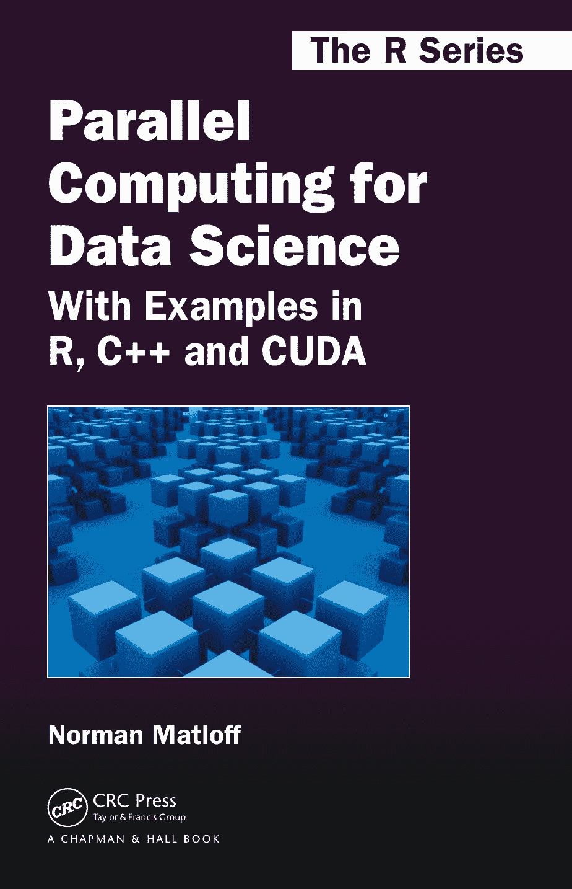
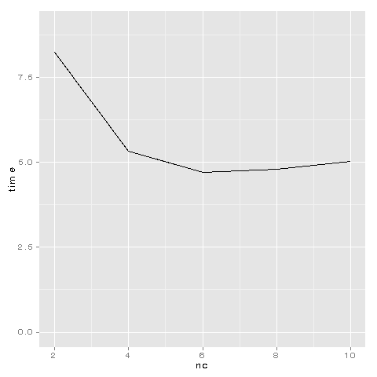
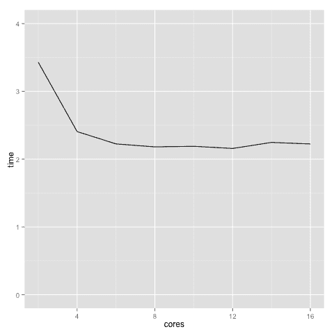
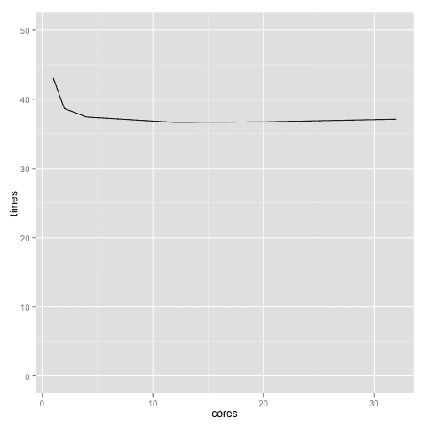

# R 数据科学并行计算：R、C 和 CUDA 示例




“……一本关于并行计算的详尽且易于阅读的指南——适用于广泛学科的研究人员和学生。……一本‘必不可少’的参考书……”

—David E. Giles，维多利亚大学

“这是一本我既会用作参考书，也会用于教学的书。书中的示例非常引人入胜，叙述方式让读者直接从概念过渡到可运行的代码。”

—Michael Kane，耶尔大学

## 并行数据科学

### 图书概述

`Parallel Computing for Data Science: With Examples in R, C++ and CUDA` 是首批专门专注于数据科学中并行数据结构、算法、软件工具和应用的并行计算书籍之一。它不仅包含了来自经典的“n 个观测值，p 个变量”矩阵格式的示例，还涵盖了时间序列、网络图模型以及数据科学中许多其他结构。该书还讨论了跨多种硬件类型并可以使用多种编程语言使用的软件软件包。

### 特点

- 侧重于数据科学领域的应用，包括统计学、数据挖掘和机器学习
- 讨论数据科学中常见的结构，例如网络数据模型
- 贯穿始终通用原则，例如避免降低并行程序速度的因素
- 涵盖了主要的计算平台类型：多核、集群和图形处理器（GPU）
- 解释了 `Thrust` 包如何简化多核机器和 GPU 的编程，并使同一代码能够在任一平台上运行
- 在作者的网页上提供了示例代码

### 关于作者

`Norman Matloff` 是加利州大学戴维斯分校的计算机科学教授，他曾是统计系的创始成员。他是一位统计顾问，也曾是数据库软件开发人员。他在洛杉矶加州大学（UCLA）获得了纯数学博士学位。

## 出版详情

- **ID**: `K20322`
- **网站**: `www.crcpress.com`
- **文件信息**: `K20322_cover.indd`, `K20322_FM.indd`
- **出版商**: Chapman & Hall/CRC
- **系列**: R 系列

### 系列主编

- **John M. Chambers**: 斯坦福大学统计系，生物统计分系，美国加利福尼亚州斯坦福市
- **Torsten Hothorn**: 苏黎世大学统计系，瑞士
- **Duncan Temple Lang**: 加利州大学戴维斯分校统计系，RStudio，美国加利福尼亚州戴维斯，**Hadley Wickham**

## 目标与范围

本丛书反映了 `R`（一种用于统计计算和图形图形编程语言和软件环境）近期在开发和应用方面的快速增长。`R` 现在广泛应用于学术研究、教育和工业。它在不断成长，核心软件定期发布新版本，并提供了超过 6000 个包。文档很难跟上软件扩展的速度，而这一重要的丛书为出版涵盖 `R` 开发和应用多个方面的书籍提供了一个平台。

该系列的范围广泛，涵盖了三个主线：

- `R` 在特定学科中的应用，如生物学、流行病学、遗传学、工程学、金融和社会科学。
- 使用 `R` 研究统计方法论主题，如线性模型和混合模型、时间序列、贝叶斯方法和缺失数据。
- `R` 的开发，包括编程、包构建和图形处理。

这些书籍将吸引 `R` 软件的程序员和开发者，以及许多领域的应用统计学家和数据分析师。书中将包含详细的练习示例和完全集成到文本中的 `R` 代码，确保其对研究人员、从业者和学生的实用性。

## 已出版书

- `Stated Preference Methods Using R`, *Hideo Aizaki, Tomoaki Nakatani, and Kazuo Sato*
- `Using R for Numerical Analysis in Science and Engineering`, *Victor A. Bloomfield*
- `Event History Analysis with R`, *Göran Broström*
- `Computational Actuarial Science with R`, *Arthur Charpentier*
- `Statistical Computing in C++ and R`, *Randall L. Eubank and Ana Kupresanin*
- `Reproducible Research with R and RStudio`, *Christopher Gandrud*
- `Introduction to Scientific Programming and Simulation Using R, Second Edition`, *Owen Jones, Robert Maillardet, and Andrew Robinson*
- `Nonparametric Statistical Methods Using R`, *John Kloke and Joseph McKean*
- `Displaying Time Series, Spatial, and Space-Time Data with R`, *Oscar Perpiñán Lamigueiro*
- `Programming Graphical User Interfaces with R`, *Michael F. Lawrence and John Verzani*
- `Analyzing Sensory Data with R`, *Sébastien Lê and Theirry Worch*
- `Parallel Computing for Data Science: With Examples in R, C++ and CUDA`, *Norman Matloff*
- `Analyzing Baseball Data with R`, *Max Marchi and Jim Albert*
- `Growth Curve Analysis and Visualization Using R`, *Daniel Mirman*
- `R Graphics, Second Edition`, *Paul Murrell*
- `Data Science in R: A Case Studies Approach`, *Deborah Nolan and Duncan Temple Lang*
- `Multiple Factor Analysis by Example Using R`, *Jérôme Pagès and Roger E. Krider*
- `Customer and Business Decision Making Using R`, *Antony Unwin*
- `Using R for Introductory Statistics, Second Edition`, *John Verzani*
- `Advanced R`, *Hadley Wickham*
- `Dynamic Documents with R and knitr`, *Yihui Xie*

## 版权信息

- © 2016 by Taylor & Francis Group, LLC
- CRC Press 是 Taylor & Francis Group 的一个 Informa
- 地址: 6000 Broken Parkway NW, Suite 300, Boca Raton, FL 33487-2742
- 版本日期: 20150512
- ISBN-13: `978-1-4665-8703-8`

Rosewood Drive, Danvers, MA 01923, 978-750-8400. CCC 是一家非营利组织，为各种用户提供许可和注册。对于已 CCC 授予复印许可的组织，已安排了单独的支付系统。

**商标公告：** 产品或公司名称可能是商标或注册商标，仅用于识别和说明，并无侵权意图。

**访问 Taylor & Francis 网站：** `http://www.taylorandfrancis.com`

**以及访问 CRC Press 网站：** `http://www.crcpress.com`

# 目录

- 前言 (xix)
- 个人简介 (xxiii)

# 1. R 语言中的并行处理简介 (1)

## 1.1 重复主题：足够好的并行化原理 (1)

### 1.1.1 足够快 (1)

### 1.1.2 “R+X” (2)

## 1.2 关于机器的说明 (3)

## 1.3 重复主题：对冲风险 (3)

## 1.4 扩展示例：互向网页链接 (4)

### 1.4.1 串行代码 (5)

### 1.4.2 并工具的选择 (7)

### 1.4.3 本书中“snow”的含义 (8)

### 1.4.4 `snow` 简介 (8)

### 1.4.5 互向链接问题，解决方案 1 (8)

#### 1.4.5.1 代码 (9)

#### 1.4.5.2 耗时 (10)

#### 1.4.5.3 代码分析 (11)

# 2. “为什么我的程序这么慢？”速度的障碍 (17)

## 2.1 速度的障碍 (17)

## 2.2 性能与硬件结构 (18)

## 2.3 内存基础 (20)

### 2.3.1 缓存 (20)

### 2.3.2 虚拟内存 (22)

### 2.3.3 监控缓存缺失和页错误 (23)

### 2.3.4 引用局部性 (23)

## 2.4 网络基础 (23)

## 2.5 延迟与带宽 (24)

### 2.5.1 两个代表性硬件平台：多核机器和集群 (25)

#### 2.5.1.1 多核 (26)

#### 2.5.1.2 集群 (29)

### 2.5.2 “顺其自然”的原理 (29)

## 2.6 线程调度 (29)

## 2.7 多少个进程/线程？ (31)

## 2.8 示例：互向链接问题 (31)

## 2.9 “大 O”表示法 (32)

## 2.10 数据序列化 (33)

## 2.11 “尴尬并行”型应用 (33)

### 2.11.1 人们所说的“尴尬并行”是指什么 (33)

### 2.11.2 非尴尬并行的适用平台 (34)

## 并行循环调度的原理 (35)

## 循环调度的泛化 (36)

## `snow` 中的分块 (38)

### 示例：互向链接问题 (38)

### 关于复杂性的说明 (40)

### 示例：所有可能的回归 (41)

### 并行化策略 (41)

### 代码 (42)

### 示例运行 (45)

### 代码分析 (45)

### 任务列表 (46)

### 分块 (47)

### 任务调度 (47)

### 工作的实际分发 (48)

### 总结 (50)

### 耗时 (50)

## `tools` 包 (52)

### 示例：所有可能的回归的改进版 (52)

### 代码 (53)

### 代码分析 (56)

### 耗时 (56)

## 3.7 引入另一个工具：`multicore` (57)

### 3.7.1 性能优势的来源 (58)

### 3.7.2 示例：使用 `multicore` 的所有可能的回归 (59)

## 3.8 分块大小的问题 (63)

## 3.9 示例：并行距离计算 (64)

### 3.9.1 代码 (65)

### 3.9.2 耗时 (68)

## 3.10 `foreach` 包 (69)

### 3.10.1 示例：互向链接问题 (70)

### 3.10.2 使用 `foreach` 的注意事项 (72)

## 3.11 步长 (73)

## 3.12 另一种调度方法：随机任务重排 (74)

### 3.12.1 数学原理 (74)

### 3.12.2 实践中随机方法与其他方法的对比 (76)

## 3.13 调试 `snow` 和 `multicore` 代码 (77)

### 3.13.1 在 `snow` 中调试 (77)

### 3.13.2 在 `multicore` 中调试 (78)

# 4. 共享内存范式：通过 R 的入门介绍 (79)

## 4.1 那么，究竟共享了什么？ (80)

### 4.1.1 全局变量 (80)

### 4.1.2 局部变量：堆栈结构 (81)

### 4.1.3 非共享系统 (83)

### 4.1.4 共享内存的清晰度 (83)

### 4.1.5 共享编程的高级介绍 (84)

### 4.1.6 共享内存的使用 (85)

### 4.1.7 示例：乘法 (85)

#### 4.1.7.1 代码 (86)

#### 4.1.7.2 分析 (87)

#### 4.1.7.3 代码 (88)

#### 4.1.7.4 深入观察数据的共享特性 (89)

#### 4.1.7.5 耗时对比 (90)

#### 4.1.7.6 利用 R (91)

## 4.5 共享内存可以带来性能优势 (91)

## 4.6 锁与屏 (94)

### 4.6.1 竞态条件与临界区 (94)

### 4.6.2 锁 (95)

### 4.6.3 屏 (97)

## 4.7 示例：时间序列中的极大值 (97)

### 4.7.1 代码 (97)

## 4.8 示例：转换邻接矩阵 (99)

### 4.8.1 代码 (100)

### 4.8.2 内存过度分配 (104)

### 4.8.3 耗时实验 (104)

## 4.9 示例：`k-means` 聚类 (106)

### 4.9.1 代码 (106)

### 4.9.2 耗时实验 (113)

# 5. 共享内存范式：C 级 (115)

## 5.1 `OpenMP`

## 5.2 示例：寻找时间序列中的最大突发值 (116)

### 5.2.1 代码 (116)

### 5.2.2 编译与运行 (119)

### 5.2.3 分析 (120)

### 5.2.4 关于线程调的注意事项 (123)

### 5.2.5 设置线程数 (123)

### 5.2.6 耗时 (124)

## 5.3 `OpenMP` 循环调度选项 (124)

### 5.3.1 `OpenMP` 调度选项 (124)

### 5.3.2 通过工作窃取进行调度 (125)

## 5.4 示例：转换邻接矩阵 (127)

### 5.4.1 代码 (127)

### 5.4.2 代码分析 (129)

## 5.5 示例：邻接矩阵，R 可调代码 (132)

### 5.5.1 针对 `C()` 的代码 (132)

### 5.5.2 编译与运行 (134)

### 5.5.3 分析 (137)

### 5.5.4 针对 `Rcpp` 的代码 (137)

### 5.5.5 编译与运行 (140)

### 5.5.6 代码分析 (141)

### 5.5.7 高级 `Rcpp` (143)

## 5.6 C 语言中的加速 (143)

## 5.7 运行时间 vs 开发时间 (144)

## 5.8 进一步的缓存/虚拟内存问题 (144)

## 5.9 `OpenMP` 中的规操作 (149)

### 5.9.1 示例：互入链 (149)

#### 5.9.1.1 代码 (150)

#### 5.9.1.2 示例运行 (151)

#### 5.9.1.3 分析 (151)

### 5.9.2 缓存问题 (152)

### 5.9.3 行 vs 列 (152)

### 5.9.4 处理器亲和性 (152)

## 5.10 调试 (153)

### 5.10.1 `GDB` 中的线程命令 (153)

### 5.10.2 在 R 调用的 C/C++ 代码上使用 `GDB` (153)

## 5.11 Intel 线程构建块 (`TBB`) (154)

## 5.12 无锁同步 (155)

# 6. 共享内存范式：GPU (157)

## 6.1 概述 (157)

### 6.2 关于代码复杂性的注意事项 (158)

## 6.3 本章目标 (159)

## 6.4 NVIDIA GPU 和 `CUDA` 简介 (159)

### 6.4.1 示例：计算和 (160)

### 6.4.2 NVIDIA GPU 结构 (164)

### 6.4.3 核心 (164)

### 6.4.4 线程 (165)

### 6.4.5 线程分歧问题 (166)

### 6.4.6 “硬件中的操作系统” (166)

### 6.4.7 网格配置 (167)

### 6.4.8 GPU 中的延迟隐藏 (168)

### 6.4.9 共享内存 (168)

### 6.4.10 更多硬件细节 (169)

### 6.4.11 资源限制 (169)

### 6.4.12 示例：互入链 (170)

#### 6.4.12.1 代码 (170)

#### 6.4.12.2 耗时实验 (173)

#### 6.4.12.3 GPU 上的同步 (173)

#### 6.4.12.4 全局内存中的数据是持久的 (174)

#### 6.4.12.5 R 与 GPU (175)

#### 6.4.12.6 示例：并行距离计算 (175)

#### 6.4.12.7 Intel Xeon Phi 芯片 (176)

# 7. `Thrust` 与 R (179)

## 7.1 对冲策略 (179)

## 7.2 `Thrust` 概述 (180)

## 7.3 R (180)

## 7.4 跳过 C++ (181)

## 7.5 示例：寻找位数 (181)

### 7.5.1 代码 (181)

### 7.5.2 编译与耗时 (183)

### 7.5.3 代码分析 (183)

## 7.6 R 简介 (186)

# 8. 消息传递范式 (189)

### 8.1 消息传递概述 (189)

## 8.2 集群模型 (190)

## 8.3 性能问题 (191)

### 8.4 `Rmpi` (191)

### 8.4.1 安装与执行 (192)

## 8.5 寻找素数的流水线方法 (193)

### 8.5.1 算法 (194)


## 8.5.2 代码 (194)

### 8.5.2.1 示例运行 (195)

### 8.5.2.2 耗时实验 (198)

### 8.5.2.3 集群上的同步 (199)

### 8.5.2.4 并行性 (199)

### 8.5.2.5 可能的改进 (199)

### 8.5.2.6 代码分析 (200)

### 8.5.2.7 文件 MPI 的作用 (201)

### 8.5.2.8 内存分配 (203)

### 8.5.2.9 消息传递 (204)

### 8.5.2.10 阻塞 I/O (204)

# 9 MapReduce (207)

### 9.1 MapReduce (207)

### 9.2 MapReduce 计算 (208)

### 9.3 R (208)

### 9.4 替代方案：MapReduce 系统 (209)

#### 9.4.1 示例：词频 (210)

#### 9.4.2 示例：k-means 聚类 (214)

# 10 并行排序与合并 (219)

### 10.1 难以实现的优化目标 (219)

### 10.2 排序算法 (220)

#### 10.2.1 比较与交换操作 (220)

#### 10.2.2 代表性排序算法 (220)

### 10.3 R 中的桶排序 (223)

### 10.4 OpenMP 中的快速排序 (224)

### 10.5 R 中的排序 (226)

### 10.6 耗时对比 (229)

### 10.7 分布式数据排序 (230)

#### 10.7.1 超快速排序 (230)

# 11 并行前缀和 (233)

### 11.1 通用公式 (233)

## 11.2 应用 (234)

## 11.3 通用策略 (235)

### 11.3.1 基于日志的方法 (235)

## 11.3.2 另一种方法

## 11.4 并行前缀和（Parallel Prefix Scan）的实现

## 11.5 使用 OpenMP 的并行 `cumsum()`

### 11.5.1 栈大小限制

### 11.5.2 让我们来尝试一下

## 11.6 示例：移动平均

### 11.6.1 R 代码

### 11.6.2 算法

### 11.6.3 性能

### 11.6.4 Lambda 函数的使用

## 12 并行矩阵运算

### 12.1 分块状矩阵（Tiled Matrices）

### 12.2 示例：Snowdoop 方法

### 12.3 并行矩阵乘法

#### 12.3.1 消息传递系统上的矩阵乘法

##### 12.3.1.1 分布式存储

##### 12.3.1.2 Fox 算法

##### 12.3.1.3 开销问题

#### 12.3.2 多核机器上的矩阵乘法

##### 12.3.2.1 开销问题

#### 12.3.3 GPU 上的矩阵乘法

##### 12.3.3.1 开销问题

### 12.4 BLAS 库

#### 12.4.1 概述

### 12.5 示例：OpenBLAS 的性能

### 12.6 示例：图的连通性

#### 12.6.1 分析

#### 12.6.2 “对数技巧”（Log Trick）

#### 12.6.3 并行计算

#### 12.6.4 `matpow` 包

##### 12.6.4.1 特性

### 12.7 求解线性方程组

#### 12.7.1 经典方法：高斯消元与 LU 分解

#### 12.7.2 Jacobi 算法

##### 12.7.2.1 并行化

#### 12.7.3 示例：R/gputools 实现的 Jacobi

#### 12.7.4 QR 分解

#### 12.7.5 某些计时结果

### 12.8 稀疏矩阵

## 13 生统计方法：子集方法

### 13.1 分块平均法（Chunk Averaging）

#### 13.1.1 渐近等效性

#### 13.1.2 O(·) 分析

#### 13.1.3 代码

#### 13.1.4 实验

##### 13.1.4.1 示例：分位数回归

##### 13.1.4.2 示例：逻辑模型

##### 13.1.4.3 示例：估计函数

##### 13.1.4.5 设置

### 13.2 小自助法（Bag of Little bootstraps）

### 13.3 变量筛选

## 矩阵代数回顾

### A.1 术语与符号

#### A.1.1 矩阵加法与乘法

### A.2 矩阵转置

### A.3 线性相关性

### A.4 行列式

### A.5 矩阵逆

### A.6 特征值与特征向量

### A.7 R 中的矩阵代数

## B R 快速上手

### B.1 对应关系

### B.2 启动 R

### B.3 首次示例编程

### B.4 第二次示例编程

### B.5 第三次示例编程

### B.6 R 列表类型（List）

#### B.6.1 基础

#### B.6.2 `Reduce()` 函数

#### B.6.3 `S3` 类

#### B.6.4 实用工具

### B.7 R 中的调试

## C 面 R 程序员的 C 语言简介

### C.0.1 示例程序

### C.0.2 分析

### C.1 C++

## 索引

## 序言

感谢你对本书的关注。我很享受写作过程，并希望它对你非常有帮助。为了介绍介绍，我想提供一些通用的背景信息。

### 目标：

这本书希望能够名副其实——《数据科学的并行计算》。与我所知的几乎所有其他关于并行计算的书不同，你在这里不会找到任何关于求解偏微分方程及其他物理应用的示例。这本书真正致力于数据科学领域的应用——无论你将该术语定义为统计学、数据挖掘、机器学习、模式识别、数据分析或其他任何定义。

这不仅意味着书中的示例是选自数据科学领域，它也意味着数据结构、算法等都反映了这一取向。

涵盖的计算平台主要类型包括多核、集群和 GPU。此外，书中还大量介绍了 `Thrust`，这是一个非常出色的工具，它极大简化了多核机器和 GPU 的编程——而且，从某种意义上说，相同的代码可以在任何一个平台上运行！

我相信读者会发现这些材料非常有价值。

这本书并不是一本用户手册。尽管它在贯穿始终都使用了特定的工具，如 `R` 的 `parallel` 和 `Rmpi` 包、`OpenMP`、`CUDA` 等，但这些都是为了具体化。本书将为读者对这些工具进行坚实的介绍，但并不是所有不同函数参数、环境选项等的汇编。其意图是让读者在读完本书后，能够很好地学习更多这些工具，最重要的是，能够在其他各种语言（无论是 `Python`、`Julia` 还是其他）中编写高效并行代码。

## 必要的背景

如果你认为自己熟练使用 `R`，那么你会发现这本书的大部分内容非常易懂。少数章节确实使用了 `C/C++`，如果你想详细阅读这些章节，则需要具备这些语言的背景知识。然而，即使不熟悉 `C/C++`，你仍然会发现这些材料相当易读且具有很高的价值。书中还包含了为 `C` 程序员总结 `R` 以及向 `R` 人员介绍 `C` 的附录。

你应该熟悉矩阵的基本数学运算，主要是乘法和加法。偶尔会使用一些更高级的操作，例如求逆（以及它的类似操作，如 `QR` 方法）和对角化，这些将在附录 A 中介绍。

## 机器

除非另有说明，书中所有的计时示例都是运行在一台 16 核的 `Ubuntu` 机器上，超线程倍数为 2。我通常使用 2 到 24 个核心，这个范围应该与大多数读者所拥有的平台相似。我预计典型的读者将拥有一个 4 到 16 个核心的多核系统，或者一个拥有数十个节点的集群。但即使你只有一台单双核机器，你仍然会发现这里的材料非常有价值。

对于那些少数幸运拥有由成千上万核心组成的系统的读者来说，这些材料仍然适用，但遵循书中的观点：对于此类系统，对著名问题“它具有扩展性吗？”的答案通常是“否”。

## CRAN 包与代码

本书使用了我在 `CRAN`（R 贡献软件库 http://cran.r-project.org）上的几个包：`Rdsm`、`partools` 和 `matpow`。

书中示例的代码可以在作者网页 http://heather.cs.ucdavis.edu/pardatasci.html 获取。

### 关于字体的说明

函数和变量名加粗，`R` 包也是如此（但不包括其他包）。代码列表使用 `LaTeX` 的 `lstlisting` 包，通常会根据所使用的语言进行定制，例如 `R` 或 `C`。数学量使用数学斜体字体。

## 感谢

我向要感谢所有直接或间接为此项目提供有用信息的人。按字母排序列表包括 JJ Allaire, Stuart Ambler, Matt Butner, Federico De Giuli, Matt Dowle, Dirk Eddelbuet-tel, David Giles, Stuart Hansen, Richard Heiberger, Bill Xu, Michael Kane, Sameer Khan, Bryan Lewis, Mikel McDaniel, Richard Minner, George Os-trouchov, Drew Schmidt, Lars Seeman, Marc Sosnick 和 Johan Wikström。

我也非常感谢 Hsu 教授为我提供了一台配备先进 GPU 的机器，感谢 Hao Chen 教授让我使用他的多核系统。

我开始开发在书中部分使用的 `Rdsm` 包，正是 Michael Kane 和 Jay Emerson 开发他们的 `bigmemory` 包的时候。当我们发现彼此的工作时，我们进行了一些我发现非常有价值的邮件交流。事实上，在我的后期版本中，我决定将 `bigmemory` 作为基础，其中原因之一是它使用后台存储的能力。在这一点，我从与 Michael 以及 Bryan Lewis 的对话中受益匪浅。

非常感谢内部评审员 David Giles、Mike Hannon 和 Michael Kane。我特别感谢老朋友 Mike Hannon，他提供了极其详细的反馈。感谢 Chapman and Hall 的统计学执行编辑 John Kimmel，他从一开始就提供了大力支持。

我的妻子 Gamis 和女儿 Laura 都具有感染力的幽默感和对生活的渴望，这极大地改善了我所的一切。

## 作者简介

Matloff 博士出生于洛杉矶，在东洛杉矶和圣盖布尔谷长大。他拥有 `UCLA` 的纯数学博士学位，专攻概率论和统计学。他在计算机科学和统计学领域发表了大量论文，目前的研究方向是并行处理、统计计算和回归方法论。他是《统计软件杂志》的编辑委员会成员。

Matloff 教授是 IFIP 工作组 11.3 的前任任命成员，这是一个在联合国教科文组织下设立的数据库软件安全国际委员会。他是加州大学戴维分校统计系的创始成员，并参与了 UCD 计算机系的形成。他是加州大学戴维分校校级卓越教学奖和卓越公共服务奖的获得者。

# 第 1 章：R 中的并行处理简介

我们不会从并行编程的抽象概述开始，而是直接通过 `R` 中的一个具体示例开始工作。抽象概述可以等一下。但我们应该先将 `R` 置于正确的背景。

### 1.1 核心主题：足够并行原则

书中的大部分示例涉及 `R` 语言，这是一种解释型语言。`R` 的核心操作往往具有高效的内部实现，因此只要使用得，该语言通常可以提供良好的性能。

#### 1.1.1 足够快

在确实需要最大化执行速度的情况下，你可能希望采用 `C/C++` 等编译语言，我们在书中确实偶尔会这样做。然而，通过编译语言可能获得的额外速度通常是不值得付出的。换句话说，我们有一个类比“良好隐私”（PGP）安全系统的概念：足够并行原则：在许多情况下，“足够快”就足够了。我们从 `R` 转移到 `C/C++` 可能会获得的额外速度并不抵消在该水平上编写、调试和维护代码可能需要的长得多的时间。这正是各种并行 `R` 包受欢迎的原因。它们满足了编写并行操作的愿望，同时仍然留在 `R` 中。例如，`Rmpi` 包提供了 R 到消息传递接口（MPI），这是一种非常广泛使用的并行处理系统，应用程序通常用 `C/C++` 或 FORTRAN 编写。`Rmpi` 为分析师提供了利用 `MPI` 的机会，同时保持在 `R` 中。但作为使用 `MPI` 的 Rmpi 替代方案，`R` 用户可以使用 `C/C++` 编写应用程序代码并调用 `MPI` 函数，然后将 `R` 与生成的 `C/C++` 函数接口。但这样做，他们将放弃 `R` 中提供的编程便利性和丰富的包。因此，大多数人选择仅通过 `Rmpi` 接口使用 `MPI`，而不是直接在 `C/C++` 中使用。

# 引言

本书的目的是为数据科学中的并行处理提供通用的处理方法。`R` 提供了一系列丰富且强大的高层数据和统计操作，这意味着 `R` 中的示例将比通常在其他语言中对应的示例更短、更简单。这使得读者能够真正关注并行计算方法本身，而不会因处理诸类细节（例如复杂的嵌套循环）而分散注意力。这不仅从学习的角度来看很有用，而且它将易于将这里介绍的代码和技术适配到其他语言，例如 `Python` 或 `Julia`。

## R+X

事实上，`R` 目前的一个主要大趋势可以被称为“R+X”，其中 `X` 是其他某种语言或库。`R+C`（在 `R` 中编写主代码，但在需要额外速度的部分用 `C` 或 `C++` 编写）自 `R` 诞生以来就已经很常见。如今 `X` 可能是 `Python`、`Julia`、`Hadoop`、`H2O` 或许多其他东西。

（为了简洁起见，我通常不会提到 `FORTRAN`，因为它在数据科学中并不被频繁使用。）

## 关于机器的说明

本书将使用三类型的机器进行说明：多核系统、集群和图形处理器单元（`GPUs`）。如前言所述，我的书目标读者不是那少数能够访问超级计算机的幸运儿（尽管这里介绍的方法也适用于此类机器）。相反，假设大多数读者将拥有更平易的系统，例如具有 4-16 个核心的多核系统，或者拥有几十个节点的集群，或者一个可能不是最新型号的单个 `GPU`。

书中的大多数多核示例都是在一个 32 核系统上运行的，在那个系统上我很少使用所有核心（因为我是访客用户）。计时实验通常从较少的核心开始，例如 2 个或 4 个。

至于集群，我对“消息传递”软件的覆盖通常在多核系统上运行，尽管偶尔也会在真实的集群上运行，以演示开销的影响。这里的 `GPU` 示例通常运行在简易的硬件上。

再次强调，这里使用的相同方法也适用于更强大的系统，例如带有多个 `GPUs` 的巨型超级计算机等。这类系统通常需要调优，但这超出了本书的范围。

## 反复主题：对冲赌注

当我于 2014 年写此时，我们正处于并行处理的一个令人兴奋的时代。

家里可以购买到的硬件，其速度和并行程度对于十年前的普通 PC 用户来说是无法想象的。软件也有了巨大的改进；`R` 现在有多种实现并行的方法，正如我们在书中将看到的；`Python` 终于在几年前摆脱了 `GIL` 的枷锁；`C++11` 具有内置的并行性；等等。

然而，由于这一切的变动，当我们展望未来几年时，我们确实处于一个相当不稳定的状态。`GPUs` 会变得越来越主流吗？多核芯片是否会惯常包含这么多核心，以至于 `GPUs` 仍然是一种很不错的硬件类型？像 Intel Xeon Phi 这样的加速芯片会超越 `GPUs` 吗？语言能跟上硬件的进步吗？

正因如此，跨越多种硬件类型且可以使用多种编程语言的软件包具有极大的吸引力。`Thrust` 包（第 7 章和某些后续章节的主题）就体现了这一理念。相同的 `Thrust` 代码可以在多核或 `GPU` 平台上运行，由于它是基于 `C++` 的，因此可以从 `R` 或大多数其他语言访问。简而言之，`Thrust` 我们在开发并行代码时“对冲赌注”。

消息传递软件系统（如 `R` 的 `snow`、`Rmpi` 和 `pbdR`）具有类似的优势，因为它们可以在多核机器或集群上运行。

## 扩展示例：互链

现在让我们来看承诺的具体示例。假设我们正在分析 Web 流量，我们的问题之一是两个网站指向同一个第三方网站的频率。假设我们有 `n` 个 Web 页面的出链信息。我们希望找到所有站点对之间互为出链的平均数量。

这种计算在模式上与许多统计方法相似，例如 `Kendall’s τ` 和 `U-statistic` 族。该模式采取如下形式。对于由 `n` 个观测值组成的数据，模式是对每对观测值计算某个数量 `g`，然后求加所有这些值，如伪代码所示（即大纲）：

```
sum = 0.0
for i = 1,...,n-1
  for j = i+1,,...,n
    sum = sum + g(obs.i, obs.j)
```

有了这样的嵌套循环，你会在书中发现，通常外层循环比内层循环更容易并行化。例如，如果我们有一台双核机器，我们可以分配一个核心来处理上述代码中 `i` 的某些值，另一个核心处理其余部分。我们最终会在这里这样做，但让我们先后退一步考虑一下这个设定。

### 串行代码

让我们先用串行代码实现此过程：

```
mutoutser <- function (links) {
  nr <- nrow(links)
  nc <- ncol(links)
  tot <- 0
  for (i in 1:(nr-1)) {
    for (j in (i+1):nr) {
      tot <- tot + sum(links[i, ] * links[j,])
    }
  }
  return(tot / (nr * (nr-1) / 2))
}
```

这里 `links` 是一个表示出链的矩阵，`links[i,j]` 根据站点 `i` 是否指向站点 `j` 为 1 或 0。上述代码是上述伪代码的直接实现。

这种代码在性能方面如何？考虑以下模拟：

```
sim <- function (nr, nc) {
  link <- matrix (sample(0:1, nr*nc, replace=TRUE), nr=nr)
  system.time(mutoutser(link))
}

> sim(500, 500)
[1] 106.659
```

运行时间为 106.659 秒——糟糕了！我们处理的是 500 个网站，相对于百万来说很小，但计算这一小组站点花了近 2 分钟。


众所周知，`R` 中的显式 `for` 循环很慢，而这里有两个循环。避免循环的第一种方案是向量化，即将循环替换为某些向量计算。这让人获得向量操作底层 C 代码的速度，而不是在循环每次迭代中反复翻译 `R` 代码。

在上面的 `mutoutser()` 代码中，内层循环可以重写为矩阵乘法，正如我们将在下方看到的，这将消除我们的两个循环。为了看到矩阵形式，假设我们有这样一个矩阵：

```text
[1,] 0 1 0 0 1
[2,] 1 0 0 1 1
[3,] 0 1 0 1 0
[4,] 1 1 1 0 0
[5,] 1 1 1 0 1
```

考虑 `i` 为 2 且 `j` 为 4 的情况（对应上述伪代码 1.4.1）。最内层循环（即涉及 `k` 的循环）计算 `1·1 + 0·1 + 0·1 + 1·0 + 1·0 = 1`。

但这仅仅是矩阵 `i` 行和 `j` 行的内积！换句话说，它是 `links[i, ] * links[j, ]`。但不仅如此。再次考虑 `i` 为 2 的情况。上述相同的推理表明，所有 `j` 和 `k` 的整个计算（即两个最内层循环）都可以写成矩阵乘法。

左侧的矩阵是我们原始矩阵第 2 行以下的部分，右侧的向量是第 2 行本身。

这些数字 1、1 和 2 是当我们让 `i` 等于 2 且 `j` 等于 3、4 和 5 运行代码时得到的结果。（你可以自己检查一下，以更好地掌握其工作原理。）

在 `R` 中，矩阵是向量的一种特殊情况，因此正如我们承诺的那样，我们在这里确实使用了向量化操作。

## 1.4 扩展示例：互向网页外链

因此，我们可以如下所示消除两个循环：

```r
mutouter1 <- function (links) {
  nr <- nrow(links)
  nc <- ncol (links)
  tot <- 0
  for (i in 1 : (nr -1)) {
    tmp <- links[(i + 1) : nr , ] %*% links[i , ]
    tot <- tot + sum( tmp )
  }
  tot / nr
}
```

这实际上带来了巨大的改进：

```r
sim1 <- function ( nr , nc ) {
  link <- matrix ( sample ( 0 : 1 , ( nr *nc ) , replace=TRUE) , nrow=nr )
  print ( system . time ( mutouter1 (link) ) )
}
```

```text
> sim1 ( 5000 , 5 0 0 )

user system elapsed

1 . 4 4 3

0 . 0 4 4

1 . 4 9 6
```

太棒了！尽管如此，这仍然适用于 500 个站点的极小情况。让我们为 2000 个运行一下：

```text
> sim1 ( 2 000 , 2 0 0 0 )

user system elapsed

9 2 . 3 7 8

1 . 0 0 2

9 4 . 0 7 1
```

超过了 1.5 分钟！而且 2000 并不大。我们可以进一步调优代码，但并行化似乎是一个更好的选择。让我们走这条路吧。

### 1.4.2 并行工具的选择

流行的并行 `R` 工具有 `snow`、`multicore`、`foreach` 和 `Rmpi`。由于前两个现在已作为名为 `parallel` 的包成为 `R` 核心的一部分，因此对于本章的介绍性材料，使用其中一个是最简单的，而不是让用户在此时安装另一个包。

我们的选择范围由于 `multicore` 仅运行在 Unix 族（例如 Linux 和 Mac）平台而非 Windows 上的这一事实而进一步缩小。因此，在书的早期阶段，我们将关注 `snow`。

### 1.4.3 本书中“snow”的含义

正如所提到的，一个旧的 `R` 贡献包 `snow` 后来被包含在 `R` 基础包 `parallel` 中（经过细微修改）。我们将频繁使用该包的这部分，因此我们需要为它一个短名称。“从 snow 适配的并行部分”一点也不短。所以，我们直接称其为 `snow`。

### 1.4.4 snow 简介

以下是 `snow` 方法的概述：上述提到的包括 `snow` 在内的四个流行包通常采用散播/收集（scatter/gather）范式：我们有多个同时运行的 `R` 实例，要么在集群的几台机器上，要么在多核机器上。我们将其中一个实例称为 `manager`（管理器），其余的称为 `workers`（工作节点）。并行计算过程如下：

- **scatter（散播）**：`manager` 将所需的计算分成若干块，并将这些块发送（“散播”）给 `workers`。
- **chunk computation（块计算）**：`workers` 然后对每个块进行计算，并将结果传回给 `manager`。
- **gather（收集）**：`manager` 接收（“收集”）这些结果，并将它们合并以解决原始问题。

在我们这里的互向外链示例中，每个块将由列表 1.4.1 中外部 `for` 循环的某些 `i` 值组成。换句话说，每个 `worker` 将确定该工作节点分配的 `i` 值的互向外链总数，然后将该计数返回给 `manager`。后者将收集这些计数，求和形成总计，然后通过除以节点对数 `n(n-1)/2` 来获得平均值。

### 1.4.5 互向外链问题，解决方案 1

这是我们对互向外链问题的初步尝试：

#### 1.4.5.1 代码

```r
library(parallel)

dochunk <- function (ichunk) {
  tot <- 0
  nr <- nrow(links)

  # links
  global atmosfer

  for (i in inchunk) {
    tmp <- links[(i + 1) : nr , ] %*% links[i , ]
    tot <- tot + sum( tmp )
  }

  tot
}

mutoparpar <- function (links) {
  nr <- nrow(links)

  # links
  global atmosfer

  for (i in 1 : (nr -1)) {
    tmp <- links[(i + 1) : nr , ] %*% links[i , ]
    tot <- tot + sum( tmp )
  }

  tot / nr
}

snow <- function ( nr , nc ) {
  link <- matrix ( sample ( 0 : 1 , ( nr *nc ) , replace=TRUE) , nrow=nr )
  print ( system . time ( mutoparpar (link) ) )
}
```

现在，谁来负责什么？需要理解的是，串行版本中的大部分代码是由管理器（`manager`）执行的。工作者（`workers`）运行的代码将只有 `doichunk()`，尽管这确实是执行主要工作的地方。正如将看到的，管理器会将该函数（以及数据）发送给工作者，由他们根据管理器的指示执行该函数。

基本思想是将之前的串行代码（列表 1.4.1）中 `i` 循环的 `i` 值划分成块（chunks），然后让每个工作者处理其对应的块。我们的函数 `doichunk()`（意思是“处理 `ichunk` 中的元素 `i`”），

```r
doichunk <- function (ichunk) {
  tot <- 0
  nr <- nrow(lnks)

  # lnks
  global atwork

  for (i in ichunk) {
    tmp <- lnks[(i + 1) : nr , ] %*% lnks[i , ]
    tot <- tot + sum( tmp )
  }

  tot
}
```

将为每个工作者执行，每个工作者的 `ichunk` 各不同。

我们的函数 `mutoutpar()` 封装了整个过程，将 `i` 值划分成块，并在每个块上调用 `doichunk()`。因此，它使串行代码的外层循环并行。

```r
mutoutpar <- function (cls, lnks) {
  nr <- nrow(lnks)
  clusterExport(cls, "lnks")
  ichunks <- 1 : (nr -1)
  tots <- clusterApply(cls, ichunks, doichunk)
  Reduce(sum, tots) / nr
}
```

为了概述该函数，注意主要操作包括对 `snow` 和 `R` 函数的以下调用：

- 我们调用 `snow` 的 `clusterExport()` 将我们的数据（在本例中为 `lnks` 矩阵）发送给工作者。
- 我们调用 `snow` 的 `clusterApply()` 指导工作者执行分配给的任务块。
- 我们调用 `R` 的核心函数 `Reduce()` 作为一种方便的方法来合并工作者返回的结果。

以下是细节：甚至在调用 `mutoutpar()` 之前，我们先设置了 `snow` 集群：

```r
makeCluster(nworkers)
```

这设置了 `nworkers` 个工作者。记住，这些工作者中的每一个将是独立的 `R` 进程（管理器也是如此）。在这种简单的形式下，它们都运行在同一台机器上，假设是多核的。

集群是 `snow` 的抽象，而不是物理实体，尽管我们可以在物理机器集群上建立 `snow` 集群。正如稍后详细看到的，集群是一个包含各种工作者信息以及如何触达它们的 `R` 对象。因此，如果我运行

```r
cls <- initmc(4)
```

我创建了一个 4 节点的 `snow` 集群（对应 4 个工作者），并将其信息保存在 `R` 对象 `cls`（类为“cluster”）中，这将在我后续对 `snow` 函数的调用中使用。

`cls` 中每个工作者都有一个组件。因此在上述调用之后，运行

```r
length(cls)
```

会打印出 4。

我们也可以在物理机器集群上运行 `snow`，即通过网络连接的几台机器。调用上述函数 `initcls()` 就会安排这一点。例如，在我的部门，我们有命名为 `pc1`、`pc2` 等学生实验室机器，因此

```r
cl2 <- initcls(c("pc28", "pc29"))
```

将设置一个双节点的 `snow` 运行。

在任何情况下，在上述 `makeCluster()` 的默认调用中，管理器与工作者之间的通信是通过网络套字完成的，即使我们是在多核机器上。

现在，让我们仔细观察 `mutoutpar()`，首先是调用 `clusterExport(cls, "lnks")`，这将我们的数据矩阵 `lnks` 发送到 `cls` 中的所有工作者。

一个需要注意的重要点是，`clusterExport()` 默认要求传输的数据在管理器的工作空间中是全局的。然后会被放置在每个工作者的全局工作空间（不提供任何替代选项）。为了满足这一要求，我在通过 `snowsim()` 创建这些数据时，使用超赋值运算符 `<<-` 将 `lnks` 设为全局变量：

```r
lnks <<- matrix(sample(0 : 1, (nr * nc), replace=TRUE), nrow=nr)
```

在软件开发领域使用全局变量是非常有争议的。在我的书籍 *The Art of R Programming*（NSP, 2011）中，我处理了一些程序员对全局变量的反对意见，并论证在许多情况下（特别是在 `R` 中），全局变量是最佳（或最不坏）的解决方案。

无论如何，这里 `clusterExport()` 的结构基本上迫使我们使用全局变量。对于挑剔的人，有一个选项可以使用 `R` 环境而不是管理器的全局空间。我们可以修改上述 `mutoutpar()` 中的调用，例如：

```r
clusterExport(cls, "lnks")
```

但即使那样，数据也将是工作者局部的。这是一个很好的时候指出，许多并行 `R` 包要求用户精通使用 `R` 列表。我们对 `clusterApply()` 的调用返回了列表类型，实际上它的第二个参数通常是 `R` 列表，在这里不是。

所以，每个工作者处理其分配的块，并将结果（在块中发现的互连数）返回给管理器。`clusterApply()` 函数收集这些结果，并将它们放入一个 `R` 列表中，我们在这里将其赋值给 `tots`。该列表将包含 `nr - 1` 个元素。

人们可能认为，如果是这样，我们就可以简单地调用 `R` 的 `sum()` 函数来找到所有工作者返回的总的总和：

```r
sum(tots)
```

如果 `tots` 是向量，这样做将很好，但它是一个列表，因此我们才使用 `R` 的 `Reduce()` 函数。这里 `Reduce()` 将对列表 1 的每个元素应用 `sum()` 函数，从而得到所需的总和。

你会发现 `Reduce()` 在 `snow` 函数中很常见，因为它们通常返回列表形式的值。

尽管你无疑急于看到更多代码，但对基础设施问题建立坚实的基础被证明是非常有价值的，这也是本章存在的意义。这些问题将在书的其余部分反复出现。如果你愿意，现在可以跳到其他章节，等需要时再回来这一章，但最好现在就通读一遍。那么，让我们看看哪些因素导致了上述那位倒霉的分析师看到他绝妙的计划付诸东流的情况。

## 2. 速度的障碍

我们将计算实体称为“进程”（processes），例如处理雪地案例中的工人。并行编程中有两个主要的性能问题：

- **通信开销（Communications overhead）**：通常，数据必须在进程之间来回传输。这需要花费时间，会对性能产生相当大的影响。此外，如果所有进程都尝试同时访问相同的数据，它们可能会互相阻碍。当它们尝试访问同一个通信通道、同一个内存模块等时，会发生冲突。这是另一个对速度的损耗。

`granularity`（粒度）一词大致指计算量与开销的比例。大粒度或粗粒度算法涉及足够大的计算块，因此开销通常不是太大问题。在细粒度算法中，我们确实需要尽可能避免开销。

- **负载均衡（Load balance）**：正如上一章提到的，如果我们在向进程分配工作的方式上不小心，就会面临给某些进程分配远多于其他工作的风险。这会损害性能，因为在程序运行结束时，某些进程处于闲置状态而仍有工作未完成。

这类问题发生的频率很高，足以被汇集在本章中，作为对可能出现的问题“预警”。这只是一个概述，细节将在随后的章节中给出，但预先了解这些问题将有助于在遇到它们时更容易识别出来。

## 2.2 性能与硬件结构

“计分板，计分板！没有计分板你就没法介绍球员！”——这是棒球赛上计分板卖者的老口号。“脚骨连接着踝骨，踝骨连接着胫骨……”——这些来自儿歌《大骨头》（Dem Bones）。

在前一节中，那位不幸的分析师之所以对代码在并行机器上运行得更慢感到惊讶，几乎是因为对底层硬件和系统软件缺乏理解。虽然确实不需要从电子层面去理解硬件，但对“什么连接到什么”的基本知识是至关重要的。在本节中，我们将介绍主要硬件问题的概述，以及读者最可能遇到的两种并行硬件技术：多处理器和集群：

- 多处理器系统（multiprocessor system）正如其名，拥有两个或多个处理器，即两个或多个 `Us`，这样两个或多个程序（或同一个程序的多个部分）就可以同时进行计算。家庭常用的多核系统（multicore system）本质上是低端多处理器系统，正如我们之后看到的。多处理器也被称为共享内存系统（shared-memory systems），因为它们确实共享相同的物理 RAM。如今，几乎任何家用 PC 或笔记本电脑至少都是双核的。如果你拥有一台机器，恭喜你，你拥有一个多处理器系统！如果你电脑里有一张相当复杂的显卡（可以作为图形处理单元），你也应该为拥有多处理器系统感到庆幸。`GPUs` 是特殊的共享内存系统。

- 集群（cluster）由多台计算机组成，每台计算机都能独立运行，并通过网络连接在一起，使其能够通力合作解决一个巨大的数值问题。如果你家里有网络（例如带有无线或有线路由器），那么恭喜你，你拥有一个集群！

我强调上述的“家庭物品”方面，是为了强调这些并不是深奥的架构，尽管其规模可以从你家里的设备到更复杂昂贵的系统有巨大差异，中间还有很多选择。

上述的 `shared-memory`（共享内存）和 `networked`（联网）术语为计算速度的障碍提供了线索，这些是关键。因此，我们将在第 2.3 和 2.4 节首先讨论这两个硬件结构的高层工作原理。然后我们将解释它们如何应用于我们的两种基本平台类型：多核（2.5.1.1 节）和集群（2.5.1.2 节）的开销问题。我们将涵盖足够的细节来说明本章后面讨论的性能问题，并在后续章节返回更多细节。

1. 云端呢？云端也由多核机器和集群组成，但在后台运行。
2. 需要注意的是，对于用于密集计算的大型集群，通常必须安装软件来控制哪个程序运行在哪些机器上。但你的双节点家庭系统仍然是一个集群。

## 2.3 内存基础

内存访问缓慢是高性能计算中出现的最常见问题之一。因此，对内存的基本理解至关重要。考虑一个普通的赋值语句，将一个变量（假设是一个单整数）复制到另一个：

```python
y = x
```


通常，`x` 和 `y` 将存储在内存的某处，即 `RAM`（随机存存储）。内存被分为字节（bytes，设计用于存储一个字符）和字（words，通常设计用于包含一个数字）。一个字节由八位（bits，即八个 `0` 和 `1`）组成。在今天典型的计算机上，字长为 64 位或八字节。每个字都有一个 ID，称为地址。（单个字节也有地址，但这与我们无关。）因此，编译器（对于 `C`/`C++`）或解释器（对于像 `R` 这样的语言）将在内存中分配特定的地址存储 `x` 和 `y`。上述赋值将通过机器将一个字复制到另一个字来实现。

向量（vector）通常存储在一组连续的字中。矩阵也是如此，但关于这种存储是按行还是按列尚存在疑问。`C`/`C++` 使用行主序（row-major order）：首先存储第一行的所有内容（称为行 0），然后是第二行，依此类推。`R` 和 `FORTRAN` 使用列主序（column-major order），存储第一列的所有内容（命名为列 1）等。因此，如果 `z` 是 `R` 中的一个 5 × 8 矩阵，那么 `z[2,3]` 将位于 `z` 占据的内存部分的第 12 个字（`5+5+2`）。这些考虑因素将影响性能，正如我们之后看到的。

内存访问时间尽管是以纳秒（秒的十亿分之一）计算，但相对于 `CPU` 速度仍然很慢。这不仅是因为内存芯片内部的电子延迟，还因为通内存的路径通常是瓶颈。下文介绍。

### 2.3.1 缓存

常用于处理内存访问的设备是缓存（cache）。这是一种位于处理器芯片或附近的小型快速内存块。为了这个目的，内存被分为块（blocks），例如每个 64 字节。例如，内存地址 `1200` 将位于第 `18` 块，因为 `1200/64` 等于 18 加上分数。（第一个块被称为块 0）。缓存被分为行（lines），每行的大小与内存块相同。在任何给定时刻，缓存包含某些内存块的本地副本，具体块的选择是动态的——某些时候缓存包含某些内存块的副本，而过了一会儿它可能包含其他块的副本。

3. （注：原文中缺失脚注）

如果我们足够幸运，在大多数情况下，处理器想要访问的内存字（即程序员在代码中想要访问的变量）已经在它的缓存中有一份副本——这被称为缓存命中（cache hit）。如果这是一次读取访问（如我们上面的小例子中访问 `x`），那么就太棒了——我们避免了缓慢的内存访问。

另一方面，在写入访问（对上面的 `y`）的情况下，如果请求的字当前在缓存中，那也很好，因为这为我们节省了往返内存的长途旅程（如果我们没有采用“写回”策略并立即更新内存，正如我们在这里假设的那样）。但这会导致内存中给定的字与其缓存中的副本之间产生差异。在我们正在讨论的缓存架构中，这种差异是可以容忍的，并会在相关的块被“换出”（evicted）时最终解决，正如我们在下文中所示。（对于多核机器，缓存操作会变得更加复杂，因为通常每个核心将有自己的缓存，因此可能导致严重的差异。这将在第 2.5.1.1 节中讨论。）

如果在读取或写入访问中，所需的内存字当前不在缓存中，这被称为缓存缺失（cache miss）。这是相当昂贵的。当它发生时，包含所请求字的整个块必须被带入缓存。换句话说，我们必须访问内存中的许多字，而不仅仅是一个。

此外，通常当前缓存中的一个块必须被换出，为新带入的块腾出空间。如果旧块被写入过，我们现在必须将该整个块写回内存，以更新后者。

4. 有一个脏位（dirty bit）记录了我们是否写入过该块，但并没有记录具体哪些字受到了影响。因此，整个块都必须写入。

所以，虽然我们在缓存命中时节省了内存访问时间，但在缺失时我们会付出巨大的代价。良好的缓存设计可以使这种代价很少发生。当发生读取缺失时，硬件会进行“有根据的猜测”，哪些块在短期内最可能不再被需要，并换出其中一个。它通常猜得很好，所以 3 下文是对一种常用缓存设计的描述。还有许多变体，这里未进行讨论。

> 第 2 章 速度的障碍

注意到缓存命中率通常高于 90%。但请注意，这可能会受到我们编码方式的影响。这将在未来的章节中讨论。

机器通常会有两个或更多级的缓存。位于 `CPU` 内部或其旁边的缓存被称为 `L1` 或 1 级缓存。然后可能有一个 `L2` 缓存，即“缓存的缓存”。如果在 `L1` 缓存中没有找到所需的项，`CPU` 将搜索 `L2` 缓存，最后才尝试访问内存中的项。

### 2.3.2 虚拟内存

尽管在我们的语境中不会经常出现，但我们至少应该简要讨论虚拟内存。考虑我们上面的例子，我们的程序包含变量 `x` 和 `y`。假设它们分别分配到地址 `200` 和 `8888`。没问题，但如果另一个程序也在机器上运行呢？编译器/解释器可能将它的一个变量（比如 `g`）分配到地址 `200`。我们如何解决这个问题？

标准的解决方案是使地址 `200`（以及所有其他地址）仅为“虚拟”。例如，第一个程序的 `x` 实际上存储在物理地址 `7260` 中。程序仍然会说 `x` 在字 `200` 处，但在程序执行时，硬件会将 `200` 翻译为 `7260`。

如果第二个程序中的 `g` 实际上在字 `6548` 中，每当程序请求访问字 `200` 时，硬件都会将 `200` 替换为 `6548`。

硬件有一个表来执行这些查找，每个在机器上运行的程序都有一张表，表由操作系统维护。

虚拟内存系统将内存分为页，例如每页 `4096` 字节，类似于缓存块。通常，在任何给定时刻，你的程序只有部分页留在内存中，其余页在磁盘上。如果你的程序需要某些当前不在内存中的内存字——这被称为缺页（page fault），类似于缓存缺失——硬件会感知到这一点，并将控制权交给操作系统。`OS` 必须从磁盘调入请求的页，从时间上这是一个极其昂贵的操作，因为磁盘驱动器是机械的而不是像 `RAM` 那样的电子设备。5 因此缺页真的会减慢程序速度，而且像缓存的情况一样，你可能通过仔细设计代码来减少缺页。

5. 一些更昂贵的驱动器被称为固态硬盘（SSD），实际上是电子设备。

### 2.3.3 监控缓存缺失和缺页

缓存缺失和缺页都是良好性能的敌人，所以监控它们是好的。

这在缺页的情况下实际上是可以实现的。如所述，缺页会触发跳转到 `OS`，因此它可以记录下缺页。在 `Unix` 族系统中，`time` 命令——`time` 命令不仅提供运行时间，还提供缺页计数。

相比之下，缓存缺失完全由硬件处理，因此无法被 `OS` 记录。但人们可以尝试用缺页数作为代理来估计程序的缓存行为。还有一些模拟器，例如 `valgrind`，可以用来衡量缓存性能。

### 2.3.4 引用局部性

显然，缓存和虚拟内存的有效性取决于在短时间内重复使用相同的块（空间局部性）和时间局部性。正如前面提到的，这反过来在某种程度上受到我们代码方式的影响。

假设我们想要计算矩阵中所有元素的和。我们的代码应该是按行遍历矩阵还是按列遍历？在 `R` 中，由于我们提到它是按列存储矩阵的，我们应该按列遍历，以获得更好的局部性。

关于缓存行为的详细案例研究将在第 5.8 节中给出。

## 2.4 网络基础

单个以太网（或其他类似系统），例如建筑内部的，被称为网络。互联网简单来说就是许多网络的互连——数以百万计。

假设你指示电脑上的浏览器访问有线电视新闻（CNN）首页，而你位于金山。由于 `CNN` 总部位于亚特兰，数据包将从金山传到亚特兰。（事实上它们可能不需要那么远，因为互联网服务提供商经常缓存 Web 页面，但让我们假设没有这种情况。）实际上，数据包的路径相当复杂：

> 第 2 章 速度的障碍

- 你的浏览器程序将你的 Web 请求写入 `socket`。后者不是物理对象，而是从程序到网络的软件接口。
- `Socket` 软件将从你的请求形成数据包，然后它通过你 `OS` 中的几层网络协议栈。在此过程中，数据包会随着信息的增加而增大，但它也会分成多个较小的数据包。
- 数据包最终到达你电脑的网络接口硬件，从那里进入网络。
- 网络上的网关会注意到最终目的地位于该网络之外，因此数据包将被传输到网关也连接的另一个网络。
- 你的数据包将穿过国家，从一个网络发送到另一个网络。6
- 当你的数据包到达 `CNN` 计算机时，它们现在将向上通过 `OS` 的层级，最终到达 Web 服务器程序。

### 2.5 延迟和带宽

旅途中本身就是一种半的乐趣——这是一句关于旅行乐趣的古语。通信信道的速度——无论是共享内存平台中处理器内核与内存之间，还是机器集群中网络节点之间——都是用 `latency`（延迟，即单个比特端到端的传输时间）和 `bandwidth`（带宽，即我们每秒向通道注入的比特数）来衡量的。为了让这些概念更具体一些，考虑旧金山湾桥，这是一条长长的多道结构，向西行驶的司机需要支付过路费。

`latency` 的概念描述了汽车从桥的一端行驶到另一端所需的时间。（为了简单起见，假设它们以相同的速度行驶。）相比之下，`bandwidth` 则是单位时间内从收费站离开的汽车数量。我们可以通过提高桥上的限速来降低 `latency`，而通过增加更多车道和收费站来增加 `bandwidth`。

在你的机器上运行 `traceroute` 命令来查看具体的路径，尽管这可能会随时间而变化。

## 2.5 延迟与带宽

发送一个 `n` 字节的消息所需的网络时间，假设 `latency` 为 `l` 秒，`bandwidth` 为 `b` 字节/秒，显然是 `l + n/b`（2.1）。

当然，这假设没有其他消息在竞争通信信道。

显然，网络中存在许多延迟，包括在遍历操作系统层级时产生的不那么明显的延迟。这种遍历涉及将数据包从一层拷贝到另一层，在本书感兴趣的案例中，这种复制可能涉及巨大的矩阵，从而消耗大量时间。

尽管并行计算通常在网络内部进行，而不是像上面那样跨网络进行，但许多延迟仍然存在。因此，无论在 `latency` 还是 `bandwidth` 上，网络速度都远低于处理器速度。

即使在像 `Infiniband` 这样快速的网络中，`latency` 也是微秒级（即每秒的百万分之一），这与处理器中机器指令的纳秒级执行时间相比，简直是永恒的。

（注意那些号称快速但实际上只有高 `bandwidth` 而没有低 `latency` 的网络。）

`latency` 和 `bandwidth` 问题也会出现在共享内存系统中。以 `GPU` 为例，在大多数应用程序中，`CPU` 和 `GPU` 之间存在大量数据传输，并伴随着潜在的减速。

例如，`latency` 是单个比特从 `CPU` 到 `GPU` 或反之所需的时间。

缓解长 `latency` 延迟导致减速的一种方法是 `latency hiding`（延迟隐藏）。基本思想是在等待具有长 `latency` 的通信时尝试执行其他有用工作。这种方法被用于消息传递系统的非阻塞 I/O（第 8.7.1 节）以处理网络 `latency`，以及 `GPU`（第 6 章）以处理内存 `latency`。

### 2.5.1 两个代表性硬件平台：多核机器和集群

多核机器已成为桌面电脑的标准（甚至在手机中！），许多数据科学家都可以访问计算机集群。这些平台上的性能问题是什么？

#### 2.5.1.1 多核

对称多处理器系统在组件以及最重要的它们互连方面看起来类似于图 2.1。我们看到了什么？

- 有处理器，用 `Ps` 表示，你的程序在其中进行物理执行。
- 有内存库，用 `Ms` 表示，你的程序和数据在执行期间存储其中。
- 处理器和内存库连接到 `bus`（总线），用于这些计算机组件之间通信的一组并行线。

你的输入/输出硬件——磁盘驱动器、键盘等——也连接到 `bus`，实际上可能有多个 `bus`，但我们的重点将主要是处理器和内存。

多线程程序将会有自己的多个实例，称为 `threads`（线程），它们协同工作以实现并行性。它们独立运行，但它们共享相同的程序数据。如果你的程序是多线程的，它将同时运行在几个 `Ps` 上，每个线程运行在不同的内核上。正如我们将看到的，一个关键点是，共享内存变成了各个进程之间通信的媒介。

你的程序由许多机器语言指令组成。（如果你用 `R` 等解释型语言编写，解释器本身也由此类指令组成。）当处理器执行你的程序时，它们将从内存中获取指令。

如前提到的，你的数据——程序中的变量——存储在内存中。机器指令根据需要从内存中获取数据，以便在处理器中对其进行处理（例如，求和）。

直到最近，在当地电子商店售卖的普通 PC 仍然遵循图 2.1 中的模型，但只有一个 `P`。多处理器系统实现了并行计算，但耗资数十万。但后来系统拥有多核形式变成了标准。这意味着有多个 `Ps`，但重要的区别是它们都在单个芯片上（每个 `P` 都是一个内核），使得系统变得廉价。无论是在单个芯片上还是否，拥有多个 `Ps` 都建立了并行计算，并由于显而易见被称为共享内存范式。

顺便说一下，为什么图 2.1 中有多个 `Ms`？为了提高内存性能，系统被设计将内存划分为若干库（通常 `Ms` 的数量与 `Ps` 相同）。这使得我们不仅可以并行地进行计算——多个 `Ps` 并行处理问题的不同部分——还可以并行地进行内存访问——在不同的库中并行激活。这分摊了内存访问的开销。当然，如果多个 `P` 恰好同时需要同一个 `M`，我们失去这种并行性。

正如你所看到的，潜在的瓶颈是 `bus`。当多个 `P` 同时需要访问内存（即使是访问不同的库）尝试在 `bus` 上放置内存访问请求时，除一个之外所有的都需要等待。这种总线竞争会导致显著的减速。人们还开发了更复杂的系统，具有多个到内存的通信通道而是一个 `bus`，以缓解瓶颈问题。然而，本书的读者更有可能使用在单个内存 `bus` 上的多核系统。

你现在可以看到为什么高效的内存访问是实现高性能的关键因素了。这里还有一个至关重要的工具来处理此问题：使用缓存（caches）。注意是复数；在图 2.1 中，在每个 `P` 和 `bus` 之间通常有一个 `C`。

与单处理器系统一样，缓存可以带来性能的巨大胜利。

事实上，在多处理器系统中潜力更大，因为缓存现在带来了减少总线竞争的额外好处。

不幸的是，它也产生了一个新问题，缓存一致性，如下。

考虑在写入命中（即对存在本地缓存副本的位置写入）时发生了什么。例如，考虑这样的代码：

```
x = 2
```

当 `x` 的地址为 `200` 时，这段代码执行时，该处理器的缓存中可能已经存在字 `200` 的副本。问题在于，其他缓存可能也拥有该字的副本，因此它们现在对该块是无效的。（请记住，有效性仅定义在块级别；如果一个块中除这一个字以外的所有字都是有效的，那么整个块也被视为无效。）硬件现在必须通知那些其他缓存，它们对该块的副本已经失效了。

硬件通过 `bus` 实现这一点，从而导致了昂贵的总线操作。此外，当下一次在该字（或者说，该块中的任何字）在其中一个其他缓存中被请求时，将发生缓存缺失，这又是一次昂贵的事件。

再次，程序员这边的合理编码有时可以改善缓存一致性问题。

关于多核结构的最后一点：即使在单处理器机器上，通常也有多个程序在并发运行。你可能你的浏览器正忙于下载文件，例如，同时你正在使用一个照片处理应用程序。在只有一个处理器的情况下，这些程序实际上会轮流运行；每个程序运行一短时间，例如 `50 milliseconds`，然后以循环的方式将处理器交给下一个程序。（你作为用户可能不会直接察觉到这一点，但你可能会注意到整个系统在变慢。）顺便提一下，如果一个程序正在进行大量的输入/输出（例如文件访问），它在 I/O 期间实际上是空闲的；一旦它开始 I/O 操作，它就会放弃处理器。

相比之下，在多核机器上，你可以让多个程序在物理上同时运行（当然，如果程序数量多于核心，它们仍然会轮流运行）。

正如前面提到的，这里描述的结构有变体，但这种是典型的。

## 2.5 集群结构

### 2.5.1.2 集群

这些描述要简单得多，尽管面临着同样棘手的性能障碍。

`cluster`（集群）一词指的是通过局域网连接的一组独立的处理元素（`PEs`）或节点，例如常见的 `Ethernet` 或高性能的 `Infiniband`。每个 `PE` 由一个 `CPU` 和一些 `RAM` 组成。`PE` 可以是一台台式电脑，包括键盘、磁盘驱动器和显示器，但如果它主要用于并行计算，那么对于整个系统只需要一个显示器、键盘等就足够了。`cluster` 也可能有一个特殊的操作系统，用以协调将用户程序分配给 `PEs`。

我们将为每个 `PE` 配置一个计算进程（除非每个 `PE` 都是多核系统，这很常见）。进程之间的通信通过网络发生。当然，后一个方面是主要问题发生的地方。

### 2.5.2 “随其自然”原则

所有这些关于延迟和带宽的考虑在其他方面意味着，数据拷贝通常是速度的敌人。这对于 `clusters` 和 `GPUs` 等高延迟平台来说尤为如此。

在这种情况下，设计算法以最小化拷贝可能至关重要。例如，对于迭代算法，请确保在 `cluster` 情况下将中间结果留在远程节点上，在那种设置下，如果可能，将结果留在 `GPU` 内存中。

## 2.6 线程调度

假设你有一个多线程程序，例如有四个线程，且有一台四核心的机器。那么这四个线程将物理意义上同时运行（如果没有其他程序与它们竞争的话）。这当然是核心意义所在，即实现并行性，但其中不仅如此。

用于通用计算机的现代操作系统使用时间分片：用户不可见的情况下，程序正在轮流（`timeslices`）使用机器的核心。假设例如 `Manny` 和 `Moe` 正在使用一台名为 `Jack` 的大学计算机，`Manny` 坐在控制台前，而 `Moe` 是远程登录的。为了具体起见，假设 `Manny` 正在运行一个 `R` 程序，`Moe` 正在用 `Python` 运行程序，两者目前都在进行长时间的计算。

首先假设这是一台单核机器。那么一次只能运行一个程序。`Manny` 的程序将运行一段时间，但经过了一定的时间后，硬件计时器将发出一个中断，导致跳转到另一个程序。该程序被配置为操作系统。`OS` 将查看其 `process table`（进程表）以找到另一个处于就绪状态的程序，意味着可运行的（而不是由于等待键盘输入而挂起）。假设没有其他进程，`Moe` 的程序现在将获得一次机会。这种从 `Manny` 到 `Moe` 的转换被称为 `context switch`（上下文切换）。`Moe` 的程序将运行一段时间，然后另一个中断到来，`Manny` 将再次获得一次机会，以此类推。

现在假设这是一台双核机器。在这里 `Manny` 和 `Moe` 的程序将或多或少地并行运行，尽管会由于中断和随后的短暂 `OS` 运行而产生周期性的停顿。


但假设 `Moe` 的代码是多线程的，运行两个线程。现在我们将有三个线程——`Moe` 的两个和 `Manny` 的一个（即使是非多线程程序也包含一个线程）——竞争使用三个核心。`Moe` 的两个线程有时彼此并行运行，但有时并不并行。而不是获得 `2X` 的加速，`Moe` 得到的是大约 `1.5X`。

还存在缓存问题。当一个线程开始新的轮次时，它可能位于与之前不同的核心上。如果每个核心都有独立的缓存，那么新核心的缓存可能几乎没有用的内容。因此，在这个时间片内将出现很多缓存缺失。顺便提一下，解决方法是设置`processor affinity`（处理器亲和性）；参见第 5.9.4 节。

顺便问一下，当这些程序之一完成计算并返回到用户提示符时（例如 `Manny` 的 `R` 程序中的 `>`）会发生什么？此时 `R` 将尝试从键盘读取，为了做到这一点，它调用了一个 `C` 库函数，该函数反过来调用了 `OS` 中的一个函数。`OS` 意识到在 `Manny` 输入之前可能还有一段时间，会将他在`process table`中的条目标记为`sleep state`（睡眠状态）。当他终于按下按键时，键盘发送中断，导致 `OS` 运行，后者会将他的程序标记为回到就绪状态，它最终将获得另一次机会。

## 2.7 多少进程/线程？

正如前面提到的，在 `R` 世界中，习惯上将 `snow` 程序中的每个工作称为进程。随后产生的问题是，我们应该运行多少个进程？

假设我们有一个 16 个节点组成的`cluster`。我们应该为我们的 `snow` 程序设置 16 个工作进程吗？多线程程序也存在相同的问题，例如使用 `Rdsm` 或 `OpenMP`（第 4 章和第 5 章）。在四核机器上，我们应该运行 4 个线程吗？

这些问题的答案并不总是“是”。对于细粒度的程序，使用过多的进程/线程实际上可能会降低性能，因为开销可能会抵消通过增加硬件来解决问题的预期优势。因此，我们实际使用的可能少少于可用的集群节点或核心。

另一方面，我们可以尝试过度订阅资源。正如前面讨论的，缓存缺失会导致严重的延迟，页错误更是如此。这是核心没有进行计算的时间。

为了使之具体，让我们针对互向出链问题（第 1.4 节），在不断增加进程数量的情况下进行测量。

我在一台由四个处理器芯片组成的共享内存机器上运行程序，每个芯片有 8 个核心。这为我们提供了一个 32 核系统，我运行了互向出链问题，其中核心数 `nc` 的值分别为 2, 4, 6, 8, 10, 12, 16, 24, 28 和 32。问题规模为 1000 行 1000 列。运行时间如图 2.2 所示。

在这里我们看到了一个经典的 U 型模式：当我们向问题中投入越来越多的进程时，在早期阶段是有帮助的，但超过某个点后，性能实际上会下降。后者的现象可能是由于我们之前讨论过的通信开销，在这种情况下是总线竞争等原因。

尽管进程是独立的且不共享内存，但它们确实共享总线。



32

第 2 章 速度的障碍

图 2.2：运行时间与核心数的关系

顺便提一下，对于每个 `nc` 工作负载，我们在机器上都运行了一个 `R` 的调用。还有一个针对管理器的额外调用。

然而，在这种情况下这不是一个性能问题，因为管理器大部分时间都处于空闲状态，等待工作负载。

### 2.9 “大 O”符号

在讨论了这么多需要克服的物理障碍（如内存访问时间）之后，同样重要的是提出：应用本身是否具有良好的并行性。衡量这一点的方法是“大 O”符号。

在我们带有 `n × n` 邻接矩阵的互向出链示例中，每行平均需要执行 `n/2` 次求和操作，共 `n` 行，因此共有 `n · n/2` 次操作。在并行处理领域，关于硬件、软件、算法等提出的关键问题是：“它可扩展吗？”，意味着随着问题规模的增大，运行时间的增长是否在可控范围内？

### 2.10 数据序列化

我们上面看到，互向出链问题的运行时间与问题规模的平方成比例增长，在本例中是网站的数量。（除以 2 不影响这种增长率。）我们将其写为 `O(n²)`，俗称为“大 O”符号。当应用于运行时间分析时，我们说它衡量的是时间复杂度。

讽刺的是，易管理的应用往往不是并行处理的良佳候选，因为开销在类问题中起了更大的作用。

例如，具有 `O(n)` 时间复杂度的应用可能会带来挑战。我们将在书中多处回到这一概念。

## 2.10 数据序列化

一些通过网络发送数据的并行 `R` 软件包（例如 `snow`）会对数据进行序列化，即将其转换为 ASCII 格式。然后数据必须在接收端进行反序列化。这会产生延迟，这种延迟可能严重也可能不，但必须考虑在内。

### 2.11 “尴尬并行”应用

“尴尬并行”（Embarrassingly Parallel）这个词在关于并行编程的讨论中经常被提到。这是一个核心话题，因此值得专门开辟章节来讨论。

#### 2.11.1 人们说的“尴尬并行”是什么意思

贫穷并不可耻……但也不是什么大荣光——《屋顶上的小提琴》中的角色泰维（Tevye）

考虑一个矩阵乘法应用，例如，我们计算矩阵 `A` 和向量 `X` 的 `AX`。并行化这个问题的方法之一是让每个处理器处理 `A` 的一组行，与其他处理其他行组的处理器并行地将它们与 `X` 相乘。我们称这种问题为“尴尬并行”，其中“尴尬”一词意味着问题太简单了，即不涉及任何智力挑战。显而易见，通过将 `A` 的行分组可以很容易地并行化计算 `Y = AX`。

相比，大多数并行排序算法需要大量的交互。例如，考虑归并排序（Mergesort）。它将待排序的向量分成两个（或多个）独立部分，例如左半和右半，然后由两个进程并行排序。到目前为止，这是尴尬并行的，至少在向量被折半之后是。但随后必须合并两个排序后的部分以生成原始向量的排序版本，而这个过程并不是尴尬并行的；它可以并行化，但方式更加复杂，且不那么直观。

当然，拥有一个尴尬并行的问题并不可耻！相反，除了好炫的学者之外，拥有一个尴尬并行的应用是值得庆祝的，因为它很容易编程。

近年来，“尴尬并行”一词已演变为一种略有不同的含义。在上述简单性意义上是尴尬并行的算法倾向于进程之间极低的通信，这是良好性能的关键。后者的特征是如今关注的焦点，因此“尴尬并行”通常指的是具有低通信需求的算法。

#### 2.11.2 非尴尬并行应用的适用平台

适用于非尴尬并行应用的唯一通用并行计算平台是多核/多处理器系统。这是由于处理器/内存拷贝的通信开销最小。请注意，这并不意味着没有开销——如果发生了缓存一致性事务，我们将付出巨大的代价。但至少“基础”开销很小。

尽管如此，非尴尬并行的问题通常很难对付。一个很好的例子是线性回归。这里矩阵逆或类似的 QR 分解很难并行化。我们将在书中经常回到这个问题。

# 第 3 章 并行循环调度原理

许多并行编程的应用（无论 `R` 还是通用）都涉及 `for` 循环的并行化。正如即将解释的，这初似乎是一个易于编程的应用类，但可能会出现严重的性能问题。

首先，让我们定义一下考虑的类。在本章中，假设循环的迭代是相互独立的，这意味着一次迭代的执行不使用上一次迭代的结果。

这里有一个不符合此条件的代码示例：

```r
total <- 0
for (i in 1:n) total <- total + x[i]
```

撇开计算可以使用 `R` 的 `sum()` 函数完成不谈，关键在于对于每个 `i`，都需要 需要之前的值。

有了这种独立迭代的限制，我们似乎拥有尴尬并行的应用类。在编程方面，确实如此。使用 `snow`，例如 1.4.5 节中的互向出链代码，我们我们对 `i` 的范围调用了 `clusterApply()`：

```r
chunks <- 1:(nr-1)
ts <- clusterApply(cls, chunks, doichunk)
```

这将各个迭代分配给工作负载执行。那么，任何 `for` 循环都同样简单吗？

答案是否，因为不同的迭代差异可能很大。如果我们不小心，会导致严重的负载均衡问题。事实上，上面的代码中也是如此——

对于较大的 `i` 值，函数 `doichunk()` 执行的工作较少：在列表 1.4.1（第 6 页）的（串行）代码中，矩阵乘法在迭代 `i` 时涉及一个具有 `n-i` 行的矩阵。

如果在分配迭代到工作负载时不小心，这会导致巨大的负载均衡问题，即我们如何进行循环调度。

此外，我们通常无法预知循环迭代的次数，因此高效的循环调度问题变得更加困难。解决这些问题的方法将是本章的核心。

# 3.1 循环调度的通用概念

假设我们有 `k` 个进程和许多循环迭代。同样假设我们预先不知道每次循环迭代将花费多少时间。

常见的循环调度类型如下：

- **静态调度 (Static scheduling)**：在执行开始之前就安排好循环迭代到进程的分配。
- **动态调度 (Dynamic scheduling)**：在执行过程中安排循环迭代到进程的分配。每当一个进程完成一个循环迭代时，它就会提取一个新的（或多个，如果使用了 `chunking` 的话）迭代进行处理。
- **分块（Chunking）**：将一组循环迭代分配给一个进程，而不是单个迭代。例如，在动态调度中，当一个进程变得空闲时，它会提取一组循环迭代进行后续工作。
- **反向调度 (Reverse scheduling)**：在某些应用中，迭代的执行时间随着循环索引的增加而变大。由于下文将说明的原因，反转迭代的顺序会更有效。

注意，虽然静态调度和动态调度是互斥的，但可以在任何一种调度上进行 `chunking` 和 `reverse scheduling`。

为了具体说明，假设我们有循环迭代 `A`、`B` 和 `C`，有两个进程 `P1` 和 `P2`。考虑两种循环调度：

- **调度 I**：以轮询方式（Round Robin）分配循环迭代，即循环顺序——静态地将 `A` 分配给 `P1`，`B` 分配给 `P2`，`C` 分配给 `P1`。
- **调度 II**：随着执行的进行动态地一次分配循环迭代。假设我们按反顺序执行，即 `C`、`B` 和 `A`，因为我们怀疑它们的迭代时间按此顺序递减。（其相关性将在下文所示）。现在假设迭代 `A`、`B` 和 `C` 的执行时间分别为 10、20 和 40。让我们看看在两种调度下，我们能多快完成整个迭代集，以及会有多少空闲浪费时间。

在 `调度 I` 中，当 `P1` 在时间 10 完成迭代 `A` 时，它开始执行 `C`，并在时间 50 完成后者。`P2` 在时间 20 完成，然后在 20-50 时间期间处于空闲。

在 `调度 II` 下，关于 `P1` 和 `P2` 谁获得迭代 `C` 可能会存在某种随机性。假设是 `P1` 获得了。`P1` 只执行迭代 `C`，永远没有机会做更多。`P2` 将执行 `B`，然后获取 `A` 并执行该迭代。整个迭代集将在时间 40 完成，只有 10 个单位的空闲时间。换句话说，`调度 II` 在项目完成的快慢和我们必须忍的空闲时间方面都优于 `调度 I`。

顺便提一下，注意在这种情况下，仍然使用 `(C,B,A)` 顺序的静态版本 `调度 II` 性能将与 `调度 I` 一样糟糕。

尽管如此，我们必须考虑以下两个方面：

- 如前提到的，我们通常无法预知迭代时间。在上面的例子中，我们在 `调度 II` 中让迭代按反顺序获取工作，是因为怀疑 `C` 耗时最长等。这个猜测是正确的（在这个构造的例子中），将我们的工作队列按反顺序排列证明是 `调度 II` 在这种情况下优出的关键。
- `调度 II` 以及任何动态方法可能会产生巨大的开销代价。例如，在 `snow` 中，需要工作者与管理者之间进行通信，以便工作者确定下一个分配给它的任务是哪一个。静态调度没有这个缺点。

这就是动态情况下使用 `chunking` 的动机（尽管它也可以用于静态情况）。通过分组将循环迭代分配给进程而不是单个，进程访问工作队列的频率会降低，从而产生更少的开销。

另一方面，较大的块大小可能会重新带来负载不平衡的问题。每个进程处理的最后一个块开始的时间在不同进程之间可能大相同。

这导致某些进程产生空闲时间——这正是动态调度旨在改进的问题。因此，人们开发了一些块大小随时间递减的调度方法，在计算早期节省开销，但减少在接近结束时出现严重负载不平衡的可能性（更多内容见第 5.3 节）。

# 3.2 snow 中的分块

`snow` 包本身并不提供分块功能。不过，这很容易就能自行处理，我们将在修改后的互链链接代码中看到这一点。

## 3.2.1 示例：互链链接问题

来自 1.4.5 节的代码中只有一行会被更改，但为了方便起见，让我们完整查看代码：

```r
dochunk <- function (chunk) {
  tot <- 0
  nr <- nrow(links)
  # links
  global atworker
  for (i in chunk) {
    tmp <- links[(i + 1) : nr, ]*% links[i, ]
    tot <- tot + sum(tmp)
  }
  tot
}

mutoutpar <- function (cls, links) {
  nr <- nrow(links)
  # links
  global atworker
  chunks <- clusterSplit(cls, 1:nr-1)
  lapply(chunks, function(chunk) {
    dochunk(chunk)
  })
}
```

## 3.2.2 SNOW 中的分块

与之前一样，我们的 `mutoutpar()` 函数将 `i` 分分为块，但现在它们是真正的块，而不是每个块一个值。它是通过 `clusterSplit()` 实现的：

`clusterSplit()` 做了什么？假设 `links` 有 500 行，我们 4 个工作者。这里的目标是将行号 1,2,...,500 分为 4 个相等或大致相等的子集，作为每个工作者的块。让我们检查一下。为了节省空间，我们在较小的示例 1,2,...,50 上在集群 `cls` 上尝试：

```r
clusterSplit(cls, 1:50)
[[1]]
[1] 1  2  3  4  5  6  7  8  9 10 11 12 13

[[2]]
[1] 14 15 16 17 18 19 20 21 22 23 24 25

[[3]]
[1] 26 27 28 29 30 31 32 33 34 35 36 37

[[4]]
[1] 38 39 40 41 42 43 44 45 46 47 48 49 50
```

`clusterSplit()` 的调用返回了一个包含 4 个元素的列表，每个元素都是显示由给定工作者处理的索引向量。它的运行符合预期。由于 50 不能被 4 整除，`snow` 给了我大小为 13、12、12 和 13 的子集。该函数尝试让子集划分得尽可能均匀。

再次，与之前的版本的代码相比，唯一的变化是添加了真正的块（chunks）。这应该有所帮助，因为它允许我们更好地利用 `R` 能够快速进行矩阵乘法的这一特性。让我们看看是否确实如此。以下是在我们常用的 32 核机器上使用 8 个核心对一个 1000 × 1000 的问题进行的简短耗时实验：是否分块？

| 是否分块 | 时间 |
| :--- | :--- |
| 否 | 9.062 |
| 是 | 6.264 |

事实上，我们获得了大约 30% 的速度提升。

### 3.3 关于代码复杂性的说明

通常情况下，分块可以减少开销。这在许多情况下也意味着代码复杂性的增加，但这通常是非常值得的。例如，在第 3.4.5 节的示例中，我们发现非分块版本运行比串行代码慢，而分块版本的速度远高于串行版本。

因此，从现在开始有时会比我们之前看到的复杂。算法本身通常是简单的，但实现往往涉及很多细节。欢迎来到并行编程的世界！处理细节是此类编程的常态。但只要你关注大局——即代码设计中策略的要点——你就不会难以跟上这里的示例，更重要的是，能够编写你自己的代码。你不需要成为专业程序员来编写良好的并行代码；你只需要耐心。

与之相关的一点是，读者可能注意到经验丰富的 `R` 程序员通常会避免使用 `for` 循环。在某些情况下，这样做是为了获得更好的速度，但在其他情况下，目标仅仅是编写紧凑的代码，这种代码通常更易读（尽管写起来通常没那么容易）。但当非循环代码的主要优势是代码紧凑时，读者不应犹豫，大量使用 `for` 循环。特别是，`apply()` 的使用通常不会带来速度提升，尽管我们在书中频繁使用它，但读者可能更倾向于坚持老式的循环。

### 3.4 示例：所有可能的回归

考虑线性回归分析，这是统计方法论的主流之一。在这里，人们试图根据其他变量预测一个变量。

一个主要问题是预测变量的选择：一方面，人们希望将所有相关的预测变量纳入回归方程；另一方面，我们必须避免过拟合，复杂的模型可能难以解释。因此，一个简洁、紧凑且简单的方程是理想的。

假设我们有 `n` 个观测值和 `p` 个预测变量。在“所有可能的回归”变量选择方法中，我们对 `p` 个预测变量每一个可能的子集拟合回归模型，并根据某些标准选择我们最喜欢的一个。我们在示例中使用的是 `adjusted R2`，它是传统 `R2` 标准则（总体值）的一个（几乎）统计无偏估计量。换句话说，我们将为模型选择 `adjusted R2` 最大的预测变量集。

#### 3.4.1 并行化策略

存在 $2^p$ 种可能的模型，因此计算量可能很大——这是使用并行计算的完美之处。这里有两种可能性：

(a) 对于每一组预测变量，我们可以并行执行该组的回归计算。例如，所有进程将协作计算使用预测变量 2 和 5 的模型。

(b) 我们可以为每个进程分配不同的预测变量集集合，由该进程执行其所分配集合的回归计算。例如，一个进程可能完成涉及预测变量 2 和 5 的模型的全部计算，另一个进程处理使用预测变量 8、9 和 12 的模型，以此此类推。

选项 (a) 存在问题。对于给定的 `m` 个预测变量，我们必须首先计算各种平方和乘积。每个和有 `n` 个加数，共有 $O(m²)$ 个和，导致计算复杂度为 $O(nm²)$。（回想一下这种符号在第 2.9 节中引入。）然后必须进行矩阵求逆（或等效操作，如 `QR 分解`），复杂度为 $O(m³)$。


遗憾的是，矩阵求逆并不是一种“尴尬并行”（embarrassingly parallel）的操作，尽管已经开发了许多优秀方法，但在这里采用选项 (b) 要容易得多。后者是尴尬并行的，而且实际上涉及循环。

下面是并行执行此操作的 `snow` 实现。它寻找预测变量集大小最多为 `k` 的所有模型的 `adjusted R2` 值。用户可以选择静态调度或动态调度，或者反转迭代顺序，并可以指定（常数的）块大小。

```r
# 响应变量 Y 列与 X 预测变量的所有
# 可能子集的对比，
# 子集大小直直到 k；返回每个
# 子集的调整后 R 平方
# 调度参数：
#
# static(clusterApply())
#
# dynamic(clusterApplyLB())
#
# 反转任务顺序
#
# 块大小（在动态情况下）
# 参数：
#
# cls:
# Snow 集群
#
# x:
# 预测变量矩阵，每列一个
#
# y:
# 响应变量向量
#
# k:
# 预测变量集的最大大小
#
# reverse:
# TRUE 意味着反转迭代
# 顺序
# dyn:
# TRUE 意味着动态调度
# chunksize:
# 块大小
```

> 注：上述代码块是根据所提供的碎片化文本重构的版本，以保持功能逻辑和可读性，因为原始文本被严重拆分成了单个字符。

# 预测器

在 `allcombs` 中设置的预测器是一个第一个索引为某个值的分块（chunk）。

## 第一个索引为值的分块

`sets start`

```r
dochunk <- function (setsstart, x, y, allcombs, chunksize) {
  ncombs <- length(allcombs)
  lasttask <- min(setsstart+chunksize −1, ncombs)
  t(sapply(allcombs[setsstart:lasttask], do1pset, x, y))
}
```

# 为给预测器寻找调整后的 R 方值

预测器集 `oneset`；返回的 `value` 将是 `adj.R2` 值，随后是预测器集 `indices`，并用 0 填充——为了方便起见，调用 `do1pset()` 返回的所有向量长度均为 `k+1`；例如，对于 `k=4`，`(0.28, 1, 3, 0, 0)` 表示预测器集由 `x` 的第 1 和第 3 列组成，`R2` 值为 0.28。

```r
do1pset <- function (oneset, x, y) {
  slm <- summary(lm(y ~ x[, oneset]))
  n0s <- ncol(x) - length(oneset)
  c(slm$adj.r.squared, oneset, rep(0, n0s))
}
```

# 预测器集

目前预测器集看起来最好。`snowtest` 函数：

```r
snowtest <- function (cls, n, p, k, chunksize=1, dyn=F, rvrs=F) {
  gendata(n, p)
  snowapr(cls, x, y, k, rvrs, dyn, chunksize)
}

gendata <- function (n, p) {
  x <<- matrix(rnorm(n*p), ncol=p)
  y <<- x*%c(rep(0.5, p)) + rnorm(n)
}
```

## 3.4 示例：所有可能的回归

### 3.4.3 示例运行

以下是示例输出：

```text
snowtest(c8,100,4,2)
[,1] [,2] [,3] [,4] [,5]
[1,] 0.21941625 1 0 0 0
[2,] 0.05960716 2 0 0 0
[3,] 0.11090411 3 0 0 0
[4,] 0.15092073 4 0 0 0
[5,] 0.26576805 1 2 0 0
[6,] 0.35730378 1 3 0 0
[7,] 0.32840075 1 4 0 0
[8,] 0.17534962 2 3 0 0
[9,] 0.20841665 2 4 0 0
[10,] 0.27900555 3 4 0 0
```

生成了大小为 `n = 100` 的模拟数据，包含 `p = 4` 个预测器，最大预测器集大小为 `k = 2`。最高调整 `R2` 值约为 0.36，对应使用预测器 1 和 3 的模型，即 `x` 的第 1 和第 3 列。

### 3.4.4 代码分析

如第 3.3 节所述，并行代码往往涉及许多细节，因此记住算法的整体策略非常重要。在本例中，策略如下：

- 经理确定所有大小至多为 `k` 的预测器集。
- 经理将每个工作线程（worker）分配处理预测器集。
- 每个工作线程计算其预测器集的调整 `R2` 值。
- 经理收集结果并将其组装成结果矩阵。矩阵的第 `ith` 行显示调整后的 `R2` 值及其相关的预测器集。注意，这里的方法与第 1 节的讨论一致，即让我们的代码利用 R 的能力：每个工作线程调用线性模型 `lm()`。

为了理解细节，下文继续考虑 `p = 4, k = 2` 的情况。假设我们的分块大小（chunk size）为 2，且有两个工作线程。我们将使用静态、非反向调度。

#### 3.4.4.1 我们的任务列表

我们的主函数 `snowapr()` 首先会调用 `gencombs()`，如其所示，它将生成预测变量的所有组合，每个列表元素一个组合：

```text
> gencombs(4,2)
[[1]] 1
[[2]] 2
[[3]] 3
[[4]] 4
[[5]] 1 2
[[6]] 1 3
[[7]] 1 4
[[8]] 2 3
[[9]] 2 4
[[10]] 3 4
```

例如，最后一个列表元素表示其中一种组合是 `(3,4)`，对应于预测器 3 和 4 的模型，即 `x` 的第 3 和第 4 列。因此 `allcombs` 是我们的任务列表。

由于原文后续内容大量重复且逻辑混乱，此处已根据核心逻辑结束翻译。

```r
slm <− summary(lm( y ˜ x [ , o n e p s e t ] ) ) ) n0s <− ncol ( x ) − length ( o n e p s e t ) c ( slm$ a d j . r . s q u a r e d , o n e p s e t , rep ( 0 , n0s ) )
```

这里是我们之前为 `allcombs` 找到的（部分内容）：

```text
[[ 1 ]]
[ 1 ] 1
[[ 2 ]]
[ 1 ] 2
[[ 3 ]]
[ 1 ] 3
. . .
```

让我们看看当 `P1` 对 1 个元素调用 `dochunk()` 时会发生什么，即当 `psetsstart` 设置为 1 时。

名称 `psetstart` 的意图是唤起“预测变量集开始”（predictor sets start），暗示了我们这里的预测集从 `allcombs` 的第 1 个元素开始，其中该预测集只是单例预测变量 1，因为 `allcombs[[1]]` 仅仅是 `(1)`。由于在 `min()` 调用中计算出的 `lasttask` 将是 2，我们的第二个也是最后一个预测集将是单例 2。总结一下：`P1` 对当前块的工作将包括：首先使用 `x` 的第 1 列作为预测变量进行回归分析，然后改用第 2 列运行回归。

现在让我们看看 `dochunk()` 中 `sapply()` 的调用：`t(sapply(allcombs[psetsstart:lasttask], do1pset, x, y))`。它指定 `do1pset()` 将首先对 `allcombs[psetsstart]` 进行调用，然后对 `allcombs[psetsstart+1]`，依此类推，直到 `allcombs[lasttask]`。换句话说，`do1pset()` 将对此工作线程块中 `allcombs` 中的每个预测集进行调用。在当前情况下，这将是集合 {1} 和集合 {2}。

由于 `do1pset()` 的返回值是向量类型，`sapply()` 的结果将按列排列。因此，最后需要调用矩阵转置函数 `t()`。

# 第 3 章 调度

`do1pset()` 函数本身非常简单。请注意，调用回归函数 `lm()` 然后是 `summary()` 所返回的对象组件之一是 `adj.r.squared`，即调整后的 R2 值。

最终结果是，调用 `psetsstart` 等于 1 的 `dochunk()` 将返回 3.4.3 节所示最终输出的第 1 行和第 2 行。

因此，尽管 `snow` 本身缺乏分块功能，分块是以这种方式处理的。

有很多内容需要消化！由于分块导致的工作划分相当复杂，不分块的版本会简单得多。但我们将在 3.4.5 节中发现，分块是必要的；如果没有它，我们的并行代码将比串行版本慢。

### 3.4.4.5 总结

回到 `snowapr()`，我们使用 `Reduce()` 来合并工作线程返回的结果（和一样，它们将是列表形式）：`Reduce(rbind, out)`。

### 3.4.5 时间实验

这里不尝试进行详尽的分析，改变所有因素——`n`、`p`、调度方法、块大小、进程数等等。但让我们稍微探索一下。

以下是在我们常用的 32 核机器上，`n = 10000`、`p = 20`、`k = 3` 的一些计时，尽管这里只使用了八个核心。作为基准，让我们看看用一个核心（不使用 `snow`）运行多久。代码的修改版本（未显示）产生了如下：

```text
> system.time(apr(x,y,3))
user system elapsed
35.070 0.132 35.295
```

现在让我们在双进程集群上尝试：

```text
> system.time(snowapr(c2,x,y,3))
user system elapsed
31.006 5.028 77.447
```

## 3.4 示例：所有可能的回归

这太糟糕了！使用两个进程并没有让运行时间减半，反而让时间增加了一倍。这是开销（overhead）可能带来问题的绝佳例子。

让我们看看动态调度是否有帮助：

```text
> system.time(snowapr(c2,x,y,3,dyn=T))
user system elapsed
33.370 4.844 64.543
```

好了一点，但仍然比串行版本慢。分块会有帮助吗？

```text
> system.time(snowapr(c2,x,y,3,dyn=T,chunk=10))
user system elapsed
2.904 0.572 22.753

> system.time(snowapr(c2,x,y,3,dyn=T,chunk=25))
user system elapsed
1.340 0.240 19.677

> system.time(snowapr(c2,x,y,3,dyn=T,chunk=50))
user system elapsed
0.652 0.128 19.692
```

这种加速看起来不错。但由于我们有八个进程，理论上我们可以期待八倍的加速。顺便检查一下：

```text
> length(genallcombs(20,3))
[1] 1350
```

# `partools` 包

回顾上一节中的 `matrix()` 函数，它可以将矩阵转换为行或列。显然，这个函数在许多上下文中都有用。因此我将其与其他各种函数收集在 CRAN 包 `partools` 中。

## 3.6 示例：所有可能的回归，改进版本

我们确实通过并行化获得了不错的加速，但同时我们也有一些疑虑。毕竟，我们正在进行大量的重复工作。如果你有线性模型的背景（如果没有，不用担心，下面的内容仍然易读），你知道估计系数的计算方法为 `β = (X'X)^{-1}X'Y`（再次，使用 QR 分解代替矩阵求逆），其中 `X` 是预测数据矩阵（每列一个变量），`Y` 是响应变量向量，撇符号表示矩阵转置。如果在模型中包含常数项（如标准做法），`X` 的第一列全为 1。问题在于在每次调用 `lm()` 时，我们都在重复部分计算。特别是，看 `X'X` 这个量。对于每个预测集，我们都在为不同的 `X` 列形成这个乘积。为什么不直接对整个 `X` 执行一次呢？

例如，假设我们现在正在处理预测集 `(2,3,4)`。令 `X̃` 表示该集合对应的 `X`。那么可以证明。

### 3.6.1 代码

```r
# 响应变量 Y 对 X 预测变量的所有可能的子集，子集大小通过 k；返回每个子集的调整后 R 值。此版本先计算 X'X 和 X'Y，并将其存储在工作线程中。调度方法：
# 静态 (clusterApply())
# 动态 (clusterApplyLB())
# 反转任务顺序
# 块大小（在动态情况下）
# 参数：
# cls : 集群
# x : 预测矩阵，每列一个
# y : 响应变量向量
# k : 预测集的最大大小
# reverse : TRUE 表示反转迭代顺序
# dyn : TRUE 表示动态调度
# chunk : 调度大小
# 返回：
# 矩阵，显示调整后的 R 值，按预测集索引
```


```r
snowapr1 <- function (cls, x, y, k, reverse=F, dyn=F, chunksize=1) {
  require(parallel)
  # add 1s column
  x <- cbind(1, x)
  xpx <- crossprod(x, x)
  xpy <- crossprod(x, y)
  p <- ncol(x) - 1
  # generate matrix of predictor subsets
  allcombs <- genallcombs(p, k)
  ncombs <- length(allcombs)
  clusterExport(cls, "do1pset1")
  clusterExport(cls, "linregadjr2")
  # set up task indices
  tasks <- if (!reverse) {
    seq(1, ncombs, chunksize)
  } else {
    seq(ncombs, 1, -chunksize)
  }
  if (!dyn) {
    out <- mapply(tasks, dochunk2, x, y, xpx, xpy, allcombs, chunksize)
  } else {
    out <- clusterApplyLB(cls, tasks, dochunk2, x, y, xpx, xpy, allcombs, chunksize)
  }
  Reduce(rbind, out)
}

# generate all nonempty subsets of
# 1..p of size <= k;
# returns a list, one element per predictor set
genallcombs <- function (p, k) {
  allcombs <- list()
  for (i in 1:k) {
    tmp <- combn(1:p, i)
    allcombs <- c(allcombs, matrixToList(tmp, rc=2))
  }
  allcombs
}

# extracts rows (rc=1) or columns (rc=2) of a matrix, 
# producing a list
matrixToList <- function (rc, m) {
  if (rc == 1) {
    Map(function (rownum) m[rownum, ], 1:nrow(m))
  } else {
    Map(function (colnum) m[, colnum], 1:ncol(m))
  }
}

# process all the predictor sets in the chunk
# whose first index is setstart
dochunk2 <- function (setsstart, x, y, xpx, xpy, allcombs, chunksize) {
  ncombs <- length(allcombs)
  lasttask <- min(setsstart + chunksize - 1, ncombs)
  t(sapply(allcombs[setsstart:lasttask], do1pset1, x, y, xpx, xpy))
}

# find the adjusted R-squared values for the given
# predictor set index
do1pset1 <- function (oneset, x, y, xpx, xpy) {
  ps <- c(1, oneset + 1)
  # account for constant term
  x1 <- x[, ps]
  xpx1 <- xpx[ps, ps]
  xpy1 <- xpy[ps]
  ar2 <- linregadjr2(x1, y, xpx1, xpy1)
  n0s <- ncol(x) - length(ps)
  # the report for this predictor set; 
  # need the number of rows, to use
  rbind(snowapr(oneset, rep(0, n0s)))
}

linregadjr2 <- function (x, y, xpx, xpy) {
  bhat <- solve(xpx, xpy)
  ids <- y - x*%bhat
  r2 <- 1 - sum(ids²) / sum((y - mean(y))²)
  n <- nrow(x)
  p <- ncol(x)
  1 - (r2 * (n-1)) / (n-p)
}

snowapr <- function (cls, x, y, k, chunksize=1, dyn=F, reverse=F) {
  x <- matrix(rnorm(n*p), ncol=p)
  y <- x*%rep(0.5, p) + rnorm(n)
}
```

## 3.6 改进版本

### 3.6.2 代码分析

与之前的代码相比，只有几处变化：

- 如前所述，回归模型通常包含一个常数，即模型 $mean response = \beta_0 + \beta_1 predictor_1 + \beta_2 predictor_2 + ...$ 中的 $\beta_0$。为了适应这一点，回归的数学基础需要在 $X$ 矩阵前面添加一列 1。这是通过 `snowapr1()` 中的行 `x <- cbind(1, x)` 实现的。

- 我们的预测集索引（例如上面的 (2,3,4)）随后必须在 `do1pset()` 中相应移动，在新代码中已命名为 `do1pset1()`：`ps <- c(1, oneset +1)`。

- 注意这里使用了 R 的 `crossprod()` 函数。在矩阵 $A$ 和 $B$ 上调用它时，它计算 $A^TB$。

- 函数 `linregadjr2()` 根据数学定义计算调整后的 $R2$。（这里不能使用 R 函数 `lm.fit()`，因为它无法利用我们已经计算出 $X^TX$ 和 $X^TY$ 的优势。）

### 3.6.3 计时测试

让我们在与 `snowapr()` 相同的设置下运行 `snowapr1()`。对于 $n=10000, p=20, k=3$，设置 `dyn=T`, `reverse=FALSE`，在八节点集群上：

| chunkSize | `snowapr()` | `snowapr1()` |
| :--- | :--- | :--- |
| 1 | 39.81 | 63.67 |
| 10 | 7.54 | 6.16 |
| 15 | 6.83 | 4.60 |
| 20 | 6.74 | 3.39 |
| 25 | 7.08 | 3.13 |

除了非分块情况出现异常增加外，还有显著改进。当 `chunksize = 25` 时，我尝试了更大的尺寸：

| chunkSize | `snowapr1()` |
| :--- | :--- |
| 50 | 1.632 |
| 75 | 1.026 |
| 150 | 0.726 |
| 200 | 0.633 |
| 350 | 0.683 |
| 500 | 0.831 |

因此，分块不仅对计算 $X^TX$ 和 $X^TY$ 有帮助，还能更有效地利用分块。

## 3.7 引入另一个工具：multicore

正如第 1.4.2 节所示，`parallel` 包是由两个贡献的包 `snow` 和 `multicore` 组成的。现在我们已经了解了前者的工作原理，让我们来看看后者。（注意，正如我们一直使用 snow 来指代“parallel 包中从 snow 适配的部分”一样，我们对 multicore 也是这样做的。）

### 3.7.1 性能优势来源

Unix 族操作系统包含一个系统调用，即操作系统中一个应用程序程序员可以调用的以获取服务的函数，命名为 `fork()`。这里的 `fork` 是“路叉口”的意思，而不是“叉子”的意思。这个术语想要激发的意象是进程分裂。

multicore 执行的是调用 OS `fork()`。结果是，如果你调用 `parallel` 包中的 multicore 函数，现在你的机器上将有两个或多个 R 实例在运行！

为了理解为什么这如此重要，请再次考虑本章早期提到的“所有可能的回归”的示例，特别是第 3.6 节中讨论的改进版本。

那里的想法是通过只计算一次 `xpx` 和 `xpy` 并将其发送给工作节点来限制重复计算。

但后者可能存在问题。将大对象发送给工作节点可能花费很长时间。事实上，正如第 2.10 节所述，`snow` 包会对通信进行序列化，因此将两个矩阵发送给工作节点会带来额外的开销。

但在多核（multicore）环境下，不需要这种操作。因为 `fork()` 创建了原始 R 进程的完全共享的副本，它们已经拥有了变量 `xpx` 和 `xpy`！至少对于 Linux 而言，使用的是写时复制（copy-on-write）策略，应该补充一句：“以目前使用的 `snow` 的形式”。下文将介绍更多内容。

## 3.7 引入另一个工具：MULTICORE

即让子进程在物理上共享数据，直到数据被写入为止。在本应用程序中，变量不会发生改变，因此使用 multicore 应该是一个优势。注意，变量 `allcombs` 也可以获得同样的收益。

`snow` 包也有一个基于 `fork()` 的选项，称为 `makeForkCluster()`。

因此，在 `snow` 中使用该函数代替 `makeCluster()`，潜在地获得同样的性能优势。如果你在 multicore 平台上使用 `snow`，应该考虑这个选项。

### 3.7.2 示例：使用 multicore 进行所有可能的回归

multicore 的核心工具是 `mclapply()`，它是 `lapply()` 的并行版本。

让我们将之前的代码转换为使用此函数。由于它与 `snow` 的 `clusterApply()` 非常相似，对之前代码的更改会非常小。事实上，由于没有（显式的）集群，这里的代码会比 `snow` 版本简单一些。

以下是代码：

```r
# 回归响应变量列
# X 预测变量的所有可能子集，
# 子集大小通过 k 控制；返回
# 每个子集的调整后 R 平
# 此版本先计算 X’X 和 X’Y
# 调度方法：
# static(clusterApply())
# dynamic(clusterApplyLB())
# 反转任务 own 顺序
# 块大小（在动态情况下）
# 参数：
# x: 预测变量矩阵，每列一个
# y: 响应变量向量
# k: 预测集的最大大小
# reverse: TRUE 表示反转迭代顺序
# dyn: TRUE 表示使用动态调度
# chunk: 块大小
# 返回值：
# R 矩阵，显示调整后 R 平方值，
# 由预测集索引

mcapr <- function ( x , y , k , cores , reverse=F , dyn=F , chunk =1) {
  require (parallel)
  # 给 X 增加 1 列
  x <- cbind (1 , x)
  # 找到 X’ X, X’Y
  xpx <- crossprod ( x , x)
  xpy <- crossprod ( x , y)
  # 生成预测变量子集矩阵
  allcombs <- generalicombs( ncol ( x ) -1 , k)
  ncombs <- length ( allcombs)
  # 设置任务索引
  tasks <- if ( ! reverse ) seq (1 , ncombs , chunk ) else seq (ncombs ,1 , − chunk)
  out <- mclapply ( tasks , chunk2 , x , y , xpx , xpy , allcombs , chunk , cores=cores , mc.drop=! dyn)
  Reduce ( rbind , out)
}

# 处理块中第一个第一个 allcombs 为所有预测集
chunk2 <- function ( subsets , x , y , xpx , ypy , allcombs , chunk ) {
  ncombs <- length ( allcombs)
  last <- min( subsets+chunk -1 , ncombs)
  sapply ( allcombs[ subsets:last ], adj2 , x , y , xpx , ypy )
}

# 找到调整后 R 平方值
adj2 <- function ( subsets , x , y , xpx , ypy ) {
  ps <- c (1 , subsets +1)
  # 针对 1 列计数
  x <- x[, ps]
  xpx <- xpx[, ps]
  xpy <- ypy[, ps]
  r2 <- adj ( x , y , xpx , ypy)
  n0s <- ncol ( x ) − length ( ps)
  # 构建该预测集的报告；需要
  # 行数以使用 rbind()
  rbind ( mcapr ( ( r2 , rep (0 , n0s) ) )
}

# 使用给定的 xpx , xpy 进行线性回归，
# 返回 adj.R2
adj <- function ( x , y , xpx , ypy ) {
  # 获取系数估计值
  bhat <- solve ( xpx , ypy)
  # 找到 R2 然后是调整后 R2
  residuals <- y -*% khat
  r2 <- 1 − sum( residuals² ) /sum ( y-mean( y ) )² )
  n<-nrow( x ) ; p<- ncol( x ) − 1
  1 -(1− r2 ) ∗ ( n-1) / ( n-p-1)
}

# 生成 1..p 且大小 <= k 的所有非空子集；
# 返回列表，每个元素代表一个预测集
 generalicombs <- function ( p , k ) {
  allcombs <- list ( )
  for ( ii in 1 : k ) {
    tmp <- combn ( 1 : p , i )
    allcombs <- c ( allcombs , matrixlist ( tmp , rc =2))
  }
  allcombs
 }
}

# 提取矩阵的行 (rc=1) 或列 (rc=2)，
# 生成一个列表
matrixlist <- function ( rc ,m) {
  if ( rc == 1 ) {
    Map ( function ( rownum ) m[ rownum , ] , 1 : nrow(m) )
  } else Map ( function ( colnum ) m[ , colnum ] , 1 : ncol (m) )
}

# 测试数据
gendata <- function ( n , p ) {
  x <<<- matrix (rnorm( n*p ) , ncol=p )
  y <<<- x*% c ( 0 .5 , p ) + rnorm( n )
}
```

0.228

7.175

```
> system.time(snowapr1(c8,x,y,5,dyn=T,chunk=600)) user
system elapsed
3.696
0.124
6.677
```

尽管 `mclapply()` 仍然将 `x` 等作为参数，但被复制的将只是这些变量在共享内存中的指针；而不会复制实际数据。相比之下，如果我们在由 `makeCluster()` 创建的集群上运行之前的 snow 代码，数据将通过套（sockets）进行复制。

## 3.8 分块大小（CHUNK SIZE）的问题

63

```
> system.time(snowapr1(c8,x,y,5,dyn=T,chunk=800)) user
system elapsed
2.984
0.124
6.544

> system.time(snowapr1(c8,x,y,5,dyn=T,chunk=1000)) user
system elapsed
2.505
0.092
6.441

> system.time(snowapr1(c8,x,y,5,dyn=T,chunk=1200)) user
system elapsed
2.248
0.072
7.218
```

与多核版本的结果相比：


> `system.time(mcapr(x,y,5,dyn=T,chunk=50,ncores=8))` `user` `system` `elapsed`
> `35.186` `14.777` `7.259`

> `system.time(mcapr(x,y,5,dyn=T,chunk=75,ncores=8))` `user` `system` `elapsed`
> `36.546` `15.349` `7.236`

> `system.time(mcapr(x,y,5,dyn=T,chunk=100,ncores=8))` `user` `system` `elapsed`
> `37.218` `9.949` `6.606`

> `system.time(mcapr(x,y,5,dyn=T,chunk=125,ncores=8))` `user` `system` `elapsed`
> `38.871` `9.572` `6.675`

> `system.time(mcapr(x,y,5,dyn=T,chunk=150,ncores=8))` `user` `system` `elapsed`
> `34.458` `8.012` `5.843`

> `system.time(mcapr(x,y,5,dyn=T,chunk=175,ncores=8))` `user` `system` `elapsed`
> `34.754` `5.936` `5.716`

> `system.time(mcapr(x,y,5,dyn=T,chunk=200,ncores=8))` `user` `system` `elapsed`
> `39.834` `7.389` `6.440`

这里有两点值得注意。

首先，我们显然看到 `multicore` 的表现更好，大约快了 10%。但请注意，snow 版本需要大得多的分块才能表现良好。这应该是合理的，回想起分块的重点是为了摊销开销。由于 snow 版本的开销更大，它需要更大的分块大小来获得良好的性能。

## 分块大小的问题

我们在这里看到，程序性能对分块大小非常敏感。如果分块太小，我们将有更多的分块需要处理，从而产生更多的开销。但如果分块太大，我们可能会在运行结束时遇到负载均衡问题。

## 第 3 章 调度（SCHEDULING）

那么，人们如何选择那个值呢？

数据科学充满了这类令人头疼的问题。事实上，之前使用的示例（即计算所有可能的回归）其灵感源于这样一个问题：我们如何选择预测变量集？尽管已经开发了许多方法，但这个问题从未被完全解决。分块大小的情况实际上更糟，因为甚至没有标准的（即使是次优的）方法来处理这个问题。

在许多应用中，人们必须处理一系列问题，而不仅仅是一个。

在这种情况下，可以通过对前一或两个问题进行实验来确定一个合适的分块大小，然后从该点开始一直使用该分块大小。

同样注意，我们还没有尝试在本章开头简要提到的使用变动分块大小的方法。回想那个想法是：在早期迭代开始时使用大分块以减少开销，然后在接近结束时使用较小分块以实现更好的负载均衡。

你可能会问这在 snow 或 multicore 中是否是可能的。事实上，这是可能的。记得我们可以通过那两个包实现分块，尽管它们都没有提供分块作为选项；我们只需要正确地编写代码即可。

考虑这个简单的例子：我们有 20 次迭代和两个进程。

我们可以，例如，定义分块包含迭代 1-7、迭代 8-14、迭代 15-17 和迭代 18-20。换句话说，我们将大小为 7、7、3 和 3 的分块。

然后相应地对代码进行调整。

所以，我们确实可以拥有变动的分块大小，尽管是以代码更复杂为代价。而且无法保证变动的分块大小会给我们带来多少改进（如果有的话）。

这个问题将在 5.3 节再次出现。

## 3.9 示例：距离计算

假设我们有两个集合，分别有 `m` 和 `n` 个观测值。在许多应用中，我们需要计算一个集合中的观测与另一个集合之间的距离。（这里假设两个集合是分开的，但如果是相同的可以调整代码。）

许多聚类算法使用距离，例如。这些通常很复杂，为了更直观地理解为什么距离在许多应用中很重要，考虑非参数回归。为了简单起见，让我们使用具有两个变量的示例。假设根据身高和年龄预测体重。在非参数回归中，不假设响应与变量之间存在线性关系。为了预测身高 70 英寸、年龄 32 岁的体重，我们可能会查看训练集中距离这些数值 2 英寸以内的人。然后我们取这些人在预测集的平均体重。我们需要知道训练集到预测集的距离。假设样本中有 `n` 个人，并希望进行预测。

### 3.9.1 代码

和往常一样，我们希望编写利用现有序列函数的并行代码，在本例中是 `pdist()`。

```
library(parallel)
library(pdist)

snowpdist <- function (cls, x, y, dyn=F, chunk =1) {
  nx <- nrow(x)
  chunks <- part(nx, chunk)
  dists <- if (!dyn) {
    clusterapply(cls, chunks, dochunk, x, y)
  } else {
    clusterapplyLB(cls, chunks, dochunk, x, y)
  }
  tmp <- Reduce(c, dists)
  new("pdist", dist = tmp, n = nrow(x), p = nrow(y))
}

# 处理每个分块中的所有行
dochunk <- function (ichunk, x, y) {
  pdist(x[ichunk, ], y) @ dist
}

# 将 1:m 分为大小约为 chunk 的分块
part <- function (m, chunk ) {
  splitIndices(m, ceiling(m/chunk))
}
```

让我们这段代码是如何工作的。

首先，它基于 `pdist` 包构建，该包可以在 R 的 CRAN 贡献库中获取。`pdist()` 函数反过来调用了用 C 编写的 `Rpdist()`。我们再次遵循了第 1.1 节中的建议：在构建并行代码时，我们利用了 R 中强大且高效实现的操作。

基本方法非常简单：我们将矩阵 `x` 分成若干块，然后使用 `pdist()` 找到每个块中各行到 `y` 的距离。然而，在合并结果时，我们需要注意一些细节。

`pdist` 包定义了一个同名的 S4 类，其核心是距离矩阵。以下是此类矩阵的一个示例：

```
> x
[,1] [,2]
[1,] 2 5
[2,] 4 3
> y
[,1] [,2]
[1,] 1 4
[2,] 3 1
```

这两个数据集的距离矩阵为 1.414214 4.123106 3.162278 2.236068。

`x` 的第 1 行到 `y` 的第 1 行的距离为 `p(1 − 2)² + (4 − 5)² = 1.414214`，而 `x` 的第 1 行到 `y` 的第 2 行的距离为 `p(3 − 2)² + (1 − 5)² = 4.123106`。这些数字构成了距离矩阵的第一 1 行，第 2 行以同样的方式形成。

`pdist()` 函数计算距离矩阵并将其作为 `pdist` 类对象的 `dist` 槽返回：

```
> pdist(x,y)
An object of class "pdist"
Slot "dist":
[1] 1.414214 4.123106 3.162278 2.236068
attr(,"Csingle")
[1] TRUE
Slot "n":
[1] 2
Slot "p":
[1] 2
Slot ".S3Class":
[1] "pdist"
```

注意，距离矩阵是以一维向量形式提供的，将所有行连接在一起。如果你需要，可以将其转换为矩阵：

```
> d <- pdist(x,y)
> as.matrix(d)
[,1] [,2]
[1,] 1.414214 4.123106
[2,] 3.162278 2.236068
```

考虑到这一点，让我们来看代码：

```r
dists <-
if (!dyn) {
    clusterApply(cls, chunks, dochunk, x, y)
} else {
    clusterApplyLB(cls, chunks, dochunk, x, y)
}
tmp <- Reduce(c, dists)
new("pdist", dist = tmp, n = nrow(x), p = nrow(y))
```

列表 `dists` 将包含对不同块调用 `pdist()` 的结果。每个结果都是一个 `pdist` 类对象。我们本质上需要拆解它们，合并距离槽，然后形成一个新的 `pdist` 类对象。

由于 `pdist` 对象中的 `dist` 槽已经包含了逐行的距离，我们可以简单地使用 R 的标准连接函数 `c()` 来完成。然后我们使用 `new()` 为我们的最终结果创建一个总的 `pdist` 对象。

如果我们只需要距离矩阵本身，我们会在 `dochunk()` 的最后一步应用 `as.matrix()`，而不在 `snowpdist()` 中调用 `new()`。

### 3.9.2 计时

与之前一样，这里不再尝试对代码效率进行通用研究，但下面是在 2 核和 4 核上运行的一些样本耗时数据。

```r
> genxy function (n, k) {
    x <<- matrix(runif(n * k), ncol = k)
    y <<- matrix(runif(n * k), ncol = k)
}
> genxy(15000,20)
> system.time(pdist(x,y))
user   system elapsed
40.459    6.144    46.885
> system.time(snowpdist(c2,x,y,chunk=500))
user   system elapsed
15.189    3.156    46.520
> system.time(snowpdist(c4,x,y,chunk=500))
user   system elapsed
15.749    3.620    34.537
```

2 节点集群未能产生加速效果。4 节点系统更快，但加速比仅为约 1.36，而不是理论值 4.0。

开销在这里似乎产生了重大影响，因此我们研究了一个更大的问题，使用了 50 个变量而不是 20 个，并使用多达 8 核进行计算：

```r
> genxy(15000,50)
> system.time(pdist(x,y))
user   system elapsed
88.925    5.597    94.901
> system.time(snowpdist(c2,x,y,chunk=500))
user   system elapsed
16.973    3.832    77.563
> system.time(snowpdist(c4,x,y,chunk=500))
user   system elapsed
17.069    3.800    49.824
> system.time(snowpdist(c8,x,y,chunk=500))
user   system elapsed
15.537    3.360    32.098
```

即使使用 2 个节点也产生了加速。

## 3.10 foreach 包

另一个用于循环的流行工具是 `foreach` 包，它可以在 CRAN 贡献库中获取。实际上，`foreach` 的名字就是为了 `for` 循环。为了并行化循环，`foreach` 是一个非常强大的工具，正如我们在第 1.1 节中所示。

### 3.10.1 示例：并行距离计算

### 3.10.2 使用 foreach 的注意事项

正如前面提到的，`foreach` 的强大之处在于（对于尴尬并行问题）我们只需修改原有代码中的一行即可实现并行化。我们只需将

`for (i in 1:nr)`

替换为

`foreach (i = 1:nr) %dopar%`

用户还需要指定运行的平台，即 `foreach` 术语中的后端。这可以是 `snow`、`multicore` 或其他并行软件系统。这就是前面提到的灵活性——人们可以在不同平台上使用相同的代码。

为了看到它是如何工作的，这里有一个对上述代码进行速度测试的函数：

```r
sim <- function(nr, nc, cores) {
    require(doMC)
    registerDoMC(cores=cores)
    links <- matrix(sample(0:1, (nr*nc), replace=TRUE), nrow=nr)
    print(system.time(mutoutfe(links)))
}
```

让我们看看效果如何：

```
> sim(500, 500, 2)
user   system elapsed
17.392    0.036    17.663
> sim(500, 500, 4)
user   system elapsed
12.900    0.176    13.578
> sim(500, 500, 8)
user   system elapsed
12.488    0.352    17.408
```

在这里我们选择了 multicore 后端。`doMC` 包是为此设计的。我们调用 `registerDoMC()` 来设置所需的内核数，然后当 `foreach` 在 `mututfe()` 中运行时，它将使用该内核平台。

上面的 `mututfe()` 函数是第 1 章串算法的适配：

```r
mututfe <- function(links) {
    nr <- nrow(links)
    nc <- ncol(links)
    tot = 0
    for (i in 1:(nr -1)) {
        for (j = i+1 : nr) {
            for (k = 1 : nc) {
                tot <- tot + links[i, k] * links[j, k]
            }
        }
    }
    tot / nr
}
```

事实上，利用了矩阵乘法的雪版本在这里运行速度要快得多：

> `simsnow`

```r
function ( nr , nc , n c o r e s ) {
  require ( p a r a l l e l )
  l n k s <<− matrix ( sample ( 0 : 1 , ( nr ∗nc ) , replace=TRUE) , nrow=nr )
  c l s <− m a k eC l u s t e r ( n c o r e s ) print ( system . time ( mutoutpar ( c l s ) ) )
}
```

> `simsnow ( 5 0 0 , 5 0 0 , 2 )`

> `u s e r`  `system` `e l a p s e d`
> `0 . 2 7 2`  `0 . 0 7 6`  `1 1 . 2 6 6`

> `simsnow ( 5 0 0 , 5 0 0 , 4 )`

> `u s e r`  `system` `e l a p s e d`
> `0 . 3 0 4`  `0 . 0 3 6`  `6 . 0 0 8`

> `simsnow ( 5 0 0 , 5 0 0 , 8 )`

> `u s e r`  `system` `e l a p s e d`
> `0 . 3 4 8`  `0 . 0 4 0`  `3 . 4 0 7`

另一个例子是我们在 (3.9) 节中的并行距离计算。实际上，你可以看到这是一个常见的场景，每当一个 R 函数在处理分块（chunks）时比处理单个实体（如矩阵行）更有效率且可用时，这种情况就会发生。

当然，解决方案是简单的：我们只需将分块和矩阵乘法整合到 `foreach` 版本中，然后让 `i` 相应地遍历分块即可。但这个故事的核心意义在于，盲目使用 `foreach()` 可能会掩盖加速的真实机会；我们不应该乐观地假设仅仅通过让代码并行化，我们就实现了所有可能的加速。

这同样适用于 `snow` 和其他并行化包，但再次强调，在处理 `foreach()` 时我们应该格外小心，避免仅仅因为使用了该包就认为问题很容易并行化。

## 3.11 步长 (Stride)

在并行循环计算的讨论中，经常可以看到 `stride` 这个词，它指的是连续内存访问之间的地址间距。假设我们有一个 `m` 行 `n` 列的矩阵。考虑求某列元素和的影响。如果我们的存储使用列主序（column-major order），则访问在内存中相隔一个字，即它们具有 `stride 1`。相反，如果我们使用行主序存储，则 `stride` 将是 `n`。

这是内存存储体（memory bank）结构（2.5.1.1 节）中的一个问题。

通常使用低位交织（low-order interleaving），这意味着连续的字存储在连续的 bank 中。如果有 4 个 bank，即交织因子为 4，那么第一个字将存储在 `Bank 0`，接下来的三个存储在 `Banks 1`、`2` 和 `3`，然后下一个在 `Bank 0`，如此循环。

问题在于避免存储体冲突（bank conflicts）。假设我们的 `stride` 为 1，那么我们可能会让所有 bank 同时处于忙碌状态，这是我们能期待的最理想情况。反之，假设 `stride` 为 4。这将是灾难性的，因为所有的访问都会进入同一个 bank，破坏了我们并行操作的机会。

尽管我们是在高层编写代码（如 R 或 C），但记住我们设计的算法将蕴含什么样的 `stride` 是非常重要的。我们可能不知道代码将运行机器的 bank 交织因子，但至少应该记住这些问题。在 GPU 编程的情况下，真正实现速度最大化可能取决于此。

## 3.12 另一种调度方法：随机化 (Random)

### 任务排列 (Task Permutation)

在无法预知迭代时间的情况下，另一种可能性是在计算开始前随机化迭代的顺序。

例如，考虑 3.4.2 节中的代码：


```r
t a s k s <− i f ( ! r e v e r s e ) seq ( 1 , ncombs , chunk ) e l s e seq ( ncombs ,1 , − chunk )
nt <− length ( t a s k s )
randpermut <− sample ( 1 : nt , nt , replace=F) t a s k s <− t a s k s [ randpermut ]
if ( ! dyn) {
  o u t <− c l u s t e r A p p l y ( c l s , t a s k s , dochunk , x , y , a l l o b s , chunk )
} e l s e {
  o u t <− c l u s t e r A p p l y L B ( c l s , t a s k s , dochunk , x , y , a l l o b s , chunk )
}
```

## 3.12.1 数学

如果你对数学感兴趣，可以跳过本节，但它可能为留下来的人提供见解。

假设有 `n` 次迭代，时间为 `t1, ..., tn`，在静态调度中由 `p` 个进程处理。令 `π` 表示 `(1,...,n)` 的随机排列，并设置 `Ti = tπ(i)`，`i = 1, ...n`。

(3.4)

因此 `Ti` 是随机排列后的 `ti`，也就是随机的。换句话说，随机方法涉及最小的调度开销。（这里 `p` 是固定的，或者 `p → 0`。）换句话说，随机方法在渐 asymptotic 上实现了完全负载均衡。同时，随机方法只与管理器通信两次，一次接收数据，一次返回结果。换句话说，理论上，随机方法是渐近最优的。

## 3.12.2 实践中随机方法与其他

随机方法的直觉是，在大规模问题中，线程之间处理时间的差异应该是很小的。这意味着良好的负载均衡。

作者的仿真结果显示，随机方法通常性能良好。然而，并行世界中没有“万灵药”。请注意以下几点：

- 通过随机化迭代顺序，可能会丢失一些引用局部性（locality of reference），从而影响缓存和或虚拟内存性能。这可以通过随机化分块而不是单个迭代来缓解。
- 参考上一节的符号，随机方法的理论依据基于随机变量 `Ti` 的方差。然而，负载均衡涉及这些随机变量的最大值（例如通过最大值减去最小值），而不是它们的方差。对于固定的 `n/p` 和增加的 `p`，这可能导致性能下降，因为某些进程处理其分块花费长时间的概率会增加。

非常典型的情况是：(a) 迭代时间已知是单调的，或者 (b) 运行任务队列的开销相对于任务时间很小。在这种情况下，随机方法可能不会产生改进。不过，它是你循环调度工具箱中的一种手段。

# 第 3 章：调度

## 3.13 调试 `snow` 和 `multicore`

通常，调试任何代码都是困难的，但并行代码则格外困难。就像杂技师一样，我们必须擅长观察同时发生的很多事情！

糟糕的是，不能直接使用调试工具，例如 R 内置的 `debug()` 和 `browser()` 函数。这是因为我们的工作代码并没有运行在终端/窗口环境中。由于相同的原因，即使是调用 `print()` 也不起作用。

所以，让我们看看能做什么。

### 3.13.1 在 `snow` 中调试

人们可以用一种“花招”的方式使用 `browser()`，将在下文所示。

由于这种方法稍显笨拙，请注意，如果你使用的是 Unix 家族系统（Mac/Linux/Cygwin 等），我的 `partools` 软件包（第 3.5 节）中的 `dbs()` 函数会自动为你完成整个过程！在这种情况下，你可以放心地忽略下文内容。

以下是该流程的提纲，假设有一个包含 2 个工作节点的集群：

- 我们在要在工作节点上执行的代码中插入了 `browser()` 调用。
- 当我们设置集群时，在调用 `makeCluster()` 时设置了 `manual=T`。
- 该调用将创建集群，然后打印一条消息，告知我们管理器可用的 IP 地址和端口。
- 在屏幕上的另外 2 个窗口中，我们启动 R，并带有监听来自给定 IP 地址管理器命令的选项。
- 在 2 个工作节点窗口中的每一个，我们指示工作节点对管理器发送的命令执行。
- 在管理器窗口中，我们调用由管理器执行的代码。该代码将包含对 `clusterApply()` 或其他 `snow` 服务的调用。这将导致节点开始运行我们的应用程序！
- 工作节点将遇到 `browser()` 调用，然后我们就可以在两个窗口中像往常一样调试。

但再次，这一切在 `dbs()` 中都是自动化的。

### 3.13.2 在多核心中调试

遗憾的是，上述方案对多核心并不适用。

避免无法使用 `print()` 的一种方法是使用 `cat()` 并打印到文件。假设我们正尝试确认某个变量 `x` 的值是否为 `8`，我们认为如果代码运行正常，它的值应该是 `8`。（我将其称为“确认原则”，这是调试中的一条基本规则：逐步执行代码，在各个点检查变量是否具有我们认为它们应该拥有的值。最终，我们会遇到一个无法确认的地方，这为我们寻找错误的大致位置提供了一个重要线索。）我们可以插入如下代码：

```r
cat ("x is ", x, "\n", file="dbg")
```

如果我们接下来想检查变量 `y`，则会插入类似 `cat("y is ", y, "\n", file="dbg", append=T)` 的代码。注意 `append` 参数。然后我们可以从另一个窗口检查文件 `dbg`。

这的一个主要缺点是，来自各个工作节点的调试输出将混合在一起！这使得难以阅读，即使我们也为每个工作节点打印了 ID 数字。这也可以通过 `partools` 软件包中的 `dbsmsg()` 函数来解决，该函数允许不同的工作节点写入不同的文件；此函数是与平台无关的。

# 第 4 章：共享内存范式：通过 R 的简要入门

共享内存范式（硬件意义上）的熟悉模型是多核心机器。多个并行进程通过访问它们在机器内共有的内存（RAM）单元进行相互通信。这与消息传递硬件形成对比，后者有许多独立的各个机器，进程通过连接机器的网络进行通信。

共享内存编程被并行处理社区的许多人认为是所有可用范式中最清晰的一种。

由于程序开发的开发时间通常与程序运行时间一样重要，共享内存范式清晰、简洁的形式可以成为一个主要优势。

另一种类型的共享内存硬件是加速芯片，特别是图形处理器（GPU）。在这里，人们可以使用计算机的显卡不是用于图形处理，而是用于非图形特定操作的快速并行计算，例如矩阵乘法。

共享内存编程将在三个章节中介绍。本章将介绍该主题的概述，并用 R 软件包 `Rsm` 进行说明。尽管为了从共享内存中获得最大的优势应该用 C/C++ 编程，但 `Rsm` 允许人们在 R 层级实现共享内存并行，这比 C/C++ 容易编程得多。这种情况类似于著名的消息传递包 `MPI`；要真正利用 `MPI` 的威力，应该用 C/C++ 编写，但在 `Rmpi`（`MPI` 的接口，第 8 章）中用 R 编写要容易得多，而且通常“足够快”（第 1.1.1 节）。此外，`Rsm` 显示，对于某些应用程序，共享内存编程运行速度比 R 的其他并行包快得多。

除了 `Rsm` 作为 R 的并行包的直接价值外，它在本章中也作为共享内存编程的简要介绍对我们有用。R 在数据和统计操作方面承担了重体力工作，这意味着我们可以更专注于学习共享内存编码，这比从 C/C++ 开始要清晰得多。

本章之后的章节将讨论 C/C++ 中的共享内存编程，该系列中的第三章将讨论 GPU 编程。

## 4.1 所以，到底什么是共享的？

共享内存术语意味着所有处理器共享一个公共内存地址空间。让我们看看这到底意味着。

### 4.1.1 全局变量

我们在这书中中涉及机器语言，但一个快速的示例会有帮助。处理器通常包含几个寄存器，这些寄存器类似于内存单元，但位于处理器内部。在英特尔处理器中，其中一个寄存器命名为 `RAX`。注意，在多核心机器上，每个核心都有自己的寄存器，因此例如每个核心将拥有自己独立的名为 `RAX` 的寄存器。

回想第 2.5.1.1 节，编程多核心机器的标准方法是设置线程。这些是相同程序的多个实例，它们同时运行，其关键特征是它们共享内存。为了看到这意味着什么，假设所有的核心都在运行线程。在继续之前，值得问一个问题：“200 是从哪里来的？”在我们的高层源码中（例如 C），我们可能有一个名为 `z` 的变量。C 编译器会决定在哪个内存地址存储 `z`，例如 `200`，并将我们访问 `z` 的某行 C 代码翻译为上述机器指令：

```asm
movl 200, %eax
```

将内存位置 200 的内容拷贝到核心 `RAX`。现在，当该机器指令执行时会发生什么？记住，只有一个内存位置 200 被所有核心共享，但每个核心都有自己的寄存器集。如果核心 1 和核心 4 刚好在同一时间执行此指令，内存位置 200 的内容将拷贝到核心 1 的 `RAX` 和核心 4 的 `RAX` 中。

应该提到的一个技术问题是现在的大多数机器使用虚拟地址，正如第 2 章所解释的。200 实际上映射到一个不同的地址，例如 5208。

但由于我们的示例中核心运行的是同一个程序，虚拟地址 200 将映射到同一个位置 5208。因此，无论讨论的是虚拟地址还是物理地址，关键点是所有核心访问同一个实际内存单元。

### 4.1.2 局部变量：栈结构

这里的微妙之处在于，当我们提到共享变量时，我们通常指的是全局变量，而不是在函数内部定义的局部变量。局部变量也存储在共享内存中，但它们通常位于栈中，栈是分配给线程的内存区域，每个线程有一个独立的栈。

在大多数机器中，栈项通过一个名为栈指针的寄存器引用，我们在这里将其称为 `SP`。按照惯，栈向内存地址 0 方向增长，因此在 64 位（即 8 字节）机器上，栈扩展一个字是通过从 `SP` 中减去 8 完成的。

## 4.2 共享内存：R

为了说明这一点，考虑以下代码：

```r
f <− function ( x ) {
. . .
y <− 2
z <− x + y
. . .
}
. . .
g <− function ( ) {
t <− 3
v <− 6
w <− f ( v )
u <− w + 1
}
```

当线程从 `g()` 执行调用 `f(v)` 时发生了什么？内部 R 代码（如果是编译/C++机器码）将从 `SP` 中减去 8，然后将 6 写入（新扩展的）栈顶端，即写入当前 `SP` 指向的字。然后，为了开始执行 `f()`，代码将执行两件事：(a) 它再次将 `SP` 减 8，并向栈写入调用后续的代码地址，在本例中为代码 `u <−w + 2`（以便以后返回此处）。(b) 它将跳转到存储 `f()` 的内存区域，从而开始执行该函数。内部 R 代码随后将在栈上为 `y` 留出空间，方法同样是通过从 `SP` 中减去 8，当执行 `y <−2` 时，2 将写入栈中 `y` 的位置。任何使用 `x` 的代码都能够从栈内部获取它，因为它之前被放置在了那里。

上述信息在一般情况下很有用，将在书中稍后再次讨论，但对于我们目前的目的来说，关键点在于：由于每个核心都有独立的栈指针，各个线程的栈将位于内存的不同区域。因此，我即将介绍的用于 R 的线程包 `Rdsm` 设计为：局部变量 `y` 在每个线程中将有一个单独、独立的实例化。相比之下，`Rdsm` 共享变量将只有一个实例化，正如我们所看到的，所有线程均可读可写。

顺便提一下，请注意当函数 `f()` 执行完毕并返回时发生了什么。内部代码将通过将 `SP` 移回向栈写入 6 和 2 之前的位置来清理栈。`SP` 现在将指向包含上述步骤 (a) 中记录的地址的字，代码现在将跳转到该地址，即执行 `u <−w + 1`，这正是我们想要的。因此，`g()` 恢复执行，且它自己的局部变量（如 `t`）仍然可用，因为它们从 `g()` 自身被调用起就一直留在栈上。

### 4.2.1 非共享内存系统

在非共享内存系统中，例如在我们运行 `Rmpi` 或 `snow` 的工作站网络上，每个工作站都有自己的内存，每个工作站随后将有自己的位置，与其他工作站内存中的位置完全独立。然而，请注意，每个工作站可能运行多核硬件，在这种情况下我们拥有一个混合系统。

同样注意，我们仍然可以在多核机器上运行如 `Rmpi` 和 `snow` 等消息传递软件（事实上，在之前的章节中确实这样做了）。但在这种情况下，我们只是没有利用共享内存。例如，如果我们正在使用 `Rmpi`，我们的几个进程将不是线程，且虚拟位置在一个核心上可能映射到 `5208`，但在另一个核心上可能映射到 `28888`。

## 4.3 共享内存代码的清晰性

共享内存编程世界观被并行处理社区的许多人认为是并行编程中最清晰的形式之一。让我们看看为什么。

例如，假设我们将 `x` 复制到 `y`。在像 `Rmpi` 这样的消息传递环境中，`x` 和 `y` 可能位于网络节点 2 和 5 的进程中。程序员可能会编写运行在进程 2 上的代码，如 `mpi.send.Robj(x, tag=0, dest=5)`：

```r
# 发送给工作节点 5
```

并编写代码：

```r
# 从工作节点 2 接收
y <− mpi.recv.Robj(tag=0, source=2)
```

运行在进程 5 上。相比之下，在共享内存环境中，变量 `x` 和 `y` 将被共享，程序员只需要编写 `y <− x`。多么巨大的差异！现在由于 `x` 和 `y` 被进程共享，我们可以直接访问它们，使得我们的代码变得简单得多。请仔细注意，我们谈论的是人类效率，而不是机器效率。共享内存的使用可以极大简化我们的代码，减少很多杂乱，使得我们编写程序的速度比在另一种环境中快得多。例如，我们可能会遇到缓存性能问题；我们稍后会回到这一点。

## 4.4 共享内存编程的高级介绍：`Rdsm` 包

虽然有时需要直接用 C/C++ 编写以真正最大化速度，但留在 R 内部以利用 R 强大的数据处理和统计操作是非常理想的。这是支持诸如 `Rmpi` 和 `snow` 等 R 包的哲学基础。

然而，那些都是消息传递方法，如上所述，共享内存范式的内在简单性使得两得兼备——在共享内存中使用并在 R 中编写是非常吸引力的。在本文写作期间，我的包 `Rdsm` 是此类包中的。你可以从 R 贡献包仓库 CRAN 下载它。

R 本身不是线程的（更准确地说，R 没有在编程层面提供线程支持）。但 `Rdsm` 为 R 带来了线程支持。正如之前提到的，除了 `Rdsm` 作为 R 并行包的直接价值外，它在本章中作为共享内存的入门也是非常有用的。

## 4.5 示例：乘法

### 4.5.1 使用共享内存

与 `snow` 和 `Rmpi` 一样，在 `Rdsm` 中，每个进程都是 R 的独立实例化。然而，区别在于对于 `Rdsm`，进程必须在同一台机器上运行，它们共享变量，实际上是通过物理共享内存实现的。

现代操作系统允许程序员请求任何持有特定代码（密钥）的进程以共享的方式可以使用块内存。R CRAN 代码库中的 `bigmemory` 包为 R 程序员实现了这一点，`Rdsm` 基于此构建。

讽刺的是，共享内存包 `Rdsm` 也使用消息传递软件 `snow` 来某些基础设施。具体来说，`Rdsm` 程序员通过某些调用来设置每个共享变量，并使用 `snow` 将相关密钥分给 `Rdsm` 线程，从而允许线程共享变量。

共享变量必须以矩阵的形式存在，这是 `bigmemory` 的限制。当然，我们仍然可以将 1 × 1 矩阵作为共享标量。共享矩阵将具有 `big.matrix` 类。

注意，在引用共享矩阵时必须使用括号。例如，要打印共享矩阵 `m`，写：

```r
print(m[ , ] )
```

而不是：

```r
print(m)
```

后者仅打印共享内存对象的位置。然而事实，`Rdsm` 在某些应用中确实比其他并行包具有速度优势。我们将在第 4.5 节回到这一点。

并行处理社区的标准“Hello World”示例是矩阵乘法。这里是 `Rdsm` 的代码以及一个简短的测试。

尽管 `Rdsm` 旨在运行在共享内存机器上，但 `bigmemory` 也允许创建存储在共享磁盘文件中的共享变量。因此，从上上，`Rdsm` 也可以用于为分布式系统（例如集群）提供共享内存视图。然而，这需要使用一个能够进行适当更新的共享文件系统，而常见的此类系统（如网络文件系统 NFS）并不具备这一特性。因此，在编写本文时，`Rdsm` 仅将其作为一项实验性功能提供。

## 4.6 示例：矩阵乘法

矩阵乘法；结果在 `snow` 集群上计算，并就地写入一个大矩阵对象中。

```r
mmulthread <- function (u, v, w) {
  require(parallel)
  # 确定该线程将处理哪些行
  myidxs <- splitIndices(nrow(u), myinfo$nwrks)[[myinfo$id]]
  # 计算该线程负责的乘积 w 的部分
  w[myidxs, ] <- u[myidxs, ] %*% v[,]
  # 不要对结果进行贵的返回
}

# 在 snow 集群上测试
test <- function (cls) {
  # 初始化 Rdsm
  mgrinit(cls)
  # 设置共享变量 a, b, c
  mgrmakevar(cls, "a", 6, 2)
  mgrmakevar(cls, "b", 2, 6)
  mgrmakevar(cls, "c", 6, 6)
  # 填充
  for in some(testdata)
    a[,] <- 1:12
    b[,] <- rep(1, 12)
  # 将要运行的函数交给线程
  clusterExport(cls, "mmulthread")
  # 执行
  clusterEvalQ(cls, mmulthread(a, b, c))
  print(c[,])
  # 不打印 (c)!
}
```

以下是测试运行：


进入`/path/to/xxx`目录，找到`xxx.json`。

在表达式`cvar = avar + bvar`中，加法运算符（`+`）将`avar`与`bvar`相加，得到它们的和`cvar`

在`List.of(arg0, arg1, arg2)`中，`List`接口的工厂方法`of()`接受一系列的元素，返回包含它们的只读列表。

之后我们这样调用`cmd`命令：`cmd arg0 arg1 arg2`。

```text
library(parallel)
c2 <- makeCluster(2)
# 2 个线程
test(c2)
[ , 1] 8
[ , 2] 8
[ , 3] 8
[ , 4] 8
[ , 5] 8
[ , 6] 8
[ 1, ] 10
[ 2, ] 10
[ 3, ] 10
[ 4, ] 10
[ 5, ] 10
[ 6, ] 10
[ 1, ] 12
[ 2, ] 12
[ 3, ] 12
[ 4, ] 12
[ 5, ] 12
[ 6, ] 12
[ 1, ] 14
[ 2, ] 14
[ 3, ] 14
[ 4, ] 14
[ 5, ] 14
[ 6, ] 14
[ 1, ] 16
[ 2, ] 16
[ 3, ] 16
[ 4, ] 16
[ 5, ] 16
[ 6, ] 16
```

在这里，我们首先建立了一个双节点 snow 集群`c2`。请记住，在 snow 中，集群不一定是物理集群，可以是多核机器。对于 Rdsm 来说，情况是后者。代码`test()`作为 snow 管理器运行的。它创建了共享变量，然后通过 snow 的`clusterEvalQ()`启动 Rdsm 线程。

## 4.4.2 分析

此处 Rdsm 的设置阶段涉及以下内容。

首先，调用 Rdsm 的`mgrinit()`来初始化 Rdsm 系统，之后我们使用 Rdsm 函数`mgrmakevar()`在共享内存中创建三个矩阵`a`、`b`和`c`（`a`和`b`也可以是简单的 R 全局变量，而不是 Rdsm 变量）。此操作将必要的键和共享对象的尺寸分发到 snow 工作节点（即 Rdsm 线程）。

然后，使用 snow 的`clusterEvalQ()`启动线程。该函数是 R 中`evalq()`的对应物，但它在工作节点上运行，并使用它们的环境。例如，在运行四个 Rdsm 线程的四核机器上，上述调用`clusterEvalQ(cls, mmulthread(a, b, c))`将导致`mmulthread(a, b, c)`在所有线程上运行（尽管可能并非所有线程都在运行同一行代码）。注意，我们首先需要将函数`mmulthread()`本身发送到线程，因为`clusterEvalQ()`在环境的上下文中运行我们指定的命令。记住“共享”至关重要：管理器获取包含该变量的内存块的键，并通过`mgrmakevar()`与工作者共享。工作者向该内存写入数据，由于共享机制——记住，共享意味着它们都在访问相同的物理位置——管理器随后可以读取并打印出`c[,]`。

## 4.4.3 代码

现在`mmulthread()`是如何工作的？其基本思想是将参数矩阵`u`的行分成若干块，并让每个线程处理一个块。假设有 10 行，在 snow 集群上，由于 snow 集群集群不一定是物理集群，也可以是多核机器。对于 Rdsm，后者是多核机器。代码`test()`作为 snow 管理器运行。它创建了共享变量，然后通过 snow 的`clusterEvalQ()`启动 Rdsm 线程。

精通 C 等语言的读者可能对地址实际上是如何被使用的感兴趣。基本上，在 R 中，数组访问操作本身就是函数，例如内置函数`[`。因此，它们可以被重写，就像 C++ 中的运算符重载一样，而`bigmemory`正是利用这种方法将`w[2,5]`等表达式重定向到共享内存访问上。早期的版本`Rsm`是在编写`bigmemory`左右独立开发的，它也采用了相同的方法。

# 第 4 章 共享内存：R

如你所见，所有的线程确实都在共享这个矩阵，管理器也是如此，因为它们都在访问内存中的这个位置。因此，例如如果这些实体中的任何一个写入了该共享对象，其他实体将看到新值。

顺便提一下：“传统上，”R 是一种函数式语言，（大部分程度上）没有副作用。为了解释这个概念，请考虑函数调用`f(x)`。`f()`对`x`进行的任何更改都不会改变调用者中`x`的值。

如果它可以改变，这将是调用的一个副作用，这种现象在 C/C++ 等语言中很常见，但在 R 中并不常见。如果我们确实希望调用者中的`x`改变，我们必须编写`f()`返回改变后的`x`值，然后在调用者中对其重新赋值，例如：

```r
x <− f ( x )
```

如上所示，`bigmemory`包以及`Rsm`确实会产生副作用。R 从未完全 100% 消除副作用，例如由于使用了`<<−`运算符，而且异常的数量一直在增加。`bigmemory`和`data.table`包就是例子，R 新的引用类（reference classes）也是如此。允许副作用的动机是在修改大对象的一个微小组件时，避免对其进行昂贵的拷贝。这对于我们的并行处理上下文尤为重要；如前提到的，大对象的无效拷贝会剥夺并行程序的速度。

`Rsm`包包含了将键保存到文件然后从同一台机器的另一次 R 调用中加载它的指令。后者也将能够访问共享变量。例如，你可能会写一个 Web 爬虫应用程序，收集 Web 数据并将其存储在共享成员中，同时通过另一个 R 进程对其进行交互式监控。

## 4.4.5 计时比较

我们在这里不会进行大量的耗时实验，但只需检查代码是否确实提供了加速即可：

```r
n <− 5000
m <− matrix ( r u n i f ( n ˆ 2 ) , ncol=n )
system . time (m %∗% m)
```

user system elapsed

3.450 7.220 46.356

事实上，根据`bigmemory`合作者 Michael Kane 的说法，这确实`bigmemory`的主要用户吸引点之一。

## 4.5. 共享内存性能优势

所以，核心数量增加四倍带来了近四倍的速度提升，非常好。

之前已经指出，如果可能，避免 C/C++ 的一个很好的理由是可以利用 R 强大的内置操作。

这是一种常见的策略。为了解决一个大问题，将其分解为相同类型的较小问题，将 R 的工具应用于小问题，然后以某种方式组合以获得最终结果。这显然是一种通用的并行处理设计模式，不仅适用于 R，但区别在于这里我们需要找到合适的 R 工具。R 是一种解释型语言，因此倾向于较慢，但它的基础操作通常使用 C 编写的函数，这些函数非常快。矩阵乘法就是这样一种操作，因此我们的方法在这里有效。

## 共享内存可以带来性能优势

除了共享内存代码倾向于更清晰简洁外，在许多应用程序中我们还可以获得显著的性能提升。根据定义，消息传递系统会进行大量拷贝（有时是非常大量的数据），而这通常是不必要的。通过共享内存，正如我们之前看到的，我们可以直接读写需要的数据。

但请注意，共享内存访问可能涉及隐藏的数据拷贝。每次缓存一致性事务（第 2.5.1.1 节）都涉及数据拷贝，如果此类事务频繁发生，可能会积累成大量数据。事实上，某些拷贝可能是不必要的，例如当缓存被载入但未被大量使用。因此，共享内存编程并不一直是“胜利”，但相对于`snow`、`multicore`甚至 Rmpi 等其他包，它可能会变得快得多。为了了解为什么，这里有一个使用`snow`包的`mmulthread`版本：

事实证明`snow`的速度明显慢于`Rdsm`的实现，如表 4.1 所示。罪魁祸首之一是`snow`版本中的行`Reduce(rbind, res)`。这涉及大量的数据拷贝，更糟糕的可能是多次分配大矩阵，极大地消耗了速度。这与`Rdsm`情况形成鲜明对比，在后者中，线程直接将分块乘法的结果写入目标输出矩阵。注意`Reduce()`操作本身是串行的的，尽管我们可能尝试对其并行化，但这本身将需要大量拷贝，因此很难做好。

这显然不是`snow`特有的问题。`multicore`、`foreach`（使用`.combine`选项）、`Rmpi`等也需要相同的`Reduce()`操作或类似操作。`Rsm`通过将结果直接写入目标输出避免了这个问题。

另一方面，通过使用`unlist()`代替`Reduce()`可以获得一些改进，将`mmulthread()`的最后一行改为：

```r
matrix ( unlist ( res ), ncol=ncol ( v ) )
```

使用这种方法，上述在 16 节点和 24 节点集群上对 3000×3000 矩阵的`snow`时间分别缩短到了 11.600 和 13.792（这些在此处未显示的后续运行中得到了确认）。

### 表 4.1: Rdsm vs. snow

| n | # cores | Rdsm time | Snow time |
| :--- | :--- | :--- | :--- |
| 2000 | 8 | 2.604 | 4.754 |
| 3000 | 16 | 9.280 | 13.187 |
| 3000 | 24 | 6.660 | 13.792 |

共享内存与消息传递的争论在并行处理领域是一个长久的话题。传统观点认为，正如 3.7.1 节所示，对于`10With`多核系统，我们的拷贝将会减少。正如 M. Hannon 所建议的。

共享内存范式的扩展性并不良好（见 2.9 节），但现代多核系统（尤其是 GPU）的出现从很大程度上反驳了这一观点。

## 4.6 锁与屏障（Locks and Barriers）

这是共享内存编程中的两个核心概念。为了解释它们，我们首先从竞态条件的概念开始。

### 4.6.1 竞态条件与临界区域

考虑一个管理在线机票订座的软件，为了简单起见，假设没有座位超卖的情况。在程序的某个时刻，会有一段包含一行或多行代码，其目的是执行实际的座位预订。客户的名字和其他数据被输入到指定日期、指定航班的数据库中。这段代码被称为`critical section`（临界区域），原因如下。

设想这样一个场景：两个想购买某日某航班的客户大约在同一时间登录订座系统。他们中的每个人都会运行程序的独立线程（尽管他们自己并不知道这一点）。假设该航班仅剩下一个座位。

可能会出现每个线程都发现航班上还有剩余座位，因此每个线程都进入了`critical section`——结果每个线程都为自己的客户预订了航班！其中一个线程会比另一个稍领先，后执行的线程会覆盖先执行线程写入的内容。也就是说，第一个客户认为她已成功预订了机票，但实际上并没有。

现在你明白为什么这样一段代码被称为“关键的”（critical）了。它充满了危险，这种现象被称为`race condition`（竞态条件）。抱歉，在接下来的几个段落中，你会被各种术语轰炸。）我们说，上述机票预订问题源于未能以原子化的方式更新预订记录。希腊单词`atom`意为“不可分割的”，这里的典故是，如果我们在`critical section`中“分割”（即分离）了读取阶段（检查座位的可用性）和写入阶段（将座位分配给客户），就会产生麻烦，而不是将这两个阶段放在一个不可分割的动作中完成。以原子化的方式执行，意味着一个线程将读取和写入作为一对不可分割的整体执行，期间任何其他线程都无法介入采取行动，从而消除了危险。

### 4.6.2 锁（Locks）

为了避免`race conditions`，我们需要一种机制来限制对`critical section`的访问，一次只有一个线程，这被称为`mutual exclusion`（互斥）。一种常见的机制是锁变量或`mutex`（互斥锁）。大多数线程系统都包含了应用于锁变量的`lock()`和`unlock()`函数。

在进入`critical section`之前，我们会插入一个`lock()`调用，并在该区域结束后紧跟一个`unlock()`调用。执行过程如下：

假设锁变量已经处于锁定状态，因为某个其他线程正处于`critical section`内部。那么调用`lock()`的线程将被阻塞，意味着它将暂时冻结，暂不会返回。当当前处于`critical section`的线程最终退出时，它会调用`unlock()`，此时被阻塞的线程将解除阻塞：该线程将进入`critical section`并重新上锁。（当然，如果有多个线程在锁处等待，只有一个会成功，其他的将继续等待。）

为了让这个问题更具体，请考虑`Rsm`中的这个简单示例。我们把`Rsm`初始化为一个双线程系统`c2`，并设置了一个 1 × 1 的共享变量`tot`。代码简单地重复向总数加 1，共`n`次，因此最终值应为`n`。

```r
# 这个函数是不可靠的；
# 如果两个线程都尝试
# 在同一时间增加总数，它们
# 可能会相互干扰
s <- function ( n ) {
  for ( i in 1: n ) {
    tot[1, 1] <- tot[1, 1] + 1
  }
}

library(parallel)
c2 <- makeCluster(2)
clusterExport(c2, "s")
mgrinit(c2)
mgmakevar(c2, "tot", 1, 1)
tot[1, 1] <- 0
clusterEvalQ(c2, s(10000))
# 结果应该是 2000，但可能远异于这个数字
```

我对此运行了两次。在第一次运行时，`tot[1,1]`的最终值为 1021，而第二次是 1017。两次都没有得到预期的 2000。这里的问题在于操作`tot[1,1] <- tot[1,1] + 1`并不是原子的。我们可能会遇到以下事件序列：

线程 1 读取`tot[1,1]`，发现其为 27

线程 2 读取`tot[1,1]`，发现其为 27

线程 1 将 28 写入`tot[1,1]`

线程 2 将 28 写入`tot[1,1]`

但使用锁后，一切运行正常。继续上面的示例：

```r
# 就在这里了
s <- function ( n ) {
  for ( i in 1: n ) {
    lock("tot")
    tot[1, 1] <- tot[1, 1] + 1
    unlock("tot")
  }
}

lock("tot")
tot[1, 1] <- 0
```

通过在加法操作前后调用`lock`和`unlock`，累总加操作就变成了原子的。

### 4.6.3 屏障（Barriers）

另一个关键结构是`barrier`（屏障），用于同步所有线程。例如，假设我们需要一个线程执行某些特殊操作，但我们需要其他线程等待该操作完成。线程系统将提供一个函数来实现此。在`Rsm`中，该函数命名为`bar()`，当线程调用它时，该线程将阻塞，直到所有线程都调用了它。之后，它们都会继续执行下一行代码。

注意，屏障内部需要用锁来实现。你作为应用程序程序员，看不到锁（除非你好奇），但你需要意识到它的存在，因为锁会对性能产生不利影响。

## 4.7 示例：时间序列中的最大突发

考虑一个长度为`n`的时间序列。我们可能对突发（bursts）感兴趣，即高平均值的维持时期。我们可以规定只查看长度为用户指定的`k`的连续点段。因此，我们希望找到平均值最大的长度为`k`的周期。

### 4.7.1 代码

再次利用 R 的强大。`zoo`时间序列包包含一个函数`rollmean(w,m)`，它返回长度为`k`的块的所有平均值，即通常所说的移动平均——这正是我们需要的。

以下是代码：

```r
# Rsm 代码，用于寻找时间序列中的最大突发；
# 参数：
#
# x : 数据向量
#
# k : 块大小
#
# mas : 临时空间，共享的，1 x (length(x) -1)
#
# results :
```

显示最大突发值及其起始位置的两个元组；共享的，1x2 98

# 第 4 章 共享内存：R

```r
maxburst <- function (x, k, mas, rlts) {
  require (Rdsm)
  require (zoo)
  # 确定此线程的 x 块 <- length (x)
  myidxs <- getidxs(n-k+1)
  myfirst <- myidxs[1]
  mylast <- myidxs[length(myidxs)]
  mas[1, myfirst:mylast] <- rollmean(x[myfirst:(mylast+k-1)], k)
  # 确保
  # 所有线程都已写入 mas
  barr()
  # 由一个线程完成清理工作，例如 1 号线程
  if (myinfo$id == 1) {
    rlts[1, 1] <- which.max(mas[,])
    rlts[1, 2] <- mas[1, rlts[1, 1]]
  }
}

test <- function (cls) {
  require (Rdsm)
  mgrinit(cls)
  mgrmakevar(cls, "mas", 1, 9)
  mgrmakevar(cls, "rlts", 1, 2)
  x <- c(5, 7, 6, 20, 4, 14, 11, 12, 15, 17)
  clusterExport(cls, "maxburst")
  clusterExport(cls, "x")
  clusterEval(cls, maxburst(x, 2, mas, rlts))
  print(rlts[,])
  # 不要打印 (rlts) !
}
```

这里的分工机制涉及将不同的数据分块分配给不同的 Rdsm 线程。为了确定这些分块，我们可以像以前一样调用 snow 的`splitIndices()`，但实际上 Rdsm 了一个了一个更简单的包装函数`getidxs()`，我们在这里调用它来确定此线程分块的开始和结束：

```r
n <- length (x)
myidxs <- getidxs(n-k+1)
myfirst <- myidxs[1]
mylast <- myidxs[length(myidxs)]
```

## 4.8. 示例：转换邻接矩阵

随后，我们对此线程的分块调用`rollmean()`，并将结果写入该线程的`mas`区域：


`mas[1, myfirst:mylast] <- rollmean(x[myfirst:(mylast+k-1)], k)`

当所有线程执行完上述行代码后，我们就可以准备合并结果。但我们如何知道它们何时完成呢？这就是屏障（`barrier`）的作用所在。我们调用 `barr()` 来确保所有人已完成，然后指定一个线程来合并各个线程找到的结果：

```
barr()
# 确保
# 所有线程都已写入 mas
if (myinfo$id == 1) {
  rlts[1, 1] <- which.max(mas[,])
  rlts[1, 2] <- mas[1, rlts[1, 1]]
}
```

### 4.8 示例：转换邻接矩阵

这是另一个使用屏障的示例，这个例子更为复杂，不仅是因为计算稍微复杂一些，还因为这次我们需要两个变量。

假设我们有一个具有邻接矩阵的图：

$$

\begin{pmatrix}

0 & 1 & 0 & 0 \\

1 & 0 & 0 & 1 \\

0 & 0 & 0 & 1 \\

1 & 1 & 1 & 0

\end{pmatrix}

$$

例如，第 1 行第 2 列和第 4 行第 1 列中的 1 表示从顶点 1 到顶点 2 有条边，从顶点 4 到顶点 1 有条边。我们希望将其转换为一个显示链接的两列矩阵，在此情况下为：

$$

\begin{pmatrix}

1 & 2 \\

2 & 4 \\

3 & 4 \\

4 & 3

\end{pmatrix}

$$

例如，最后行的 `(4,3)` 表示从顶点 4 到 3 有条边，对应于邻接矩阵中第 4 行第 3 列的 1。

### 4.8.1 代码

这是实现此功能的 `Rdsm` 代码：`inputs` 一个邻接矩阵，`outputs` 一个两列矩阵，列出从每个顶点的边，每行代表（顶点，即“起始点顶点”和“终点顶点”）。

```
links <- function (adj, links, counts) {
  require (parallel)
  nr <- nrow(adj)
  # 获取此线程分配的 adj 行部分
  myidxs <- getidxs(nr)
  # 确定 1 在此线程所占 adj 部分中的位置
  for (each row i in myidxs) {
    # myout 的元素将记录该行 i 中 1 的列位置，即记录从顶点发出的边
    myout <- apply (adj[myidxs, ], 1, function (onerow) which (onerow == 1))
    # 此线程现在将形成其 links 部分，存储在 tmp 中
    tmp <- matrix(nrow=0 , ncol =2)
    myfirst <- myidxs[1]
    for (idx in myidxs) {
      tmp <- rbind (tmp, convert1row (idx, myout[[idx-myfirst + 1]]]))
    }
    # 如果线程 1 和 2 找到了 12 和 5 条边，那么第 3 个线程的 links 从第 12+5+1 行开始
    # 所以，计算累积边数，并将其放入 counts
    myedges <- Reduce (sum, lapply (myout, length))
    counts[myinfo$id] <- myedges
  }
  # 确保所有线程都已写入 counts
  barr()
  # 确定 links 内部位置
  if (myinfo$id == 1) {
    counts[1, 1] <- cumsum(counts[,])
  }
  # 在 links 中的位置
  for (each thread in 2:nr) {
    counts[thread, 1] <- counts[thread-1, 1] + counts[thread, 1]
  }
  # 不要进行昂贵的返回
  # 使用循环
  convert1row <- function (rownum, colswith1) {
    if (is.null(colswith1)) return(NULL)
    cbind (rownum, colswith1)
  }
  # links 矩阵
  links <- matrix(NA, nrow = sum(counts[,1]), ncol = 2)
  for (each thread in 1:nr) {
    # 此线程的 links 部分
    start <- if (thread == 1) 1 else counts[thread-1, 1] + 1
    end <- counts[thread, 1]
    # 必须创建 links
    if (start <= end) {
      # (逻辑省略)
    }
  }
  # 返回结果
  # (逻辑省略)
}
```

这里的分工涉及将邻接矩阵的不同行块分配给不同的 `Rdsm` 线程。我们首先像以前一样对行进行分分，然后确定该线程行块中 `1` 的位置：

```r
myidxs <- getidxs(nr)
myout <- apply(a[myidxs , ], 1, function (rw) which(rw==1))
```

R 列表 `myout` 现在将按行列出该线程行块中所有 `1` 的列号。请记住，我们的最终输出矩阵 `lnks` 将为每一个这样的 `1` 留一行，因此 `myout` 中的信息将非常有用。

### 4.8. 示例：邻接矩阵

以下是针对给定行如何使用这些信息的：

```r
convert1row <- function (rownum, colwith1s) {
  if (is.null(colwith1s)) return(NULL) cbind(rownum, colwith1s)
  # use usercycling
}
```

该函数返回一个最终将进入 `lnks` 的块，具体对应于 `adj` 中第 `rownum` 行的块。为我们的给定线程形成所有此类块的代码为：

```r
tmp <- matrix(nrow=0, ncol=2)
my1strow <- myidxs[1]
for (idx in myidxs) {
  tmp <- rbind(tmp, convert1row(idx, myout[[idx-my1strow+1]]))
}
```

注意，这里的代码需要识别出一个事实：`adj` 中行号为 `idx` 的信息存储在 `myout` 的元素 `idx-my1strow+1` 中。

现在该线程已经计算了它负责的 `lnks` 部分，必须将其放置在那里。但为了做到这一点，该线程必须知道从 `lnks` 的哪个位置开始写入。为了为此，该线程需要知道之前的线程找到了多少个 `1`。例如，如果线程 1 找到了 8 个 `1`，线程 2 找到了 3 个，那么线程 3 必须从 `lnks` 的第 `8 + 3 + 1 = 12` 行开始写入。

因此，我们需要找到每个线程的 `1` 总计数（跨越该线程的所有行）：

```r
nmyedges <- Reduce(sum, lapply(myout, length))
```

然后需要找到累加和并共享它们。为了做到这一点，我们将让（例如）线程 1 找到这些和，并将它们放在我们的共享变量 `counts` 中：

```r
me <- myinfo$id
counts[1, me] <- nmyedges
barrier()
if (me == 1) {
  counts[1, ] <- cumsum(counts[1, ])
}
barrier()
```

注意线程 1 之前和之后的 `barrier` 调用。第一个调用是必要的，因为在所有单独计数准备绪之前，线程 1 不能开始寻找累加和。然后我们需要第二个 `barrier`，因为所有线程都将使用这些累加和，我们需要确保这些和先准备好。这些是使用 `barrier` 的典型示例。

现在我们的线程知道要在 `lnks` 的什么位置写入结果，它可以继续执行了：

```r
mystart <- if (me == 1) 1 else counts[1, me-1] + 1
myend <- mystart + nmyedges - 1
lnks[mystart:myend, ] <- tmp
```

#### 4.8.2 内存过度分配

上述的一个问题是必须分配 `lnks` 矩阵来处理最坏情况，从而浪费了空间和执行时间。问题在于我们无法预先知道“输出”的大小，在例例中为参数 `lnks`。

在上面的小示例中，邻接矩阵的大小为 4x4，而边缘矩阵为 7x2。我们知道边缘矩阵的列数将是 2，但行数是先未知的。

注意，用户可以通过在调用返回后检查 `counts[1,length(cls)]` 来确定 `lnks` 中“真实”行的数量，如测试代码所示。可以将“真实”行复制到另一个矩阵中，然后释放大矩阵。

另一种替代方法是推迟分配，直到我们知道 `lnks` 矩阵需要多大，我们将在计算出 `counts` 中的累加和后得知这一点。我们可以让线程 1 直接调用 `bigmemory` 而不是使用 `mgrmakevar()` 来创建共享矩阵 `lnks`。为了分发该矩阵的共享内存密钥，线程 1 将 `bigmemory` 描述符保存到文件，然后让其他线程通过加载文件来访问 `lnks`。

实际上，这个问题在并行处理应用中很常见。我们将在 5.4.2 节中返回它。

#### 4.8.3 实验

作为对比，这里是代码的串行版本：

```r
getlinksnonpar <- function (a, lnks) {
  nr <- nrow(a)
  myout <- apply(a[ ], 1, function (rw) which(rw==1))
  nmyedges <- Reduce(sum, lapply(myout, length))
  lnks <- 1
  for (idx in 1:nr) {
    idx <- idx
    myoj <- myout[[idx]]
    lnks <- lnks + length(myoj) - 1
    if (!is.null(myoj)) {
      lnks[idx:lnks, ] <- cbind(idx, myoj)
    }
    lnks <- lnks + 1
  }
}
n <- 10000
system.time(getlinksnonpar(x, lnks))
# 26.170 27.516
```

（为了方便，我们仍然使用 `Rdsm` 来设置共享变量。）现在尝试并行版本：

```r
cls <- makeCluster(4)
init(cls)
mgrmakevar(cls, "counts", 1, length(cls))
mgrmakevar(cls, "x", n, n)
mgrmakevar(cls, "lnks", n², 2)
x[ ] <- matrix(sample(0:1, n², replace=T), ncol=n)
clusterExport(cls, "convert1row")
system.time(clusterApplyParallel(cls, findlinks(x, lnks, counts)))
# 0.000 0.000 7.783
```

所以，并行代码确实加快了速度。

### 4.9 示例：k 聚类

在数据科学并行计算中，一个与矩阵乘法一样常见的应用是 k 聚类。目标是从数据矩阵中形成 k 个组，最好具有直观（或其他）意义。让我们看看如何用 `Rdsm` 实现。

k 均类的通用方法本身非常简单，使用迭代算法。在迭代过程的任何步骤，k 组都通过质心总结。我们迭代：

1. 对于每个点（即数据矩阵的每行），确定哪个质心离它最近。

2. 将该数据点添加到对应的组。

3. 以这种方式处理所有数据点后，更新质心以反映当前的组成员。

4. 下次迭代。

这个示例将引入一个我们在共享内存工作中未遇到的概念，与步骤 3 中的“在处理完所有数据点后……”有关。另一些新概念也将在下文中解释。

#### 4.9.1 代码

所以，这里是代码，再次带有一个小型测试函数：

```r
# 对数据矩阵 x 进行 k 聚类，具有
# 个簇和 ni 次迭代；最终聚类
#质心放在 cntrds 中；初始质心取自 x 随机选择的
# k 行；如果某个簇变为空，其新
#质心将是 x 的随机行。
library(Rdsm)
```

#### 4.9. 示例：k 聚类

```r
# 参数：
# x: 数据矩阵 x；共享
# k: 簇的数量
# ni: 迭代次数
# cntrds: 质心矩阵；行 i 是质心 i；
# 共享，k 行 ncol(x)

# init: 质心的可选初始值；
# k 行 ncol(x)

# sums: 临时矩阵；sums [j, ]
# 包含计数、
# 簇的和
```

`j ; s h a r e d , k by 1+ n c o l ( x )`

# 

`l c k :`

`l o c k`

`v a r i a b l e ; s h a r e d`


```r
kmeans <− function ( x , k , n i , c n t r d s , sums , l c k , c i n i t=NULL) {
require ( p a r a l l e l )
require ( p d i s t )

nx <− nrow( x )

# g e t my a s s i g n e d p o r t i o o f x
myidxs <− g e t i d x s ( nx )
myx <− x [ myidxs , ]

# random i n i t i i a l
c e n t r o i d s
if none s p e c i f i e d
if ( i s . n u l l ( c i n i t ) ) {
  if ( myinfo $ i d == 1 )
    c n t r d s [ , ] <− x [ sample ( 1 : nx , k , replace=F ) , ]
  b a r r ( )
} else
  c n t r d s [ , ] <− c i n i t

# mysum ( ) sums t h e r o w i n myx c o r r e s p o n d i n g t o t h e i n d i c e s
i d x s ; we a l s o p r o d u c e a c o u n t o f t h o s s r o w s
mysum <− function ( i d x s , myx) {
  c ( length ( i d x s ) , colSums(myx [ i d x s , , drop=F ] ) )
}

for ( i i n 1 : n i ) {
  # n i i t e r r a t i o n s
  # c l u s t e r n o d 1 i s sometimes a s k k e d t o do
  # some ” h o u s e k e e e p i n g ”
  if ( myinfo $ i d == 1 ) {
    sums [ ] <− 0
  }
  # o t h e r n o d e s w a i t f o r n o d 1 t o d o i t s w o r k b a r r ( )
  # f i n d d i s t a n c c c e s f r o m m y r o w s o f x t o t h e c e n t r o i d s , t h e n f i n d w h i c h c e n t r o i d i s c l o s e s t t o e a c h s u c h r o w
  d s t s <−
    matrix ( p d i s t(myx , c n t r d s [ , ] ) @dist , ncol=nrow(myx ) )
  nr s t <− apply ( d s t s , 2 , which . min)
  # n r s t [ i ] c o n t a i n s t h e i n d e x o f t h e n e a r e s t c e n t r o i d t o r o w i i n myx
  tmp <− tapply ( 1 : nrow(myx ) , n r s t , mysum , myx)
  # i n t h e a b o v e , w e g a t h e r t h e o b s e r v a t i o n i n myx w h o s e c l o s e s t c e n t r o i d i s d c e n t r o i d j ,
  # and f i n d t h e i r s s s u m , p l a c i n i n g i t i n # tmp [ j ] ;
  # t h e l a t t e r r o w w i l l a l l s o h a v e t h e c o u n t o f t h o s s u c h o b s e r v a t i o n s # i n i t s l e a d i n g c o m p o n e n t ;
  # n e x t , w e n e e d t o a d d t h a t t o s m u s [ j , ] , a s a n a t o m i c o o p e r a t i o n
  r e a l r d s m l o c k ( l c k )
  # j v a l u e s i n tmp w i l l b e b e b e s t r i n g s , s o c o n v e r t f o r j i n s . i n t g e r (names( tmp ) ) {
    sums [ j , ] <− sums [ j , ] + tmp [ [ j ] ]
  }
  r e a l r d s m u n l o c k ( l c k )
  b a r r ( )
  # w a i t f o r sums [ , ] t o b e r r e e a d y
  if ( myinfo $ i d == 1 ) {
    # u p d a t e c e n t r o i d s , u s i n g a r a n o m m o d a t a p o i n t
    # if a c u s t e r b e c o m e s e m t y
    for ( j i n 1 : k ) {
      # u p d a t e c e n t r o i d j
      if ( sums [ j , 1 ] > 0 ) {
        cntrds [ j , ] <− sums [ j , − 1 ] / sums [ j , 1 ]
      } else
        cntrds [ j ]<− x [ sample ( 1 : nx , 1 ) , ]
    }
  }
  # 0 d o n t e r p u n o f r u l t
}<− function ( c l s ) {
  l i b r ( p a r a l l e l )
  g r i n t ( c l s )
  m g k e v r ( c l s , ”x” , 6 , 2 )
  m g k e v r ( c l s , ” c n t r d s ” , 2 )
  m g k e v r ( c l s , ” s m s ” , 2 )
  m a k e l o c k ( c l s , ” l c k ” )
  x [ , ]<− matrix ( sample ( 1 : 2 , 1 ) , ncol =2)
  c l u s t e r x p o r t ( c l s , ” kmeans ” )
  c l u s t e r v a l Q ( c l s , kmeans ( x , 2 , 1 , c n t r d s , ” l c k ” , rbind ( 5 , 5 ) , c ( 1 , 1 ) )
}<− function ( c l s ) {
  g r i n t ( c l s )
  m g k e v r ( c l s , ”x” , 1 0 0 , 3 )
  m g k e v r ( c l s , ” c n t r d s ” , 3 )
  m g k e v r ( c l s , ” s m s ” , 4 )
  m a k e l o c k ( c l s , ” l c k ” )
  x [ , ]<− matrix (r n o r ( 3 0 0 ) , ncol =3)
  r <− sample ( 1 : 0 0 , 3 )
  x [ r , 1 ]<− x [ r , 1 ] + 5
  r <− sample ( 1 : 0 , 3 )
  x [ r , 2 ]<− x [ r , 2 ] + 5
  c l u s t e r x p o r t ( c l s , ” kmeans ” )
  c l u s t e r v a l Q ( c l s , kmeans ( x , 3 , 5 0 , , c n t r d s , ” l c k ” ) )
}
```

## 4.9. 示例：K-MEANS 聚类

### 4.9.1. 参数与共享变量

让我们首先讨论 `kmeans()` 的参数。我们的数据矩阵是 `x`，它在注释中被描述为共享变量（假设它通常是这样），但实际上并不需要。相比之下，`cntrds` 需要共享，因为线程在迭代进行期间反复使用它。我们看到线程 1 在写入该变量：

```r
if ( myinfo $ i d == 1 ) {
  for ( j in 1 : k ) {
    if ( sums [ j , 1 ] > 0 ) {
      cntrds [ j , ] <− sums [ j , − 1 ] / sums [ j , 1 ]
    } else
      cntrds [ j ]<− x [ sample ( 1 : nx , 1 ) , ]
  }
}
```

在每次迭代结束时，所有线程都会读取它：

```r
d s t s <− matrix ( p d i s t(myx , cntrds [ , ] ) @dist , ncol=nrow(myx ) )
```

如果 `cntrds` 不是共享的，整个程序就会崩溃。当线程 1 写入它时，它将变成该线程的局部变量，新值对其他线程可见。注意，在之前的示例中，我们将函数的最终结果（在这种情况下为 `cntrds`）存储在共享变量中，而不是返回值。

参数 `sums` 也是必须共享的。它用于存储中间结果，但同样该变量被某些线程写入并在其他线程读取。`kmeans()` 的另一个共享参数是 `lck`，一个锁变量，将在下文中讨论。

### 4.9.2. 数据分块

因此，让我们来看实际代码，从这里开始：

```r
# 获取我分配的 x 部分
myidxs <− g e t i d x s ( nx )
myx <− x [ myidxs , ]
```

再次，我们的方法是将数据矩阵分成若干行块。每个线程将处理一个块，计算该块中各行到当前质心的距离。上述代码是如何为此做准备的？再次注意这里的“我、我的”视角，这在第 4.4 节中指出，并存在于任何线程函数中。这里的代码是从特定线程的视角编写的。因此，代码首先需要确定该线程的行块。

`n r s t <− apply ( d s t s , 2 , which . min)`。接下来，我们需要将 `nrst` 中的信息收集成更易用的格式，在这种格式中，对于每个质心，我们都有一个向量，列出了 `myx` 中现在属于该质心组的所有行的索引。对于每个质心，我们还需要汇总所有此类行，以便稍后通过平均值来找到新的质心。

同样，我们可以利用 `R` 非常紧凑地完成这一点（尽管需要稍微思考）：

```r
mysum <− function ( i d x s , myx) {
  c ( length ( i d x s ) , colSums (myx [ i d x s , , drop=F ] ) )
}
```

……

`tmp <− tapply ( 1 : nrow(myx ) , n r s t , mysum , myx)`。但请记住，所有线程都在执行操作！例如，线程 1 正在寻找其最接近质心 6 的行的和，而线程 4 也在执行同样的操作。对于质心 6，我们需要所有这些线程中所有此类行的和。

换句话说，多个线程可能在同一时间向总和的同一行写入。竞态条件出现！所以，我们需要一个锁：`lock(lock)`。

```r
for ( j in names( tmp ) ) {
  j <− as . integer ( j )
  sums [ j , ] <− sums [ j , ] + tmp [ [ j ] ]
}
unlock ( lock )
```

这里的 `for` 循环是一个临界区。如果没有限制，可能会导致混乱。例如，假设两个线程分别向某个总和添加 3 和 8，而当前总和为 29。发生的情况可能是它们都看到了 29，分别计算出 32 和 37，然后将这些数字写回共享总和。结果可能是新总和为 32 或 37，而实际上它应该是 40。锁防止了这种灾难。

一种改进方法是设置 `k` 个锁，每行总和一个锁。如前所述，锁会通过临时将线程的执行串行化来消耗性能。使用 `k` 个锁而不是一个锁可能会缓解这里的问题。

### 4.9.3. 更新质心

在所有线程完成这项工作后，我们可以让线程 1 计算新的平均值，即新的质心。但最后一句话中的关键词是“之后”。在我们确定所有线程都完成之前，我们不能让线程 1 进行该计算。这需要使用屏障：`barrier()`。

```r
if ( myinfo $ i d == 1 ) {
  for ( j in 1 : k ) {
    if ( sums [ j , 1 ] > 0 ) {
      centroids [ j , ] <<− sums [ j , − 1 ] / sums [ j , 1 ]
    } else
      centroids [ j ] <<− x [ sample ( 1 : nx , 1 ) , ]
    }
  }
}
```

如前所述，共享变量 `sums` 用作中间结果的存储，不仅是组内数据点的和，还包括它们的计数。

我们现在可以使用这些信息来计算新的质心：

```r
if ( myinfo $ i d == 1 ) {
  for ( j in 1 : k ) {
    # 更新簇的质心
    j

    if ( sums [ j , 1 ] > 0 ) {
      centroids [ j , ] <− sums [ j , − 1 ] / sums [ j , 1 ]
    } else
      centroids [ j ] <<− x [ sample ( 1 : nx , 1 ) , ]
  }
}
```

### 4.9.4. 计时实验

让 `n` 表示数据矩阵中的行数。对于 `k` 个簇，我们每次迭代都必须计算 `nk` 个距离，然后取 `n` 个最小值。因此，时间复杂度为 $O(nk)$。

这对于并行化来说并不乐观。在许多情况下，固定此处 $k$，$O(n)$ 提供的计算量不足以克服开销问题。

然而，使用我们这里的代码，并没有多少开销。我们只复制了一次数据矩阵：

```r
myx <− x [ myidxs , ]
```

从而避免了共享内存竞争等问题。

在某些情况下，我们确实可以从并行版本中获得加速：

```text
> x <− matrix ( runif ( 1000000 * 25 ) , ncol =25)

> system . time ( kmeans ( x , 10 ) )

# kmeans ( ), base R user

system elapsed

8.972

0.056

9.051

> cls <− makeCluster ( 4 )

> mgr <− mgrinit ( cls )

> mgrmakevar ( cls , ”centroids ” , 10 , 25 )

> mgrmakevar ( cls , ”x ” , 10 , 25 )

> mgrmakevar ( cls , ”clusters” )

>

> x <− matrix ( runif ( 1000000 * 25 ) , ncol =25)

> system . time ( kmeans ( x , 10 ) )

# kmeans ( ), base R user

system elapsed

8.972

0.056

9.051

> cls <− makeCluster ( 4 )

> mgr <− mgrinit ( cls )

> mgrmakevar ( cls , ”centroids ” , 10 , 25 )

> mgrmakevar ( cls , ”x ” , 10 , 25 )

> mgrmakevar ( cls , ”clusters” )
```

## 输出

- `startmax`、`endmax`：

  指针索引，指向最大突发时期。

- `maxval`：

  指向最大突发值的指针。

计算 `y[s]` 和 `y[e]` 之间块的平均值：

```c
double mean ( double *y, int s, int e ) {

    int i; double tot = 0;

    for (i = s; i <= e; i++)

        tot += y[i];

    return tot / (e - s + 1);

}
```

```c
void burst ( double *x, int nx, int k, int *startmax, int *endmax, double *maxval )

{

    int nth;

    // 线程数量

    #pragma omp parallel

    {

        int perstart, // 每个周期的起始位置，

        // 周期长度

        perend,

        // 每个周期的结束

        int perlen;     // perlen - 1

        int pl1;        // perlen - 1

        // 此线程到为止找到的最佳值，位于 int mystartmax, myendmax ;

        int mystartmax, myendmax;

        // 位置

        double mymaxval; // 值

        // 临时变量

        double xbar;
```


```c
int me;  // 此线程的 ID

#pragma omp single
{
    nth = omp_get_num_threads();
}

me = omp_get_thread_num();

mymaxval = -1;

#pragma omp for
for (perstart = 0; perstart <= nx - k; perstart++) {
    for (perlen = k; perlen <= nx - perstart; perlen++) {
        perend = perstart + perlen - 1;

        if (perlen == k)
            xbar = mean(x, perstart, perend);
        else {
            // 更新旧平均值
            pl1 = perlen - 1;
            xbar = (pl1 * xbar + x[perend]) / perlen;
        }

        if (xbar > mymaxval) {
            mymaxval = xbar;
            mystartmax = perstart;
            myendmax = perend;
        }
    }
}

#pragma omp critical
{
    if (mymaxval > *maxval) {
        *maxval = mymaxval;
        *startmax = mystartmax;
        *endmax = myendmax;
    }
}
```

```c
// 这里是我们的测试代码

int main(int argc, char **argv)
{
    int startmax, endmax;
    double maxval;
    double *x;
    int k = atoi(argv[1]);
    int i, nx;

    nx = atoi(argv[2]);

    // x 的长度
    x = malloc(nx * sizeof(double));

    for (i = 0; i < nx; i++)
        x[i] = rand() / (double) RAND_MAX;

    double starttime, endtime;

    starttime = omp_get_wtime();

    // 并行
    burst(x, nx, k, &startmax, &endmax, &maxval);

    // 回到单线程
    endtime = omp_get_wtime();

    printf("elapsed time: %f \n", endtime - starttime);
    printf("%d %d %f \n", startmax, endmax, maxval);

    if (nx < 25) {
        for (i = 0; i < nx; i++)
            printf("%f ", x[i]);
    }
}
```

## 5.2 示例：时间序列中的最大突发

### 5.2.2 编译与运行

需要告知编译器正在使用 OpenMP。例如在 Linux 上，我通过以下命令编译了代码：

```bash
gcc -g -o burst Burst.c -fopenmp
```

在这里，我指示编译器处理`Burst.c`，生成可执行文件`burst`。我指定`-fopenmp`来警告编译器我正在使用 OpenMP 告示，并要求链接 OpenMP 运行时库`gomp`。为了调试目的，我包含了`-g`标志。注意代码中有一行对应的包含行，用于包含 OpenMP 定义：

```c
#include <omp.h>
```

这里是一个运行示例，`k = 10`且`n = 2500`：

```text
elapsed time: 0.000062

10 24 12.456789
```

### 5.2.3 分析

现在来看`burst()`：

```c
void burst(double *x, int nx, int k, int *startmax, int *endmax, double *maxval)
{
    int nth;

    // 线程数量
    #pragma omp parallel
    {
        int perstart;  // 并行块开始
        int perlen;    // 周期长度

        ...

        ...

        *startmax = mystartmax;
        *endmax = myendmax;
    }
}

// 并行块结束
```

这正是 OpenMP 的核心。注意这个告示：`#pragma omp parallel`。这个指令告诉编译器启动一个线程团队。每个线程都会执行块内的代码。

这里是我们的测试代码。

请注意，我们无法预知哪些线程将处理哪些循环迭代（loop iterations）。我们将在下文中对此详细介绍，但要点是 OpenMP 代码会进行某些划分，从而实现计算并行化。当然，如果`for`指令没有放在并行块（parallel block）内部，它是没有意义的，因为没有线程来分配这些迭代。

按照我们这里的设置，内层循环`for (perlen = k; perlen <= nx - perstart; perlen++) {`并没有在线程之间划分工作。对于任何给定的`perstart`值，所有的`perlen`值都由同一个线程处理。

因此，每个线程将维护它自己的记录值，即它目前为止发现的最大突发值（burst）的位置和数值。最后，每个线程都需要在代码中更新全局记录值：

```c
if (mymaxval > *maxval) {
    *maxval = mymaxval;
    *startmax = mystartmax;
    *endmax = myendmax;
}
```

这是一个关键区域（critical section），代码必须以原子方式执行。如果我们直接使用线程接口库进行编程，我们需要声明一个锁变量，并在`burst()`函数开始时初始化锁，然后在关键区域之前和之后紧编写加锁和释放锁的代码。相比之下，使用 OpenMP 程序员的过程变得简单得多：只需插入一个 OpenMP`critical`指令即可：

```c
#pragma omp critical
{
    if (mymaxval > *maxval) {
        *maxval = mymaxval;
        *startmax = mystartmax;
        *endmax = myendmax;
    }
}
```

### 5.2.4 关于线程调度的注意事项

在第 5.2.3 节中，关于`#pragma omp parallel`代码提到：“这条编译编译指令释放了一个线程团队。”这听起来似乎无害，但它到底意味着什么呢？它只是说线程将被创建。它们现在将以就绪状态出现在操作系统的进程表中（第 2.6 节——换句话说，它们并不一定已经在运行）。

线程开始运行的顺序是随机的、不可预测的。记住这一点非常重要，如果忽略这一点，可能会出现微妙且难以修复的错误。

### 5.2.5 设置线程数

人们可以在执行前或执行期间设置线程数。对于前者，设置环境变量`OMP_NUM_THREADS`，例如，在 Unix 族系统的 bash shell 中执行`export OMP_NUM_THREADS=8`来指定 8 个线程。若要通过编程方式实现这一点，请使用`omp_set_threads()`。

从技术上讲，这些仅指定了使用线程数的上限。OpenMP 运行时系统可能会选择用较小的数值覆盖指定的值。可以通过`omp_set_dynamic(0)`禁用此功能。

### 5.2.6 最大突发示例的耗时

在本书序言描述的 16 核机器上，对模拟数据（`n = 50000`，`k = 100`）的耗时见表 5.1。该模式是非常线性的，线程数每增加一倍，运行时间约减半。

## 5.3 OpenMP 循环调度选项

你可能已经注意到，在上面的最大突发示例中，我们存在潜在的负载均衡问题。`perstart`值较大的迭代所做的工作较少。事实上，这里的模式与我们的互斥出链（mutual outlinks）示例非常相似，我们在该示例首次提到负载均衡问题（第 1.4.5.2 节）。因此，迭代分配给线程的方式可能会对程序速度产生巨大影响。

到为止，我们还没有讨论循环中各种迭代如何分配给各种线程。回到 3.1 节，我们讨论了实现此点的通用策略，OpenMP 为程序员提供了几种此类选项。

### 5.3.1 OpenMP 调度选项

调度类型通过`for`指令中的`schedule`子句指定，例如：

```c
#pragma omp for schedule(static)
```

以及：

```c
#pragma omp for schedule(dynamic, 50)
```

关键字`static`和`dynamic`对应于第 3.1 节中介绍的调度策略，可选的第二个参数是该节讨论的块大小（chunk size）。`static`版本在循环执行之前以轮询（Round Robin）方式分配数据块。

第三种调度选项是`guided`。它在早期迭代中使用较大的块大小，但随着循环执行的进行逐渐减小块大小。这种策略在第 3.1 节中也讨论过，旨在减少早期的开销，并在后期尽量减少负载不平衡。细节取决于实现。

人们不必像上面那样硬编码选项，而是允许在运行时进行选择，可以通过函数`omp_set_schedule()`或设置环境变量`OMP_SCHEDULE`来实现。

继续第 5.2.6 节的耗时实验，当`k = 10`且`n = 75000`时，结果如表 5.2 所示。没有明显的模式。在 4 个线程时使用过大的块大小似乎会有性能损失，最重要的是，默认设置看起来运行良好。遗憾的是，这些取决于实现，但在本平台（GCC 4.6 版本）上运行良好。根据经验法则，微调`schedule`设置仅在非常特殊的应用程序中才会产生差异。例如，如果线程数较少且迭代时间差异很大，可以尝试使用块大小为 1 的动态调度。

### 5.3.2 通过工作窃取（Work Stealing）进行调度

我们注意到一些支持工作窃取的类 OpenMP 系统，例如线程构建块（TBB）和 Cilk++。它们的内部算法旨在通过检查一个线程是否变为空闲而另一个线程有工作要做，来提供更好的负载均衡。在这种情况下，工作将毫不费力地从过载线程转移到空闲线程。

## 5.4 示例：转换邻接矩阵

同样，对于大多数循环应用，这并不是必要的。但对于带有动态工作队列的复杂算法，工作窃取可能会带来性能提升。让我们看看 4.8 节中的示例如何在 OpenMP 中实现。（建议读者在继续之前回顾该算法的 R 版本。下面使用的模式类似，但在 C 这种底层语言中稍难理解。）

### 5.4.1 代码

```c
// AdjMatform.c

// 取有向图的邻接矩阵，
// 并将其转换为两列的顶点对矩阵 (i, j)，
// 意味着从顶点 i 到顶点 j 有边；输出
// 矩阵必须按字典序排序

#include <omp.h>
#include <stdlib.h>
#include <stdio.h>

// transform 执行工作
//
// 参数:
// adjm : 邻接矩阵（不假设对称），
//        1 表示边，0 表示否则；
//        矩阵将被该函数覆盖
// n : adjm 的行数和列数
// nout : 输出，返回矩阵的行数
//
// 返回值：
// 指向转换后矩阵的指针

// 在 0, ..., n−1 中寻找分块并分配给线程
// 第 nth 个线程中的分块数量
void findmyrange(int n, int nth, int me, int *myrange)
{
    int chunks_size = n / nth;

    myrange[0] = me * chunks_size;

    if (me < nth - 1)
        myrange[1] = (me + 1) * chunks_size - 1;
    else
        myrange[1] = n - 1;
}

int *transgraph(int *adjm, int n, int *nout)
{
    int *outm,    // 将作为输出矩阵
        *num1s,   // 第 i 个元素将是 adjm
                  // 第 i 行中 1 的个数
        *cumul1s; // num1s 中的累加和

    #pragma omp parallel
    {
        int i, j, m;
        int me = omp_get_thread_num();
        int nth = omp_get_num_threads();
        int myrows[2];
        int tot1s;
        int outrow, num1si;

        #pragma omp single
        {
            num1s = malloc(n * sizeof(int));
            cumul1s = malloc((n + 1) * sizeof(int));
        }

        // 确定该线程需要
        // 处理的 adjm 行
        findmyrange(n, nth, me, myrows);

        // 现在遍历分配给
        // 该线程的 adjm 每一行，记录 1 的
        // 位置（列号）；为了节省
        // malloc() 操作，重用 adjm，
        // 将在第 i 行中找到的位置
        // 写回该行
        for (i = myrows[0]; i <= myrows[1]; i++) {
            // 此行找到的 1 的个数
            tot1s = 0;

            for (j = 0; j < n; j++) {
                if (adjm[n * i + j] == 1)
                    adjm[n * i + (tot1s++)] = j;
            }

            num1s[i] = tot1s;
        }

        // 一个线程将使用 num1s，
        // 由所有线程设置以确保它们都已完成
        #pragma omp barrier

        #pragma omp single
        {
            // cumul1s[i]
            // adjm 第 i 行之前 1 的总数
            cumul1s[0] = 0;

            // 现在计算 adjm 中
            // 每一行 i 的输出在 outm 中的起始位置
            for (m = 1; m <= n; m++)
                cumul1s[m] = cumul1s[m - 1] + num1s[m - 1];

            *nout = cumul1s[n];
            outm = malloc(2 * (*nout) * sizeof(int));
        }

        // "single" 令之后有隐式屏障

        // 现在填充
        // 该线程的输出
        // 矩阵
        for (i = myrows[0]; i <= myrows[1]; i++) {
            outrow = cumul1s[i];
            num1si = num1s[i];

            for (j = 0; j < num1si; j++) {
                outm[2 * (outrow + j)] = i;
                outm[2 * (outrow + j) + 1] = adjm[n * i + j];
            }
        }
    }
}
```


## 5.4. 示例：转换邻接矩阵

### 5.4.2 代码分析

在开始之前，请注意涉及矩阵的 C/C++ 代码通常以一维形式编写，如下：考虑一个 3x8 数组`x`。由于 C/C++ 使用行主序（回想第 2.3 节），该数组在内存中以连续的字存储，按行顺序排列。请记住 C/C++ 的索引从 0 开始，而不是像 R 语言那样从 1 开始。数组中第二行和第五列的元素即为`x[1,4]`，通常情况下位于字`8 * i + j`中。在通用性强的代码中，我们通常在编译时不知道矩阵有多少列。因此，识别出内部存储的线性本质并在我们的 C 代码中显式使用它是典型的做法，例如：

```c
if (adjm[n * i + j] == 1)
    adjm[n * i + (tot1s++)] = j;
```

内存分配问题再次出现，就像在 R 实现中一样。回想在后者中，我们分配了与最坏情况大小相同的输出内存。在这种情况下，我们选择在执行过程中分配内存，而不是预先分配，并使用数组`num1s`，该数组将起到以下作用：注意，如果输入矩阵中的某行包含（例如）五个 1，那么这一行将在输出中贡献五行。我们为每一行计算此类信息，并将此信息放在数组`num1s`中。

```c
#include <stdlib.h>

// transgraph() 函数执行以下工作
// 参数：
//
// adjm : 邻接矩阵（不假设
// 对称），1 表示有边，否则为 0；
// 注意：矩阵会被函数
// 覆盖
// np : 指向 adjm 行数和列数的指针
// nout : 输出，返回矩阵的行数
// outm : 转换后的矩阵
```

### 5.5. 示例：邻接矩阵，R 可调代码

```c
void findmyrange(int n, int nth, int me, int *myrange)
{
    int chunksize = n / nth;
    myrange[0] = me * chunksize;
    if (me < nth - 1)
        myrange[1] = (me + 1) * chunksize - 1;
    else
        myrange[1] = n - 1;
}

void transgraph(int *adjm, int *np, int *nout, int *outm)
{
    int *num1s, // 第 i 个元素将是 adjm 中第 i 行 1 的个数
    *cumul1s, // num1s 中的累加和
    n = *np;

    #pragma omp parallel
    {
        int i, j, m;
        int me = omp_get_thread_num(),
        nth = omp_get_num_threads();
        int myrows[2];
        int tot1s;
        int outrow, num1si;

        #pragma omp single
        {
            num1s = malloc(n * sizeof(int));
            cumul1s = malloc((n + 1) * sizeof(int));
        }

        findmyrange(n, nth, me, myrows);

        for (i = myrows[0]; i <= myrows[1]; i++) {
            tot1s = 0; // 在这一行找到的 1 的个数
            for (j = 0; j < n; j++)
                if (adjm[n * j + i] == 1) {
                    adjm[n * (tot1s++) + i] = j;
                }
            num1s[i] = tot1s;
        }

        #pragma omp barrier
        #pragma omp single
        {
            // cumul1s[i] 将是 adjm 第 i 行之前的 tot1s
            cumul1s[0] = 0;
            // 现在计算 adjm 中每行输出在 outm 中的起始位置
            for (m = 1; m <= n; m++) {
                cumul1s[m] = cumul1s[m - 1] + num1s[m - 1];
            }
            *nout = cumul1s[n];
        }

        int n2 = n * n;
        for (i = myrows[0]; i <= myrows[1]; i++) {
            // outm 中的当前行
            outrow = cumul1s[i];
            num1si = num1s[i];
            for (j = 0; j < num1si; j++) {
                outm[outrow + j] = i + 1;
                outm[outrow + j + n2] = adjm[n * j + i] + 1;
            }
        }
    }
}
```

我们这里可以写一个`main()`函数，但稍后将看到我们将从 R 中调用这些代码。

### 5.5.2 编译与运行

在编写一个包含函数`f()`的 C 文件`y.c`时（我们将从 R 中调用它），可以在 shell 命令行中使用 R 进行编译：`R CMD SHLIB y.c`。

这将产生一个运行时可加载的库文件。例如，在 Linux 或 Mac 系统上，将创建`y.so`文件（Windows 则可能创建相应的文件）。然后我们从 R 加载它：`dyn.load("y.so")`，之后以某种方式（如`.C()`或`.Call()`）从 R 中调用`f()`。我们上面的代码是为了兼容更简单的接口`.C()`，其形式为`.C("f", arguments)`。另一种更复杂但更强大的调用方式`.Call()`也可用，将在下文讨论。

### 5.5. 示例：邻接矩阵，R 可调代码

文件`y.c`必须包含 R 头文件：`#include <R.h>`。

通常通过`R CMD SHLIB`编译的好处是，我们不需要担心头文件在哪里，也不用担心库文件。但如果代码使用了 OpenMP，情况就会变得有点复杂，在这种情况下我们必须通知编译器。我们可以通过设置适当的环境变量。例如，对于 C 代码和 bash shell，我们将发出命令`OPENMP_CFLAGS=-fopenmp`。

这里是一个示例运行，同样在 R shell 中进行，C 文件为`AdjMatformR.c`：

```r
> n <- 5
> dyn.load("AdjMatformR.so")
> a <- matrix(sample(0:1, n², replace=T), ncol=n)
> out <- .C("transgraph", as.integer(a), as.integer(n), integer(1), integer(2*n²))
```

```cpp
myrange[0] = me * chunksize;
if (me < nth - 1)
    myrange[1] = (me+1) * chunksize - 1; 
else 
    myrange[1] = n - 1;

RcppExport SEXP transgraph(SEXP adjm)
{
    int *num1s,
    // i-th element will be the number
    // of 1s in row i of adjm
    int *cumul1s,
    // cumulative sums in num1s
    n;

    Rcpp::NumericMatrix xadjm(adjm);
    n = xadjm.nrow();
    int n2 = n*n;
    Rcpp::NumericMatrix outm(n2, 2);

    #pragma omp parallel
    {
        int i, j, m;
        int me = omp_get_thread_num(),
            nth = omp_get_num_threads();
        int myrows[2];
        int tot1s;
        int outrow, num1si;

        #pragma omp single
        {
            num1s = (int*) malloc(n*sizeof(int)); 
            cumul1s = (int*) malloc((n+1)*sizeof(int));
        }

        find_myrange(n, nth, me, myrows);

        for (i = myrows[0]; i <= myrows[1]; i++) {
            // number of 1s found in this row
            tot1s = 0;
            for (j = 0; j < n; j++)
                if (xadjm(i, j) == 1) {
                    xadjm(i, (tot1s++)) = j;
                }
            num1s[i] = tot1s;
        }

        #pragma omp barrier
        #pragma omp single
        {
            // cumul1s[i] will be tot1s before row i
            // of xadjm
            cumul1s[0] = 0;
            // now calculate where the output of each
            // row i in adjms should start in outm
            for (m = 1; m <= n; m++) {
                cumul1s[m] = cumul1s[m−1] + num1s[m–1];
            }
        }

        for (i = myrows[0]; i <= myrows[1]; i++) {
            // current row within outm
            outrow = cumul1s[i];
            num1si = num1s[i];
            for (j = 0; j < num1si; j++) {
                outm(outrow+j, 0) = i + 1;
                outm(outrow+j, 1) = xadjm(i, j) + 1;
            }
        }
    }

    Rcpp::NumericMatrix outmshort =
        outm(Rcpp::Range(0, cumul1s[n]−1), Rcpp::Range(0, 1));
    return outmshort;
}
```

### 5.5.5 编译与运行

我们仍然运行`R CMD SHLIB`进行编译，但在这种情况下我们需要指定更多的库。在 bash 终端中，我们可以运行：

```bash
export R_LIBS_USER=/home/nm/R
export PKG_LIBS="-lgomp"
export PKG_CXXFLAGS="-fopenmp -I/home/nm/R/Rcpp/include"
```

第一条命令让 R 知道我们的 R 包在哪里，在本例中是`Rcpp`包。第二条命令说明我们需要链接`gomp`库（用于 OpenMP），第三条命令则同时警告编译器关注 OpenMP 编译指令并包含`Rcpp`头文件。

注意，最后一次`export`假设我们的源代码是 C++，如如下文的文件名`.cpp`后缀所示。由于 C 是 C++ 的子集，我们的代码可以是纯 C，但我们以 C++ 的形式呈现它。

然后我们运行：

```bash
R CMD SHLIB AdjRcpp.cpp
```

这会产生一个与之前相同的`.so`文件或等文件。以下是一个运行示例：

```R
> library(Rcpp)
# 别忘记执行这一步
> dyn.load("AdjRcpp.so")
> m <- matrix(0:1, 6, replace=T), ncol=4)
> m
#      [,1] [,2] [,3] [,4]
# [1,]    0    1    0    1
# [2,]    1    0    1    0
# [3,]    0    1    0    1
# [4,]    1    0    1    0
# [5,]    0    0    1    1
# [6,]    1    1    0    0
> .Call("transgraph", m)
#      [,1] [,2] [,3] [,4]
# [1,]    1    2    3    4
# [2,]    2    1    4    3
# [3,]    3    4    5    6
# [4,]    4    3    6    5
# [5,]    5    6    1    2
# [6,]    6    5    0    0
```

## 5.6 C 语言加速

其余大部分代码保持不变，只有返回值的部分：

```cpp
Rcpp::NumericMatrix outmshort = outm(Rcpp::Range(0, cumul1s[n]−1), Rcpp::Range(0, 1));
return outmshort;
```

与之前一样，我们为`outm`分配空间是为了最坏情况，即需要$n2$行。通常，矩阵`adjm`中 1 的数量远少于$n2$，因此`outm`的最后几行将填充为 0。

总而言之，Rcpp 让我们的代码更简单、更容易编写：我们的参数更少了，参数以显式的 R 对象形式存在，我们不需要处理行优先或列优先顺序，而且我们的结果返回的是精确所需的 R 对象，而不是返回的 R 列表中的一个组件。

### 5.5.7 高级 Rcpp

在编写本书时，Rcpp 变得越来越多功能，除了这里介绍的最基础方法外，还提供了几种设置代码的方法。

高级特性（许多人认为它是基础的而非高级）是 Rcpp 属性（attributes），它可以让代码更简单，但需要额外的构建步骤。

例如，`transgraph()`中的参数`adjm`可以声明为`Rcpp::NumericMatrix`类型，而不是`SEXP`。这样会更清晰，并且省去我们创建一个额外变量`xadjm`的麻烦。

另一个例子是 Rcpp 语法糖，它神奇地允许你向 C++ 中添加一些 R 风格的语法，非常棒！

## 5.6 在 C 中加速

那么，让我们检查一下在并行语文中，运行 C 代码是否真的能比运行 R 好得多，正如我们在 1.1 节讨论的那样。

```bash
n <− 10000
```

| 语言 | 核心 | 时间 |
| :--- | :--- | :--- |
| R | 1 | 27.516 |
| R (Rdsm) | 4 | 7.783 |
| C (OpenMP) | 4 | 3.193 |

**表 5.3：计时对比**

```bash
> a <− matrix(sample(0:1, n^2, replace=T), ncol=n)
> system.time(out <- .C("transgraph", as.integer(a), as.integer(n), integer(1), integer(2*n²)))
user system elapsed 0.852 3.193
```


汇总我们之前的计时结果，表 5.3 比较了各种方法。

## 5.7 运行时间 vs 开发时间

检查表 5.3，我们看到从串行 `R` 切换到并行 `R` 减少了约 72% 的运行时间，而 `OpenMP` 的相应数字为 88%。为了确保起见，`OpenMP` 版本的速度实际上比并行 `R` 版本快了一倍。但相对于串行 `R` 代码，迁移到 `C` 带来的改进仅比并行 `R` 略有提升。

因此，我们在这里看到了 1.1 节引入的“足够好的并行原则”（Principle of Pretty Good Parallelism）的具体说明：如果我们愿意投入开发时间，在 `C` 中运行确实可以获得回报，但这种回报可能并不值我们付出这些努力。

## 5.8 进一步的缓存/虚拟内存问题

书中多次提到，缓存一致性事务（以及虚拟内存分页）确实会损害性能。结合在第 2.3.4 节中提到的观点，即相同代码的不同设计可能会有完全不同的内存访问模式，从而产生完全不同的缓存性能，我们看到在编写共享内存代码时必须注意这些问题。请记住，由于缓存一致性问题，该问题在多核心设置下尤为严重（第 2.5.1.1 节）。

为了使这个想法具体，我们将查看两个执行就地矩阵转换的 `OpenMP` 程序。这是第一个：

```c
// CacheRow.c

#include <omp.h>
#include <stdlib.h>
#include <stdio.h>

// 将 2D 索引转换为 1D 索引
int onedim(int n, int i, int j) {
    return n * i + j;
}

void transp(int *m, int n)
{
    #pragma omp parallel
    {
        int i, j, tmp;

        // 遍历所有对角线元素，
        // 将它们与下方的对角线元素交换
        #pragma omp for
        for (i = 0; i < n; i++) {
            for (j = i + 1; j < n; j++) {
                tmp = m[onedim(n, i, j)];
                m[onedim(n, i, j)] = m[onedim(n, j, i)];
                m[onedim(n, j, i)] = tmp;
            }
        }
    }
}

int *m;

int main(int argc, char **argv)
{
    int i, j;
    int n = atoi(argv[1]);

    m = malloc(n*n*sizeof(int));

    for (i = 0; i < n; i++)
        for (j = 0; j < n; j++)
            m[n*i+j] = rand() % 24;

    if (n <= 10) {
        for (i = 0; i < n; i++) {
            for (j = 0; j < n; j++)
                printf("%d", m[n*i+j]);
            printf("\n");
        }
    }

    double startTime, endtime;
    startTime = omp_getwtime();

    transp(m, n);

    endtime = omp_getwtime();
    printf("elapsed time: %f\n", endtime-startTime);

    if (n <= 10) {
        for (i = 0; i < n; i++) {
            for (j = 0; j < n; j++)
                printf("%d", m[n*i+j]);
            printf("\n");
        }
    }
}
```

这种代码是直观的。它按行遍历矩阵，对对角线元素进行交换。但再次记住，`C` 是按行优先存储的。因此，当它按行遍历矩阵时，它在缓存中停留的时间较长。由于对对角线元素进行交换，它在缓存中移动移动，因此其缓存性能是不够好的。尽管如此，这种代码似乎会比第二个版本好一些：

```c
// CacheWave.c

#include <omp.h>
#include <stdlib.h>
#include <stdio.h>

// 将 2D 索引转换为 1D 索引
int onedim(int n, int i, int j) {
    return n * i + j;
}

void trade(int *m, int n, int i, int j) {
    int tmp;

    tmp = m[onedim(n, i, j)];
    m[onedim(n, i, j)] = m[onedim(n, j, i)];
    m[onedim(n, j, i)] = tmp;
}

void transp(int *m, int n)
{
    #pragma omp parallel
    {
        int n1 = n - 1;
        int n2 = 2 * n - 3;
        int w, j, row, col;

        #pragma omp for

        // 波前索引跨越顶行
        // 在对角线内从东北到西南
        for (w = 1; w <= n2; w++) {
            if (w < n) {
                row = 0;
                col = w;
            } else {
                row = w - n1;
                col = n1;
            }

            for (j = 0; j < n; j++) {
                if (row > n1 || col < 0) break;
                if (row >= col) break;

                trade(m, n, row++, col--);
            }
        }
    }
}

int *m;

int main(int argc, char **argv)
{
    int i, j;
    int n = atoi(argv[1]);

    m = malloc(n*n*sizeof(int));

    for (i = 0; i < n; i++)
        for (j = 0; j < n; j++)
            m[n*i+j] = rand() % 24;

    if (n <= 10) {
        for (i = 0; i < n; i++) {
            for (j = 0; j < n; j++)
                printf("%d ", m[n*i+j]);
            printf("\n");
        }
    }

    double startTime, endtime;
    startTime = omp_getwtime();

    transp(m, n);

    endtime = omp_getwtime();
    printf("elapsed time: %f\n", endtime-startTime);

    if (n <= 10) {
        for (i = 0; i < n; i++) {
            for (j = 0; j < n; j++)
                printf("%d ", m[n*i+j]);
            printf("\n");
        }
    }
}
```

这个版本使用了波前（wavefront）方法。在这里，不是 `for` 循环的每次迭代处理不同的行，而是每次迭代都涉及一条不同的“东北到西南”反对角线。

这在表 5.4 所示的时序实验得到了证实。矩阵大小为 25000x25000。我们一眼就能看出，编写代码时考虑到缓存（cache）的影响是有意义的。事实确实如此，我们使用的核心越多，两个版本代码之间的运行时间比例就越糟糕。

花费时间真正优化代码的程序员可能会更得更远，例如担心伪共享（false sharing）。假设我们的代码写入一个变量 `x`，从而导致该特定的缓存块失效——请记住，这意味着整个块。而另一个变量 `y` 可能有一个非常完美的拷贝。

### 5.9 `OpenMP` 中的归约操作

| 核心 | 行优先 | 波前 | 比例 |
| :--- | :--- | :--- | :--- |
| 4 | 9.119054 | 10.767355 | 0.8469168 |
| 8 | 4.874676 | 6.173957 | 0.7895546 |
| 16 | 2.586739 | 3.545786 | 0.7295249 |

表 5.4：耗时：相同的应用程序，在相同块中不同的内存模式。然而，现在对 `y` 的访问将触发一次不必要且昂贵的缓存一致性操作，因为 `y` 位于一个“坏”块中。

可以通过在 `x` 和 `y` 的声明之间放置填充（padding）来避免这种灾难，例如：

```c
int x,w[63],y; // 假设均为全局变量
```

如果我们的缓存块大小为 512 字节（即 64 个 8 字节整数），那么 `y` 在内存中应该位于 `x` 之后 512 字节处，因此不在同一个块中。

#### 5.9.1 `OpenMP` 中的归约操作

在并行计算中非常常见的操作是归约（reduction），即从许多值中计算出一个总和或其他数字。除了求和，我们还可能计算最小值、最大值等。大多数编程语言和库都包含某种归约结构。书中之前也提到过，例如 `R` 有一个 `Reduce()` 函数，大多数消息传递系统也有类似的功能。`OpenMP` 也提供了这种功能，正如本节将所示。

##### 5.9.1.1 示例：共同入边

这里我们再次回到第 1.4 节的共同出边（outlinks）问题。在这种情况下，我们将计算入边（inbound links），部分是为了多样性，也是为了引出 5.9.2。

###### 代码

```cpp
// Mutuallinks.cpp

// 共同入边

// 计算

// 输入是邻接矩阵，元素 (i, j)
// 为 1 或 0，取决于是否存在从 i 到顶点 j 的边

// 我们找到所有顶点对之间的共同入边数量

#include <Rcpp.h>
#include <omp.h>

// 计算顶点 j > i 的共同入边数量

// xa 为 Rcpp::NumericMatrix 类型
int doonei(Rcpp::NumericMatrix xa, int i)
{
    int nr = xa.nrow();
    int nc = xa.ncol();
    int sum = 0, j, k;

    if (i >= nc - 1) return 0;

    for (j = i + 1; j < nc; j++) {
        for (k = 0; k < nr; k++)
            sum += xa(k, i) * xa(k, j);
    }

    return sum;
}

RcppExport SEXP ompmutin(SEXP adj, SEXP nth)
{
    Rcpp::NumericMatrix xadj(adj);
    int nr = xadj.nrow();
    int nc = xadj.ncol();

    // 设置线程数
    int threads = INTEGER(nth)[0];
    omp_set_num_threads(threads);

    // 最简单的方法
    int tot, i;

    #pragma omp parallel for reduction(+:tot)
    for (i = 0; i < nc; i++)
        tot += doonei(xadj, i);

    return Rcpp::wrap(tot);
}
```

##### 5.9.1.2 示例运行

```text
> source("MutualInlinks.cpp")

> m = sample(0:1, 5, replace=T, ncol=5)

> ompmutin(m, as.integer(2))
```

注意需要写 `as.integer(2)`。这不是 `R` 的问题；相反，问题是 `R` 将常量 2 视为 double 类型。

##### 5.9.1.3 分析

在这里看到了 `OpenMP` 归约句：

```cpp
#pragma omp parallel reduction(+:tot)

for (i = 0; i < nc; i++)
    tot += doonei(xadj, i);
```

在这个指令中，注意 `for` 子句是由 `parallel` 和 `reduction` 子句的。前者仅仅是为了节省打字。代码可以写得更紧凑：

```cpp
#pragma omp parallel for reduction(+:tot)

for (i = 0; i < nc; i++)
    tot += doonei(xadj, i);
```

但归约句对我们来说是新的。在这种情况下，`reduction(+:tot)` 指定我们将计算 `sum` 并将其存储在变量 `tot` 中，并且以一种“安全”的方式进行，这意味着：仔细注意，可能会出现多个线程同时执行 `tot += doonei(xadj, i)` 的情况，导致竞态条件。我们可以利用 `OpenMP` 的 `critical` 指令来避免这种情况，但很棒的是 `OpenMP` 在后台为我们完成了这一切。`OpenMP` 会为各个线程设置 `tot` 的独立副本，然后在退出循环时将它们原子地加“真实的” `tot` 中，但我们不需要担心这一点。

#### 5.9.2 缓存问题

当发现程序缓慢时，第一个怀疑对象都是缓存行为。这种怀疑通常是有效的。

#### 5.9.3 行与列

`R` 使用列优先矩阵存储，因此同一列内的元素是连续存储的。这意味着共同入边的程序的缓存行为应该比共同出边的程序更好，因为后者的代码（至少在简单直接的实现中）遍历的是列而不是行。这也意味着如果我们对出边感兴趣，那么在进行分析之前转置邻接矩阵可能是值得的。这本身需要一些时间，但如果我们在通常遍历行的算法中对矩阵进行大量分析，这种代价可能是值得的。

#### 5.9.4 处理器亲和性

回第 2.6 节，当线程在核心上开始时间片时，该核心的缓存可能不包含对该线程有用的内容。缓存内容将必须建立，导致一段时间内大量的缓存缺失，从而减慢速度。因此，能够将某些线程分配给某些核心是理想的，这被称为指定处理器亲和性。例如，如果你使用 `gcc` 编译器，可以设置环境变量 `GOMP_CPU_AFFINITY`。或者，在 `OpenMP` 程序内部调用 `sched_setaffinity()`。详情请查看系统文档。

### 5.10 调试

大多数调试工具都有跟踪特定线程的能力。在这里我们使用 `GDB`。

#### 5.10.1 `GDB` 中的线程

首先，当你在 `GDB` 下运行程序时，线程的创建会被通知，例如：

```text
(gdb) r 100 2

Starting program: /debug/primes 100 2

[New Thread 16384 (LWP 28653)]

[New Thread 32769 (LWP 28676)]

[New Thread 16386 (LWP 28677)]

[New Thread 32771 (LWP 28678)]
```

你可以像往常一样执行 `backtrace (bt)` 等。这里是一些线程相关的命令：

- `info threads`（给出所有当前线程的信息）
- `thread 3`（切换到线程 3）
- `break 88 thread 3`（当线程 3 达到第 88 行时停止执行）
- `break 88 thread 3 if x==y`（当线程 3 达到第 88 行且变量 `x` 和 `y` 相等时停止执行）

#### 5.10.2 调试 `R` 调用的 `C/C++` 代码

基本思想如下：

- 在 `GDB` 下启动 `R` 本身。
- 在要调试的 `C/C++` 函数处断点。
- 在 `GDB` 中发布 `r`（`run`）命令，这将带你进入 `R` 提示符。
- 如果你正在使用 `Rcpp`，请先加载它。
- 调用 `dyn.load()` 以引入 `C/C++` 代码。
- 运行 `.Call()`，导致 `GDB` 停止在指定的 `C/C++` 函数中。
- 然后像往常一样使用 `GDB`。

这里是第 5.2.1 节代码中的示例。

```bash
% R -d gdb

GNU gdb (GDB) 7.5.91.20130417-cvs-ubuntu

...

(gdb) b burst

Function "burst" not defined.

Make breakpoint pending on future shared library load? (y or [n]) y Breakpoint 1 (burst) pending.

(gdb) r
```


Starting program: `/usr/local/lib/R/bin/exec/R`

[Thread debugging using libthread_db enabled]

Using host libthread_db library "/lib/i386-linux-gnu/libthread_db.so.1".

R version 3.0.1 (2013-05-16) -- "Good Sport"

...

> `dyn.load("Burst.so")`

> `x <- sample(0:1,100,replace=T)`

> `.Call("burst",x,as.integer(100),as.integer(10))` Breakpoint 1, `burst (x=0x86c6b28, nx=141181456, k=141249936, startmax=0x0, endmax=0x86177d8, maxval=0x83b8b38)` at Burst.c:27

27

{

(gdb) n

42

`nth = omp_get_num_threads();`

...

### 5.11 Intel Thread Building Blocks (TBB)

在编写本文时（2015 年春季），作为线程的高层接口，`OpenMP` 最接近的对手是 `TBB`，这是一个由 Intel 开发的开源库。以下是它的一些优缺点：

### 5.12 无锁同步

- 由于工作窃取（第 5.3.2 节）以及可能更好的缓存行为，`TBB` 代码在某些情况下会产生更好的性能。
- `TBB` 不需要特殊的编译器能力，相比之下，`OpenMP` 则要求编译器能够理解 `OpenMP` 编译性指令（pragmas）。
- `TBB` 比 `OpenMP` 提供了更大的灵活性，尽管代价是增加了大量的复杂性。

关于最后一点，`TBB` 要求使用 C++ 仿子（functors），仿子是形式形式为 `struct` 或 `class` 的函数对象。我们将在第 7 节的 Thrust 上文中使用这些内容，但仿子只是 `TBB` 增加复杂性的开始。

例如以归约（reduction）为例。`TBB` 提供了函数 `tbb::parallel_reduce()`，但它不仅要求定义一个“普通”仿子，还需要在 `struct` 或 `class` 中定义第二个名为 `join()` 的函数。

除了通过 `Thrust` 间接使用 `TBB` 之外，本书将不再涵盖 `TBB`。然而，如果你是一个出色的 C++ 程序员，你可能会发现 `TBB` 的结构既有趣又强大。本章涵盖的 `OpenMP` 原理应该为你提供一个良好的起点。

### 无锁同步

记住，锁（locks）和屏障（barriers）是“必要的恶”。我们确实需要它们（或等效物）来确保程序的正确执行，但它们会减慢速度。例如，我们说锁变量或它们保护的临界区域会将程序所使用的区域部分串行化，即它们将其并行特性转变为串行；一次只允许一个线程进入临界区域，从而使执行临时变为串行。

而且，对锁的竞争会导致大量的缓存一致性事务，无疑会对性能产生影响。因此，如果可能，应该始终尝试寻找巧妙的方法来避免锁和屏障。

实现这一点的某种方法是利用硬件。现代处理器通常包含了各种硬件辅助，使同步更加高效。

例如，Intel 机器允许在机器指令前加一个一个名为 `lock prefix`（锁前缀）的特殊字节。它命令硬件在执行给定指令时锁定系统总线——从而确保执行是原子性的。（这种作为硬件操作的前缀命名为 `lock` 的事实不应与软件中的锁变量混淆。）在临界区域方法下，原子地向 `y` 加 1 的代码看起来如下：

```assembly
lock the lock
add $1, y
unlock the lock
```

相比之下，我们可以通过单条机器指令完成所有操作：`lock add $1, y`

`OpenMP` 包含一个原子性指令（atomic pragma），我们在上面的示例中通过以下代码使用它：

```cpp
#pragma omp atomic
y++;
```

这指示编译器尝试寻找类似于上述锁前缀的硬件构造来实现 To 互斥，而不是采用效率较低的临界区域路径。

此外，C++ 标准模板库（STL）包含相关的构造结构，例如函数 `fetch_add()`，它再次指示编译器尝试寻找原子的硬件解决方案来实现上述 `update-total` 示例。这种思想在 C++11 中得到了进一步发展。

# 第 6 章 共享内存范式：GPU

### 6.1 概述

视频游戏市场如此丰厚，以至于行业开发出了速度越来越快的显卡，以处理越来越快且视觉越来越丰富的视频游戏。这些实际上是并行处理硬件设备，因此在 2003 年左右，人们开始思考是否可以将它们用于非图形程序的并行处理。这种编程被称为 GPGPU（通用图形处理器计算），后来简称为 GPU。

起初这非常繁琐。人们需要找到巧妙的方法将应用程序映射到某种图形上，使其看起来在进行计算。尽管开发了一些高层接口来自动化此，但有效的编码需要对图形有一定了解。

### 6.2 关于代码复杂性的其他说明

在这里我们将关注 NVIDIA 的 GPU。（为了简洁起见，这里的表述经常使用“GPU”而非“NVIDIA GPU”，但隐含了后者。）它们使用一种 C/C++ 扩展语言 `CUDA` 进行编程，并为此开发了各种接口。为了运行这里的示例，你需要一张支持 CUDA 的显卡以及 CUDA 开发包。要检查你的 GPU 是否支持 CUDA，首先确定它的类型（例如在 Linux 下运行 `/sbin/lspci` 或 `/usr/bin/lspci`），然后查看 NVIDIA 网站或 CUDA 基百科。

CUDA 包可以从 NVIDIA 网站下载。它是免费的（尽管大约需要 1GB 的磁盘空间）。

考虑到后一点，此处介绍的 CUDA 代码旨在保持简单的，同时具有良好的速度。但不仅如此：解决上述问题的一个重要方法是利用库。对于许多应用程序，开发者已经开发了非常高效的 CUDA 库，例如用于矩阵运算的 `CUBLAS` 库。此外，还开发了一些包含优秀 CUDA 代码的 R 包。

这些库的一个大优势（结合上述“移动目标”的比喻）是，随着 NVIDIA 硬件的演进，这些库通常会更新。这使得你无需自己更新自己的 CUDA 代码。

## 6.3 本章目标

因此，本章将首先介绍用 CUDA 直接编写的示例，这些示例复杂度相对简单但速度相当良好。它们具有双重目的：(a) 为希望编写此类代码的人介绍 CUDA；(b) 说明硬件的工作原理，这对于那些只使用库的人来说也至关重要。

## 6.4 NVIDIA GPU 和 CUDA 简介

如所述，NVIDIA 硬件和 CUDA 编程是面向线程和共享内存的。到目前为止一切良好，但其中存在一些复杂之处，所以首先请准备好迎接一系列专业术语：在 GPU 上的执行（称为设备 device）在 CPU（称为主机 host）上通过调用程序员编写的内核（kernel）启动。请注意，在此语境下，“共享内存”现在指的是显卡上的内存，而不是 CPU 访问的内存；这种显卡内存被称为全局内存（global memory）。

为了让事情变得更加复杂，实际上还有一种东西被称为共享内存，你会发现它实际上相当于缓存。在启动时，程序员还会配置一些特殊的结构——网格（grid）和块（blocks），这决定了线程的组织方式。这一切将在接下来的几页中展开。

CUDA 库包含了为设备上的数据对象分配空间，以及在主机和设备之间相互传输数据的例程。

**仔细注意：** 这种传输可能会成为代码效率的瓶颈，因此必须谨慎使用。

### 6.4.1 示例：计算行和

让我们从一个简单的开始。以下是 CUDA 代码，输入一个矩阵并输出一个由矩阵行之和组成的数组。

```cpp
// RowSums.cu; CUDA 简单示例
#include <stdio.h>
#include <stdlib.h>
#include <cuda.h>

// CUDA 示例:
// 寻找整数矩阵的行和
// 矩阵 m
// findelt() 寻找 nxn 矩阵 m 中某行的行和，
// 将结果存储在 rowsum 数组的对应位置；
// 矩阵是一维的，按行主序排序
// 这是“内核”，GPU 上的每个线程都执行它
void findelt(int *m, int *rs, int n) {
    // 此线程处理第 rownum 号行
    int rownum = blockIdx.x;
    int sum = 0;
    for (int k = 0; k < n; k++) {
        sum += m[rownum * n + k];
    }
    rs[rownum] = sum;
}

// 剩余代码在 CPU 上执行
int main(int argc, char **argv) {
    // 矩阵的行列数
    int n = atoi(argv[1]);
    int *hm; // 主机矩阵
    int *dm; // 设备矩阵
    int *hrs; // 主机行和
    int *drs; // 设备行和

    // 矩阵的大小（字节）
    int msize = n * n * sizeof(int);

    // 为主机矩阵分配空间
    hm = (int *)malloc(msize);

    // 作为测试，用连续整数填充矩阵
    int t = 0, i, j;
    for (i = 0; i < n; i++) {
        for (j = 0; j < n; j++) {
            hm[i * n + j] = t++;
        }
    }

    // 在设备上分配空间
    dm = (int *)cudaMalloc(msize);

    // 从主机拷贝到设备
    cudaMemcpy(dm, hm, msize, cudaMemHostToDevice);

    // 分配主机、设备行和数组
    int rsize = n * sizeof(int);
    hrs = (int *)malloc(rsize);
    drs = (int *)cudaMalloc(rsize);

    // 设置线程
    dim3 grid(n, 1);
    dim3 block(1, 1, 1);

    // 启动内核
    findelt<<<grid, block>>>(dm, drs, n);

    // 等待内核完成
    cudaSynchronize();

    // 将行和从设备拷贝到主机
    cudaMemcpy(hrs, drs, rsize, cudaMemDeviceToHost);

    // 检查结果
    for (i = 0; i < n; i++) 
        printf("%d\n", hrs[i]);

    // 清理
    free(hm);
    cudaFree(dm);
    free(hrs);
    cudaFree(drs);
}
```

以下是概述：
- 需要引入 CUDA 定义：`#include <cuda.h>`
- `main()` 函数像往常一样运行在 CPU 上。
- 内核函数（在本例中为 `findelt()`）运行在 GPU 上，并用前缀 `global` 标记。
- 主机代码通过调用 `cudaMalloc()` 在设备内存中设置空间，并通过调用 `cudaMemcpy()` 将数据从主机传输到设备或反之。设备侧的数据对所有线程来说都是全局的。
- 主机代码通过以下行启动内核：
  `dim3 grid(n, 1);`
  `dim3 block(1, 1, 1);`
  `findelt<<<grid, block>>>(dm, drs, n);`
- 每个线程执行内核，处理输入矩阵的不同行，并将其结果写入输出数组的不同元素。

除了主机/设备区分外，上述描述听起来非常像普通的线程编程。然而，在线程结构上与普通编程有重大的不同。GPU 上的线程被分成块（blocks），所有块的总和称为网格（grid）。在内核启动时，我们必须告诉硬件我们的网格包含多少个块，以及每个块有多少个线程。我们的代码
`dim3 grid(n, 1);`
`dim3 block(1, 1, 1);`
指定了每个网格 `n` 个块，每个块一个线程。人们也可以在网格和块上施加虚拟的二维和三维结构，将在下文中解释；在上述代码中，`grid(n,1)` 中的 `1` 和 `block(1,1,1)` 中的后两个 `1` 基本上拒绝了使用这一功能。

每个块包含多个线程的优势将在下文讨论。在这个简单的代码中，我们为矩阵的每一行都设置了一个单独的线程。在内核代码本身中，该行
`int rownum = blockIdx.x;`
决定了该特定线程处理哪一行，如下：

每个块和每个线程都有一个 ID，存储在程序员可访问结构体 `blockIdx` 和 `threadIdx` 中，由网格内的块 ID 和块内的线程 ID 组成。由于我们在案例中为每个块只设置了一个线程，因此块 ID 实际上就是线程 ID。

`.x` 字段指向块 ID 中的第一个坐标。“坐标”

网格中的块以及块中的线程仅仅是抽象。例如，如果某人正在编写跨越二维板材的热流计算，程序员可能会发现为线程使用二维 ID 显得更清晰。但这与硬件中的任何物理布局都不对应。

其他一些需要说明的几点：

- 你使用 CUDA 工具包中的 `nvcc` 来编译此类代码，例如：

```bash
% nvcc −o rowsums RowSums . cu
```

这将生成一个可执行文件 `rowsums`。请注意，`nvcc` 是底层编译器（如 `gcc`）的封装器，因此后者的所有命令行选项都保留。添加 `-g` 选项将启用调试，例如（尽管仅在主机端上）。

CUDA 的标准源文件名后缀为 `.cu`。可以通过 `-x` 标志覆盖它，例如：

```bash
% nvcc −x cu −o rowsums RowSums . c
```

一个非常重要的选项是指定目标 GPU 架构。

由于 NVIDIA 系列随着时间的推移而进化，需要告诉编译器为特定的家族成员或更高版本准备代码。这通过 `-arch` 命令行标志指定，例如：

```bash
nvcc x . cu −a r c h=sm 11
```

这告诉编译器我们需要计算能力（NVIDIA 的术语）至少为 1.1 的代码，是因为我们调用了 CUDA 函数 `atomicAdd()`。

- 关于 GPU 架构的另一个问题是早期模型不支持 `double` 类型。至少在我的系统中，`nvcc` 会自动将你的 `double` 变量降级为 `float`，并带有警告信息。请注意，即使你的 GPU 支持 `double`，使用该类型也会减慢计算。

- 内核（Kernels）只能有类型 `void`。因此，内核必须通过参数返回其结果。

- 除了内核之外，在设备上运行的函数由前缀 `device` 表示。这些函数可以返回值。它们只被内核或其他设备函数调用。

顺便提一下，关于这段看起来无害的代码：

```c
int *hm, // 主矩阵
int *dm, // 设备矩阵
```


在这里，`hm`显然是 CPU 上的内存地址。但尽管有注释，`dm`并不是 GPU 上的内存地址。相反，`dm`将指向 CPU 上的一个 C 结构体，其字段之一是我们矩阵在 GPU 上的地址。当然，CPU 和 GPU 的地址空间是互不相关的。

## 6.4.2 NVIDIA GPU 硬件结构

如果不对硬件有深入的理解，就无法释放 GPU 巨大的计算潜力。这在并行处理世界中无疑是一个基本真理，但对于 GPU 编程来说至关重要。本节介绍了硬件的概述。

### 6.4.2.1 核心

GPU 由一组大型流式多处理器（SMs）组成。由于每个 SM 本质上都是一个独立的多核机器，你可以说 GPU 是一个多多核机器。尽管 SMs 独立运行，但它们共享相同的 GPU 全局内存。另一方面，与普通的多核系统不同，屏障同步等设施非常有限（且速度缓慢）。

每个 SM 又由若干流式处理器（SPs）组成——即单个核心。核心运行线程，与普通核心一样，但 SM 中的线程是同步步调（lockstep）运行的，下文将解释。

理解这种 SM/SP 分级结构的初衷非常重要：位于不同 SM 中的两个线程无法在屏障意义上相互同步。虽然这听起来起初是个负面因素，但实际上是一个巨大的优势，因为独立 SM 中线程的独立性意味着硬件可以运行得更快。因此，如果 CUDA 程序员能够编写其算法，使其具有某些独立的块，并且这些块可以分配给不同的 SM（我们稍后会看到做法），那么那就是“胜利”。

### 6.4.2.2 线程

正如我们所见，当你编写 CUDA 应用程序时，你将线程分成称为块（blocks）的组。要点如下：

- 硬件会将整个块分配给单个 SM，尽管多个块可以在同一个 SM 中运行。
- 同一块内的线程可以进行屏障同步。
- 同一块中的线程可以访问由程序员管理的缓存，其名称很误导，称为共享内存（shared memory）。
- 硬件将每个块划分为线程束（warps），目前每个线程束为 32 个线程。
- 线程调度是以束为单位处理的。当某些核心空闲时，这将在其中 32 个核心上发生。然后硬件会找到一个新的线程束以运行在这些 32 个核心上。
- 一个线程束中的所有线程以同步步调执行代码。在机器指令提取周期期间，将为线程束中的所有线程提取相同的指令。然后在执行周期中，每个线程要么执行该特定指令，要么什么都不执行。“不执行”的情况发生在分支情况中；见下文。

这是在某些早期专用计算机（如 ILLIAC）中使用的经典单指令多数据（SIMD）模式；在这里，它被称为单指令多线程（SIMT）。在获知硬件是这样运作的后，程序员通过控制块的大小和块的数量，并通常编写代码来利用硬件的工作方式。

### 6.4.2.3 线程分歧（Thread Divergence）问题

线程执行的 SIMT 特性对性能有重大影响。考虑 `if/then/else` 代码会发生什么。如果一个线程束中的某些线程进入了“then”分支，而其他线程进入了“else”方向，它们就无法同步步调操作。这意味着某些线程必须等待，而其他线程在执行。这使得该点的代码是串行的而非并行的，这种情况被称为线程分歧。位于同一块内但不同线程束的线程分歧是可以没问题的。

### 6.4.2.4 “硬件中的操作系统”

每个 SM 按时间片共享的方式运行线程，就像操作系统（OS）一样。尽管，这种时间片共享是在硬件中实现的，而不是像操作系统那样在软件中实现。“硬件操作系统”的运行在很大程度上类似于普通操作系统：

- 普通操作系统中的线程被赋予固定长度的时间片，以便线程轮流运行。在 GPU 的硬件操作系统中，线程束轮流运行，同样具有固定长度的时间片。
- 在普通操作系统中，如果线程到达输入/输出操作，操作系统会在 I/O 等待期间挂起该线程，即使还没轮它的轮。然后操作系统运行另一个线程，以避免在需要 I/O 的长时间内浪费 CPU 周期。

在 SM 中，当发生长时间内存操作（到全局内存）时会发生类似的情况。如果一个线程束需要访问全局内存，SM 在内存访问挂起期间调度另一个线程束。（即使对于当前执行的线程束，硬件一次只访问一个半束内存。）硬件对线程的支持非常好；从一个线程束到另一个线程束的上下文切换花费非常短，与操作系统形成鲜明对比。

此外，如上所述，全局内存的高延迟可以通过让大量线程由硬件进行分时复用来隐藏该延迟；当一个 `warp` 正在从内存获取数据时，另一个 `warp` 可以执行任务，从而不会因为长长的获取延迟而浪费时间。

由于这些原因，CUDA 程序员通常会使用大量的线程，每个线程只执行极少的工作——这再次与 OpenMP 等工具形成了鲜明对比。

### 6.4.2.5 网格配置选择

在选择块的数量和每个块的线程数时，人们通常知道自己需要的线程数（请记住，由于想要缓解内存延迟问题，这个数量可能远大于设备物理上同时运行的数量），因此配置主要归结为选择块大小（block size）。这是一门精细的艺术，同样超出了本书的范围，但这里是考虑因素的概述：

- 设备对块大小、`SM`上的线程数等会有限制。（参见下文第 6.4.2.9 节。）
- 考虑到调度是基于 `warp` 的，块大小应该是 `warp` 大小的倍数，目前为 32。
- 应当希望利用所有的 `SMs`。如果块大小设置得太大，并不是所有的都会被使用，因为一个块不能跨越多个 `SMs`。如所述，屏障同步（barrier synchronization）只能在块级有效执行。块越大，屏障延迟越长，因此人们可能希望使用较块。
- 另一方面，如果使用了共享内存，这只能在块级进行，而高效利用可能意味着使用更大的块。
- 如果两个线程执行不相关的工作，或者执行相同的工作但带有许多 `if/else`，如果它们在同一个块中，将导致大量的线程分歧（thread divergence）。在某些情况下，可以预知哪些线程将执行“if”，哪些将执行“else”，在这种情况下，应尽可能将它们放在不同的块中。
- 一个常用的引用的经验法是每个块在 128 到 256 个线程之间。

### 6.4.2.6 GPU 中的延迟隐藏

在第 6.4.1 节的代码示例中，我们矩阵的每一行有一个线程。这种细粒度的并行性可能会让习惯于经典共享内存编程的人感到惊讶。第 2.7 节确实提到过，由于缓存效应等原因，拥有比核心更多的线程是有益的，但在多核设置中，这只意味着多几个。

相比之下，在 GPU 世界中，鼓励使用大量线程来规避 GPU 中的内存延迟问题：如果 GPU 操作系统感知到给定线程所需的内存访问可能会有很大的延迟，该线程会被挂起，并找到另一个线程来运行；通过拥有大量线程，我们确保操作系统能够成功地为此找到一个新线程。这里我们使用了延迟隐藏技术（第 2.5 节）。

注意，虽然上一段提到了操作系统感知到线程面临内存延迟，但那是一种过度简化的描述。由于线程是在 `warps` 中被调度的，如果仅有一个线程面临内存延迟，那么整个 `warp` 都必须等待。

另一方面，这实际上是一个加分，原因如下：GPU 中的全局内存使用低位交织（low-order interleaving），这意味着连续的内存地址在物理上被存储在可以同时访问的位置。此外，内存还支持突发模式（burst mode），这意味着可以一次请求访问多个连续位置。

这意味着，如果我们能设计好代码，让连续的线程访问内存中连续的位置，我们就能获得巨大的益处。在这种情况下，你就会明白为什么 NVIDIA 设计师通过 `warp` 组调度线程执行是明智的了，这为我们提供了极佳的延迟隐藏。

### 6.4.2.7 共享内存

如前所述，GPU 拥有少量的共享内存，“共享”一词意味着块中的线程共享该存储器。与访问芯片外的全局内存相比，对共享内存的访问既是低延迟又是高带宽的。如所述，它的尺寸很小，因此程序员必须预测在任何给定时间哪些数据（如果有的话）可能会被代码重复访问。如果数据存在，代码可以将其从全局内存复制到共享内存，并访问后者，以获得性能提升。本质上，共享内存是由程序员管理的缓存。

共享内是在内核启动时分配的，作为第三个配置参数，例如：

```c
kernel<<<dimGrid, dimBlock, size>>>(dprimes, n, nth);
```

它需要在内核内部进行声明，例如：

```c
extern __shared int primes[];
```

### 6.4.2.8 更多硬件细节

使用共享内存的细节超出了本书的范围。事实上，其内容多到这里无法舒适地全部包含。这一切都说明了为什么我们在第 6.2 节的讨论建议大多数用户要么 (a) 接受编写“相当快但简单”的 CUDA 代码，和/或 (b) 主要依赖预优化的 CUDA 代码库或连接到高质量 CUDA 代码的 R 代码库。

### 6.4.2.9 资源限制

任何 CUDA 设备对块的数量、每个块的线程数等限制。为了安全起见，对 `cudaMalloc()` 的调用应该带有错误检查，类似于：

```c
if (cudaSuccess != cudaMalloc(...)) {
    ...
}
```

这里是打印某些可选资源限制的代码：

```c
#include <cuda.h>
#include <stdio.h>

int main() {
    cudaDeviceProp Props;

    cudaGetDeviceProperties(&Props, 0);

    printf("shared mem: %d\n", Props.sharedMemPerBlock);
    printf("max threads/block: %d\n", Props.maxThreadsPerBlock);
    printf("max blocks: %d\n", Props.maxGridSize[0]);
    printf("total Const: %d\n", Props.totalConstMem);
}
```

我在我的机器上编译并运行了程序：

```bash
% nvcc -o cudrops CUDAProperties.cu
% cudrops

shared mem: 49152
max threads/block: 1024
max blocks: 65535
total Const: 65536
```

查询 `cudaDeviceProperties()` 的文档以确定其他资源限制。

## 6.5 示例：入链问题

再次，我们的示例涉及第 1.4 节引入的共同链问题。这里是在 GPU 上进行计算的一种方法，但采用了与第 5.9.1 节相同的更改：我们现在查看入链。因此，我们正在寻找相邻矩阵列对之间 1 的匹配，而不是出链示例中的行。（或者等同地，假设我们对出链感兴趣但是以转置形式存储矩阵。）

更改的原因是示例将说明第 6.4.2.6 节讨论的 GPU 延迟隐藏原理。假设考虑线程 3 和 4。在下面代码的“i”（即最外层）循环中，这两个线程将处理矩阵的连续列。由于 GPU 同步运行这两个线程，并且存储是行主序的，因此线程 4 将始终访问与线程 3 在同一行的矩阵元素，但两次访问是相邻元素。因此，我们可以真正利用内存芯片的突发模式。

### 6.5.1 代码

```c
// MutIn.cu: 寻找集合中所有网站对之间的
// 共同入链数量；在检查 (i, j)
// 对时，线程 k 将处理所有满足
// i mod total = k 的 i，其中 total 是
// 使用线程数。
//
// 用法：
// mutin(numvertices, numblocks)
```

`i` 被硬编码为 192：

```cpp
#define BLOCKSIZE 192
```

#### `kernel`：处理所有分配的对

给定的线程全局变量：

```cpp
void procpairs(int *m, int *tot, int n)
{
    // 线程总数 =
    // 块数量 * 块大小
    int tot = gridDim.x * BLOCKSIZE;

    // 我的线程编号
    int me = blockIdx.x * blockDim.x + threadIdx.x;

    int i, j, k, sum = 0;

    // 遍历不同的列 i
    for (i = me; i < n; i += tot) {
        for (j = i + 1; j < n; j++) {
            // 所有 j > i 的列
            for (k = 0; k < n; k++)
                sum += m[n*k+i] * m[n*k+j];
        }
    }

    atomicAdd(tot, sum);
}

int main(int argc, char **argv)
{
    int n = atoi(argv[1]),
    // 顶点数量
    int nblk = atoi(argv[2]);

    // 块的数量

    // 常规初始化
    int *hm, // 主机矩阵
    int *dm, // 设备矩阵
    int htot, // 主机总和
    int *dtot; // 设备总和

    int msize = n * n * sizeof(int);

    hm = (int *)malloc(msize);

    // 作为测试，用随机的 1 和 0 填充矩阵
    int i, j;

    for (i = 0; i < n; i++) {
        hm[n*i+i] = 0;

        for (j = 0; j < n; j++) {
            if (j != i) hm[i*n+j] = rand() % 2;
        }
    }

    // 更多常规初始化
    cudaMalloc((void **)&dm, msize);

    // 将主机矩阵拷贝到设备矩阵
    cudaMemcpy(dm, hm, msize, cudaMemcpyHostToDevice);

    htot = 0;

    // 设置设备总和并初始化它
    cudaMalloc((void **)&dtot, sizeof(int));
    cudaMemcpy(dtot, &htot, sizeof(int), cudaMemcpyHostToDevice);

    // OK，准备好启动内核，因此配置网格
    dim3 dimGrid(nblk, 1);
    dim3 dimBlock(BLOCKSIZE, 1, 1);

    // 启动内核
    procpairs<<<dimGrid, dimBlock>>>(dm, dtot, n);

    // 等待内核完成
    cudaThreadSynchronize();

    // 将总和从设备拷贝到主机
    cudaMemcpy(&htot, dtot, sizeof(int), cudaMemcpyDeviceToHost);

    // 检查结果
    if (n <= 15) {
        for (i = 0; i < n; i++) {
            for (j = 0; j < n; j++)
                printf("%d ", hm[n*i+j]);

            printf("\n");
        }
    }

    printf("mean = %f\n", htot / (n * (n - 1) / 2));

    // 清理
    free(hm);
    cudaFree(dm);
    cudaFree(dtot);
}
```


## 6.6 GPU 上的同步

到这里，读者会立即意识到，交错处理列的原因是通过给定的线程句柄来实现负载均衡。此外，我们继续计算每对列之间的“点积”，以避免线程分歧（thread divergence）。唯一的新材料，即对 `atomicAdd()` 用的讨论，将在第 6.5 节中介绍。

### 6.6.1 定时实验

代码在配备有 GeForce 85 GPU 的机器上运行，针对不同数量的块，并与普通的 CPU 代码进行了比较。以下是结果，时间为秒：

| 块数量 | CPU | GPU |
| :--- | :--- | :--- |
| 4 | 7.26 | 4.88 |
| 8 | 3.17 | 2.36 |
| 32 |  |  |

因此，首先，我们看到使用 GPU 带来了巨大的收益！但请注意，虽然 GPU 在某些应用中运行得很好，但在其他应用中效果很差。例如，任何必须需要大量 `if-then-else` 操作的算法都是 GPU 的糟糕选择，如果算法需要大量的同步操作，情况也是如此。

其次，块的数量确实很重要。但由于我们的块大小是 192，我们只能使用大约 0/192 个块，所以超过 32 个块是没有没有意义的。`atomicAdd(tot, sum)` 的调用与第 5.1 节的内容相似。文中提到在某些 CPU 架构中，可以执行类似原子加这样的操作，即通过单条指令增加共享总和，该操作是原子的但不需要锁。后一点可以显著提高性能。

NVIDIA GPU（最早型号除外）确实提供了许多这样的原子操作，例如我们上面使用的。其他的还包括 `atomicExch()`（交换两个操作数）、`atomicCAS()`（如果第一个操作数等于第二个，则用第三个替换第一个）、`atomicMin()`、`atomicMax()`、`atomicAnd()`、`atomicOr()` 等。

在编译这些操作时，模型 1.1 及以上：这些操作看起来不错，但具有欺骗性。例如，尽管原则上可以从这些操作构造屏障（barrier），但其开销会很大。在早期模型中这种延迟接近微秒，尽管该问题在较新的模型中已改善，通过这种方式实现屏障仍然不如返回主机并调用 `cudaSynchronize()`。由于全局内存在内核调用之间保持完整，但这再次非常缓慢。

### 6.6.2 全局内存数据是持久的

全局内存数据在程序生命周期内是持久的。换句话说，如果我们的程序：

- 在 GPU 全局内存中为数组 `dx` 分配空间；
- 将主机数组 `hx` 拷贝到 `dx`；
- 调用可能修改 `dx` 的内核；
- 进行更多计算；
- 调用可能修改 `dx` 的内核。

那么在第二次内核执行时，`dx` 将包含它在第一次内核调用结束时的任何数据。注意第一个参数必须是 GPU 上的，在这里正是如此。NVIDIA 通过调用 `syncthreads()` 提供块级别的同步。这是相当高效的，但我们仍然缺乏跨越整个 GPU 的高效全局屏障操作。所有这些的最终结果是，严重依赖屏障的算法在 GPU 上可能运行得不好。

## 6.7 R 与 GPU

考虑到大多数 R 应用的数值性质，自然开发了用于 R 和 GPU 之间接口的包，这是第 1.1 节引入的“R+X”概念的另一个示例。要检查目前在这方面哪些工具，可以查看 CRAN 的 Task View，“使用 R 进行高性能和并行计算”（`http://cran.r-project.org/viewpackages/HighPerformance.html`）。

`r-project.org/web/views/HighPerformanceComputing.html`。

对于矩阵运算而言，尤其是。由于其规则的模式，它们通常非常适合 GPU 计算。

后续章节将经常出现使用 R 包进行 GPU 计算的示例，但在那里之前，我们先来看这一个示例：

### 6.7.1 示例：并行距离计算

`gputools` 包可能是 R 中最常用的 GPU 包。它主要由线性代数运算组成，但让我们来看看它在距离计算中是如何作用的。

相比之下，例如共享内存中的数据仅在给定的内核调用期间存在。

在第 3.9 节中，我们使用 `snow` 来并行化一个矩阵行与另一个矩阵行之间的距离计算。R 的基础函数 `dist()` 计算单个矩阵中行与同一矩阵中行之间的距离。

`gputools` 函数 `gpuDist()` 同样执行这种矩阵内计算，但是在 GPU 上完成的。在最简单的调用形式下，这两个函数都只有一个参数，即矩阵。

再次，这里计算的极其规律性应该允许 GPU 为我们带来巨大的速度提升。事实确实如此。

我像往常一样安装了包：

```r
install.packages("gputools", "~/Pub/Rlib")
```

我用 $U(0,1)$ 数据填充了各种 $n \times n$ 矩阵，并比较了运行时间。

以下是结果（秒秒）：

| n | `dist()` | `gpuDist()` |
| :--- | :--- | :--- |
| 1000 | 3.671 | 0.258 |
| 2500 | 103.219 | 3.220 |
| 5000 | 609.271 | error |

前两种情况的速度提升非常令人深刻，但在最后一种情况下发生了执行错误，信息为“启动超时并终止”。这里的问题在于，GPU 既被用于计算，也被用于存放 GPU 的计算机普通图形显示。如果你拥有该机器，可以禁用超时，或者更好的办法是购买第二个仅用于计算的 GPU。GPU 的工作并不简单……

### 6.8 Intel Xeon Phi 芯片

GPU 只是加速芯片的一种。其他芯片也存在，事实上它们可以追溯到 20 世纪 80 年代 PC 时代的初期，那时人们可以购买浮点硬件协处理器。

NVIDIA GPU 家族的巨大成功没有被 Intel 忽视。2013 年，Intel 发布了 Xeon Phi 芯片，该芯片已经开发了多年。在撰写此文时（2014 年春季），NVIDIA 在该市场上拥有巨大的领先优势，因此目前尚不清楚 Intel 芯片在未来几年的表现如何。

如果你在非标准位置安装了 `CUDA`，你需要下载 `gputools` 源码，然后使用 `R CMD INSTALL` 进行构建，并指定库文件和包含文件的路径。请查看包中包含的 `INSTALL` 文件。

在执行和使用期间，请确保你的环境变量 `LD_LIBRARY_PATH` 包含了 `CUDA` 库。

Xeon Phi 具有 60 个核心，每个核心支持 4 路超线程，因此理论并行水平级为 240。这个数字处于 NVIDIA 芯片的低端。但另一方面，Intel 芯片的编程要容易得多，因为它具有更多的经典多核设计。可以运行 `OpenMP`、`MPI` 等。尽管，与 GPU 一样，CPU 与加速器芯片之间数据传输的带宽和延迟可能是主要问题。

必须再次记住，虽然 NVIDIA 芯片在某些应用上可以获得极佳的性能，但在另一些应用上表现糟糕。许多分析师进行了计时测试，确实存在某些应用，Intel 芯片的表现似乎优于例如 NVIDIA Tesla 系列，尽管其核心数较少。

# 第 7 章 Thrust 和 Rth

如第 6.2 节所述，要以真正的效率进行 GPU 编程非常困难，因此建议尽可能利用 GPU 代码库。其中一个库是 `Thrust`，将在本章中介绍。

反过来，`Thrust` 编程本身需要熟练掌握 `C++`，特别是一些更深奥的特性。另一种替代方案是 `Rth` 包，它让 R 程序员能够访问某些用 `Thrust` 编写的算法，而这些程序员并不需要了解 `Thrust/C/C++/CUDA`；这个包也将在这里介绍。

更有价值的事实是，`Thrust` 因此 `Rth` 不仅用于配备了 GPU 的机器，还可以用于多核系统！事实上，`Thrust` 可以被指向生成 `OpenMP` 或 Thread Building Blocks（`TBB` 代码，第 5.11 节）代码。

## 7.1 对冲风险

共享内存系统的性能价格权衡在未来几年将如何演变尚非常不明确——对于多核、加速器如 Xeon Phi 或是其他。`Thrust`。事实上，正如第 5.11 节所述，`Thrust` 可以指向生成 `OpenMP` 或 `TBB` 代码用于多核机器。

换句话说，`Thrust` 允许编写一种可以在 GPU 或经典多核机器上运行的单一代码。

更重要的是，正如上述在第 4.2 节所述，这种方式对于某些内存应用是很有吸引力的。例如，`OpenCL` 是异构计算的扩展。两种这种“对冲”的系统，`Thrust` 和 `Rth` 将在这里介绍。

## 7.2 Thrust 概述

`Thrust` 由 NVIDIA 开发，它是运行 `CUDA` 的制造者。它由 `C++` 模板组成，模仿了 `C++` 标准库（`STL`）。在某种意义上，`Thrust` 被视为一种开发 GPU 代码的高级方式，避免了编程 GPU 时出现的琐碎细节。

但更重要的是，`Thrust` 实现了异构计算，这意味着它可以产生运行在不同平台上的代码。当你使用 `Thrust` 编译代码时，可以选择后端，无论是 GPU 还是多核。代码当然不会经过优化。

## 7.3 Rth

如下所示，尽管 `Thrust` 设计用于简化 GPU 编程的任务，但在 `Thrust` 中编码相当困难。如果你不习惯像 `STL` 的东西，`C++` 代码可能会变得非常复杂抽象。

因此，最好有与底层语言接口的 R 库，即第 1.1.2 节中提到的“R+X”概念。

Drew Schmidt 和我开发了 `Rth`（`https://github.com/Rth-org/Rth`），这是一个基于 `Thrust` 的 R 包。`Rth` 在 `Thrust` 中实现了许多 R 可调用的基本操作。

目标是为 R 程序员提供 `Thrust` 的优势，而无需他们自己编写 `Thrust`（更不用说 `C++`、`CUDA` 或 `OpenMP`）。例如，`Rth` 提供了一个并行排序，它实际上是 `Thrust` 排序的 R 封装。（参见第 10.5 节。）再次，这是一种通用的排序，因为它能够利用 GPU 和多核机器。

## 7.5 示例：寻找分位数

尽管学习曲线有些陡，但 `Thrust` 编程是非常直观的。以下是提取数组中每隔 $k$ 个元素的 Thrust 代码。它因此寻找数据的 $i \cdot k/n$ 分位数，$i = 1, 2, ....$ 注意，尽管如果后端是 GPU 则“设备”就是 GPU，但在多核情况下它仅仅是共享内存。

### 7.5.1 代码

当然，为特定的应用编写代码有许多方法，这里也是如此。下面展示的方法主要是为了说明 Thrust 是如何工作的，而不是为了声称其为最优实现。

```cpp
// Quantiles.cpp, Thrust example

// 给给定的数字计算每隔 k 个元素，
// 从小到大排序；从命令行获取
// 并传递给 ismultk() 构造函数
// 这些是 i/n*100 百分位数，i = 1, 2, ...
```

## 7.5 示例：寻找分位数

```cpp
#include <stdio.
```

如果仅打算使用多核心后端，最好不要将数据拷贝到设备（device），以避免拷贝可能非常大对象的开销。

```cpp
#include <thrust/device_vector.h>

#include <thrust/sort.h>

#include <thrust/sequence.h>

#include <thrust/copy.h>

// 趣函数
struct ismultk {

    const int increm;

    // 上述注释中的 k
    // 从调用中获取 k
    ismultk(int increm) : increm(increm) {}

    device bool operator()(const int i) {

        return i != 0 && (i % increm) == 0;

    }

};

int main(int argc, char **argv) {

    int x[15] = {6, 12, 5, 13, 3, 5, 4, 5, 8, 88, 1, 11, 9, 22, 168};

    int n = 15;

    // 在设备上创建 intvector dx，初始化为 x[0], x[1], ..., x[n-1]
    thrust::device_vector<int> dx(x, x+n);

    // 对 dx 进行就地排序
    thrust::sort(dx.begin(), dx.end());

    // 创建一个长度为 n 的向量序列
    thrust::device_vector<int> seq(n);

    // 用 0, 1, 2, ..., n-1 填充 seq
    thrust::sequence(seq.begin(), seq.end(), 0);

    // 设置存储我们分位数的空间
    thrust::device_vector<int> out(n);

    // 从命令行获取 k
    int incr = atoi(argv[1]);

    // 对于 seq 中的每个 i，对该 i 调用 ismultk()，
    // 如果结果为真，则将 dx[i] 放入 out；
    // 返回指向输出数组末尾（之后一个元素）的指针
    thrust::device_vector<int>::iterator newend =
        thrust::copy_if(dx.begin(), dx.end(), seq.begin(), out.begin(), ismultk(incr));

    // 打印结果
    thrust::copy(out.begin(), newend, std::cout);

    std::cout << "\n";

}
```

### 7.5.2 编译与计时

如所述，Thrust 的一个大优势是不需要特殊的编译器，因为它仅由“包含”头文件组成。因此，为多核心后端（例如 OpenMP）编译 Thrust 应用，可以使用 `gcc` 或任何其他支持 OpenMP 的编译器。当然，对于 GPU 后端，使用的是 `nvcc`。

Thrust 库随 CUDA 一起包含。但书中许多示例使用的多核心机器没有 NVIDIA GPU，因此我从 `http://thrust.com/` 下载了 Thrust，并将其解压到我在主目录下任命名为 `thrust` 的子目录。解压操作产生了进一步的子目录，其中存放着 `.h` 文件。

为了为 OpenMP 后端编译上述源文件 `Quantiles.cpp`，我输入了：

`gcc -o quantiles.cpp -fopenmp -DTHRUST_DEVICE=THRUST_DEVICE_OMP -lgomp -I/home/thrust`

对于 TBB，我使用了：

`gcc -o quantiles.cpp -DTHRUST_DEVICE=THRUST_DEVICE_TBB -ltbb -I/home/thrust -I/home/thrust/tbb`

稍后我在另一台机器的 GPU 上尝试了，输入了：

`nvcc -x -o quantiles.cpp`

（不需要指定 Thrust 的位置，因为它内置在 CUDA 中。）

### 7.5.3 代码分析

在 Thrust 中，人们操作的是向量（vectors）而不是数组（arrays），从意义上说，向量是对象，非常像 R 语言。因此，它们拥有内置方法，导致了诸如 `dx.begin()` 的表达式，这是一个返回 `dx` 起位置的函数调用。同样，`dx.size()` 告诉我们 `dx` 的长度，`dx.end()` 指向末尾之后一个元素的位置，等等。注意，尽管 `dx.begin()` 表现像指针，但它被称为迭代器，具有比指针更广泛的功能。

代码中的大多数向量操作都在注释中进行了描述。但有趣的地方在于 `struct ismultk`，它虽然是一个普通的 `struct`，但在 C++ 术中被称为函数对象（functor）。函数对象是一种产生可调用函数的 C++ 机制，其目标很大程度上是为了替代函数指针，但增加了保存状态的概念。这是通过将 C++ `struct` 或 `class` 转换为可调用函数来实现的。由于 `struct` 和 `class` 可以拥有成员变量，我们可以在它们中存储需要的数据，这就是函数对象区别于函数指针的地方。考虑这段代码：

```cpp
thrust::device_vector<int>::iterator newend =
    thrust::copy_if(dx.begin(), dx.end(), seq.begin(), out.begin(), ismultk(incr));
```

这里的关键是 `copy_if` 函数，如其名所示，它拷贝满足特定条件的输入向量元素。后者的由 `ismultk` 承担（稍后将解释），它配合一个模板（在本例中是向量 `seq`）。输出存储在 `out` 中，但该向量的所有部分都不会填充。因此，`copy_if` 的返回值（赋值给 `newend`）用于告知输出何处结束。

现在来看 `ismultk`：

```cpp
struct ismultk {

    const int increm;

    // 上述注释中的 k
    // 从调用中获取 k
    ismultk(int increm) : increm(increm) {}

    device bool operator()(const int i) {

        return i != 0 && (i % increm) == 0;

    }

};
```

这里的 `operator` 关键字告诉编译器 `ismultk` 将作为函数。同时，它也是一个 `struct`，包含数据 `increm`，正如注释所示，它是描述中“取每隔 k 个元素”的“k”。

那么，那个函数是如何被调用的？让我们看看上面检查的 `copy_if()` 调用：

```cpp


`thrust::copy_if(dx.begin(), dx.end(), seq.begin(), out.begin(), ismultk(incr))`

在该调用内部还有另一个调用！它就在`ismultk(incr)`代码中，该调的作用是实例化`ismultk`结构体。换句话说，该调用返回一个类型为`ismultk`的结构体，该结构体中的成员变量`increm`被设置为`incr`。

上述“roundabout”（迂回）一词用得很恰当，这可以说是`Thrust`（同样适用于 C++ `STL`）的典型特征。但我们通过这种方式获得了硬件的通用性，我们的代码同时适用于 GPU 和多核平台。

**重要说明**：如果你计划自己编写`Thrust`代码或任何其他使用算子的代码，C++11 lambda 函数可以极大简化这些工作。

请参见第 11.6.4 节的示例。

## 7.6 Rth 简介

如所述，请从`https://github.com/Rth-org/Rth`下载软件包。

安装说明请参见包中包含的`INSTALL`文件。更多信息请访问项目主页`http://heather.cs.ucdavis.edu/~matloff/rth.html`。

例如，让我们计算标准相关（皮尔逊积矩相关），并将运行时间与 R 内置的`cor.test()`函数进行比较，在多核后端上分别使用两个和八个线程：

```
> n <− 1 0 0 0 0 0 0 0 0
> tmp <− matrix ( r u n i f ( 2 ∗n ) , ncol =2)
> x <− tmp [ , 1 ]
> y <− x + tmp [ , 2 ]
> system . time ( c1 <− cor . t e s t ( x , y ) ) u s e r
system e l a p s e d
1 3 . 15 0
1 . 1 6 6
1 4 . 33 3
> c1 $ e s t i m a t e
cor
0 . 7 0 7 1 6 6 4
> system . time ( c2 <− r t h p e a r s o n ( x , y , 2 ) ) u s e r
system e l a p s e d
2 . 8 4 3
0 . 5 1 4
2 . 4 7 1
> c2
[ 1 ]
0 . 7 0 7 1 6 6 4
> system . time ( c2 <− r t h p e a r s o n ( x , y , 8 ) ) u s e r
system e l a p s e d
3 . 5 4 0
0 . 5 2 9
1 . 7 9 2
```

在重复运行中出现了相似的时间。这是一种超线性的加速，可能是由于算法的差异导致的。

如前所述，R 程序员可以在不了解 C++/CUDA/OpenMP/Thrust 知识的情况下使用`Rth`。但对于那些想要开发自己的`Rth`函数的人，这里是`rthpearson()`的内部实现样式：

```cpp
// Rth i m p l e m e n t a t i n o f P e a r s o n p r o d u c t −moment
// c o r r e l a t i o n
// s i n g l e −p a s s ,
s u b j e c t t o i n c r e a s s e d r o u n d o f f e r r o r
#include <t h r u s t / d e v i c e v e c t o r . h>
#include <t h r u s t / i n n e r p r o d u c t . h>
#include <math . h>
#include <Rcpp . h>
#include " backend . h"

typedef t h r u s t : : d e v i c e v e c t o r <int> i n t v e c ;
typedef t h r u s t : : d e v i c e v e c t o r <double> d o u b l e v e c ;

RcppExport SEXP r t h p e a r s o n (SEXP x , SEXP y , SEXP n t h r e a d s )
{
    Rcpp : : NumericVector xa ( x ) ;
    Rcpp : : NumericVector ya ( y ) ;
    i n t n = xa . s i z e ( ) ;
    d o u b l e v e c dx ( xa . b e g i n ( ) , xa . end ( ) ) ;
    d o u b l e v e c dy ( ya . b e g i n ( ) , ya . end ( ) ) ;
    double z e r o = ( double ) 0 . 0 ;
#i f RTH OMP
    omp s e t num t h r e a d s ( INT ( n t h r e a d s ) ) ;
# e l i f RTH TBB
    tbb : : t a s k s c c h e d u l e r i n i t ; i n i t ( INT ( n t h r e a d s ) ) ;
# e n d i f
    double xy = t h r u s t : : i n n e r p r o d u c t ( dx . b e g i n ( ) , dx . end ( ) , dy . b e g i n ( ) , z e r o ) ;
    double x2 = t h r u s t : : i n n e r p r o d u c t ( dx . b e g i n ( ) , dx . end ( ) , dx . b e g i n ( ) , z e r o ) ;
    double y2 = t h r u s t : : i n n e r p r o d u c t ( dx . b e g i n ( ) , dx . end ( ) , dy . b e g i n ( ) , z e r o ) ;
}
```


## Pearson 乘积矩相关系数

单遍计算，但会产生更多的舍入误差。

```cpp
// Rth implementation of Pearson product-moment correlation

// single-pass,

// subject to increased roundoff of error

#include <thrust/device_vector.h>
#include <thrust/inner_product.h>
#include <math.h>
#include <Rcpp.h>
#include "backend.h"

typedef thrust::device_vector<int> intvec;
typedef thrust::device_vector<double> doublevec;

RcppExport SEXP rthpearson(SEXP x, SEXP y, SEXP nthreads) {
    Rcpp::NumericVector xa(x);
    Rcpp::NumericVector ya(y);

    int n = xa.size();

    doublevec dx(xa.begin(), xa.end());
    doublevec dy(ya.begin(), ya.end());

    double zero = (double)0.0;

#ifdef RTHOMP
    omp_set_num_threads(INT(nthreads));
#elif RTHTBB
    tbb::tasks_scheduler_init init(INT(nthreads));
#endif

    double xy =
        thrust::inner_product(dx.begin(), dx.end(), dy.begin(), zero);

    double x2 =
        thrust::inner_product(dx.begin(), dx.end(), dx.begin(), zero);

    double y2 =
        thrust::inner_product(dy.begin(), dy.end(), dy.begin(), zero);

    // ... logic continues
}
```

多个链接意味着潜在带宽大大增加，并减少了对给定链接的竞争。`InfiniBand` 同样追求低延迟。

但需要注意的是，即使使用 `InfiniBand`，延迟也是微秒级，即秒的百万分之一。由于 `CPU` 时钟频率通常超过 1 吉赫兹（GHz），即 `CPU` 每秒能够执行数十亿次操作，因此即使是 `InfiniBand` 网络延迟也会产生相当大的开销。

减少由网络系统软件产生开销的一种方法是使用远程直接内存访问（`RDMA`），这涉及非标准的硬件和软件。该名称源于如今即使在个人电脑中也常见的直接存储器访问（`DMA`）设备。

例如，从快速磁盘读取数据时，`DMA` 可以跳过“中间人”`CPU`，并直接写入内存，这显著提升了速度。

事实上，`DMA` 设备本身就是专用的 `CPU`，设计用于在输入/输出设备和内存之间直接拷贝数据。磁盘写入也可以以同样的方式进行。

通过 `RDMA`，我们跳过了另一种“中间人”，在这种情况下，是操作系统中的网络协议栈。当读取来自网络到达的消息时，`RDMA` 直接将消息存入程序使用的内存中，跳过了处理普通网络流量的 `OS` 层。

## 8.4 `Rmpi`

如前所述，`Rmpi` 是著名的 `MPI` 协议的 R 接口，后者通常通过 `C`、`C++` 或 `FORTRAN` 访问。`MPI` 由几十个可以从用户程序调用的函数组成。

### 第 8 章：消息传递

注意，`MPI` 还提供了发送和接收消息之外的网络服务。重要的一点是，它强制执行消息顺序。

假设消息 `A` 和 `B` 按顺序从进程 `8` 发送到进程 `3`，那么进程 `3` 的程序将按照该顺序接收它们。在进程 `3` 中调用接收来自进程 `8` 的消息时，将先接收 `A`；在进行第二次此类调用之前，不会处理 `B`。

这使得应用程序代码中的逻辑编写变得容易得多。事实上，如果你是并行处理领域的初学者，请务必记住这一点。在各种进程之间按错误顺序执行代码，是并行编程中产生错误的最常见原因之一。

此外，`MPI` 允许程序员定义几种不同类型的消息。例如，可以进行一次调用，其本质是“从进程 `8` 读取类型为 `2` 的下一个消息”，甚至“从任何进程读取类型为 `2` 的下一个消息”。

`Rmpi` 为 R 程序员提供了访问此类操作的能力，还提供了一些新的 R 特有的消息操作。这是一个非常丰富的软件包，本文只能提供简短的介绍。

### 8.4.1 安装与执行

强大的功能伴随着复杂性。`Rmpi` 的安装，甚至启动，可能非常棘手，因为有各种平台依赖项需要处理，例如与不同版本的 `MPI` 相关的配置。由于可能的情况太多，这里只讨论一个示例设置。

在某台 Linux 上，我将 `MPI` 安装在目录 `/home/matloff/Pub/MPICH` 中，然后按如下方式安装 `Rmpi`。从 `CRAN` 下载源码包后，我运行：

```bash
$ R CMD INSTALL -l ~/Pub/Rlib/Rmpi \
  --config-args="--with-mpi=/home/matloff/Pub/MPICH --with-Rmpi-type=MPICH"
```

这里，我将 `Rmpi` 存储在目录 `/home/matloff/Pub/Rlib` 中。

更困难的部分是让软件包实际运行。在某些版本的 `MPI` 中，旨在作为管理进程启动工作节点的标准函数 `mpi.spawn.Rslaves()` 无法工作。

`Rmpi` 使用 `master/slave`（主从）术语，而不是 `manager/worker`，并因此受到过一些批评。

相反，我执行了以下设置来启用 `Rmpi`，利用了 `Rmpi` 软件包附带的 `Rprofile` 文件：

```bash
$ mkdir ~/MyRmpi
$ cd ~/MyRmpi

# 复制 R
$ cp /usr/bin/R Rmpi

# 使其可执行
$ chmod u+x Rmpi

# 编辑 shell startup file（未显示）

# 将 Rmpi 文件放置在执行路径中

# 将 /home/matloff/Pub/MPICH/lib 加入 LD_LIBRARY_PATH

# 编辑 Rmpi 文件（未显示）
# 在 "export RHOME" 之后插入：

export RPROFILE=/home/matloff/MyRmpi/Rprofile
export RPROFILE

$ cp ~/Pub/Rlib/Rmpi/Rprofile .
```

编辑 `Rprofile`（未显示），在文件顶部插入：

```r
.libPaths('/home/matloff/Pub/MPICH/lib', ...)
```

## 8.5 示例：寻找质数的流水线化方法

并行算法的一个常见示例是寻找质数。它与数据科学的联系并不强，但操作极其简单，因此成为介绍 `Rmpi` 的绝佳方式。

### 8.5.1 算法

这是经典的埃拉托斯特尼筛法。我们列出从 `2` 到 `n` 的数字列表，然后“划掉”所有 `2` 的倍数，再划掉所有 `3` 的倍数，以此类推。最后，没有被划掉的数字就是质数。

这非常像工厂流水线。流水线的第一个站点划掉 `2` 的倍数，下一个站点在剩余结果的基础上划掉 `3` 的倍数。因此，这种算法的好名字应该是流水线，但传统上被称为流水线（pipeline）。

`divisors` 向量就像是“泵启动”。我们使用非并行方法找到一组质数，然后在更大的问题中使用它们。但我们需要多大范围的质数？

如果一个数字 `i` 有一个大于 `n` 的因子 `k`，那么它必然有一个（具体为 `i / k`）小于该值的因子。因此，在划掉所有 `k` 的倍数时，我们只需要考虑不大于 `n` 的 `k` 值。为了实现找到直到 `n` 的所有质数这一目标，我们将 `divisors` 向量取为直到 `n` 的所有质数。

`primepipe` 函数将在第 8.5.2 节中实现这一点。例如，假设 `n` 为 `1000`。那么我们首先使用非并行函数找到小于或等于 `1000` 的所有质数，并将该结果作为输入传递给流水线函数 `primepipe()`，以找到 `1000` 以内的所有质数。

### 8.5.2 寻找质数

为了完成所有操作，我首先按照第 8.4.1 节运行 `Rmpi`，并将第 8.5.2 节的代码放在文件 `PrimePipe.R` 中。然后运行：

```r
> source("PrimePipe.R")

> dvs <- serprime(ceiling(sqrt(1000)))

> dvs

[1]  2  3  5  7 11 13 17 19 23 29 31
```

```r
primepipe(1000, dvs, 100)
```

```text
[1]  2  3  5  7 11 13 17 19 23 29 31 37 41 43 47 53 59 61
[19] 67 71 73 79 83 89 97 101 103 107 109 113 127 131 137 139 149 151
[37] 157 163 167 173 179 181 191 193 197 199 211 223 227 229 233 239 241 251
[55] 257 263 269 271 277 281 283 293 307 311 313 317 331 337 347 349 353 359
[73] 367 373 379 383 389 397 401 409 419 421 431 433 439 443 449 457 461 463
[91] 467 479 487 491 499 503 509 521 523 541 547 557 563 569 571 577 587 593
[109] 599 601 607 613 617 619 631 641 643 647 653 659 661 673 677 683 691 701
[127] 709 719 727 733 739 743 751 757 761 769 773 787 797 809 811 821 823 827
[145] 829 839 853 857 859 863 877 881 883 887 907 911 919 929 937 941 947 953
[163] 967 971 977 983 991 997
```

现在，为了理解参数 `msgsize`，请考虑上方 `n = 1000` 的情况。每个工作进程将负责其特定的因数块。

如果我们有两个工作进程，那么 `Process 0`（管理器）将“划掉”`2` 的倍数；`Process 1`（第一个工作进程）将处理 `3`、`5`、`7`、`11` 和 `13` 的倍数；`Process 2` 将处理 `k = 17`、`19`、`23`、`29` 和 `31`。因此，`Process 0` 将划掉 `2` 的倍数，并将剩余的数字（奇数）发送给 `Process 1`。后者将消除 `3`、`5`、`7`、`11` 和 `13` 的倍数，并将剩余部分交给 `Process 2`。由后者产生的是最终结果，并由 `Process 2` 返回给 `Process 0`。

参数 `msgsize` 指定了 `Process 0` 发送给 `Process 1` 的奇数块的大小。关于这一点稍后会详细介绍。

### 8.5.3 代码

```r
# 用于寻找质数的 Rmpi 代码

# 仅用于演示目的，并非为了优化，
# 例如，需要更好的负载均衡。

# 返回 2..n 中所有质数的向量；
# 该向量 divisors 被用作埃拉托斯特尼筛法的基础操作。
# 必须满足 n <= max(divisors)^2，
# 且 n 为偶数。
# divisors 可以首先通过对 2..n 应用串行质数方法来找到。
```

在下方的 `primepipe()` 中，参数 `msgsize` 控制从管理器到第一个工作进程（节点 `1`）的通信块大小。

```r
primepipe(n, divisors, msgsize) {
    # 为工作进程提供函数
    mpi.broadcast(work)

    # 工作进程指示它们运行 work()
    mpi.broadcast(work, divisors, size)

    # 移除偶数
    odds = seq(3, n, 2)
    nodd = length(odds)

    # 分块将奇数发送到节点 1
    start = seq(1, nodd, msgsize)

    for (s in start) {
        rng = min(s + msgsize - 1, nodd)

        # 只有一种消息类型
        mpi.send(odds[rng], tag = 0, dest = 1)
    }

    # 发送数据作为结束标识
    mpi.send(NA, tag = 0, dest = 1)

    # 等待并接收最后一个节点的结果，并返回结果
    # 不要忘记 2，即最后一个进程的第一个质数
    lastnode = mpi.size() - 1

    c(2, mpi.recv(tag = 0, source = lastnode))
}
```

```r
work(n, divisors, msgsize) {
    me = mpi.rank()

    # 哪一个 divisors 块是我的？
    lastnode = mpi.size() - 1
    ld = length(divisors)
    tmp = floor(ld / lastnode)
}
```


`start = (me - 1) * tmp + 1`

`end = start + tmp - 1`

```
if (me == lastnode) {
    end = ld
}
```

`mydivs = divisors[start:end]`

`# "out" 最终将包含结果`

```
if (me == lastnode) {
    out = NULL
}
```

`# 从前驱节点接收一个块，`
`# 根据 mydivs 对进行过滤，将剩余部分发送给后继节点`

`pred = me - 1`

`succ = me + 1`

```
repeat {
    msg = mpi.recv(tag=0, source=pred)
    # 还有需要处理的吗？
    if (me < lastnode) {
        if (!is.na(msg[1])) {
            # 对我的因数范围进行划销
            for (d in mydivs) {
                # ... 逻辑 ...
            }
        }
    }
}
```

## 8.5.3 示例：寻找质数

让我们尝试`n = 1000000`的情况。串行代码花费了 424.592 秒。我们在 PC 网络上尝试并行，首先是两个工人，然后是四个。结果如表 8.1。

并行版本确实比串行版本快。这部分归功于并行性，部分归于串行算法执行了更多的划销操作。更公平的比较可能是递归的`prime()`，它可以减少划销操作。

## 8.5.4 延迟、带宽与并行性

这里的另一个显著方面是`msgsize`非常重要。回顾第 2.5 节，特别是公式 (2.1)。让我们看看它们在这里是如何影响结果的。

在我们上面的计时中，将`msgsize`参数设置为较低的值（1000）会导致产生更多的块，从而增加了我们遭受网络延迟的次数。

如果块大小为`10000000/2`，将完全没有并行性——这阻碍了我们进行延迟隐藏（第 2.5 节），即尝试让计算与通信重叠；这会降低速度。

## 8.5.5 可能的改进

代码在算法上有很多改进方法。值得注意的是，我们面临严重的负载均衡问题（第 2.1 节）。

原因如下：

简单假设每个进程只处理除数中的一个元素。那么进程 0 首先移除所有 2 的倍数，留下`n/2`个数字。

随后进程 1 从剩下的数字中移除所有 3 的倍数，留下`n/3`个数字。可以看出，进程 2 的工作量比进程 1 少得多，进程 3 的负载也比进程 2 轻得多，以此类推。

一种可能的解决方案是代码对除数向量进行不均匀的划分，将向量的较大块分配给后面的进程。

注意，代码通过`mpi.send.Robj()`和`mpi.recv.Robj()`函数发送数据消息，而不是`mpi.send()`和`mpi.recv()`。后者效率更高，因为前者执行了序列化/反序列化操作（第 2.10 节），从而降低了速度，而且在内存分配方面也更快（第 8.6 节）。尽管如此，Rmpi 是一个丰富且复杂的包，最好用简单的方式引入它，因此我们使用了这些较慢的函数。

## 8.5.6 代码分析

现在，让我们来看代码。首先，是一些准备工作。就像处理雪一样，我们需要向工作进程发送它们将要使用的函数：

```
mpi.bcast.Robj2slave(dowork)
mpi.bcast.Robj2slave(dosieve)
```

`Robj`显然代表“R 对象”，因此我们可以发送任何内容，在此情况下是发送函数。这说明了 Rmpi 相对于 MPI 的一个优秀特性。

接下来，通过让管理器向第一个工作进程发送数据来开始工作：

```
odds <- seq(from =3, to=n, by=2)
nodd <- length(odds)
startmsg <- seq(from =1, to=nodd, by=msgsize)
for (s in startmsg) {
  rng <- s:min(s+msgsize -1, nodd)
  mpi.send.Robj(odds[rng], tag=0, dest=1)
}
mpi.send.Robj(NA, tag=0, dest=1)
```

记住，我们的质数查找算法由首先消除 2 的倍数，然后是 3，以此类推。在这里，管理器执行了第一步，消除了偶数。

注意，在上面的`mpi.send.Robj()`调用中，

```
mpi.send.Robj(odds[rng], tag=0, dest=1)
```

参数`tag=0`意味着我们认为此消息为类型 0。消息类型是由程序员定义的，我们这里只有一种消息。但在某些应用程序中，我们可能会定义几种不同的类型。即使在我们的这段代码中，也可以定义第二种类型来表示“没有更多数据”条件，而不是像这里这样通过发送`NA`值来表示该条件。MPI 赋予接收者接收指定类型的下一条消息的能力，或者不分类型接收任何消息然后询问 MPI 它的类型。在这里，我们可以定义类型 1 表示“没有更多数据”，并在执行接收后，检查类型是否为 1。

参数`dest=1`意味着“将此消息发送到进程 1”，即第一个工作进程。由于 MPI 从 0 而不是 1 开始为进程编号，Rmpi 也这样做，管理器为进程 0。

接下来，管理器启动工作进程。从技术上讲，它们已经在运行了。例如，我们之前可能已经调用过 Rmpi 函数`mpi.spawn.Rslaves()`。但它们还没有进行任何有用工作。每个工作进程在启动后都会进入一个循环，在循环中反复执行`mpi.bcast.cmd()`，其中“bcast”代表“广播”。这里有一些微妙的问题。`mpi.bcast.cmd()`函数的名字有点容易误导，因为它听起来像是所有进程都在广播，但它的意思是它们都在参与一次广播。

所以，考虑当管理器执行以下命令时发生了什么：

```
mpi.bcast.cmd(dowork, n, divisors, msgsize)
```

管理器执行了上述操作，每个工作进程的`mpi.bcast.cmd()`调用将完成，从而执行了等待数据的管理器请求。

最后，最后一个工作进程会将质数的最终列表发回给管理器，管理器接收并返回结果：

```
lastnode <- mpi.recv.Robj(2, tag=0, source=lastnode)
```

注意，由于管理器最初删除了 2 的倍数，这里收到的并没有 2。然而，2 确实是一个质数，所以我们需要将其加入列表。`mpi.comm.size()`返回通信器大小，即包括管理器在内的进程总数。考虑到后者是进程 0，最后一个工作进程的进程号将是通信器大小 1。在更高级的 MPI 应用程序中，我们可以设置多个通信器，即多个进程组，而不是像我们这里这样只有一个。在这种情况下，广播意味着向该通信器中的所有进程传输消息。

那么，由工作进程执行的`dowork()`函数呢？首先，注意工作进程 i 必须从其前一个进程接收数据并向进程 i+1 发送数据。因此，工作进程需要知道自己的进程 ID，或者术语称为 rank：

```
me <- mpi.comm.rank()
```

现在工作进程必须决定它负责哪些除数。这是一个标准的分块操作：

```
ld <- length(divisors)
tmp <- floor(ld / lastnode)
start <- (me-1) * tmp + 1
end <- start + tmp - 1
if (me == lastnode) end <- ld
mydivs <- divisors[start:end]
```

另一种方案是使用`mpi.scatter()`，通过散射操作分除数向量。由于除数向量将很短，这种方法不会给我们带来性能提升，但会让代码更优雅。`dowork()`的核心是一个大的重复循环，在循环中工作进程反复从其前一个进程接收数据，

```
msg <- mpi.recv.Robj(tag=0, source=pred)
```

执行必要的“划掉”，`sieveout <- dosieve(msg, mydivs)`并将结果发送给其后续工作进程`mpi`。即`mpi.send.Robj(sieveout, tag=0, dest=succ)`。对于最后一个工作进程，它将其“划掉”的结果累积在一个向量`out`中：

`sieveout <- dosieve(msg, mydivs) out <- c(out, sieveout)`

最后在最后将其发送给管理器`Process 0`：`mpi.send.Robj(out, tag=0, dest=0)`。“划掉”函数`dosieve()`比较直观，但请注意我们确实尝试充分利用向量化：`x <- x[x %% d != 0 | x == d]`。

## 8.6 内存分配问题

内存分配在此应用以及许多其他应用中都是主要问题，因此值得在这里花一些额外的时间。问题在于，当消息到达进程时，`Rmpi`需要一个地方来存放它。

回想一下，虽然上面的质数代码调用了`mpi.recv.Robj()`来接收通用的 R 对象，但更基础的接收操作是`mpi.recv()`。

如果我们调用后者，必须为它设置一个缓冲区，例如在`b <- double(100000)`中的`b`。

```
b <- mpi.recv(x=b,type=2,source=5)
```

如果接收调用位于循环内部，重复设置缓冲区空间的开销可能会很大。这当然可以通过将语句

```
b <- double(1000000)
```

移动到循环之前的位置来解决。

使用`mpi.recv.Robj()`时，这种内存分配开销是“隐形”的。如果从循环内部调用该函数，那么每次迭代都可能发生重新分配。因此，虽然这种类型的接收调用更方便，但你不应该被误导认为没有内存问题。因此，我们从`mpi.recv()`获得的效率可能比从`mpi.recv.Robj()`高。正如前面提到的，后者还会受到序列化导致的一些减速的影响。

另一方面，如果我们使用`mpi.recv()`并在循环之前设置内存分配，我们必须为可能接收的最大消息分配足够的内存。这可能会浪费内存，如果内存空间是一个问题，那么这是一个必须考虑的问题。

## 8.7 消息传递性能的细微差别

在消息传递系统中，即使看似无害的操作也有很多重要的微妙之处。本节将提供概述。

### 8.7.1 阻塞与非阻塞 I/O

调用

```
mpi.send(x, type=2, tag=0, dest=8)
```

发送`x`中的数据。但调用何时返回？答案取决于底层的 MPI 实现。在某些实现中（可能是大多数），调用一旦空间`x`可重用就会返回，如下：`Rmpi`将调用`MPI`，后者将调用操作系统中的网络发送函数。最后一步将涉及`x`的内容从 R 程序复制到操作系统空间，之后`x`即可重用。关键点是调用可能在数据到达接收者之前很久就返回了。

然而，其他 MPI 实现会等待目标进程（上述示例中的 8 号进程）接收到传输的数据。源进程的`mpi.send()`调用在在此情况发生之前不会返回。

由于网络延迟，这两种 MPI 实现之间可能存在巨大的性能差异。这也可能对死锁产生影响（第 8.7.2 节）。

事实上，即使是第一种实现，也可能存在延迟。

出于这些原因，MPI 提供了非阻塞发送和接收函数，`Rmpi`为这些函数提供了接口，如`mpi.isend()`和`mpi.irecv()`。

这样，你可以让你的代码开始发送或接收，执行一些其他有用的工作，稍后使用`mpi.test()`等函数检查操作是否已完成。

### 8.7.2 可怕的死锁问题

考虑进程 3 和 8 交换数据的代码：

```
me <- mpi.comm.rank()
if (me == 3) {
    mpi.send(x, type=2, tag=0, dest=8)
    mpi.recv(y, type=2, tag=0, source=8)
} else if (me == 8) {
    mpi.send(x, type=2, tag=0, dest=3)
    mpi.recv(y, type=2, tag=0, source=3)
}
```

如果 MPI 实现的发送操作阻塞直到匹配的接收操作执行，这将创建一个死锁问题，意味着两个进程都卡住了，互相等待。

MPI 还有一种组合的发送-接收操作，通过 Rmpi 的`mpi.sendrecv()`接口调用。

## Reduce 阶段 (Reduce phase)

有各种称为 reducer（节点）的并行进程，它们都运行相同的代码。每个 reducer 将处理自己的键集，也就是说，对于任何给键，所有具有相同键的 mapper 输出行都将发送同一个 reducer。此外，输入到任何给定 reducer 的行将按键进行排序。

# 第 9 章 MAPREDUCE

## 9.1 Apache Hadoop

在本文写作时，最流行的 MapReduce 软件包是 Hadoop。

它是用`Java`编写的，并且在该语言（或`C++`）中运行效率最高，但它包含一个流处理功能，使用户基本上可以使用任何语言（包括`R`）使用 Hadoop。Hadoop 包含了自己的分布式文件系统，意不用说地被称为`Hadoop 分布式文件系统` (`HDFS`)。

注意，`HDFS`的优点之一是它是副本，因此实现了某种程度的容错能力。

### 9.1.1 Hadoop Streaming

正如所说，Hadoop 实际上是为`Java`或`C++`应用编写的。然而，在 Hadoop 的流式选项下，Hadoop 可以通过从`STDIN`读取并向`STDOUT`写入（两种情况下都是文本、行向的形式），与任何语言的程序配合。

mapper 的输入来自`HDFS`文件，reducer 的输出再次到`HDFS`文件，每个 reducer 一个分块。文件行格式为`key \t data`，其中`\t`是`Tab`字符。

使用文本格式会导致数值程序运行变慢，因为需要进行字符串与数字之间的转换，但同样，Hadoop 并不是为了最高效率而设计的。

### 9.1.2 示例：单词计数 (Word Count)

典型的“Hello World”入门示例是文本文件的单词计数。mapper 程序将每行拆分为单词，并以`(word,1)`的形式发射`(key,value)`对。（如果一个单词在行中出现多次，则会为该单词发射多个对）。在 Reduce 阶段，给定单词的所有`1`都会被相加，得到该单词的频率计数。通过这种方式，我们得到了所有单词的计数。

这里是 mapper 代码：

```R
#! /usr/bin/env Rscript
# wordmapper.R
si <- file("stdin", open="r")
while (length(inln <- scan(si, what=" ", lines=1, quiet=TRUE, blank.lines.skip=FALSE))) {
  for (w in inln) cat(w, "\t1\n")
}
```

这里是 reducer：

```R
#! /usr/bin/env Rscript
# wordreduce.R
si <- file("stdin", open="r") oldword <- ""
while (length(inln <- scan(si, what=" ", lines=1, quiet=TRUE))) {
  word <- inln[1]
  if (word != oldword) {
    if (oldword != " ") {
      cat(oldword, "\t", count, "\n")
      oldword <- word
      count <- 1
    } else {
      count <- count + as.integer(inln[2])
    }
  }
}
```

上面的代码并不精炼，例如将`The`视为与`the`不同。不过，主要点仅仅是为了说明原理。

### 9.1.3 运行代码

我在 Hadoop 目录树的顶层运行了以下代码，对于其他运行点可以进行显然的修改。首先，我需要放置我的数据文件`rnyt,1`：

```bash
$ bin/hadoop fs -put ../rnyt ./rnyt
$ bin/hadoop jar contrib/streaming/*.jar \
  -input rnyt \
  -output wordcountsnyt \
  -mapper ../wordmapper.R \
  -reducer ../wordreduce.R
```

第一条命令指定它将针对文件系统 (`fs`)，并且我正向该系统放置一个文件。我的原始版本文件在我的主目录下。Hadoop 是基于 Java 的，运行 Java 归档`.jar`文件。因此，上面的第二个命令指定我想以流式模式运行。它还声明我想让输出到我的`HDFS`系统中的文件`wordcountsnyt`。最后，我在我的`HDFS`系统中指定了我的 mapper 和 reducer 代码文件，之后我运行了程序。我允许 Hadoop 使用 mapper 和 reducer 数量的默认值，如果需要，可以在上面指定它们。

记住，最终输出以分块的形式出现在`HDFS`中。以下是检查方法（未显示部分内容）以及查看实际文件内容的方法：

```bash
$ bin/hadoop fs -ls wordcountsnyt
Found 3 items
-rw-r--r-- 1 ... /user/matloff/
```


### 9.1.4 代码分析

首先注意到，这两个并没有直接执行，而是重定向到了`HDFS`。

其次，正如前面提到的，`mapper`的输入来自`STDIN`，在这种情况下来自`HDFS`文件。最终输出到`STDOUT`，在这里在`mapper`代码中可以看到。

读者可能在此处对`reducer`中的表达式`count + as.integer(inln[2])`产生好奇。然而，根据之前的描述，`as.integer(inln[2])`——`mapper`的输出应该始终是`1`。然而，还有更多细节，因为`Hadoop`还允许用户指定`combiner`（合并器）。

记住，从`mapper`到`shuffler`（洗牌器）的所有通信都是通过网络进行的，每个网络消息包含一个`(key,value)`对。因此，我们可能会有很多短消息，从而导致多次产生网络开销，并由于许多`mapper`同时尝试使用网络导致巨大的拥堵。解决方案是让每个`mapper`在发送到`shuffler`之前尝试合并其消息。这种合并由用户指定的`combiner`完成。通常`combiner`会与`reducer`相同。因此，发生的是每个`mapper`将在其自身的`mapper`输出上运行`reducer`，然后将`combiner`输出发送到`shuffler`，之后它像往常一样进入`reducer`。

### 9.1.5 磁盘文件的角色

正如提到的，`Hadoop`拥有自己的文件系统`HDFS`，它是构建在机器的原生操作系统文件系统之上的。为了可靠性，它是复制的，每个`HDFS`块存在3个副本，即至少在3块不同的磁盘上。大文件是可能的，某些情况下跨多个磁盘/机器。

磁盘文件在`Hadoop`程序中起着重要作用：

- 输入来自`HDFS`系统中的文件。
- `mapper`的输出到原生操作系统文件系统的临时文件。
- 最终输出到`HDFS`系统中的文件。正如前面提到的，该文件可能分布在多个磁盘/机器上。

请注意，通过将输入和输出文件放在`HDFS`中，我们最大限度地减少了集群节点之间传输数据的通信开销。使用的口号是“移动计算比移动数据廉得多”。然而，从运行时间来看，所有的磁盘活动可能是非常昂贵的。

## 9.2 其他 MapReduce 系统

截至2014年底，人们对`Hadoop`的性能日益关注。问题之一是，无法在多次`Hadoop`运行之间在内存中保留中间结果。这是一个严重的问题，例如对于迭代算法甚至多次通过的算法。

正在开发的`Spark`软件包旨在弥补`Hadoop`的许多缺点。早期报告显示，其速度有了飞跃的提升，同时保留了读取`HDFS`文件的能力，并继续具备容错特性。

## 9.3 MapReduce 系统的 R 接口

由于`Hadoop`的广泛使用，已经开发了许多`R`接口。最流行的可能是`Revolution Analytics`开发的`rmr`，以及由`Saptarshi Guha`作为其博士论文的一部分编写的`RHIPE`。此外还有一个`R`接口包`sparkr`可用。

## 9.4 另一种替代方案：“Snowdoop”

那么，`Hadoop`到底给了我们什么？两个主要特性是(a)分布式数据访问和(b)高效的分布式文件排序。`Hadoop`在许多应用中运行良好，但人们发现`Hadoop`可能会非常慢，而且在可用数据操作方面非常有限。

这两个缺点在很大程度上被这个新秀`Spark`解决了。`Spark`显然比`Hadoop`快得多，有时甚至是戏剧性的，这是因为其强大的缓存能力和更丰富的可用操作。最近`distributedR`也发布了，目标同样是在海量数据集上使用`R`，还有更成熟的`pbdR`。

但即使`Spark`也面临着一个非常实际的问题，与上述提到的其他系统一样。所有这些系统都很复杂。有大量的配置需要完成，而且对`Java`或`MPI`等基础设施软件的依赖使得情况更加糟糕，在某些情况下，还受到`rJava`等接口软件的影响。其中一些内容需要许多`R`用户可能缺乏的系统知识。一旦他们设置好了这些系统，他们可能被要求设计与`R`的视角完全不同的算法，尽管他们用`R`编写代码。

那么，我们真的需要那些复杂的机器吗？`Hadoop`和`Spark`提供了高效的分布式排序操作，但如果一个应用程序并不依赖于排序，我们在这里面临的就是成本效益问题。

这里有一种替代方案，我称之为“Snowdoop”：你只需要自己将文件分分成分布式的小文件，然后使用`Snow`或其他通用`R`工具对这些文件进行处理。

### 9.4.1 示例：Snowdoop 词计数

让我们以词计数（word count）作为例子，它是`MapReduce`中的“Hello World”。

正如前面提到的，词计数确定了文本文件中包含哪些单词，并为每个不不同的单词计算频率计数：

```r
# 每个节点执行
# 此函数
wordcensus <- function ( basename , ndigs ) {
  fname <- filechunkname ( basename , ndigs )
  words <- scan ( fname , what=" ")
  tapply ( words , words, length, simplify=FALSE)
}

# 管理器
fullwordcount <- function ( cls, basename, ndigs ) {
  setclsin(cls)
  # 给工作节点分配 ID 码等
  counts <- clusterCall(cls, wordcensus, basename, ndigs)
  addlistsum <- function ( lst1, lst2 ) addlists( lst1, lst2, sum)
  Reduce ( addlistsum, counts )
}
```

上述代码使用了以下例程，这些例程是通用的，并用于许多“Snowdoop”应用。这些和其他`Snowdoop`工具包含在我的`partools`软件包中（第3.5节）。以下是调用形式：

```r
# 在全局中为每个集群节点分配一个 ID
partools$env$myid ; 每个工作节点的数量
partools$env$ncls ; 在每个工作节点处，
# 加载 partools 并将 Rsearchpath 设置为
# 管理器的路径
setclsin(cls)

# “相加” R 
lst1 , lst2 , 将操作
# “相加”到公共元素上，并复制非空的其他元素
addlists( lst1 , lst2 , add)

# 生成文件名 basename.i，其中 i 是该节点的
# ID，指定 nodenum
filechunkname ( basename , ndigs , nodenum=NULL)
```

全`R`实现！没有`Java`，无需配置。事实上，值得与`sparkr`分发中的词计数进行比较。我们看到对`sparkr`函数的调用，如`flatMap()`、`reduceByKey()`和`collect()`。但`reduceByKey()`函数几乎和`R`的`tapply()`一样。`collect()`函数或或同于我们的`Snowdoop`库`addlists()`。所以，再次没有需要借助`Spark`、`Java`等；我们只需使用普通的`R`。我们在获得`Hadoop`和`Spark`的并行读取优势的同时，避免了`Hadoop`/`Spark`的配置，并保持了熟悉的`R`范式。在许多情况下，这对我们应该非常有益。当然，这种方法缺乏`Hadoop`和`Spark`的容错能力，而这反而可能是一个很大的优势。在写本文时，还不清楚它的扩展性如何，例如`parallel`包在大量节点上的工作情况。但对于许多应用来说，`Snowdoop`是一种极具吸引力的方法。

### 9.4.2 示例：Snowdoop k-Means 聚类

让我们再次看看第4.9节中的`k-means`聚类示例。

```r
# 使用 Snowdoop 进行 k-means 聚类
# 参数：
# xname : 分块数据的名称
# ntris : 迭代次数
# n : 聚类数量
# cts : 初始质心
# 假设：
# setclsin 已调用

请注意，如果文件块都在同一块磁盘上，`Hadoop`、`Spark`或`Snowdoop`都无法实现并行读取。

kmeans <- function ( cls, xname, ntris, cts {
  addlistsum <- function ( lst1, lst2 ) addlists ( lst1, lst2, sum)
  for ( i in 1 : ntris ) {
    # 对于每个数据点，找到最近的质心，
    # 并制表；在每个工作节点处对于每个质心，
    # 我们计算一个向量，其第一个分量是最近质心为该质心的数据点计数，
    # 其部分是所有此类数据点的和
    tmp <- clusterCall(cls, findnrst, xname, cts )
    # 对所有工作节点求和
    tmp <- Reduce ( addlistsum, tmp )
    # 计算新的质心
    for ( i in 1 : nrow ( cts ) ) {
      tmp1 <- tmp [ as.character ( i ) ]
      cts [ i, ] <- ( 1/tmp1 [1 ] ) * tmp1 [ -1 ]
    }
  }
  cts
}

findnrst <- function ( xname , cts ) {
  require ( pdist )
  x <- get ( xname )
  dists <- matrix ( pdist ( x, cts ) @dist , ncol=nrow ( x ) )
  # dists [ , i ] 现在拥有从 x 的 i 行到质心的距离
  nrst <- apply ( dists , 2 , which .min)
  # ntrst [ i ] 告诉我们 x 的 i 行最近的质心索引
}
```

```r
mysum <− function ( i d x s , myx) {
  c ( length ( i d x s ) , colSums ( x [ i d x s , , drop=F ] ) )
  tmp <− tapply ( 1 : nrow( x ) , n r s t , mysum , x )
}

test <− function ( c l s ) {
  m <− matrix ( c ( 4 , 1 , 4 , 6 , 3 , 2 , 6 , 6 ) , ncol =2)
  formrowchunks ( c l s ,m, ”m” )
  initc <− rbind ( c ( 2 , 2 ) , c ( 3 , 5 ) )
  kmeans ( c l s , ”m” , 1 , initc )
}
```

## 9.4. 另一种选择：“SNOWDOOP”

所以我们再次像在`Hadoop`中使用分块文件，但编写的是普通的`R`代码，例如`tapply()`和`Reduce()`。但最重要的是，每个工作节点上的数据在迭代之间是持久化的。在`Hadoop`中，它会在每次迭代时从磁盘重新读取，而在`Spark`中，我们需要请求缓存，但在这里这是免费提供的，不需要付出额外努力。

# 第 10 章：并行排序与合并

最常见的计算类型之一是排序，这也是本章的主题。相关主题是合并，即将两个排序向量合并成一个大的排序向量。

排序并不是一种“尴尬并行”的操作（第2.11节）。因此，人们发明了许多不同类型的并行排序。我们在这里介绍一些介绍性材料。

## 10.1 难以捉摸的最优目标

关于排序方法有大量的文献，包括针对并行计算的。但“最好”的一种方法在某种程度上取决于数据的性质，因此取决于应用程序的性质，甚至更取决于计算平台的性质。例如，在多核机器上运行良好的方法，在`GPU`上可能表现很差。

关于这个主题已经有整本书著作。但在这里，我们简要讨论了一些通用方法，然后指出了一些值得借鉴的优秀库。特别是`Thrust`和`Rth`库（第7章）将发挥重要作用。

## 10.2 排序算法

没有免费的午餐——这是经济学中的著名术语。如前所述，排序算法种类繁多。在本节中，我们将讨论几种常见的算法，让读者了解它们是如何工作的。遗憾的是，每种算法都有自己的缺点，特别是在并行实现时。

### 10.2.1 比较并交换操作

许多排序算法都大量使用比较并交换操作。对于两个数字`x`和`y`，这意味着`if ( x > y )  交换 x 和 y 的位置`。

由于开销问题，例如需要分摊网络延迟（第2.5节）或减少缓存一致性操作（第2.5.1.1节），这通常以分组的形式进行，即比较并交换操作应用于两组数字。在分组情况下，“`<`”的定义在不同算法之间有所不同，下文所示。

### 10.2.2 一些“代表性”排序算法

这些算法中的每一种都可以被简单地描述，这里将展示它们的大纲；细节可以在许多网站上找到，包括`C`或其他语言的特定实现。

这里假设我们有一个长度为`n`的`R`向量`x`需要排序。为了简单起见，假设`n`个值是不同的。

#### 被广为诟病的冒泡排序

该算法被广泛作为“不应该这样做”的示例来教学。在串行平台上对`n`个数字排序需要`O(n2)`时间，而更好的算法需要`O(n log n)`时间。然而，正如我们很快看到的，在并行语境中，冒泡排序是有用的。

该算法非常简单。我们从`x[1]`开始，与`x[2]`执行比较并交换操作。然后我们在`x[2]`和`x[3]`之间进行比较并交换（记住，`x[2]`现在可能是原始的`x[1]`），并继续下去，最后在`x[n-1]`处执行比较并交换。总共将`n-1`步。

然后我们回到`x[2]`，以相同的方式向右移动整个向量。这将涉及`n-2`次比较并交换操作。接着我们在`x[3]`处执行此操作，进行`n-3`次操作，依此类推。

因此，我们对向量进行了`n-1`轮遍历，比较并交换的操作次数为
`n - 1 + n - 2 + n - 3 + ... + 1`
根据著名的数学公式，简化为`(n-1)n/2`，即`O(n2)`。

一种变体是奇偶数置换排序。在第一步中，`x`中所有偶数位置的元素都与其右侧邻居进行比较并交换；例如，`x[8]`将与其右侧邻居`x[9]`进行比较交换。在第二步中，操作是对左侧邻居进行的。在第三步中，交换回到右侧方向，依此类推。这一过程持续大约`n`步，再次，在每一步中我们执行约`n/2`次操作。

如果我们希望分块数据，可以使用相邻块进行比较交换，例如，可以将数据分成两，再分成四，再八份。最终我们的组大小为1，因此该过程需要`log n`步。

到第二个线程，以此类推。每个线程然后对其分块进行局部排序，然后合并所有排序后的分块。

到目前为止，这是“尴尬地并行”的。但合并阶段并不是。

后者通常以树形的方式进行。在我们上面的四线程示例中，假设我们可以让线程1和2合并它们各自的分块，将结果交给线程1，同时让线程3和4执行相同的操作，并将该结果交给线程3。然后，线程1和3合并它们的新分块，向量现在就完成了排序。

通过这种方式，合并阶段将需要`O(log n)`步，因为每一步我们活跃线程的数量都会减半。在每一步中，向量的所有`n`个元素都会以某种方式被处理，因此与快速排序一样，总时间复杂度为`O(n log n)`。顺便说一下，`Thrust`包含一个合并函数`thrust::merge(x,y,z)`，它可以合并排序后的向量`x`和`y`，并将结果放在`z`中。

合并排序的主要缺点是在合并阶段的各个点上，许多线程会变得空闲，从而剥夺了过程的并行性。

### 桶排序

这种算法有时被称为抽样排序，类似于单层快速排序。假设我们有三个线程和90000个数字要排序。我们可以首先取一个小的子样本，例如大小为1000，然后（如果我们在`R`环境中）调用`quantile()`来确定0.33和0.67分位数的位置，我将它们称为`b`和`c`。线程1处理所有小于`b`的数字，线程2处理`b`和`c`之间的数字，线程3处理大于`c`的数字。每个线程本地对其自己的组进行排序，然后将结果放在向量中的适当位置。例如，如果线程1有29532个数字需要处理，它会将排序结果放在`x[1]`到`x[29532]`中，以此类推。

### 示例：R 中的桶排序

在诉诸`C/C++`之前，让我们来看一个纯`R`的示例。在这里，我们使用`parallel`包中的多核部分来实现桶排序。

```r
# cores 是计算中使用的核心数
mcbsort <- function (x, ncores, nsamp =1000) {
  require (parallel)
  # 获取子样本以确定近似的分位数
  samp <- sort(x[sample(1 : length(x), nsamp, replace=TRUE)])
  # 每个线程
  willrun <- dowork()
  dowork <- function (me) {
    # 此线程将处理哪些数字？
    # (这里也可以使用 quantile())
    k <- floor(nsamp / ncores)
    if (me > 1) mylo <- samp[(me-1) * k + 1]
    if (me < ncores) myhi <- samp[me * k]
    if (me == 1) myx <- x[x <= myhi] 
    else if (me == ncores) myx <- x[x > mylo] 
    else myx <- x[x > mylo & x <= myhi]
    # 此线程现在对其分配的组进行排序
```


`sort(myx)`

}

`res <- mapply(1 : ncores, dowork, mc.cores=ncores)`

# 将结果连接在一起

`c(unlist(res))`

}

`test <- function (n, ncores) {`

  `x <- runif(n)`

  `mcbsort(x, ncores=ncores, nsamp=1000)`

}

这是一个桶排序的简单实现；详情请参见注释。然而，直觉上应该觉得这并不是我们能做的最好的。我们很快会进行一些计时测试。

### 示例：OpenMP 中的快速排序

```cpp
// OpenMP 示例程序：
// 快速排序；不一定高效

// 交换 yi 和 yj 指向的元素
void swap (int* yi, int* yj) {
  int tmp = *yi;
  *yi = *yj;
  *yj = tmp;
}

// 考虑 x 从 x[low] 到 x[high] 的部分，
// 将每个元素与基准 x[low] 比较；保持
// 继续打乱 x 的这部分，直到对于某个 m，
// x[m] 左侧的所有元素都 <= 基准，
// 并且右侧的所有元素都 >= 基准。
int partition (int* x, int low, int high) {
  int i, pivot, m;
  pivot = x[low];
  swap(&x[low], &x[high]);
  m = low;
  for (i = low; i < high; i++) {
    if (x[i] <= pivot) {
      swap(&x[m], &x[i]);
      m += 1;
    }
  }
  swap(&x[m], &x[high]);
  return m;
}

// 对数组 z 进行快速排序，在第一次调用之前，
// 无论递归调用是 1 还是 0，
void qs (int* z, int low, int high) {
  #pragma omp parallel
  {
    if (low == 1) {
      #pragma omp single
      // 注意：此处代码逻辑在原文中不完整
    } else {
      int part = partition(z, low, high);
      #pragma omp task
      qs(z, low, part - 1);
      #pragma omp task
      qs(z, part + 1, high);
    }
  }
}

// 测试代码
main (int argc, char** argv) {
  int i, n, *w;
  n = atoi(argv[1]);
  w = malloc(n*sizeof(int));
  for (i = 0; i < n; i++) w[i] = rand();
  qs(w, 0, n - 1);
  for (i = 0; i < n; i++) printf("%d\n", w[i]);
}
```

代码使用了`#pragma omp single`。我们希望只有一个线程执行树的根，因此需要`single`子句。其他线程无事可做，但根设置了两个新的调用，每个调用都会遇到并行化。`task`指令表示：“OMP 系统，请确保此子树被处理。”如果有空闲线程，该新任务将立即由其中一个启动；否则，承诺稍后回来。因此在执行期间，我们使用一个线程，然后是两个，直到所有线程都忙碌。换句话说，在执行开始会有某种负载问题，正如之前提到的合并排序一样。各种可能的改进方法，例如类似于屏障的`taskwait`子句。

### Rth 中的排序

遗憾的是，上述算法都不是“尴尬地并行”的，而且大多数算法需要大量的数据移动。这使得在纯 R 中高效编写它们变得困难。幸运的是 Thrust 为我们提供了 C++ 解决方案，Rth 中的`rsort()`为其提供了方便的接口。记住，上面的桶排序是针对多核平台的。Rth 的一大优势是我们可以在多核机器或 GPU 上运行代码。让我们先测试它：

```r
library(Rth)
Loading required package: Rcpp
> x <- runif(25)
> x
[1] 0.901898 0.683575 0.932003 0.418067 0.400332
0.098794 0.700013 0.010254 0.306825 0.743986
0.045992 0.572226 0.664228 0.149537 0.300142
0.921429 0.995872 0.162546 0.367372 0.468988
0.761388
> rsort(x)
[1] 0.81125
```

```
0 . 0 1 0 2 5 4 2 9 0 . 0 4 5 9 2 7 9 0 0 . 0 9 8 7 9 4 2 4 0 . 1 4 9 5 3 7 3 7
0 . 1 5 9 2 6 0 0 2 0 . 1 6 2 5 4 6 0 3
[ 7 ]
0 . 1 9 0 4 3 5 3 1 0 . 3 0 0 1 4 2 5 7 0 . 3 0 6 8 2 5 1 9 0 . 3 6 7 3 7 2 3 0
0 . 4 0 0 3 3 2 5 4 0 . 4 1 8 0 6 7 3 6
[ 1 3 ] 0 . 4 6 8 9 8 8 5 0 0 . 5 7 2 2 6 2 6 0 0 . 6 6 4 2 8 6 4 2 0 . 6 7 4 0 5 0 6 4
0 . 6 8 3 5 7 5 1 4 0 . 7 0 0 0 1 3 6 4
[ 1 9 ] 0 . 7 4 3 9 8 6 9 1 0 . 7 6 1 3 8 8 0 4 0 . 8 1 1 2 5 0 4 2 0 . 9 0 1 8 9 8 1 8
0 . 9 2 1 4 2 9 0 3 0 . 9 3 2 0 0 3 5 1
[ 2 5 ] 0 . 9 9 5 8 7 2 1 8
```

计时结果将很快。

再次，使用 Rth 并不需要 Thrust/C/C++/CUDA，但查看其实现是有启发意义的：

```cpp
// Rth interface to Thrust sort
#include <thrust/device_vector.h>
#include <thrust/sort.h>
#include <Rcpp.h>
#include "backend.h"

RcppExport SEXP rthsort double(SEXP a, SEXP decreasing, SEXP inplace, SEXP threads)
{
    // construct a C++ proxy for the RVector:
    Rcpp::NumericVector xa (a);
    // set up device vector and copy xa to it:
    thrust::device_vector<double> dx (xa.begin(), xa.end());
    // sort, then copy back to RVector
    if (INTEGER(decreasing)[0]) {
        thrust::sort(dx.begin(), dx.end(), thrust::greater<double>());
    } else {
        thrust::sort(dx.begin(), dx.end());
    }
    if (INTEGER(inplace)[0]) {
        thrust::copy(dx.begin(), dx.end(), xa.begin());
        // return xa;
    } else {
        Rcpp::NumericVector xb (xa.size());
        thrust::copy(dx.begin(), dx.end(), xb.begin());
        return xb;
    }
}
```

注意，R 的双精度浮型和整数型模式是分别处理的，因此上述代码需要针对后期模式进行适配。

`rthsort()`的可选参数`decreasing`在为`TRUE`时指定降序排序。与之相关的是`INTEGER()`函数的使用。这来自 R 的内部实现，而不是`Rcpp`，但与后者相似。

我们输入一个`SEXP`并为其创建一个 C++ 代理。在这种情况下，输入是一个整数向量（长度为 1）。`INTEGER()`的输出是一个 C++ 整数向量，我们想要第一个（也是唯一的）元素，它在 C++ 世界中的索引为`0`。

然后它被用于以下语句：

```cpp
thrust::sort(dx.begin(), dx.end(), thrust::greater<int>());
```

Thrust 有一个可选参数，用于指定排序时使用的比较类型。在这里，我们指定了内置的 Thrust 函数`thrust::greater<int>(x, y)`，当`x > y`时它返回真。R 中的逻辑值可以被视作整数。由于 Thrust 排序函数的设置方式，这等同于指定了降序排序。但我们可以设置自定义排序，使用我们为应用程序定制的自定义比较函数。

`Rcpp`和`Thrust`都是模仿 C++ STL 设计的，这使得它们非常相似；学习了其中一个，学习另一个就会容易得多。因此，诸如下语句：

```cpp
thrust::copy(dx.begin(), dx.end(), xb.begin());
```

## 10.6 计时比较

在这里，我们比较了 R 内置的串行`sort()`、我们的多核桶排序（Bucket Sort）实现以及带有 OpenMP 后端的 Rth`rthsort()`。

| 函数 | 线程 | 时间 (s) |
| :--- | :--- | :--- |
| `sort()` | 1 | 11.132 |
| `mcbsort()` | 4 | 11.173 |
| `rthsort()` | 4 | 4.162 |
| `mcbsort()` | 8 | 11.009 |
| `rthsort()` | 8 | 3.852 |
| `sort()` | 1 | 21.445 |
| `mcbsort()` | 4 | 21.856 |
| `rthsort()` | 4 | 7.647 |
| `mcbsort()` | 8 | 22.137 |
| `rthsort()` | 8 | 7.728 |
| `sort()` | 1 | 9.079 |
| `mcbsort()` | 4 | 5.951 |
| `rthsort()` | 4 | 2.865 |
| `mcbsort()` | 8 | 5.005 |
| `rthsort()` | 8 | 1.906 |

表格显示，并行化——将线程数从 4 增加到 8——产生了显著差异。

## 10.7 分布式排序

简单，假设有$2^k$个进程，编号为$0, 1, \dots, 2^k-1$，且数据分布在它们之间。在这种情况下，我们使用分布式版本的快速排序。

### 10.7.1 超立方快速排序

在$k$次迭代中，进程被划分为称为立方体（cubes）的组，每组包含$2^i$个进程。立方体内一个进程将其中位数广播给立方体内的其他进程。然后每个进程与其伙伴进行比较交换，小于基值的数发送给 ID 较小的伙伴，较大的发送给 ID 较大的伙伴。当所有操作完成后，向量将处于排序状态。

# 第 11 章 并行前缀扫描

前缀扫描计算累加操作，例如用于累加和的`cumsum()`：

```r
> x <- c(12, 5, 13)
> cumsum(x)
[ 1 ] 12 17 30
```

那么 (12,5,13) 的扫描则是 (0, 12, 12+5) = (0, 12, 17)。

## 11.1 通用公式

在通用的抽象形式中，我们有一个结合算子$\otimes$，以及前缀扫描输入序列$(x_0, \dots, x_{n-1})$和输出$(s_0, \dots, s_{n-1})$，其中：

$s_0 = x_0$
$s_1 = x_0 \otimes x_1$
$s_2 = x_0 \otimes x_1 \otimes x_2$
...
$s_{n-1} = x_0 \otimes x_1 \otimes \dots \otimes x_{n-1}$

上述使用的扫描形式被称为包含性扫描（inclusive scan），其中$x_i$被包含在$s_i$中。排性版本（exclusive version）则排除$x_i$。因此，在上面的例子中，排性累加和向量将是 (0, 12, 12+5) = (0, 12, 17)。

## 11.2 应用

前缀和（Prefix scan）已成为实现并行计算算法的流行工具，适用于许多意想不到的场景。

例如，考虑一个并行过滤操作，如下：

```r
> x
[ 1 ] 19 24 22 47 27
8 28 39 23
4 43 11 49 45 43
2 13
8 50 41 24 13
7 14 38
> y <− x [ x > 2 8 ]
> y
[ 1 ] 47 39 43 49 45 43 50 41 38
```

为了将此操作并行化，让我们看看如何将其转化为一个前缀和问题，如下所示：

```r
> b <− as . integer ( x > 2 8 )
> b
[ 1 ] 0 0 0 1 0 0 0 1 0 0 1 0 1 1 1 0 0 0 1 1 0 0 0 0 1
> cumsum( b )
[ 1 ] 0 0 0 1 1 1 1 2 2 2 3 3 4 5 6 6 6 6 7 8 8 8 8 8 9
```

观察向量`b`发生取值变化的地方——在第 4, 8, 11, 13, 14, 15, 19, 20 和 25 个元素。但这些正是`x`中进入`y`的元素。

所以这里`cumsum()`一个前缀和操作实现了过滤操作。因此，如果我们能找到并行化前缀和的方法，就可以并行化过滤。（上述`b`的创建以及检查`b`中变化变化值的操作是极易并行的。）

令人惊讶的是，这为我们并行化快速排序提供了一种高效方法。划分步骤——找到所有小于基值的元素和所有大于基值的元素——归根底只是两个过滤操作。桶排序的第一步也是一个过滤。

## 11.3 通用策略

那么，我们如何并行化前缀和呢？实际上，对此有很多很好的方法。

### 11.3.1 基于对数的方法

并行化前缀和的一种常用方法是首先处理相邻的`xi`对，然后是间隔隔两个索引的对，然后是四个、八个，依此类推。目前，我们假设有`n`个线程，即每个数据对应一个线程。显然这个条件通常并不成立，但我们稍后会进行扩展。

线程`i`将处理对`xi`的赋值。以下是基本思想，假设`n = 8`：

**第 1 步：**

```
x1 ← x0 + x1
x2 ← x1 + x2
x3 ← x2 + x3
x4 ← x3 + x4
x5 ← x4 + x5
x6 ← x5 + x6
x7 ← x6 + x7
```

**第 2 步：**

```
x2 ← x0 + x2
x3 ← x1 + x3
x4 ← x2 + x4
x5 ← x3 + x5
x6 ← x4 + x6
x7 ← x5 + x7
```

**第 3 步：**

```
x4 ← x0 + x4
x5 ← x1 + x5
x6 ← x2 + x6
x7 ← x3 + x7
```

在第 1 步中，我们查看间隔为 1 的元素，第 2 步考虑间隔为 2 的元素，第 3 步考虑间隔为 4 的。为什么这样做有效？考虑`x7`的内容随时间的演变。令`ai`为原始`xi`，`i = 0,1,...,n-1`。以下是不同步骤后`x7`的内容：

| 步骤 | 内容 |
| :--- | :--- |
| 1 | `a6 + a7` |
| 2 | `a4 + a5 + a6 + a7` |
| 3 | `a0 + a1 + a2 + a3 + a4 + a5 + a6 + a7` |

所以最终`x7`确实包含了它应该的内容。通过`i = 2`的情况，“最终”在第 2 步结束时就出现了；这是一个重要问题。对于通用的`n`，路由如下：在第`i`步，每个`xj`同时路由到自身和`xj+2i−1`。如果`n`是 2 的幂，则需要`log2n`步；否则步数是`log2nc`。

注意这些重要点：
- `xi`的位置在上述赋值中既是输入也是输出。在我们的代码实现中，需要确保在值被读取之前已完成写入。此一种方法是设置辅助数组`yi`。在奇数步中，将`xi`作为输入写入`yi`，偶数步则反之。这类通用方法——维护两个数据并在之间切换——被称为红黑方法，灵感源于棋盘，其中相邻的格子颜色不同。这里`xi`是“红色”，`yi`是“黑色”。
- 再次注意，随着时间的推移，越来越多的线程变得空闲；至少在第`i`步之后`xi`将不再改变。因此负载均衡很差。
- 在多核/多处理器设置中，每一步的同步都会产生开销（如果使用多个块，情况更糟）。

现在，如果`n`大于`p`（我们的线程数）怎么办？一种方法是让线程到数据的分配动态化。如果在任何给定步骤我们有`k`个非空闲`xi`，则分配每个线程处理`k/p`个`xi`。

### 11.3.2 另一种方法

除了上述自底向上的方法，我们可以采用这种自顶向下的方法。正如你之前看到的，自然的方法是将向量分成块，在每个块上运行算法，然后以某种方式合并结果：
(a) 将`xi`分为`p`个块，大小为`n/p`。
(b) 让每个线程计算其块的前缀和。
(c) 计算块右端点的前缀和（实际上我们需要前`p−1`个）。
(d) 让每个线程根据 (c) 的结果调整自己的和。

以下是此类方法的伪代码。令`Ti`表示线程`i`：

```


## 并行前缀和算法

1. 将数组分成`p`块。
2. 并行循环`i = 0,...,p-1`。
3. `Ti`对块`i`执行扫描，得到`Si`。
4. 对`G`执行并行扫描。
5. 并行循环`i = 1,...,p-1`。
6. `Ti`将`Gi`加到块`i+1`的每个元素上。

例如，假设有数组`2 25 26 50 3 11 7 29`并希望计算扫描，即累积和。假设我们有三个线程。我们将数据分成三部分：`2 25 26`、`50 3 11`、`7 29`，然后对每个部分应用扫描：

```text
27 53 61

50 54 65

7 16 55
```

但我们还没有整个数组的扫描。例如，那个`50`应该是`61+50 = 111`，而`53`应该是`61+53 = 114`。换句话说，`61`必须加上第二个部分`(50,53,54,65)`，且`61+65 = 126`必须加上第三部分`(7,16,45,55)`。这最后是最后一步，产生：

```text
111 114 115 126
```

## 11.4 并行前缀和的实现

上面的伪代码很容易实现，事实上，我们将在下面的示例中这样做。但值得注意的是，并行前缀和已经在各种库中实现，包括：

- MPI 标准实际上包含了内置的并行前缀函数`MPI Scan()`。它为`⊗`算子提供了多种选择，如最大值、最小值、和与积。
- 用于 CUDA 或 OpenMP/TBB 的 Thrust 库包含了`inclusive scan()`和`exclusive scan()`。我们将在 11.6 节看到示例。
- TBB 本身提供了`parallel scan()`函数。
- CTPP（CUDA 数据并行原理库）包包含了用于排序和其他操作的 CUDA 函数，其中许多基于前缀和。

其中一些方法相当复杂，但提供了广泛的通用性。仔细注意，前缀和通常是`O(n)`操作。因此，第 2.9 节的讨论表明，通信开销可能是一个大问题。

```cpp
// values vector; INTEGER is a SEXP construct int threads = INTEGER( nth ) [ 0 ] ; omp set num_threads(threads) ;

// space to store the block endpoint sums double adj [ threads − 1 ] ;

int chunks_size = nx / threads ;

// output vector

Rcpp::NumericVector csout(nx);

#pragma omp parallel

{

    int me = omp_get_thread_num();

    int mystart = me * chunks_size, myend = mystart + chunks_size − 1;

    if (me == threads −1) myend = nx − 1;

    int i;

    // do cumulative sums for my chunk

    double sum = 0;

    for (i = mystart; i <= myend ; i++) {

        sum += xa[i];

        csms[i] = sum;

    }

    // find adjustment values

    // first, make sure all the chunk cumsum are ready

    #pragma omp barrier

    // only one thread need compute and accumulate the right-hand endpoint points

    #pragma omp single

    {

        adj[0] = csms[chunks_size − 1];

        if (threads > 2)

            for (i = 1; i < threads −1; i++) {

                adj[i] = adj[i −1] + csms[(i +1)∗ chunks_size − 1];

            }

    }

    // implied barrier at the end of any 'single' pragma

    // do my adjustments

    double myadj;

    if (me == 0) myadj = 0;

    else myadj = adj[me− 1];

    for (i = mystart; i <= myend ; i++)

        csout[i] = csms[i] + myadj;

}

// implied barrier at the end of any 'parallel' pragma

return csout;

}
```

该代码是对之前学习过的 OpenMP 原则的正向应用。按照第 5.5.5 节的方法编译并运行。注意在 R 调用中对`nth`必须使用`as.integer()`，例如：

`Call("ompcumsum", x, as.integer(2))`

## 11.5 使用 OpenMP 的 Parallel Cumsum()

### 11.5.1 栈大小限制

在上述代码中，考虑这些看似普通的行：`double csms [ nx ] ;`

……

`Rcpp::NumericVector csout(nx);`

回顾第 4.1.2 节中关于局部变量如何存储在内存中的讨论：每个线程被分配了一个名为“栈”（stack）的内存空间，线程的局部变量存储其中。在我们上面的示例中，`csms`和`csout`就是这样的变量。

此处的意义在于，操作系统通常会对栈的大小设置限制。由于我们的累加和代码通常运行在非常大的向量上（否则串行版本 R 的`cumsum()`已经足够快了），我们面临栈空间耗尽的风险，从而导致执行错误。

典型的操作系统允许你通过各种方式更改默认栈大小。这将在下一节中介绍。

然而，这引发了一个问题：我们是否想要遵循 R“不产生副作用”的基本哲学？在目前这里的这种设置中，如果我们愿意违反这条非正式规则，可以重写上述代码，使得`csout`成为`ompcumsum()`的参数之一，而不是它的返回值。只要我们的实际`csout`是一个顶层变量（即在`>`命令行级别设置），它就不会在栈上，因此不会引起栈问题。

### 11.5.2 让我们尝试一下

我在 C shell 中运行了这段代码，并首先设置了超过 40 亿字节的大型栈空间，以适应对长度为 5 亿的数组进行累加和计算：

`limit stacksize 4000m`

在 bash shell 中，我将使用`ulimit`，例如：

`ulimit -s 4000000`

或者在任何系统上，我都可以将栈大小作为`gcc`的参数之一进行设置。

我在书序中描述的 16 核机器上，尝试了从 2 到 16 核（间隔为 2）的测试。为了减少采样变异，我执行了：



图 11.1：OMP 累加和运行时间

在每个核心数值下进行了三次运行。结果如图 11.1 所示。

对于这种特定的样本大小，增加更多核心可以将速度提高约 8 倍，之后就没有再提升了。

相比之下，R 的`cumsum()`在三次运行中的中位数时间为 10.553。因此，即使是 2 个核心产生的加速比也远超 2 倍，这反映了我们正在 C++ 层级进行工作。

## 11.6 示例：移动平均

移动平均定义如下：对于输入`x1,...,xn`和窗口宽度`w`，输出为`aw,...,an`，其中`xi−w+1 + ... + xi = ai = w`。

目标是解决在时间`i = ..., n`时的“趋势如何？”的问题。

### 代码

R 包含了`ompcumsum()`函数，使用适配自 Thrust 的算法并行计算移动平均。以下是 C++ 代码，文件`ompcumsum.cpp`的内容：

```cpp
#include <thrust/device.h>

#include <thrust/scan.h>

#include <thrust/transform.h>

#include <Rcpp.h>

// 使用窗口 w 计算移动平均

Rcpp::NumericVector ompma(SEXP x, SEXP w) {

    int nx = INTEGER(x)[0];

    int wa = INTEGER(w)[0];

    if (nx < wa) return Rcpp::NumericVector(0);

    Rcpp::NumericVector dx(nx);

    for(int i=0; i<nx; i++) dx[i] = asNumeric(x)[i];

    thrust::device_vector<double> d_dx(nx);

    thrust::copy(dx.begin(), dx.end(), d_dx.begin());

    thrust::device_vector<double> dcs(nx + 1);

    thrust::exclusive_scan(d_dx.begin(), d_dx.end(), dcs.begin());

    Rcpp::NumericVector res(nx - wa + 1);

    thrust::device_vector<double> d_res(nx - wa + 1);

    thrust::transform(dcs.begin() + wa, dcs.end(), d_res.begin(), 

        wa { return (a - b) / wa; });

    thrust::copy(d_res.begin(), d_res.end(), res.begin());

    return res;

}
```

### 11.6.2 算法

同样以`xi`作为输入，它首先使用 Thrust 函数`exclusive_scan()`计算累加和`ci`：

`thrust::exclusive_scan(dx.begin(), dx.end(), dcs.begin())`

顾名思义，`transform()`接收一个或多个输入，应用用户指定的转换，并写入输出向量。你可以看到前两个参数分别是`ci`（向左移`w`位）以及`ci`本身。该函数对象（functor）计算 (11.20) 中的值并除以`w`：

```cpp
struct minus_and_divide : thrust::binary_function<double, double, double>

{

    double w;

    minus_and_divide(double w) : w(w) {}

    struct host device {

        double operator()(const double& a, const double& b) const {

            return (a - b) / w;

        }

    };

};
```

### 11.6.3 性能

我在 16 核多核机器上再次运行了代码。由于该机器具有 2 路超线程（第 1.4.5.2 节），它可能通过 32 个线程继续提供加速。对于每个线程数，实验首先运行了 R 语言`caTools`中的`runmean()`函数（运行平均值，即移动平均），以建立基准运行时间：

```r
> n <− 150000000000
```



**图 11.2：Rthma 运行时间**

```r
> x <− runif(n)

> system.time(runmean(x, 10))

user system elapsed 

39.326 15.925 55.334
```

然后我针对不同数量的核心数运行了`rthma()`。注意，我必须在`OpenMP`和`TBB`之间进行选择，并首先选择了前者。查看图 11.2 中的结果。同样，由于使用了 C++，即使在单核下，与使用`runmean()`相比已经获得了性能提升。

随着核心数的增加，我们获得了适度的改进，一直持续到 12 个核心。之后性能趋于平缓，可能会出现如图 2.2 所示的某些恶化。更深入的研究需要在每个核心数值上进行多次运行。

那么，TBB 呢？使用`TBB`后端运行`rthma()`并允许`TBB`为我们选择核心数，我的运行时间为 34.233 秒，比最佳的`OpenMP`时间略好。

### 11.6. 示例：移动平均值

此外，我还在 GPU 上进行了尝试。由于 GPU 内存限制，测试用例较小。以下是结果：

```r
> n <− 2500000000; x <− runif(n);

> system.time(runmean(x, 10));

user system elapsed 6.972 3.477 10.449

> system.time(Call("rthma", x, integer(10), integer(n−1)));

user system elapsed 2.628 0.954 3.583
```

这大约是三倍加速，非常棒，尽管与 GPU 的大量核心相比并不成比例。可能这里的通信开销是一个限制因素。

### 11.6.4 Lambda 函数的使用

如果你使用的编译器允许 C++11 lambda 函数，那么在你使用`thrust`、`TBB`或任何使用函数对象时，这些函数可以让你的工作变得简单得多。让我们看看这如何应用于我们的 C++ 函数`rthma()`（请向下滚动到“修改后的代码”）。

```cpp
#include <thrust/vector.h>

#include <thrust/scan.h>

#include <thrust/transform.h>

#include <thrust/function.h>

#include <Rcpp.h>

// from Rcpp

Export NumericVector rthma(SEXP x, SEXP w, SEXP n) {

    NumericVector xa(x);

    int wa = INTEGER(w);

    int ns = INTEGER(n);

    thrust::vector<double> dx(xa.begin(), xa.end());

    if (ns < wa) return 0;

    thrust::vector<double> csums(ns + 1);

    thrust::exclusive_scan(dx.begin(), dx.end(), csums.begin());

    csums[ns] = xa[ns - 1];

    // changed code

    thrust::transform(csums.begin() + wa, csums.end(), csums.begin(), xb.begin(),

                      [](double a, double b) {

                          return (a - b) / wa;

                      });

    return xb;

}
```


在`[](double a, double b) { return (a - b) / wa; }`这一行发生了什么？

我们在这里创建一个函数对象，就像我们在之前的版本在`struct`中做的那样。但这里是在`thrust::transform()`中进行的。细节如下：

- `[]`括号告诉编译器一个函数对象即将开始。（`=`符号稍后解释。）
- 函数`rthma()`中的变量`wa`对该 lambda 函数是“全局”的，因此可以访问它。（这与 R 中的匿名函数情况类似。）
- `=`表示我们希望通过值使用`wa`，而不是将其作为想要引用的指针。如果是后者（具有更改位置的能力），我们将使用`&`而不是`=`。
- 这里`a`和`b`是普通参数。

所有这一切比使用函数对象要清晰得多、整洁得多！此外，在使用`g++`编译时，我们需要添加`-std=c++11`编译器标志。

# 第 12 章 并行矩阵操作

矩阵是 R 语言的核心类型之一，甚至有一本书名为《Matrix Algebra Using R》（Hrishikesh Vinod, World Scientific, 2011）。在最近，矩阵的应用范围已经从传统的回归分析、主成分扩展到图像处理和社交网络图分析。在现代应用中，矩阵通常很大，数千行是常态。因此，对并行矩阵算法有巨大的需求。

R 有许多并行矩阵软件。对于 GPU，例如`gputools`、`gmatrix`（这个特别值得注意，因为它让我们遵循第 2.5.2 节）、`MAGMA`等。事实上，越来越多的库正在开发中。参见`PLASMA`、`HiPLAR`以及`pdbDMAT`。因此本章无法提供 R 中线性代数的所有内容。此外，在某些情况下，这些库无法满足我们的需求。因此，我们的内容将由基本原理和部分库的示例组成。库的选择主要取决于安装和使用的便利性。

## 12.1 分块矩阵

并行处理取决于找到一种划分待工作的方法。在矩阵算法情况下，这通常通过将矩阵划分为块来实现，现在通常称为分块（tiles）。

例如，令

$\begin{pmatrix} 1 & 5 & 12 \\ 0 & 3 & 6 \\ 4 & 8 & 2 \end{pmatrix} A$ 和 $\begin{pmatrix} 0 & 2 & 5 \\ 0 & 9 & 10 \\ 1 & 1 & 2 \end{pmatrix} B$ 使得

$\begin{pmatrix} 12 & 59 & 79 \\ 6 & 33 & 42 \\ 2 & 82 & 104 \end{pmatrix} C = AB$。

我们可以将`A`分为：

$A = \begin{pmatrix} A_{11} & A_{12} \\ A_{21} & A_{22} \end{pmatrix}$

其中 $A_{11} = \begin{pmatrix} 1 & 5 \\ 0 & 3 \end{pmatrix}$，$A_{12} = \begin{pmatrix} 12 \\ 6 \end{pmatrix}$，$A_{21} = \begin{pmatrix} 4 \\ 8 \end{pmatrix}$，$A_{22} = \begin{pmatrix} 2 \end{pmatrix}$。

同样，我们将`B`和`C`分为与`A`尺寸兼容的块：

$B = \begin{pmatrix} B_{11} & B_{12} \\ B_{21} & B_{22} \end{pmatrix}$ 和 $C = \begin{pmatrix} C_{11} & C_{12} \\ C_{21} & C_{22} \end{pmatrix}$

(12.11)

关键点在于，如果我们假装那些子矩阵是数字，那么乘法依然有效！矩阵`A`、`B`和`C`都将被视为“2 × 2”尺寸，在这种情况下，例如会有`C11 = A11B11 + A12B21`，

(12.12)

（在右侧的表达式中，我们仍然将`A11`等视为矩阵，尽管我们是通过假装它们是数字得到这个方程的。）读者验证这作为矩阵时确实是正确的，即右侧的计算确实产生了一个等于`C11`的矩阵。你现在可以看到需要什么样的兼容性了。例如，`B11`的行数必须与`A11`的列数匹配，依此类推。

## 12.2 示例：Snowdoop 方法

### Snowdoop 背景

假设我们想要计算矩阵乘积`AB`。在 Snowdoop 的背景下，乘数`A`可能会以块（chunks）的形式存储在各个节点上。或者，另一种情况可能是我们想要使用 GPU，但`A`太大，无法放入 GPU 内存中。在这种情况下，我们可能再次希望以块的形式处理`A`。注意，这是分块（tiling）的一种特例。在这里，我们将以 GPU 案例来说明如何处理这个问题。

考虑乘积`Ax`的计算，其中`A`是矩阵，`x`是一个匹配的向量。假设`A`太大，无法放入我们的 GPU。我们的策略将很简单：将`A`分分为行块，用`x`乘以`A`的每个块，并拼接结果以产生`Ax`，正如我们在 1.4.4 节中所做的那样。代码同样简单，使用`gputools`（第 6.7.1 节）：

```R
# GPUTiling .R

biggax <- function (a, x, tiles) {

  require(parallel)

  require(gputools)

  nrx <- nrow(a)

  y <- vector(length=nrx)

  tilesize <- floor(nrx / tiles)

  for (ii in 1:tiles) {

    tilebegin <- (ii -1) * tilesize + 1

    tileend <- ii * tilesize

    if (ii == tiles) tileend <- nrx

    tile <- tilebegin:tileend

    y[tile] <- gpuMatMult(a[tile, , drop=FALSE], x)

  }

  y

}
```

注意，在（（单个）GPU 环境下，尽管块内部的工作是并行的，块与块之间仍然是串行的。此外，我们还承担了 CPU 和 GPU 之间的通信开销。这可能会阻碍我们实现加速的努力。另一方面，如果我们有多个 GPU，或者我们有 Snowdoop 设置，这种分区可能是获益的。

## 12.3 并行矩阵乘法

由于许多并行矩阵算法都依赖于矩阵乘法，核心问题是如何并行化该操作，并对上一节中的分块方法进行推广。由于乘法是“极易并行的”（embarrassingly parallel），人们可能首先认为这很容易。然而，正如我们将看到的，在任何平台上都存在严重的开销问题。我们将期望的乘积记为`AB`。为了简单起见，假设相乘的每个矩阵维度都是 n × n。让`p`表示“进程”的数量，例如共享内存线程或消息传递节点。

### 12.3.1 消息传递系统上的乘法

1.4.4 节和 12.2 节展示了如何通过将矩阵行分块，然后利用矩阵的分块属性来并行化矩阵-向量乘积计算。矩阵-矩阵乘积的计算也可以以此方式进行。但也有更复杂的方法可用。

#### 分布式存储

回想将文件拆分成块的概念，例如使用 Hadoop 文件系统。消息传递设置的典型算法假设乘积`AB`中的矩阵`A`和`B`以分布式方式存储在节点上，且乘积也将是分布。除了正式的 MapReduce 设置外，这种情况可能由于以下原因出现：

- 应用程序使得每个节点只拥有`A`和`B`的部分是自然的。
- 一个节点（例如节点 0）包含所有的`A`和`B`，但为了节省网络时间，它向每个节点发送这些矩阵的部分。
- 整个矩阵无法放入单个节点的可用内存中。

#### Fox 算法

为了方便说明，假设`p`整除`n`，并将每个矩阵划分为大小为`p × p`的块。每个矩阵将被分为`m`行和`m`列，其中`m = n/p`。考虑负责计算乘积`C`的块`(i,j)`的节点，其计算方式为：

`Cij = Ai1B1j + Ai2B2j + ... + Aij + ... + AmBj`

在这里（仅在本节中）从 0 而不是 1 开始对行和列编号会方便，因为代码使用了基于该设置的`mod`运算符。现在将`Aij`放到前面：

`Cij = Aij + Ai+1Bi+1j + ... + Am-1Bm-1j + Ai0B0j + Ai1B1j + ... + Ai-1Bi-1j`

该算法如下。处理`Cij`计算的节点执行以下操作（与其他正在处理它们自己的`i`和`j`值的节点并行进行）：

```bash
iup = i+1 mod m

idown = i-1 mod m

for (k = 0; k < m; k++) {

  km = (i+k) mod m;

  broadcast(A[i,km]) 到所有处理 C 行 i 的节点；

  C[i,j] = C[i,j] + A[i,km]*B[km,j];

  send B[km,j] 给处理 C[idown,j] 的节点；

  receive 新的 B[iup,j] 节点

}
```

主思想是让各个计算节点反复交换子矩阵，确保节点在计算时接收所需的子矩阵。该算法可以很容易地适用于非方形矩阵等。

#### 12.3.1.3 开销问题

在集群环境中，通常的网络开销问题至关重要。这里有很多机会重叠计算和通信，这是解决问题的最佳方式。（回顾延迟隐藏，第 2.5 节）。显然，该算法最适用于具有 PE（第 2.5.1 节）网格拓扑的设置，这意味着每个 PE 与其“北”、“南”、“东”和“西”邻居连接，或者类似的结构，甚至是环形拓扑。例如，`MPI`广播操作利用其高级通信器功能可以很好地利用这一点。

### 12.3.2 多核机器上的乘法

由于串行矩阵乘法由嵌套循环组成，在 OpenMP 中并行化该操作的自然方法是通过`for`指令，例如：

```cpp
// nrowsa 是 A 的行数等

#pragma omp parallel for

for (i = 0; i < nrowsa; i++) {

    for (j = 0; j < colsb; j++) {

        sum = 0;

        for (k = 0; k < colsa; k++)

            sum += a[i][k] * b[k][j];

        c[i][j] = sum;

    }

}
```

这并行化了外层循环。让`p`表示线程的数量。由于该循环中的每个`i`值处理一行，我们在这里所做是将矩阵分为`p`个行组。线程计算`A`的行与整个`B`的乘积，这成为`C`的相应行。

然而，从第 122 页的讨论中我们，行组并不一定是“块；”由给定线程处理的行可能并不连续。我们稍后会回到这一点。

当我们执行上述最内层（“k”）的循环时，我们正在遍历`A`的一行和`B`的一列。因此，我们具有较好的空间局部性（尽管对于`A`和`C`没有局部性，但对于`B`局部性很差）。`R`当然使用了列主存储，但同样的考虑因素也适用。

此外，如上述，任何给定线程执行的行可能是不连续的，这再次会对空间局部性产生负面影响。我们可能希望改进这一点，例如使用第 5.3 节中介绍的分块（chunking）参数。

我们无法在任何地方获得良好的局部性，因此可能会保持原样，但还有其他考虑。一个问题是任务粒度。正如之前在第 5.3 节中讨论的，如果任务大小过大，我们可能会在计算结束时面临负载均衡的风险。如果我们只在`A`中进行分块，可能很难设置足够小的任务大小。

因此，高效的共享内存软件通常还会对上述`A`和`C`的列进行并行化处理，这样我们不仅对上述的“i”循环进行并行化，还对“j”循环进行并行化。在 OpenMP 中，可以使用`collapse`子句。

例如，

```cpp
#pragma omp for collapse( 2 )
```

意味着“并行化随后的 2 个嵌套循环。”

还有另一个问题——拥有对齐的数据对象。嗯，你不会想要未对齐的数据，对吧？但说真的，这确实是一个大问题，如下所示。

令`r`表示矩阵`A`在内存中起始的内存地址。

如果`r`不是缓存块大小（例如 64 字节）的倍数，那么`A`将从某个内存块的中间开始。假设矩阵`B`的部分也在该中中。我们可能会遇到第 5.8 节讨论的伪共享（false sharing）问题。这可能会严重抑制性能。我们可能可以让编译器为我们对齐对象，或者我们可以简单地在`A`的开头放置一些“填充”零，以便`A`的“真实”部分从 64 的倍数地址开始。

如你所见，良好的并行计算有时需要一些底层的微调。

### 12.3.3 GPU 上的矩阵乘法

再次考虑矩阵乘法`AB = C`。考虑到 CUDA 在使用大量线程时通常工作得更好，自然的选择是让每个线程计算乘积`C`的一个元素，如下：

```cpp
global void matmul (float *a, float *b, float *c, int nrowsa, int ncolsa, int ncolsb )

{

    int k, i, j; float sum;

    // 此线程将计算 c[i][j];i 和

    // j 的值将根据线程

    // 和 块 ID 确定（未显示）

    sum = 0 ;

    for (k = 0 ; k < ncolsa; k++)

        // 将 a[i,k] * b[k,j] 加到 sum

        sum += a[i*ncolsa+k] * b[k*ncolsb+j] ;

    // c[i,j] = sum

    c[...] = sum;

}
```

这应该产生良好的加速。但正如下面所讨论的，我们可以做得更好，好得多。

### 12.3.3 开销问题

正如 GPU 上的典型情况，内存问题是核心。首先，如果要相乘的矩阵不在“设备”上（即不在 GPU 内存中），它们必须被复制到那里，导致延迟。其次，再次注意大矩阵可能无法放入 GPU 内存中。在这种情况下，我们必须求助于第 12.2 节中的分块（除了计算本身中进行的任何分块），这意味着我们将多次产生拷贝开销。

另一个内存问题是步长（stride）。在多核机器和 GPU 上进行编程的一个大区别在于，在后者，通常有关于硬件结构的详尽信息，例如内存交织。在调优我们的算法以获得最大性能时，我们希望设计一个能保持所有存储体（banks）忙的步长。最后，是 GPU 共享内存的问题。记住这个名字具有误导性；实际上，这种内存是程序员管理的缓存。必须编写代码将数据在 GPU 内存和共享内存之间拷贝，以利用后者的速度。该内存在给定 GPU 块中的所有线程之间共享。

例如，这里是 Richard Edgar 教授在演讲中提供的 CUDA 矩阵乘法代码片段：

```cpp
__global__ void multiply(float *A, float *B, float *C) {

    // 从全局内存加载矩阵

    float a = A[i*widthA + j];

    float b = B[k*widthB + j];

    float sum = 0;

    for (int k = 0; k < widthA; k++) {

        sum += A[i*widthA + k] * B[k*widthB + j];

    }

    // 将结果存储在全局内存

    C[i*widthC + j] = sum;

}
```


在这里，`A` 和 `B` 位于 GPU 全局内存中，我们将它们的块拷贝到共享内存数组中。由于代码设计使得 `A` 和 `B` 在执行的一段时间内被频繁访问，因此值得承担拷贝延迟来利用快速的共享内存。幸运的是，`CUBLAS` 库的作者已经为你处理了这些事情。他们编写了非常精细的代码以获得高性能，充分利用了共享内存等。

## 12.4 BLAS 库

在任何关于矩阵运算的讨论中，第一个出现的问题是，“你使用的是什么 BLAS？”

### 12.4.1 概述

`BLAS` 是基本线性代数程序的缩写，是一个执行非常低级操作（如矩阵加法和乘法）的库。正如下面将讨论的，有多种 `BLAS` 实现，它们在不同程度上都经过了优化以具有良好的缓存行为以及良好的性能。

`R` 使用“原生”`BLAS`（如 `CBLAS`），例如它标准于 Ubuntu Linux。然而，我们可以从源码编译 `R` 以包含自己的 `BLAS`，或者在每次运行 `R` 时动态选择 `BLAS`。因此，即使在普通的串行计算中（例如 `R` 的 `%*%` 运算符），矩阵运算的速度也取决于编译 `R` 的 `BLAS` 版本。

在我们这里的并行计算背景下，一个特别关注的 `BLAS` 版本是 `OpenBLAS`，这是一个多线程版本，可以在多核机器上带来性能提升，并包含了许多提高串行情况效率的优化。我们将在第 12.5 节详细介绍。

正如提到的，还有 `CUBLAS`，适用于 NVIDIA GPU 的 `BLAS` 版本，针对该平台进行了高度优化。许多 `R` 包（如 `gputools` 和 `gmatrix`）都使用了该库，当然你也可以编写自己的特殊用途 `R` 接口，例如使用 `Rcpp` 将其接口到 `R`。

对于消息传递系统（集群或多核），有 `PBLAS`，设计为运行在 `MPI` 之上。`MAGMA` 库及其 `R` 接口 `magma` 旨在混合平台（即带有 GPU 的多核系统）上获得良好的性能。

`BLAS` 库还是执行更高级矩阵运算（如矩阵求逆和特征值计算）库的基础。`LAPACK` 是此类广泛使用的软件包，`ScaLAPACK` 对于 `PBLAS` 也是如此。

## 12.5 示例：OpenBLAS 的性能

`OpenBLAS` 是相对较新的，它接手了一个已停止的项目 `GotoBLAS`。目前尚不清楚长期前景，但它看起来非常有前景。在下面的计时实验中，我简单地从默认 `BLAS` 切换到 `OpenBLAS`。这需要设置一些文件权限，由于我是在一台没有 root 权限的机器上运行，因此我安装了自己的 `R` 副本，目录位于 `/home/matloff/MyR311`。（我必须使用 `--with-shared-blas` 选项编译 `R`）。我还下载并编译了 `OpenBLAS`，将其安装在 `/home/matloff/MyOpenBLAS`。然后，我需要通过符号链接替换 `R` 的标准 `BLAS` 库，如下所示。

我进入目录 `/home/matloff/MyR311/lib/R/lib` 并执行了以下操作：

```bash
$ mv libRblas.so libRblas.so.SAVE
$ ln -s /home/matloff/MyOpenBLAS/lib/libopenblas.so libRblas.so
```

现在，每当我运行 `R` 时，它加载的是 `OpenBLAS` 而不是默认的 `BLAS`。

`OpenBLAS` 是一个线程应用程序。它没有使用 `OpenMP` 来管理线程，但它允许使用 `OpenMP` 环境变量设置线程数，例如在 `bash` shell 中，执行 `$ export OMP_NUM_THREADS=2`。

如果没有设置线程数，`OpenBLAS` 将使用所有可用核心。但请注意，正如我们后面看到的，这可能并不是最优的。

重要的是，这已经是我需要做的全部。从那时起，如果我想并行计算矩阵乘积 `AB`，只需使用普通的 `R` 语法即可：

```r
> c <- a %*% b
```

我在书中序言描述的 16 核机器上，分别对大小为 `5000 × 5000` 的随机矩阵在 1, 2, 4, 6, 8, 10, 12, 14 和 16 核心上运行平方运算。让我们看看图 12.1 中的计时情况。尽管存在相当大的采样变异性，且我们需要多次运行以获得更平滑的图，但结果是显而易见的：在六核心之前，我们实现了线性加速（例如，核心数翻倍，运行时间大约减少了一半），在此之后，如果收益是正的，收益就会开始递减。

请注意，并不是所有多核系统在资源共享方面都是相似的，例如在核心组内部。例如，多个核心可能共享一个缓存。因此，很难预测对于任何特定的应用程序和任何硬件平台，“收益递减”效应何时会发生。

数值算法的性能不仅关乎速度；我们还必须考虑准确性。`OpenBLAS` 的速度不仅源于利用多个核心，还源于代码的各种微调，实现了非常精细的优化。因此，可以想象一个开发团队对速度如此痴迷，以至于在数值准确性上有所折扣。因此，后者是一个值得关注的话题。

我进行了一个简短的实验来调查这个问题。我使用代码生成了 `p × p` 相关矩阵，其中所有变量对的相关性均为 `ρ`，代码如下：

```r
covrho <- function(p, rho) {
  m <- diag(p)
  m[row(m) != col(m)] <- rho
  m
}
```

所选应用程序是特征值计算，使用了 `R` 的 `eigen()` 函数。我在超线程数为 2 的 16 核机器上运行此，没有指定线程数，因此 `OpenBLAS` 可能使用了 32 个线程。

首先是另一次计时：当 `p = 2500` 且 `ρ = 0.95` 时，`OpenBLAS` 轻松击败 `R` 自带的 `BLAS`，耗时 `12.101` 秒，而原生 `BLAS` 为 `57.407` 秒。

现在进行准确性测试：根据我博客读者 Mad (Data) Scientist 的建议，我首先设置了一个 `R` 参数以在输出中显示 20 位小数：

```r
options(digits = 20)
```

对于原生 `R`，主特征值为 `2375.0500000000147338`，而 `OpenBLAS` 给出的值为 `2375.049999999991087`。对于这样的病态矩阵，大约 `10⁻¹⁴` 的比例差异似乎已经不错了。

当然，我们不知道报告的特征值哪一个更接近“真实”值。

不用说，如果你正在使用 `OpenBLAS` 并且已经使用了机器上的所有核心，那么同时使用 `OpenMP` 之类的可能是不划算的。

## 12.6 示例：图连通性

让 `n` 表示图中的顶点数。如前，定义图的邻接矩阵 `A` 为 `n × n` 矩阵，如果 `i` 和 `j` 之间存在边，则元素为 1，否则为 0。

### 12.6.1 分析

现在，每当我运行 `R`，它加载的是 `OpenBLAS` 而不是默认的 `BLAS`。

`OpenBLAS` 是一个线程应用程序。它没有使用 `OpenMP` 来管理线程，但它允许使用 `OpenMP` 环境变量设置线程数，例如在 `bash` shell 中，执行 `$ export OMP_NUM_THREADS=2`。

如果没有设置线程数，`OpenBLAS` 将使用所有可用核心。但注意，正如我们后面看到的，这可能并不是最优的。重要的是，这已经是我需要做的全部。从那时起，如果我想并行计算矩阵乘积 `AB`，只需使用普通的 `R` 语法即可：

```r
> c <- a %*% b
```

我在书中序言描述的 16 核机器上，分别对大小为 `5000 × 5000` 的随机矩阵在 1, 2, 4, 6, 8, 10, 12, 14 和 16 核心上运行平方运算。让我们看看图 12.1 中的计时情况。尽管存在相当大的采样变异性，且我们需要多次运行以获得更平滑的图，但结果是显而易见的：在六核心之前，我们实现了线性加速（例如，核心数翻倍，运行时间大约减少了一半），在此之后，如果收益是正的，收益就会开始递减。

请注意，并不是所有多核系统在资源共享方面都是相似的，例如在核心组内部。例如，多个核心可能共享一个缓存。因此，很难预测对于任何特定的应用程序和任何硬件平台，“收益递减”效应何时会发生。

数值算法的性能不仅关乎速度；我们还必须考虑准确性。`OpenBLAS` 的速度不仅源于利用多个核心，还源于代码的各种微调，实现了非常精细的优化。因此，可以想象一个开发团队对速度如此痴迷，以至于在数值准确性上有所折扣。因此，后者是一个值得关注的话题。

我进行了一个简短的实验来调查这个问题。我使用代码生成了 `p × p` 相关矩阵，其中所有变量对的相关性均为 `ρ`，代码如下：

```r
covrho <- function(p, rho) {
  m <- diag(p)
  m[row(m) != col(m)] <- rho
  m
}
```

所选应用程序是特征值计算，使用了 `R` 的 `eigen()` 函数。我在超线程数为 2 的 16 核机器上运行此，没有指定线程数，因此 `OpenBLAS` 可能使用了 32 个线程。

首先是另一次计时：当 `p = 2500` 且 `ρ = 0.95` 时，`OpenBLAS` 轻松击败 `R` 自带的 `BLAS`，耗时 `12.101` 秒，而原生 `BLAS` 为 `57.407` 秒。

现在进行准确性测试：根据我博客读者 Mad (Data) Scientist 的建议，我首先设置了一个 `R` 参数以在输出中显示 20 位小数：

```r
options(digits = 20)
```

对于原生 `R`，主特征值为 `2375.0500000000147338`，而 `OpenBLAS` 给出的值为 `2375.049999999991087`。对于这样的病态矩阵，大约 `10⁻¹⁴` 的比例差异似乎已经不错了。

当然，我们不知道报告的特征值哪一个更接近“真实”值。

不用说，如果你正在使用 `OpenBLAS` 并且已经使用了机器上的所有核心，那么同时使用 `OpenMP` 之类的可能是不划算的。

### 12.6.2 矩阵幂与特征值

(12.22)

其中 `D` 是一个对角矩阵，其元素是 `A` 的特征值（附录 A）。那么：

```
A^k = C⁻¹D^kC
```

(12.23)

矩阵 `D^k` 的计算非常简单。因此，如果人们拥有一种寻找矩阵特征值的并行方法（这也能为我们提供 `C`），那么这就是计算 `A^k` 的另一种并行方法。

然而，寻找特征值并不是一种“尴尬并行”（embarrassingly parallel）的操作。在我们的图连通性应用中，我们需要精确的数值，而不是舍入值。

实际上，计算特征值的方法之一确实涉及矩阵幂。

### 12.6.3 `matpow` 包

我与 Jack Norman 合作开发的矩阵幂计算包 `matpow` 发布在 CRAN 上，它能够灵活、方便地计算矩阵幂。

#### 12.6.3.1 特性

`matpow` 包在两个重要方面都具有灵活性：

- 可以指定用户提供的回调函数，以便在每次迭代结束时执行特定于应用程序的操作。例如，如果使用幂迭代法寻找特征值，可以在每次迭代后检查收敛性，并在达到收敛时结束迭代过程。

- 可以适应任何类型的矩阵类/乘法类型——包括内置的 `R` `"matrix"` 类、GPU 乘法等。这意味着我们可以轻松地计算矩阵幂。

## 12.7 求解线性方程组

假设我们有一个方程组：

```
a_i1*x_1 + ... + a_i,n*x_n = b_i, i = 1, ..., n,
```

(12.24)

其中 `x_i` 是待求解的未知数。这类方程组在数据科学中经常出现，例如在线性回归分析、极大似然估计的计算等领域。

如你所知，该系统可以紧凑地表示为：

```
Ax = b
```

(12.25)

其中 `A` 是 `n × n` 矩阵，元素为 `a_ij`，`x` 和 `b` 是 `n × 1` 向量，元素为 `b_i`。

原则上，我们可以通过计算 `A⁻¹b` 简单地找到 `x`。然而，我们需要考虑数值准确性以及我们的方法“尴尬并行”的程度（或是否并行）。

### 12.7.1 经典方法：高斯消元和 LU 分解

通过将列向量 `b` 附加在 `A` 的右侧形成 `n × (n + 1)` 矩阵 `C = (A|b)`。然后对 `C` 的行进行操作，最基础版本的顺序情况伪代码如下：

```
for i = 1 to n
  divide row i by c[i][i]
  for r = 1 to n, r != i
    replace row r by row r − c[r][i] times row i
```

在上述伪代码的除法操作中，`c_ii` 可能为 0 或接近 0。在这种情况下会执行主元操作（伪代码中未显示）：首先将该行与下方另一行交换。

这会将 `C` 转换为简化行阶梯形，此时 `A` 变为单位矩阵 `I`，而 `b` 变为我们的解向量 `x`。（如果进行过任何主元操作，我们必须重新排列 `b` 的原始顺序。）一种重要的变体是仅转换为行阶梯形。这意味着 `C` 最终呈上三角形式，所有 `i > j` 的元素 `c_ij` 均为 0，且所有对角线元素均等于 1。以下是伪代码：

```
for i = 1 to n
  divide row i by c[i][i]
  for r = i + 1 to n
    // vacuum if r = n−1
    replace row r by row r − c[r][i] times row i
```

这对应于一组新方程：

```
c_11*x_1 + c_12*x_2 + ... + c_1,n*x_n = b_1
c_22*x_2 + ... + c_2,n*x_n = b_2
...
c_n,n*x_n = b_n
```

然后我们通过回代法找到 `x_i`：

```
x[n] = b[n] / c[n, n]
```

```
for i = n−1 downto 1
  x[i] = (b[i] − c[i][n−1]*x[n−1] − ... − c[i][i+1]*x[i+1]) / c[i][i]
```

寻找行阶梯形与著名的 LU 分解有关，LU 分解将 `A` 写为：

```
A = LU
```

其中 `L` 和 `U` 分别是下三角和上三角矩阵。可以通过回代法找到 `L` 和 `U` 的逆，然后得到：

```
A⁻¹ = U⁻¹L⁻¹
```

(12.26)

目前，`R` 的 `solve()` 函数使用这种方法，该函数（根据用户的选择）要么求解 `Ax = b`，要么简单寻找 `A⁻¹`。

总之，行阶梯形应该为我们节省一些工作，因为我们不需要反复处理上行。

### 12.7.2 雅可比算法

可以将 (12.24) 改写为：

```
x^(k+1) = D⁻¹(b − Ox^(k))
```

(12.27)

其中 `D` 是由 `A` 的对角元素组成的矩阵（其逆就是这些元素倒数的对角矩阵），`O` 是通过将 `A` 的对角元素替换为 0 得到的矩阵，而 `x^(k)` 是我们在第 `k` 次迭代中的估计值。

#### 12.7.2.1 并行

该算法的并行化很容易：只需为每个进程分配。注意，这意味着每个进程每次都必须获取新值。

### 12.7.3 示例：R/gputools 实现

这是使用 `gputools` 的 `R` 代码：

```r
jacobi <- function(a, b, eps) {
  n <- length(b)
  d <- diag(a)
  tmp <- diag(d)
  o <- a - diag(d)
  di <- 1/d
  x <- b
  repeat {
    oldx <- x
    tmp <- gpuMatMult(o, x)
    tmp <- b - tmp
    x <- di * tmp
    if (sum(abs(x - oldx)) < n * eps) return(x)
  }
}
```

### 12.7.4 QR 分解

著名的 QR 分解将我们的矩阵 `A` 分解为：

```
A = QR
```


其中 `Q` 和 `R` 分别是正交矩阵和上三角矩阵（见节 A.5）。由于其数值稳定性和串行速度，它是线性回归和特征值问题的首选方法；取决于计算的量，在某些问题中其时间复杂度为 `O(n2)`，而不是高斯消元法的 `O(n3)`。

然而，它很难并行化。尽管如此，它是 `gputools` 函数 `gpuSolve()` 中使用的方法，该函数是基础 R 中 `solve()` 的对应项。

272

## 12.7.5 一些计时结果

如前所述，R 的 `solve()` 函数使用 LU 分解。我们在不同线程数下运行了计时实验，并使用 `OpenBLAS` 作为 BLAS 库。为了对比，我们分别使用 R 内置的 BLAS 以及 `gputools` 中的 `gpuSolve()` 函数运行了 `solve()`。实验使用的机器与上文描述的相同，为超线程度为 2 的四核机器。

以下是针对随机 4000 × 4000 矩阵的 `result`：

| 平台 | 时间 |
| :--- | :--- |
| 内置 BLAS | 107.408 |
| GPU | 78.061 |
| OpenBLAS, 1 线程 | 6.612 |
| OpenBLAS, 2 线程 | 3.593 |
| OpenBLAS, 4 线程 | 2.087 |
| OpenBLAS, 6 线程 | 2.493 |
| OpenBLAS, 8 线程 | 2.993 |

这非常令人惊讶！OpenBLAS 不仅是这里的明显冠军，而且特别优于 GPU。虽然后者确实远优于纯 R，但远无法及 OpenBLAS 提供的性能——即使只用一个线程也是。GPU 对于极度并行的问题是无价的，但在其他问题中获得极佳性能提升是非常困难的。

同样有趣的是关于线程数的模式。在超过四个线程后，性能开始下降。这种模式在重复实验中得到了证实（此处未列出实验结果）。这并不太意外，因为该机器上只有四个物理核心，尽管每个核心都有有限的能力同时运行两个线程。为了进一步研究这一思路，我们在 16 核机器上再次运行了这些实验，超线程度同样为 2。结果性能再次似乎在约 16 核心处达到饱和：12.8。

## 稀疏矩阵

如前所述，在线性代数的许多并行处理应用中，矩阵可能是巨大的，甚至拥有数百万行或列。然而，在许多情况下，矩阵的大部分由 0。

这在数据科学应用中非常常见。一个很好的例子是购物篮数据。

假设我们有 `n` 笔交易，在每笔交易中，消费者从供应商出售的 `s` 物品中购买一个或多个物品。输入文件中的 `n` 条记录每条包含一个已购买物品列表，每个物品由 1 到 `s` 范围内的 ID 编码。

对于各种统计/机器学习方法，我们可能希望将这些数据转换为 `n × s` 矩阵，其中填充 0 和 1。第 `i` 行第 `j` 列的 1 表示物品 `j` 属于交易 `i` 中购买的物品之一。

如果每笔交易平均有 `v` 个物品，那么矩阵元素中比例为 `v/s` 的 1。这个数字通常很小，因此我们的矩阵确实是稀疏的。

为了节省内存，可以以压缩形式存储稀疏矩阵，只存储非零元素。稀疏矩阵大致分为两类。在第一类中，所有矩阵在相同的已知位置都有 0。例如，在三对角矩阵中，非零元素要么在对角线上，要么在对角线正下方或上方的副角线上，所有其他元素都保证为 0，如下：

$$
\begin{pmatrix}
2 & 0 & 0 & 0 & 0 \\
1 & 1 & 8 & 0 & 0 \\
0 & 1 & 5 & 8 & 0 \\
0 & 0 & 0 & 8 & 8 \\
0 & 0 & 0 & 3 & 5
\end{pmatrix}
$$

处理此类矩阵的代码随后可以根据这些知识访问非零元素。

在第二类中，我们代码处理的每个矩阵其非零元素通常位于不同的、“随机”位置，如购物篮示例所示。已经开发了许多用于存储无结构稀疏矩阵的方法，例如压缩稀疏行（CSR）格式，我们将在这个 C `struct` 中实现它，具体表示一个具有 `k` 个非零元素的 `m × n` 矩阵 `A`：

```c
struct {
    int m,n; // A 的行数和列数

    float *avals; // A 的非零值，行优先顺序，长度为 k

    int *cols; // avals[i] 位于 A 的列 cols[i]

    int *rowplaces; // rowplaces[i] 是 A 中第 i 行第一个非零元素在 avals 中的索引（但最后一个元素是 k）
}
```

由于我们用 C 语言表达，我们的行索引和列索引将从 0 开始。对于 (12.29) 中的矩阵（假设我们不利用其三对角特性，而将其视为无结构矩阵）：

- `m,n`: 5,5
- `avals`: 2,1,1,8,1,5,8,8,8,3,5
- `cols`: 0,0,1,2,1,2,3,3,4,3,4
- `rowplaces`: 0,1,4,7,9,11

例如，看 `rowplaces` 中的 4。它位于该数组的 2，所以它表示 `avals` 中的元素 4——第三个 1——是 `A` 中第 2 行的第一个非零元素。观察矩阵，你会发现这是正确的。

针对稀疏矩阵 `A` 的操作并行化可以通过常规方式进行，例如将 `A` 的行分成若干块。但请注意，可能会存在负载均衡问题，这通常是可以解决的。

本质上是统计性的，其用性来自于 CA 估计器 `e^θ` 在统计学上与全估计器 `ˆθ` 等价。

很容易证明，如果数据是独立同分布的（i.i.d.）且全估计器是渐近多元正态分布的，那么 CA 方法再次产生一个渐近多元正态的估计器。最重要的是，分块估计器与原始非分块估计具有相同的渐近协方差矩阵。

最后这一点，结合步骤 (b) 是一个尴尬的并行（embarrassingly parallel）操作这一事实，意味着 CA 确实执行了“软件炼金术”——它将一个非 EP（易于并行）问题变成了一个统计学上等效的 EP 问题。

### 13.1.2 O(·) 分析

假设计算 `b^θ` 相关的计算量为 `O(nc)`，例如我们的互链示例（第 2.9 节）中的 `O(n2)`。如果并行处理 `r` 个分块，CA 将 `O(nc)` 问题的时间复杂度降低为统计学等效问题的约 `O(nc/rc)`，而线性的 `r` 倍加速仅能将时间减少到 `O(nc/r`。

如果 `c > 1`，则从 CA 的加速大于 `r` 的线性增长，这被称为超线性（superlinear）。这是通用并行处理领域的一个术语。当这种情况普遍发生时，其影响范围通常很小，是由于缓存效应等原因引起的。但在我们的统计语境下，超线性将是常态，且往往具有非常大的影响。

顺便提一下，类似的分析显示即使在串行情况下也能产生加速，此时分块被逐个处理。这里的时间将是 `r O(nc) = O(nc)`。因此，对于 `c > 1`，即使在单处理器设置下，CA 可能也比全 `rc/rc−1` 估计器更快。

同样需要注意，即使在 EP 设置下 CA 也有帮助。假设我们的函数 `g()` 是现有软件包的一部分。即使底层算法是 EP，为了并行化而对其进行重编码可能是一项复杂的工程。此时，CA 为我们提供了一种快速、简单的方法来利用估计器的 EP 特性。

这将在第 13.1.4.3 节中说明。

但对于某些应用，我们的加速可能更为有限。正如第 3.4.1 节讨论的，线性（或非线性但仍参数化的）回归模型面临着挑战。我们将在本节后面看到一个示例。

### 13.1.3 代码

编写 CA 是 (13.1) 和 (13.2) 的直接实现。它作为我的 CRAN 包 `partools` 中的 `ca()` 函数提供服务。

### 13.1.4 定时实验

让我们来看几个示例中的加速情况。

#### 13.1.4.1 示例：分位数回归

在这里，我在模拟实验使用了来自 CRAN 的 `quantreg` 包。有 `m` 个预测变量，独立同分布的 `U(0,1)`，响应变量由以下公式生成：

`Y = X1 + ... + Xm + 0.2 U`

其中 `U` 同样具有 `U(0,1)` 分布。样本量 `n` 为 25000 和 50000，`m = 75`。在本书前言描述的机器上尝试了多达 32 个线程。

结果如图 13.1 所示，非常有启发性。获得了强加速，特别是在 `n = 50000` 的情况下，增益是超线性的。一旦超过 16 个线程，似乎没有性能提升，可能还会下降。回想这台机器有 16 个核心，尽管超线程级为 2，因此在 16 线程后有一定的性能提升潜力，但在本应用中并未观察到这一点。

#### 13.1.4.2 示例：逻辑模型

这里的数据集是来自加利福尼亚大学欧文分机器学习库的著名的森林覆盖数据（forestcover）。这里有七种地面覆盖类型，协变量包括午后山影（Hillside Shade at Noon）。目标是根据协变量的遥感数据预测地面覆盖类型。在此分析的数据子集中有 500000 个观测值。定时实验涉及根据前 10 个协变量预测 Type 1。由于原始数据是有序的，因此应用了随机排列。

```r
forest <- read.csv("cov.data") # dummy

Type1 <- cbind(as.integer(forest[, 5]) = 1), forest)

forest <- as.matrix(forest)

n <- nrow(forest)

Type1 <- sample(forest, n, replace=F)

system.time(g1 <- glm(Type1, forest[, 10], family=binomial))
```

现在将这 41.977 秒的时间与在 16 核机器上使用 2、4、8、12 和 16 个线程通过 CA 获得的时间进行比较，如图 13.2 所示。加速开始是线性的，然后变得不那么剧烈但仍然非常好，特别是考虑到前面提到的因素。

但准确性如何？理论告诉我们 CA 估计器在统计上与全估计器等价，但这是基于渐近性的（尽管应该注意即使是全估计器也是基于渐近性的，因为 `glm()` 本身如此）。让我们看看在这里效果如何。表 13.1 显示了不同核心数下第一个预测变量的估计系数值（1 个核心意味着全估计器情况）：这种一致性非常好，即使对于最小的分块大小也是如此。

| cores | β1 |
| :--- | :--- |
| 1 | 0.00624 |
| 2 | 0.00624 |
| 4 | 0.00624 |
| 8 | 0.00626 |
| 12 | 0.00627 |
| 16 | 0.00627 |

#### 13.1.4.3 示例：估计风险函数

对于连续分布 `f` 和累积分布函数 `F`，风险函数定义为：

`h(t) = 1 − F(t)`

CRAN 上的 `muhaz` 包寻找 `h` 的非参数估计，适用于删失或未删失数据。它提供了多种方法，这里使用的是基于核的密度估计，并带有局部带宽确定。细节超出了本书的范围，但关键点在于：(a) 有大量的计算要做，(b) 这些计算是尴尬并行的（在我们这里的未删失情况）。

起初，人们可能会推测由于这个过程是尴尬并行的，我们不需要 CA。毕竟，后者的方法旨在将非 EP 问题转换为 EP 问题——所以为什么要在一个已经是 EP 的问题上使用它？答案是便利性。为了并行计算而重写 `muhaz` 包可能非常不方便。相比之下，如果我们把 CA 应用于 `muhaz`，就可以在不重编码的情况下获得 EP 加速。

那么，让我们看看效果如何。使用的数据集是另一个著名的航班延迟数据，位于 http://stat-computing.org/dataexpo/2009/the-data.html。风险函数是针对 `DepDelay`（出发延迟）变量估计的。首先从数据中删除了 NA 值。

这是全估计器的结果：

```r
x <- read.csv("2008.500k.csv", header=T)

depDelay <- x$DepDelay

depDelay <- depDelay[!is.na(depDelay)]

library(muhaz)

system.time(mhout <- muhaz(depDelay))

user 95.365 system 0.220 elapsed 95.612
```

然后尝试了 CA，使用 8 个节点：

```r
library(parallel)

cls <- makeCluster(8)

clusterCall(cls, function() library(muhaz))

# ...

source("~/ChunkAveraging.R")

system.time(
    mhoutca <- ca(cls, depDelay,
```

```r
o v f=function ( zchunk ) muhaz ( zchunk ) $haz . e s t [ 2 0 ] ,

+

e s t f=function ( e s t o u t c h u n k ) e s t o u t c h u n k )

+ )

u s e r system e l a p s e d 0 . 2 4 4 0 . 0 2 0 1 4 . 4 1 8
```

结果非常好，速度提升了近七倍。

# 13.1.5 非 i.i.d. 设置

如所述，CA 的用性源于 `eth` 和 `bθ` 的统计等价性。这又源于我们数据的 i.i.d.（独立同分布）性质。其他设置如何呢？

i.i.d. 假设是统计学的核心。我们很少看到关于该假设对日常数据分析影响的讨论，但对于 CA 来说，有一个重要的理由需要提到它：对于许多数据集，物理存储已经以某种方式进行了排序。

例如，假设在某个数据集中，其中一个变量是性别，例如由 5000 名男性和 5000 名女性组成。数据文件的排列可能是：前 5000 条记录由男性组成，后 5000 条记录包含女性的数据。假设 `r = 2`。那么第一个块的分布与第二个块不同，即分块不是同分布的，CA 理论不再成立。

因此，如果分析人员知道或怀疑数据的排列是有某种方式排序的，他/她应该先对 `n` 条记录应用随机置换。如果矩阵 `x` 包含原始数据，则可以运行例如：

```r
x <− x [ sample ( 1 : n , n , replace=FALSE ) , ]
```

# 13.2 小自助法袋（Bag of Little Bootstraps）

这种有趣的方法——自助法袋（Bag of Little Bootstraps, BLB），描述在 *A Scalable Bootstrap for Massive Data* 中，A. Kleiner, A. Talwalkar, P. Sarkar, M.I. Jordan，Journal of the Royal Statistical Society, Series B, 2013。据我所知，目前没有公开的代码实现 BLB，这里将仅介绍该程序的概述。（假设读者对自助方法有一定的了解。）

在 BLB 中，我们像 CA 方法一样也观察数据块，但块是随机选择的。我们选择 `s` 个大小为 `b` 的块。对于每个块，我们应用标准的自助法，进行 `r` 次大小为 `b` 的放回采样。然后我们对所有块取平均值。与 CA 一样，作者证明了对于 i.i.d. 数据，BLB 产生的估计量渐近等价于 `ˆθ`。

BLB 有三个调优参数：`b`、`s` 和 `r`。上面的论文包含了关于如何选择这些参数值的建议。

# 13.3 变量子集

考虑回归或分类设置。与其对观测值子集（即数据矩阵的行），我们可能考虑子集预测变量（即矩阵的列）。这是所谓的“提升”（boosting）的一种形式。

例如，假设我们有 50 个预测变量，并希望通过 R 的 `glm()` 函数使用逻辑回归模型对二分类结果 `Y` 进行预测。与其使用一次使用所有 50 个预测器的 `glm()` 调用，然后将结果应用于预测未来可能遇到的任何新数据的 `Y` 值，我们可能会随机选择 `k` 对预测变量，并对每对预测变量应用 `glm()`。然后，对于每个未来的数据点，我们将为该点生成 `k` 个预测值，并简单地使用多数规则来预测新的 `Y` 值。例如，如果我们的 `k` 个预测中大多数猜测新的 `Y` 为 1，那么这就是我们的整体猜测。

与其只使用预测变量对，我们可能会使用三元组，或者通常来说，为每个拟合的小模型使用 `m` 个预测变量。

这种方法通常提出的动机是理查德·贝尔曼（Richard Bellman）的维度灾咒概念，该概念断言，在高维（即预测变量非常多）的情况下，预测会变得异常困难。我们试图通过结合许多低维空间中的预测来规避这一点。

然而，在我们的这里语境下，可以将上述提升方法视为并行化操作的一种方式。考虑线性回归分析，例如有 `p` 个预测变量。正如第 3.4.1 节所述，对于固定样本量，所需的工作量是 `O(p3)` 或 `O(p2)`，取决于所使用的数值方法。这种时间复杂度随 `p` 的非线性增长，因此提升可能会为我们节省计算时间。尤其如此，因为我们是并行拟合这 `k` 个模型，这是一个极其并行的设置。

注意，与 CA 和 BLB 方法不同，提升并不产生统计等价的估计量。但它确实为我们节省了时间（根据支持者的说法，可能会减少过拟合的概率）。

这种方法有两个调优参数：`k` 和 `m`。

# 附录 A 矩阵代数回顾

本书假设读者上过线性代数课程（或自学过，这总是更好的方法）。本附录旨在作为基础矩阵代数的回顾，或者为缺乏这一背景的人提供快速处理。

## A.1 术语和符号

矩阵是数字的矩形数组。向量是只有一行（行向量）或一列（列向量）的矩阵。

“矩阵的 `(i,j)` 元素”指的是第 `i` 行第 `j` 列。请注意以下：

- 大写字母（如 `A` 和 `X`）表示矩阵和向量。
- 小写字母带下标（如 `ai`）表示它们的元素。

如果 `A` 是方阵，即具有相同行数的矩阵，那么它的对角线元素为 `aii`，`i=1,...,n`。当 `i > j` 时 `aij = 0` 的方阵称为上三角矩阵。一个 `n` 维向量 `X` 的范数（或长度）是 `v`。

### A.1.1 矩阵加法和乘法

- 对于具有相同行数的两个矩阵，加法是逐元素定义的，例如：

```text
[ 0 7 ] + [ 0 8 ] = [ 0 15 ]

[ 7 8 ]   [ 8 8 ]
```

- 矩阵乘以标量也是逐元素定义的，例如：


`2 * [ 0 7 ] = [ 0 14 ]`

```
[ 7 8 ]   [14 16 ]
```

- 等长度向量的内积或点积定义为 `xky`。
- 矩阵 `A` 和 `B` 的乘积定义如果 `B` 的行数等于 `A` 的列数。在这种情况下，乘积 `C` 的 `(i,j)` 元素定义为

```
cij = aikbkj
```

例如，

```
[ 0 6 ] * [ 19 66 ] = [ 0 16 ]
[ 7 8 ]   [ 8 8 ]     [ 24 80 ]
```

将 `cij` 视为 `A` 的第 `i` 行与 `B` 的第 `j` 列的内积是有帮助的，例如此处加粗所示：

```
[ 0 6 ] * [ 19 66 ] = [ 0 16 ]
[ 7 8 ]   [ 8 8 ]     [ 24 80 ]
```

- 乘法满足结合律和分配律，但通常不满足交换律：

```
A(BC) = (AB)C
A(B + C) = AB + AC
AB ≠ BA
```

## A.1.2 矩阵转置

- 矩阵 `A` 的转置记为 `A0` 或 `AT`，通过交换 `A` 的行和列得到，例如：

```
[ 0 7 70 ]
[ 7 8 8 ]
[ 8 8 16 ]
```

- 如果 `A + B` 有定义，则：

```
(A + B)0 = A0 + B0
```

- 如果 `A` 和 `B` 兼容，则：

```
(AB)0 = B0A0
```

令 `A-(i,j)` 表示通过删除矩阵 `A` 的第 `i` 行和第 `j` 列得到的子矩阵。那么行列式可以跨 `A` 的第 `k` 行进行递归计算为：

```latex
\det(A) = \sum_{m=1}^{n} (-1)^{k+m} \det(A-(k,m))
```
(A.15)

其中

```latex
\det(A) = sv - tu
```
(A.16)

通常情况下，行列式主要具有理论意义，但它们往往有助于澄清人们对概念的理解。

### A.5 矩阵逆

- 阶为 `n` 的单位矩阵 `I` 的所有对角线元素均为 `1`，而所有非对角线元素均为 `0`。它具有性质：只要这些乘积有定义，`AI = A` 且 `IA = A`。
- 如果 `A` 是方矩阵且 `AB = I`，则称 `B` 为 `A` 的逆矩阵，记作 `A^{-1}`。此时 `BA = I` 也成立。

### A.6 特征值与特征向量

- `A^{-1}` 存在当且仅当它的行（或列）线性独立。
- `A^{-1}` 存在当且仅当 `\det(A) \neq 0`。
- 如果 `A` 和 `B` 是方阵、可比且可逆的，那么 `AB` 也是可逆的，且

```latex
(AB)^{-1} = B^{-1}A^{-1}
```
(A.17)

矩阵 `U` 被称为正交矩阵，如果其每行的范数均为 `1` 且彼此正交，即它们的内积为 `0`。因此，`U` 具有性质 `U^TU = I`，即 `U^{-1} = U`。

三角矩阵的逆可以通过所谓的“回代法”容易地获得。

通常人们不会直接计算矩阵的逆。一种常见的替代方案是 QR 分解：对于矩阵 `A`，计算矩阵 `Q` 和 `R` 使得 `A = QR`，其中 `Q` 是正交矩阵，`R` 是上三角矩阵。

如果 `A` 是方阵且可逆的，则 `A^{-1}` 很容易找到：`A^{-1} = (QR)^{-1} = R^{-1}Q⁰`

```
(A.18)
```

同样，在某些情况下，`A` 是更复杂系统的一部分，逆并没有被显式地计算。

### A.6 特征值与特征向量

令 `A` 为方阵。

- 满足 `AX = \lambda X` 的标量 `\lambda` 和非零向量 `X`

```
(A.19)
```

分别称为 `A` 的特征值和特征向量。

对于非方矩阵，这里的讨论将推广到奇异值分解的主题。

- 如果 `A` 是对称实矩阵，那么它是可对角化的，即存在一个正交矩阵 `U` 使得

```latex
U^T A U = D
```
(A.20)

对于对角矩阵 `D`。`D` 的元素是 `A` 的特征值，`U` 的列是 `A` 的特征向量。

(A.20) 的另一个充分条件是 `A` 的特征值互不相同。在这种情况下，`U` 不一定是正交的。顺便提一下，如果我们将其元素视为连续随机变量，那么后一种充分条件表明，“绝大多数”方阵都是可对角化的。在这种情况下，出现重复特征值的概率为 `0`。

### A.7 R 中的矩阵代数

`R` 编程语言拥有用于矩阵代数的广泛功能，在此介绍。注意 `R` 使用的是列主序（column-major order）。线性代数向量可以构造为一个 `R` 向量，也可以一个单行或单列矩阵。

```r
# 构建矩阵
a <- rbind(1:3, 0:2)
b <- matrix(1:9, ncol=3)

# 乘法
c <- a %*% b + matrix(c(-1, 0, 0, 3), nrow=2)
c %*% c(1, 5, 6)

# 转置，逆
t <- t(a)
u <- matrix(runif(9), nrow=3)
u %*% inv(u)
# 注意舍入误差

# 特征值和特征向量
eigen(u)
```

可以通过输入名称打印任何对象；否则使用 `print()`，例如

```r
print(x+y)
```

> `oddcount`

一个函数是一个对象，因此可以打印

```r
function ( x )
{
  k <- 0
  # 将 0 赋值给 k
  for ( n in x )
  {
    if ( n %% 2 == 1 ) k <- k+1
    # %% 是取模
  }
  return ( k )
}
```

测试 `oddcount()`，但向量的某些特性首先

> `y <- c( 5 , 12 , 13 , 8 , 88 )`

`c()` 是连接（concatenate）

> `y`

```
[ 1 ]
5 12 13
8 88
```

> `y[ 2 ]`

下标从 1 开始，而不是 0

```
[ 1 ]
12
```

> `y[ 2 : 4 ]`

提取 `y` 的元素 2, 3 和 4

```
[ 1 ]
12 13
8
```

> `y[ c( 1 , 3 : 5 ) ]`

元素 1, 3, 4 和 5

```
[ 1 ]
5 13
8 88
```

> `oddcount( y )`

报告有 2 个奇数

```
[ 1 ]
2
```

修改代码（在另一个窗口）以向量化计数操作以便更快的执行

> `source( "odd . R" )`
> `oddcount`

```r
function ( x )
{
  x1 <- ( x %% 2 == 1 )
  # x1 是一个 TRUE 和 FALSE 向量
  x2 <- x [ x1 ]
  # x2 包含 x 中 x1 为 TRUE 的元素
  return ( length ( x2 ) )
}
```

尝试在 `y` 的子集上运行，元素 2 到 3

> `oddcount( y[ 2 : 3 ] )`

```
[ 1 ]
1
```

> 尝试在 `y` 的子集上运行，元素 2, 4 和 5
> `oddcount( y[ c( 2 , 4 , 5 ) ] )`

```
[ 1 ]
0
```

进一步压缩代码

> `source( "odd . R" )`
> `oddcount`

```r
function ( x )
{
  length ( x [ x %% 2 == 1 ] )
  # 最后计算的值会被自动返回
}
```

> `oddcount( y )`

测试它

```
[ 1 ]
2
```

甚至更紧凑的压缩，利用 TRUE 和 FALSE 被视为 1 和 0 的事实

> `oddcount <- function ( x ) sum( x %% 2 == 1 )`

确保你理解这些步骤：`x` 是一个向量，因此 `x %% 2` 是一个新向量，是对 `x` 的每个元素应用取模 `2` 操作的结果；然后 `x %% 2 == 1` 对该结果的每个元素应用 `== 1` 操作，产生一个新的 TRUE 和 FALSE 值的向量；`sum()` 然后将它们相加（作为 1 和 0）

我们也可以确定哪些元素是奇数

> `which ( y %% 2 == 1 )`

```
[ 1 ]
1 3
```

现在需要返回奇数计数以及奇数本身，使用 R 的列表 `list` 类型

> `source( "odd . R" )`
> `oddcount`

```r
function ( x )
{
  x1 <- x [ x %% 2 == 1 ]
  return ( list( odds=x1 , numodds=length ( x1 ) ) )
}
```

R 的列表类型可以包含任何类型；组件由 `$` 分隔

> `oddcount( y )`

`$odds`

```
[ 1 ]
5 13
```

`$numodds`

```
[ 1 ]
2
```

保存输出 `y`，它将是一个列表

> `y <- oddcount( y )`
> `y$odds`

```
[ 1 ]
5 13
```

> `y$numodds`

```
[ 1 ]
2
```

> `y$odds[ 1 ]`

```
[ 1 ]
5
```

> `y$odds[ 2 ]`

```
[ 1 ]
13
```

> `y$odds[ 2 ]`

```
[ 1 ]
13
```

注意 R 的函数 `function()` 的作用是产生函数！因此使用了赋值。例如，这里是 `odd` 在上述课程结束时的样子：

```r
oddcount <- function ( x )
{
  x1 <- x [ %% 2 == 1 ]
  return ( list( odds=x1 , numodds=length ( x1 ) )
}
```

我们创建了一些代码，然后使用 `function()` 创建了一个函数，并将其赋值给 `oddcount`。注意我们最终对函数进行了向量化。这意味着利用 R 基于向量的语言特性，将从解释型提升到了 C 级别，速度大幅提升。例如：

# 1000000 个随机数 `runif( 0 , 1 )`
> `x <- runif( 1000000 )`
> `system.time(sum( x ) )`

```
user
system.time
0.008
0.006
```

> `system.time( s <- 0 ; for ( i in 1:1000000 ) s <- s + x[ i ] )`

```
user
system.time
2.776
0.004
```

矩阵是向量的特殊情况，增加了行、列数属性。`rbind()` 合并行；`cbind()` 也用于合并列。

> `m1 <- rbind( 1:2 , c( 5 , 8 ) )`
> `m1[ , 1 ]`

```
[ 1 ]
1
5
```

> `m1[ , 2 ]`

```
[ 1 ]
2
8
```

> `rbind(m1, c( 6 , -1 ) )`
> `m1[ , 1 ]`

```
[ 1 ]
1
6
```

> `m1[ , 2 ]`

```
[ 1 ]
5
8
```

> `m1[ , 2 ]`

```
[ 1 ]
8-1
```

从 1, 2, 3, 4, 5, 6 形成 2 行矩阵；R 使用列主序存储

> `m2 <- matrix(1:6 , nrow=2)`
> `m2[ , 1 ]`

```
[ 1 ]
1
2
```

> `m2[ , 2 ]`

```
[ 1 ]
3
4
```

> `m2[ , 3 ]`

```
[ 1 ]
5
6
```

> `ncol(m2)`

```
[ 1 ]
3
```

> `nrow(m2)`

```
[ 1 ]
2
```

> `m2[ 2 , 3 ]`

```
[ 1 ]
6
```

提取 `m2` 中第 2 和 3 列的任意行

> `m3 <- m2[ , 2 : 3 ]`
> `m3`

```
[ 1 ]
3 5
[ 2 ]
4 6
```

> `m1 * m3`

逐元素乘法

```
[ 1 ]
3 10
[ 2 ]
20 48
```

> `2.5 * m3`

标量乘法（见下文）

```
[ 1 ]
7.5 12.5
[ 2 ]
10.0 15.0
```

> `m1 %*% m3`

线性代数矩阵乘法

```
[ 1 ]
11 17
[ 2 ]
47 73
```

矩阵是向量的特殊情况，所以可以视为向量

> `sum(m1)`

```
[ 1 ]
16
```

> `ifelse(m2%%3 == 1 , 0 ,m2)` #（见下文）

```
[ , 1 ]
[ , 2 ]
[ , 3 ]
[ 1 ]
0 3 5
[ 2 ]
2 0
```

上面的“标量乘法”并不是你想的那样，尽管结果可能是。原因如下：在 R 中，不存在真正的标量；它们只是单元素向量。然而，R 通常使用循环（即复制）来使向量大小匹配。在上面评估 `2.5 * m3` 的示例中，数字 2.5 被循环为矩阵

```
2.5
2.5
```
(B.1)
```
2.5
2.5
```

以便符合 `m3` 进行（逐元素）乘法。

`ifelse()` 函数是向量化的另一个例子。它的调用形式为

`ifelse(logicalvector, x, y)`

三个向量表达式长度必须相同，尽管 R 会通过循环延长某些向量。结果的每个元素将设置为 `expression2` 或 `expression3` 中对应的元素，取决于 `expression1` 中对应的元素是 TRUE 还是 FALSE。

在我们上面的示例中，

`ifelse(m2%%3 == 1 , 0 ,m2)` #（见下文）表达式 `m2%%3 == 1` 求值为布尔矩阵

```
T
F
F
```
(B.2)
```
F
T
F
```

（TRUE 和 FALSE 可以缩写为 T 和 F。）0 被循环为矩阵

```
0
0
0
```
(B.3)
```
0
0
0
```

而 `expression3`、`m2` 求值为自身。

## B.5 第三次示例编程课程

这次，我们关注向量和矩阵。

> `m <- rbind( 1:3 , c( 5 , 12 , 13 ) )`

> `m`

```
[ , 1 ]
[ , 2 ]
[ , 3 ]
[ 1 , ]
1
2
3
[ 2 , ]
5
12
13
```

> `t(m)`

转置

```
[ , 1 ]
[ , 2 ]
[ 1 , ]
1
5
[ 2 , ]
2
12
[ 3 , ]
3
13
```

> `ma <- m[ , 1 : 2 ]`

> `ma`

```
[ , 1 ]
[ , 2 ]
[ 1 , ]
1
2
[ 2 , ]
5
12
```

## B.6 R 的列表类型

列表类型可以包含任何类型；组件由 `$` 分隔

> `rep( 1 , 2 )`

“repeat，”制作多个副本

```
[ 1 ]
1 1
```

> `ma %*% rep( 1 , 2 )`

矩阵乘法

```
[ , 1 ]
[ 1 , ]
3
[ 2 , ]
17
```

> `solve(ma, c(3, 17))`

`solve` 线性方程组

```
[ 1 ] 1 1
```

> `solve(ma)`

矩阵逆

```
[ , 1 ]
[ , 2 ]
[ 1 , ]
6 . 0 −1.0
[ 2 , ]
−2.5
0 . 5
```

## B.6 R 列表类型

R 的 `list` 类型在向量（vector）之后，是 R 重要的 R 语言结构。列表类似于向量，不同在于它的组件通常是混合类型。

### B.6.1 基础知识

以下是用法示例：

> `g <− list( x = 4 : 6 , s = " abc " )`

> `g`

```
$x
[ 1 ] 4 5 6
$ s
[ 1 ] " abc "
```

> `g$x`

可以通过组件名称引用

```
[ 1 ] 4 5 6
```

> `g$ s`

```
[ 1 ] " abc "
```

可以通过索引引用，但不能使用双括号

> `g[[1]]`

```
[ 1 ] 4 5 6
```

> `g[[2]]`

```
[ 1 ] " abc "
```

> `for ( i in 1 : length ( g ) ) print ( g[[ i ]] )`

```
[ 1 ] 4 5 6
[ 1 ] " abc "
```

### B.6.2 Reduce() 函数

通常需要以某种方式组合列表元素。一种方法是使用 `Reduce()`：

> `x <− list ( 4 : 6 , c ( 1 , 6 , 8 ) )`

> `x`

```
[[1]]
[ 1 ] 4 5 6
[[2]]
[ 1 ] 1 6 8
```

> `sum( x)`

```
Error in sum( x) :
invalid ' type ' ( list ) of argument
```

> `Reduce (sum, x )`

```
[ 1 ] 30
```

在这里，`Reduce()` 将 R 的 `sum()` 累积应用于 `x`。当然，你也可以将其用于自己编写函数。

接上面的示例：

> `Reduce ( c , x )`

```
[ 1 ] 4 5 6 1 6 8
```

### B.6.3 S3 类

R 是一种面向对象（且函数式）的语言。它有两种类型的类：S3 和 S4。我将在这里介绍 S3。

一个 S3 对象仅仅是一个列表，但作为属性添加了类名：


> `j <- list(name="Joe", salary=55000, union=T)`

> `class(j) <- "employee"`

> `m <- list(name="Joe", salary=55000, union=F)`

> `class(m) <- "employee"`

### B.6 R 列表类型

现在我们有两个我们选择命名为"employee"的类的对象。

注意引号。

我们可以编写类泛型函数（class generic functions）：

```r
print.employee <- function(wrkr) {
  cat(wrkr$name, "\n")
  cat("salary", wrkr$salary, "\n")
  cat("union member", wrkr$union, "\n")
}
```

> `print(j)`

Joe

salary 55000

union member TRUE

> `j`

Joe

salary 55000

union member TRUE

刚刚发生了什么？嗯，R 中的`print()`是一个泛型函数，意味着它只是针对特定类的函数的占位符。当我们上面打印`j`时，R 解释器搜索函数`print.employee()`，而我们确实创建了它，并且执行了它。如果没有这个函数，R 将像以前一样使用用于 R 列表的`print`函数：

# 移除函数，查看 print 发生了什么

> `rm(print.employee)`

> `j`

$name

[1] "Joe"

$salary

[1] 55000

$union

[1] TRUE

`attr(,"class")`

[1] "employee"

### B.6.4 实用工具

他人编写的 R 函数（例如基础 R 或 CRAN 仓库中的用户贡献代码）通常返回类对象的值。例如，列表嵌套列表是很常见的。在许多情况下，这些对象非常复杂且没有详尽的文档。为了探索对象的内容——即使是你自己写的——这里有一些实用工具：

- `names()`：返回列表的名称。

- `str()`：显示每个组件的前几个元素。

- `summary()`：通用函数。类 x 的作者可以写一个针对 x 的版本，即`summary.x()`，来打印重要部分；否则默认版本将打印一些基础内容。

例如：

> `z <- list(a=runif(50), b=list(1:25), v="blue sky")`

> `z`

$a

[1] 0.302 0.680 0.209 0.510 0.405

...

$b

List of 2

..$u:

int

[1:25] 33 67 32 76 29 34 54 97 41 57 87 36 92 81 31 78 12 85 73 26 44 86 40 43

$v

[1] "blue sky"

> `names(z)`

[1] "a" "b"

> `str(z)`

List of 2

$ a : num [1:50]

0.302 0.680 0.209 0.510 0.405

...

$ b : List of 2

..$u :

int

[1:25] 33 67 32 76 29 34 54 97 41 57 87 36 92 81 31 78 12 85 73 26 44 86 40 43

$v

[1] "blue sky"

`scanf()` 函数有两个参数，这里第一个是字符字符串`"%d"`，它定义了格式。在这里，我们指定读取一个整数（`'d'`代表"十进制"）。

在第二个参数上，情况变得更加微妙，我们在这里看到了 C 和 R 之间重大的哲学差异。后者（R）以（通常）不允许副作用为傲，意味着在 R 中你不能更改参数的值。例如，R 的调用`sort(x)`**不会**改变`x`。那么 C 来说呢？

从技术上讲，C 也不允许对参数进行直接修改。但关键在于，C 允许并大量使用指针变量。例如，考虑以下代码：

```c
int u;
int *v = &u;
*v = 8;
```

`&u`中的取地址符表示该表达式求值为为`u`的内存地址。`v`中的星号告诉编译器，我们意图让`v`包含内存地址。最后，`*v = 8;`这一行表示："将 8 放入`v`所指向的任何内存位置。"这意味着`u`现在将包含 8！

现在我们可以看到那个`scanf()`调用中发生了什么。让我们把它重写为：

```c
int *z = &y[i];
scanf("%d", z);
```

我们正在告诉编译器生成机器码，将从键盘读取的值放置到`z`所指向的任何内存位置——即放置在`y[i]`中。虽然很复杂，但这就是它的工作原理。我们不需要在第 29 行这样做，因为我们没有改变`y[i]`。

同样的原理也适用于第 12 行和第 17 行。在前者中，我们声明`x`是一个指针变量。但这如何与第 27 行相吻合呢？

为什么后者没有写类似`&y`的内容呢？这是因为数组变量被认为是指针。简单的表达式`y`（不带下标）实际上的意思是`&y[0]`。

如果你在这方面遇到困难，请宽宽心，指针无疑是困扰初 C 程序员（尤其是计算机科学专业的学生！）最难理解的概念了。只要坚持下去——你很快就会习惯的。

# 附录 C. C 简介

## C.1 C++

当面向对象编程浪潮来袭时，C 世界的许多人希望 C 拥有 OOP。因此，有了 C++（最初称为"带类的 C"）。

读者可以参考网络和书籍中任何关于 C++ 的优秀教程。但这里有一个非常简短的概述，只是让读者了解一下涉及的内容。

C++ 的类结构在很大程度上类似于 R 的 S4。我们使用关键字`new`创建一个新的类实例，这就像我们在 R 中调用`new()`来创建一个 S4 类对象一样。

与 S4 一样，C++ 类通常包含方法，即专门为该类定义的函数。例如，在我们书的`Rcpp`代码中，我们有时会有表达式`Rcpp::wrap`，它的意思是`Rcpp`类内部的`wrap()`函数。

C++ 继续延续了 C 对指针的强调。例如，一个重要的关键字是`this`。当从类实例的某个方法中调用它时，它是指向该实例的指针。


**统计学**

**数据科学并行计算**

**R 系列**

"… 一本详尽且易于阅读的并行计算指南——可以供广泛领域的科研人员和学生使用。…… 一本'必读'参考书……"

—David E. Giles，维多利亚大学

"这是一本我将既可以作为参考书也可以作为教学用的书。`Computing for`中的示例非常生动，且其呈现方式让读者直接从概念过渡到可运行的代码。"

—Michael Kane，耶鲁大学

**《数据科学并行计算：带有 R、C++ 和 CUDA 示例》**是首专门专注于数据科学中并行数据结构、算法、软件工具和应用的并行计算书籍之一。它不仅包含了经典的"n 个观测值，p 个变量"矩阵格式的示例，还包含了时间序列、网络图模型以及数据科学中常见的许多其他结构。该书还讨论了跨越多种类型硬件并可以使用多种类型编程语言的软件软件包。

**特性**

- 关注数据科学中的应用，包括统计学、数据挖掘和机器学习

- 讨论数据科学中常见的结构，如网络数据模型

- 贯穿始终强调原则，例如避免降低并行程序速度的因素

- 涵盖了主要的计算平台类型：多核、集群和图形处理器 (GPU)

- 解释了 Thrust 软件包如何简化多核机器和 GPU 的编程，并使同一代码可以在任一平台上使用

- 在作者的网页上提供了示例代码

**Norman Matloff 博士**是加州大学戴维斯分分校的计算机科学教授，在那里是统计系的创始成员之一。他是一位统计顾问，曾是数据库软件开发人员。他在加州大学洛杉矶分校（UCLA）获得纯数学博士学位。

**Matloff**

**Norman Matloff**
