# 角色动画基础：2D和3D角色动画技能开发

最新Focal Press ... 书店和批...

TR8977 .R63 2011
角色动画基础：
336...850265
SAC

[手写批注：Lounge 1st page ... SAC 7/18/...]

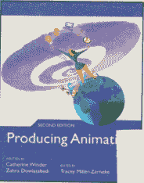

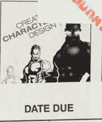

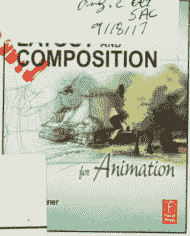

| 到期日期 |
| --- |
| OCT 08 2015 |

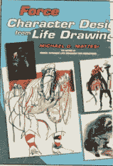

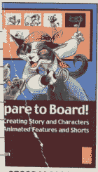

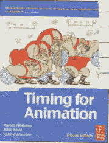

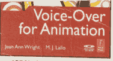

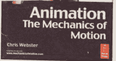

由互联网档案馆于2023年数字化，资金来自Kahle/Austin基金会

## 致谢

没有以下这些人的帮助，本书不可能问世。

感谢Dee Honeybun，她梳理了我难以辨认的笔记，并把它们变成了值得阅读的内容。

感谢Marie Hooper，最初是她委托我撰写本书，并容忍了我每一次的逾期交稿。

感谢爱思唯尔的Katy Spencer，她委托我修订本书，并容忍了我更多的逾期交稿。

感谢Claude Lester，作为我的“最佳男伴”，并说服我相信函数曲线是我的朋友。

感谢Kevin Rowe在Maya和表演方面给予的帮助。

感谢Birgitta Hosea为我腾出时间。

感谢Bob Godfrey最初引领我进入动画领域——我在10岁时就拥有了他的书 *《自己动手的电影动画书》*。

感谢Paul Stone和Mal Hartley，他们是我动画路上的好兄弟。

感谢中央圣马丁艺术与设计学院的支持，以及允许我使用Maya。

感谢卡文迪什学院的支持，以及允许我使用3D Studio Max。

感谢Kent Braun允许我使用DigiCel FlipBook。

感谢Autodesk公司的Nick Manning允许我使用Maya和3D Studio Max的图片。屏幕截图和影片的使用已获得Autodesk公司的许可。

感谢Vasco Carou提供他的马Inato（一匹纯种卢西塔诺马）的精彩影像。

感谢所有我教过动画的学生（近1000人！）——相信我，我从你们身上学到的和你们从我这里学到的一样多。非常感谢所有回复过我那些无聊邮件问题的学生。

感谢所有我认识过、争论过、观察过、倾听过、赞同过、忽视过，以及所有以各种方式影响过我的人，正是你们造就了今天的我。

感谢我的父母，他们相信我能找到一份整天涂涂画画的工作。

但最重要的是Dee、Felix和Emily，过去几年里，他们见到我的次数远不及应有的那样多，但他们依然爱着我。

本书是我近20年来向3D电脑动画师教授手绘动画技巧的成果结晶。

你可能会想：“3D电脑动画师究竟为什么需要学习如何做动画？”这个问题的答案是，无论使用何种媒介，动画的基本原理都是相同的，而且通常用纸笔可以更快地捕捉到运动的想法。电脑可以减轻动画制作中的大量苦差事，但最终你可能会做出一段动画，却不完全明白它是如何产生的，也不知道它是否真的有效。

在过去25年的动画生涯中，我学到的最宝贵经验之一就是保持简单。动画教师的主要价值在于开门见山地告诉你需要掌握的基本要点。然后你可以用自己的方式去拓展它们。我在本书中尽量保持示例和动画练习的简单性，以便你能够打下坚实的技能基础，在这个基础上进一步发展你的动画。

本书的结构如下。在每一章中，我将讲解某个主题的基本原理，随后安排一个手绘动画练习供你完成。只有在那之后，你才能尝试使用自己选择的软件包来完成相同的动画练习。

本书包含了基本原理、手绘动画练习以及如何在3D中完成相同练习的指导。请访问本书配套网站：www.characteranimation.com。网站上包含带有更大图片的.pdf文件，以及展示如何做练习或如何建模的影片，还有动画影片，以及大量已完全绑定好、可供你下载到电脑上进行练习的模型。此外，还有大量关于动画和电影制作的技巧与诀窍。我还有一个名为characteranimation的YouTube频道（www.youtube.com），我会定期上传教程。

动画制作中最重要的事情是做足研究。如果你需要制作大象的动画，就去观察大象是如何移动的。如果你需要制作某人打篮球的动画，就去观察别人打篮球（或者更好的是，自己去打！）。如果你能体会某种动作的感觉，你总能把它制作得更好。网络非常适合研究，但没有什么能比得上亲身体验真实事物。这是我喜欢动画的原因之一：它促使你去了解周围的世界。

我从七岁起就爱上了动画，那时母亲带我去电影院看了迪士尼的 *《睡美人》*。与我们家里那台小小的Murphy黑白电视相比，电影的色彩、巨大的银幕和美妙的音响几乎让我震撼不已。直到今天，我仍然觉得动画电影是一种特别的东西。

我在10岁时痴迷于成为动画师，那时我看到了由Bob Godfrey主持的电视节目 *《自己动手制作电影动画秀》*。如果说有谁让我与动画结缘（或该为此负责），那就是Bob。能与他共事，并被他视为朋友，真是太好了。其他给我带来巨大启发的人还有

特克斯·阿弗里（Tex Avery）和查克·琼斯（Chuck Jones）：我小时候最喜欢的卡通人物是“疯狂松鼠”（Screwy Squirrel）和“德鲁比”（Droopy）（都是特克斯·阿弗里创作的），紧随其后的是达菲鸭（Daffy Duck）和兔八哥（Bugs Bunny）（通常是查克·琼斯电影中这些角色的形象）。

令我心存敬畏的动画师名单几乎无穷无尽：布拉德·伯德（Brad Bird）、约翰·拉塞特（John Lasseter）、宫崎骏（Hayao Miyazaki）、尼克·帕克（Nick Park）、乔安娜·奎因（Joanna Quinn）、扬·斯凡克梅耶（Jan Švankmajer）——我可以一直列下去。

希望这本书能给你带来启发。

> 动画师是幸运的：他们不必受限于戏剧舞台的局限，也不必面对真人电影外景拍摄的诸多风险！他们唯一的限制就是自己的想象力和支票簿的厚度。有了整个宇宙可供支配，再加上宇宙中所有的色彩和声音，动画可能是一个令人望而生畏的前景！难怪有些人转而从事园艺或DIY。史蒂夫·罗伯茨（Steve Roberts）（我第一次见到他是在法纳姆的动画课程上——他当时正在把《白雪公主和七个小矮人》重制成一部讽刺作品）并不容易被吓倒。他撰写并绘制了一本了不起的书，真正让动画变得易于理解。通过简单的插图，他带领读者经历他们在迈向可信动画的过程中可能遇到的每一种情况。这本书的关键在于*简洁*。保持简单！分开红海对塞西尔·B·德米尔（Cecil B. DeMille）来说是完美之举。
>
> **鲍勃·戈弗雷（Bob Godfrey MBE）**

## 动画入门

### 工作实践

### 章节摘要

- 动画的工作原理
- 每秒帧数
- 你的工作室需要什么
- 让我们开始动画吧
- 翻动、弹拨和滚动
- 如何使用线条测试器辅助你的动画
- 练习
- 如何将你的二维动画与三维动画联系起来
- 关于 Maya 你需要知道的 13 件事
- 关于 3D Studio Max 你需要知道的 13 件事
- 3D 中“球体下落”练习概述
- 如何在 Maya 中制作基础弹跳球动画
- 如何在 3D Studio Max 中制作基础弹跳球动画
- 绘画
- 动画的 12 项原则

在本章中，我将带你了解两件事：建立一个基础动画工作室所需的设备，以及一些简单的动画。我们将研究摄影表（X-sheets）及其如何帮助计时、翻动、弹拨和滚动；如何使用线条测试器；以及如何将你从手绘练习中学到的经验应用到 3D 计算机动画程序中。到本章结束时，你将学会如何组织自己，以及如何规划和执行一段动画。

我毫不抱歉地把你带回到最基础的内容。你可能已经知道其中很多，但请耐心听我说——重温这些知识并巩固动画背后的基本原理是值得的。

### 动画的工作原理

*基础知识*

二维手绘动画由一系列连续拍摄并回放的图画组成，从而产生运动的错觉。这种动画可以通过多种方式回放：

- 以“翻页书”（flipbook）的形式（基本上是一叠按顺序装订的图画，用拇指翻动）。
- 用电影摄影机逐帧拍摄在胶片上，再用电影放映机回放。
- 用摄像机拍摄，再用视频播放器回放。
- 用连接到计算机的摄像机拍摄，并在同一台计算机上使用动画程序回放。
- 扫描到计算机中并回放。

### 每秒帧数

拍摄在胶片上并投影的动画以每秒 24 帧的速度播放。欧洲、非洲、中东和澳大利亚的电视动画以每秒 25 帧的速度播放。这些国家使用一种名为 PAL 的电视系统，该系统以每秒 50 场（帧）的速度播放。以每秒 25 帧播放的动画与 PAL 兼容，但如果我们以每秒 24 帧的速度在电视上播放一部动画电影，我们会看到一条黑条在屏幕上滚动。美洲、西印度群岛和环太平洋地区国家使用 NTSC 系统，该系统的运行速度为每秒 60 场。这意味着对于该系统，你应该以每秒 30 帧的速度制作动画（60 可以被 30 整除）。很多时候会使用某种数字转换器将一种胶片速度转换为另一种视频速度，从而使每秒 24 帧的电影能够在每秒 60 场（NTSC）的电视上播放。如果你在动画电影的视频中逐帧暂停，你会发现有些帧会模糊到另一帧中。这就是克服两种系统不兼容性的方法。（逐帧暂停观看动画电影是学习动画的一种非常好的方法。）制作动画时最重要的事情是确定动画将以什么速度回放。本书中教授的所有动画都将以每秒 25 帧的速度回放。

### 你的工作室需要什么

为了完成本书中的手绘练习，你需要以下物品（所有这些都可以从本书末尾列出的专业动画设备供应商处获得）：

- 动画纸
- 定位条（peg bar）
- 透写台（light box）
- 摄影表（X-sheets）
- 线条测试器
- 铅笔

### 动画纸

制作动画时，你经常会发现自己在使用四层或更多层的纸张。为了能看到所有图画，需要一定程度的半透明度。专业动画纸正是为此而制造的。

它还有不同的尺寸，这些尺寸被称为规格（field sizes）。12 规格和 15 规格是最常用的。15 规格宽 15 英寸，12 规格宽 12 英寸。（我将在本章后面提到规格指南（field guides）时详细说明，它们是测量规格尺寸的网格。）

大多数专业动画纸都带有三个打好的孔。也可以购买没有孔的纸张（价格更便宜，但你需要一台非常昂贵的专业动画打孔机）。与定位条配合使用时，这些孔可以确保每张纸与下一张精确对齐。这一点很重要，因为拍摄这个序列时，哪怕最细微的移动都会显示出来。

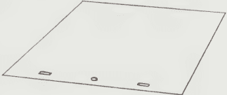

使用带有标准活页夹孔的 A4 纸和带有两个与孔匹配的销钉的定位条也是可行的。这样一来，成本会比专业动画纸便宜得多。

### 定位条（Peg Bars）

与专业动画纸配合使用的专业定位条由一条带有三个销钉的钢条或塑料条制成。它们按照行业标准制造，用于将每张动画纸与下一张对齐。

也可以购买两销钉的定位条 —— 这类通常被称为“初级定位条”。

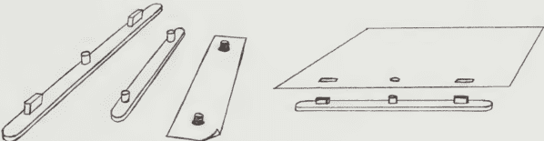

你也可以自己制作，用一条木条和两根与纸上的孔对应的木钉，甚至可以用胶带把两个 5 毫米的沉头螺栓粘在你的透写台上。然后就可以配合用活页夹打孔的 A4 纸使用。

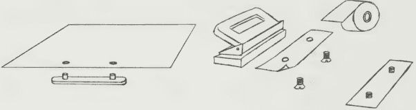

和纸张一样，请记住，如果你希望专业地使用你的动画，建议购买三销钉定位条。

### 透写台（Light Boxes）

透写台最基本的形式是一块放在灯上的扁平乳白色有机玻璃板。专业透写台使用可旋转的圆盘，还应该能够改变绘图表面的角度。这可以让绘图时手腕和背部都更轻松。

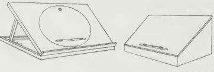

简单的透写台制作起来相对容易。你可以使用一个顶部切出斜角的木制收纳箱，在里面安装一根霓虹灯管，然后用螺丝将一块 6 毫米的乳白色有机玻璃固定在上面。

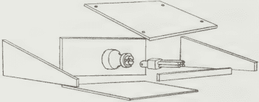

### 摄影表（X-sheets）

**动画师：**  
**制作：**  
**场景编号：**  
**序列编号：**  
**长度：**  
**表编号：**  
**备注：**  

| 动作 | 声音 | 帧号 | 6 | 5 | 4 | 3 | 2 | 1 | 背景 | 摄像机 |
| --- | ---: | --- | --- | --- | --- | --- | --- | --- | --- | --- |
|  |  | 1 |  |  |  |  |  |  |  |  |
|  |  | 2 |  |  |  |  |  |  |  |  |
|  |  | 3 |  |  |  |  |  |  |  |  |
|  |  | 4 |  |  |  |  |  |  |  |  |
|  |  | 5 |  |  |  |  |  |  |  |  |
|  |  | 6 |  |  |  |  |  |  |  |  |
|  |  | 7 |  |  |  |  |  |  |  |  |
|  |  | 8 |  |  |  |  |  |  |  |  |
|  |  | 9 |  |  |  |  |  |  |  |  |
|  |  | 10 |  |  |  |  |  |  |  |  |
|  |  | 11 |  |  |  |  |  |  |  |  |
|  |  | 12 |  |  |  |  |  |  |  |  |
|  |  | 13 |  |  |  |  |  |  |  |  |
|  |  | 14 |  |  |  |  |  |  |  |  |
|  |  | 15 |  |  |  |  |  |  |  |  |
|  |  | 16 |  |  |  |  |  |  |  |  |
|  |  | 17 |  |  |  |  |  |  |  |  |
|  |  | 18 |  |  |  |  |  |  |  |  |
|  |  | 19 |  |  |  |  |  |  |  |  |
|  |  | 20 |  |  |  |  |  |  |  |  |
|  |  | 21 |  |  |  |  |  |  |  |  |
|  |  | 22 |  |  |  |  |  |  |  |  |
|  |  | 23 |  |  |  |  |  |  |  |  |
|  |  | 24 |  |  |  |  |  |  |  |  |
|  |  | 25 |  |  |  |  |  |  |  |  |
|  |  | 26 |  |  |  |  |  |  |  |  |
|  |  | 27 |  |  |  |  |  |  |  |  |
|  |  | 28 |  |  |  |  |  |  |  |  |
|  |  | 29 |  |  |  |  |  |  |  |  |
|  |  | 30 |  |  |  |  |  |  |  |  |
|  |  | 31 |  |  |  |  |  |  |  |  |
|  |  | 32 |  |  |  |  |  |  |  |  |
|  |  | 33 |  |  |  |  |  |  |  |  |
|  |  | 34 |  |  |  |  |  |  |  |  |
|  |  | 35 |  |  |  |  |  |  |  |  |
|  |  | 36 |  |  |  |  |  |  |  |  |
|  |  | 37 |  |  |  |  |  |  |  |  |
|  |  | 38 |  |  |  |  |  |  |  |  |
|  |  | 39 |  |  |  |  |  |  |  |  |
|  |  | 40 |  |  |  |  |  |  |  |  |
|  |  | 41 |  |  |  |  |  |  |  |  |
|  |  | 42 |  |  |  |  |  |  |  |  |
|  |  | 43 |  |  |  |  |  |  |  |  |
|  |  | 44 |  |  |  |  |  |  |  |  |
|  |  | 45 |  |  |  |  |  |  |  |  |
|  |  | 46 |  |  |  |  |  |  |  |  |
|  |  | 47 |  |  |  |  |  |  |  |  |
|  |  | 48 |  |  |  |  |  |  |  |  |
|  |  | 49 |  |  |  |  |  |  |  |  |
|  |  | 50 |  |  |  |  |  |  |  |  |

| 动画师： |  |  |  |
|---|---|---|---|
| 制作： |  |  |  |
| 场景号 | 序列号 | 长度： | 张号： |
| 备注： |  |  |  |

| 动作 | 声音 | 帧号 | 6 | 5 | 4 | 3 | 2 | 1 | 背景 | 镜头 |
|---|---:|---|---|---|---|---|---|---|---|---|
|  |  | 1 |  |  |  |  |  |  |  |  |
|  |  | 2 |  |  |  |  |  |  |  |  |
|  |  | 3 |  |  |  |  |  |  |  |  |
|  |  | 4 |  |  |  |  |  |  |  |  |
|  |  | 5 |  |  |  |  |  |  |  |  |
|  |  | 6 |  |  |  |  |  |  |  |  |

| 动画师： | STEVE REE... |  |  |  |
|---|---|---|---|---|
| 制作： | 弹跳的球 |  |  |  |
| 场景号： |  | 序列号：2 | 长度：3秒 | 张号：1 |
| 备注： | 球弹跳进入绿色区域，撞击地面并弹跳出去。 |  |  |  |

| 动作 | 声音 | 帧号 | 6 | 5 | 4 | 3 | 2 | 1 | 背景 | 镜头 |
|---|---:|---|---|---|---|---|---|---|---|---|
|  |  | 1 |  |  |  |  |  |  |  |  |
|  |  | 2 |  |  |  |  |  |  |  |  |
|  |  | 3 |  |  |  |  |  |  |  |  |
|  |  | 4 |  |  |  |  |  |  |  |  |
|  |  | 5 |  |  |  |  |  |  |  |  |
|  |  | 6 |  |  |  |  |  |  |  |  |

X-sheet 也被称为摄影表（dope sheets）或曝光表（exposure sheets）。动画师使用它来记录与动画拍摄方式相关的所有必要信息。标准 X-sheet 由若干从上到下的列和100行从左到右的行组成（图示为50行）。每一行代表动画的一帧。如果动画以每秒25帧的速度播放，100帧将相当于4秒的动画（在所示的 X-sheet 上则为2秒）。

X-sheet 上的各列用途如下。

## 声音

此列包含与动画相关的声音。通常是角色所说的话语。在动画制作中，对白是先录制的。然后进行“分解”。也就是说，通常由剪辑师逐帧检查音轨，确定每个单词的起止位置，以及每个主要元音和辅音的位置。然后逐帧标记在 X-sheet 的声音列中。这样你就能知道场景中某一帧发出了特定声音。

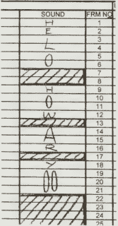

## 图层

这些列显示图层的放置顺序：背景位于最底层（X-sheet 上的右侧），前景位于最顶层（X-sheet 上的左侧），角色位于中间。

每张画稿都有自己的编号。每个单位代表一帧。插入画稿编号是为了表示该帧动画在序列中的位置。这会根据每张画稿所代表的每秒帧数而变化。右侧示例显示了一个以“一拍二”方式拍摄的序列；也就是说，每张画稿拍摄两帧。当采用“一拍二”时，第一行有编号，第二行留空。不需要填满每一帧。在序列末尾，最后一张画稿保持10帧；也就是说，该画稿拍摄10帧。这通过从画稿编号底部延伸到保持的最后一帧的线条来表示。如果画稿保持超过两帧，则需要插入线条以显示画稿保持的时间长度。

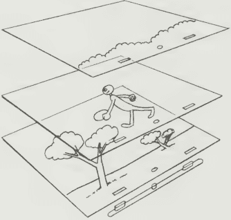

动画序列中，即使只有单个角色，一帧动画的画稿也可能分布在几层纸上。如果序列中身体保持不动，而头部和手臂在运动，那么整个序列只需要一张身体画稿。如果头部的运动速度与手臂不同，头部会放在单独的纸上，手臂则放在另一张纸上。例如，如果有背景且角色站在树前，这些同样要分开画在单独的纸上。无论最终画稿多么精确，如果需要重复描摹同一张图画20次或更多（例如带有树的背景），画稿之间会产生差异，在播放动画时会显现出来。这也不必要地浪费时间。在计算机出现之前，完成的画稿会被描摹并着色到赛璐璐片（Cel，即醋酸纤维素或透明塑料片）上。这样最多只能有六个图层，否则赛璐璐片的厚度会使下方图层的颜色显得浑浊。如今，每个图层都会被单独上色，然后用 DigiCel FlipBook 或 Toon Boom 等程序合成。这样可以拥有无限图层，且没有任何质量损失。

| 图层： | 6 | 5 | 4 | 3 | 2 | 1 | 背景 |
|---|---:|---:|---:|---:|---:|---:|---|
|  |  |  |  |  |  |  |  |
|  |  |  |  |  |  |  |  |
|  |  |  |  |  |  |  |  |
|  |  |  |  |  |  | A1 |  |
|  |  |  |  |  |  | A3 |  |
|  |  |  |  |  |  | A5 |  |
|  |  |  |  |  |  | A7 |  |
|  |  |  |  |  |  | A9 |  |

## 镜头

此列中的信息指示镜头如何拍摄场景，并标出需要出现在画面中的美术作品区域。最重要的信息是安全框尺寸（field size）。最常用的纸张是12安全框（12-field），这意味着镜头在最大设置下将拍摄一个宽12英寸的矩形区域。

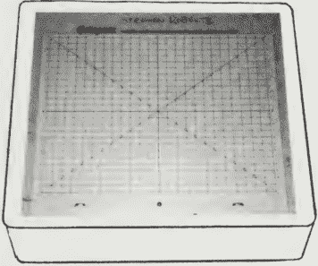

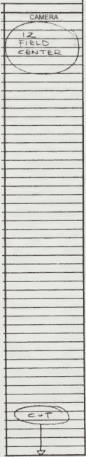

传统二维动画师使用安全框定位盘（field guide），也称为网格标尺（graticule），来确定镜头的位置。例如，要使用纸张的全尺寸拍摄动画，会在镜头列的顶部标出“12安全框中心”。作为三维计算机动画师，你不会使用安全框尺寸。但了解它们的计算方式仍有价值。

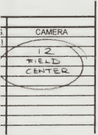

安全框定位盘在上、下、右、左分别印有“北”、“南”、“东”、“西”。它由24列24行的网格组成。每列宽半英寸。通过使用这些方位点和网格参考，你可以指定纸张上想要拍摄的任何区域。

右侧图示显示纸张右上一个宽5英寸的矩形区域。这将是在12安全框中心以东7格、以北7格的5安全框。使用安全框定位盘，你可以确定该矩形中心相对于12安全框中心（定位盘中心）的位置。要找到中心，你需要从定位盘中心（12安全框中心）向东数七条线，再向北数七条线。

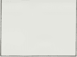

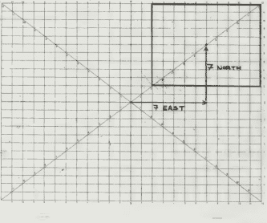

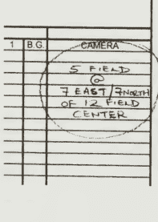

使用这种方法，你可以在任何区域放置任意大小的安全框。

本书中的所有练习均位于12安全框中心（或者，如果你使用A4复印纸，则为12安全框中心以南2格的10安全框）。

## 线条测试仪

线条测试仪是一种捕获你的画稿并回放的设备。它可以快速轻松地查看粗略绘制的序列是否有效。有多种设置线条测试仪的方法。你可以使用胶片摄影机、能单帧录制的录像机，或者线条测试软件程序和计算机。网站上的动画示例是使用名为 DigiCel FlipBook 的程序制作的，该程序可从 www.DigiCelinc.com 下载（你可以从带水印的免费版开始，但我建议花点小钱升级到基础版）。还有其他替代方案。我建议寻找包含 X-sheet 的程序，因为这对于计算时间最有用。

搭建线条测试仪最简单最便宜的方法是使用网络摄像头配合电脑和线条测试软件。将摄像头设置为俯视桌面。摄像头可以安装在三脚架上，甚至可以固定在一把钢尺上，再将其连接到电脑顶部。将定位尺（peg bar）粘在桌上，放一张动画纸在上面，并在摄像头下对齐。定位尺对于画稿的准确定位至关重要。也可以使用平板扫描仪将画稿扫描到电脑中，但这比使用摄像头要慢得多。

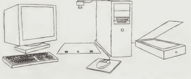

现在是时候在你的电脑上安装 DigiCel FlipBook，并熟悉其操作了。

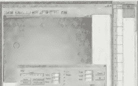

‘关键画’，也简称为‘关键张’，是在一个场景中概括动作精髓的重要画面。

在关键帧到关键帧的动画（key-to-key animation）中，要先画出序列中的‘关键位置’或‘姿势’，再去完成它们之间的部分（‘中间画’）。我总喜欢把关键位置设想成场景的剧情或概要。它们让你对动画有一个粗略的整体感觉。而中间画则提供角色性格或细节。

采用关键帧到关键帧的动画方式，可以让你对自己的动画有很大程度的控制。它可以防止角色或物体在你不希望的情况下改变大小或变形。同时，这也意味着你可以控制动画的节奏，更容易预判某个动作会在何时何地发生。通过线拍测试关键画，你可以在完成全部动画之前先看到序列的基本运动。

然而归根结底，动画中的所有画面都是重要的。如果你过度强调关键位置，动画看起来会显得笨拙僵硬。

下面是一个关键帧到关键帧动画的示例。在这个例子中，一个人坐在桌前，桌上放着一杯液体。他拿起杯子喝了一口。

-   关键画 1——他看着杯子。
-   关键画 2——他用手握住杯子。
-   关键画 3——他把杯子举到嘴边。
-   关键画 4——他把杯中的液体倒入口中。

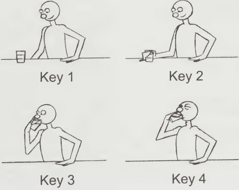

把第二张画纸放在最上面，用定位尺进行定位。画一个被压扁的球，并把它标为第11张画。这是我们的第二个关键画。

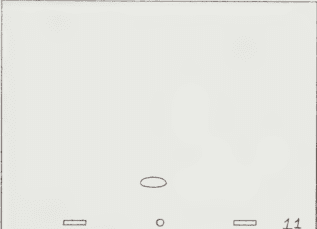

最后，把第三张画纸放在前两张上面，在右上角画一个球。把它称为第17张画。这是我们的第三个也是最后一个关键画。

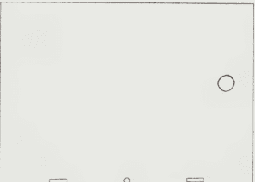

拿走第21张画。我们将为第1-11张画补中间画。这意味着我们要画出第1张和第11张之间的画。

我们要画的第一个中间画是第9张。它位于第1张和第11张的中间。这可能看起来有点奇怪，但这有助于给人球在落地时加速的感觉。如果我们看一下‘时间表’（见第18页），就会看到，因为球在最高点速度最慢，所以这里的画数量更多、彼此更接近。随着球从天空中落下，画与画之间的距离越来越远。这就是为什么第1和第11之间的中间画是第9张。

你画的第一个中间画通常被称为“分解画”。这是主要的中间画。

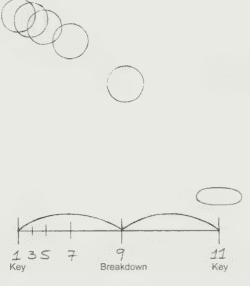

时间表（也叫分解指南、中间画指南或电线杆图）用来标示中间画应该画在哪里。它们通常放在关键画的底部，表示该关键画与下一个关键画之间中间画的位置。它们由一条水平线和两端各一条竖线组成，竖线代表关键画。‘分解画’（主要中间画）用一条竖线以及它与关键画之间的几条弧线标示。其余的中间画用较短的竖线标记标示。右侧的插图显示了第1到第11张画的分解指南。

第7张画位于第1和第9张的中间，第5张画位于第1和第7张的中间，第3张画位于第1和第5张的中间。

给序列补中间画时，我们需要‘翻动’画纸。把第11张画放在第1张画上方，上面再盖一张干净纸。把它标为第9张画。用左手拇指和食指夹住第9张画。把食指滑到第11张画下面。让第1张画平放在透写台上。

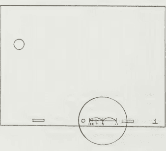

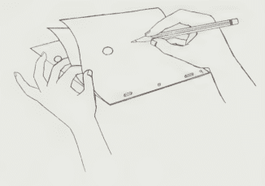

现在在第9张画上画球。记住，球是沿着弧线运动的，它应该位于第1张画和第11张画上的球的中间位置。

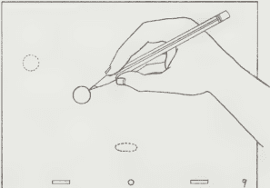

为了看清球的运动，把第11张和第9张画朝自己翻回（仍挂在定位尺上），查看第1张画。

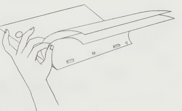

把第11张和第9张画平放在透写台上，查看第9张画。

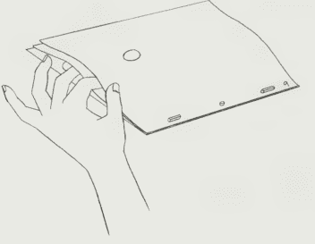

然后把第9张画朝自己翻起，查看第11张画。

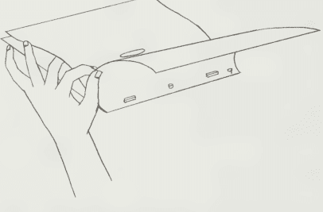

当这些动作快速连续进行时，球就会沿弧线运动。你现在就是在‘翻纸’。有时在定位尺的定位销上套一根橡皮筋有助于防止纸滑落。如果第9张画中的球位置看起来不正确，就擦掉重画。继续翻看和重画，直到它看起来正确。（见网站上 movies001 中的第1章的‘flicking animation’。）

对第7张画（在第1和第9张画之间）、第5张画（在第1和第7张画之间）和第3张画（在第1和第5张画之间）重复‘补中间画’的过程。画完所有这些后，你可以尝试一下滚动翻纸。

## 滚动翻纸

将序列中的前五张画放到定位尺上，第1张画在最下面，第9张画在最上面。把这些画逐张夹在左手的指缝之间。你一次只能用五张画来滚动翻纸。

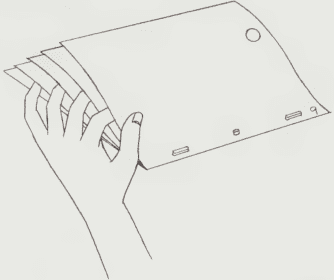

把所有画朝自己翻过去，查看第1张画。通过向前移动小指，让第3张画平落在第1张画上，查看它。让第5张画平落在第3张画上，查看它。让第7张画平落在第5张画上，查看它。最后，让第9张画平落在第7张画上，查看它。把手收回来，重复这一过程。确保你的手指始终与画纸交错。快速连续完成后，你会看到球从页面左上方落下并撞击地面，下落过程中不断加速。你现在就是在滚动翻纸。（见网站上 movies001 中的第1章的“rolling.avi”。）

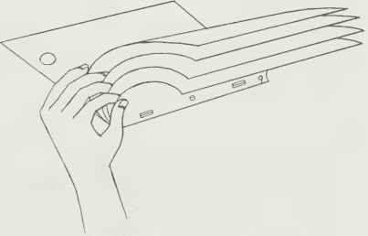

通过给第11到第21张画补中间画来完成练习。下面是第11号画的时间表，说明应如何在第11号和第21号之间补中间画。

图表中的X表示这段距离已被分成三份。你要画的第一个中间画是第15张。这是分解画。它到21的距离是总路程的三分之一，到11的距离是三分之二。（X用来标示第15张画的相对位置。）接下来要画的是第17张，它位于第15和第21张的中间。然后画第19张，它位于第17和第21张的中间。

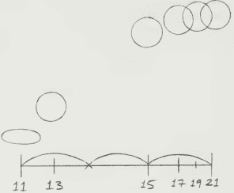

在X这个位置没有画。接下来要画的是第13张，它位于X和第11张的中间。通过使用这种间距，球将从第9张开始加速，并在接近第17张时减速。确保球在整个序列中沿着弧线运动。完成所有画之后，尝试翻动它们。拿起你制作的所有画，把编号最小的画放在最下面，最大的放在最上面。用右手举起它们，用左手翻动。

最后，用线拍机拍摄这一序列，以精确查看动画的运动。每张画应该拍摄两帧。如果你还不会使用线拍机，别担心！下一节我会带你学习如何使用。（见网站上 animations001 中的第1章的‘ball_bounce.avi’。）

## 如何使用线拍机来辅助你的动画

在上一练习中，我们研究了一个球在屏幕上弹跳的节奏。掌握关键位置的节奏是动画中最困难的事情之一。使用线拍机能让你看到节奏是如何运作的，并有望帮助你更快地掌握节奏技巧。

下一个练习中，我们要让一个球从屏幕外掉入画面，垂直落到地面，弹跳几次后停下来。

首先要做的是制作关键画动画，并用线拍机拍摄。得到的影片称为姿势测试（pose test）或关键画测试（key test）。每个关键画在播放时所占的帧数可以在程序的X-sheet部分进行调整。当效果满意后，把这些画标记到纸质X-sheet上，并据此计算出中间画的节奏。制定时间表，标明中间画的位置。绘制中间画，最后用线拍机拍摄整个序列。

调整好X-sheet后，点击主屏幕上的**向前播放**按钮。你的动画看起来怎么样？它会有点不流畅，但在这个阶段这并不重要。重要的是确定节奏。你需要想象当所有中间画都包含进去后它会是什么样子。（这是一项需要经验积累的技能。你越是制作动画、查看姿势测试，就越能熟练地确定正确的节奏。）

如果某些关键画播放的时间太长或太短，就将它们“保持”更少或更多的帧。在DigiCel FlipBook中，在X-sheet上点击要更改帧值的图像以高亮显示该画。然后再次点击并按住它，同时按住键盘上的**Alt**键并保持鼠标按钮按下。根据你是想增加还是减少帧数，将列向上或向下拖动。

当结果令你满意时，将关键位置标记到纸质X-sheet上（复印书中附带的那份，或者从网站上第1章的X-SHEETS文件夹中打印一份）。使用最左侧的Level列和铅笔。（这些是此处临时参考的标记。）如果关键画1（K1;1）从DigiCel X-sheet的第1帧开始，就将其标记到纸质X-sheet的第1帧。如果关键画2（K2;9）从DigiCel X-sheet的第9帧开始，就将其标记到纸质X-sheet的第9帧，依此类推。如果动画采用“一拍二”，我们需要知道这些关键画在序列中的位置。在最右侧的Level列中，标出正确的画号；即，第1帧标画1，第3帧标画3，等等。

现在你可以重新编号你的关键画，方法如下：

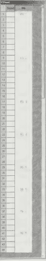

| 帧号 | 层 | 摄像机 |
|---:|---|---|
| 1 | K1; 1 | L2 / FIELD / CENTER |
| 2–8 |  | 3, 5, 7 |
| 9 | K2; 9 | 9 |
| 10–16 |  | 11, 13, 15 |
| 17 | K3; 17 | 17 |
| 18–23 |  | 19, 21, 23 |
| 24 | K4; 24 | 25 |
| 25–28 |  | 27, 29 |
| 29 | K5; 29 | 31 |
| 30–32 |  | 33, 35 |
| 33 | K6; 33 | 37 |
| 34–36 |  | 39 |
| 37 | K7; 37 | 41 |
| 38–40 |  | CUT |
| 41 | K8; 41 | ↓ |
| 42–50 |  |  |

下一阶段是确定中间画，并在每个关键画底部放置一个时间表。记住，为了表现球下落时速度增加，画与画之间的距离会越来越远。

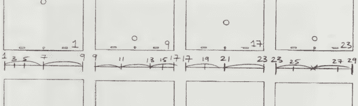

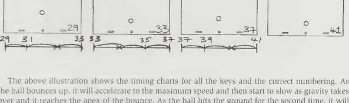

上面的插图显示了所有关键画的时间表和正确的编号。当球弹起时，它会加速到最大速度，然后随着重力作用而开始减速，直到达到弹跳的最高点。当球第二次落地时，它的挤压程度会稍微小一些（因为是从较低的高度落下）。这种模式会在剩余的弹跳中重复。每一次弹跳都会越来越低，直到球停下来。

按照时间表完成该序列的中间画，然后进行线拍测试（每个画拍摄两帧）。你也可以自己制定该序列的时间安排。完成的动画片段应类似于网站上第1章animations001中的“ball-drop.avi”。

## 如何将2D动画与3D动画关联起来

- 一旦你在2D中确定了动画的基本节奏，就可以继续在3D中制作动画。基本前提是一样的：在3D程序中创建关键位置，就像在2D中一样，然后让计算机为你生成中间画。听起来很容易？要是真这么简单就好了！你可能需要调整计算机在你移动对象时生成中间画的方式。通常这是通过调整动画曲线来完成的（稍后会详细介绍）。

首先，你需要了解3D程序的13个基本知识点。

## 你需要了解的关于Maya的13个知识点

### 1 Maya屏幕基础

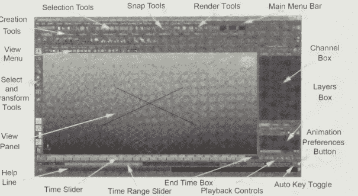

### 2 Maya键盘快捷键

#### 视图快捷键

- **Alt** + 鼠标左键 = 旋转（仅在透视视图中）
- **Alt** + 鼠标中键 = 平移
- **Alt** + 鼠标左键 + 鼠标中键 = 推拉
- **Alt** + **Ctrl** + 鼠标左键并拖出一个框 = 框式推拉
- **A** = 显示全部
- **D** = 模型的粗略、中等和精细显示
- **空格键（快速敲击）** = 将选定的视图面板从一组视图切换为全屏显示

#### 动画/操作快捷键

- **S** = 设置关键帧
- **E** = 旋转工具
- **R** = 缩放工具
- **W** = 移动工具

#### 播放快捷键

- Alt + V = 播放动画
- K + 鼠标左键 + 拖动 = 擦洗动画
- . + Alt = 向前移动一帧
- , + Alt = 向后移动一帧
- . = 转到下一个关键帧
- , = 转到上一个关键帧

### 3 在Maya中设置动画偏好

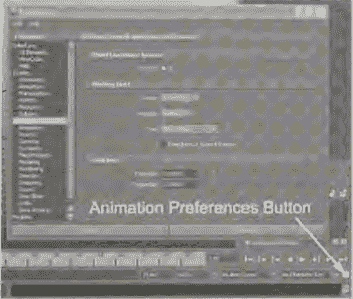

单击动画偏好设置按钮（屏幕右下角），将弹出偏好设置窗口。在“类别”部分选择“设置”，并将时间设置为PAL（25帧/秒）。然后，在“类别”部分转到“时间轴”，并将播放速度指定为“实时”（25帧/秒）。

### 4 在Maya中创建基本对象

转到主菜单，选择“创建”，然后选择你要创建的对象类型。例如，NURBS Primitive > Sphere。这将创建一个默认半径为1的球体。

转到主菜单，单击**渲染 > 渲染当前帧**。将弹出“渲染视图”窗口。在“渲染视图”窗口中，选择**选项 > 渲染全局**，将弹出“渲染全局”窗口。

按照你希望渲染场景输出的方式填写各列。在**文件名前缀**中为其命名。**帧/动画扩展名**用于设置图像序列及其编号方式（使用“frame#.ext”或“name.#.ext”）。开始帧和结束帧用于设置要渲染的第一帧和最后一帧。**帧填充**用于对图像序列进行编号，如果帧数少于1000，应设置为3。**图像格式**是你希望生成的输出，可以是图像序列或.avi文件。**可渲染对象**应设置为**全部**。对于**摄像机**，选择你要渲染的视图。在**分辨率**中，将预设设置为**320 × 240**。完成设置输入后，关闭“渲染全局”窗口。然后转到主菜单，选择**渲染 > 批量渲染**。你的场景现在应该开始渲染。它将被保存到你的硬盘上。

## 你需要了解的关于3D Studio Max的13个知识点

### 1 3D Studio Max屏幕基础

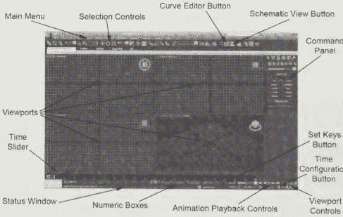

### 2 3D Studio Max键盘快捷键

#### 视图快捷键

- Ctrl + P + 鼠标左键（或鼠标中键）= 平移
- Z + 鼠标左键（或滚动鼠标中键）= 缩放

### 7 在3D Studio Max中使用轨迹视图

打开“轨迹视图”，方法是转到主菜单并选择**图形编辑器 > 轨迹视图 > 打开轨迹视图 – 曲线编辑器**。从层级树中选择曲线（沿着路径**对象 > 特定对象 > 变换 > 位置、旋转或缩放**）。

要在函数曲线的关键点上获得控制柄，请选择该关键点（右键单击），将弹出“位置”窗口。为“输入”和“输出”都选择“控制柄”按钮。使用鼠标左键移动控制柄。在“轨迹视图”窗口顶部，应只选择“显示切线”和“移动关键点”按钮。

要分离控制柄，请单击**高级**按钮，然后针对X、Y或Z单击**锁定**。使用鼠标左键移动控制柄。

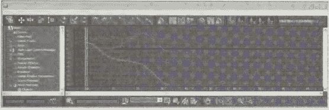

### 8 在3D Studio Max中创建预览

选择一个视口，转到主菜单，单击**渲染**，然后单击**制作预览**，将弹出一个面板，其中包含各种参数设置，例如开始帧和结束帧、大小、每秒帧数等。单击**创建**，系统将为你渲染一个.avi影片。

### 9 3D Studio Max中的层级关系

打开“示意图视图”（在主菜单中，**图形编辑器 > 打开示意图视图或新建示意图视图**），将弹出**示意图视图**窗口。在“示意图视图”中选择一个对象（该对象会变为黄色），然后选择**链接**按钮（位于**示意图视图**窗口左上角）。从所选对象单击并拖动到你希望作为父对象的对象上，然后松开。现在你应该有两个已链接的对象。要取消链接，请同时选中它们（单击一个对象，然后按住**Ctrl**键选择另一个对象），再单击**取消链接选择**按钮（位于“链接”按钮旁边）。对象现在应该已被取消链接。

### 10 在3D Studio Max中创建对象并向其中放入骨骼

要创建对象，请转到主菜单并选择**创建 > 标准基本体或扩展基本体**。

要创建骨骼，请转到命令面板并选择**创建 > 系统 > 对象类型 > 骨骼**。或者，转到主菜单并选择**动画 > 创建骨骼**（或在3D Studio Max 5中选择**角色 > 骨骼工具 > 创建骨骼**），然后在场景中左键单击。按**Esc**退出该模式。

要添加IK解算器，请选择顶部骨骼，然后在主菜单中转到**动画 > IK解算器 > HI解算器**，并选择再下一根骨骼。

要对骨骼蒙皮，请选择要蒙皮的对象，并从主菜单中选择**修改器 > 动画修改器 > 蒙皮**。在命令面板参数框的“编辑封套”下，选择**添加骨骼**按钮。将会弹出选择骨骼窗口。在列表中单击你想要与蒙皮关联的骨骼，然后点击**选择**按钮，骨骼便会以非常糟糕的方式带动你的蒙皮。要想弄对，可以点击**编辑封套**按钮，然后花上几天时间试图让这该死的东西正常移动。或者，将一个对象链接到骨骼（这要容易得多）。

### 11 在3D Studio Max中为角色上色

右键单击对象，点击**属性**，点击**名称**旁边的彩色框，选择一种颜色，然后点击**确定**两次。

### 12 在3D Studio Max中导入声音

右键单击时间滑块并选择**配置 > 显示声音轨道**。转到主菜单，点击**图形编辑器 > 轨迹视图**。在3D Studio Max 4中，点击轨迹视图顶部的**函数曲线**按钮；或者在3D Studio Max 5中，转到主菜单并选择**图形编辑器 > 轨迹视图 > 打开轨迹视图 – 曲线编辑器**。在层级树中右键单击**声音**，并从弹出的列表中选择**属性**。这将打开ProSound窗口。选择“添加”，然后在**打开**窗口中找到你的声音，选中它并点击**确定**。在ProSound窗口中点击**确定**，现在你的声音应该出现在层级树中。它也应该出现在时间滑块和轨迹视图中。如果你使用播放控制播放时间滑块，将听到你的声音播放。

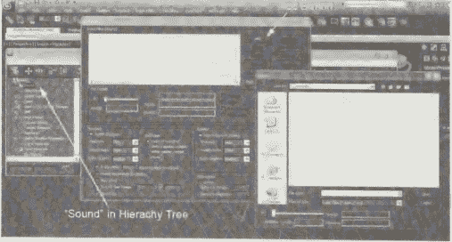

### 13 在3D Studio Max中渲染作品

转到主菜单并选择**渲染 > 渲染设置**，将会弹出**渲染设置**窗口。

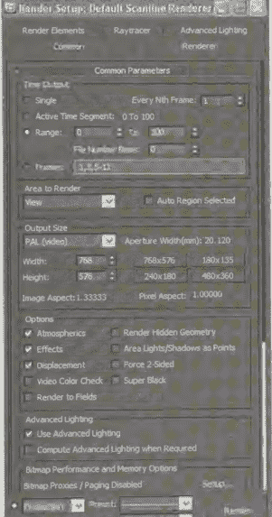

确保选中**范围**单选按钮，并确保起始帧和结束帧正确。确保**输出大小**正确（例如768 × 576）。在**渲染输出**区域（你可能需要向下滚动才能找到此区域）点击**文件**，将会弹出**渲染输出文件**窗口。

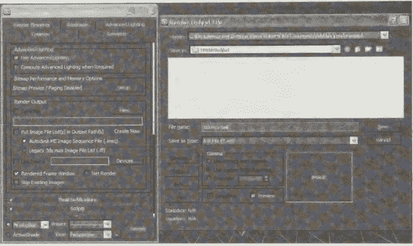

在**文件名**框中为你的影片命名，并在**保存类型**框中选择你要保存的方式。如果选择**.avi**，程序会询问你使用什么编解码器来压缩你的.avi文件。关闭**渲染输出文件**窗口。点击**渲染场景**窗口底部的**渲染**按钮。运气好的话，你的场景应该开始渲染了！

## 3D中“弹跳球下落”练习概述

打开你的3D计算机程序，并取出你的“弹球动画”图纸和相关的X-sheet（曝光表）（或回顾前面展示的八幅带时间图的插图）。创建一个球。确保时间滑块或帧滑块位于第一帧，并将球移动到与二维动画第1张图纸相似的位置。设置一个关键帧。然后将帧/时间滑块移动到第9帧，并按照第9张图纸（第二个关键位置）放置球。

以这种方式将动画中的每个关键位置复制到计算机上，并在手绘动画的关键位置设置关键帧。

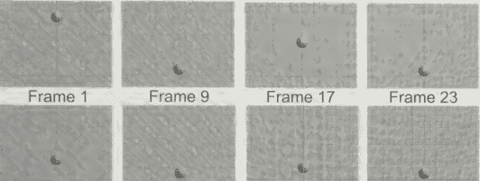

播放你的动画（或观看网站animations001第1章中的'ball_drop_keys_3D.avi'）。它看起来会有点奇怪，因为程序在关键位置之间进行插补的方式所致。它会在离开一个关键帧时加速，并进入下一个关键帧时减速。为了调整这一点，我们需要操纵与球动画相关的曲线（称为“动画曲线”或“函数曲线”）。在所有3D计算机动画程序中，运动都会被分解为类似图形的数学解释。如果你将球的上下运动视为垂直值，将运动所需时间视为水平值，你最终会得到一系列对应关键帧位置的图形点。计算机程序会将这些点连接起来生成一条曲线，从而提供对象的中间运动。连接曲线的默认线型称为“样条线”。

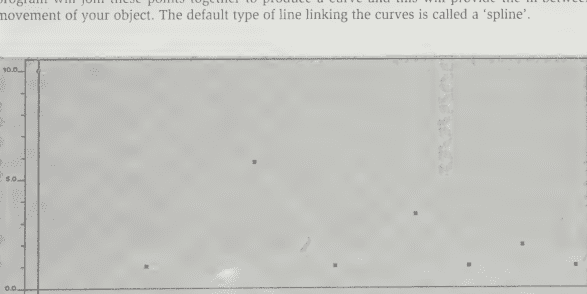

你可以通过调整这些曲线来改变计算机在关键位置之间的插补方式。有多种不同选项。“线性”是每个关键帧之间的一条直线。“步进”或“恒定”线在跳转到下一个关键帧的值之前，会保持与第一个关键帧相同的值。

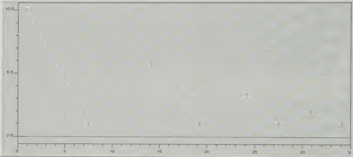

线性曲线。

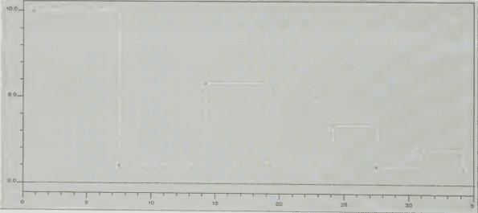

恒定或步进曲线。

关键点也可以具有“控制柄”，从而可以调整曲线的角度（带有控制柄的曲线可称为“贝塞尔样条线”）。

对于我们的弹跳球，我们需要在球落地时的关键位置“断开”曲线。这意味着我们需要让曲线在关键帧之间以漂亮的抛物线形状上升和下降。然后，我们需要为第二次弹跳画出第二条抛物线，为第三次弹跳画出第三条抛物线，以此类推。

看看网站animations001第2章中的'ball_drop_3D.avi'。现在球的弹跳更像是球应有的样子了！

当然，我并不是建议你总是从2D开始工作，但在学习动画的过程中，这种方式会帮助你更快地掌握节奏。到本书结束时，你将只需要在3D中制作动画之前，先在2D中粗略确定基本的关键位置即可。

## 如何在Maya中制作基础弹跳球动画

### 如何创建球

打开Maya，快速按一次键盘上的空格键，使屏幕变为四个视图面板。将鼠标指针悬停在前视图面板上，再次快速按空格键，使前视图面板全屏。

要创建球体，请转到主菜单并选择**创建 > NURBS图元 > 球体**（或者点击视图面板上方工具栏中的**球体**图标）。然后在视图面板中单击并拖动。这将创建一个球。

你可以重命名球体：转到**通道盒**顶部，在**形状**下点击“NURBSSphere1”（球的当前名称），它将会变蓝。输入一个新名称；让我们发挥想象力，把它叫做“ball”。按回车键。球体的位置可以通过在通道盒上半部分输入数值来控制。在**平移X**和**平移Y**旁边输入“0”。这将使球体移动到视口中心。

球体的大小和形状可以通过转到通道盒的**输入**部分并点击“MakeNurbSphere”来更改。这将打开一系列输入框：**半径**（球体的半径）——输入“1”使其半径为1个单位；**起始扫描**和**结束扫描**（通过调整这些框中的数字，你可以得到一个看起来有点像缺了几瓣的橙子的球体）；**度数**（这会将球体从低分辨率外观变为高分辨率外观）；**截面数**（控制球体上下方向线条的数量）；**跨度数**（控制球体左右横向线条的数量）；以及**高度比**（我完全不知道这是干什么用的，所以我把它保持为2）。

你可以试着修改球体的输入。如果搞砸了，就删除它并重新创建一个。当将球体调整到满意的形状时，删除它的历史记录总是一个好主意。具体操作是：选择球体，然后从主菜单中选择**编辑 > 按类型删除 > 历史**。这样球体就会固定为新形状。

### 如何为球设置动画

取出你画的球下落动画（或回顾本章前面的球下落插图）。点击屏幕右下角的**动画首选项**按钮。将会弹出**首选项**窗口。在**类别**框中选择**设置**，在**时间**旁边的框中选择“PAL（25帧/秒）”（除非你所在的国家使用NTSC，这种情况下选择“NTSC（30帧/秒）”）。或者，保持24帧/秒（胶片速度）；这在数学上更容易处理（比25更容易整除）。点击**保存**关闭**首选项**窗口。

将时间滑块移动到第 9 帧，然后向下拖动球，使其落在穿过网格的粗水平线上。设置第二个关键帧（或者，如果你使用的是自动关键帧，则系统会自动设置一个关键帧）。

对所有剩余关键帧（第 17、23、29、33、37 和 41 帧）重复此过程。

播放你的动画（或者在网站上查看 `ball_drop_keys_3D.avi`，位于 animations001，第 1 章）。球的弹跳方式有些奇怪。这是因为球在每个关键位置处先加速离开，再减速进入。它应该在每次弹跳的最高点（第 17、29 和 37 帧）减速进入关键位置，然后加速离开；但在球接触地面的关键位置（第 9、23、33 和 41 帧），它应当保持加速进入这些位置，然后加速离开。

### 调整中间帧

通过主菜单选择**窗口 > 动画编辑器 > 曲线编辑器**，打开曲线编辑器。在曲线编辑器的**“大纲”**区域中选择**“平移 Y”**，曲线编辑器的**“动画曲线”**区域将显示一条绿色曲线。

曲线上的每个点都是你设置的关键帧。在图表上，水平方向对应它们被设置时的帧号，垂直方向对应 Y 轴的值（向上/向下）。这些值可以使用各种工具进行调整（稍后详述）。曲线上最高的关键点是动画中每次弹跳的最高位置。曲线上最低的关键点是动画中球接触地面的位置。程序将这些关键点连接起来，使曲线能够平滑地进出每个关键点。

使用这种调整方法时，手柄会协同工作。你也可以通过“断开”关键点来使手柄彼此独立工作。为此，选择一个关键点，然后点击“断开切线”按钮。左侧手柄将变为深蓝色。

点击其中一个手柄以将其激活，然后使用鼠标中键点击并拖动进行调整。向上拖动它，使曲线以尖锐的弧度进入关键点。对第二个手柄执行相同操作。

要创建球，请转到命令面板并选择“创建”选项卡。在下拉菜单中确保显示“标准基本体”。在“对象类型”部分中选择“球体”。向下转到“键盘输入”部分，在“半径”旁边的框中输入“10.0”。然后点击“创建”，一个球体将出现在视口的中心。

球应该是实体而不是线框；但如果它是线框，请点击视口左上角的“线框”，并在弹出的菜单中选择“平滑+高光”。

## 如何为球制作动画

拿出你绘制的球下落动画（或查看本章前面给出的球下落图示）。

点击屏幕右下角的“时间配置”按钮。将弹出“时间配置”窗口。在“帧速率”部分选择“自定义”，在“FPS”中输入 25，然后选择“PAL”（除非你所在国家使用 NTSC，在这种情况下请选择“NTSC（30 帧/秒）”）。点击“确定”关闭“时间配置”窗口。

点击鼠标中键并移动鼠标以平移视图，使网格上的粗水平线靠近视口底部。

确保时间滑块位于第 1 帧。通过点击“选择并移动”按钮，然后点击并拖动从球顶部出现的绿色箭头，将球移动到视图面板的顶部。这将使球沿 Y 轴（向上/向下）移动。当球位于正确位置时，选择“创建关键点”。选择“设置关键点”按钮（视口周围变红），然后点击“设置”按钮（带有钥匙图标的按钮）。你也可以使用“自动关键点”。为此，选择“自动关键点”按钮，然后将球移动到其第一个位置。它会自动为你设置一个关键点。

你已在 3D Studio Max 中创建了第一个关键点！或者，你可以选择“自动关键点”按钮。然后，每当你移动球时，都会自动设置一个关键点。

将时间滑块移动到第 14 帧，然后向下拖动球，使其落在穿过网格的粗水平线上。设置第二个关键帧（或者，如果选择了“自动关键点”，则会自动设置关键点）。

对所有剩余关键帧（第 17、23、29、33、37 和 41 帧）重复此过程。

播放你的动画（或在网站上查看你的 `drop_keys_3D.avi`，位于 animations001，第 1 章）。球的弹跳方式有些奇怪。这是因为球在每个关键位置处先加速离开，再减速进入。它应该在每次弹跳的最高点（第 17、29 和 37 帧）减速进入关键位置，然后加速离开；但在球接触地面的关键位置（第 9、23、33 和 41 帧），它应当保持加速进入这些位置，然后加速离开。

### 调整中间帧

通过主菜单选择**图形编辑器 > 轨迹视图 – 曲线编辑器**，打开轨迹视图。在轨迹视图的层级树区域中，依次选择**“对象”**、**“球体 01”**、**“变换”**、**“位置”**，以及**“Z 位置”**。如果在视口中选中了球，这些将全部自动选中。**“曲线编辑器”**的**“动画曲线”**区域将显示一条蓝色曲线。

曲线上的每个点都是你设置的关键帧。在图表上，水平方向对应它们被设置时的帧号，垂直方向对应 Y 轴的值（向上/向下）。这些值可以使用各种工具进行调整（稍后详述）。曲线上最高的关键点是动画中每次弹跳的最高位置。曲线上最低的关键点是动画中球接触地面的位置。程序将这些关键点连接起来，使曲线能够平滑地进出每个关键点。

这些曲线被称为“样条线”曲线。（你也可以将曲线设置为“线性”、“阶跃”、“平坦”等。右键单击曲线上的一个关键点，在**“位置”**窗口中选择曲线类型。播放动画，看看“线性”、“阶跃”和“平坦”曲线对球的运动有何影响，然后将曲线恢复为“样条线”以继续练习。）

样条线曲线的效果是：从一个关键点加速离开，再减速进入下一个关键点，并如此贯穿整个动画片段。有时这效果很好，例如球每次弹跳的最高点；有时则不理想，例如球接触地面的部分。在这些点上，我们需要“断开”曲线。

你可以通过选择关键点（右键单击关键点）并在“位置”窗口中选择“入曲线”的“手柄样条线”按钮来调整每个关键点。选中后，关键点会显示手柄，用鼠标左键点击并拖动其中一个手柄将影响曲线的形状，从而影响你的动画。

使用这种调整方法时，手柄会协同工作。你也可以通过“断开”关键点来使它们彼此独立工作。为此，右键单击一个关键点以调出“位置”窗口，然后选择“高级”按钮。在“入”和“出”部分之间有一个挂锁图标，点击它。

点击其中一个手柄并拖动以进行调整。拖动它，使曲线以尖锐的弧度进入关键点。对第二个手柄执行相同操作。

在球与地面接触并弹起的每个关键点（第 9、23、33 和 41 帧）处重复此步骤。最终得到的曲线应该如下图所示。

现在预览动画。选择一个视口，转到主菜单并点击 **Tools > Grab viewport > Create Animated Sequence File**，此时会弹出 **Make Preview** 窗口。在 **Preview Range** 部分指定起始帧和结束帧。在 **Frame Rate** 部分，将每隔 N 帧设置为 1，并将 Playback FPS 设置为 25。在 **Image Size** 部分，在 **Percent of Output** 中输入一个数值，以获得所需的帧尺寸。在 **Output** 部分选择 “AVI”，然后点击 **Top** 按钮选择用于压缩影片的编解码器（Cinepak by Radius 是一个不错的选择）。点击 **Create** 按钮，3D Studio Max 就会为你渲染出一个 .avi 影片。

希望现在你的弹跳效果已经更像真实的球了。请查看网站上的 ball drop 3D.avi、animations001、Chapter 1。

## 绘画

一名优秀的动画师（无论是 2D 还是 3D）应该能够用简单、简洁的形式，为动画中的关键帧进行速写和摆姿。你不必精通绘画；然而，绘画是理解周围世界的最佳方式。因此，要尽可能多地画画。描绘运动中的事物（比如动物）意味着你需要对其进行深入观察，这将帮助你理解它的运动方式。

参加人体写生课程，并专注于短时间姿势（少于 10 分钟）。如果模特要摆姿一两个小时，可以先从一个角度画一小段时间，然后在房间里移动到另一个角度继续画。这能教会你用几条简单的线条捕捉姿势的本质。要集中注意结构、重量和重心是否正确。

去动物园速写动物。为了捕捉运动中的动物，你必须快速作画！这会比照着书籍、电视或互联网绘画获得更多信息。

坐在街边咖啡馆或公园里，画下周围的人。这是了解人性的一种绝佳方式。人们如何彼此交谈？他们如何行走、坐下、奔跑和玩耍？

绘画最重要的作用在于，它会让你坐下来，仔细观察周围的世界。那些你平时不会特别注意的事情——人们拿起物品的方式、他们做出的表情、他们采用的肢体语言——会变得更加明显。速写本是动画制作中非常有价值的参考资料。

## 动画的 12 项原则

这些基本原则是由 20 世纪 20 年代的先驱动画师们很早以前总结出来的。如今，它们对*所有*动画师仍然完全适用。

### 挤压与拉伸

物体和角色会根据自身的构造，以及所承受的外力或进行的运动而发生挤压和拉伸。挤压和拉伸必须受到控制，并且要有明确的理由：足球掉落时会发生挤压，但保龄球不会。挤压和拉伸还取决于角色的构造：人的脸部下半部分，即下颌和脸颊周围，会发生挤压和拉伸，但头颅不会。

### 预备动作

任何主要动作之前，都会先有一个较小的预备动作。这个预备动作能让观众为主要动作的发生做好准备，并将视线引向屏幕上的正确位置。它还仿佛是在“给角色上发条”，为角色即将进行的动作积蓄能量。例如，如果角色要投球，他会先将手臂向后拉，然后再把球投出去。预备动作的幅度取决于即将发生的动作，以及你是否想给观众制造惊喜。在一个场景中，要始终改变预备动作的强度，避免它们变得单调乏味。

### 舞台调度

对场景中的动作进行安排，使观众能够清楚地了解正在发生什么。这一原则与戏剧和电影中的舞台调度相似。要设计清晰、有力的剪影（如果把角色完全涂黑，你还能看出它在做什么吗？）。确保场景中的其他内容不会分散观众对观看对象的注意力，并通过透视、色彩、光线和/或阴影，让构图将观众的视线引向镜头中的重要部分。

### 连续动作与姿势到姿势

如上文所述，这是动画制作过程中的两种不同方法。“连续动作”动画是指从头到尾逐帧制作场景（逐张绘制，或逐帧摆放木偶或计算机模型）；而“姿势到姿势”动画则是先确定几个关键姿势，然后再填补中间的间隔（称为“中间画”或“补间”）。连续动作动画能够创造更加流畅、动态的运动幻觉，更适合制作逼真的动作序列。然而，在这一过程中很难保持比例，也很难创造精确且令人信服的姿势。姿势到姿势动画更适合戏剧性或情感性场景，因为在这类场景中，构图以及角色与周围环境的关系更加重要。实际制作中通常会将两种技术结合使用。

3D 计算机动画往往采用姿势到姿势的方法，由软件为动画师制作中间帧。然而，软件通常无法很好地完成这些中间帧，因此动画师必须调整并修正中间动作。

所有木偶动画都是连续动作动画，但现代技术意味着动画师会先对动画进行一次演练（或称“预演”），然后利用剪辑技术确定时间安排。之后，这些安排会被记录在曝光表上。这样，当动画师正式制作场景时，就能知道角色应该在哪一帧做什么。

### 跟随动作与重叠动作

这两种密切相关的技术有助于使运动更加真实，并让观众感觉角色遵循物理规律。“跟随动作”指的是身体的不同部分会在角色停止之后继续运动。“重叠动作”则是指身体各部分以不同速度运动的倾向（手臂的时间安排会与头部不同，等等）。

还可以采用第三种技术，即“拖曳”，也就是角色开始移动后，身体的某些部分需要经过几帧才跟上。这些部分可以是衣物或汽车天线等无生命物体，也可以是手臂或头发等身体部位。在人体中，躯干是核心，而手臂、腿、头部和头发是通常跟随躯干运动的附属部分。含有大量组织的身体部位，例如较大的腹部和胸部，或狗身上松弛的皮肤，比骨骼较多的身体部位更容易产生独立运动。同样，夸张地使用这一技术可以产生喜剧效果；而更写实的动画则必须精确安排动作的时间，才能产生令人信服的结果。

还有一种“运动保持”的概念。角色在进行快速运动时，可以保持固定的面部表情，让观众能够清楚地注意到这个表情。

### 慢入与慢出

角色的任何运动都会加速至最大速度，然后减速停止。动画遵循这一规律时，看起来会更加可信。当然也有例外，例如物体落下并撞击地面时。对这种加速过程采用不均匀的处理通常会更好，例如让运动加速得比减速慢，或者反过来。匀速加速和减速会显得像机器人一样。

### 弧线运动

大多数人类和动物的运动都以弧线进行。我们的身体结构决定了外部肢体会围绕靠近身体的关节，沿弧线运动。我们的大脑中有一整个区域专门用于观察和分析运动，它希望看到生命体沿弧线运动。机械运动往往沿圆形或直线轨迹进行；如果让人类或动物以这种方式运动，看起来就会显得机械。

### 次要动作

在主要动作中加入次要动作，能让动画角色更加可信，也能使其更具观赏性。次要动画应该强调角色的动作，而不是分散观众的注意力。次要动作可以是身体移动时手臂的拖曳、另一个角色跟随第一个角色的动作，或者衣物、布料的飘动。尽量避免“缠绕”，即身体不同部位以相似的方式运动（例如双臂同时以相同方式移动）。当角色停止下来时，要让不同部位在不同时间停止。

## 物质与无生命物体的动画

### 章节摘要

- 无生命物体
- 如何制作无生命物体的动画
- 固体的动画
- 液体的动画
- 2D 练习
- 3D 练习

如果你还能回想起自己在学校上的第一堂物理课，那么你可能会记得，老师告诉过你，世界上的物质分为三种状态：固体、液体和气体。在某个时候，你将会为这三种物质制作动画。而且，为了让事情变得更加困难，还有一些你需要制作动画的能量来源：电、火和爆炸。液体、气体、电、火和爆炸的动画属于特效动画师的工作范畴，虽然我会简单介绍其制作方法，但这并不是本书真正要讨论的内容。然而，了解固体无生命物体的运动，对于理解角色动画至关重要，而这正是本章主要讨论的内容。

研究现实生活总是有助于你的动画。我们将在本章的大部分篇幅中研究球的弹跳。几乎所有我们需要了解的物质运动，都可以浓缩为最基本的形式，也就是弹跳球的运动。因此，找几个球，开始让它们弹跳吧！

本章还将帮助你熟悉正在使用的 3D 程序。我会详细介绍如何使用你所选择的程序。

### 无生命物体

我对无生命物体的定义是：任何不表现出“生命”的物体。这些物体可以分为两类。第一类是不能自行移动的物体：必须由角色将它们放下、推动、拉动或发射。第二类是能够移动的无生命物体：汽车、摩托车、船、飞机、机器、发动机等。我仍然会把这些东西称为无生命物体，因为它们没有生命，也不表现出性格或情感。

#### 构造

你的无生命物体是由什么构成的？装满水的气球，与装满水的实心箱子，其运动方式会有所不同。羽毛会轻柔地飘落，而保龄球则会以极快的速度笔直地落到地面上。

### 如何制作无生命物体的动画

动画最好始终以现实生活为基础。即使是最具卡通风格的动画，也需要有一只脚站在现实之中，才能让人信服。如果你的动画包含保龄球落下的动作，那就找一个保龄球，把它扔下去。这样你就可以观察它的运动。请记住，为了让动作对观众来说更有说服力，你必须夸张球的运动方式。所有动画都可以被看作一种表演，就像演员会用现实生活的夸张版本来进行表演一样。如果你把动画做得过于“写实”，它往往会显得僵硬或缺乏意义。夸张运动可以让动画作品更具说服力。

许多包含爆炸场面的真人电影就是很好的例子。爆炸通常会以慢动作呈现，突出它的力量和冲击力，并吸引观众注意空中飞舞的烟雾和碎片。要把所有动画都看作现实生活的夸张版本。

### 固体的动画

#### 保龄球

这是重物的一个很好的例子。保龄球一旦被放下，就会迅速加速到最大速度（能量来源于地球引力）。随后，当它撞击地面时会弹起（由于它是坚硬的固体，不会发生挤压和拉伸）；除非它直接砸穿地板，在这种情况下它会继续向下运动。球在即将撞到地面之前达到最大速度。球的重量与坚硬程度相结合，使其弹跳曲线（或角度）非常陡峭。球从地面弹起时会加速，在到达顶点时会减速；这段运动会短促而迅速。随后，随着重力重新发挥作用，球会再次向地面加速。这一过程可能会重复几次。球每次弹跳的顶点都会更低。每一次后续弹跳都会越来越接近前一次弹跳，而弹跳曲线仍会相当尖锐。

要制作这一段动画，先从一张球被拿在手中的静止画面开始。球被放下后，直到达到最大速度之前，每幅画之间经过的时间会迅速增加；达到最大速度后，各幅画之间的距离会保持相等。这意味着在画面中，每一个后续球的位置都会比前一个球的位置更远。

球撞到地面时会弹起。它之所以会弹起，是因为球撞击地面时，球内部所包含的能量无处可去，只能向上返回，将球托起并形成弹跳。地面会吸收一小部分能量，因此每次弹跳的力量都会减弱。第一次弹跳的高度会低于球最初被放下时的高度。随着地面吸收的能量越来越多，每一次后续弹跳都会比上一次更低。

再举一个例子，当你向前推动保龄球时，加速过程会很慢，因为你需要将能量从手传递给球。球仿佛不愿意接受这些能量。你需要用力推它，才能让它开始运动。当你停止推动时，球会达到最大速度。一旦开始运动，球的重量加上推动所传递的能量，会赋予它持续前进的动量；在停下之前，它会非常缓慢地减速。

制作保龄球被投出的动画时，最初几幅表现手推动保龄球的画面彼此靠近，从而产生最初的高速冲力感。随后，画面之间的时间间隔逐渐增加，直到达到最大速度（也就是手停止推动球的时刻）。随着球的速度逐渐降低并优雅地停下，画面之间的距离也会逐渐缩小。必须记住，为了让球滚动起来，大量能量已经传递给了它。球具有很大的动量，因此需要相当大的力量（或非常强大的物体）才能让它提前停下。

#### 足球

足球被放下时，加速速度会比保龄球稍慢。它撞到地面时会略微变形。这是因为足球具有柔韧性：它由包裹压缩空气的膜组成。当球撞到地面时，球内的能量会向外释放（也就是球被压扁），而不是向上释放；因为球的顶部仍然保留着能量，会阻止球底部的能量直接向上反弹。只有当球顶部的能量降到最低限度时，球才会向上弹起。由于足球比保龄球轻，它在弹跳时受到重力的影响较小，因此会弹得更高（假设两者从相同高度落下）。充满压缩空气的膜具有一定的弹性，因此更容易产生回弹。这意味着足球在停下之前，也会比保龄球弹跳更多次。

踢足球比推动保龄球更容易让球移动（毕竟它是足球）。能量可以很容易地从脚传递到球上，因此足球很可能会比保龄球滚得更远。不过，足球也更容易停下来，因为它具有柔韧性，会在运动路径上的任何物体上发生挤压，而且它所包含的动能也不会像被用力推动的保龄球那么多。

#### 气球

气球被放下时，会非常缓慢地加速到最大速度，略微变形，缓慢地弹跳几次（每次弹跳都更低），然后停下来。它之所以不像足球那样明显变形，是因为它在下落过程中获得的动量要小得多，因此在撞击地面的瞬间，没有那么多能量向外推动。它在撞到地面之前也会减速。这是因为气球非常轻，地面上方的一层空气垫会产生少量阻力，从而进一步增强气球轻盈的感觉。

一个气球沿地面被推着前进时，只需很小的能量就能让它移动起来，因此它会迅速加速到最大速度；与此同时，部分能量会被气球在推动中挤压手部而吸收。手传递给气球的能量很少，所以它只带有很小的向前动量。因此，一旦它离开手，就会迅速减速停下。

#### 装满水的气球

一个装满水的气球在落下时会因为很重而迅速加速。它在坠落过程中还会呈现泪滴状。这是因为气球是一层柔性薄膜，在重力作用下，所有的水都想待在气球底部。薄膜会在气球底部弯曲到一定程度，无法容纳在底部的水则会留在顶部。

当气球落地时，气球顶部的水会把薄膜向两侧推开。当水把薄膜推到（在不会破裂的前提下）能到达的最远位置后，水被迫向上，沿着气球薄膜的内表面四周上升。当水在顶部汇合时，剩余的能量会把气球抬起。当气球到达弹跳的最高点时，水会重新落回气球中部。当气球再次落地时，水再次被向外推，导致气球再次被压扁。这一次，由于下落的力较小，气球被压扁的程度会小一些。和之前一样，水被薄膜向上推，在顶部汇合，然后被迫向下。这一次气球不会弹起；相应地，当水位于气球前部时，它向前推动薄膜的力度也会越来越小。你可以在下图中看到这一过程的高度简化示意。

当气球停下来时，气球内部的水仍会在其中旋转。水已经没有足够的力量再推动气球向前，但仍然可以影响外层薄膜的形状。气球不再滚动后，水会把薄膜尽量向前推，然后从自身下方流回气球后部。在气球后部，薄膜阻止水继续向后，迫使水从自身顶部翻过，把薄膜向上顶起。水再流向气球前部，并把薄膜向前推。由于此时水的能量少于它之前在气球前部时的能量，它不会再像上次那样把薄膜推出那么远。水会再次从自身下方流回气球后部，并重复与之前相同的动作，只是力度更小。这个过程重复几次后，每次幅度都会越来越小，最终气球会以略微压扁的姿态静止下来。

这些展示装满水的气球如何运动的示例，其动画速度比真实情况中装满水的气球运动速度慢得多。这是因为观众理解动画电影中情节的速度，往往比理解真人电影中情节的速度要慢。因此，许多动画动作都必须比现实生活中的动作稍微慢一些。

## 液体的动画

### 一滴水

液体与固体不同，它很容易分裂并重新聚合。一滴液体在下落时会呈泪滴状（有点像气球）。表面张力形成一层“膜”，把大部分水保持在液滴的底部。当液滴落地时，表面张力被破坏，水会分裂开来。当最先落下的水接触地面时，会以一定角度向外、向上弹起。由于后续的水紧随其后，它无法直接向上弹起。

弹跳中带起的水会与主体分离，形成更小的液滴。每个小液滴弹跳时，都像弹跳的球一样沿抛物线运动。小液滴从撞击中心向外辐射，当每个液滴到达弹跳最高点时都会减速。离开最高点后，它会加速并脱离中间主体。这些较小液滴后面的水可能会形成其他液滴，继续以弧线向外辐射；或者，当它们能量耗尽、无法完成完整弧线时，它们可能会回落。取决于水的动量，这个过程可能会持续多次弹跳，也可能液滴在撞击地面时耗尽能量，导致水在地面上向前流动。参见网站第2章中的“drip.avi”。

### 飞溅

飞溅遵循与水滴相同的原理，但涉及的水量多得多。为了帮助想象，我总是把从地面弹起的水想象成一张张在自身之上折叠的薄片。第一次弹跳时，水片在向外辐射时仍保持一团，然后在后续弹跳中分裂成更小的液滴，或者耗尽能量并在地面上流淌。参见网站第2章中的“splash.avi”（animations002）。

### 物体落入水中

当一个物体落入水中时，物体会穿透水面，迫使水花在物体的外侧边缘向上涌起。

在上图中，你会注意到一道水柱在飞溅中心向上弹起。这是因为物体下沉时留下了一个空腔。周围的水会填充这个空腔，并以相同的力在中间汇合，想要回弹。由于后续的水不断涌来，它无法向后弹回；由于下方物体挡路，它也无法向下，于是水被向上推。当水柱到达一定高度时，能量耗尽，重力开始起作用。最顶部的水能量最多。随着水减速、能量耗尽，它会脱离并落回自身。这会在空中留下一团水，随后在重力作用下开始降落到水面。它撞击水面时还可能激起另一朵较小的水花。参见网站第2章中的“pond splash.avi”（animations002）。

## 2D 练习

这些练习探讨无生命物体运动背后的原理。利用前面的示例，我们将制作五个不同的球从棚屋的屋顶滚下、落地弹跳、最终滚停的动画。这些练习探讨动量、重力，以及不同物体撞击地面时的反应。

我们将制作一个保龄球、一个足球、一个沙滩球、一个乒乓球和一个装满水的气球的动画。每个球的直径都应为 1 厘米。

### 背景层

首先，在纸的一侧画一个棚屋，位置与下图相同。用黑色毡笔绘制，使线条尽可能深，这样在合成动画时能尽可能清晰。棚屋宽 5 厘米，最高点高 5 厘米，最低点高 4 厘米。（这些相同的尺寸也将用于你的 3D 电脑动画。）

这张图只需要画一次。这就是你的背景。在为球制作动画时，请把这幅背景放在灯光箱上的定位条（peg bar）上。记住“BG 1”位于右下角。

我将详细讲解保龄球的练习。五个球的方法相同，可以作为其他练习的参考。

点击“播放”。有点快，对吧？所以，我们需要给画稿增加额外的帧。尝试延长每张画稿停留的帧数。

作为指导，请按下图所示在 X-sheet 上排列你的画稿。在“动作列”中记下发生的事情及其位置。如果球在第22帧落地，就在对应第22帧的行中写上“球落地”。这叫做“标注”，这样做有助于你掌握节奏感。过一段时间，你甚至可以在开始动画之前就填写好这一列！

回放你的关键帧动画。看起来怎么样？如果它看起来像网站第2章中的“bowlingball_keys.avi”动画，说明你做得不错。如果不是，请调整每张关键画稿播放的帧数，直到满意为止。把它展示给其他人：朋友、亲人或完全陌生的人。如果他们认为这是一个保龄球从棚屋上掉落，那你就走对路了。上图是带有正确画稿编号的保龄球示意图（每个球应该被拍摄的帧号）。

现在你需要绘制“中间画”。我们将按照第1章的相同步骤，将关键画稿的初步编号顺序改为包含中间画的正确顺序。在一张纸质 X-sheet 的第6列记下关键画稿的编号。在第1列中，每隔一帧写入动画画稿编号。这些将是正确的动画画稿编号（我们将按帧来给画稿编号）。将这些正确的动画画稿编号抄写到关键画稿上。因此，关键画稿1现在是动画画稿1（对应第1帧）；关键画稿2变成动画画稿17（对应第17帧）；关键画稿3变成19；关键画稿4变成21；依此类推。用正确的动画画稿编号重新编号关键画稿后，擦掉纸质 X-sheet 上的关键画稿编号。见右图。

完成中间画后，用你的线拍仪按如下方式拍摄它们。在设置 DigiCel 时，在“# of Levels”中指定2。

点击“Capture”按钮，“Video Capture”对话框出现。拍摄背景。将“Level”框改为0，然后点击“Capture”。

要在背景之上播放画稿，将“Level”框改为1，并将“Frame”框改为1。画稿1–19将每张拍摄两帧。将“Hold”框设置为2。

画稿21–28将每张拍摄一帧。将“Hold”框设置为1。

画稿29–57将每张拍摄两帧。将 **Hold** 框设置为2。

完成后，点击“OK”。你的 X-sheet 应该看起来像下图所示。

当你回放画稿时，动画应该看起来像网站第2章中的“bowlingball_2D.avi”（animations002）。

### 制作2D足球动画

下图是足球的大致运动轨迹，显示了关键位置。足球会发生一定程度的挤压和拉伸。当球落地时，它会挤压；当它在空中飞行时，会在每个弧线最快的位置拉伸。

画出足球的12个关键位置并拍摄它们。按画稿顺序为每个关键位置编号：1、2、3、4等。该序列将有120帧长（在 DigiCel 中，使用以下设置：# of Frames: 120、Frame Rate: 25 和 # of Levels: 2）。回放关键帧并调整帧数，直到你对序列的节奏满意为止（按住 Alt 键，同时点击并向下拖动）。参考下图。查看网站第2章中的“soccerball_keys.avi”（animations002）。

为每张关键画稿制定时间表。参考下图。完成中间画。这段动画中的所有画稿都采用“一拍二”（每张画稿占两帧）。

你可能会注意到，在29号和31号画稿之间的时间表上有一个X。这意味着在第27帧到第33帧正中间的位置没有画稿。两张中间画的位置位于关键画稿和那个假想的X之间的一半处。所以，画稿29位于距画稿27四分之一距离、距画稿33四分之三距离的位置。画稿31位于距画稿33四分之一距离、距画稿29四分之三距离的位置。这样会使球在运动中间看起来移动得更快。

当你画完所有中间画后，拍摄并回放。如果你的动画看起来像网站第2章中的“soccerball_2D.avi”（animations002），那么干得好。如果不是，试着找出哪里出了问题。例如，如果球在空中停留时间过长，可以去掉一张画稿，或者让某张画稿停留一帧而不是两帧。不要害怕尝试。

### 制作2D沙滩球动画

沙滩球序列将有120帧长（在 DigiCel 中，使用以下设置：# of Frames: 120、Frame Rate: 25 和 # of Levels: 2）。

按照保龄球和足球的步骤进行。这次，尝试调整节奏。沙滩球在空气中的运动速度会比足球慢。它落地弹跳时可能会轻微滚动，并且不会弹得那么高。它落地时底部会皱缩，而不是像足球那样挤压变形。请看网站第2章中的“beachball_keys.avi”和“beachball_2D.avi”（animations002）。当沙滩球弹跳时，在它接触地面之前会有一张中间画。这会使沙滩球减速。我们这样做是为了强调沙滩球的轻盈，暗示地面上的空气对如此轻的球产生了一点阻力。

### 制作2D乒乓球动画

乒乓球会弹得相当高，每次弹跳的最高点之间的距离相当短。它完全不会挤压或拉伸。向上的弹跳速度相当快。到达最高点后会减速，然后几乎漂浮着落到地面。相应地调整你的中间画。下图是乒乓球的轨迹示意图。它一旦落地，就会非常迅速地弹起。为了表现这一点，19到56之间的画稿将采用“一拍一”（每张画稿占一帧）。

按照保龄球和足球的步骤进行。乒乓球序列将有100帧长。在 DigiCel 中，使用以下设置：# of Frames: 100、Frame Rate: 25 和 # of Levels: 2。（请看网站第2章中的“ping-pongball_keys.avi”和“ping-pongball_2D.avi”（animations002）。）

### 制作2D注水气球动画

这可能是最难制作的动画序列，但制作成功时也是最好看的。

确定基本轨迹。想象一下，气球移动时，水在气球内部流动，推动气球向前。

该序列将有75帧长。在 DigiCel 中，使用以下设置：# of Frames: 75、Frame Rate: 25 和 # of Levels: 2。

从气球从棚屋顶滚下的基本关键位置开始。该序列的中间画应采用“一拍一”。右侧的插图显示了从关键画稿1到关键画稿5的中间画。气球滚下屋顶的其余中间画将遵循此模式。

尽量确保气球不会从屋顶滑下。大部分向前运动发生在气球拉伸得最厉害的时候。静止时，气球内部旋转的水会使橡胶略微向后、向上，然后向前拉伸。当气球内部的水向前移动时，它会拉伸气球并带动它向前。请看网站第2章中的“waterballoon_keys.avi”（animations002）。

注水气球离开屋顶边缘时会迅速下落，因为它很重。落地时，由于它离开屋顶时带有轻微的角度，一侧会比另一侧挤压得稍多一些。

当你完成整个序列的动画后，拍摄画稿和背景，看看效果如何。查看网站第2章中的“waterballoon_2D.avi”（animations002）。

当你对这五个不同的序列感到满意，并且很容易辨认出它们是哪些种类的球时，你就可以准备用3D再制作一遍了！

## 3D练习

本章的3D练习可以在本书网站 www.charactermation.com 上找到。

要在3D中制作这五种不同球的动画，我们将采用与2D练习类似的方法。首先我们需要制作一个背景。背景由一个顶部倾斜的立方体组成。它的比例与我们2D背景中的棚屋相同（5个单位 × 5个单位 × 4个单位）。

我们还需要为球的弹跳制作一个地面。这个地面由一个网格构成，其宽度与我们的棚屋相同，长度足够容纳我们所有球的弹跳（5个单位 × 40个单位）。这个地面只需构建一次，可以重复用于我们动画中的每一个球。

然后我们需要制作球。这些球都会是相同大小吗？我们希望观众能够从球的运动方式而不是大小来判断它们是哪种球。球的大小始终是棚屋宽度的1/5。

每个球都必须通过“层级结构”来构建。层级结构是一种对模型构建方式的抽象图形化解释。它由一个“父级”构成，可以链接到任意数量的“子级”。假设我们在屏幕上有两个物体：一个大立方体和一个小立方体。它们将在层级结构中被链接在一起。大立方体是父级，小立方体是子级。当你选择大立方体（父级）并移动它时，小立方体（子级）会随之移动。但是，当你选择并移动小立方体（子级）时，它会独立移动，而将大立方体（父级）留在原地。

给予父级的运动会影响所有子级，但给予子级的运动则会独立于父级工作。

一旦运动关键位置就位，计算机就会为我们生成中间帧。正如我们在第1章中看到的，计算机生成的中间帧不会是准确的。我们必须告诉它中间球应该放在哪里。我们可以通过自己插入所有中间球，或者像第1章那样操纵动画曲线来实现。

一旦运动完成，我们可以回到动画中，在层级结构的旋转部分设置旋转关键帧。选择层级结构的旋转部分，并在动画片段的起始处设置一个关键帧。通过测量球的运动距离与其周长的关系，计算出球在整个场景长度中需要旋转的量。然后，转到场景的最末端，将球旋转正确的量，并调整曲线使其看起来正确。

## 简单角色的构建、关节连接与平衡

### 章节摘要

- 基础人体解剖学
- 关节
- 弧形运动
- 动作线
- 设计基础人体角色
- 如何设计3D角色
- 构建和绑定简单3D角色概述
- 规划场景
- 动画角色制作（利用左脑和右脑）
- 练习

为弹力球等无生命物体制作动画，可以让你了解重量、时间、间距以及挤压和拉伸。然而，它们并不是最有趣的动画对象。在本章中，我们将动画化有生命的东西——那些能够主动发起运动并受到外力作用的角色：人体角色。

我们的首要任务是设计角色。在此之前，我们需要对人体解剖学有基本的了解。我将讲解骨骼的构造和关节的类型。除了研究它们的结构之外，我还会解释它们如何运动，以及弧形运动在动画中的重要性。

### 基础人体解剖学

关于人体和动物解剖学动画的书籍可能已经有很多，所以我会只讲我们需要的最基本内容。让我们从人体骨骼的主要部分开始：脊柱。

#### 脊柱

人体骨骼的中心是“S”形的脊柱。它由24块独立的骨头——称为椎骨——组成，这些椎骨通过软骨盘连接在一起。这种组合赋予了脊柱极大的灵活性，允许前后、侧向运动以及一定程度的扭转。

脊柱顶端是构成颈部的7块椎骨。

#### 胸腔

接下来的12块椎骨上附着着24根肋骨（每块椎骨对应两根），它们构成了胸腔。胸腔的作用是保护心脏、肺和内部器官。胸腔底部是膈肌；膈肌与胸腔协同控制呼吸。胸腔限制了与之相连的12块椎骨的弯曲和扭转运动。下方5块椎骨构成下脊柱。身体运动时，脊柱的大部分扭转和弯曲发生在这些椎骨之间。

#### 骨盆带

脊柱底部是骨盆带。这个坚固的骨骼结构在保持我们直立方面起着重要作用。大腿的两根股骨通过球窝关节连接在骨盆带上。身体中最大的肌肉（臀大肌）一端附着在大腿骨（股骨）上，另一端附着在骨盆带上。这块肌肉用于在静止时保持身体直立，并在行走时移动股骨。它还在拾取物品和跳跃时发挥作用，同时有助于维持身体平衡。

肩胛骨几乎是自由浮动的，可以在多个方向上移动：上下移动，向内移动直到在脊柱处几乎相互接触，向外移动到胸腔边缘。限制它们运动的主要是锁骨。

肩胛骨的运动会影响手臂的位置。例如，抬高肩胛骨会使手臂抬起，使身体呈现出耸肩的样子。当提起重物时，肩胛骨和锁骨会降低，从而降低手臂的位置。一个人的许多性格和情绪都通过肩膀的位置传达出来。请参见网站第3章的“shoulderjoint.avi”。

### 关节

骨骼的四肢通过关节连接，共有六种类型：

- 1. 平面关节
- 2. 枢轴关节
- 3. 铰链关节
- 4. 球窝关节
- 5. 鞍状关节
- 6. 髁状关节

理解这些关节的工作原理有助于我们理解运动。

#### 平面关节

平面关节中的接触面是平坦或略微弯曲的。这只允许少量的运动：前后约90度，左右约45度。例如手腕和脚踝。请参见网站第3章的“plane-joint.avi”。

#### 弧形运动

作为一项实验，我用3D构建了一个人体角色。我没有给它皮肤，而是在每个关节处放置了一个白色球。在黑色背景下，你看到的只是一组白色球体。然后我制作了一个基本的行走循环动画，让角色在原地行走。当动画播放时，你只能看到一些白色球体在空间中移动。尽管这个序列很抽象，但令人惊讶的是，很容易辨认出这是一个在原地行走的人形角色。这强调了在移动人体角色时注意真实性的重要性。请观看网站第3章的“arcs.avi”，看看你是否能判断出这是不是一个人物在行走。

当某人向侧面看时，他们的头部会沿着一条弧线上下颠簸。当某人跳向空中时，他或她的轨迹会描绘出一条弧线。几乎任何生物的所有运动都会遵循弧线。如果角色的运动不遵循弧线，你的动画可能会看起来僵硬且机械。

对于本书中介绍的 3D 动画练习，我们将使用一个非常简单的角色，就像下面这个角色一样。

这个角色由两条手臂、两条腿、一个球形头部、一个豆子般的身体以及戴着基本连指手套的双手组成。双脚在脚踝和脚趾处设有关节。

你可以设计自己的角色，但请记住：先完成练习，再将关于时间和间距的学习应用到与二维绘制角色相似的 3D 角色上，会更容易。

设计角色时，需要注意以下几点：

- 1. 复杂程度
- 2. 角色的“图形化”特征
- 3. 鲜明的剪影
- 4. 重量与平衡

## 如何设计 3D 角色

设计和制作 3D 动画角色时，最重要的一点是*保持简单*！你可以制作出世界上最复杂的角色，但如果它过于复杂，动画制作就会变得笨拙难做。这样一来，练习的目的也就无法实现了。在内心中，可以把你的角色想象成一辆赛车。所有控制装置都被精简到最低限度，并且很容易操作。车上不会有杯架、电动车窗、空调控制装置，也不会有你可能在汽车上看到的其他 101 种小装置。

最好先尝试用橡皮泥雕刻出你的角色。这样你可以很好地“感受”自己的角色，也能省下大量在模型上选取和移动点的时间。从各个角度观察它。把它举到强光源前。它能形成良好的剪影吗？试着雕刻出你认为角色会做出的所有面部表情。

纹理贴图是一幅包裹在模型表面的平面图稿。例如，它可以是角色脸部的皮肤，在眼睛和颧骨周围添加阴影，并在下巴处画上胡茬。为角色应用纹理时，要考虑纹理贴图的构成。如果角色的裤子与躯干是彼此分离的对象，那么使用纹理贴图会让你更容易为它们着上不同的颜色。为整个角色绘制一张纹理贴图会困难得多。因此，头部可以作为一个对象，躯干和手臂作为另一个对象。双手应当是独立的对象，双腿和双脚也应如此。

尽量避免出现“圣诞包装纸”效果。这种效果指的是纹理与应用它的模型完全没有关系。最终看起来就像一件被高度复杂图案的包装纸紧紧包裹的礼物。

最后，也是最重要的一点，要确保你的模型能够完成电影剧本要求它完成的所有动作。换句话说，要先写好剧本。如果角色需要伸手从高架子上拿下某件东西，就要确保它的手臂足够长，能够够到那里。不知为什么，身材较高且较瘦的角色似乎比矮胖的角色更容易制作动画。也许是因为它们能够形成更鲜明的剪影，这意味着你可以更快地让观众理解一个姿势。也许是因为较瘦的角色无法容纳太多“杂乱”元素，因此不会有那么多东西分散观众对动作的注意力。

### 复杂程度

决定你想要制作多少动画。在“完整”动画中（也就是故事片中常见的那种角色始终在运动的动画），角色通常会更加简单。角色身上不会有太多纽扣、饰边或细节。过多的细节会分散视线，还可能让“完整”动画看起来很笨拙。此外，在整部电影中为一件缀满纽扣的马甲制作动画，也需要耗费大量时间。迪士尼在 20 世纪 30 年代就已经意识到了这一点。据估计，一部故事片中，角色身上的每颗纽扣都会产生数千美元的成本。

对于有限动画（也就是电视剧中常见的那种角色时动时停，或者从一个鲜明姿势跳到另一个鲜明姿势的动画），角色可以更加复杂，主要是因为它们不需要进行太多运动。

这对 3D 动画角色同样适用。你向模型中添加的纹理和细节越多，就越难“读懂”角色正在做什么。此外，角色越复杂，就越难实现优雅的动画效果。

### 角色的图形化特征

角色越复杂，动画速度就必须越慢。由色块组成的简单、扁平的图形化角色，会比复杂的 3D 角色更快地被“读懂”（观众会更快理解它正在做什么）。正如添加大量细节会影响角色动画的制作速度一样，扁平的图形化角色也可以比复杂的 3D 角色移动得更快。这是因为观众需要观察的内容多得多。对于 3D 角色来说，除了动画本身，你还需要处理阴影和高光、颜色和纹理，以及可能添加的各种细节。

线稿动画也需要比彩色动画更多的时间才能被“读懂”。为黑白片段制作动画时（或者如果你打算将动作转换为 3D），应当让测试动画比你认为合适的速度稍慢一些。如果线稿测试将使用平涂色彩进行上色，则应当让线稿测试稍微快一些。

角色的形状也会影响动画效果。由圆润形状构成的角色通常更容易在 3D 中移动，也更容易摆出鲜明的姿势。圆润的形状还会给人柔软的感觉。由坚硬、尖锐形状构成的棱角分明的角色，在移动时看起来更加笨拙，也往往显得更具攻击性。

所采用的动画类型也会影响动画的节奏。二维绘制动画适合快速、紧张的节奏，但不太适合表现角色面部缓慢、细腻的特写动作。相比之下，黏土或木偶动画更适合细腻、缓慢的特写动作，却不太适合快速、紧张的动作。计算机 3D 动画同时具备这两种动画形式的优点和缺点。它比黏土或木偶动画移动得更快、更流畅，但不擅长细腻的特写表现；它比二维绘制动画更适合特写镜头，但不太擅长快速、流畅或具有攻击性的动作。

请记住，这些只是非常笼统的规则，当然也存在许多出色的例外。

### 鲜明的剪影

绘制关键姿势时，要确保它们具有良好的剪影。如果把角色涂成全黑，你是否仍然能够理解角色正在做什么？如果答案是肯定的，这将帮助观众更快地理解正在发生的事情。

在 3D 中制作动画时，要始终考虑最终观看动画时所采用的摄像机角度，并确保从这个角度看，角色的姿势具有清晰、鲜明的剪影效果。不要先完成动画，之后再去调整摄像机角度。如果你想制作摄像机飞行移动的镜头，就要确保序列中的每一帧都构图良好。

### 重量与平衡

为了让观众相信你的角色是一个有生命、会呼吸的存在（而不是刮在纸上的石墨，或屏幕上的一组像素），你需要遵循一些基本规则。其中两条是：赋予角色重量，并确保角色保持正确的平衡。

#### 重力

假设我们正在制作一个位于地球上的角色动画，那么它首先要面对的就是重力。就像我们的弹跳球从屋顶滚落时会掉到地面并弹起一样，如果角色从屋顶跳下，它也会落到地面并弹起（不过弹起的程度要小得多）。同样，如果角色跳到空中，这需要付出力量，而且最终总会导致角色落回地面。

每个物体（包括我们的角色）都有一个重心。对于球来说，重心就在正中心。对于角色来说，重心大致位于胸腔底部（身体的中心附近）。如果物体或角色更高，重心就会更高；如果角色更矮，重心就会更低。

角色的重心并不总是在同一个位置。随着角色改变身体姿势，重心的位置也会发生变化。

#### 平衡

物体的稳定性会受到其形状的影响。底部越宽，物体就越稳定。例如，立方体是一种非常稳定的物体，很难将它推倒或让它滚下斜坡。

另一方面，球的稳定性要差得多。推动它滚动或让它滚下斜坡都很容易。正因为这种不稳定性，它更容易受到重力的影响。

当角色向某个方向倾斜时，铅垂线会随着重心移动。如果铅垂线摆动得足够远，触及某条腿，身体的其他部位就需要移动，以保持平衡并防止角色摔倒。例如，如果一个人向前倾，为了保持平衡，他需要将双臂向身后伸展。如果倾斜得更厉害，他还需要将一条腿向身后伸展。

如果一个人提着一桶沉重的水，他的身体会向与持桶手臂相反的角度倾斜。

体重超重的人需要向后倾斜，才能平衡自己硕大的腹部。

## 如何构建和绑定一个简单的三维角色：概述

这个角色已经搭建完成，随时可以由你来制作动画。请查看网站上第3章文件夹中的“man_models”文件夹。不过，如果你想尝试自己搭建这个角色（这样做也会让你更好地理解之后如何为他制作动画），下面是一些基本说明。构建和绑定三维动画角色有许多方法。我特意把他设计得非常简单，以便初学者能够轻松搭建。

三维角色的骨骼由一系列相互连接的骨骼（或关节）组成，它们彼此相对旋转（你几乎不会移动或平移这些骨骼）。这些骨骼又会带动包裹在它们周围的皮肤（或包络）。骨骼需要与皮肤绑定。有几种实现方法，其中两种是“皮肤与骨骼”和“关节子级”方法。

### 皮肤与骨骼

构建角色最复杂的方法，是先制作完整的皮肤，然后将骨骼置于其中，并将骨骼与皮肤绑定。这被称为“蒙皮”或“包络绑定”。接下来，你需要调整皮肤，使其不同部位能够根据骨骼正确地运动。这是通过“权重”实现的。所有三维动画程序对角色进行权重设置的方式略有不同。基本思路是选择皮肤表面的点，并为它们分配不同程度的影响，具体取决于皮肤的每个部分相对于

我们潜意识的不同方面应该如何运动。这是当我们对某件事有“感觉”时正在发挥作用的一侧。它也是大脑中将身体视为一个整体的那一侧。

制作动画时，你应该使用大脑的右半球。为此，最好快速而粗略地工作。不要擦除任何东西。如果线条画错了位置，就不断重新绘制，直到画面看起来正确为止。在这个阶段，不要对画面过分在意。另外，也不要想太多，只管画。

记得使用可擦铅笔来绘制草图。然后，你可以用石墨铅笔勾勒出干净、正确的线条。始终不断地翻看、翻动和滚动。

要让这种绘画方式发挥作用，你需要事先研究过动作。找一位朋友把动作表演出来，或者对着镜子观察自己。研究四肢如何运动，以及身体有哪些扭转。观察平衡和重量。

在表演动作时，使用秒表估算大致的时间。如果没有秒表，说出短语“一个小猴子……两个小猴子……三个小猴子……”的每次重复大约需要一秒钟，或者说出其中每个词大约需要三分之一秒。利用这一点来帮助确定时间。然后使用你的摄影表，它运用了大脑的左半球。

## 练习

为了理解重量和平衡，我们将制作一个人类角色举起重球、拉动和推动重物的动画。这三个练习按以下步骤展开：

1. 绘制关键画面。（我为每个关键姿势附上了时间表，用来说明应该在哪里添加中间画面。）
2. 完成中间画面。
3. 在本书介绍的三维程序中，为每个练习制作动画，并以绘制好的动画作为参考。相关操作说明可以在网站上找到。

你可以照着我完成的练习来做，也可以把它们作为大致参考，然后为自己亲自表演过的动作制作动画。

### 二维举重练习

在这个练习中，我们要让角色捡起一个重球。在大部分时间里，角色都应该保持平衡；也就是说，想象中的铅垂线两侧应该有相等的重量。

在落笔之前，先把动作表演出来。找一个相当重的物体（我建议使用保龄球，但不是每个人手边都有一个），然后试着把它捡起来。记住要正确地举起球。尽量保持背部挺直，并弯曲双腿，让身体下降到球的位置。当你捡起物体时，要用双腿提供大部分动力（人体最大的肌肉位于大腿上部），并保持背部挺直。

通过表演这组动作，你应该能够理解它的运动方式，并开始在脑中明确不同的阶段。我提供了一些缩略草图，但请把它们作为参考。利用自己的研究来指导这段动画。这会影响你制作场景动画的方式，并让动画中体现出你自己的特点。

表演这组动作时，要夸大你所捡物体的重量。这会让动画效果更好。夸大物体的重量能让观众更清楚地感受到动作。

研究默剧演员也会有所帮助。这些表演者经过训练，能够用并不存在的道具营造出表演的幻觉。在动画中，道具确实存在，但它们没有实体感。

### 绘制关键姿势

第一步是绘制关键姿势，然后在拍线仪上拍摄它们。这组动作共有10个关键姿势，总长度为100帧。（记得尝试“粗略填写”摄影表。也就是说，在摄影表的“动作”栏中填写所有关键姿势的描述。）

第一个关键姿势位于第1帧。先让角色站在球的上方。确保球没有放得太远；否则，当角色弯腰时，他就不得不向前伸得太远。

第二个关键姿势位于第9帧。让角色稍微向上移动。这是预备动作（下一章会详细介绍预备动作）。

第三个关键姿势位于第19帧。这时角色正要抓住球。双手应该放在球的下部。

第四个关键姿势位于第29帧。当角色开始捡球时，他的身体向后倾斜，臀部下沉。球的重量使双臂变直，甚至略微伸展。

第五个关键姿势位于第39帧。随着身体重量向后移动，双臂伸直，球离开地面。球在角色的双腿之间摆动。想象双臂被球的重量拉直，并像钟摆一样摆动。当球从双腿之间经过时，它越过铅垂线，使角色向前倾斜。

第八个关键姿势位于第61帧。当角色开始向静止姿势下降时，球继续向上运动。这是因为球在被捡起的过程中获得了动量，并且还想继续向上运动。

第九个关键姿势位于第69帧。角色相较于上一个关键姿势稍微向上移动了一些，而球则落下，贴在他的双腿旁。

在第一个和第二个关键位置（第1帧到第9帧）之间，让双手有一些“拖曳感”，让手腕动作看起来更流畅。

在第二个和第三个关键位置（第9帧到第19帧）之间，当手移出第二个关键位置时，让它向上甩动。当手向下朝球移动时，让它向外（朝向我们）移动，以表现它正要抓住球。

在第五个和第六个关键位置（第39帧到第47帧）之间，球在人的两腿之间摆动，并在向左摆动到尽头时减速（第43、45、47帧）。双臂保持伸直，像钟摆一样摆动。

在第六个和第七个关键位置（第47帧到第53帧）之间，人达到最高位置，球在被拿起时稍微向右摆动。双臂保持伸直，人踮起脚尖。他在接近这个位置时减速（第49、51、53帧）。

在第七个和第八个关键位置（第53帧到第61帧）之间，人回到地面，但球继续向上移动，在最高点减速（第57、59帧）。

在第八个和第九个关键位置（第61帧到第69帧）之间，球落到人的腹部位置静止，双臂完全伸展。球从最高点缓缓出来（第63、65帧），快速下落（第65帧到第67帧之间），然后在进入下一关键位置时减速（第69帧）。这种减速是由于身体向上运动、双臂微微伸展引起的，身体在第九个关键位置（69）达到最高点并渐缓。

在第九个和第十个关键位置（第69帧到第75帧）之间，人向下落到最终的静止位置，从第九个关键位置缓慢移动出来（第69帧到第73帧之间的画面更密集）。

请看一下网站第3章中的“lift_2D.avi”。

然后，你需要将角色移动到对应帧编号的各个主要关键位置，并调整计算机生成补间的方式，可以通过添加额外的关键帧（分解画）或操作适合你所使用的程序的动画曲线。

与手绘动画一样，你需要添加一些额外的关键位置来增强动画效果。将这些额外的关键位置设置在相当于手绘动画分解画的位置上。

在关键位置一和关键位置二之间，让双手有一些“拖曳感”，让手腕动作看起来更流畅。

在第二个和第三个关键位置之间，当手从第二个关键位置移出时，让它向上甩摆。当手向下朝球移动时，让它向外（朝向我们）移动，以表现它正要抓住球。

将你之前的关键位置画在一张贴在屏幕上的醋酸纤维透明片上，作为动画的参考。

请看一下网站第3章中的“lift_3D.avi”。

### Maya中的提举练习

将“mayaman”文件夹复制到你电脑的C盘（或任何你想放置的位置）。打开Maya，进入主菜单，选择“文件 > 打开”。在“mayaman”文件夹中，找到“mayaman.mb”（如果你用的是Maya 2010或更早版本）或“mayaman-circles.mb”（Maya 2011及以后版本）。选中它并点击“打开”按钮。

选择一个视图，使角色呈侧视图，与你的画（或本书插图）中的侧视图相似。

为了更方便地选择身体的部分，我们需要打开Hypergraph（超图），这是一个以图形形式显示3D角色所有组件的窗口。要打开Hypergraph，请单击主菜单中的“窗口”，然后点击“Hypergraph: Hierarchy（超图：层级）”。

你会看到一个窗口，其中包含大量小方框，有些相互连接，有些独立存在。如果你看不到所有这些方框，只需按键盘上的A键，它们就会全部适配到视图中。你可以像在Maya的视图面板中移动一样，在Hypergraph中进行缩放和平移。

看起来相当混乱，因为显示由许多代表你的角色不同部位的“节点”组成。然而，你只需要关注Hypergraph中的两个区域。第一个是位于Hypergraph窗口中间的高高的、相互连接的层级结构（层级是由节点相连的集合）。这代表你的角色的骨骼。你可以选择该层级中的单个节点，从而选择角色骨骼中的单个骨骼。

在这个层级的最顶端是一个连接到脊柱底部的手柄（名为“BodyHandle”）。如果你选择它，就选中了整副骨骼，可以将角色作为一个整体移动，或者让其以脊柱底部为中心旋转。（在角色身上，该手柄显示为一个穿过他身体中部的圆圈。）

我们需要关注的Hypergraph第二个区域是骨骼层级右侧的一组较小的层级结构。

标记为“EyeHandle”的顶层节点所在的层级控制着眼睛。顶部标记为“IK Handle”的六个层级与腿部反向动力学的关节机制有关，可以忽略。

真正重要的节点是标记为“RightFootControl”（右脚控制）和“LeftFootControl”（左脚控制）的层级。脚上附有一个方形手柄和两个菱形手柄。方形是Hypergraph中的“RightFootControl”（或“LeftFootControl”）节点，用于控制整个脚。两个菱形手柄中较大的一个是“RightHeelControl”或“LeftHeelControl”，控制脚跟的旋转。较小的菱形控制脚趾的旋转。试试旋转脚跟和脚趾。

手臂要简单得多；你可以通过选择位于手腕处的菱形来控制手的位置。它们被称为“LeftArmControl”和“RightArmControl”。

其他四个值得了解的手柄是“rkneelocator”、“lkneelocator”、“relbowlocator”和“lelbowlocator”。这些可以左右移动角色的膝盖和肘部。你需要不断将这些定位器从一个关键位置移动到下一个关键位置，否则它们会落在后面。

一般来说，移动（平移）定位器和IK手柄控制器，并旋转骨骼的各个关节。如果你尝试旋转定位器或IK手柄，什么也不会发生。如果你尝试移动（平移）一个关节，结果会变得非常奇怪。

对左腿重复此过程（在Hypergraph窗口中选择“LeftFootControl”），使双腿位于球的后面和两侧。设置一个关键帧。

现在我们需要处理身体的上半部分。选择“BodyHandle”（可以通过在Hypergraph中选择“BodyHandle”节点，或通过选择视图面板中的圆圈来选择）。选择旋转工具，在黄色圆圈上点击并拖动，使身体稍微向前旋转（这将使身体在Z轴上旋转）。你可能希望将身体向后平移一点。如果是这样，选择移动工具按钮，将“BodyHandle”向后平移。设置一个关键帧。

现在我们需要调整头部的角度并移动眼睛，让你的角色注视着球。选择骨骼“neck1”（在骨骼层级中选择该节点，或选择他颈部周围的圆圈，在

现在我们处于第 1 个关键姿势。

如果你一直在设置关键帧（或者使用了**自动关键帧**），那么现在已经在第 1 帧保存了一个关键帧。如果没有，请选择你移动过的元素，并分别在键盘上按下 **S** 来保存关键帧。最好也为所有背部、颈部、肩部、手腕、手指和拇指骨骼设置关键帧。

一个关键姿势完成了，还剩 9 个！

第二个关键姿势位于第 9 帧，是“预备”姿势。身体、手臂和头部略微抬起。

将时间滑块移动到第 9 帧。选择“BodyHandle”，单击移动工具，将身体稍微向上移动。按下 **S** 设置关键帧。选择“RarmControl”和“LarmControl”，将手臂向上移动（设置关键帧）。继续参考你绘制的动画（或 2D 抬举部分中的插图），确定人物的姿势。你也可以单击播放按钮来回放动画，或者按住键盘上的 **K**，在视图面板上前后拖动鼠标来回查看动画。可以把这个过程想象成翻动、快速翻页和滚动。设置关键帧前，一定要确认自己位于正确的帧上！

选择“leftwrist”，旋转手腕，直到得到与关键姿势绘图相似的位置（设置关键帧）。对“rightwrist”执行相同操作（设置关键帧）。

如果操作失误，设置了不需要的关键帧，只需在时间滑块上右键单击该关键帧位置，然后选择**删除**。选择尚未移动的骨骼并为其设置关键帧（背部骨骼、颈部骨骼等）。将时间滑块移动到第 19 帧，以便设置第三个关键姿势（参见上面的插图）。

选择“BodyHandle”，将人物向下移动。膝盖应该自然弯曲，同时双脚保持在地面上的原位。然后旋转他的身体，使其几乎与地面平行。不要选择并移动“back1”关节。尝试为它制作动画时会发生奇怪的情况。

就在他捡起球之前，球的运动存在奇怪的晃动；他的左臂也有奇怪的晃动，整个动作显得异常均匀，而且画面中出现了两个球！我们没有为计算机提供足够的信息，让它正确地计算关键帧之间的动画。现在我们需要制作主要的中间帧（也称为分解姿势）。

打开曲线编辑器（**Window > Animation Editors > Graph Editor**），然后在超级图中选择每个节点。曲线编辑器窗口中会出现大量动画曲线。为了在不使用计算机自动插入中间帧的情况下查看动画，我们需要将这些动画曲线从样条曲线转换为阶梯曲线（这与查看手绘线条测试中的关键帧效果相同）。这意味着播放动画时，曲线会从一个关键帧水平延伸到下一个关键帧，然后垂直向上跳转。你的动画将变成一系列从一个关键姿势跳到下一个关键姿势的画面。要转换曲线，请在曲线编辑器的菜单中进入 **Tangents**，然后选择 **Stepped**。所有波浪形的动画曲线都会变得整齐、平直！

首先，我们可以处理两个球的显示和隐藏。取消选择所有对象（在某个视图中人物以外的区域单击），然后选择地面上的球（nurbsSphere1）。打开曲线编辑器，你会看到与该球运动相关的动画曲线。在曲线编辑器窗口的浏览器区域中，在“nurbsSphere1”下选择 Visibility。这会显示一条值为 1 的黑线，以及线上的几个点（这些点就是曲线编辑器图形区域中的关键帧）。在所有关键姿势中，我们只需要第 1 帧、第 29 帧和第 100 帧的关键帧。因此，删除第 19、39、47、53、61、69 和 75 帧的关键帧。你可以在曲线编辑器中选择动画曲线上的相应点，然后按键盘上的 Delete；也可以在时间滑块中右键单击这些关键帧，然后选择删除。现在，你应该得到一条包含三个关键帧的动画曲线。在曲线编辑器中选择第 29 帧的关键帧。曲线编辑器顶部的两个 Stats 框中会显示数字“29”（表示第 29 帧）和“1”（表示值为 1）。将值从 1 改为 0。这会使该关键帧的位置在图形中下降到 0。当球的可见性值为 1 时，我们可以看到它；当可见性为 0 时，我们就看不到它！对第 100 帧的关键帧重复此操作。由于你之前选择了阶梯关键帧，动画曲线会呈现出明显的“阶梯”形状。

我们需要对连接在人物手上的球执行相同的操作，但这次球应该在第 1 帧到第 28 帧之间不可见，然后在第 29 帧到第 100 帧之间可见。你只需删除无关的关键帧，并将第 100 帧关键帧的值设为 0。

对动画进行播放预览（Playblast），以便以正确的速度查看动画。它看起来应该类似于“lift_3D_keys.avi”，也就是 2D 关键帧线条测试的 3D 版本。

### 在 Maya 中设置分解姿势

在 Maya 中转到动画的第 1 帧，调出你绘制动画中的第 1 至第 9 张图。此部分的分解姿势（主要中间帧）位于第 3 帧和第 5 帧。这两个关键姿势之间的中间帧时间表显示，第 3 张图比第 1 张图更接近三分之一，同时又沿远离第 1 张图的方向推进了三分之二（参见前面时间表中的插图）。我们需要让人物在第 3 帧处于这个姿势。

在视图面板菜单中，将 **Shading** 设置为 **Wireframe**。在超级图中选择所有节点，然后为动画启用鬼影显示（在主菜单中选择 **Display > Object Display > Ghosting**）。现在，你应该能在视图面板中看到前两个关键姿势。

将时间滑块移动到第 3 帧，并将人物移动到与第 3 张图相同的位置（位于第 1 个姿势和第 9 个姿势之间）。你可能会发现，为所有对象启用鬼影显示会占用大量内存，使操作变慢且难以控制。如果出现这种情况，可以只为身体的某一部分启用鬼影显示，或者在屏幕上贴一张透明片进行绘制。如果需要计算身体的中间姿势，请选择身体并应用鬼影显示。将时间滑块置于第 3 帧，选择“BodyHandle”节点移动人物身体，使其处于与你的绘图相同的位置。

在制作分解姿势时，计算机会将动画恢复为均匀的中间过渡状态（动画曲线会恢复为“样条”状态）。你可以保持这种状态，也可以选择所有节点，然后进入曲线编辑器，将切线转换为阶梯切线。

如果动画在两个关键姿势之间跳动，说明动画曲线仍然是“阶梯”状态（也就是说，曲线编辑器中两个关键姿势之间存在直线段）。要解决这个问题，请打开曲线编辑器，并在超级图中选择所有节点。这会在曲线编辑器中显示所有动画曲线。不要在意那些五颜六色、杂乱如意大利面的曲线；我们只关心第 25 帧和第 33 帧之间的曲线。将指针放在曲线编辑器区域内，按键盘上的 **A**，然后使用鼠标左键在动画曲线上第 25 帧和第 33 帧的关键姿势周围拖出一个框，确保能看到所有曲线。选中这些关键姿势后，进入曲线编辑器菜单，选择 **Tangents**，然后选择 **Spline**，将它们之间的曲线设置为样条曲线。第 25 帧和第 33 帧之间的帧现在应该会均匀地生成中间帧。

检查整个动画序列，在主要关键姿势之间放置分解姿势（查看 2D 部分中的插图，或者更好的是，参考你自己绘制的图）。完成后，你应该能得到类似网站第 3 章中的“lift 3D breakdowns.avi”的效果。正如你所看到的，我们已经基本完成了。在我制作的分解姿势中，我通过在人物下落和再次起身的过程中拖动头部和手臂，确保动画具有一定的生命力。但动画仍然有些粗糙。左臂在捡球时会轻微晃动，右手在抓住球之前也会晃动。我们还需要在人物用力捡球时闭上眼睛。现在需要逐一调整那些动作不理想位置的动画曲线。一次选择一个片段，并像上一章调整弹跳球时那样改变曲线的角度。

### 试试看！

另一种修正动画中不满意部分的方法，是在每一帧都设置一个关键帧。例如，在手第一次接触球并开始晃动的阶段（第 19 帧到第 29 帧之间），尽可能放大到手接触球的位置，并选择“Larm-Control”。在第 19 帧，用透明片贴在屏幕上，描出手的轮廓。然后沿时间轴拖动到第一个分解姿势（第 23 帧），旋转“LarmControl”关节，直到手处于与透明片上绘图相同的位置，然后设置关键帧。接着转到下一个分解姿势（第 25 帧），旋转“LarmControl”，直到手处于与透明片上绘图相同的位置，然后设置关键帧。继续前后拖动时间轴、旋转“LarmControl”，并在不同帧设置关键帧，使手始终保持在相同的位置。

使用相同的技巧处理其他晃动。记住，你可以移动或旋转角色的任何部分来改变关键帧的位置，然后在新的姿势下按键盘上的 S 保存关键帧。

要制作眨眼动画，需要选择节点“righttopeyelid”、“rightbotteyelid”、“lefttopeyelid”和“leftbotteyelid”。它们位于 Hypergraph 中高大层级结构的中间位置。

在时间滑块上，删除除第 1 帧和第 100 帧之外的所有关键帧（右键单击每个关键帧，或者在曲线编辑器中选择这些关键帧并按 Delete 键）。保持这四个眼睑节点处于选中状态，在第 23 帧设置一个旋转关键帧。在第 25 帧设置一个关键帧，并在第 67 帧设置一个关键帧。

现在需要在第 27 帧设置一个闭眼状态的关键帧。选择“righttopeyelid”节点，然后在通道盒中，在**Z 轴旋转**里输入 −80。这会使上眼睑闭合。设置一个旋转关键帧。（随后，当眼睛睁开时，Z 轴旋转的设置应为：上眼睑为 0，下眼睑为 50。）

对“lefttopeyelid”重复相同的操作并设置一个关键帧。然后选择“rightbotteyelid”，将 Z 轴旋转改为 80，并设置一个关键帧。对“leftbotteyelid”重复此过程。如果播放动画，你会发现眼睛在第 25 帧和第 27 帧之间快速闭合，而在第 27 帧和第 67 帧之间非常缓慢地睁开。为了让这个人的眼睛保持闭合，需要在第 66 帧设置一个闭眼状态的关键帧。在时间滑块中选择第 66 帧，重复上述闭眼操作并设置一个关键帧。现在，他的眼睛会在第 27 帧闭合，并在第 67 帧突然睁开。希望此时你制作出的效果会类似网站上第 3 章中的“litt_3D.avi”。

### 3D Studio Max 中的举升练习

将“maxman”文件夹复制到计算机的 C: 盘（或者你希望存放它的位置）。打开 3D Studio Max，进入主菜单并选择**文件 > 打开**。找到“maxman”文件，它位于“maxman”文件夹中。选中它，然后单击**打开**按钮。

单击**时间配置**按钮，在弹出的窗口中，将**帧速率**设置为“PAL 25fps”（如果你

当你单击某个对象时，数值框会告诉你它相对于所选视点中心的位置。当你单击并拖动对象时，数值框会告诉你对象相对于其原始位置的移动情况。我将在后文引用的所有数值，都是相对于对象中心而言的。

### 在 3D Studio Max 中设置关键位置

单击屏幕右下角的“自动关键帧”按钮。确保时间滑块位于第 1 帧。第一个关键帧应设置在第 1 帧（使位置与绘制动画第 1 帧中的位置相同）。将人物移动到与你绘制动画中的第一个关键位置相似的位置（或者参见 2D 部分中关于举升动作的插图）。结合使用选择、旋转或移动控制柄，以及选择单个骨骼或鳍并旋转它们的方法（你只能旋转骨骼；不要选择人物的皮肤，否则最终得到的会是一个没有皮肤的骨架）。

对于第一个关键帧，你需要手动为所有移动过的对象设置关键帧。因此，移动某个对象后，单击“设置关键帧”按钮（带有大钥匙图标的按钮）。

在选择控制柄时，你可以直接在视点中选择它们，但选择骨骼就比较麻烦了。打开“示意图视图”，你会看到许多与人物相关的节点。

在示意图视图中，双击骨骼即可单独选择它们；不过，找到它们可能比较困难！庞大的层级结构就是人物的骨架，因此请放大该结构（使用示意图视图窗口右下角的按钮），然后选择想要旋转的骨骼。你可以使用键盘上的 Page Up 和 Page Down 键，在各个骨骼之间移动选择。如果使用的是 Max 201 和“maxman-fins.max”模型，也可以选择骨骼上的鳍。

将其设置为“阶梯”。对第 3 个关键帧（第 100 帧）执行相同操作。现在，在视图面板中，连接在人物手腕上的球应当在第 29 帧之前保持不可见。

现在需要处理“Sphere001”（位于地面上的那个球）。一直向下滚动到层级树窗口的底部，然后单击“Sphere001”将其选中。为它添加一个可见性轨道，并在第 0 帧、第 29 帧和第 100 帧设置三个关键帧。在第一个关键帧中，将数值设为 1.0；在第二个和第三个关键帧（第 29 帧和第 100 帧）中，将数值设为 0。确保所有“进入”和“退出”按钮都设置为“阶梯”。现在，在视图面板中，整个场景中应该始终只有一个球。

完成后，渲染一个预览（在主菜单中，进入**工具 > 抓取视口 > 创建动画序列文件**）。查看“lift_3D_breakdown”。第 3 章，CD-ROM。好多了！我们已经消除了计算机动画中那种“均匀感”。现在只需要调整几个地方。我们通过使用函数曲线来完成这项工作。可能有好几处需要处理。下面我会讲解如何修正其中一处，其余部分就由你来调整。

在我使用 3D Studio Max 制作的举升动画中，当人物刚开始捡球时，我希望球尽可能长时间地沿着地面拖动，然后再沿着类似钟摆的弧线抬起。这一过程发生在第 29 帧和第 37 帧之间。计算机让人物在这几帧之间将球抬了起来。为了让球沿着地面拖动，我需要调整与球上下运动相关的函数曲线，也就是 Z 轴方向上的运动。

在“轨迹视图”窗口的**层级树**区域中，展开“RightArmControl”（单击“RightArmControl”旁边圈出的“+”号）。单击**Z 位置**。在 Z 轴（蓝色）函数曲线上找到第 29 帧处的关键帧。将其放大。右键单击该关键位置，此时会弹出**RightArmControl/Z 位置**窗口。

将**进入**和**退出**按钮设置为“控制柄”（如插图所示）。单击**高级**按钮，以显示与 X、Y 和 Z 位置相关的多个数值框。

单击 Z 轴**进入**和**退出**数值框旁边的锁形按钮。在“轨迹视图”窗口的**函数曲线**区域中，单击并拖动第 29 帧 Z 轴函数曲线上关键位置右侧伸出的控制柄，以调整第 29 帧和第 37 帧关键位置之间的曲线。不断来回拖动时间滑块，观察球的运动情况，并持续调整第 29 帧和第 37 帧关键位置处的曲线。

不断调整曲线，直到球被自然地捡起。对其他需要制作动画的区域重复此过程（例如手指穿过球、手穿过地面，或者球没有沿着平滑轨迹运动）。

最后需要处理的是人物用力捡球时闭眼的问题（发生在第 25 帧和第 67 帧之间）。在**轨迹视图**中，单击**编辑关键帧**按钮。在层级树中，找到并展开（单击“+”号）“rightold”（这是“BodyHandle”分支的一部分，因此要先展开“BodyHandle”）。

## 角色动画中的时间、预备动作、过冲、跟随动作和重叠动作

- **章节概要**
- 时间
- 预备动作
- 跟随动作
- 重叠动作，或过冲
- 振动
- 练习

### 时间

时间可能是动画中最难教授和学习的内容。时间能让一个动作变得机智、感人或富有意义。它是任何形式电影制作的核心，无论是实拍电影还是动画。它贯穿于所有视觉动态影像的元素之中。本书的每一章都与时间有关。

时间是向观众传递信息，使他们能够跟上动作。我的一贯看法是，好的时间安排，就是给观众理解正在发生什么所需的最短时间。如果动作或姿势过快，观众就无法理解发生了什么。如果动作或姿势过慢，观众就会感到无聊。时间控制着观众对所见内容的反应。有时，你会让观众等待动作发生；或者让他们预期某件事会发生，却安排另一件事发生（惊喜是许多幽默的基础）。你也可以通过重复让观众陷入自鸣得意的状态，然后让角色做出不同的事情。这些只是运用时间的几个例子，但你应该能理解为什么时间很难教授。

我在第 1 章中简要谈过时间，并且在第 1、2、3 章的练习中介绍了确定时间安排的基本步骤。总结如下：首先，绘制关键位置（确保它们尽可能清晰），然后将它们拍摄到线拍测试仪上，以获得所需的

在投掷某物之前，他们会向后收回手臂（并后倾身体），以便将尽可能多的能量投入到投掷中。

如果有人即将晕倒并跌倒在地，他们会在跌倒前先挺直身体。

如果一个角色在空中飞行时突然坠落（例如伊卡洛斯失去飞行能力），他们会在跌出屏幕之前先向上退缩。

不使用预期动作的主要情况是：在动画中表现受重力影响的无生命物体，且你不希望让物体看起来有生命。

### 多少预期动作？

需要动画的预期动作量取决于若干因素：

- 1. 动作中施加了多少力量。
- 2. 动作的速度有多快。
- 3. 你想给观众带来多少惊喜。
- 4. 预期动作是发生在动作过程中，还是在动作过程中引发方向改变。
- 5. 动作是由身体部分还是整个身体来预期。

### 力量

以下示例展示了力量如何影响预期动作。

如果某人想将相对较轻的球投掷很远，他们会向后倾斜以预期投掷。他们会相对缓慢地将球拉到极限位置，然后迅速加速离开该位置。

如果他们用同一个球进行短距离投掷并试图精准击中目标，极限位置就不会那么靠后。他们会缓慢向后移动到极限位置，再缓慢加速离开，在投掷结束时用手腕快速一抖。

如果有人试图投掷重球，他们可能无法向后倾斜太远，否则会失去平衡。在这种情况下，球会紧贴身体。投掷时身体参与更多，膝盖弯曲，双臂摆动（如果双手都抱着球），向后摆动的幅度刚好避免过度失衡。他们也许可以后退一步或分开双腿，以保持重心位于双腿之间并落在其上方。

这种身体相对向后甩动的动作作为预期动作，让观众在主要动作之前和期间有迹可循。

### 动作过程中的预期

与上面讨论的突发动作一样，预期动作不一定要在动作之前发生；它们也可以发生在动作过程中。

如果某人移动手臂去捡起某物，当手接近物体时，它可能会暂停并稍微向后缩，在抓住物体前张开手指。手臂整体一直在移动，但手相对于手臂是向后移动（预期动作），然后向前移动（主要动作）。

如果角色在奔跑中想要改变方向，他可以在执行主要转弯之前，一边继续跑一边向反方向扭转。我总把这比作开车急转弯：你必须先向外打方向，以增大转弯半径。对于马或狗等四足角色也是如此。

这是一个非常卡通化的绊倒动作，希望能让观众发笑。更写实的绊倒看起来会像下图所示。观众看到这种绊倒不会笑——他们会想“哎哟”！

### 变化预期动作的量

这涉及身体在动作整体中预期某一动作的程度。如果角色要用手臂指向某处，手臂会大幅向后收以作预期。身体只会小幅后收，头部（尤其是当角色专注地看着某物时）移动的幅度甚至更小。

如果角色要做使用整个身体的动作，整个身体都会做出预期动作。身体各部分的差异会相对较小。

在为包含多次预期动作的场景制作动画时，尝试为每次预期动作想不同的方式。如果都以相同方式表现，你的动画会看起来非常机械且重复。

### 使用预期动作的其他方式

预期动作也可以用于特效动画。当某物被闪电击中时，产生闪光的云层应在不同区域亮起。这会让观众知道即将有事发生。就在闪电出现之前，出现一帧白色闪光，否则观众会错过闪电。

### 无生命物体的跟随动作

这是指毛发、鬃毛、燕尾服后摆、领带、袖子、绳子、一般布料等的动画。通常，连接到角色上的无生命物体会沿着与其所在角色部位相似的路径运动。根据物体的大小和柔韧性，它会在路径末端以不同程度向外甩动。

根据物体的“刚度”，你会得到略有不同的跟随动作。通常，一块布料在被拖着穿过空气中时，会沿其长度方向产生波浪。最简单的情况下，这就像旗帜循环。参见网站第 4 章的 `flag_cycle.avi`。

旗帜循环由一块带有波浪的布料组成。一张画中波浪的每个波峰成为下一张画中的波峰。第一张关键画（编号 5）是第一张关键位置（编号 1）的镜像，第四张关键画（编号 13）是第二张关键画的镜像。这些关键画需要中间帧。你应该按以下顺序拍摄这些画：1、3、5、7、9、11、13、15、1、3、5、7、9、11、13、15，依此类推。

想象一块布料被手拉着穿过空气。布料会拖在手握点的后面，末端向外垂落。如果手减慢或停下，布料会追上手并开始向前移动。

一根细绳或绳子也会有类似表现，但由于它比布料更柔韧，它会以更大的程度偏离角色设定的路径。

钢链也会有类似表现，但始终受自身重量影响，下落更快，但摆动幅度不大。

如果握布料的手加快速度，布料落在后面时会绷直。只需让一个非常紧密的波浪沿其长度方向传播即可。

同样的道理，绳子在一定程度上会跟随由身体发起动作的部位所引导的路径，尾巴也是如此。这次动作由动物的臀部带动。

有时动物会通过尾巴本身发起轻微动作。因此，大多数时候尾巴会遵循一个循环，但偶尔会抽动一下，做出稍有不同的事。然后尾巴会回到循环中。

思考尾巴有多少是跟随动作，有多少是从内部发起的。一部分运动来自动物臀部的移动，一部分来自动物自己移动尾巴。

耳朵的动作略有不同。和尾巴一样，耳朵的构成因动物而异。这会影响跟随动作中的表现。以狗的耳朵为例，西班牙猎犬的耳朵比梗犬的耳朵摆动得更松软。这是因为西班牙猎犬的耳朵更大更软，而梗犬的耳朵更短更硬。

## 六自由度机械臂的运动规划及仿真分析

本文以工业六自由度机械臂为研究对象，针对其运动规划问题进行了深入分析。首先，基于 D-H 参数法建立了机械臂的运动学模型，并求解了正逆运动学问题；其次，采用笛卡尔空间和关节空间相结合的规划策略，对机械臂的轨迹进行了规划；最后，利用 MATLAB/Simulink 平台进行了仿真验证。仿真结果表明，所提出的运动规划方法能够使机械臂平稳、准确地完成指定任务，为实际应用提供了理论依据。

| 关节 | 杆长（mm） | 偏距（mm） | 扭角（°） | 关节范围（°） |
|---|---:|---:|---:|---:|
| J1 | 150 | 0 | -90 | -170~170 |
| J2 | 560 | 0 | 0 | -85~85 |
| J3 | 0 | 150 | -90 | -170~170 |
| J4 | 0 | 650 | 90 | -180~180 |
| J5 | 0 | 0 | -90 | -120~120 |
| J6 | 0 | 100 | 0 | -360~360 |

表 1 六自由度机械臂 D-H 参数表

在轨迹规划过程中，考虑到机械臂在运动过程中的平稳性和效率，本文采用分段多项式插值算法，对机械臂各个关节的角位移、角速度和角加速度进行了优化设计。实验结果表明，该算法能够有效抑制机械臂在运动过程中的振动和冲击，提高轨迹跟踪精度。

为进一步验证运动规划算法的有效性，本文以某典型搬运任务为例，进行了仿真实验。仿真环境中的机械臂模型如图 1 所示。通过仿真获得了末端执行器的位置、速度随时间变化的曲线，结果表明末端轨迹平滑连续，满足作业要求。

手臂应该重新绘制，使其与动作‘流动’起来。当手臂进入静止位置时，要实现优雅的动作，可能需要将关节弯曲到不可能的位置。这种通过‘作弊’来实现流畅性的方法通常被称为‘打破关节’。想象手臂是一段橡胶软管，会随着手的带动而流动。这看起来会流畅，但也会显得奇怪，仿佛失去了肘关节和腕关节。为了使它更具说服力，可以在这段动画中加上肘关节和腕关节。让肘关节或腕关节的弯曲方式跟随橡胶手臂的整体弯曲。不用担心关节做出了不可能的动作。只要手臂动作优美，那就无所谓！

当任何肢体以非常快的速度运动时，你可以进一步运用这一理念。手臂可以完全失去关节，甚至在运动方向上被拉伸变形以表现速度感。这被称为‘涂抹’（smearing）。

当有人指物时，指向的手指会稍稍超过其最终静止位置。你甚至可以去掉关节，让手臂在最极端的位置完全伸直，甚至还可以试着拉伸手臂。

当头部从一侧转向另一侧时，它会稍稍超过最终静止位置，然后再移回到停止处。头发会继续移动，下颌、耳环和其他松散物品也会如此。头发较轻，会超出停止位置更远；耳环较重且更硬，不会移动那么远。下颌只会超出其静止位置一点点，然后停下来。头发和下颌都会回到最终的静止位置，但时间略有不同，头发最后才停下来。

衣料会超越角色的最终静止位置，然后再流畅地飘回，优雅地停下。

让角色的各个部分在不同时间停止运动，总能改善你的动画效果。

### 振动

当我们有一个坚硬但略具弹性的物体时，比如箭、木板或钓鱼竿，在跟随动作和重叠动作中会产生一定程度的振动。

棍子将沿弧线向前移动，到达与初始位置成镜像的角度。这是第 2 个关键姿势，位于第 17 帧。

将棍子带回与关键姿势 1 相同的位置（这是第 3 个关键姿势，位于第 33 帧）。在第 4 个关键姿势处，将棍子画在与关键姿势 2 相同的位置（位于第 49 帧）。最后，在第 5 个关键姿势处，将棍子画在与关键姿势 1 相同的位置（位于第 65 帧）。可以查看网站上第 4 章中的“stick_2D.keys.avi”以了解其概念。

在关键姿势之间补间时，要从一个关键姿势加速出来，再减速进入下一个关键姿势。

可以查看网站上第 4 章中的“stick_2D.avi”。这是棍子前后摆动的动画。

现在，以逐帧动画（straight-ahead animation）的方式为绳子制作动画，并绘制在棍子画面的上层。从第 1 帧开始，绳子从棍子末端垂下。当棍子向前移动到下一幅画时，绳子会被空气拉动，并跟随着前一帧的形状继续运动。

当绳子到达第 2 个关键姿势（棍子到达其弧线终点）时，绳子将继续向前运动，然后随着棍子沿弧线返回而被拉向相反方向。

当棍子到达第二段弧线的终点（关键姿势 3）时，绳子将继续向前运动，然后随着棍子沿弧线返回而被拉向相反方向。

当棍子到达第三段弧线的终点（关键姿势 4）时，绳子将继续向前运动，然后随着棍子沿弧线返回而被拉向相反方向。

## 在 Maya 中进行的棍子与绳子练习

### 在 Maya 中构建棍子和绳子

将视图面板设为前视图（Front）。点击屏幕顶部的“多边形圆柱体”（Polygonal Cylinder）按钮，或通过主菜单点击 Create > Polygon Primitives > Cylinder，来创建一个多边形圆柱体。

在通道盒（Channel Box）中，将“polyCylinder1”重命名为“stick”。在 Inputs 下点击“polyCylinder1”，输入框将展开。设置 Radius 为 0.4，Height 为 16，Subdivisions Axis 为 20，Subdivisions Height 为 1，Subdivisions Caps 为 1。

创建第二个多边形圆柱体，命名为“string”。设置其 Radius 为 0.1，Height 为 16，Subdivisions Axis 为 20，Subdivisions Height 为 16，Subdivisions Caps 为 1。

将“string”在 Z 轴上旋转 90 度，并在 Y 轴上移动 9 个单位，在 X 轴上移动 −8 个单位。这将使它比“stick”高 1 个单位。

现在我们需要在“stick”和“string”中插入一些关节，并将它们“绑定”在一起。在模式盒（Modes box）的下拉菜单中选择 Animation，进入动画模式。打开 Hypergraph（在主菜单中，选择 Window > Hypergraph）。这有助于选择骨架、棍子和绳子的不同部分。点击“捕捉到网格”按钮（Snap to grids），然后点击“点击放置 IK 关节”按钮，或转到主菜单点击 Skeleton > Joint Tool。在“stick”顶部中心单击，然后在“string”顶部中心单击。按键盘上的 Enter 键退出 Joint Tool 模式。这将在棍子中插入一个关节。选择

接下来，我们需要将绳子中的关节设置为棍子中关节的子级。在 Hypergraph 中，选择“joint3”，然后鼠标中键点击它，将其拖到“joint2”上，然后松开鼠标按钮。现在你应该看到一条连接“joint2”和“joint3”的线。

通过选择（点击）关节并旋转它们来测试你的模型（不要移动它们，否则会使模型变形）。测试完每个关节后，将棍子和绳子放回原位。方法是转到主菜单，点击 Skin > Go to Bind Pose。棍子和绳子将回到它们最初绑定到关节时的姿势。

### 在 Maya 中制作棍子和绳子的动画

拿出你绘制的动画。我们要做的第一件事是为棍子的摆动设置关键帧。

通过点击屏幕底部的“动画首选项”（Animation Preferences）按钮，或通过主菜单点击 Window > Settings/Preferences > Preferences，打开首选项窗口。在“类别”（Categories）列表中选择 Settings，在 Working Units（工作单位）中，从下拉菜单将 Time 设置为‘PAL (25fps)’。

场景长度为 100 帧，因此请确保“结束时间”（End Time）框设置为 100（这是默认设置，所以你可能无需做任何操作）。

- 将时间滑块（Time Slider）移动到第 1 帧，选择“joint1”（棍子中的关节），并在 Z 轴上旋转关节 35 度（在通道盒的 Rotate Z 框中输入 35）。按键盘上的 S 键设置一个关键姿势。将时间滑块移动到第 17 帧，将第二个关键姿势设置为旋转 −35 度。将时间滑块移动到第 33 帧，将第三个关键姿势设置为旋转 35 度。将时间滑块移动到第 43 帧，将第四个关键姿势设置为旋转 −35 度。将时间滑块移动到第 65 帧，将第五个关键姿势设置为旋转 35 度。

对你的动画进行 Playblast 预览（Window > Playblast），然后查看网站上第 4 章中的“stick_3D_keys.avi”。现在你得到了一个摆动的棍子和一段僵硬的绳子。

该场景共100帧，因此请打开时间配置窗口（单击屏幕底部的**时间配置**按钮），并确保“动画”部分中的“长度”框设置为100。

确保你仍在左侧视口中，并通过单击屏幕顶部的**打开图解视图**按钮打开图解视图。单击**动画**按钮（在3ds Studio Max 5中按**自动关键点**按钮），然后点击命令面板上的**运动**选项卡。

将时间滑块移动到第0帧，然后选择Bone01（棍子上的骨骼）。在命令面板的“运动”区域中，进入PRS参数部分，单击下方的“旋转”按钮以进入旋转模式，然后在“创建关键点”部分中单击“旋转”按钮。这将在第0帧创建一个关键点。在“关键点信息（基本）”部分中，在“值”框中输入-125，然后按键盘上的回车键。现在你应该得到一个向一侧倾斜的棍子，以及一段静止的绳子。

将时间滑块移动到第17帧，单击命令面板上PRS参数部分内“创建关键点”部分中的“旋转”按钮，设置第二个关键位置。然后，在“关键点信息（基本）”部分的“值”框中输入-55，然后按键盘上的回车键。当你来回拖动时间滑块时，棍子应沿弧形从关键点1（第0帧）移动到关键点2（第17帧）。

将时间滑块移动到第35帧，将第三个关键位置设置为旋转-125度。将时间滑块移动到第49帧，将第四个关键位置设置为旋转-55度。将时间滑块移动到第65帧，将第五个关键位置设置为旋转125度。

为了使棍子能够正确地左右摆动——通过从每个关键位置加速，然后在下一个关键位置减速——请打开轨迹视图（单击屏幕顶部的**打开轨迹视图**按钮）。然后通过单击**轨迹视图**窗口顶部的**功能曲线**按钮打开功能曲线编辑器。在**轨迹视图**窗口的资源管理器部分中，选择**Bone01 > 变换 > 旋转 > Y 轴旋转**。这将在轨迹视图中显示Y功能曲线。

依次右键单击功能曲线上的每个关键位置，并在弹出的 **Bone01\Y 轴旋转** 窗口中选择**输入**或**输出**下方的手柄按钮，为它们添加手柄。要使手柄彼此独立工作，请单击**高级**按钮，然后点击带有挂锁的按钮。按照插图调整曲线形状。这样将使棍子产生优美的钟摆式运动。

渲染动画预览（在主菜单上选择**动画 > 生成预览**），然后查看网站第4章中的‘stick_3D_keys.avi’。现在我们已经得到了一个挥动的棍子，以及一根僵硬的绳子。

将时间滑块移动到第0帧，在图解视图视口中双击选择‘Bone02’。旋转‘Bone02’，使绳子垂直向下悬挂，如同你的手绘动画中的第1帧（或本章2D部分中的插图）一样。

将一张透明胶片放在屏幕上，用透明胶片在屏幕上画出第0帧时绳子的位置。将时间线移动到第3帧。选择‘Bone02’以及绳子中后续的每一根骨骼，并将它们旋转成与你的手绘动画中的第3张画相似的形状（或查看本书中的插图）。每次旋转骨骼时，务必保存一个关键点（3D Studio Max的默认设置是：每当你移动某个对象时，都会自动设置一个关键点）。

将时间滑块移动到第5帧，然后重复此过程。继续推进你的动画，将手绘动画中的每一张画或本书中的插图都在计算机上制作出来。

完成后，请查看网站第4章中的‘stick_string_3D.avi’。

## 2D 跳水练习

我们将为角色制作动画：从悬崖上跳水，然后从跳板上弹起，最后溅入海中。该场景共70帧。

在此场景中，跳水者在某些帧上发生变形，以强调运动效果。跳水者每次变形的时间不应超过一帧，并且只应在任何运动速度最快的点发生变形。

当跳水者起跳时，尽可能让他变形，直到跳跃的最高点。在最高点，让他恢复原形。这是第二个和第三个关键位置，分别位于第9帧和第13帧，中间帧位于第11帧。

角色将在空中沿弧线运动，这与我们在第2章中制作的球体类似。这是第三个和第四个关键位置，分别位于第13帧和第18帧，中间帧位于第14帧。

当跳水者下落时，在碰到跳板之前，让他再次沿下落方向变形。这是第四个和第五个关键位置，分别位于第18帧和第24帧，中间帧位于第22帧。

跳板受到撞击时会弯曲。此时，它将与跳水者一起运动。这是第六个和第七个关键位置，分别位于第25帧和第31帧。中间帧位置在第27帧。跳板D5对应人物M25，D7对应M27，D8对应M29，D9对应M31。

跳板向下弯曲后，跳水者从板上弹起，并沿着他下落的第二条弧线被拉伸。这是第七个和第八个关键位置，位于第31帧和第35帧。中间帧位置在第33帧。跳板D9对应人物M31，D8对应M33，D4对应M35。

在这条弧线的最高点，角色放慢速度并恢复原形。这是第八个和第九个关键位置，分别位于第35帧和第40帧，中间帧位置在第36帧。D4对应M35，D1对应M36，D1对应M40。

随后跳水者将落入水中，在速度最快的点发生变形。这是第九个和第十个关键位置，分别位于第40帧和第46帧。中间帧位置在第44帧。D9对应M40，D3对应M44，D3对应M46。

然后，当跳水者落入水中时，会产生水花。

随后跳板会振动并逐渐停下来。画出以下位置，然后按所示顺序拍摄。这将产生跳板振动并逐渐停止的效果。

在第二个关键点（第9帧），人物弯下腰，做出准备跳跃的姿势。

在第三个关键点（第13帧），人物跳向第一次弹跳的最高点时发生变形。在仅放置关键位置时，我们希望将身体移动到第9帧人物的预备姿势与第一次弹跳最高点之间的中点，且不发生任何变形。

在第四个关键点（第18帧），人物处于弹跳的最高点。将他移动到与第四个手绘关键位置（第18张画）相同的位置。

在第五个关键点（第24帧），关键位置应当变形，但与第三个关键点一样，只需将人物大致移动到正确位置附近即可。

在第六个关键帧（第25帧），人物首次与跳板接触。将人物向下移动，直到他的脚后跟刚好触碰到跳板。选择跳板中的所有骨骼并设置一个旋转关键帧。

在第七个关键帧（第31帧），通过逐级递增地旋转层级中的每根骨骼来弯曲跳板，使其看起来像手绘动画中的效果。然后将人物向下移动到预备姿势。

在第八个关键帧（第35帧），人物在上升到第二次弹跳最高点的过程中应产生形变。此刻，先将人物放置到一个接近该位置但未形变的位置。

第九个关键帧（第40帧）是第二次弹跳的最高点，因此将人物摆成双臂呈跳水姿势的蜷缩状态。

关键帧位置完成后，就该处理细节了——插入过渡姿势，在第18、24、35和46帧对角色进行形变，并让跳板产生振动。不同程序的处理方式略有不同。

## 在 Maya 中的跳水练习

打开 `mayaman.mb`。我们将主要在**前（Front）**视图面板中进行大部分动画制作，因此需要放大该面板（将鼠标指针悬停在此视图面板上，然后快速按下键盘上的空格键）。

### 在 Maya 中构建背景

要创建人物站立的悬崖，请单击**多边形立方体（Polygonal Cube）**按钮来制作一个多边形立方体（或转到主菜单，选择**创建（Create）> 多边形基本体（Polygon Primitives）> 立方体（Cube）**）。在通道盒（Channel Box）的**输入（Inputs）**部分，将立方体的宽度、高度和深度都设为40个单位。将其在X轴上平移−14，在Y轴上平移−20。将其命名为‘cliff’。现在，你的人物应该站在悬崖顶部了。

要创建人物将要跳入的海面，再创建一个立方体，并将其宽度设为160、高度设为0.1、深度设为160。在X轴上平移46，在Y轴上平移−40。将其命名为‘sea’。

要制作跳板，创建一个立方体，宽度设为28、高度设为0.5、深度设为8。将**宽度细分（Subdivisions Width）**设为8。在X轴上平移20，在Y轴上平移−15。将对象命名为‘diving_board’。

接下来，我们需要在跳板内部放置一些关节，以便人物落在跳板上时使其弯曲，并在人物弹离时使其振动。放大跳板视图。单击**吸附到网格（Snap to grids）**按钮。单击**点击放置IK关节（Click to place IK joint）**按钮，然后在跳板与悬崖相接的位置单击，再沿着跳板在每个细分处依次单击，创建七根骨骼。完成后，按键盘上的**Enter**键。

要将它们绑定在一起，按住**Shift**键的同时选择跳板及其内部的所有关节。然后转到主菜单，点击**蒙皮（Skin）> 绑定蒙皮（Bind Skin）> 刚性绑定（Rigid Bind）**。

为了标示人物将要跳起的高度，在每次弹跳的最高点以及人物入水的位置放置一个定位器（在主菜单上选择**创建（Create）> 定位器（Locator）**）。第一次弹跳的最高点位于人物在第1帧的站立位置与跳板末端之间的中点。弹跳入空中的高度与悬崖高度大致相同（约**X = 17，Y = 40**）。第二次弹跳的最高点位于跳板末端与人物入水位置之间的中点，高度约为第一次弹跳最高点的三分之二（约**Z = 50，Y = 30**）。人物入水的位置距离跳板的距离，大致等于第1帧时人物与跳板之间的距离（**X = 67，Y = −40**）。

现在我们可以开始制作动画了。

### 在 Maya 中制作跳水动画

拿出你的动画草图（或查看练习2D部分中的插图），并将相同帧上的关键姿势复制到电脑中。

在第一个关键姿势处，我们需要让角色以放松的姿势站在悬崖顶部。用鼠标左键选择‘BodyHandle’手柄，并在选中移动（Move）工具的情况下，平移身体使其处于正确位置。设置一个平移关键帧（按键盘上的S键）。分别选择手臂，将其平移至身体两侧的位置。设置平移关键帧。依次选择每个肘部、膝盖、脚和眼睛控制器，并设置平移关键帧。当角色达到满意的姿势后，在 Hypergraph（超图）中选择角色骨架层级中的所有对象，并设置旋转关键帧。选择跳板中的所有骨骼，并设置旋转关键帧。

在第二个关键帧（第9帧），人物下蹲进入起跳前的预备姿势。中键点击‘BodyHandle’将身体向下平移并向前旋转。旋转每根背部骨骼以使背部拱起。将手臂向身体后上方平移。在脚、肘、眼、膝和手臂控制器上保存平移关键帧，最后在完整骨架层级上保存旋转关键帧。

第三个关键帧（第13帧）是人物在第一次弹跳上升过程中发生形变的位置。但此刻我们只需要将身体移动到第9帧预备姿势与第一次弹跳最高点之间的中点位置，不做任何形变。通过中键点击选择并旋转每根骨骼来伸直人物的背部，并设置旋转关键帧。点击选择‘BodyHandle’手柄，将其向上平移到上一个关键帧与弹跳最高点定位器之间的中点位置，并设置平移关键帧。平移手臂、脚、肘、膝和眼睛控制器，使其“跟上”身体的位置，并保存平移关键帧。选择骨架层级并保存一个旋转关键帧。

其余关键姿势，请参照书中的插图。在第七个关键帧（第31帧），当人物的全部重量压在跳板上时，跳板必须发生弯曲。

看一下网站第4章中的‘dive_3D_keys.avi’。动画过于均匀，还没有任何形变。此外，跳板只振动了一次，脚在开始时陷入悬崖，脚陷入跳板，而且没有水花（我们不会制作水花动画）。

要修正脚陷入悬崖的问题，可以拉平脚部控制器（'RFootControl' 和 'LFootControl'）在第1帧到第9帧之间平移和旋转的X、Y函数曲线。具体操作：打开曲线图编辑器（Graph Editor）（在主菜单上选择窗口（Window）> 动画编辑器（Animation Editors）> 曲线图编辑器（Graph Editor）），然后选择一个脚部控制器。回到曲线图编辑器的资源管理器部分，选择 Translate X，其曲线将显示在曲线图编辑器中。单击曲线上第9帧的关键点，然后点击线性切线（Linear Tangents）按钮。这应该会使第1帧到第9帧之间的曲线变平。对X轴旋转重复此操作，然后对另一个脚部控制器重复此操作。

在每个过渡姿势（主要中间帧）处，将模型移动到与对应手绘稿相似的姿势，并设置关键帧。请查看练习2D部分中的插图。

要调整跳板，请通过旋转跳板内部的骨骼使其弯曲，以确保在人物双脚与跳板接触的每一帧，双脚都不会陷入板中。人物弹离后，按照练习2D部分中的插图让跳板振动。

完成所有过渡姿势后，看一下“dive_3D_breakdowns.avi”。效果已经好多了，但我们还需要在每次弹跳速度最快的点上，让角色沿运动弧线产生形变。

中键点击‘BodyHandle’，然后在命令面板（Command Panel）的**变换（Transform）**部分选择**缩放（Scale）**工具。我们需要缩放人物的形状使其形变，并设置缩放关键帧，但在前后帧上需要设置无任何形变的缩放关键帧。

拿出你的手绘动画（或查看书中的插图），找到人物形变的关键张及其前后的图张。第一次人物形变出现在第13帧，因此拿出第11、13和14帧的图张。将时间滑块（Time Slider）移动到第11帧，在不做任何缩放的情况下设置一个缩放关键帧。将时间滑块移动到第14帧，同样不做任何缩放，设置一个缩放关键帧。最后，将时间滑块移动到第13帧，使用Z（蓝色）手柄缩放‘BodyControl’。你可能还需要调整腿部，使人物看起来正确。在其他所有人物的形变位置（第24、35和46帧）重复此过程。

看一下网站第4章中的‘dive_3D.avi’。不要担心制作水花动画（毕竟我们做的是角色动画）。

## 在 3D Studio Max 中的跳水练习

打开‘maxman09.max’，将场景另存为‘dive.max’。在本练习中，我们将主要使用前视口（front viewport），因此请将其放大。

### 在 3D Studio Max 中构建背景

要制作你必须站立的悬崖，创建一个长方体（在**命令面板**的**创建**选项卡中选择**长方体**），并在**命令面板**的**键盘输入**区域中，将其长度设为 400 个单位、宽度设为 400 个单位、高度设为 400 个单位，然后点击**创建**。点击**选择并移动**按钮，将长方体在 X 方向移动 -14.0，Y 方向移动 20，Z 方向移动 -200。将其命名为“cliff”。现在你的角色应该站在你的“cliff”之上了。

要制作供角色跳入的裂缝，创建一个长方体，并将其长度设为 1.0 个单位、宽度设为 1600 个单位、高度设为 1600 个单位。将其移动到 X = 450、Y = 800、Z = 400。将其命名为“sea”。

要制作跳板，创建一个长方体，并将其长度设为 10.0 个单位、宽度设为 280 个单位、高度设为 80 个单位。将其移动到 X = 200、Y = 40、Z = 400。将其宽度分段数设为 7。将其命名为“diving_board”。由于跳板需要弯曲和振动，我们需要在其中放入一些骨骼。在前视图中放大跳板的侧面。确保捕捉切换按钮已开启。进入创建骨骼模式（在**命令面板**的**创建**选项卡中选择**系统 > 骨骼**），并沿着跳板的长度方向绘制七根骨骼。

右键单击两次退出骨骼创建模式。

要用“diving_board”为骨骼蒙皮，请选择“diving_board”，然后选择**修改器 > 动画修改器 > 蒙皮**。在命令面板中点击**添加骨骼**按钮，在**选择骨骼**窗口中选择“Bone01”到“Bone08”，然后点击**选择**按钮。

现在我们需要更改骨骼的“权重”。权重是指单个骨骼对其所附着蒙皮的影响程度。在透视视图中调整跳板，在命令面板的“参数”部分点击**编辑封套**按钮。在该按钮下方的框中选择一个骨骼，骨骼周围会出现一个奇怪的装置。选择该装置的外部方块并将其向外移动以扩大它。这样做时，跳板上的点会改变颜色。点越红，受骨骼运动的影响就越大。你需要对所有骨骼都执行此操作。扩展装置，使其在每个骨骼上到达板的远端。反复试验，直到跳板能够很好地弯曲。要退出此模式，请再次点击**编辑封套**按钮。

在示意图视图中，通过双击“BodyControl”两次打开角色的骨骼层级。设置一个旋转关键帧（右键单击时间滑块，在“创建关键帧”窗口中仅勾选“旋转”复选框，然后点击“确定”）。选择跳板中的所有骨骼并创建一个旋转关键帧。

在第二个关键帧（第 9 帧）处，角色弯腰进入起跳的预备姿势。选择 BodyControl，将身体向下移动并向前旋转。旋转每根脊柱骨骼以使背部拱起。将手臂移动到身体后方并向上平移。在脚、肘、眼、膝和手臂控制上保存位置关键帧，最后在整个骨骼层级上创建一个旋转关键帧。

第三个关键帧（第 13 帧）是角色在第一次弹跳的最高点上升过程中发生形变的位置。目前我们只想将身体移动到第 9 帧预备姿势与第一次弹跳最高点之间的中点，且不发生任何形变。通过选择并旋转每根骨骼并创建旋转关键帧来伸直角色的背部。通过单击选择“BodyControl”，将其移动到上一个关键帧与弹跳最高点处的虚拟体之间的中点，然后创建一个位置关键帧。移动手臂、脚、肘、膝和眼控制，使其“跟上”身体的位置，并创建位置关键帧。选择骨骼层级并在其上保存一个旋转关键帧。

对于其余关键位置，请参照练习中 2D 部分的插图。在第七个关键帧（第 31 帧）处，当角色的全部重量压在跳板上时，跳板必须弯曲。选择跳板中的骨骼并旋转它们以使板弯曲。

查看网站第 4 章中的“dive_3D_keys.avi”。它太平滑了，而且还没有形变。此外，跳板只在开始时脚陷入悬崖时振动，身体下降过多，脚陷入跳板，而且没有水花（我们不会制作水花动画）。

通过将脚步控制（“RfootControl”和“LfootControl”）在 0 到 9 帧之间的 X 和 Z 函数曲线调平，来调整脚陷入悬崖的问题。为此，打开轨迹视图图表和函数曲线，并在轨迹视图的相应选择部分中选择一个脚步控制。展开脚步控制，选择“位置”，与脚步控制位置相关的三条函数曲线将出现在轨迹视图中。右键单击 X 或 Z 函数曲线上的第一个关键点，将弹出 RfootControl 位置窗口。通过选择 In 和 Out 下方的按钮，指定线性入曲线和线性出曲线。在第 9 帧（第二个关键位置），指定线性入曲线和曲线出曲线。

这样做的问题是角色在第 11 帧之前和第 14 帧之后会发生形变。我们需要将缩放函数曲线调平，并在动画中不发生形变的位置将其值设为 100。打开轨迹视图并展开函数曲线。展开与“BodyHandle”缩放相关的曲线，并使 0 到 11 之间的曲线为线性。

对动画中角色发生形变的其余关键位置（第 24、35 和 46 帧）重复此过程。

查看网站第 4 章中的“dive_3D”。我不担心制作水花动画（毕竟我们做的是角色动画）。

## 行走机制

行走的四个基本位置是两个跨步位置和两个交叉位置。

### 跨步位置

行走的两个基本关键帧位于每个跨步的极端位置。要完成一个行走循环，你需要两个跨步。手臂和腿的确切位置将取决于角色当时的情緒以及它们受到的外部影响。然而，这些跨步关键帧通常有一个共同点：前导手臂的肩部会相对于后侧手臂的肩部向前扭转，而前导腿的髋关节会相对于后侧腿的髋关节向前扭转。换句话说，对侧的肩和髋在前。

身体中大量的扭转发生在脊柱底部。这是脊柱中最灵活的部分。

肩部的扭转由肩胛骨和锁骨的移动来完成。手臂的肩关节被向前或向后推动，以平衡身体的上半部分。

髋部与肩部相反方向扭转，前导髋连接着向前迈出的腿。

在这个跨步位置，髋部的角度有助于传达角色的情绪。如果髋部倾斜，前导髋高于后侧髋，则脊柱会向后反弓，增加腰部的曲线。这会给角色的姿态带来一种“积极”的感觉。像快乐、坚定、放松这样的情绪，在跨步位置时髋部会呈现这样的角度。

如果髋部的角度是后髋较高、前髋较低，那么脊柱会向前弯曲，使身体呈现“负”角度。这种髋部角度会传递出沮丧、痛苦、呆傻和疲惫的感觉。

当然，还有很多其他因素可以暗示角色的情绪（我们稍后会深入讨论），但髋部和身体的角度奠定了行走中情绪表达的基础。

### 交叉位置

需要整理的关键帧是交叉位置。在这些画面上，抬起的腿在仍然接触地面的那条腿的前方或后方交叉而过。

在交叉过程中高高抬起的腿看起来轻盈。抬起腿一侧的髋部会高于另一侧髋部。

这些关键画稿能向观众传达动画角色的性格和情绪。当一条腿在交叉时拖在地面上，会给人一种沉重的感觉。抬起腿所连接的髋部会低于触地腿的髋部。

### 肩部运动

在迈步的关键画稿中，与迈出的腿相对的肩部会向前，另一侧肩部则向后拖。由于双肩可以独立运动，前肩可以高于、低于或与后肩持平。

如果前肩高于后肩，身体上半部分看起来像是在向后拉。这会给人一种积极向上的感觉。

如果前肩低于后肩，身体上半部分更具方向感，让角色看起来更有决心。角色正朝着所走的方向倾斜。

你如何绘制肩部的交叉关键位置，也会为角色性格提供线索。如果向前摆动手臂的肩部向上抬起（呈弧形），向后摆动手臂的肩部向下移动（同样呈弧形）——形成肩部向身体前方滚动的效果——会给人留下一种强势、果断、清楚自己想要什么的感觉：也许有点像黑帮分子的走路姿态。这种姿态把力量用在向前推动手臂上。

如果向前摆动手臂的肩部向下沉（呈弧形），向后摆动手臂的肩部向上抬（呈弧形）——形成肩部向身体后方滚动的效果——会给人一种快乐、积极的感觉。这种姿态把力量用在向后拉动手臂上。

如果双肩在前后摆动时都向下沉，则会呈现出萎靡不振和沮丧的样子。

### 手臂运动

最基本的情况下，手臂会像钟摆一样摆动。它们会从迈步时的极限位置加速，在靠近身体时速度更快，然后在到达下一个迈步的关键极限位置时减速。

如果手腕率先启动动作，手会从手腕以下甩出，跟随手腕的运动轨迹一同运动。

### 身体的上下运动

人走路时，身体会上下起伏。根据角色情绪的不同，这种起伏发生的时机也会不同。

在基本行走中，当全部重量落到一只脚上时，身体会下沉；当脚从后方抬起到前方——在交叉位置和迈步位置之间——身体会上升。

将行走中的最高点放在交叉位置，会带来怨恨、沮丧、消极的感觉。而将交叉位置放在行走中的最低点，会让身体上下弹跳得更明显，给人更积极的感觉。

### 展现不同情绪的行走循环

必须强调的是，下面所有行走示例都是刻板印象，处于动画表现光谱中极端的卡通一端。我给出这些示例的原因是，通常夸张地表现真实生活，反而能让动画看起来更有说服力。如果你试图让动画看起来自然写实（尤其在你学习动画的时候），最终往往会显得僵硬呆板。最好把你所有的动画都想象成更接近戏剧舞台表演，而不是真实生活。在制作动画时，我经常发现最好先把一个场景“演得夸张”，然后再回去把动画调得柔和一些，如果它太过头的话（这种情况其实很少见）。

人的情绪或性格会影响其走路方式。如果一个人很沮丧，他们会拖着脚走，垂着肩膀向前佝偻。他们内心的混乱导致他们尽可能少地在前行上付出努力，以便专心沉浸在沮丧中。每一个动作都很费力。一张忧郁的脸和低垂的脑袋，是向观众传达角色内心活动的主要信号。双肩会沿着向上和向下的弧线运动（在每个迈步点，肩部达到最高点）。请看“depressed_walk_2D.avi”。

一个不太聪明的人会以类似沮丧者的方式行动，但这次，这个人在移动中感到吃力的原因，是因为他们觉得走路在智力上很困难！如果这种垂肩拖步的姿态，再加上昂着脑袋、傻笑和半睁的眼睛（睁大眼睛太费劲了），你的角色就有了呆傻的样子。请看“not_so_clever_walk_2D.avi”。

一个愤怒的人有让他们生气的事物，他们会把注意力/目光集中在愤怒的对象上。他们会跺脚、握紧拳头，身体僵硬地向前倾斜，也许还会死死盯着让他们愤怒的东西。他们的肩膀在向前移动时向前上方翻转。请看“angry_walk_2D.avi”。

一个坚定的人会以类似的方式行动，但动作幅度更小，更强调身体的倾斜角度。这个人的一切都指向他们想要达到的目标。他们像一头即将冲锋的公牛一样低着头，腿和手臂的动作都控制得很小，以免被任何东西妨碍。

一个快乐的人走路时步子会带有弹性，也许会在重量全部落在单脚上的那个瞬间加入一个双重弹跳。步伐轻盈，手臂摆动带着干脆利落的顿挫感（在极限位置时速度慢得多）。仿佛他们充满能量，并把多余的能量注入了行走中。他们的肩膀在向前移动时向下后方翻转。请看“happy_walk_2D.avi”。

如果有人在走路时想保持安静，他们可能会踮着脚。这包括用脚尖走小碎步。请看“tip_toe_2D.avi”。

如果有人太害怕而不敢完全安静（或者正走过一片结冰的池塘，试探冰面是否结实），他们可能会蹑手蹑脚。这包括把脚慢慢放到地面上，以测试是否会发出声响或导致冰面破裂。当角色确认脚下的表面安全后，便会向前移动，迈出下一步。

如果有人很酷、很懒散，他们走路时会采用一种懒散的姿态。这种走路方式的核心目的在于给人留下一种“尽可能少费力气”的印象。身体向后倾斜，双腿弯曲以帮助保持平衡。当腿抬起时，身体会慢慢降低，然后随着腿向前踢出而上升。请看“sneak_2D.avi”。

一个恍惚梦幻的人会飘飘然地移动，给人非常轻盈的感觉。仿佛他们被自己的思绪裹挟着前行，动作就像从树上飘落的叶子。他们每迈出一步，都会用伸展的脚尖轻盈承托，而不是普通的迈步。请看“dreamy_walk_2D.avi”。

双重弹跳行走是很多卡通角色使用的一种走路方式。它包含两个下沉点：一个在前脚接触地面时，另一个在后脚离开地面时。请看“cool_walk_2D.avi”。

走路可以突出行走者的性别特征。对于男性而言，这通常表现为身体上半部分放松后仰，而身体下半部分则在每一步中向前挺出骨盆。参见“macho_walk_2D.avi”。

女性时装模特的台步表现为在每一步落脚时将臀部向侧面推出。腰部呈现非常明显的曲线，从而将胸部和臀部向外挺出。行走时踮着脚尖（或穿着高跟鞋）。因此，在行走过程中，当身体的全部重量转移到前导腿上时，很难弯曲膝盖。这会使腿部锁定成笔直状态，同时将臀部推出以承受身体重量。将双脚沿身体中线前后交替放置，会进一步强化这种效果。参见“model_walk_2D.avi”。

### 外部影响

当一个人行走时，除了这些内在影响之外，还必须应对外部影响。这个人是否携带或拖拽着什么东西？如果是这样，那么他就会为了握住、拖动或携带与之互动的物体而用力。

他们大致会在相同的时间迈步，尤其是在彼此交谈时。如果他们的注意力被其他事物吸引（例如一张海报），他们就会恢复自然的步行速度（因为他们正在看海报）；当他们重新注意到彼此时，又会恢复“同步”的步伐。

### 跑步

人类跑步的主要目的是尽可能快地从 A 点到达 B 点。实现这一点并不是通过加快步伐（那样只会变成快走），而是通过加大步幅。每一步基本上都是一次跳跃，双脚都会离开地面。每个交叉点都是跳跃后的下蹲，同时也是对下一次跳跃的准备。身体的扭转会是走路循环的夸张版本。平衡线向前推移，仿佛角色正在向前跌倒——这会带来更大的动量。

跑步循环有四个基本关键姿势：

- 1. 近侧腿迈步向前，远侧腿向后拖行。
- 2. 近侧腿落地并弯曲，同时远侧腿交叉越过。
- 3. 远侧腿迈步向前，近侧腿向后拖行。
- 4. 远侧腿落地并弯曲，同时近侧腿交叉越过，如此循环。

在这些关键姿势之间制作中间画时，要记得让脚从迈步姿势抬起并越过，移动到交叉姿势。请观看‘run_2D.avi’和‘run_3D.avi’。

让跑步循环更有效的一种方法，是添加速度线，将手臂和腿绘制成拖影；此外，如果动画采用逐格拍摄，还可以稍微错开双腿的位置，使它们不会产生“频闪”（也就是步幅姿势看起来过于相似，以至于序列播放时观众无法分辨它们之间的区别）。参见‘fast_run_2D.avi’。

跳跃跑是一种带有悬浮步幅姿势、并以前脚落地的跑步形式。参见‘skip_2D.avi’。

## 练习

### *二维走路或跑步循环练习*

从书中展示的任意走路循环或跑步循环示例中选取一个，尝试让角色原地走路或跑步。为此，可以想象你的角色正在跑步机上行走。

想象身体在纸面上保持同一位置：它可以上下移动，但不能前后移动。

从两个步幅姿势开始。它们基本上是彼此的镜像。绘制这两个姿势时，一定要考虑透视关系。这样可以防止角色产生频闪。

查看网站第五章中的任意‘...walk_2D.avi’文件。尝试制作几种不同走路循环的动画。

### *三维走路或跑步循环练习*

由于本书涉及的两个三维计算机程序都没有新的内容需要学习，因此我只会非常概括地说明如何在三维环境中制作走路循环动画。

第 1 帧。

拿出一张走路或跑步循环的动画绘图（或参考本书中的相关插图）。我们只制作两个步幅（一个完整循环），然后在播放时循环播放动画。我们的男人会原地走路，双脚沿地面向后滑动，然后抬起双脚，使它们交叉并向前移动。

为了使这一过程正确运行，需要将场景长度设置为比绘制的走路或跑步循环多一帧。例如，如果我们要制作‘basic_walk_2D.avi’的动画，该动画长 24 帧，那么就需要在所选的计算机程序中将动画长度设置为 25 帧。

载入男性角色模型，并将其移动到动画第一帧的第一个关键姿势。这将是一个步幅姿势。为该姿势设置一个关键帧。转到最后一帧，在不移动任何物体的情况下，选中模型（或第一帧中移动过的各个部分），并设置一个关键帧。

移动到下一个步幅关键姿势所在的帧，将男人移动到该步幅姿势，并在移动过程中设置关键帧。例如，在‘basic_walk_2D.avi’中，这一姿势位于第 13 帧。播放动画时，看起来就像一个男人的双脚在地面上来回滑动。

第 13 帧。

在每一个出现交叉分解姿势的帧中，将男人移动到交叉姿势并设置一个关键帧。例如，在‘basic_walk_2D.avi’中，这些姿势位于第 7 帧和第 19 帧。

添加额外的关键姿势，或调整动画/函数曲线，以防止双脚在错误的位置下沉或滑动。

如果想添加速度线，可以制作一个球体，将其变形为大致类似于所绘制速度线的形状，并将其放置在其中一条腿的后方。逐帧改变变形形状，使其与绘制的动画相匹配，并将其渲染为半透明。对另一条腿执行相同的操作。

渲染动画时，不要渲染最后一帧。例如，在‘basic_walk_2D.avi’中，只渲染 24 帧。这样可以防止动画循环时在衔接处出现跳动。

### 二维走路练习中改变步速和情绪

右侧插图展示了我们将要进行的练习的背景。

练习的目标是让一个角色从画面右侧走入场景，放慢速度观看标牌（通过缩小步幅），然后由于读懂了标牌上的内容，带着不同的情绪从画面左侧走出。这一次，我们的角色会沿着地面行走，而不是像走路循环练习中那样让双腿向后滑动。

下面是角色开心地走入场景、放慢脚步查看标牌，然后因为看到了标牌上的内容而不开心地走出场景时的关键姿势。

首先，确定角色贯穿整个场景的步幅姿势。完成这些姿势并确认步速合适后，再加入分解姿势，也就是交叉姿势。请查看网站第五章中的‘walk_by_2D.avi’。

你不必遵循这个情节。你也可以让一个悲伤的人变得开心，让一个痛苦的人变得富有幻想，或者让一个愚蠢的人获得一些智慧。只要确保观众能够理解其中的变化即可。

### 三维走路练习中改变步速和情绪

首先，为男人搭建一块供其行走的地面。可以使用网格、平面、盒子或立方体来制作。对于 Maya，地面宽度应约为 100 个单位；对于 3D Studio Max，应约为 1000 个单位；深度方面，Maya 应为 30 个单位，3D Studio Max 应为 300 个单位。Maya 中的高度不要超过 1 个单位，3D Studio Max 中不要超过 10 个单位。调整地面的位置，使其大部分长度位于男人的前方。

通过使用盒子或立方体制作一根柱子，为男人制作一个标牌。

## *哑剧马造型*

哑剧马造型，就是让两位演员像穿马戏服一样，共同扮成一匹四足动物。

当两位演员步伐一致地行走时，他们大概会做出下图这样的动作：两双腿都采用基本的人类走路姿态。

这种行走方式包含四个主要的关键姿势。第一个关键姿势在第 1 帧：前腿迈大步，后腿交叉。第二个关键姿势在第 7 帧：后腿迈大步，前腿交叉。第三个关键姿势在第 13 帧：前腿迈大步，后腿交叉（与第一个关键姿势互为镜像）。第四个关键姿势在第 19 帧：后腿迈大步，前腿交叉（与第二个关键姿势互为镜像）。这意味着始终保持至少两条腿接触地面，并且为了维持“三脚架”般的平衡，三条腿会尽可能久地留在地面上。

与哑剧马的行走方式相同，平衡的“三脚架”会尽可能久地维持，后方那条前迈的腿，其脚掌会踩在前方那条拖后腿的脚印上。

这种行走方式和构造适用于这样一类动物角色：它们会跳起来、变得更像人类，或者会用前腿说话和比划。例如汤姆和杰瑞、兔八哥。

我在网站第 6 章中附上了一个基础动画——“cartoon_dog_2D.avi”。

### 正确的四足构造

这才是构造得像真正四足动物一样的四足角色。仍然可以把你的角色想象成四肢着地的人，只不过脚和手不再平放在地面上，而是根据动物的不同，脚部关节有不同的姿态。动物的胸腔向下拉长，而人类的胸腔是扁平的。动物的肩胛骨位于胸腔两侧，而人类的肩胛骨位于背部。

与人类不同，这些动物没有锁骨。这使得肩胛骨可以更自由地旋转和上下移动。就好像四足动物的肩胛骨有一个滑动的枢轴点，可以沿着胸腔两侧上下移动。当所有重量都压在其中一条前腿上时，身体会相对于肩部下沉，使得肩胛骨顶部在身体上方凸显出来。

## 动物腿部和脚部的构造

四足角色腿和脚的构造会影响它们的行走方式。

### *有爪的动物*

这一类包括猫（大型猫科动物和家猫）、狗（所有品种，以及狼和野狗）、啮齿动物（虽然它们差异很大）和一些有袋类动物。

注意看，四只脚的长度都被拉长了，而且动物是用脚趾的最后两个趾节来保持平衡的。动物还依靠脚垫行走，这让它们在地面上行走时显得轻盈。腿部基本保持挺直。想表现动物蹲伏欲跳或悄悄潜行时，可以弯曲腿部。

在跨步姿势时，臀部是水平的。随着动物向前移动，更多重量落在前迈的腿上，拖在后面的腿承重较少，那一侧的臀部因此下沉。当后面的腿被抬起并进入交叉姿势时，臀部抬高以防止腿拖到地面。最后，这条腿到达下一个跨步姿势，臀部恢复水平。

在前半部分，大部分扭转由肩胛骨的运动完成，胸腔只产生少量旋转。

通常，在跨步姿势时，肩部和胸腔会略微倾斜，前迈腿一侧的肩部略高于拖后腿一侧的肩部。前迈腿的肩胛骨朝前，拖后腿的肩胛骨朝后。下图展示的是这个循环的前半部分。在循环的剩余部分，肩部做同样的动作，但互为镜像：13 是 1 的镜像，15 是 3 的镜像，17 是 5 的镜像，依此类推。

随着狗向前移动，胸腔会从前迈腿一侧扭转并下沉，拖后腿的肩胛骨也随之下降。前迈腿（接触地面的那条腿）的肩胛骨因为承受全部重量，会从身体顶部向上凸起。下图展示的是这个循环的前半部分。

当拖后腿移动到交叉姿势时，它的肩胛骨高于接触地面的那条腿的肩胛骨。

最后我们回到下一个跨步姿势。循环中剩余的画面会做同样的动作，只是换到相对的一侧。上面两幅插图展示的是循环的前半部分。循环的其余部分会做同样的动作，但互为镜像：13 是 1 的镜像，15 是 3 的镜像，17 是 5 的镜像，依此类推。

从正上方看，脊柱会左右扭转，以适应跨步姿势。

看看网站第 6 章 animations006 文件夹中的“dog_walk_2D”和“dog_walk_3D.avi”。

### 猫的行走

狗的动作扎实而富有弹性，猫则相当松垮和漫不经心。可以看看网站第 6 章 movies006 文件夹中的“catwalk.avi”。

与狗相比，猫的后腿往往更长，但它们前后腿迈出的步子长度相同。猫更倾向于把身体放低贴近地面，而且抬腿的速度比狗稍慢。猫的臀部运动方式与狗相似，明显不同的在于肩部。

为了让猫的行走带有那种“爱搭不理”的感觉，它的胸腔在肩胛骨之间始终要比狗悬得更低。这使得接触地面的那条腿的肩胛骨从身体顶部凸起。被抬起准备交叉的那条腿会下落，让肩胛骨低于身体轮廓线。胸腔下沉并轻微扭转。下图展示的是循环的前半部分。第 17 帧是第 1 帧的镜像，第 19 帧是第 3 帧的镜像，第 21 帧是第 5 帧的镜像，依此类推。

在交叉姿势时，胸腔保持下沉（虽然与跨步姿势相比略有抬高），接触地面的那条腿的肩胛骨仍然从身体顶部可见。

随后抬起的腿移动到下一个跨步姿势。脊柱的扭转（从正上方看）会与狗类似。

可以查看网站第 6 章 animations006 文件夹中的“cat_walk_2D.avi”和“cat_walk_3D.avi”。

### 有偶蹄的动物

牛、羊、猪、山羊和鹿等动物，相当于用两根手指走路。

这些延长的趾节被称为“系部”（fetlocks）。这些趾节的加长使得腿更长，步幅也随之更大，从而使这些动物能够走得更快、跑得更快。可以看看网站第 6 章 animations006 文件夹中的“cow_walk_2D.avi”。

臀部和肩膀的运动与之前的四足行走相似，但对于有蹄动物来说，由于腿更长，这些运动往往更加明显。头部会对身体的动作进行反向补偿。在前腿交叉的位置，头部会向下；在迈步时，头部会向上。由于腿比其他动物行走时的腿长得多，这种头部运动在有蹄动物的行走中往往更加明显。

### 平脚

大象和犀牛等动物，是用相当于人类手指最末端的骨骼行走的。想象一下，大拇指朝后，另外三根手指朝前。这些趾骨非常粗厚沉重，以承受它们所支撑的动物的巨大体重。其余的趾骨则非常短。

这些趾骨几乎没有任何活动，因为它们被牢牢包裹在肉中，这也进一步有助于支撑所属动物的巨大体重。脚部的坚固性使它看起来比大多数动物的脚少一个关节。

请查看网站上第 6 章 animations006 中的‘elephant_walk_2D.avi’。

接下来需要确定的两个关键姿势位于第 13 帧和第 19 帧。第 13 帧的图画是第 1 帧图画的镜像，并且放置在相同的位置。第 19 帧的图画是第 7 帧图画的镜像，并且放置在相同的位置。

接下来确定中间帧。这些中间帧中的脚应该以恒定的速度相对于地面向后滑动。请查看网站第 6 章中的“dog_walk_2D.avi”。

如果你要制作一只狗横穿屏幕行走的动画，那么关键姿势应如下图所示。

最后，尝试制作这样一段动画：一只狗走进画面，看到了某个东西，停下来，然后因为所看到的东西而奔跑着离开画面。

## 三维狗行走或奔跑循环

拿出你绘制的二维狗行走循环作为参考（或者查看本章二维部分中的插图）。

为了帮助完成这个练习，制作一些小方块，并将它们沿狗的身侧放置，每隔 2 个单位放置一个（Maya 中为 2 个单位，3D Studio Max 中为 20 个单位）。这些方块将作为标记，用来指引脚部的落点。

让场景比绘制的行走或奔跑循环多一帧，并使最后一帧的最后一个关键姿势与第一帧的第一个关键姿势完全相同（就像主要的行走或奔跑循环练习一样）。狗的行走循环长 24 帧，因此动画需要设置为 25 帧。第 1 帧和第 25 帧相同，前腿处于迈步姿势，后腿处于交叉姿势。

计算机能够较为成功地生成腿部之间的中间帧，但背部却保持笔直。要改变这一点，请制作分解姿势（次要的中间姿势）。转到第 3 帧，选择‘BodyControl’，并将身体抬高。保存一个关键帧，然后旋转‘BodyControl’，使身体前部低于后部。播放动画时，你需要拖动前部的下沉位置，因为狗会将身体前部的全部重量压在前导腿上。随着背部抬起，狗的臀部也会被抬高。然后转到第 15 帧。在这一帧，身体的位置应与第 3 帧完全相同。因此，选择、移动并旋转‘BodyHandle’，使第 15 帧的身体位置与第 3 帧相同。

第 3 帧（2）

第 15 帧（14）

接下来处理第 9 帧和第 21 帧，在这两帧中，身体前部高于后部。将‘BodyControl’向上降低并旋转，以增加背部的高度。

第 9 帧（8）

第 21 帧（20）

《1936》非常值得一读。自 20 世纪 30 年代起，李·斯特拉斯伯格在纽约的演员工作室率先开展了方法派表演训练。

其基本前提是，演员要全身心地生活在即将饰演的角色中，这样当演员所饰演的角色置于某种情境下时，角色就会以令人信服的方式作出反应。演员通过与其他演员一起参加工作坊来实现这种对角色的全身心投入；导演会让演员表演即兴情境；演员也会把角色带回家，在现实生活中表演这个角色——想象一下，晚上出门时以亨利八世的身份行事！

演员应当运用自己的情感经历和记忆，为投入角色作准备。使用这种方法的演员很可能会问：“我在这一场戏中的动机是什么？”其理念是，当演员开始背诵台词时，身体语言、语调和面部表情都会自然而然地流露出来。这是一种特别适合电影的表演风格。很多时候，摄影机会一直运行着，而演员在不知道结局究竟如何的情况下表演一场戏。这种“即兴表演”可能带来一些极具感染力的演出。不过，根据演员的能力以及单纯的运气，它也可能最终显得相当粗糙、凌乱。

在动画中，方法派表演技巧有助于确定角色在特定情境下会如何行动。对着镜子表演你的角色会做什么，然后将你从中学到的内容运用到动画中。

## 戏剧表演

你几乎可以把这种表演形式看作是从外到内构建角色。演员对角色的灵感来自剧本。导演和演员会为每句台词设计一系列需要采用的姿势和面部表情。有时，这种表演形式被称为“消极表演”。根据演员的能力，它可能显得过于夸张，也可能令人叹为观止。

在动画中，最好使用这种技巧来确定角色在一场戏中将采用的主要姿势和面部表情。

## 结果

在现实生活中，任何情绪的表现（通过身体语言、面部表情和声音语调）都是内在情绪的结果。在方法派表演中，身体语言、语调和面部表情是演员真实感受到的（或想象出的）情绪的结果，演员会运用自己的经历和记忆来激发这些情绪。在戏剧表演中，演员模仿那些由情绪引发的身体语言、面部表情和语调，以便将这些情绪传达给观众。

方法派演员可能会因为戏剧演员的这种模仿而非常鄙视他们；而戏剧演员也可能鄙视方法派演员，因为后者似乎无法在不了解所饰演角色的一切时表演一场戏。

动画师必须同时使用这两种表演技巧。他们必须彻底理解角色，并知道角色在特定情境下会如何表现（这正是动画师会对着镜子表演一场戏的原因）。然后，动画师会在动画中模仿这些情绪的可见表现（身体语言、面部表情和声音语调）。

## 情绪

情绪是有意识和无意识感受的外在表现。它们可以包括角色的矫饰、气质、心境、态度、精神状态或性格特征。

情绪可以分为三种类型，每种类型都有一个强度渐变范围：

- 1. *积极与消极。*这些情绪的范围可以从快乐和热情（积极）到愤怒、悲伤或无聊（消极）。
- 2. *投入与排斥。*这些情绪的范围可以从惊讶和注意（投入）到厌恶和轻蔑（排斥）。
- 3. *中性与高强度。*这些情绪的范围可以从平静（中性）到兴奋（高强度）。

这三组情绪中的每一组都可以相互混合；例如，愤怒与轻蔑结合在一起（消极与排斥）。

情绪可能只经历很短的时间（仅几秒或几分之一秒），也可能持续很长时间。心境可能持续几个小时或数日。态度或精神状态可能持续很长时间。性格特征会成为角色情感构成的一部分，并透露出角色的人生观。例如，如果一个角色总是痛苦不堪，他们的脸上可能带着悲伤或愤怒的表情。他们的肩膀可能耷拉着，动作也可能显得吃力。

表演就是这些情绪的身体表达。

## 拉班运动理论简介

作为动画师，你能做的最有用的事情之一，就是参加一些戏剧课程。真正去学习表演和运动，并找一个真正懂行的人来教你。许多动画师会否定这种方法，说你不需要上蹿下跳、让自己出丑才能制作动画。我只能说，由于参加了表演课，我的动画水平得到了极大的提高；任何不尝试这种方法的动画师，都会错过很多东西。

在我学习过的所有戏剧技巧中，我认为最有用的是拉班运动理论。这种表演和舞蹈方法由鲁道夫·拉班（Rudolf Laban，1879—1958）创立。拉班不仅是编舞家、舞蹈家和演员，也对各种形式的运动感兴趣。他曾参与工业领域的时间与动作研究，并运用数学、几何学和绘画来实践自己的理论。

我甚至不会尝试涵盖拉班运动理论的所有方面，而只会介绍最基本的内容。你能做的最好的事情，就是在当地寻找拉班运动课程并参加一些练习。如果做不到，也可以访问拉班中心网站（www.trinitylaban.ac.uk/Laban），或者购买让·纽洛夫（Jean Newlove）于 1993 年出版的《演员与舞者的拉班运动》（*Laban for Actors and Dancers*）。不过请记住，要真正掌握这些内容，没有什么能胜过亲自进行运动练习。

拉班运动理论的妙处在于，它能让你高度关注自己的身体和动作。通过一系列练习，你会熟悉身体运动的方式，以及外部和内部影响如何作用于身体。该理论还将运动与性格、情绪等因素联系起来。

### 八种基本动作力度

拉班动作理论将动作划分为八种基本的“力度”。要让你正在制作动画的场景更有深度，一种方法是确定其中哪一种力度适用于角色的性格，以及他们在场景中的处境。然后，尝试亲自实际做出这些动作。你会在潜意识中掌握完成这些动作所需的运动方式，而这也会反映在你的动画中。

最好分别练习下面的每一种动作，也练习它们的组合，这样你就能感受它们的特点。

#### 按压

这种动作是直接、持续且有力的。它可以是推或拉某样东西，也可以是举起或引导某样东西。它暗示着一个坚定而不知疲倦的角色。这种动作可以用于表现一个意志坚定、拥有明确目标的人。

#### 弹动

这种动作灵活、突然且轻盈。它可以是身体任何部位的细微动作，例如掸掉衣服上的灰尘，或突然转头看向听到声音的方向。这或许暗示着一个更加神经质的人：他们会抽动身体，并对发生在自己身上的事情突然做出反应。

#### 扭绞

这种动作灵活、持续且有力。它可以是拧干湿衣服之类的动作，也可以被理解为受惊或尴尬的人内心翻腾的情绪。这暗示着某个人正处于内心的混乱之中，或者正在为某件事担忧。

#### 轻戳

这种动作直接、突然且轻盈，有点像弹动，但更具直接性。例如，为了引起某人的注意而戳他的肩膀。这种动作可以用于表现一个爱管闲事、对他人颐指气使的人。

#### 劈砍

这种动作突然、有力且灵活。想象一下向四面八方挥砍长剑，或者为了躲避某样东西而挥舞双臂。这种动作可以用于表现一个愤怒的人——任何事情都能让他感到恼火。

#### 滑行

这种动作持续、轻盈且直接。一个例子是：管家非常自信而冷漠地无声滑入房间。这种动作具有明确的方向性。这种动作可以

许多木偶动画（就这一点而言，木偶戏也是如此）完全依赖肢体语言。木偶的面部表情无法像手绘动画或三维计算机动画那样发生同等程度的变化，但木偶动画和木偶戏同样可以表现出丰富的情感（如果不是更加富有表现力的话）。观看《布偶秀》这样的木偶节目，以及像*《圣诞夜惊魂》*这样的动画电影，看看其中的角色是如何表达自己的。

这并不是说面部表情不重要。人类拥有动物中最具表现力的面孔，而其中一个主要原因就是便于与其他人类进行交流。我喜欢把脸想象成一块画布，各种不同的表情会被描绘在上面（关于面部的内容将在第 10 章进一步介绍）。

人类最神奇的一点，就是他们拥有说谎的能力。这种说谎能力在面部表现得最为精妙。我们可能感到非常痛苦，却仍然说自己没事，并在脸上保持微笑。沿着身体向下，这种说谎的能力会逐渐减弱。直白地说，我们的身体更加诚实。因此，如果我们感到痛苦，可以摆出一副快乐的表情；当我们想让肩膀保持挺直时，也许还能做到，但这个姿势会显得有些异常紧绷——肩膀可能略微抬得过高，动作也很僵硬。再往下看，手臂和双手可能会以一种暗示任何动作都很费力的方式垂挂着；腰部可能会倾向于向外弯曲；如果角色行走，双脚可能会拖着地面。虽然我知道这听起来有点老套，但所有这些细微之处加在一起，就能告诉观众角色正在感受什么。

### 基本身体姿势

从我们醒来的那一刻到上床睡觉，我们一整天都在对眼前出现的事物做出反应。无论是人、想法、情境、问题、气味还是声音，我们所做的一切都是对某种其他事物的反应。我们如何对这些情境做出反应，会通过我们所采用的肢体语言体现出来。身体不同部位所采用的姿势，可以传递出数量极其庞大的信号。根据具体情境，这些姿势可能相互补充，也可能彼此矛盾。在前面那个角色陷入抑郁并公开表现出来的例子中，尽管角色身体各部位发出的一些信号可能表达着其他含义，但大多数信号都在传达“抑郁”，因此观察者仍然会获得一种整体上的抑郁感。

#### 前倾身体姿势

在这些姿势中，角色身体前倾，并用拳头或手指指向某个方向。它们表明角色正在主动接受或拒绝别人传达给他们的信息。他们投入其中、全神贯注，或对自己的感受充满热情。

#### 后仰身体姿势

在这些姿势中，角色可能身体后仰，抬头看着天花板，或者忙于其他活动，例如擦眼镜、给手表上发条，或在纸上随意涂画。它们表明角色被动地参与其中，或者正在忽视别人传达给他们的信息。

- 2. 当角色感到无聊时，身体可能会塌陷下来，或者向后倾斜，头部茫然地望向远方。角色可能摆弄钢笔，敲打双脚或手指，用钢笔随意涂画，或者四处寻找有趣的东西。

- 3. 当角色感到悲伤或痛苦时，身体会非常松垮。手臂无力地垂下。头部低垂。一切事情似乎都很费力，难以完成。

- 4. 当角色处于否认状态时，让身体向后倾斜，并让手臂横扫过身体，仿佛在把某样东西推开。让双手握成拳头，或伸出一根手指。让脖子保持紧张，耸起肩膀。

- 2. 当角色在强有力地强调某个观点时，他们会用双手指向前方，并身体前倾，仿佛要把自己也向前推去。

- 3. 当角色表现得挑衅而不屈时，他们会挺直身体并交叉双臂。头部会高高抬起并向后倾斜。

- 4. 当角色正在争吵时，他们会身体前倾，挥舞拳头，捶打东西，耸起肩膀，并夸张地比画手势。

- 5. 当角色听到自己不同意的事情时，他们会用一只手遮住部分脸部，这只手可能还会竖起一根手指。另一只手臂会横过身体。如果角色坐着，双腿会交叉。

## 手掌、手、手臂和腿部手势

手和手臂在我们与他人交流时发挥着至关重要的作用。双腿所采用的姿势则会强化这些手势。

### 手掌手势

手掌可以用来表现开放与诚实，也可以表现缺乏开放与诚实。角色用张开的手掌向上，或朝向远离自身身体的方向、朝向正在与之比画手势的人进行手势时，通常暗示着诚实与顺从。人们耸肩时，以及感到快乐、热切、感兴趣或正在思考某件事时，你都会看到这种手掌信号。

手掌张开但朝下，或朝向角色自己的身体时，则暗示着不诚实与支配欲。当人们表现得挑衅、无聊、悲伤或恼怒时，你会看到这种姿势。当你看到一种与回应性身体姿势相联系的开放肢体语言，但手掌却朝下或朝向角色自己时，某些地方似乎不太对劲，你也往往不会相信这个角色。这可能暗示角色正在说谎。

合拢手掌暗示着愤怒与攻击性，或夸张的支配欲。如果有人在说话时用手指咄咄逼人地指点，或者用手掌横切身体，你就会看到这种表现。当角色愤怒、试图强调某个观点、不同意某件事或正在争辩时，也会出现这类手掌信号。

当每只手的拇指和所有指尖相互抵在一起，并且双手竖直举起时，会给人一种高高在上的感觉。这通常发生在角色说话时，或者更准确地说，是在说教时。这个动作带有一点自鸣得意的意味，让人觉得角色是个“万事通”。当有人专注地倾听某件事时，也可以将拇指和指尖相互抵在一起，但双手会朝下放置。

摩擦拇指和手指表示金钱！

### 手臂交叉

躲在某些东西后面，是保护自己的一种方式。如果角色在身前交叉双臂，就好像是在躲在交叉的双臂后面。他们可能是因为不同意别人所说的话，或者对当前面对的处境感到不自在，才会做出这个动作。

交叉双臂时紧握拳头，会传达出敌意。

双臂交叉时用双手紧紧抓住手臂，表示紧张和压力。

只部分交叉双臂，表示缺乏自信（例如角色身处许多陌生人之间时）。

在手部交叉双臂，表示谦逊。

### 腿部交叉

交叉双腿所传达的信号与交叉双臂相似，但弱得多。简单地交叉双腿可能给人一种防御感，但也可能只是为了让自己更舒服。

将交叉双腿、交叉双臂、身体向后倾斜的姿势以及一副不悦的表情结合起来，会给人一种强烈的不满感。

将一条腿交叉搭在另一条腿上，并让脚跟抵在膝盖处，会给人一种争强好胜、咄咄逼人的感觉。

在脚踝处交叉双腿，会呈现出一种“端庄得体”的样子。

完成缩略图后，用线稿测试器拍摄这些缩略图，并试着调整时间安排。角色的大小发生变化并不重要——你要做的只是通过这个场景找到感觉。

现在，你可以把缩略图草图重新画到全尺寸纸张上，并在绘制过程中对它们进行修改（或者，也可以用复印机将它们放大）。关键是要在动画中保留缩略图的外观。按照与原始姿势测试中缩略图相同的粗略时间安排拍摄这些图，确保没有任何东西晃动得太厉害，例如脚要接触地面，手要接触背景布景。这个测试应该由主要关键姿势组成。

完成之后，画出次要关键姿势（所有预备动作和超调动作），以及一些主要的中间画（分解动作）。再拍摄一次。整个过程中都要不断翻看、翻转和滚动查看画面。

一般来说，无论是在现实生活中还是在表演时，我们的动作都是从一个主要姿势转移到另一个主要姿势。当到达每个姿势时，我们仍然会继续运动，但只做一些细微的动作。想看一个很好的例子，只需将一部故事片快进，观察演员如何快速地从一个姿势移动到另一个姿势，然后在短时间内保持不动。

确定了这些主要姿势和次要关键姿势（从某个姿势开始的预备动作，以及进入某个姿势时的超调动作）之后，想一想可以让角色在这些姿势中做些什么。让角色以一种能够强调其行为的方式穿过一个姿势。如果角色正望向画面右侧，就让角色移动到那个位置，然后在保持注视的同时缓慢地向前移动一小段距离。

将最极端的姿势视为一个关键姿势，将角色移动到的姿势视为另一个关键姿势。制作一些时间表，以确定中间画应该放置在哪里，然后完成这些中间画。

制作中间画时，要确保角色的不同部分以不同的速度移动，具体取决于你正在制作动画的对象。例如，衣料会跟随角色的主要动作继续运动。一种方法是先将角色的某一部分（例如身体的主要动作）粗略地贯穿整个场景制作出来，然后回过头来制作角色的另一部分（例如衣料）的动画。这种技术被称为分层构建动画。

抬头瞥了一眼，男人又惊讶地看了一眼，并以更加夸张的方式抬起头来）。你可以亲自把这段动作表演几遍，直到觉得已经找到了正确的表现方式，然后在其他人面前表演一遍。听听他们对你所做动作的意见。他们能理解吗？这个动作是否符合他们对角色个性的理解？吸收了所有这些意见，并重新表演几遍，直到动作感觉自然之后，让别人用数码相机为你拍摄。表演几个版本，使用不同的时间安排和动作习惯。你会发现，自己开始加入一些东西，而如果只是直接在电脑上开始制作动画，你可能根本想不到这些内容。看过素材后，你可能会发现需要重新拍摄。例如，我第一次拍摄的视频中，觉得开始时第一次望向画外的动作太过含蓄（请查看网站第 9 章电影文件夹中的 `vid-ref01.avi`）。因此，我重新拍摄了一次，在开始时加入了幅度更大的“望向画外”动作（`vid-ref02.avi`）。

将电影素材从相机下载到电脑上，并观看几遍。试着回想做这个动作时的“感觉”。如果你拍摄了多个“镜头”，就把它们全部看一遍，并从每段电影中选取最好的部分，应用到你的动画作品中。最重要的是，不要机械地照搬拍摄素材。要提取其中的精髓。你可能需要改变时间安排（通常需要把动作制作得比现实生活中的速度稍慢一些）。你可能还需要夸张表现每个姿势，以及预备动作、动作本身、超调动作和跟随动作。

反复观看素材（几乎看到厌烦）之后，为自己画一系列可以贴在墙上、供参考的缩略图。这也会让你更清楚地了解开始制作动画后需要做些什么。

现代的做法是将素材导入可以在视频上绘图的软件中。Adobe 的 After Effects、Photoshop 和 Flash 都完全可以使用。或者，也可以使用 DigiCel FlipBook。要这样做，先在 FlipBook 中打开一个新场景。确保其每秒帧数设置与要导入的 `.avi` 文件相匹配，并确保有三个层级。选择 X-sheet 中的第 1 层，进入主菜单并选择 **文件 > 导入 > AVI**，选择要导入的 `.avi` 文件，然后点击“确定”。现在，电影应该已经逐帧显示在第 1 层中。选择第 2 层，打开绘图工具，逐帧在电影上描画。当导出转描电影时，只选择第 2 层进行导出。

## 动作捕捉（Mocap）

动作捕捉、mocap 和运动跟踪，是用来描述记录动作并将这些动作转移到计算机生成模型上的过程。这项技术可用于医疗应用、娱乐和体育分析。在电影制作中，它指的是记录真人演员的动作，并利用这些信息为 3D 或 2D 数字动画中的计算机角色模型制作动画。

在动作捕捉过程中，演员的动作每秒会被采样许多次，但被记录的只有动作，而不是人物的外貌。因此，真人演员的动作可以被用作动物或幻想生物的动作。

动作捕捉的主要优势在于，它可以非常快速地生成大量极其逼真的动作。不过，动作的质量取决于表演动作的演员。演员必须考虑到自己所操控的模型可能与自身具有完全不同的形状，否则模型身体的某些部分可能会与其他部分相互穿插。这些问题被称为“伪影”。通常，大多数动作捕捉素材都需要动画师事后进行一些清理和修正，才能让观众觉得更加可信。预备动作、超调、挤压与拉伸，以及其他卡通效果，都必须由动画师在之后添加。搭建动作捕捉工作室的成本也可能非常高（不过现在已经有一些价格较为合理的选择）。

进行动作捕捉主要有两种方式：光学系统和非光学系统。

### 光学系统

在这种方式中，演员会穿上一套带有许多特殊标记点的服装，房间周围布置的摄像机会记录这些标记点的运动。随后，这些数据可以应用到计算机程序中的模型上。显然，在制作任何动画之前，购买所有这些摄像机、准备足够大的房间来安置它们，以及配备处理数据的软件，都会产生非常高的前期投入（这远远超出了个人动画师和小型动画工作室的能力范围）。

### 非光学系统

在这种方式中，演员的动作会通过陀螺仪或电位器（复杂的开关）进行机械检测。通常，这些设备会安装在一套服装中，或者安装在带有传感器的外骨骼上。随后，这些传感器会通过有线或无线方式将数据发送到计算机。

## 角色的七个问题

向自己提出关于角色性格的七个基本问题。从这些答案中，你可以构建出一个扎实、明确、人人都能理解的角色。

在构思角色形象时，这样做非常有用。它能确定角色的来龙去脉、去向，以及在特定情境下会如何反应。在电影制作中尤其应该彻底地做这项工作，因为可能有多个动画师在制作同一个角色。我经常看到同一个角色被几位动画师用几种不同的方式制作出来，导致观众产生一定程度的困惑！

因此，在做任何事之前（故事板绘制，甚至剧本写作，更不用说动画制作了），先问自己以下七个关于角色的问题：

1. 我是谁？（姓名、年龄、性情等）
2. 我在哪里？（卧室里、树上等）
3. 我身处何时？（当代、十七世纪、未来等）
4. 我想要什么？（金钱、权力、简单的生活等）
5. 我为什么想要它？
6. 我将如何得到它？
7. 是什么在阻止你得到它？

这些是任何演员在为戏剧或电影塑造角色时都会问自己的标准问题。你不必死板地拘泥于这些问题，但这七个问题确实能作为一个坚实的基础，帮助你理清头脑中的角色形象，并将角色解释给其他人（制片人、导演、客户、观众或其他动画师）。

你可以在网站第 9 章找到这七个问题的 .pdf 表单，打印出来后可以直接在上面填写。填好后，把它贴在桌子上方的墙上，并经常参考！

## 动画表演的不同类型

根据预算、时间跨度和制作类型，动画电影中的大多数表演往往属于以下几类。

### *动画广播*

这种动画形式也被称为有限动画，是一系列图解剧本的图片。这可能是最简单的动画表演形式，常用于低预算电视连续剧。角色尽可能少动，设计上也趋于扁平化，以节省时间和金钱。使用有限动画时，你的剧本必须尽可能出色，因为你无法用动画来转移对剧情弱点或漏洞的注意力。

参与这类制作的动画师必须更加用心思考他们所绘制的图画，并且必须是出色的画手。观众依赖更少的图画来理解故事。

在使用全动画时，有些动作比其他动作更难制作动画。当一个人坐着，除了思考什么也不做时，那些细微的动作可能难以很好地动画化。而制作一场虚张声势的剑术打斗则容易得多，因为动作复杂且迅速。剑客脑海中只有一个念头——“我该如何再次挥剑击向对手？”然而，一个坠入爱河的角色脑海中却有数百个念头。要传达这些情感和思绪，你必须将它们全部表现出来，如同气泡般涌向表面。

同样，对着全身镜表演一场剑术打斗，比演绎一个可信的爱情场景容易得多。这是因为复杂的动作与复杂的表演截然不同。

全动画还要求很好地运用时机把握，并对整体画面构图有设计感。制作这类电影，你不仅要知道何时放慢动画、何时加快动画，还要知道何时收敛背景动画、何时进行夸张。背景中拥有最出色的动画固然很好，但如果它分散了观众对场景主要目的的注意力，那就比毫无用处更糟。

### 哑剧

哑剧演员值得我们去观察和学习。如果他们表演出色，就能对身体有惊人的控制力，并能用最细微的手势传达情绪。整个身体都能描绘情感。例如，头低垂、肩膀下垂、身体弯曲、腿脚拖沓，暗示着沮丧。双臂交叉、双腿交叠，暗示着某人在说谎或感到不自在。快乐的人走起路来步伐轻快，动作会越来越快。

许多欧洲动画电影都使用哑剧形式。无声电影可以被更广泛的全球观众观看，这就是它们在全世界广受欢迎的原因。

### 角色分析

基本理念是全身心融入你的角色——把角色必须做的一切都表演出来——并呈现给观众，让他们理解是什么让这个角色如此行事。在开始动画制作之前，最好的做法之一就是写下你即将制作动画的角色主要性格特征清单。在专业的动画项目中，希望你的导演已经完成了这项工作，并能在你开始制作动画之前向你简要说明。当你在制作自己的项目时，你就得自己来完成这项工作。

> 我的角色是：
> 贪婪。
> 懦夫。
> 是那种灾难总是降临到他头上的人。
> 自私。
> （天哪！那就是我！）

确保你还有一套完善的角色设定图可供参考。角色设定图是指在一页（或几页）上展示角色正面、背面、侧面和四分之三视角的系列画稿。它还可以包含同一角色展现不同情绪的头像特写。最后，请记住，演员也曾从动画中汲取灵感，反之亦然。劳伦斯·奥利弗在同名电影中饰演理查三世时，其表演便是以迪士尼《*三只小猪*》中的狼为原型。

## 练习

### *2D 动画表演*

在下面的练习中，角色发现地板上有一枚硬币，环顾四周，然后悄悄地把钱装进口袋。与所有练习一样，这只是一个操作指南——其他可能性包括从树上摘一个苹果、从书架上拿一本书、从盘子里拿一块蛋糕，甚至掏别人的口袋。目的是让角色看到某样东西，锁定它，然后偷偷拿走。

让一个角色以中景站立，略微偏向画面一侧。角色旁边的地面上有一枚硬币。角色将看到硬币，偷偷左右张望，捡起硬币，看一眼，然后装入口袋。在镜子前把这组动作表演出来，并画出主要关键姿势的一系列缩略图姿势草图（或看一下下面的插图）。将缩略图草图拍摄成基本的线条测试，然后查看网站上第 9 章 animations009 中的“coin_thumbs.avi”。

一旦你对缩略图的节奏感到满意，就按全尺寸画出来，并思考次要关键位置。这些是角色在某个姿势中做出的较小动作，也是从一个位置离开时的预期动作，以及进入另一个位置时的过冲位置。记得在你的 X-sheet 的动作栏中记下这些动作。

在相当于第一个缩略图草图（角色站立）和第二个缩略图草图（角色看向硬币）之间，让角色挺直身子，低头瞥见硬币，先是一愣，然后才做出一个惊讶的再看一眼的反应，最后大大地看向硬币。关键帧 1（第 1 帧）基本上与第一个缩略图草图相同：角色站在画面中央。关键帧 2（第 11 帧）位于挺直身体的最高点。

关键帧 3（第 33 帧）是角色完成瞥向硬币的时刻。关键帧 4（第 37 帧）是第二次注视的预备动作。关键帧 5（第 45 帧）是大大看向硬币的时刻，相当于第二个缩略图草图。

在相当于第二个缩略图草图（关键帧 5，第 45 帧）和

第三个（角色站在后面，欣喜地看着硬币（关键帧8，第69帧）），让角色在靠近硬币时看着硬币，并在进入欣喜的表情之前做一个预备动作。关键帧6（第57帧）是角色向前移动结束并看着硬币的位置。关键帧7（第63帧）是预备位置，然后引导角色进入欣喜的表情（关键帧8，第69帧）。

在相当于第三张缩略图（关键帧8，第69帧）和第四张缩略图（角色看向屏幕左侧（关键帧11，第93帧））之间，让角色一边欣喜地看着硬币一边向前移动，然后做一个预备动作，转入看向屏幕左侧的动作。关键帧9（第81帧）是角色向前移动结束的最后一个位置。关键帧10（第85帧）是预备位置，然后引导角色看向屏幕左侧（关键帧11，第93帧）。

在相当于第四张缩略图（关键帧11，第93帧）和第五张缩略图（角色看向屏幕右侧（关键帧13，第115帧））之间，让角色朝它看的方向向前倾斜。然后让它快速转入看向屏幕右侧的动作。关键帧12（第107帧）是

角色在移动到关键帧13（第115帧）之前向前倾斜的最后一个位置，此时角色看向屏幕右侧。

在相当于第五张缩略图（关键帧13，第115帧）和第六张缩略图（角色沉思硬币（关键帧17，第145帧））之间，让角色朝看向屏幕右侧的方向移动，然后预备向上进入沉思姿势，过冲，再回落进入沉思姿势。关键帧14（第129帧）是朝看向屏幕右侧方向移动的最后一个位置。关键帧15（第133帧）是预备位置。关键帧16（第141帧）是过冲位置，然后回落至关键帧17（第145帧），此时我们的主角正在沉思这枚硬币。

在相当于第六张缩略图（关键帧17，第145帧）和第七张缩略图（角色预备去抓硬币（关键帧19，第163帧））之间，让角色在沉思硬币时稍微挺直身体。关键帧17（第145帧）是角色沉思硬币的第一个位置。关键帧18（第159帧）是角色稍微挺直身体后沉思硬币的最后一个位置。关键帧19（第163帧）是角色向上移动并预备向下移动去捡硬币。

在相当于第七张缩略图（关键帧19，第163帧）和第八张缩略图（关键帧21，第173帧）之间，让角色的手指张开，过冲抓硬币的位置，然后在抓住硬币时让角色稍微向上抬起。关键帧20（第169帧）是过冲位置。关键帧21（第173帧）是抓硬币的位置。

在相当于第八张缩略图（关键帧21，第173帧）和第九张缩略图（角色举起硬币并看着它（关键帧24，第187帧））之间，让角色在仍然抓着硬币的同时，慢慢向下移动，然后向上移动并过冲看向硬币的位置。关键帧22（第177帧）是角色稍微向下移动的位置。关键帧23（第183帧）是过冲位置。关键帧24（第187帧）是角色看向硬币的时机。

在相当于第九张缩略图（关键帧24，第187帧）和第十张缩略图（角色已移动身体和手臂，预备将硬币放进口袋（关键帧26，第205帧））之间，让角色在看硬币时稍微移动，然后抬起手臂作为预备位置。关键帧25（第201帧）是角色仍在看硬币，但手臂已稍微向外移动的位置。关键帧26（第205帧）是手臂在插入口袋前向上抬起的预备位置。

在相当于第十张缩略图位置（关键帧26，第205帧）和第十一张缩略图（角色手插进口袋（关键帧28，第215帧））之间，让角色在关键帧27（第211帧）抓住口袋。

请查看网站第9章中的‘coin_keys_3D.avi’。该序列中的动作已接近应有的效果。然而，存在一些重要缺陷。整个场景中的动作/动态略显过于均匀，角色在应该只做小幅移动的点位上似乎在摇摆（例如，角色看向屏幕外以及看向硬币的时候）。腿部动作也非常奇怪。请通览动画序列，在已经设置的关键帧之间，在分解位置（主要的中间帧）处插入更多的关键帧。

在动画中角色应该只稍微移动的点位上，将动画曲线拉平，使其呈线性。这样可以消除摇摆动作。最后，当这些调整正常运作后，回头再去为手和手指、眨眼以及脚在地面上的转动制作动画。通常最好以‘直接向前’的方式为手部制作动画。

你甚至可以尝试用一个球体来制作口袋。将球体塑造成杯子的形状，并在角色打开口袋时让它出现。当硬币被塞入口袋时缩放它，当角色的手松开时让它消失。

请查看网站第9章 animation009 中的‘coin_3D.avi’。

## 构建更精细的角色

由于为更精细的角色进行建模和绑定相当困难，所以我只涉及了基本原理。在构建你的角色时，你应该查阅软件自带的手册。

我构建了一个名叫 Jenny 的角色，你可以在 Maya 或 3D Studio Max 中打开她，并尝试进行动画制作。网站上的视频教程展示了如何构建她。我还提供了她的一个无头版本，这样你可以只制作一个头部，然后把它安到她的身体上。

构建一个动画角色时，首先要做的事情是思考什么驱动了这个角色。因此，逐一思考关于角色的七个问题，找出哪些拉班‘力效’适合这个角色，并也把这些列出来。然后解决实际可行性的问题。思考你的角色在你将要创建的这段动画中需要做什么，并确保角色能够做到。例如，如果你的角色需要够到高架子，它的手臂能举过头顶吗？手臂的长度够得着吗？手能拿起它想够到的东西吗？列出很多清单。

接下来，制作一个情绪板。情绪板可以是书桌上方的软木板，或者一块硬纸板，上面贴满能激发你创作角色灵感的东西。这些东西可以是杂志插图、明信片、影印件、网站打印稿，甚至快餐纸袋——任何东西都可以！除了角色的形状之外，你还需要考虑颜色、纹理，以及角色和它们将要出演的电影的感觉。最好把这些参考资料放在你随时都能看到的地方，而不是放在电脑里——那样你得费不少功夫去打开文件，而且无法一次看到全部内容。

你在电影中见过的最佳3D动画角色，通常都是先用黏土雕塑出来，再扫描进电脑的。之后，它们会被“清理”并调整，使其看起来更出色。

最后，为你的角色绘制一张平面图和正视图——即正面的正视图和侧面的正视图。我们将把它作为 `.jpeg` 文件扫描进电脑，并在3D环境中进行设置，用作建模的参考。将手臂向两侧伸直（所有3D模型似乎都是这样构建的）。

确保角色的平面图和正视图正确匹配。眼睛顶部、下巴底部、鼻梁、手臂、腿部等都应对齐。

接下来学习一些解剖学知识。观察面部是如何由肌肉和骨骼构成的。

然后，你需要用四边面（四边形）的形式在角色的线框（也称为拓扑结构）上绘制结构。这样，当我们开始创建模型时，就知道网格应该放在哪里。你需要遵循面部和身体的自然褶皱，并考虑皮肤下的肌肉。你只需要在面部正面这样做，但侧面也要画上一些褶皱。你需要处理身体的前面、背面和侧面。

完成所有这些之后，你终于可以打开电脑了。构建角色时，想想如何将其分成几个部分。逐个处理小部分总是比处理整个角色容易得多。因此，头部可以是模型的一个部分，躯干是另一个部分，手臂又是另一个部分，以此类推。可以把它们想象成那些儿童玩具，头部是一块彩色塑料，头发是另一块，等等。

这样做的原因在于，你可以为每个单独的部件应用纹理或颜色，而不必绘制一张巨大而复杂的纹理贴图来覆盖整个角色。

如果你想制作一个拓扑结构复杂的模型，先在设计中画出网格的四边形，然后在 Maya 或 Max 中在你的设计之上创建网格。一个好的做法是，为身体正面创建一个网格，背面创建一个网格，然后把它们连接起来。

让拓扑结构尽可能简单，并将其构建成像塑料模型套件那样可以拼接在一起的部件。

在绑定角色时，同样要尽可能保持简单。你可以复制我为主角制作的简单绑定。我唯一要改动的是，把脚踝关节稍微抬高一点（因为人体中这个关节并不是平放在地面上的）。为手指添加更多的骨骼，我还将为每根脊骨、颈部关节、头部关节、眼睑和肩关节添加一些控制器，这样在屏幕上更容易选中它们。

你可以尝试编写脚本、表达式之类的东西（这些编程可以帮助实现某些动作），但这是我选择不走的道路（我想成为动画师，而不是技术总监）。

在正式开始动画制作之前，始终先在一两个场景中测试你的角色，并做好它随时可能散架的准备。关于更精细的面部表情，我将在第12章中进一步讲解。

请查看网站上的第9章文件夹。我包含了一些关于如何构建头部和身体的视频教程，还有一个供你练习的模型。

如今可以从互联网上下载很多优秀的模型，而且全部免费。如果你想学习动画制作，也许最好专注于为下载的模型制作动画，而不是花大量时间构建一个。

关于在 Maya 和 3D Studio Max 中构建更复杂角色的具体练习，可以在本书的网站 www.charactermation.com 上找到。

## 表演的动画——面部表情

### 章节小结

- 情绪
- 眼睛
- 面部表情
- 头部角度
- 手触脸部的姿态
- 极端特写
- 如何为一段面部表演制作动画
- 练习

人类拥有整个动物王国中最富有表现力的面孔。通过八种基本表情的组合，我们可以做出约5000种不同的表情，每种都有细微不同的含义。这些表情中的大多数在所有人类文化中都是共通的。

面孔被用作向他人传递信息的导示牌。它显示出我们的感受和需求，也可以用来掩饰我们的情绪。我们大脑中几乎有一半用于视觉处理，而其中几乎又有一半专门用于识别人类面孔和面部表情。当我们看一个人时，我们会研究他的脸。我们会看眼睛、眉毛、嘴唇和额头。它们会发出组合信号，为我们提供信息，让我们对这张脸的主人在想什么形成判断。

在制作角色动画时，由于面部表情可能非常含糊且容易误导，最好先处理身体语言，然后再添加面部表情。在本章中，我特意将插图和示例保持得尽可能简单。你需要在镜子前表演这些情绪，以进一步细化它们。

### 情绪

面部表情是我们情绪最直接的展现。我们用面孔来传达和沟通情绪。面部表情是由面部肌肉的收缩和放松引起的。

面部表情来源于某人听到了什么、看到了什么、闻到了什么、尝到了什么、感觉到了什么或想到了什么。当角色经历一个场景时，面部表情会根据这些刺激而变化。将每个面部表情视为一个关键姿势，在它们之间制作动画，并在需要时保持。

在最简单的层面上，有八种基本情绪：快乐、悲伤、惊讶、恐惧、愤怒、厌恶/轻蔑、兴趣和痛苦。

这些情绪是与生俱来的，不是后天习得的。每种基本情绪都有相应的面部表情来表现。这些表情在所有人类文化中都是共通的。有些面部表情的变体则具有文化特异性，是后天习得的。

这些基本表情可以同时出现在脸上，例如快乐和惊讶。所有的基本表情也可以根据所描绘情绪的强度而变化。

角色的设计可能会强化某一种情绪。向下的嘴角会让你的角色看起来更悲伤、愤怒或易怒。浓重的眉毛也能产生同样的效果。当这个角色表现出与其设计所暗示的主要情绪不同的情绪时，必须夸张新的情绪，以弥补角色设计的倾向。

有时在动画中，我们倾向于只包含“可读的”或“讨喜的”面部表情；然而，加入一些中性——几乎难以辨认——的表情也是有用的，可以与之互补。

### 眼睛

人们常说眼睛是心灵的窗户，而让角色看起来有生命力的主要特征正是它的眼睛。如果眼睛没有聚焦于某样东西，你的角色就会看起来像一个昏昏欲睡的玩偶。永远要让你的角色有东西可看，无论是在画面内还是画面外。只有在以下几种情况下，你的角色才会不看向任何东西：当它们目光呆滞，望向中景远处时；或者当它们目光交叉（翻白眼）时，比如在思考、被下药、被打晕而发懵的时候。眼睛会引导面部和身体的所有运动。当角色看向画面外时，先是眼睛移动，然后是头部，接着是肩膀，最后身体在腰部扭转。

下面是一些情绪及其相关不同眼神的示例。当一个角色在思考时，它们可能会仰望天空寻求灵感，或者低头看地面寻找想法。

标准的眨眼动作中，眼睑会缓慢闭合，然后快速睁开。通过让眼睑迅速弹开，角色看起来会更有生命力，也更清醒。

当某人很困或不太机灵时，眼睑会缓慢闭合，也会非常缓慢地睁开，眼睑的拖滞感很强。这会给人一种睁开眼睛需要付出巨大努力的印象。

### 悲伤

悲伤的程度可以从失望一直延伸到绝望地哭泣。

眉毛的内端会抬起，外端则下压。这会使眼眶的外缘压在眼睛上方。上眼睑可能会略微下垂。额头上会出现凹陷的皱纹。

嘴角会向下撇，使两道皱纹从鼻孔出发，经过嘴角向下延伸至下巴。下唇可能会向上并向外推，从而加剧嘴角下撇的效果。嘴唇正下方还可能伴随着一处凹陷。这尤其适合表现悲伤婴儿的脸。

眉毛可以抬起，使额头产生皱纹，也可以向中间靠拢。其中一条眉毛可能会比另一条高。瞳孔可能会放大，眼睛会一眨不眨地凝视着感兴趣的对象。眉毛的位置与惊讶时的面部表情相似，但嘴巴通常带着微笑。

头部可以向前探，甚至向一侧倾斜。

兴趣的反面是无聊。脸部会变得放松而缺乏表情：眼睛下垂，向上看或直视前方，没有聚焦于任何事物。整个上半身可能会向前倾，直到角色突然意识到这一点，并猛地回到直立姿势。角色也可以摆弄身边的东西来打发时间。打哈欠是无聊的明显表现。

快速移动头部时，可以沿着运动路径对头部进行变形，但一定要保持颅骨的形状和大小不变。可以变形脸颊、腮帮和下颌。请查看网站上的`distorted_head.avi`，位于animations010、第10章。

### 头部角度

头部相对于颈部和肩膀沿弧线运动。面部表情很重要，但头部的角度也必须正确。头部向前但向上倾斜，表示愿意投入互动；这意味着角色可能对某件事感兴趣，或者想正面挑战它。头部向前并向下倾斜，会显得好争辩或意志坚定，也可能给人疲惫或愚钝的印象。

### 评估

如果某人在思考某件事，他可能会抚摸下巴，或轻柔地托住脸。

如果某人感到无聊，他可能会用手托住头，好像头部很沉重一样。

### 欺骗

年幼的孩子撒谎时，常常会不由自主地捂住嘴巴，仿佛试图掩盖自己说出的谎言。成年人也会做出类似的动作，但会试图把这个手势伪装成其他动作。触摸鼻子或脸颊，会给人一种说话不完全诚实的印象。

### 压力

当某人感到压力、紧张或害怕时，可能会把手指放进嘴里寻求安慰。啃指甲是这一动作更复杂的版本。

拍打额头前部、抓挠头顶或揉搓后颈，也都是压力或挫败感的表现。

### 极近景

在许多真人电影中，经常会出现主要演员的极近景，画面中只有眼睛和鼻子。这类近景往往不太适合动画。在手绘动画中，很难决定线条应该有多粗。绘制线条可能会产生问题，因为观众很容易看出任何不准确之处。线条也很容易出现抖动和溢出感。这会让观众不再相信你的角色。在三维计算机动画中，线条抖动不那么严重，但多边形、蒙皮或纹理映射的近景本身已经包含大量信息，观众不会注意到变化。这被称为动态保持。动态保持并不局限于面部。手部可以保持在同一位置（例如角色正在指东西时），而身体的其他部分则进行不同的动作。

另一种确保观众看清表情的方法是，在身体快速移动时让头部稍微移动一下（例如角色跌出画面，同时正看着观众）。这会给人一种头部被落在后面的感觉，同时脖子被拉长。当观众有足够的时间看清面部（8 到 12 帧）后，头部再跟随身体移出画面。

如果角色在场景中不断移动，根本没有时间摆出任何姿势，会发生什么？当你必须在很短的时间内塞入许多面部表情时，就需要随着角色的移动，将面部表情从一种“迅速切换”到另一种。你需要确保观众在运动过程中有足够的时间识别每个表情。简单来说，这就是连续使用多个动态保持。如果让角色先把脸皱成一种表情，然后突然弹变成另一种表情，效果可能会很好。

可以在面部表情中使用预备动作和过冲，从一种表情过渡到另一种表情。例如，角色原本很开心，但看到某件让自己难过的事时，他的开心表情可以先变得更加开心（更大的笑容、更眯的眼睛、更多的鱼尾纹），然后再转为皱眉。开始时可以让皱眉稍微夸张一些，然后在保持姿势的过程中略微收敛。

然后他震惊地向后缩去。

随后他转回面对镜头，脸上带着愤怒的表情，怒气冲冲。

请查看网站上的`acting072_2D.avi`，位于animation010、第10章。

思考一下你的角色看到了什么，以及他为什么会做出这样的反应，可能会有所帮助。在上面的例子中，这个人看到了冰淇淋车，一想到能吃冰淇淋就笑了起来。随后，他注意到冰淇淋价格高得离谱，于是惊恐地向后缩去。最后，他因为买不起冰淇淋而愤怒地看向我们。

下面是一些其他的近景练习建议：

- 1. 角色坐在画面中央，手里拿着电话，听着听筒里的声音（把它设定为手机——这样就不用操心电线）。根据角色听到的内容，他或她的面部表情会从一种表情变为另一种表情。设计大约四种面部表情，并使用富有表现力的肢体语言来增强这些表情。

- 2. 角色坐在桌旁等待上菜。等了很久，饭菜还没端上来，于是他感到烦躁。他朝一侧看去，看到盘子被放到了自己面前。他低头看着盘子，露出开心的表情并舔了舔嘴唇。他用叉子叉起一部分食物，脸上带着陶醉的表情把食物送入口中，然后开始咀嚼。当他意识到食物难吃时，脸上变成了厌恶的表情。他把食物吐出来，并愤怒地看向食物端来的方向。

- 3. 角色试图吸引画面外某人的注意（让对方位于画面的一侧——朝着镜头做这件事要困难得多）。他可以挥手微笑，也可以愤怒地挥拳，具体动作任意。画面外的人没有理会这个角色，于是角色对被忽视做出反应。他可能会变得愤怒（或更加愤怒），也可能变得悲伤或漠不关心（同样由你决定）。

这个模型基本上与我们之前使用的人物模型相同，只是增加了嘴巴和眉毛。嘴巴可以通过变形产生不同的嘴型（每个程序所使用的方法略有不同），而眉毛则通过其中的骨骼移动。本章稍后会详细介绍如何在每个程序中对嘴巴进行变形。

大多数面部表情只需要至少 11 种基本嘴型以及眉毛位置的变化即可完成。同样的基本嘴型可以用来表达大多数单词的发音。

这些嘴型分别是“中性”“微笑”“皱眉”“大笑”“大皱眉”“oh”（就像说“pot”这个单词时的口型）、“ooo”（就像说“pool”这个单词时的口型）、“愤怒”“yuk”（表示厌恶或轻蔑时的口型）、“fvbpm”（发出这些辅音时，下嘴唇收进上嘴唇下方）以及“Elvis”（嘴唇的一角向上翘起）。

拿出你绘制的表情变化表演动画图（或者从本章插图中复制各个位置）。首先确定身体语言和眉毛的位置，方法是为整个身体和头部设置关键帧，并贯穿整个场景。

眉毛中有贯穿其中的骨骼（关节），这些骨骼可以旋转和移动。与其他骨骼一样，你也可以为它们保存关键帧。它们被称为“R_Brow”和“L_Brow”。其中的骨骼被称为“R_BrowBone01”“R_BrowBone02”等。

在人物的一侧有一堆嘴型。这些是参考嘴型，人物脸上的嘴巴可以变形为这些形状。始终将它们放在场景之外，否则最终会出现漂浮在空中的奇怪嘴巴。

在“face_acting_3D.avi”示例中，第 1 帧到第 31 帧之间，嘴型是皱眉。第 33 帧和第 35 帧时，嘴型变为中性。第 37 帧到第 41 帧之间，嘴型是微笑，然后变成

打开主菜单，选择 **窗口 > 动画编辑器 > 混合变形**，打开 Blend Shape 窗口。在 Blend Shape 窗口中，有一系列名为 **BlendShape1** 至 **BlendShape10** 的区段。这些就是与不同基本嘴型相关的控制项。

点击相应 **BlendShape** 旁边的三角形，可以将其展开或折叠。

展开其中一个，你会看到它由一个滑块和几个用于创建及删除关键帧的按钮组成。移动其中一个滑块，人物脸上的嘴巴就会发生变化。我们通过将时间滑块移动到正确的帧，然后移动一个 **Blend Shape** 滑块，使嘴巴达到正确的形状，最后点击 **Blend Shape** 滑块下方的 Key 按钮来创建嘴巴动画。你可以更改多个 **Blend Shape** 滑块的数值，从而获得几乎任何你想要的嘴型。

通览你的动画，在适当的位置改变嘴型，使其符合你的绘图（或本章二维练习中的插图）。不断尝试不同的嘴型，直到得到满意的效果。然后查看网站上的“face_acting_3D.avi”、animations010 和 Chapter 10。

### 使用 3D Studio Max 中的 Morpher 为嘴巴制作动画

首先为身体、头部、眼睛和眉毛制作动画。

在某个视图中选择嘴巴，并确保命令面板中选中了 **修改**（**Modify**）选项卡。确保修改器堆栈中选中了 **Morpher**。在 **通道列表**（**Channel List**）中，会列出所有嘴型（不包括“oh”，因为这是开始时使用的嘴型）。每个嘴型旁边都有一个显示百分比的数值框。当你改变数值框中的百分比时，人物脸上的嘴巴就会变形为该框所标示的嘴型（0 表示该嘴型的 0%，100 表示该嘴型的 100%）。尝试修改其中一个嘴型的百分比。

## 表演动画——两个或更多角色

### 本章概要

- 两个角色同时出现在画面中
- 个人空间
- 镜像
- 角色如何互相注视
- 两个角色一边交谈一边互相表演
- 两个角色：从一个镜头切换到另一个镜头
- 大量角色同时出现在画面中
- 练习

### 两个角色同时出现在画面中

场景中的两个角色会彼此互动。即使其中一个角色在忽视另一个角色，也会存在某种程度的互动。

### 镜像

当两个人彼此熟悉并且距离很近时（例如正在交谈），他们会互相“镜像”。也就是说，他们会采取与对方相似的身体语言。他们可能会以相同的方式交叉双腿，以相同的方式将手肘靠在桌上，或者以相同的角度歪着头。这些只是角色互相镜像的众多方式中的几个例子。

人们互相镜像的程度取决于他们彼此的熟悉程度，也取决于他们有多想了解对方。角色之间互相镜像的程度，可以向观众暗示他们之间是什么样的关系。两个努力装酷的青少年都会采取让人觉得无聊的姿势。一个试图给老板留下好印象的办公室新人，则会模仿老板的身体语言。

当一对情侣进行那场极其重要的第一次约会时，如果他们彼此有好感，最终会开始互相模仿对方的行为。他们会非常努力地镜像对方，以至于动作可能显得有些做作。当他们分心时，偶尔会脱离镜像状态——例如服务员询问他们的饭菜是否一切正常时——此时他们会恢复真实的自我。为了向对方表示自己对其有好感，角色必须学会镜像。

当情侣相识一段时间后，他们会自然而然地互相镜像，并且在彼此陪伴时感到自在。他们的身体语言会向周围的人表明他们是一对。他们一起走路时会牵手或拥抱。

不过，情况也可能朝相反的方向发展。当两个角色处于长期关系中时，他们之间可能会产生某种程度的厌倦。因此，他们会努力强化自己的身份。两人相处时，可能会几乎故意地不模仿对方的身体语言。一个人可能在看报纸，而另一个人则在观察周围的环境。他们会故意采取不同的姿势。当受到打扰时，他们会开始互相镜像，因为这才是他们的自然状态。

进行镜像时，人们会大致同时从杯子里喝水，也会大致同时咬食物。一起走路时，他们的步伐会保持同步。

### 角色如何互相注视

同样，这取决于角色之间的熟悉程度以及他们的关系。

当两个角色相爱时，他们会直视彼此的眼睛。每个角色本质上都是在向对方“敞开”自己，没有任何隐藏；他们会带着幸福而又充满疑问的神情看着对方。由于每个角色都在注视对方的眼睛，他们自己的视线会左右移动：双眼先同时聚焦于对方的一只眼睛，然后再转向另一只眼睛（制作动画时，可以让眼睛保持在一个位置大约一秒，然后将瞳孔点击到第二个位置，再随机重复这一过程）。这样会营造出一种非常“开放”的感觉。再配合偶尔缓慢的眨眼和放大的瞳孔。

这些角色。在动画电影中，这正是初级动画师磨炼技艺的地方，因为所需的动画质量不如主要角色那么高。

## 练习

### 2D双人表演练习

让两个角色并排出现在一个场景中。其中一个角色吸引另一个角色的注意。另一个角色随后做出反应。这两个角色可以是坐在酒吧里、站在公交车站、坐在公园长椅上、排队等候、掰手腕或其他任何情境。一些可能的情景如下：

- 1. 让被动的角色专注于某件事——看书、报纸或海报，擦眼镜或听音乐。让另一个角色试图引起他的注意。
- 2. 其中一个角色看到屏幕外的东西，试图让另一个角色去看。
- 3. 一个角色向另一个角色要东西——时间、零钱、火柴或问路。

在制作两个角色互动的动画时，总是先动画化发起动作的角色，然后再动画化做出反应的角色。将这两个角色分别画在不同的纸上。这意味着如果你需要更改其中一个角色的时间安排，你只需重画那个角色。

### 制作动画

首先要做的是写下场景中将要发生的事情。然后画一些缩略草图并拍摄下来，以便了解时间安排。在这个小场景中，我们有两个角色坐在公园长椅上。第一个角色坐着凝视远方，然后瞥了一眼

然后，当注意力回到第一个角色身上时，为第一个角色确定关键姿势。

## 录制和分解对白音轨

为了制作口型同步动画，最好先录制你的对白（你可以利用对白来帮助把握时间和角色塑造）。

录制一段对白，或者从故事片、电视节目、广播节目或 CD 中截取一段。你甚至可以从互联网下载 .wav 文件。

如果你要录制自己的对白，或者电脑上没有声音文件，将其导入电脑的最简单方法是使用“录音机”应用程序。在你的电脑上找到“Programs”文件夹，找到“Accessories”文件夹并打开“录音机”（根据你的操作系统，它可能位于一个名为“Entertainment”的更深层文件夹中）。将录像机、迷你光盘播放器、CD 播放器或麦克风的“audio out”插孔连接到电脑的麦克风插孔。按下声音设备上的播放键或对着麦克风说话，然后按下“录音机”上的“录制”按钮。将声音保存为 .wav 文件。

录音机的声音质量不是最好的，你可能想尝试专门的录音程序。互联网上有许多共享版或演示版的录音和编辑声音程序。你甚至可能有一个随声卡附带的程序。

如果预算允许，最好的做法是租用录音棚录制演员的声音，但这可能非常昂贵。或者，你可以购买或租用便携式录音机。一家名为 Zoom 的公司以非常合理的价格生产一些非常出色的专业录音机。

我在网站上第 12 章的“sounds”文件夹中包含了两个对白文件。它们分别叫做“hello.wav”和“moment.wav”。

一旦你有了对白，你需要将其分解。也就是说，你需要一帧一帧地确定对白中的每个声音在你正在制作动画的场景中出现在哪里。然后需要将其标记到摄影表的声音栏上。

DigiCel FlipBook 可用于分解你的音轨。事实上，你可以使用任何程序，将你的音轨按每秒 24 帧（电影）、每秒 25 帧（PAL）或每秒 30 帧（NTSC）为单位进行分割。

最好将你的对白录制成短片（例如一个场景的长度，或一个人说话的片段），而不是一次性录完整部电影。这将为你在剪辑电影时提供更多自由。将你的对白修剪到正确的长度，并将录制的内容保存为 .wav 文件。

现在打开 DigiCel FlipBook，将你的音轨导入摄影表（在摄影表上右键单击“Sound”，在“Sound Properties”窗口中单击“Change”；找到你的 .wav 文件并单击“OK”；声音现在将加载到声音栏中）。缓慢地来回试听声音，并在纸制摄影表上标记对白中每个声音开始和结束的帧。

在分解音轨时，我总是将对话播放几遍，并在我的纸制摄影表的顶部写下所说的内容。当我缓慢地来回试听对话时，我首先要听的是静音部分。这些静音出现在某些单词之间，以及嘴闭合时产生的辅音（‘M’、‘B’、‘P’、‘F’ 和 ‘V’）所在的位置。在发这些辅音时，嘴里发出的声音很小，在这些点上音轨是安静或无声的。

然后，我倾听对话中的‘S’音，这些音往往听起来像是“嘘嘘”声或嘶嘶声。如果嘶嘶声持续三帧，就在你的摄影表上标记三帧。继续在你的对话中来回试听。接下来要听的是‘T’和‘C’音。‘T’发出‘tut’（啧啧）声，‘C’发出‘kar’声。接下来注意听每个单词每个音节开头的辅音。

完成这些之后，剩下的就是元音了。先听最响亮的元音。这些通常是在嘴张得很大（下巴下垂）时发出的元音。在元音中，‘A’ 和 ‘O’ 最响亮，而 ‘I’ 和 ‘E’ 往往更轻，因为嘴巴张开得较小，因此从嘴里发出的声音也较少。

嘴形方面，集中精力表现闭嘴的辅音和大元音。其余的嘴形可以视为中间帧。

## 对白表演

当对有对白的场景制作动画时，最好把嘴形留到最后处理，而先专注于肢体语言和面部表情！

一遍又一遍地听对白。如果你不想因为一遍遍播放同一音轨而把房间里的人都逼疯，最好戴上耳机。播放对白时，把它表演出来。在镜子里观察自己。听这段对白，直到你听腻了为止。正是在这个时候，你开始融入其中！你会注意到有些词是主要的强调点。在每个强调点上，你的角色都应该摆出一个合适的姿势。这种技巧被称为“分句”。你可以将动画分为主要强调点和次要强调点。主要强调点涉及身体的运动，而次要强调点可能只涉及头部的运动。使用第 9-11 章中的信息来确定适合你的对白的关键姿势。

如果一个角色说“hello [停顿] how are you?”，两个主要的强调点是“hello”和“how”。角色可以在说“hello”时身体前倾，然后将头歪向一边说“how are you?”。在这个动作中，你可以在对白结尾的“you”上加入一个次要强调点。也就是说，头歪向一边说“how are”，然后在说“you?”时点头，而身体保持在同一位置。还需要为每个姿势设置小的预备位置（离开时）和过冲位置（进入时）（完整描述见下面的 2D 动画练习）。

### “F”音

当嘴巴发出“F”音时，下唇向内收拢，被牙齿轻轻咬住。大部分声音来自牙齿与嘴唇之间挤出的气流。上唇的形状会随角色的情绪而变化。当他开心或放松时，上唇放松，几乎盖住牙齿。当他生气或带有攻击性时，上唇紧绷并向后拉，露出牙齿——例如，在说某个四字母单词的时候。在动画中过渡到下一个音时，牙齿抬起，下唇向前下方弹动，进入下一个嘴型。

### “V”音

与“F”一样，下唇向内收在牙齿下方，但程度没那么深。发出的声音是牙齿与嘴唇间的气流摩擦声和哼鸣声的混合。在动画中结束“V”音时，下唇向外弹出的幅度不像“F”音那样大。

### 元音

### “EH”音

如“wet”中的发音。嘴巴张大，呈宽阔的微笑状，下颌下垂，但下垂程度不及“O”和“A”。

### “EEE”音

如“squeeze”中的发音。声音仍然相当响亮，但下颌张开的程度不像其他响元音那么大。嘴型是宽阔的微笑。

请注意，这段80帧的对话只有三个姿势位置。对于“one moment ... my good man”，主要的强调点是“one moment”和“my good man”。

**等一等……**

**……我的好伙计。**

请查看网站上的“moment_thumbs.avi”和“hello_thumbs.avi”。

接下来要做的是确定关键姿势和中间画，确保动作符合对话的感觉。对于“hello ... how are you?”，我们让角色在“hello...”时先向后做预备动作，然后向前倾。随后在“...o”音上动作过头，再在“...o”音结束时回落到静止（这个音相当长）。在停顿中，他的头部向画面左侧做预备动作。然后在“how...”时把头偏向画面右侧，在“...w”上动作过头，在“are”时又把头略微向后收，接着在“you”时再次把头低下，在“...o...”上动作过头，最后回到“...u”上静止。请看“hello_keys_2D.avi”。

像“dad”中的“A”音，嘴型大而窄，呈微笑状。使用“big smile”嘴型。

如“wet”中的“EH”音，嘴型大而宽，呈微笑状，下颌下垂，但不像“O”和“A”那么低。将“OH”与“big smile”混合，但嘴巴不要张得像“AR”那么大。

如“squeeze”中的“EEE”音，声音仍然相当响亮，但下颌张开的程度不如其他响元音。嘴型是宽阔的微笑。使用“big smile”和“smile”的混合。

### 较轻柔的元音和辅音

这些音包括“C”、“D”、“I”、“K”、“N”、“T”、“Y”、“Z”等。只要能从一种主要嘴型过渡到下一种嘴型，你几乎可以使用任何喜欢的嘴型。

### 嘴部动画

根据 X-sheet（摄影表）上特定发音所需的嘴型来改变嘴部的形状。这四个程序在改变嘴型和设置关键帧的方式上略有不同，因此请遵循第10章中针对每个程序给出的单独说明。对于第二段对话，尝试使用更精细的角色（Jenny）。请观看网站上的“hello_3D.avi”以及第12章文件夹中的视频教程，了解具体做法。

## 动画设备供应商

**Animation Supplies Ltd**  
木偶动画用品。  
D4 Yeoman Gate  
Yeoman Way  
Worthing  
West Sussex  
BN13 3QZ  
UK  
+44 (0)844 358 0852  
www.animationsupplies.net

**Cartoon Supplies**  
所有手绘动画用品，如纸张、定位尺、拷贝台和铅笔。  
36125 Travis Ct.  
Temecula  
CA 92592  
USA  
+1 951 693 5165  
www.cartoonsupplies.com

**Cartoon Colour Company, Inc.**  
所有手绘动画用品，如纸张、定位尺、拷贝台和铅笔。  
9024 Lindblade Street  
Culver City  
CA 90232  
USA  
+1 310 838 8467  
www.cartooncolour.com

**Chromacolour UK**  
所有手绘动画用品，如纸张、定位尺、拷贝台和铅笔。  
Unit 5, Pilton Estate  
Croydon  
CR0 3RA  
UK  
+44 (0)20 8688 1991  
www.chromacolour.co.uk

## 索引

- **3D Studio Max（续）**
  - 关键帧，34
  - 口型同步，408
  - 加载两个角色，390
  - 变形器，367–8, 369–70
  - 对象
    - 着色，36
    - 创建，34, 35–6, 49–50
    - 移动，34, 50–5
  - 播放，33
  - 首选项，33
  - 预览，35
  - 渲染，36–7
  - 缩放，221
  - 屏幕布局，32
  - 选择和挤压，221
  - 快捷键，33
  - 蒙皮绑定，192, 216–7
  - 捕捉切换，192
  - 声音，36, 408
  - 球体，50
  - 轨迹视图，35
  - 可见性，154–5
- 12字段中心，9–10
- 动画十二原则，58–61

### A

- A：作为元音，402, 409, 412
- 腹部，326
- 表演：
  - 动画电台，308
  - 预备动作，59, 161–73, 208–12, 357–61
  - 肢体语言，275–328
    - 基本模式，284–91
    - 对抗型，289–91
    - 逃避型，287–9
  - 手势，292–6
  - 手掌姿势，291
  - 沉思型，286–7
  - 回应型，284–6
  - 角色分析，310–1
  - 后果，276
  - 对话，379–81
  - 点触，279
  - 对白，395–7
  - 情绪，234–6, 277, 329–32, 337–51, 356–62
  - 练习
    - 2D，198–205, 311–6, 361–4, 405–8
    - 3D，206–22, 316–28, 364–70, 408–13
  - 眼神接触，377–9
  - 面部表情，329–70
    - 特写，355–64
    - 情绪，329–32, 337–51, 356–62
  - 虚假表情，331–338, 342, 345, 347
  - 轻弹，279
  - 漂浮，280
  - 全动画，309–10
  - 滑动，279–80
  - 拉班动作理论，277–80
  - 双腿交叉，296–8
  - 口型同步，395–8
  - 倾听，286, 291
  - 方法，275–7
  - 哑剧，310
  - 镜像，237–8, 374–7
  - 运动保持，360–1
  - 重叠，60
  - 个人空间，372–4
  - 姿势到姿势动画，309
  - 姿态，281–98
  - 按压，279
  - 节奏，298
  - 转描，305–6
  - 场景动画，298–303
  - 角色的七个问题，308
  - 砍劈，279
  - 戏剧化，276
  - 冲击，280
  - 时间控制，24–7, 61, 159–61, 298
  - 两个或更多角色，371–90
  - 类型，308–10
  - 视频素材，303–5
  - 拧绞，279. *另见* 肢体语言
- **动作：**
  - 慢跑，263, 264
  - 卡通四足行走，249–51
  - 跳水，194–201
  - 力，64–5
  - 飞奔，263–4
  - 跳跃，162, 166, 196–201
  - 拉班动作理论，277–80
  - 落地，179
  - 重叠原则，60
  - 奔跑，165–6, 238–44
    - 动物，262–4, 269–74
  - 蹦跳，240
  - 投掷，163, 164–5
  - 时间控制，24–7, 61, 159–61, 298
  - 快步，262
  - 行走，223–44
    - 动物，245–74
- X-sheet（摄影表），7. 另见 表演；步态；奔跑；行走
- 攻击性，289–91, 297, 349
- 交替镜头，381–3
- 分析：
  - 角色，310–1
  - 对白音轨，392–3
- 解剖结构：
  - 面部肌肉，322
  - 四足动物，251–2, 259–60, 261
  - 人体，96–103, 224–9
  - 下颌，99–100
  - 关节，101–3
  - 骨盆，98
  - 肩部，99–100
  - 头骨，99–100
  - 脊柱，97–8
- 愤怒，289, 291, 330, 343–6
- 动物：
  - 慢跑，263
  - 猫，259
  - 偶蹄，259
  - 结构，245–61
  - 方向改变，166
  - 狗
    - 卡通行走，249–51
    - 行走循环，254–8, 264–74
  - 耳朵，跟随动作，174
  - 大象，261
  - 面部特征，108
  - 平足，261
  - 跟随动作，173–4
  - 飞奔，263–4
    - 有蹄类，260–1
    - 有爪类，252–9
  - 旋转式慢跑/飞奔，264
  - 奔跑，262–4
  - 尾巴，173–4
  - 横向式慢跑/飞奔，264
  - 快步，262
  - 行走，245–74
    - 练习，264–74
- 动画电台表演，308
- 动画纸，3
- 脚踝，328
- 预备动作，59, 120, 161–73, 206–10, 357–61
  - 幅度，164–6
  - 方向改变，169–70
  - 双重反应，167–8
  - 运动期间，169–71, 206–10
  - 面部表演，357–61
  - 跌倒，163, 170–1
  - 力，164–6
  - 跳跃，162, 166, 200, 206–10
  - 头部撞击，173
  - 拾起，162, 169
  - 特效，172
  - 速度与惊讶，168–9
  - 投掷，163, 164–5
  - 变化，171–2
  - 行走，162, 166
  - 全身运动，172, 206–10
- 吸引力：
  - 卡通四足行走，249–51
  - 正确的动物行走，251–64
  - 原则，61
  - 写实性，60, 100–3, 251–64, 277–80, 298–310
- AR：作为元音，402, 409, 411
- 弧线：
  - 手臂，232–4
  - 角色运动，102–3
  - 跳水，204–6, 206–10
  - 施加的力，65
  - 原则，60
  - 棍与绳，183–6, 193–4
  - 重量，64
- 争吵，290, 291
- 手臂，180–1, 232–4, 295–6
- 傲慢，349
- 箭头，186
- 伪影，148–9, 296
- 自动关键帧：3D Studio Max，152–3
- 自动关键帧：Maya，136–43

### B

- B：作为辅音，399, 409–10
- 背景：
  - Maya，215–7
  - 3D Studio Max，220–2
- 向后倾斜的身体姿态，283
- 平衡：
  - 重心，111–4

## 索引

- 下落，66–73, 163, 170–1, 182
  - 落入水中，76
- 虚假表情，331
  - 轻蔑，345
  - 厌恶，345
  - 兴趣，347
  - 悲伤，340
  - 微笑，338
  - 惊讶，342
- 恐惧，330, 333, 342–3
- 脚：
  - 动物，352–61
  - 鞋子，327
- 画面规格指南，9–11
- 画面规格尺寸，9–11
- 旗帜循环，174–5
- 翻动，14–15, 16–20, 279
- 翻转，14–16
- 调情，334, 336
- 漂浮：表演，280
- 流动连续体，278
- 睫毛颤动，336
- 飞行，163
- 焦点，384
- 跟随动作，60, 173–202, 302–3
  - 跳板，199–6
  - 耳朵，176
  - 头发，177
  - 无生命物体，174–6, 186–90
  - 四肢，179–82
  - 有生命的角色，177–85
  - 涂抹变形，180–1
  - 棍子与绳子，187–98
  - 尾巴，177–8
  - 振动，185–6, 199–206。*另见* 动量
- 力：
  - 预备动作，164–6
  - 施加的，65
  - 平衡，112–5
  - 肢体语言，290
  - 重心，112–5
  - 跟随动作，173–82
  - 无生命物体，64–5
  - 头部撞击，173
  - 投掷，164–8
- 前景，384
- 前倾身体姿势，283
- 四足动物：
  - 解剖结构，251–2, 259–60, 261
  - 构造，245–61
- 帧编号，7–8。*另见* 关键帧
- 每秒帧数，2
- 运动自由度：人体关节，100–2
- 挫败，292, 355
- 转瞬即逝的肢体语言，287–9
- 完整动画表演，309–10
- FVPBM：嘴形，398–400, 409–10

### G

- 步态：
  - 动物，245, 250–64
  - 慢跑，263
  - 狗，254–8
  - 平足，261
  - 有蹄类动物，260–1
  - 人类，103, 223–44
  - 有爪动物，252–59
  - 旋转式慢跑/疾驰，264
  - 横向式慢跑/疾驰，264
  - 快步，262
- 疾驰，263–4
- 鬼影：
  - Maya，142
  - 3D Studio Max，151
- 滑行，279–80
- 抓取，120
- 曲线图编辑器：
  - Maya，30, 144–5
  - 3D Studio Max，154–8
- 网格板，10–11
- 重力，64, 111–14
- Gypsy，7, 307

### H

- 头发，179, 184
- 手势，292–4
- 控制柄，130–54
- 手：
  - 手臂抓握，295
  - 握紧，292, 295
  - 构造，327
  - 拖拽，124–5
  - 抓握，125–6
  - 行走，234

- 动作线，104
- 线性曲线，40
- 线连接。参见样条线
- 线条测试仪，11–12, 22
- 狮爪，253
- 嘴唇。参见嘴
- 对口型，391–413
  - 练习
    - 2D，405–8
    - 3D，408–13
  - 闭嘴辅音，398–400, 409–410
  - 较弱元音/辅音，404, 413
  - 元音，400–401
- 液体：
  - 在气球中，71–3, 89–90
  - 滴落，74–5
  - 飞溅，75–6, 204
- 倾听：肢体语言，286, 291
- 定位器：Maya，214–15
- LtoControl：
  - Maya，130
  - 3D Studio Max，149
- 说谎，291, 353–354

### M

- M：作为辅音，398, 399–400
- Maya：
  - 背景，213–14
  - 基本控制，28–32
  - 基本对象创建，29–30
  - 混合变形，367–9
  - 骨骼，31, 191, 214
  - 弹跳球，42–8
  - 中间张，145–8
  - 断开切线，47
  - 对象着色，31
  - 立方体，213
  - 圆柱体，191
  - 变形，217
  - 跳水练习，215–6
  - 狗走/跑，269–74
  - 面部表情，367–9
  - 鬼影，142
  - 曲线图编辑器，30, 144–5
  - 控制柄，132–48
  - 层级关系，31, 133–6
  - 人类行走循环，241–4
  - 超图，133–5

- IK 关节，191–3
- 导入：
  - 动作捕捉，307
  - 声音，31, 408
- 中间张制作，145–48
- 关节工具，193
- 键盘快捷键，28–9
- 关键帧设置，136–43
- 抬举练习，132–48
- 对口型，408
- 加载两个角色，390
- 定位器，214–15
- 操作快捷方式，28–9
- 运动，30, 43–8, 241–4, 269–74
- 对象创建，29–31, 42–3, 191, 214
- 播放，29
- 多边形基本体，213
- 首选项，29
- 预览，30
- 渲染，31–2
- 屏幕布局，28
- 设置关键帧，30
- 快捷键，28–9
- 蒙皮绑定，191, 214
- 棍子和绳子练习，191–4
- 切线，46–8
- 可见性，144–5
- 人类行走力学，226–34
- 方法派表演，275–6
- 哑剧，310
- 镜像，237–8, 375–7
- 痛苦，288
- Mocap。参见动作捕捉
- 动量，122–3, 127–8, 173–85
  - 无生命物体，174–6
  - 重叠动作，183–5
  - 过冲，122。*另见* 跟随动作
- 金钱：暗示，293
- 情绪。参见情感
- 变形器，367–8, 369–70
- 动作捕捉（Mocap），306–7
- 嘴：
  - 辅音，398–400, 409–10
  - 情感，409
  - Maya，367–9
  - 较弱元音/辅音，404, 413
  - 形状，397–405, 409–13
  - 微笑，437–8
  - 言语，394–5, 397–405

- 疼痛，330, 347–8
- 手掌手势，291
- 哑剧马，247–9
- 偏执，349
- 公园长椅场景，385–9
- 爪子，252–3
- 定位尺，3–4
- 骨盆带，97
- 铅笔，12
- 困惑的肢体语言，287
- 个人空间，372–4
- 捡起：预备动作，161, 169
- 猪蹄，259
- 乒乓球，89
- 车轴关节，101
- 平面关节，100
- 规划：场景，116–18
- 播放，29, 33
- 铅垂线，112–3
- 指向：重叠动作，184
- 多边形圆柱体，Maya，191
- 姿势到姿势动画，12–14, 59, 309, 396–7
- 姿势，281–298
- 首选项：
  - Maya，29
  - 3D Studio Max，33
- 按压：表演，279
- 预览：
  - Maya，30
  - 3D Studio Max，35
- 拘谨的肢体语言，297
- 保护性，295, 296, 298
- 拘谨，349
- 移出镜头，181
- 瞳孔大小，333
- 困惑的面部表情，349

### Q

- 疑问手势，352

### R

- 兔爪，253
- 写实：
  - 动物运动，251–64
  - 人体解剖，95–102
  - 重量感，126
  - 拉班动作理论，277–80
- 人类运动，277–80, 298–310
- 录制对白音轨，392–3
- 反映性肢体语言，286–7
- 拒绝，287
- 渲染：
  - Maya，31–2
  - 3D Studio Max，36–7
- 想法的抗拒，289, 292
- 回应性肢体语言，284–6
- RfooControl：
  - Maya，130
  - 3D Studio Max，148
- RheelControl：
  - Maya，130
  - 3D Studio Max，148
- 节奏，298
- 肋骨笼：
  - 狗，257
  - 人类，97
- 角色绑定，228
- RightArmControl：
  - Maya，135
  - 3D Studio Max，148
- 左右脑平衡，117–8
- 翻滚，14–15, 21–2
- 绳子，175
- 旋转式慢跑/疾驰，264
- 旋转：3D 关节，130–58
- 旋转，135
- 转描，305–6
- RtoeControl：
  - Maya，
  - 3D Studio Max，149
- 搓手：肢体语言，292
- 奔跑：
  - 慢跑，263
  - 方向改变，170–1
  - 狗，269–74
  - 疾驰，263–4
  - 人类循环，238–44
  - 快步，262

### S

- 鞍状关节，102
- 悲伤，288, 291, 330, 339–40
- 满意，349
- 缩放：3D Studio Max，220

- 两个或更多角色 *（续）*
  - 练习，385–9
  - 群众角色，383–5
  - 眼神接触，378–80
  - 个人空间，372–4

### U

- 不自信的肢体语言，287, 295–6, 298

### V

- V：作为辅音，400, 409–10
- 预备动作的变化，171–2
- 椎骨，97–8。*另见* 脊柱
- 振动，185–6, 199–206
- 视频素材，303–5
- 视图：
  - 快捷键
    - Maya，28
    - 3D Studio Max，32–3
- 可见性：
  - Maya，144–5
  - 3D Studio Max，154–5
- 元音，394–5, 400–4, 409, 410–3
  - 较弱的，404, 413

### W

- 行走，102–3
  - 动物，245–74
    - 练习，264–74
      - 有爪子的，252–9
  - 预备动作，162, 166
  - 卡通四足，249–51
  - 猫，259
  - 偶蹄，259
  - 正确的四足行走，251–61
  - 循环
    - 狗，254–8
    - 人类，223–44
    - 哑剧马，247–9
  - 狗，254–8, 267–74
  - 大象，261
  - 情感，229–36, 243–4
  - 外部影响，236–4
  - 平足，261
  - 臀部，227–9
  - 蹄，260–1
  - 人类循环，223–44
    - 手臂，232–4
    - 猫步模特，236
    - 交叉位置，228–9
    - 步速，224–5, 242–4
    - 步幅，224–5, 226–8
    - 两人，237–8
    - 全身运动，234
  - 力学，226–32
  - 镜像，237–8
  - 肩膀，227, 230–2
  - 两人，237–8
- 水：
  - 在气球中，71–3, 89–90
  - 滴落，74–5
  - 落入水中的物体，76
  - 飞溅，75, 206
- 充水气球，71–3, 89–90
- 重量：
  - 平衡，111–14, 248, 250, 252–58
  - 重心，111–14
  - 角色，111–14
  - 重量感，126
  - 无生命物体，64
  - 提起，118–4
  - 动量，127–8
  - 重量与流动连续体，278
- 骨骼权重，221
- 速度线，181, 240
- 全身运动：
  - 预备动作，172, 210–4
  - 狗走，254
  - 人类行走，234
- 抖动：中间张制作，145–48
- 工作实践：动画十二原则，58–61
- 工作实践，1–61, 117–8, 356–62, 392–3
  - 2D 到 3D，27, 38–41
  - 动作，7
  - 预备动作，59
  - 吸引力，61
  - 弧线，60
  - 绘画，55–8
  - 夸张，61
  - 画面规格指南，9–11
  - 翻动，14–15, 16–20
  - 翻转，14–16
  - 跟随动作，60
  - 帧编号，7–8
  - 关键帧到关键帧，12–14, 59

- 层，8
- 线条测试器，11–12，22
- 重叠动作，60
- 铅笔，12
- 姿势到姿势，59
- 滚动，14–15，21–2
- 次要动作，60
- 慢入慢出，60
- 扎实绘画，61
- 声音，6，31，36，408
- 挤压与拉伸，59
- 演出，59
- 连续动作，14，59
- 工作室设置，2–4

- 时间控制，24–7，61，155–7，298
- 摄影表，5–11，25–7
- 绞扭，279
- 手腕，234

### X

- 摄影表，5–11
  - 动作，7
  - 安全框尺寸，9–11
  - 帧号，7–8
  - 层，8
  - 声音，6，393
  - 工作实践，5–11，25–7

## 培养2D和3D角色动画技能

## 对史蒂夫·罗伯茨《3D角色动画》的以往好评

> “终于！这是一本关于3D动画原理的权威著作，出自一位经验丰富的传统动画师之手。史蒂夫·罗伯茨将他教授动画基本技巧的丰富知识融入了这本必备参考书中——任何想要在CG动画领域有所作为的人都需要这本书。”
>
> — 迈克·米尔恩博士，计算机动画总监，Framestore CFC

> “对基本动画原理的理解在3D计算机动画中常常被忽视……这一必备知识来源将使2D和3D动画师能够理解彼此的意图。”
>
> — 丹尼尔·格里夫斯，奥斯卡获奖动画师，Tandem Films 总监

将行业最佳实践应用到自己的工作流程中，轻松开发2D、3D和混合角色。2D和3D角色设计的并排比较将帮助你改进角色动画，并掌握包括重量与平衡、时间控制和走路在内的传统原理与流程。创作受人类、鸟类、鱼类、蛇类和四足动物启发的角色——通过表演、口型同步和面部表情等章节，赋予它们生命，塑造它们的个性。

按照突出 Maya 和 3D Studio Max 工作流程的分步教程，将核心动画技术熟练地与你选择的软件集成。针对独特项目调整角色设计技巧、诀窍和技术，包括用于转描和动作捕捉的角色设计。借助配套网站 www.characteranimation.com，超越2D和3D角色动画的基础，该网站包含简短演示、视频、2D和3D练习以及完全绑定的角色模型。

## 特色：

- 通过并排比较2D和3D走路循环、时间控制、平衡和面部表情，在学习如何轻松开发和设计2D和3D角色的同时，扩充你的动画工具集并丰富你的简历
- 通过实用的动手示例以及关于 Maya 和 3D Studio Max 的分步教程（可在 www.characteranimation.com 和 YouTube.com/characteranimation 获取），超越书本的局限
- 通过关于动作捕捉和转描角色设计的新内容，探索角色动画的新趋势，并掌握基本技术

史蒂夫·罗伯茨在其30年职业生涯中，为数百位客户创作并执导了获奖影片。他是伦敦中央圣马丁艺术与设计学院的角色动画高级讲师。

**用户级别：** 初级–中级

