# 圆与线性回归：最小二乘法拟合圆与直线

## 圆形与线性回归

### 用最小二乘法拟合圆和直线

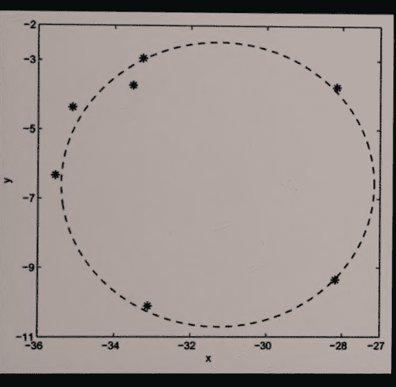


F. Bunea, V. Isham, N. Keiding, T. Louis, R. L. Smith, and H. Tong

## 前言

本书致力于现代统计学中的一个活跃研究主题——将几何轮廓（直线和圆）拟合到观测数据中，特别是数字化图像。在此类应用中，观测点的两个坐标都测量不精确，即两个变量（$x$ 和 $y$）都受到随机误差的影响。统计学家将此主题称为误差变量（Errors-In-Variables, EIV）模型。这与经典回归有着根本的不同，且复杂得多，在经典回归中，只有一个变量（通常是 $y$）是随机的。

将带有两个变量误差的观测数据拟合直线是一个老问题，可追溯到 19 世纪 70 年代 [1, 2, 117]，应用于一般统计学、科学、计量经济学和图像处理。其研究在二十世纪有着色彩斑斓的历史（我们在第 1 章中概述），其最活跃的时期可能持续了从 1975 年到 1995 年。到 20 世纪 90 年代末，线性 EIV 问题中的主要问题似乎都已得到解决，现在该主题不再是活跃的研究领域。

关于线性 EIV 回归研究的详细和完整综述，请参阅综述 [8, 73, 126, 127, 132, 187] 和书籍 [40]、[66]，以及 [128] 的第 10 章和 [111] 的第 29 章。我们注意到，线性 EIV 问题尽管看似简单，但实则深邃且广阔；整本诸如 [66] 和 [40] 的书籍都致力于此主题。我们仅就其与我们主要主题——拟合圆和其他曲线——相关的部分进行概述。

统计学家自 20 世纪 30 年代起就研究了将*非线性*模型拟合到带有两个变量误差的数据上 [50, 55]。该主题可以分为两部分。在其中一个部分中，主要目标是用非线性函数 $y = g(x)$ 来描述观测数据，例如多项式或指数函数等。在这些应用中，$x$ 和 $y$ 变量通常具有不同的性质，使用不同的单位进行测量，且 $x$ 和 $y$ 中的误差幅度可能不同。这类应用常见于统计学和计量经济学中。关于此类非线性模型的详细介绍可见 [27]；另请参阅最新修订版 [28]，该版本已更新并扩展。

第二类非线性 EIV 问题在图像处理应用中很常见。在这些应用中，数据点来自图片、照片、地图等。$x$ 和 $y$ 变量都测量长度，并以相同的单位给出；坐标系的选取往往相当任意，因此 $x$ 和 $y$ 中的误差平均而言具有相同的幅度。将显式函数 $y = g(x)$ 拟合到

## 前言

图像并非最佳选择；它不可避免地导致 $x$ 和 $y$ 变量受到不同的处理，这与问题的本质相冲突。相反，人们拟合（或期望在给定图像上找到的）几何形状。这些形状通常以几何方式描述：直线、矩形和其他多边形、圆、椭圆等。从解析角度看，基本曲线形状——圆和椭圆——由隐式二次函数定义。更复杂的曲线可以通过三次或四次隐式多项式来近似 [150, 176]；然而，后者仅在特殊场合使用，在实践中很少见。我们的书致力于在图像处理应用中拟合最基本的几何曲线——圆和圆弧——到观测数据。这一主题不同于上述其他统计应用中提到的非线性 EIV 回归，并在 [27, 28] 中有详细论述。将椭圆拟合到观测数据是另一个重要主题，值得一本独立的书（作者计划在未来出版一本）。

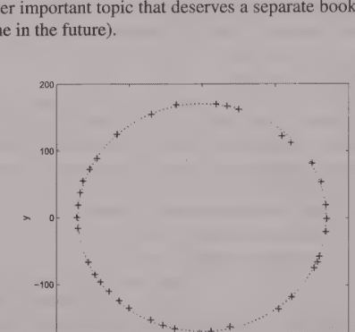

图 0.1 奥克尼群岛的博格环形石阵 [15, 178]。石头用加号标记；拟合的圆是虚线。

将圆和圆弧拟合到二维图像中观测点的问题可以追溯到 20 世纪 50 年代。其最早的实例相当独特：英国工程师和考古学家检查不列颠群岛的巨石遗址（石环），试图确定建造这些神秘结构的古人是否使用了统一的长度单位。这项工作始于 20 世纪 50 年代并持续了数十年 [15, 65, 177, 178, 179]；请参阅图 0.1 中的示例，其中数据引自 [178]。

在 20 世纪 60 年代，拟合圆的需求在地理学中涌现 [155]。在 20 世纪 70 年代，圆被拟合到微波工程的实验观测中 [54, 108]；请参阅图 0.2 中的示例，其中数据取自 [15]。大约从 1980 年起，拟合圆成为人类实践许多领域的议题。我们仅在下面列出一些显著案例。

在医学领域，人们通过照片估算人虹膜的直径 [141]，或根据 X 光片设计牙弓 [21]，或通过超声波产生的图像测量胎儿的大小。考古学家检查古希腊运动场（stadia）的圆形形状 [157]，或通过实地考察中发现的陶片分析来确定古代陶器的大小 [44, 80, 81, 190]。在工业领域，质量控制要求估算制造机械零件的半径和圆心 [119]。在移动机器人领域，机器人通过分析二维激光测距仪使用的范围读数来检测圆形物体（柱子、树干） [197]。

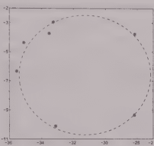

但也许将圆拟合到数据中最大的应用领域是核物理学。在那里，人们处理在加速器和对撞机中产生的基本粒子。新生成的粒子在恒定磁场中沿圆弧运动；物理学家通过测量其轨迹的半径来确定粒子的能量；为此，他们将该粒子在探测器中留下的机械或电信号序列拟合到一个圆弧上 [45, 53, 82, 106, 107, 136, 173, 174, 175]。高能粒子沿具有大半径（低曲率）的圆弧运动，因此将圆弧拟合到看似直线的轨迹上非常常见；这项任务需要非常精密的技术以确保结果准确。

我们通过一个考古学的现实例子来说明我们的讨论。为了估算实地考察中陶片的直径，考古学家用铅笔在坐标纸上描绘破损陶器的轮廓——例如外缘或底部。然后，他扫描其绘图并将其转换为像素阵列（数据点）。最后，他使用计算机将圆拟合到数字化图像上。

典型的数字化圆弧描绘了一个圆形轮制 antefix（陶檐口饰件），显示如下

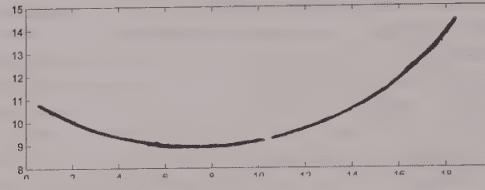

图 0.3 典型的由铅笔通过轮廓规从圆形轮制 antefix 绘制的圆弧。

图 0.3（此图像包含 7452 个像素）。由标准最小二乘过程找到的最佳拟合圆的参数为

```
center = (7.4487, 22.7436),
radius = 13.8251. (1)
```

这似乎并不具有挑战性，因为图 0.3 中的圆弧肉眼清晰可见，因此人们甚至可以通过手动重建一个圆。

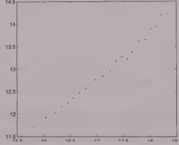

图 0.4: 图 0.3 中所示圆弧的片段。

现在假设我们只能看到上述圆弧的一小部分，且上面只有很少的点。图 0.4 显示了仅由原始圆弧的一小部分中随机选择的 22 个点组成的样本。假设我们要将这些点拟合到一个圆上，而不看图像的其他部分。这可能吗？

从视觉上看，图 0.4 中的 22 个点甚至没有形成一个清晰的圆弧，它们更像是一个无定形的串。从这 22 个点手动重建一个圆似乎是不可能的。然而，最佳的计算机算法返回以下参数：

```
center = (7.3889, 22.6645),
radius = 13.8111. (2)
```

将其与 (1) 进行比较。估计值惊人地准确！

产生估计值 (2) 的算法是 Levenberg-Marquardt 几何拟合（最小化给定点到圆的几何距离）；它描述在第 4.5 节中。人们自然会希望估计返回的圆参数值的误差，但对于 EIV 回归问题来说，这是一项艰巨的任务。特别是，在第 6 章描述的标准统计模型下，圆心和半径的估计值具有无限方差和无限均值！因此，传统的误差估计（基于标准差）将会是荒谬地无限。第 7 章开发的近似误差分析可以用来以更具现实性的方式评估误差；此时，估计值 (2) 的误差恰好为 $\approx 0.1$。

我们看到，将圆和圆弧拟合到图像的问题具有多种应用。它引起了科学家、工程师、统计学家和计算机程序员的注意。提出了许多优秀（以及不那么优秀）的算法；有些会被遗忘并稍后重新发现。例如，Kása 算法，参见我们的第 5 章，至少独立发表了 13 次，第一次在 1972 年，最后一次（截至目前）在 2006 年，参见第 5.1 节中的参考文献。但是，尽管圆拟合应用很流行，直到 20 世纪 90 年代，出版物都是零星的，缺乏统一的方法。

对将圆和其他几何形状拟合到观测点这一问题的兴趣在 20 世纪 90 年代爆发，因为当它成为快速成长的计算机科学社区的议题时，由于将简单轮廓（直线、圆、椭圆）拟合到数字化图像是模式识别和计算机视觉中的基本任务之一。更一般的曲线通常由线段或圆弧段组成的序列来近似，这些段被缝合在一起（“圆形样条”）；参见 [12, 145, 158, 164, 165]。

自 20 世纪 90 年代初以来，许多人发明了拟合圆和椭圆的新算法（其中一些真正出色）；其中包括使用黎曼球面的圆拟合 [123, 175] 和复平面保形映射 [159]，Fitzgibbon 等人的“直接椭圆拟合” [61, 63, 147] 和 Taubin 的特征拟合 [176]，Kanatani 开发的复杂重归一化过程 [47, 94, 95] 以及 Leedan 和 Meer 开发的同样出色的 HEIV 方法 [48, 49, 120]，以及 Chojnacki 等人的基本数值方案 [47, 48]。Chojnacki 及其合作者开发了一种针对几种流行算法的统一方法 [49]，并出色地解释了底层思想。

理论调查也导致了显著的成就。其中包括 Kukush、Markovsky 和 van Huffel 开发的一致曲线和曲面拟合算法 [114, 130, 167]，Kanatani 的“超精确”椭圆拟合方法 [102, 104]，以及经典 Cramer-Rao 下界到一般曲线拟合问题的非常规适应 [42, 96]。

在过去 15 年中取得的进步确实令人瞩目，所有这些研究的总产出足以编写一本关于该主题的全尺寸书籍。据作者所知，目前尚未有这样一本书存在。最后一本

## 前言

Kanatani [95] 于 1996 年发表了一篇关于将几何形状拟合到数据的良好教程。Zhang 撰写的关于拟合参数曲线的一篇良好（但相对有限）的教程大约在同一时期出现在互联网上（并于 1997 年印刷出版，参见 [199]）。这两篇出版物涵盖了 1996 年时已存在的椭圆拟合方法，但并未专门涉及圆拟合方法。1996 年之后取得的进展仍未得到充分记录。

本书的目标是全面介绍将圆和圆弧拟合到观测点这一主题，特别是详细阐述自 20 世纪 90 年代中期以来的所有最新成果。我试图涵盖该问题的各个方面：几何学、统计学和计算学。具体来说，我的目的是相互关联地介绍数值算法及其底层思想，强调每种算法的优缺点，并指出如何组合它们以取得最佳性能。本书彻底解决了拟合问题中与理解实际方案的优势和局限性相关的理论方面。最后，作者尝试识别那些仍然模糊不清且可能成为未来研究主题的问题。

同时，本书面向最终用户编写。它写给那些想要学习该主题或需要为特定任务选择合适工具的专业人士。我尽量避免脱离实践纯粹抽象的问题，并介绍了被认为对图像处理应用最重要的主题。

我假设读者具有良好的数学背景（熟练使用微积分、几何、线性代数、概率和统计学），并在数值分析和计算机编程方面有一定经验。书中没有使用任何特定的机器语言，尽管所有相关算法的 MATLAB® 代码可以在我们的网页 [84] 上找到。

作者深深感谢俄罗斯联合核子研究所（JINR）的前导师 G. Ososkov，他在圆拟合问题的研究中给予了持续的指导。作者感谢 K. Kanatani 在研究方面的有力支持，特别是在本书设计方面。作者感谢他的研究生 C. Lesort 和 A. Al-Sharadqah 对该主题的热忱以及他们在准备手稿和将计算机代码发布到网络上提供的帮助。最后，作者部分由美国国家科学基金会资助，资助号 DMS-0652896。

本书的组织结构如下，参见图 0.5 中的图表。第 1 章介绍了误差变量（Errors-In-Variables, EIV）回归分析及其简要历史（主要在线性模型背景下）。第 2 章总结了线性 EIV 问题的解法，并突出了其主要性质（几何和统计方面）。这两章不涉及圆或圆弧。

第 3 章介绍了最小二乘拟合圆的理论。它讨论了解的存在性和唯一性，描述了圆的各种参数化方案，并分析了待最小化的目标函数的形状（最终得出了重要的双谷定理）。

第 4 章和第 5 章专门介绍实际的圆拟合方法。

在第 4 章中，通过最小化观测点到拟合圆的几何距离来拟合圆，这是一种经典（或几何）拟合。这是一个没有解析解的非线性问题，因此所有算法都是迭代的，计算量大且偶尔会出现发散。我们在历史背景下描述了所有流行的方案，强调它们之间的相互关系，并突出其优缺点。

第 5 章涉及简化的圆拟合，即所谓的代数拟合。它们速度快、非迭代，且不会出现发散问题。然而，它们（在许多情况下）比第 4 章的几何拟合精度低。代数拟合常用于大规模数据处理（特别是在核物理领域），在该领域中速度至关重要。代数拟合还用于初始化迭代几何拟合程序。

仅对实用算法感兴趣的读者可以在第 3 至 5 章中找到所有相关信息。

第 6 章和第 7 章发生了一个急转弯，深入探讨曲线拟合方法的统计分析。这是理论材料，但我已尽力将其与实践联系起来，并以实用术语解释所有构造和结论。第 6 章专门介绍一般非线性 EIV 回归，即涵盖任意曲线。第 7 章专注于拟合圆和圆弧的具体任务。

第 6 章和第 7 章可能对专业统计学家感兴趣。

最后，第 8 章展示了一些“异类”圆拟合的样本，包括一些数学上复杂的过程——它们利用了复数和复平面的共形映射。这一章最适合具有扎实数学背景的科学家用。第 8 章方法背后的理念非常引人入胜，所得到的拟合结果看起来很有前途。这可能是该主题未来发展的起点。

书中大多数插图均使用 MATLAB 制作。MATLAB® 是 The MathWorks, Inc. 的注册商标。如需产品信息，请联系：

- The MathWorks, Inc.
- 3 Apple Hill Drive
- Natick, MA 01760-2098 USA
- 电话：508 647 7000
- 传真：508-647-7001
- 电子邮件：info@mathworks.com
- 网络：www.mathworks.com

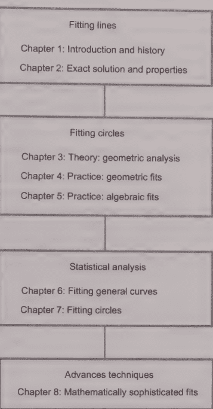

图 0.5：本书的结构。

### 符号与记法

在此，我们描述全书中使用的一些记法。首先描述我们的矩阵和向量的记法系统：

- `ℝ` 表示实数集合（实数轴），`ℝ^n` 表示 n 维欧几里得空间，`ℂ` 表示复平面。
- 矩阵始终用粗体大写字母表示，例如 **M** 或 **U**。单位矩阵用 **I** 表示。
- 向量用粗体字母表示，大写或小写均可，例如 **A** 或 **a**。默认情况下，所有向量均假设为列向量。通过转置获得行向量。
- 上标 `T` 表示向量或矩阵的转置。例如，如果 **A** 是一个向量，那么它（默认情况下）是一个列向量，相应的行向量用 `A^T` 表示。
- `diag{a1, a2, ..., an}` 表示一个 n × n 的对角矩阵，其对角线元素为 a1, a2, ..., an。
- 对于任何向量和矩阵，`||A||` 表示其 2-范数，除非另有说明。
- `κ(A) = ||A|| ||A^{-1}||` 表示方阵 **A** 的条件数（相对于 2-范数）。
- 方程 `A x ≈ b`，其中 **A** 是一个 n × m 矩阵，`x ∈ ℝ^m` 是未知向量，`b ∈ ℝ^n` 是已知向量（n > m），表示经典的平方最小二乘问题，其解为 `x = argmin ||A x - b||^2.`
- n × m 矩阵 **A** 的奇异值分解（SVD）用 `A = U Σ V^T` 表示，其中 **U** 和 **V** 分别是大小为 n × n 和 m × m 的正交矩阵，`Σ` 是一个对角 n × m 矩阵，其对角线元素为实非负数，并按降序排列：

`σ1 ≥ σ2 ≥ ... ≥ σp, p = min {m, n}.`

如果 n > m，则短 SVD 由 `A = U' Σ' V'^T` 给出，其中 `U'` 由 **U** 的前（左）m 列组成，`Σ'` 由 `Σ` 的前（上）m 行组成。

- `A^-` 表示矩阵 **A** 的 Moore-Penrose 伪逆。它由 `A^- = V Σ^- U^T` 给出，其中 `Σ^-` 是一个对角 m × n 矩阵，其对角线元素

### 记号

`σ_i^- = { 1/σ_i if σ_i > 0; 0 if σ_i = 0 }`

对于概率，我们使用以下记号：

- `Prob(A)` 表示事件 A 的概率。
- `𝔼(X)` 表示随机变量 X 的均值。


- `$Var(X)$` 表示随机变量 `$X$` 的方差。
- `$Cov(X, Y)$` 表示随机变量 `$X$` 和 `$Y$` 的协方差。
- `$N(\mu, \sigma^2)$` 表示均值为 `$\mu$`，方差为 `$\sigma^2$` 的正态随机变量。
- `$X_n \overset{L}{\to} X$` 表示随机变量的弱收敛，即 `$X_n$` 的分布函数在每个后者连续的点处收敛于 `$X$` 的分布函数。
- `$\mathcal{O}_p(\sigma^k)$` 表示一个随机变量 `$X$`，它可能依赖于 `$\sigma$`，且使得 `$\sigma^{-k}X$` 在概率上有界；即，对于任何 `$\varepsilon > 0$`，存在 `$A_{\varepsilon} > 0$`，使得对于所有 `$\sigma > 0$`，都有 `$Prob\{\sigma^{-k}X > A_{\varepsilon}\} < \varepsilon$`。

对于统计学，我们使用以下记号：
- 给定样本 `$x_1, \ldots, x_n$`，我们用 `$\bar{x} = \frac{1}{n} \sum_{i=1}^n x_i$` 表示其样本均值。
- 我们方便地将上述样本均值记号扩展如下：

$$\bar{\bar{x}} = \frac{1}{n} \sum x_i^2, \quad \bar{\bar{xy}} = \frac{1}{n} \sum x_i y_i, \quad \text{等等。}$$

- `$\Theta$` 通常表示未知参数的向量，且 `$\theta_1, \theta_2, \ldots$` 表示其分量。例如，`$a$` 和 `$b$` 是未知直线 `$y = a + bx$` 的参数。
- 我们使用波浪号表示未知参数的真实值，即我们写作 `$\tilde{\Theta} = (\tilde{\theta}_1, \tilde{\theta}_2, \ldots)$`。例如，`$\tilde{a}$` 和 `$\tilde{b}$` 是参数 `$a$` 和 `$b$` 的真实值。
- 我们使用尖帽符号表示未知参数的估计值，即我们写作 `$\hat{\Theta} = (\hat{\theta}_1, \hat{\theta}_2, \ldots)$`。例如，`$\hat{a}$` 和 `$\hat{b}$` 表示参数 `$a$` 和 `$b$` 的估计值。
- `MLE` 是最大似然估计（Maximum Likelihood Estimate）的缩写。例如，我们写作 `$\hat{a}_{MLE}$` 表示参数 `$a$` 的 `MLE`。
- `$bias(\hat{a}) = \mathbb{E}(\hat{a}) - \tilde{a}$` 表示估计 `$\hat{a}$` 的偏差。如果估计的偏差为零，则该估计是无偏的。
- `MSE` 是均方误差（Mean Squared Error，针对某个估计值）。例如，

$$MSE(\hat{a}) = \mathbb{E}[(\hat{a} - \tilde{a})^2] = Var(\hat{a}) + [bias(\hat{a})]^2$$

- 对于参数向量 `$\Theta$`，`MSE` 是一个矩阵

\[
\begin{gathered}
\operatorname{MSE}(\hat{\Theta}) = \mathbb{E}\left[\left(\hat{\Theta} - \Theta\right)\left(\hat{\Theta} - \Theta\right)^T\right] \\
= \operatorname{Cov}(\hat{\Theta}) + \left[\operatorname{bias}(\hat{\Theta})\right]\left[\operatorname{bias}(\hat{\Theta})\right]^T
\end{gathered}
\]

其中 `$\operatorname{Cov}(\hat{\Theta})$` 代表估计 `$\hat{\Theta}$` 的协方差矩阵。

## 引言与历史概述

- 1.1 经典回归 1
- 1.2 变量误差（EIV）模型 4
- 1.3 几何拟合 6
- 1.4 求解一般 EIV 问题 10
- 1.5 “线性” EIV 的非线性本质 14
- 1.6 正交拟合的统计特性 16
- 1.7 与最小二乘法（TLS）的关系 19
- 1.8 非线性模型：总体概述 20
- 1.9 非线性模型：EIV 与正交拟合 22

### 1.1 经典回归

在经典回归问题中，我们处理的是两个变量 `$x$` 和 `$y$` 之间的函数关系 `$y = g(x)$`。作为一个典型示例，设 `$x$` 代表时间，`$y = g(x)$` 代表在时间 `$x$` 观察到的某个量（例如室外温度或股市指数），那么人们希望建立 `$g$` 演变过程的模型。

我们记录若干观测值 `$(x_1, y_1), \dots, (x_n, y_n)$`，并尝试用相对简单的模型函数来近似它们，例如线性 `$y = a + bx$` 或二次 `$y = a + bx + cx^2$` 或指数 `$y = a e^{bx}$` 等，其中 `$a, b, c, \dots$` 是相应的系数（或模型参数）。

通常，我们用 `$y = g(x; \Theta)$` 来表示模型函数，其中 `$\Theta = (a, b, \dots)$` 是相关参数的向量。目标是找到该类中的一个特定函数 `$g(x; \hat{\Theta})$`（即选择 `$\Theta$` 的某个特定值 `$\hat{\Theta}$`），使其最佳地近似（拟合）观测数据 `$(x_1, y_1), \dots, (x_n, y_n)$`。没有必要对所有的（或任意的）`$i$` 都实现精确的关系 `$y_i = g(x_i; \hat{\Theta})$`，因为 `$y_i$` 被视为函数值的不精确（或带有噪声）观测值。

统计学中的一个标准假设是，`$y_i$` 是真实值 `$\tilde{y}_i = g(x_i; \tilde{\Theta})$` 的微小随机扰动，即

`$y_i = g(x_i; \tilde{\Theta}) + \varepsilon_i, \quad i = 1, \ldots, n$`

其中 `$\tilde{\Theta}$` 代表 `$\Theta$` 的真实（但未知）值，且（微小）误差 `$\varepsilon_i$` 是独立且服从正态分布的随机变量，均值为零，在最简单的情况下具有共同方差 `$\sigma^2$`。则联合概率密度函数为

`$f(y_1, \ldots, y_n) = \frac{1}{(2\pi\sigma^2)^{n/2}} \exp \left[ -\frac{1}{2\sigma^2} \sum_{i=1}^{n} \left(y_i - g(x_i; \Theta)\right)^2 \right]$`，

因此，对数似然函数为

`$\log L(\Theta, \sigma^2) = - \ln(2\pi\sigma^2)^{n/2} - \frac{1}{2\sigma^2} \sum_{i=1}^{n} [y_i - g(x_i; \Theta)]^2. \qquad (1.1)$`

因此，`$\Theta$` 的最大似然估计 `$\hat{\Theta}$` 通过最小化平方和来获得

`$\mathscr{F}(\Theta) = \sum_{i=1}^{n} [y_i - g(x_i; \Theta)]^2$, \qquad (1.2)$`

这引导我们回到经典的最小二乘法。这种求解回归问题的方法可追溯到 19 世纪初期的 C.-F. Gauss [69] 和 A.-M. Legendre [121]。如今，它是每门标准本科统计学课程的一部分。

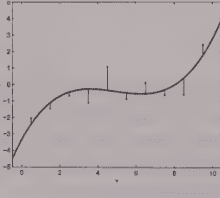

图 1.1 普通回归最小化垂直距离的平方和：一个拟合了 10 个数据点的三次多项式。

我们强调 `$x$` 和 `$y$` 变量扮演不同的角色：`$x$` 被称为控制变量（由实验者控制），其值 `$x_1, \ldots, x_n$` 是无误差的，而 `$y$` 被称为响应变量（作为响应被观测），其值 `$y_1, \ldots, y_n$` 是不精确的（受噪声污染）。几何上，回归过程最小化数据点 `$(x_i, y_i)$` 到函数 `$y = g(x; \Theta)$` 的图形的垂直距离（沿 `$y$` 轴测量）的平方和，见图 1.1。

例如，如果处理线性关系 `$y = a + bx$`，那么最小二乘估计量 `$\hat{a}$` 和 `$\hat{b}$` 使以下函数最小化

$$\mathcal{F}(a, b) = \sum_{i=1}^{n} (y_i - a - bx_i)^2 .$$

求解方程 `$\partial \mathcal{F} / \partial a = 0$` 和 `$\partial \mathcal{F} / \partial b = 0$` 可得

$$\hat{a} = \bar{y} - \hat{b} \bar{x} \quad \text{且} \quad \hat{b} = s_{xy}/s_{xx}, \tag{1.3}$$

其中 `$\bar{x}$` 和 `$\bar{y}$` 是“样本均值”

$$\bar{x} = \frac{1}{n}\sum_{i=1}^{n} x_i \quad \text{且} \quad \bar{y} = \frac{1}{n}\sum_{i=1}^{n} y_i \tag{1.4}$$

以及

$$\begin{aligned} s_{xx} &= \sum_{i=1}^{n} (x_i - \bar{x})^2 \\ s_{yy} &= \sum_{i=1}^{n} (y_i - \bar{y})^2 \\ s_{xy} &= \sum_{i=1}^{n} (x_i - \bar{x})(y_i - \bar{y}). \end{aligned}$$

是所谓的“散点阵”（scatter matrix）的分量

$$\mathbf{S} = \left[ \begin{array}{cc} s_{xx} & s_{xy} \\ s_{xy} & s_{yy} \end{array} \right], \tag{1.5}$$

它刻画了数据集关于其质心 `$(\bar{x}, \bar{y})$` 的“离散度”。

> *注.* 为了估计 `$a$` 和 `$b$`，不需要知道方差 `$\sigma^2$`。可以通过对 `$\sigma^2$` 最大化对数似然函数 (1.1) 来单独估计它，从而得到
>
> $$\hat{\sigma}^2 = \frac{1}{n}\sum_{i=1}^{n} (y_i - \hat{a} - \hat{b}x_i)^2. \tag{1.6}$$
>
> 这个估计量略有偏，因为 `$\mathbb{E}(\hat{\sigma}^2) = \frac{n-2}{n}\sigma^2$`。通常的做法是将分母中的 `$n$` 替换为 `$n - 2$`，从而得到 `$\sigma^2$` 的无偏估计。`$\hat{\sigma}^2$` 的两种形式都是一致估计量，即它们以概率 1 收敛于 `$\sigma^2$`。

回归模型具有优异的统计性质。估计量 `$\hat{a}$` 和 `$\hat{b}$` 是强一致的，即当 `$n \to \infty$` 时（以概率 1），`$\hat{a} \to a$` 且 `$\hat{b} \to b$`；同时它们也是无偏的，即 `$\mathbb{E}(\hat{a}) = a$` 且 `$\mathbb{E}(\hat{b}) = b$`。它们服从正态分布，方差为

`$\sigma_{\hat{a}}^{2} = \sigma^{2} \left( \frac{\bar{x}^{2}}{s_{xx}} + \frac{1}{n} \right), \quad \sigma_{\hat{b}}^{2} = \frac{\sigma^{2}}{s_{xx}}.$`

这些方差在所有无偏估计量的方差中是最小的，即它们与克拉美-罗（Cramer-Rao）下界重合。因此，估计量 `$\hat{a}$` 和 `$\hat{b}$` 的效率为 100%。总体而言，它们在统计意义上各方面都是最优的。

注。假设误差 `$\varepsilon_i$` 是异方差的，即具有不同的方差：`$\varepsilon_i \sim N(0, \sigma_i^2)$`。此时 `$\Theta$` 的最大似然估计量通过加权最小二乘法获得：

`$\mathscr{F}(\Theta) = \sum_{i=1}^{n} w_i \left[ y_i - g(x_i; \Theta) \right]^2,$`

其中权重设定为 `$w_i = \sigma_i^{-2}$`。在线性情形，`$y = a + bx$` 中，估计量仍由 (1.3) 给出，但现在样本均值和散点阵的公式应纳入权重，例如

`$\bar{x} = \frac{1}{n} \sum_{i=1}^{n} w_i x_i, \quad \quad s_{xx} = \sum_{i=1}^{n} w_i (x_i - \bar{x})^2, \quad \text{等等.} \tag{1.7}$`

因此，异方差性仅需要对回归公式进行微小改动。

## 1.2 误差变量（EIV）模型

回顾一下，经典回归问题在 19 世纪早期得到了解决。在 19 世纪末，统计学家遇到了另一个看似相似但实质完全不同且困难得多的问题。事实上，两者表面上的相似性造成了大量的混淆，并阻碍了进展长达数十年。

这个新问题是在给定观测值 `$(x_1, y_1), \ldots, (x_n, y_n)$` 的情况下重构函数关系 `$y = g(x)$`，其中两个变量都受到误差的影响。我们先通过一个例子开始，稍后再描述正式的统计模型。

假设（参见 Madasnky [127]）我们希望利用关系

`$\text{质量} = \rho \times \text{体积}. \tag{1.8}$`

来确定铁的密度 `$\rho$`。我们可以取 `$n$` 块铁，测量它们的体积 `$x_1, \ldots, x_n$` 和质量 `$y_1, \ldots, y_n$`。给定这些数据，我们需要估计函数关系 `$y = \rho x$` 中的系数 `$\rho$`。我们不能对任何 `$i$` 使用精确公式 `$y_i = \rho x_i$`，因为测量可能不精确（我们的铁块可能受其他元素污染）。

类似的问题在经济领域（例如，`$x$` 可能是某种商品的价格，`$y$` 是需求，参见 Wald [187]）和社会学领域也经常出现。关于其他有趣例子的大集合，包括对原子弹幸存者的研究，参见 [28] 的第 1 章。

那么我们如何解决铁密度问题？例如，我们可以假设（或者更确切地说，假装）体积 `$x_i$` 被精确测量，并应用 `$y$` 对 `$x$` 的经典回归，即确定 `$y = bx$` 并设 `$\rho = b$`。或者，我们可以假设我们的质量 `$y_i$` 没有误差，并对 `$x$` 关于 `$y$` 进行回归，即找到 `$x = b'y$` 然后设 `$\rho = 1/b'$`。

这听起来可能是一个好计划，但它给出了两个不同的估计量，`$\rho_1 = b$` 和 `$\rho_2 = 1/b'$`，这至少应该让我们产生怀疑。早在 1901 年，K. Pearson 就对这种策略提出了反对意见，参见 [144] 第 559 页：“如果我们把某个变量当作自变量，我们会得到一条直线或平面；但如果我们把另一个变量当作自变量，我们会得到一条完全不同的直线或平面。”参见图 1.2。

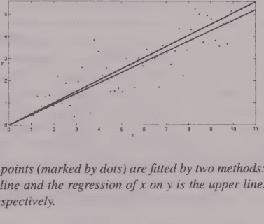

后来确定，在自然的统计假设下（稍后描述），两个估计量 `$\rho_1$` 和 `$\rho_2$` 都是不一致的，并且可能存在严重偏差，参见例如 [8, 118, 142]；这种偏差在计量经济学中的后果在 [128] 的第 10 章中讨论。事实上，`$\rho_1$` 系统地低估了真实密度 `$\rho$`，而 `$\rho_2$` 系统地高估了它。

因此，这种新类型的回归问题需要非经典的方法。首先，我们需要采用一个适当的统计模型，在该模型中 `$x_i$` 和 `$y_i$` 都受到误差的影响；这被称为*误差变量*（EIV）模型${}^1$。该模型假设存在一些“真实”值 `$\tilde{x}_i$` 和 `$\tilde{y}_i$`，它们由（未知的）函数关系 `$\tilde{y}_i = g(\tilde{x}_i)$` 联系，而实验者观测到的是完美测量的配对 `$(x_i, y_i)$`，其中 `$x_i$` 和 `$y_i$` 是通过在 `$\tilde{x}_i$` 和 `$\tilde{y}_i$` 上添加误差获得的。

...

更一般地，人们可能希望用完美的圆来近似图像中的圆形物体，用完美的椭圆来近似卵形物体，或用完美的矩形来近似方框等。我们将此任务称为**几何拟合问题**。它包括用简单的几何图形（直线、曲线、多边形等）来近似图像上可见的轮廓。本节讨论直线近似。

在坐标系中，可见轮廓上给定的点可以记录为 `$(x_1, y_1), ..., (x_n, y_n)$`，人们寻找形式为 `$y = a + bx$` 的最佳拟合直线。因此，问题再次看起来像是一个熟悉的回归问题。但仔细一看会发现，`$x_i$` 和 `$y_i$` 都可能不精确，因此我们处于 **EIV** 模型的框架内。

此外，这里有一个新特性：由于问题的几何特性，`$x$` 和 `$y$` 方向上的误差的平均幅度应该相同，因此我们有一个 **EIV** 模型的特殊情形，其特征为：

$$
\sigma_x^2 = \sigma_y^2.
$$

在这种情况下，“噪声”向量 `$(\delta_i, \varepsilon_i)$` 服从零均值和标量协方差矩阵的正态分布，即随机噪声在 `$xy$` 平面上是各向同性的。各向同性意味着噪声向量的分布对旋转不变。这一性质在图像处理应用中是自然的，因为图像上坐标轴的选择往往是任意的，即 `$x$`、`$y$` 或其他任何方向之间不应有任何差异。

反之，假设随机向量 `$(\delta_i, \varepsilon_i)$` 具有两个基本性质（这些性质在图像处理应用中自然成立）：

- (a) 它是各向同性的，如上所述，
- (b) 其分量 `$\delta_i$` 和 `$\varepsilon_i$` 是独立的。

那么它必然服从正态分布。这是概率论中的一个标准事实，参见例如 [14] 或 [60] 的第三节第 4 小节。因此，关于正态分布 (1.10) 的假设不再是一种奢侈，而是更基本的假设 (a) 和 (b) 的逻辑推论。


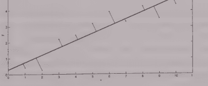

图 1.3 正交回归最小化正交距离的平方和。

针对 **EIV** 模型中 $\sigma_x^2 = \sigma_y^2$ 这一特殊情况的实际解决方案，早在 1877 年就由 Adcock [1] 基于纯几何（而非统计）考虑而提出。他定义了一条总体上最接近数据点的拟合直线 $y = a + bx$，即最小化以下量：

$$
\mathscr{F} = \sum_{i=1}^n d_i^2,
$$

其中 $d_i$ 表示点 $(x_i, y_i)$ 到拟合直线的几何（正交）距离，见图 1.3。通过初等几何，我们得到：

$$
\mathscr{F}(a,b) = \frac{1}{1+b^2} \sum_{i=1}^n (y_i - a - bx_i)^2.
$$

求解方程 $\partial \mathscr{F} / \partial a = 0$ 得到：

$$
a = \bar{y} - b\bar{x},
$$

其中 $\bar{x}$ 和 $\bar{y}$ 是样本均值，参见第 1.1 节。顺便提一下，请记住 (1.14) 也在经典情况下成立，参见 (1.3)。现在从 (1.13) 中消去 $a$，我们得到一个单变量函数：

$$
\mathscr{F}(b) = \frac{s_{yy} - 2bs_{xy} + s_{xx}b^2}{1 + b^2},
$$

其中 $s_{xx}, s_{xy}, s_{yy}$ 是散度矩阵的分量，参见第 1.1 节。接下来，方程 $\partial \mathscr{F} / \partial b = 0$ 将问题简化为一个二次方程：

$$
s_{xy}b^2 - (s_{yy} - s_{xx})b - s_{xy} = 0.
$$

它有两个根，但仔细检查发现 $\mathscr{F}$ 的最小值对应于以下根：

$$
b = \frac{s_{yy} - s_{xx} + \sqrt{(s_{yy} - s_{xx})^2 + 4s_{xy}^2}}{2s_{xy}}.
$$

只要 $s_{xy} \neq 0$，此公式就适用。在 $s_{xy} = 0$ 的情况下，我们需要在 $s_{xx} > s_{yy}$ 时设 $b = 0$，在 $s_{xx} < s_{yy}$ 时设 $b = \infty$。我们鼓励读者推导公式 (1.16) 并仔细检查 $s_{xy} = 0$ 的特殊情况。

以上解决方案以现代标准来看可能是初等的，但它有着显示其非平凡性质的历史。它最早由 Adcock [2] 在 1878 年获得，他顺便犯了一个简单的计算错误。Adcock 的错误在次年由 Kummell [117] 纠正，但反过来，Kummell 的一个公式涉及了一个更微妙的错误。Kummell 的错误在 20 世纪 40 年代和 50 年代被其他一些作者复制（参见 [89, 126]）。最终在 1959 年由 Madansky [127] 纠正。Madansky 的工作 [127] 或许是关于 **EIV** 回归早期研究中被引用最多的文献。

我们将基于最小化数据点到拟合轮廓的正交（几何）距离平方和的拟合方法称为*正交拟合*或*几何拟合*。尽管正交拟合直线具有自然的吸引力，但 1877–79 年的早期出版物 [1, 2, 117] 被忽视了。二十年后，正交拟合直线由 Pearson [144] 独立提出，再过二十年，由 Gini [72] 提出。

Pearson 和 Gini 做出了另一个重要观察：最小化 (1.12) 的直线是与数据集相关的散射椭圆的主轴。散射椭圆由方程定义：

$$
\begin{bmatrix} x - \bar{x} \\ y - \bar{y} \end{bmatrix}^T \mathbf{S} \begin{bmatrix} x - \bar{x} \\ y - \bar{y} \end{bmatrix} = 1,
$$

其中心是 $(\bar{x}, \bar{y})$，其轴由散度矩阵 $\mathbf{S}$ 的特征向量张成。这一事实建立了正交拟合与线性代数中主成分分析之间的联系。

Pearson [144] 还估计了拟合直线与 $x$ 轴所成的角度 $\theta = \tan^{-1} b$，并为其找到了一个简单的公式：

$$
\tan 2\theta = \frac{2s_{xy}}{s_{xx} - s_{yy}}.
$$

我们将其验证作为练习留给读者。

Adcock 和 Pearson 的动机是几何考虑，并没有使用概率。直到 1930 年代，他们的方法才被纳入正式的统计分析。Koopmans [113]（参见 Lindley [126]）确定正交拟合在假设 (1.9)–(1.11) 下提供了最大似然估计。记住，经典最小二乘拟合 (1.2) 也在普通回归模型 (1.1) 中最大化似然。因此，这两种回归模型之间存在深刻的类比。

正交拟合的几何特性使得生成的直线独立于图像上坐标系的选择。换句话说，几何拟合在坐标系框架的正交变换（旋转和平移）下是不变的。

在特定变换下的不变性非常重要。我们说一条拟合直线在平移下是不变的，如果通过以下方式改变数据坐标：

$$
T_{c,d}: (x,y) \mapsto (x+c, y+d)
$$

会使直线保持不变，即在新坐标系中其方程为 $y + d = a + b(x + c)$。类似地，我们定义在旋转下的不变性：

$$
R_{\theta}: (x,y) \mapsto (x \cos \theta + y \sin \theta, -x \sin \theta + y \cos \theta)
$$

以及在变量缩放下的不变性：

$$
S_{\alpha,\beta}: (x,y) \mapsto (\alpha x, \beta y). \quad (1.20)
$$

缩放变换的一个重要特殊情况是 $\alpha = \beta$；它被称为相似性变换（或有时称为扩张；在正式数学中被称为同伦）。我们将把它记为：

$$
S_{\alpha} = S_{\alpha, \alpha}: (x, y) \mapsto (\alpha x, \alpha y). \quad\quad (1.21)
$$

通过少量努力即可验证，正交拟合直线在 `T_{c,d}`、`R_{\theta}` 以及 `S_{\alpha}` 下是不变的，但在 $\alpha \ne \beta$ 的一般缩放变换 `S_{\alpha, \beta}` 下*不*不变。我们将这些事实的验证留给读者。

当应用于规则的几何图案时，正交拟合具有清晰的吸引力。图 1.4 显示了位于矩形顶点的四个数据点。虽然经典回归线向上或向下倾斜（图 1.4 的第一和第二面板），但正交回归线正好穿过矩形的中心并位于其对称轴上。可以说，正交拟合直线比任何其他直线都更“令人赏心悦目”。

然而，如果应用于更一般的 **EIV** 模型，其中 $\sigma_x^2 \ne \sigma_y^2$，则正交拟合会导致不一致。这种不一致源于正交拟合直线在缩放变换 `S_{\alpha, \beta}` 下的非不变性。

例如，让我们再次考虑使用 (1.8) 并通过测量某些铁块的体积 $x_i$ 和质量 $y_i$ 来确定铁密度的任务，参见上一节。如果我们采用对测量值 $(x_1, y_1), \ldots, (x_n, y_n)$ 的正交拟合，那么拟合直线 $y = bx$，以及由此得到的铁密度估计值 $\rho = b$，将取决于记录测量值 $x_i$ 和 $y_i$ 的单位选择。也就是说，如果我们通过 $(x, y) \mapsto (\alpha x, \beta y)$ 重新缩放变量，新坐标系中正交拟合直线的方程将是 $\beta y = b'(\alpha x)$，其中 $b' \ne b$。换句话说，如果我们把磅换成公斤或吨，或者把升换成蒲式耳或立方米，将会得到不同的密度。

这一反对意见在 1937 年由 Roos [156] 提出，并在 20 世纪 40 年代的统计学文献中进一步讨论 [89, 187]。因此，正交拟合有其局限性，它基本上局限于 **EIV** 模型中 $\sigma_x^2 = \sigma_y^2$ 的特殊情况。一些现代书籍，参见例如 [28]，强烈警告不要在 $\sigma_x^2 \ne \sigma_y^2$ 的 **EIV** 应用中使用正交拟合直线，更一般地，警告不要使用基于关于 $\sigma_x^2$ 和 $\sigma_y^2$ 的任何不可靠假设的其他技术。

我们将在下一节简要概述一般 **EIV** 模型的基本特征（虽然不试图进行全面涵盖）。

## 1.4 求解一般的 EIV 问题

让我们回到不假设 (1.11) 的 **EIV** 模型 (1.9)–(1.10)，即不限制 $\sigma_x^2$ 和 $\sigma_y^2$。

Kummell [117] 可能是第一个在 1879 年考察以下任务的人：

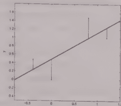

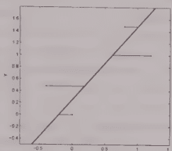

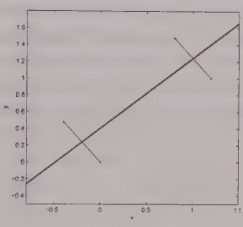

图 1.4 *$y$ 对 $x$ 的回归最小化垂直距离平方和（上图）；$x$ 对 $y$ 的回归对水平距离做同样的处理（中图）；正交回归最小化正交距离平方和（下图）。*

在 EIV（误差变量模型）背景下确定底层函数关系 $y=g(x)$ 是不可行的，人们意识到，除非对 $\sigma_x^2$ 和 $\sigma_y^2$ 之间的关系做出额外假设，否则无法以任何合理的意义实现这一目标（1）。即使是在最简单的线性情况 $y=a+bx$ 中，如果没有额外假设，也没有合理的方法来估计参数 $a$ 和 $b$。无论问题看起来多么简单，它都是*无解*的！

二十世纪初，许多其他研究人员也得出了同样的结论。认识到这一惊人事实引发了社区内长达数年的动荡，一直持续到大约 1950 年代，期间充满了混乱和争议。例如，A. Madansky 在其 1959 年的论文 [127] 中专门用了几个篇幅来描述一位普通物理学家在得知“简单”回归问题无解时的震惊，以及统计学家如何向他解释这一点。

后来，该问题的无解性在数学术语上得到了证明。首先，Anderson 和 Rubin [9]（另见 [73]）在 1956 年确立，即使在 $y = a + bx$ 的线性情况下，似然函数也是无界的（其上确界为无穷大），因此无法确定最大似然估计。有趣的是，似然函数存在临界点，这些点有时被误认为是最大值；直到 1969 年这个问题才得到解决：M. Solari [168] 证明所有临界点都只是鞍点。

其次（也是更重要的），Nussbaum [139]（另见 [40] 第 7 页）在 1977 年证明，没有统计程序能产生强一致性估计 $\hat{a}$ 和 $\hat{b}$（这些估计量在 $n \to \infty$ 时将收敛到 $a$ 和 $b$ 的真值）。关于可辨识性的讨论，另见 Cheng 和 Van Ness 的著作 [40]。

为了使 EIV 回归模型可解，Kummel [117] 假设

比率 $\kappa = \sigma_x / \sigma_y$ 是已知的。（1.22）

他通过论证实验者“通常根据经验知道这个比率”来证明其假设的合理性。后来，这一假设在统计学文献中被普遍采用。最近，Fuller [66] 称满足假设 (1.9)、(1.10) 和 (1.22) 的 EIV 模型为“经典 EIV 模型”。

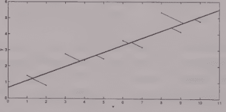

图 1.5 *EIV 拟合最小化数据点到直线的“倾斜”距离平方和。这里 $\kappa = 2$。*

现在，EIV 回归问题有了明确的解。1879 年，Kummel [117] 给出了涉及 $\kappa$ 的最佳拟合直线公式。他的直线 $y = a + bx$ 最小化

$\mathscr{F} = \frac{1}{1+\kappa^{2}b^{2}} \sum_{i=1}^{n}(y_{i} - a - bx_{i})^{2}$ (1.23)

其斜率由下式估计

$b = \frac{\kappa^2 s_{yy} - s_{xx} + \sqrt{ (\kappa^2 s_{yy} - s_{xx})^2 + 4\kappa^2 s_{xy}^2 }}{2\kappa^2 s_{xy}},$ (1.24)

请将其与 (1.16) 进行比较。截距再次为 $a = \bar{y} - b\bar{x}$，如 (1.14) 所述。

这条直线最小化沿向量 $(\kappa b, -1)$ 测量的数据点 $(x_i, y_i)$ 的距离平方和，见图 1.5。Kummel 相当直观地得出了他的公式，但后来被确定他实际上找到了最大似然解，参见 [113, 126]。

在特殊情形 $\kappa = 1$，即 $\sigma^2_x = \sigma^2_y$ 时，向量 $(\kappa b, -1) = (b, -1)$ 垂直于直线 $y = a + bx$，因此我们得到了熟悉的正交拟合。因此，EIV 线性回归 (1.24) 将正交拟合包含为其一个特例。

由 (1.24) 给出的斜率 $b$ 随 $\kappa$ 单调递增（这可以通过一些代数操作从标准事实 $s^2_{xy} \le s_{xx} s_{yy}$ 推导出来，我们将其留作读者练习）。在极限 $\kappa \to 0$ 下，EIV 回归线收敛到斜率为 $b = s_{xy} / s_{xx}$ 的 $y$ 对 $x$ 的经典回归，参见 (1.3)。类似地，在极限 $\kappa \to \infty$ 下，EIV 回归线收敛到斜率为 $b = s_{yy} / s_{xy}$ 的 $x$ 对 $y$ 的经典回归。因此，经典回归（$y$ 对 $x$ 和 $x$ 对 $y$）是 EIV 回归的极端情况。

最小化 (1.23) 的 EIV 直线可以通过将缩放因子 $\alpha$ 和 $\beta$ 纳入比率 $\kappa$（遵循显而易见的规则 $\kappa \mapsto \kappa \alpha / \beta$），使其在坐标缩放 $x \mapsto \alpha x$ 和 $y \mapsto \beta y$ 下保持不变。Lindley [126] 在 1947 年指出了这一事实，并得出结论认为，估计量 (1.24) 符合 EIV 模型的基本要求：它不依赖于记录测量值 $x_1, \dots, x_n$ 和 $y_1, \dots, y_n$ 的单位。

实际上，如果将坐标按 $x \mapsto x$ 和 $y \mapsto \kappa y$ 进行缩放，则在新变量中有 $\kappa = 1$。因此，EIV 回归线可以转换为正交拟合线。因此，EIV 线性回归模型（已知比率 $\kappa = \sigma_x / \sigma_y$）可以通过简单地缩放坐标转换为正交回归模型，反之亦然。

但我们强调，一般 EIV 回归和正交拟合必须满足不同的要求：

- EIV 回归必须对变量 $x$ 和 $y$ 的缩放（源于测量这些变量的单位变化）保持不变。

- 正交拟合（由于其几何性质）必须对 $xy$ 平面上的坐标系旋转和平移保持不变，以及对由长度单位变化引起的相似变换保持不变。

这种差异对于 1.9 节中讨论的非线性回归有重要影响。

## 1.5 “线性” EIV 的非线性本质

在空间 $\mathbb{R}^{2n}$ 中从几何上解释正交回归问题可能具有启发性，其坐标为 $x_1, y_1, \dots, x_n, y_n$。我们遵循 Malinvaud（[128] 第 10 章）。我们的观测值 $(x_1, y_1), \dots, (x_n, y_n)$ 由这个多维空间中的一个点（记为 $\mathscr{X}$）表示。为了理解正交拟合直线的构造，考虑由

$(x_1, y_1, \dots, x_n, y_n) \in \mathbb{P} \iff \exists a, b: y_i = a + bx_i \ \forall i,$

定义的子集 $\mathbb{P} \subset \mathbb{R}^{2n}$

即 $\mathbb{P}$ 由 $\mathbb{R}^{2n}$ 中所有使得 $n$ 个平面点 $(x_1, y_1), \dots, (x_n, y_n)$ 共线的 $(x_1, y_1, \dots, x_n, y_n)$ 组成。注意，真值 $\tilde{x}_1, \tilde{y}_1, \dots, \tilde{x}_n, \tilde{y}_n$ 由 $\mathbb{P}$ 中的一个点（记为 $\tilde{\mathscr{X}}$）表示，即 $\tilde{\mathscr{X}} \in \mathbb{P}$。

正交拟合直线最小化总和

$$\sum_{i=1}^{n} (x_i - \tilde{x}_i)^2 + (y_i - \tilde{y}_i)^2,$$

这是点 $\mathscr{X}$ 和 $\tilde{\mathscr{X}}$ 之间距离（在欧几里得度量下）的平方。因此，正交拟合过程对应于选择 $\mathbb{P}$ 中距离表示数据的点 $\mathscr{X} \in \mathbb{R}^{2n}$ 最近的点 $\tilde{\mathscr{X}}$。换句话说，我们将给定点 $\mathscr{X}$ 正交投影到 $\mathbb{P}$ 上。还是说事情没有那么简单？

需要一点努力来验证 $\mathbb{P}$ 是 $\mathbb{R}^{2n}$ 中的一个*非线性*子流形（“曲面”）。确实，它由 $n-2$ 个独立关系指定

$$
\frac{y_{i+1} - y_i}{x_{i+1} - x_i} = \frac{y_{i+2} - y_i}{x_{i+2} - x_i}, \quad i = 1, \dots, n - 2, \tag{1.25}
$$


其中每一个关系意味着三个平面点 $(x_i, y_i)$、$(x_{i+1}, y_{i+1})$ 和 $(x_{i+2}, y_{i+2})$ 共线。关系式 (1.25) 显然是二次的，因此 $\mathbb{P}$ 是 $\mathbb{R}^{2n}$ 中的一个 $(n+2)$ 维*二次曲面*（簇）。

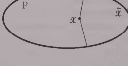

图 1.6：*点* $\mathscr{X}$ *到二次流形* $\mathbb{P}$ *的投影。*

将点 $\mathscr{X}$ 投影到二次曲面上并非易事，肯定也不是一个线性问题。这种几何解释应该消除我们的幻觉（如果仍然有）我们处理线性问题，这恰恰暴露了它本质上非线性的特性。

例如，想象一下将一个点 $\mathscr{X} \in \mathbb{R}^2$ 投影到一个二次曲面（例如椭圆 $a^2 x^2 + b^2 y^2 = 1$）上的任务。这不是一个简单的问题，其精确解涉及求解一个四次多项式的根 [162]。在某种意义上，我们是幸运的，因为我们数据点 $\mathscr{X} \in \mathbb{R}^{2n}$ 到 $\mathbb{P}$ 的投影简化为一个二次方程 (1.15)。

此外，投影可能不是唯一的（例如，当 $\mathscr{X}$ 位于椭圆长轴上且靠近中心时，参见图 1.6）。我们将看到，正交拟合线可能也不是唯一的，参见第 2.3 节。

为了进一步强调 EIV 回归的非线性本质，假设一段时间内误差是非同方差的，即

$\delta_i \sim N(0, \sigma^2_{x_i}) \qquad \text{ 和 } \qquad \varepsilon_i \sim N(0, \sigma^2_{y_i})$，

其中方差比率已知，但逐点不同，即假设

$\kappa_i = \sigma_{x,i} / \sigma_{y,i}$

对每个 $i = 1, \dots, n$ 都是已知的。回想一下，在经典回归中，误差的非同方差不影响问题的线性性质。现在，在 EIV 模型中，最佳拟合线应使以下函数最小化：

$\mathscr{F}(a, b) = \sum_{i=1}^n \frac{(y_i - a - bx_i)^2}{1 + \kappa_i^2 b^2}$，

尽管它与 (1.23) 相似，但 $\mathscr{F}$ 的最小化不能简化为二次（或任何有限次）多项式方程。这里“有限次”指的是次数独立于样本量 $n$。这是一个硬核的非线性问题，没有闭式解；其数值解需要迭代算法。

换句话说，“线性”EIV 拟合的隐藏非线性本质可能以不同的方式在 different stages 出现。对误差做出的假设越一般，面临的困难就越严重。

Boggs 等人还对线性 EIV 回归具有本质非线性特征的原因提供了另一种解释，参见 [23]。

总体而言，线性 EIV 模型虽然表面上与经典线性回归相似，但在许多关键方面却截然不同。目前，许多作者都认识到这两个模型之间的鲜明对比。正如教科书 [29] 所述，“带误差变量（EIV）的回归……与简单线性回归……有着根本的不同，因此最好将其视为一个完全不同的主题。”

## 1.6 正交拟合的统计特性

本书致力于正交拟合问题，从现在开始我们采用统计模型假设 (1.9)、(1.10) 和 (1.11)。在这些假设下，正交拟合最大化似然函数，即提供最大似然估计（这一事实的形式证明将在第 6.3 节给出）。

本节涉及线性正交拟合的基本统计特性，即拟合直线 $y=\alpha+\beta x$ 的参数估计 $\hat{\alpha}$ 和 $\hat{\beta}$ 的行为（这里使用 $\alpha$ 和 $\beta$ 而不是之前的 $a$ 和 $b$，以与我们参考的论文中的符号保持一致）。

我们的讨论将更深入地揭示正交拟合与经典回归之间的显著差异，我们在第 1.1 节中提到过经典回归的优点。即使是快速浏览，也能发现一个完全不同（甚至有点令人震惊）的局面。

首先，估计量 $\hat{\alpha}$ 和 $\hat{\beta}$ 的分布不是正态的，也不属于任何标准的概率分布族。直到 1976 年，Anderson 等人 [7, 10] 才发现了其密度函数的显式公式；参见第 2.4 节。这些表达式过于复杂，涉及双重无穷级数，Anderson [7] 很快承认它们对实际用途不是很有用。相反，他与 Kunitomo [118] 推导了 $\hat{\alpha}$ 和 $\hat{\beta}$ 分布函数的各种近似值，结果证明这些近似值在实际中是准确的。

第二，更糟糕的是，估计量 $\hat{\alpha}$ 和 $\hat{\beta}$ 没有有限矩，即

$\mathbb{E}(|\hat{\alpha}|)=\infty \quad \text{和} \quad \mathbb{E}(|\hat{\beta}|)=\infty.$

因此，它们也具有无限的均方误差：

$\mathbb{E}((\hat{\alpha}-\alpha)^2)=\infty \quad \text{和} \quad \mathbb{E}((\hat{\beta}-\beta)^2)=\infty.$

这些令人震惊的事实也是由 Anderson [7] 在 1976 年揭示的。直觉上，我们可以从 (1.16) 中看到为什么会发生这种情况，其中的分母可以取零值，且其概率密度在零处不为零。我们鼓励读者仔细检查这一观察。

在 Anderson 的发现之前，研究人员“近似”了估计量 $\hat{\alpha}$ 和 $\hat{\beta}$ 的矩。他们使用了泰勒展开，丢弃了高阶项，并得到了 $\hat{\alpha}$ 和 $\hat{\beta}$ 矩（包括它们的均值和方差）的一些“近似”公式。Anderson 证明所有这些公式都是根本性错误的，因为实际的矩并不存在。Anderson 认为，这些公式应被视为“某些近似的矩”，而不是“近似的矩”。

一旦 Anderson 做出了这一发现，立即导致了根本性的方法论问题：人们如何信任一个具有无限均方误差（更不用说无限偏差）的统计估计？这些事实是否意味着该估计完全不可靠？为什么在实践中之前的任何人没有注意到这些不良特征？具有无限矩的估计量在实践中是否可能比具有有限矩的估计量更好？这些问题引发了进一步的研究，参见下文。

在 20 世纪 70 年代末，Anderson [7, 8]、Patefield [142] 和 Kunitomo [118] 比较了由 (1.16) 给出的正交拟合线的斜率 $\hat{\beta}$ 和由 (1.3) 给出的经典回归线的斜率 $\hat{\beta}$（当然，这两个估计量都是在相同的模型 (1.9)、(1.10) 和 (1.11) 框架下使用的）。他们以前者表示为 $\hat{\beta}_M$（最大似然），后者表示为 $\hat{\beta}_L$（最小二乘）。他们的结果可以总结为两个看似矛盾的结论：

- (a) $\hat{\beta}_M$ 的均方误差是无限的，而 $\hat{\beta}_L$ 的是有限的（只要 $n \geq 4$），因此 $\hat{\beta}_L$ 看起来（无限地！）更准确；
- (b) 估计量 $\hat{\beta}_M$ 是相容的且渐近无偏的，而 $\hat{\beta}_L$ 是不相容的且渐近有偏的（仅在 $\beta = 0$ 的特殊情况下是相容且无偏的），因此 $\hat{\beta}_M$ 看起来更合适。

进一步地，Anderson 表明

$\text{Prob}\{|\hat{\beta}_M - \beta| > t\} < \text{Prob}\{|\hat{\beta}_L - \beta| > t\}$

对于所有不是太大的 $t > 0$ 均成立，即对于所有实际感兴趣的 $t > 0$。换句话说，$\hat{\beta}_M$ 的准确性在除非常大的偏差（大的 $t$）以外的所有地方都优于 $\hat{\beta}_L$。正是 $\hat{\beta}_M$ 的重尾使其均方误差无限，否则它倾向于比其竞争对手 $\hat{\beta}_L$ 更接近 $\beta$。

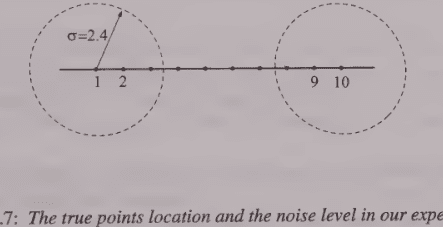

此外，当在实践中或模拟实验中观察 $\hat{\beta}_M$ 的值时，没有任何迹象表明 $\hat{\beta}_M$ 具有无限矩；其值聚集在某个中心周围，并具有看似正态的分布。大偏差发生得如此罕见，通常未被记录下来。然而，正是这些大偏差最终导致了矩的缺失。为了使它们可见，即让它们在计算机实验中以明显的比率出现，需要将噪声水平 $\sigma = \sigma_x = \sigma_y$ 提高得远高于图像处理应用中通常的水平，参见下文。

例如，我们生成了 $10^6$ 个 $n = 10$ 个点的随机样本，这些点位于直线 $y = x$ 上，其真实位置在长度为 10 的区间上等间距分布，且 $\sigma = 2.4$（注意噪声有多高：其标准偏差是观察数据区间长度的四分之一；参见图 1.7）。图 1.8 绘制了随着 $k$ 从 1 运行到 $10^6$ 时，$k$ 个样本上的平均估计量 $\hat{\beta}_M$。其行为非常类似于柯西随机变量的样本均值（其矩也不存在）。因此，确实可以看到估计量 $\hat{\beta}_M$ 具有无限矩。但如果将噪声水平降低到 $\sigma = 2$ 或更低，则异常行为消失，图 1.8 中的实线变得完全平坦，就像具有有限矩的估计量 $\hat{\beta}_L$ 一样。

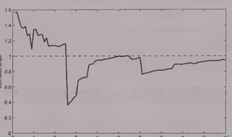

图 1.8 $k$ 个随机生成样本上的平均估计量 $\hat{\beta}_M$（实线），$k$ 从 1 运行到 $10^6$。真实斜率 $\beta = 1$ 由虚线标出。平均估计量 $\hat{\beta}_L$ 是点线，它保持在 0.52 的水平，系统性地低估了 $\beta$。

现在，我们应该偏好哪个估计量，$\hat{\beta}_M$ 还是 $\hat{\beta}_L$？对于习惯信任均方误差作为绝对且最终标准的实践者来说，这可能是一个很大的两难境地。Anderson 认为，在这种情况下，必须做出例外，选择 $\hat{\beta}_M$ 而非 $\hat{\beta}_L$，尽管其均方误差是无限的。

在 20 世纪 80 年代初，仿佛是对 Anderson 呼吁的回应，几位统计学家（最著名的是 Gleser [73, 74, 75]、Malinvaud [128] 和 Patefield [143]）独立建立了正交拟合线（以及更一般地，经典 EIV 拟合线）的强渐近性质：

- (a) 估计量 $\hat{a}$ 和 $\hat{\beta}$ 是强相容的$^{2}$且渐近正态的；

$^{2}$然而，$\sigma_x^2$ 和 $\sigma_y^2$ 的最大似然估计不是相容的，事实上，在函数模型中，当 $n \to \infty$ 时，$\hat{\sigma}^2_x \to \frac{1}{2}\sigma_x^2$ 且 $\hat{\sigma}^2_y \to \frac{1}{2}\sigma_y^2$。这种奇特的特征在 1947 年被 Lindley 注意到并解释

### 1.7 与总最小二乘（TLS）的关系

在某种意义上，这些估计量是高效的。他们还构造了 $\alpha$ 和 $\beta$ 的置信区域。更多细节可参阅文献 [66]、[40]、[128] 以及我们的第 2 章。

这些结果有力地断言，最大似然估计量 $\hat{\beta}_{\mathrm{M}}$ 是最佳的。关于此观点的某些正式陈述由 Glesler [74] 发表，另见 [39, 40, 128] 以及我们的第 2 章。

在所有这些宏伟的成就之后，线性 EIV 回归的研究似乎在 1990 年代后期有所衰退；或许该主题已经自我耗尽。统计学界将注意力转向了非线性 EIV 模型。

有关线性 EIV 回归的进一步阅读材料，可参阅精彩的综述 [8, 73, 126, 127, 132, 187]，以及书籍 [66]、[40]、[128]（第 10 章）和 [111]（第 29 章）。我们在第 2 章中总结正交直线拟合方法。

EIV 线性回归通常与计算线性代数中所谓的*总最小二乘*（TLS）技术相关联。后者解决一个超定线性系统

$$\mathbf{A}\mathbf{x} \approx \mathbf{b}, \quad \mathbf{x} \in \mathbb{R}^{m}, \ \mathbf{b} \in \mathbb{R}^{n}, \ n > m,$$

其中不仅向量 $\mathbf{b}$，而且矩阵 $\mathbf{A}$（或其某些列）也被假定含有误差。如果只有 $\mathbf{b}$ 受到噪声污染，那么 (1.26) 的解由普通最小二乘法给出

$$\mathbf{x} = \operatorname{argmin}\|\mathbf{A}\mathbf{x} - \mathbf{b}\|^{2},$$

其中 $\| \cdot \|$ 表示 2-范数。等价地，这可以重新表述为

$$\mathbf{x} = \operatorname{argmin}\|\Delta\mathbf{b}\|^{2} \quad \text{subject to} \quad \mathbf{A}\mathbf{x} = \mathbf{b} + \Delta\mathbf{b}.$$

如果 $\mathbf{A}$ 满秩，那么（唯一的）显式解为

$$\mathbf{x} = (\mathbf{A}^{T}\mathbf{A})^{-1}\mathbf{A}^{T}\mathbf{b}.$$

如果 $\mathbf{A}$ 秩亏，解不再唯一，通常选取最小范数解

$$\mathbf{x} = \mathbf{A}^{-}\mathbf{b},$$

其中 $\mathbf{A}^{-}$ 表示 Moore-Penrose 伪逆。

如果 $\mathbf{b}$ 和 $\mathbf{A}$ 都受到噪声污染，(1.26) 的解更为复杂，这是 TLS 技术的研究主题。在最简单的情况下，其中 **A** 和 **b** 中的所有误差都是独立的且具有相同的数量级，解由下式给出

$$\mathbf{x} = \operatorname{argmin} \|[ \Delta\mathbf{A} \ \Delta\mathbf{b} ]\|_{F}^{2} \quad \text{subject to} \quad (\mathbf{A} + \Delta\mathbf{A})\mathbf{x} = \mathbf{b} + \Delta\mathbf{b}, \quad (1.28)$$

其中 $[\Delta\mathbf{A} \ \Delta\mathbf{b}]$ 表示“增广”的 $n \times (m + 1)$ 矩阵，而 $\|\cdot\|_{F}$ 表示 Frobenius 范数（即 $[n(m + 1)]$ 维向量的“长度”）。请注意 (1.27) 与 (1.28) 之间的相似性。

为了从 (1.28) 计算 **x**，我们使用增广矩阵 $[\mathbf{A} \ \mathbf{b}]$ 的奇异值（和奇异向量）。在基本情况下，参见 [185] 第 2 章，解为

$$\mathbf{x} = (\mathbf{A}^{T}\mathbf{A} – \sigma^{2}_{*m*+1}\mathbf{I})^{-1}\mathbf{A}^{T}\mathbf{b},$$

其中 $\sigma_{*m*+1}$ 是 $[\mathbf{A} \ \mathbf{b}]$ 的最小奇异值，**I** 表示单位矩阵。这就是“简略版”的 TLS；我们参阅 [77, 185, 160, 161] 以获取详细处理。

为了了解 EIV 模型与 TLS 模型之间的关系，考虑一个 EIV 问题，即用直线 $y = a + bx$ 拟合数据点 $(x_i, y_i)$，$i = 1, \dots, n$。这个问题等价于 (1.26)，其中

$$\mathbf{A} = \begin{bmatrix} 1 & x_1 \\ \vdots & \vdots \\ 1 & x_n \end{bmatrix}, \quad \mathbf{x} = \begin{bmatrix} a \\ b \end{bmatrix}, \quad \mathbf{b} = \begin{bmatrix} y_1 \\ \vdots \\ y_n \end{bmatrix}.$$

我们看到向量 **b** 和矩阵 **A** 的第二列受到噪声污染，因此我们得到一个特定的 TLS 问题。如果 $x_i$ 和 $y_i$ 中的误差是独立的且具有相同的方差，那么我们可以通过 (1.28) 求解，且该解等价于正交最小二乘拟合。

EIV 回归模型与计算线性代数中 TLS 技术之间的联系非常有帮助。许多高效的 TLS 工具（特别是 SVD）可用于求解线性（或线性化的非线性）EIV 问题，参见 [185, 160, 161]。

### 1.8 非线性模型：总体概述

> ...变量中的误差在线性模型中已经足够糟糕了。  
> 它们很可能对任何估计  
> 额外的非线性或曲率参数的尝试造成灾难性后果...  
> Z. Griliches 和 V. Ringstad；见 [79]

将直线拟合到观测点可能看起来像是一个“线性”回归问题，但它具有真正的非线性特征（1.5 节）。其解由一个无理公式 (1.16) 给出，且可能不唯一（2.2 节）。所得估计量的概率分布不属于任何标准族，并由过于复杂的表达式描述（2.4 节）。这些估计量没有矩，即其偏差不确定且其均方误差无限大。人们可能只是在纳闷事情是否能变得更糟。


遗憾的是，当必须将非线性函数拟合到含有变量误差的数据时，事情确实变得更糟了。我们这里只概述一些新的麻烦。首先，非线性拟合问题可能甚至没有解。更准确地说，如果通过最小化到数据点的正交距离来拟合某类型（例如，圆）的曲线，那么这样的曲线可能不存在；我们将在 3.3 节中看到例子。不存在性只是非线性问题的特有现象。其次，即使最佳拟合曲线存在，它可能不唯一，可能存在多个解，所有这些解都是“同样好的”，参见 3.5 节中的例子。这导致理论分析中的混乱。

此外，即使最佳拟合存在且唯一，关于所得参数估计量的分布也不知情；它们的密度或矩没有显式公式。事实上，理论矩常常不存在。即使在线性情况下也是如此，参见 1.6 节。关于圆的拟合问题，参见 6.4 节。矩的不存在似乎是 EIV 回归和正交拟合问题的共同特征。为了解决这些困难，统计学家已经开发出一种基于近似分布的非传统误差分析。我们将几乎整个第 6 章致力于这些新的统计理论。

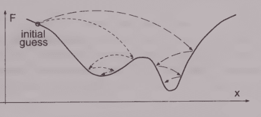

*图 1.9 两种最小化函数 F(x) 的算法。一种采取较短的步长并收敛到局部最小值。另一种采取较长的步长并收敛到全局最小值。*

回到更实际的问题，非线性 EIV 回归中的参数估计量不能通过如 `(1.16)` 那样的显式公式以封闭形式找到。它们只能通过数值算法（即近似地）计算。数值方案充其量是迭代地收敛到所需的估计量。然而，在实践中，迭代可能发散，即使它们收敛，也永远不知道它们是否到达了所需的估计量（过程可能仅仅在目标函数的局部最小值处终止；见图 1.9）。

往往不同的数值算法返回不同的估计量。图 1.9 展示了一个迭代过程被局部最小值困住的例子。另一个例子如图 1.10 所示：那里没有局部最小值，但第二种（慢速）算法需要大量的步长才能到达最小值附近的区域。在计算机程序中，迭代次数总是有限的（通常，限制设为 50 或 100），因此返回的估计量可能仍然远离实际的最小值。

不同算法返回的估计量甚至可能具有看似不同的统计特性（偏差、方差等）。因此，算法的选择成为实际应用以及许多理论研究中的关键因素。研究一种在实践中无法访问的抽象“解”几乎没有意义，而实际解在很大程度上取决于用于计算它们的特定算法。

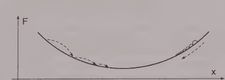

*图 1.10 两种最小化具有唯一最小值的函数 F(x) 的算法。一种快速接近（从左向右）并在 5-10 步内到达最小值附近。另一种移动非常缓慢（从右向左）；可能需要 100 或 1000 次迭代才能接近最小值。*

因此，数值方案的分析成为研究的一个组成部分。如今已出版的论文和书籍中有相当一部分篇幅致力于计算机算法、其潜在思想、性能、局限性、数值稳定性等。由于学科的性质，这些都是不可避免的。

### 1.9 非线性模型：EIV 与正交拟合

到目前为止，我们平行讨论了两个大主题——正交（几何）拟合和 EIV 回归（已知方差比）。在线性背景下，这些模型可以通过对变量 `$x$` 和 `$y$` 进行简单缩放相互转换（1.4 节），且两个模型具有非常相似的性质。

在非线性背景下，这两个模型之间的紧密联系丢失了。它们不再可以相互转换。关键的差异源自于 1.4 节末尾陈述的不同要求：EIV 回归必须对变量 `$x$` 和 `$y$` 的缩放保持不变，而正交（几何）拟合 — 对 `$xy$` 平面上的旋转和平移保持不变。

这些要求会影响每种情况下使用的非线性模型的类别。

例如，人们可能会对观测点拟合多项式 `$y=a_{0}+a_{1}x+\cdots+a_{k}x^{k}$`，这在 EIV（误差变量模型）环境中很常见 [79, 140]。变量缩放 `$S_{\alpha, \beta}$`，参见 1.3 节，将一个多项式转换为另一个多项式，因此多项式这一类别保持不变，非常方便。

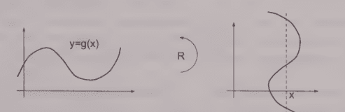

图 1.11 显式非线性函数 `$y=g(x)$` 的图像（左图）。旋转后，同一条曲线（右图）不再表示任何显式函数。

然而，坐标平面的旋转 `$R_{\theta}$` 会将多项式转换为不同的函数；它变成一个隐式多项式曲线，甚至可能无法用显式表示 `$y=g(x)$`。因此，显式多项式不适合正交（几何）拟合。这同样适用于任何其他显式非线性函数 `$y=g(x)$` 的类别：非线性函数的图像总可以被旋转，使得结果曲线不再表示任何显式函数关系；见图 1.11。

在旋转和平移下保持不变的模型的一个自然类别是由特定阶数 `$k \geq 1$` 的隐式多项式组成的。`$k=1$` 阶的多项式由方程 `$Ax+By+C=0$` 给出，它表示平面上的所有直线（包括垂直线和水平线）。`$k=2$` 阶的多项式由方程 `$Ax^{2}+By^{2}+Cxy+Dx+Ey+F=0$` 给出，它表示所有圆锥曲线：椭圆、双曲线和抛物线，除了直线之外。这个类别足够大，可以覆盖计算机视觉和模式识别中现有应用的绝大多数。

较高阶 `$k \geq 3$` 的隐式多项式偶尔用于描述更复杂的物体，见 [150, 176] 中的例子，其中提到了 `$k=3, 4$` 甚至 `$k=6$` 阶的多项式。但 `$k \geq 3$` 阶多项式的使用仍然极其罕见，因为大多数从业者更倾向于将复杂形状分成小段，这些小段可以由直线和圆锥曲线弧甚至圆弧良好近似。最终得到的是拼接在一起的圆弧序列（“圆形样条”）；参见 [12, 145, 158, 164, 165]。一些作者直言不讳地断言“世界上的大多数物体都是由圆弧段和直线组成的”；参见 [146, 195]。

因此，除了拟合直线之外，对观测数据拟合圆和圆锥曲线是图像处理应用中实际上最重要的任务。

我们注意到，通常处理的是图像中具有矩形或其他多边形形状的物体，见例如 [186, 189]。在这种情况下，可以拟合具有正确形状的多边形。多边形由直线段组成，因此可以使用一般的直线拟合算法，但还存在可能需要进行特殊处理的顶点和角。本书不讨论此类问题。

总之，我们看到在非线性的背景下，两个主要主题，(i) 一般统计学中使用的 EIV 回归和 (ii) 图像处理中使用的几何拟合，走上了不同的道路，变得非常不同。这里还有另一个显著的区别：这些主题采用了不同的渐近模型。在一般的 EIV 回归中，通常研究估计量在样本量增大时的性质，即当 `$n \rightarrow \infty$` 时（同时噪声水平 `$\sigma$` 保持不变）。而在图像处理应用中，样本量通常非常有限，但噪声相当小，因此更合适的渐近模型是 `$\sigma \rightarrow 0$` 同时 `$n$` 固定。这个问题将在 2.5 节中详细讨论。

我们再次强调，我们的主要主题是图像处理中的几何曲线拟合，即上述主题 (ii)。对于主题 (i)，即一般非线性 EIV 回归的全面介绍，请参阅近期出版的书籍 [27] 及其更新和扩充的第二版 [28]。

## 第 2 章

### 直线拟合

- 2.1 参数化
- 2.2 存在性和唯一性
- 2.3 矩阵解
- 2.4 误差分析：精确结果
- 2.5 渐近模型：大 n 与小 σ
- 2.6 估计量的渐近性质
- 2.7 近似分析
- 2.8 有限尺寸效率
- 2.9 渐近效率

通过最小化正交距离来对观测点拟合直线的问题自 19 世纪末以来就一直存在，现在它的各个方面都被充分理解并在统计学文献中有详细记载。我们在上一章中给出了一个历史概述。这里我们简要总结了该问题的解决方案及其主要特征。

### 2.1 参数化

首先，我们需要通过方程描述 `$xy$` 平面中的一条直线，这里有几种选择。

**两个参数（斜率和截距）。** 直到 20 世纪 80 年代末，几乎所有涉及直线拟合问题的论文和书籍都使用方程 `$y = a + bx$`。它足够简单，并且表示 `$x$` 和 `$y$` 之间所有可能的线性关系，这确实是许多应用的目标。但这个方程无法描述平面上的所有几何直线：垂直线（`$x = \text{const}$`）未被涵盖。

此外，接近垂直的直线涉及任意大的 `$b$` 值，这在数值计算中是危险的。（数值稳定性问题在 20 世纪 80 年代之前可能并不显著，但在今天的计算机化世界中绝对至关重要。）

最后，正如我们在 1.6 节中提到的，`$a$` 和 `$b$` 的估计值具有无限的均值和无限的方差；这使得分析它们的统计行为变得困难。

**三个代数参数。** 这些理由很有说服力，促使我们使用直线的替代方程：

```
Ax + By + C = 0.  (2.1)
```

必须施加额外的限制条件 `$A^{2}+B^{2}>0$`，否则如果 `$C \neq 0$`，则 `$A=B=0$` 会导致 (2.1) 描述一个空集；如果 `$C=0$`，则描述整个平面。

方程 (2.1) 表示平面上的所有几何直线，包括垂直线 (`$B=0$`) 和水平线 (`$A=0$`)。此外，它允许我们保持 `$A, B, C$` 的值有界，正如我们将在下一节中证明的那样。这也确保了参数估计值的矩的有限性，并有助于确保实际计算中的数值稳定性。

**约束条件。** 一个小问题是多重表示：每条直线对应无限多个参数向量 `$(A, B, C)$`，显然，它们彼此成比例。这种多义性可以通过施加约束来消除

```
A^{2}+B^{2}+C^{2}=1,  (2.2)
```

或者另一个约束

```
A^{2}+B^{2}=1.  (2.3)
```

前者用于例如 [93, 95]，后者用于 [83, 143]。约束 (2.3) 稍好一些，因为它自动强制执行限制条件 `$A^{2}+B^{2}>0$`，见上文。此外，它允许对参数空间进行清晰的几何解释，见下文。因此，我们在后文中使用 (2.3)。

**参数空间。** 由于 (2.3)，`$A$` 和 `$B$` 可以被单个参数 `$\varphi$` 替代，使得 `$A = \cos \varphi$` 和 `$B = \sin \varphi$`，其中 `$0 \leq \varphi < 2 \pi$`。注意 `$\varphi$` 是一个循环参数，即其定义域是单位圆 `$\mathbb{S}^{1}$`。现在，一条直线可以用两个参数描述：

```
x cos φ + y sin φ + C = 0  (2.4)
```

`$\varphi \in \mathbb{S}^{1}$` 和 `$C \in \mathbb{R}^{1}$`。观察可知 `$\varphi$` 是直线法向量的方向。参数空间 `{(\varphi, C)}` 是一个无限圆柱体，`$\mathbb{S}^{1} \times \mathbb{R}^{1}$`。

细心的读者会发现，每条几何直线仍然由多个参数向量表示：对于每条直线，恰好有两个向量 `(\varphi, C)`；其中一个是通过将另一个变换为 `$C \mapsto -C$` 和 `$\varphi \mapsto \varphi+\pi \text{ (mod } 2 \pi\text{ )}$` 得到的。这种歧义可以通过要求 `$C \geq 0$` 来消除；那么 `$C$` 将是原点到直线的距离，见图 2.1。参数

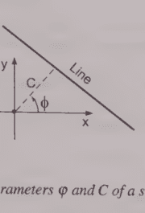

*图 2.1：直线* `$\varphi$` *和* `$C$` *的参数。*

空间将是一个半无穷圆柱，`$\mathbb{S}^{1} \times \mathbb{R}_{+}^{1}$`。此外，对于每个 `$\varphi \in [0, \pi)$`，两个点 `(\varphi, 0)` 和 `(\varphi + \pi, 0)` 代表同一条直线，因此它们也需要被识别为相同。

**目标函数。** 现在，通过最小化目标函数

```
ℱ = 1/(A² + B²) Σ_{i=1}^{n} (Ax_i + By_i + C)²  (2.5)
```

可以在参数化 (2.1) 中找到正交拟合直线，而不施加约束 (2.3)，或者

```
ℱ = Σ_{i=1}^{n} (x_i cos φ + y_i sin φ + C)²  (2.6)
```

在参数化 (2.4) 中。

### 2.2 存在性与唯一性

在我们解决新参数下的上述最小化问题之前，让我们将注意力转向两个基本的理论问题：解是否总是存在？它是否总是唯一的？

**参数空间的非紧性。** 我们在这里的分析将涉及连续性和紧性的数学概念，我们在下一章处理圆时也会用到这些概念。对拓扑学不太熟悉的读者可以直接跳到下一节，寻找最小二乘问题的实际解法，在那里也会以不同的方式解决存在性和唯一性问题。

由 (2.6) 给出的函数 `$\mathscr{F}$` 显然在相应的参数空间上是连续的。已知紧空间上的连续函数能取得其最小值（和最大值）。如果我们的参数空间*是*紧的，这将立即保证正交拟合的存在。但是，由于 `$C$` 可以取任意大的值，参数空间*不是*紧的。

直接的几何论证。我们也可以通过几何方式演示直线空间的非紧性，而无需参考任何参数化。

让我们用 `$\mathfrak{L}$` 表示 `$\mathbb{R}^2$` 中所有直线的空间。首先我们需要在 `$\mathfrak{L}$` 上引入正确的拓扑。我们说，平面 `$\mathbb{R}^2$` 中直线的序列 `$\mathbb{L}_i$` 收敛到直线 `$\mathbb{L}$`，如果对于任何闭圆盘 `$\mathbb{D} \subset \mathbb{R}^2$`，我们有

```
dist_H(L_i ∩ D, L ∩ D) → 0  当 i → ∞
```

其中 `$\operatorname{dist}_{H}(\cdot, \cdot)$` 是 `$\mathbb{R}^2$` 中紧子集之间的所谓豪斯多夫距离。后者由以下规则计算

```
dist_H(E, F)=max{max_{x∈E} dist(x,F), max_{y∈F} dist(y,E)},
```

其中 `$E, F \subset \mathbb{R}^2$` 是两个紧集。

或者，可以通过将平面 `$\mathbb{R}^{2}$` 映射到黎曼球面（详见 8.1 节）来紧化平面，使得每条直线都被转化为球面上的一个圆（通过北极），然后使用相应圆之间的豪斯多夫距离。两种构造产生相同的拓扑，该拓扑与由参数 `$\varphi, \mathcal{C}$` 诱导的拓扑一致（即，直线序列 `$\mathbb{L}_{i}=(\varphi_{i}, \mathcal{C}_{i})$` 收敛到直线 `$\mathbb{L}=(\varphi, \mathcal{C})$` 当且仅当 `$\varphi_{i} \rightarrow \varphi$` 且 `$\mathcal{C}_{i} \rightarrow \mathcal{C}$`）。

现在，紧空间的一个特征性质是它的任何点的序列都包含一个收敛的子序列。因此，通过产生一个没有收敛子序列的直线序列，可以证明直线空间的非紧性。为此，我们可以例如取直线 `$\mathbb{L}_{i}=\{x=i\}$`，其中 `$i=1,2,\ldots$`

最小值的存在。所以一切告诉我们，我们的参数空间不是紧的；因此，需要额外的论证来证明目标函数最小值的存在。我们分两步这样做：首先，我们将空间 `$\mathfrak{L}$` 缩减到一个较小的空间 `$\mathfrak{L}_{0}$`，它是紧的；其次，我们证明

```
inf_{L0} ℱ ≤ inf_{L} ℱ,
```

因此，我们可以将 `$\mathscr{F}$` 最小值的搜索限制在子空间 `$\mathfrak{L}_{0}$` 中。由于数据点 `$(x_{i}, y_{i})$` 的集合是有限的，我们可以将它们包含在某个矩形 `$\mathbb{B}$`（“包围盒”）中。在许多实验中，所有数据点自然地限制在对应于测量设备物理尺寸的窗口内，因此在收集数据之前，盒 `$\mathbb{B}$` 可能是已知的。

现在，如果直线 `$\mathbb{L}$` 不穿过盒 `$\mathbb{B}$`，它就不能提供 `$\mathscr{F}$` 的最小值，见图 2.2。确实，人们只需将 `$\mathbb{L}$` 移近盒，从而减少所有数据点到直线的距离。我们用 `$\mathfrak{L}_{0}$` 表示所有穿过盒 `$\mathbb{B}$` 的直线的空间，并将 `$\mathscr{F}$` 最小值的搜索限制在 `$\mathfrak{L}_{0}$` 中。

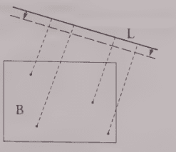

图 2.2：*不穿过包围盒* `$\mathbb{B}$` 的直线 `$\mathbb{L}$`。

回顾一下，`$C$` 代表直线到原点的距离。由于每条直线 `$\mathbb{L} \in \mathfrak{L}_{0}$` 都穿过盒 `$\mathbb{B}$`，我们有一个限制条件 `$C \leq C_{\text{max}}$`，其中 `$C_{\text{max}}$` 是原点到 `$\mathbb{B}$` 最远点的距离。因此，缩减后的空间 `$\mathfrak{L}_{0}$` 确实是紧的。

**定理 1** *目标函数* `$\mathscr{F}$` *确实取得其最小值。因此，正交拟合直线总是存在的。*

*注。* 我们的分析还证明，如果人们使用受约束 `$A^{2} + B^{2} = 1$` 的参数 `$A, B, C$`，那么 `$|A|, |B| \leq 1$` 且 `$|C| \leq C_{\text{max}}$`。因此，我们的参数永远不需要超过 `$C_{\text{max}}$` 和 1 中的较大者，即参数保持有界，并且在计算过程中不会遇到任意大的参数值；这是任何算法数值稳定性的必要条件。

**非唯一性。** 最后，我们讨论唯一性问题。虽然对于典型的数据集（见 2.3 节中的精确陈述），正交回归直线是唯一的，但存在例外。为了给出一个简单的例子，假设 `$n > 2$` 个数据点位于规则 `$n$` 边形 `$P$` 的顶点上。我们证明存在多于一条最小化 `$\mathscr{F}$` 的直线。


假设 $\mathbb{L}$ 是（其中的）一条正交回归直线。设 $R = R_{2\pi/n}$ 表示绕多边形 $P$ 的中心旋转平面角度 $2\pi/n$。由于 $R$ 将 $P$ 变换为自身，直线 $R(\mathbb{L})$ 提供与直线 $\mathbb{L}$ 完全相同的 $\mathscr{F}$ 值，因此 $R(\mathbb{L})$ 是另一条不同于 $\mathbb{L}$ 的最小二乘直线。

在 2.3 节中，我们给出了正交回归直线不唯一的精确条件；我们还将看到，每当该直线不唯一时，实际上存在无穷多条这样的直线。

**实际影响。** 最后一个给不耐烦的读者的注释，他们可能认为我们的理论讨论价值不大：解的存在性和唯一性具有实际相关性。例如，知道在什么条件下问题没有解，可能有助于理解为什么计算机程序偶尔返回无意义的结果或完全崩溃。

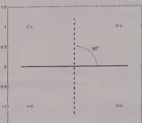

图 2.3 一条水平实线拟合四个点（加号）和一条垂直虚线拟合另外四个点（叉号）。

为了说明非唯一性的实际作用，考虑图 2.3 中的例子。拟合四个点 $(\pm(1+\delta), \pm 1)$（由加号标记）的最佳直线是一条水平线（x 轴）。另一方面，拟合附近四个点 $(\pm(1-\delta), \pm 1)$（由叉号标记）的最佳直线是一条垂直线（y 轴）。这里 $\delta$ 可以任意小。

我们看到，数据点的轻微扰动可能会导致最佳拟合直线的剧烈改变（在这里旋转了 $90^{\circ}$）。这正是因为我们的数据非常接近一个特殊的构型（完美正方形的顶点），该构型对应于拟合问题的多重解。

### 2.3 矩阵解法

在这里，我们找到目标函数 $\mathscr{F}$ 的最小值，由 (2.5) 给出，用三个参数 `A`, `B`, `C` 表示。我们使用线性代数方法；我们的公式可能比初等解法 (1.16) 看起来更复杂，但它们有几个优点：

- (i) 它们在数值上更稳定；
- (ii) 它们在没有任何例外的情况下都适用；
- (iii) 它们便于随后的误差分析。

**消除 C。** 回顾一下，我们在约束条件 $A^{2}+B^{2}=1$ 下最小化函数，参见 (2.3)。由于参数 `C` 是无约束的，我们可以通过对 `C` 最小化 (2.9) 来消除它，同时固定 `A` 和 `B`。求解方程 $\partial \mathcal{F} / \partial C = 0$ 可得

$$C = - A \bar{x} - B \bar{y}, \quad (2.10)$$

其中 $\bar{x}$ 和 $\bar{y}$ 是 (1.4) 中引入的样本均值。特别是，我们可以看到正交拟合直线总是穿过数据集的质心 $(\bar{x}, \bar{y})$。

#### 特征值问题

从 (2.9) 中消去 `C` 得到

$$\begin{aligned} \mathcal{F}(A, B) &= \sum_{i=1}^{n} \left[ A(x_i - \bar{x}) + B(y_i - \bar{y}) \right]^2 \\ &= s_{xx} A^2 + 2s_{xy} AB + s_{yy} B^2, \quad (2.11) \end{aligned}$$

其中 $s_{xx}$、$s_{xy}$ 和 $s_{yy}$ 是 (1.5) 中引入的散度矩阵 $\mathbf{S}$ 的分量。以矩阵形式表示为：

$$\mathcal{F}(\mathbf{A}) = \mathbf{A}^T \mathbf{S} \mathbf{A}, \quad (2.12)$$

其中 $\mathbf{A} = (A, B)^T$ 表示参数向量。在约束条件 $\|\mathbf{A}\| = 1$ 下最小化 (2.12) 是矩阵代数中的一个简单问题，其解对应于散度矩阵 $\mathbf{S}$ 较小特征值的特征向量。

注意到参数向量 $\mathbf{A}$ 与直线 (2.1) 正交，因此该直线本身与另一个特征向量平行。此外，由于它经过质心，所以它是散射椭圆的主轴。

#### 实用算法

如果使用内置矩阵代数运算的软件，只需组装散度矩阵 $\mathbf{S}$ 并调用返回其特征值和特征向量的例程：这将给出 $\mathbf{A}$；然后通过 (2.10) 计算 `C`。散度矩阵 $\mathbf{S}$ 可以表示为乘积 $\mathbf{S} = \mathbf{X}^T \mathbf{X}$，其中

$$\mathbf{X} = \begin{bmatrix} x_1 - \bar{x} & y_1 - \bar{y} \\ \vdots & \vdots \\ x_n - \bar{x} & y_n - \bar{y} \end{bmatrix} \quad (2.13)$$

是 $n \times 2$ 的数据矩阵。

或者，注意到 $\mathbf{S}$ 的特征向量与 $\mathbf{X}$ 的右奇异向量重合。因此，可以使用 $\mathbf{X}$ 的奇异值分解 `SVD` 来寻找 $\mathbf{A}$；此过程完全避免了计算散度矩阵 $\mathbf{S}$，并使数值计算更加稳定。

#### 其他参数

另一个感兴趣的参数是 $\varphi$，即拟合直线的法线与 $x$ 轴之间的夹角，参见 (2.4)；它可以通过以下公式计算：

$$\varphi = \tan^{-1}(B/A).$$

直线本身的方向角 $\theta$ 由以下公式得出：

$$\theta = \varphi + \pi/2 \quad \text{(mod } \pi\text{)}.$$

**特殊情况。** 对于典型的数据集，上述过程会导致唯一的一条正交拟合直线。但也存在一些例外。

如果 $\mathbf{S}$ 的两个特征值相等，则任意向量 $\mathbf{A} \in \mathbb{R}^2$ 都是其特征向量，且函数 $\mathscr{F}(A,B)$ 实际上是常数。在这种情况下，所有经过数据质心的直线都能使 $\mathscr{F}$ 最小化；因此该问题有多个（无穷多个）解。当且仅当 $\mathbf{S}$ 是标量矩阵时才会发生这种情况，即

$$s_{xx} = s_{yy} \quad \text{且} \quad s_{xy} = 0. \quad (2.14)$$

上一节提到的一个例子是正多边形的顶点集。

因此，当且仅当 (2.14) 中的两个方程都成立时，正交回归直线不唯一。显然，这是一个非常罕见的事件。如果数据点是从连续概率分布中随机采样的，那么 (2.14) 发生的概率确实为零。然而，如果数据点是从数字图像（例如计算机屏幕上的像素）中获得的，那么 (2.14) 出现的可能性可能不再可以忽略，必须予以考虑。例如，由 4 个像素组成的简单 $2 \times 2$ 正方形配置满足 (2.14)，因此正交拟合直线没有唯一定义。

另一种有趣的例外情况发生在矩阵 $\mathbf{S}$ 奇异时。在这种情况下 0 是其一个特征值，且 $\mathscr{F}(A,B)=0$，这意味着“完美拟合”或“插值”（数据点共线）。因此，我们看到共线性准则是

$$\det \mathbf{S} = s_{xx} s_{yy} - s_{xy}^2 = 0.$$

### 2.4 误差分析：精确结果

没有误差分析，统计估计就不完整，其主要目的是确定相应估计量的概率分布和基本特征（如均值和方差）。

**线性函数模型。** 为了分析我们的估计量 $\hat{A}$、$\hat{B}$、$\hat{C}$ 和 $\hat{\theta}$，我们需要采用一种统计模型。我们回顾第 1.2 节中描述的模型。即，假设存在一条真实的（但未知的）直线

$$\tilde{A}x + \tilde{B}y + \tilde{C} = 0$$

满足 $\tilde{A}^2 + \tilde{B}^2 = 1$，以及直线上 $n$ 个真实的（但未知的）点 $(\tilde{x}_1, \tilde{y}_1), \dots (\tilde{x}_n, \tilde{y}_n)$。由于真实点位于真实直线上，我们有

$$\tilde{A}\tilde{x}_i + \tilde{B}\tilde{y}_i + \tilde{C} = 0, \quad i = 1, \dots, n.$$

每个观测点 $(x_i, y_i)$ 可视为真实点 $(\tilde{x}_i, \tilde{y}_i)$ 受到随机各向同性高斯噪声扰动后的结果，即

$$x_i = \tilde{x}_i + \delta_i, \quad y_i = \tilde{y}_i + \varepsilon_i,$$

其中 $\delta_i$ 和 $\varepsilon_i$ 是服从正态分布 $N(0, \sigma^2)$ 的独立随机变量。$\sigma^2$ 的值对于 `A`、`B`、`C` 和 `theta` 的估计是不需要的。

真实值 $\tilde{x}_i, \tilde{y}_i$ 被视为固定（非随机）的，因此必须作为额外的模型参数进行处理。它们被称为“偶然”或“潜在”参数（或者“冗余”参数，因为其数值通常没什么兴趣）。这构成了函数模型，参见第 1.2 节。

**散度矩阵的分布。** 这些或许是正交拟合背景下最简化的假设。尽管如此，在这些假设下，回归参数估计量的分布过于复杂。不深入统计细节，我们仅浏览一些公式。

例如，散度矩阵 $\mathbf{S}$ 的分量 $s_{xx}$、$s_{yy}$ 和 $s_{xy}$ 具有非中心威沙特分布，其联合密度函数为

$$\frac{e^{-S/2}e^{-(s_{xx}+s_{yy})/2}(s_{xx}s_{yy}-s_{xy}^2)^{(n-3)/2}}{2^n \pi^{1/2}\Gamma(\frac{n-1}{2})} \sum_{j=0}^{\infty} \frac{(\frac{s}{2})^{2j} s_{xx}^{j}}{j! \Gamma(\frac{n}{2}+j)}, \quad (2.16)$$

定义在区域 $s_{xx} > 0$、$s_{yy} > 0$ 且 $s_{xy}^2 < s_{xx}s_{yy}$ 中；参见例如 [10]。在此表达式中，为简化起见，假设真实直线是水平的且经过原点（即 $\tilde{A} = \tilde{C} = 0$）且 $\sigma^2 = 1$。对于一般直线和 $\sigma > 0$ 的密度可以通过标准的坐标变换获得。

上述分布的参数 $S$ 定义为

$$\begin{aligned} S &= s_{\tilde{x}\tilde{x}} + s_{\tilde{y}\tilde{y}} \tag{2.17} \\ &= \sum_{i=1}^{n} \tilde{x}_i^2 - \frac{1}{n}\left[\sum_{i=1}^{n} \tilde{x}_i\right]^2 + \sum_{i=1}^{n} \tilde{y}_i^2 - \frac{1}{n}\left[\sum_{i=1}^{n} \tilde{y}_i\right]^2, \end{aligned}$$

它描述了真实点 $(\tilde{x}_i, \tilde{y}_i)$ 相对于其质心的离散程度。事实上，$S$ 是真实点到其质心距离平方和。注意 $S$ 在平面坐标系平移和旋转下保持不变。

**$\theta$ 的估计。** 接下来我们将注意力转向估计量 $\hat{\theta}$，并遵循 Anderson [7] 做出两个重要观察。首先，$\hat{\theta} - \bar{\theta}$ 的分布不依赖于 $\bar{\theta}$（$\theta$ 的真实值）。确实，模型和正交拟合直线在旋转下是不变的，因此我们可以旋转直线使得 $\bar{\theta} = 0$。

另一个重要观察是差值 $\hat{\theta} - \tilde{\theta}$ 具有关于零对称的分布，即

$$\mathrm{Prob}\{\hat{\theta} - \tilde{\theta} > t\} = \mathrm{Prob}\{\hat{\theta} - \tilde{\theta} < t\} \quad (2.18)$$

对于任意 $t \in (0, \pi/2)$（回顾一下 $\theta$ 是循环参数）。确实，我们可以假设 $\hat{\theta} = 0$，见上文。现在误差 $\delta_i$ 的正值和负值出现的概率相等，因此 $\hat{\theta}$ 关于零是对称的。

*注.* 作为一个直接的推论，我们看到估计量 $\hat{\theta}$ 是无偏的，即 $\mathbb{E}(\hat{\theta}) = \tilde{\theta}$。

现在，估计量 $\hat{\theta}$ 的密度函数可以通过使用 (1.17) 中的变换及 (2.16) 获得。该密度的最终表达式为

$$\frac{e^{-S/2}}{2^{n-1}\sqrt{\pi}} \sum_{j=0}^{\infty} \frac{\Gamma(n+j)}{\Gamma(\frac{n}{2}+j)} \binom{S}{4}^j \sum_{i=0}^j \frac{\Gamma[\frac{i}{2}+1]}{\Gamma[\frac{n+1+j+i}{2}] i! (j-i)!} \cos^i 2(\hat{\theta} - \tilde{\theta}),$$

这里再次假设 $\sigma^2 = 1$ 以简化。Anderson 等人在 1970 年代得出了 $\hat{\theta}$ 的这个密度公式 [7, 10]。

**其他估计。** 现在可以很容易地推导出估计量 $\hat{A} = \cos \hat{\theta}$ 和 $\hat{B} = \sin \hat{\theta}$ 以及斜率 $\hat{\beta} = -A/B$ 的密度函数，它们将由类似的表达式给出。我们这里不提供它们，因为（正如 Anderson [7] 指出的）它们对实际用途来说并没有太大价值。

相反，Anderson [7] 和 Kunimoto [118] 推导了估计量 $\hat{\theta}$ 和 $\hat{\beta}$ 的分布函数的各种渐近公式。这些渐近表达式足够精确，使得 Anderson 等人能够（严格地）获得 $\hat{\theta}$ 方差的渐近公式（回顾一下 $\hat{\beta}$ 具有无穷阶矩，参见第 1.6 节）。此外，Patefield [142] 数值验证了这些近似公式有多好，以及在什么条件下它们不再有效。

我们在第 2.6 节中呈现这些渐近结果。我们首先介绍在 EIV 回归分析中流行的各种渐近模型。

### 2.5 渐近模型：大 $n$ 与小 $\sigma$

在回归分析中，特别是函数模型的背景下，渐近模型的选择本身就是一个有趣的问题。

**传统（大样本）方法。** 在统计学中，研究估计量在大样本下（即当 $n \to \infty$ 时）的渐近属性是常见的。然而，在函数模型中，这种方法存在一个明显的困难：增加 $n$ 需要引入更多“真实”点 $(\tilde{x}_i, \tilde{y}_i)$，从而增加了模型参数的数量（回顾一下真实点被视为“潜在”参数）。

### 2.5 渐近模型

估计量的渐近行为可能取决于这些新点是如何放置的，因此需要对真实点的渐近结构做出某些假设。例如，如果真实点倾向于聚集在某个中心附近，当 $n \rightarrow \infty$ 时，参数估计量可能具有非常差的渐近性质。

此外，当 $n \rightarrow \infty$ 时保证最大似然估计量（MLE）具有良好的渐近性质的一般统计定理在这种情况下不适用，因为这些理论在参数数量随 $n$ 变化时是无效的。因此，必须通过非传统的方法来研究 MLE 的性质。

#### 非传统（小噪声）方法

一些统计学家更喜欢在具有潜在参数的回归分析中使用不同的渐近模型。他们保持真实点的数量 $n$ 不变，但考虑极限 $\sigma \rightarrow 0$。这被称为小西格玛（或小扰动）方法，由 Kadane [91, 92] 在 20 世纪 70 年代初引入，后来被 Anderson [7] 和他人¹使用。该模型不需要额外的假设，尽管估计量的渐近性质可能再次取决于（固定的）真实点的位置。

#### 比较分析

每种渐近模型都有优缺点。经典模型中 $n \rightarrow \infty$ 但 $\sigma$ 固定，这可能更适合计量经济学和社会学中的应用，因为在这些领域，统计分析的本质在于收集和处理大数据样本，为了增加精度，人们会收集更多的数据。同时，每个单独的观测值（如家庭收入或房价）可能并不非常符合理想模型，而且无法使所有（或大多数）偏离模型的误差变小。

另一种假设是 $n$ 固定但 $\sigma \rightarrow 0$，这更适合图像处理应用。对于给定的图像，可以从中读取（扫描）的点数量是有限的。可能会建议使用更高分辨率会产生更多的数据点，但这并不正确：提高分辨率只会细化现有的数据点，而不是产生新的数据点。

另一方面，当点被标记在（或从）图像中的不完美的直线或椭圆上时，它们通常离该直线（或椭圆）相当近。偏差通常是由技术原因（不完美的照片、不精确的扫描）引起的，而改进技术可以大幅减少误差，因此极限假设 $\sigma \rightarrow 0$ 是相当合理的。大偏差被视为异常，通常通过各种方法（包括手动预处理）予以消除。

¹ Anderson [7] 指出，他的小西格玛模型等价于同时固定 $n$ 和 $\sigma > 0$ 的模型，但此时是在直线上对真实点集合进行相似扩展。虽然这种描述并不完全符合现实，但它激发了想象力，被称为“渐近理论中一个迷人的新概念”，参见 [7] 后的讨论以及 [118]。

Kanatani 是图像处理应用中小西格玛模型的坚定倡导者；我们推荐读者阅读他写得很好的文章 [97, 98, 99]。

#### 混合模型

一些作者结合了上述两个模型，并假设

$$

n \to \infty \quad \text{and} \quad \sigma \to 0 \tag{2.19}

$$


同时进行。这实际上是一个非常强的假设，使得人们可以更容易地推导出所需的渐近性质。Amemiya、Fuller 和 Wolter [5, 192] 在非线性的回归背景下研究了这类混合模型。在线性情况下，我们可以不使用它们。我们注意到，上述混合模型的一个简化版本将涉及我们在第 6 章的统计误差分析中。

### 术语

由于我们的主要动机是图像处理应用中的几何拟合，小西格玛模型在我们书中具有更高的优先级。我们称之为 A 型模型。经典（大 $n$）渐近性被称为 B 型模型（这一术语也被 Patefeld [142] 使用）：

- **A 型模型：** 真实点固定且 `σ → 0`。不需要额外的假设。
- **B 型模型：** 方差 `σ² > 0` 固定，但 `n → ∞`。此外我们假设

$$
\lim_{n \to \infty} \frac{1}{n} S = s_{*} > 0,
$$

其中 `S` 是由公式 `(2.17)` 定义的离散度。该假设确保直线是可识别的。

如果 `s_* = 0`，则真实点可能在一个公共中心附近“聚集”得太紧，参数估计量甚至可能不具有一致性（参见 [76]）。在极端情况 `S = 0` 下，例如，斜率的估计量显然独立于真实的斜率。

## 2.6 估计量的渐近性质

### 理论

首先，我们陈述两个定理，描述 A 型和 B 型模型中估计量 `\hat{θ}` 的渐近性。

**定理 2 ([7])** *对于 A 型模型，估计量* `\hat{θ}` *是渐近正态分布，其极限分布由*

$$
\sigma^{-1}(\hat{\theta}-\vec{\theta}) \to_{L} N(0, S^{-1}). \tag{2.20}
$$

*其方差满足*

$$
\operatorname{Var}(\hat{\theta}) = \frac{\sigma^{2}}{S} \left( 1 + \frac{(n-1)\sigma^{2}}{S} \right) + O(\sigma^{6}). \tag{2.21}
$$

**定理 3** *([73, 118, 143]) 对于 B 型模型，估计量* `\hat{θ}` *是渐近正态分布，其极限分布由*

$$
\sqrt{n}(\hat{\boldsymbol{\theta}}-\tilde{\boldsymbol{\theta}}) \rightarrow_L N\left(0, \frac{\sigma^2}{s_*}\left(1+\frac{\sigma^2}{s_*}\right)\right). \tag{2.22}
$$

*其方差满足*

$$
\operatorname{Var}(\hat{\boldsymbol{\theta}})=\frac{\sigma^2}{n s_*}\left(1+\frac{\sigma^2}{s_*}\right)+O(n^{-3/2}). \tag{2.23}
$$

回忆一下，估计量 `\hat{θ}` 是无偏的，即 `E(\hat{θ}) = \tilde{θ}`，参见第 2.4 节。

*注.* 在 A 型模型中，渐近正态性 `(2.20)` 由假设误差 `δ_i` 和 `ε_i` 的正态分布保证。如果误差具有不同的分布，则 `\hat{θ}` 的渐近正态性可能会丢失。在这种情况下，假设误差 `δ_i` 和 `ε_i` 具有四阶有限矩，仍然可以推导出与 `(2.21)` 相似的 `Var(\hat{θ})` 的渐近公式。

*注.* 在 B 型模型中，渐近正态性 `(2.22)` 通常由中心极限定理得出，且无需假设误差的任何特定分布 [73]。公式 `(2.23)` 是在误差服从正态分布的假设下推导出来的，但也许该假设可以被放宽。

**实际注记。** 更实际的问题是：在实践中，当 `σ>0` 且 `n` 有限时，应该使用 `Var(\hat{θ})` 的哪个近似值，`(2.21)` 还是 `(2.23)`？嗯，请注意这些公式的主项是相同的，并给出*一阶近似*：

$$
\operatorname{Var}_1(\hat{\boldsymbol{\theta}})=\frac{\sigma^2}{S}, \tag{2.24}
$$

因为我们显然应设定 `s_*=S/n`。二阶项几乎相同；它们仅在于 `(2.21)` 中的因子 `n-1` 与 `(2.23)` 中的 `n` 有所不同。因此，这两个公式在实践中给出基本相同的结果，我们将其记录为

$$
\operatorname{Var}_2(\hat{\boldsymbol{\theta}})=\frac{\sigma^2}{S}\left(1+\frac{(n-1)\sigma^2}{S}\right). \tag{2.25}
$$

**数值测试。** 我们数值验证了 `Var(\hat{θ})` 的近似公式 `(2.24)` 和 `(2.25)` 的准确性。我们生成了 `10^6` 个 `n` 个点的随机样本，其在线上的真实位置在长度为 `L` 的线段上是等间距的，即点之间的距离为 `L/(n-1)`。噪声水平 `σ` 改变²

> ²由于对旋转和相似变换的不变性，我们实验的结果不依赖于平面中真实直线的位置或 `L` 的值。

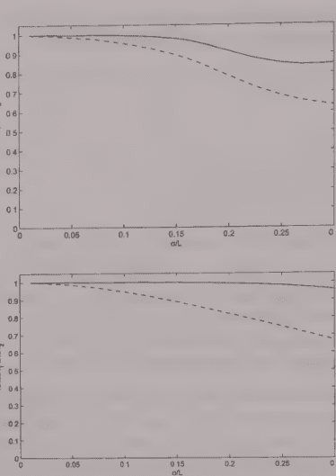

图 2.4 比值 `r_1`（虚线）和 `r_2`（实线）作为 `σ / L` 的函数。此处 `n=10`（上图）和 `n=100`（下图）。

范围为 0 到 0.3L。我们注意到 `σ=0.3 L` 是相当大的噪声，超过该值后，拟合直线的意义就很小了。图 2.4 展示了比值

$$r_{1} = \frac{\text{Var}_{1}(\hat{\theta})}{\text{Var}(\hat{\theta})} \quad \text{以及} \quad r_{2} = \frac{\text{Var}_{2}(\hat{\theta})}{\text{Var}(\hat{\theta})}$$

如何随 `σ / L` 变化。

图 2.4 的上半部分对应 `n=10`，下半部分对应 `n=100`。我们可以看到，随着 `n` 的增加，近似式 `(2.24)` 的精度基本保持不变，但 `(2.25)` 的精度明显提高，即随着 `n` 的增长，比值 `r_2` 更接近于 1。毫无疑问，二阶项中的因子 `n-1` 在此起到了重要的辅助作用。

此外请注意，比值 `r_1` 和 `r_2` 始终小于 1，即两种近似式 `(2.24)` 和 `(2.25)` 都低估了 `Var(\hat{θ})` 的真实值。或许三阶展开效果会更好，但文献中尚未公布其公式。

### 泰勒展开

现在，可以利用泰勒近似，从 `\hat{θ}` 的性质中轻松推导出估计量 `\hat{A}`、`\hat{B}`、`\hat{C}` 的主要阶渐近性质。我们在 A 型模型的背景下演示这一过程。

首先，`A = sin θ` 且 `B = -cos θ`，因此使用泰勒展开至三阶项，我们得到

`A = \bar{A} - \bar{B} δθ - 1/2 \bar{A} (δθ)^2 + 1/6 \bar{B} (δθ)^3 + O((δθ)^4)`

`B = \bar{B} + \bar{A} δθ - 1/2 \bar{B} (δθ)^2 - 1/6 \bar{A} (δθ)^3 + O((δθ)^4)`。

### `\hat{A}` 和 `\hat{B}` 的均值和方差

取均值（回忆 `E(δθ) = E(δθ)^3 = 0`）可得

`E(\hat{A}) = \hat{A}[1 - σ²/(2S)] + O(σ⁴)`，

`E(\hat{B}) = \hat{B}[1 - σ²/(2S)] + O(σ⁴)`，

即估计量 `\hat{A}` 和 `\hat{B}` 向零偏斜。取方差可得

`Var \hat{A} = σ² \hat{B}² / S + O(σ⁴)`，

`Var \hat{B} = σ² \hat{A}² / S + O(σ⁴)`，

`Cov(\hat{A}, \hat{B}) = -σ² \hat{A} \hat{B} / S + O(σ⁴)`。

注意每个估计量的标准差为 `O(σ)`，而其偏差为 `O(σ²)`；因此偏差的高阶小量更高。换句话说，当我们评估估计量的均方误差时，偏差可以忽略不计，例如

`MSE(\hat{A}) = E[( \hat{A} - \bar{A})^2] = Var(\hat{A}) + [E(\hat{A}) - \bar{A}]² = σ² \hat{B}² / S + O(σ⁴)`，

偏差被 `O(σ⁴)` 项吸收。

### `\hat{C}` 的均值和方差

最后，通过使用 `\hat{C} = -\hat{A}\bar{x} - \hat{B}\bar{y}` 我们得到

`E(\hat{C}) = \hat{C}[1 - σ²/(2S)] + O(σ⁴)`，

以及

`Var \hat{C} = σ²[1/n + (\hat{A}\bar{y} - \hat{B}\bar{x})² / S] + O(σ⁴)`。

其中

$$
\bar{\bar{x}} = \sum_{i=1}^n \tilde{x}_i \quad \text{和} \quad \bar{\bar{y}} = \sum_{i=1}^n \tilde{y}_i
$$

是真实值的样本均值。`(2.26)` 中额外的项 `1/n` 来源于 `\bar{x}` 和 `\bar{y}`（观测值的样本均值）是与 `\hat{A}` 和 `\hat{B}` 相关的随机变量这一事实。

### 协方差

为了完整性，我们包含另外三个协方差

$$
\begin{aligned}
\operatorname{Cov}(\hat{A}, \hat{C}) &= \frac{\sigma^2 \bar{B}(A\bar{\bar{y}} - \bar{B}\bar{\bar{x}})}{S} + \mathscr{O}(\sigma^4)\\
\operatorname{Cov}(\hat{B}, \hat{C}) &= -\frac{\sigma^2 \bar{A}(A\bar{\bar{y}} - \bar{B}\bar{\bar{x}})}{S} + \mathscr{O}(\sigma^4)\\
\operatorname{Cov}(\hat{\theta}, \hat{C}) &= -\frac{\sigma^2(A\bar{\bar{y}} - \bar{B}\bar{\bar{x}})}{S} + \mathscr{O}(\sigma^4).
\end{aligned}
$$

### 实践备注

在实践中，上述公式中出现的真实值是不可获得的。通常，人们会进一步近似，用观测值替代真实点，用估计量替代真实参数值（这不会改变上述表达式，产生的误差被 `O(σ⁴)` 项吸收）。同样地，我们用

$$
\hat{S} = s_{xx} + s_{yy}
$$

来估计 `S`，并用

$$
\hat{\sigma}^2 = \frac{1}{n} \sum_{i=1}^n (\hat{A}x_i + \hat{B}y_i + \hat{C})^2. \tag{2.27}
$$

来估计 `σ²`。Gleser [73] 和 Patefield [143] 表明所有这些估计量都是强一致的，因此它们在构建置信区间中的使用是合理的。

## 2.7 近似分析

**泰勒近似与严谨证明。** 在前一节中，我们使用泰勒展开推导了基于方差 `Var(\hat{θ})` 的二阶近似 `(2.25)` 的所有重要估计量的方差和协方差公式，其证明被放在“幕后”（我们直接引用 Anderson [7] 和 Kunitomo [118] 的精确结果）。

在本节中，我们在不使用精确结果的情况下，通过泰勒近似推导 `(2.25)` 本身。因此我们展示了泰勒展开，如果正确使用，是一个强大的（虽然不严谨的工具，它允许我们获得正确的近似，即使包括高阶项。这将有助于我们后续对非线性回归的研究，特别是圆和椭圆。

### 矩阵近似

我们使用第 2.3 节的记号，并关注扰动 `δA = A - \tilde{A}`、`δS = S - \tilde{S}` 等，其中波浪号用于表示真实值。正交拟合最小化

`F(A) = A^T S A = A^T X^T X A = (\tilde{A} + δA)^T (\tilde{X} + δX)^T (\tilde{X} + δX) (\tilde{A} + δA)`。

展开，利用 `\tilde{X}\tilde{A} = 0` 这一事实（由 `(2.15)` 得出），并保留统计显著项³ 得到

`F(A) = \tilde{A}^T δX^T δX \tilde{A} + δA^T \tilde{X}^T \tilde{X} δA + 2 \tilde{A}^T δX^T \tilde{X} δA + 2 \tilde{A}^T δX^T δX δA`。

现在 `F` 的最小值在 `∂F / ∂A = 0` 处取得，即在

`\tilde{X}^T \tilde{X} δA + (\tilde{X}^T δX + δX^T δX) \tilde{A} = 0`，

因此


$\delta\mathbf{A} = -(\tilde{\mathbf{X}}^T\tilde{\mathbf{X}})^-(\tilde{\mathbf{X}}^T\delta\mathbf{X} + \delta\mathbf{X}^T\delta\mathbf{X})\tilde{\mathbf{A}}, \quad\quad\quad\quad\quad\quad\quad\quad\quad\quad\quad(2.28)$

其中 $(\tilde{\mathbf{X}}^T\tilde{\mathbf{X}})^-$ 表示矩阵 $\tilde{\mathbf{X}}^T\tilde{\mathbf{X}}$ 的 Moore-Penrose 广义逆（因为 $\tilde{\mathbf{X}}\tilde{\mathbf{A}} = 0$，该矩阵秩亏）。

### 一个便利的假设

由于 $\delta\boldsymbol{\theta} = \boldsymbol{\theta} - \tilde{\boldsymbol{\theta}}$ 的分布不依赖于 $\tilde{\boldsymbol{\theta}}$（第 2.4 节），我们可以通过假设直线是水平的来简化计算，即 $\tilde{\mathbf{A}} = (0,1)^T$。那么 $\delta\mathbf{A} = (\delta\boldsymbol{\theta}, 0)^T$，至主要阶，且

$\tilde{\mathbf{X}}^T\tilde{\mathbf{X}} = \begin{bmatrix} S & 0 \\ 0 & 0 \end{bmatrix}, \quad \text{因此} \quad (\tilde{\mathbf{X}}^T\tilde{\mathbf{X}})^- = \begin{bmatrix} \frac{1}{S} & 0 \\ 0 & 0 \end{bmatrix}$。

矩阵 $\delta\mathbf{X}$ 是

$\begin{bmatrix} \delta_1 - \bar{\delta} & \boldsymbol{\epsilon}_1 - \bar{\boldsymbol{\epsilon}} \\ \vdots & \vdots \\ \delta_n - \bar{\delta} & \boldsymbol{\epsilon}_n - \bar{\boldsymbol{\epsilon}} \end{bmatrix}$，

其中我们继续使用样本均值记号，即 $\bar{\delta} = \sum_{i=1}^n \delta_i$ 等。现在 (2.28) 变为

$\delta\boldsymbol{\theta} = -\frac{1}{S}\sum_{i=1}^n(\bar{x}_i - \bar{\bar{x}})(\boldsymbol{\epsilon}_i - \bar{\boldsymbol{\epsilon}}) - \frac{1}{S}\sum_{i=1}^n(\delta_i - \bar{\delta})(\boldsymbol{\epsilon}_i - \bar{\boldsymbol{\epsilon}})$。

利用我们对误差 $\delta_i$ 和 $\boldsymbol{\epsilon}_i$ 的假设，我们容易计算出 $\mathbb{E}(\delta\boldsymbol{\theta}) = 0$ 以及

$\mathbb{E}\left[\sum_{i=1}^n(\bar{x}_i - \bar{\bar{x}})(\boldsymbol{\epsilon}_i - \bar{\boldsymbol{\epsilon}})\right]^2 = \sigma^2\sum_{i=1}^n(\bar{x}_i - \bar{\bar{x}})^2 = \sigma^2 S$，

³我们丢弃项 $\delta\mathbf{A}^T\delta\mathbf{X}^T\delta\mathbf{X}\delta\mathbf{A}$，它是 $\sigma^4$ 阶的，以及 $2\delta\mathbf{A}^T\tilde{\mathbf{X}}^T\delta\mathbf{X}\delta\mathbf{A}$，它是 $\sigma^2/\sqrt{n}$ 阶的。我们保留所有 $\sigma^2$ 阶或 $\sigma^3\sqrt{n}$ 阶或更高阶的项。

$\mathbb{E}\left[\left(\sum_{i=1}^{n}(\bar{x}_i-\bar{x})(\varepsilon_i-\bar{\varepsilon})\right)\left(\sum_{i=1}^{n}(\delta_i-\bar{\delta})(\varepsilon_i-\bar{\varepsilon})\right)\right]=0,$

并且

$\mathbb{E}\left[\sum_{i=1}^{n}(\delta_i-\bar{\delta})(\varepsilon_i-\bar{\varepsilon})\right]^2=(n-1)\sigma^4.$

综上所述，我们得到 (2.25)。

注意，我们的近似分析给出了 $\hat{\theta}$ 在 A 类模型（参见 (2.21)）和 B 类模型（参见 (2.23)）中的正确渐近方差。

**最后说明。** 在上述计算中，我们仅使用了关于误差 $\delta_i$ 和 $\varepsilon_i$ 的以下假设：它们的均值为零，具有共同的方差 $\sigma^2$，且互不相关。

我们的方法结合（并改进了）Malinvaud 所做的计算，参见文献 [128] 第 399–402 页，他仅处理了 B 类模型；以及 Kanatani 的计算，参见文献 [93, 105]，他仅处理了 A 类模型。

### 2.8 有限样本有效性

在本节中，我们讨论参数估计量的有效性。在正交（以及更一般的 EIV）回归的背景下，关于这个问题有多种处理方法。

**两种方法。** 首先，可以直接计算经典的 Cramér-Rao 下界，并将其与参数估计量的实际方差进行比较。我们将在下文进行此操作。事实证明，最大似然估计并不完全最优，但其有效性在多种意义下接近 100%。

其次，可以尝试证明估计量在 A 类模型或 B 类模型的背景下具有渐近有效性。实际上，在这一方向上存在一些一般性结果；我们也将对此进行讨论。

**有限样本的 Cramér-Rao 界。** 我们从经典的 Cramér-Rao 下界开始；我们的分析是对文献 [128]（第 402–403 页）的改编。我们在函数模型（第 2.4 节）的背景下工作，该模型包含 $n+2$ 个独立参数：直线的两个主参数（$\theta$ 和 $C$），以及每个真实点的一个“潜在”参数。我们可以用参数方程描述该直线

$x=-C \sin \theta+t \cos \theta \quad y=C \cos \theta+t \sin \theta,$

其中 $t$ 是一个标量参数，并由以下公式指定真实点的坐标：

$\bar{x}_i=-C \sin \theta+t_i \cos \theta, \quad \bar{y}_i=C \cos \theta+t_i \sin \theta.$

因此，$t_1,\dots,t_n$ 充当模型的（潜在）参数。

对数似然函数为

$$\ln L = \text{const} - \frac{1}{2\sigma^2} \sum_{i=1}^{n} (x_i - \tilde{x}_i)^2 + (y_i - \tilde{y}_i)^2. \qquad (2.29)$$

根据经典的 Cramér-Rao 定理，参数估计量的协方差矩阵的下界$^4$为

$$\text{Cov}(\hat{\theta}, \hat{C}, \hat{t}_1, \dots, \hat{t}_n) \geq \mathbf{F}^{-1}.$$

其中 **F** 是 Fisher 信息矩阵

$$\mathbf{F} = -\mathbb{E}(\mathbf{H})$$

而 **H** 表示由 lnL 关于参数的二阶偏导数组成的 Hessian 矩阵。

### 计算 Cramér-Rao 界

计算 (2.29) 关于 $\theta$，$C$，$t_1$，$\dots$，$t_n$ 的二阶偏导数（这是一个常规练习），并取它们的期望值（利用显然的规则 $\mathbb{E}(x_i)=\tilde{x}_i$ 和 $\mathbb{E}(y_i)=\tilde{y}_i$），得到以下结果（为简洁起见，我们省略了公共因子 $\sigma^{-2}$）

$$\mathbb{E}\left[\frac{\partial^2 \ln L}{\partial \theta^2}\right] = -\sum t_i^2 - nC^2, \qquad \mathbb{E}\left[\frac{\partial^2 \ln L}{\partial \theta \partial C}\right] = -\sum t_i, \qquad \mathbb{E}\left[\frac{\partial^2 \ln L}{\partial \theta \partial t_i}\right] = C,$$

$$\mathbb{E}\left[\frac{\partial^2 \ln L}{\partial C \partial \theta}\right] = -\sum t_i, \qquad \mathbb{E}\left[\frac{\partial^2 \ln L}{\partial C^2}\right] = -n, \qquad \mathbb{E}\left[\frac{\partial^2 \ln L}{\partial C \partial t_i}\right] = 0,$$

$$\mathbb{E}\left[\frac{\partial^2 \ln L}{\partial t_i \partial \theta}\right] = C, \qquad \mathbb{E}\left[\frac{\partial^2 \ln L}{\partial t_i \partial C}\right] = 0, \qquad \mathbb{E}\left[\frac{\partial^2 \ln L}{\partial t_i \partial t_j}\right] = -\delta_{ij},$$

其中 $\delta_{ij}$ 表示 Kronecker delta 符号。此时 Fisher 信息矩阵具有如下结构

$$\mathbf{F} = \sigma^{-2}\left[\begin{array}{cc} \mathbf{E} & \mathbf{G}^T \\ \mathbf{G} & I_n \end{array}\right],$$

其中

$$\mathbf{E} = \left[\begin{array}{cc} \sum t_i^2 + nC^2 & \sum t_i \\ \sum t_i & n \end{array}\right]$$

且

$$\mathbf{G} = \left[\begin{array}{cc} -C & 0 \\ \vdots & \vdots \\ -C & 0 \end{array}\right]$$

而 $\mathbf{I}_n$ 表示 $n$ 阶单位矩阵。利用分块矩阵求引理（参见例如文献 [128] 第 26 页），我们得到

$\left[\begin{array}{cc} \mathbf{E} & \mathbf{G}^{T} \\ \mathbf{G} & \mathbf{I}_n \end{array}\right]^{-1} = \left[\begin{array}{cc} \left(\mathbf{E}-\mathbf{G}^{T} \mathbf{G}\right)^{-1} & -\left(\mathbf{E}-\mathbf{G}^{T} \mathbf{G}\right)^{-1} \mathbf{G}^{T} \\ -\mathbf{G}\left(\mathbf{E}-\mathbf{G}^{T} \mathbf{G}\right)^{-1} & \left(\mathbf{I}_n-\mathbf{G} \mathbf{E}^{-1} \mathbf{G}^{T}\right)^{-1} \end{array}\right].$

（可以通过直接乘法轻松验证此公式。）

该矩阵左上方的 $2 \times 2$ 分块对我们最为有趣，因为它对应于主参数 $\theta$ 和 $C$。该分块为

$\left(\mathbf{E}-\mathbf{G}^{T} \mathbf{G}\right)^{-1} = \left[\begin{array}{cc} \sum t_i^2 & \sum t_i \\ \sum t_i & n \end{array}\right]^{-1} = \frac{1}{nS}\left[\begin{array}{cc} n & -\sum t_i \\ -\sum t_i & \sum t_i^2 \end{array}\right],$

因为其行列式为

$n \sum t_i^2 - \left(\sum t_i\right)^2 = nS.$

因此，主参数估计量的协方差矩阵的 Cramér-Rao 下界为

$\operatorname{Cov}\left(\hat{\theta}, \hat{C}\right) \geq \frac{\sigma^2}{S}\left[\begin{array}{cc} \frac{1}{n} & -\frac{1}{n} \sum t_i \\ -\frac{1}{n} \sum t_i & \frac{1}{n} \sum t_i^2 \end{array}\right]. \quad (2.30)$

特别是，

$\operatorname{Var}\left(\hat{\theta}\right) \geq \frac{\sigma^2}{S}$

这恰好是我们对 $\hat{\theta}$ 实际方差的一阶近似 (2.24)。事实上，矩阵 (2.30) 的所有分量都等于在第 2.6 节中得到的实际方差和协方差的主项，因为

$\frac{1}{n} \sum t_i = \frac{1}{n}\left(\bar{A} \sum \bar{y}_i - \bar{B} \sum \bar{x}_i\right) = \bar{A} \bar{\bar{y}} - \bar{B} \bar{\bar{x}}$

以及

$\frac{1}{n} \sum t_i^2 = \frac{S}{n} + \frac{1}{n^2}\left(\sum t_i\right)^2 = \frac{S}{n} + \left(\bar{A} \bar{\bar{y}} - \bar{B} \bar{\bar{x}}\right)^2.$

**结论性说明。** 我们的分析表明，在首项意义下，$\theta$ 和 $C$ 的估计量是最优的。然而，更精确的二阶近似 (2.25) 表明我们的估计并不完全最优；特别是 $\hat{\theta}$ 的（近似）有效性为

$\left(1+\frac{(n-1)\sigma^2}{S}\right)^{-1}. \quad (2.31)$

当比率 $(n-1)\sigma^2/S$ 较小时，即当数据点*偏离*直线的程度与它们*沿*直线的散布相比很小时，这接近于 1。

### 2.9 渐近有效性

在此，我们讨论在 A 类模型或 B 类模型背景下我们的估计量的渐近有效性。

在 A 类模型中，当 $n$ 固定且 $\sigma^2 \to 0$ 时，有效性 (2.31) 收敛到 1。因此，我们的估计量是渐近有效的（最优的）。事实上，在 A 类模型背景下，回归参数（线性或非线性）的最大似然估计量总是渐近有效的，参见第 6.5 节。

在 B 类模型中，$\sigma^2$ 固定且 $n \to \infty$，我们的估计量不是渐近有效的。例如，$\hat{\theta}$ 的有效性收敛于

$$\left(1+\frac{\sigma^2}{s_*^2}\right)^{-1} < 1.$$

另一方面，1954 年 Wolfovitz 证明 [191]，参见文献 [128] 第 403 页，在 B 类模型背景下，不存在具有等于 1 的渐近有效性的估计量。我们不知道是否存在具有大于 $\hat{\theta}$ 的渐近有效性的估计量。

*注。* 统计学中存在一些一般定理，指出当 $n \to \infty$ 时最大似然估计量是渐近有效的。然而，这些定理不适用于参数数量随 $n$ 增长的模型，而 B 类模型正是这种情况。

**Gleser 的统计最优性。** 尽管如此，直线的参数的最大似然估计量 $\hat{A}$、$\hat{B}$ 和 $\hat{C}$ 在 $n \to \infty$ 时具有以下限制意义下的渐近最优性。

考虑一个无穷序列的真实点 $(\bar{x}_i, \bar{y}_i)$，它们位于（未知）直线 $\bar{A}x + \bar{B}y + \bar{C} = 0$ 上，使得

$$\bar{x}_n = \frac{1}{n}\sum_{i=1}^{n}\bar{x}_i \to \bar{x}_* \quad \text{以及} \quad \bar{y}_n = \frac{1}{n}\sum_{i=1}^{n}\bar{y}_i \to \bar{y}_*$$

满足以下方式：

$$|\bar{x}_n - \bar{x}_*| = o(n^{-1/2}) \quad \text{以及} \quad |\bar{y}_n - \bar{y}_*| = o(n^{-1/2})$$

以及

$$\frac{1}{n}S_n = \frac{1}{n}\sum_{i=1}^{n}(\bar{x}_i - \bar{x}_n)^2 + \frac{1}{n}\sum_{i=1}^{n}(\bar{y}_i - \bar{y}_n)^2 \to s_* > 0$$

满足以下方式：


$$\left|\frac{1}{n}S_n - s_*\right| = o(n^{-1/2}).$$

现在假设我们要根据前 $n$ 个噪声观测值来估计 `A`, `B`, `C` 点，且噪声水平 `σ^2` 是未知的，我们也在对其进行估计。用 `Â_n`, `B̂_n`, `Ĉ_n`, `σ̂^2_n` 表示这些参数的估计量。

令 `𝔈` 表示所有满足一致性和渐近正态性的估计量 `Â_n`, `B̂_n`, `Ĉ_n`, `σ̂^2_n` 的类，其中其渐近协方差矩阵仅依赖于真实点序列 `(\tilde{x}_i, \tilde{y}_i)` 的极限值 `\bar{x}_s`, `\bar{y}_s` 和 `s_s`。那么，在 `𝔈` 中，`A`, `B`, `C` 的最大似然估计量以及 `σ^2` 的估计量 (2.27) 是最优的估计量，即它们具有渐近最小可能的协方差矩阵。

这一显著的结果归功于 Gleser [74, 75]，另见 Cheng 和 Van Ness [38, 39, 40]。

**最后评述。** 至此，我们对正交直线拟合的简要总结就告一段落了。我们仅涵盖了该主题中与我们的主要目标——拟合圆和椭圆——最为相关的几个方面。我们省略了非正交 EIV 线性回归、多维线性回归、结构模型和超结构模型，以及许多其他有趣但相关性不强的主题。

# 第 3 章

## 拟合圆：理论

- 3.1 引言 47
- 3.2 参数化 48
- 3.3 存在性（或不适用） 53
- 3.4 圆拟合的多变量解释 55
- 3.5 唯一性（或非唯一性） 57
- 3.6 局部极小值 59
- 3.7 高原与谷地 61
- 3.8 双谷定理的证明 64
- 3.9 奇异情形 67

### 3.1 引言

**应用多样性。** 在许多领域中，将圆或圆弧拟合到观测点的出现。在医学领域，人们通过照片估计人类虹膜的直径 [141]，或根据 X 光片设计牙弓 [21]。考古学家研究古希腊体育场的圆形形状 [157] 以及英国神秘的巨石阵（石环）[65, 177]；在其他研究中，他们通过分析野外考察中发现的陶片来确定古代陶器的尺寸 [44, 80, 81, 190]。在工业界，质量控制需要估计制造机械零件的半径和圆心 [119]（其他有趣的应用涉及微波工程 [54, 169] 和木材工业 [13]）。

在核物理中，我们处理在加速器中产生的基本粒子——它们在恒定的磁场中沿圆弧运动；物理学家通过测量其轨迹的半径来确定粒子的能量；为此，实验人员将弧线拟合到粒子在特殊探测器中留下的电信号轨迹上 [53, 45, 106]。在移动机器人领域，通过解析机器人使用的二维激光测距仪的测距数据，可以检测圆形物体（如柱子、树干）[197]。在计算机视觉中，人们使用由“拼接”在一起的圆弧序列（“圆形样条”）来近似更复杂的弯曲形状 [12, 145, 158, 164, 165]。

**不同的实际需求。** 所有这些应用都涉及将圆拟合到平面图像中，但数据特征和需求可能差异巨大。在某些情况下，处理的是沿完整圆采样的数据点（如人类虹膜图像或木材工业中的原木）。而在其他情况下，数据严重不完整——观测到的仅仅是大圆的一小段弧。

在一些应用中（例如在医学领域），拟合必须非常精确，计算成本不是问题。另一些应用则以大数据处理为特征（例如，在高能物理中，加速器每天可以产生数百万条粒子轨迹），处理速度至关重要。这些变化显然决定了拟合问题的不同方法，正如我们将看到的那样。

### 3.2 参数化

**标准参数。** 要通过正交最小二乘法将圆拟合到观测点 { $(x_i, y_i)$ }，需最小化平方和

$$ \mathscr{F} = \sum_{i=1}^{n} d_i^2, \quad\quad\quad (3.1) $$

其中 `d_i` 是数据点 $(x_i, y_i)$ 到假设圆的（几何）距离。圆的标准方程为

$$ (x-a)^2+(y-b)^2=R^2, \quad\quad\quad (3.2) $$

其中 $(a, b)$ 是其圆心，`R` 是其半径；则（带符号的）距离由下式给出：

$$ d_i = \sqrt{(x_i-a)^2+(y_i-b)^2} - R. \quad\quad\quad (3.3) $$

注意，对于圆外的点 `d_i > 0`，对于圆内的点 `d_i < 0`。因此

$$ \mathscr{F}(a, b, R) = \sum_{i=1}^{n} \big[\sqrt{(x_i-a)^2+(y_i-b)^2} - R\big]^2. \quad\quad\quad (3.4) $$

**消除 R。** 该函数仅是 `R` 的二次多项式，因此当保持另外两个变量 `a` 和 `b` 固定时，`𝓕` 在 `R` 上具有唯一的整体（条件）最小值。该条件最小值可以轻易找到。如果我们将

$$ r_i = r_i(a, b) = \sqrt{(x_i-a)^2+(y_i-b)^2}, \quad\quad\quad (3.5) $$

那么 `𝓕` 关于 `R` 的最小值在以下位置达到：

$$ \hat{R} = \bar{r} = \frac{1}{n}\sum_{i=1}^{n} r_i. \quad\quad\quad (3.6) $$

这允许我们消除 `R`，并将 `𝓕` 表示为仅关于 `a` 和 `b` 的函数：

$$ \begin{aligned} \mathscr{F}(a, b) &= \sum_{i=1}^{n}\left[ r_i - \bar{r} \right]^2 \\ &= \sum_{i=1}^{n}\left[ \sqrt{(x_i - a)^2 + (y_i - b)^2} - \frac{1}{n}\sum_{j=1}^{n} \sqrt{(x_j - a)^2 + (y_j - b)^2} \right]^2 \end{aligned} \quad\quad\quad (3.7) $$

这仍然是一个复杂的表达式，无法进一步简化。(3.7) 的最小化是一个没有封闭形式解的非线性问题。

(3.7) 相对于 (3.4) 的一点优势在于，两个变量函数 `𝓕(a, b)` 可以轻松地绘图并进行视觉检查（我们将在下文这样做），而对于函数 `𝓕(a, b, R)`，这种视觉检查则较为困难。

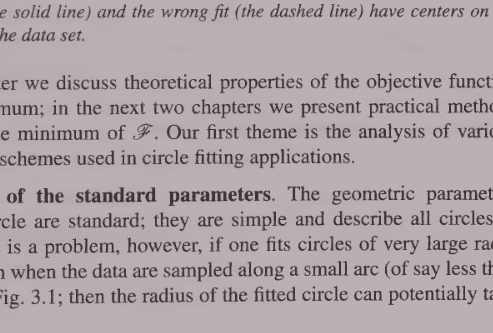

图 3.1 数据点（菱形）沿大圆的一小段弧采样。正确的拟合（实线）和错误的拟合（虚线）的圆心位于数据集的相对两侧。

在第一章中，我们讨论了目标函数 `𝓕` 及其极小值的理论性质；在接下来的两章中，我们介绍了计算 `𝓕` 极小值实用方法。我们的第一个主题是在圆拟合应用中使用的各种参数化方案的分析。

**标准参数的缺点。** 圆的几何参数 `(a, b, R)` 是标准的；它们简单且描述了平面上的所有圆。然而，如果拟合半径非常大的圆，就会出现问题。当数据沿小弧（例如小于 5 度）采样时可能会发生这种情况，参见图 3.1；此时，拟合圆的半径可能取任意大的值。在这种情况下，数据点的小扰动或拟合程序的小误差可能导致圆心位于“错误的一侧”（参见图 3.1 中的虚线弧）。

此外，数值计算变得不可靠：当 (3.3) 中两个大的近似相等的量相减时，可能会发生灾难性的精度损失。我们将此称为圆拟合的*问题性*或*奇异情形*。我们很快就会看到，在这种情况下，会出现比灾难性抵消更严重的问题。

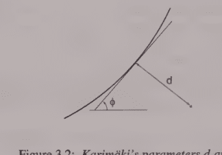

**Karimäki 参数。** 如果实验中不完整弧（部分遮挡的圆）很常见，统计学家通常会采用不同的参数化方案。例如，在核物理中，Karimäki [106] 建议用带符号的曲率 `ρ = ± R^{-1}` 代替 `R`，用最近距离（`d`）到原点以及最近点处的传播方向（`φ`）代替圆心 `(a, b)`，参见图 3.2。我们将在第 8.8 节中更精确地描述这些参数。这三个参数（`ρ, d, φ`）完全（且唯一地）描述了拟合圆弧，并且它们永远不会取到危险的大值（除非 `R ≈ 0`，从而 `ρ ≈ ∞`，这实际上并不是令人困扰的事件）。

Karimäki 参数具有清晰的几何意义，但用 `(ρ, d, φ)` 表示目标函数 `𝓕` 会导致笨重的公式；参见 [106] 和我们的第 8.8 节。Karimäki 方案中的另一个陷阱是，对于以原点为圆心的圆，方向 `φ` 变得不确定。如果拟合圆的圆心接近原点，数值算法无法适当地处理 `φ` 参数并可能陷入困境。

**代数参数。** Pratt [150] 等人 [67] 提出了一个更优雅的方案，它通过代数方程来描述圆，

$$ A(x^{2} + y^{2}) + Bx + Cy + D = 0 \tag{3.8} $$

具有明显的约束 `A ≠ 0`（否则该方程描述一条直线）和一个不太明显的约束

$$ B^{2} + C^{2} - 4AD > 0. \tag{3.9} $$

后者的必要性可通过重写方程 (3.8) 来直观理解：

$$

\left(x + \frac{B}{2A}\right)^2 + \left(y + \frac{C}{2A}\right)^2 - \frac{B^2 + C^2 - 4AD}{4A^2} = 0.$$

现在可以清晰地看出，如果 `B^2 + C^2 - 4AD < 0`，则 (3.8) 定义了一个空集；如果 `B^2 + C^2 - 4AD = 0`，则 (3.8) 指定了一个单点（单点集）。

**约束条件。** 由于参数仅需确定到标量倍数，我们可以施加某些约束。约束 `A=1` 会使我们回到方案 (3.2)。一些研究人员尝试了约束 `D=1` 或 `A^2 + B^2 + C^2 + D^2 = 1`（见 [67]）或 `A^2 + B^2 + C^2 = 1`（见 [137]）。然而，最佳选择是约束条件

$$

B^2 + C^2 - 4AD = 1, \quad\quad\quad\quad\quad\quad\quad\quad\quad\quad\quad\quad\quad\quad\quad\quad\quad\quad\quad\quad\quad\quad\quad\quad (3.10)

$$

因为它自动保证了 (3.9)。约束 (3.10) 最初由 Pratt [150] 提出，他清晰地阐述了其优势。

该约束消除了参数化 `(A, B, C, D)` 的重数，但并未完全消除：现在每个圆由恰好两个参数向量 `(A, B, C, D)` 表示，其中一个为另一个的负数。如果我们额外要求 `A > D > 0`，那么每个圆将对应唯一的四元组 `(A, B, C, D)`，反之亦然。

**代数参数与几何参数之间的转换。** 自然几何参数 `(a, b, R)` 与代数参数 `(A, B, C, D)` 之间的转换公式为

$$

a = -\frac{B}{2A},\quad\quad b = -\frac{C}{2A},\quad\quad R^2 = \frac{B^2 + C^2 - 4AD}{4A^2}, \quad\quad\quad\quad\quad\quad\quad\quad\quad\quad\quad\quad\quad\quad\quad\quad\quad\quad\quad (3.11)

$$

或者利用约束 (3.10)，有 `R^2 = (4A^2)^{-1}`。反之，

$$

A = \pm \frac{1}{2R},\quad B = -2Ra,\quad C = -2Rb,\quad D = \frac{B^2 + C^2 - 1}{4A}. \quad\quad\quad\quad\quad\quad\quad\quad\quad\quad\quad\quad (3.12)

$$

数据点 $(x_i, y_i)$ 到圆的距离在经过一些代数运算后可表示为

$$

d_i = \frac{2P_i}{1 + \sqrt{1 + 4AP_i}}, \quad\quad\quad\quad\quad\quad\quad\quad\quad\quad\quad\quad\quad\quad\quad\quad\quad\quad\quad\quad\quad\quad\quad\quad\quad\quad\quad\quad\quad\quad\quad\quad\quad\quad\quad\quad (3.13)

$$

其中

$$

P_i = A(x_i^2 + y_i^2) + Bx_i + Cy_i + D. \quad\quad\quad\quad\quad\quad\quad\quad\quad\quad\quad\quad\quad\quad\quad\quad\quad\quad\quad\quad\quad\quad\quad\quad\quad\quad\quad\quad\quad\quad\quad (3.14)

$$

可以验证

$$

1 + 4AP_i = \frac{(x_i - a)^2 + (y_i - b)^2}{R^2}, \quad\quad\quad\quad\quad\quad\quad\quad\quad\quad\quad\quad\quad\quad\quad\quad\quad\quad\quad\quad\quad\quad\quad\quad\quad (3.15)

$$

因此对于所有 `i`，有 `1 + 4AP_{i} ≥ 0`，从而 (3.13) 始终可计算。分母 `≥ 1`，因此除法在计算上始终安全。

公式 (3.13) 比 (3.3) 稍微复杂一些，但它数值稳定，因为它巧妙地避免了灾难性的数值抵消。

#### 代数参数的自然界限。

最后，我们证明 `(A, B, C, D)`，就像 Karimäki 参数 `(ρ, d, φ)` 一样，在特定自然条件下不需要取任意大的值。如第 2.2 节所述，设所有数据点 $(x_{i}, y_{i})$ 都包含在一个矩形 `𝔹`（“包围盒”）中。在许多实验中，所有数据点自然地限制在对应于测量设备物理大小的窗口内，因此盒子 `𝔹` 可以在收集数据之前预先知道。另设

$$

d_{\max}=\max_{i, j} \sqrt{(x_{i}-x_{j})^{2}+(y_{i}-y_{j})^{2}}

$$

表示数据点之间的最大距离。

#### 定理 4

*最佳拟合圆满足界限*

$$

|A| < A_{\max}, |B| < B_{\max}, |C| < C_{\max}, |D| < D_{\max} \tag{3.16}

$$

*其中 `A_{\max}`、`B_{\max}`、`C_{\max}`、`D_{\max}` 由包围盒 `𝔹` 的大小和位置以及 `d_{\max}` 确定。*

因此，无论数据点的配置如何，拟合圆的参数 `(A, B, C, D)` 都保持有界。

*证明。* 由于 (3.6)，最佳拟合圆的半径 `R ≥ d_{\max} / n`，因此

$$

|A| \leq A_{\max}=n / 2 d_{\max} .

$$

设 `L` 表示原点到 `𝔹` 中最远点的距离。正如在第 2.2 节中一样，很容易看出最佳拟合直线或圆必须穿过 `𝔹`，因此它到原点的距离小于 `L`。将 `x = y = 0` 代入 (3.13)–(3.14) 得到

$$

\frac{2|D|}{1+\sqrt{1+4 A D}} \leq L .

$$

解此不等式得到 `D`

$$

|D| \leq D_{\max}=10 A_{\max} L^{2} .

$$

最后，(3.10) 给出了 `B` 和 `C` 的界限，即

$$

B_{\max}=C_{\max}=\sqrt{1+4 A_{\max} D_{\max}} .

$$

定理得证。

□

**注。** 这里对 `d_{\mathrm{max}}` 的限制只是一个技术性问题，并非至关重要。如果 `d_{\mathrm{max}}` 很小，数据点会聚集在一起，在极限 `d_{\mathrm{max}} → 0` 时它们合并为单点。在这种情况下，最佳拟合圆的半径可能任意小，因此 `A` 无界，但实际中这种情况很少发生，也不会引起严重麻烦。

### 3.3 存在性（与非存在性）

如前一章所述，我们转向两个基本的理论问题：最佳拟合圆是否总是存在？它是否总是唯一的？奇怪的是，这些问题直到最近才在文献中得到讨论。直到 2000 年代初，它们才在 [43, 138, 196] 中被独立解决。上述问题的答案恰好比我们在线拟合情况中发现的答案要复杂得多。

**共线数据情形。** 我们先从一个相当意外的事实开始：存在某些数据集，其中最佳拟合圆并不存在！最简单的例子是一组 `n ≥ 3` 个共线数据点。任何圆都不能内插多于两个的共线点，因此对于任何 `(a, b, R)`，函数 `𝓕` 在 (3.1) 中都是严格正的。另一方面，可以用半径非常大的圆弧来近似这些共线点，并使 `𝓕` 任意小。因此，函数 `𝓕` 没有达到其最小值。从实际角度看，这意味着对于任何拟合到一组共线点的圆弧，都可以找到另一个拟合得更好的圆弧，且这个过程永远不会停止。

显然，这里最佳拟合由穿过所有数据点的直线实现（对于该直线 `𝓕 = 0`）。这个例子表明，如果我们想拟合圆到观测点，我们也应该尝试直线！那么，最佳拟合应在所有圆和直线之间选择，正交最小二乘法可能会根据数据集返回圆或直线（这一陈述将在下文精确定义）。


## 另一个例子。

共线点并不是直线“胜过”圆线的唯一例子。考虑四个点：$(X, 0)$、$(-X, 0)$、$(0, 1)$、$(0, -1)$，其中 $X$ 很大，$X \gg 1$。在这种情况下，最佳拟合直线（$x$ 轴）提供了 $\mathscr{F} = 2$，且可以轻易看出对于任何圆弧 $\mathscr{F} > 2$。

## 实际备注。

诚然，这样的例子相当罕见。更确切地说，如果数据是从连续分布中随机采样的，那么正交最小二乘法返回直线而非圆的概率为零。这是一个数学事实，将在第 3.9 节中证明，见定理 8。

这一事实解释了为什么在实践中直线通常被忽略，而只处理圆。另一方面，如果数据点是从数字图像中获得的（例如，在计算机屏幕上将圆拟合到像素），那么直线可能会以正概率出现，并且真正需要考虑。

## 将直线纳入模型。

为了在寻找最佳拟合圆时加入直线，我们需要将它们纳入参数方案中。自然的圆参数 $(a, b, R)$ 不幸地不包含直线。Karimäki 的参数 $(\rho, d, \varphi)$ 如果允许 $\rho = 0$，则包含直线；此时 $d$ 和 $\varphi$ 分别等同于我们方程 (2.4) 中的 $C$ 和 $\varphi$。代数参数方案 (3.8) 也很容易通过设置 $A = 0$ 来整合直线，此时我们恢复了线性方程 (2.1)。

## 参数空间的非紧性。

这里我们提供涉及紧性概念的严格分析，该概念已在第 2.2 节中使用。我们遵循 [43]，Nievergelt 也给出了类似的论证，见 [138] 第 260 页。

函数 $\mathscr{F}$ 显然在圆参数 $a, b, R$ 上是连续的，但参数空间不是紧的，因为 $a, b, R$ 可以取任意大的值。更糟糕的是，“缩减”后的与给定矩形 $\mathbb{B}$（“包围盒”）相交的圆的空间也不是紧的，因此我们在直线情形下使用的补救措施（第 2.2 节）将无法再拯救我们。

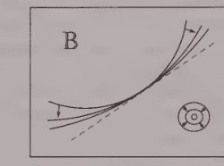

图 3.3：*圆弧拉直和圆缩小为单点*。

### 直接几何论证。

如果我们引入圆空间上的适当拓扑，非紧性可以再次通过几何方式展示。遵循 (2.7)–(2.8) 的模式，我们说平面 $\mathbb{R}^2$ 上的圆序列 $\mathbb{S}_i$ 收敛于圆 $\mathbb{S}$（或更一般地，收敛于闭集 $\mathbb{S}$），如果对于任何闭圆盘 $\mathbb{D} \subset \mathbb{R}^2$，我们有

$$
\operatorname{dist}_{H}(\mathbb{S}_{i} \cap \mathbb{D}, \mathbb{S} \cap \mathbb{D}) \rightarrow 0 \quad \text{as } i \rightarrow \infty \qquad (3.17)
$$

其中 $\operatorname{dist}_{H}(\cdot,\cdot)$ 再次是 $\mathbb{R}^2$ 中紧子集之间的豪斯多夫距离，见 (2.8)。现在，取一个穿过给定包围盒 $\mathbb{B}$ 的圆弧，通过固定其一个点及其在该点的切线将其拉直（压平），然后逐渐增加半径。该圆弧将收敛于一条直线，见图 3.3。此外，如果取一系列半径递减的同心圆，它们将缩小为一个点。这些构造表明，如果我们希望与盒子 $\mathbb{B}$ 相交的圆空间是紧的，我们*必须*在其中包含直线和单点。

### 3.3 最小值的存在性

从现在开始，我们在包含所有圆、直线和单点的扩展空间中进行操作。在此空间上，我们根据相同的规则 (3.17) 定义拓扑，其中 $\mathbb{S}_i$ 和 $\mathbb{S}$ 可以表示圆、直线或单点。

**定理 5** *设* $\mathbb{B}$ *为包含所有数据点的给定边界框。则与* $\mathbb{B}$ *相交的圆、直线和单点的‘扩展’空间是紧致的。*

*证明。* 设 $\{\mathbb{S}_i\}$ 为一个由相互交于 $\mathbb{B}$ 的物体（圆、直线、单点）组成的序列。若 $\{\mathbb{S}_i\}$ 中包含无穷多个单点，则这些单点的子序列收敛于 $\mathbb{B}$ 中的某一点，因为后者是紧致的。若存在无穷多个非单点，则每个非单点都由一个向量 $(A_i, B_i, C_i, D_i)$ 表示，且 $A_i \geq 0$。序列 $\{A_i\}$ 包含一个子序列，该子序列要么收敛于有限极限 $A < \infty$，要么发散至无穷大。在后者情况下，我们有一组位于 $\mathbb{B}$ 中的圆，其半径收敛于零，那么它们就像单点一样在 $\mathbb{B}$ 中有一个极限点，见上文。若 $A = 0$，则我们有一组圆弧，其半径趋于无穷大，且该序列包含一个收敛于直线的子序列，因为穿过 $\mathbb{B}$ 的直线空间是紧致的（第 2.2 节）。最后，若 $0 < A < \infty$，则我们有一组穿过 $\mathbb{B}$ 的圆，其半径收敛于 $R = 1/(2A)$。那么它们的圆心必须保持在距离边界框 $\mathbb{B}$ 不超过 $2R$ 的范围内，因此存在这些圆的一个子序列，其圆心收敛于极限点 $(a,b)$。因此，我们的子序列收敛于圆 $(a,b,R)$。定理得证。$\square$

我们注意到，单点实际上并不必要涉及，因为它们永远不会提供目标函数 $\mathscr{F}$ 的最小值，除非所有数据点坍缩，但即使在这种情况下，任何穿过该坍缩数据点的直线或圆仍然会提供最佳拟合 $\mathscr{F} = 0$。

接下来，同样如第 2.2 节所述，假设圆 $\mathbb{S}$（或直线 $\mathbb{L}$）不穿过边界框 $\mathbb{B}$。那么它不能提供 $\mathscr{F}$ 的最小值，因为可以将 $\mathbb{S}$（或 $\mathbb{L}$）移动得更接近边界框，从而减少所有数据点到 $\mathbb{S}$（或 $\mathbb{L}$）的距离。因此，我们可以将 $\mathscr{F}$ 最小值的搜索限制在与边界框 $\mathbb{B}$ 相交的圆和直线空间内。由于该空间是紧致的，我们得到：

**定理 6** *目标函数* $\mathscr{F}$ *总是能达到其最小值，尽管它可能既在圆上也在直线上达到。*

这以令人满意的方式解决了存在性问题。

### 3.4 圆拟合的多变量解释

前一节的结论可以通过类似于第 1.5 节中描述的多维几何构造来说明。

**超大空间**。给定 $n$ 个数据点 $(x_1, y_1)$，$\dots$，$(x_n, y_n)$，我们可以用一个点（‘巨点’）$\mathscr{X}$ 在 $2n$ 维空间 $\mathbb{R}^{2n}$ 中表示它们，其坐标为 $x_1, y_1, \dots$，$x_n, y_n$。回忆正交直线拟合对应于将点 $\mathscr{X}$ 投影到一个 $(n+2)$ 维二次曲面（流形）$\mathbb{P} \subset \mathbb{R}^{2n}$ 上。

我们现在以类似的方式解释正交圆拟合。考虑由下式定义的子集 $\mathbb{Q} \subset \mathbb{R}^{2n}$：

$$(x_1, y_1, \dots, x_n, y_n) \in \mathbb{Q} \iff \exists a, b, R: (x_i - a)^2 + (y_i - b)^2 = R^2 \ \forall i,$$

即，$\mathbb{Q}$ 由 $\mathbb{R}^{2n}$ 中所有 $(x_1, y_1, \dots, x_n, y_n)$ 组成，使得 $n$ 个平面点 $(x_1, y_1)$，$\dots$，$(x_n, y_n)$ 位于同一个圆上（我们将这样的点称为“共圆的”，这或许是一个不常见的术语）。

**超大空间中的投影**。现在，最佳拟合圆最小化和

$$\sum_{i=1}^{n} (x_i - \bar{x}_i)^2 + (y_i - \bar{y}_i)^2.$$

其中点 $(\bar{x}_1, \bar{y}_1)$，$\dots$，$(\bar{x}_n, \bar{y}_n)$ 被约束位于同一个圆上。因此，真实值 $\bar{x}_1, \bar{y}_1, \dots$，$\bar{x}_n, \bar{y}_n$ 由 $\mathbb{Q}$ 中的一个巨点（我们将其记为 $\overline{\mathscr{X}}$）表示。正交圆拟合过程对应于选择一个最接近表示数据的巨点 $\mathscr{X} \in \mathbb{R}^{2n}$ 的巨点 $\overline{\mathscr{X}} \in \mathbb{Q}$。换句话说，我们只需要将点 $\mathscr{X}$ 正交投影到 $\mathbb{Q}$ 上。

**$\mathbb{Q}$ 的维度**。花费一些努力可以验证，$\mathbb{Q}$ 由 $n - 3$ 个独立关系指定：

$$\det \begin{bmatrix} x_i - x_{i+1} & y_i - y_{i+1} & x_i^2 - x_{i+1}^2 + y_i^2 - y_{i+1}^2 \\ x_i - x_{i+2} & y_i - y_{i+2} & x_i^2 - x_{i+2}^2 + y_i^2 - y_{i+2}^2 \\ x_i - x_{i+3} & y_i - y_{i+3} & x_i^2 - x_{i+3}^2 + y_i^2 - y_{i+3}^2 \end{bmatrix} = 0 \hspace{2cm} (3.18)$$

其中 $i = 1, \dots, n - 3$，每个关系都表示四个平面点 $(x_i, y_i)$、$(x_{i+1}, y_{i+1})$、$(x_{i+2}, y_{i+2})$ 和 $(x_{i+3}, y_{i+3})$ 的共圆性。关系 (3.18) 是四次多项式，因此 $\mathbb{Q}$ 是 $\mathbb{R}^{2n}$ 中由*四次*多项式方程定义的 $(n+3)$ 维代数流形。

**$\mathbb{P}$ 与 $\mathbb{Q}$ 之间的关系**。注意 $\mathbb{Q}$ 的维度比 $\mathbb{P}$ 高 1，即 dim $\mathbb{Q} = $ dim $\mathbb{P} + 1$。更仔细地检查表明 $\mathbb{P}$ 扮演着 $\mathbb{Q}$ 的边界的角色，即 $\mathbb{Q}$ 终止于 $\mathbb{P}$。确实，想象 $n$ 个共圆点位于一个大圆的小弧上。现在让我们像图 3.3 中所示的那样拉直（展平）该弧，并随着弧移动我们的 $n$ 个点。这些点由 $\mathbb{Q}$ 中的一个巨点 $\mathscr{X}$ 表示，当我们的弧被拉直时，点 $\mathscr{X}$ 在曲面 $\mathbb{Q}$ 上移动（滑动）。

当弧变为直线时（图 3.3 中的虚线），我们移动的巨点 $\mathscr{X} \in \mathbb{Q}$ 离开曲面 $\mathbb{Q}$ 并瞬间撞击表示所有 $n$ 个共线点集合的流形 $\mathbb{P}$。因此 $\mathbb{Q}$ 毗邻 $\mathbb{P}$，或者说 $\mathbb{P}$ 作为 $\mathbb{Q}$ 的边界（前沿）。

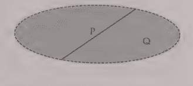

图 3.4：灰色圆盘 $\mathbb{Q}$ 被一条直线 $\mathbb{P}$ 切成两半。

此外，在上述构造中，我们可以从限直线的两侧接近极限直线。图 3.3 只展示了单侧接近，但我们可以将所有弧关于虚线进行反射，得到另一组从另一侧收敛于同一直线的弧序列。这表明曲面 $\mathbb{Q}$ 有两个部分终止于 $\mathbb{P}$；它们从相反的方向接近 $\mathbb{P}$。

示意图如图 3.4 所示。灰色曲面（圆盘）代表 $\mathbb{Q}$：它被代表 $\mathbb{P}$ 的黑线切成两半。这幅图展示了曲面 $\mathbb{Q}$ 如何从两侧接近并毗邻直线 $\mathbb{P}$。

**$\mathbb{P}$ 和 $\mathbb{Q}$ 的几何描述**。在某种程度上可以说，$\mathbb{P}$ 恰好穿过 $\mathbb{Q}$ 并将其‘分割’成两部分。（这种描述纯粹是局部的，我们并不意指 $\mathbb{Q}$ 整体由两部分组成；事实上它是一个连通流形，因为任何圆都可以连续变形为其他任何圆）。

实际上，如果仔细检查方程 (3.18)，就会发现它们不仅描述平面上所有 $n$ 个共圆点的集合，还描述所有 $n$ 个共线点的集合。换句话说，方程 (3.18) 描述了两个流形 $\mathbb{Q}$ 和 $\mathbb{P}$（即它们的并集 $\mathbb{Q} \cup \mathbb{P}$）。这是说服自己直线必须被视为圆的特定类型（我们可以称直线为‘退化圆弧’）的另一种方式。

现在很容易看出为什么最佳拟合圆可能不存在（如果直线不被视为圆）。给定数据点 $\mathscr{X} \in \mathbb{R}^{2n}$，我们需要将其正交投影到 $\mathbb{Q}$ 上。除非点 $\mathscr{X}$ 恰好位于 $\mathbb{P}$ 的正上方，否则投影是良好定义的；在这种情况下，$\mathscr{X}$ 到 $\mathbb{Q}$ 的投影正好落在 $\mathbb{Q}$ 的边界上，即 $\mathbb{P}$ 中。

### 3.5 (非)唯一性

在第 2.2 节中看到了针对数据集拟合的多条直线后，发现可能存在多个拟合圆也就不足为奇了。然而构造示例要困难得多；我们回顾文献 [43] 中的示例。

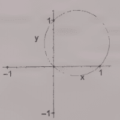

*图 3.5：目标函数具有四个极小值的数据集。*

**多个圆拟合的示例。** 设四个数据点 $(\pm1,0)$ 和 $(0,\pm1)$ 构成一个以原点为中心的方形。我们在原点 $(0,0)$ 处再放置 $k \geq 4$ 个相同点，使得总点数为 $n = k+4$。

这种构型对于绕原点旋转 $\mathscr{R} = \mathscr{R}_{\pi/2}$（即旋转直角）是不变的。因此，如果圆 $\mathbb{S}$ 使 $\mathscr{F}$ 最小化，那么将该圆旋转 $\pi/2$、$\pi$ 和 $3\pi/2$，我们会得到另外三个使 $\mathscr{F}$ 最小化的圆 $\mathscr{R}(\mathbb{S})$、$\mathscr{R}^2(\mathbb{S})$ 和 $\mathscr{R}^3(\mathbb{S})$。我们需要验证 $\mathscr{R}(\mathbb{S}) \neq \mathbb{S}$，以确保得到的是真正不同的圆；此外，我们还要确保 $\mathbb{S}$ 是一个圆，而不是一条直线。这涉及一些基本的计算。

注意，$\mathscr{R}(\mathbb{S}) = \mathbb{S}$ 当且仅当圆 $\mathbb{S}$ 以原点为中心，因此我们需要证明这样的圆不能使 $\mathscr{F}$ 最小化。如果一个圆的半径为 $r$，圆心在 $(0,0)$，则 $\mathscr{F} = 4(1-r^2) + kr^2$。该函数的最小值在 $r = 4/(k+4)$ 处取得，且最小值为 $\mathscr{F}_0 = 4k/(k+4)$。假设 $k \geq 4$，我们可以保证最小值 $\geq 2$。

此外，根据第 2 章的内容可知，这里最佳拟合的直线穿过原点，并给出 $\mathscr{F}_1 = 2$。

为了结束我们的论证，只需找到一个圆，使得 $\mathscr{F} < 2$。考虑经过三个点 $(0,0)$、$(0,1)$ 和 $(1,0)$ 的圆。它只未包含另外两个点 $(-1,0)$ 和 $(0,-1)$，而且很容易看出，对于这个圆 $\mathscr{F} < 2$。由于 $\mathscr{F}$ 取到的值小于 $\mathscr{F}_1$ 和 $\mathscr{F}_0$（只要 $k \geq 4$），最佳拟合将是一个圆（而不是直线），并且该圆的圆心不在原点。我们虽然没有求出最佳拟合圆，但我们的论证表明最佳拟合圆并非唯一。

图 3.5 展示了上述示例，而图 3.6 绘制了 $\mathscr{F}(a, b)$，其中可以清晰地看到四个不同的极小值。

**其他示例。** 如果我们改变示例，用矩形代替方形，那么我们可以得到一个恰好有两个极小值的 $\mathscr{F}$。通过将方形替换为正 $m$ 边形，并增加位于 $(0,0)$ 处的相同点的数量，我们可以构造出对于任意 $m \geq 3$ 都恰好有 $m$ 个极小值的 $\mathscr{F}$。事实上，当 $m=3$ 时，相应的示例相当简单；Nievergelt [138] 以及 Zellner 和 Clarkson [196] 已经描述了这些示例。人们甚至可以显式地求出所有最佳拟合圆的圆心和半径 [138]。

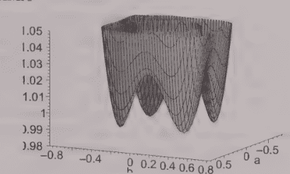

图 3.6：*具有四个极小值的目标函数。*

**实际说明。** 当然，如果数据点是从连续概率分布中随机采样的，那么目标函数 $\mathscr{F}$ 具有多个极小值的几率微乎其微（严格来说，几率为零）。具体而言，对我们图 3.5 中示例中的数据点进行微小的随机扰动，会略微改变 $\mathscr{F}$ 在其极小值处的值，使得其中一个成为全局（绝对）极小值，而另外三个成为局部（相对）极小值。

然而，我们注意到，虽然多重极小值的情况确实罕见，但它们表明，如果对数据点仅施加微小的扰动，$\mathscr{F}$ 的全局极小值可能会突然改变，请回顾 2.2 节中的示例。Nievergelt 也指出了这一事实，见文献 [138] 第 261 页。

#### 3.6 局部极小值


**三个潜在的麻烦制造者。** 请记住，目标函数 `(3.1)` 的最小化是一个非线性问题，没有封闭形式的解。因此，没有有限的算法可以计算 `mathscr{F}` 的最小值。有许多迭代和近似方法可以解决这一问题，这将在接下来的两章中回顾。

在这里，我们进行一次“侦察”：观察实际计算中可能引发问题的是什么。常规的迭代程序未能找到给定函数 `mathscr{F}` 的（全局）极小值的三种主要方式是：

- (a) 它们收敛到 `mathscr{F}` 的局部极小值；
- (b) 它们在近乎平坦的高原或山谷中减速或停滞；
- (c) 如果 `mathscr{F}` 的定义域是无界的，它们会发散到无穷大。

也许选项 (a) 是最明显的，并在文献中被广泛讨论。在许多应用中，迭代程序往往会陷入局部极小值并返回错误的解。

人们可能会认为，像 `(3.7)` 这样复杂的表达式所定义的函数会有许多局部极小值，而且局部极小值的数量会随着样本量 `n` 的增加而增加。令人惊讶的是，详细的研究表明事实并非如此，恰恰相反。

**寻找局部极小值的数值搜索。** 文献 `[43]` 对目标函数 `F` 的局部极小值进行了广泛研究。首先，作者们绘制了 `F`（格式类似于图 3.6）对于大量随机生成样本的图像，并目视检查了这些图像；在大多数情况下，看不到局部极小值（图 3.6 是个例外；它描绘了 `F` 针对一个非常特殊的手工制作点构型的情况）。

接下来，进行了一次局部极小值的全面搜索 `[43]`，机器实验的组织方式如下。首先，从某个概率分布中随机生成 `n` 个数据点。然后，从 1000 个不同的、随机选择的初始点（猜测值）启动最可靠的迭代算法（`Levenberg-Marquardt` 算法，下一章将描述该算法）。其想法是，如果存在局部极小值，那么至少有一些随机初始猜测会落入其附近，从而将迭代吸引到该极小值。因此，每个收敛点都被记录为 `F` 的一个极小值（局部或全局）。如果存在多个收敛点，那么其中一个就是全局极小值，其余的是局部极小值。如果算法从所有 1000 个随机初始猜测都收敛到同一个极限，则该样本被分类为没有局部极小值。

然后，针对 10000 个由相同概率分布生成的包含 `n` 个数据点的不同随机样本，重复了这一局部极小值搜索。接着，确定了模拟样本中具有 0、1、2 等局部极小值的比例，并将结果记录在对应的 `n` 和概率分布下。该实验针对不同取值的 `n` 和不同的概率分布进行了实施。

表 3.1 展示了对于 `n = 5, …, 100` 个数据点，模拟样本中 `F` 具有 0、1、2 或更多局部极小值的比例；概率分布是单位正方形 `0 < x, y < 1` 上的均匀分布（由于圆拟合在平移、旋转和相似变换下的不变性，正方形的大小和位置无关紧要；见 4.11 节）。

|   | 5 | 10 | 15 | 25 | 50 | 100 |
|---|---|---|---|---|---|---|
| 0 | 0.879 | 0.843 | 0.883 | 0.935 | 0.967 | 0.979 |
| 1 | 0.118 | 0.149 | 0.109 | 0.062 | 0.031 | 0.019 |
| $\ge 2$ | 0.003 | 0.008 | 0.008 | 0.003 | 0.002 | 0.002 |

表 3.1 当使用均匀分布随机生成 `n = 5, . . . , 100` 个点时，`F` 的 0、1、2 或更多局部极小值出现的频率。

局部极小值的稀缺性。这些结果呈现出一幅引人注目的画面：在生成的样本中，局部极小值的发现率不到 15%！局部极小值浓度最高（但仍低于 15%）的记录是在 `n = 10` 个点时，并且随着 `n` 的增加迅速减少；对于超过 100 个点的样本，具有局部极小值的样本几乎不存在。多重局部极小值出现的频率极低，如果有的话。在那项大型实验中观察到的最大局部极小值数量为四，而这仅在数百万个测试的随机样本中发生了几次。

在正方形内以均匀分布生成点会产生完全不规则（“混沌”）的样本，没有任何预定义的模式。从某种意义上说，这是最坏的情况，因为不同的随机点组可能排列在两个或更多不同的弧上，从而导致可能不同的良好拟合。尽管如此，我们看到这种情况很少发生；在 `> 85%` 的样本中，函数 `mathscr{F}` 具有唯一的极小值。

文献 `[43]` 还尝试了更现实的概率分布，其中随机样本是沿着带有噪声的圆弧生成的。例如，如果 `n = 10` 个点是从半径 `R = 1` 的 `90°` 圆弧上采样，并具有 `sigma = 0.05` 的高斯噪声，那么局部极小值出现的频率低至 0.001。而这还是“最糟糕”的情况之一；在其他看起来更现实的样本中，局部极小值几乎从未出现。

这些研究清楚地表明，在典型应用中，目标函数 `mathscr{F}` 最有可能具有唯一的（全局）极小值，而没有局部极小值。因此，局部极小值并不是真正的危险；可以合理地假设 `mathscr{F}` 具有唯一的（全局）极小值。

这是否意味着标准的迭代算法，如最速下降法、`Nelder-Mead` 单纯形法、`Gauss-Newton` 法或 `Levenberg-Marquardt` 法，会从任何起点收敛到全局极小值？不幸的是，事实并非如此，我们将在下一节中证明。

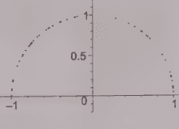

图 3.7：50 个点的模拟数据集。

### 3.7 高原和山谷

在这里，我们描述典型样本中由 `(3.7)` 定义的目标函数 `mathscr{F}(a, b)` 的形状，以识别迭代算法可能遇到的潜在问题。我们遵循 `[43]` 的方法。

**目视检查。** 图 3.7 展示了一个通用的随机样本，包含 `n = 50` 个点，这些点生成于圆弧上（单位圆 `x^2 + y^2 = 1` 的上半部分），并添加了 `sigma = 0.01` 水平的高斯噪声。图 3.8 和图 3.9 展示了由 `MAPLE` 绘制的函数 `mathscr{F}` 在两种不同比例下的图像。可以清楚地看到，`mathscr{F}` 在接近 `a = b = 0` 处有一个全局最小值，且没有局部最小值。图 3.10 展示了一张灰度平坦的等高线图，其中较深的颜色对应图形的较深部分（`mathscr{F}` 的值较小）。

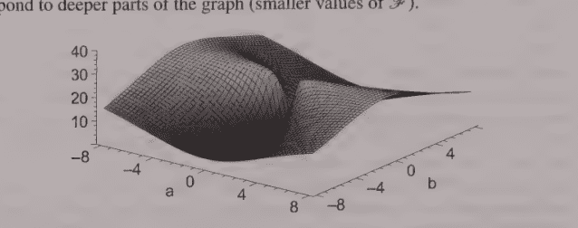

图 3.8：*用于图 3.7 中所示数据集的目标函数 `mathscr{F}`（大视图）。*

**平台。** 图 3.8 显示函数 `mathscr{F}` 在 `a, b -> infinity` 时并不增长。事实上，它是有限的（见下文定理 7 的证明），即 `mathscr{F}(a, b) <=mathscr{F}_{max} < infinity`。`mathscr{F}` 的有限性实际上解释了图 3.8 中出现的大型近平坦平台和谷的原因，这些平台和谷在某些方向上延伸至无穷远。如果迭代算法从这类平台或谷的中间某处开始，或者偶然到达那里，它将很难移动，因为 `mathscr{F}` 的梯度几乎消失。我们在测试中确实观察到传统算法在平坦的平台或谷中“卡住”了。

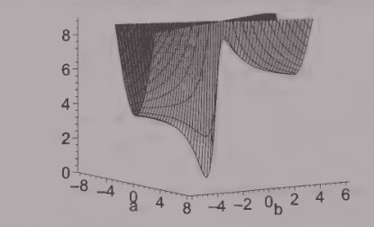

图 3.9 *用于图 3.7 中所示数据集的目标函数 `mathscr{F}`（最小值附近区域）。*

**两个谷。** 其次，图 3.8 至图 3.10 中有两个特别有趣的谷，大致沿着 `a = 0` 线延伸。其中一个对应于 `b < 0` 的谷，其底部正好位于 `mathscr{F}` 的最小值处。当 `mathscr{F}` 接近最小值时，沿该谷缓慢减小。因此，理想情况下，从该谷开始或偶然到达那里的任何迭代算法都应该能找到下坡的路径并到达 `mathscr{F}` 的最小值。

另一个谷对应于 `b > 0`，它被一条山脊与 `mathscr{F}` 的全局最小值隔开。随着 `b` 增大，函数 `mathscr{F}` 沿该谷缓慢减小。因此，从该谷开始或“偶然”到达那里的任何迭代算法将被迫沿 `b` 轴向上移动，远离 `mathscr{F}` 的最小值，并趋向于无穷大。

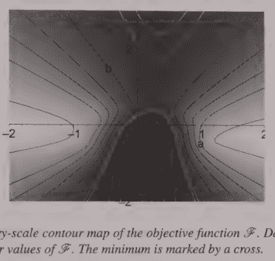

**错误谷的风险。** 如果迭代算法从随机选择的点开始，它可能会进入任一谷，并且有几率下降到第二个（错误）谷，然后发散。对于图 3.7 中的样本，`[43]` 的作者应用了 `Levenberg-Marquardt` 算法，其初始猜测随机选择在数据质心 `(\bar{x},\bar{y})` 附近的 `5 x 5` 正方形内。他们发现该算法确实以大约 50% 的概率逃逸到无穷大。

**逃逸谷的存在。** 不幸的是，这种“逃逸谷”几乎是不可避免的：详细的理论分析表明，对于每个典型数据集，`mathscr{F}` 的图像都包含一个逃逸谷。这是一个在下文中陈述的数学定理。

**定理 7（双谷定理）** 对于每个典型数据集，目标函数 `mathscr{F}(a,b)` 的图像上存在一对向相反方向延伸的谷，使得一个谷下降到 `mathscr{F}` 的最小值，而另一个谷则向无穷大下降。

“典型”一词的确切含义将在证明中阐明。我们的证明相当长，但它揭示了许多除了两个谷的存在之外有用的事实，因此我们在下一节中完整呈现它。

#### 3.8 双谷定理的证明

本节专门用于证明定理 7。我们将通过检查目标函数 `mathscr{F}` 在 `a` 和 `b` 很大时的行为（即当 `a^2 + b^2 -> infinity` 时）来找到这两个谷。在这种情况下，根据 `(3.6)`，`R -> infinity`，拟合圆弧接近直线，因此我们可以使用第 2 章中确立的一些事实。

**泰勒展开。** 我们引入新变量 `D^2 = a^2 + b^2`，并将 `a = D cos phi` 和 `b = D sin phi`，其中 `phi in [0, 2pi)`。然后 `(3.3)` 变为

```
d_i = sqrt((x_i - D cos phi)^2 + (y_i - D sin phi)^2) - R = sqrt(z_i - 2 u_i D + D^2) - R,
```

其中我们使用简写记号

```
z_i = x_i^2 + y_i^2   和   u_i = x_i cos phi + y_i sin phi.
```

将 `d_i` 展开为泰勒级数得到

```
d_i = D - u_i + (z_i - u_i^2)/(2D) - R + O(1/D^2).
```

注意到

```
z_i - u_i^2 = v_i^2   其中   v_i = -x_i sin phi + y_i cos phi.
```

根据 `(3.6)`，我们有 `sum d_i = 0`，因此

```
D - R = bar{u} - (overline{vv})/(2D) + O(1/D^2),
```

其中我们使用“样本均值”记号 `bar{u} = 1/n sum u_i`，`overline{vv} = 1/n sum v_i^2` 等。引入另一个新变量 `delta = 1/D`，我们得到

```
d_i = -(u_i - bar{u}) + delta (v_i^2 - overline{vv})/2 + O(delta^2).
```

平方并对 `i` 取平均值得到

```
1/nmathscr{F} = overline{uu} - bar{u}^2 - [overline{vv} - overline{uvv}]delta + O(delta^2).   (3.19)
```

这是一个关键的展开式；为了简洁起见，我们将其重写为

```
1/nmathscr{F} = f_0 + f_1 delta + O(delta^2).
```

**主项。** 主项是

```
f_0 = overline{uu} - bar{u}^2
    = s_{xx} cos^2 phi + 2 s_{xy} cos phi sin phi + s_{yy} sin^2 phi,
```

其中 `s_{xx}`，`s_{xy}`，`s_{yy}` 是在 `(1.5)` 中引入的散度矩阵 `mathbf{S}` 的分量。用矩阵形式表示，我们有

```
f_0 = A^T S A,
```

其中 `A = (cos phi, sin phi)^T`，同样如第 2.3 节所述，因此我们可以使用该节的结果。

设 `0 <= lambda_1 <= lambda_2` 为 `mathbf{S}` 的特征值，`mathbf{A}_1` 和 `mathbf{A}_2` 为对应的特征向量。如果 `lambda_1 = lambda_2`，则 `f_0`（作为 `phi` 的函数）是常数，但这仅发生在数据集允许无限多条正交拟合线的情况下（第 2.3 节）。这构成一个例外事件（我们的定理不适用于此情况）。

暂时搁置例外情况，我们假设 `lambda_1 < lambda_2`。则 `f_0` 是 `phi` 的非常数函数，具有两个性质：

- (a) `f_0(phi)` 是周期为 `pi` 的周期函数；
- (b) `f_0(phi)` 的取值在区间 `[lambda_1, lambda_2]` 内；其最小值为 `lambda_1`，在 `A = A_1` 处取得；其最大值为 `lambda_2`，在 `A = A_2` 处取得。

参见图 3.11。顺便说一下，`f_0` 的有限性证明了 `mathscr{F}(a,b)` 是一个有限函数，正如我们之前提到的。

由于 `f_0` 的周期为 `pi`，它在区间 `[0, 2pi]` 上取最小值两次：一次是在对应向量 `A_1` 的点 `phi_1` 处，另一次是在对应相反向量 `-A_1` 的点 `phi_1 + pi` 处。因此，在 `mathscr{F}` 的图像上有两个谷，它们向相反方向延伸（`A_1` 和 `-A_1`）；两个谷都平行于向量 `A_1`，即它们与最佳拟合线正交（因为 `phi` 是其法向量的方向，参见第 2.1 节）。

**二阶项。** 为了检查这些谷的下降方向（减小方向），我们需要分析函数 `mathscr{F}` 在谷底部的行为，根据 `(3.19)`，该行为由下式给出

```
1/nmathscr{F} = lambda_1 + f_1(phi)delta + O(delta^2)      (3.20)
```

其中一个谷取 `phi = phi_1`，另一个谷取 `phi = phi_1 + pi`。

为了简化公式，我们假设坐标系的选取使得其原点与数据的质心重合，即 `bar{x} = bar{y} = 0`。在这种情况下，还有 `bar{u} = bar{v} = 0`，我们得到

```
f_1(phi) = -overline{uvv}
        = -overline{xxv}/2 cos^3 phi - (overline{yy} - overline{xx}/2) cos^2 phi sin phi
          - overline{xx}/2 sin^3 phi - (overline{xx}/2 - overline{xyy}/2) cos phi sin^2 phi.
```

因此，`f_1(phi)` 是一个以 `2pi` 为周期的周期函数，并且是以 `pi` 为周期的*反周期*函数，即

```
f_1(phi) = -f_1(phi + pi)
```

见图 3.1。特别地，`f_1(phi_1) = -f_1(phi_1 + pi)`。因此，如果 `f_1` 在一个谷底的值为正，则它在另一个谷底的值为负，反之亦然。

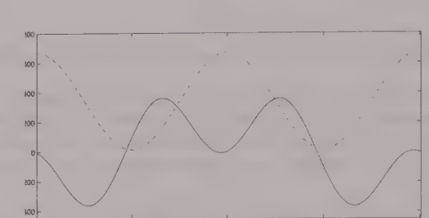

**图 3.11** *随机生成数据集的函数 `f_0(phi)`（虚线）和 `f_1(phi)`（实线）。*

由式 `(3.20)` 可知，如果 `f_1` 在两个谷底之一的底部大于 0，则当 `delta -> 0`（即 `D -> infinity`）时，`mathscr{F}` 会减小，因此随着谷向无穷远延伸，其深度会减小。如果沿某一谷底 `f_1 < 0`，则当 `D -> infinity` 时，`mathscr{F}` 会增加，即随着谷向无穷远延伸，其深度会增加。

这证明了 `f_1(phi_1) != 0` 情况下的定理。现在需要考察 `f_1(phi_1) = 0` 的情况；这构成了另一个例外事件。


## 两个例外情况。

让我们旋转坐标系，使其 $x$ 轴与最佳拟合直线重合（即与散射椭圆的主轴重合）。此时 $s_{xy} = 0$ 且 $s_{xx} > s_{yy}$，$f_0$ 在 $\varphi_1 = \pi/2$ 处取得最小值，因此

$$f_1(\varphi_1) = -\overline{uv} = -\overline{xy}$$ 

事件

$$\overline{xy} = \frac{1}{n} \sum_{i=1}^n x_i^2 y_i = 0 \qquad \qquad \qquad \qquad \qquad (3.21)$$

显然是例外的。如果数据是从连续概率分布中随机采样的，那么事件 (3.21) 发生的概率为零。

这是我们的定理不适用的第二个例外事件。现在，我们要明确定理陈述中“典型”一词的确切含义：它准确指的是 $\lambda_1 \neq \lambda_2$ 且 $\overline{xy} \neq 0$。证毕。$\square$

### 最后 remarks。

我们要强调，上述定理非常普遍，“逃逸谷”的存在与否，无论数据点是沿不完整圆（小圆弧）还是沿整个圆采样都是存在的。然而，在实际操作中，在后一种情况下（沿整个圆采样），迭代算法是相当安全的，因为逃逸谷远离数据集，使得很难进入其中。

另一方面，对于沿短圆弧采样的数据，逃逸谷会危险地接近数据集，因此迭代算法很容易被困在该谷中。

### 3.9 奇异情况

这里我们更仔细地研究圆拟合问题中出现的奇异情况（在 3.2 节中描述），即数据沿小圆弧采样的情形。

**警示。** 这恰恰是传统的迭代算法很可能陷入错误的（“逃逸”）谷并导致发散的情况。这也是最佳拟合圆甚至可能不存在的情况，即最佳拟合直线可能“击败”所有圆。

必须谨慎处理此情况。此处描述了一种处理奇异情况的策略；我们使用了前一节中双谷定理证明的细节。

#### 谷的解析分类。

首先，我们需要将坐标系原点移至数据的质心 $\bar{x},\bar{y}$。在该坐标系中 $\bar{x}=\bar{y}=0$。然后，我们将 $x$ 轴与散射椭圆的主轴对齐，确保 $s_{xy}=0$ 且 $s_{xx}>s_{yy}$。此时，最佳拟合直线就是 $x$ 轴（且在该直线上，函数 $\mathcal{F}$ 的值为 $\mathcal{F}=nf_{0}$，参见 (3.19)）。

在这个（调整后的）坐标系中，值

$\overline{\boldsymbol{x}\boldsymbol{y}}=\frac{1}{n}\sum_{i=1}^{n}\boldsymbol{x}_{i}^{2}\boldsymbol{y}_{i}$

起着至关重要的作用；它是数据集的“特征”。确切地说，我们已经证明了以下关系：

- (a) 如果 $\overline{\boldsymbol{x}\boldsymbol{y}}>0$，则最佳拟合圆的圆心位于*x 轴上方*；错误的谷位于*x 轴下方*；
- (b) 如果 $\overline{\boldsymbol{x}\boldsymbol{y}}<0$，则最佳拟合圆的圆心位于*x 轴下方*；错误的谷位于*x 轴上方*。

这些简单的规则可用于为迭代算法选择安全的初始猜测值，帮助其避开错误的谷并正确引导。

#### 相关议题：当直线击败圆时。

我们分析的另一个重要推论是

**定理 8** *在* $\overline{\mathrm{xy}} \neq 0$ *的情况下，最佳拟合圆存在，即最佳拟合直线不能击败最佳圆。*

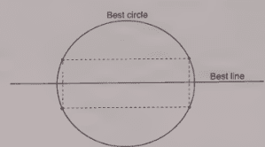

图 3.12：*尽管* $\overline{\mathrm{xy}} = 0$，*最佳圆仍击败最佳直线。*

另一方面，即使 $\overline{\mathrm{xy}} = 0$，最佳拟合圆可能仍然存在。例如，设 $n = 4$ 个数据点构成一个矩形的顶点，见图 3.12。此时，最佳拟合直线将矩形平分，容易看出在调整后的坐标系中 $\overline{\mathrm{xy}} = 0$（由于关于 $x$ 轴的对称性）。然而，外接圆插值了所有四个数据点，因此提供了完美的拟合（$\mathcal{F} = 0$），从而击败了任何直线。

总结我们的理论结论，我们可以看到：

- (a) 如果 $\overline{\mathrm{xy}} \neq 0$，则最佳拟合圆总是存在的（并且它击败任何直线）；
- (b) 如果 $\overline{\mathrm{xy}} = 0$，则最佳拟合圆可能存在也可能不存在，这取决于数据集；即，最佳拟合直线击败所有圆是可能的。

实际上，这意味着如果 $\overline{\mathrm{xy}} = 0$，则应将最佳拟合直线（$x$ 轴）作为圆拟合问题的潜在解进行检查。如果 $\overline{\mathrm{xy}} \neq 0$，则可以忽略直线。

#### 实践建议。

事实上，当临界值 $\overline{\mathrm{xy}}$ 过于接近零时，必须非常小心。如由展开式 (3.19) 可知，

$R = \mathcal{O}(1 / \overline{\mathrm{xy}})$，

即，如果 $\overline{\mathrm{xy}}$ 过于接近零，则最佳拟合圆的半径可能极大；在这种情况下，尝试计算 $a, b$ 和 $R$ 可能导致 3.2 节中描述的灾难性精度损失。

可以采用以下简单的安全检查点来避免灾难性结果。假设我们的坐标 $x_i$ 和 $y_i$ 的量级为 1；在这种情况下，如果迭代算法达到 $R \geq 10^8$ 的值，则进一步的计算将毫无意义；因此，应终止迭代，并且算法应返回最佳拟合直线（$x$ 轴）作为圆拟合问题的解。

这结束了我们对圆拟合问题的理论分析。在接下来转向讨论实用算法时，它将是无价的。

### 几何圆拟合

- 4.1 经典最小化方案 70
- 4.2 高斯-牛顿法 72
- 4.3 利文伯格-马夸尔特校正 74
- 4.4 信任域 76
- 4.5 圆的利文伯格-马夸尔特法：完整版本 79
- 4.6 圆的利文伯格-马夸尔特法：简化版本 80
- 4.7 圆拟合的利文伯格-马夸尔特法修改 82
- 4.8 圆的 Späth 算法 84
- 4.9 圆的 Landau 算法 88
- 4.10 发散及其避免方法 91
- 4.11 平移和旋转下的不变性 93
- 4.12 已知角度差的情况 96

#### 两种类型的拟合算法。

在本章及下一章中，我们将讨论圆拟合问题的实用解决方案。回想一下，我们的主要任务是最小化由 (3.1) 给出的非线性函数 $\mathscr{F}$。其最小值无法通过闭式表达或由有限算法计算。所有现有的实用解决方案可以分为两大组：

(A) 旨在收敛于

$$\mathscr{F} = \sum_{i=1}^{n} d_i^2$$

最小值的迭代算法，其中 $d_i$ 是数据点到圆的几何（正交）距离。$\mathscr{F}$ 的最小化被称为*几何拟合*；

(B) 用其他量 $f_i$ 替代 $d_i$ 的近似算法，以及

然后最小化

$$\mathscr{F}_1 = \sum_{i=1}^{n} f_i^2;$$

通常 $f_i$ 由简单的代数公式（不含根号）定义，所得到的解称为*代数拟合*。

在本章中，我们描述了最流行的几何拟合（A 类）。下一章专门介绍代数逼近方法（B 类）。

#### 比较。

几何拟合通常被认为比代数拟合更精确（尽管这种观点主要基于实践经验；我们的第 7 章对该问题提供了一些理论分析）。但每种几何拟合过程都是迭代的，偶尔会出现发散，而且无论如何计算成本都很高。相反，代数拟合通常简单、可靠且快速。

代数拟合常被用作后续迭代几何拟合程序的初始猜测值。然而，一些现代代数拟合方法非常精确，几何拟合并不会带来多少进一步的改进。在大多数实际应用案例中，设计良好的代数拟合（如 Taubin 方法或 Pratt 方法，详见下一章）就能完成令人满意的工作。

因此，如果读者只是在寻找简单高效的圆拟合，应直接跳到下一章，查阅 Pratt 拟合或（更好的是）Taubin 圆拟合。如果读者需要几何拟合，无论其成本多高，或者希望全面了解此主题，则应阅读本章。

### 4.1 经典极小化方案

我们从对用于最小化多元变量平滑函数的一般数值方案的简要描述开始，特别是那些适用于最小二乘问题的方案。首先，我们回顾两个经典算法，它们是每个标准数值分析课程的一部分。

#### 最速下降法。

假设我们需要找到一个平滑函数 $\mathscr{G}: \mathbb{R}^k \rightarrow \mathbb{R}$ 的最小值，即

$$z = \mathscr{G}(\mathbf{a}), \qquad \mathbf{a} = (a_1, \ldots, a_k) \in \mathbb{R}^k \qquad (4.1)$$

其中变量为 $k$ 个。迭代过程通常计算一系列点 $\mathbf{a}^{(0)}$，$\mathbf{a}^{(1)}, \ldots$，假设其收敛到 $\mathscr{G}$ 取得最小值的点。起始点 $\mathbf{a}^{(0)}$（*初始猜测值*）假定以某种方式选择，该过程遵循特定规则，根据 $\mathbf{a}^{(i)}$ 确定 $\mathbf{a}^{(i+1)}$。

也就是说，为了定义一个过程，只需描述从当前近似值 $\mathbf{a}$ 构造下一个近似值 $\mathbf{a}'$ 的规则。

我们始终假设函数 $\mathscr{G}$ 的导数可以求值；因此可以找到梯度向量 $\nabla\mathscr{G}(\mathbf{a})$，那么从 $\mathbf{a}$ 出发最合理的移动方向是与 $\nabla\mathscr{G}(\mathbf{a})$ 相反的方向，因为在该方向上函数 $\mathscr{G}$ 下降得最快。这种方法被称为最速下降法。它可以用以下公式描述：

$$\mathbf{a}^{\prime}=\mathbf{a}-\eta\,\nabla\mathscr{G}(\mathbf{a}),$$

其中 $\eta>0$ 是一个因子。$\eta$ 的选择基于以下一般性考虑。

#### 步长的选择。

如果 $\eta$ 太大，可能会“越过” $\mathscr{G}$ 取小值的区域，落点太远。如果 $\eta$ 太小，进展会很慢，但至少函数会减小，即得到 $\mathscr{G}(\mathbf{a}^{\prime})<\mathscr{G}(\mathbf{a})$。

最简单的方法是设置 $\eta=1$，计算 $\mathbf{a}^{\prime}$，然后检查它是否可接受。如果 $\mathscr{G}(\mathbf{a}^{\prime})<\mathscr{G}(\mathbf{a})$，则接受值 $\mathbf{a}^{\prime}$；否则，通过尝试较小的 $\eta$ 值（例如，先 $\eta=1/2$，然后 $\eta=1/4$ 等）进行回溯，直到 $\mathbf{a}^{\prime}$ 变得可接受。

还存在其他（巧妙但代价更高）调整因子 $\eta$ 的方法，如黄金分割、Brent 方法、各种带导数的线搜索；请参阅数值分析方面的标准书籍，如文献 [151]。

一般来说，最速下降法是一种可靠的方法，但通常收敛缓慢（最好情况也是线性收敛）。

#### 牛顿-拉夫逊方法。

如果 $\mathscr{G}$ 的二阶导数可用，则可以计算梯度向量和二阶偏导数的 Hessian 矩阵：

$$\mathbf{D}=\nabla\mathscr{G}(\mathbf{a}) \quad\quad\text{以及}\quad\quad\mathbf{H}=\nabla^{2}\mathscr{G}(\mathbf{a})\tag{4.2}$$

并在 $\mathbf{a}$ 的邻域内用泰勒多项式的二次项近似 $\mathscr{G}$：

$$\mathscr{G}(\mathbf{a}+\mathbf{h})\approx\mathscr{G}(\mathbf{a})+\mathbf{D}^{T}\mathbf{h}+\tfrac{1}{2}\mathbf{h}^{T}\mathbf{H}\mathbf{h},\tag{4.3}$$

其中 $\mathbf{h}=\mathbf{a}^{\prime}-\mathbf{a}$ 表示步长。现在可以选择 $\mathbf{h}$ 为该二次近似的临界点，即通过求解以下方程找到 $\mathbf{h}$：

$$\mathbf{D}+\mathbf{H}\mathbf{h}=0.\tag{4.4}$$

这就是牛顿-拉夫逊方法。

如果当前迭代已经足够接近 $\mathscr{G}$ 的最小值，则该方法收敛很快（二次收敛）。然而，该方法可能会遇到各种问题。首先，就像最速下降法一样，它可能会“越过” $\mathscr{G}$ 取小值的区域，落点太远，此时必须回溯。其次，矩阵 $\mathbf{H}$ 可能不是正定的，那么 (4.3) 中的二次近似甚至没有最小值：(4.4) 的解将是鞍点或最大值。在这种情况下，(4.3) 中的二次近似似乎毫无用处。

幸运的是，最小二乘问题提供了一种高效的方法来避免最后这个麻烦，参见下一节。

### 4.2 高斯-牛顿方法

#### 最小二乘问题。

考虑一个我们需要最小化函数的问题：

$$\mathscr{G}(\mathbf{a}) = \sum_{i=1}^{n} g_{i}^{2}(\mathbf{a}) \quad (4.5)$$

其中变量 $\mathbf{a} = (a_{1}, \ldots, a_{k})$ 有 $k$ 个。我们假设 $n > k$，且 $g_{i}$ 具有导数。

#### 最小二乘问题的牛顿-拉夫逊方法。

与牛顿-拉夫逊方案一样，我们首先通过泰勒多项式的二次项近似 $\mathscr{G}(\mathbf{a} + \mathbf{h})$：

$$\mathscr{G}(\mathbf{a} + \mathbf{h}) \approx \mathscr{G}(\mathbf{a}) + \mathbf{D}^{T}\mathbf{h} + \frac{1}{2}\mathbf{h}^{T}\mathbf{H}\mathbf{h}. \quad (4.6)$$

其中

$$\mathbf{D} = \nabla\mathscr{G}(\mathbf{a}) = 2\sum_{i=1}^{n}g_{i}(\mathbf{a})\nabla g_{i}(\mathbf{a}) \quad (4.7)$$

是 $\mathscr{G}$ 的梯度，而

$$\mathbf{H} = \nabla^{2}\mathscr{G}(\mathbf{a}) = 2\sum_{i=1}^{n}[\nabla g_{i}(\mathbf{a})][\nabla g_{i}(\mathbf{a})]^{T} + 2\sum_{i=1}^{n}g_{i}(\mathbf{a})\nabla^{2}g_{i}(\mathbf{a}) \quad (4.8)$$

是 $\mathscr{G}$ 的 Hessian 矩阵。牛顿-拉夫逊方法 (4.4) 同时使用 $\mathbf{D}$ 和 $\mathbf{H}$。

#### 最小二乘问题的高斯-牛顿方法。

高斯-牛顿方法舍弃 (4.8) 中的最后一项求和，即用以下矩阵替代 $\mathbf{H}$：

$$\mathbf{H}^{\circ} = 2\sum_{i=1}^{n}[\nabla g_{i}(\mathbf{a})][\nabla g_{i}(\mathbf{a})]^{T}. \quad (4.9)$$

为证明这种替代的合理性，通常指出在典型的最小二乘应用中 $g_{i}(\mathbf{a})$ 很小，因此 (4.8) 中的第二项求和远小于第一项，故去除该项不会显著改变 Hessian 矩阵 $\mathbf{H}$。此外，还指出修改 $\mathbf{H}$ 不会改变过程的极限点，它只能影响迭代接近该极限点所采取的路径。$^{1}$

#### 优点。

用 $\mathbf{H}^{\circ}$ 替代 $\mathbf{H}$ 有两个即时优点：

- (a) 不再需要计算 $g_{i}$ 的二阶导数；
- (b) 与 $\mathbf{H}$ 不同，新矩阵 $\mathbf{H}^{\circ}$ 总是半正定的。

$^{1}$但它会（并且确实！）减慢收敛速度，尤其是当 $g_{i}(\mathbf{a})$ 并不那么小时，关于此点的更多信息见本节末尾。

暂时假设 $\mathbf{H}^{\circ}$ 非奇异。则二次表达式

$$\mathcal{L} (\mathbf{a}) + \mathbf{D}^{T} \mathbf{h} + \frac{1}{2} \mathbf{h}^{T} \mathbf{H}^{\circ} \mathbf{h}$$

有一个最小值，它在满足方程的 $\mathbf{h}$ 处取得：

$$\mathbf{D} + \mathbf{H}^{\circ} \mathbf{h} = \mathbf{0} \quad (4.10)$$

因此 $\mathbf{h} = -(\mathbf{H}^{\circ})^{-1} \mathbf{D}$，下一个近似值为 $\mathbf{a}' = \mathbf{a} + \mathbf{h}$。

#### 应用线性代数方法。

引入矩阵符号 $\mathbf{g} = (g_1(\mathbf{a}), \dots, g_n(\mathbf{a}))^T$ 和

$$\mathbf{J} = \begin{bmatrix} \frac{\partial g_1}{\partial a_1} & \dots & \frac{\partial g_1}{\partial a_k} \\ \dots & \dots & \dots \\ \frac{\partial g_n}{\partial a_1} & \dots & \frac{\partial g_n}{\partial a_k} \end{bmatrix} \quad (4.11)$$


我们得到 $\mathbf{D} = 2 \mathbf{J}^T \mathbf{g}$ 和 $\mathbf{H}^{\circ} = 2 \mathbf{J}^T \mathbf{J}$。因此，$\mathbf{h}$ 是以下方程的解：

$$\mathbf{J}^T \mathbf{J} \mathbf{h} = -\mathbf{J}^T \mathbf{g} \quad (4.12)$$

该方程对应于超定线性方程组

$$\mathbf{J} \mathbf{h} \approx -\mathbf{g} \quad (4.13)$$

这是线性代数中的经典最小二乘问题，参见第 1.7 节。其（最小范数）解为

$$\mathbf{h} = -\mathbf{J}^{-} \mathbf{g} = - (\mathbf{J}^T \mathbf{J})^{-} \mathbf{J}^T \mathbf{g} = -(\mathbf{H}^{\circ})^{-} \mathbf{D} \quad (4.14)$$

其中 $(\cdot)^{ - }$ 表示 Moore-Penrose 伪逆。无论 $\mathbf{H}^{\circ}$ 是否奇异，此公式都适用。

备注。可以通过另一种方式得出 (4.12)。由于我们的目标是最小化 $\mathcal{L} = \|\mathbf{g}\|^2$，可以用其线性近似 $\mathbf{g}(\mathbf{a}) + \mathbf{J}\mathbf{h}$ 替代 $\mathbf{g}(\mathbf{a}+\mathbf{h})$，并对 $\mathbf{h}$ 最小化 $\|\mathbf{g}(\mathbf{a}) + \mathbf{J}\mathbf{h}\|^2$；这正是经典最小二乘问题 (4.13)，其解由 (4.14) 给出。

备注。“正规方程”组

$$\mathbf{J}^{T} \mathbf{J} \mathbf{h} = -\mathbf{J}^{T} \mathbf{g}$$

可以通过几种方式在数值上求解。矩阵 $\mathbf{J}^{T} \mathbf{J}$ 的简单求逆或高斯消元法并不推荐，因为它们没有利用 $\mathbf{J}^{T} \mathbf{J}$ 的半正定性，且容易产生较大的舍入误差。一种更好的方法是对 $\mathbf{J}^{T} \mathbf{J}$ 进行 Cholesky 分解，它相当快速且精确。其缺点是在...

## 4.3 Levenberg-Marquardt 校正

高斯-牛顿法在有利条件下表现良好，此时其收敛速度快，但如上所述，它仍可能越过 $\mathcal{G}$ 取小值的区域；此外，如果设计矩阵 $\mathbf{N}=\mathbf{J}^{T}\mathbf{J}$ 恰好接近奇异，其性能可能会出问题。

### 扩展设计矩阵

Levenberg-Marquardt 校正旨在消除这些缺陷。设计矩阵 **N** 被扩展为

$$ \mathbf{N}_{\lambda}=\mathbf{N}+\lambda\mathbf{I}, \quad (4.15) $$

其中 $\lambda>0$ 是额外的控制参数，$\mathbf{I}$ 是 $k \times k$ 单位矩阵。换句话说，$\mathbf{N}$ 的对角元素增加了 $\lambda$。然后，求解新的系统以代替 (4.12)：

$$ \mathbf{N}_{\lambda} \mathbf{h}=-\mathbf{J}^{T} \mathbf{g} \quad (4.16) $$

来确定 **h**。注意，当 $\lambda>0$ 时，矩阵 $\mathbf{N}_{\lambda}$ 总是正定的（而 $\mathbf{N}$ 仅保证是半正定的），实际上 $\mathbf{N}_{\lambda}$ 的所有特征值都 $\geq\lambda$。

### 检查点

计算出 **h** 后，算法通过一个检查点。如果新的近似值 $\mathbf{a}'=\mathbf{a}+\mathbf{h}$ 降低了 $\mathcal{G}$ 的值，即如果 $\mathscr{G}(\mathbf{a}') < \mathscr{G}(\mathbf{a})$，则接受该值，并在下一次迭代之前将 $\lambda$ 乘以某个因子 $\alpha$（抑制校正项 $\lambda\mathbf{I}$）。

否则，拒绝新值 $\mathbf{a}' = \mathbf{a} + \mathbf{h}$，将 $\lambda$ 乘以某个因子 $\beta$ 并增大，并再次求解扩展法方程 $\mathbf{N}_\lambda\mathbf{h} = -\mathbf{J}^T\mathbf{g}$。这些递归尝试持续进行，直到增量 $\mathbf{h}$ 导致 $\mathscr{G}$ 的值变小。这是必然发生的，因为当 $\lambda$ 很大时，该方法趋近于最速下降法。

### 优点

换句话说，当 $\lambda$ 增加时，重新计算的向量 $\mathbf{h}$ 不仅变得更小，而且发生旋转，更好地对齐负梯度向量 $-\nabla\mathscr{G}(\mathbf{a})$。当 $\lambda \rightarrow \infty$ 时，$\mathbf{h}$ 的长度趋近于零，其方向收敛于 $-\nabla\mathscr{G}(\mathbf{a})$ 的方向（图 4.1）。

我们看到，Levenberg-Marquardt 校正结合了两种经典思想：

- (a) 函数的二次近似，这在最小值附近表现良好，并带来快速（近乎二次）的收敛。
- (b) 最速下降方案，确保在困难情况下的可靠性。

由于该算法基于这两个原则之间的合理平衡，有时被称为 Marquardt 折衷方案。

### 实际问题

在许多实现中，参数 $\lambda$ 初始化为一个小值，例如 $10^{-3}$ 或 $10^{-4}$。$\alpha$ 和 $\beta$ 的常见选择是 $\alpha = 0.1$ 和 $\beta = 10$。

*备注。* 与上一节中的方程 (4.12) 一样，新系统 $\mathbf{N}_\lambda\mathbf{h} = -\mathbf{J}^T\mathbf{g}$ 可以用许多方式在数值上求解，包括 Cholesky 分解、QR 分解和 SVD。然而，使用 QR 和 SVD 需要一种技巧，因为系统 (4.16) 尚未处于正确形式（ yet ）。技巧是将 (4.16) 重写为

$$ \mathbf{J}_\lambda^T\mathbf{J}_\lambda\mathbf{h} = -\mathbf{J}_\lambda^T\mathbf{g}_0, \quad (4.17) $$

其中矩阵 $\mathbf{J}_\lambda$ 是通过在 $\mathbf{J}$ 的底部附加 $k \times k$ 标量矩阵 $\sqrt{\lambda}\mathbf{I}$ 获得的，向量 $\mathbf{g}_0$ 是通过在 $\mathbf{g}$ 后面扩展 $k$ 个零得到的：

$$ \mathbf{J}_\lambda = \left[ \begin{array}{c} \mathbf{J} \\ \sqrt{\lambda}\mathbf{I} \end{array} \right], \quad \mathbf{g}_0 = \left[ \begin{array}{c} \mathbf{g} \\ \mathbf{0} \end{array} \right]. $$

现在系统 (4.17) 等价于最小二乘问题

$$ \mathbf{J}_\lambda \mathbf{h} \approx -\mathbf{g}_0, $$

其解为 $\mathbf{h} = -\mathbf{J}_\lambda^-\mathbf{g}_0$，可以通过 QR 或 SVD 计算（如上一节末尾所述）。

### 历史

Levenberg-Marquardt 校正在二十世纪中叶引入：它由 Levenberg [122] 于 1944 年发明，并于 1963 年由 Marquardt [131] 重新发现并增强。它在 1970 年代得到普及；见例如 [71]。该方法及其称为*信任域*的变体（见下一节）在过去几十年的最小二乘应用文献中占据主导地位。

## 4.4 信任域

为了完成我们对一般最小化方案的综述，我们将描述信任域方法，该方法目前构成了最先进的技术。

### 动机

Levenberg-Marquardt 算法足够灵活，可以避免经典最小化方案的明显陷阱，并几乎保证收敛到目标函数的最小值。然而，其缺点是控制参数 $\lambda$ 只是一个抽象变量，其值与当前问题没有明显的关系。因此，很难正确初始化 $\lambda$。此外，Levenberg-Marquardt 关于更新 $\lambda$ 的简单规则（通过任意选择的因子 $\alpha$ 和 $\beta$）往往导致不稳定、非最优的性能。

Levenberg-Marquardt 方法的一个变体在 1970 年代开发出来，解决了上述缺陷。Moré 在其撰写精良的 1978 年论文 [133] 中普及了该方法。最终，这种方法被称为*信任域*，并被几乎所有标准软件包采用，如 `MATLAB` 优化工具箱、`MINPACK` [134]、`ODRPACK` [22, 23] 等。我们在此描述其主要思想，更多技术细节请参阅 [133]。

### Levenberg-Marquardt 的几何描述

Levenberg-Marquardt 方法可以几何解释如下。回想高斯-牛顿法的一次迭代包括最小化二次函数

$$ \mathcal{L}(\mathbf{a}+\mathbf{h}) = \| \mathbf{g}(\mathbf{a}) + \mathbf{J}\mathbf{h} \|^2, $$

该函数在当前 [a] 的邻域内近似给定的函数 $\mathcal{G}(\mathbf{a}+\mathbf{h})$

迭代 **a**。图 4.1 展示了二维情况下 $\mathscr{L}(\mathbf{a}+\mathbf{h})$ 的等高线图（等值线集合）；这些等值线是同心椭圆。

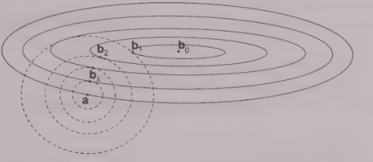

图 4.1 $\mathscr{L}(\mathbf{a}+\mathbf{h})$ 的等值线是同心椭圆（实线椭圆），信赖域边界是以 **a** 为中心的虚线圆。

“纯”高斯-牛顿步（即当 $\lambda = 0$ 时）落在 $\mathscr{L}(\mathbf{a}+\mathbf{h})$ 的最小值处，即椭圆的中心 $\mathbf{b}_0$。当 $\lambda > 0$ 时，Levenberg-Marquardt 步（(4.16) 的解）落在另一个点 $\mathbf{b}_{\lambda} = \mathbf{a} + \mathbf{h}$，该点更接近 **a**。根据 (4.16)，在该点我们有：

$$\mathrm{grad}\ \mathscr{L}(\mathbf{a} + \mathbf{h}) = -\lambda\mathbf{h}.$$

相应地，向量 $\mathbf{h} = \mathbf{b}_{\lambda} - \mathbf{a}$ 正交于穿过 $\mathbf{b}_{\lambda}$ 的 $\mathscr{L}(\mathbf{a}+\mathbf{h})$ 等值线。这意味着 $\mathbf{b}_{\lambda}$ 提供了函数 $\mathscr{L}(\mathbf{a}+\mathbf{h})$ 在球 $\mathbb{B}(\mathbf{a},\Delta)$ 上的*受限*最小值，该球的中心为 **a**，半径为 $\Delta = \|\mathbf{h}\|$。换句话说，当 $\lambda > 0$ 时，Levenberg-Marquardt 步将二次近似 $\mathscr{L}(\mathbf{a}+\mathbf{h})$ 限制在以当前近似值 **a** 为圆心、半径 $\Delta$ 由 $\lambda$ 决定的某个球域内进行最小化。

随着 $\lambda > 0$ 增大，点 $\mathbf{b}_{\lambda}$ 逐渐靠近 **a**，且 $\Delta$ 减小。与此同时，向量 $\mathbf{h} = \mathbf{b}_{\lambda} - \mathbf{a}$ 发生旋转，并与等值线形成更大的夹角。在极限情况下 $\lambda \rightarrow \infty$，球 $\mathbb{B}(\mathbf{a},\Delta)$ 收缩为点 **a**，即 $\Delta \rightarrow 0$，向量 $\mathbf{h}$ 最终与最速下降方向对齐。

#### 替换控制参数

因此，$\lambda > 0$ 与 $\Delta \in (0, \|\mathbf{b}_0 - \mathbf{a}\|]$ 之间存在一一对应关系，因此可以使用 $\Delta$ 代替 $\lambda$ 作为控制参数，即从一次迭代调整到下一次迭代。由于 $\Delta$ 具有明确的含义（下文将进一步解释），其初始化以及在每次迭代中的更新可以比 Levenberg-Marquardt 方案中处理 $\lambda$ 的方式更加合理。

处理 $\Delta$ 的一个好处是可以直接控制参数空间中二次近似 $\mathscr{L}(\mathbf{a}+\mathbf{h})$ 被最小化的区域。这被称为*信赖域*，其背后的思想是在近似可以被*信赖*的地方最小化近似 $\mathscr{L}(\mathbf{a}+\mathbf{h})$，而不进入近似被认为不可靠的过远区域。

- 1. 初始化 $\mathbf{a}_0$ 和 $\Delta_0$，设置 $k=0$。
- 2. 在当前点 $\mathbf{a}_k$ 处计算向量 $\mathbf{g}_k$ 及其梯度 $\mathbf{J}_k$。
- 3. 对于当前的 $\mathbf{a}_k$ 和 $\Delta_k$，确定 $\lambda_k$。
- 4. 通过求解方程 $(\mathbf{J}_k^T \mathbf{J}_k + \lambda_k \mathbf{I})\mathbf{h}_k = -\mathbf{J}_k^T \mathbf{g}_k$ 来计算 $\mathbf{h}_k$。
- 5. 找到比值 $r_k = \mathrm{Ared}_k/\mathrm{Pred}_k$。
- 6. 如果 $r_k < 0$，重置 $\Delta_k := \frac{1}{2}\Delta_k$ 并返回步骤 3。
- 7. 如果 $r_k < 0.25$，更新 $\Delta_{k+1} = \frac{1}{2}\Delta_k$；如果 $r > 0.75$，更新 $\Delta_{k+1} = 2\Delta_k$。
- 8. 更新 $\mathbf{a}_{k+1} = \mathbf{a}_k + \mathbf{h}_k$，增加 $k$，并返回步骤 2。

表 4.2：信赖域算法。

#### 新的更新规则

这种对 $\Delta$ 的解释还引出了以下更新策略。在计算了步长 $\mathbf{h}$ 之后，我们找到目标函数的*实际减少量*（$\mathrm{Ared}$）与*预测减少量*（$\mathrm{Pred}$）的比值：

$$r = \frac{\mathrm{Ared}}{\mathrm{Pred}} = \frac{\mathscr{G}(\mathbf{a}) - \mathscr{G}(\mathbf{a}+\mathbf{h})}{\mathscr{G}(\mathbf{a}) - \mathscr{Q}(\mathbf{a}+\mathbf{h})}$$

应注意，$\mathscr{G}(\mathbf{a}) = \mathscr{Q}(\mathbf{a})$，因此分母始终为正，但仅当发生实际减少时分子才为正，在这种情况下我们当然应该接受步长 $\mathbf{h}$。

然而，我们根据 $r$ 的值来调整 $\Delta$。一种常见的策略如下。如果 $r < 0.25$，则二次近似被认为不太可靠（尽管目标函数有实际减少），我们在下一次迭代之前*减小*尺寸 $\Delta$（例如通过 $\Delta := \Delta/2$）。只有当 $r > 0.75$ 时，近似被认为足够准确，我们才*增加* $\Delta$（通过 $\Delta := 2\Delta$）。在中间情况 $0.25 \le r \le 0.75$ 中，我们保持 $\Delta$ *不变*。注意，这些规则与前一节中更新 $\lambda$ 的简单规则大不相同（在某种意义上，更为保守）！

#### 子问题

我们在表 4.2 中总结了信赖域方案的主要步骤。细心的读者应该注意到，我们尚未指定步骤 3。这被称为*信赖域子问题*：给定当前近似值 $\mathbf{a}$ 周围信赖域的尺寸 $\Delta > 0$，确定对应的参数 $\lambda \ge 0$。文献中有此类问题的多种解法，包括基于牛顿的方法 [70, 135]、狗腿法 [148, 149]、共轭梯度法 [172] 和二次型方法 [26]。我们发现，对于我们将圆拟合应用于数据这一特定场景，Moré [133] 描述的早期带括号法的基于牛顿的算法效果最好。

关于用于圆拟合的信赖域算法的 MATLAB 实现可以在我们的网页 [84] 上找到。

## 4.5 圆的 Levenberg-Marquardt 方法：完整版

将圆拟合到观测点涉及最小化以下函数：

$$\mathscr{F}\left( a,b,R\right) =\sum_{i=1}^{n}\left[ \sqrt{\left( x_{i}-a\right) ^{2}+\left( y_{i}-b\right) ^{2}}-R\right] ^{2}. \tag{4.18}$$

这是一个相对简单的表达式，因此 Levenberg-Marquardt 过程顺利进行。让我们引入简写符号：


$$r_{i}=\sqrt{\left( x_{i}-a\right) ^{2}+\left( y_{i}-b\right) ^{2}} \tag{4.19}$$

以及

$$u_{i}=-\partial r_{i}/\partial a=\left( x_{i}-a\right) /r_{i} \tag{4.20}$$

以及

$$v_{i}=-\partial r_{i}/\partial b=\left( y_{i}-b\right) /r_{i}. \tag{4.21}$$

然后可以直接计算

$$\mathbf{J}=\left[ \begin{array}{ccc} -u_{1} & -v_{1} & -1 \\ \vdots & \vdots & \vdots \\ -u_{n} & -v_{n} & -1\end{array} \right]$$

然后计算

$$\mathbf{N}=n\left[ \begin{array}{ccc} \overline{uu} & \overline{uv} & \bar{u} \\ \overline{uv} & \overline{vv} & \bar{v} \\ \bar{u} & \bar{v} & 1\end{array} \right]$$

以及

$$\mathbf{J}^{T}\mathbf{g}=n\left[ \begin{array}{c} R\bar{u}-\overline{ur} \\ R\bar{v}-\overline{vr} \\ R-\bar{r}\end{array} \right] =n\left[ \begin{array}{c} R\bar{u}+a-\bar{x} \\ R\bar{v}+b-\bar{y} \\ R-\bar{r}\end{array} \right] , \tag{4.22}$$

其中，根据前一部分，

$$\mathbf{g}=\left[ r_{1}-R,\ldots ,r_{n}-R\right] ^{T}.$$

这里我们使用“样本均值”符号，例如 $\overline{uu}=\frac{1}{n}\sum u_{i}^{2}$ 等。

- 1. 初始化 `a0`, `b0`, `R0` 和 `lambda`，计算 `F0 = F(a0, b0, R0)`。
- 2. 假设已知 `ak`, `bk`, `Rk`，对所有 `i` 计算 `ri`, `ui`, `vi`。
- 3. 组装矩阵 `N` 和向量 `JT g`。
- 4. 计算矩阵 `N_lambda = N + lambda I`。
- 5. 通过 Cholesky 分解求解线性方程组 `N_lambda h = -JT g` 以得到 `h`。
- 6. 如果 `||h|| / Rk < epsilon`（较小的容差），则终止过程。
- 7. 使用 `h = (h1, h2, h3)` 更新参数
  $$ a_{k+1}=a_{k}+h_{1}, \quad b_{k+1}=b_{k}+h_{2}, \quad R_{k+1}=R_{k}+h_{3} . $$
- 8. 计算 `Fk+1 = F(ak+1, bk+1, Rk+1)`。
- 9. 如果 `Fk+1 >= Fk` 或 `Rk+1 <= 0`，更新 `lambda -> beta lambda` 并返回步骤 4；否则增加 `k`，更新 `lambda -> alpha lambda`，并返回步骤 2。

表 4.3：圆的 Levenberg-Marquardt 拟合。

现在我们拥有了实施 Levenberg-Marquardt 过程所需的所有公式。这可以通过两种方式完成，每种方式都有其优点。最有效的方式是形成矩阵 `N_lambda = N + lambda I` 并通过 Cholesky 分解求解线性方程组 `N_lambda h = -JT g`。为方便读者，我们在表 4.3 中总结了该方案。

##### 实用备注

我们注意到，对于所有 `i`，都有 `ui^2 + vi^2 = 1`，因此 `uu_bar + vv_bar = 1`，这使得 1 成为矩阵 `1/n N` 的主导对角元素；如果使用带枢轴选择的 Cholesky 分解，这一信息将有所帮助。

Cholesky 解法速度很快，但如果矩阵 `N_lambda` 恰好接近奇异，可能会遇到计算问题。我们推荐一种数值稳定的方案，虽然需要更多的工作量，但能提供最终的准确性。它对第 4.3 节备注中描述的线性最小二乘问题 `J2 h ≈ g0` 应用 QR 分解或 SVD。相应的 MATLAB 代码可在我们的网页 [84] 上获取。[67, 166] 中描述了非常相似的实现。

我们将收敛性分析推迟到本章的后面部分，并将初始猜测的选择推迟到第 5.13 节。

#### 4.6 圆的 Levenberg-Marquardt 方法：缩减版

可以通过消除一个参数 `R` 来缩减圆的 Levenberg-Marquardt 过程，如第 3.2 节所示，并最小化由此得到的表达式：

$$\mathscr{F}(a, b)=\sum_{i=1}^{n}\left(r_{i}-\bar{r}\right)^{2}, \quad(4.23)$$

该式由 (3.7) 中构造得出。对 `a` 和 `b` 求导可得：

$$\mathbf{J}=\left[\begin{array}{cc}-u_{1}+\bar{u} & -v_{1}+\bar{v} \\ \vdots & \vdots \\ -u_{n}+\bar{u} & -v_{n}+\bar{v}\end{array}\right],$$

其中我们使用样本均值符号 $\bar{u}=\frac{1}{n} \sum u_{i}$ 等。由此得到：

$$\mathbf{N}=n\left[\begin{array}{cc}\overline{u u}-\bar{u}^{2} & \overline{u v}-\bar{u} \bar{v} \\ \overline{u v}-\bar{u} \bar{v} & \overline{v v}-\bar{v}^{2}\end{array}\right].$$

我们还得到：

$$\mathbf{J}^{T} \mathbf{g}=n\left[\begin{array}{cc}-\overline{u r}+\bar{u} \bar{r} & \\ -\overline{v r}+\bar{v} \bar{r}\end{array}\right]=n\left[\begin{array}{cc}a-\bar{x}+\bar{u} \bar{r} & \\ b-\bar{y}+\bar{v} \bar{r}\end{array}\right].$$

可以很容易地识别出这些矩阵的元素为相应变量的样本协方差。

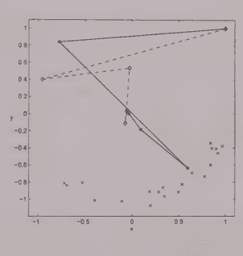

**图 4.2** Levenberg-Marquardt 圆拟合的两种版本，初始猜测为 `(1, 1)`：完整版本（带星号标记的实线）和简化版本（带菱形标记的虚线）在 7 步内收敛到相同的极限；这里 20 个模拟点由叉号标记。

**数值测试。** 这种简化版本的 Levenberg-Marquardt 圆拟合比上一节中介绍的完整版本略微简单且速度更快。图 4.2 展示了一个典型示例，其中在单位圆 `x^2 + y^2 = 1` 的 `130°` 圆弧上随机生成了 20 个点，噪声水平为高斯噪声 `sigma = 0.05`，且 Levenberg-Marquardt 拟合的两个版本均从 `a = b = 1` 开始。它们都在 7 次迭代内收敛到 `F` 的（唯一）最小值点 `a_hat = -0.057` 和 `b_hat = 0.041`，但通往极限的路径略有不同。

在 [43] 报告的计算机实验过程中进行的数值测试表明，虽然这两个版本在典型情况下表现几乎相同，但在不利情况下，简化版本显得略微较差：如果提供给它的初始猜测值不佳，它不幸地倾向于在平台中途停滞。

#### 4.7 Levenberg-Marquardt 圆拟合的改进

计算 (4.8) 中的海森矩阵 `H` 的精确值也有吸引力，即不丢弃其中的第二项求和，从而可能提高收敛性。本节探讨这一方法。

展开 (4.23) 中的平方项得到：

$$\mathscr{F}(a,b) = \sum_{i=1}^{n} r_i^2 - n\bar{r}^2 = \sum_{i=1}^{n} (x_i^2 + y_i^2) + n(a^2 + b^2 - \bar{r}^2). \quad (4.24)$$

为了使公式更简洁，我们假设数据已中心化，即 `\bar{x} = \bar{y} = 0`（一些作者声称 [53, 176]，在拟合前对数据进行中心化有助于减少舍入误差）。

由于 (4.24) 中的第一个求和项与参数无关，我们可以忽略它，同时也忽略第二项中的常数因子 `n`，因此我们得出最小化一个新函数的问题：

$$\mathscr{F}_1(a,b) = a^2 + b^2 - \bar{r}^2. \quad (4.25)$$

对 `a` 和 `b` 求导可得：

$$\frac{1}{2}\nabla\mathscr{F}_1 = \begin{bmatrix} a + \bar{u}\bar{r} \\ b + \bar{v}\bar{r} \end{bmatrix}. \quad (4.26)$$

二阶偏导数为：

$$\begin{aligned} \frac{1}{2} \frac{\partial^2 \mathscr{F}_1}{\partial a^2} \quad & = \quad 1 - \bar{u}^2 + \bar{r} \frac{\partial \bar{u}}{\partial a} \\ \frac{1}{2} \frac{\partial^2 \mathscr{F}_1}{\partial b^2} \quad & = \quad 1 - \bar{v}^2 + \bar{r} \frac{\partial \bar{v}}{\partial b} \\ \frac{1}{2} \frac{\partial^2 \mathscr{F}_1}{\partial a \partial b} \quad & = \quad -\bar{u}\bar{v} + \bar{r} \frac{\partial \bar{u}}{\partial b}. \end{aligned} \quad (4.27)$$

再次使用样本均值符号，我们有：

$$\begin{align*} -\frac{\partial \bar{u}}{\partial a} & = \frac{1}{n}\sum \frac{v_i^2}{r_i} = \overline{vv}/r \\ -\frac{\partial \bar{v}}{\partial b} & = \frac{1}{n}\sum \frac{u_i^2}{r_i} = \overline{uu}/r \end{align*}$$

以及

$\frac{\partial \bar{u}}{\partial b} = \frac{1}{n} \sum \frac{u_i v_i}{r_i} = \overline{uv/r}.$

因此，

$\mathbf{N} = \frac{1}{2} \mathbf{H} = \begin{bmatrix} 1 - \bar{u}^2 - \overline{rv/r} & -\bar{u\bar{v}} + \overline{rv/r} \\ -\bar{u\bar{v}} + \overline{rv/r} & 1 - \bar{v}^2 - \overline{ru/r} \end{bmatrix}.$

(4.28)

然后将矩阵 `N` 扩展为 `N_lambda` 并求解方程组：

$\mathbf{N}_\lambda \mathbf{h} = -\frac{1}{2} \nabla \mathcal{F}_1.$

我们注意到，在这里，与经典的高斯-牛顿算法不同，矩阵 `N` 不一定是半正定的；因此，对于小的 `lambda > 0`，`N_lambda` 不一定是正定的。但对于足够大的 `lambda`，由 (4.15) 计算出的扩展矩阵 `N_lambda` 将是正定的。

**实用说明。** 这种 Levenberg-Marquardt 圆拟合版本比前两种版本更复杂且开销更大：计算 `\overline{uv/r}`、`\overline{rv/r}` 和 `\overline{uv/r}` 这些项会有额外的计算成本。

该算法的性能也在 [43] 报告的计算机实验过程中进行了测试。发现其收敛所需的迭代次数少于完整或简化的 Levenberg-Marquardt 拟合，但鉴于每次迭代的成本更高，总体改进令人存疑。另一方面，如果该算法发散（沿着前一章描述的“逃逸谷”），则与 Levenberg-Marquardt 圆拟合的完整版本相比，其移动速度非常缓慢。因此，上述提出的改进方案似乎不具备实用性。

**进一步改进。** 然而，这导致了另一个非常有趣的简化方案。回想经典的高斯-牛顿方法在计算海森矩阵时会抑制单个项 `g_i(a)` 的二阶偏导数，参见 (4.8) 和 (4.9)。本着这种精神，让我们在计算海森矩阵 (4.27) 时忽略二阶偏导数 `\partial^2 \bar{r} / \partial a^2`、`\partial^2 \bar{r} / \partial b^2` 和 `\partial^2 \bar{r} / \partial a \, \partial b`。这消除了 (4.27) 中三个公式中每式的最后一项，此时矩阵 `N` 简化为：

$\mathbf{N}_0 = \begin{bmatrix} 1 - \bar{u}^2 & -\bar{u\bar{v}} \\ -\bar{u\bar{v}} & 1 - \bar{v}^2 \end{bmatrix}.$

(4.29)

好消息是，矩阵 `N0` 与 (4.28) 中的 `N` 不同，总是半正定的。确实，利用琴森不等式（Jensen's inequality）可得：

$\begin{aligned} \det \mathbf{N}_0 &= 1 - \bar{u}^2 - \bar{v}^2 \\ &\ge 1 - \overline{uu} - \overline{vv} = 0. \end{aligned}$

事实上，除非数据点共线，矩阵 `N0` 都是正定的。

现在，让我们通过设置 `lambda = 0` 来进一步简化问题，即从现代 Levenberg-Marquardt 方法回到传统的高斯-牛顿方法。那么向量 `h = (h1, h2)^T` 将是以下方程的解：

$\mathbf{N}_0 \mathbf{h} = -\frac{1}{2} \nabla \mathscr{F}_1.$

用坐标形式表示，该方程为：

$\begin{bmatrix} 1 - \bar{u}^2 & -\bar{u}\bar{v} \\ -\bar{u}\bar{v} & 1 - \bar{v}^2 \end{bmatrix} \begin{bmatrix} h_1 \\ h_2 \end{bmatrix} = \begin{bmatrix} -a - \bar{u}\bar{r} \\ -b - \bar{v}\bar{r} \end{bmatrix}.$

求解该方程组并计算下一次迭代：

$(a_{\text{new}}, b_{\text{new}}) = (a, b) + (h_1, h_2)$

得到：

$a_{\text{new}} = -\bar{u}R, \quad b_{\text{new}} = -\bar{v}R \quad (4.30)$

其中我们使用以下符号：

$R = \frac{a\bar{u} + b\bar{v} + \bar{r}}{1 - \bar{u}^2 - \bar{v}^2} \quad (4.31)$

（将该分数记为 `R` 有很好的理由，我们将在下一节揭示）。因此，我们得到了一个简单的迭代过程 (4.30)-(4.31)。

由于缺少 Levenberg-Marquardt 修正的高斯-牛顿方案不保证收敛，该算法看起来前景不明。奇迹般地，如上所述的方法结果非常稳健，我们将在下一节中看到。

#### 4.8 圆拟合的 Späth 算法

Späth 于 1996 年提出了一种原始的圆拟合方法，参见 [170, 171]。首先，他扩大了参数空间。


## 潜参数的使用

对于每个 $i$，他用 $(\hat{x}_i, \hat{y}_i)$ 表示圆上距离数据点 $(x_i, y_i)$ 最近的点。点 $(\hat{x}_i, \hat{y}_i)$ 可以被视为圆上“真实”点的最佳估计，其带噪声的观测值为 $(x_i, y_i)$。点 $(\hat{x}_i, \hat{y}_i)$ 有时被称为数据校正 [95]。每个点 $(\hat{x}_i, \hat{y}_i)$ 可以由一个角度参数 $\varphi_i$ 指定，使得：

$\hat{x}_i = a + R \cos \varphi_i, \qquad \hat{y}_i = b + R \sin \varphi_i$

除了描述圆的三个参数 $a, b, R$ 之外，Späth 建议估计 $n$ 个角度参数 $\varphi_1, \ldots, \varphi_n$ 以指定数据校正

点。目标函数随后呈现为以下形式

$$\begin{aligned}\mathscr{F} &= \sum_{i=1}^{n}(x_{i}-\hat{x}_{i})^{2}+(y_{i}-\hat{y}_{i})^{2} \\& = \sum_{i=1}^{n}\left(x_{i}-a-R\cos\varphi_{i}\right)^{2}+\left(y_{i}-b-R\sin\varphi_{i}\right)^{2}\end{aligned} \qquad(4.32)$$

它现在依赖于 $n+3$ 个参数 $(a, b, R, \varphi_{1}, \ldots, \varphi_{n})$。一些其他作者 [67] 也曾使用过这种参数空间的扩展。

## 交替极小化步骤

Späth [170, 171] 的主要思想是将圆的参数与角度参数“分离”开来，并交替地就 $(a, b, R)$ 和就 $(\varphi_{1}, \ldots, \varphi_{n})$ 对 $\mathscr{F}$ 进行极小化。如果我们固定角度参数 $(\varphi_{1}, \ldots, \varphi_{n})$，则函数 $\mathscr{F}$ 关于 $a, b, R$ 是一个二次多项式，因此其最小值可以通过令其偏导数 $\partial \mathscr{F} / \partial a$、$\partial \mathscr{F} / \partial b$、$\partial \mathscr{F} / \partial R$ 为零并求解相应的线性方程组而容易求得。为简洁起见，记

$u_{i} = \cos \varphi_{i} \qquad v_{i} = \sin \varphi_{i} \qquad(4.33)$

在 (4.32) 中。对 $\mathscr{F}$ 求导并进行简单操作可得

$$\begin{aligned}a+\bar{u} R &= 0 \\b+\bar{v} R &= 0 \\\bar{u} a+\bar{v} b+R &= \bar{x}\bar{u}+\bar{y}\bar{v},\end{aligned}$$

其中我们再次假设 $\bar{x} = \bar{y} = 0$，即数据集已中心化。求解上述方程组得

$a = -\bar{u}R, \qquad b = -\bar{v}R \qquad(4.34)$

以及

$R = \frac{\overline{x\bar{u}}+\overline{y\bar{v}}}{1-\bar{u}^{2}-\bar{v}^{2}} \qquad(4.35)$

我们要强调的是，在此阶段参数 $\varphi_{1}, \ldots, \varphi_{n}$ 是固定的，函数 $\mathscr{F}$ 仅就 $a, b, R$ 进行极小化。由于它是二次多项式，上述解提供了 $\mathscr{F}$ 关于 $a, b, R$ 的*全局*最小值。

现在让我们固定 $a, b, R$（从而我们固定了圆！），并找出 $\mathscr{F}$ 关于 $\varphi_{1}, \ldots, \varphi_{n}$ 的最小值。这实际上是一个简单的几何练习。在表达式 (4.32) 中，对于每个 $i$，只有第 $i$ 项依赖于 $\varphi_{i}$。因此参数 $\varphi_{1}, \ldots, \varphi_{n}$ 可以解耦：每个 $\varphi_{i}$ 由以下式的极小化确定

$d_{i}^{2} = (x_{i} - a - R \cos \varphi_{i})^2 + (y_{i} - b - R \sin \varphi_{i})^2$

即由 $d_{i}$ 的极小化确定，$d_{i}$ 是数据点 $(x_{i}, y_{i})$ 与圆上的变点 $(a + R \cos \varphi_{i}, b + R \sin \varphi_{i})$ 之间的距离。当取圆上距离 $(x_{i}, y_{i})$ 最近的点时，达到此最小值，该点将确定 $\varphi_{i}$ 的值。很容易看出

$$ \cos \varphi_{i} = \frac{x_{i} - a}{\sqrt{(x_{i} - a)^{2} + (y_{i} - b)^{2}}}, \quad \sin \varphi_{i} = \frac{y_{i} - b}{\sqrt{(x_{i} - a)^{2} + (y_{i} - b)^{2}}} \quad (4.36) $$

同样，在假设 $a, b, R$ 固定的情况下，这给出了 $\mathcal{F}$ 关于 $\varphi_{i}$（对于每个 $i$）的*全局*最小值。

Späth 算法随后执行 $\mathcal{F}$ 的交替全局极小化。首先它保持 $a, b, R$ 固定，找出 $\mathcal{F}$ 关于 $\varphi_{1}, \ldots, \varphi_{n}$ 的全局最小值，然后保持 $\varphi_{1}, \ldots, \varphi_{n}$ 固定，找出 $\mathcal{F}$ 关于 $a, b, R$ 的全局最小值，以此类推。由于在每一步都找到了 $\mathcal{F}$ 的一个*全局*最小值，$\mathcal{F}$ 的值*必须*始终减小。这是该算法的一个非常有吸引力的特性——它绝不会出错！

## 将两个步骤合并为一个

现在我们转向 Späth 方法的实现。我们可能看起来需要追踪 $n+3$ 个参数，事实上 Späth 提供了 [170] 如何计算 $\varphi_{i}$ 的详细指示。然而，仔细检查该程序后发现，我们不需要角度 $\varphi_{i}$，只需要 $u_{i} = \cos \varphi_{i}$ 和 $v_{i} = \sin \varphi_{i}$，而这些通过 (4.36) 或等价地通过 (4.19)-(4.21) 很容易计算。因此，算法的第一步——在固定 $a, b, R$ 的情况下就 $\varphi_{1}, \ldots, \varphi_{n}$ 对 $\mathcal{F}$ 进行极小化——简化为计算由 (4.19)-(4.21) 定义的 $u_{i}$ 和 $v_{i}$。

现在，Späth 算法的每次迭代（原本由上述两个步骤组成）可以按如下方式执行：使用上一次迭代的圆参数 $a, b, R$ 计算 $u_{i}, v_{i}$，然后按规则 (4.34)-(4.35) 更新 $a, b, R$。无需追踪额外的角度参数。

值得注意的是，Späth 算法现在看起来与我们在上一节末尾开发的迭代程序 (4.30)-(4.31) 相似。仔细检查发现，它们实际上是*完全相同*的。$R$ 的表达式 (4.31)（在前一个算法中仅是一个辅助因子）等同于 (4.35)，这可以直接通过代数验证。

因此，事实上我们在上一节中基于完全不同的思想意外地得出了 Späth 算法。此外，我们的表达式 (4.30)-(4.31) 比 (4.34)-(4.35) 更容易实现。

## 优点和缺点

Späth 算法因此具有两个吸引人的特性：绝对可靠性（每次迭代都会降低目标函数 $\mathcal{F}$ 的值）和每次迭代的低成本。人们可能会期望每次

## 圆的 SPATH 算法

1. 初始化 $(a_0, b_0, R_0)$ 并计算 $\mathscr{F}_0 = \mathscr{F}(a_0, b_0, R_0)$。

2. 假设已知 $(a_k, b_k, R_k)$，计算所有 $i$ 的 $r_i, u_i, v_i$，然后计算平均值 $\bar{r}, \bar{u}, \bar{v}$。

3. 更新参数：首先 $R_{k+1} = (a_k\bar{u} + b_k\bar{v} + \bar{r})/(1 - \bar{u}^2 - \bar{v}^2)$，然后 $a_{k+1} = -\bar{u}R_{k+1}$ 且 $b_{k+1} = -\bar{v}R_{k+1}$。

4. 如果 $(a_{k+1}, b_{k+1}, R_{k+1})$ 接近 $(a_k, b_k, R_k)$，则终止过程，否则 $k$ 自增并返回步骤 2。

表 4.4：*Späth 算法*。

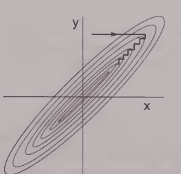

图 4.3：*分别就 x 和 y 进行交替极小化*。

迭代都采取一大步走向 $\mathscr{F}$ 的最小值，因为它交替地对 $\mathscr{F}$ 关于一组或另一组参数执行*全局*极小化。不幸的是，这类算法出了名的缓慢：当它们在联合参数空间中沿对角方向延伸的山谷移动时，每次迭代只走极小的一步。

为了说明这一效应，考虑函数 $f(x,y)$，其等高线地图（水平曲线的集合）恰好在某个相对于坐标轴的角度上定义了一个狭长的山谷（图 4.3）。如果交替地就 $x$ 和就 $y$ 极小化 $f$，那么沿着山谷长度“向下”的唯一方法是一系列许多微小的步骤。此解释借自 [151] 的第 10.5 节。

在 [3] 中指出，Späth 算法通常比 Levenberg-Marquardt 方法需要多 5 到 10 倍的迭代次数才能收敛。[43] 中报告的实验揭示了更为显著的区别。图 4.4 展示了一个典型例子，其中沿 $130^\circ$ 弧随机生成了 20 个点

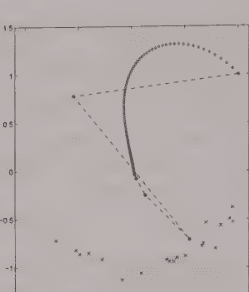

图 4.4 初始猜测为 $ (1,1) $ 的 Späth 算法需要 200 次迭代（菱形）才能收敛，而 Levenberg-Marquardt 圆拟合仅用了 7 次迭代（星号）；此处 20 个模拟点由十字标记。

单位圆 $x^{2}+y^{2}=1$ 上，具有高斯噪声水平 $ \sigma=0.05 $。Levenberg-Marquardt 拟合从 $ a=b=1 $ 开始，在 7 次迭代内收敛到 $\mathscr{F}$ 的（唯一）最小值处，即 $\hat{a}=0.028$ 和 $\hat{b}=-0.031$（由星号标记）。相比之下，Späth 算法却花了将近 200 次迭代（由菱形标记）才收敛。

### 4.9 圆的 Landau 算法

另一种圆拟合算法由 Landau [119] 提出，并很快变得非常流行；参见例如 [124]。（Berman 指出 [17] 该算法至少自 1961 年 Robinson [155] 发表以来就已为人所知，但事实上 Robinson 的论文并未提供任何算法的细节。）

Landau 的想法很简单。$\mathscr{F}$ 的最小值对应于 $\nabla \mathscr{F}=0$，在 (4.22) 的记号中，这等价于 $\mathbf{J}^{T} \mathbf{g}=\mathbf{0}$。使用我们的“样本均值”记号可以写为

$a = -\bar{u}R$

$b = -\bar{v}R$

$R = \bar{r}$，

其中我们再次假设 $ \bar{x}=\bar{y}=0 $。Landau 简单地提出了迭代

### 4.9 迭代算法的收敛性

方案：

$$
\begin{aligned}
R_{\text{new}} & = \bar{r} \\
a_{\text{new}} & = -\bar{u} R_{\text{new}} \quad\quad \quad\quad \quad (4.37) \\
b_{\text{new}} & = -\bar{v} R_{\text{new}}
\end{aligned}
$$

其中 \( \vec{r}, \vec{u}, \vec{v} \) 通过上一次迭代计算得出。这是所谓的*不动点法*的一种变体，详见下文。

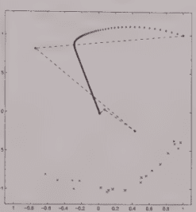

图 4.5 *兰道（Landau）算法在初始猜测为* $(1,1)$ *时需要* 700 *次迭代*（菱形）*才能收敛，而 Levenberg-Marquardt 圆拟合在* 5 *次迭代*（星号）*内即达到目标；*此处* 20 *个模拟点用十字标记。*

**不动点方案。** 不动点方案是求解非线性方程最简单的方法之一。给定一个方程 \(f(x) = 0\)，首先将其转化为 \(x = g(x)\)（其中 \(g(x)\) 为某个函数），然后通过迭代 \(x_{n+1} = g(x_n)\) 来尝试估算一个根，记为 \(x^*\)。如果该方法能够收敛，其极限必然是 \(x = g(x)\) 的根，即 \(f(x) = 0\) 的根。

然而，收敛性取决于函数 \(g\)。如果 \(|g'(x^*)| < 1\)，该方法收敛到 \(x^*\)；如果 \(|g'(x^*)| > 1\)，则发散（对于多维变量 \(x \in \mathbb{R}^n\) 也存在类似条件，参见 [112]）。由于这些条件在实践中很难验证，因此该方法通常可靠性不高。换句话说，必须仔细寻找给定方程 \(f(x) = 0\) 的一种表示形式 \(x = g(x)\)，使得在期望根处及其附近 \(|g'| < 1\)。

此外，不动点方法的收敛速度是线性的（除非 \(g'(x^*) = 0\)，这种情况很少发生），而 Gauss-Newton 方法及其 Levenberg-Marquardt 改进版的收敛速度几乎是二阶的。线性收敛意味着，如果 $\hat{\boldsymbol{\theta}}_k$ 是第 $k$ 次迭代的参数近似值，且 $\boldsymbol{\theta}^{*} = \lim_{k \rightarrow \infty} \boldsymbol{\theta}_k$，则

$$ \|\boldsymbol{\theta}_{k+1} - \hat{\boldsymbol{\theta}}^{*}\| \leq c\|\boldsymbol{\theta}_k - \hat{\boldsymbol{\theta}}^{*}\| $$

其中 $c < 1$ 为某常数。

**收敛速度。** 兰道 [119] 估算了其方法的收敛常数 $c$，并证明 $0.5 \leq c < 1$。事实上，当数据沿整个圆采样时，$c \approx 0.5$；当数据沿半圆采样时，$c \approx 0.9$；随着数据沿更小的弧采样，$c$ 迅速接近 1。在实践中，兰道算法的性能（作为不动点方案的典型特征）非常迟缓——甚至有时比 Späth 方法更慢。

图 4.5 展示了一个典型例子，其中 20 个点在单位圆 $x^{2} + y^{2} = 1$ 的 $130^{\circ}$ 弧上随机生成，高斯噪声水平为 $\sigma = 0.05$。Levenberg-Marquardt 拟合从 $a = b = 1$ 开始，经过 5 次迭代（星号标记）收敛到 $\mathscr{F}$ 的唯一最小值 $\hat{a} = 0.014$ 和 $\hat{b} = -0.020$。相反，兰道算法几乎需要 700 次迭代（菱形标记）才能收敛。

Späth 方法和兰道方法有时通过截然不同的路径收敛到最小值，另一个例子见图 4.6，其中 20 个点在单位圆 $x^{2} + y^{2} = 1$ 的 $130^{\circ}$ 弧上随机生成，高斯噪声水平为 $\sigma = 0.05$，初始猜测再次设为 $a = b = 1$。Levenberg-Marquardt 圆拟合直线通向极限点，并在 5 次迭代内收敛。Späth 方法（菱形）从右侧逼近极限点，大约需要 100 次迭代，而兰道方法（圆形标记）从左侧逼近（大约需要 400 步）。

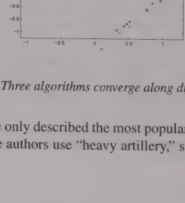

图 4.6：三种算法沿不同路径收敛。

**最后说明。** 我们仅描述了最流行的几何圆拟合算法。一些作者使用“重型火炮”，如 Nelder-Mead 单纯形法 [68]。其他人使用各种启发式方法，如 Fisher 评分 [33]。我们在此未包含这些方法。

> ²例如，方程 \(x^3 - 10 = 0\) 可以转化为 \(x = x^3 + x - 10\) 或 \(x = 10/x^2\)。有无穷多种方式将其写为 \(x = g(x)\)，且 g 各不相同。

### 4.10 发散及如何避免

前面几章回顾了最流行的几何圆拟合算法。当初始猜测选得足够接近目标函数 \( \mathscr{F} \) 的最小值时，它们表现良好。它们也能处理选得远离最小值的初始猜测（尽管有时迭代速度较慢）。但存在一种情况，在这种情况下一切方法都会失败。

**逃逸谷中的发散。** 如果初始猜测（或某次迭代）落入第 3.7 节描述的逃逸谷中，则会出现失败。此时，所有迭代算法都会被驱离 \( \mathscr{F} \) 的最小值并导致发散。


图 4.7 展示了一个例子，其中 20 个点在单位圆 `x^2 + y^2 = 1` 的 130° 弧上随机生成，高斯噪声水平为 `sigma = 0.05`。`Levenberg-Marquardt` 拟合以及 `Späth` 和兰道方法从 `a = 1.1` 和 `b = 0.1` 开始。它们全都朝错误方向（向右）移动并导致发散（图中仅显示发散的初始阶段）。失败的原因是初始猜测恰好位于向右延伸直至地平线的逃逸谷中。（兰道算法的发散可能没有明确原因，因为它纯粹是启发式的且不使用目标函数 `mathscr{F}` 的导数，但它也随之发散。）

在这里，我们不能指责迭代算法导致发散；它们做的是分内之事：检测当前局部区域的函数形状，并朝函数似乎减小的方向移动。它们无法得知自己处于延伸至地平线的逃逸谷中，而真正的最小值已被抛在身后，“越过了山脊”。

我们在第 3.7 节中已确定，对于几乎所有数据集，逃逸谷都存在。然而，如果数据点沿整个圆或大弧采样，则逃逸谷离真实圆很远，迭代算法可以安全运行。另一方面，如果数据点聚集在小弧上，则逃逸谷紧邻数据点。

例如，图 3.1 中显示的数据集沿一条弧（实线）采样，该弧的中心位于 `x` 轴上方。将初始中心选在 `x` 轴下方会将迭代过程置入逃逸谷并将其推向无穷远。

保护迭代过程免受逃逸谷影响的一种方法是使用第 3.9 节中描述的奇异情况处理规则。或者，可以使用下一节中介绍的任意代数圆拟合来初始化迭代方案（这是实践中最常见的策略）。这样，初始猜测几乎自动地被放置在数据集的“正确”一侧，从而避开逃逸谷（不过存在一些特殊的例外情况；参见第 5.13 节的 W 示例）。

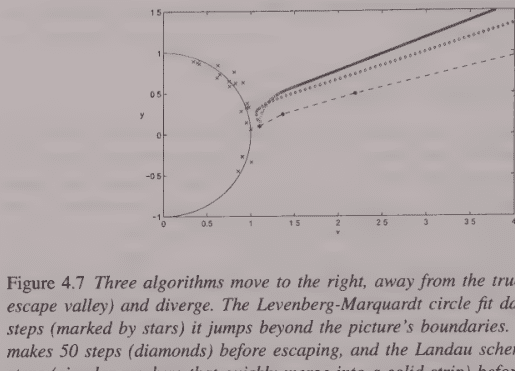

另一方面，如果必须使用较差的（任意选择的）初始猜测（例如，在我们确定典型局部最小值数量的实验中必须这样做，参见第 3.6 节），那么基本上就取决于初始选择的好坏。

### Chernov-Lesort 算法

为了绕过发散问题，`Chernov` 和 `Lesort` [43] 开发了一种相当独特的圆拟合算法，该算法从任意（！）起点都能收敛到目标函数的最小值。诀窍是采用一种不同的参数化方案，在该方案中逃逸谷根本不存在！回想一下，代数方程

`A(x^2 + y^2) + Bx + Cy + D = 0`

其中四个参数 `A, B, C, D` 满足约束条件

`B^2 + C^2 - 4AD = 1`  4.38

描述了 `xy` 平面上的所有圆，此外还描述了所有直线。圆对应 `A != 0`，直线对应 `A = 0`。

我们在第 3.2 节中证明，如果数据集位于包围盒 `mathfrak{B}` 内，则目标函数 `mathscr{F}` 的最小值限制在参数空间的有界区域内：

`|A| < A_max, |B| < B_max, |C| < C_max, |D| < D_max`  4.39

其中 `A_max, B_max, C_max, D_max` 由盒 `mathbb{B}` 的大小和位置以及数据点之间的最大距离 `d_max` 决定，参见定理 4。因此，在 `A, B, C, D` 参数空间中，不存在沿着函数 `mathscr{F}` 一直减小到地平线的“无限长”山谷，这种山谷可能会潜在地导致迭代算法发散。目标函数 `mathscr{F}(A, B, C, D)` 实际上会随着点 `(A, B, C, D)` 在任意方向上远离区域 4.39 而增长。

现在，可以使用任何用于约束或无约束优化的一般算法在 `A, B, C, D` 参数空间中最小化 `mathscr{F}`（在后一种情况下，必须消除一个参数，见下文）。

`Chernov` 和 `Lesort` [43] 利用了无约束的 `Levenberg-Marquardt` 方案。他们引入一个新参数，即角坐标 `theta`，定义为：

`B = sqrt(1+4AD)cos theta, C = sqrt(1+4AD)sin theta,`

使得 `theta` 替代 `B` 和 `C`。有关更多细节，请参阅 [43]。该算法的 MATLAB 代码可从 [84] 获取。

`Chernov-Lesort` 算法因其 100% 的收敛率（在各种条件下经过实验验证，参见 [43]）而引人注目。但除此之外，它相当不实用。

- 它涉及复杂的数学公式。
- 其每次迭代的成本比其他几何拟合算法单次迭代的成本高大约 4 倍。
- 必须对其目标函数的各种奇点（即参数空间中 `mathscr{F}` 没有导数的点）进行防护；详见 [43]。
- 最后但同样重要的是，该算法严重依赖于数据平面上坐标系的选择，参见第 4.11 节。

#### 4.11 平移和旋转不变性

在第 1.3 节中，我们确定了几何拟合线在平移、旋转和相似变换下是不变的，但在一般缩放下是不变的。这种不变性至关重要，因为它保证最佳拟合线独立于 `xy` 平面中坐标系的选择。

**最佳拟合圆的不变性。** 这里我们将上述性质扩展到圆。我们将说，如果通过 1.18 改变数据点的坐标而不改变拟合圆，即其在新坐标下的方程为

`(x-c-a)^2+(y-d-b)^2=R^2.`

则圆的拟合在由 1.18 定义的平移 `T_{c, d}` 下是不变的。

类似地，我们定义了其在旋转 1.19 和缩放 1.21 下的不变性。

显而易见，最小化几何距离平方和 3.1 的最佳拟合圆在平移和旋转下是不变的，但再次强调，在缩放下是不变的（除非 `x` 和 `y` 坐标按相同因子缩放）。因此，拟合圆不依赖于坐标系的选择。

**圆拟合算法的逐步不变性。** 然而，现在我们需要的不仅仅是最佳拟合圆独立于坐标系选择。由于在实践中该圆是通过迭代算法获得的，我们希望*每次迭代*都独立于坐标框构造。

在这种情况下，坐标系的选择确实不重要。否则，算法生成的圆的序列将依赖于坐标框；在某些坐标框中收敛比其他坐标框更快；在某些坐标框中程序收敛到全局最小值，而在其他坐标框中收敛到局部最小值，还有在其他坐标框中则发散（如前一节所示）。此外，由于在实践中我们必须在迭代程序达到其极限之前停止它，程序返回的确切圆确实取决于坐标框的选择。这肯定是一个不理想的特征。

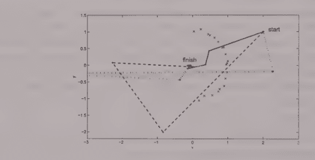

图 4.8：*Chernov-Lesort 程序的三种不同轨迹。*

**示例。** 本章讨论的唯一缺乏上述不变性性质的圆拟合算法是 `Chernov-Lesort`（第 4.10 节；图 4.8 说明了其性能）。20 个点（用十字标记）沿着半圆 `x^2+y^2=1, x >= 0` 随机生成，高斯噪声水平为 `sigma=0.05`。`Chernov-Lesort` 算法从点 `(2,1)` 开始，收敛到目标函数的全局最小值 `(-0.05,-0.01)`。

请注意，起点明显位于逃逸谷中，因此本章中展示的任何其他拟合都会发散到无穷大。只有 `Chernov-Lesort` 拟合在此处收敛到目标函数的最小值。

但每次我们平移或旋转坐标系时，它都会沿着不同的路径到达极限。有一次它直接到达极限（实线）。另一次它 overshoot 并落在 `(-1,-2)` 附近，然后绕路返回极限（虚线）。还有一次它沿负 x 轴跳跃了很远，然后慢慢回来（点线）。迭代次数根据坐标框的选择从 5 变化到 20-25。

尽管我们强调，`Chernov-Lesort` 拟合从任何起点和任何坐标系都收敛到目标函数的最小值。

接下来我们转向具有平移和旋转不变性的算法。

**一般最小化方案的不变性。** 由于我们的大多数算法基于 `Gauss-Newton` 方法及其修改版，让我们一般性地检查不变性问题。首先，所有经典的最小化算法（最速下降、`Newton-Raphson`、`Gauss-Newton`、`Levenberg-Marquardt`）都涉及目标函数的导数，因此它们的迭代在坐标框平移下是不变的。

为了检查在旋转下，或更一般地在线性变换下的不变性，让我们通过 `a = A b` 变换底层空间 `R^k` 中的坐标 `a=(a1,...,ak)`，参见 4.1，其中 `A` 表示任意非奇异矩阵，`b=(b1,...,bk)` 为新坐标。然后根据链式法则

`nabla_b G(A b) = A^T nabla_a G(A b).`

因此，最速下降方向的坐标通过 `(A^T)^-1` 变换，而数据坐标通过 `A` 变换。当且仅当 `A^T = c A^-1`, `c != 0`，即当且仅当 `A` 是正交矩阵的标量倍数时，我们具有所需的不变性。

通过注意到最速下降的方向必须与目标函数的水平面正交，因此线性变换 `A` 必须保持角度，可以直观地得出这个结论。

对于 `Newton-Raphson` 方法，方程 4.2 取以下形式

`D_b = nabla_b G(A b) = A^T D_a`

以及

`H_b = nabla_b^2 G(A b) = A^T H_a A,`

因此，在新坐标 `b` 中，4.4 取以下形式

`A^T D_a + A^T H_a A h_b = 0.`

我们消去 `A^T` 并得出结论 `h_a = A h_b`，即对于任何非奇异矩阵 `A` 都具有所需的不变性。直观上，这个事实很明显，因为该方法基于（目标函数的）二阶近似，这种近似在任何线性变换下都能幸存。

对于 `Gauss-Newton` 方法（第 4.2 节）我们以类似的方式有，

`nabla_{b g_i}(A b) = A^T nabla_{a g_i}(A b),`

因此，方程 4.7 和 4.9 变为如下形式

`D_b = A^T D_a` 以及 `H_b^circ = A^T H_a^circ A`。

接着，4.10 变为如下形式

`A^T D_a + A^T H_a^circ A h_b = 0.`  4.40

消去 `A^T` 得到 `h_a = A h_b`，也就是说，对于任意非奇异矩阵 `A`，我们再次具有不变性。

`Levenberg-Marquardt` 校正（第 4.2 节）用 `(H^circ + lambda I)` 替换矩阵 `H^circ`，因此方程 4.40 变为

`A^T D_a + (A^T H_a^circ A + lambda I) h_b = 0`。

如果 `A` 是一个正交矩阵，那么 `I = A^T A`，我们再次得到 `h_a = A h_b`，即所需的不变性成立。否则，不变性将失效。这并不令人惊讶，因为 `Levenberg-Marquardt` 是 `Gauss-Newton` 和梯度下降法的混合体，而后者仅对正交矩阵 A 具有不变性。

**圆拟合算法的不变性证明。** 基于我们的普遍分析，`Levenberg-Marquardt` 方法在正交变换（特别是平移和旋转）下总是具有不变性的。当我们拟合圆时，可以在 `xy`（数据）平面上平移或旋转坐标系；此时在具有坐标 `(a, b, R)` 的三维参数空间中，我们在 `ab` 平面上平移或旋转坐标系，但保持 `R` 轴固定。因此，我们处理的是 `R^3` 中坐标系的（特定）平移或旋转，正如我们上面所确立的那样，`Levenberg-Marquardt` 算法对此具有不变性。

`Späth` 算法和 `Landau` 算法在 `xy`（数据）平面坐标系的平移和旋转下也具有不变性。事实上，关于平移的不变性是显而易见的，因为这两种算法都要求将原点移动到数据集的质心。

要检查关于旋转的不变性，应当观察到，将坐标系旋转角度 `theta` 会导致每个 `(u_i, v_i)` 向量旋转 `-theta`，参见 4.20–4.21；因此它们的平均向量 `(\tilde{u}, \tilde{v})` 也将旋转 `-theta`。现在从 4.34 和 4.37 中可以清楚地看出，向量 `(a, b)` 将相应地旋转；我们邀请读者将此论证的细节作为练习进行验证。

#### 4.12 已知角度差的情况

在第 4.8 节中，我们使用了角度坐标 `varphi_1, ..., varphi_n`，并将目标函数写为

`F = sum_{i=1}^n (x_i - a - R cos varphi_i)^2 + (y_i - b - R sin varphi_i)^2`  4.41

其中 `varphi_i` 被视为未知量，除了圆的参数 `(a, b, R)` 之外。对 4.41 关于其所有变量进行最小化是 `Späth` 算法的主要思想。

**Berman 模型。** 在某些应用中，连续数据点之间的角度坐标差 `varphi_{i+1}-varphi_i` 是已知的。此信息可用于简化目标函数 4.41，随后模型变为完全线性，从而导出参数估计的显式公式。

事实上，如果我们用以下公式表示已知的差值

`tau_i = varphi_i - varphi_1 = sum_{j=1}^{i-1} (varphi_{j+1} - varphi_j)`

那么我们可以表示为 `varphi_i = varphi + tau_i`，其中 `varphi = varphi_1` 是唯一的未知角度参数。现在，目标函数 4.41 变为如下形式

`F = sum_{i=1}^n (x_i - a - alpha cos tau_i + beta sin tau_i)^2 + (y_i - b - alpha sin tau_i - beta cos tau_i)^2,`  4.42

其中

`alpha = R cos varphi` 以及 `beta = R sin varphi`  4.43

可以被视为临时替代 `R` 和 `varphi` 的辅助参数。

由于 `F` 是其未知数 `a, b, alpha, beta` 的二次函数，模型变为完全线性的。`a, b, alpha, beta` 的估计值可以通过令 `F` 的偏导数为零并求解由此产生的包含 4 个未知数的 4 个方程的线性方程组来轻松找到。由于这些内容是初等的，我们将不提供细节。

最后，半径 `R`（以及基底角 `varphi`，如果需要）可以从方程 4.43 中求出。无需复杂的迭代方案。该模型由 `Berman` [15] 在 1983 年提出并求解。

**Berman 模型的应用。** `Berman` [15] 指出了两个角度差确实已知的特定应用：

- 1. 微波工程中阻抗测量装置的校准；
- 2. 英国巨石遗址的分析，其中考古学家需要拟合圆圈到石环上。

许多不同的例子都具有这一重要特征，这很有趣。

`Berman, Griffiths` 和 `Somlo` [15, 19, 20] 对具有已知角度差的模型的结果参数估计进行了详细的统计分析。

**进一步扩展。** 最近，`Yin` 和 `Wang` [194] 将异方差错误纳入 `Berman` 模型；他们假设 `x` 和 `y` 方向上的扰动具有不同的（且未知的）方差。这种类型的数据也出现在微波工程中。

`Wang` 和 `Lam` [188] 将 `Berman` 模型扩展到同时拟合多个圆，其中检验多个圆形物体是否具有相同大小的假设。此类问题出现在制造机械零件的质量控制中。

似乎已知角度差的情况并不像看起来那样罕见，但它仍然是通用圆拟合问题的一个特例。

## 第 5 章

### 代数圆拟合

- 5.1 简单代数拟合（`Kåsa` 方法） ... 100
- 5.2 `Kåsa` 方法的优点 ... 101


## 5.3 Kåsa 方法的缺点 ... 104

## 5.4 Chernov-Ososkov 修正 ... 107

## 5.5 Pratt 圆拟合 ... 109

## 5.6 Pratt 拟合的实现 ... 111

## 5.7 Pratt 算法的优点 ... 114

## 5.8 实验测试 ... 117

## 5.9 Taubin 圆拟合 ... 121

## 5.10 Taubin 拟合的实现 ... 124

## 5.11 通用代数圆拟合 ... 127

## 5.12 一个真实数据示例 ... 130

## 5.13 迭代方案的初始化 ... 132

回顾一下，我们将解决圆拟合问题的所有实际方案分为两大组：(A) 几何拟合，它最小化数据点到圆的几何（正交）距离；以及 (B) 代数拟合，它最小化其他一些主要是代数的表达式，参见第 4 章的前言。这里我们处理 B 类方法。

为什么 B 类方法值得关注？

首先，几何拟合（即 A 类方法）是迭代的，它们需要在开始工作前提供初始猜测；其性能极大地依赖于初始猜测的准确性。代数拟合是非迭代的、经济实惠的过程，能够提供良好的初始猜测。

其次，某些应用以大规模数据处理为特征（例如，在高能物理中，来自加速器的数百万个圆形粒子轨迹需要被处理）。在这种条件下，人们很少能承受缓慢的迭代几何拟合，因此非迭代的代数拟合可能成为唯一的选择。

最后但同样重要的是，设计良好的代数拟合（如本章描述的 Taubin 和 Pratt 算法）在统计上似乎与几何拟合具有近乎相同的精度（这将在第 7 章的详细误差分析中得到证实）。在许多应用中，良好的代数拟合就能完成出色的工作，随后的几何拟合不会带来明显的改进。

### 5.1 简单代数拟合（Kåsa 方法）

解决圆拟合问题最简单且最显而易见的方法是最小化

\mathscr{F}_1(a, b, R) = \sum_{i=1}^{n} \left[ (x_i - a)^2 + (y_i - b)^2 - R^2 \right]^2. \quad \quad \quad \quad (5.1)

换句话说，我们正在最小化 `\mathscr{F}_1 = \sum f_i^2`，其中

`f_i = (x_i - a)^2 + (y_i - b)^2 - R^2`. \quad \quad \quad \quad (5.2)

显然，当且仅当点 `(x_i, y_i)` 位于圆上时，`f_i = 0`；同样，当且仅当点位于圆附近时，`f_i` 很小。因此，最小化 (5.1) 听起来是一个合理的想法。一些作者 [62, 67, 150] 称 `f_i` 为点 `(x_i, y_i)` 到圆 `(x - a)^2 + (y - b)^2 + R^2 = 0` 的*代数距离*。

目标函数 (5.1) 的导数关于 `a, b, R` 是非线性的，但简单的参数变换使它们变为线性的。令

`B = -2a`, \quad \quad `C = -2b`, \quad \quad `D = a^2 + b^2 - R^2`. \quad \quad \quad \quad (5.3)

然后我们得到

`\mathscr{F}_1 = \sum_{i=1}^{n} (z_i + Bx_i + Cy_i + D)^2` \quad \quad \quad \quad (5.4)

为了简洁，我们也记 `z_i = x_i^2 + y_i^2`。

现在，对 `\mathscr{F}_1` 关于 `B, C, D` 求导得到一组*线性*方程

\begin{array}{rrcl} \overline{x x}B + \overline{x y}C + \overline{x}D &=& -\overline{x z} \\ \overline{x y}B + \overline{y y}C + \overline{y}D &=& -\overline{y z} \\ \overline{x}B + \overline{y}C + D &=& -\overline{z}, \end{array} \quad \quad \quad \quad (5.5)

其中我们再次使用“样本均值”记号

`\overline{x x} = \frac{1}{n} \sum x_i^2`, \quad \quad `\overline{x y} = \frac{1}{n} \sum x_i y_i`, \quad \text{等等}

### KÅSA方法的优势

使用某些线性代数方法（例如，见下文）求解该方程组可得到 `B, C, D`，最后通过以下公式计算 `a, b, R`：

$$a = -\frac{B}{2}, \qquad b = -\frac{C}{2}, \qquad R = \frac{\sqrt{B^2 + C^2 - 4D}}{2}. \tag{5.6}$$

该算法速度极快，如果直接求解 (5.5)，则只需 `13n+35` 次浮点运算（flops）即可完成。实际上，其成本甚至低于高斯-牛顿法或莱文伯格-马夸尔特方法的一次迭代（第4章）。然而，我们注意到，直接求解 (5.5) 并非最佳选择；方程组 (5.5) 类似于已知会导致数值不稳定的正规方程；稳定的解法将在下一节中描述。

上述代数拟合方法最早于1970年代初由 Delogne [54] 和 Kåsa [108] 提出，随后被许多作者独立重新发现并发表 [11, 24, 25, 36, 51, 53, 125, 129, 136, 170, 180, 193, 197]。如今它被称为 Delogne-Kåsa 方法（见 [196]）或简称 Kåsa 方法（见 [52, 159, 184]），以最早的贡献者命名。（似乎大多数作者更倾向于使用简称“Kåsa 方法”，因此我们也遵循这一传统。）

Kåsa 算法的简洁性和高效性是非常吸引人的特性。许多研究者一见钟情。该方法在计算机科学界非常流行，以至于我们感到有义务在此处呈现其详细分析。尽管它并非我们首选的方法，但我们仍将系统地指出其优缺点。

### 5.2 Kåsa方法的优势

使用 Kåsa 算法实际上有许多好处。

首先，如果点 `(x_i, y_i)` 恰好位于圆上，该方法能立即找到该圆。（相比之下，几何拟合最多只能迭代收敛到该圆。）

从统计学角度而言，在小噪声极限 `\sigma \rightarrow 0`（引入于我们在第2.5节的讨论）下，Kåsa 方法是一致的，即参数 `(a, b, R)` 的估计值在 `\sigma \rightarrow 0` 时收敛到其真实值。事实上，在该极限下，Kåsa 拟合在首要阶意义上是渐近高效的（最优的）；见第7章。

**几何描述。** 其次，Kåsa 方法可以通过多种方式从几何上定义。例如，观察 `\pi f_i`，其中 `f_i` 由 (5.2) 给出，它是两个同心圆*面积*之差，这两个圆都以 `(a, b)` 为中心：一个半径为 `R`，另一个经过观测点 `(x_i, y_i)`，即半径为 `r_i = \sqrt{(x_i - a)^2 + (y_i - b)^2}`。换言之，`\pi f_i` 是拟合圆与观测点之间环状的面积。因此，Kåsa 方法最小化此类环状的总面积；这一有趣的事实在 [180] 中被指出。

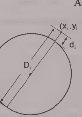

图 5.1 从 `(x_i, y_i)` 到圆上*最近点*的距离 `d_i` 和到*最远点*的距离 `D_i`。

另一种几何定义，见 [51]，源于展开式

$$f_i = (r_i - R)(r_i + R), \quad r_i = \sqrt{(x_i - a)^2 + (y_i - b)^2}. \tag{5.7}$$

这里第一个因子 `d_i = r_i - R` 是 `(x_i, y_i)` 到圆 `(a, b, R)` 上*最近点*的距离，而第二个因子 `D_i = r_i + R` 是 `(x_i, y_i)` 到圆上*最远点*的距离。因此，Kåsa 方法最小化

$$\mathscr{F}_1 = \sum_{i=1}^{n} d_i^2 D_i^2. \tag{5.8}$$

**弦法。** Kåsa 拟合也与 [184, 193] 中提出的*弦法*相关。虽然该方法在实际中效率不高，但由于其与 Kåsa 拟合的关联，值得提及。

观察到，如果任意两个点 `P_i = (x_i, y_i)` 和 `P_j = (x_j, y_j)` 位于拟合圆上，则弦 `P_iP_j` 的垂直平分线 `L_{ij}` 通过其圆心，见图 5.2。因此，可以通过最小化以下式子来找到最佳圆心 `(a, b)`：

$$\mathscr{F}_{ch} = \sum_{1 \le i < j \le n} w_{ij} D_{ij}^2,$$

其中 `D_{ij}` 表示 `(a, b)` 到平分线 `L_{ij}` 的距离，`w_{ij}` 是某种权重，见下文。

通过初等几何学可知，`\mathscr{F}_{ch}` 是 `a` 和 `b` 的二次函数：

$$\mathscr{F}_{ch} = \sum_{1 \le i < j \le n} w_{ij} \frac{[(a(x_i - x_j) + b(y_i - y_j) - \frac{1}{2}(x_i^2 - x_j^2 + y_i^2 - y_j^2)]^2}{(x_i - x_j)^2 + (y_i - y_j)^2}, \tag{5.9}$$

因此，只要指定了 `w_{ij}`，就可以很容易地将其最小化。`w_{ij}` 的选择基于以下考虑。对于较短的弦 `P_iP_j`，距离 `D_{ij}`

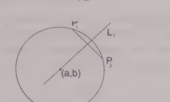

图 5.2 弦 `P_iP_j` 的垂直平分线 `L_{ij}` 通过圆心 `(a,b)`。

可靠性较低，因此其影响应被抑制。Umbach 和 Jones [184] 提出权重与弦长的平方成正比：

$$w_{ij}=\left|P_iP_j\right|^2=\left(x_i-x_j\right)^2+\left(y_i-y_j\right)^2.\tag{5.10}$$

这种 `w_{ij}` 的选择巧妙地消除了 (5.9) 中的分母，使计算更加简单。当然，一般来说，弦法非常不实用：因为有 `n(n-1)/2` 条连接 `n` 个数据点的弦，该方法需要 `\mathcal{O}(n^2)` 次浮点运算，而所有传统的圆拟合都需要 `\mathcal{O}(n)` 次浮点运算。

在定义 (5.10) 的权重下，弦法恰好等价于 Kåsa 算法，它们产生相同的圆心 `(a,b)`；这一显著关系由 Umbach 和 Jones [184] 指出并验证。

**平移和旋转不变性。** 我们现在看到，Kåsa 方法可以从几何上定义（实际上，如上述，有三种不同的方式）。这一事实意味着所得拟合对平移和旋转具有不变性，这是任何曲线拟合算法都非常重要的特征，参见第 4.11 节。因此，不失一般性，我们可以将数据集中心化以确保 `\bar{x}=\bar{y}=0`，并旋转坐标轴以确保 `\overline{xy}=0`（这将使方程组 (5.5) 对角化）。

**存在性和唯一性。** 接下来，我们研究 Kåsa 拟合 (5.1) 的存在性和唯一性。方程组 (5.5) 的系数矩阵是 `\mathbf{X}^T\mathbf{X}`，其中

$$\mathbf{X}=\begin{bmatrix}x_1&y_1&1\\\ddots&\ddots&\ddots\\x_n&y_n&1\end{bmatrix}\tag{5.11}$$

是 `n \times 3` 的“数据矩阵”，因此方程组 (5.5) 总是半正定的。

当且仅当存在非零向量 `\mathbf{u}=(p,q,r)` 使得 `\mathbf{X}\mathbf{u}=\mathbf{0}` 时，它是奇异的，即对所有 `i` 都有 `px_i+qy_i+r=0`。这恰好意味着数据点 `(x_i,y_i)` 共线。因此，除非数据共线，Kåsa 方程组 (5.5) 是正定的，并且具有唯一解。

在共线情况下，Kåsa 方法有多个解，见下文。

**实现。** 实际上，可以使用 Cholesky 分解求解 (5.5)；这可能是最有效的方式，但如果 **X** 接近奇异，可能会导致不必要的舍入误差。数值上稳定（尽管成本稍高）的方法是重写 (5.5) 为

$$ \mathbf{X}^{T} \mathbf{X A} = -\mathbf{X}^{T} \mathbf{Z} \tag{5.12} $$

其中 `\mathbf{A}=(B, C, D)^{T}` 表示参数向量，`\mathbf{Z}=(z_{1},\ldots, z_{n})^{T}`。然后 (5.12) 的解为

$$ \mathbf{A}=-\mathbf{X}^{-}\mathbf{Z} $$

其中 `\mathbf{X}^{-}` 表示 Moore-Penrose 伪逆，可以通过矩阵 **X** 的 QR 分解或 SVD 计算（详见第 4.2 节第二个注记中的细节）。SVD 解法在奇异情况（即 `\det\mathbf{X}^{T}\mathbf{X}=0`）下也能顺利工作。

**多解性。** 在奇异情况（共线数据）下，方程组 (5.5)，即 (5.12)，有多个解。事实上，我们可以旋转和移动坐标框架，使得 `y_{1}=\cdots=y_{n}=0` 以及 `\bar{x}=0`。此时可以容易地看出，方程组 (5.5) 唯一确定了 `a` 和 `R`，但 `b` 未被约束。基于 SVD 的算法应返回所谓的“最小范数”解。

然而，Nievergelt [137] 指出，在共线数据情况下，SVD 解*不再*对平移具有不变性。他提出了一些修改方法以强制不变性；更多细节见 [137]。

**平方根问题。** 最后，注意在任意情况（奇异或非奇异）下，我们都有

$$ B^{2}+C^{2}-4 D \geq 0 \tag{5.13} $$

因此 (5.6) 中半径 `R` 的求值不会遇到复数。事实上，通过平移坐标框架，我们可以确保 `\bar{x}=\bar{y}=0`，因此 (5.5) 中的第三个方程意味着 `D=-\bar{z} \leq 0`，所以 (5.13) 成立。

#### 5.3 Kåsa方法的缺点

**存在严重偏差的实验证据。** 现在我们来考察 Kåsa 方法的实际性能。图 5.3 展示了四个每组 20 个随机点的样本；它们沿单位圆 `x^{2}+y^{2}=1` 的不同线段生成：(a) 整圆，(b) 半圆，(c) 四分之一圆，以及 (d) 八分之一圆。每种情况都添加了 `\sigma=0.05` 的高斯噪声。

图 5.3 表明，当数据沿整圆采样时，Kåsa 拟合与几何拟合实际上相同。当数据沿半圆采样时，它返回的圆比几何拟合稍小。当数据限制在 `90^{\circ}` 弧内时，Kåsa 圆比最佳圆明显小。当数据沿 `45^{\circ}` 弧聚集时，Kåsa

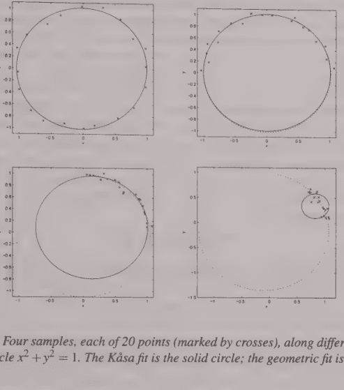

该方法返回一个严重缩小的圆，而几何拟合仍然相当准确。在更小的弧上，Kåsa 方法几乎失效（参见图 5.4 中一个相当极端的例子，以及第 5.7 节中更全面的数值实验）。

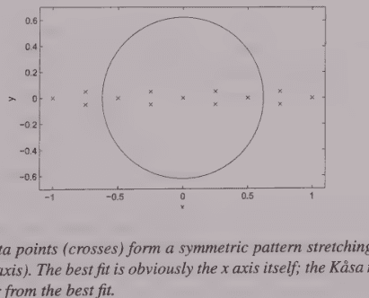

##### 重度偏差的理论分析。

不幸的是，这是一个普遍事实：当数据点局限于相对较小的弧时，Kåsa 方法会显著低估半径，并严重偏向于较小的圆；这种倾向已被许多作者注意到并记录在案，参见 [18, 45, 43, 42, 53, 67, 82, 137, 150, 159] 以及我们的第 5.7 节。

Kåsa 拟合这一缺陷的原因可以从 (5.8) 推导出来。该方法最小化最小距离 `d_i` 与最大距离 `D_i` 乘积（的平方）的平均值。减小圆的尺寸可能会增加 `d_i` 但减少 `D_i`，因此 `\mathscr{F}_1` 的最小值可能出现在一个并不一定最小化 `d_i` 的圆上，而是找到了 `d_i` 和 `D_i` 之间的最佳权衡。

为了进行更详细的分析，观察到 `D_i = d_i + 2R`，因此 Kåsa 拟合最小化

$$\mathscr{F}_1 = \sum_{i=1}^{n} d_i^2 (d_i + 2R)^2. \tag{5.14}$$

现在，如果数据点接近圆，则我们有 `|d_i| \ll R`，并且

$$\mathscr{F}_1 \approx 4R^2 \sum_{i=1}^{n} d_i^2. \tag{5.15}$$

假设数据是沿着长度 `L`（对应小角度 `\alpha = L/R`）的弧采样的。令 `(a, b, R)` 表示真实圆的参数，则 `\mathscr{F}_1(a, b, R) \approx 4R^2n\sigma^2`。如果将弧半径缩小 2 倍，参见图 5.5，则弧将偏移 `\sim L^2/R`，因此数据点与新弧的距离将是 `\sigma + L^2/R` 量级；因此，`\mathscr{F}_1` 的新值将为

$$\mathscr{F}_1 \approx 4(R/2)^2n(\sigma + L^2/R)^2.$$

只要 `\sigma > L^2/R = \alpha L`，算法将倾向于半径较小的新圆 `R/2`。因此，每当 `\sigma R > L^2` 时，Kåsa 方法就会遭受重大误差或失效。

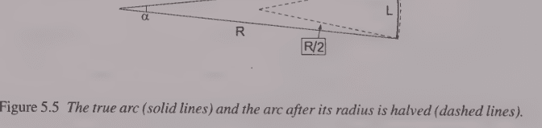

##### 结论。

总结来说，Kåsa 算法可能是所有已知圆拟合中最简单、最快且最优雅的。每当数据点沿完整圆或至少半个圆采样时，它的表现都非常出色。如果数据点非常接近圆，即当 `\sigma \approx 0` 时，它也能正常工作。

然而，当数据点沿小弧采样时，Kåsa 方法的表现可能会显著恶化，在这种情况下，它倾向于严重低估半径。

### 5.4 Chernov-Ososkov 改进

在 20 世纪 80 年代初，Chernov 和 Ososkov [45] 提出了对 Kåsa 拟合的一种改进，以提高其性能。

##### 改进的目标函数。


观察到 (5.15) 中额外的因子 \(4R^2\) 是造成 Kåsa 方法性能受损的原因。Chernov 和 Ososkov [45] 建议通过最小化改进的函数 \(\mathscr{F}_{2} = (2R)^{-2}\mathscr{F}_{1}\) 来消除该因子，即：

\(\mathscr{F}_{2}(a,b,R) = (2R)^{-2}\sum_{i=1}^{n} [ (x_{i} - a)^{2} + (y_{i} - b)^{2} - R^{2} ]^{2}.\)  (5.16)

这个公式有一些历史背景。它于 1984 年在 [45] 中引入，旨在高能物理中将基本粒子轨道拟合成圆弧。1991 年，Karimäki [106, 107] 使用它并称之为“高精度近似”。1998 年，Kanatani [96] 在圆拟合的统计分析过程中独立推导了它。

接下来，将参数 \(a,b,R\) 更改为 \(B,C,D\)，如 (5.3) 所规定（即与 Kåsa 方法相同），得到

\(\begin{aligned}\mathscr{F}_{2} = & \frac{1}{B^{2}+C^{2}-4D}\sum_{i=1}^{n}(z_{i}+Bx_{i}+Cy_{i}+D)^{2} \\ & = \frac{\bar{z}\bar{z}+2B\overline{xx}+2C\overline{yy}+2D\bar{z}+B^{2}\bar{xx}+C^{2}\bar{yy}+2BC\overline{xy}+D^{2}}{B^{2}+C^{2}-4D} .\end{aligned}\)  (5.17)

在此，为了简化上述公式，我们假设数据集已经中心化，使得 \(\bar{x} = \bar{y} = 0\)（否则分子将包含两个额外项：\( +2BD\bar{x} + 2CD\bar{y}\)）。

### 简化为四次方程

观察到 \(\mathscr{F}_{2}\) 是未知参数的二次有理函数。Chernov 和 Ososkov [45] 令其导数为零，从所得方程中消去 \(B\) 和 \(C\)，并得到 \(D\) 的四次多项式方程（即 *四次* 方程）：

\(D^{4} + a_{3}D^{3} + a_{2}D^{2} + a_{1}D + a_{0} = 0,\)  (5.18)

其中

\(\begin{aligned}a_{3} & = 4\bar{z} \\a_{2} & = 3\overline{xx}^{2} + 3\overline{yy}^{2} + 10\overline{xx}\overline{yy} - 4\overline{xy}^{2} - \bar{z}\bar{z} \\a_{1} & = 2\overline{xx}^{2} + 2\overline{yy}^{2} - 4\bar{z}\bar{z} \left(\overline{xx} + \overline{yy}\right) \\a_{0} & = 2\overline{xx}^{2}\left(\overline{xx} + 3\overline{yy}\right) + 2\overline{yy}^{2}\left(3\overline{xx} + \overline{yy}\right) - 8\bar{z}\bar{z}\overline{xx}\overline{xy} - \bar{z}\bar{z}\left(a_{2} + \bar{z}\bar{z}\right)\end{aligned}\)  (5.19)

### 基于牛顿法求解四次方程

方程 (5.18) 最多可能有四个不同的实根，这些根不易计算。然而，Chernov 和 Ososkov [45] 注意到，如果将 $D = -\bar{z}$（这是 Kåsa 方法提供的值）设为初始猜测，并对 (5.18) 应用标准的牛顿过程，则后者总是收敛到对应于 (5.17) 最小值的根。

此外，收敛速度很快：平均需要 3 到 5 次迭代才能找到所需的根（容差设为 $10^{-12}$）。不过，重要的是，必须使用双精度算术来求解 (5.18)，因为单精度舍入误差往往会破坏最终估计的精度。

然而，Chernov 和 Ososkov [45] 没有提供对其改进的理论分析；特别是，他们既没有证明上述牛顿过程总是收敛到 (5.18) 的一个根，也没有证明找到的根总是对应于 (5.16) 的最小值。这些事实直到 2005 年由 Chernov 和 Lesort [43] 基于下一节讨论的 Pratt 圆拟合理论才得到证明。

### 在高能物理中的应用

Chernov-Ososkov 改进在处理近奇异情况时，即当数据点沿小弧采样时，比原始 Kåsa 方法表现出更强的鲁棒性（我们将在第 5.7 节中提供实验证据）。

此改进旨在用于高能物理实验，并在多个核研究中心使用了多年。在这些实验中，人们处理的是在加速器中产生的基本粒子，它们在探测器腔室（如气泡室）中的恒定磁场中沿圆弧运动；物理学家通过测量粒子轨迹的半径来确定其能量；速度更快的粒子沿半径更大（曲率较低）的弧运动，因此这些实验中经常发生近奇异的圆拟合。

### 缺点

Chernov-Ososkov 改进的一个缺点是其代数公式 (5.17)–(5.19) 的复杂性，编程起来并不容易。此外，直到 2005 年之前，缺乏理论分析也令人沮丧。

这些问题在 20 世纪 80 年代末得到解决，当时 Pratt（独立于 Chernov 和 Ososkov）提出了另一种代数圆拟合 [150]，在下节中描述。Pratt 拟合在数学上等同于 Chernov-Ososkov 方法，但它允许更简单、更优雅且数值稳定的编程实现；它在理论上也容易分析得多。

### Pratt 的改进目标函数

我们回到第 3.2 节引入的参数 $A,B,C,D$，即我们用代数方程描述圆：

$$A(x^2 + y^2) + Bx + Cy + D = 0, \qquad\qquad\qquad\qquad\qquad\qquad\qquad\qquad\qquad\qquad\qquad\qquad (5.20)$$

如 (3.8) 中所做的那样。现在，(5.17) 中的函数 $\mathscr{F}_2$ 可以重写为

$$\mathscr{F}_2 = \frac{1}{B^2 + C^2 - 4AD} \sum_{i=1}^n (Az_i + Bx_i + Cy_i + D)^2 \qquad\qquad\qquad (5.21)$$

（确实，如果我们用标量乘以向量 $(A,B,C,D)$，其值不变，因此始终可以使 $A=1$ 并恢复 (5.17)）。

### 约束最小化

回想一下，只要四元组 $(A,B,C,D)$ 表示一个圆，就有 $B^2 + C^2 - 4AD > 0$（第 3.2 节）。因此，(5.21) 在 $A,B,C,D$ 上的最小化等同于在以下约束条件下最小化更简单的函数：

$$\mathscr{F}_3(A,B,C,D) = \sum_{i=1}^n (Az_i + Bx_i + Cy_i + D)^2 \qquad\qquad\qquad\qquad\qquad\qquad\qquad\qquad\qquad\qquad (5.22)$$

约束条件为

$$B^2 + C^2 - 4AD = 1, \qquad\qquad\qquad\qquad\qquad\qquad\qquad\qquad\qquad\qquad\qquad\qquad\qquad\qquad\qquad\qquad\qquad\qquad\qquad\qquad\qquad\qquad\qquad\qquad\qquad\qquad\qquad\qquad\qquad\qquad\qquad\qquad (5.23)$$

顺便提一下，我们已经在 (3.10) 中遇到过这个约束。在此约束下，方程 (5.20) 描述了 $xy$ 平面中的所有圆和直线，参见第 3.2 节。因此，Pratt 算法方便地将直线纳入其最佳拟合的选择中（ unlike Kåsa 和 Chernov–Ososkov 方法，它们只能返回圆）。

### 简化为特征值问题

为了解决最小化问题 (5.22)–(5.23)，Pratt [150] 采用了线性代数方法。函数 (5.22) 可以写成矩阵形式：

$$\mathscr{F}_3 = \|\mathbf{X}\mathbf{A}\|^2 = \mathbf{A}^T (\mathbf{X}^T \mathbf{X}) \mathbf{A}, \qquad\qquad\qquad\qquad\qquad\qquad\qquad\qquad\qquad\qquad\qquad\qquad\qquad\qquad\qquad\qquad\qquad\qquad\qquad\qquad\qquad\qquad\qquad\qquad\qquad\qquad\qquad\qquad\qquad (5.24)$$

其中 $\mathbf{A} = (A,B,C,D)^T$ 是参数向量，且

$$\mathbf{X} = \begin{bmatrix} z_1 & x_1 & y_1 & 1 \\ \vdots & \vdots & \vdots & \vdots \\ z_n & x_n & y_n & 1 \end{bmatrix} \qquad\qquad\qquad\qquad\qquad\qquad\qquad\qquad\qquad\qquad\qquad\qquad\qquad\qquad\qquad\qquad\qquad\qquad\qquad\qquad\qquad\qquad\qquad\qquad\qquad\qquad\qquad\qquad\qquad\qquad\qquad\qquad\qquad\qquad\qquad (5.25)$$

是 $n \times 4$ 的“扩展数据矩阵”（注意它与 (5.11) 不同）。约束 (5.23) 可以写为

$$\mathbf{A}^T \mathbf{B} \mathbf{A} = 1, \qquad\qquad\qquad\qquad\qquad\qquad\qquad\qquad\qquad\qquad\qquad\qquad\qquad\qquad\qquad\qquad\qquad\qquad\qquad\qquad\qquad\qquad\qquad\qquad\qquad\qquad\qquad\qquad\qquad\qquad\qquad\qquad\qquad\qquad\qquad\qquad\qquad\qquad (5.26)$$

其中

$\mathbf{B} = \begin{bmatrix} 0 & 0 & 0 & -2 \\ 0 & 1 & 0 & 0 \\ 0 & 0 & 1 & 0 \\ -2 & 0 & 0 & 0 \end{bmatrix} . \quad (5.27)$

现在引入拉格朗日乘数 $\eta$，我们最小化函数

$\mathscr{G}(\mathbf{A}, \eta) = \mathbf{A}^{T} (\mathbf{X}^{T} \mathbf{X}) \mathbf{A} - \eta (\mathbf{A}^{T} \mathbf{B} \mathbf{A} - 1) .$

对 $\mathbf{A}$ 求导得到一阶必要条件

$(\mathbf{X}^{T} \mathbf{X}) \mathbf{A} - \eta \mathbf{B} \mathbf{A} = \mathbf{0}, \quad (5.28)$

因此 $\mathbf{A}$ 必须是矩阵对 $\left(\mathbf{X}^{T} \mathbf{X}, \mathbf{B}\right)$ 的一个广义特征向量。由于矩阵 $\mathbf{B}$ 是可逆的，我们可以将 (5.28) 改写为

$\mathbf{B}^{-1} (\mathbf{X}^{T} \mathbf{X}) \mathbf{A} - \eta \mathbf{A} = \mathbf{0}, \quad (5.29)$

因此 $\eta$ 是矩阵 $\mathbf{B}^{-1} (\mathbf{X}^{T} \mathbf{X})$ 的一个特征值，而 $\mathbf{A}$ 是其一个特征向量。

### 特征值问题的分析

让我们考察 $\mathbf{B}^{-1} (\mathbf{X}^{T} \mathbf{X})$ 的特征系统。矩阵 $\mathbf{X}^{T} \mathbf{X}$ 是半正定的，并且在一般情况下它是正定的（奇异情况将在下文讨论）。另一个矩阵 $\mathbf{B}^{-1}$ 是对称的，具有四个实特征值，其中一个为负，其余三个为正（其谱为 $\{1, 1, 0.5, -0.5\}$）。用 $\mathbf{Y} = (\mathbf{X}^{T} \mathbf{X})^{1/2}$ 左乘 (5.29) 将其转化为

$\mathbf{Y} \mathbf{B}^{-1} \mathbf{Y} (\mathbf{Y} \mathbf{A}) - \eta (\mathbf{Y} \mathbf{A}) = \mathbf{0},$

因此 $\eta$ 是 $\mathbf{Y} \mathbf{B}^{-1} \mathbf{Y}$ 的特征值；还要注意 $\mathbf{Y} = \mathbf{Y}^{T}$。因此，根据 Sylvester 惯性定律 $[78]$，矩阵 $\mathbf{B}^{-1} (\mathbf{X}^{T} \mathbf{X})$ 具有与 $\mathbf{B}^{-1}$ 相同的符号差，即 $\mathbf{B}^{-1} (\mathbf{X}^{T} \mathbf{X})$ 的特征值全部为实数，其中恰好有三个为正，一个为负。

我们注意到，负特征值 $\eta < 0$ 对应于满足 $\mathbf{A}^{T} \mathbf{B} \mathbf{A} < 0$ 的特征向量 $\mathbf{A}$（根据 (5.28)），因此它不代表任何（实数）圆或直线。三个正特征值对应实圆（或直线）。

但哪一对特征值 $(\eta, \mathbf{A})$ 能解决我们的问题，即使得 $\mathscr{F}_{3}$ 最小呢？嗯，请注意

$\mathscr{F}_{3} = \mathbf{A}^{T} (\mathbf{X}^{T} \mathbf{X}) \mathbf{A} = \eta \mathbf{A}^{T} \mathbf{B} \mathbf{A} = \eta$

（由于约束条件 (5.26)），因此当 $\eta$ 是矩阵 $\mathbf{B}^{-1} (\mathbf{X}^{T} \mathbf{X})$ 的*最小正*特征值时，函数 $\mathscr{F}_{3}$ 达到最小值。

另外两个较大的正特征值显然对应于函数 $\mathscr{F}_{3}$ 的鞍点，因此它们没有实际意义。

### 特征值问题的奇异情况

最后我们讨论奇异情况。矩阵 $\mathbf{X}^{T}\mathbf{X}$ 是奇异的，当且仅当存在非零向量 $\mathbf{A}_{0} = (A, B, C, D)$ 使得 $\mathbf{X}\mathbf{A}_{0} = \mathbf{0}$，即

$A(x_{i}^{2} + y_{i}^{2}) + Bx_{i} + Cy_{i} + D = 0$

对所有 $i = 1, ..., n$ 成立。这精确意味着数据点 $(x_{i}, y_{i})$ 要么位于圆上（如果 $A \neq 0$），要么位于直线上（如果 $A = 0$）。在这两种情况下，$\eta = 0$ 都是矩阵 $\mathbf{B}^{-1}(\mathbf{X}^{T}\mathbf{X})$ 的特征值，对应的特征向量是 $\mathbf{A}_{0}$，且

$\mathscr{F}_{3}(\mathbf{A}_{0}) = \|\mathbf{X}\mathbf{A}_{0}\|^{2} = 0,$

因此 $\mathbf{A}_{0}$ 使 $\mathscr{F}_{3}$ 最小化。实际上它提供了完美的拟合。

### 结论

Pratt 圆拟合由矩阵 $\mathbf{B}^{-1}(\mathbf{X}^{T}\mathbf{X})$ 对应于其最小非负特征值 $\eta \geq 0$ 的特征向量 $\mathbf{A} = (A, B, C, D)$ 给出。如果 $\mathbf{X}$ 具有满秩（一般情况），则也可以通过 $\mathbf{A} = \mathbf{Y}^{-1}\mathbf{A}_{*}$ 找到 $\mathbf{A}$，其中 $\mathbf{Y} = (\mathbf{X}^{T}\mathbf{X})^{1/2}$，而 $\mathbf{A}_{*}$ 是对称矩阵 $\mathbf{Y}\mathbf{B}^{-1}\mathbf{Y}$ 对应于其最小正特征值 $\eta > 0$ 的特征向量（顺便一提：$\mathbf{B}^{-1}(\mathbf{X}^{T}\mathbf{X})$ 有三个正特征值和一个负特征值）。

## 5.6 Pratt 拟合的实现

前一节中的分析唯一确定了矩阵 $\mathbf{B}^{-1}(\mathbf{X}^{T}\mathbf{X})$ 提供 Pratt 拟合的特征值对 $(\eta, \mathbf{A})$，但我们还需要一种实用的算法来计算它。这里我们描述了两种这样的算法；每一种都有其自身的优点。

### 基于 SVD 的 Pratt 拟合

如果使用具有内置矩阵代数运算的软件（如 MATLAB），人们可能会倾向于调用返回 $\mathbf{B}^{-1}(\mathbf{X}^{T}\mathbf{X})$ 特征值对例程，并选择对应于最小非负特征值的特征向量 $\mathbf{A}$。这承诺了一个简单但并非最快的解决方案。


然而，这个解决方案在数值上是不稳定的。原因之一是矩阵 $\mathbf{X}^{T}\mathbf{X}$ 的条件数是 $\mathbf{X}$ 的条件数的平方，即 $\varkappa(\mathbf{X}^{T}\mathbf{X}) = [\varkappa(\mathbf{X})]^{2}$；因此，如果 $\mathbf{X}^{T}\mathbf{X}$ 恰好接近奇异，组装并使用 $\mathbf{X}^{T}\mathbf{X}$ 可能会导致舍入误差的爆发。其次，我们观察到某些情况下，$\mathbf{B}^{-1}(\mathbf{X}^{T}\mathbf{X})$ 的数值计算特征值结果变成了复数，尽管理论上它们都必须为实数。

通过奇异值分解 (SVD) 可以实现更稳定的矩阵解。首先，我们计算矩阵 $\mathbf{X}$ 的（短）SVD，$\mathbf{X} = \mathbf{U}\mathbf{E}\mathbf{V}^{T}$。如果其最小奇异值 $\sigma_{4}$ 小于预定义的容差 $\varepsilon$（例如，$\varepsilon = 10^{-12}$），那么我们就面临一个奇异情况，解 $\mathbf{A}$ simply 就是对应的右奇异向量，即 $\mathbf{V}$ 矩阵的第四列。

1. 构成矩阵 **X** 并计算其（短）SVD，**X** = UΣ**V**ᵀ。
2. 如果 σ₄ < ε，则 **A** 是 **V** 的第 4 列。停止。
3. 如果 σ₄ ≥ ε，构成矩阵 **Y** = VΣ**V**ᵀ。
4. 计算对称矩阵 **YB**⁻¹**Y** 并找出其特征系统。
5. 选择具有最小正特征值 η 的特征值对 (η, **A***)。
6. 计算 **A** = **Y**⁻¹**A** *。

表 5.1：*Pratt 圆拟合（基于 SVD）。*

在常规情况（σ₄ ≥ ε）下，我们构成 **Y** = VΣ 并找出对称矩阵 **YᵀB**⁻¹**Y** 的特征值对。选择具有最小正特征值的特征值对 (η, **A***) 并计算 **A** = VΣ⁻¹**A** * 即可完成求解。计算矩阵 Σ⁻¹ 很简单——我们只需将其对角分量替换为它们的倒数。

我们称此算法为*基于 SVD 的 Pratt 拟合*。

**基于 Newton 的 Pratt 拟合。** 如果矩阵代数函数不可用，或者如果追求速度而非数值稳定性，可以通过求解特征方程来找到 η

det(XᵀX − ηB) = 0. (5.30)

这是关于 η 的四次多项式方程，我们将其写为 P(η) = 0。事实上，该方程起着与 Chernov-Ososkov 四次方程 (5.18) 相同的作用，这并不奇怪，因为两种方法在数学上是等价的。但 (5.30) 比 (5.18) 更容易分析和求解。展开 (5.30) 得到

P(η) = 4η⁴ + c₂η² + c₁η + c₀ = 0, (5.31)

其中

c₂ = -x̄x̄ - 3x̄x̄² - 3ȳȳ² - 4x̄x̄ȳȳ - 2x̄x̄ȳȳ

c₁ = x̄( x̄x̄ - x̄² ) + 4ȳ( x̄x̄ȳ - x̄ȳ² ) - x̄x̄² - ȳȳ²

c₀ = x̄x̄²ȳȳ + ȳȳ²x̄x̄ - 2x̄x̄ȳȳx̄x̄ - ( x̄x̄ȳȳ - x̄ȳ² )( x̄x̄ - x̄² ), (5.32)

这里我们使用与 (5.18)–(5.19) 相同的记号系统，并再次假设数据集是居中的，即 x̄ = ȳ = 0。值得注意的是，(5.31)–(5.32) 看起来比 (5.18)–(5.19) 更简单且更短。

(5.31) 的实用解基于以下事实。假设矩阵 **XᵀX** 非奇异，即 P(0) ≠ 0。令

η₁ < 0 < η₂ ≤ η₃ ≤ η₄

1. 构造矩阵 **X** 并计算 **X**$^{T}$**X**。
2. 计算特征方程 (5.31) 的系数 (5.32)。
3. 初始化 $\eta = 0$，并应用牛顿法寻找一个根 $\eta$。
4. 计算 **A** 作为 **X**$^{T}$**X** − $\eta$**B** 的零向量。

表 5.2: *普拉特圆拟合（基于牛顿法）。*

设 $\eta_1, \eta_2, \eta_3$ 为 (5.31) 的根。

**定理 9** *在非奇异情况下，我们有 P(0) < 0 且对于所有 0 ≤ $\eta$ ≤ $\eta_2$，P''($\eta$) < 0。因此，以初始猜测 $\eta = 0$ 提供的简单牛顿法总是收敛到 P($\eta$) 的最小正根 $\eta_2$。*

*证明。设 $\eta_1' \le \eta_2' \le \eta_3'$ 为导数 P'($\eta$) 的零点，设 $\eta_1'' < \eta_2''$ 为二阶导数 P''($\eta$) = 48$\eta^2$ + $c_2$ 的零点。注意 (5.31) 中缺少立方项，因此 P''($\eta$) 中没有线性项。由于 $c_2 < 0$，可得 $\eta_1'' < 0 < \eta_2''$。现在根据多项式及其导数根的交错性质，我们可以得出*

$$ \eta_{1}^{\prime} \le \eta_{1}^{\prime\prime} < 0 < \eta_{2} \le \eta_{2}^{\prime} \le \eta_{2}^{\prime\prime}. $$

*这意味着 P(0) < 0，P'(0) > 0，并且 P($\eta$) 在 0 和最小正根 $\eta_2$ 之间的区间内是一个凸函数（意味着 P''($\eta$) < 0）。因此，牛顿法必定收敛，其极限点将是所需的根 $\eta_2$。定理得证。 $\Box$*

在实践中，将容差设置为 $10^{-12}$ 时，牛顿法平均在 3 到 5 次迭代内收敛。一旦找到 (5.31) 的最小正根 $\eta_2$，参数向量 **A** 就被选为 **X**$^{T}$**X** − $\eta$**B** 的零向量，依据 (5.28) 确定。我们将此算法称为*基于牛顿法的*普拉特拟合。

**计算问题。** 我们在 MATLAB 中通过实验确定，上述基于牛顿法的普拉特拟合实现速度与卡萨法（Kåsa method）相当（见表 5.3）。本节前面描述的数值稳定的基于 SVD 的普拉特拟合实现比卡萨法慢约 2 到 3 倍。相比之下，所有几何拟合至少比卡萨法慢 10 倍。

普拉特方法两个版本的 MATLAB 代码（以及许多其他圆拟合）可在我们的网页 [84] 上获取。

| | 卡萨法 | 普拉特法（基于 SVD） | 普拉特法（基于牛顿法） |
|---|---|---|---|
| CPU 时间 | 1 | 2-3 | 1 |
| 统计偏差 | 大 | 小 | 小 |
| 数值稳定性 | N/A | 高 | 低 |

表 5.3: 三种代数圆拟合的比较。

**关于数值稳定性的总体说明。** 如今，在矩阵计算中要求使用数值稳定的过程（如 QR 和 SVD），并避免快速但不稳定的解法（例如，形成“正规方程”是很常见的。然而，在应用统计学中，由于统计问题的性质，数值稳定性的意义被削弱了，因为数值不稳定算法中出现的舍入误差通常远小于由数据中的统计误差导致的不确定性。

对于代数圆拟合，数值稳定性问题仅在相关矩阵接近奇异时才会出现，这发生在两种情况下：(i) 数据点几乎在圆上，即 $\sigma \approx 0$；以及 (ii) 拟合的圆弧几乎是平的，即 $R \approx \infty$。这两种情况都表现为 $\sigma/R$ 的比值很小。

我们实验测试了数值稳定（基于 SVD）的代数圆拟合与其不稳定（基于牛顿法）对应版本的性能，发现它们在所有现实条件下表现几乎相同。它们之间的差异仅在 $\sigma/R \lesssim 10^{-12}$ 时才变得明显，这是一个极其罕见的情况。

即使在那些极端情况下，数值稳定拟合的实用优势也值得怀疑。例如，如果 $R \sim 1$ 且 $\sigma \sim 10^{-12}$，那么稳定拟合确定圆的参数精度在 $\sim 10^{-12}$ 以内，而不稳定拟合的精度在 $10^{-6}$ 以内，后者实际上看起来同样良好。作为另一个极端，设 $\sigma \sim 1$ 且 $R \sim 10^{12}$；在这种情况下，准确估计圆的半径和圆心似乎毫无意义；人们完全可以一样好用直线拟合数据。

在我们的 MATLAB 代码库中，我们为代数圆拟合提供了稳定和不稳定两个版本。

### 5.7 普拉特算法的优势

普拉特圆拟合具有我们在第 5.2 节中描述的卡萨法的所有优点，而且更多！

首先，如果点 $(x_{i}, y_{i})$ 恰好位于圆（或直线）上，该方法会立即找到该圆（或直线）。（请注意，卡萨法在共线数据的情况下会失败。）

用统计术语来说，普拉特法在小噪声极限 $\sigma \to 0$ 下是一致的，即参数 ($a, b, R$) 的估计值随着 $\sigma \to 0$ 收敛到它们的真实值。此外，在该极限下，普拉特拟合是渐近有效（最优）的；参见第 7 章。

**平移和旋转下的不变性。** 接下来，我们验证普拉特拟合在平移和旋转下的不变性。与几何拟合算法（在第 4.11 节中确立）或卡萨法（第 5.2 节）中类似的不变性相比，这一事实不那么明显，因为普拉特过程是代数定义的；因此，我们提供详细的证明，遵循 Taubin [176]。

让我们对数据点坐标应用由向量 ($c, d$) 产生的平移

$$ \mathcal{T}_{c,d} : (x,y) \mapsto (x+c, y+d) $$

那么数据矩阵 **X** 将变换为

$$ \mathbf{X}_{\text{new}}=\begin{bmatrix} (x_{1}+c)^{2}+(y_{1}+d)^{2} & x_{1}+c & y_{1}+d & 1 \\ \ddots & \ddots & \ddots & \ddots \\ (x_{n}+c)^{2}+(y_{n}+d)^{2} & x_{n}+c & y_{n}+d & 1 \end{bmatrix}. $$

我们可以将这种新的数据矩阵表示为

$$ \mathbf{X}_{\text{new}}=\mathbf{X F}, \tag{5.33} $$

其中

$$ \mathbf{F}=\begin{bmatrix} 1 & 0 & 0 & 0 \\ 2c & 1 & 0 & 0 \\ 2d & 0 & 1 & 0 \\ c^{2}+d^{2} & c & d & 1 \end{bmatrix}. \tag{5.34} $$

还请注意

$$ \mathbf{B}=\mathbf{F}^{T}\mathbf{B F} \tag{5.35} $$

因此，在新坐标系中，特征方程 (5.28) 取如下形式

$$ \mathbf{F}^{T}\left(\mathbf{X}^{T}\mathbf{X}\right)\mathbf{F}\mathbf{A}_{\text{new}}-\eta_{\text{new}}\mathbf{F}^{T}\mathbf{B F}\mathbf{A}_{\text{new}}=\mathbf{0} . $$

左侧乘以 $\mathbf{F}^{-T}$ 并与 (5.28) 比较，我们得出结论 $\eta_{\text{new}}=\eta$ 且

$$ \mathbf{A}=\mathbf{F}\mathbf{A}_{\text{new}} . \tag{5.36} $$

事实上，我们只需要 **A** 至多相差一个标量倍数，因此我们可以假设其第一个分量为 $A_1=1$，从而 $\mathbf{A}=(1, -2a, -2b, a^{2}+b^{2}-R^{2})$，并且对 $\mathbf{A}_{\text{new}}$ 也是如此。现在，从 (5.36) 很容易得出结论：

$$ a_{\text{new}}=a+c, \quad b_{\text{new}}=b+d, \quad R_{\text{new}}=R, $$

这意味着普拉特拟合在平移下是不变的。

旋转的分析遵循相同的思路。设坐标由以下变换改变：

$$ R_{\theta}: (x,y) \mapsto (x \cos \theta + y \sin \theta, -x \sin \theta + y \cos \theta) $$

即点旋转了角度 $\theta$。数据矩阵变换为 $\mathbf{X}_{\text{new}} = \mathbf{X} \mathbf{F}$，其中

$$ \mathbf{F} = \begin{bmatrix} 1 & 0 & 0 & 0 \\ 0 & c & -s & 0 \\ 0 & s & c & 0 \\ 0 & 0 & 0 & 1 \end{bmatrix}, \quad (5.37) $$

这里我们使用常用的简写符号 $c = \cos \theta$ 和 $s = \sin \theta$。同样，重要关系式 (5.35) 成立，因此我们再次得到 (5.36)，这很容易推导出：

$$ a_{\text{new}} = a \cos \theta + b \sin \theta, \quad b_{\text{new}} = -a \sin \theta + b \cos \theta, \quad R_{\text{new}} = R $$

意味着普拉特拟合在旋转下是不变的。

**卡萨拟合和普拉特拟合的统一处理。** 我们旧的卡萨法可以等价地描述为最小化普拉特目标函数

$$ \begin{aligned} \mathscr{F}_{3}(A, B, C, D) &= \sum_{i=1}^{n} (Ax_i + Bx_i + Cy_i + D)^2 \\ &= \mathbf{A}^{T} (\mathbf{X}^{T} \mathbf{X}) \mathbf{A} \end{aligned} \quad (5.38) $$

受约束 $|\mathbf{A}|=1$；后者可以写为

$$ \mathbf{A} \mathbf{K} \mathbf{A} = 1 $$

其中矩阵 $\mathbf{K}$ 由下式给出：

$$ \mathbf{K} = \begin{bmatrix} 1 & 0 & 0 & 0 \\ 0 & 0 & 0 & 0 \\ 0 & 0 & 0 & 0 \\ 0 & 0 & 0 & 0 \end{bmatrix} \quad (5.39) $$

将此与 (5.24)–(5.27) 比较可知，普拉特拟合和卡萨拟合仅在于约束矩阵不同；一个使用 $\mathbf{B}$，另一个使用 $\mathbf{K}$；此外，这两种方法在平移、旋转和相似变换下都是不变的。

现在，我们可以考虑最小化相同函数 (5.38) 受约束 $\mathbf{A}^{T} \mathbf{N} \mathbf{A} = 1$ 的一般问题，其中 $\mathbf{N}$ 是任意对称矩阵。检查对于哪些 $\mathbf{N}$， resulting 拟合在平移、旋转和相似变换下不变，这是很有趣的。

**平移的一般不变性。** 我们省略繁琐的细节，直接呈现最终结果。我们的分析表明，只要约束矩阵 **N** 满足 **N** = **F**$^{T}$**NF**，代数拟合就具有平移不变性 $T_{c,d}$，其中矩阵 **F** 由 (5.34) 给出。这种情况当且仅当 **N** 是 **K** 和 **B** 的线性组合时发生，即 **N** = $\alpha$**K** + $\beta$**B**，或者

**N** = $$\begin{bmatrix} \alpha & 0 & 0 & -2\beta \\ 0 & \beta & 0 & 0 \\ 0 & 0 & \beta & 0 \\ -2\beta & 0 & 0 & 0 \end{bmatrix}$$ (5.40)

**旋转的一般不变性。** 接下来，只要约束矩阵 **N** 满足 **N** = **F**$^{T}$**NF**，代数拟合就具有旋转不变性 $R_{\theta}$，但此时矩阵 **F** 由 (5.37) 给出。这种情况当且仅当 **N** 具有如下形式时发生：

**N** = $$\begin{bmatrix} \alpha & 0 & 0 & \gamma \\ 0 & \beta & 0 & 0 \\ 0 & 0 & \beta & 0 \\ \gamma & 0 & 0 & \delta \end{bmatrix}$$ (5.41)

其中 $\alpha, \beta, \gamma, \delta$ 为任意常数。因此，旋转不变性对矩阵的要求略少于平移不变性。

**相似变换的一般不变性。** 最后，考虑具有约束矩阵 **N** 的代数拟合在相似变换 $(x,y) \rightarrow (cx, cy)$ 下的不变性。在这种情况下，参数向量 **A** = $(A,B,C,D)$ 按照以下规则变化：

**A** = $(A,B,C,D) \rightarrow$ **A**$_{c}$ = $(A/c^{2}, B/c, C/c, D)$。

因此，我们需要表达式 $P(c) = $ **A**$_{c}^{T}$**NA**$_{c}$ 关于 $c$ 是一个齐次多项式（即其所有项相对于 $c$ 必须具有相同的次数），以便可以消去 $c$。对于 (5.40) 中的矩阵 **N**，我们有：

$P(c) = $ **A**$_{c}^{T}$**NA**$_{c}$ = $\alpha A^{2}c^{-4} + \beta(B^{2} + C^{2} - 4AD)c^{-2}$。

仅当 $\alpha = 0$（即 Pratt 拟合）或 $\beta = 0$（即 Kása 拟合）时，该表达式关于 $c$ 才是齐次的。

**最终结论。** 唯一在平移、旋转和相似变换下具有不变性的、且带有约束矩阵 **N** 的代数拟合是 Kása 拟合和 Pratt 拟合。我们要强调的是，假设我们的约束矩阵 **N** 是常数；稍后我们将看到依赖于 **X** 的其他约束矩阵。

### 5.8 实验测试

在此，我们展示了三种圆拟合（Kåsa、Pratt 和几何拟合）的实验比较结果。


| | Kåsa | | | Pratt | | | Geometric | | |
| :--- | :--- | :--- | :--- | :--- | :--- | :--- | :--- | :--- | :--- |
| $\alpha$ | $q_1$ | $q_2$ | $q_3$ | $q_1$ | $q_2$ | $q_3$ | $q_1$ | $q_2$ | $q_3$ |
| 360 | 0.995 | 1.002 | 1.010 | 0.997 | 1.005 | 1.012 | 0.994 | 1.001 | 1.009 |
| 300 | 0.994 | 1.002 | 1.010 | 0.997 | 1.005 | 1.012 | 0.994 | 1.001 | 1.009 |
| 240 | 0.991 | 1.001 | 1.011 | 0.994 | 1.004 | 1.015 | 0.991 | 1.001 | 1.011 |
| 180 | 0.976 | 0.993 | 1.010 | 0.987 | 1.004 | 1.022 | 0.984 | 1.001 | 1.019 |
| 120 | 0.908 | 0.943 | 0.981 | 0.962 | 1.003 | 1.047 | 0.960 | 1.001 | 1.046 |
| 90 | 0.778 | 0.828 | 0.883 | 0.927 | 1.000 | 1.087 | 0.928 | 1.001 | 1.088 |
| 60 | 0.449 | 0.502 | 0.561 | 0.833 | 0.990 | 1.224 | 0.840 | 0.999 | 1.237 |
| 45 | 0.263 | 0.297 | 0.340 | 0.715 | 0.967 | 1.501 | 0.735 | 0.996 | 1.547 |
| 30 | 0.166 | 0.176 | 0.190 | 0.421 | 0.694 | 1.433 | 0.482 | 0.804 | 1.701 |

表 5.4 每种算法（Kåsa、Pratt、几何拟合）求得的半径估计值的三个四分位数。真实半径为 $R = 1$。

**实验。** 对于每个 $\alpha = 360^\circ, 350^\circ, \dots, 30^\circ$，我们生成了 $10^6$ 个随机样本，每个样本包含 $n = 20$ 个点，这些点等间距地位于单位圆 $x^2 + y^2 = 1$ 上角度为 $\alpha$ 的圆弧上，并受到水平为 $\sigma = 0.05$ 的高斯噪声污染。我们从完整的圆（$\alpha = 360^\circ$）开始，逐渐减小到较小的圆弧（$\alpha = 30^\circ$）。

对于每个随机样本，我们使用三种方法找到最佳拟合圆：Kåsa、Pratt 和几何拟合（Levenberg-Marquardt）。每种方法给出 $10^6$ 个半径 $R$ 的估计值，我们将这些值排序并记录三个四分位数：$q_1$、$q_2$（中位数）和 $q_3$。这三个特征量大致代表了该方法的整体性能；特别地，区间 $(q_1, q_3)$ 包含了 $50\%$ 的半径估计值。结果汇总在表 5.4 中。

**结果。** 表 5.4 以数值格式给出结果；图 5.6 以图形格式呈现。在每个子图中，顶部曲线是第三四分位数 $q_3$，中间曲线是中位数 $q_2$，底部曲线是第一四分位数 $q_1$。灰色阴影区域涵盖了半径估计值中间 $50\%$ 的部分。

我们可以看到，在所有方法在较大圆弧（范围 $150^\circ \le \alpha \le 360^\circ$）上表现几乎相同。一个显著的特征是向较大圆的轻微偏差（中位数始终略高于真实值 $R = 1$），这一现象将在第 6 章和第 7 章中解释。

在小于 $150^\circ$ 的圆弧上，Kåsa 方法开始下滑，因为它 consistently 低估了半径。这种趋势在 $90^\circ$ 到 $45^\circ$ 之间的圆弧上变得灾难性，因为所有三个四分位数都急剧下降，而对于小于 $45^\circ$ 的圆弧，Kåsa 方法返回了极其小的圆。

Pratt 和几何拟合比 Kåsa 表现更好。随着圆弧减小，它们的误差增大，但其中位数一直到 $60^\circ$（对于 Pratt）甚至 $45^\circ$（对于几何拟合）都保持“准确”。请注意，几何拟合

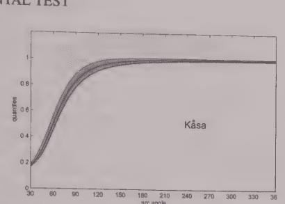

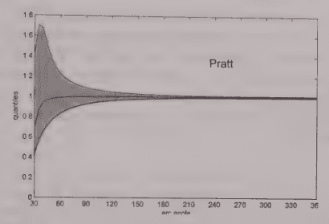


图 5.6 顶部曲线是第三四分位数，中间曲线是中位数，底部曲线是第一四分位数。灰色阴影区域涵盖了半径估计值中间 50% 的部分。

略微优于目前最佳的代数拟合（Pratt）；我们将在第 7 章中回到这个问题。

在 $45^\circ$ 以下，所有中位数迅速下降，在小于 $30^\circ$ 的圆弧上，所有拟合程序都变得相当不可靠。

**失效点。** 所有算法失效的原因如


图 5.7: 圆弧中的矢高 h 和噪声水平 $\sigma$。

图 5.7 所示。这里

$$ h=R(1-\cos \alpha / 2) $$

是一个关键参数，表示圆弧中点到其弦的距离（$h$ 被称为圆弧的“矢高”[90]）。如果噪声水平小于矢高（$\sigma<h$），则圆弧的形状是“明确定义”的 [90]，即可识别的，圆拟合算法有机会成功（且部分确实成功）。另一方面，如果 $\sigma>h$，则噪声完全模糊了圆弧，圆拟合程序 consistently 无法找到它。在我们的实验中，$R=1$ 且 $\sigma=0.05$，因此临界圆弧大小为

$$ \alpha_{\mathrm{cr}}=2 \cos ^{-1}(1-\sigma / R)=36^{\circ} $$

低于此值时所有方法都会崩溃。当然，降低噪声水平 $\sigma$ 将使我们的算法在更小的圆弧上表现良好。一般来说，只要 $\sigma$ 不超过矢高，拟合算法就可以处理任意小的圆弧。

**其他一些代数拟合。** 我们在此仅描述了最流行的代数拟合方案，但有一些其他方案也值得一提。Gander、Golub 和 Strebøl [67] 建议最小化与我们用于 Pratt 和 Kåsa 方法相同的函数 (5.38)，但约束条件更直接，为 $\|\mathbf{A}\|=1$，即：

$$ A^{2}+B^{2}+C^{2}+D^{2}=1 . $$

然而，我们在 5.7 节中的分析表明，由此产生的拟合在平移下不是不变的；事实上，作者 [67] 也承认这在几何上是“不令人满意的”。

Nievergelt [137] 提出了一种相当复杂的代数拟合，但如果仔细检查，发现它等价于最小化相同函数 (5.38)，但受限于：

$$ A^{2}+B^{2}+C^{2}=1 . $$

Nievergelt 认为，与 Kåsa 拟合相比，他的拟合更好地处理某些奇异情况（即共线数据的情况）。Nievergelt 也认识到他的拟合在平移下不是不变的。作为一种补救措施，他使用了一个先验

对数据进行中心化，即平移坐标系以强制 $\bar{x} = \bar{y} = 0$；这一技巧使得最终结果对平移和旋转均保持不变。然而，根据我们的第 5.7 节所述，这两种拟合方法在对合变换（similarities）下均不保持不变，且其作者并未涉及此问题。

Nievergelt 拟合方法是由 Strandlie、Wroldsen 和 Frühwirth [174] 在一年后独立提出的。他们探索了圆拟合问题的一个有趣的三维表示。他们将 $z = x^2 + y^2$ 视为第三个坐标，因此每个观测点 $(x_i, y_i)$ 在三维空间中的像为 $(x_i, y_i, z_i)$，其中 $z_i = x_i^2 + y_i^2$。注意，这些空间点都位于抛物面 $z = x^2 + y^2$ 上。圆的方程 $Az + Bx + Cy + D = 0$ 现在表示 $xyz$ 空间中的一个平面；因此，问题归结为对一组三维数据点进行平面拟合。如果通过对合距离的最小化来对三维点进行平面拟合，则需要最小化 $\sum(Az_i + Bx_i + Cy_i + D)^2$，并满足约束条件 $A^2 + B^2 + C^2 = 1$；详见 [174] 及我们的第 8.2 节。这解释了约束条件的选择。

文献 [174] 的作者称他们的方法为 *Paraboloid fit*（抛物面拟合），因为数据点位于抛物面上。

然而，实际上，上述两种代数拟合方法的性能并不比 Kåsa 方法好多少。图 5.8 展示了 Gander-Golub-Strebel (GGS) 拟合和 Nievergelt 方法（均经过预先数据中心化）的对应曲线，这些曲线是在与图 5.6 相同的实验中获得的。我们可以看到，GGS 拟合的偏差仅略小于 Kåsa 方法（但当弧度约为 90° 时，其方差要大得多）。Nievergelt 拟合的偏差小于 GGS 或 Kåsa 方法，但仍比 Pratt 和几何拟合的偏差大。

我们要强调，上述实验结果是基于真圆心的特定选择获得的，该圆心被放置在 $(0,0)$。对于圆心的不同位置，由于这两种拟合方法在平移下不保持不变，其偏差可能变大或变小。

### 5.9 Taubin 圆拟合

Taubin [176] 在 1991 年提出了另一种有趣的代数圆拟合变体。就此处讨论的圆而言，Taubin 拟合在设计及性能上与 Pratt 拟合非常相似，因此我们仅简要描述。然而，Taubin 拟合（不同于 Pratt）可以推广到椭圆及其他代数曲线。

#### Taubin 修改的目标函数

回顾一下，Kåsa 方法最小化以下函数 (5.14)：

$$ \mathcal{F}_1 = \sum_{i=1}^{n} d_i^2(d_i + 2R)^2, \quad \text{(5.42)} $$


图 5.8 顶部曲线为第三四分位数，中间曲线为中位数，底部曲线为第一四分位数。灰色阴影区域涵盖了半径估计值中间 50% 的数据。

其中 $d_i$ 表示数据点到圆 $(a, b, R)$ 的距离。在第 5.3 节中，我们使用了自然假设 $|d_i| \ll R$ 来推导近似式 (5.15)，即

$$\mathcal{F}_1 \approx 4R^2 \sum_{i=1}^{n} d_i^2, \quad \text{(5.43)}$$

随后 Chernov-Ososkov 和 Pratt 的修改都是在此基础上构建的。

现在，同样的假设 $|d_i| \ll R$ 可以按如下方式使用：

$$R^2 \approx (d_i+R)^2 = (x_i-a)^2 + (y_i-b)^2.$$

此外，我们可以通过取平均来改进这个近似：

$$R^2 \approx \frac{1}{n} \sum_{i=1}^{n} (x_i-a)^2 + (y_i-b)^2,$$

在这种情况下，一些正负波动会相互抵消。因此，(5.43) 可以改写为

$$\mathscr{F}_1 \approx \frac{4}{n}\left[\sum_{i=1}^n(x_i-a)^2+(y_i-b)^2\right]^{\left[\sum_{i=1}^n d_i^2\right]}.\quad \text{(5.44)}$$

由于我们实际上想要最小化 $\sum d_i^2$，我们可以通过最小化以下函数来（近似地）实现这一目标：

$$
\begin{aligned}
\mathscr{F}_4(a,b,R) &= \frac{\sum[(x_i-a)^2+(y_i-b)^2-R^2]^2}{4n^{-1}\sum(x_i-a)^2+(y_i-b)^2} \\
&= \frac{\sum[z_i-2ax_i-2by_i+a^2+b^2-R^2]^2}{4n^{-1}\sum[z_i-2ax_i-2by_i+a^2+b^2]},\quad \text{(5.45)}
\end{aligned}
$$

在此阶段，我们通过规则 (3.11) 切换到代数圆参数 $A, B, C, D$，即我们代入

$$a = -\frac{B}{2A}, \qquad b = -\frac{C}{2A}, \qquad R^2 = \frac{B^2 + C^2 - 4AD}{4A^2}$$

并得到

$$\mathscr{F}_4(A,B,C,D) = \frac{\sum[Az_i+ Bx_i+Cy_i+D]^2}{n^{-1}\sum[4A^2z_i+4ABx_i+4ACy_i+B^2+C^2]},\quad \text{(5.46)}$$

Taubin [176] 提出最小化 (5.46)。他实际上是通过使用梯度权重以不同的方式得出 (5.46) 的；这些将在第 6.5 节中讨论。

#### 矩阵形式的 Taubin 拟合

最小化 (5.46) 等价于最小化更简单的函数

$$\mathscr{F}_3(A,B,C,D) = \sum_{i=1}^n(Az_i+ Bx_i+Cy_i+D)^2,\quad \text{(5.47)}$$

该函数首次出现在 (5.22) 中，其约束条件为

$$4A^2\bar{z}+4A\bar{B}\bar{x}+4AC\bar{y}+B^2+C^2=1.$$

以矩阵形式表示，这意味着在约束条件 $\mathbf{A}^T\mathbf{T}\mathbf{A}=1$ 下最小化

$$\mathscr{F}_3(\mathbf{A})=\|\mathbf{X}\mathbf{A}\|^2=\mathbf{A}^T(\mathbf{X}^T\mathbf{X})\mathbf{A}$$

（基于公式 (5.24)），其中

$$\mathbf{T}=\begin{bmatrix}4\bar{z} & 2\bar{x} & 2\bar{y} & 0\\2\bar{x} & 1 & 0 & 0\\2\bar{y} & 0 & 1 & 0\\0 & 0 & 0 & 0\end{bmatrix}\quad \text{(5.48)}$$

（这里我们再次使用标准样本均值符号 $\tilde{z} = \frac{1}{n}\sum z_i$ 等）。与第 5.5 节类似，解向量 $\mathbf{A}$ 将是矩阵对 ($\mathbf{X}^T \mathbf{X}$, $\mathbf{T}$) 的广义特征向量。

#### Taubin 拟合与 Pratt 拟合

Taubin 的目标函数 (5.46) 可以通过另一种方式简化。注意到它是 $D$ 的二次多项式，因此当其他三个参数 $A, B, C$ 保持固定时，$\mathscr{F}_4$ 在 $D$ 上具有唯一的全局（条件）最小值，其值为

$$D = -A\tilde{z} - B\tilde{x} - C\tilde{y} \quad \text{(5.49)}$$

（值得注意的是，这解决了 (5.5) 中的第三个 Kåsa 方程，因为在那种情况下 $A = 1$）。将 (5.49) 代入 (5.46) 的分母得到

$$\mathscr{F}_4(A, B, C, D) = \frac{\sum [Az_i + Bx_i + Cy_i + D]^2}{B^2 + C^2 - 4AD}$$

该函数与 Pratt 目标函数 (5.21) 相同；这是一个令人惊讶的观察结果！

因此，Pratt 和 Taubin 方法似乎都在最小化同一个目标函数 $\mathscr{F}_2 = \mathscr{F}_4$，但它们真的等价吗？不，因为 Taubin 方法涉及一个额外的关系式，即 (5.49)。我们回顾一下，Pratt 对 (5.21) 的最小化等价于在约束条件

$$B^2 + C^2 - 4AD = 1,$$

下最小化 (5.47)，参见 (5.22)-(5.23)。现在，Taubin 算法等价于在 *两个约束条件* 下最小化 (5.47)：(5.51) *和* (5.49)。

可以将 Pratt 方法视为寻找函数 $\mathscr{F}_3$ 在由方程 (5.51) 定义的 3D 流形 $\mathbb{P}_1$ 上的最小值，而 Taubin 方法则是寻找同一函数 $\mathscr{F}_3$ 在由两个方程 (5.51) 和 (5.49) 定义的较小定义域（即 2D 曲面 $\mathbb{P}_2$）上的最小值。显然，$\mathbb{P}_2 \subset \mathbb{P}_1$，因此 Pratt 的最小值将始终小于（或等于）Taubin 的最小值。

然而，这并不意味着 Pratt 拟合总是优于 Taubin 拟合，因为每种拟合的真实质量是通过距离平方和 $\sum d_i^2$ 来衡量的。在我们的测试中，我们观察到 Taubin 拟合在这一意义上实际上经常胜过 Pratt 拟合。这两种拟合的统计精度将在第 7 章中进行分析。

#### 5.10 Taubin 拟合的实现

##### 参数 D 的消去

为简单起见，让我们假设数据集已中心化，即 $\tilde{x} = \tilde{y} = 0$。那么 (5.49) 变为

$$D = -A\tilde{z},$$

这允许我们容易地将 $D$ 从图中消除。现在问题是最小化

$$\mathscr{F}_s(A, B, C) = \sum_{i=1}^{n} [A(z_i - \bar{z}) + Bx_i + Cy_i]^2 \quad \text{(5.52)}$$

受限于

$$4\bar{z}A^2 + B^2 + C^2 = 1. \quad \text{(5.53)}$$

进一步地，引入新参数 $A_0 = 2\bar{z}^{1/2}A$ 是方便的。现在我们要最小化


$$\mathscr{F}_s(A_0, B, C) = \sum_{i=1}^{n} \left[ A_0\frac{z_i - \bar{z}}{2\bar{z}^{1/2}} + Bx_i + Cy_i \right]^2 \quad \text{(5.54)}$$

受限于

$$A_0^2 + B^2 + C^2 = 1. \quad \text{(5.55)}$$

## 简化为特征值问题

再次使用线性代数方法。函数 (5.54) 可以写成矩阵形式

$$\mathscr{F}_s = \| \mathbf{X}_0 \mathbf{A}_0 \|^2 = \mathbf{A}_0^T (\mathbf{X}_0^T \mathbf{X}_0) \mathbf{A}_0, \quad \text{(5.56)}$$

其中 $\mathbf{A}_0 = (A_0, B, C)^T$ 是缩减并修改后的参数向量，且

$$\mathbf{X}_0 = \begin{bmatrix} (z_1 - \bar{z})/(2\bar{z}^{1/2}) & x_1 & y_1 \\ \vdots & \vdots & \vdots \\ (z_n - \bar{z})/(2\bar{z}^{1/2}) & x_n & y_n \end{bmatrix} \quad \text{(5.57)}$$

是 $n \times 3$ 的修改后数据矩阵。约束条件 (5.55) simply 意味着 $\| \mathbf{A}_0 \| = 1$，即 $\mathbf{A}_0$ 必须是一个单位向量。

(5.56) 的最小值在矩阵 $\mathbf{X}_0^T \mathbf{X}_0$ 对应于其最小特征值的单位特征向量上取得。该矩阵是对称且半正定的，因此其所有特征值均为实数且非负。此外，除非数据点位于圆或直线上（即存在完美拟合），否则该矩阵是非奇异的，即它是正定的。

### 基于 SVD 的 Taubin 拟合

实际上，可以按如下方式计算 $\mathbf{A}_0$。最简单的选项是调用一个矩阵代数函数，返回 $\mathbf{X}_0^T \mathbf{X}_0$ 的所有特征对，并选择对应于最小特征值的特征向量。

或者，$\mathbf{X}_0^T \mathbf{X}_0$ 的特征向量可以通过奇异值分解（SVD）找到，因为它们与 $\mathbf{X}_0$ 的右奇异向量重合。相应地，可以计算矩阵 $\mathbf{X}_0$ 的（短）SVD，即 $\mathbf{X}_0 = \mathbf{U}\boldsymbol{\Sigma}\mathbf{V}^T$，然后 $\mathbf{A}_0$ 将是 $\mathbf{V}$ 的第三列（最后一列）。此过程完全避免了计算矩阵 $\mathbf{X}_0^T \mathbf{X}_0$，并使计算在数值上更加稳定。

我们将此算法称为 **基于 SVD 的 Taubin 拟合**。

#### 基于牛顿法的高因拟合

如果矩阵代数函数不可用，或者追求速度而非数值稳定性，可以通过求解特征方程来找到矩阵 $\mathbf{X}_0^T\mathbf{X}_0$ 的最小特征值 $\eta$

$$ \operatorname{det}(\mathbf{X}_0^T\mathbf{X}_0 - \eta\mathbf{I}) = 0. \qquad (5.58) $$

这是一个关于 $\eta$ 的三次多项式方程，可以写为

$$ P(\eta) = c_3\eta^3 + c_2\eta^2 + c_1\eta + c_0 = 0, \qquad (5.59) $$

其中

$$ c_3 = 4\bar{z} \qquad $$

$$ c_2 = -\overline{zz} - 3\bar{z}^2 \qquad $$

$$ c_1 = \bar{z} (\overline{zz} - \bar{z}^2) + 4\bar{z} (\overline{xx}\overline{yy} - \overline{xy}^2) - \overline{xx}^2 - \overline{yy}^2 \qquad $$

$$ c_0 = \overline{xx}^2\overline{yy} + \overline{yy}^2\overline{xx} - 2\overline{xx}\overline{yy}\overline{xy} - (\overline{xx}\overline{yy} - \overline{xy}^2)(\overline{zz} - \bar{z}^2) \qquad (5.60) $$

这里我们使用了与 (5.31)-(5.32) 相同的符号（请记住，我们再次假设数据集是居中的，即 $\bar{x} = \bar{y} = 0$；关系 $\bar{z} = \overline{xx} + \overline{yy}$ 也很有用）。有趣的是，$c_1$ 和 $c_0$ 的公式在 (5.32) 和此处是相同的。

由于 $\mathbf{X}_0^T\mathbf{X}_0$ 的特征值是实数且非负的，方程 (5.59) 始终有三个非负实根。因此 $P(0) \leq 0$。在非奇异情况下，我们有 $P(0) < 0$，且 $P'''(\eta) < 0$ 在 0 和第一个（最小）根之间的区间内成立。因此，带有初始猜测 $\eta = 0$ 的简单牛顿法总是收敛到 (5.58) 中期望的最小根。

我们将此算法称为 *基于牛顿法的高因拟合*。

在出于实际目的选择算法时，请记住我们在第 5.6 节末尾关于数值稳定性问题的评论。

#### 实验测试

在计算上，高因拟合略简单，因此比特拉特拟合便宜一点。我们还按照第 5.8 节中描述的方式对其精度进行了实验测试。回想一下，在那项测试中，参见表 5.4，特拉特拟合和几何拟合表现出非常相似的性能，而卡萨方法的结果则显得不可靠得多。

额外的测试表明，高因拟合的性能密切跟随特拉特拟合和几何拟合，实际上在这张图中它位于“中间”。为了方便读者，我们在表 5.5 中总结了关于这三种算法的结果，其中同样 $q_1$, $q_2$ 和 $q_3$ 是半径估计值的三个四分位数（回忆一下，真实半径是 $R = 1$）。

| | 特拉特 | | | 高因 | | | 几何 | | |
|---|---|---|---|---|---|---|---|---|---|
| $\alpha$ | $q_1$ | $q_2$ | $q_3$ | $q_1$ | $q_2$ | $q_3$ | $q_1$ | $q_2$ | $q_3$ |
| 360 | 0.997 | 1.005 | 1.012 | 0.995 | 1.002 | 1.010 | 0.994 | 1.001 | 1.009 |
| 300 | 0.997 | 1.005 | 1.012 | 0.995 | 1.002 | 1.010 | 0.994 | 1.001 | 1.009 |
| 240 | 0.994 | 1.004 | 1.015 | 0.992 | 1.002 | 1.012 | 0.991 | 1.001 | 1.011 |
| 180 | 0.987 | 1.004 | 1.022 | 0.985 | 1.002 | 1.020 | 0.984 | 1.001 | 1.019 |
| 120 | 0.962 | 1.003 | 1.047 | 0.960 | 1.001 | 1.045 | 0.960 | 1.001 | 1.046 |
| 90 | 0.927 | 1.000 | 1.087 | 0.925 | 0.999 | 1.086 | 0.928 | 1.001 | 1.088 |
| 60 | 0.833 | 0.990 | 1.224 | 0.833 | 0.991 | 1.226 | 0.840 | 0.999 | 1.237 |
| 45 | 0.715 | 0.967 | 1.501 | 0.720 | 0.975 | 1.515 | 0.735 | 0.996 | 1.547 |
| 30 | 0.421 | 0.694 | 1.433 | 0.442 | 0.733 | 1.522 | 0.482 | 0.804 | 1.701 |

**表 5.5** 通过特拉特拟合、高因拟合和几何拟合找到的半径估计值的三个四分位数。真实半径为 $R = 1$。

我们注意到，在较小的圆弧上，高因拟合的特性更接近于（精度稍低的）特拉特拟合，在较大的圆弧上，则更接近于（更优越的）几何拟合。然而，这三种拟合之间的差异相当小，因此在大多数实际应用中，其中任何一种都能很好地完成任务。不过，人们应该记住，几何拟合（第 4 章）的每个版本至少比任何代数拟合（包括数值稳定的基于 SVD 的特拉特和高因拟合）慢 5 到 10 倍。

#### 平移和旋转不变性

最后，我们注意到高因拟合，就像特拉特和卡萨拟合一样，在平移、旋转和相似变换下是不变的。这种不变性可以像我们在第 5.7 节中证明特拉特拟合那样来证明；唯一的区别是现在我们有一个新的约束矩阵 **T**，它依赖于数据，因此在坐标变换下会改变。我们只需要检查新矩阵 $\mathbf{T}_{\mathrm{new}}$ 是通过规则

$$ \mathbf{T}_{\mathrm{new}} = \mathbf{F}^T\mathbf{T}\mathbf{F} $$

得到的，其中 **F** 是描述平移的矩阵，参见 (5.34)，或旋转的矩阵，参见第 5.7 节中的 (5.37)。上述恒等式是 (5.35) 的类似物；可以直接轻松验证。相似变换下的不变性源于这样一个事实：每当 $(x,y) \mapsto (cx,cy)$ 时，我们有 $(A,B,C,D) \mapsto (A/c^2,B/c,C/c,D)$，因此 $\mathbf{A}^T \mathbf{T A} \mapsto c^{-2}\mathbf{A}^T \mathbf{T A}$。因此约束 $\mathbf{A}^T \mathbf{T A} = 1$ 将转换为 $\mathbf{A}^T \mathbf{T A} = c^2$，这是无关紧要的，因为我们的参数向量 **A** 只需要确定到标量倍数。

事实上，高因证明了 his 方法在拟合椭圆到数据的更一般背景下是不变的；参见他的文章 [176]。

#### 5.11 一般代数圆拟合

我们现在已经看到了几种代数圆拟合：卡萨、特拉特、高因、甘德-古尔布-斯特雷贝尔，以及尼弗格尔特。在这里，我们给出代数圆拟合的一般定义，该定义将所有已知拟合作为特定示例包含在内。

##### 矩阵表示

代数圆拟合基于圆的代数方程

$$ A(x^2+y^2)+B x+C y+D=0, \qquad (5.61) $$

其中 $\mathbf{A}=(A, B, C, D)^{T}$ 是 4 参数向量。每个代数拟合最小化函数

$$ \mathscr{F}(A, B, C, D) = \frac{1}{n} \sum_{i=1}^{n}\left(A z_{i}+B x_{i}+C y_{i}+D\right)^{2} = n^{-1} \mathbf{A}^{T}\left(\mathbf{X}^{T} \mathbf{X}\right) \mathbf{A}=\mathbf{A}^{T} \mathbf{M A}, \qquad (5.62) $$

受约束于

$$ \mathbf{A}^{T} \mathbf{N A}=1 \qquad (5.63) $$

对于某个矩阵 $\mathbf{N}$。这里我们使用了简写符号 $z_{i}=x_{i}^{2}+y_{i}^{2}$ 以及

$$ \mathbf{M}=\frac{1}{n} \mathbf{X}^{T} \mathbf{X}=\begin{bmatrix} \bar{z z} & \bar{z x} & \bar{z y} & \bar{z} \\ \bar{z x} & \bar{x x} & \bar{x y} & \bar{x} \\ \bar{z y} & \bar{x y} & \bar{y y} & \bar{y} \\ \bar{z} & \bar{x} & \bar{y} & 1 \end{bmatrix}, \qquad (5.64) $$

其中

$$ \mathbf{X}=\begin{bmatrix} z_{1} & x_{1} & y_{1} & 1 \\ \vdots & \vdots & \vdots & \vdots \\ z_{n} & x_{n} & y_{n} & 1 \end{bmatrix}. \qquad (5.64') $$

(5.63) 中的约束矩阵 $\mathbf{N}$ 决定了特定的代数拟合。众所周知，

$$ \mathbf{N}=\mathbf{K}=\begin{bmatrix} 1 & 0 & 0 & 0 \\ 0 & 0 & 0 & 0 \\ 0 & 0 & 0 & 0 \\ 0 & 0 & 0 & 0 \end{bmatrix} \qquad (5.65) $$

用于卡萨拟合，参见 (5.39)，

$$ \mathbf{N}=\mathbf{P}=\begin{bmatrix} 0 & 0 & 0 & -2 \\ 0 & 1 & 0 & 0 \\ 0 & 0 & 1 & 0 \\ -2 & 0 & 0 & 0 \end{bmatrix} \qquad (5.66) $$

用于特拉特拟合，参见 (5.27)，以及

$$ \mathbf{N}=\mathbf{T}=\begin{bmatrix} 4 \bar{z} & 2 \bar{x} & 2 \bar{y} & 0 \\ 2 \bar{x} & 1 & 0 & 0 \\ 2 \bar{y} & 0 & 1 & 0 \\ 0 & 0 & 0 & 0 \end{bmatrix}, \qquad (5.67) $$

对于 Taubin 拟合，参见 (5.48)；这里我们再次使用标准的“样本均值”记法 $\bar{z} = \frac{1}{n} \sum z_i$ 等。

**约化为广义特征值问题。** 为了解决约束最小化问题 (5.62)–(5.63)，使用拉格朗日乘子 $\boldsymbol{\eta}$，将其转化为对函数

$$\mathscr{G}(\mathbf{A}, \boldsymbol{\eta}) = \mathbf{A}^T \mathbf{M} \mathbf{A} - \boldsymbol{\eta}(\boldsymbol{\eta}^T \mathbf{N} \mathbf{A} - 1).$$

的无约束最小化问题。

对 $\mathbf{A}$ 和 $\boldsymbol{\eta}$ 求导得到

$$\mathbf{M}\mathbf{A} = \boldsymbol{\eta}\mathbf{N}\mathbf{A} \qquad \qquad \qquad (5.68)$$

以及

$$\mathbf{A}^T \mathbf{N} \mathbf{A} = 1, \qquad \qquad \qquad \qquad (5.69)$$

因此 $\mathbf{A}$ 必须是矩阵对 $(\mathbf{M}, \mathbf{N})$ 的广义特征向量，并且满足 $\mathbf{A}^T \mathbf{N} \mathbf{A} = 1$。问题 (5.68)–(5.69) 可能有多个解。为了选择正确的解，我们注意到对于每个解 $(\boldsymbol{\eta}, \mathbf{A})$，都有

$$\mathbf{A}^T \mathbf{M} \mathbf{A} = \boldsymbol{\eta}\mathbf{A}^T \mathbf{N} \mathbf{A} = \boldsymbol{\eta}, \qquad \qquad (5.70)$$

因此，为了最小化 $\mathbf{A}^T \mathbf{M} \mathbf{A}$，我们应该选择 (5.68)–(5.69) 中具有最小 $\boldsymbol{\eta}$ 的解。请注意，$\boldsymbol{\eta}$ 自动是非负的，因为 $\mathbf{M} = \frac{1}{n}\mathbf{X}^T\mathbf{X}$ 是一个半正定矩阵。

由于将 $\mathbf{A}$ 乘以标量不会改变它所代表的圆，在实际应用中，通常要求 $\|\mathbf{A}\|=1$，而不是 $\mathbf{A}^T \mathbf{N} \mathbf{A}=1$。相应地，需要将刚性约束 (5.69) 替换为较软的约束 $\mathbf{A}^T \mathbf{N} \mathbf{A}>0$。后者可以进一步放宽如下。

对于通用数据集，$\mathbf{M}$ 是正定的。因此，如果 $(\boldsymbol{\eta},\mathbf{A})$ 是广义特征值问题 (5.68) 的任何解，那么 $\mathbf{A}^T \mathbf{M} \mathbf{A} > 0$。在这种情况下，由于 (5.70)，当且仅当 $\boldsymbol{\eta} > 0$ 时，我们有 $\mathbf{A}^T \mathbf{N} \mathbf{A} > 0$。因此，只需解决问题 (5.68) 并选择最小的正 $\boldsymbol{\eta}$ 以及对应的单位向量 $\mathbf{A}$ 即可。这一规则在实践中几乎普遍使用。然而，它需要针对一个特殊情况进行调整，这种情况被证明是相当危险的。

**奇异情况。** 矩阵 $\mathbf{M}$ 是奇异的，当且仅当观测点位于一个圆（或一条直线）上；在这种情况下，对应于 $\boldsymbol{\eta} = 0$ 的特征向量 $\mathbf{A}_0$ 满足 $\mathbf{X}\mathbf{A}_0 = \mathbf{0}$，即它给出了插值圆（线），这显然可能是最好的拟合。然而，可能会发生这样的情况：对于某些（选择不当的）矩阵 $\mathbf{N}$，我们有 $\mathbf{A}_0^T\mathbf{N}\mathbf{A}_0 < 0$，使得几何上完美的解未能满足“软”约束 $\mathbf{A}^T\mathbf{N}\mathbf{A} > 0$，因此必须被拒绝。这种代数拟合设计不佳，不值得考虑。


对于迄今为止提到的所有约束矩阵 $\mathbf{N}$，只要 $\mathbf{A}^T \mathbf{M} \mathbf{A} = 0$，就有 $\mathbf{A}^T \mathbf{N} \mathbf{A} \ge 0$。例如，Kåsa 矩阵 $\mathbf{K}$、Taubin 矩阵 $\mathbf{T}$，以及与 Gander-Golub-Strebel 拟合和 Nievergelt 拟合（第 5.8 节）对应的约束矩阵，都是半正定的，因此对于任何向量 $\mathbf{A}$，都有 $\mathbf{A}^T \mathbf{NA} \geq 0$。Pratt 矩阵 $\mathbf{P}$ 不是半正定的，但我们已经看到，对于任何代表圆或直线的向量 $\mathbf{A}$，都有 $\mathbf{A}^T \mathbf{PA} > 0$，所以 $\mathbf{P}$ 也是良好的。

因此，在奇异情况下，对应于 $\boldsymbol{\eta} = 0$ 的特征向量 $\mathbf{A}$ 是约束最小化问题 (5.62)--(5.63) 的解。

**总结。** 我们得出结论，问题 (5.62)--(5.63) 可以分两步解决：首先找出广义特征值问题 (5.68) 的所有解 $(\boldsymbol{\eta}, \mathbf{A})$，然后选择具有最小非负 $\boldsymbol{\eta}$ 的那个解。如果 $\boldsymbol{\eta} = 0$，则该方法返回完美拟合（插值圆或直线）。

#### 5.12 一个真实数据示例

在这里，我们展示一个在考古实地考察中将圆弧拟合到绘制等高线上的例子 [44]。这在序言中已经提到过。

一个常见的考古问题是根据实地考察中的陶片估计其直径。破碎陶罐剖面图上特定点（如外沿或底部）的原始直径是通过将圆拟合到陶片上来恢复的。陶片轮廓通常用铅笔在方格纸上描绘，随后扫描并转换为像素数组（数据点）。图 5.9 显示了一个典型的数字化圆弧，追踪着一个圆形轮制 Antefix（陶制装饰附件）。该图像包含 7452 个测量点。


由几何（Levenberg-Marquardt）方法找到的最佳拟合圆参数为

中心 $= (7.4487, 22.7436)$， 半径 $= 13.8251$， (5.71)

我们假设这是精确的（理想的）。

图 5.10 显示了上述图像的片段，它仅由随机选择的 $n = 22$ 个点组成（来自原始的 7452 个点）。从视觉上看，它们并不像圆弧，反而更像线性线段。令人惊讶的是，应用于这 22 个点的几何拟合算法（再次，我们使用了 Levenberg-Marquardt 方法）返回了以下圆：

中心 = (7.3889, 22.6645)， 半径 = 13.8111， (5.72)

其精度惊人（与 (5.71) 进行比较）。


图 5.10：图 5.9 所示圆弧的片段。

现在，本章中介绍的代数圆拟合产生了以下结果：

- 中心 = (10.8452, 19.1690)， 半径 = 8.9208 (Kåsa)

- 中心 = (11.2771, 18.7472)， 半径 = 8.3222 (GGS)

- 中心 = (7.3584, 22.6964)， 半径 = 13.8552 (Nievergelt)

- 中心 = (7.3871, 22.6674)， 半径 = 13.8146 (Pratt)

- 中心 = (7.3871, 22.6674)， 半径 = 13.8145 (Taubin)

我们看到，Kåsa 和 Gander-Golub-Strebel (GGS) 拟合大大低估了半径，而 Nievergelt 方法则高估了半径。Pratt 和 Taubin 拟合几乎相同，并给出非常接近几何拟合的结果。总体而言，Pratt 拟合找到的圆最接近理想圆 (5.71)。

人们自然会想要估计返回的圆参数值的误差，但对于大多数 EIV 回归问题（包括圆拟合问题）来说，这是一项艰巨的任务。特别是，根据第 6 章中描述的标准统计模型，Levenberg-Marquardt、Pratt 和 Taubin 方法对圆中心和半径的估计值恰好具有无限方差和无限均值！

第 7 章中开发的一种近似误差分析可以以现实的方式评估误差。然后，最佳方法（Levenberg-Marquardt、Pratt 和 Taubin）的误差恰好为 $\approx 0.1$。对于 Kåsa 拟合，还存在需要考虑的额外偏差。由于我们的数据点跨越约 20° 的圆弧，Kåsa 拟合倾向于返回比实际半径小 2-3 倍的半径；参见表 5.4。详细的误差分析将在接下来的两章中给出。

#### 5.13 迭代方案的初始化

在前几节中，我们将每个代数拟合视为一个独立的过程，其最终目标是：准确估计真实的圆参数。然而，在许多应用中，非迭代代数拟合被用作中间工具，仅仅用于初始化随后的几何拟合。

在这种情况下，希望代数预拟合返回的估计值位于目标函数全局最小值附近，以便几何拟合能快速收敛到该点。这一目标与通常的目标——接近真实参数值——不同；参见图 5.11 中的说明。


图 5.11 函数 F(x) 的最小化。这里 a 表示全局最小值，b 表示真实参数值，c 和 d 是两个不同的初始猜测值。猜测值 d 更接近真实参数值，因此作为独立估计值，它比 c 更好。然而，c 更接近最小值 a，因此从 c 开始的迭代算法比从 d 开始的算法收敛到 a 的速度更快。

**各种初始化方案**。回顾一下，我们有几种几何拟合程序（Levenberg-Marquardt、Späth、Landau，均在第 4 章中描述）；理论上它们最小化同一个目标函数 (4.18)，因此理想情况下它们应返回相同的估计值。

然而，在实践中它们的行为大相径庭（即使提供相同的初始猜测值），因为它们选择了通往最小值的不同路径。因此，其中一些可能会陷入局部极小值，另一些可能移动太慢，在到达全局最小值之前停滞不前等等。

此外，我们有几种代数拟合，它们可以为几何拟合程序提供不同的初始猜测值。我们强调，每种代数拟合最小化的是其自己的目标函数，因此即使在理论上它们的结果也是不同的。

现在，可以将任何代数预拟合（如 Kåsa、Pratt、Taubin）与任何随后的几何拟合例程（如 Levenberg-Marquardt，Späth，Landau）以获得完整的运行方案。其性能可能取决于代数预拟合的质量、几何拟合的质量以及二者的结合方式。

**先前的测试。** Chernov 和 Lesort [43] 在广泛的实验测试中探索了代数和几何圆拟合的各种组合。他们的结果表明，当数据沿完整圆或大圆弧采样时，每种组合都具有近 100% 的可靠性和效率；对于 $360^{\circ}$ 到大约 $90^{\circ}$ 之间的圆弧，这种情况仍保持相当稳定。

在较小的圆弧（小于 $90^{\circ}$）上，Kåsa 拟合返回的估计值偏差很大，且距离目标函数 $\mathscr{F}$ 的全局最小值较远。在这种情况下，Späth 和 Landau 方法会以极慢的速度爬向 $\mathscr{F}$ 的最小值，以至于从实际角度看它们无法收敛。Levenberg-Marquardt 拟合仍然能快速收敛，通常在 10-20 次迭代内完成。如果由 Pratt 或 Taubin 拟合提供初始猜测，那么所有几何方法都能收敛，但 Levenberg-Marquardt 方案仍比其他方式高效得多。

更多通过易于阅读的图表呈现的详细结果，请参阅 [43]。

**另一个测试。** 此处包含另一个数值测试，类似于第 5.8 节中描述的测试。对于每个 $\alpha=360^{\circ}, \ldots, 30^{\circ}$，我们再次生成 $10^{6}$ 个随机样本，每个样本包含位于单位圆 $x^{2}+y^{2}=1$ 上角度为 $\alpha$ 的圆弧（等间距分布）的 $n=20$ 个点，并加入水平为 $\sigma=0.05$ 的高斯噪声。与第 5.8 节一样，我们从完整圆（$\alpha=360^{\circ}$）开始，逐渐减小到较小的圆弧（$\alpha=30^{\circ}$）。

对于每个生成的随机样本，我们确定了由代数拟合（Kåsa、Pratt 或 Taubin）估计的圆心与随后通过几何拟合（Levenberg-Marquardt）找到的圆心之间的距离 $d$。该距离显示了代数拟合逼近目标函数最小值的程度。我们还记录了几何程序收敛所需的迭代次数 $i$。

表 5.6 展示了对于每种代数拟合和每个 $\alpha$，$d$ 和 $i$ 的中位数。我们可以看到，对于大圆弧，所有代数拟合都提供了准确的初始猜测（在完整圆的一种情况下，Kåsa 实际上是最准确的！）。在较小的圆弧上，由于 Kåsa 拟合存在较大的偏差，其表现落后于另外两种方法，这导致 Levenberg-Marquardt 恢复所需的迭代次数增加。Taubin 拟合再次略微优于 Pratt 拟合。

| $\alpha$ | Kåsa ($d$) | Kåsa ($i$) | Pratt ($d$) | Pratt ($i$) | Taubin ($d$) | Taubin ($i$) |
|:---:|:---:|:---:|:---:|:---:|:---:|:---:|
| 360 | 0.00158 | 3 | 0.00159 | 3 | 0.00159 | 3 |
| 300 | 0.00190 | 3 | 0.00164 | 3 | 0.00164 | 3 |
| 240 | 0.00413 | 3 | 0.00188 | 3 | 0.00187 | 3 |
| 180 | 0.01404 | 4 | 0.00257 | 3 | 0.00256 | 3 |
| 120 | 0.06969 | 5 | 0.00478 | 4 | 0.00473 | 4 |
| 90 | 0.19039 | 6 | 0.00815 | 4 | 0.00800 | 4 |
| 60 | 0.53087 | 9 | 0.02010 | 6 | 0.01929 | 6 |
| 45 | 0.75537 | 12 | 0.04536 | 8 | 0.04265 | 8 |
| 30 | 0.58054 | 17 | 0.11519 | 12 | 0.10609 | 12 |

*表 5.6 由代数拟合（Kåsa、Pratt 或 Taubin）提供的圆心的中位距离 $d$ 与随后的几何拟合找到的圆心之间的距离。此外，$i$ 是几何拟合收敛所需迭代次数的中位数。*

**近平奇异情况的初始化。** 我们必须在这幅美好的图景上添加最后一条略显尖锐的评论。这涉及数据沿非常小的圆弧采样的奇异情况，此时最佳拟合圆看起来几乎是平的；参见图 3.1 中的一个示例。在这种情况下，关键在于初始猜测必须选择在数据集的正确一侧，即最佳拟合圆内部。如果初始猜测选择在最佳圆外部，它将落入逃逸山谷，几何拟合程序将无法从中恢复，参见第 3.7 节和第 3.9 节。

根据我们在第 3.9 节中的分析，数据集的正确一侧（即最佳拟合圆圆心所在的一侧）由以下表达式的符号确定：

$$\overline{xxy} = \frac{1}{n} \sum_{i=1}^{n} x_{i}^{2} y_{i},$$

我们称之为数据集的 *特征*。这里假设数据集已适当对齐，即它已居中使得 $\bar{x} = \bar{y} = 0$，并旋转使得：

$$\overline{xy} = 0 \quad \text{且} \quad \overline{xx} > \overline{yy}.$$

在第 3.9 节中，我们确立了以下规则：

- (a) 如果 $\overline{xxy} > 0$，则最佳拟合圆的圆心位于 $x$ 轴 *上方*；错误山谷位于 $x$ 轴下方；

- (b) 如果 $\overline{xxy} < 0$，则最佳拟合圆的圆心位于 $x$ 轴 *下方*；错误山谷位于 $x$ 轴上方。

让我们看看我们的代数圆拟合是否遵守这些规则，即将圆心放置在数据集的正确一侧。对于 Kåsa 拟合，(5.5) 中的第二个方程得出：

$$b = -\frac{C}{2} = \frac{\overline{yz}}{2\overline{yy}} = \frac{\overline{xxy} + \overline{yyy}}{2\overline{yy}}.$$

由于分母为正，$b$ 的符号与 $\overline{xxy}+\overline{yyy}$ 相同。如果该表达式的符号与 $\overline{xxy}$ 相同，则圆心位于正确的一侧，否则它会出现在错误的一侧（即逃逸山谷中）。

通常，根据 (5.73)，$x_i$ 值大于 $y_i$ 值，因此 $\overline{xx}$ 极有可能大于 $\overline{yy}$，在这种情况下 Kåsa 拟合会做出正确的选择。然而，也可能选择错误的一侧（见下例），因此 Kåsa 拟合可能会完全干扰随后的几何拟合程序。

Pratt 和 Taubin 拟合可以类似地分析。在 Taubin 的情况下，我们有：

$\mathbf{X}_0^T \mathbf{X}_0 \mathbf{A}_0 = \eta \mathbf{A}_0$，

其中 $\eta \geq 0$ 是 $\mathbf{X}_0^T \mathbf{X}_0$ 的最小特征值，参见第 5.10 节。现在，上述 $3 \times 3$ 方程组中的第二个方程给出：

$b = - \frac{C}{2A} = \frac{\overline{yz}}{2(\overline{yy} - \eta)} = \frac{\overline{xx} + \overline{yy}}{2(\overline{yy} - \eta)}$.

我们还注意到 $\eta < \overline{yy}$，因为向量 $\mathbf{A}_1 = (0,0,1)^T$ 的瑞利商为 $\mathbf{A}_1^T \mathbf{X}_0^T \mathbf{X}_0 \mathbf{A}_1 = \overline{yy}$，当然不可能小于最小特征值 $\eta$。因此，与 Kåsa 情况一样，$b$ 的符号与 $\overline{xx} + \overline{yy}$ 的符号相同。

在 Pratt 的情况下，参数向量 $\mathbf{A}$ 满足：

$\mathbf{X}^T \mathbf{X} \mathbf{A} = \eta \mathbf{B}\mathbf{A}$，

参见第 5.5 节，且该 $4 \times 4$ 方程组的第三个方程给出：

$b = - \frac{C}{2A} = \frac{\overline{yz}}{2(\overline{yy} - \eta)} = \frac{\overline{xx} + \overline{yy}}{2(\overline{yy} - \eta)}$，

这与 (5.75) 相同，只是这里的 $\eta$ 是不同矩阵的特征值。但同样可以很容易地验证 $\eta < \overline{yy}$（省略细节），因此 $b$ 的符号与 $\overline{xx} + \overline{yy}$ 的符号相同。

*注。* 比较 (5.74) 和 (5.75) 可以看出，为什么在近平奇异情况下 Kåsa 拟合始终返回比 Pratt 或 Taubin 拟合更小的圆：这是因为校正项 $\eta > 0$ 总是减小 (5.75) 的分母。

回到主要问题，我们可以看到所有三种代数拟合算法遵循相同的规则：它们根据 $\overline{xx} + \overline{yy}$ 的符号来放置圆心。而正确的选择应仅基于 $\overline{xx}$ 的符号。问题是：这两个规则是否等价？以下例子表明它们不等价，即所有代数算法实际上都可能做出错误的选择。

- **反例。** 考虑一组 $n = 5$ 的点：$(0, 2), \quad (1, -1 - \varepsilon), \quad (-1, -1 - \varepsilon), \quad (2, \varepsilon), \quad (-2, \varepsilon)$


图 5.12 W 示例：一个五点集合，其中所有代数拟合都选择了错误的一侧。

其中 $\varepsilon \succ 0$ 是一个小量。这些数据类似于字母 W，见图 5.12，因此我们称其为 W 示例。

条件 $\bar{x}=\bar{y}=0$ 和 (5.73) 很容易满足。现在我们看到

$\overline{\boldsymbol{x} \boldsymbol{y}}=-2+6 \varepsilon<0,$

另一方面

$\overline{\boldsymbol{x} \boldsymbol{x}}+\overline{\boldsymbol{y} \boldsymbol{y}}=4-6 \varepsilon^{2}>0 .$

因此，最佳拟合圆的圆心位于 x 轴下方，而任何代数圆拟合都会返回位于相反一侧（x 轴上方）的圆心。

这个示例表明，在近乎奇异的情况下，不能盲目地依赖代数圆拟合来初始化几何拟合例程。为了安全起见，应该检查“代数”圆是否遵守规则 (a) 和 (b)，如上所述。如果不符合，例如应在将其提供给几何拟合过程之前改变 $b$ 的符号。

#### 曲线拟合的统计分析

- 6.1      统计模型

- 6.2      统计模型的比较分析

- 6.3      最大似然估计器 (MLE)

- 6.4      MLE 的分布和矩

- 6.5      一般代数拟合

- 6.6      误差分析：一个通用方案

- 6.7      小噪声和“中等样本量”

- 6.8      MLE 的方差和本质偏差

- 6.9      Kanatani-Cramer-Rao 下界

- 6.10     大样本极限下的偏差和不一致性

- 6.11     一致拟合和调整最小二乘法


| 章节 | 页码 |
| :--- | :--- |
| 6.1 | 138 |
| 6.2 | 140 |
| 6.3 | 141 |
| 6.4 | 146 |
| 6.5 | 150 |
| 6.6 | 153 |
| 6.7 | 156 |
| 6.8 | 159 |
| 6.9 | 162 |
| 6.10 | 163 |
| 6.11 | 166 |

迄今为止，我们讨论了圆拟合问题的两个方面：其理论分析（第 3 章）及其实际解决方案（第 4 章和第 5 章）。在某种意义上，第 3 章的理论分析是“预计算”的，它为实际解决方案做了准备。第 4 章和第 5 章是“计算”性质的。现在，我们转向问题的第三个，也是最后一个（“后计算”）方面：评估圆拟合的准确性。这引导我们进入圆拟合的统计分析。

在本章中，我们将研究当自变量和因变量都存在误差时，曲线拟合算法的基本统计特性。这是现代统计学中相当高深的一个主题，因此我们假设读者熟悉概率论和统计学的基本概念。我们的讨论不再局限于直线和圆，它适用于一般曲线；尽管为了说明，我们仍然使用直线和圆。

我们还需要对本章（以及下一章）内容的选取做出一个重要说明。专门研究将曲线拟合到数据问题的统计学文献非常庞大，涵盖了各种研究——从数值算法到相关概率分布的高度抽象性质。在这里简单地呈现所有内容是不可能的。

本章只能作为该主题的介绍。当我们选择其中的主题时，我们的主要标准是实际相关性。我们避免深入理论分析的深度，只涵盖我们认为对图像处理应用最重要的主题；也就是说，我们描述可能对实际结果产生直接影响并能够解释实际观察到的现象的统计学研究。

### 6.1 统计模型

首先，我们需要对观测值的底层概率分布做出假设。

**曲线。** 我们假设曲线由隐式方程定义

$$ P(x, y, \Theta)=0, \qquad\qquad\qquad\qquad\qquad\qquad\qquad (6.1) $$

其中 $\Theta = (\theta _ {1}, \ldots, \theta _ {k}) ^ {T}$ 表示未知参数的一列向量¹，需要对其进行估计。在许多情况下，$P$ 是 $x$ 和 $y$ 的多项式，其系数是参数（或某些参数的函数）。例如，圆由下式给出

$$ (x-a)^ {2} + (y-b)^ {2} - R^ {2} = 0, $$

因此，$\Theta = (a, b, R)^ {T}$ 可以被视为一个三维参数向量。

**观测数据。** 每个观测点 $(x _ {i}, y _ {i})$ 是*真点* $(\tilde {x} _ {i}, \tilde {y} _ {i})$ 的随机（含噪声）扰动，即

$$ x_ {i} = \tilde {x} _ {i} + \delta_ {i}, \qquad y_ {i} = \tilde {y} _ {i} + \varepsilon_ {i}, \qquad i = 1, \ldots, n, \qquad\qquad\qquad (6.2) $$

其中 $\delta_ {i}$，$\varepsilon_ {i}$，$i = 1, \ldots, n$ 是小的随机误差（噪声）。

假设真点 $(\tilde {x} _ {i}, \tilde {y} _ {i})$ 位于*真曲线*上，即满足

$$ P(\tilde {x} _ {i}, \tilde {y} _ {i}, \widehat {\Theta}) = 0, \qquad i = 1, \ldots, n, \qquad\qquad\qquad\qquad\qquad (6.3) $$

其中 $\widehat {\Theta}$ 表示*真*（未知）参数向量。我们也使用向量记号 $\mathbf {x} _ {i} = (x _ {i}, y _ {i})^ {T}$ 和 $\tilde {\mathbf {x}} _ {i} = (\tilde {x} _ {i}, \tilde {y} _ {i})^ {T}.$

**扰动向量。** 噪声向量 $\mathbf {e} _ {i} = \mathbf {x} _ {i} - \tilde {\mathbf {x}} _ {i}$ 被假设为*独立*且具有*零均值*。这两个假设在文献中很常见²。关于噪声概率分布的另外两个具体假设在下面描述。我们使用 Berman 和 Culpin [18] 的术语。

¹ 我们的所有向量都是列向量，因此我们必须加上转置符号 $T$。
² 依赖或相关误差向量偶尔在文献中被处理 [44, 57, 58]。

**噪声分布：笛卡尔模型。** 绝大多数统计学家假设每个 `e_i` 是具有某个协方差矩阵 `V` 的二维正态向量。在图像处理研究中，正如我们在第 1.3 节中解释的那样，考虑*各向同性噪声*是最自然的；此时 `V = sigma^2 I`，其中 `I` 表示单位矩阵。在这种情况下，我们的所有误差 `varepsilon_i` 和 `delta_i` 都是独立同分布的正态随机变量，具有零均值和公共方差 `sigma^2`。这被称为笛卡尔模型。它将作为我们的标准假设。

**噪声分布：径向模型。** Berman 和 Culpin [18] 提出了笛卡尔模型的一个有趣替代方案。他们指出，只有观测点*偏离曲线*的程度影响拟合过程，而它们*沿曲线*的位移无关紧要。因此，他们通过假设偏差仅发生在法线方向上来简化笛卡尔模型，即 `e_i = z_i n_i`，其中 `z_i` 是具有零均值和方差 `sigma^2` 的高斯随机变量，`n_i` 是曲线 `P(x, y; Theta) = 0` 在点 `x~_i` 处的单位法向量。

在笛卡尔模型和径向模型中，`sigma^2` 的值是未知的，应被视为模型参数。关于真点 `x~_i`，$i = 1, \dots, n$，有两种可能的假设。

**真点位置：功能模型。** 我们可以假设真点是固定的（但不可观测的），并位于真曲线上。它们的坐标（`tilde{x}_i`，`tilde{y}_i`）被视为模型的额外参数（称为*偶然参数*或*潜变量*）。由于真点被约束在真曲线 (6.3) 上，它们的位置可以由 $n$ 个独立参数（每个点一个）来描述。现在模型总共有 $k + 1 + n$ 个参数：未知曲线的 $k$ 个主要参数 `theta_1, ..., theta_k`、未知的 `sigma^2` 以及真点的位置。这一假设被称为*功能模型*。

**真点位置：结构模型。** 我们可以假设真点 `x~_i` 是某个概率分布的独立实现，该分布集中在真曲线 `P(x, y; Theta) = 0` 上。例如，如果曲线是一条直线，`y = theta_0 + theta_1 x`，则 `tilde{x}_i` 可以具有具有某些参数 `mu_0` 和 `sigma_0^2` 的正态分布，而 `tilde{y}_i` 则由 `tilde{y}_i = tilde{theta}_0 + tilde{theta}_1 tilde{x}_i` 计算得出。在这个模型中，参数数量是固定的（不依赖于 $n$）：这些是未知曲线的 $k$ 个主要参数 `theta_1, ..., theta_k`、未知的 `sigma^2` 以及真曲线上底层概率分布的参数。这一假设被称为*结构模型*。

**真点位置：超结构模型。** 在将直线 `y = theta_0 + theta_1 x` 拟合到数据的研究中，Dolby [56] 在 1976 年提出了上述两种模型的一种有趣组合，并迅速在统计学文献中流行起来 [39, 40]。Dolby 假设每个 `tilde{x}_i` 是具有自己的均值 `mu_i` 和公共方差 `sigma_0^2 >= 0` 的正态随机变量的独立实现。这个模型是功能模型和结构模型的推广

模型：当 `sigma_0 = 0` 时，它退化为函数模型（其中 `mu_i = bar{x}_i`）；当 `mu_1 = ... = mu_n (= mu_0)` 时，它退化为结构模型（其中 `bar{x}_i` 服从正态分布）。

超结构模型在*线性*误差变量回归的理论研究中非常便利，但尚无人将其应用于几何曲线拟合问题，如圆或椭圆。其原因将在下一节中阐明。

### 6.2 统计模型的比较分析

**函数模型的缺点。** 对使用函数模型的一个主要异议是，其参数数量随 $n$ 增长，这使得估计量的渐近分析（当 $n \to \infty$ 时）变得困难，参见第 1 章和第 2 章，我们在其中详细讨论了直线拟合问题。然而，在图像处理应用中，保持 $n$ 固定并考虑极限 `sigma -> 0` 更为自然，参见我们在第 2.5 节的讨论；这种渐近方案与函数模型不冲突。

对函数模型的另一个潜在担忧是，主要参数 `theta_1, ..., theta_k` 估计量的统计特性（特别是它们的偏差公式、协方差矩阵和 Cramer-Rao 下界）依赖于真实点的位置，而真实点是不可观测的。然而，这在实际应用中并非主要问题；在实践中，通常用观测点 `(x_i, y_i)` 或其到拟合曲线的投影来代替未知的 `(\bar{x}_i, \bar{y}_i)`；这种替代提供了合理的近似。

**结构模型的缺点。** 在拟合*直线*的数据研究中，许多统计学家更喜欢比有些繁琐的函数模型更为优雅的结构模型。然而，当拟合非线性轮廓，特别是圆或椭圆时，结构模型变得更加尴尬，见下文。

结构模型尴尬的主要原因是，真实点 `\bar{x}_i` 和 `\bar{y}_i` 必须选在真实轮廓（如圆或椭圆）上；因此它们不能具有正态分布，因为它们的坐标受轮廓大小的限制。因此，必须使用其他（非正态）分布，这些分布集中在轮廓（圆或椭圆）上。最自然的选择可能是关于整个轮廓（相对于其弧长）的均匀分布，确实，早期著作 [18, 31] 中使用了均匀分布。但它们无法涵盖许多实际重要的情况，特别是当数据沿小弧段观测时（这种情况发生在只有被遮挡的圆或椭圆可见时）。

**冯·米塞斯分布。** 循环统计处理集中在圆上的概率分布，提供了正态分布的类似物：所谓的*冯·米塞斯*分布（也称为*循环正态分布*）；它在圆周上具有钟形密度，其在圆上的扩展由“集中度参数” `\kappa >= 0` 控制，参见 [18, 16]。其在圆上（由角度变量 `\varphi \in [0, 2\pi)` 参数化）的密度为

$$f(\varphi) = \frac{\exp[\kappa \cos(\varphi - \mu)]}{2\pi I_0(\kappa)}$$

其中 `\mu` 是分布的中心，`I_0(kappa)` 是 0 阶修正贝塞尔函数。当 `\kappa = 0` 时，它变为整个圆上的均匀分布；当 `\kappa` 增大时，密度在 `\varphi = \mu` 处达到峰值。


**模拟示例。** 图 6.1 显示了在单位圆上生成的 $n = 100$ 个点（十字），这些点服从以 `\mu = 0` 为中心、集中度 `\kappa = 1` 的冯·米塞斯分布。我们看到，点主要聚集在右端（即 `\varphi = 0` 处），但偶尔也出现在左侧。也许这样的分布描述了一些实际应用，但并非像观测点沿弧段均匀分布、圆的其余部分（椭圆）完全不可见那样常见的情况，参见图 6.2。在后一种情况下，弧段上的均匀分布似乎更为合适，但每位统计学家都知道均匀密度在理论分析中多么不便。

因此，似乎不存在一种集中在圆或椭圆上的概率分布，既能充分代表大多数实际应用，又能被理论研究所接受。因此，实践者几乎完全依赖于函数模型。我们将进一步的研究限制在函数模型上（除第 6.3 节末尾外）。

### 6.3 最大似然估计量 (MLE)

**函数模型中的 MLE。** 在上一节中，我们描述了两种最适合几何曲线拟合研究的模型：*笛卡尔函数模型*（主要的）和*径向函数模型*（替代的）。在两种模型中，噪声都被假设服从正态分布。

**定理 10** *在两种函数模型（笛卡尔和径向）中，主参数* `\theta_{1}, \ldots, \theta_{k}` *的最大似然估计量 (MLE) 在最小化到数据点正交距离平方和的曲线上达到。*

**历史备注。** 对于笛卡尔函数模型，MLE 与几何拟合的等价性是已知的。在拟合直线到数据的最简单情况下，这一事实是直接的，统计学家早在 20 世纪 30 年代就确立了这一事实，参见 [113] 和 [126]。在拟合*非线性*曲线到数据的一般情况下，这一事实不那么明显，其证明需要间接论证。据我们所知，第一个完整证明由 Chan [31] 于 1965 年发表。

尽管如此，MLE 与几何拟合的等价性似乎并未被应用界广泛认可。文献中很少提及，一些作者不时独立重新发现这一事实 [34]。对于替代的径向函数模型，我们无法找到这一事实的证明。因此，我们提供上述定理的完整证明。

**证明。** 观测值的联合概率密度函数为

$$
\begin{aligned}
f(x_1, y_1, \ldots, x_n, y_n) &= \frac{1}{(2\pi\sigma^2)^{m/2}} \exp \left[ -\frac{1}{2\sigma^2} \sum_{i=1}^{n} (x_i - \tilde{x}_i)^2 + (y_i - \tilde{y}_i)^2 \right] \\
&= \frac{1}{(2\pi\sigma^2)^{m/2}} \exp \left[ -\frac{1}{2\sigma^2} \sum_{i=1}^{n} \|\mathbf{x}_i - \tilde{\mathbf{x}}_i\|^2 \right] \tag{6.4}
\end{aligned}
$$

在笛卡尔模型中，坐标 `(x_i, y_i)` 构成 $2n$ 个独立变量，因此 `m = 2n`。在径向模型中，每个数据点 `(x_i, y_i)` 被限制在通过真实点 `(\tilde{x}_i, \tilde{y}_i)` 且垂直于曲线 `P(x,y;\Theta) = 0` 的直线上，因此 `m = n`。

我们注意到 `\Theta` 没有明确出现在 (6.4) 中，这要求采用最大似然估计的间接方法。为方便起见，我们在曲线 `P(x,y;\Theta) = 0` 上引入参数 `t`，然后可以用参数方程表示

$$x = u(t;\Theta) \qquad \text{以及} \qquad y = v(t;\Theta)$$

（函数 `u` 和 `v` 不必明确知道；只要它们存在即可）。然后每个 `\tilde{x}_i` 可以被相应的参数值 `\tilde{t}_i` 替换，$i = 1,\ldots,n$。注意 `t_1,\ldots,t_n` 是无约束参数。

现在负对数似然函数为

$$\begin{align} -\log L(\Theta,\sigma^2,t_1,\ldots,t_n) &= \frac{1}{2\sigma^2} \sum_{i=1}^{n} \left( x_i - u(t_i; \Theta) \right)^2 + \left( y_i - v(t_i; \Theta) \right)^2 \\ &+ \ln (2\pi\sigma^2)\cdot m/2, \tag{6.5} \end{align}$$

其中 `\Theta` 明确出现，伴随着滋扰参数 `t_1,\ldots,t_n`。

为了最小化 (6.5)，我们使用以下简单的*分步最小化技术*，由 Chan [31] 描述。如果 `h(X, Y)` 是 `A \times B` 上的函数，其中 `X \in A` 且 `Y \in B`，那么

$$\min_{A \times B} h = \min_{A} \left( \min_{B} h \right)$$

（假设所有最小值存在）。

相应地，我们可以分两步最小化 (6.5)：

- **步骤 1。** 保持 `\Theta` 和 `\sigma^2` 固定，关于 `t_1,\ldots,t_n` 最小化 (6.5)。
- **步骤 2。** 关于 `\Theta` 和 `\sigma^2` 最小化所得表达式。

在步骤 1 中，曲线 `P(x, y; \Theta) = 0` 保持固定，且 (6.5) 关于 `t_1, \ldots, t_n` 的最小值显然在 `(x(u(t_i; \Theta)), y(v(t_i; \Theta)))` 是曲线上距离观测点 `(x_i, y_i)` 最近的点时达到，即

$$\begin{align} \min_{t_1,\ldots,t_n} \sum_{i=1}^{n} \left( x_i - u(t_i;\Theta) \right)^2 + \left( y_i - v(t_i;\Theta) \right)^2 = \sum_{i=1}^{n} [d_i(\Theta)]^2, \tag{6.6} \end{align}$$

其中 `d_i(Theta)` 表示点 `(x_i, y_i)` 到曲线 `P(x, y; \Theta) = 0` 的几何（正交）距离。如果曲线是光滑的，那么通过点 `(x_i, y_i)` 和 `(u(t_i;\Theta), v(t_i;\Theta))` 的直线正交于曲线。这一事实对径向模型很重要，因为它要求点 `(x_i, y_i)` 位于通过真实点且垂直于曲线的直线上；我们看到这一要求将被自动满足。


最后，在步骤 2 中，`\Theta` 的估计值是通过最小化 (6.6) 式获得的。因此，我们得到一条使到数据点的距离平方和最小的曲线。定理得证。$\square$

我们将最大似然估计量记为 `\hat{\Theta}_{MLE}`。正如我们刚刚证明的，在函数模型中，它总是通过几何拟合获得的，即通过最小化数据点到曲线的距离平方和。

##### 结构模型中的 MLE。


尽管结构模型不太适用于图像处理应用，但我们仍简要讨论一下在其背景下的最大似然估计。出乎意料的是，在该模型中，最大似然估计量（`MLE`）与几何拟合是*不同*的，即使噪声服从高斯分布。我们通过一个相当引人注目的例子来说明这一事实。

**示例。** 考虑将圆拟合到数据的问题，并假设真点在真圆上的分布是均匀的（这是最不花哨的假设）。设 $\rho$ 和 $\theta$ 表示附着在真圆圆心的极坐标。那么，在径向结构模型中，点 $(\rho, \theta)$ 处可观测值的概率密度函数 $g(\rho, \theta)$ 为

$$ g(\rho, \theta) = \frac{1}{2\pi} \frac{1}{(2\pi\sigma^2)^{1/2}} \exp\left[-\frac{(\rho - R)^2}{2\sigma^2}\right], $$

其中 $R$ 是圆的半径。在 $xy$ 坐标下，密度变为

$$ f(x, y) = \frac{1}{2\pi(d + R)} \frac{1}{(2\pi\sigma^2)^{1/2}} \exp\left[-\frac{d^2}{2\sigma^2}\right], $$

其中 $d = \sqrt{(x - a)^2 + (y - b)^2} - R$ 表示点到真圆的带符号距离。注意，额外的因子 $d + R$ 来自雅可比行列式（Jacobian）。

为简单起见，假设 $\sigma$ 是已知的。由于观测值是独立的，负对数似然函数为

$$ -\log L(a, b, R) = \sum_i \ln(d_i + R) + \sum_i \frac{d_i^2}{2\sigma^2} $$

（省略常数项）。

现在假设数据点位于*真圆上*。那么几何拟合将返回真圆（第五章中讨论的所有代数拟合也是如此）。接下来我们将看到 `MLE` 会选择一个不同的圆。

对于真圆，$d_i = 0$，因此负对数似然为

$$ -\log L(\tilde{a}, \tilde{b}, \tilde{R}) = n \ln \tilde{R}. $$


图 6.3 五个数据点位于真圆上（实线），但 `MLE` 返回了一个不同的圆（虚线）。

此外，假设数据点聚集在圆右侧（东侧）的一小段弧上；例如，令

$$ x_i = \tilde{a} + \tilde{R}\cos(\delta(i/n - 1/2)), \quad y_i = \tilde{b} + \tilde{R}\sin(\delta(i/n - 1/2)), $$

其中 $i=1,\ldots,n$，且 $\delta>0$ 很小，见图 6.3。现在考虑参数为 $(\tilde{a}+\varepsilon, \tilde{b}, \tilde{R})$ 的圆。对于该圆 $d_i = -\varepsilon + \mathcal{O}(\varepsilon\delta^2)$，因此

$$ -\log L(\tilde{a}+\varepsilon, \tilde{b}, \tilde{R}) = n\ln(\tilde{R}) - \tilde{R}^{-1}n\varepsilon + \mathcal{O}(n\tilde{R}^{-1}\varepsilon\delta^2) + \mathcal{O}(n\sigma^{-2}\varepsilon^2). $$

显然，当 $\varepsilon$ 为小的正数时，该函数减小，并在 $\varepsilon \sim \sigma^2/R$ 处取最小值。因此，即使真点在没有噪声的情况下被观测到，`MLE` 也未能找到真圆。

### 关于结构模型 MLE 的一般评论。

我们的例子可能会给人留下结构模型的最大似然估计量行为不良的印象，但这实际上并不属实。统计学中的一般定理保证 `MLE` 具有最优的渐近性质，当 $n \rightarrow \infty$ 时；它们是一致估计量，渐近正态，且有效（具有渐近最小可能的方差）。

在二十世纪八十年代，Anderson [6] 以及 Berman 和 Culpin [16, 18] 通过一系列论文对圆拟合问题结构模型背景下的 `MLE` 进行了详细研究。他们进行了近似分析，并辅以数值实验，证实了 `MLE` 在极限 $n \rightarrow \infty$ 下的优异表现。事实上，发现 `MLE` 的方差小于几何圆拟合的方差，与 Kåsa 代数拟合（第 5.1 节）相比更是如此。当噪声较大（且 $n$ 较大）时，`MLE` 的方差可能比几何拟合的小好几倍 [16]。

另一方面，这些研究也展示了在实际计算 `MLE` 时的困难。Anderson [6] 仅在最简单的情况下用显式方程描述了 `MLE`，即在真点在整个圆上均匀分布的情形；即使在那种情况下，`MLE` 方程也涉及由无穷幂级数定义的修正贝塞尔函数。对于真点在圆上的其他分布，既没有推导出描述 `MLE` 的方程，也没有提出计算 `MLE` 的实用算法。

因此，至少在二十世纪八十年代，结构模型 `MLE` 尽管具有卓越的统计特性，但似乎完全不可行。自那以后，它们一直遭到弃用。尽管也许现在，或者在不久的将来，随着更强大的计算机资源和软件，圆参数的结构模型 `MLE` 可以被重新审视并恢复使用。这一有趣的方法有望提供一个在至少某些情况下优于几何拟合的估计量。

## 6.4 MLE 的分布和矩

在采用可观测值分布的某些模型（第 6.1 节和第 6.2 节）并推导相应的 `MLE`（第 6.3 节）之后，我们可以进入统计分析的主要目标。在传统统计学中，未知参数的估计量由其概率分布，尤其是其矩来表征；矩提供了估计量的*偏差*、*方差*和*均方误差*等重要特性。

不幸的是，这种传统方法会遇到因我们问题的性质而产生的重大困难；这些困难在本节中进行了描述和说明。这促使统计学家发展基于各种近似的替代方法，我们将在后续章节中介绍它们。

### MLE 的精确分布。

由于曲线拟合问题的复杂性，最大似然估计量的精确分布和矩在大多数情况下无法确定。即使对于拟合直线的最简单任务

$$ y = \alpha + \beta x $$

到观测点，`MLE` $\hat{\alpha}$ 和 $\hat{\beta}$ 的分布也由过于复杂的表达式给出，这些表达式涉及双无穷幂级数，其系数依赖于不完全 Beta 函数；参见 [7]。

$\hat{\alpha}$ 和 $\hat{\beta}$ 的密度函数的精确公式由 Andersson [7, 10] 在 1976 年推导出来，他坦然承认它们“没有多少信息量”[8] 且“没有多少用处”[7]。相反，Andersson 采用泰勒展开来近似 $\hat{\beta}$ 的分布函数，这使他能够研究该估计量的一些实用特征；更详细的说明请参见我们的第二章。

在拟合非线性曲线（如圆和椭圆）的情况下，最大似然估计量本身没有任何形式的显式公式，更不用说它们的概率密度了。据我们所知，没有人尝试过描述相应 `MLE` 的精确分布（尽管对于圆拟合问题，一些相关分布已在 [6, 18, 31] 中研究过）。

现在，既然 `MLE` 的精确概率分布不可用，就必须遵循 Anderson [7, 10] 的做法，采用泰勒展开来构造合理的近似；我们将在第 6.6 节中这样做。

### MLE 的矩。

由于 `MLE` 的精确分布难以处理，因此也无法推导其矩的显式公式（尽管有少数例外，见下文）。例如，如果拟合一条直线

$$ x \cos \varphi + y \sin \varphi + C = 0,$$

那么 `MLE` $\hat{\varphi}$ 的分布碰巧关于其真值 $\varphi$ 是对称的（第 2.4 节），因此 $\mathbb{E}(\hat{\varphi}) = \varphi$；在这种罕见的情况下，第一矩可以精确求出。然而，即使是这种情形，也没有 $\operatorname{Var}(\hat{\varphi})$ 的显式公式。$\mathbb{E}(C)$ 或 $\operatorname{Var}(C)$ 也没有精确公式，它们只能像我们在第二章中所做的那样近似确定。

此外，关于 `MLE` 的矩还有一个更令人不安的事实，这可能不容易消化。即，如果用 $y = \alpha + \beta x$ 描述直线，则相应 `MLE` $\hat{\alpha}$ 和 $\hat{\beta}$ 的矩甚至不存在，即

$$\mathbb{E}(|\hat{\alpha}|) = \mathbb{E}(|\hat{\beta}|) = \infty .$$

这意味着这些估计量没有均值或方差。这一事实由 Anderson [7] 在 1976 年确立，参见我们的第 1.6 节。

Anderson 的这一发现相当引人注目；随后引发了激烈的讨论和对线性误差变量（`EIV`）问题的浓厚兴趣。基本问题是：给定 `MLE` $\hat{\alpha}$ 和 $\hat{\beta}$ 具有无限的均方误差，它们在统计上是否可接受？（更不用说无限的偏差了……）而且，矩的不存在在实际意义上究竟意味着什么？

为了回答这些问题，Anderson, Kunitomo 和 Sawa [7, 10, 118] 使用高达 3 阶和 4 阶项的泰勒展开来近似 `MLE` 的分布函数；结果得到的近似分布具有有限的矩。这些近似与数值计算出的实际估计量特征（在模拟实验中）惊人地吻合，至少在所有典型情况下都是如此（见下文的一个例外）。Anderson 和 Sawa [10] 指出，他们的近似是“实际上精确的”。我们将在第 6.6 节中将近似技术应用于更一般的曲线。

### 一个人造例子。

为了说明 Anderson 近似方法的思想，考虑一个标量估计量 $\hat{\theta}$，其密度函数 $f$ 是一个混合，

$$f = (1 - p) f_0 + p f_1,$$

其中

$$f_0(x) = \frac{1}{\left( 2 \pi \sigma _0^2 \right) ^{1/2}} \exp \left[ -\frac{(x - \mu _0)^2}{2 \sigma _0^2} \right]$$

是标准正态分布 $N(\mu_0, \sigma_0^2)$，以及

$f_1(x) = \frac{1}{\pi(1+x^2)}$

是标准柯西分布密度。该估计对任何 $p > 0$ 都具有无穷阶矩，但如果 $p$ 非常小，那么从实际角度来看，$\hat{\theta}$ 表现得像一个正态随机变量 $N(\hat{\mu}_0, \sigma_0^2)$，其柯西分量几乎不可见。例如，如果 $p \sim 10^{-9}$，那么在一组十亿个观测到的 $\hat{\theta}$ 随机值中，通常只有一个（！）来自非正态（柯西）分布，因此在实际数据处理中它几乎完全无法察觉。

在这种情况下，近似 $f \approx f_0$ 用安德森（Anderson）的话来说似乎是“实际上精确”的。人们还可以进一步推测，均值 $\mathbb{E}(\hat{\theta})$ 可以由 $\mu_0$ 很好地近似，而方差 $Var(\hat{\theta})$ 可以由 $\sigma_0^2$ 近似；并且这种近似与模拟实验完全吻合，也许对于所有实际目的来说都是可接受的。（另一方面，从理论上讲，$\mathbb{E}(\hat{\theta})$ 和 $Var(\hat{\theta})$ 是无穷的，因此它们*并不*由 $\mu_0$ 和 $\sigma_0^2$ 近似。）

我们的例子表明，矩的不存在可能只是一个纯粹的学术兴趣问题，而对于实际目的，人们可以使用适当构建的近似分布的矩。当然，如果我们的例子中 $p$ 不可忽略，即 $\hat{\theta}$ 分布的“坏”分量变得“可见”，那么上述近似将不再足够，且估计量 $\hat{\theta}$ 在实践中表现不佳。

在线性拟合问题中，当噪声水平 $\sigma$ 变得非常大时，安德森的近似方法失效。我们的测试表明，这种情况发生在 $\sigma$ 远远超出大多数图像处理应用典型水平的时刻。我们回顾图 1.8 中的插图，它演示了 `MLE` $\hat{\beta}$ 的不稳定行为（从而在实验中揭示了其无穷矩）：我们在真线上长度为 10 的一段上模拟了 $n = 10$ 个数据点，噪声水平设定为 $\sigma = 2.4$。换句话说，$\sigma$ 是包含真实点的线段长度的 24%（而在典型的计算机视觉应用中，$\sigma$ 不超过拟合数据集图形尺寸的 5%，参见 [17]）。我们必须将噪声水平设置得如此之高，即 $\sigma = 2.4$，因为对于更小的值，即对于 $\sigma \leq 2.3$，估计量 $\hat{\beta}$ 表现得好像它具有有限矩（图 1.8 中的实线几乎是平的）。

**圆参数估计的矩。** 最近发现 [41]，圆参数 $(a,b,R)$ 的最大似然估计（`MLE`）也具有无穷矩，即

$\mathbb{E}(|\hat{a}|) = \mathbb{E}(|\hat{b}|) = \mathbb{E}(\hat{R}) = \infty,$ (6.7)

因此，这里的情况类似于线性误差变量（`EIV`）回归问题。为了说明这一事实，我们生成了 $10^6$ 个随机样本，每个样本为半径为 1 的半圆上的 $n = 10$ 个点，高斯噪声水平为 $\sigma = 0.58$。图 6.4 绘制了 $k$ 个样本的平均最大似然估计 $\hat{R}$，其中 $k$ 从 1 运行到 $10^6$（实线）。它表现得不稳定，就像图 1.8 中斜率 $\beta$ 的平均估计值一样。再次注意，噪声水平非常高，它是圆尺寸的 29%，因为 $\sigma/(2R) = 0.29$。我们必须将噪声水平设置得如此之高，因为如果 $\sigma \leq 0.57$，估计量 $\hat{R}$ 表现得好像它具有有限矩（图 6.4 中的实线几乎是平的）。

有趣的是，由 Kása 方法（第 5.1 节）获得的圆参数估计 $(\hat{a}_0, \hat{b}_0, \hat{R}_0)$ 在 $n \geq 4$ 时具有有限均值，在 $n \geq 5$ 时具有有限方差；这一事实最近由 Zelniker 和 Clarkson [196] 证明。在图 6.4 中，平均 Kása 估计 $\hat{R}_0$ 是虚线，其值保持在常数 0.48 附近，证实它具有有限矩。

我们注意到，两种估计量（几何拟合和 Kása 拟合）都严重存在偏差。第 5.3 节解释了 Kása 拟合向较小圆方向的偏差；`MLE` 向较大圆方向的偏差将在第 6.10 节和第 7 章中讨论。


事实证明，由 Pratt 和 Taubin 方法（第 5 章）获得的圆参数估计量也具有有限或无限矩。似乎，当使用自然无界的几何参数（如中心坐标、尺寸等）来描述拟合轮廓时，几何拟合问题中最大似然估计量的矩的不存在性是一个相当普遍的事实。在这种普遍性下，这一事实仍有待证明，特别是在拟合椭圆的背景下。

当然，人们可以选择拟合曲线的参数，使其自然有界，因此它们的估计量将具有有限矩。例如，当拟合直线由 $x \cos \varphi + y \sin \varphi + C = 0$ 描述时，$0 \leq \varphi \leq 2\pi$ 是有界的。关于 $C$，它表示直线到原点的距离（第 2.1 节）；虽然 $C$ 并不是真正有界的，但其估计量的分布尾部类似于正态密度，因此它的所有矩都是有限的。

类似地，圆可以由代数方程

$$A(x^2 + y^2) + Bx + Cy + D = 0$$

描述，其中四个参数 $A, B, C, D$ 受约束 $B^2 + C^2 - 4AD = 1$，参见 (3.8) 和 (3.10)。我们在第 3.2 节中证明，$A, B, C, D$ 的最大似然估计量本质上被限制在一个有限的盒子中，参见 (3.16)；现在需要做一些额外的工作（我们省略细节）来验证 $A, B, C, D$ 的估计量具有有限矩。

## 6.5 一般代数拟合

在这里，我们讨论不同于最大似然估计（即几何拟合）的曲线拟合方法。正如第 5 章开头所解释的，这些方法以两种方式使用。首先，它们为寻找 `MLE` 的后续迭代程序提供准确的初始猜测。其次，在几何拟合程序速度过慢的应用中，它们提供了一种快速且低成本的拟合。

**简单代数拟合。** 也许最简单的非几何拟合是最小化

$$\mathscr{F}_1(\Theta) = \sum_{i=1}^{n} [P(x_i, y_i; \Theta)]^2. \quad (6.8)$$

为了证明这种方法的合理性，人们注意到，当且仅当点 $(x_i, y_i)$ 位于曲线上时，$P(x_i, y_i; \Theta) = 0$；另外，当且仅当点位于曲线附近时，$[P(x_i, y_i; \Theta)]^2$ 很小。如果我们拟合一个圆 $P = (x-a)^2 + (y-b)^2 - R^2$，那么 (6.8) 的最小化将把我们带回到第 5.1 节中描述的流行的 Kåsa 拟合。

在许多情况下，$P$ 是 $\Theta$ 的多项式，那么 $\mathscr{F}_1(\Theta)$ 也是 $\Theta$ 的多项式，因此其最小化是一个相当标准的代数问题。因此，方法 (6.8) 被称为*简单代数拟合*。

**改进的代数拟合。** 在许多拟合问题中，$P(x, y; \Theta)$ 也是 $x$ 和 $y$ 的多项式，参数向量 $\Theta$ 由其系数组成。例如，圆锥曲线（椭圆、双曲线）可以由

$$P(x, y; \Theta) = \theta_1 + \theta_2 x + \theta_3 y + \theta_4 x^2 + \theta_5 xy + \theta_6 y^2 = 0. \quad (6.9)$$

指定。在这种情况下，$\mathscr{F}_1(\Theta)$ 是 $\Theta$ 的二次型，即 (6.8) 最小化

$$\mathscr{F}_1(\Theta) = \Theta^T \mathbf{M} \Theta, \quad (6.10)$$

其中 $\mathbf{M}$ 是一个由数据 $(x_i, y_i)$，$1 \leq i \leq n$ 计算出的对称半正定矩阵。


注意，参数 `$\Theta$` 只需要确定到标量倍数，因为所需的曲线 `$P(x, y; \Theta) = 0$` 是函数 `$P$` 的零集，且不受 `$\Theta$` 重标度的影响。

为了避免平凡（且无关）的解 `$\Theta=\mathbf{0}$`，可以对 `$\Theta$` 施加一个约束。例如，可以将多项式的其中一个系数设为 1，例如在 `(6.9)` 中设置 `$\theta_{1}=1$`。或者，可以要求 `$\|\Theta\|=1$`，或者更一般地，要求 `$\Theta^{T}\mathbf{N}\Theta=1$`，其中 `$\mathbf{N}$` 是某个对称的*约束矩阵*。（注意，约束 `$\theta_{1}=1$` 等价于 `$\mathbf{N}=[1, 0, \ldots, 0]^{T}\times[1, 0, \ldots, 0]$` 时的 `$\Theta^{T}\mathbf{N}\Theta=1$`。矩阵 `$\mathbf{N}$` 可以是常数（如在 Kasa 和 Pratt 拟合中），也可以是依赖于数据的（如在 Taubin 拟合中）。

现在，我们来到了一个受约束的最优化问题：

`$\hat{\Theta}=\operatorname{argmin}\Theta^{T}\mathbf{M}\Theta,\quad\text{subject to}\quad\Theta^{T}\mathbf{N}\Theta=1.$`

`(6.11)`

引入拉格朗日乘数 `$\eta$`，如第 5.5 节所述，可得

`$\mathbf{M}\Theta=\eta\mathbf{N}\Theta$`

`(6.12)`

因此，`$\Theta$` 必须是矩阵对 `($\mathbf{M}$, $\mathbf{N}$)` 的一个广义特征向量。由于参数 `$\Theta$` 只需要确定到标量倍数，我们可以在附加约束 `$\|\Theta\|=1$` 下求解 `(6.12)`。

### 梯度加权代数拟合 (GRAF)

不幸的是，对于圆以外的曲线，简单的代数拟合 `(6.8)`，或者带有任意约束矩阵 `$\mathbf{N}$` 的改进代数拟合 `(6.10)`，具有较差的统计特性，因为 `(6.8)` 最小化的值 `$[P(x_{i}, y_{i}; \Theta)]^{2}$` 与点 `$(x_{i}, y_{i})$` 到曲线的几何距离几乎没有或完全无关，因此所得的估计值与最大似然估计（MLE）几乎没有或完全无关。

为了提高 `(6.8)` 的精度，通常通过引入权重 `$w_{i}$` 对其进行推广，并最小化

`$\mathscr{F}_{2}(\Theta)=\sum_{i=1}^{n}w_{i}\left[P(x_{i}, y_{i}; \Theta)\right]^{2}$`

`(6.13)`

这种对 `(6.8)` 的修改被称为*加权代数拟合*。权重 `$w_{i}=w(x_{i}, y_{i}; \Theta)$` 可以依赖于数据和参数。

定义权重 `$w_{i}$` 的一种巧妙方法源于线性近似

`$\frac{\left|P\left(x_{i}, y_{i}; \Theta\right)\right|}{\|\nabla_{\mathbf{x}} P\left(x_{i}, y_{i}; \Theta\right)\|}=d_{i}+O\left(d_{i}^{2}\right)$`

其中 `$\nabla_{\mathbf{x}} P=\left(\partial P / \partial x, \partial P / \partial y\right)$` 表示梯度向量。因此，通过最小化以下内容，可以构造出一种高阶的“近似几何拟合”：

`$\mathscr{F}_{3}(\Theta)=\sum_{i=1}^{n}\frac{\left[P\left(x_{i}, y_{i}; \Theta\right)\right]^{2}}{\|\nabla_{\mathbf{x}} P\left(x_{i}, y_{i}; \Theta\right)\|^{2}}.$`

`(6.14)`

这是加权代数拟合 `(6.13)` 的一个特例，其权重设置为

`$w_{i}=\frac{1}{\left\|\nabla_{\mathbf{x}} P\left(x_{i}, y_{i}; \Theta\right)\right\|^{2}}.$`

`(6.15)`

方法 `(6.14)` 被称为梯度加权代数拟合，或简称 GRAF。

#### GRAF 的历史与实现

至少自 1974 年以来，GRAF 就已经为人所知，当时 Turner 的书 `[183]` 中提到了它。Sampson `[163]` 在 1982 年专门将其应用于二次曲线（椭圆和双曲线），并由 Taubin `[176]` 在 1991 年推广开来。如今，它已成为计算机视觉行业的标准；参见 `[47, 95, 120, 198]` 及其中的参考文献。

如果 `$P(x, y; \Theta)$` 是 `$x$` 和 `$y$` 的多项式，且参数向量 `$\Theta$` 由其系数组成（如 `(6.9)` 所示），那么 `(6.14)` 中的分子和分母都是 `$\Theta$` 的二次型，即

`$$\mathscr{F}_3(\Theta) = \frac{\sum_{i=1}^n \Theta^T \mathbf{M}_i \Theta}{\Theta^T \mathbf{N}_i \Theta},$$ (6.16)`

其中 `$\mathbf{M}_i$` 和 `$\mathbf{N}_i$` 是从 `$(x_i, y_i)$` 计算出的半正定矩阵。注意，`(6.16)` 中的分子和分母都是参数的齐二次多项式，因此 `$\mathscr{F}_3(\Theta)$` 在 `$\Theta$` 重新缩放下是不变的，所以其最小化不需要任何额外的约束。

在大多数情况下，`(6.16)` 的最小化是一个非线性问题，没有解析解。不过，存在几种强大的迭代方案来求解它，它们将在椭圆拟合的背景下进行描述。无论如何，GRAF 的计算成本远低于几何拟合（即 MLE），因此目前 GRAF 是实际拟合椭圆或更复杂曲线的首选方法。

GRAF 的统计精度与 MLE 相同（在主要项上），我们将在第 6.9 节中看到。

#### 圆的 GRAF

圆的代数方程为

`$$P(x, y; \Theta) = A(x^2 + y^2) + Bx + Cy + D = 0,$$`

因此

`$$\nabla_x P(x, y; \Theta) = (2Ax + B, 2Ay + C)$$`

且

`$$\begin{aligned}\|\nabla_x P(x_i, y_i; \Theta)\|^2 = 4Az_i^2 + 4ABx_i + 4ACy_i + B^2 + C^2 \\ = 4A(Az_i + Bx_i + Cy_i + D) + B^2 + C^2 - 4AD.\end{aligned}$$`

因此，GRAF 简化为对以下目标函数的最小化

`$$\mathscr{F}(A, B, C, D) = \sum_{i=1}^n \frac{[Az_i + Bx_i + Cy_i + D]^2}{4A(Az_i + Bx_i + Cy_i + D) + B^2 + C^2 - 4AD}$$ (6.17)`

与 `(6.16)` 一样，这是一个非线性问题，只能通过迭代求解。

Pratt 和 Taubin 算法（第 5 章）可以被视为该问题的近似解。确实，假设数据点 `$ (x_{i}, y_{i}) $` 位于圆附近，则得到 `$ Az_{i} + Bx_{i} + Cy_{i} + D \approx 0 $`。因此，可以简单地从 `(6.17)` 的分母中去除这个和，从而得到 Pratt 拟合 `(5.21)`。或者，可以对 `(6.17)` 中的所有分母取平均值，从而得到 Taubin 拟合；参见 `(5.45)`。

### 6.6 误差分析：一种通用方案

在第 6.4 节中，我们证明了曲线拟合问题中 MLE 的精确统计特性是无法处理的。不幸的是，对于代数拟合也是如此，包括 GRAF。在这里，我们开发一种用于曲线拟合算法的*近似误差分析*。这种分析将使我们能够确定它们的统计特性（在合理范围内），并得出具有实践价值的结论。

**符号与假设。** 设 `$ \widehat{\Theta}(\mathbf{x}_{1}, \dots, \mathbf{x}_{n}) $` 是基于 `$ n $` 个独立观测值 `$ \mathbf{x}_{i} = (x_{i}, y_{i}) $`，`$ i = 1, \dots, n $` 的未知参数向量 `$ \Theta = (\theta_{1}, \dots, \theta_{k})^{T} $` 的估计量。我们假设它是 `$ x_{i} $` 和 `$ y_{i} $` 的正则（至少四次可微）函数。

为简洁起见，我们将所有观测值的向量记为 `$ \mathbf{X} = (x_{1}, y_{1}, \dots, x_{n}, y_{n})^{T} $`，使得

`$$ \mathbf{X} = \widetilde{\mathbf{X}} + \mathbf{E}, $$`

其中

`$$ \widetilde{\mathbf{X}} = (\tilde{x}_{1}, \tilde{y}_{1}, \dots, \tilde{x}_{n}, \tilde{y}_{n})^{T} $$`

是真实坐标的向量，而

`$$ \mathbf{E} = (\delta_{1}, \epsilon_{1}, \dots, \delta_{n}, \epsilon_{n})^{T} $$`

是它们的随机扰动向量。回想一下，在笛卡尔函数模型（第 6.1 节）中，`$ \mathbf{E} $` 的组件是独立同分布（i.i.d.）的正态随机变量，均值为零，方差为 `$ \sigma^{2} $`。

**泰勒展开。** 我们将使用泰勒展开到二阶项。为了保持符号简单，我们分别处理向量 `$ \Theta $` 的每个标量参数 `$ \theta_{m} $`：

`$$ \widehat{\theta}_{m}(\mathbf{X}) = \widehat{\theta}_{m}(\widetilde{\mathbf{X}}) + \mathbf{G}_{m}^{T}\mathbf{E} + \frac{1}{2}\mathbf{E}^{T}\mathbf{H}_{m}\mathbf{E} + \mathcal{O}_{P}(\sigma^{3}). \tag{6.18} $$`

这里

`$$ \mathbf{G}_{m} = \nabla\widehat{\theta}_{m} \quad \text{and} \quad \mathbf{H}_{m} = \nabla^{2}\widehat{\theta}_{m} $$`

分别表示在真实向量 `$ \widetilde{\mathbf{X}} $` 处 `$ \widehat{\theta}_{m} $` 的梯度（一阶偏导数的向量）和 Hessian 矩阵（二阶偏导数的矩阵）。

`(6.18)` 中的余项 `$\mathscr{O}_{P}(\sigma^{3})$` 是一个随机变量 `$\mathscr{R}$`，使得 `$\sigma^{-3} \mathscr{R}$` 在概率上有界；这意味着对于任何 `$\varepsilon>0$`，存在 `$A_{\varepsilon}>0$`，使得对于所有 `$\sigma>0$`，`$\mathrm{Pr}\left\{\left|\sigma^{-3} \mathscr{R}\right|>A_{\varepsilon}\right\}<\varepsilon$`。例如，余项可能具有无限阶矩，但其典型值是 `$\sigma^{3}$` 量级的，因此我们在分析中忽略它。`(6.18)` 中的一阶和二阶项的典型值分别为 `$\sigma$` 和 `$\sigma^{2}$` 量级，且它们的矩总是有限的（因为 `$\mathbf{E}$` 是高斯向量）。

如果我们对整个向量 `$\hat{\Theta}$` 进行展开 `(6.18)`，那么 `$\mathbf{G}_{m}$` 将被替换为一阶偏导数的 `$m \times n$` 矩阵，但 `$\mathbf{H}_{m}$` 将成为二阶偏导数的 3 维张量；为了避免与张量积相关的符号复杂性，我们分别处理每个组件 `$\hat{\theta}_{m}$`。

**几何一致性**。展开式 `(6.18)` 表明，当 `$\sigma \rightarrow 0$` 时，`$\hat{\Theta}(\mathbf{X}) \rightarrow \hat{\Theta}(\tilde{\mathbf{X}})$` 依概率收敛。方便起见，我们假设

`$$\hat{\Theta}(\tilde{\mathbf{X}})=\hat{\Theta}. \quad(6.19)$$`

精确地说，`(6.19)` 意味着每当 `$\sigma=0$` 时，即观测到无噪声的真实点时，估计量返回真实的参数向量，即找到真实的曲线。几何上，`(6.19)` 意味着如果存在一条类型 `(6.1)` 的曲线插值于数据点，那么算法将找到它。

在某种程度上非正式地，可以断言，每当 `(6.19)` 成立时，估计量 `$\hat{\Theta}$` 在极限 `$\sigma \rightarrow 0$` 下是一致的。我们将此性质称为*几何一致性*。

假设 `(6.19)` 有时被视为任何合理拟合算法的最低要求。例如，如果观测点位于一个圆上，那么我们在第 4 章和第 5 章中讨论的每个算法都能唯一地找到该圆。Kanatani `[100]` 指出，不具备此性质的算法“不值得考虑”。

然而，我们回顾指出，在结构模型背景下，圆参数的最大似然估计量（MLE）*不是*几何一致的（第 6.3 节），因此 `(6.19)` 并不自动保证对每个感兴趣的估计量都成立。但我们在后续所有讨论中都将假设 `(6.19)` 成立。

**偏差与方差**。在我们假设 `(6.19)` 下，我们将 `(6.18)` 重写为

`$$\Delta \hat{\theta}_{m}(\mathbf{X})=\mathbf{G}_{m}^{T} \mathbf{E}+\frac{1}{2} \mathbf{E}^{T} \mathbf{H}_{m}\mathbf{E}+\mathscr{O}_{P}\left(\sigma^{3}\right) \quad(6.20)$$`

其中 `$\Delta \hat{\theta}_{m}(\mathbf{X})=\hat{\theta}_{m}(\mathbf{X})-\hat{\theta}_{m}$` 是参数估计的统计误差。

`(6.20)` 中的第一项是独立同分布正态随机变量（`$\mathbf{E}$` 的组件，均值为零）的线性组合，因此它本身是一个均值为零的正态随机变量。

第二项是独立同分布正态变量的二次型（此类形式已在概率论中被研究，参见例如 `[64, 88, 153, 154]`）。由于 `$\mathbf{H}_{m}$` 是一个

对称矩阵，我们有 `$\mathbf{H}_m = \mathbf{Q}_m^T \mathbf{D}_m \mathbf{Q}_m$`，其中 `$\mathbf{Q}_m$` 是一个正交矩阵，`$\mathbf{D}_m = \text{diag}\{d_1, \ldots, d_{2n}\}$` 是一个对角矩阵。向量 `$\mathbf{E}_m = \mathbf{Q}_m \mathbf{E}$` 具有与 `$\mathbf{E}$` 相同的分布，即 `$\mathbf{E}_m$` 的分量是独立同分布的正态随机变量，均值为零，方差为 `$\sigma^2$`。因此

`$$ \mathbf{E}^T \mathbf{H}_m \mathbf{E} = \mathbf{E}^T \mathbf{D}_m \mathbf{E}_m = \sigma^2 \sum d_i Z_i^2, \qquad (6.21) $$`

其中 `$Z_i$` 是独立同分布的标准正态随机变量。也可以将 `(6.21)` 视为 `$\chi^2$` 分布的一般化；虽然它不一定为正，因为对于某些 `$i$`，我们可能有 `$d_i < 0$`。无论如何，`(6.21)` 的期望值为

`$$ \mathbb{E}\left(\mathbf{E}^T \mathbf{H}_m \mathbf{E}\right) = \sigma^2 \text{tr}\mathbf{D}_m = \sigma^2 \text{tr}\mathbf{H}_m. $$`

因此，取 `(6.20)` 的期望值可得 `$\hat{\theta}_m$` 的偏差：

`$$ \mathbb{E}(\Delta \hat{\theta}_m) = \frac{1}{2} \sigma^2 \text{tr}\mathbf{H}_m + \mathscr{O}(\sigma^4). \qquad (6.22) $$`

我们利用所有三阶项的期望值为零这一事实，因为 `$\mathbf{E}$` 的分量是独立的，且它们的一阶和三阶矩为零；因此余项的阶数为 `$\sigma^4$`。实际上，所有*奇*数阶项的期望值都为零，因为 `$\mathbf{E}$` 的分量的分布关于零对称。

接下来，将 `(6.20)` 平方并再次使用 `(6.21)` 得到均方误差

`$$ \mathbb{E}\left( (\Delta \hat{\theta}_m)^2 \right) = \sigma^2 \mathbf{G}_m^T \mathbf{G}_m + \frac{1}{4} \sigma^4 \left( [\text{tr}\mathbf{H}_m]^2 + 2\|\mathbf{H}_m\|_F^2 \right) + \mathscr{R}. \qquad (6.23) $$`

此处

`$$ \|\mathbf{H}_m\|_F^2 = \text{tr}\mathbf{H}_m^2 = \|\mathbf{D}_m\|_F^2 = \text{tr}\mathbf{D}_m^2, \qquad (6.24) $$`


其中 $\|\cdot\|_F$ 表示 Frobenius 范数（需要注意的是 $\mathbf{H}_m$ 是对称的）。余项 $\mathscr{R}$ 包含阶数为 $\sigma^6$ 的项，以及一些包含三阶偏导数的阶数为 $\sigma^4$ 的项，例如 $\partial^3 \hat{\theta}_m / \partial x_i^3$ 和 $\partial^3 \hat{\theta}_m / \partial x_i^2 \partial x_j$。对于 $m \neq m'$，可以推导出类似的表达式 $\mathbb{E}\left( \Delta \hat{\theta}_m \Delta \hat{\theta}_{m'} \right)$，我们在此省略推导过程，仅在下文给出最终公式。

比较 (6.22) 和 (6.23)，我们可以得出结论：

$$
\text{Var}\left( \hat{\theta}_m \right) = \sigma^2 \mathbf{G}_m^T \mathbf{G}_m + \frac{1}{2} \sigma^4 \|\mathbf{H}_m\|_F^2 + \mathscr{R}. \qquad (6.25)
$$

因此，均方误差展开式 (6.23) 中的两个四阶项来源不同：第一项 $\frac{1}{4} \sigma^4 [\text{tr}\mathbf{H}_m]^2$ 来自偏差，而第二项 $\frac{1}{2} \sigma^4 \|\mathbf{H}_m\|_F^2$ 来自方差。

### 协方差
上述公式可以很容易地推广到交叉项：

$$
\mathbb{E}\left( \left(\Delta \hat{\theta}_m \right)\left(\Delta \hat{\theta}_{m'} \right) \right) = \sigma^2 \mathbf{G}_m^T \mathbf{G}_{m'} + \frac{1}{4} \sigma^4 \left( [\text{tr}\mathbf{H}_m]\left(\text{tr}\mathbf{H}_{m'}\right) + 2\langle \mathbf{H}_m, \mathbf{H}_{m'} \rangle_F \right) + \mathscr{R}, \qquad (6.26)
$$

其中 $\langle\mathbf{H}_m, \mathbf{H}_{m'}\rangle_F = \operatorname{tr}(\mathbf{H}_m\mathbf{H}_{m'})$ 表示矩阵的 Frobenius 内积（再次注意 $\mathbf{H}_{m'}$ 是对称的）。比较 (6.22) 和 (6.26)，我们可以得出结论：

$$
\mathrm{Cov}(\hat{\theta}_m, \hat{\theta}_{m'}) = \sigma^2\mathbf{G}_m^T\mathbf{G}_{m'} + \frac{1}{2}\,\sigma^4\langle\mathbf{H}_m, \mathbf{H}_{m'}\rangle_F + \mathscr{R}. \qquad (6.27)
$$

与之前一样，(6.26) 中的第一个 $\mathcal{O}(\sigma^4)$ 项来自偏差，而第二项来自协方差。

## 6.7 具有小噪声和“中等样本量”的模型

我们在第 6.6 节中的近似误差分析包含了所有 $\sigma^2$ 和 $\sigma^4$ 阶的项。在实际应用中，通常会根据复杂的公式得到大量 $\sigma^4$ 阶的项；我们将在第 7 章中看到例子。仅偏差表达式 (6.22) 本身可能就包含几个 $\sigma^2$ 阶的项。在本节中，我们将对高阶项进行分类，只保留最重要的项。我们的分类方法受到 Kanatani [104] 的启发。

### Kanatani 对高阶项的处理
Kanatani [104] 最近推导了某些椭圆拟合算法的偏差公式。他保留了所有 $\sigma^2$ 阶的项，但最终他注意到一些项是 $\sigma^2$ 阶的（与 $n$ 无关），而其他项是 $\sigma^2/n$ 阶的。前者的量级明显大于后者，当 Kanatani 得出最终结论时，他忽略了 $\sigma^2/n$ 阶的项。为了证明这种取舍的合理性，他简单指出“在许多视觉应用中 $n$ 相当大”。

### 高阶项的正式分类
我们将 Kanatani 处理近似误差分析中高阶项的建议形式化，并采用以下规则：

- 在偏差表达式 (6.22) 中，我们保留 $\sigma^2$ 阶的项（与 $n$ 无关），并忽略 $\sigma^2/n$ 阶的项。
- 在均方误差表达式 (6.23) 中，我们保留 $\sigma^4$ 阶的项（与 $n$ 无关），并忽略 $\sigma^4/n$ 阶的项。

从严格的数学意义上说，为了证明我们规则的正确性，我们需要假设不仅 $\sigma \to 0$，而且 $n \to \infty$，尽管 $n$ 可能增加得相当慢。准确地说，$n$ 的增长速度需要慢于 $1/\sigma^2$。然而，为了简化，我们更愿意将 $\sigma$ 视为小变量，将 $n$ 视为中等大小的常数。我们将此称为*具有小噪声和中等样本量的模型*。

### 各项的量级
我们均方误差表达式 (6.23) 中的主要项 $\sigma^2\mathbf{G}_m^T\mathbf{G}_m$ 总是 $\sigma^2/n$ 阶的；它永远不会被忽略。在两个高阶项 $\frac{1}{4}\,\sigma^4[\operatorname{tr}\mathbf{H}_m]^2$ 和 $\frac{1}{2}\,\sigma^4\|\mathbf{H}_m\|_F^2$ 中，后者总是 $\sigma^4/n$ 阶的（在某些自然条件下），因此它将被丢弃。(6.22) 中的偏差 $\frac{1}{2} \sigma^2 \mathrm{tr}\, \mathbf{H}_m$ 通常是 $\sigma^2$ 阶的（与 $n$ 无关），因此它对均方误差 (6.23) 的贡献是显著的。然而，偏差的完整表达式可能包含 $\sigma^2$ 阶和 $\sigma^2 / n$ 阶的项，其中后者将被忽略；参见下文。

我们仅解释为什么我们的项具有上述阶数或量级，省略了相当复杂的正式证明。

### 量级分析
我们做一个自然的假设，即估计量 $\hat{\Theta}$ 是平衡的，意味着每个观测值 $\mathbf{x}_i$ 对它的贡献是均等的。更准确地说，$\hat{\Theta}(\mathbf{X})$ 关于 $\mathbf{X}$ 分量的偏导数必须具有相同的量级。

例如，我们的所有圆拟合在这个意义上都是平衡的，因为它们基于对观测值的平均。特别是，几何圆拟合最小化 $a^2 + b^2 - r^2$，回顾 (4.25)。Kåsa 拟合求解的系统 (5.5) 也涉及平均值。

在这个假设下，容易看出 $\hat{\Theta}(\mathbf{X})$ 关于 $\mathbf{X}$ 分量的偏导数是 $\mathcal{O}(1/n)$。例如，如果每个数据点都受到 $\epsilon \ll \sigma$ 的扰动，那么拟合圆的圆心和半径的变化应为 $\mathcal{O}(\epsilon)$。另一方面，$\Delta \hat{\Theta} = \langle \nabla_{\mathbf{x}} \hat{\Theta}, \Delta \mathbf{X} \rangle + \mathcal{O}(\epsilon^2)$。由于总可以使扰动向量 $\Delta \mathbf{X}$ 与梯度 $\nabla_{\mathbf{x}} \hat{\Theta}$ 平行，因此 $\| \Delta \hat{\Theta} \| \geq n^{1/2} \epsilon \| \nabla_{\mathbf{x}} \hat{\Theta} \|$，从而 $\| \nabla_{\mathbf{x}} \hat{\Theta} \| \leq n^{-1/2}$，即 $\nabla_{\mathbf{x}} \hat{\Theta}$ 的每个分量必须是 $\mathcal{O}(1/n)$。

这意味着 (6.23)–(6.24) 中向量 $\mathbf{G}_m$ 的分量和 $\mathbf{D}_m$ 的对角元素是 $1/n$ 阶的。因此，

$$
\mathbf{G}_m^T \mathbf{G}_m = \mathcal{O}(1/n)
$$

以及

$$
\mathrm{tr}\, \mathbf{H}_m = \mathrm{tr}\, \mathbf{D}_m = \mathcal{O}(1)
$$

且

$$
\| \mathbf{H}_m \|_F^2 = \| \mathbf{D}_m \|_F^2 = \mathcal{O}(1/n).
$$

另外请记得，我们展开式中用 $\mathcal{R}$ 表示的余项包含一些阶数为 $\sigma^4$ 且包含三阶偏导数的项；可以证明那些导数的阶数为 $1/n$。

因此 (6.23) 中的项具有以下的量级：

$$
\mathbb{E}\left[(\Delta \hat{\theta}_m)^2\right] = \mathcal{O}(\sigma^2 / n) + \mathcal{O}(\sigma^4) + \mathcal{O}(\sigma^4 / n) + \mathcal{O}(\sigma^6), \qquad (6.28)
$$

其中每个大 O 符号仅表示 (6.23) 中对应项的阶数。

我们看到，来自偏差的四阶项 $\frac{1}{4} \sigma^4 [\mathrm{tr}\, \mathbf{H}_m]^2$ 比另一项 $\frac{1}{2} \sigma^4 \| \mathbf{H}_m \|_F^2$ 更大（因此更重要），后者来自方差。

|  | $\sigma^{2}/n$ | $\sigma^{4}$ | $\sigma^{4}/n$ | $\sigma^{6}$ |
|:---|:---:|:---:|:---:|:---:|
| 小样本 ($n \sim 1/\sigma$) | $\sigma^{3}$ | $\sigma^{4}$ | $\sigma^{5}$ | $\sigma^{6}$ |
| 大样本 ($n \sim 1/\sigma^{2}$) | $\sigma^{4}$ | $\sigma^{4}$ | $\sigma^{6}$ | $\sigma^{6}$ |

表 6.1：公式 (6.23) 中四项的量级。

交叉积展开式 (6.26) 具有类似的结构：

\[\mathbb{E}\bigl((\Delta\hat{\boldsymbol{\theta}}_{m})(\Delta\hat{\boldsymbol{\theta}}_{m'})\bigr) = \mathscr{O}(\sigma^{2}/n)+\mathscr{O}(\sigma^{4})+\mathscr{O}(\sigma^{4}/n)+\mathscr{O}(\sigma^{6}), \tag{6.29}\]

即，源自偏差的四阶项比源自协方差的项更大（因此更显著）。

### 示例
在典型的计算机视觉应用中，$\sigma$ 不超过图像尺寸的 5%，参见 [17]（我们在大多数模拟示例中使用了 $\sigma=0.05$ 的值）。数据点的数量通常在下限为 10–20，上限为几百个之间变化。为了简化，对于较小的样本，我们可以设定 $n \sim 1/\sigma$；对于较大的样本，设定 $n \sim 1/\sigma^{2}$。那么表 6.1 展示了公式 (6.23) 中四项各自对应的典型量级。我们可以看到，对于较大的样本，源自偏差的四阶项可能与主导的二阶项一样大，因此忽略它是不明智的。

一些早期的研究，例如参见 [17, 42, 66, 95]，仅关注主导项，即二阶项，忽略了所有的四阶项，这正是我们的分析与之不同的地方。我们更进一步——保留所有 $\mathscr{O}(\sigma^{2}/n)$ 和 $\mathscr{O}(\sigma^{4})$ 阶的项。那些不那么显著的 $\mathscr{O}(\sigma^{4}/n)$ 和 $\mathscr{O}(\sigma^{6})$ 阶的项将被舍弃。

### 完整的 MSE 展开式
结合所有 $1 \le m,m' \le k$ 的情况下的 (6.26) 式，可以得到（总）均方误差 (MSE) 的矩阵公式：

\[\mathbb{E}\Bigl[\bigl(\Delta\hat{\boldsymbol{\Theta}}\bigr)\bigl(\Delta\hat{\boldsymbol{\Theta}}\bigr)^{T}\Bigr]=\sigma^{2}\mathbf{G}\mathbf{G}^{T}+\sigma^{4}\mathbf{B}\mathbf{B}^{T}+\cdots, \tag{6.30}\]

其中 $\mathbf{G}$ 是 $\hat{\boldsymbol{\Theta}}(\mathbf{X})$ 一阶偏导数的 $k \times 2n$ 矩阵，其行向量为 $\mathbf{G}^{T}_{m}$，$1 \le m \le k$，且

\[\mathbf{B}=\tfrac{1}{2}\bigl[\mathrm{tr}\mathbf{H}_{1},\ldots,\mathrm{tr}\mathbf{H}_{k}\bigr]^{T}\]

是代表 $\hat{\boldsymbol{\Theta}}$ 偏差主导项的 $k$-向量，参见 (6.22)。我们之前的分析表明 $\mathbf{G}\mathbf{G}^{T}=\mathscr{O}(1/n)$ 且 $\mathbf{B}\mathbf{B}^{T}=\mathscr{O}(1)$，因此根据我们采用的规则，(6.30) 中明确显示的两个项都是显著的；尾部的省略号代表所有不显著的项（即 $\sigma^{4}/n$ 和 $\sigma^{6}$ 阶的项）。

我们将 (6.30) 中的第一个（主要）项 $\pmb{\sigma}^2\mathbf{G}\mathbf{G}^T$ 称为方差项，因为它在主导阶上刻画了估计量 $\hat{\pmb{\Theta}}$ 的方差（更准确地说，是协方差矩阵）。第二项 $\pmb{\sigma}^4\mathbf{B}\mathbf{B}^T$ 源自估计量的偏差 $\pmb{\sigma}^2\mathbf{B}$，同样在主导阶上。

为简洁起见，我们将方差项记为 $\mathbf{V}=\mathbf{G}\mathbf{G}^T$。

### 本质偏差
对许多特定估计量的更详细分析（参见 [104] 及我们的第 7 章）表明，偏差 $\pmb{\sigma}^2\mathbf{B}$ 是两类项的和：一些项的阶数为 $\pmb{\sigma}^2$，另一些项的阶数为 $\pmb{\sigma}^2/n$，即：

$\mathbb{E}(\Delta\hat{\pmb{\Theta}})=\pmb{\sigma}^2\mathbf{B}+\mathcal{O}(\pmb{\sigma}^4)=\pmb{\sigma}^2\mathbf{B}_1+\pmb{\sigma}^2\mathbf{B}_2+\mathcal{O}(\pmb{\sigma}^4)$，

其中 $\mathbf{B}_1=\mathcal{O}(1)$ 且 $\mathbf{B}_2=\mathcal{O}(1/n)$。

我们将 $\pmb{\sigma}^2\mathbf{B}_1$ 称为估计量 $\hat{\pmb{\Theta}}$ 的本质偏差。这是其在主导阶 $\pmb{\sigma}^2$ 上的偏差。其他项（即 $\pmb{\sigma}^2\mathbf{B}_2$ 和 $\mathcal{O}(\pmb{\sigma}^4)$）构成非本质偏差；根据我们采用的规则，它们可以被舍弃。那么 (6.30) 可以简化为：

$\mathbb{E}\left[\left(\Delta\hat{\pmb{\Theta}}\right)\left(\Delta\hat{\pmb{\Theta}}\right)^T\right]=\pmb{\sigma}^2\mathbf{V}+\pmb{\sigma}^4\mathbf{B}_1\mathbf{B}_1^T+\cdots, \qquad\qquad\qquad\qquad\qquad\qquad(6.31)$

其中我们仅保留 $\pmb{\sigma}^2/n$ 和 $\pmb{\sigma}^4$ 阶的显著项，并舍弃其余部分（请记住 $\mathbf{V}=\mathbf{G}\mathbf{G}^T$）。

## 6.8 极大似然估计的方差与本质偏差

我们在第 6.6 节和第 6.7 节中的近似误差分析是针对一般参数估计量开发的，基于非常温和的几何一致性假设 (6.19)。在圆和椭圆拟合的情况下，我们的分析适用于所有几何和代数拟合。在本节中，我们仅关注几何拟合，即极大似然估计器 (MLE)。对于 MLE，可以推导出渐近协方差矩阵 $\mathbf{V}$ 和 (6.31) 中本质偏差向量 $\mathbf{B}_1$ 的显式公式。

事实上，Amemiya, Fuller 和 Wolter 在 20 世纪 80 年代得出了此类公式 [5, 192]。他们在笛卡尔函数模型的背景下研究了一般曲线参数的极大似然估计器。他们对 $n$ 和 $\sigma$ 的假设与我们类似，见下文。

### Amemiya-Fuller-Wolter 渐近模型
在他们的研究中，Amemiya, Fuller 和 Wolter 假设 $\sigma$ 和 $n$ 都是变量，使得 $\sigma \rightarrow 0$ 且 $n \rightarrow \infty$。确切地说，他们考虑了一系列独立实验，索引为 $m=1,2,\ldots$。在每个实验中，沿同一条真实曲线（对所有实验相同）观察到 $n=n_m$ 个点，噪声水平为 $\sigma=\sigma_m>0$。他们设定：


$\sigma_m^{-2} n_m = m, \qquad\qquad\qquad\qquad\qquad\qquad\qquad\qquad\qquad\qquad\qquad\qquad\qquad\qquad\qquad\qquad(6.32)$

这简单地赋予了他们的索引 $m$ 精确的含义。这种记法的原因如下：假设真实曲线上有 $n_m$ 个不同的真实点，每个点独立地被观察到 $k_m$ 次，即，我们有每个真实点的 $k_m$ 个重复观测值，所有重复观测值都具有单位方差 $\sigma^2 = 1$。然后，对每个真实点的这 $k_m$ 个观测值取平均值，将得到单个观测值，其方差为 $\sigma_m^2 = 1/k_m$。现在，$m = k_m n_m = \sigma_m^{-2} n_m$ 代表原始（重复）观测值的总数。

接下来，他们假设当 $m \to \infty$ 时，$n_m \to \infty$ 且 $\sigma_m \to 0$，使得

$$\sigma_m^2 n_m \to 0 \qquad \text{as } m \to \infty,$$

即，$n$ 的增长速度慢于 $1/\sigma^2$。在严格的数学意义上，这些假设与我们在第 6.7 节中的假设实际上是等效的，尽管我们更倾向于将 $n$ 视为一个（中等大的）常数，而不是变量。

### MLE 的渐近方差

Amemiya, Fuller 和 Wolter [5, 192] 研究极大似然估计器（即通过几何拟合获得的估计量）；他们证明了渐近正态性，并显式计算了主导阶上的渐近协方差矩阵（参见 [5] 中的定理 1）。用我们的符号表示，他们的主要结果是：

$$m^{-1} \left( \widehat{\Theta}_{\text{MLE}} - \widetilde{\Theta} \right) \to_L N(0, \mathbf{V}_{\text{MLE}}^*), \qquad \qquad (6.33)$$

其中

$$\mathbf{V}_{\text{MLE}}^* = \left( \lim_{m \to \infty} \frac{1}{n_m} \sum_{i=1}^{n_m} \frac{P_{\Theta i} P_{\Theta i}^T}{\|P_{x i}\|^2} \right)^{-1}, \qquad \qquad \qquad (6.34)$$

假设该极限存在。这里

$$P_{\Theta i} = \left( \partial P(\check{x}_i; \widetilde{\Theta}) / \partial \theta_1, \dots, \partial P(\check{x}_i; \widetilde{\Theta}) / \partial \theta_k \right)^T$$

表示 $P$ 关于模型参数 $\theta_1, \dots, \theta_k$ 的梯度，而

$$P_{x i} = \left( \partial P(\check{x}_i; \widetilde{\Theta}) / \partial x, \partial P(\check{x}_i; \widetilde{\Theta}) / \partial y \right)^T$$

表示关于空间变量 $x$ 和 $y$ 的梯度；这两个梯度都是在真实点 $\check{x}_i$ 处取的。

给定曲线方程 $P(x, y; \Theta) = 0$，两个梯度都可以轻松计算。例如，在拟合由以下方程定义的圆的情况下：

$$P = (x-a)^2 + (y-b)^2 - R^2,$$

我们有

$$P_{\Theta i} = -2 \left( (\check{x}_i - \check{a}), (\check{y}_i - \check{b}), \check{R} \right)^T$$

以及

\begin{equation}

\bm{P}_{\mathbf{x}_{i}} = 2( (\bar{\mathbf{x}}_{i} - \bar{\bm{a}}), (\bar{\mathbf{y}}_{i} - \bar{\bm{b}}) )^{T}.

\end{equation}

利用 (6.32)，我们可以从 (6.33) 推导出 MLE 的渐近协方差矩阵：

\begin{equation}\label{6.35}

\operatorname{Var}(\hat{\Theta}_{\mathrm{MLE}}) = n_{m}^{-1} \bm{\sigma}_{m}^{2} \mathbf{V}_{\mathrm{MLE}}^{*} + o(n_{m}^{-1} \bm{\sigma}_{m}^{2}).

\end{equation}

(6.34) 中极限的存在实际上意味着，当 $n_{m} \to \infty$ 时，真曲线上的真实点分布存在某种规律。

### MLE 的有限样本方差

在我们的模型中，当 $n$ 为常数时，我们希望通过固定 $n$（以及真点位置固定）来描述 MLE。将 (6.35) 与 (6.34) 进行比较表明，对于有限样本量 $n$，我们有

\begin{equation}\label{6.36}

\operatorname{Var}(\hat{\Theta}_{\mathrm{MLE}}) = \bm{\sigma}^{2} \left( \sum_{i=1}^{n} \frac{P_{\Theta_{i}} P_{\Theta_{i}}^{T}}{\|P_{\mathbf{x}_{i}}\|^{2}} \right)^{-1} + o(\bm{\sigma}^{2}/n),

\end{equation}

即，按照 (6.31) 中的符号表示法，MLE 对应的矩阵 $\mathbf{V}$ 为

\begin{equation}\label{6.37}

\mathbf{V}_{\mathrm{MLE}} = \left( \sum_{i=1}^{n} \frac{P_{\Theta_{i}} P_{\Theta_{i}}^{T}}{\|P_{\mathbf{x}_{i}}\|^{2}} \right)^{-1}.

\end{equation}

Fuller 确实证明了这一公式，参见 [66] 中的定理 3.2.1；该公式也在 [42] 中被独立推导出来。

### MLE 的偏差

Amemiya 和 Fuller 还计算了 MLE 的渐近偏差，参见 [5] 中的 (2.11)，在以上符号表示法中为

\begin{equation}\label{6.38}

\mathbb{E}(\hat{\Theta}_{\mathrm{MLE}} - \Theta) = \frac{\bm{\sigma}_{m}^{2}}{2} \sum_{i=1}^{n_{m}} \operatorname{tr}\left[ P_{\mathbf{x}_{i}} \left( \mathbf{I} - \frac{P_{\mathbf{x}_{i}} P_{\mathbf{x}_{i}}^{T}}{\|P_{\mathbf{x}_{i}}\|^{2}} \right) \right] \frac{\mathbf{V}_{\mathrm{MLE}} P_{\Theta_{i}}}{\|P_{\mathbf{x}_{i}}\|^{2}} + o(\bm{\sigma}_{m}^{2}).

\end{equation}

这里 $P_{\mathbf{x}_{i}}$ 是 $P$ 关于 $x$ 和 $y$ 的二阶偏导数矩阵（$2 \times 2$），在点 $\bar{\mathbf{x}}_{i}$ 处取值。例如，在拟合圆的情况下，我们有

\begin{equation}\label{6.39}

\bm{P}_{\mathbf{x}\mathbf{i}} = 

\begin{bmatrix}

2 & 0 \\

0 & 2

\end{bmatrix}.

\end{equation}

注意，(6.38) 中的主要项在我们符号表示法中是 $\mathcal{O}(\bm{\sigma}^{2})$ 阶的，即它代表了 *基本偏差*。余项 $o(\bm{\sigma}_{m}^{2})$ 在我们符号表示法中包含了所有 $\mathcal{O}(\bm{\sigma}^{2}/n)$ 和 $\mathcal{O}(\bm{\sigma}^{4})$ 项，即它包含非基本偏差。因此，我们可以将 (6.38) 重写为

\begin{equation}\label{6.40}

\mathbf{B}_{1,\mathrm{MLE}} = \frac{1}{2} \sum_{i=1}^{n} \operatorname{tr}\left[ P_{\mathbf{x}\mathbf{i}} \left( \mathbf{I} - \frac{P_{\mathbf{x}_{i}} P_{\mathbf{x}_{i}}^{T}}{\|P_{\mathbf{x}_{i}}\|^{2}} \right) \right] \frac{\mathbf{V}_{\mathrm{MLE}} P_{\Theta_{i}}}{\|P_{\mathbf{x}_{i}}\|^{2}}.

\end{equation}

## 6.9 Kanatani-Cramer-Rao 下界

### KCR 下界

代表方差主要项的矩阵 **V** 存在一个自然的下界（类似于 Cramer-Rao 下界）：存在一个对称半正定矩阵 $\mathbf{V}_{\min }$，使得对于每个几何一致的估计量

$$

\mathbf{V} \geq \mathbf{V}_{\min } \text{,}

$$

这里的意思是 $\mathbf{V}-\mathbf{V}_{\min }$ 是一个半正定矩阵。

事实上，矩阵 $\mathbf{V}_{\min }$ 与 $\mathbf{V}_{\mathrm{MLE}}$ 重合，参见 (6.37) 中由 Fuller 为最大似然估计量（Maximum Likelihood Estimator）的方差所得到的结果，即

$$

\mathbf{V}_{\min }=\mathbf{V}_{\mathrm{MLE}}=\left(\sum_{i=1}^{n} \frac{\mathbf{P}_{\Theta i} \mathbf{P}_{\Theta i}^{T}}{\left\|\mathbf{P}_{\mathbf{X} i}\right\|^{2}}\right)^{-1} \text{,}

$$

参见 (6.37) 中的符号表示法。

如果估计量 $\hat{\Theta}$ 的协方差矩阵 $\mathbf{V}$ 满足 $\mathbf{V}=\mathbf{V}_{\min }$，则我们称该估计量 $\hat{\Theta}$ 在 $\boldsymbol{\sigma} \rightarrow \mathbf{0}$ 时是 *渐近有效* 的。显然，MLE（几何拟合）是渐近有效的。

### KCR 的历史

不等式 (6.40) 及其公式 (6.41) 具有有趣的历史。首先，(6.40) 的一个类似结果在 1990 年代中期由 Kanatani [95, 96] 证明，他表明对于任何 *无偏* 估计量 $\hat{\Theta}$

$$

\operatorname{Var}(\hat{\Theta}) \geq \sigma^{2} \mathbf{V}_{\min } \text{.}

$$

他还推导出了矩阵 $\mathbf{V}_{\min }$ 的显式公式 (6.41)。

重要的是要注意，不等式 (6.42) 在某种意义上比 (6.40) 更强，因为它给出了 *实际* 协方差矩阵的下界，而不是其主要项。另一方面，Kanatani 假设了无偏性，因此严格来说，他的界 (6.42) 不能应用于许多实用估计量，包括 $\hat{\Theta}_{\mathrm{MLE}}$，因为它们在有偏的情况下。（很可能它不能应用于 *任何* 现有的非线性曲线参数估计量，因为几乎所有它们都是有偏的。）

在 2000 年代初，Chernov 和 Lesort [42] 意识到 Kanatani 的论证 [95] 本质上适用于有偏估计量，只要它们是几何一致的。结果，他们为所有几何一致估计量（包括 MLE）推导了一个更一般的界 (6.40)。顺便一提，这证明了 MLE 在所有几何一致估计量这个更大的类中是渐近有效的（在主要项意义上是最佳的）。

此外，Chernov 和 Lesort 证明了 [42] 梯度加权代数拟合（GRAF），在第 6.5 节中引入，总是渐近有效的，即其协方差矩阵 $\mathbf{V}$ 达到下界 $\mathbf{V}_{\min }$。事实上，他们在 [42] 中表明，如果使用一般的加权代数拟合 (6.13)，则当且仅当权重 $w_{i}$ 与梯度权重 (6.15) 成正比时，所得到的参数估计量将是渐近有效的，即

$$

\mathbf{V} = \mathbf{V}_{\min} \quad \Longleftrightarrow \quad w_{i} = \frac{c(\boldsymbol{\Theta})}{\|\nabla_{\mathbf{x}} P(x_{i}, y_{i}; \boldsymbol{\Theta})\|^{2}},

$$

其中 $c(\boldsymbol{\Theta})$ 是仅依赖于参数的任意函数。

此外，Chernov 和 Lesort [42] 不仅在笛卡尔模型背景下，还在径向模型背景下推导了 (6.40)。最后，他们将不等式 (6.40) 命名为 Kanatani-Cramer-Rao (KCR) 下界，以认可 Kanatani [95, 96] 的关键贡献。

### 评估估计量的质量

我们的分析规定了评估估计量 $\hat{\boldsymbol{\Theta}}$ 质量的以下策略：首先，其精度由矩阵 $\mathbf{V}$ 表征，该矩阵必须与 KCR 下界 $\mathbf{V}_{\min}$ 进行比较。我们将看到，对于所有圆拟合算法和许多流行的椭圆拟合算法，矩阵 $\mathbf{V}$ 实际上达到了其下界 $\mathbf{V}_{\min}$，即我们有 $\mathbf{V} = \mathbf{V}_{\min}$，因此相应的算法在主要项意义上是最佳的。

其次，一旦系数 $\mathbf{V}$ 已经处于其自然最小值，估计量的精度应由代表基本偏差的向量 $\mathbf{B}_{1}$ 表征：更好的估计量应具有较小的基本偏差。似乎 $\|\mathbf{B}_{1}\|$ 没有自然的最小值，事实上存在具有最小方差 $\mathbf{V} = \mathbf{V}_{\min}$ 和零基本偏差（即 $\mathbf{B}_{1} = \mathbf{0}$）的估计量。我们将在第 7.5 节中构造它们。

## 6.10 大样本极限下的偏差和不一致性

迄今为止，我们的分析局限于小噪声渐近模型，在该模型中 $\sigma \rightarrow 0$ 且 $n$ 固定（或假设是一个中等大的常数）；这种模型可能适用于大多数计算机视觉应用。然而，许多统计学家在传统的大样本极限 $n \rightarrow \infty$ 下研究曲线拟合算法，同时保持 $\sigma > 0$ 固定。我们将最后几个章节 devoted 给这些研究。

### 偏差

在许多非线性统计模型中，对未知参数进行无偏估计实际上是不可能的，因此所有实用估计量都是有偏的。我们在第 1 章和第 2 章中看到，即使在非线性 EIV 模型 $y = a + bx$ 中，所有已知的 $a$ 和 $b$ 的估计量实际上都是有偏的。在非线性 EIV 回归中，偏差是不可避免的，且比线性情况更为显著，参见例如 [28, 79]。曲线拟合算法的有偏性已被许多作者独立指出，参见 [17, 18, 31, 94, 189, 198]，仅举几个例子。

偏差的几何起源是显而易见的，参见我们图 6.5 中的插图。在噪声中心对称的标准假设下，

很明显，观察到位于真实圆弧*外部*的点比*内部*的概率更大。因此，拟合的圆弧往往倾向于向*外*偏。


*图 6.5 观察到真实圆弧外部的点的概率高于内部。*

如果拟合圆，那么很明显偏差是朝向更大的圆，即半径估计值往往超过其真实值。Werman 和 Keren [189] 通过经验证明了半径估计值可能高达真实半径值的 150%，即可能具有 $\mathbb{E}(\hat{R}) = 1.5R$。然而，这种严重的偏差仅在噪声大到 $\sigma \approx R$ 时才发生。

一项涉及泰勒展开的详细分析 [17] 表明：

$$\mathbb{E}(\hat{R}) = R + \frac{\sigma^2}{2R} + \mathcal{O}(\sigma^4), \quad (6.43)$$

也就是说，**偏差:半径** 的比值大约为 $\frac{1}{2}(\sigma/R)^2$。由于在大多数计算机视觉应用中 $\sigma/R$ 保持在 0.05 以下，参见 [17]，因此 **偏差:半径** 的比值很少超过 0.001。但这仍然是一个必须予以考虑的问题。这里最糟糕的部分也许是偏差不会随着采样数据点数量的增加（即 $n$ 增大）而消失（甚至减小），见下文。

### 不一致性

在经典统计学中，基于 $n$ 个独立观测值的未知参数向量 $\Theta$ 的估计量 $\hat{\Theta}_n$，如果当 $n \to \infty$ 时，$\hat{\Theta}_n$ 依概率收敛于 $\Theta$，则称为*一致*的，其中 $\Theta$ 表示真实参数向量。如果收敛是几乎必然发生的（即概率为 1），则将此概念升级为*强一致性*。

受此概念启发，许多作者研究了曲线拟合算法的一致性，并发现它们在非线性情况下几乎普遍是*不一致*的。事实上，发现 $\hat{\Theta}_n$ 收敛（既依概率也几乎必然）到某个不同于真实参数 $\Theta$ 的极限 $\Theta^*$。


为了确定极限 `Θ*`，我们需要指定真实点如何在真实曲线上选取，在 `n → ∞` 的极限下。设 `P0` 表示真实曲线 `P(x,y; Θ) = 0` 上的概率测度。如果曲线是圆或椭圆，则 `P0` 可以是整条曲线上的均匀测度，也可以是圆弧上的均匀测度。

现在我们可以根据测度 `P0` 随机选取 `n` 个真实点，从而得到一个结构模型，参见第 6.1 节。或者，我们可以以某种特定方式设置 `n` 个真实点，但确保它们的渐近分布收敛于 `P0`。例如，如果 `P0` 是圆弧上的均匀测度，那么真实点可以均匀分布在该圆弧上，它们的分布将收敛于 `P0`。

设 `Pσ` 表示观测点 `(x,y) = (tilde{x}, tilde{y}) + (δ, ε)` 的概率分布，其中 `(tilde{x}, tilde{y})` 服从分布 `P0`，且 `δ` 和 `ε` 是均值为零、方差为 `σ^2` 的正态随机变量，它们彼此独立且与 `(tilde{x}, tilde{y})` 独立。在结构模型中，观测点是独立同分布（i.i.d.）的随机变量，服从分布 `Pσ`。（注意，如果 `σ = 0`，则 `Pσ` 实际上与 `P0` 重合。）

假设未知参数向量 `Θ` 的估计量 `hat{Θ}_n` 是通过最小化以下函数获得的：

```
mathscr{F}(Θ) = sum_{i=1}^{n} f^2(x_i, y_i; Θ), (6.44)
```

其中 `f(x, y; Θ)` 是某个函数。几何拟合使用 `f(x, y; Θ) = {点 (x, y) 到曲线 P(x, y; Θ) = 0 的距离}`。代数拟合使用其他函数。

那么我们有如下事实：

> **定理 11** 在一定的正则性条件下，估计量 `hat{Θ}_n` 依概率和几乎必然收敛到使以下函数最小化的（假设唯一的）值 `Θ*`：

> 
> ```
> mathscr{F}^*(Θ) = int f^2(x, y; Θ) dPσ. (6.45)
> ```

**定理证明。** 该定理是 Berman 和 Culpin [18] 为圆形拟合所证明的一个定理的简单推广。为了完整性，我们在此简述其证明过程（阅读后续内容时，可以跳过本节而不受任何影响）。我们的证明使用了测论中的元素。

假设我们观测到 `n` 个点 `(x1, y1), ..., (xn, yn)`。设 `Pn` 表示 `xy` 平面上由观测点支撑的原子测度，即测度 `Pn` 由以下式子定义：

```
int g(x, y) dPn = 1/n sum_{i=1}^{n} g(x_i, y_i)
```

对于任意连续函数 `g`。就 `Pn` 而言，我们的估计量 `hat{Θ}_n` 是通过最小化积分获得的：

```
1/n mathscr{F}(Θ) = int f^2(x, y; Θ) dPn. (6.46)
```

由强大数定律可知，`Pn` 几乎必然弱收敛于 `Pσ`，即概率为 1。因此，积分 (6.46) 的 arg-minimum（取得最小值的点）收敛于积分 (6.45) 的（假设唯一的）arg-minimum。

我们这里需要的温和正则性假设是曲线 `P(x, y; Θ) = 0` 的光滑性，测度 `P0` 的支撑集的紧性（这对于圆或椭圆等闭合曲线是自动满足的），以及“代价”函数 `f` 在 `x, y, Θ` 上的某种连续性；我们省略了细节。

**MLE 的不一致性。** 在大多数情况下，定理 11 指定的极限值 `Θ*` 不同于真实参数向量 `Θ`。关于非线性 EIV（误差-in-变量）回归估计量不一致性存在一些一般的数学定理。例如，Fazekas、Kukush 和 Zwanzig [59] 证明了在温和的正则性和“一般性”条件下，最大似然估计量（即几何拟合）是不一致的；他们还推导了极限 `Θ*` 的近似公式。

### 6.11 一致拟合与调整最小二乘法

一旦统计学家意识到曲线拟合问题中的参数估计量几乎普遍存在偏差，并且一旦他们推导出了偏差的各种近似公式，人们就尝试消除后者。许多从业者设计了各种“去偏”方案和技巧，并声称它们消除了偏差。

然而，需要记住的是，在非线性 EIV 问题中，真正的无偏估计实际上是不可能的。事实上，所有已知的“去偏”程序只能消除偏差的一部分；例如，可以消除偏差渐近展开中的领头项，但高阶项将持续存在。我们将在下面描述几种这样的技巧。

**简单的偏差减少。** 已知几何圆拟合的半径估计量的偏差为 `σ^2/(2R) + O(σ^4)`，参见 (6.43)。因此，可以通过以下方式构造“无偏”估计量：

```
hat{R}_{'unbiased'} = hat{R} - σ^2/(2hat{R}), (6.47)
```

这里为简单起见，假设 `σ` 是已知的。将 (6.47) 平方并忽略高阶项，得到另一种本质上无偏的半径估计量版本：

```
hat{R}^2_{'unbiased'} = hat{R}^2 - σ^2. (6.48)
```

各种作者提出了类似的技巧，参见例如 [189]。其他技巧参见 [33, 32, 195]。

Amemiya 和 Fuller [5] 开发了一种更复杂的程序，用于消除最大似然估计量的本质偏差，针对将任意曲线拟合到数据的一般问题（同样假设噪声水平 `σ` 是已知的）。可以验证（我们省略细节），对于圆，他们的程序简化为 (6.48)。

我们注意到，这些技巧消除了大部分偏差（即所有 `σ^2` 阶的项），但仍剩下更高阶的项，即 `σ^4`。它们可能很小，但不会随着 `n → ∞` 而消失，因此所得的估计量在大样本极限下不是渐近无偏的。因此，它也不是一致的。

已经开发了几种调整方法以确保在 `n → ∞` 时的一致性。其中一种，针对线性和多项式 EIV 回归设计，如下所述。

#### 调整最小二乘法：线性情况。

为了确保不仅减少偏差，而且在大样本极限下具有渐近无偏性和一致性，可以在估计过程中进行适当的调整。

假设将一条直线 `y = α + β x` 拟合到观测点。经典回归估计（第 1.1 节）是通过最小化以下函数的最小二乘法获得的：

```
mathscr{F}(α, β) = 1/n sum (y_i - α - β x_i)^2,
```

这简化为一个线性方程组：

```
α + β bar{x} = bar{y}
α bar{x} + β overline{xx} = overline{xy},
(6.49)
```

其中我们使用“样本均值”符号 `bar{x} = 1/n sum x_i, overline{xy} = 1/n sum x_i y_i` 等。

现在回顾一下，`x` 和 `y` 都是以误差观测到的，即 `x_i = tilde{x}_i + δ_i` 和 `y_i = tilde{y}_i + ε_i`。在极限 `n → ∞` 下，根据中心极限定理，我们有：

```
bar{x} = tilde{x} + O_P(n^{-1/2})
bar{y} = tilde{y} + O_P(n^{-1/2})
overline{xy} = tilde{x}tilde{y} + O_P(n^{-1/2}),
```

即，(6.49) 中的三个随机项收敛到它们的“真实”值。但第四项没有，因为：

```
overline{xx} = 1/n sum (tilde{x}_i + δ_i)^2
= 1/n sum tilde{x}_i^2 + 1/n sum δ_i^2 + 2/n sum tilde{x}_i δ_i
= 1/n sum tilde{x}_i^2 + σ^2 + O_P(n^{-1/2}),
```

这里我们使用了 `E(δ_i^2) = σ^2` 这一事实。那个额外的项 `σ^2` 是不一致性和渐近偏差的来源。为了消除它，我们如下调整方程组 (6.49)：

```
α + β bar{x} = bar{y}
α bar{x} + β (overline{xx} - σ^2) = overline{xy},
(6.50)
```

现在，在极限 `n → ∞` 下，每一项都收敛到其真实值，因此解收敛到真实参数值 `tilde{α}` 和 `tilde{β}`。(6.50) 的解被称为*调整最小二乘* (ALS) *估计量*。

调整最小二乘估计量在实践中表现良好，其精度与第 1 章中描述的最大似然估计 (MLE) 相当；参见 [37, 116]。有趣的是，这两种估计量 (ALS 和 MLE) 都具有无限阶矩，参见 [37]；颇具讽刺意味的是，这一特性似乎是一份“质量保证书”。然而，我们注意到，与 MLE 不同，ALS 假设噪声水平 `σ` 是已知的。

#### 调整最小二乘：多项式情形

上述方法可推广到多项式如下。假设拟合一个 `k` 阶多项式，

```
y = p(x) = β0 + β1 x + ... + βk x^k,
```

通过经典回归，即通过最小化

```
mathscr{F}(β0, ..., βk) = 1/n sum [y_i - p(x_i)]^2.
```

这归结为一个标准的线性方程组

```
β0 overline{x^m} + β1 overline{x^{m+1}} + ... + βk overline{x^{m+k}} = overline{x^m y}, m = 0, ..., k (6.51)
```

我们现在计算当 `n → ∞` 时这些方程系数的极限。根据中心极限定理，它们收敛到其均值，即

```
overline{x^m} = E(x^m) + O_P(n^{-1/2}), overline{x^m y} = E(x^m y) + O_P(n^{-1/2}).
```

为了确保一致性，只需使均值等于相应的真实值，即我们需要用其他统计量，分别称为 `A_m` 和 `B_m`，来替换 `overline{x^m}` 和 `overline{x^m y}`，使得

```
E(A_m) = overline{x^m}, E(B_m) = overline{x^m y}.
```

*注。* 表面上看，问题似乎与调整均值有关，即对偏差进行校正。一些作者错误地声称，该调整产生了对未知参数的无偏估计。事实上，所得到的估计量仅在渐近意义下无偏（在极限 `n → ∞` 时）；它们也是一致的。

我们将展示如何为 `m` 的较小值选择所需的统计量 `A_m` 和 `B_m`。显然，`A1 = bar{x}` 且 `B1 = overline{xy}`。直接计算给出

```
E(overline{x^2}) = bar{x}^2 + σ^2,
E(overline{x^3}) = bar{x}^3 + 3 bar{x} σ^2,
E(overline{x^4}) = bar{x}^4 + 6 bar{x}^2 σ^2 + 3 σ^4,
E(overline{x^2 y}) = bar{x}^2 bar{y} + bar{x} σ^2,
E(overline{x^3 y}) = bar{x}^3 bar{y} + 3 bar{x} σ^2,
E(overline{x^4 y}) = bar{x}^4 bar{y} + 6 bar{x}^2 σ^2 + 3 bar{y} σ^4,
```

这表明

`A2 = overline{x^2} - σ^2, B2 = overline{x^2 y} - bar{y}σ^2,`

`A3 = overline{x^3} - 3bar{x}σ^2, B3 = overline{x^3 y} - 3overline{xy}σ^2,`

`A4 = overline{x^4} - 6overline{x^2}σ^2 + 3σ^4, B4 = overline{x^4 y} - 6overline{x^2 y}σ^2 + 3bar{y}σ^4.`

此方法可直接推广到任意 `A_m` 和 `B_m`，参见 [30] 以及 [40] 中的第 6.4 节。

最后，调整最小二乘估计量是以下方程组的解

```
β0 A_m + β1 A_{m+1} + ... + βk A_{m+k} = B_m, m = 0, ..., k (6.52)
```

##### 隐式非线性模型的调整

本节涵盖了显式函数关系——线性模型和多项式模型。然而，在大多数计算机视觉应用中，人们将隐式非线性模型拟合到数据上；参见第 1.9 节。这些需要更精密的方法，将在第 7.8 节中进一步讨论。

#### 圆拟合的统计分析

- 7.1 几何圆拟合的误差分析 171
- 7.2 圆拟合的克拉默-拉奥下限 174
- 7.3 代数圆拟合的误差分析 177
- 7.4 代数圆拟合的方差和偏差 179
- 7.5 代数圆拟合的比较 182
- 7.6 自然参数下的代数圆拟合 185
- 7.7 圆拟合的不一致性 190
- 7.8 通过 Huber 进行偏差减小和一致性拟合 193
- 7.9 渐近无偏且一致的圆拟合 195
- 7.10 Kukush-Markovsky-van Huffel 方法 197
- 7.11 Kanatani 的重归一化方法：一阶 200
- 7.12 Kanatani 的重归一化方法：二阶 202

在本章中，我们将第 6 章中综述和开发的一般方法应用于将圆拟合到数据的问题上。

##### 7.1 几何圆拟合的误差分析

首先我们分析几何圆拟合，即圆参数（圆心 `(a, b)` 和半径 `R`）的估计量 `hat{Θ} = (hat{a}, hat{b}, hat{R})`，它最小化 `sum d_i^2`，其中 `d_i` 是数据点 `(x_i, y_i)` 到拟合圆的正交（几何）距离。

**几何圆拟合的方差。** 我们从误差分析的主要部分开始：(6.31) 中由 `σ^2 V` 表示的方差项。

回忆距离 `d_i` 由下式给出

```
d_i = sqrt((x_i - a)^2 + (y_i - b)^2) - R
= sqrt([(bar{x}_i - bar{a}) + (δ_i - Δa)]^2 + [(bar{y}_i - bar{b}) + (ε_i - Δb)]^2) - bar{R} - ΔR,
(7.1)
```

参见 (3.3)。这里 `bar{a}, bar{b}, bar{R}` 是真实圆的参数。为简洁起见，我们记作


\tilde{u}_{i}=\left(\bar{x}_{i}-\bar{a}\right) / \bar{R} \quad \text { 和 } \quad \tilde{v}_{i}=\left(\bar{y}_{i}-\bar{b}\right) / \bar{R},

$$
事实上，这些是此前在 (4.20)-(4.21) 中引入的 $u_{i}$ 和 $v_{i}$ 的“真实”值。注意对于每个 $i$，$\tilde{u}_{i}^{2}+\tilde{v}_{i}^{2}=1$。
$$

现在，在一阶近似下，我们有

$$
\begin{aligned} d_{i} & = \sqrt{\bar{R}^{2}+2 \bar{R} \tilde{u}_{i}\left(\delta_{i}-\Delta a\right)+2 \bar{R} \tilde{v}_{i}\left(\varepsilon_{i}-\Delta b\right)+\mathcal{O}_{P}\left(\sigma^{2}\right)}-\bar{R}-\Delta R \\ & =\tilde{u}_{i}\left(\delta_{i}-\Delta a\right)+\tilde{v}_{i}\left(\varepsilon_{i}-\Delta b\right)-\Delta R+\mathcal{O}_{P}\left(\sigma^{2}\right) .\end{aligned}\tag{7.2}
$$

在一阶近似下最小化 $\sum d_{i}^{2}$ 等价于最小化

$$
\sum_{i=1}^{n}\left(\tilde{u}_{i} \Delta a+\tilde{v}_{i} \Delta b+\Delta R-\tilde{u}_{i} \delta_{i}-\tilde{v}_{i} \varepsilon_{i}\right)^{2} .
$$

这是一个经典的最小二乘问题，可写为

$$
\mathbf{W} \Delta \Theta \approx \tilde{\mathbf{U}} \delta+\tilde{\mathbf{V}} \varepsilon,\tag{7.3}
$$

其中

$$
\mathbf{W}=\left[\begin{array}{ccc} \tilde{u}_{1} & \tilde{v}_{1} & 1 \\ \vdots & \vdots & \vdots \\ \tilde{u}_{n} & \tilde{v}_{n} & 1 \end{array}\right],\tag{7.4}
$$

$\Theta=(a, b, R)^{T}$，且

$$
\delta=\left(\delta_{1}, \ldots, \delta_{n}\right)^{T} \quad \text { 和 } \quad \varepsilon=\left(\varepsilon_{1}, \ldots, \varepsilon_{n}\right)^{T}
$$

以及

$$
\tilde{\mathbf{U}}=\operatorname{diag}\left(\tilde{u}_{1}, \ldots, \tilde{u}_{n}\right) \quad \text { 和 } \quad \tilde{\mathbf{V}}=\operatorname{diag}\left(\tilde{v}_{1}, \ldots, \tilde{v}_{n}\right) .
$$

最小二乘问题 (7.3) 的解为

$$
\Delta \hat{\Theta}=\left(\mathbf{W}^{T} \mathbf{W}\right)^{-1} \mathbf{W}^{T}\left(\tilde{\mathbf{U}} \delta+\tilde{\mathbf{V}} \varepsilon\right),\tag{7.5}
$$

当然，这不包含 $\mathcal{O}_{P}\left(\sigma^{2}\right)$ 项。

因此，我们估计量的方差，在主阶上为

$$
\mathbb{E}\left[\left(\Delta \hat{\Theta}\right)\left(\Delta \hat{\Theta}\right)^{T}\right]=\left(\mathbf{W}^{T} \mathbf{W}\right)^{-1} \mathbf{W}^{T} \mathbb{E}\left[\left(\tilde{\mathbf{U}} \delta+\tilde{\mathbf{V}} \varepsilon\right)\left(\delta^{T} \tilde{\mathbf{U}}+\varepsilon^{T} \tilde{\mathbf{V}}\right)\right] \mathbf{W}\left(\mathbf{W}^{T} \mathbf{W}\right)^{-1} .
$$

现在观察到

$$\mathbb { E } ( { \boldsymbol { \delta \varepsilon } } ^ { T } ) = \mathbb { E } ( { \boldsymbol { \varepsilon } } { \boldsymbol { \delta } } ^ { T } ) = \mathbf { 0 }$$

以及

$$\mathbb { E } ( { \boldsymbol { \delta \delta } } ^ { T } ) = \mathbb { E } ( { \boldsymbol { \varepsilon } } { \boldsymbol { \varepsilon } } ^ { T } ) = \sigma ^ { 2 } \mathbf { I } ,$$

且我们有 $\hat { \mathbf { U } } ^ { 2 } + \hat { \mathbf { V } } ^ { 2 } = \mathbf { I }$，因此在一阶近似下

$$\begin{array} { c } \mathbb { E } [ ( \Delta \hat { \mathbf { O } } ) ( \Delta \hat { \mathbf { O } } ) ^ { T } ] = \sigma ^ { 2 } ( \mathbf { W } ^ { T } \mathbf { W } ) ^ { - 1 } \mathbf { W } ^ { T } \mathbf { W } ( \mathbf { W } ^ { T } \mathbf { W } ) ^ { - 1 } \\ = \sigma ^ { 2 } ( \mathbf { W } ^ { T } \mathbf { W } ) ^ { - 1 } , \end{array}$$

其中未包含高阶（$\sigma ^ { 4 }$ 阶）项。公式 (7.6) 在统计学界是众所周知的。首先，它是更一般公式 (6.37) 的一个特例，该公式见 Fullér 的著作 [66] 中的定理 3.2.1。其次，(7.6) 由 Kanatani [96] 和其他人 [42] 通过较不直接的方法显式推导得出。

##### 几何圆拟合的偏差。

现在我们将进行二阶误差分析，这在统计文献中以前未曾做过。根据一般公式 (6.18)，我们设

$$\begin{array} { c } { a = \tilde { a } + \Delta _ { 1 } a + \Delta _ { 2 } a + \mathcal { O } _ { P } ( \sigma ^ { 3 } ) , } \\ { b = \tilde { b } + \Delta _ { 1 } b + \Delta _ { 2 } b + \mathcal { O } _ { P } ( \sigma ^ { 3 } ) , } \\ { R = \tilde { R } + \Delta _ { 1 } R + \Delta _ { 2 } R + \mathcal { O } _ { P } ( \sigma ^ { 3 } ) . } \end{array}$$

这里 $\Delta _ { 1 } a$ , $\Delta _ { 1 } b$ , $\Delta _ { 1 } R$ 是 $\varepsilon _ { i }$ 和 $\delta _ { i }$ 的线性组合，它们在上面 (7.5) 中已求得；而 $\Delta _ { 2 } a$ , $\Delta _ { 2 } b$ , $\Delta _ { 2 } R$ 是 $\varepsilon _ { i }$ 和 $\delta _ { i }$ 的二次型，将在接下来确定。

将距离 $d _ { i }$ 展开至二阶项得到

$$\begin{array} { c } { d _ { i } = \bar { u } _ { i } ( \delta _ { i } - \Delta _ { 1 } a ) + \bar { v } _ { i } ( \varepsilon _ { i } - \Delta _ { 1 } b ) - \Delta _ { 1 } R } \\ { - \bar { u } _ { i } \Delta _ { 2 } a - \bar { v } _ { i } \Delta _ { 2 } b - \Delta _ { 2 } R } \\ { + \frac { \bar { v } _ { i } ^ { 2 } } { 2 \tilde { R } } ( \delta _ { i } - \Delta _ { 1 } a ) ^ { 2 } + \frac { \bar { u } _ { i } ^ { 2 } } { 2 \tilde { R } } ( \varepsilon _ { i } - \Delta _ { 1 } b ) ^ { 2 } } \\ { - \frac { \bar { u } _ { i } \bar { v } _ { i } } { \tilde { R } } ( \delta _ { i } - \Delta _ { 1 } a ) ( \varepsilon _ { i } - \Delta _ { 1 } b ) . } \end{array}$$

由于我们已经求出了 $\Delta _ { 1 } a$ , $\Delta _ { 1 } b$ , $\Delta _ { 1 } R$，唯一的未知量是 $\Delta _ { 2 } a$ , $\Delta _ { 2 } b$ , $\Delta _ { 2 } R$。最小化 $\sum d _ { i } ^ { 2 }$ 现在等价于最小化

$$\sum _ { i = 1 } ^ { n } ( \bar { u } _ { i } \Delta _ { 2 } a + \bar { v } _ { i } \Delta _ { 2 } b + \Delta _ { 2 } R - f _ { i } ) ^ { 2 } ,$$

其中

$$\begin{array} { c } { f _ { i } = \bar { u } _ { i } ( \delta _ { i } - \Delta _ { 1 } a ) + \bar { v } _ { i } ( \varepsilon _ { i } - \Delta _ { 1 } b ) - \Delta _ { 1 } R } \\ { + \frac { \bar { v } _ { i } ^ { 2 } } { 2 \tilde { R } } ( \delta _ { i } - \Delta _ { 1 } a ) ^ { 2 } + \frac { \bar { u } _ { i } ^ { 2 } } { 2 \tilde { R } } ( \varepsilon _ { i } - \Delta _ { 1 } b ) ^ { 2 } } \\ { - \frac { \bar { u } _ { i } \bar { v } _ { i } } { \tilde { R } } ( \delta _ { i } - \Delta _ { 1 } a ) ( \varepsilon _ { i } - \Delta _ { 1 } b ) . } \end{array}$$

这是另一个经典的**最小二乘**问题，其解为

\begin{equation}

\Delta_2\boldsymbol{\hat{\Theta}} = \left(\mathbf{W}^T\mathbf{W}\right)^{-1}\mathbf{W}^T\mathbf{F}, \tag{7.8}

\end{equation}

其中 $\mathbf{F} = (f_1, \ldots, f_n)^T$；当然，这是一个二次近似，不包含 $\varrho_B(\sigma^2)$ 项。事实上，(7.7) 中前三项（线性项）的贡献消失，这是完全可以预见的；因此只有最后两项（二次项）起作用。

取均值得到，在一阶近似下，

\begin{equation}

\mathbb{E}(\Delta\boldsymbol{\hat{\Theta}}) = \mathbb{E}(\Delta_2\boldsymbol{\hat{\Theta}}) \equiv \frac{\sigma^2}{2R}\left[\left(\mathbf{W}^T\mathbf{W}\right)^{-1}\mathbf{W}^T\mathbf{1} + \left(\mathbf{W}^T\mathbf{W}\right)^{-1}\mathbf{W}^T\mathbf{S}\right], \tag{7.9}

\end{equation}

其中 $\mathbf{1} = (1, 1, \ldots, 1)^T$ 且 $\mathbf{S} = (s_1, \ldots, s_n)^T$，这里 $s_i$ 是由以下公式给出的标量：

$$s_i = [-\tilde{v}_i, \tilde{u}_i, 0](\mathbf{W}^T\mathbf{W})^{-1}[-\tilde{v}_i, \tilde{u}_i, 0]^T.$$

(7.9) 中的第二项是 $\varrho(\sigma^2/n)$ 阶的，因此**本质偏差**仅由第一项给出：

$$\mathbb{E}(\Delta\boldsymbol{\hat{\Theta}}) \stackrel{\text{ess}}{=} \frac{\sigma^2}{2R}(\mathbf{W}^T\mathbf{W})^{-1}\mathbf{W}^T\mathbf{1}.$$

事实上，这个表达式可以简化。由于矩阵 $\mathbf{W}^T\mathbf{W}$ 的最后一列与向量 $\mathbf{W}^T\mathbf{1}$ 重合，我们有 $(\mathbf{W}^T\mathbf{W})^{-1}\mathbf{W}^T\mathbf{1} = [0, 0, 1]^T$；因此几何圆拟合的本质偏差为

\begin{equation}

\mathbb{E}(\Delta\boldsymbol{\hat{\Theta}}) \stackrel{\text{ess}}{=} \frac{\sigma^2}{2R} \begin{bmatrix} 0 \\ 0 \\ 1 \end{bmatrix}. \tag{7.10}

\end{equation}

相同的结果也可以从一般公式 (6.39) 得到。因此，圆心的估计值 $\hat{a}$ 和 $\hat{b}$ *没有本质偏差*，而半径的估计值具有本质偏差

\begin{equation}

\mathbb{E}(\Delta\hat{R}) \stackrel{\text{ess}}{=} \frac{\sigma^2}{2R}, \tag{7.11}

\end{equation}

这与真实点的数量和位置无关。

#### 7.2 圆拟合的 Cramer-Rao 下界

在这里，我们推导圆参数估计量协方差矩阵的经典下界。这是一个相当标准的工作，我们只需遵循第 2.8 节的思路。Zelniker 和 Clarkson 最近的一篇论文中也包含了类似的分析 [196]。

我们在笛卡尔函数模型的情境下进行工作，其中存在 \(n+3\) 个独立参数：三个主要参数 \((a, b, R)\) 以及每个数据点的一个“潜在”参数。

首先，我们通过以下公式指定真实点的坐标：

$$\tilde{x}_{i}=\tilde{\boldsymbol{a}}+\tilde{R} \cos \varphi_{i}, \quad \tilde{y}_{i}=\tilde{\boldsymbol{a}}+\tilde{R} \sin \varphi_{i}$$

其中 \(\varphi_{1}, \ldots, \varphi_{n}\) 是潜在参数（回顾一下，我们在第 4.8 节中使用过这种形式）。现在，在标准假设下（如第 6.1 节所述的笛卡尔函数模型），对数似然函数为

$$\ln L=\text { const }-\frac{1}{2 \sigma^{2}} \sum_{i=1}^{n}\left(x_{i}-\tilde{x}_{i}\right)^{2}+\left(y_{i}-\tilde{y}_{i}\right)^{2}. \qquad(7.12)$$

根据经典的 Cramer-Rao 定理，无偏参数估计量的协方差矩阵下界为

$$\operatorname{Cov}\left(\hat{a}, \hat{b}, \hat{R}, \hat{\varphi}_{1}, \ldots, \hat{\varphi}_{n}\right) \geq \mathbf{F}^{-1},$$

其中 **F** 是 Fisher 信息矩阵，**F** \(=\)-**E**\((**H**)\)，**H** 表示由 \(\ln L\) 关于参数的二阶偏导数组成的 Hessian 矩阵。


计算 (7.12) 关于 `a`, `b`, `R` 以及 `φ1`, ..., `φn` 的二阶偏导数是一个常规练习，我们在此省略。取它们的期望值（并使用显然的关系 `E(x_i)=tilde{x}_i` 和 `E(y_i)=tilde{y}_i`）得到以下结果（为简洁起见，我们省略公共因子 `σ^{-2}`）：

$$\begin{aligned} & \mathbb{E}\left[\frac{\partial^{2} \ln L}{\partial a^{2}}\right]=-n, \quad \mathbb{E}\left[\frac{\partial^{2} \ln L}{\partial b^{2}}\right]=-n, \quad \mathbb{E}\left[\frac{\partial^{2} \ln L}{\partial R^{2}}\right]=-n, \\ & \mathbb{E}\left[\frac{\partial^{2} \ln L}{\partial a \partial R}\right]=-\sum \cos \varphi_{i}, \quad \mathbb{E}\left[\frac{\partial^{2} \ln L}{\partial a \partial b}\right]=0, \quad \mathbb{E}\left[\frac{\partial^{2} \ln L}{\partial b \partial R}\right]=-\sum \sin \varphi_{i}, \\ & \mathbb{E}\left[\frac{\partial^{2} \ln L}{\partial a \partial \varphi_{i}}\right]=R \sin \varphi_{i}, \quad \mathbb{E}\left[\frac{\partial^{2} \ln L}{\partial b \partial \varphi_{i}}\right]=-R \cos \varphi_{i}, \quad \mathbb{E}\left[\frac{\partial^{2} \ln L}{\partial R \partial \varphi_{i}}\right]=0, \end{aligned}$$

最后

$$\mathbb{E}\left[\frac{\partial^{2} \ln L}{\partial \varphi_{i} \partial \varphi_{j}}\right]=-R^{2} \delta_{i j},$$

其中 `δ_ij` 表示 Kronecker delta 符号。现在 Fisher 信息矩阵可以写为

$$\mathbf{F}=\boldsymbol{\sigma}^{-2}\left[\begin{array}{cc} \mathbf{K} & \mathbf{L}^{T} \\ \mathbf{L} & R^{2} \mathbf{I}_{n} \end{array}\right],$$

其中

$$\mathbf{K}=\left[\begin{array}{ccc} n & 0 & \sum \cos \varphi_{i} \\ 0 & n & \sum \sin \varphi_{i} \\ \sum \cos \varphi_{i} & \sum \sin \varphi_{i} & n \end{array}\right]$$

## 7.2 几何圆拟合的 Cramer-Rao 界

照例，`I_n` 表示 `n` 阶单位矩阵。接下来我们应用标准的分块矩阵求逆引理（参见 [128] 第 26 页），得到

$$

\left[\begin{array}{cc}\mathbf{K} & \mathbf{L}^{T} \\ \mathbf{L} & R^{2} \mathbf{I}_{n}\end{array}\right]^{-1}=\left[\begin{array}{cc}\left(\mathbf{K}-R^{-2} \mathbf{L}^{T} \mathbf{L}\right)^{-1} & -\left(R^{2} \mathbf{K}-\mathbf{L}^{T} \mathbf{L}\right)^{-1} \mathbf{L}^{T} \\ -\mathbf{L}\left(R^{2} \mathbf{K}-\mathbf{L}^{T} \mathbf{L}\right)^{-1} & \left(R^{2} \mathbf{I}_{n}-\mathbf{L K}^{-1} \mathbf{L}^{T}\right)^{-1}\end{array}\right].

$$

通过直接相乘可以轻松验证该公式。最后一个矩阵左上角的 `3 × 3` 分块对我们来说最感兴趣，因为它对应于主要参数 `a,b,R`。用之前公式 (7.4) 中引入的矩阵 `W` 来表示，我们有 `hat{u}_i=cos φ_i` 和 `hat{v}_i=sin φ_i`，因此

$$

\mathbf{K}-R^{-2} \mathbf{L}^{T} \mathbf{L}=\mathbf{W}^{T} \mathbf{W},

$$

从而 Cramer-Rao 界表示为

$$

\mathbb{E}\left[\left(\Delta \hat{\boldsymbol{\theta}}\right)\left(\Delta \hat{\boldsymbol{\theta}}\right)^{T}\right] \geq \sigma^{2}\left(\mathbf{W}^{T} \mathbf{W}\right)^{-1}.\tag{7.13}

$$

统计学界熟知这一结果，尽管不清楚是谁最先推导出了它。显然 Chan 在 1965 年就知道这一点，参见 [31] 第 53 页，尽管他没有明确陈述。以显式形式发表这一结果的是 1995 年的 Chan 和 Thomas [35]，但他们的论证存在些许缺陷。正确的论证由 Kanatani [96] 在 1998 年给出，并且 Zelniker 和 Clarkson [196] 在 2006 年也独立给出了相同论证。

**无偏性限制。** 关于上述结果的实用相关性，有几条评论是必要的。Cramer-Rao 定理仅确立了*无偏*估计量的最小方差。在将非线性曲线拟合到数据的情况下，不存在无偏估计量这种奢侈；特别是*所有*圆拟合算法都在某种程度上是有偏的（有时偏倚严重）；参见第 6.10 节。因此，界 (7.13) 是否具有实用价值并不立即清晰，即它是否适用于任何圆拟合。

实际上它是适用的，正如我们在第 6.9 节中解释的那样，如果将分析限制在主项（`σ^2` 阶）上。公式 (7.13) 的右侧给出了协方差矩阵*主项*的下界，即

$$

\mathbf{V} \geq\left(\mathbf{W}^{T} \mathbf{W}\right)^{-1}.\tag{7.14}

$$

这对于任何几何一致的圆拟合都是成立的，即任何满足 (6.19) 的拟合。因此 (7.14) 适用于几何圆拟合以及所有已知的代数圆拟合。

**总结。** 比较 (7.6) 和 (7.14) 表明，几何圆拟合在主项上具有最小可能的方差。稍后将确立代数圆拟合具有类似的事实；届时我们将看到，所有已知的圆拟合都具有最小可能的方差 `V`，即 `V_min=(W^T W)^{-1}`。

另一方面，几何圆拟合的本质偏倚并不消失，它由 (7.9) 给出。那么一个自然的问题是：本质偏倚 (7.9) 是否也达到了其自然最小值，或者它可以被减少？我们将在接下来的几节中看到，本质偏倚*可以*被减少，并且实际上可以*消除*。

## 7.3 代数圆拟合的误差分析

在此，我们分析第 5 章中描述的代数圆拟合，包括 Kasa 拟合、Pratt 拟合和 Taubin 拟合。

**代数圆拟合回顾（第 5.11 节）。** 让我们再次用代数方程描述圆

$$

A\left(x^{2}+y^{2}\right)+B x+C y+D=0,

$$

其中 `A=(A, B, C, D)^T` 是 4 参数向量。回顾一下，每个代数拟合都等价于最小化

$$

\begin{gathered} \mathscr{F}(A, B, C, D)=\frac{1}{n} \sum_{i=1}^{n}\left(A z_{i}+B x_{i}+C y_{i}+D\right)^{2} \\ =n^{-1} \mathbf{A}^{T}\left(\mathbf{X}^{T} \mathbf{X}\right) \mathbf{A}=\mathbf{A}^{T} \mathbf{M A}, \end{gathered}

$$

受限于约束

$$

\mathbf{A}^{T} \mathbf{N A}=1

$$

其中 `N` 是某个矩阵。这里我们使用简写符号 `z_i=x_i^2+y_i^2` 以及

$$

\mathbf{M}=\frac{1}{n} \mathbf{X}^{T} \mathbf{X}=\left[\begin{array}{cccc} \overline{z z} & \overline{z x} & \overline{z y} & \bar{z} \\ \overline{x z} & \overline{x x} & \overline{x y} & \bar{x} \\ \overline{y z} & \overline{y x} & \overline{y y} & \bar{y} \\ \overline{z} & \bar{x} & \bar{y} & 1 \end{array}\right],

$$

其中

$$

\mathbf{X}=\left[\begin{array}{cccc} z_{1} & x_{1} & y_{1} & 1 \\ \vdots & \vdots & \vdots & \vdots \\ z_{n} & x_{n} & y_{n} & 1 \end{array}\right].

$$

约束矩阵 `N` 在 (7.17) 中决定了特定的代数拟合。对于 Kasa 拟合，它是

$$

\mathbf{N}=\mathbf{K}=\left[\begin{array}{cccc} 1 & 0 & 0 & 0 \\ 0 & 0 & 0 & 0 \\ 0 & 0 & 0 & 0 \\ 0 & 0 & 0 & 0 \end{array}\right]

$$

参见 (5.39)，

$$

\mathbf{N}=\mathbf{P}=\left[\begin{array}{cccc} 0 & 0 & 0 & -2 \\ 0 & 1 & 0 & 0 \\ 0 & 0 & 1 & 0 \\ -2 & 0 & 0 & 0 \end{array}\right] \quad (7.20)

$$

对于 Pratt 拟合，参见 (5.27)，以及

$$

\mathbf{N}=\mathbf{T}=\left[\begin{array}{cccc} 4\bar{z} & 2\bar{x} & 2\bar{y} & 0 \\ 2\bar{x} & 1 & 0 & 0 \\ 2\bar{y} & 0 & 1 & 0 \\ 0 & 0 & 0 & 0 \end{array}\right], \quad (7.21)

$$

对于 Taubin 拟合，参见 (5.48)；这里我们再次使用标准的“样本均值”符号 `bar{z} = 1/n sum z_i` 等。

带约束的最优化问题 (7.16)–(7.17) 简化为广义特征值问题

$$

\mathbf{M}\mathbf{A} = \eta \mathbf{N}\mathbf{A}, \quad (7.22)

$$

因此 `A` 必须是矩阵对 `(M, N)` 的广义特征向量。为了找到最优化问题 (7.16)–(7.17) 的解，我们必须选择具有最小非负特征值 `η` 的特征向量 `A`。这一事实将 `A` 确定到一个标量倍数；由于将 `A` 乘以标量不改变它所代表的圆，我们可以设 `||A|| = 1`。

**矩阵摄动方法。** 由于代数拟合可以方便地用矩阵形式表达，我们按照 Kanatani [104] 的方法对矩阵进行误差分析。对于每一个随机变量、矩阵或向量 `Z`，我们写为

$$

\mathbf{Z} = \tilde{\mathbf{Z}} + \Delta_1\mathbf{Z} + \Delta_2\mathbf{Z} + \mathscr{O}_P(\sigma^3), \quad (7.23)

$$

其中 `tilde{Z}` 是其“真实”的非随机值（在 `σ` = 0 时达到），`Δ1 Z` 是 `δ_i` 和 `ε_i` 的线性组合，而 `Δ2 Z` 是 `δ_i` 和 `ε_i` 的二次型；所有更高阶项（三次等）由 `O_P(σ^3)` 表示。为了简洁，我们在随后的公式中省略了 `O_P(σ^3)` 项。

还要注意 `tilde{M} tilde{A}` = `0`，以及 `tilde{X} tilde{A}` = `0`，因为真实点位于真实圆上。这意味着

$$

\tilde{\mathbf{A}}^T \Delta_1\mathbf{M}\tilde{\mathbf{A}} = n^{-1} \tilde{\mathbf{A}}^T(\tilde{\mathbf{X}}^T\Delta_1\mathbf{X} + \Delta_1\mathbf{X}^T\tilde{\mathbf{X}})\tilde{\mathbf{A}} = \mathbf{0},

$$

因此 `A^T M A` = `O_P(σ^2)`，并且左乘 (7.22) 以 `A^T` 得到 `η` = `O_P(σ^2)`。

接下来我们将 (7.22) 展开到二阶项，根据一般规则 (7.23)，并省略 `O_P(σ^3)` 项，得到

$$

(\tilde{\mathbf{M}} + \Delta_1\mathbf{M} + \Delta_2\mathbf{M})(\tilde{\mathbf{A}} + \Delta_1\mathbf{A} + \Delta_2\mathbf{A}) = \eta\tilde{\mathbf{N}}\tilde{\mathbf{A}} \quad (7.24)

$$

（回想一下，对于 Taubin 方法 `N` 依赖于数据，但只有其“真实”值 `widetilde{N}` 重要，因为 `η = overline{σ}_P(σ^2)`）。

公式 (7.24) 的左边由线性部分（`widetilde{M} Δ1 A + Δ1 M widetilde{A}`）和二次部分（`widetilde{M} Δ2 A + Δ1 M Δ1 A + Δ2 M widetilde{A}`）组成。右边是二次的。分离线性和二次项得到

$$

\widetilde{\mathbf{M}}\boldsymbol{\Delta_{1}}\mathbf{A}+n^{-1}\widetilde{\mathbf{X}^{T}}\boldsymbol{\Delta_{1}\mathbf{X}\widetilde{\mathbf{A}}}=\mathbf{0} \quad (7.25)

$$

并再次省略 `O_P(σ^3)` 项，

$$

\widetilde{\mathbf{M}}\boldsymbol{\Delta_{2}}\mathbf{A}+\boldsymbol{\Delta_{1}}\mathbf{M}\boldsymbol{\Delta_{1}}\mathbf{A}+\boldsymbol{\Delta_{2}}\mathbf{M}\widetilde{\mathbf{A}}=\eta\widetilde{\mathbf{N}\widetilde{\mathbf{A}}}.\quad (7.26)
$$


注意 $\widetilde{\mathbf{M}}$ 是一个奇异矩阵（因为 $\widetilde{\mathbf{M}}\widetilde{\mathbf{A}}=\mathbf{0}$），但只要至少有三个不同的真实点，它们就确定唯一的真实圆，因此 $\widetilde{\mathbf{M}}$ 的核是一维的，并且与一维向量空间 $\mathrm{span}(\widetilde{\mathbf{A}})$ 重合。此外，由于我们设 $\|\widetilde{\mathbf{A}}\|=1$，我们看到

$$
1 = \|\widetilde{\mathbf{A}} + \boldsymbol{\Delta_{1}}\mathbf{A}\|^{2} = \|\widetilde{\mathbf{A}}\|^{2} + 2\widetilde{\mathbf{A}}^{T}\boldsymbol{\Delta_{1}}\mathbf{A} + \mathcal{O}_{P}(\sigma^{2}),
$$

因此 $\widetilde{\mathbf{A}}^{T}\boldsymbol{\Delta_{1}}\mathbf{A} = 0$，即 $\boldsymbol{\Delta_{1}}\mathbf{A}$ 正交于 $\widetilde{\mathbf{A}}$。因此我们可以写为

$$
\boldsymbol{\Delta_{1}}\mathbf{A}=-n^{-1}\widetilde{\mathbf{M}^{-}}\widetilde{\mathbf{X}^{T}}\boldsymbol{\Delta_{1}\mathbf{X}\widetilde{\mathbf{A}}}, \quad (7.27)
$$

其中 $\widetilde{\mathbf{M}^{-}}$ 表示 Moore-Penrose 伪逆。注意 $\mathbb{E}(\boldsymbol{\Delta_{1}}\mathbf{A}) = 0$。

#### 7.4 代数圆拟合的方差和偏倚

在此，我们使用之前的误差分析来推导代数圆拟合在参数 $A, B, C, D$ 中的方差和偏倚的显式公式。自然的几何参数 $a, b, R$ 将在第 7.6 节中处理。

**代数圆拟合的方差。** 主项的方差为

$$
\begin{aligned} \mathbb{E}\left[\left(\boldsymbol{\Delta_{1}}\mathbf{A}\right)\left(\boldsymbol{\Delta_{1}}\mathbf{A}\right)^{T}\right]= & n^{-2}\widetilde{\mathbf{M}^{-}}\widetilde{\mathbf{X}^{T}}\mathbb{E}\left[\boldsymbol{\Delta_{1}\mathbf{X}\widetilde{\mathbf{A}}\widetilde{\mathbf{A}}^{T}\boldsymbol{\Delta_{1}\mathbf{X}^{T}\widetilde{\mathbf{X}}^{T}}\right]\widetilde{\mathbf{M}^{-}} \text{ } & =n^{-2}\widetilde{\mathbf{M}^{-}}\mathbb{E}\left[\left(\sum_{i}\widetilde{\mathbf{X}_{i}}\boldsymbol{\Delta_{1}\mathbf{X}_{i}^{T}}\right)\widetilde{\mathbf{A}}\widetilde{\mathbf{A}}^{T}\left(\sum_{j}\boldsymbol{\Delta_{1}\mathbf{X}_{j}^{T}\widetilde{\mathbf{X}_{j}}^{T}}\right)\right]\widetilde{\mathbf{M}^{-}}, \end{aligned} \quad (7.28)
$$

其中

$$
\widetilde{\mathbf{X}_{i}}=\left[\begin{array}{c} \widetilde{z_{i}} \\ \widetilde{x_{i}} \\ \widetilde{y_{i}} \\ 1 \end{array}\right] \quad \text { 且 } \quad \boldsymbol{\Delta_{1}\mathbf{X}_{i}}=\left[\begin{array}{c} 2\widetilde{x_{i}\delta_{i}}+2\widetilde{y_{i}\varepsilon_{i}} \\ \delta_{i} \\ \varepsilon_{i} \\ 0 \end{array}\right]
$$

分别表示矩阵 $\widetilde{\mathbf{X}^{T}}$ 和 $\boldsymbol{\Delta_{1}\mathbf{X}^{T}}$ 的列。观察到

$$
\mathbb{E}\left[\left(\boldsymbol{\Delta_{1}\mathbf{X}_{i}}\right)\left(\boldsymbol{\Delta_{1}\mathbf{X}_{j}}\right)^{T}\right]=\left\{\begin{array}{ccc} 0 & \text { 当 } & i \neq j \\ \sigma^{2}\widetilde{\mathbf{T}_{i}} & \text { 当 } & i=j \end{array}\right.
$$

其中

$$\tilde{\mathbf{T}}_{i}=\left[\begin{array}{cccc} 4 \tilde{z}_{i} & 2 \tilde{x}_{i} & 2 \tilde{y}_{i} & 0 \\ 2 \tilde{x}_{i} & 1 & 0 & 0 \\ 2 \tilde{y}_{i} & 0 & 1 & 0 \\ 0 & 0 & 0 & 0 \end{array}\right] .$$

现在我们将(7.28)重写为

$$\begin{aligned} \mathbb{E}\left[\left(\Delta_{1} \mathbf{A}\right)\left(\Delta_{1} \mathbf{A}\right)^{T}\right] & =n^{-2} \tilde{\mathbf{M}}^{\leftarrow}\left[\sum_{i, j} \tilde{\mathbf{X}}_{i} \tilde{\mathbf{A}}^{T} \mathbb{E}\left[\left(\Delta_{1} \mathbf{X}_{i} \Delta_{1} \mathbf{X}_{j}^{T}\right) \tilde{\mathbf{A}} \tilde{\mathbf{X}}_{j}^{T}\right] \tilde{\mathbf{M}}^{\rightarrow} \\ & =n^{-2} \sigma^{2} \tilde{\mathbf{M}}^{\leftarrow}\left[\sum_{i} \tilde{\mathbf{X}}_{i} \tilde{\mathbf{A}}^{T} \tilde{\mathbf{T}}_{i} \tilde{\mathbf{A}} \tilde{\mathbf{X}}_{i}^{T}\right] \tilde{\mathbf{M}}^{\rightarrow} \end{aligned}$$

注意到

$$\tilde{\mathbf{A}}^{T} \tilde{\mathbf{T}}_{i} \tilde{\mathbf{A}}=\tilde{\mathbf{A}}^{T} \mathbf{P} \tilde{\mathbf{A}}=\tilde{B}^{2}+\tilde{C}^{2}-4 \tilde{A} \tilde{D}$$

对每个 $i$ 都成立，因此

$$\sum_{i} \tilde{\mathbf{X}}_{i} \tilde{\mathbf{A}}^{T} \tilde{\mathbf{T}}_{i} \tilde{\mathbf{A}} \tilde{\mathbf{X}}_{i}^{T}=\sum_{i}\left(\tilde{\mathbf{A}}^{T} \mathbf{P} \tilde{\mathbf{A}}\right) \tilde{\mathbf{X}}_{i} \tilde{\mathbf{X}}_{i}^{T}=n\left(\tilde{\mathbf{A}}^{T} \mathbf{P} \tilde{\mathbf{A}}\right) \tilde{\mathbf{M}} .$$

由此得出

$$\mathbb{E}\left[\left(\Delta_{1} \mathbf{A}\right)\left(\Delta_{1} \mathbf{A}\right)^{T}\right]=n^{-1} \sigma^{2} \tilde{\mathbf{M}}^{\leftarrow}\left(\tilde{\mathbf{A}}^{T} \mathbf{P} \tilde{\mathbf{A}}\right) . \quad \quad \quad \quad \quad \quad \quad \quad \quad \quad \quad \quad \quad \quad \quad \quad \quad \quad \quad \quad \quad \quad (7.29)$$

值得注意的是，代数拟合的方差不依赖于约束矩阵 $\mathbf{N}$，因此所有代数拟合具有相同的方差（在主要项意义下）。在第 7.6 节中，我们将推导自然圆参数 $(a,b, R)$ 下代数拟合的方差，并发现它与几何拟合的方差 (7.6) 相一致。

##### 代数圆拟合的偏差

由于 $\mathbb{E}\left(\Delta_{1} \mathbf{A}\right)=0$，我们只需要找到 $\mathbb{E}\left(\Delta_{2} \mathbf{A}\right)$，这将通过(7.26)来完成。首先，根据(7.23)，我们可以写成

$$\eta=\tilde{\eta}+\Delta_{1} \eta+\Delta_{2} \eta+\mathscr{O}_{P}\left(\sigma^{3}\right) .$$

将(7.22)左乘以 $\tilde{\mathbf{A}}^{T}$ 得到

$$\eta=\frac{\tilde{\mathbf{A}}^{T} \mathbf{M} \mathbf{A}}{\tilde{\mathbf{A}}^{T} \mathbf{N} \mathbf{A}}=\frac{\tilde{\mathbf{A}}^{T} \Delta_{2} \mathbf{M} \tilde{\mathbf{A}}+\tilde{\mathbf{A}}^{T} \Delta_{1} \mathbf{M} \Delta_{1} \mathbf{A}}{\tilde{\mathbf{A}}^{T} \tilde{\mathbf{N}} \tilde{\mathbf{A}}}+\mathscr{O}_{P}\left(\sigma^{3}\right) ,$$

特别地，我们看到 $\tilde{\eta}=\Delta_{1} \eta=0$ 且 $\eta=\mathscr{O}_{P}\left(\sigma^{2}\right)$。因此，由(7.26)可得

$$\Delta_{2} \mathbf{A}=\tilde{\mathbf{M}}^{\leftarrow}\left(\frac{\tilde{\mathbf{A}}^{T} \mathbf{L}}{\tilde{\mathbf{A}}^{T} \tilde{\mathbf{N}} \tilde{\mathbf{A}}} \tilde{\mathbf{N} \tilde{\mathbf{A}}-\mathbf{L}}\right)+\mathscr{O}_{P}\left(\sigma^{3}\right), \quad \quad \quad \quad \quad \quad \quad \quad \quad \quad \quad \quad \quad \quad \quad \quad(7.30)$$

其中

$$\mathbf{L}=\Delta_{2} \mathbf{M} \tilde{\mathbf{A}}+\Delta_{1} \mathbf{M} \Delta_{1} \mathbf{A} . \quad \quad \quad \quad \quad \quad \quad \quad \quad \quad \quad \quad \quad \quad \quad \quad \quad \quad \quad \quad \quad \quad (7.31)$$

我们注意到(7.30)实际上给出了 $\Delta_2\mathbf{A}$ 中垂直于 $\tilde{\mathbf{A}}$ 的分量，但这正是我们所需要的，因为我们设定了 $\|\mathbf{A}\| = 1$。我们可以将(7.31)重写为

其中，根据(7.27)，

$$\begin{aligned} \mathbf{R} & = \frac{1}{n}\bigg[\Delta_1\mathbf{X}^T\Delta_1\mathbf{X} + \hat{\mathbf{X}}^T\Delta_2\mathbf{X} + \Delta_2\mathbf{X}^T\hat{\mathbf{X}} \\ & \qquad \qquad - \frac{1}{n}(\hat{\mathbf{X}}^T\Delta_1\mathbf{X} + \Delta_1\mathbf{X}^T\hat{\mathbf{X}})\hat{\mathbf{M}}^{-}\hat{\mathbf{X}}^T\Delta_1\mathbf{X}\bigg]. \end{aligned}$$

因此，偏差的公式变为

$$\mathbb{E}(\Delta_2\mathbf{A}) = \hat{\mathbf{M}}^{-}\begin{bmatrix} \tilde{\mathbf{A}}^T\mathbb{E}(\mathbf{R}\tilde{\mathbf{A}}) & \tilde{\mathbf{N}}\tilde{\mathbf{A}} - \mathbb{E}(\mathbf{R}\tilde{\mathbf{A}}) \\ \tilde{\mathbf{A}}^T\tilde{\mathbf{N}}\tilde{\mathbf{A}} \end{bmatrix} + \mathcal{O}(\sigma^4).$$

接下来我们逐项求(7.32)的均值。首先，

$$\begin{aligned} \frac{1}{n}\mathbb{E}(\Delta_1\mathbf{X}^T\Delta_1\mathbf{X}) & = \frac{1}{n}\mathbb{E}\Big(\sum_i(\Delta_1\mathbf{X}_i)(\Delta_1\mathbf{X}_i)^T\Big) = \frac{\sigma^2}{n}\sum_i\tilde{\mathbf{T}}_i = \boldsymbol{\sigma}^2\tilde{\mathbf{T}}. \end{aligned}$$

其次，由于 $\mathbb{E}(\Delta_2\mathbf{X}_i) = (2\sigma^2, 0, 0, 0)^T$，我们得到

$$\begin{aligned} \frac{1}{n}\mathbb{E}(\hat{\mathbf{X}}^T\Delta_2\mathbf{X} + \Delta_2\mathbf{X}^T\hat{\mathbf{X}}) & = \frac{2\sigma^2}{n}\sum_i \begin{bmatrix} 2\tilde{z}_i & \tilde{x}_i & \tilde{y}_i & 1 \\ \tilde{x}_i & 0 & 0 & 0 \\ \tilde{y}_i & 0 & 0 & 0 \\ 1 & 0 & 0 & 0 \end{bmatrix} = \boldsymbol{\sigma}^2(\tilde{\mathbf{T}} - \mathbf{P}). \end{aligned}$$

上述两项结合构成了本质偏差，即

$$\mathbb{E}(\Delta_2\mathbf{A}) \overset{\mathrm{ess}}{=} \boldsymbol{\sigma}^2\hat{\mathbf{M}}^{-}\begin{bmatrix} \frac{\tilde{\mathbf{A}}^T(2\tilde{\mathbf{T}}-\mathbf{P})\tilde{\mathbf{A}}}{\tilde{\mathbf{A}}^T\tilde{\mathbf{N}}\tilde{\mathbf{A}}} & \tilde{\mathbf{N}}\tilde{\mathbf{A}} - (2\tilde{\mathbf{T}}-\mathbf{P})\tilde{\mathbf{A}} \end{bmatrix}.$$ 

### $\mathcal{O}(\sigma^2)$ 的完整偏差

我们继续计算(7.32)的均值：


$$\begin{aligned} \mathbb{E}(\hat{\mathbf{X}}^T\Delta_1\mathbf{X}\hat{\mathbf{M}}^{-}\hat{\mathbf{X}}^T\Delta_1\mathbf{X}) & = \sum_i\mathbb{E}(\hat{\mathbf{X}}_i\Delta_1\hat{\mathbf{X}}_i^T\hat{\mathbf{M}}^{-}\hat{\mathbf{X}}_i\Delta_1\mathbf{X}_i^T) \ & = \sum_i\mathbb{E}(\hat{\mathbf{X}}_i\hat{\mathbf{X}}_i^T\hat{\mathbf{M}}^{-}\Delta_1\mathbf{X}_i\Delta_1\mathbf{X}_i^T) \ & = \boldsymbol{\sigma}^2\sum_i\hat{\mathbf{X}}_i\hat{\mathbf{X}}_i^T\hat{\mathbf{M}}^{-}\tilde{\mathbf{T}}_i. \end{aligned}$$

类似地，我们有

$$\mathbb{E}(\Delta_1\mathbf{X}^T\hat{\mathbf{X}}\hat{\mathbf{M}}^{-}\hat{\mathbf{X}}^T\Delta_1\mathbf{X}) = \boldsymbol{\sigma}^2\sum_i\hat{\mathbf{X}}_i^T\hat{\mathbf{M}}^{-}\hat{\mathbf{X}}_i\tilde{\mathbf{T}}_i.$$

因此，完整偏差由下式给出

$$\mathbb{E}(\Delta_{2}\mathbf{A}) = \boldsymbol{\sigma}^{2}\mathbf{\widetilde{M}}-\left[\begin{array}{c}\widetilde{\mathbf{A}}^{T}\widetilde{\mathbf{H}}^{*}\widetilde{\mathbf{A}}\\ \widetilde{\mathbf{A}}^{T}\mathbf{N}\widetilde{\mathbf{A}}\end{array}\right. \widetilde{\mathbf{N}}\widetilde{\mathbf{A}}-\widetilde{\mathbf{H}}^{*}\widetilde{\mathbf{A}}\right]+\mathcal{O}\left(\sigma^{4}\right),\tag{7.39}$$

其中

$$\mathbf{H}^{*}=2\mathbf{T}-\mathbf{P}+\frac{1}{n^{2}}\sum_{i}\left[\mathbf{X}_{i}\mathbf{X}_{i}^{T}\mathbf{M}^{-}\mathbf{T}_{i}+\mathbf{T}_{i}\mathbf{M}^{-}\mathbf{X}_{i}\mathbf{X}_{i}^{T}+\mathbf{X}_{i}^{T}\mathbf{M}^{-}\mathbf{X}_{i}\mathbf{T}_{i}\right].\tag{7.40}$$

我们添加了项 $\mathbf{T}_{i}\mathbf{M}^{-}\mathbf{X}_{i}\mathbf{X}_{i}^{T}$，其唯一目的是保持 $\mathbf{H}^{*}$ 为对称矩阵；其对称性在未来将是至关重要的。所添加的项不影响(7.39)，因为对于每个 $i=1,\ldots, n$，都有 $\mathbf{X}_{i}^{T}\widetilde{\mathbf{A}}=0$。

### 本质偏差的更简单公式

接下来我们简化本质偏差的公式(7.36)。注意到

$$\widetilde{\mathbf{T}}_{i}\widetilde{\mathbf{A}}=\mathbf{P}\widetilde{\mathbf{A}}+2\widetilde{\mathbf{A}}\widetilde{\mathbf{X}}_{i}$$

对所有 $i=1,\ldots, n$ 都成立，因此

$$\widetilde{\mathbf{T}}\widetilde{\mathbf{A}}=\mathbf{P}\widetilde{\mathbf{A}}+2\widetilde{\mathbf{A}}n^{-1}\sum_{i}\widetilde{\mathbf{X}}_{i}$$

并且因此 $\widetilde{\mathbf{A}}^{T}\widetilde{\mathbf{T}}\widetilde{\mathbf{A}}=\widetilde{\mathbf{A}}^{T}\mathbf{P}\widetilde{\mathbf{A}}$。我们也有

$$(2\widetilde{\mathbf{T}}-\mathbf{P})\widetilde{\mathbf{A}}=\mathbf{P}\widetilde{\mathbf{A}}+4\widetilde{\mathbf{A}}n^{-1}\sum_{i}\widetilde{\mathbf{X}}_{i}.$$

还要注意，向量 $n^{-1}\sum_{i}\widetilde{\mathbf{X}}_{i}$ 与矩阵 $\widetilde{\mathbf{M}}$ 的最后一列重合，因此

$$n^{-1}\widetilde{\mathbf{M}}-\sum_{i}\widetilde{\mathbf{X}}_{i}=[0,0,0,1]^{T}.$$ 

总结上述事实，我们将(7.36)化简为

$$\mathbb{E}(\Delta_{2}\mathbf{A})^{\mathrm{ess}}=\boldsymbol{\sigma}^{2}\mathbf{\widetilde{M}}-\left[\begin{array}{c}\widetilde{\mathbf{A}}^{T}\mathbf{P}\widetilde{\mathbf{A}}\\ \widetilde{\mathbf{A}}^{T}\widetilde{\mathbf{N}}\widetilde{\mathbf{A}}\end{array}\right. \widetilde{\mathbf{N}}\widetilde{\mathbf{A}}-\mathbf{P}\widetilde{\mathbf{A}}\right]-4\sigma^{2}\widetilde{\mathbf{A}}\left[0,0,0,1\right]^{T}.\tag{7.41}$$

## 7.5 代数圆拟合的比较

**Pratt 和 Taubin 拟合的偏差。** 我们已经看到，所有代数拟合具有相同的渐近方差 (7.29)。我们将在下文看到，它们的渐近方差与几何圆拟合的方差相一致。因此，我们所有圆拟合之间的差异应归结于高阶项，尤其是它们的本质偏差。

首先，我们比较 Pratt 拟合法和 Taubin 拟合法。对于 Pratt 拟合法，约束矩阵为 **N** = **Ñ** = **P**，因此其本质偏差 (7.36) 变为

$$\mathbb{E}(\Delta_{2}\mathbf{A}_{\text{Pratt}}) \stackrel{\mathrm{ess}}{=} -4\sigma^{2}\vec{A}\,[0,0,0,1]^{T} . \tag{7.42}$$

换言之，Pratt 约束 **N** = **P** 消除了 (7.41) 中的第一项；它保留了第二项。

对于 Taubin 拟合法，约束矩阵为 **N** = **T**，且其“真实”值为 **Ñ** = **T̃** = $\frac{1}{n}\sum \tilde{\mathbf{T}}_{i}$。因此，Taubin 的偏差为

$$\mathbb{E}(\Delta_{2}\mathbf{A}_{\text{Taubin}}) \stackrel{\mathrm{ess}}{=} -2\sigma^{2}\vec{A}\,[0,0,0,1]^{T} . \tag{7.43}$$

因此，Taubin 约束 **N** = **T** 消除了 (7.41) 中的第一项*以及*第二项的一半；它仅保留了第二项的一半。

结果是，Taubin 拟合法的本质偏差是 Pratt 拟合法的一半。鉴于它们的主要项（方差）相等，我们可以看到 Taubin 拟合法在统计上比 Pratt 拟合法更精确；这种差异可能解释了在第 5 章的实验中观察到的 Taubin 拟合法相比 Pratt 拟合法表现略好的现象。

在其 1991 年的原始论文 [176] 中，Taubin 表达了将其方法与 Pratt 方法进行对比的意图，但并未发表此类对比。我们认为我们的分析呈现了这样的对比。

### 消除本质偏差。

有趣的是，可以设计一种完全没有本质偏差的代数拟合法。让我们将约束矩阵设置为

$$\mathbf{N} = \mathbf{H} = 2\mathbf{T} - \mathbf{P} = \left[ \begin{array}{rrrr} 8\bar{z} & 4\bar{x} & 4\bar{y} & 2 \\ 4\bar{x} & 1 & 0 & 0 \\ 4\bar{y} & 0 & 1 & 0 \\ 2 & 0 & 0 & 0 \end{array} \right] . \tag{7.44}$$

可以看出，(7.36) 中的所有项都相互抵消！结果得出的本质偏差消失：

$$\mathbb{E}(\Delta_{2}\mathbf{A}_{\text{Hyper}}) \stackrel{\mathrm{ess}}{=} 0 . \tag{7.45}$$

我们将这种拟合法称为*超精确*，或简称为“Hyper”。*超精确*这一术语由 Kanatani [102, 103, 104] 引入，他最早为了比较各种代数拟合法并设计更好的拟合法而将泰勒展开式应用到 $\sigma^{4}$ 阶项（他处理了比圆更一般的二次模型）。

圆的 Hyper 拟合法在 [4] 中提出。

我们注意到矩阵 **H** 是非奇异的，其三个特征值为正，一个为负（这些事实可以从以下简单观察中轻松推导：det **H** = −4，trace **H** = 8z̄ + 2 > 1，且 $\lambda = 1$ 是其一个特征值）。如果 **M** 是正定的，那么根据 Sylvester 惯性定律，矩阵 $\mathbf{H}^{-1}\mathbf{M}$ 具有与 **H** 相同的符号，即 $\mathbf{H}^{-1}\mathbf{M}$ 的特征值 $\eta$ 均为实数，其中恰好三个为正，一个为负。在这个意义上，Hyper 拟合法类似于 Pratt 拟合法，因为约束矩阵 **P** 也有三个正特征值和一个负特征值。

**Hyper 拟合法的不变性。** 我们注意到 Hyper 拟合法在平移和旋转下是不变的。这是因为约束矩阵 **H** 是另外两个满足不变性要求的矩阵 **T** 和 **P** 的线性组合，如 5.7 节和 5.10 节所述。

Hyper 拟合法在相似变换下也是不变的，这一点可以像 5.10 节中那样进行验证。实际上，每当 $(x,y) \mapsto (cx, cy)$ 时，我们有 $(A,B,C,D) \mapsto (A/c^2, B/c, C/c, D)$，因此 $\mathbf{A}^T \mathbf{H} \mathbf{A} \mapsto c^{-2} \mathbf{A}^T \mathbf{H} \mathbf{A}$。因此，约束 $\mathbf{A}^T \mathbf{H} \mathbf{A} = 1$ 将转化为 $\mathbf{A}^T \mathbf{H} \mathbf{A} = c^2$，这是无关紧要的，因为我们的参数向量 **A** 只需要确定到标量倍数。

**Hyper 拟合法与 Pratt 拟合法。** 奇怪的是，Hyper 拟合法和 Pratt 拟合法返回相同的圆心^{1}。可以看出如下。回顾 Pratt 拟合法在数学上等价于 Chernov-Ososkov 拟合法，且两者都最小化目标函数 (5.16)，该函数为

$$\mathcal{F}_{\text{Pratt}}(a, b, R) = \frac{\sum_{i=1}^{n} [(x_i - a)^2 + (y_i - b)^2 - R^2]^2}{4R^2}$$

现在用几何参数 $(a,b,R)$ 表达 Hyper 拟合法，我们可以看到它最小化函数

$$\mathcal{F}_{\text{Hyper}}(a, b, R) = \frac{\sum_{i=1}^{n} [(x_i - a)^2 + (y_i - b)^2 - R^2]^2}{4n^{-1} \sum_{i=1}^{n} [2(x_i - a)^2 + 2(y_i - b)^2 - R^2]}$$

我们可以对这两个函数关于 $R^2$ 求导并求解方程

$$\frac{\partial \mathcal{F}_{\text{Pratt}}}{\partial R^2} = 0 \qquad \text{and} \qquad \frac{\partial \mathcal{F}_{\text{Hyper}}}{\partial R^2} = 0,$$

从而消除 $R^2$。然后我们得到一个关于 $a$ 和 $b$ 的目标函数，而对于 Pratt 拟合法和 Hyper 拟合法，这个函数恰好是相同的：

$$\mathcal{F}(a, b) = \left( \frac{1}{n} \sum_{i=1}^{n} [(x_i - a)^2 + (y_i - b)^2] \right)^\frac{1}{2} - \frac{1}{n} \sum_{i=1}^{n} [(x_i - a)^2 + (y_i - b)^2],$$

相差无关紧要的常数因子。然后其最小值给出 $a$ 和 $b$ 的估计，且对于这两种拟合法是相同的。（Taubin 拟合法给出不同的圆心估计。）

由于 Hyper 拟合法返回与 Pratt 拟合法相同的圆心 $(\hat{a}, \hat{b})$，Hyper 拟合法的估计 $(\hat{a}, \hat{b}, \hat{R})$ 也具有无穷矩（第 6.4 章）。

> 1 这个有趣的事实是由 A. Al-Sharadqah 发现的。

**基于 SVD 的 Hyper 拟合法。** Hyper 拟合法的数值稳定实现与 5.5 节中开发的基于 SVD 的 Pratt 拟合法非常相似。首先，计算矩阵 $\mathbf{X}$ 的（短）SVD，$\mathbf{X} = \mathbf{U}\mathbf{\Sigma}\mathbf{V}^{T}$。如果其最小奇异值 $\sigma_{4}$ 小于预定义的容差 $\epsilon$（例如，$\epsilon=10^{-12}$），则解 $\mathbf{A}$ 简单地是对应的右奇异向量（即 $\mathbf{V}$ 矩阵的第四列）。在常规情况下（$\sigma_{4} \geq \epsilon$），构造 $\mathbf{Y} = \mathbf{V}\Sigma\mathbf{V}^{T}$ 并求对称矩阵 $\mathbf{Y H}^{*-1}\mathbf{Y}$ 的特征对。选择具有最小正特征值的特征对 $\left(\eta,\mathbf{A}_{*}\right)$ 并计算 $\mathbf{A} = \mathbf{Y}^{-1}\mathbf{A}_{*}$ 即完成求解。相应的 MATLAB$^{\circled{R}}$ 代码可从 [84] 获得。

**改进的 Hyper 拟合法。** Rangarajan 和 Kanatani [152] 指出，通过采用由 (7.40) 给出的约束矩阵 $\mathbf{N} = \mathbf{H}^{*}$，可以消除整个 $\widehat{O}\left(\sigma^{2}\right)$ 偏差；这一事实从 (7.39) 中可以看出。矩阵 $\mathbf{H}^{*}$ 在计算上比我们的 $\mathbf{H}$ 更复杂（它需要求 $\mathbf{M}$ 的伪逆），但数值实验 [152] 表明，对于较小的 $n$（如 $n = 10$ 或 $n = 20$），由此得到的拟合法精度高于我们的 Hyper 拟合法；对于较大的 $n$，精度显然没有差异。

## 7.6 自然参数中的代数圆拟合法

我们接下来的目标是使用更自然的几何参数 $(a,b, R)$ 来表达代数圆拟合法协方差和本质偏差。

**参数方案之间的转换。** 代数圆参数 $(A,B,C,D)$ 与其几何特性 $(a,b, R)$ 之间的转换公式，参见 (3.11)，为

$$a = -\frac{B}{2A}$, $b = -\frac{C}{2A}$, $R^2 = \frac{B^2 + C^2 - 4AD}{4A^2}. (7.46)$$

求偏导得到一个 $3 \times 4$ 的“雅可比”矩阵

$$\mathbf{J} = \left[\begin{array}{cccc} \frac{B}{2A^2} & -\frac{1}{2A} & 0 & 0 \\ \frac{C}{2A^2} & 0 & -\frac{1}{2A} & 0 \\ -\frac{R}{A} - \frac{D}{2A^2R} & \frac{B}{4A^2R} & \frac{C}{4A^2R} & -\frac{1}{2AR} \end{array}\right]$$

因此我们有

$$\Delta_{1}\Theta = \ddot{\mathbf{J}}\Delta\mathbf{A}$ 和 $\Delta_{2}\Theta = \ddot{\mathbf{J}}\Delta\mathbf{2A} + \widetilde{O}_{P}\left(\sigma^{2} / n\right)$, (7.47)$$


其中 $\ddot{\mathbf{J}}$ 表示在真实参数 $\left(\bar{A}, \bar{B}, \bar{C}, \bar{D}\right)$ 处的矩阵 $\mathbf{J}$。余项 $\widetilde{O}_{P}\left(\sigma^{2} / n\right)$ 来自于 $(a, b, R)$ 关于 $(A, B, C, D)$ 的二阶偏导数。例如

$$\Delta_{2} a = (\nabla a)^{T}(\Delta_{2}\mathbf{A}) + \frac{1}{2}\left(\Delta_{1}\mathbf{A}\right)^{T}\left(\nabla^{2} a\right)\left(\Delta_{1}\mathbf{A}\right)$, (7.48)$$

其中 $\nabla^{2} a$ 是 $a$ 关于 $(A,B,C,D)$ 的二阶偏导数黑塞矩阵。实际上可以舍弃 (7.48) 中的最后一项，因为它为 $\mathscr{O}_{P}\left(\sigma^{2}/n\right)$ 阶，原因在于 $\Delta_{1} \mathbf{A} = \theta \rho(\sigma/\sqrt{n})$。我们将此类所有项归入 (7.47) 中的余项 $\mathscr{O}_{P}(\sigma^{2}/n)$。

## 辅助公式

接下来你需要一个有用的事实。假设点 $(x_{0},y_{0})$ 位于真实圆 $(\tilde{a},\tilde{b},\tilde{R})$ 上，即

$$(x_{0}-\tilde{a})^{2}+(y_{0}-\tilde{b})^{2}=\tilde{R}^{2}\,,$$

根据我们早先的符号约定，我们记 $z_{0} = x_{0}^{2} + y_{0}^{2}$ 以及 $\mathbf{X}_{0} = (z_{0},x_{0},y_{0},1)^{T}$。我们还令 $u_{0} = (x_{0}-\tilde{a})/\tilde{R}$ 和 $v_{0} = (y_{0}-\tilde{b})/\tilde{R}$，并考虑向量 $\mathbf{Y}_{0} = (u_{0},v_{0},1)^{T}$。以下公式将非常有用：

$$2\tilde{A}\tilde{R}\tilde{\mathbf{M}}\tilde{\mathbf{X}}_{0} = -n (\mathbf{W}^{T}\mathbf{W})^{-1} \mathbf{Y}_{0},\qquad\qquad(7.49)$$

其中矩阵 $(\mathbf{W}^{T}\mathbf{W})^{-1}$ 出现在 (7.9) 中，矩阵 $\tilde{\mathbf{M}}$ 出现在 (7.29) 中。恒等式 (7.49) 对于单位圆 $\tilde{a}=\tilde{b}=0$ 且 $\tilde{R}=1$ 很容易直接验证，并且可以检查到它在平移和相似变换下依然成立。

方程 (7.49) 意味着对于每个真实点 $(\tilde{x}_{i},\tilde{y}_{i})$

$$4\tilde{A}^{2}\tilde{R}^{2}\tilde{\mathbf{J}}\tilde{\mathbf{M}}\tilde{\mathbf{X}}_{i}\tilde{\mathbf{X}}_{i}^{T}\tilde{\mathbf{M}}\tilde{\mathbf{J}}^{T} = n^{2} (\mathbf{W}^{T}\mathbf{W})^{-1}\mathbf{Y}_{i}\mathbf{Y}_{i}^{T} (\mathbf{W}^{T}\mathbf{W})^{-1},$$

其中 $\mathbf{Y}_{i} = (\tilde{u}_{i},\tilde{v}_{i},1)^{T}$ 表示矩阵 $\mathbf{W}$ 的列，参见 (7.4)。对 $i$ 求和得到

$$4\tilde{A}^{2}\tilde{R}^{2}\tilde{\mathbf{J}}\tilde{\mathbf{M}}\tilde{\mathbf{J}}^{T} = n (\mathbf{W}^{T}\mathbf{W})^{-1}.\qquad\qquad(7.50)$$

## 代数圆拟合在自然参数下的方差与偏差

现在我们可以计算代数拟合在自然几何参数下的方差（主要项）：

$$\begin{aligned}\mathbb{E}\left[(\Delta_{1}\Theta)(\Delta_{1}\Theta)^{T}\right] &= \mathbb{E}\left[\tilde{\mathbf{J}}(\Delta_{1}\mathbf{A})(\Delta_{1}\mathbf{A})^{T}\tilde{\mathbf{J}}^{T}\right] \\ &= n^{-1}\sigma^{2}(\tilde{\mathbf{A}}^{T}\tilde{\mathbf{P}}\tilde{\mathbf{A}})\tilde{\mathbf{J}}\tilde{\mathbf{M}}\tilde{\mathbf{J}}^{T}\, .\end{aligned}$$

利用 (7.50) 并注意

$$\tilde{\mathbf{A}}^{T}\tilde{\mathbf{P}}\tilde{\mathbf{A}} = \tilde{B}^{2} + \tilde{C}^{2} -4\tilde{A}\tilde{D} = 4\tilde{A}^{2}\tilde{R}^{2}\, ,$$

这得益于 (7.46) 中的第三个关系式，得到

$$\mathbb{E}\left[(\Delta_{1}\Theta)(\Delta_{1}\Theta)^{T}\right] = \sigma^{2}(\mathbf{W}^{T}\mathbf{W})^{-1}.\qquad\qquad(7.51)$$

因此，所有代数圆拟合的渐近方差与几何圆拟合相同，参见 (7.6)。因此，所有圆拟合都达到了最小可能方差（主要项）；它们之间的差异随后应通过其偏差来表征，接下来我们将转向这部分内容。

由于 (7.42)，Pratt 拟合的本质偏差为

$\mathbb{E}(\Delta_2 \hat{\Theta}_{\text{Pratt}}) \stackrel{\text{ess}}{=} \frac{2\sigma^2}{\bar{R}} \begin{bmatrix} 0 \\ 0 \\ 1 \end{bmatrix}. \quad (7.52)$

请注意，圆心的估计量本质上是无偏的，而半径估计量的本质偏差为 $2\sigma^2/\bar{R}$，这与真实点的数量和位置无关。我们知道（第 7.5 节）Taubin 拟合的本质偏差是其一半，因此

$\mathbb{E}(\Delta_2 \hat{\Theta}_{\text{Taubin}}) \stackrel{\text{ess}}{=} \frac{\sigma^2}{\bar{R}} \begin{bmatrix} 0 \\ 0 \\ 1 \end{bmatrix}, \quad (7.53)$

与 (7.10) 相比表明，几何拟合的本质偏差是 Taubin 的两倍小，是 Pratt 的四倍小。

因此，几何拟合在所有常见的圆拟合中具有最小的偏差，即它在统计上最准确。我们在第 5 章中通过实验观察到了这一事实。

### Kása 拟合的偏差

Kása 拟合的偏差公式也可以推导出来，但通常它们很复杂。然而请记住，我们的所有拟合（包括 Kása）都与坐标系的选择无关，因此我们可以选择坐标系使得真实圆的圆心位于 $(0,0)$ 且半径 $\bar{R} = 1$；这将简化公式。对于这个圆，$\mathbf{\bar{A}} = \frac{1}{\sqrt{2}} [1, 0, 0, -1]^T$，因此 $\mathbf{P}\mathbf{\bar{A}} = 2\mathbf{\bar{A}}$ 且 $\mathbf{\bar{M}}^\top \mathbf{P}\mathbf{\bar{A}} = \mathbf{0}$，即 (7.36) 中的中间项消失。还要注意 $\mathbf{\bar{A}}^\top \mathbf{P}\mathbf{\bar{A}} = 2$，因此 (7.36) 中括号内的最后一项是 $2\sqrt{2} [1, 0, 0, 0]^T$。

然后观察到，对于每个真实点 $\tilde{z}_i = 1$，因此

$\mathbf{M} = \begin{bmatrix} 1 & \bar{x} & \bar{y} & 1 \\ \bar{x} & \overline{xx} & \overline{xy} & \bar{x} \\ \bar{y} & \overline{xy} & \overline{yy} & \bar{y} \\ 1 & \bar{x} & \bar{y} & 1 \end{bmatrix}.$

接下来，为了简化，假设真实点在一个大小为 $\theta$ 的圆弧上均匀分布（这是许多研究中的典型布置）。选择坐标系使得圆的极点 $(1,0)$ 位于该弧的中心，可以确保 $\bar{y} = \overline{xy} = 0$。现在不难看出

$\tilde{\mathbf{M}}^{-1} [1, 0, 0, 0]^T = \frac{1}{4} (\overline{xx} - \bar{x}^2)^{-1} [\overline{xx}, -2\bar{x}, 0, \overline{xx}]^T.$

使用公式 (7.47) 我们得到（省略细节，因为它们不太相关）Kása 拟合在自然参数 $(a, b, R)$ 下的本质偏差：

$\mathbb{E} (\Delta_2 \hat{\theta}_{\text{Kasa}})^{\text{ess}} = 2 \sigma^2 \left[ \begin{array}{c} 0 \\ 0 \\ 1 \end{array} \right] - \frac{\sigma^2}{\overline{xx} - \bar{x}^2} \left[ \begin{array}{c} - \bar{x} \\ 0 \\ \frac{\bar{x}}{\overline{xx}} \end{array} \right].$

这里的第一项与 (7.52) 相同（回忆 $\tilde{R}=1$），但上述第二项带来了严重的问题：当 $\theta \rightarrow 0$ 时，$\overline{xx} - \bar{x}^2 \rightarrow 0$，因此该项趋向无穷大。这解释了为什么当数据点采样自小圆弧时，Kása 拟合会产生向小圆的重度偏差（这种现象在第 5 章中进行了详细讨论）。我们将不再深入讨论 Kása 拟合。

### 更多的实验测试

为了说明我们对各种圆拟合的分析，我们进行了两项实验。在第一个实验中，我们设置了 $n=20$ 个沿半径 $R=1$ 的半圆均匀分布的真实点。然后，通过在每个真实点上添加水平为 $\sigma=0.05$ 的高斯噪声生成随机样本。在第二个实验中，我们将 $n=20$ 改为 $n=100$。

表 7.1 总结了第一个测试（$n=20$ 个点）的结果；它显示了每种圆拟合的半径估计 $\hat{R}$ 的均方误差（MSE）（通过对 $10^7$ 个随机生成的样本取平均得到）。该表还将 MSE 分解为三个组成部分。前两个分别是方差（主要项）和本质偏差的平方，均根据我们的理论公式计算。由于我们分析中舍弃的高阶项，这两个组成部分不能解释整个均方误差。MSE 的剩余部分显示在最后一列，它相对较小。

| | 总 MSE = 方差 + (本质偏差)$^2$ + MSE 剩余部分 | | | |

| --- | --- | --- | --- | --- |

| Pratt | 5.6301 | 5.3541 | 0.2500 | 0.0260 |

| Taubin | 5.4945 | 5.3541 | 0.0625 | 0.0779 |

| 几何 | 5.4540 | 5.3541 | 0.0156 | 0.0843 |

| 超几何 | 5.4555 | 5.3541 | 0.0000 | 0.1014 |

表 7.1 四种圆拟合的均方误差（及其组成部分）（显示的值乘以 $10^4$）。在此测试中，$n=20$ 个点均匀分布在半径 $R=1$ 的半圆上，噪声水平为 $\sigma=0.05$。

我们看到所有圆拟合具有相同的（主要）方差，这构成了 MSE 的主体。它们的本质偏差各不相同，Pratt 拟合的最大，而超几何（Hyper）拟合的最小（为零）。本质偏差较小的算法总体表现更好，即具有较小的均方误差。

#### 7.6 实验结果总结

| 总 MSE = 方差 + (本质偏差)$^2$ + 剩余 MSE | | | | |

| :--- | :--- | :--- | :--- | :--- |

| **拟合方法** | **总 MSE** | **方差** | **本质偏差$^2$** | **剩余 MSE** |

| Pratt | 1.5164 | 1.2647 | 0.2500 | 0.0017 |

| Taubin | 1.3451 | 1.2647 | 0.0625 | 0.0117 |

| 几何拟合 | 1.2952 | 1.2647 | 0.0156 | 0.0149 |

| 超拟合 | 1.2892 | 1.2647 | 0.0000 | 0.0244 |

**表 7.2** 四种圆拟合的平均平方误差（及其各组成部分）（展示了 $10^4$ 个数值）。在此测试中，$n = 100$ 个点（等间距分布）被放置在半径为 $R = 1$ 的半圆上，且噪声水平为 $\sigma = 0.05$。

然而请注意，尽管几何拟合的本质偏差稍大，但其精度仍略高于超拟合；这是由于高阶项 $O(\sigma^4/n)$ 和 $O(\sigma^6)$ 的贡献所致，而这些项并未受我们的分析控制。

为了抑制 $O(\sigma^4/n)$ 项的贡献，我们将点的数量增加到 $n = 100$，并运行了另一项测试，其结果如表 7.2 所示。我们在这里看到了相似的画面，但现在超拟合的性能超过了（通常不可战胜的）几何拟合。我们可以看到，随着点数的增加，超拟合成为我们所有圆拟合中精度最高的。

然而总体而言，对于较小的样本 $(n < 100)$，几何拟合仍然是最佳的，并且在较大样本中它与超拟合几乎相等。我们在这里的实验观察与统计界普遍认为没有任何方法优于最小化正交距离这一观点相符。然而，我们的分析并没有完全解释这一现象；显然，高阶项（我们的分析忽略了这些项）的贡献解释了几何拟合令人瞩目的稳定性。如果想要理解为什么几何拟合在实践中表现如此好，或许需要显式推导一些高阶项。

在实践方面，我们的测试表明，最佳的代数圆拟合——超拟合——与几何拟合几乎相等；精度的提升（如果有的话）非常微小，几乎无法察觉。Kanatani [102, 103] 也承认，由高阶分析开发的“超精确”方法（包括 $O(\sigma^4)$ 项）仅带来微小的改进。也许这样的研究，如 Kanatani 和我们的研究，可能会揭示各种估计器的有趣理论特征，但它们未能产生显著更优的实际算法。

**一个真实数据示例。** 我们还对第 5.12 节中描述的真实数据示例测试了超圆拟合。我们的新拟合返回了一个圆，其

中心 = (7.3871, 22.6674)，半径 = 13.8144，

这与 Pratt 拟合和 Taubin 拟合返回的圆几乎相同；请参见第 5.12 节。

有关超拟合的更多实验测试在第 8.10 节中有报道。

**总结。** 所有已知的圆拟合（几何拟合和代数拟合）在首阶上具有相同的方差。它们之间的相对差异可以追溯到平均平方误差展开式中的高阶项。该展开式中的第二主项是本质偏差，我们已经推导了其显式表达式。本质偏差较小的圆拟合整体表现更好。这解释了 Kása 拟合表现不佳，Pratt 拟合表现中等，以及 Taubin 拟合和几何拟合表现更好（按此顺序）。我们证明本质偏差不存在自然下界。事实上，我们构造了一个本质偏差为零的代数拟合（超拟合），其精度几乎与几何拟合相同，有时甚至超过几何拟合的精度。

#### 7.7 圆形拟合的不一致性

我们在第 6.10 节中看到，曲线拟合方法通常是有偏的且不一致的。这里我们详细检查我们的圆拟合的这些特性。

**圆形拟合的不一致性。** 在 1980 年代末，Berman 和 Culpin [17, 18] 研究了两种流行圆拟合算法的不一致性：几何拟合和代数 Kása 拟合。我们在下面呈现他们的结果，并添加其他圆拟合以供比较。

我们使用第 6.10 节的符号和结果。根据定理 11，几何圆拟合的极限点 $(a^{*}, b^{*}, R^{*})$ 满足

$$(a_g^{*}, b_g^{*}, R_g^{*}) = \operatorname{argmin} \int \left[ \left( \sqrt{(x-a)^2 + (y-b)^2} - R \right)^2 d\mathbb{P}\sigma \right] \tag{7.54}$$

（这里下标“g”代表“几何”）。可以轻松地针对 $R$ 最小化 (7.54) 并得到

$$R_g^{*} = \int \sqrt{(x-a_g^{*})^2 + (y-b_g^{*})^2} d\mathbb{P}\sigma.$$

对于 Kása 拟合，我们有

$$(a_\mathrm{K}^{*}, b_\mathrm{K}^{*}, R_\mathrm{K}^{*}) = \operatorname{argmin} \int \left[ (x-a)^2 + (y-b)^2 - R^2 \right]^2 d\mathbb{P}\sigma.$$

同样，针对 $R^2$ 的最小化给出

$$(R_\mathrm{K}^{*})^2 = \int (x-a_\mathrm{K}^{*})^2 + (y-b_\mathrm{K}^{*})^2 d\mathbb{P}\sigma.$$

Pratt 拟合和 Taubin 拟合更容易用代数圆参数 $A, B, C, D$ 来表示，其中圆由方程定义


$Az+Bx+Cy+D=0, \quad \text{其中} \quad z=x^2+y^2\,.$

现在 Pratt 拟合的极限点满足

$$(A^{*}, B^{*}, C^{*}, D^{*})=\operatorname{argmin}\,\int [Az+Bx+Cy+D]^2\, d\mathbb{P}\sigma \qquad (7.55)$$

受限于约束条件

$$B^2+C^2-4AD=1. \qquad (7.56)$$

Taubin 拟合的极限点，参见 (5.49)–(5.51)，是通过最小化同一个积分 (7.55) 获得的，但受两个约束：一个是 $(7.56)$，另一个是

$$\int (Az+Bx+Cy+D)\, d\mathbb{P}=0,$$

参见第 5.9 节。这个额外的约束使得 Taubin 拟合的极限点 $(A_{\mathrm{T}}^{*}, B_{\mathrm{T}}^{*}, C_{\mathrm{T}}^{*}, D_{\mathrm{T}}^{*})$ 与 Pratt 拟合的极限点 $(A_{\mathrm{P}}^{*}, B_{\mathrm{P}}^{*}, C_{\mathrm{P}}^{*}, D_{\mathrm{P}}^{*})$ 不同。

在确定 Pratt 拟合和 Taubin 拟合的极限点 $(A^{*}, B^{*}, C^{*}, D^{*})$ 后，我们可以应用转换公式 $(3.11)$ 来找到相应的极限值 $(a^{*}, b^{*}, R^{*})$。我们省略解析推导，并在下面呈现最终结果。

第 7.5 节中开发的“超精确”圆拟合不能以 $(6.44)$ 的形式表示，因此我们将其排除在我们的分析之外。

**圆形拟合的近似极限点。** 我们给出所有圆拟合的极限点 $(a^{*}, b^{*}, R^{*})$ 的近似值，精确到 $\sigma$ 的首阶。我们假设，正如 Berman [17] 所做的那样，描述真实点分布的测度 $\mathbb{P}_{0}$ 要么在整个圆上均匀分布，要么在长度为 $\theta < 2\pi$ 的弧上均匀分布。

现在，在这两种情况下，几何半径估计满足

$$R_{\mathrm{G}}^{*}=R+\frac{\sigma^{2}}{2 R}+\mathcal{O}\left(\sigma^{3}\right)$$

（注意它独立于 $\theta$）。这个公式惊人地与我们早期关于几何拟合本质偏差的表达式 $(7.11)$ 一致。Taubin 估计为

$$R_{\mathrm{T}}^{*}=R+\frac{\sigma^{2}}{R}+\mathcal{O}\left(\sigma^{3}\right),$$

即其渐近偏差是几何拟合的两倍（在首阶上）。Pratt 极限半径估计为

$$R_{\mathrm{P}}^{*}=R+\frac{2\sigma^{2}}{R}+\mathcal{O}\left(\sigma^{3}\right),$$

即其渐近偏差是几何拟合的四倍。这三种主要拟合之间的这些关系与第 7.5 节中建立的关系相似。实际上，Taubin 和 Pratt 的极限与其本质偏差的相应表达式 (7.53) 和 (7.52) 完全一致。

Kása 拟合的渐近半径估计取决于真实点所在的弧 $\theta$ 的大小。它由

$$R_{\mathrm{K}}^{*}=R+\left[1-\frac{2 \sin ^{2}(\theta / 2)}{(\theta / 2)^{2}}\right] \frac{1+\sin \theta}{\frac{\theta}{2}-\frac{2 \sin ^{2}(\theta / 2)}{(\theta / 2)^{2}}} \frac{\sigma^{2}}{R}+\mathscr{O}\left(\sigma^{3}\right) .(7.57)$$

如果 $\theta=2 \pi$，即真实点覆盖整个圆，那么

$$R_{\mathrm{K}}^{*}=R+\frac{\sigma^{2}}{R}+\mathscr{O}\left(\sigma^{3}\right),$$

即 Kása 的渐近偏差与 Taubin 一样小（并且是 Pratt 的一半）。事实上，已知当点在整个圆上采样时，Kása 拟合的表现非常好，因此我们的结果与实际观察相当一致。

然而，对于小的 $\theta$，(7.57) 中的分数很大（实际上当 $\theta \rightarrow 0$ 时它趋向于无穷大），这就是 Kása 拟合对较小圆产生严重偏差的地方，这一现象在第 5 章中已经详细讨论过。

**图解。** 图 7.1 展示了所有四种圆拟合的渐近半径估计 $R^{*}$ 与包含真实点的弧的大小 $\theta$ 之间的关系（这里我们绘制的是精确的 $R^{*}$，而不是上面给出的近似值）。我们设定 $\widehat{R}=1$ 且 $\sigma=0.05$。再次注意 Kása 拟合在所有 $\theta<\pi$ 时的严重偏差。

对于中心估计量 $\hat{a}$ 和 $\hat{b}$ 的极限点，我们有

$$a^{*}=a+\mathscr{O}\left(\sigma^{3}\right) \quad b^{*}=b+\mathscr{O}\left(\sigma^{3}\right)(7.58)$$

对于几何拟合、Taubin 拟合和 Pratt 拟合，这与弧大小 $\theta$ 无关。注意 (7.58) 中完全缺失了二阶项 $\mathscr{O}\left(\sigma^{2}\right)$；这一事实与我们之前在第 (7.10)、(7.52) 和 (7.53) 中建立的相应圆中心估计缺乏本质偏差的事实相符。

我们再次看到，圆中心的估计比其半径的估计偏差不大。事实上，对于 $\theta=2 \pi$，由于明显的旋转对称性，我们有精确恒等式：$a^{*}=a$ 且 $b^{*}=b$（这一事实在 [18] 中指出过）。

对于 Kása 拟合，$a^{*}$ 和 $b^{*}$ 的公式涉及非零的 $\sigma^{2}$ 阶项，由类似 (7.57) 的复杂表达式给出，为了简洁我们省略了它们。


图 7.1 半径估计值 $R^*$ 的极限值（当 $n \rightarrow \infty$ 时）随圆弧 $\theta$ 的变化（真实值为 $\tilde{R} = 1$）。几何拟合用点表示，Pratt 拟合用虚线表示，Taubin 拟合用实线表示，Kåsa 拟合用点划线表示（注意当 $\theta < \pi$ 时 Kåsa 曲线急剧下降）。

#### 7.8 通过 Huber 方法实现偏差降低与一致拟合

在第 6.11 节中，我们介绍了一些可用于降低圆半径估计器偏差的技巧。我们还描述了一种通用程序（称为调整最小二乘法），该程序在大样本极限 $n \rightarrow \infty$ 下能产生渐近无偏且一致的估计器。该程序仅适用于多项式模型，即对一个多项式 $y = p(x) = \beta_0 + \beta_1x + \dots + \beta_k x^k$ 与数据点进行的拟合。

在这里，我们将介绍适用于隐式非线性模型的类似程序，特别是针对圆和椭圆。这些方法基于 Huber [85, 86, 87] 的基本思想。

**M-方程的无偏化。** 请注意，参数 $\Theta$ 的最大似然估计（MLE）是最大似然（ML）方程的解

$$

\nabla_{\Theta}(\ln L(\Theta)) = 0, \quad (7.59)

$$

其中 $L(\Theta)$ 表示似然函数，$\nabla_{\Theta}$ 表示梯度。对于 $n$ 个独立观测值 $\mathbf{x}_i = (x_i, y_i)$，我们有 $L(\Theta) = \prod_{i=1}^{n} f(\mathbf{x}_i; \Theta)$，即密度函数的乘积；因此方程 (7.59) 可写成形式

$$

\sum_{i=1}^{n} \Psi_{\mathrm{MLE}}(\mathbf{x}_i; \Theta) = 0 \quad (7.60)

$$

其中 $\Psi_{\mathrm{MLE}}(\mathbf{x}; \Theta) = \nabla_{\Theta} \ln f(\mathbf{x}; \Theta)$。

Huber [85, 86, 87] 考虑了更一般的估计器，其定义为

$$

\sum_{i=1}^{n} \Psi(\mathbf{x}_i; \Theta) = \mathbf{0} \quad (7.61)

$$

此方程与 (7.60) 类似，但这里的 $\Psi$ 不一定与似然函数相关。他将 (7.61) 称为 *M-方程*，其解称为 *M-估计*；这里“M”代表“最大似然类型”。Huber 的主要目的是构建稳健估计器（即对异常值不敏感的估计器），但事实证明，Huber 的方法也可以用于构建渐近无偏（而非稳健）的估计器。下面我们对此进行描述。

如果对于每个观测点 $\mathbf{x}$，

$$

\mathbb{E}[\Psi(\mathbf{x}; \widehat{\Theta})] = \mathbf{0} \quad (7.62)

$$

则称 M-方程 (7.61) 为*无偏*的，其中 $\widehat{\Theta}$ 再次表示真实参数。（注意我们定义的是*方程*的无偏性，而非*估计器*的无偏性。）

> **定理 12 (Huber [86])** 如果 M-方程是无偏的，那么在一定的正则性条件下，相应的 M-估计器 $\widehat{\Theta}$ 具有渐近正态分布。此外，$n^{1/2}(\widehat{\Theta} - \tilde{\Theta})$ 收敛于均值零的正态分布。特别地，在极限 $n \rightarrow \infty$ 下，$\widehat{\Theta}$ 是渐近无偏且一致的。

我们注意到，由无偏 M-方程得到的 M-估计器并不是真正无偏的，但其偏差随着 $n \rightarrow \infty$ 而消失。

因此，为了获得渐近无偏且一致的估计器，需要修改定义给定估计器的 M-方程 (7.61) 以使其“无偏化”，即使其满足 (7.62)。这种方法已用于 IV 回归分析中。在多项式 $y = \sum_{i=0}^{k} \beta_i x^i$ 拟合数据的情况下，Chan 和 Mak [30] 做了这项工作。在拟合二次曲线（椭圆、双曲线）的情况下，Kukush、Markovsky 和 van Huffel [114, 115, 130, 167] 做了这项工作。在这里，我们将这种方法应用于圆，这将给出拟合圆的新方法。

**代数圆拟合的无偏化。** 我们已经知道，代数圆拟合由矩阵方程定义

$$

\mathbf{MA} = \eta \mathbf{NA}, \tag{7.63}

$$

参见 (7.22)，其中矩阵 $\mathbf{M}$ 和 $\mathbf{N}$ 的分量是常数或数据 $\mathbf{x}_i$ 的函数，而 $\mathbf{A} = (A, B, C, D)^T$ 表示（代数）参数向量。该方程与 Huber 的 M-方程 (7.61) 略有不同，因此我们需要稍微扩展 Huber 的理论。如果我们说矩阵 $\mathbf{M}$ 是无偏的，意味着 $\mathbb{E}(\mathbf{M}) = \tilde{\mathbf{M}}$，其中 $\tilde{\mathbf{M}}$ 是 $\mathbf{M}$ 的“真实”值，即通过将真实点 $(\tilde{x}_i, \tilde{y}_i)$ 代替观测数据点 $(x_i, y_i)$ 得到的值；可以称之为 $\mathbf{M}$ 的无噪声（$\sigma=0$）版本。以同样的方式构建 $\tilde{\mathbf{N}}$，如果矩阵 $\mathbf{N}$ 也依赖于数据。然后我们得到 Huber 定理的类似形式：

> **定理 13** 假设估计器 $\hat{\mathbf{A}}$ 是矩阵方程 (7.63) 的解，其中 $\mathbf{M}$ 和 $\mathbf{N}$ 是无偏的，即 $\mathbb{E}(\mathbf{M}) = \tilde{\mathbf{M}}$ 和 $\mathbb{E}(\mathbf{N}) = \tilde{\mathbf{N}}$。那么 $n^{1/2}(\hat{\mathbf{A}} - \tilde{\mathbf{A}})$ 收敛于均值零的正态分布；特别地，在极限 $n \to \infty$ 下，$\hat{\mathbf{A}}$ 是渐近无偏且一致的。

因此，为了获得渐近无偏且一致的估计器，需要修改矩阵 $\mathbf{M}$ 和 $\mathbf{N}$ 以使它们变得无偏。

有趣的是，进行这种修改还有另一个好处：它消除了估计器的固有偏差。确实，我们在 (7.33) 中看到固有偏差与 $\mathbb{E}(\Delta_2\mathbf{M})$ 成正比，因此如果矩阵 $\mathbf{M}$ 是无偏的，即 $\mathbb{E}(\Delta_2\mathbf{M}) = \mathbf{0}$，那么估计器 $\hat{\mathbf{A}}$ 就变为本质无偏的（其固有偏差为零）。$\mathbf{N}$ 的无偏性不影响 $\hat{\mathbf{A}}$ 的固有偏差。

#### 7.9 渐近无偏且一致的圆拟合

我们为代数圆拟合构建 $\mathbf{M}$ 和 $\mathbf{N}$ 无偏版本的方法，类似于 Kanatani [93, 94, 95] 以及 Kukush、Markovsky 和 van Huffel [114, 115, 130, 167] 为更一般二次模型开发的方法。

首先回顾矩阵 $\mathbf{M}$ 的结构：

$$

\mathbf{M} = \begin{bmatrix} \bar{zz} & \bar{xz} & \bar{yz} & \bar{z} \\ \bar{zx} & \bar{xx} & \bar{xy} & \bar{x} \\ \bar{zy} & \bar{xy} & \bar{yy} & \bar{y} \\ \bar{z} & \bar{x} & \bar{y} & 1 \end{bmatrix}.

$$

直接计算表明其分量的均值是

$$

\mathbb{E}(\bar{x}) = \tilde{x}, \quad \mathbb{E}(\bar{y}) = \tilde{y}, \quad \mathbb{E}(\bar{xy}) = \tilde{x}\tilde{y},

$$

$$

\mathbb{E}(\bar{xx}) = \tilde{x}\tilde{x} + V, \quad \mathbb{E}(\bar{yy}) = \tilde{y}\tilde{y} + V, \quad \mathbb{E}(\bar{z}) = \tilde{z} + 2V,

$$

$$

\mathbb{E}(\bar{xz}) = \tilde{x}\tilde{z} + 4\tilde{x}V, \quad \mathbb{E}(\bar{yz}) = \tilde{y}\tilde{z} + 4\tilde{y}V, \quad \mathbb{E}(\bar{zz}) = \tilde{z}\tilde{z} + 8\tilde{z}V + 8V^2,

$$

其中为了方便，我们记 $V = \sigma^2$，且我们的“样本均值”记号应用于真实点，即 $\bar{x} = \frac{1}{n} \sum \tilde{x}_i$ 等。

由此立即得出

$$

\mathbb{E}(\bar{xx} - V) = \tilde{x}\tilde{x}, \quad \mathbb{E}(\bar{yy} - V) = \tilde{y}\tilde{y}, \quad \mathbb{E}(\bar{z} - 2V) = \tilde{z},

$$

$$

\mathbb{E}(\bar{xz} - 4\tilde{x}V) = \tilde{x}\tilde{z}, \quad \mathbb{E}(\bar{yz} - 4\tilde{y}V) = \tilde{y}\tilde{z}, \quad \mathbb{E}(\bar{zz} - 8\tilde{z}V + 8V^2) = \tilde{z}\tilde{z}.

$$

因此，$\mathbf{M}$ 的无偏版本构建为

$$

\mathbf{M}_{\mathrm{unbiased}}=\mathbf{M}-\mathbf{V H}+8 V^{2} \mathbf{I}_{1},

$$

其中

$$

\mathbf{H}=\left[\begin{array}{cccc} 8 \bar{z} & 4 \bar{x} & 4 \bar{y} & 2 \\ 4 \bar{x} & 1 & 0 & 0 \\ 4 \bar{y} & 0 & 1 & 0 \\ 2 & 0 & 0 & 0 \end{array}\right] \quad \text { 且 } \quad \mathbf{I}_{1}=\left[\begin{array}{cccc} 1 & 0 & 0 & 0 \\ 0 & 0 & 0 & 0 \\ 0 & 0 & 0 & 0 \\ 0 & 0 & 0 & 0 \end{array}\right].

$$

我们现在看到 $\mathbb{E}(\mathbf{M}_{\mathrm{unbiased}})=\tilde{\mathbf{M}}$。

值得注意的是，矩阵 $\mathbf{H}$ 是我们的老朋友：它是超高精度圆拟合中的约束矩阵 (7.44)。实际上，我们在本节中再次看到它并不奇怪：确实，我们的基本目标与第 7.5 节相同，即消除固有偏差。但现在我们的目标扩展了（进一步）：我们希望估计器在极限 $n \rightarrow \infty$ 下是渐近无偏且一致的，而这一新功能由额外项 $8 V^{2} \mathbf{I}_{1}$ 保证。


注。一些作者 [94, 198] 试图通过丢弃四阶项 $8 \sigma^{4} \mathbf{I}_{1}=8 V^{2} \mathbf{I}_{1}$ 来简化计算。这种简化仍然允许他们消除固有偏差，但由此产生的估计器不再是一致的。

对于 Kåsa 和 Pratt 圆拟合，矩阵 $\mathbf{N}$ 是常数，不需要无偏化。对于 Taubin 拟合，$\mathbf{N}$ 依赖于数据，参见 (7.21)，但它的结构与 $\mathbf{M}$ 类似（事实上甚至更简单），可以类似地进行无偏化，我们将细节留给读者。

实际上，此时我们的代数圆拟合之间的差异不再显著，因为无偏化程序保证了相同的统计特性——没有固有偏差和一致性——无论我们采用哪种拟合。因此，我们将把分析限制在最简单的代数拟合：Kåsa 拟合。

因此，我们得出以下圆拟合算法：假设噪声水平 $V=\sigma^{2}$ 已知，找到满足

$$
(\mathbf{M}-\mathbf{V H}+8 V^{2} \mathbf{I}_{1}) \mathbf{A}=\eta \mathbf{N A}
$$

并对应于最小非负 $\eta$ 的 $\mathbf{A}$。所得估计具有零固有偏差，并且在极限 $n \rightarrow \infty$ 下是渐近无偏且一致的。

### 未知噪声水平

在上述过程中，参数 $V=\sigma^{2}$ 假设是已知的。然而，在更现实的情况下，它是未知的，因此必须对其进行估计。最简单的做法是使用某些（任意选择的）$\sigma^{2}>0$ 通过上述方法拟合一个圆，然后用标准公式估计 $\sigma^{2}$

$$
\widehat{\sigma}^{2}=\frac{1}{n-k} \sum_{i=1}^{n} d_{i}^{2},
$$

其中 $d_i$ 表示数据点到拟合圆的距离，$k$ 表示未知参数的数量（对于圆而言 $k = 3$）；然后可以用 $\hat{\sigma}^2$ 替代 $\sigma^2$ 来减少偏差。

然而，这似乎不是一个完美的解决方案，因为估计值 $\hat{\sigma}^2$ 是基于某个初始拟合计算得出的，该初始拟合本身可能具有本质上的偏差和不一致性，因此 $\hat{\sigma}^2$ 可能并不十分准确。随后，在用一种本质上无偏且一致的拟合算法重新拟合圆之后，人们往往急于重新估计 $\hat{\sigma}^2$（利用数据点到新圆的距离），并据此重新计算拟合结果。显然，人们可以递归地继续这些调整，希望该过程能够收敛，并且极限圆确实本质上无偏且一致。

上述迭代过程相当耗时，且无法保证其收敛性。更好的替代方案是将 $\sigma^2$ 的估计融入到本质上无偏且一致的拟合构建中。多位作者独立设计了此类方案，我们将在下文描述。

#### 7.10 Kukush-Markovsky-van Huffel 方法

**KMvH 一致性估计器。** 在 2000 年代初期，Kukush、Markovsky 和 van Huffel 提出了一种针对二次曲线（及曲面）参数的稳健估计器，这些曲线（曲面）是通过拟合观测数据得到的。他们最初从中心已知的椭圆 [115] 开始，随后扩展到椭球体 [130] 和一般二次曲面 [114]；最后，他们在 [167] 中提供了完整且详细的数学证明。尽管他们从未直接处理圆拟合问题，但我们在这里将他们的适应方法用于此任务。我们将他们的算法简称为 KMvH（取自 Kukush、Markovsky 和 van Huffel 姓氏的首字母）。

他们的基本观察是，当 $n \to \infty$ 时，矩阵 $\mathbf{M}_{\text{unbiased}}$ 收敛到其真实（无噪声）值 $\bar{\mathbf{M}}$；事实上，

$$\mathbf{M}_{\text{unbiased}} = \bar{\mathbf{M}} + \mathcal{O}_p(n^{-1/2}),$$

这是根据经典的中心极限定理得出的。真实矩阵 $\bar{\mathbf{M}}$ 是半正定且奇异的；其唯一的零特征值对应于真实参数向量 $\bar{\mathbf{A}}$，因为 $\bar{\mathbf{M}}\bar{\mathbf{A}} = \mathbf{0}$，参见第 7.3 节。

因此，Kukush、Markovsky 和 van Huffel 通过一个使变量矩阵

$$\mathbf{M}_{\text{unbiased}}(V) = \mathbf{M} - V\mathbf{H} + 8V^2\mathbf{I}_1 \quad (7.65)$$

为正定半定且奇异（即半正定且行列式为零）的值 $\hat{V}$ 来估计未知方差 $V = \sigma^2$。也就是说，他们寻找满足以下条件的 $\hat{V}$：

$$\mathbf{M}_{\text{unbiased}}(\hat{V}) \geq \mathbf{0} \quad \text{且} \quad \det \mathbf{M}_{\text{unbiased}}(\hat{V}) = 0. \quad (7.66)$$

那么，$\mathbf{M}_{\text{unbiased}}(\hat{V})$ 对应于其零特征值的特征向量即为所需的参数向量估计 $\hat{\mathbf{A}}$，即 $\hat{\mathbf{A}}$ 满足

$\mathbf{M}_{\text{unbiased}}(\hat{V}) \hat{\mathbf{A}}=\mathbf{0}. \quad (7.67)$

请注意，通过这种方式可以同时估计 $\sigma^2$ 和 $\mathbf{A}$，从而消除第 7.9 节中提到的进一步调整的需要。

当然，满足 (7.66) 的值 $\hat{V}$ 是否存在或其唯一性并不明显。为此，Shklyar、Kukush、Markovsky 和 van Huffel [167] 证明了以下定理：

**定理 14 ([167])** *存在唯一的值 $\hat{V} \geq 0$ 满足 (7.66)。对于所有 $V<\hat{V}$，矩阵 $\mathbf{M}_{\text{unbiased}}(V)$ 是正定的；对于所有 $V>\hat{V}$，该矩阵是不定的，即它至少有一个负特征值。*

他们实际上证明了变量矩阵 $\mathbf{M}_{\text{unbiased}}(V)$ 的最小特征值（让我们称之为 $\lambda_{\min}(V)$）是 $V$ 的连续函数，对于 $V<\hat{V}$ 严格为正，对于 $V>\hat{V}$ 严格为负。基于此定理，Shklyar、Kukush、Markovsky 和 van Huffel [167] 提出使用二分法同时估计 $\mathbf{A}$ 和 $V$，方法如下：

- **步骤 1。** 设 $V_{\mathrm{L}}=0$，使得 $\lambda_{\min}(V_{\mathrm{L}}) \geq 0$。如果 $\lambda_{\min}(V_{\mathrm{L}})=0$，转到步骤 4。将 $V_{\mathrm{R}}$ 设置为足够大的值，使得 $\lambda_{\min}(V_{\mathrm{R}})<0$。（[167] 中证明 $V_{\mathrm{R}}$ 总可以设置为由 (1.5) 定义的散度矩阵 $\mathbf{S}$ 的最小特征值。）

- **步骤 2。** 计算 $V_{\mathrm{M}}=\frac{1}{2}(V_{\mathrm{L}}+V_{\mathrm{R}})$。

- **步骤 3。** 如果 $\lambda_{\min}(V_{\mathrm{M}}) \geq 0$，重置 $V_{\mathrm{L}}=V_{\mathrm{M}}$；否则重置 $V_{\mathrm{R}}=V_{\mathrm{M}}$。如果 $\lambda_{\min}(V_{\mathrm{L}})=0$ 或 $V_{\mathrm{R}}-V_{\mathrm{L}}<\text{tolerance}$，转到步骤 4。否则返回步骤 2。

- **步骤 4。** 设 $\hat{V}=V_{\mathrm{L}}$，并计算 $\hat{\mathbf{A}}$ 作为 $\mathbf{M}_{\text{unbiased}}(\hat{V})$ 对应于其最小特征值的特征向量。

这种二分法的优势在于保证收敛，尽管其收敛速度较慢（线性收敛）。我们将在第 7.12 节中看到，通过使用 $\lambda_{\min}(V)$ 的（近似）导数和牛顿迭代，可以加速该过程；Kanattani 做了这项工作。对于圆拟合任务，第 7.12 节将介绍一种更快速的非迭代解决方案。

**KMvH 估计器的优点。** Kukush、Markovsky 和 van Huffel [114, 167] 推导了他们的估计器 $\hat{\mathbf{A}}$ 和 $\hat{V}$ 的许多统计和几何性质。首先，两者都是强一致的，即

$\hat{\mathbf{A}} \rightarrow \overline{\mathbf{A}} \quad \text{且} \quad \hat{V} \rightarrow \overline{\sigma}^{2} \quad \text{当} \quad n \rightarrow \infty,$

且概率为一。此外，$\hat{\mathbf{A}}=\overline{\mathbf{A}}+\mathcal{O}_{P}(n^{-1/2})$，符合中心极限定理（参见 [167] 中的备注 12）。

其次，他们证明了他们的估计器 $\hat{\mathbf{A}}$ 和 $\hat{V}$ 在平移和旋转下是不变的，因此拟合的曲线和 $\hat{\sigma}^{2}$ 不依赖于坐标系的选择；参见 [167] 中的定理 30 和 31。当然，如果用某个常数 $c > 0$ 对 $x$ 和 $y$ 进行重新缩放，即 $x \mapsto cx$ 和 $y \mapsto cy$，那么 $\hat{\sigma}^{2}$ 将变为 $c^{2}\hat{\sigma}^{2}$，这是符合要求的。

**实际数据示例。** 我们测试了第 5.12 节中描述的实际数据示例中的 KMvH 估计器。该拟合返回的圆为

中心 $= (7.3857, 22.6688), \quad \text{半径} = 13.8164,$

这与 Pratt 和 Taubin 拟合（第 5.12 节）以及 Hyper 拟合（第 7.6 节）返回的圆非常接近。实际上，它比其他拟合返回的圆更接近理想圆 (5.71)。

**回到已知 $\sigma^{2}$ 的情况。** 我们注意到，将 $\hat{\mathbf{A}}$ 选为 $\mathbf{M}_{\text{unbiased}}(\hat{V})$ 对应于其最小（即零）特征值的特征向量，等价于在 $\|\mathbf{A}\|=1$ 的约束下最小化 $\mathbf{A}^{T}\mathbf{M}_{\text{unbiased}}(\hat{V})\mathbf{A}$。这可能暗示在 *已知* $V=\sigma^{2}$ 的情况下，也可以在 $\|\mathbf{A}\|=1$ 的约束下最小化 $\mathbf{A}^{T}\mathbf{M}_{\text{unbiased}}(V)\mathbf{A}$，其中使用已知的 $V$ 代替其估计值 $\hat{V}$。人们可能期望使用 $V$ 的精确真实值，而不是统计上不精确的估计值 $\hat{V}$，会提高拟合结果的准确性。

令人惊讶的是，Shklyar 等人 [167] 发现，用已知的 $V$ 代替其估计值 $\hat{V}$ 只会导致复杂化。首先，由此得到的估计值 $\hat{\mathbf{A}}$ 将 *不* 是平移不变的（尽管它保持旋转不变）；参见 [167]。为了解决这个问题，Shklyar 等人 [167] 建议，如果希望使用已知的 $V$，则需添加另一个确保平移不变性的约束。对于圆的情况，这与 Kása 约束一致，即我们需要在 $\mathbf{A}^{T}\mathbf{K}\mathbf{A} = 1$ 的约束下最小化 $\mathbf{A}^{T}\mathbf{M}_{\text{unbiased}}(V)\mathbf{A}$，其中 $\mathbf{K}$ 在 (7.19) 中引入，$V$ 是已知方差。这种方法保证了平移不变性。

此外，即使具有正确的约束，使用 $V=\sigma^{2}$ 的已知值而不是其估计值 $\hat{V}$，也可能不会提高精度。Kukush、Markovsky 和 van Huffel [114, 115] 在椭圆拟合中实验性地比较了两种估计程序。一种使用已知的 $V=\sigma^{2}$ 值并计算平移不变椭圆拟合，如前所述。另一种忽略已知的 $V$，并根据本节前面描述的步骤 1–4 对其进行估计。相当令人惊讶的是，第二种方法始终表现出更好的性能，即产生了更精确的椭圆拟合。

这似乎有些不合逻辑。[114, 115] 的作者没有对其悖论性观察提供任何解释。人们可以推测，估计 $\sigma^{2}$ 允许算法更好地“适应”数据，而试图对每个样本使用固定的 $\sigma^{2}$ 值可能是破坏性的。也许，这一现象需要进一步调查。

Kanani 的重归一化方法是用于将各种二次模型拟合到数据的最有趣（或许也是最具争议）的工具之一，特别是用于将椭圆拟合到观测点。尽管它从未应用于圆，但如果不包含 Kanatani 的方法，我们的论述将是不完整的；此外，它恰好与 7.10 节中的 K MvH 算法密切相关。

##### 历史评注

Kanatani 在 20 世纪 90 年代初开发了他的方法（参见 [93, 94, 95]），旨在减少两个标准图像处理任务中的偏差，其中一个是将椭圆拟合到数据（另一个，基本矩阵计算，不在本文讨论范围内）。由于多个演示良好的示例，Kanatani 的方法立即引起了计算机视觉界的关注，在这些示例中，表观偏差被完全消除。Kanatani 早期出版物产生了惊人的效果。但他方法的理论构建相当晦涩，多年来一直笼罩在神秘之中 [101, 182, 181]。

社区花了将近十年的时间才完全理解 Kanatani 的方法。2001 年，Chojnacki 等人 [47] 发表了一篇标题贴切的长文“Rationalising the renormalisation method of Kanatani”（意为“理清 Kanatani 的重归一化方法”），他们彻底比较了 Kanatani 的方法与其他流行的拟合算法，并将它们全部置于一个统一的框架内。如今，Kanatani 方法的技术方面已被充分理解，但其统计特性及其与其他统计程序的关系尚未完全确定。

在这里，我们揭示了一个惊人的事实：Kanatani 的重归一化方法与 Kukush、Markovsky 和 van Huffel（K MvH，7.10 节）的一致估计量是相同的，它们是双胞胎！这更令人惊讶，因为 Kanatani 从未追求一致性，他唯一陈述的目标是减少偏差。尽管如此，他的算法产生的结果与一致的 K MvH 完全相同；事实上，其实用实现或许优于 K MvH。

##### Kanatani 方法与 K MvH 算法

Kanatani 研究了基于广义特征值问题解的参数估计量：

$$
\mathbf{M}\mathbf{A} = \eta \mathbf{N}\mathbf{A}, \quad (7.68)
$$

其中 $\mathbf{A}$ 表示未知参数向量，$\mathbf{M}$ 和 $\mathbf{N}$ 是可能依赖于数据和未知参数的一些矩阵。许多椭圆拟合方法和基本矩阵计算属于这一类别，我们的代数圆拟合也是如此；参见 (7.63)。

就像 Huber（见我们的 7.8 节）一样，Kanatani 意识到，对于求解 (7.68) 的估计值 $\hat{\mathbf{A}}$，其主要偏差来源是矩阵 $\mathbf{M}$ 的有偏性。然后他构造了矩阵 $\mathbf{M}$ 的无偏版本，在圆拟合情况下，这是由 (7.64) 给出的矩阵 $\mathbf{M}_{\text{unbiased}}(V)$。

接下来，就像 Kukush 等人一样，Kanatani 提议找到 $V = \hat{V}$，使得 $\mathbf{M}_{\text{unbiased}}(V)$ 是半正定且奇异的；即，他提议通过规则 (7.66) 估计 $V$。最后，他提议计算 $\hat{\mathbf{A}}$ 作为 $\mathbf{M}_{\text{unbiased}}(\hat{V})$ 对应于其零特征值的特征向量。换言之，Kanatani 得出了估计量 (7.65)–(7.67)；因此他的方法（理论上）与 Kukush、Markovsky 和 van Huffel 的方法一致。

Kanatani 没有证明问题 (7.65)–(7.66) 的解 $\hat{V}$ 存在或唯一，但他提议通过一个相对快速的迭代方案来解决该问题，他称之为重归一化方法。实际上，他设计了该方法的两个版本，我们将逐一描述。

##### 一阶重归一化

在一个（更简单的）版本中，Kanatani 丢弃 (7.65) 中的二阶项 $8V^2\mathbf{I}_1$ 并求解一个简化问题：找到 $V$，使得矩阵

$$
\mathbf{M}_{\text{unbiased,1}}(V) = \mathbf{M} - V\mathbf{H}
$$

是半正定且奇异的。然后他计算 $\hat{\mathbf{A}}$ 作为该矩阵对应于其零特征值的特征向量。

这种近似仍然导致一个没有本质偏差的估计量 $\hat{\mathbf{A}}$，但 $\hat{\mathbf{A}}$ 不再是一致的，参见 7.9 节的备注。（由于一致性不是 Kanatani 的关注点，近似 (7.69) 对于他减少偏差的目标来说是合理的。）

然后 Kanatani 将 (7.69) 重写为：

$$
\mathbf{M}_{\text{unbiased,1}}(V)\mathbf{A}_V = \mathbf{M}\mathbf{A}_V - V\mathbf{H}\mathbf{A}_V = \lambda_{\min}(V)\mathbf{A}_V, \quad (7.69)
$$


其中 $\lambda_{\min}(V)$ 是 $\mathbf{M}_{\text{unbiased,1}}(V)$ 的最小特征值，$\mathbf{A}_V$ 是对应的单位特征向量。左乘 $\mathbf{A}_V^T$ 得到：

$$
\mathbf{A}_V^T\mathbf{M}_{\text{unbiased,1}}(V)\mathbf{A}_V = \mathbf{A}_V^T\mathbf{M}\mathbf{A}_V - V\mathbf{A}_V^T\mathbf{H}\mathbf{A}_V = \lambda_{\min}(V). \quad (7.70)
$$

现在我们的目标是解方程 $\lambda_{\min}(V) = 0$，即找到上述函数的零。它是 $V$ 的非线性函数，Kanatani 提议通过固定向量 $\mathbf{A}_V$ 来近似其导数，这给出：

$$
\lambda_{\min}^{\prime}(V) \approx -\mathbf{A}_V^T\mathbf{H}\mathbf{A}_V.
$$

然后 Kanatani 应用标准的牛顿法：给定 $\hat{V}$ 的当前近似值 $V_k$，他通过以下方式找到下一个值：

$$
V_{k+1} = V_k + \frac{\lambda_{\min}(V_k)}{\mathbf{A}_V^T\mathbf{H}\mathbf{A}_V}, \quad (7.71)
$$

然后他计算 $\mathbf{A}_{V_{k+1}}$ 作为 $\mathbf{M}_{\text{unbiased,1}}(V_{k+1})$ 的对应单位特征向量。这些迭代持续进行，直到收敛。初始猜测选为 $V_0 = 0$。Kanatani 将此方案称为*一阶重归一化方法*。

Kanatani 没有证明他的迭代方案的收敛性，但经多位研究人员在许多实验中测试，结果证明其非常可靠。

**对圆的适应。** Kanatani 实际上是为更复杂的椭圆拟合问题开发了他的方法，在那里矩阵 $\mathbf{M}$ 和 $\mathbf{H}$ 不仅依赖于数据，还依赖于参数向量 $\mathbf{A}$，因此需要在每次迭代时重新计算。在我们的情况下，$\mathbf{M}$ 和 $\mathbf{H}$ 独立于 $\mathbf{A}$，然后 Kanatani 的一阶问题 (7.69) 轻松简化为广义特征值问题：

$$
\mathbf{M}\mathbf{A} = \hat{V}\mathbf{H}\mathbf{A}.
$$

换句话说，$\hat{V}$ 是最小特征值，$\hat{\mathbf{A}}$ 是矩阵束 $\left(\mathbf{M}, \mathbf{H}\right)$ 的对应特征向量；此问题可以在一步内解决（通过使用矩阵代数软件），无需迭代。事实上，其解就是我们熟悉的 Hyper 拟合，参见 7.5 节。因此，在拟合圆的情况下，Kanatani 的一阶方案与 Hyperaccurate 代数拟合一致。

### 7.12 Kanatani 的重归一化方法：二阶

#### 二阶重归一化

此版本保留二阶项 $8V^2\mathbf{I}_1$。方程 (7.70) 现在取其完整形式：

$$
\lambda_{\min}(V)=\mathbf{A}_{V}^{T} \mathbf{M} \mathbf{A}_{V}-V \mathbf{A}_{V}^{T} \mathbf{H} \mathbf{A}_{V}+8 V^{2} \mathbf{A}_{V}^{T} \mathbf{I}_{1} \mathbf{A}_{V}=0. \quad (7.72)
$$

Kanatani 提议通过以下迭代方案求解 (7.72)。给定 $\hat{V}$ 的当前近似值 $V_{k}$，他固定向量 $\mathbf{A}_{V_{k}}$，然后用二次多项式近似函数 $\lambda_{\min}(V)$：

$$
\lambda_{\min}(V) \approx \beta_{0}+\beta_{1} V+\beta_{2} V^{2}, \quad (7.73)
$$

其中：

$$
\begin{aligned}
\beta_{0} &=\mathbf{A}_{V_{k}}^{T} \mathbf{M} \mathbf{A}_{V_{k}}, \\
\beta_{1} &=-\mathbf{A}_{V_{k}}^{T} \mathbf{H} \mathbf{A}_{V_{k}}, \\
\beta_{2} &=8 \mathbf{A}_{V_{k}}^{T} \mathbf{I}_{1} \mathbf{A}_{V_{k}}
\end{aligned}
$$

对 $\hat{V}$ 的下一个近似值计算为 (7.73) 的较小根，即：

$$
V_{k+1}=\frac{-\beta_{1}-\sqrt{\beta_{1}^{2}-4 \beta_{0} \beta_{2}}}{2 \beta_{2}}. \quad (7.74)
$$

Kanatani 取较小根，因为他旨在寻找 $\mathbf{M}_{\text{unbiased}}(V)$ 的最小特征值。通常，多项式 (7.73) 有两个实根，较小的根由 (7.74) 计算得出。

多项式 (7.73) 可能没有实根，这种情况发生在 $\beta_1^2 < 4\beta_0\beta_2$ 时。此时，二次近似 (7.73) 便无济于事。在这种情况下，Kanatani 回到一阶方案并应用公式 (7.71)。因此，$V_{k+1}$ 由下式确定

$$V_{k+1} = \begin{cases} \frac{-\beta_1 - \sqrt{\beta_1^2 - 4\beta_0\beta_2}}{2\beta_2} & \text{如果 } \beta_1^2 \ge 4\beta_0\beta_2 \\ V_k + \frac{\hat{\lambda}_{min}(V_k)}{\hat{\mathbf{A}}_k^T \mathbf{H} \hat{\mathbf{A}}_k} & \text{其他情况} \end{cases}$$

一旦找到 $V_{k+1}$，Kanatani 将 $\mathbf{A}_{V_{k+1}}$ 计算为矩阵 $\mathbf{M}_{unbiased}(V_{k+1})$ 对应的单位特征向量。这些迭代持续进行直到收敛。初始猜测值再次选为 $V_0 = 0$。Kanatani 将这种方案称为*二阶重正化方法*。

Kanatani 没有证明该迭代方案的收敛性，但与其一阶方法类似，它被许多研究者通过大量实验进行了测试，结果证明其非常可靠。

#### 适配圆形

Kanatani 的原始工作 [93, 94, 95] 处理一般的二次曲线（椭圆和双曲线）。他的矩阵 $\mathbf{M}$ 和 $\mathbf{H}$ 依赖于参数向量，因此需要在每次迭代中重新计算。

在我们的案例中，$\mathbf{M}$ 和 $\mathbf{H}$ 独立于 $\mathbf{A}$，因此 Kanatani 的二阶方法可以大大简化。首先，它简化为*二次广义特征值问题*

$$\mathbf{M}\mathbf{A} - \hat{V}\mathbf{H}\mathbf{A} + 8\hat{V}^2\mathbf{I}_1\mathbf{A} = \mathbf{0} \qquad\qquad\qquad\qquad\qquad\qquad\qquad\qquad\qquad\qquad\qquad (7.75)$$

换句话说，$\hat{V}$ 是最小特征值，$\hat{\mathbf{A}}$ 是*二次束* ($\mathbf{M}, \mathbf{H}, -8\mathbf{I}_1$) 对应的特征向量。

二次广义特征值问题 (7.75) 可以通过以下标准方案进一步简化为线性广义特征值问题，参见例如 [46, 47]：

$$\begin{bmatrix} \mathbf{M} & -\mathbf{H} \\ \mathbf{0} & \mathbf{I} \end{bmatrix} \begin{bmatrix} \mathbf{A} \\ \mathbf{B} \end{bmatrix} = \hat{V} \begin{bmatrix} \mathbf{0} & -8\mathbf{I}_1 \\ \mathbf{I} & \mathbf{0} \end{bmatrix} \begin{bmatrix} \mathbf{A} \\ \mathbf{B} \end{bmatrix}, \qquad\qquad\qquad\qquad\qquad\qquad\qquad\qquad\qquad\qquad\qquad (7.76)$$

其中 $\mathbf{I}$ 是 $4 \times 4$ 单位矩阵。注意，第二行强制要求 $\mathbf{B} = \hat{V}\mathbf{A}$。（该方案类似于将二阶微分方程 $y'' = f(x, y, y')$ 简化为一阶方程组 $z' = f(x, y, z)$ 和 $y' = z$ 的标准简化方法。）

现在，使用标准矩阵代数软件求解线性广义特征值问题 (7.76) 似乎很有吸引力，例如通过调用 MATLAB 中的 "eig" 函数。然而，我们发现 "eig" 函数在处理 (7.76) 时经常失败（在 10% 到 20% 的模拟案例中）。失败的原因是线性广义特征值问题 (7.76) 是*奇异*的；事实上，(7.76) 右侧的双倍尺寸 ($8 \times 8$) 矩阵的秩为 5。

在拟合椭圆时也会出现类似的问题 [46, 47]。为了改善这种情况，应该改变变量并降低矩阵的维度，直到所有矩阵都变得非奇异，参见 [46] 中的一个例子。

在我们的案例中，我们可以简单地使用 (7.75) 中的第四个方程，即

$A \tilde{z} + B \tilde{x} + C \tilde{y} + D = 2 V A$，

因为它允许我们将 (7.75) 最后一项中的 $2VA$ 替换为 $A \tilde{z} + B \tilde{x} + C \tilde{y} + D$。因此，(7.75) 转换为

$\mathbf{M} \mathbf{A} = \mathbf{V} \mathbf{H}_{*} \mathbf{A}, \quad (7.77)$

其中

$\mathbf{H}_{*} = \begin{bmatrix} 4 \tilde{z} & 0 & 0 & -2 \\ 4 \tilde{x} & 1 & 0 & 0 \\ 4 \tilde{y} & 0 & 1 & 0 \\ 2 & 0 & 0 & 0 \end{bmatrix}$ 。

因此，我们将二次广义特征值问题 (7.75) 简化为一个*非奇异*的线性广义特征值问题 (7.77)。(7.77) 中的两个矩阵都是非奇异的。

事实上，det $\mathbf{H}_{*} = -4$，这保证了矩阵 $\mathbf{H}_{*}$ 具有良态（除非数据点的坐标取了异常大的值，但这可以通过选择合适的坐标尺度轻松避免）。因此，广义特征值问题 (7.77) 可以安全地转换为普通特征值问题

$\mathbf{H}_{*}^{-1} \mathbf{M} \mathbf{A} = \mathbf{V} \mathbf{A}, \quad (7.78)$

这可以通过标准矩阵方法求解。这样的解将在数值上稳定；参见 [78] 中的第 7.7 节。在我们的数值测试中，我们只是调用 MATLAB 函数 "eig" 来求解 (7.77)，得到的解似乎是稳定且可靠的。

另一方面，矩阵 $\mathbf{H}_{*}$ 不是对称的，因此不能应用 Sylvester 惯性定律来确定 (7.77) 特征值的符号。我们实验发现，在约 50% 的模拟样本中，所有特征值都是实数且为正数，而在另外 50% 中，有两个复数特征值和两个正的实数特征值。我们计划进一步研究这个问题。

#### 更多的实验测试

我们修改了第 7.6 节中报告的实验，以测试各种圆拟合在大样本极限下的性能，即当 $n \rightarrow \infty$ 且 $\sigma > 0$ 固定时。我们将样本量从 $n = 20$ 增加到 $n = 50,000$。与之前一样，对于每个 $n$，我们在半径为 $R = 1$ 的半圆上均匀分布 $n$ 个真实点，并通过在每个真实点添加水平为 $\sigma = 0.05$ 的高斯噪声来生成随机样本。

| | Pratt | Taubin | 几何 | 超几何 | 一致 |
|---|---|---|---|---|---|
| n = 20 | 5.6301 | 5.4945 | 5.4540 | 5.4555 | 5.4566 |
| n = 100 | 1.5164 | 1.3451 | 1.2952 | 1.2892 | 1.2895 |
| n = 1,000 | 0.3750 | 0.1947 | 0.1483 | 0.1341 | 0.1341 |
| n = 10,000 | 0.2557 | 0.0745 | 0.0286 | 0.0135 | 0.0134 |
| n = 50,000 | 0.2450 | 0.0637 | 0.0180 | 0.00272 | 0.00270 |

> 表 7.3 五种圆拟合的均方误差（显示的是 $10^{14}$ 倍的值）。在此测试中，$n$ 个点均匀分布放置在半径 $R = 1$ 的半圆上，噪声水平为 $\sigma = 0.05$。

结果总结在表 7.3 中。它显示了每种圆拟合的半径估计 $\hat{R}$ 的均方误差（MSE）（通过对 $10^6$ 个随机生成的样本取平均获得）。我们可以看到，对于小样本，$n < 100$，所有圆拟合的表现几乎同样好。对于较大的样本，它们表现出非常不同的特征。Pratt 拟合的 MSE 最大，因为其本质偏差最高；参见第 7.6 节。Taubin 拟合的 MSE 约为其 4 倍小，再次因为其本质偏差是 Pratt 的一半（第 7.6 节）。几何拟合的 MSE 约为 Taubin 的 4 倍小，再次与我们在第 7.1 节中的理论分析完美吻合。

在第 7.5 节中引入的超几何（Hyper）拟合具有零本质偏差，因此其 MSE 在极大样本时变得非常小；其平均误差比几何拟合小好几倍！然而，根据我们早期的分析，超几何拟合是不一致的，因此其 MSE 在 $n \rightarrow \infty$ 时不会完全消失。

最后，表 7.3 中包含的一致（Consistent）拟合是通过 (7.77) 计算的，这实际上是我们实现的两个（理论上相同的）估计器：第 7.10 节中的 Kukush–Markovsky–van Huffel (KMvH) 方法和本节中 Kanatani 的二阶重正化方法。我们可以看到，对于极大样本（$n > 1,000$），一致的圆拟合变得最有效。

在图像处理应用中，样本量 $n$ 通常从 10 到 20 到几百个。拥有 $n > 1,000$ 个数据点并不常见，尽管偶尔数字化的圆弧图像由数千个点（像素）组成，参见下文。

例如，在 Chernov 和 Sapirstein [44] 的考古研究中，圆弧表现为车轮制和模具制圆形建筑陶器的碎片，其原始直径未知且需要确定。使用轮廓规，轮廓被转移到坐标纸上，

扫描，并经过阈值滤波器转换为黑白像素数组。数据点是黑色像素以厘米为单位的 x 和 y 坐标。圆弧通常由 5,000 到 20,000 个点组成，其跨度角度范围从 5° 到 270°。图 7.2 展示了一个典型的数字化圆弧；该圆弧上有 6045 个黑色像素。在文献 [44] 检查的几个圆弧中，像素数量接近 40,000。


*图 7.2 一个由圆规量具绘制在圆形盖砖上的典型圆弧。此扫描图像包含 6045 个像素。*

但即使对于按所有实际标准都极大的样本，一致圆拟合相对于超圆弧拟合或几何拟合的优势也是微乎其微且可忽略不计的。文献 [44] 的作者报告称，在由 5,000 到 40,000 个点组成的样本中，通过几何拟合或代数拟合得到的圆之间没有可见差异。

因此我们得出结论，至少在图像数据处理中拟合圆的情况下，一致拟合似乎仅从学术角度感兴趣。另一方面，在统计应用中，其中 σ 和 n 都可能很大时，一致估计量具有实际重要性 [114, 115, 130, 167]。

### 各种“异类”圆拟合

- 8.1 黎曼球面 207
- 8.2 简单黎曼拟合 210
- 8.3 黎曼拟合：SWFL 版本 212
- 8.4 黎曼拟合的性质 215
- 8.5 基于反演的拟合 217
- 8.6 RTKD 基于反演的拟合 222
- 8.7 迭代 RTKD 拟合 224
- 8.8 Karimäki 拟合 228
- 8.9 Karimäki 拟合分析 231
- 8.10 数值测试与结论 236

在本章中，我们描述了几种数学上较为复杂的圆拟合方法。有些涉及复数和复平面的保形映射 [25, 82, 123, 159, 175, 173]。另一些则利用了三角换参法 [106, 107]。

虽然使用高度先进的数学工具看似充满希望且吸引人，但产生的拟合结果并不比我们已经介绍过的更基础的拟合表现得更好。尽管如此，这些方法在美学上具有吸引力，并可能在未来证明是富有成效的，因此我们在本章中回顾它们。

#### 8.1 黎曼球面

将观测点 $(x_i, y_i)$ 视为复数的想法

$$\mathbf{z}_i = x_i + \mathbf{i}y_i, \quad \mathbf{i} = \sqrt{-1}$$

然后使用复平面的几何结构和复分析的要素，是非常吸引人的，并且已经被多位作者以不同的方式探索过。这里我们介绍一种将观测点映射到黎曼球面的一般方法。

**扩展复平面。** 复平面是常规的 *xy* 平面，其中每个点 (*x*,*y*) 变成一个写成 *z* = *x* + *iy* 的复数。复数作为 2D 向量进行加减

$$(a + ib) \pm (c + id) = (a \pm c) + i(b \pm d)$$

但它们的乘法和除法利用了 *i*² = −1 的事实：


$$(a + ib)(c + id) = (ac - bd) + i(bc + ad)$$

以及

$$\frac{a+ib}{c+id} = \frac{(a+ib)(c-id)}{(c+id)(c-id)} = \frac{ac+bd}{c^2+d^2} + i \frac{bc-ad}{c^2+d^2}$$

后一个公式适用于任何 *c*² + *d*² ≠ 0 的情况，即除数 *c* + *id* 必须不等于零。

为了方便，在复平面上添加一个特殊点，“无穷远”（记为 ∞），并允许诸如 1/0 = ∞ 和 1/∞ = 0 的公式。这个额外的点使复平面在拓扑意义上变得紧致。更准确地说，任何绝对值增长的复数序列 *z_n* = *a_n* + *i b_n*，即 $|z_n| = \sqrt{a_n^2 + b_n^2} \to \infty$，现在收敛到该特殊点 ∞。

复平面记为 $\mathbb{C}$。添加了点 ∞ 的复平面记为 $\bar{\mathbb{C}} = \mathbb{C} \cup \{\infty\}$，它被称为*扩展复平面*。

### 球面投影
可以通过使用图 8.1 所示的球面投影，方便地将扩展复平面映射到球面上。

记为

$$\mathbb{S} = \{(x,y,z) : x^2 + y^2 + (z - 1/2)^2 = 1/4\}$$

的球面位于 *xyz* 空间中（其 *xy* 坐标平面与复平面相对应），半径为 *r* = 1/2，中心位于点 (0, 0, 1/2)。这就是*黎曼球面*。它“搁置”在复平面上：其南极点 (0, 0, 0) 正好在 *xy* 平面的原点，其北极点 (0, 0, 1) 正好在其上方。

现在，*xy* 平面上的每个点 (*x*,*y*,0) 都可以用一条线与球面的北极点连接。这条线与球面相交于北极点下方的一个唯一点。交点的坐标为

$$x' = \frac{x}{1 + x^2 + y^2}$$

$$y' = \frac{y}{1 + x^2 + y^2}$$

$$z' = \frac{x^2 + y^2}{1 + x^2 + y^2}.$$

这定义了从 *xy* 平面到球面 $\mathbb{S}$ 的映射：它将每个点 $$(x, y) \in \mathbb{C}$$ 映射到球面上的点 $$(x', y', z')$$。此映射可以可视化为复平面 $$\mathbb{C}$$“包裹”在球面 S 周围。将球面映射回平面的逆映射称为*球面投影*，它将球面“展开”到其下方的平面上。


*图 8.1 黎曼球面到平面的球面投影。数据点（空心圆）被映射到球面上（黑点）。*

上述映射在球面的北极点处未定义。如果我们将北极点变换为特殊点 $$\infty \in \bar{\mathbb{C}}$$，该映射就变得完整了。这是有道理的，因为绝对值较大的复数被映射到球面上靠近北极点的点。这在扩展复平面 $$\bar{\mathbb{C}}$$ 和黎曼球面 S 之间建立了一一对应关系（双射）。该双射在两个方向上都是连续的；用数学术语来说，它是一个同胚映射。

### 直线和圆的变换
黎曼球面的一个重要性质是，复平面中的直线和圆被变换为黎曼球面上的圆。

**定理 15** *如果* $$\mathbb{L} \subset \mathbb{C}$$ *是复平面中的一条直线，那么它在黎曼球面上的像是一个圆（经过北极点）。如果* $$\mathbb{O} \subset \mathbb{C}$$ *是复平面中的一个圆，那么它在黎曼球面上的像是一个圆（不经过北极点）。反之，黎曼球面上的每个圆都映射为* $$\mathbb{C}$$ *中的一条直线或一个圆。*

因此，xy 平面中的直线和圆与黎曼球面 S 上的圆唯一对应。

回想一下，当对观测数据拟合圆时，也应该允许直线，即应使用由直线和圆组成的扩展模型；参见第 3 章。在黎曼球面上，这两类对象都方便地表示为圆。

#### 8.2 简单黎曼拟合

上一节提出了以下几种圆拟合方法，该方法最初由 Lillekjendie [123] 在 1997 年提出，并由他和他的合著者在 [175, 173] 中进一步发展。它由三个步骤组成：

**步骤 1.** 根据公式 (8.1) 将数据点 $(x_i, y_i)$ 映射到黎曼球面。这产生了球面上的 $n$ 个点 $(x'_i, y'_i, z'_i)$。

**步骤 2.** 对球面上的点 $(x'_i, y'_i, z'_i)$ 拟合一个圆。由于球面上的圆是通过球面与平面的交集获得的，因此只需要对点 $(x'_i, y'_i, z'_i)$ 拟合一个平面。

**步骤 3.** 在找到黎曼球面上最佳拟合圆后，将其投影回 $xy$ 平面，得到拟合原始数据集 $(x_i, y_i)$ 的圆（或直线）。

最后一步是初等几何中的直接练习。假设在步骤 2 中获得的平面由方程给出

$$\alpha x' + \beta y' + \gamma z' + c = 0. \tag{8.2}$$

则拟合原始数据集的圆的圆心 $(a,b)$ 由下式计算

$$a = - \frac{\alpha}{2(c+\gamma)}, \qquad b = - \frac{\beta}{2(c+\gamma)},$$

其半径 $R$ 由下式计算

$$R^2 = \frac{\alpha^2+\beta^2-4c(c+\gamma)}{4(c+\gamma)^2}.$$

这些公式在 [123, 175] 中推导；我们将细节留给读者自行验证。

如果 $c + \gamma = 0$，上述公式失效，这正好发生在平面 (8.2) 经过北极点 $(0,0,1)$ 时。在这种情况下，对原始数据集的最佳拟合由一条直线（而非圆）实现。拟合直线的方程为

$$\alpha x + \beta y + c = 0.$$

主要问题是在步骤 2 中对空间点 $(x'_i, y'_i, z'_i)$ 拟合一个平面。我们描述了几种处理此任务的方法。

**非常简单的平面拟合方案。** 在其 1997 年的原始论文 [123] 中，Lillekjendie 遵循了经典线性回归的方案。他用显式方程描述平面

$$z = p x + q y + r$$

然后最小化

$$\mathcal{F}_{\text{classic}}(p,q,r) = \sum_{i=1}^{n} [ z_i^t - (p x_i^t + q y_i^t + r) ]^2 .$$

这个最小化问题可以轻易地转化为一个线性方程组，并且有一个简单的显式解。观察可知，该方案实际上最小化的是点 $(x_i^t, y_i^t, z_i^t)$ 在 $z$ 方向上的距离。

尽管简单，但此方案存在明显的缺点。最值得注意的是，它没有考虑到垂直平面 $px + qy + r = 0$。省略所有垂直平面会导致省略 $x,y$ 平面上所有通过原点的圆和直线。这是一个严重的遗漏，已被 Lillekjendlie [123] 指出，他在随后的论文中改进了拟合方案，见下文。

**几何平面拟合。** 在 2000 年，Lillekjendlie 及其合著者 [175] 最小化几何距离，即点 $(x_i^t, y_i^t, z_i^t)$ 到平面 (8.2) 的几何距离，也就是说，他们最小化函数

$$\mathcal{F}(\alpha, \beta, \gamma, c) = \sum_{i=1}^{n} \frac{[ \alpha x_i^t + \beta y_i^t + \gamma z_i^t + c]^2}{\alpha^2 + \beta^2 + \gamma^2} .$$

为了解决参数不确定性的问题，他们实际上最小化的是

$$\mathcal{F}_{\text{geom}}(\alpha, \beta, \gamma, c) = \sum [ \alpha x_i^t + \beta y_i^t + \gamma z_i^t + c]^2 \quad (8.3)$$

受约束条件 $\alpha^2 + \beta^2 + \gamma^2 = 1$ 的限制。该约束意味着 **n** = $(\alpha, \beta, \gamma)$ 是平面的*单位法向量*。

三维空间中一组点到二维平面的几何拟合与我们在第一章和第二章中详细讨论的二维空间中一组点到一条线的几何拟合非常相似。不深入细节（细节可以在 [175] 中找到），我们只需说向量 **n** 必须是 $3 \times 3$ 散射矩阵 **S** 对应于其最小特征值的特征向量。散射矩阵 **S** 定义为

$$\mathbf{S} = \frac{1}{n} \sum_{i=1}^{n} (\mathbf{r}_i - \bar{\mathbf{r}}) (\mathbf{r}_i - \bar{\mathbf{r}})^T, \quad (8.4)$$

其中 $\mathbf{r}_i = (x_i^t, y_i^t, z_i^t)^T$ 是第 $i$ 个“数据向量”，且 $\bar{\mathbf{r}} = \frac{1}{n} \sum \mathbf{r}_i$。**S** 的这个公式推广了我们之前关于二维散射矩阵的公式 (1.5)。

最后，$c$ 由以下方程确定

$$\alpha \sum x_i^t + \beta \sum y_i^t + \gamma \sum z_i^t + nc = 0, \quad (8.5)$$

这仅仅意味着最佳拟合平面经过数据集 $(x_i^t, y_i^t, z_i^t)$ 的重心 $\bar{\mathbf{r}}$；请对比 (8.5) 和 (1.14)。

几何拟合方案不会省略任何平面，因此 $xy$ 平面上所有的圆和直线都可以获得。然而，该方案仍有一个严重的缺陷，即它最小化的是点 $(x_i', y_i', z_i')$ 的距离，而这些距离可能与原始点 $(x_i, y_i)$ 到拟合圆的距离毫无关系。文献 [175] 的作者意识到了这一事实，并相应地修改了他们的方案，见下一节。

文献 [175] 的作者称涉及变换到黎曼球面的圆拟合为*黎曼拟合*。

我们将上述两个版本称为*简单黎曼拟合*，它们速度快但在统计上并不严谨。

### 8.3 黎曼拟合：SWFL 版本

为了将 $xy$ 平面上的距离与黎曼球面上的距离联系起来，我们引用复分析中的以下事实。

**保角性。** 设 $\Phi$ 表示由 (8.1) 给出的从 $xy$ 平面到球面 $\mathbb{S}$ 的映射，即我们写 $\Phi(x, y) = (x', y', z')$。设 $D\Phi$ 表示映射 $\Phi$ 的导数，即其线性部分。确切地说，$D\Phi$ 将 $xy$ 平面的切向量 $(dx, dy)$ 转换为球面 $\mathbb{S}$ 的切向量 $(dx', dy', dz')$。注意 $D\Phi$ 是一个 $3 \times 2$ 矩阵，由 (8.1) 中表达式对 $x$ 和 $y$ 的偏导数组成。

**定理 16** 映射 $\Phi$ 在每一点 $(x, y)$ 都是保角的。也就是说，其导数 $D\Phi$ 满足两个要求：

(i) *它保持切向量之间的角度不变，并且*

(ii) *它均匀收缩所有切向量。*

更精确地说，如果 $(dx', dy', dz')^T = D\Phi(dx, dy)^T$，则

$$\|(dx', dy', dz')\| = (1 + x^2 + y^2)^{-1}\|(dx, dy)\|.$$

*注意收缩因子* $(1 + x^2 + y^2)^{-1}$ *不依赖于切向量* $(dx, dy)$ *的方向。*

通过直接计算 (8.1) 公式对 $x$ 和 $y$ 的偏导数矩阵 $D\Phi$，可以直接验证所有这些论断。如果在 $xy$ 平面上使用极坐标 $(r, \theta)$ 重写 (8.1)，这一点会稍微容易一些：

$$\begin{aligned} x' &= r \cos \theta / (1 + r^2) \\ y' &= r \sin \theta / (1 + r^2) \\ z' &= r^2 / (1 + r^2). \end{aligned}$$

现在可以方便地对 $\theta$（沿切向）和 $r$（沿径向）求 $x', y', z'$ 的导数。我们将细节留给读者。

**距离之间的关系**。设 $P$ 和 $Q$ 是 $xy$ 平面上两个邻近的点，$d = \operatorname{dist}(P, Q)$。用 $d'$ 表示它们在球面上的像 $\Phi(P)$ 和 $\Phi(Q)$ 之间的距离。根据上述定理，$d'$ 和 $d$ 之间的关系为

$$d'=(1+x^2+y^2)^{-1}d+\mathcal{O}(d^2)$$

其中 $(x, y)$ 是 $P$（或 $Q$）的坐标。因此，一阶近似下，点之间的距离被收缩因子 $(1+x^2+y^2)^{-1}$ 所缩减。

此外，如果点 $P=(x, y)$ 到平面上圆（或直线） $\circled{O}$ 的距离为 $d$，则其像 $\Phi(P)$ 到球面 $\mathbb{S}$ 上圆 $\Phi(\circled{O})$ 的距离为

$$d'=(1+x^2+y^2)^{-1}d+\mathcal{O}(d^2)\tag{8.6}$$

因此，一阶近似下，到圆的距离也被相同的因子 $(1+x^2+y^2)^{-1}$ 收缩。

接下来，再设 $\Phi(\circled{O})$ 表示球面 $\mathbb{S}$ 上的一个圆，$\Phi(P)$ 为距离该圆 $\circled{O}$ 为 $d'$ 的邻近点。设 $\mathbb{P}$ 为包含圆 $\circled{O}$ 的平面

$$\alpha x'+\beta y'+\gamma z'+c=0$$

如前所述，这是其在空间坐标中的方程。设 $d''$ 为点 $\Phi(P)$ 到平面 $\mathbb{P}$ 的*正交*距离。则 $d''$ 和 $d'$ 之间的关系为

$$d''=\frac{\sqrt{\alpha^2+\beta^2-4 c(\gamma+c)}}{\sqrt{\alpha^2+\beta^2+\gamma^2}}d'+\mathcal{O}([d']^2).\tag{8.7}$$

我们注意到，只要拟合平面 (8.2) 与黎曼球面相交，其中心 $(0,0,\frac{1}{2})$ 到平面的距离 $\le \frac{1}{2}$，因此 $\alpha^2+\beta^2-4 c(\gamma+c) \ge 0$，这保证了 (8.7) 中第一个平方根定义良好。结合上述公式 (8.6) 和 (8.7) 得到

$$d''=\frac{\sqrt{\alpha^2+\beta^2-4 c(\gamma+c)}}{\sqrt{\alpha^2+\beta^2+\gamma^2}} \times \frac{d}{1+x^2+y^2}+\mathcal{O}(d^2).$$

如果点 $\Phi(P)$ 的坐标为 $(x', y', z')$，则

$$d''=\frac{|\alpha x'+\beta y'+\gamma z'+c|}{\sqrt{\alpha^2+\beta^2+\gamma^2}}$$

结合上述两个公式得到

$$d=\frac{|(\alpha x'+\beta y'+\gamma z'+c)(1+x^2+y^2)|}{\sqrt{\alpha^2+\beta^2-4 c(\gamma+c)}}+\mathcal{O}(d^2).$$

**目标函数**。因此，如果想要最小化原始点 $(x_i, y_i)$ 到拟合圆的距离 $d_i$，则应最小化

$$\mathscr{F}(\alpha, \beta, \gamma, c)=\sum_{i=1}^{n} \frac{(1+x_i^2+y_i^2)^2(\alpha x_i'+\beta y_i'+\gamma z_i'+c)^2}{\alpha^2+\beta^2-4 c(\gamma+c)},\tag{8.8},$$

这将在一阶近似下是准确的。同样，为了解决参数不确定性的问题，可以施加约束 $\alpha^2 + \beta^2 + \gamma^2 = 1$。

上述方法与第 6.5 节中描述的梯度加权代数拟合（GRAF）类似，两者都基于数据点到拟合曲线几何距离的一阶近似。

#### 黎曼拟合，SWFL 版本

在继续分析目标函数 (8.8) 之前，我们描述由 Strandlie、Wroldsen、Frühwirth 和 Lillekjendlie 在 [175] 中提出的拟合过程。

他们推导出了公式 (8.8)，但他们随后做出了一个不恰当的断言：由于分母 $\alpha^2 + \beta^2 - 4c(\gamma + c)$ 是常数，即独立于数据点 $(x_i, y_i)$，因此它不影响最小二乘过程。基于此，他们丢弃了 (8.8) 中的分母。我们将在后文回到这个问题。

因此，文献 [175] 的作者最小化了一个更简单的目标函数，

$$\mathscr{F}_{\mathrm{SWFL}}(\alpha, \beta, \gamma, c) = \sum_{i=1}^{n} (1 + x_i^2 + y_i^2)^2 (\alpha x_i' + \beta y_i' + \gamma z_i' + c)^2 \quad \quad (8.9)$$

受约束条件 $\alpha^2 + \beta^2 + \gamma^2 = 1$ 的限制。

该过程的数值实现相当直接。预先计算权重 $w_i = (1 + x_i^2 + y_i^2)^2$，然后通过最小化以下加权最小二乘问题来解决

$$\mathscr{F}_{\mathrm{SWFL}}(\alpha, \beta, \gamma, c) = \sum_{i=1}^{n} w_i (\alpha x_i' + \beta y_i' + \gamma z_i' + c)^2 \quad \quad (8.10)$$


受约束条件 $\alpha^2 + \beta^2 + \gamma^2 = 1$ 的限制。(8.10) 和 (8.3) 之间的唯一区别在于这里存在权重。因此，最小化 (8.10) 的解 $(\alpha, \beta, \gamma)$ 必须是 $3 \times 3$ 加权散射矩阵 `S_w` 对应于其最小特征值的特征向量。加权散射矩阵 `S_w` 定义为

$$\mathbf{S}_{\mathbf{w}} = \frac{1}{\sum w_i} \sum_{i=1}^{n} w_i(\mathbf{r}_i - \bar{\mathbf{r}})(\mathbf{r}_i - \bar{\mathbf{r}})^T, \quad \quad (8.11)$$

其中 $\mathbf{r}_i = (x_i', y_i', z_i')^T$ 是*第 i 个* “数据向量”，且 $\bar{\mathbf{r}} = (\sum w_i \mathbf{r}_i) / (\sum w_i)$。该公式推广了我们之前的 (8.4)。注意 (8.11) 中的因子 $1/(\sum w_i)$ 无关紧要，可以丢弃。最后一个参数 *c* 由以下方程确定

$$\alpha \sum w_i x_i' + \beta \sum w_i y_i' + \gamma \sum w_i z_i' + c \sum w_i = 0;$$

请将其与 (8.5) 进行比较。

这是由 Strandlie、Wroldsen、Frühwirth 和 Lillekjendlie 在 [175] 中提出的黎曼拟合，我们以其作者姓名缩写称其为 SWFL。

因此，我们将此过程称为*黎曼拟合，SWFL 版本*。在计算上，它仅比第二个简单黎曼拟合稍微昂贵一些：

第 8.2 节，由于当前的拟合涉及权重；这些权重必须预先计算并作为各种公式中的额外因子使用。SWFL Riemann 拟合的统计分析将在下一节完成。

**一个实际数据示例。** 我们在第 5.12 节描述的实际数据示例上测试了 SWFL Riemann 拟合。该拟合返回了一个圆：

圆心 = $(7.4071,\ 22.6472)$, \quad 半径 $= 13.7863$，

结果良好，但略逊于由更简单、更快速的代数圆拟合返回的圆（参见第 5 章和第 7 章）。

### 8.4 Riemann 拟合的性质

**SWFL Riemann 拟合的代数表述。** 我们可以通过用原始数据点 $(x_i, y_i)$ 表示目标函数 (8.9) 将 SWFL Riemann 拟合与第 5 章讨论的代数圆拟合联系起来。通过使用 (8.1)，我们得到

$$ \mathscr{F}_{\text{SWFL}}(\boldsymbol{\alpha}, \boldsymbol{\beta}, \boldsymbol{\gamma}, c) = \sum_{i=1}^n [\alpha x_i + \beta y_i + \gamma(x_i^2 + y_i^2) + c(1 + x_i^2 + y_i^2)]^2 \tag{8.12} $$

受约束 $\boldsymbol{\alpha}^2 + \boldsymbol{\beta}^2 + \boldsymbol{\gamma}^2 = 1$。

现在让我们使用旧符号 $z_i = x_i^2 + y_i^2$。那么上述拟合等同于最小化

$$ \mathscr{F}_{\text{SWFL}}(\boldsymbol{\alpha}, \boldsymbol{\beta}, \boldsymbol{\gamma}, c) = \sum_{i=1}^n \frac{[\boldsymbol{\alpha} x_i + \boldsymbol{\beta} y_i + \boldsymbol{\gamma} z_i + c(1 + z_i)]^2}{\boldsymbol{\alpha}^2 + \boldsymbol{\beta}^2 + \boldsymbol{\gamma}^2}, \tag{8.13} $$

无约束。现在让我们改变参数为

$$ A = \boldsymbol{\gamma} + c, \quad B = \boldsymbol{\alpha}, \quad C = \boldsymbol{\beta}, \quad D = c. \tag{8.14} $$

然后我们可以重写目标函数为

$$ \mathscr{F}_{\text{SWFL}}(A, B, C, D) = \sum_{i=1}^n \frac{[A z_i + B x_i + C y_i + D]^2}{(A - D)^2 + B^2 + C^2}. \tag{8.15} $$

等价地，可以最小化

$$ \mathscr{F}(A, B, C, D) = \sum_{i=1}^n [A z_i + B x_i + C y_i + D]^2 \tag{8.16} $$

受约束

$$ (A - D)^2 + B^2 + C^2 = 1. \tag{8.17} $$

#### 各种“奇特”圆拟合

目标函数 (8.16) 被第 5 章中的每一种代数圆拟合所使用；这些拟合仅通过不同的约束条件而有所区别。此处由 (8.17) 给出的约束是新的；我们之前尚未见过。因此，SWFL Riemann 拟合只不过是另一种由非寻常约束 (8.17) 所表征的代数圆拟合。

**SWFL Riemann 拟合的分析。** 代数圆拟合的约束可以写成矩阵形式 $\mathbf{A}^{T}\mathbf{N}\mathbf{A} = 1$，其中 $\mathbf{A} = (A,B,C,D)^{T}$。约束 (8.17) 对应于矩阵

$$ \mathbf{N} = \begin{bmatrix} 1 & 0 & 0 & -1 \\ 0 & 1 & 0 & 0 \\ 0 & 0 & 1 & 0 \\ -1 & 0 & 0 & 1 \end{bmatrix}. \tag{8.18} $$

回忆一下，所有在平移下不变的代数圆拟合必须具有由 (5.40) 给出的约束矩阵，而上述矩阵 (8.18) 不属于该类型。因此，SWFL Riemann 拟合在平移下*不是不变的*。另一方面，请注意它在旋转下是不变的，因为矩阵 $\mathbf{N}$ 具有 (5.41) 的形式。同时，SWFL Riemann 拟合在相似变换下也不是不变的；另见第 5.7 节。

换句话说，SWFL Riemann 拟合返回的圆取决于复平面原点（极点）的选择以及长度单位。非不变性显然是该拟合的一个缺点。

通常，这种拟合类似于第 5.8 节提到的 Gander-Golub-Streibel (GGS) 拟合和 Nievergelt 拟合，它们仅仅使用任意选择的约束矩阵，而不考虑统计效率。这三个拟合中的任何一个在平移或相似变换下都不具备不变性。沿第 7 章对这类拟合进行统计分析是不可能的，因为它们定义不明确——返回的圆取决于坐标系统的选择以及长度单位。

**强制不变性。** 有一个标准的技巧来强制拟合在平移下的不变性——如第 5.8 节所提到的，对数据集进行*先验*中心化。这意味着精确地将坐标系的原点放在质心 ($\bar{x}$, $\bar{y}$)。这一技巧保证了 $\bar{x} = \bar{y} = 0$。许多作者（例如见 [53, 176]）声称在拟合前对数据进行中心化有助于减少舍入误差。

类似的技巧可以用来强制相似变换下的不变性。假设原点已经位于质心，只需选择长度单位使得 $\bar{z} = b^{2}$，其中 $b^{2}$ 是一个预选的常数。更精确地说，给定 $b > 0$，按规则缩放数据

$$(x_{i}, y_{i}) \rightarrow (cx_{i}, cy_{i}), \quad c = \frac{b}{\sqrt{\frac{1}{n}[\sum x_{i}^{2} + \sum y_{i}^{2}]}}.$$

虽然任意选择 $b$ 都能保证相似变换下的不变性，但在实践中可以根据数据类型经验性地调整 $b$。我们发现 $b = 0.5$ 在大多数情况下效果很好；参见本章最后一节。

**正规 Riemann 拟合。** 另一方面，如果修正其作者在 [175] 中无意中犯的一个小错误，SWFL Riemann 拟合可以重新整理。确实，公式 (8.10) 中的分母 $\alpha^2 + \beta^2 - 4c(\gamma + c)$ 与数据点无关，但它依赖于参数，因此丢弃它是不恰当的。

现在让我们保留分母，并再次根据 (8.14) 改变变量。这给我们目标函数

$$ \mathcal{F}_{\mathrm{Riemann}}(A,B,C,D) = \sum_{i=1}^{n} \frac{\left[A z_i + B x_i + C y_i + D\right]^2}{B^2 + C^2 - 4AD}. \tag{8.19} $$

等价地，可以最小化

$$ \mathcal{F}(A,B,C,D) = \sum_{i=1}^{n} [A z_i + B x_i + C y_i + D]^2 $$

受约束

$$ B^2 + C^2 - 4AD = 1. $$

也许，这应该被称为*正规 Riemann 拟合*。

然而，更仔细地观察发现，它只不过是我们要熟悉的 Pratt 拟合，参见第 5.5 节。因此，Riemann 拟合的正规版本与 Pratt 拟合完全相同。它是最好的圆拟合之一；它在平移和旋转下不变，并且具有良好的统计特性，特别是小偏差。我们在第 7 章广泛的误差分析以及该章节和第 5 章中的大量模拟实验中报告了其性质。我们对 Pratt 拟合所说的一切也适用于正规 Riemann 拟合。

### 8.5 基于逆映射的拟合

在本节及下一节中，我们描述了一些基于复平面中保形映射的更专门的圆拟合方案。

**逆映射。** 将复平面中的 $\mathbf{z} = x + i\mathbf{y}$ 映射为

$$ \mathcal{F}(\mathbf{z}) = \frac{1}{\mathbf{z}} = \frac{x - i\mathbf{y}}{x^2 + y^2} $$

的变换称为*逆映射*。可以在扩展复平面 $\mathbb{C}$ 上定义它，设 $\mathcal{F}(0) = \infty$ 且 $\mathcal{F}(\infty) = 0$。它是 $\mathbb{C}$ 到自身的一一映射（双射），在两个方向上都是连续的（同胚映射）。它与其逆映射重合，即 $\mathcal{F}^{-1} = \mathcal{F}$。

在 $xy$ 坐标系中，映射 $\mathscr{F}$ 通过以下公式计算：

$$ x' = \frac{x}{x^2 + y^2}, \quad \quad y' = -\frac{y}{x^2 + y^2}. $$

由于第二个分数前的负号对于我们拟合圆的目的而言并非本质性的，许多研究人员直接省略它并使用略微简化的规则

$$ x' = \frac{x}{x^2 + y^2}, \quad \quad y' = \frac{y}{x^2 + y^2}. \quad \quad \quad (8.20) $$

从现在开始，我们将称此映射为逆映射 $\mathscr{F}$。它具有上述实际逆映射的所有性质。

映射 $\mathscr{F}$ 具有许多下面总结的显著性质。

**定理 17** *映射 $\mathscr{F}$ 在除原点 $(0, 0)$ 外的每一点 $(x, y)$ 处都是保形的。这意味着它的导数 $D\mathscr{F}$（$\mathscr{F}$ 的线性部分）保持切向量之间的角度不变，并且均匀地扩张（或收缩）所有切向量。精确地说，如果 $(dx, dy)$ 是 $(x, y) \neq (0, 0)$ 处的切向量，则其像 $(dx', dy') = D\mathscr{F}(dx, dy)$ 的长度为*

$$ \|(dx', dy')\| = (x^2 + y^2)^{-1} \|(dx, dy)\|. $$

*注意因子 $(x^2 + y^2)^{-1}$ 不依赖于切向量 $(dx, dy)$ 的方向。*

我们在第 8.3 节中见过保形映射。该定理可以直接通过计算公式 (8.20) 关于 $x$ 和 $y$ 的偏导数矩阵 $D\mathscr{F}$ 来验证；我们把这个练习留给读者。

**定理 18** *映射 $\mathscr{F}$ 将每条直线映射为直线或圆。它将每个圆映射为直线或圆。特别地，每个经过原点 $(0, 0)$ 的圆都被映射为不经过原点 $(0, 0)$ 的直线。*

该定理在图 8.2 中进行了说明。

**基于逆映射的圆拟合。** 最后定理中的关键事实是 $\mathscr{F}$ 将*某些*圆（确切地说是那些经过原点的圆）映射为直线，反之亦然。

现在假设我们要寻找一个经过原点的圆。那么上述定理建议了以下拟合方法：

- **步骤 1.** 通过公式 (8.20) 将数据点 $(x_i, y_i)$ 映射为 $(x'_i, y'_i)$。
- **步骤 2.** 对点 $(x'_i, y'_i)$ 拟合一条直线。
- **步骤 3.** 通过映射 $\mathscr{F}$ 将步骤 2 中得到的直线转换为经过原点的圆（回忆 $\mathscr{F}^{-1} = \mathscr{F}$）。


图 8.2 反演映射 $\mathscr{I}$ 将圆 $O_1$ 变换为直线 $L_1$，将圆 $O_2$ 变换为直线 $L_2$。虚线圆是单位圆 $x^2 + y^2 = 1$。

该过程最初由 Brandon 和 Cowley [25] 在 1983 年提出，但他们仅以模糊的术语进行了描述。Rusu、Tico、Kuosmanen 和 Delp 在 [159] 中发表了明确的描述，我们在本节中对此进行了介绍。

文献 [159] 的作者在步骤 2 中提出使用正交最小二乘法拟合直线，即采用几何拟合。这一方法在第 1 章和第 2 章中已有详尽描述，因此这里不再赘述细节。

最后，步骤 3 是一个基础几何学的直接推演过程。假设步骤 2 中得到的直线由以下方程给出：

$$\alpha x' + \beta y' + c = 0. \quad (8.21)$$

则拟合原始数据集的圆的参数 $(a,b,R)$ 通过以下公式计算：

$$a = -\frac{\alpha}{2c}, \quad b = -\frac{\beta}{2c}, \quad R^2 = a^2 + b^2.$$

这些公式推导过程见文献 [159]；我们留给读者自行验证细节。

**局限性与推广。** 上述拟合方法的一个明显局限性在于，它只能生成经过原点 $(0,0)$ 的圆。

当寻找经过特定点 $(x_0, y_0)$ 的圆时，该方法也可用于更一般的情况。在这种情况下，只需将坐标系平移至点 $(x_0, y_0)$，即用 $(x_i - x_0, y_i - y_0)$ 替换数据点 $(x_i, y_i)$。然后应用上述拟合方法，找到一个以 $(a,b)$ 为圆心、$R$ 为半径且经过（新的）原点的圆，最后将坐标系平移回去，即用 $(a + x_0, b + y_0)$ 替换 $(a,b)$。

总而言之，基于反演的拟合方法在已知目标圆上某一点的情况下始终有效。此时，将该点用作反演变换的极点。关键问题在于如何找到这样一个点。

**极点的选择。** 假设所有数据点都接近目标圆，则可以将其中任意一点用作极点，即选择 $i=1,\ldots, n$ 并设定 $(x_{0},y_{0}) = (x_{i},y_{i})$。在大多数情况下，这将是位于目标圆上点的良好近似。某些实现方案 [159] 中采用了这种近似方法。然后，可以使用迭代方案在目标圆上找到更好的点；参见 8.7 节。

将某个数据点选作极点存在其弊端。首先，该点通过反演变换会被映射到 $\infty$，因此其图像无法在步骤 2 中使用，即样本量实际上减少了。此外，附近的数据点会被映射到远离原点的位置；它们的新坐标 $(x',y')$ 可能非常不精确（甚至可能弊大于利）。

事实上，拟合方法的更稳定版本（在 8.6 节中描述）要求为数据点分配权重，并在步骤 2 中应用加权最小二乘拟合。对于靠近极点的点，其权重必须非常小（接近于零），从而强烈抑制它们对拟合圆的影响。这进一步有效地减少了样本量。


在某些应用中，根据数据的性质可能已知目标圆上的一点。在高能物理中，实验者通常处理的是由高能粒子与靶标碰撞产生（诞生）的基本粒子。高能（初级）粒子在加速器中由磁场驱动的束流中运动；新的（次级）粒子沿着从碰撞点（称为*顶点*）发出的圆形弧线（称为*径迹*）运动；见图 8.3 中的典型图像。顶点的位置通常已知得非常精确，因此可以利用顶点的坐标对各个径迹进行圆形弧线拟合。

**基于反演的拟合方法的修正。** 在某些高能物理实验中，径迹并不精确地通过已知顶点，且它们偏离顶点的程度是一个重要参数 $\varepsilon$，称为*径迹的撞击参数*。

文献 [82] 于 1988 年由 Hansroul、Jeremie 和 Savard 提出了一种基于反演的拟合方法的修正，以考虑撞击参数。设 $(a,b,R)$ 照常表示圆（径迹）的圆心和半径，且

$$\delta = R^2 - a^2 - b^2$$

为小量，$|\delta| \ll R^2$，这保证圆经过原点附近（顶点位于原点）。假设径迹被旋转，使其几乎平行于 $x$ 轴。那么反演变换 (8.20) 将圆 $(a,b,R)$ 映射到另一个更大的圆，数据点的图像 $(x_i',y_i')$ 位于该较大圆上的一段近乎水平的弧上。文献 [82] 的作者用抛物线近似该弧线：

$$y' = \alpha + \beta x' + \gamma [x']^2.$$

实际上，他们提出使用经典回归技术对点 $(x_i',y_i')$ 进行抛物线拟合；这是一个具有精确且简单解的线性问题。然后可以通过以下公式计算径迹参数：


$$a = -\frac{\beta}{2\alpha}, \quad b = \frac{1}{2\alpha}, \quad \varepsilon = -\frac{\gamma}{(1+\beta^2)^{3/2}}, \quad R = |\varepsilon| + \sqrt{a^2+b^2},$$

其中 $\varepsilon$ 为撞击参数。由此即可确定所有的径迹特征。


图 8.4 一条经过极点附近的径迹。其在反演映射下的图像是一段可以用抛物线近似的弧线。

**结论。** 我们看到，原始形式的基于反演的拟合方法仅在相当特殊的应用中有用，即已知一个位于*目标圆上或其非常附近*的点。然而，这类应用很少见；在大多数情况下，我们无法享有已知目标圆附近某一点的便利。在下一节中，我们将介绍能够处理更一般情况的基于反演的圆拟合方法。

### 8.6 RTKD 基于反演的拟合

2003 年，Rusu、Tico、Kuosmanen 和 Delp [159] 开发了一种有趣的基于反演的圆拟合方法。首先，由于它正确考虑了反演映射下的距离变化，因此是一个相当精确的过程。其次，它可以在不需要预先知道目标圆上某一点的情况下进行迭代工作（这将在下一节中介绍）。

**距离之间的关系。** 首先，文献 [159] 的作者引入了适当的权重以稳定基于反演的拟合并实现良好的精度。他们的分析实际上与 8.3 节中针对黎曼拟合的分析类似。

设 $P$ 和 $Q$ 是 $xy$ 平面上的两个邻近点，且 $d = \operatorname{dist}(P, Q)$。记 $d'$ 为其图像 $\mathscr{F}(P)$ 和 $\mathscr{F}(Q)$ 之间的距离。根据定理 17，

$$d' = (x^2 + y^2)^{-1}d + \mathcal{O}(d^2)$$

其中 $(x, y)$ 是 $P$（或 $Q$）的坐标。此外，如果点 $P = (x, y)$ 到经过极点的一个圆 $\mathbb{O}$ 的距离为 $d$，则其图像 $\mathscr{F}(P)$ 到直线 $\mathbb{L} = \mathscr{F}(\mathbb{O})$ 的距离为：

$$d' = (x^2 + y^2)^{-1}d + \mathcal{O}(d^2) \quad (8.22)$$

如果直线 $\mathbb{L}$ 由方程 $\alpha x' + \beta y' + c = 0$ 给出，则我们可以解 (8.22) 得到 $d$：

$$d = \frac{|(\alpha x' + \beta y' + c)(x^2 + y^2)|}{[\alpha^2 + \beta^2]^{1/2}} + \mathcal{O}(d^2). \quad (8.23)$$

因此，如果希望最小化原始点 $(x_i, y_i)$ 到拟合圆的距离 $d_i$，则应最小化：

$$\mathscr{F}_{\text{RTKD}}(\alpha, \beta, c) = \sum_{i=1}^{n} \frac{(x_i^2 + y_i^2)^2(\alpha x_i' + \beta y_i' + c)^2}{\alpha^2 + \beta^2}, \quad (8.24)$$

这将提供一阶精度。我们称此过程为 Rusu-Tico-Kuosmanen-Delp 基于反演的拟合，以文献 [159] 作者的名字命名，简称 RTKD。

我们将上述方法称为 $\mathcal{RTKD}$ 基于反演的拟合。这或许是基于反演的拟合方法中精度最高的变体。

该方法类似于 6.5 节中描述的梯度加权代数拟合（GRAF）；它也类似于 8.4 节中恰当黎曼拟合，后者最小化 (8.19)。所有这些拟合都基于数据点到拟合曲线几何距离的一阶近似，这为非迭代（代数）拟合提供了最佳的精度。

#### 8.6 基于反演的 RTKD 拟合

**基于反演的 RTKD 拟合。** RTKD 拟合的数值实现相当直接。先预计算权重

$$ w_i = (x_i'^2 + y_i'^2)^2 $$

然后通过最小化以下线性加权最小二乘问题来求解：

$$ \mathscr{F}_{\text{RTKD}}(\alpha, \beta, c) = \sum_{i=1}^n w_i(\alpha x_i' + \beta y_i' + c)^2 \quad (8.26) $$

且满足约束条件 $\alpha^2 + \beta^2 = 1$。使式 (8.26) 最小的解 $(\alpha, \beta)$ 必须是加权散度矩阵 $\mathbf{S}_w$（$2 \times 2$ 矩阵）对应于其最小特征值的特征向量。加权散度矩阵 $\mathbf{S}_w$ 定义为：

$$ \mathbf{S}_w = \frac{1}{\sum w_i} \sum_{i=1}^n w_i(\mathbf{r}_i - \bar{\mathbf{r}})(\mathbf{r}_i - \bar{\bf{r}})^T, \quad (8.27) $$

其中 $\mathbf{r}_i = (x_i', y_i')^T$ 是第 $i$ 个“数据向量”，$\bar{\mathbf{r}} = (\sum w_i \mathbf{r}_i)/(\sum w_i)$；请对比公式 (1.7)。注意，式 (8.27) 中的因子 $1/(\sum w_i)$ 无关紧要，可以省略。最后一个参数 $c$ 由以下方程确定：

$$ \alpha \sum w_i x_i' + \beta \sum w_i y_i' + c \sum w_i = 0. $$

至此，我们完成了对 RTKD 圆拟合的描述。

我们指出，文献 [159] 的作者以略微不同的方式实现了上述过程。他们用方程 $y' = a + bx'$ 描述直线，而不是我们的式 (8.21)，然后建议使用经典公式 (1.14)–(1.16)（附带额外权重）来计算 $a$ 和 $b$。然而，这种方法排除了垂直线，并且当直线接近垂直时，数值上会变得不稳定。上述特征值方法利用标准矩阵软件，确保了数值稳定性，并且可以无例外地处理所有直线。

**基于反演的 RTKD 拟合分析。** 文献 [159] 的作者未提供其拟合方法的统计分析。我们在此仅简要指出它与另一种拟合方法的关系。

首先，我们利用式 (8.20) 在原坐标系 $(x_i, y_i)$ 中表达目标函数 (8.24)：

$$ \mathscr{F}_{\text{RTKD}}(\alpha, \beta, c) = \sum_{i=1}^n \frac{[\alpha x_i + \beta y_i + c(x_i^2 + y_i^2)]^2}{\alpha^2 + \beta^2}. $$

其次，我们使用旧符号 $z_i = x_i^2 + y_i^2$，并变换参数为：

$$ A = c, \quad B = \alpha, \quad C = \beta, $$

这就得到了目标函数：

$$ \mathscr{F}_{\text{RTKD}}(A, B, C) = \sum_{i=1}^n \frac{[A z_i + B x_i + C y_i]^2}{B^2 + C^2}. \quad (8.28) $$

将此式与式 (8.19) 对比，我们可以看到，RTKD 反演拟合是通过在正规 Riemann 拟合（与 Pratt 拟合相同）中令 $D=0$ 而获得的。约束条件 $D=0$ 仅仅迫使拟合圆经过原点。因此，RTKD 反演拟合只不过是经典 Pratt 拟合的一个约束版本，此时后者被缩减为经过原点的圆。

### 8.7 迭代式 RTKD 拟合

在这里，我们描述由 Rusu、Tico、Kuosmanen 和 Delp [159] 开发的一种迭代过程。该方法基于上一节引入的反演方法，但能够无需预先知道圆周上的点即可拟合圆。

首先我们观察到，对于 RTKD 拟合的权重 $w_{i}=\left(x_{i}^{2}+y_{i}^{2}\right)^{2}$，参见 (8.25)，当数据点接近原点（极点）时权重较小；此外，在极点 $(0, 0)$ 处它们消失。这意味着靠近极点的数据点的影响被严重抑制。如果存在多个这样的点，样本量实际上会减少，导致信息的不必要丢失。这一观察引发了以下考虑。

**极点的位置。** 文献 [159] 的作者考察了拟合精度如何依赖于极点在圆上的位置。

当然，如果数据点是从整个圆均匀采样的，那么任何位置都同样好。因此，假设数据点是从真实圆的一个小弧 $C$ 中采样的。那么 [159] 中报告实验表明：

- 如果极点放置在弧 $C$ 上（即靠近数据点），则反演拟合的精度较低。
- 如果极点放置在弧 $C$ 之外（即远离数据点），则反演拟合的精度较好。
- 如果极点放置在弧 $C$ 的对径点（即离数据点最远处），则反演拟合的精度最佳。

图 8.5 说明了这些结论；关于其实验结果的更详细说明，请参阅 [159]。


*图 8.5 极点在圆上可能的位置。观测点（用十字标记）聚集在右侧。*

**迭代方案。** 为了避免极点不幸地放置在靠近数据点的位置，文献 [159] 的作者提出了以下迭代方案。

**步骤 1。** 设 $k=0$。假设选定了初始极点 $P_{0}$。

**步骤 2。** 应用基于极点 $P_{k}$ 的 RTKD 反演拟合（第 8.6 节），得到一个圆 $\mathbb{O}_{k}$。

**步骤 3。** 将新极点 $P_{k+1}$ 放置在圆 $\mathbb{O}_{k}$ 上，使其与 $P_{k}$ 呈对径点关系（回想一下，由于拟合的性质，$P_{k} \in \mathbb{O}_{k}$）。

**步骤 4。** 如果 $\operatorname{dist}(P_{k+1}, P_{k-1})$ 足够小，则停止。否则，将 $k$ 递增并返回步骤 2。

其基本思想是：如果初始极点恰好位于圆的不良区域（靠近数据点），那么下一个位置将位于非常好的区域（与数据点对径），然后位置将在不良和非常优良之间交替；后者的存在将使拟合稳定下来。如果初始极点位于圆的良好区域，那么其位置将保持在良好区域。

**放宽约束。** 接下来，Rusu、Tico、Kuosmanen 和 Delp [159] 意识到，他们的 RTKD 迭代方案可以在无需预先知道圆周上点的情况下应用。

事实上，假设步骤 1 中的初始极点 $P_{0}$ 选择在远离圆的位置。那么该过程将在每一步改变极点，且极点可能越来越接近圆。因此，该过程可能会收敛到一个极点位于圆上的极限。

实际上，文献 [159] 的作者将初始极点放置在其中一个观测点上，这是一种非常合理的策略（第 8.5 节）。在他们的数值测试中，迭代过程总是收敛到一个与几何拟合返回的圆非常接近的圆。在所有报告的情况下，迭代次数在 5 到 15 之间。

我们将此算法称为*迭代式 RTKD 拟合*。

文献 [159] 的作者还研究了其迭代方案对初始极点选择的一般敏感性，当后者在平面内任意位置选择时。他们发现，当极点选择在真实圆内部或相对较近处时，该方案几乎肯定会收敛。如果极点选择距离真实圆较远，情况则好坏参半。

文献 [159] 的作者发现，平面上存在较大的区域，从这些区域出发过程会收敛，但同样存在几乎等大的区域，从这些区域出发过程会发散。粗略地说，如果从一个围绕观测点的大圆盘随机选择一个极点，那么该过程大约 50–60% 的时间会收敛，大约 40–50% 的时间不会收敛。更多细节可在 [159] 中找到。

顺便说一句，这种收敛的统计规律并不罕见。回想一下，由标准 Gauss-Newton 或 Levenberg-Marquardt 数值方案实现的几何拟合，如果从一个非常大的区域中随机选择的一点开始，也有 50–60% 的概率收敛；我们在第 3 章中发现（并严格证明了！）这一事实。

##### 迭代式 RTKD 拟合的分析

文献 [159] 的作者并未研究其拟合的收敛性或统计特性。我们在本节中进行研究。

回想一下，如果极点与原点 (0,0) 重合，则 RTKD 反演拟合最小化函数 (8.28)，即：

$$ \mathscr{F}_{\mathrm{RTKD}}(A,B,C) = \sum_{i=1}^{n} \frac{\left[ Az_i + Bx_i + Cy_i \right]^2}{B^2 + C^2}. $$

如果极点位于任意点 $P = (p,q)$，则 RTKD 反演拟合将最小化以下函数：

$$ \begin{aligned} \mathscr{F}(A,B,C) &= \sum_{i=1}^{n} \frac{\left[ A\left( (x_i-p)^2 + (y_i-q)^2 \right) + B(x_i-p) + C(y_i-q) \right]^2}{B^2 + C^2} \\ &= \sum_{i=1}^{n} \frac{\left[ Az_i + (B - 2Ap)x_i + (C - 2Aq)y_i + A(p^2+q^2) - Bp - Cq \right]^2}{B^2 + C^2}. \end{aligned} $$

让我们按如下方式变换参数：

$$ \tilde{A} = A, \quad \tilde{B} = B - 2Ap, \quad \tilde{C} = C - 2Aq, \quad \tilde{D} = A(p^2+q^2) - Bp - Cq. \quad (8.29) $$

现在，RTKD 反演拟合最小化以下函数：

$$ \mathscr{F}(\tilde{A},\tilde{B},\tilde{C},\tilde{D}) = \sum_{i=1}^{n} \frac{\left[ \tilde{A}z_i + \tilde{B}x_i + \tilde{C}y_i + \tilde{D} \right]^2}{\tilde{B}^2 + \tilde{C}^2 - 4\tilde{A}\tilde{D}}, \quad (8.30) $$

分母中的公式来源于：

$$ \begin{aligned} B^2 + C^2 &= \tilde{B}^2 + \tilde{C}^2 + 4A\left[ A(p^2+q^2) + \tilde{B}p + \tilde{C}q \right] \\ &= \tilde{B}^2 + \tilde{C}^2 + 4\tilde{A}\left[ -A(p^2+q^2) + Bp + Cq \right]. \end{aligned} $$

我们可以看到，极点位于 $P = (p,q)$ 时的 RTKD 反演拟合最小化目标函数 (8.30)。极点的坐标并未显式进入

#### 8.7 RTKD 拟合

与公式 (8.30) 相同，但它们对参数 $\dot{A}, \dot{B}, \dot{C}, \dot{D}$ 施加了一个约束，该约束由 (8.29) 决定：

$$\dot{D} = \dot{B}p + \dot{C}q - \dot{A}(p^2 + q^2)$$

该约束精确地意味着该圆必须经过极点 $(p, q)$。

现在设 $P_k$ 和 $P_{k+1}$ 为由迭代 RTKD 方案得到的两个连续极点。回顾一下，$P_k$ 和 $P_{k+1}$ 都属于由极点 $P_k$ 的 RTKD 逆拟合找到的圆 $\mathbb{O}_k$。在下一步中，以 $P_{k+1}$ 为极点的 RTKD 逆拟合找到一个新的圆，$\mathbb{O}_{k+1}$。请注意：

$$\mathscr{F}(\mathbb{O}_{k+1}) = \underset{\mathbb{O} \ni P_{k+1}}{\operatorname{min}} \mathscr{F}(\mathbb{O}) \leq \mathscr{F}(\mathbb{O}_k)$$

其中 $\mathscr{F}(\mathbb{O})$ 表示目标函数 (8.30) 在对应于圆 $\mathbb{O}$ 的参数处的值。我们看到，函数 $\mathscr{F}$ 在迭代方案的每一步中单调递减。这是一个良好的特性。从某种意义上说，它保证了收敛性：迭代过程不会“漫无目的地游荡”，也不会出现周期性循环。

可以合理地假设，RTKD 迭代方案应收敛于函数 (8.30) 的全局最小值，即它应找到一个使 $\mathscr{F}$ 取最小值的圆。我们的实验测试表明情况确实如此：RTKD 算法要么收敛于 (8.30) 的全局最小值，要么完全发散。我们在数百万个模拟示例中观察到这一点，且未见过任何例外。

回顾目标函数 (8.30) 也由 Pratt 拟合（见 (5.21)）以及适当的 Riemann 拟合（见 (8.19)）最小化；这些拟合总是（！）找到 $\mathscr{F}$ 的全局最小值。因此，迭代 RTKD 拟合、Pratt 拟合和适当的 Riemann 拟合在理论上是等同的，因此我们在第 5 章和第 7 章中关于 Pratt 拟合所说的一切也适用于迭代 RTKD 拟合。然而，在实际应用中，Pratt 拟合更受青睐，因为它快速、非迭代且 100% 可靠。

**一个真实数据示例。** 我们在第 5.12 节中描述的真实数据示例上测试了 Rusu-Tico-Kuosmanen-Delp (RTKD) 圆拟合。作为极点，我们使用了数据集中的第一个数据点。

原始版本（第 8.6 节）返回的圆为：

\begin{array}{ll} \text{圆心} = (5.2265,\ 24.7238) , & \text{半径} = 16.7916 , \end{array}

因此它严重高估了半径。改进后的（迭代）RTKD 拟合版本返回的圆为：

\begin{array}{ll} \text{圆心} = (7.3871,\ 22.6674) , & \text{半径} = 13.8146 , \end{array}

这与 Pratt 拟合（第 5.12 节）找到的圆完全相同。

### 8.8 Karimäki 拟合


Karimäki 于 1991 年开发了一种有趣的拟合方案 [106, 107]，用于高能物理应用。他的方案在精神上与 Brandon 和 Cowley [25] 以及 Hansroul、Jeremle 和 Savard [82] 在第 8.5 节中讨论的基于逆的拟舍相似。但 Karimäki 使用的不是保形映射，而是三角换元。

## Karimäki 的参数

回顾第 8.5 节在核物理实验中，人们将圆弧拟合到基本粒子的轨迹上；轨迹通常半径较大即曲率较小，并经过探测器中一个固定区域附近顶点。如果坐标系的原点靠近顶点，则轨迹经过原点附近。

在这些实验中，传统的圆参数 $(a, b, R)$ 并不方便，因为它们经常取很大的值，导致数值不稳定。在直线轨迹的极限情况下这是极高能粒子的特征，这些参数变为无穷大，计算失败。这个问题在第 3.2 节中进行了详细讨论。

Karimäki [106] 提出了一组替代参数，通过几何定义使用三角函数。他用带符号的曲率 $\rho = \pm R^{-1}$ 替换半径 $R$，并用另外两个参数 $d$ 和 $\phi$ 替换圆心 $(a, b)$，如图 8.6 所示。他称 $d$ 为到原点的最短接近距离即从 $(0, 0)$ 到圆的距离，$\phi$ 为最接近点处的传播方向。

Karimäki 对 $\rho$ 和 $d$ 的符号选择如下：对于顺时针转动的轨迹 $\rho > 0$，对于逆时针转动的轨迹 $\rho < 0$ 在最靠近原点的点处；$d$ 的符号由方程

$$d = x_d \sin \phi - y_d \cos \phi,$$

确定，其中 $(x_d, y_d)$ 是圆上离原点最近的点。我们的图 8.6 展示了 $\rho$ 和 $d$ 均为正的配置。


*图 8.6: Karimäki 的参数 $d$ 和 $\phi$。*

三个参数 $(\rho, d, \phi)$ 完全且唯一地描述了圆弧。它们在高能物理实验中很方便，因为它们不需要取危险的大值，并且精确代表了实际感兴趣的量。

### 转换公式

我们参考图 8.6 的插图，其中 $\rho$ 和 $d$ 均为正其他情况类似处理。请注意，连接原点与弧上最近点的直线也穿过圆心。

现在给定 $(\rho, d, \phi)$，可以通过 $R = 1/|\rho|$ 和以下公式计算传统参数：

$$a = (d + \frac{1}{\rho}) \sin \phi \quad \quad \text{且} \quad \quad b = -(d + \frac{1}{\rho}) \cos \phi. \qquad\qquad (8.31)$$

反过来，给定 $(a, b, R)$，可以通过 $\rho = \pm 1/R$ 以及求解以下两个方程分别得到 $d$ 和 $\phi$ 来计算新参数：

$$(d + \frac{1}{\rho})^2 = a^2 + b^2, \quad \quad \tan \phi = -a/b.$$

### Karimäki 的目标函数

为了构建他的目标函数，Karimäki 根据 Chernov 和 Ososkov [45] 之前的工作，近似数据点 $(x_i, y_i)$ 与圆 $(a, b, R)$ 之间的距离。具体来说，他将几何距离

$$\varepsilon_i = \sqrt{(x_i - a)^2 + (y_i - b)^2} - R$$

近似为

$$\varepsilon_i \approx \varepsilon_i = (2R)^{-1} \left[ (x_i - a)^2 + (y_i - b)^2 - R^2 \right].$$

他称之为“高精度近似” [107]；有关动机和相关讨论，请参考第 5.4 节。

然后 Karimäki 用他的圆参数 $(\rho, d, \phi)$ 表示上述近似距离：

$$\varepsilon_i = \frac{1}{2} \rho r_i - (1 + \rho d) r_i \sin (\phi - \theta_i) + \frac{1}{2} \rho d^2 + d, \qquad\qquad (8.32)$$

其中 $r_i$ 和 $\theta_i$ 是第 $i$ 个数据点的极坐标，即

$$x_i = r_i \cos \theta_i \quad \quad \text{且} \quad \quad y_i = r_i \sin \theta_i.$$

接下来 Karimäki 将 (8.32) 重写为

$$\varepsilon_i = (1 + \rho d) \left( \kappa r_i^2 - r_i \sin (\phi - \theta_i) + \mu \right), \qquad\qquad (8.33)$$

其中

$$\kappa = \frac{\rho}{2(1 + \rho d)} \quad \quad \text{且} \quad \quad \mu = \frac{1 + \frac{1}{2} \rho d}{1 + \rho d} d, \qquad\qquad (8.34)$$

是简写符号。现在 Karimäki 得到了目标函数

$$\mathscr{F}(\boldsymbol{\rho}, d, \varphi) = (1 + \boldsymbol{\rho}d)^{2} \sum_{i=1}^{n} \big( \boldsymbol{\kappa}r_{i}^{2} - r_{i} \sin(\varphi - \theta_{i}) + \mu \big)^{2} . \tag{8.35}$$

这当然是 Chernov 和 Ososkov [45] 使用的同一个目标函数 (5.16)，但用新参数 $\boldsymbol{\rho}, d, \varphi$ 表示。

Karimäki 进一步通过丢弃因子 $\left(1+\boldsymbol{\rho} d\right)^{2}$ 来简化目标函数 (8.35)，因此他实际最小化的是

$$\begin{aligned}\mathscr{F}_{\mathrm{Kar}}(\boldsymbol{\rho}, d, \varphi)=& \sum_{i=1}^{n} \big(\boldsymbol{\kappa} r_{i}^{2}-r_{i} \sin (\varphi-\theta_{i})+\mu\big)^{2} \\ = & \sum_{i=1}^{n}\left(z_{i} \boldsymbol{\kappa}-x_{i} \sin \varphi+y_{i} \cos \varphi+\mu\right)^{2}, \tag{8.36}\end{aligned}$$

其中我们使用标准记号 $z_{i}=x_{i}^{2}+y_{i}^{2}$。

Karimäki 丢弃 (8.35) 中因子 $\left(1+\boldsymbol{\rho} d\right)^{2}$ 的理由是，在高能物理实验中

$$|d| \ll R=1 /|\boldsymbol{\rho}|, \quad \text { 因此 } \quad 1+\boldsymbol{\rho} d \approx 1 .$$

此外，Karimäki 认为因子 $\left(1+\boldsymbol{\rho} d\right)^{2}$ 几乎是常数，从某种意义上说，它变化缓慢作为 $\boldsymbol{\rho}$ 和 $d$ 的函数，而 (8.36) 中的函数 $\mathscr{F}_{\mathrm{Kar}}$ 有一个尖锐的最小值，因此该最小值的位置不应受到额外缓慢变化因子的太大影响。

他用实验证据支持他的推理：他表明在典型情况下，最小化 (8.36) 的参数也能提供 (8.35) 的最小值，相对误差 $<10^{-3}$；参见 [106]。在另一篇论文 [107] 中，Karimäki 描述了他将 (8.35) 简化为 (8.36) 保持合理精度的参数值范围。

我们将在第 8.9 节回到这个问题。

### Karimäki 的最小化方案

公式 (8.36) 表明，可以将 $\boldsymbol{\kappa}$ 和 $\mu$ 视为新参数，暂时替代 $\boldsymbol{\rho}$ 和 $d$。关于 $\boldsymbol{\kappa}$、$\mu$ 和 $\varphi$ 的 (8.36) 最小化被证明是一个相对简单的问题，具有显式的闭合形式解。这是由 Karimäki [106] 发现的，我们接下来给出。

首先，对 (8.36) 关于 $\boldsymbol{\kappa}$ 和 $\mu$ 求导，得到

$$\begin{aligned}\frac{1}{2 n} \frac{\partial \mathscr{F}_{\mathrm{Kar}}}{\partial \boldsymbol{\kappa}}=& \bar{z} z \boldsymbol{\kappa}-\bar{x} z \sin \varphi+\bar{y} z \cos \varphi+\bar{z} \boldsymbol{\mu}=0, \\ \frac{1}{2 n} \frac{\partial \mathscr{F}_{\mathrm{Kar}}}{\partial \mu}=& \bar{z} \boldsymbol{\kappa}-\bar{x} \sin \varphi+\bar{y} \cos \varphi+\boldsymbol{\mu}=0, \tag{8.37}\end{aligned}$$

其中我们再次采用标准的“样本均值”记号

$$\bar{x}=\frac{1}{n} \sum x_{i}, \quad \overline{x z}=\frac{1}{n} \sum x_{i} z_{i}, \quad \overline{z z}=\frac{1}{n} \sum z_{i}^{2},\tag{8.38}$$

等等。方程 (8.37) 关于 $\boldsymbol{\kappa}$ 和 $\boldsymbol{\mu}$ 是线性的，因此这两个参数可以如下消除：

$$\begin{gathered}\boldsymbol{\kappa}=\frac{\boldsymbol{C}_{x z} \sin \varphi-\boldsymbol{C}_{y z} \cos \varphi}{\boldsymbol{C}_{z z}} \\ \boldsymbol{\mu}=-\overline{z} \boldsymbol{\kappa}+\bar{x} \sin \varphi-\bar{y} \cos \varphi .\end{gathered}\tag{8.39}$$

现在将 (8.39) 代入 (8.36)，得到单变量函数的最小化问题

$$\begin{aligned} \mathscr{F}_{\mathrm{Kar}}(\varphi)=& \left(\boldsymbol{C}_{z z} \boldsymbol{C}_{x x}-\boldsymbol{C}_{x z}^{2}\right) \sin ^{2} \varphi+\left(\boldsymbol{C}_{z z} \boldsymbol{C}_{y y}-\boldsymbol{C}_{y z}^{2}\right) \cos ^{2} \varphi \\ & -2\left(\boldsymbol{C}_{z z} \boldsymbol{C}_{x y}-\boldsymbol{C}_{x z} \boldsymbol{C}_{y z}\right) \sin \varphi \cos \varphi . \end{aligned}\tag{8.40}$$

这里 $C_{zz}$，$C_{xy}$ 等表示“样本协方差”：

$$\begin{gathered}\boldsymbol{C}_{x x}=\overline{x x}-\bar{x}^{2}, \quad \boldsymbol{C}_{y y}=\overline{y y}-\bar{y}^{2}, \\ \boldsymbol{C}_{x y}=\overline{x y}-\bar{x} \bar{y}, \quad \boldsymbol{C}_{x z}=\overline{x z}-\bar{x} \bar{z}, \quad(8.41) \\ \boldsymbol{C}_{y z}=\overline{y z}-\bar{y} \bar{z}, \quad \boldsymbol{C}_{z z}=\overline{z z}-\bar{z}^{2} .\end{gathered}$$

对 (8.40) 求导，得到关于 $\varphi$ 的以下方程：

$$\tan 2 \varphi=\frac{2\left(\boldsymbol{C}_{z z} \boldsymbol{C}_{x y}-\boldsymbol{C}_{x z} \boldsymbol{C}_{y z}\right)}{\boldsymbol{C}_{z z}\left(\boldsymbol{C}_{x x}-\boldsymbol{C}_{y y}\right)-\boldsymbol{C}_{x z}^{2}+\boldsymbol{C}_{y z}^{2}} .\tag{8.42}$$

我们注意到，这是经典 Pearson 公式 (1.17) 的类似形式。

解出 (8.42) 中的 $\varphi$ 后，利用 (8.39) 计算 $\boldsymbol{\kappa}$ 和 $\boldsymbol{\mu}$。接下来从 (8.34) 恢复 $\boldsymbol{\rho}$ 和 $d$：

$$\begin{gathered}\boldsymbol{\rho}=\frac{2 \boldsymbol{\kappa}}{\sqrt{1-4 \boldsymbol{\kappa} \boldsymbol{\mu}}} \quad \text { 以及 } \quad d=\frac{2 \boldsymbol{\mu}}{1+\sqrt{1-4 \boldsymbol{\kappa} \boldsymbol{\mu}}} .\end{gathered}\tag{8.43}$$

最后，如果 $\boldsymbol{\rho} \neq \mathbf{0}$，则可以通过 $R=1 /|\boldsymbol{\rho}|$ 计算拟合圆的半径，并通过 (8.31) 计算其圆心 $(a, b)$。这就完成了 Karimäki 拟合过程。

我们简单地称之为 Karimäki 拟合。

## 8.9 Karimäki 拟合的分析

Karimäki 的拟合方法已被世界上许多高能物理实验室使用。其快速代码 FORTRAN 77，针对速度进行了优化 包含在女王大学贝尔法斯特的 CPC 程序库中；参见 [107]。由于其普及度，我们专门用这一节来讨论它的分析。

### Karimäki 拟合的代数描述

Karimäki 采用了三角参数变换，但他的方案也可以等价地用纯代数术语来表达。事实上，我们可以重写他的目标函数 (8.36) 为

$$\mathscr{K}_{\mathrm{Kar}} = \sum_{i=1}^{n} [Az_i + Bx_i + Cy_i + D]^2 \tag{8.44}$$

受约束条件

$$B^2 + C^2 = 1. \tag{8.45}$$

这使得他的拟合处于第 5 章讨论的代数圆拟合的背景下。回想一下，目标函数 (8.44) 被所有代数圆拟合使用；这些拟合仅在于不同的约束条件而异。此处由 (8.45) 给出的约束是新的；我们之前还没有见过它。

代数圆拟合的约束可以写成矩阵形式 $\mathbf{A}^T \mathbf{N} \mathbf{A} = 1$，其中 $\mathbf{A} = (A,B,C,D)^T$，且约束条件 (8.45) 对应于矩阵

$$\mathbf{N} = \begin{bmatrix} 0 & 0 & 0 & 0 \\ 0 & 1 & 0 & 0 \\ 0 & 0 & 1 & 0 \\ 0 & 0 & 0 & 0 \end{bmatrix}. \tag{8.46}$$

回想一下，所有在平移下不变的代数圆拟合都必须具有由 (5.40) 给出的约束矩阵，而上述矩阵 (8.46) 不属于这种类型。因此，Karimäki 拟合在平移下*不变*。另一方面，注意它在旋转下是不变的，因为矩阵 $\mathbf{N}$ 具有 (5.41) 的形式。它在相似变换下也是不变的见第 5.7 节。

我们还注意到，所有代数圆拟合都可以归结为广义特征值问题：

$$\mathbf{M} \mathbf{A} = \eta \mathbf{N} \mathbf{A}, \tag{8.47}$$

参见 (7.63)。在许多情况下，这个问题可以通过标准矩阵代数软件例如，通过调用 MATLAB 中的 `eig` 函数 高效解决，但在此情形中并非如此。问题在于 (8.46) 中的矩阵 $\mathbf{N}$ 是奇异的其秩为 2，因此标准矩阵库函数可能会遇到异常并崩溃或变得不稳定。

为了消除问题 (8.47) 中的奇异性，可以消除两个变量并将其简化为 $2 \times 2$ 非奇异广义特征值问题。最方便的是消除 $A$ 和 $D$，但这样得到的解将与第 8.8 节中给出的原始 Karimäki 公式*几乎完全相同*。因此，Karimäki 拟合的代数描述并没有导致更好的实现。

### 与基于倒数的拟合的相似性

Karimäki 的拟合，像所有代数圆拟合一样，被设计为几何拟合的近似。但他的拟合是双重近似，因为它使用了对几何距离的两个相继近似。


首先，Karimäki 使用了由 Chernov 和 Ososkov [45] 引入、后来由 Pratt [150] 和 Kanatani [96] 采用的公式 (8.32)；当 $\sigma \ll R$ 时它工作良好，并且对圆没有限制。如果 Karimäki 的近似仅限于 (8.32)，那么他的拟合将在数学上等同于 Chernov-Ososkov（第 5.4 节）和 Pratt（第 5.5 节）的拟合。

但 Karimäki 进一步将 (8.35) 简化为 (8.36)，这种简化基于他的假设 $|d| \ll R$，这对圆施加了明确的限制。这确切地意味着圆经过原点附近（相对于其大小而言）。这一假设使 Karimäki 拟合类似于基于倒数的圆拟合。

回想一下，标准的基于倒数的拟合（第 8.5 节）假设圆正好经过原点。Hansroul、Jeremie 和 Savard [82] 的改进在圆经过原点附近时也能工作；参见第 8.5 节。因此，所有这些拟合（包括 Karimäki 的）都限制在相同且相当特殊类型的应用中。然而，这种类型在高能物理中非常常见（所有这些拟合都由核物理实验人员开发这一点绝非巧合）。

### 校正公式

Karimäki 认识到，从目标函数 (8.35) 中去除因子 $(1 + \rho d)^2$ 会影响其最小值的位置，即由他的算法找到的新函数 (8.36) 的最小值只是更适当的函数 (8.35) 的最小值的近似。

Karimäki 提出通过向 (8.35) 的真实最小值进行牛顿步来校正他对 $\rho, d, \varphi$ 的估计。确切地说，他通过以下方式增加他的估计值

$$\begin{gathered}\Delta \rho = - \frac{n}{2}(d V_{\rho \rho} + \rho V_{\rho d})K, \\ \Delta d = - \frac{n}{2}(d V_{d \rho} + \rho V_{dd})K, \\ \Delta \varphi = - \frac{n}{2}(d V_{\varphi \rho} + \rho V_{\varphi d})K,\end{gathered}\tag{8.48}$$

其中

$$\begin{aligned}K = 2(1 + \rho d)(&\overline{xx} \sin^2 \varphi - 2\overline{xy} \sin \varphi \cos \varphi + \overline{yy} \cos^2 \varphi) \\ &- \rho(\overline{xz} \sin \varphi - \overline{yz} \cos \varphi) - d(2 + \rho d)(\overline{x} \sin \varphi - \overline{y} \cos \varphi),\end{aligned}$$

且 $V_{\rho \rho}, V_{\rho d},\ldots$ 是矩阵 $\mathbf{V} = \mathbf{H}^{-1}$ 的组件，其中 $\mathbf{H}$ 是由目标函数 (8.35) 的二阶偏导数组成的 $3 \times 3$ 海森矩阵，在其最小值处求值。关于 $\mathbf{H}$ 的组件的显式公式，请参见 [106]。

Karimäki 指出 [106]，海森矩阵 $\mathbf{H}$ 及其逆矩阵 $\mathbf{V}$ 的计算是标准 “误差估计” 过程的一部分（即对估计值的协方差矩阵进行评估），因此他的校正 (8.48) 几乎不需要额外成本，却能带来额外的益处。

### 重新审视 Karimäki 的假设

Karimäki 设计其拟合时基于一个看似限制性的假设 $|d| \ll R$，但实际上，在较宽松的条件下他的拟合效果也很好：

$$ 1 + \rho d \text{ 不应接近 } 0. \quad (8.49) $$

确实，让我们将目标函数 (8.35) 展开为泰勒级数

$$ \mathscr{F}(\Theta) = a_1 + \mathbf{D}_1^T (\Theta - \hat{\Theta}) + \frac{1}{2} (\Theta - \hat{\Theta})^T \mathbf{H}_1 (\Theta - \hat{\Theta}) + \dots \quad (8.50) $$

其中省略了高阶项；这里 $\Theta$ 表示参数向量，$\mathbf{D}_1$ 是梯度，$\mathbf{H}_1$ 是 $\mathscr{F}$ 的 Hessian 矩阵。假设展开是在 $\hat{\Theta}$ 这一点进行的，在该点处 (8.35) 取得最小值，则 $\mathbf{D}_1 = \mathbf{0}$。请注意，$\hat{\Theta}$ 实际上是 Pratt 的圆参数估计（参见第 5.5 节）。

Karimäki 的目标函数 (8.36) 可以写为 $\mathscr{F}_{\mathrm{Kar}} = g \mathscr{F}$，其中 $g = (1 + \rho d)^{-2}$。让我们也将额外因子 $g$ 展开为泰勒级数：

$$ g(\Theta) = a_2 + \mathbf{D}_2^T (\Theta - \hat{\Theta}) + \frac{1}{2} (\Theta - \hat{\Theta})^T \mathbf{H}_2 (\Theta - \hat{\Theta}) + \dots $$

将上述展开相乘得到 Karimäki 的目标函数 (8.36)：

$$ \mathscr{F}_{\mathrm{Kar}}(\Theta) = a_1 a_2 + a_1 \mathbf{D}_2^T (\Theta - \hat{\Theta}) + \frac{1}{2} (\Theta - \hat{\Theta})^T (a_1 \mathbf{H}_2 + a_2 \mathbf{H}_1) (\Theta - \hat{\Theta}) + \dots $$

$\mathscr{F}_{\mathrm{Kar}}$ 的最小值取在

$$ \hat{\Theta}_{\mathrm{Kar}} = \hat{\Theta} - a_1 (a_1 \mathbf{H}_2 + a_2 \mathbf{H}_1)^{-1} \mathbf{D}_2 + \dots $$

其中省略了高阶项。让我们考察最小值 $\hat{\Theta}_{\mathrm{Kar}}$ 与由 (8.50) 给出的函数 $\mathscr{F}$ 的最小值 $\hat{\Theta}$ 之间的差异。

照例，假设噪声是高斯分布，水平为 $\sigma \ll R$；那么观测点距离最佳拟合圆为 $\mathcal{O}(\sigma)$。因此 $\mathscr{F}$ 在其最小值处为 $\mathcal{O}(\sigma^2)$，从而 $a_1 = \mathcal{O}(\sigma^2)$。现在，如果向量 $(a_1 \mathbf{H}_2 + a_2 \mathbf{H}_1)^{-1} \mathbf{D}_2$ 不过分大，即其量级为一阶，那么两个最小值 $\hat{\Theta}_{\mathrm{Kar}}$ 和 $\hat{\Theta}$ 之间的差异将是 $\sigma^2$ 阶的。该向量取决于多个难以完全追踪的因素，但看起来确实，只要 $g(\hat{\Theta}) = a_2$ 不过分大，即 $1 + \rho d$ 不接近零，其量级就是一阶，即我们得出了温和的条件 (8.49)。

回顾一下，估计值 $\hat{\Theta}$ 的统计误差（即其标准差）是 $\sigma$ 阶的，因此 $\sigma^2$ 阶的额外误差确实相对较小。特别是，到主导项为止，两种拟合将具有相同的协方差矩阵。我们在第 7 章中看到，确实所有代数圆拟合都具有相同的协方差矩阵。此外，校正 (8.48) 可能会进一步降低误差，也许降低到 $\mathcal{O}(\sigma^3)$。当然，这是一个有待验证的猜想。如果这是真的，即如果 $\hat{\mathcal{F}}_{Kar} - \hat{\mathcal{E}} = \mathcal{O}(\sigma^3)$，那么 Karimäki 的估计量 $\hat{\mathcal{F}}_{Kar}$ 不仅具有与其他代数拟合（第 7 章）相同的协方差矩阵，还具有与 Pratt 拟合相同的本质偏差。

我们的数值测试支持这一假设。我们观察到，Karimäki 拟合的均方误差通常比 Pratt 拟合的要大，但在应用校正 (8.48) 后，均方误差变得与 Pratt 拟合几乎相等。

我们要回顾一下，Pratt 拟合是最佳圆拟合之一，尽管其统计精度略低于 Taubin 拟合、几何拟合或“超精确”拟合（参见第 7 章的详细分析）。

### 可能的扩展

有几种方法可以放宽甚至温和的限制 (8.49)。它们在 Karimäki 的论文 [106, 107] 中未作讨论，但我们在此包含它们，试图扩展其拟合的适用范围。

首先，如果所有观测点都靠近圆（即 $\sigma \ll R$），可以选择其中任意一个作为原点。换句话说，可以选择 $1 \leq j \leq n$，然后对所有 $i = 1, \ldots, n$ 进行变换 $(x_i, y_i) \mapsto (x_i - x_j, y_i - y_j)$。这将原点放置在第 $j$ 个观测点上。在大多数情况下，这种平移将保证 Karimäki 的主要假设 (8.49) 的有效性。此外，这种坐标系的选择不像基于反演的拟合那样（参见第 8.5 节）减小样本量。甚至放置原点的第 $j$ 个点本身，也有效地参与了拟合过程。

接下来，可以应用类似于 Rusu, Tico, Kuosmanen, 和 Delp [159] 的迭代方案；参见第 8.6 节。具体来说，可以在每次迭代时调整原点（极点）$P = (0,0)$。精确地说，假设对于当前原点 $P_k$（其中 $k$ 是迭代编号），Karimäki 拟合返回一个圆 $\mathcal{C}_k$。然后可以将下一个原点（极点）$P_{k+1}$ 设置在 $\mathcal{C}_k$ 上距离 $P_k$ 最近的点；然后重新拟合圆 $\mathcal{C}_{k+1}$，等等。

这种迭代方案可能比第 8.6 节的 RTKD 算法收敛得快得多，因为 Karimäki 的圆更灵活，所以它并不严格受限于必须通过当前极点。另一方面，迭代地重复 Karimäki 拟合会立即使其失去其最大的优势——快速性能——因为它的计算时间会加倍或三倍。

### 一个真实数据示例

我们在第 5.12 节描述的真实数据示例上测试了 Karimäki 圆拟合。我们使用该数据集中的第一个数据点作为极点。

原始的 Karimäki 拟合（第 8.8 节）返回了一个圆

中心 $=$ $(7.4408, 22.6155)$，半径 $=$ $13.7401$，

因此它低估了半径。本节描述的校正版本返回了一个圆

中心 $=$ $(7.3909, 22.6636)$，半径 $=$ $13.8092$，

这更接近理想圆 (5.71)，但略差于由更简单且更快的代数拟合找到的圆（第 5.12 节）。

## 8.10 数值测试与结论

我们通过一组使用模拟数据的数值实验测试了本章中描述的所有算法。我们的目标是在各种条件下“试用”它们，并将它们与前几章描述的几何和代数圆拟合进行比较。

### 数值测试

首先，我们生成了 $N = 10^7$ 个随机样本，每个样本包含 $n = 20$ 个点，这些点均匀分布在整个圆 $x^2 + y^2 = 1$ 上，并受到水平为 $\sigma = 0.05$ 的高斯噪声污染。对于每种圆拟合，我们经验性地确定了参数向量的均方误差，即

$$ \text{MSE} = \frac{1}{N} \sum_{i=1}^{N} [ (\hat{a}_i - a)^2 + (\hat{b}_i - b)^2 + (\hat{R}_i - R)^2 ], $$

其中 $\hat{a}_i, \hat{b}_i, \hat{R}_i$ 表示从第 $i$ 个样本计算的圆参数估计值，而 $a = b = 0, R = 1$ 是它们的真实值。所得的 MSE 值列在表 8.1 的第一列中。

我们注意到，基于反演的拟合和 Karimäki 拟合需要一个极点（即假设位于圆上的一个点）作为输入。我们没有提供真圆上的点这样的便利，而是使用随机选择的数据点作为极点（这是一种标准策略；参见第 8.5 节）。

表 8.1 的第一列表明，本章描述的特殊圆拟合通常不如标准的几何和代数拟合准确。普通的 RTKD 基于反演的拟合（第二行）尤其差；显然，它严重依赖于极点的选择，而随机选择的数据点并不足够好。随后的迭代改进了基于反演的拟合性能，使其类似于 Pratt 拟合。

普通的 Karimäki 拟合也不太准确，但在随后的校正步骤后，其表现与 Pratt 拟合类似。这一事实证实了我们的理论预测，即迭代 RTKD 拟合和校正后的 Karimäki 拟合只会产生 Pratt 拟合的良好近似。

SWFL 黎曼拟合按照第 8.4 节的描述，通过数据中心化和重新缩放实现，以强制其在平移和相似变换下的不变性。这些步骤被添加到 [175, 173] 中发布的原始版本中，因为没有这些步骤，黎曼拟合的性能是不可靠的。令人惊讶的是，有了这些额外步骤，黎曼拟合变得非常稳定，它甚至略微优于 Pratt 拟合！但最佳的拟合方案仍然是我们的“老朋友”——Taubin、Hyper 和几何拟合。

接下来我们模拟了一个更困难的情况，其中 $n = 20$ 个数据点

| n = 20 个数据点 | 360° (σ = 0.05) | 180° (σ = 0.05) | 90° (σ = 0.01) | 45° (σ = 0.01) |
| --- | --- | --- | --- | --- |
| Riemann 拟合（SWFL 版本） | 6.439 | 19.32 | 9.970 | 166.7 |
| 基于反转的拟合（迭代前） | 18.42 | 52.33 | 27.95 | 661.3 |
| 基于反转的拟合（迭代后） | 6.549 | 19.56 | 9.990 | 169.0 |
| Karimäki 拟合（修正前） | 6.601 | 20.16 | 10.01 | 169.3 |
| Karimäki 拟合（修正后） | 6.548 | 19.55 | 9.991 | 169.0 |
| Pratt 拟合 | 6.549 | 19.56 | 9.990 | 169.0 |
| Taubin 拟合 | 6.397 | 19.42 | 9.990 | 169.0 |
| Hyper 拟合 | 6.344 | 19.38 | 9.990 | 169.0 |
| 几何拟合 | 6.317 | 19.29 | 9.991 | 169.3 |

表 8.1 几种圆拟合的平均平方误差（显示值为 $10^4$ 倍数值）。在本测试中，n = 20 个点被均匀放置在半径 R = 1 的圆上指定大小的圆弧上。对于 360° 和 180° 的弧，噪声水平为 σ = 0.05。对于 90° 和 45° 的弧，噪声水平为 σ = 0.01。

数据点在半圆（180°）上均匀分布，见表 8.1 的第二列。图像没有太大变化，除了 SWFL Riemann 拟合现在表现甚至更好；它几乎与几何拟合一样好，并且优于 Hyper 拟合。

接下来，我们模拟了位于更小圆弧上更具挑战性的数据集，例如四分之一圆（90°）和八分之一圆（45°），见表 8.1 的最后两列。尽管在这种情况下，我们不得不将高斯噪声降低到 σ = 0.01，以避免几种拟合（特别是基于反转的 RTKD 拟合）表现出的不稳定行为。图像保持不变，但 SWFL Riemann 拟合现在展示了所有拟合中最佳的性能——它在我们的测试中击败所有其他拟合！我们将在下文讨论其非凡的表现。

然后，我们将实验中的点数从 n = 20 增加到 n = 100；结果可以在表 8.2 中查看。总体图像与在表 8.1 中观察到的类似，除了在最小的弧（45°）上，基于反转的 RTKD 拟合过于频繁地发散，使得 MSE 评估变得不可能；这一事实在最后一列对应行中的“无穷大”标记中体现。另外请注意，对于 90° 的弧，SWFL Riemann 拟合不再是最佳表现者，它落后于代数拟合和几何拟合。

| n=100 个数据点 | 360° | 180° | 90° | 45° |
| --- | --- | --- | --- | --- |
| | (σ=0.05) | (σ=0.05) | (σ=0.01) | (σ=0.01) |
| Riemann 拟合（SWFL 版本） | 1.382 | 4.529 | 2.328 | 37.12 |
| 基于反转的拟合（迭代前） | 15.03 | 46.96 | 25.98 | ∞ |
| 基于反转的拟合（迭代后） | 1.505 | 4.639 | 2.320 | ∞ |
| Karimäki 拟合（修正前） | 1.567 | 5.465 | 2.342 | 37.81 |
| Karimäki 拟合（修正后） | 1.503 | 4.634 | 2.320 | 37.39 |
| Pratt 拟合 | 1.505 | 4.639 | 2.320 | 37.38 |
| Taubin 拟合 | 1.326 | 4.468 | 2.320 | 37.38 |
| Hyper 拟合 | 1.266 | 4.412 | 2.319 | 37.38 |
| 几何拟合 | 1.270 | 4.387 | 2.319 | 37.38 |

表 8.2 几种圆拟合的平均平方误差（显示值为 $10^4$ 倍数值）。在本测试中，n=100 个点被均匀放置在半径 R=1 的圆上指定大小的圆弧上。对于 360° 和 180° 的弧，噪声水平为 σ=0.05。对于 90° 和 45° 的弧，噪声水平为 σ=0.01。

另一方面，对于最小的 45° 弧，Riemann 拟合仍然是赢家。


SWFL 拟合在某些情况下出乎意料地强劲表现是一个令人惊喜的发现。理论上很有吸引力去研究这种拟合的准确性，就像我们在第 7 章中所做的那样。不幸的是，这项任务显得极其困难，因为我们版本的这种拟合涉及到第 8.4 节中描述的数据居中和重新缩放（回忆这些步骤是为了平移和相似变换不变性而添加的）。可以很容易看出，这些步骤给数学公式带来了严重的非线性，而我们目前无法在理论分析中处理这种复杂性。

**最终结论**。在这个最后一章中，我们看到各种复杂的数学工具（共形映射、球极投影、三角参数变换）被应用于圆拟合问题，试图简化原始目标函数 `(4.18)`，解耦其变量，并产生一种快速且可靠的极小化方案。这些尝试确实取得了一些成功，在某些条件下提供了可接受的拟合，特别是在有额外信息可用时（例如，给定拟合圆上的一个点）。

但详细分析表明，大多数产生的拟合结果只是对 Pratt 提出的代数圆拟合（第 5.5 节）的近似。

事实上，其中一种新的拟合——正确的 Riemann 拟合（见第 8.4 节）——与 Pratt 拟合完全相同，而 RTKD 基于反转的拟合和 Karimäki 拟合只是对它的近似（在不同程度上）。

必须对“非正规”的 SWFL Riemann 拟合做一个特殊说明。其最初发布的版本 [175, 173] 在平移和相似变换下不具备不变性，因此是不可靠的。为了补救这种情况，我们在程序中增加了两个步骤——数据点的居中和重新缩放（见第 8.4 节）——以强制实现不变性。有了这些额外的步骤，该拟合结果相当稳健，并偶尔在我们的研究中击败所有其他拟合。其卓越的性能仍有待理论上的研究……无论如何，它作为本章描述的数学上复杂的拟合具有巨大潜力且或许应进一步开发的一个良好证据。

# 参考文献

- [1] R. J. Adcock. Note on the method of least squares. Analyst, London, 4:183–184, 1877.

- [2] R. J. Adcock. A problem in least squares. Analyst, London, 5:53–54, 1878.

- [3] S. J. Ahn, W. Rauh, and H. J. Warnecke. Least-squares orthogonal distances fitting of circle, sphere, ellipse, hyperbola, and parabola. Pattern Recogn., 34:2283–2303, 2001.

- [4] A. Al-Sharadqah and N. Chernov. Error analysis for circle fitting algorithms. Elect. J. Statist., 3:886–911, 2009.

- [5] Y. Amemiya and W. A. Fuller. Estimation for the nonlinear functional relationship. Annals Statist., 16:147–160, 1988.

- [6] D. A. Anderson. The circular structural model. J. R. Statist. Soc. B, 27:131–141, 1981.

- [7] T. W. Anderson. Estimation of linear functional relationships: Approximate distributions and connections with simultaneous equations in econometrics. J. R. Statist. Soc. B, 38:1–36, 1976.

- [8] T. W. Anderson. Estimating linear statistical relationships. Annals Statist., 12:1–45, 1984.

- [9] T. W. Anderson and H. Rubin. Statistical inference in factor analysis. In Proc. Third Berkeley Symp. Math. Statist. Prob., volume 5, pages 111–150. Univ. California Press, 1956.

- [10] T. W. Anderson and T. Sawa. Exact and approximate distributions of the maximum likelihood estimator of a slope coefficient. J. R. Statist. Soc. B, 44:52–62, 1982.

- [11] I. O. Angell and J. Barber. An algorithm for fitting circles and ellipses to megalithic stone rings. Science and Archaeology, 20:11–16, 1977.

- [12] A. Atieg and G. A. Watson. Fitting circular arcs by orthogonal distance regression. Appl. Numer. Anal. Comput. Math., 1:66–76, 2004.

- [13] J. Bentz. Private communication, 2001.

- [14] R. H. Berk. Sphericity and the normal law. Annals Prob., pages 696–701, 1986.

- [15] M. Berman. Estimating the parameters of a circle when angular differences are known. *Appl. Statist.*, 32:1–6, 1983.

- [16] M. Berman. The asymptotic statistical behaviour of some estimators for a circular structural model. *Statist. Prob. Lett.*, 7:413–416, 1989.

- [17] M. Berman. Large sample bias in least squares estimators of a circular arc center and its radius. *CVGIP: Image Understanding*, 45:126–128, 1989.

- [18] M. Berman and D. Culpin. The statistical behavior of some least squares estimators of the center and radius of a circle. *J. R. Statist. Soc. B*, 48:183–196, 1986.

- [19] M. Berman and D. Griffiths. Incorporating angular information into models for stone circle data. *Appl. Statist.*, 34:237–245, 1985.

- [20] M. Berman and P. I. Somlo. Efficient procedures for fitting circles and ellipses with application to sliding termination measurements. *IEEE Trans. Instrum. Meas.*, 35:31–35, 1986.

- [21] R. H. Biggerstaff. Three variations in dental arch form estimated by a quadratic equation. *J. Dental Res.*, 51:1509, 1972.

- [22] P. T. Boggio, R. H. Byrd, J. E. Rogers, and R. B. Schnabel. Users reference guide for ODRPACK version 2.01. Technical Report NISTIR 4834, NIST, US Department of Commerce, 1992.

- [23] P. T. Boggio, R. H. Byrd, and R. B. Schnabel. A stable and efficient algorithm for nonlinear orthogonal distance regression. *SIAM J. Sci. Stat. Comput.*, 8:1052–1078, 1987.

- [24] F. L. Bookstein. Fitting conic sections to scattered data. *Computer Graphics and Image Processing*, 9:56–71, 1979.

- [25] J. A. Brandon and A. Cowley. A weighted least squares method for circle fitting to frequency response data. *J. Sound and Vibration*, 89:419–424, 1983.

- [26] D. Calvetti and L. Reichel. Gauss quadrature applied to trust region computations. *Numerical Algorithms*, 34:85–102, 2003.

- [27] R. J. Carroll, D. Ruppert, and L. A. Stefanski. *Measurement Error in Nonlinear Models*. Chapman & Hall, London, 1st edition, 1995.

- [28] R. J. Carroll, D. Ruppert, L. A. Stefanski, and C. M. Crainiceanu. *Measurement Error in Nonlinear Models: A Modern Perspective*. Chapman & Hall, London, 2nd edition, 2006.

- [29] G. Casella and R. L. Berger. *Statistical Inference*. Brooks/Cole, 3rd edition, 2002.

- [30] L. K. Chan and T. K. Mak. On the polynomial functional relationship. *J. R. Statist. Soc. B*, 47:510–518, 1985.


- [4] A. Al-Sharadqah and N. Chernov. Error analysis for circle fitting algorithms. Elect. J. Statist., 3:886–911, 2009.
- [5] Y. Amemiya and W. A. Fuller. Estimation for the nonlinear functional relationship. Annals Statist., 16:147–160, 1988.
- [6] D. A. Anderson. The circular structural model. J. R. Statist. Soc. B, 27:131–141, 1981.
- [7] T. W. Anderson. Estimation of linear functional relationships: Approximate distributions and connections with simultaneous equations in econometrics. J. R. Statist. Soc. B, 38:1–36, 1976.
- [8] T. W. Anderson. Estimating linear statistical relationships. Annals Statist., 12:1–45, 1984.
- [9] T. W. Anderson and H. Rubin. Statistical inference in factor analysis. In Proc. Third Berkeley Symp. Math. Statist. Prob., volume 5, pages 111–150. Univ. California Press, 1956.
- [10] T. W. Anderson and T. Sawa. Exact and approximate distributions of the maximum likelihood estimator of a slope coefficient. J. R. Statist. Soc. B, 44:52–62, 1982.
- [11] I. O. Angell and J. Barber. An algorithm for fitting circles and ellipses to megalithic stone rings. Science and Archaeology, 20:11–16, 1977.
- [12] A. Atieg and G. A. Watson. Fitting circular arcs by orthogonal distance regression. Appl. Numer. Anal. Comput. Math., 1:66–76, 2004.
- [13] J. Bentz. Private communication, 2001.
- [14] R. H. Berk. Sphericity and the normal law. Annals Prob., pages 696–701, 1986.
- [15] M. Berman. Estimating the parameters of a circle when angular differences are known. *Appl. Statist.*, 32:1–6, 1983.
- [16] M. Berman. The asymptotic statistical behaviour of some estimators for a circular structural model. *Statist. Prob. Lett.*, 7:413–416, 1989.
- [17] M. Berman. Large sample bias in least squares estimators of a circular arc center and its radius. *CVGIP: Image Understanding*, 45:126–128, 1989.
- [18] M. Berman and D. Culpin. The statistical behavior of some least squares estimators of the center and radius of a circle. *J. R. Statist. Soc. B*, 48:183–196, 1986.
- [19] M. Berman and D. Griffiths. Incorporating angular information into models for stone circle data. *Appl. Statist.*, 34:237–245, 1985.
- [20] M. Berman and P. I. Somlo. Efficient procedures for fitting circles and ellipses with application to sliding termination measurements. *IEEE Trans. Instrum. Meas.*, 35:31–35, 1986.
- [21] R. H. Biggerstaff. Three variations in dental arch form estimated by a quadratic equation. *J. Dental Res.*, 51:1509, 1972.
- [22] P. T. Boggio, R. H. Byrd, J. E. Rogers, and R. B. Schnabel. Users reference guide for ODRPACK version 2.01. Technical Report NISTIR 4834, NIST, US Department of Commerce, 1992.
- [23] P. T. Boggio, R. H. Byrd, and R. B. Schnabel. A stable and efficient algorithm for nonlinear orthogonal distance regression. *SIAM J. Sci. Stat. Comput.*, 8:1052–1078, 1987.
- [24] F. L. Bookstein. Fitting conic sections to scattered data. *Computer Graphics and Image Processing*, 9:56–71, 1979.
- [25] J. A. Brandon and A. Cowley. A weighted least squares method for circle fitting to frequency response data. *J. Sound and Vibration*, 89:419–424, 1983.
- [26] D. Calvetti and L. Reichel. Gauss quadrature applied to trust region computations. *Numerical Algorithms*, 34:85–102, 2003.
- [27] R. J. Carroll, D. Ruppert, and L. A. Stefanski. *Measurement Error in Nonlinear Models*. Chapman & Hall, London, 1st edition, 1995.
- [28] R. J. Carroll, D. Ruppert, L. A. Stefanski, and C. M. Crainiceanu. *Measurement Error in Nonlinear Models: A Modern Perspective*. Chapman & Hall, London, 2nd edition, 2006.
- [29] G. Casella and R. L. Berger. *Statistical Inference*. Brooks/Cole, 3rd edition, 2002.
- [30] L. K. Chan and T. K. Mak. On the polynomial functional relationship. *J. R. Statist. Soc. B*, 47:510–518, 1985.

# 参考文献

[31] N. N. Chan. 关于圆形函数关系。*J. R. Statist. Soc. B*, 27:45-56, 1965。
[32] Y. T. Chan, Y. Z. Elhalwagy, and S. M. Thomas. 通过质心法估计圆参数。*J. Optimiz. Theory Applic.*, 114:363-371, 2002。
[33] Y. T. Chan, B. H. Lee, and S. M. Thomas. 圆参数的无偏估计。*J. Optimiz. Theory Applic.*, 106:49-60, 2000。
[34] Y. T. Chan, B. H. Lee, and S. M. Thomas. 圆参数的近似最大似然估计。*J. Optimiz. Theory Applic.*, 125:723-733, 2005。
[35] Y. T. Chan and S. M. Thomas. 圆弧中心及其半径估计的克拉默-罗下限。*Graph. Models Image Proc.*, 57:527-532, 1995。
[36] B. B. Chaudhuri and P. Kundu. 多维空间中加权数据的最优圆拟合。*Patt. Recogn. Lett.*, 14:1-6, 1993。
[37] C.-L. Cheng and A. Kukush. 多元误差变量模型中调整最小二乘估计量第一矩的不存在性。*Metrika*, 64:41-46, 2006。
[38] C.-L. Cheng and J. W. Van Ness. 关于未重复超结构模型。*Biometrika*, 78:442-445, 1991。
[39] C.-L. Cheng and J. W. Van Ness. 关于两个变量均存在误差时线性关系的估计。*J. R. Statist. Soc. B*, 56:167-183, 1994。
[40] C.-L. Cheng and J. W. Van Ness. *带有测量误差的统计回归*。Arnold, 伦敦, 1999。
[41] N. Chernov. 对散乱数据进行圆拟合：参数估计没有矩。*METRIKA*, 即将出版, 2010。
[42] N. Chernov and C. Lesort. 曲线拟合算法的统计效率。*Comp. Stat. Data Anal.*, 47:713-728, 2004。
[43] N. Chernov and C. Lesort. 圆的最小二乘拟合。*J. Math. Imag. Vis.*, 23:239-251, 2005。
[44] N. Chernov and P. Sapirstein. 对具有相关噪声的数据进行圆拟合。*Comput. Stat. Data Anal.*, 52:5328-5337, 2008。
[45] N. I. Chernov and G. A. Ososkov. 圆拟合的有效算法。*Comp. Phys. Comm.*, 33:329-333, 1984。
[46] W. Chojnacki, M. J. Brooks, and A. van den Hengel. 对具有协方差信息的数据拟合曲面：适用于计算机视觉的基本方法。技术报告 TR99-03，阿德莱德大学计算机科学系, 1999。可在 http://www.cs.adelaide.edu.au/~mjb/mjb_abstracts.html 获取。
[47] W. Chojnacki, M. J. Brooks, and A. van den Hengel. 合理化Kanatani的重归一化方法。*J. Math. Imaging & Vision*, 14:21–38, 2001。
[48] W. Chojnacki, M. J. Brooks, A. van den Hengel, and D. Gawley. 从 FNS 到 HEIV：两种视觉参数估计方法之间的联系。*IEEE Trans. Pattern Analysis Machine Intelligence*, 26:264–268, 2004。
[49] W. Chojnacki, M. J. Brooks, A. van den Hengel, and D. Gawley. FNS, CFNS 和 HEIV：一种统一的方法。*J. Math. Imaging Vision*, 23:175–183, 2005。
[50] W. R. Cook. 关于通过最小二乘法拟合曲线。*Philos. Mag. Ser. 7*, 12:1025–1039, 1931。
[51] I. D. Coope. 线性和非线性最小二乘圆拟合。*J. Optim. Theory Appl.*, 76:381–388, 1993。
[52] C. Corral and C. Lindquist. 关于实现 Kasa 圆拟合过程。*IEEE Trans. Instrument. Measur.*, 47:789–795, 1998。
[53] J. F. Crawford. 将圆形弧线拟合到测量点的一种非迭代方法。*Nucl. Instr. Meth.*, 211:223–225, 1983。
[54] P. Delogne. Deschamps 方法的计算机优化及反射ometry中的误差抵消。见 *Proc. IMEKO-Symp. Microwave Measurement (Budapest)*, 页码 117–123, 1972。
[55] W. E. Deming. 最小二乘法的应用。*Philos. Mag. Ser. 7*, 11:146–158, 1931。
[56] G. R. Dolby. 超结构关系：功能关系与结构关系的综合。*Biometrika*, 63:39–50, 1976。
[57] I. Fazekas and A. Kukush. 具有依赖误差项的非线性功能误差变量模型中估计量的渐近性质。*Computers Math. Appl.*, 34:23–39, 1997。
[58] I. Fazekas and A. Kukush. 具有依赖误差项的非线性功能误差变量中估计量的渐近性质。*J. Math. Sci.*, 92:3890–3895, 1998。
[59] I. Fazekas, A. Kukush, and S. Zwanzig. 非线性正交回归估计量的校正。*Ukr. Math. J.*, 56:1101–1118, 2004。
[60] W. Feller. *概率论及其引言，第二卷*。John Wiley & Sons, 第2版, 1971。
[61] A. Fitzgibbon, M. Pilu, and R. Fisher. 椭圆的直接最小二乘拟合。见 *国际模式识别会议*, 第21卷, 页码 476–480, 维也纳, 1996年8月。
[62] A. W. Fitzgibbon and R. B. Fisher. 圆锥曲线拟合买家指南。见 *英国机器视觉会议*, 页码 513–522, 1995。
[63] A. W. Fitzgibbon, M. Pilu, and R. B. Fisher. 椭圆的直接最小二乘拟合。*IEEE Trans. Pattern Analysis and Machine Intelligence*, 21:476–480, 1999。
[64] J. L. Fless. 正态变量中一般二次型的分布。*J. Amer. Statist. Assoc.*, 66:142–144, 1971。
[65] P. R. Freeman. 笔记：对埃夫伯里环的汤普森调查。*J. Hist. Astronom.*, 8:134–136, 1977。
[66] W. A. Fuller. *测量误差模型*。L. Wiley & Son, 纽约, 1987。
[67] W. Gander, G. H. Golub, and R. Strebel. 圆和椭圆的二乘拟合。*BIT*, 34:558–578, 1994。
[68] J. Gates. 对空间定位物体圆形度的检验。*J. Applied Statist.*, 20:95–103, 1993。
[69] C.-F. Gauss. *行星运动理论：太阳周围的圆锥曲线轨道*。第二卷, 1809。
[70] D. M. Gay. 计算最优局部约束步长。*SIAM J. Scient. Statist. Computing*, 2:186–197, 1981。
[71] P. E. Gill and W. Murray. 求解非线性最小二乘问题的算法。*SIAM J. Numer. Anal.*, 15:977–992, 1978。
[72] C. Gini. 当自变量值受偶然误差影响时直线的插值。*Metron*, 1:63–82, 1921。
[73] L. J. Gleser. 多元“误差变量”回归模型中的估计：大样本结果。*Annals Statist.*, 9:24–44, 1981。
[74] L. J. Gleser. 功能、结构和超结构误差变量模型。见 *Proc. Bus. Econ. Statist. Sect. Am. Statist. Ass.*, 页码 57–66, 1983。
[75] L. J. Gleser. 关于 G. R. Dolby 未重复超结构模型的笔记。*Biometrika*, 72:117–124, 1985。


## 参考文献

[76] L. J. Gleser and G. S. Watson. 线性变换的估计。*Biometrika*, 60:525–534, 1973。

[77] G. H. Golub and C. F. Van Loan. 总最小二乘问题的分析。*SIAM J. Numer. Anal.*, 17:883–893, 1980。

[78] G. H. Golub and C. F. van Loan. *矩阵计算*。J. Hopkins U. Press, 第3版, 1996。

[79] Z. Griliches and V. Ringstad. 非线性背景下的变量误差偏差。*Econometrica*, 38:368–370, 1970。

[80] R. Halík and J. Flusser. 数值稳定的椭圆直接最小二乘拟合。见 *第六届中欧计算机图形学与视觉会议, WSCG'98, 会议论文集*, 第1卷, 页码 125–132, 捷克比尔森, 1998。

[81] R. Halíř and Ch. Menard. 使用主动视觉对考古陶器进行直径估计。编者为 Axel Pinz, 见 *第20届奥地利模式识别协会研讨会 (ÖAGM'96) 程序*, 页码 251–261, 施洛斯·塞格劳, 莱布尼茨, 1996。

[82] M. Hansroul, H. Jeremie, and D. Savard. 使用共形映射方法的快速圆拟合。*Nucl. Instr. Methods Phys. Res. A*, 270:498–501, 1988。

[83] R. M. Haralick and L. G. Shapiro. *计算机与机器人视觉，第一卷*。Addison-Wesley, 马萨诸塞州雷丁, 1992。

[84] http://www.math.uab.edu/chernov/cl.

[85] P. J. Huber. 位置参数的鲁棒估计。*Annals Math. Statist.*, 35:73–101, 1964。

[86] P. J. Huber. 非标准条件下最大似然估计的行为。见 *第五届伯克利数学统计概率研讨会*, 第1卷, 页码 221–233, 加利福尼亚大学出版社, 伯克利, 1967。

[87] P. J. Huber. *鲁棒统计*。Wiley-Interscience, 1981。

[88] J. P. Imhof. 计算正态变量中二次型的分布。*Biometrika*, 48:419–426, 1961。

[89] W. N. Jessop. 一条线还是两条线？*Appl. Statist.*, 1:131–137, 1952。

[90] S. H. Joseph. 圆弧的无偏最小二乘拟合。*Graph. Mod. Image Process.*, 56:424–432, 1994。

[91] J. B. Kadane. 当扰动很小时检验过度识别限制。*J. Amer. Statist. Assoc.*, 65:182–185, 1970。

[92] J. B. Kadane. 当扰动很小时 K 类估计量的比较。*Econometrica*, 39:723–737, 1971。

[93] K. Kanatani. 用于无偏估计的重归一化。见 *第四届国际计算机视觉会议 (ICCV'93) 程序*, 页码 599–606, 德国柏林, 1993。

[94] K. Kanatani. 圆锥曲线拟合的统计偏差与重归一化。*IEEE Trans. Pattern Analysis Machine Intelligence*, 16:320–326, 1994。

[95] K. Kanatani. *几何计算的统计优化：理论与实践*。Elsevier Science, 荷兰阿姆斯特丹, 1996。

[96] K. Kanatani. 曲线拟合的克拉默-罗下限。*Graph. Mod. Image Process.*, 60:93–99, 1998。

[97] K. Kanatani. 对于从图像进行几何推理，需要何种统计方法？*Mem. Faculty Engin. Okayama Univ.*, 37:19–28, 2002。

### 参考文献

- [98] K. Kanatani. 几何推理的统计方法是如何被证明合理的？收录于*第3届统计计算国际会议：视觉理论 (SCTV 2003)*，2003年，法国尼斯，2003。

- [99] K. Kanatani. 对于从图像进行几何推理，需要哪种统计模型？*日本系统工程*，35:1–9, 2004。

- [100] K. Kanatani. 几何拟合中最大似然估计的最优性及KCR下界。*冈山大学工学部纪事*，39:63–70, 2005。

- [101] K. Kanatani. 揭开重归一化的神秘面纱。*IPSJ SIG技术报告*，38:15–22, 2005。

- [102] K. Kanatani. 超高精度的椭圆拟合。*IEICE信息系事务*，E89-D:2653–2660, 2006。

- [103] K. Kanatani. 超高精度的椭圆拟合。收录于*第9届欧洲计算机视觉会议 (ECCV 2006)*，第1卷，页码484–495，2006。

- [104] K. Kanatani. 几何拟合的统计优化：理论精度边界与高阶误差分析。*国际计算机视觉杂志*，80:167–188, 2008。

- [105] Y. Kanozawa 和 K. Kanatani. 最优直线拟合及可靠性评估。*IEICE信息系事务*，E79-D:1317–1322, 1996。

- [106] V. Karimäki. 粒子轨迹的有效圆拟合。*核仪器与方法 物理学研究 A*，305:187–191, 1991。

- [107] V. Karimäki. 拟合圆弧的快速代码。*计算机物理通讯*，69:133–141, 1992。

- [108] I. Kása. 曲线拟合程序及其误差分析。*IEEE仪器仪表事务*，25:8–14, 1976。

- [109] M. G. Kendall. 回归、结构与函数关系，第一部分。*生物度*，38:11–25, 1951。

- [110] M. G. Kendall. 回归、结构与函数关系，第二部分。*生物度*，39:96–108, 1952。

- [111] M. G. Kendall 和 A. Stuart。*高等统计学理论，第2卷，推断与关系*。Griffin出版社，伦敦，第4版，1979。

- [112] D. Kincaid 和 W. Cheney。*数值分析*。Duxbury出版社，第2版，2002。

- [113] T. C. Koopmans。*经济时间序列的线性回归分析*。De erven F. Bohn n.v.，海尔伦，1937。

- [114] A. Kukush, I. Markovsky, 和 S. Van Huffel。隐式二次测量误差模型中的相容估计。*计算统计与数据分析*，47:123–147, 2004。

- [115] A. Kukush, I. Markovsky, 和 S. Van Huffel。已知中心的椭球体相容估计。收录于*COMSTAT 计算统计程序，第16届研讨会*，捷克布拉格，页码1369–1376，德国海德堡，2004。Physica-Verlag出版社。

- [116] A. Kukush 和 E. O. Maschke。线性函数关系中调整最小二乘法的效率。*多元分析杂志*，87:261–274, 2003。

- [117] C. H. Kummell。包含多个观测量的观测方程化简。*分析家，伦敦*，6:97–105, 1879。

- [118] N. Kunitomo。线性函数关系和联立方程中估计量分布的渐近展开。*美国统计学会杂志*，75:693–700, 1980。

- [119] U. M. Landau。圆弧中心和半径的估计。*CVGIP: 图像理解*，38:317–326, 1987。

- [120] Y. Leedan 和 P. Meer。计算机视觉中的异方差回归：双线性约束的问题。*国际计算机视觉杂志*，37:127–150, 2000。

- [121] A.-M. Legendre。*确定彗星轨道的新方法*。巴黎，1806。

- [122] K. Levenberg。特定非线性最小二乘问题的求解方法。*应用数学期刊*，2:164–168, 1944。

- [123] B. Lillekjendlie。在黎曼球上拟合的圆弧。*计算机视觉与图像理解*，67:311–317, 1997。

- [124] K. B. Lim, K. Xin, 和 G. S. Hong。圆弧片段的检测与估计。*模式识别快报*，16:627–636, 1995。

- [125] R. A. Liming。*计算机图形学数学*。Aero出版社，加利福尼亚州Fallbrook，1979。

- [126] D. V. Lindley。回归线与线性函数关系。*皇家统计学会补充刊*，9:218–244, 1947。

- [127] A. Madansky。当两个变量均存在误差时直线的拟合。*美国统计学会杂志*，54:173–205, 1959。

- [128] E. Malinvaud。*计量经济学统计方法*。North Holland出版社，阿姆斯特丹，第3版，1980。

- [129] K. V. Mardia 和 D. Holmes。椭圆模式下巨石数据的一个统计分析。*皇家统计学会A刊*，143:293–302, 1980。

- [130] I. Markovsky, A. Kukush, 和 S. Van Huffel。椭球体的相容最小二乘拟合。*数值数学*，98:177–194, 2004。

- [131] D. Marquardt。非线性参数最小二乘估计的一种算法。*SIAM应用数学杂志*，11:431–441, 1963。

- [132] P. A. P. Morán。结构关系与函数关系的估计。*多元分析杂志*，1:232–255, 1971。

- [133] J. J. Moré。Levenberg-Marquardt算法：实现与理论。收录于*数学讲义*，第630卷，页码105–116，柏林，1978。Springer-Verlag出版社。

- [134] J. J. Moré, B. B. Garbow, 和 K. E. Hillstrom。*MINPACK-1用户指南*。技术报告ANL-80-74，美国伊利诺伊州阿贡国家实验室，1980。

- [135] J. J. Moré 和 D. C. Sorensen。计算信任域步长。*SIAM科学统计计算杂志*，4:553–572, 1983。

- [136] L. Moura 和 R. I. Kitney。最小二乘圆拟合的直接方法。*计算机物理通讯*，64:57–63, 1991。

- [137] Y. Nievergelt。无缝代数约束总体最小二乘拟合的超球与超平面。*线性代数及其应用*，331:43–59, 2001。

- [138] Y. Nievergelt。几何拟合所有中位数直线、圆、平面、球、超平面和超球体的有限算法。*数值数学杂志*，91:257–303, 2002。

- [139] N. Nussbaum。若误差方差比已知，线性函数关系估计量的渐近最优性。*运筹学与统计学期刊，统计系列*，8:173–198, 1977。

- [140] M. O’Neill, L. G. Sinclair, 和 F. J. Smith。当横坐标和纵坐标均存在误差时的多项式曲线拟合。*计算机杂志*，12:52–56, 1969。

- [141] G. A. Ososkov。P10-83-187（俄语）。技术报告，JINR Dubna，1983。

- [142] W. M. Patefield。线性函数关系拟合中出现的近似分布的有效性。*统计计算模拟杂志*，5:43–60, 1976。

- [143] W. M. Patefield。多元线性关系：最大似然估计与回归边界。*皇家统计学会B刊*，43:342–352, 1981。

- [144] K. Pearson。关于空间点系的最近拟合线与平面。*哲学杂志*，2:559–572, 1901。

- [145] S.-C. Pei 和 J.-H. Horng。使用圆弧对数字平面曲线进行最优逼近。*模式识别*，29:383–388, 1996。

- [146] W. A. Perkins。用于工业零件的基于模型的视觉系统。*IEEE计算机事务*，27:126–143, 1978。

- [147] M. Pilu, A. Fitzgibbon, 和 R. Fisher。特定于椭圆的直接最小二乘拟合。收录于*IEEE国际图像处理会议*，洛桑，1996年9月。

- [148] M. J. D. Powell。非线性方程的混合方法。收录于P. Robinson编辑的*非线性规划代数方程数值方法*，页码87-144，伦敦，1970。Gordon and Beach Science出版社。

- [149] M. J. D. Powell。无约束优化的新算法。收录于J. B. Rosen, O. L. Mangasarian, 和 K. Ritter编辑的*非线性规划，数学研究中心研讨会程序*，页码31-66，纽约，1970。

- [150] V. Pratt。代数表面的直接最小二乘拟合。*计算机图形学*，21:145-152, 1987。

- [151] W. H. Press, S. A. Teukolsky, W. T. Vetterling, 和 B. P. Flannery。*C++数值食谱*。剑桥大学出版社，第2版，2002。

- [152] P. Rengarajan 和 K. Kanatani。改进的圆拟合代数方法。*电子统计杂志*，3:1075-1082, 2009。

- [153] H. Robbins 和 J. Pitman。混合方法在正态变量二次型中的应用。*数学统计年报*，20:552-560, 1949。

- [154] J. Robinson。正态变量中一般二次型的分布。*澳大利亚统计杂志*，7:110-114, 1965。

- [155] S. M. Robinson。用最小二乘法拟合球体。*计算机学会通讯*，4:491, 1961。

- [156] C. F. Roos。当所有变量都存在误差时直线和平面的一般不变拟合准则。*计量*，13:3-30, 1937。

- [157] C. Rorres 和 D. G. Romano。寻找古希腊体育场圆形起跑线的中心。*SIAM评论*，39:745-754, 1997。

- [158] P. L. Rosin 和 G. A. W. West。将边缘分割为直线和圆弧。*图像与视觉计算*，7:109-114, 1989。

- [159] C. Rusu, M. Tico, P. Kuosmanen, 和 E. J. Delp。圆拟合的经典几何方法 - 综述与新进展。*电子成像杂志*，12:179-193, 2003。

- [160] Ed. S. van Huffel。*总体最小二乘技术与误差变量建模的最新进展*。SIAM出版社，1997。

- [161] Ed. S. van Huffel。*总体最小二乘与误差变量建模*。Kluwer出版社，荷兰多德雷赫特，2002。

- [162] R. Safaei-Rad, I. Tchoukanov, B. Benhabib, 和 K. C. Smith。从灰度图像中精确估计二次曲线的参数。*CVGIP: 图像理解*，54:259-274, 1991。

- [163] P. D. Sampson。拟合非常分散数据的二次曲线：一个迭代

### 参考文献

- [163] A. A. Al-Husari and M. F. K. A. M. Z. Al-Husari. A refinement of the Bookstein algorithm. *Comp. Graphics Image Proc.*, 18:97–108, 1982.

- [164] B. Sarkar, L. K. Singh, and D. Sarkar. Approximation of digital curves with line segments and circular arcs using genetic algorithms. *Pattern Recogn. Letters*, 24:2585–2595, 2003.

- [165] E. Saund. Identifying salient circular arcs on curves. *CVGIP: Image Understanding*, 58:327–337, 1993.

- [166] C. Shakarji. Least-squares fitting algorithms of the NIST algorithm testing system. *J. Res. Nat. Inst. Stand. Techn.*, 103:633–641, 1998.

- [167] S. Shklyar, A. Kukush, I. Markovsky, and S. Van Huffel. On the conic section fitting problem. *J. Multivar. Anal.*, 98:588–624, 2007.

- [168] M. E. Solari. ‘Maximum Likelihood solution’ of the problem of estimating a linear functional relationship. *J. R. Statist. Soc. B*, 31:372–375, 1969.

- [169] P. I. Somlo and J. D. Hunter. A six-port reflectometer and its complete characterization by convenient calibration procedures. *IEEE Trans. Microwave Theory Tech.*, 30:186–192, 1982.


# 参考文献

- [170] H. Späth. Least-squares fitting by circles. *Computing*, 57:179–185, 1996.

- [171] G. Taubin. Estimation of planar curves, surfaces and nonplanar space curves defined by implicit equations, with applications to edge and range image segmentation. *IEEE Trans. Pattern Analysis Machine Intelligence*, 13:1115–1138, 1991.

- [172] A. Thom. A statistical examination of the megalithic sites in britain. *J. Royal Statist. Soc. A*, 118:275–295, 1955.

- [173] A. Thom and A. S. Thom. A megalithic lunar observatory in Orkney: the ring of Brogar and its cairns. *J. Hist. Astronom.* 4:111–123, 1973.

- [174] A. Tom, A. S. Thom, and T. R. Foord. Avebury (1): a new assessment of the geometry and metrology of the ring. *J. Hist. Astronom.* 7:183–192, 1976.

- [175] S. M. Thomas and Y. T. Chan. A simple approach for the estimation of circular arc center and its radius. *CVGIP: Image Understanding*, 45:362–370, 1989.

- [176] B. Triggs. A new approach to geometric fitting, ICCV’98, Bobbay (un-published), 1998.

- [177] B. Triggs. Optimal estimation of matching constraints. In 3D Structure from Multiple Images of Large-Scale Environments, volume 1506, pages 63–77, Berlin/Heidelberg, 1998. Springer.

- [178] K. Turner. Computer perception of curved objects using a television camera. PhD thesis, University of Edinburgh, 1974. Dept. of Machine Intelligence.

- [179] D. Umbach and K. N. Jones. A few methods for fitting circles to data. *IEEE Trans. Instrument. Measur.*, 52:1181–1185, 2003.

- [180] S. van Huffel and J. Vandewalle. *The Total Least Squares Problem: Computational Aspects and Analysis*. SIAM, Philadelphia, 1991.

- [181] G. Vosselman and R. M. Haralick. Performance analysis of line and circle fitting in digital images. In *Workshop on Performance Characteristics of Vision Algorithms*, April 1996.

- [182] A. Wald. The fitting of straight lines if both variables are subject to error. *Ann. Math. Statist.*, 11:284–300, 1940.

- [183] C. M. Wang and C. T. Lam. A mixed-effects model for the analysis of circular measurements. *Technometrics*, 39:119–126, 1997.

- [184] M. Werman and D. Keren. A Bayesian Method for fitting parametric and nonparametric models to noisy data. *IEEE Trans. Pattern Analysis and Machine Intelligence*, 23:528–534, 2001.

- [185] M. E. Whalen. Ceramic vessel size estimation from sherds: An experiment and a case study. *J. Field Archaeology*, 25:219–227, 1998.

- [186] J. Wolfowitz. Estimation of structural parameters when the number of incidental parameters is unbounded. *Annals Math. Statist.*, 25:811, 1954.

- [187] K. M. Wolter and W. A. Fuller. Estimation of nonlinear errors-in-variables models. *Annals Statist.*, 10:539–548, 1982.

- [188] Z. Wu, L. Wu, and A. Wu. The robust algorithms for finding the center of an arc. *Comp. Vision Image Under.*, 62:269–278, 1995.

- [189] S. J. Yin and S. G. Wang. Estimating the parameters of a circle by heteroscedastic regression models. *J. Statist. Planning Infer.*, 124:439–451, 2004.

- [190] P. C. Yuen and G. C. Feng. A novel method for parameter estimation of digital arcs. *Pattern Recogn. Letters*, 17:929–938, 1996.

- [191] E. Zelniker and V. Clarkson. A statistical analysis of the Delogne–Kåsa method for fitting circles. *Digital Signal Proc.*, 16:498–522, 2006.

- [192] S. Zhang, L. Xie, and M. D. Adams. Feature extraction for outdoor mobile robot navigation based on a modified gaussnewton optimization approach. *Robotics Autonom. Syst.*, 54:277–287, 2006.

- [193] Z. Zhang. Parameter estimation techniques: A tutorial with application to conic fitting. *Inter. J. Image & Vision Comp.*, 15:59–76, 1997.

## 索引

- Chernov-Lesort 圆拟合，92-94

- Chernov-Osokov 圆拟合，107-109, 122, 184, 229, 230, 233

- 等高线地图，62, 63, 77, 87

- 误差变量（EIV）回归，4-8, 10, 12, 13, 15, 18-23, 34, 42, 46, 147, 148, 163, 166, 167, 194

- 逃逸谷，62-67, 83, 87, 91, 92, 134

- 本质偏差，159, 161, 163, 166, 174, 177, 181-183, 185, 187, 188, 190-192, 195-197, 201, 205, 235

- 费雪信息矩阵，43, 175

- 不动点法，89, 90

- Gander-Golub-Strebel (GGS) 圆拟合，120, 121, 131, 216

- Gauss-Newton 方法，72, 74, 76, 77, 83, 84, 89, 95, 96, 101, 226

- 几何一致性，154, 159, 162, 176

- 梯度加权代数拟合，151-153, 162, 214, 222

- 非恒定误差，4, 15, 98

- 超精确圆拟合，183-185, 189-191, 196, 199, 202, 204, 205, 235

- 偶然参数，6, 33, 139

- 初始猜测值，60, 63, 67, 70, 80-82, 88-92, 99, 108, 113, 126, 132-134, 136, 150, 201, 203

- 基于逆运算的圆拟合，217, 218, 220-224, 226-228, 233, 235

- Kanatani-Cramer-Rao (KCR) 下界，162, 163

- Karimaki 圆拟合，50, 52, 54, 228-235

- Kukush-Markovsky-van Huffel (KMvH) 一致性拟合，194, 195, 197-201, 205

- Kasa 圆拟合，101-109, 113-118, 120, 121, 126-128, 131, 133-135, 145, 149-151, 157, 177, 178, 187, 188, 190, 192, 196

- Landau 圆拟合，88-91, 96, 132, 133

- 潜在参数，6, 33, 34, 42, 139, 175

- Levenberg-Marquardt 方法，xv, 74-77, 79-81, 83, 84, 87, 89-91, 93, 95, 96, 101, 118, 132, 133, 226

- 最大似然估计 (MLE)，xx, 2, 4, 9, 12, 13, 16-19, 35, 141, 142, 144-153, 159-162, 166, 168, 193

- 均方误差 (MSE)，xx, 16-18, 39, 146, 147, 155-158, 188, 190, 205, 235

- Moore-Penrose 伪逆矩阵，xix, 19, 41, 73, 104, 179

- Nievergelt 圆拟合，120, 121, 131, 216

- 噪声水平，18, 24, 37, 46, 61, 62, 81, 88, 90, 91, 94, 104, 119, 120, 133, 148, 159, 166, 168, 188, 196, 204, 234

- 法方程，73, 75, 101, 114

- 骚扰参数，6, 33, 143

- 抛物面圆拟合，121

- Pratt 圆拟合，70, 100, 108, 109, 111–114, 116–118, 120–122, 124, 126–128, 131–135, 149, 151, 177, 178, 182–185, 187, 188, 190–192, 196, 199, 204, 205, 217, 224, 227, 235

- 重正化方案，200–205

- 黎曼拟合，210, 212, 214–217, 222, 224, 227

- 黎曼球，28, 208–210, 212

- Rusu-Tico-Kuosmanen-Delp (RTKD) 迭代圆拟合，224–227, 235

- 散射矩阵，3, 4, 8, 9, 31, 33, 65, 198, 211, 214, 223

- 散射椭圆，9, 31, 66, 67

- Späth 圆拟合，84–86, 88, 90, 91, 96, 97, 132, 133

- 立体投影，208, 209, 238

- Sylvester 惯性定律，110, 204

- Taubin 圆拟合，70, 100, 121, 123–127, 129, 131–135, 149, 151, 177, 178, 182, 183, 187, 190–192, 196, 199, 205, 235

- 信赖域方法，76–78

- 双谷定理，62–64, 67

## 统计数据

探索自 20 世纪 90 年代中期以来取得的重要成就，`《圆形和线性回归：通过最小二乘法拟合圆和直线》`解释了如何使用现代算法将几何轮廓（圆和圆弧）拟合到图像处理和计算机视觉中的观测数据。作者涵盖了方法的所有方面——几何、统计和计算。他探讨了数值算法如何通过底层思想相互关联，比较了每种算法的优缺点，并说明了如何组合这些算法以实现最佳性能。

在介绍误差变量（EIV）回归分析及其历史之后，本书总结了线性 EIV 问题的解法，并突出了其主要几何和统计特性。接下来，本书描述了通过最小二乘法拟合圆的理论，随后重点介绍实用的几何和代数圆拟合方法。然后，本书涵盖了曲线和圆拟合方法的统计分析。最后一章介绍了一些“奇特”的圆拟合示例，包括使用复数和复平面共形映射的一些数学上复杂的过程。

### 特性

- 提供从理论到实践的直线和圆拟合方法的全面覆盖

- 强调每种实用方法的强项和弱点

- 涵盖方法的几何、统计和计算方面

- 讨论经典事实、现代进展以及几个未解决的问题

- 在作者的网站上提供算法的 `MATLAB` 代码

要理解实用方案的优点和局限性，本书对于解决拟合问题的理论方面进行了彻底论述。它还指出了可能对未来研究相关的问题。
