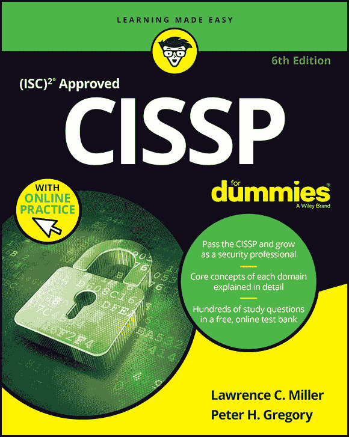
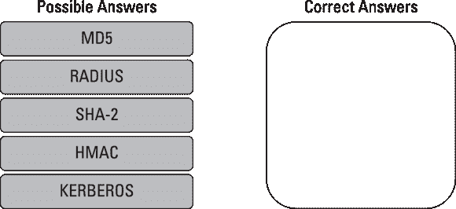
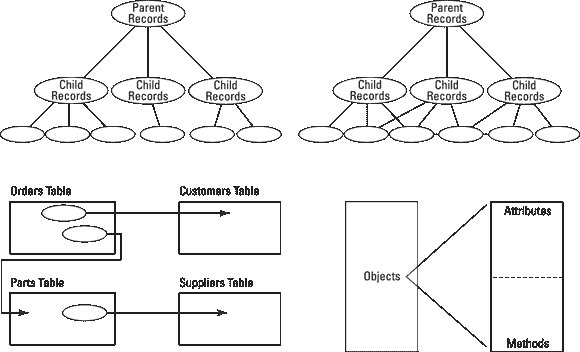
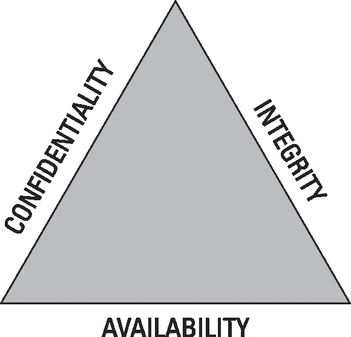
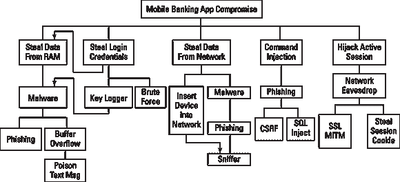
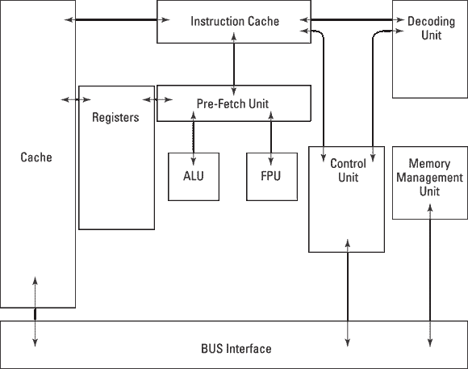
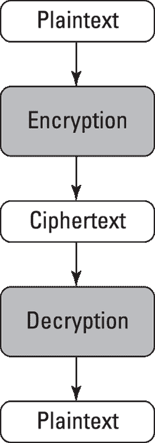
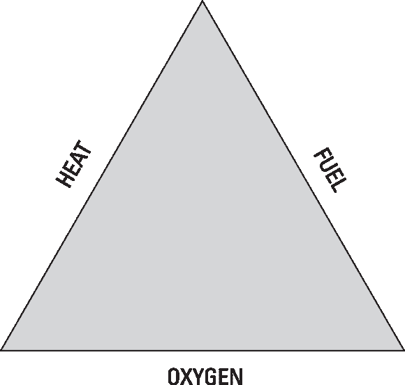
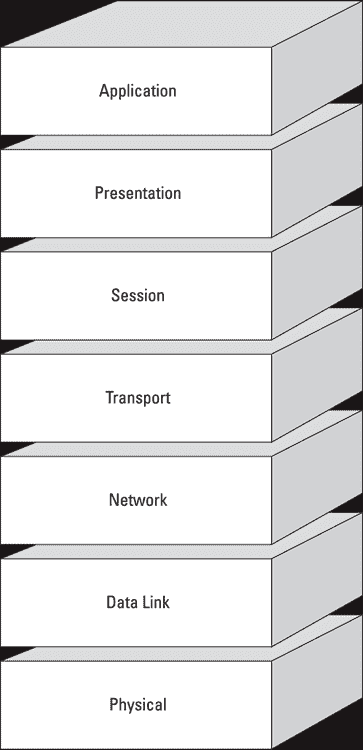
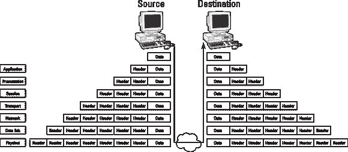

# CISSP 入学者指南，第 6 版



### 如需查看本书的快速上手表，请访问 [www.dummies.com](http://www.dummies.com)，并在搜索框中搜索“CISSP For Dummies Cheat Sheet”。

 要成功通过 `CISSP` 考试，你需要了解自己最有效的学习风格。对某些人来说，“训练营”是最好的，而另一些人则在较长时间内学习得更好。此外，有些人能从小组讨论中获得更多价值，而另一些人则适合独自阅读。*了解你自己*，并使用最适合你的方法。

## 你准备好参加考试了吗？

你准备好迎接那个大日子了吗？我们无法为你回答这个问题。你必须根据个人的学习因素、学习习惯和专业经验，决定何时准备好参加考试。遗憾的是，没有什么魔法公式可以决定你 `CISSP` 考试的成功或失败概率。

通常情况下，我们建议至少进行两个月的专注学习。阅读这本书，并继续在 Dummies 网站上进行模拟考试，直到你在所有领域都能稳定地获得 80% 或以上的分数。`CISSP For Dummies` 涵盖了你想通过 `CISSP` 考试所需了解的`所有`信息。阅读这本书（并反复阅读），直到你对书中呈现的信息了如指，并能够在八个领域中的每一个领域成功回忆并应用它们。继续复习其他学习材料（特别是你薄弱的领域），积极参与在线或本地学习小组，并从尽可能不同的来源参加尽可能多的模拟考试。

然后，当你觉得已经准备好迎接那个大日子时，找一个浪漫的地方，单膝——等等，搞错大日子了！找一个安全的 Wi-Fi 热点（或其他网络连接），坐下，报名考试！

### 报名考试

`CISSP` 考试通过全球当地 Pearson VUE 测试中心以计算机自适应测试 (CAT) 进行。如需报名考试，请访问 (ISC)² 网站（[`www.isc2.org/Register-For-Exam`](http://www.isc2.org/Register-For-Exam)）并点击“Register”（注册）链接，或直接访问 Pearson VUE 网站（[`www.pearsonvue.com/isc2`](http://www.pearsonvue.com/isc2)）。

在 Pearson VUE 网站上，你首先需要创建一个账户；然后就可以报名 `CISSP` 考试、安排考试时间并支付考试费用。你还可以找到附近的测试中心，参加 Pearson VUE 测试教程，练习参加考试（如果你从未参加过电脑化考试，绝对应该这样做），然后下载并阅读 (ISC)² 保密协议 (`NDA`）。

 在报名考试时下载并阅读 (ISC)² `NDA`。诚然，这些是无聊的法律术语，但对于 `CISSP` 来说，被要求阅读合同、许可协议和其他“无聊的法律术语”作为其信息安全责任的一部分，这并不稀奇——所以习惯它吧（同时也习惯在不实际阅读的情况下不签署法律文件）！考试开始时，你有五分钟时间阅读并接受协议，但为什么不提前阅读 `NDA` 呢，这样你就可以避免考试日的压力和分心，直接接受协议即可。如果你在指定的五分钟内不接受 `NDA`，考试将结束且没收考试费！

报名时，你需要量化相关工作经验，回答几个有关犯罪记录和其他可能导致取消资格背景信息的问题，并同意遵守 (ISC)² 道德守则。

目前美国的考试费用为 699 美元。你可以在计划考试前至少 24 小时通过电话联系 Pearson VUE，或至少提前 48 小时通过在线取消或重新安排考试。重新安排的费用为 50 美元。取消考试预约的费用为 100 美元。

 如果你未参加考试或迟到预约时间超过 15 分钟，你将没收全部考试费！

 好消息！如果你是美国退伍军人并符合 Montgomery GI Bill 或 Post-9/11 GI Bill 福利，退伍军人事务部 (`VA`) 将报销全部考试费用，无论通过与否。在某些情况下，(ISC)² 官方培训提供商也接受 GI Bill 进行线下认证培训。

### 关于 CISSP 考试

`CISSP` 考试本身是一场耗时三小时、100 到 150 道题的马拉松。为了让你有直观感受，三小时内，你可以跑一场真正的（迷你）马拉松，看《风云一切》、《教父 II》、《泰坦尼克号》或《环王》系列电影之一，或者在《吉他英雄》中玩 45 次“Slow Ride”。这些成就分别非常接近 `CISSP` 考试在体力、精神（而非智力）和情感上的消耗。

`CISSP` 考试现在是自适应考试，这意味着测试会根据你在考试中的表现而变化。考试开始时相对简单，随着你回答正确问题，难度会逐渐增加。没错；你在考试中表现得越好，题目就越难——但这并不是坏事！把它想象成因为你比平均水平的熊聪明而跳级上。`CISSP` 考试假设，如果你能回答关于某个主题更难的问题，那么逻辑上讲，你就能回答关于该主题更简单的问题，那么为什么要浪费时间呢？

你必须至少回答 100 道题。回答完最少数量的问题后，测试引擎根据 95% 的置信度判断你统计学上可能通过或失败从而结束考试，或者继续提问最多 150 道题，直到达到 95% 的置信水平。如果你回答了所有 150 道题，测试引擎将判断你是通过还是不及。如果你用完时间（超过三小时限制）但回答了最少数量的问题（100 道），测试引擎将根据你的答案判断是否通过。

只有 75% 的题目实际上会计入你的最终结果。另外 25% 是未来 `CISSP` 考试版本的试题（有点就像是考试的“哑铃”——为小白准备的）。然而，考试不会指出哪些问题是真题，哪些是试题，因此你必须诚实、公正并尽尽所能地回答所有问题！

`CISSP` 考试有三种类型的题目：

*   **单选题。** 从四个选项中选择`最佳`答案。例如：

    以下哪项是 FTP 控制通道？

    **A** `TCP` 端口 21

    **B** `UDP` 端口 21

    **C** `TCP` 端口 25

    **D** `IP` 端口 21

    FTP 控制通道是端口 21，但它是 `TCP`、`UDP` 还是 `IP`？

*   **拖放。** 从屏幕左侧的候选列表中将正确答案（或答案）拖到右侧的正确答案框中。例如：

    以下哪些是消息认证算法？将正确答案从左侧拖到右侧。



    `MD5`、`SHA-2` 和 `HMAC` 都是正确的。你必须将所有三个答案拖到右侧的框中，答案才正确。

*   **热点题。** 选择图中最符合问题的对象。例如：

    以下哪幅图描绘了关系数据库模型？

    

    点击上方四个面板之一来选择你的答案。

正如 `(ISC)²` 所描述，你需要获得 700 分（满分 1000 分）或以上的比例分才能通过考试。三种题型的权重相同，但并非所有问题的权重都相同。较难的问题比简单的题目权重更高，因此无法知道及格需要多少个正确答案。但等一下，更好的还在后面！在自适应考试中，当你完成 `CISSP` 考试时，将不再获得分数——你只会得到通过或不及的结果。把这比作一场没有比分牌的篮球赛——一场在裁判举起胜者手臂之前不知道结果的拳击赛。

 `CISSP` 考试中的所有问题都要求你从给出的选项中选择最佳答案（或答案）。正确答案并不总是一个直观、清晰的选择。`(ISC)²` 费很大精力确保你真的、真正地掌握了这些材料。

 多选题的一种常见有效的答题策略是仔细阅读每道题，然后排除掉任何明显的错误选项。`CISSP` 考试也不例外。

 `CISSP` 考试中的错误选项并不一定显而易见。你可能会发现几个明显的错误选项，但它们对于那些为考试做了充分准备的人来说才会脱颖而出。

Pearson VUE 计算机自适应、三小时、100 到 150 题版本的 `CISSP` 考试目前仅提供英文版。如果你倾向于用中文（简体，指语言而非考试）、法语、德语、日语、韩语、葡萄牙语或西班牙语参加 `CISSP` 考试，因为那是你的母语（或者你不会说那种语言但真的想挑战自己），那么你必须参加基于形式的、六小时、250 题版本的 `CISSP` 考试（我们许多人所谓的“老派”考试）。如果需要，你允许携带外语字典（非电子且非技术类）参加考试。对于视障人士也提供测试选项。你需要在注册考试时注明你的偏好。

### 考试后

在大多数情况下，你在完成考试后会会在测试中心获得非正式测试结果，随后会收到来自 `(ISC)²` 的正式电子邮件。

 在极少数情况下，你的非正式结果可能无法立即获得。`(ISC)²` 在每个测试周期期间分析分数数据；如果他们在测试周期早期没有获得足够的测试结果，你的结果可能会延迟长达八周。

如果由于某种原因你没有通过 `CISSP` 考试——例如，你只读了这本《CISSP ummies》中的这一章——你必须等待 30 天才能再次尝试。如果发生这种情况，我们强烈建议你在那 30 天内阅读这本书的其他部分！如果你失败了第二次，你必须等待 90 天才能再次尝试。如果发生这种情况，我们最强烈地建议并敦促你在那 90 天内阅读这本书的其他部分——也许读几次！最后，如果你在第三尝试中失败，你必须等待 180 天——没有任何借口了，如果发生这种情况，你绝对需要阅读、重读、记忆、理解、背诵、吸收并反复背这本书好几次！

在获得 `CISSP` 认证后，你必须保持良好的 `(ISC)²` 成员身份，并每三年更新一次认证。你可以通过积累 120 个持续专业教育（`CPE`）学分或通过重新参加 `CISSP` 考试来更新 `CISSP` 认证。在三年的重新认证周期内，你每年必须获得至少 40 个 `CPE` 学分。你可以通过各种活动获得 `CPE` 学分，包括参加教育课程或座谈会和安全会议、加入协会分会并参加会议、观看供应商演示、完成大学课程、提供安全培训、出版安全文章或书籍、担任相关行业委员会成员、参与自学以及从事相关的志愿者工作。你必须在安全的 `(ISC)²` 网站上记录你的年度 `CPE` 活动以获得相应学分。你还需要支付 85 美元的年度维护费，支付给 `(ISC)²`。维护费是按年度后付的，你可以在线支付，也可以在 `(ISC)²` 网站的安全的成员区域支付。

 确保你在提交 `CPE` 报告时绝对诚实，并保留培训证据。`(ISC)²` 会审核部分 `CPE` 提交情况。

 一旦收到认证，请立即在 `(ISC)²` 网站上注册并提供你的联系信息。`(ISC)²` 会提醒你年度维护费、董事会选举、年度会议和活动，但前提是你维护了联系信息——特别是你的电子邮件地址。

## 第 2 章

### 充分利用你的认证

[本章内容]

-  保持 `(ISC)²` 成员身份活跃

-  发现回馈的快乐

-  在当地安全社区中与他人合作

-  推广 `CISSP` 认证的理念

-  为你的组织带来改变

-  通过其他认证促进职业

-  寻找导师并成为导师

-  实现安全卓越

尽管这本书致力于帮助你获得 `CISSP` 认证，但我们认为在你获得 `CISSP` 认证后，包含一些你可能考虑做的事情是一个好主意。

那么，在获得 `CISSP` 后你可以做什么呢？你有很多事情可以增强你的职业生涯和全球社区。这里只是一些想法！

### 与其他安全专业人士建立人脉

除非你在大型机构工作，否则你的机构可能没有许多信息安全（infosec）专业人员。事实上，你可能是唯一的！是的，有时会感到孤独，所以我们建议你寻找方法与你所在及其他地区的安全专业人士联系。本章描述的许多活动都提供了人脉机会。如果你以前不是一个社交达人，而且你的专业网络相当有限，请准备好通过与其他志同道合的安全专业人士相识，并可能建立终身友谊，将你的职业生涯推向一个全新的高度。记住：你所掌握的知识也很重要！

如果你刚开始你的信息安全职业（无论你的年龄或其他职业经验如何），你可能会遇到其他信息安全专业人士，他们自己在职业生涯的某个时刻曾处于你现在的境地，他们会乐意帮助你找到那些可能困扰你的、难以捉摸的问题和挑战的答案和解决方案。你可能会发现自己自己出的多比出的少，但请确保至少对他们的帮助表示你的感谢和感激——并记住在职业生涯后期，当新进入信息安全领域的人向你请教一些有益的见解时，要回馈。

所以，当你外出寻找其他信息安全专业人士时，请带上微笑并带上大量的名片（如果雇主不提供，就自己打印）。你一定会会结识新朋友，并在安全领域体验可能让你令喜的成长。

### 活跃的 (ISC)² 成员

成为一个活跃的 `(ISC)²` 成员很容易！除了志愿者服务（见下节），你还可以参加其他几项活动，包括：

- **参加 (ISC)² 大会。** 多年来，(ISC)² 一直依附于 ASIS（原美国工业安全协会——我们将此归咎于肯德基，因为他们变成了“KFC”，并引发了企业和组织放弃缩写词原始含义的潮流！），并占据着 ASIS 年会的一角。然而，在 2016 年，(ISC)² 决定是时候自立门户并举办自己的会议了。2017 年，我们的其中一位作者（名字首字母为 *P*）参加了首届 `(ISC)²` 大会并在会上发表了演讲，并发现这是一场顶级盛事，完全不亚于其他优秀的国家级和全球性会议。你可以在 [`http://congress.isc2.org`](http://congress.isc2.org) 了解下一次 `(ISC)²` 大会的信息。

- **参加 (ISC)² 选举。** 每年，(ISC)² 理事会选举三分之一的成员，任期为三年。作为一名状态良好的 `CISSP`，你已经赢得了在 `(ISC)²` 选举中投票的权利。行使你的权利吧！这其中最棒的部分是熟悉其他竞选董事会职位的 `CISSP`。你可以阅读他们的传记，并了解他们如果当选后的议程。通过你的投票，你正在尽一份力，确保 `(ISC)²` 的未来掌握在能够提供胜任领导力和远见的董事手中。

- **参加 (ISC)² 活动。** `(ISC)²` 每年举办多项活动，从社交招待会到会议和教育活动一应俱全。`(ISC)²` 经常在 RSA 和 BlackHat 等大型行业会议上举行聚会。定期查看 `(ISC)²` 网站，以获取更多关于你所在地区的活动。

- **加入 (ISC)² 分会。** `(ISC)²` 在世界各地都设有分会。你可以在 [`www.isc2.org/chapters`](http://www.isc2.org/chapters) 了解更多信息。你有许多机会参与当地分会，包括担任分会领导层、参加分会活动以及参与社区外展项目。分会活动也是结识其他安全专业人士的绝佳机会。

 `(ISC)²` 拥有你正确的联系信息非常重要。一旦成为 `CISSP`（甚至在此之前），请确保你的个人资料是准确且完整的，这样你就能收到这些及其他活动的通知。

### 考虑 (ISC)² 志愿者机会

`(ISC)²` 不仅仅是一个认证机构：它是一项*事业*，你甚至可以说它是一场*运动*。它是安全专业人士的*存在的意义*，即我们存在的理由——至少在专业领域是如此。作为我们的一员，请考虑为这项事业贡献力量。

志愿者们成就了今天的 `(ISC)²`，并且他们对你的认证做出了重要贡献。你不能袖手旁观看着别人工作。利用你的才华帮助那些走在你后面的人。你可以通过许多方式提供帮助。有关志愿者信息，请参阅 `(ISC)²` 网站（[`www.isc2.org`](http://www.isc2.org)）。

 大多数经批准的 `(ISC)²` 志愿者活动均可获得 `CPE` 学分。详情请咨询 `(ISC)²`。

### 编写认证考试题

`CISSP` 通用知识体系（CBK）中的技术状态、法律和实践正在不断发生变化和进步。为了保持有效性和相关性，`CISSP` 考试需要新鲜、新的考试题，以反映当今的安全工作方式。因此，行业内的人士——如你——需要编写新题。如果你对成为出题人感兴趣，请访问 `(ISC)²` 网站并申请。

### 在活动中演讲

`(ISC)²` 现在在全球举办的安全性相关活动比其历史上的任何时候都多。大多数情况下，`(ISC)²` 的演讲者是当地志愿者——他们是各自领域的专家，希望与他人分享他们所知和所学的知识。如果你在某个领域专长或对 `CISSP` 相关问题有独特见解，请考虑通过演讲来教育他人。更多信息请访问 `(ISC)²` 网站。

 如果你在 `(ISC)²` 大会上进行演讲，你的会议费用将免除。你只需要支付交通、住宿和餐饮费用。

### 为 (ISC)² 会议提供帮助

`(ISC)²` 主办名为 `(ISC)²` 大会的精彩年度会议。这次会议是学习新课题和结识其他安全专业人士的绝佳机会。但会议并不是自动运行——它是由志愿者驱动的！前往 `(ISC)²` 大会网站（[`http://congress.isc2.org`](http://congress.isc2.org)）查找志愿者信息。

### 阅读并为 (ISC)² 出版物贡献力量

`(ISC)²` 每季度出版一份名为 *INSIGHTS* 的在线杂志，与 *InfoSecurity Professional* 关联。你可以在 [`www.isc2.org/News-and-Events/Infosecurity-Professional-Insights`](http://www.isc2.org/News-and-Events/Infosecurity-Professional-Insights) 了解更多信息。

*(ISC)² Blog* 是面向所有 `(ISC)²` 成员的免费在线出版。你可以在 [`http://blog.isc2.org`](http://blog.isc2.org) 找到博客以及关于写文章的信息。


《Information Security Journal》是一本每双月出版的付费出版物。你可以在期刊的信息页面（[`www.isc2.org/Member-Resources/Journal`](http://www.isc2.org/Member-Resources/Journal)）找到有关订阅和写文章的信息。目前年度订阅费为 45 美元。

### 支持 (ISC)² 网络安全中心

(ISC)² 网络安全中心（原名 (ISC)² 基金）是 (ISC)² 在 2011 年成立的非利慈善机构。它是安全人士接触社会并让学生、教师和普通公众通过网络安全教育保护其在线生活的渠道。中心的三个核心计划包括 Safe and Online、信息安全学金计划以及行业研究。更多信息请访问[`www.cybersafe.org`](http://www.cybersafe.org)。

### 参与 (ISC)² 焦点小组

(ISC)² 开发了焦点小组和质量保证（QA）测试机会。(ISC)² 正在开发新服务，需要在项目的需求和设计阶段接收早期反馈。通过参与这些小组和测试，你可以影响未来的 (ISC)² 服务。

### 加入 (ISC)² 社区

(ISC)² 开发了一个全新的互动社区，里面充满了讨论组。在第一年就有 16,000 多名成员，该社区设计良好且易于使用。你可以在[`http://community.isc2.org`](http://community.isc2.org)注册并加入。

### 加入 CISSP 学习小组

许多社区都有 CISSP 学习小组，由志愿者导师和教师组成，帮助想要获得认证的人。

如果你的社区没有 CISSP 学习小组，请考虑启动一个。许多社区已经有了，那里的组织者可以就如何创建一个小组提供建议。你可以在附近的 (ISC)² 分会和其他当地安全小组获取更多信息。

### 帮助他人了解更多数据安全

当我们说我们（本书的作者和你们这些读者）在数据安全和安全上网方面的知识可能超过了 99% 的人口时，绝不是在虚荣或傲慢。有两个主要原因：

- 安全是我们的职业
- 安全并不总是容易做

有很多志愿者机会可以帮助他人维护他们的计算机（以及移动计算设备）安全并安全地使用互联网。这里是一些你可以提供帮助的简短列表：

- 服务俱乐部
- 老年中心
- 学校（请务必在本章前面的部分阅读“安全与安全的在线”的内容）
- 校友协会和团体
- 你的工作单位

只要发挥一点想象，你完全可以发现额外的机会。世界渴望着你所拥的信息！

### 成为你当地安全分会的活跃成员

除了 (ISC)² 之外，全球许多安全组织都有当地分会，也许就在你的社区内或附近。以下是一些你可能感兴趣的组织简列表：

- **国际系统安全协会 (ISSA)：** [`www.issa.org`](http://www.issa.org)
- **ISACA（原信息系统审计控制协会）：** [`www.isaca.org`](http://www.isaca.org)
- **信息管理协会 (SIM)：** [`www.simnet.org`](http://www.simnet.org)
- **InfraGard：** [`www.infragard.net`](http://www.infragard.net)
- **开放 Web 应用安全项目 (OWASP)：** [`www.owasp.org`](http://www.owasp.org)
- **ASIS 国际：** [`www.asisonline.org`](http://www.asisonline.org)
- **高科技犯罪调查协会 (HTCIA)：** [`www.htcia.org`](http://www.htcia.org)
- **风险与保险管理协会 (RIMS)：** [`www.rims.org`](http://www.rims.org)
- **信息风险分析师协会 (SIRA)：** [`www.societyinforisk.org`](http://www.societyinforisk.org)
- **内部审计师协会 (IIA)：** [`www.theiia.org`](http://www.theiia.org)
- **国际隐私人士协会 (IAPP)：** [`www.iapp.org`](http://www.iapp.org)
- **国际灾难恢复协会 (DRII)：** [`www.drii.org`](http://www.drii.org)
- **计算机技术调查员网络 (CTIN)：** [`www.ctin.org`](http://www.ctin.org)

当地安全小组提供了极佳的机会，让你与其他与其他组织的同行建立联系，并更多地了解你的职业。许多人发现，在参与当地安全组织期间建立的人脉，在寻找新职业机会时可能特别有价值。

除了我们在前面的列表中列出的组织，你完全可以找到许多多许多拥有当地分会的安全组织。向你的同事和其他人询问你社区的安全组织和俱乐部。

### 传播 CISSP 认证的良好口碑

尽管 CISSP 认证广为人知，但仍有人人不知道它。而且许多听过它的人并不理解它的具体含义。向人们介绍你的 CISSP 认证，并向你的同行解释认证过程。以下是可以与你遇到的的每个人分享的事实：

- CISSP 是顶尖的信息安全专业人士认证。
- 全球有超过 112,000 名安全专业人士持有 CISSP 认证。
- CISSP 认证始于 1994 年。
- CISSP 是首个获得 ANSI（美国国家标准协会）根据 ISO（国际标准化组织）标准 17024 认证的证书。
- 管理 CISSP 认证的机构还为专攻信息安全各个领域的专业人士提供其他认证。该机构还通过教育计划和活动提升信息安全意识。

推广你已认证的这一事实。你可以如何推广它呢？获得 CISSP 后，你可以简单地在名片、信具、电子邮件签名、简历、博客和网站的名字后面加上 CISSP 这几个字母。顺便把 CISSP 的标志也放上去吧（只需确保遵守任何既定的使用条款即可）。

 (ISC)² 还有许多其他可用认证，将在下一节中进行描述。

### 自豪地穿上这些颜色

(ISC)² 在线商店有很多酷东西，从夹克、衬衫到马克杯和帽子。那里有每个人需要的物品。该机构定期推出新产品，并举办清仓特卖。[`http://isc2education.org/shop`](http://isc2education.org/shop)。

考虑为你的衣橱增添几件印有 (ISC)² 和 CISSP 标志的精美 Polo 衫。或者大挥霍一下，考虑买一件 CISSP 皮夹克（像 Fonz 一样酷炫——除非当你说“Aaa!”时，你当然指的是身份验证、授权和计费——我们在第 7 章中讨论过这些）或背包！

### 以身作则

无论喜不喜欢，安全专业人士，特别是持有 CISSP 的人员，都是他们周围人的榜样。从安全的角度来看，我们所的一切——以及我们的做法——都被视为正确行为的标准。

 注意到这一点，我们在做每件事时都应该表现得好像有人在看一样——即使并没有人在看。

### 利用你的 CISSP 认证成为变革推动者

作为一名认证的安全专业人士，你是组织中的变革推动者：威胁和法规的状态不断变化中，你必须通过确保雇主的环境和政策继续保护雇主的资产免受伤害来做出应对。以下是关于成功的变革推动者的重要原则：

- 仅识别并推广必要的变更。
- 仅推广那些有可能成功的变更。
- 预判阻力的来源。
- 区分阻力与有理的批评。
- 以正确的方式让所有相关方参与。
- 不要承诺你无法交付的东西。
- 利用赞助人、合作伙伴和合作者作为共同的变革推动者。
- 调整衡量指标和奖励以支持不断变化的世界。
- 提供培训。
- 庆祝所有的成功。

 你作为安全专业人士的工作并不涉及说教；相反，你需要识别改进机会和降低业务风险的机会。在组织的结构内，以正确的方式带来变革。这是减少安全风险的最佳方式。

### 获得其他认证

在商业和技术领域，没有人的职业生涯会停留在原地。你正在不断成长和变化，而不断变化的技术也影响着组织以及你在其中的角色。

当你获得 CISSP 时，你不应该认为自己的认证之旅已经结束了——即使它确实是目前最高级的信息安全认证！安全是一场旅程，你的 CISSP 认证并不是终点，而是道路上的一个（重要的）里程碑。CISSP 应该是你安全生活方式的一部分。

### 其他 (ISC)² 认证

(ISC)² 有许多其他认证，包括你可能在获得 CISSP 之后（或代替它）追求获得的认证。这些认证是：

- **(ISC)² 成员：** 如果你通过了 CISSP 或 SSCP 认证考试，但尚未获得所需的专业经验，你可以成为 (ISC)² 成员。在 (ISC)² 网站上了解此选项。
- **CCSP（认证云安全专业人士）：** 这项关于云控制和安全实践的认证是由 (ISC)² 和云安全联盟共同开发的。
- **SSCP（系统安全认证从业人员）：** 这项认证针对实操安全技术人员和分析师。SSCP 一直带有“初级”CISSP 认证的声誉，但不要被骗了它绝非如此。SSCP 的技术性比 CISSP 高。对于某些人来说，SSCP 可能是迈向 CISSP 的跳板，但对另一些人来说，它本身就是一个极佳的目标。
- **CSSLP（认证安全软件生命周期专业人士）：** 为软件开发专业人员设计，`CSSLP` 认可将安全作为软件需求、设计和测试一部分的软件开发——使最终产品具有内生的设计和构建的安全性，而不是事后添加。
- **HCISPP（医疗保健信息安全与隐私从业人员）：** 针对医疗行业的信息安全设计，`HCISPP` 认可与医疗数据保护法规以及患者数据保护相关的知识和经验。
- **JGISP（日本政府信息安全专业人士）：** 一种特定国家的认证，验证专业人士与日本政府法规和标准的知识、技能和经验。
- **CAP（认证与认可专业人士）：** 由美国国务院信息保证办公室和 `(ISC)²` 共同开发，`CAP` 证书反映了评估复杂系统和环境风险以及建立安全需求所需的技能。

### CISSP 集中方向

`(ISC)²` 开发了与你的 `CISSP` 伴随的进阶认证（可以将其想象为配件）。`(ISC)²` 将这些认证统称为集中方向，因为它们代表了你可能选择专攻的三个领域：

- **ISSAP（信息系统安全架构专业人士）：** 适用于技术系统安全架构师。
- **ISSEP（信息系统安全工程专业人士）：** 证明安全工程师的能力。
- **ISSMP（信息系统安全管理专业人士）：** 关于安全管理（当然了！）。

所有的集中方向都要求你首先必须是状态良好的 `CISSP`，且每个方向都有自己的考试。可以在 `(ISC)²` 网站上关于这些集中方向及其考试的介绍：[`www.isc2.org/Certifications/CISSP-Concentrations`](http://www.isc2.org/Certifications/CISSP-Concentrations)。

### 非 (ISC)² 认证

除 `(ISC)²` 以外的机构也提供安全相关的认证，其中一个或多个可能适合你。这些认证中没有直接与 `CISSP` 竞争，但其中一些与 `CISSP` 有部分重叠。

### 非技术/非厂商认证

还有许多不与特定硬件或软件厂商绑定的认证。一些较好的包括：

- **CISA（注册信息系统审计师）：** 如果你担任内部审计师，或者你的组织受一项或多个安全法规限制（如萨班斯奥克斯利法案、HIPAA、GLBA、PCI 等），请考虑此认证。信息系统审计控制协会基金会 (`ISACA`) 管理此认证。可以在 [`www.isaca.org/cisa`](http://www.isaca.org/cisa) 了解更多关于 `CISA` 的信息。
- **CISM（注册信息安全经理）：** 与 `(ISC)²` 的信息系统安全管理专业人士 (`ISSMP`)（在本章前面的 `CISSP concentrations` 部分讨论过）类似，如果你从事安全管理，可能需要 `CISM` 认证。与 `CISA` 一样，`ISACA` 管理此认证。可以在 [`www.isaca.org/cism`](http://www.isaca.org/cism) 阅读更多。
- **CRISC（风险信息控制认证）：** 这是一个相对新的认证，专注于组织风险管理。可以在 [`www.isaca.org/crisc`](http://www.isaca.org/crisc) 了解更多。
- **CGEIT（企业 IT 治理认证）：** 如果你想证明自己在 IT 管理和治理领域的技能和知识，请查看此认证。IT 组织中的有效安全无疑取决于治理，这涉及为了实现长期目标对资源的管理和控制。可以在 [`www.isaca.org/cgeit`](http://www.isaca.org/cgeit) 了解更多关于 `CGEIT` 的信息。
- **CPP（注册保护专业人士）：** 主要是一项安全管理认证，`CPP` 由 `ISACA` 管理（等等，原文说是 ISACA，但通常 CPP 是 ASIS）。可以在 [`www.isaca.org/cisa`](http://www.isaca.org/cisa) 了解更多关于 `CPP`。
- **PSP（注册物理安全专业人士）：** `ASIS` 提供此认证。可以在 [`www.isaca.org/cism`](http://www.isaca.org/cism) 阅读更多关于 `PSP`。（原文说是 `ISACA`，但 `ASIS` 管理 `PSP`）。
- **CIPP（注册信息隐私专业人士）：** 国际隐私专业人士协会 (`IAPP`) 拥有此认证。可以在 [`ipps.org/crisc`](http://ipps.org/crisc) 了解更多关于 `CIPP`。
- **CIPP/E（注册信息隐私专业人士/欧洲）：** `IAPP` 开发了专门针对欧洲事务的 `CIPP` 版本。可以在 [`ipps.org/cipe`](http://ipps.org/cipe) 了解更多。
- **C|CISO（注册首席信息安全官）：** 此认证证明了典型的 `CISO` 位置所需的技能和知识。可以在 [`eccouncil.org`](http://eccouncil.org) 了解更多。
- **CBCP（注册业务连续计划师）：** 由灾难恢复协会提供。你可以在 [`dri.org/cbcp`](http://dri.org/cbcp) 了解更多。
- **DRCE（认证灾难恢复专家）：** 此认证是对灾难恢复知识和经验的认可。更多信息请访问 [`bcm-institute.org/certification`](http://www.bcm-institute.org/certification)。
- **PMP（项目管理专业人士）：** 位于 [`pmi.org`](http://www.pmi.org) 的项目管理协会提供此认证。
- **PCI-QSA（支付卡行业合格安全评估师）：** 支付卡行业安全标准委员会为审计存储、传输或处理信用卡数据组织的专业人士开发了 `QSA`。更多信息请访问 [`pcisecuritystandards.org`](http://www.pcisecuritystandards.org)。
- **PCI-ISA（支付卡行业内部安全评估师）：** 此认证同样来自支付卡行业安全标准委员会，适用于存储、传输或处理持卡人数据组织内部的安全专业人士。更多信息请访问 [`pcisecuritystandards.org`](http://www.pcisecuritystandards.org)。
- **GIAC（全球信息保证认证）：** `GIAC` 系列认证包括审计、管理、运营和安全管理等类别。补充 `CISSP` 的非特定厂商 `GIAC` 认证之一是 `GIAC` 认证取证分析师 (`GCFA`) 和 `GIAC` 认证事件处理师 (`GCIH`)。可以在 [`giac.org/certifications`](http://www.giac.org/certifications) 找到更多信息。下一节中还提到几种与厂商相关的 `GIAC` 认证。

### 技术/厂商认证

我们甚至不打算在这里列出所有的技术和厂商认证。但这些是一些广为人知的厂商相关安全认证：

- **CCIE（思科认证网络专家）安全认证：** 思科还提供了几种针对特定产品的相关认证，包括 `ASA` 防火墙和入侵防御系统。可以在 [`www.cisco.com/certifications`](http://www.cisco.com/certifications) 了解更多信息。
- **Check Point 安全管理认证：** 你可以获得 Check Point 防火墙和其他安全产品相关的认证。访问 [`www.checkpoint.com/certification`](http://www.checkpoint.com/certification)。
- **C|EH（认证道德黑客）：** 我们知道，我们知道。对某些人来说这个术语自相矛盾，但对另一些人来说具有真正的业务价值。在签署前请仔细阅读。由国际电子商务顾问委员会 (EC-Council) 提供。你可以在 [`http://cert.eccouncil.org`](http://cert.eccouncil.org) 了解更多信息。
- **E|NSA（网络安全管理员）：** 同样由 EC Council 提供，这是一项认可防御性视角的认证——与 `C|EH` 的攻击性视角相反。你可以在 [`http://cert.eccouncil.org`](http://cert.eccouncil.org) 了解更多。


- **L|PT（授权渗透测试员）：** 另一项来自 EC Council 的认证，它将渗透测试提升到了比 `C|EH` 更高的水平。在 [`http://cert.eccouncil.org`](http://cert.eccouncil.org) 了解更多。

- **C|HFI（认证黑客取证调查员）：** 同样来自 EC Council，该认证认可了检测计算机犯罪和收集取证证据的取证专家的技能和知识。在此了解更多信息：[`http://cert.eccouncil.org`](http://cert.eccouncil.org)。

- **CSFA（网络安全取证分析师）：** 该认证证明了进行计算机取证检查的知识和技能。认证考试的一部分是实验室中的实际取证作业。查看 [`www.cybersecurityforensicanalyst.com`](http://www.cybersecurityforensicanalyst.com) 获取更多信息。

- **CompTIA Security+：** 针对 PC 技术人员及类似的安全能力认证。我们认为这是一种入门级认证，可能不适合你，但你完全可以建议那些想要进入信息安全领域的职业同事，该认证是一个很好的起点。你可以在 [`http://certification.comptia.org`](http://certification.comptia.org) 了解更多信息。

- **Security|5：** 与 Security+ 类似，这是针对任何兴趣学习计算机网络和安全基础的人的入门级安全能力认证。可以在 [`http://cert.eccouncil.org`](http://cert.eccouncil.org) 了解更多。

你可以在那里找到许多其他安全认证。使用你喜欢的搜索引擎搜索“security certification”（安全认证）等词组来查找信息。

### 选择合适的认证

通常，技术和安全专业人员会问我们下一步应该获得哪种认证。我们的答案几乎总是相同的：你的决定取决于你目前所处的位置以及你希望你的职业生涯向何何发展发展。没有一种适用于所有人的“正确”认证——确定你应该寻求哪种认证是非常个性化的事情。

在考虑其他认证时，请问自己以下问题：

- **我现在的职业生涯处于什么阶段？** 你更关注技术、政策、运营、开发还是管理？

- **我希望我的职业生涯未来向哪个方向发展？** 如果（例如）你困在运营工作中，但你想专注于政策，那么就让这个目标成为你的指南。

- **我目前拥有哪些认证资质？** 有些人根据他们已经拥有的技能来攻读认证，并利用这些新获得的认证来攀爬职业阶梯。

- **我在职业生涯中需要做什么才能获得更多资质？** 你不仅需要考虑你现在可能能够获得哪些认证，还需要考虑为了获得未来的认证，你必须积累哪些经验。

如果你对自己诚实，回答这些问题将帮助你辨别出哪些认证是适合你的。我们建议你每隔几年花时间做一些长期职业规划；大多数人会发现，我们在这里列出的这些问题的答案会发生变化。

你可能还会发现，你拥的一个或多个认证不再反映你的职业方向。如果是这样，请允许自己让这些认证失效。没有必要守着不再体现（或无法帮助你实现）职业目标的旧认证。我们每个人都至少这样做过一次，也许将来某天我们还会这样做。

### 寻找导师，成为导师

如果你对信息安全领域还比较陌生（即使你并不陌生！），并且发现自己对职业生涯有很多问题要问，也许你可以从导师那里获益。导师是那些经历过你的职业生活、并在安全领域领域程多年的多年的人。

我们建议你多寻找几个导师，并在与几个候选人交流后再决定选择一个。导师通常有不同的方法，从随意的讨论到更有结构化的学习。

如果你不确定在哪里寻找导师，可以从你所在的一个或多个本地安全组织或活动开始。如果你住在大之外，你可能需要找一个远距离导师。然而，这种经历仍然是很有回报的！

当你的职业生涯从安全新手转变为安全专家时，考虑自己成为一名导师。你会发现，尽管你正在帮助另一个有志向的安全专业人士开启职业，但你在此过程中也能学很多关于安全以及自身的知识。


大多数非技术类认证要求你证明自己已经拥有所需的工作经验，才能获得它们。人们犯了这种常见的错误：他们想获得认证是为了找到某种特定类型的工作。但并不是认证的目的。相反，认证是证明你已经同时拥有知识和经验的证据。

### 追求安全卓越

我们认为，在安全职业中取得成功的最佳方法是每天追求卓越，无论你已经处于理想的安全工作中，还是刚刚起步。

对卓越的追求听起来可能是一个高深或模糊的术语，但你可以通过每天采取行动带来改变：

- **每天尽力工作。** 无论你从事什么职业，都要在领域内做到最出色。

- **保持乐观的态度。** 快乐和工作满意度很大程度上取决于你的态度。良好的心态有助于每一天变得更好，并帮助你做得更好。因为乐观是有感染力的，你的乐观态度会鼓励你的同事，很快大家都会吹口哨、哼唱或做任何他们喜欢工作时会做的事情。

- **不断完善自己。** 花时间阅读行业的安全实践、进展、发展和变化。尝试思考行业创新如何帮助你和你的组织以更小的努力降低风险。

- **理解你的价值。** 花时间理解你的工作如何为组织创造价值，并尝试提出更多增加价值和降低风险的方法。

- **理解组织的整体安全大局。** 无论你是否负责安全的某个方面面，都要花时间理解组织用于增加安全和降低风险的原则。使用`第三章`中的安全和风险管理原则，看看这些原则如何帮助进一步改进安全。思考你在推动组织资产和信息保护事业方面可以扮演的角色。

如果你将追求卓越成为习惯，你就能随着时间的推移逐渐变得更好。你最终将获得更好的安全职业生涯，而你的组织也将获得更好的安全性并降低风险。

# 第 2 部分

## 认证领域

在本部分中……

- 理解安全和风险管理概念及原则。
- 将你的资产安全知识转化为你的资产之一。
- 设计并实现安全的软件、系统和设施。
- 学习通信和网络安全基础。
- 识别身份和访问管理技术。
- 进行安全评估、扫描、测试和审计。
- 应用安全运营概念和控制措施。
- 确保整个开发生命周期中的软件安全。

# 第 3 章

## 安全与风险管理

在本章中：

 将安全与业务对齐

 理解安全治理原则和概念

 识别法律、法规、合规和职业伦理问题

 编写安全策略、标准、程序和指南

 制定业务连续性需求

 执行人员安全策略

 应用风险管理概念和威胁建模

 集成安全风险考量

 建立并监控安全教育、培训和意识计划

安全与风险管理领域涉及许多基础安全概念和原则，以及合规、道德、治理、安全策略和程序、业务连续性计划、风险管理以及安全教育、培训和意识。该领域占 CISSP 考试的 15%。

### 应用安全治理原则

对于 CISSP 考试，你必须完全理解并能够应用安全治理原则，包括：

- 安全功能与业务战略、目标、使命和目的的结合
- 组织流程
- 安全角色和职责
- 控制框架
- 正当注意（Due care）
- 尽职调查（Due diligence）

### 安全功能与业务战略、目标、使命和目的的结合

为了使信息安全计划有效，它必须与组织的使命、战略、目标和目的保持一致；因此，你必须理解组织使命、战略、目标和目的之间的区别和关系。你还需要知道这些元素如何影响组织的信息安全策略和计划。与组织的使命、战略、目标和目的正确对齐，也有助于为安全计划倡议建立业务案例、确保预算并分配资源。通过适当的对齐，安全项目和其他活动将得到合理的优先级排序，并且它们能更好地符合组织的策略、实践和流程。

#### 使命（并非那么不可能）与战略

这个标题很老套，对吧，但你现在可能正在哼着《任务中谍员》（Mission Impossible）的主题曲——任务完成！

组织的`使命宣言`（mission statement）表达了其存在的理由。良好的使命宣言是一个易于理解的、通用的陈述，说明组织是什么、做什么以及为什么存在，并如何以它所选择的方式做这些事情。

组织的`战略`（strategy）描述了它`如何`完成使命，并经常进行调整以应对新的挑战和业务现实。

#### 目标与目的

`目标`（goal）是组织希望实现的（或多个）事情。目标应该与组织的使命宣言或哲学保持一致，并有助于定义组织的愿景。它还应该让人们陷入狂热，在办公室里跑来跑去，挥舞手臂并大喊“进球啦！”（好吧，也许只有他们是世界杯球迷时。）

`目的`（objective）是一个预期的里程碑或特定结果，因此它有助于组织实现目标并达成使命。

安全人员应该敏锐地意识到他们组织的目标和目的。只有这样，安全专业人员才能确保安全能力能够配合并保护所有当前、变化和新的产品、服务及尝试。


组织经常混用`goals`（目标）和`objectives`（目的）这两个词，而不加区分。更糟糕，有些组织将目标视为长期目的，而将目的视为短期目标！对于 CISSP 考试，一个`目的`（短期）支持一个`目标`（中期），目标支持一个`使命`（长期），而使命通过一个定义良好的`战略`来实现。所有这些都属于组织`使命宣言`的伞下。

### 组织流程（安全高管监督）

在本节中，我们将讨论安全治理领域的关键流程。

#### 治理委员会和高管监督

安全管理从高层开始（或应该从高层开始），即执行管理和董事会监督。这通常表现为`安全治理`，简单意味着组织的治理机构设定了方向，且组织拥有策略和流程，以确保执行管理层遵循该方向、充分知并对信息安全战略、策略和运营进行控制。

治理委员会由一组高管和/或经理组成，他们定期开会审查安全事件、项目、运营指标以及他们关注的其他方面。治理委员会偶尔会向安全管理发布关于新业务活动以及优先级和战略方向转变的指令。

在实践中，这与 IT 或其他部门的治理没有太大区别。治理是执行管理层如何参与 IT、安全以及业务其他部分的进展的。

#### 收购与剥离

组织（特别是私营行业）不断地自我创新。比以往任何时候，保持敏捷和竞争力都至关重要。这导致组织收购其他组织、组织拆分为两个（或多个）独立公司，以及改变团队、部门、分支和业务单元对齐的内部重组。

当组织收购另一个组织，或两个（或多个）组织合并时，应该考虑几个与安全相关的因素：

- **安全治理与管理。** 每个组织是如何管理安全的？它们之间有什么重要的区别？
- **安全策略。** 两个组织之间的策略有何不同？将策略合并为一时会遇到什么问题？
- **安全态势。** 每个组织中存在哪些安全控制措施？它们之间有多大差异？
- **安全运营。** 目前有哪些安全运营？它们是如何运行的？这包括漏洞管理、事件监控、身份和访问管理、第三方风险管理和事件管理。

如果一个组织的安全状况与另一个迥异，则组织不应急于将两个组织的网络连接起来。

有趣的是，当一个组织拆分为两个（或多个）独立的组织或出售某个部门时，情况可能会变得更加复杂。每家新公司可能都需要复制拆分前单一组织拥有的安全治理、管理、控制、运营和工具。这并不意味着两个独立的安全职能必须与旧的相同；重要的是充分理解每个新组织的业务使命，以及哪些安全法规和标准适用于每个新组织。只有这样，信息安全才能够与每个新组织保持一致。

### 安全角色与职责

“信息安全是‘每个人的责任’”这一真理在实践中往往被误解为`每个人都负责，但没有人需要负责。`。为了避免这一陷阱，应该在组织的安全策略、个人工作描述或职位说明以及第三方合同中定义信息安全的特定角色和职责。这些角色和职责应适用于员工、顾问、承包商、实习生和供应商。而且它们应该适用于从 C 级高管到一线员工的每一级人员。

### 管理层

高层管理通常负责多个层面的信息安全，包括信息所有者角色（我们将在下一节中讨论）。然而，在此背景下，管理层有责任通过以下行动证明对组织信息安全计划的坚定承诺：

- **制定、强制和批准企业信息安全策略：** 该策略应包含管理层的支持声明，并应由`CEO`、`COO`、`CIO`或`董事长`签署。
- **以身作则：** 佩戴强制身份证并利用系统访问控制的`CEO`树立了良好的榜样。
- **奖励合规：** 管理层应该期待良好的安全行为，并相应对员工进行认可、承认和/或奖励。


管理层对组织的整体信息安全以及所做（或未做）的任何信息安全决策负最终责任。我们信息安全专业人员的角色是报告安全问题并向管理层提供适当的信息安全建议。

### 用户

`终端用户`（或`用户`）几乎包括组织内的每个人。用户没有被专门指定。他们可以广泛定义为任何对组织内部信息或信息系统具有授权访问的人。用户包括员工、承包商和其他临时帮助人员、顾问、供应商、客户以及任何具有访问权限的人。有些组织将他们称为员工、合作伙伴、关联人员或其他。典型的用户职责包括：

- 遵守组织策略、标准和程序中定义的所有适用安全要求；适用的法律或监管要求以及合同要求（如非保密协议和`服务水平协议`）。
- 在保护组织信息和信息资产方面尽到合理职责。
- 根据要求参与信息安全培训和意识工作。
- 向适当人员报告任何可疑活动、安全违规行为、安全问题或安全疑虑。

### 控制框架

组织通常采用控制框架来协助其法律和监管合规工作。相关安全框架的某些示例包括：

- **COBIT 5。** 由`ISACA`（以前称为信息系统审计和控制协会）和`IT 治理协会（ITGI）`开发，`COBIT`由几个组成部分组成，包括：
  - **框架。** 组织 IT 治理目标和最佳实践。
  - **过程描述。** 提供参考模型和通用语言。
  - **成熟度模型。** 评估组织的成熟度/能力并弥补差距。

  `COBIT`框架广泛适用于受《萨班斯-奥克斯利法案（SOX；本章稍后讨论）》或`ICOFR`约束的组织。

- **NIST（美国标准与技术研究院）特别出版物 800-53：联邦信息系统和组织的安全与隐私控制。** 在信息安全专业人员中被称为`NIST 800-53`，这是一个非常流行且全面的框架，是美国政府机构的要求。它也被广泛应用于美国及全球私营行业。

- **COSO（贯威委员会赞助组织委员会）。** 由`管理会计师协会（IMA）`、`美国会计学会（AAA）`、`美国注册会计师协会（AICPA）`、`内部审计师协会（IIA）`和`财务高管协会（FEI）`开发，`COSO`框架由五个部分组成：
  - **控制环境。** 为所有其他内部控制组件提供基础。
  - **风险评估。** 通过识别和分析相关风险建立目标，并确定是否有任何因素会阻止组织实现目标。
  - **控制活动。** 为确保遵守管理指示而创建的策略和程序。本书的其他章节将讨论各种控制活动。
  - **信息与通信。** 确保在整个组织范围内建立了适当的信息系统和有效的通信流程。
  - **监控活动。** 评估随时间变化的性能并识别缺陷和纠正措施的活动。

- **ISO/IEC 27002（国际标准/国际电工委员会）。** 正式名为“信息技术——安全技术——信息安全管理规范”，`ISO/IEC 27002`文档在 14 个领域记录了安全最佳实践，如下：
  - 信息安全策略
  - 信息安全组织
  - 人力资源安全
  - 资产管理
  - 访问控制
  - 密码学
  - 物理和环境安全
  - 运营安全
  - 通信安全
  - 系统的获取、开发和维护
  - 供应商关系
  - 信息安全事件管理
  - 业务连续性管理的信息安全方面
  - 合规

- **ITIL（信息技术基础库）。** 一套 IT 服务管理的最佳实践，由五卷组成，如下：
  - **服务策略。** 涉及 IT 服务策略管理、服务组合管理、IT 服务财务管理、需求管理和业务关系管理。
  - **服务设计。** 涉及设计协调、服务目录管理、服务水平管理、可用性管理、容量管理、IT 服务连续性管理、信息安全管理体系和供应商管理。
  - **服务过渡。** 涉及过渡规划与支持、变更管理、服务资产与配置管理、发布与部署、服务验证与测试、变更评估和知识管理。
  - **服务运营。** 涉及事件管理、事故管理、服务请求履行、问题管理和访问管理。
  - **持续服务改进。** 为改进倡议定义了七步流程，包括确定策略、定义衡量内容、收集数据、处理数据、分析信息和数据、展示并使用信息，以及实施改进。

### 尽职责任（Due care）

`due care`是理性人在特定情况下所行使的行为，它为判定过失提供了标准。在信息安全实践中，`due care`涉及个人或组织为履行职责和实施安全最佳实践而采取的步骤。

`due care`的另一个重要方面是`有罪过失`（culpable negligence）原则。如果一个组织在保护资产（或人员）时未能遵循`due care`标准，该组织可能被判定为有罪过失。在这种情况下，陪审团的裁决金额可能会相应调整，组织的保险公司可能被要求支付损失的一部分——该组织可能不得不自己支付剩余的账单！

### 尽职调查（Due diligence）

`due diligence`是对`due care`的审慎管理和执行。它通常用于法律和金融领域，用于描述组织为了研究投资或合并/收购机会的可行性和价值而采取的行动。在信息安全背景下，`due diligence`通常指风险识别和风险管理实践，不仅适用于组织的日常运营，还适用于技术采购以及合并与收购。


`due care`和`due diligence`这两个概念相关但有明显区别。例如，在实践中，`due care`是开启日志；而`due diligence`是定期审查日志。

### 理解并应用机密性、完整性和可用性概念


`CIA`三元组（也称为`ICA`）构成了信息安全的基础（见图 3-1）。该三元组由三个基本信息安全概念组成：

- 机密性
- 完整性
- 可用性



图 31 C-I-A 三元组。

与任何三角形一样，三边都相互依赖（想象一个三面金字塔或三脚凳）以形成稳定的结构。如果其中一部分崩塌，整个结构就会崩塌。

## 机密性

`confidentiality`将信息的访问限制在需要这些信息的实体（用户和机器）。`隐私`（Privacy）是一个与之密切相关的概念，通常与个人数据相关。存在多项美国和国际法律来保护个人数据的隐私（机密性）。

个人数据最常见指的是`个人身份识别信息`（PII）或`个人健康信息`（PHI）。`PII`包括姓名、地址、社会安全号码、联系信息（某些情况下）以及财务或医疗数据。`PHI`包含许多与`PII`相同的数据元素，还包括个人患者的医疗记录和医疗支付历史。在更全面的法律定义中（特别是在欧洲），个人数据可能还种族、婚姻状况、性取向或生活方式、宗教偏好、政治派别以及可能关于个人收集或存储的任何独特个人特征。

 本章稍后讨论的美国《健康保险流动性与责任法案》（HIPAA）将`PHI`定义为`受保护的健康信息`。在更一般的语境下，`PHI`指的是`个人健康信息`。

隐私的目标是对个人数据的机密性和妥善处理。

## 完整性

`integrity`保护信息和处理方法的准确性和完整性。它确保：

- 未经授权的用户或进程不会对数据进行修改。
- 授权的用户或进程不会对数据进行未经授权的修改。
- 数据在内部和外部保持一致，这意味着给定的输入产生预期的输出。

## 可用性

`availability`确保授权用户在需要的时间和地点能够可靠、及时地访问信息以及相关的系统和资产。可用性是信息安全中最容易被忽视的方面之一。除了拒绝服务（DoS）攻击外，对可用性的威胁还包括单点故障、容量规划不足（如存储、带宽和处理能力）、设备故障以及业务中断或灾难。

## 合规性

合规性是由组织为了尝试遵守适用法律、法规、标准和其他法律义务（如合同条款和条件以及服务水平协议 SLAs）而采取的一系列活动组成的。

由于合规性的性质，以及存在许多与安全和隐私相关的法律和标准，许多组织采用了一种致命的错误观念，认为符合安全法规就等同于安全。然而，可以说符合安全法规和标准是通往安全道路的正确一步。当今威胁的性质显而易见，即使是完全符合适用安全法律、法规和标准的组织也可能极其不安全。

## 立法合规性

CISSP 考试要求对美国和国际法律的主要类型和分类以及关键概念有基本的理解。

### 普通法

`common 法`也称为判例法）起源于中世纪的英国，源于法官的裁决（判例）。普通法基于“遵循先例”（stare decisis）原则，并通常被编纂成制定法。在美国的普通法体系下，联邦和州级定义了三大类法律：刑事法、民事法（侵权法）和行政法（监管性法）。

### 刑事法

`criminal law`定义了针对社会的犯罪，即使实际受害者是企业或个人。刑法的制定是为了保护普通公众。因此，在法院眼中，受害者是次要的。

### 刑事惩罚

刑法的惩罚有两个主要目的：

- **惩罚**：惩罚可能包括监禁、假释、罚金和/或对害者的经济赔偿。
- **威慑**：惩罚必须足够严重，以震慑犯罪者的任何进一步犯罪活动或任何考虑类似犯罪的人。

### 刑事法的证明责任

要根据刑法被定罪，法官或陪审团必须在*排除合理怀疑*（beyond a reasonable doubt）被告有罪。因此，刑事案件的证明责任完全落在控方身上。

### 刑事法的分类

刑法分为两种主要分类，取决于严重程度，例如犯罪/攻击类型或总损失金额：

- **重罪**：较严重的犯罪，通常导致超过一年的监禁。
- **轻罪**：较轻的犯罪，通常导致罚金或少于一年的监禁。

### 民事法

`civil (tort) law`解决针对个人或企业的侵权行为，这些行为无论是故意还是过失，并导致了损害、损失、伤害或死亡。

- **补偿性赔偿：** 受害者的实际损失，包括律师/法律费用、利润损失、调查费用等。
- **惩罚性赔偿：** 由陪审团决定，旨在惩罚违法者。
- **法定赔偿：** 法律规定的强制性赔偿，根据违反法律的行为进行评估后确定。

## 民事法中的举证责任

民事法下的定罪通常比刑事法下更容易获得，因为其举证责任要小得多。要在民事法下被判定有罪，陪审团必须`基于证据优势原则`（based upon the preponderance of the evidence）相信被告有罪。这简单意味着可用证据使法官或陪审团得出有罪的结论。

## 责任与尽职义务

责任和尽职义务的概念与民事案件密切相关，但它们也适用于行政法，我们将在下一节中讨论行政法。

评估实施建议保护措施的法律要求的标准，是评估保护措施的成本以及相应威胁一旦发生所造成的预期损失。如果成本低于预期损失而组织没有实施保护措施，则可能存在法律责任。这是基于`近因关系`（proximate causation）原则，即所采取或未采取的行动是导致负面后果一系列事件的一部分。

根据《联邦判刑指南》，如果其组织未能遵守适用法律，高级公司官员可能承担个人责任。此类人员必须遵循谨慎人（或人员）规则，该规则要求他们在履行职责时：

- 诚信。
- 符合企业的最大利益。
- 具备在类似情况下类似职位的普通审慎人所应具备的谨慎和勤勉。

## 行政法

行政法（监管法）规定了主要行业（包括银行、能源和医疗保健）、组织和政府机构的绩效和行为准则。这些法律通常由各政府机构执行，违反法律可能导致罚款和/或监禁。

## 国际法

考虑到互联网的全球性，各国往往需要合作以将计算机犯罪分子绳于法法。但由于世界上几乎每个国家都有自己独特的法律体系，这种合作总是困难的，而且往往是不可能的。作为一个起点，各国有时会对于究竟什么是正义产生不一致。其他问题还包括：

- **缺乏普遍合作：** 我们无法回答“为什么我们不能大家和谐相处？”这个问题，但我们可以告诉您，世界上某个偏远角落的一个 14 岁黑客犯下某种恶行，让我们所有人齐心协力推倒他，并带来持久世界和平的概率是极不可能的。
- **对法律的解释不同：** 在一个国家（即使是美国的一个州）违法的行为，在另一个国家并不一定违法。
- **证据规则不同：** 这一问题可能涵盖获取和收集证据的各种规则，以及证据可采性的不同规则。
- **优先级低：** 不同国家对计算机犯罪的严重性有不同的看法；在国际关系领域，计算机犯罪通常受关注程度最低。
- **法律和技术过时：** 与低优先级问题有关。技术在世界各地的差异巨大，许多国家（不仅是第三世界国家）落后于其他国家。由于由于以及许多其他原因，计算机犯罪法往往优先级较低，并且没有跟上更新。由于可能参与国际案件的各种执法机构的技术能力不同，这一问题被进一步加剧了。
- **引渡：** 许多国家没有引渡条约，不会将嫌疑人引渡到具有不同或争议做法（如死刑）的国家。虽然对计算机犯罪判处死刑听起来很极端，但最近的事件和网络恐怖主义的威胁使得这是一个非常真实的可能性。

除了普通法系（我们在本章前面的`普通法`中讨论过），世界其他国家使用的法律体系还包括：

- **民法体系：** 不要与基于普通法的美国民事法混淆。民法体系专门使用宪法和法规，不基于先例。法官在民法体系中的作用是解释法律。民法是世界上应用最广泛的法律体系。
- **拿破仑法典：** 起于法国大革命后的法国，拿破仑法典已传欧洲其他国家和其他地区。在该系统中，法律由立法机构制定并由法院解释。然而，通常没有正式的法律先例概念。
- **宗教（或习惯法）体系：** 源自宗教信仰和价值观。常见的宗教法体系包括伊斯兰教的`沙里法`（Sharia）、犹太教的`哈拉比`（Halakha）和基督教的`教会法`（Canon law）。
- **多元（或混合）法律体系：** 各种系统的结合，例如民法与普通法、民法与宗教法、以及普通法与宗教法的结合。

## 隐私要求合规

制定隐私和数据保护法是为了保护收集和维护的信息免受未经授权的披露或滥用。隐私法是美国落后于许多其他国家之一，特别是欧盟（EU）及其《通用数据保护条例》（GDPR），该条例定义了日益严格的隐私法规，监管个人信息传输到不能同等保护此类信息的国家（包括美国）。欧盟 GDPR 隐私规则包括以下关于个人数据和记录的体：

- 必须公平、合法地收集，且仅在主体提供明确同意后方可。
- 必须仅用于收集时的目的，且仅在合理期限内使用。
- 必须准确并保持更新。
- 必须供请求其所持有的个人信息报告的个人访问。
- 个人有权更正其个人数据中的任何错误。
- 个人有权要求从组织信息系统中删除信息。
- 除非法律授权或个人同意，否则向其他组织或个人披露个人数据。
- 禁止向无法确保同等隐私保护的地方传输个人数据。

具体的隐私和数据保护法将在本章后续部分讨论。

## 理解全球背景下涉及信息安全的法律和监管问题

CISSP 候选人应熟悉全球范围内各行业中与信息安全相关的法律法规。这可能包括国家法律、地方法律以及任何与组织活动类型相关的法律。

## 计算机犯罪

计算机犯罪是指任何将计算机系统或网络作为工具的犯罪活动。计算机犯罪包括以计算机系统为目标，或以计算机为犯罪现场的犯罪。这是一个非常广泛的光谱。

然而，现实世界在应对计算机犯罪方面存在困难。计算机犯罪难以应对的原因包括：

- **缺乏理解：** 通常情况下，立法者、法官、律师、执法人员和陪审员并不理解计算机犯罪中涉及的许多不同技术和问题。
- **法律不健全：** 法律变化缓慢，无法跟上快速演进的新技术。
- **加密：** 越来越多的情况下，由于移动设备中先进的加密技术，执法机构在进行刑事调查时受到阻碍。
- **计算机在犯罪中的多重角色：** 这些角色包括*针对*计算机实施的犯罪（例如黑入系统并盗取信息）以及*通过使用*计算机实施的犯罪（例如使用系统发动分布式拒绝服务攻击）。计算机还可能*支持*犯罪企业，犯罪分子利用计算机进行与犯罪相关的记录或通信。

计算机犯罪往往难以起诉，不仅是因为我们刚刚列出的原因，还因为以下问题：

- **缺乏有形资产：** 传统的财产规则在计算机犯罪案件中往往不明确适用。然而，许多国家已将财产规则扩展到包含电子信息。计算资源、带宽和数据（磁颗粒形式的数据）往往是涉及的唯一资产。这些资产非常很难量化和赋值。我们在本章稍后讨论的资产估值过程可以为电子信息的定价提供关键信息。
- **证据规则：** 在计算机犯罪案件中，往往没有原始文件。此类案件中的大多数证据被视为传闻证据（我们将在随后的章节 `Hearsay rule` 中讨论），必须符合某些要求才能在法庭上采用。通常，证据是计算机本身或其硬盘上的数据。
- **缺乏证据：** 许多犯罪难以起诉，是因为执法机构缺乏*识别*犯罪者的技能或资源，更不用说收集足够的证据来指控并成功起诉了。熟练的计算机犯罪分子经常利用跨不同国家的受损计算机链，以便即使是勤奋的执法机构难以识别他们。此外，加密技术有时防止执法人员搜索计算机和移动设备以获取证据。
- **损失的定义：** 数据机密性或完整性的丢失远超刑事或民事案件中损失的正常定义。
- **作案者所在地：** 通常，针对特定组织实施计算机犯罪的人是在受害者国家以外的地方实施的。计算机犯罪分子这样做是因为他们知道，即使犯了错并产生了可以发现的识别身份的证据，受害者国家的执法机构也很难逮捕犯罪分子。
- **犯罪分子画像：** 计算机犯罪分子并不一定是硬骨头分子，可能包括以下人员：
  - **青少年：** 许多国家的青少年法没有得到重视，且不足以威慑犯罪。繁忙的检察官不太可能追究由青少年实施的低调犯罪，因为这种犯罪仅导致犯罪者获得三年的缓刑。
  - **受信赖的人员：** 许多计算机犯罪分子是公司内担任信任职位且没有犯罪记录的人员。此类人员可能负担得起法律辩护的梦团队，法官可能倾向于对初犯者判处较轻的处罚。然而，美国最近的公司丑闻为最高层的惩罚设定了强有力的先例。

计算机犯罪通常被归为以下六大类别之一：

- **工业间谍活动：** 企业日益成为工业间谍活动的目标。这些攻击包括竞争情报收集，以及对产品规格、计划、图纸以及营销和客户信息等业务信息的盗取。企业可能由于以下原因成为攻击者的目标：
  - **缺乏专业知识：** 尽管安全意识有所提高，但合格的安全专业人员短缺问题正日益加剧。这导致组织缺乏充分的预防、检测和响应能力。
  - **缺乏资源：** 企业往往缺乏预防甚至检测针对其系统攻击的资源。
  - **缺乏关注：** 许多组织的执行管理层和董事会会对安全资源的需求视而不见。
  - **缺乏报告或起诉：** 出于公关考量，以及由于缺乏证据或证据处理不当而无法起诉计算机犯罪分子，大多数企业攻击仍未被报案。此外，极少数司法管辖区要求组织披露涉及知识产权的入侵事件。

  对企业的成本可能是巨大的，包括贸易秘密或专有信息的丢失、收入损失，以及当入侵事件被公开时声誉的损失。

- **财务攻击：** 银行、大型公司和电子商务网站是财务攻击的目标，其中许多攻击是贪婪驱动的。财务攻击可能寻求盗取或挪用资金、获取在线财务信息的访问权限、勒索个人或企业，或获取客户个人信用卡号。勒索软件是财务攻击中极其成功的形式，它们加密信息并要求支付加密货币赎金以获取解密信息的密钥。破坏性软件（Destructware）攻击与勒索软件类似，它们通常索要赎金，但不提供恢复加密信息的密钥。

- **“趣味性”攻击：** “趣味性”攻击由受好奇或兴奋驱动的追求刺激者脚本小子（script kiddies）实施。虽然这些攻击者可能无意造成任何伤害或使用他们访问的任何信息，但他们仍然是危险的，其活动仍然是非法的。

  这些攻击也相对容易检测和起诉。由于犯罪者通常是*脚本小子*（由于自己没有编程技能而使用其他黑客编写的脚本或程序的黑客）或其他缺乏经验的黑客，他们可能不知道如何有效地掩盖踪迹。

  此外，由于通常没有对系统造成或意图造成实际伤害，企业可能会起诉该个人并对事件进行积极的公关包装（尽管这很有诱惑力但并不明智）。你就像在晚上 11 点看了电影后那样说道：“我们迅速检测到了攻击，防止了网络受到任何损害，并起诉了责任人；我们的安全是*无不可摧的*！”然而，这种行为可能会激励他人对企业发起更严重、更有组织的报复攻击。

  此类类别中的许多计算机犯罪分子只寻求名声。虽然向一小圈朋友炫耀自己篡改了公共网站是一回事，但出现在 CNN 上的狡猾黑客则达到了黑客成名的下一个水平。这些扭曲的个案希望被捕获，以享受他们的 15 分钟光环。

- **报复攻击：** 报复攻击针对个人或企业，攻击者的动机源于对个人或组织报复的愿望。例如，不满的情绪可能会盗取贸易秘密、删除宝贵数据或在关键系统或应用程序中植入*逻辑炸弹*。

幸运的是，这些攻击（至少在不满情绪员工的情况下）比许多其他类型的攻击更容易防范或起诉，原因如下：

- 攻击者通常是受害者所熟知的人。
- 攻击具有可见的影响，并能产生可行的证据链。
- 大多数企业（对不当解雇诉讼的可能性已经敏感）已经建立了完善的离职程序。
- 特定法律（例如 1996 年《美国经济间谍法》，我们在本章稍后的“1996 年《美国经济间谍法””节中进行了讨论）对此类犯罪规定了非常严厉的处罚。

- **意识形态攻击与黑客主义：** 意识形态攻击——通常被称为“黑客主义”——近年来变得越来越常见。黑客分子通常以企业或组织为目标，抗议与其意识形态不符的争议性立场。这些攻击通常以分布式拒绝服务（DDoS）的形式出现，但也包括数据窃取。例如，2011 年和 2012 年，美国参议院和许多企业（包括索尼 PlayStation 网络）因为支持《停止在线侵版法案》（SOPA）而成为攻击目标。

- **军事和政治情报攻击：** 军事和政治情报攻击由犯罪分子、叛徒或外国军事和情报特工实施，旨在获取政府、执法部门或军事的机密信息。此类攻击通常由政府在战争和冲突期间进行。

- **恐怖主义攻击：** 恐怖主义在互联网上存在多个层面。在 2001 年 9 月 11 日针对美国的恐怖主义袭击后，普通公众痛苦地意识到了互联网上恐怖主义的程度。恐怖主义组织和细胞利用网络能力协调攻击、转移资金、损害国际贸易、破坏关键系统、传播宣传材料、招募新成员，并获取有关开发恐怖技术和工具的有用信息，包括核武器、生物和化学武器。

## 重要的国际计算机犯罪和信息安全法律与标准

CISSP 候选人应当熟悉的法律包括：

- 1986 年《美国计算机欺诈与滥用法》
- 1986 年《美国电子通信隐私法》(ECPA)
- 1987 年《美国计算机安全法》
- 1991 年《美国联邦判刑指南》（不一定针对计算机犯罪，但无疑相关）
- 1996 年《美国经济间谍法》
- 1996 年《美国儿童色情信息预防法》
- 2001 年《美国爱国者法》(USA PATRIOT Act)
- 2002 年《美国萨班斯-奥克斯利法案》
- 2002 年《美国国土安全法》
- 2002 年《美国联邦信息安全管理法》(FISMA)
- 2003 年《美国控制非索求色情广告和营销法》(CAN-SPAM)
- 2003 年《美国身份盗窃与假设威慑法》
- 2004 年《美国情报改革与反恐怖主义法》
- 2001 年《欧洲理事会网络犯罪公约》
- 1990 年《计算机滥用法》（英国）
- 2003 年《隐私与电子通信条例》（英国）
- 2000 年《信息技术法》（印度）
- 2001 年《网络犯罪法》（澳大利亚）
- 《通用数据保护条例》(GDPR)（欧盟）
- 《支付卡行业数据安全标准》(PCI DSS)

重要的是，网络安全和隐私法律会随着时间而变化。书中列出的此类法律列表不应被认为是完整或最新的。相反，应将这些视为美国及其他地区法律的抽样。

## 1986 年《美国计算机欺诈与滥用法》，18 U.S.C. § 1030（修订版）

1986 年，美国首部联邦计算机犯罪法——《美国计算机欺诈与滥用法》通过了。这项过渡性法案的定义非常狭窄且具有某种模糊性。该法涵盖了：

- 机密国家国防或外交关系信息
- 金融机构或信贷报告机构的记录
- 政府计算机


1986 年《美国计算机欺诈与滥用法》增强和加强了 1984 年的法律，明确了联邦计算机犯罪中刑事欺诈和滥用的定义，并消除了起诉的障碍。

该法案为未经授权访问`federal interest`计算机设立了两项新重罪，并对未经授权交易计算机密码设立了一项轻罪：

- **重罪 1：** 未经授权访问联邦利益计算机，或超出授权范围访问，以实施预图的欺诈，应按重罪惩处[第 (a)(4) 款]。
- **重罪 2：** 修改、损坏或破坏联邦利益计算机中的信息，或阻止对计算机或信息的授权使用，导致在一年内总损失达到 1,000 美元或以上或可能损害医疗治疗，应按重罪惩处[第 (a)(5) 款]。

该规定被完全删除，并代之以一个更通用的规定，我们将在本节稍后的部分进行讨论。

- **轻罪：** 交易计算机密码或类似信息，如果影响州际或外国贸易或允许未经授权访问计算机。


该法案将`federal interest computer`（实际上，该术语在 1996 年更改为`protected computer`）定义为以下计算机之一：

- 专门用于金融机构或美国
- 用于州际或外国贸易

《美国计算机欺诈与滥用法》的若干细微修订于 1988 年、1989 年和 1990 年进行，更重大的修订于 1994 年、1996 年（通过 1996 年《经济间谍法》）和 2001 年（通过《爱国者法案》）进行。该法案目前的形式规定了八项特定的计算机犯罪。除了我们之前讨论的三项外，这些犯罪还包括以下规定（我们稍后将讨论 [a][5] 条）：

- 未经授权访问或超出授权范围访问计算机，导致`泄露美国国防或外交关系信息`[第 (a)(1) 款]。
- 未经授权访问或超出授权范围访问保护计算机，以`获取该计算机上的任何信息`[第 (a)(2) 款]。
- 未经授权访问保护计算机，或超出授权范围访问保护计算机，从而`影响美国政府对该计算机的使用`[第 (a)(3) 款]。
- 未经授权访问保护计算机导致损害或疏忽损害，或`故意传输恶意代码`导致保护计算机受损[第 (a)(5) 款，修订版]。
- 出于勒索目的传输州际或外国通信信息`威胁损害`保护计算机[第 (a)(7) 款]。

在本章稍后的“2001 年《美国爱国者法案》”节中，我们将讨论国会在 2001 年引入的对 1986 年《美国计算机欺诈与滥用法》（修订版）的重大修订。

1986 年《美国计算机欺诈与滥用法》是目前有效的主要的计算机犯罪法律。CISSP 考试可能会测试你对该法案 1986 年原始形式的了解，但你也应为可能涵盖该法案更近期修订的考试修订做好准备。

### 1986 年《美国电子通信隐私法》(ECPA)

ECPA（电子通信隐私法）补充了 1986 年美国计算机欺诈和滥用法，并禁止对线路、口头和电子通信进行窃听、拦截或未经授权的监控。然而，ECPA 确实提供了特定的法定例外，允许网络提供商在通知网络用户监控过程的情况下，为了合法的业务目的对其网络进行监控。

2001 年的`USA PATRIOT Act`（爱国法案）对 ECPA 进行了广泛修订。这些变化将在随后的“2001 年美国爱国法案”章节中讨论。

美国《电子通信隐私法》（ECPA）为网络监控提供了法律依据。

### 1987 年美国计算机安全法

1987 年美国计算机安全法要求联邦执法机构采取额外的安全措施，以防止对存储敏感信息的计算机进行未经的访问。除了为敏感系统识别并制定安全计划外，该法还要求这些机构为员工提供安全相关的意识培训。该法还将将计算机安全的正式政府责任分配给：负责通用信息安全标准的`国家标准与技术研究院`（`NIST`），以及负责机密政府/军事系统及应用的加密技术的`国家安全局`（`NSA`）。

### 1991 年美国联邦量刑指南

1991 年 11 月，美国量刑委员会发布了联邦量刑指南的第 8 章“组织量刑指南”。这些指南为组织确立了书面行为标准，为表现出尽职调查的组织提供了量刑减免，并将尽职尽责的责任归于高级管理人员，并对疏忽行为处以处罚，包括高达 2.9 亿美元的罚款。

### 1996 年美国经济间谍法

1996 年美国《经济间谍法》（EEA）的旨在遏制工业间谍活动，特别是当此类活动有利于外国实体时。EEA 规定，在未经所有者授权的情况下获取、下载、接收或拥有商业秘密信息属于犯罪行为。处罚措施包括高达 1000 万美元的罚款、最高 15 年的有期徒禁，以及没收用于犯罪的任何财产。EEA 还颁布了 1996 年《美国计算机欺诈和滥用法》的修订案，我们在本章前面的“1986 年美国计算机欺诈和滥用法，第 18 U.S.C. § 1030（修订版）”章节中将讨论过该内容。

### 1996 年美国儿童色情预防法

1996 年美国《儿童色情预防法》（CPPA）的制定旨在打击利用计算机技术制作和分发涉及儿童的色情内容，包括扮演儿童的成年人。

### 2001 年美国爱国法

在 2001 年 9 月 11 日针对美国的恐怖袭击后，2001 年`USA PATRIOT Act`（全称：《通过提供拦截和阻止恐怖主义所需的适当工具来统一和加强美国法案》）于 2001 年 10 月颁布，并于 2006 年 3 月获得延期。（许多原定于过期的条款已根据延期后的法案成为永久条款。）该法案在加强和修订现有的计算机犯罪法方面迈了巨大步伐，包括《美国计算机欺诈和滥用法》和《美国电子通信隐私法》（ECPA），并赋予了美国执法机构权力（即使是暂时的）。美国联邦法院随后宣布该法案的部分条款违宪。与 CISSP 考试相关的法律章节包括：

- **第 202 节 — 与计算机欺诈和滥用犯罪相关的线路、口头和电子通信拦截授权：** 根据之前的法律，调查人员无法就违反《计算机欺诈和滥用法》的行为获得窃听令。此修订案授权对该法的重罪违反行为采取此类行动。
- **第 209 节 — 根据搜查令没收语音邮件信息：** 根据之前的法律，调查人员可以根据 ECPA 访问电子邮件，但不能访问语音邮件，后者受更严格的窃听法管辖。此修订案授权通过搜查令而非窃听令来访问语音邮件。
- **第 210 节 — 电子通信记录的传票范围：** 根据之前的法律，对电子记录的传票被限制在非常有限的信息上。此修订案扩大了可以获取的记录列表，并更新了特定技术领域的术语。
- **第 211 节 — 范围澄清：** 此修订案规范了电缆、电话和互联网服务提供商记录的隐私保护以及向执法部门披露。
- **第 212 节 — 为保护生命和肢体紧急披露电子通信：** 在此修订案之前，没有特殊规定允许通信提供商在紧急情况下（如迫在眉睫的犯罪或恐怖袭击）向执法人员披露客户信息，而不会让提供商面临客户的民事责任诉讼风险。
- **第 214 节 — FISA（外国情报监视法）下的笔迹记录和陷阱追踪授权：** 明确了执法部门对互联网和其他计算机网络进行通信追踪的权限，并授权在全国范围内使用笔迹/陷阱设备，而不是将其限制法院的管辖范围。


`pen/trap device`（笔迹/陷阱设备）指的是显示电话拨出号码的`pen register`（笔迹记录）和显示拨入电话号码的`trap and trace device`（追踪设备）。笔迹记录和追踪设备统称为笔迹/陷阱设备，大多数技术允许同一设备执行这两种类型的追踪（接入和拨出号码）。

- **第 217 节 — 拦截计算机入侵者通信：** 根据之前的法律，组织允许监控其网络上的活动，但不一定允许执法人员协助这些组织进行监控，即使请求了此类帮助。此修订案允许组织授权“在法律色彩（伪装或外观）下行动”的人员监控其计算机系统的入侵者。
- **第 220 节 — 电子证据搜查令的全国送达：** 解决了获取电子邮件搜查令的管辖权问题。关于此问题的极佳案例，可以阅读 Clifford Stoll 写的《比谷鸟蛋：在计算机间谍迷宫中追踪间谍》（Doubleday 出版社）。
- **第 814 节 — 网络恐怖主义的威慑与预防：** 大极地加强了《美国计算机欺诈和滥用法》，包括将最高刑期从 10 年增加到 20 年。
- **第 815 节 — 响应政府请求保留记录的民事诉讼附加辩护：** 澄清了违反 ECPA 的“法定授权”（政府权限）辩护理由。
- **第 816 节 — 开发和支持网络安全取证能力：** 要求司法部长建立区域计算机取证实验室，维护现有实验室，并为联邦、州和地方执法人员及检察官提供取证和培训能力。


2001 年《美国爱国者法案》（USA PATRIOT Act）改变了计算机犯罪法中的许多条款，特别是《美国计算机欺诈与滥用法》，我们在本章早些部分讨论过“1986 年美国计算机欺诈与滥用法，18 U.S.C. § 1030（修订版）”；以及《1986 年电子通信隐私法》，我们在本章早些部分详细介绍了“1986 年美国电子通信隐私法（ECPA）”。作为安全人员，你必须跟当前的法律法规，以便有效地履行你的工作。

### 2002 年《美国萨班斯-奥克斯利法案》（SOX）

在发生几起重大企业和会计丑闻后，SOX 于 2002 年通过，通过为这些实体建立新标准并加强现有标准（包括审计、治理和财务披露），以恢复公众对上市公司和公共会计师事务所的信任。

SOX 建立了公共会计师监督委员会（PCAOB），这是一个私营非营利性公司，负责监督审计师对 SOX 的执行情况。PCAOB 的“会计标准 2”承认了信息技术在公司内部控制和财务报告方面的作用。该标准明确了首席信息官（CIO）对处理和存储财务数据的信息系统安全的责任，并且对信息技术安全和治理具有多重影响。

### 2002 年《美国国土安全法》

该法合并了 22 个美国政府机构，组成了国土安全部（DHS）。该法还规定设立了隐私官员，以执行 1974 年《隐私法》。

### 2002 年《美国联邦信息系统管理法》（FISMA）

FISMA 扩展了 1987 年《计算机安全法》，要求对美国政府信息系统以及向美国联邦政府提供信息服务的机构都进行定期审计。

### 2003 年《美国 CAN-SPAM 法案》

美国 CAN-SPAM 法案（控制未征求色情内容和营销法案）规定了发送商业电子邮件的标准，授权美国联邦贸易委员会（FTC）执行该条款，并规定了违反本法的处罚措施，包括罚金和监。

### 2003 年《美国身份盗窃与假设威慑法案》

该法更新了早期关于身份盗窃的美国法律。

### 关于保护个人数据的第 95/46/EC 号指令（1995 年，欧盟）

1995 年，欧洲议会批准了这项重要的立法，旨在保护所有欧洲公民的个人信息。该指令规定，除非满足某些条件，否则不应处理个人数据。

对于欧洲公民个人数据在离开欧洲计算机系统并进入美国计算机系统时的处置方式存在合理担忧，导致了“安全港”计划的产生（将在下节讨论）。

### 安全港（1998 年）

在 1998 年欧盟与美国商务部签署的一项协议中，美国商务部开发了一项名为`Safe Harbor`（安全港）的认证计划。这允许美国机构认证其妥善处理了欧洲公民的私人数据。

### 2004 年《美国情报改革与反恐法案》

该法促进了美国各政府机构之间的情报共享，并保护了隐私和公民自由。

### 欧洲理事会网络犯罪公约（2001 年）

《网络犯罪公约》是一项国际条约，目前已有 40 多个签署（美国于 2006 年批准了该条约），要求签署国针对计算机黑客活动、儿童色情和知识产权侵权建立刑事法律。该公约还试图加强在监控、调查和起方面的国际合作。

### 1990 年《计算机滥用法》（英国）

1990 年《计算机滥用法》（英国）定义了三种与计算机犯罪相关的刑事犯罪：未经授权的访问（无论成功失败）、未经授权的修改以及妨碍授权（拒绝服务）。

### 2003 年《隐私与电子通信条例》（英国）

与美国的“请勿来电”法律类似，该法规定使用设备打播放录制信息的自动电话是非法的。

### 2000 年《信息技术法》（印度）

该法使计算机犯罪现代化，并定义了如数据盗取、恶意软件的创建与传播、身份盗窃、色情、儿童色情和网络恐怖主义等活动。该法还认可了电子合同和电子签名。

### 2001 年《网络犯罪法》（澳大利亚）

2001 年《网络犯罪法》（澳大利亚）对意图实施严重犯罪而实施计算机犯罪（包括未经授权的访问、未经授权的修改或拒绝服务）的人规定了刑事处罚，包括罚金和监。

### 支付卡行业数据安全标准（PCI DSS）

虽然（尚未）成为法律强制要求，但支付卡行业数据安全标准（PCI DSS）是强制要求执行安全标准的行业倡议示例。PCI DSS 适用于全球任何传输、处理或存储支付卡（即信用卡）交易以与客户开展业务的企业——无论该企业每天处理数千笔信用卡交易，还是每年只处理一次。合规性由卡组织（美国通、万事达、Visa 等）强制执行，每个卡组织都有自己的合规计划。


虽然 PCI DSS 是行业标准而非法律强制，但许多州已开始立法，要求在该州经营业务的机构必须符合 PCI（或至少符合某些条款）。

PCI DSS 要求机构提交年度评估和网络扫描，或完成现场 PCI 数据安全评估和季度网络扫描。具体的要求取决于机构处理的支付卡数量以及其他因素，如之前的数据丢失事件。

PCI DSS 版本 3.2 包含六个核心原则，由 12 项配套要求支持，以及 200 多个具体的合规程序。这些包括：

- **原则 1：构建并维护安全网络：**
  - 要求 1：安装并维护防火墙配置以保护持卡数据。
  - 要求 2：不要使用供应商提供的默认密码和其他安全参数。
- **原则 2：保护持卡数据：**
  - 要求 3：保护存储的持卡数据。
  - 要求 4：在开放公共网络上对传输的持卡数据进行加密。
- **原则 3：维护漏洞管理计划：**
  - 要求 5：使用并定期更新防病毒软件。
  - 要求 6：开发和维护安全的系统和应用程序。
- **原则 4：实施强力的访问控制措施：**
  - 要求 7：根据业务需要限制对持卡数据的访问。
  - 要求 8：为每个访问计算机的人分配唯一标识符。
  - 要求 9：限制对持卡数据的物理访问。
- **原则 5：定期监控和测试网络：**
  - 要求 10：跟踪和监控对网络资源和持卡数据的所有访问。
  - 要求 11：定期测试安全系统和流程。
- **原则 6：维护信息安全策略：**
  - 要求 12：维护一个涉及信息安全的策略。

违规罚款由支付卡品牌方征收，包括不允许处理信用卡交易、对于轻微违规每月最高 $25,000 的罚款，以及对于导致实际财务数据丢失或被盗的违规行为最高 $500,000 的罚款。

### 许可与知识产权

由于定义和起诉计算机犯罪困难，许多检察官试图通过更传统的刑事法规（如盗窃、诈骗、勒索和侵吞）来判定计算机犯罪。除了特定的计算机犯罪法，知识产权和隐私法也旨在保护公众并协助检察官。


CISSP 候选应当理解，由于起诉计算机犯罪困难，检察官经常使用更传统的刑事法规、知识产权和隐私法来定罪罪犯。此外，你应该意识到确实存在特定的计算机犯罪法。

知识产权受美国法律以下四类分类的保护：

- 专利
- 商标
- 版权
- 商业秘密

全球范围内的知识产权由各种组织和条约约定、定义并执行，包括世界知识产权组织 (WIPO)、世界海关组织 (WCO)、世界贸易组织 (WTO)、联合国国际贸易法委员会 (UNCITRAL)、欧盟 (EU) 以及《与贸易有关知识产权协定》(TRIPs)。

许可违规是知识产权侵权最常见的案例之一。其他示例包括抄袭、软件盗版和企业间谍活动。

数字版权管理 (DRM) 尝试通过访问控制技术防止对保护的数字媒体进行未经的复制或传播，从而保护知识产权。

### 专利

根据美国专利商标局 (PTO) 的定义，`patent` 是“授予发明者的一种财产权”。专利授予所有者（个人或公司）“排除他人制造、使用、要价出售、出售或进口该发明的权利”。为了获得专利，发明必须具有新颖性、实用性且非显而易见。发明还必须是实体的——思想不能获得专利。可能受专利保护的计算机相关对象包括计算机硬件和固件中的物理设备。

美国 PTO 为申请人已充分说明且经 PTO 证实具有独创性的发明授予专利。美国专利通常自申请之日起有效期 20 年，且仅在美国境内（包括领土和海外属地）有效。专利申请必须向世界各国适当的专利局提交，以在该国家获得专利保护。专利所有者可以向他人授予该发明或其设计的许可，通常需要付费。

美国专利（和商标）法律和规则分别涵盖于`35 U.S.C.`和`37 C.F.R.`。专利合作条约 (PCT) 为专利提供某些国际保护。全球范围内已有 130 多国采用了 PCT。专利侵权不由美国 PTO 起诉。相反，专利持有者必须通过适当的法律系统行使他们的专利权。


专利授予此前仅有效 17 年，但最近已更改，对于新授予的专利改为 20 年。

### 商标

根据美国 PTO 的定义，`trademark` 是“在商业中使用或意图使用的任何单词、名称、符号或设备，或任何组合，用于识别并将一个制造商或卖者的商品与其他制造或销售的商品区分来”。可能受商标保护的计算机相关对象包括公司品牌和操作系统标志。美国公法第 105–330 号《商标法条约实施法》为美国注册商标提供了某些国际保护。

### 版权

`copyright` 是授予“具有作者身份的作品”作者（包括已出版和未出版的）的一种保护形式。版权保护的是表达的实体形式，而非思想或主题本身。根据 1909 年最初的《版权法》，出版通常是获得联邦版权的关键。然而，1976 年的《版权法》改变了这一要求，版权保护现在适用于任何原创作品从以实体形式创建之起立即生效。代码或文档是受版权保护的计算机相关对象的示例。

版权可以通过图书馆版权局进行注册，但作品不需要注册即可受到版权保护。版权保护通常持续到作者终终加 70 年。

### 商业秘密

`trade secret` 是公司或个人使用并拥有独占权利的专利或业务相关信息。为了被视为商业秘密，该信息必须满足以下要求：


* **必须真实且非显而易见：** 任何完成任务的独特方法都构成商业秘密，特别是当它受到版权保护、专利保护或专有软件或方法的支持，并为该组织提供竞争优势时。

* **必须为所有者提供竞争或经济优势，因此对所有者具有价值：** 例如，Google 的搜索算法——使其深受用户（以及广告商）欢迎的“秘诀”并非众所周知。某些秘密受到了保护的。

* **必须受到合理的保护以免泄露：** 这并不意味着它必须保持绝对且排他的保密，但所有者在保护方面必须尽责。

软件源代码或固件代码是组织可能作为商业秘密保护的计算机相关对象的示例。

### 出口控制

国家之间存在国际进出口控制，以保护知识产权和某些敏感技术（如加密）。

信息安全专业人员需要了解其组织运营的任何国家或员工出行的国家的相关进出口控制。例如，在机场对笔记本电脑进行搜查并可能没收以执行各种进出口控制，这并不罕见。

### 跨境数据流

与进出口控制相关的是跨境数据流问题。正如本章之前讨论的，数据隐私和泄露披露法在不同地区、国家和美国州之间很大。澳大利亚和欧盟国家是两个例子，其数据隐私法规通常比美国严格得多。许多国家限制或完全禁止其公民的个人数据离开国。

跨境数据流问题和数据驻留（数据物理存储的位置）对于在公共云中运行的组织尤为重要。对于这些组织来说，知道并控制数据存储的位置至关重要。数据驻留和跨境数据流问题应在与云服务提供商的任何协议或合同中解决。

### 隐私

在公民电子信息的背景下，隐私并不是所有人都能理解的。简单来说，隐私有两个主要组成部分：

- **数据保护。** 这里，我们指的是书中大部分内容讨论的常规数据安全措施。
- **恰当的处理和使用。** 这指的是信息所有者选择处理和分发个人数据的方式。

几项重要的隐私和数据保护法律包括美国的《联邦隐私法》（Federal Privacy Act）、《健康保险流通性与责任法案》（HIPAA）、经济与临床健康信息技术法》（HITECH）以及《格拉姆-莱奇-布莱利法案》（GLBA），以及英国的《数据保护法》（DPA）。最后，支付卡行业数据安全标准（PCI DSS）是行业自我监管的例子——不需要政府法律或法规。

CISSP 候选应该熟悉的几项隐私相关法律包括：

- 1974 年美国联邦隐私法
- 1996 年美国《健康保险流通性与责任法案》(HIPAA)
- 1998 年美国《儿童在线隐私保护法》(COPPA)
- 1999 年美国《格拉姆-莱奇-布莱利金融服务现代化法》(GLBA)
- 2009 年美国《经济与临床健康信息技术法案》(HITECH)
- 1999 年英国《数据保护法》
- 欧盟《通用数据保护条例》(GDPR)

### 1974 年美国联邦隐私法，5 U.S.C. § 552A

1974 年《联邦隐私法》保护美国政府机构维护的有关美国公民和永久居民的记录和信息。除非在某些特定条件下，否则任何机构不得披露有关个人的任何记录，“除非根据记录所属个人的书面请求，或获得该个人的事先书面同意。”《隐私法》还规定了个人访问和修改其记录的权利，但“合理预见民事诉讼或程序而收集的信息”除外。《隐私法对违规行为规定了个人处罚，包括轻罪指控和高达 5,000 美元的罚款。

 虽然 1974 年《联邦隐私法》早于我们今天所知的互联网，但请不要忽视它的相关性。《隐私法》的规定比以往任何时候都重要，并且在今天仍然完全有效。

### 1996 年美国《健康保险流通性与责任法案》(HIPAA)，PL 104–191

HIPAA 于 1996 年 8 月签署生效。HIPAA 立法授权国会在从该日期起三年内通过全面的健康隐私立法。当国会未能在截止日期通过立法时，美国健康服务部（HHS）获得了制定 HIPAA 隐私和安全法规的权限。1999 年 10 月，HHS 发布了名为“个人可识别健康信息的隐私标准”的拟议 HIPAA 隐私法规，并于 2003 年 4 月生效。HIPAA 安全标准随后于 2003 年 2 月发布并在 2003 年 4 月生效。必须遵守 HIPAA 法规定的组织被称为*受保护实体*（covered entities），包括：

- **支付者（或健康计划）：** 提供或支付医疗护理费用的个人或团体健康计划；例如，医疗保险公司。
- **医疗保健清理中心：** 处理或促进将健康信息的非标准数据元素处理为标准数据元素（如数据仓库）的公立或私立实体。
- **医疗保健提供者：** 提供医疗或其他健康服务的提供者，如医院、健康维护组织（HMOs）、医生、专家、牙医和咨询师。

违反 HIPAA 的民事处罚包括每次事故 100 美元的罚款，每项规定每个日历年最高 25,000 美元。刑事处罚包括高达 250,000 美元的罚款，以及公司人员可能面临的最长十年监禁。还可能适用额外的州处罚。

2009 年，国会作为 2009 年《美国恢复与再投资法》的一部分通过了额外的 HIPAA 条款，要求受保护实体公开涉及个人信息的安全泄露。（请参见本章稍后的“披露法”部分以讨论披露法。）

### 1998 年《儿童在线隐私保护法》(COPPA)

该法规定了对 13 岁以下儿童在线信息的保护。法律规定了从儿童处收集信息的规则以及获得父母同意的方法。还限制组织向 13 岁以下儿童进行营销。

### 1999 年美国《格拉姆-莱奇-布莱利金融服务现代化法》(GLBA)，PL 106-102

格拉姆-莱奇-布莱利（简称 GLBA）开启了银行、保险公司和证券公司之间的竞争。GLBA 还通过三项规则要求金融机构更好地保护客户的个人身份信息（PII）：

- **金融隐私规则（Financial Privacy Rule）：** 要求每家金融机构向每个客户提供有关保护客户隐私的信息。
- **安全措施规则（Safeguards Rule）：** 要求每家金融机构制定一份正式的书面安全计划，说明该机构将如何保护客户的 PII。
- **防止借口保护（Pretexting Protection）：** 要求每家金融机构采取措施，防止社交工程师试图获取机构客户的隐私信息。

违反 GLBA 的民事处罚每次违规高达 100,000 美元。此外，金融机构的官员和董事对每次违规承担个人民事责任，罚金不超过 10,000 美元。

### 2009 年美国《经济与临床健康信息技术法案》(HITECH)

HITECH 法案作为 2009 年《美国恢复与再投资法》的一部分通过，将 HIPAA 合规的范围扩大到包括 HIPAA 受保护实体的业务伙伴。这些包括第三方管理员、健康计划的药品福利经理、索赔处理/结算/转录公司以及执行法律、会计和行政工作的人员。

HITECH 法案的另一个非常重要的规定是促进并在许多情况下资助电子健康记录（EHR）的采用，以提高个人医疗治疗的有效性，提高美国医疗系统的效率并降低医疗总成本。鉴于 EHR 的广泛采用可能会增加隐私和安全风险，HITECH 法引入了新的安全和隐私相关要求。

在发生“未保护的健康信息”泄露时，HITECH 法要求受保护实体通知受影响个人和美国健康服务部（HHS）部长。法规将*未保护的健康信息（PHI）*定义为未通过技术或方法进行保护，导致未经授权的人员无法使用、读取或识别的 PHI。

通知要求根据泄露数据量而异：

- 影响超过 500 人的数据泄露必须立即向 HHS、主流媒体和受影响的人员报告，并在 HHS 官方网站上公布。
- 影响少于 500 人的数据泄露必须向受影响的人员报告，并向 HHS 部长报告。

最后，$HITECH 法》还要求就“使受保护的健康信息（PHI）对于未经授权个人无法使用、读取或破解”的技术和方法发布技术指南。该指南规定数据销毁和加密是使 PHI 在丢失或被盗时无法使用的操作措施。如果经过了加密且其加密密钥得到妥善保护的 PHI，将为受保护实体提供“避风港”，且不要求其发布数据泄露通知。

## 英国数据保护法

英国《数据保护法》（`DPA`）由议会于 1998 年通过，适用于任何处理有关生人士敏感个人数据的组织。此类数据包括：

- 姓名
- 出生日和纪念日
- 地址、电话号码和电子邮件地址
- 种族或民族起源
- 政治观点和宗教（或类似）信仰
- 贸易或工会成员
- 身体或心理状况
- 性取向或生活方式
- 刑事或民事记录或指控

`DPA` 适用于电子存储的信息，但某些用于商业目的的纸质记录也在涵盖范围内。`DPA` 由八项隐私和披露原则组成，如下：

- “个人数据的处理应当是公平且合法的，且[除非满足某些其他条件（法案规定的），否则不得进行处理]。”
- “个人数据的获取应仅限于一个或多个特定的合法目的，且不应以任何与该目的或这些目的不兼容的方式进行进一步处理。”
- “与处理这些数据的目的或这些目的相比，个人数据应当是充分的、相关的，且是不过所必要的（不过度）的。”
- “个人数据应当是准确的，并在必要时保持更新。”
- “出于任何目的或这些目的而处理的个人数据，其保留时间不应超过该目的或这些目的所需的时间。”
- “个人数据的处理应根据本法规定的数据主体权利进行。”
- “应采取适当的技术和组织措施，防止对个人数据的未经授权或非法处理，并防止个人数据的意外丢失、销毁或损坏。”
- “个人数据不应传输到欧洲经济区以外的国家或地区，除非该国家或地区能够确保在处理个人数据方面对数据主体的权利和自由提供充分的保护。”

`DPA` 的合规执行由独立官方机构信息专员办公室（`ICO`）负责。处罚措施通常包括罚款，罚款也可能针对公司管理人员实施。

## 欧盟通用数据保护条例 (GDPR)

欧盟通用数据保护条例被称为 `GDPR`，代表了对 1995 年隐私指令的重大修订。`GDPR` 的亮点包括：

- 要求制定正式的、有记录可查的数据隐私计划，该计划必须指导所有相关业务活动在设计时遵循“默认隐私”和“设计即隐私”原则。
- 要求从任何欧洲居民处收集个人身份信息的组织必须就收集和使用此类信息获得明确同意。组织收集个人身份信息必须是“选择加入（`opt-in`）”而非“选择退出（`opt-out`）”。换句话说，用户必须选择参与数据收集和使用。
- 数据主体必须有权查看有关自己的信息、能够请求修正，并能够根据要求删除其数据。
- 定义了“数据控制者”（`data controller`）：存储并处理个人身份信息的组织。
- 定义了“数据处理者”（`data processor`）：根据“数据控制者”指示存储并处理个人身份信息的组织。
- 要求任命“数据保护官”（`DPO`）：一名负责监督组织数据隐私计划创建和运行的个人。
- 要求在数据泄露后 72 小时内通知所有受影响的数据主体。
- 允许欧洲机构对违反 `GDPR` 条款的组织处以罚款，罚款最高可达 2000 万欧元或该组织年度营业额（收入）的 4%。

### 数据泄露

为了打击身份盗用，美国许多州通过了披露法律，强制组织公开披露可能导致个人数据泄露的安全事件。

尽管这些法律通常包括法定处罚，但这些法律的公开披露要求对组织声誉造成的损害以及潜在的业务损失可能是受影响组织最重大且破坏性最大的方面。因此，公开披露法通过迫使组织实施更有效的信息安全策略和实践，从源头上减少数据泄露发生的风险。

通过要求组织通知个人数据泄露情况，披露法使潜在受害者能够采取防御或纠正性行动，以帮助避免或减少身份盗用造成的损害。

## 加州安全泄露信息法 (SB-1386)

《加州安全泄露信息法》（`SB-1386`）于 2003 年通过，是美国第一个州法律，规定如果其机密或个人数据丢失、被盗或泄露（除非这些数据经过加密），组织必须在“尽可能快且在无不延迟的情况下，符合执法部门合法需要”通知所有受影响的个人。

该法律适用于在加利福尼亚州开展业务的任何组织——即使在该州只有一个客户或员工。即使一个组织没有直接在加州开展业务，它也受该法律约束（例如，如果它为另一家公司存储加州居民的个人信息）。

美国其他州迅速跟进，目前有 46 个州、哥伦比亚特区、波多黎各和美属维尔京群岛拥有公开披露法。然而，这些法律在不同州之间并不一定一致，也并非没有缺陷和批评意见。

例如，直到 2008 年初，印第安纳州州的《安全泄露披露和身份欺骗法》（`HEA 1101`）尚未要求组织披露安全泄露，“除非对[丢失或被盗的]设备的访问受未公开的密码（password）[已添加强调]保护”。印第安纳州的法律随后进行了修订，现在是执行的最严厉的州披露法之一，除非“所有个人信息……经过加密”，否则必须公开披露。

最后，加州和印第安纳州披露法以及大多数其他州法律中的一项规定，如果提供此类通知的成本超过 25 万美元或需要通知的人数超过 50 万，则组织可以避免大部分披露成本。相反，允许使用替代通知，该通知由电子邮件通知、组织网站显眼位置发布以及向州主要媒体发布通知组成。

### 理解职业伦理

伦理（或道德价值观）有助于根据一组原则或价值观描述在特定情况下你应该做什么。伦理行为对于维护作为信息安全专业人员的信誉至关重要，也是维护你 CISSP 认证的要求。组织通常会定义其核心价值观（连同使命宣言），以帮助员工在努力实现组织使命、目标和任务时理解什么是可以接受和预期的。

伦理并非容易辨别的，在伦理与不伦理行为之间往往存在着微妙的界限。不伦理的行为并不等同于违法行为。在某些组织、文化或社会中可以接受的行为，在其他组织中可能是不可接受的甚至是违法的。

伦理标准可以基于共同利益或国家利益、个人权利、法律、传统、文化或宗教。法律与伦理之间一个有用的区别是：法律定义了我们*必须*做什么，而伦理定义了我们*应该*做什么。

关于计算机、互联网和信息的正确使用，存在许多误区，这些误区导致了这一灰色地带：

- `计算机游戏谬误`：任何未受妥善保护的系统或网络都是可以攻击的目标。
- `守法公民的谬误`：只要不涉及物理盗窃，某项活动就不是偷窃。
- `防不破谬误`：任何造成的损害其影响都是有限的。
- `婴儿手中的糖果谬误`：这太简单了，所以绝不会出错。
- `黑客谬误`：计算机提供了宝贵的学习手段，反过来将造福社会。

   这里的问题在于`黑客（hackers）`与`破坏者（crackers）`之间的区别。虽然两者可能都有真正的学习欲望，但破坏者是以牺牲他人利益为代价的。

- `自由信息谬误`：任何信息都应该是免费的，因此可以通过任何手段获得。

几乎每一个公认的职业团体都定义了其成员必须遵守的行为准则或伦理行为标准。对于 `CISSP`，它是 `(ISC)²伦理守则`。`CISSP` 候选人必须熟悉 `(ISC)²伦理守则`和征求意见 `RFC 1087`“伦理与互联网”，以获得关于伦理的专业指导（以及你考试所需的知识）。

### 履行 (ISC)² 职业伦理守则

作为 `(ISC)²认证`的要求，所有 `CISSP` 候选人都必须签署并完全支持 `(ISC)²伦理守则`的所有部分。故意或知违反 `(ISC)²伦理守则`的任何条款都可能导致你面临同行评审小组的审查，并撤销你辛苦得来的 `CISSP` 认证。

`(ISC)²伦理守则`由一个序言和四条准则组成。准则按优先顺序列出，因此任何冲突都应按照下述顺序进行解决：

**序言：**

- 对社会的安全与福利以及公共利益，对我们的委托以及相互之间的责任，要求我们遵守并表现出遵守最高标准的伦理行为规范。
- 因此，严格遵守本守则是获得认证的必要条件。

**准则：**

- 保护社会、公共利益、必要的公共信任和信心，以及基础设施。
- 以荣誉、诚实、公正、负责和合法的方式行动。
- 为委托提供尽职且胜任的服务。
- 促进并保护本行业。

 遵守 `(ISC)² 职业伦理守则`的最佳方法是永远不要参与任何产生即使*违规表象*的活动。做出可疑的行为会让你的认证面临风险，而且可能向他人传达此类活动是可以接受的。记住要以身作则！

### 支持你组织的伦理守则

几乎每个组织都有自己的伦理守则或价值观声明，要求其员工或成员在日常行为中遵循这些规定。作为一名经过 `CISSP` 认证的信息安全专业人士，你被期望成为组织中的领导，这意味着你要为组织的伦理（或价值观）效范，并为他人树立良好的榜样。

除了你组织的伦理守则外，在 `CISSP` 考试中你应当熟悉并遵守的另外两个计算机安全伦理标准是互联网架构委员会的 `IAB`“伦理与互联网”（`RFC 1087`）和计算机伦理研究所的 `CEI`“计算机伦理十诫”。

#### 互联网架构委员会 (IAB) — 伦理与互联网 (RFC 1087)

由互联网架构委员会 (`IAB`)（[[[www.iab.org`](http://www.iab.org)）于 1989 年 1 月发布，`RFC 1087` 将任何故意采取以下行为描述为不伦理且不可接受的：

- “试图获取对互联网资源的未经授权访问。”
- “破坏互联网的预期用途。”
- “通过此类行为浪费资源（人员、容量、计算机）。”
- “破坏基于计算机的信息的完整性。”
- “损害用户隐私。”

`RFC 1087` 的其他重要原则包括：

- “访问和使用互联网是一种特权，系统的所有用户都应将其视为特权对待。”
- “许多互联网资源由美国政府提供。因此，滥用系统将成为超出简单职业伦理范畴的联邦事务。”
- “在进行全网实验时的疏忽既是不负责任的也是不可接受的。”
- “从最终分析来看，互联网的健康和福祉是用户的责任，他们必须一致地防止破坏系统并威胁其长期生存能力的滥用行为。”

### 计算机伦理研究所 (CEI)

计算机伦理研究所 (`CEI`; [`http://computerethicsinstitute.org`](http://computerethicsinstitute.org)) 是一个非营利研究、教育和公共政策组织，最初由布鲁金斯学会、IBM、华盛顿咨询小组和华盛顿神学联盟于 1985 年创立。`CEI` 成员包括计算机科学和信息技术专业人士、企业代表、专业行业协会、公共政策团体和学术界人士。

`CEI` 的使命是“为网络空间提供道德指南针”。它通过计算机伦理教育活动来实现这一使命，包括出版物、国家会议、会员和证书计划、案例库、问伦理学家（Ask an Ethicist）在线论坛、咨询以及（最著名的）“计算机伦理十诫”，该守已已 23 种语言出版（此处以英文呈现）：

1. 你不使用计算机伤害他人。
2. 你不干扰他人的计算机工作。
3. 你不偷窥探他人的计算机文件。
4. 你不使用计算机进行盗窃。


5. 你不使用计算机作虚假证言。

6. 你不复制或使用你未付费的专有软件。

7. 你不经授权或未获得适当补偿而使用他人的计算机资源。

8. 你不侵占他人的智成果。

9. 你要思考你所编写的程序或设计的系统对社会的影响。

10. 你始终要以确保尊重你的同类的方式使用计算机。

## 开发并实施记录的安全策略、标准、程序和指南

策略、标准、程序和指南彼此都是不一样的，但它们又以各种方式相互作用。理解这些差异和关系，并识别不同类型的策略及其应用至关重要。为了成功开发和实施信息安全策略、标准、指南和程序，你必须确保你的努力与组织的使命、目标和任务保持一致（在本章前面讨论过）。

很多时候，技术安全解决方案在缺乏这些重要蓝图的情况下实施。其结果往往是成本高昂且无效的控制，无法统一应用，不支持整体安全策略。

`Governance`（治理）是一个术语，集合代表了策略、标准、指南和程序——以及管理监督——有助于引导组织的日常运营和决策。

### 策略 (Policies)

`security policy`（安全策略）是组织信息安全计划的基础。RFC 2196《站点安全手册》（The Site Security Handbook）将安全策略定义为“获得组织技术和信息资产访问权限的人必须遵守的正式规则声明”。

主要的四类策略有：

- **高层管理（Senior Management）：** 关于组织安全目标、组织和个人责任、伦理和信仰以及通用要求和控制的高级管理声明。
- **合规性（Regulatory）：** 通常由联邦、州、行业或其他法律要求强制执行的、非常详尽且简要的策略。
- **建议性（Advisory）：** 非强制性，但高度建议，如果未能遵守通常会有特定的惩罚或后果。大多数策略都属于此类别。
- **信息性（Informative）：** 仅提供信息，没有明确的合规要求。

 标准、程序和指南是策略的支撑元素，提供了策略的特定实施细节。

 ISO/IEC 27002《信息技术—安全技术—信息安全管理规范》是信息安全策略的国际标准。ISO/IEC 是国际标准化组织和国际电工委员会。ISO/IEC 27002 由 12 部分组成，在很大程度上（但并非完全）与八个 (ISC)² 安全领域重叠。

### 标准及基线（Baselines）

`Standards`（标准）是特定的、强制性的要求，进一步定义并支持更高层次的策略。例如，某标准可能要求使用特定技术，例如使用 `AES` 进行敏感数据加密的最低要求。标准甚至可以指定要实施的精确品牌、产品或协议。设备或系统的`系统加固标准`将为适用系统定义特定的安全配置设置。

`Baselines`（基线）与标准相似且相关。基线对于识别组织安全架构的一致基础非常有用，并考虑了特定系统的参数，例如不同的操作系统。在建立了一致的基线后，可以在范围内定义适当的标准。

 一些组织将其配置文档称为 `standards`（另一些则称为 `standard operating environments`）而不是 `baselines`。这是一种常见且可以的做法。

### 程序 (Procedures)

`Procedures`（程序）提供了如何实施特定策略并满足标准中定义的标准的详细说明。程序可能包括标准操作程序 (SOPs)、运行手册 (run books) 和用户指南。例如，某个程序可能是使用特定软件加密产品加密敏感文件的分步指南。

### 指南 (Guidelines)

`Guidelines`（指南）与标准相似，但它们的作用是建议而非强制性要求。例如，指南可能为确定文件的敏感性以及是否需要加密提供提示或建议。

### 理解业务连续性需求

业务连续性和和灾难恢复（在第 9 章中详细讨论）并肩工作，为组织在灾难发生时提供继续运营和恢复业务运营的手段。业务连续性和灾难恢复是硬币的两面。当灾难发生时，两者都会采取行动。但它们有不同的目标：

- **业务连续性（Business continuity）：** 处理在灾难发生后保持业务运营的运行——可能在另一个地点或使用不同的工具和流程。这有时被称为业务连续性 (COOP)。
- **灾难恢复（Disaster recovery）：** 负责在灾难发生后恢复正常的业务运营。

当业务连续性团队忙于通过可能的多个应急计划之一保持业务运营运行时，灾难恢复团队成员正忙于恢复原始设施和设备，以便他们恢复正常运行。

这里有一个比喻。两个男孩踢了一个大蚁丘——这对蚁群来说是一场灾难。一些蚂蚁忙着拯救卵和食物供应；那是蚂蚁城的业务连续性。其他蚂蚁负责重建蚁丘；那是蚂蚁城的灾难恢复。两个团队都努力确保蚁丘的生存，但每个团队都有自己的角色。

业务连续性与灾难恢复规划具有以下共同元素：

- **关键业务函数的识别：** 业务影响分析 (BIA) 和风险评估（在本章稍后的“实施业务影响分析”节中讨论）识别了这些功能。
- **可能场景的识别：** 规划团队识别所有可能的人为和自然灾难触发场景，并根据事件发生的概率和对组织的影响进行排序。
- **专家：** 理解组织关键业务流程的人员。

相似之处到此列表为止。业务连续性规划侧重于*继续*业务运营，而灾难恢复规划侧重于*恢复*原始业务函数。尽管两份计划都涉及业务的长期生存，但它们涉及不同的活动。当发生重大灾难时，两项活动会同时启动，保持关键业务函数的运行（业务连续性）并尽快让一切恢复正轨（灾难恢复）。

业务连续性（以及灾难恢复）规划的存在是因为坏事会发生。希望在灾难事件中生存的组织需要制定正式且广泛的计划——用于保持业务运行的应急计划和用于让运营恢复正的的计划。

在灾难期间保持业务运行可能就像一只手背在身后在玩杂耍（我们首先想到了转盘子和单手挂纸，但我们的大多数读者可能太年轻了无法理解这些）。你最好提前计划你将如何做，并进行练习！你知道，这可能在晚上发生（黑暗中单手杂耍要困难得多）。

在开始业务连续性规划之前，项目团队中的每个人必须制定并理解一些基本定义和假设。这些关键事项包括：

- **高层管理支持：** 业务连续性计划 (BCP) 的开发是非常耗时的，没有直接或实体的`投资回报率` (ROI)。为了确保业务连续性规划项目的成功，你需要组织高层管理的支持，包括充足的预算、人力以及支持该项目的可见声明。高层管理需要做出明确声明，识别责任方，以及业务连续性规划项目的重要性、预算、优先级、紧迫性以及时机。
- **高层管理的参与：** 高层管理不能仅仅对业务连续性计划项目点头认可。由于高层经理和董事对组织从灾害中恢复的能力负隐含和显性的责任，高层管理需要对业务连续性计划工作有某种程度的直接参与。这些人可能挽救的职业可能是他们自己的。
- **项目团队成员：** 你想让谁加入业务连续性计划项目团队？团队必须代表所有相关的职能和业务部门。许多团队成员可能兼顾日常工作，因此团队需要制定一个现实的时间表，以确定业务连续性计划项目的进展速度。
- **由谁来带甜圈：** 因为业务连续性计划会议的出席率至关重要，高质量的甜圈是成功的关键要素。

一个业务连续性计划项目通常包含四个部分：范围确定、业务影响分析（`BIA`）、业务连续性计划（`BCP`）和实施。我们在接下来的章节中讨论这些部分。

## 开发并记录项目范围和计划

业务连续性计划项目的成功和有效性很大程度上取决于高层管理和项目团队是否正确定义了其范围。业务流程和技术可能会使情况复杂化并使这项任务变得困难。例如，分布式系统某些关键业务功能依赖至少某些桌面系统，这使得范围扩大到了核心功能之外。地理位置分散的公司（通常是合并的结果）也使问题变得复杂。

此外，大型公司更加复杂也是可以理解的。一个职能开始和结束的边界往往是模糊的，有时记录不全且未被充分理解。

政治压力也会影响业务连续性计划项目的范围。一个*认为*自己至关重要但属于业务连续性计划项目范围之外的部门，可能会游说将其纳入项目。每个人都想变得重要（有些人只是想*看起来*很重要）。你需要高层管理对范围的支持（即项目团队*真正*需要包含的内容和不包含的内容），以给这些政治游戏画句号。

如果你有由于业务连续性计划项目团队薄弱或缺乏经验，`scope creep`（项目范围超出原始意图的情况）可能会变成 `scope leap`（范围跨越）。为了项目的成功，强有领导者必须对项目范围做出理性决策。记住，你可以在项目的后期迭代中更改业务连续性计划的范围。

项目团队需要在范围过窄（导致计划无效）和范围过宽（导致计划过于冗肿）之间找到平衡。

一个完整的 `BCP` 由几个部分组成，不仅处理关键业务功能的持续性，还处理支持这些关键功能的所有功能和资源。`BCP` 的各种元素将在后续章节中描述。

### 应急响应

必须为每种可能的灾害类型确定应急小组。这些响应小组需要 `playbooks`（详细的书面程序和清单）来保持关键业务功能的运行。

书面程序至关重要，原因有两个：第一，在灾害后执行关键功能的人可能并不熟悉这些程序：他们通常并不执行这些功能（在灾害期间，通常执行该功能的人可能无法可用）。其次，在灾害期间执行关键功能时，团队可能需要使用与正常情况下不同的程序和流程。此外，灾害发生时的环境可能会让人们感到无无适措；有了书面程序可以引导他们采取行动（类似于某些火警器上的“破窗应急”说明，以防你忘记该做什么）。

### 损害评估

当灾害发生时，需要请专家来检查现场并确定损害程度。通常，你需要能够评估建筑损坏的专家，以及对任何特殊设备和机器损坏的专家。

根据灾害的性质，你可能需要分阶段进行损害评估。首次评估可能涉及快速巡视以寻找明显的损坏，随后是更耗时、更详细的评估，以寻找你无法立即发现的问题。

损害评估决定了组织是否仍可以使用建筑和设备，它们在经过一些维修后是否可以使用这些物品，或者它们是否必须完全放弃这些物品。

### 人员安全

在任何灾害中，人员安全都是首要任务，优先于建筑、设备、计算机、备份带等。人员安全至关重要，不仅是因为人类生命的内在价值，还是因为业务的运行依靠的是人而不是物理资产。

### 人员通知

`BCP` 必须包含某些条款，通知所有受的人员灾害已发生。组织需要建立多种方法来通知关键业务连续性人员，以防公共通信基础设施中断。

并非所有灾害都是显而易见的：火灾或水管破裂是局部事件，而非区域性事件。在龙卷风或洪水等事件中，即使住在几英里外的员工可能不知道业务状况。因此，无论情况如何，组织都需要一个与员工沟通的计划。

在整个灾害及其恢复过程中，必须向管理层提供定期状态报告以及关键战术问题的更新，以便管理层对齐资源，以支持基于应急方案运行的关键业务运营。例如，公司设施部门的经理可以借出关键部门所需的设备，以便它们能够继续运行。

### 备份和媒体存储

硬件和软件会出现问题，导致数据损坏或无法访问。一旦丢失，就彻底丢失了！因此，各地的 IT 部门会在磁带、可移动磁盘、外部存储系统或云端对其关键数据进行备份。

这些备份必须定期执行，通常每天一次。对于拥有本地系统的组织，备份媒体还必须存储在境外，以防存放原始系统的设施损坏。在数据中心*内部*存放备份带对于快速恢复数据可能很方便，但如果备份带与其相应的系统一起销毁，则毫无价值。对于使用云系统的组织，问题是相同的，但技术略有不同：必须将数据备份（或复制）到不同的地理位置，这样无论发生什么都能恢复数据。

对于拥有大量数据的系统，必须很好地*理解*这些数据，以确定需要执行何种备份（实时复制、全量、差异和增量备份）以及频率。考虑以下因素：

- 执行备份所需的时间。
- 恢复数据所需的努力。
- 从备份中恢复数据的程序，与其他恢复数据的方法相比。

例如，考虑一下你从备份磁带中恢复应用程序软件的速度是否比从其发布介质（原始 `CD-ROMs` 或下载的安装文件）安装要更快。只需确保在从发布介质重新安装软件时，你可以恢复配置设置即可。此外，如果数据库的大部分是静态的，你真的需要每天都对其进行备份吗？

你必须仔细选择备份介质和其他其他材料（文档等）的异地存储。需要考虑的因素包括异地存储设施的生存能力、异地设施到数据中心的距离、介质运输以及备用处理站点。该设施需要足够近，以确保介质取回不会花费太长时间（`how` 多长时间取决于组织的恢复需求），但不能太近，以至于该设施会卷入与业务相同的自然灾害中。

基于云的数据复制和备份服务是异地备份介质存储的可行替代方案。当今的互联网速度使得关键数据备份到云存储提供商成为可能——这通常比将磁带从异地设施返回并从中恢复数据要快得多。

 一些组织拥有一个或多个巨大的数据库，以至于这些组织字面上无法（或者至少没有）将它们备份到磁带上。相反，他们在其他城市的其他计算机上保留了数据库的一个或多个复制副本。业务连续性规划人员在制定连续性计划时需要考虑这种可能性。

异地介质存储的目的是确保在主数据中心系统受损时，能够获得最新的数据。

### 软件托管协议

你的组织应该考虑与支持关键业务功能的软件供应商签署 `软件托管协议`（即软件供应商将其软件代码的副本发送给第三方托管机构妥善保存）。如果软件供应商遭遇了不可弥越的灾难（可能包括破产），你的组织必须考虑持续维护这些关键应用程序的所有方案，包括内部支持。

### 外部沟通

企业传关部、外部事务部以及（如果适用）投资者关系部都应该制定好计划，向媒体、客户和公众传达有关灾害的实情信息。如果你希望组织能够继续与外界进行沟通，就此为这些功能制定应急预案。灾害期间的开放式沟通至关重要，这样客户、供应商和投资者就不会产生恐慌（如果他们不知道灾害的真实程度，可能会产生恐慌）。

应急通信计划需要考虑到某些公司设施或人员可能无法使用的情况。因此，你需要确保与通信计划相关的数据和程序也是安全的，以便它们在任何情况下都可用。

### 公用事业

支持时间关键业务功能的数据处理设施在停电时必须保持运行。尽管每种情况都不同，但原理是相同的：业务连续性规划团队必须确定数据处理设施在没有公用电的情况下必须持续运行多久。电力工程师可以找出你所在区域典型（我们不想称之为 `routine`）停电的时长，并进行计算得出平均停电时间。通过使用这些信息以及数据中心设备和环境设备的清单，你可以确定组织是否仅需要不间断电源（`UPS`），还是需要 `UPS` `and` 电电发电机。

企业可以使用不间断电源（`UPSs`）和应急电发电机在长时间停电期间提供电力。如果组织认为在灾害期间关闭系统会更好，那么 `UPS` 也有利于受控关机。企业还可以使用独立电源系统（`SPS`），这是离网系统的另一种术语，即通过太阳能、风能、水能或员工疯狂踩动健身自行车来发电（我们对这一点是开玩笑的）。

在极长时间停电（超过一天或两天）的情况下，拥有一个发电机燃料补充计划也是至关重要的。

### 物流与供应

业务连续性规划团队需要研究在灾害中必须持续进行的关键功能的`每一个方面`。维持关键业务所需的每种资源都必须被识别，然后针对每种可能的灾难场景进行考虑，以确定必须制定哪些特殊计划。例如，如果业务运营依赖材料的即时装货，而地震关闭了该地区唯一的公路（或机场或海/湖港），则必须提前确定获取材料的替代手段。或者，可能需要储备这些材料的应急配给，以便业务功能能够不中断地继续。

### 防火防水

许多自然灾害会破坏公用事业，包括水供应或交付。在灾害中断供水的情况下，新问题随之产生。如果发生火灾，你的设施可能在没有消防手段的情况下运行。

在许多地方，如果企业无法证明自己可以使用其他手段（如 `FM-200` 惰性气体）有效灭火，可能会被命令关闭。另一方面，如果水供应被中断，你还有其他问题要应对，例如饮用水和厕所用水。没有水，你就彻底完蛋了！

我们将在第 5 章中更详细地讨论防火保护。

### 文档

任何关键业务功能都必须在灾害发生后能够继续运行。为了确保你可以维持运营，你需要为每件关键设备，以及组织在特定地点执行的每个关键流程和程序提供所有相关文档。

不要被硬件和软件产品不再附带文档的这一趋势所误导，认为其是理所当然的。许多供应商`only` 通过互联网提供文档，或者对纸质版收取额外费用。但许多类型的灾害可能会中断互联网通信，导致操作缺乏使用和管理工具或应用程序的说明。

至少一套纸质版（或 `CD-ROM` 软拷贝）文档——包括你的 `BCP` 和灾难恢复计划 (`DRP`)——应该存储在存储组织备份带的同一个异地存储设施中。最好还能通过 `USB` 存储设备向所有相关人员分发 `BCP` 和 `DRP` 文档的电子副本（带有加密）。

如果上述内容对你来说像是上古董，那么你的组织可能已经完全位于云端了。在这种情况下，你可能更倾向于维护所有所需文档的多个软拷贝，以便在需要时可以使用。

在电子手段不可用时，连续性和恢复文档必须存在纸质副本。

### 数据处理连续性规划

数据处理设施对现代业务至关重要，以至于对其投入大量的关注。通常，这归结为这些变量：业务将在哪里以及如何持续其数据处理功能。

由于建立数据中心非常昂贵且耗时，更符合商业做法是准备一个可用的备用处理站点。站点的类型有：

- **冷备地 (Cold site):** `cold site` 基本上是一个带有环境设施（如 `UPS`；加热、通风和空调 `HVAC` 等）但没有计算设备的空机房。这是成本最低的方案，但承担负载需要更多时间，因为计算机需要从某处引入并安装，并且需要加载数据和应用程序。还需要安装与其他地点的连接。
- **温备地 (Warm site):** `warm site` 基本上是一个 `cold site`，但已经已经部署了计算机和通信链路。为了接管生产运营，你必须向计算机加载应用程序软件和业务数据。
- **热备地 (Hot site):** 这无疑是最昂贵的选项，你为 `hot site` 配置了与生产系统相同的计算机，并使应用程序更改、操作系统更改甚至补丁与实时生产系统的对应版本保持同步。你甚至可以通过某种镜像或事务复制技术，保持热备地中业务数据的实时更新。由于组织会培训员工如何操作组织的业务应用程序（且员工拥有文档），运营人员知道在任何时候如何接管数据处理业务工作。热备地可能是基于云的，也可能位于托管数据中心。
- **互惠备地 (Reciprocal site):** 你的组织与另一组织签署`互惠协议`，在灾难发生时双方均承诺提供各自数据中心的可用性。在数据中心还稀缺的年代，许多组织会进行这种安排，但近年来已已不再流行。


- **多数据中心（Multiple data centers）：** 较大的组织可以考虑在两个或多个相隔数百（或更多）英里的区域数据中心运行日常运营。这种安排的优势在于，组织无需与外部供应商就热/温/冷备地进行安排，且员工已在现场，并熟悉业务和计算机操作。

- **云备地（Cloud site）：** 主要信息处理在云端的组织可能会在多个区域使用云资产，并可能使用一个以上的云提供商。许多主要在本地进行处理的组织为了灾备恢复目的会采用混合云基础设施——这是公司向云迁移的常用方式。根据所需的就绪程度，云备地可以像热备地、温备地或冷备地一样就绪，这取决于投入到保持云备地处于生产运营状态的资源。

热备地提供了最快速恢复能力，但由于维护其就绪状态所需的投入，其成本也最高。

表 3-1 对这些选项进行了对比分析。

| 特性 | 热备地 | 温备地 | 冷备地 | 多数据中心 | 云备地 |
| --- | --- | --- | --- | --- | --- |
| 成本 | 最高 | 中等 | 低 | 无额外 | 可变 |
| 备计算机 | 是 | 是 | 否 | 是 | 是 |
| 备连接 | 是 | 是 | 否 | 是 | 是 |
| 备数据 | 是 | 否 | 否 | 是 | 可变 |
| 配置人员 | 是 | 否 | 否 | 是 | 否 |
| 典型就绪提前时间 | 分钟到小时 | 小时到几天 | 天到几周 | 分钟到小时或更长 | 分钟到小时 |

**TABLE 3-1 数据处理连续性计划站点对比**

### 开展业务影响分析

`业务影响分析`（`BIA`）描述了预计灾难对业务运营产生的影响。业务连续性计划中这一重要的早期步骤有助于组织识别出哪些业务流程更具韧性，哪些更脆弱。

灾难的影响包括定量影响和定性影响。`定量影响`通常是财务方面的，例如收入损失或生产产出减少。`定性影响`则更多地与货物和/或服务的质量有关。

任何称职的`BIA`都需要良好地完成以下任务：

- 执行`脆弱性评估`——与其说是针对应用程序/基础设施的脆弱性评估，不如说是宏观的业务流程脆弱性评估。
- 执行`关键性评估`——确定某个特定业务功能对组织持续生存能力有多重要。
- 确定`最大可忍机时间`。
- 建立恢复目标。
- 确定资源需求。

你可以在后续章节中获取这些活动的详细信息。

#### 脆弱性评估

通常，`BIA`包含`脆弱性评估`，有助于掌握业务关键系统中显而易见和不那么明显的弱点。`脆弱性评估`包含定量（财务）和定性（运营）部分，类似于本章稍后介绍的`风险评估`。

`脆弱性评估`的目的是确定关键业务功能丧失产生的影响——包括定量和定性的影响。

定量损失包括：

- 收入损失
- 运营资本损失
- 市场份额损失
- 因个人责任导致的损失
- 费用增加
- 因违反业务合同导致的罚金
- 违反法律法规（这可能导致罚金和民事罚款等法律成本）

定性损失包括以下内容的损失：

- 服务质量
- 竞争优势
- 客户满意度
- 威望和声誉

`脆弱性评估`识别出`关键支持领域`，这些业务功能如果丧失，将由于危及关键业务流程或人员的生命与安全，而给业务造成重大损害。`脆弱性评估`应仔细研究关键支持领域，以识别这些区域继续运行所需的资源。

定量损失还包括由于执行应急预案而产生的任何更高成本导致的运营费用增加。换句话说，计划者需要记住考虑灾难情况下可能产生的更高的运营成本。

#### 关键性评估

业务连续性计划团队应对所有高层业务功能（例如：客户支持、订单处理、退货、现金管理、应收账款、工资发放等）进行盘点，并按关键性进行排序。团队还应该描述每个功能中断对整体业务运营的影响。

团队成员需要估计灾难事件的持续时间，以便有效准备`关键性评估`。项目团队成员需要根据灾难损害特定业务功能的时间长度考虑中断的影响。你可以看到持续一分钟的中断与持续一小时、一天、一周或更长的中断对业务影响的巨大差异。通常情况下，业务功能的关键性取决于其损害对业务产生的影响程度。

 计划者需要考虑在业务周期中不同时间发生的灾难，无论该周期对组织而言是什么。在最忙的季节（某个月或某一年）发生灾难的响应，可能与其它期间的响应有很大不同。

遵循组织架构图有助于业务连续性计划项目团队考虑关键流程中的所有步骤。沿着组织架构图走，在每个经理或总监的位置停下来，并提问：“他在做什么？”、“她在做什么？”以及“由谁负责提交 TPS 报告？”。这种脑力漫步可以帮助唤起记忆，帮助你更好地看到组织大蓝图的所有部分。

 当你审阅组织架构图以确保其涵盖了组织的所有区域时，你很容易忽略可能未显示在架构图上的外包功能。例如，如果你的组织外包了应付账款（A/P）功能，如果你没有在架构图上看到它，你可能会漏掉这个细节。好吧，你可能会注意到所有应付账款功能的缺失。但如果你的组织只外包了部分应付账款——例如，一个负责检测和调查应付账款欺诈的小组（寻找暗示存在虚假付款请求的付款模式）——那么你的组织架构图可能就没有包含这一关键功能。

## 建立最大容忍时间（MTD）

关键性评估（我们在本章前面的`Criticality Assessment`部分讨论过）的扩展是对每个关键业务功能最大容忍时间（`MTD`——也称为最大容忍中断时间或`MTPD`）的声明。`最大容忍时间`是指关键业务功能在公司遭受重大且持久损害之前可以停止的最长时间。

例如，想象一下你最喜欢的在线商家——一家书店、一家拍卖行或一家在线交易公司——宕机了一小时、一天或一周。在某个时刻，你必须意识到长时间的中断会导致“沉船”，意味着业务无法生存。确定`MTD`涉及找出组织因灾难会在何时遭受永久、可衡量的损失。在线零售商知道，即使是短时间停机也意味着某些客户可能会切换品牌并将业务流向他处。

将`MTD`评估作为确定业务功能关键性——以及优先级的主要因素。一个只能忍受两小时停机的功能，其优先级显然高于另一个可以忍受几天停机的功能。

`MTD`是衡量关键业务功能在不遭受不可接受的后果（可能威胁到组织的实际生存能力）的情况下可以被中断的最长时间。

## 确定最大容忍中断时间（MTO）

在关键性评估期间，你为每个关键业务功能建立最大容忍中断时间（`MTO`）声明。`最大容忍中断时间`是指关键业务功能在应急或替代处理模式下运行的最长时间。这很重要，因为在许多情况下，应急或替代处理模式的吞吐量或质量较低，或者成本更高。虽然可以通过替代处理模式的过渡期来确保组织的生存，但长期业务模式可能无法维持吞吐量、质量、成本或替代处理模式与正常处理相比的任何方面的差异。

## 建立恢复目标

当你为每个业务过程建立关键性评估、`MTD`和`MTO`时（我们在前面的节中讨论过这些），计划团队就可以建立恢复目标。这些目标代表了从灾难开始到关键流程恢复运行所需的时间。

每个业务过程通常建立两个主要的恢复目标：恢复时间目标（`RTO`）和恢复点目标（`RPO`）。我们将在接下来的节中讨论这些目标。

## 恢复时间目标（RTO）

`恢复时间目标`（`RTO`）是指业务在灾难后必须恢复的最长时间。

一个没有`BCP`但遭受地震或飓风等严重灾难的组织可能会经历一到两周或更长的恢复时间。组织可能需要这段时间来选择新的数据处理地点、购买新系统、加载软件和数据并恢复处理。无法忍受这么长时间停机的组织需要建立较短的`RTO`，并确定满足该目标所需的投资水平。

### 恢复点目标（RPO）

`恢复点目标`（`RPO`）是指灾难发生时数据可能丢失的最长时间。

典型的数据备份计划是每天一次。如果灾难在备份完成之前发生，组织可能会丢失整一天的信息。这是因为系统和数据恢复通常使用最后一次良好的备份。需要更短`RPO`的组织需要找到一种比每天一次更频繁地复制交易数据的方法。

以下是组织建立`RPOs`的示例：

- **手动输入发票：** 应付账款部门打开邮件并手动输入从供应商处收的发票。数据录入员整天都在输入发票。如果在业务结束运行备份之前发生灾难（如果该灾难需要组织从备份带重建系统），这些录入员必须重新输入整天的数据。
- **在线订单：** 一家小型企业开发了一个在线 Web 应用，客户可以使用它下单。每天结束，订单部门运行一个程序打印出当天所有的订单，发运部门在第二天处理这些订单。如果当天任何时间发生灾难，企业将丢失自上一日备份以来产生的所有在线订单。

如果你设定的上述列表等流程的`MTD`小于一个工作日，则组织需要采取措施比每天一次更频繁地保存在线数据。

许多组织考虑异地备份介质存储，每天将备份带运输到异地，或者每天向异地位置进行电子库备份。火灾等事件可能会同时损坏计算机和备份介质。

## RTO 和 RPO 的工作原理

`RTO`和`RPO`目标是系统恢复的不同衡量标准，但它们共同工作。当团队建立拟议目标时，团队成员需要理解每个目标的工作原理。

从表面上看，你可能认为`RPO`应该比`RTO`短（或者可能相反）。事实上，不同的业务和应用程序呈现出不同的业务需求，可能导致`RPO`小于`DTO`、等于`RTO`或大于`RTO`。以下是一些示例：

- **RPO 大于 RTO：** 业务可以在 4 小时内恢复应用程序（`RTO`），最大数据丢失为 24 小时（`RPO`）。因此，如果发生灾难，业务可以在 4 小时内重新运行应用程序，但系统中恢复的数据是事故发生前 24 小时的数据。
- **RPO 等于 RTO：** 业务可以在 12 小时内恢复应用程序（`RTO`），最大数据丢失为 12 小时（`RPO`）。你可能想象这种场景：应用程序实时镜像数据到备份系统。如果发生灾难，灾难恢复团队需要 12 小时来启动备份系统。在团队启动系统后，业务拥有直到 12 小时前的数据——即主系统故障的时间。
- **RPO 小于 RTO：** 灾难恢复团队可以在 4 小时（`RTO`）内恢复应用程序，数据最多丢失 1 小时（`RPO`）。这种情况是如何发生的呢？可能是一个后台事务过账应用程序（它接收并处理来自订单处理应用程序的数据）发生了故障。如果后台应用程序停机 4 小时，那么来自订单处理应用程序的数据可能会在其他某处被缓存，当后台应用程序恢复处理时，它就可以接收并处理这些等待中的输入数据。

## 定义资源需求

`BIA`中的`Resource Requirements`（资源需求）部分列出了组织为了继续运营每项关键业务功能而所需的资源。在资源有限的组织中（几乎每个组织都是如此），最关键的功能将获得优先选择权，而优先级较低的功能则只能获得剩余资源。

理解支持业务流程所需的资源，有助于项目团队确定该流程的应急预案需要包含哪些内容，以及该流程如何在应急模式下运行并进行恢复。

所需资源的示例包括：

- **系统和应用程序：** 为了让业务流程继续运行，可能需要一个或多个 IT 系统或应用程序——不仅包括主要的辅助应用程序，还包括主应用程序持续运行所需的其他系统和应用程序。根据组织的主要和备用处理资源的性质，这些系统可能是物理的、虚拟的或云端的。
- **供应商和合作伙伴：** 许多业务流程需要外部组织提供材料或服务，如果没有这些资源，业务流程将无法继续运行。
- **关键人员：** 大多数业务流程都需要若干经过专门培训或配备相应设备的员工——或者临时工作人员（如承包商或其他公司的人员）来运行业务流程和操作系统。
- **业务设备：** 从`PBXs`到复印机、邮资机、`POS`（销售点）机、红色订书器以及任何支持关键业务流程所需的其他设备。

 当你识别出复杂业务流程所需的资源时，你可能希望识别有关每个资源的额外信息，包括资源所有者、关键性和依赖关系。

### 制定业务连续性计划

在定义了业务连续性计划项目的范围并制定了`BIA`、`Criticality Assessment`（关键性评估）、`MTDs`（最大中断时间）和`MTOs`（最大恢复时间）后，你将清楚：

- 组织中哪些部分包含在计划内。
- 在组织的这部分中，哪些业务功能如此关键，以至于如果这些功能中断很长时间（即使是短时间），业务将会失败。
- 当其中一个关键功能故障时，对业务影响的一般程度。这一想法源于定量和定性数据。

业务连续性计划项目中困难的部分现在开始了：你需要制定在灾难发生时继续执行每项关键业务功能的策略，这被称为`Continuity Strategy`（连续性策略）。

当你制定`Continuity Strategy`时，你必须抛开政治考虑，关注关键业务功能那些令人痛苦的细节。你需要大量的咖啡、几个披萨、几桶`Rolaids`（胃药）以及清醒的头脑。

### 使你的业务连续性计划项目取得成功

对于项目中重要且耗时的`Continuity Strategy`阶段，你需要遵循以下指南：

- **实事求是。** 没有偏见。没有立场。没有政治。没有偏袒。没有人情。你正试图在灾难袭来之前确保业务的生存。
- **建立较小的专家团队。** 每项关键业务功能都应该有专门负责该功能的团队。该团队的工作是仅分析某一个关键业务功能，并弄明白如何在发生某种灾难的情况下保持其运行。为每个团队挑选合适的人选——那些真正理解他们正在检查的业务流程细节的人。
- **头脑风暴。** 适当的头脑风暴考虑所有的想法，即使是愚蠢的想法（在范围内）。即使是一个听起来很蠢的想法也能引发`好`主意。
- **让团队相互分享结果。** 负责独立连续性策略的团队可以互相获取灵感。每个团队可以分享过去一两周的工作亮点。他们说的某些内容可能会激发其他团队的创意。通过举办这些分享会议，你可以改进整个工作。
- **不要在团队内部或团队之间鼓励竞争或政治手段。** 不要让团队相互对立。识别成功因素不是零和博弈：每个人都需要做好出色的工作。
- **保留一名业务连续性计划导师/专家。** 如果你的组织内部没有经验丰富的业务连续性计划员，你需要聘请一位顾问——一个曾帮助其他组织制定计划的人员。比这更重要的是，确保你雇佣的顾问在灾难发生在他所咨询的业务上时曾在现场，并见过`BCP`（业务连续性计划）的运行。

### 简化大型或复杂的关键功能

某些关键业务功能可能太大太复杂，无法一次性检查。你可以将这些复杂的功能拆分为更小的组件，可能如下：

- **人员：** 团队是否已经识别了保持功能运行所需的关键人员——更准确地说，是关键子功能？
- **设施：** 如果该功能的主要设施不可用，业务可以在哪里执行该功能？
- **技术：** 哪些硬件、软件和其他计算/网络组件支持该关键功能？如果部分或全部组件不可用，哪些其他设备可以支持关键业务功能？你需要以不同的方式执行功能吗？
- **杂项：** 支持关键业务功能还需要哪些物资、设备和服务？

分析流程就像拆解积木房子——你必须将它们分解到单个组件的水平。你确实需要理解最大的流程中的每个步骤，以便制定良好的连续性计划。

#### 策略文档

现在是大家喜欢的部分：文档记录。每个关键功能的连续性计划细节必须以细微、逐步的方式进行详细描述。

为什么？制定策略的人可能不是执行策略的人。制定策略的人可能会在公司中职位变更或彻底离职。或者实际灾难的范围可能足够大，以至于关键人员无法到位。任何怀疑者都应该考虑 911 事件，以及这场灾难对许多几乎失去了所有人和每样东西的公司的影响。

编写业务连续性计划（BCP）已有最佳实践。正因如此，你可能希望身边有一位专家。每小时 300 美元，顾问可以花费几周时间开发模板。但要小心——你的顾问可能只是从业务连续性计划网站下载模板，稍作修改，然后剩下的时间都用来玩消消糖。为了确保请到一位可靠的顾问，请采取那些老办法：检查他的参考人，要求索要作品样本，看看他是否有一个不错的 LinkedIn 页面。（关于最后一点，我们是在开玩笑的！）

## 执行 BCP

当 BCP 文档完成编写、评审、编辑、装入三环活页夹，并通过优盘或在线文件存储账户分发后，这确实是一项成就。然而，工作尚未结束。BCP 需要高管理层的支持，计划必须在整个组织内公布并普及，并且必须有一名或多名专门负责维护计划更新的人。噢，还有，计划还需要测试！

### 获取高管理层的批准

在整个计划完成记录并经过所有利益相关者的评审后，是时候让高管理层审查并批准它了。高管理层不仅必须批准计划，还必须`publicly`公开批准。我们说的“公开”不是指大众；而是指高管理层应该让公司内部周知他们支持业务连续性计划的过程。

需要高管理层的批准，以便组织中所有受影响和参与的员工都能理解应急计划的重要性。

### 提高组织意识

组织中的每个人都需要了解该计划以及他们在其中的角色。你可能需要为大量的人员建立培训，以便他们在灾难发生时能够`be there`（现场）。

组织中的所有员工都必须了解 BCP。

### 测试计划

定期测试 BCP 可以确保所有执行计划所需的关键人员都理解自己的角色和职责，并有助于在组织发生变化时保持计划更新。BCP 测试方法与 DRP 测试方法（已在`第 9 章`中讨论）类似，包括：

- 审读（Read-through）
- 演练（Walkthrough）
- 模拟（Simulation）
- 并行测试（Parallel）
- 全面中断（Full interruption）

请参`第 9 章`以了解这些测试方法的完整解释。

### 维护计划

不，计划并没有结束。它才刚刚开始！现在，业务连续性计划负责人`person`（此时项目团队成员已经领取了他们的纪念牛仔衫、马克杯和鼠标垫，并转向了其他项目）需要定期`chase`决策层，以确保他们了解环境的所有重大变化。

事实上，如果业务连续性计划负责人在流程的这一阶段还有领导力，他需要开始参加变更控制委员会和 IT 指导委员会（无论公司如何称呼它们）的会议，并记录笔记，这些笔记可能意味着 BCP 文档中的某些细节需要更改。

 修改 BCP 比凭空创建它容易得多。每年一次或两次，专业人士需要检查 BCP 中详细的策略和程序文档，以确保它们仍然有效——并在必要时进行更新。

 你可以通过 Peter H. Gregory 写的《IT Disaster Recovery Planning For Dummies》了解更多关于业务连续性和灾难恢复计划的内容。

## 贡献人员安全政策

组织需要清晰记录的人员安全政策和程序，以便于信息的使用和保护。保护业务及其重要信息资产有许多基本实践。这些基本实践都与人——而非技术——如何合作来支持业务有关。


这统称为`administrative management and control`。

注意：我们倾向于使用术语`essential practices`（基本实践）而非`best practices`（最佳实践）。原因很简单：`Best practices`指针对业务问题所能采用的最实践和技术，而`essential practices`指被认为在组织中实施必不可少的活动和技术。最佳实践几乎无法实现，很少有组织尝试。然而，基本实践确实是必不可少的，并且在许多组织中是可以实现的。

## 应聘候选人筛选

甚至在贴出“招聘”告示（现在还这么做吗？！）或在招聘网站上发布广告之前，雇主也应该确保要填充的职位有清晰记录，并包含对职位要求、资以及职责和权限范围的完整描述。

职位（或岗位）描述应由招聘经理和人力资源经理共同完成——招聘经理完全理解待填特定职位的职能需求，而人力资源经理则完全理解需要解决的适用用工法和组织要求。

拥有清晰记录的职位（或岗位）描述可以从多个方面为组织带来利益：

* 招聘经理确切知道（并能清晰表述）某工作需要哪些技能。
* 人力资源经理可以快速、准确地预审工作申请者。
* 潜在候选人可以确保只申请他们有胜任能力的职位，并为面试做好充分准备（例如，通过将自己的技能和经验与职位的具体要求匹配）。
* 在组织填充该职位后，职位描述（在某些情况下为劳动合同）有助于减少对组织对新员工期望的困惑，并为评估绩效提供客观标准。

清晰识别个人责任和权限（特别是在信息安全问题方面）的简洁职位描述可以帮助：

* 减少困惑和歧义。
* 为个人的权限或行为提供法律依据。
* 证明在履行分配职责时的任何疏忽或失职。

组织应对所有潜在员工和承包商进行背景检查并核实申请信息。这一过程有助于发现不理想或不合格的候选人。例如：

* 之前的刑事犯罪可能会立即使候选人失去组织内某些职位的资格。
* 即使犯罪记录的存在本身不会自动取消候选人的资格，但如果候选人在申请或面试中未披露此类信息，这对潜在雇主来说应该是一个明显的警示信号。
* 某些需要美国政府安全审查的职位仅对美国公民开放。
* 如果职位具有重大的财务责任或处理高价值资产，或者存在高欺诈风险，则应检查候选人的信贷历史。
* 据估计，高达 40% 的工作申请者在简历和申请表中“夸大事实”。

大多数背景调查都需要申请人的书面同意，并披露某些隐私信息（例如申请人的社会安全号码或其他退休系统编号）。为了背景调查之而获取的隐私信息，以及背景调查的结果，必须根据适用法律以及组织的记录保留和销毁政策进行适当的处理和保护。

基础背景调查和验证可能包括以下信息：

* 犯罪记录
* 国籍
* 职业履历
* 教育背景
* 证书和执照
* 包括判决在内的财务历史
* 推荐人检查（个人和职业）
* 工会和协会成员

入职前和离职后的背景调查可以为雇主提供有关组织考虑聘用或任命的某个人的宝贵信息。此类检查可以直观地表明个人的诚信状况（例如，通过验证入职申请表中的信息），并帮助筛选掉不合格和不受欢迎的申请人。

担任敏感职位的人员应接受更广泛的入职前筛选和背景调查，可能包括：

* 信用记录（至少包括破产、法拍赎回、判决和公共记录；根据职位要求，可能包含完整的信用报告）。
* 毒品检测（即使在某些麻毒品和其他物质（如大麻）合法的国家或美国州，如果组织的政策禁止使用这些物质，也应使用毒品检测来执行政策）。
* 特殊背景调查（FBI 和国际刑警记录、与前同事的实地访谈，或私人调查员的个人面试）。

定期的离职筛选（如信用记录和毒品检测）也是必要的，特别是对于接触财务数据、现金或高价值资产的人员，或者对于被考虑晋升到更敏感或负责职位的人员。

许多过去没有进行药物筛选的组织现在都在这样做。他们不是对所有员工进行毒品检测，而是采取谨慎的方法，在晋升至更高责任级别（如总监或副总裁）时对员工进行筛选。

## 劳动协议与政策

个人加入组织或在组织内晋升敏感职位时，应签署各种劳动协议和政策。劳动协议通常包括竞业协议、保密协议、行为准则和接受使用政策。典型的劳动政策可能包括互联网接受使用、社交媒体政策、远程访问、移动和个人设备使用（例如，“自自带设备”或`BYOD`）以及性骚扰/不正当关系。

## 雇佣终止流程

应实施正式的雇佣终止程序，以帮助组织免受潜在诉讼、财产盗窃和破坏、未经授权的访问或职场暴力。应为各种场景制定程序，包括辞职、终止、裁员、事故或死亡、立即离开与提前通知以及冲突状况。终止程序可能包括：

* 让前员工上交钥匙、安全证和停车证。
* 进行离职面试。
* 要求安保护送前员工领取其个人物品并/或离开现场。
* 收回公司资产和材料，包括笔记本电脑、手机、平板电脑等。
* 根据需要更换门锁和系统密码。
* 正式移交职责和责任。
* 移除网络和系统访问并禁用用户账户。
* 执行有关电子邮件、个人文件和就业记录保留的政策。
* 根据情况通知客户、合作伙伴、供应商、服务提供商和承包商。

## 供应商、顾问和承包商控制

通常外包许多`IT`功能，特别是数据中心托管、呼叫中心或联系中心支持以及应用程序开发。信息安全政策和程序必须在适当的情况下外包安全以及服务提供商、供应商和顾问的使用。访问控制、文档交换与审查、维护钩子、现场评估、流程和政策审查以及服务水平协议（`SLAs`）都是外包安全考虑的良好示例。

## 合规

组织内的所有人员都应该理解遵守适用政策和法规的个人合规责任。对于某些法规和政策，签署证明个人理解、承认和/或同意遵守的声明可能是恰当的。

### 隐私

适用的政策法规和政策要求应由组织内的所有人员记录并理解。签署证明个人理解、承认和/或同意遵守的声明也可能是恰当的。

## 理解并应用风险管理概念

除了基础安全知识之外，风险管理概念可能是安全和风险管理领域中最重要且最复杂的部分。事实上，风险管理是一个做出决策的过程，以确定需要哪些安全控制、实施安全控制、获取和使用安全工具，以及招聘安全人员。

风险永远无法完全消除。在充足的时间、资源、动机和资金下，任何系统或环境无论多么安全，最终都可能破解。某些威胁或事件（如自然灾害）完全超出我们的控制范围且往往不可预测。因此，风险管理的主要目标是`风险处理`：对组织识别出的特定风险做出有意的决策。风险管理由三个主要元素组成（每个元素将在后续章节介绍）：

* 威胁识别
* 风险分析
* 风险处理

### 识别威胁和漏洞

信息安全业务的核心完全是风险管理。一个`风险`由资产的威胁和漏洞组成：

* **威胁**：任何自然或人为的状况或事件，都可能对组织的资产或流程产生不利或不受理想的影响，无论大小如何。
* **漏洞**：资产或流程中保护措施或控制的缺失或薄弱（或内在脆弱性），使得威胁可能更具危害性或成本更高、更有可能发生，或发生频率更高。
* **资产**：对组织具有某种价值并必须保护的资源、过程、产品或系统。资产可以是有形的（计算机、数据、软件、记录等），也可以是无形的（隐私、访问、公共形象、伦理等），这些资产同样可能有有形价值（购买价格）或无形价值（竞争优势）。

**记住：** 风险 = 资产价值 × 威胁影响 × 威胁概率。

`风险管理三要素`由资产、威胁和漏洞组成。

### 风险评估/分析（处理）

风险管理的两个关键元素是`风险评估`和`风险处理`（在后续章节中讨论）。

### 风险评估

风险评估始于`风险识别`——检测并定义风险三个组成部分的特定元素：资产、威胁和漏洞。

风险识别过程发生在`风险评估`期间。

#### 资产估值

识别组织的资产并确定其价值是确定适当安全水平的关键步骤。资产对组织的价值可以是`quantitative`（定量的，与成本相关），也可以是`qualitative`（定性的，相对重要性）。不准确或草率的资产估值过程可能会导致以下后果：

* 选择不当或实施不当的控制措施
* 不符合成本效益的控制措施
* 保护错误资产的控制措施

良好的资产估值过程对组织有若干益处：

* 支持定量和定性风险评估、业务影响分析（`BIAs`）以及安全审计。
* 促进成本效益分析，并支持管理层做出选择适当保护措施的决策。
* 可用于确定保险需求、预算和更换成本。
* 帮助证明尽责（`due care`），从而（可能）限制董事和管理人员的个人责任。

用于确定资产价值的三个基本要素是：

* `初始成本和维护成本`：通常是具体的金钱价值，可能包括购买、许可、开发（或获取）、维护和支持成本。
* `组织（或内部）价值`：通常是难以估量且无形的价值。它可能包括创建、获取和重新创建信息的成本，以及信息丢失或遭到破坏时的业务影响或损失。它还包括与隐私问题、人身伤害和死亡相关的责任成本。
* `公共（或外部）价值`：另一种难以衡量且通常是无形的成本，公共价值可以包括专有信息或流程的丢失，以及业务声誉的损失。
* `对收入的贡献`：例如，一个价值`$10,000`的资产对于实现 500 万美元的年收入可能关键。因此，此类资产的风险决策不仅应考虑其成本，还应考虑其在产生或保护收入方面的作用。

### 威胁分析

执行威胁分析需遵循以下四个基本步骤：

1. 定义实际威胁。
2. 识别如果威胁事件发生对组织可能造成的后果。
3. 确定威胁事件可能的频率和影响。
4. 评估威胁实际发生的概率。

例如，一家在美国墨西哥湾沿岸设有主要分销中心的公司可能担心飓风。可能的后果包括电力和通信中断、风力损坏和洪水。通过气候学，该公司可以确定，在 6 月至 9 月期间，平均每年有三场飓风通过其所在地 50 英里范围内，并且在此期间飓风实际影响公司运营存在特定概率。在年的剩余时间里，飓风威胁的概率较低。

组织必须考虑的威胁数量和类型可能非常多，但你通常可以将其归类为：

* `自然`：地震、洪水、飓风、闪电、火灾等。
* `人为`：未经授权的访问、数据输入错误、罢工/劳动纠纷、盗窃、恐怖主义、破坏、纵火、社会工程学、恶意代码和病毒等。

 并非所有威胁都能轻易或机械地分类。例如，火灾和公用设施故障既可能是自然的也可能是人为的。有关灾难恢复的更多信息请参见第 9 章。

### 漏洞评估

漏洞评估为识别资产中的漏洞提供了宝贵的基准，并识别一种或多种缓解这些漏洞的潜在方法。例如，组织可能会考虑拒绝服务（`DoS`）威胁，并结合在微软的`域名系统`（`DNS`）实现中发现的漏洞。然而，如果组织的`DNS`服务器已正确修补，或者组织使用了基于`UNIX`的`DNSSEC`服务器，则特定的漏洞可能已经得到充分解决，对于该威胁可能不需要额外的保护措施。

### 风险分析

风险管理的下一个要素是`风险分析`——这是一种结合了风险管理所有要素（识别、分析和控制）的系统化检查，对于组织制定有效的风险管理策略至关重要。

风险分析涉及以下四个步骤：

1. 识别需要保护的资产，包括它们相对于组织的相对价值、敏感性或重要性。风险识别的这一部分是资产估值。
2. 定义特定威胁，包括威胁频率和影响数据。风险识别的这一部分是威胁分析。
3. 计算年化损失预期（`ALE`）。`ALE`计算是风险分析的基础概念；我们将在本节稍后讨论这一计算。
4. 选择适当的保护措施。此过程既是风险识别（漏洞评估）也是风险控制（我们将在本章稍后的“风险控制”部分讨论）的组成部分。

年化损失预期（`ALE`）提供了一个标准的、可量化的衡量，用于衡量实际威胁对组织资产的影响。由于它是威胁或事件的预计年度损失（以美元表示），`ALE`对于确定保护措施或控制措施的成本效益比特别有用。你通过此公式确定`ALE`：

```text
SLE × ARO = ALE
```

以下是公式中要素的解释：

* `单次损失预期（SLE）`：单次实际发生的威胁或事件所导致损失的衡量，以美元表示。你通过公式`资产价值 × 暴露因子（EF）`来计算`SLE`。`暴露因子（EF）`是衡量实际发生的威胁或事件对特定资产产生负面影响或作用的标准，以百分比表示。
* `年化发生率（ARO）`：威胁或事件预计年的发生频率。

风险分析的两种主要类型是定性和定量，我们将在后续章节中讨论。

### 定性风险分析

定性风险分析比定量风险分析更具主观性；与定量风险分析不同，这种分析风险的方法可以完全是定性的，且避免了具体的数字。这种方法的挑战在于开发描述实际威胁和潜在损失的真实场景。

与定量风险分析相比，定性风险分析具有一些优势，包括：

* 不需要复杂的计算。
* 所需的时间和工作投入相对较低。
* 所需的输入数据量相对较低。

与定量风险分析相比，定性风险分析的缺点包括：

* 没有定义财务成本；因此无法进行成本效益分析。
* 定性方法更多地依赖假设和猜测。
* 通常情况下，定性风险分析无法自动化。（高管层似乎更容易理解“这将在 12 个月内让我们损失 300 万美元”，而不是“这将在未来的某个不确定日期导致未指定的损失”。）

定性风险分析的一个独特优势是，可以根据资产价值、风险或其他手段对识别出的大量风险进行图表化和排序。这可以帮助组织识别并区分高风险和低风险，即使精确的金额可能尚不可。

定性风险分析并不尝试为风险分析的组成部分（资产和威胁）分配数值。

### 定量风险分析

完全的定量风险分析要求对过程的所有要素（包括资产价值、影响、威胁频率、保护措施有效性、保护措施成本、不确定性和概率）进行测量并分配数值值。

`quantitative risk analysis`试图为风险分析的组件（资产和威胁）分配更客观的数值值（成本）。

与定性风险分析相比，定量风险分析的优点包括：

* 定义了财务成本；因此，可以确定成本效益分析。
* 有更简洁、更具体的数据支持分析；因此所需的假设和猜测较少。
* 分析和计算通常可以实现自动化。
* 特定的可量化结果更容易向执行官和高层管理人员汇报。

与定性风险分析相比，定量风险分析的缺点包括：

* 人为偏见会扭曲结果。
* 通常需要许多复杂的计算。
* 投入的时间和精力相对较高。
* 所需的输入数据量相对较高。
* 威胁事件发生的概率难以确定。
* 需要一些假设。

纯粹的定量风险分析通常是不可能或不实际的。这主要是因为很难为任何给威胁场景确定精确的发生概率。由于由于原因，许多风险分析是定性和定量风险分析的混合体，被称为混合风险分析。

## 混合风险分析

混合风险分析结合了定量和定性风险分析的要素。确定准确的发生概率以及事件真实影响的挑战，迫使许多风险管理者采取折中方案。在这种情况下，易于确定的定量值（如资产价值）将与关于发生概率和风险水平的定性衡量结合使用。事实上，许多所谓的定量风险分析更准确的描述应该是混合的。

### 风险处理

适当的风险分析为风险管理过程的下一步提供了基础：决定对已识别的风险采取什么措施。决策过程被称为`risk treatment`。风险处理的四种通用方法是：

* 风险缓解（`Risk mitigation`）：这涉及实施一项或多项策略、控制或其他措施来保护资产。缓解通常将威胁实现的概率或威胁实现的影响降低到可接受水平。这是最常见的风险控制补救措施。
* 风险分配（`Risk assignment`，或转移）：将与风险相关的潜在损失转移给第三方，例如保险公司或明确同意接受风险的服务提供商。
* 风险规避（`Risk avoidance`）：通过停止引入风险的原始活动或状态来完全消除风险。
* 风险接受（`Risk acceptance`）：接受潜在威胁相关的风险。这有时是为了方便（不明智），但更恰当的情况是其他对措施的成本高到无法接受、概率或影响较低，或者收益大于成本时。

## 应对措施的选择

如前一节所述，缓解是最常见的风险处理方法。缓解涉及实施一项或多项应对措施。选择应对措施的几项标准包括成本效益、法律责任、对业务的影响和技术因素。

### 成本效益

选择应对措施的最常用标准是成本效益，它是通过成本效益分析确定的。针对特定应对措施（或一组应对措施）的成本效益分析可以如下公式计算：

> 应对措施实施前的`ALE` – 应对措施实施后的`ALE` – 应对措施成本 = 应对措施对组织的价值

例如，如果与特定威胁（数据丢失）相关的`ALE`为 1,000,000 美元；实施应对措施（企业磁带备份）后的`ALE`为 10,000 美元（恢复时间成本）；而应对措施的成本（购买、安装、培训和维护）为 140,000 美元；那么该应对措施对组织的价值为 850,000 美元。

在计算应对措施成本时，你应该考虑`总拥有成本`（`TCO`），它包括：

* 购买、开发和许可
* 架构和设计
* 测试和安装
* 正常运营成本
* 资源分配
* 维护和修理
* 生产或服务中断

应对措施的总成本通常以年化金额标出。

### 法律责任

如果一个组织未能针对威胁实施应对措施，且实施该应对措施的成本低于威胁发生所造成的损失，则该组织将面临法律责任（参见本章较早讨论的`due care`和`due diligence`）。我们在这里讨论的法律责任可能包括法定责任（由于未遵守法律导致）或民事责任（由于未遵守法律导致）。成本效益分析是确定法律责任的有用工具。

### 业务影响

还必须考虑应对措施对业务的影响。如果一项应对措施太难以实施和操作，或者对正常运行或生产产生过度干扰，它可能会被绕过或忽略，从而无法生效。最终结果可能是风险高于所谓缓解之前的原始风险。

### 技术因素

原则上，应对措施本身不应引入新的漏洞（但在实践中往往会）。例如，应对措施的不当放置、配置或操作可能会导致新的漏洞；缺乏故障安全能力、审计和计数功能不足或重置功能不当可能会导致资产损坏或破坏；最后，隐道通道访问或其他不安全状态是可能产生新漏洞的技术问题。环境中的每个新组件（包括安全解决方案）都会增加潜在攻击面。

### 实施

在选择适当的应对措施后，需要在组织内部实施它们，并在适当与其他系统和其他应对措施集成。实施应对措施的组织以特定方式对其环境进行计划变更。应对措施实施的示例包括：

* 策略、标准或程序的变更：对官方策略、技术标准或程序的更新将需要计划，以确保该更改不会对组织产生意外影响。在接受、发布和传播更改之前，会有某种程度的审查、分析和讨论。策略、标准或程序的变更可能也需要技术的变更，反之亦然。


## 技术的变更

对网络架构等重大项目或对单个系统配置设置等局部更新被用于降低风险。技术的变更通常涉及变更管理和配置管理等业务流程，并可能影响程序或标准。重大变更可能还涉及 IT 指委员会或安全委员会层面的讨论或流程。灾难恢复计划和`CMDB`也可能受到影响。

**人员变更。** 人员变动可能包括培训、职责重新分配、增加临时人员（合同承包商或顾问）或招聘额外员工。

## 控制类型

`control`（控制）被定义为用于确保获得预期结果的保护性措施。`control`可以在技术中实施（例如，一个通过要求用户使用复杂密码来执行密码复杂度策略的程序），在流程中实施（例如，要求事件响应人员通知高层管理的安全事件响应流程），或在策略中实施（例如，要求用户向管理层报告安全事件的策略）。组织通常会有几十、几百甚至数千个`controls`。由于`controls`数量众多，有时通过各种方式对控制进行分类是有意义的。这可以帮助安全专业人员更好地理解其组织所使用的控制类型和类别。这里讨论了其中的几种分类方法。

主要的`controls`类型有：

- **预防性控制：** 用于防止错误、意外事件和未经授权的访问。
- **检测性控制：** 用于检测错误、意外事件和未经授权的活动。检测性`control`的示例是视频监控系统。
- **威慑性控制：** 用于阻止人们执行某项活动。例如，视频监控系统通过显眼放置的显示器告知并提醒人们存在视频监控系统。

其他类型的`controls`包括：

- **纠正性控制：** 用于扭转或减少错误和未经授权事件的影响。这些也被称为`recovery controls`（恢复控制）。恢复`control`的示例是在硬件故障后对数据成功恢复进行验证。
- **管理控制：** 这些是策略、标准或程序（通常是某种形式的书面声明）。
- **补偿性控制：** 当主要控制由于任何原因（如成本过高）无法实施时所采取的`controls`。

另一种思考控制的方式是根据它们是如何被执行的。这些类型分为：

- **自动控制：** 某些形式的自动化机制确保其执行和有效性。例如，此类系统可能会显示登录页面，要求用户在访问系统之前成功通过身份验证。
- **手动控制：** 控制必须手动执行。例如，在变更控制过程中，可能对建议的变更进行强制性审查。

大多数组织并不尝试从零开始创建控制框架；而是采用这些广知的行业标准控制框架之一：

- `ISO/IEC 27002`（信息安全管理实践准则）。
- `NIST 800-53`（联邦信息系统和组织的安全与隐私控制）。
- `NIST 800-171`（非联邦系统和组织的受控非机密信息）。
- 用于信息安全的`COBIT 5`。
- `PCI DSS`（支付卡行业数据安全标准）。
- `HIPAA`安全规则控制。
- `CIS`（互联网安全中心）安全控制。

组织通常从其中一个开始，然后对控制进行个人的添加、更改或删除，直到达到他们认为充分的精确控制集。

## 控制评估

一个实施了控制但未能定期对这些控制进行评估的组织将被视为疏职。对控制进行定期评估是健全的风险管理系统中必要的组成部分。

### 控制评估方法

安全控制评估（`SCA`）有多种方法，包括：

- **控制自评估。** 在此情况下，组织检查自己的控制，以确定它们是否被遵守以及是否有效。
- **外部评估：** 组织聘请外部机构（可以是组织的不同部门，或者是审计公司或咨询公司等外部实体）来评估其控制。
- **评估频率的变化。** 各种情况将迫使组织为控制评估制定计划。例如，高度关键的控制可能每月或每季度评估一次，其他控制每年评估一次，低风险控制每两年评估一次。

组织对控制评估采用混合方法：某些控制可能在内部评估，另一些在外部评估。两者可能是混合在一起的；某些控制既进行内部评估也进行外部评估。

 法律、法规和标准通常有规定控制评估频率的要求，以及控制必须在内部还是外部进行评估。

### 控制评估方法论

详细介绍用于评估控制的方法需要一整本书（至少是一个很长的章节）。该主题的大部分内容处于大多数`CISSP`领域之外，因此我们在这里进行简单总结。如果你足够“幸运”工作在一个高度监管的环境中，你可能会接触这些概念以及更多内容。

### 控制评估技术

用于评估控制有效性的有五种基本技术：

- **观察。** 在此，审计人员在控制执行时对其进行观察。
- **询问。** 审计人员向控制所有者询问有关控制的问题、如何执行以及如何产生记录（如果有的话）。
- **佐证性询问。** 在此，审计人员向其他人询问控制情况，以查看他们的描述与控制所有者提供的描述是否一致或冲突。
- **检查。** 审计人员检查记录和其他人工制品，以查看控制是否运行正常。
- **重实施。** 审计人员将执行与控制相关的操作，以查看结果是否表明控制功能正常。

审计人员在测试控制有效性时通常会使用上述一种以上的技术。使用的方法有时由审计人员决定，但有时法律、法规或标准会规定所需的控制测试类型。

### 抽样技术

某些控制出现在许多物理位置，或者存在于许多独立的信息系统中。有时，审计人员选择检查系统或位置的子集而不是全部。在大型组织或在所有位置实施相同相同的组织中，检查实例的子集是有意义的（审计人员将整个实例集合称为`population`，总体）。

可用技术包括：

- **统计法。** 代表整个总体的随机选择。
- **判断法。** 审计人员根据特定标准选择样本。
- **发现法。** 在高风险控制中，即使是一个异常也可能代表高风险，审计人员可能会继续检查大量实例以寻找单个异常。

某些法律、法规和标准对抽样和允许许可的技术有自己的规定。

### 报告

审计人员通常会创建包含几个组成部分的正式报告，包括：

- 审计目标
- 被访谈的人员
- 检查的文档和记录
- 面谈和检查日期
- 检查的控制
- 每项控制的发现（有效或无效）

某些法律、法规和标准规定了审计报告所需的要素，有时甚至规定了报告的格式。

## 监控与测量

任何实施的保护措施或控制措施都需要进行管理，正如你所知，你无法管理你无法衡量的东西！监控和测量不仅有助于你管理保护措施和控制措施，还能帮助你验证并证明其有效性（用于审计或其他目的）。

监控和测量是指控制和流程中主动、有意识的步骤，以便管理层了解控制和流程的运行情况。根据控制或流程的不同，将记录以下一个或多个项目用于管理报告：

- 发生的事件数量
- 每个事件的结果（例如，成功或失败）
- 涉及的资产
- 涉及的人员、部门、业务单元或客户
- 涉及的成本
- 持续时间
- 位置

对于某些控制，管理层可能会指示人员（对于自动控制则为系统）在特定情况下创建警报或异常。这将告知管理层他们可能希望采取某种行动的特定事件。例如，如果客户要求兑换万圆钞票，银行客户代表可能被要求通知分支经理。

## 资产估值

资产估值是风险管理的一个重要部分，因为经理和高管需要意识到特定风险管理事件中所涉及的所有资产的有形和无形价值。

偶尔，资产的估值可以来自会计部门的资产负债表（对于对资产清单、价值和折旧管理良好的良好机构），但通常这只是情况的一部分。例如，如果一台旧服务器卷入事件并必须更换，其更换成本将远高于资产的折旧价值。此外，部署和准备备用服务器所需的时间以及停机成本也需要考虑在内。

有时还有其他方法来为资产赋值。例如，资产对收入的贡献可能会改变人们对资产价值的看法。如果一个更换成本为 10,000 美元的资产是帮助组织实现 500 万美元收入的关键，它还只值 10,000 美元吗？

## 报告

定期报告对于确保风险管理始终处于管理层的“首脑位置”至关重要。报告应该准确简洁。永远不要试图隐藏或淡化问题、事件或其他坏消息。组织风险态势的任何变化——无论是由于新的收购、技术变更、新威胁还是保护措施的失败等——都应该及时报告并解释。

潜在地，风险管理过程中存在大量的报告工作，包括：

- 风险记录簿的增加和变更
- 风险处理决策
- 内部审计
- 外部审计
- 控制的变更
- 控制监控和关键指标
- 与风险管理计划相关的人员变动

正如你猜的：某些法律、法规和标准可能要求此类或其他类型的报告（在某些情况下，是特定的格式）。

### 持续改进

持续（或连续）改进不仅是一种心态或哲学。它是一种思考安全和风险管理的方式。更优秀的组织将持续改进融入到其业务流程中，作为一种主动寻求做得更好的机会的方式。

`ISO/IEC 27001`（信息安全管理体系 [`ISMS`] 要求）具体通过以下几种方式要求持续改进：

- 它要求管理层促进持续改进。
- 它要求在安全策略中包含对持续改进的承诺。
- 它要求安全规划以实现持续改进。
- 它要求组织提供资源以实现持续改进。
- 它要求管理评审寻求持续改进的机会。
- 它要求建立正式的纠正措施以促进持续改进。

### 风险框架

如果你向经验丰富的安全和风险专业人士询问风险框架，他们很可能认为你在谈论风险评估框架或风险管理框架。这些框架是不同的，但处理的是相同的通用主题：识别可以通过某种方式处理的风险。

### 风险评估框架

`Risk assessment frameworks`是用于识别和评估组织内部风险的态论。这些方法在很大程度上是成熟且建立完善的。

一些常见的风险评估方法包括：

- `Factor Analysis of Information Risk (FAIR)`。一个用于理解、分析和衡量信息风险的专有框架。
- `OpenFAIR`。`FAIR`的开源版本。
- `Operationally Critical Threat, Asset and Vulnerability Evaluation (OCTAVE)`。由`CERT`协调中心开发。
- `Threat Agent Risk Assessment (TARA)`。由`Intel`开发，是一个较新的成员。

### 风险管理框架

`risk framework`（风险框架）是一系列关联的流程和记录，共同工作以识别和管理组织中的风险。典型风险管理框架中的活动包括：

- 创建策略和政策。
- 建立风险承受度。
- 对系统和信息进行分类。
- 选择一组基准安全控制。
- 实施安全控制。
- 评估安全控制的有效性。
- 授权系统运行。
- 监控安全控制。

没有从从零开始构建风险管理框架的必要。相反，有许多优秀的框架可用，可以适用于任何规模和类型的组织。这些框架包括：

- `NIST SP800-37`，将风险管理框架应用于联邦信息系统的指南。
- `ISO/IEC 27005`（信息安全风险管理）。
- 来自美国国家标准技术研究院 (`NIST`) 的`Risk Management Framework (RMF)`。
- 来自`ISACA`的`COBIT 5`。
- 来自`COSO`（财务报告协会监督组织委员会）的`Enterprise Risk Management — Integrated Framework`。

## 理解并应用威胁建模

`Threat modeling`（威胁建模）是一种风险分析，用于识别信息系统或业务流程设计阶段的安全缺陷。威胁建模通常应用于应用程序，但它同样适用于操作系统、设备和业务流程。

威胁建模通常以攻击为中心；威胁建模通常用于识别攻击者可能在应用程序中利用的漏洞。

威胁建模在信息系统、应用程序或流程的设计阶段进行时最为有效。当在设计阶段识别威胁及其缓解措施时，通过避免对现有系统进行设计更改和修复可以节省大量工作。

虽然威胁建模有不同的方法，但典型步骤是：

- 识别威胁
- 确定并绘制潜在攻击图
- 进行减少分析
- 修复威胁

### 识别威胁

威胁识别是威胁建模中执行的第一步。威胁是指如果应用程序或系统中存在相应的漏洞，攻击者可能成功执行的行动。

对于软件应用程序，威胁建模期间有两种助记法作为记忆辅助。它们是：

- `STRIDE`，一个基本威胁列表（由微软开发）：
  - 身份伪造 (`Spoofing`)
  - 篡改 (`Tampering`)
  - 否认 (`Repudiation`)
  - 信息泄露 (`Information disclosure`)
  - 拒绝服务 (`Denial of service`)
  - 权限提升 (`Elevation of privilege`)

- `DREAD`，一种用于评估威胁的旧技术：
  - 损害（`Damage`）
  - 可重复性（`Reproducibility`）
  - 可利用性（`Exploitability`）
  - 受影响用户（`Affected users`）
  - 发现性（`Discoverability`）

虽然这些助记符本身不包含威胁，但它们可以帮助执行威胁建模的人员，通过提醒他们基本的威胁类别（`STRIDE`）及其分析（`DREAD`）。

 `NIST SP800-30`《风险评估指南》中的附录 D 和 E 是威胁的极佳通用来源。

### 确定并绘制潜在攻击

在识别威胁后，威胁建模将通过创建说明对应用程序或系统的攻击图表继续进行。可以开发一个`攻击树`。它概述了攻击系统所需的步骤。图 3-2 展示了一个移动银行应用程序的攻击树。



图 3-2: 移动银行应用程序的攻击树。

 攻击树说明了攻击目标系统的步骤。

### 执行归约分析

在对复杂应用程序或系统进行威胁分析时，可能会有许多代表技术重复的相似元素。`归约分析`是威胁建模中的可选步骤，以避免重复工作。如果环境中的所有组件都使用相同的技术和配置，那么花费大量时间分析不同的组件是没有意义的。

以下是典型的示例：

- 一个应用程序包含几个表单字段（源自同一份源代码），它们请求银行账户号码。由于所有字段输入模块都使用相同的代码，因此详细分析只需要进行一次。
- 应用程序通过同一个`TLS`连接发送数种不同类型的消息。由于使用了相同的证书和连接，因此对`TLS`连接的详细分析只需要进行一次。

### 修复威胁的技术和流程

与例行风险分析一样，威胁分析的下一步是列举缓解已识别威胁的潜在措施。由于威胁的性质差异很大，对于每种风险，修复措施可能包括以下一项或多项：

- 更改源代码（例如，添加函数来仔细检查输入字段并过滤注入攻击）。
- 更改配置（例如，切换到更安全的加密算法，或更频繁地过期密码）。
- 更改业务流程（例如，在流程或程序中添加或更改步骤以记录或检查关键数据）。
- 更改人员（例如，提供培训，将任务的责任转移给他人）。

 请记住，风险处理的四个选项是缓解、转移、规避和接受。在威胁建模的情况下，某些威胁可以按现状接受。

## 将安全风险考虑整合到供应链管理、合并与收购中

将安全风险考虑整合到供应链管理以及合并收购策略中，有助于最大限度减少向组织引入新风险或未知风险。

人们常说，组织的安全性取决于其最薄弱的环节。在服务提供商、合并和收购的背景下，任何一个组织的糟糕做法都会拖累整个生态系统中所有组织的安全性。在进行充分分析之前将组织连接起来可能会导致整体安全能力的严重损害。

 在合并或收购期间协调政策、需求、业务流程和程序的任务很少是一帆风顺的。此外，不假设某个组织的政策、需求、流程和程序是合并收购中所有方的“正确”或“最佳”方式——即使该组织是收购方。

相反，应该对每个组织的个人政策、需求、流程和程序进行评估，以为新成立组织的未来发展确定最佳解决方案。

### 硬件、软件和服务

组织考虑的任何新硬件、`软件`或服务都应经过适当评估，以确定它们将如何影响组织的整体安全和风险状况，以及它们将如何影响组织内已有的其他硬件、软件、服务流程。例如，集成问题可能会对系统的完整性和可用性产生负面影响。

### 第三方评估与监控

考虑组织使用的第三方是非常重要的。组织不仅需要仔细检查其第三方风险计划，还需要对第三方本身进行新的审视，以确保与每个第三方相关的风险水平没有发生不利于组织的变化。

任何新的第三方评估或监控都应经过仔细考虑。应该审查合同（包括隐私、保密性要求和安全要求）以及服务水平协议（`SLAs`，在本节稍后将讨论），以确保所有重要的安全问题和监管要求仍得到充分解决。

### 最低安全要求

应当记录最低安全要求、标准和基准，以确保它们在收购策略和实践中得到充分理解和考虑。将两个以前独立的组织的安全要求混合，几乎从未简单地将它们合并到一个文档中那么容易。相反，可能会出现许多重叠、缺失、缺口和矛盾，所有这些都必须进行协调。可能需要一个过渡期，以便在合并收购后有充足的时间调整安全配置、架构、流程和实践，以满足新的要求。

### 服务水平要求

`服务水平协议`(`SLAs`) 为系统、应用程序、网络、服务或流程建立了最低性能标准。组织建立内部`SLAs`和运行水平协议（`OLAs`），为终端用户提供对其信息系统、服务和流程性能的现实预期。例如，帮助热台的`SLA`可能将事件分为 1、2、3 和 4 级，并分别建立十十分钟、1 小时、4 小时和 24 小时的`SLA`响应时间。在第三方关系中，`SLAs`提供了外包合作伙伴或供应商必须满足的合同性能要求。例如，与互联网服务提供商签订的`SLA`可能会规定一个最大可接受机时间，如果在给定时间内超过了该时间，则会导致发票抵扣或（如果需要的话）取消服务合同。

## 建立和管理信息安全教育、培训和意识

`CISSP`候选人应熟悉安全意识、培训和教育计划工具和目标。对手非常清楚，随着组织技术防御的提高，攻击组织最有效的方法是通过其员工进行。因此，组织中的所有人员都需要了解攻击技术，以便他们能够警惕这些攻击并不被其欺骗。

 安全意识是信息安全计划中经常被忽视的因素。尽管安全是安全从业人员日常工作的重点，但人们往往理所当然地认为普通用户也具有相同水平的安全意识。结果，用户可能在无意中成为信息安全计划防御中最薄弱的环节。以下几个关键因素对于安全意识计划的成功至关重要：

- **高级管理的支持：** 在理想情况下，高层管理层参加并积极参与培训工作。
- **清晰展示安全如何支持组织的业务目标：** 员工需要理解安全对组织为什么重要，以及它如何让整个组织受益。


- **清晰展示安全如何影响所有个人及其工作职能：** 安全意识计划需要对每个人都具有相关性，以便每个人都理解“安全是每个人的责任”。
- **考虑到受众目前的培训水平和对安全原则的理解：** 太基础的培训会被忽略；太技术性的培训将无法被理解。
- **确保培训具有相关性和参与性：** 培训需要对所有受众都具有相关性和吸引力，反映适用的法规、正在使用的技术以及组织文化。
- **行动与跟进：** 一个观众离开房间后就会被遗忘的华丽演示是没用的。找到方法将你展示的安全信息与日常活动及跟进计划结合起来。

有效的安全意识计划的三个主要组成部分是通用意识计划、正式培训和教育。

### 意识

`general security awareness program` 提供基础安全信息，并确保每个人都理解安全的重要性。意识计划可能包含以下元素：

- **入职教育和引导：** 新员工和承包商应接受基础的入职教育和引导。在入职教育期间，他们可能会收到公司信息安全策略副本，被要求确认并签署可接受使用声明和保密协议，并与直接主管以及安全和 IT 部门的相关人员见面。
- **演示：** 讲座、视频演示和交互式计算机培训（CBT）是传播安全培训和有用信息的极佳工具。员工奖金和绩效评估有时与参与此类安全意识计划的情况挂钩。
- **纸质材料：** 安全海报、公司通讯报和定期简报对于传播基础信息（如安全提示）和提高安全意识很有用。

### 培训

`Formal training programs` 提供比意识计划更深入的信息，并可能侧重于特定的安全相关技能或任务。此类培训计划可能包括：

- **课堂培训：** 由讲师引导或其他正式促进的培训，可能在公司总部或公司培训设施进行。
- **自学进度培训：** 通常是基于网络的培训，学生可以按照自己的进度进行。
- **职场培训：** 可能包括与同事或直接主管的一对一指导。
- **技术或供应商培训：** 由第三方提供的针对特定产品或技术的培训。
- **学徒制或资质计划：** 必须在规定时间内满完成的正式试用状态或资质标准。

### 教育

`education program` 提供最深层次的安全培训，侧重于底层原理、方法论和概念。在所有最大的组织外，这种培训由外部机构以及学院、大学和职业学校提供。

教育计划可能包括：

- **继续教育要求：** 持续教育学分（CEUs）对于维持高级技术或专业认证（如 `CISSP` 或注册信息系统审计师 `CISA`）正变得越来越流行。
- **证书计划：** 许多学院和大学提供成人教育计划，为职场人士提供当前和相关主题的课程。
- **正式教育或学位要求：** 许多公司为参加课程的员工提供学费补助或奖学金。

### 衡量安全培训的有效性

正如我们在书中常说的，你无法管理你没有的东西。安全意识培训无疑包含在内。安全意识包含多种不同的衡量至关重要，以便安全经理知道这些投入是值得的。示例包括：

- **测验：** 无论是在课堂中还是在按需网络培训中，测验都传达了一个明确的信息，即希望员工学习并记住安全知识。当实施最低及格分数时，这种方法变得更加有效。
- **培训指标：** 跟踪完成率以确保尽可能多的人完成是有帮助的。
- **其他安全计划指标：** 将安全培训指标与其他指标（如安全事件、伦理热线报告和员工对安全问题的报告）进行跟踪可能很有趣。需要注意的是，这些指标中的某些可能会呈现趋势，这代表员工对安全问题的意识更强，报告的可能性也更大。

### 内容相关性的定期审查

恭喜你！你选择了一个在不断且快速变化的职业！因此，安全教育、培训和意识计划必须不断进行审查和更新，以确保它们保持相关性，并确保你对当前安全概念、趋势和技术的知识保持更新。我们建议每年检查一次安全教育和培训计划的内容，以确保没有提到过时或淘汰的技术或系统。

## 第 4 章：资产安全

### 本章内容

 **理解商业和政府数据分类**

 **建立数据所有权**

 **处理隐私问题**

 **管理记录留存**

 **识别适当的数据安全控制**

 **确保敏感信息资产得到妥善处理**

资产安全领域涉及整个信息生命周期内信息资产的收集、分类、处理和保护。领域的重要概念包括数据所有权、隐私、数据安全控制和加密。该领域占 CISSP 认证考试的 10%。

### 分类信息和支持资产

信息和数据以其各种形式存在，是价值的业务资产。与其他更具有形的资产一样，信息的价值决定了组织所需的保护水平。

数据分类方案有助于组织根据其信息资产对丢失或泄露的`敏感性`以及对组织任务或目的的`关键性`来分配价值，并帮助组织确定适当的保护级别。此外，出于监管或其他法律合规性，可能需要制定数据分类方案。

在组织的所有资产中统一应用单一的保护标准既不实际也不符合愿望。在这种情况下，要么是非关键资产接受了过度保护，要么是关键资产受到保护不足。

组织的员工还需要理解正在使用的分类方案、如何对信息资产进行分类、处理和保护要求，以及适当的销毁或处置程序。

### 商业数据分类

商业数据分类方案通常用于保护具有货币价值的信息、遵守适用法律并保护隐私，以及限制责任。商业数据进行分类的标准包括：

- **价值：** 商业组织中最常见的分类标准。它基于货币价值或其他价值。
- **年龄/使用寿命：** 那些随时间推移失去价值、变得过时或无关、或成为通用/公共知识的信息属于此类。
- **监管要求：** 私有信息，例如受 `HIPAA`（1996 年健康保险流通与责任法案）和 `HITECH`（经济与健康信息技术法）监管的医疗记录，以及受《隐私法》（参见第 3 章）监管的教育记录可能有法律保护要求。此类信息的分类不仅基于合规性，还基于责任限制。

公司信息通常会应用描述性标签，例如`机密和专有`和`仅供内部使用`。然而，对这类标记信息的组织保护要求往往没有正式定义。组织应该正式识别标准的分类级别，以及标记、处理、存储和销毁/处置的具体要求。

### 政府数据分类

政府数据分类方案通常实施用于：

- 保护国家利益或安全。
- 遵守适用法律。
- 保护隐私。

 较为常见的系统之一（用于美国国防部（DoD）内部，包含信息分类的五个大类：非机密（Unclassified）、敏感非机密（SBU）、机密（Confidential）、秘密（Secret）和绝密（Top Secret）。我们将在后续章节中讨论所有这些类别。

在每个分类级别内，在使用、处理、复制、运输和销毁国防部信息时，都需要某些保护措施。除了具有与正在处理的信息级别相同或更高的适当许可级别外，个人在访问信息之前必须具有“知情需要”（need to know）。知情的人是指为了执行分配的工作职而需要这些信息的人。

### 非机密（Unclassified）

政府数据的最低分类级别是`非机密`。非机密信息不敏感，未经授权的泄露不会对国家安全造成任何伤害。非机密信息可能包括曾被较高级别分类但随后已由适当权限解密的信息。非机密信息不会自动向公众发布，可能包含额外的修饰语，如`仅供官方使用`或`仅供内部使用`。

### 敏感非机密（Sensitive but Unclassified）

`敏感非机密`信息是非机密信息的常见修饰语。它通常包括具有私密或个人性质的信息。例如测试题、纪律处程序和医疗记录。

### 机密（Confidential）

`机密`信息是指如果泄露可能会对国家安全造成损害的信息。机密信息是政府机密信息的最低级别。

### 秘密（Secret）

`秘密`信息是指如果泄露可能会对国家安全造成`严重`损害的信息。秘密信息通常在其整个生命周期内都必须记录，直到销毁。

### 绝密（Top Secret）

`绝密`信息是指如果泄露可能会对国家安全造成严重破坏的信息。绝密信息可能需要额外的保护措施，例如特殊标记和处理限制。

 个人必须具有适当的`许可`级别和`知情需要`才能访问机密信息。

### 确定并维护所有权

在组织内部，系统、数据以及业务或任务的`所有者`和`保管`（具体来说是业务线或任务方面）被隐含或显式地分配。

 组织应明确定义敏感资产的所有者和保管，以避免对角色、责任和问责产生任何混淆或歧义。

`所有者`通常分配在组织内的执行或高级管理层，例如总监或副总裁。所有者在法律上并不`拥有`分配给他们的资产；所有者最终负责保护分配的资产，并根据“尽职调查”（due care）的概念，可能对保护这些资产的疏忽承担信托责任或个人责任。有关尽职调查的更多信息，请阅读第 3 章。

所有者的典型责任可能包括：

- 确定所分配资产的分类级别。
- 确定访问资产的策略。
- 维护分配资产的清单并负责。
- 定期审查分配资产的分类级别，以便进行可能的降级、销毁或处置。
- 将日常责任（但不包括问责）和功能委托给保管。

`保管`是负责保护和管理分配资产的日常责任的个人。IT 系统管理员或网络管理员通常担任此角色。典型责任可能包括：

- 定期备份并在必要时恢复系统和/或数据。
- 确保在系统、目录和文件上正确实施适当的权限，并为资产提供足够的保护。
- 通过系统加固和其他保护措施确保 IT 系统得到充分保护。
- 需要时将新用户分配到适当的权限组并撤销用户权限。
- 在保险库或安全档案室维护机密文件或其他材料。

 所有者与保管之间的区别，特别是关于他们不同的责任，是信息安全管理中的一个重要概念。数据所有者对数据安全负最终责任，而数据保管负责日常的安全管理。

### 保护隐私

如第 3 章所示，`隐私`的概念与`机密性`密切相关，但更具体地侧重于防止个人数据的未经授权使用或泄露。

个人数据，通常称为`个人身份信息（PII）`，可能包括：

- 姓名
- 地址
- 联系信息
- 社会安全号码
- 财务账号
- 出生日期和出生地
- 种族
- 婚姻状况
- 性取向或生活方式
- 信用历史和其他财务信息
- 犯罪记录
- 教育
- 就业记录和历史
- 健康记录和医疗数据（被称为 `protected health information`，简称 `PHI`；以电子形式存在时被称为 `electronic protected health information`，简称 `ePHI`）
- 宗教偏好
- 政治派别
- 其他独特的个人特征或特质

任何收集任何人个人数据（包括员工、客户和患者等）的组织，都必须拥有一份定义良好、发布并分发的隐私政策，解释收集数据的原因、如何使用这些数据、如何保护这些数据，以及个人对所收集的个人数据享有的权利。

与任何其他敏感数据一样，组织必须指定数据所有者和数据管理员（或处理者），由他们对保护个人数据以及数据的安全收集、处理和使用负最终责任。组织内以任何身份访问个人数据的任何人都必须充分熟悉在数据的整个生命周期内收集、处理和保护此类信息的既定程序。这包括私有数据的保留和销毁，以及如 `data remanence`（数据残留）等技术问题。

 `Data remanence` 指文件或数据被删除或擦除后保留在存储介质或内存中的残留数据。数据残留的发生是因为标准的删除程序仅将“已删除”的数据标记为可供覆盖的存储或内存空间。要完全消除数据残留，必须对存储介质和内存进行适当的擦除、去磁、加密或物理（且完全）破坏。`Object reuse`（对象重用）指的是对象（如程序中的内存空间或介质上的存储块），如果没有妥善清理，可能会产生数据残留的风险。

全球各地的大洲（如欧盟）、国家（或联邦）、州和地方层面以及各个行业，都存在许多隐私保护法律法规。隐私保护法是颁布的最严厉的法律之一，且法律要求差异巨大。这些法律通常还限制个人数据的收集、使用和保留，以及个人数据的跨境信息流动（或出口）。隐私法在第 3 章中讨论。

最后，在组织内部，经常会就员工在监控、搜索、药物检测和其他政策方面的权利产生员工隐私问题。

监控通常以多种形式在组织内发生，包括互联网、电子邮件和通用计算机使用，以及通过监控摄像头、访问卡或钥匙和打卡机等。强制性和随机性的药物检测，以及对办公桌、储物柜、工作区域甚至个人车辆的搜索，是可能引发员工隐私担忧的其他常见政策。

为了减少或消除员工隐私担忧，组织政策应明确定义（并要求书面确认）计算机、互联网和电子邮件使用的可接受使用政策（`AUPs`）。额外的政策应说明监控目的、可接受的使用或行为，以及违规可能导致的潜在纪分措施。最后，组织政策应明确说明，员工对组织的监控和搜索政策没有 `expectation of privacy`（隐私预期）。

### 确保妥当的保留

大多数组织受到各种法律、法规和标准的约束，必须收集和存储某些信息，并将其保留指定的期限。组织必须意识到法律要求，并确保符合所有相关的法规和标准。

记录保留政策应涵盖任何可能位于文件服务器、文档管理系统、数据库、电子邮件系统、存档和记录管理系统的电子记录，以及存储在场外设施的纸质副本和备份介质。

希望保留信息比法律要求更长的组织，应坚定地建立此类信息为何应该保留更久的原因。如今，仅仅拥有信息就可能成为一种负担，因此保留敏感信息应该是例外而非常态。

数据保留同样适用于组织保留数据的 `minimum`（最短）和 `maximum`（最长）期限。保留超过需要的数据会增加组织的责任，特别是涉及敏感信息时。支付卡行业数据安全标准（`PCI DSS`）要求信用卡数据的保留时间尽可能短（并且某些项目如磁条数据和 `PINs` 可能完全不被保留！），而日志数据必须至少保留一年（以协助调查）。

在记录保留光谱的另一端，许多组织现在一经法律允许就销毁记录（包括备份介质），以限制任何 `future`（未来）披露请求或诉讼的范围（和成本）。在实施此类严重限制你组织保留期限的严苛保留政策之前，你应该充分理解此类政策对你灾难恢复能力的负面影响。此外，请咨询你组织的法律顾问，以确保完全符合所有相关的法律法规。

 尽管极短的保留政策和做法对于限制未来的披露请求或诉讼可能是明智的，但它们对于限制待决的披露请求或诉讼是 `illegal`（违法的）（甚至对于那些你有合理预期可能成为未来诉讼标的记录）。在这种情况下，不要销毁相关记录——否则，你会进监狱。你会直接进监狱！你无法通过起点，你拿不到 200 美元，而且（噢，没错），你也通过不了 `CISSP` 考试——甚至不再获得 `CISSP` 认证的资格！

## 确定数据安全控制

敏感资产（包括数据）必须在其整个生命周期内得到适当保护。信息生命周期管理（`ILM`）通过以下五个阶段涵盖数据：

- **创建：** 数据由终端用户或应用程序创建。此时需要根据数据的关键性和敏感性对数据进行分类，并分配一个数据所有者（通常是但不总是创建者）。数据可能以多种形式存在，如文档、电子表格、电子邮件和短信、数据库记录、表单、图像、演示文稿（包括视频会议）打印打印。
- **分发（传输中的数据）：** 数据可以在组织内部分发（或检索），传输给外部接收者。分发可以是手动（如通过快递）或电子化的（通常通过网络）。传输中的数据易受损害，因此必须根据数据的分类实施适当的保护措施。例如，在公共网络上发送某些敏感数据可能需要加密。在这种情况下，必须建立适当的加密标准。数据泄露防护（`DLP`）技术也可用于防止敏感数据的意外或故意未经授权分发。
- **使用（使用中的数据）：** 此阶段指的是被终端用户或应用程序访问并正被该用户或应用程序积极使用（例如读取、分析、修改、更新或复制）。使用中的数据必须在授权访问数据分类级别的系统上进行访问，且仅限具有相应权限（许可）和目的（知情需要）的用户和应用程序访问。

### 维护

#### 维护（“静态数据”）

在数据创建与处置之间的任何时间，只要数据不处于“传输中”或“使用中”状态，就会以“静态”方式进行维护。维护包括对数据的存储（在硬盘、可卸式 USB 闪存、备份磁带或纸张等介质上）和归档（例如在目录和文件结构中）。数据还可能被备份，并将备份介质运输到安全的离线地点（称为“传输中数据”）。还应定期审查数据分类级别（通常由数据所有者执行），以确定是否需要升级分类级别（不常见）或可以降级。必须实施适当的保护措施并定期进行审计，以确保：

- **机密性（及隐私性）。** 例如，使用系统、目录和文件权限以及加密技术。
- **完整性。** 例如，使用基准、加密哈希值、循环冗余校验（CRC）和文件锁定（以防止或控制多个同时用户对数据进行修改）。
- **可用性。** 例如，使用数据库和文件集群（消除单点故障）、备份和实时复制（防止数据丢失）。

### 处置

最后，当数据不再具有任何价值或对组织不再有用时，需要根据公司的保留和销毁政策以及任何适用的法律法规进行妥善销毁。某些敏感数据可能需要数据所有者的最终处置判定，并可能需要特定的销毁程序（如见证、记录以及磁消随后的物理销毁）。

 仅被删除的数据**没有**被妥善销毁。它只是等待覆盖的“静态数据”——或者可能会被未经授权且潜在恶意的第三方不方便地发现！

 数据残留是指在数据被“删除”后仍然存在于存储介质或内存中的数据。

### 基准

建立基准是一种标准的业务方法，用于将组织与起始点或最低标准进行比较，或者比较组织随时间推移的进展。通过安全控制，这些方法提供了宝贵的见解：

- **与其他组织比较。** 组织可以将其控制集与其他组织进行比较，查看控制方面存在哪些差异。
- **随时间推移比较内部控制。** 组织可以对其控制集建立基准，以查看多年来控制集发生了哪些变化。
- **随时间推移比较控制有效性。** 组织可以比较其控制有效性记录，查看哪些地方取得了进展，以及哪些地方需要更多努力来取得进展。

### 范围确定与定制


由于组织的不同部分及其底层 IT 系统存储和处理不同的数据集，因此组织建立一套控制措施并将其施加于所有系统是没有意义的。就像过度简化的数据分类计划会导致对数据的过度保护和保护不足一样，组织通常会将自己划分为逻辑区域，然后指定在这些区域应用哪些控制措施和控制集。

另一种方法是针对不同的 IT 系统和组织部分对控制措施和控制集进行定制。例如，针对密码强度的控制可以有适用于具有不同安全级别的系统的类别。

将复杂的控制环境应用于复杂的 IT 环境的两种方法都是有效的——它们实际上是实现同一目标的不同方式：根据它们所存储和处理的信息或其他标准，对各种系统和环境施加适当水平的控制。

### 标准选择

目前有多种优秀的控制框架供安全专业人员使用。在任何情况下，都没有必要从零开始。相反，最佳方法是从几个行业领先的控制框架之一开始，然后根据组织的需求添加或删除单个控制措施。

控制框架标准包括：

- **ISO/IEC 27002：** 信息安全管理实践规范。
- **COBIT 5：** 信息和相关技术控制目标。
- **NIST SP800-53：** 联邦信息系统和组织建议的安全措施。
- **NIST SP800-171 Revision 1：** 非联邦系统和组织中受控非分类信息的保护。
- **NIST 网络安全框架 (CSF)：** 基础设施网络安全框架。

### 加密

加密在数据保护中起着至关重要的作用，无论是通过网络传输的数据，还是位于服务器或工作站上的静态数据。加密的核心在于在可见处隐藏数据，因为在某些情况下人员可能会访问敏感数据；除非他们拥有加密密钥和解密方法，否则加密会拒绝这种访问。

### 建立处理要求

财务记录、员工数据和客户信息等敏感信息必须根据既建立的组织政策、标准和程序进行清晰标记、妥善处理和存储以及适当销毁：

- **标记：** 组织识别敏感信息（无论是电子版还是纸质版）的方式。例如，标记可能读为 `CONFIDENTIAL`（本章前面讨论过）。标记方法将取决于我们所讨论的数据类型。例如，电子文档可以在每页的页脚边边处有标记。当应用程序显示敏感数据时，可能是应用程序本身告知用户所显示数据的分类。
- **处理：** 组织应建立处理敏感信息的既定程序。这些程序详细说明了员工如何运输、传输和使用此类信息，以及任何适用的限制。
- **存储与备份：** 与处理类似，组织必须有程序和要求，规定敏感信息必须如何存储和备份，以及如何保护备份介质。
- **销毁：** 迟早，组织必须销毁包含敏感信息的文档。组织必须有详细程序，说明如何销毁之前保留的敏感信息，无论数据是纸质还是保存为电子文件。

# 第 5 章：安全架构与工程

### 本章内容

-  **使用安全设计原则**
-  **理解安全模型**
-  **选择正确的控制措施和对策措施**
-  **识别信息系统中的安全能力**
-  **评估并缓解漏洞**
-  **解密加密概念和基础**
-  **深入理解物理安全设计概念**

安全必须是信息系统设计的一部分，也是容纳信息系统和员工的设施的一部分，这属于“安全架构与工程”领域。该领域占 CISSP 认证考试的 13%。

## 使用安全设计原则实施和管理工程过程

在构建事物时而不先考虑其设计或安全影响，是人类的一种自然倾向。一个正在构建新网络的网络工程师可能直接开始将电缆插入路由器和交换机，而没有先思考过整体设计——更不用说任何安全考虑了。同样，被指派编写新程序的软件工程师往往也直接开始编码，而不规划程序的设计。

如果我们观察外部世界和现有的消费产品，有时会看到极其严重的可用性和安全缺陷，这让我们怀疑，个人或组织是如何被允许参与其设计和开发的。

 安全专业人员需要帮助组织理解，“设计安全”（security-by-design）原则是任何系统开发的关键组成。

需要包含安全设计原则的工程流程包括：

- **概念开发。** 从构思阶段开始，安全考虑对于任何新 IT 工程任务的成功都至关重要。每个项目和产品都始于某些东西——白板会议、餐巾纸或披萨盒上的草图，或者电话会议。无论项目如何开始，都应该有人询问：在这个新事物中，关键数据、功能和组件将如何受到保护。我们寻找的不是详细的答案，而是足够的信心，让我们知道自己不是那些冲向最近悬崖的最新旅鼠。
- **需求。** 在实际设计开始之前，一个或多个人将定义新系统或功能的需求。通常有几类需求。需要包括安全、隐私和合规性需求。
- **设计。** 在建立所有需求并达成一致后，可以开始系统或组件的正式设计。设计必须包含上一步中建立的所有需求。
- **开发。** 根据所构建的内容，开发可能有多种形式，包括创建：
  - 系统和设备配置
  - 数据中心设备机架图
  - 用于管理和监控系统的数据流
- **测试。** 对单个组件和整个系统进行测试，以确认早先开发的各项需求都已实现。通常，应该由构建者/开发人员以外的人执行测试。
- **实施。** 当系统或组件投入使用时，安全考虑有助于确保这不会使新系统/组件相关事物面临风险。实施活动包括：
  - 配置和布线网络设备。
  - 安装和配置操作系统或子系统，例如数据库管理系统、Web 服务器或应用程序。
  - 物理设施、工作区域或数据中心的建设。
- **维护与支持。** 系统或设施投入使用后，所有后续更改都需要经过相似的工程步骤，以确保快速缓解新的或变化的安全风险。
- **退役。** 当系统或设施达到使用寿命时，必须对其进行退役，且不能让数据、其他系统或人员面临风险。

 构建安全成熟度模型 (BSIMM) 是一种软件安全基准工具，为软件安全提供了一个框架。它由 256 个测量指标和 113 项活动组成。BSIMM 活动由 12 项实践组成，组织分为四个领域，包括治理、情报、SSDL 触点和部署。访问 [`www.bsimm.com`](http://www.bsimm.com) 了解更多关于 BSIMM 的信息。

应用程序开发生命周期也包含了安全考虑，与这里的安全工程原则几乎相同。应用程序开发在第 10 章中介绍。

## 理解安全模型的基础概念

安全模型帮助我们理解信息系统中复杂的安全机制。安全模型说明了在分析现有系统或设计新系统时可以使用的概念。

在本节中，我们描述了机密性、完整性和可用性（统称为 `CIA` 或 `CIA 三元组`）以及访问控制模型。在第 3 章中了解更多关于 `CIA 三元组` 的信息。

### 机密性

`Confidentiality` 指信息和功能（对象）应该仅由授权的主体访问的概念。这通常通过多种手段实现，包括：

- **访问与授权：** 从包含计算机的设施的物理访问，到用户账户访问、基于角色的访问控制和基于属性的访问控制，其目标是确保只有具有适当业务授权的人员允许访问信息。该主题在第 7 章介绍。
- **漏洞管理：** 包括从系统加固到补丁管理以及消除应用程序中的漏洞的所有内容。我们在这里试图避免任何人攻击系统并获取数据。
- **完善的系统设计：** 系统的整体设计防止未经授权的主体访问受保护的数据。
- **良好的数据管理实践：** 组织建立了流程，以定义其所管理或控制的信息的使用方式。

这些特征共同作用，确保秘密保持为秘密。

### 完整性

`Integrity` 指系统中的信息将正确到达或创建，并在整个寿命范围内保持这种正确性的概念。存储信息的系统将拒绝未经授权的部分或未经授权手段尝试更改。系统确保的数据完整性特征是：

- 完整性
- 及时性
- 准确性
- 有效性

确保数据完整性采取的一些措施是：

- **授权：** 指数据是否有适当授权进入系统。数据记录的完整性包括它是否本该在系统中。
- **输入控制：** 包括验证进入系统的新数据是否符合正确的格式且在正确的范围内。
- **访问控制：** 用于控制谁（以及什么）允许更改数据，以及数据何时可以更改。
- **输出控制：** 包括验证离开系统的数据格式是否正确且完整。

所有这些步骤都有助于确保系统中的数据具有可能的质量。

### 可用性

`Availability` 指系统（及其内部数据）在用户需要的时间和地点是可以被访问的概念。决定系统可用性的特征包括：

- **弹性硬件设计：** 特性可能包括冗余电源、网络适配器、处理器和其他组件。这些有助于确保即使某些内部组件发生故障，系统也能继续运行。
- **弹性软件：** 操作系统和其他软件组件需要设计和配置得尽可能可靠，整合了多线程、多进程和多程序编程等技术。
- **弹性架构：** 我们在这里讨论的是大局。除了弹性硬件设计外，我们建议其他组件也具有冗余，包括路由器、防火墙、交换机、电信电路以及其他可能成为单点故障的物品。
- **配置管理、变更管理和预防性维护流程：** 可用性不仅包括系统本身的组件，还依赖于良好的系统管理实践。本质上，可用性意味着避免非计划的停机，而停机通常是粗糙的配置管理和变更管理实践，或者忽视了预防性维护的后果。
- **建立的业务连续性和灾难恢复计划：** 组织需要确保自然灾害和人为灾害不对关键系统和数据的可用性产生不利影响。本主题将在本章稍后详细介绍。

 CIA 三要素（CIA Triad）包含了信息安全的三个原则：机密性、完整性和可用性。

### 访问控制模型

模型用于在理论或数学框架中表达访问控制需求，该框架能够精确描述或量化真实的访问控制系统。常见的访问控制模型包括 `Bell-LaPadula`、`Access Matrix`、`Take-Grant`、`Biba`、`Clark-Wilson`、`Information Flow` 和 `Non-interference`。

 `Bell-LaPadula`、`Access Matrix` 和 `Take-Grant` 模型解决存储信息的机密性。`Biba` 和 `Clark-Wilson` 解决存储信息的完整性。

#### Bell-LaPadula

`Bell-LaPadula` 模型是强制访问控制系统中第一个正式的机密性模型。（我们在第 7 章中讨论了强制访问控制和自主访问控制。）它是为美国国防部（DoD）开发的，旨在将 DoD 的多级安全策略正式化。正如我们在第 3 章中讨论的，DoD 根据敏感性将信息分为三个级别：机密（Confidential）、秘密（Secret）和绝密（Top Secret）。为了访问分类信息（及系统），个人必须拥有权限（许可级别等于或高于信息或系统的分类）并且知情（即为了执行所需的工作职而需要访问）。`Bell-LaPadula` 模型实现了该安全策略的访问部分。

`Bell-LaPadula` 是一个状态机模型，仅解决信息的机密性。`Bell-LaPadula` 的基本前提是信息不能向下流动。这意味着较高级的信息不允许被复制或移动到较低级。`Bell-LaPadula` 定义了以下两个属性：

- **简单安全属性（ss 属性）：** 主体不能从敏感性标签高于主体的对象读取信息（也称为“不准向上读”，即 `NRU`）。
- **`*-property` 属性（星型属性）：** 主体不能向敏感性标签低于主体的对象写入信息（也称为“不准向下写”，即 `NWD`）。

`Bell-LaPadula` 还定义了两个额外的属性，赋予了它自主访问控制模型的灵活性：

- **自主安全属性：** 该属性根据 `Access Matrix`（访问矩阵）决定访问——在接下来的章节中将详细介绍该模型。
- **可信主体：** 可信主体是一个可以违反 `*-property` 但不违反其意图的实体。

 `state machine` 是一种用于设计计算机程序的抽象模型；`state machine` 说明了程序在任何时候将处于何种“状态”。

#### 访问矩阵

通常情况下，`Access Matrix model` 模型为自主访问控制（DAC）系统中的主体提供对象访问权限（读/写/执行，或 `R/W/X`）。`Access Matrix` 由访问控制列表（列）和能力列表（行）组成。示例请参见表 5-1。

| **主体/对象** | **目录: H/R** | **文件: 人员** | **进程: LPD** |
| --- | --- | --- | --- |
| Thomas | Read | Read/Write | Execute |
| Lisa | Read | Read | Execute |
| Harold | None | None | None |

表 5-1 访问矩阵示例。

#### Take-Grant

`Take-Grant systems` 规定了主体可以向另一个主体或对象转移的权利。这些权利通过四个基本操作定义：`create`、`revoke`、`take` 和 `grant`。

#### Biba

`Biba` 完整性模型（有时被称为倒置的 `Bell-LaPadula`）是第一个正式的完整性模型。`Biba` 是一个基于格的模型，解决了完整性的第一个目标：确保数据的修改不是由未经授权的用户或进程进行的。（请参见第 3 章关于完整性三个目标的完整讨论。）`Biba` 定义了以下两个属性：

- **简单完整性属性：** 主体不能从完整性级别低于主体的对象读取信息（也称为“不准向下读”）。
- **`*-integrity` 属性（星型完整性属性）：** 主体不能向完整性级别高于主体的对象写入信息（也称为“不准向上写”）。

#### Clark-Wilson

`Clark-Wilson 完整性模型`为商业活动（如银行业）建立了安全框架。`Clark-Wilson` 解决了完整性的所有三个目标，并根据以下项目和程序识别了输入数据的特殊要求：

- **无约束数据项 (UDI)：** 控制区域之外的数据，例如输入数据。
- **受约束数据项 (CDI)：** 控制区域内的数据。（必须保持完整性。）
- **完整性验证程序 (IVP)：** 检查 `CDI` 的有效性。
- **转换程序 (TP)：** 维护 `CDI` 的完整性。

`Clark-Wilson` 完整性模型基于“良好格式事务”的概念，即事务经过充分排序和控制，以保持内部和外部的一致。

#### 信息流

`Information Flow model` 是一种基于信息流而非实施访问控制的模型类型。对象被分配安全类和值，其流的方向（从一个应用程序到另一个，或从一个系统到另一个系统）由安全策略控制。这种模型用于分析隐蔽通道，通过对系统的信息源和流路径进行详细分析。

#### 非干扰

`non-interference model` 确保不同对象和主体的操作不会被同一系统的其他对象和主体看到。

## 根据系统安全需求选择控制

设计和构建安全软件对于信息安全至关重要，但运行软件的系统本身必须经过安全设计和构建。选择适当的控制对于设计安全的计算架构至关重要。存在许多系统安全评估模型可以帮助你根据环境选择正确的措施。

### 评估标准

评估标准为量化计算机系统或网络的安全性提供了标准。这些标准包括信任计算机系统评估标准（`TCSEC`）、信任网络解释（`TNI`）、欧洲信息技术安全评估标准（`ITSEC`）和通用标准（`Common Criteria`）。

#### 信任计算机系统评估标准 (TCSEC)

`信任计算机系统评估标准 (TCSEC)`，俗称为“橙皮书”，是美国国防部（DoD）为国家计算机安全中心（NCSC）开发的彩虹系列书籍的一部分。它是 `Bell-LaPadula` 模型的正式实现。开发评估标准的目的是实现以下目标：

- **测量：** 为评估不同计算机系统之间的比较信任水平提供了度量。
- **指导 (Guidance)：** 识别供应商必须在系统中构建的标准安全需求，以达到特定的信任级别。
- **获取 (Acquisition)：** 为客户提供指定获取需求的标准，并识别满足这些要求的系统。

《橙色书》（Orange Book）中确定的四个基本控制需求是：

- **安全策略 (Security policy)：** 信任系统运行遵循的规则和程序。特定的 TCSEC 要求包括：
  - **自主访问控制 (DAC)：** 对象的拥有者能够向其他主体分配权限。
  - **强制访问控制 (MAC)：** 对象的权限由管理员集中管理。
  - **对象重用 (Object reuse)：** 保护在使用后重新分配的对象的机密性。例如，被删除的文件仍然存在于存储媒介上；仅文件分配表（`FAT`）和文件的第一个字符被修改。因此，残留数据可能会被恢复，这描述了 `data remanence`（数据残留）问题。对象重用定义实际擦除数据的程序。
  - **标签 (Labels)：** 基于 MAC 系统需要敏感性标签。（有关信息分类的更多信息，请参阅第 3 章。）特定的 TCSEC 标签要求包括完整性、出口和主体/对象标签。
- **保证 (Assurance)：** 保证安全策略被正确实施。特定的 TCSEC 要求（此处列出）分类为 `operational assurance requirements`（操作保证需求）：
  - **系统架构 (System architecture)：** TCSEC 要求实现特定安全功能的系统设计特性和原则。
  - **系统完整性 (System integrity)：** 硬件和固件正常运行，并经过测试以验证操作正常。


**隐蔽道分析 (Covert channel analysis)：** TCSEC 要求进行隐蔽道分析，检测不受系统正常安全机制保护的意外通信路径。`covert storage channel`（隐蔽存储道）通过更改存储的系统数据来传递信息。`covert timing channel`（隐蔽定时道）通过更改系统资源的性能或定时来传递信息。

 系统或安全架构师必须理解隐蔽道及其工作原理，以防止在系统环境中使用它们。

**信任设施管理 (Trusted facility management)：** 指定特定人员管理系统的安全相关功能。与`least privilege`（最小权限）、`separation of duties`（职责分离）和`need-to-know`（按需知原则）概念密切相关。

**信任恢复 (Trusted recovery)：** 确保在系统崩溃或故障时安全性不受损害。此过程涉及两个主要活动：故障准备和系统恢复。

**安全测试 (Security testing)：** 规定了开发者和国家计算机安全中心（NCSC）所需的测试。

**设计规范与验证 (Design specification and verification)：** 要求通过数学和自动化的证明，说明设计描述与安全策略一致。

**配置管理 (Configuration management)：** 在系统生命周期的设计、开发和维护阶段，对信任计算基础（`TCB`）的所有更改进行识别、控制、计数和审计。

**信任分发 (Trusted distribution)：** 保护系统从供应商到客户的传输过程。

**问责制 (Accountability)：** 将用户和进程与其行为关联的能力。特定的 TCSEC 要求包括：

- **身份识别与身份验证 (I&A)：** 系统需要跟踪谁执行了什么活动。我们在第 7 章中讨论这一主题。

- **信任路径 (Trusted Path)：** 用户与信任计算基础（`TCB`）之间的直接通信路径，不需要与不可信的应用程序或操作系统层交互。

- **审计 (Audit)：** 在信任系统中记录、检查、分析和审查与安全相关的活动。

**文档 (Documentation)：** 特定的 TCSEC 要求包括：

- **安全特性用户指南 (SFUG)：** 系统的用户手册。

- **信任设施手册 (TFM)：** 系统管理员和/或安全管理员的手册。

- **测试文档 (Test documentation)：** 根据 TCSEC 手册，这些文档必须能够“展示安全机制是如何进行测试的，以及安全机制功能测试的结果”。

- **设计文档 (Design documentation)：** 定义系统边界和内部组件，例如信任计算基础（`TCB`）。

 《橙色书》定义了四个主要的层级安全保护分级，以及带编号的子类（数字越大表示安全性越高）：

- **D：** 最小保护 (Minimal protection)

- **C：** 自主保护 (Discretionary protection, C1 和 C2)

- **B：** 强制保护 (Mandatory protection, B1, B2 和 B3)

- **A：** 验证保护 (Verified protection, A1)

这些类别在表 5-2 | 系统不需要区分单个用户和访问类型。 |

| C2 | 受控访问保护 (DAC) | 系统必须区分单个用户和访问类型；需要对象重用安全功能。 |

| B1 | 标记安全保护 (MAC) | 所有主体和存储对象都需要敏感性标签。 |

| B2 | 结构化保护 (MAC) | 所有主体和对象都需要敏感性标签；有信任路径要求。 |

| B3 | 安全域 (MAC) | 特别需要访问控制列表（`ACL`）；系统必须防止隐蔽道。 |

| A1 | 验证设计 (MAC) | 需要形式顶层规范 (FTLS）；在整个系统生命周期中必须执行配置管理程序。 |

| A1 之外 | 在信任计算基础（`TCB`）中实现了自保护和参考监视。`TCB` 验证到源码级。 |

表 5-2 TCSEC 类别

 对于 CISSP 考试，你不需要知道每个 TCSEC 级别的具体要求，但你应该知道 DAC 和 MAC 在什么级别实现的，以及各类的相对信任级别，包括编号的子类。

《橙色书》的主要局限性包括：

- 它只处理机密性问题。不包含完整性和可用性。

- 它不适用于大多数商业系统。

- 它强调防止未经授权的访问，尽管统计数据表明，许多安全违规行为涉及内部人员。

- 它没有解决网络问题。

#### 信任网络解释 (TNI)

作为“彩虹系列”（Rainbow Series）的一部分，类似于 TCSEC（在前节中讨论过），信任网络解释（TNI）解决了信任计算机/通信网络系统中的机密性和完整性问题。在彩虹系列中，它被称为`红书`（Red Book）。

TNI 的第一部分是将 TCSEC（《橙色书》）中定义的系统保护标准扩展到网络的指南。TNI 的第二部分描述了额外的安全功能，如通信完整性、防止拒绝服务攻击和传输安全。

#### 欧洲信息技术安全评估标准 (ITSEC)

与 TCSEC 不同，欧洲信息技术安全评估标准（ITSEC）涵盖了机密性、完整性和可用性，以及评估整个系统（定义为“评估目标” `TOE`），而不是单个计算平台。

ITSEC 分别评估 `functionality`（安全目标，即“为什么”；强制安全函数，即“做什么”；以及安全机制，即“如何做”）和 `assurance`（有效性和正确性）。十个功能 (F) 类和七个评估 (E) 保证级别列在表 5-3 中。

| (F) 类 | (E) 级别 | 描述 |

| --- | --- | --- |

| NA | E0 | 等于 TCSEC D 级 |

| F-C1 | E1 | 等于 TCSEC C1 级 |

| F-C2 | E2 | 等于 TCSEC C2 级 |

| F-B1 | E3 | 等于 TCSEC B1 级 |

| F-B2 | E4 | 等于 TCSEC B2 级 |

| F-B3 | E5 | 等于 TCSEC B3 级 |

| F-B3 | E6 | 等于 TCSEC A1 级 |

| F-IN | NA | 有高完整性要求的 TOE |

| F-AV | NA | 有高可用性要求的 TOE |

| F-DI | NA | 数据通信期间高完整性要求的 TOE |

| F-DC | NA | 数据通信期间高机密性要求的 TOE |

| F-DX | NA | 高机密性和完整性要求的网络 |

表 5-3 ITSEC 功能 (F) 类与评估 (E) 级别到 TCSEC 级的映射

 对于 CISSP 考试，你不需要了解每个 ITSEC 级别的具体要求，但你应该了解基本功能级别（F-C1 到 F-B3）和评估级别（E0 到 E6）如何与 TCSEC 级别相关。

## 通用标准

信息技术安全评估通用标准（通常简称为 `Common Criteria`）是一项旨在标准化和改进现有的欧洲和北美评估标准的国际努力。通用标准已被 ISO 15408 纳为国际标准。通用标准定义了八个 `evaluation assurance levels` (EAL)，它们列在表 5-4 中。

| 级别 | TCSEC 等于 | ITSEC 等于 | 描述 |

| --- | --- | --- | --- |

| EAL0 | N/A | N/A | 保证不足 |

| EAL1 | N/A | N/A | 功能测试 |

| EAL2 | C1 | E1 | 结构测试 |

| EAL3 | C2 | E2 | 方法化测试和检查 |

| EAL4 | B1 | E3 | 方法化设计、测试和审查 |

| EAL5 | B2 | E4 | 半形式化设计和测试 |

| EAL6 | B3 | E5 | 半形式化验证的设计和测试 |

| EAL7 | A1 | E6 | 形式验证的设计和测试 |

表 5-4 通用标准

 对于 CISSP 考试，你不需要了解每个通用标准级别的具体要求，但你应该理解基本的评估分级体系（EAL0 到 EAL7，按信任级别递增排序）。

## 系统认证与授权

系统 `certification`（认证）是一种通过使用既定的评估标准（TCSEC），对给定环境下的信息系统安全防护措施（包括技术性和非技术性的）进行全面的测试和文档记录的正式方法。

`Accreditation`（授权）是对特定系统在特定环境中运行的正式书面批准，记录在认证报告中。通常由高级执行人员或指定授权机构 (`DAA`) 授予。`DAA` 一词用于美国军方和政府。`DAA` 通常是高级官员，例如指挥官。

当系统或环境发生任何变化时，必须更新系统认证和授权，并且必须定期重新验证，这通常每三年一次。

认证和授权流程已在美国军和政府组织中正式实施，分别称为国防信息技术安全认证与授权流程 (DITSCAP) 和国家信息安全认证与授权流程 (NIACAP)。使用云系统和服务的美国政府机构需要接受 FedRAMP 认证和授权流程（在本章中描述）。这些重要流程用于确保新（或更改过的）系统具有适当的设计和运行特性，并适用于特定任务。

### DITSCAP

国防信息技术安全认证与授权流程 (DITSCAP) 通过四个不同的阶段将美国国防部（DoD）信息系统的认证和授权流程正式化：

- **定义 (Definition):** 通过定义组织和系统的任务、环境和架构来确定安全需求。

- **验证 (Verification):** 确保正在开发或修改的系统符合系统安全授权协议 (`SSAA`)，该协议是一份基线安全配置文档。

- **确认 (Validation):** 确认符合 `SSAA` 规定。

- **授权后 (Post-Accreditation):** 代表在系统的整个生命周期内维持合规性并应对新演变威胁所需的持续活动。

### NIACAP

国家信息安全认证与授权流程 (NIACAP) 将美国政府国家安全信息系统的认证和授权流程正式化。NIACAP 由四个阶段（定义、验证、确认和后期）组成，通常对应 DITSCAP 的阶段。此外，NIACAP 定义了三种授权：

- **站点授权 (Site accreditation):** 评估特定地点的所有应用程序和系统。

- **类型授权 (Type accreditation):** 评估多个地点的特定应用程序或系统。

- **系统授权 (System accreditation):** 评估特定地点的特定应用程序或系统。

### FedRAMP

联邦风险与授权管理 (FedRAMP) 是针对云服务提供者的评估、授权和持续监控的标准方法。这代表了从基于控制的安全向基于风险的安全转变。

### DCID 6/3

中央情报局指令 6/3 (DCID 6/3) 是保护美国中央情报局 (`CIA`) 使用的计算机上敏感信息的流程。

## 安全控制与对策

适用于安全架构的各种安全控制和对策包括深度防御、系统加固、异构环境实施以及设计弹性。

### 深度防御

`Defense in depth` 是抵抗攻击的策略。采用深度防御的系统具有两个或多个层的保护措施，旨在保护系统或存储在那的数据。

一个深度防御架构将由多个组件保护数据库，例如：

- 筛选路由器

- 防火墙

- 入侵防御系统

- 加固操作系统

- 基于系统的网络过滤

这里列出的所有层都有助于保护数据库。事实上，每一层单独就能提供近乎完全的保护。但结合在一起时，所有这些控制提供了多样的（实际上是更深的）防御，因此被称为`深度防御`。

 深度防御是指使用多层保护。

### 系统加固

大多数信息系统（包括计算机操作系统）都有几项易于设置系统的通用功能。但暴露在互联网上的系统应该“加固”，或根据以下概念进行配置：

- 移除所有不必要的组件。

- 移除所有不必要的账户。

- 关闭所有不必要的监听端口。

- 将所有默认密码更改为复杂的、难以猜测的密码。

- 所有必要的程序应以最低权限运行。

- 安全补丁一旦发布就应尽快安装。

可以从多个来源获取系统加固指南，例如：

- 互联网安全中心 ([www.cisecurity.org](http://www.cisecurity.org))。

- 来自美国国防信息安全局（DISA）的信息保障支持环境（[`iase.disa.mil/stigs`](https://iase.disa.mil/stigs)）。

 软件和操作系统供应商通常提供自己的加固指南，这些也可能有用。

## 异构环境

异构环境并非包含单一类型的系统或组件，而是包含多种不同类型的系统。对比仅由 Windows 2016 服务器以及最新的 SQL Server 和 IIS Server 组成的环境，与包含 Windows、Linux 和 Solaris 服务器以及 Microsoft SQL Server、MySQL 和 Oracle 数据库的更复杂的环境。

异构环境的优势在于系统的多样性；一方面，不同类型的系统可能不具有共同漏洞，这使得它们难以被攻击。然而，异构环境的复杂性也会对安全产生负面影响，因为有更多可能失效或被破坏的组件。

同构环境（所有系统都相同的环境）的弱点在于一致性。如果发现其中一个系统的漏洞，所有系统都可能存在该漏洞。如果其中一个系统受到攻击并破坏，所有系统都可能受到攻击并破坏。

你可以将同构性比作一群动物；如果它们的基因完全相同，那么它们可能都容易受到某种可能消灭整个群体的疾病的影响。如果它们的基因具有多样性，那么可能某些个体能够从疾病生存。

## 系统弹性

系统的弹性是衡量其在非理想条件下保持运行的能力。弹性在所有层面都至关重要，包括网络、操作系统、子系统（如数据库管理系统或 Web 服务器）和应用程序。

弹性具有许多不同的含义。以下是一些示例：

- 过滤恶意输入：系统可以识别并拒绝可能是攻击的输入。可疑输入的示例包括在注入攻击、缓冲区溢出攻击或拒绝服务攻击中通常看到的输入。

- 数据复制：在组件发生故障时，系统将关键数据复制到单独存储系统中。

- 冗余组件：系统包含冗余组件，允许系统在发生硬件故障或故障时继续运行。冗余组件示例包括多个电源、多个网络接口、冗余存储技术（如 RAID）以及冗余服务器架构技术（如集群）。

- 维护钩子：软件程序中隐藏的、未记录的功能，旨在不当地暴露数据或功能以供非法使用。

- 安全防御措施：由于系统经常受到频繁或持续的攻击，系统架构师需要包含若干安全防御措施以减少系统漏洞。此类防御措施包括：

    - 尽可能少地披露系统信息。例如，不要允许系统显示正在运行的操作系统、数据库或应用程序版本。

    - 将访问限制在那些为了履行必要的组织功能必须使用系统的人员。

    - 禁用不必要的服务以减少攻击目标数量。

    - 使用强身份验证，使外部人员访问系统尽可能困难。

### 理解信息系统的安全能力

与安全架构相关的概念包括可信计算基础 (TCB)、可信平台模块 (TPM)、安全操作模式、开放和封闭系统、保护环、安全模式和恢复程序。

### 计算机架构

基础计算机（系统）架构指的是计算机系统的结构，由其硬件、固件和软件组成。

 CompTIA A+ 认证考试深入涵盖计算机架构，是准备 CISSP 考试这部分的极佳方式。

### 硬件

硬件由计算机架构中的物理组件组成。计算机架构的主要组件包括 CPU、内存和总线。

### CPU

CPU（中央处理单元）或微处理器是执行计算机算术、逻辑和计算功能的电子电路。如图 5-1 所示，CPU 的主要组件包括：

- 算术逻辑单元 (ALU)：执行数值计算和比较逻辑功能，例如 `ADD`、`SUBTRACT`、`DIVIDE` 和 `MULTIPLY`。

- 总线接口单元 (BIU)：监督 CPU 与 I/O 设备之间通过总线系统的数据传输。

- 控制单元 (Control Unit)：程序执行期间协调其他 CPU 组件的活动。

- 解码单元 (Decode Unit)：将传入的指令转换为单个 CPU 指令。

- 浮点单元 (FPU)：为 ALU 和控制单元处理高级数学运算。

- 内存管理单元 (MMU)：处理存储在内存中的数据寻址和编目，并将逻辑地址转换为物理地址。

- 预取单元 (Pre-Fetch Unit)：将指令预加载到 CPU 寄存器中。

- 保护测试单元 (PTU)：监控所有 CPU 功能以确保它们被正确执行。

- 寄存器 (Registers)：在特殊缓冲区中临时持有的 CPU 数据、地址和指令。



图 5-1： CPU 的主要组件。

微处理器的基本操作由两个不同的阶段组成：取指和执行。（和你的狗的行为没什么区别：你扔出棍子，它去去捡回来。）在取指阶段，CPU 从内存中定位并检索所需的指令。在执行阶段，CPU 解码并执行该指令。这两个阶段构成了由 CPU 时钟信号控制的基本机器周期。许多复杂指令需要多个一个机器周期才能执行。

计算机（CPU）的四种工作状态包括：

- 操作（或运行）状态：CPU 执行指令或指令集。

- 问题（或应用）状态：CPU 计算应用程序问题的解决方案。在此状态下，仅可用有限的指令集（非特权指令）。

- 监控状态：CPU 执行特权指令，这意味着指令仅对系统管理员或其他授权用户/进程可用。

- 等待状态：CPU 尚未完成指令执行，必须延长周期。

现代计算机系统中使用的两种基本 CPU 设计类型是：

- 复杂指令集计算 (CISC)：每个指令即可执行多次操作。优化了取指阶段是指令执行周期中最长部分的系统。使用 CISC 的 CPU 包括 Intel x86、PDP-11 和 Motorola 68000。


- **精简指令集计算（RISC）：** 比 `CISC` 架构使用更少、更简单的指令，执行所需的时钟周期更少。优化了取指和执行阶段大致相同的系统。具有 `RISC` 架构的 `CPU` 包括 `Alpha`、`PowerPC` 和 `SPARC`。

微处理器通常被描述为标量（scalar）或超标量（superscalar）。`scalar` 处理器一次执行一条指令，而 `superscalar` 处理器可以并发执行多条指令。

最后，许多系统（微处理器）根据额外的功能（必须由已安装的操作系统支持）进行分类：

- **多任务（Multitasking）：** 在单个处理器上交替执行多个子程序或任务。
- **多程序控制（Multiprogramming）：** 在单个处理器上交替执行多个程序。
- **多处理器处理（Multiprocessing）：** 在多个处理器上同时执行多个程序。

两个相关的概念是多态（multistate）和多用户（multiuser）系统，更准确地指的是操作系统的能力：

- **多态（Multistate）：** 操作系统支持多种运行状态，例如 `UNIX`/`Linux` 世界中的单用户和多用户模式，以及 `Windows` 世界中的正常模式和安全模式。
- **多用户（Multiuser）：** 操作系统可以区分用户。例如，它为每个用户提供不同的 shell 环境、配置文件或权限级别，并提供用户之间的进程隔离。

多用户系统中的一个重要安全问题涉及特权账户以及运行在特权状态下的程序或进程。如 `su`（`UNIX`/`Linux`）和 `RunAs`（`Windows`）程序允许用户切换到不同的账户（如 `root` 或 `administrator`），并在该环境中执行特权命令。许多程序依赖特权服务账户才能正常运行。例如，IBM 的 `Superzap` 等工具用于向操作系统或其他应用程序安装修复。

### 总线（BUS）

`bus` 组电子导体，用于连接计算机的各个组件，在这些组件之间传输信号、地址和数据。总线结构组织如下：

- **数据总线（Data bus）：** 在 `CPU`、内存和外设备之间传输数据。
- **地址总线（Address bus）：** 在 `CPU` 和内存之间传输数据和指令的地址。
- **控制总线（Control bus）：** 在 `CPU` 和设备之间传输控制信息（设备状态）。

### 主内存（Main memory）

`main memory`（也称为 `main storage`）是计算机存储程序、指令和数据的部分。两种基本的 `physical`（或物理——相对于虚拟——稍后详述）内存类型是：

- **随机存储器（RAM）：** `Volatile` 内存（易失性，断电数据丢失）是可以直接寻址且存储数据可以修改的内存。`RAM` 通常在计算机架构中实现为缓存内存和主内存。`RAM` 的两种主要类型是：
  - **动态随机内存（DRAM）：** 由于电容衰减，每两毫秒必须刷新 `refreshed`（重写内容）。刷新通过使用多个称为多相时钟信号来实现。
  - **静态随机内存（SRAM）：** 比 `DRAM` 快，使用电路锁存表示数据，因此不需要刷新。因为 `SRAM` 不需要刷新，所以使用单相时钟信号。
- **只读存储器（ROM）：** `Nonvolatile` 内存（非易失性，即使断电数据也会保留）是可以直接寻址但存储数据不易被轻易修改的内存。`ROM` 通常在计算机架构中实现为固件（我们将在下一节中讨论）。`ROM` 的变体包括：
  - **可编程只读存储器（PROM）：** 这种 `ROM` 无法重写。
  - **可擦除可编程只读存储器（EPROM）：** 这种 `ROM` 通过向芯片顶部的小窗口投射紫外线来擦除。（不，我们不是在开玩笑。）
  - **电可擦除可编程只读存储器（EEPROM）：** 这种 `ROM` 是最早不需要紫外线即可更改的类型之一。也称为电改只读存储器（`EAROM`）。
  - **闪存（Flash Memory）：** 这种内存用于 USB 闪盘。


确保不要将“主存储”术语与硬盘提供的存储混淆。

### 内存（SECONDARY MEMORY）

`secondary memory`（也称为 `secondary storage`）是这两种基本物理内存类型的变体。它在非易失性磁介质上提供动态存储，例如硬盘、固态硬盘或磁带驱动（这些被视为 `sequential memory`，因为无法直接访问数据——你必须从磁带开始搜索）。`virtual memory`（如分页文件、交换空间或交换分区）是辅助内存的一种，它同时利用已安装的物理内存和可用硬盘空间，为 `CPU` 提供一个比主存储中实际存在的更大的虚拟内存空间。

与内存相关的两个重要安全概念是保护域（protection domain，也称为保护内存）和内存地址。

`protection domain` 防止其他程序或进程访问并修改分配给另一个活动程序或进程的地址空间内容。这种保护可以由操作系统执行，也可以通过硬件实现。保护域的目的是保护分配给进程的内存空间，使其他进程无法读取该空间或更改它。每个进程占用的内存空间可以被认为是私有的。

`memory space` 描述计算机系统中可用的物理内存（例如 2 GB），而 `address space` 指定内在计算机系统中的位置（一个内存地址）。`memory addressing` 描述了 `CPU` 访问内存内容的方法。`physical` 内存地址是分配给物理安装内存的硬编码地址。它只能通过将物理地址映射到虚拟地址的操作系统访问。`virtual`（或符号）内存地址是应用程序和程序员用于指定内存中期望位置的地址。常见的虚拟内存寻址模式包括：

- **基址寻址（base addressing）：** 用作计算其他地址起点的地址。
- **绝对寻址（absolute addressing）：** 无需基地址即可标识位置的地址——或者它本身就是一个基地址。
- **索引寻址（indexed addressing）：** 指定相对于索引寄存器的地址。（如果索引寄存器改变，结果内存位置随之改变。）
- **间接寻址（indirect addressing）：** 指定的地址包含内存中最终期望位置的地址。
- **直接寻址（direct addressing）：** 指定最终期望内存位置的地址。


不要混淆虚拟内存和虚拟寻址的概念。`virtual memory` 结合了物理内存和硬盘空间，以创建更大的表观内存（或 `memory space`）。`virtual addressing` 是应用程序和程序员用于指定内存中期望位置的方法。

### 固件（Firmware）

`firmware` 是存储在 `ROM` 内存物理电路中的程序或一组计算机指令。这些类型的程序很少更改或根本不更改。在服务器和用户工作站中，固件通常存储当服务器或工作站上电时执行的初始计算机指令；固件启动 `CPU` 和其他板载芯片，并通过使用键盘、显示器、网络适配器和硬盘建立通信。固件从硬盘中检索数据块，然后这些数据块用于加载和启动操作系统。

计算机的 `BIOS` 是固件的一个常见示例。`BIOS`，即基本输入输出系统，包含了计算机首次上电时启动计算机所需的指令、初始化设备以及从辅助存储（如硬盘）加载操作系统的指令。

固件也存在于智能手机、平板电脑、DSL/电缆调制解调器以及几乎所有类型的联网设备中，例如汽车、恒温器，甚至是你的冰箱。

固件通常存储在计算机 `motherboard`（包含 `CPU(s)`、内存和其他电路的主电路板）上的一个或多个 `ROM` 芯片上。

### 软件

`Software` 包括安装在计算机系统上的操作系统和程序或应用程序。我们在第 10 章中介绍了软件安全。

### 操作系统

计算机 `operating system`（`OS`）是控制计算机运行的软件，使计算机可以使用。操作系统可以被视为逻辑平台，通过该平台运行其他程序来执行工作。

操作系统的主要组件有：

- `Kernel`：操作系统的核心组件，允许进程、控制硬件设备以及与外部设备和系统进行通信。
- `Device drivers`：`kernel` 用于与连接到计算机的内部和外部设备通信的软件模块。
- `Tools`：执行特定维护功能的独立程序，例如文件系统修复或网络测试。工具可以自动运行或手动运行。

操作系统控制计算机资源。操作系统的主要功能有：

- `Process management`：建立一个多个独立进程（程序）可以运行的环境。
- `Resource management`：控制对所有可用资源的访问，使用可能基于优先级或效率的方案。
- `I/O device management`：控制与所有连接计算机设备的通信，包括硬盘、打印机、显示器、键盘、鼠标等。
- `Memory management`：控制主内存（`RAM`）的分配和访问，将其分配给进程，以及用于磁盘缓存等通用用途。
- `File management`：控制硬盘和其他类型设备上存在的文件系统。
- `Communications management`：控制与可用介质的通信。

### 虚拟化

`virtual machine` 是物理计算机的软件仿真。它作为宿主操作系统内部的隔离环境运行。

`hypervisor` 是创建和运行这些虚拟机的软件。

虚拟化的优势之一是，它允许让多个操作系统在单个物理宿主机上运行。

### 容器

`container` 是一个轻量级的独立包，包含了运行应用程序所需的所有内容：代码、运行时、系统工具、库和设置。

### 可信计算基础（TCB）

`Trusted Computing Base`（`TCB`）指的是对计算机系统安全至关重要的硬件、软件和固件组件。如果 `TCB` 被破坏，整个系统的安全性将面临风险。

`security perimeter` 是将 `TCB` 与其他系统部分隔离开的边界。

### 可信平台模块（TPM）

`Trusted Platform Module`（`TPM`）是一个专用的微处理器，提供基于硬件的安全功能。`TPM` 规范由可信计算组织（`TCG`）编写，是一个国际标准（ISO/IEC 11889）。

`TPM` 生成并存储加密密钥，执行以下功能：

- `Attestation`：使用已知良好硬件的加密哈希对系统状态进行第三方验证。
- `Binding`：将唯一的加密密钥绑定到特定硬件。
- `Sealing`：使用唯一的加密密钥加密数据，并确保只有硬件处于已知状态时才能解密密文。

常见的 `TPM` 用途包括确保平台完整性、全盘加密、密码和加密密钥保护以及数字版权管理。

### 安全运行模式

安全模式用于强制访问控制（`MAC`）系统以执行不同级别的安全。与安全模式相关的技术和概念包括：

- `Abstraction`：从应用程序的高级函数查看程序的过程，这使得所有低级函数变为抽象。低级函数被视为黑箱。
- `Data hiding`：面向对象的术语，指的是将对象封装在另一个对象内部，以隐藏第一个对象的功能细节。
- `System high mode`：以信息分类最高级别运行的系统。任何访问此类系统的用户必须具有等同或高于信息分类级别的许可。
- `Security kernel`：由硬件、软件和固件组件组成，调解主体和对象之间的访问和功能。`security kernel` 是保护环模型的一部分，操作系统内核占据最内环，距离最内环越远的环代表访问权限越少。
- `Reference monitor`：由 `security kernel` 实现的组件，对系统上的数据和设备强制执行访问控制。换句话说，当用户尝试访问文件时，`reference monitor` 最终执行“此人是否允许访问此文件？”的功能。

`open system`（开放系统）是一种符合已发布并被接受的标准的厂商无关系统。这种对开放标准的遵循促进了由不同厂商制造的系统和组件之间的互操作性。此外，开放系统可以进行独立的审查和评估，这有助于识别漏洞和威胁，并快速开发解决方案和更新。开放系统的示例包括 `Linux` 操作系统、`Open Office` 桌面生产力系统以及 `Apache` Web 服务器。

`closed system`（闭式系统）使用专有硬件和/或软件，这些设备可能与其他系统或组件不兼容。闭式系统的软件源代码通常不对客户或研究人员开放。闭式系统的示例包括 `Microsoft Windows` 操作系统、`Oracle` 数据库管理系统以及 `Apple iTunes`。


`开放系统`和`闭式系统`术语也指的是系统的访问模型。闭式系统默认不允许访问，而开放系统则允许。

### 保护环（Protection rings）

保护环的概念实现了多个同心区域，越靠近中心，其信任级别越高。权限最高的环标识为 `Ring 0`（0 环），通常包含操作系统的安全内核。根据最小权限原则并提供隔离性，额外的系统组件被放置在相应的同心环中，这样某个保护环中的组件被破坏就不会自动导致对更高权限环中组件的访问权限。`MIT MULTICS` 操作系统和 `Novell Netware` 均在其体系架构中实现了保护环的概念。

### 安全模式（Security modes）

系统的 `security mode of operation`（安全运行模式）描述了系统如何处理不同分类级别的存储信息。根据系统上处理的信息分类级别和授权用户的许可级别，已经定义了多种安全运行模式。这些术语通常用于美国军方和政府系统，包括：

- **专用（Dedicated）：** 所有授权用户必须具有等于或高于系统上处理的最高信息机密级别，并且具有有效的“知情需要”（need-to-know）。
- **系统高级（System High）：** 所有授权用户必须具有等于或高于系统上处理的最高信息机密级别，但不一定需要有效的“知情需要”。
- **多级安全（Multilevel）：** 不同分类级别的信息存储或处理在 `信任计算机系统`（一种采用了所有必要的硬件和软件保证措施，并满足特定可靠性和安全性要求的系统）上。授权用户必须具有适当的许可级别，并受到访问限制。


**系统高级（System High）：** 所有授权用户必须具有等于或高于系统上处理的最高信息机密级别，但不一定需要有效的“知情需要”。

**多级安全（Multilevel）：** 不同分类级别的信息存储或处理在`信任计算机系统`（一种采用了所有必要的硬件和软件保证措施，并满足特定可靠性和安全性要求的系统）上。授权用户必须具有适当的许可级别，并受到访问限制。

 信任计算机系统是信任基（TCB）。

安全运行模式通常出现在包含高度敏感信息的环境中。

### 恢复程序（Recovery procedures）

硬件或软件故障可能会损害系统。在硬件或软件故障期间保护系统的设计包括：

- **容错系统（Fault-tolerant systems）：** 这些系统在发生故障后仍能继续运行。
- **安全失效（Fail-safe systems）：** 当检测到硬件或软件故障时，系统停止执行。
- **软失效（Fail-soft/resilient systems）：** 当检测到硬件或软件故障时，系统以降级模式运行。
- **故障转移系统（Failover systems）：** 当检测到硬件或软件故障时，系统会自动切换到集群服务器。

### 安全架构中的漏洞（Vulnerabilities in security architectures）

除非被经验丰富的安全分析师检测并修正，系统中可能存在许多漏洞，允许利用、攻击或故障。我们讨论以下最重要的问题：

- **隐蔽通道（Covert channels）：** 发生在合法信道内的未知、隐藏的通信。
- **根特工具（Rootkits）：** 从本质上说，根特工具通过让自己插入架构来使其难以或无法检测。例如，某些根特工具作为虚拟机运行，并将操作系统更改为虚拟机。虽然我们通常不在体系架构章节中讨论恶意软件，但根特工具值得关注的：它们利用各种技术隐藏身形。
- **竞态条件（Race conditions）：** 多处理和多用户系统中的代码如果没有仔细的设计和测试，可能会导致难以发现的错误。`竞态条件`是系统中的一种缺陷，其输出或结果意外与其他事件的时间相关。`竞态条件`一词源于两个正在竞争影响活动的事件。最常见的竞态条件是由于在检查条件和使用结果之间发生变化引起的 Bug。例如，两个尝试独占打开文件的程序可能都打开了文件。
- **状态攻击（State attacks）：** 网络应用程序使用会话管理来区分用户。用于建立会话的机制必须能够抵抗攻击。主要是创建会话标识符的算法不允许攻击者窃取。成功的攻击会导致接管其他用户的会话，从而导致机密数据泄露、欺诈和盗窃。
- **泄漏（Emanations）：** 无无产生的电磁或声学能量可以被他人拦截，并可能用于非法获取系统信息。常见的非预期泄漏是 CRT（阴极射线管，是的……它们仍然存在，而不只是老电影里！）计算机显示器的辐射能量。第三方可以截获显示适配器或显示器发出的辐射来发现 CRT 上显示的数据。如果电缆系统中有一个或多个未终止的同轴电缆，第三方也可以监听网络。

终端上常见的设计漏洞类型通常涉及浏览器和应用程序中客户端代码的缺陷。最常见的缺陷包括：

- `文件系统中留下的敏感数据。` 通常情况下，这些由临时文件和缓存文件组成，系统上的其他用户和进程可能会访问它们。
- `未受保护的本地数据。` 本地存储可能权限松散且缺乏加密。
- `脆弱的 applet。` 许多浏览器和其他客户端应用程序经常使用 applet 查看文档和视频文件。通常，applet 本身可能存在可利用的弱点。
- `未受保护或受弱保护的通信。` 客户端与其他系统之间传输的数据可能使用弱加密，或者完全不使用加密。
- `身份验证弱或不存在。` 客户端或客户端与服务器系统之间的身份验证方法可能不必要地弱。这允许攻击者在不经过身份验证的情况下访问应用程序、本地数据或服务器数据。

客户端系统中可能存在其他弱点。要更全面地了解应用程序漏洞，请参阅[`www.owasp.org`](http://www.owasp.org)。

识别上述示例中的弱点需要以下一项或多项技术：

- 操作系统检查
- 网络嗅探
- 代码审查
- 手动测试与观察

### 服务器系统

在服务器上发现的设计漏洞分为以下几类：

- `文件系统中留下的敏感数据。` 通常情况下，这些由临时文件和缓存文件组成，系统上的其他用户和进程可能会访问它们。
- `未受保护的本地数据。` 本地存储可能权限松散且缺乏加密。
- `未受保护或受弱保护的通信。` 服务器与其他系统（包括客户端）之间传输的数据可能使用弱加密，或者完全不使用加密。
- `身份验证弱或不存在。` 服务器上的身份验证方法可能不必要地弱。这允许攻击者在不经过身份验证的情况下访问应用程序、本地数据或服务器数据。

这些缺陷与上述“基于客户端”章节中的缺陷是的。这是因为`client`和`server`这两个术语仅取决于视角：在两种情况下，软件都运行在系统上。

### 数据库系统

数据库管理系统的复杂程度几乎与其运行的操作系统相当。数据库管理系统的漏洞包括：

- `松散的访问权限。` 与应用程序和操作系统一样，数据库管理系统的访问控制方案通常被设计得过于松散，这允许对关键和敏感信息的访问超过合理范围。松散访问权限的另一个方面是具有特权访问权限的人员过多。最后，在适当的情况下，未能实现加密作为一种访问控制。
- `过度保留敏感数据。` 将敏感数据保存超过需要的时间会增加安全泄露的影响。
- `个人身份信息的聚合。` 这种对公民数据进行`aggregation`的做法是一项具有潜在风险的任务，可能导致组织拥有敏感个人信息。有时，当组织将来自各种来源的历史数据存入数据仓库时就会发生这种情况，这些分散的敏感数据首次聚集在一起。结果是一个金矿或一个定时炸弹，取决于你如何看待它。

数据库安全缺陷可以通过手动检查或自动化工具识别。缓解措施可能简单如更改访问权限，也可能如重新设计数据库模式和相关的应用程序程序。

### 大规模并行数据系统

大规模并行数据系统是拥有大量处理器的系统。处理器可能位于一个物理位置，也可能地理上分布。这些系统的漏洞包括：

- `松散的访问权限。` 管理界面或处理系统本身可能具有默认、易猜或共享的登录凭据，这将允许入侵者轻易攻击系统。
- `未受保护或受弱保护的通信。` 系统之间传输的数据可能使用弱加密或完全不使用加密。这可能允许攻击者获取传输中的敏感数据或获得足够的知识来破坏系统。

并行系统的安全缺陷可以通过手动检查识别，并通过配置更改或系统设计更改来缓解。

### 分布式系统

分布式系统是指组件分散在物理和逻辑空间中的系统。通常，这些组件由不同的小组或组织拥有和或管理，有时位于不同的国家。某些组件可能供私人使用，而另一些组件代表向公众提供的服务（例如`Google Maps`）。分布式系统的漏洞包括：

- `松散的访问权限。` 分布式系统中的单个组件可能有独立的、分离的访问控制系统，或者针对所有分布式系统组件的总访问控制系统。无论何种情况，访问权限松散的机会都太多，从而允许某些主体访问比其需要的数据和功能。
- `未受保护或受弱保护的通信。` 服务器与其他系统（包括客户端）之间传输的数据可能使用弱加密或完全不使用加密。
- `弱的安全继承。` 我们在这里的意思是在分布式系统中，其中一个组件的安全性弱可能会损害整个系统的安全性。例如，一个公开访问的组件可能对其他组件具有直接开放访问，绕过这些其他组件的本地控制。
- `缺乏中心化的安全和控制。` 由多个组织控制的分布式系统通常缺乏安全管理和安全操作的整体监督。对于点对点系统尤为如此，这些系统通常由终端用户在轻度管理或未管理的终端上运行。
- `关键路径。` 关键路径弱点是指系统的持续运行取决于单个组件的可用性。

所有这些弱点也可能出现在更简单的环境中。可以通过使用安全扫描工具或手动技术检测到这些弱点和其他缺陷，并采取纠正措施来缓解这些缺陷。

 云计算的高质量标准——针对云服务提供商以及使用云服务的组织——可以在云安全联盟[`www.cloudsecurityalliance.org`](http://www.cloudsecurityalliance.org) 和欧洲网络和信息安全局 (ENISA — [`www.enisa.europa.eu`](http://www.enisa.europa.eu)) 找到。

## 加密系统特别容易包含漏洞，简单原因是因为人们关注加密算法，但未能正确地实现它。像任何强大的工具一样，如果操作者不知道如何使用它，它在最好情况下是没用的，最坏的情况下是危险的。

加密系统可能脆弱的方式包括：

- `使用过时的算法。` 开发者和工程师必须小心选择稳健的加密算法。此外，对使用的算法应至少每年审查一次，以确保它们继续有效。
- **使用了未经测试的算法。** 工程师有时会犯这样的错误：要么自创加密系统，要么使用明显性不足的系统。最好的做法是使用许多公开的、经受过反复审查的加密系统。
- **未对加密密钥进行加密。** 适当的加密系统有时要求加密密钥本身也必须加密。
- **加密密钥过弱。** 如果初始化向量太小，或者使用了过短或过于简单的密钥，即使选择了再出色的算法也会付诸东流。
- **对加密密钥的保护不足。** 加密系统的强度取决于其加密密钥的保护程度。如果有太多的人可以访问密钥，或者密钥没有足够的保护，入侵者可能仅通过窃取和使用密钥就能破坏系统。应该为用于加密/解密数据的数据加密密钥 (`DEK`) 和用于加密/解密`DEK`的密钥加密密钥 (`KEK`) 使用独立的加密密钥。

加密系统中的这些和其他漏洞可以通过对加密系统进行同行评审、由合格的第三方进行评估以及实施纠措施修复缺陷来检测和缓解。

#### 工业控制系统

工业控制系统 (`ICS`) 代表了用于监控和控制各种机械设备的广泛手段，包括发电、配电和消费；天然气和石油管道；市政水务、灌溉和废物系统；交通信号；制造以及包装分发。

工业控制系统的弱点包括：

- **访问权限松散。** 对`ICS`的监控或控制访问权限通常设置得太松，导致某些用户或系统获得了比其需要更多的数据和控制权限。
- **未更改默认访问凭据。** 很多情况下，组织在实施`ICS`组件时未能更改这些组件上的默认管理员凭据。这使得入侵者极易接管`ICS`。
- **通过个人设备访问。** 出于便利考虑，某些组织允许人员从个人拥有的手机和平板电脑控制机械。这极大地增加了`ICS`的攻击面，并为入侵者访问和控制关键机械提供了机会。
- **缺乏恶意软件控制。** 许多`ICS`缺乏检测和阻止恶意软件及其他恶意活动的安全组件，导致入侵者进入`ICS`非常容易。
- **未对 ICS 进行物理隔离。** 许多组织未能将`ICS`与其企业网络的其他部分进行物理隔离，从而导致恶意软件和入侵者有大量机会通过企业网络访问`ICS`，而用户会通过钓鱼或其他手段引入恶意软件。
- **未更新 ICS 组件。** 虽然`ICS`组件的制造商因不发布安全补丁而臭名昭著，但组织在这些补丁到达后未能安装也同样有责任。

这些漏洞可以通过系统化的流程来缓解，包括建立良好的控制、测试控制的有效性，以及在发现控制措施无效时采取纠正措施。

#### 云云系统

美国国家标准与技术研究院 (`NIST`) 定义了三种云计算服务模型如下：

- **软件即服务 (SaaS)：** 为客户提供运行在云基础设施上的应用程序访问权限。该应用程序可以通过各种客户端设备和接口访问，但客户并不了解、也不管理或控制底层的云基础设施。客户可能拥有有限的用户特定应用程序设置。
- **平台即服务 (PaaS)：** 客户可以在提供者的基础设施上部署应用程序，但客户并不了解、也不管理或控制底层的云基础设施。客户对部署的应用程序拥有控制权。
- **基础设施即服务 (IaaS)：** 客户可以配置处理、存储、网络和其他计算资源，但客户并不了解、也不管理或控制云基础设施。客户运行操作系统。

`NIST`进一步定义了四种云计算部署模型如下：

- **公共：** 供普通公众使用的云基础设施。它由第三方（多个实体）拥有、管理和运行，并存在于云提供者的场所。
- **社区：** 仅供特定组织组使用的云基础设施。
- **私有：** 仅供单一组织使用的云基础设施。它可以由该组织或第三方（或两者结合）拥有、管理和运行，并可能存在于内部或外部。
- **混合：** 由上述两种或两种部署模型组成的云基础设施，通过标准化或专有技术绑定，实现数据和应用程序的可移植性（例如，用于灾备恢复的备用数据中心，或跨多个云的内容交付网络）。

主要的公共云服务提供商如`Amazon Web Services`、`Microsoft Azure`、`Google Cloud Platform`和`Oracle Cloud Platform`不仅为客户提供了近乎无限的计算和存储，还提供了往往超过客户能力的深度和安全能力。然而，这并不意味着云系统本质是安全的。公共云服务提供商使用责任共担模型来明确定义哪些安全方面由提供商负责，哪些方面由客户负责。SaaS 模型将大部分责任放在云服务提供商身上，通常包括以下内容：

- 应用程序和数据
- 运行时和中间件
- 服务器、虚拟化和操作系统
- 存储和网络
- 物理数据中心

然而，客户对其数据的安全和隐私负最终责任。此外，身份和访问管理 (`IAM`) 通常是客户的责任。

在 PaaS 模型中，客户通常负责其应用程序和数据的安全，以及`IAM`等。

在 IaaS 模型中，客户通常负责其应用程序和数据、运行时和中间件以及操作系统的安全。云服务提供商通常负责网络和数据中心的安全（尽管云服务提供商通常不提供防火墙）。虚拟化、服务器和存储安全可能由云服务提供商或客户管理。

 云安全联盟 (`CSA`) 发布了《云控制矩阵》，提供了一个专门为云行业设计的信息安全框架。

#### 物联网

物联网（IoT）设备和系统的安全性是信息安全领域一个快速发展的领域。IoT 传感器和设备收集了大量潜在敏感数据和看似无害的数据。然而，在某些情况下，实际上所收集的任何数据都可能被用于恶意目的，因此安全性必须是 IoT 设备和系统的关键设计考量。这不仅包括保护存储在系统中的数据，还包括数据如何收集、传输、处理和使用。IoT 设备中应用有许多网络和通信协议，包括：

* `IPv6 over Low power Wireless Personal Area Networks (6LoWPAN)`
* `5G`
* `Wi-Fi`
* `Bluetooth Mesh and Bluetooth Low-Energy (BLE)`
* `Thread`
* `Zigbee` 以及其他许多

在设计安全的 IoT 设备和系统时，必须仔细考虑这些各种协议及其实现。

## 评估和缓解基于 Web 的系统的漏洞

基于 Web 的系统包含许多组件，包括应用程序代码、数据库管理系统、操作系统、中间件以及 Web 服务器本身。这些组件在单独或整体上可能存在安全设计或实现上的缺陷。存在的一些缺陷包括：

* `未能阻止注入攻击。` 诸如 JavaScript 注入和 SQL 注入等攻击可能允许攻击者导致 Web 应用程序发生故障并暴露内部存储的敏感数据。
* `身份验证缺陷。` 网站实现身份验证的方式有很多，多到无法在此处列举。身份验证的正确性至关重要；许多网站未能做到这一点。
* `会话管理缺陷。` Web 服务器创建逻辑“会话（sessions）”来跟踪单个用户。许多网站的会话管理机制很容易被滥用，最著名的是允许攻击者接管另一个用户的会话。
* `未能阻止跨站脚本攻击。` 网站未能对输入数据进行检查和清理。结果是，攻击者有时可以创建向用户发送恶意内容的攻击。
* `未能阻止跨站请求伪造攻击。` 未能采用适当会话和会话上下文管理的网站可能会受到攻击，在这些攻击中，用户被欺骗向网站发送命令，可能会对他们造成伤害。

我们喜欢的示例是：攻击者欺骗用户点击一个链接，该链接实际上将用户带到如下的 URL：`http://bank.com/transfer?tohackeraccount:amount=99999.99`。

* `未能保护直接对象引用。` 网站有时会被欺骗，访问并将数据发送给未经授权查看或修改这些数据的用户。

这些漏洞可以通过三种主要方式进行缓解：

* 对更安全的软件开发技术进行开发者培训。
* 将安全性纳入开发生命周期。
* 使用动态和静态应用程序扫描工具。

 如需更深入地审查基于 Web 的系统的漏洞，请阅读`www.owasp.org`上的“前十名”列表。

## 评估和缓解移动系统的漏洞

移动系统包括智能手机、平板电脑、手机、智能手表和可穿设备上的操作系统和应用程序。移动系统最流行的操作系统平台是 Apple iOS、`Android`和`Windows 10`。

移动系统中发现的漏洞包括：

* `缺乏稳健的资源访问控制。` 历史表明，某些移动操作系统缺乏稳健控制来管理哪些应用程序允许访问移动设备上的资源，包括：
    * 本地存储的数据
    * 联系人列表
    * 相册
    * 电子邮件消息
    * 位置服务
    * 摄像头
    * 麦克风
* `对应用程序的安全筛选不足。` 某些移动平台环境非常擅长筛选包含安全缺陷或公然违反规则的应用程序，但其他平台似乎有更多“随心所欲”的政策。结果是买者自：你的移动 App 执行的操作可能比广告的多。
* `安全设置默认过于松散。` 许多移动平台缺乏对基础安全的强制，例如，不要求设备自动锁定或设置锁定密码。

在管理的企业环境中，使用移动设备管理（`MDM`）系统可以缓解许多或所有这些风险。对于个人用户来说，缓解取决于个人是否做正确的事并使用强的安全设置。

## 评估和缓解嵌入式设备的漏洞

嵌入式设备涵盖各种连接互联网的系统和设备。主要，我们指的是在计算意义上与人类连接的设备。此类设备的示例包括：

* 汽车和其他车辆。
* 家用电器，如洗衣机和烘干机、炉灶和烤箱、冰箱、恒温器、电视机、游戏机、视频监控系统和家庭自动化系统。
* 医疗保健设备，如静脉注射泵和患者监测设备。
* 暖、通风和空调（`HVAC`）系统。
* 商业视频监控和门禁卡系统。
* 自动支付终端、加油泵和自动取款机（`ATMs`）。
* 网络设备，如路由器、交换机、调制解调器、防火墙等。


这些设备通常运行嵌入式系统，这是一种设计在缺乏键盘或显示器等计算机类人类交互的设备上的专用操作系统。它们仍然拥有与笔记本电脑和移动设备等终端发现的非常类似的操作系统。

此类设备的一些设计缺陷包括：

- **缺乏安全补丁机制。** 这些设备大多数完全缺乏任何修复在制造后发现的安全缺陷的手段。
- **缺乏反恶意软件机制。** 这些设备大多数完全没有内置防御。对于入侵者的攻击，它们完全没有防备能力。
- **缺乏稳健的身份验证。** 许多此类设备具有简单、易猜测的默认登录凭据，这些凭据无法更改（或者其说，所有者很少更改）。
- **缺乏监控功能。** 许多此类设备缺乏发送安全和事件警报的手段。

由于大多数此类设备无法更改，缓解这些缺陷通常涉及将这些设备隔离在受严格保护的网络中，并部署用于检测和拦截攻击的工具。


许多嵌入式设备的制造商不允许客户更改其配置或应用安全设置。这迫使组织将这些设备放置在独立的保护网络中。

## 应用加密

`Cryptography`（源自希腊语 `kryptos` 意为“隐藏”，`graphia` 意为“写作”）是加密和解密通信的科学，使其除目标接收者之外的人无法理解。

加密可用于实现信息安全的几个目标，包括机密性、完整性和身份验证。

- **机密性：** 首先，加密保护信息的机密性（或秘密性）。即使传输或存储介质被破坏，如果没有正确的解密密钥，加密信息对未经授权的人来说几乎毫无用处。
- **完整性：** 加密还可以通过使用哈希算法和消息摘要来确保信息的完整性（或准确性）。
- **认证：** 最后，密码学可以通过数字签名、数字证书或公钥基础架构（`PKI`）用于认证（及不可否认性）服务。


`CISSP` 测试候选人将通用密码学概念应用于现实世界问题和问题的能力。你不需要记忆加密算法或各种加密系统的逐步操作步骤。然而，你应该牢牢掌握密码学概念和技术，以及它们特定的优点、缺点、用途和应用。


不要将这三点与 C-I-A 三元组混淆，我们将在第 3 章中讨论该三元组：C-I-A 三元组涉及机密性、完整性和 `availability`（可用性）；而密码学无法确保可用性。

如今的密码学已演变成一门复杂的科学（人说是一门艺术），在信息安全领域带来了许多巨大的前景和挑战。密码学的基础包括各种术语和概念、密码系统的各个组件以及密码的类别和类型。

### 密码学生命周期

密码学生命周期是在系统中使用加密控制过程中发生的一系列事件。这些步骤包括：

- 开发密码系统的需求。
- 选择加密控制措施。
- 实施密码系统。
- 检查密码系统的实现是否正确、密钥管理是否有效以及加密算法的效率。
- 轮换密钥。
- 缓解任何识别出的缺陷。

这些步骤与网络和计算环境中任何其他类型的安全控制措施的选择、实施、检查和修正并没有完全不同。与网络和计算环境中的几乎任何其他组件一样，密码系统中的组件必须定期进行检查，以确保它们仍然有效且运行正常。

### 明文与密文

`plaintext`（明文）消息是以其原始可读格式呈现的消息，或者是经过适当解密（去乱码）产生原始可读明文消息的密文消息。

`ciphertext`（密文）消息是被转换（加密）为无法理解的乱码消息的明文消息。这个术语并不适用于老板发给你的可能恰好难以理解的消息！

### 加密与解密

`Encryption`（加密或 `enciphering`）是将明文通信转换为密文的过程。`Decryption`（解密或 `deciphering`）是该过程的反过程，将密文转换为明文。（参见图 5-2）。



FIGURE 5-2: 加密与解密。

网络上的流量可以使用 `end-to-end`（端到端）或 `link encryption`（链路加密）进行加密。

#### 端到端加密

使用 `end-to-end encryption`，数据包在原始加密源加密一次，然后仅在最终解密地进行解密。端到端加密的优点是速度和整体安全性。然而，为了让数据包正确路由，只对数据进行加密，而不加密路由信息。

#### 链路加密

`Link encryption`（链路加密）要求每个节点（例如路由器）对其上游和下游邻居拥有独立的密钥对。数据包在网络路径上的每个节点都会被加密、解密，然后重新加密。

下面的示例（如图 5-3 `#c05.xhtml_c05-fig-0003` 所示）说明了链路加密：

1. 计算机 1 使用 `Secret Key A` 加密消息，然后将消息发送到 `Router 1`。
2. 路由器 1 使用 `Secret Key A` 解密消息，使用 `Secret Key B` 重新加密消息，然后将消息发送到 `Router 2`。
3. 路由器 2 使用 `Secret Key B` 解密消息，使用 `Secret Key C` 重新加密消息，然后将消息发送到 `Computer 2`。
4. 计算机 2 使用 `Secret Key C` 解密消息。


FIGURE 5-3: 链路加密。

使用链路加密的优点是加密整个数据包（包括路由信息）。然而，链路加密有两个缺点：

- **延迟：** 数据包必须在每个节点处进行加密/解密，这会导致这些数据包在传输过程中产生延迟。
- **固有漏洞：** 如果节点被攻破或数据包的解密内容在节点中被缓存，消息可能会泄露。

#### 总结一下：密码系统

`cryptosystem`（密码系统）是将明文转换为密文（加密）并变回明文（解密）的硬件或软件实现。

有效的密码系统必须具备以下属性：

- 加密和解密过程对于系统密钥空间内所有可能的密钥都是高效的。

  

  `keyspace`（密钥空间）是密码系统中密钥所有可能值的范围。

- 密码系统易于使用。难以使用的密码系统可能会被不当使用，导致数据丢失或泄露。
- 密码系统的强度取决于 `cryptovariables`（密码变量）的保密性。


`restricted algorithm`（限制算法）指的是为了提供安全而必须保密的加密算法。限制或私有算法并不有效，因为其有效性取决于算法的秘密而非复杂性和变量数量，因此不常用于安全的应用程序。

密码系统通常由两个基本元素组成：

- **加密算法：** 也称为 `cipher`（密码），`cryptographic algorithm` 详细说明了用于产生内容的数学函数：
  - 密文（加密）
  - 明文（解密）
- **密码变量：** 也称为 `key`（密钥），`cryptovariable` 是应用于算法的秘密值。密码系统的强度和有效性很大程度上取决于密码变量的秘密性和强度。

`Key clustering`（密钥聚集或简单的聚集）发生在使用相同加密算法但不同加密密钥从明文消息生成相同密文消息时。密钥聚集表明加密算法存在缺陷，因为它在统计学上减少了暴力攻击中必须尝试的密钥组合数量。


`cryptosystem`（密码系统）由加密算法（密码）和密码变量（密钥）以及由密码和密钥产生的所有可能的明文和密文组成。


密码系统的类比是插锁。插锁很容易识别，其内部工作机制并不是严密守护的国家机。使插锁有效的是控制特定门上特定锁具的单个密钥。然而，如果密钥很弱（想象一把平平钥匙上只有一两个缺口）或者没有受到良好保护（放在门垫下），锁就保护不了你的财产。同样，如果攻击者能够确定用于加密消息的某种加密算法（锁），它仍然应该受到保护，因为你使用了一个保密的强密钥，而不是一个写在废纸条上并放在鼠标垫下的六位字符密码。

#### 密码的类别

密码是加密变换。对称密钥算法中使用的两种大类密码是 `block`（块）和 `stream`（流）（参见本章稍后的部分“不完全的度制：对称与非对称密钥系统”），它们描述了密码如何对输入数据操作。


两种大类密码是块密码和流密码。

## 块密码

块密码对单个固定长度（通常为 128 位）的明文进行操作以产生相应的密文。在块密码中使用给定的密钥，相同的明文块总是产生相同的密文块。块密码相比于流密码的优势是：

- **可重用密钥：** 密钥管理容易得多。
- **互操作性：** 块密码得到了更广泛的支持。

块密码通常在软件中实现。块密码的示例包括 `AES`、`DES`、`Blowfish`、`Twofish` 和 `RC5`。

## 流密码

流密码对连续数据流进行实时，通常是逐位进行的。流密码的运行速度通常比块密码快，且实现代码较少。然而，流密码中的密钥通常只使用一次（参见侧边栏“一次性密码：一次性扇”）然后丢弃。密钥管理变成了一个严重的问题。使用流密码，相同的明文位或字节每次加密都会产生不同的密文位或字节。流密码通常在硬件中实现。

流密码的示例包括 `Salsa20` 和 `RC4`。


一次性扇是流密码的一种示例，被认为是不可破解的。

## 密码类型

两种基本的密码类型是 `substitution`（替换）和置换。两者都参与了将明文转换为密文的过程。


大多数现代加密系统同时使用替换和置换来实现加密。

### 替换密码

替换密码将明文中的位、字符或字符块替换为替代位、字符或字符块以产生密文。替换密码的一个经典例子是尤利斯·凯撒使用的：他将消息中的字母替换为相同字母表中的其他字母。（在本章稍前的侧边栏“加密世界的故事：密码学简史”中阅读更多内容。）

在使用标准英语字母表的简单替换密码中，明文消息会加上一个 `modulo 26` 的加密变量（密钥）。在 `modulo 26` 加法中，对于任何大于或等于 26 的和，余数就是最终结果。例如，在一个基础替换密码中，使用 `modulo 26` 数学通过增加三个字符来加密单词 `BOY`，会产生以下结果：

|   | B | O | Y | 明文 |
|---|---|---|---|---|
|   | 2 | 15 | 25 | 数值 |
| + | 3 | 3 | 3 | 替换位值 |
|   | 5 | 18 | 2 | 模 26 结果 |
|   | E | R | B | 密文 |

替换密码可以是单字母的，也可以是多字母的：

- **单字母密码：** 使用单个字母表加密整个明文消息。
- **多字母密码：** 一种更复杂的替换，使用不同的字母表加密明文消息的每个位、字符或字符块。

替换密码更现代的例子是数据加密标准（`DES`）算法中使用的 `S-boxes`（替换盒）。`DES` 中的 `S-boxes` 产生非线性替换（6 位输入，4 位输出）。**注意：** 不要尝试按照“Shave and a Haircut”的旋律唱它，以免通过隐藏明文和密文字符之间的任何统计关系来提高加密强度。

### 置换（或换位）密码

置换密码通过重新排列明文中的位、字符或字符块来产生密文。在简单的列置换密码中，消息可能是水平读取但垂直写入以产生密文，如下例所示：

`THE QUICK BROWN FOX JUMPS OVER THE LAZY DOG`

按 9 列书写为：

```text
THEQUICKB
ROWNFOXJU
MPSOVERTH
ELAZYDOG
```

然后垂直置换（加密）为：

`TRMEHOPLEWSAQNOZUFVYIOEDCXROKJTGBUH`

明文消息的原始字母相同；只是改变了顺序来实现加密。

`DES` 通过使用 `P-boxes`（置换盒）执行置换，将明文字符的影响扩散到许多字符上，使其难以追溯回替换密码中使用的 `S-boxes`。

其他类型的密码包括：

- **代码：** 包括用于通信秘密消息的单词和短语。
- **运行密码（或书本密码）：** 例如，密钥是《谷物中的守护者》的第 137 页，该页上的文本加上 `modulo 26` 以执行加密/解密。
- **Vernam 密码：** 也称为一次性扇，即只能使用一次的密钥流。我们将在之前的侧边栏“一次性密码：一次性扇”中进一步讨论这些。
- **隐藏密码：** 这些包括隐形术，我们在本章稍后的部分“隐形术：一画胜千言”中讨论。

### 不完全的度制：对称与非对称密钥系统

加密算法大致分为对称密钥系统或非对称密钥系统。

#### 对称密钥加密

对称密钥加密也称为对称算法、秘密密钥、单密钥和私钥加密，使用单一密钥同时加密和解密信息。双方（对于我们的示例，托马斯和理查德）可以通过以下过程交换加密消息：

1. 发送者（Thomas）使用只有目标接收者（Richard）才知道的密钥对明文消息进行加密。
2. 随后，发送者将加密后的消息传输给目标接收者。
3. 接收者使用相同的密钥对消息进行解密，以获取明文消息。

为了让攻击者（Harold）能够读到消息，他必须要么猜测密钥（例如使用暴力破解攻击），要么通过“软水管攻击”技术从 Thomas 或 Richard 处获取密钥（这是另一种形式的，呃，暴力攻击——人类通常是最脆弱的链环节，而且 Thomas 和 Richard 对痛苦的忍受度都不高），或者通过社会工程学手段（Thomas 和 Richard 都非常喜欢钱，他们可能非常乐意帮助 Harold 的尼日利亚叔叔声领那笔巨额财富），亦或在初始交换期间拦截密钥。

以下列表包含了对称加密系统的主要缺点：

- **分发：** 绝对要求通过带外方法或使用非对称系统来确保密钥的安全分发。
- **可扩展性：** 每一对通信双方都需要不同的密钥。
- **功能限制：** 对称系统无法提供身份验证或不可否认性（参见之前的侧边栏“他说，她也说：不可否认性的概念”）。

当然，对称系统确实有很多优点：

- **速度：** 对称系统比非对称系统快得多。
- **强度：** 在使用大密钥（128 位、192 位、256 位或更大）时可以获得高强度。
- **可用性：** 有许多可用算法供组织选择和使用。

对称密钥算法包括数据加密标准（`DES`）、三重 `DES`（`3DES`）、高级加密标准（`AES`）、国际数据加密算法（`IDEA`）和 Rivest 密码 5（`RC5`）。


对称密钥系统使用共享密钥。

## 数据加密标准（DES）

在 20 世纪 70 年代初，美国标准与技术研究院（NIST）征求供应商提交加密算法提案，由国家安全局（NSA）进行评估，以支持国家加密标准。这种新的加密标准用于私营部门和敏感但未分类（SBU）的政府数据。

1974 年，IBM 提交了一个最初名为 `Lucifer` 的 128 位算法。经过一些修改后（算法被缩短为 56 位并更改了 S 盒），IBM 的提案获得了 NSA 的认可并正式采纳为数据加密标准。它于 1977 年发表在《联邦信息处理标准》（FIPS）PUB 46 中（1988 年更新并修订为 FIPS PUB 46-1），以及 1981 年发表在《美国国家标准协会》（ANSI）X3.92 中。


DES 是一种使用 56 位密钥的块密码。

DES 算法是一种对称（或私有）密钥密码，由一个算法和一个密钥组成。该算法是一种基于 56 位对称密钥的 64 位块密码。（它由 56 位密钥位加上 8 位校验位组成……或者可以将其想象为 8 个字节，每个字节包含 7 位密钥位和 1 位校验位。）

在加密过程中，原始消息（明文）被划分为 64 位块。每次处理一个块，每个 64 位明文块被拆分为两个 32 位块。在 56 位对称密钥的控制下，对每个单独字符执行 16 轮置换和替换，产生生成的密文输出。


`parity bit` 用于检测位模式中的错误。例如，如果位模式有 55 位密钥位（0 和 1）之和为偶数，则奇数校验位应为 1，使得位总数（包括校验位）为奇数。对于偶数校验位，如果 55 位密钥位之和为偶数，则校验位应为 0，使得位总数（包括校验位）为偶数。如果一个算法使用偶数校验，且生成的位模式（包括校验位）为奇数，则传输已损坏。


`round`（轮）是加密算法对明文块执行的一种变换（置换和替换），将其转换（加密）为密文。

DES 的四种不同工作模式（工作模式定义了如何处理明文/密文块）是电子密码本（ECB）、密码块链（CBC）、密码反馈（CFB）和输出反馈（OFB）。


DES 的四种模式是 ECB、CBC、CFB 和 OFB。ECB 和 CBC 是最常用的。

DES 最初的目标是开发一种可以使用 10 到 15 年的加密标准。尽管 DES 远超过这一目标，但在 1999 年，电子边界基金会实现了不可避免的结果：仅用 23 小时就破解了一个 DES 密钥。

### 电子密码本（ECB）

*Electronic Code Book*（ECB）模式是 DES 操作的原模式，通常产生最高的吞吐量。它最适用于加密密钥或少量数据。ECB 模式独立地处理 64 位明文块并产生 64 位密文块。

ECB 的一个显著缺点是，相同的明文使用相同的密钥加密时总是产生相同的密文。如果用于加密大量数据，它极易受到选择明文攻击（CTA）（在本章后面的章节“选择明文攻击（CTA）”中讨论），因为某些模式可能会被泄露。

### 密码块链（CBC）

*Cipher Block Chaining*（CBC）模式是 DES 最常用的模式。与 ECB 模式一样，CBC 模式处理 64 位明文块以产生 64 位密文块。

然而，在 CBC 模式中，每个块都与前一个块的密文进行异或（参见下面的侧边栏“什么是异或”），以创建一个依赖关系，或*链*，从而产生更随机的密文结果。第一个块使用称为*初始化向量*（IV）的随机块进行加密。

CBC 模式的一个缺点是错误会传播。然而，这个问题限于错误发生的块以及紧随其后的块，之后解密就会重新同步。

### 反馈（CFB）


## Cipher Feedback（CFB）模式

`Cipher Feedback`（CFB）模式是一种最用于加密单个字符的流密码。在这种模式下，之前生成的密文被用作下一个密钥流密钥生成的反馈。生成的密文链联在一起，会导致错误在整个加密过程中倍增。

### 输出反馈（OFB）

`Output Feedback`（OFB）模式也是与 CFB 非常相似的流密码。它通常用于加密卫星通信。在这种模式下，之前的明文被用作下一个密钥流密钥生成的反馈。由于生成的密文没有链联在一起，错误不会在整个加密过程中扩散。

## 三重 DES（3DES）

三重数据加密标准（3DES）有效延长了 DES 算法的寿命。在三重 DES 实现中，消息通过使用一个密钥加密，再使用第二个密钥加密，然后再次使用第一个密钥或第三个密钥进行加密。

使用三个独立的 56 位加密密钥可以产生 168 位的有效密钥长度。但 Triple DES 并不仅仅是将破解 DES 算法所需的工作因子增加了三倍（参见本章中的侧边栏“工作因子：力量 × 努力 = 工作！”）。因为攻击者在所有三个密钥都被破解并产生正确的明文之前，并不知道自己是否成功破解了即使是第一个 56 位密钥（请在 0 到 72 京亿之间选一个数字！），因此所需的工作因子更像是`2⁵⁶ x 2⁵⁶ x 2⁵⁶`，或者说 72 京亿乘以 72 京亿再乘以 72 京亿。（不要尝试在计算器上进行这个乘法；相信我们的准则就够了。）


Double DES 并不是对 DES 的显著改进。事实上，通过中间相遇攻击（Meet-in-the-Middle Attack，参见本章稍后的章节“中间相遇攻击”），破解 Double DES 所需的工作因子仅比 DES 略大。由于这个原因，Double DES 并不常用。

使用 Triple DES（正式名称为三重数据加密算法，或`TDEA`）似乎足以保护即使是最敏感的数据至少几个世纪，但 Triple DES 存在一些问题。首先，性能开销非常大。尽管 Triple DES 比许多其他对称加密算法快，但它仍然慢得无法接受，因此不适用于许多需要大量数据高高速吞吐的应用程序。

其次，实现中存在一个漏洞，允许密码分析师在暴力攻击中将有效密钥长度缩小到 108 位。虽然 108 位的密钥长度仍需要大量时间来破解（理论上需要几百万万年），但它仍然是一个漏洞。

## 高级加密标准（AES）

2002 年 5 月，NIST 宣布 Rijndael 块密码（Rijndael Block Cipher）作为实现`高级加密标准（AES）`的新标准，取代了 DES，成为美国政府加密“敏感但未分类”数据的标准。AES 随后被批准用于加密至机密级的美国政府分类数据（使用`192- or 256-key`长度）。

由 Joan Daemen 博士和 Vincent Rijmen 博士开发的`Rijndael 块密码`使用可变块大小和密钥长度（128、192 或 256 位），以及 10 到 14 轮。它的设计目标是简单、能够抵抗已知攻击且快速。它可以在硬件或软件中实现，并且内存需求相对较低。


AES 基于 Rijndael 块密码。

直到最近，针对 AES 的唯一已知成功攻击是`侧信道攻击`，这种攻击并不直接攻击加密算法，而是攻击实现加密算法的系统。使用缓存计时技术的侧信道攻击对 AES 实现最为常见。2009 年，发表了一种针对 AES 的理论性相关密钥攻击。该攻击方法被认为是理论性的，因为尽管它降低了破解 AES 密钥所需的数学复杂度，但它仍然超出了目前的计算能力。

## Blowfish 和 Twofish 算法

`Blowfish 算法`在 64 位块上操作，采用 16 轮，并使用最长 448 位的可变密钥长度。`Twofish 算法`是 AES 选过程的决赛者，是一种对称块密码，在 128 位块上操作，采用 16 轮以及最长 256 位的可变密钥长度。Blowfish 和 Twofish 都由 Bruce Schneier（及其他人）设计，并在公共领域免费提供（这两种算法均无专利）。截至为止，尚未发现针对这两种算法的成功密码分析攻击。

## Rivest 密码

Ron Rivest 博士、Adi Shamir 博士和 Len Adleman 博士发明了`RSA`算法并创立了`RSA`数据安全公司（`RSA = Rivest, Shamir, Adleman`）。Rivest 密码是一系列对称算法，包括`RC2`、`RC4`、`RC5`和`RC6`（`RC1`从未发布，`RC3`在开发期间被破解）：

- `RC2`：块模式密码，使用可变长度密钥加密 64 位数据块。
- `RC4`：流加密（实时加密数据），使用可变长度密钥（128 位为标准）。
- `RC5`：与`RC2`类似，但包含可变长度密钥（0 到 2,048 位）、可变块大小（32、64 或 128 位）和可变处理轮数（0 到 255 轮）。
- `RC6`：源自`RC5`，是 AES 选过程的决赛者。它使用 128 位块大小和 128、192 或 256 位的可变密钥。

## IDEA 密码

`国际数据加密算法（IDEA）`密码演变自 1990 年最初开发的建议加密标准和改进的建议加密标准（`IPES`）。IDEA 是一种块密码，通过使用 128 位密钥在 64 位明文块上操作。IDEA 对 16 位子块执行八轮操作。

3. 接收者（Richard）使用发送者（Thomas）的公钥来验证消息的真实性，然后使用自己的私钥来解密消息内容。

如果攻击者拦截了消息，他或她可以使用发送者的公钥，但随后得到的是一个加密消息，在没有预定接收者私钥的情况下，他或她无法对其解密。因此，机密性和真实性都得到了保障。这种非对称密钥系统的使用被称为`安全带签名的消息格式`。


安全带签名的消息格式使用发送者的私钥和接收者的公钥来保护机密性并确保真实性。

公钥和私钥在数学上是相关的，但从理论上讲，没有人能从公钥计算或推导出私钥。非对称系统的这种特性基于单向函数的概念。`单向函数`是一个你可以容易从一个方向进行计算，但无法反向计算的问题。在非对称密钥系统中，`陷门`（trapdoor，私钥）可以解决单向函数的反向操作。

由于非对称密钥系统的复杂性，它们更多地用于密钥管理或数字签名，而不是用于海量信息的加密。通常会采用`混合`系统，使用非对称系统来安全地分发对称密钥系统的密钥，而该对称系统用于加密数据。

非对称系统的主要缺点是速度较慢。由于用于实现单向哈希函数的算法类型，需要非常大的密钥。（一个 128 位对称密钥的强度等同于 2304 位的非对称密钥。）这些大密钥反过来需要更多的计算能力，导致速度大幅损失（比类似的对称密钥系统慢达 10,000 倍）。

然而，非对称系统的许多显著优势包括：

- **功能扩展性：**非对称密钥系统可以同时提供机密性和身份验证；而对称系统只能提供机密性。
- **可扩展性：**由于对称密钥系统需要所有通信方之间进行秘密密钥交换，其可扩展性有限。非对称密钥系统不需要秘密密钥交换，解决了与对称密钥系统相关的密钥管理问题，因此具有更好的可扩展性。

非对称密钥算法包括`RSA`、`Diffie-Hellman`、`El Gamal`、`Merkle-Hellman (Trapdoor) Knapsack`以及`Elliptic Curve`（椭圆曲线），我们将在后续章节中讨论它们。

### RSA

Ron Rivest、Adi Shamir 和 Len Adleman 博士发布了`RSA`算法，这是一种`密钥传输`算法，基于对两个大质数的乘积（通常为 512 位）进行因数分解的困难。两个用户（Thomas 和 Richard）可以通过`RSA`安全地传输对称密钥，如下所示：

1. Thomas 创建一个对称密钥，用 Richard 的公钥对其加密，然后将其发送给 Richard。
2. Richard 使用自己的私钥解密该对称密钥。


`RSA`是一种基于质数分解的非对称密钥算法。

### Diffie-Hellman 密钥交换

Whitfield Diffie 和 Martin Hellman 博士发表了一篇名为《密码学的新方向》的论文，详细介绍了一种基于离散对数的安全密钥交换的新范式。`Diffie-Hellman`被描述为密钥协商算法。两个用户（Thomas 和 Richard）可以通过`Diffie-Hellman`交换对称密钥，如下所示：

1. Thomas 和 Richard 获取对方的公钥。
2. Thomas 和 Richard 然后将自己的私钥与对方的公钥结合，产生一个只有参与交换的两个用户才知道的对称密钥。

`Diffie-Hellman`密钥交换受到中间人攻击（Man-in-the-Middle Attacks）的影响，攻击者（Harold）在初始交换期间拦截公钥并替换为自己的私钥，创建一个可以解密会话密钥。（你可以在本章稍后的章节`Man-in-the-Middle Attack`中阅读更多关于此类攻击的信息。）需要单独的验证机制来防止此类攻击，确保会话中通信的双方确实是合法的双方。


`Diffie-Hellman`是一种基于离散对数的非对称密钥算法。

### El Gamal

`El Gamal`是一种无专利非对称密钥算法，基于`Diffie-Hellman`中使用的离散对数问题（在前节讨论）。`El Gamal`扩展了`Diffie-Hellman`的功能，包含了加密和数字签名。

### Merkle-Hellman（Trapdoor）Knapsack

1978 年发表的`Merkle-Hellman (Trapdoor) Knapsack`（背包问题）采用了一种独特的非对称加密方法。它基于这样一个问题：在一组固定权重的物品中，哪些物品可以组合以获得给定的总重量。`Knapsack`在 1982 年被破解。


`Knapsack`是一种基于固定权重的非对称密钥算法。

### Elliptic Curve（EC）

椭圆曲线（`EC`）的计算比传统的离散对数问题或质数分解困难得多。（一个 160 位的`EC`密钥等同于 1024 位的`RSA`密钥。）使用较小的密钥意味着`EC`速度明显快于其他非对称算法（以及许多对称算法），并可以广泛应用于无线设备和智能卡等硬件应用。


`Elliptic Curve`效率更高，因为它可以使用较小的密钥。

### 消息验证

`消息验证`通过以下方式确保消息的真实性和完整性：

- 消息在传输过程中没有被（恶意或无意地）更改。
- 消息不是以前消息的重放。
- 消息确实来自声称的来源（不是伪造）。
- 消息发送给了预定的接收者。

校验和、`CRC 值`和奇偶校验是基础消息验证和完整性控制的示例。高级的消息验证通过使用数字签名和消息摘要来实现。


数字签名和消息摘要可用于消息验证。

#### 数字签名

由美国国家标准与技术研究所（NIST）在联邦信息处理标准（`FIPS`）186-4 中发布的数字签名标准（`DSS`）规定了标准中接受的三种算法：RSA 数字签名算法、数字签名算法（`DSA`，基于改进的`El Gamal`算法）以及椭圆曲线数字签名算法（`ECDSA`）。

数字签名是验证消息真实性（和完整性）的一种简单方法。发送者不是使用预期接收者的公钥加密消息，而是使用自己的私钥对其进行加密。发送者的公钥可以正确解密消息，从而验证消息发送者的身份。这种过程在非对称密钥系统中被称为`开放消息格式`，我们在本章之前的章节`Asymmetric key cryptography`中讨论过它。

#### 消息摘要

通常，使用接收者的公钥加密消息以保护机密性，然后使用发送者的私钥对整个消息再次加密以保护真实性和完整性，这往往是不实际的。相反，对加密消息的表示形式使用发送者的私钥进行加密，生成数字签名。预期的接收者使用发送者的公钥解密该表示形式，然后使用相同的已知的单向哈希算法独立地计算解密结果的预期结果。如果结果相同，则原始消息的完整性就得到了保障。这种整个消息的表示形式被称为`message digest`（消息摘要）。

`digest`（摘要）意味着减少或浓缩某物，而消息摘要正是如此。（相反，`indigestion`（消化不良）意味着膨胀……像气体……`relief`怎么写？）消息摘要是消息的浓缩表示形式；想象一下《读者摘要》（`Reader’s Digest`）。理想情况下，消息摘要应具有以下属性：

- 无法从消息摘要重新创建原始消息。
- 找到产生特定摘要的消息在计算上应该是不可行的。
- 不应有两个不同的消息产生相同的消息摘要（这被称为`collision`，碰撞）。
- 消息摘要应通过原始消息的所有内容计算——它不应该是表示形式的表示。

消息摘要是通过使用单向哈希函数产生的。有几种类型的单向哈希算法（摘要算法），包括`MD5`、`SHA-2`和`HMAC`。


`SHA-1`摘要算法现在被认为是过时的。应该改用`SHA-3`。


当两个消息产生相同的摘要，或者一个消息产生的摘要与另一个消息产生的摘要相同时就会发生`collision`（碰撞）。


`one-way function`（单向函数）确保了在非对称密钥系统中，同一个密钥不能既加密又能解密消息。一个密钥加密消息（产生密文），第二个密钥（陷门函数）解密消息（产生明文），从而有效地反转了单向函数。单向函数的目的是确保机密性。

`one-way hashing algorithm`（单向哈希算法）产生一个不可逆转的哈希值（或消息摘要）；也就是说，它不能被解密。换句话说，单向哈希算法不存在陷门函数。单向哈希算法的目的是确保完整性和身份认证。


`MD5`、`SHA-2`、`SHA-3`和`HMAC`都是常用消息认证算法的示例。

## MD 系列算法

`MD`（Message Digest）是由 Ron Rivest 博士开发的一个单向哈希算法族，包括`MD`（已过时）、`MD2`、`MD3`（未广泛使用）、`MD4`、`MD5`和`MD6`：

- **MD2：**开发于 1989 年，至今仍被广泛使用，`MD2`取可变长度的输入（消息）并产生固定长度的输出（128 位消息摘要）。`MD2`非常非常慢（最初是为 8 位计算机设计的），并且很容易受到碰撞攻击。
- **MD4：**开发于 1990 年，`MD4`产生 128 位摘要，用于为各种 Microsoft Windows 操作系统（包括 NT、XP 和 Vista）计算 NT 密码哈希。`MD4`哈希通常表示为 32 位十六进制数字。`MD4`存在若干已知的弱点，而且容易受到碰撞攻击。
- **MD5：**开发于 1991 年，`MD5`是目前最流行的哈希算法之一，通常用于存储密码和检查文件的完整性。与`MD2`和`MD4`一样，`MD5`产生 128 位摘要。消息以 512 位为块进行处理，经过四轮转换。生成的哈希通常表示为 32 位十六进制数字。`MD5`同样容易受到碰撞攻击，现在被美国国土安全部认为“在密码学上是破解的”。
- **MD6：**开发于 2008 年，`MD6`使用非常大的输入消息块（多达 512 字节）并产生可变长度的摘要（多达 512 位）。`MD6`最初作为新的`SHA-3`标准提交考虑，但在 2009 年 7 月的第一轮考虑后被排除在考虑之外。遗憾的是，`MD6`的首次广泛使用（尽管是非授权且非法的）发生在 2008 年底的 Conficker.B 蠕虫中，就在该算法发布后不久！

## SHA 系列算法

与`MD`一样，`SHA`（Secure Hash Algorithm，安全哈希算法）是另一个单向哈希函数族。`SHA`算法族由美国国家安全局（NSA）设计并由美国标准技术研究院（NIST）发布。`SHA`算法族包括`SHA-1`、`SHA-2`和`SHA-3`：

- **SHA-1：**1995 年发布，`SHA-1`取可变长度的输入（消息）并产生固定长度的输出（160 位消息摘要，相比`MD5`的 128 位摘要）。`SHA-1`以 512 位为块处理消息，必要时对消息长度进行填充，以产生 512 位倍数的总消息长度。注意，`SHA-1`不再被认为是可行的算法。
- **SHA-2：**2001 年发布，`SHA-2`包含四种哈希函数——`SHA-224`、`SHA-256`、`SHA-384`和`SHA-512`——其长度分别为 224、256、384 和 512 位。`SHA-2`以 512 位为块处理消息。
- **SHA-3：**2015 年发布，`SHA-3`产生`SHA3-224`、`SHA3-256`、`SHA3-384`和`SHA3-512`，长度分别为 224、256、384 和 512 位。`SHAKE128`和`SHAKE256`也是`SHA3`的变体。

## HMAC

哈希消息认证码（或校验和）（`HMAC`）通过密钥摘要的概念扩展了`MD5`和`SHA-1`算法的安全性。HMAC 将预共享的密钥和原始消息整合进消息摘要中。因此，即使攻击者拦截消息、修改其内容并计算新的摘要，结果也与接收者的哈希计算不匹配，因为修改后的消息哈希不包含密钥。

## 公钥基础设施（PKI）

`公钥基础设施（PKI）`是一种由指定机构存储加密密钥或`证书`（使用组织或个人的公钥来建立身份，并使用数字签名建立真实性的电子文档），从而通过集成数字签名、数字证书和其他服务来实现机密性、完整性、身份认证、不可否认性和访问控制。


 `PKI` 的四个基本组件是证书机构、注册机构、存储库和存档：

- **证书机构 (CA)：** 证书机构包含硬件、软件和管理 `PKI` 的人员。`CA` 发布证书、维护并发布状态信息和吊销列表（`CRL`），并维护存档。

- **注册机构 (RA)：** 注册机构同样包含硬件、软件和管理 `PKI` 的人员。它负责为 `CA` 验证证书内容。

- **存储库 (Repository)：** 存储库是一个接受 `CA` 的证书和 `CRL` 向授权方分发的系统。

- **存档 (Archive)：** 存档为 `CA` 信息提供长期存储。

### 密钥管理函数

与物理密钥一样，加密密钥必须受到保护。大多数针对加密的成功攻击利用了`密钥管理`函数中的漏洞，而不是加密算法本身的弱点。以下是与管理加密密钥相关的主要功能：

- **密钥生成：** 密钥必须在安全系统上随机生成，且生成序列本身不应提供有关密钥空间内容的潜在线索。生成的密钥不应以明文形式显示。

- **密钥分发：** 密钥必须安全地分发。这是对称密钥系统中的一个主要漏洞。使用非对称系统安全地分发密钥是一种解决方案。

- **密钥安装：** 密钥安装通常是一个手动过程。该过程应确保密钥在安装过程中不会被泄露、输入错误或因过于困难而无法方便使用。

- **密钥存储：** 密钥必须存储在受保护或加密的存储介质上，或者使用密钥的应用程序应包含防止密钥被提取的保护措施。

- **密钥更换：** 密钥和密码一样，应该根据受保护信息的价值和使用频率定期更换。频繁使用的密钥更有可能通过拦截和统计分析被破解。

- **密钥控制：** 密钥控制涉及密钥的正确使用。不同的密钥具有不同的功能，并且可能被允许用于某些分类级别。

- **密钥处置：** 密钥（以及任何分发介质）必须经过妥善的处置、擦除或销毁，以确保密钥内容不泄露，防止攻击者对密钥管理系统产生洞察。

 七个密钥管理问题分别是生成、分发、安装、存储、更换、控制和处置。

### 密钥托管与密钥恢复

执法部门一直担心加密可能被用于犯罪。为了应对这一威胁，`NIST` 在联邦信息处理标准（`FIPS`）185（1994 年）中发布了托管加密标准（`EES`）。`EES` 的前提是将秘密密钥分成两部分，并将这两部分存放在两个独立的受信组织中托管。根据法院命令，执法人员可以获取这两个部分，恢复秘密密钥并解密怀疑的通信内容。`EES` 的一种实现是美国政府提出的 `Clipper` 芯片。`Clipper` 芯片使用 `Skipjack Secret Key` 算法进行加密，并使用 80 位秘密密钥。

### 攻击方法

破解密码系统的尝试通常可以归为四类攻击方法：

- **分析攻击：** `analytic attack` 使用代数运算来试图降低算法的复杂度。

- **暴力破解攻击：** 在`brute-force`（或穷举）`attack` 中，密码分析师尝试密钥模式的所有可能组合，有时会利用彩虹表以及专门的或可扩展的计算架构。取决于密钥长度、攻击者计算机的速度……以及攻击者的寿命，这种类型的攻击可能非常耗时（长达数亿年）且耗资源。

- **实现攻击：** `Implementation attacks` 试图利用密码系统在协议或算法中的某些弱点。

- **统计攻击：** `statistical attack` 试图利用密码系统中的某些统计漏洞，例如密钥生成缺乏随机性。

 `rainbow table` 是一个预计算的表，用于反转特定算法中的密码学哈希函数。使用彩虹表的密码破解程序包括 `Ophcrack` 和 `RainbowCrack`。

接下来的章节讨论的具体攻击方法采用了我们在前面的列表中描述的四类方法的各种元素。

#### 生日攻击

`Birthday Attack` 试图通过使用相同的哈希函数，利用两条消息产生相同消息摘要的概率。它基于一种统计概率（大于 50%），即在一个有 23 人或更多人的房间里，至少有 2 个人生日相同。然而，要让房间里的 2 个人共享特定的生日（如 8 月 3 日），房间里必须有 253 人或更多，统计概率才会大于 50%（即使其中一个生日是 2 月 29 日）。

#### 仅密文攻击 (COA)

在 `Ciphertext Only Attack` (`COA`) 中，密码分析师获取几条使用相同加密算法加密的消息密文，但他没有相关的明文。密码分析师通过搜索重复模式和使用统计分析来尝试解密数据。例如，英语中的某些单词，如 `the` 和 `or` 频繁出现。这种攻击通常很难，需要大量的密文样本。

#### 选择明文攻击 (CTA)

在 `Chosen Text Attack` (`CTA`) 中，密码分析师选择明文样本并获取对应的密文。存在多种类型的选择明文攻击，包括选择明文、自适应选择明文、选择密文和自适应选择密文：

- **选择明文攻击 (CPA)：** 密码分析师选择要加密的明文，并获取对应的密文。

- **自适应选择明文攻击 (ACPA)：** 密码分析师选择要加密的明文；然后根据生成的密文选择另一个样本进行加密。

- **选择密文攻击 (CCA)：** 密码分析师选择要解密的密文，并获取对应的明文。

- **自适应选择密文攻击 (ACCA)：** 密码分析师选择要解密的密文；然后根据生成的密文选择另一个样本进行解密。

#### 已知明文攻击 (KPA)

在 `Known Plaintext Attack` (`KPA`) 中，密码分析师已获取了过去几条消息的密文和相应的明文，并利用它们来破解新消息。

#### 中间人攻击

`Man-in-the-Middle Attack` 涉及攻击者拦截网络上双方之间的消息，并可能修改原始消息。

#### 中间相攻击

`Meet-in-the-Middle Attack` 涉及攻击者在一端使用所有可能的密钥对已知明文进行加密，在另一端对相应的密文进行解密，然后在中间比较结果。

#### 重放攻击

`Replay Attack` 发生在会话密钥被拦截并用于之后双方之间的加密会话时。通过在会话密钥中加入时间戳可以防止重放攻击。

## 将安全原则应用于站点和设施设计

最后，运行在安全设计和构建的系统上的软件，必须在安全设计和构建的设施中运行。否则，对系统及其安装软件拥有不受限制访问的攻击者将不可避免地破解你的安全努力。明智的组织会在新旧设施的设计、规划和建设阶段引入安全人员。在施工早期进行适当选址和设施需求规划，有助于确保新建筑或数据中心是充分且安全的——所有这些都能帮助组织后期避免昂贵的困境。

自 1971 年通过环境设计预防犯罪（`CPTED`）首次发布以来，安全实务人员已在公共和私立建筑、办公室、社区和校园的设计中广泛采用 `CPTED` 的原则。`CPTED` 侧重于通过无障碍区域、创意性照明和功能性景观等技术来设计设施，通过积极的心理效应帮助自然威慑犯罪。通过增加犯罪分子躲藏、进入设施、逃离现场或以其他方式实施非法和/暴力行为的难度，这些技术可能会使潜在犯罪分子放弃攻击目标或受害者，并有助于营造一个让经常使用该区域的合法人员感到（且实际上是）更安全的环境。`CPTED` 由三个基本策略组成：

- **自然准入控制：** 使用安全区域（或`defensible space`）限制或约束移动，并区分需要不同保护水平的公共、半私有和私有区域。例如，这种自然准入控制可以通过限制建筑的入口点，以及使用人行道和照明等结构引导访客进入主入口和接待区来实现。`目标加固`通过机械和/或操作控制（如门窗锁、报警器、身份识别要求和访客签到程序）来补充自然准入控制。

- **自然监视：** 通过使入侵者的活动更易被观察和检测来减少犯罪威胁。自然监视可以通过最大化战略区域的可见性和活动来实现，例如，通过设置窗户俯瞰街道和停车场、通过景观消除隐蔽死角并创造清晰的视线、在楼梯上安装开放围栏以提高可见性，以及使用大量的低强度照明灯具以消除阴影并减少监控摄像头的反光或盲点（特别是在夜晚）。

- **领地强化：** 营造一种自豪感和所有权，这使得入侵者更容易显眼，并鼓励人们报告可疑活动而不是忽视它们。领地强化通过维护活动（捡起垃圾、清理涂鸦、修理破损的窗户和更换灯泡）、为特定个人分配某一区域或空间的责任、在公共区域放置设施（如长椅和喷泉）以及展示显著的标志（在适用的情况下）来实现。它还可以包括计划性的活动，如企业赞助的美化项目和公司野餐。

## 选择安全的地点

位置，位置，还是位置！尽管在某种程度上，这种传统的商业智慧在电子商务时代对盈利能力可能没那么重要，但它仍然是物理安全的关键因素。考虑地点时的重要因素包括：

- **气象学和自然灾害：** 虽然组织不太可能仅根据飓风或地震发生的概率来选择地理位置，但在设计安全的设施时必须考虑这些因素。其他相关因素可能包括泛洪区、疏散路线的位置以及民防和应急准备的充分性。

- **当地考虑：** 该地点是否位于高犯罪地区？附近是否有危险源，例如危险品储存处、铁路货运线或当地机场的航线？该地区是否为高度工业化（空气和噪声污染，包括振动是否会影响你的系统）？

- **可见性：** 你的员工和设施会成为犯罪、恐怖主义或破坏行为的目标吗？场地是否靠近另一个高可见度的组织，从而引起不希望的关注？你的设施是否位于政府或军事目标附近？通常低调是最好的，因为这样可以避免不必要的和不需要的关注；尽可能避免建筑的外部标记。

- **可及性：** 考虑当地交通模式、往返机场的便利性、距离应急服务（警察、消防和医疗设施）的远近以及充足住房的可用性。例如，当你的组织需要员工时，值班员工是否需要开车一小时才能到达？

- **公用事业：** 设施位于电网的什么位置？电力是否稳定且清洁？是否已有足够的光纤电支持电信需求？

- **共同租户：** 你是否对所有必要的环境控制拥有完全访问权限？物理安全的成本和责任可以（也应该）在共同租户之间共享吗？其他租户是否是潜在的高可见目标？其他租户是否重视安全？

## 设计安全的设施

我们在本章节后面讨论的关于场地和设施安全控制的许多物理和技术控制，在设计安全设施时就应该考虑到。这样做通常有助于降低成本并提高这些控制的有效性。其他建筑设计考虑因素包括：

- **外墙：** 理想情况下，外墙应能够抵抗强风（龙卷风和飓风），并减少可能被检测并用于创建高价值数据的电磁（例如政府或军事数据）。如果可能，整个建筑应避免使用外窗，特别是底层。底层可能需要在窗户上安装金属栏或使用加固窗户。

- **内墙：** 邻近安全或限制区域的内墙必须从地板延伸到天花板（穿过架空地板和吊顶），并符合相应的建筑和消防规范。邻近存储区域（如存放清洁用品、纸张、媒体或其他易燃材料的储物室）的墙必须达到防火等级，通常高于其他内墙。理想情况下，凯夫（防弹）墙应保护最敏感的区域。

- **地板：** 地板（无论是基础还是架空）必须根据当地建筑规范承受负载（通常为每平方英尺 150 磅）。此外，架空地板必须表面绝缘并良好接地以减少人员安全风险。

- **天花板：** 必须考虑承重和防火等级。吊顶可能会暂时隐藏入侵者和轻微漏水；相反，水渍的吊顶板可以发现漏水，同时阻止水损坏。

- **门：** 门和锁必须足够坚固且设计良好，以抵抗强制进入，其防火等级需要与相邻墙相当。应急出口必须从内部保持开启状态，并应该有清晰标记，以及接受监控或报警。电子锁机制和其他访问控制设备在紧急情况下应故障为开启（解锁），以便人员离开建筑。许多门是向外开启以方便应急疏散；因此合页位于房间或建筑的外部。这些合页必须妥善固定，以防入侵者轻易拔起销销并拆下门。

- **照明：** 安全边界内所有物理空间和建筑（包括入口和停车场）的外部照明应充足，以确保人员安全，并威慑游荡者和偶然入侵者。

- **布线：** 所有布线、线管和电缆铺设必须符合建筑和消防规范，并得到适当的保护。在架空地板下方和吊顶花板上方必须使用空间板电缆（`plenum cabling`），因为 `PVC` 涂层电缆在燃烧时会释放有毒化学物质。

 `plenum` 是吊顶花板上方或架空地板下方的空区域。这些区域发生火灾蔓延非常迅速，并会将烟雾和有害气体带到燃烧建筑的其他区域。出于这个原因，这些区域内必须使用非 `PVC` 涂层的电缆，即`空间板电缆`。

- **电力与暖空调（HVAC）：** 必须仔细规划电力负载和 `HVAC` 要求，以确保在正确的位置提供足够的功率，并维持适当的气候（温度和湿度）。

- **管道：** 应识别并适当标记水管、蒸汽管或燃气管道的断路阀位置。排水口应具有`正向流`，这意味着它们将排水水带离建筑。

- **雷击：** 仅在美国，每年就有约 10,000 起火灾是由雷击引起的，尽管所有闪电中只有 20% 到达地面。闪电可以将直接接触的空气加热到 54,000 华氏度 (`F`)，相当于 30,000 摄氏度 (`C`)，雷电可以释放 100,000 安培的电流。这可真是一个巨大的`浪涌`！

- **磁场：** 显示器和存储介质可能会被磁场永久损坏或擦除。

- **破坏/恐怖主义/战争/盗窃/破坏行为：** 必须考虑内部和外部威胁。在某些其他破坏性情况下——包括劳资争议、公司裁员、敌对解雇、负面宣传、示威/抗议和民事动——提高安全态势也是明智的。

- **设备故障：** 设备故障不可避免的。维护和支持协议、备用零件和冗余系统可以减轻其影响。

- **通信和公用事业中断：** 包括语音和数据；电力；供暖、通风和空调 (`HVAC`)。通信和公用事业中断可能是由于上述项目符号提到的任何因素，以及人为错误和失误造成的。

- **震动和移动：** 原因可能地震、滑坡和爆炸。设备也可能由于突然或剧烈的震动、物体坠落或设备架倾倒而损坏。更严重的是，震动或移动可能会破坏结构完整性，导致建筑坍塌或无法使用。

- **极端天气：** 包括飓风、龙卷风、强风、严重的雷雨和闪电、雨、雪、雨雹和冰。这些自然力量可能导致火灾、水渍和洪水、结构损坏、通信和公用事业中断以及对人员的危害。

- **人员损失：** 可能由于疾病、受伤、死亡、调动、劳资争议、辞职和终止。人员损失的负面影响可以通过良好的安全实践来减轻，例如记录程序、工作轮换、交叉培训和冗余功能。

## 实施场地和设施安全控制

`CISSP` 候选人必须理解物理安全的各种威胁；场地和设施要求的规划与设计的要素；各种物理安全控制，包括访问控制、技术控制、环境和生命安全控制以及管理控制；以及本节所涵盖的如何支持这些控制的实施和运行。

 虽然本节中的许多信息看起来是常识，但 `CISSP` 考试对物理安全提了非常具体且详细的问题，许多候选人缺乏灭火的实践经验，因此不要低估物理安全的重要性——无论是在现实生活中还是在 `CISSP` 考试中！

### 配线间、机房、媒体存储设施和证物存储室

配线间、机房以及媒体和证物存储设施包含高价值设备和/或介质，这些设备对持续业务运营或支持调查至关重要。这些位置常见的物理安全控制包括：

- **强访问控制。** 通常这包括使用钥匙卡，加上 `PIN` 码键盘或生物识别。

- **灭火：** 通常，你会发现惰性气体灭火而非水喷淋，因为水在喷淋时可能会损坏计算设备。

- **视频监控：** 摄像头固定在配线间入口和数据中心入口处，以及这些设施的内部，以观察授权人员和入侵者的活动。

- **访客日志：** 所有访客（通常需要持续陪同）通常被要求签收访客日志。

- **资产入库/出库日志。** 所有人员都被要求记录任何设备和介质的引入和移除。

### 限制区域和工作区域安全

高安全性工作区域采用的物理安全控制通常比普通工作区域更多。除了钥匙卡访问控制系统和视频监控外，额外的物理安全控制可能包括：

- **多因素钥匙卡准入。** 与钥匙卡一起使用，员工可能需要使用 `PIN` 码键盘或生物识别来进入限制区域。

- **安保人员。** 在入口/出口处可能会有更多保安人员，并在设施内巡逻，以警惕未经授权的人员或活动。

- **警卫犬。** 它们对未经授权的进入提供了额外的威慑，并协助捕捉设施内的未经授权人员。

- **安全墙和围栏。** 限制性设施可能采用一个或多个安全墙和围栏防止未经授权的人员靠近设施。围栏的一高度要求列在表 5-5 中。

- **安全照明。** 限制性设施可能有额外的照明，以暴露并威慑任何潜在的入侵者。

- **安全门、防撞门和护桩。** 这些控制限制了设施附近车辆的移动，以减少车辆威胁。

| **高度** | **一般效果** |
| --- | --- |
| 3–4 英尺 (1 米) | 阻止偶然闯入者 |
| 6–7 英尺 (2 米) | 难以攀爬 |
| 8 英尺 (2.4 米) + 三排铁丝网 | 阻止更有决心的入侵者 |

`TABLE 5-5` 围栏通用高度要求

### 公用事业与 HVAC 考虑因素

环境和生命安全控制，如公用事业和 `HVAC`（供暖、通风和空调），对于维持计算机和人员的安全且接受的操作环境是必要的。

#### 电力

电力的通用考虑因素包括来自一个或多个电力变电站或电网的一个或多个专用馈线，并确保对配电盘和断路器实施了适当的物理访问控制。应在主要系统和出口附近安装紧急断电 (`EPO`) 开关，以便发生火灾或触电时关闭电源。此外，应建立备用电源，例如柴油或天然气发电机。应为关键设施和系统提供备用电源，包括应急照明、火灾检测和灭火、主机和服务器（以及某些工作站）、`HVAC`、物理访问控制系统和电信设备。

 虽然作为备用电源，天然气可以是柴油更清洁的替代品，但在空气和噪声污染方面，它通常无法满足应急生命系统（如应急照明和火灾系统），因为燃料源（天然气）无法在本地存储，因此该系统依赖于必须通过管道提供的外部燃料源。

## 静电释放 (`ESD`) 的保护措施包括：

- 保持适当的湿度水平（40% 到 60%）。

- 确保良好的接地。

- 使用防静电地板、防静电地毯和防静电垫。

## 电气噪声的保护措施包括：

- 安装电源净化器。

- 确保良好的接地。

- 使用屏蔽电缆。

使用不间断电源 (`UPS`) 可能是防止电气异常最重要的保护措施。`UPS` 为敏感系统提供清洁的电源，并在停电期间（全停电、欠电和电压跌落）提供临时电源；这种电源必须足够充足以正常关闭受保护的系统。**注意：** `UPS` 不应作为备用电源使用。`UPS`——即使是建筑级 `UPS`——其设计目的也是提供临时电源（通常为 5 到 30 分钟），以便为备用机的启动提供时间，或允许受保护系统进行受控且正确的关闭。


## 电气危害

敏感设备可能会受到各种电气危害和异常的损坏或影响，包括：

- **静电释放 (ESD)：** 计算机设备的理想湿度范围是 40% 到 60%。湿度越高会导致冷凝和腐蚀。湿度越低会增加静电（ESD）的风险。低至 40V（伏特）的静电即可损坏敏感电路，而 2000V 可导致系统关机。人类感受到的最小放电量为 3000V，而且可能发生超过 25000V 的静电释放——所以如果你能感觉到它，对你的设备来说就有问题！

   计算机设备的理想湿度范围是 40% 到 60%。

- **电气噪声：** 包括电磁干扰 (EMI) 和射频干扰 (RFI)。EMI 是三根电线（火线、零线和地线）之间不同电荷产生的，可以是`共模噪声`（由火线和地线引起）或`差模噪声`（由火线和零线之间的功率差引起）。RFI 是由电气元件引起的，如荧光灯和电力电缆。`瞬态`是指瞬时的线路路噪声扰动。

- **电气异常：** 这些异常包括表 5-6 中列出的。

| 电气事件 | 定义 |
| --- | --- |
| 停电 (Blackout) | 完全失去电源 |
| 故障 (Fault) | 瞬间失去电源 |
| 欠电 (Brownout) | 电压持续下降 |
| 跌落 (Sag) | 电压短暂下降 |
| 浪入 (Inrush) | 初始功率冲击 |
| 尖峰 (Spike) | 瞬时功率冲击 |
| 浪涌 (Surge) | 持续功率冲击 |

表 5-6 电气异常

 你可能想为表 5-6 中的列表想出一个毫无意义的助记法，例如`Bob Frequently Buys Shoes In Shoe Stores`。你在 CISSP 考试中需要这些术语。

 杀死你的不是电压，而是电流！

 浪涌保护器和浪涌抑制器对敏感计算机系统的保护微乎其微，而且它们更常见（且更危险地）被用于过载电源插座或作为串联插线板。大多数这些装置的保护电路成本低于一美元（比较低端浪涌保护器与 6 英尺插线板的成本），一分一钱——这些美化过的插线板仅提供极微的尖峰保护。诚然，浪涌保护器提供的保护比完全没有要好，但不要被这些设备让你掉以轻心——要定期检查它们的使用和运行情况，并且不要接受它们作为 UPS 的可行替代方案。

## HVAC

暖气、通风和空调 (HVAC) 系统为计算机和人员维持适当的环境。HVAC 规划涉及基于许多因素的复杂计算，包括估计占据给定区域的计算机和人员产生的平均 BTUs（英国制热单位）、房间尺寸、绝缘特性和通风系统。

计算机设备的理想温度范围是 50°F 到 80°F (10°C 到 27°C)。在低至 100°F (38°C) 时，磁性存储介质可能会损坏。

 计算机设备的理想温度范围是 50°F 到 80°F (10°C 到 27°C)。

计算机设备的理想湿度范围是 40% 到 60%。湿度越高会导致冷凝和腐蚀。湿度越低会增加静电（ESD）的风险。

计算机设备机架的门和侧板应保持关闭（并锁定，作为一种物理访问控制的形式），以确保冷却和通风的空气流通。在可能的情况下，设备机架中的空隙（例如半满的机架或已安装设备之间的间隙）应该用盲板板覆盖，以减少热侧（通常是设备的电源侧）和冷侧（通常是设备正面）之间的冷热混合；这种冷热空气的混合会降低冷却系统的效率。

暖冷系统应进行妥善维护，并定期清洁空气过滤器以减少粉尘污染和火灾危害。

大多数气体发生灭火抑制系统在释放前会自动关闭 HVAC 系统，但在出口附近应安装一个独立的紧急断电 (EPO) 开关，以便在紧急情况下进行手动关闭。

理想情况下，HVAC 设备应该是专用、受控且监控的。如果系统不是专用或独立控制，则需要与建筑管理员保持良好联系，以确保在出现问题时知道联系谁。当超过运行阈时，监控系统应通知相关人员。

## 水问题

水害（以及一般的液体损坏）可能来自许多不同的来源，包括管道破裂、灭火行动、屋顶漏水、洒出的饮料、洪水和海啸。潮湿的计算机和其他电气设备构成了潜在的致命危害。

火若要燃烧，需要三种元素：热量、氧气和燃料。这三种元素有时被称为`火三角形`。（参见图 5-4）。灭火和扑火系统通过移除这三种元素中的一种，或通过暂时打破这三种元素之间的化学反应（分离火三角形）来灭火。火灾根据燃料类型进行分类，如表 5-7 所示。



图 5-4：火灾需要这三种元素才能燃烧。

| 类别 | 描述（燃料） | 灭火方法 |
| --- | --- | --- |
| A | 常见燃物，如纸张、木材、家具和衣服 | 水或碳酸水水 |
| B | 可燃燃料，如汽油或油 | CO[2] 或碳酸水水 |
| C | 电火，如计算机或电子设备 | CO[2]（注：扑灭此类火灾最重要的步骤是：先切断电源！） |
| D | 特殊火灾，如可燃金属 | 可能需要完全浸没或其他特殊技术 |
| K (或 F) | 烹饪油或脂肪 | 水雾或灭火毯 |

表 5-7 火灾分类及扑灭/灭火方法

 在任何生命威胁的情况下，拯救人类生命是首要任务。

 你必须能够描述 A 类、B 类和 C 类火灾及其主要的灭火方法。CISSP 考试不涉及 D 类和 K（或 F）类火灾（它们与计算机火灾相比并不常见——除非你的服务器房恰好位于当地酒吧和炸鸡翅店的油炸锅正上方）。

## 火灾检测与灭火

火灾检测和灭系统是保护设施、设备和（最重要的）人类生命的最基本的生命安全控制措施。

三种主要的火灾检测系统是：

- **热感：** 这些设备感应超过预设水平的温度（`固定温度探测器`）或快速上升的温度（感温探测器）。固定温度探测器更为常见，且误报率低于感温探测器。

- **火焰感：** 这些设备感应火焰的闪烁（或脉冲）或火焰的红外能量。这些系统相对昂贵，但提供了极快的响应。

- **烟感：** 这些设备检测烟雾，火灾的副产品之一。四种烟雾探测器是：
  - **光电式：** 感应光强的变化。
  - **光束：** 与光电式类似；感知烟雾中断光束。
  - **离子式：** 检测放射性材料正常离子电流的扰动。
  - **吸入式：** 将空气抽入采样腔以检测微量烟雾。

 三种主要的火灾检测系统是热感、火焰感和烟感。

两种主要的火灾灭火系统是：

- **自动喷淋系统：** 水通过移除火三角形中的热量元素来灭火，它对 A 类火灾最有效。水是所有商业环境中主要的灭火剂。虽然水可能会损坏设备，但它是可用的最有效、廉价、易于获取且对人类伤害最小的灭火剂之一。自动喷淋系统的四种变化是：
  - **湿式（或闭式喷头）：** 最常用且被认为最可靠。管道中始终充满水并随时准备激活。通常是喷头中的熔链会熔化或破裂，打开闸阀释放水流。缺点包括由于喷头或管道故障导致淹水，以及寒冷天气下管道结冰导致。
  - **干式：** 管道内没有静止水。激活时，蝶阀打开，空气从管道中排出，水流出。这种系统的效率低于湿式系统，但减少了意外淹水的风险；如果条件允许，延迟提供了关闭计算机系统（或切断电源）的机会。
  - **水幕式：** 工作原理与干式系统类似，但设计用于快速提供大量水。水幕系统通常不用于计算机设备区域。
  - **预作用式：** 结合了湿式和干式系统。管道最初是干燥的。当热传感器被触发时，管道中充满水并激活报警。在熔链熔化之前（如湿式系统），水不会真正喷出。该系统建议用于计算机设备区域，因为它通过允许人工干预降低了意外喷放的风险。

   四种主要的自动喷淋系统是湿式、干式、水幕式和预作用式。

- **气体灭火系统：** 气体灭火系统可以是移动式（如 CO[2] 灭火器），也可以是固定的（架空地板下方）。这些系统通常根据采用的灭火剂分类。这些剂包括：
  - **二氧化碳 (CO[2])：** CO[2] 是一种常用的无色无味气体，通过移除火三角形中的氧气元素来灭火。（参见图 5-4）。CO[2] 对 B 类和 C 类火灾最有效。因为它移除氧气，其使用可能是致命的，因此最适用于无人区域或在有人区域配备手动覆盖的措施。

    CO[2] 也用于便携式灭火器，应位于所有出口并距离电气设备 50 英尺（15 米）。所有便携式灭火器（CO[2]、水和碳酸水）应清楚标记（列出火类别）并定期检查。此外，所有人员应接受灭火器使用方法的培训。

  - **碳酸水：** 包括多种化合物，通过移除火三角形的燃料元素（抑制燃料的可燃成分）来灭火。（参见图 5-4）。碳酸水对 A 类和 B 类火灾最有效。由于某些化学剂的强腐蚀性，它不用于 C 类火灾。

  - **气体式：** 气体系统通过分离火三角形的元素（化学反应）抑制火灾；它们对 B 类和 C 类火灾最有效。（参见图 5-4）。惰性气体不会损坏计算机设备，不留液体或固体残留，与空气充分混合且扩散极快。然而，浓度高于 10% 的这些气体吸入有害，且某些类型在处理温度超过 900°F (482°C) 的火灾时会分解产生毒化学品（氟化氢、溴化氢和溴）。

    氟曾是气体灭火系统的首选气体。但由于氟的破坏臭氧特性，1987 年的《蒙特利尔议定书》禁止进一步生产和安装氟系统（从 1994 年开始），并鼓励更换现有系统。氟的可用替代品包括 FM-200（最有效）、CEA-410 或 CEA-308、NAF-S-III、FE-13、氩气或氮气以及 Inergen。

     氟是破坏臭氧物质。可选替代品包括 FM-200、CEA-410 或 CEA-308、NAF-S-III、FE-13、氩气或氮气以及 Inergen。

 设计安全网络

 使用安全网络组件工作

 保护网络通信

 理解网络攻击与防御措施

通信与网络安全领域要求对网络基础、安全网络设计、网络运营概念、网络技术和网络管理技术有深入理解。该领域占 CISSP 认证考试分数的 14%。

 对网络协议、服务、实践和架构的透彻理解绝对有助于你通过考试。如果你的网络经验较少，我们建议你读一本*Networking All-In-One For Dummies*（傻瓜学网络）。此外，在参加 CISSP 考试之前，可以考虑获得网络认证，例如 CompTIA Network+ 或 Cisco 认证网络工程师 (CCNA)。如果你的网络背景知识薄弱，这些材料在准备 CISSP 考试的这部分内容非常有帮助。

## 在网络架构中实现安全设计原则

对网络概念和基础的坚实理解对于构建安全网络架构至关重要。这需要了解网络拓扑、IP 地址、各种网络协议（包括多层和收敛协议）、无线网络、通信安全以及不断演变的网络趋势，如软件定义网络、微隔离和云计算。

数据网络通常被分类为局域网 (LAN) 和广域网 (WAN)。虽然这些是基本的分类，但你应该理解这两种类型网络之间的根本区别。

`local area network` (LAN) 是运行在较小地理区域内（如单栋建筑或某一层）的数据网络。LAN 连接了工作站、服务器、打印机和其他设备，以便共享网络资源（如文件和电子邮件）。局域网的主要特征包括：

- 可以在较小的地理区域内（如楼层、一栋楼或一组建筑）连接网络化资源。
- 建立和维护成本相对较低，通常由易于获得的设备组成，如服务器、台式电脑、打印机、交换机、集线器、桥器、中继器、无线接入点 (WAPs 或简单的 APs) 以及防火墙和入侵防御系统 (IPS) 等各种安全设备。
- 可以是有线的、无线的，或者是有线无线结合。
- 运行速度较快——有线网络通常为每秒 10 兆比特 (Mbps)、100 Mbps、1000 Mbps（也称为每秒 1Gb 比特 [1 Gbps]）、10 Gbps 和 40 Gbps；无线网络则为 11 Mbps、54 Mbps 或 600 Mbps。我们将在本章稍后的“物理层（第 1 层)”部分介绍 LAN 速度。

 在引用数据容量（及其缩写）和数据存储时要小心。100 Mbps 是“每秒 100 兆比特”，而 100 MB 是“100 兆字节”。区别非常细微（小写 b 与大写 B，位与字节），但差异是巨大的：1 字节等于 8 位。数据速度通常以位比特为单位；数据存储通常以字节为单位。

 `local area network` (LAN) 是运行在较小地理区域内（如一栋建筑或一组建筑）的数据网络。

`wide area network` (WAN) 通过使用电信设备和设施连接多个 LAN 和其他 WAN，形成一个互联网。广域网的主要特征包括：

- 在较大的地理区域内连接多个 LAN，例如小城市（例如城域网 [或 MAN]）、一个区域或国家、全球公司网络、整个地球（例如互联网）或更远的地方（例如通过卫星连接的国际空间站）。
- 建立和维护成本可能相对昂贵，通常由路由器、信道业务单元/数据业务单元 (CSU/DSU) 设备、防火墙、虚拟专用网络 (VPN) 集中器以及各种其他安全设备组成。
- 使用各种技术运行速度相对较低，例如拨号上网（每秒 56 千比特 [Kbps]）；数字用户线路或 DSL（例如 128 Kbps 到 16 Mbps）；T-1 (1.544 Mbps）；DS-3（约 45 Mbps）；OC-12（约 622 Mbps）以及 OC-255（约 13 Gbps）。我们将在本章稍后的“数据链路层（第 2 层)”部分介绍 WAN 速度。

广域网的示例包括：

- **互联网 (Internet)：** 广域网之母，它是最初由美国国防部 (DoD) 高级研究计划署 (DARPA) 开发的全球公共网络。用户和系统通过互联网服务提供商 (ISP) 连接到互联网。
- **内网 (Intranet)：** 内网可以被看作私有的互联网。内网通常使用基于 Web 的技术发布公司信息，只有内部公司网络上的授权用户可用。
- **外网 (Extranet)：** 外网将内网的基本概念扩展到合作伙伴、供应商或其他相关方。例如，汽车制造商可能会运营一个连接到零部件制造商、分销商和经销商网络的外网。外网通常通过互联网使用虚拟专用网络 (VPN)——本文章稍后讨论——或其他安全连接进行运营。

 `wide area network` (WAN) 是运行在较大地理区域内的数据网络，并包含了电信运营商提供的部分。

### OSI 和 TCP/IP 模型

OSI 和 TCP/IP 模型通过分层方法定义了网络通信和互操作性的标准。这种方法将复杂的网络问题划分为更简单的功能组件，并提供了以下特定优势：

- 阐明通信过程的通用功能，而不是关注特定问题。
- 将复杂的网络过程简化为更子层和组件。
- 通过定义标准接口促进互操作性。
- 通过允许厂商在单层更改单个功能而无需重建整个协议栈，来辅助开发。
- 便于进行更符合逻辑的故障排除。

#### OSI 参考模型

1984 年，国际标准化组织 (ISO) 通过了开放系统连接 (OSI) 参考模型（或简称`OSI 模型`），以促进独立于制造商的网络设备互操作。

OSI 模型由七个层组成，描述了数据如何在计算机网络的系统和应用程序之间进行通信，如图 6-1 所示。这些层包括：

- 应用层（第 7 层）
- 表示层（第 6 层）
- 会话层（第 5 层）
- 传输层（第 4 层）
- 网络层（第 3 层）
- 数据链路层（第 2 层）
- 物理层（第 1 层）



FIGURE 6-1: OSI 模型的七层。

 尝试创建一个助记法来记忆 OSI 模型的层，例如`All People Seem To Need Delicious Pizza`，以及反向的`Please Do Not Throw Sausage Pizza Away`。

在 OSI 模型中，数据从最高层（应用层；第 7 层）向下通过每一层传递最低层（物理层；第 1 层），然后跨网络介质传输到目的节点，在节点处从最低层向上传递到最高层。每一层只与其直接上方和下方的层（相邻层）进行通信。这种通信是通过被称为“数据封装”的过程实现的。`data encapsulation` 将上一层的协议信息封装在紧下一层的数据段中。图 6-2 展示了这一过程。



FIGURE 6-2: OSI 模型中的数据封装。

### 应用层（第 7 层）

应用层（第 7 层）是 OSI 模型的最高层。它支持处理需要网络访问的应用程序的通信方面的组件，并为用户提供接口。因此，应用层和最终用户都直接与应用程序交互。

应用层负责以下工作：

- 识别并建立通信对象的可用性
- 确定资源可用性
- 同步通信

 应用层负责识别并建立通信对象的可用性，确定资源可用性并同步通信。

不要将应用层与 Microsoft Word 或 Excel 等软件应用程序混淆。在应用层运行的应用程序包括：

- **文件传输协议 (FTP)：** 用于通过网络从一个系统将文件复制到另一个系统的程序。`FTP` 运行在 TCP 端口 `20`（数据端口）和 `21`（控制端口）上。
- **超文本传输协议 (HTTP)：** 万维网 (WWW) 的语言，网页服务器和浏览器用于非敏感内容。`HTTP` 运行在 TCP 端口 `80` 上。


- 安全超文本传输协议 (`HTTPS`)：万维网 (`WWW`) 上商业交易的语言。`HTTPS` 实际上是结合 `SSL/TLS` 使用的 `HTTP` 协议（在章节“传输层（第 4 层）`#c06.xhtml_c06-sec-0009`”中讨论）。`HTTPS` 运行在 TCP 端口 `443` 上，有时也用于其他端口如 `8443`。


# 互联网消息访问协议（IMAP）

- **互联网消息访问协议（IMAP）：** 一种存储和转发的电子邮件协议，允许邮件客户端访问远程邮件服务器。相比`POP3`，IMAP 提供了更多功能和安全性，例如要求用户显式地从服务器删除电子邮件。最新版本是`IMAPv4`（或`IMAP4`），它运行在 TCP 和 UDP 端口`143`上。使用`IMAP`的邮件客户端可以通过在 TCP/UDP 端口`993`上使用`TLS`或`SSL`加密来实现安全。
- **邮局协议版本 3（POP3）：** 一种电子邮件检索协议，允许邮件客户端通过 TCP 端口`110`访问远程邮件服务器上的电子邮件。`POP3`本身是不安全的，它允许用户使用明文密码在互联网上进行身份验证。使用`POP3`的邮件客户端可以通过在 TCP/UDP 端口`995`上使用`TLS`或`SSL`加密来实现安全。
- **隐私增强邮件（PEM）：** `PEM`是一个`IETF`（互联网工程任务组）标准，用于提供电子邮件的机密性和身份验证。`PEM`并不广泛使用。
- **安全超文本传输协议（S-HTTP）：** `S-HTTP`是一种提供与网页服务器安全通信方法的互联网协议。`S-HTTP`是一种无连接的协议，在成功协商会话安全属性后对数据进行封装。

>  不要混淆`HTTPS`和`S-HTTP`。它们是两个截然不同的协议，有许多区别。例如，`HTTPS`加密整个通信会话并常用于 VPN，而`S-HTTP`则加密客户端和服务器对之间的单个消息。

- **安全多功能互联网邮件扩展规范（S/MIME）：** `S/MIME`是一种集成到许多流行浏览器和电子邮件应用程序中的安全发送电子邮件的方法。
- **简单邮件传输协议（SMTP）：** 用于在互联网上发送和接收电子邮件。该协议有几个著名的漏洞，使其本质上是不安全的。`SMTP`运行在 TCP/UDP 端口`25`上。通过`SSL/TLS`的`SMTP`（`SMTPS`）使用 TCP/UDP 端口`465`。
- **简单网络管理协议（SNMP）：** 用于通过轮询收集网络信息并向管理站发送`traps`（或告警）。`SNMP`有许多众知的漏洞，包括默认的明文团体字符串（密码）。`SNMP`运行在 TCP/UDP 端口`161`（代理）和`162`（管理器）上。安全的`SNMP`使用 TCP/UDP 端口`10161`（代理）和`10162`（管理器）上。
- **Telnet：** 为远程访问系统资源提供终端仿真。由于`Telnet`以明文形式传输密码，因此不被认为是安全的；相反，建议使用`SSH`（在本章后面的章节“会话层（第 5 层）”中讨论）。
- **简单文件传输协议（TFTP）：** 一个精简的`FTP`版本，没有目录浏览功能或用户身份验证。通常认为不如`FTP`安全，`TFTP`运行在 UDP 端口`69`上。

## 表示层（第 6 层）

表示层（第 6 层）提供了应用于呈现给应用层（第 7 层）数据的编码和转换功能。这些功能确保从一个系统的应用层发送的数据与接收系统的应用层兼容。

>  表示层负责编码转换功能。

此层相关的任务包括：

- **数据表示：** 使用常用的数据表示格式（标准图像、声音和视频）允许应用程序数据在不同类型的计算机系统之间交换。
- **字符转换：** 通过常用的字符转换方案在不同系统之间交换信息。
- **数据压缩：** 常用的数据压缩方案允许压缩数据在目的地被正确解压缩。
- **数据加密：** 常用的数据加密方案允许加密数据在目的地被正确解密。

表示层协议的示例包括：

- **信息交换美国标准代码（ASCII）：** 一种基于英语字母表的字符编码方案，由 128 个字符组成。
- **扩展二进制编码数字交换码（EBCDIC）：** 一种 8 位字符编码方案，主要用于主机和中型范围计算机。
- **图形交换格式（GIF）：** 一种广泛使用的位图图像格式，支持最多 256 种颜色，适用于图像或标志（但不适用于照片）。
- **联合图像专家组（JPEG）：** 一种广泛用于存储和传输照片的摄影压缩方法。
- **运动图像专家组（MPEG）：** 一种广泛用于存储和传输音频和视频文件的压缩方法。

## 会话层（第 5 层）

会话层（第 5 层）负责建立、协调和终止网络系统之间的通信会话（服务请求和服务响应）。

>  会话层负责在系统之间建立、协调和终止通信会话。

通信会话分为三个不同的阶段：

- **连接建立：** 建立通信系统之间的初始接触，终端设备对将使用的通信参数和协议达成一致，包括工作模式：
  - **单工模式（Simplex mode）：** 在单工模式下，建立一条单向通信路径，连接的一端是发送器，另一端是接收器。类比是 AM 广播，电台广播音乐，而无线收音机只能接收广播。
  - **半双工模式（Half-duplex mode）：** 在半双工模式下，两个通信设备都能发送和接收消息，但它们不能同时进行。类比是双向无线电，必须按下按钮发送，然后释放以接收信号。
  - **全双工模式（Full-duplex mode）：** 在全双工模式下，两个通信设备都能同时发送和接收。类比是电话，你可以同时发送和接收信号（但不一定在同时进行交流）。
- **数据传输：** 终端设备之间交换信息。
- **连接释放：** 数据传输完成后，终端设备系统地结束会话。

会话层协议的一些示例包括：

- **NetBIOS：** 网络基本输入/输出系统（NetBIOS）是微软的一种协议，允许应用程序在局域网上进行通信。当 NetBIOS 与`TCP/IP`等协议结合时，称为 NetBIOS over TCP/IP（或 NBT），应用程序可以在大型网络上通信。
- **网络文件系统（NFS）：** 由 Sun Microsystems 开发，便于用户透明地访问基于 UNIX 的 TCP/IP 网络上的远程资源。
- **远程过程调用（RPC）：** 一种客户端-服务器网络重定向工具。过程在客户端上创建并在服务器上执行。
- **安全远程过程调用（S-RPC）：** `S-RPC`是一种安全的客户端-服务器协议，定义在 OSI 模型的多个上层。RPC 用于请求网络上另一台计算机的服务。S-RPC 通过使用 Diffie-Hellman 为客户端和服务器提供公钥和私钥。在 S-RPC 操作初始身份验证后，它们对最终用户是透明的。
- **安全外壳（SSH 和 SSH-2）：** `SSH`为远程访问提供了 Telnet 的安全替代。`SSH`在客户端和服务器之间建立加密隧道，还可以向服务器验证客户端的身份。`SSH`可用于保护网络通信的机密性和完整性。`SSH-2`在 SSH 客户端和 SSH 服务器之间建立加密隧道，并也可以向服务器验证客户端的身份。`SSH`版本 1 也被广泛使用，但具有容易被利用的固有漏洞。

>  `SSH-2`（或简称`SSH`）是一种提供安全远程访问的网络安全应用。

- **会话发起协议（SIP）：** 一种开放的信号协议标准，用于在大型 IP 网络上建立、管理和终止实时通信——如语音、视频和文本。

## 传输层（第 4 层）

传输层（第 4 层）提供透明、可靠的数据传输和端到端传输控制。传输层向上层隐藏了下层功能的详细细节。

具体的传输层功能包括：

- **流量控制：** 管理设备之间的数据传输，确保发送设备发送的数据不超过接收设备处理能力。
- **多路复用：** 允许来自多个应用程序的数据在单一物理链路上传输。
- **虚拟电路管理：** 建立、维护和终止虚拟电路。
- **错误检查和恢复：** 实现各种机制来检测传输错误，并采取措施解决任何发生的错误，例如请求重传数据。

>  传输层负责提供透明的数据传输和端到端传输控制。

在传输层定义的若干种重要协议包括：

- **传输控制协议（TCP）：** 一种`全双工`（能够同时发送和接收）的面向连接的协议，提供跨网络数据包的可靠交付。`面向连接`的协议在任何数据传输发生之前，需要在两个通信设备之间建立直接连接。在 TCP 中，这种连接通过`三次握手`完成。接收设备确认数据包，如果发生错误，则重传数据包。以下特征和功能与 TCP 相关：
  - **面向连接：** 建立并管理到远程设备的直接虚拟连接。
  - **可靠性：** 通过确认收到的数据包并请求重传丢失或损坏的数据包来保证交付。
  - **慢：** 由于与初始握手、确认数据包和错误纠正相关的额外开销，TCP 通常比无连接协议（如用户数据报协议 UDP）慢。

>  TCP 是一种面向连接的协议。

>  `三次握手`是用于建立 TCP 连接的方法。尝试与服务器建立连接的 PC 通过发送`TCP SYN`（同步）数据包来发起连接。这是握手的第一部分。在握手的第二部分，服务器用`SYN ACK`数据包（同步确认）回复 PC。最后，PC 通过发送`ACK`或`SYN-ACK-ACK`数据包完成握手，确认服务器的确认，数据开始传输。

`socket`（套接字）是系统上的逻辑端点，用于通过网络与另一个系统（甚至是在同一设备上）进行通信。`socket`通常表示为 IP 地址和端口号，例如`192.168.100.2:25`。

- **用户数据报协议（UDP）：** 一种无连接的协议，提供跨网络数据报的快速尽力交付。无连接协议不保证所传输数据包（数据报）的交付，因此被认为是不可靠的。它不会：
  - 在传输数据之前尝试与目标网络建立连接。
  - 确认收到的数据报。
  - 执行重新排序。
  - 执行错误检查或恢复。

  >  `datagram`（数据报）是一个自包含的数据单元，能够在源和目的之间进行路由。与在 IP 中使用的数据包类似，数据报常用于 UDP 和其他协议。

  >  协议数据单元（PDU）一术语用于描述协议特定层级使用的数据单元。例如，在 OSI 模型中，第 1 层 PDU 是比特，第 2 层 PDU 是帧，第 3 层是数据包，第 4 层是段或数据报，第 7 层的 PDU 是数据。

UDP 非常适用于需要快速交付的数据，只要这些数据对丢包不敏感且不需要分片。使用 UDP 的应用程序示例包括域名系统（DNS）、简单网络管理协议（SNMP）以及流媒体音频或视频。

- **无连接的：** 不会与目标网络预先建立通信电路。
- **尽力而为：** 不保证送达，因此被认为是不可靠的。
- **快速的：** 没有与建立连接、确认、排序或错误检查与恢复相关的开销。

>  流媒体音频和视频中的**抖动**（Jitter）是由于接收的数据包延迟变化引起的，这是`UDP`的一个负面特性。

- **顺序数据包交换（SPX）：** 一种在旧的 Novell NetWare IPX/SPX 网络中用于保证数据传输的协议。`SPX`对传输的数据包进行排序，重组接收到的数据包，确认所有数据包均已接收，并对未收到的数据包请求重传。`SPX`之于`IPX`正如`TCP`之于`IP`，尽管可能会令人困惑，因为顺序表述为`IPX/SPX`而不是`SPX/IPX`（类似于`TCP/IP`）：`SPX`和`TCP`都是第 4 层协议，而`IPX`和`IP`都是第 3 层协议。只需将它们想象成阴和阳，而不是阳和阴！

- **安全套接层/传输层安全协议（SSL/TLS）：** `SSL/TLS`协议为互联网上客户端与服务器之间的安全通信提供基于会话的加密和认证。`SSL/TLS`提供服务器认证，并可选客户端认证。
- **流控制传输协议（SCTP）：** 一种面向消息的协议（类似于`UDP`），可确保传输的可靠性。

| 协议 | 层 | 类型 |
| :--- | :--- | :--- |
| TCP（传输控制协议） | 4 | 面向连接 |
| UDP（用户数据报协议） | 4 | 无连接 |
| IP（网协议） | 3 | 无连接 |
| ICMP（互联网控制消息协议） | 3 | 无连接 |
| IPX（网数据包协议） | 3 | 无连接 |
| SPX（顺序数据包交换协议） | 3 | 面向连接 |

表 1 面向连接和面向无连接的协议

## 网络层（第 3 层）

网络层（第 3 层）提供面向连接或无连接的路由功能。

>  路由协议包括路由信息协议`RIP`、开放最短路径优先`OSPF`、内部网关路由协议`IGRP`以及边界网关协议`BGP`。

>  路由协议包括`IP`和`IPX`。路由。**收敛**（Convergence），即网络中路由器更新其路由表的时间，可能是一个重大问题。

>  **跳数**通常是指数据包到达目的地之前必须经过的路由器节点数量。

**链路状态**协议要求每个路由器都计算并维护整个网络的完整地图，或**路由表**。使用链路状态协议的路由器定期向网络中的所有其他路由器发送有关相邻连接的信息（这些被称为**链路状态**）。链路状态协议计算密集型，但可以计算出通目的的最有效路径，考虑到链路速度、延迟、负载、可靠性和代价（任意分配的权重或指标）等许多因素。链路状态协议的收敛非常快（几秒钟内）；距离向量协议通常需要更长时间（在非常大的网络中可能需要几分钟甚至几小时）。

### 链路状态路由协议示例

路由信息协议`RIP`是一种距离向量路由协议，使用跳数作为路由指标。为了防止**路由环路**（数据包在路由器节点之间反复循环），`RIP`实现了跳数限制，这极大限制了`RIP`支持的网络规模。数据包跨越 15 个路由器节点后，目的地被视为不可达。除了跳数限制外，`RIP`还采用了其他三种机制来防止路由环路：

- **水平分割（Split horizon）：** 防止路由器从学习路由的同一接口发布该路由。
- **路由毒化（Route poisoning）：** 将坏路由的跳数设置为 16，如果跳数超过 15，则有效地将路由标记为不可达。
- **锁定计时器（Holddown timers）：** 当路由器首次收到目的地不可达的信息时，启动一个计时器。在计时器过期之前，不会接受关于该目的地的后续更新。这有助于避免与**抖动**（flapping）相关的问题。抖动是指路由（或接口）在时间内频繁切换状态（开启、关闭、开启、关闭）。

`RIP`使用`UDP`端口`520`作为其传输协议和端口，因此是一个无连接协议。`RIP`的其他缺点包括收敛缓慢和安全性不足（`RIPv1`无认证，而`RIPv2`以明文传输密码）。`RIP`是一个遗留协议，但尽管有局限性，由于其简单性，今天在网络中仍被广泛使用。

路由协议可以进一步分为链路状态（用于域内路由）和距离向量（用于域间路由）。

## 路由协议

### 开放最短路径优先（OSPF）

`OSPF`是一种链路状态路由协议，广泛应用于大型企业网络。它被认为是一种内部网关协议（`IGP`），因为它在单个自治系统（`AS`）内部执行路由功能。`OSPF`直接封装在 IP 数据报文中，而不是使用如`TCP`或`UDP`等传输层协议。`OSPF`网络被划分为由 32 位区域标识符标识的区域。`区域标识符`（Area identifiers）能够（但不必须）与网络 IP 地址相对应，并且可以在不发生冲突的情况下复制 IP 地址。特殊的 OSPF 区域包括主骨干区域（也称为`area 0`）、stub 区域（`stub area`）和非 stub 区域（`NSSA`）。

### 中间系统到中间系统（IS-IS）

`IS-IS`是一种链路状态路由协议，用于通过数据包交换网络路由数据报文。它是一种内部网关协议，用于自治系统内部的路由，广泛应用于大型服务提供商骨干网络。

>  `自治系统（AS）`是在单一互联网实体控制下的一组连续 IP 地址范围。每个自治系统被分配一个 16 位或 32 位的 AS 数字（`ASN`），用于唯一标识互联网上的该网络。`ASNs`由互联网数字分配机构（`IANA`）分配。

`路径向量`（`path-vector`）协议在概念上与距离矢量协议相似，但没有了与跳数限制相关的扩展性问题。`边界网关协议`（`BGP`）是路径向量协议的一个示例。

`BGP`是一种路径向量路由协议，用于在独立的自治系统（`ASs`）之间。它被认为是一种外部网关协议（`EGP`），因为它在独立的自治系统之间执行路由功能。它是互联网服务提供商（`ISPs`）、网络服务提供商（`NSPs`）以及非常大的私有 IP 网络使用的核心协议。当`BGP`运行在自治系统之间（例如在`ISPs`之间）时，它被称为外部 BGP（`eBGP`）。当`BGP`在一个`AS`内部运行时（例如在私有 IP 网络上），它被称为内部 BGP（`iBGP`）。

## 路由协议

`路由`（`Routed`）协议是网络层协议，例如`网络数据包交换`（`IPX`）和`网协议`（`IP`），它们带有路由信息对数据包进行路由，并允许这些数据包通过路由协议跨网络传输。

网络数据包交换（`IPX`）是一种无连接协议，主要用于较旧的 Novell NetWare 网络，以在网络中路由数据包。它是`IPX/SPX`（网络数据包交换/顺序数据包交换）协议族的一部分，该套件类似于`TCP/IP`协议族。

网协议（`IP`）包含了允许数据包进行路由的地址信息。`IP`是`TCP/IP`协议族的一部分，它是互联网的语言。`IP`有两个主要职责：

- 无连接的、尽力而为（不保证）的数据报交付。
- 数据报的分段与重组。

### IPv4

IP 版本 4（`IPv4`）是目前最常用的版本，它使用 32 位的逻辑 IP 地址，该地址被分为四个 8 位段（`字节`），并由两个主要部分组成：网络号和主机号。字节中的前四位被称为高位，字节中的后四位被称为低位。字节中的第一位称为最高有效位，字节中的最后一位称为最低有效位。如果位是“开启”的（1），每个位位置代表其值；否则，其值为零（“关闭”或 0）。

| 高位 | 低位 |
| :--- | :--- |
| 最高有效位 | 最低有效位 |
| 128 | 64 |
| 32 | 16 |
| 8 | 4 |
| 2 | 1 |

每个字节包含一个`8`位的数字，值为从 0 到 255。

IPv4 地址支持五种不同的类别，由左侧位所示：

| 类 | 用途 | 地址范围 | 最大主机数 |
| :--- | :--- | :--- | :--- |
| A | 大规模网络 | 0 | 1 到 126 |
| B | 中规模网络 | 10 | 128 到 191 |
| C | 小规模网络 | 110 | 192 到 223 |
| D | 组播 | 1110 | 224 到 239 |
| E | 实验性 | 1111 | 240 到 255 |

>  `127.0.0.1`到`127.255.255`是一个*回环*网络，用于测试。发送到任何`127`地址的数据包都会立即路由回源。最常用的回环（或本地）地址是`127.0.0.1`。

若干 IPv4 范围也预留用于*私有网络*，以便在防火墙和网关后通过网络地址转换（`NAT`）使用：

- `10.0.0.0–10.255.255.255`（A 类）
- `172.16.0.0–172.31.255.255`（B 类）
- `192.168.0.0–192.168.255.255`（C 类）

这些地址在互联网上是不可路由的，当需要跨互联网通信时，通常通过`NAT`将内部网络设备的私有不可路由地址转换为注册的 IP 地址。

### IPv6

1998 年，IETF 正式定义了 IP 版本 6（`IPv6`）规范作为`IPv4`的替代方案。`IPv6`使用 128 位十六进制 IP 地址（`IPv4`为 32 位），并整合了额外的功能以提供安全性、多媒体支持、即插用兼容性以及对`IPv4`的后兼容性。开发`IPv6`主要目的是提供比`IPv4`地址多得多的网络地址。它并不是无限的，但非常巨大——`2¹²⁸`或大约`3.4 × 10³⁸`个唯一地址。

IPv6 地址由 32 个十六进制数字组成，分为八个组，每个组包含四个十六进制数字，用冒号分隔。一个十六进制数字由 4 位表示，因此每个组为 16 位，八个 16 位组等于 128 位。IPv6 地址进一步划分为两个 64 位段：前 64 位代表地址的网络部分，后 64 位代表地址的节点或接口部分。网络部分进一步细分为 48 位的全局网络地址和 16 位的子网地址。地址的节点或接口部分基于该节点或接口的 IEEE 扩展唯一标识符（`EUI-64`）物理或介质访问控制（`MAC`）地址。

IPv6 地址的基本格式为：

> `xxxx:xxxx:xxxx:xxxx:xxxx:xxxx:xxxx:xxxx`

其中`x`代表一个十六进制数字（0–f）。

以下是 IPv6 地址的示例：

> `2001:0db8:0000:0000:0008:0800:200c:417a`

IETF 定义了若干规则来缩短 IPv6 地址：

- **单个 hextel 中的前导零可以省略，但除了下一规则规定外，每个 hextel 必须至少包含一个十六进制数字。** 将此规则应用于上一个示例将得到：`2001:db8:0:0:8:800:200c:417a`。
- **双冒号（`::`）可以表示一个或多个 16 位的零组，以及地址中的前导零或尾随零；`::`只能在每个 IPv6 地址中出现一次。** 将此规则应用于上一个示例将得到：`2001:db8::8:800:200c:417a`。
- **在混合 IPv4 和 IPv6 环境中，可以使用 x:x:x:x:x:x:d.d.d.d 形式。** 例如，`0db8:0:0:0:0:FFFF:129.144.52.38`是一个有效的 IPv6 地址。应用前两个规则后得到：`db8::ffff:129.144.52.38`。

>  十六进制表示法中的字母不区分大小写，因此 IPv6 地址中可以使用任一种形式，尽管 IETF 建议使用小写字母。

IPv6 中的安全功能包括通过互联网协议安全（`IPsec`）实现的网络层安全，以及在请求意见（`RFC`）7112 中定义的、用于防止 IPv6 报头中的分片攻击的机制。

## 虚拟化网络

虚拟化网络是云计算革命的重要组成部分。虚拟化网络的早期形式是虚拟局域网（VLAN），但巨大的进展在于软件定义网络（`SDN`）、软件定义安全（SD-S）和网络功能虚拟化（NFV）。在这些领域，路由器、交换机、防火墙、入侵检测系统（IDS）等网络组件不再是硬件设备，而是运行在虚拟环境中的虚拟机。

### 虚拟化

虚拟化是过去十年最热门且最具破坏性的计算趋势之一，也是云计算的关键实现技术。虚拟化技术仿真物理计算资源，如台式计算机和服务器、处理器、内存、存储、网络和单个应用程序。虚拟化技术的核心组件是虚拟机管理器（hypervisor），它运行在硬件内核和操作系统之间，允许多个“客人”虚拟机（VM）运行在单个物理“主机”机器上。

两种常见的虚拟机管理器类型是：

- 第 1 型（`原生`或`裸金属`）虚拟机管理器，直接运行在主机硬件上。
- 第 2 型（`托管`）虚拟机管理器，运行在操作系统环境（OSE）内。

除了虚拟化服务器外，虚拟化技术越来越多地用于：

- **桌面和应用程序虚拟化。** 桌面虚拟化对于结合 VPN 软件使用的远程桌面应用程序日益流行。应用程序虚拟化允许各种用例，例如无法在较新操作系统上运行的旧应用程序、桌面上运行的同一应用程序的多个版本，以及桌面上运行的多个软件组件（如`Java`）。应用程序虚拟化还用于安装在终端上的软电话。
- **存储虚拟化。** 块（SAN）和文件（NAS）虚拟化使存储管理员能够管理使用商品或标准计算和存储硬件组件的企业级存储空间，存储管理功能在虚拟软件中执行。
- **网络虚拟化。** 网络虚拟化从底层硬件中抽象出网络功能（如路由、交换和流量管理）。流行的网络虚拟化技术和能力包括软件定义网络（SDN）、微隔离和网络功能虚拟化（NFV）。

虚拟化环境的安全始于虚拟机管理器。被攻破的虚拟机管理器可能会让攻击者访问并控制整个虚拟化环境。

与虚拟化环境相关的操作安全问题包括：

- **虚拟机泛滥（VM sprawl）。** 虚拟化技术允许组织在几分钟内部署虚拟机，而不是几天或几周。这导致虚拟机在许多数据中心泛滥。
- **客户操作系统。** 虚拟化环境中存在的各种操作系统和操作系统版本需要定期打补丁并保持更新。
- **休眠虚拟机。** 不再需要的虚拟机通常被关闭而不是注销。如果以后开启了休眠虚拟机，它将缺少关键的安全补丁，因此可能容易受到攻击。
- **网络可见性。** 大多数组织的虚拟化之旅始于虚拟化服务器。这通常意味着单个物理服务器上安装了多个网卡（NIC），流向该服务器虚拟机的所有网络流量都通过网卡运行。如果没有网络虚拟化，网络管理员在故障排除和安全监控方面对此类流量的可见性有限。

虚拟化的一项近期创新被称为`containerization`（容器化）。正如虚拟机管理器可以促进多个操作系统实例的使用，容器化促进了在单个操作系统中使用多个应用程序实例。每个应用程序都在`container`（容器）中执行，与其他容器隔离。流行的软件包括`Docker`和`Kubernetes`。

## 第 7 章：身份与访问管理

本章内容：

- **控制对信息、系统、设备和设施的访问**
- **管理识别和身份验证技术**
- **在云端和本地集成身份与访问管理**
- **理解数据访问管理**
- **防御访问攻击**
- **管理身份和访问生命周期**

身份与访问管理（IAM）是一系列用于控制信息访问的过程和技术。在计算无处不在、随处可访问的现代，许多从业人员现在将身份称为“新的边界”。该领域占 CISSP 考试的 13%。

## 控制资产的物理和逻辑访问

身份与访问管理系统的目的是管理对信息、系统、设备和设施的访问。在不同范围内，使用了多种控制措施。

### 信息

对信息资产的控制主要通过逻辑控制来实现，确定哪些人员或系统（称为`主体`）允许访问哪些文件、目录、数据库、记录或字段（称为`对象`）。用于控制信息访问的机制包括：

- 文件和目录级权限。这通常在操作系统级别或文件共享系统（如 SharePoint 或 Box）中管理。
- 数据库表、视图、字段和行权限。通常在数据库管理系统或第三方工具中管理。

### 系统和设备

对系统和设备的控制主要通过这些系统内置的机制实现，包括：

- **端口级访问控制。** 在网络层面，可以配置系统根据来源（如 IP 地址、IP 网络或地理区域）以及端口号来接受连接请求。
- **控制台登录。** 物理或逻辑控制台控制对系统的访问，通常基于连接主体的已验证身份。
- **远程控制台登录。** 可以通过远程控制台连接访问系统，其外观通常类似于本地物理控制台，但通过网络访问。同样，访问权限基于想要连接的主体的已验证身份。
- **应用程序编程接口（`APIs`）。** 系统或应用程序可以通过`API`进行程序化访问，该 API 通常供需要访问数据或应用程序使用。

### 设施

控制设施访问的目的是确保在该设施内工作的人员的安全，并保护那里的信息系统和其他资产。控制设施访问通过多种手段实现，包括：

- **门卡访问系统。** 这些系统配备可选的生物识别阅读器和/或`PIN`键盘，用于控制哪些人员被允许访问哪些建筑和房间。
- **护送。** 安全权限较低的访客和主体可能由其他人员护送。
- **守卫和保安犬。** 安全人员确保只有授权人员和经过适当护送的人员才能进入建筑。
- **访客日志。** 访客日志提供进入和离开设施的访客的业务记录。通过检查政府颁发的照片身份证来验证访客身份，可以改进此控制。
- **围栏、墙体和大门。** 这些有助于在建筑或设施周围建立安全的物理边界和受控的进出口点。
- **人行室和安全门。** 通道和入口的组合，用于限制对某一区域的访问，例如使用一组互锁的门，要求在一组门关闭后另一组门才能打开。
- **护柱和防撞门。** 这些用于控制接近和靠近设施的车辆流量。

### 生命安全

“智能”汽车、“智能”电视和“智能”家电已扩展到穿戴和生命安全产品，例如体征监测、胰岛素泵、静脉泵、患者监护、起搏器，以及汽车和飞机的导航与控制。

对于所有这些新类型的设备，都需要卓越的身份验证和授权，以防止未经授权的访问。如果做错了，后果可能会直接夺走某人的生命。

## 管理人员、设备和服务的身份识别与验证

身份和访问管理（IAM）内部的核心活动是对身份的管理，包括人员、设备和服务。

### 单点登录（SSO）

单点登录（SSO）允许用户提交单组登录凭据（通常提交给身份验证服务器），然后服务器透明地将用户登录到其授权的所有其他企业系统和应用程序。

SSO 的缺点包括：

- **风险集中。** 在通过验证后，用户拥有对所有授权资源的访问权限。如果用户账户的登录凭据被破解，入侵者可以访问端用户被授权的所有资源。
- **复杂性。** 实施 SSO 可能会困难且耗时，必须解决不同系统和应用程序之间的互操作性问题。

SSO 通常通过以下协议和解决方案实现：

#### 安全断言标记语言（SAML）

SAML 是事实上的身份验证协议，用于通过组织之间交换身份验证和授权信息，促进跨系统和跨组织的用户身份验证。SAML 是使大多数单点登录（SSO）系统工作的基础。

SAML 是一种 XML 标记语言。XML 正在成为不同系统之间交换信息的标准方法。

#### Kerberos

Kerberos 经常用于 Sun 网络文件系统（NFS）和微软 Windows，它可能是目前使用的最流行的基于票据的对称密钥验证协议。

Kerberos 的基本运行过程如下：

1. 客户端向主体（如用户）索要标识符和凭据（例如用户名和密码）。使用身份验证信息（密码），客户端通过单向哈希函数为主体临时生成并存储一个密钥，然后仅将主体的身份标识（用户名）发送到密钥分发中心（`KDC`）的认证服务器（`AS`）。
2. `KDC`上的`AS`验证主体是否存在于`KDC`数据库中。随后，票据授予服务（`TGS`）生成客户端/TGS 会话密钥和票据授予票据（`TGT`），并将其发回客户端。
3. 客户端使用通过主体密码生成的存储密钥来解密客户端/TGS 会话密钥，验证主体，然后擦除存储的密钥。
4. 当主体请求访问特定对象（如服务器）时，它会将`TGT`、对象标识符和身份验证器发送到`KDC`上的`TGS`。
5. `TGS`生成客户端/服务器会话密钥和服务票据，并将其发回客户端。
6. 客户端使用客户端/TGS 会话密钥解密客户端/服务器会话密钥，但无法解密服务票据。
7. 客户端将服务票据和身份验证器发送给服务器。服务器解密服务票据并验证身份验证器。如果主体身份标识和时间戳有效，则客户端与服务器之间的通信建立，客户端/服务器会话密钥用于安全通信。

##### Remember

在 Kerberos 中，`session key`（会话密钥）是在需要时生成的动态密钥，两个主体之间共享，并在不再需要时销毁。`secret`密钥是用于加密的静态密钥。

#### LDAP

*轻量级目录访问协议*（LDAP）既是一种 IP 协议，也是一种数据模型。`LDAP`用于为人和资源支持身份验证功能。许多供应商实现了`LDAP`，包括：

- Apache Directory Server
- CA eTrust Directory
- IBM SecureWay 和 Tivoli Directory Server
- Microsoft Active Directory
- Novell eDirectory
- Sun Directory Server

你也可以找到多个开源的`LDAP`版本，包括 OpenLDAP 和 tinyldap。

#### RADIUS

*远程拨号用户服务*（RADIUS）协议是一种开源客户端/服务器网络协议，提供身份验证、授权和计费（AAA）服务。`RADIUS`是一种应用层协议，利用用户数据报协议（`UDP`）包进行传输。

`RADIUS`常用于网络提供商（NSP）网络，以及企业远程访问服务（RAS）和虚拟专用网络（VPN）。用户通过`PAP`或`CHAP`向`RADIUS`客户端提供用户名和密码信息。`RADIUS`客户端加密密码并将用户名和加密后的密码发送到`RADIUS`服务器进行认证。

#### RAS

远程访问服务（`RAS`）服务器利用点对点协议（`PPP`）封装 IP 包，并在串行和 ISDN 链路上建立拨号连接。`PPP`包含以下身份验证协议：

- **PAP：** 密码认证协议（`PAP`）在链路最初建立时使用双向握手将客户端对服务器进行身份验证。`PAP`以明文传输密码，无法防止重放攻击或暴力破解攻击。
- **CHAP：** 挑战握手认证协议（`CHAP`）在链路建立初期以及会话期间定期，使用三路握手对客户端和服务器进行验证。`CHAP`要求客户端和服务器都预先配置一个以明文形式存储的共享密钥。
- **EAP：** 可扩展认证协议（`EAP`）通过实现各种认证机制为 PPP 认证增加灵活性，包括`MD5-challenge`、`S/Key`、通用令牌卡和数字证书等。

### 单因素和多因素认证

`Authentication`（认证）是一个由识别和认证（I&A）组成的两步过程。`Identification`（识别）是用户或系统向系统展示特定身份的手段；`Authentication`（认证）是验证该身份的过程。

认证基于以下因素：

- **你所知的（Something you know）：** 例如密码或个人识别码（`PIN`）。
- **你所拥有的（Something you have）：** 例如智能卡、安全令牌或智能手机。
- **你所是的（Something you are）：** 例如指纹、声音、视网膜或虹膜。

认证基于你`know`的东西、`have`的东西或`are`的东西。

#### 单因素认证

单因素认证对于上述三个因素只需要其中一种。常见的单因素认证机制包括密码和短语、一次性密码和个人识别码（`PINs`）。

#### 密码和短语

`passphrase`（短语）是密码的变体；它使用一组字符或单词而不是单个密码。通常，攻击者破解短语比普通密码更困难，因为长短语通常比短而复杂的密码更难破解。

密码和短语存在以下问题：

- **不安全。** 用户可能选择易于猜测的密码，写下密码或与他人分享密码。
- **传输与存储风险。** 许多应用程序和协议以明文传输密码，或将密码存储在明文文件中。
- **易被破解。** 密码容易受到暴力破解和字典攻击。
- **易被盗取。** 用户可能受到钓鱼、水坑攻击和键盘记录器攻击。
- **不便。** 用户可能选择弱密码，自动化登录，或忘记锁定工作站。
- **可否认。** 仅凭密码认证的事务并不一定提供用户身份的绝对证明。

##### 登录控制与管理功能

密码具有以下登录控制和管理功能：

- **长度：** 通常情况下，越长越好。应配置系统要求密码最小长度为十到十五字符。
- **复杂性：** 强密码包含大写字母和小写字母、数字以及特殊字符。
- **过期：** 设置最大密码有效期，以要求定期更改密码。
- **最小密码有效期：** 防止用户过于频繁地更改密码。
- **重用：** 记住账户之前使用过的密码，防止用户绕过密码历史控制。
- **限制尝试次数：** 限制失败登录尝试的次数。
- **锁定时长：** 当用户超过计数器阈值时，账户将被锁定。
- **限制时段：** 限制用户可以登录的时间段。
- **系统消息：**
  - **登录横幅：** 使用法律警告替换欢迎消息。
  - **最后用户名：** 禁用显示上次成功登录账户的用户名。
  - **上次成功登录时间：** 向用户显示上次成功登录的时间。
  - **上次成功登录位置：** 向用户显示上次成功登录时使用的地理位置。

### 临时密码（一次性密码）

`一次性密码`是仅对单个登录会话有效的密码。在单次登录后，该密码不再有效。一次性密码是一种`动态密码`，会在某些定期间隔或事件后发生变化。相反，`静态密码`是每次登录时保持不变的密码。

### 个人识别码（PIN）

`PIN`本身是一种较弱的身份验证机制，因为四位数字`PIN`只有 10,000 种可能的组合。因此，组织通常会将`PIN`与其他保护措施结合使用。

### 多因素身份验证

多因素身份验证涉及`你所知道的`、`你所拥有的`以及`你所是的`两种或多个因素。多因素身份验证包括令牌、证书和生物识别。

#### 令牌

`令牌`是访问控制设备，例如钥匙扣、加密狗、智能卡、磁卡、软件（称为`软令牌`）以及存储静态密码或生成动态密码的设备。

令牌的三种类型：

- **静态密码令牌：** 存储静态密码或数字证书。
- **同步动态密码令牌：** 在固定时间间隔或响应事件连续生成新密码。
- **异步动态密码令牌：** 通过计算对随机挑战字符串（称为`nonce`）的正确响应生成新密码。

令牌通过要求所有者先对令牌进行身份验证，或要求所有者在生成密码的同时输入秘密`PIN`来提供双因素身份验证。

>  安装在笔记本电脑或 PC 上的软令牌并不提供强力的双因素身份验证，因为“你拥有的东西”是你尝试登录的那台电脑。

#### 数字证书

数字证书可以安装在用户的设备上。当用户尝试对系统进行验证时，系统将查询用户设备上的数字证书以确认用户身份。

>  在笔记本电脑等设备上实施数字证书时，管理员需要确保在每台设备上实施每个设备或每个用户唯一的证书，而不是通用的公司证书。

#### 生物识别

生物识别利用物理特征，包括指纹、手部形状以及虹膜和面部特征。行为生物识别基于声音、签名和击键模式。

- **物理访问控制：** 系统尝试通过将输入特征与授权人员数据库进行匹配来识别个人。这种控制类型也称为`一对多`搜索。
- **逻辑访问控制：** 用户输入用户名或`PIN`，然后提供所需的生物识别特征进行验证。这种控制类型也称为`一对一`搜索。

>  生物识别认证本身并不提供`强`身份认证，因为它只基于三种认证要求中的一种——你所`是`的。要被认为是真正的强身份认证机制，生物识别必须包含你所`知道`的或你所`拥有`的因素。

有效生物识别访问控制系统的必要因素包括：

- **准确性：**
  - **误拒率（FRR）或 I 类错误：** 系统错误拒绝授权用户访问。
  - **误接受率（FAR）或 II 类错误：** 系统错误授予未授权用户访问。
  - **交叉错误率（CER）：** `FRR`等于`FAR`的点。
- **速度和吞吐量：** 完成整个认证程序所需的时间。
- **数据存储需求：** 生物识别系统输入文件的大小。
- **可靠性：** 系统必须连续、准确地运行。
- **可接受性：** 用户是否愿意接受该生物识别系统。

常见的物理生物识别系统包括：

- **指纹识别和指纹扫描系统：** 分析指纹的脊线、纹和细节，创建唯一标识指纹所有者的数字化图像。
- **面部识别系统：** 通过识别用户面部的独特几何结构工作。
- **手形几何系统：** 捕捉手部的垂直和水平图像，获取三维手形几何数据。
- **视网膜模式：** 记录视网膜血管图案中的独特元素。
- **虹膜模式：** 通过扫描虹膜复杂图案进行识别。

常见的行为生物识别系统包括：

- **语音识别：** 捕捉受试者声音的独特特征。
- **签名动力学：** 捕捉签名、施加在签名板上的压力以及签名速度。
- **击键或打字动力学：** 根据用户按键的按留时间、寻迹时间和飞行时间形成数学数据。

## 问责制

`accountability`的概念是指系统将用户和过程与其行为关联起来的能力。审计日志是问责制的组成部分。

与问责制密切相关的重要安全概念是不可否认性。`Non-repudiation`意味着用户无法否认某项行为，因为可以将其与其身份关联起来。

>  AAA（认证、授权和审计）服务中的审计记录了主体做了什么。

## 会话管理

`session`是指单个用户与信息系统的对话或一系列交互。信息系统需要跟踪单个用户的会话，以便正确区分不同用户的操作。

主要有两种会话超时机制：

- **屏幕保护程序：** 由操作系统实现，锁定工作站或移动设备，并在一段空闲后要求用户重新登录。
- **空闲超时：** 如果用户在特定时间内没有活动，单个软件应用程序可以使用自动锁定或自动注销功能。

## 联邦身份管理

联邦身份管理（FIM）允许多个组织使用彼此的用户识别和认证系统来访问它们的网络和系统。身份联邦（FIdM）包含用于在跨独立管理的组织之间促进身份移植性的标准、技术和工具。

联邦环境中使用的技术包括：

- 单点登录（SSO）
- 安全断言标记语言（SAML）
- OAuth
- OpenID

## 凭据管理系统

凭据管理系统允许组织集中组织和控制用户 ID 和密码。凭据管理系统可以创建用户账户，并根据需要将这些凭据配置到单个系统和集中身份管理系统，如`LDAP`或`Microsoft Active Directory`。

## 实现和管理授权机制

授权机制是操作系统和应用程序中的部分，它们根据用户的身份决定允许用户访问哪些数据和功能。`Authorization`定义了授予用户账户或进程的权利和权限。

### 基于角色的访问控制

`Role-based access control`（`RBAC`）是根据组织或功能角色分配组员身份的访问控制方法。对象的访问权和权限被分配给组，而不是个人。

RBAC 的优势包括：

- 用户的访问往往更加均一。
- 更改许多用户的访问权限通常只需更改一个或多个角色的访问权限。

### 基于规则的访问控制

`Rule-based access control`是应用强制访问控制的方法之一。管理访问的规则还包括：

- 时间段
- 使用的工作站或终端
- 用户地理位置
- 正在访问的数据内容

### 强制访问控制

`mandatory access control`（`MAC`）是一种由系统决定而非由所有者决定的访问策略。MAC 中的重要概念包括：

- **敏感性标签：** 所有主体和对象都必须分配标签。主体的敏感性标签指定信任级别；对象的敏感性标签指定访问所需的信任级别。
- **数据导入和导出：** 控制从其他系统导入信息以及导出到其他系统。

基于格的访问控制是实现强制访问控制的另一种方法。`lattice model`（格模型）是一种数学结构，对主体和对象定义下界和最小上界值。

### 裁量性访问控制

`discretionary access control`（`DAC`）是一种由文件或资源所有者决定的访问策略。所有者决定谁被允许访问文件以及他们拥有何种权限。

DAC 中的重要概念包括：

- **文件和数据所有权：** 系统中的每个对象必须有一个所有者。
- **访问权和权限：**
  - **读取（R）：** 主体可以读取文件内容或列出目录内容。
  - **写入（W）：** 主体可以更改文件或目录的内容。
  - **执行（X）：** 如果文件是程序，主体可以运行该程序。

访问控制列表（`ACLs`）为实施裁量访问控制提供了一种灵活的方法。

### 基于属性的访问控制

基于属性的访问控制（ABAC）是一种根据主体、对象的属性以及环境因素确定访问策略的模型。在基于 ABAC 的系统中，访问决策由策略决策点（PDP）做出，并由策略执行点（PEP）执行。

## 预防或缓解访问控制攻击

攻击者通常对访问控制系统使用以下攻击方法：

- **暴力破解攻击：** 尝试所有可能的字母、数字和字符组合来破解密码、短语或 PIN 码。
- **字典攻击：** 使用预定义的词列表进行针对性暴力破解。
- **彩虹表：** 查找哈希值及其对应的原始明文。
- **缓冲区或栈溢出：** 尝试破坏正在运行的软件程序，以绕过身份验证控制或获得未经授权访问。
- **中间人攻击：** 拦截双方之间的消息，并将修改后的消息转发给接收者。
- **数据包嗅探：** 捕获网络数据包并分析其内容。
- **会话劫持：** 冒充目标接收者，而不是修改传输中的消息。
- **社会工程学：** 使用网络钓鱼、翻垃圾桶、窥视、搜查隔间和电话欺骗等技术。

组织应该采用以下策略和流程应对访问控制攻击：

- **威胁建模**
- **资产估值**
- **漏洞分析**
- **源代码审查**
- **访问聚合**

## 管理身份和访问配置生命周期

IAM 配置生命周期的阶段包括：

- **角色设计、创建和审查。**
- **访问权限开通：**
  - 访问请求
  - 请求审查
  - 访问批准
  - 访问开通
- **账户访问审查。**
- **角色审查。**
- **空闲审查。**
- **访问终止。**

>  用户账户通常在终止后 24 小时内锁定。在解雇的情况下，用户账户通常在通知员工之前立即锁定。

# 第 8 章：安全评估与测试

本章内容：

- **制定评估和测试策略**
- **执行漏洞评估、渗透测试及更多操作**
- **收集安全过程数据**
- **理解测试输出**
- **进行内部、外部和第三方审计**

## 设计和验证评估与测试策略

现代安全威胁正在快速且不断地演变。同样，组织的系统、应用程序、网络、服务和用户也在频繁变化。因此，组织必须制定有效的策略，定期测试、评估和调整其业务和技术环境，以减少成功攻击的概率和影响，并符合相关法律、法规和合同义务。

在规划组织的评估、测试和审计时，有三个主要视角：

- **内部：** 由组织内部人员进行评估、测试和审计。
- **外部：** 由外部组织或机构人员进行评估、测试和审计。
- **第三方：** 对外包给外部服务提供商或第三方的关键业务活动进行审计。

## 执行安全控制测试

安全控制测试采用各种工具和技术，包括漏洞评估、渗透测试、合成交易和接口测试。

### 漏洞评估

执行漏洞评估是为了识别、评估、量化并优先考虑应用程序或系统的安全缺陷。通常有三种类型：

- 端口扫描
- 漏洞扫描
- 渗透测试

#### 端口扫描

`端口扫描`使用一种工具，通过各种 TCP/IP 端口与一个或多个目标系统进行通信，以发现应该被禁用的端口。

### 漏洞扫描

基于网络的漏洞扫描工具向网络中的系统发送网络消息，以识别可能通过网络通信的实用程序、程序或工具。工具还被用于识别软件应用程序中的漏洞：

- **动态应用程序安全测试（DAST）：** 执行应用程序并使用模糊测试等技术识别可利用漏洞。
- **静态应用程序安全测试（SAST）：** 检查应用程序源代码并寻找可利用的漏洞。

常见工具包括 Nessus、Rapid7、Qualys、Microsoft 基安全分析器（MBSA）、Flexera PSI、IBM AppScan、HP WebInspect、HP Fortify、Accunetix 和 Burp Suite。

### 未认证扫描和已认证扫描

- **认证扫描：** 扫描工具配置登录凭据并尝试登录设备、系统或应用程序。
- **未认证扫描：** 扫描工具不会尝试登录，只能发现没有有效登录凭据的人可以利用的漏洞。

### 漏洞扫描报告

漏洞扫描工具通常会创建报告，包含扫描摘要、识别出的漏洞、漏洞严重程度以及修复步骤。大多数扫描工具会为每个识别出的漏洞包含通用漏洞评分系统（CVSS）分数。

## 渗透测试

`渗透测试`（penetration testing，简称`pen testing`）是漏洞评估最严格的形式，通常用于模拟对手的实际攻击。

### 网络渗透测试

网络渗透测试通常从端口扫描和漏洞扫描开始，为渗透人员提供网络、系统和设备的攻击面清单。随后，渗透人员大量使用手动技术来识别和利用漏洞。

网络渗透测试还可能包括：

- **拨号（War dialing）：** 顺序拨号电话号码范围，以发现活跃的调制解调器。
- **开车（War driving）：** 在人口密集地区寻找未保护或保护不当的无线接入点。
- **辐射监控（Radiation monitoring）：** 监控射频发射，以确定数据是否正在显示、传输或处理。
- **窃听（Eavesdropping）：** 监听人员对话或观察其工作。
- **数据包嗅探（Packet sniffing）：** 捕获网络上的 TCP/IP 数据包。

>  以`混杂模式`运行的网络适配器接收所有数据包，而不仅仅是发给系统的包，并将其发送到操作系统。

### 应用程序渗透测试

`应用渗透测试`用于识别软件应用程序中的漏洞。执行应用渗透测试的人通常具有深厚的软件开发背景。

### 物理渗透测试

物理渗透测试用于检查保护物理场所的控制措施，例如锁上的门和门禁控制入口。测试人员可能使用社会工程技术来获取未经授权的访问。

## 社会工程学

`社会工程`是指利用某种手段欺骗个人执行某些操作或提供某些信息，使测试人员获得进入应用程序、系统或网络的能力。

常见技术包括：

- **钓鱼信息：** 诱导他人打开文件或点击链接。
- **电话欺骗：** 冒充支持人员、系统管理员或其他身份。
- **尾随（Tailgating）：** 跟随合法人员通过受控门进入限制区域。

## 日志审查

定期审查安全日志是安全控制测试中的关键步骤。日志记录要求应在组织的安全策略中明确定义，包括：

- 记录哪些内容。
- 日志中包含哪些信息。
- 何时以及多久审查一次日志。
- 日志级别。
- 日志如何传输、存储和保护。
- 日志保留多久。
- 哪些事件会触发警报，以及警报发送给哪些人员。

>  各种日志管理工具，如安全信息和事件管理（`SIEM`）系统，通常用于帮助实时监控、解析、异常检测以及向关键人员生成警报。

## 合成交易

合成交易（Synthetic transactions）是在受监控对象上自动执行的实时操作或事件。合成交易可以帮助组织对关键系统进行主动测试、监控并确保可用性，并监控服务水平协议（`SLA`）保证。

## 代码审查与测试

代码审查和测试涉及系统地检查应用程序源代码，以识别软件程序中的错误、缺陷、低效和安全漏洞。常见技术包括：

- **结对编程。** 两个开发人员共同工作，并交替编写和审查代码。
- **轻量级代码审查。** 由非正式走查、电子邮件传递、工具辅助和过肩审查组成。
- **正式检查。** 使用结构化流程识别设计文档、需求规格书、测试计划和源代码中的缺陷。

### 滥用用例测试

`滥用/误用用例测试`是在系统或应用程序中执行非预期和恶意操作，以产生异常或意外行为，从而识别潜在漏洞。

常用技术称为`fuzzing`，即使用自动化工具产生大量输入字符串组合，以触发意外行为。

### 测试覆盖率分析

`测试覆盖率分析`衡量给定测试套件对源代码的测试百分比。基本标准包括：

- 分支覆盖
- 条件覆盖
- 函数覆盖
- 语句覆盖

### 接口测试

`接口测试`关注不同系统和组件之间的接口，确保数据传输和控制正确执行，并验证执行错误不会暴露安全漏洞。测试接口包括：

- 应用程序接口（APIs）
- Web 服务
- 事务处理网关
- 物理接口

## 分析测试输出并生成报告

安全专业人员必须能够分析日志和测试数据，并以有意义的方式报告这些信息，以便高级管理层了解组织风险并做出明智的安全决策。

漏洞扫描报告对系统工程师和网络工程师有用，但高级管理层通常需要汇总后的业务指标和关键风险指标，以了解风险水平的重大变化。

## 执行或促进安全审计

*审计*是检查系统和/或业务流程的过程，以确保它们已经过妥善设计、正在被正确使用，并且有效。

审计的主要因素包括：

- **目的和范围**
- **适用标准或法规**
- **审计员资质**
- **审计类型：**
  - 观察
  - 询问
  - 检查
  - 重新执行
- **抽样**
- **管理响应**

审计背景包括：

- **内部审计**
- **外部审计**
- **第三方审计**

# 安全运营

本章内容：

- **理解调查**
- **应用安全运营概念和控制**
- **响应事件**
- **为灾难做好准备**
- **确保设施和人员安全**

## 理解并支持调查

调查是安全人员的一项重要功能。必须理解证据收集和处理程序、报告和文档要求、调查流程以及数字取证工具和技术。

### 证据类型

法律证据通常属于以下四大类：

- **直接证据：** 基于证人五感收集的信息的口头证词或书面陈述。
- **物证：** 来自实际犯罪现场的实体物体。
- **书证：** 业务记录、计算机记录、手册、政策、标准、程序和日志文件。
- **演示证据：** 用于辅助法庭理解案件的模型、模拟、图表、插图和意见。

其他证据类型包括：

- **最佳证据**
- **替代证据**
- **佐证**
- **结论性证据**
- **情况证据**

### 最佳证据规则

最佳证据规则规定，为了证明一份书面文件、录音或照片的内容，通常需要原始文件、录音或照片。如果数据存储在计算机或类似设备中，能够准确反映该数据的打印输出或其他可视输出也可视为原始件。

### 传言规则

`传言证据`不是基于证人的个人第一手知识，而是来自其他来源。根据《联邦证据规则》，传言证据在法庭上通常是不允许的。

计算机记录可以适用`业务记录例外`，其标准包括：

- 在行为发生时或附近制作。
- 由了解业务流程的人制作或传输。
- 在日常业务期间产生并依赖。
- 由记录保管人或其他证人核实。
- 出于确保准确性的动机而保存。
- 由证人定期保管。

### 证据的可接受性

证据必须具有：

- **相关性**
- **可靠性**
- **法律许可性**

非法搜查和扣押、非法窃听或电话监听、诱捕、强制以及未经授权或不当监控，都可能导致证据不具备法律许可性。

## 监管链与证据生命周期

`chain of custody`（或`chain of evidence`）为证据的整个生命周期提供问责和保护，通常记录：

- **涉及人员（谁）**
- **证据描述（什么）**
- **证据位置（哪里）**
- **日期和时间（何时）**
- **使用方法（如何）**

证据生命周期包括五个阶段：

1. 收集与识别
2. 分析
3. 存储、保存与运输
4. 法庭出示
5. 最终处置

### 收集与识别

执法人员通常可以在以下情况下搜查和扣押计算机及其他电子证据：

- 自愿或同意
- 传票
- 搜查令或 Anton Piller 命令
- 紧急情况

收集的证据必须记录描述、发现和收集人员、日期、时间、位置和情况。证据还应被标记、密封和保护。

### 分析

分析涉及检查证据以寻找与案件相关的信息。分析应仅由经过良好培训且经验丰富的人员进行。

### 存储、保存与运输

证据必须存放在安全设施中，防止高热、低温、极端湿度、水、磁场和振动等危害。运输过程中也必须防止证据丢失、损坏或销毁。

### 法庭出示

提交到法庭的证据必须继续遵循监管链，并按照证据生命周期中其他时刻的相同程度进行处理。

### 最终处置

审判结束或其他处置后，证据通常会归还原所有者；在某些情况下，可能会强制销毁某些证据。

## 数字取证工具、策略和程序

数字取证（`Digital forensics`）是一门进行计算机事件调查的科学，旨在确定发生了什么以及谁负责，并收集法律上可接受的证据。

取证数据收集技术包括：

- **硬盘取证：** 创建计算机硬盘的取证副本，通常使用`write blocker`防止修改原始硬盘。
- **现场取证：** 检查运行中的系统，包括运行中的进程、当前打开的文件、RAM 内容、按键记录和通信流量。

## 调查技术

调查通常包括以下步骤：

1. **检测并控制事件。**
2. **通知管理层。**
3. **进行初步调查。**
4. **确定组织是否应披露犯罪的发生。**
5. **执行调查：**
   - 识别潜在嫌疑人。
   - 识别潜在证人。
   - 准备搜查和扣押。
6. **报告调查发现。**

>  `MOM`代表`Motive`（动机）、`Opportunity`（机会）和`Means`（手段）。

## 执行日志和监控

事件日志是 IT 运营不可或缺的一部分。越来越多的组织正在实施安全信息和事件管理（`SIEM`）平台。

入侵检测系统包括：

- **基于网络的入侵检测（NIDS）**
- **基于主机的入侵检测（HIDS）**
- **无线入侵检测（WIDS）**

IDS 使用的方法包括：

- **基于签名**
- **基于信誉**
- **基于异常**

SIEM 解决方案为防火墙、IDS/IPS、路由器、交换机、服务器和工作站生成的安全日志和告警提供实时收集、分析、关联和展示。

## 持续监控

持续监控技术近实时地收集并报告安全数据，组件可能包括：

- 发现
- 评估
- 威胁情报
- 审计
- 补丁
- 报告

## 安全地配置资源

组织的信息架构是动态的且在不断变化的。重要的安全考量包括：

- **资产盘点**
- **变更管理**
- **配置管理**
- **物理资产**
- **虚拟资产**
- **云资产**
- **应用程序**

## 理解并应用基础安全操作概念

需要良好理解和管理的基础安全操作概念包括`知情需要`和`最小权限`原则、职责分离、特权权限监控、岗位轮换、信息生命周期管理以及服务水平协议。

### 知情需要和最小权限

“知情权”（need-to-know）概念是指，只有具有正当业务理由的人才有权访问特定的信息或功能。

`最小权限`原则规定，人员应仅具备执行主要工作所需的能力，不能拥有更多权限。

相关概念包括：

- **权限（Entitlement）**
- **聚合（Aggregation）**
- **权限膨胀（Privilege creep）**
- **传递信任（Transitive trust）**

## 职责分离

`职责分离`确保没有个人对关键系统或过程拥有完全权限和控制权，可以：

- 减少欺诈或滥用的机会。
- 减少错误。
- 减少对个人的依赖。

## 特权账户管理

`特权实体控制`提供对硬件、软件和数据的特殊访问。UNIX 的`root`账户和 Windows Server 管理员账户具有特权权限。

应限制特权账户的使用，禁止管理员共享单一的`administrator`或`root`账户。

## 工作轮换

`Job rotation`涉及定期或随机将关键人员转移到组织内不同的职位或部门，可以：

- 减少欺诈或滥用的机会。
- 消除单点故障。
- 促进专业成长。

## 信息生命周期

信息生命周期的阶段通常为：

1. 计划
2. 创建
3. 存储
4. 使用
5. 保护
6. 处置

## 服务水平协议

服务水平协议（`SLA`）是一份准法律文件，承诺系统或服务达到一组最低标准，例如：

- 可用性小时数
- 平均和高峰并发用户
- 事务吞吐量
- 事务准确性
- 数据存储容量
- 响应时间
- 服务台响应和解决时间
- 平均故障间隔（`MTBF`）
- 平均恢复服务时间（`MTRS`）
- 安全事件响应时间
- 故障期间的升级流程

# 第 10 章：软件开发安全

本章内容：

- **在整个软件开发生命周期应用安全**
- **强制安全控制**
- **保护开发环境**
- **评估软件安全性**
- **通过应用安全实践降低风险**
- **评估现成软件的安全影响**

## 在软件开发生命周期中理解并整合安全

`软件开发生命周期`（SDLC）指的是从构思到实现、支持直至退役开发软件和系统所需的所有步骤。

### 开发方法

流行的开发方法包括`瀑布`和`敏捷`。

#### 瀑布

在瀑布模型中，生命周期中的每个阶段顺序进行。通常包括：

- **概念定义**
- **功能需求**
- **功能规范**
- **设计**
- **设计评审**
- **编码**
- **代码评审**
- **配置评审**
- **单元测试**
- **系统测试**
- **认证与认可**
- **实现**
- **维护**

#### 敏捷

敏捷开发涉及更具迭代性、不正式的软件和系统开发方法，关注快速且不断变化的业务需求。

《敏捷软件开发宣言》的底层哲学包括：

- 个体和交互优于过程和工具。
- 可行的软件优于详尽文档。
- 客户协作优于合同谈判。
- 响应变化优于遵循计划。

一种常见的方法是`Scrum`，其活动和产物包括：

- **产品待办列表**
- **用户故事**
- **冲刺计划**
- **每日站会**
- **冲刺评审和回顾**

## 成熟度模型

常见的软件和系统开发成熟度模型包括：

- **能力成熟度模型集成（CMMI）**
- **软件保障成熟度模型（SAMM）**
- **构建安全成熟度模型（BSIMM）**
- **敏捷成熟度模型（AMM）**

## 在开发环境中识别并应用安全控制

开发环境是在发布到生产环境之前用于开发和测试软件及系统的系统和工具集合。

重要控制包括：

- 分离开发、测试、质量保证和用户验收测试系统。
- 不在开发、测试或 QA 环境中使用生产实时数据。
- 与互联网隔离。
- 启用事件日志。
- 实施源代码版本控制。
- 移除管理员权限。
- 使用标准开发工具。
- 仅使用公司拥有的系统。

### 配置管理

`Configuration management`记录软件代码、终端用户文档、操作文档、开发者工具和设置、程序构建工具和设置以及灾难恢复计划文档等的实际变化。

- 变更管理是`为什么`。
- 配置管理是`什么`。

### 代码仓库的安全性

代码仓库应实施：

- 系统加固
- 系统隔离
- 限制开发者访问
- 限制管理员访问
- 禁止直接访问
- 有限且受控的检出
- 对关键代码的限制访问
- 保留所有版本
- 提交审批
- 活动审查

## 评估软件安全的有效性

对软件进行初始和周期性测试是软件整个生命周期内不可或缺的一部分。安全测试包括漏洞扫描、代码审查、威胁建模和验收测试。

### 源代码层面的安全缺陷和漏洞

需要识别的缺陷类型包括：

- 缓冲区溢出
- 注入攻击
- 权限提升
- 身份验证不当
- 会话管理不当
- 加密使用不当
- 逻辑漏洞
- 内存泄漏
- 竞态条件

### 应用程序编程接口的安全性

`APIs`需要是安全的。确保 API 安全的手段包括：

- **安全设计**
- **安全性测试**
- **外部保护**

### 安全编码实践

安全编码实践涉及：

- 工具
- 流程
- 培训
- 激励
- 源代码语言的选择

## 评估获取软件的安全影响

组织获取软件时，需要从安全角度理解相关风险。典型用例包括：

- **开源**
- **商业软件**
- **软件库**
- **操作系统**

## 预防或缓解网络攻击

常见网络攻击包括：

- 蓝牙劫持与蓝牙盗取
- ICMP 洪水攻击
- Smurf 攻击
- Fraggle 攻击
- DNS 服务器攻击
- 中间人攻击
- IP 欺骗
- 会话劫持
- SYN 洪水
- Teardrop 攻击
- UDP 洪水
- 窃听

## 术语表

### 访问控制

访问控制（access control）是允许或拒绝`subject`使用`object`的能力。

### 认证

认证（authentication）是在访问控制系统中验证主体声称身份的过程。

### 授权

授权（authorization）是定义并授予主体权利和权限的过程。

### 问责

问责（accountability）是系统将用户和进程与其行为关联起来的能力。

### 资产

资产（asset）是对组织具有价值且必须受保护的资源、过程、产品、系统或程序。

### 审计

审计（audit）是对任何活动或过程的独立验证。

### 生物识别

生物识别（biometrics）是作为身份验证机制的一部分，用于验证个人身份的各种手段。

### 缓冲区溢出

缓冲区或栈溢出是一种攻击类型，攻击者输入超出范围的参数或故意超过系统或应用程序的缓冲区容量，以实施拒绝服务或利用漏洞。

### 业务连续性计划

业务连续性计划（BCP）用于在灾难或其他事件发生后保持业务运行。

### 证书机构

证书机构（CA）在 PKI 中发行证书、维护并发布状态信息和证书吊销列表（`CRLs`），并维护存档。

### 变更管理

`change management`是确保对系统进行的所有更改都经过妥善请求、审核、批准、测试和实施的正式业务流程。

### 机密性

机密性（confidentiality）是将信息访问限制在需要它的主体的概念。

### 配置管理

`configuration management`是记录信息系统所有更改的过程。

### 容器

容器（container）是软件的轻量级、独立、可执行包，包含运行所需的所有内容。

### 数据分类

数据分类（data classification）是定义敏感性级别和处理方法的策略。

### 数据泄露防护

数据泄露防护（DLP）用于检测敏感数据未经授权存储或传输。

### 深度防御

深度防御（defense in depth）是通过使用不同机制的层次来保护资产的原则。

### 拒绝服务

拒绝服务（DoS）是对系统或网络进行的、意图使系统或网络无法使用的攻击。

### DevOps

`DevOps`是软件开发人员与 IT 运维之间改进协作的文化和实践。

### 数字证书

数字证书（digital certificate）是将身份与公共加密密钥绑定的证书。

### 数字取证

数字取证（digital forensics）是一门进行计算机事件调查的科学。

### 防火墙

防火墙（firewall）是控制网络间流量流的设备或程序。

### 模糊测试

`fuzzing`是一种软件测试技术，向程序输入许多不同的输入字符串组合，试图触发意外行为。

### 网关

网关（gateway）是连接到网络并执行实时翻译或接口的系统。

### 蜜罐

蜜罐（honeypot）是安全管理员部署的诱饵系统，用于发现潜在黑客的攻击方法。

### 超文本传输协议

超文本传输协议（HTTP）是一种用于在 Web 服务器和浏览器之间传输数据的应用协议。

### 身份与访问管理

身份和访问管理（IAM）支持组织内人员身份和访问权限生命周期管理。

### 入侵检测系统

入侵检测系统（IDS）是一种用于检测和报告可疑网络或主机入侵的硬件或软件应用程序。

### 入侵防御系统

入侵防御系统（IPS）是一种既能检测又能阻止可疑网络或主机入侵的硬件或软件应用程序。

### IPsec

IP 安全协议（IPsec）是一种 IETF 开放标准的 VPN 协议，用于 LAN、WAN 和公共 IP 网络上的安全通信。

### Kerberos

Kerberos 是一种基于票据的验证协议，使用票据来识别用户。

### 最小权限

最小权限（least privilege）是一种原则，要求仅授予主体执行所分配任务所需的最小权限。

### 恶意软件

恶意软件（malware）通常会造成损害，包括病毒、蠕虫、勒索软件、间谍软件和广告软件。

### 中间人攻击

中间人攻击（MITM）是一种攻击者拦截双方之间的消息并转发原始消息修改版本的攻击。

### 多因素认证

多因素认证（multi-factor authentication）需要以下两个或多个因素：你知道的、你拥有的、你所是的。

### 网络地址转换

网络地址转换（NAT）是将网络内部使用的私有地址转换为外部公共地址的过程。

### 网络接口卡

网络接口卡（NIC）是允许计算机或其他系统连接到网络的适配器。

### 不可否认性

不可否认性（non-repudiation）意味着用户无法否认其操作，因为其身份与该操作正相关。

### 对象

对象（object）是一种被动实体，例如系统或文件。

### 开源

开源（open source）是一种源代码免费获取的软件许可方法。

### 密码

密码（password）是主体向身份验证机制提供的字符字符串，以对系统进行身份验证。

### 渗透测试

渗透测试（penetration test）是一种涉及自动和手动技术、用于识别潜在软件漏洞的测试。

### 个人识别码

个人识别码（PIN）是仅限数字的密码，通常用于数字键盘。

### 公钥基础设施

公钥基础设施（PKI）通过集成数字签名、数字证书、过程和其他服务，提供机密性、身份验证、不可否认性和访问控制。

### 勒索软件

勒索软件（ransomware）是一种加密受感染服务器或终端文件并索要赎金以获取解密密钥的恶意软件。

### 远程访问服务

远程访问服务（RAS）是一种通常通过拨号接入设施使用的远程访问协议。

### 远程认证拨号用户服务

远程认证拨号用户服务（RADIUS）是一种基于 UDP 的开源客户端-服务器协议，用于验证远程用户。

### 风险分析

风险分析是作为风险评估的一部分，用于识别和评估业务、流程、系统或活动中的威胁和漏洞的方法。

### 基于角色的访问控制

基于角色的访问控制（RBAC）是一种根据组织角色成员身份做出访问决策的方法。

### 路由器

路由器是一个在不同独立网络之间转发数据包的网络设备。

### 安全断言标记语言

安全断言标记语言（SAML）是一种基于 XML 的开放标准数据格式，用于在组织之间交换身份验证和授权凭据。

### 安全信息和事件管理

安全信息和事件管理（SIEM）是一种提供安全日志实时收集、分析、关联和展示的系统。

### 单点登录

单点登录（SSO）是一种允许用户提供一组登录凭据，并由服务器透明地将用户登录到其授权的其他企业系统和应用程序的系统。

### 软件开发生命周期

软件开发生命周期（SDLC）是用于开发和维护软件的业务级过程。

### 源代码

源代码是作为系统和应用程序软件基础的人类可读机器指令。

### SQL 注入

SQL 注入是一种攻击类型，攻击者向计算机输入字段中注入`SQL`命令，希望命令传递给数据库管理系统。

### 状态检测防火墙

状态检测防火墙通过捕获并分析数据包的状态和上下文来判断是否允许其访问网络。

### 传输控制协议

传输控制协议（TCP）是一种面向连接的网络协议，在网络上提供数据包的可靠交付。

### 传输层安全

传输层安全（TLS）是一种为互联网上客户端与服务器之间的安全通信提供基于会话的加密和身份验证的协议。

### 用户数据报协议

用户数据报协议（UDP）是一种不保证数据包交付或顺序的网络协议。

### 虚拟局域网

虚拟局域网（VLAN）是存在于物理网络内部的逻辑网络。

### 虚拟专用网络

虚拟专用网络（VPN）是用于在公共网络上进行私密通信的专用网络，通常利用加密和封装来保护连接。

### 漏洞

漏洞（vulnerability）是资产中保护措施的缺失或削弱，使威胁更容易发生或造成更大危害。

### 漏洞评估

漏洞评估（vulnerability assessment）是使用工具和技术识别应用程序、信息系统、设施、业务流程或其他对象中的漏洞。

### Web 应用防火墙

Web 应用防火墙（WAF）用于保护 Web 服务器免受脚本注入和缓冲区溢出等 Web 应用攻击。

### 白名单

白名单（whitelisting）是一种根据列表中是否存在某项来显式允许访问的机制。

### 蠕虫

蠕虫（worm）通常具有在没有人工干预的情况下从计算机到计算机自我复制的能力。

### XML

XML（可扩展标记语言）是一种人类可读和机器可读的语言。

### Zigbee

Zigbee 是一组用于小型个人局域网的协议。

# 关于作者

### Lawrence C. Miller, CISSP

他是美国海军的老兵，曾在沙漠护盾/沙漠风暴行动中担任首席士官，并自 20 世纪 70 年代以来一直在赌场管理系统、银行、政府、非营利组织和学术界等行业工作。

### Peter H. Gregory, CISSP, CISM, CRISC, CCSK, CCISO, PCI-QSA

他是一位职业技术专家，也是 Optiv Security 的执行安全顾问。在此之前，他曾在 Concur Technologies 和大型无线电信组织担任战略职位。

# 作者致谢

**Lawrence C. Miller：** 感谢 Amy Fandrei、Elizabeth Kuball、Peter Gregory、Peter T. Davis 以及 Wiley 的所有优秀同仁。

**Peter H. Gregory：** 感谢 Wiley 的收购编辑 Amy Fandrei、Elizabeth Kuball、Peter T. Davis、Larry 以及所有参与本书出版的人员。

# WILEY 用户许可协议

访问 [www.wiley.com/go/eula](http://www.wiley.com/go/eula) 以获取 Wiley 电子书用户许可协议。
