# Clean Agile：回归基础（Robert C. Martin系列）

## 对《敏捷整洁之道》的赞誉

> “在走向敏捷的旅程中，鲍勃大叔已经去过那里，做过那些事，既有T恤也有伤疤作为证明。这本令人愉快的书，一部分是历史，一部分是个人故事，而全部都是智慧。如果你想了解敏捷是什么以及它如何形成，这本书就是为你准备的。”
>
> ——格雷迪·布奇

> “鲍勃的沮丧情绪渲染了*《敏捷整洁之道》*的每一句话，但这是合理的沮丧。敏捷开发世界的*现状*，与它*可能成为*的样子相比，简直微不足道。这本书是鲍勃关于应该关注什么才能达到那个‘可能成为的样子’的见解。而且他去过那里，因此值得一听。”
>
> ——肯特·贝克

> “读一读鲍勃大叔对敏捷的看法是件好事。无论是初学者，还是经验丰富的敏捷实践者，你都应该读读这本书。我几乎同意书中的所有内容。只是其中有些部分让我意识到自己的不足，真是的。它让我重新检查了我们的代码覆盖率（85.09%）。”
>
> ——乔恩·科恩

> “这本书提供了一个历史视角，让你更全面、更准确地看待敏捷开发。鲍勃大叔是我认识的最聪明的人之一，他对编程充满无限热情。如果有人能揭开敏捷开发的神秘面纱，那就是他。”
>
> ——摘自杰瑞·菲茨帕特里克的序言

致每一位曾与风车或瀑布搏斗过的程序员。
## 前言

敏捷开发到底是什么？它是如何起源的？又是如何演变的？

在这本书中，鲍勃大叔对这些问题给出了深思熟虑的答案。他还指出了敏捷开发在许多方面被误解或扭曲的方式。他的观点切中要害，因为他是这一主题的权威，亲身参与了敏捷开发的诞生。

鲍勃和我已经做了多年朋友。我们第一次见面是在1979年，当时我加入了泰瑞达的电信部门。作为一名电气工程师，我负责安装和支持产品；后来，我成为了一名硬件设计师。

大约在我入职一年后，公司开始寻求新的产品创意。1981年，鲍勃和我提出了一个电子电话接待员——本质上是一个带有呼叫路由功能的语音信箱系统。公司很喜欢这个概念，我们很快就开始开发“E.R.—电子接待员”。我们的原型是当时最先进的。它在英特尔8086处理器上运行MP/M操作系统。语音信息存储在一块5兆字节的希捷ST-506硬盘上。我设计了语音端口硬件，而鲍勃开始编写应用程序。当我完成设计后，我也开始编写应用程序代码，从此以后我一直是一名开发者。

大约在1985年或1986年，泰瑞达突然叫停了E.R.的开发，并在我们不知情的情况下撤回了专利申请。这是一个公司很快就后悔的商业决策，至今仍困扰着鲍勃和我。

最终，我们俩都离开了泰瑞达去寻求其他机会。鲍勃在芝加哥地区创办了一家咨询公司。我则成为了一名软件承包商和讲师。尽管我搬到了另一个州，我们仍然保持着联系。

到了2000年，我在Learning Tree International教授面向对象的分析与设计。这门课程涵盖了UML和统一软件开发过程（USDP）。我对这些技术非常精通，但对Scrum、极限编程或类似的方法论并不熟悉。

2001年2月，敏捷宣言发布了。和许多开发者一样，我的第一反应是“敏捷什么？”我所知道的唯一宣言来自卡尔·马克思，他是一名热忱的共产主义者。这个敏捷的东西是要号召战斗吗？该死的软件激进分子！

宣言确实引发了某种反叛。它旨在通过协作、自适应、反馈驱动的方法，激励人们开发精益、整洁的代码。它为瀑布模型和USDP这样的“重型”过程提供了一种替代方案。

敏捷宣言发布至今已有18年。因此，对今天的大多数开发者来说，它已经是古老的历史了。正因为如此，你对敏捷开发的理解可能与它的创始人的意图并不一致。

这本书旨在澄清事实。它提供了一个历史视角，让你更全面、更准确地看待敏捷开发。鲍勃是我认识的最聪明的人之一，他对编程有着无穷的热情。如果有人能揭开敏捷开发的神秘面纱，那一定是他。

——杰里·菲茨帕特里克  
软件复兴公司  
2019年3月

许多小团队做许多小事情。这正是20世纪50年代和60年代的程序员们本能懂得的道理。而在20世纪70年代，这一点却被遗忘了。

为什么会被遗忘？我怀疑是因为一次断层。20世纪70年代，世界上的程序员数量开始爆炸式增长。在此之前，全世界只有几千名程序员。在此之后，有了几十万人。如今，这个数字正接近一亿。

20世纪50年代和60年代的第一批程序员并不是年轻人。他们在30多岁、40多岁和50多岁时才开始编程。到了20世纪70年代，正当程序员群体开始爆炸式增长时，那些老前辈们却开始退休了。因此，必要的传承从未发生。就在经验丰富的人离开之际，一群年轻得难以置信的20多岁的人进入了职场，而前人的经验没有得到有效传递。

有些人会说，这一事件开启了编程领域的一段黑暗时代。30年来，我们一直纠结于“应该用大团队做大事”的念头，却从不知道秘诀是用许多小团队做许多小事情。

到了90年代中期，我们开始意识到我们失去了什么。小团队的想法开始萌芽并成长。这个想法在软件开发者的社区中传播开来，势头渐盛。2000年，我们意识到需要一次全行业的重新启动。我们需要被提醒那些前辈们本能就知道的道理。我们需要再一次认识到，大事是由许多协作的小团队做小事情完成的。

为了推广这个理念，我们给它起了一个名字。我们称之为“敏捷”。

我在2019年初写下这篇序言。距离2000年的重启已经将近20年了，在我看来，是时候再来一次了。为什么？因为敏捷这个简单而微小的信息在过去的这些年里变得混乱了。它被与精益、看板、LeSS、SAFe、Modern、Skilled等众多概念混在了一起。这些其他的想法并不坏，但它们不是最初的敏捷信息。

所以，是时候再一次提醒我们自己，50年代和60年代的前辈们知道什么，以及我们在2000年重新学到了什么。是时候记住敏捷的真正面目了。

在这本书中，你不会发现什么特别新鲜的东西，不会有什么惊人或骇人的东西，不会有什么打破常规的革命性内容。你会发现的是对敏捷在2000年所传达信息的重述。哦，它是从不同的角度讲述的，而且我们在过去20年里学到了一些东西，我会把它们纳入其中。但总的来说，这本书传达的信息就是2001年的信息，也是1950年的信息。

这是一个古老的信息。这是一个真实的信息。它带给我们一个小方案，用来解决小软件团队做小事情这个小问题。

请在InformIT网站上注册您的*敏捷整洁之道*副本，以便在更新和/或勘误可用时方便地获取。要开始注册流程，请访问informit.com/register并登录或创建账户。输入产品ISBN（9780135781869）并点击提交。在“已注册产品”选项卡中，找到该产品旁边的“访问奖励内容”链接，点击该链接即可访问任何可用的奖励材料。如果您希望收到有关新版本和更新的独家优惠通知，请勾选接收我们邮件的复选框。

## 致谢

我首先要感谢两位勇敢的程序员，他们愉快地发现（或重新发现）了本书中的实践：沃德·坎宁安和肯特·贝克。

接下来是马丁·福勒，如果没有他在最初的日子里稳住局面，敏捷革命很可能已经胎死腹中。

肯·施瓦伯值得特别提及，因为他以不屈不挠的精力推动了敏捷的推广和应用。

玛丽·波彭迪克也值得特别提及，因为她为敏捷运动投入了无私且无穷无尽的精力，并带领了敏捷联盟。

在我看来，罗恩·杰弗里斯通过他的演讲、文章、博客以及他性格中持久的温暖，充当了早期敏捷运动的良知。

迈克·比德尔为敏捷进行了英勇的斗争，却在芝加哥街头被一个无家可归者毫无意义地杀害。

## 关于作者

- *更多C++精华*
- *极限编程实践*
- *敏捷软件开发：原则、模式与实践*
- *面向Java程序员的UML*
- *代码整洁之道*
- *代码整洁之道：程序员的职业素养*
- *架构整洁之道*
- *敏捷整洁之道*

作为软件开发行业的领军人物，马丁先生担任了三年《C++ Report》杂志的主编，并担任了敏捷联盟的首任主席。

## 敏捷简介

2001年2月，17位软件专家齐聚犹他州的雪鸟城，讨论当时软件开发的糟糕状况。那时，大多数软件都是采用无效、笨重、仪式繁多的流程创建的，比如瀑布模型以及臃肿的Rational统一过程（RUP）实例。这17位专家的目标是撰写一份宣言，引入一种更有效、更轻量级的方法。

这绝非易事。这17人经验各异，意见分歧很大。指望这样一群人达成共识，原本希望渺茫。然而，尽管困难重重，他们还是达成了共识，写成了《敏捷宣言》，软件领域中最强大、最持久的运动之一由此诞生。

软件领域的运动遵循一条可预测的路径。起初，有一小群热情的支持者，一小群激烈的反对者，以及绝大部分漠不关心的人。许多运动在这一阶段就消亡了，或者至少从未离开这一阶段。想想面向方面编程、逻辑编程或CRC卡片吧。然而，有些运动跨越了鸿沟，变得异常流行且充满争议。还有一些甚至摆脱了争议，成为主流思想的一部分。面向对象（OO）就是后者的一个例子。敏捷也是如此。

不幸的是，一旦一项运动流行起来，其名称就会因误解和篡夺而变得模糊。与实际运动无关的产品和方法会借用这个名称，以利用其知名度和影响力。敏捷也遭遇了这种情况。

这本书写于雪鸟会议近二十年之后，目的是匡正视听。这本书力图尽可能务实，以毫不含糊的方式描述敏捷。

这里呈现的是敏捷的基本原理。许多人对这些思想进行了修饰和扩展——这本身并没有错。然而，那些扩展和修饰并非敏捷本身，而是敏捷加上了别的东西。你在这里读到的，是敏捷是什么、敏捷曾经是什么，以及敏捷必然永远是什么。

## 敏捷的历史

敏捷是什么时候开始的？大概是在五万多年前，人类第一次决定为共同目标而协作的时候。选择小的中间目标，并在每一步之后衡量进展，这个想法实在太直观、太人性化了，不能被视为某种革命。

现代工业中的敏捷是从什么时候开始的？很难说。我想，第一台蒸汽机、第一座磨坊、第一台内燃机和第一架飞机，都是通过我们现在所称的“敏捷”技术制造出来的。原因在于，采取小而可衡量的步骤实在是太自然、太人性化了，不可能有其他方式。

那么，软件领域的敏捷是从什么时候开始的？我真希望当初艾伦·图灵写他那篇1936年的论文时，我能在一旁暗中观察。¹ 我猜想，他在论文中写的许多“程序”都是通过小步骤并大量进行人工检查而开发的。我还想象，他在1946年为自动计算引擎写的第一段代码，也是小步骤写成的，经过了大量人工检查，甚至还有一些真正的测试。

软件发展的早期充满了我们现在会称之为“敏捷”的行为的例子。例如，为水星太空舱编写控制软件的程序员，以半天为步骤工作，并用单元测试来划分阶段。

关于这段时期，其他地方已经写了很多。克雷格·拉曼（Craig Larman）和维克·巴西利（Vic Basili）写过一部历史，总结在沃德·坎宁安（Ward Cunningham）的维基²上，也收录在拉曼的著作*敏捷与迭代开发：管理者指南*³中。

1. Turing, A. M. 1936. On computable numbers, with an application to the Entscheidungsproblem [proof]. *Proceedings of the London Mathematical Society*, 2 (published 1937), 42(1):230–65. 理解这篇论文的最佳方式是阅读查尔斯·佩佐尔德（Charles Petzold）的杰作：Petzold, C. 2008. *The Annotated Turing: A Guided Tour through Alan Turing’s Historic Paper on Computability and the Turing Machine*. Indianapolis, IN: Wiley.
2. 沃德的维基，c2.com，是最原始的维基——互联网上出现的第一个维基。愿它长久存在。
3. Larman, C. 2004. *Agile & Iterative Development: A Manager’s Guide*. Boston, MA: Addison-Wesley.

但敏捷并不是唯一的选择。事实上，还有一种与之竞争的方法论，在制造业和整个工业界取得了相当大的成功：科学管理。

科学管理是一种自上而下、指挥控制的方法。管理者使用科学技术来确定实现目标的最佳程序，然后指示所有下属不折不扣地执行他们的计划。换句话说，先进行大量前期规划，然后进行谨慎详细的实施。

科学管理的历史可能和金字塔、巨石阵或任何其他古代伟大工程一样悠久，因为很难相信这些工程可以在没有科学管理的情况下完成。同样，重复成功流程的想法也太直观、太人性化，不能被当作某种革命。

科学管理得名于弗雷德里克·温斯洛·泰勒（Frederick Winslow Taylor）在19世纪80年代的著作。泰勒将这种方法正式化并商业化，并作为管理顾问发了财。这项技术极为成功，在随后的几十年里带来了效率和生产力的大幅提升。

于是，在1970年，软件世界正处于这两种对立技术的十字路口。前敏捷（在被称为“敏捷”之前的敏捷）采取短期的应对性步骤，并进行衡量和优化，以便在定向随机游走中跌跌撞撞地走向良好的结果。科学管理则推迟行动，直到完成了彻底分析和由此产生的详细计划。前敏捷适用于变更成本低、解决问题定义不完整且目标非正式的项目。科学管理最适用于变更成本高、解决问题定义明确且目标非常具体的项目。

问题是，软件项目属于哪种类型？是变更成本高、定义明确、目标具体，还是变更成本低、定义不完整、目标非正式？

不要对最后一段过度解读。据我所知，没有人真正问过这个问题。具有讽刺意味的是，我们在20世纪70年代选择的道路，似乎更多是出于偶然而非有意。

1970年，温斯顿·罗伊斯（Winston Royce）写了一篇论文⁴，描述了他对管理大型软件项目的想法。论文中包含一张图表（图1.1），描绘了他的计划。罗伊斯并非这张图的原创者，也没有将其作为计划来倡导。事实上，这张图被当作一个稻草人，供他在论文后续页面中将其击倒。

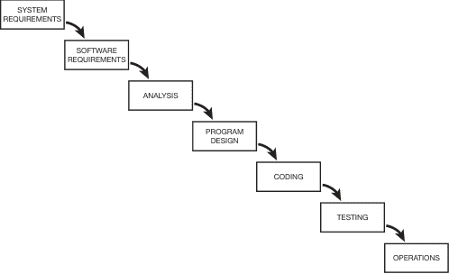

**图1.1** 温斯顿·罗伊斯启发了瀑布开发的图表

然而，该图的显眼位置，以及人们倾向于从论文第一页或第二页的图表来推断论文内容的习惯，导致软件行业发生了戏剧性的转变。

4. Royce, W. W. 1970. Managing the development of large software systems. *Proceedings, IEEE WESCON*, August: 1–9. 可访问 http://www-scf.usc.edu/~csci201/lectures/Lecture11/royce1970.pdf。

在那个年代，我们使用什么流程？当然不是瀑布模型。我们没有遵循详细计划的概念。我们只是日复一日地修补代码，运行编译器，测试代码，修复缺陷。这是一个没有结构的无限循环。它也不是敏捷，甚至不是前敏捷。我们的工作方式没有任何纪律。没有测试套件，也没有测量的时间间隔。只是写代码和修复，写代码和修复，日复一日，月复一月。

我第一次读到瀑布模型是在1972年前后的一份行业杂志上。对我来说，它简直是天赐之物。我们真的可以先分析问题，然后设计解决方案，再实现这个设计吗？我们真的能基于这三个阶段制定进度表吗？当我们完成分析时，项目真的就完成了三分之一吗？我感受到了这个概念的力量。我愿意相信它。因为如果它管用，那就是梦想成真。

显然，我并不是唯一这么想的人，因为许多其他程序员和编程机构也染上了这种风气。而且，正如我之前所说，瀑布模型开始主导我们的思维方式。

它主导了，但并不奏效。在接下来的三十年里，我、我的同事们，以及全世界的程序员兄弟姐妹们，一次又一次地试图把分析和设计做好。但每次我们以为做到了，它却在实施阶段从我们指缝间溜走。我们数月的精心规划，都在经理和顾客的怒目注视下，被不可避免的疯狂冲刺抛到了脑后，最终导致项目严重延期。

尽管失败几乎源源不断，我们仍坚持着瀑布式思维。毕竟，这怎么可能失败呢？彻底分析问题、仔细设计方案、然后实现设计，怎么会一次又一次地惨败？不可思议⁶的是，问题竟然出在那个策略上。问题一定出在我们身上。不知怎地，我们做错了。

6. 看《公主新娘》（1987）就能听到那个词的正确发音。

瀑布思维对我们支配的程度，从当时的用语中可见一斑。当迪杰斯特拉在1968年提出结构化编程时，结构化分析7和结构化设计8也紧随其后。当面向对象编程（OOP）在1988年开始流行时，面向对象分析9和面向对象设计10（OOD）也紧随其后。这三种理念构成的三位一体，三个阶段形成的三人统治，令我们完全臣服。我们根本想象不出还有另一种工作方式。

然而，突然间，我们想象出来了。

敏捷改革的萌芽始于20世纪80年代末或90年代初。Smalltalk社区在80年代就开始展现出一些迹象。布奇在1991年关于OOD的书中也有所暗示。1991年，科克伯恩的水晶方法中出现了更明确的迹象。1994年，受詹姆斯·科普林一篇论文的推动，设计模式社区开始讨论它。

到1995年，比德尔12、德沃斯、沙龙、施瓦伯和萨瑟兰写了他们著名的关于Scrum的论文13。于是，闸门被冲开了。瀑布模型的堡垒被攻破，再无回头之路。

这时，我又一次进入故事之中。以下内容来自我的记忆，我没有尝试与其他相关人核实。因此，你应当认为我的这段回忆有很多遗漏，包含了许多杜撰的成分，或者至少是极其不准确的。但别担心，因为我至少努力让它读起来有点趣味。

我第一次见到肯特·贝克是在1994年的PLOP14会议上，当时科普林在那次会议上展示了他的论文。那是次偶然的相遇，并没有产生什么后续。我第二次见到他是在1999年2月慕尼黑的OOP会议上。但到那时，我已经对他了解了很多。

当时，我是一名C++和OOD顾问，飞来飞去地帮助人们使用OOD技术设计和实现C++应用程序。我的客户开始向我询问流程问题。他们听说瀑布模型与OO不相容，想听听我的建议。我也同意OO与瀑布难以混合15，而且自己对这个想法思考了很多。我甚至想过要编写自己的OO流程。幸运的是，我及早放弃了这一努力，因为我偶然看到了肯特·贝克关于极限编程（XP）的著作。

我对XP读得越多，就越着迷。这些想法是革命性的（至少当时我是这么认为的）。它们很有道理，尤其是在OO语境下（同样，这是我当时的想法）。因此，我渴望了解更多。

让我惊讶的是，在慕尼黑那次OOP会议上，我竟然和肯特·贝克在同一个会场的大厅对面授课。休息时我碰见他，说我们应该一起吃午饭讨论XP。那顿午餐为一段重要的合作关系奠定了基础。与他的讨论促使我飞到他在俄勒冈州梅德福的家中，与他一起设计一门关于XP的课程。那次拜访中，我第一次尝到了测试驱动开发（TDD）的甜头，并就此上了瘾。

当时，我经营着一家名为Object Mentor的公司。我们与肯特合作，开设了一个为期五天的XP训练营课程，我们称之为*XP沉浸式体验*。从1999年底到2001年9月11日16，这些课程非常受欢迎！我们培训了数百人。

阿格妮塔·雅各布森收到了邀请，但未能出席。毕竟，当时世界上绝大多数高级程序员都是中年白人男性——之所以如此，那是另一个时代、另一本书的故事了。

我们17个人代表了相当多不同的观点，包括5种不同的轻量级过程。人数最多的群体是XP团队：肯特·贝克、我、詹姆斯·格雷宁、沃德·坎宁安和罗恩·杰弗里斯。接下来是Scrum团队：肯·施瓦伯、迈克·比德尔和杰夫·萨瑟兰。乔恩·克恩代表特性驱动开发，阿里·范·本内科姆代表动态系统开发方法（DSDM）。最后，阿利斯泰尔·科克伯恩代表他的水晶方法论家族。

其余的人相对独立。安迪·亨特和戴夫·托马斯是“务实程序员”。布莱恩·马里科是一名测试顾问。吉姆·海史密斯是一名软件管理顾问。史蒂夫·梅勒在场是为了让我们保持清醒，因为他代表的是模型驱动哲学，而我们其余许多人对这种哲学持怀疑态度。最后是马丁·福勒，尽管他与XP团队有密切的个人联系，但他对任何品牌化的过程都持怀疑态度，同时对所有过程都抱有同情。

关于我们见面的那两天，我记不太清了。其他在场的人对此的记忆与我的不同17。所以，我只告诉你我所记得的，并建议你把它当作一位65岁老人对近二十年前往事的回忆。我可能会遗漏一些细节，但主旨大概是准确的。

不知怎么的，大家商定由我来开场。我感谢大家的到来，并提议我们的使命应当是创作一份宣言，描述我们认为所有这些变革和建议中的共同点，但很明显我们已经完成了。房间里有种尘埃落定的感觉。没有分歧。没有争论。甚至没有对替代方案进行任何真正的讨论。就是那四句话。

- 个体和互动 高于 流程和工具
- 可工作的软件 高于 详尽的文档
- 客户合作 高于 合同谈判
- 响应变化 高于 遵循计划

我说我们完成了吗？感觉上是这样。但当然，还有很多细节需要解决。首先，我们该怎样称呼我们刚刚确定的东西？

“敏捷”这个名字并不是板上钉钉的选择。有很多不同的候选。我碰巧喜欢“轻量级”，但没人喜欢。他们认为这个词暗示“无关紧要”。其他人喜欢“自适应”这个词。有人提到了“敏捷”这个词，一个人评论说，它当时是军方的一个热门流行词。最后，虽然没有人真正喜欢“敏捷”这个词，但它不过是一堆糟糕选择中最好的一个。

当第二天接近尾声时，沃德主动提出建立agilemanifesto.org网站。我相信让大家在上面签名是他的主意。

### 雪鸟之后

接下来的两周远没有雪鸟的那两天那么浪漫或丰富多彩。这两周主要是由一项艰苦的工作主导：敲定沃德最终添加到网站上的原则文档。

编写这份文件的想法是我们都认为有必要的，以解释和指导这四项价值观。毕竟，这四项价值观是那种每个人都可以同意而不必真正改变什么的陈述。

### 脚注

- 7. 德马科，T. 1979.《结构化分析与系统规格说明》。新泽西州上鞍河：Yourdon出版社。
- 8. 佩奇-琼斯，M. 1980.《结构化系统设计实用指南》。新泽西州恩格尔伍德克利夫斯：Yourdon出版社。
- 9. 科德，P.，和E. 约当。1990.《面向对象分析》。新泽西州恩格尔伍德克利夫斯：Yourdon出版社。
- 10. 布奇，G. 1991.《面向对象设计及其应用》。加州雷德伍德城：本杰明-卡明斯出版公司。
- 11. 科普林，J. O. 1995. 生成式开发过程模式语言。《程序设计模式语言》。马萨诸塞州雷丁：艾迪生-韦斯利，第183页。
- 12. 迈克·比德尔于2018年3月23日在芝加哥被一名精神失常的无家可归者谋杀，此人此前曾被逮捕并释放99次。他本应被送进精神病院收容。迈克·比德尔是我的朋友。
- 13. 比德尔，M.，M. 德沃斯，Y. 沙龙，K. 施瓦伯，和J. 萨瑟兰。SCRUM：高生产率软件开发的一种扩展模式语言。访问自 http://jeffsutherland.org/scrum/scrum_plop.pdf。
- 14. 程序设计模式语言是20世纪90年代在伊利诺伊大学附近举行的一个会议。
- 15. 这是那种不时发生的奇怪巧合之一。OO并没有任何特殊之处使其更不可能与瀑布模型混合，然而在那个时代，这种观念却获得了很大的影响力。
- 16. 那个日期的意义不应被忽视。
- 17. 《大西洋月刊》最近刊发了一篇关于该事件的历史文章：明布斯·奈斯，C. 2017.《彻底颠覆软件世界的冬日之旅》。《大西洋月刊》，12月8日。访问自 https://www.theatlantic.com/technology/archive/2017/12/agile-manifesto-a-history/547715/。截至撰写本文时，我还没有读过那篇文章，因为我不想让它污染我在这里写下的回忆。

至于它们如何运作，则只字未提。这些原则明确指出，这四大价值观的影响远不止其“老生常谈”式的表面含义。

我对这段时期没有太多确切的回忆，只记得我们通过电子邮件来回发送包含这些原则的文档，并反复推敲措辞。那是大量的艰苦工作，但我认为我们都觉得这是值得的。做完这件事之后，我们都回到了各自正常的工作、活动和生活中。我想我们大多数人都以为故事会就此结束。

我们谁也没有预料到随后涌起的巨大支持浪潮。我们谁也没有预见到那两天竟会产生如此重大的影响。但为了防止自己因参与其中而自鸣得意，我不断提醒自己，阿利斯泰尔（Alistair）当时也正准备召集一次类似的会议。这让我不禁想知道，还有多少人也在酝酿同样的事情。因此，我以这样的想法来安慰自己：时机已经成熟，如果我们这17个人没有在犹他州的那座山上相聚，也会有另一群人在别处相聚，并得出类似的结论。

## 敏捷概览

你如何管理一个软件项目？多年来有过许多方法——其中大多数都相当糟糕。在那些相信有神灵主宰软件项目命运的经理人中，“希望与祈祷”颇为流行。而那些没有这种信仰的人，则常常求助于一些激励技巧，比如用鞭子、锁链、沸油，以及人们攀岩和海鸥飞越大海的图片来强制执行最后期限。

这些方法几乎无一例外地导致了软件管理不善的典型症状：开发团队尽管加班过多，却总是延期；团队交付的产品质量明显低劣，远远不能满足客户的需求。

### 铁十字

这些方法之所以失败得如此彻底，是因为使用它们的经理人并不理解软件项目的基本物理规律。这一规律约束着所有项目，使它们必须遵循一个不可动摇的权衡取舍，即项目管理中的*铁十字*（Iron Cross）。好、快、省、完成：任选其三。你无法拥有第四个。你可以拥有一个又好又快又省的项目，但它无法完成；你也可以拥有一个完成、省钱、快速的项目，但它不会有多好。

实际情况是，优秀的项目经理明白，这四个属性都有自己的系数。优秀的经理人会推动项目做到足够好、足够快、足够省，并完成得恰到好处。优秀的经理人管理的是这些属性的系数，而不是要求所有系数都是100%。敏捷努力促成的正是这种管理。

说到这里，我想确保你明白，敏捷是一个*帮助*开发者和经理人执行这种务实项目管理的框架。然而，这种管理并不会自动实现，也无法保证经理人会做出恰当的决策。事实上，在敏捷框架内工作却依然把项目管理得一团糟并推向失败，是完全可能的。

### 墙上的图表

那么，敏捷如何辅助这种管理呢？*敏捷提供数据。*敏捷开发团队产出的，正是经理人为了做出良好决策所需要的那类数据。

请看图1.2。想象一下，它就贴在项目房间的墙上。这不是很棒吗？

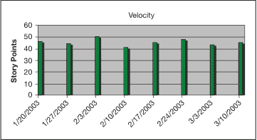

**图1.2** 团队的速度

这张图显示的是开发团队每周完成了多少工作。计量单位是“点”。我们稍后会讨论这些点到底是什么。但只需看看这张图。任何人瞥一眼这张图，就能看出团队前进的速度。用不了十秒钟，就能看出平均速度约为每周45点。

任何人，哪怕是经理，都能预测出下周团队将完成约45点的工作量。在接下来的十周里，他们应该能完成约450点。这就是力量！如果经理和团队对项目中的总点数有良好的把握，那就尤其有力量。事实上，优秀的敏捷团队会把这一信息记录在墙上的另一张图表上。

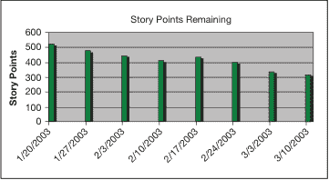

**图1.3** 燃尽图

图1.3被称为*燃尽图*（burn-down chart）。它显示距离下一个主要里程碑还剩多少点。注意它每周都在下降。还要注意，它的下降幅度小于速度图中的点数。这是因为在开发过程中，始终有新的需求和问题不断地被发现。

请注意，燃尽图上有一条斜率，可以预测里程碑大概何时能够达成。事实上，任何人走进房间，看看这两张图表，都能得出这样的结论：按照每周45点的速度，该里程碑将在六月达成。

请注意，燃尽图上有一个小故障。2月17日那一周不知何故出现了回退。这可能是由于增加了一项新功能，或者需求发生了其他重大变化，也可能是开发人员重新估算了剩余工作的结果。无论是哪种情况，我们都想知道它对进度的影响，以便对项目进行妥善管理。

把这两张图表挂上墙，是敏捷的一个关键目标。敏捷软件开发的核心驱动力之一，就是提供经理人所需的数据，以便他们决定如何设定铁十字上的系数，并推动项目取得尽可能好的结果。

很多人会不同意上一段话。毕竟，《敏捷宣言》中并没有提到这些图表，也并非所有敏捷团队都使用这类图表。而且，公平地说，真正重要的其实并不是图表，而是数据。

敏捷开发首先是一种反馈驱动的方法。每一周、每一天、每一小时，甚至每一分钟，都通过回顾前一周、前一天、前一小时、前一分钟的结果，然后做出适当的调整来驱动。这适用于每一个程序员，也适用于整个团队的管理。没有数据，项目就无法管理。¹⁹

19. 这与约翰·博伊德（John Boyd）的OODA循环密切相关，其概要见：https://en.wikipedia.org/wiki/OODA_loop。Boyd, J. R. 1987. *论制胜与失败*。Maxwell Air Force Base, AL: Air University Library, Document No. M-U 43947。

所以，即使你没有把那两张图表挂上墙，也一定要确保数据出现在经理人面前。确保经理人知道团队前进的速度，以及团队还有多少工作要完成。并且要以透明、公开、显而易见的方式呈现这些信息——就像把这两张图表挂在墙上一样。

但为什么这些数据如此重要？没有这些数据，还能有效地管理项目吗？三十年来，我们一直在尝试。而事情的经过是这样的……

### 你首先知道的事

关于一个项目，你首先知道的事情是什么？在你了解项目名称或任何需求之前，有一条数据先于其他一切而存在。当然，就是*那个日期*。一旦*那个日期*被选定，*那个日期*就被冻结了。试图就*那个日期*进行协商毫无意义，因为*那个日期*是出于充分的商业理由才被选定的。如果*那个日期*是九月，那是因为九月有一场贸易展会，或者九月要召开股东大会，又或者我们的资金在九月就要耗尽。无论原因是什么，这都是一个充分的*商业*理由，而且它不会仅仅因为一些开发人员认为自己可能赶不上就改变。

与此同时，需求却在剧烈变化，而且永远无法冻结。这是因为客户并不真正知道自己想要什么。他们大致知道自己想要*解决*什么问题，但将这个问题转化为系统的需求绝非易事。因此，需求不断被重新评估、重新思考。新功能被添加，旧功能被移除。用户界面的形态即使不是每天，也是每周都在改变。

这就是软件开发团队所处的世界。在这个世界里，日期是冻结的，而需求在不断变化。而无论如何，在这种背景下，开发团队都必须将项目推向良好的结果。

### 那次会议

瀑布模型曾承诺给我们一种方法来应对这个问题。要理解这究竟有多么诱人、又多么无效，我需要带你去*那次会议*。

今天是五月一日。大老板把我们召集到会议室。

“我们有个新项目，”大老板说。“必须在十一月一日前完成。目前还没有任何需求。接下来的几周内我们会把需求给你们。”

“那么，你们做分析需要多长时间？”

我们用余光互相看了看。没人愿意开口。这种问题怎么回答？有人低声说：“可是我们还没有需求啊。”

“假装你们已经有需求了！”大老板吼道。“你们知道这是怎么回事。你们都是专业人士。我不需要确切的日期。我只需要在日程表上填个东西。记住，如果超过两个月，那我们还不如不做这个项目。”

“两个月？”有人低声嘟囔了一句，但大老板把这当成了肯定。“很好！我也是这么想的。那么，你们做设计需要多长时间？”

房间里再次陷入惊愕的沉默。你心里一算。你意识到离十一月一日还有六个月。结论显而易见。“两个月？”你说。

“没错！”大老板眉开眼笑。“和我想的完全一样。这样我们就还剩两个月来做实现。感谢你们来开会。”

你们中许多读到这段文字的人都参加过那种会议。没参加过的，算你们走运。

### 分析阶段

于是我们都离开会议室，回到自己的办公室。我们在做什么？这是分析阶段的开始，所以我们一定是在分析。但这个所谓的*分析*到底是什么？

如果你读过软件分析方面的书，你就会发现有多少个作者，就有多少种关于分析的定义。关于分析到底是什么，并没有真正的共识。它可能是创建需求的工作分解结构；可能是发现和细化需求；可能是创建底层数据模型、对象模型，或者……关于分析最好的定义是：分析师做的就是分析。

当然，有些事情是显而易见的。我们应该评估项目规模，进行基本的可行性和人力资源预测。我们应该确保进度是可以实现的。这是我们的业务方对我们最低的期望。无论这个叫分析的东西是什么，它就是我们在接下来的两个月里要做的事。

这是项目的蜜月期。每个人都在愉快地上网，做点日内交易，见客户，见用户，画漂亮的图表，总之过得很开心。

然后，到了七月一日，奇迹发生了。分析做完了。

为什么分析做完了？因为今天是七月一日。日程表上写着我们本应在七月一日完成，所以我们在七月一日完成。为什么要拖延呢？

于是我们开了个小派对，有气球和演讲，庆祝我们通过阶段关口，进入设计阶段。

### 设计阶段

那我们现在在做什么？当然是在设计了。但*设计*又是什么？

对于软件设计，我们稍微更有共识。软件设计就是把项目拆分成模块，并设计这些模块之间的接口。同时，我们也要考虑需要多少个团队，以及这些团队之间应该是什么样的连接关系。总的来说，我们应该细化日程表，以便制定一个现实可行的实现计划。

当然，这个阶段会发生意想不到的变化。新功能被添加。旧功能被删除或修改。我们很想回头重新分析这些变化；但时间很紧。所以我们只能把这些变化硬塞进设计中。

然后又一个奇迹发生了。到了九月一日，设计做完了。为什么设计做完了？因为今天是九月一日。日程表说我们应该做完了，所以为什么要拖延呢？

于是又是一个派对。气球和演讲。我们冲过阶段关口，进入实现阶段。

要是我们能再一次蒙混过关就好了。要是我们能直接说实现做完了就好了。但我们不能，因为实现这件事实际上必须真正完成。分析和设计不是*二元交付物*。它们没有明确无歧义的完成标准。没有什么真正的办法知道你完成了它们。所以我们还不如按时完成。

### 实现阶段

另一方面，实现有明确的完成标准。你没办法成功地假装它已经完成。[^20]

在实现阶段，我们做的事情完全清晰无歧义。我们在写代码。而且我们最好像疯了一样地写代码，因为这个项目我们已经浪费了四个月。

与此同时，需求还在不断变化。新功能不断被添加。旧功能被删除或修改。我们很想回头重新分析和重新设计这些变化，但只剩几周时间了。于是我们把各种变化硬塞、硬塞、再硬塞进代码里。

当我们看着代码，再对照设计时，我们意识到当初做设计时一定吸了什么特别的东西，因为代码一点也不像我们画的那些漂亮图表。但我们没时间担心这个，因为时间在滴答流逝，加班时间也在不断增加。

然后，大约在十月十五日左右的某个时候，有人说：“嘿，今天几号？这个项目什么时候截止？”就在那一刻我们意识到只剩两周了，而且绝不可能在十一月一日前完成。这也是利益相关者第一次被告知这个项目可能有点小问题。

你可以想象利益相关者的焦虑。“你们难道不能在分析阶段就告诉我们吗？那不是你们应该评估项目规模、验证进度可行性的阶段吗？你们难道不能在设计阶段告诉我们吗？那不是你们应该把设计拆分成模块、把模块分配给团队、做人力资源预测的阶段吗？为什么偏偏要拖到截止日期前两周才告诉我们？”

他们说得有道理，不是吗？

### 死亡行军阶段

于是我们现在进入到项目的死亡行军阶段。客户很生气。利益相关者很生气。压力越来越大。加班时间飙升。有人离职。简直就是地狱。

到了三月的某个时候，我们交付了一个一瘸一拐的东西，勉强算是完成了一半顾客想要的功能。所有人都很沮丧。所有人都失去了动力。我们向自己保证再也不做这种项目了。下次我们要做得对！下次我们要做更多的分析和更多的设计。

我把这称为*失控的过程恶性膨胀*。我们打算去做那种没用的方法，而且要做更多。

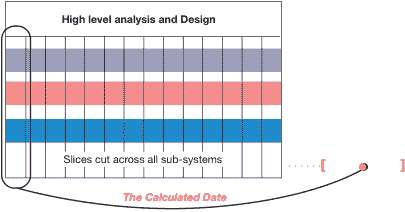

**图 1.5** 计算新的结束日期

这个计算结果很可能会让人非常失望。它几乎肯定会比项目原定结束日期超出很多。另一方面，这个新日期是基于*真实数据*的，所以不应该被忽视。但也不能太当真，因为它基于单一数据点；该预测日期周围的误差线相当宽。

要缩小这些误差线，我们应该再迭代两三次。随着迭代进行，我们会获得更多关于一个迭代能完成多少用户故事的数据。我们会发现这个数字每次迭代都不同，但平均下来会形成一个相对稳定的*速率*。经过四五次迭代后，我们就会对项目何时完成有更好的判断（图 1.6）。

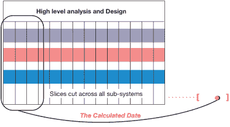

**图 1.6** 更多迭代意味着对项目结束日期有更好的判断

[^20]: 虽然 healthcare.gov 的开发者们确实试过。

### 更改时间表

让我们从时间表开始。问问利益相关者，我们能否将项目从11月1日推迟到3月1日。这类对话通常不会顺利。请记住，这个日期是出于充分的商业原因而选定的。那些商业原因很可能没有改变。因此，推迟通常意味着业务将受到某种重大打击。

另一方面，有时业务方只是因为方便而选择日期。例如，也许11月有一个贸易展，他们想在那里展示项目。也许3月还有另一个贸易展，效果也一样好。记住，现在还在早期阶段。我们在这个项目中才进行了几次迭代。我们想要在利益相关者于11月展会购买展位空间*之前*，告诉他们交付日期将是3月。

许多年前，我管理着一组软件开发人员，为一个电话公司做项目。在项目进行到一半时，我们显然会比预期的交付日期晚六个月。我们尽可能早地向电话公司高管们挑明此事。这些高管还从来没有遇到过软件开发团队提前告诉他们计划会推迟的情况。他们站起来，为我们起立鼓掌。

你不该指望这种事。但它确实发生在我们身上。一次。

### 增加人手

一般来说，业务方根本不愿意改变时间表。这个日期是出于良好的商业原因选择的，而原因仍然成立。所以让我们尝试增加人手。所有人都知道，加倍人手就能快一倍。

实际上，事实恰恰相反。布鲁克斯定律[^2]指出：*向一个延误的项目添加人手，只会让它更加延误。*

我相信你知道我要说这是徒劳的。制造垃圾*不会*让你更快，只会让你更慢。这是你当了二三十年程序员后学到的教训。从来就没有什么“快速而草率”这回事。任何草率的东西都是慢的。

> *唯一能让你快起来的办法，就是把事情做好。*

所以我们要把质量旋钮调到11。如果我们想缩短进度，唯一的选择就是*提高*质量。

### 更改范围

那只剩下最后一件事可以改了。也许，只是也许，一些计划中的功能并不真的需要在11月1日前完成。让我们问问利益相关者。

> “利益相关者，如果你们需要所有这些功能，那么交付时间就是3月。如果你们必须在11月前得到某些东西，那你们就不得不砍掉一些功能。”

> “*我们什么都不砍；我们必须全部要！而且必须在11月1日前全部交付。*”

> “啊，但你们不明白。如果你们需要全部，那我们需要到3月才能完成。”

> “*我们需要全部，而且我们需要在11月前全部交付？*”

这场小小的争论会持续一阵子，因为没有人愿意让步。但尽管利益相关者在争论中占据道德高地，程序员掌握着数据。在任何理性的组织中，数据将获胜。

如果组织是理性的，那么利益相关者最终会低头接受，并开始仔细审视计划。他们会一个接一个地找出那些并非必须在11月前完成的功能。这很痛苦，但理性的组织又有什么真正的选择呢？于是计划被调整了。部分功能被推迟。

### 商业价值排序

当然，不可避免的是，利益相关者会找到一个我们已经实现的功能，然后说：“你们做了这个功能真是可惜，我们确实不需要它。”

我们再也不想听到这种话！所以从现在开始，在每次迭代开始时，我们都要问利益相关者接下来实现哪些功能。是的，功能之间存在依赖关系，但我们是程序员，我们能处理依赖。无论如何，我们会按照利益相关者要求的顺序实现功能。

### 概述到此结束

你刚才读到的是敏捷的两万英尺俯瞰。很多细节被省略了，但这就是它的要旨。敏捷是一种将项目细分为多次迭代的过程。每次迭代的输出都会被衡量，并用于持续评估进度。功能按商业价值顺序实现，这样最有价值的东西会最先实现。质量尽可能保持在高水平。进度主要通过调整范围来管理。

这就是敏捷。

## 生命之环

图1.8是罗恩·杰弗里斯描述XP实践的示意图。这张图被亲切地称为*生命之环*。

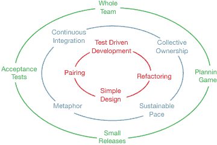

**图1.8** 生命之环

我在本书中选择介绍XP的实践，是因为在所有敏捷流程中，XP定义最清晰、最完整，也最不混乱。几乎所有其他敏捷流程都是XP的子集或变体。这并不是说其他敏捷流程就该被轻视。事实上，你可能会发现它们对各种项目很有价值。但如果你想真正理解敏捷的本质，没有比学习XP更好的方法了。XP是敏捷核心的原型和最佳代表。

肯特·贝克是XP之父，沃德·坎宁安是XP之祖父。两人在80年代中期于泰克公司共事，探索了许多最终成为XP的想法。肯特后来在1996年前后将这些想法提炼成具体的形式，即XP。2000年，贝克出版了权威著作：*《解析极限编程：拥抱变化》*。[^23]

生命之环被细分为三个环。外环展示了面向业务的XP实践。这一环基本上相当于Scrum[^24]流程。这些实践为软件开发团队与业务方沟通的方式提供了框架，也为业务方和开发团队管理项目提供了原则。

- *规划游戏*实践在这个环中扮演核心角色。它告诉我们如何将项目拆分为特性、故事和任务。它为这些特性、故事和任务的估算、优先级排序和进度安排提供了指导。
- *小型发布*引导团队以小块为单位开展工作。
- *验收测试*为特性、故事和任务提供了“完成”的定义。它向团队展示了如何设定明确的完成标准。
- *全体团队*传达了这样的理念：软件开发团队由许多不同职能组成，包括程序员、测试人员和管理人员，他们朝着同一个目标共同努力。

生命之环的中间环展示了面向团队的实践。这些实践为开发团队自我沟通和管理提供了框架与原则。

- *可持续节奏*是一种实践，防止开发团队过快消耗资源，在到达终点线之前就筋疲力尽。
- *集体所有权*确保团队不会把项目分割成一组知识孤岛。
- *持续集成*让团队专注于足够频繁地闭合反馈回路，以便随时知道自己的位置。
- *隐喻*是一种实践，它创建并传播团队和业务方用来讨论系统的词汇和语言。

[^2]: Brooks, Jr., F. P. 1995 [1975]。*《人月神话》*。雷丁，马萨诸塞州：艾迪生-韦斯利。https://en.wikipedia.org/wiki/Brooks%27s_law

[^23]: Beck, K. 2000。*《解析极限编程：拥抱变化》*。波士顿，马萨诸塞州：艾迪生-韦斯利。还有一个2005年版权的第二版，但第一版是我最喜欢的，也是我认为最具权威性的版本。肯特可能不同意。

[^24]: 至少是Scrum最初构想的样子。如今，Scrum已经吸收了更多XP实践。

## 敏捷的理由

在我们深入探讨敏捷开发的细节之前，我想先说明其中的利害关系。敏捷开发不仅对软件开发很重要，而且对我们的行业、我们的社会乃至我们的文明都至关重要。

开发人员和管理人员常常因一些短暂的理由而被敏捷开发所吸引。他们可能会尝试敏捷，因为他们只是感觉这样做是对的，或者或许他们轻信了速度和质量的承诺。这些理由是无形的、模糊的，并且容易被挫败。许多人放弃敏捷开发，仅仅是因为他们没有立即体验到他们自以为承诺过的结果。

这些转瞬即逝的理由并不是敏捷开发重要的原因。敏捷开发之所以重要，是因为更深层次的道义和伦理原因。这些原因关乎专业精神，以及我们对客户的合理期望。

### 专业精神

最初吸引我投身敏捷的，是对纪律的高度承诺，而非繁琐仪式。要正确地实践敏捷，你必须结对工作、测试先行、重构，并致力于简洁的设计。你必须以短的周期工作，并在每个周期内产生可执行的输出。你必须定期且持续地与业务方沟通。

回顾生命循环，并将其中每一项实践都视为一种*承诺*、一种*责任*，你就会明白我的出发点。对我来说，敏捷开发是一种提升自我的承诺——成为一名专业人士，并在整个软件开发行业中推广专业行为。

我们这个行业迫切需要提升我们的专业水平。我们失败得太频繁。我们交付了太多劣质产品。我们接受了太多缺陷。我们做出了糟糕的取舍。我们常常表现得像拿着新信用卡的叛逆少年。在更简单的时代，这些行为是可以容忍的，因为风险相对较低。在七十年代、八十年代，甚至进入九十年代，软件失败的代价虽然高昂，但却是有限且可控的。

但情况更糟糕。如今，在我们的社会中，几乎没有任何重要的事情可以不与软件系统交互就能完成。没有法律可以制定、颁布或执行。没有政府政策可以被辩论。没有飞机可以飞行。没有汽车可以驾驶。没有导弹可以发射。没有船只可以航行。道路无法铺设，食物无法收割，钢厂无法炼钢，汽车工厂无法造车，糖果公司无法做糖果，股票无法交易……

在我们的社会中，没有软件就什么也做不成。每一个醒着的时刻都被软件主宰。我们中许多人甚至用软件来监测睡眠。

### 我们统治世界

我们的社会已经完全彻底地依赖软件。软件是使我们的社会运转的命脉。没有软件，我们目前享受的文明将不可能存在。

那么是谁编写了所有这些软件？是你和我。我们，程序员，统治世界。

其他人认为自己统治世界，但他们把他们制定的规则交给我们，而*我们*写下实际运行的规则，这些规则在监控和控制现代生活几乎每一个活动的机器中运行。

我们，程序员，统治世界。

而我们将这项工作做得相当糟糕。

你认为那些绝对运行一切的软件中有多少经过了适当的测试？有多少程序员能说他们有一套测试套件，能够在很高程度上*证明*他们编写的软件是有效的？

汽车内部运行的数亿行代码工作正常吗？你在里面发现过错误吗？我找到过。那么控制刹车、油门和转向的代码呢？有没有错误？是否有一套可以随时运行的测试套件，能够高度可靠地*证明*当你踩下刹车踏板时，汽车确实会停下？

有多少人因为汽车软件未能响应驾驶员踩下制动踏板的压力而丧生？我们不确定，但答案是*很多*。在2013年的一起案件中，丰田支付了数百万美元的赔偿金，因为其软件包含“可能的位翻转、导致安全失效禁用的任务死亡、内存损坏、单点故障、对堆栈溢出和缓冲区溢出保护不足、单故障隔离区域[以及]数千个全局变量”，全部都在“意大利面条式代码”中。[^1]

我们的软件如今正在杀人。你和我或许并不是为了杀人而进入这一行业的。我们中的许多人成为程序员，是因为当我们还是孩子时，我们写了一个无限循环来在屏幕上打印我们的名字，而我们认为那太酷了。但现在，我们的行为正将生命和财产置于危险之中。随着每一天的过去，越来越多的代码将越来越多的生命和财产置于危险之中。

### 灾难

总有一天——如果在你读到这本书时它还没有发生的话——某个可怜的程序员会做一些愚蠢的事情，并因一时的粗心大意在一瞬间杀死一万人。想一想。不难想象出五六种情景。而当这种情况发生时，世界上的政客们会义愤填膺地站起来（他们应该如此），并直接把手指指向我们。

你可能会以为那些手指会指向我们的老板或公司高管，但我们已经看到了当那些手指指向大众汽车北美公司CEO时发生了什么，当时他在国会作证。政客们问他，为什么大众汽车在他们的汽车中放置了专门检测并击败加州排放测试硬件的软件。他回答说：“从我的角度来看，并且据我目前所知，这不是一个公司决定。这是几个软件工程师出于某种原因放进去的。”[^2]

所以，那些手指将指向我们。而且理应如此。因为将是我们把手指放在键盘上，是我们缺乏纪律，是我们的粗心大意成为最终原因。

正是考虑到这一点，我对敏捷抱有如此高的期望。我当时希望，如同我今天仍然希望的那样，敏捷软件开发的纪律将是我们把计算机编程转变为一种真正而光荣的行业的第一步。

### 合理的期望

下面是管理者、用户和客户对我们提出的完全合理期望的清单。当你通读这份清单时，请注意你大脑的一侧同意每一项都是完全合理的。同时注意另一侧，即程序员侧，则惊恐地反应。你大脑的程序员侧可能无法想象如何满足这些期望。

满足这些期望是敏捷开发的主要目标之一。敏捷的原则和实践相当直接地处理了这份清单中的大多数期望。下面的行为是任何优秀的首席技术官（CTO）都应对其员工抱有的期望。事实上，为了把这一点说清楚，我想让你把我想象成你的CTO。以下就是我的期望。

### 我们不会交付垃圾！

很不幸，我们这个行业居然还需要提到这个期望。但确实如此。我确信，亲爱的读者们，你们中许多人在一个或多个场合违背过这个期望。我当然违背过。

[^1]: 安全研究与战略公司（Safety Research & Strategies Inc.）。2013年。丰田意外加速和大碗“意大利面条”代码[博客文章]。11月7日。访问自 http://www.safetyresearch.net/blog/articles/toyota-unintended-acceleration-and-big-bowl-%E2%80%99spaghetti%E2%80%99-code。

[^2]: O’Kane, S. 2015. 大众美国CEO将排放作弊丑闻归咎于软件工程师。The Verge。10月8日。访问自 https://www.theverge.com/2015/10/8/9481651/volkswagen-congressional-hearing-diesel-scandal-fault。

要理解这个问题有多严重，可以想想洛杉矶空中交通管制网络因32位时钟翻转而关闭的事件。或者波音787上所有发电机因同样原因关闭的事件。又或者737 Max的MCAS软件导致数百人丧生的事件。

或者再想想我自己在 healthcare.gov 初期的经历。像如今许多系统一样，首次登录后，它要求回答一组安全问题。其中有一个是“一个值得纪念的日期”。我输入了 7/21/73，我的结婚纪念日。系统却显示 `Invalid Entry`。

我是程序员。我知道程序员是怎么想的。所以我尝试了许多不同的日期格式：`07/21/1973`、`07-21-1973`、`21 July, 1973`、`07211973` 等等。结果全部一样，都是 `Invalid Entry`。这真让人沮丧。这个该死的系统到底想要什么日期格式？

然后我恍然大悟。编写这段代码的程序员并不知道会问什么问题。他或她只是从数据库里取出问题，然后存储答案。那位程序员很可能还禁止答案中包含特殊字符和数字。于是我输入：`Wedding Anniversary`。这次居然通过了。

我觉得可以公正地说，任何要求用户像程序员一样思考才能以预期格式输入数据的系统，都是垃圾。

我可以在这个部分写满关于这类垃圾软件的轶事。但其他人已经做得比我好得多。如果你想更全面地了解这个问题的范围，请阅读 Gojko Adzic 的 *Humans vs. Computers*[^3] 和马特·帕克的 *Humble Pi*。[^4]

我们的管理者、客户和用户期望我们提供的系统质量高、缺陷少，这是完全合理的。没有人指望拿到垃圾——尤其是当他们在上面花了大价钱的时候。

注意，敏捷对测试、重构、简单设计和客户反馈的强调，正是避免交付糟糕代码的明显解药。

## 持续技术就绪

客户和管理者最不希望的就是我们程序员人为地延迟系统交付。但这种人为延迟在软件团队中很常见。造成这种延迟的原因通常是试图同时构建所有功能，而不是优先构建最重要的功能。只要还有功能处于半完成、半测试或半文档化状态，系统就无法部署。

人为延迟的另一个来源是“稳定化”的概念。团队经常会预留一段持续测试的时间，在这段时间里观察系统是否会出故障。如果在X天后没有发现故障，开发者就觉得可以放心推荐部署系统了。

敏捷用一个简单的规则解决了这些问题：系统在每次迭代结束时都应当*技术上可部署*。技术上可部署意味着，从开发者的角度来看，系统在技术上是足够稳固的、可以部署的。代码干净，测试全部通过。

这意味着，迭代中完成的工作包括该迭代所实现用户故事的所有编码、所有测试、所有文档编制以及所有稳定化工作。

如果系统在每个迭代结束时都*在技术上*准备好部署，那么部署就是一个*业务决策*，而不是技术决策。业务方可能会认为功能还不够多而决定不部署，也可能出于市场原因或培训原因决定推迟部署。无论如何，系统质量都达到了可部署性的*技术*门槛。

系统是否有可能每一两周就能在技术上可部署？当然有可能。团队只需挑选一批足够小的用户故事，使他们在迭代结束前能完成所有部署就绪任务。他们最好也实现绝大部分测试自动化。

从业务方和客户的角度来看，持续技术就绪本就是理所应当的。当业务方看到一个功能可用，他们就认为这个功能已经完成了。他们不希望被告知还要再等一个月让QA做稳定化。他们也不希望看到某个功能之所以能演示成功，只是因为操作演示的程序员绕过了所有不工作的部分。

## 稳定的生产力

你可能已经注意到，在一个全新项目的最初几个月里，编程团队通常进展非常快。当没有现有代码库拖累你时，你可以在短时间内编写出大量可运行的代码。

不幸的是，随着时间推移，代码中的混乱会不断累积。如果这些代码不被保持整洁有序，就会给团队带来阻碍进度的反压力。混乱越大，反压力就越大，团队就越慢。团队越慢，进度压力就越大，就越有动力制造更大的混乱。这种正反馈循环会让团队几乎寸步难行。

管理者对进度放缓感到困惑，最终可能决定给团队增派人手以提升生产力。但正如我们在上一章看到的，增派人手实际上会让团队在几周内变得更慢。

希望是在这几周之后，新人能跟上进度，帮助提高速度。但谁来培训新人呢？正是最初制造混乱的那些人。新人肯定会效仿这种既有做法。

老虎队从哪儿获取需求？是否有一份最新的需求文档？有的。就是旧代码。旧代码是唯一准确描述重新设计后的系统应做什么的文档。

于是老虎队正仔细研读旧代码，想弄清它到底做了什么，新设计应该是什么样子。与此同时，我们其他人正在修改旧代码，修复缺陷并添加新功能。

因此，我们处在一场竞赛中。老虎队试图击中一个移动的目标。而且，正如芝诺在阿喀琉斯与乌龟的寓言中所示，追上移动的目标可能是个挑战。每当老虎队到达旧系统曾经的位置时，旧系统又已经移动到了新的位置。

需要微积分才能证明阿喀琉斯最终会超过乌龟。然而在软件领域，这种数学并不总是成立。我曾在一家公司工作，十年过去了，新系统仍未部署。客户在八年前就得到了新系统的承诺。但新系统始终不具备让客户满意的足够功能；旧系统总是比新系统功能更多。因此客户拒绝接受新系统。

几年后，客户干脆无视新系统的承诺。在他们看来，那个系统根本不存在，而且永远也不会存在。

与此同时，公司要支付两个开发团队的费用：老虎队和维护团队。最终，管理层变得非常沮丧，他们告诉客户，即使客户反对，他们也要部署新系统。客户对此大为光火，但比起老虎队——或者我该说，老虎队残余成员的激烈反应，这根本不算什么。最初的开发者们都已经升职并转入了管理岗位。团队现在的成员齐刷刷地站起来说：“你们不能发布这个，这是垃圾。需要重新设计。”

好吧，没错，这是鲍勃大叔讲的又一个夸张的故事。这个故事基于真实事件，但我确实为了效果而添油加醋。不过，其背后的道理完全真实。大规模重设计极其昂贵，而且很少能真正部署。

[^3]: Adzic, G. 2017. *Humans vs. Computers*. London: Neuri Consulting LLP. Accessed at http://humansvscomputers.com.

[^4]: Parker, M. 2019. *Humble Pi: A Comedy of Maths Errors*. London: Penguin Random House UK. Accessed at https://mathsgear.co.uk/products/humble-pi-a-comedy-of-maths-errors.

## 低成本的适应性

客户和管理者并不指望软件团队会随着时间推移而放慢速度。相反，他们期望，一个在项目开始时需要两周的功能，一年后仍然只需两周。他们期望生产力随时间保持稳定。

开发者也不应降低期望。通过持续保持架构、设计和代码尽可能干净，他们可以保持高生产力，并避免陷入那种原本不可避免的低生产力和重新设计的螺旋。

正如我们将要展示的，测试、结对、重构和简单设计这些敏捷实践，正是打破这种螺旋的技术关键。而计划游戏则是驱动这种螺旋的进度压力的解药。

Software 是一个复合词。“ware”意为“产品”，“soft”意为“易于改变”。因此，软件是一种易于改变的产品。我们发明软件，是因为我们想要一种能够快速且方便地改变机器行为的方式。如果我们希望这种行为难以改变，我们就会称它为硬件。

开发者常常抱怨需求变更。我经常听到诸如此类的话：“那个变更彻底破坏了我们的架构。”我有消息要告诉你，伙计。如果需求变更破坏了你的架构，那你的架构就很糟糕。

我们开发者应该欢迎变化，因为这就是我们存在的意义。需求变更正是这场游戏的主题。这些变化是我们职业生涯和薪资的正当理由。我们的工作取决于我们是否有能力接受不断变化的需求、以工程化手段处理它们，并让这些变化相对便宜。

一个团队的软件越难以改变，这个团队就越违背了该软件存在的根本理由。客户、用户和管理者期望软件系统易于改变，并且这种改变的成本很小且与之相称。

碰它？”因为你清楚，如果你碰了它，你就会弄坏它；而一旦弄坏，它就成了你的责任。所以你退缩，不去做那件唯一可能改进代码的事：清理它。

这是一种恐惧反应。你害怕这份代码，而这种恐惧迫使你表现得无能。你无法胜任必要的清理工作，因为你害怕后果。你让这份由你创造的代码失控到如此地步，以至于你害怕任何改善它的行动。这是极度不负责任的。

客户、用户和管理者期望的是*无所畏惧的能力*。他们期望，如果你发现某些东西有误或肮脏，你会修复它并清理它。他们不希望问题溃烂蔓延；他们期望你掌控代码，尽可能保持它的干净和清晰。

那么，你要如何消除这种恐惧？想象你有一个按钮，控制着两盏灯：一盏红色，一盏绿色。再想象，当你按下这个按钮时，如果系统正常，绿灯亮；如果系统损坏，红灯亮。按下按钮并得到结果只需要几秒钟。你会多频繁地按这个按钮？你会按个不停。你会一直按。每当你对代码做了任何修改，你都会按下按钮，确保自己没有破坏任何东西。

现在想象你正看着屏幕上一些糟糕的代码。你的第一个念头是：“我应该清理它。”然后你直接开始清理，每做一点小改动就按一下按钮，确保自己没有破坏任何东西。

恐惧消失了。你可以清理代码。你可以使用重构、结对和简单设计这些敏捷实践来改进系统。

你怎么得到这个按钮？测试驱动开发（TDD）这个敏捷实践为你提供了这个按钮。如果你以纪律和决心遵循这一实践，你就会拥有这个按钮，并且能够无所畏惧地胜任工作。

QA 经理把这份文档递到我面前，因为他刚从老板的办公室回来。他的老板刚从 CEO 的办公室回来。那是 2008 年。大衰退已经开始。CFO 每六个月就把那一百万美元削减一半。QA 经理把这份文档递到我面前，问我这些测试中他不应该运行哪一半。

我告诉他，无论他决定如何削减测试，他都不会知道他的系统是否有一半仍在工作。

这是手工测试的必然结果。手工测试最终总会流失。你刚才听到的是手工测试流失的第一个也是最明显的机制：手工测试*成本高昂*，因此总是成为削减的目标。

然而，还有一种更隐蔽的手工测试流失机制。开发者很少按时交付给 QA。这意味着 QA 用来运行所需测试的时间比原计划少。因此，为了赶上发布期限，QA 必须*选择*他们认为最合适的测试来运行。于是，有些测试没有被运行。它们流失了。

更何况，人不是机器。要求人做机器能做的事，既昂贵、低效，又*不道德*。有一项更适合 QA 从事的活动——一项运用他们人类创造力和想象力的活动。不过我们稍后会讲到。

客户和用户期望每一个新版本都经过彻底测试。没有人期望开发团队因为时间或金钱耗尽而跳过测试。因此，所有切实可行的测试都必须自动化。手工测试应仅限于那些无法自动验证的内容，以及探索性测试这一创造性实践。^5

TDD、持续集成和验收测试等敏捷实践支撑了这一期望。

5. 敏捷联盟。探索性测试。访问于 https://www.agilealliance.org/glossary/exploratory-testing。

例如，你可能不知道某件事需要多长时间，但你可以用相对的方式将一项任务与另一项进行比较。你可能不知道构建*登录*页面需要多长时间，但你或许能告诉我，*更改密码*页面大约只需要*登录*页面一半的时间。诸如此类的相对估算具有极大的价值，我们将在后面章节中看到。

或者，你也可以不做相对估算，而是给我一个概率范围。例如，你可能会告诉我，*登录*页面需要 5 到 15 天才能完成，平均完成时间为 12 天。这类估算将你知道的和不知道的结合起来，成为一个诚实的概率，供管理者管理。

计划游戏和完整团队等敏捷实践支撑了这一期望。

### 你需要说“不”

虽然努力寻找问题的解决方案很重要，但我也期望，在找不到这种解决方案时，你说“不”。你需要明白，你被雇用，更多是因为你说“不”的能力，而不是你编码的能力。你们这些程序员，才是知道某件事是否可能的人。作为你们的 CTO，我指望你们在我们正走向悬崖时提醒我们。我期望，无论你感受到多大的进度压力，无论有多少管理者在要求成果，当答案真的是“不”时，你就会说“不”。

完整团队这一敏捷实践支撑了这一期望。

### 持续进取式学习

作为 CTO，我期望你持续学习。我们这个行业变化很快。我们必须能够随之变化。所以，学习、学习、再学习！有时公司负担得起送你去上课程和参加会议。有时公司负担得起购买书籍和培训视频。但如果负担不起，你就必须找到在没有公司帮助的情况下继续学习的方法。

完整团队这一敏捷实践支撑了这一期望。

### 开发者权利法案

开发者权利法案包括以下内容：

- 你有权在优先级被清晰声明的前提下，知道需要什么。
- 你有权在任何时候产出高质量的工作。
- 你有权向同事、管理者和客户请求并获得帮助。
- 你有权做出并更新自己的估算。
- 你有权主动接受自己的职责，而不是被指派职责。

这些都是极其有力的主张。我们应逐一加以思考。

### 客户

这里的“客户”一词泛指商业人士。这包括真正的客户、管理者、高管、项目负责人，以及任何其他可能对进度和预算负责，或者会为系统运行付费并从中受益的人。

> 客户有权得到一份总体计划，并知道在何时能以何种成本完成什么。

许多人声称前期规划不是敏捷开发的一部分。客户的第一项权利恰恰驳斥了这种说法。当然，业务需要计划。当然，该计划必须包含进度和成本。而且，该计划当然应在切实可行的范围内尽可能准确和精确。

我们常常正是在最后这一点上陷入困境，因为要同时做到准确和精确，唯一的方法就是真正开发这个项目。任何打折扣的做法都无法做到既准确又精确。因此，我们开发者要保障这项权利，就必须确保我们的计划、估算和进度安排恰当地描述了我们不确定性的程度，并定义降低这种不确定性的方法。

简而言之，我们无法同意在固定日期交付固定范围。要么范围是灵活的，要么日期是灵活的。我们用概率曲线来表示这种灵活性。例如，我们估计有95%的概率能在日期前完成前十个故事。有50%的概率能在日期前完成接下来五个。还有5%的概率能在日期前完成之后的五个。

客户有权获得这种基于概率的计划，因为没有它，他们无法管理自己的业务。

> *客户有权从每次迭代中获得尽可能多的价值。*

敏捷将开发工作分解为固定时间盒，称为*迭代*。业务方有权期望开发人员在任意给定时间处理最重要的事情，并且每次迭代都能为他们提供尽可能多的*可用*业务价值。这种价值优先级由客户在每次迭代开始时的计划会议中指定。客户选择那些能带来最高投资回报率且适合开发人员对迭代估算的故事。

> *客户有权在运行中的系统中看到进展，该系统通过他们指定的可重复测试证明其可用。*

从客户的角度来看，这似乎是显而易见的。他们当然有权看到增量进展。他们当然有权指定接受该进展的标准。他们当然有权快速、反复地看到他们的验收标准已被满足的证据。

> *客户有权改变主意、替换功能以及更改优先级，而无需付出高昂的代价。*

毕竟，这是软件。软件的全部意义在于能够轻松地改变我们机器的行为。这种灵活性正是软件被发明的原因。

无论如何，接受的权利伴随着代价。接受意味着责任。接受任务的开发人员要负责任务的质量和执行，要不断更新估算以便管理进度，要向整个团队传达状态，并在需要帮助时寻求帮助。

团队编程需要初级和高级开发人员紧密合作。团队有权共同决定谁做什么。技术负责人可能会要求开发人员承担某项任务，但无权强迫任何人接受任务。

### 结论

敏捷是一个支持专业软件开发的原则框架。信奉这些原则的人接受并遵守管理者、利益相关者和客户的合理期望。他们也享受并遵守敏捷赋予开发人员和客户的权利。这种权利和期望的相互接受与赋予——这种原则的承诺——是软件道德标准的基础。

敏捷不是一种流程。敏捷不是一时风尚。敏捷不仅仅是一套规则。相反，敏捷是一套权利、期望和原则，这些构成了一个道德职业的基础。

为了成功，开发必须遵循许多面向业务的实践。这些包括计划、小规模发布、验收测试和整个团队。

## 计划

你如何估算一个项目？简单的答案是将其分解为组成部分，然后估算这些部分。这是一个不错的方法；但如果这些部分本身太大而无法准确估算呢？你只需将这些部分分解成更小的部分并进行估算。我相信你们都能嗅到递归下降的味道。

你能把这个过程分解到什么程度？你可以一直分解到单独的代码行。事实上，这正是程序员所做的。程序员就是善于将任务分解为单独代码行的人。

如果你想要一个准确且精确的项目估算，那就把它分解成单独的代码行。你这样做所花费的时间将为你提供一个*非常*准确且精确的衡量标准，表明你构建项目花了多长时间——因为你刚刚构建了它。

当然，这忽略了*估算*的意义。估算是一种猜测；我们想知道项目需要多长时间，而不用实际*构建*项目。我们希望估算的成本低。因此，估算的定义就是*不精确*的。这种不精确性使我们能够缩短创建估算所需的时间。越不精确，估算所需的时间就越少。

这并不是说估算应该*不准确*。估算应该尽可能准确，但只需达到保持估算成本低的必要精确度。一个例子也许会有所帮助。我估计我的死亡时刻在未来千年内的某个时间。这完全准确，但非常不精确。我几乎没有花任何时间就做出了这个准确的估计。

### 故事与点数

故事点技术通过一个非常紧密的反馈循环来处理准确性和精确性问题，该循环迭代地根据现实校准和重新校准估算。起初不精确性很高，但在几个周期内就会降低到可控水平。但在我们深入探讨之前，我们需要先谈谈故事。

*用户故事*[^2]是从用户的角度对系统功能的简要描述。例如：

> 作为汽车驾驶员，为了增加速度，我会更用力地踩油门踏板。

这是用户故事比较常见的形式之一。有些人喜欢它。其他人则更喜欢更简略的形式：*加速。* 两者都很好。两者都只是更大对话的占位符。

那段对话的大部分尚未发生。它将发生在开发人员即将开发该功能时。然而，对话在故事编写之时就已经开始了。当时，开发人员和利益相关者讨论了一些可能的细节，然后选择了一个简单的措辞记录下来。

措辞简单，细节被省略，因为现在就依赖这些细节还为时过早。我们希望尽可能推迟这些细节的说明，直到故事开发的那一刻。因此，我们将故事保留为简略形式，作为未来对话的承诺。

通常，我们把故事写在索引卡上。我知道，我知道。当我们有电脑、iPad等等时，我们到底为什么要使用如此古老原始的工具？事实证明，能够把这些卡片拿在手里，在桌子上互相传递，在上面涂涂画画，以及以其他方式*摆弄*它们，是非常有价值的。

自动化工具有时确实有其用武之地，我将在另一章中讨论它们。然而，现在，请把这些故事想象成索引卡。

请记住：第二次世界大战就是靠索引卡管理的[^3]，所以我认为这项技术可以扩展。

#### ATM 故事

想象现在是第零次迭代，我们正在为一个自动取款机（ATM）编写故事。这些故事是什么？前几个很容易想到：*取款*、*存款*和*转账*。当然，你还必须向ATM证明你的身份。我们可以称之为*登录*。这也就意味着有一种*登出*的方式。

现在我们有五张卡片。一旦我们真正开始深入研究机器的行为，几乎肯定会有更多。我们可以想象审计任务、贷款支付任务以及各种各样的其他事情。但让我们暂时坚持最初这五个。

这些卡片上有什么？只有上面提到的词：*登录*、*登出*、*取款*、*存款*和*转账*。当然，这些并不是我们探索过程中*说*过的全部内容。我们在那次会议上讨论了许多细节。我们提到了用户如何通过将卡插入插槽并输入PIN码来登录。我们讨论了一笔存款，包括一个插入插槽的信封，并在上面打印识别标记。我们谈到了现金如何分发，以及如果现金卡住或用完该怎么办。我们仔细研究了其中的许多细节。

但我们还不信任这些细节，所以我们不把它们写下来。我们写下的只是这些词。如果你想记下一些提醒事项，在卡片上做点笔记也没什么错，但这些不是需求。卡片上没有任何正式内容。

[^2]: 这是罗恩·杰弗里斯（Ron Jeffries）对故事的定义之一。

[^3]: 嗯，至少在一定程度上是这样。

这种对细节的拒绝是一种*纪律*，而且很难。团队中的每个人都会觉得有必要以某种方式记录下所讨论的所有细节。抵制这种冲动！

我曾与一位项目经理共事，他坚决要求把每个故事卡上关于每个故事的每一个细节都写下来。故事卡上写满了密密麻麻的小字段落。这些卡片变得难以理解也无法使用。上面有太多细节，导致无法估算，无法排期。它们毫无用处。更糟糕的是，每张故事卡都投入了太多精力，以至于无法丢弃。

让故事可管理、可排期、可估算的，正是暂时的细节缺失。故事必须一开始保持低成本，因为其中很多会被修改、拆分、合并甚至丢弃。不断提醒自己：它们是占位符，而不是需求。

现在我们在第零迭代中创建了一批故事卡。随着遇到新特性和新想法，稍后还会创建更多。事实上，故事创建的过程永无止境。在项目过程中，故事总在被编写、更改、丢弃，以及（最重要的是）被开发。

### 估算故事

想象一下，这些卡片就在你面前的桌上，围桌而坐的是其他开发人员、测试人员和利益相关者。你们聚在一起是为了*估算*这些卡片。这样的会议会有很多次。每当新增故事或对旧故事有了新的了解，就会召集会议。可以预期，这类会议在每次迭代中都会是非正式但定期的活动。

然而，现在还是第零迭代的早期，这是第一次估算会议。还没有任何一个故事被估算过。

于是，我们从这批故事中挑出一个我们认为复杂度适中的故事。也许就是*登录*这个故事。写这个故事时我们很多人都在场，所以听到了利益相关者想象中这个故事应包含的各种细节。我们可能会请利益相关者现在再回顾一下这些细节，以便我们都有合适的上下文。

然后，我们为这个故事选择一个点数。*登录*故事将花费 3 点开发工作量（图 3.1）。为什么是 3？为什么不呢？*登录*是个平均的故事，所以我们给它一个平均的成本。如果我们的故事成本范围是 1 到 6，那么 3 就是平均。

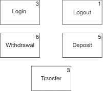

**图 3.1** 登录故事被分配了三点

*登录*现在成了我们的*黄金故事*。它是所有其他故事比较的标准。例如，登出比登录简单得多。我们将给*登出*故事 1 点。*取款*可能比*登录*难两倍，所以我们说它是 6。*存款*与*取款*类似，但可能没那么难，所以我们给它 5。最后，*转账*与*登录*差不多，所以我们给它 3。

我们把这些数字写在每张被估算的故事卡的一个角落里。稍后我会更详细地讨论估算过程。现在，我们只说我们现在有了一批带有估算值的故事卡，范围从 1 到 6。为什么是 1 到 6？为什么不呢？分配成本的方法有很多。越简单通常越好。

此时，你可能想知道这些点到底在衡量什么。也许你认为它们是小时、天、周或其他某种时间单位。

所以在 IPM 上，利益相关者选择了总计 18 点的故事。但这一次，在中期评审时，发生了一些奇怪的事情。已完成 12 点。我们该告诉他们吗？

我们不必说。他们自己能看出来。于是利益相关者又给计划增加了六点，使计划总数达到 24。

当然，团队实际上只完成了 22。因此下一次迭代将选择 22。

### 项目的结束

事情就这样一直进行下去。每次迭代完成后，完成的速率会被添加到速率图上，这样每个人都能看到团队进展有多快。

现在想象这个过程持续下去，一个迭代接一个迭代，一个月接一个月。那一叠故事卡发生了什么？把迭代周期想象成一台从卡片堆中抽出投资回报率（ROI）的泵。把对需求的持续探索想象成一台将 ROI 泵回卡片堆的泵。只要流入的 ROI 超过流出的 ROI，项目就会继续。

然而，探索中发现的新特性数量可能会逐渐降到零。当这种情况发生时，卡片堆中剩余的 ROI 再过几个迭代就会被耗尽。总有一天，在 IPM 上，利益相关者扫视卡片堆寻找值得做的事情，却什么也没找到。项目就此结束。

项目并不是在所有故事都实现后结束。项目是在卡片堆中再也没有值得实现的故事时结束。

项目结束后卡片堆中还剩下什么，有时令人惊讶。我曾参与过一个为期一年的项目，其中最早写下的故事，也就是赋予项目名称的那个故事，从未被选中实现。那个故事当时很重要，但有更多更紧急的故事需要实现。等到所有紧急故事都解决时，最初那个故事的重要性早已烟消云散。

### 故事

用户故事是我们用来提醒功能点的简单陈述。在编写故事时，我们尽量不记录太多细节，因为我们知道这些细节很可能会改变。细节稍后会被记录下来，但以验收测试的形式，我们稍后会讨论。

故事遵循一套简单的指导原则，我们用首字母缩写*INVEST*来记忆。

- **I：独立。** 用户故事彼此独立。这意味着它们不需要按任何特定顺序实现。*登录*不需要在*登出*之前实现。

  这是一个软性要求，因为很可能有些故事依赖于其他故事先被实现。例如，如果我们定义的*登录*不包含忘记密码恢复功能，那么显然*密码恢复*在一定程度上依赖于*登录*。尽管如此，我们还是尽量分离故事，使依赖尽可能少。这样我们就可以按照业务价值的顺序来实现故事。

- **N：可协商。** 这也是我们不写下所有细节的另一个原因。我们希望这些细节可以在开发人员和业务方之间协商。

  例如，业务方可能要求为某个功能提供一个花哨的拖放界面。开发人员可以推荐一个更简单的复选框风格，并解释说这样开发成本会低得多。这样的协商很重要，因为这是业务方了解管理软件开发成本的少数几种方式之一。

- **V：有价值。** 故事必须对业务方具有清晰且可量化的价值。

  重构永远不是故事。架构永远不是故事。代码清理永远不是故事。故事总是业务方看重的东西。别担心，我们会处理重构、架构和清理——但不是用故事的形式。

*登录*是一个具体操作。另一方面，像*可用*这样的故事不可测试，也不可估算。事实上，E 和 T 紧密相连。

### 故事估算

估算故事的方法有很多。大多数都是古老的宽带德尔菲⁵方法的变体。

最简单的一种叫做*飞指*。开发人员围坐在桌旁，阅读故事，如有必要与利益相关者讨论。然后开发人员把一只手藏在背后，不让别人看到，伸出与他们认为该故事应得点数相同数量的手指。然后有人数一…二…三…，随即所有手指同时飞出来。

如果每个人伸出的手指数量相同，或者偏差很小且有明显的平均值，就把这个数字写在故事卡上，团队继续下一个故事。然而，如果手指显示的数字分歧很大，开发人员就讨论原因，然后重复这个过程，直到达成一致。

一个合理的故事范围是*衬衫尺码*：小、中、大。如果你想用全部五根手指，也行。另一方面，超过五个等级几乎肯定是荒谬的。记住，我们想要准确，但不要超出必要地精确。

*计划扑克*⁶是一种类似的技术，但它使用卡片。市面上有很多流行的计划扑克牌组。大多数使用某种斐波那契数列。一种流行的牌组包含以下卡片：?、0、½、1、2、3、5、8、13、20、40、100 和 ∞。如果你使用这样的牌组，我的建议是去掉其中大部分卡片。

⁵ https://en.wikipedia.org/wiki/Wideband_delphi
⁶ Grenning, J. W. 2002. 计划扑克，或如何在发布计划时避免分析瘫痪。访问于 https://wingman-sw.com/articles/planning-poker.

斐波那契数列的一个好处是，它让团队能够估算更大的用户故事。例如，你可以选择1、2、3、5和8，这样就有了8倍的范围。

你可能还想加入0、∞和?。在*飞指法*中，你可以分别用拇指向下、拇指向上和张开的手掌来表示这些符号。0表示“太琐碎，无须估算”。要当心这些零值故事！你可能想把其中几个合并成一个更大的用户故事。∞表示大到无法估算，因此该故事应当拆分。而?表示你根本不知道，这意味着你需要一个*尖峰*。

### 拆分、合并与尖峰

合并故事很简单。你可以把卡片夹在一起，把合并后的故事视为一个故事。只需把所有点数加总。如果有些故事是0点，就用你的最佳判断来加总。毕竟，五个0加起来很可能不等于0。

拆分故事则更有意思，因为你需要保持INVEST原则。举个拆分故事的简单例子：考虑*登录*。如果我们想把它拆成更小的故事，可以创建*无密码登录*、*单次密码尝试登录*、*允许多次密码尝试*和*忘记密码*。

几乎找不到无法拆分的用户故事。对于那些大到需要拆分的故事来说尤其如此。记住，程序员的工作就是把用户故事一直拆到单独的代码行。所以拆分几乎总是可行的。挑战在于保持INVEST原则。

*尖峰*是一个元故事，或者说，是一个用于估算故事的“故事”。它被称为*尖峰*，是因为它常常要求我们开发一条贯穿系统所有层、长而极薄的切片。

假设有一个你无法估算的故事，我们把它叫作*打印PDF*。你为什么不知道该如何估算它？因为你以前从未使用过PDF库，也不确定它是怎么工作的。于是你写了一个新故事，叫*估算打印PDF*。现在你去估算*那个*故事，就会容易得多。

毕竟，你清楚自己需要做些什么才能搞清楚PDF库的工作原理。两个故事都放进卡片堆里。

在未来的IPM中，干系人可能会决定打出*打印PDF*这张卡片，但由于尖峰的存在，他们不能这么做。他们只能转而打出尖峰卡片。这能让开发人员完成必要的工作来估算原始故事，该故事可以在将来的迭代中实现。

### 管理迭代

每次迭代的目标都是通过完成用户故事来产出数据。团队应该关注用户故事本身，而不是故事内部的任务。完成80%的用户故事，远比每个故事都完成80%要好。要专注于推动用户故事走向完成。

计划会议一结束，程序员们就应该各自选择自己要负责的用户故事。有些团队先选定头几个故事，把其余的故事留在堆里，等一些故事完成后再选。无论如何，故事都由程序员个人选择并归其负责。

经理和组长可能会忍不住要把故事指派给程序员。这种情况应当避免。更好的做法是让程序员自行协商。

例如：

> *杰瑞（熟练工）：* 如果没人介意，我来负责登录和登出。把它们放在一起做比较合理。
>
> *杰丝敏（熟练工）：* 我没意见，但你何不和阿尔方斯结对搞数据库部分呢？他一直在问我们的事件溯源风格，登录正好是一个温和的入门案例。阿尔方斯？
>
> *阿尔方斯（学徒）：* 我觉得很好。看过这个之后，我应该就能做取款了。
>
> *亚历克西斯（首席程序员）：* 阿尔方斯，不如我来做取款吧。你也可以和我结对做这个。然后你可以去做转账。
>
> *阿尔方斯：* 哦，好吧。那可能更合理。小步走，对吧？
>
> *杰丝敏：* 没错，阿尔。那就剩下存款了。我来做。亚历克西斯，我们应该一起商量一下UI，因为它们的界面可能很相似。我们也许可以共享一些代码。

在这个例子中，你可以看到首席程序员如何引导那位雄心勃勃的新学徒避免不自量力，也可以看到团队在选择用户故事时是如何通力协作的。

### QA与验收测试

如果QA还没有开始编写自动化验收测试，那么IPM一结束就应该立即开始。计划早期完成的故事，其测试也应提前写好。我们不希望已经完成的故事在那里等验收测试编写。

编写验收测试应该很快。我们希望所有验收测试都能在迭代中点之前写完。如果到中点时还没有全部准备好，那么部分开发人员应当停下用户故事工作，转而编写验收测试。

这很可能意味着并非所有用户故事都能在本迭代中完成，但没有验收测试，用户故事本来也无法算完成。务必确保编写某个故事的程序员不要同时编写该故事的验收测试。如果QA一个又一个迭代地错过中点期限，那么QA工程师与开发人员的比例很可能是失衡的。

在IPM期间对迭代进行估算，目的只是让干系人知道*可能*完成多少用户故事。这有助于干系人选择故事并做规划。但这一估算并非承诺，如果实际速率低于预期，团队也算不上失败。

记住，唯一失败的迭代，就是未能产出数据的迭代。

### 速率下降

如果速率图呈现出持续的负斜率，那么最可能的原因是代码质量。团队很可能没有进行足够的重构，并且任由代码腐化。团队重构不足的一个原因是他们没有编写足够的单元测试，因此担心重构会破坏原本能用的功能。管理这种对变化的恐惧，是团队管理的一个主要目标，而这一切都归结到测试纪律。关于这一点，后文我们还会详细讨论。

随着速率下降，团队的压力会变大。这会导致点数膨胀。这种膨胀可能掩盖速率的下降。

### 黄金故事

避免膨胀的一种方法是不断把新故事的估算与最初的*黄金故事*进行比较，*黄金故事*是衡量其他故事的标准。记住，*登录*是我们最初的*黄金故事*，估算为3。如果某个新故事，比如*修复菜单项中的拼写错误*，估算为10，那你就知道有某种膨胀力量在发挥作用了。

### 小规模发布

*小规模发布*实践建议开发团队尽可能频繁地发布软件。在90年代末，敏捷发展初期，我们认为这意味着“每隔一两个月”发布一次。然而如今，我们把目标定得远远更短。

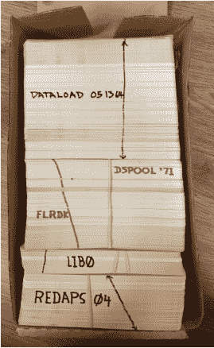

**图3.4** 盒中的打孔卡叠

事实上，那个程序的拥有者把卡叠放在抽屉或柜子里。如果有人想要签出源代码，他需要得到拥有者的允许，然后真正地从抽屉或柜子里把源代码“签出”。

如果你签出了源代码，你就是唯一能修改它的人，因为你在物理上占有了它。其他任何人都不能碰。完成后，你把卡叠还给拥有者，由他放回抽屉或柜子。

这个程序的周期时间，就是程序员保有它的时间长度。这段时间可能是几天、几周或几个月。

### Git与测试

如今我们使用Git。使用Git的“签出”时间已经缩为零。这个概念已不存在。相反，对模块的任何修改都可以随时提交。这些提交之间的冲突由程序员按自己的意愿解决。细小的解耦模块加上频繁提交，使周期时间可以小到几分钟。再加上能够构建一套全面、快速运行、几乎测试*一切*的测试套件，你就具备了*持续交付*的要素。

### 历史惯性

不幸的是，组织很难摆脱过去的行为方式。以天、周、月为单位的周期时间深深植根于许多团队的文化中，并已扩散到QA、管理层以及干系人的预期中。站在这种文化的视角来看，*持续交付*的概念可能显得荒诞不经。

### 小规模发布

敏捷试图打破这种历史惯性，推动团队采用越来越短的发布周期。如果你每六个月发布一次，那就试着每三个月一次，然后每月一次，然后每周一次。让发布周期以渐近的方式不断缩短，趋近于零。

要做到这一点，组织需要打破“发布”与“部署”之间的耦合。“发布”意味着软件在技术上已经准备好，可以被部署。而是否部署则纯粹成为一个业务决策。

你可能已经注意到，这正是我们用来描述迭代的语言。迭代在技术上是可部署的。如果我们的迭代长达两周，但我们希望比这更频繁地发布，我们就得缩短迭代。

迭代能朝着零渐近缩短吗？是的，可以。但那是另一个部分的话题了。

### 验收测试

在所有敏捷实践中，验收测试实践是最不被理解、最少使用、也最容易引起混淆的实践之一。这很奇怪，因为其基本思想非常简单：*需求应该由业务方来指定。*

当然，问题在于“*指定*”一词的含义。许多企业希望这个词意味着他们可以空口白话，用模糊而空泛的措辞描述所需行为。他们希望开发人员去弄清楚所有的小细节。许多程序员则希望业务方*精确地*定义系统应该做什么，精确到每个像素的坐标和值。

有必要在这两个极端之间寻找某种折中。

那么，什么是规范？规范从其本质上来说，就是*一种测试*。例如：

> *当用户输入有效的用户名和密码，然后点击“登录”时，系统将呈现“欢迎”页面。*

这显然是一个规范。同样，它也显然是一个测试。

同样显而易见的还有：这个测试可以被自动化。计算机没有理由无法验证该规范是否得到满足。

这就是验收测试实践。该实践要求，在可行的范围内，系统需求应编写为自动化测试。

但等等！这些自动化测试由谁来写？本节第一段回答了这个问题：*需求应该由业务方来指定。*所以业务方应该编写自动化测试，对吗？

但等等！自动化测试必须使用某种正式的可执行语言来编写。这听起来像是程序员的工作。所以程序员应该编写自动化测试，对吗？

但等等！如果程序员编写测试，这些测试就不会从业务的角度出发。它们将是充满只有程序员才能理解的细节的技术性测试。它们无法反映需求的业务价值。所以业务方应该编写自动化测试，对吗？

但等等！如果业务方编写自动化测试，那么这些测试的编写方式可能与我们所使用的技术不匹配。程序员只能重写它们，对吗？

你可以理解为什么这一实践让这么多人感到困惑了。

#### 工具与方法

实际情况更糟，因为该实践已经被工具和方法论所淹没。

为了让业务人员更容易编写自动化测试，程序员编写了五花八门的“帮助”工具。这些工具包括 FitNesse、JBehave、SpecFlow 和 Cucumber 等。这些工具各自创造了一种形式化体系，试图将自动化测试的技术面和业务面分离开。其工作假设是：业务人员可以编写自动化测试的业务部分，程序员则可以编写将这些测试与被测系统绑定在一起的粘合代码。

这似乎是个好主意，而这些工具在分离方面也做得不错。但企业一直不愿参与其中。负责编写规范的业务人员对正式语言心存警惕。他们通常希望使用自然语言（如英语）来编写规范。

针对这种抵触情绪，程序员们介入并替业务人员编写了验收测试，希望业务人员至少能阅读这些正式文档。但这也收效甚微，因为业务人员不喜欢正式语言。他们宁愿看到系统真正工作，或者更干脆，把验证工作交给 QA。

#### 行为驱动开发

进入新千年后，Dan North 开始重新定义 TDD，并称之为*行为驱动开发*（BDD）。他的目标是去除测试中的技术术语，让测试看起来更像是业务人员能够理解的规范。

起初，这只不过是对测试语言进行形式化的又一次尝试，这次使用了三个特殊的副词：*Given*、*When* 和 *Then*。为了支持这种语言，人们创建或修改了若干工具，其中包括 JBehave、Cucumber 和 FitNesse。但随着时间的推移，重点从工具和测试转向了需求和规范。

BDD 的支持者认为，企业通过使用像 Given-When-Then 这样的正式场景化语言来描述系统，可以获得巨大的价值，无论他们是否真的将这些需求自动化成测试。

这使业务人员不必遵循编写真正可执行测试所涉及的技术要求，同时又能让他们保持正式和精确。

#### 实践

尽管上文描述了诸多争议和困惑，*验收测试*实践实际上非常简单。业务方编写正式测试来描述每个用户故事的行为，开发人员则将这些测试自动化。

这些测试由业务分析师和 QA 在迭代前半段之前编写，被测故事将在该迭代中开发。
开发人员

#### 在最后阶段丢失测试

将 QA 移到流程开始阶段并自动化测试，解决了另一个大问题。当 QA 在流程末端进行手工测试时，他们就成了瓶颈。系统部署前，他们必须完成自己的工作。急躁的经理和利益相关者会给 QA 施压，要求他们尽快完成，以便部署系统。

当 QA 在流程末端介入时，所有上游延迟都会落到 QA 头上。如果开发人员向 QA 交付延迟，交付日期会改变吗？通常，交付日期是出于非常重要的业务原因确定的，推迟交付代价高昂，甚至是灾难性的。QA 只能独自收拾烂摊子。

当进度中已没有时间留给 QA 测试时，他们该如何测试系统？QA 怎样才能更快？这很容易：不要测试所有东西。只测试发生变更的部分。根据新增和变更的功能做影响分析，只测试受影响的部分。不要浪费时间测试那些没有变更的东西。

于是你丢掉了测试。在压力下，QA 干脆绕过了所有回归测试。他们希望下次还能运行这些测试。但“下次”通常永远不会到来。

#### QA 病

然而，QA 位于流程末端所导致的最糟糕的问题还不止于此。当 QA 在流程末端时，组织如何知道他们工作做得好不好？当然是看缺陷数量。如果 QA 发现了大量缺陷，显然他们工作做得很好。QA 经理可以炫耀所发现缺陷的数量，以此作为他们履行职责的明确证据。

因此，缺陷被视为一种*好事*。

还有谁能从缺陷中获益？资深程序员中流传着一句话：“只要软件不必正常运行，我能满足你设定的任何截止日期。”那么还有谁从缺陷中获益？需要赶上进度期限的开发人员。

无需多言，也无需书面协议。但双方都明白他们能从缺陷中获益。一种缺陷的黑市经济由此涌现。这种疾病渗透到许多组织中，即便不是绝症，也肯定会让组织变得虚弱。

#### 开发人员就是测试人员

这些问题都可以通过*验收测试*实践得到解决。QA 为迭代中的故事编写验收测试。*但 QA 并不运行这些测试。* 验证系统是否通过测试并不是 QA 的工作。那是谁的工作？当然是程序员的工作！

运行测试是程序员的工作。确保自己的代码通过所有测试也是程序员的工作。所以，程序员当然必须运行这些测试。运行这些测试是程序员判断其故事是否完成的唯一方法。

#### 持续构建

事实上，程序员会通过建立持续构建服务器来自动化这个过程7。每当有程序员签入一个模块时，这台服务器就会运行系统中的所有测试，包括所有单元测试和所有验收测试。在我们讨论持续集成时，还会对此做更多说明。

#### 整体团队

*整体团队*实践最初被称为*现场客户*。其理念是：用户与程序员之间的距离越短，沟通就越好，开发就会更快、更准确。*客户*是一个隐喻，指某个人或某个群体，他们了解用户的需求，并与开发团队同处一地。理想情况下，客户与团队坐在同一个房间里。

别误会我的意思。当团队成员在家办公时，非语言交流仍然会大量缺失。偶然的交谈变得更加罕见。无论团队在电子连接上多么紧密，他们仍然不在同一个空间。这使得在家工作的人处于明显劣势。他们总会错过一些对话和临时会议。尽管他们可能享有巨大的数据带宽，但与在同一地点办公的人相比，他们仍然是通过“窥视孔”进行交流。

一个大多数成员在同一地点办公的团队，如果有一两名成员每周在家工作一两天，可能不会注意到任何明显的障碍，尤其是如果他们已经投入了一些良好的高带宽远程通信工具。

另一方面，一个几乎完全由在家工作的人员组成的团队，其工作效果永远无法与在同一地点办公的团队相比。

别误会我的意思。在90年代初，我的搭档吉姆·纽柯克和我成功管理了一个完全没有在同一地点办公的团队。每个人完全在家工作。我们每年最多面对面见两次，有些人生活在不同的时区。另一方面，我们都说同一种语言，共享同一种文化，时区相差也不超过两个小时。我们让它运转起来了，而且运转得很好。但如果我们能在同一个房间里，效果会更好。

### 结论

在2000年的Snowbird会议上，Kent Beck说我们的目标之一是弥合业务与开发之间的鸿沟。面向业务的实践在实现这一目标中发挥着重要作用。通过遵循这些实践，业务和开发之间有了简单而明确的沟通方式。这种沟通孕育了信任。

## 团队实践

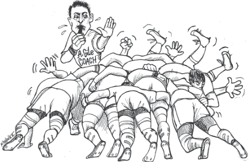

## 

### 

智能工厂利用物联网（IoT）、人工智能（AI）和机器人技术来创建自我优化的制造环境。工厂变得智能、互联且高效。

从追踪每个动作的智能传感器到预测维护需求的AI，智能工厂革命已经到来。实时数据流经整个生产线，实现更智能的决策，减少浪费，提高盈利能力。

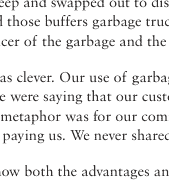

- **物联网连接设备**
- **AI驱动的分析**
- **预测性维护**
- **自动化机器人**

工业4.0不仅仅是自动化——它是关于创建数字生态系统。智能工厂集成信息物理系统、云计算和物联网，实现实时监控和控制。借助这些技术，制造商可以即时响应市场变化，大规模定制产品，并实现前所未有的运营效率。

*隐喻*实践已经得到了关注。团队需要的是问题域的模型，该模型由每个人都认可的词汇表来描述。我指的是*每个人*——程序员、QA、经理、客户、用户……*每个人*。

在20世纪70年代，Tom DeMarco将这类模型称为*数据字典*³。它们是应用程序操作的数据以及操作这些数据的进程的简单表示。Evans将这个简单的想法极大地扩展为一门领域建模的学科。DeMarco和Evans都使用这些模型作为与所有利益相关者沟通的工具。

举个简单的例子，我最近写了一个名为SpaceWar的视频游戏。数据元素包括Ship、Klingon、Romulan、Shot、Hit、Explosion、Base、Transport等。我特意将每个概念隔离到各自的模型中，并在整个应用程序中唯一使用这些名称。这些名称就是我的通用语言。

通用语言用于项目的所有部分。业务使用它。开发人员使用它。QA使用它。运维/DevOps使用它。甚至客户也会使用其中适用的部分。它支持业务案例、需求、设计、架构和验收测试。它是一条一致性的线索，在生命周期的每个阶段将整个项目连接在一起。⁴

### 可持续节奏

> “赛跑不一定是快者取胜……”
> ——传道书 9:11
> “……唯有忍耐到底的，必然得救。”
> ——马太福音 24:13

3. DeMarco, T. 1979. *结构化分析与系统规格说明.* Upper Saddle River, NJ: Yourdon Press.

4. “它是由所有生物创造的能量场。它环绕着我们，渗透着我们，将星系维系在一起。” Lucas, G. 1979. *星球大战IV：新希望.* Lucasfilm.

### 加班

你可能会以为我会从那次经历中吸取教训。当然，我没有。在接下来的20年里，我继续为雇主长时间工作。我继续被*重要项目*这个迷因所诱惑。哦，我没有像18岁时那样疯狂加班。我的平均每周工作时间降到了大约50小时。通宵变得相当罕见——但正如我们将会看到的，并非完全没有。

随着年龄的增长，我意识到我最严重的技术错误都是在那些疯狂的深夜精力旺盛时期犯下的。我意识到这些错误是巨大的障碍，在我真正清醒的时间里，我必须不断地绕开它们。

然后发生了一件事，让我重新思考自己的方式。我未来的商业伙伴吉姆·纽柯克和我正在通宵工作。大约凌晨两点，我们试图弄清楚如何将一块数据从系统的底层部分传送到执行链中更高的另一个部分。将数据沿调用栈向上传递不是一个选项。

我们在产品内部构建了一个“邮件”传输系统。我们用它在*进程间*发送信息。凌晨两点，咖啡因在我们血管中奔腾，我们的所有感官都在最高效率运作，我们突然意识到，可以让进程的低层部分将那段数据通过邮件发送给它自己，然后高层部分来获取它。

即使在今天，三十多年后，每当吉姆和我想描述别人不幸的决定时，我们都会说：“哦，糟糕。他们刚才把邮件发给了自己。”

我不会用那些可怕的、具体细节来烦你，解释为什么那个决定如此糟糕。只需说，它让我们付出的努力是我们原本以为节约的许多倍。当然，这个解决方案已经根深蒂固，无法逆转，所以我们只能困在其中。⁵

5. 那是在我了解TDD的十年前。如果当时吉姆和我实践TDD，我们本可以轻松地从那个变更中退出。

### 马拉松

那一刻我认识到，软件项目是一场马拉松，而不是短跑，也不是一系列短跑。要获胜，你必须控制节奏。如果你从起跑线冲出来并以全速奔跑，你会在冲过终点线之前很久就耗尽能量。

因此，你必须以能够长期维持的速度奔跑。你必须以*可持续的节奏*奔跑。如果你试图跑得比你能维持的节奏更快，你将在到达终点线之前被迫减速和休息，你的平均速度将低于可持续节奏。当你接近终点线时，如果还有一点多余的能量，你可以冲刺。但在那之前绝不能冲刺。

管理者可能会要求你跑得比应有的更快。你不能服从。你的职责是节约你的资源，以确保你坚持到最后。

### 奉献

加班并不是向雇主展示奉献精神的方式。它展示的是你是一个糟糕的规划者，你同意了本不该同意的截止日期，你做出了本不该做出的承诺，你是一个可被操纵的劳动者，而不是一个专业人士。

这并不是说所有加班都是坏事，也不是说你永远不应该加班。有些情有可原的情况，唯一的选择就是加班。但这种情况应该极其罕见。而且你必须非常*清楚*，那次加班的代价很可能会大于你在进度上节省的时间。

几十年前我和吉姆一起熬的那一夜并不是我最后一次熬夜——那是倒数第二次。我最后一次熬夜是那种我无法控制的情有可原的情况。

那是1995年。我的第一本书定于次日付印，而我有责任交付清样。当时是下午6点，我已经把清样全部准备好，只差用 FTP 发给出版商了。

但就在那时，纯属偶然，我无意中发现了一种方法，可以*加倍*那本书里数百张图表的分辨率。吉姆和珍妮弗正帮我准备清样，我们正要执行 FTP，这时我给他们看了分辨率改进后的示例。

我们面面相觑，长叹一口气。吉姆说：“我们得把全部图表重做。”这不是疑问句，而是陈述事实。我们三个人你看看我，我看看你，又看看时钟，再回头看彼此，然后便埋头干了起来。

但当我们熬完那个通宵时，工作*真的完成了*。书如期付印。我们也终于睡了觉。

### 睡眠

程序员生活中最宝贵的要素是充足的睡眠。我睡满七个小时状态就很好；一两天只睡六个小时我也能忍受；再少的话，我的工作效率就会直线下降。请务必搞清楚你的身体需要多少小时睡眠，然后优先保证这些小时。这些小时会成倍地回报你。我的经验法则是：睡眠不足的第一个小时，会让我损失两个小时的白天工作时间；睡眠不足的第二个小时，又会让我再损失四个小时的有效工作。当然，如果睡眠欠了三小时，那就完全无法有效工作了。

### 集体所有权

在敏捷项目中，没有人拥有代码。代码由整个团队共同拥有。团队的任何成员都可以随时签出并改进项目中的任何模块。团队*集体*拥有代码。

在我职业生涯早期，在泰瑞达（Teradyne）工作时，我就学到了*集体所有权*。我们开发的是一个大型系统，由五万行代码组成，划分为几百个模块。但团队中没有人拥有其中任何一个模块。我们都努力去学习和改进所有这些模块。当然，我们中有些人确实比别人更熟悉某些代码部分，但我们追求的是传播这种经验，而不是让它集中在少数人身上。

那是一个早期的分布式网络。一台中心计算机与分布在全国各地的几十台卫星计算机通信。这些计算机通过 300 波特的调制解调器线路通信。负责中心计算机和卫星计算机的程序员之间没有划分；我们所有人都同时开发两者的软件。

这两种计算机的架构截然不同。一种类似于 PDP-8，只是字长为 18 位。它有 256K 内存，从磁带盒加载程序。另一种是 8085 8位微处理器，带有 32K 内存和 32K 只读存储器。

我们用汇编语言为它们编程。这两台机器的汇编语言和开发环境也大不相同。我们都能同样自如地使用两者工作。

*集体所有权*并不意味着你不能有所专攻。随着系统变得越来越复杂，专攻成为绝对必要。有些系统根本无法既从整体上又从细节上被完全理解。然而，即使你有所专攻，也必须保持广度。把你的工作分配到你的专长领域和代码的其他领域之间，保持你在专长之外工作的能力。

当团队实践*集体所有权*时，知识就分布在整个团队中。每个团队成员都能更好地理解模块之间的边界以及系统的整体工作方式。这大大提高了团队沟通和决策的能力。

在我相当漫长的职业生涯中，我见过少数公司实行与*集体所有权*相反的做法。每个程序员都拥有自己的模块，其他任何人都不允许碰。这些团队功能严重失调，总是互相指责、沟通不畅。只要模块作者不在岗，该模块的一切进展就会停止。没有其他人敢去碰属于别人的东西。

### X档案

一个尤其拙劣的案例是X公司，它生产高端打印机。在20世纪90年代，这家公司正从以硬件为主转向软硬件一体化的重心。他们意识到，如果使用软件来控制机器的内部运行，就能大幅降低制造成本。

然而，硬件导向根深蒂固，因此软件团队也沿硬件团队的边界划分。硬件团队按设备组织：进纸器、打印机、堆纸器、订书机等各有相应的硬件团队。软件也按同样的设备划分。一个团队编写进纸器的控制软件，另一个团队编写订书机的软件，依此类推。

在X公司，你的政治影响力取决于你负责的设备。由于X是一家打印机公司，打印机设备最有声望。负责打印机的硬件工程师必须逐级晋升才能到达那个位置。订书机团队的人无足轻重。

奇怪的是，同样的政治等级制度也适用于软件团队。编写堆纸器代码的开发者在政治上举足轻重；但若一个打印机开发者在会上发言，其他所有人都会仔细听。由于这种政治划分，没有人分享自己的代码。打印机团队政治影响力的关键就锁在打印机代码里，所以打印机代码也一直被锁着。该团队之外没有人能看到它。

这造成的问题数不胜数。当你无法检查自己正在使用的代码时，沟通困难显而易见；此外还有不可避免的互相指责和暗箭伤人。

当他终于试图签入并整合自己的改动时，他发现已经积累了太多其他改动，花了很长时间才让合并正常工作。就在他与合并搏斗时，其他程序员继续每 15 分钟签入一次。等他终于完成合并、试图签入代码时，他发现自己又面临另一次合并。

他因此沮丧至极，在课堂中间站起来大声宣称：“XP行不通。”然后冲出教室，去了酒店酒吧。

接着奇迹发生了。他之前拒绝的结对搭档追出去安抚他。另外两组结对重新调整了优先级，完成了合并，让项目回到正轨。三十分钟后，那位学生平静了许多，回到教室，道了歉，然后继续工作——包括结对编程。他后来成为敏捷开发的热心倡导者。

关键在于：持续集成只有在你持续集成时才有效。

### 随后出现了持续构建

2001年，ThoughtWorks极大地改变了游戏规则。他们创造了 *CruiseControl*7，这是第一个*持续构建*工具。我记得 Mike Two8 在 2001 年的 XP Immersion 上做过一场深夜讲座。那次演讲没有录音，但故事大致是这样的：

> *CruiseControl 让签入时间缩短到几分钟。即使最微小的改动也能迅速集成到主线上。CruiseControl 监视源代码仓库，每次有任何变更被签入，就会触发一次构建。作为构建的一部分，CruiseControl 会运行系统的大部分自动化测试，然后把结果通过电子邮件发送给团队中的每个人。*
>
> “Bob 把构建搞坏了。”

7. https://en.wikipedia.org/wiki/CruiseControl
8. http://wiki.c2.com/?MikeTwo

### 作弊的代价

有些团队在截止日期的压力下，会让持续构建一直处于失败状态。这是一种自杀式行为。接下来发生的事情是：每个人都厌倦了持续构建服务器不断发来的失败邮件，于是他们移除那些失败的测试，并承诺“以后”会回来修复。

当然，这会让持续构建服务器再次开始发送成功邮件。每个人都放松下来。构建通过了。而所有人都忘记了那堆被搁置起来、打算“以后”修复的失败测试。于是一个有缺陷的系统就这样被部署了。

### 站会

多年来，围绕“每日Scrum”或“站会”出现了大量误解。现在就让我来澄清这一切。

以下才是站会的真实情况：

- 这个会议是可选的。许多团队没有它也运转得很好。
- 它的频率可以低于每天一次。选择对你有意义的节奏。
- 即使团队很大，也应该只需约10分钟。
- 这个会议遵循一个简单的公式。

基本做法是团队成员站⁹成一圈，回答三个问题：

1. 自上次会议以来我做了什么？
2. 到下次会议之前我要做什么？
3. 有什么阻碍了我？

⁹. 这就是它之所以叫“站”会的原因。

就这些。不要讨论。不要装腔作势。不要深入解释。没有冷清的房屋，也没有阴暗的想法。不要抱怨简、琼以及天知道还有谁。每个人大约有30秒的时间来回答这三个问题。然后会议结束，大家回去工作。完毕。结束。明白吗？

也许关于站立会议的最佳描述在 Ward 的 wiki 上：http://wiki.c2.com/?StandUpMeeting。

### 猪和鸡？

我不会在这里重复火腿和鸡蛋的故事。如果你感兴趣，可以在脚注10中查阅。其要点是，只有开发人员应该在站立会议上发言。经理和其他人可以旁听，但不应插话。

在我看来，只要每个人都遵循相同的三问题格式，并且会议保持在10分钟左右，我不在乎谁发言。

### 致谢

我喜欢的一个修改是增加一个可选的第四个问题：

- 你想感谢谁？

这只是对帮助过你的人，或做了你认为值得认可的事情的人的一种快速致谢。

### 结论

敏捷是一套原则、实践和纪律，帮助小团队构建小型软件项目。本章描述的实践是那些帮助这些小团队表现得像真正团队的做法。它们帮助团队设定沟通所用的语言，以及团队成员之间以及对待他们正在构建的项目的行为期望。

10. https://en.wikipedia.org/wiki/The_Chicken_and_the_Pig

## TDD 的三条规则

TDD 可以用三条简单的规则来描述。

- 在你首先编写一个因缺少该代码而失败的测试之前，不要编写任何生产代码。
- 不要编写超出足以失败的测试代码——编译失败也算失败。
- 不要编写超出足以通过当前失败测试的生产代码。

一个有几个月以上经验的程序员很可能会认为这些规则古怪，甚至简直是愚蠢。它们暗示了一个也许只有五秒钟长的编程循环。程序员开始为尚不存在的生产代码编写一些测试代码。这个测试几乎立刻编译失败，因为它提到了尚未编写的生产代码的元素。程序员必须停止编写测试，开始编写生产代码。但仅仅敲了几下键盘之后，之前编译失败的测试现在就能正常编译了。这迫使程序员回到测试，继续添加内容。

这种在测试与生产代码之间的来回切换只有几秒钟长，程序员被困在这个循环中。程序员再也无法一口气写完一个完整的函数，甚至一个简单的 if 语句或 while 循环，而不中断自己来编写相应的测试代码。

大多数程序员最初认为这是对他们思维过程的干扰。三条规则所带来的持续打断，使他们无法深入思考正在编写的代码。他们常常觉得三条规则制造了一种难以忍受的干扰。

然而，想象一组程序员遵循这三条规则。在任何时候，选择其中任何一位你喜欢的程序员。那位程序员正在做的所有事情都执行并通过了所有测试，不到一

### 完整性

现在让我们回到事后测试。你莫名其妙地觉得有义务编写这些测试，尽管你已经手动测试过系统，并且已经知道它能工作。你一个接一个地运行测试，对测试通过这一事实并不感到意外。

不可避免地，你会遇到一个难以编写的测试。它很难编写，因为当你编写代码时，你没有考虑可测试性，也没有把它设计成可测试的。要为这段代码编写测试，你必须改变结构，打破某些耦合、添加一些抽象，和/或重新规划某些函数调用和参数。这感觉要花费很大力气，尤其是因为你已经知道代码能工作。

时间很紧，你知道自己还有更紧迫的事情要做。于是，你把这个测试放到一边。你说服自己，要么它没有必要，要么你稍后会回来补写。这样，你在测试套件中留下了一个漏洞。

而且，既然你在测试套件中留下了漏洞，你也会怀疑其他人也这么做了。当你运行测试套件并看到它通过时，你大笑、得意地笑，或者轻蔑地挥挥手，因为你知道套件通过并不意味着系统能工作。

当这样的测试套件通过时，你无法做出任何决定。通过的测试给你的唯一信息是，没有任何*被测*的东西被破坏。测试套件的不完整让你别无选择。然而，如果你遵循三条规则，那么每一行生产代码都是为了通过某个测试而编写的。因此，测试套件非常完整。当它通过时，你就可以做出决定。这个决定就是*部署*。

这就是目标。我们想要创建一套自动化测试，告诉我们部署系统是安全的。

想象你正在看着屏幕上的一些旧代码，它一团糟。你心想：“我应该清理一下。”但你的下一个念头是：“我不碰它！”因为你知道，如果你碰它，就会把它弄坏；而如果把它弄坏了，它就变成你的了。于是你从代码旁退开，任由那一团糟溃烂腐朽。

这是一种恐惧反应。你害怕代码。你害怕碰它。你害怕如果把它弄坏了会面临什么。于是，你没能做那件唯一能改进代码的事——你没能清理它。

如果团队中的每个人都这样行事，那么代码必然会腐烂。没有人会清理它。没有人会改进它。每添加一个功能，都会以尽量减少程序员眼前风险的方式添加。耦合和重复会被加入，因为它们能最小化眼前风险，即使它们破坏了代码的设计和完整性。

最终，代码会变成一坨可怕的、难以维护的意大利面条式代码，几乎无法取得任何进展。估算会呈指数级增长。经理们会变得绝望。会雇用越来越多的程序员，希望能提高生产力，但这一增长无法实现。

最后，在极度绝望中，经理们会同意程序员的要求，即整个系统应该从头重写，于是循环再次开始。

想象一个不同的场景。回到那个有杂乱代码的屏幕前。你的第一个念头是清理它。如果你有一套如此完整的测试套件，以至于当它通过时你信任它，会怎样？如果测试套件运行得很快，会怎样？你的下一个念头会是什么？大概是这样的：

> *天哪，我想我会更改那个变量的名字。啊，测试仍然通过。好的，现在我把那个大函数拆成两个小函数……很好，测试仍然通过……好的，现在我想我可以把其中一个新函数移到另一个类中去。哎呀！测试失败了。放回去……啊，我明白了，我还需要移动那个变量。是的，测试仍然通过……*

当你拥有一个完整的测试套件时，你就失去了修改代码的恐惧。你失去了对*清理*代码的恐惧。于是，你会*清理*代码。你会让系统保持整洁有序。你会保持系统设计的完整。你*不会*制造那团溃烂的意大利面条式代码，它会把团队拖入生产力低下和最终失败的困境。

这就是我们实践 TDD 的原因。我们实践它，是因为它给了我们保持代码整洁有序的勇气。它给了我们像专业人士一样行事的勇气。

### 重构

*重构*是另一个需要一本书来描述的话题。幸运的是，马丁·福勒（Martin Fowler）正是用这样一本书出色地完成了这项工作。3 在本章中，我只讨论这门纪律，而不讨论具体技术。再说一次，本章不包含代码。

重构是这样一种实践：在不改变由测试所定义的行为的前提下，*改进*代码的结构。换句话说，我们更改名称、类、函数和表达式，而不破坏任何测试。我们改进系统的结构，而不影响行为。

当然，这种做法与 TDD 紧密耦合。要无所畏惧地重构代码，我们需要一个测试套件，让我们非常有信心不会破坏任何东西。

重构过程中所做的更改，小到琐碎的修饰，大到深度的重组。这些更改可能是简单的名称修改，也可能是将 switch 语句复杂地重新调整为多态分发。大函数会被拆分成更小的、命名更好的函数。参数列表会被改成对象。有许多方法的类会被拆分成许多

3. Fowler, M. 2019. *重构：改善既有代码的设计*，第2版。波士顿，马萨诸塞州：Addison-Wesley。

3. 消除重复。
4. 减少元素。

这些数字既是执行顺序，也是优先级。

第1点不言自明：代码必须通过所有测试，代码必须能工作。

第2点说的是，在代码能工作之后，应当让它具有表达力。它应当揭示程序员的意图，应当易于阅读且能自我描述。在这里，我们会应用许多更简单、更具外观性的重构。我们还会把大型函数拆分成更小、命名更清晰的函数。

第3点说的是，在我们将代码做得尽可能具有描述性和表达力之后，我们要寻找并消除代码中的重复。我们不希望代码重复表达同一件事。在这一过程中，重构通常更为复杂。有时消除重复很简单，只需将重复代码移入一个函数，然后从多处调用它。其他时候则需要更有趣的解决方案，例如设计模式⁴中的*模板方法*、*策略*、*装饰器*或*访问者*。

第4点说的是，一旦我们消除了所有重复，就应当努力减少结构元素的数量，比如类、函数、变量等。

简单设计的目标是尽可能减小代码的*设计重量*。

⁴ 设计模式超出了本书的范围。参见 Gamma, E., R. Helm, R. Johnson, 和 J. Vlissides. 1995. *Design Patterns: Elements of Reusable Object-Oriented Software*. Reading, MA: Addison-Wesley.

### 什么是结对？

结对是两个人共同解决一个编程问题的行为。结对双方可以在同一个工作站上工作，共享屏幕、键盘和鼠标。或者他们可以在两台连接的工作站上工作，只要他们能看到并操作同一份代码。后一种方式配合流行的屏幕共享软件效果很好。该软件还允许结对伙伴身处异地，只要他们有良好的数据和语音连接。

结对编程者有时会扮演不同角色。一人可能是“驾驶员”，另一人是“领航员”。驾驶员掌握键盘和鼠标；领航员从更长远的角度观察并提出建议。另一种角色选择是：一名程序员编写测试，另一名程序员让测试通过，并写下下一个测试让第一名程序员通过。这有时被称为*乒乓*。

然而，大多数时候根本没有角色之分。程序员只是平等的共同作者，以协作的方式共享鼠标和键盘。

结对不是排定的。它们根据程序员的偏好而组合和拆散。管理者不应试图创建结对时间表或结对矩阵。

结对通常很短暂。一次结对会话可以持续一整天，但更常见的是不超过一两个小时。即使是15到30分钟的短结对也可能很有益。

故事卡不会分配给结对。完成故事卡的责任属于单个程序员，而不是结对。一个故事卡的持续时间通常比一次结对长得多。

在一周内，每位程序员大约会花一半的结对时间在自己的任务上，并借助其他人的帮助。另一半结对时间则用于帮助他人完成他们的任务。

资深程序员应当注意，与其和另一位资深程序员结对，不如更频繁地与初级程序员结对。初级程序员应当更多地向资深程序员寻求帮助，而不是向其他初级程序员求助。拥有专长的程序员应当将相当一部分结对时间用于与本专长之外的编程人员合作。目标是传播和交换知识，而不是集中知识。

### 为什么要结对？

我们结对是为了表现得像一个团队。团队成员之间不是孤立工作的，而是每时每刻都在协作。当团队中某位成员倒下时，其他成员会填补该成员留下的空缺，并继续朝着目标前进。

结对是目前为止在团队成员之间分享知识、防止知识孤岛形成的最佳方式。这也是确保团队中没有人不可或缺的最佳方式。

许多团队报告说，结对可以减少错误并提高设计质量。在大多数情况下，这很可能是真的。对于任何给定问题，多一双眼睛通常更好。事实上，许多团队已经用结对取代了代码审查。

### 结对即代码审查

结对是一种代码审查形式，但有着显著的优势。结对程序员在结对期间是共同作者。他们会看到旧代码并理所当然地加以审查，但目的是编写新代码。因此，审查不是简单地静态检查团队的编码标准是否得到应用，而是对代码当前状态的动态审查，并着眼于代码在不久的将来需要走向何方。

### 那成本呢？

结对成本很难衡量。最直接的成本是两个人共同解决一个问题。显然，这并不会使解决问题的努力翻倍；但确实可能会产生一些成本。多项研究表明，直接成本大约在15%左右。换句话说，完成100个单独程序员（不做代码审查）的工作，需要115个结对程序员。

一种粗略的计算会认为，一个50%时间结对的团队，生产力损失会略低于8%。另一方面，如果结对实践取代了代码审查，那么生产力很可能根本不会下降。

接着我们必须考虑交叉培训和深度协作带来的收益。这些收益不容易量化，但很可能也是显著的。

我和许多其他人的经验是，当结对以非正式方式并在程序员自愿的情况下进行时，对整个团队相当有益。

### 只有两个人？

“结对”（pair）一词意味着结对会话中只有两名程序员参与。虽然通常如此，但这并不是规则。有时三个人、四个人甚至更多会决定一起解决某个问题。（同样，这取决于程序员的自由选择。）这有时被称为“群体编程”（mob programming）。⁵,⁶

⁵ https://en.wikipedia.org/wiki/Mob_programming

⁶ https://mobprogramming.org/mob-programming-basics/

### 管理

程序员常常担心管理者会对结对皱眉，甚至可能要求拆散结对，别浪费时间。我从未见过这种情况。在我写代码的半个世纪里，我从未见过管理者在如此低的层面进行干预。总的来说，以我的经验，管理者很高兴看到程序员协作和共同工作。这会给人工作正在进行的印象。

然而，如果你是一位因为担心结对效率低下而想干预结对的经理，那么请放下你的担忧，让程序员自己来处理。毕竟，他们才是专家。而如果你是一位被经理告知停止结对的程序员，请提醒那位经理：你才是专家，因此，决定工作方式的人应该是你，而不是经理。

最后，永远、永远、永远不要请求许可去结对、去测试、去重构，或者其他任何事……你是专家，由你决定。

### 结论

敏捷的技术实践是任何敏捷努力中最重要的要素。任何试图在缺少技术实践的情况下运用敏捷实践的做法都注定失败。原因很简单：敏捷是一种在匆忙中制造大混乱的高效机制。如果没有技术实践来保持较高的技术质量，团队的效率很快就会动摇，并开始一个不可逆转的死亡螺旋。

当我第一次了解极限编程（XP）时，我想：“还有什么比这更容易的呢？只要遵循一些简单的纪律和实践。没什么大不了的。”

然而，从那些尝试——却未能——成为敏捷的组织数量来看，成为敏捷一定非常、非常困难。也许所有这些失败的原因在于，太多组织把敏捷当成了它本不是的东西。

## 敏捷价值观

肯特·贝克很久以前就提出了敏捷的四个价值观：勇气、沟通、反馈和简单。

### 勇气

第一个价值观是勇气——或者换句话说，适度的冒险。敏捷团队的成员不会因为过于注重政治安全而牺牲质量和机会。他们意识到，从长远来看，管理软件项目的最佳方式是保持一定的进取心。

勇气和鲁莽是有区别的。发布一个最小功能集需要勇气。保持高代码质量和高质量纪律也需要勇气。然而，发布你并不十分有信心、或设计不可持续的代码，是鲁莽的。为了赶进度而牺牲质量，是鲁莽的。

相信质量和纪律*能提升*速度，是一种需要勇气的信念，因为它会不断受到那些有权势却天真、急于求成之人的挑战。

### 沟通

我们重视跨渠道的直接而频繁的沟通。敏捷团队成员希望彼此交谈。程序员、客户、测试人员和管理人员希望彼此坐得很近，频繁互动，而不仅仅是在会议中，也不仅仅是通过电子邮件、聊天和备忘录。相反，他们看重的是面对面、非正式、人际间的交谈。

团队就是这样凝聚起来的。正是在频繁互动掀起的快速、混乱、非正式的风暴中，灵光闪现，洞见涌现。一个坐在一起并频繁沟通的团队能够创造奇迹。

### 反馈

我们所研究的敏捷实践几乎都以向决策者提供快速反馈为目标。*规划游戏、重构、测试驱动开发、持续集成、小版本发布、集体所有权、完整团队*等实践将反馈的频率和数量最大化。它们让我们能及早发现事情哪里出了问题，并及时纠正。它们还让我们充分认识到早期决策的后果。敏捷团队因反馈而*茁壮成长*。反馈让团队工作如此高效，并推动项目走向有益的结果。

### 简单

下一个敏捷价值观是简单——换句话说，*直接*。人们常说，软件中的每个问题都可以通过增加一层间接性来解决。但勇气、沟通和反馈这些价值观的存在，就是为了确保问题的数量被降到最低。因此，间接性可以保持在最低限度。解决方案可以很简单。

这适用于软件，也适用于团队。被动攻击就是一种间接行事。当你发现一个问题，却默不作声地任其转嫁给别人时，你就是在间接行事。当你明知后果严重却仍屈从于经理或客户的要求时，你就是在间接行事。

## 转型

从非敏捷到敏捷的转变，是价值观的转变。敏捷开发的价值观包括冒险、快速反馈、人与人之间无视障碍和指挥结构的激烈而高带宽的沟通。它还注重直截了当地行动，而不是事先勘察地形并协商路径。这些价值观与大型组织的价值观截然相反——后者在中层管理结构上投入巨资，而这些结构重视安全、一致性、命令与控制以及计划执行。

这样的组织有可能转型为敏捷吗？坦率地说，我在这方面并没有取得过多少成功，也没有看到别人取得多少成功。我见过大量的努力和金钱被投入，却没见过多少组织真正完成了转型。这种价值观结构与中层管理层的价值观实在相差太大，令他们无法接受。

我所*见过*的是团队和个人的转型，因为团队和个人往往受到与敏捷相一致的价值观的引导。

具有讽刺意味的是，高管们往往也被敏捷的冒险、直接和沟通的价值观所驱动。这也是他们试图转型其组织的原因之一。

障碍在于中间的管理层。这些人受雇的目的就是*不*冒险，*避免*直接，以*最少*的沟通*遵循*并*执行*指挥链。这就是组织的困境：组织的顶层和底层都重视敏捷思维，中间层却反对它。我不知道自己是否见过中间层做出改变。事实上，他们怎么可能呢？他们的工作就是*反对*这样的改变。

为了把这一点讲得更透彻，让我讲几个故事。

### 哭泣

这最后一个故事是听来的二手消息。当时我并不在场，没有亲眼见证那个关键时刻。那是当时我的员工向我报告的。

2003年，我的公司参与了一家知名证券经纪公司的敏捷转型。一切进展顺利。我们培训了高管、中层经理和开发人员。他们干得热火朝天。一切都非常好。

随后是最终评估。高管、中层经理和开发人员齐聚一个大礼堂。他们的目标是评估敏捷转型的进展和成效。高管们问道：“进展如何？”

各位参与者回答道：“进展非常顺利。”

接着，房间里出现片刻沉默，突然被后排传来的哭泣声打破。就在那一刻，情感支柱崩塌了，房间里的积极氛围也随之瓦解。“这太难了。”人们听到有人说。“我们实在坚持不下去了。”

于是，高管们终止了转型。

### 寓意

我想所有这些故事的寓意就是：“要有发生奇怪事情的心理准备。”

### 假装

在一个拥有强势且反对敏捷的中层管理层的组织中，敏捷团队能存在吗？我偶尔见过这种情况。一些软件开发团队悄悄用敏捷价值观驱动开发，同时也遵从中层管理层强加给他们的严苛要求。只要中层管理层确信他们的流程和标准得到了遵循，他们可能就会让开发团队自行其是。

这就是布奇（Booch）和帕纳斯（Parnas）所说的“假装”。² 团队在暗地里实践敏捷，同时提供一切能令中层管理层满意的产出。这些团队不跟中层经理打一场徒劳的仗，而是在敏捷之上套上一层外壳，让敏捷在中层经理看来既安全又合规。

例如，中层经理可能希望项目早期阶段产出一份分析文档。敏捷团队通过使用所有常规敏捷实践编写系统早期的大部分代码，再排定一系列文档故事，从而产出这份分析文档。

这是合理的，因为最初的几次编码迭代都高度聚焦于需求分析。这种分析实际上是通过编写代码来完成的，这一点并不需要中层经理知道。他们也不应该在意。

不幸的是，我见过一些运转严重失调的组织，当中层经理嗅到某个团队在“假装”时，就认定其中有诈，并迅速采取行动清除敏捷实践。这真是莫大的遗憾，因为那些团队实际上正在给中层经理他们所需要的东西。

### 小型组织的成功

我见过一些中型组织采用敏捷。它们的中层管理层很精简，由从基层一步步晋升、仍保持着直接和敢于冒险心态的人组成。

² Booch, G. 1994. *面向对象分析与设计及其应用*，第2版。马萨诸塞州雷丁：Addison-Wesley，第233—34页。

小型组织完全转型为敏捷的情况并不少见。它们没有中层管理，高管和开发人员的价值观高度一致。

### 个人成功与迁移

最后，有时组织内只有某些个人采纳了敏捷价值观。完成这种转变的个人在不采纳的团队或组织内往往境况不佳。价值观的差异通常会导致某种形式的分离。最理想的情况下，完成转变的个人会加入或组建新的敏捷团队，设法躲开中层管理。如果不可能，他们很可能会在拥有相同价值观的公司寻找（并得到）职位。

事实上，在过去的二十年里，我们已经看到这种价值观迁移在行业中出现。拥抱敏捷价值观的新公司纷纷成立，希望以敏捷方式工作的程序员蜂拥而至。

### 创建敏捷组织

能否创建大型组织，让敏捷团队在其中蓬勃发展？当然可以！然而，请注意这里的用词是*创建*，而不是*转型*。

当 IBM 决定制造 PC 时，公司高管意识到组织的价值观不允许所需的快速创新和冒险精神。因此，他们*创建*了一个具有不同价值观结构的组织。[^3]

我们在软件领域见到过这种情况吗？老牌大型组织是否*创建*过较小的软件组织来采用敏捷？我见过一些迹象，但想不起任何公开的例子。我们当然看到许多初创企业采用敏捷。我们还看到许多敏捷咨询公司，被一些大型非敏捷公司用来更快、更可靠地完成某些软件项目。

这是我的预测。我们最终会看到更大的公司创建新的部门，用敏捷进行软件开发。我们还会看到敏捷咨询公司被越来越多无法转型现有开发团队的大型组织所使用。

### 教练

敏捷团队需要教练吗？简短的回答是“不需要”。更长的回答是“有时需要”。

首先，我们需要区分敏捷培训师和敏捷教练。敏捷培训师教团队如何以敏捷的方式行事。他们通常从公司外部聘请，或是来自团队之外的内训师。他们的目标是灌输敏捷价值观并教授敏捷纪律。他们的任期应该很短。每个由十来个开发人员组成的团队，培训时间不应超过一两周。无论敏捷培训师怎么说或怎么做，其他需要学习的东西都得靠团队自学。

在团队转型初期，培训师可能暂时充当教练的角色，但这是暂时的。该角色应尽快由团队内部的人担任。

一般来说，敏捷教练不是培训师。他们是团队的一员，其职责是在团队内部维护流程。在紧张的开发过程中，开发人员可能会忍不住偏离流程。也许他们会不经意地停止结对、停止重构，或忽略持续构建中的失败。教练的工作是发现这些情况并向团队指出。教练充当团队的良知，时刻提醒团队他们对自己许下的承诺以及他们同意秉持的价值观。

这个角色通常按非正式安排并根据需要在团队成员之间轮换。一个稳步前进的成熟团队不需要教练。另一方面，一个处于某种压力下的团队——无论是日程、业务还是人际关系方面的压力——可能会决定请某个人临时担任这个角色。

教练不是管理者。教练不对预算或日程负责。教练不指挥团队，也不向管理层代表团队的利益。教练不是客户与开发人员之间的联络人。教练的角色严格限于团队内部。管理者和客户都不知道教练是谁，甚至不知道目前是否有教练。

### Scrum Master

在 Scrum 中，教练被称为*Scrum Master*。这个术语的发明以及随后发生的一系列事件，是敏捷社区遇到的最好的事情之一，也是最坏的事情之一。认证项目吸引了大量项目经理。这种涌入在早期提高了敏捷的受欢迎程度，但最终导致教练的角色与项目经理的角色混为一谈。

如今，我们经常看到一些 Scrum Master 根本就不是教练，而只是做项目经理一直在做的事的项目经理。不幸的是，这个头衔和认证往往会让他们对敏捷团队产生不当的影响。

### 认证

现存的敏捷认证完全是个笑话，也极其荒谬。不要把这些认证当回事。认证项目附带的培训通常是有价值的；然而，这种培训不应专注于某个特定角色，而应该针对团队中的每个人。

例如，某人“认证”为 Scrum Master 这个事实本身就是毫无价值的认证。认证者不保证任何东西，只保证该人支付了费用，并可能参加了一门为期两天的课程。认证者特别不保证这位新晋 Scrum Master 能做好教练的工作。这项认证的荒谬含义在于，“认证 Scrum Master”有某种特殊之处，这当然与教练的概念背道而驰。敏捷教练并不是经过特殊培训才成为敏捷教练的。

再说一次，这些认证附带的培训项目通常并没有什么问题。然而，只培训一个特殊的人是很愚蠢的。敏捷团队的每个成员都需要理解敏捷的价值观和技术。因此，如果团队中有一位成员接受了培训，那么所有成员都应该接受培训。

### 真正的认证

真正的敏捷认证项目应该是什么样子？它将是一个为期一学期的课程，包含敏捷培训和一个小型敏捷项目的受监督开发。课程将进行评分，学生要达到高标准。认证者将保证学生理解敏捷价值观，并在执行敏捷纪律方面表现出熟练程度。

### 大规模敏捷

敏捷运动始于上世纪 80 年代末。它很快被公认为组织 4 到 12 名软件开发人员的小型团队的一种手段。这些数字并不精确，而且很少被明确表述，但每个人都明白，敏捷（无论我们在 2001 年之前怎么称呼它）并不适用于数千名开发者的大型团队。那不是我们试图解决的问题。

在 80 年代末敏捷运动开始时未能解决的问题是*小型软件团队*的问题。我们不知道如何有效组织一个相对较小的程序员团队来发挥效力。而敏捷解决的正是*这个*问题。

重要的是要理解，这是一个*软件*问题，而不是小团队问题。几千年前，世界各地的军事和工业组织就已经解决了小团队的问题。如果罗马人没有解决组织小队的难题，他们就不可能征服欧洲。

敏捷就是我们用来组织小型软件团队的那套纪律。为什么我们需要一种专门的技术？因为软件是独特的。很少有像它这样的任务。软件中的成本/收益和风险/回报权衡几乎不同于任何其他类型的工作。软件就像建筑，但没有建造任何实体东西。软件就像数学，但没有任何东西可以证明。软件和科学一样基于经验，但没有物理规律可发现。软件就像会计，但它描述的是按时间排序的行为，而不是数值事实。

软件确实与任何其他事物都不同。因此，为了组织一个小型软件开发团队，我们需要一套专门针对软件独特方面调整的纪律。

回顾一下我们在本书中讨论的纪律和实践。你会注意到，几乎毫无例外，每一条都针对软件的独特方面进行了微调和调整。这包括从显而易见的实践，如测试驱动开发和重构，到计划游戏更微妙的含义。

这里的底线是，*敏捷*是关于*软件*的。特别是，它关乎*小型软件团队*。当人们问我如何时，我总是感到沮丧。

[^3]: IBM PC 的诞生。访问网址：https://www.ibm.com/ibm/history/exhibits/pc25/pc25_birth.html。

### 敏捷工具

作者：蒂姆·奥廷格（Tim Ottinger）和杰夫·朗格尔（Jeff Langr），2019年4月16日

工匠精通他们的工具。木匠在职业生涯的起步阶段就会熟练使用锤子、卷尺、锯子、凿子、刨子和水平仪——这些都是廉价的工具。随着需求增长，木匠会学习并使用更强大的工具（通常也更昂贵）：例如电钻、射钉枪、车床、路由器、CAD 和 CNC。

然而，木匠大师并不会放弃手工工具；他们会为工作选择正确的工具。仅使用手工工具，技艺精湛的工匠也能制造出质量更高的木制品，有时甚至比使用电动工具还快。因此，明智的木匠会在转向更复杂的工具之前，先精通他们的手工工具。他们了解手工工具的局限，以便知道何时该拿起电动工具。

无论使用手工工具还是电动工具，木匠总是力求精通他们为工具箱选择的每一件工具。这种精通使他们能够专注于工艺本身——例如，精心打造一件高品质家具——而不是工具。如果没有精通，工具就会成为交付的障碍，而使用不当的工具甚至可能对项目及其操作者造成伤害。

#### 软件工具

软件开发人员必须掌握许多核心工具：

- 至少一种编程语言，通常更多
- 集成开发环境或程序员编辑器（vim、Emacs 等）
- 各种数据格式（JSON、XML、YAML 等）和标记语言（包括 HTML）
- 与操作系统的命令行和脚本交互
- 源代码仓库工具（Git。还有其他选择吗？）

*经许可使用。*

- 持续集成/构建工具（Jenkins、TeamCity、GoCD 等）
- 部署/服务器管理工具（Docker、Kubernetes、Ansible、Chef、Puppet 等）
- 沟通工具：电子邮件、Slack、英语（！）
- 测试工具（单元测试框架、Cucumber、Selenium 等）

这些类别的工具对于构建软件至关重要。没有它们，在当今世界不可能交付任何东西。从某种意义上说，它们代表了程序员工具箱中的“手工工具”。

其中许多工具需要长期积累的专业知识才能有效使用。与此同时，技术格局不断变化，使得掌握工具更具挑战性。精明的开发者在所有相关工具中找到阻力最小、价值最高的路径：什么能带来最大的性价比？

##### 什么构成有效工具？

工具格局变化迅速，因为我们总是在学习实现目标的更有效方法。看看过去几十年中引入的各种源代码仓库工具：PVCS、ClearCase、Microsoft Visual SourceSafe、StarTeam、Perforce、CVS、Subversion 和 Mercurial 等等。它们都存在这样或那样的问题——太不稳定、太专有或封闭、太慢、太具侵入性、太可怕、太复杂。最终出现了一个赢家，一个成功克服了大多数问题的工具：Git。

Git 最强大的方面之一是它让你感到安全。如果你入行足够久，用过其他工具，你很可能时常感到有点紧张。你需要与服务器保持实时网络连接，否则你的工作就有风险。CVS 仓库偶尔会损坏，需要你在其“阁楼”里翻找，希望能修复损坏。仓库服务器有时会崩溃；即使有备份，你也有丢失半天工作的风险。一些专有工具会遇到仓库损坏的问题，这意味着你得和客服通几个小时电话，同时为支付修复费用而筹集赎金。使用 Subversion 时，你会害怕做太多分支操作，因为涉及的源文件越多，切换分支时等待的时间就越长（这里说的是好几分钟）。

一个好的工具应该让你用得舒心，不会因害怕使用而感到不安。Git 速度快，它允许你在本地提交而不仅仅是提交到服务器，它允许你在没有网络连接的情况下从本地仓库工作，它善于处理多个仓库和多个分支，并且能娴熟地支持合并。

Git 的界面相当简洁直接。因此，一旦你足够好地学会了 Git，你就不太会去考虑工具本身。相反，你专注于实际需求：源代码版本的安全存储、集成和管理。这个工具已经变得*透明*。

Git 是一个强大而复杂的工具，那么“足够好”地学会它究竟意味着什么？幸运的是，80/20 法则适用：Git 能力的一小部分——也许 20%——就能满足你 80% 以上的日常源代码管理需求。你可以在几分钟内学会大部分所需内容。其余的可以在网上找到。

Git 的简单和有效导致了思考如何构建软件的全新且完全出乎意料的方式。林纳斯·托瓦兹（Linus Torvalds）可能会认为使用 Git 作为快速丢弃代码片段的工具是疯狂的，但这正是 Mikado 方法⁶ 和 TCR（Test && Commit || Revert）⁷ 支持者所提倡的。尽管 Git 的一个关键强大方面是它能够非常有效地处理分支，但无数团队在使用 Git 时几乎只进行主干开发。这个工具被*拓展使用*（以创始者未曾预料的方式有效地使用）。

伟大的工具具有以下特点：

- 帮助人们实现目标
- 可以快速“足够好”地学会

⁶ Ellnestam, O., 和 D. Broland. 2014. *Mikado 方法*. 谢尔特岛，纽约：Manning Publications.
⁷ Beck, K. 2018. *Test && commit || revert*. 访问于 https://medium.com/@kentbeck_7670/test-commit-revert-870bbd756864.

- 对用户透明
- 允许适应和拓展使用
- 价格实惠

我们在这里以 Git 为例，说明一个伟大的工具……截至 2019 年。你可能在未来的某一年读到这篇文章，所以请记住，格局是会变化的。

#### 实体敏捷工具

敏捷实践者以使用白板、胶带、索引卡、记号笔和各种尺寸的便利贴（小的和挂图纸大小的）来可视化管理工作而闻名。这些简单的“手工器具”具备伟大工具的所有品质：

- 它们有助于让进行中的工作可见且可管理。
- 它们直观——无需培训！
- 它们所需的认知开销几乎可以忽略不计。你可以一边专注于其他任务，一边轻松使用它们。
- 它们容易被拓展使用。这些工具没有一个是专门为管理软件开发而设计的。
- 它们具有适应性。你可以将胶带或粘性腻子与它们一起使用，夹上图片或图标，贴上额外的指示物，并通过创新使用自定义颜色和图标来添加细微的含义。
- 它们都价格低廉且易于获得。

同一地点的团队仅使用这些简单廉价的实体工具就能轻松管理庞大而复杂的项目。你可以将挂图纸贴在墙上，向四周辐射关键信息。这种*信息辐射器*为团队成员和赞助者同样总结重要的趋势和事实。你可以利用这些信息辐射器随时设计并呈现新的信息类型。灵活性几乎是无限的。

每种工具都有其局限性。实体工具的一个关键局限性是它们对分布式团队不太有效，只对视程范围内的人有效。实体工具也不会自动维护历史记录——你只能看到当前状态。

没有理由认为 ALM 工具未来不能成为伟大的工具。但如果你只需要管理一面卡片墙并且必须使用软件，那就采用像 Trello 这样的通用工具。8 它简单、即时、便宜、可扩展，而且不会让你感到不安。

8 同样，截至 2019 年。格局是会变化的。

我们的工作方式不断变化。多年来，我们从 SCCS 到 RCS 到 CVS 到 Subversion 再到 Git，见证了源代码管理方式的巨变。在测试工具、部署工具等方面也有类似的演变（这里未列出）。我们很可能会在自动化 ALM 工具中看到类似的进展。

鉴于大多数 ALM 工具的当前状态，从实体工具开始可能更安全、更明智。之后，你可以*考虑*使用 ALM 工具。确保它能快速学习、日常使用透明、易于调整，并且你能够负担得起获取和运行的成本。最重要的是，确保它支持你团队的工作方式，并为你的投资提供正回报。

### 教练——另一种视角

作者：达蒙·普尔（Damon Poole），2019年5月14日9

> *达蒙·普尔是我的一位朋友，他在许多事情上与我意见相左。敏捷教练只是其中之一。所以，我想他会是一个很好的选择，能为你提供不同的观点。*
>
> —— UB

#### 通往敏捷的众多路径

通往敏捷的路径有很多。事实上，我们中的许多人都是无意中走上这条路的。有人可能会说，敏捷宣言的产生是因为作者们注意到他们都在相似的旅程上，于是决定将其描述出来，以便其他人可以选择加入他们的旅程。我的敏捷之路始于 1977 年走进一家恰好出售 TRS-80 的电器商店。作为一个完全的新手，我帮助一位

9 经许可使用。

有经验的程序员仅通过提问就能调试一个《星际迷航》游戏。今天我们称之为结对编程。而且，碰巧的是，提问正是教练工作的重要部分。

从那时起直到2001年左右，我无意中在践行敏捷。我只在小型跨职能团队中编码，大多有内部客户，专注于现在所谓的用户故事，而且我们只做小规模、频繁的发布。但后来在AccuRev，我们的主要发布间隔越来越长，在2005年达到18个月的顶峰。有四年时间，我无意中在做瀑布开发。那很糟糕，我不知道为什么。而且，我还被视为“流程专家”。抛开细节不谈，这是很多人都熟悉的故事。

### 从流程专家到敏捷专家

我对敏捷的接触是痛苦的。早在2005年，在敏捷联盟大会及其他会议人气飙升之前，有《软件开发》杂志会议。在软件开发东部会议的演讲者招待会上，在我做了一个关于分布式开发管理实践的演讲（完全没有提到“敏捷”一词）之后，我发现自己被软件行业的思想领袖们包围，如Bob Martin、Joshua Kerievsky、Mike Cohn和Scott Ambler。似乎他们唯一热衷的话题涉及3×5卡片、用户故事、测试驱动开发和结对编程。令我震惊的是，所有这些思想领袖都被我视为狗皮膏药的东西所迷惑。

几个月后，为了彻底揭穿敏捷而研究它时，我有了一个顿悟时刻。作为程序员和企业主，这个新见解来自于将敏捷理解为一种算法：在市场中寻找最高价值产出的功能，然后更快地将它们转化为收入。

在这个灵感时刻之后，我产生了与所有人分享敏捷的热情。我做了免费的网络研讨会，写了博客文章，在会议上发言，加入了

并信任他们完成工作。”为了支持这一点，敏捷社区有大量与敏捷宣言的价值观和原则兼容的规模化模式。我这里指的不是框架，而是构成所有框架的个体实践。

所有框架基本上都是由个体敏捷实践组成的“现成”配方。与其实施这些配方之一，不如考虑使用敏捷和教练来发现并实施一种针对你的具体环境量身定制的自定义配方。如果最终这个配方是SAFe、Nexus、LeSS或Scrum@Scale，那就太好了！

以下是最成功的企业敏捷教练如何结合敏捷和教练，以最适合组织的方式发现并实施敏捷的概述。在个体层面，教练的本质是帮助人们自己解决问题。在团队和组织层面，教练意味着帮助团队自己实现目标。首先，教练将所有受敏捷采用影响的人视为“客户”。然后，利用回顾会议、开放空间活动及类似技术，他们发现客户所看到的挑战和机遇。这成为组织的敏捷采用待办列表。接下来，使用诸如点投票之类的群体决策工具，教练确定待办列表的顶部事项。然后，他们协助组织实施若干项最高优先级的待办事项。最后，他们进行回顾并重复。当然，对于许多参与者来说，这将是他们第一次采用敏捷。仅靠教练是不够的；教学和指导也会发挥作用，以便人们能够做出明智的决定。

#### 扩大你的敏捷采用

这里有一份个体实践清单，供你的敏捷采用待办列表考虑。这份清单最初是由敏捷教练的“三连”创建的，并定期更新，即收集便签、去重和与大约十几位企业教练进行点投票。这只是这些实践的高层描述供参考。敏捷实践还有很多——把这看作一个起点。例如，与其采用Scrum、看板、XP或某个规模化框架，不如考虑

## 工匠精神

*作者：Sandro Mancuso，2019年4月27日*

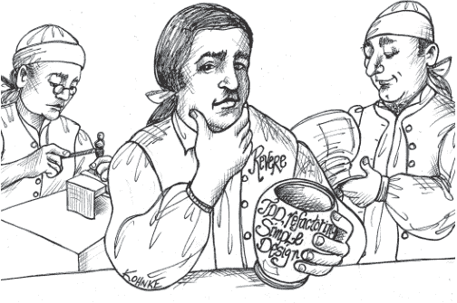

管理者和利益相关者很兴奋。说到底，谁不想敏捷？谁不想更快地交付软件？即使在怀疑者中，敏捷也无法被拒绝。如果你的竞争对手宣称他们敏捷，而你不是，那你会是什么？你的潜在客户会怎么看你？公司不能承担不敏捷的后果。在敏捷峰会之后的几年里，世界各地的公司都开始了他们的敏捷转型。敏捷转型时代已经开始了。

### 敏捷宿醉

从一种文化过渡到另一种文化并不容易。公司需要外部帮助来改造他们的组织，于是对新类型专业人才的需求大量涌现：敏捷教练。许多敏捷认证计划被创建。有些认证只需参加一个两天的培训课程就能获得。

向中层管理者销售敏捷流程很容易——他们都希望软件更快交付。“工程是简单的部分。如果我们修复流程，工程就会修复，”管理者被告知。“这总是人的问题。”他们相信了。管理者管理人，只要他们负责，他们就很乐意让自己的直接下属更快地工作。

许多公司确实从敏捷转型中受益，今天他们比之前处于更好的境地。许多这样的公司可以每天多次将软件部署到生产环境，并让业务和技术真正作为一个团队运作。但对许多其他公司来说肯定不是这样。愿意推动开发者更快工作的管理者正在利用流程的完全透明来进行微观管理。既没有业务经验也没有技术经验的敏捷教练在指导管理者，并告诉开发团队该做什么。路线图和里程碑由管理者定义并强加给开发团队——开发者可以估算工作量，但他们被强烈要求使估算符合强加的里程碑。经常可以看到项目在未来6到12个月的迭代和各自的用户故事已经由管理层定义。如果在一个冲刺中未能交付所有的故事点，就意味着开发者必须在下一个冲刺中更努力工作以弥补延误。每日站会变成开发者必须向产品负责人和敏捷教练汇报进度、详细说明他们在做什么以及何时完成的会议。如果产品负责人认为开发者把太多时间花在自动化测试、重构或结对等事情上，他们就直接告诉团队停止这样做。

战略性技术工作在*他们的*敏捷流程中没有位置。不需要架构或设计。命令就是只关注待办列表中优先级最高的项，并尽可能快地完成——一个接一个的优先级最高的项。这种方法导致一系列长期的迭代性战术工作和技术债务的积累。脆弱的软件，著名的单体（或对于尝试微服务的团队来说，分布式单体）成为常态。缺陷和运维问题是每日站会和回顾会议中的热门讨论话题。到生产环境的发布不如业务预期的那样频繁。手动测试周期仍然需要几天甚至几周才能完成。采用敏捷将防止所有这些问题希望已经破灭。管理者责怪开发者行动不够快。开发者责怪管理者不允许他们做所需的技术和战略工作。产品负责人不认为自己是团队的一部分，在事情出错时不分担责任。我们与他们对立的文化占主导地位。

这就是我们所说的*敏捷宿醉*。经过多年对敏捷转型的投资，公司意识到他们仍然有很多以前的问题。而敏捷当然被归咎于此。

### 期望错配

只关注流程的敏捷转型是部分转型。当敏捷教练试图指导管理者和交付团队遵循敏捷流程时，没有人帮助开发者学习敏捷技术实践和工程。认为修复人与人之间的协作就能改善工程的想法，错得不能再错了。

*良好的协作能消除人们工作中的部分阻碍，但并不一定能让他们更熟练。*

采用敏捷开发时有一个很大的期望：开发团队应该在一个功能完成后，或至少在每次迭代结束时，交付可投入生产的软件。对大多数开发团队来说，这是一个重大的变化。他们不可能只靠改变工作方式就实现这一点，这意味着要学习并掌握新的实践。但这里有几个问题：在敏捷转型期间，很少有预算用于提升开发人员的技能。业务方并不期望开发人员在采用敏捷的过程中放慢速度。大多数人甚至不知道开发人员必须学习新的实践。他们被告知，如果以更协作的方式工作，开发人员就会更快。

每两周向生产环境发布一次软件，需要大量的纪律性和技术技能——而这些技能在习惯每年只交付几次软件的团队中并不常见。当多个团队（每个团队都有不少开发人员）在同一个系统上工作，并期望他们在完成功能后就交付到生产环境时，情况会变得更糟。团队要在不影响系统整体稳定性的前提下，每天多次将软件部署到生产环境，其对技术实践和工程能力的掌握程度必须极高。开发人员不能只是从产品待办事项列表顶部挑一个条目，开始编码，然后一推到生产环境就觉得万事大吉。他们需要战略性思考。他们需要支持并行工作的模块化设计。他们需要持续拥抱变化，同时确保系统始终能够部署到生产环境。为此，他们需要持续构建既灵活又健壮的软件。但在持续部署软件到生产环境的需求下，平衡灵活性与健壮性极其困难，没有必要的工程技能是不可能做到的。

认为仅靠营造更协作的环境就能让团队培养出这些技能，是不现实的。团队需要在获取这些技术技能方面得到支持。这种支持可以通过辅导、培训、实验和自学的组合来实现。业务敏捷性与公司演进软件的速度直接相关，这意味着工程技能和技术实践的演进。

### 渐行渐远

当然，并不是每一次敏捷转型或每一家公司都会遇到上述所有问题，至少程度有所不同。从业务角度看，可以说大多数经历过敏捷转型的公司（哪怕是部分转型）如今都处于更好的状态。它们的迭代周期更短。业务与技术之间的协作比以前更紧密。问题和风险被更早发现。业务方随着获得新信息而反应更快，真正受益于迭代式软件开发。然而，尽管公司确实比以前更好了，但敏捷流程与工程之间的割裂仍在伤害它们。大多数现代敏捷教练缺乏足够的技术技能来指导开发人员的技术实践（甚至可能完全没有），而且他们很少谈论工程。多年来，开发人员开始把敏捷教练视为另一层管理：告诉他们该做什么，而不是帮助他们更好地做事。

> *开发人员正在远离敏捷，还是敏捷正在远离开发人员？*

这个问题的答案可能是两者兼有。看起来敏捷和开发人员正在相互远离。在许多组织中，敏捷已经成为Scrum的代名词。即便存在XP，也被缩减为像TDD和持续集成这样的少数几个技术实践。敏捷教练期望开发人员应用一些XP实践，但他们并不真正帮助或参与开发人员的工作方式。许多产品负责人（或项目经理）仍然不认为自己属于团队的一员，当事情没有按计划进行时，也不觉得需要负责。开发人员仍然需要与业务方艰难协商，才能进行必要的技术改进，以继续开发和维护系统。

> *企业还不够成熟，无法理解技术问题实际上就是业务问题。*

随着对技术技能的关注日渐减少，敏捷能否显著改善软件项目，超越迄今为止所取得的成效？敏捷是否仍然专注于*通过实践并帮助他人实践，来揭示更好的软件开发方法*，正如敏捷宣言所写的那样？我不太确定。

### 软件匠艺

为了提高专业软件开发的水准，并重新确立敏捷的一些原始目标，一群开发人员于2008年11月在芝加哥聚会，发起了一场新运动：软件工艺（Software Craftsmanship）。在那次会议上，与2001年敏捷峰会的情况类似，他们就一套核心价值观达成一致，并提出了建立在敏捷宣言之上的新宣言¹：

> 作为有抱负的软件工匠，我们通过实践并帮助他人学习这门技艺来提高专业软件开发水准。通过这项工作，我们开始重视：
>
> - 不仅要有可工作的软件，还要有精工细作的软件
> - 不仅要响应变化，还要稳步增加价值
> - 不仅要有个体和互动，还要有专业社区
> - 不仅要有客户协作，还要有富有成效的合作伙伴关系
>
> 也就是说，在追求左侧各项的同时，我们发现右侧各项是不可或缺的。

软件工艺宣言描述了一种意识形态，一种思维方式。它从不同角度倡导专业性。

精工细作的软件意味着代码经过良好设计和充分测试。它是我们不怕改动的代码，是让业务能够快速反应的代码。它是既灵活又健壮的代码。

稳步增加价值意味着无论我们做什么，都应该始终致力于不断为客户和雇主提供越来越多的价值。

专业社区意味着我们应该相互分享和学习，提高行业水准。我们有责任培养下一代开发人员。

¹ http://manifesto.softwarecraftsmanship.org

更好的实践会被发现。但这并不意味着国际软件工艺社区不倡导任何实践。恰恰相反，自2008年成立以来，软件工艺社区一直将XP视为当前可用的最佳敏捷开发实践集。TDD、重构、简单设计、持续集成和结对编程都受到软件工艺社区的大力倡导——但它们是XP实践，而不是软件工艺实践。而且它们并不是唯一的实践。软件工艺还倡导整洁代码和SOLID原则。它倡导小提交、小发布和持续交付。它倡导软件设计中的模块化，以及任何能消除手动和重复工作的自动化。它还倡导任何能提高生产力、降低风险，并有助于产出有价值、健壮、灵活软件的实践。

工艺不仅关乎技术实践、工程和自我提升。它还关乎专业精神，以及帮助客户实现其业务目标。而正是在这个领域，敏捷、精益（Lean）和软件工艺完美一致。三者有着相似的目标，但从不同且同等重要、互为补充的角度来处理问题。

#### 关注价值，而非实践

在敏捷和工艺社区中，一个常见错误是宣扬实践而非实践所提供的价值。以TDD为例。在工艺社区内部最常见的问题之一是：“我该如何说服我的经理/同事/团队采用TDD？”这是个错误的问题。问题在于，我们在尚未就问题达成一致之前就先给出了解决方案。如果人们看不到价值，就不会改变他们的工作方式。

与其推广TDD，也许我们可以先就“减少测试整个系统所需时间”这一价值达成共识。今天需要多长时间？两小时？两天？两周？涉及多少人？如果我们能把它缩短到20分钟呢？两分钟呢？甚至可能

2秒？如果我们只需按下一个按钮就能随时做到这一点，会怎样？这会给我们带来良好的投资回报吗？会让我们的生活更轻松吗？我们能否更快地发布可靠的软件？

如果我们同意答案是肯定的，那么我们就可以开始讨论有助于实现这一目标的实践方法。TDD（测试驱动开发）在此是一个自然的选择。对于那些不太热衷TDD的人，我们应该询问他们偏好哪种实践。他们能提出什么实践，能在既定目标下带来同等甚至更高的价值？

在讨论实践时，首先要就所要达成的目标达成一致，这一点至关重要。唯一不可接受的是拒绝一种实践却不提供更好的替代方案。

### 讨论实践

关于实践的讨论应在适当的层级、由适当的人员参与。如果我们想采用能改善业务与技术之间协作的实践，业务人员和科技人员都应参与讨论。如果开发人员正在讨论能让他们以更好的方式构建系统的实践，就没有理由让业务人员参与。只有当实践对项目成本或工期产生重大影响时，业务人员才应参与。

将整个单体系统重新架构为微服务与做TDD之间存在区别。前者对项目成本和工期有非常显著的影响；后者则不然，只要开发人员熟练掌握该技术。开发人员是否自动化测试与业务无关。自动化测试是在生产代码之前还是之后编写，甚至更与业务无关。业务方真正应该关心的是，从业务想法到生产环境中软件的上线时间（前置时间）逐步缩短。减少返工（缺陷、测试/部署/生产监控等手工流程）所花费的金钱和时间，也是开发团队应解决的一项业务关切。降低……的成本

人们通常会这样说：“*我为*X公司工作”，或“*我作为一名*软件开发人员工作”。但一个有职业的人通常会说：“*我是一名*软件开发人员。”职业是我们投入心血的东西。这是我们需要不断提升的东西。我们希望获得更多技能，拥有一段长久且令人满足的职业生涯。

这并不意味着我们不会与家人共度时光，也不意味着我们没有其他生活兴趣。相反，这意味着我们会找到一种方式，平衡所有承诺和兴趣，从而能够过一种统一、均衡、幸福的生活。有时我们想更多地关注家庭、职业或某个爱好，这完全没问题。我们在不同时间有不同需求。但当我们拥有职业时，上班不应是一件苦差事。它只是我们做的另一件事，能给我们带来快乐并让我们实现个人价值。职业赋予我们生命以意义。

### 软件匠艺对我们行业的影响

自2008年以来，世界各地组织起越来越多的软件匠艺社区和会议，吸引了数以万计的开发者。敏捷社区强调软件项目中人和流程的一面，而匠艺社区更关注技术面。它们在全球范围内向众多开发者和公司推广XP（极限编程）和许多其他技术实践方面发挥了关键作用。正是通过软件匠艺社区，许多开发者学会了TDD、持续集成、结对编程、简单设计、SOLID原则、整洁代码和重构。他们还学习如何用微服务架构系统、如何自动化部署流水线，以及如何将系统迁移到云端。他们在学习不同的编程语言和范式，学习新技术以及测试和维护应用程序的不同方式。匠艺社区的开发者正在创建安全友好的空间，让他们能与志同道合的人会面，讨论自己的职业。

软件匠艺的思维方式对许多开发者来说是种激励。它赋予他们目标感、自豪感，以及把事情做好的内在意愿。大多数开发者，如同普通人一样，都渴望学习并把事情做好——他们只需要能让他们茁壮成长的支持和环境。拥抱匠艺的公司通常会看到内部实践社区蓬勃发展。开发者组织内部会议，在其中一起编码、练习TDD，并提升软件设计技能。他们对学习新技术和对自己所工作的系统进行现代化改造变得兴趣盎然。他们讨论改善代码库和消除技术债务的更好方法。软件匠艺倡导学习文化，使公司更具创新力和响应力。

### 软件匠艺与敏捷

软件匠艺运动兴起的部分诱因，与许多开发者对敏捷发展方向的沮丧有关。正因如此，一些人认为匠艺和敏捷彼此对立。匠艺运动中那些也曾参与敏捷运动的人批评敏捷过度关注流程而缺乏对工程的关注。敏捷运动中的人则批评匠艺关注面狭窄，或者缺乏对真实业务和人员问题的关注。

尽管双方都有一些合理的关切，但多数分歧更多与圈子意识有关，而非实际的根本意见分歧。本质上，两个运动想要实现的事情非常相似。他们都希望客户满意，都渴望紧密协作，都重视短反馈回路。他们都想交付高质量、有价值的工作，也都追求专业精神。要实现业务敏捷，公司不仅需要协作和迭代的流程，还需要良好的工程技能。将敏捷与匠艺结合起来是实现这一目标的完美途径。

### 结论

在2001年雪鸟会议上，Kent Beck曾说，敏捷是为了弥合开发与业务之间的鸿沟。遗憾的是，随着项目经理们涌入敏捷社区，最初创建敏捷社区的开发者们感到被剥夺、被低估。于是，他们离开并组建了匠艺运动。于是，古老的猜疑延续了下来。

## 结论

好了，就是这样。这些就是我对敏捷的记忆、观点，以及我的一些吐槽和咆哮。希望你喜欢，甚至还能学到一两个东西。

敏捷或许是我们所见过的所有软件过程与方法革命中最重要、最持久的一场。这种重要性和持久性证明，2001年2月前往犹他州雪鸟的那17位人士，让一个雪球沿着一座很长的山坡滚了下来。乘坐这个雪球，看着它越滚越大、越来越快，看着它撞上巨石和树木，对我来说乐趣无穷。

我写这本书，是因为我认为是时候有人站出来为敏捷是什么以及敏捷仍然应该是什么大声疾呼了。我想是时候记住那些基本要义了。

那些基本要义过去是、现在是、将来也是Ron Jeffries“生命周期之环”中的纪律。那些基本要义是Kent Beck《解析极限编程》¹中的价值观、原则和纪律。那些基本要义是Martin Fowler《重构》²中的动机、技术和纪律。那些基本要义由Booch、DeMarco、Yourdon、Constantine、Page-Jones和Lister提出。

¹ Beck, K. 2000. *《解析极限编程：拥抱变化》*。波士顿，马萨诸塞州：Addison-Wesley。

² Fowler, M. 2002. *《重构：改善既有代码的设计》*，第2版。波士顿，马萨诸塞州：Addison-Wesley。

## 后记

作者：Eric Crichlow，2019年4月5日

我至今仍能清晰地记得自己第一份决定转向敏捷开发的工作。那是2008年，在一家被更大的公司收购的企业里。当时这家公司正在经历政策、流程和人员方面的重大变革。我也还记得其他几份强调敏捷实践的工作。那时大家近乎虔诚地遵循各种仪式：冲刺规划、演示、冲刺回顾……在其中一家公司，每位开发人员都接受了由认证Scrum Master主持的两天敏捷培训。作为移动开发人员，我被要求编写一个用来玩“敏捷扑克”的移动应用。

但自从我第一次接触敏捷以来的11年间，我也在好几家公司工作过，老实说，我已经记不清它们是否采用了敏捷实践。也许是因为敏捷已经变得如此普遍，以至于我们很容易将其视为理所当然，甚至根本不加思考。又或者，是因为仍有相当多的组织尚未采用它。

在我刚接触敏捷时，我并不是特别热衷。瀑布模型也许有其问题，但我当时所在的组织并不会花大量时间编写设计文档。我作为开发人员的生活通常是这样的：有人口头告诉我下一个版本需要哪些功能，告诉我下一个版本的截止日期，然后我就被放手去创造奇迹。虽然这确实可能导致可怕的“死亡行军”，但也给了我按自己喜欢的方式安排工作的自由。它还让我免受每日站会的频繁审视和问责——在站会上，我得解释自己昨天做了什么、今天打算做什么。如果我决定花一周时间重新发明轮子，我完全可以这么做，而不会有人评判我的选择，因为他们根本不知道我在做什么。

我曾在其手下工作过的一位前开发总监喜欢把我们称为“代码牛仔”。我们就是喜欢在软件开发的“狂野西部”里尽情敲击键盘。他说得没错。在某种程度上，敏捷实践就像镇上的新警长，驯服了我们这些特立独行的倾向。

敏捷要想赢得我的认可，还得下一番功夫。

如果认为敏捷是软件开发领域的实际标准，或者认为所有开发人员都把它当作积极的东西来拥抱，那未免有些自以为是。反过来，如果否认敏捷在软件开发世界中的重要性，那又太天真了。但这到底意味着什么？它的意义究竟何在？

如果你去问一家“敏捷组织”里的开发人员“什么是敏捷”，得到的答案很可能与问软件开发经理以上级别的人完全不同。也许这正是这本书最具启发性的地方。

开发人员理解敏捷是一种精简开发流程的方法论，让软件开发更可预测、更切实可行、更易于管理。我们从这一角度看待它是合理的，因为这是最直接影响我们的角度。

从个人经验来说，许多开发人员根本不知道管理层会利用敏捷实践实施过程中产生的指标和数据。在一些组织中，整个开发团队都会参加讨论这些指标的会议；但在另外许多组织中，开发人员根本不知道这些讨论的存在。而且，也许在某些组织里，这些讨论实际上根本没发生过。

虽然我早就知道敏捷的这一面，但通过这本书了解这些方法论创始人的最初意图和思考过程，我仍然觉得颇有启发。看到这些创始人被赋予人性化的一面也很好。他们并不是什么超级精英软件架构师，不是由软件工程大师指定，也不是被程序员大众选举来颁布教条的。他们只是一群经验丰富的开发人员，怀揣着如何让工作更轻松、更有成就感、压力更小的想法。他们厌倦了注定失败的工作环境，希望营造一种能够通向成功的环境。

这听起来就像我在每一家公司共事过的大多数开发人员。

如果雪鸟会议晚15年召开，我可以想象那会是很多我曾亲身共事过的开发人员和我自己，聚在一起召开那次会议，并把那些想法写进数字文档。但作为另一群经验丰富的开发人员，这个群体也容易有些异想天开的想法，这些想法在企业软件开发的现实世界中未必行得通。也许在高端顾问的世界里，一切都能按设计运转，因为他们有权提出要求，并能督促组织和管理层兑现承诺，但我们大多数人只是小兵，是软件工厂机器里的齿轮。我们是可替代的，几乎没有议价能力。所以，当涉及到《权利法案》这样的东西时，我们明白这是一种理想，但对我们大多数人来说，它并未实现。

看到如今的社交媒体社区，我倍感欣慰地看到许多新开发人员超越了计算机科学学位和朝九晚五的开发工作的界限，与世界各地的其他开发人员建立联系，通过各种不同的方式学习，并把自己的知识和经验分享出来，去教导和激励其他初出茅庐的开发人员。我完全期待下一次方法论上的重大变革会从这些年轻有为者的数字聚集中涌现。

所以，在我们等待下一代人揭示的“下一件大事”之际，让我们花点时间重新评估一下我们目前身处何处、手头有什么可用之物。

现在你已经读完了这本书，请用一分钟思考一下。想一想你可能知道但从未深思过的敏捷的某些方面。从业务分析师、项目经理或其他非开发类管理人员的角度来思考，他们负责规划发布或制定产品路线图。思考开发人员输入到敏捷流程中的价值能给他们带来什么。理解你对流程的输入不仅仅影响你接下来两周的工作量。然后再回头大致浏览一遍这本书。如果你带着这种更广阔的视角去读，我相信你会收获更多有用的见解。

做完这些之后，鼓励你所在组织的另一位开发人员也读一读这本书，并经历同样的内省。也许还可以把书递给一个——请听好——不是开发人员的人。把它交给公司“业务”部门的某个人。我几乎可以保证，《权利法案》是他们从未深思过的东西。如果能让他们明白，这些权利与从中抽取的指标一样，都是敏捷不可分割的一部分，你的生活将会更加愉快。

你可能会说，敏捷在软件开发领域已经变得有点像宗教了。我们许多人都已把它接受为最佳实践。为什么？对很多人来说，是因为别人告诉他们如此。它已经成了传统；事情就该这么做。对于新一代企业开发人员来说，它就是这样理所当然。他们，甚至包括我们许多老手，都并不真正知道这一切从何而来，也不知道最初的目标、目的和实践到底是什么。随你怎么说宗教，但最好的信徒是那些努力理解自己所信仰之物的人，而不仅仅是相信别人告诉他们的东西。而且和宗教一样，敏捷也没有一个普遍接受、放之四海皆准的版本。

想象一下，能够看清你信仰的宗教的起源，理解那些塑造了日后成为你信条的事件和思想，这何其重要。就你的职业生涯而言，这正是你在这里拥有的东西。请充分利用它，向你能影响范围内的其他人传播它，并重新找回最初的目标——那个你以及几乎每个共事过的人都曾经渴望、谈论过、可能也已经放弃的目标。让成功的软件开发变得可实现。让组织目标变得可达成。让把事情做得更好的过程得以实现。

## A

- 软件规模和依赖性，39–42
- 稳定的生产力，46–49
- 总结/结论，61
- 团队分担责任，54
- 测试自动化，52–53
- ALM（敏捷生命周期管理），153–155
- 分析，在敏捷中持续进行，24–25
- 分析阶段，瀑布方法，19–20
- 分析师，开发者的子集，59
- 参数，重构代码，123
- ASD（自适应软件开发），174–175
- 自动计算引擎（图灵），3
- **自动化**
  - 测试套件完成时的部署，119
  - 对测试自动化的期望，52–53
  - 相关工具，152
  - 谁应该编写自动化测试，88–89

## B

- Bamboo，持续构建工具，109
- 巴西利，维克，3
- 贝克，肯特
  - 敏捷基础，183
  - 斯诺伯德会议出席者，11
  - 作者会议及合作，9–10
  - 隐喻实践的示例，98
  - 弥合业务与开发之间的鸿沟，96
  - XP的历史，32
  - 在敏捷权利法案中的角色，56
  - 简单设计规则，125–126
- 比德尔，迈克，8, 11
- 行为驱动开发（BDD），90
- 最佳情况，三变量分析，65
- **权利法案**
  - 敏捷理想，187, 189
  - 客户权利法案，56–59
  - 开发者权利法案，57, 59–61
- **布奇，G.**
  - 敏捷基础，183
  - 敏捷的开端，8
  - “假装”作为向敏捷过渡的策略，140
- 布鲁克斯，小F.P.，28
- 布鲁克斯定律，关于人员增加，28
- **缺陷**
  - 敏捷后遗症，169
  - 调试，117
  - 软件测试的不足，41–43
- **燃尽图**
  - 呈现敏捷数据，16–17
  - 更新，81–82
- **业务分析师，协作**
  - 验收测试，91–93
- **业务决策**
  - 持续技术就绪度，和45
  - 弥合业务与开发之间的鸿沟，96
  - 按业务价值排列功能实现顺序，31
- **业务实践**
  - 验收测试。参见“验收测试”
  - 结论/总结，96
  - 规划。参见“规划”
  - 小版本发布。参见“小版本发布”
  - 完整团队。参见“完整团队”

## C

- 期望不匹配，171
- 与Git的关系，87
- 概述，107–108
- 小版本发布，83
- 软件工匠实践，176, 179–180
- SOLID原则，164
- XP实践，33, 172
- 科普利恩，詹姆斯，8–9, 184
- 成本
  - 适应性的成本，49–50
  - 欺骗的成本，110
  - 铁十字（好、快、便宜、完成），15
  - 结对编程的成本，130
  - 工具的成本，154
- 勇气
  - 敏捷价值观，134
  - 测试驱动开发与，121–123
  - 工匠精神。*参见*“软件工匠精神”
  - Craftscope，174
  - 克里奇洛，埃里克，185
  - CruiseControl，持续构建工具，108–109
  - 水晶方法（科克伯恩），8, 11
  - CTC（认证团队教练），165
  - CTO（首席技术官），43
  - Cucumber，自动化测试工具，89–90
- 坎宁安，沃德
  - 斯诺伯德会议出席者，11–13
  - 敏捷历史，3
  - XP历史，32
  - 在敏捷权利法案中的角色，56
- 客户
  - 权利法案，56–59
  - 沟通作为价值，134–135
  - 反馈作为发布不良代码的补救措施，45
  - 完整团队，93–94

## D

- 每日站会，110–111。*另见*“站立会议”
- 数据
  - 图表，15–18
  - 由敏捷方法产生的数据，25–27
- 数据字典（德马克），100
- 数据格式，更多供敏捷开发者使用的工具，148
- 日期
  - 需求变化时日期冻结，18
  - 日程变更，28
- 截止日期，101
- 死亡行军阶段，或瀑布方法，22
- 调试，117
- 解耦，可测试性与，121
- 投入，加班与可持续节奏，103–104
- 缺陷，QA疾病与，92
- 延迟，软件团队中的人为延迟，45
- 交付，持续。*参见*“持续集成”
- 德马克，汤姆，100, 183
- 演示故事，面向利益相关者，80–81
- 部署
  - 持续技术就绪度与，45–46
  - 敏捷开发者的核心工具，149
  - 当测试套件完成时，119
- 设计。*另见*“简单设计”
  - 最小化代码的设计重量，126–127
  - 在敏捷中持续进行，24–25
  - 作为设计技术的测试驱动开发，121
- 设计模式，8
- 设计阶段，瀑布方法，20–21
- 开发者。*另见*“程序员”；“软件开发/项目管理”
  - 斯诺伯德会议代表，11
  - 软件工匠实践，176
  - 技术实践，172
  - 转型为，137

## F

- “假装”（布奇和帕纳斯），通过假装成为敏捷，139–140
- 无畏，面对变化，50–51。*另见*“勇气”
- 特性驱动开发
  - 比较意识形态与方法论，175
  - 斯诺伯德会议代表，11
- 特性
  - 在迭代零中创建故事，24–25
  - 瀑布方法的设计阶段，19–20
  - 瀑布方法的实施阶段，21–22
  - 按业务价值排列实施顺序，31
- 反馈
  - 敏捷价值观，135
  - 反馈驱动，17
  - 发布不良代码的补救措施，45
- FitNesse，自动化测试工具，89–90
- “松弛Scrum”（福勒），136
- 灵活性，与健壮性的平衡，171。*另见*“适应性”
- 挂图，作为信息辐射器，151
- 飞指，故事估算中的技巧，76–77
- 福勒，马丁
  - 斯诺伯德会议出席者，10–12
  - 关于“松弛Scrum”，136
  - 关于重构，123, 183
  - 在敏捷宣言中的角色，12
- 框架，敏捷与，162
- 函数，重构代码，123–124

## G

- Git
  - 有效工具的示例，149–150
  - 源代码控制，87
- 给定-当-那么，正式化测试语言，90
- 基准故事
  - 比较后续故事，69
  - 估算故事，82
- 格伦宁，詹姆斯，11

## H

- 帮助，在开发者权利法案中，60
- 海史密斯，吉姆，11, 175
- 诚实，在估算中，54–55
- 希望，与管理，27
- *人类与计算机*（阿迪奇），44
- *谦逊的π*（帕克），44
- 亨特，安迪，11

## I

- IBM，PC的诞生，141
- ICAgile认证敏捷教练（ICP-ACC），158
- ICF（国际教练联合会），158, 165
- IDE（集成开发环境），148
- 意识形态，与方法论的比较，174–175
- 实施阶段，瀑布方法，21–22
- 改进，持续而稳定的，50
- 独立的，INVEST故事指南，74
- 独立的、可协商的、有价值的、可估算的、小型的、可测试的（INVEST），74–75
- 索引卡片，在管理故事中，66–67
- 个人，工匠精神对其的影响，178–179

## M

- 方法
  - 与意识形态比较，174–175
  - 水晶方法（科伯恩），8, 11
  - Mikado方法，150
  - 重构代码，123
  - 选择敏捷方法，136
  - 年轻开发者在其中引入巨变，188
- 度量，187
- Mikado方法，150
- 群体编程，130
- 模型驱动编程，11
- 模型，在与利益相关者沟通中，100

## N

- 可协商的，INVEST故事指南，74
- 纽柯克，吉姆，102–104
- “不”，何时说，55
- 名义情况，三变量分析，65
- 诺思，丹，90

## O

- 面向对象编程（OOP），8
- 现场客户。*参见* 完整团队
- 乐观锁，源代码控制中，86
- 组织/公司
  - 工匠精神的影响，180–181
  - 创建敏捷组织，141–142
- 加班，与可持续节奏相关，102–103
- 所有权。*另请参见* 集体所有权
  - 产品负责人，94, 172
  - 软件工匠精神，174

## P

- 结对编程
  - 代码审查与，129
  - 成本，130
  - 团队共担责任的期望，54
  - 管理与，130–131
  - 群体编程，130
  - 概述，127
  - 原因，129
  - 软件工匠实践，176, 179–180
  - 什么是结对，128–129
- 结对
  - 生命周期实践，34
  - 示例，107–108
  - 持续改进的期望，50
  - 它是什么，128–129
- 帕克，马特，44
- 伙伴关系，富有成效的，174
- PC（个人电脑），IBM与，141
- 计划评审技术（PERT），65
- 悲观锁，源代码控制中，86
- 示众板，ALM工具，154
- 乒乓球，结对编程中，128
- 规划
  - 在迭代中点检查故事，72
  - 向利益相关者演示新故事，80–81
  - 估算故事，68–70, 76–77
  - 第一个迭代，70–71
  - 故事估算的黄金故事标准，82
  - 故事指南，74–76
  - 管理迭代，78–79
  - 概述，64–65
  - 项目结束，73
  - QA与验收测试，79–80
  - 投资回报，71–72
  - 拆分、合并和技术预研故事，77–78
  - 故事与点数，65–68
  - 三变量分析，65
  - 更新速率和燃尽图，81–82
  - 估算迭代中的昨日天气，72–73
- 规划游戏
  - 生命周期实践，33
  - 估算诚实性的期望，55
  - 稳定生产力的期望，50
- 规划扑克，估算故事，76–77
- 点数，*参见* 故事
- 普尔，达蒙，155
- 项目组合管理，看板，163
- 实践，技术。*参见* 技术实践
- 务实程序员，在斯诺伯德会议上，11
- 流程专家，成为敏捷专家，156–157
- 产品负责人
  - 感觉不属于团队，172
  - Scrum，94
- 生产力
  - 稳定性的期望，46–49
  - 人员增加与，29
- 职业
  - 与工作对比，178–179
  - 编程作为职业的独特性，114
- 职业素养
  - 将工匠精神与敏捷结合，181
  - 专业社区，173
  - 概述，38
  - 软件及其潜在危险，42–43
  - 针对软件的范围和依赖，39–42
- 计划评审技术（PERT），65
- 程序员。*另请参见* 开发人员
  - 倦怠，101
  - 在验收测试中的协作，91–93
  - 在故事选择中的协作，78–79
  - 沟通作为价值，134–135
  - 设计负担作为认知负荷，127
  - 不交付劣质代码的期望，43–45
  - 主宰当代世界，41–43
  - 作为开发人员的子集，59
  - 编程作为职业的独特性，114
- 编程，将XP与敏捷进行比较，180
- 编程语言，敏捷开发者的核心工具，148
- 项目结束。*参见* 完成
- 项目管理。*参见* 软件开发/项目管理；瀑布式项目管理
- 穿孔卡片，源代码控制中，83–84

## Q

- QA（质量保证）
  - 验收测试与，79–80
  - 协作，91
  - 无缺陷的期望，52
  - 最后测试的责任，92–93
  - QA测试人员作为开发人员的子集，59
  - 角色与负担，91
  - 测试自动化，52–53
- 质量
  - 降低以满足进度，29–30
  - 开发者权利法案，59
  - 铁十字（好、快、便宜、完成），15
- 提问，作为辅导能力，159

## R

- 统一软件开发过程（RUP），2, 168
- RCS（修订控制系统），86
- 合理期望。*参见* 期望，合理的
- 重构。*另请参见* 简单设计
  - 生命周期实践，34
  - 持续改进的期望，50
  - 低成本适应性期望，50
  - 稳定生产力期望，50
  - 概述，123–124
  - 红/绿/重构循环，124–125
  - 劣质代码交付的补救措施，45
  - 软件工匠实践，176, 179–180
- 重构（福勒），123, 183
- 回归测试，92
- 发布。*另请参见* 小型发布
  - 敏捷后遗症与，169
  - 定义，87
  - 期望不匹配，171
- 远程工作，95–96
- 仓库工具，供敏捷开发者使用，148
- 责任
  - 对验收测试，93
  - 开发者权利法案，60–61
  - 团队共享的期望，54
- 投资回报率（ROI），估算故事，71–72
- 修订控制系统（RCS），86
- 罗伊斯，温斯顿，5–6
- 失控的过程膨胀，22
- RUP（统一软件开发过程），2, 168

## S

- 可扩展性，敏捷的，160
- SCCS（源代码控制系统），85–86
- 进度
  - 变更，28
  - 变更质量的影响，29–30
  - 变更范围的影响，30–31
  - 人员增加的影响，28–29
- 施瓦伯，肯，8, 11
- 科学管理，4, 6–7
- 范围，变更以满足进度，30–31
- 脚本，敏捷开发者的核心工具，148
- Scrum
  - 与敏捷同义，172
  - 将意识形态与方法论进行比较，174
  - 发展敏捷改编，163
  - 敏捷历史，8
  - 产品负责人，94
  - 斯诺伯德会议代表，11
  - Scrum Master 作为教练，143
  - Scrum Master 认证，144
  - 选择敏捷方法，136
- 莎伦，约纳特，8
- 衬衫尺码法，估算故事，76
- 简单设计
  - 生命周期实践，34
  - 持续改进的期望，50
  - 低成本适应性期望，50
  - 稳定生产力期望，50
  - 重构与，125
  - 劣质代码交付的补救措施，45
  - 规则（贝克），125–126
  - 软件工匠实践，176, 179–180
  - SOLID原则，165
  - 设计负担与，127
- 简单性，敏捷价值观，135–136
- 睡眠，与可持续节奏相关，104
- 小，INVEST故事指南，75
- 小型发布
  - 生命周期实践，33
  - 源代码控制中的磁盘和SCCS，85–86
  - 推动团队走向越来越短的发布周期，87
  - Git与，87
  - 概述，82–83
  - SOLID原则，164
  - 源代码控制，83–84
  - 源代码控制中的Subversion，86
  - 源代码控制中的磁带，85
- Smalltalk，8
- 斯诺伯德会议
  - 目标，2
  - 弥合业务与开发之间的鸿沟，96
  - 概述，10–13
  - 后斯诺伯德时期，13–14
  - 开启敏捷势头，183
- 软件工匠精神
  - 敏捷与，181
  - 结论/摘要，182
  - 讨论实践，177–178
  - 关注价值而非实践，176–177
  - 意识形态与方法论，174–175
  - 对公司的影响，180–181
  - 对个人的影响，178–179
  - 对行业的影响，179–180
  - 概述，173–174
  - 实践，175–176
- 软件开发/项目管理
  - 敏捷解决小团队问题，146–147
  - 敏捷作为信仰，189
  - 敏捷承诺快速交付，168–169
  - 敏捷使用，187
  - 瀑布式方法的分析阶段，19–20
  - 数据展示图表，15–18
  - 将敏捷与瀑布式方法进行比较，23–24
  - 将敏捷与XP进行比较，180
  - 日期冻结而需求变化，18
  - 瀑布式方法的死亡行军阶段，22
  - 当代社会对……的依赖，39–42
  - 瀑布式方法的设计阶段，20–21
  - 瀑布式方法的设计阶段，19–20
  - 瀑布式方法的实施阶段，21–22
  - 铁十字，15, 27
  - 会议，瀑布式方法的开始，18–19
  - 概述，14
  - 潜在危险，42–43
- SOLID原则
  - 概述，164
- 软件工匠实践，176, 179–180
- 源代码控制
  - 磁盘和SCCS，85–86
  - 用于其的Git，87
  - 历史，83–84
  - 其中的Subversion，86
  - 其中的磁带，85
- 源代码控制系统（SCCS），85–86
- SpecFlow，自动化测试工具，89–90
- 专业化，与集体所有权，105
- 规格说明，作为测试，88
- 速度。*参见* 速率
- 技术预研故事，用于估算故事，77–78
- 拆分故事，77–78
- 冲刺。*参见* 迭代
- 人员，增加人员，28–29
- 利益相关者
  - 计算投资回报，71–72
  - 向利益相关者演示新故事，80–81

- 沟通中的模型，100
- 迭代计划会议的参与者，70
- 站会
  - 与敏捷宿醉，170
  - 概述，110–111
- Stop the Presses 事件，持续构建中的中断，109
- 故事
  - ATM 示例，67–68
  - 在迭代中点检查，72
  - 为利益相关者演示，80–81
  - 估算，68–70, 76–77
  - 成为敏捷的示例，138–139
  - 交付失败，170
  - 其中的反馈循环，66–67
  - 黄金故事标准，82
  - 指南，74–76
  - 迭代零，24–25
  - 管理迭代，78–79
  - 概述，66–67
  - SOLID 原则，164
  - 拆分、合并与试探，77–78
  - 在三变量分析中，65
- 故事点。参见 故事
- 结构化编程（Dijkstra），8
- Subversion (SVN)，在源代码控制中，86
- 可持续节奏
  - 生命周期实践，33
  - 奉献精神与，103–104
  - 获得充足睡眠，104
  - 马拉松与，103
  - 加班与，102
  - 概述，100–101
- Sutherland, Jeff, 8, 11
- SVN (Subversion)，在源代码控制中，86
- 系统，软件匠艺的影响，180–181

## T

- 磁带（磁性），在源代码控制中，85
- Taylor, Frederick Winslow, 4
- TCR (Test && Commit || Revert)，150
- TDD。参见测试驱动开发（TDD）
- 团队实践
  - 集体所有权，104–107
  - 结论/总结，111
  - 持续集成，107–110
  - 隐喻，98–100
  - 站会，110–111
  - 可持续节奏，100–104
- TeamCity，持续构建工具，109
- 团队。另见团队实践；整个团队
  - 敏捷对小型团队问题的处理，144–147
  - 多团队环境中的指导，160
  - 选择故事的合作方法，78–79
  - 对稳定生产力的期望，46–49
  - 期望不匹配，171
  - 推广敏捷适应，163
  - 结对与，129
  - 分担责任，54
- 技术债务，敏捷宿醉，169
- 技术实践
  - 讨论，177–178
  - 关注价值而非实践，176–177
  - 方法论与，175
  - 概述，114
  - 结对编程。参见结对编程
  - 重构。参见重构
  - 简单设计。参见简单设计
  - 软件匠艺，175–176

## V

- 有价值，故事的 INVEST 指南，74–75
- 敏捷价值观
  - 沟通，134–135
  - 勇气，134
  - 反馈，135
  - 关注价值而非实践，176–177
  - 简洁，135–136
  - 软件匠艺增补了价值观，173
  - 从非敏捷方法的转型，137
- van Bennekum, Arie, 11
- 速度
  - 在迭代计划会议中进行估算，70–71
  - 下降，82
  - 铁十字（好、快、便宜、完成），15
  - 上升，81–82
  - 速度图表的斜率，81
- 速度图表
  - 以图表视图呈现的敏捷数据，16
  - 更新，81–82

## W

- 瀑布式项目管理
  - 分析阶段，19–20
  - 与敏捷的对比，23–24
  - Crichlow 论，186
  - 死亡行军阶段，22
  - 设计阶段，20–21
  - 作为编程方法的支配地位，7–8
  - 实现阶段，21–22
  - 局限性，156
  - 会议示例，18–19
  - Royce 图，5–6
  - 为解决其局限性而召开的 Snowbird 会议，2
- 整个团队
  - 生命周期实践，33
  - 同地办公提高效率，94–95
  - 对持续积极学习的期望，55
  - 对估算诚实的期望，55
  - 对指导的期望，56
  - 对团队分担责任的期望，54
  - 对愿意说“不”的期望，55
  - 概述，93–94
  - 迭代计划会议的参与者，70
  - 远程工作，95–96
- 宽带德尔菲法，估算故事，76
- 远程工作，95–96
- 最坏情况，三变量分析，65

## 

获取额外优惠，下次购买**节省35%**

- 自动获得下次购买35%折扣的优惠券，有效期为30天。请在你的 InformIT 购物车或账户页面的“管理代码”部分查找你的代码。
- 下载可用的产品更新。
- 如有可用，获取附加资料。*
- 勾选此处以接收我们的消息，并获得新版本及相关产品的独家优惠。

*注册优惠因产品而异。优惠将列在你账户页面的“已注册产品”下。

## 

InformIT 是全球领先教育公司 Pearson 旗下信息技术品牌的在线家园。在 InformIT.com，你可以：

- 购买我们的图书、电子书、软件和视频培训
- 充分利用我们的特别优惠和促销活动（informit.com/promotions）
- 注册获取特别优惠和内容简报（informit.com/newsletters）
- 访问数千个免费章节和视频课程
