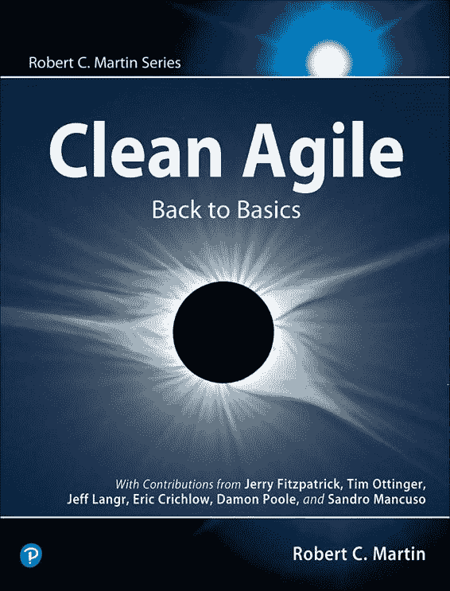
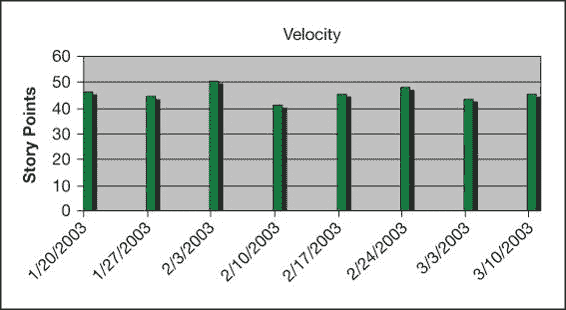
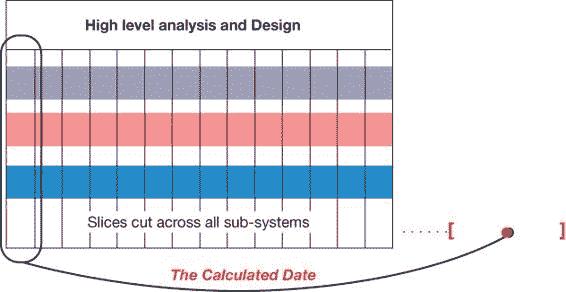
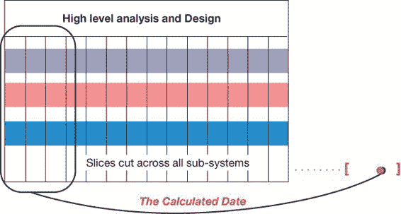
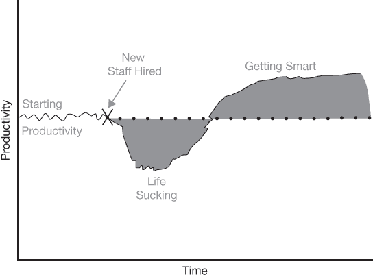
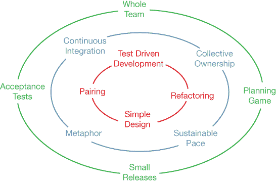
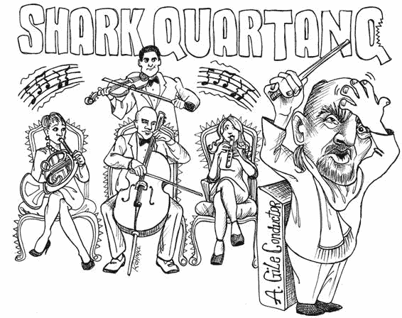
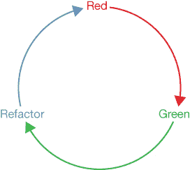
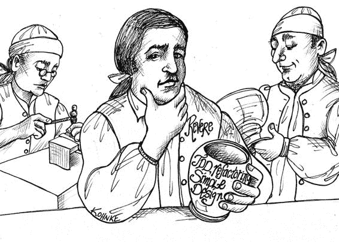

# 敏捷之道：回归基础



# 第 1 章（ch01.xhtml_page_1）

158. 131

194. 167

195. 168

196. 169

197. 170

232. 205

233. 206

234. 207

235. 208

# 整洁敏捷

## 回归本质

罗伯特·C·马丁（Robert C. Martin）


波士顿 • 哥伦布 • 纽约 • 旧金山 • 阿姆斯特丹 • 开普敦

迪拜 • 伦敦 • 马德里 • 米兰 • 慕尼黑 • 巴黎 • 蒙特利尔 • 多伦 • 德里 • 墨西哥城

圣保罗 • 悉尼 • 香港 • 首尔 • 新加坡 • 台北 • 东京

制造商和销售商用于区分其产品使用的许多标识均声称为商标。当这些标识出现在书中且出版商知晓该商标声明时，这些标识将以首字母大写或全大写形式打印。

作者和出版商在准备本书时已尽尽心，但不提供任何形式的明示或暗示保证，并对错误或遗漏不承担责任。对于使用本文包含的信息或程序有关或引起的任何偶然或后果性损害，不承担任何责任。

如需批量购买此书或获取特殊销售机会（可能包括电子版；定制封面设计以及针对您的业务、培训目标、营销重点或品牌利益特定内容），请联系我们的企业销售部门 `corpsales@pearsoned.com` 或 `(800) 382-3419`。

政府销售咨询，请联系 `governmentsales@pearsoned.com`。

美国以外的销售问题，请联系 `intlcs@pearson.com`。

访问我们的网站：`informit.com`

美国国会图书馆控制号：2019945397

版权所有 © 2020 Pearson Education, Inc.

封面图片：Peresanz/Shutterstock

杰里·菲兹特里克（Jerry Fitzpatrick）序言，Software Renovation Corporation，2019 年 3 月。经许可使用。

第 7 章由桑德罗·曼库索（Sandro Mancuso）编写，2019 年 4 月 27 日。经许可使用。

后记由埃里克·克奇（Eric Crichlow）编写，2019 年 4 月 5 日。经许可使用。

版权所有。本出版物受版权保护，在进行任何禁止的复制、存储在检索系统中或以任何形式或方式（电子、机械、复印、录音或类似方式）传输之前，必须先获得出版商的许可。有关许可、申请表以及皮逊教育全球权利与许可部门内部适当联系人的信息，请访问 `www.pearsoned.com/permissions/`。

ISBN-13: 978-0-13-578186-9

ISBN-10: 0-13-578186-8

`ScoutAutomatedPrintLine`

*献给每一个曾向风车或瀑布挑战的程序员*。

## 目录

序言

前言

致谢

关于作者

第 1 章 敏捷简介

- 无畏的胜任
- QA 不应发现问题
- 测试自动化
- 我们相互支持
- 诚实的估计
- 你需要说“不”

## 工具与方法论

### 行为驱动开发（BDD）

### 实践

### 整个团队

### 完整性

## 设计

## 勇气

## 重构

### 红/绿/重构

### 更大规模的重构

# 简单设计

### 设计权重

## 配对编程

### 什么是配对编程？

### 为什么要配对？

### 作为代码审查的配对

### 成本如何？

### 只有两个人吗？

### 管理

### 结论

# 第 6 章 走向敏捷

## 敏捷价值观

## 勇气

### 沟通

### 反馈

# 第 7 章 工匠精神

# 第 8 章 结论

## 前言

## 后记

## 索引

所以，又是时候提醒我们，先辈在 50 年代和 60 年代知道的，以及我们在 2000 年重新学到的东西。是时候记住敏捷到底是什么了。


*从左到右：* Mary Poppendieck, Ken Schwaber（作者），Mike Beedle, Jim Highsmith。（未在图中：Ron Crocker。）

最后，感谢培生教育（Pearson）的所有同事，特别是我的出版人 Julie Phifer。

## 关于作者

这里介绍的是敏捷开发的基础。许多人对这些想法进行了修饰和扩展——这并没有错。然而，那些扩展和修饰并不是敏捷开发。它们是“敏捷加上其他东西”。你在这里读到的是敏捷是什么、敏捷过去是什么，以及敏捷不可避免将永远是什么。

### 敏捷的历史

敏捷何时开始的？可能是在 5 万多年前，当人类第一次决定合作实现共同目标时。选择小小的中间目标并在每次之后衡量进度的想法太太直观、太合人性了，以至于无法被任何一种革命。

敏捷在现代工业中何时开始的？很难说。我想第一台蒸汽机、第一台磨坊、第一台内燃机和第一架飞机，都是用我们现在称为敏捷的技术生产的。这是因为采取细小且经过衡量的步骤太自然、太人性了，以至于不会以任何其他方式发生。

那么敏捷在软件领域何时开始的呢？我希望我能在 `Alan Turing` 写他那篇 1936 年论文时像墙上的蝇一样观察。我猜他写的许多“程序”都是在经过检查的小步骤中开发的。我想他在 1946 年为自动计算机（Automatic Computing Engine）编写的第一段代码也是小步编写的，并有大量的人工检查和一些真实的测试。

[1]. Turing, A. M. 1936. On computable numbers, with an application to the Entscheidungsproblem [proof]. *Proceedings of the London Mathematical Society*, 2（published 1937）, 42(1):230–65。理解这篇文章最好的方法是阅读 Charles Petzold 的杰作：Petzold, C. 2008. *The Annotated Turing: A Guided Tour through Alan Turing’s Historic Paper on Computability and the Turing Machine*。

软件早期充满了我们现在描述为敏捷的行为示例。例如，编写水星号太空舱控制软件的程序员们以半天为步进行工作，并以单元测试为穿插。

关于这一时期在其他地方有很多记载。`Craig Larman` 和 `Vic Basili` 写了一段历史，总结在 `Ward Cunningham` 的 wiki 上，也出现在 `Larman` 的书籍《Agile & Iterative Development: A Manager’s Guide》中。但敏捷开发并不是唯一的选择。事实上，当时有一种在制造业和整个行业中取得了巨大成功的竞争方法论：科学管理。

科学管理是一种自上而下的、命令与控制的方法。经理使用科学技术确定实现目标的最佳程序，然后指示所有下属严格执行他们的计划。换句话之，是有大的前期规划，然后是仔细的详细执行。

[2]. Ward 的 wiki，`c2.com` 是最初的 wiki——互联网上第一个出现的 wiki。愿它长久存在。

[3]. Larman, C. 2004. *Agile & Iterative Development: A Manager’s Guide*. Boston, MA: Addison-Wesley。

科学管理得益于 19 世纪 80 年代弗雷德里克·温斯洛·泰勒（Frederick Winslow Taylor）的作品。泰勒将这种方法形式化并商业化，并作为管理顾问积累了巨大的财富。这项技术取得了巨大的成功，并导致随后的几十年里效率和生产力的大幅提高。

正因如此，1970 年的软件世界正处于这两种对立技术的十字路口。前敏捷（Pre-Agile，即“敏捷”一词出现之前的敏捷开发）采取短促的反应性步骤，通过衡量和完善，以一种有引导的随机游步方式，向着良好的结果迈进。科学管理则将行动推迟，直到进行了彻底的分析并制定了详细的计划。前敏捷对于更改成本低、且需要通过非正式目标解决部分定义的项目效果良好；而科学管理对于更改成本高、且需要通过极其具体的目标解决非常定义良好的项目则效果最好。

那些日子我们使用什么流程？这显然不是瀑布模型。我们没有任何遵循详细计划的概念。我们只是每天在那儿“黑客”代码，运行编译、测试代码并修复漏洞。这是一个没有结构的无尽循环。它也不是敏捷，甚至不是前敏捷。我们的工作方式没有纪律。没有测试套件，也没有经过衡量的时间间隔。只是代码和修复，代码和修复，日复一日，月复一月。

我大约在 1972 年左右在某份行业杂志上首次读到瀑布模型。它看起来像是天赐的礼物。难道我们真的可以分析问题、设计解决方案，然后实施它吗？当我们认为自己成功了时，它又从指缝中溜走。尽管几乎无尽的失败，我们仍然坚持下去。彻底分析问题、仔细设计解决方案并实施该设计怎么会一次又一次地惨遭失败？问题出在策略上是不可想象的。问题一定在我们身上。

然后，突然，我们做到了。

# 敏捷变革

敏捷变革的起源于 20 世纪 80 年代末或 90 年代初。Smalltalk 社区在 80 年代就开始显现这种变革的迹象。在 Booch 1991 年关于面向对象设计（OOD）的书中也能发现其中的暗示。1991 年 Cockburn 的 `Crystal Methods` 中出现了更明确的表述。1994 年，`Design Patterns`（设计模式）社区开始讨论这一话题，这主要得益于 James Coplien 编写的一篇论文的推动。

[11]. Coplien, J. O. 1995. A generative development-process pattern language. *Pattern Languages of Program Design*. Reading, MA: Addison-Wesley, p. 183.

到 1995 年，Beedle, Devos, Sharon, Schwaber 和 Sutherland 编写了他们关于 `Scrum` 的著名论文。从此，大门被打开。瀑布模型的堡垒被攻破，再也无法回头。

[12]. Mike Beedle 于 2018 年 3 月 23 日在芝加哥被一名精神异常的无流浪汉杀害，此人曾被捕并释放过 99 次。他本应该被送进机构。Mike Beedle 是我的朋友。

[13]. Beedle, M., M. Devos, Y. Sharon, K. Schwaber, and J. Sutherland. `SCRUM`: An extension pattern language for hyperproductive software development. Accessed at [`jeffsutherland.org/scrum/scrum_plop.pdf`](http://jeffsutherland.org/scrum/scrum_plop.pdf).


`.,,. a a the........... the the the the.. the. the the.. the.................................................................. out..................... the the the................ the.... the the.... the the the.. the....... the....................................................................................................................................................................................................................................................................................................................................................................................................................................................................................................................................................................................................................................................................................................................................................................................................................................................................................................................................................................................................................................................................................................................................................................................................................................................................................................................................................................................................................................................................................................................................................................................................................................................................................................................................................................................................................................................................................................................................................................................................................................................................................................................................................................................................................................................................................................................................................................................................................................................................................................................................................................................................................................................................................................................................................................................................................................................................................................................................................................................................................................................................................................................................................................................................................................................................................................................................................................................................................................................................................................................................................................................................................................................................................................................................................................................................................................................................................................................................................................................................................................................................................................................................................................................................................................................................................................................................................................................................................................................................................................................................................................................................................................................................................................................................................................................................................................................................................................................................................................................................................................................................................................................................................................................................................................................................................................................................................................................................................................................................................................................................................................................................................................................................................................................................................................................................................................................................................................`

[11]. Coplien, J. O. 1995. A generative development-process pattern language. *Pattern Languages of Program Design*. Reading, MA: Addison-Wesley, p. 183.

[12]. Mike Beedle 于 2018 年 3 月 23 日在芝加哥被一名精神异常的无流浪汉杀害，此人曾被捕并释放过 99 次。他本应该被送进机构。Mike Beedle 是我的朋友。

[13]. Beedle, M., M. Devos, Y. Sharon, K. Schwaber, and J. Sutherland. `SCRUM`: An extension pattern language for hyperproductive software development. Accessed at [`jeffsutherland.org/scrum/scrum_plop.pdf`](http://jeffsutherland.org/scrum/scrum_plop.pdf).

这一次，我进入了这个故事。

不知出于什么，我们约定由我来主持会议。我感谢大家的到来，并建议我们的任务是创建一份宣言，描述我们认为所有这些轻量级流程以及整个软件开发领域共同拥有的理念。然后我坐了下来。我认为那是我对会议的唯一贡献。

我们做了一些标准动作，即将问题写在卡片上，然后在地板上将卡片进行亲性聚类分组。我并不确定这是否导致了什么结果。我只记得我们做过这件事。

我不记得魔法是发生在第一天还是第二天。在我看来，似乎是在第一天快结束的时候发生的。也许是亲性聚类确定了这四个价值观，即`个人与交互`、`运行的软件`、`客户协作`和`响应变化`。有人在房间前方的白板上写下了这些内容，然后出了一个绝妙的主意：认为这些价值观是优先的，但不能取代流程、工具、文档、合同和计划等互补价值。

这是《敏捷宣言》的核心思想，似乎没有人清楚地记得是谁第一个把它写在白板上的。我似乎记得是`Ward Cunningham`。但 Ward 认为是`Martin Fowler`。

看看`agilemanifesto.org`网页上的照片。Ward 说他拍这张照片是为了记录那一刻。照片清楚地显示 Martin 站在白板旁，我们其他许多人聚集在他周围。^(18) 这为 Ward 的观点提供了支持，即是 Martin 提出了这个想法。

## 敏捷概述

你如何管理软件项目？多年年来一直有很多方法——其中大多数都非常糟糕。希望和祈祷在那些相信有神主宰软件项目命运的经理中很流行。而那些没有这种信仰的人通常诉诸于激励技巧，例如用鞭子、锁链、沸油以及人们攀爬岩石和海鸥在海上飞翔的照片来强制执行。

这些方法几乎无例外地导致了软件管理不当的典型症状：开发团队尽管拼命加班，但总是延期。团队的产品质量明显低下，完全无法满足客户的需求。

### 铁三角

这些技术之所以失败得如此惨烈，是因为使用这些技术的经理并不理解软件项目的基本物理学。这种物理学限制所有项目必须遵守一个不可动摇的权衡，被称为项目管理的`铁三角（Iron Cross）`。好、快、廉、完成：任选三个你喜欢的。你不可能得到第四个。你可以有一个好、快且便宜的项目，但它不会完成。你可以有一个已完成、便宜且快速的项目，但它不会好。

现实情况是，一个优秀的项目经理理解这四个属性是有系数的。一个优秀的经理推动项目达到足够好、足够快、足够廉，并在必要时尽可能完成。一个优秀的经理管理这些属性的系数，而不是要求所有系数都是 100%。这种管理方式正是敏捷努力想要实现的。

在这一点上，我想确保你理解，敏捷是一个框架，它能*帮助*开发者和经理执行这种务实的项目管理。然而，这种管理并不是自动的，也无法保证经理会做出适当的决策。事实上，在敏捷框架内工作完全可能完全误判项目并导致其失败。

### 墙上的图表

那么，敏捷是如何协助这种管理的呢？*敏捷提供数据*。一个敏捷开发团队产生的数据，正是经理做出良好决策所需的类型的数据。

考虑图 1.2。想象它挂在项目室的墙上。这难道不是很好吗？

```

```

**图 1.2** 团队的速率

是 5 月 1 日。老板把我们都召集到一个会议室。

“我们有一个新项目，”老板说，“它必须在 11 月 1 日前完成。我们还没有任何需求。我们会在未来几周内发给你们。”

“现在，你们需要多久来完成`分析（analysis）`？”

我们面面相觑。没有人愿意说话。你如何回答这样的问题？我们中的其中一个人喃喃道：“但我们还没有任何需求。”

“假设你们已经有需求了！”老板吼道，“你们知道这怎么运作的。你们都是专业人士。我不需要精确的`日期（Date）`。我只需要一个可以填进进度表的数字。记住，如果时间超过两个月，我们还不如不做这个项目了。”

“两个月？”从某人嘴里挤出来，但老板将其视为肯定。“好！我也是这么想的。现在，你们需要多久来完成设计（design）？”


再次，令人惊讶的沉默弥罩了房间。你在心里算着账。你意识到距离`11 月 1 日`还有六个月。结论是显而易见的。“两个月？”你说。

“完全正确！”老板喜笑颜开。“正是我想的一样。这留给了我们两个月来进行实施。感谢大家参加我的会议。”

读到这里的你们很多人都参加过那个会议。没参加过的，可以认为自己很幸运了。

## 分析阶段

于是我们都离开了会议室回到了自己的办公室。我们在做什么？这是`分析阶段（Analysis Phase）`的开始，所以我们必须在进行分析。但这种被称为`分析`的东西到底是什么？

与此同时，需求仍在发生变化。新功能不断被添加。旧功能不断被删除或更改。我们想回去重新分析、重新设计这些变化，但我们只剩下几周时间了。所以我们只能硬、硬、硬地把这些变化塞进代码里。

当我们查看代码并将其与设计对比时，我们意识到，在做设计时我们一定吃了什么非常特别的东西，因为代码出来的东西完全不像我们画的那些漂亮的图表。但我们没有时间担心这些，因为时钟在滴答响，加班时间在不断增加。

然后，在`10 月 15 日`左右，有人说：“嘿，几号了？什么时候交差？”在那一刻，我们意识到只剩下两周时间了，我们永远无法在`11 月 1 日`之前完成。这也是利益相关者第一次被告知项目可能存在小问题。

你可以想象利益相关者的焦虑。“你们不能在分析阶段告诉我们吗？难道不是你们应该对项目进行规模评估并证明进度表可行性的时候吗？你们不能在设计阶段告诉我们吗？难道不是你们应该将设计拆分成模块、将这些模块分配给团队并进行人力预测的时候吗？你们为什么非要在截止日期前两周才告诉我们？”

他们说的很有道理，不是吗？

## 死亡行军阶段

现在我们进入了项目的“死亡行军”阶段。客户愤怒。利益相关者愤怒。压力倍增。加班飙升。人们辞职。简直是地狱。

在`3 月`的某个时候，我们交付了一个歪扭扭的东西，它部分实现了客户想要的功能。每个人都不开心。每个人都丧失了动力。我们向自己承诺，`不会`再做这样一个项目了。下次我们会做好的！下次我们会进行`更多`分析和`更多`设计。

我把这称为`失控的流程膨胀`。我们将重做那个行不通的事，而且要做得`多得多`。

## 夸张吗？

显然，那个故事是夸张的。它把任何软件项目中发生过的几乎所有坏事都归为了一类。大多数瀑布型项目并没有失败得如此惨烈。事实上，有些项目通过纯运气成功地以微小的成功告终。另一方面，我参加过不止一次那种会议，也参与过不止一个这样的项目，我并不孤单。故事可能是夸张的，但它仍然真实。

## 敏捷产生数据

第一次迭代始于估计将完成多少用户故事（`stories`）。然后，团队将在整个迭代周期内努力完成这些故事。我们稍后会讨论迭代内部发生了什么。现在，你认为团队完成所有计划完成故事的概率有多大？

当然，几乎为零。这是因为软件开发并不是一个可以可靠估算的过程。我们程序员根本不知道某件事需要多长时间。这并不是因为我们无能或懒惰，而是因为在任务没有真正开始执行并完成之前，根本没有办法知道这项任务会有多复杂。但是，正如我们将看到的，一切并非已经皆输。

在迭代结束时，我们计划完成的故事中会有部分已经完成。这给了我们关于单次迭代中可以完成多少工作的首次测量。这是`真实数据`。如果我们假设每次迭代都是相似的，那么就可以利用这些数据来调整原始计划，并为项目计算一个新的结束日期（图 1.5）。



**图 1.5** 计算新的结束日期

这个计算结果可能会非常令人失望。它几乎会比项目的原始结束日期晚出一个很大的比例。另一方面，这个新日期是基于`真实数据`的，所以它不应该被忽视。它现在还不能太严肃，因为它是基于单一数据点；该预测日期周围的误差范围相当大。

为了缩小这些误差范围，我们应该再进行两或三次迭代。随着迭代的进行，我们获得了更多关于单次迭代可以完成多少个故事的数据。我们会发现这个数字在迭代之间不断变化，但平均来看有一个相对稳定的`速率（velocity）`。在四五次迭代之后，我们对项目何时能完成会有更清晰的认识（图 1.6）。



**图 1.6** 更多的迭代意味着对项目结束日期有更好的了解

通常情况下，业务方不愿意改变进度。那个日期是出于良好的业务考虑选择的，这些理由仍然成立。所以让我们尝试增加人员。大家都知道，增加一倍人员就能快一倍。

实际上，情况恰恰相反。布鲁克斯法则（`Brooks’ law`）^(22)指出：`向延期的项目增加人力会使其更晚`。

22. Brooks, Jr., F. P. 1995 [1975]. *The Mythical Man-Month*. Reading, MA: Addison-Wesley. [`en.wikipedia.org/wiki/Brooks%27s_law`](https://en.wikipedia.org/wiki/Brooks%27s_law).

实际发生的情况更像图 1.7 中的图所示。团队以一定的生产率工作。然后加入了新员工。由于新人的加入消耗了老员工的精力，生产率会下降几周。然后，希望新人们开始变得足够聪明并做出贡献。经理做的赌注是，该曲线下的面积最终将是正的。当然，你需要足够的时间和改进来弥补最初的损失。



**图 1.7** 向团队增加成员的实际效果

另一个因素当然是，增加人员是昂贵的。预算往往无法负担雇佣新人的费用。所以，为了讨论，我们假设无法增加人员。这意味着下一个要改变的是质量。

### 降低质量

大家都知道，通过生产垃圾可以快得多。所以，停止写那些测试，停止做那些代码审查，停止所有那些重构废话，直接写代码吧，你们这些恶鬼，直接写代码！如果有必要，每周工作 80 小时，但直接写代码！

我确定你知道我要告诉你这是徒劳的。生产垃圾并`不会`让你变快，只会让你变慢。这是你当了 20 年或 30 年程序员后学到的教训。没有所谓的“快而脏”。任何脏的东西都是慢的。

变快的唯一方法就是把事情做好。

这就是敏捷。

### 生命之环

图 1.8 是 Ron Jeffries 描述 XP 实践的图表。这张图被亲切地称为`Circle of Life`。



**图 1.8** 生命之环

我之所以为这本书选择 XP 实践，是因为在所有的敏捷流程中，XP 是定义最清晰、最完整且最不混乱的。几乎所有其他敏捷流程都是 XP 的子集或变体。这并不是说这些其他敏捷流程应该被忽视。事实上，你可能会发现它们对各种项目很有价值。但如果你想理解敏捷到底意味着什么，没有比学习 XP 更好的方法了。XP 是敏捷本质核心的原型和最佳代表。

Kent Beck 是 XP 之父，而 Ward Cunningham 是祖父。两人在 20 世纪 80 年代中期在 Tektronix 工作时，探索了许多最终变成 XP 的想法。Kent 后来在 1996 年左右将这些想法提炼成 XP 的具体形式。2000 年，Beck 出版了该领域的终基性著作：*Extreme Programming Explained: Embrace Change*。^(23)

23. Beck, K. 2000\. *Extreme Programming Explained: Embrace Change*. Boston, MA: Addison-Wesley. 有一个 2005 年版权的第二版，但第一版是我的最爱，也是我认为的权威版本。Kent 可能会不同意。

生命之环被分为三个环。外圈显示了 XP 面向业务的实践。这一圈基本上等同于`Scrum`^(24) 流程。这些实践为软件开发团队与业务沟通的方式以及业务与开发团队管理项目的原则提供了框架。

24。至少是 Scrum 最初构想的样子。如今，Scrum 吸收了更多 XP 实践。

### 结论

这就是敏捷，这也是敏捷的开始。敏捷是一项帮助小型软件团队管理小项目的学科。但尽管有这些“微小”，敏捷的影响和后果是巨大的，因为毕竟所有大项目都是由许多小项目组成的。

## 2. 敏捷的原因


在我们深入研究敏捷开发的细节之前，我想解释一下这其中的什么。敏捷开发不仅对软件开发很重要，也关乎我们的行业、我们的社会，并最终关乎我们的文明。

*   1：DVD 播放器。
*   1：Roku 互联网电视流媒体设备。
*   1：Apple AirPort Express。
*   1：Apple TV。
*   5：遥控器。
*   1：电话。（是的，一部真正的电话。）
*   1：假壁炉。（你应该看看它拥有的所有花模式！）
*   2：一台旧的电脑控制望远镜，Meade LX 200 EMC。驱动器里有一个处理器，手持控制单元里还有一个。
*   1：口袋里的 U 盘。
*   1：Apple Pencil。

我数出我身上和房间里至少有 30 台电脑。真实数量可能是它的两倍，因为大多数设备内部都有多个处理器。但让我们先按 30 台算。

你数了多少个？我打赌对你们大多数人来说，这个数字接近我的 30。事实上，我打赌生活在西方社会的 13 亿人中，大多数人都在一直处于十多台电脑附近。这是一个新现象。在 20 世纪 90 年代初，这个数字平均接近于零。

这些附近的电脑各有什么共同点？它们都需要被编程。它们都需要软件——由我们编写的软件。你们认为，那些软件的质量如何？

让我换一个角度来看这个问题。你祖母每天与软件系统交互多少次？对于那些奶奶还健在的人来说，这个数字可能是几千次，因为在当今的社会中，如果不与软件系统交互，你无法做任何事情。你无法：

## 合理的期望

下文是经理、用户和客户对我们提出的完全合理的期望列表。在阅读此列表时，请注意你大脑的一半认同每一项内容都是完全合理的。请注意你大脑的另一半——即程序员的那部分——做出了惊恐的反应。你大脑中程序员的部分可能无法想象如何满足这些期望。

满足这些期望是敏捷开发的主要目标之一。敏捷的原则和实践直接应对了此列表中的大部分期望。以下行为是任何出色的首席技术官（CTO）都应该从员工身上期待到的。事实上，为了强调这一点，我希望你把我视为你的 CTO。以下是我的期望。

### 我们不交付垃圾！

这是我们行业一个令人遗憾的方面，这种期望竟然必须被提到。但它确实被提及。亲爱的读者们，我确定你们中许多人曾一次或多次违背过这一期望。我当然也遇到过。

为了理解这个问题的严重性，请考虑由于 32 位时钟溢出导致洛杉矶空中交通管制网络关闭。或者由于同样的原因导致波音 787 机上的所有发电机关闭。又或者由于 737 Max 的 MCAS 软件导致数百人丧命。

### 稳定的生产力

你可能注意到，在一个绿色项目的最初几个月里，编程团队通常可以运行得非常快。当没有现有代码库拖慢你的速度时，你可以在短时间内写出大量运行的代码。

遗憾的是，随着时间的推移，代码中的混乱会不断累积。如果这些代码不保持整洁有序，它就会给团队带来反压力，减慢进度。混乱越大，反压力就越高，团队运行得也越慢。团队运行越慢，进度压力就越大，制造更大混乱的动力也就越强。这种正反馈循环会导致一个团队陷入近乎停滞的状态。

经理们对这种速度变慢感到困惑，最终可能决定为团队增加人力资源以提高生产力。但正如我们在上一章看到的，增加人员实际上会让团队在几周内变慢。

他们希望在几周之后，新人们能够进入状态并帮助提高速度。但是谁在培训这些新人呢？正是最初制造混乱的那些人。新人们无疑会模仿那些既定的行为。

更糟糕的是，现有的代码是一个更强大的导师。新人们会观察旧代码，并推断出这个团队是如何工作的，他们会继续制造混乱的惯例。因此，尽管增加了新成员，生产力仍然会持续下降。

管理层可能会再尝试几次，因为在某些组织中，重复同样的事情并期待不同的结果，就是所谓的“管理上的理智”。然而，最后真相将大白于。。经理们所做的一切无法阻止这种向停滞的不可避免的坠落。

在绝望中，经理们询问开发者可以做什么来提高生产力。开发者们有了答案。他们早就知道需要做什么，只是在等被问起。

“从头开始重新设计系统。”开发者们说。

想象一下经理们的惊恐吧。想象一下目前为止投入到这个系统中的资金和时间。现在，开发者竟然建议扔掉整个系统并从头重新设计！

当这些经理们听到开发者承诺“这次会不”时，他们相信吗？当然不。如果他们相信，那他们就是傻瓜。然而，他们还有什么选择呢？生产力已经到了谷底。按照这个速度，业务是无法持续的。所以，在经历了许多次哀号和切牙之后，他们同意了重新设计。

开发者们发出一阵欢呼。“哈利路亚！我们都要回到那个生活美好、代码整洁的起点！”当然，事实并非如此。真实发生的情况是团队被分成了两部分。最优秀的十个人，即“虎队”——那些最初制造混乱的家伙——被选中并搬到了另一间房间。他们将带领我们其他人进入重新设计系统的黄金之地。我们其他人非常讨厌那些家伙，因为现在我们被困在维护那些旧烂事了。

虎队从哪里获取需求呢？有最新的需求文档吗？有。它就是旧代码。旧代码是唯一准确描述重新设计后的系统应该做什么的文档。

现在，虎队正钻研旧代码，试图弄清楚它到底在做什么，以及新设计应该是样的。与此同时，我们其他人正在修改那些旧代码，修复漏洞并添加新功能。

因此，我们处于了一场竞赛中。虎队试图追赶一个移动的目标。正如芝诺在阿基琉斯与乌龟的寓言中所的那样，追赶移动的目标是一个挑战。每当虎队到达旧系统所在的位置，旧系统已经移动到了新的位置。

需要微积分才能证明阿基琉斯最终会超过乌龟。但在软件领域，这种数学方法并不总是有效。我曾工作过一家公司，十年后新系统还没有部署。客户在八年前就收过会有新系统的承诺。但新系统对那些客户来说功能永远不够；旧系统的功能总是比新系统多。因此，客户拒绝接受新系统。

几年之后，客户直接忽略了关于新系统的承诺。从他们的角度来看，那个系统不存在，而且永远不会存在。

软件行业最大的单一控诉、我们作为专业人士失败的最而易见的证据，就是我们让事情随着时间的推移变得越来越糟糕。我们这些开发者竟然期望系统随着时间的推移变得越来越混乱、充满冗余、更加脆弱和易碎，这可能是最不负责任的态度。

持续、稳定的改进是用户、客户和经理所期望的。他们期望早期的问题消失，系统随着时间的推移变得越来越好。`结对`、`TDD`、`重构`和`简单设计`等敏捷实践有力支持了这一预期。

## 无畏的能力

为什么大多数软件系统没有随着时间的推移而改进？恐惧。具体来说，是对改变的恐惧。

想象你正看着屏幕上的一些旧代码。你的第一个念头是：“这些代码真丑，我应该清理一下。”你的下一个念头是：“我才碰它！”因为你知道如果你碰了它，就会弄坏它；而如果你弄坏了，它就变成你的责任了。所以你避开了唯一可能改进代码的方法：清理它。

这是一种恐惧的反应。你恐惧代码，这种恐惧迫使你表现得无能。你因为恐惧结果，所以无力进行必要的清理。你允许你创建的这些代码完全脱离你的控制，以至于你对任何改进它的行动感到恐惧。这是极端不负责任的。

客户、用户和经理期望`无畏的能力`。他们期望当你看到错误或肮脏的地方时，你会修复并清理它。他们不期望你让问题滋生增长；他们期望你掌控代码，保持它尽可能整洁清晰。

那么你如何消除那种恐惧呢？想象你拥有一个控制两个灯的按钮：一个红色的，一个绿色的。想象按下这个按钮时，如果系统正常，绿灯亮；如果系统故障，红灯亮。想象按下那个按钮得到结果只需要几秒钟。你会多久按一次按钮？你永远停不。你会一直按下去。每当你对代码进行任何更改时，你都会按下按钮以确保你没有弄坏任何东西。

现在想象你正看着屏幕上的一些丑代码。你的第一个念头是：“我应该清理它。”然后你直接开始清理，在每次小改动后都按下按钮，确保你没有弄坏任何东西。

恐惧消失了。你可以清理代码。你可以利用`重构`、`结对`和`简单设计`等敏捷实践来改进系统。

你如何得到那个按钮？`TDD`敏捷实践为你提供了那个按钮。如果你以纪律和决心遵循这一实践，你将拥有那个按钮，并且将变得无畏且专业。

## QA 应该一无所获

作为 CTO，我期望开发团队像团队一样表现。团队是如何表现的？想象一群球员在场上推进运球。其中一名球员绊倒了。其他球员怎么做？他们填补倒下成员留下的空隙。

在船上，每个人都有自己的工作。每个人也知道做别人的工作。因为在船上，所有工作都必须完成。

在软件团队中，如果 Bob 生病了，Jill 会接手 Bob 的任务。这意味着 Jill 最好知道 Bob 在做什么，以及 Bob 把源代码、脚本等存放在哪里。

我期望软件团队的成员互相协作。我期望软件团队的每个成员都确保在他倒下时有人可以替代他。这是*你的*的责任，确保你的一个或多个同事可以替代你。

如果 Bob 是数据库专家，而 Bob 生病了，我不期望项目进度停滞。其他人，即使她不是“数据库专家”，也应该接手。我不期望团队将知识锁在孤岛中；我期望知识被共享。

### 客户权利宣言

客户权利宣言包括以下内容：

*   你们有权获得整体计划，并知道在何时以何种成本完成什么内容。
*   你们有权从每次迭代中获得最大的价值。
*   你们有权在运行的系统中看到进度，并通过通过你们指定的、可重复的测试来证明其有效性。
*   你们有权改变主意、替换功能并更改优先顺序，而无需支付高昂的代价。
*   你们有权及时获进度和估计的变更，以便选择如何缩小范围以满足要求的日期。你们可以随时取消，并获得一个反映截至目前投资的视用运行系统。

### 开发者权利宣言

开发者权利宣言包括以下内容：

*   你们有权通过明确的优先级声明了解所需的内容。
*   你们有权随时产出高质量的工作。

客户可以随时取消，并获得一个反映截至目前投资的视用运行系统。

请注意，客户没有权利要求遵守进度。他们的权利限于通过更改范围来管理进度。这项权利赋予他们的最重要的东西就是有权知道进度正面临风险，以便及时进行管理。

### 开发者

在此语境下，开发者是指任何从事代码开发工作的人。这包括程序员、QA、测试人员和业务分析师。

开发者有权通过明确的优先级声明了解所需的内容。

再次，重点是`知识`。开发者有权要求需求具有精确性，并要求这些需求具有重要性。当然，需求同样适用于`实用性`约束，正如适用于估算一样。需求并不总是做到完全精确的。事实上，客户有权改变他们的主意。

因此，这种权利仅适用于`迭代的上下范围内`。在迭代之外，需求和优先级会发生偏移和变化。但在迭代内部，开发者有权认为它们是不可更改的。然而，请始终记住，如果开发者认为请求的变更是无关痛痒，他们可能会选择放弃这项权利。

开发者有权随时产出高质量的工作。


这可能是所有权利中意义最远的一项。开发者有权做出良好的工作。业务部门无权要求开发者偷工减料或做低质量的工作。或者换句话说，业务部门无权强制开发者破坏他们的专业声誉或违反他们的职业伦理。

开发者有权向同事、经理和客户寻求并接受帮助。

这种帮助以许多形式出现。程序员可能会互相寻求帮助解决问题、检查结果或学习框架等。开发者可能会要求客户更好地解释需求或完善优先级。在大多数情况下，这段表述赋予了程序员`沟通`的权利。而这种寻求帮助的权利，也意味着在被需要时提供帮助的责任。

开发者有权制定并更新自己的估算。

没有人能为你估算一项任务。如果你估算了一项任务，当新因素出现时，你随时可以改变估算。估算是猜测。准确地说，它们是明智的猜测，但仍然是猜测。这些是随着时间推移而变得越来越准确的猜测。估算绝不是承诺。

开发者有权承担自己的责任，而不是被分配责任。

## 3. 业务实践



有许多面向业务的实践是开发必须遵循的才能成功的。这些包括规划、小版本发布、验收测试和全队。

### 规划

你如何估算一个项目？简单的答案是将其拆解为组成部分，然后估算这些部分。这是一个很好的方法；但如果这些部分本身太大，无法准确估算怎么办？你只需将这些部分拆解成更小的部分并进行估算。我确信你们都能感觉到这种“递归下降”的味道。

这种程序可以执行到多深？你可以一直执行到每一行代码。。事实上，这正是程序员所做的。程序员就是擅长将任务拆解为单行代码的人。

如果你对项目有一个准确且精确的估算，那么就将其拆解为单行代码。你完成此操作所需的时间将给你一个关于构建项目所需时间的`非常`准确且精确的衡量——因为你刚刚构建了它。

当然，这忽略了`估算`的意义。估算是一种猜测；我们希望在不实际`构建`项目的情况下，对项目需要多久有一个大致的想法。我们希望估算的成本尽可能低。因此，从定义上讲，估算是不精确的。这种不精确性允许我们缩短创建估算所需的时间。不精确性越高，估算所需的时间就越短。

并不是说估算应该是`不准确`的。估算应该尽可能准确，但仅在保持低估算成本所需的精确范围内做到精确。一个例子可能有所帮助。我估算我的死亡时间是在未来千年内的某个时候。这是完全准确的，但非常不精确。我创建这个准确的估算几乎没有花任何时间，因为不精确性非常大。准确估算的不精确性表示了估算事件几乎肯定会发生的时间范围。

对于软件开发者来说，诀窍在于花极少的时间选择出一个仍然保持准确的最小范围。

### 三变量分析

对于大型任务，一种效果非常不错的技术是`三变量估算`。此类估算由三个数字组成：`最佳情况、理想情况和最坏情况`。这些数字是`置信`估算。`最坏情况`数字是你认为有 95% 信心完成任务的时间范围。`理想情况`只有 50% 的置信度，而`最佳情况`只有 5%。

例如，我有 95% 的确定任务将在三周内完成。我只有 50% 的确定它将在两周内完成。我只有 5% 的确定它将在一周内完成。

另一种思考方式是，给定 100 个相似的任务，其中 5 个将在一周内完成，50 个将在两周内完成，95 个将在三周内完成。

有一整套围绕三变量估算管理的数学方法。如果你感兴趣，我鼓励你研究计划评估与评审技术（PERT）。^(1) 它是管理大型项目和项目组合的强大方法。如果你还没有学过这项技术，不要假设你已经学会了。PERT 比你熟悉的那些 Microsoft Project 图表要复杂得多。

1. [`en.wikipedia.org/wiki/Program_evaluation_and_review_technique`](https://en.wikipedia.org/wiki/Program_evaluation_and_review_technique)

虽然三变量分析对于整个项目的长期估算非常强大，但这种技术对于我们在项目`内部`所需的日常管理来说太不精确了。对于这一点，我们使用另一种方法：`故事点`。

### 故事与点

故事点（story point）技术通过使用一个非常紧密的反馈循环，根据现实情况迭代地校准和重新校准来处理准确性和精确性问题。最初不精确性很高，但在几个循环之后，它就会降低到可以接受的水平。但在此之前，我们需要稍微聊聊故事（stories）。

现在我们有五张卡片。当我们开始真正研究机器的行为时，肯定会有更多的卡片。我们可以想象审计任务、还款任务以及各种其他事情。但让我们先坚持这五个吧。

卡片上写了什么？只有提到的那些词：`Login`、`Logout`、`Withdrawal`、`Deposit` 和 `Transfer`。当然，这些并不是我们在探索过程中`spoken`的唯一词。在此会议期间，我们讨论了许多细节。我们提到了用户如何通过将卡片插入插槽并输入`PIN`来登录。我们讨论了由一个插入插槽的信封组成的存款。

### 估算故事

假设现在是迭代零（Iteration Zero），我们正处于为一个自动取款机（ATM）编写故事的团队。这些故事是什么？前几个很容易确定：`Withdrawal`（取款）、`Deposit`（存款）和`Transfer`（转账）。当然，你还需要向 ATM 识别你的身份。我们可能称之为`Login`（登录）。这意味着存在有一种`Logout`（注销）的方法。

现在我们有五张卡片。当我们开始真正研究机器的行为时，肯定会有更多的卡片。我们可以想象审计任务、还款任务以及各种其他事情。但让我们先坚持这五个吧。

卡片上写了什么？只有提到的那些词：`Login`、`Logout`、`Withdrawal`、`Deposit` 和 `Transfer`。当然，这些并不是我们在探索过程中`spoken`的唯一词。在此会议期间，我们讨论了许多细节。我们提到了用户如何通过将卡片插入插槽并输入`PIN`来登录。我们讨论了由一个插入插槽的信封组成的存款。

到这里，你可能在想这些点到底在衡量什么。也许你认为它们是小时、天、周或其他时间单位。它们不是。相反，它们是估算工作量的单位，而不是真实时间。它们甚至不是估算的时间——它们是估算的工作量。

但模糊和不精确数字存在着一种美感。这被称为大数定律。当大量使用时，这种模糊性就会相互抵消！我们稍后会这一点。

4. [`en.wikipedia.org/wiki/Law_of_large_numbers`](https://en.wikipedia.org/wiki/Law_of_large_numbers)

## 规划第一次迭代

与此同时，是时候规划第一次迭代了。迭代从`迭代规划会议`（IPM）开始。该会议的安排时长应为迭代周期的二十分一。对于一个为期两周的迭代，IPM 大约需要半天。

整个团队都会参加 IPM。这包括利益相关者、程序员、测试人员和项目经理。利益相关者此前已经读了估计的故事，并按照业务价值顺序对它们进行了排序。有些团队实际上会为这些业务价值选择具体的数字，类似于用于故事点的技术。其他团队则仅凭经验判断业务价值。

利益相关者在 IPM 上的工作是选择迭代期间由程序员和测试人员实现的故事。为了做到这一点，他们需要知道程序员认为自己可以完成多少故事点。这个数字被称为`velocity`（速率）。当然，由于这是第一次迭代，没有人真正知道速率将会是多少。所以团队做了一个猜测。假设那个猜测是 30。

必须意识到，速率并不是承诺。团队并没有承诺在迭代期间完成 30 个点。他们甚至没有承诺`try`（尝试）完成 30 个点。这仅仅是他们对迭代结束时将完成多少分点的最佳猜测。那个猜测可能并不准确。

因此在 IPM 上，利益相关者选择总和为 18 分的故事。但这一次，在中期评审中发生了一些奇怪的事情。完成了 12 分。我们需要告诉他们吗？

我们不需要。他们可以自己看到。所以利益相关者在计划中增加了 6 分，计划总额为 24 分。

当然，团队实际上只完成了 22 分。因此，下一次迭代将选择 22 分。

## 项目结束

流程就这样进行。随着每次迭代的完成，完成的速率被添加到速率图中，这样所有人都能看到团队运行有多快。

现在想象这个过程持续下去，一次又一次，月月又月。那叠故事卡片发生了什么？将迭代周期想象成一个从那叠卡片中泵出 ROI 的泵。将对需求的持续探索想象成一个将 ROI 泵回牌中的泵。只要流入的 ROI 大于流出的 ROI，项目就会继续。

然而，可能会出现探索中发现的新功能逐渐减少到零。当这种情况发生时，牌中剩余的 ROI 在几次迭代后就会耗尽。有一天，在 IPM 上，利益相关者在牌中寻找可做的事却一无所获。项目结束了。

项目并不是在所有故事都实现后结束的。项目结束牌中没有值得实现的故事。

项目结束后，牌中剩下的东西有时令人惊讶。我曾参与过一个为期一年的项目，编写的最早的故事——为项目命名的故事从未被选择实现。那个故事在当时很重要，但有许多更紧急的故事要实现。当所有那些紧急故事解决后，原始故事的重要性已经消失了。

### 故事

用户故事是我们用作提醒功能的简单语句。我们在编写故事时，尽量不记录太多细节，因为我们知道这些细节可能会改变。细节`are`在之后记录，但作为验收测试，我们稍后会讨论。

故事遵循一组简单的指南，我们用缩写`INVEST`来记忆。

- **I: Independent**（独立）。用户故事之间是独立的。这意味着它们不需要按照任何特定顺序实现。`Login`不需要在`Logout`之前实现。

通常，这些测试将由 QA（测试人员）编写、是自动化的，并被用于判断故事是否完成。我们以后会对此进行更多讨论。现在只需记住，故事必须足够具体，以便用测试用例来说。

这似乎与上面的`N`矛盾。其实并没有，因为我们不需要在编写故事时就知道测试方法。我们只需要知道在适当的时间可以写出测试即可。例如，尽管我不知道`登录`故事的所有细节，但我知道它是可测试的，因为`登录`是一个具体的操作。另一方面，像`易用性`这样的故事是不可测试的。它也是不可估算的。事实上，`E`和`T`的关系非常紧密。

### 故事估算

有许多估算故事方案。其中大多数是旧的宽带德尔菲法^(5)的变体。

5. [`en.wikipedia.org/wiki/Wideband_delphi`](https://en.wikipedia.org/wiki/Wideband_delphi)

最简单之一被称为`飞指法`。开发者围坐在桌子旁，阅读故事，并在必要时与利益相关者讨论。然后开发者将一只手背在身后，移出视线，伸出代表他们认为该故事应得数的手指。然后有人数一……二……三……然后所有的手指会同时飞出来。

如果每个人伸出的手指数量相同，或者偏差很小且有明显的平均值，那么就把该数字写在故事卡上，团队进入下一个故事。然而，如果手指之间存在性分歧，开发者将讨论原因，然后重复该过程直到达成共识。

故事的合理范围是*尺码大小：*小、中、大。如果你想用所有五根手指，尽管去用吧。另一方面，超过一把手的排名几乎肯定是荒谬的。记住，我们追求准确，但不需要比需要时更精确。

`规划扑克`^(6)是一种类似的技术，但它涉及卡牌。市上有许多流行的规划扑克牌组。大多数使用某种斐波那契序列。一种流行的牌组包含数字：`?`、`0`、`½`、`1`、`2`、`3`、`5`、`8`、`13`、`20`、`40`、`100`、和`∞`。如果你使用这样的牌组，我的建议是移除其中大部分卡片。

6. Grenning, J. W. 2002\. Planning Poker or how to avoid analysis paralysis while release planning. Accessed at [`wingman-sw.com/articles/planning-poker`](https://wingman-sw.com/articles/planning-poker).

斐波那契序列的好处是它允许团队估算更大的故事。例如，你可以选择`1`、`2`、`3`、`5`、和`8`，这给你提供了一个 8 倍的尺寸范围。

你可能还想包含`0`、`∞`和`?`。在`飞指法`中，你可以使用大拇指向下、向上和手掌来表示这些符号。零意味着“太微不足道，无法估算”。小心这些！你可能希望合并其中一些。无穷（`∞`）代表大到无法估算，`?`表示不知道。

### 分拆、合并与探针（Spiking）

合并故事很简单。你可以将卡片夹在一起并将合并后的故事视为一个。只需将分数相加。如果任何一个为零，根据你的最佳判断处理。拆分故事则更有趣，因为你需要维护 INVEST 原则。

拆分故事的一个简单例子是考虑`登录`。如果我们想将其拆分为更小的故事，我们可以创建`无密码登录`、`单密码尝试登录`、`允许多次密码尝试`以及`忘记密码`。很难找到无法拆分的故事。对于那些大到需要拆分的故事来说尤为如此。记住，程序员的工作是将故事一直拆分到单行代码级别。因此，拆分几乎总是可能的。

一个`探针（spike）`是一个元故事，或者说，是一个为了估算故事而存在的故事。它被称为`探针`是因为它通常要求我们开发一个贯穿系统所有层、很长但非常薄的切片。假设有一个你无法估算的故事，我们称其为`打印 PDF`。你为什么不知道如何估算它？因为你从未用过 PDF 库，不确定它是如何工作的。所以你写了一个新故事叫`估算打印 PDF`。现在你估算`那个`故事，它更容易估算。毕竟，你知道为了弄清楚 PDF 库的工作需要做什么。这两个故事都放入牌组中。在未来的迭代中，利益相关者可能决定使用`打印 PDF`卡，但由于探针的存在，他们必须使用探针卡。这允许开发者完成估算原始故事所需的工作，该故事可以在未来的迭代中实现。

这可能意味着并不是所有的故事都能在迭代中完成，但无论如何，没有验收测试，故事是无法完成的。只需确保负责某个故事的程序员不要同时也编写该故事的验收测试即可。如果 QA 一次又一个迭代地错过中期截止日期，那么 QA 工程师与开发人员的比例可能出了问题。

在中期之后，如果所有验收测试都已完成，QA 应该开始编写下一次迭代的测试。这有些推测，因为 IPM 还没有举行，但利益相关者可以就最可能被选的故事提供指导。

开发人员和 QA 应该就这些测试进行强化沟通。我们不希望 QA 仅仅把测试“扔过墙”给开发人员。相反，他们应该就测试的结构进行协商，并协作编写，甚至可以结对一起编写测试。

随着迭代中期的临近，团队应该尝试在中期评审前完成故事。随着迭代结束的临近，开发人员应该尝试让剩余的故事通过它们各自的验收测试。

“完成（done）”的定义是：验收测试通过。

在迭代的最后一天，可能需要做出艰难的抉择，决定哪些故事将完成，哪些必须被放弃。我们这样做是为了重新分配精力，以完成尽可能多的故事。再次强调，我们不希望在迭代结束时留下两个半完的故事，而实际上我们本可以通过牺牲一个故事来完成另一个。

这并不是为了快。这关乎取得具体的、可衡量的进展。这关乎可靠的数据。当一个故事的验收测试通过时，该故事就完成了。然而，当一个程序员说一个故事完成了 90% 时，我们并不知道它到底完成了多远。所以，我们唯一想在速率图（velocity chart）上报告的，只有通过了验收测试的故事。

## 演示（Demo）

迭代结束于向利益相关者对新故事进行简要演示。这次会议不需要超过一到两个小时，取决于迭代规模。演示应该包含展示所有验收测试的运行——包括之前所有的验收测试——以及所有单元测试。它还应该展示新添加的功能。最好由利益相关者自己操作系统，这样开发人员就不会受到隐藏运行异常问题的诱惑。

### 速率（Velocity）

迭代的最后一个动作是更新速率图和燃尽图（burn-down charts）。只有通过了验收测试的故事分数会被记录在这些图表中。经过几次迭代后，这两张图都会开始显示出斜率。燃尽图的斜率预测下一个重大里程碑的日期。速率斜率告诉我们团队管理得如何。

速率斜率会有很多噪音，特别是在迭代初期，因为团队仍在摸索项目的基础。但在几次迭代之后，噪声应该减少到让平均速率变得清晰可见的水平。

我们预计在几次迭代之后，斜率将变为零——即变为水平线。我们不期望团队在长一段时间内会加速或减速。

程序的所有者将卡片堆放在抽屉或柜子里。如果有人想提取源代码，他*字面意义上*必须从抽屉或柜子里取出源代码，并且经过所有者的许可。

如果你提取了源代码，你就是唯一可以修改这些代码的人，因为你*物理上*拥有它。其他人无法触碰。当你完成后，将卡片堆还给所有者，由他将其放回抽屉或柜子。

该程序的周期时间是程序员拥有它的时间。这段时间可能是几天、几周或几个月。

## 磁带

20 世纪 70 年代，我们逐渐过渡到将源代码存储在磁带上的卡片镜像中。磁带可以存储大量的源代码模块，而且很容易复制。编辑模块的步骤如下：

1. 从主机架上获取主磁带。
2. 从主磁带将你想要编辑的模块拷贝到工作带上。
3. 将主磁带放回，以便其他人访问其他模块。
4. 在要编辑的模块名称旁签出板上插一个彩色大头。（我是蓝色的，我老板是红色的，团队的另一个程序员是黄色的。是的，最后我们用光了颜色。）
5. 使用工作带进行编辑、编译和测试。
6. 再次获取主磁带。
7. 将工作带上更改的模块拷贝到主磁带的新副本中。
8. 将新的主带放入架中。
9. 从板上取下你的针。

再次，周期时间是你的别针出现在板上的时间。这可能是几小时、几天甚至几周。只要你的别针在签出板上，其他人就不应该触碰你标记过的模块。

当然，这些模块仍然在主磁带上，在紧急情况下，其他人可能会违反规则并编辑模块。因此，别针只是一种约定，而不是物理屏障。

## 磁盘与 SCCS

80 年代，我们将源代码移到了磁盘上。起初，我们继续使用签出板上的别针；随后，一些真正的源代码控制工具开始出现。我记得第一个是源代码控制系统（`SCCS`）。`SCCS` 的行为就像签出板一样。你在磁盘上锁定一个模块，防止任何其他人编辑它。这种锁被称为`悲观锁`。再次，周期时间是锁定的长度。它可以是几小时、几天或几个月。

`SCCS`逐渐给了版本控制系统（`RCS`），`RCS`又让位于并发版本系统（`CVS`），它们都使用了某种形式的悲观锁。因此，周期时间仍然很长。然而，磁盘是比磁带方便得多的存储介质。从主带到工作带拷贝模块的过程诱使我们保持模块的大型。而另一方面，磁盘允许我们大幅缩小模块尺寸。与拥有几个大模块相比，拥有许多小模块根本没有任何惩罚。这实际上缩短了周期时间，仅仅是因为你提取一个小模块所需的时间相对较短。

问题在于，对系统的更改通常需要对许多模块进行更改。在系统深度耦合的情况下，有效的提取时间仍然很长。我们中的一些人学会了解耦模块以缩短这种提取时间。但大多数人并没有这样做。

## Subversion

在这两个极端之间需要某种折中方案。

那么什么是规范？规范从本质上来说就是*测试*。例如：


当用户输入有效的用户名和密码，然后点击“登录”时，系统将显示“欢迎”页面。

这显然是一个规范。它显然也是一个测试。

显而易见的是，这种测试是可以自动化的。没有理由认为计算机不能验证是否满足了规范。

这就是验收测试（Acceptance Tests）的实践。该实践认为，在可行范围内，系统的需求应该被编写成自动化测试。

等一下！谁来编写这些自动化测试？本节的第一段已经回答了这个问题：`需求应该由业务部门来规定`。因此，业务人员应该编写自动化测试。对吧？

等一下！自动化测试必须用某种形式的可执行语言来编写。这听起来像是是程序员的工作。所以程序员应该编写自动化测试，对吧？

等一下！如果由程序员编写测试，这些测试就不会从业务的角度来编写。它们将是充满了只有程序员才能理解的细节的技术测试。它们无法反映该项目的业务价值。所以业务人员应该编写自动化测试。对吧？

等一下！如果由业务人员编写自动化测试，那么它们的编写方式将与我们正在使用的技术不匹配。程序员只能不得不重写它们了，对吧？

你可以看出为什么这项实践让这么多年的人如此困惑。

## 工具与方法论

情况比这糟，因为这项实践充斥着各种工具和方法论。

为了让业务人员更容易编写自动化测试，程序员编写了大量的工具来提供“帮助”。这些工具包括`FitNesse`、`JBehave`、`SpecFlow`和`Cucumber`等。每种工具都创建了一种形式体系，试图将自动化测试的技术侧和业务侧分开。其工作假设是：业务人员可以编写自动化测试的业务部分，而程序员可以编写将这些测试绑定到被测试系统上的胶水代码（glue code）。

这显然完全改变了QA的角色。他们不再是在项目后端充当测试员，而是变成了在项目前端运行的规范制定者。他们不再就错误和遗漏提供后期反馈，而是向开发团队提供早期输入，以防止那些错误和遗漏。

这给QA带来了了更大的负担。QA现在必须通过在每个迭代的开始时注入质量来确保质量，而不是在结束衡量不合规性。然而，QA的责任并没有任何削减；他们决定系统是否是可部署的。

### 在最后丢失测试

将QA移到开头并将测试自动化解决了另一个巨大的问题。当QA在末端进行手动操作时，他们就是瓶颈。他们必须在系统部署之前完成工作。不耐烦的经理和利益相关者会施压QA完成工作，以便系统部署。

当QA出现在最后时，所有的上游延迟都落在QA身上。如果开发人员延迟交付给QA，交付日期会改变吗？通常，交付日期是基于非常好的业务理由选择的，延迟将是昂昂的，甚至是灾难性的。QA只能独自收拾烂局。

当进度表中没有剩余时间测试系统时，QA该如何测试系统？QA如何能得更快？这很简单：不要测试一切。只测试变化过的。基于新功能和更改的功能进行影响分析，只测试受影响的部分。不要浪费时间测试没有变化的事物。

所以你丢失了测试。在压力下，QA简单跳过了所有的回归测试。他们希望下次可以运行。通常，“下次”永远不会到来。

### QA疾病

然而，这并不是QA位于流程末端时最糟糕的问题。当QA位于最后时，组织如何知道他们是否工作得良好？当然，通过他们的缺陷计数。如果QA发现了大量缺陷，他们显然显然工作得很好。QA经理可以将发现的缺陷数量作为他们履行职能的明确证据。

因此，缺陷被视为一种`好事`。

还有谁能从缺陷中获益？老程序员中有一种说法：“我可以满足你为我设定的任何截止日期，只要软件不需要正常运行。”那么谁还会从缺陷中获益？需要满足进度截止日的开发人员。

无需多言。无需达成协议。但双方都理解他们从缺陷中获益。一种缺陷的黑市经济出现了。这种疾病渗透到许多组织，如果它不是致命的，也足以损害健康。

### 开发人员即测试员

这些问题都可以通过实践`验收测试`（Acceptance Tests）来解决。QA为迭代中的用户故事（stories）编写验收测试。*但QA并不运行这些测试*。验证系统通过测试并不是QA的工作。那是谁的任务呢？当然是程序员的任务！

运行测试是程序员的任务。确保他们的代码通过所有测试也是程序员的任务。所以，理所当然，程序员必须运行这些测试。运行这些测试是程序员判断其用户故事是否完成的唯一方法。

在20世纪90年代，互联网使得利用低成本国家巨大的编程劳动力池变得可行。利用这种劳力的诱惑是巨大的。会计师们算了这笔账，他们的眼睛因他们认为可以实现的节省而闪闪发光。

这个梦想并没有大家预想的那么顺利。事实证明，向世界发送兆比特源代码的能力与拥有一个同地办公的客户和程序员团队并不是一回事。在里程、时区、语言和文化方面的距离仍然是巨大的。误解泛滥。质量受到严重限制。返工激增.^(8)

8。这些是我根据与直接经历过这些问题的人交谈后的个人感受。我没有实际的数据可以提供。买自负责。

在过去的几年里，技术已有所提高。数据吞吐率现在允许定期的视频聊天和屏幕共享。位于世界两端的两个开发人员现在可以对相同的代码进行结对，就像坐在在一起一样——几乎如此。当然，这些进步没有解决时区、语言和文化问题；但电子面对面编程远比往回发送电子邮件源代码好得多。

敏捷团队可以这样工作吗？我听过这是可能的。但我从未见过成功的案例。也许你见过。

### 居家办公远程办公（Working Remotely from Home）

互联网带宽的提高也让人们在家工作变得容易得多。在这种情况下，语言、时区和文化不是显著问题。此外，没有跨洋通信的延迟。团队会议的发生几乎就像同地办公一样，并且与每个人的生物钟同步。

不要误会。当团队成员在家工作时，仍然存在大量的非语言交流损失。意外的对话变得稀少得多。无论团队的电子连接有多紧密，他们仍然没有处于同一个空间。这使得居家办公的人处于明显的劣势。他们总会错过一些对话和即兴会议。尽管他们可能享受到海量的数据带宽，但与同地办公的人相比，他们仍然是在通过缝隙进行交流。

一个大多数成员同地办公但有一两个成员每周在家工作一或两天的团队，可能不会注意到任何明显的障碍，特别是如果他们投入了一些高带宽的远程通信工具。

另一方面，一个由完全居家办公的人组成的团队，其效果永远不会像同地办公的团队好。

例如，在80年代后期，我参与了一个测量T1通信网络质量的项目。我们从每条`T1`线的终端下载错误计数。这些错误计数被收集到30分钟的时间片中。我们认为这些切片是需要“烹饪”的原始数据。什么在烹饪切片？`toaster`（烤面包机）。于是，`bread`（面包）比喻开始了。我们有切片、整块、碎屑等。

这套词汇对程序员来说非常好。我们能够相互讨论原始切片、烤过的切片、整块等。另一方面，听到我们说话的经理和客户会摇着脑袋走出房间。在他们看来，我们似乎在在胡说八道。

一个更糟糕的例子是，在70年代初，我工作过一个分时系统，该系统在有限的内存空间中交换应用程序。在应用程序占用内存期间，它会加载一个文本缓冲区准备发送到缓慢的电字机。当缓冲区满时，应用程序就会进入睡眠状态并交换到磁盘，而缓冲区则会缓慢清空。我们将这些缓冲区称为`garbage trucks`（垃圾车），在垃圾产生者和垃圾填场之间往返运行。

我们认为这很聪明。我们把“垃圾”作为比喻，让我们不禁发笑。实际上，我们是在说我们的客户是垃圾商人。尽管这个比喻对我们的沟通很有效，但它对那些付钱给我们的人来说是不尊重的。我们从未与他们分享过。

这些例子展示了`Metaphor`构想的优缺点。比喻可以提供让团队高效沟通的词汇。但另一方面，有些比喻愚蠢到了让客户感到冒犯的程度。

## 领域驱动设计

在他开创性的书籍`Domain-Driven Design`（领域驱动设计）中，Eric Evans解决了比喻问题，并最终消除了我们的尴尬。在那书中，他创造了`Ubiquitous Language`（通用语言）这一术语，这本该应该是`Metaphor`实践的名字。团队需要的是一个问题领域模型，由所有人都同意的词汇来描述。我指的是*所有人*——程序员、测试（QA）、经理、客户、用户……所有人。

2. Evans, E. 2003. *Domain-Driven Design: Tackling Complexity in the Heart of Software*. Boston, MA: Addison-Wesley.

20世纪70年代，Tom DeMarco将此类模型称为`Data Dictionaries`（数据字典）。它们是应用程序处理的数据以及处理这些数据的简单表示。Evans极大地放大了这个简单的想法，使其成为一种领域建模规范。DeMarco和Evans都使用这些模型作为与所有利益者沟通的媒介。

3. DeMarco, T. 1979. *Structured Analysis and System Specification*. Upper Saddle River, NJ: Yourdon Press.

举个简单的例子，我最近写了一个名为`SpaceWar`的视频游戏。数据元素如`Ship`（飞船）、`Klingon`（克林人）、`Romulan`（鲁兰人）、`Shot`（射）、`Hit`（命中）、`Explosion`（爆炸）、`Base`（基地）、`Transport`（运输）等。我仔细地将这些概念每一个隔离到自己的模块中，并在整个应用程序中专门使用这些名称。这些名称就是我的`Ubiquitous Language`。

`Ubiquitous Language`用于项目的所有部分。业务使用它。开发者使用它。QA使用它。`Ops/Devops`使用它。甚至客户也使用其中合适的部分。它支持业务案例、需求、设计、架构和验收测试。它是一条一致的线索，在生命周期的每个阶段连接整个项目。

因此，你必须以一种可以长久维持的速度运行。你必须以一种`Sustainable Pace`（可持续速度）运行。如果你试图跑得比你能维持的速度快，你就必须在到达终点之前慢下来休息，你的平均速度将比`Sustainable Pace`慢。当你接近终点时，如果你还有一点剩余精力，你可以冲刺。但在那之前绝不能冲刺。

经理可能会要求你以比应该快的速度运行。你不能顺从。你的工作是管理好资源，确保你能坚持到最后。

## 奉献

加班并不是向你的雇主展示奉献的方式。它显示的是你是一个糟糕的计划者，你同意了你不应该同意的截止日期，你许下了你不应该许下的承诺，你是一个易受操纵的劳动力而不是专业人士。

这并不是说所有的加班都是坏的，也不说你永远不应该加班。在某些特殊情况下，唯一的选择就是加班。但这些情况应该是极其罕见的。而且你必须非常`aware`（意识到），这种加班的成本可能会大于你在进度上节省的时间。

几十年前我和Jim熬过的那个通宵并不是我最后熬的一个通宵——那是倒数第二次。我最后一次熬通宵是由于那些我无法控制的特殊情况之一。

那是1995年。我的第一本书预定在第二天出版，我负责交付校样。当时下午6点，我已经准备好了一切。我需要做的只是将它们`FTP`给我的出版社。

但随后，纯属巧合，我发现了一种可以将那书中数百张图表分辨率翻倍的方法。Jim和Jennifer正在帮我准备校样，正当我们准备执行`FTP`时，我向他们展示了一个改进后的分辨率示例。

我们互相看着对方，深深地叹了一口气，Jim说：“我们必须全部重做。”这不是问题，而是一个事实。我们三个人互相看着，看着时钟，又看着彼此，然后我们埋头开始工作。

但当我们完成那个通宵后，我们就彻底`done`（完成了）。书出了。然后我们睡了一觉。

## 睡眠

程序员生活中最珍贵的成分是充足的睡眠。睡七小时对我来说。我可以忍受一两天六小时。任何少于此的时间，我的生产力就会断崖式下跌。确保你清楚身体需要多少小时睡眠，然后优先保证那些小时。这些时间将获得超额回报。我的经验法是，睡眠不足的第一小时让我损失两小时的白天工作。睡眠不足的第二小时让我损失另外四小时的高效工作。当然，如果我欠了三小时睡眠，就完全没有生产力了。

这种做法导致的问题数不胜完。当你无法检查正在使用的代码时，存在显而易见的沟通困难。此外还有不可避免的指责和背后捅刀。

但比这更糟糕的是极其荒谬的重复。事实证明，进纸器、打印机、装叠机和订书机的控制软件并没有多大区别。它们都必须根据外部输入和内部传感器来控制电机、继电器、电磁线圈和离合器。这些模块的基本内部结构是相同的。然而，由于所有的政治保护措施，每个团队都必须独立地发明自己的“轮子”。

更重要的是，软件应该按照硬件边界划分的这种想法本身就是荒谬的。软件系统不需要一个独立于打印机控制器的进纸器控制器。

人力资源的浪费，更不用情绪上的痛苦和敌对姿态，导致了一个非常不舒服的环境。我相信这种环境至少在部分对他们最终的失败起到了推动作用。

## 持续集成

在敏捷开发的早期，`Continuous Integration`（持续集成）实践意味着开发者每“几小时”提交他们的源代码更改并将其合并到主干线。所有单元测试和验收测试都保持通过。没有功能分支处于未集成状态。任何在部署时不应激活的更改都通过使用开关（toggles）来处理。

Beck, K. 2000. *Extreme Programming Explained: Embrace Change*. Boston, MA: Addison-Wesley, p. 97.

2000年，在我们的一次XP浸式课程上，一个学生掉进了经典的陷阱。这些浸式课程非常密集。我们将周期缩短到单日迭代。持续集成周期缩短到了15到30分钟。

该学生在一个六人的开发人员团队中工作，其中五个人提交代码的频率比他高。（由于某种原因，他没有进行结对编程——你知道吧。）不幸的是，这个学生让他的代码未集成状态超过了一个多小时。

当他终于尝试提交并集成他的更改时，他发现积累了太多其他更改，导致合并花了他很长时间才让它运行。当他正在与合并斗争时，其他程序员继续进行每15分钟一次的提交。当他终于让合并运行并尝试提交代码时，他发现自己还有一次合并要完成。

他感到非常沮丧，以至于在课程中间站起来大声宣称：“XP不好用。”然后他冲出教室，去了酒店酒吧。

再次强调：持续构建绝不能中断。构建失败是一个`Stop the Presses`（停止停机/停止发布）事件。我想听到警报声大作。我想看到CEO办公室里有一个大红灯在旋转。构建失败是一件`Big Effing Deal`。我要求所有程序员停止手头工作，围着构建，让它恢复通过。团队的格言必须是`构建永不中断`。

### 作弊的代价

有些团队在截止日期压力下，允许持续构建处于失败状态。这是自杀行为。发生的情况是，大家都厌倦了持续构建服务器不断发的失败邮件，所以他们删除了失败的测试，并承诺“以后”会修复它们。

当然，这导致持续构建服务器再次发送成功邮件。每个人都放松了。构建通过了。而大家都忘记了那堆被留待修复的失败测试。结果，一个损坏的系统被部署了。

## 每日站会

多年来，对于“Daily Scrum”或“Standup Meeting”（每日站会）存在大量的困惑。让我现在消除这些困惑。

以下是关于每日站会的观点：

* 站会是可选的。很多团队没有它也能运行得很好。

* 它的频率可以比每天一次低。选择你们认为计划。

* 它应该在10分钟内完成，即使对于大团队也是。

* 这个会议遵循一个简单的公式。

就此结束。没有讨论。没有姿态。没有深层解释。没有冷场氛围，也没有阴暗的想法。没有对Jean、Joan或其他任何人的抱怨。每个人大约有30秒的时间来回答那三个问题。然后会议结束，每个人回到工作岗位。完结。结束。明白了吗？

也许对站立会议（standup meeting）最恰当的描述在Ward的wiki上：[`wiki.c2.com/?StandUpMeeting`](http://wiki.c2.com/?StandUpMeeting)。

`Test-Driven Development`（测试驱动开发）是一个丰富且复杂的话，需要一整本书才能妥涵盖。本章仅仅是一个概述，更多地关注于理由和动机，而不是该实践的深层技术方面。特别是，本章不会展示任何代码。

程序员从事的是一种独特的职业。我们产生包含深度技术和奥秘符号的巨型文档。写入这些文档的每一个符号都必须正确；否则，会发生极其糟糕的事情。一个错误的符号就可能导致财富和生命的损失。还有什么职业是这样的吗？

会计。会计师产生包含深度技术和奥秘符号的巨型文档。写入他们文档的每一个符号都必须正确，否则就会损失财富，甚至可能是生命。会计师如何确保每个符号都是正确的？

### 复式记账

会计师有一种发明于1000年前的规范。它被称为`double-entry bookkeeping`（复式记账）^(1)。他们记入每笔交易都会输入两次：一次作为一组账户的贷方（credit），再次作为另一组账户的互补借方（debit）。这些账户最终汇入名为`balance sheet`（资产负债表）的单一文档，用资产总和减去负债和权益总和。这个差额必须为零。如果不是零，说明发生了错误。^(2)

1. [`en.wikipedia.org/wiki/Double-entry_bookkeeping_system`](https://en.wikipedia.org/wiki/Double-entry_bookkeeping_system)

2. 如果你学过会计，你的头发现在可能着火了。是的，这是一个极度的简化。但另一方面，如果我用一个段落来描述`TDD`，所有的程序员都会头发着火。

会计师在求学的早期被教导一次输入一次交易，每次都计算余额。这让他们能够快速发现错误。他们被教导避免在余额检查之间输入一批交易，因为那样错误将很难找到。这种实践对于资金的正确记账至关重要，以至于它在世界上几乎所有地方都变成了`法律`。

`Test-Driven Development`是程序员对应的实践。每个所需的行为都会输入两次：一次作为测试，再次作为使测试通过的生产环境代码。这两项输入是互补的，正如资产与负债和权益是互补的一样。当一起执行时，这两项输入产生一个零结果：零个失败的测试。

学习`TDD`的程序员被教导一次输入每个行为——一次作为失败的测试，再次作为通过测试的生产环境代码。这让他们能够快速发现错误。他们被教导避免编写大量的生产代码然后添加一批测试，因为那样错误将很难找到。

这两项规范，复式记账和`TDD`是等价的。它们起着相同的作用：防止在每个符号都必须正确的至关文档中出现错误。尽管编程对社会已经变得如此重要，但我们尚未赋予`TDD`法律的效力。但鉴于生命和财富已经因为编写得糟糕的软件而损失，这种法律还会遥远吗？

### TDD的三条规则

`TDD`用三个简单的规则来描述。


- 在先编写一个失败的测试之前，不要编写任何生产代码。
- 不要编写比足以失败的更多的测试代码——编译失败也算作失败。
- 不要编写超过足以通过当前失败测试的生产代码。

如果一切在一分钟前*总是*运行良好的，那会是怎样的体验？你需要进行多少调试工作？如果一切在一分钟前都是运行良好的，那么你遇到的几乎任何故障都发生不到一分钟。调试一个在过去分钟内产生的故障通常是微不足道的。事实上，使用调试器来寻找问题可能大此小用了。

你擅长操作调试器吗？你记住了调试器的热键吗？你的肌肉记忆是否自动知道如何按下那些键来设置断点、单步、跳入和跳过？当你调试时，你感觉自己游刃有余吗？这并不是一种值得追求的技能。

不可避免，你会遇到一个难以编写的测试。它之所以难以编写，是因为在你写代码时没有考虑可测试性，也没有将其设计为可测试的。要为这段代码编写测试，你必须通过打破某些耦合、添加一些抽象和/或重定向某些函数调用和参数来改变结构。这感觉要费大量精力，尤其是因为你已经知道代码可以工作。

日程很紧，你知道你有更有紧迫的事情要做。所以，你把那个测试搁在一边。你说服自己这不是必要的，或者你以后会回来写。这样，你在测试套件中留下了一个漏洞。

既然你在测试套件中留下了漏洞，你就怀疑其他人也留了。当你执行测试套件并看到它通过时，你会笑、冷笑或嘲讽地挥挥手，因为你知道套件的通过并不意味着系统运行正常。

当这样的测试套件通过时，你无法做出任何决策。通过测试给你的唯一信息是：没有任何*测试过*的东西是坏的。测试套件的不完整让你别无选择。然而，如果你遵循“三规则”，那么每一行生产代码都是为了让测试通过而写的。因此，测试套件是非常完整的。当它通过时，你可以做出决定。那个决定就是*部署*。

这就是目标。我们想要创建一个自动化测试套件，告诉我们部署系统是安全的。

再次，我不想描绘一个虚幻的画面。遵循“三规则”会给你一个非常完整的测试套件，但它可能不是 100% 完整的。这是因为在某些情况下，遵循“三规则”并不实际。这些情况超出了本书的范围，除了说明它们是有限的，并且有可以缓解它们的解决方案。结果是，即使是最勤奋的“三规则”遵循者也不可能产生 100% 完整的测试套件。

但 100% 的完整性对于部署决策并不是必要的。覆盖率达到 90% 以上就足够了——这种完整性是非常容易实现的。我创建过非常完整的测试套件，足以做出部署决策。我见过许多其他人做得很好。在这些案例中，完整性虽然不是 100%，但足以做出决策。

### 警告

测试覆盖是一个团队指标，而不是管理指标。经理可能不知道该指标的真实含义。管理者不应将此指标作为目标。团队应该仅将其用于指导测试策略。

### 双重警告

不要根据覆盖率来拦截构建。如果你这样做，程序员将被迫移除测试中的断言以提高覆盖率。代码覆盖是一个复杂的主题，只有在代码和测试的深度背景下才能理解。不要让它成为管理指标。

## 设计

还记得那个事后难以测试的函数吗？它之所以难以测试是因为它与你在测试中不会执行的行为耦合在一起。例如，它可能会开启 X 光机或从数据库中删除行。该函数难以测试是因为你没有将其设计得易于测试。你先写了代码，现在才把测试作为事后考虑。在你写代码时，设计可测试性完全不在考虑范围内。

现在你面临着为了测试而重新设计代码的困境。你看了看表，意识到整个测试过程已经花费了太多时间。由于你已经手动测试过，并且知道它能工作，你离开了，在测试套件中又留下了一个漏洞。

然而，当你先写测试时，会发生完全不同的事情。你无法写难以测试的函数。因为你是先写测试，你自然地会将正在测试的函数设计得易于测试。你如何保持函数易于测试？解耦它们。事实上，可测试性只是解耦的同义词。

这就是我们实践 TDD 的原因。我们实践它是因为它给了我们保持代码整洁有序的勇气。它赋予了我们像专业人士一样行动的勇气。

## 重构

重构是另一个需要用一本书来描述的话题。幸运的是，Martin Fowler 用这样一本书做了出色的工作。在本章中，我将简单讨论纪律，而不是具体的技巧。再次，本章不包含代码。

[3] Fowler, M. 2019. *Refactoring: Improving the Design of Existing Code*, 2nd ed. Boston, MA: Addison-Wesley.

重构是在不改变由测试定义的行为的前提下，改进代码结构的实践。换句话说，我们对名称、类、函数和表达式进行更改，而不破坏任何测试。我们改进了系统的结构，而不影响其行为。

当然，这种实践与 TDD 紧密结合。为了无畏地重构代码，我们需要一套测试套件，它带给我们极大的信心，确保我们没有破坏任何东西。

重构期间所做的更改从细微的美容到深层次的重构不等。这些更改可能是简单的重命名，也可能是从`switch`语句到多态分派的复杂重组。大函数将被拆分成更小、命名更好的函数。参数列表将转换为对象。具有许多方法的类将被拆分成许多较小的类。函数将从一个类移动到另一个类。类将被提取为子类或内部类。依赖关系将被反转，模块将跨越架构边界移动。

而在这一切发生的同时，我们保持测试持续通过。

### 红/绿/重构

重构的过程本质上交织在 TDD 的三规则之中，被称为红/绿/重构（Red/Green/Refactor）循环。



**图 5.1** 红/绿/重构循环

1. 首先，我们创建一个失败的测试。
2. 然后我们让测试通过。
3. 然后我们清理代码。
4. 返回到步骤 1。

这里的想法是，编写*可以运行*的代码和编写*整洁*的代码是两个不同的维度。试图同时控制这两个维度最多是困难的，所以我们将这两个维度分开。

第 2 点说，在代码运行正常后，应该让它具有表现力。它应该揭示程序员的意图。它应该是易读且自解释的。这就是我们应用许多简单且更注重外观的重构的地方。我们还将大型函数拆分为更小的、命名更好的函数。

第 3 点说，当我们使代码尽可能具有描述性和表现力之后，就要寻找并消除代码中的任何重复。我们不希望代码重复表达同一内容。在这一活动中，重构通常更为复杂。有时消除重复只是简单地将重复代码移动到一个函数中并在多处调用它。而在其他时候，它需要更有趣的解决方案，例如设计模式：`Template Method`、`Strategy`、`Decorator` 或 `Visitor`。

`Design Patterns` 超出了本书的讨论范围。请参考 Gamma, E., R. Helm, R. Johnson, and J. Vlissides. 1995. *Design Patterns: Elements of Reusable Object-Oriented Software*. Reading, MA: Addison-Wesley.

第 4 点说，一旦我们删除了所有重复，应该努力减少结构元素数量，例如类、函数、变量等。

简单设计的目标是使代码的`design weight`尽可能小。

### 设计权重

软件系统的设计从非常简单到极其复杂不等。设计越复杂，给程序员带来的认知负载就越大。这种认知负载就是`Design Weight`。设计的权重越大，程序员为了理解和操作该系统所需的时间和精力就越多。

同样，需求的复杂性也从非常微小到巨大不等。需求越复杂，理解和操作该系统所需的时间和精力就越多。

然而，这两个因素并不是相加关系。通过采用更复杂的设计，复杂的需求可以被`simplified`。通常这种权衡是有利的。通过为现有的功能集选择合适的设计，可以降低系统的整体复杂度。

实现设计与功能复杂度之间的这种平衡是简单设计的目标。通过这种实践，程序员不断重构系统设计，使其保持与平衡的平衡，从而使生产力最大化。

### 结对编程

`Pair Programming`实践多年来经历了大量的争议和虚假信息。许多人对于“两个人（或更多）可以针对同一个问题进行高效的共同工作”这一想法的反应是负面的。

### 作为代码审查的结对

结对是代码审查的形式，但有一个显著的优势。结对程序员在结对期间是共同作者。他们看到旧代码并作为理所当然的一部分进行审查，但意图是编写新代码。因此，审查不再仅仅是确保应用团队编码标准的静态检查，而是对代码当前状态的动态审查，关注代码在不久将来需要处于的状态。

### 成本如何？

衡量结对的成本很难。最直接的成本是有两个人工作一个问题上。显而易见，这并没有让解决问题的精力翻倍；但它可能确实产生成本。各种研究表明，直接成本可能约为 15%。也就是说，需要 115 名结对程序员才能完成 100 个人（不进行代码审查）相同的工作。

一种幼稚的计算可能会认为，结对时间占 50% 的团队其生产力损失将不到 8%。另一方面，如果结对实践取代了代码审查，那么生产力可能完全没有下降。

然后我们必须考虑交叉培训、知识交换和密集协作带来的益处。这些益处并不容易量化，但可能也是巨大的。

我的经验以及许多人的经验是，结对在非正式形式并根据程序员的意愿进行时，对整个团队非常有益。

### 两个就够了？

## 敏捷价值观

Kent Beck 很久以前就命名了敏捷的四个价值观。它们是勇气、沟通、反馈和简单。

## 勇气

第一个价值观是勇气——换句话说，就是某种程度的风险承担。敏捷团队的成员并没有过度关注政治安全以至于牺牲质量和机会。他们意识到，长期管理软件项目的最佳方式是具有某种程度的攻击性。

勇气和鲁莽之间是有区别的。部署最小功能集需要勇气。保持高代码质量和高标准纪律也需要勇气。然而，部署你并不十分把握或具有不可持续设计的代码是鲁莽的。通过牺牲质量来追赶进度也是鲁莽的。

质量和纪律能`increase`速度的信念是一个勇敢的信念，因为这将会不断受到那些匆忙、强大但天真的人的挑战。

### 沟通

我们重视跨越渠道的直接且频繁的沟通。敏捷团队的成员希望相互交流。程序员、客户、测试人员和经理希望坐在一起并频繁互动，而不仅仅是在会议的背景下。不仅仅通过电子邮件、聊天和备忘录。相反，他们重视面对面的、非正式的人际交谈。

这就是团队凝聚的方式。在频繁互动带来的快速、混乱、非正式的火热中，灵感会迸发，意见会产生。坐在一起并频繁沟通的团队可以创造奇迹。

### 反馈

我们学习的敏捷实践几乎都是为了向做出重要决策的人提供快速反馈。`规划游戏`、`重构`、`测试驱动开发`、`持续集成`、`小版本发布`、`集体所有制`、`全员团队`等`maximize`反馈的频率和数量。它们允许我们在足够早的时候发现问题出错并进行纠正。它们就早期决策的后果提供了大量的教育。敏捷团队在反馈中`thrive`。反馈是让团队如此高效运作的原因，也是项目走向有利结果的动力。

### 简单

下一个敏捷价值观是简单——换句话说，就是`直接`。人们常说，软件中的每个问题都可以通过增加一层间接来解决。但勇气、沟通和反馈的价值观是为了确保问题的数量减少到最低。因此，间接性可以保持在最低。解决方案可以是简单的。

这不仅适用于软件，也适用于团队。消极攻击是间接性。当你意识到一个问题但默默地让它传给别人时，你就在进行间接行为。当你明知后果将是非常严重的顺从经理或客户的要求时，你表现得很间接。

简单就是直接——代码中的直接，沟通和行为中的直接。在代码中，某种程度的间接性是必要的。间接性是我们减少相互依赖复杂性的机制。在团队中，需要的间接性要少得多。大多数时候，你希望尽可能直接。

## 诡计

在我在 2000 年参加的一次敏捷转型中，我们得到了高管和程序员的支持。当时充满了希望的热情。问题出在技术主管和架构师身上。这些人错误地推断他们的角色正在被削弱。

架构师、技术主管、项目经理等许多人的角色在敏捷团队中是不同的，但并没有被削弱。遗憾的是，这些人没能看出这一点，这可能是我们的错。也许我们没有传达他们的角色对团队有多大的价值，又也许他们只是对学习他们需要的新技能感到不适。

无论如何，他们私下会面，并制定了破坏敏捷转型的计划。我不会详述那个计划的细节。我只说他们被抓了包，并立即被解雇了。

我想报告的是，敏捷转型随后顺利进行并取得了巨大成功。但我不能这样做。

## 狮子幼

我们在一家大大公司的一个部门的转型上取得了巨大成功。他们采用了`XP`，并在多年里工作非常出色，以至于在《计算机世界》杂志上被报道。事实上，所有的成功导致了领导该转型的工程副总裁晋升。

然后新副总裁接手了。就像一只新雄狮接管狮群一样，他开始杀死前任副总裁的所有后代。这敏捷。他冷酷地停止了它，并将团队恢复到了他们旧的、远不成功的流程。

通过编写代码来完成分析这一事实，中间经理并不需要知道。他们也不应该介意。

遗憾的是，我见过一些组织功能如此混乱，以至于当中间经理闻到某个团队在“假装”时，他们就认为那是诡计，并迅速消除敏捷规范。这是一个深深的耻辱，因为那些团队实际上正在为中间经理提供他们需要的。

## 较小组织中的成功

我见过一些中等规模组织采用敏捷。他们的中间管理层很薄，由那些从基层做起并仍然保留了直接、承担风险心态的人员组成。

看到小型组织完全转型敏捷并不罕见。他们没有中间管理，高管和开发人员的价值观高度一致。

## 个人成功与迁移

最后，有时组织内只有某些个人采用敏捷价值观。进行这种转型的个人在不进行这种转型的组织或团队中过得不好。价值观的差异通常会导致某种分离。在最好的情况下，进行转型的个人将汇聚形成新的敏捷团队，成功地躲避中间管理层的视线。如果这是可能的，他们可能会寻找（并找到）一家与他们价值观相似的公司。

事实上，在过去的二十年里，我们看到这种行业内发生了这种价值观的迁移。拥抱敏捷价值观的新公司已经成立，渴望以敏捷方式工作的程序员涌向了这些公司。

## 创建敏捷组织

可以创建出允许敏捷团队在其中繁荣的大型组织吗？当然可以！但注意，这个词是*创建*而不是*转型*。

当 IBM 决定构建 PC 时，公司高层意识到，组织的价值观将无法允许进行项目所需的快速创新和风险承担。因此，他们创建了一个具有不同价值结构的组织。

### 认证（Certification）

现有的敏捷认证完全是一个笑话，是极其荒谬。不要认真对待这些认证。随认证计划的培训通常是有价值的；然而，那种培训不应该专注于特定的角色，而应该面向团队中的每一个人。

例如，某人被“认证”为`Scrum Master`的事实是一个毫无价值的认证。认证机构除了保证这个人支付了费用并可能参加了为期两天的课程之外，什么都没有保证。认证机构明确没有保证新晋的`Scrum Master`在担任教练时表现良好。认证的荒谬暗示是，“认证 Scrum 主管”有什么特别之处，这显然与教练的理念背道而驰。敏捷教练并不是经过专门培训来成为敏捷教练的。

再次，与这些认证配套的培训计划通常没有问题。但是，只培训一个特殊的人是愚蠢的。敏捷团队的每个成员都需要理解敏捷的价值观和技术。因此，如果团队的一个成员接受了培训，那么团队的所有成员都应该接受培训。

### 真正的认证（Real Certification）

一个真正的敏捷认证计划应该是什么样？它应该是一个学期的课程，配备完整的敏捷培训和小型敏捷项目的受监督开发。该课程将进行评分，并对学生设定高标准。认证机构将保证学生理解了敏捷价值观，并在执行敏捷规范方面表现出熟练。

## 大规模敏捷（Agile in the Large）

敏捷运动始于 20 世纪 80 年代后期。它被认为是组织 4 到 12 名软件开发人员的小团队的方法。这些数字是灵活的，很少被明确规定，但大家都理解敏捷（或我们在 2001 年之前称呼它的任何名称）并不适用于成千上万开发人员的大团队。那并不是我们试图解决的问题。

尽管如此，问题很快就被提出了。大团队怎么办？大规模敏捷该如何？

多年来，许多人尝试回答这个问题。早期，Scrum 的作者提出了所谓的“看板 Scrum”（Scrum-of-Scrums）技术。后来，我们开始看到某些品牌方法，如`SAFe`(4) 和`LeSS`(5)。此后关于该主题写了几本书。

所以，从我的角度来看，结论仍然是：没有所谓的“大型敏捷”。敏捷是组织小型软件团队的必要创新。但一旦组织起来，这些团队就能适应大型组织几千年来一直使用的结构。

再次，这并不是一个我深入研究的主题。你刚刚读到的只是我的观点，我可能是完全错误的。也许我就是那个老古板，叫着那些搞“大型敏捷”的孩子们离开我的草坪。时间会证明一切。但现在你知道我投的是哪一边了。

### 敏捷工具

作者 Tim Ottinger 和 Jeff Langr，2019 年 4 月 16 日

*经许可使用。*

匠人精通工具。木工在职业生涯初期就能熟练掌握锤子、尺子、锯、凿子、刨和平水平仪——这些都是廉价的工具。随着需求的增长，木工学习并使用更强大的工具（通常更贵）：电钻、钉枪、车床、铣床、`CAD` 和`CNC`等。

然而，大师级木工不会放弃手工具；他们会为工作选择合适的工具。仅使用手工具，熟练的匠人制作木制项目的质量有时比电动工具更高，有时甚至更快。因此，明智的木工在转向更复杂的工具之前会先精通他们的手工具。他们了解手工具的局限性，以便知道何时该拿起电动工具。

无论使用手工具还是电动工具，木工总是寻求精通他们为工具箱选择的每种器具。这种精通让他们能够专注于手工艺本身——例如对高质量家具进行精细的雕刻——而不是工具本身。如果不精通，工具就会成为交付的阻碍，使用不当的工具甚至会对项目及其操作者造成伤害。

### 软件工具

软件开发人员必须精通许多核心工具：

- 至少一种编程语言，通常更多。
- 一个集成开发环境或程序员编辑器（`vim`、`Emacs`等）。
- 各种数据格式（`JSON`、`XML`、`YAML`等）和标记语言（包括`HTML`）。
- 与系统的命令行和脚本交互。

7. Beck, K. 2018. *test && commit* || *revert*. 从 [`medium.com/@kentbeck_7670/test-commitrevert-870bbd756864`](https://medium.com/@kentbeck_7670/test-commitrevert-870bbd756864) 获取。

优秀的工具具备以下特征：

- 帮助人们达成目标。
- 可以快速地“足够好地”学会。
- 对用户是透明的。
- 允许适应和复用。
- 价格负担得起。

我们在这里把 Git 作为优秀工具的范例……截至 2019 年。你可能在未来的某一年读到这些，所以记住格局是不断变化的。

### 物理敏捷工具

敏捷实践者以使用白板、胶带、索引卡、马克笔和各种尺寸的便利贴（小号和翻板大小）来进行工作的视觉化管理而闻名。这些简单的“手部工具”具备优秀工具的所有品质：

- 它们帮助使进行中的工作可见。
- 它们是直观的——不需要培训！


它们所需的认知开销忽略不计。你可以专注于其他任务的同时轻松使用它们。

它们很容易被异用。这些工具中没有一个是专门为管理软件开发设计的。

它们具有适应性。你可以配合胶带或粘性泥使用它们，夹上图片或图标，贴上额外的指示器，并通过对自定义颜色和图标的新颖使用增加含义的细微差别。

它们都很便宜且易于获取。

敏捷方法出现后，出现了许多用于管理敏捷项目的软件系统。这些敏捷生命周期管理 (ALM) 系统从开源到精美且昂贵的“光盘版”产品不等，允许你收集敏捷团队数据、管理大量的功能列表（待办列表）、制作复杂的图表、提供跨团队摘要视图并进行一些数值处理。

似乎有一个自动化系统来帮助我们处理这类工作很方便。除了主要功能外，ALM 工具还有有益的功能：大多数允许远程交互、跟踪历史、处理一些琐的记账工作，并且具有高度配置性。你可以使用绘图仪在大幅纸上创建专业的彩色图表，并作为信息辐射器贴在团队空间内。

然而，尽管功能丰富且商业成功，ALM 工具却*完全没有做到优秀*。这一失败提供了一个很好的警示案例。

优秀的工具可以被快速地“足够好地”学会：ALM 往往往往很复杂，通常需要前期的培训。（嗯。我们努力回忆上一次参加索引卡培训是什么时候。）即使经过培训，团队成员经常得依靠搜索引擎来了解如何完成本简单的任务。许多人顺从了工具的复杂性，放弃了深挖，并最终忍受缓慢、笨拙的工作方式。

优秀的工具对用户来说是透明的。我们不断看到团队成员盯着那个指定的驱动员，试图弄懂这个工具。他们像醉酒一样胡乱地操作故事卡片（story cards）。他们在不同的网页之间穿梭，通过复制粘贴文字，试图将故事相互关联，或将其与它们的父级“史诗（epics）”连接。他们在故事、任务和分配之间跌跌撞撞，试图让它们和谐共处。这简直是一团糟。这些工具通常需要人们不断关注。

优秀的工具允许适应和兼用。想在 ALM（虚拟）卡片上添加字段吗？你可能需要找到一个专门（牺牲掉）支持该工具的本地程序员专家。或者，你可能最终不得不向供应商提交变更请求。对于低技术工具来说，五秒钟的周转时间在 ALM 上会变成五天或五周的延迟。围绕流程管理的快速反馈实验变得变得不再可能。而且，如果你最后并不需要那些额外的字段，也有人必须撤销更改并重新发布配置。ALM 工具并不总是容易适应的。

优秀的工具是负担得起的。ALM 工具的许可费用每年可能高达数千美元，这只是开始。这些工具的安装和使用可能在培训、支持、有时还有定制方面需要额外的大量成本。持续的维护和管理进一步增加了昂贵的所有成本。

优秀的工具帮助人们实现目标。ALM 工具的工作方式很少符合你团队的方式，而且它们的默认模式往往与敏捷方法格格不入。例如，许多 ALM 工具假设团队成员有个人工作分配，这使得它们对于以跨职能方式工作的团队来说几乎是不可用的。

某些 ALM 工具甚至提供了一个“游街板（pillory board）”——一个显示每个个人工作量、利用率和进度（或缺乏进度）的仪表板。该工具并没有突出向完成目标的工作流并促进共同责任——这才是真正的敏捷之道——而是变成了一种用来羞辱程序员让他们更努力、工作更久的武器。

团队以前聚在一起进行晨会（`daily Scrum`）的地方，现在他们聚在一起更新他们的 ALM。工具已经用自动化的状态报告取代了个人之间的互动。

最糟糕的是，ALM 工具通常不会像物理工具那样辐射信息。你必须登录并到处搜寻才能找到你想要的东西。当你找到信息时，它通常伴随着一堆你 `don’t` 想要的信息。有时你想要的二三个图表或显示器在不同的网页上。

### 从流程专家到敏捷专家

我与敏捷的结缘是痛苦的。回到 2005 年，在敏捷联盟（Agile Alliance）会议等活动大流行之前，还有 `Software Development` 杂志会议。在 `Software Development East` 的演讲者招待会上，在我做完一个关于分布式开发管理实践的演讲后（完全完全没有提到“敏捷”二字），我发现自己被诸如 `Bob Martin`、`Joshua Kerievsky`、`Mike Cohn` 和 `Scott Ambler` 等行业领袖包围。似乎他们唯一充满热忱的话题涉及 `3×5 卡片`、`user stories`、`Test-Driven Development`（测试驱动开发）和 `Pair Programming`（结对编程）。对于这些思想领袖竟然被我所谓的“蛇油”所骗我感到震惊。

几个月后，当我为了正确揭穿敏捷而研究它时，我产生了一个顿悟。作为一名程序员和业务所有者，这一新见解来自于将敏捷理解为一种发现市场上最高价值的功能并更快地将其转化为收入的算法。在那个灵感时刻之后，我对向分享敏捷培养了热情。我举办免费的网络研讨会，写博客文章，在会议演讲，加入并运营了波士顿地区的 `Agile New England` 聚会，并尽所能地传播这种理念。当人们分享他们在实施敏捷方面的困难时，我充满热情地提供帮助。我进入解决问题的模式，并解释他们应该怎么做。

我开始注意到，我的方法往往会导致反对和更多问题。而且不仅仅是我。在极端情况下，我目睹了多个敏捷实践者在会议期间与那些尚未开朗的人发生冲突。我开始意识到，为了让人们真正接受并有效利用敏捷，需要另一种传授敏捷知识和经验的方法，考虑到学习者的独特情况。

敏捷的概念非常简单。在《敏捷宣言》中仅用 264 个字就对其进行了描述。但要变得敏捷是非常困难的。如果这很容易，那么大家早就在做了，也就不需要敏捷教练了。通常情况下，人们很难做出改变，更不用为了完全拥抱敏捷所需要的的巨大改变了。变得敏捷涉及对已经根深蒂固的信念、文化、流程、思维和工作方式的重新审视。让一个人转变思维并帮助他们看到“这对我有什么好处”就已经足够具有挑战性了。让整个团队做到这一点难度会成倍增加，而当这发生在一个专为传统工作方式而构建的环境中时，难度会再次增加。

所有变革倡议的一个真理是：人们只会做他们想做的事。持久改变的关键在于找到人们意识到的并渴望投入的问题或机会，然后帮助他们实现目标，仅在应要求和需要时提供专业知识。其他所有事情都会失败。教练能帮助人们发现盲点，并揭示阻碍他们前进的底层信念。它帮助人们解决自己的挑战并达到自己的目标，而不仅仅是提供解决方案。

### 将教练引入敏捷教练

2008 年，Lyssa Adkins 带着一种完全不同的敏捷教练方法出现在世上。她通过将专业教练的技能引入敏捷教练领域，强调了敏捷教练中纯粹的教练维度。

随着我更多地了解专业教练以及 Lyssa 的方法，并开始将其融入我自己的工作方式中，我逐渐理解，人们从教练过程本身中获得了巨大的价值。这种价值与教练可能传授他们的任何敏捷知识或专业知识的增加是完全分离的。

2010 年，Lyssa 在她的书籍 `Coaching Agile Teams` 中完整地描述了她的敏捷教练方法。同时，她开始提供敏捷教练课程。2011 年，这些学习目标形成了 ICAgile 认证敏捷教练（ICP-ACC）学习目标的基础，敏敏捷国际联盟（International Consortium for Agile）开始对其自己的 ICP-ACC 课程认证其他培训师。ICP-ACC 课程目前是敏捷行业中最全面的专业教练指导来源。

Adkins, L. 2010. `Coaching Agile Teams: A Companion for ScrumMasters, Agile Coaches, and Project Managers in Transition`. Boston, MA: Addison-Wesley.

### 超越 ICP-ACC

ICP-ACC 认证包含了积极倾听、情绪智能、临场、提供清晰直接的反馈、提开放式和非引导性问题以及保持中立等教练技能。全套专业教练技能甚至更广泛。例如，国际教练联盟（ICF）代表了超过 35,000 名认证专业教练，定义了分为 11 个类别的 70 项能力。成为一名认证专业教练涉及大量的培训和严谨的认证过程，这需要展示所有 70 项能力并记录数百小时的付费教练服务。

### 教练工具

敏捷社区中用于教学敏捷和实践敏捷的许多结构、实践、方法和技术与专业教练的意图一致。它们是“教练工具”，帮助个人和小组自己发现是什么阻碍了他们，并由他们决定如何前进。

一项教练能力是`有力提问`，其中一个方面是“提问引发发现、洞察、承诺或行动的问题”。回顾，特别是像“全队发现”之类的变体，是提问有力问题的一种方式。

如果你接受过关于敏捷或敏捷方法论的正规培训，你可能玩过许多游戏，如 `penny game`、`Scrum simulations`、`Kanban Pizza`、`LEGO city building`、`self-organization`、`small batch sizes`、`cross-functional teams`、`TDD` 和 `Scrum`。教练工具正在增加。其中许多可以在 `tastycupcakes.org`、`retromat.org` 以及 [`liberatingstructures.com`](http://liberatingstructures.com) 找到。

### 专业教练技能还不够

如果我们与一个从未听过看板但可能从中受益的团队合作，无论有多少种有力提问或其他教练技术，都不可能让某人自发发明看板。在那时，敏捷教练会切换到提供有用专业知识的模式。如果团队感兴趣，敏捷教练就会提供他们的专业知识，教学并指导团队，意图是在团队掌握新知识后尽快回到纯粹的教练。

敏捷教练从六个主要专业领域汲取知识：敏捷框架、敏捷转型、敏捷产品管理、敏捷技术实践、引导和教练。每位教练都会有自己的技能组合。大多数组织开始寻找寻找具有敏捷框架经验的敏捷教练。随着公司在旅程中不断进步，他们开始意识到每个专业领域的价值。

组织持续低估的一项专业领域是：所有参与编码和测试的每个人都需要精通编写代码以及创建适用于敏捷环境的测试。这对于保持关注在通过新测试添加新功能上非常重要，而不是不断更新现有代码和测试并增加债债，这两者都会对速度产生越来越大的拖累。

### 多团队环境中的教练

大约在 2012 年左右，随着越来越多的组织在单个团队上取得了成功，人们对扩展敏捷的兴趣大增。也就是说，将组织从专为传统工作方式而构建的组织转变为专为支持敏捷工作方式而构建的组织。

如今，大多数敏捷教练发生在多个团队的背景下，有时是几十个或数百个团队。而且通常从资源（人员）被孤立并分配到三个或更多不相关的项目开始。并不是所有的“团队”都在朝着共同的目标努力，但他们都在一个传统的环境中工作，这种环境按多年资金、投资组合规划和基于项目的思维，而不是基于团队和产品的思维来思考。

### 大规模敏捷

大规模敏捷与团队层面的敏捷问题非常相似。获得敏捷收益的困难之一在于，发现并移除所有阻碍团队协调努力在几周内从请求变为准备就绪发布的障碍。让团队达到按需发布的程度甚至更加困难。

当试图协调多个团队的努力以产生单一交付物时，这些困难会成倍增加并放大。遗憾的是，大型组织采用敏捷方法的一种常见模式是将敏捷转型视为一个传统的项目。也就是说，通过一种自上而下的命令与控制方式，推行大量在前期设计阶段就决定的变更。当我说“大量”时，我指的是字面上的成千上万。之所以是数千个，是因为当你要求数百人对他们的日常行为做出几十项改变时，每项改变的成功或失败都取决于这数百人中每个人对个人影响的感受。从一开始就说一个大型敏捷框架是你的目标，这听起来与说“我们的计划是实现这一大堆软件需求”非常相似。

在我参与过许多大型敏捷转型（许多包含数百个团队）并与许多经验敏捷教练合作的经验中，我学到的最重要的的一点是：成功采用敏捷的问题与创建成功软件的问题完全相同。正如基于频繁的客户互动来增长软件是最好的一样，唯一能够坚持的流程变革是那些与受影响的人根据其独特情况所能理解并渴望的内容直接相关的变革。换句话说，我相信最有效的敏捷转型策略是将敏捷的引入视为一项敏捷的尝试，并使用教练技巧来实施它。

## 使用敏捷和教练变得敏捷

《敏捷宣言》是教练和协调多个团队工作的极佳模板：“给予他们所需的环境和支持，并信任他们能够完成工作。”为了支持这一点，敏捷社区拥有一整套与《敏捷宣言》价值观和原则兼容的扩展模式。我在这里指的不是框架，而是构建所有框架的个体实践。

所有的框架基本上都是由个体敏捷实践构成的“现成”配方。与其实施这些配方中的一种，不如考虑使用敏捷和教练来发现并实施一种针对你特定情况量身定制的定制配方。如果最后那个配方结果是 `SAFe`、`Nexus`、`LeSS` 或 `Scrum@Scale`，那太棒了！

以下概述了最成功的企业敏捷教练如何结合敏捷和教练，以一种完美适合组织的方式发现并实施敏捷。个人层面教练的本质是帮助人们解决自己的问题。团队和组织层面的教练意味着帮助团队独立实现目标。首先，教练将所有受敏捷转型影响的人视为“客户”。然后，通过回顾、开放空间活动（open-space events）和类似的技术，发现客户认为的挑战和机会。这变成了组织的敏捷转型待办列表。接下来，使用 `dot voting`（点投票）等小组决策工具，教练确定待办列表顶部的任务。然后，他们协助组织实施少数顶部的待办项。最后，他们进行回顾并重复。当然，对于许多参与者来说，这将是他们的第一次敏捷转型。仅靠教练是不够的；教学和指导也将发挥作用，以便人们能够做出明智的决策。

## 扩展你的敏捷转型

以下是一份供你的敏捷转型待办列表考虑的个体实践列表。该列表最初由敏捷教练的“三剑客”——即收集便利贴、去重和与十几个左右的企业教练进行 `dot voting`——创建，并定期进行更新。这仅仅是这些实践的高级描述，以供参考。市面上还有许多敏捷实践——请将其视为一个起点。例如，与其采用 `Scrum`、`Kanban`、`XP` 或其中一个扩展框架，不如考虑下列表中哪项单一实践最符合定义小组或团队的当前需求，并采纳它。尝试一段时间，然后重复。

*   `Kanban` 的实践——`Kanban` 实践包括工作可见化（通过卡片墙）、限制进行中的工作以及通过系统拉动工作。

*   `Scrum` 和 `XP` 的实践——这两种方法被归为一起是因为除了 `XP` 中的技术实践外，它们非常。。例如在 `SAFe` 中，它们被统称为 `ScrumXP`。在两者之间，包含了各种实践，如短的每日团队会议、产品负责人、流程促进者（又称 `Scrum Master`）、回顾、跨功能团队、用户故事、小版本发布、重构、测试先行和结对编程。

*   对齐团队事件——当跨团队的事件（如 `standups` 和 `retrospectives`）在时间上对齐时，就可以通过升级树汇总每日和系统的障碍。这涉及对齐迭代的开始和结束时间以及迭代长度。不使用迭代并能够按需发布的团队可以与任何节奏对齐。

*   升级树——如果始终处理产生最高价值的项目是有意义的，那么通过定义良好的升级路径立即升级障碍也是有意义的。这适用于常用的“`Scrum of Scrums`”和不太为人知的“回顾的回顾”。其中一种模式是 `Scrum@Scale` 的通过 `Scrum` 和 `Scrum of Scrums` 进行扩展的分形模式，并由 `Executive Action Team`（执行行动小组）支持。

*   定期的团队间互动——这项实践涉及 `Scrum Masters`、`Product Owners` 与共同致力于共同交付物的团队成员之间的定期互动。其中一种方法是定期举办开放空间活动。

*   组合看板 `Kanban`——传统的组合管理实践倾向于将人员分配到多个团队，这会导致严重的多任务处理。多任务处理会产生摩擦，增加复杂性并降低吞吐量。组合 `Kanban` 在倡议层面设置进行中的工作限制，以确保组织始终专注于最高价值的工作。同时进行的项目较少也会极大地简化（甚至消除）多团队协作。组合 `Kanban` 与 `Minimum Viable Increments`（最小可行增量）配合使用时效果最佳。

*   最小可行增量——这个想法有很多变体，但它们都归结为思考如何在最短时间内产生最高价值的最短路径。越来越多的组织正在通过实施 `Continuous Delivery`（持续交付）将其推向极端：频繁地发布小更新，有时频率甚至达到一天多次。

## 通过关注细节来做大

大多数多团队的敏捷转型在关注应对复杂性而非解决简单性时会遇到问题。根据我的经验，大型敏捷性的基石之一是团队层面极高的敏捷水平，并且各处的复杂性都非常低。如果一队快艇都连接在一起，几乎毫无用处。以下是一些通常与团队层面敏捷相关的实践，它们同时也作为多团队协作的助力。

*   `SOLID` 原则——尽管这些原则在任何规模下都有价值，但它们通过大幅减少依赖在简化多团队协作方面变得特别有用。

*   微小且有价值的用户故事——小的、独立发布的故事限制了依赖范围，从而简化了多团队协作。

*   小规模、频繁发布——无论这些发布是否交付给客户，在所有参与团队中保持产品可交付的这种做法有助于暴露协调和架构方面的问题，从而找到并解决根源。有些 Scrum 团队忘记了这一点，但 Scrum 南中说：“无论产品所有者是否决定发布，增量必须处于可用的状态。”这意味着它必须与其所依赖的任何其他团队的工作进行集成。

*   持续集成——XP（敏捷开发）在集成方面采取了更强的立场，要求在每次代码提交后对整个产品进行集成。

*   简单设计——这种实践也被称为“涌现设计”（Emergent Design），是最难学习和运的实践之一，因为它是最反直觉的实践之一。即使在不需要与其他团队协调工作时，团队也会为此感到挣扎。在协调多个团队的工作时，单体式、集中的、预计划的架构会在团队之间产生巨大的依赖关系，往往迫使他们步调一致，从而抵消了敏捷的大部分承诺。简单设计，特别是当与微服务架构等实践结合时，能够实现大规模的敏捷性。

## 敏捷教练的未来

在过去的几年里，专业教练和专业引导已开始进入敏捷课程。Scrum 联盟的高级认证 Scrum 军师（ACSM）课程有几个与教练和引导相关的学习目标，而他们的认证团队教练（CTC）和认证企业教练（CEC）计划要求你获得比这更多的引导和教练技能。Scrum 指南现在将 Scrum Master 称为对他们所服务的人进行教练。


随着越来越多的人通过上述课程以及与敏捷社区中工作的专业教练的互动接触到专业教练，“敏捷教练”中的“教练”部分得到了越来越多的关注。在过去的几个月里，人们对专业教练的兴趣似乎蓬勃发展。人们开始跳过 `ICP-ACC` 路径，转而直接走向 `ICF` 路径。第一所专门针对敏捷爱好者的 `ICF` 认证教练学校已经成立，至少还有另一所在路上了。敏捷教练的未来是光明的！

## 结论（Bob 再次）

在很多方面，这一章与其说关于“不该做什么”，多过关于“该做什么”。也许这是因为我见过太多关于*如何不*变得敏捷的例子。毕竟，我仍然像 20 年前那样想：“什么能更简单呢？只需遵循几个简单的准则和实践。就那么简单。”

## 7. 工艺精神

作者：S Mancuso，2019 年 4 月 27 日



兴奋。这是许多开发者第一次听到敏捷开发时的感受。对于我们大多数人来说，即来自软件工厂和瀑布式思维的开发者来说，敏捷是解放的希望。它希望我们能够在协作环境中工作，我们的意见将得到倾听和尊重。我们将拥有更好的工作流程和实践。我们将在小规模迭代和短的反馈循环中工作。我们将定期将应用程序发布到生产环境。我们将与用户互动并获取他们的反馈。我们将不断检查和适应我们的工作方式。我们将在流程开始时参与。我们将与业务部门保持日常接触。事实上，我们将成为一个团队。我们会定期讨论业务和技术挑战，并共同商定未来的方案，并被视为专业人士。业务和技术将共同努力，产出出色的软件产品，为我们的公司和客户交付价值。

起初，我们觉得敏捷好得令人难以置信。我们认为公司永远不会接受敏捷思维，更不用说敏捷实践了。但大多数公司确实做了，让我们感到惊喜。突然，一切都变了。我们有了产品待办列表和用户故事，而不是需求文档。我们有了物理白板和燃尽图，而不是甘特图。我们有了便利贴，每天早上根据我们的进度移动它们。那些便利贴蕴含着某种强大的力量——某种能引发深层心理成瘾的东西。它们是我们*敏捷性*的体现。墙上的便利贴越多，我们越觉得自己很“敏捷”。我们变成了 `Scrum` 团队而不是施工团队。我们不再有项目经理了。他们告诉我们不需要被管理；我们的经理现在将成为产品所有者，我们将自我组织。他们告诉我们产品所有者和开发者将以单一团队的形式进行紧密合作。从现在起，作为 `Scrum` 团队，我们被赋予了决策的权力——不仅是技术决策，还有与项目相关的决策。或者至少我们是这样想的。

敏捷风靡了软件行业。但就像“传声筒游戏”一样，最初的敏捷理念被扭曲和简化了，到达公司时变成了一个*能够更快交付软件的流程*的承诺。对于使用瀑布模型或 `RUP` 的公司和经理来说，这简直是如中之耳。经理和利益相关者非常兴奋。归根底，谁不想敏捷呢？谁不想更快地交付软件呢？即使在怀疑者中，敏捷也无法拒绝。如果你的竞争对手都在宣传他们是敏捷的，而你不是，那怎么办？你的潜在客户会怎么看你？公司负担不起不敏捷的代价。在敏捷峰会几年，全球的公司都开启了敏捷转型。敏捷转型时代开始了。

## 敏捷宿醉

从一种文化转变为另一种文化并不容易。公司需要外部帮助来转型其组织，对一种新型专业产生了巨大需求：敏捷教练。许多敏捷认证方案被创建了。某些认证只需参加两天的培训课程即可获得。

向中层经理推销敏捷流程很容易卖出——他们都希望软件交付得更快。“工程是容易的部分。如果我们修复了流程，工程就会修复，”经理们被这样告知，“这总是人的问题。”而且他们信了。经理管理人，只要他们掌权，他们乐于看到下属工作得更快。

许多公司确实从敏捷转型中获益，今天它们的处境比以前好得多。其中许多公司可以每天多次将软件部署到生产环境，并且业务和技术真正作为一个团队工作。但对于许多其他公司来说并非如此。愿意推着开发者工作得快的经理正在利用流程的全透明化对他们进行微观管理。没有任何业务或技术经验的敏捷教练正在教练经理*并告诉开发团队做什么。路线图和里程碑由经理定义并强加给开发团队——开发者可以估算工作，但被强迫将估算放入设定的里程碑中。看到项目已经定义好了未来 6 到 12 个月的迭代和相应的用户故事是非常常见的。每日站会变成了向产品所有者和敏捷教练汇报进展的会议，详细说明他们在做什么以及何时完成。如果产品所有者认为开发者在自动化测试、重构或结对编程上花费了太多时间，他们会直接告诉团队停止这样做。

战略性的技术工作在他们的敏捷流程中没有立足之地。不需要架构或设计。顺序仅仅是关注待办列表（`backlog`）中优先级最高的项，并尽快完成它——一个接一个高优先级项。这种方法导致了长期的迭代战术性工作以及技术债的累积。脆弱的软件、著名的单体架构（对于尝试微服务的团队来说，则是分布式单体）变成了常态。臭错误和运行问题成为每日站会和回顾会议上的热门讨论话题。生产环境的发布并没有像业务预期的那样频繁。手动测试周期仍需几天甚至几周才能完成。而希望采用敏捷就能防止所有这些问题的想法也消失了。经理指责开发者移动不够快；开发者指责经理不允许他们进行所需的技术和战略性工作。产品负责人（`Product owners`）不认为自己是团队的一部分，当出现问题时也不承担责任。“我们对他们”的文化占据主导地位。

这就是我们所说的“敏捷宿醉”（`Agile Hangover`）。在对敏捷转型投入了多年后，公司发现他们仍然面临着许多之前的问题。当然，敏捷因此被归咎于错。

### 预期不匹配

纯关注流程的敏捷转型是局部的转型。虽然敏捷教练试图引导经理和交付团队通过敏捷流程进行，但没有人帮助开发者学习敏捷技术实践和工程能力。那种认为解决人与人之间的协作就能提高工程水平的假设，再错不过了。

良好的协作可以消除人们工作时的一些障碍，但并不一定能让他们变得更熟练。

采用敏捷伴随着一个巨大的预期：开发团队应该在功能完成后立即交付生产环境就绪的软件，或者至少在每次迭代结束时交付。对于大多数开发团队来说，这是一个重大的变化。如果不改变工作方式，他们根本没有办法实现这一点，而这意味着要学习并掌握新的实践。但存在着几个问题：在敏捷转型期间，很少有专门预算用于提升开发者的技能。业务部门并不期望开发者在采用敏捷期间放慢速度。大多数人甚至不知道开发者必须学习新实践。他们被告知，如果他们以更有协作的方式工作，开发者就会工作得更快。

每两周向生产环境发布一次软件需要大量的自律和技术技能——这些技能在习惯于一年发布几次软件的团队中并不常见。当多个团队（每个团队都有相当多的开发者）都在同一个系统上工作并被要求在完成后向生产环境交付功能时，情况会变得糟糕得多。团队要在不损害系统整体稳定性的情况下每天部署多次软件，其对技术实践和工程的精通程度必须极高。开发者不能仅仅从产品待办列表顶部取出一个项，开始编码，就认为当推送到生产环境时一切都会好。他们需要战略思维。他们需要支持并行工作的模块化设计。他们需要不断拥抱变化，同时确保系统可以随时部署到生产环境。为此，他们需要不断构建灵活又稳健的软件。但在灵活性、稳健性与持续发布软件的需求之间取得平衡是非常困难的，如果没有必要的工程技能是无法实现的。

认为团队只需通过创建一个更具协作性的环境就能培养这些技能是不现实的。团队需要支持来获取这些技术技能。这种支持可以通过教练、培训、实验和自学的结合来实现。业务敏捷性与公司演进软件的速度直接相关，这意味着其工程技能和技术实践的演进。

### 分离

当然，并不是每个敏捷转型或公司都遭受着前面描述的所有问题，或者至少程度不同。从业务角度来看，可以说大多数经历过敏捷转型（即使是部分的）的公司今天的处境更好。他们正在以更短的迭代进行工作。业务与技术之间的协作比以前更紧密。问题和风险被更早地识别。随着获得新信息，业务的反应更快，真正从软件开发的迭代方法中获益了。然而，尽管公司确实比以前好了，但敏捷流程与工程之间的脱节仍然在伤害他们。大多数现代敏捷教练没有足够的（如果有的话）技术技能来指导开发者进行技术实践，而且他们很少谈论工程。多年来，开发者开始将敏捷教练视为另一层管理：那些告诉他们该做什么的人，而不是帮助他们把所擅长的事情做得更好。

是开发者正在远离敏捷，还是敏捷正在远离开发者？

这个问题的答案可能两者兼有。敏捷和开发者似乎正在互相疏远。在许多组织中，敏捷已成为 `Scrum` 的同义词。`XP`（极限编程）如果存在，也被简化为少数技术实践，如 `TDD`（测试驱动开发）和持续集成。敏捷教练期望开发者应用一些 `XP` 实践，但他们并没有以开发者工作的方式真正提供帮助或参与。许多产品负责人（或项目经理）仍然感觉自己不是团队的一部分，并且当事情不符合计划时并不感到负责。开发者仍然需要与业务进行艰难谈判，以进行必要的技术改进，以继续开发和维护系统。

公司仍然不够成熟，无法理解技术问题实际上是业务问题。

随着对技术技能关注的减少，敏捷还能像目前为止那样显著改进软件项目吗？敏捷是否仍然像《敏捷宣言》中所写的那样，专注于通过实践开发和帮助他人实践开发来发现更好的软件开发方法？我不太确定。

### 软件手工艺

为了提高专业软件开发的基准，并重新建立一些最初的敏捷目标，一群开发者于 2008 年 11 月在芝加哥会面，创建了一项新运动：软件手工艺（`Software Craftsmanship`）。在这次会议上，类似于 2001 年敏捷峰会上发生的情况，他们同意了一组核心价值观，并制定了一份建立在《敏捷宣言》之上的新宣言^([1])：

*作为追求软件手工艺者，我们通过实践和帮助他人学习这项工艺来提高专业软件开发的基准。通过这项工作，我们开始重视：*

*   不仅是运行良好的软件，更是精工制作的软件

*   不仅是响应变化，更是稳定地增加价值

*   不仅是个人和互动，还有专业人士社区

*   不仅是客户协作，还有富有成效伙伴关系

*也就是说，在追求左侧的项目时，我们发现右侧的项目是不可或缺的。*

软件手工艺宣言描述了一种意识形态、一种心态。它通过不同的视角促进了专业精神。

`Well-crafted software` 意味着设计良好且经过充分测试的代码。它是我们不畏惧改变的代码，也是让业务能够快速做出反应的代码。它是既灵活又健壮的代码。

`Steadily adding value` 意味着无论我们做什么，都应该始终致力于为客户和雇主不断提供增长价值。

`A community of professionals` 意味着我们应该相互分享和学习，提高我们行业的标准。我们负责培养下一代开发者。

`Productive partnerships` 意味着我们将与客户和雇主建立专业的关系。我们将始终秉持道德并尊重他人，以最可能的方式为客户和雇主提供建议并开展合作。我们期望一种相互尊重且专业的关系，即使在我们需要采取主动并以身作则时。

我们不会把工作看作工作的一部分，而是将其视为我们提供的一种专业服务。我们将对自己的职业负责，投入自己的时间和金钱，让自己所处的领域做得更好。这些价值观不仅是职业价值观，也是个人价值观。手工艺人努力做到最好的工作，不是因为有人付钱，而是基于对做好事的愿望。

全球数以千计的开发者立即订阅了软件手工艺（`Software Craftsmanship`）所倡的原则和价值观。开发者在敏捷开发早期感受到的那种兴奋感不仅回来了，而且更加强烈了。手工艺人（他们开始这样自称）决定不再让他们的运动再次被劫持。这是一场开发者的运动。一场激励开发者做到最好的运动。一场激励开发者成为并视自己为高技能人士的运动。

### 意识形态与方法论

意识形态（`Ideology`）是思想和理想的体系。方法论（`Methodology`）是方法和实践的体系。意识形态定义了追求的目标。可以使用一种或多种方法论来实现这些理想——它们是实现目的的手段。在观察敏捷宣言和 12 条原则时，我们可以清楚地看到其背后的意识形态。敏捷的主要目标是提供业务敏捷性和客户满意度，这通过紧密协作、迭代开发、短反馈循环和卓越的技术来实现。诸如 `Scrum`、`Extreme Programming (XP)`、`Dynamic Systems Development Method (DSDM)`、`Adaptive Software Development (ASD)`、`Crystal Methods`、`Feature-Driven Development (FDD)` 以及其他敏捷方法论都是实现相同目标的手段。

`https://agilemanifesto.org/principles.html`

方法论和实践就像辅助轮；它们对于帮助人们入门非常有帮助。就像孩子学骑自行车一样，辅助轮让他们以一种安全且受控的方式开始。一旦他们变得更有信心，我们就会稍微抬起辅助轮，让他们练习平衡。然后我们取下其中一个辅助轮。接着是取下另一个。此时，孩子已经准备好独立上路了。但如果我们过度关注辅助轮的重要性并让它们存在太久，孩子就会过度依赖它们，不想让它们被取下。对某种方法论或实践集合的执迷式关注会让团队和组织偏离它们的真实目标。目标是教孩子骑自行车，而不是采纳辅助轮。

Jim Highsmith 在他的书 `Agile Project Management: Creating Innovative Products` 中写道：“没有实践的原则是空壳子，而没有原则的实践往往倾向于死记硬背地执行，缺乏判断。原则指导实践。实践实例化原则。它们相辅相成。”尽管方法论和实践是实现目的的手段，但我们不应低估它们的重要性。专业人士是根据他们工作的方式来定义的。当我们的工作方式（方法和实践）与原则和价值观不一致时，我们就不能声称拥有某些原则和价值观。优秀的专业人士能够在特定的语境下精确描述他们如何工作。他们精通广泛的实践，并能够根据需要使用它们。

Highsmith, J. 2009. `Agile Project Management: Creating Innovative Products`, 2nd ed. Boston, MA: Addison-Wesley, 85.

### 软件手工艺是否有实践？

软件手工艺并没有固定的实践。相反，它促进对更好实践和工作方式的永恒追求。良好的实践在发现更好的实践来替代它们之前都是良好的。将特定的实践与软件手工艺绑定会使其随着更好实践的发现而变得软弱和过时。但这并不意味着国际软件手工艺社区不提倡任何实践。相反，自 2008 年成立以来，软件手工艺社区认为 `XP` 是目前可用的最敏捷开发实践集合。`TDD`、`Refactoring`、`Simple Design`、`Continuous Integration` 和 `Pair Programming` 是软件手工艺社区极力倡导的——但它们是 `XP` 实践，而不是手工艺实践。而且它们并不是唯一的实践。手工艺还促进 `Clean Code` 和 `SOLID` 原则。它促进小提交、小发布和 `Continuous Delivery`。它促进软件设计中的模块化以及任何消除手动和重复性工作的自动化。它促进任何能提高生产力、降低风险并帮助产生有价值、健壮且灵活软件的实践。

手工艺不仅关乎技术实践、工程和自我提升。它关乎专业精神以及使客户实现其业务目标。这是一个 `Agile`、`Lean` 和 `Craftsmanship` 完美一致的领域。三者具有相似的目标，但从不同但同样重要的视角来解决问题。

### 关注价值而非实践

敏捷和手工艺社区中的一个常见错误是推广实践而不是它们提供的价值。让我们以 `TDD` 为例。手工艺社区内部最常见的问题之一是“我如何说服我的经理/同事/团队去用 `TDD`？”这是一个错误的问题。这里的问题在于，我们在就问题达成一致之前提供了解决方案。如果人们看不到其价值，他们就不会改变工作方式。

与其推销 `TDD`，也许我们可以开始就减少测试我们整个系统所需时间的价值达成共识。现在需要多久？两个小时？两天？两周？涉及多少人？如果我们可以将其缩短到 20 分钟呢？两分钟？甚至 2 秒？如果我们可以随时通过按一个按钮就做到这一点呢？

如果我们同意答案是肯定的，那么我们就可以开始讨论可以帮助我们实现该目标的实践。`TDD` 在这里是一个自然的选择。对于那些对 `TDD` 不感兴趣的人，我们应该询问他们偏好哪种实践。根据约定的目标，他们可以建议什么实践来带来相同或更高的价值？

在讨论实践时，首先对要实现的目标达成共识是至关重要的。唯一不应该接受的是在不提供更好替代方案的情况下拒绝某种实践。

关于实践的讨论应该在合适的层次由合适的人员进行。如果我们希望采用能够改进业务与技术之间协作的实践，那么来自业务和技术部门的人员都应该参与讨论。如果开发者正在讨论能够让他们以更好方式构建系统的实践，那么没有理由让业务人员参与。只有当实践对项目的成本或周期产生重大影响时，业务部门才应该参与。

将整个单体系统重构架构为 `microservices` 与进行 `TDD` 之间是有区别的。前者对项目的成本和周期有非常显著的影响；后者则没有，只要开发者熟练掌握这项技术。开发者是否自动化测试与业务无关。自动化测试是在生产代码之前还是之后编写的，与业务更是更不相关。业务应该关注的是，从业务想法到生产环境软件的交付周期正在逐渐缩短。减少在返工（如漏洞、测试、部署和生产环境监控等手动过程）上花费的金钱和时间也是开发团队应该解决的业务关注点。降低实验成本也是一个业务关注点。当软件不是模块化且易于测试时，实验会变得非常昂贵。业务人员和开发者应该讨论的是业务价值，而不是技术实践。

开发者不应该请求许可编写测试。他们不应该为 `unit tests` 或 `refactoring` 设置单独的任务。他们也不应该为使功能达到生产就绪设置单独的任务。这些技术活动应该被纳入任何特性的开发中。它们不是可选的。经理和开发者应该讨论交付什么以及何时交付，而不是如何交付。开发者每当自愿提供他们工作的细节时，他们就是在邀请经理对他们进行微管理。

我们是说开发者应该隐藏他们的工作方式吗？不，完全不是。开发者应该能够向任何感兴趣的人清楚地描述他们如何工作以及这种方式的优势。开发者不应该做的是让别人决定他们如何工作。开发者与业务之间的对话应该关于为什么、什么和什么时候——而不是如何做。

### 工艺对个人的影响

工艺对个人有深远的影响。人们将个人生活与职业生活分开是很常见的。诸如“我离开办公室后不想谈论工作”或“我对生活有不同的兴趣”之类的话，语气听起来让工作像是一项负担、一件坏事，或者是因为不得不才做的事，而不是因为你想做。将生活划分为多个生活的问题在于，它们在不断发生冲突。无论选择哪种生活，总有一种感觉，我们必须为了另一种生活而牺牲另一种。


工艺促进了软件开发成为一种职业。有一份工作和拥有一份职业是有区别的。工作是我们所做的事，但它不是我们身份的一部分。相反，职业是我们身份的一部分。当被问及“你是做什么的？”时，有工作的人通常会说类似“我在 X 公司工作”或“我是一名软件开发者”。但一个有职业的人通常会说：“我是一个软件开发者”。职业是我们投入的事。它是我们想要精通的事。我们希望获得更多技能，拥有一个长久且充实的职业生涯。

这并不意味着我们不花时间陪伴家人，或者我们对生活没有其他兴趣。相反，这意味着我们能够找到一种平衡所有承诺和兴趣的方法，从而过上单一、平衡且幸福的生活。有时，我们想给予家庭、职业或可能拥有的某个爱好更多关注。这完全没问题。我们在不同时期有不同的需求。但当我们拥有职业时，去上班不应该是一项负担。它只是我们所做的另一件事，带给我们快乐并实现作为个体的成就感。职业赋予了我们生活意义。

### 工艺对我们行业的影响

自 2008 年以来，全球范围内举办了越来越多的软件工艺（Software Craftsmanship）社区和会议，吸引了数万名开发者。虽然敏捷社区强调软件项目的人员和流程方面，但工艺社区更多地关注技术方面。它们在向全球许多开发者和公司推广 `XP` 以及许多其他技术实践方面发挥了关键作用。通过软件工艺社区，许多开发者学习 `TDD`、`Continuous Integration`、`Pair Programming`、`Simple Design`、`SOLID principles`、`Clean Code` 和 `Refactoring`。他们还在学习如何使用 `microservices` 构建系统架构，如何自动化部署流水线，以及如何将系统迁移到云端。他们正在学习不同的编程语言和范式。他们正在学习测试和维护应用程序的新技术和不同方法。工艺社区的开发者正在创造安全友好的空间，让他们在那里与志同道合的人见面并讨论他们的职业。

软件工艺社区极具包容性。从一开始开始，软件工艺的主要目标之一就是把各种背景的软件开发者聚集在一起，以便他们相互学习并提高专业软件开发的基准。工艺社区不限特定技术（technology agnostic），无论经验水平如何，所有开发者都欢迎参加会议。社区致力于培养下一代专业人才，举办各种活动，让加入我们行业的人学习构建精良软件的本质实践。

### 工艺对公司的影响

软件工艺的采用正在增长。许多已采用敏捷开发的公司现在正通过工艺来提高工程能力。然而，软件工艺并不像敏捷具有那样的业务吸引力。`XP` 仍然是许多经理不理解或不兴奋的内容。经理理解 `Scrum`、`iterations`、`demos`、`retrospectives`、`collaboration` 和快速反馈循环。但他们对编程技术并不感兴趣。对他们大多数人来说，`XP` 是关于编程，而不是关于敏捷软件开发。

与 21 世纪初具有深技术背景的敏捷教练不同，今天大多数敏捷教练无法教授 `XP` 实践，也无法与业务人员讨论工程问题。他们无法与开发者坐在一起进行 `Pair Program`。他们无法讨论 `Simple Design` 或帮助配置 `Continuous Integration` 流水线。他们无法帮助开发者 `refactor` 他们的遗留代码。他们既不能讨论测试策略，也不能讨论如何在生产环境中维护多个服务。他们无法向业务人员解释某些技术实践的真实优势，更不用说创建或就技术策略提供建议了。

但公司需要可靠的系统——能够让他们根据业务需求快速反应的系统。公司还需要有动力且有能力的技术团队，能够出色地创建和维护他们的系统。而这些正是软件工艺擅长的领域。

软件工艺精神（Software Craftsmanship）心态是许多开发者的灵感。它赋予了他们使命感、自豪感以及一种与生俱来要把事情做好的意愿。大多数开发者和普通人一样，都渴望学习并把事情做好——他们只需要支持和一个可以蓬勃发展的环境。拥抱软件工艺精神的公司通常能看到内部实践社区的繁荣发展。开发者们组织内部会议，一起编写代码、练习 `TDD` 并提高他们的软件设计技能。他们对学习新技术和使他们所从事的系统现代化产生兴趣。他们讨论改进代码库和消除技术债的更好方法。软件工艺精神促进了学习文化，使公司更具创新性和响应能力。

### 工艺精神与敏捷

软件工艺精神运动兴起的某些触发因素之一，与许多开发者对 `Agile` 发展方向的挫败感有关。因此，一些人认为工艺精神与 `Agile` 是相互对立的。工艺运动中也参与过 `Agile` 运动的人批评 `Agile` 过度关注流程，而缺乏对工程的关注。`Agile` 运动的人则批评工艺精神关注点狭窄，或缺乏对 `real` 业务和人员问题的关注。

尽管双方都有一些合理的顾虑，但大多数分歧更多地与部落主义有关，而非真正的意见根本分歧。本质上，这两场运动都想实现非常相似的目标。它们都追求客户满意度，都渴望紧密协作，并且都重视短反馈周期。它们都希望交付高质量、有价值的工作，并且都追求 `专业精神`。为了实现业务敏捷性，公司不仅需要协作和迭代的流程，还需要良好的工程技能。将 `Agile` 与工艺精神结合是实现这一点的完美方式。

### 结论

在 2001 年的雪鸟会议上，`Kent Beck` 说 `Agile` 是关于治愈开发与业务之间分歧的。遗憾的是，随着项目经理涌入 `Agile` 社区，那些在最初创建 `Agile` 社区的开发者们感到被剥夺和被低估了。于是，他们离开并形成了工艺运动。因此，不信任感持续存在。然而，`Agile` 的价值观与工艺精神的价值观是高度一致的。这两场运动不应该是分开的。希望有一天，它们会汇合。

## 8. 结论

所以，就是这样。这些是我的记忆、我的观点，以及我对 `Agile` 的抱怨和狂言。我希望你们喜欢它们，也许还能学到一两点。`Agile` 可能是我们所看到的关于软件流程和方法的革命中意义最重大、最持久的一次。这种重要性和持久性证明了，在 2001 年 2 月去犹他州雪鸟市的人们开始了一个开始在长长坡上滚落的雪球。乘着那颗雪球，看着它加速，看着它撞击岩石和树木，对我来说非常有趣。我写这本书是因为我认为是时候让某人站出来，大声疾呼 `Agile` 是什么，以及 `Agile` 应该是什么了。我认为是时候记住基础了。那些过去是、现在是、并将永远是 `Ron Jeffries’ Circle of Life` 中的学科。那些是 `Kent Beck’s Extreme Programming` 的价值观、原则和学科（`ch08.xhtml_ch0fn1`）。那些是 `Martin Fowler’s Refactoring` 的动机、技术和学科（`ch08.xhtml_ch0fn2`）。这些是由 `Booch, Dahl, and Hoare` 陈述的。你从 `Knuth, Meyer, and Rumbaugh` 那里听过它们。它们被 `Coplien, Helm, Vlissides, and Johnson` 反映过。如果你仔细听，你会听到 `Thompson, Kernighan, and Plauger` 的低语。而且——在某处——`Church, von Neumann, and Turing` 在这些回声和低语经过时都报以微笑。这些都是古老、经过考验且真实的。无论在边缘添加了多少新花样，这些基础仍然在那里，依然适用，并且仍然是 `Agile` 软件开发的核心。

## 后记

作者 `Eric Crichlow`，2019 年 4 月 5 日

我很容易回想起我的第一份决定转型到 `Agile` 的工作。那是 2008 年，在一家被大公司收购的公司。它当时正经历着政策、程序和人员的重大变化。我还能记得另外几个工作，这些地方强调了 `Agile` 实践。那些仪式被虔诚地执行着：`sprint planning`、`demo`、`sprint review`……在其中一次中，公司的每一位开发者都接受了由认证 `Scrum Master` 进行为期两天的 `Agile` 培训。作为一个移动端开发者，他们让我写一个玩 `Agile Poker` 的手机应用。

但在首次接触 `Agile` 后的 11 年里，我也去过几家公司，老实说，我不记得它们是否使用了 `Agile practices`。也许这是因为 `Agile` 已经变得无处不在，以至于很容易认为它是理所当然，甚至不去想它。又也许是因为仍有大量的组织尚未采用它。当我被介绍 `Agile` 时，我对它并不特别热情。`Waterfall` 可能有它的问题，但我所在的组织并没有花费大量时间写设计文档。我的开发者生活通常就是：口头接收一组下一次发布预期的功能，被给一个下一次发布的截止日期，然后被放手去创造奇迹。虽然这确实会导致可怕的“死亡行军”，但也赋予了我按照自己的意愿安排活动的自由。它还让我免于 `daily standup meeting` 中频繁的审查和问责，在会议上，我必须解释昨天做了什么以及今天要做什么。如果我决定花一个星期重新发明轮子，我可以自由地这样做，而不会被任何人评判这个选择，因为他们完全不知道我在做。我曾工作过的一位前开发总监以前称我们为“代码投掷者（code slingers）”。在软件开发的荒西部，我们只热爱疯狂敲击键盘。他是对的。在某种程度上，`Agile practices` 代表了镇上的新 `sheriff`，约束了我们这种桀骜不羁的倾向。`Agile` 在赢得我方面还需要做些工作。如果认为 `Agile` 是软件开发公司的事实标准，或者认为所有开发者都将其视为积极的事物，那是自以为是。相反，否认 `Agile` 在软件开发世界中的意义也是天真的。但那意味着什么呢？它的意义究竟是什么？问问一个“敏捷组织”里的开发者 `Agile` 是什么，你得到的答案可能比问软件开发经理以外的任何人得到的要不同得多。也许这正是我本书最有启发的地方。开发者理解 `Agile` 是一种精简开发流程并使软件开发更具可预测性、更具可行性且更易管理的方法论。我们从这个角度来看待是合理的，因为这是最直接影响我们的视角。

从个人经验来说，许多开发者完全没有意识到管理层正在利用通过敏捷实践实施所提供的指标及其产生的数据。在某些组织中，整个开发团队都会参与讨论这些指标的会议；但在许多其他地方，开发者们根本不知道这些讨论发生过。而且，也许在某些地方，这些讨论根本没有发生。

虽然我很早就了解了敏捷的这一方面，但我发现理解这本书所提供的这种方法创始人的原始意图和思维过程仍然让我深受启发。看到这些创始人被人性化也是一件好事。他们并不是某组由《软件工程大师》受命任命、或由软件程序员大众选出以传授法典的精英软件架构师。他们是一群经验丰富的开发者，对如何让自己的工作和生活变得更容易、更少压力有自己的想法。他们厌倦了在注定失败的环境中工作，希望培养一种允许成功的环境。

这听起来像是我工作过的每一家公司的大多数开发者的状态。

如果雪鸟会议是在 15 年后发生的，我可以预见到是由几位我曾合作过的开发者和我自己召集了这场会议，并将这些想法记录在数字纸上。但仅仅作为另一群经验丰富的开发者，这个小组很容易产生空想，而这些想法可能在企业软件开发的现实世界中并不好用。也许在那些高端顾问的世界里，一切都是按设计运行的，他们有权提出要求并迫使组织和管理层履行承诺，但我们大多数人只是小卒兵，是软件工厂机器中的齿轮。我们是可以被替代的，而且几乎没有筹码。所以，当涉及到《权利法案》之类的事情时，我们明白这是一个理想，但对于我们大多数人来说，它尚未实现。

在当今的社交媒体社区中，看到许多新开发者将自己扩展到计算机科学学位和 9 到 5 开发工作的边界之外，与全球开发者建立联系，以各种不同的方式进行学习，并将自己的知识和经验分享出来，以教学和启发其他初级开发者。我完全预计下一次方法的重大变革将从这些年轻新秀的数字聚集中产生。

所以，当我们等待下一代向我们揭示“下一个大事”时，让我们花一点时间重新评估一下我们所处的位置以及我们目前拥有的资源吧。

现在你已经读了这本书，请花时间思考一下。考虑你可能熟悉但一直没有过多思考的敏捷方面。从业务分析师、项目经理或任何负责规划发布或创建产品路线图的非开发经理的视角来考虑它。考虑开发者对敏捷流程的投入为他们带来了什么价值。理解你对流程的投入所影响的不仅仅是你下两周的工作量。然后回去再次快速扫读一遍书。如果你带着这种更广阔的视角来读，我相信你将获得更多有用的见解。

一旦你完成了这些，就鼓励你组织中的另一位开发者阅读它，并进行同样的反省。甚至可以把书递给某人，等一下……一个不是开发者的人。把书交给公司“业务”端的人。我几乎可以向你保证，《权利法案》是他们从未深入思考过的事情。如果你能让他们理解这些权利就像从敏捷中提取的指标一样，是敏捷不可或缺的一部分，你的生活将会变得愉快得多。

你可能会说敏捷在软件开发领域已经变成了类似于宗教的东西。我们中的许多人已经接受了它作为最佳实践。为什么？对于许多人来说，是因为他们被告知是这样。它已经变成了一种传统；这只是事物的运作方式。对于新一代的企业开发者来说，它就是如此。他们，甚至包括我们许多老兵，并不真正知道这一切源于哪里，也不知道最初的目标、目的和实践到底意味着什么。无论你对宗教怎么看，最虔诚的追随者是那些努力理解他们所信仰的，而不仅仅是相信他们被告知的内容。正如宗教一样，并没有一个被公认的、一成不变的版本。

想象一下，能够洞察你宗教的起源，理解那些塑造了你心中法典的事件和想法是具有多大的意义。在你的职业生活中，这正是你在这里所拥有的。充分利用它的价值，向你影响力范围内的其他人传扬它，并夺回那个最初的目标——那个你和实际上你工作过的每个人都渴望、讨论过，并且可能已经放弃的目标。让成功的软件开发变得可行。让组织目标变得可实现。让改进的过程成为本身。

## 索引

### A

- 验收测试（Acceptance Tests）
- 行为驱动开发（Behavior-Driven Development），90
- 业务分析师、测试人员和开发者之间的协作，91–93
- 持续构建服务器（Continuous Build server），93
- 开发者对……的责任，93
- 对测试自动化期望，53
- 对测试人员（QA）不发现任何错误的期望，52
- ……的概述，88–89
- ……的实践，90
- 敏捷与，91–93
- 敏捷大师（ACSM），65
- 对……的适应性，49–50
- 优秀的……工具，53–54
- 适应性软件开发（ASD），74–75
- 阿德金斯（Adkins），58
- 敏捷大师（ACSM），65
- 阿兹（Adz），Goj，44
- 《敏捷与迭代开发：经理指南》（Agile & Iterative Development: A Manager’s Guide），3
- 敏捷的遗症，69–70
- 对……的适用性，44–47
- 成为敏捷以及，61
- 敏捷简介（Agile Introduction）
  - 瀑布方法的分析阶段（Analysis Phase of Waterfall approach），19–20
  - 在数据演示中使用的图表，15–18
  - `XP` 实践的生命周期，31–34
  - 敏捷与瀑布方法的比较，23–24
  - 敏捷方法产生的数据，25–27
  - 需求变更时日期冻结，18
  - 瀑布方法的死亡行军阶段（Death March Phase of Waterfall approach），22
  - 瀑布方法的设计阶段（Design Phase of Waterfall approach），20–21
  - 根据业务价值实现的特性，31
  - 历史，3–10
  - 希望与管理，27
  - 瀑布方法的实施阶段（Implementation Phase of Waterfall approach），21–22
  - 项目管理的铁十字，15、27
  - 迭代零（Iteration Zero），24–25
- 概述，2
  - Snowbird 会议之后，13–14
  - 质量与，29–30
  - 进度调整，28
  - 范围调整，30–31
  - Snowbird 会议，10–13
  - 人员变动，28–29
  - 总结，35
- 敏捷生命周期管理（ALM），153–155
- 敏捷宣言
  - 变得敏捷以及，161–162
  - 源于许多相似的旅程中，155
  - 目标，34
  - 理想，187、189
  - 意识形态，174
  - 在 Snowbird 的起源，12–14
  - Snowbird 会议的成果，2
  - 简单性，157
  - 软件工艺为……增加价值，173
- 敏捷，成为敏捷的过程
  - 解决小团队的问题而非大团队的问题，144–147
  - 大规模敏捷（大型或多个团队）以及，161
  - 敏捷生命周期管理（ALM），153–155
  - 敏捷宣言与，161–162
  - 自动化，152
  - 认证，143–144、158
  - 教练，142–143、157–158
  - 多团队环境下的教练，160
  - 结论/总结，165
  - 创建敏捷组织，141–142
  - 伪装，139–140
  - 教练的未来，165
  - 通过关注细节而来实现大规模，164–165
  - 培养适应性，162–164
  - 教练技能的不足，159–160
  - 通往……的许多路径，155–156
  - 概述，133–134
  - 从流程专家到敏捷专家，156–157
  - 选择方法，136
  - 故事/示例，138–139
  - 成功，140–141
  - 工具，148–151
  - 价值观，134–136
- 《敏捷项目管理：创建创新产品》（高级），175
  - 敏捷，说“不”的能力/意愿，55
  - 适应性，49–50
  - 面对变化的能力，50–51
  - 持续改进，50
  - 持续学习，55
  - 持续的技术准备，45–46
  - 客户权利，56–59
  - 开发者权利，57、59–61
  - 估算中的诚实，54–55
  - 导师指导，56
  - 专业性，38
  - QA 发现缺陷，52
  - 合理的预期，43
  - 拒绝交付糟糕代码，43–45
  - 软件及其潜在危险，42–43
  - 软件程度与依赖，39–42
  - 稳定的生产力，46–49
  - 总结/结论，61
  - 团队共同责任，54
  - 测试自动化，52–53
- ALM（敏捷生命周期管理），153–155
  - 敏捷中的持续分析，24–25
  - 分析阶段，瀑布式方法，19–20
  - 分析师，开发者子集，59
  - 重构代码的论点，123


- ASD（自适应软件开发），174–175
- 自动计算机（图灵），3

# 自动化

- 测试套件完成后部署，119
- 对测试自动化的预期，52–53
- ……的工具，152
- 谁应该编写自动化测试，88–89

## B

- Bamboo，持续构建工具，109
- Basili, Vic，3

# Beck, Kent

- 敏捷基础，183
- Snowbird 会议的参加者，11
- 与作者会面并合作，9–10
- 隐喻实践的示例，98
- 弥合业务与开发之间的鸿沟，96
- 敏捷历史，32
- 在敏捷权利宣言中的角色，56

# 简单设计

125–126

# Be, Mike

- 行为驱动开发（BDD），[8]，11

# 最优情况

- 分析，65

# 权利宣言

- 敏捷理想，187，189
- 客户权利，56–59
- 开发者权利，57，59–61

# Booch, G.

- 敏捷基础，183
- 敏捷的开始，8
- “伪装”作为一种策略，140

# Brooks, Jr., F.

- 敏捷，关于人员变动，28

# Bugs

- 敏捷后遗，169
- 调试，117
- 测试的不足，41–43

# 燃烧图

- 呈现敏捷数据，16–17
- 更新，81–82

# 业务分析师

- 验收测试中的协作，91–93

# 业务决策

- 持续的技术准备与，45
- 弥合业务与开发之间的鸿沟，96
- 按业务价值安排功能实现，31

# 业务实践

- 验收测试。参见验收测试
- 结论/总结，96
- 计划。参见计划
- 小版本发布。参见小版本发布
- 整个团队。参见整个团队

## C

- CEC（认证企业教练），165

# 认证

- 敏捷后遗，169
- ICP-ACC，158
- ……的局限性，143–144
- 对真正的敏捷认证计划的需求，144
- CEC（认证企业教练），165
- CTC（认证团队教练），165

# 变更

## D

- 需求变化时日期冻结，18
- 面对问题时的能力预期，50–51
- 质量变化，29–30
- 进度变化，28
- 范围变化，30–31
- 年轻开发者引入方法论的巨大变革，188

## C

- 图表，在数据演示中的应用，15–18
- 作弊，代价，110
- 首席技术官（CTO），43
- 生命周期（XP）

### 敏捷

- 敏捷基础，183
- 方法，136
- 概述，31–34

### 团队实践

98

### 洁洁代码

- 实践，176
- 软件手精神对行业的影响，179–180

### 共同地办公

- 提高团队效率，94–95
- 支持的工具，151

### 教练

- 需求，171
- 未来，165
- ICP-ACC 认证，158
- 误认为是管理，172
- 在多团队环境中，160
- 需求，142–143，157–158
- 敏捷的路径，155–156
- 角色，161–162
- 作为教练的 Scrum Master，143
- 技能要求，159–160
- 工具，158–159
- `Coaching Agile Teams`（Adkins），158
- Cockburn, Alistair，8，10–11

### 代码

- 洁洁且有序，121–123
- 代码覆盖率作为团队指标，120
- 控制源代码。参见源代码控制
- 开发者，59
- 在不改变原有的情况下改进。参见重构
- 最小化设计权重，126
- 结对作为代码审查的替代，129
- 拒绝发布糟糕代码，43–45
- “代码甩锅者”，185

### 协作

- 在验收测试中，91–93
- 在选择故事中，78–79
- 预期偏差，170–171

### 集体所有权

- 团队共享的预期，54
- 笨拙的公司案例，106–107
- 概述，104–106
- XP 生命周期实践，33
- 敏捷开发者的命令行工具，148

### 通信

- 敏捷价值，134–135
- 敏捷开发者的核心工具，149
- 公司。参见组织
- 面对时的能力，50–51

### 持续集成

- 持续纪律，109
- 构建工具，108–109
- 敏捷开发者的核心工具，149
- 作弊的代价，110
- 自动化测试的预期，53
- QA 没发现的预期，52
- 预期偏差，171
- Git 与，87
- 概述，107–108
- 小发布，83
- 软件手精神实践，176，179–180
- SOLID 原则，164
- XP 实践，33，172
- Coplien, James，8–9，184

### 成本

- 适应性的代价，49–50
- 作弊的代价，110
- 铁三角（良好的、完成的），15
- 结对的代价，130
- 工具的代价，154

### 勇气

- 敏捷价值，134
- 测试驱动开发与，121–123
- 手精神。参见软件手精神
- 手工匠们，174
- Crichlow, Eric，185
- CruiseControl，持续构建工具，108–109
- 晶体方法（Cockburn），8，11
- CTC（认证团队教练），165
- CTO（首席技术官），43
- Cucumber，自动化测试工具，89–90
- Cunningham, Ward
  - Snowbird 会议的参与者，11–13
  - 敏捷历史，3
  - XP 历史，32
  - 在敏捷权利宣言中的角色，56

### 客户

- 权利宣言，56–59
- 通信作为价值，134–135
- 反馈作为糟糕代码的补救，45
- 全员团队与，93–94

### 每日站会

110–111。参见站会会议

### 数据

- 图表，15–18
- 敏捷产生的，25–27
- 字典（DeMarco），100
- 格式，敏捷开发者的核心工具，148

### 日期

- 需求变化时日期冻结，18
- 进度变化，28
- 截止日期，101
- 瀑布方法中的死亡行军阶段，20–21
- 调试，117
- 可测试性的解耦，121
- 投入与可持续节奏的权衡，103–104
- QA 发现的问题，92
- 软件团队中的人为延迟，45
- 持续交付。参见持续集成
- 演示，Tom，100，183
- 利益相关者的演示故事，80–81

### 部署

- 持续技术就绪与，45–46
- 敏捷开发者的核心工具，149
- 当测试套完成时，119

### 设计

- 代码设计权重最小化，126–127
- 在敏捷中持续进行，24–25
- 测试驱动开发作为设计技术，121
- 设计模式，8
- 瀑布方法中的设计阶段，20–21
- 开发者。参见程序员；软件开发/项目管理

# 验收测试与

80

敏捷与，187–188

敏捷后遗症，169

权利宣言，57，59–61

验收测试中的协作，91–93

对适应性的预期，49–50

对生产力的预期，46–49

预期错配，171

软件手艺的持续增加，174

需要掌握的软件工具，148–149

偏离敏捷的趋势，172

它们应该和不应该做什么，178

年轻开发者带来方法论的剧变，188

Devos, Martine，8

直接性、简单与，135–136

源代码控制中的磁盘，85–86

测试驱动开发中的文档，117–118

`Domain-Driven Design`（Evans），99–100

领域驱动设计，隐喻实践，99–100

### 完成（Done）

- 的定义，80
- 铁十字勋（好、快、廉、完成），15
- 项目结束，73
- 测试与，91
- 双式记记法与测试驱动开发的对比，114–115

### 动态系统开发方法（DSDM）

- 理念与方法论的对比，174
- 雪鸟湖会议的代表，11

## E

- 升级树，增长敏捷的适应性，163

### 估算（Estimates）

- 准确性，64–65
- 开发者权利宣言，60
- 用户故事估算，68–70，76–77
- 对诚实的预期，54–55
- 用户故事的 INVEST 指南，75
- 三变量分析，65
- 迭代估算中的“昨天的天气”，72–73
- Evans, Eric，99
- 敏捷中的预期错配，170–171

### 预期（Expectations），合理的

- 必要时说“不”的能力/意愿，55
- 适应性，49–50
- 持续改进，50
- 持续学习，55
- 持续的技术就绪，45–46
- 面对变化时的无畏能力，50–51
- 估算中的诚实，54–55
- 导师，56
- 概述，43
- QA 发现缺陷，52
- 拒绝发布糟糕代码，43–45
- 稳定的生产力，46–49
- 团队共同责任，54
- 测试自动化，52–53
- 敏捷教练的专业知识，160

`Extreme Programming: Embrace Change`（Beck），32，183

### 极端编程（XP）

- 生命周期，31–34
- 理念与方法论的对比，174
- 与敏捷的对比，180
- 增长敏捷的适应性，163
- 敏捷的历史，9–10
- 物理管理工具，152
- 雪鸟湖会议的代表，11
- 软件手艺实践，176
- 技术实践，172
- 向转型，137

## F

- “搞定它”（Booch and Parnas），变为敏捷的，139–140
- 面对变化时的无畏，50–51。另见勇气

### 特性驱动开发（Feature-Driven Development）

- 理念与方法论的对比，175
- 雪鸟湖会议的代表，11

### 特性（Features）

- 在零次迭代中创建故事，24–25
- 瀑布式方法的设计阶段，19–20
- 瀑布式方法的实现阶段，21–22
- 按业务价值对实现排序，31

### 反馈（Feedback）

- 敏捷价值，135
- 反馈驱动，17
- 发布糟糕代码的补救，45
- 自动化测试工具的适用性，89–90
- “松散敏捷”（Fowler），136
- 灵活性与健壮性的平衡，171。另见适应性
- 作为信息辐射器的白板，151
- 故事估算中的飞指法，76–77

### Fowler, Martin

- 雪鸟湖会议的参与者，10–12
- 关于“松散敏捷”，136
- 关于重构，123，183
- 在敏捷宣言中的角色，12
- 敏捷与框架，162
- 函数的重构，123

## G

### Git

- 什么是有效工具的示例，149–150
- 源代码控制，87

- Given-When-Then，测试语言的正式化，90

### 黄金故事（Golden Story）

- 比较后续故事，69
- 故事估算，82
- Grenning, James，11

## H

- 权利宣言中的帮助，60
- Highsmith, Jim，11，175
- 估算中的诚实，54–55
- 希望与管理的对比，27
- *人类对比计算机*（Adzic），44
- *Humble Pi*（Parker），44
- Hunt, Andy，11

## I

- IBM，PC 的诞生，141
- I C Agile 认证敏捷教练（ICP-ACC），158
- ICF（国际教练联合会），158，165
- IDE（集成开发环境），148
- 理念与方法论的对比，174–175
- 瀑布式方法的实现阶段，21–22
- 持续且稳定的改进，50
- 独立故事 INVEST 指南，74
- 独立的、可协商的、有价值的、可估算的、小小的、可测试的（INVEST）用户故事，74–75
- 管理故事的索引卡，66–67
- 个人对手艺的影响，178–179
- 行业对手艺的影响，179–180
- 信息辐射器，151
- 集成开发环境（IDE），148
- 国际教练联合会（ICF），158，165
- INVEST（独立性、可协商性、有价值、可估算、小规模、可测试性），74–75
- 铁十字勋（好、快、廉、已完成），15
- 迭代计划会议（IPM），70–71
- 迭代零（Iteration Zero），24–25

### 迭代

- 真实数据的积累，25–27
- 在敏捷方法中，23–24
- 在迭代中期检查用户故事，72
- 估算，72–73
- 迭代零，24–25
- 管理，78–79
- 先计划，70–71
- 技术就绪，45–46，87

## J

### JBehave

自动化测试工具，89–90

### Jeffries, Ron

- 雪鸟会议的与会者，11
- 生命之环，31，183
- 在敏捷权利宣言中的角色，56
- 团队实践，98
- Jenkins，持续构建工具，109

## K

### Kanban（看板）

- 扩展敏捷适配，163
- 教学工具，159

### Kern, Jon

11

## L

### Larman, Craig

3

- 学习，对持续的预期，55
- 乐高城市建筑，教学工具，159

## M

### 磁带

在源代码控制，85

### 管理

- 转型的障碍，137
- 教练与，172
- 代码覆盖率不是一项管理指标，120
- “假装”作为向敏捷过渡的策略，139–140
- 生命周期管理，153–155
- 结对编程与，130–131
- 物理工具，152
- 投资组合管理，163
- 科学管理，4，6–7
- 软件项目。参见软件开发/项目管理
- 对比希望，27
- 瀑布方法。参见瀑布项目管理

### 管理人员

- 敏捷后遗症与，168–169
- 作为价值的沟通，134–135
- 与教练，143
- 马拉松，可持续节奏与，103
- 会议，开始方法，18–19

### 会议

- 迭代计划会议（IPM），70–71
- 中期回顾，72
- 每日站会，110–111
- Mell, Steve，1
- 导师，56。参见教练
- 合并用户故事，77–78
- 隐喻实践/缺点，98–99
- 生命之环，33
- 领域驱动设计，99–100

### 方法/方法论

- 验收测试，89–90
- 敏捷作为，187
- 与意识形态对比，174–175
- 水晶方法（Cockburn），8，11
- Mikado 方法，150
- 重构代码，123
- 选择敏捷方法，136
- 年轻开发者带来的变化，188
- 指标，187
- 结群编程（Mob programming），130
- 模型驱动编程，11
- 与利益相关者沟通中的模型，100

## N

- 用户故事的可协商性 INVEST 指南，74
- Newkirk, Jim，102–104
- 何时说“不”，55
- 名义案例，三变量分析，65
- North, Dan，90

## O

- 面面向编程（OOP），8
- 现场客户。参见整个团队
- 乐观锁，在源代码控制中，86

### 组织/公司

- 工艺对其的影响，180–181
- 创建敏捷组织，141–142
- 加班，可持续节奏与，102–103
- 所有权。参见集体所有权
- 产品所有者，94，172
- 软件工艺，174

## P

### 结对编程

- 代码审查与，129
- 成本，130
- 团队共同责任的预期，54
- 管理与，130–131
- 结群编程，130
- 概述，127
- 理由，129
- 软件工艺，176，179–180

### 结对

- 生命之环，33
- 示例，107–108
- 持续改进的预期，50
- 它是什么，128–129
- Parker, Matt，44
- 伙伴关系，174
- PC（个人电脑），IBM 与，141
- PERT（计划评估与评审），65
- 悲锁，在源代码控制中，86
- 桶板，ALM 工具，154
- 乒乓球，结对编程，128

### 计划

- 在迭代中期检查用户故事，72
- 向利益相关者演示新故事，80–81
- 估算故事，68–70，76–77
- 第一个迭代，70–71
- 故事估算的黄金标准，82
- 用户故事的指南，74–76
- 管理迭代，78–79
- 概述，64–65
- 项目结束，73

### QA 与验收测试

- 79–80
- 投资回报率，71–72
- 故事的拆分、合并和刺探，77–78
- 故事与点，65–68
- 三变量分析，65
- 更新速率和燃尽图，81–82
- 估算迭代中的昨天的天气，72–73

# 计划游戏

- 生命周期实践，33
- 对估算诚实的预期，55
- 对生产力稳定的预期，50
- 计划扑克牌（Planning Poker），估算故事，76–77
- 点（Points）。参见故事
- Poole, Damon，155
- 投资组合管理，看板（Kanban），163
- 实践，技术性的。参见技术实践
- 务实程序员，在 Snowbird 会议上，11
- 过程专家，成为敏捷专家，156–157

# 产品所有者

- 感觉不属于团队的一部分，172
- Scrum，94

# 生产力

- 对稳定性的预期，46–49
- 人员增加和，29

# 职业

- 与工作的对比，178–179
- 编程作为一种职业的独特性，114

# 专业主义

- 将精益工术与敏捷结合，181
- 专业人士社区，173
- 概述，38
- 软件及其潜在危险，42–43
- 对于软件范围和依赖性，39–42

- 程序评估与评审技术（PERT），65
- 程序员。另参见开发者
- 职业倦怠，101
- 验收测试中的协作，91–93
- 选择故事时的协作，78–79
- 沟通即价值，134–135
- 设计权重作为认知负载，127
- 对不发布坏代码的预期，43–45
- 统治现代世界，41–43
- 作为开发者的子集，59
- 编程作为一种职业的独特性，114
- 编程，比较 XP 与敏捷，180
- 编程语言，敏捷开发者的核心工具，148

- 项目结束。参见完成
- 项目管理。参见软件开发/项目管理；瀑布式项目管理
- 打孔卡，在源代码控制中，83–84

# Q

## QA（质量保证）

- 验收测试和，79–80
- 在其中的协作，91
- 对无错误的预期，52
- 末尾进行测试的责任，92–93
- QA 测试人员作为开发者的子集，59
- 角色和负担，91
- 测试自动化，52–53

## Quality


为了满足进度而降低，29–30

开发者权利，59

铁十字（好的、廉价的、完成的），15

作为教练的提问，159

## R

统一进程过程（RUP），2, 168

版本控制系统（RCS），86

合理的预期。*参见* 预期

重构。*另参见* 简单设计

生命周期实践，33

持续改进的预期，50

廉价适应性的预期，50

对生产力稳定的预期，50

重构以及，125

发布坏代码的补救，45

软件工术实践，176, 179

重构（Beck），125–126

回归测试，92

发布。*另参见* 小型

敏捷宿醉，169

定义的，87

不匹配，171

远程工作，95–96

针对敏捷开发者的仓库工具，148

针对验收测试，93

开发者权利，60–61

对团队的预期，54

投资回报率（ROI），估算故事，71–72

版本控制系统（RCS），86

Royce, Winston，5

统一进程过程（RUP），2, 168

敏捷的可扩展性，160

源代码控制（SCCS），85–86

为了进度，28

质量的影响，29–30

范围的影响，30–31

人员增加的影响，28–29

科学管理，8, 9

尺码划分法，估算故事，76

简单性，敏捷价值观，135–136

睡眠、可持续节奏和，104

故事的小型 INVEST 指南，75

## 小版本发布

生命周期实践，33

源代码控制中的磁盘和 SCCS，85–86

驱动团队走向更短的发布周期，87

Git 和，87

概述，82–83

## SOLID 原则

- 概述，164
- 软件手精神实践，176, 179–180

## 源代码控制

- 源代码控制中的版本控制（subversion），86
- 源代码控制中的磁带，85
- 历史，83–84
- 磁盘与 SCCS，85–86
- 用于 Git，87
- 源代码控制中的 subversion，86
- 源代码控制中的磁带，85
- 源代码控制系统（SCCS），85–86
- SpecFlow，自动化测试工具，89–90
- 专门化，集体所有制，105
- 作为测试的规范，88
- 速度。见 `Velocity` (`#index.xhtml_index_88`)
- 用于估计故事的刺针（Spikes），77–78
- 拆分故事，77–78
- 迭代迭代（Sprints）。见 `Iterations` (`#index.xhtml_index_42`)
- 人员，增加，28–29

## Smalltalk

8

## 雪鸟之会议（Snowbird meeting）

- 目标，2
- 弥合业务与开发之间的鸿沟，96
- 概述，10–13
- 雪鸟会议之后，13–14
- 启动敏捷动能，183

## 软件手精神（Software Craftsmanship）

- 与敏捷以及，181
- 结论/总结，182
- 讨论实践，177–178
- 关注价值而非实践，176–177
- 意识形态 vs. 方法论，174–175
- 对公司的影响，180–181
- 对个人的影响，178–179
- 对行业的影响，179–180
- 概述，173–174
- 实践，175–176

## 软件开发/项目管理

- 敏捷解决小团队的问题，146–147
- 作为宗教的敏捷，189
- 敏捷承诺快速交付，168–169
- 敏捷的使用，187
- 瀑布流方法的分析阶段，19–20
- 用于数据展示的图表，15–18
- 敏捷与瀑布方法的比较，23–24
- 敏捷与 XP 的比较，180
- 需求变化时日期冻结，18
- 瀑布方法的死亡行军阶段，22
- 现代社会对……的依赖，39–42
- 瀑布方法的设计阶段，20–[1
- 瀑布方法的设计阶段，19–20
- 瀑布方法的实施阶段，21–22
- ……的铁十字勋，15, 27
- 瀑布流方法的会议，18–19
- 概述，14
- 潜在危险，42–43

## SOLID 原则

- 概述，164
- 软件手精神实践，176, 179–180

## 源代码控制

- 磁盘与 SCCS，85–86
- 用于 Git，87
- 历史，83–84
- 源代码控制中的 subversion，86
- 源代码控制中的磁带，85
- 源代码控制系统（SCCS），85–86
- SpecFlow，自动化测试工具，89–90
- 专门化，集体所有制，105
- 作为测试的规范，88
- 速度。见 `Velocity` (`#index.xhtml_index_88`)
- 用于估计故事的刺针（Spikes），77–78
- 拆分故事，77–78
- 迭代迭代（Sprints）。见 `Iterations` (`#index.xhtml_index_42`)
- 人员，增加，28–29

## 利益相关者

- 计算投资回报，71–72
- 向利益相关者演示新故事，80–81
- 与……沟通中的模型，100
- 迭代计划中的参与者，70

## 每日站（Standup Meeting）

- 敏捷后遗症与，170
- 概述，110–111
- 持续构建中的停机（Stop the Presses）事件，109

## 故事（Stories）

- ATM 示例，67–68
- 迭代中期的检查，72
- 给利益相关者的演示，80–81
- 估计，68–70, 76
- 变得敏捷的示例，138–139
- 交付失败，170
- 故事中的反馈循环，66–67
- 黄金故事标准，82
- ……指南，74–76
- 零次迭代（Iteration Zero），24–25
- 管理迭代，78–79
- 概述，66–67
- SOLID 原则，164
- 拆分、合并和刺针，77–78
- 三变量分析中的，65
- 故事点。见 `Stories` (`#index.xhtml_index_746`)
- 结构化编程（Dijkstra），8
- 版本控制（SVN），在源代码控制中，86

## 可持续的节奏（Sustainable Pace）

- 生命周期实践，33
- 执着于，103–104
- 足够的睡眠，104
- 加班与，103
- 期望，102
- 概述，100–101
- Sutherland，Jeff，8
- 源代码控制中的版本控制（SVN），86
- 对软件手精神的影响，180–181
- 源代码控制中的磁带，85
- Taylor，Frederick，4
- 测试后回滚（TCR），150
- TDD。见 `测试驱动开发（TDD）` (`#index.xhtml_index_81`)

## 团队实践（Team Practices）

- 集体所有制，104–107
- 结论/总结，111
- 持续集成，107–110
- 隐喻，98–100
- 每日站，110–111
- 可持续的节奏，100–104
- TeamCity，持续构建，109
- 团队。见 `团队实践` (`#index.xhtml_index_779`); `整个团队` (`#index.xhtml_index_905`)
- 敏捷应对小团队，144–147
- 多团队环境中的教练，160
- 协作选择故事的方法，78–79
- 对稳定生产力的期望，46–49
- 期望差异，171
- 增长敏捷适应，163
- 结对与，129
- 共同责任，54

## 技术实践

- 讨论，177–178
- 关注价值而非实践，176–177
- 方法论以及，175
- 概述，114

结对编程。*参见* 结对编程

重构。*参见* 重构

简单设计。*参见* 简单设计

软件手工艺，175–176

将技术问题视为业务问题，172

测试驱动开发。*参见* 测试驱动开发（TDD）

### 技术就绪绪（技术上可部署）

- 对持续的、45–46 的预期
- 迭代和，87

### 测试驱动开发（TDD）

- 作者首次对的，9
- 生命之环实践，34
- 与复式记账簿的比较，114–115
- 完整性，119–120
- 勇气，121–123
- 调试和，117
- 作为设计技术，121
- 文档，117–118
- 对持续改进的预期，50
- 对无畏胜能力的预期，51
- 对低成本适应性的预期，50
- 对测试自动化的预期，53
- 对 QA 不发现任何缺陷的预期，52
- 关注价值而非实践，176–177
- 作为一种乐趣，118
- ...的概述，114
- 软件手工艺实践，176, 179–180
- 三条规则的，116–117
- XP 和，172
- 测试 && 提交 || 回滚（TCR），150
- 可测试的、用户故事 INVEST 指南，75
- 测试人员，作为开发者的子集，59
- 测试/测试。*另见* 验收测试；测试驱动开发（TDD）
- 敏捷后遗症和，169
- 敏捷开发者的核心工具，149
- 覆盖率作为团队指标而非管理指标，120
- 对自动化的预期，52–53
- 对稳定生产力的预期，50
- ...语言的形式化，90
- 作为交付糟糕代码的补救，45
- 作为测试的规范，88
- Thomas, Dave，11

### 三条规则

- 勇气，121–123
- 解耦，121
- 红/绿/重构循环，124–125
- 测试驱动开发的规则，116–117

### 工具

- 敏捷生命周期管理（ALM），153–155
- 自动化，152
- 教练工具，159
- ...的有效性，149–151
- ...的概述，148
- 物理工具，151
- 软件工具，148–149
- Torvalds, Linus，150
- 培训师 vs 教练，142
- 培训。*另见* 教练
- 认证与，143–144
- 优秀的工具，153
- 转换/转型。*另见* 敏捷过程
- 敏捷后遗症，169–170
- “假装”作为向敏捷转换的策略，139–140
- 来自非敏捷方法，137
- 透明度，优秀的工具，153
- 估计中的三变量分析，65
- Turing, Alan，3, 184
- Two, Mike，108–109

### U

- 通用语言（Evans），99–100
- 用户故事，66。*另见* 故事
- 定义的 INVEST 指南，74–75

### V

- 有价值的、故事 INVEST 指南，74–75
- 敏捷价值
  - 沟通，134–135
  - 勇气，134
  - 反馈，135
  - 关注价值而非实践，176–177
  - 简单性，135–136
  - 软件手工艺增加的，173
  - 从非敏捷方法转换，137
- van Bennekum, Arie，11

### 速率（Velocity）

- 在迭代计划会议中的估计，70–71
- 下降，82
- 铁十字（好、快、廉价、完成），15
- 上升，81–82
- 速率图的斜率，81

### 速率图

- 以图表视图呈现的敏捷数据，16
- 更新，81–82

### W

### 瀑布项目管理

- 分析阶段，19–20
- 与敏捷的比较，23–24
- Cichlow 关于，186
- 死亡之阶段，22
- 设计阶段，20–21
- 编程主导地位，7–8
- 实施阶段，21–22
- ...的局限性，156
- 示例会议，18–19
- Royce 模型图，5–6
- 解决局限性的雪鸟会议，2

### 全体

- 生命之环实践，33
- 同地办公提高效率，94–95
- 对持续进取学习的预期，55
- 对估计诚实的预期，55
- 对指导的预期，56
- 对团队共同责任的预期，54
- 对说“不”意愿的预期，55
- ...的概述，93–94
- 迭代计划会议的参与者，70
- 远程工作，95–96
- 宽带德菲法估计故事，76
