# 整洁架构：软件结构与设计的工艺指南（Robert C. Martin 系列）


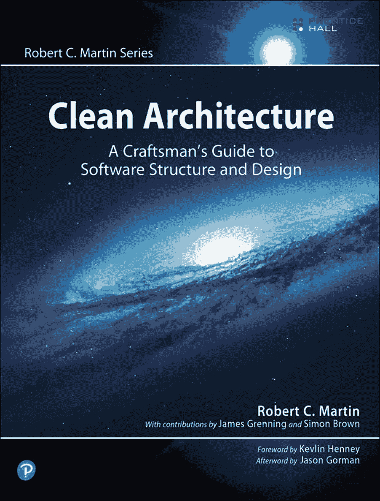

## 关于电子书

EPUB 是一种开放的行业标准电子书格式。然而，阅读设备和应用程序对 EPUB 及其许多功能的支持程度各异。请使用您的设备或应用设置来根据您的喜好自定义显示。您可以自定义的设置通常包括字体、字号、单栏或双栏、横屏或竖屏模式，以及可以点击或触摸放大的图片。有关您的阅读设备或应用的设置和功能的更多信息，请访问设备制造商的网站。

许多书籍包含编程代码或配置示例。为了优化这些元素的显示效果，请在单栏横屏模式下查看电子书，并将字体大小调整为最小设置。除了以重流文本格式呈现代码和配置外，我们还包含了模仿纸质书籍显示效果的代码图像；因此，当重流格式可能会损害代码列表的显示，您将看到一个“点击此处查看代码图像”的链接。点击链接查看高保真代码图像。要返回上一个页，请点击设备或应用上的返回按钮。

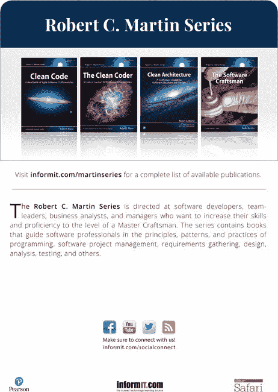


波士顿 • 科伦布 • 印第安波利斯 • 纽约 • 旧金山 • 阿姆斯特丹 • 开普敦 迪拜 • 伦敦 • 马德里 • 米兰 • 慕尼黑 • 巴黎 • 蒙特利尔 • 多伦多 • 德里 • 墨西哥城 圣保罗 • 悉尼 • 香港 • 首尔 • 新加坡 • 台北 • 东


1 17

本书献给我我亲爱的妻子、我四个出色的孩子以及他们的家庭，包括我那五个孙子孙——他们是我生活的甜点。


- 结论
### 第四部分 组件原则](#part0024.html_part4)
- 链接器
- 通用重用原则
- 结论


## 物理地址
## 结论


## 结论

## 请求与响应模型
## 可测试的架构
## 典型场景

### 测试与架构

## 跨越溪流


## 结论
## 结论
## 非对称婚姻

## 按功能包
### 组织与封装
## 索引


当我们谈论软件架构时，软件在本质上是递归和分形的，它们被刻画和勾勒在代码之中。一切都是细节。相互锁的细节层次也对建筑的架构做出了贡献，但在软件中讨论物理规模是没有意义的。软件具有结构——许多种结构和许多类型的结构——但其多样性超过了在建筑中发现的物理结构范围。你甚至可以非常有说服力地论证，软件中的设计活动和关注比建筑架构更多——从这个意义上说，认为软件架构比建筑架构更具“架构性”也是合理的！
这本书的标题是 `Clean Architecture`（整洁架构）。这是一个大胆的名字。有些人甚至会认为它傲慢。那么，我为什么选择这个标题，我又为什么要写这本书呢？
*架构规则是通用的！*


Kent Beck
Bill Degnan


## 22

### 洁洁架构

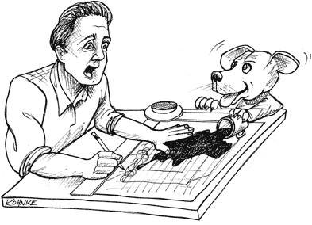

在过去的几十年里，我们看到了关于系统架构的一系列观点。这些包括：

* 六边形架构（也称为端口和适配器），由 Alistair Cockburn 开发，并被 Steve Freeman 和 Nat Pryce 在他们出色的著作 *Growing Object Oriented Software with Tests* 中采用。
* 来自 James Coplien 和 Trygve Reenskaug 的 DCI
* BCE，由 Ivar Jacobson 从他的书籍 *Object Oriented Software Engineering: A Use-Case Driven Approach* 中引入。

尽管这些架构在细节上各有不同，但它们非常相似。它们都有相同的目标，即关注点分离。它们都通过将软件划分为层来实现这种分离。每种架构都至少有一层用于业务规则，以及另一层用于用户和系统界面的。

这些架构中的每一种所产的系统都具有以下特征：

* `独立于框架。` 架构不依赖于某些功能丰富的软件库的存在。这允许你将此类框架作为工具，而不是强迫将你的系统塞进它们有限的限制中。
* `可测试。` 可以在没有 UI、数据库、Web 服务器或任何其他外部元素的情况下测试业务规则。
* `独立于 UI。` UI 可以轻松更改，而无需更改系统的其他部分。例如，可以用控制台 UI 替换 Web UI，而无需更改业务规则。
* `独立于数据库。` 你可以将 `Oracle` 或 `SQL Server` 交换为 `Mongo`、`BigTable`、`CouchDB` 或其他。你的业务规则不受数据库限制。
* `独立于任何外部机构。` 事实上，你的业务规则完全不知道外部世界的接口。

图 22.1 中的图表试图将所有这些架构整合到一个单一的可操作想法中。

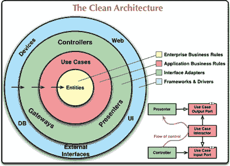

**图 22.1** 洁洁架构

## 依赖规则

图 22.1 中的同心圆代表软件的不同区域。通常情况下，越往内，层次越高。外层圆是机制。内层圆是策略。

这种架构运行的核心规则是 `依赖规则`：

`源代码依赖仅指向内部，指向高级策略。`

内层圆中的任何东西都无法知道外层的任何信息。特别是，在外层中声明的任何名称不能在内层圆的代码中提到。

同样，在外层中声明的数据格式不应被内层圆使用，特别是当这些格式是由外层的框架生成的。我们不希望外层的任何东西影响内层圆。

#### 实体 (Entities)

实体封装了企业的关键业务规则。实体可以是带有方法的对象，也可以是一组数据结构和函数。只要实体可以被企业中的许多应用程序使用，这并不重要。

如果你没有企业，只是编写单个应用程序，那么这些实体就是应用程序的业务对象。它们封装了最通用、最高级的规则。当外部发生变化时，它们最不容易改变。例如，你不会预期这些对象受到页面导航或安全性的影响。任何特定应用程序的操作更改都不应影响实体层。

#### 用例 (Use Cases)

用例层的软件包含了特定的业务规则。它封装并实现了系统所有的用例。这些用例协调数据在实体之间的流动，并指导这些实体使用它们各自的关键业务规则来实现用例的目标。

我们不期望这一层的更改会影响实体。我们也不期望该层受到外部因素（如数据库、UI 或任何常用框架）更改的影响。用例层与这些关注点隔离开。


然而，我们预料应用程序运行的更改将影响用例，因此也会影响该层中的软件。如果用例的细节发生变化，那么该层中的某些代码肯定会受到影响。

### 接口适配器 (INTERFACE ADAPTERS)

接口适配器层中的软件是一组适配器，它们将数据从最便于用例和实体处理的格式转换为最便于某些外部代理（如数据库或 Web）处理的格式。例如，正是这一层将完整地包含 GUI 的 MVC 架构。演示者（presenters）、视图（views）和控制器（controllers）都属于接口适配器层。模型（models）可能只是从控制器传递到用例，然后从用例传回演示者和视图的数据结构。

同样，在这一层中，数据也从最便于实体和用例处理的形式，转换为最便于任何正在使用的持久化框架（即数据库）处理的格式。该圆圈内部的任何代码都不应该知道关于数据库的任何信息。如果数据库是 SQL 数据库，那么所有的 SQL 都应该限制在此层中——特别是该层中与数据库相关的部分。

该层还包含了任何其他必要的适配器，用于将数据从某些外部形式（如外部服务）转换为用例和实体使用的内部形式。

### 框架和驱动程序 (FRAMEWORKS AND DRIVERS)

图 22.1 中模型的最外层通常由框架和工具组成，例如数据库和 Web 框架。通常情况下你不会在这一层中编写大量代码，除了与内部下一个圆圈通信的胶水代码外。

框架和驱动程序层是存放所有细节的地方。Web 是一个细节。数据库也是一个细节。我们将这些东西放在外面，这样它们造成的伤害就很小。

### 只有四个圆圈吗？

图 22.1 中的圆圈是示意性的：你可能会发现自己需要的不仅仅是这四个。没有规则规定你必须始终只有这四个。然而，依赖规则（Dependency Rule）始终适用。源代码的依赖始终指向内部。随着你向内部移动，抽象级别和策略增加。最外层的圆圈由低级的具体细节组成。随着你向内部移动，软件变得更加抽象，并封装了高级别的策略。最内层的圆圈是最通用且层次最高级。

### 跨越边界 (CROSSING BOUNDARIES)

图 22.1 图右下角是一个我们如何跨越圆圈边界的示例。它展示了控制器和演示者与下一层的用例进行通信。注意控制流：它始于控制器，经过用例，最后在演示者中执行。同样注意源代码依赖：每一个都指向内部的用例。

我们通常通过使用依赖倒置原则（Dependency Inversion Principle）来解决这种表面上的矛盾。例如，在 `Java` 等语言中，我们会安排接口和继承关系，使得源代码依赖在跨越边界的恰当点与控制流相反。

例如，假设用例需要调用演示者。这种调用不能是直接的，因为这将违反依赖规则：外层圆圈中的任何名称不能被内层圆圈引用。因此，我们让用例调用内层圆圈中的接口（在图 22.1 中显示“用例输出端口”），并让外层圆圈中的演示者实现它。

同样的技术被用于跨越架构中的所有边界。我们利用动态多态来创建与控制流相反的源代码依赖，以便无论控制流向哪个方向传输，都能符合依赖规则。

### 哪些数据跨越了边界

通常，跨越边界的数据由简单的数据结构组成。如果你喜欢，可以使用基础结构体（struct）或简单的数据传输对象（DTO）。或者数据也可以是函数调用中的参数。或者你可以将其封装进 `hashmap` 中，或者构造成一个对象。重要的是，跨越边界的是隔离的简单数据结构。我们不希望作弊传递 `Entity` 对象或数据库行。我们不希望数据结构具有任何违反依赖规则的依赖。

例如，许多数据库框架在响应查询时返回一种方便的数据格式。我们可能称之为“行结构”。我们不希望将该行结构跨越边界传递内部。这样做将违反依赖规则，因为它强制内层圆圈知道关于外层圆圈的某些信息。

因此，当我们跨越边界传递数据时，它总是以便于内层圆圈的形式存在。

### 典型场景 (A TYPICAL SCENARIO)

图 22.2 图显示了一个使用数据库的基于 Web 的 `Java` 系统的典型场景。Web 服务器从用户处收集输入数据并交给左上角的 `Controller`。`Controller` 将这些数据封装成一个普通的 Java 对象（POJO），并通过 `InputBoundary` 将此对象传递给 `UseCaseInteractor`。`UseCaseInteractor` 解析这些数据并使用它们来控制 `Entities` 的运行。它还使用 `DataAccessInterface` 从 `Database` 将这些 `Entities` 使用的数据调入内存。完成后，`UseCaseInteractor` 从 `Entities` 收集数据并构造出另一个普通的 Java 对象作为 `OutputData`。然后，`OutputData` 通过 `OutputBoundary` 接口传递给 `Presenter`。


**图 22.2** 使用数据库的基于 Web 的 Java 系统典型场景

`Presenter` 的工作是将 `OutputData` 重新封装为可视的形式，即 `ViewModel`。`ViewModel` 主要包含 `View` 用于展示的字符串和标志位。虽然 `OutputData` 可能包含 `Date` 对象，但 `Presenter` 会为 `ViewModel` 加载已格式化好的面向用户的字符串。`Currency` 对象或任何其他业务数据也是如此。`Button` 和 `MenuItem` 的名称被放置在 `ViewModel` 中，还有告诉 `View` 这些 `Button` 和 `MenuItem` 是否应该置灰的标志。

这使得 `View` 几乎只需做的仅仅是将数据从 `ViewModel` 移动到 `HTML` 页面。

注意依赖的方向。所有依赖都跨越边界并指向内部，遵循依赖规则。

### 总结

遵循这些简单的规则并不困难，它们将为未来的开发避免很多烦恼。通过将软件分层并遵循依赖规则，你将创建一个从本质上可测试的系统，以及随之带来的所有好处。当系统的任何外部部分过时时（例如数据库或 Web 框架），你可以以最小的代价替换这些过时的元素。


`Humble Object`（谦卑对象）模式是一种设计模式，最初被识别为一种帮助单元测试人员将难以测试的行为与易测试的行为分离开的方法。其思想非常简单：将行为分为两个模块或类。其中一个模块是“谦卑的（humble）”，它包含了所有被精简到最本质的、难以测试的行为。另一个模块则包含了从该谦卑对象中提取出的所有可测试行为。

例如，GUI 很难进行单元测试，因为很难编写能够查看屏幕并检查相应元素是否显示在上面的测试。然而，GUI 的大部分行为实际上是易测试的。使用 `Humble Object` 模式，我们可以将这两种行为分离到两个不同的类中，称为 `Presenter`（演示器）和 `View`（视图）。

### 演示器与视图

`View` 是难以测试的谦卑对象。该对象中的代码保持尽可能简单。它将数据移动到 GUI 中，但不对这些数据进行处理。

`Presenter` 是可测试的对象。它的工作是接收应用程序的数据并对其进行格式化以便展示，以便 `View` 可以简单地将其移动到屏幕上。例如，如果应用程序想要在字段中显示日期，它会向 `Presenter` 传递一个 `Date` 对象。`Presenter` 然后会将该数据格式化为适当的字符串，并将其放在名为 `View Model` 的简单数据结构中，`View` 可以那里找到它。

如果应用程序想要在屏幕上显示金额，它可能会向 `Presenter` 传递一个 `Currency` 对象。`Presenter` 将根据适当的小位数和货币标记对该对象进行格式化，创建一个可以放在 `View Model` 中的字符串。如果该货币值为应变为红色，则会相应设置 `View model` 中一个简单的布尔标记。

屏幕上的每个按钮都有一个名称。该名称是 `View Model` 中的一个字符串，由 `Presenter` 放置。如果这些按钮应该是灰色，`Presenter` 将在 `View model` 中设置适当的布尔标记。每个菜单项名称都是 `View model` 中的一个字符串，由 `Presenter` 加载。每个单选按钮、复选框和文本字段的名称都由 `Presenter` 加载到 `View model` 中相应的字符串和布尔值中。应该显示在屏幕上的数字表格由 `Presenter` 加载到 `View model` 中格式化良好的字符串表格中。

屏幕上出现的任何内容以及应用程序具有某种控制权的内容，在 `View Model` 中都以字符串、布尔值或枚举的形式表示。`View` 除了从 `View Model` 加载数据到屏幕上外，没有别的事情可做。因此，`View` 是谦卑的。

### 测试与架构

众所周知，可测试性是优秀架构的属性。`Humble Object` 模式就是一个很好的例子，因为将行为分离为可测试部分和不可测试部分通常定义了一个架构边界。`Presenter/View` 边界是这些边界之一，但还有许多其他边界。

### 数据库网关

在用例交互器（use case interactors）和数据库之间是数据库网关（database gateways）。这些网关是多态接口，包含了应用程序在数据库上执行的每个创建、读取、更新或删除操作的方法。例如，如果应用程序需要知道昨天登录的所有用户的姓氏，那么 `UserGateway` 接口将有一个名为 `getLastNamesOfUsersWhoLoggedInAfter` 的方法，它接受一个 `Date` 作为参数并返回姓氏列表。

请记住，我们不允许在用例层中使用 SQL；相反，我们使用具有适当方法的网关接口。这些网关由数据库层中的类实现。该实现就是谦卑对象。它只是使用 SQL（或任何数据库接口）来访问每个方法所需的数据。相比之下，交互器是不谦卑的，因为它们封装了特定特定的业务规则。尽管它们不谦卑，但这些交互器是可测试的，因为网关可以用适当的存根（stubs）和测试双胞（test-doubles）替换。

### 数据映射器

回到数据库的话，你认为像 `Hibernate` 这样的 ORM 属于哪层？

首先，让我们明确一点：并没有所谓的“对象关系映射（ORM）”。原因很简单：对象不是数据结构。至少，从用户的角度来看，它们不是数据结构。对象的用户无法看到数据，因为所有数据都是私有的。这些用户只能看到该对象的公共方法。因此，从用户的角度来看，一个对象仅仅是一组操作。

相比之下，数据结构是一组没有隐含行为的公共数据变量。ORM 应该命名为“数据映射器（data mappers）”，因为它们是从关系型数据库表中将数据加载到数据结构中。

此类 ORM 系统应该位于何处？当然是在数据库层。事实上，ORM 在网关接口和数据库之间形成了另一种类型的 `Humble Object` 边界。

### 服务监听器

服务又如何？如果你的应用程序必须与其他服务通信，或者如果你的应用程序提供一组服务，我们会发现 `Humble Object` 模式创建一个服务边界吗？

当然会！应用程序将数据加载到简单的数据结构中，然后将这些结构跨边界传递给能够正确格式化数据并发送到外部服务的模块。在输入端，服务监听器将从服务接口接收数据并将其格式化为应用程序可以使用简单数据结构。然后该数据结构被跨越服务边界。

## 结论

在每个架构边界处，我们可能都会发现附近存在 `Humble Object` 模式。跨越边界的通信几乎总是涉及某些简单的数据结构，边界经常会将难以测试的部分与易测试的部分隔离开。

---

### 部分边界

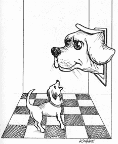

完整的架构边界是非常贵的。它们需要相互的多态 `Boundary` 接口、`Input` 和 `Output` 数据结构，以及为了将双方隔离为独立编译和部署的组件而所需的所有依赖管理。这需要大量工作。维护起来也需要大量工作。

在许多情况下，一位优秀的架构师可能会判断此类边界的成本太高——但可能仍想为这种边界留一个位置，以备以后需要。

### 跳过最后一步

构建部分边界的方法是完成独立编译和部署组件所需的所有工作，然后只需将它们保持在同一个组件中。相互的接口在那里，输入/输出数据结构在那里，一切都准备就绪——但我们将它们作为一个单一组件进行编译和部署。


显然，这种部分边界所需的代码量和准备设计工作与完整边界是相同的。然而，它不需要管理多个组件。它没有版本号跟踪或发布管理的负担。这种差异不应被轻视。

这是 `FitNesse` 早期的设计策略。`FitNesse` 的 web 服务器组件被设计为可以与 `FitNesse` 的 wiki 和测试部分分离。这种想法是，我们可能希望使用该 web 组件来创建其他基于 web 的应用程序。同时，我们也不希望用户不得不下载两个组件。记住，我们的设计目标之一是“下载即用”。我们的意图是让用户下载一个 jar 文件并执行它，而无需去寻找其他 jar 文件、解决版本兼容性问题等等。

`FitNesse` 的故事也指出了这种方法的危险之处。随着时间的推移，当人们明显发现永远不需要独立的 web 组件时，web 组件与 wiki 组件之间的分离开始变弱。依赖关系开始以错误的方向跨越边界。如今，要重新将它们分离将是一项苦力差事。

### 一维边界

完整的架构边界使用互惠的边界接口来维持两个方向的隔离。在两个方向上保持分离在初始设置和持续维护上都是昂贵的。

一种为以后扩展为完整边界提供位置的简单结构如图图 24.1

**图 24.1** 策略模式

很清楚，这为未来的架构边界铺平了道路。必要的依赖倒置已经到位，试图将 `Client` 与 `ServiceImpl` 隔离开。同样很清楚的是，这种分离可能会迅速退化，如图中那个难看的虚箭头所示。如果没有互惠接口，除了开发者和架构师的勤勉和自律外，没有任何能阻止这种后道的产生。

### 外观模式

更简单的边界是外观模式（Facade pattern），如图图 24.2

**图 24.2** 外观模式

然而，注意 `Client` 对所有这些服务类都有间接依赖。在静态语言中，其中一个 `Service` 类源代码的更改将强制 `Client` 重新编译。此外，你可以想象使用这种结构创建后道是多么容易。

## 结论

我们看到了部分实现架构边界的三种简单方法。当然，还有许多其他方法。这三种策略仅作为示例提供。

这每种方法都有自己的成本和收益。在某些语境下，每种方法都可以作为最终完整边界的占位符。如果边界从未实现，每种方法也可以退化。

架构师职责之一就是决定架构边界某日可能存在的地方，以及是完全还是部分地实现该边界。

## 25：层与边界


人们很容易将系统想象成由三个组件组成：UI、业务规则和数据库。对于某些简单系统，这足够了。但对于大多数系统来说，组件的数量要大于此。

例如，考虑一个简单的电脑游戏。很容易想象这三个组件。UI 处理从玩家到游戏规则的所有消息。游戏规则在某种持久化数据结构中存储游戏状态。但这些就是全部了吗？

### 猎杀雾兽 (HUNT THE WUMPUS)

让我们给这些骨架增加血肉。假设这个游戏是 1972 年著名的《Hunt the Wumpus》冒险游戏。这个基于文本的游戏使用了简单的命令，如 GO EAST（向东）和 SHOOT WEST（向西射）。玩家输入命令，计算机响应玩家看到、闻到、听到和体验的内容。玩家在一个洞穴系统中搜猎一只 Wumpus，必须避开伏击的陷阱、深坑和其他危险。如果你感兴趣，在网络上很容易找到该游戏的规则。

假设我们将保留基于文本的 UI，但将其与游戏规则解耦，以便我们的版本可以在不同的市场使用不同的语言。游戏规则将使用与语言的 API 与 UI 组件通信，而 UI 将将该 API 翻译成相应的人类语言。

如果源代码依赖关系管理得当，如图图 25.1 所示，那么任意数量的 UI 组件都可以重用相同的游戏规则。游戏规则不知道也不在乎使用的是哪种人类语言。

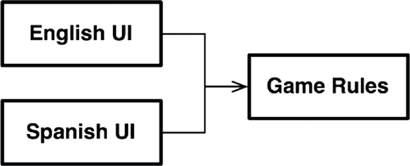

**图 25.1** 任意数量的 UI 组件都可以重用游戏规则

让我们假设游戏状态维护在某些持久化存储中——可能在闪存中，可能在云端，或者可能只是在 RAM 中。在任何情况下，我们都不希望游戏规则知道细节。因此，我们再次创建一个游戏规则可以使用与数据存储通信的 API。

我们不希望游戏规则知道任何关于不同类型数据存储的信息，因此依赖关系必须按照依赖规则（Dependency Rule）正确引导，如图图 25.2 所示。

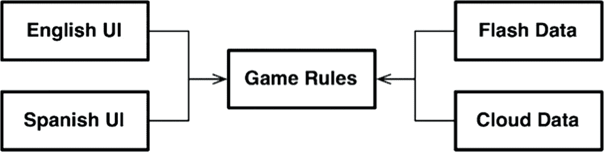

**图 25.2** 遵循依赖规则

### 洁洁架构？

很清楚，在这种所有用例、边界、实体和相应数据结构的情况下，我们可以轻松应用洁洁架构方法。但我们真的找到所有的架构边界了吗？

例如，语言并不是 UI 变化的唯一轴。我们可能还想改变我们传输文本的机制。例如，我们可能想使用 shell 窗口、短信或聊天应用程序。有许多不同的可能性。

这意味着存在一个由这个变化轴定义的潜在架构边界。也许我们应该构建一个跨越该边界的 API，将语言与通信机制隔离；那个想法如图图 25.3 所示。

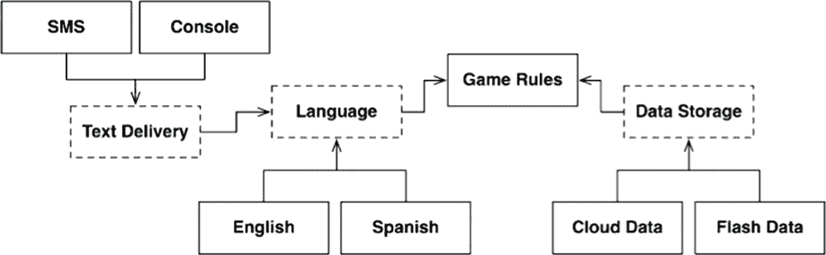

**图 25.3** 修改后的图表

图 25.3 中的图表变得有点复杂，但不应该包含任何意外。虚线轮廓表示抽象组件，它们定义了由上方或下方组件实现的 API。例如，`Language` API 由 `English` 和 `Spanish` 实现。


如果我们观察 `Language` 内部，会发现同样的情况：由 `TextDelivery` 内部代码实现的多态 `Boundary` 接口，以及由 `TextDelivery` 使用并由 `Language` 实现的多态 `Boundary` 接口。

在每种，由这些 `Boundary` 接口定义的 API 都归上游组件所有。

变体（如 `English`、`SMS` 和 `CloudData`）是由抽象 API 组件中定义的多态接口提供的，并由服务它们的具体组件实现。例如，我们期望在 `Language` 中定义的多态接口由 `English` 和 `Spanish` 实现。

我们可以通过消除所有变体并仅关注 API 组件来简化这张图。图 25.4 显示了这幅图表。

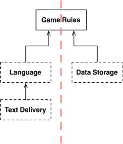

**图 25.4** 简化后的图

注意，图 25.4 中的图表取向是，使得所有的箭头都指向上方。这使得 `GameRules` 位于顶部。这种取向是有意义的，因为 `GameRules` 是包含最高策略的组件。

考虑信息流的方向。所有输入都通过左下角的 `TextDelivery` 组件来自用户。这些信息流经 `Language` 组件上升，被翻译成发送给 `GameRules` 的命令。`GameRules` 处理用户输入并将适当的数据发送到右下角的 `DataStorage`。

`GameRules` 然后输出传回给 `Language`，`Language` 将 API 翻译回相应的语言，然后通过 `TextDelivery` 将该语言传递给用户。

这种组织有效地将数据流分为两个流^(2)。左侧的流关注与用户的通信，右侧的流关注数据持久化。两个流在顶部^(3) 汇合于 `GameRules`，它是处理通过这两个流的数据的最终处理器。

### 流的交汇

是否总是像像这个例子一样，有两个数据流？不，完全不是。想象一下我们想在网络上和多个玩家玩“捉迷幻兽”（Hunt the Wumpus）。在这种情况下，我们需要一个网络组件，如图 25.5 所示。这种组织将数据流划分为三个流，都由 `GameRules` 控制。

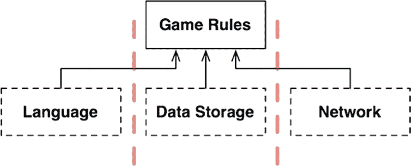

**图 25.5** 增加网络组件

因此，随着系统变得越来越复杂，组件结构可能会分裂成许多这样的流。

### 流的划分

此时，你可能在想所有的流最终都会汇合在顶部的单个组件中。如果生活真那么简单就好了！现实要复杂得多。

考虑用于“捉迷幻兽”的 `GameRules` 组件。部分游戏规则涉及地图的机制。它们知道洞穴是如何连接的，以及每个洞穴位于哪些对象。它们知道如何让玩家从一个洞穴移动到另一个洞穴，以及如何确定玩家必须处理的事件。

还有另一组更高级别的策略——知道玩家健康状况以及特定事件成本或收益的策略。这些策略可能会导致玩家逐渐失去健康值，或通过发现食物获得健康值。低级机制策略会向这种高级策略声明事件，例如 `FoundFood` 或 `FellInPit`。高级策略随后会管理玩家的状态（如图 25.6 所示）。最终，该策略将决定玩家的胜负。

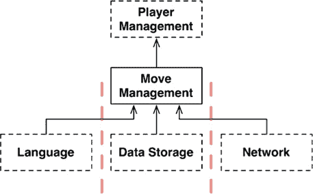

**图 25.6** 高级策略管理玩家

这是一个架构边界吗？我们是否需要一个将 `MoveManagement` 与 `PlayerManagement` 隔离开的 API？嗯，让我们这变得更有趣一点，加入微服务吧。

假设我们有一个大型多人版本的“捉迷幻兽”。`MoveManagement` 在玩家的计算机上进行本地处理，但 `PlayerManagement` 由服务器处理。`PlayerManagement` 为所有连接的 `MoveManagement` 组件提供微服务 API。

图 25.7 中的图表以某种简略的方式描绘了这种场景。`Network` 元素比描述的复杂一点——但你可能仍然能理解这一点。在这种情况下，`MoveManagement` 和 `PlayerManagement` 之间存在一个完整的架构边界。

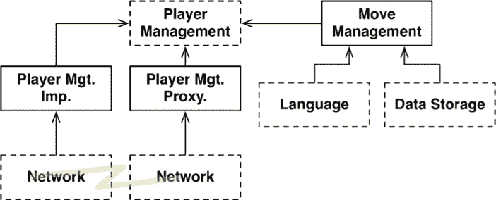

**图 25.7** 增加微服务 API

## 结论

这一切意味着什么？为什么我要这样一个荒谬简单的程序（它用 200 行 Kornshell 代码就能实现），并用所有这些疯狂的架构边界对其进行推演？

这个例子旨在说明架构边界无处不在。我们作为架构师，必须谨慎地识别何时需要它们。我们还必须意识到，这种边界在完全实现时是昂昂的。同时，我们必须承认，当这种边界被忽视时，以后添加它们将非常昂贵——即使在有完善测试套件和重构纪律的情况下也是如此。

那么我们架构师该怎么办？答案令人遗憾的。一方面，多年来一些非常聪明的人告诉我们，我们不应该预判抽象的需求。这是 YAGNI 哲学：“你不会需要它的。”这条信息中蕴含智慧，因为过度工程通常比工程不足要糟糕得多。另一方面，当你发现自己确实需要一个本不存在的架构边界时，添加这样一个边界的成本和风险可能非常高。

所以，情况就是这样。噢，软件架构师，你必须预见未来。你必须——明智地——猜测。你必须权衡成本并确定架构边界在哪里，哪些应该完全实现，哪些应该部分实现，哪些应该被忽略。

但这不是一次性决定。你不是仅仅在项目开始时就决定实现哪些边界、忽略哪些。相反，你必须*观察*。在系统演进时保持关注。你记录哪里可能需要边界，然后仔细观察第一次摩擦的迹象，因为那些边界原本并不存在。

在这一点上，你权衡实现这些边界的成本与忽视它们的成本——并频繁地审查该决定。你的目标是在实现成本低于忽视成本的转折点实施边界。

这需要敏锐的观察。

1. 应该很清楚，我们不会对像这种简易的游戏应用清洁架构方法。毕竟，整个程序可能只需要 200 行代码或更少的代码。在这种情况下，我们使用一个简单的程序作为具有显著架构边界的大型系统的代理。

2. 如果你对箭头的方向感到困惑，请记住它们指向源代码依赖的方向，而不是数据流的方向。

3. 在很久以前，我们会把那个顶部组件称为中心变换。参见 *Practical Guide to Structured Systems Design*, 第 2 版，Meilir Page-Jones, 1988。

## 26 主组件


在每个系统中，至少有一个组件负责创建、协调和监督其他组件。我将这个组件称为 `Main`。

### 最终细节


`Main` 组件是终极细节——最底层的策略。它是系统的初始入口点。除了操作系统之外，没有任何东西依赖于它。它的工作是创建所有的 `Factories`（工厂）、`Strategies`（策略）以及其他全局设施，然后将控制权交给系统的高抽象部分。

正是在这个 `Main` 组件中，应该由依赖注入框架注入依赖。一旦这些依赖被注入到 `Main` 中，`Main` 应该正常地分发这些依赖，而不使用该框架。

将 `Main` 视为所有肮脏组件中最脏的一个。

考虑下面这个来自最新版本《捕逐恶兽》（Hunt the Wumpus）的 `Main` 组件。注意它是如何加载所有我们不希望代码主体知道的字符串的。

点击此处查看代码图像

```java
public class Main implements HtwMessageReceiver {

  private static HuntTheWumpus game;

  private static int hitPoints = 10;

  private static final List<String> caverns = new ArrayList<>();

  private static final String[] environments = new String[]{
    "bright",
    "humid",
    "dry",
    "creepy",
    "ugly",
    "foggy",
    "hot",
    "cold",
    "drafty",
    "dreadful"
  };

  private static final String[] shapes = new String[] {
    "round",
    "square",
    "oval",
    "irregular",
    "long",
    "craggy",
    "rough",
    "tall",
    "narrow"
  };

  private static final String[] cavernTypes = new String[] {
    "cavern",
    "room",
    "chamber",
    "catacomb",
    "crevasse",
    "cell",
    "tunnel",
    "passageway",
    "hall",
    "expanse"
  };

  private static final String[] adornments = new String[] {
  "smelling of sulfur",
  "with engravings on the walls",
  "with a bumpy floor",
  "",
  "littered with garbage",
  "spattered with guano",
  "with piles of Wumpus droppings",
  "with bones scattered around",
  "with a corpse on the floor",
  "that seems to vibrate",
  "that feels stuffy",
  "that fills you with dread"
  };
```

现在这里是 `main` 函数。注意它是如何使用 `HtwFactory` 来创建游戏的。它传递了类的名称 `htw.game.HuntTheWumpusFacade`，因为那个类比 `Main` 还要肮脏得多。这防止了该类的变化导致 `Main` 重新编译/部署。

点击此处查看代码图像

```java
public static void main(String[] args) throws IOException {

  game = HtwFactory.makeGame("htw.game.HuntTheWumpusFacade",
                              new Main());
  createMap();

  BufferedReader br =
    new BufferedReader(new InputStreamReader(System.in));

  game.makeRestCommand().execute();
  while (true) {
    System.out.println(game.getPlayerCavern());
    System.out.println("Health: " + hitPoints + " arrows: " +
                        game.getQuiver());
    HuntTheWumpus.Command c = game.makeRestCommand();
    System.out.println(">");
    String command = br.readLine();
    if (command.equalsIgnoreCase("e"))
      c = game.makeMoveCommand(EAST);
    else if (command.equalsIgnoreCase("w"))
      c = game.makeMoveCommand(WEST);
    else if (command.equalsIgnoreCase("n"))
      c = game.makeMoveCommand(NORTH);
    else if (command.equalsIgnoreCase("s"))
      c = game.makeMoveCommand(SOUTH);
    else if (command.equalsIgnoreCase("r"))
      c = game.makeRestCommand();
    else if (command.equalsIgnoreCase("sw"))
      c = game.makeShootCommand(WEST);
    else if (command.equalsIgnoreCase("se"))
      c = game.makeShootCommand(EAST);
    else if (command.equalsIgnoreCase("sn"))
      c = game.makeShootCommand(NORTH);
    else if (command.equalsIgnoreCase("ss"))
      c = game.makeShootCommand(SOUTH);
    else if (command.equalsIgnoreCase("q"))
      return;
    c.execute();
  }
}
```

同样注意 `main` 创建了输入流并包含了游戏的主循环，解释简单的输入，但随后将所有处理推给了其他更高层次的组件。

最后，注意 `main` 创建了地图。

点击此处查看代码图像

```java
private static void createMap() {

  int nCaverns = (int) (Math.random() * 30.0 + 10.0);
  while (nCaverns-- > 0)
    caverns.add(makeName());
  for (String cavern : caverns) {
    maybeConnectCavern(cavern, NORTH);
    maybeConnectCavern(cavern, SOUTH);
  }
// ... (代码省略) ...
```

`Main` 组件是终极细节——最底层的策略。它是系统的初始入口点。除了操作系统之外，没有任何东西依赖于它。它的工作是创建所有的 `Factories`、`Strategies` 以及其他全局设施，然后将控制权交给系统的高抽象部分。

正是在这个 `Main` 组件中，应该由依赖注入框架注入依赖。一旦这些依赖被注入到 `Main` 中，`Main` 应该正常地分发这些依赖，而不使用该框架。

将 `Main` 视为所有肮脏组件中最脏的一个。

考虑下面这个来自最新版本《捕逐恶兽》（Hunt the Wumpus）的 `Main` 组件。注意它是如何加载所有我们不希望代码主体知道的字符串的。

点击此处查看代码图像

```java
public class Main implements HtwMessageReceiver {

  private static HuntTheWumpus game;

  private static int hitPoints = 10;

  private static final List<String> caverns = new ArrayList<>();

  private static final String[] environments = new String[]{
    "bright",
    "humid",
    "dry",
    "creepy",
    "ugly",
    "foggy",
    "hot",
    "cold",
    "drafty",
    "dreadful"
  };

  private static final String[] shapes = new String[] {
    "round",
    "square",
    "oval",
    "irregular",
    "long",
    "craggy",
    "rough",
    "tall",
    "narrow"
  };

  private static final String[] cavernTypes = new String[] {
    "cavern",
    "room",
    "chamber",
    "catacomb",
    "crevasse",
    "cell",
    "tunnel",
    "passageway",
    "hall",
    "expanse"
  };

  private static final String[] adornments = new String[] {
  "smelling of sulfur",
  "with engravings on the walls",
  "with a bumpy floor",
  "",
  "littered with garbage",
  "spattered with guano",
  "with piles of Wumpus droppings",
  "with bones scattered around",
  "with a corpse on the floor",
  "that seems to vibrate",
  "that feels stuffy",
  "that fills you with dread"
  };
```

现在这里是 `main` 函数。注意它是如何使用 `HtwFactory` 来创建游戏的。它传递了类的名称 `htw.game.HuntTheWumpusFacade`，因为那个类比 `Main` 还要肮脏得多。这防止了该类的变化导致 `Main` 重新编译/部署。

点击此处查看代码图像

```java
public static void main(String[] args) throws IOException {

  game = HtwFactory.makeGame("htw.game.HuntTheWumpusFacade",
                              new Main());
  createMap();

  BufferedReader br =
    new BufferedReader(new InputStreamReader(System.in));

  game.makeRestCommand().execute();
  while (true) {
    System.out.println(game.getPlayerCavern());
    System.out.println("Health: " + hitPoints + " arrows: " +
                        game.getQuiver());
    HuntTheWumpus.Command c = game.makeRestCommand();
    System.out.println(">");
    String command = br.readLine();
    if (command.equalsIgnoreCase("e"))
      c = game.makeMoveCommand(EAST);
    else if (command.equalsIgnoreCase("w"))
      c = game.makeMoveCommand(WEST);
    else if (command.equalsIgnoreCase("n"))
      c = game.makeMoveCommand(NORTH);
    else if (command.equalsIgnoreCase("s"))
      c = game.makeMoveCommand(SOUTH);
    else if (command.equalsIgnoreCase("r"))
      c = game.makeRestCommand();
    else if (command.equalsIgnoreCase("sw"))
      c = game.makeShootCommand(WEST);
    else if (command.equalsIgnoreCase("se"))
      c = game.makeShootCommand(EAST);
    else if (command.equalsIgnoreCase("sn"))
      c = game.makeShootCommand(NORTH);
    else if (command.equalsIgnoreCase("ss"))
      c = game.makeShootCommand(SOUTH);
    else if (command.equalsIgnoreCase("q"))
      return;
    c.execute();
  }
}
```

同样注意 `main` 创建了输入流并包含了游戏的主循环，解释简单的输入，但随后将所有处理推给了其他更高层次的组件。

最后，注意 `main` 创建了地图。

点击此处查看代码图像

```java
private static void createMap() {

  int nCaverns = (int) (Math.random() * 30.0 + 10.0);
  while (nCaverns-- > 0)
    caverns.add(makeName());
  for (String cavern : caverns) {
    maybeConnectCavern(cavern, NORTH);
    maybeConnectCavern(cavern, SOUTH);
  }
}
// ... (代码省略) ...
```

`Main` 组件是终极细节——最底层的策略。它是系统的初始入口点。除了操作系统之外，没有任何东西依赖于它。它的工作是创建所有的 `Factories`、`Strategies` 以及其他全局设施，然后将控制权交给系统的高抽象部分。

正是在这个 `Main` 组件中，应该由依赖注入框架注入依赖。一旦这些依赖被注入到 `Main` 中，`Main` 应该正常地分发这些依赖，而不使用该框架。

将 `Main` 视为所有肮脏组件中最脏的一个。

考虑下面这个来自最新版本《捕逐恶兽》（Hunt the Wumpus）的 `Main` 组件。注意它是如何加载所有我们不希望代码主体知道的字符串的。

点击此处查看代码图像

```java
public class Main implements HtwMessageReceiver {

  private static HuntTheWumpus game;

  private static int hitPoints = 10;

  private static final List<String> caverns = new ArrayList<>();

  private static final String[] environments = new String[]{
    "bright",
    "humid",
    "dry",
    "creepy",
    "ugly",
    "foggy",
    "hot",
    "cold",
    "drafty",
    "dreadful"
  };

  private static final String[] shapes = new String[] {
    "round",
    "square",
    "oval",
    "irregular",
    "long",
    "craggy",
    "rough",
    "tall",
    "narrow"
  };

  private static final String[] cavernTypes = new String[] {
    "cavern",
    "room",
    "chamber",
    "catacomb",
    "crevasse",
    "cell",
    "tunnel",
    "passageway",
    "hall",
    "expanse"
  };

  private static final String[] adornments = new String[] {
  "smelling of sulfur",
  "with engravings on the walls",
  "with a bumpy floor",
  "",
  "littered with garbage",
  "spattered with guano",
  "with piles of Wumpus droppings",
  "with bones scattered around",
  "with a corpse on the floor",
  "that seems to vibrate",
  "that feels stuffy",
  "that fills you with dread"
  };
```

现在这里是 `main` 函数。注意它是如何使用 `HtwFactory` 来创建游戏的。它传递了类的名称 `htw.game.HuntTheWumpusFacade`，因为那个类比 `Main` 还要肮脏得多。这防止了该类的变化导致 `Main` 重新编译/部署。

点击此处查看代码图像

```java
public static void main(String[] args) throws IOException {

  game = HtwFactory.makeGame("htw.game.HuntTheWumpusFacade",
                              new Main());
  createMap();

  BufferedReader br =
    new BufferedReader(new InputStreamReader(System.in));

  game.makeRestCommand().execute();
  while (true) {
    System.out.println(game.getPlayerCavern());
    System.out.println("Health: " + hitPoints + " arrows: " +
                        game.getQuiver());
    HuntTheWumpus.Command c = game.makeRestCommand();
    System.out.println(">");
    String command = br.readLine();
    if (command.equalsIgnoreCase("e"))
      c = game.makeMoveCommand(EAST);
    else if (command.equalsIgnoreCase("w"))
      c = game.makeMoveCommand(WEST);
    else if (command.equalsIgnoreCase("n"))
      c = game.makeMoveCommand(NORTH);
    else if (command.equalsIgnoreCase("s"))
      c = game.makeMoveCommand(SOUTH);
    else if (command.equalsIgnoreCase("r"))
      c = game.makeRestCommand();
    else if (command.equalsIgnoreCase("sw"))
      c = game.makeShootCommand(WEST);
    else if (command.equalsIgnoreCase("se"))
      c = game.makeShootCommand(EAST);
    else if (command.equalsIgnoreCase("sn"))
      c = game.makeShootCommand(NORTH);
    else if (command.equalsIgnoreCase("ss"))
      c = game.makeShootCommand(SOUTH);
    else if (command.equalsIgnoreCase("q"))
      return;
    c.execute();
  }
}
```

同样注意 `main` 创建了输入流并包含了游戏的主循环，解释简单的输入，但随后将所有处理推给了其他更高层次的组件。

最后，注意 `main` 创建了地图。

点击此处查看代码图像

```java
private static void createMap() {

  int nCaverns = (int) (Math.random() * 30.0 + 10.0);
  while (nCaverns-- > 0)
    caverns.add(makeName());
  for (String cavern : caverns) {
    maybeConnectCavern(cavern, NORTH);
    maybeConnectCavern(cavern, SOUTH);
  }
}
// ... (代码省略) ...
```

`Main` 组件是终极细节——最底层的策略。它是系统的初始入口点。除了操作系统之外，没有任何东西依赖于它。它的工作是创建所有的 `Factories`、`Strategies` 以及其他全局设施，然后将控制权交给系统的高抽象部分。

正是在这个 `Main` 组件中，应该由依赖注入框架注入依赖。一旦这些依赖被注入到 `Main` 中，`Main` 应该正常地分发这些依赖，而不使用该框架。

将 `Main` 视为所有肮脏组件中最脏的一个。

考虑下面这个来自最新版本《捕逐恶兽》（Hunt the Wumpus）的 `Main` 组件。注意它是如何加载所有我们不希望代码主体知道的字符串的。

点击此处查看代码图像

```java
public class Main implements HtwMessageReceiver {

  private static HuntTheWumpus game;

  private static int hitPoints = 10;

  private static final List<String> caverns = new ArrayList<>();

  private static final String[] environments = new String[]{
    "bright",
    "humid",
    "dry",
    "creepy",
    "ugly",
    "foggy",
    "hot",
    "cold",
    "drafty",
    "dreadful"
  };

  private static final String[] shapes = new String[] {
    "round",
    "square",
    "oval",
    "irregular",
    "long",
    "craggy",
    "rough",
    "tall",
    "narrow"
  };

  private static final String[] cavernTypes = new String[] {
    "cavern",
    "room",
    "chamber",
    "catacomb",
    "crevasse",
    "cell",
    "tunnel",
    "passageway",
    "hall",
    "expanse"
  };

  private static final String[] adornments = new String[] {
  "smelling of sulfur",
  "with engravings on the walls",
  "with a bumpy floor",
  "",
  "littered with garbage",
  "spattered with guano",
  "with piles of Wumpus droppings",
  "with bones scattered around",
  "with a corpse on the floor",
  "that seems to vibrate",
  "that feels stuffy",
  "that fills you with dread"
  };
```

现在这里是 `main` 函数。注意它是如何使用 `HtwFactory` 来创建游戏的。它传递了类的名称 `htw.game.HuntTheWumpusFacade`，因为那个类比 `Main` 还要肮脏得多。这防止了该类的变化导致 `Main` 重新编译/部署。

点击此处查看代码图像

```java
public static void main(String[] args) throws IOException {

  game = HtwFactory.makeGame("htw.game.HuntTheWumpusFacade",
                              new Main());
  createMap();

  BufferedReader br =
    new BufferedReader(new InputStreamReader(System.in));

  game.makeRestCommand().execute();
  while (true) {
    System.out.println(game.getPlayerCavern());
    System.out.println("Health: " + hitPoints + " arrows: " +
                        game.getQuiver());
    HuntTheWumpus.Command c = game.makeRestCommand();
    System.out.println(">");
    String command = br.readLine();
    if (command.equalsIgnoreCase("e"))
      c = game.makeMoveCommand(EAST);
    else if (command.equalsIgnoreCase("w"))
      c = game.makeMoveCommand(WEST);
    else if (command.equalsIgnoreCase("n"))
      c = game.makeMoveCommand(NORTH);
    else if (command.equalsIgnoreCase("s"))
      c = game.makeMoveCommand(SOUTH);
    else if (command.equalsIgnoreCase("r"))
      c = game.makeRestCommand();
    else if (command.equalsIgnoreCase("sw"))
      c = game.makeShootCommand(WEST);
    else if (command.equalsIgnoreCase("se"))
      c = game.makeShootCommand(EAST);
    else if (command.equalsIgnoreCase("sn"))
      c = game.makeShootCommand(NORTH);
    else if (command.equalsIgnoreCase("ss"))
      c = game.makeShootCommand(SOUTH);
    else if (command.equalsIgnoreCase("q"))
      return;
    c.execute();
  }
}
```

同样注意 `main` 创建了输入流并包含了游戏的主循环，解释简单的输入，但随后将所有处理推给了其他更高层次的组件。

最后，注意 `main` 创建了地图。

点击此处查看代码图像

```java
private static void createMap() {

  int nCaverns = (int) (Math.random() * 30.0 + 10.0);
  while (nCaverns-- > 0)
    caverns.add(makeName());
  for (String cavern : caverns) {
    maybeConnectCavern(cavern, NORTH);
    maybeConnectCavern(cavern, SOUTH);
  }
}
// ... (代码省略) ...
```

`Main` 组件是终极细节——最底层的策略。它是系统的初始入口点。除了操作系统之外，没有任何东西依赖于它。它的工作是创建所有的 `Factories`、`Strategies` 以及其他全局设施，然后将控制权交给系统的高抽象部分。

正是在是在这个 `Main` 组件中，应该由依赖注入框架注入依赖。一旦这些依赖被注入到 `Main` 中，`Main` 应该正常地分发这些依赖，而不使用该框架。

将 `Main` 视为所有肮脏组件中最脏的一个。

考虑下面这个来自最新版本《捕逐恶兽》（Hunt the Wumpus）的 `Main` 组件。注意它是如何加载所有我们不希望代码主体知道的字符串的。

点击此处查看代码图像

```java
public class Main implements HtwMessageReceiver {

  private static HuntTheWumpus game;

  private static int hitPoints = 10;

  private static final List<String> caverns = new ArrayList<>();

  private static final String[] environments = new String[]{
    "bright",
    "humid",
    "dry",
    "creepy",
    "ugly",
    "foggy",
    "hot",
    "cold",
    "drafty",
    "dreadful"
  };

  private static final String[] shapes = new String[] {
    "round",
    "square",
    "oval",
    "irregular",
    "long",
    "craggy",
    "rough",
    "tall",
    "narrow"
  };

  private static final String[] cavernTypes = new String[] {
    "cavern",
    "room",
    "chamber",
    "catacomb",
    "crevasse",
    "cell",
    "tunnel",
    "passageway",
    "hall",
    "expanse"
  };

  private static final String[] adornments = new String[] {
  "smelling of sulfur",
  "with engravings on the walls",
  "with a bumpy floor",
  "",
  "littered with garbage",
  "spattered with guano",
  "with piles of Wumpus droppings",
  "with bones scattered around",
  "with a corpse on the floor",
  "that seems to vibrate",
  "that feels stuffy",
  "that fills you with dread"
  };
```

现在这里是 `main` 函数。注意它是如何使用 `HtwFactory` 来创建游戏的。它传递了类的名称 `htw.game.HuntTheWumpusFacade`，因为那个类比 `Main` 还要肮脏得多。这防止了该类的变化导致 `Main` 重新编译/部署。

点击此处查看代码图像

```java
public static void main(String[] args) throws IOException {

  game = HtwFactory.makeGame("htw.game.HuntTheWumpusFacade",
                              new Main());
  createMap();

  BufferedReader br =
    new BufferedReader(new InputStreamReader(System.in));

  game.makeRestCommand().execute();
  while (true) {
    System.out.println(game.getPlayerCavern());
    System.out.println("Health: " + hitPoints + " arrows: " +
                        game.getQuiver());
    HuntTheWumpus.Command c = game.makeRestCommand();
    System.out.println(">");
    String command = br.readLine();
    if (command.equalsIgnoreCase("e"))
      c = game.makeMoveCommand(EAST);
    else if (command.equalsIgnoreCase("w"))
      c = game.makeMoveCommand(WEST);
    else if (command.equalsIgnoreCase("n"))
      c = game.makeMoveCommand(NORTH);
    else if (command.equalsIgnoreCase("s"))
      c = game.makeMoveCommand(SOUTH);
    else if (command.equalsIgnoreCase("r"))
      c = game.makeRestCommand();
    else if (command.equalsIgnoreCase("sw"))
      c = game.makeShootCommand(WEST);
    else if (command.equalsIgnoreCase("se"))
      c = game.makeShootCommand(EAST);
    else if (command.equalsIgnoreCase("sn"))
      c = game.makeShootCommand(NORTH);
    else if (command.equalsIgnoreCase("ss"))
      c = game.makeShootCommand(SOUTH);
    else if (command.equalsIgnoreCase("q"))
      return;
    c.execute();
  }
}
```

同样注意 `main` 创建了输入流并包含了游戏的主循环，解释简单的输入，但随后将所有处理推给了其他更高层次的组件。

最后，注意 `main` 创建了地图。

点击此处查看代码图像

```java
private static void createMap() {

  int nCaverns = (int) (Math.random() * 30.0 + 10.0);
  while (nCaverns-- > 0)
    caverns.add(makeName());
  for (String cavern : caverns) {
    maybeConnectCavern(cavern, NORTH);
    maybeConnectCavern(cavern, SOUTH);
  }
}
// ... (代码省略) ...
```

`Main` 组件是终极细节——最底层的策略。它是系统的初始入口点。除了操作系统之外，没有任何东西依赖于它。它的工作是创建所有的 `Factories`、`Strategies` 以及其他全局设施，然后将控制权交给系统的高抽象部分。

正是在这个 `Main` 组件中，应该由依赖注入框架注入依赖。一旦这些依赖被注入到 `Main` 中，`Main` 应该正常地分发这些依赖，而不使用该框架。

将 `Main` 视为所有肮脏组件中最脏的一个。

考虑下面这个来自最新版本《捕逐恶兽》（Hunt the Wumpus）的 `Main` 组件。注意它是如何加载所有我们不希望代码主体知道的字符串的。

点击此处查看代码图像

```java
public class Main implements HtwMessageReceiver {

  private static HuntTheWumpus game;

  private static int hitPoints = 10;

  private static final List<String> caverns = new ArrayList<>();

  private static final String[] environments = new String[]{
    "bright",
    "humid",
    "dry",
    "creepy",
    "ugly",
    "foggy",
    "hot",
    "cold",
    "drafty",
    "dreadful"
  };

  private static final String[] shapes = new String[] {
    "round",
    "square",
    "oval",
    "irregular",
    "long",
    "craggy",
    "rough",
    "tall",
    "narrow"
  };

  private static final String[] cavernTypes = new String[] {
    "cavern",
    "room",
    "chamber",
    "catacomb",
    "crevasse",
    "cell",
    "tunnel",
    "passageway",
    "hall",
    "expanse"
  };

  private static final String[] adornments = new String[] {
  "smelling of sulfur",
  "with engravings on the walls",
  "with a bumpy floor",
  "",
  "littered with garbage",
  "spattered with guano",
  "with piles of Wumpus droppings",
  "with bones scattered around",
  "with a corpse on the floor",
  "that seems to vibrate",
  "that feels stuffy",
  "that fills you with dread"
  };
```

现在这里是 `main` 函数。注意它是如何使用 `HtwFactory` 来创建游戏的。它传递了类的名称 `htw.game.HuntTheWumpusFacade`，因为那个类比 `Main` 还要肮脏得多。这防止了该类的变化导致 `Main` 重新编译/部署。

点击此处查看代码图像

```java
public static void main(String[] args) throws IOException {

  game = HtwFactory.makeGame("htw.game.HuntTheWumpusFacade",
                              new Main());
  createMap();

  BufferedReader br =
    new BufferedReader(new InputStreamReader(System.in));

  game.makeRestCommand().execute();
  while (true) {
    System.out.println(game.getPlayerCavern());
    System.out.println("Health: " + hitPoints + " arrows: " +
                        game.getQuiver());
    HuntTheWumpus.Command c = game.makeRestCommand();
    System.out.println(">");
    String command = br.readLine();
    if (command.equalsIgnoreCase("e"))
      c = game.makeMoveCommand(EAST);
    else if (command.equalsIgnoreCase("w"))
      c = game.makeMoveCommand(WEST);
    else if (command.equalsIgnoreCase("n"))
      c = game.makeMoveCommand(NORTH);
    else if (command.equalsIgnoreCase("s"))
      c = game.makeMoveCommand(SOUTH);
    else if (command.equalsIgnoreCase("r"))
      c = game.makeRestCommand();
    else if (command.equalsIgnoreCase("sw"))
      c = game.makeShootCommand(WEST);
    else if (command.equalsIgnoreCase("se"))
      c = game.makeShootCommand(EAST);
    else if (command.equalsIgnoreCase("sn"))
      c = game.makeShootCommand(NORTH);
    else if (command.equalsIgnoreCase("ss"))
      c = game.makeShootCommand(SOUTH);
    else if (command.equalsIgnoreCase("q"))
      return;
    c.execute();
  }
}
```

同样注意 `main` 创建了输入流并包含了游戏的主循环，解释简单的输入，但随后将所有处理推给了其他更高层次的组件。

最后，注意 `main` 创建了地图。

点击此处查看代码图像

```java
private static void createMap() {

  int nCaverns = (int) (Math.random() * 30.0 + 10.0);
  while (nCaverns-- > 0)
    caverns.add(makeName());
  for (String cavern : caverns) {
    maybeConnectCavern(cavern, NORTH);
    maybeConnectCavern(cavern, SOUTH);
  }
}
// ... (代码省略) ...
```

`Main` 组件是终极细节——最底层的策略。它是系统的初始入口点。除了操作系统之外，没有任何东西依赖于它。它的工作是创建所有的 `Factories`、`Strategies` 以及其他全局设施，然后将控制权交给系统的高抽象部分。

正是在这个 `Main` 组件中，应该由依赖注入框架注入依赖。一旦这些依赖被注入到 `Main` 中，`Main` 应该正常地分发这些依赖，而不使用该框架。

将 `Main` 视为所有肮脏组件中最脏的一个。

考虑下面这个来自最新版本《捕逐恶兽》（Hunt the Wumpus）的 `Main` 组件。注意它是如何加载所有我们不希望代码主体知道的字符串的。

点击此处查看代码图像

```java
public class Main implements HtwMessageReceiver {

  private static HuntTheWumpus game;

  private static int hitPoints = 10;

  private static final List<String> caverns = new ArrayList<>();

  private static final String[] environments = new String[]{
    "bright",
    "humid",
    "dry",
    "creepy",
    "ugly",
    "foggy",
    "hot",
    "cold",
    "drafty",
    "dreadful"
  };

  private static final String[] shapes = new String[] {
    "round",
    "square",
    "oval",
    "irregular",
    "long",
    "craggy",
    "rough",
    "tall",
    "narrow"
  };

  private static final String[] cavernTypes = new String[] {
    "cavern",
    "room",
    "chamber",
    "catacomb",
    "crevasse",
    "cell",
    "tunnel",
    "passageway",
    "hall",
    "expanse"
  };

  private static final String[] adornments = new String[] {
  "smelling of sulfur",
  "with engravings on the walls",
  "with a bumpy floor",
  "",
  "littered with garbage",
  "spattered with guano",
  "with piles of Wumpus droppings",
  "with bones scattered around",
  "with a corpse on the floor",
  "that seems to vibrate",
  "that feels stuffy",
  "that fills you with dread"
  };
```

现在这里是 `main` 函数。注意它是如何使用 `HtwFactory` 来创建游戏的。它传递了类的名称 `htw.game.HuntTheWumpusFacade`，因为那个类比 `Main` 还要肮脏得多。这防止了该类的变化导致 `Main` 重新编译/部署。

点击此处查看代码图像

```java
public static void main(String[] args) throws IOException {

  game = HtwFactory.makeGame("htw.game.HuntTheWumpusFacade",
                              new Main());
  createMap();

  BufferedReader br =
    new BufferedReader(new InputStreamReader(System.in));

  game.makeRestCommand().execute();
  while (true) {
    System.out.println(game.getPlayerCavern());
    System.out.println("Health: " + hitPoints + " arrows: " +
                        game.getQuiver());
    HuntTheWumpus.Command c = game.makeRestCommand();
    System.out.println(">");
    String command = br.readLine();
    if (command.equalsIgnoreCase("e"))
      c = game.makeMoveCommand(EAST);
    else if (command.equalsIgnoreCase("w"))
      c = game.makeMoveCommand(WEST);
    else if (command.equalsIgnoreCase("n"))
      c = game.makeMoveCommand(NORTH);
    else if (command.equalsIgnoreCase("s"))
      c = game.makeMoveCommand(SOUTH);
    else if (command.equalsIgnoreCase("r"))
      c = game.makeRestCommand();
    else if (command.equalsIgnoreCase("sw"))
      c = game.makeShootCommand(WEST);
    else if (command.equalsIgnoreCase("se"))
      c = game.makeShootCommand(EAST);
    else if (command.equalsIgnoreCase("sn"))
      c = game.makeShootCommand(NORTH);
    else if (command.equalsIgnoreCase("ss"))
      c = game.makeShootCommand(SOUTH);
    else if (command.equalsIgnoreCase("q"))
      return;
    c.execute();
  }
}
```

同样注意 `main` 创建了输入流并包含了游戏的主循环，解释简单的输入，但随后将所有处理推给了其他更高层次的组件。

最后，注意 `main` 创建了地图。

点击此处查看代码图像

```java
private static void createMap() {

  int nCaverns = (int) (Math.random() * 30.0 + 10.0);
  while (nCaverns-- > 0)
    caverns.add(makeName());
  for (String cavern : caverns) {
    maybeConnectCavern(cavern, NORTH);
    maybeConnectCavern(cavern, SOUTH);
  }
}
// ... (代码省略) ...
```

`Main` 组件是终极细节——最底层的策略。它是系统的初始入口点。除了操作系统之外，没有任何东西依赖于它。它的工作是创建所有的 `Factories`、`Strategies` 以及其他全局设施，然后将控制权交给系统的高抽象部分。

正是在这个 `Main` 组件中，应该由依赖注入框架注入依赖。一旦这些依赖被注入到 `Main` 中，`Main` 应该正常地分发这些依赖，而不使用该框架。

将 `Main` 视为所有肮脏组件中最脏的一个。

考虑下面这个来自最新版本《捕逐恶兽》（Hunt the Wumpus）的 `Main` 组件。注意它是如何加载所有我们不希望代码主体知道的字符串的。

点击此处查看代码图像

```java
public class Main implements HtwMessageReceiver {

  private static HuntTheWumpus game;

  private static int hitPoints = 10;

  private static final List<String> caverns = new ArrayList<>();

  private static final String[] environments = new String[]{
    "bright",
    "humid",
    "dry",
    "creepy",
    "ugly",
    "foggy",
    "hot",
    "cold",
    "drafty",
    "dreadful"
  };

  private static final String[] shapes = new String[] {
    "round",
    "square",
    "oval",
    "irregular",
    "long",
    "craggy",
    "rough",
    "tall",
    "narrow"
  };

  private static final String[] cavernTypes = new String[] {
    "cavern",
    "room",
    "chamber",
    "catacomb",
    "crevasse",
    "cell",
    "tunnel",
    "passageway",
    "hall",
    "expanse"
  };

  private static final String[] adornments = new String[] {
  "smelling of sulfur",
  "with engravings on the walls",
  "with a bumpy floor",
  "",
  "littered with garbage",
  "spattered with guano",
  "with piles of Wumpus droppings",
  "with bones scattered around",
  "with a corpse on the floor",
  "that seems to vibrate",
  "that feels stuffy",
  "that fills you with dread"
  };
```

现在这里是 `main` 函数。注意它是如何使用 `HtwFactory` 来创建游戏的。它传递了类的名称 `htw.game.HuntTheWumpusFacade`，因为那个类比 `Main` 还要肮脏得多。这防止了该类的变化导致 `Main` 重新编译/部署。

点击此处查看代码图像

```java
public static void main(String[] args) throws IOException {

  game = HtwFactory.makeGame("htw.game.HuntTheWumpusFacade",
                              new Main());
  createMap();

  BufferedReader br =
    new BufferedReader(new InputStreamReader(System.in));

  game.makeRestCommand().execute();
  while (true) {
    System.out.println(game.getPlayerCavern());
    System.out.println("Health: " + hitPoints + " arrows: " +
                        game.getQuiver());
    HuntTheWumpus.Command c = game.makeRestCommand();
    System.out.println(">");
    String command = br.readLine();
    if (command.equalsIgnoreCase("e"))
      c = game.makeMoveCommand(EAST);
    else if (command.equalsIgnoreCase("w"))
      c = game.makeMoveCommand(WEST);
    else if (command.equalsIgnoreCase("n"))
      c = game.makeMoveCommand(NORTH);
    else if (command.equalsIgnoreCase("s"))
      c = game.makeMoveCommand(SOUTH);
    else if (command.equalsIgnoreCase("r"))
      c = game.makeRestCommand();
    else if (command.equalsIgnoreCase("sw"))
      c = game.makeShootCommand(WEST);
    else if (command.equalsIgnoreCase("se"))
      c = game.makeShootCommand(EAST);
    else if (command.equalsIgnoreCase("sn"))
      c = game.makeShootCommand(NORTH);
    else if (command.equalsIgnoreCase("ss"))
      c = game.makeShootCommand(SOUTH);
    else if (command.equalsIgnoreCase("q"))
      return;
    c.execute();
  }
}
```

同样注意 `main` 创建了输入流并包含了游戏的主循环，解释简单的输入，但随后将所有处理推给了其他更高层次的组件。

最后，注意 `main` 创建了地图。

点击此处查看代码图像

```java
private static void createMap() {

  int nCaverns = (int) (Math.random() * 30.0 + 10.0);
  while (nCaverns-- > 0)
    caverns.add(makeName());
  for (String cavern : caverns) {
    maybeConnectCavern(cavern, NORTH);
    maybeConnectCavern(cavern, SOUTH);
  }
}
// ... (代码省略) ...
```

`Main` 组件是终极细节——最底层的策略。它是系统的初始入口点。除了操作系统之外，没有任何东西依赖于它。它的工作是创建所有的 `Factories`、`Strategies` 以及其他全局设施，然后将控制权交给系统的高抽象部分。

正是在这个 `Main` 组件中，应该由依赖注入框架注入依赖。一旦这些依赖被注入到 `Main` 中，`Main` 应该正常地分发这些依赖，而不使用该框架。

将 `Main` 视为所有肮脏组件中最脏的一个。

考虑下面这个来自最新版本《捕逐恶兽》（Hunt the Wumpus）的 `Main` 组件。注意它是如何加载所有我们不希望代码主体知道的字符串的。

点击此处查看代码图像

```java
public class Main implements HtwMessageReceiver {

  private static HuntTheWumpus game;

  private static int hitPoints = 10;

  private static final List<String> caverns = new ArrayList<>();

  private static final String[] environments = new String[]{
    "bright",
    "humid",
    "dry",
    "creepy",
    "ugly",
    "foggy",
    "hot",
    "cold",
    "drafty",
    "dreadful"
  };

  private static final String[] shapes = new String[] {
    "round",
    "square",
    "oval",
    "irregular",
    "long",
    "craggy",
    "rough",
    "tall",
    "narrow"
  };

  private static final String[] cavernTypes = new String[] {
    "cavern",
    "room",
    "chamber",
    "catacomb",
    "crevasse",
    "cell",
    "tunnel",
    "passageway",
    "hall",
    "expanse"
  };

  private static final String[] adornments = new String[] {
  "smelling of sulfur",
  "with engravings on the walls",
  "with a bumpy floor",
  "",
  "littered with garbage",
  "spattered with guano",
  "with piles of Wumpus droppings",
  "with bones scattered around",
  "with a corpse on the floor",
  "that seems to vibrate",
  "that feels stuffy",
  "that fills you with dread"
  };
```

现在这里是 `main` 函数。注意它是如何使用 `HtwFactory` 来创建游戏的。它传递了类的名称 `htw.game.HuntTheWumpusFacade`，因为那个类比 `Main` 还要肮脏得多。这防止了该类的变化导致 `Main` 重新编译/部署。

点击此处查看代码图像

```java
public static void main(String[] args) throws IOException {

  game = HtwFactory.makeGame("htw.game.HuntTheWumpusFacade",
                              new Main());
  createMap();

  BufferedReader br =
    new BufferedReader(new InputStreamReader(System.in));

  game.makeRestCommand().execute();
  while (true) {
    System.out.println(game.getPlayerCavern());
    System.out.println("Health: " + hitPoints + " arrows: " +
                        game.getQuiver());
    HuntTheWumpus.Command c = game.makeRestCommand();
    System.out.println(">");
    String command = br.readLine();
    if (command.equalsIgnoreCase("e"))
      c = game.makeMoveCommand(EAST);
    else if (command.equalsIgnoreCase("w"))
      c = game.makeMoveCommand(WEST);
    else if (command.equalsIgnoreCase("n"))
      c = game.makeMoveCommand(NORTH);
    else if (command.equalsIgnoreCase("s"))
      c = game.makeMoveCommand(SOUTH);
    else if (command.equalsIgnoreCase("r"))
      c = game.makeRestCommand();
    else if (command.equalsIgnoreCase("sw"))
      c = game.makeShootCommand(WEST);
    else if (command.equalsIgnoreCase("se"))
      c = game.makeShootCommand(EAST);
    else if (command.equalsIgnoreCase("sn"))
      c = game.makeShootCommand(NORTH);
    else if (command.equalsIgnoreCase("ss"))
      c = game.makeShootCommand(SOUTH);
    else if (command.equalsIgnoreCase("q"))
      return;
    c.execute();
  }
}
```

同样注意 `main` 创建了输入流并包含了游戏的主循环，解释简单的输入，但随后将所有处理推给了其他更高层次的组件。

最后，注意 `main` 创建了地图。

点击此处查看代码图像

```java
private static void createMap() {

  int nCaverns = (int) (Math.random() * 30.0 + 10.0);
  while (nCaverns-- > 0)
    caverns.add(makeName());
  for (String cavern : caverns) {
    maybeConnectCavern(cavern, NORTH);
    maybeConnectCavern(cavern, SOUTH);
  }
}
// ... (代码省略) ...
```

`Main` 组件是终极细节——最底层的策略。它是系统的初始入口点。除了操作系统之外，没有任何东西依赖于它。它的工作是创建所有的 `Factories`、`Strategies` 以及其他全局设施，然后将控制权交给系统的高抽象部分。

正是在这个 `Main` 组件中，应该由依赖注入框架注入依赖。一旦这些依赖被注入到 `Main` 中，`Main` 应该正常地分发这些依赖，而不使用该框架。

将 `Main` 视为所有肮脏组件中最脏的一个。

考虑下面这个来自最新版本《捕逐恶兽》（Hunt the Wumpus）的 `Main` 组件。注意它是如何加载所有我们不希望代码主体知道的字符串的。

点击此处查看代码图像

```java
public class Main implements HtwMessageReceiver {

  private static HuntTheWumpus game;

  private static int hitPoints = 10;

  private static final List<String> caverns = new ArrayList<>();

  private static final String[] environments = new String[]{
    "bright",
    "humid",
    "dry",
    "creepy",
    "ugly",
    "foggy",
    "hot",
    "cold",
    "drafty",
    "dreadful"
  };

  private static final String[] shapes = new String[] {
    "round",
    "square",
    "oval",
    "irregular",
    "long",
    "craggy",
    "rough",
    "tall",
    "narrow"
  };

  private static final String[] cavernTypes = new String[] {
    "cavern",
    "room",
    "chamber",
    "catacomb",
    "crevasse",
    "cell",
    "tunnel",
    "passageway",
    "hall",
    "expanse"
  };

  private static final String[] adornments = new String[] {
  "smelling of sulfur",
  "with engravings on the walls",
  "with a bumpy floor",
  "",
  "littered with garbage",
  "spattered with guano",
  "with piles of Wumpus droppings",
  "with bones scattered around",
  "with a corpse on the floor",
  "that seems to vibrate",
  "that feels stuffy",
  "that fills you with dread"
  };
```

现在这里是 `main` 函数。注意它是如何使用 `HtwFactory` 来创建游戏的。它传递了类的名称 `htw.game.HuntTheWumpusFacade`，因为那个类比 `Main` 还要肮脏得多。这防止了该类的变化导致 `Main` 重新编译/部署。

点击此处查看代码图像

```java
public static void main(String[] args) throws IOException {

  game = HtwFactory.makeGame("htw.game.HuntTheWumpusFacade",
                              new Main());
  createMap();

  BufferedReader br =
    new BufferedReader(new InputStreamReader(System.in));

  game.makeRestCommand().execute();
  while (true) {
    System.out.println(game.getPlayerCavern());
    System.out.println("Health: " + hitPoints + " arrows: " +
                        game.getQuiver());
    HuntTheWumpus.Command c = game.makeRestCommand();
    System.out.println(">");
    String command = br.readLine();
    if (command.equalsIgnoreCase("e"))
      c = game.makeMoveCommand(EAST);
    else if (command.equalsIgnoreCase("w"))
      c = game.makeMoveCommand(WEST);
    else if (command.equalsIgnoreCase("n"))
      c = game.makeMoveCommand(NORTH);
    else if (command.equalsIgnoreCase("s"))
      c = game.makeMoveCommand(SOUTH);
    else if (command.equalsIgnoreCase("r"))
      c = game.makeRestCommand();
    else if (command.equalsIgnoreCase("sw"))
      c = game.makeShootCommand(WEST);
    else if (command.equalsIgnoreCase("se"))
      c = game.makeShootCommand(EAST);
    else if (command.equalsIgnoreCase("sn"))
      c = game.makeShootCommand(NORTH);
    else if (command.equalsIgnoreCase("ss"))
      c = game.makeShootCommand(SOUTH);
    else if (command.equalsIgnoreCase("q"))
      return;
    c.execute();
  }
}
```

同样注意 `main` 创建了输入流并包含了游戏的主循环，解释简单的输入，但随后将所有处理推给了其他更高层次的组件。

最后，注意 `main` 创建了地图。

点击此处查看代码图像

```java
private static void createMap() {

  int nCaverns = (int) (Math.random() * 30.0 + 10.0);
  while (nCaverns-- > 0)
    caverns.add(makeName());
  for (String cavern : caverns) {
    maybeConnectCavern(cavern, NORTH);
    maybeConnectCavern(cavern, SOUTH);
  }
}
// ... (代码省略) ...
```

`Main` 组件是终极细节——最底层的策略。它是系统的初始入口点。除了操作系统之外，没有任何东西依赖于它。它的工作是创建所有的 `Factories`、`Strategies` 以及其他全局设施，然后将控制权交给系统的高抽象部分。

正是在这个 `Main` 组件中，应该由依赖注入框架注入依赖。一旦这些依赖被注入到 `Main` 中，`Main` 应该正常地分发这些依赖，而不使用该框架。

将 `Main` 视为所有肮脏组件中最脏的一个。

考虑下面这个来自最新版本《捕逐恶兽》（Hunt the Wumpus）的 `Main` 组件。注意它是如何加载所有我们不希望代码主体知道的字符串的。

点击此处查看代码图像

```java
public class Main implements HtwMessageReceiver {

  private static HuntTheWumpus game;

  private static int hitPoints = 10;

  private static final List<String> caverns = new ArrayList<>();

  private static final String[] environments = new String[]{
    "bright",
    "humid",
    "dry",
    "creepy",
    "ugly",
    "foggy",
    "hot",
    "cold",
    "drafty",
    "dreadful"
  };

  private static final String[] shapes = new String[] {
    "round",
    "square",
    "oval",
    "irregular",
    "long",
    "craggy",
    "rough",
    "tall",
    "narrow"
  };

  private static final String[] cavernTypes = new String[] {
    "cavern",
    "room",
    "chamber",
    "catacomb",
    "crevasse",
    "cell",
    "tunnel",
    "passageway",
    "hall",
    "expanse"
  };

  private static final String[] adornments = new String[] {
  "smelling of sulfur",
  "with engravings on the walls",
  "with a bumpy floor",
  "",
  "littered with garbage",
  "spattered with guano",
  "with piles of Wumpus droppings",
  "with bones scattered around",
  "with a corpse on the floor",
  "that seems to vibrate",
  "that feels stuffy",
  "that fills you with dread"
  };
```

27

SERVICES: GREAT AND SMALL


Service-oriented “architectures” and micro-service “architectures” have become very popular of late. The reasons for their current popularity include the following:

- Services seem to be strongly decoupled from each other. As we shall see, this is only partially true.
- Services appear to support independence of development and deployment. Again, as we shall see, this is only partially true.

### SERVICE ARCHITECTURE?

First, let’s consider the notion that using services, by their nature, is an architecture. This is patently untrue. The architecture of a system is defined by boundaries that separate high-level policy from low-level detail and follow the Dependency Rule. Services that simply separate application behaviors are little more than expensive function calls, and are not architecturally significant.

This is not to say that all services *should* be architecturally significant. There are often substantial benefits to creating services that separate functionality across processes and platforms—whether they obey the Dependency Rule or not.

A helpful analogy is the organization of functions. The architecture of a monolithic or component-based system is defined by certain function calls that cross architectural boundaries and follow the Dependency Rule. Many other functions in those systems, however, simply separate one behavior from another and are not architecturally significant.

So it is with services. Services are, after all, just function calls across process and/or platform boundaries. Some of those services are architecturally significant, and some aren’t. Our interest, in this chapter, is with the former.

### SERVICE BENEFITS?


前一个标题中的问号表示，本节将挑战当前服务架构的流行正统观点。让我们逐一探讨这些优点。

## 解耦的谬误

将系统拆分为多个服务，其所谓的巨大优点之一是服务之间是强解耦的。毕竟，每个服务都运行在不同的进程中，甚至在不同的处理器上；因此，这些服务无法访问彼此的变量。此外，每个服务的接口都必须良好定义。

这确实有一定道理——但事实并不完全如此。是的，服务在单个变量层面上是解耦的。然而，它们仍然可能通过处理器内部或网络上的共享资源而耦合在一起。此外，它们通过所共享的数据是强耦合的。

例如，如果一个在服务间传递的数据记录中添加了新字段，那么每个操作该新字段的服务都必须进行更改。这些服务还对该字段中数据的解释达成强共识。因此，这些服务与数据记录是强耦合的，从而间接地与彼此耦合在一起。

至于接口必须良好定义，这确实是真的——但对于函数来说同样如此。服务的接口并不比函数接口更正式、更严谨，或定义得更好。显然，这种优点在某种程度上是一种幻觉。

## 独立开发与部署的谬误

服务的另一个所谓优点是它们可以由专门的团队拥有和运营。该团队可以作为 devOps 策略的一部分，负责服务的编写、维护和运行。这种开发和部署的独立性被认为是`可扩展的`。人们认为，大型企业系统可以由几十、数百甚至数千个可以独立开发和部署的服务构建。系统的开发、维护和运行可以分配给相应数量的独立团队。

这种信念有其事实性依据——但仅是部分。首先，历史证明，大型企业系统既可以通过单体架构和基于组件的系统构建，也可以通过基于服务的系统构建。因此，服务并不是构建可扩展系统的唯一选择。

其次，解耦的谬误意味着服务并不能总是独立地进行开发、部署和运行。在它们由于数据或行为而耦合的范围内，开发、部署和运行必须进行协调。

## 小猫问题

为了给这两个谬误提供例说明，让我们再次看看我们的出租车聚合系统。记住，这个系统了解特定城市内的许多出租车供应商，并允许客户订车。假设客户根据多项标准选择出租车，例如接送时间、成本、豪华程度和司机经验。

我们希望系统具有可扩展性，因此我们选择由许多小型微服务构建它。我们将开发人员细分为许多小小组，每个小组负责开发、维护和运行相应数量的服务。

`图 27.1` 中的图显示了我们的虚构架构师如何安排服务来实现此应用程序。`TaxiUI` 服务处理客户，他们使用移动设备订购车。`TaxiFinder` 服务检查各种 `TaxiSuppliers` 的库存，并确定哪些出租车是用户的可能候选。它将这些候选者存入附加到该用户的短期数据记录中。`TaxiSelector` 服务根据用户的成本、时间、豪华程度等标准，从候选者中选择出合适的出租车。它将该出租车移给 `TaxiDispatcher` 服务，由后者来订购合适的出租车。

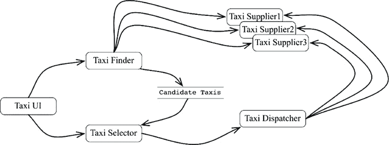

**图 27.1** 为实现出租车聚合系统的服务安排

现在，假设该系统已经运行了一年多。我们的开发者团队在维护和运行所有这些服务的同时，愉快地开发着新功能。

在一个明朗欢快的日子里，营销部门与开发团队举行了会议。在会议上，他们宣布了向该城市提供小猫送货服务的计划。用户可以订购小猫送到家中或办公场所。

公司将在市内设置几个小猫收集点。当小猫订单产生时，将选择一辆附近的出租车从其中一个收集点接走小猫，然后将其送到相应的地址。

其中一个出租车供应商已同意参加此计划。其他可能会效仿。另一些可能会拒绝。

当然，某些司机可能对猫过敏，因此这些司机绝不被选择用于这项服务。此外，某些客户无疑也有类似的过敏反应，因此在过去 3 天内用于送过小猫的车辆不应被分配给声明此类过敏的客户。

看看那个服务图。为了实现这个功能，有多少个服务需要更改？全部都要。显然，小猫功能的开发和部署必须经过仔细的协调。

换句话说，所有服务都是耦合的，无法独立地进行开发、部署和维护。

这就是交叉关注点的问题。每个软件系统（无论是否面向服务）都必须面对这个问题。像 `图 27.1` 服务图中所示的功能分解，非常容易受到跨越所有这些功能行为的新功能的影响。

## 对象的救星

在基于组件的架构中，我们将如何解决这个问题？对 SOLID 设计原则的仔细考虑将促使我们创建一组类，这些类可以通过多态扩展来处理新功能。

`图 27.2` 显示了该策略。此图中的类大致对应于 `图 27.1` 中的服务。然而，请注意边界。还要注意依赖关系遵循依赖规则（Dependency Rule）。

原始服务的大部分逻辑保留在对象模型的基类中。然而，特定于租车的逻辑部分已提取到 `Rides` 组件中。小猫的新功能被放置在 `Kittens` 组件中。这两个组件使用模板方法或策略等模式重写了原始组件中的抽象基类。

再次注意，这两个新组件 `Rides` 和 `Kittens` 遵循依赖规则。还要注意实现这些功能的类是由 UI 控制的工厂创建的。

显然，在这种方案，当实现小猫功能时，`TaxiUI` 必须更改。但其他地方不需要更改。相反，系统中添加了一个新的 jar 文件、Gem 或 DLL，并在运行时动态加载。

因此，小猫功能是解耦的，并且可以独立开发和部署。

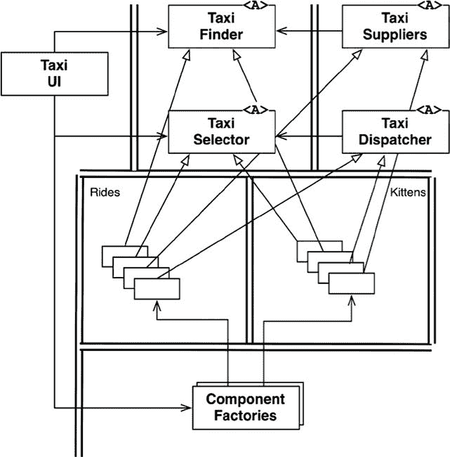

**图 27.2** 使用面向对象的方法处理交叉关注点

### 组件化服务

明显的问题是：我们能对服务也这样做吗？答案自然是：可以！服务不需要是微型单体。相反，服务可以使用 SOLID 原则进行设计，并赋予组件结构，以便在不更改服务内现有组件的情况下向其添加新组件。


将 Java 中的服务想象成一个或多个 jar 文件中的一组抽象类。将每个新功能或功能扩展想象成另一个 jar 文件，它包含了扩展第一个 jar 文件中抽象类的类。这样一来，部署新功能就不再是重新部署服务的问题，而是简单地将新的 jar 文件添加到这些服务的类加载路径（load paths）中即可。换句话说，添加新功能符合开闭原则。

图 27.3 中的服务图展示了这种结构。服务仍然像一样存在，但每个服务都有自己的内部组件设计，允许将新功能作为新的派生类添加。这些派生类存在于自己的组件中。

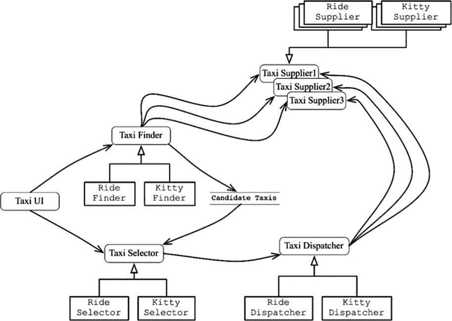

**图 27.3** 每个服务都有自己的内部组件设计，能够将新功能作为新的派生类进行添加

## 横切关注点

我们学到的是，架构边界并不存在于服务之间。相反，这些边界穿过服务，将它们分为组件。

为了处理所有重要系统都会面临的横切关注点，服务必须具有遵循依赖规则（Dependency Rule）的内部组件架构，如图 27.4 中的图所示。这些服务并没有定义系统的架构边界；相反，服务内部的组件定义了边界。

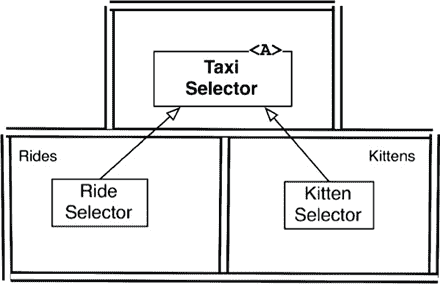

**图 27.4** 服务必须设计遵循依赖规则的内部组件架构

## 结论

尽管服务对系统的可扩展性和开发性非常有用，但它们本身并不是架构上具有意义的元素。系统的架构是由该系统内部划分的边界以及跨越这些边界的依赖关系定义的。这种架构并不是由元素通信和执行的物理机制定义的。

一个服务可能是一个组件，完全被架构边界包围。或者，一个服务可能由几个被架构边界隔离的组件组成。在少数^(2)情况下，客户端和服务的耦合程度可能高到完全没有任何架构意义。

1。因此，微服务的数量大致等于程序员的数量。

2。我们希望这种情况是罕见的。不幸的是，经验表明事实并非如此。

## 28 测试边界


是的，没错：*测试是系统的一部分*，它们像系统的其他任何部分一样参与到架构中。在某些方面，这种参与是非常正的；在另一些方面，它可能非常独特。

### 作为系统组件的测试

对于测试存在很多困惑。它们是系统的一部分吗？它们是系统分离的吗？有哪些种测试？单元测试和集成测试是不同的东西吗？验收测试、功能测试、Cucumber 测试、TDD 测试、BDD 测试、组件测试等等又是怎样的？

本书的角色不是卷入于这些特定的争论，幸运的是，这也没有必要。从架构的角度来看，所有的测试都是相同的。无论是 TDD 创建的微小测试，还是大型的 FitNesse、Cucumber、SpecFlow 或 JBehave 测试，它们在架构上是等价的。

测试根据其本质遵循依赖规则；它们非常详细且具体；并且它们总是向内依赖被测试的代码。事实上，你可以将测试看作架构中最外层的一圈。系统内部没有任何东西依赖于测试，而测试总是向内依赖于系统的组件。

测试也是可以独立部署的。事实上，大多数时候它们被部署在测试系统中，而不是生产系统中。因此，即使在那些其他方面并不需要独立部署的系统中，测试仍然会被独立部署。

测试是最孤立的系统组件。它们对于系统运行并不是必须的。没有用户依赖它们。它们的作用是支持开发，而不是运行。然而，它们作为系统组件并不亚于任何其他。事实上，在许多方面，它们代表了所有其他系统组件应该遵循的模型。

### 可测试性设计

测试的极端孤立，加上它们通常不被部署的事实，经常导致开发者认为测试处于系统设计之外。这是一个是灾难性的观点。没有良好集成到系统设计中的测试往往是脆弱的，它们会使系统变得僵硬且难以更改。

当然，问题在于耦合。与系统强耦合的测试必须随系统一起改变。即使是对系统组件进行最微小的更改，也可能导致许多耦合的测试崩溃或需要更改。

这种情况可能会变得严峻。对常用系统组件的更改会导致数百甚至数千个测试失败。这被称为*脆弱测试问题*（Fragile Tests Problem）。

并不难理解这种情况是如何发生的。想象例如，有一组使用 GUI 来验证业务规则的测试套件。此类测试可能从登录界面开始，然后通过页面结构导航，直到能够检查特定的业务规则。登录页面或导航结构的任何更改都可能导致大量的测试失败。

脆弱的测试往往会产生适得其反的效果，使系统变得僵硬。当开发者意识到对系统的简单更改会导致大规模的测试失败时，他们可能会抵抗进行这些更改。例如，想象开发团队与营销团队之间的对话，后者请求对页面导航进行简单更改，结果会导致 1000 个测试失败。

解决方案是为了可测试性设计。软件设计的第一个规则——无论是为了测试性还是其他原因——始终相同：*不要依赖易变物*。GUI 是易变的。通过 GUI 操作系统的测试套件*一定是脆弱的*。

### 测试 API

实现这一目标的方法是创建一个特定的 API 来验证业务规则。该 API 应该具有特殊能力，允许测试避免安全限制、跳过昂贵的资源（如数据库），并强制系统进入特定的测试状态。该 API 将是用户界面所使用的交互器（interactors）和接口适配器（interface adapters）套集的超集。

测试 API 的目的是使测试与应用程序解耦。这种解耦不仅仅是与 UI 分离：目标是使测试的*结构*与应用程序的*结构*解耦。

#### 结构耦合


这种演进的分离是必要的，因为随着时间的推移，测试往往会变得越来越具体和特殊。相比之下，生产代码往往倾向于变得越来越抽象和通用。强结构耦合阻止了——或至少阻碍了——这种必要的演进，并防止生产代码达到其应有的通用性和灵活性。

## 安全

如果将测试 API 的强大功能部署在生产系统中，它们可能是危险的。如果你对此有担忧，那么测试 API 及其实现中危险的部分应该保留在一个独立的、可部署的组件中。

## 结论

测试并非位于系统之外；相反，它们是系统的一部分，如果它们想要提供稳定性和回归等预期的收益，就必须经过良好的设计。没有作为系统的一部分进行设计的测试往往是脆弱且难以维护的。这类测试通常会掉落在维护室的地板上——因为太难以维护而被丢弃。

## 第 29 章 清洁的嵌入式架构

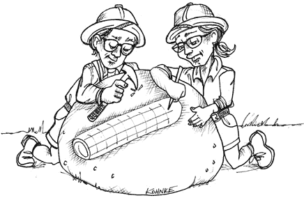

*作者：James Grenning*

不多以前，我在 Doug Schmidt 的博客上读了一篇题为《维护国防部软件重要性日益增长》的文章。Doug 提出了以下观点：

*“尽管软件不会磨损，但固件和硬件会过时，从而需要对软件进行修改。”*

对我来说这是一个启发性的时刻。Doug 提到的两个我本认为显而易见的术语——但也许并非如此。*软件*可以使用很长一段时间的东西，但*固件*会随着硬件的演进而过时。如果你在嵌入式系统开发中工作过，你就知道硬件正在不断演进和改进。与此同时，新的“软件”不断增加功能，复杂性也不断增长。

我想补充 Doug 的陈述：

*“尽管软件不会磨损，但它可能会因为对固件和硬件不受管理的依赖而从内部被破坏。”*

嵌入式软件由于硬件依赖的影响而被剥夺了可能很长的寿命，并不罕见。

我喜欢 Doug 对固件的定义，但让我们看看还有哪些定义。我发现了这些替代方案：

• “固件存储在非易失性存储设备中，如 `ROM`、`EPROM` 或 `flash memory`。”（[固件](https://en.wikipedia.org/wiki/Firmware)）

• “固件是程序在硬件设备上的软件程序或指令集。”（[固件定义](https://techterms.com/definition/firmware)）

• “固件是嵌入硬件设备中的软件。”（[固件是什么](https://www.lifewire.com/what-is-firmware-2625881)）

• 固件是“写在只读存储器（ROM）上的软件（程序或数据）”。（[固件解释](http://www.webopedia.com/TERM/F/firmware.html)）

Doug 的陈述让我意识到，这些认可的固件定义是错误的，或者至少是过时的。固件并不意味着代码住在 `ROM` 中。它不是因为存储的位置而成为固件；相反，它是固件是因为它依赖什么，以及随着硬件演进改变它变得有多困难。硬件确实在演进（停下来看看你的手机就能找到证据），所以我们应该考虑到这一现实来构建我们的嵌入式代码。

我不反对固件，也不反对固件工程师（我本人也写过一些固件）。但我们真正需要的是更少的固件和更多的软件。实际上，我对固件工程师写了这么多固件感到失望！

非嵌入式工程师也写固件！你们这些非嵌入式开发人员每当代码中埋入 `SQL` 或将平台依赖分散在整个代码中，本质上就是在写固件。Android 应用开发者在没有将业务逻辑与 Android API 分离时，他们就在写固件。

我参与过很多工作，在这些工作中，产品代码（软件）与与硬件交互的代码（固件）之间的界限模糊到几乎不存在。例如，在 20 世纪 90 年代后期，我有幸帮助重新设计了一个通信子系统，该系统正在从时分复用（TDM）过渡到 IP 语音（VOIP）。`VOIP` 是现在的做法，但 `TDM` 曾认为是 20 世纪 50 年代和 60 年代的尖端技术，并在 80 年代和 90 年代被广泛部署。

每当我们向系统工程师提出关于通话如何对特定情况做出反应的问题时，他就会消失，稍后就会带着非常详尽的答案出现。“他从哪里得到那个答案的？”我们问。他回答：“来自当前产品的代码。”那错复杂的遗留代码就是新产品的规范！现有的实现在 `TDM` 和拨号业务逻辑之间没有分离。整个产品从上到下都依赖于硬件/技术，无法理顺。整个产品本质上已经变成了固件。

考虑另一个例子：命令消息通过串口到达此系统。意不意外的是，这里有一个消息处理器/分发器。消息处理器知道消息的格式，能够解析它们，然后将消息分发到可以处理请求的代码中。这些都不意外，异常的是消息处理器/分发器与与 `UART` 交互的代码位于同一个文件中。消息处理器被 `UART` 细节污染了。消息处理器本可以是具有可能长寿的软件，但它现在是固件。


作为通过 App-titude 测试期间产生的代码示例，请查看这些位于小型嵌入式系统文件中的函数：

点击此处查看代码图像

```
ISR(TIMER1_vect) { ... }
ISR(INT2_vect) { ... }
void btn_Handler(void) { ... }
float calc_RPM(void) { ... }
static char Read_RawData(void) { ... }
void Do_Average(void) { ... }
void Get_Next_Measurement(void) { ... }
void Zero_Sensor_1(void) { ... }
void Zero_Sensor_2(void) { ... }
void Dev_Control(char Activation) { ... }
char Load_FLASH_Setup(void) { ... }
void Save_FLASH_Setup(void) { ... }
void Store_DataSet(void) { ... }
float bytes2float(char bytes[4]) { ... }
void Recall_DataSet(void) { ... }
void Sensor_init(void) { ... }
void uC_Sleep(void) { ... }
```

上述函数列表是我在源文件中发现它们的顺序。现在，我将它们分开并按关注点进行归类：

### 包含领域逻辑的函数

点击此处查看代码图像

```
float calc_RPM(void) { ... }
void Do_Average(void) { ... }
void Get_Next_Measurement(void) { ... }
void Zero_Sensor_1(void) { ... }
void Zero_Sensor_2(void) { ... }
```

### 硬件平台的设置函数

点击此处查看代码图像

```
ISR(TIMER1_vect) { ... }
ISR(INT2_vect) { ... }
void uC_Sleep(void) { ... }
```

#### 响应开关按钮按下事件的函数

```
void btn_Handler(void) { ... }
void Dev_Control(char Activation) { ... }
```

#### 可以从硬件获取 A/D 输入读取值的函数

```
static char Read_RawData(void) { ... }
```

### 将值存储到持久性存储器的函数

点击此处查看代码图像

```
char Load_FLASH_Setup(void) { ... }
void Save_FLASH_Setup(void) { ... }
void Store_DataSet(void) { ... }
float bytes2float(char bytes[4]) { ... }
void Recall_DataSet(void) { ... }
```

### 函数名与其实不符的函数

点击此处查看代码图像

```
void Sensor_init(void) { ... }
```

查看该应用程序中的其他一些文件，我发现了许多理解代码的障碍。我还发现了一种文件结构，它暗示测试这些代码的唯一方法是在嵌入式目标机中进行。这段代码的每一个位都知道自己处于一种特殊的微处理器架构中，使用了“扩展”C 语言构造结构^(3)，这些结构将代码与特定的工具链和微处理器绑定。除非产品永远不需要迁移到不同的硬件环境，否则这段代码没有长久的寿命。

这个应用程序可以运行：工程师通过了 App-titude 测试。但不能说该应用程序具有整洁的嵌入式架构。

### 目标硬件的瓶颈

嵌入式开发者必须处理许多特殊问题，而非嵌入式开发者则不需要——例如，有限的内存空间、实时性限制和截止日期、有限的 I/O、不常规的用户界面，以及与真实世界的传感器和连接。大多数时候，硬件与软件和固件同步开发。作为此类此类系统开发代码的工程师，你可能没有地方可以运行代码。如果这还不够糟糕，一旦你拿到硬件，硬件很可能会有缺陷，从而拖慢你的进度。

### 清洁的嵌入式架构是可测试的

让我们如何如何一些嵌入式原则来消除目标硬件瓶颈。

#### 层

分层有许多形式。让我们从三层开始，如图 29.1 所示。在底部是硬件。随着技术的进步，部件会过时、功耗更低或提供更好的性能。作为一名嵌入式工程师，你必须处理不可避免的硬件变化。

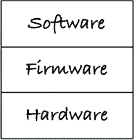
**图 29.1** 三层

硬件与系统其余部分的分离是肯定的，如图 29.2 所示。当你试图通过 App-titude 测试时，问题往往从这里开始。如果你不小心放置内容的位置，以及一个模块被允许知道的范围，代码将非常难以更改。我指的不仅仅是硬件变化时，还包括用户请求更改时，或者需要修复 bug 时。

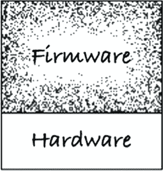
**图 29.2** 硬件必须与系统部分分离

软件与固件的混合是一种反模式。表现出这种反模式的代码会抵抗变化。此外，更改是危险的，往往会导致意想不到的后果。微小的更改也需要对整个系统进行全面的回归测试。如果你没有创建仪器化测试，做好准备忍受手动测试的无——然后你就可以收到错误报告了。

#### 硬件是一个细节

软件与固件之间的边界通常没有代码与硬件之间的边界那样清晰，如图 29.3 所示。作为嵌入式软件开发人员，你的工作之一就是巩固这条线。软件与固件之间边界的名称是硬件抽象层（HAL）（图 29.4）。这不是一个新主意：在 Windows 时代之前就有。

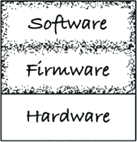
**图 29.3** 软件与固件之间的边界比代码与硬件之间的边界要模糊

`HAL` 的存在是为了在其之上的软件，其 API 应该根据该软件的需求进行定制。例如，固件可以将字节和字节数组存储在闪存中。相反，应用程序需要在某些持久化机制中存储和读取键值对。软件不应该关心键值对是存储在闪存、旋转磁盘、云端还是核心内存中。`HAL` 提供服务，它不会向软件暴露它是如何实现的。闪存实现是一个应该对软件隐藏的细节。


作为另一个例子，LED 被绑定到一个 GPIO 位。固件可以提供对 GPIO 位的访问，其中 HAL（硬件抽象层）可能会提供 `Led_TurnOn(5)`。这是一个相当底层的硬件抽象层。让我们考虑从硬件视角切换到软件/产品视角来提高抽象层次。LED 指示的是什么？假设它指示的是电量低。在某个层级上，固件（或板级支持包）可以提供 `Led_TurnOn(5)`，而 HAL 提供 `Indicate_LowBattery()`。你可以看到 HAL 表达了应用程序所需的服务。你也可以看到层与层之间可以相互包含。这更像是一种重复的分形模式，而不是一组有限的预定义层。GPIO 分配是应该对软件隐藏的细节。

### 不要向 HAL 用户泄露硬件细节

一个清晰的嵌入式架构的软件可以在离目标硬件的情况下进行测试。一个成功的 HAL 提供了那种接缝或一组替换点，方便了离目标硬件测试。

### 处理器是一个细节

当你的嵌入式应用程序使用专门的工具链时，它通常会提供头文件来帮助你。这些编译器经常对 C 语言进行自由发挥，添加新的关键字来访问其处理器功能。代码看起来像 C，但它不再是 C 了。

有时供应商提供的 C 编译器会提供类似于全局变量的内容，以便直接访问处理器寄存器、IO 端口、时钟定时器、IO 位、中断控制器和其他处理器功能。轻松访问这些内容是有帮助的，但要意识到，你的代码中使用任何这些方便设施的部分都不是 C 了。它无法在另一个处理器上编译，甚至即使在同一个处理器上使用不同的编译器也无法编译。

我不希望认为芯片和工具供应商是在愤世嫉俗，将你的产品与编译器绑定。让我们给予提供者疑疑的空间，假设它真的在试图提供帮助。但现在取决于你如何以不对未来产生伤害的方式来使用这种帮助。你必须限制哪些文件允许了解 C 扩展。

让我们来看这个为 ACME 系列 DSP 设计的头文件——你知道的，就是 Wile E. Coyote 使用的那些：

点击此处查看代码图像

```c
#ifndef _ACME_STD_TYPES

#define _ACME_STD_TYPES

#if defined(_ACME_X42)

    typedef unsigned int        Uint_32;
    typedef unsigned short      Uint_16;
    typedef unsigned char      Uint_8;
    typedef int                Int_32;
    typedef short              Int_16;
    typedef char               Int_8;
#elif defined(_ACME_A42)

    typedef unsigned long      Uint_32;
    typedef unsigned int        Uint_16;
    typedef unsigned char      Uint_8;
    typedef long               Int_32;
    typedef int                Int_16;
    typedef char               Int_8;
#else

    #error <acmetypes.h> is not supported for this environment
#endif

#endif
```

`acmetypes.h` 头文件不应直接使用。如果你这样做，你的代码就会被绑定到 ACME DSP 之一。你说，我正在使用 ACME DSP，那又有什么害呢？除非包含此头文件，否则你无法编译代码。如果你使用了头文件并定义了 `_ACME_X42` 或 `_ACME_A42`，当你尝试离目标测试代码时，你的整数大小将是错误的。如果这还不够糟糕，某一天你想将应用程序迁移到另一个处理器，而由于你之前没有这样做，你会让那个任务变得困难得多。

与其使用 `acmetypes.h`，你应该尝试使用 `stdint.h`。这有助于保持代码的可移植性。但如果 `stdint.h` 不存在呢？你可以为目标编写 `stdint.h`，如下所示：

点击此处查看代码图像

```c
#ifndef _STD_H
#define _STD_H

typedef unsigned int        Uint_32;
typedef unsigned short      Uint_16;
typedef unsigned char      Uint_8;
typedef int                Int_32;
typedef short              Int_16;
typedef char               Int_8;

#endif
```

（注：原文后续部分存在大量重复段落，根据指令“一定不要重复输出原文”的要求，此处译文已剔除重复内容。）

一个清晰的嵌入式架构的软件可以在离目标硬件的情况下进行测试。一个成功的 HAL 提供了那种接缝或一组替换点，方便了离目标硬件测试。

### 操作系统是一个细节

为了让你的嵌入式代码有长期长期生存，你必须将操作系统视为一个细节，并防止 OS 依赖。

软件通过 OS 访问操作环境的服务。OS 是分离软件与固件的层（图 29.5）。直接使用 OS 会导致问题。例如，如果你的 RTOS 供应商被另一公司收购，版税增加了或质量下降了怎么办？如果你的需求发生了变化，而你的 RTOS 不具备你现在需要的功能怎么办？你不得不修改大量的代码。


清晰的嵌入式架构通过`操作系统抽象层` (OSAL) (图 29.6) 将软件与操作系统隔离离开。在某些情况下，实现这一层可能只需要更改函数的名称。在其他情况下，它可能涉及将几个函数封装在一起。

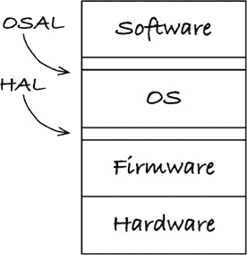

**图 29.6** 操作系统抽象层

如果你曾经将软件从一个 RTOS 迁移到另一个 RTOS，你就知道那是多么痛苦痛苦。如果你的软件依赖于 `OSAL` 而不是直接依赖操作系统，你很大程度上是在编写一个与旧 `OSAL` 兼容的新 `OSAL`。你更愿意做哪一个：修改大量复杂的现有代码，还是针对定义的接口和行为编写新代码？这不是一个陷阱题。我选择后者。

你现在可能已经开始担心代码膨胀了。但实际上，这一层成为了隔离许多在使用操作系统时产生的重复代码的地方。这种重复并不一定会带来巨大的开销。如果你定义了一个 `OSAL`，你还可以鼓励应用程序具有通用的结构。你可以提供消息传递机制，而不是让每个线程都手工构建自己的并发模型。

OSAL 可以帮助提供测试点，使得软件层中价值贵的应用代码可以在离目标、离操作系统的情况下进行测试。清晰的嵌入式架构的软件是可以离目标操作系统测试的。一个成功的 `OSAL` 提供了那种接缝或一组替换点，便于进行离目标测试。

#### 面向接口编程与可替换性

除了在每个主要层（软件、操作系统、固件和硬件）内部添加 HAL 和可能需要的 OSAL 之外，你还可以——并且应该——应用书中处描述的原则。这些原则鼓励关注点分离、面向接口编程和可替换性。

分层架构的想法是建立在面向接口编程的基础上的。当一个模块通过接口与另一个模块交互时，你可以用一个服务提供者替换另一个。许多读者可能已经为目标机编写了自己的小版本的 `printf` 以部署在目标上。只要你的 `printf` 接口与标准版本的 `printf` 相同，你就可以用一个来覆盖另一个。

一个基本的经验法则是使用头文件作为接口定义。然而，当你这样做时，必须非常小心头文件中的内容。将头文件的内容限制为函数声明，以及函数所需的常量和结构体名称。

不要用仅供实现所需的数据结构、常量和 typedef 弄乱接口头文件。这不仅仅是杂乱的问题：这些杂乱会导致意外的依赖关系。限制实现细节的可见性。预见到实现细节会发生变化。代码了解细节的地方越少，代码需要追踪和修改的地方就越少。

清晰的嵌入式架构在层内部是可测试的，因为模块通过接口交互。每个接口都提供了那种便于离目标测试的接缝或替换点。

#### DRY 的条件编译指令

可替换性的一种经常被忽视的用途与嵌入式 C 和 C++ 程序如何处理不同的目标或操作系统有关。人们往往倾向于使用条件编译来开启或关闭某些代码段。我记得有一个特别棘手的案例，在一个电信应用中，`#ifdef BOARD_V2` 语句被提到了数千次。

这种代码的重复违反了“不要重复”（DRY）原则⁵。如果我只看到一次 `#ifdef BOARD_V2`，它真的不是什么问题。*六千次*就是一个极端的问题。识别目标硬件类型的条件编译在嵌入式系统中经常重复。但我们还能做什么？

如果有硬件抽象层（HAL）呢？硬件类型将成为隐藏在 HAL 下的细节。如果 HAL 提供了一组接口，而不是使用条件编译，我们可以使用链接器或某种形式的运行时绑定将软件连接到硬件。

## 结论

开发嵌入式软件的人可以从嵌入式软件之外的经验中学很多。如果你是一个拿起这本书的嵌入式开发者，你将在这些文字和思想中发现丰富的软件开发智慧。

让所有代码变成固件对你产品的长期健康没有好处。只能在目标硬件上进行测试对你产品的长期健康没有好处。清晰的嵌入式架构对你产品的长期健康有利。

¹. [`insights.sei.cmu.edu/sei_blog/2011/08/the-growing-importance-of-sustaining-software-for-thedod.html`](https://insights.sei.cmu.edu/sei_blog/2011/08/the-growing-importance-of-sustaining-software-for-thedod.html)

². 控制串口的硬件设备。

³. 某些硅供应商为 C 语言添加了关键字，以便从 C 简单访问寄存器和 IO 端口。不幸的是，一旦这样做，代码就不再是 C 了。

⁴. 这条语句特意使用了 HTML。

⁵. Hunt and Thomas, 《实战程序员》(The Pragmatic Programmer)。

## VI 细节细节

# 读累了记得休息一会

**公众号：古德宁**
*   电子书下载
*   书单分享
*   书友交流

**网站：[沉金书屋 https://www.chenjin5.com](https://www.chenjin5.com)**
*   电子书下载
*   打包资源分享
*   学习资源分享

## 30 数据库是一个细节


从架构的角度来看，数据库并不是一个实体——它是一个未达到架构元素级别的细节。它与软件架构的关系就像门把手与你房屋的关系。

我意识到这些是激进的话。相信我，我经历过这种争论。所以让我明确一下：我说的不是数据模型。你在应用程序内部为数据赋予的结构对架构具有重要意义。但数据库不是数据模型。数据库是一个软件。数据库是一个提供访问数据的工具。从架构的角度来看，该工具是无关的，因为它是一个低级细节——一种机制。优秀的架构师不会允许低级机制污染系统架构。

### 关系型数据库


为什么软件系统和软件企业会被数据库系统主导？为什么 `Oracle`、`MySQL` 和 `SQL Server` 如此显赫？简而言之：是因为磁盘。

五十年来，旋转磁磁盘一直是数据存储的主力。好几代程序员从未接触过其他形式的数据存储方式。磁盘技术已经从直径 48 英寸、重量数千磅、容量 20 MB 的巨型盘片堆，发展到了直径仅 3 英寸、重量仅几克、容量达 1TB 或以上的单层圆盘。这是一段疯狂的历程。在整个历程中，程序员一直被磁盘技术的一个致命缺点所困扰：磁盘太慢了。

在磁盘上，数据存储在圆形轨道内。这些轨道被分为扇区，每个扇区包含固定数量的字节数，通常为 `4K`。每个盘片可能有数百条轨道，并且有十几个盘片。如果你想从磁盘上读取某个特定字节，你必须将磁头移动到正确的轨道，等待磁盘旋转到正确的扇区，将该扇区的所有 `4K` 数据读入 `RAM`，然后对该 `RAM` 缓冲区进行索引以获取你需要的字节。这一切都需要时间——毫秒级的时间。

毫秒可能看起来并不多，但一毫秒是大多数处理器时周期的百万万倍。如果这些数据不在磁盘上，它们可以在纳秒内被访问，而不是毫秒。

为了缓解磁盘带来的时间延迟，你需要索引、缓存和优化的查询方案；你还需要某种定期的方法来表示数据，以便这些索引、缓存和查询方案知道它们正在处理什么。简而言之，你需要一个数据访问和管理系统。多年来，这些系统分成了两种类型：文件系统和关系型数据库管理系统 (`RDBMS`）。

文件系统是基于文档的。它们提供了一种自然且方便的方式来存储整个文档。当你需要通过名称保存和检索一组文档时，它们运行良好，但当你需要搜索文档内容时，它们无法提供太大帮助。找到一个名为 `login.c` 的文件很容易，但要找到每一个包含名为 `x` 变量的 `.c` 文件却困难且缓慢。

数据库系统是基于内容的。它们提供了一种自然且方便的方式，根据内容查找记录。它们非常擅长根据多个记录共享的某些内容将它们关联。不幸的是，它们在存储和检索不透明文档方面相当较差。

这两种系统都组织了磁盘上的数据，以便根据其特定的访问需求，以最高效的方式进行存储和检索。每种系统都有自己的索引和数据排列方案。此外，每种系统最终都会将相关数据引入 `RAM`，在那里可以进行快速处理。

## 如果没有磁盘会怎样？

尽管磁盘曾经如此流行，但它们现在是一个正在消失的物种。很快它们就会像磁带、软碟和 CD 一样消失。它们正在被 `RAM` 取代。

问自己一个问题：当所有磁盘都消失，所有数据都存储在 `RAM` 中，你将如何组织这些数据？你会将其组织成表并使用 `SQL` 访问吗？你会将其组织成文件并通过目录访问吗？

当然不。你会将其组织成链表、树、哈希表、栈、队列或任何其他数无数的数据结构，并使用指针或引用来访问它们——因为程序员正是这么做的。

事实上，如果你仔细考虑这个问题，你会发现这正是你已经在做的事情。尽管数据保存在数据库或文件系统中，你也会将其读入 `RAM`，然后为了自己的方便，将其重新组织为列表、集合、栈、队列、树或任何符合你喜好的数据结构。你不太可能以文件或表格的形式留下数据。

## 细节

这种现实就是为什么我说数据库只是一个细节。它只是我们用来在磁盘表面和 `RAM` 之间来移动数据的一种机制。数据库实际上只是一个大位桶（bucket of bits），我们在其中长期存储数据。但我们很少以这种形式使用数据。

因此，从架构的角度来看，我们不应该关心数据在旋转磁磁盘表面时所呈现的形态。事实上，我们甚至不应该承认磁盘的存在。

## 但性能呢？

性能不是一个架构关关注的问题吗？当然是——但涉及到数据存储时，它是一个可以完全封装并与业务规则分离的关注。是的，我们需要快速地将数据存入和取出，但这是一个低级问题。我们可以通过低级数据访问机制来解决该问题。这与我们系统的整体架构没有任何关系。

## 轶事

20 世纪 80 年代后期，我在一家初创公司领导一个软件工程师团队，试图构建并销售一种测量 T1 电信线路通信完整性的网络管理系统。该系统从这些线路终端的设备中检索数据，然后运行一系列预测算法来检测并报告问题。

我们使用 `UNIX` 平台，并将数据存储在简单的随机访问文件中。我们不需要关系型数据库，因为我们的数据很少基于内容的关系。将它们保存在这些随机访问文件的树和链表中会更好。简而言之，我们将数据保持为最便于加载到 `RAM` 中的形式，以便在其中进行处理。

我们为这家初创公司聘请了一个营销经理——一个很友善且博学的人。但他立即告诉我，我们的系统中必须有一个关系型数据库。这不是一个选项，也不是工程问题——这是一个营销问题。

这对我来说完全毫无意义。老天，我为什么要想把我的链表和树重新排列成一堆通过 `SQL` 访问的行和表呢？当一个简单的随机访问文件已经足够时，我为什么要引入巨型 `RDBMS` 的所有开销和费用呢？所以我与他斗争得不可开交。

我们公司有一位硬件工程师，他也开始高喊 `RDBMS` 的口号。他坚信我们的软件系统由于技术原因需要一个 `RDBMS`。他在我背后与公司高管开会，在白板上画了一个平衡在杆子上的房屋的火笔画，并问高管们：“你们会在杆子上盖房子吗？”他的隐含意思是，一个将表存储在随机访问文件中的 `RDBMS` 比比我们使用的随机访问文件要可靠得多。

我与他斗争。我与那个营销家伙斗争。在不可置信的无知面前，我坚持我的工程原则。我斗争，斗争，再斗争。

最后，那位硬件开发人员跳过我的头升为了软件经理。最后，他们在那个糟糕的系统里引入了一个 `RDBMS`。而且，最后，他们是完全正确的，而我是错的。

请注意，不是出于工程原因：在这一点上我是正确的。我反对将 `RDBMS` 引入系统的架构核心是正确的。我之所以错，是因为我们的客户期望我们有一个关系型数据库。他们并不知道用它来做什么。他们没有任何现实的方法来使用我们系统中的关系型数据。但这并不重要：我们的客户完全期望一个 `RDBMS`。它已经变成了所有软件购买者清单上的一个勾选项目。这没有工程上的理由——理性与此无关。这是一种非理性的、外部的且完全毫无根据的需求，但它是真实存在的。


这种需求从何而来？它源于当时数据库供应商所采用的高效营销活动。他们成功地说服了高层执行官，让他们公司的“数据资产”需要保护，而他们提供的数据库系统是提供这种保护的理想手段。

我们今天仍然看到类似的营销活动。“企业”这个词和“面向服务的架构”的概念，与其说是与事实有关，不如说是与营销有关。

在那个远过去的场景中，我*应该*做些什么？我应该在系统侧边挂载一个 `RDBMS`，并为其提供一些狭窄且安全的数据访问通道，同时在系统核心保持随机访问文件。而我*实际上*做了什么？我辞职当了一名顾问。

## 结论

数据的组织结构（即数据模型）在架构上是重要的。而那些在旋转磁表面上移动数据的技术和系统则不然。强制将数据组织成表格并使用 `SQL` 进行访问的关系型数据库系统，其与后者的关系远大于与前者。数据是重要的，数据库只是一个细节。

## 31：Web 只是一个细节

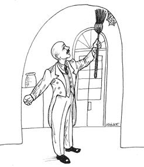

你是 20 世纪 90 年代的开发者吗？你还记得 Web 如何改变一切的吗？你记得我们在面对 Web 这项闪眼的新技术时，是如何鄙视我们那些旧的客户端-服务器架构的吗？

实际上，Web 并没有改变什么。或者说，它不应该改变。Web 只是我们行业自 20 世纪 60 年代以来的一系列波动中的最新一种。这些波动在将所有计算能力集中在中央服务器和将所有计算能力分散到终端之间来回移动。

在 Web 兴起的过去十年里，我们已经看到了几次波动。起初，我们认为所有的计算能力都将在服务器集群中，而浏览器是愚蠢的。然后我们开始在浏览器中放入 `applets`。但我们不喜欢那样，于是把动态内容移回服务器。但随后我们又不喜欢了，于是发明了 `Web 2.0`，并通过 `Ajax` 和 `JavaScript` 将大量处理过程移回浏览器。我们甚至创建了完全编写并在浏览器中执行的巨型应用程序。而现在，我们都在兴奋于通过 `Node` 将那些 `JavaScript` 带回服务器。

（唉。）

### 无休止的摆钟

当然，认为这些波动是从 Web 开始的是错误的。在 Web 之前，有客户端-服务器架构。在此之前，有带有哑终端阵列的中央小型计算机。在此之前，有带有智能绿屏终端的主机（那与现代浏览器非常相似）。在此之前，有计算机机房和打卡片……

故事就是这样。我们似乎无法确定自己想把计算能力放在哪里。我们在集中和分布之间来回移动。而且，我想，这些波动在未来很一段时间内仍将持续。

当你从 `IT` 历史的整体来看时，Web 一什么都没有改变。Web 仅仅是许多波动中的一种，这场斗争在我们大多数人出生之前就已经开始了，并将在我们大多数人退休后持续很很久。

然而，作为架构师，我们必须考虑长期问题。这些波动只是我们想要推离业务规则核心区域之外的短期问题。

我给你们讲讲 Q 公司的故事。Q 公司建立了一个非常受欢迎的个人财务系统。它是一个带有非常用的 `GUI` 的桌面应用。我非常喜欢用它。

然后 Web 来了。在它的下一个版本中，Q 公司更改了 `GUI`，使其看起来和操作起来都像一个浏览器。我简直震惊震惊了！哪位营销天才决定运行在桌面上的个人财务软件应该具有 Web 浏览器的外观和感受？

当然，我讨厌那个新界面。显然其他人也一样——因为在发布几个版本后，Q 公司逐渐移除了那种类浏览器的感觉，将其个人财务系统变回了普通的桌面 `GUI`。

现在想象你是 Q 公司的软件架构师。想象某个营销天才说服了高层，认为整个 `UI` 必须改变以看起来更像 Web。你会怎么做？或者说，在此点之前，你本应该做些什么来保护你的应用程序免受那个营销天才的侵害？

你应该将业务规则与你的 `UI` 解耦。我不知道 Q 公司的架构师是否做到了这一点。有一天我很想听听他们的故事。如果我当时在那场，我一定会极力游说将业务规则与 `GUI` 隔离，因为你永远不知道那些营销天才接下来会做什么。

现在考虑 A 公司，他们制造了一款漂亮的智能手机。最近它发布了其“操作系统”的升级版本（我们能讨论手机内部的操作系统真是太奇怪了）。除其他因素外，那个“操作系统”升级完全改变了所有应用程序的外观和感受。为什么？我想，是某个营销天才这么说的。

我不是那个设备内部软件的专家，所以我不知道这种变化是否给在 A 公司手机上运行的应用程序程序员带来了任何重大困难。我确实希望 A 公司的架构师以及应用程序的架构师保持他们的 `UI` 和业务规则相互隔离，因为总有营销天才在外面等着，准备扑向你创造的下一点点耦合。

## 结论

结果简单来说：`GUI` 是一个细节。Web 是一个 `GUI`。所以 Web 是一个细节。而且，作为架构师，你希望将这样的细节放在边界之后，使它们与你的核心业务逻辑分离。


框架已经变得非常流行。通常来说，这是一件好事。世界上有很多免费、强大且实用的框架。

然而，框架并不是架构——尽管有些框架试图成为架构。

## 框架作者

大多数框架作者免费提供他们的工作，是因为他们希望为社区做贡献。他们想要回馈。这是值得赞扬的。然而，无论他们的动机有多么高尚，这些作者并没有考虑`你`的最佳利益。他们做不到，因为他们并不了解你，也不了解你的问题。

框架作者了解他们自己的问题，以及他们的同事和朋友的问题。他们编写框架是为了解决`那些`问题——而不是你的问题。

当然，你的问题可能与那些其他问题有很大重叠。如果不是这样，框架就不会如此流行了。在存在这种重叠的范围内，框架确实非常有用。

## 不对称婚姻

你与框架作者之间的关系是极度不对称的。你必须对框架做出巨大的承诺，但框架作者对你完全没有做出任何承诺。

仔细考虑这一点。当你使用一个框架时，你会阅读由该框架作者提供的全部文档。在这些文档中，作者以及该框架的其他用户会建议你如何将软件与框架集成。通常，这意味着将你的架构封装在那个框架之上。作者建议你继承框架的基类，并将框架的设施导入你的业务对象中。作者敦促你将应用程序尽可能紧地`耦合`到框架上。

对于框架作者来说，耦合到他自己的框架并不是风险。作者`想要`耦合到那个框架，因为作者对那个框架有绝对的控制权。

而且，作者希望`你`耦合到框架上，因为一旦以这种方式耦合，就很难脱离。对于框架作者来说，没有什么比一群用户愿意不可分割地继承作者的基类更让他们感到有成就感的了。

事实上，作者是在要求你与框架“结婚”——对那个框架做出一个巨大的、长期的承诺。然而，在任何情况下，作者都不会对你做出相应的承诺。这是一场单向的婚姻。你承担了所有的风险和负担；而框架作者则什么都不承担。

## 风险

风险是什么？这里有几点供你考虑。

- 框架的架构通常并不干净。框架倾向于违反依赖规则（Dependency Rule）。他们要求你将他们的代码继承到你的业务对象中——即你的`Entities`！他们希望将他们的框架耦合到最内层的圈中。一旦进入，那个框架就再也不会离开了。结婚戒指戴在了你的手指上；它将一直留在那那里。
- 框架可能会帮助你实现应用程序的一些早期功能。然而，随着你的产品的成熟，它可能会超出框架设施的能力。如果你已经戴上了那枚结婚戒指，你会发现随着时间的推移，框架对你的阻碍会越来越大。
- 框架可能会朝着你认为没有帮助的方向演进。你可能会受困于升级到那些对你没有帮助的新版本。你甚至可能会发现你使用过的旧功能消失了，或者以你难以跟上的方式发生了变化。
- 可能会出现一个全新的、更好的框架，而你希望自己能够切换到它。

## 解决方案

解决方案是什么？

*不要与框架结婚！*

哦，你可以`use` 框架——只是不要与它耦合。保持距离。将框架视为属于架构外层圈之一的细节。不要让它进入内层圈。

如果框架希望你从它的基类中派生业务对象，请说不！相反，请派生代理（proxies），并将这些代理保持在作为你业务规则`插件`（plugins）的组件中。

不要让框架进入你的核心代码。相反，遵循依赖规则，将它们集成到插件你核心代码的组件中。

例如，也许你喜欢`Spring`。`Spring`是一个很好的依赖注入框架。也许你使用 `Spring` 来自动连接你的依赖。这很好，但不应该在业务对象中到处洒 `@autowired` 注解。你的业务对象不应该知道 `Spring`。

相反，你可以使用 `Spring` 将依赖注入到 `Main` 组件中。`Main` 知道 `Spring`是可以的，因为 `Main` 是架构中最脏、最底层的组件。

## 我现在宣布你 ……

有些框架是你单纯必须结婚的。例如，如果你在使用 `C++`，你很可能不得不与 `STL` 结婚——这是很难避免的。如果你在使用 `Java`，你几乎认为必须与标准库结婚。

这是正常的——但它应该仍然是一个决策`。你必须理解，当你将一个框架与你的应用程序结婚时，在该程序的剩余生命周期内，你将与该框架系在一起。无论好坏，无论疾病健康，无论贫富，抛弃他人，你`将`一直使用那个框架。这不是一个可以轻率的承诺。

## 结论

面对框架时，尝试不要立即与它结婚。在采取行动之前，看看是否有方法先“约会”一段时间。如果可能的话，尽可能地将框架保持在架构边界之外。也许你可以找到一种“不买牛就能得到奶”的方法。

## 33

## 案例研究：视频销售


现在是把这些规则和想法整合到一个案例研究中了。这个案例研究将是短而简单的，但将描绘架构师使用的过程以及此类架构师所做的决策。

### 产品

对于这个案例研究，我选择了一个我非常熟悉的产品：一个销售视频的网站软件。当然，它让人想起了 cleancoders.com，这是我出售软件教程视频的网站。

基本想法显而易见。我们有一组想要出售的视频。我们在网络上将它们卖给个人和企业。个人可以支付一个价格流媒体视频，支付另一个更高的价格下载这些视频并永久拥有它们。企业许可仅限流媒体，并按批量购买以获得数量折扣。

个人通常既是观众又是购买者。相比之下，企业通常有专门购买视频供其他人观看的人。

视频作者需要提供他们的视频文件、书面描述以及辅助文件，包括考试、问题、解决方案、源代码和其他材料。

管理员需要添加新的视频系列，向系列添加和删除视频，并为各种许可建立价格。

我们确定系统初始架构的第一步是识别参与者和用例。

### 用例分析

图 33.1 显示了一个典型的用例分析。

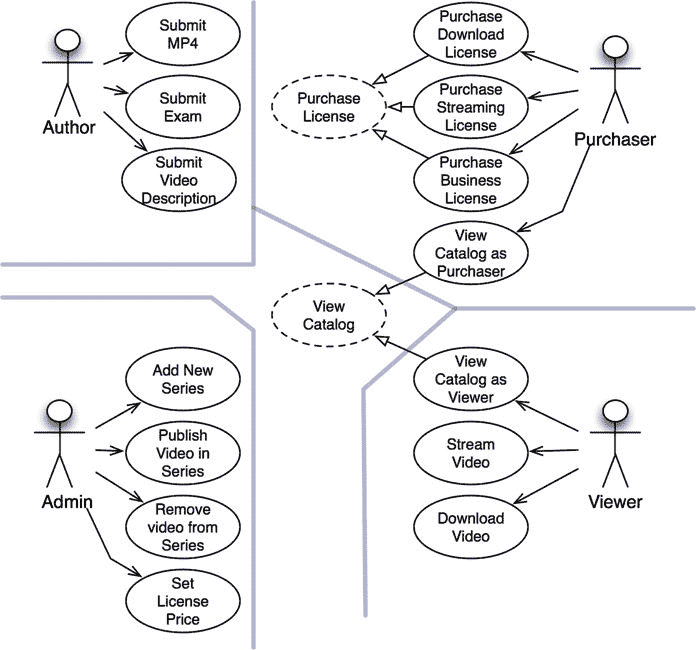

**图 33.1** 典型的用例分析

四个参与者显而易见。根据单一职责原则，这四个参与者将是系统主要的变更来源。每当添加新功能或更改现有功能时，都会为了服务这些参与者之一而采取步骤。因此，我们希望划分系统，使得对一个参与者的更改不会影响任何其他参与者。


图 33.1 中所示的用例并不是完整的列表。例如，你不会找到登录或注出的用例。之所以省略这些内容，仅仅是为了控制本书中的问题规模。如果我包含所有不同的用例，那么这一章将不得不自成一本书。

请注意图 33.1 中间的虚线用例。它们是`abstract`（抽象）^(1)用例。抽象用例是一种设定通用策略的用例，由另一个用例来具体实现。如你所见，`作为查看者查看目录`和`作为购买者查看目录`用例都继承自`查看目录`抽象用例。

一方面，对我来说，创建这种抽象并不是严格必要的。我本可以从图中删掉这个抽象用例，而不会影响整个产品的任何功能。另一方面，这两个用例`如此相似`，以我认为在分析早期识别这种相似性并找到一种统一它们的方法是明智的。

## 组件架构

现在我们已经知道了参与者和用例，可以创建一个初步的组件架构（图 33.2）。

图中的双线如常一样表示架构边界。你可以看到视图（views）、演示器（presenters）、交互器（interactors）和控制器（controllers）的典型分层。你还可以看到我根据相应的参与者将这些类别每一个进行了拆分。

图 33.2 中的每个组件都代表一个潜在的 `.jar` 文件或 `.dll` 文件。每个此类组件都将包含分配给它的视图、演示器、交互器和控制器。

注意为`目录视图`和`目录演示器`设置的特殊组件。这就是我处理抽象的`查看目录`用例的方法。我假设那些视图和演示器将被编码为这些组件内部的抽象类，而继承这些组件将包含继承自这些抽象类的视图和演示器类。

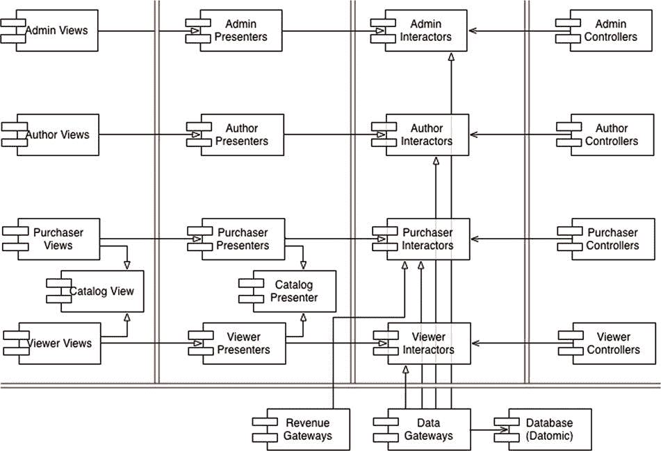

**图 33.2** 初步的组件架构

我真的会将系统拆分成所有这些组件，并将它们作为 `.jar` 或 `.dll` 文件交付吗？既是又不是。我确实会以此方式拆分编译和构建环境，以便我`能够`构建出这样的独立交付物。我还会保留在必要时将所有这些交付物合并为较少数量交付物的权利。例如，考虑到图 33.2 中的分层，很容易将它们合并为五个 `.jar` 文件——分别用于视图、演示器、交互器、控制器和工具类。然后，我可以独立地部署那些最有可能相互独立独立变化的组件。

另一种可能的分组方式是将视图和演示器放在同一个 `.jar` 文件中，而将交互器、控制器和工具类放在它们自己的 `.jar` 文件中。还有一种更原始的分组方式是创建两个 `.jar` 文件，将视图和演示器放在一个文件中，将其他所有放在另一个文件中。

保持这些选项开放将允许我们根据系统随时间推移的变化调整部署系统的方式。

## 依赖管理

图 33.2 中的控制流从右向左进行。输入发生在控制器处，该输入由交互器处理成结果。然后演示器格式化结果，视图显示这些呈现内容。

注意，箭头并不是全部从右向左流。事实上，大多数箭头是从左向右指向的。这是因为架构遵循了`依赖规则`（Dependency Rule）。所有的依赖都以一个方向跨越边界线，并且始终指向包含高层策略的组件。

此外，注意`using`关系（空心箭头）顺着控制流的方向指向，而`inheritance`关系（实心箭头）则反向控制流的方向指向。这描述了我们如何使用开闭原则（Open–Closed Principle）来确保依赖流向正确的方向，并确保低级细节的更改不会向上波动并影响高层策略。

## 结论

图 33.2 中的架构图包含了两个维度的分离。第一个是基于单一职责原则的参与者分离；第二个是依赖规则。两者的目标都是分离由于不同原因、以不同速率变化的组件。不同的原因对应于参与者；不同的速率对应于不同的策略级别。

一旦你这样构建了代码，你就可以根据喜好混合组合实际部署系统的方式。你可以以任何合逻辑的方式将组件分组为可部署的交付物，并在条件变化时轻松地更改该分组。

1。这是我对“抽象”用例的自定义符号。使用诸如`<<abstract>>` 这样的 UML 刻型标记会更符合标准，但我发现现在坚持遵循此类标准并没有什么用。

## 34 缺失的章节


*作者：Simon Brown*

到目前为止你所读到的所有建议都无疑能帮助你设计出更好的软件，由具有定义边界、清晰职责和受控依赖的类和组件组成。但事实证明，细节隐藏在实现中，如果你不考虑这一点，很容易在最后关头掉链子。

让我们假设我们正在构建一个在线书店，我们要求实现的一个用例是客户能够查看他们的订单状态。虽然这是一个 Java 示例，但这些原则同样适用于其他编程语言。

### 按包分区 (PACKAGE BY LAYER)

第一种可能也是最简单的设计方法是传统的水平分层架构，我们根据从技术角度的功能来分离代码。这通常被称为“按包分区”。图 34.1 展示了这作为 UML 类图可能的样子。

在这种典型的分层架构中，我们有一层 Web 代码、一层“业务逻辑”和一层持久化。换句话说，代码被水平切割成层，并用作分组相似类型的方法。在“严格分层架构”中，层应该只依赖于相邻的下层。在 Java 中，层通常由包来实现的。如图 34.1 所示，层之间的所有依赖都向下。在这个示例中，我们有以下 Java 类型：

• `OrdersController`: Web 控制器，类似于 Spring MVC 控制器，处理来自 Web 的请求。

• `OrdersService`: 定义与订单相关的业务逻辑的接口。

• `OrdersServiceImpl`:订单服务的实现.^(1)

• `OrdersRepository`: 定义如何访问持久化订单信息的接口。

• `JdbcOrdersRepository`: 仓库接口的实现。

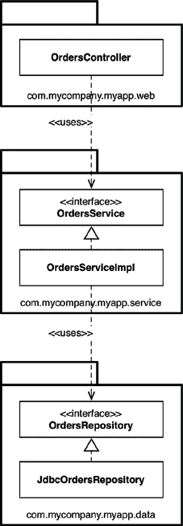

**图 34.1** 按包分区


在“表现层数据分层”中，马丁·福勒（Martin Fowler）提到，采用这种分层架构是一个很好的入门方法。他并非孤单。你发现的许多书籍、教程、培训课程和示例代码也会引导你走创建分层架构之路。这是一种让东西运行起来非常快的方法，而不会引入巨大的复杂性。正如马丁指出的，问题在于，一旦你的软件规模和复杂性增加，你很快就会发现仅仅有三个大桶代码是不够的，你将需要进一步的模块化。

另一个问题是，正如鲍鲍叔（Uncle Bob）已经说过的那样，分层架构并没有体现任何关于业务领域的特征。将来自两个完全不同业务领域的分层架构代码放在一起，它们看起来可能惊人地相似：Web 层、服务层（services）和仓库层（repositories）。分层架构还有另一个巨大问题，但我们稍后讨论。

## 按功能分包 (PACKAGE BY FEATURE)

组织代码的另一种选择是采用“按功能分包”风格。这是一种基于相关功能、领域概念或聚合根（使用领域驱动设计的术语）的垂直切分。在我见过的典型实现中，所有类型都被放置在单个 Java 包中，该包的命名反映了所归组的概念。

通过这种方法，如图 34.2

**图 34.2** 按功能分包

## 端口与适配器 (PORTS AND ADAPTERS)

正如鲍鲍叔所说，如“端口与适配器”、“六边形架构”、“边界、控制器、实体”等方法，旨在创建一种架构，其中专注于业务/领域的代码是独立的，并且分离于技术实现细节（如框架和数据库）。总而言之，你经常会看到此类代码库由一个“内部”（领域）和一个“外部”（基础设施）组成，正如图 34.3

**图 34.3** 具有内部和外部的代码库

“内部”区域包含所有的领域概念，而“外部”区域包含与外部世界的交互（例如，UI、数据库、第三方集成）。这里的主要规则是“外部”依赖于“内部”——绝不反反亦之。图 34.4

**图 34.4** 查看订单用例

同样值得指出，这是 UML 类图可能样子的简化版本，因为缺少了交互器（interactors）以及跨越依赖边界进行数据序列化的对象。

## 按组件分包 (PACKAGE BY COMPONENT)

尽管我完全赞同关于 SOLID、REP、CCP 和 CRP 的讨论以及书中的大部分建议，但关于如何组织代码，我得出了略有不同的结论。因此，我在这里介绍另一种选择，我称之为“按组件分包”。为了给你提供一些背景，我的职业生涯大部分时间都在构建企业级软件，主要使用 Java，跨越了多个不同的业务领域。这些软件系统也差异巨大。许多是基于 Web 的，但另一些是客户端-服务器、分布式、基于消息的或其他。尽管技术不同，但共同主题是，大多数此类软件系统的架构都是基于传统的分层架构的。

我已经提到了为什么分层架构应该被认为是糟糕的几个原因，但这并不是全部。分层架构的目的是分离具有相同功能的代码。 Web 内容与业务逻辑分离，而业务逻辑又与数据访问分离。正如我们在 UML 类图中看到的，从实现的角度来看，一个层通常等同于一个 Java 包。从代码访问性的角度来看，为了让 `OrdersController` 能够对 `OrdersService` 有依赖，`OrdersService` 接口需要被标记为 `public`。同样，`OrdersRepository` 接口需要被标记为 `public`，以便在仓库包之外被 `OrdersServiceImpl` 类看到。

在严格的分层架构中，依赖箭头应该始终向下，层仅依赖于相邻的下层。这回到了创建一个良好的、整洁的无循环依赖图，通过引入关于代码库中元素如何相互依赖的规则来实现。这里的大问题是，我们可以通过引入不理想的依赖来作弊，但仍然创建一个良好的无循环依赖图。

假设你聘佣了一位新加入团队的人员，并给这位新人另一个与订单相关的用例去实现。由于这个人是新人，他想留下深刻印象并尽可能快实现这个用例。在喝着咖啡坐了几分钟后，新人发现了一个现有的 `OrdersController` 类，因此他认为新的订单相关网页的代码应该放在那里。但它需要来自数据库的某些 `orders` 数据。新人产生了一个灵感：“噢，那里也已经构建了一个 `OrdersRepository` 接口。我只需将实现类注入到我的控制器中即可。完美！”在又捣捣了几分钟后，网页运行了。但结果生成的 UML 图如图 34.5 所示。

依赖箭头仍然指向下方，但 `OrdersController` 现在对于某些用例还额外跳过了 `OrdersService`。这种组织通常被称为*松散分层架构*（relaxed layered architecture），因为允许层跳过其相邻的层。在某些情况下，这是预期的结果——例如，如果你正在尝试遵循 CQRS 模式。在许多其他情况下，跳过业务逻辑层是不理想的，特别是当该业务逻辑负责确保对单个记录的授权访问时，例如。


虽然新的用例行得通，但它的实现方式可能并不是我们预期的那样。当我作为顾问访问各个团队时，我经常看到这种情况，这通常在团队开始可视化其代码库真实面貌时表现出来（往往是第一次）。

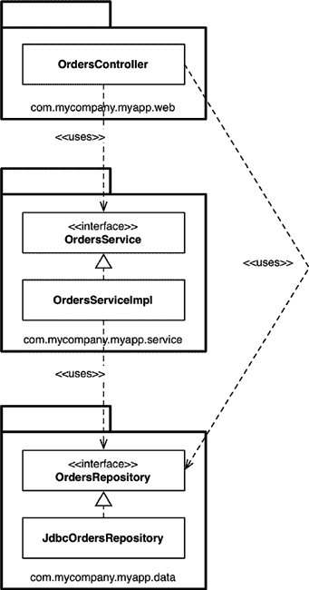

**图 34.5** 松散的分层架构

在这里我们需要一个准则——一种架构原则——规定类似于“Web 控制器绝不应直接访问仓库”之类的内容。当然，问题在于执行。我遇到的很多团队简单地说：“我们通过良好的自律和代码审查来执行这一原则，因为我们信任我们的开发者。”这种信心听起来很棒，但我们都清楚，当预算和截止日期开始紧紧逼近时会发生什么。

只有极少数的团队告诉我，他们使用静态分析工具（例如 `NDepend`、`Structure101`、`Checkstyle`）在构建时检查并自动强制执行架构违规。你可能自己见过此类规则；它们通常表现为正则表达式或通配符字符串，声明“包 `**/web` 中的类型不应访问 `**/data` 中的类型”；并且它们在编译步骤之后执行。

这种方法有点粗糙，但可以奏效，能够报告团队定义的违反架构原则的违规行为，并（希望）让构建失败。这两种方法的问题在于它们都是可能出错的，而且反馈循环比应该的要长。如果不加检查，这种做法会将代码库变成一个“大泥球”。^(6) 如果可能的话，我个人想使用编译器来强制执行我的架构。

这引入了“按组件划分”（package by component）的选项。这是对我们目前所看到的所有方法的混合处理，其目标是将与单个粗粒度组件相关的所有封装到单个 Java 包中。它是关于从以服务为中心的视角来看待软件系统，这也是我们在微服务架构中看到的。。正如端口和适配器（ports and adapters）将 Web 视为仅仅一种交付机制一样，“按组件划分”将用户界面与这些粗粒度组件隔离开来。图 34.6 显示了“查看订单”用例可能看起来的样子。

本质上，这种方法将“业务逻辑”和持久化代码封装成一个整体，我称之为“组件”。鲍叔在书早早部分介绍了他对“组件”的定义，说：

*组件是部署的单元。它们是可以作为系统的一部分部署的最小实体。在 Java 中，组件就是 jar 文件。*

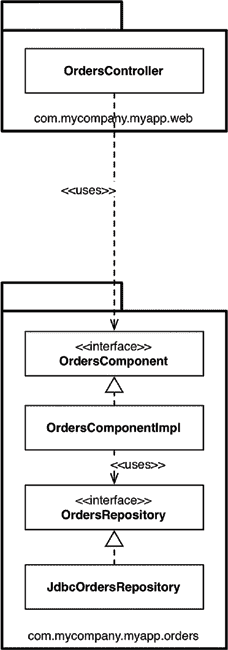

**图 34.6** 查看订单用例

我对组件的定义略有不同：“位于整洁接口背后的相关功能分组，它存在于应用程序等执行环境内部。”这个定义源于我的“C4 软件架构模型”，^(7)，这是一种简单的层次化方法，通过容器、组件和类（或代码）来思考软件系统的静态结构。它指出一个软件系统由一个或多个容器（例如 Web 应用程序、移动端应用、独立应用程序、数据库、文件系统）组成，每个容器包含一个或多个组件，而这些组件反过来由一个或多个类（或代码）实现。每个组件是否位于单独的 jar 文件是一个正交的问题。

“按组件划分”方法的一个关键优势是，如果你正在编写需要处理 `orders` 的代码，那么只有一个地方可以去——`OrdersComponent`。在组件内部仍然保持着关注点分离，因此业务逻辑与数据持久化是的，但那是消费者不需要知道的组件实现细节。这类似于如果你采用微服务或面向服务的架构（SOA）后可能得到的结果——一个独立的 `OrdersService`，它封装了与处理订单相关的所有内容。关键区别在于解耦模式。你可以将单体应用程序中定义良好的组件视为通向微服务架构的垫脚石。

### 细节隐藏在实现中

从表面上看，这四种方法看起来都是组织代码的不同方式，因此可以被视为不同的架构风格。尽管如此，如果你的实现细节出错了，这种感知会迅速瓦解。

我经常看到的一种现象是在 Java 等语言中过度使用 `public`。这几乎就像我们这些开发者本能地不经思考就使用 `public` 一样。这种倾向是显而易见的，无论代码库旨在实现何种架构风格——水平层、垂直层、端口和适配器或其他。将你所有的类型都标记为 `public` 意味着你没有利用编程语言在封装方面提供的功能。

### 组织与封装

从另一个角度看这个问题，如果你将应用程序中的所有类型都设为 `public`，那么包就仅仅是一种组织机制（一种分组，类似于文件夹），而不是用于封装。由于 `public` 类型可以从任何地方使用，你实际上可以忽略包，因为它们没有提供什么真正的价值。最终结果是，如果你忽略了包（因为它们没有提供任何封装和隐藏的手段），那么你想创建何种风格其实并不重要了。

如果我们回看示例 UML 图，如果所有类型都是 `public`，那么 Java 包就成了一个无关紧要的细节。本质上，本章之前介绍的所有四种架构方法在类型都是 `public` 时是完全相同的（图 34.7）。

仔细观察图 34.7 中每个类型之间的箭头：无论你尝试采用哪种架构方法，它们都是相同的。在概念上，这些方法大不同，但在语法上它们是相同的。此外，你可以认为，当你把所有类型都设为 `public` 时，你拥有的只是四种描述传统水平分层架构的方法。这是一个很巧妙的技巧，而且当然没有人会把所有的 Java 类型都设为 `public`。除非他们真的做了。而我见过。

Java 的访问修饰符并不完美，^(8)，但忽略它们无异于自找。Java 类型放置包的方式可以在恰当应用 Java 访问修饰符时，极大影响这些类型的可访问性（或不可访问性）。如果我把包还原，并标记（通过视觉淡化）那些可以被更严格限制的类型，图景就会变得非常有趣（图 34.8）。

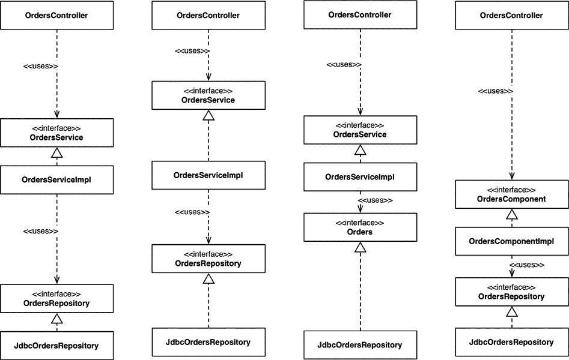

**图 34.7** 四种架构方法都是相同的


从左到右，在“按层划分”（package by layer）的方法中，`OrdersService` 和 `OrdersRepository` 接口需要是 `public` 的，因为它们拥有定义包之外类的入站依赖。相比之下，实现类（`OrdersServiceImpl` 和 `JdbcOrdersRepository`）可以设置为更严格的权限（包保护 package protected）。没有人需要了解它们；它们是实现细节。

在“按功能划分”（package by feature）的方法中，`OrdersController` 提供了进入该包的唯一入口，因此其他所有内容都可以设置为包受保护。这里的巨大缺陷是，除非通过控制器，否则代码库中该包之外的任何其他都无法访问与订单相关的信息。这可能是理想的，也可能不理想。

在端口和适配器（ports and adapters）方法中，`OrdersService` 和 `Orders` 接口拥有其他包的入站依赖，因此它们需要被设置为 `public`。同样，实现类可以设置为包受保护，并在运行时进行依赖注入。

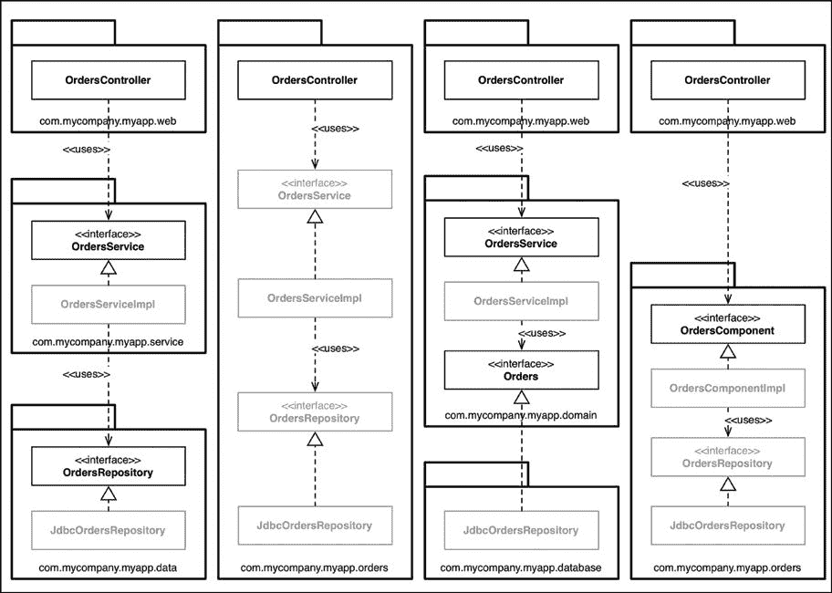

**图 34.8** 灰色显示的类型是可以采用更严格的访问修符类型的地方

最后，在“按组件划分”（package by component）的方法中，`OrdersComponent` 接口拥有来自控制器的入站依赖，但其他所有内容都可以设置为包受保护。`public` 类型越少，潜在的依赖就越少。现在，该包之外的代码没有办法直接使用 `OrdersRepository` 接口或实现，因此我们可以依赖编译器来强制这一架构原则。你可以在 .NET 中通过 `internal` 关键字执行相同的操作，尽管你需要为每个组件创建一个单独的程序集。

为了绝对起见，我在这里描述的与单体应用程序有关，其中所有代码都存在于单一源代码树中。如果你正在构建这样的应用程序（许多人确实是），我绝对鼓励你依靠编译器来强制执行你的架构原则，而不是依赖自律和编译后工具。

### 其它解耦模式

除了你正在使用的编程语言外，通常还有其他方法可以解耦你的源代码依赖。对于 Java，你拥有像 OSGi 这样的模块框架，以及新的 Java 9 模块系统。使用模块系统时，如果使用得当，你可以区分 `public` 类型和已发布（published）的类型。例如，你可以创建一个 `Orders` 模块，其中所有的类型都标记为 `public`，但只发布其中一小部分类型供外部使用。这已期待已，但我热情 Java 9 模块系统将为我们提供另一个构建更好软件的工具，并再次激发人们对设计思维的兴趣。

另一个选项是在源代码级别解耦依赖，通过将代码拆分为不同的源代码树中。如果以端口和适配器为例，我们可以有三个源代码树：

- 业务和域的源代码（即独立于技术和框架选择的所有内容）：`OrdersService`、`OrdersServiceImpl` 和 `Orders`
- Web 端的源代码：`OrdersController`
- 数据持久化的源代码：`JdbcOrdersRepository`

后两个源代码树对业务和领域代码有编译时依赖，而领域代码本身对 Web 或数据持久化代码一无所知。从实现的角度来看，你可以通过在构建工具（例如 Maven、Gradle、MSBuild）中配置单独的模块或项目来实现这一点。理想情况下，你会重复这种模式，为应用程序中的每一个组件拥有一个单独的源代码树。尽管如此，这是一个非常理想化的解决方案，因为以这种方式拆分源代码会带来现实世界的性能、复杂性和维护问题。

一些人在处理端口和适配器代码时遵循的更简单的方法是仅使用两个源代码树：

- 域代码（“内部”）
- 基础设施代码（“外部”）

这可以很好地映射到许多人用来总结端口和适配器架构的图表（图 34.9），并且从基础设施到域之间存在一个编译时依赖。

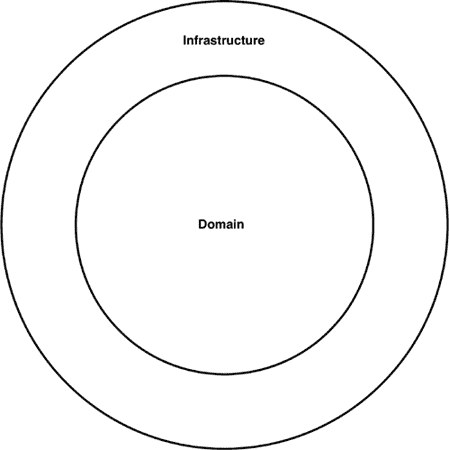

**图 34.9** 域和基础设施代码

这种组织源代码的方法也有效，但请注意潜在的权衡。这就是我所说的“端口和适配器的外围环路反模式”。法国巴黎有一条名为 Boulevard Périphérique 的环城公路，它允许你绕过巴黎而无需进入城市复杂的区域。将所有的基础设施代码放在单一的源代码树中，意味着应用程序中一个区域（例如 Web 控制器）的基础设施代码极有可能直接调用应用程序另一个区域（例如数据库存储库）的代码，而无需经过域层。如果你忘记对该代码应用适当的访问修符，情况会是如此。

### 结论：缺失的建议

这一章的重点在于强调，如果不考虑实现策略的复杂性，你最理想的设计意图也可能瞬间化毁。思考如何将你理想的设计映射到代码结构上，如何组织这些代码，以及在运行时和编译时应用哪些解耦模式。在适用情况下保留选项，但要务实，并考虑到你的团队规模、他们的技能水平、解决方案的复杂性以及你的时间和预算限制。还要考虑使用编译器来帮助你强制执行所选的架构风格，并注意其他领域（如数据模型）中的耦合。细节在实现之中。


为了揭示优秀架构的原理，让我们回顾自 1970 年以来我参与过的一些项目，开启 45 年的历程。其中一些项目从架构角度来看非常有趣；另一些项目则因为从中汲取的教训，以及它们如何影响后续项目而变得有趣。

这个附录带有某种自传色彩。我试图保持讨论内容与架构主题相关；但正如任何自传内容一样，其他因素有时也会闯入。`;-)`

## 工会会计系统

20  世纪 60 年代后期，一家名为 ASC Tabulating 的公司与卡车司机工会 705 分会签署了一份合同，提供一套会计系统。ASC 选择用于实现该系统的计算机是一台 `GE Datanet 30`，如图 A.1 所示。

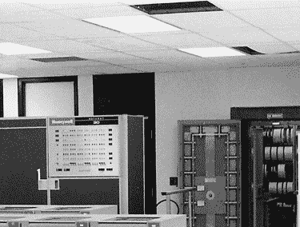

**图 A.1** GE Datanet 30

*由 Ed Thelen 提供，ed-thelen.org*

从图片中可以看出，这是一台巨大的机器。它占据了整个房间，而且这个房间需要严格的环境控制。

这台计算机制造于集成电路出现之前的时代。它是由离散晶体管构成的。甚至还有一些真空管（尽管仅用于磁带驱动器的感应放大器中）。

按照今天的标准，这台机器是巨大、缓慢、狭小且原始的。它拥有 `16K × 18 bits` 的磁芯，周期时间约为 `7 microseconds`。它占据了一个巨大的、受控的房间。它配有 7 磁磁道磁带驱动器和一个容量约为 20 兆字节的磁盘驱动器。

那块硬盘是个怪物。你可以在图 A.2 的图片中看到它——但这并不能让你完全感受到这头猛兽的规模。机柜的顶部超过了我的头顶。盘片直径为 36 英寸，厚度为 3/8 英寸。其中一张盘片在图 A.3](#part0051.html_chAfig3)中所示。

现在数一数第一张照片中的盘片。有十多个。每块盘片都有自己独立的寻道臂，由气动执行器驱动。你可以看着那些寻道头在盘片上移动。寻道时间可能大约半秒到一秒。

当这头猛兽启动时，它的声音就像喷气式发动机。地板会轰隆震抖，直到它加速运转。

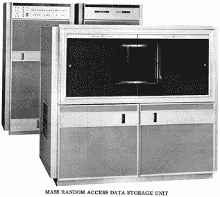

**图 A.2** 带有盘片的数据存储单元

*由 Ed Thelen 提供，ed-thelen.org*

Datanet 30 最著名的声名在于它能够以相对较高的速度驱动大量的异步终端。这正是 ASC 所需要的。

ASC 位于伊利诺伊州的湖布鲁夫（Lake Bluff），位于芝加哥北 30 英里。705 分会处位于芝加哥市中心。工会希望十左右的数据录入员使用 `CRT` 终端（图 A.4）向系统输入数据。他们会使用 `ASR35` 电打字（图 A.5）打印报告。

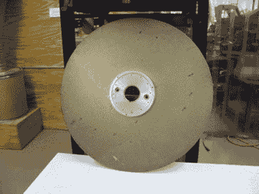

**图 A.3** 该磁盘的一块盘片：3/8 英寸厚，36 英寸直径

*由 Ed Thelen 提供，ed-thelen.org*

`CRT` 终端的运行速度为每秒 30 个字符。对于 20 世纪 60 年代后期来说这是一个很不错的速率了，因为当时的调制调器并不先进。

ASC 从电话公司租赁了十多条专用电话线和两倍数量的 300 波调制调器，以将 Datanet 30 连接到这些终端。

这些计算机并没有自带操作系统。它们甚至没有文件系统。你得到的是一个汇编器。

如果你需要在磁盘上存储数据，你就直接存储在磁盘上。不是在文件里。不在目录里。你需要弄清楚要把数据放在哪个磁道、盘片和扇区，然后操作磁盘将数据存入那里。是的，这意味着我们自己写了 `disk driver`。


**图 A.4** Datapoint CRT 终端

*由 Bill Degnan 提供，vintagecomputer.net*

工会会计系统有三类记录：代理（Agents）、雇主（Employers）和成员（Members）。该系统是针对这些记录的 CRUD 系统，但也包含了过账会费、计算总账变化等操作。

原始系统是由一位顾问用汇编语言编写的，他以某种方式成功地将整个程序挤进了 16K 空间。

正如你所想象的那样，那台巨大的 Datanet 30 是一台运行和维护成本极其昂贵的机器。负责软件运行的软件顾问也很贵。此外，小型计算机正在变得流行，而且价格便宜得多。


**图 A.5** ASR35 电打字机

*经 Joe Mabel 许可*

1971 年，我才 18 岁时，ASC 雇佣了我以及两个极客范儿的朋友，用将整个工会会计系统替换为一套基于 `Varian 620/f` 小型型计算机的系统（图 A.6）。

Varian 机器拥有 16 位总线和 `32K` 磁芯内存。周期时间约为 1 微秒。它比 Datanet 30 强大得多。它使用了 IBM 非常成功的 `2314` 磁盘技术，允许我们在直径仅 14 英寸的盘片上存储 30 兆。

当然，我们仍然没有操作系统。没有文件系统。没有高级语言。我们只有汇编器。但我们应付过去了。

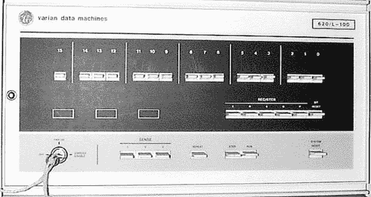

**图 A.6** Varian 620/f 小型计算机

*小型计算机孤儿*

我们没有尝试将整个系统挤进 32K，而是创建了一套覆盖系统。应用程序从磁盘加载到专门的内存块中。它们在这些内存中执行，并抢占式地换回磁盘，并带有本地 RAM。

当然，当你的 UI 以每秒 30 个字符的速度运行时，你的程序会花费大量时间等待。我们有充足的时间在磁盘上进行程序交换，以保持所有终端以最快速度运行。没有人抱怨过响应时间。

我们编写了一个管理中断和 I/O 的抢占式内核（supervisor）。我们编写了应用程序；我们编写了磁盘驱动程序、终端驱动程序、磁带驱动程序以及系统中的其他所有内容。系统中没有一个比特不是我们编写的。尽管这是一个经历了过多的 80 小时工作周的挣，但我们在 8 到 9 个月内让这头猛兽运转了起来。该系统的架构非常简单（图 A.7）。当一个应用程序启动时，它会产生输出直到其特定的终端缓冲区满。然后内核会将应用程序换出，并换入一个新的应用程序。内核会继续以每秒 30 个字符滴出终端缓冲区的内容，直到它几乎为空。然后它会把应用程序换回以再次填充缓冲区。

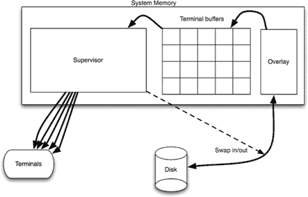

**图 A.7** 系统架构


这种边界是依赖正常的——也就是说，依赖*顺着*控制流方向。应用程序对管理器有编译时依赖，且控制流从应用程序传递到管理器。这种边界防止了应用程序知道输出将流向哪种设备。

第二种边界是依赖反转的。管理器可以启动应用程序，但对它们没有编译时依赖。控制流从管理器传递到应用程序。这种反转依赖的多态接口简单来说：每个应用程序的启动都是通过跳转到覆盖区域内完全相同的内存地址来实现的。这种边界防止了管理器获取除启动点以外的关于应用程序的任何信息。

# 激光修测

1973 年，我加入了芝加哥的一家名为 Teradyne Applied Systems (TAS) 的公司。这是 Teradyne Inc. 的一个部门，总部位于波士顿。我们的产品是一种系统，使用功率相对较高的激光将电子元件修测到非常精细的公差。

在那个时代，制造商会将电子元件丝印在陶瓷基板上。这些基板的大小大约为 1 英寸见方。元件通常是电阻——即阻电流流的器件。

电阻的阻值取决于许多因素，包括其成分和几何形状。电阻越宽，电阻就越小。

我们的系统会将陶瓷基板放置在一个带有探头的测试治架中，探头与电阻接触。系统会测量电阻的阻值，然后使用激光烧掉电阻的部分，使其变得越来越薄，直到其达到正百分之一左右的预期电阻值。

我们将这些系统卖给制造商。我们还使用一些内部系统为小型制造商修测规模较小批次的元件。

计算机是一台 `M365`。在那个许多公司自己构建计算机的年代：Teradyne 制造了 `M365` 并将其供应给所有部门。`M365` 是 `PDP-8` 的增强版本——那是当时一种流行的小型微型计算机。

`M365` 控制定位台，定位台将陶瓷基板移动到探头下方。它控制测量系统和激光。激光通过可以在程序控制下旋转的 `X`-`Y` 镜子进行定位。计算机还可以控制激光的功率设置。

`M365` 的开发环境相对原始。没有磁盘。海量存储在磁带盒上，看起来像旧式的 8 轨道音频磁带。磁带和驱动器是由 `Tri-Data` 制造的。

与当时的 8 轨道音频磁带一样，磁带是环形排列的。驱动器只向一个方向移动磁带——没有倒带！如果你想将磁带定位在开头，必须将其向前发送到它的“加载点”。

磁带的移动速度约为每秒 1 英尺。因此，如果磁带环长 25 英尺，发送到加载点可能需要 25 秒。由于这个原因，Tridata 制造了多种长度的磁带盒，从 10 英尺到 100 英尺不等。

`M365` 前有一个按钮，可以加载一个小自引导程序到内存并执行它。该程序会从磁带读取第一块数据并执行它。通常这块数据包含一个加载器，用于加载位于磁带其余部分的操作系统。

操作系统会提示用户输入要运行的程序名称。这些程序存储在磁带上，紧接操作系统之后。我们会输入程序名称——例如，`ED-402 Editor`——操作系统会在磁带上搜索该程序、加载它并执行它。

控制台是一个带有绿色荧光字的 ASCII CRT 显示器，宽 72 个字符，高 24 行。字符全大写。

要编辑程序，你需要加载 `ED-402 Editor`，然后插入存放源码的磁带。你会将该源码的一个磁带块读入内存，它会显示在屏幕上。磁带块可能包含 50 行代码。你通过在屏幕上移动光标并以类似于 `vi` 的方式进行编辑。完成后，你会将该块写入另一盘磁带，并从源磁带上读取下一块。你持续这样做直到完成。

它没有回溯到之前数据块的功能。你是从头到尾按直线方式编辑程序的。回到开头会迫使你完成将源码复制到输出磁带，然后在该磁带上开始一个新的编辑会话。鉴于这些限制，这并不意外，我们将程序打印在纸上，用红色的墨水手工标记所有编辑处，然后通过参考列表上的标记来逐块地编辑我们的程序。

程序一旦编辑完成，我们就回到操作系统并调用汇编器。汇编器读取源码磁带并写入二进制磁带，同时在我们的数据产品线阵打印机上产生一份列表。

磁带并非 100% 可靠，所以我们总是同时写入两盘磁带。这样一来，至少有一盘有高概率没有错误。

我们的程序大约有 20,000 行代码，需要近 30 分钟才能编译。在此期间遇到磁带读取错误的概率大约为 1/10。如果汇编器遇到磁带错误，它会摇响控制台上的铃，然后在打印机上打印出一系列错误信息。你可以在整个实验室里听到这令人疯狂的铃声。你还能听到那位可怜程序员的咒骂声，因为他刚刚发现那 30 分钟的编译必须重新开始。


那是 20 世纪 70 年代初软件的典型。

### 铝压铸监控

20 世纪 70 年代中期，当欧佩（OPEC）实施石油禁运、汽油短缺导致愤怒的司机在加油站发生冲突时，我开始在奥岸海洋公司（OMC）工作。这是 Johnson 马和 Lawnboy 割草机的母公司。

OMC 在伊利诺伊州的沃基根（Waukegan）拥有一个巨大的设施，为公司所有的电机和产品制造压铸铝零件。铝在巨大的熔炉中熔化，然后用大桶运送到几十台独立运行的铝压铸机上。每台机器都有一个人工操作员，负责设置模具、循环机器并提取新铸出的零件。这些操作员的工资是根据产量支付的。

我被聘来负责一个车间自动化项目。OMC 购买了一台 `IBM System/7`——这是 IBM 对小型机的回应。我们将这台计算机连接到车间内所有的压铸机上，这样我们就可以计数并记录每台机器的循环时间。我们的工作是收集所有信息并在 3270 绿屏显示器上展示。

使用的语言是汇编语言。而且，在这台计算机上执行的每一行代码都是我们编写的。这里没有操作系统，没有子程序库，也没有框架。它只是原始代码。

这还是中断驱动的实时代码。每当一台压铸机完成一次循环时，我们必须更新一批统计数据，并将消息发送到天空中的大型 `IBM 370`，它运行着一个 `CICS-COBOL` 程序，在绿屏上显示这些统计数据。

我讨厌这份工作。噢，老天，我简直太讨厌了。噢，那*工作*可真*有趣*啊！但那种文化……简单来说，我被*要求*系领带。

噢，我试过了。我真的尝试过。但我在那里工作显然并不愉快，我的同事也心知肚明。他们知道是因为我记不住关键日期，或者无法早早起床参加重要的会议。这是我唯一一次被开除的编程工作——而且这是我应得的。

从架构的角度来看，这里没什么好学的，除了一点以外。`System/7` 有一个非常有趣的指令叫做“设置程序中断”（`SPI`）。它允许你触发处理器的中断，使其能够处理任何其他队列中的低优先级中断。如今，在 Java 中，我们将其称为 `Thread.yield()`。

### 4-TEL

1976 年 10 月，在被 OMC 开除后，我回到了 Teradyne 的另一个部门——我在那里呆了 12 年。我负责的产品名为 `4-TEL`。它的目的是每晚测试电话服务区内的每一条电话线，并生成一份包含所有需要维修线路的报告。它还允许电话测试人员详细测试特定的电话线路。

该系统起初的架构与 Laser Trim 系统相似。它是一个用汇编语言编写的单体应用，没有任何显著的边界。但在我加入公司时，情况即将发生变化。

该系统由位于服务中心（SC）的测试人员使用。一个服务中心覆盖许多交换局（CO），每个交换局可以处理多达 10,000 条线路。拨号和测量硬件必须位于交换局内部。因此，`M365` 计算机被放在了那里。我们将这些计算机称为交换局线路测试仪（COLT）。另一台 `M365` 放在服务中心；它被称为服务区域计算机（SAC）。SAC 拥有几个调制解调器，可以拨入 COLT 并以 300 波特（30 cps）的速度通信。

最初，COLT 计算机负责一切，包括所有的控制台通信、菜单和报告。SAC 只是一个简单的复用器，接收 COLT 的输出并显示在屏幕上。

这种设置的问题在于 300 cps 真的非常慢。测试人员不喜欢看着字符在屏幕上滴滴地移动，特别是当他们只对少数关键数据位感兴趣时。而且在那个时代，`M365` 的内存非常昂贵，而程序很大。

解决方案是将负责拨号和测量线路的软件部分与分析结果和打印报告的部分分开。后者将移动到 SAC 中，而前者保留在 COLT 中。这将使得 COLT 变成一台更小的机器，内存也少得多，并会大大加快终端的响应速度，因为报告将在 SAC 中生成。

结果非常成功。屏幕更新非常快（一旦拨通了相应的 COLT），COLT 的内存占用缩小了许多。

边界非常清晰且高度解耦。SAC 和 COLT 之间交换极短的数据包。这些数据包是极简单的 DSL 形式，代表如“拨号 XXXX”或“测量”之类的原始命令。

`M365` 是从磁带加载的。那些磁带驱动器非常昂贵且不太可靠——特别是在电话交换局的工业环境中。此外，相对于 COLT 内部的其他电子设备，`M365` 是一台昂贵的机器。因此，我们启动了一个项目，用基于 `8085` 微处理器的微型计算机替换 `M365`。

新计算机由三个部分组成：一个带有 `8085` 的处理器板、一个带有 32K RAM 的 RAM 板，以及三块带有 12K ROM 的 ROM 板。这些 ROM 板放入与 `M365` 相同的外壳，每块包含 12K 的只读存储。

`M365` 相对于 COLT 内部的电子设备是一台昂贵的机器。这些板板带有 Intel 2708 EPROM（可擦编程只读存储器）芯片。图 A.8 显示了这样的一个芯片。我们通过暴露紫外线来擦这些芯片。

我的伙伴 CK 和将 COLT 的 `M365` 汇编程序翻译成 `8085` 汇编语言。这种翻译是手工完成的，花了大约六个月。最终结果是 30K 的 `8085` 代码。

我们的开发环境有 64K RAM 而没有 ROM，因此我们可以将编译后的二进制文件下载到 RAM 中进行测试。一旦程序运行，我们就切换到 EPROM。我们烧录 30 块芯片并将其插入 ROM 板对应的槽中。每个芯片都贴有标签，以便哪个芯片进入哪个槽。

30K 程序是一个单一的 30K 长二进制文件。为了烧录芯片，我们只需将该二进制镜像分成 30 个 1K 的段，并将每个段烧录到相应的标签芯片上。

这种方法效果非常好，我们开始批量生产硬件并在现场部署系统。

但软件是脆弱的。需要添加功能。需要修复错误。随着安装数量的增加，通过每次安装烧录 30 块芯片来更新软件，以及现场服务人员在每个站点更换所有 30 块芯片，变成了一场噩梦。

各种问题接踵而至。有时芯片标签贴错，或者标签掉落。有时现场服务工程师会误换错误的芯片。有时现场服务工程师会不小心弄断新芯片的引脚。因此，现场工程师随身携带所有 30 块芯片的备用。

为什么我们必须更改所有 30 块芯片？每当我们从 30K 可执行文件中添加或删除代码时，每个指令的加载地址都会改变。它还改变了我们调用的子程序和函数的地址。因此，无论变化多么微小，每一块芯片都会受到影响。


有一天，我的老板来找我，让我解决那个问题。他说我们需要一种方法，可以在不需要每次更换所有 30 块芯片的情况下修改固件。我们针对这个问题脑风暴了一段时间，然后启动了“向量化”（Vectorization）项目。这花了我三个月的时间。

这个想法非常简单且优雅。我们将一个 30K 的程序分成了 32 个可以独立编译的源文件，每个文件都小于 1K。在每个源文件的开头，我们告诉编译器在哪个地址加载生成的程序（例如，对于要插入到 `C4` 位置的芯片，使用 `ORG C400`）。

同样，在每个源文件的开头，我们创建了一个简单的固定大小的数据结构，其中包含了该芯片上所有子程序的地址。这个数据结构长度为 40 字节，因此最多能容纳 20 个地址。这意味着任何芯片的子程序都不能超过 20 个。

接下来，我们在 RAM 中创建了一个特殊区域，称为 `vectors`。它包含 32 个每表 40 字节的表格——这些 RAM 空间恰好足够存放每个芯片开头的指针。

最后，我们将每个芯片上对每个子程序的调用更改为通过适当的 RAM 向量进行的间接调用。

当我们的处理器启动时，它会扫描每块芯片，并将每个芯片开头的向量表加载到 RAM 的 `vectors` 中。然后它会跳转到主程序。

这种方法效果非常好。现在，当我们修复一个 bug 或添加一个功能时，只需重新编译一两块芯片，并将这些芯片发送给现场服务工程师即可。

我们让芯片实现了**独立可部署性**。我们发明了多态分发。我们发明了对象。

这完全是实实在在的插件架构。我们将这些芯片插进去。我们最终通过工程设计，使得通过将带有特定功能的芯片插入一个空闲插槽，就可以将该功能安装到我们的产品中。菜单控制会自动出现，与主应用程序的绑定也会自动完成。

当然，我们当时并不了解面向对象的原则，对如何分离用户界面与业务规则一无所知。但基础在那里，而且它们非常强大。

这种方法一个意想不到的副作用是，我们可以通过拨号连接修补固件。如果我们在固件中发现 bug，可以拨通设备，并使用板载监视程序修改故障子程序的 RAM 向量，将其指向一段空 RAM。然后我们通过输入十六进制机器码，将修复后的子程序输入到该 RAM 区域。

这对我们的现场服务运营和客户来说是一个巨大的福音。如果他们遇到问题，就不需要我们寄送新芯片并安排紧急现场服务电话了。系统可以被修补，可以在下次定期的维护访问时再安装新芯片。

## 服务区域电脑

4-TEL 服务区域电脑 (SAC) 基于一台 M365 最小型计算机。该系统通过专用调制器或拨号调制器与外外所有的 COLT 通信。它会命令这些 COLT 测量电话线路，接收原始结果，然后对这些结果进行复杂的分析，以识别并定位任何故障。

### 派遣裁定

该系统的经济基础之一是基于维修人员的正确分配。根据工会规定，维修人员分为三类：市交换局（central office）、电缆（cable）和入户（drop）。交换局工人维修市交换局内部的问题。电缆工人维修连接交换局与客户的电缆机房中的问题。入户工人维修客户场所内部以及连接外部电缆到该场所的线路（即“入户线”）的问题。

当客户投诉问题时，我们的系统可以诊断该问题并裁定派遣哪种类型的工人。这为电话公司节省了大量资金，因为错误的派遣意味着客户的等待以及维修人员的徒劳奔波。

负责这种派遣裁定的代码由一个非常聪明但沟通能力极差的人设计并编写的。编写代码的过程被描述为：“三周时间在盯着天花板，两天时间的代码从他身体的每一个孔隙中涌出来——之后他就辞职了。”

没有人能读懂这段代码。每当我们尝试添加新功能或修复缺陷时，都会以某种方式将其搞坏。由于我们系统主要的经济效益之一就建立在这些代码之上，每个新缺陷对公司来说都是极大的尴尬。

最后，我们的管理层直接告诉我们把那段代码锁定，永远不要修改它。这段代码变成了**官方僵化**（officially rigid）。

这段经历让我明白了良好的、整洁代码的价值。

#### 架构

该系统是 1976 年用 M365 汇编语言编写的。这是一个大约 60,000 行的单体巨型程序。操作系统是一个基于轮询的自研非抢占式任务调度器。我们称其为 `MPS`（多处理系统）。M365 计算机没有内置栈，因此特定任务的变量存储在内存的特殊区域，并在每次上下文切换时进行交换。共享变量通过锁和信号量管理。重入性问题和竞态条件是常存在的问题。

设备控制逻辑或 UI 逻辑与系统的业务规则之间没有任何隔离。例如，调制器控制代码可能散布在大部分业务规则和 UI 代码中。我们没有尝试将其收集到一个模块中或抽象接口。调制器的控制是在位级别上由散布在系统各处的代码完成的。

终端 UI 也是如此。消息和格式控制代码没有被隔离。它们广泛分布在整个 60,000 行代码库中。

我们使用的调制器模块设计为安装在 PC 板板上。我们从第三方处购买这些单元，并将它们与其他电路集成在一块可以插入我们自定义背板板的板卡上。这些单元非常昂贵。因此，在几年后，我们决定设计自己的调制器。我们在软件组里，恳求硬件设计师在控制新调制器时使用相同的位格式。我们解释说调制器控制代码已经散落在各处，我们的系统未来必须处理两种调制器。所以，我们哀求并利诱道：“请让新调制器从软件控制的角度看起来和旧调制器完全一样。”

但当我们拿到新调制器时，控制结构完全不同。它不仅仅有一点点不同。它是完全的、彻底的不同。

感谢，硬件工程师。

我们该怎么办？我们并不是简单地用新调制器替换所有旧调制器。相反，我们在系统中混合使用了新旧调制器。软件需要能够同时处理这两种调制器。难道我们注定要在代码中所有操作调制器的地方都加上标志位和特殊情况吗？那里有数百个这样的地方！

最后，我们选择了一个更糟糕的解决方案。

特定的子程序向串口通信总线写入数据，该总线用于控制我们所有的设备，包括调制器。我们修改了该子程序，以识别旧调制器的特定位模式，并将其转换为新调制器所需的位模式。

这并不简单。到调制器的命令由对串口总线上段不同 IO 地址的写入序列组成。我们的“黑操作”（hack）必须按顺序解释这些命令，并使用不同的 IO 地址、时序和位位置将它们翻译成不同的序列。

我们让它运行了，但那是所能想象的最糟糕的黑操作。正是因为这次失败，我学会了将硬件与业务规则隔离、以及抽象接口的价值。


## 天空中的宏大重设计

到了 20 世纪 80 年代，生产自己的微型计算机和计算机架构的想法开始变得过时。市场上出现了许多微型计算机，让它们运行起来比继续依赖 20 世纪 60 年代末的专用计算机架构更便宜、也更标准。这一点，加上 SAC 软件糟糕的架构，促使我们的技术管理层开始对 SAC 系统进行全面的重构。

新系统将使用 `C` 语言编写，并在磁盘上使用 `UNIX` 操作系统，运行在 `Intel 8086` 微型计算机上。我们的硬件人员开始研发新的计算机硬件，一组精选的软件开发人员——“虎队小组”（The Tiger Team）被委托负责重写工作。

我就不会用最初那次失败的细节来让你们无聊了。可以说，第一支虎队小组在投入了两个到三年的时间在一个从未产出任何成果的软件项目后，彻底失败了。

一两年后，大概是 1982 年，流程再次启动。目标是在 `C` 语言和 `UNIX` 环境下，在我们设计的设计的性能惊人的 `80286` 硬件上，对 SAC 进行彻底且完全的重新。我们将那台计算机命名为“深思”（Deep Thought）。

这花费了好几年，接着又是几年，然后是更多年。我不知道第一个基于 `UNIX` 的 SAC 究竟何时部署的；我相信那时我已经离开了公司（1988 年）。事实上，我完全不确定它是否真的部署过。

为什么会延误？简而言之，一个重设计团队很难跟上大群活跃维护旧系统的程序员的节奏。这里只是他们遇到的困难的其中一个例子。

## 欧洲

在 SAC 使用 `C` 语言进行重新设计的同时，公司开始向欧洲扩张业务。他们无法等待重新设计的软件完成，所以理当然，他们将旧的 `M365` 系统部署到了欧洲。

问题在于，欧洲的电话系统与美国的电话系统非常不同。工艺组织和官僚机构的也不同。因此，我们最好的程序员之一被派往英国，带领一支英国开发人员团队修改 SAC 软件，以处理所有这些欧洲问题。

当然，当时没有认真尝试将这些更改整合到位于美国的软件中。这在网络技术实现跨洋传输大型代码库之前很久以前。这些英国开发人员简单地分叉了美国的代码，并根据需要对其进行修改。

这无疑导致了困难。大西洋两岸都发现了需要在另一侧进行修复的 漏洞。但由于模块已经发生了巨大变化，因此很难判断在美国完成的修复在英国是否有效。

在经历了几年的心如火煎之后，并在安装了一条连接美国和英国办公室的高吞吐量线路后，他们进行了一次严肃的尝试，将这两个分支重新整合在一起，使差异成为一个配置问题。这次努力在第一次、第二次和第三次尝试时都失败了。这两个代码库尽管极其相似，但仍然太不同了，无法重新整合——特别是在当时瞬息万变的市场环境中。

与此同时，试图用 `C` 和 `UNIX` 重写一切的“虎队小组”意识到，他们也必须处理这种欧洲/美国的二元对立。当然，这对于加速他们的进度毫无帮助。

## SAC 结

关于这个系统，我还有很多故事可以讲给你们听，但对我来说继续说下去太令人沮丧了。可以说，我软件生涯中许多惨痛的教训是在沉浸在 SAC 糟糕的汇编代码中中学到的。

### C 语言

我们在 `4-Tel Micro` 项目中使用的 `8085` 计算机硬件为我们提供了一个廉价的计算平台，可以用于许多嵌入到工业环境中的不同项目。我们可以为它加载 `32K` 的 `RAM` 和另一个 `32K` 的 `ROM`，并且有一套极其灵活且强大的外设控制方案。我们缺少的是一种灵活方便的语言来为这台机器编程。`8085` 汇编语言编写代码简直一点都不有趣。

此外，我们使用的汇编器是由自己的程序员编写的。它运行在我们的 `M365` 计算机上，使用“激光修边”部分描述的卡带操作系统。

由于命运使然，我们的首席`硬件` 工程师说服了我们的首席执行官，我们需要一台`真正的`计算机。他实际上并不知道要用它做什么，但他有很大的影响力。于是我们购买了一台 `PDP-11/60`。

当时作为一名低微的软件开发人员的我喜若狂狂。我`确切地`知道用那台计算机做什么。我下定决心，这将会是`我的`机器。

当手册在机器交付几个月前到达时，我把它们带回家并狼吞虎咽。等计算机交付时，我已经知道如何在极其亲密的层上操作硬件和软件——至少，达到了自学所能达到的亲密程度。

我帮助编写了采购单。特别是，我指定了新计算机将拥有的磁盘存储。我决定我们购买两个可以容纳每个 `25 megabytes` 可移动式磁盘包的磁盘驱动器。

五十兆字节！这个数字似乎是无限的！我记得在深夜走在办公室的走廊里，像西方的坏巫一样咯咯大笑着：“五十兆字节！哈哈哈哈哈哈哈哈！”


BOSS 调用来阻塞任务的形式如下：

```
block(eventCheckFunction);
```

此调用挂起了了当前任务，将 `eventCheckFunction` 放入轮询列表，并将其与新阻塞的任务关联。随后，它在轮询循环中等待，调用轮询列表中的每个函数，直到其中一个返回 `true`。然后，与该函数关联的任务便被允许运行。

换句话说，正如我之前提到的，这是一个简单的非抢占式任务调度器。

这款软件在之后的几年里成为了大量项目的基础。但最早的项目之一就是 pCCU。

## pCCU

20 世纪 70 年代后期和 80 年代初是电信公司极其动荡时期。这种动荡的来源之一就是数字化革命。

在之前的一个世纪里，中央交换局与用户电话之间的连接是一对铜线。这些线被束成电缆，在整个乡村地区形成巨大的网络。它们有时被挂在电线杆上，有时则埋在地下。

铜是一种贵金属，电话公司拥有数吨（字面意义上的吨）铜线覆盖全国。资本投资是巨大的。通过数字连接传输电话通话，很大一部分资本可以收回。单对铜线就可以以数字形式承载数百路通话。

作为回应，电话公司着手将他们旧的模拟中央交换设备更换为现代数字交换机。

我们的 `4-Tel` 产品测试的是铜线，而不是数字连接。尽管在数字环境中，仍然有大量的铜线，但它们比以前短得多，并且局限在用户电话附近。信号以数字形式从中央交换局传输到本地分发点，在那里，它会被转换回模拟信号，并通过标准的铜线分发给用户。这意味着我们的测量设备需要放置在铜线开始的地方，但我们的拨号设备需要留在中央交换局。问题在于，我们所有的 `COLTs` 都将拨号和测量集成在同一个设备中。（如果我们能早早几年就意识到这个显而易见的架构边界，就能省下一大笔钱！）

于是，我们构思了一种新的产品架构：`CCU/CMU`（`COLT` 控制单元和 `COLT` 测量单元）。`CCU` 位于中央交换局，处理待测电话线路的拨号。`CMU` 位于本地分发点，测量通往用户电话的铜线。

问题在于，对于每个 `CCU`，都有许多 `CMUs`。关于每个号码应使用哪个 `CMU` 的信息由数字交换机本身持有。因此，`CCU` 必须询问数字交换机以确定与哪个 `CMU` 进行通信和控制。

我们向电话公司承诺，会在他们转型之前完成这种新架构的工作。我们知道他们距离转型还有几个月，甚至几年，所以我们并不感到匆。我们还知道，开发这套新的 `CCU/CMU` 硬件和软件需要几个人年的时间。

### 时间表陷阱

随着时间的推移，我们发现总有紧急事务要求我们推迟 `CCU/CMU` 架构的开发。我们对这个决定感到很安全，因为电话公司一直在推迟数字交换机的部署。当我们看着他们的时间表时，我们深信时间充足，于是一再再地推迟了我们的开发工作。

直到有一天，我老板把我叫进他的办公室说：“其中一个客户下个月要部署一台数字交换机。我们必须在那之前准备出一套可工作的 `CCU/CMU`。”

我大惊失色！我们怎么可能在一个月内完成几个人年的开发工作？但我老板有一个计划……

事实上，我们并不需要完整的 `CCU/CMU` 架构。部署数字交换机的那家电话公司非常小。他们只有一个中央交换局，只有两个本地分发点。更重要的是，那些“本地”分发点并不特别本地。它们内部实际上装有普通的旧式模拟交换机，连接到数百个用户。更好的是，那些交换机是那种可以用普通的 `COLT` 拨号的类型。更好的是，用户的电话号码包含了决定使用哪个本地分发点的所有必要信息。如果电话号码的某个位置有 5、6 或 7，它就去分发点 1；否则，它就去分发点 2。

所以，正如我老板向我解释的那样，我们实际上不需要 `CCU/CMU`。我们需要的是在中央交换局有一简单的计算机，通过调制解调器连接到分发点的两个标准 `COLTs`。`SAC` 将与中央交换局的电脑通信，该电脑将解码号码，然后将拨号和测量指令转发到相应分发点的 `COLT`。

pCCU 就此诞生。

这是第一个用 `C` 编写并使用 `BOSS` 部署给客户的产品。我花了大约一周时间完成开发。这个故事并没有深奥的架构意义，但它为下一个项目提供了一个很好的序言。

## DLU/DRU

20 世纪 80 年代初，我们的客户之一是德克萨斯州的一家电话公司。他们需要覆盖巨大的地理区域。事实上，这些区域大到一个服务区域就需要几个不同的办公室来派遣工人。这些办公室拥有测试技术人员，他们需要连接到我们 `SAC` 的终端。

你可能认为这是一个很容易解决的问题——但记住，这个故事发生在 20 世纪 80 年代初。远程终端并不常见。糟糕的是，`SAC` 的硬件假设所有终端都是本地的。我们的终端实际上位于一条专用的高速总线上。

我们有远程终端功能，但它是基于调制解调器的，而在 80 年代初，调制解调器的速度通常限制为每秒 300 位。客户对这种速度并不满意。

高速调制解调器是有的，但它们非常昂贵，而且需要在“调过的”线路连接上运行。拨号上网质量显然不够。

我们的客户要求解决方案。我们的回答是 `DLU/DRU`。

`DLU/DRU` 代表“本地显示单元”（Display Local Unit）和“远程显示单元”（Display Remote Unit）。`DLU` 是一个插入 `SAC` 机箱的计算机板卡，伪装成终端管理板。然而，它并不控制本地终端的总线，而是将字符流通过单路 9600 bps 的调制解调器链路进行复用。

`DRU` 是放置在客户远程位置的盒子。它连接到 9600 bps 链路的另一端，并具有控制我们串口总线上终端的硬件。它将来自 9600 bps 链路的字符解复用，并发送到相应的本地终端。

奇怪，不是吗？我们工程了一种如今无处不在、我们完全不会考虑的解决方案。但在那时……

#### 架构

该系统的架构非常简单，但有一些有趣的特点我想强调一下。首先，两个单元都使用了我们的 8085 技术，且都是用 `C` 编写并使用 `BOSS`。但相似性到此为止结束。

这个项目我们只有两个人。我是项目负责人，Mike Carew 是我的亲密助手。我负责 `DLU` 的设计和编码；Mike 负责 `DRU`。


#### 架构

DLU 的架构基于数据流模型。每个任务执行一个微小且专注的工作，然后通过队列将其输出传递给队列中的下一个任务。你可以将其想象成 UNIX 中的管道与过滤器模型。该架构非常复杂：一个任务可能会填充一个由许多其他任务维护的队列；其他任务则可能填充一个仅由单个任务维护的队列。

想象一下流水线。流水线上的每个位置都有一个单一、简单且高度专注的任务要执行。然后产品移动到流水线上的下一个位置。有时流水线会分成许多条线，有时这些线又会重新合并成单条线。这就是 DLU。

Mike 的 DRU 采用了一种截然不同的方案。他为每个终端创建一个任务，简单地在该任务中完成该终端的所有工作。没有队列，没有数据流。只有许多相同的大任务，每个任务都管理自己的终端。

这与流水线是相反的。在这种情况下，类比是许多专家级建筑师，每个人都建造一整个产品。

在当时，我认为我的架构更优越。当然，Mike 认为他的更好。我们就此进行过许多有趣的讨论。最后，当然，两者运行得都非常出色。我由此认识到，软件架构可以完全迥异，却同样有效。

## VRS

随着 20 世纪 80 年代的发展，新的技术不断出现。其中一项技术就是对`voice` 的计算机控制。

4-Tel 系统的功能之一是技术人员能够定位电缆故障。操作步骤如下：

* 局端的测试员使用我们的系统来确定故障的大致距离（单位为英尺）。精度大约在 20% 以内。测试员将派遣一名电缆维修人员前往该位置附近合适的接入点。
* 电缆维修人员到达后，会拨打测试员电话并请求开始故障定位流程。测试员将调用 4-Tel 系统的故障定位功能。系统将开始测量该故障线路的电特性，并在屏幕上打印信息，要求执行某些操作，例如剥开电缆或短接电缆。
* 测试员告诉技术人员系统想要哪些操作，技术人员在操作完成后告诉测试员。测试员随后告诉系统操作已完成，系统继续测试。
* 在经过两次或三次这样的交互后，系统会计算出新的故障距离。电缆维修人员随后开车前往该位置并重新开始流程。

想象一下，如果电缆维修人员在电线杆上或站在底座旁可以自己操作系统，会有好多少。这正是新的语音技术允许我们做的。电缆维修人员可以直接拨入我们的系统，通过拨号音调指导系统，并听用悦耳的声音读给他们听的结果。

### 命名

公司举办了一个小比赛来为新系统命名。建议的名称中最具创意的之一是 `SAM CARP`。它代表“抑制无产阶级的资本贪婪另一种表现”（Still Another Manifestation of Capitalist Avarice Repressing the Proletariat）。不用说，这没有被选中。

另一个是 Teradyne Interactive Test System。那个也未被选中。

另一个是 Service Area Test Access Network。那个也没有被选中。

最终的胜者是 `VRS`：语音响应系统（Voice Response System）。

#### 架构

我没有参与这个系统的开发，但我听说了发生的事情。我要告诉你们的故事是道道而来的，但在大多数情况下，我认为它是正确的。

那是微型计算机、UNIX 操作系统、C 语言和 SQL 数据库狂热时代。我们下心要使用所有的它们。

在众多的数据库供应商中，我们最终选择了 `UNIFY`。`UNIFY` 是一个与 `UNIX` 兼容的数据库系统，对我们来说完美。

`UNIFY` 还支持一种名为“嵌入 SQL”（Embedded SQL）的新技术。这项技术允许我们将 `SQL` 命令作为字符串直接嵌入到 `C` 代码中。我们确实这么做了——无处不在。

我的意思是，可以在任何想要的地方把 `SQL` 直接放入代码，这简直太酷了。我们想放在哪里？到处！于是，`SQL` 遍布在代码的整个主体中。

当然，在那个年代，`SQL` 并不是一个稳固的标准。有很多特定供应商的特殊怪癖。因此，特殊的 `SQL` 和特殊的 `UNIFY` API 调用也遍布在代码中。

这运行效果非常棒！系统成功了。技术人员使用了它，电信公司也喜欢它。生活充满了欢笑。

然后，我们使用的 `UNIFY` 产品被取消了。

噢。噢。

于是我们决定切换到 `SyBase`。还是 `Ingress`？我不记得了。简单来说，我们必须搜索所有的 `C` 代码，找到所有的嵌入 `SQL` 和特殊的 API 调用，并将它们替换为对应新供应商的操作。

在努力了大约三个月后，我们放弃了。我们无法让它运行。我们与 `UNIFY` 的耦合太紧密了，以至于在不付出实际成本的情况下，重构代码都没有真正的希望。

于是，我们聘请了一家第三方根据维护合同为我们维护 `UNIFY`。当然，维护费用一年比一年上涨。

### VRS 结论

这是我学到的一种方法，即数据库是细节，应该从系统的整体业务目标中隔离出来。这也是我不喜欢与第三方软件系统进行强耦合的原因之一。

## 电子接待员

1983 年，我们的公司处于计算机系统、电信系统、语音系统的交汇点。我们的首席执行官认为，这可能是一个开发新产品的肥沃位置。为了实现这一目标，他委托一个三人的团队（包括我）来构思、设计并实现一个新产品。

我们没有花很长时间就想出了 `The Receptionist`（接待员）。

这个想法很简单。当你拨打公司电话时，ER 会接听并询问你想找谁。你使用拨号音拼出那个人的名字，ER 就会为你接通。当你拨打 ER 并输入 `RMART` 时，ER 会拨打我列表上的第一个号码。如果我没接听并确认身份，它会拨打下一个，以此类推。如果仍然无法联系上我，ER 会记录拨打者的信息。

然后，ER 会定期尝试找到我并传递那条信息，以及任何其他人留给我的其他信息。

这是世界上第一个语音信箱系统，我们拥有它的专利。

我们构建了该系统所有的硬件——计算机板、内存板、语音/电信板，一切硬件。主板是我之前提到的 `Deep Thought`，Intel 80286 处理器。

每个语音板支持一条电话线。它们由电话接口、语音编解码器、一些内存和一个 Intel 80186 微机组成。

主板的软件是用 `C` 语言编写的。操作系统是 `MP/M-86`，一种早期的命令行驱动、多处理磁盘操作系统。`MP/M` 是穷人版的 `UNIX`。

语音板的软件是用汇编语言编写的，没有操作系统。`Deep Thought` 与语音板之间的通信通过共享内存进行。


该系统的架构在今天会被称为`面向服务`。每一条电话线都由一个运行在 `MP/M` 下的监听进程进行监控。当来电时，会启动一个初始处理进程并将通话传递给它。随着通话从一个状态转移到另一个状态，相应的处理进程会被启动并接管控制权。

消息通过磁盘文件在这些服务之间传递。当前运行的服务将决定下一个服务应该是什么；将必要的状态信息写入磁盘文件；发布启动该服务的命令行；然后退出。

这是我第一次构建这样一个系统。事实上，这是我第一次担任整个产品的首席架构师。所有与软件有关的事务都由我负责——而且它运行得像极了。

我不会说这个系统的架构在本书所指的意义上是“整洁”的；它不是一种“插件”架构。然而，它确实显示了真实边界的迹象。服务是可以独立部署的，并存在各自的责任领域内。既有高层进程也有低层进程，许多依赖关系的方向都是正确的。

#### ER 的终结

遗憾的是，这个产品的营销并不成功。Teradyne 是一家销售测试设备的公司。我们并不懂如何进入办公设备市场。

在两年的反复尝试后，我们的 CEO 放弃了，并且不幸的是——撤回了专利申请。专利被一家在我们提交三个月后提交申请的公司拿走了；因此，我们放弃了整个语音信箱和电子转接市场。

哎哟！

另一方面，你不能怪我那些现在困扰我们生活的烦人机器。

#### CRAFT 分发系统

ER 作为产品已经失败了，但我们仍然拥有所有的硬件和软件，可以用来增强现有的产品线。此外，我们在 `VRS` 上的营销成功说服了我们，应该提供一种语音响应系统，与电话技师进行交互，且不依赖于我们的测试系统。

于是 `CDS`——Craft Dispatch System 诞生了。`CDS` 本质上是 ER，但专门专注于管理现场电话维修人员部署这一非常狭窄的领域。

当电话线发现问题时，服务中心会创建一个工单。工单被维护在一个自动化系统中。当现场的维修人员完成一项工作后，他会拨打服务中心获取下一个任务。服务中心操作员会调出下一个工单并读给维修人员听。

我们着自动化这一过程。我们的目标是让现场的维修人员拨入 `CDS` 请求下一个任务。`CDS` 会查询工单系统并读出结果。`CDS` 会跟踪哪个维修人员被分配到哪个工单，并向工单系统告知维修状态。

该系统在与工单系统、工厂管理系统以及任何自动化测试系统交互方面有许多有趣的功能。

在 ER 面向服务架构的经验让我想要更激进地尝试同样的想法。工单的状态机比处理 ER 通话的状态机要复杂得多。我开始创建现在被称为`微服务架构`的东西。

任何通话的任何状态转换，无论多么微不足道，都会导致系统启动一个新的服务。事实上，状态机被外部化到了一个系统读取的文本文件中。从电话线进入系统的每个事件都会转变为该有限状态机中的一次转换。现有进程将根据状态机的指示启动新进程来处理该事件；然后现有进程将退出或在队列上等待。

这种外部化的状态机允许我们在不更改任何代码的情况下更改应用程序的流（开闭原则）。我们可以轻松地添加新服务，而不依赖于其他任何服务，并通过修改包含状态机的文本文件将其接入流程中。我们甚至可以在系统运行期间此操作。换句话说，我们拥有`热插拔`和有效的 `BPEL`（业务过程执行语言）。

旧 ER 使用磁盘文件在服务之间通信的方法对于这种更快速的服务切换来说太慢了，因此我们发明了一种称为 `3DBB` 的共享内存机制。`3DBB` 允许通过名称访问数据；我们使用的名称是分配给每个状态机实例的名称。

`3DBB` 非常适合存储字符串和常量，但不能用于持有复杂的数据结构。其原因是技术性的但容易理解。`MP/M` 中的每个进程都运行在自己的内存分区中。指向一个内存分区数据的指针在另一个内存分区没有意义。因此，`3DBB` 中的数据不能包含指针。字符串没问题，但树、链表或任何带有指针的数据结构都不行。

工单系统中的工单来自许多不同的来源。有些是自动的，有些是手动的。手动条目是由与客户交流问题的操作员创建的。当客户描述问题时，操作员会在结构化文本流中输入他们的投诉和观察。看起来像这样：

```
/pno 8475551212 /noise /dropped-calls
```

你明白意思了。`/` 字符启动了一个新主题。斜杠后面是代码，代码后面是参数。有数千个代码，单个工单的描述中可能有几十个。更糟糕的是，由于它们是手动输入的，它们经常拼写错误或格式不正确。它们是为了人类解释而设计的，而不是为了让机器处理。

我们的问题是解码这些半自由字符串，解释并修复任何错误，然后将其转换为语音输出，以便我们可以读给在电线杆上的维修人员听。这需要非常灵活的解析和数据表示技术。

#### CLEAR COMMUNICATIONS

1988 年，一群 Teradyne 员工离开公司成立名为 Clear Communications 的初创公司。我在几个月后加入了他们。我们的任务是为一套系统开发软件，监控 T1 线的通信质量——这些线路是跨国长途通信的数字线路。愿景是一个巨大的显示器，上面有美国地图，交叉分布的 T1 线，如果线路恶化则会闪烁红色。

记住，在 1988 年图形用户界面是全新的。Apple Macintosh 才出生五年。Windows 在那时是个笑话。但 Sun Microsystems 正在构建具有可靠 X-Windows GUI 的 Sparcstations。所以我们选择了 Sun——因此选择了 C 和 UNIX。


这是一家初创公司。我们每周工作 70 到 80 小时。我们有愿景。我们有动力。我们有意志。我们有能量。我们有专业知识。我们有股权。我们有百万翁梦。我们满口胡言。

C 代码从我们身体的每一个孔隙涌出。我们把它塞到这里，推到那里。我们在空中构筑了巨大的城堡。我们有流程、有消息队列，还有宏大且极佳的架构。我们从零开始编写了一个完整的七层 ISO 通信栈——一直到数据链路层。

我们写了 GUI 代码。粘糊糊的代码（GOOEY CODE）！天哪！我们写了超级粘糊糊的代码。

我个人写了一个名为 `gi()` 的 3000 行 C 函数；它的名字代表图形解释器（Graphic Interpreter）。那是胶质代码的一件杰作。这不是我在 Clear 公司写的唯一垃圾代码，但它是我最臭名昭著的一个。

## 架构？你在开玩笑吗？这是一家初创公司。我们没时间搞架构。写代码吧，该死的！为了你们的命写代码！

于是我们写代码。一直在写。一直写。但是，在三年后，我们失败的是卖掉公司。噢，我们确实有一两个安装用户。但市场对我们宏大的愿景并不特别感兴趣，我们的风险投资人也变得非常厌烦。

那时我痛恨了自己的生活。我眼睁睁看着我所有的努力和梦想崩塌。我在工作中冲突，因为工作在家里产生冲突，还与自己冲突。

然后，我接了一个改变一切的电话。

## 铺垫

在那个电话之前的两年前，发生了两件意义意义。

首先，我成功地与一家附近的公司建立了 `uucp` 连接，那家公司通过 `uucp` 连接到另一个接入了互联网的设施。当然，这些连接都是拨号上网。我们的主 Sparcstation（我办公桌上的那台）使用一个 1200-bps 的调制调器每天拨打两次我们的 `uucp` 主。这让我们有了电子邮件和 Netnews（一个人们讨论有趣话题的早期社交网络）。

其次，Sun 发布了 C++ 编译器。我从 1983 年起就对 C++ 和面向对象（OO）感兴趣，但编译器很难获得。所以当机会出现时，我立刻切换了语言。我抛下了那 3000 行的 C 函数，在 Clear 开始编写 C++ 代码。我学习了……

我读了书。当然，我读了 Bjarne Stroustrup 写的《C++ 编程语言》（*The C++ Programming Language*）和《C++ 参考手册》（*The Annotated C++ Reference Manual*，*The ARM*）。我读了 Rebecca Wirfs-Brock 那本关于责任驱动设计的优秀书籍：《面向对象软件设计》（*Designing Object Oriented Software*）。我读了 Peter Coad 写的 *OOA*、*OOD* 和 *OOP*。我读了 Adele Goldberg 写的《*Smalltalk-80*》。我读了 James O. Coplien 写的《高级 C++ 编程风格与惯用法》（*Advanced C++ Programming Styles and Idioms*）。但也许最重要的，是我读了 Grady Booch 写的《面向应用的面向对象设计》（*Object Oriented Design with Applications*）。

多么伟的名字！Grady Booch。谁能忘记这样的名字呢。而且，他还是一家叫 Rational 的公司的首席科学家！我多么想成为首席科学家啊！于是我读了他的书。我学习了，学习了，学习了……

随着我的学习，我也开始在 Netnews 上辩论，就像现在人们在 Facebook 上辩论一样。我的辩论是关于 C++ 和面向对象的。两年里，我通过在 Usenet 上与数百人辩论最佳语言特性和最佳设计原则，缓解了工作中积压的挫败感。一段时间后，我甚至开始说一些有些道理的话。

就在在那些辩论中的，SOLID 原则的基础被奠定了。

而所有这些辩论，也许还有其中的一些道理，引起了我的关注……

## 鲍伯叔

Clear 的工程师中有一个叫 Billy Vogel 的年轻人。Billy 给每个人都起起了外号。他叫我“鲍伯叔”（Uncle Bob）。我怀疑，尽管我的名字确实叫 Bob，但他是在随口提到了 J. R. “Bob” Dobbs（参见 [`en.wikipedia.org/wiki/File:Bobdobbs.png`](https://en.wikipedia.org/wiki/File:Bobdobbs.png)）。

起初我忍了。但随着时间的推移，在初创公司的压力和失望背景下，他没完没了的“鲍伯叔……鲍伯叔”开始消磨我的耐心。

然后，某一天，电话响了。

## 电话

是一个猎头。他听说了我的名字，说我是一个懂 C++ 和面向对象设计的人。我不确定是怎么知道的，但我怀疑与我在 Netnews 上的活跃有关。

他说他在硅谷的一家叫 Rational 的公司有一个机会。他们正在寻找帮助来构建一个 CASE 工具。

我的脸色变了。我知道这是怎么了。我不知道为什么知道的，但我知道。这是 Grady Booch 的公司。我从眼前看到了与 Grady Booch 合作的机会！

## ROSE

我于 1990 年以合同程序员的身份加入了 Rational。我当时正在开发 ROSE 产品。这是一个允许程序员绘制 Booch 图（Buch diagrams）的工具——Grady 在《面向应用的面向对象分析与设计》（*Object-Oriented Analysis and Design with Applications*）中写过这些图（图 A.9 显示了一个示例）。


**图 A.9** Booch 图

Booch 记法非常强大。它预示了 UML。

ROSE 是一个巨大的 C++ 应用程序。它由层组成，并有严格执行的依赖规则。那个规则并不是我在书中描述的那个规则。我们没有将依赖指向高层策略。相反，我们将依赖指向了更传统的流控制方向。GUI 指向表示层，表示层指向操作规则，操作指向数据库。最终，正是这种没有将依赖指向策略的失败，导致了该产品最终的终结。

## 辩论持续

当然，我没有停止在 Netnews 上辩论。事实上，我大幅增加了我在网络上的活跃度。我开始为《C++ Report》写文章。而且，在 Grady 的帮助下，我开始写我的第一本书：《使用 Booch 方法设计面向对象的 C++ 应用程序》（*Designing Object-Oriented C++ Applications Using the Booch Method*）。

有一件事困扰着我。这看起来很反常，但却是事实。没有人叫我“鲍伯叔”。我发现我很怀念它。于是我犯了一个错误，在我的电子邮件和 Netnews 签名中加入了“鲍伯叔”。这个名字就留了下来。最终我意识到这是一个非常好的品牌。

ROSE 的架构

ROSE 的架构类似于一个优秀编译器的架构。图形记法被“解析”为内部表示；该表示随后通过规则进行处理并存储在面向对象的数据库中。

面向对象数据库是一个相对较新的概念，面向对象的世界对其影响议论扬扬。每个面向对象的程序员都想在自己的系统中拥有面向对象的数据库。这个想法相对简单，且充满理想主义。数据库存储的是对象而不是表格。数据库应该看起来像内存。当你访问一个对象时，它就会出现在内存中。如果该对象指向另一个对象，那么当你访问该对象时，另一个对象也会出现在内存中。这就像魔法一样。

那个数据库可能是我们最大的实践错误。我们想要魔法，但得到的却巨大的、缓慢的、具有侵入性的且昂贵的第三方框架，它通过在几乎每一个层面上阻碍我们的进展，让我们的生活变得像地狱一样。


那个数据库并不是我们犯下的唯一错误。事实上，最大的错误是过度架构。它的层级比我在这里描述的要多得多，而且每一层都有自己的通信开销。这显著降低了团队的生产力。

事实上，在经历了多年的工作、艰艰的斗争以及两次冷平平的发布后，整个工具被废弃了，并被一个由威斯康星州的一个小团队编写的可爱小应用程序所取代。

因此我学到，伟架构有时会导致巨大的失败。架构必须足够灵活，以适应问题的大小。当你真正只需要一个可爱的小桌面工具时，却为企业级进行架构设计，那是失败的方程式。

## 建筑师注册考试

在 20 世纪 90 年代初，我成为了一名真正的顾问。我环游世界，教人们什么是这种新的面向对象（OO）事物。我的咨询重点主要是面向对象系统的设计和架构。

我的首批咨询客户之一是教育测试服务（`ETS`）。它与美国建筑师注册委员会（`NCARB`）签约，负责为新建筑师候选进行注册考试。

任何想在美国或加拿大成为注册建筑师（即设计建筑的人）的人都必须通过注册考试。这项考试涉及让候选人解决若干涉及建筑设计的建筑问题。候选人可能会被给一组关于公共图书馆、餐厅或教堂的需求，然后被要求画出相应的建筑图纸。

考试结果将被收集并保存，直到一组资深建筑师聚在一起担任评审对提交的作品进行评分。这些聚会是规模大且昂贵的活动，也是许多模糊性和延迟的根源。

`NCARB` 希望通过让候选人使用计算机考试来自动化这一过程，然后让另一台计算机进行评估和评分。`NCARB` 要求 `ETS` 开发该软件，而 `ETS` 雇佣了我组建一个开发团队来生产该产品。

`ETS` 将问题拆分为 18 个独立的测试场景（vignettes）。每个场景都需要一个类似 CAD 的 GUI 应用程序，候选人用它来表达自己的解决方案。一个独立的评分程序将接收解决方案并产生分数。

我的伙伴 Jim Newkirk 和我意识到，这 36 个应用程序具有巨大的相似性。18 个 GUI 应用程序都使用了相似的手势和机制。18 个评分程序都使用了相同的数学技术。鉴于这些共同的元素，Jim 和我决定为所有 36 个应用程序开发一个可重用的框架。事实上，我们通过这种方式向 `ETS` 推销了这一想法：我们会花很长时间开发第一个应用程序，但剩下的部分每隔几周就会“蹦”出来。

到这里，你应该在拍额头或者用头撞这这书了。你们中年龄足够大的话可能还记得面向对象所谓的“重用”承诺。在当时，我们都深信，只要你写出良好的、整洁的面向对象 `C++` 代码，你自然就会产生大量的大量的可重用代码。

于是，我们开始编写第一个应用程序——它是这组中最复杂的一个。它被称为 `Vignette Grande`。

我们两个全职工作于 `Vignette Grande`，目标是创建一个可重用的框架。我们花了一年的时间。在那年年底，我们有了 45,000 行框架代码和 6,000 行应用程序代码。我们将该产品交付给 `ETS`，他们与我们签约，尽快编写剩下的 17 个应用程序。

于是 Jim 和我招募了一个由另外三名开发人员组成的团队，开始处理接几个场景。

但出问题了。我们发现我们创建的可重用框架并不特别可重用。它无法很好地融入正在编写的新应用程序。存在一些微妙的摩擦，导致运行不畅。

这非常令人沮丧，但我们认为知道该怎么办。我们去 `ETS` 告诉他们会有延迟——那 45,000 行的框架需要重写，或者至少需要重新调整。我们告诉他们还需要一段时间才能完成。

我不用告诉你们 `ETS` 对这个消息并不特别高兴。

于是我们重新开始。我们把旧的框架放在一边，开始同时编写四个新场景。我们会从旧框架中借用想法和代码，但会对它们进行重新加工，以便它们在不作修改的情况下适配所有四个程序。这项工作又花了一年时间。它产生了另一个 45,000 行的框架，加上四个每个大约 3,000 到 6,000 行的场景程序。

不用说，GUI 应用程序与框架之间的关系遵循 `Dependency Rule`（依赖规则）。场景是框架的插件。所有的高层 GUI 策略都在框架中。场景代码只是胶水。

评分程序与框架之间的关系稍微复杂一点。高层评分策略在场景中。评分框架插件到评分场景中。

当然，这两个应用程序都是静态链接的 `C++` 应用程序，所以我们的脑海中完全没有“插件”的概念。然而，依赖关系的运行方式与 `Dependency Rule` 是一致的。

在交付那四个应用程序后，我们开始接下来的四个。这一次，它们确实如我们预测的那样，每隔几周就从后端出一个。延迟导致我们的进度损失了近一年的时间，因此我们又雇佣了一个程序员来加速过程。

我们履行了日期和承诺。我们的客户很满意。我们也很开心。生活很美好。

但我们学到了一个教训：在你先制作出一个可用的框架之前，你无法创建一个可重用的框架。可重用的框架要求你与*几个*可重用的应用程序共同构建它们。

## 结

正如我在开头所说的，这个附录在某种程度上是自传性的。我列出了认为对架构有影响的项目亮点。当然，我也提到了一些与本书技术内容无关但很有意义的事件。

当然，这只是部分历史。在几十年里，我参与了许多其他项目。我也特意将这段历史停在 20 世纪 90 年代初——因为我还有本关于 90 年代后期的书要写。

我希望你们喜欢这段怀旧之旅；并希望你们能在此途中学到一些东西。

关于 `ASC` 那台特定机器的传闻之一是，它是在一个大型半挂式卡车上和家具一起运输的。在途中，卡车以高速撞击了一座桥。电脑本身没坏，但它向前滑动并将家具撞成了碎片。

今天，我们会说它的时钟频率是 `142 kHz`。

想象一下那个磁盘的质量。想象一下它的动能！有一天，我们看到金属屑从机柜按钮处掉。我们联系了维护人员。他建议我们关闭设备。当他来修理时，他说一个轴承磨损了。然后他告诉我们一些故事，这些磁盘如果不修理，可能会脱离固定，撞过混凝土墙，并嵌入停车场的汽车里。

`阴极射线管：单色、绿屏、ASCII 显示。`


[7]. 它们有一个小小的透明塑料窗，让你看到内部的硅片，并允许紫外线擦除数据。

[8]. 是的，我知道当软件被烧入 ROM 时，它被称为固件——但即使是固件，本质上仍然是软的。

[9]. `RKO7`。

[10]. 这后来被更名为 Bob 的唯一成功软件（Bob’s Only Successful Software）。

[11]. 我们拥有这项专利。我们的劳动合同规定，我们发明的任何东西都属于公司。我的老板告诉我：“你用 1 美元卖给了我们，但我们并没有给你那 1 美元。”

[12]. 三维黑板。如果你出生在 20 世纪 50 代，你可能熟悉这个梗：Drizzle, Drazzle, Druzzle, Drone。

[13]. 计算机辅助软件工程

## 索引

### 数字

- 3DBB 共享内存系统，Craft Dispatch System 考古学项目，363
- 4-TEL，考古学项目
- BOSS，351–352
- C 语言，349–351
- DLU/DRU，354–356
- 概述，339–344
- pCCU，352–354
- SAC（服务区域计算机），344–349
- VRS，357–359
- 8085 计算机，考古学项目
- 4-TEL，341
- BOSS，351
- C 语言与，349–351
- DLU/DRU，356
- Intel 8086 微微计算机，SAC 考古学项目，347–348

### A

#### 抽象类
- 结论，132
- 依赖倒转原则与，87
- 无用区域中的残留，129–130
- 放置高层策略，126–128
- Java 中的服务作为一组，246
- 抽象组件，125–126
- 抽象工厂，89–90

#### 抽象
- 稳定性原则。*参见* SAP（稳定抽象原则）
- 源代码依赖与，87
- 稳定，88–89
- 访问修饰符，架构包，316–319
- 无意重复，154–155
- 参与者（Actors），62–65
- 地址段，可重定位二进制文件，99–100
- ADP（无环依赖）打破，117–118
- 依赖图受影响，118
- 依赖图中循环的影响，115–117
- 消除循环，113–115
- 抖动（jitters），118
- 概述，112
- 每周构建，112–113
- 压铸监控考古学项目，338–339
- APIs，测试，252–253
- 应用程序测试，258–261
- 应用程序规则，用例，192–193, 204

#### 架构师
- 最小化资源的目标，160
- 注册考古学项目，370–373
- 与策略分离细节，142

#### 架构
- 洁洁。*参见* 洁洁架构
- 洁洁嵌入式。*参见* 洁洁嵌入式架构
- 设计与，4
- DLU/DRU 考古学项目，356
- 艾森威尔矩阵：重要性与紧急性，16–17
- 编写正确的软件，2
- 不变性与，52
- 独立性。*参见* 独立性
- ISP 与，86
- LSP 与，80
- 插件，170–171
- ROSE 考古学产品，368–370
- SAC 考古学项目，345–347
- 作为函数的上，18
- 作为软件价值，14–15
- 稳定性，122–126
- 测试，213
- 三个大关注点，24
- 函数价值与，15–16
- VRS 考古学项目，358–359

#### 架构考古学项目
- 4-TEL，339–344
- 压铸监控，338–339
- 注册考古学项目，370–373
- 自 1970 年起，325–326
- 基础与，351–352
- C 语言，349–351
- Craft Dispatch System，363
- DLU/DRU，354–356
- 电子接收，359–361
- ROSE 考古学产品，368–370
- SAC 考古学项目，345–347
- 服务区域计算机，344–349
- 工会会计，326–334
- VRS，357–359


目的，197

可测试的架构，198

主题，196–197

归档（Archives），作为组件的聚合，96

制品（Artifacts），OCP，70

ASC 制表，Union 会计考古学项目，326–334

作业（Assignment），以及函数式编程，23

非对称婚姻，针对框架作者，292–293

作者，框架，292–293

自动化系统，业务规则，191–192

## B

基类，框架，293

BCE 体系架构，202

Beck, Kent，258–261

### 行为（函数）

支持系统的架构，137, 148

艾森豪威尔的重要与紧急矩阵，16–17

为架构优先于函数的地位而战，18

保持选项开放，140–142

作为软件价值，14

函数的价值与架构的价值，15–16

二进制文件（Binaries），可重定位，99–100

### Booch, Grady

介绍，366

就职于，367

参与 ROSE 产品开发，368–369

### BOSS (基本操作系统和调度器)

考古学项目，351–352

在 DLU/DRU 考古学项目中的，356

### 边界（Boundaries）

在 4-TEL 考古学项目中，340–341

结论，173

将服务划分为组件，246

在电子接待员（Electronic Receptionist）考古学项目中，361

FitNesse 程序，163–165

输入与输出，169–170

在 Laser Trim 考古学项目中，338

层级与。*参见* 层与边界（Layers and boundaries)

概述，159–160

局部的，218–220

插件架构，170–171

插件参数，172–173

架构失败的悲剧故事，160–163

跨服务的服务，240

测试，249–253

Union 会计系统，333–334

应该画哪些线条，何时画，165–169

### 边界解剖（Boundary anatomy）

边界交叉，176

结论，181

部署组件，178–179

已读的单体，176–178

本地进程，179–180

服务，180–181

线程，179

### 边界交叉（Boundary crossing）

在整洁架构中，206

整洁架构场景，207–208

创建适当的，176

数据依赖规则，207

打破循环，无环依赖原则（Acyclic Dependencies Principle），117–118

### 业务经理（Business managers）

艾森豪威尔的重要与紧急矩阵，17

对函数相对于架构的偏好，15–16

### 业务规则（Business rules）

GUI 之间的边界，169–170

用于整洁架构的，202–203

结论，194

创建实体（Entities），190–191

与 UI 解耦，287–289

层级解耦，152–153

用例解耦，153

为了可测试性设计，251

在《狩猎怪兽（Hunt the Wumpus）》冒险游戏中，222–223

独立可性，47

贴近数据，67

接入，170–173

计算策略语句，184

请求/响应模型以及，193–194

在 SAC 考古学项目中的，346–347

用……分离组件，165–169

理解，190–191

用于用例的，193–194

### C

继承中的，40

学习，366

框架婚姻，293

多态中的，42

ROSE 应用，369–370

削弱封装，36–37

### C#

组件中的组件，125

依赖倒置，45

用于依赖的语句，184

削弱封装，36–37

*C 语言（Kernighan & Ritchie）*351

C4 架构模型，314–315

Carew, Mike，356

CASE（计算机辅助工程）工具，368

案例研究。*参见* 视频销售案例（Video sales case study)

### C++

射线管（CRT）终端，Union 会计考古项目，328–329

### CCP（封闭类原则）

层级解耦，152–153

将策略分组为组件，186–187

保持局部化，118

概述，105–107

稳定依赖原则和，120


## 张力图，108–110

# CCU/CMU (COLT 控制单元/COLT 测量单元), pCCU 考古项目，353–354

## CDS (任务分发系统)，考古项目
## 概述，361–363

# 电话局线路测试仪。*参见* COLTs (电话局线路测试仪)

# 电话局 (COs),4-TEL 考古项目，339–340

## 修改，软件易用性，14–15

## Church, Alonzo，22–23, 50

# CICS-COBOL 程序，铝合金压铸考古项目，339

## 类 (Classes)
## 抽象。*参见* 抽象类
## 通用重用原则，107–108
## DIP 和，89
## LSP 在引导继承中的使用，78
## 将进程划分为，71–72
## 重用/释放等效原则，105
## SRP 示例，67

# 洁洁架构 (Clean architecture)
## 特质，201–203
## 结论，209
## 依赖规则，203–207
## 框架往往会违反，293
## 典型场景，208
## 使用层和边界，223–226

# 洁洁嵌入式架构 (Clean embedded architecture)
## 能力测试，258–261
## 结论，273
## 不要向 HAL 的用户暴露硬件细节，265–269
## DRY 条件编译指令，272
## 硬件是细节，263–264
## 可测试的嵌入式架构，262
## 层，262–263
## 操作系统是细节，269–271
## 概述，255–258
## 面向接口和可替换性编程，271–272
## 目标硬件瓶颈，261

# [Cleancoders.com](http://Cleancoders.com), 297

## 清晰通信 (Clear Communications),364–367
## 电话电话，367
## 设置，366
## Uncle Bob，367

## Clojure，50–51, 53–54

## Codd, Edgar，278

## 代码 (Code)
## 在铝合金压铸考古项目中，338–339
## 生产力下降/成本增加，5–7
## 过度自信的愚蠢，9–12
## 开发成本上升，8–9
## SAC 项目中，345
## 混乱的签名，7–8
## 源码依赖。*参见* 源码依赖

## 代码组织 (Code organization)
## 结论，321
## 魔鬼在细节中，315–316
## 其他解耦模式，319–320
## 概述，303–304
## 按组件包，310–315
## 按功能包，306–307
## 按层包，304–306
## 端口与适配器，308–310
## 与封装对比，316–319
## 内聚，单一责任原则，63
## -TEL 考古项目中的 COLTs (电话局线路测试仪)，4,340–344
## pCCU 考古项目，352–354
## 服务区域考古项目，344–349
## 通用封闭原则。*参见* 通用封闭原则 (CCP)
## 通用重用原则。*参见* 通用重用原则 (CRP)

## 通信 (Communications)
## 跨部署边界，179
## 跨本地进程边界，180
## 跨服务边界，180–181
## 跨源码级解耦边界，178
## 康威律，149
## 作为单体组件间的函数调用，178
## 在解耦模式中，155–157
## 比较并交换算法，54
## 编译型语言，96

## 编译器 (Compilers)
## 用来实施架构原则，319
## 源码位置，97–98
## 可重定位二进制文件，99–100
## 组件架构，视频案例研究，300–302

## 基于组件的系统 (Component-based systems)
## 构建可扩展，241
## 使用 SOLID 设计服务，245–246
## 函数调用，240
## 针对跨切关注点的面向对象方法，244–245

## 组件内聚 (Component cohesion)
## 通用封闭原则，105–107
## 通用重用原则，107–108
## 结论，110
## 概述，104
## 重用/释放等效原则，104–105
## 张力图，108–110

## 组件耦合 (Component coupling)
## ADP。*参见* 无环依赖原则 (ADP)
## 结论，132
## 脆弱测试问题，251
## 概述，111
## 稳定抽象原则。*参见* 稳定抽象原则 (SAP)
## 稳定依赖原则，120–126
## 自顶向下设计，118–119

# 组件依赖图 (Component dependency graph)
## 打破组件循环并恢复为 DAG，117–118
## 循环中的影响，115–117
## 团队组件架构，137–138

## 组件 (Components)
## 具体的，91
## 部署，178–179
## 历史，96–99
## 链接器，100–102
## 概述，96


## 索引

## B
- `按包划分,`, 313–315
- `将进程划分为类/将类划分为进程`, 71–72
- `原则`, 93
- `可重定位性`, 99–100
- `系统测试`, 250

### C
- `计算机辅助软件工程 (CASE) 工具`, 368
- `具体组件, 依赖反转原则`, 91
- `并发任务, BOSS 考古项目`, 351–352
- `并发更新`, 52–53
- `Constantine, Larry`, 29
- `控制, 流.`, *参见* 控制流
- `程序控制结构`, 27–28
- `控制, 传递`, 22
- `控制器 (Controllers)`
    - `在洁洁架构中`, 203, 205
    - `洁洁架构场景`, 207–208
    - `跨越圆边界`, 206
- `康威法则`, 149
- `铜线, pCCU 考古项目`, 352–354
- `在核心代码中避免使用框架`, 293
- `COs (中心局)`, 4-TEL 考古项目`, 339–340
- `耦合.`, *参见* 组件耦合
    - `避免允许框架渗透`, 293
    - `导致过早决策`, 160
- `工艺分发系统 (Craft Dispatch System).`, *参见* CDS (工艺分发系统), 考古项目
- `关键业务数据`, 190–191
- `关键业务规则`, 190–193
- `跨切关注点`
    - `设计服务来处理`, 247
    - `面向对象的方法`, 244–245
- `跨越数据流`, 226

## R
- `CRP (通用复用原则)`
    - `对组件组合产生的影响`, 118
    - `概述`, 107–108
    - `张力图`, 108–110
- `CRT (阴极射线管) 终端, 联合会计考古项目`, 328–329

## Cycles
- `循环 (Cycles)`
    - `打破`, 117–118
    - `在依赖图中的影响`, 115–117
    - `消除依赖`, 113–115
    - `每周构建问题`, 112–113

## D
- `D`
    - `指标, 离主序列的距离`, 130–132
- `DAGs (有向无环图)`
    - `策略架构框架`, 184
    - `组件的循环`, 117–118
    - `定义`, 114
- `Dahl, Johan`, 22
- `数据`
    - `洁洁架构场景`, 207–208
    - `跨边界的依赖规则`, 207
    - `架构中的关注关注`, 24
    - `映射器 (mappers)`, 214–215
    - `与功能分离`, 66
    - `数据模型.`, 278
- `数据存储`
    - `Laser 项目`, 335
    - `由于磁盘导致的数据库普遍性`, 279–280
    - `联合会计项目`, 327–328
- `数据库`
    - `独立于洁洁架构的`, 202
    - `洁洁架构场景`, 207–208
    - `创建可测试架构的`, 198
    - `解耦层`, 153
    - `解耦用例`, 153
    - `依赖规则`, 205
    - `业务规则之间的边界`, 165
    - `网关`, 214
    - `Hunt the Wumpus 冒险游戏`, 222–223
    - `独立开发性`, 47
    - `开发中的开放选项`, 141, 197
    - `插件架构`, 171
    - `关系型`, 278
    - `Zone of Pain 中的模式`, 129
    - `用边界线分离组件`, 165–169
- `数据库细节`
    - `逸闻`, 281–283
    - `结论`, 283
    - `细节`, 281
    - `如果没有磁盘的话`, 280–281
    - `概述`, 277–278
    - `性能`, 281
    - `关系型数据库`, 278
    - `为什么数据库系统如此普遍`, 279–280
- `DCI-系统架构`, 202
- `死锁，来自可变变量`, 52
- `解耦 (Decoupling)`
    - `作为谬误`, 240
    - `独立部署`, 154, 241
    - `独立开发`, 153, 241
    - `kitty 问题`, 242–243
    - `模式`, 151–158
    - `测试目的`, 252–253
- `DeMarco, Tom`, 29


# 依赖注入框架，主组件，232

# 依赖倒置，44–47

## 依赖管理
- 指标。*查看 ADP (无环依赖原则)*
- 通过完整的架构边界，218
- 通过单体系统中的多态，177
- 视频销售案例研究，302

## 依赖规则
- 洁洁架构与，203–206
- 洁洁架构场景，207–208
- 跨越边界，206
- 定义，91
- 依赖管理，302
- 设计遵循这些规则的服务，247
- 实体 (Entities)，204
- 框架和驱动程序，205
- 倾向于违反的框架，293
- 在“通地洞兽”（Hunt the Wumpus）冒险游戏中，223
- 接口适配器，205
- 跨切关注点的面向对象方法，244–245
- 服务可能遵循，240
- 测试遵循这些，250
- 用例 (use cases)，204
- 哪些数据跨越了边界，207

## 部署
- 架构决定了的易易性，150
- 组件，178–180
- 作为部署单元的组件，96
- 架构对的影响，138
- 测试使用独立的，250
- 部署层级解耦模式，156–157, 178–179

## 设计
- 的方法。*查看 代码组织*
- 架构对比，4
- 导致生产力下降/代码成本增加，5–7
- 做对，2
- 良好的目标，4–5
- 减少接口的波动性，88
- 混乱的迹象，7–8
- SOLID 原则的，57–59
- 为了可测试性，251
- *使用 Booch 方法设计面向对象的 C++ 应用*，369

## 细节
- 数据库是。*查看 数据库是细节*
- 不要向 HAL（硬件抽象层）的用户暴露硬件，265–269
- 框架是，291–295
- 硬件是，263–264
- 与策略分离，140–142
- 架构成功的的故事，163–165
- Web 是，285–289

# 开发者
- 生产力下降/代码成本增加，5–7
- 艾森豪威尔的重要性与紧急性矩阵，17
- 过度自信的愚蠢，9–12
- 对功能而非架构的偏好，15–16
- 决定变更成本的范围与形状，15
- 混乱的迹象，8–9
- 作为利益相关者，18

# 开发
- 架构对的影响，137–138
- 独立的。*查看 独立开发*
- 架构的支持作用，149–150
- 测试的支持作用，250

# 设备
- 定义，142–143
- UI 的 IO，288–289
- 垃圾邮件案例，144–145
- 物理地址案例，145–146
- 在编程中，44
- 数字化革命与电信公司，352–354

# Dijkstra, Edsger
- 将自律应用于编程，27
- 结构化编程的发现，22
- 历史，26
- 关于 goto 语句的宣言，28–29
- 关于测试，31

# DIP (依赖倒置原则)
- 打破组件循环，117–118
- 结论，91
- 具体组件，91
- 跨越圆形边界，206
- 定义，59
- 绘制边界线，173
- 不了解用例的实体，193
- 工厂，89–90
- 在良好的软件架构中，71
- 并非所有组件应该是稳定的，125
- 概述，87–88
- 稳定的抽象，88–89
- 稳定原则，127

# 有向环图。*查看 有向环图*
# 有向控制，74

# 磁盘
- 如果没有，280–281
- 流行性，279–280
- 艾森豪威尔的，326–330
- 分发代码，345
- DLU/DRU（本地单元/远程单元）案例项目，354–356
- do/while/until 语句，22, 27
- 不要重复（DRY）原则，272
- 绘制边界。*查看 边界*
- 驱动程序，205
- 不要重复（DRY）原则，272
- DSL（领域特定语言），Laser 案例项目，337


# 嵌入式架构。*参见* 清洁嵌入式架构

## 封装
- 在定义 OOP 时，35–37
- 组织结构对比，316–319
- 对 `public` 的过度使用，316

## 实体
- 业务规则和，190–191
- 洁洁架构场景，207–208
- 创建可测试架构，198
- 依赖规则用于，204
- 框架的风险，293
- 用例对比，191–193

## 枚举
- 迪斯特拉关于序列/选择的证明，28
- EPROM（可擦除可只读存储器）芯片，4
- TEL 考古项目，341–343

## ER (电子接待员)
- 考古项目，359–361
- Craft Dispatch 系统，362–364
- ETS（教育测试服务），370–372
- 欧洲为美国重新设计，347–348
- 事件溯源存储交易，54–55

## 可执行文件
- 单体应用的部署，176–178
- 组件的链接，96
- 外部洁洁架构独立性，202
- 编译器的定义，100
- 外部引用，编译器，100

## F
-  Fac 面模式，部分边界，220
- 入入/出度指标，组件稳定性，122–123
- Feathers, Michael，58
- 文件系统的延迟缓解，279–280
- 通过防火墙的边界交叉，176

### 固件
- 在 4-TEL 考古项目，343–344
- 定义，256–257
- 消除目标硬件瓶颈，262–263
- 软件之间的模糊边界，263–264
- 随着硬件演进而过时，256
- 停止编写这么多，257–258

### Fitesse 程序
- 概述，163–165
- 部分边界，218

### `FLD` (字段标记数据)
- Craft Dispatch 考古项目，363

### 控制流
- 跨边界，206
- 依赖管理，案例研究，302
- 动态多态，177–178
- 在 Union Accounting 考古项目中，334
- Fowler, Martin，305–306

### 脆弱的测试
- 251

### 框架
- 基于架构的，197
- 洁洁架构独立于，202
- 在没有框架的情况下创建可测试架构，198
- 依赖规则用于，205
- 作为一种选项，197
- 作为工具，而非生活方式，198

### 框架的细节
- 非对称结合，292–293
- 结论，295
- 框架作者，292
- 框架必须简单结合，295
- 流行性，292
- 风险，293–294
- 解决方案，294
- 函数调用，作为服务，240

### 函数式解构
- 最佳实践，32
- 在结构化编程中，29
- 函数式指针，OOP，22, 23

### 函数式编程
- 结论，56
- 事件溯源，54–55
- 历史，22–23
- 不可变性，52
- 概述，50
- 可变性的隔离，52–54
- 整数的示例，50–51

### 函数
- 避免重写，89
- 拆解为部分（函数式解构），29
- 架构中的三个关注点之一，24
- 只做一件事的原则，62
- 与数据分离，66
- SRP 示例，67

## G
- 数据库网关，214
- GE Datanet 计算机，30Union Accounting 考古项目，326–330

### Goto 语句
- 用迭代控制结构替换 Dijkstra，27
- 迪斯特拉关于其有害性的声明，28–29
- 结构化编程的历史，22
- 在结构化编程中被移除，23
- *通过测试增长对象软件* 202
- *GUI（图形用户界面）* 218
- 将业务规则解耦自，287–289
- 为可测试性设计，251
- 输入/输出与边界，169–170
- 插件架构，170–171
- 插件参数，172–173
- 用边界分离业务规则，165–169
- 单元测试，212
- 网页是，288

## H
- HAL（硬件抽象层）
- 避免向用户暴露硬件细节，265–269
- 作为软件/固件之间的边界，264
- DRY 条件编译指令，272
- 操作系统是细节和，269–271

## 硬件
- 通过层消除目标硬件瓶颈，262–263
- 固件随着演进而过时，256
- 在 SAC 考古项目中，346–347
- 头文件，面向接口编程，272

## 高层策略
- 与低级输入/输出策略解耦，185–186
- 与细节分离，140–142


分割数据流, 227–228

放置何处, 126

人力资源，架构师最小化的目标, 160

# 谦逊对象模式 (Humble Object pattern)

数据映射器, 214–215

数据库逃逸, 214

呈现器(Presenters)与视图(Views), 212–213

作为一种形式的呈现器, 212

测试与架构, 213

理解, 212

# 狩猎跳鼠游戏 (Hunt the Wumpus game)

层与边界。*参见* 层与边界

主组件来自, 232–237

# 我

IBM System/7, 铝合金压铸考古项目, 338–339

If/then/else 语句, 22, 27

不可变性, 52–54

实施策略。*参见* 代码组织

重要性，紧急性对比 艾森豪威尔矩阵, 16–17

入入依赖，稳定性指标, 122–123

# 独立性 (Independence)

结论, 158

解耦层, 151–152

解耦模式, 153

解耦用例, 152

部署, 150

开发, 149–150

重复, 154–155

独立部署性, 154

独立开发性, 153–154

留出选择空间, 150–151

运行, 149

概述, 147–148

解耦模式类型, 155–158

用例, 148

# 独立组件 (Independent components)

计算稳定性指标, 123

理解, 121

# 独立部署性 (Independent deployability)

在 4-TEL 考古项目, 344

作为服务的谬误, 241

猫咪问题示例, 242–243

在处理横切关注点的面向对象方法中, 244–245

概述, 154

# 独立开发性 (Independent developability)

作为服务的谬误, 241

猫咪问题示例, 242–243

在处理横切关注点的面向对象方法中, 244–245

概述, 153–154

关于 UI 和数据库, 47

Dijkstra 关于迭代的归纳法, 28

# 信息隐藏 (Information hiding)

开闭原则, 74–75

# 继承关系 (Inheritance relationships)

跨边界, 206

定义 OOP, 37–40

依赖反转, 46

依赖管理, 302

指导性, 78

# 输入/输出 (Input/output)

用例的业务规则, 193–194

高层策略与低层的解耦, 185–187

策略层级距离, 184

用边界分离组件, 169–170

整数，函数编程示例, 50–51

集成，每周构建, 112–113

接口适配器, 依赖规则, 205

接口分离原则。*参见* 接口分离原则

# IO 设备 (IO device)

UNIX 函数, 41–44

Web 是, 288–289

隔离，测试, 250–251

# 接口分离原则 (ISP - Interface Segregation Principle)

架构与, 86

与通用重用原则对比, 108

结论, 86

定义, 59

语言类型与, 85

概述, 84–85

迭代, 27–28

# J

Jacobson, Ivar, 196, 202

# Jar 文件 (Jar files)

组件架构, 301

作为组件的, 96

创建部分边界, 219

定义组件的功能, 313

设计基于组件的服务, 245–246

下载并运行的规则, 163

源层级模式, 176

# Java

抽象组件, 125

*参见* 代码组织

作为组件, 96

DIP 和, 37

导入语句, 184

ISP 示例, 84–85

标准库, 293

模块, 319

按层划分, 304–306

整数, 50–51

弱化封装, 36–37

循环的, 118

垃圾示例, 144–145

# K

猫咪问题示例, 242–243

# L

整洁架构与, 223–226

狩猎跳鼠游戏, 222–223

4-TEL 考古项目, 344

概述, 334–338

# 分分架构 (Layered architecture)

按层划分代码组织, 304–306

松弛的, 311–312

为什么被认为是坏的, 310–311

# 层 (Layers)

代码组织的方法, 304–306

使用整洁架构的, 202–203

解耦, 151–152

重复的, 155

消除目标硬件瓶颈, 262–263

独立开发性, 154


-   交叉溪流，226

-   寻找 Wumpus 冒险游戏，222–223

-   概述，221–222

-   划分溪流，227–228

-   Leiningen 工具，模块管理，104

# 层 (Level)

-   保护层级与，74

-   策略与，184–187

# 库 (Libraries)

-   源代码位置，97–98

-   可重定位二进制文件，99–100

-   生命周期，架构支持系统，137

-   链接器，与加载器分离，100–102

-   Liskov, Barbara，78

-   Liskov 替换原则 (LSP)。*另阅* LSP (Liskov 替换原则)

-   LISP 语言，函数式编程，23

-   Lisp 语言，整数平方示例，50–51

# 加载器 (Loaders)

-   链接，100–102

-   可重定位二进制文件，99–100

-   本地进程边界，179–180

# LSP (Liskov 替换原则)

-   架构与，80

-   结论，82

-   定义，59

-   引导继承的使用，78

-   概述，78

-   正方形/矩形示例问题，79

-   违反，80–82

# M

-   M365 计算机

-   4-TEL 考古项目，340–341

-   Laser Trim 考古项目，335–338

-   SAC 考古项目，345–347

-   信箱，本地进程通过其通信，180

# 主组件 (Main component) 

-   结论，237

-   作为具体组件，91

-   定义，232

-   面向对象编程，40

-   多态性，45

-   发布产生的小影响，115

-   作为终极细节，232–237

# 主序列 (Main Sequence)

-   通过...避免排除区 (Zones of Exclusion)，130

-   定义抽象/稳定性之间的关系，127–128

-   与...的距离，130–132

-   痛苦区 (Zone of Pain)，129

-   无用之区 (Zone of Uselness)，129–130

-   维护，对架构的影响，139–140

-   营销活动，数据库供应商，283

-   主运行程序 (MOP)，Laser Trim 考古项目，336

# 数学 (Mathematics)

-   与科学对比，30

-   ...的学科，27–28

-   Maven 工具，模块管理，104

-   McCarthy, John，23

# 内存 (Memory)

-   早期布局，98–99

-   本地进程与，179

-   RAM。*另阅* RAM

-   合并，示例，65

-   消息队列，本地进程通过其通信，180

# 指标 (Metrics)

-   抽象，127

-   与主序列的距离，130–132

-   Meyer, Bertrand，70

# 微服务架构 (Micro-service architecture)

-   在 Craft Dispatch 考古项目中，362–363

-   解耦模式，153

-   部署策略，138

-   ...的流行，239

-   Modems，SAC 考古项目，346–347

# 模块 (Modules)

-   通用复用原则 (Common Reuse Principle),107–108

-   定义，62

-   管理工具，104

-   公共类型与.类型，319

-   复用/发布等效原则 (Reuse/Release Equivalence Principle),105

# 单体架构 (Monoliths)

-   构建可扩展系统，241

-   部署层组件对比.，179

-   部署的，176–178

-   函数调用，240

-   静态链接的本地进程，180

-   线程，179

-   摩尔定律，101

-   MOP (主运行程序)，Laser Trim 考古项目，336

# 晨后综合症 (Morning after syndrome)

-   消除以解决依赖循环，113–115

-   管理依赖关系以防止，118

-   概述，112

-   每周构建问题，112–113

-   MPS (多处理系统)，SAC 考古项目，345–346

-   可变性 (Mutability)，52

-   可变变量，51–54

-   国家委员会，370–372

-   .NET 作为 DLLs，96

-   新的，Nygaard，22

-   对象关系数据库，368–370

-   *面向对象的设计与应用 (Object Oriented Design with Applications)* (Booch),366, 368

-   面向对象编程

-   结论，47

-   用于横切关注点，244–245

-   依赖倒置，44–47

-   单体架构的部署，177

-   封装，35–37

-   ...历史，22

-   继承，37–40

-   概述，34–35

-   多态性，40–43

-   多态性的力量，43–44

-   *面向对象软件工程 (Object Oriented Software Engineering)* (Jacobson),196, 202

-   对象关系映射 (ORMs)，214–215

# 对象 (Objects)

-   对象，在 4-TEL 考古项目中发明，344

# OCP (开闭原则)

-   诞生，142

-   与通用关闭原则对比，106

-   结论，75

-   在 Craft Dispatch 系统考古项目中，363

-   定义，59

-   依赖管理，302

-   设计组件化服务，246


方向控制, 74

信息隐藏, 74–75

概述, 70

思想实验, 71–74

OMC (外挂机机公司), 铝压铸考古项目, 338–339

一维边界, 219

开闭原则。*参见* OCP (开闭原则)

操作系统抽象层 (OSAL), 洁洁嵌入式架构, 270–271

操作系统 (OS), 是细节, 269–271

# 操作 (Operations)

支持系统的架构, 138–139, 149

为用例解耦, 153

受...变化影响的用例, 204

## 选项，保持开放 (Options, keeping open)

良好的架构使系统容易更改, 150–151

运行架构, 149

架构的目的, 140–142, 197

通过解耦模式, 153

组织 vs. 封装, 316–319

ORMs (对象关系映射器), 214–215

OS (操作系统), 是细节, 269–271

OSAL (操作系统抽象层), 洁洁嵌入式架构, 270–271

震荡，Web 作为众多者之一, 285–289

出向依赖, 稳定性指标, 122–123

过度自信的 愚蠢, 9–12

# P

按组件包, 310–315, 318

按功能包, 306–307, 317

## 按层包 (Package by layer)

访问修饰符, 317–318

代码的水平分层, 304–306

为什么它被认为是坏的, 310–311

包，组织 vs. 封装, 316–319

Page-Jones, Meilir, 29

# 部分边界 (Partial boundaries)

结论, 220

外外观 (facades), 220

一维边界, 219

实施的原因, 217–218

跳过最后一步, 218–219

补丁, 在 4-TEL 考古项目, 344

CCU, 考古项目, 352–354

PDP-11/60 计算机, 349–351

性能，作为低层, 281

端口与适配器的外围反模式, 320–321

物理寻, 145–146

# 插件架构 (Plugin architecture)

在 4-TEL 考古项目, 344

为了设备独立性, 44

为了变化轴绘制边界, 173

将低层组件到高层组件, 187

主组件作为, 237

从...假设开始, 170–171

# 指针 (Pointers)

创建多态行为, 43

函数的, 22–23

# 策略 (Policy)

在洁洁架构中, 203

高层。*参见* 高层策略

概述, 183–184

作为...的陈述, 183

拆分数据流, 227–228

多态分发, 4-TEL 考古项目, 344

# 多态 (Polymorphism)

用动态跨越圆边界, 206

依赖倒置, 44–47

动态的控制流, 177–178

在面向对象编程中, 22, 40–43

...的力量, 43–44

# 端口与适配器 (Ports and adapters)

访问修饰符, 318

代码组织方法, 308–310

用源码树解耦依赖, 319–320

...的外围反模式, 320–321

位置稳定性，组件, 122–123

过早的...耦合, 160–163

“表现层分层”, 305–306

# 展示器 (Presenters)

在洁洁架构中, 203, 205

洁洁架构场景, 207–208

组件架构, 301

跨圆边界, 206

# 展示器与 (Presenters and)

数据映射器, 214–215

谦逊对象模式, 212

...的概述, 211–212

监听器, 215

测试与架构, 213

# 过程 (Processes)

划分类/分离类, 71–72

# 处理器 (Processor)

是细节, 265–269

可变性与, 52

# 生产力 (Productivity)

下降，代码成本增加, 5–7

混乱的迹象, 8–9

# 编程语言 (Programming languages)

在...中的抽象, 125–126

组件, 96

动态类型的, 88

ISP 与, 85

静态类型的, 87

函数式语言中的变量, 51

# 编程范式 (Programming paradigms)

函数式编程。*参见* 函数式编程

历史上的, 19–20

面向对象编程。*参见* 面向对象编程

概述, 21–24

结构化编程。*参见* 结构化编程

证明 (Proof)


## 纪律，27–28

## 缺乏结构化编程，30–31

## 代理，与框架一起使用，293

## 公共类型
误用，315–316
vs. 在模块中发布的类型，319

## Python
DIP 和，88
ISP 和，85

## R
### 竞态条件
由于可变变量，52
防止并发更新和，53

### RAM
4-TEL 考古学项目，341, 343–344
替换磁盘，280–281
Rational (公司)，367, 368
RDBMS（关系型数据库管理系统），279–283
实时操作系统 (RTOS) 详情，269–271
关系型数据库管理系统 (RDBMS)，279–283
关系型数据库，278, 281–283
松散分层架构，311–312

## 发布
组件依赖图中的循环的影响，115–117
消除依赖循环，113–115
新组件编号，113
针对新组件的重用/发布等效原则，104–105
远程终端，DLU/DRU 考古学项目，354–356
REP（复用/发布等效原则），104–105, 108–110
请求模型，业务规则，193–194
ReSharper，插件参数，172–173
响应模型，业务规则，193–194
REST，在开发中保留选项，141
可重用性。*参见* CRP (通用重用原则)
重用/发布等效原则 (REP)，104–105, 108–110

## 风险
架构应该缓解的成本，139–140
框架的成本，293–294
ROM 主板，4-TEL 考古学项目，341
ROSE 产品，考古学项目，368–370
RTOS（实时操作系统）详情，269–271

## Ruby
作为 gem 文件的组件，96
DIP 和，88
ISP 和，85
RVM 工具，管理，104

## S
### SAC（服务区域）
使用 4-TEL，340–341
架构，345–347
结论，349
分发确定，345
DLU/DRU 考古学项目，354–356
欧洲，348–349
重大重设计，347–348
概述，344

### SAP（稳定抽象原则）
避免排除区域，130
与主序列的距离，130–132
绘制边界线，173
引论，126–127
主序列，127–130
测量抽象，127
高层策略放在哪里，126
SC（服务中心），4-TEL 考古学项目，339–340

### 可扩展性
猫咪问题与服务，242–243
构建不仅是构建选项，241
Schmidt, Doug，256–258
科学方法，证明陈述为假，30–31
更改架构的范围，15
尖叫式架构。*参见* Architecture, screaming

### SDP（稳定依赖原则）
抽象组件，125–126
并非所有组件都应该是这样的，124–125
并非所有组件应该是稳定的，123–125

### SAP（稳定抽象原则）
抽象组件，125–126
与主序列的距离，130–132
绘制边界线，173
引论，126–127
主序列，127–130
测量抽象，127
高层策略放在哪里，126
SC（服务中心），4-TEL 考古学项目，339–340

### SDP（稳定依赖原则）
抽象组件，125–126
并非所有组件都应该是，124–125
并非所有组件应该是稳定的，123–125


# 洁洁架构

洁洁的嵌入式架构将操作系统与...离开来，270

组件。*参见* 组件

通过分层消除目标硬件瓶颈，262–263

固件与...之间的模糊界限，263–264

正确实现，1–2

SOLID 原则，58

架构的价值对比行为，14–18

## 软件开发

为了架构而非功能而战，18

像门门一样，31

## 软件复用

通用复用原则（Common Reuse Principle），107–108

可复用组件与，104

复用/发布等效原则（Reuse/Release Equivalence Principle），104–105

## SOLID 原则

依赖倒置原则（Dependency Inversion Principle）。*参见* DIP（依赖倒置原则)

使用...设计基于组件的服务，245–246

历史，57–59

接口隔离原则（Interface Segregation Principle）。*参见* ISP（接口隔离原则)

里氏夫替换原则（Liskov Substitution Principle）。*参见* LSP（里氏夫替换原则)

处理横切问题的面向对象（OO）方法，244–245

开闭原则（Open-Closed Principle）。*参见* OCP（开闭原则)

单一职责原则（Single Responsibility Principle）。*参见* SRP（单一职责原则)

源代码，编译，97–98

## 源代码依赖

通过...创建跨越边界，176

跨越圆边界，206

解耦，184–185, 319

依赖倒置，44–47

作为本地进程，180

OCP 示例，72

仅引用抽象，87–88

UI 组件通过...复用游戏规则，222–223

源代码树，解耦依赖，319–321

源级解耦模式，155–157, 176–178

探险（Spelunking），架构缓解了...的成本，139–140

SPI（程序中断）指令，铝压铸考古项目，339

分割数据流，227–228

方形/矩形问题，LSP，79

函数式编程中的整数，50–51

SRP（单一职责原则）

意外重复，63–65

通用闭合原则（Common Closure Principle），106–107

结论，66–67

解耦层，152

定义的，59

依赖管理，302

良好架构中的，71

将策略分组为组件，186–187

保持更改局部化，118

合并，65

...的概述，61–63

解决方案，66–67

用例分析，299

在哪里划分边界，172–173

稳定性，测量，122–123

抽象与...之间的关系，127–130

SAP。*参见* SAP（稳定抽象原则)

理解，120–121

稳定抽象原则（Stable Abstractions Principle）。*参见* SAP（稳定抽象原则)

## 稳定组件

抽象组件作为，125–126

在痛苦区域（Zone of Pain）中是无的，129

并非所有组件应该是，123–125

将高层策略置于，126

稳定抽象原则（Stable Abstractions Principle），126–127

稳定依赖原则（Stable Dependencies Principle）。*参见* SDP（稳定依赖原则)

## 利益相关者

变更成本的范围对比形状，15

架构优于功能的地位，18

软件系统提供的价值，14

## 状态

变异引起的并发问题，53

存储事务但不存储，54–55

静态分析工具，架构违规，313

静态与动态多态，177

## 策略模式

创建一维边界，219

处理横切问题的面向对象（OO）方法，244–245

## 流，数据

洁洁架构与，224–226

跨越，226

227–228

结构耦合，252

结构。*参见* 架构

Dijkstra 的 goto 语句，28–29

...的学科，27

函数式解构，22

缺乏形式化证明，30

...的概述，26

在...的角色，30–31

在...的角色，30–31

...的价值，31–32

## 替换

子类型，定义，78

面向接口编程和，271–272

## **T**

目标硬件瓶颈，261, 262

TAS（Teradyne Applied Systems），334–338, 339–344

模板方法模式，处理横切问题的面向对象（OO）方法，244–245

## 测试边界

结论，253

为了可测试性设计，251

脆弱测试问题（Fragile Tests Problem），251

...的概述，249–250

测试 API，252–253

测试作为系统组件，250

## 可测试架构

创建洁洁架构，202

洁洁的嵌入式架构作为，262–272


# 概述
概述的，198

## 测试
测试与架构，213

### 演示者与视图，212–213
- 在结构化编程中，31
- 单元。*参见* 单元测试
- 通过 Humble Object 模式，212

## 线程
可变性与，52
- 执行调度/顺序，179

## 三层“架构”（作为拓扑结构），161
## 自顶向下设计，组件结构，118–119
## 事务内存，53
## 事务，存储，54–55
## 传递性依赖，违反软件原则，75
## 问题工单，CDS 考古项目，362–364
## 真正的重复，154–155
## 转身，阿兰（Alan），23

# U
UI（用户界面）。*参见* GUI（图形用户界面）
- 应用 LSP 于，80
- 独立于整洁架构，202
- 跨越边界，206
- 将业务规则解耦，287–289
- 解耦层，152–153
- 解耦用例，153
- 寻找迷宫怪兽（Hunt the Wumpus）冒险游戏，222–223
- 独立开发性，47, 154
- 接口隔离原则，84
- 针对...编程，271–272
- 降低...波动性，88
- SAC 考古项目，346
- UML 类图
- 按层包，304–305, 310
- 端口与适配器，308–310
- 宽松弛分层架构，311–312
- 鲍伯叔叔（Uncle Bob），367, 369
- UNIFY 数据库系统，VRS 考古项目，358–359
- Union 会计系统，考古项目，326–334

## 单元测试
- 创建可测试架构，198
- 组件依赖图中的循环影响，116–117
- 通过 Humble Object 模式，212
- UNIX，IO 驱动函数，41–44
- 升级，框架的风险，293
- 紧急性，艾森豪威尔重要性与紧急性矩阵，16–17

## 用例
架构必须支持，148
- ...的业务规则，191–194
- 整洁架构情景，207–208
- 与...的过早耦合，160
- 创建可测试架构，198
- 跨越边界，206
- 解耦，152
- 解耦模式，153
- 依赖规则，204
- ...的重复，155
- 以...为中心的良好架构，196, 197
- 独立开发性，154
- 视频案例研究，298–300

## 用户界面
- GUI。*参见* GUI（图形用户界面)
- UI。*参见* UI（用户界面)
- 痛苦区域，129
- Uucp 连接，366

# V
价值，软件系统架构（结构），14–15
- 行为，14
- 艾森豪威尔重要性与紧急性矩阵，16–17
- 架构的资深程度，18
- 功能与架构，15–16
- 概述，14
- 变量，功能语言，51
- Varian 620/min 计算机，Union 考古项目，331–334

## 视频案例研究
- 组件架构，300–302
- 结论，302
- 依赖管理，302
- 良好架构的流程/决策，297–298
- 产品，298
- 用例分析，298–300

## View 模型，演示者与视图，213

## 视图
- 组件架构，301
- 演示者与，212–213
- Vignette Grande，架构师考试，371–372
- 视觉，172
- 冯·诺依曼（Von Neumann），34
- Voice 考古项目，346–364
- 语音响应系统，357–359
- 易变组件，118
- 可测试性设计，251
- 放置于易变部分，126
- 抽象/稳定性之间的关系，128
- 痛苦区域，129
- 无用区域，129–130

# W
Web
作为应用程序的交付系统，197–198
- ...的依赖规则，205
- 是细节，285–289
- Web 服务器
在没有...的情况下创建可测试架构，198
- 以保持开放，141, 197
- 编写自己的，163–165
- 每周构建，112–113
- Wiki 文本，架构成功故事，164

# Y
Yourdon，埃德（Ed），29

# Z
排除区域
避免，130
- 抽象/稳定性之间的关系，128
- 痛苦区域，129
- 无用区域，129–130


]

# 读累了记得休息一会哦~

**公众号：古德猫宁李**
* 电子书搜索下载
* 书单分享
* 书友学习交流

**网站：[沉金书屋 https://www.chenjin5.com](https://www.chenjin5.com)**
* 电子书搜索下载
* 电子书打包资源分享
* 学习资源分享

]

## 代码片段
]

## 代码片段
# 读累了记得休息一会哦~

**公众号：古德猫宁李**
* 电子书搜索下载
* 书单分享
* 书友学习交流

**网站：[沉金书屋 https://www.chenjin5.com](https://www.chenjin5.com)**
* 电子书搜索下载
* 电子书打包资源分享
* 学习资源分享

]

## 代码片段
]

## 代码片段


# 读累了记得休息一会哦~

**公众号：古德猫宁李**
* 电子书搜索下载
* 书单分享
* 书友学习交流

**网站：[沉金书屋 https://www.chenjin5.com](https://www.chenjin5.com)**
* 电子书搜索下载
* 电子书打包资源分享
* 学习资源分享

## 代码片段
]

## 代码片段
]

# 读累了记得休息一会哦~

**公众号：古德猫宁李**
* 电子书搜索下载
* 书单分享
* 书友学习交流

**网站：[沉金书屋 https://www.chenjin5.com](https://www.chenjin5.com)**
* 电子书搜索下载
* 电子书打包资源分享
* 学习资源分享


## 代码片段
]

## 代码片段
# 读累了记得休息一会哦~

**公众号：古德猫宁李**
* 电子书搜索下载
* 书单分享
* 书友学习交流

**网站：[沉金书屋 https://www.chenjin5.com](https://www.chenjin5.com)**
* 电子书搜索下载
* 电子书打包资源分享
* 学习资源分享


