# 洁净代码：敏捷软件手工艺手册（第2版）


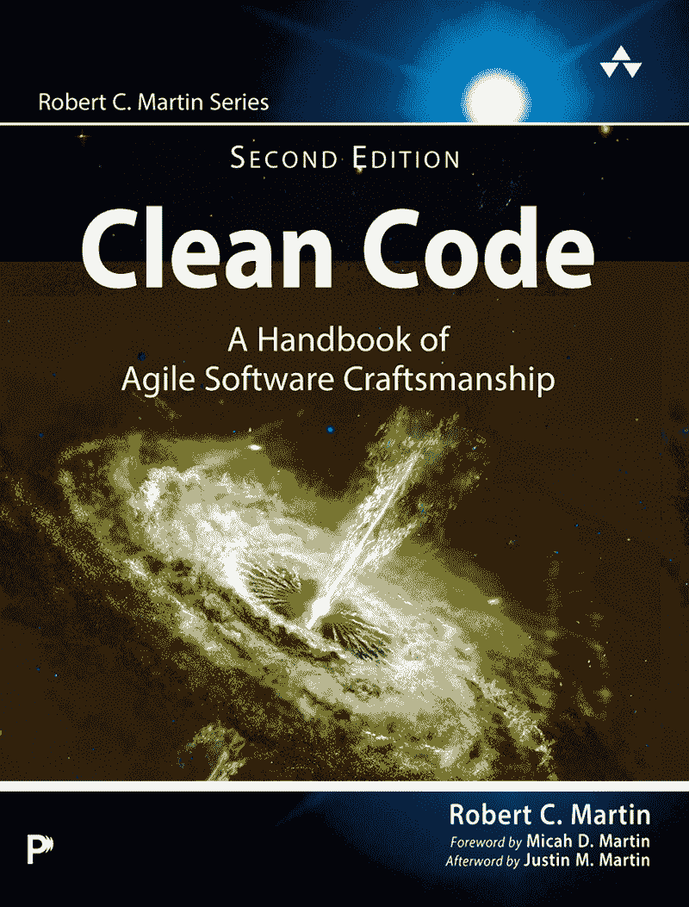


## 关于本书

ePUB 是一种开放的行业标准电子书格式。然而，阅读设备和应用程序对 ePUB 及其许多支持的支持并不相同。请使用您的设备或应用设置根据您的喜好自定义显示。您可以自定义的设置通常包括字体、字号、单栏或双栏、横屏或竖屏模式，以及可以点击或触摸以放大的图片。有关您的阅读设备或应用的设置和功能的更多信息，请访问设备制造商的网站。

许多书目包含编程代码或配置示例。为了优化这些元素的显示效果，请在单栏横屏模式下查看电子书，并将字体大小调整为最小设置。除了以重流文本格式呈现代码和配置外，我们还包含了代码图像，以模仿印刷本中的呈现效果；因此，当重流格式可能会损害代码列表的显示时，您将看到“点击此处查看代码图像”的链接。点击链接可查看高保真代码图像。要返回之前查看的页面，请点击设备或应用上的后退按钮。

## 《整洁代码》第一版的评价

“《整洁代码》从许多方面改变了我开发和维护软件的方式。它很好地定义了代码应该如何编写，我不仅从这本书中学到了许多知识，还实践了许多金辟之言。我可以诚实地说，在经历了这段旅程后，开发软件并查看你引以为豪所编写的代码再次是一件乐幸的事。”

—Steve Roberts，IT 负责人

“阅读《整洁代码》验证了我内心对软件应该如何编写的直觉，同时通过教给我我不知道的知识提高了我的工作质量。我非常感谢这本书以及该作者的其他著作，因为即使在 AI 时代，它们仍然是基础的前提。”

—Milos Baic，开发者和解决方案架构师

“《整洁代码》是我职业生涯中遇到的单一影响最大的一件事。只要我处于遵循这一原则的团队中，它就能减轻很多压力，因为代码突然变得更易理解，从而更易维护。在设计时考虑到可测试性消除了设计和维护中的许多复杂性。最重要的是，它让编程再次变得舒适和有趣。当你从糟糕的代码库转向更整洁的代码库时，这种感觉会变得更加。”

—Žarko Stojanović，首席软件工程师

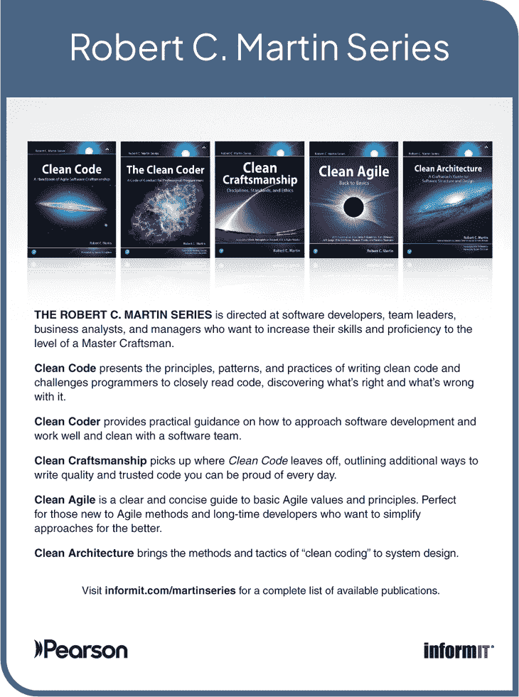


ISBN-10: 0-13-539857-6

`$PrintCode`

      item -> item.type().equals("COFFEE") && item.days() == 5);
    if (largeRoomFiveDays && coffeeFiveDays)
      bonusItems.add(new RentalItem("COOKIES", 5, 0, 0, 0));
  }
}
```

正如你看到的，所有的业务规则都被封装在了它们对应的派生类中。如果 `Coffee` 需要一个新的新的折扣，我们可以将其放在 `Coffee` 类中。如果小房间需要一个新的奖金，我们可以为它创建一个 `Bonus` 派生类。如果我们想添加 `NotePads` 或 `Projector`s，可以通过向低层组件添加这些类来实现。这些中的任何一个更改都不会导致高层组件的重新编译或部署。通过遵循 `DIP`，我们实现了这种隔离。

不过，你可能担心另一件事。也许你想知道所有这些派生类是在哪里实例化的。我并没有向你展示过我的测试，对吧？那里是完成所有工作的地方。现在它们在这里。


```
———RentalOrderTest.java———
package ubConferenceCenter;

import org.junit.jupiter.api.BeforeEach;
import org.junit.jupiter.api.Test;
import ubConferenceCenter.RentalOrder.Totals;
import ubConferenceCenter.bonuses.CookieBonus;
import ubConferenceCenter.catalogItems.Coffee;
import ubConferenceCenter.catalogItems.Cookies;
import ubConferenceCenter.catalogItems.LargeRoom;
import ubConferenceCenter.catalogItems.SmallRoom;

import static org.junit.jupiter.api.Assertions.assertEquals;

public class RentalOrderTest {
  private final SmallRoom SMALL_ROOM = new SmallRoom();
  private final LargeRoom LARGE_ROOM = new LargeRoom();
  private final Coffee COFFEE = new Coffee();
  private final Cookies COOKIES = new Cookies();
  private RentalOrder order;

  @BeforeEach
  void setUp() {
    order = new RentalOrder("Customer Name");
    order.addBonus(new CookieBonus());
  }

  private void assertTotalAndTax(int subtotal, int tax) {
    Totals totals = order.getTotals();
    assertEquals(subtotal, totals.subtotal());
    assertEquals(tax, totals.tax());
  }

  private void assertTypeDaysUnitTotalTax(RentalItem item, String type,
                                          int days, int unitPrice,
                                          int price, int tax) {
    assertEquals(type, item.type());
    assertEquals(days, item.days());
    assertEquals(unitPrice, item.unitPrice());
    assertEquals(price, item.price());
    assertEquals(tax, item.tax());
  }

  @Test
  public void oneSmallRoomForOneDay() throws Exception {
    assertEquals("Customer Name", order.getCustomerName());
    order.rent(SMALL_ROOM, 1);
    RentalItem[] receipt = order.getReceipt();
    assertEquals(1, receipt.length);
    assertTypeDaysUnitTotalTax(receipt[0], "SMALL_ROOM", 1, 100, 100, 5);
    assertTotalAndTax(100, 5);
  }

  @Test
  public void oneSmallRoomForTwoDays() throws Exception {
    order.rent(SMALL_ROOM, 2);
    RentalItem[] receipt = order.getReceipt();
    assertEquals(1, receipt.length);
    assertTypeDaysUnitTotalTax(receipt[0], "SMALL_ROOM", 2, 100, 200, 10);
    assertTotalAndTax(200, 10);
  }

  @Test
  public void oneLargeRoomForThreeDays() throws Exception {
    order.rent(LARGE_ROOM, 3);
    RentalItem[] receipt = order.getReceipt();
    assertEquals(1, receipt.length);
    assertTypeDaysUnitTotalTax(receipt[0], "LARGE_ROOM", 3, 150, 450, 23);
    assertTotalAndTax(450, 23);
  }

  @Test
  public void oneSmallRoomForOneWeek() throws Exception {
    order.rent(SMALL_ROOM, 5);
    RentalItem[] receipt = order.getReceipt();
    assertEquals(1, receipt.length);
    assertTypeDaysUnitTotalTax(receipt[0], "SMALL_ROOM", 5, 100, 450, 23);
    assertTotalAndTax(450, 23); /* 10% discount */
  }

  @Test
  public void twoSmallRoomsForOneDay() throws Exception {
    order.rent(SMALL_ROOM, 1);
    order.rent(SMALL_ROOM, 1);
    RentalItem[] receipt = order.getReceipt();
    assertEquals(2, receipt.length);
    assertTypeDaysUnitTotalTax(receipt[0], "SMALL_ROOM", 1, 100, 100, 5);
    assertTypeDaysUnitTotalTax(receipt[1], "SMALL_ROOM", 1, 100, 100, 5);
    assertTotalAndTax(200, 10);
  }

  @Test
  public void oneSmallRoomAndCoffeeForOneDay() throws Exception {
    order.rent(SMALL_ROOM, 1);
    order.rent(COFFEE, 1);
    RentalItem[] receipt = order.getReceipt();
    assertEquals(2, receipt.length);
    assertTypeDaysUnitTotalTax(receipt[0], "SMALL_ROOM", 1, 100, 100, 5);
    assertTypeDaysUnitTotalTax(receipt[1], "COFFEE", 1, 10, 10, 0);
    assertTotalAndTax(110, 5); /* No tax on coffee */
  }

  @Test
  public void oneSmallRoomAndCookiesForOneDay() throws Exception {
    order.rent(SMALL_ROOM, 1);
    order.rent(COOKIES, 1);
    RentalItem[] receipt = order.getReceipt();
    assertEquals(2, receipt.length);
    assertTypeDaysUnitTotalTax(receipt[0], "SMALL_ROOM", 1, 100, 100, 5);
    assertTypeDaysUnitTotalTax(receipt[1], "COOKIES", 1, 15, 15, 0);
    assertTotalAndTax(110, 5);
  }

  @Test
  public void oneSmallRoomAndCoffeeForDay() throws Exception {
    order.rent(SMALL_ROOM, 1);
    order.rent(COFFEE, 1);
    RentalItem[] receipt = order.getReceipt();
    assertEquals(2, receipt.length);
    assertTypeDaysUnitTotalTax(receipt[0], "SMALL_ROOM", 1, 100, 100, 5);
    assertTypeDaysUnitTotalTax(receipt[1], "COFFEE", 1, 10, 10, 0);
    assertTotalAndTax(110, 5);
  }
}
```

These tests were written before any of the refactoring had begun. At each step of that refactoring, I kept these tests passing. Some of the changes made to production code caused changes to the tests, but I was able to minimize them by keeping the tests and production code decoupled.

### Independent Deployability

Our design now has a strong architectural boundary that separates it into two components. Those components can be independently deployed. Imagine this code was written in JavaScript as opposed to Java. Imagine that it will be sent to a browser. The fact that we have divided it into two components has a very specific advantage. If one of those components changes, and if the browser maintains a cache of those components, then only the component that changed needs to be reloaded. On slow network connections, that could be a big advantage.

### A Final Thought

This major cleaning will greatly facilitate the growth of the project. The time it took will be paid back times over because there’s clear and obvious place to put the needed changes; and those changes aren’t likely to interfere with each other or the overall flow of the system.

However, the new structure is not cost free. Those who complain that it is harder to read because of all the different modules and all the indirection are not without a point. Yes, adding structure adds complexity—and that complexity is not free. There’s a cognitive price to pay. But we knew that the cognitive load was going to grow, and so our goal was to minimize that growth by creating an organization that would accept it gracefully.

What about performance? Is the new structure slower than the old one? Probably so. There are a few more references that need to be followed, and `switch` statements are easier for compilers to optimize than polymorphic dispatch. But the difference in performance is probably so tiny that you could not easily measure it. For most applications, that tiny decrease in performance would be of no concern.

 **Future Bob:**

Grok3, good as it is, did not drive the design of the original code to the level of depth we just saw. Grok3 did not invert the dependencies, nor did it attempt to separate high-level policy from low-level detail. Large language models (LLMs)/AIs have their uses; but they are not human and are not adept at understanding higher architectural goals.

This chapter, and the chapter before, were a whirlwind tour through the low-hanging fruit of clean code. But now that that tour is over, and it’s time to get down to the basics. And, of course, we begin with names.


# 有意义的名字

作者：Tim Ottinger 和 Uncle Bob


从 90 年代后期开始，我经营了一家名为 `Object Mentor Inc` 的公司。我们的网站上有许多提供给软件社区的技术文档。在所有文档中，下载量最高的是 Tim Ottinger 的命名规则。你即将读到的是 Tim 经典文档的后代和自然演变。

—Uncle Bob

名字在软件中无处不在。我们为 `variables`、`functions`、`arguments`、`classes` 和 `packages` 命名。我们为 `source files` 以及包含它们的 `directories` 命名。我们为 `jar` 文件、`dll` 文件和 `gem` 文件命名。我们命名、命名、再命名；因为我们做的这项工作如此频繁，所以最好把它做好。

名字似乎是如此主观的，以至于定义“好”的原则简直是徒劳无功。然而，尽管具有主观性，但我们依然知道什么是好餐厅、好电影、好画作和好书。

主观性被一种认知所中和：任何作品只要被它的观众接受，就是好的。这意味着我们处理的不是个人的偏好和偏见，而是集体观众的需求。

这本书的读者是这样群对改进代码技艺有足够兴趣，以至于购买、借阅或以其他方式获取这本书的程序员。如果这些文字能触达你，并对你有所帮助，那么我们就以足够好的顺序写下了足够好的文字。

作为代码的作者，你的读者是那些将在你的 `codebase` 中工作的人。你不仅是一个作者，还是 `codebase community` 的一员。读者比你多得多，他们将共同决定 `codebase` 中什么是受欢迎的，什么是不受欢迎的。

为你的读者写代码，而不是为自己写代码。你必须记住，你编写 `code` 的体验比他们阅读 `code` 的体验不重要，也更转瞬即逝。

尽管如此，我们发现许多读者之间存在着相当一致的偏好，这种通用的建议旨在帮助你与当前的软件读者群体找到那个“平衡点”。

选择好的名字需要时间，但它节省的时间远超其付出的成本。所以，请仔细对待你的名字，并在发现更好的名字时更改它们。如果你这样做了，每个阅读你代码的人（包括你自己）都会更开心。

为了帮助你完成这项工作，这里是我们发现的一些更有用的建议。

## 使用揭示意图的名字

`variable`、`function` 或 `class` 的名字应该回答所有大问题。它应该告诉读者它为什么存在、做什么的以及如何被使用。

如果一个名字需要注释来向读者传达信息，那么这个名字就没有揭示它的意图。

```
int d; // 以天为单位的时长
```

名字 `d` 暴露的信息极少。它没有唤起时间流逝的感觉；具体来说，不是“天”。我们应该选择一个指定测量内容及其测量单位的名字。其中一个可能更好：`elapsedDays`、`daysSinceCreation`、`daysSinceModification` 或 `fileAgeInDays`。

这些例子比原始名字（`d`）长，但这并不一定意味着长名字比短名字好，只说明清晰的名字比不清晰的名字好。例如：

```
int d = getElapsedTimeInDays();
```

这里的名字完全清晰的，因为它是由上下文定义的，如果包含该名字的作用范围较小，它就是合适的。（参见“使用适当长度的名字”）

### 构建一套命名系统

选择揭示意图的名字可以使理解和修改代码变得容易得多。以下是一个违反这一规则的例子。你能判断出这段代码的用途吗？

```
public List<int[]> getThem() {
  List<int[]> list1 = new ArrayList<int[]>();
  for (int[] x : theList)
    if (x[0] == 4)
      list1.add(x);
  return list1;
}
```

为什么很难看出这段代码在做什么？没有复杂的表达式。间距和缩进合理。只提到了三个变量两个常量。甚至没有花哨的类或多态方法，只有一个数组列表（看起来是如此）。

问题不在于代码的简单。问题在于代码没有提供上下文。代码隐含地要求我们知道以下问题的答案：

*   `theList` 中有什么种样的东西？
*   下标 0 代表什么？
*   值 `4` 的意义是什么？
*   我该如何使用返回的列表？

这些问题的答案并没有出现在代码示例中。然而，一套良好的命名系统本可以让它们变得清晰。

假设这段代码来自旧的*扫雷*游戏。^(1)。*扫雷*游戏棋板是一个名为 `theList` 的单元格列表。让我们将其重命名为 `gameBoard`。

1。一款随 Windows 3.11 发布的游戏。

棋板上的每个单元格都由一个原始数组表示。下标 0 是状态值的位置，状态值 4 表示“已插旗”。仅仅通过给这些概念命名，我们就能大幅改进代码：

```
public List<int[]> getFlaggedCells() {
  List<int[]> flaggedCells = new ArrayList<int[]>();
  for (int[] cell : gameBoard)
    if (STATUS_VALUE == FLAGGED)
      flaggedCells.add(cell);
  return flaggedCells;
}
```

注意代码的简单性没有改变。但清晰度得到了提高。它仍然具有相同数量的操作符和常量，具有相同的嵌套层。但通过命名，代码变得更加明确了。

同样注意，如果这是你第一次看到的代码，你就会知道这是一个带有状态的游戏，其中一种状态是“已插旗”。一套良好的命名系统可以对整个应用程序传达大量信息。

我们可以更进一步，编写一个简单的单元类而不是使用 `int` 数组。它可以包含一个揭示意图的方法（命名为 `isFlagged`）来隐藏魔法数字。它产生了一个版本的函数：

```
public List<Cell> getFlaggedCells() {
  List<Cell> flaggedCells = new ArrayList<Cell>();
  for (Cell cell : gameBoard)
    if (cell.isFlagged())
      flaggedCells.add(cell);
  return flaggedCells;
}
```

通过这些简单的命名更改，理解发生什么并不困难。这就是好名字的力量。

### 避免误导信息

程序员必须避免模糊代码含义的虚假线索。例如，除非它确实是一个 `List`，否则不要将一组账户称为 `accountList`。

*list* 这个词对程序员来说有特定的含义。如果存放账户的容器是数组或 JSON 文档，可能会导致错误的结论。^(2) 所以 `accountGroup` 或 `bunchOfAccounts` 或者直接用 `accounts` 可能更短（因此一眼了然），并且更诚实。

2。正如我们以后看到的，即使容器是 `List`，最好也不要将容器类型编码到名字中。

警惕使用细微差异的名字。要多久才能发现一个模块中的 `XYZControllerForEfficientHandlingOfStrings` 与另一个稍远处的 `XYZControllerFor EfficientStorageOfStrings` 之间的细微区别？这些单词的形状极其相似。如果它们不是紧挨在一起，你还会意识到它们不同吗？

那些名字双倍困难，因为它们很长且开头相似。你能发现下面的视觉错觉吗？

```
XYZControllerForEfficientHandlingOfStrings
XXZControllerForEfficientHandlingOfStrings
```


相似概念的相似拼写是 `information`（信息）。使用不一致的拼写则是 `disinformation`（误导信息）。在现代环境中，我们享有自动代码补全。我们写下名称的几个字符，就能迅速获得该名称可能的补全列表。不一致的拼写会混乱这个列表。

现代环境还通过对不同的语法元素使用不同的字体、样式和颜色来提供帮助。尽管如此，小心字体中固有的某些视觉错觉也是明智的。例如，在使用小写的 `L` 和大写的 `O` 时要小心。在某些字体中，它们分别与常量 `1` 和 `0` 无法区分。

```
int a = l;
if ( O == l )
  a = O1;
else
  l = 01;
```

将这些字母与数字和 `x` 结合可能会使情况更糟。考虑 `Oxll` 作为一个名称。

### 做出有意义的区分

当程序员仅仅为了满足编译器或解释器的要求而编写代码时，他们就在为自己制造问题。例如，当你想在同一个作用域内使用同一个名称来指代两个不同的事物时，你可能会受到诱惑，任意更改其中一个名称以保持它们彼此区分。有时这样做是通过拼错其中一个来实现的，导致了令人惊讶的情况：纠正拼写错误反而导致无法编译。

考虑例如，仅仅因为 `class` 名称被用于其他地方，就创建一个名为 `klass` 的变量，这种做法是非常恶劣的。

仅仅添加数字序列或噪声词是不够的，即使编译器满足了。如果名称必须不同，那么它们也应该具有不同的含义。

数字序列命名（`a1`, `a2`, …`aN`）与意图命名是反反的。这种名称不是误导性的，而是没有信息的；它们没有提供关于作者意图的线索。考虑：

```
public static void copyChars(char a1[], char a2[]) {
  for (int i = 0; i < a1.length; i++) {
    a2[i] = a1[i];
  }
}
```

当使用 `source` 和 `destination` 作为参数名时，这个函数的读性要好得多。

通常，当你看到命名为 `X1`、`X2`、`X3` 的变量时，代码实际上在恳求你使用数组或数据结构。考虑是什么让它们如此相似，以至于名称相同且仅有数字差异，并寻找某些可以激发不同名称或完全不同结构的含义。

在上面的代码中，这仅仅是懒惰命名。将这些名称更改为 `source` 和 `destination` 比尝试创建一个结构、类或容器是更好的解决方案。并不是所有问题都是深层次的。

噪声词是另一种无意义的区分。假设你有一个 `Product` 类。如果你有另一个名为 `ProductInfo` 或 `ProductData` 的类，你就让名称变得不同，但没有让它们具有任何不同的含义。`Info` 和 `Data` 是模糊的噪声词。它们没有添加任何新信息，因为每个类都包含“data”，每个类都包含“info”。

噪声词是冗余的。`variable` 这个词永远不应该出现在变量名中。`table` 这个词永远不应该出现在表名中。`NameString` 比 `Name` 好在哪里？`Name` 会是一个浮点数吗？如果是，它可能违反了之前一个关于误导信息的规则。想象发现一个类名为 `Customer`，另一个类名为 `CustomerObject`。你应该如何理解这种区别？哪一个代表通往客户支付历史的最佳路径？

这里是我们在一个特定应用程序中发现的一些令人不安的无意义的函数名。

```
getActiveAccount();
getActiveAccounts();
getActiveAccountInfo();
```

这个项目的程序员如何知道调用这些函数中的哪一个？有多少个活跃账户？其中哪一个是第一个函数返回的？第二个和第三个函数之间有什么区别？在任何宇宙中，这种名称“系统”都是噩梦。

### 使用可读的名称

人类擅长单词。我们大脑的大部分区域致力于单词的概念。而根据定义，单词是可以发音的。有一个公司的名称是 `genymdhms`（生成日期、年、月、日、时、分、秒），所以他们走动时会说“gen why emm dee aich emm ess”。这很不方便，于是发音逐渐演变为“gen-yah-mudda-hims”。这听起来可能很蠢，但他们都在参与这个玩笑，所以这很有趣。无论逗不有趣，他们都在忍受糟糕的命名。新开发者必须听别人解释变量，然后他们用愚蠢的、造出来的词来讨论，而不是使用标准的英语术语。

对比：

```
class DtaRcrd102 {
  private Date genymdhms;
  private Date modymdhms;
  private final String pszqint = "102";
```

相比于：

```
class Customer {
  private Date generated;
  private Date modified;
  private final String recordId = "102";
```

现在可以进行智能的对话了：“嘿，Mikey，看看这条记录！生成时间戳被设置为明天的日期！这怎么可能？”

### 使用可搜索的名称

单字母名称和数字常量有一个特殊问题，它们在正文中难以定位。你可以很容易地搜索 `MAX_CLASSES_STUDENT`，但数字 `7` 可能会更麻烦。搜索可能会搜到文件名的一部分、常量定义以及各种意图不同的表达式中。当常量是一个长数字时情况更糟，有人可能颠倒数字，从而避开程序员的搜索。

同样，`e` 不是一个可搜索的名称。它是英语语言中最常见的字母，可能出现在文本的每个地方。通常情况下，短名称的可搜索性不如长名称，这又是一个理由说明在可搜索性方面，长名称可以胜过短名称，而任何可搜索名称都能胜过代码中的常量。

`e` 常用于表示 `try/catch` 块中抛出的特定错误，特别是在 Python 和 Go 中。在这种情况下，名称在上下文中是熟悉的，而且它出现的作用范围小到使得不需要搜索。我们的倾向是，极短的或单字母的名称应该只用于非常小的作用范围内的局部变量。如果变量或常量可以在代码体的多个处可见或使用，最好给它一个易于搜索的名称。再次对比：

```
for (int j=0; j<34; j++) {
   s += (t[j]*4)/5;
}
```

与

```
int realDaysPerIdealDay = 4;
const int WORK_DAYS_PER_WEEK = 5;
int sum = 0;
for (int j=0; j < NUMBER_OF_TASKS; j++) {
   int realTaskDays = taskEstimate[j] * realDaysPerIdealDay;
   int realTaskWeeks = (realTaskDays / WORK_DAYS_PER_WEEK);
   sum += realTaskWeeks;
}
```

注意，上面的 `sum` 虽然不是特别有用的名称，但至少是可搜索的。意图命名的代码使得函数更长，但考虑一下寻找 `WORK_DAYS_PER_WEEK` 比寻找所有使用 `5` 的地方并过滤出只符合意图的实例要容易得多。

#### 使用长度适当的名称

我们关于名称长度的规则可能会让你感到惊讶，但它们已经经受了时间的考验。


我们对变量命名有一个简单的规则：变量名的长度应该与包含它的作用域长度成正比。例如：

```
for (int n=0; n<20; n++)
  System.out.println("" + n + " " + n*n);
```

变量 `n` 的名字很短，因为它的作用域只有两行。如果这个变量被命名为 `theNumberToBeSquared`，我们会觉得很烦。

相反，在较长的作用域中，如此短的名字会变得晦涩。我们通常会觉得命名为 `n` 的实例变量很烦，尤其是当 `m`、`p`、`i` 和 `j` 都是实例变量时。

随着作用域范围增大，该作用域内变量名的长度也应该增加。参数和局部变量的作用限于单个函数，因此应该有较短的名字；也许是一个或两个单词。实例变量的作用域是整个类，它们的名字应该相对长一些。全局变量名应该更长。

## 函数名

我们对函数的规则完全相反。函数名的长度应该与其作用域长度成反比。因此，全局函数将拥有短名字，而类中的私有方法将拥有较长的名字。测试的作用域最短（实际上为零），因此它们的名字也是最长的。

我们从两个方面证明这一的合理性。首先，函数的作用域越大，被使用的频率就越高。因此为了方便起见，我们希望名字越短。如果打开文件的函数命名为 `openFileAndThrowExceptionIfNotFound` 而不是 `open`，我们会觉得非常烦。

其次，函数的作用域越大，它的通用性越高。同样，`open` 是一个非常通用的函数。类方法的上下文窄得多，因此可能需要更多的单词来解释其意图。类中的私有方法作用域很小，且只被少数几个（甚至只有一个）地方调用。它们一点都不通用，因此可能需要很多单词才能准确描述。它们的名字应该相应地更长。

### 类名

我们对类的规则与函数的规则相同。作用域越长，名字越短。全局作用域下的类应该有较短的名字（一个或两个单词），而派生类、内部类和私有类应该有更长的名字。

## 属性和字段

某些语言（如 C++ 和 C#）具有看起来像变量但实际上是函数的元素。它们看起来像变量是因为它们可以放在赋值语句的左侧。因此，它们应该遵循变量命名规则。它们名字的长度应该与包含它们的作用域成正比。

## 命名空间

大多数语言现在允许我们把类、函数和变量放入命名空间中。命名空间的名字应该是具有描述性的。因此，它们可能很长，并且通常是命名空间层级的一部分。例如，考虑 Uncle Bob 几年前写的一个星战游戏中的命名空间：`spacewar.ui.tactical-scan`。这种长且全限定的名字通常是不方便的，这就是为什么大多数具有命名空间的语言都提供某种方式创建命名空间别名，以便在较小的作用域中使用。

因此，虽然命名空间长度不取决于包含它的作用域，但其别名的长度却取决于。在一个非常短的模块中，我们可能会使用别名 `ts`；而在较长的模块中，我们可能会使用 `tac-scan`；在很长的模块中（这本应该是罕见的），我们可能会使用 `tactical-scan`。

## 避免编码

我们有足够的编码来处理问题，不需要再增加负担。在名字中编码类型或作用域信息只会增加额外的解码负担。要求每位新员工在学习他们将编写的（通常是相当大量的）代码库之外，还要学习另一种编码“语言”，这似乎并不合理。此外，编码后的名字很难发音，而且容易拼错。

在过去，当我们在对名称长度有限制的语言中工作时，我们出于无奈且遗憾地违反了这一规则。Fortran 通过将首字母设为类型代码来强制编码。早期的 BASIC 只允许一个字母加一个数字。匈牙利命名（HN）将此推向全新的高度。

在 Windows C API 时代，匈牙利命名被认为是非常重要的，当时的一切都是整数句柄、长指针、空指针，或者“字符串”的几种实现之一（具有不同的用途和属性）。那时的 C 编译器并不检查类型，所以程序员需要一个“拐杖”来帮助记住类型。

在现代语言中，我们拥有更丰富的类型系统，编译器会记住并强制执行类型。此外，还存在一种向小类和短函数的趋势，这样人们通常可以看到他们正在使用的每个变量声明的意义。

如今的程序员从编译器和 IDE 中获得了足够的帮助，他们通常不需要在变量名中编码类型。因此，现在匈牙利命名和其他形式的类型编码仅仅是阻碍。它们让更改变量、函数或类的名称或类型变得困难，让代码变得难以阅读。

## 成员前缀

在成员变量前加上类似 `m_` 的前缀是另一种不再必要的编码形式。你的类和函数应该足够小，让你不需要这样的拐杖。你应该使用能够高亮或彩色成员的编辑环境来使它们区分。

```
public class Part {
  private String m_dsc; // 文本描述
  void setName(String name) {
    m_dsc = name;
  }
}
```
_________________________________

```
public class Part {
  String description;
  void setDescription(String description) {
    this.description = description;
  }
}
```

## 接口与实现

我们不建议给接口前缀 `I`，因为那只是另一种编码。例如，假设你正在构建一个创建 `Shape` 的抽象工厂。这个工厂将是一个接口，并由具体类实现。我们应该如何命名这些类？`IShapeFactory` 和 `ShapeFactory`？我们倾向于让接口不加标记。前面的 `I` 在最好的情况下是干扰，在最坏的情况下是信息过多。毕竟，接口的意义就在于用户不需要知道它是一个接口。我们只想让他们知道它是 `ShapeFactory`。所以，如果我们必须对接口或实现进行编码，我们倾向于为实现添加后缀；例如 `ShapeFactoryImp`。

## 使用适当的词性

我们代码中的某些元素最好用名词表示，而另一些则用动词表示。

### 类名

类和对象通常应该具有名词或名词短语，如 `Customer`、`WikiPage`、`Account` 和 `AddressParser`。通常名词应该是单数而不是复数。代表客户的类应该命名为 `Customer` 而不是 `Customers`。相反，包含许多 `Customer` 实例的类可能*应该*被称为 `Customers`。


### 方法命名

方法通常应该使用动词或动词短语命名，例如 `postPayment`、`deletePage` 或 `save`。

根据你所使用的语言，访问器（accessors）、修改器（mutators）和谓词（predicates）应该根据本地约定命名。在 `Java` 中，它们根据其值命名，并根据 `JavaBeans` 标准以 `get`、`set` 和 `is` 为前缀[7]。

[7] URL

某些语言中存在一种事实上的约定，即根据返回值命名函数，即使用名词。例如，返回客户名的函数可以称为 `name`。我们并不喜欢这种约定，但在与使用该约定的团队合作时我们会遵循它。

在大多数情况下，修改器最好根据它引起的更改来命名，例如 `add`、`remove`、`sort` 等。这些名称通常是动词，因此标准的建议是“使用动词名称来命名方法”。

```
string name = employee.getName();
customer.setName("mike");
if (paycheck.isPosted())…
```

`C++`、`Java` 和 `C#` 的构造函数使用类名。这意味着你无法给构造函数一个有意义的名称。当此类构造函数被重载时，最好使用描述参数命名的静态工厂方法。例如：

```
Complex fulcrumPoint = Complex.FromRealNumber(23.0);
```

通常比

```
Complex fulcrumPoint = new Complex(23.0);
```

更好。

通过将相应的构造函数设为私有来强制使用这些方法。

#### 考虑关键字参数

如果你的语言允许关键字参数或哈希映射参数（如 `Python`、`C#`、`Ruby` 和 `Clojure`），你可能会发现限制函数的位置参数并使用显式的关键字参数来处理大多数变化是最好的。

```
def sort(iterable, *, key=None, reverse=False ) :
  … # 主体省略
pets_sorted = sort(pets)
pets_reversed = sort(pets, reverse=True)
pets_by_age = sort(pets, key=lambda x: x.birthdate() )
```

#### 不要耍小聪明

如果名字太“聪明”，它们只有对与作者相同幽默感的人才能记住，而且只能在这些人还记得那个笑话时被记住。他们知道命名为 `HolyHandGrenade` 的函数是做什么的吗？虽然很可爱，但在这种情况下 `DeleteItems` 可能是个更好的名字。选择清晰性而非娱乐性。

代码中的可爱元素通常以口语或俚语的形式出现。例如，不要使用 `whack()` 来表示 `kill()`。不要说这种依赖文化的小笑话，如 `eatMyShorts()` 来表示 `abort()`。

言出有意，行如行。

#### 每个概念选择一个单词

为每个概念选择一个单词，并坚持使用它。例如，不要在一个模块中使用 `amount`，在另一个模块中使用 `fee`，在第三个模块中使用 `price`，而在另一个模块中使用 `cost`。为每个概念选择一个名称并在整个范围内使用该名称。确保团队中的每个人都认识这些名称。

我们经常会对系统中的名称进行一致性审计。这是一项小任务，而且 IDE 通常会提供“大纲视图”或“对象视图”选项，或者“折叠/收起所有函数”，这样你就可以无需滚动即可查看方法和变量名。我们强烈建议统一给定类、模块或测试套件中的所有名称。毫无疑问，你会发现这让你很有成就感。

一致的词汇表（通用语言[8]）对于必须使用你代码的程序员来说是一个巨大的助力。

[8] DDD

#### 使用解决方案领域名称

记住，阅读你代码的人是程序员。他们熟悉解决方案领域的术语。

当你处于领域层之下进入纯实现层时，尽管使用计算机科学（CS）术语、算法名称、模式名称、数学术语等。从问题领域中提取每一个名称是不明智的，因为我们不希望同事们在已经通过其他名称知道概念的情况下，还要来回跑去询问客户每个名称的意思。

`AccountVisitor` 这个名称对于熟悉 `Visitor` 模式[9] 的程序员来说意义重大。哪个程序员会不知道 `JobQueue` 或 `FIFO` 是什么？

[9] GOF95

程序员必须做很多非常技术性的工作。为技术性工作选择技术性名称通常是最合适的方法。

程序通常用编程语言来描述最好。你不需要让一切看起来都像英语散文或数学公式。请使用最适合算法和观众的抽象级别。

#### 使用问题领域名称

使用来自问题领域的名称。它们很可能是熟悉的，并有助于为团队中的开发者建立语境。如果不熟悉，至少维护你代码的程序员可以询问领域专家它的含义。

将解决方案和问题领域概念分离是优秀程序员和设计师的工作的一部分。我们不会将解决方案名称强加于问题，也不会将问题名称强加于解决方案。

#### 添加有意义的上下文

少数名称本身是有意义的——大多数不是。相反，你需要通过将名称封装在命名良好的类、函数或命名空间中，为读者提供上下文。

假设你有变量 `firstName`、`lastName`、`street`、`houseNumber`、`city`、`state` 和 `postcode`。合在一起，它们显然构成了一个地址。但如果你在方法中单独看到 `state` 呢？你会自动推断它是地址的一部分，还是推断你处于一个跟踪机器当前状态的状态中？

你可以通过创建一个名为 `Address` 的类或数据结构来消除这种歧义。这样即使编译器知道这些变量属于一个更大的概念。

程序员有时陷入“原始类型痴迷”[10]的代码味中，长时间避免创建类、结构体和模块。例如，处理 `GlobalLocations` 远比处理以小时、分、秒为单位 `latitude` 和 `longitude` 原始变量要好得多。处理两个“位置”比处理十二个命名相似的浮点整数要容易得多。

[10] 重构

作为另一个例子，考虑以下 Python 代码。这些变量需要更有意义的上下文吗？函数名只提供了部分上下文；算法提供了其余部分。

```
private void printGuessStatistics(char candidate, int count) {
    String number;
    String verb;
    String pluralModifier;
    if (count == 0) {
      number = "no";
      verb = "are";
      pluralModifier = "s";
    } else if (count == 1) {
      number = "1";
      verb = "is";
      pluralModifier = "";
    } else {
      number = Integer.toString(count);
      verb = "are";
      pluralModifier = "s";
    }
    String guessMessage = String.format(
      "There %s %s %s%s", verb, number, candidate, pluralModifier
    );
    print(guessMessage);
  }
```

一旦读完整个函数，你就会看到三个变量——`number`、`verb` 和 `pluralModifier` 是“猜测统计”消息的一部分。不幸的是，上下文必须通过推断获得。当你第一次看该方法时，变量的含义是模糊的。


该函数有点长，而且变量在处处被使用。为了将该函数拆分为更小的部分，我们需要创建一个 `GuessStatisticsMessage` 类，并将三个变量变为该类的字段。这为这三个变量提供了清晰的上下文。它们明确是 `GuessStatisticsMessage` 的一部分。上下文的改进还允许我们通过将算法拆分为许多较小的函数使其变得更加整洁。

```
public class GuessStatisticsMessage {
  private String number;
  private String verb;
  private String pluralModifier;
  public String make(char candidate, int count) {
    createPluralDependentMessageParts(count);
    return String.format(
      "There %s %s %s%s",
       verb, number, candidate, pluralModifier );
  }
  private void createPluralDependentMessageParts(int count) {
    if (count == 0) {
      thereAreNoLetters();
    } else if (count == 1) {
      thereIsOneLetter();
    } else {
      thereAreManyLetters(count);
    }
  }
  private void thereAreManyLetters(int count) {
    number = Integer.toString(count);
    verb = "are";
    pluralModifier = "s";
  }
  private void thereIsOneLetter() {
    number = "1";
    verb = "is";
    pluralModifier = "";
  }
  private void thereAreNoLetters() {
    number = "no";
    verb = "are";
    pluralModifier = "s";
  }
}
```

## 不要添加多余的上下文

在一个名为 `Gas Station Deluxe` 的虚拟应用中，在每个类名前加上 `GSD` 前缀是一个坏主意。坦率地说，你是在违背你的工具而工作。你输入 `G` 并按下补全键，结果得到一个列出系统中所有类的长列表。这样做明智吗？为什么要让 IDE 帮助你变得那么困难呢？

同样，假设你在 `GSD` 的 `accounting` 模块中发明了一个 `MailingAddress` 类，并将其命名为 `GSDAccountAddress`。后来，你需要为客户联系应用一个邮寄地址。你会使用 `GSDAccountAddress` 吗？它听起来像正确的名字吗？17 个字符中的 10 个是多余或无关的。

`accountAddress` 和 `customerAddress` 是 `Address` 类实例的良好名称，但对于类来说，可能是糟糕的。`Address` 是一个类的很好的名字。如果我们需要区分 MAC 地址、端口地址和 Web 地址，我们可能会考虑 `PostalAddress`、`MAC` 和 `URI`。生成的名称更精确，这正是所有命名的意义所在。

## 结语

选择好名字最困难的的一点在于，它需要良好的描述能力和共同的文化背景。它不是一种自娱自乐的、通用的、学一次就能自动驾驶运行的技能。

每当我们更改代码库时，我们都必须重新开始这个过程。我们现在的受众是谁？在这个领域中，什么是“众所周知”的？这里什么是熟悉的，什么又是看起来“奇怪”或“外来”的？

这里存在某种程度的主观性，因为你是为读者而写代码。你个人喜爱的可能不是他们所需要和理解的。因此，许多程序员并没有很好地学会这一点。这需要与你的用户群体接触，就像任何良好的软件开发都需要与真实用户接触一样。

由于很难做对（即使有这些精良的指南），我们经常不得不对我们的软件名称进行迭代。有时其他开发者会惊讶，发现我们在命名上写了这么多次、这么多字之后，竟然经常会故意用一个坏的名字临时命名一个变量，直到想出一个更好的名字为止。

我们会重命名。正如 Josh Kerievsky 提醒我们的那样，*所有良好的写作都是基于修订的*。

人们可能会推迟重命名，因为担心其他开发者会反对。我们并不有这种恐惧，并发现当名称改变（变得更好）时，我们实际上非常感激。

大多数时候，我们并不背诵类和方法的名称并要求它们保持不变。记忆是浪费我们的时间。我们使用现代工具来处理这类细节。我们更关注代码读起来像段落和句子，或者至少像方程、表格和数据结构。

你可能会因为名称更改让某人惊讶，就像你进行任何其他代码改进一样。不要让它停下脚步。

尝试这些指南，看看它们是否对你的情况有所帮助。

到目前为止，它们似乎在大多数时候对大多数都有帮助。我们相信你也会在这里找到帮助。

## 5

# 注释


*“不要注释糟糕的代码——要重写它。”*

—Brian W. Kernighan and P. J. Plaugher

1. [KP78], p. 144.

*“注释是代码中令人分心的脚注。”*

—Jeff Langr

没有什么比恰当其位置的注释更有帮助的了。没有什么比轻率、教条式的注释更能让模块变得混乱。没有什么比一个传播谎言和虚假信息的陈旧糟糕注释更具破坏性了。

### 为失败提供补偿

注释充其说，是一种必要的恶。如果我们的编程语言足够具有表现力，或者你我有表达自己的才华，我们就不需要注释——也许完全不需要。

正确使用注释是为了弥补我们的失败。请注意，我使用了“失败”这个词。


首先，它们经常在撒谎。这些谎言并非刻意，但也并不罕见。注释越老旧、距离它所描述的代码越远，它就越可能纯粹是错误的。原因很简单：程序员在现实中无法维护它们。

代码经常发生变化和演变。代码块会从这里移动到那里。这些块会分叉、复制，并重新组合形成杂交体和奇合体。不幸的是，注释并不能、也无法始终跟随它们。很多时候，注释会与它们描述的代码分离，变成孤立且准确性不断下降的碎片短文字。例如，看看这段注释以及它旨在描述的那行代码发生了什么：

```
MockRequest request;
private final String HTTP_DATE_REGEXP =
  "[SMTWF][a-z]{2}\\,\\s[0-9]{2}\\s[JFMASOND][a-z]{2}\\s"+
  "[0-9]{4}\\s[0-9]{2}\\:[0-9]{2}\\:[0-9]{2}\\sGMT";
private Response response;
private FitNesseContext context;
private FileResponder responder;
private Locale saveLocale;
// Example: "Tue, 02 Apr 2003 22:18:49 GMT"
```

其他可能后来添加的实例变量被穿插在了 `HTTP_DATE_REGEXP` 常数及其解释性注释之间。

你可能会抱怨，程序员应该足够自律，保持注释处于高度的维护状态、相关性和准确性。然而，我宁愿将这种自律和精力投入到让代码变得清晰且富有 way，以至于根本不需要注释。

不准确的注释比完全没有注释糟糕得多。它们会误导和欺骗人。它们设定了永远无法实现的预期。它们制定了不再需要或不应该再遵循的旧规则。

真理只在一个地方是确定的：代码。只有代码可以被信任告诉你它做了什么。它是准确信息最可靠的来源。因此，尽管注释有时是必要的，我们仍应该投入大量精力来减少它们。

## 过于亲密的注释

注释的一个大问题是，它们通常是由对代码有深入理解的程序员编写的，因此是从这种亲密关系的视角编写的。不幸的是，注释的目标读者并不具备这种亲密感，因此没有背景来理解这些注释。

在我身上发生过不止一次：在理解了作者的代码之前，我无法理解作者提供的某条非常有帮助的注释。注释中的文字对我来说完全不通，也没有对我提供任何帮助。一旦我读完代码并理解了它，注释的意图就变得清晰了——但在那之前不是。

## 注释无法弥补糟糕的代码

编写注释的较常见动机之一是糟糕的代码。我们写了一个模块，知道它很混乱、无组织。我们知道它是一团糟糟。于是我们对自己说：“噢，我最好给它加点注释！”

不！你最好去*清理*它！

清晰且富有表现力且注释少的代码，远优于带有大量注释的混乱复杂代码。与其花时间写注释来解释你制造的糟事，不如花时间去清理那团糟事。

## 在代码中解释你的意图

确实，某些时候代码是解释的糟糕工具。不幸的是，许多程序员认为这意味着代码很少（如果有的话）是解释的良好手段。这显然是错误的。你更倾向于看到哪一个：

```
// 检查员工是否符合全额福利条件
if ((employee.flags & HOURLY_FLAG) && (employee.age > 65))
```

还是这个？

```
if (employee.isEligibleForFullBenefits())
```

只需几秒钟思考就能在代码中解释你的大部分意图。在许多情况下，这仅仅是创建一个函数，其表达的内容与你想写的注释相同。

## 好的注释

有些注释是必要的或有益的。以下是几个值得其所占字节的注释——或者至少不值得删除的注释。

### 法律注释

有时，我们公司的编码标准迫使我们出于法律原因编写某些注释。例如，版权和作者声明在每个源文件的开头处放在注释中是必要且合理的。

例如，这是我们放在 FitNesse 中每个源文件开头的标准注释头。我很高兴地说，我们的 IDE 通过自动折叠，防止了该注释成为干扰信息。

```
// Copyright (C) 2003-2005 by Object Mentor, Inc. All rights reserved.
// Released under the GNU General Public License version 2 or later.
```

此类注释不应该是合同或法律巨著。在可能的情况下，引用标准许可或其他外部文档，而不是将所有条款和条件放入注释中。

### 信息性注释

有时，通过注释提供基本信息是有用的。例如，考虑这段解释了抽象方法返回值的注释：

```
// 返回正在被测试的 Responder 实例。
protected abstract Responder responderInstance();
```

为什么作者诉诸注释，而不是给方法起一个更好的名字，如 `responderBeingTested`？以及为什么我会允许这条注释而不是更改方法名？那是因为作者正在使用著名的单例^(2) 设计模式。当你使用那的设计模式时，你应该遵循该模式的标准形式。在单例模式中，访问器函数的名称以单词 `Instance` 结尾。因此作者决定依赖注释，而不是放弃模式的标准形式。

2。[GOF95] p.127。

这里另一个注释增加了有用信息的例子：

```
// 匹配格式为 kk:mm:ss EEE, MMM dd, yyy
Pattern timeMatcher = Pattern.compile(
   "\\d*:\\d*:\\d* \\w*, \\w* \\d*");
```

我不会删除这条注释，因为正则表达式总是难以理解的噩梦。这个也不例外，作者给我们一个提示，让我们知道正则表达式旨在匹配时间戳。任何 Java 程序员都能从 `SimpleDataFormat` 类轻松推断出这一点。

然而，注释是谎言——至少具有很大的误导性。那是因为正则表达式还会匹配以下字符串：`:: , "`。那绝对不是时间戳。所以我会修复正则表达式并保留注释。

### 意图说明

有时，注释不仅仅是提供关于实现的有用信息，还提供了决策背后的意图。在下面的例子中，我们看到了由注释记录的一个有趣决策。在比较两个对象时，作者决定他想要包含类的对象的排序高于任何其他类型的对象。

```
public int compareTo(Object o)
{
  if(o instanceof WikiPagePath)
  {
    WikiPagePath p = (WikiPagePath) o;
    String compressedName = StringUtil.join(names, "");
    String compressedArgumentName = StringUtil.join(p.names, "");
    return compressedName.compareTo(compressedArgumentName);
  }
  return 1; // 我们更大，因为我们是正确的类型。
}
```

这是一个更好的例子。你可能不同意程序员对问题的解决方案，但至少你知道他想做什么。


```java
public void testConcurrentAddWidgets() throws Exception {
  WidgetBuilder widgetBuilder = …

    // 这是我们为了产生竞态条件的最佳尝试
    // 通过创建大量线程。
    for (int i = 0; i < 25000; i++) {
      WidgetBuilderThread widgetBuilderThread =
        new WidgetBuilderThread(widgetBuilder, text, parent, failFlag);
      Thread thread = new Thread(widgetBuilderThread);
      thread.start();
    }
    assertEquals(false, failFlag.get());
  }
```

在代码审查时，我不会删除那条注释。不过，我我很想通过将那个 `for` 循环提取到一个命名为 `attemptRaceCondition` 的函数中删掉它。

 **未来的鲍勃：**

顺便提一下，这种强制产生竞态条件的方法非常糟糕。当你启动大量线程并希望它们发生竞争时，它们实际上会排成单列队执行，而不会发生竞争。如果你想强制产生竞态条件，你必须使用信号量来设置竞争，要么引入随机延迟，并希望线程能够相互交错并意外地进入竞争配置。

### 澄清

有时候，将某些晦涩参数或返回值的含义翻译成可读的内容是有帮助的。总的来说，最好找到一种方法让该参数或返回值本身变得清晰；但当它是标准库的一部分，或者是在你无法修改的代码中时，一个有帮助的澄清性注释是有用的。

我写了以下注释，作为 FitNesse 中一个功能的一部分。我担心长长的 `assertTrue` 语句列表会让读者的眼睛看花眼。这种视觉障碍和幻觉在代码中特别常见。因此，我添加了注释以示礼貌。

```java
public void testCompareTo() throws Exception
{
  WikiPagePath a = PathParser.parse("PageA");
  WikiPagePath ab = PathParser.parse("PageA.PageB");
  WikiPagePath b = PathParser.parse("PageB");
  WikiPagePath aa = PathParser.parse("PageA.PageA");
  WikiPagePath bb = PathParser.parse("PageB.PageB");
  WikiPagePath ba = PathParser.parse("PageB.PageA");

  assertTrue(a.compareTo(a) == 0);    // a == a
  assertTrue(a.compareTo(b) != 0);    // a != b
  assertTrue(ab.compareTo(ab) == 0);  // ab == ab
  assertTrue(a.compareTo(b) == -1);   // a < b
  assertTrue(aa.compareTo(ab) == -1); // aa < ab
  assertTrue(ba.compareTo(bb) == -1); // ba < bb
  assertTrue(b.compareTo(a) == 1);    // b < a
  assertTrue(ab.compareTo(aa) == 1);  // ab > aa
  assertTrue(bb.compareTo(ba) == 1);  // bb > ba
}
```

然而，澄清性注释存在存在错误的巨大风险。事实上，上述代码中的其中一条注释是错误的。回顾上一个例子，看看你是否能找到它；并注意验证这些注释有多么困难。这种困难性解释了为什么澄清是必要的，也解释了为什么它也是有风险的。

### 后果警告

有时，警告其他程序员某些后果是有用的。例如，这里有一条注释解释了为什么某个特定的测试用例被关闭：

```java
// 除非你有空打发，否则不要运行。
public void _testWithReallyBigFile()
{
  writeLinesToFile(10000000);

  response.setBody(testFile);
  response.readyToSend(this);
  String responseString = output.toString();
  assertSubString("Content-Length: 1000000000", responseString);
  assertTrue(bytesSent > 1000000000);
}
```

当然，现在我们会通过使用 `@Ignore` 属性配合适当的说明字符串来关闭该测试用例：`@Ignore("运行时间太长")`。但在 JUnit 4 之前的时代，在方法名前加一个下划线是一种常见的约定。这条注释虽然很轻率，但很好地传达了观点。

这是另一个更发扎心的例子：

```java
public static SimpleDateFormat makeStandardHttpDateFormat()
{
  // SimpleDateFormat 不是线程安全的
  // 所以我们需要独立地创建每个实例。
  SimpleDateFormat df = new SimpleDateFormat("EEE, dd MMM
  yyyy HH:mm:ss z");
  df.setTimeZone(TimeZone.getTimeZone("GMT"));
  return df;
}
```

你可能会抱怨有更好的方法来解决这个问题。我可能同意你的观点。但这里给出的注释完全合理。它将防止某些过度热切的程序员为了效率之名使用静态初始化器。

你不禁想，在互联网的语言中，在一个本质上是异步的环境里，这个函数竟然被允许保持线程不安全如此几十年。

### 放大

注释可以用来放大某些其他看似无关紧要的事情的重要性。

下面对 `trim()` 的调用就是这很好的例子。`trim` 函数被调用得如此频繁且随意，以至于很容易被忽略。注释明确说明了你不应该忽略这一点。

```java
String listItemContent = match.group(3).trim();
// trim 非常重要。
new ListItemWidget(this, listItemContent);
return match.end());
```

### 公共 API 中的 Javadocs（及此类）

如今，大多数语言系统都有某种从文件中抓取特殊注释的机制。在 Java 中，这些被称为 *Javadocs*。没有什么比描述良好的公共 API 更令人受用和满足了。标准库的 Javadocs 就是例子。

如果你正在编写公共 API，那么你应该编写良好的注释。

### 糟糕的注释

糟糕的注释通常是拐杖，无非程序员的自言自语。当我看到此别的注释时，我会删除它们。以下是一些例子。

#### 胡言乱语

仅仅因为你觉得应该，或者因为流程要求就塞一条注释，这是一种权宜之计。如果你决定写注释，请花需要的时间确保它是你能写的最好的注释。

例如，这里我在 FitNesse 中发现的一个案例。在我看来，作者很匆忙，或者不太在意。他的胡言乱语留下了一个谜团：

```java
public void loadProperties()
{
  try
  {
   String propertiesPath = propertiesLocation + "/" + PROPERTIES_FILE;
   FileInputStream propertiesStream =
                   new FileInputStream(propertiesPath);
   loadedProperties.load(propertiesStream);
  }
  catch(IOException e)
  {
    // 没有属性文件意味着所有默认值已加载
  }
}
```


我们唯一的办法是检查 `other parts of the system` 中的代码，以找出这里发生了什么。任何迫使你查看另一个模块才能理解其含义的注释都未能向你传达信息，而且不值它消耗的比特空间。

如果程序员写成下面这样不是更好吗？

```java
catch(IOException e)
{
  LoadedProperties.loadDefaults();
}
```

## 冗余注释

下面的代码显示了一个简单的函数，带有一个头部注释，但它没有告诉我们任何代码本身没有提供的信息。阅读这个注释的时间可能比阅读代码本身还要。

```java
// 工具方法，当 this.closed 为 true 时返回。
// 如果超时，则抛出异常。
public synchronized void
waitForClose(long timeoutMillis) throws Exception
{
   if(!closed)
   {
      wait(timeoutMillis);
      if(!closed)
        throw new Exception("MockResponseSender could not be closed");
   }
}
```

这个注释有什么用呢？它显然没有代码更具信息量。它没有为代码提供理由，也没有提供意图或原理。它并不比代码更容易阅读。事实上，它比代码不精确，并诱导读者接受这种不精确性，而不是真正的理解。这就像一个笑里横秋的二手车销售员，向你保证你不需要检查引擎盖。

## 误导性注释

有时，尽管初衷良好，程序员在注释中做出的陈述可能会导致误解。让我们再次考虑一下我们在上一个例子中看到的那种糟糕冗余但带有微妙误导性的注释。

你发现这个注释是如何误导的了吗？该方法返回的并不是 `this.closed` 变为 `true` **时候**。它返回的是 `this.closed` 是否为 `true`；否则，它会等待盲目的超时，然后如果 `this.closed` 仍然不为 `true` 则抛出异常。

这种微妙的误导信息被包裹在一个比代码主体更难读的注释中，可能会导致另一个程序员乐观地调用这个函数，期望它会在 `this.closed` 变为 `true` 时立即返回。那个可怜的程序员将发现自己陷入了调试，试图弄清楚为什么他们的代码执行得如此缓慢。

## 冗余与不精确

现在考虑这段很久以前从 Tomcat 截取的代码中大量无用且冗余的 Javadoc。

```java
public abstract class ContainerBase
  implements Container, Lifecycle, Pipeline,
  MBeanRegistration, Serializable {

  /**
   * 此组件的处理器延迟。
   */
  protected int backgroundProcessorDelay = -1;

  /**
   * 此组件的生命周期支持。
   */
  protected LifecycleSupport lifecycle =
    new LifecycleSupport(this);

  /**
   * 该 Container 的事件监听器。
   */
  protected ArrayList listeners = new ArrayList();

  /**
   * 与此 Container 关联的 Loader 实现。
   */
  protected Loader loader = null;

  /**
   * 与此 Container 关联的 Logger 实现。
   */
  protected Log logger = null;

  /**
   * 关联的日志名称。
   */
  protected String logName = null;

  /**
    * 与此 Container 关联的 Manager 实现。
    */
  protected Manager manager = null;

  /**
   * 与此 Container 关联的集群。
   */
  protected Cluster cluster = null;

  /**
   * 此 Container 的可读名称。
   */
  protected String name = null;

  /**
   * 此 Container 的子节点的父 Container。
   */
  protected Container parent = null;

  /**
   * 在安装 Loader 时要配置的父类加载器。
   */
  protected ClassLoader parentClassLoader = null;

  /**
   * 与此 Container 关联的 Pipeline 对象。
   */
  protected Pipeline pipeline = new StandardPipeline(this);

  /**
   * 与此 Container 关联的 Realm。
   */
  protected Realm realm = null;

  /**
   * 与此 Container 关联的 resources DirContext 对象。
   */
  protected DirContext resources = null;
```

这些注释只会弄乱并掩盖代码。它们完全没有起任何文档作用。看第一个。变量名为 `backgroundProcessorDelay`。注释是“`此组件的处理器延迟`”。

这种冗余是令人痛苦的。变量名比注释表达得更多。作者用 `component` 这个词到底是什么意思？

再往下看。同样的冗余在每一个这些 Javadoc 中都刺眼地注着我们。此外，作者似乎交替使用 `component` 和 `container` 两个词。是故意的吗？`component` 和 `container` 之间有区别吗？为什么它们有时大写有时不大写？再看 `parentClassLoader`。缺少 `component` 或 `container` 是否重要？

也许你认为我在挑剔。我也许是。但代码是**精确的**，而注释中的不精确既可能令人困惑也可能误导。它也让我怀疑这种不精确性是否会延续到代码中。

## 强制性注释

规定每个函数必须有 Javadoc，或者每个变量必须有注释，这简直是愚蠢透极。这样的注释只会弄乱代码，传播错误信息，并导致通用的混乱和无组织。

例如，对每个函数都要求的 Javadoc 会导致像这样的怪物般的产物：

```java
/**
 * @param title CD 的标题
 * @param author CD 的作者
 * @param tracks CD 的数量
 * @param durationMinutes 以分钟为单位的 CD 
 */
public void addCD(String title, String author,
                  int tracks, int durationMinutes) {
  CD cd = new CD();
  cd.title = title;
  cd.author = author;
  cd.tracks = tracks;
  cd.duration = durationMinutes;
  cdList.add(cd);
}
```

如果你对这段代码运行 Javadoc 工具，然后删除注释再次运行，生成的两个 HTML 文件将几乎相同。所以，这些 Javadoc 的混乱毫无用处，只会模糊代码并产生误导的可能性。

## 日志注释

有时人们每次编辑模块时都会开头添加注释。这些注释像一种日志或记录，记录了所做的每一次更改。我见过有些模块有几十页这样的连续日志记录。

```
* 修改（自 2001-10-11）
* --------------------------
* 2001-10-11 : 重新组织类并将其移动到新的包
*               jrefinery.date (DG);
* 2001-11-05 : 增加了 getDescription() 方法，并
*               除了 NotableDate 类 (DG);
* 2001-11-12 : IBD 需要 setDescription() 方法，现在
*               NotableDate 类删除了 (DG);
*               修改了 getPreviousDayOfWeek(),
*               getFollowingDayOfWeek() 和
*               getNearestDayOfWeek() 以修复
*               错误 (DG);
* 2001-12-05 : 修复了 SpreadsheetDate 类 (DG);
* 2002-05-29 : 将月份常量移动到独立的
*               接口 (MonthConstants) (DG);
```

```java
* 2002-08-27 : 修复了 addMonths() 方法，感谢
*               N???levka Petr (DG);
* 2002-10-03 : 修复了 Checkstyle 报告的错误 (DG);
* 2003-03-13 : 实现了 Serializable (DG);
* 2003-05-29 : 修复了 addMonths 方法 (DG);
* 2003-09-05 : 实现了 Comparable。更新了 isInRange
*             javadocs (DG);
* 2005-01-05 : 修复了 addYears() 方法 (1096282) (DG);
```


很久以前，在每个模块的开头创建并维护这些日志是有充分理由的。那时候我们还没有能够帮我们完成这项工作的源码控制系统。然而在今天，这些长长的日志只是增加了模块的混乱性。它们应该被完全删除。让源码控制系统来为你保留日志吧。

## 噪音注释

有时你会看到一些完全是噪音的注释。它们在陈述一些显而易见的事，没有提供任何新信息。

```java
/**
 * 默认构造函数。
 */
protected AnnualDateRule() {
}
```

不，真的吗？或者这个呢：

```java
/** 月份中的日期。 */
private int dayOfMonth;
```

然后是这个冗余的典范：

```java
/**
 * 返回月份中的日期。
 *
 * @return 月份中的日期。
 */
public int getDayOfMonth() {
  return dayOfMonth;
}
```

这些注释噪音太大了，导致我们学会了忽略它们。当我们阅读代码时，眼睛会直接跳过它们。最终，随着代码的改变，我们没有注意到注释已经开始撒谎了。

下面的第一个注释看起来很恰当。它解释了为什么忽略了 `catch` 块。但第二个注释是纯粹的噪音。显然，程序员对在这个函数中编写 `try`/`catch` 块感到非常沮丧，至于需要发泄一下。

IDE 检查注释拼写错误的当前趋势，对于我们这些阅读大量代码的人来说将是一种慰藉。

```java
private void startSending()
{
  try
  {
    doSending();
  }
  catch(SocketException e)
  {
    // normal.有人停止了请求。
  }
  catch(Exception e)
  {
    try
    {
      response.add(ErrorResponder.makeExceptionString(e));
      response.closeAll();
    }
    catch(Exception e1)
    {
      //放过我吧！
    }
  }
}
```

与其在毫无意义且充满噪音的注释中发泄，程序员应该意识到通过改进代码结构可以解决他的沮丧感。他应该将精力转向将最后一个 `try`/`catch` 块提取到一个单独的函数中，如下：

```java
private void startSending()
{
  try
  {
    doSending();
  }
  catch(SocketException e)
  {
    // normal.有人停止了请求。
  }
  catch(Exception e)
  {
    addExceptionAndCloseResponse(e);
  }
}

private void addExceptionAndCloseResponse(Exception e)
{
  try
  {
    response.add(ErrorResponder.makeExceptionString(e));
    response.closeAll();
  }
  catch(Exception e1)
  {
  }
}
```

用清理代码的决心来取代创建噪音的冲动。你会发现这会让你成为一个更好、更快乐的程序员。

## 可怕的噪音

Javadocs 也可以是噪音。以下 Javadocs（来自一个著名的开源库）有什么用？答案是：毫无用处。它们只是出于某种提供文档的错误愿望而编写的冗余噪音注释。

```java
/** 名字。 */
private String name;

/** 版本。 */
private String version;

/** 许可证名称。 */
private String licenceName;

/** 版本。 */
private String info;
```

再次仔细地阅读这些注释。你看到复制粘贴错误了吗？如果作者在编写（或粘贴）注释时不留心，又凭什么指望读者能从中获益呢？

## `TODO` 注释

在本书的第一版中，我赞成在代码中留下 `TODO` 注释，作为需要处理事项的提醒。我曾痴迷于 IDE 的某些功能，这些功能允许我快速看到项目中的所有 `TODO` 注释。

```java
//TODO-MdM 这些是不需要的
// 我们预计在做结账模型时，这些会消失
protected VersionInfo makeVersion() throws Exception
{
  return null;
}
```

从那以后，我对此改变了主意。在阅读了几年别人以及自己写的代码后，我开始理解 `TODO` 的意思是*不要做（Don’t Do）*。因此，我改变了我的规则。

我仍然使用 `TODO` 注释，但我不会提交它们。我要么完成需要做的事，要么消除需要做某事的原因，要么将其放入需要执行的任务待办列表中。

## 使用函数或变量代替注释

考虑以下这段代码：

```java
// 来自全局列表 <mod> 的模块是否依赖于
// 我们所属的子系统？
if (smodule.getDependSubsystems().contains(subSysMod.getSubSystem()))
```

这个注释是什么意思？`<mod>` 是什么，为什么要放在角括号里？我把这段代码放入我的 IDE，并提取了一些解释性变量。结果如下。

```java
ArrayList moduleDependants = smodule.getDependSubsystems();
String ourSubSystem = subSysMod.getSubSystem();
if (moduleDependants.contains(ourSubSystem))
```

在我看来，这种重构有助于最后的 `if` 语句读起来像写得良好的散文，并且比注释（我仍然看不懂）更容易理解。

## own 标记符

有时程序员喜欢在文件中标记某个特定位置。例如，我最近在看的一个程序中发现了这个：

```java
// Actions //////////////////////////////////
```

在极少数情况下，使用横幅是有意义的。但通常，它们是应该避免的混乱——尤其是你不经常看到它们时。请这样想。

## 归属与与签名

```java
/* Rick 添加 */
```

这仅仅是涂鸦。请不要在源码中到处喷漆你的名字。源码控制系统非常擅长记忆谁在何时增加了什么。没有必要用签名污染代码。PR 号和 JIRA 标签也是如此。把它们放在提交注释中，而不是代码里。

## 注释掉的代码

很少有做法比注释掉代码更令人厌恶。注释掉的代码是对自然和上帝的亵渎。不要提交这些东西！

```java
 InputStreamResponse response = new InputStreamResponse();
   response.setBody(formatter.getResultStream(),
                    formatter.getCount());
// InputStream resultsStream = formatter.getResultStream();
// StreamReader reader = new StreamReader(resultsStream);
// response.setContent(reader.read(formatter.getCount()));
```


源代码注释中的 HTML 可能是糟糕的，正如你阅读下面的代码所示。它让注释在原本应该最易读的地方（即代码中）变得难以阅读。如果注释需要被某些工具（如 `Javadoc`）提取并显示在格式良好的文档中，那么为注释添加适当的格式应该是该工具的责任，而不是程序员的责任。

```
/**
 * 运行拟合测试的任务。
 * 此任务运行 fitnesse 测试并发布结果。
 * <p/>
 * <pre>
 * 用法:
 * &lt;taskdef name=&quot;execute-fitnesse-tests&quot;
 *     classname=&quot;fitnesse.ant.ExecuteFitnesseTestsTask&quot;
 *     classpathref=&quot;classpath&quot; /&gt;
 * 或者
 * &lt;taskdef classpathref=&quot;classpath&quot;
 *             resource=&quot;tasks.properties&quot; /&gt;
 * <p/>
 * &lt;execute-fitnesse-tests
 *     suitepage=&quot;FitNesse.SuiteAcceptanceTests&quot;
 *     fitnesseport=&quot;8082&quot;
 *     resultsdir=&quot;${results.dir}&quot;
 *     resultshtmlpage=&quot;fit-results.html&quot;
 *     classpathref=&quot;classpath&quot; /&gt;
 * </pre>
 */
```

### 非局部信息

如果你必须编写注释，请确保它描述了它所邻近的代码。不要在局部注释的语境中提供系统级的信息。例如，考虑下面的 `Javadoc` 注释。除了它极度冗余之外，它还提供了关于默认端口的信息。然而，该函数对该默认值完全没有控制权。该注释并不是在描述函数，而是在描述系统中另一个非常遥远的部分。当然，无法保证当包含默认值的代码发生变化时，该注释也会跟着更改。

```
/**
 * fitnesse 运行的端口。默认值为 8082。
 *
 * @param fitnessePort
 */
public void setFitnessePort(int fitnessePort)
{
  this.fitnessePort = fitnessePort;
}
```

### 信息过载

不要在注释中放入有趣的历史讨论或无关细节的描述。下面的注释提取自一个用于测试函数是否能编码和解码 base64 的模块。除了 `RFC` 编号，阅读这段代码的人不需要注释中包含的那些晦涩信息。

```
/*
    RFC 2045 - 多功能互联网邮件扩展 (MIME)
    第一部分：互联网消息体的格式
    第 6.8 节。Base64 内容传输编码
    编码过程将输入位的每 2 位一组表示为由 4 个编码字符组成的
    输出字符串。从左到右，一个 2 位输入组是通过连接 3 个 8 位输入组
    形成的。这 24 位随后被视为 4 个连接在一起的 6 位组，每个 6 位 
    组 都会被转换为 base64 字母表中的一个数字。
    当通过 base64 编码处理位流时，必须假设位流是按最高位在前（MSB）排序的。
    也就是说流中的第一位将是第一个 8 位字节中的高位位，
    第八位将是第一个 8 位字节中的低位位，依此类推。
  */
```

### 不显而易见的联系

注释与它描述的代码之间的联系应该是显而易见的。如果你费力写注释，至少你希望读者能够查看注释和代码，并理解注释在说什么什么。例如，考虑这段摘自 Apache Commons 的注释：

```
/*
 * 以一个足够容纳所有像素的数组开始
 * （加上过滤器字节），以及一个用于表头信息的额外 200 字节
 */
this.pngBytes = new byte[((this.width + 1) * this.height * 3) + 200];
```

什么是过滤器字节（filter byte）？作者的意思是填充字节（filler byte）吗？这些字节与 `+1` 有关系吗？还是与 `*3` 有关系？两者都有？一个像素是一个字节吗？为什么是 200？注释的目的是解释那些不能说明自身的代码。如果一个注释需要自己的解释，那真是很遗憾。

### 函数头

短函数不需要太描述。对于一个只做一件事的小函数，良好的命名和签名 *通常* 比注释头更好。例如，我更倾向于：

```java
public static int[] generateNPrimes(int n) {
```

而不是：

```java
/**
 * 计算前几个质数；返回值包含计算出的
 * 质数，按大小递增排序。
 * @param n
 *      要计算多少个质数。
 */
public static int[] generate(int n) {
```

### 非公共代码中的 Javadocs

尽管 `Javadocs` 对公共 API 很有用，但对于由小团队维护且不打算公开使用的代码来说，与其说是收益不如说是障碍。团队已经熟悉代码，并且不太可能运行 `Javadoc` 工具来生成 `Javadoc` 页面，因此 `Javadoc` 注释的额外形式化无异于增加杂质和分散注意力。

### 示例

我写了下面这个模块。注意注释的使用非常节制。整个模块只有两个注释。这两处注释都是解释性的。

```java
import java.util.*;
/**
 * 此类生成到用户指定的最大质数。
 * @author Alphonse
 * @version 2002 年 2 月 13 日
 */
public class GeneratePrimes
{
  /**
   * @param maxValue 生成限制。
   */
  public static int[] generatePrimes(int maxValue)
  {
    if (maxValue >= 2) // 有效情况
    {
      // 声明
      int s = maxValue + 1; // 数组大小
      boolean[] f = new boolean[s];
      int i;
      // 初始化数组为 true。
      for (i = 0; i < s; i++)
        f[i] = true;
      // 去掉已知的非质数
      f[0] = f[1] = false;
      // 筛法
      int j;
      for (i = 2; i < Math.sqrt(s) + 1; i++)
      {
        if (f[i]) // 如果 i 未被标记，标记它的倍数
        {
          for (j = 2 * i; j < s; j += i)
            f[j] = false; // 倍数不是质数
        }
      }
      // 有多少个质数？
      int count = 0;
      for (i = 0; i < s; i++)
      {
        if (f[i])
          count++; // 增加计数。
      }
      int[] primes = new int[count];
      // 将质数移入结果
      for (i = 0, j = 0; i < s; i++)
      {
        if (f[i])              如果 是质数
          primes[j++] = i;
      }
      return primes;  // 返回质数
    }
    else // maxValue < 2
      return new int[0]; // 如果输入无效，返回空数组。
  }
}
```


```java
/**
 * 此类生成到用户指定的最大
 * 质数。使用的算法是埃拉斯特尼筛法。
 * 给定一个从 2 开始的整数数组：
 * 找到第一个未划掉的整数，并划掉它所有的
 * 倍数。重复此过程直到数组中没有更多
 * 倍数。
 */
public class PrimeGenerator
{
  private static boolean[] crossedOut;
  private static int[] result;

  public static int[] generatePrimes(int maxValue)
  {
    if (maxValue < 2)
      return new int[0];
    else
    {
      uncrossIntegersUpTo(maxValue);
      crossOutMultiples();
      putUncrossedIntegersIntoResult();
      return result;
    }
  }

  private static void uncrossIntegersUpTo(int maxValue)
  {
    crossedOut = new boolean[maxValue + 1];
    for (int i = 2; i < crossedOut.length; i++)
      crossedOut[i] = false;
  }

  private static void crossOutMultiples()
  {
    int limit = determineIterationLimit();
    for (int i = 2; i <= limit; i++)
      if (notCrossed(i))
        crossOutMultiplesOf(i);
  }

  private static int determineIterationLimit()
  {
    // 数组中的每个倍数都有一个质因子
    // 小于或等于数组长度的根，
    // 所以我们不需要划掉大于该根的    // 数字的倍数。
    double iterationLimit = Math.sqrt(crossedOut.length);
    return (int) iterationLimit;
  }

  private static void crossOutMultiplesOf(int i)
  {
    for (int multiple = 2*i;
         multiple < crossedOut.length;
         multiple += i)
      crossedOut[multiple] = true;
  }

  private static boolean notCrossed(int i)
  {
    return crossedOut[i] == false;
  }

  private static void putUncrossedIntegersIntoResult()
  {
    result = new int[numberOfUncrossedIntegers()];
    for (int j = 0, i = 2; i < crossedOut.length; i++)
      if (notCrossed(i))
        result[j++] = i;
  }

  private static int numberOfUncrossedIntegers()
  {
    int count = 0;
    for (int i = 2; i < crossedOut.length; i++)
      if (notCrossed(i))
        count++;
    return count;
  }
}
```

很容易认为第一个注释是多余的，因为它的读起来非常像 `generatePrimes` 函数本身。尽管如此，我认为这条注释的作用是让读者更容易进入算法，所以我倾向于留着它。

第二个注释几乎肯定是有用的。它解释了使用平方根作为循环限制的背后的逻辑。我找不到任何简单的变量名，也没有任何不同的代码结构能让这一点变得清晰易懂。

### 结论

注释并不像《辛德勒名单》那样——它们不是“纯粹的善”。它们有时是至关重要的，有时又是危险且有害的。我们所能调用的唯一“真理”语言就是我们的代码。遗憾的是，这种语言并不总是足以解释我们决策背后的意图。在这些情况下，使用像英语（或你的母语）这样模糊、无定型且矛盾的语言的风险有时是值得的。但要行事谨慎——那里有巨龙。

## 6

# 格式


*这是我大约二十年前写的。我在统计分析中使用的示例项目已经进入了它们的第三个十年，并正接近第四个十年。然而，在这一章中我几乎不需要修改任何内容。我曾想过添加针对其他语言的统计研究，但我决定那样不会提高本章的信息传递。其他语言可能会导致略有不同的数字，但你，亲爱的读者，足够聪明可以考虑到这些微小的差异。*

—鲍叔叔 (Uncle Bob)

当人们查看代码内部时，我们希望他们被他们感知到的整洁、一致性和对细节的关注所吸引。我们希望他们被这种秩序感所震撼。我们希望他们在滚动查看模块时挑起眉毛。我们希望他们感知到专业人士一直在工作。相反，如果他们看到一团乱七八糟的代码，看起来像是由一群醉酒的水手写写的，那么他们很可能会得出结论：这种对细节的疏忽也渗透到了项目的每一个其他方面。

你应该确保你的代码格式整洁。你应该选择一组简单的规则来规范你代码的格式，然后你应该一致地应用这些规则。如果你在团队中工作，团队应该同意一套唯一的格式规则，所有成员都应该遵守。拥有一个可以为你应用这些格式规则的自动化工具是有帮助的。

### 格式化的目的

代码格式是*重要*的。它重要到不能忽略，也重要到不能像教条一样对待它。代码格式关乎沟通，而沟通是专业开发者的首要任务。

也许你认为“让它运行起来”是专业开发者的首要任务。我希望这本书已经开始消除你的这种观念。你今天创建的功能在下一个版本中很有可能发生变化，但你代码的可读性将对未来将发生的所有更改产生深远的影响。编码风格和可读性设定了先例，在原始代码被修改得无法识别之后，它们继续影响着可维护性和扩展性。你的风格和自律会生存下来，尽管你的代码不会。

那么，有助于我们最好沟通的格式问题有哪些？

### 垂直格式

让我们从垂直尺寸开始。源文件应该有多大？事实证明，尺寸范围非常大，风格也存在显著差异。以下显示了其中一些差异。

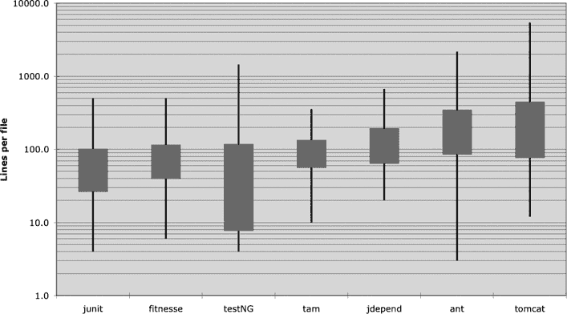

描绘了七个不同的项目：JUnit, FitNesse, TestNG, Time and Money, JDepend, Ant 和 Tomcat。通过框的线显示了每个项目的最小和最大文件长度。框显示了大约三分之一（一个标准差^(1))）的文件。框的中间是平均值。因此，FitNesse 项目的平均文件大小约为 65 行，大约三分之一的文件在 40 到 100+ 行之间。FitNesse 中最大的文件约为 400 行，最小的 6 行。注意，这是一个对数尺度，因此垂直位置上的微小差异意味着绝对尺寸上的巨大差异。

1。框显示了平均值上下各 sigma/2。是的，我知道文件长度分布不是正态分布，因此标准差在数学上并不精确。但我们在这里并不是追求精确。我们只是想获得一种感觉。

JUnit、FitNesse 和 Time and Money 由相对较小的文件组成。没有一个超过 500 行，大多数文件少于 200 行。相反，Tomcat 和 Ant 有一些文件长达数千行，接近一半的文件超过了 200 行。

这对我们意味着什么？看起来，构建大型系统（在本文分析时，FitNesse 接近 50,000 行）可以由通常为 200 行、上限为 500 行的文件组成。虽然这不应该是一条硬性规定，但它应该被认为是理想的。小文件通常比大文件更容易理解和维护。

#### 概念之间的垂直开放

几乎所有的代码都是从左到右、从上到下阅读的。每一行代表表达式或语句，每组行代表完整的思想。这些思想应该通过空行隔开。


考虑以下代码。代码中有空行将包声明、导入语句以及每个函数隔开。这一极其简单的规则对代码的视觉布局产生了深远的影响。每一行空行都是一个视觉提示，识别出一个新的且独立的概念。当你向下扫描代码列表时，你的视线会被空行后的第一行吸引。

```
package fitnesse.wikitext.widgets;

import java.util.regex.*;

public class BoldWidget extends ParentWidget {
  public static final String REGEXP = "'''.+?'''";
  private static final Pattern pattern = Pattern.compile("'''(.+?)'''",
    Pattern.MULTILINE + Pattern.DOTALL
  );

  public BoldWidget(ParentWidget parent, String text) throws Exception {
    super(parent);
    Matcher match = pattern.matcher(text);
    match.find();
    addChildWidgets(match.group(1));
  }

  public String render() throws Exception {
    StringBuffer html = new StringBuffer("<b>");
    html.append(childHtml()).append("</b>");
    return html.toString();
  }
}
```

去掉这些空行会对代码的可读性产生显著的模糊效果。

```
package fitnesse.wikitext.widgets;
import java.util.regex.*;
public class BoldWidget extends ParentWidget {
  public static final String REGEXP = "'''.+?'''";
  private static final Pattern pattern = Pattern.compile("'''(.+?)'''",
    Pattern.MULTILINE + Pattern.DOTALL);
  public BoldWidget(ParentWidget parent, String text) throws Exception {
    super(parent);
    Matcher match = pattern.matcher(text);
    match.find();
    addChildWidgets(match.group(1));}
  public String render() throws Exception {
    StringBuffer html = new StringBuffer("<b>");
    html.append(childHtml()).append("</b>");
    return html.toString();
  }
}
```

当你移开视觉焦点时，这种效果会更加明显。在第一个例子中，不同的行分组会跳颖而出，而第二个例子看起来则像像一团乱麻。这两个例子之间的区别仅仅是一点垂直方向的开放空间。

### 垂直密度

如果开放性分隔了概念，那么垂直密度就意味着紧密的关联。因此，密切相关的代码行应该在垂直方向上是密集的。注意下面代码中那些无用的注释是如何破坏两个实例变量之间的紧密关联的。

```
public class ReporterConfig {
  /**
   * reporter 监听器的类名
   */
  private String m_className;

  /**
   * reporter 监听器的属性
   */
  private List<Property> m_properties = new ArrayList<Property>();

  public void addProperty(Property property) {
    m_properties.add(property);
  }
}
```

下面的代码要易读得多。它恰好能在一个“一眼可见”的范围内，至少对我来说是这样。我可以看着它，看出这是一个包含两个变量和一个方法的类，而不需要移动我的头部或眼睛。之前的列表迫使我使用更多的眼睛和头部动作，更不用说还要对那些令人分心的额外注释进行额外的处理，才能达到同等水平的理解力。

```java
public class ReporterConfig {
  private String m_className;
  private List<Property> m_properties = new ArrayList<Property>();

  public void addProperty(Property property) {
    m_properties.add(property);
  }
}
```

### 垂直距离

你是否曾在一个类中像追尾巴一样从一个函数跳到另一个函数，在源文件中上下滚动，试图推断函数是如何关联和运行的，结果却迷失在混乱的乱麻中？你是否曾为了寻找一个变量或函数的定义而追溯整个继承链？这是令人沮丧的，因为你正试图理解系统在做什么，但你却把时间和精力消耗在尝试定位和记忆这些碎片在哪里上。

密切相关的概念应该保持在垂直方向上相互靠近。显然，这条规则对于属于不同文件的概念并不起作用。但是，除非你有非常充分的理由，否则密切相关的概念不应该被拆分到不同的文件中。事实上，这也是应该避免 `protected` 变量的原因之一。

对于那些关系紧密到至于属于同一个源文件的概念，它们的垂直间距应该作为衡量每个概念对彼此可理解性重要程度的标准。我们希望避免迫使读者在源文件和类之间来回跳去。

### 变量声明

变量的声明应该尽可能靠近它们使用的地方。由于我们的函数非常短，局部变量应该出现在每个函数的顶部，就像这个来自 JUnit 4.3.1 的长函数一样。

```java
private static void readPreferences() {
  InputStream is = null;

  try {
    is= new FileInputStream(getPreferencesFile());
    setPreferences(new Properties(getPreferences()));
    getPreferences().load(is);
  } catch (IOException e) {
    try {
      if (is != null)
        is.close();
    } catch (IOException e1) {
    }
  }
}
```

循环的控制变量通常应该在循环语句内部声明，就像同一来源的这个可爱的小函数。

```java
public int countTestCases() {
  int count= 0;
  for (Test each : tests)
    count += each.countTestCases();
  return count;
}
```

在少数情况下，变量可能会声明在一个块的顶部或紧接循环之前。你可以在 TestNG 的一个函数中间看到这样一个变量。

```
…
for (XmlTest test : m_suite.getTests()) {
      TestRunner tr = runnerFactory.newTestRunner(this, test);
      tr.addListener(m_textReporter);
      m_testners.add(tr);

      invoker = tr.getInvoker();

      for (ITestNGMethod m : tr.getBeforeSuiteMethods()) {
        beforeSuiteMethods.put(m.getMethod(), m);
      }

      for (ITestNGMethod m : tr.getAfterSuiteMethods()) {
        afterSuiteMethods.put(m.getMethod(), m);
      }
    }
…
```

实例变量应该声明在类的顶部或底部。这不会增加这些变量的垂直距离，因为在一个设计良好的类中，它们被许多甚至所有的方法使用。

关于实例变量应该放在哪里，有过很多争论。在 `C++` 中，我们通常采用所谓的“剪刀规则”，将所有实例变量放在底部。这条规则的原理是公共项应该放在顶部，私有项应该放在底部。

这比 Java/C# 将私有变量放在顶部的做法要有逻辑得多。但由于这种做法在这些语言中非常普遍，遵循它可能比通过诉诸逻辑和常识来困惑大家更好。

重要的是，实例变量应该声明在一个众为人知的地方。每个人都应该知道去去查看声明的位置。

例如，考虑 JUnit 4.3.1 中 `TestSuite` 类的特殊情况。为了说明这一点，我大大删减了这个类。如果你查看列表的大部分位置，你会看到两个实例变量声明在那里。很难在其他更好的地方隐藏它们。阅读这段代码的人将是偶然这些声明的（就像我一样）。


```java
public class TestSuite implements Test {
  static public Test createTest(Class<? extends TestCase> theClass,
                               String name)  {
    …
  }

  public static Constructor<? extends TestCase>
  getTestConstructor(Class<? extends TestCase> theClass)
  throws NoSuchMethodException {
    …
  }

  public static Test warning(final String message) {
    …
  }

  private static String exceptionToString(Throwable t) {
    …
  }

  private String fName;

  private Vector<Test> fTests= new Vector<Test>(10);

  public TestSuite() {
  }

   public TestSuite(final Class<? extends TestCase> theClass) {
     …
  }

  public TestSuite(Class<? extends TestCase>  theClass, String name) {
    …
  }
  … … … … …
}
```

### 依赖函数

如果一个函数调用另一个函数，它们应该在垂直方向上靠近，在可能的情况下，调用者应该在调用调用上方。这为程序提供了一个自然的流。如果能够可靠地遵循这一约定，读者就能相信函数定义将紧随其之后。例如，考虑下面来自 FitNesse 的片段。注意最顶部的函数（**粗体**）是如何调用其下方的函数的。同样注意被调用的函数按照调用的顺序出现。这使得很容易找到被调用的函数并大大增强了整个模块的可读性。

2。或者下面像 Clojure 这样的倒置语言。

```java
public class WikiPageResponder implements SecureResponder {
  protected PagePage page;
  protected PageData pageData;
  protected String pageTitle;
  protected Request request;
  protected PageCrawler crawler;

  public Response makeResponse(FitNesseContext context, Request request)
    throws Exception {
    String pageName = getPageNameOrDefault(request, "FrontPage");
    loadPage(pageName, context);
    if (page == null)
      return notFoundResponse(context, request);
    else
      return makePageResponse(context);
  }

  private String
  getPageNameOrDefault(Request request, String defaultPageName)
  {
    String pageName = request.getResource();
    if (StringUtil.isBlank(pageName))
      pageName = defaultPageName;
    return pageName;
  }

  protected void loadPage(String resource, FitNesseContext context)
    throws Exception {
    WikiPagePath path = PathParser.parse(resource);
    crawler = context.root.getPageCrawler();
    crawler.setDeadEndStrategy(new VirtualEnabledPageCrawler());
    page = crawler.getPage(context.root, path);
    if (page != null)
      pageData = page.getData();
  }

  private Response
  notFoundResponse(FitNesseContext context, Request request)
    throws Exception {
    return new NotFoundResponder().makeResponse(context, request);
  }

  private SimpleResponse makePageResponse(FitNesseContext context)
    throws Exception {
    pageTitle = PathParser.render(crawler.getFullPath(page));
    String html = makeHtml(context);
    SimpleResponse response = new SimpleResponse();
    response.setMaxAge(0);
    response.setContent(html);
    return response;
  }
…

```

顺便提一下，这个片段提供了一个将常量保持在适当级别的良好示例。`"FrontPage"` 常量本可以埋在 `getPageNameOrDefault` 函数中，但那会在不恰当的低级函数中隐藏一个已知且预期的常量。更好的做法是从已知其意义的地方向下传递该常量。

### 概念亲和性

某些代码片段想要其他片段。它们具有某种概念上的亲和性。亲和性越强，它们之间的垂直距离就应该越短。

正如我们看到的，这种亲和性可能基于直接依赖，例如一个函数调用另一个函数，或一个函数使用变量。但还有其他可能的亲和原因。亲和性可能是因为一组函数执行了相似的操作。考虑来自 JUnit 4.3.1 的这段代码片段：

```java
public class Assert {
  static public void assertTrue(String message, boolean condition) {
    if (!condition)
      fail(message);
  }

  static public void assertTrue(boolean condition) {
    assertTrue(null, condition);
  }

  static public void assertFalse(String message, boolean condition) {
    assertTrue(message, !condition);
  }

  static public void assertFalse(boolean condition) {
    assertFalse(null, condition);
  }
…
```

这些函数具有很强的概念亲和性，因为它们共享共同命名方案并执行相同基础任务的变体。它们相互调用的事实是次要的。即使它们没有相互调用，它们仍然想要靠在一起。

### 水平格式化

行应该有多宽？为了回答这个问题，让我们看看典型程序中的行有多宽。我们再次检查这七个不同的项目。下面的图片显示了所有七个项目的行长度分布。这种规律性令人印象深刻，特别是在 45 个字符左右。事实上，从 20 到 60 的每一个尺寸都代表了总行数的约 1%。那是 40%！可能还有 30% 的行宽度小于十个字符。记住，这是一个对数刻度，因此 80 个字符以上下降的线性外观实际上非常显著。这表明我们应该保持行较短。旧的 Holith 80 字符限制有点主观，我不反对行略超过 100 甚至 120 个字符。我让我的 IDE 在那一列画一条浅灰色的线，我不会超过它。

### 水平开放性与密度

我们使用水平空白将密切相关的项关联，并将弱相关的项分开。考虑以下函数：

```java
private void measureLine(String line) {
  lineCount++;
  int lineSize = line.length();
  totalChars += lineSize;
  lineWidthHistogram.addLine(lineSize, lineCount);
  recordWidestLine(lineSize);
}
```

我在赋值运算符周围留了空白以突出它们。赋值语句有两个独特且主要的元素：左侧和右侧。空格使这种分离显而易见。

另一方面，我没有在函数名和左括号之间放置空格。这是因为函数和它的参数密切相关。将它们分开会让它们看起来是断裂的而不是连接的。我在函数调用括号内分离参数，以突出逗号并显示参数是独立的。

空白的另一个用途是突出运算符的优先级。

```java
public class Quadratic {
  public static double root1(double a, double b, double c) {
    double determinant = determinant(a, b, c);
    return (-b + Math.sqrt(determinant)) / (2*a);
  }

  public static double root2(int a, int b, int c) {
    double determinant = determinant(a, b, c);
    return (-b - Math.sqrt(determinant)) / (2*a);
  }

  private static double determinant(double a, double b, double c) {
    return b*b - 4*a*c;
  }
}
```

注意这些方程读起来有多优美。因子之间没有空格，因为它们的优先级很高。项之间用空格隔开，因为加法和减法的优先级较低。

遗憾的是，大多数重新格式化代码的工具对运算符的优先级优先级，并在范围内强制相同的间距。因此，像上面显示的细微间距在重新格式化代码后往往会丢失。

### 水平对齐


当我还是一名汇编语言程序员时，我习惯于使用水平对齐来突出某些结构。当我开始用 C、C++、Java 以及最后的 Clojure 编程时，我继续尝试在一组声明中对齐所有的变量名，或者在一组赋值语句中对齐所有的右值。我的代码看起来可能像这样：

我在欺骗谁呢？我仍然是一个汇编语言程序员。你可以把男孩从硬件带走，但无法把硬件从男孩身上带走！

```java
public class FitNesseExpediter implements ResponseSender
{
  private   Socket           socket;
  private   InputStream     input;
  private   OutputStream     output;
  private   Request         request;
  private   Response         response;
  private   FitNesseContext context;
  protected long            requestParsingTimeLimit;
  private   long            requestProgress;
  private   long            requestParsingDeadline;
  private   boolean          hasError;

  public FitNesseExpediter(Socket          s,
                           FitNesseContext context) throws Exception
  {
    this.context =            context;
    socket =                  s;
    input =                   s.getInputStream();
    output =                  s.getOutputStream();
    requestParsingTimeLimit = 10000;
  }
}
```

然而，我发现这种对齐并没有用。这种对齐似乎强调了错误的重点，并导致我的视线偏离真实的意图。例如，在上面的声明列表中，你会忍不住直接向下阅读变量名列表，而不看它们的类型。同样，在赋值语句列表中，你会忍不住只向下看右值列表，而从不看赋值运算符。

所以，到最后，我不再做这种事情了。如今，我通常倾向于使用未对齐的声明和赋值，如下所示，因为它们指出了一个重要的缺陷。如果我有需要对齐的长列表，那么问题在于列表的长度，而不是缺乏对齐。下面 `FitNesseExpediter` 类中声明列表的长度表明这个类应该被拆分。

```java
public class FitNesseExpediter implements ResponseSender
{
  private Socket socket;
  private InputStream input;
  private OutputStream output;
  private Request request;

  private Response response;
  private FitNesseContext context;
  protected long requestParsingTimeLimit;
  private long requestProgress;
  private long requestParsingDeadline;
  private boolean hasError;

  public FitNesseExpediter
  (Socket s, FitNesseContext context) throws Exception
  {
    this.context = context;
    socket = s;
    input = s.getInputStream();
    output = s.getOutputStream();
    requestParsingTimeLimit = 10000;
  }
}
```

### 缩进

源文件就像一个大纲一样的层级结构。它包含了关于整个文件的信息、文件内单个类的信息、类内方法的信息、方法内块的信息，以及递归的块中的块的信息。这种层级结构的每一层都是一个作用域，可以在其中声明名称，并解释其中的声明和可执行语句。

为了让这种作用域层级结构可见，我们根据源代码在层级结构中的位置按比例对行缩进。文件层级的语句（例如大多数类声明）完全不缩进。类中的方法比类向右缩进一级。方法的实现比方法声明向右缩进一级。块的实现比其包含的块向右缩进一级，以此此类推。

程序员高度依赖这种缩进方案。他们通过视觉上对齐左边缘来查看每行代码出现在哪个作用域中。这允许他们快速跳过与当前情况无关的作用域，例如 `if` 或 `while` 语句的实现。他们扫描左侧以寻找新的方法声明、新变量，甚至新类。如果没有缩进，程序对人类来说几乎是不可读的。

考虑以下两个在语法和语义上都完全相同的程序：

```java
public class FitNesseServer implements SocketServer
{ private FitNesseContext context;
public FitNesseServer(FitNesseContext context)
{ this.context = context; } public void
serve(Socket s) { serve(s, 10000); }
public void serve(Socket s, long requestTimeout) { try
{ FitNesseExpediter sender = new FitNesseExpediter(s, context); sender.
setRequestParsingTimeLimit(requestTimeout);
sender.start(); } catch(Exception e)
{ e.printStackTrace(); } } }
```

```java
public class FitNesseServer implements SocketServer {
  private FitNesseContext context;

  public FitNesseServer(FitNesseContext context) {
    this.context = context;
  }

  public void serve(Socket s) {
    serve(s, 10000);
  }

  public void serve(Socket s, long requestTimeout) {
    try {
      FitNesseExpediter sender = new FitNesseExpediter(s, context);
      sender.setRequestParsingTimeLimit(requestTimeout);
      sender.start();
    }
    catch (Exception e) {
      e.printStackTrace();
    }
  }
}
```

你的眼睛可以迅速识别缩进文件的结构。你几乎可以瞬间识别出变量、构造函数、访问器和方法。几秒钟就能意识到这是一个带有超时的某些前端。然而，未缩进的版本如果不经过深入研究，将是无法理解的。

#### 破除缩进

有时人们很想打破短 `if` 语句、`while` 循环或短函数的缩进规则。每当我屈服于这种诱惑时，我总是会回去把缩进补回来。因此，我通常避免将作用域压缩成一行，如下所示：

```java
public class CommentWidget extends TextWidget {
  public static final String REGEXP = "^^\r\n]*?:(?r\n)|n)?";

  public CommentWidget(ParentWidget parent, String text)
  {super(parent, text);}
  public String render() throws Exception {return ""; }
}
```

我更倾向于展开并缩进作用域，如下所示：

```java
public class CommentWidget extends TextWidget {
  public static final String REGEXP = "^^\r\n]*?:(?r\n)|n)?";

  public CommentWidget(ParentWidget parent, String text) {
    super(parent, text);
  }

  public String render() throws Exception {
    return "";
  }
}
```

然而，有些时候简单的单行代码比悬挂括号更具视觉吸引力。

```java
public int getCount() {return count;}
```

### 团队规则

本节标题是一个双关语。每个程序员都有自己喜好的格式化规则，但如果他们在团队中工作，那么就是团队规则。开发团队应该约定一种统一的格式化风格，然后团队的每个成员都应该使用该风格。我们希望软件具有一致的风格，而不希望它看起来像是由一群意见意见的个人编写的。

当我在 2002 年启动 FitNesse 项目时，我和团队坐在一起制定了一种编码风格。这花了大约十分钟。我们决定了括号放在哪里、缩进大小是多少、我们如何命名类、变量和方法等等。然后，我们将这些规则编码到 IDE 的代码格式化器中，并一直坚持到现在。这些并不是我个人喜欢的规则，而是团队决定的规则。


请记住，一个优秀系统的源代码是一组读起来很良好的文档。它们需要具有一致且流畅的风格。读者需要能够相信，他们在一个源文件中看到的格式化手法，在其他文件中具有相同的含义。我们最不想做的事情，就是通过各种杂乱不同的个人风格来编写代码，增加源代码的复杂性。

## Uncle Bob 的格式化规则

我个人使用的规则非常简单，并在下面的代码中示例。请将此视为代码如何成为最佳编码标准文档的示例。

```java
public class CodeAnalyzer implements JavaFileAnalysis {
  private int lineCount;
  private int maxLineWidth;
  private int widestLineNumber;
  private LineWidthHistogram lineWidthHistogram;
  private int totalChars;

  public CodeAnalyzer() {
    lineWidthHistogram = new LineWidthHistogram();
  }

  public static List<File> findJavaFiles(File parentDirectory) {
    List<File> files = new ArrayList<File>();
    findJavaFiles(parentDirectory, files);
    return files;
  }

  private static void
  findJavaFiles(File parentDirectory, List<File> files) {
    for (File file : parentDirectory.listFiles()) {
      if (file.getName().endsWith(".java"))
        files.add(file);
      else if (file.isDirectory())
        findJavaFiles(file, files);
    }
  }

  public void analyzeFile(File javaFile) throws Exception {
    BufferedReader br = new BufferedReader(new FileReader(javaFile));
    String line;
    while ((line = br.readLine()) != null)
      measureLine(line);
  }

  private void measureLine(String line) {
    lineCount++;
    int lineSize = line.length();
    totalChars += lineSize;
    lineWidthHistogram.addLine(lineSize, lineCount);
    recordWidestLine(lineSize);
  }

  private void recordWidestLine(int lineSize) {
    if (lineSize > maxLineWidth) {
      maxLineWidth = lineSize;
      widestLineNumber = lineCount;
    }
  }

  public int getLineCount() {
    return lineCount;
  }

  public int getMaxLineWidth() {
    return maxLineWidth;
  }

  public int getWidestLineNumber() {
    return widestLineNumber;
  }

  public LineWidthHistogram getLineWidthHistogram() {
    return lineWidthHistogram;
  }

  public double getMeanLineWidth() {
    return (double)totalChars/lineCount;
  }

  public int getMedianLineWidth() {
    Integer[] sortedWidths = getSortedWidths();
    int cumulativeLineCount = 0;
    for (int width : sortedWidths) {
      cumulativeLineCount += lineCountForWidth(width);
      if (cumulativeLineCount > lineCount/2)
        return width;
    }
    throw new Error("Cannot get here");
  }

  private int lineCountForWidth(int width) {
    return lineWidthHistogram.getLinesForWidth(width).size();
  }

  private Integer[] getSortedWidths() {
    Set<Integer> widths = lineWidthHistogram.getWidths();
    Integer[] sortedWidths = (widths.toArray(new Integer[0]));
    Arrays.sort(sortedWidths);
    return sortedWidths;
  }
}
```

## 7

# 清洁函数


在计算机计算的早期，程序员编写的系统是由系列执行单个任务的例程组成的。他们很快发现，某些例程通常是有用的，于是他们将它们写在笔记本上并称之为 `subroutines`（子程序）。需要时，他们会将这些 `subroutines` 直接从笔记本转抄到他们正在创建的程序中。当时并没有调用——这些子程序只是以内联的方式编码在程序中的。

后来，在 20 世纪 50 年代初，机器增加了允许调用子程序的指令。起初，程序员不愿使用这些调用指令，因为它们在时间上非常昂贵。但随着机器能力的增长，调用指令变得越来越廉价，程序员开始越来越频繁地使用它们。

接着，在 `FORTRAN` 和 `PL/1` 时代，我们开始主要通过子程序来组合系统，并引入了带有参数并返回值的特殊情况——`functions`（函数）。时至今日，只有函数幸存了下来。函数是任何现代程序组织的第一道防线。写好函数是本章的主题。

### 要小！

在过去的六十年里，我写过各种不同尺寸的函数。在职业生涯早期，我写过几个长达 3000 行的恶魔。后来，我写了大量处于 100 到 300 行范围的函数。随着我变得成熟，我写了 20 到 30 行的函数。在过去的二十年里，我将长度缩短到十几行或更少。这些年来通过长期的尝试错误教会我的是：函数应该是非常小的。

当然，我不是第一个说这样的人。保持函数很小是一个很老的观点了。在 80 年代，听到一个函数的大小不超过一个屏幕的内容是很常的。当然，这是在 `VT100` 屏幕为 24 行 80 列的时代，而且我们的编辑器使用 4 行用于管理目的。这实际上将限制限制在了 20 行。

1999 年，我去拜访了 Kent Beck。我们坐在一起进行编程，以便他向我展示 TDD。我们一个接一个通过失败的测试，拼凑出一个有趣的 Java 程序，他称之为 Sparkle。它在屏幕上产生的视觉效果非常像灰姑娘中的魔法棒。当我们一起编写代码，一个接一个测试时，我被这些函数的短震惊了。我习惯了那些占据大量空间的函数。这个程序中的每个函数只有两、三或四行。每个函数都有描述性的名称。每一个函数都显而易见。每一个都在讲述故事。每一个引导你走向下一个。这种经历让我深刻体会到了保持函数小的重要性。

### 良好的散文

保持函数非常小意味着 `if` 语句、`else` 语句、`while` 语句等的块只有一两行。通常该块包含另一个函数的调用。这不仅保持了封装函数的小，还增加了文档价值，因为块中调用的函数具有良好的描述性名称。这样的 `if`/`else`/`while` 语句读起来很自然，因为函数名与关键词配合很好。它们读起来就像良好的散文。

```
if(employee.shouldBePaidToday())
  employee.pay();
```

这也意味着小函数不足以容纳深度嵌套结构。函数的缩进级别很少超过一级或二级。当然，这使得函数更容易阅读和理解。

这不是一条硬性规定，而且可能会被过度执行。某些函数如果不拆分解成更小的四行函数，读起来反而更好。但这些都是特殊情况。通常情况下，保持函数小是最佳策略。

### 每个函数一个抽象层次

为了确保我们的函数只做“一件事”，我们需要确保函数内部的语句都处于相同的抽象层级。请看下面的 Golang 代码。这来自 Video Store 示例，我们将在第 10 章中对更深入地研究它。


```go
func (customer *Customer)
statement() string {
  totalAmount := 0.0
  frequentRenterPoints := 0
  result := "Rental Record for " + customer.name + "\n"
  for _, rental := range customer.rentals {
    thisAmount := 0.0
    switch rental.movie.movieType {
    case NewRelease:
      thisAmount += float64(rental.daysRented * 3)
    case Regular:
      thisAmount += 2
      if rental.daysRented > 2 {
        thisAmount += float64(rental.daysRented-2) * 1.5
      }
    case Childrens:
      thisAmount += 1.5
      if rental.daysRented > 3 {
        thisAmount += float64(rental.daysRented-3) * 1.5
      }
    }
    frequentRenterPoints++
    if rental.movie.movieType == NewRelease && rental.daysRented > 1 {
      frequentRenterPoints++
    }
    result += fmt.Sprintf("\t%s\t%.1f\n", rental.movie.title, thisAmount)
    totalAmount += thisAmount
  }
  return result + fmt.Sprintf("Amount owed is %.1f\n" +
                              "You earned %d frequent renter points",
                              totalAmount, frequentRenterPoints)
}
```

很容易看出这是如何违反规则的。其中包含了一些抽象层次非常高的概念，例如遍历 `customer.rentals`。还有其他处于中等抽象层次的概念，例如用于选择电影类型的 `switch` 语句。此外还有其他明显非常低级的概念，例如 `frequentRenterPoints++` 以及为每种电影类型计算价格的代码。

在函数内部混合不同层次的抽象通常会令人困惑。读者可能无法判断某个特定表达式是核心概念还是细节。更糟糕的是，就像破窗效应一样，一旦细节与核心概念混合，越来越多的细节往往会在函数内部不断堆积。

### 从上到下阅读代码：阶梯下降规则（The Stepdown Rule）

我们希望代码读起来像一个从上到下的叙述。我们希望每个函数的后面都紧跟下一个抽象层次的函数，这样我们可以从上到下阅读程序，每次下降一个抽象层次。我将其称为*阶梯下降规则*。我们可以在对上一个示例的重构中看到这一点。

```go
func (statement *RentalStatement)
makeStatement() string {
  statement.clearTotals()
  return statement.makeHeader() +
         statement.makeDetails() +
         statement.makeFooter()
}

func (statement *RentalStatement)
clearTotals() {
  statement.totalAmount = 0.0
  statement.frequentRenterPoints = 0
}

func (statement *RentalStatement)
makeHeader() string {
  return "Rental Record for " + statement.name + "\n"
}

func (statement *RentalStatement)
makeDetails() string {
  rentalDetails := ""
  for _, rental := range statement.rentals {
    rentalDetails += statement.makeDetail(rental)
  }
  return rentalDetails
}

func (statement *RentalStatement)
makeDetail(rental *Rental) string {
  amount := rental.determineAmount()
  statement.frequentRenterPoints += rental.determinePoints()
  statement.totalAmount += amount
  return statement.formatDetail(rental, amount)
}

func (statement *RentalStatement)
formatDetail(rental *Rental, amount float64) string {
  return fmt.Sprintf("\t%s\t%.1f\n", rental.getTitle(), amount)
}

func (statement *RentalStatement)
makeFooter() string {
  return fmt.Sprintf("Amount owed is %.1f\n"+
    "You earned %d frequent renter points",
    statement.totalAmount, statement.frequentRenterPoints)
}
```

阅读这段代码时，我们从顶部的 `makeStatement` 函数开始。要生成语句，我们首先清除总额，然后生成页头、细节和页脚，并将它们全部拼接在一起。这些语句都处于相同的抽象层次，比函数名低一层。

为了清空总额，我们将 `totalAmount` 和 `frequentRenterPoints` 设置为零。同样，每一行都处于相同的抽象层次，比函数名低一层。

为了生成页头，我们将租赁账单中的名称与页头文本进行格式化。该函数中的单行代码比函数名低一个抽象层次。

在 70 世纪和 80 世纪，我们称之为*函数化分解*（functional decomposition）。它是*结构化编程*学科的重要部分。高层函数被分解为低层函数，创建了一个函数调用的层次结构。

当你遵循这一规范时，你的函数通常会很小，因为每个函数只包含一个抽象层次，并通过另一个命名良好的函数调用来委托给下一层。

重构的纪律是这种方法的关键要素。当我们最初为函数编写代码时，倾向于对抽象层次进行深度优先搜索。这种深度优先搜索产生的代码看起来就像第一个版本。所以，首先，让它运行。然后，让它变得正确。

#### 纠缠（Entanglement）

John Ousterhout 对这种方法提出的反对意见是：当你将函数分解为更小的函数时，有时会创建相互纠缠的小函数。当为了理解一个函数而必须理解另一个时，函数就处于纠缠状态。John 在这一点上是正确的，但只要函数能下降一个抽象层次，我可以忍受这种纠缠。John 非常反感纠缠，更倾向于将函数合并。

### Switch 语句

遗憾的是，我们不能总是避免 `switch` 语句。考虑从上面的示例提取的这个 `switch` 语句：

```go
func (rental Rental) determineAmount() float64 {
  amount := 0.0
  switch rental.movie.movieType {
  case NewRelease:
    amount += float64(rental.daysRented * 3)
  case Regular:
    amount += 2
    if rental.daysRented > 2 {
      amount += float64(rental.daysRented-2) * 1.5
    }
  case Childrens:
    amount += 1.5
    if rental.daysRented > 3 {
      amount += float64(rental.daysRented-3) * 1.5
    }
  }
  return amount
}
```

这个函数有几个问题：

1. 它比我想要的大，并且会随着电影类型的增加而不断增长。
2. 它显然做了多于一件事。
3. 它违反了单一职责原则（SRP），因为它有多个改变的原因。参见第 19 章“SOLID 原则”。
4. 它违反了开闭原则（OCP），因为每当添加新类型时都必须进行更改。

但这个函数最严重的问题可能是，存在无限数量的具有相同结构的其他函数。例如，我们已经有了 `determinePoints`，以后可能还有 `applyCoupon` 或 `getAgeRestriction`。很难想象出很多其他例子。它们都会包含一个相关的 `switch` 语句。


解决这个问题的一个良好方法是将 `switch` 语句埋在抽象工厂的底层，并且永远不让任何人看到它。工厂使用 `switch` 语句来创建 `RentalType` 派生类的适当实例。

```go
type RentalTypeFactory interface {
  make(typeName string) RentalType
}

type RentalTypeFactoryImpl struct{}

func (r RentalTypeFactoryImpl) make(typeName string) RentalType {
  switch typeName {
  case "childrens":
    return ChildrensRental{}
  case "new release":
    return NewReleaseRental{}
  case "regular":
    return RegularRental{}
  }
  return nil
}
```

我对 `switch` 语句的通用规则是：如果它们只出现一次、位于像 `main` 这样的具体模块中、用于创建多态对象，并且隐藏在接口之后以便系统的其他部分无法看到，那么它们是可以容忍的。

# 洁洁函数：深度观察

一个整洁函数应该具备五个属性。它应该是可命名的（nameable）、隔离的（insulated）、同质的（homogenous）、上下文相关的（contextual）和纯粹的（pure）。如果你重新排列顺序，它们拼起来是 PINCH——但这并不是呈现它们的正确顺序。

## 上下文相关 (Contextual)

模块化的概念和纪律对于最早的程序员来说并不是显而易见的。它是从纯粹的需求中缓慢产生的。20 世纪 40 年代后期，格蕾斯·霍珀（Grace Hopper）在笔记本中写下常见的代码序列，以帮助她为哈佛 Mark 1 计算机编程。她将这些序列称为“子程序”（subroutines）。它们被转录成程序，然后仔细地打孔在驱动机器执行的长纸带上。

那些`子程序` 是第一批模块。从那里开始，模块化的概念演变为可调子程序，最后变成了函数。

到 20 世纪 60 年代，程序员们开始采用一种被称为`模块化编程`的纪律，该纪律认为最好的程序应该分解成许多不同的模块。到 20 世纪 60 年代末，Dahl 和 Nygaard 通过发明面向对象编程推进了模块化概念。20 世纪 70 年代初，大卫·帕纳斯（David Parnas）通过推广信息隐藏的益处继续了这一进展。

尽管他们并没有给它这个名字。`面向对象`是由阿兰·凯（Alan Kay）在几年后创造的。

如今，我们理解每个函数都存在于一个上下文中。上下文是函数和数据结构的协作分组。每个上下文都有一个外部接口和内部内部实现。

在面向对象（OO）语言中，上下文通常用类来定义。例如，在 Java 中，类的公共方法代表外部接口，而私有数据和方法构成了内部实现。

在 C 语言中，我们使用 `.h` 头文件作为外部接口，使用 `.c` 文件作为内部实现。

某些语言提供了丰富的语法来定义上下文。在其他语言中，程序员必须通过文件名、目录和注释等非正式约定来定义上下文。

但无论语言和语法如何，每个函数都存在于一个上下文中——而识别、创建和管理这些上下文是程序员的职责。

上下文中的某些函数将是 `public`（公共的），这意味着它们在上下文外部是已知且被使用的。它们是上下文外部接口的一部分。上下文中的其他函数将是 `private`（私有的），这意味着它们仅在上下文内部已知且被使用，而不会在外部使用。

许多面向对象语言提供了语法来声明函数为 `public` 或 `private`。某些语言还有其他类别，如 `protected`（保护的）或 `package`（包），作为创建部分限制的方法。其他语言则依赖程序员的纪律和各种程序员约定来实现相同的结果。

上下文在外部已知事物与上下文内部保持私有的事物之间创建了一个边界。这个边界由程序员指定，描述了程序员对于高层级且可能不会经常更改的事物，以及低层级且可能经历频繁变更的事物的意图。

## 可命名的 (Nameable)

在命名函数时，至少要考虑两点。名称在它的上下文中必须具有适当的描述性，并且必须具有适当的便利性。

## 描述性的 (Descriptive)

每个整洁函数都应该有一个描述该函数作用的名字。由于名称描述的是行为，因此名称应该是动词、动词短语或隐式动词，例如 `Math.sign(x)`。

描述应该比函数内部的代码稍微抽象一点。换句话说，名称应该隐藏实现细节。

所以，作为一个荒谬的反面例子：

```java
public static double addAtoBandDivideBy2(double a, double b) {
  return (a+b)/2.0;
}
```

这个名字确实告诉了我们代码在做什么；但它太具体了。它不仅告诉我们函数在做什么，还告诉了我们如何做。它暴露了实现细节。我们应该将其稍微抽象一下。

```java
public static double average(double a, double b) {
  return (a+b)/2.0;
}
```

这很不错。名字是一个隐式动词（取平均值），它隐藏了实现细节。这很好，因为任何看到这个名字的程序员都会知道会有什么；但任何想要更改实现的程序员都不必需要更改名称。例如，将函数扩展为使用可数量的参数完全不会影响函数名称。

```java
public static double average(double… ns ) {
  return Arrays.stream(ns).sum()/ns.length;
}
```

像 `average` 这样的单词名称可能适用于某些函数，但其他函数需要更多单词来保持描述性。例如：

```java
public void addSalesReceipt(SalesReceipt salesReceipt) {
  salesReceipts.add(salesReceipt);
}
```

```这个函数看起来很简单，但名字有三个单词。为什么？也许我们应该看看上下文。

```java
public class CommissionedEmployee extends Employee {
  private List<SalesReceipt> salesReceipts = new ArrayList<>();
  //
  public void addSalesReceipt(SalesReceipt salesReceipt) {
    salesReceipts.add(salesReceipt);
  }
}
```

这个函数是派生类的方法。派生类比基类更详细。因此，`addSalesReceipt` 函数位于一个详细的上下。详细上下文需要更多的单词来描述。因此，你应该预期在更详细的上下文需要更长的名称来保持描述性。


为了方便起见，函数名必须短小且易记。但短小易记的名字并不总是很具描述性。因此，我们需要进行权衡。便利性的价值取决于函数被调用的频率。频繁被调用的函数应该有一个短而易记的名字。而只被调用一次的函数则可以使用较长且更具描述性的名称。

描述性与便利性这两个冲突的优先事项，共同构成了我们在第 4 章中讨论过的简单启发式规则。

*函数名称的长度应该与其包含的作用域的大小成反比。*

作用域（scope）是指名称被感知和使用的代码范围。例如，`average` 函数的作用域实际上是全局的。而 `addSalesReceipt` 的作用域被限制在 `CommissionedEmployee` 类的使用者中。因此，上下文越详细，作用域越小；上下文越通用，作用域越大。

在小作用域内的函数不需要太高的便利性，因此它们的名称可以长一些。这是好事，因为在详细上下文中的函数通常需要更长的名称来体现描述性。在大作用域内的函数需要更多的便利性。这同样是好事，因为这些上下文通常更通用，因此通常不需要过长的名称。

例如，函数 `File.open(String filename)` 短小且易记，因为它存在于全局作用域且非常通用。如果这个函数命名为 `openFileAndThrowExceptionIfNotFound`，我们会觉得非常不便。同样，如果 `addSalesReceipt` 函数简单地命名为 `add`，我们会感到有些违和。

所以，作用域越大，函数越通用，名称越短；作用域越小，函数越详细，名称越长。

据此，我们可以预测：全局函数通常会有简短的单单词名称。上下文内的公共函数会有稍长的名称。由公共函数调用的私有函数会有更长的名称。而由私有函数调用的私有函数可能有非常长的名称。在函数层次结构中越深，名称可能越长。对于 Java、C、Clojure、Python、Ruby 或任何其他允许长名称的语言都是如此。

### 隔缘

在过去，我们将隔缘（insulation）的概念称为*低耦合*（low coupling），或有时称为*封装*（encapsulation）。但在看来，这两个术语都不完全充分。

*复杂*（complex）一词意味着多条线索。使函数复杂的因素之一是它们必须处理的输入和输出数量。每个输入和输出都是一种耦合，每个耦合都是另一条穿过该函数的线索。因此，为了管理函数的复杂性，我们寻求限制此类耦合的数量。

函数的参数越多，它与调用者的耦合就越密。有五个参数的函数可能比两个参数的函数更耦合。因此，我们努力将函数参数的数量限制在可管理的范围内。在可行的情况下，我倾向于限制为三个。我将在下一章详细讨论这一点。

参数越少，函数的耦合越低，调用该函数就越简单。没有参数的函数非常容易调用。然而，除非这些函数存在于其他函数为它们准备好的上下文中，否则这类函数并不特别有用。

例如，你可能有一个代表有限状态机的上下文。该上下文将包含表示机器当前状态的变量，以及状态转换的网络。

让我们使用以下状态机。它代表一个简单的地铁闸机。它有两个状态：`Locked`（锁定）和 `Unlocked`（解锁）。有两个事件：`Coin`（投币）和 `Pass`（通过），分别代表用户向投口投硬币和通过闸机。最后有五个动作：`alarmOff`（关闭报警）、`alarmOn`（开启报警）、`lock`（锁定）、`unlock`（解锁）和 `thankyou`（感谢）。状态转换表所示。

```
Locked   Coin Unlocked {alarmOff unlock}
Locked   Pass Locked   alarmOn
Unlocked Coin Unlocked thankyou
Unlocked Pass Locked   lock
```

逻辑非常简单。

*   当机器处于 `Locked` 状态并接收 `Coin` 事件时，它将转换到 `Unlocked` 状态并调用 `alarmOff` 和 `unlock` 动作。
*   当机器处于 `Locked` 状态并接收 `Pass` 事件时，它将留在 `Locked` 状态并调用 `alarmOn` 动作。
*   当机器处于 `Unlocked` 状态并接收 `Coin` 事件时，它将留在 `Unlocked` 状态并调用 `thankyou`^(9)。也许它亮起“感谢”灯，或者从扬声器中发出“感谢”的声音。
*   当机器处于 `Unlocked` 状态并接收 `Pass` 事件时，它将转换到 `Locked` 状态并调用 `lock` 动作。

由此显而易见，当系统运行时，外部软件将需要发送 `Coin` 和 `Pass` 事件。这可以通过调用不带参数的名为 `coin()` 和 `pass()` 的函数来实现。我们可以将其封装在一个名为 `TurnstileEvents` 的接口中。

```
public interface TurnstileEvents {
  void coin();
  void pass();
}
```

这五个也不带参数的动作可以封装在一个名为 `TurnstileActions` 的接口中。

```java
public interface TurnstileActions {
  void lock();
  void thankyou();
  void alarmOn();
  void unlock();
  void alarmOff();
}
```

然后，状态机的逻辑可以封装在一个名为 `TurnstileFSM` 的抽象类中。

```
public abstract
class TurnstileFSM implements TurnstileActions, TurnstileEvents {
  private enum State {Locked, Unlocked}

  private enum Event {Coin, Pass}

  private State state = State.Locked;

  private void setState(State s) {
    state = s;
  }

  public void coin() {
    handleEvent(Event.Coin);
  }
  public void pass() {
    handleEvent(Event.Pass);
  }

  private void handleEvent(Event event) {
    switch (state) {
      case Locked -> {
        switch (event) {
          case Coin -> {
            setState(State.Unlocked);
            alarmOff();
            unlock();
          }
          case Pass -> {
            setState(State.Locked);
            alarmOn();
          }
        }
      }
      case Unlocked -> {
        switch (event) {
          case Coin -> {
            setState(State.Unlocked);
            thankyou();
          }
          case Pass -> {
            setState(State.Locked);
            lock();
          }
        }
      }
    }
  }
}
```

运行并发送事件的系统只需要知道 `TurnstileEvents`。它与逻辑和动作完全解耦。状态机的逻辑生活在一个非常强的隔缘屏之后。`TurnstileFSM` 外部的任何地方对应的状态或逻辑。

最后，`TurnstileFSM` 类是抽象的，以便在派生类中实现动作函数，从而将机器逻辑与动作的实现解耦。

通过这个例子，你可以看到封装状态机逻辑、事件和动作的上下文。你可以看到限制跨越上下文边界的函数参数数量有助于保持极低的耦合。


当然，你会有很多时候需要接受一个、两个甚至三个或更多参数的函数。但一旦传递的参数超过三个，你就必须问问自己，为什么不传递一个封装这些参数的对象或数据结构呢？如果你确实需要向函数传递这么多参数，值得考虑数据是否可以分离到不同的上下，以及函数的行为是否可以拆分并存在于这些上下。

## 同质性（Homogenous）

函数的每一行应该处于相同的抽象层次，该层次比函数名低一层。在上一节中，我将其称为`阶梯下降规则`（The Stepdown Rule）。

函数的执行发生在由该函数名称描述的一个特定抽象层次上。函数名代表了函数内部代码行所实现的抽象。

但如果函数的代码行存在于多个抽象层次呢？例如，考虑以下函数：

```
public static int orientation(Point a, Point b, Point c) {
  double val = (b.x() - a.x()) * (c.y() - a.y()) -
               (b.y() - a.y()) * (c.x() - a.x());
  if (val == 0) {
    return 0;
  }
  return (val > 0) ? +1 : -1;
}
```

给定平面上的三个点 (a, b, c)，该函数确定从 a 到 b 再到 c 的移动是右转 (−1）、左转（1）还是没有转弯（0）。

第一部分确定两个向量 `a→b` 和 `b→c` 的交叉积。该乘积的正负号决定了答案。

交叉积的确定恰好比函数名低一层抽象。但另外四行比第一行层次低。所以，让我们把这四行放入一个独立的函数中。

```
public static int orientation(Point a, Point b, Point c) {
  double val = (b.x() - a.x()) * (c.y() - a.y()) -
               (b.y() - a.y()) * (c.x() - a.x());
  return sign(val);
}

private static int sign(double n) {
  if (n == 0) {
    return 0;
  }
  return (n > 0) ? +1 : -1;
}
```

现在，原始函数的两行代码都处于相同的抽象层次。这使得 `orientation` 函数的实现了同质化。

但我们可以做得更好，因为这些名称并没有特别的表达性，而且返回值没有命名，容易出错。

```
public enum Chirality {left, right, none};

public static Chirality getChirality(Point a, Point b, Point c) {
  return chirality(crossProduct(a, b, c));
}

private static double crossProduct(Point a, Point b, Point c) {
  double abx = b.x() - a.x();
  double aby = b.y() - a.y();
  double acx = c.x() - a.x();
  double acy = c.y() - a.y();
  return abx * acy - aby * acx;
}

private static Chirality chirality(double n) {
  if (n == 0) {
    return none;
  }
  return (n > 0) ? left : right;
}
```

你可能会觉得这比原始代码长了一倍；在我看来，它的可读性高得多——尤其是对于第一次看到它的人来说。你可能还会觉得这比原始代码多消耗几个 CPU 周期。如果你有迫切需要节省 50ns，那么请尽情削减这些周期。只需记住，在你之后会有其他人需要维护这些代码，而他们的时间是有价值的——价值可能比你付出的 50ns 多得多。

## 纯函数（Pure）

纯函数的行为依赖于参数之外的任何；它的执行不会导致任何其他行为发生改变。以下是纯函数的一些优势。

*   纯函数是参数到返回值的真实映射——并可以用这种映射来用内存换取执行速度。
*   纯函数不容易受到竞态条件和并发更新问题的影响，因为它们不会改变底层系统的状态。（它们并非完全免疫，因为任何有状态的系统都可以用纯函数来模拟。参见 `Functional Design`。）
*   纯函数很容易组合成功能网络。这是因为它们没有外部依赖，因此可以被任何其他函数随时地调用。
*   纯函数很容易测试。这是因为测试设置不需要将底层系统强制转换为任何特殊状态，且测试不需要断言系统的底层状态已经发生了改变。
*   纯函数很容易在多个处理器之间分配。由于纯函数的输出仅取决于其参数，函数在何处或哪个处理器中执行并不重要。

好了，它们很棒。如何创建一个纯函数呢？很简单。不要改变任何变量的值；或者换句话说。


底线是，纯性是函数的外部特征，而不是内部特征。一个函数的内部有多不纯并不重要——只要所有的不纯性都对所有外部观察者（包括其他线程）隐藏，该函数就是纯的。

顺便说，这也是所有函数式编程语言声称纯净的方式。它们只是隐藏了底层实现的不纯性。

## 部分纯性

正如我们所看到的，纯性是一种观察到的属性，而不是内在属性。因此，一个函数是否纯净取决于观察到的内容。

考虑 C 库函数 `fopen(char* name, char* mode)`。该函数具有留下命名文件打开状态的副作用。这意味着 `fopen` 不是纯的，因为存在诸如 `fgetc` 和 `fputc` 这样的函数，如果不先调用 `fopen`，它们将无法正常工作。事实上，如果你连续两次两次使用相同的参数调用 `fopen` 而中间没有调用 `fclose`，第二次调用可能会失败，因为文件已经打开了。所以 `fopen` 不是纯的，因为它产生了一个让系统处于改变状态的副作用。

然而，我们可以通过将 `fopen` 封装在另一个隐藏副作用的函数中，使其至少对某些观察者看起来是纯的。

```
void openAndDo(char* fileName, void (*doTo)(FILE*)) {
  FILE* f = fopen(fileName, "r+");
  doTo(f);
  fclose(f);
}
```

这个函数打开文件，执行 `doTo` 指向的函数，然后关闭文件。这让系统回到了原始状态，隐藏了 `fopen` 的不纯。从所有目的而言，这种对 `openAndDo` 的使用是纯的。我们可以这样使用它：

```
void show(FILE* f) {
  int c;
  while ((c=fgetc(f)) != EOF)
    putchar(c);
}

int main(int ac, char** av) {
  openAndDo("x.x", show);
}
```

这个程序在标准输出上打印 `"x.x"` 文件。让我们通过修改文件内容使其变得更有趣一点。如果文件结尾没有换行符，我们就添加一个。

```
void appendLineEnd(FILE* f) {
  int c;
  int lastC;
  while ((c = fgetc(f)) != EOF) {
    lastC = c;
  }
  if (lastC != '\n')
    fputc('\n', f);
  }

int main(int ac, char** av) {
  openAndDo("x.x", appendLineEnd);
  openAndDo("x.x", show);
}
```

现在程序添加了换行符然后显示文件。这个程序确实让系统处于改变状态，因为 `"x.x"` 文件的内容被改变了。然而，如果我们不在意观察 `"x.x"` 文件的内容，那么对于我们来说 `openAndDo` 函数就是纯的。

### 结论

整洁的函数是小的、只做一件事、读起来像良好的散文。每个函数都处于函数层级结构中的某个位置，逐步从高级抽象引导到低级细节。整洁的函数存在于定义良好的环境中，彼此隔离，命名良好且方便，并且对所有外部观察者都是纯的。

## 8

# 函数启发式


以下是我发现对保持代码整洁有用的启发式方法。我没有把它们当作硬性规则来遵守，但在所有其他条件相等的情况下，这些是我的偏好。

### 函数参数

你在函数签名中添加的每一个参数都会让该函数更难理解。最容易理解的参数列表是空参数列表。

在本书的第一版中，这个陈述困扰了很多人。他们的抱怨是，带有空参数列表的函数除了返回常量外几乎无所事事。所以，显然还需要进一步的解释。

在面向对象的程序中，对象的每个方法至少有一个参数。在 Python 和 Go 中，按照惯例显式声明并命名为 `self`。在 Java、C# 和 C++ 中，它是隐式的 `this`。这个参数无论是显式的还是隐式的，都代表闭包作用域。

C 语言中的函数有隐含的第一个参数吗？当然有；它是闭包全局作用域。C 函数始终可以访问该作用域，因此它起着与 `this` 或 `self` 的作用。因此，每一个每一个函数都有一个代表闭包作用域的隐含参数。

因此，当我说最容易理解的参数列表是空参数列表时，我没有计算隐含的闭包作用域。最容易理解的参数列表是没有已声明参数的参数列表。

存在这样的方法或函数吗？当然存在。`Stack.pop()`、`file.close()`、`semaphore.release()`、`buffer.flush()`：它们非常常见且非常易读。

次易于理解的参数列表是带有一个声明参数的列表。调用 `f(x)` 相当容易理解。你不会弄错参数顺序。

两个参数并不难。记住哪个先后非常容易——我的意思是，只有一种出错的方法。你可以通过让它更简单来让它更简单。

### 变长参数

有时我们想要编写接收无限参数的函数。在 Java 中，`String.format` 函数就是这样的。

```
public String format(String format, Object… args)
```

我认为可以假设这个函数实际上接受两个参数：`format` 和名为 `args` 的数组。

### 三个以上？

有时参数顺序是有逻辑的。例如，记住 `distance(x1,y1,x2,y2)` 参数的顺序并不困难。另一方面，如果没有逻辑，那么有很多方法可以出错。即使有 IDE 的帮助，这也是相当大的风险。在阅读代码时风险更大，因为你可能不会注意到参数顺序错误。所以通常，当参数超过三个时，我会寻找其他手段。

### 关键字参数

某些语言允许在调用函数时命名参数。例如，在 C# 中，你可以为参数加上名称前缀：

```csharp
createRental(movie: m, daysRented: 3);
```

当使用这种语言特性时，我不那么担心参数顺序，偶尔可能会传递三个以上的。

在某些语言中，哈希的定义非常简单，以至于它们提供了传递命名参数的良好方法。例如，在 Clojure 中我可以这样传递哈希映射：

```cllojure
(create-rental {:movie m, :daysRented 3})
```

Ruby 提供了类似的语法糖：

```ruby
createRental(movie: m, daysRented: 3)
```


在 Ruby 中，如果 `createRental` 函数被声明接收一个哈希（hash map），那么参数将被自动假设为键值值对。

### 标记参数 (Flag Arguments)

标记参数是非常丑的。向函数传递一个 `boolean` 通常是粗率的。它会立即使函数签名复杂化，并大声宣告该函数做了多于一件事。如果标记为 `true`，它做一件事；如果标记为 `false`，它做另一件事。它们也很难以阅读。例如：

```
String monthNames[] = getMonths(false);
```

这意味着什么？我们是在获取月份还是不是？

函数的定义告诉我们，`boolean` 参数用于在长月份和短月份名称之间进行选择。但通过调用处无法得知这一点。唯一的了解方法是阅读函数的实现代码，或者至少阅读那难陋的 Javadoc。

```
/**
 * 返回月份名称数组。
 *
 * @param shortened 一个标记，指示是否应该返回短的月份名称。
 * @return 月份名称数组。
 */
public static String[] getMonths(final boolean shortened) {
  if (shortened) {
    return DATE_FORMAT_SYMBOLS.getShortMonths();
  } else {
    return DATE_FORMAT_SYMBOLS.getMonths();
  }
}
```

如果你不知道这些标记的含义，布尔标记可能会非常令人困惑。那个显眼的 `true` 或 `false` 表示某种选项；但如果你不知道那个选项是什么，你就必须点击进入函数并阅读其实现——可谁想那样做呢？

在可能的情况下，解决方案是将该函数拆分为两个函数：一个处理 `true` 情况，另一个处理 `false` 情况。

```
String[] getLongMonthNames() {…}
String[] getShortMonthNames() {…}
```

当然，这条规则也有例外。例如，某些对象内部拥有二进制标记，通过 `setFlag(boolean)` 方法进行设置。我不会对它们大大不平的。

### 输出参数 (Output Arguments)

参数最自然的解释方式是作为函数的输入。但有时人们会使用参数来捕获输出值。这通常是因为他们想要从函数中返回多个值。例如，在 C# 中你可以使用 `out` 参数，在 C 中你可以使用指针，而在 C++ 中你可以如下所示传递引用。

```
void stats(double* ns, int n, double& mean, double& sum) {
  sum=0;
  for (int i=0; i<n; i++)
    sum += ns[i];
  mean=sum/n;
}
```

我尽量避免这种输出参数。它们违反了最小惊讶原则。人们通常不期望一个参数去捕获输出，因此如果他们看到下面的调用，他们可能会奇怪为什么我们要把 `sum` 和 `mean` 传入函数。

```
stats(list, listSize, listMean, listSum);
```

阅读这样一行代码可能会让读者停目凝视，或者停下来思考发生了什么。这是因为他们期望数据通过参数进入函数，并通过返回值从函数输出。

在 Go、Python 或 Ruby 中，我们可以从函数返回多个值。Ruby 返回的是一个可变数组。买者小心（Caveat emptor）。

```
mean, sum = stats(list);
```

在其他语言中，我们可以返回一个包含两个元素的对象。

或者，在所有情况下，我们可以创建两个函数：一个用于 `sum`，另一个用于 `mean`。在其他条件相同的情况下，这可能是最好的解决方案。

在面向对象编程时代之前，输出参数有时是必要的。然而，在面向对象的语言中，大部分输出参数的需求消失了，因为对象本身可以作为其方法的输出参数。换句话说，按如下方式调用 `stats.calculate` 可能更好：

```
stats.calculate(list);
double mean = stats.getMean();
double sum = stats.getSum();
```

### 错误码 (Error Codes)

Go 程序员经常利用函数返回多个值的能力来同值一起返回错误码：

```
f, err := os.Open("someFile")
if err != nil {
    log.Fatal(err)
}
```

这种策略也可以用于带有 `out` 参数的语言。

```
File f = os.open("someFile", out error);
```

只要这种约定应用得足够窄且一致，我认为这是一个合理的约定；特别是在像 Go 这样没有异常的语言中。

### 命令查询分离 (Command Query Separation)

CQS 是许多程序员在适当的时间和地点采用的一种种约定。我使用过它，它通常非常有帮助。在可行的情况下应该考虑它。

在 CQS 约定下，函数要么执行某些操作，要么回答某些问题，但不可兼得。函数要么是一个产生副作用的命令（即它改变了系统的状态），要么是一个返回某些信息的查询。两者兼顾会导致混淆。例如，考虑以下函数：

```
public boolean set(String attribute, String value)
```
（注：提供的输入文本在 CQS 部分存在一些重复/乱码内容，我已保持原文内容的同时清理了逻辑。）


通常情况下，我尽可能倾向于使用异常而不是错误代码。从命令函数中返回错误代码是对“命令查询分离”（command query separation）原则的细微违反。它促使命令被用作 `if` 语句谓词中的表达式来使用。

```
if (deletePage(page) == E_OK)
```

这不会导致动词/形容词的混淆，但会导致深层嵌套结构。当你返回错误代码时，你就创造了一个调用者必须立即处理错误的问题。

```
if (deletePage(page) == E_OK) {
  if (registry.deleteReference(page.name) == E_OK) {
    if (configKeys.deleteKey(page.name.makeKey()) == E_OK){
      logger.log("page deleted");
      return E_OK;
    } else {
      logger.log("configKey not deleted");
      return E_ERROR;
    }
  } else {
    logger.log("deleteReference from registry failed");
    return E_ERROR;
  }
} else {
  logger.log("delete failed");
  return E_ERROR;
}
```

程序员有时使用守卫语句（guards）来伪装结构并不是深层嵌套。但缺乏那些 `else` 子句并不意味着它们实际上不存在。

```
if (deletePage(page) != E_OK) {
  logger.log("delete failed");
  return E_ERROR;
}

if (registry.deleteReference(page.name) != E_OK) {
  logger.log("deleteReference from registry failed");
  return E_ERROR;
}

if (configKeys.deleteKey(page.name.makeKey()) != E_OK){
  logger.log("configKey not deleted");
  return E_ERROR;
}

logger.log("page deleted");
return E_OK;
```

另一方面，如果你使用异常而不是返回的错误代码，那么错误处理代码就可以与主路径（happy path）代码分离出来并进行简化：

```
try {
  deletePage(page);
  registry.deleteReference(page.name);
  configKeys.deleteKey(page.name.makeKey());
}
catch (Exception e) {
  logger.log(e.getMessage());
}
```

### 提取 `Try/Catch` 块

`Try/catch` 块本身就很丑陋。它们会混淆代码结构并将错误处理与正常处理混合在一起。因此，将 `try` 和 `catch` 块体提取到独立的函数中更好。

```
public void delete(Page page) {
  try {
    deletePageAndAllReferences(page);
  }
  catch (Exception e) {
    logError(e);
  }
}

private void deletePageAndAllReferences(Page page) throws Exception {
  deletePage(page);
  registry.deleteReference(page.name);
  configKeys.deleteKey(page.name.makeKey());
}

private void logError(Exception e) {
  logger.log(e.getMessage());
}
```

在上面，`delete` 函数专注于错误处理。它很容易理解并忽略。`deletePageAndAllReferences` 函数完全关于完全删除一个 `page` 的过程。错误处理可以被忽略。这提供了一种良好的分离，使得代码更容易理解和修改。

### 错误处理只有一件事

正如我们所学的，函数应该只做一件事。错误处理是一件事。因此，处理错误的函数不应该做任何其他事情。这这意味着（如上面的示例所示），如果函数中存在 `try` 关键字，它应该是函数中的第一个单词（可能在某些变量声明之后），并且在 `catch`/`finally` 块之后不应该有任何内容。

### 错误代码的依赖磁铁

如果你必须返回错误代码，请小心不要将它们变成依赖磁铁。

在 C 语言中，我们以前创建一个 `error.h` 头文件。它看起来像这样（尽管通常要长得多）：

```
#define E_OK 0
#define E_INVALID 1
#define E_NO_SUCH 2
#define E_LOCKED 3
#define E_OUT_OF_RESOURCES 4
```

系统中的每个模块都会 `#include` `error.h`。每当向 `error.h` 添加一个新的错误代码时，系统的每个模块都必须重新编译——因为构建系统使用源文件的日期来判断哪些文件已过期需要重新编译。

这给错误代码带来了负面压力。程序员不想添加新错误，因为那样他们就必须重新构建并部署一切，而在那个年代重新构建可能需要几个小时。所以他们以“创意”的方式复用旧的错误代码，而不是添加新的。当然，这导致了混乱、失望和心痛。

现代构建环境可以比这聪明。例如，在 Java 中，你可能会在一个名为 `Error.java` 的文件中使用枚举：

```
public enum Error {
   OK,
   INVALID,
   NO_SUCH,
   LOCKED,
   OUT_OF_RESOURCES;
}
```

这样的文件仍然是一个依赖磁铁，因为许多其他类都会导入并使用它。然而，当程序员向 `Error.java` 添加新的错误代码时，只有那些受更改直接影响的文件才需要重新编译和部署。仅仅使用之前存在的错误代码的文件不需要。

所以，了解你的构建是如何工作的是一个好主意。


我们经常会发现一些并不完全重复的重复代码片段。它们可能在一两个常量或变量上有所不同。此类片段通常具有较大的 `L` 值，因此应该被提取出来。

这里是本书第一版中的一个例子——它也是 2001 年左右 FitNesse 项目中的一个代码。加粗的代码片段是相似的，可以提取出来。

6. [`fitnesse.org`](http://fitnesse.org); [`github.com/unclebob/fitnesse`](https://github.com/unclebob/fitnesse)

```java
public class TestableHtml {
  public static String testableHtml(
    PageData pageData,
    boolean includeSuiteSetup) throws Exception {
    WikiPage wikiPage = pageData.getWikiPage();
    StringBuffer buffer = new StringBuffer();
    if (pageData.hasAttribute("Test")) {
      if (includeSuiteSetup) {
        WikiPage suiteSetup =
          PageCrawlerImpl.getInheritedPage(
            SuiteResponder.SUITE_SETUP_NAME, wikiPage);
        if (suiteSetup != null) {
          WikiPagePath pagePath =
            suiteSetup.getPageCrawler().getFullPath(suiteSetup);
          String pagePathName = PathParser.render(pagePath);
          buffer.append("!include -setup .")
            .append(pagePathName)
            .append("\n");
        }
      }
      WikiPage setup =
        PageCrawlerImpl.getInheritedPage("SetUp", wikiPage);
      if (setup != null) {
        WikiPagePath setupPath =
          setup.getPageCrawler().getFullPath(setup);
        String setupPathName = PathParser.render(setupPath);
        buffer.append("!include - setup.")
          .append(setupPathName)
          .append("\n");
      }
    }
    buffer.append(pageData.getContent());
    if (pageData.hasAttribute("Test")) {
      WikiPage teardown =
        PageCrawlerImpl.getInheritedPage("TearDown", wikiPage);
      if (teardown != null) {
        WikiPagePath tearDownPath =
          teardown.getPageCrawler().getFullPath(teardown);
        String tearDownPathName = PathParser.render(tearDownPath);
        buffer.append("\n")
          .append("!include - teardown.")
          .append(tearDownPathName)
          .append("\n");
      }
      if (includeSuiteSetup) {
        WikiPage suiteTeardown =
          PageCrawlerImpl.getInheritedPage(
            SuiteResponder.SUITE_TEARDOWN_NAME,
            wikiPage
          );
        if (suiteTeardown != null) {
          WikiPagePath pagePath =
            suiteTeardown.getPageCrawler().getFullPath(suiteTeardown);
          String pagePathName = PathParser.render(pagePath);
          buffer.append("!include -teardown .")
            .append(pagePathName)
            .append("\n");
        }
      }
    }
    pageData.setContent(buffer.toString());
    return pageData.getHtml();
  }
}
```

通常，提取此类类似的相似片段只需要向提取出的函数中添加一个或两个参数。让我们试一下。

```java
public class TestableHtml {
  public static String testableHtml(
    PageData pageData,
    boolean includeSuiteSetup) throws Exception {
    WikiPage wikiPage = pageData.getWikiPage();
    StringBuffer buffer = new StringBuffer();
    if (pageData.hasAttribute("Test")) {
      if (includeSuiteSetup) {
        includeInheritedPage(SuiteResponder.SUITE_SETUP_NAME,
          wikiPage, buffer, "!include -setup .");
      }
      includeInheritedPage("SetUp", wikiPage, buffer,
                           "!include -setup .");
    }
    buffer.append(pageData.getContent());
    if (pageData.hasAttribute("Test")) {
      includeInheritedPage("TearDown", wikiPage, buffer,
                           "\n!include -teardown .");
      if (includeSuiteSetup) {
        includeInheritedPage(SuiteResponder.SUITE_TEARDOWN_NAME,
          wikiPage, buffer, "!include -teardown .");
      }
    }
    pageData.setContent(buffer.toString());
    return pageData.getHtml();
  }

  private static void
  includeInheritedPage(String pageName, WikiPage wikiPage,
                      StringBuffer buffer,
                      String includeString) {
    WikiPage inheritedPage =
      PageCrawlerImpl.getInheritedPage(pageName, wikiPage);
    if (inheritedPage != null) {
      WikiPagePath pagePath =
        inheritedPage.getPageCrawler().getFullPath(inheritedPage);
      String pagePathName = PathParser.render(pagePath);
      buffer.append(includeString)
        .append(pagePathName)
        .append("\n");
    }
  }
}
```

这显然更好。它极大地改进了 `testableHtml` 函数的流程，并确保了对 `includeInheritedPage` 的任何修改都集中在一个处，而不是四处。然而，新函数的参数数量比我喜欢的要。所以，让我们把其中一些变量移动到字段中。

```java
public class TestableHtml {
  private static StringBuffer buffer;
  private static WikiPage wikiPage;

  public static String testableHtml(
    PageData pageData,
    boolean includeSuiteSetup) throws Exception {
    wikiPage = pageData.getWikiPage();
    buffer = new StringBuffer();
    if (pageData.hasAttribute("Test")) {
      if (includeSuiteSetup) {
        includeInheritedPage(SuiteResponder.SUITE_SETUP_NAME,
          "!include -setup .");
      }
      includeInheritedPage("SetUp",
          "!include -setup .");
    }
    buffer.append(pageData.getContent());
    if (pageData.hasAttribute("Test")) {
      includeInheritedPage("TearDown",
          "\n!include -teardown .");
      if (includeSuiteSetup) {
        includeInheritedPage(SuiteResponder.SUITE_TEARDOWN_NAME,
          "!include -teardown .");
      }
    }
    pageData.setContent(buffer.toString());
    return pageData.getHtml();
  }

  private static void
  includeInheritedPage(String pageName, String includeString) {
    WikiPage inheritedPage =
      PageCrawlerImpl.getInheritedPage(pageName, wikiPage);
    if (inheritedPage != null) {
      WikiPagePath pagePath =
        inheritedPage.getPageCrawler().getFullPath(inheritedPage);
      String pagePathName = PathParser.render(pagePath);
      buffer.append(includeString)
        .append(pagePathName)
        .append("\n");
    }
  }
}
```

这样更漂亮了。如果你仔细观察结果，你应该能发现更多的重复。我把消除这些重复的任务留给你。

### 循环重复

我们经常发现应用程序中的某些数据结构需要在很多地方进行遍历。执行遍历的循环总是相同的，但循环体总是不同的。

现在，消除这种重复的流行方法是使用 lambda。较旧但有时更好的选择是使用命令模式、策略模式或模板方法模式。

作为这些技术的示例，考虑一个我和我的团队在 90 年代后期面临的一个问题。当时我们有一个描述建筑内部结构的数据结构。下面是该数据结构极简化的示意图。

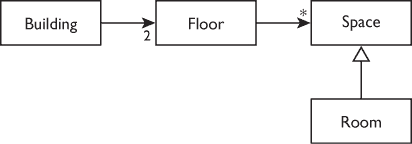

我们的任务是通过检查每个楼层和空间（还有门、窗户和走廊，但不管了）来确定建筑的几十个可评分特征。这些特征的得分由一组 C++ 类确定，每个类都必须遍历该数据结构以执行计算。

下面的 Ruby 代码展示了由于所有这些特征而可能产生的代码重复代码。

```ruby
class SpaceFeature
  def score(building)
    spaces = 0
    building.floors.each do |floor|
      floor.spaces.each do |space|
        spaces += 1
      end
    end
    spaces
  end
end

class AreaFeature
  def score(building)
    area = 0
    building.floors.each do |floor|
      floor.spaces.each do |space|
        area += space.width * space.length
      end
    end
    area
  end
end
```


你可以看出这个问题。嵌套循环是相同的，但循环体在每种情况下都是不同的。现在想象一下，如果在一个复杂得多的数据结构和遍历循环中，这种操作会重复几十次。

在现代语言中，我们可以通过 lambda（有时称为 `block`）来解决，如下：

```ruby
class Feature
  def do_score(building, block)
    value = 0
    building.floors.each do |floor|
      floor.spaces.each do |space|
        value = block.call(value, floor, space)
      end
    end
    value
  end
End

class SpaceFeature < Feature
  def score(building)
    do_score(building, ->(value, floor, space) {return value+1})
  end
end

class AreaFeature < Feature
  def score(building)
    do_score(building, ->(value, floor, space)
                       {return value + (space.width * space.length)})
  end
end
```

现在，遍历数据结构的循环只存在于 `Feature` 类中。如果对该数据结构进行了任何更改，很可能只需要更改该类。特定的特征（如 `SpaceFeature` 和 `AreaFeature`）可能不会受到此类更改的影响。

另一种技术是使用模板方法模式（TemplateMethod pattern）。

```ruby
class Feature
  def score(building)
    value = 0
    building.floors.each do |floor|
      floor.spaces.each do |space|
        value = score_space(value, floor, space)
      end
    end
    value
  end

  def score_space(value, floor, space)
    raise "Not Implemented"
  end
end

class SpaceFeature < Feature
  def score_space(value, floor, space)
    value+1
  end
end

class AreaFeature < Feature
  def score_space(value, floor, space)
    value + (space.width * space.length)
  end
end
```

实际上，我更喜欢这种方法而不是 lambda 解决方案——这是我们当年在 90 年代在 C++ 中使用的方法。那时我们称之为“只写一次循环”，因为《设计模式》（`Design Patterns`）书尚未出版。

我就留你们自己去查看策略模式（Strategy）和命令模式（Command）了。

### 偶然重复与本质重复

到目前为止，我们一直在讨论本质重复。但有时，两段代码看起来是重复的，而实际上并不是。那些是偶然重复。

本质重复是共同变化的。当其中一个发生变化时，所有的都会发生变化。它们共同演进。

偶然重复不会共同变化。它们是各自演进。因此，不将它们合并到一个公共函数中是非常关重要的。

你可以通过考虑单一责任原则（`SRP`）[8] 来区分偶然重复和本质重复。如果两段相似的代码位于两个对不同利益者（actors）负责的模块中，那么它们很可能会分开演进，因为这些利益者会提出不同的更改请求。如果你将它们提取到一个公共函数，那么当你尝试满足其中一个利益者的需求时，可能会破坏另一个利益者的系统。

[8] 参见第 19 章，“[SOLID 原则]”。

另一方面，如果两段相似的代码位于负责于同一个利益者的模块中，那么它们很可能会共同演进。如果你忘记更改其中一段，你就会破坏该利益者的系统。

### 副影响

在本书第一版编写后的这些里，随着函数式编程的兴起，“副作用”（`side effect`）一词的定义经历了转变。二十年前，大多数程序员认为，带有副作用的函数有一个主要目的，但顺便又做了一些其他事情。我在第一版中使用的示例是一个函数，它检查登录密码的有效性，但如果发现密码有效，还会初始化当前会话。

从那时起，这个定义被泛化了。现在，我们将副作用定义为任何生存周期比函数更长的状态更改，即使该状态更改是函数的要意图。换句话说，带有副作用的函数是不纯的。

例如，如果 `stack.pop()` 移除了栈 `stack` 顶部的第一个元素，那么它让该 `stack` 处于一个被改变的状态；该状态的改变就是副作用。

副作用为软件系统增加了复杂性，因为它们引入了一种隐蔽的耦合形式，被称为“时间耦合”（`temporal coupling`）——即时间上的耦合。带有副作用的语句通过状态的变化将其上方的代码与下面的代码隔离开。这种状态的变化意味着这些行代码的顺序必须保持不变。

所以，你不能在打开文件之前关闭它，如果它已经打开，你就不能打开它。你不能在获取信号量之前释放它。你不能在分配内存块之前释放它。你不能在拥有图形上下文之前释放它。以此类推。

副作用的函数通常成对出现，如 `open/close`、`seize/release` 或 `malloc/free`。一个创建副作用，另一个撤销它。所以副作用就像西斯（The Sith）：“黑暗面中，总有两个。”

### 我们不擅长这个

证明我们不擅长管理副作用的证据是，我们几乎所有的主流语言现在都具备了“垃圾收集”（`garbage collection`）。垃圾收集被加入到我们的语言中，以减轻我们清理内存的负担。你知道有多少种语言极力帮助程序员管理内存所有权？有多少种语言使用了引用计数、或 RAII[9]，或其他什么？为什么呢？因为我们这些可怜、脆弱的程序员似乎无法学会如何还掉图书馆借的书。

[9] 资源获取初始化（Resource Acquisition Initialization）——C++ 中旧 `auto_ptr`（现在是 `unique_ptr` 和 `shared_ptr`）设施的核心见解。

问题在于，像垃圾收集这样的设施只能解决我们必须对的许多西斯生物中的一种。我们没有针对文件描述符、图形上下文、信号量的垃圾收集，或者……我想你们你们明白意思了。我们不擅长这个。

当顺序很重要时，时间耦合会泄漏到代码的其他部分，产生像内存泄漏一样难以调试的情况。我相信你们一定遇到过……时间耦合是巨大的麻烦。那么我们如何避免它们呢？

#### 函数式语言

使用函数式语言可以避免很多副作用。这并不是万能药。使用函数式语言仍然可以创建时间耦合——但大多数函数式语言具有让你清楚自己何时创建它们的设施。

函数式语言抑制副作用的主要机制缺乏赋值语句。在函数式语言中，不允许更改变量的状态。事实上，函数式语言中没有变量。

你们中可能以前用过函数式语言，现在可能正由于沮丧而把这一页撕碎。请冷静。让我来解释。


函数式语言允许将名称分配给值。源代码看起来非常像赋值语句。然而，在严格的函数式语言中，虽然你可能重新为该名称赋值，但你不能覆盖该值。

例如，我在前段时间写的一段 Clojure 程序中发现了以下内容。

```
(defn update-clouds-age [ms world]
  (let [clouds (:clouds world)
        decay (Math/pow glc/cloud-decay-rate ms)
        clouds (map #(update % :concentration * decay) clouds)
        clouds (filter #(> (:concentration %) 1) clouds)
        clouds (doall clouds)]
    (assoc world :clouds clouds)))
```

`clouds` 这个名称被赋值并重新赋值了多次。然而，之前的值并没有被覆盖——它们仍然存在。`clouds` 这个名称并不代表一个被重新赋值所覆盖的内存槽。相反，四个版本的 `clouds` 指向四个保留其值的不同内存块。`clouds` 这个名称并不代表一个变量，因为没有东西发生变化。

现在，去拿些胶带来修补这个页面吧。

为什么函数式语言要防止覆盖值？因为覆盖是一种副作用。它通过状态的改变将其上方的行和下方的行隔离开。它创建了一种时间耦合。顺序至关重要。

当然，在使用函数式语言时仍然可以创建带有副作用的代码。大多数情况下，这是因为语言提供了此类操作的特殊设施。例如，Clojure 有一种称为 `atom` 的特殊数据类型，它代表一个可以使用一组特殊函数改变其值的变量。

而且，当然，仍然有具有副作用的操作系统设施。例如，文件仍然需要打开和关闭。

更通地说，可以使用函数式语言模拟任何系统——包括支持副作用的系统。例如，我可以在即使是最严格的函数式语言中编写 Lua 执行环境，然后用 Lua 编写具有显式副作用的程序。

现在，这并不是一本关于函数式编程的书，所以我不再打算详细写下了。简言之，使用函数式语言可以帮助你管理副作用；但它无法、也不会消除它们。

如果你想对这些问题进行更深入的讨论，我建议你阅读我的书籍《函数式设计》^(10)

10. [Functional Design].

## 面向对象的语言

最近针对面向对象编程语言（OOPLs）的一个大抱怨是，它们促进了副作用。很容易看出为什么这种抱怨会引起共鸣。对象是状态的容器，对象的方法经常改变其状态，导致副作用和时间耦合。

然而，人们经常没有讨论的一个事实是，OOPLs 具有非常好的设施来抑制和隐藏副作用。例如，考虑这个在 C++ 中简单且刻意的例子。

```cpp
#include <iostream>
#include <fstream>
#include <string>
using namespace std;

class LineCounter {
  public:
   static int count(const char* fileName);
  private:
   static int nLines;
   static ifstream file;

   static void initialize(const char* fileName);
   static void countTheLines();
   static int finalize();
};

int LineCounter::nLines;
ifstream LineCounter::file;

void LineCounter::initialize(const char* fileName) {
  nLines = 0;
  file.open(fileName);
}

void LineCounter::countTheLines() {
  string line;
  while (getline (file, line))
    nLines++;
}

int LineCounter::finalize() {
  file.close();
  return nLines;
}

int LineCounter::count(const char* fileName) {
  initialize(fileName);
  countTheLines();
  return finalize();
}
```

我希望你在这个例子中注意到，`LineCounter` 中的每一个私有方法都有副作用；但调用它们的唯一公共方法没有。这意味着 `LineCounter` 是线程线程的。假设是单线程的，副作用被完全隐藏了。

大多数 OOPLs 的设施提供了一种方便的方法来隐藏副作用，从而防止时间耦合泄漏到整个应用程序中。

## 结构化编程

1968 年，埃德格·迪杰斯特（Edsger Dijkstra）写了一篇论文，在编程界引起动了十年之久。在那个年代，他在文中表达的观点极具争议。有些人认为他是疯子，有些人则认为他是神。

但到了 80 年代，迪杰斯特简单的结构化编程思想得到了广泛接受。到了 90 年代，很难找到允许其他风格的语言。

这篇论文的标题是《Go 语句是有害的》，发表在 1968 年 3 月份的《ACM 学报》上。标题是编辑给出的：尼克劳拉斯·维特^(11)

11. Pascal 语言的发明者。

这篇论文背后的思想非常简单。所有程序应该只使用三种结构：序列、选择和迭代。

迪杰斯特说，所有程序应该组织成具有单一入口和单一出口的递归单元。这些单元有种类。

### 序列

序列是两个（或多个）顺序执行的单元。每个这样的单元在顶部只有一个入口，底部只有一个出口。一个单元可能是一个简单的语句，如 `i=0;`，也可以是一个函数调用或它自己的单元序列。


### 选择

选择是一个布尔谓词，选择下方的两个单元之一。谓词可以是任何布尔表达式，例如 `i<0`。

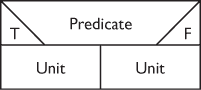

### 迭代

迭代是一个谓词，在谓词为假之前执行其下方的单元。


这些单元可以递归地应用于程序，如下：

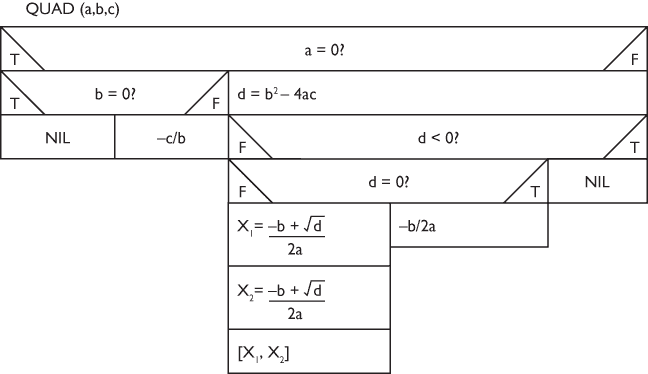

这种图表风格被称为 *Nassi–Schneiderman 流程图*。该图本身描述了控制流通过二次方程求解器的过程。


在编写整洁函数时，在脑中记住这三种结构的递归应用是有帮助的。

## 时刻记住这些点是不可能的

写软件就像任何其他形式的写作一样。当你写论文或文章时，你先是把想法写下来，然后对其进行推敲，直到它读起来通顺。初稿可能是笨拙且乱无章的，所以你对其进行润色、重构和精炼，直到它读起来达到你想要的效果。

当我写函数时，它们写出来的代码往往又长又复杂。它们有大量的缩进和嵌套循环。它们有很长的参数列表。名称是随意的，而且还有重复代码和时间耦合。但我拥有一套单元测试，涵盖了那些每一行笨拙的代码。

于是，我对这些代码进行推敲和精炼，拆分函数、更改名称、消除重复，并让我的函数更纯粹。我收减方法的规模并重新排序。有时我甚至会拆分出整个`classes`，同时始终保持测试通过。

最终，我得到的函数遵循我在最后两个章节中设定的属性和启发式。我并不是一开始就那样写的。我认为没有人能做到这一点。

首先，让它运行。然后，让它正确。

### 结论

每个系统都是由程序员设计的用于描述该系统的领域特定语言（DSL）构建的。函数是这种语言的动词，而上下文（contexts）是名词。这是一个古老的真理：编程艺术是、并且一直是语言设计的艺术。

大师级程序员将系统视为要讲述的故事，而不是要编写的程序。他们利用所选编程语言的功能，构建出一种更丰富、更具表现力的语言，用来讲述那个故事。这种领域特定语言的一部分，是描述系统内发生的所有动作的函数层次结构。在一种艺术化的递归中，这些动作被编写为使用它们自身定义的领域特定语言来讲述它们在故事中的一小部分。

最后两个章节是关于如何写好函数的机制。如果你遵循了这里的观点，你的函数将是短小的、命名良好的且组织得当。但永远不要忘记，你的真实目标是讲述系统的故事，而你写的函数需要整洁地组合成一种清晰、精确的语言，以帮助你完成这个讲述。

## 9

# 整洁方法


我们如何写软件？如今，当然我们大多数人都是坐在笔记本前并在`IDE`中打字。我们在一个循环中运行。

1. 我们写一小段代码（可能有`AI`的帮助）。
2. 我们编译并测试它。
3. 我们回到步骤 1。

这个循环所需的时间可能从五秒到一小时不等，取决于你遵循的纪律。

当然，过去不是那样的。在编程的早期，这个循环更像这样：

1. 我们手写一大段代码。
2. 我们手工对其进行桌面检查。
3. 我们将其提交并编码——手动地——成机器可读的形式。
4. 我们提交它进行编译和测试。

那个循环通常需要一到三天。区别是巨大的。在过去，每行代码的投入是巨大的。而现在，那种成本是微不足道的。

当成本很高时，我们会花费大量时间进行前期规划以避免浪费。当成本很小时，通过失败来探索似乎更有意义。在这两种情况下，清理代码的想法通常都被忽视了。

### 让它正确

在早期，清理代码是不方便的，因为代码是在纸上上手写的。擦除、剪切和粘贴纸张效率低下，而且一点也不有趣——尤其是当微小的变化会以非常不便的方式遍整个代码主体时。

如今，通过我们的`IDEs`和重构工具，清理代码已经变得方便得多了。但我们经常跳过清理代码，因为那个紧凑的循环让我们进展得如此快，以至于停下来清理代码看起来像是在浪费时间。我们拼命让代码运行——然后我们提交代码并跳到下一个问题。

二十多年前，肯特·贝克（Kent Beck）提出了指导这本书的简单规则。

*首先，让它运行。*

*然后，让它正确。*

这条规则还有更多内容，我们稍后会讨论。现在，只需看这两行即可。我们大多数人执行第一部分是因为我们认为那是我们被雇佣的原因。我们被雇佣是为了让代码运行。但我们中的许多人跳过了第二部分，因为这看起来像是浪费时间。毕竟，如果我们是优秀的程序员，我们应该一直编写正确的代码。我们本不需要停下来让它正确。

也许你就是那么优秀。也许你指尖流出的代码第一次和每一次都是正确的。如果是这样，你大可以放下这本书了。

然而，我们大多数人并不特别擅长在脑中同时记住两个目标。让代码运行的首要目标会挤掉让代码正确的次要目标。我们大多数人发现，让代码运行起来所需的心理精力是如此巨大，以至于我们没有剩余的精力来同时让代码正确。

因此，当我们让代码运行后，代码也变成了一团糟。这时，贝克规则的第二行派上用场了。一旦我们让代码运行，我们就有精力去清理它——让它正确。

我们如何确保在编写代码时不会破坏代码？如果我们没有可以快速运行且能证明代码工作的测试套件，我们就不会进行大量的清理。

*整洁的代码取决于快速、方便且全面的测试。*

那么我们如何让代码正确？流程是什么？它是与编写代码类似的紧凑循环。

1. 我们清理一个小点。
2. 我们运行测试。
3. 如果测试失败，我们回滚。
4. 回到步骤 1。

这个循环的时间通常在五秒到两分钟之间。这个循环的名字是重构，每一个清理步骤都是重构。

我们应该在编写循环和重构循环之间切换多久？频繁越好。这暗示了一个包含让它运行的循环和让它正确的循环的外层循环。

1. 让一小部分运行起来。
    a. 我们写一小段代码以及测试。
    b. 我们编译并测试它。
    c. 如果它不是太乱，我们回到步骤 1a。否则……
2. 清理它。
    a. 我们清理一个小点。
    b. 我们运行测试。
    c. 如果测试失败，我们回滚并回到步骤 2a。
    d. 如果还有要清理，我们回到步骤 2a。否则……
3. 回到步骤 1。

这个循环的时间取决于你的测试纪律，通常是几分钟到一小时左右。

结论是，除非你是一个多才多艺的超级人类，否则编写整洁的代码意味着坐在那个外层循环中，耐心地收拾自己的残局，绝不允许混乱扩大到无法收拾的地步。

像寿司师一样，永不停止制作寿司，永不停止清洁器具和环境。


或许理解如何编写整洁代码最好的方法就是观察他人编写。因此，在本章中，我们将演示编写一个整洁模块的过程。该技术将涉及：

*   `TDD` 测试纪律
*   `Refactoring` 重构
*   设计准则
*   设计模式

我们将从一个虚拟的 Python 应用开始：为虚构的国家 `Bobolia` 设计的 `Tax Calculator`（税务计算器）。我已经很久没写过 Python 了，请多包涵。

这是第一个测试。

```python———bobolia_taxes_test.py———
import unittest
import bobolia_taxes

class bobolia_tax_tests(unittest.TestCase):
    def test_simplest_case(self):
        tax_return = {"income": {"salary": 50000}}
        tax_calculator = bobolia_taxes.tax_calculator(tax_return)
        self.assertEqual(7500, tax_calculator.get_tax())

if __name__ == '__main__':
    unittest.main()
```

在 Bobolia 大国，基础税率为 `15%`。因此，年入 50,000 bobbles 的必须缴纳 7,500 bobbles 的税。注意，纳税表是一个简单的映射，包含一个 `income` 键，该键包含另一个带有 `salary` 键的映射。

我们可以通过一个简单的退化模块让它通过。

```python———bobolia_taxes.py———
class tax_calculator:
    def __init__(self, tax_return):
        self.tax_return = tax_return

    def get_tax(self):
        return 7500
```

实际上，我先通过返回 `0` 让它失败，然后通过返回 `7500` 让它通过。这就是 `TDD` 的方法：首先我们看到测试失败，然后让它通过。如果这听起来像是在浪费时间，请允许我说这种简单的实践为我节省了大量的调试时间。

但让我们来看下一条税法。Bobolia 的年收入不超过 30,000 bobbles 的公民不需要缴纳任何税。

```python———bobolia_taxes_test.py———
class BoboliaTaxTests(unittest.TestCase):
    def setUp(self):
        self.tax_calculator = bobolia_taxes.TaxCalculator()

    def test_simplest_case(self):
        tax_return = {"income": {"salary": 50000}}
        self.assertEqual(7500, self.tax_calculator.get_tax(tax_return))

    def test_30K_limit(self):
        tax_return = {"income": {"salary": 30000}}
        self.assertEqual(0, self.tax_calculator.get_tax(tax_return))
```

在这里你可以看到我已经开始进行一些设计更改。我没有使用 `tax_return` 来构造 `TaxCalculator`，而是决定将 `tax_return` 传入 `get_tax` 函数。我还更改了类名以符合 `PEP 8` 标准。

让这些测试通过非常简单。

```python———bobolia_taxes.py———
class TaxCalculator:
    def __init__(self):
        pass

    def get_tax(self, tax_return):
        total_income = tax_return["income"]["salary"]
        if total_income > 30000:
            return total_income * 0.15
        return 0
```

现在，显然这不公平。你不能让一个年入 30,001 bobbles 的公民缴纳 4,500 的税。因此，任何公民的税后收入不应低于 30,000。

```python———bobolia_taxes_test.py———
class BoboliaTaxTests(unittest.TestCase):
    def setUp(self):
        self.tax_calculator = bobolia_taxes.TaxCalculator()

    def test_15pct_tax_rate(self):
        tax_return = {"income": {"salary": 50000}}
        self.assertEqual(7500, self.tax_calculator.get_tax(tax_return))

    def test_no_tax_for_30K_and_below(self):
        tax_return = {"income": {"salary": 30000}}
        self.assertEqual(0, self.tax_calculator.get_tax(tax_return))

    def test_no_after_tax_income_less_than_30K(self):
        tax_return = {"income": {"salary": 30001}}
        self.assertEqual(1, self.tax_calculator.get_tax(tax_return))
        tax_return = {"income": {"salary": 35000}}
        self.assertEqual(5000, self.tax_calculator.get_tax(tax_return))
```

这并不意外。我改进了测试的名称。命名的改进通常在你更深入了解正在编写的应用程序后就会发生。让这些测试通过还是容易的，尽管这迫使我稍微移动了大部分旧代码。

```python———bobolia_taxes.py———
# wait, the logic needs `tax_return` in `get_tax`
def get_tax(self, tax_return):
    total_income = tax_return["income"]["salary"]
    tax = total_income * 0.15
    after_tax_income = total_income - tax
    if after_tax_income < 30000:
        tax = total_income - 30000
    # ... logic to follow
```


[content]

```python
———bobolia_taxes.py———
def get_tax(self, tax_return):
    total_income = tax_return["income"]["salary"]
    tax = self.determine_base_tax(total_income)
    tax += self.determine_badbob_adjustment(tax_return)
    return tax

def determine_badbob_adjustment(self, tax_return):
    return sum(tax_return["badbobs"]["class1"]) / 2

def determine_base_tax(self, total_income):
    tax = total_income * 0.15
    after_tax_income = total_income - tax
    if after_tax_income < 30000:
        tax = total_income - 30000
    return tax
```

这样好了一点。我不确定为什么要把这些函数放进一个类里。这个 `class` 只是在强迫我在每一处都添加 `self`。也许我应该删掉这个 `class`——但我有一种挥之不去的感，这个 `class` 将会很重要，即使仅仅是为了命名空间。

也许那个 `class` 会派派用用场，允许方法通过实例变量而不是参数进行通信。让我们试试看。

```python
———bobolia_taxes.py———
class TaxCalculator:
    def __init__(self):
        self.tax_return = None

    def get_tax(self, tax_return):
        self.tax_return = tax_return
        tax = self.determine_base_tax()
        tax += self.determine_badbob_adjustment()
        return tax

    def determine_badbob_adjustment(self):
        return sum(self.tax_return["badbobs"]["class1"]) / 2

    def determine_base_tax(self):
        total_income = self.tax_return["income"]["salary"]
        tax = total_income * 0.15
        after_tax_income = total_income - tax
        if after_tax_income < 30000:
            tax = total_income - 30000
        return tax
```

我觉得这样好了一点。我打算保留这个 `class`。

博波利亚州（The Great State of Bobolia）认为购买汽油车辆对社会非常有害。此类购买行为以每每个 bobble 一个 badbob 的速率获得 2 类 badbobs。2 类 badbobs 根据下表增加税收：

| 2 类 badbobs | 总收入的百分比 |
| --- | --- |
| 1,001–10,000 | 5% |
| 10,001–50,000 | 10% |
| >50,000 | 15% |

```python
———bobolia_taxes_test.py———

def make_return(args):
    tax_return = {"income": {"salary": 0},
                  "badbobs": {"class1": (),
                              "class2": ()}}
    if "income" in args:
        tax_return["income"].update(args["income"])
    if "badbobs" in args:
        tax_return["badbobs"].update(args["badbobs"])
    return tax_return

class BoboliaTaxTests(unittest.TestCase):
    …
    def test_class_2_badbob_purchases_under_1001(self):
        tax_return = make_return({"income": {"salary": 50000},
                                  "badbobs": {"class2": (400, 600)}}
                                 )
        self.assertEqual(7500, self.tax_calculator.get_tax(tax_return))

    def test_class_2_badbob_purchases_under_10001(self):
        tax_return = make_return({"income": {"salary": 50000},
                                  "badbobs": {"class2": (10000,)}}
                                 )
        self.assertEqual(7500 + 2500,
                         self.tax_calculator.get_tax(tax_return))

    def test_class_2_badbob_purchases_under_50001(self):
        tax_return = make_return({"income": {"salary": 50000},
                                  "badbobs": {"class2": (10000,40000)}}
                                 )
        self.assertEqual(7500 + 5000,
                         self.tax_calculator.get_tax(tax_return))

    def test_class_2_badbob_purchases_over_50000(self):
        tax_return = make_return(
          {"income": {"salary": 50000},
           "badbobs": {"class2": (10000,40000,1000)}}
          )
        self.assertEqual(7500 + 7500,
                         self.tax_calculator.get_tax(tax_return))
```

这些测试清楚地展示了表格中的四个条目。我逐个让这些测试通过，最终得到了以下生产环境代码。

```python
———bobolia_taxes.py———
class TaxCalculator:
    def __init__(self):
        self.tax_return = None
        self.total_income = None

    def get_tax(self, tax_return):
        self.tax_return = tax_return
        tax = self.determine_base_tax()
        tax += self.determine_badbob_adjustment()
        return tax

    def determine_badbob_adjustment(self):
        class1 = sum(self.tax_return["badbobs"]["class1"])
        class2 = sum(self.tax_return["badbobs"]["class2"])
        # 这里的逻辑根据提供的碎片化文本进行了简化
        return class1 / 2 # 占符

    def determine_base_tax(self):
        total_income = self.tax_return["income"]["salary"]
        tax = total_income * 0.15
        after_tax_income = total_income - tax
        if after_tax_income < 30000:
            tax = total_income - 30000
        return tax
```

这非常糟糕。我预计所有数字都会改变。我预计表格中的行数也会改变。

```python
———bobolia_taxes.py———
class TaxCalculator:
    …
```


但现在我们遇到了一个问题。如果一个公民为了买一辆贵汽车而储蓄，他们最终面临的税率可能会使其税后收入显著少于 30,000 波布（bobbles）。从某种意义上说，这是公平的。危害社会的公民应该对这种损害进行补偿。另一方面，强迫一个公民每年生活低于（例如）20,000 波布是残忍的。因此，让我们限制 `badbobs` 的影响，使得任何 `badbob` 调整都不会让税后收入降至 20,000 波布以下。

```python
———bobolia_taxes_test.py
…
def test_badbobs_do_not_reduce_after_tax_income_below_20000(self):
    tax_return = make_return({"income": {"salary": 20000},
                              "badbobs": {"class2": (10000,)}}
                             )
    self.assertEqual(0, self.tax_calculator.get_tax(tax_return))
```

这以一种意想不到的方式失败了。它返回了 −9,000 波布的税额。负税！我打赌公民们会喜欢那个。另一方面，波波利亚税务局（BRS）可不会高兴的。这是一个 Bug。我通过添加一个守护条件修复了它。

```python
———bobolia_taxes.py
…
def determine_base_tax(self):
    self.total_income = self.tax_return["income"]["salary"]
    if self.total_income <= 30000:
        return 0
…
```

是的，TDD 并不是万灵药。你仍然会写出一些 Bug。幸运的是，如例所示，其他测试可能会发现这些 Bug。修复它们后，我可以很容易地让测试通过。

```python
———bobolia_taxes.py
…
def get_tax(self, tax_return):
    self.tax_return = tax_return
    base_tax = self.determine_base_tax()
    badbob_adjustment = BadBobAdjuster(self).get_adjustment()
    total_tax = base_tax + badbob_adjustment
    after_tax_income = self.total_income - total_tax
    if self.total_income < 20000:
        return 0
    elif after_tax_income < 20000:
        total_tax = self.total_income - 20000
    return total_tax
```

我刚刚添加的两个守护条件有点丑陋。我觉得我可以直接使用 `max` 函数。

```python
———bobolia_taxes.py
…
    def get_tax(self, tax_return):
        self.tax_return = tax_return
        base_tax = self.determine_base_tax()
        badbob_adjustment = BadBobAdjuster(self).get_adjustment()
        total_tax = base_tax + badbob_adjustment
        after_tax_income = self.total_income - total_tax
        if after_tax_income < 20000:
            total_tax = max(0, self.total_income - 20000)
        return total_tax

    def determine_base_tax(self):
        self.total_income = self.tax_return["income"]["salary"]
        tax = self.total_income * 0.15
        after_tax_income = self.total_income - tax
        if after_tax_income < 30000:
            tax = max (0, self.total_income - 30000)
        return tax
```

这样好多了。

现在……一年过去了，每个人都在交税。但在经历了一些动乱和一些非常刻薄的推文后，我们决定在波波利亚大国（The Great State of Bobolia），收入不平等是一种社会危害。低收入者付得太多，而高收入者付得太少。赚波布太多的人应该比比收入更少的人缴纳更高的税率。我们确定下表代表了他们的“公平份额”：

| 收入 | 税率 |
| --- | --- |
| 0–30,000 | 0% |
| 30,001–100,000 | 超过 30,000 部分的 15% |
| 100,001–250,000 | 10,500 + 超过 100,000 部分的 20% |
| 250,001–500,000 | 40,500 + 超过 250,000 部分的 30% |
| >500,000 | 115,500 + 超过 500,000 部分的 40% |

当然，这改变了税的计算方式，因此我们之前的许多测试将需要删除或修改。由于我们大多数测试都使用 50,000 的薪资，让我们为 50,000 的税额创建一个常量，命名为 `tax_50K`，然后在所有测试中使用它。这样，如果税收计算再次发生变化，我们只需要更改常量即可。

```python
———bobolia_taxes_test.py
…
tax_50K = 3000
class BoboliaTests(unittest.TestCase):
    def setUp(self):
        self.tax_calculator = bobolia_taxes.TaxCalculator()
        self.tax_return = None

    def make_return(self, args):
        self.tax_return = {"income": {"salary": 50000}, "badbobs": {}}
        if "income" in args:
            self.tax_return["income"].update(args["income"])
        if "badbobs" in args:
            self.tax_return["badbobs"].update(args["badbobs"])
        return self.tax_return

    def get_tax(self, salary):
        self.tax_return = {"income": {"salary": salary}, "badbobs": {}}
        return self.tax_calculator.get_tax(self.tax_return)

    def test_badbobs_do_not_reduce_after_tax_income_below_20000(self):
        tax_return = make_return({"income": {"salary": 20000},
                              "badbobs": {"class2": (10000,)}})
        self.assertEqual(0, self.tax_calculator.get_tax(tax_return))

    def test_0_30_bracket(self):
        self.assertEqual(0, self.get_tax(10000))
        self.assertEqual(0, self.get_tax(30000))

    def test_30_100_bracket(self):
        self.assertEqual(0, self.get_tax(30001))
        self.assertEqual(tax_50K, self.get_tax(50000))
        self.assertEqual(10500, self.get_tax(100000))

    def test_100_250_bracket(self):
        self.assertEqual(10500, self.get_tax(100001))
        self.assertEqual(30500, self.get_tax(200000))
        self.assertEqual(40500, self.get_tax(250000))

    def test_250_500_bracket(self):
        self.assertEqual(40500, self.get_tax(250001))
        self.assertEqual(115500, self.get_tax(500000))

    def test_500_up_bracket(self):
        self.assertEqual(115500, self.get_tax(500001))
        self.assertEqual(315500, self.get_tax(1000000))
```


```python
———bobolia_taxes.py———…
def determine_base_tax(self):
    self.total_income = self.tax_return["income"]["salary"]
    if self.total_income <= 30000:
        return 0
    elif self.total_income <= 100000:
        return round(0.15 * (self.total_income - 30000))
    elif self.total_income <= 250000:
        return round(0.2 * (self.total_income - 100000) + 10500)
    elif self.total_income <= 500000:
        return round(0.3 * (self.total_income - 250000) + 40500)
    else:
        return round(0.4 * (self.total_income - 500000) + 115500)
…
```

这些测试相当糟糕。让我们通过组合断言来清理它们。

```python
———bobolia_taxes_test.py———    …
    def assert_tax_with_badbobs(self, income, badbobs, tax):
        self.make_return({"income": {"salary": income},
                          "badbobs": badbobs})
        self.assertEqual(tax, self.get_tax())

    def test_class_1_badbobs(self):
        self.assert_tax_with_badbobs(50000,
                                     {"class1": (100,)},
                                     tax_50K + 50)

    def test_class_2_badbob_purchases_under_1001(self):
        self.assert_tax_with_badbobs(50000,
                                     {"class2": (400, 600)},
                                     tax_50K)

    def test_class_2_badbob_purchases_under_10001(self):
        self.assert_tax_with_badbobs(50000,
                                     {"class2": (10000,)},
                                     tax_50K + 2500)

    def test_class_2_badbob_purchases_under_50001(self):
        self.assert_tax_with_badbobs(50000,
                                     {"class2": (10000, 40000)},
                                     tax_50K + 5000)

    def test_class_2_badbob_purchases_over_50000(self):
        self.assert_tax_with_badbobs(50000,
                                     {"class2": (10000, 40000, 1000)},
                                     tax_50K + 7500)

    def test_badbobs_do_not_reduce_after_tax_income_below_20000(self):
        self.assert_tax_with_badbobs(20000,
                                     {"class2": (10000,)},
                                     0)

    def assert_tax_for(self, income, tax):
        self.make_simple_return(income)
        self.assertEqual(tax, self.get_tax())

    def test_0_30_tax_bracket(self):
        self.assert_tax_for(15000, 0)
        self.assert_tax_for(30000, 0)

    def test_30_100_tax_bracket(self):
        self.assert_tax_for(30001, 0)
        self.assert_tax_for(50000, tax_50K)
        self.assert_tax_for(100000, 10500)

    def test_100_250_tax_bracket(self):
        self.assert_tax_for(100001, 10500)
        self.assert_tax_for(200000, 30500)
        self.assert_tax_for(250000, 40500)

    def test_250_500_tax_bracket(self):
        self.assert_tax_for(250001, 40500)
        self.assert_tax_for(500000, 115500)

    def test_500_up_tax_bracket(self):
        self.assert_tax_for(500001, 115500)
        self.assert_tax_for(1000000, 315500)
…
```

这样好多了。如果需要，这些测试现在可以转变为参数化（表格驱动）测试——但我认为我们还没到那一步。

另一方面，生产环境代码急需一种表格驱动的方法。你不认为我们还没看到税率档的最后变化吧？所以让我们处理一下这个问题。

```python
———bobolia_taxes.py…
def determine_base_tax(self):
    tax_brackets = ((30000, 0),
                    (100000, .15),
                    (250000, .20),
                    (500000, .30),
                    (None, .40))

    self.total_income = self.tax_return["income"]["salary"]

    previous_maximum = 0
    offset = 0
    for maximum, rate in tax_brackets:
        if maximum is None or self.total_income <= maximum:
            return round(
              rate *
              (self.total_income - previous_maximum) +
              offset)
        else:
            offset = (maximum - previous_maximum) * rate + offset
            previous_maximum = maximum
…
```

好了，这样好多了。任何新档位都可以轻松添加。


```python
———bobolia_taxes_test.py———
…
def make_return(self, args):
    tax_return_data = {"income": {"salary": 0},
                       "badbobs": {"class1": (),
                                   "class2": ()}}
    if "income" in args:
        tax_return_data["income"].update(args["income"])
    if "badbobs" in args:
        tax_return_data["badbobs"].update(args["badbobs"])
    self.tax_return = bobolia_taxes.TaxReturn(tax_return_data)
…

———bobolia_taxes.py———
class TaxCalculator:
    def get_tax(self, tax_return):
        total_income = tax_return.get_total_income()
        base_tax = TaxBracketter(tax_return).determine_base_tax()
        badbob_adjustment = BadBobAdjuster(tax_return).get_adjustment()
        total_tax = base_tax + badbob_adjustment
        after_tax_income = total_income - total_tax
        if after_tax_income < 20000:
            total_tax = max(0, total_income - 20000)
        return total_tax

class TaxBracketter:
    tax_brackets = ((30000, 0),
                    (100000, .15),
                    (250000, .20),
                    (500000, .30),
                    (None, .40))

    def __init__(self, tax_return):
        self.tax_return = tax_return

    def determine_base_tax(self):
        total_income = self.tax_return.get_total_income()

        previous_maximum = 0
        offset = 0
        for maximum, rate in self.tax_brackets:
            if maximum is None or total_income <= maximum:
                return round(rate *
                            (total_income - previous_maximum) +
                            offset)
            else:
                offset = (maximum - previous_maximum) * rate + offset
                previous_maximum = maximum

class BadBobAdjuster:
    def __init__(self, tax_return):
        self.tax_return = tax_return
        self.total_income = tax_return.get_total_income()

    def get_adjustment(self):
        class1_adjustment = self.class1_adjustment()
        class2_adjustment = self.get_class2_badbob_adjustment()
        return class1_adjustment + class2_adjustment

    def get_class2_badbob_adjustment(self):
        class2 = self.tax_return.get_total_class2_badbobs()
        class2_rate = self.get_class2_rate(class2)
        return class2_rate * self.total_income

    class2_table = ((1001, 0),
                    (10001, 0.05),
                    (50001, 0.1),
                    (None, 0.15))

    def get_class2_rate(self, class2):
        for limit, rate in self.class2_table:
            if limit is None or class2 < limit:
                return rate
        return None

    def class1_adjustment(self):
        class1 = self.tax_return.get_total_class1_badbobs()
        return class1 / 2

class TaxReturn:
    def __init__(self, tax_return_data):
        self.tax_return_data = tax_return_data

    def get_total_income(self):
        return self.tax_return_data["income"]["salary"]

    def get_total_class1_badbobs(self):
        return sum(self.tax_return_data["badbobs"]["class1"])

    def get_total_class2_badbobs(self):
        return sum(self.tax_return_data["badbobs"]["class2"])
```

此时，你可能会指责这种设计患有“类过载”（classitis）——即创建过多类从而增加设计复杂倾向。我不赞同。这三个新类并没有增加任何原本不存在的复杂度，它们只是将这些复杂度移动到了命名良好的地方。

[2]. `APOD`, p. 26.

*万物皆有其，各就其位！*

`TaxReturn` 类的一个主要优势是，它向应用程序的其他部分隐藏了 `tax_return_data` 的内部数据结构。当该数据结构发生变化时，应用程序中的其他模块不需要修改。

无论如何，这些类的优势很快就会显现出来；因为是时候让我们后退一步，思考这个系统的整体架构了。

在我看来，目前这个系统有两个变化轴。一个是由 `TaxBracketter` 执行的基础税额计算；另一个是由 `BadBobAdjuster` 完成的社会惩罚得分计算。如果我们期望这个系统增长（哪种税收系统不会增长呢？），那么我们可能希望这样做。


```python
———tax_bracketter.py———
class TaxBracketter:
    tax_brackets = ((30000, 0),
                    (100000, .15),
                    (250000, .20),
                    (500000, .30),
                    (None, .40))

    def determine_base_tax(self, tax_return):
        total_income = tax_return.get_total_income()

        previous_maximum = 0
        offset = 0
        for maximum, rate in self.tax_brackets:
            if maximum is None or total_income <= maximum:
                return round(rate *
                             (total_income - previous_maximum) +
                             offset)
            else:
                offset = (maximum - previous_maximum) * rate + offset
                previous_maximum = maximum

———badbob_adjuster.py———
class BadBobAdjuster:
    def __init__(self):
        self.total_income = None
        self.tax_return = None

    def get_adjustment(self, tax_return):
        self.tax_return = tax_return
        self.total_income = tax_return.get_total_income()
        class1_adjustment = self.class1_adjustment()
        class2_adjustment = self.get_class2_badbob_adjustment()
        return class1_adjustment + class2_adjustment

    def get_class2_badbob_adjustment(self):
        class2 = self.tax_return.get_total_class2_badbobs()
        class2_rate = self.get_class2_rate(class2)
        return class2_rate * self.total_income

    class2_table = ((1001, 0),
                    (10001, 0.05),
                    (50001, 0.1),
                    (None, 0.15))

    def get_class2_rate(self, class2):
        for limit, rate in self.class2_table:
            if limit is None or class2 < limit:
                return rate
        return None

    def class1_adjustment(self):
        class1 = self.tax_return.get_total_class1_badbobs()
        return class1 / 2
```

### 结论

这代码整洁吗？我对它相当满意，尽管我并不是一个 Python 程序员，所以我可能违反了许多规范，并且可能没有使用最有效的技术。尽管如此，我认为一些主要目标已经实现了。我们将系统分成了至少四个主要组件：`main`、`TaxCalculator`、`TaxBracketter` 和 `BadBobAdjuster`。并将这些组件放置在适当的架构边界之后。

我们的测试经受了大量的变化，并证明了它们的韧性。我们的基础算法也是如此。对其中一个的更改极不太可能影响其他。我们还通过使用表格来驱动算法，内置了一些灵活性。

随着测试变得越来越具体，生产代码也变得更加通用。

有些人可能会对这些命名有有意见。我不知道，我挺喜欢 `TaxBracketter` 和 `BadBobAdjuster` 的。但如果你玩这些代码，可能会发现更好的名字。

尽管存在一个拼写错误。

我必须说，我对 IntelliJ 的 Python 插件以及 Copilot 帮助超过 20 年没写过 Python 的能力非常满意。我也必须说，测试的响应速度令我印象深刻。我习惯了 JVM 的启动时间，在手指离开测试按钮之前，测试结果就出现在屏幕上，这是一种享受。

## 10

# 一件事


你还记得比雅尼·斯特拉斯鲁（Bjarne Stroustrup）说过整洁的代码吗？他说：“整洁的代码只做好一件事。”事实上，多年来许多其他软件作者也说过类似的话。这句话的问题在于：*一件事*是什么意思？

正如我在前面的章节中提到的，我曾负责过一个长 3000 行的 C 函数。它名为 `gi`，代表*图形解释器*（graphic interpreter）。如果有人质疑我这个 3000 行的函数是否只做一件事，我会自信地回答：“当然了！它解释图形。”

当然，一个 3000 行的函数在解释图形时必须在做很多*事情*。我深信解释图形的问题可以拆分为相当许多*事情*。

那么我们如何解决这个问题呢？如果我们要遵循这条建议，就必须对*一件事*有一个合理的定义。我认为我知道那个定义是什么，我现在就告诉你。

但是，正如《银河系漫游指南》（*Hitchhiker’s Guide to the Galaxy*）中的深度思考所说：“你不会喜欢的。”

### 提取方法重构

你的 IDE 有*重构*（Refactor）菜单吗？我的就有。。其中一个菜单项是*提取方法*（Extract Method）。IDE 拥有这个菜单项已经二十多年了。我确定你们都用过它。但以防万一，我来为你描述一下。

（注：原文中此部分存在大量重复段落，已按要求保留核心内容翻译）


因此，你的大多数函数将会非常小。小到什么程度？几行。这个数字可能是三行、四行或六行。对于某些 `switch` 语句、某些格式化语句或某些语言来说，它可能会更大。但通常情况下，遵循这一建议会让你创建许多小函数。

那么你会提取什么呢？你通常会提取 `if`/`else` 语句以及 `for`/`while` 循环的体。你很可能还会从这些语句中提取谓词（predicates），使得这些语句本身将只由关键字和函数调用所组成。

例如：

``````
if (shouldDeleteRecord(r))
  deleteRecord(r);
```

如果你仔细阅读这段代码，你会发现它读起来就像是写得良好的散文。

## 这不应该有争议

多年来，这条自本本书第一版的特定建议一直是最有争议的。但为什么呢？有许多原因。

1. 人们担心，如果他们遵循了这条规则，他们就会淹没在微小函数的海洋中。
2. 人们担心，遵循这条规则会模糊函数的意图，因为他们无法在一个地方看到全部。
3. 人们担心调用所有那些微小函数的性能开销会导致应用程序运行得像冬天的糖浆一样缓慢。
4. 人们认为他们将不得不在各个函数之间跳来跳去，才能理解任何内容。
5. 人们担心生成的函数会太纠缠而无法孤立地理解。

让我们一个一个来解决这些问题。

### 1. 淹没

很久以前，我们的语言非常原始。例如，FORTRAN 的第一个版本允许你写一个函数。而且它不被称为函数。它只被称为程序。当时没有模块，没有函数，也没有子程序。正如我所说，它是原始的。

COBOL 也没好到哪。你可以使用 `goto` 语句在各个段落（paragraph）之间跳跃；但那种可以带参数调用的函数思想在十年后才出现。

当 Algol 以及随后的 C 出现时，函数的思想像浪波般向我们袭来。突然之间，我们可以创建可以单独编译的模块。模块化编程风靡一时。正如软件中的所有事物一样，它被严重滥用了。有些经理坚持任何模块都不应超过 500 字节。因此，程序员被迫在模块末尾放置一个 `goto` 来调用下一个模块。

但随着时间的推移，我们的程序变得越来越大，我们开始意识到函数是不够的。我们的名称开始冲突。我们在保持名称唯一性方面遇到了困难。而且我们真的不喜欢在每个名称前加上其模块的名称。我的意思是，没有人喜欢 `io_files_open` 这样的函数名。

所以，我们在语言中添加了类和命名空间。这些为我们提供了带有名称的小储隔间（cubbyholes），我们可以在其中放置函数和变量。此外，这些命名空间和类很快变成了层级结构。我们可以在命名空间中编写函数，而命名空间内部还可以嵌套命名空间。

这就是对“微小函数海洋”恐惧的解决方案。你不会淹没在那片海洋中，因为那里不会有海洋。相反，你将拥有一个组织良好、命名良好的命名空间和类的层级结构，你可以将你命名良好的函数存放在其中。那些良好的名称将是其他程序员用来定位你函数的路标。更好的是，这些路标将为其他程序员理解你的函数提供上下文。

让我换一种方式来表述。我们中的一些人确实喜欢编写较大的函数。那些函数的形状有一种令人愉悦的感觉。我们喜欢缩进进出的起伏。我们后脑中的某些东西在其中感到舒适。

为什么？也许是因为，如果你将代码列表向右旋转 90 度，它看起来就像地平线。那些起伏变成了山峰和山谷。我们这些在草原上演化的类人利用地平线上的那些形状来确定自己的位置。我们知道在东边的两个顶点之间有一个水池；而右侧的山谷是一只饥饿的剑齿虎的家。

还记得我的 `gi` 函数吗？我对那个函数了如指掌。我甚至是从地理位置上熟悉它！如果有人要求我更改 `x` 轴的缩放，我会对自己说：“`x` 轴的缩放……在那在大注释块之后的第三个缩进处。”我会向下滚动到大注释块，数着 1..2..3，代码就在那儿——设置 `x` 轴缩放的代码。

现在拿一个从未见过 `gi` 的新程序员来说。让那个可怜的家伙去更改 `x` 轴的缩放。他妈的该去哪里找？他不知道水池在哪里。他完全不知道那个山谷里有一只出逃的剑齿虎。他只会在那 3000 行代码的泥潭中胡乱乱撞，直到运气好，偶然发现了某个看起来像是在设置 `x` 轴缩放的东西。

如果有一个名为 `setScalingOnX` 的函数，对那个可怜的程序员来说不是太棒了吗？如果该函数位于 `Axis` 命名空间中，那不是太惊艳了吗？我希望我已经表达了我的观点。那么，来看第 2 点。

### 2. 小函数不会模糊意图

对第 2 点的答案与第 1 点相同。你不会通过将代码放入命名良好的结构来模糊代码的意图。设计良好的命名空间、类和函数结构揭示了意图，而不是模糊它。稍后讨论。

### 3. 性能

好了，第 3 点呢？性能：这是一个真实的担忧。但它对于那些必须并保护每一个纳秒的程序员来说才是真实的。如果你在写第一人称射击游戏、高频交易应用或超音速导弹的制导系统，那么纳秒是非常重要的。

另一方面，如果你在写一个旅游网站、工资系统，甚至是小型飞飞的自动驾驶系统，纳秒并不是你关注的问题。

很久以前，函数调用需要几微秒。那时机器很慢。所以我们对调用函数的数量非常小心。但现在，函数调用只需要几纳秒。你几乎没有办法通过提取方法来显著降低应用程序的速度。而且，如果你的测量结果显示有变慢，你只需要将那些最关键的函数内联（inline）回去即可。

记住，良好的编译器经常在你不知情的情况下为你完成这些内联。如果一个良好的编译器看到你只在一个地方调用了一个函数，它很可能会直接将调用替换为函数内部的代码。

### 4. 跳来跳去

好了，那么第 4 点：跳来跳去。我同意这一点——或者说，如果相关的函数是随机散落在代码各处我会同意。但谁会那样？那样非常没礼。

我喜欢按照调用顺序组织提取的函数。因此，当一个函数调用另一个函数时，你只需要向下滚动查看调用的函数——就在那里。如果函数 A 调用 B 和 C，那么它们在源文件中的顺序应该是 A、B、C。这有多难？在 Clojure 等语言中，顺序应该是 C、B、A。

所以，不，如果作者是有礼貌的，你不会在代码中跳来跳去。


相反，你将能够沿着代码长度向下阅读，从高层到低层。不仅如此，高层代码将组织并与低层代码分离——因为当你提取函数时，你几乎总是从高层代码中提取低层代码。

确实，我将在本章稍后的部分向你展示这样一个例子。在此之前，我想谈谈最后一件事。

## 5. 纠缠

在所有的抱怨中，这是最合理的，也是 John Ousterhout 在附录中提出的观点。不可否认的是，当你从另一个函数中提取一个函数时，你 `may` 会让这两个函数的逻辑产生纠缠。换句话说，低层函数可能并不独立于高层函数的操作。要理解低层函数，你必须对高层函数有良好的理解。

如果这种纠缠非常严重——也就是说，如果你在阅读低层函数时，必须记住由高层函数建立的几个不同事实——那么这种提取很可能不值得这样做。然而，如果纠缠微乎其微，那么提取出的函数有一个良好的描述性名称，并且它直接出现在其父函数之后，这两个事实很可能让这次提取变得值得。。

或者换一种说法：这是一个主观判断。请明智选择。

## 到底什么是大函数？

再次想象我很久以前的那个 `gi` 函数。假设它是用 Java 写的，并且开头如下所示：

```
public class GraphicInterpreter {
  public void gi() {
    int i;
    int j;

    …
  }
}
```

当我们向下滚动 `gi` 函数的 3000 行代码时，我们注意到一个 `if` 语句：

```
 if (…) {
      …
      i++;
      j++;
      …
    }
```

我们决定将该 `if` 语句的体提取到一个新方法中。于是，我们用鼠标选择该体，并调用“提取方法”菜单项。但 IDE 抱怨说它无法提取该方法，因为代码修改了 `two` 个局部变量。如果代码只修改了一个局部变量，IDE 就可以从提取出的方法返回新值。但 IDE 没有好的方法来返回两个变量。（毕竟这是 Java 而不是 Go）。

那么，我们该怎么办？我们该如何将该 `if` 语句的体提取到一个新方法中？嗯，如果我们这样做呢：

```
public class GraphicInterpreter {
  private int i;
  private int j;

  public void gi() {
    …
    if (…) {
      …
      i++;
      j++;
      …
    }
  }
}
```

我知道你在想什么：“噢不！你把局部变量提升为实例变量！你违反了封装！”确实，我违反了。但现在我可以将我的 `if` 语句体提取到一个新函数中了，因为这两个变量仍然在类的作用域内：

```
public class GraphicInterpreter {
  private int i;
  private int j;
  public void gi() {

    …
    if (…) {
      f();
    }
  }

  private void f() {
    …
    i++;
    j++;
    …
  }
}
```

让我们继续这样做。我们发现了越来越多能够操作 `i` 和 `j` 的 `if` 和 `while` 语句体，而它们是可以提取的。缩进了一又缩进，我们提取再提取再提取。结果是什么？

结果是一整堆使用实例变量 `i` 和 `j` 的方法。当你有一组操作一组变量的方法时，你管那叫什么？你称之为一个类，不是吗？

现在，仔细考虑一下。

*每一个大函数实际上都在其内部隐藏了一个类（或多个类）。*

因为每个大函数都有一组局部变量和一组操作这些变量的缩进区域。这些变量实际上应该是类的字段，而这些缩进区域应该是该类的方法。

但借用 George Carlin 的话，也许我走得有点太远、太快了。所以，让我们来看一个例子。

允许我介绍一下 Martin Fowler 那本经典著作《重构》（*Refactoring*）第一版中著名的视频录像店例子。早在 1999 年，Martin 用 Java 写了这个小例子。在这里，我们将用 Go 语言来看它。但别担心，如果你不懂 Go，它也非常容易理解。

首先是测试，Martin 在很久以前并没有 `not` 将它们包含在书中。

```
———customer_test.go———
package GoVideoStore

import (
  "testing"
)

var customer *Customer

func setup() {
  customer = NewCustomer("Fred")
}

func assertEquals(t *testing.T, expected string, statement string) {
  if statement != expected {
    t.Errorf("\nExpected:\n%s\n\nGot:\n%s", expected, statement)
  }
}

func TestSingleNewReleaseStatement(t *testing.T) {
  setup()
  customer.addRental(NewRental(NewMovie("The Cell", NewRelease), 3))
  assertEquals(t,
    "Rental Record for Fred\n"+
      "\tThe Cell\t9.0\n"+
      "Amount owed is 9.0\n"+
      "You earned 2 frequent renter points",
    customer.statement())
}

func TestDualNewReleaseStatement(t *testing.T) {
  setup()
  customer.addRental(NewRental(NewMovie("The Cell", NewRelease), 3))
  customer.addRental(NewRental(
                       NewMovie("The Tigger Movie", NewRelease), 3))
  assertEquals(t,
    "Rental Record for Fred\n"+
      "\tThe Cell\t9.0\n"+
      "\tThe Tigger Movie\t9.0\n"+
      "Amount owed is 18.0\n"+
      "You earned 4 frequent renter points",
    customer.statement())
}

func TestSingleChildrensStatement(t *testing.T) {
  setup()
  customer.addRental(NewRental(
                       NewMovie("The Tigger Movie", Childrens), 3))
  assertEquals(t,
    "Rental Record for Fred\n"+
      "\tThe Tigger Movie\t1.5\n"+
      "Amount owed is 1.5\n"+
      "You earned 1 frequent renter points",
    customer.statement())
}

func TestMultipleRegularStatement(t *testing.T) {
  setup()
  customer.addRental(NewRental(
                       NewMovie("Plan 9 from Outer Space", Regular),
                       1))
  customer.addRental(NewRental(NewMovie("8 1/2", Regular), 2))
  customer.addRental(NewRental(NewMovie("Eraserhead", Regular), 3))
  assertEquals(t,
    "Rental Record for Fred\n"+
      "\tPlan 9 from Outer Space\t2.0\n"+
      "\t8 1/2\t2.0\n"+
      "\tEraserhead\t3.5\n"+
      "Amount owed is 7.5\n"+
      "You earned 3 frequent renter points",
    customer.statement())
}
}
```

然后就是通过这些测试的代码。


```go
———Customer.go———
package GoVideoStore

import "fmt"

type Customer struct {
  name    string
  rentals []*Rental
}

func NewCustomer(name string) *Customer {
  return &Customer{name: name}
}

func (customer *Customer) addRental(rental *Rental) {
  customer.rentals = append(customer.rentals, rental)
}

func (customer *Customer) statement() string {
  totalAmount := 0.0
  frequentRenterPoints := 0
  result := "Rental Record for " + customer.name + "\n"
  for _, rental := range customer.rentals {
    thisAmount := 0.0
    // TODO: This logic should be moved to a method on Rental
    switch rental.movie.movieType {
    case NewRelease:
      thisAmount += float64(rental.daysRented * 3)
    case Regular:
      thisAmount += 2
      if rental.daysRented > 2 {
        thisAmount += float64(rental.daysRented-2) * 1.5
      }
    case Childrens:
      thisAmount += 1.5
      if rental.daysRented > 3 {
        thisAmount += float64(rental.daysRented-3) * 1.5
      }
    }
    frequentRenterPoints++
    if rental.movie.movieType == NewRelease && rental.daysRented > 1 {
      frequentRenterPoints++
    }
    result += fmt.Sprintf("\t%s\t%.1f\n", rental.movie.title, thisAmount)
    totalAmount += thisAmount
  }
  return result +
    fmt.Sprintf(
      "Amount owed is %.1f\nYou earned %d frequent renter points",
      totalAmount, frequentRenterPoints)
}
———Rental.go———
package GoVideoStore

type Rental struct {
  movie      *Movie
  daysRented int
}

func NewRental(movie *Movie, daysRented int) *Rental {
  return &Rental{movie: movie, daysRented: daysRented}
}
———Movie.go———
package GoVideoStore

const (
  Regular int = iota
  NewRelease
  Childrens
)

type Movie struct {
  title     string
  movieType int
}

func NewMovie(title string, movieType int) *Movie {
  return &Movie{title: title, movieType: movieType}
}
```

我们要做做的第一件事就是进攻测试。这些测试需要更好的设计，因为这些测试简直是一团`乱糟`！原因如下：

*   所有的测试都是通过 UI 进行的。语句字符串`就是` UI，而且它们是不稳定的。营销人员会随心所欲地更改这些字符串。例如，如果某个营销人员说每份账单的标题应该是 `Rental Statement for…` 而不是 `Rental Record for…`，那么每个测试都会失败并必须修改。这使得测试变得脆弱。因此，与其多次测试语句的格式，我们应该只测试它一次。其他测试应该关注于所计算的值。
*   像 `Fred` 和 `The Cell` 这样的名字并没有告诉我们正在测试什么。这些名字应该被更改，以帮助测试阅读者理解测试的内容。通常情况下，测试不应该包含生产环境数据。它们应该包含解释测试意图的数据。
*   测试太啰嗦了。我们应该通过为电影使用一些变量并使用`复合断言`来使它们精简一下。

```go
———customer_test.go———
package GoVideoStore

import (
  "testing"
)

var customer *Customer
var newRelease1 *Movie
var newRelease2 *Movie
var childrensMovie *Movie
var regular1 *Movie
var regular2 *Movie
var regular3 *Movie

func setup() {
  customer = NewCustomer("Customer Name")
  newRelease1 = NewMovie("New Release 1", NewRelease)
  newRelease2 = NewMovie("New Release 2", NewRelease)
  childrensMovie = NewMovie("Childrens", Childrens)
  regular1 = NewMovie("Regular 1", Regular)
  regular2 = NewMovie("Regular 2", Regular)
  regular3 = NewMovie("Regular 3", Regular)
}

func assertStringsEqual(t *testing.T, expected string, actual string) {
  if actual != expected {
    t.Errorf("\nExpected:\n%s\n\nGot:\n%s", expected, actual)
  }
}

func assertIntsEqual(t *testing.T, expected int, actual int) {
  if actual != expected {
    t.Errorf("\nExpected:%d Got:%d", expected, actual)
  }
}

func assertFloatsEqual(t *testing.T, expected float64, actual float64)
{
  if actual != expected {
    t.Errorf("\nExpected:%f Got:%f", expected, actual)
  }
}

func assertOwedAndPoints(t *testing.T, owed float64, points int) {
  customer.statement()
  assertFloatsEqual(t, owed, customer.totalAmount)
  assertIntsEqual(t, points, customer.frequentRenterPoints)
}

func TestTotalsForOneNewRelease(t *testing.T) {
  setup()
  customer.addRental(NewRental(newRelease1, 3))
  assertOwedAndPoints(t, 9.0, 2)
}

func TestTotalsForTwoReleases(t *testing.T) {
  setup()
  customer.addRental(NewRental(newRelease1, 3))
  customer.addRental(NewRental(newRelease2, 3))
  assertOwedAndPoints(t, 18.0, 4)
}

func TestTotalsForOneChildrensMovie(t *testing.T) {
  setup()
  customer.addRental(NewRental(childrensMovie, 3))
  assertOwedAndPoints(t, 1.5, 1)
}

func TestTotalsForManyRegularMovies(t *testing.T) {
  setup()
  customer.addRental(NewRental(regular1, 1))
  customer.addRental(NewRental(regular2, 2))
  customer.addRental(NewRental(regular3, 3))
  assertOwedAndPoints(t, 7.5, 3)
}

func TestStatementFormat(t *testing.T) {
  setup()
  customer.addRental(NewRental(regular1, 1))
  customer.addRental(NewRental(regular2, 2))
  customer.addRental(NewRental(regular3, 3))
  assertStringsEqual(t,
    "Rental Record for Customer Name\n"+
      "\tRegular 1\t2.0\n"+
      "\tRegular 2\t2.0\n"+
      "\tRegular 3\t3.5\n"+
      "Amount owed is 7.5\n"+
      "You earned 3 frequent renter points",
    customer.statement())
}
```

记得吗，在关于 `gi` 的讨论中，我是通过将局部变量移动到类字段来破坏封装的？我对测试所做的更改导致我在生产代码中做了同样的事情。我将 `totalAmount` 和 `frequentRenterPoints` 局部变量移动到了 `Customer`类的实例变量中。

```go
———Customer.go
…
type Customer struct {
  name                 string
  rentals              []*Rental
  totalAmount          float64
  frequentRenterPoints int
}
…
```

你可能记得，我说我们需要破坏封装是为了支持提取。所以，让我们开始提取吧。你会看到我*提取直到我精疲为止*。这是第一轮。


```go
———Customer.go———
package GoVideoStore

import "fmt"

type Customer struct {
  name                 string
  rentals              []*Rental
  totalAmount          float64
  frequentRenterPoints int
}

func NewCustomer(name string) *Customer {
  return &Customer{name: name}
}

func (customer *Customer) addRental(rental *Rental) {
  customer.rentals = append(customer.rentals, rental)
}

func (customer *Customer) makeStatement() string {
  customer.clearTotals()
  return
    customer.makeHeader() +
    customer.makeDetails() +
    customer.makeFooter()
}

func (customer *Customer) clearTotals() {
  customer.totalAmount = 0.0
  customer.frequentRenterPoints = 0
}

func (customer *Customer) makeHeader() string {
  return "Rental Record for " + customer.name + "\n"
}

func (customer *Customer) makeDetails() string {
  rentalDetails := ""
  for _, rental := range customer.rentals {
    rentalDetails += customer.makeDetail(rental)
  }
  return rentalDetails
}

func (customer *Customer) makeDetail(rental *Rental) string {
  amount := customer.determineAmount(rental)
  customer.frequentRenterPoints += customer.determinePoints(rental)
  customer.totalAmount += amount
  return customer.formatDetail(rental, amount)
}

func (customer *Customer) determineAmount(rental *Rental) float64 {
  amount := 0.0
  switch rental.movie.movieType {
  case NewRelease:
    amount += float64(rental.daysRented * 3)
  case Regular:
    amount += 2
    if rental.daysRented > 2 {
      amount += float64(rental.daysRented-2) * 1.5
    }
  case Childrens:
    amount += 1.5
    if rental.daysRented > 3 {
      amount += float64(rental.daysRented-3) * 1.5
    }
  }
  return amount
}

func (customer *Customer) determinePoints(rental *Rental) int {
  if rental.movie.movieType == NewRelease && rental.daysRented > 1 {
    return 2
  }
  return 1
}

func (customer *Customer)
formatDetail(rental *Rental, amount float64) string {
  return fmt.Sprintf("\t%s\t%.1f\n", rental.getTitle(), amount)
}

func (customer *Customer) makeFooter() string {
  return fmt.Sprintf("Amount owed is %.1f\n"+
    "You earned %d frequent renter points",
    customer.totalAmount, customer.frequentRenterPoints)
}
```

我想象你们中一些精通 Golang 的人现在正由于恐惧而逃跑。如果是这样的话，我道歉——我并不是一个出色的 Golang 程序员。你们中的其他人可能正因为所有这些微小的函数而在走廊里奔跑时尖叫。啊啊啊啊啊！

[5]. 请查看示例末尾附近的“Future Bob”注释。

但等一下。现在回去，重读那个 `makeStatement` 函数。我会等着的。

你是如何制作声明的？你清空总额，然后将头部、细节和页脚组合成一个单一字符串。

现在，如果你考虑一下，那就是高层程序。事实上，这正是大多数报告的高层程序——因为大多数报告都是由一个头部、一组细节和一个页脚组成的。

所以，对于那些担心这些提取工作会隐藏代码意图的人，我建议发生的情况恰恰相反。提取暴露了代码的高层意图，并简单地将低级细节移动到其他函数中，在那里它们不会分散你的注意力。如果你被要求修复此声明中页脚的一个错误，你现在确切知道该去哪里：`makeFooter` 函数。

这段代码是有礼貌的。它之所以礼貌，是因为当可怜的读者查看它时，几乎没有什么需要解码的内容。读者不需要苦苦思索于字符串、变量、循环和 `if` 语句。相反，读者看到的是一个简单的策略声明，并有指向他们可能提出的任何问题的答案的方向。

因为这段代码是有礼貌的，可以说原始代码是粗鲁的。而我们不想粗鲁，对吧？

让我们继续。看出如何执行 `clearTotals` 很容易。制作头部和页脚也很显而易见。制作细节只是对所有租赁进行循环，简单地调用 `makeDetail`。

你是如何制作细节的？你确定金额，然后确定积分，然后格式化细节。天哪！你还能多明显？

格式化细节也很显而易见。但那两个 `determine` 函数有点问题。

查看所有这些方法。第一个参数总是 `customer *Customer`。这只是 Go 的表达方式，表示该函数是 `Customer` 类的一部分。现在看所有函数的函数体。注意它们都使用了 `customer` 参数——除了 `formatDetail`、`determineAmount` 和 `determinePoints`。（等等，让我重新检查一下原文：它们实际上使用了 `customer` 或 `rental`）。


```go
———Rental.go———
…
type Rental struct {
  movie      *Movie
  daysRented int
  rentalType int
}

const (
  Regular int = iota
  NewRelease
  Childrens
)
…
func NewRental(movie *Movie, rentalType int, daysRented int) *Rental {
  return &Rental{
    movie:      movie,
    rentalType: rentalType,
    daysRented: daysRented}
}
…
```

这一改动影响了测试，因为 `NewRental` 构造函数被修改以包含类型。但总的来说，这是一个非常快速的更改。然而，它引发了另一个问题：当你有一个根据类型代码操作的 `switch` 语句时，你可能想要考虑使用多态派发。

为什么？因为在第 12 章“对象与数据结构”中，我们将讨论 `switch` 语句的优缺点。现在，让我们看看是否能通过创建一个类型层次结构来消除它们。

```go
———RentalType.go———
package GoVideoStore

type RentalType interface {
  determineAmount(daysRented int) float64
  determinePoints(daysRented int) int
}

———Rental.go———
package GoVideoStore

type Rental struct {
  movie      *Movie
  daysRented int
  rentalType RentalType
}

func (rental Rental) getTitle() string {
  return rental.movie.title
}

func (rental Rental) determineAmount() float64 {
  return rental.rentalType.determineAmount(rental.daysRented)
}

func (rental Rental) determinePoints() int {
  return rental.rentalType.determinePoints(rental.daysRented)
}

func NewRental(movie *Movie,
               rentalType RentalType,
               daysRented int) *Rental {
  return &Rental{
    movie:      movie,
    rentalType: rentalType,
    daysRented: daysRented}
}

———NewReleaseRental.go———
package GoVideoStore

type NewReleaseRental struct{}

func (rentalType NewReleaseRental)
determineAmount(daysRented int) float64 {
  return float64(daysRented * 3)
}

func (rentalType NewReleaseRental) determinePoints(daysRented int) int {
  if daysRented > 1 {
    return 2
  }
  return 1
}

———ChildrensRental.go———
package GoVideoStore

type ChildrensRental struct{}

func (rentalType ChildrensRental)
determineAmount(daysRented int) float64 {
  amount := 1.5
  if daysRented > 3 {
    amount += float64(daysRented-3) * 1.5
  }
  return amount
}

func (rentalType ChildrensRental) determinePoints(daysRented int) int {
  return 1
}

———RegularRental.go———
package GoVideoStore

type RegularRental struct{}

func (rentalType RegularRental) determineAmount(daysRented int) float64
{
  amount := 2.0
  if daysRented > 2 {
    amount += float64(daysRented-2) * 1.5
  }
  return amount
}

func (rentalType RegularRental) determinePoints(daysRented int) int {
  return 1
}
```

这是一个很棒的多态派发。现在，每种类型的业务规则都安全地封装在它们自己的类型中，而 `Rental` 则完全不在乎它使用的是哪一种。当然，测试必须发生变化，但只改变了一点点。这里有一个示例可以让你有个概念。

```go
———RentalStatementTest.go———
func TestTotalsForOneNewRelease(t *testing.T) {
  setup()
  statement.addRental(NewRental(newRelease1, NewReleaseRental{}, 3))
  assertOwedAndPoints(t, 9.0, 2)
}
```

此时，`Movie` 类几乎是空的。

```go
———Movie.go———
package GoVideoStore

type Movie struct {
  title string
}

func NewMovie(title string) *Movie {
  return &Movie{title: title}
}
```

而 `RentalStatement` 类只关心语句的格式化——这就是为什么 `FormatDetail` 函数属于那里，尽管它没有使用 `RentalStatement` 的任何字段。

现在，让我们考虑一下我们所做的。下面的图显示了改进前后的对比。

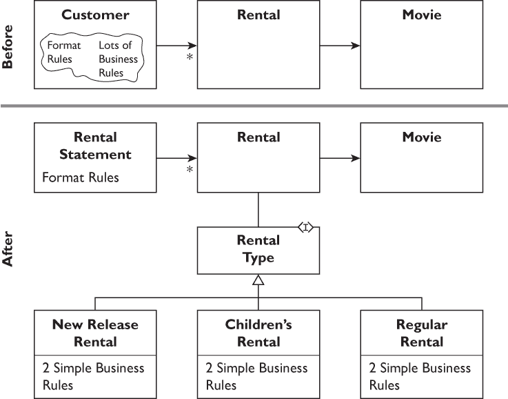

我们的清理程序提取了业务规则并将它们与格式化规则分离开。然后，它将这些业务规则首先移动到 `Rental` 中，然后将它们分解为多态层次结构。太棒了！在这一切过程中，我们发现一些名称和概念是错误的——这非常典型。当你清理代码时，你就能看到之前被隐藏的东西。

最后，请注意在 `RentalType` 下方正在形成一个架构边界。我没有画出来，但你应该能够感觉到它的存在。


现在，为了论证起见，我们假设这是一个复杂得多且可能会增长系统。我希望你同意，提取操作为代码引入了一些组织性，使得原本复杂的某些变得稍微更容易读。但这样做之后，我们错失了利用类的机会。与其在所有提取出的函数之间传递参数，我们可以将这些值加载到类的内部变量中。

```java
import java.util.List;

import static java.util.Arrays.asList;

public class QuadraticFormula {
  private static double a, b, c, discriminant;

  public static List<Double> solve(double a, double b, double c) {
    QuadraticFormula.a = a;
    QuadraticFormula.b = b;
    QuadraticFormula.c = c;
    if (a == 0)
      return linearSolution();
    return quadraticSolution();
  }

  private static List<Double> linearSolution() {
    if (b == 0)
      return asList();
    return asList(-c / b);
  }

  private static List<Double> quadraticSolution() {
    discriminant = b * b - 4 * a * c;
    if (discriminant < 0)
      return complexSolution();
    if (discriminant == 0)
      return singleQuadraticSolution();
    return twoQuadraticSolutions();
  }

  private static List<Double> complexSolution() {
    return asList();
  }

  private static List<Double> singleQuadraticSolution() {
    return asList(-b / (2 * a));
  }

  private static List<Double> twoQuadraticSolutions() {
    double sqrtd = Math.sqrt(discriminant);
    double x1 = (-b + sqrtd) / (2 * a);
    double x2 = (-b - sqrtd) / (2 * a);
    return asList(x1, x2);
  }
}
```

这让事情稍微整洁了一点。在更复杂的模块中，这可以让事情变得清晰得多。然而，存在一种风险。那些 `static` 变量在多线程环境中可能会损坏。通过将所有函数和变量从 `static` 改为实例方法和变量，可以很容易地修正这个问题。但在例子中，我不打算担心那个。

底线情况是，有时当我们提取函数时，允许这些函数通过包含它们的作用域（类）中的变量进行通信是非常方便且整洁的。

现在，让我们在 Clojure 这样的函数式语言中来看这个问题。

```cllojure
(defn quad [a b c]
  (let [discriminant (- (* b b) (* 4 a c))]
    (cond
      (zero? a)
      (if (zero? b)
        []
        [(/ (- c) b)])

      (zero? discriminant)
      [(/ (- b) (* 2 a))]

      (neg? discriminant)
      []

      :else
      (let [sqrt-desc (Math/sqrt discriminant)
            x1 (/ (+ (- b) sqrt-desc) (* 2 a))
            x2 (/ (- (- b) sqrt-desc) (* 2 a))]
        [x1 x2]))))
```

这非常漂亮。我不会产生通过提取来改进它的欲望。但再次，假设这是一个更大、更复杂的函数。我们如何通过提取函数来改进它呢？

```cllojure
(defn quad [a b c]
  (let [discriminant (- (* b b) (* 4 a c))
        linear-solution
        (fn []
          (if (zero? b)
            []
            [(/ (- c) b)]))

        single-solution
        (fn []
          [(/ (- b) (* 2 a))])

        two-solutions
        (fn []
          (let [sqrt-desc (Math/sqrt discriminant)
                x1 (/ (+ (- b) sqrt-desc) (* 2 a))
                x2 (/ (- (- b) sqrt-desc) (* 2 a))]
            [x1 x2]))]

    (cond
      (zero? a) (linear-solution)
      (zero? discriminant) (single-solution)
      (neg? discriminant) []
      :else (two-solutions))))
```

好了，最后一次，请记住我们是在假设这个模块更大、更复杂。最后一个 `cond` 语句非常漂亮。注意我们没有向提取的函数传递参数。这是因为 Clojure 中的函数创建了一种对象，其变量和函数都在其作用域内。同样注意，那些变量不是静态的，因此我们的并发忧虑消失了。

### 结论

所以，你应该练习“提取到直到放弃”吗？如果是的话，要提取多少呢？

在某种程度上，这是一个风格和偏好的问题。你可能喜欢函数比我喜欢的稍微大一点。也许你更习惯 20 行或 25 行的函数。这取决于你。

然而，请记住你刚刚看到的。正是 Video Store 示例中所有这些方法的提取，让我们看到代码中的某些部分并不属于它所属的类。在我们进行提取之前，这并不显而易见。所以，如果你打算让函数保持大一些，请确保不要错过这类机会。事实上，你可能会发现先提取再进行一些策略性的内联是值得的。


因此，每个公共函数都会创建一个指向更低抽象级别的私有函数的调用树。

在这里，我们再次看到了“下行规则”（The Stepdown Rule）。每一次这样的向下调用都下降 `one level of abstraction`。不是两层，不是三层，只有一层。这就是为什么 `makeDetails` 内部的循环体调用了下一个的函数。如果我将 `makeDetail` 的实现放在 `makeDetails` 内部，那么 `makeDetails` 就会包含至少两个抽象层。

我总是遵循这条规则吗？不，有时我允许在一个函数内包含两个抽象层。然而，通常情况下认为认为是不礼貌的。

### 报纸比喻

想象一篇写得很好的报纸文章。你是垂直阅读的。在顶部，你期望看到一个标题，它会告诉你故事的主题，并让你决定是否想读。第一段提供了整个故事的摘要，在隐藏所有细节的同时给了你概括的概念。随着你继续向下阅读，细节会增加，直到你拥有了所有的日期、姓名、引言、主张和其他细枝末节。

我们大多数人从没有读过整篇文章。我们从标题开始，如果感兴趣，我们就继续读。如果那段话让我们感兴趣，我们就继续读。我们一直在这个非常简单的循环中：

```
while (interested) readMore;
```

一旦文章变得无聊，我们就停止。那些允许我们使用该循环的文章是 `polite` 的——它们让我们提前离开。那些迫使我们浪费时间阅读大量没细节的文章是不礼貌的。

报纸由许多文章组成；大部分都很短。有些长一点。极少有文章包含一页纸能容纳这么多文本。这使得报纸变得 `usable`。如果报纸只是一个包含杂乱聚集的事实、日期和姓名的长故事，那么我们根本就不会读它。

我们希望模块的源代码像报纸文章。模块的名称应该简单且具有解释性。名称本身应该足以告诉我们是否处于正确的模块中。模块的最顶层部分应该提供高层的概念和算法。随着我们向下移动，细节应该增加，直到最后我们找到模块中最低层次的函数和细节。

某些语言（如 `Clojure`）反转了垂直顺序，因为它们要求声明出现在使用之前。因此，低级细节位于顶部，而高层策略位于底部。

一篇混合了两个不同故事的报纸文章将是丑陋。包含两个或多个不同主题的模块也是如此。因此，模块中的类和函数应该都与一个单一主题——单一职责——相关，并具有从高层策略到低级细节的良好结构。这就是单一职责原则（SRP）。

### 保持礼貌

当你编写封装了单一抽象级别的函数时，它允许你的读者提前退出。他们不需要阅读大量代码就能理解该函数在该层级做了什么。有时那个层级就是他们关心的全部，他们不想被来自较低层次的所有细节所干扰。

例如，我认为上面的 `makeStatement` 函数是礼貌的。读者可以扫一眼并看到它是做什么的。如果读者不担心其他事情，那么他们就完成了，并回到他们正在做的其他事情上。

现在考虑 `makeStatement` 演变之前的原始代码。

```
func (customer *Customer) statement() string {
  totalAmount := 0.0
  frequentRenterPoints := 0
  result := "Rental Record for " + customer.name + "\n"
  for _, rental := range customer.rentals {
    thisAmount := 0.0
    switch rental.movie.movieType {
    case NewRelease:
      thisAmount += float64(rental.daysRented * 3)
    case Regular:
      thisAmount += 2
      if rental.daysRented > 2 {
        thisAmount += float64(rental.daysRented-2) * 1.5
      }
    case Childrens:
      thisAmount += 1.5
      if rental.daysRented > 3 {
        thisAmount += float64(rental.daysRented-3) * 1.5
      }
    }
    frequentRenterPoints++
    if rental.movie.movieType == NewRelease && rental.daysRented > 1 {
      frequentRenterPoints++
    }
    result += fmt.Sprintf("\t%s\t%.1f\n", rental.movie.title, thisAmount)
    totalAmount += thisAmount
  }
  return result +
    fmt.Sprintf(
      "Amount owed is %.1f\nYou earned %d frequent renter points",
      totalAmount, frequentRenterPoints)
}
```

认为这段代码是不礼貌的。我认为作者没有考虑周全。为了理解这段代码的高层意图，我必须处理所有的低级细节——这需要时间。

这样想。假设你正在某处阅读代码，偶然遇到了对礼貌的 `makeStatement()` 的调用。函数的名称告诉你它是做什么的，但也许你想知道更多。

### 下行规则：再次强调

所以，为了保持礼貌，我喜欢遵循的规则是一次下降一个抽象级别。每个函数都有一个定义其用途的名称，每个函数由一组描述实现的行组成，且这些行都处于相同的抽象级别。这些行中的每一行，如果它不在最低层次，就会调用下一层级的函数。

你如何确定一个抽象级别有多大？我只能说要根据你最好的判断。对我来说，这非常简单。如果我 *能够* 有意义地提取，那么我就进行提取并检查它是否符合逻辑。

### 抽象过山车

再次看看那个不礼貌的 30 行 `statement` 函数。在最顶端，为什么 `totalAmount` 和 `frequentRenterPoints` 需要被设置为 0？我们在做什么？这是一个高层函数的起始行，而我们面临的是最低层次的细节。然后，我们跳出一层来处理 `result`（我们必须推断它是页头），然后是一个循环。循环的第一行立即下降到另一个低级细节，然后进入 `switch` 语句。


对于读者来说，乘坐那样的过山车并不好玩。原因很简单：每当你从一条高层线条切换到一条低层线条时，你都必须将你的心理模型推入心理栈（mental stack）中，以处理那个低层的关注点。一旦你理解了它，再从心理栈中弹出（pop），回到之前中断的地方继续。

问题在于，我们并没有一个“心理栈”。当我们把思维链拨到一边去处理某个细节时，往往会丢失那条思维链。再次，这就像那个突然冲进你隔间对着你大声提问家伙。

### 这是我们编写代码的方式，但不是我们想要阅读的方式

问题在于，我们是在过山车上写代码。我们都是如此，我们都必须如此。想象一下编写最初那个粗鲁的 `statement` 函数的人：也许他们写的第一行是循环，但随后他们想起来要把 `totalAmount` 清零。稍后，在写完 `switch` 之后，他们意识到需要处理频繁的租户积分，于是又回到顶部添加了那行代码。

简而言之，我们通过在抽象与细节的起伏轨道上穿行来构建代码。我们的代码写出来就像过山车。这正是 Kent Beck 的建议变得至关重要的地方：

*先让它运行起来，然后让它正确运行（First, make it work. Then, make it right.）。*

代码运行并不意味着你完成了任务。代码读起来良好才算完成。当你提取、组织并布局了从公共函数向下延伸的函数树，并且布局对读者方便时，你才算真正完成了。

现在，我并不是盲目或教条主义地遵循这些规则。在某些情况下，遵循这些规则是不恰当的。但这些规则是我的默认。除非我有理由不这样做，否则我会遵循它们。

# 12: 对象与数据结构


Niklaus Wirth（尼克拉斯·沃）曾写过一本非常棒的书，名为《算法 + 数据结构 = 程序》。尽管这并非他的本意，但这个标题非常准确地捕捉了面向对象编程背后的核心概念：函数与其所操作的数据之间存在着深层的关系。

面向对象是由 Ole-Johann Dahl 和 Kristen Nygaard 在 20 世纪 60 年代后期通过他们的 Simula 语言的逐步演进发明/发现的，并在于 Simula 67。Bjarne Stroustrup 和 Alan Kay 都在 70 年代初使用了 Simula 67，并分别在 `C++` 和 `Smalltalk` 中扩展了这些思想。

从那里开始，`C++` 演变成了 `Java`、`C#` 以及 `Go`，而 `Smalltalk` 演变成了 `Objective-C`、`Ruby` 和 `Python`。这两条演进路线相互汲取，导致了大量的交叉融合。今天，我们几乎所有的语言在某种意义上都是面向对象的。

### 什么是对象？

对象是一个由专用函数操作的数据包，其中一些是公共的。从外部看，只有这些公共函数是可见的。对象内部的数据结构是被隐藏的。某些语言通过 `public` 和 `protected` 等关键字来强制这种可见性。其他语言则依赖程序员采用约定来确定哪些函数是公共的，哪些是私有的。

面向对象的程序由这样一组对象组成，每个对象都有自己的职责，并通过调用彼此的公共函数来相互协作。

Alan Kay 曾用生物学类比来想象过这一点——一组细胞通过相互传递分子消息来协作。细胞并不知道彼此的内部细节，甚至可能不知道正在通信的具体细胞是哪一个。它们只是发射消息（分子），其他细胞会检测并响应。注意，细胞从不向其他细胞提问。它们发送消息但不期望答案。

消息传递（message-passing）概念是组织行为的一种非常强大的原则。如果你只告诉对象该做什么，而从不问该对象任何问题，那么该对象中的数据对你来说就没有意义。

在软件中避免所有查询是不现实的；但正如我们以后将看到的，有方法可以将此类查询减少到最低。这种对数据的缺乏依赖意味着，面向对象的设计主要关注行为。对象的构建和关联是为了支持消息流，从而触发系统所需的行为。单个对象内部的数据结构对大多数行为是隐藏的，因此对这些行为来说几乎无关紧要。

但面向对象（OO）并不是唯一的选择。

1970 年，Edgar Codd 发表了《大型共享数据库的数据关系模型》（A Relational Model of Data for Large Shared Databanks）。从那里开始，他、Raymond Boyce 和 Chris Date 推导出/发现了目前驱动所有关系型数据库的概念。这一核心概念是：数据的结构是关键且可见的，而所有使用它的程序都服从于它。

大型企业数据库是一个复杂、蔓延的数据结构，而操作它的程序无非是环绕着它的小弟。数据库的模式（schema）主导了这些程序。这与 OO 恰相反。总结一下：对象是一组隐藏了深处数据的公共函数。数据库是一组公开的数据结构，不具备内在的函数。再次，它们几乎是完全对立的。

### 数据抽象

我们倾向于将变量设为私有是有原因的。我们不希望他人依赖它们。我们希望保留随心所欲或冲动更改其类型或实现的自由。那么，为什么许多许多人会自动为他们的对象添加 getters 和 setters，将私有变量像公共变量一样暴露出来呢？

考虑下面的 `Point 1` 和 `Point 2` 之间的区别。它们都代表笛卡尔平面上一点的数据。然而，其中一个暴露了它的实现，而另一个完全隐藏了它。

```java
// ––Point 1––
public class Point {
  public double x;
  public double y;
}

// ––Point 2––
public interface Point {
  double getX();
  double getY();
  void setCartesian(double x, double y);
  double getR();
  double getTheta();
  void setPolar(double r, double theta);
}
```

`Point 2` 的妙之处在于，你无法判断其实现是直角坐标还是极坐标坐标。它可能两者皆不是！接口表示了一个*抽象*的数据结构。我们可以确定那里一定有一个数据结构，但我们不知道该数据结构采取什么形式。

但 `Point 2` 代表的不仅仅是数据结构。它还代表了行为策略。尽管 getter 方法允许你访问单个坐标值，但两个 setter 方法强制了两个坐标值必须作为原子操作一起设置的策略。

相比之下，`Point 1` 非常明确地实现为直角坐标，并且它迫使我们独立地操作坐标值。这暴露了实现。事实上，即使变量是私有的且我们使用了单变量的 getters 和 setters，它也会暴露实现。


隐藏实现不仅仅是在变量之间放置一层函数那么简单。隐藏实现关乎抽象！一个类并不仅仅简单地通过 getter 和 setter 将变量暴露出来。相反，它暴露了抽象的接口，允许用户操作数据的*本质*，而无需知道这些数据是如何实现的。

考虑下方的 `Vehicle 1` 和 `Vehicle 2`。第一个使用具体的术语来通信车辆的燃油量，而第二个则使用百分比的抽象来来通信。在具体的情况下，你可以很确定地认为这些只是变量的访问器（accessors）。在抽象的情况下，你完全不知道数据的形式。

```
–––Vehicle 1–––
public interface Vehicle {
  double getFuelTankCapacityInGallons();
  double getGallonsOfGasoline();
}

–––Vehicle 2–––
public interface Vehicle {
  double getPercentFuelRemaining();
}
```

在上述两种情况下，第二种方案都是优的。我们不希望暴露数据的细节。相反，我们希望用抽象的术语来表达我们的数据。这不仅仅通过使用接口和/或 getter 和 setter 就能实现的。对于如何表示对象所包含的数据的最佳方式，需要进行深思熟虑。糟糕的选择就是轻率地添加 getter 和 setter。

### 数据/对象的反对称性

这两个例子展示了对象和数据结构之间的区别。对象在抽象之后隐藏其数据，并暴露操作这些数据的函数。数据结构暴露其数据并且没有有意义的函数。回去重读一遍。注意这两个定义的互补性。它们是虚拟的对立面。这种差异可能看起来微不足道，但具有深远的影响。

例如，考虑下面的`Procedural Shapes`示例。`Geometry` 类对三个形状类进行操作。形状类是简单的数据结构，没有任何任何行为。所有的行为都在 `Geometry` 类中。

```
–––Procedural Shapes–––
public class Square {
  public Point topLeft;
  public double side;
}

public class Rectangle {
  public Point topLeft;
  public double height;
  public double width;
}

public class Circle {
  public Point center;
  public double radius;
}

public class Geometry {
  public final double PI = 3.141592653589793;

  public double area(Object shape) throws NoSuchShapeException
  {
    if (shape instanceof Square) {
      Square s = (Square)shape;
      return s.side * s.side;
    }
    else if (shape instanceof Rectangle) {
      Rectangle r = (Rectangle)shape;
      return r.height * r.width;
    }
    else if (shape instanceof Circle) {
      Circle c = (Circle)shape;
      return PI * c.radius * c.radius;
    }
    throw new NoSuchShapeException();
  }
}
```

面向对象的程序员可能会对此嗤之以鼻并抱怨它是过程化的——他们是对的。但这种嘲讽可能并不。考虑如果在 `Geometry` 中添加一个 `perimeter()` 函数会发生什么。形状数据结构不受影响！任何依赖于这些形状的其他模块也不会受影响！相反，如果我添加了一个新形状，我必须更改 `Geometry` 中的所有函数来处理它。再次读一遍。当你添加一个新函数时，数据结构保持不变；但当你添加一个新的数据结构时，所有的函数都必须被更改。

现在考虑下面的`OO Shapes`示例。在这里，`area()` 方法是多态的。不需要 `Geometry` 类。所以，如果我添加了一个新形状，现有的任何函数都不会影响，但如果我添加了一个新函数，所有的形状都必须被更改！对于丰富的面向对象设计师来说有很多解决方法：例如访问者模式（Visitor）或双重分发（dual-dispatch）。但这些技术有自己的代价，并且通常会将结构还原过程化程序的形式。

```
––OO Shapes–––
public class Square implements Shape {
  private Point topLeft;
  private double side;
  public double area() {
    return side*side;
  }
}
public class Rectangle implements Shape {
  private Point topLeft;
  private double height;
  private double width;

  public double area() {
    return height * width;
  }
}
public class Circle implements Shape {
  private Point center;
  private double radius;
  public final double PI = 3.141592653589793;
  public double area() {
    return PI * radius * radius;
  }
}
```

我们再次看到了这两个定义的互补性；它们是虚拟的对立面！这揭示了对象和数据结构之间的根本对立：过程化代码（使用数据结构的代码）易于添加新函数而不改变现有的数据结构。另一方面，面向对象（OO）代码易于添加新的数据结构（类）而不改变现有的函数。

反之亦然：过程化代码很难添加新的数据结构，因为所有的函数都必须更改。面向对象代码很难添加新的函数，因为所有的类都必须被更改。

所以，对面向对象来说困难的对过程来说很容易，而对过程来说困难的对面向对象来说很容易。

在任何复杂系统中，总会有想要添加数据类型而不是函数的时候。对于这些情况，对象和面向对象是最合适的。另一方面，也会有想要新函数而不是数据类型的时候。在这些情况下，过程化代码和数据结构更为合适。

### 德米特律（Demeter）

有一种广为人知的启发方法叫做德米特律，它建议模块不应该了解对象的内部。正如我们在上一节看到的，对象隐藏其数据并暴露操作。这意味着对象不应该通过访问器暴露其内部结构，因为这样做是暴露而非隐藏其内部结构。

更准确地说，德米特律规定类 `C` 的方法 `f` 只能调用以下对象：

* `C`
* 由 `f` 创建的对象
* 作为参数传递给 `f` 的对象
* 放在 `C` 的实例变量对象

方法不应该在允许函数返回的对象上调用方法。换句话说，要害羞，与朋友交流，不要与陌生人交流。

以下代码似乎违反了德米特律（其他问题），因为它在 `getOptions()` 的返回值上调用了 `getScratchDir()` 函数，然后在 `getScratchDir()` 的返回值上调用了 `getAbsolutePath()`。

```java
final String outputDir =
  ctxt.getOptions().getScratchDir().getAbsolutePath();
```

#### 火车祸

这种代码被称为*火车祸*（trainwreck），因为它们看起来像一堆耦合的火车厢。这种链式调用通常被认为是粗糙的风格并应该避免。通常最好的方法是将它们拆分为如下：

```java
Options opts = ctxt.getOptions();
File scratchDir = opts.getScratchDir();
final String outputDir = scratchDir.getAbsolutePath();
```

这两段代码违反了德米特律吗？包含包含模块确实知道 `ctxt` 对象包含选项，选项包含临时目录，目录有一个绝对路径。对于一个函数来说，这知识太多了。调用函数知道如何导航许多不同的对象。


这是否违反了德米特律（Demeter）取决于 `ctxt`、`Options` 和 `ScratchDir` 是对象还是数据结构。如果它们是对象，那么它们的内部结构应该被隐藏而不是暴露，因此对它们内部的了解显然违反了德米特律。另一方面，如果 `ctxt`、`Options` 和 `ScratchDir` 只是没有行为的数据结构，那么它们自然会暴露其内部结构，因此德米特律并不适用。

上述示例中访问器函数的使用混淆了问题。如果代码写成如下所示，我们可能就不会担心违反德米特律了。

```
final String outputDir = ctxt.options.scratchDir.absolutePath;
```

如果我们采用这种约定：数据结构具有公共变量且没有函数，而对象具有私有变量和抽象实现的公共函数，那么这个问题就会少困困惑。

### 混合体（Hybrids）

这种困惑有时会导致不幸的混合结构，它们半是对象，半是数据结构。它们既有执行重大功能的函数，又拥有公共变量或公共访问器和修改器，从任何角度来看，这些都使私有变量变得公开，诱使其他外部函数像过程化程序使用数据结构一样使用这些变量。

这在 [Refactoring] 中被称为“功能嫉妒”（`feature envy`）。

这种混合体使得添加新函数变得困难，添加新数据结构也变得困难。它们是两者之劣者。避免创建它们。它们表明设计混乱混乱，其作者不确定——或者更糟，不知道——他们是否需要受到函数或类型的保护。

### 隐藏结构（Hiding Structure）

如果 `ctxt`、`options` 和 `scratchDir` 是具有真实行为的对象怎么办？由于对象应该隐藏其内部结构，我们不应该能够通过它们进行导航。那么，我们该如何获取缓存目录的绝对路径呢？

```
ctxt.getAbsolutePathOfScratchDirectoryOption();
```

或者

```
ctx.getScratchDirectoryOption().getAbsolutePath()
```

第一种方案可能导致 `ctxt` 对象的方法爆炸。第二种方案假设 `getScratchDirectoryOption()` 返回的是数据结构而不是对象。两种方案感觉都不好。

如果 `ctxt` 是一个对象，我们应该告诉它去做某些事，而不是询问它的内部情况。那么，我们为什么想要缓存目录的绝对路径？我们打算用它做什么呢？考虑这段来自同一模块（在后面很多行处）的代码：

```
String outFile = outputDir + "/" +
                 className.replace('.', '/') + ".class";
FileOutputStream fout = new FileOutputStream(outFile);
BufferedOutputStream bos = new BufferedOutputStream(fout);
```

不同粒度细节的混合有点令人不安。点、斜杠、文件扩展名和 `File` 对象不应该如此随意地混合在一起，并与周围的代码混在一起。然而，尽管忽略这一点，我们看到获取缓存目录绝对路径的意图是创建一个指定名的缓存文件。

那么，如果我们告诉 `ctxt` 对象去这样做呢？

```
BufferedOutputStream bos =
  ctxt.createScratchFileStream(classFileName);
```

这似乎是一个对象应该做的合理事情！这允许 `ctxt` 隐藏其内部结构，并防止当前函数因通过导航它不该知道的对象而违反德米特律。

因此，我们通常可以通过告诉对象执行我们想要的事来修复“火车碰撞”问题和违反德米特律的行为，而不是遍历对象网络来收集所有资源。这种建议被称为“告诉对方”（`Tell the Other Guy`）。

很久以前，Dave Thomas 和 Andy Hunt 写过的一篇题为“一句话描述 OO：保持 DRY、Shy 和告诉对方”的优美文章。DRY 当然是“不要重复自己”（Don’t Repeat Yourself），而 shy（害羞）指的是德米特律。告诉对方则是引用 Alan Kay 的消息传递思想或命令/查询分离（CQS）。处处都是很好的建议。

### 数据传输对象（Data Transfer Objects）

数据结构的典型形式是一个具有公共变量且没有函数的上下文、类或结构体。这有时被称为数据传输对象（`data transfer object`），或 `DTO`。DTO 是非常有用的结构，特别是在与数据库通信、解析来自套的消息等方面。它们通常是系列翻译阶段中的第一个，将数据库中的原始数据转换为应用程序代码中的对象。

在 Java 时代早期，如下所示的“bean”形式流行。Bean 具有由 getter 和 setter 操控的私有变量。Bean 的准封装似乎让一些面向对象的纯主义者感觉好受，但通常没有提供其他好处。`Address` DTO 不如直接使用公共字段。

```
public class Address {
  private String street;
  private String streetExtra;
  private String city;
  private String state;
  private String zip;
  public Address(String street, String streetExtra,
                  String city, String state, String zip) {
    this.street = street;
    this.streetExtra = streetExtra;
    this.city = city;
    this.state = state;
    this.zip = zip;
  }
  public String getStreet() {
    return street;
  }
  public String getStreetExtra() {
    return streetExtra;
  }
  public String getCity() {
    return city;
  }
  public String getState() {
    return state;
  }
  public String getZip() {
    return zip;
  }
}
```

#### 对象/关系阻抗匹配（The Object/Relational Impedance Mismatch）

在 80 年代后期，随着面向对象思想的流行，面向对象的“公共行为/私有数据”与关系型的“公共数据/无行为”之间的区别变得显而易见。程序员试图将两者合并；但对结果感到失望。一段时间内，尝试了面向对象数据库；但这些从未真正解决问题。最终，我们回到了对象关系映射器（ORM）。

人们希望 ORM 能让使用面向对象语言的程序员方便地访问关系型数据库中的数据。ORM 会查询数据库，从结果行中解包数据，并将数据重新封装为对象使用的数据结构。

这种将表格转换为更方便形式的方法虽然很好，但它并没有解决难题，因为对象更多是关于函数而不是数据。最终，没有方法可以将关系数据库映射到对象，因为数据库包含数据结构，而数据结构和对象是正交的。我们真正能做的只是从数据库提取数据。

### 使用对象和数据结构

那么为什么会有这两个相反的概念？为什么我们有时想要隐藏数据结构并暴露行为，而其他时候想要隐藏行为而暴露数据结构？

这完全取决于哪一个更容易增长和变化。

如果可能会出现新的行为，并且现有行为可能会改变，那么我们就想要隐藏波动的行为而暴露静态的数据结构。另一方面，如果是数据结构可能会增长和变化，那么我们就想要暴露静态的行为而隐藏波动的数据结构。

我们隐藏波动部分，这样变化就不会影响到静态部分。我们建立了一道屏障，保护静态部分免受波动部分的影响。


# 示例 1：大型企业数据库的结构是静态的。数据本身可能会随着新记录的添加和旧记录的更新或删除而变化，但结构很少改变。然而，使用该数据库的程序行为却频繁变化。业务规则是多变的，但相比之下，业务结构是稳定的。

示例 2：IDE 的行为是静态的。它是一个文本文件的编辑器。但每当向其功能添加新语言时，数据结构就会发生变化。用户期望 IDE 的行为保持一致，无论使用 Ruby、Python、Java 还是 Clojure 进行编程；然而这些语言具有截然不同的结构。与行为相比，整体数据结构是多变的。

确定数据或行为哪个更静态，是一个需要思考和经验的决策。在系统的不同部分，这个决策可能需要不同的处理。

一个复杂系统可以同时包含这两种类型的组件。某些组件的行为相对于数据结构是静态的，而另一些组件的数据结构相对于行为是静态的。

奇怪的是，这一切最终归结为使用 `switch` 语句的决策。

## Switch 语句 (Switch Statements)

`switch` 语句及其兄弟节点 `if`/`else` 链，在一些人看来是糟糕的写法，而在另一些人看来则是必不可少的。这种分歧背后的原因与对静态行为或数据结构的决策是一样的。考虑这个简单的程序。

```
———Shape.java
enum ShapeType {CIRCLE, SQUARE}

public class Shape {
  public ShapeType type;
}

———Square.java
class Square extends Shape {
  public int side;
  public Point topLeft;
}

———Circle.java
class Circle extends Shape {
  public int radius;
  public Point center;
}

———ShapeManager.java
public class ShapeManager {
  public static void renderShapes(List<Shape> shapes) {
    for (Shape shape : shapes) {
      switch (shape.type) {
        case CIRCLE:
          renderCircle((Circle) shape);
        case SQUARE:
          renderSquare((Square) shape);
          break;
      }
    }
  }

  private static void renderSquare(Square square) {
    //…
  }

  private static void renderCircle(Circle circle) {
    //…
  }
}
```

如果你是一个 Java 程序员，这看起来可能有点奇怪。如果你是一个 C 程序员，这看起来可能很正常。现在考虑添加 `Triangle` 带来的后果。

第一个需要更改的文件是 `Shape.java`，因为必须在枚举中添加 `TRIANGLE`。接下来，当然必须编写 `Triangle` 数据结构（类）。然后最后，需要在 `ShapeManager` 的 `switch` 语句中添加 `Triangle` 分支（case）。

这种设计迫使多个模块在响应一个简单更改时进行修改，并需要添加其他模块。这违反了单一责任原则 (SRP) 和开闭原则 (OCP)。更改的数量也意味着这是一种僵化的设计。需要的更改越多，设计就越僵化。

但比这更糟，因为 `ShapeManager` 中的 `renderShapes` 方法并不是该类的唯一方法。为了节省空间，我没有写全，但还有 `dragShapes`、`eraseShapes`、`rotateShapes`、`scaleShapes` 以及大量其他处理形状的函数。每一个方法中都包含完全相同的 `switch` 语句。而且每一个方法都需要添加 `Triangle` 分支。

尽管其中一些方法没有使用 `switch` 语句。它们中的一些使用了 `if`/`else` 链。此外，聪明的程序员可能会使用逻辑优化来消除或修改某些 `switch` 语句和 `if`/`else` 链。例如，`rotateShapes` 中的 `switch` 语句可能不包含 `CIRCLE` 分支，因为聪明的程序员意识到圆具有旋转对称性。

所以，我们不得不找到所有的 `switch`/`if`/`else` 语句，解码所有的逻辑优化，并想出某种方法让它们都能正确处理新的 `TRIANGLE` 分支。在大型系统中，我们几乎肯定会漏掉一个或多个。

当只更改或添加一个简单需求时，却迫使模块内部进行许多修改的设计既是僵化的又是脆弱的——它难以更改，而且容易崩溃。需要的更改越多，设计就越脆弱。

但比这更糟。因为，你明白，我们的业务已经尝试销售这个形状管理系统几个月了，但一直没有成功。我们都都开始担心自己的工作了。初创公司的生存悬于一根细细的线之上。幸运的是，我们的 CEO 刚刚发布了一项关键公告。他知道问题所在，也知道如何解决它。

“我们的问题，”他说，“是因为我们一直在强迫客户处理圆形和正方形。客户不想要那样。他们想要一个允许他们选择使用圆形还是正方形的形状管理系统。如果他们只使用正方形，他们不想为圆形付费。谁能怪他们呢？

“所以，”他继续道，“我们将把 `ShapeManager` 功能免费送。客户可以从我们的网站下载它。但是……”他在这里停顿了一下以示强调，因为这是拯救公司的洞察，“……我们将让他们为下载圆形付费。我们还要让他们为下载正方形付费。如果他们想要其他形状，我们也让他们为那些形状付费。与其销售一个管理形状的大型系统，我们要直接出售形状本身——而且我们要赚一笔巨额财富！”

在所有的欢呼、气球和香槟开启声声中，你意识到 CEO 的梦想从一开始起就是死死的。它是死死的，因为圆形和正方形已经交织在整个系统的纹理中。这种架构绝不可能让 CEO 在不包含圆形和正方形的情况下免费赠送 `ShapeManager`。它们是密不可分地耦合在一起的。

防止部分与其与其他部分分离并独立部署的设计违反了依赖倒置原则 (DIP)，并且是不可移动的。独立部署的部分越少，它就越不可移动。

这种设计是僵化、脆弱且不可移动的。它是垃圾。它是一场恐怖场景。它将带垮公司，并连带上我们所有人！

## 面对象解决方案 (The OO Solution)

我们聘请了一位著名的顾问，他飞过来，大肆喧哗，到处胡搞一通，然后飞回家。他的信息是：“你们的设计是过程化的。它应该是面向对象的。来，我给你们看。”而他展示的是：


什么都不需要修改；也许只有 `main` 程序例外。但这些模块都不需要更改。这意味着这个设计并不是僵化的。

也没有需要查找和修改的 `switch`/`if`/`else` 语句。所有的方法，如 `erase`、`drag`、`scale` 和 `rotate` 都包含在 `Shape` 类中。这种设计并不脆弱。

最好的是，我们可以独立于 `ShapeManager` 部署 `Circle` 和 `Square`。我们可以将 `ShapeManager`、`Circle` 和 `Square` 放入它们各自的 `jar` 文件中并进行单独分发！

这种设计符合 `OCP` 和 `DIP`。它是移动、灵活且健壮的。哈利路！我们得救了！

## 别太急，约翰逊

这种设计保护我们免受什么？它保护我们不受新形状的影响。每当客户想要一个新的形状时，我们做的只是编写 `Shape` 类的新派生类，并将其放入它自己的 `jar` 文件中，以便进行独立分发和部署。

但如果客户没有要求新形状呢？如果他们要求在 `Shape` 上增加一个渲染阴影的新方法呢？

现在，我们的 `Shape` 抽象对我们完全没有帮助。我们不得不采取那个完美的 OO 设计，并修改每一个类。`Shape`、`Circle` 和 `Square` 都需要一个 `renderDropShadow` 方法；而 `ShapeManager` 必须调用它。那个 `Shape` 抽象没有给我们带来任何好处。

但现在回来看第一个解决方案，那个带有 `switch` 语句的方案。对于那个方案，我们只需要在 `ShapeManager` 中添加 `renderDropShadow` 函数即可。我们完全不需要触碰 `Circle` 或 `Square`！

## OO 与过程过程的权衡

如果我们的设计将对需求的更改解释为新类型，那么 OO（面向对象）是一个很好的选择，因为很容易添加新类型（如 `Triangle`）而无需更改其他任何内容。然而，如果我们的设计将更改解释为新函数，那么过程化的 `switch` 语句是最好的，因为我们不需要更改任何类型。

或者，换一种说法：当我们想要向现有函数中添加新数据类型时，我们使用 OO；当我们想要向现有数据类型中添加新函数时，我们使用过程化的 `switch` 语句。

我们再次看到了这种有趣的对立。隐藏数据并暴露函数允许数据在不产生重大影响的情况下更改。隐藏函数并暴露数据允许函数在不产生重大影响的情况下被更改。

那么究竟是哪一个？我们更倾向于更改函数还是数据？答案取决于你的应用程序以及你的设计如何解释对该应用程序的更改。

在大型企业模型中，我们通常针对现有的数据模式（schema）编写新应用程序。而当我们为给定的应用程序添加新功能时，我们通常会将该行为封装到新的数据类型中。

个人而言，我倾向于后者。只要可能，我会创建将更改解释为新数据类型的设计。这意味着我更倾向于 OO 设计。在大多数情况下，我发现运行得很好。

因此，我对 `switch` 语句及其丑小鸭子兄弟 `if`/`else` 链的通用规则是：它们应该位于系统的边缘（例如 `main` 模块）；每个可切换类型最多只有一个；并且内部的 `case` 必须创建系统其他部分使用的多态对象。

然而，这种偏好和规则并不意味着我不会在行为波动性远大于数据的系统中使用 `switch` 语句。我不会强行将一个 OO 的圆木销插进一个过程化的方孔里，反之亦然。

## 但性能如何？

可以说，今天的编译器可以利用 `switch` 语句的局部性质和特定的处理器架构来创建运行速度比多态分发稍快的可执行代码。因此，OO 设计可能会产生轻微的性能损失。如果你正在从事的项目中，几纳秒的差异至关重要，那么你可能不得不放弃 `OCP` 和 `DIP`，转而使用 `switch` 语句代替多态。

大多数程序员不需要关心零散的纳秒。但如果你在乎，请小心将它们集中在对你最有益的地方。不要仅仅因为几个时间敏感的内部循环必须使用 switch 就放弃整个系统的 OO 设计。

### 结论

对象暴露行为并隐藏数据。这使得在不改变现有行为的情况下添加新类对象变得容易。但也使得向现有对象添加新行为变得困难。数据结构暴露数据且没有显著的行为。这使得向现有数据结构添加新行为变得容易，但使得向现有函数添加新数据结构变得困难。

在任何给定的系统中，我们有时需要添加新数据类型的灵活性，因此在系统的该部分我们倾向于使用对象。其他时候，我们需要添加新行为的灵活性，因此在系统的该部分我们倾向于使用数据类型和过程。优秀的软件开发者无偏见地理解这些问题，并选择最适合当前任务的方法。

## 13

# 整洁类

*作者 Jeff Langr*

在第 7 章“整洁函数”中，你学习了如何以函数或方法的形式最好地组织代码语句和表达式。希望你学会了这些关于整洁函数的重要点：

*   函数提供了一种声明、调用和重用逻辑行为或概念的方法。
*   虽然没有东西阻止你将多个概念聚合到单个函数中，但如果你组合捕捉微小离散概念的方法，效果会好得多。

在本章中，你将听到第 7 章](#ch07.xhtml_ch07）建议的回声，即更高层的构造器：类或模块。

你的编程语言允许将概念分组到一个构造器中——如果你使用的是面向对象的语言，则是类；如果你使用的是函数式语言（如 JavaScript、Elixir 或 F#），你可能会引用模块。

### 类、模块与文件

在某些面向对象的语言（如 Java）中，一个文件只能声明一个公共类。其他语言（如 C++、TypeScript 和 Ruby）允许在一个文件中声明多个类，甚至将一个类拆分到多个文件中。

为了让情况更复杂，某些语言（面向对象和函数式的）允许你声明命名空间。这些可以帮助避免大型系统中的命名冲突。它们也可以帮助你组织概念。

大多数函数式语言（例如 Clojure、Elixir 和 Haskell）允许将函数组织为文件中的多个模块。即使对于那些不直接支持模块/命名空间的语言（如 JavaScript），你也可以在单个文件中组织多个“虚拟”模块。

仅仅可以这样做并不意味着你应该这样做。通常情况下，每个文件保持一个模块或类，这会为你和你的开发团队减少很多麻烦。

当然，软件开发中一切都是权衡，因此异常总是存在的。你可能会发现在同一个源文件中声明其他非常相关的类，例如微小的结构体（例如 Java 中的记录）或异常类型。


但是，是的，大多数情况下，类 <=> 文件，或模块 <=> 文件，或者类似的对应关系。在本章的讨论中，可以认为文件这部分内容与我们的讨论不相关。相反，我们将关注如何在类和模块中恰当地组织概念，而不考虑它们如何被部署到文件中。

## 类应该包含什么？

从理论上讲，你可以将系统的整套方法合并到一个类中——一个单体结构。同样地，你也可以采取反常的做法，为每一个方法创建一个单独的类。这两种想法都是离谱的，尽管我在非常非常小的系统中曾用过前者，而且可能对于某些 Smalltalk 程序员来说，后者也并不那么离谱。

随着系统的增长，类提供了帮助你保持逻辑理智的方法。如果没有合理的组织，你将：

* 发现你正在寻找的代码变得更加困难。
* 让你的系统由于大量的冗余而变得臃肿；规模可能会增加一倍。
* 由于冗余导致行为不一致而产生缺陷。
* 由于复杂性增加而产生缺陷。
* 花费大量时间为其编写自动化测试。

所有这些结果的概率都会随着增长而增加，从而增加你的成本和挫败感。

我们在整个章节中将讨论整洁的类设计。在脑中，你可以将其转化为“做所有应该让我们的开发工作变得更容易的事情”。

“整洁”并不是针对任何人的批评。我们对“不洁”的概念是对代码的一种描述，指普通开发者在理解或维护时需要付出更多努力。

### 类设计的特征

设计的质量只有在面对变化时才能被真正评估；这种变化发生在系统必须承担新功能的每一次。。随着系统的增长和老化，引入新功能的成本是否变得越来越高？缺陷的数量是否在增加？

在七十年的软件开发中，我们从适应变化的经验中收集了实证数据。我们从这些数据中获得了宝贵的见解，并不断将这些学习推广到更大、更新的环境中。

在 20 世纪 40 年代，典型的系统实现方式就像我们的退化示例，整段代码本质上存储在一个函数中，从上到下读取并执行。我们称之为 `monolith`。

John von Neumann 和 Herman Goldstine 的文章《电子计算设备的问题规划与编码》，(1) 探索了子程序的这一前提：

1. H. H. Goldstine and J. von Neumann, “Planning and Coding of Problems for an Electronic Computing Instrument,” Institute for Advanced Study, Princeton, New Jersey, 1947, archived at [`www.ias.edu/sites/default/files/library/pdfs/ecp/planningcodingof0103inst.pdf`](https://www.ias.edu/sites/default/files/library/pdfs/ecp/planningcodingof0103inst.pdf)。

*“我们将问题的编码序列称为常规（routine），而为了可能替换其他常规而形成的子程序（subroutine）。”*

前提是子程序（特别是对于较小的常用操作）通过允许重用来减少代码量，并有助于减少缺陷。

先驱 Maurice Wilkes 和 David Wheeler 受开创性文章中思想的启发，于 1951 年在 EDSAC 计算机中实现了子程序的概念。(2) 简而言之，他们认为子程序带来的代码模块化将带来更低成本的软件开发。他们没有等待研究（尽管研究在之后的几十年里缓慢出现）。

2. [PPEDC].

自从子程序出现以来，我们将模块化相关的声明价值推广到了更大的范围。我们学会了如何将子程序的集合——函数或方法——组织成模块或类。这反过来又围绕此类模块和类的组合以及它们之间的相互关系（依赖关系）提出了新的挑战。我们开始得出各种引导其他开发者的启发式。

### 启发式与特征

启发式帮助你识别应该采取的步骤，以及应该避免的步骤，以获得良好的类。

* 正向启发式——应该采取的步骤。例如，Kent Beck 的涌现设计四规则，(3)告诉你执行以下操作。

    3. 参见 第 18 章,“简单设计”。另见 [`martinfowler.com/bliki/BeckDesignRules.html`](https://martinfowler.com/bliki/BeckDesignRules.html)。

    * 确保在开发过程中所有代码都是可测试的。
    * 消除逻辑冗余。
    * 确保所有程序元素都有清晰、简洁的命名。
    * 最小化元素的数量。

* 负向启发式——应该避免的步骤。反模式描述了开发代码时要采取的错误路径。例如，“复制粘贴编程”告诉我们不要习惯性通过先复制现有代码然后修改它来创建新逻辑。（这种反模式一个更有记忆点的名字可能是“抓取并刺”。或者“抢夺并修补”。或者“复制并损坏”。或者……噢，现在够了。只需避免它即可。）

特征帮助你评估类的当前质量。

* 正向特征——期望的属性。Bob Martin 的五个类设计原则（被称为 `SOLID`）经受了三十年的审查，并且同样适用于代码。
* 负向特征——不期望的属性。Martin Fowler 的代码气味(4) 是代码中要避免的事项集合，每个都有一个好记的名字。例如，“散弹手术”意味着为了实现简单的更改你需要对许多类进行更新。

4. [Refactoring] 和 [`martinfowler.com/bliki/CodeSmell.html`](https://martinfowler.com/bliki/CodeSmell.html)。

随着时间的推移，软件开发领域的人总结了大量的启发式和特征。我们将这些任何一种称为设计视角。

设计视角可以描述方法级（微观）和类级（宏观）（甚至更高级别）的设计。你可能可以将某些特征视为启发式，反之亦然；这种分类并不重要。

在本章的大部分内容，我们将关注理想类的特征，因为其思想是你可以通过观察代码获得这些特征。

一个理想的类通常很小。它的名称简洁地总结了收集而的行为。它的定义是内聚的：它的方法密切相关且聚焦，并能有效地执行单一的、定义的任务（或一组相关任务）。结果是该类表现出遵循单一职责原则（SRP）的特征：它只有一个变化原因。

设计视角之间无疑存在重叠。特别是更宏观的视角——例如 SOLID、Kent Beck 的简单设计和 Martin Fowler 的代码气味——其结果是类似的。它们都促进了小型、内聚的模块和函数。

在几乎所有的这些视角中，都承认（无论是直接还是还是暗示）对平衡的需求：几乎没有任何原则是绝对的。例如，Kent Beck 的简单设计四规则驱动我们走向小型、单一职责的类。产生的类更容易测试（规则 1），它们可以帮助我们更容易消除冗余（规则 2），并促进清晰、意图明显的命名（规则 3）。但规则 4——最小化元素的数量，例如模块和函数——表明我们可能会过头，创建对系统没有优势的微型类。

 **未来的 Bob:**


确实，这正是 John Ousterhout 对“单一职责”规则的担忧之一。

我们大多数人不必担心：典型的系统已经在错误的方向上走得太远了，包含了大型、混乱且多功能的模块和函数。尽管如此，请记住，软件开发中的每一个选择都存在权衡。选择你喜欢的设计视角，并专注于创建易于维护的代码这一结果。

## 类多大才算大？

让我们来看 `HoldingService` 类，它被用于管理图书馆系统及其读者的馆藏（材料，如书籍或物理音频录带）。以下是 `HoldingService` 上定义的公共行为：

```
boolean isAvailable(String barCode)
Holding find(String barCode)
String add(String sourceId, String branchId)
void transfer(String barcode, String branchScanCode)
Date dateDue(String barCode)
void checkOut(String patronId, String barCode, Date date)
int checkIn(String barCode, Date date, String branchScanCode)
```

下图描述了 `HoldingService` 接口（我们稍后会看更多图），它遵循统一建模语言（UML）图规范：


当我们开始观察类级设计时，方法的参数通常并不直观。在它们变得有用之前，我们会省略它们。

我们的图片显示，`HoldingService` 允许将馆藏添加到系统、被读者借出（“checked out”）、还到图书馆地点（分馆），以及从一个分馆转移到另一个分馆。`HoldingService` 还支持一些查询，包括检索馆藏详情、判断读者是否可以借出，以及确定材料的归还日期。

图片表明，`HoldingService` 的核心（单一的？）责任是管理馆藏的处置。所示的每种行为都直接支持这一目标。

然而，SRP（单一职责原则）告诉我们要再挑剔一点：一个符合 SRP 的类应该只有一个变化原因。这与单体结构恰相反，在单体结构中，每一个单独的变化都需要更新系统中唯一的那个类。

### 为什么单一职责类可能是理想的？

*   它的名称可以简洁地反映其包含的行为，使这些行为更容易定位。
*   它为复用创造了真正的可能性。
*   它遵循开闭原则 (OCP；见第 19 章) 并因此对未来的变化封闭的概率增加了。
*   它更容易测试。
*   它让你的系统更具活性。

`HoldingService` 中的每种行为都实现了一种策略——一套由图书馆系统建立并在代码中实现的规则集。例如，`dateDue` 策略规定书籍应在借出 21 天后归还，DVD 则在借出 7 天后归还。

`checkIn` 策略更为复杂：当书籍归还时，它会被标记为可供其他读者借出。如果材料逾期（即在截止日期之后归还），归还书籍的读者将被罚款。罚款金额取决于材料类型和其他可能的因素。

策略确实会发生，而且借书策略可能需要独立于还书策略进行更改。这种独立的变化趋势建议将每种策略实现在它们自己的类中——例如 `CheckOutService`、`CheckInService` 等——至少如果你想符合 SRP 的话。那时，`HoldingService` 的唯一工作将作为馆藏事务的整合接口，将工作委托给其他对象来完成。

 **未来的 Jeff：**

在 IDE 中创建新类出奇地简单，但作为开发者，我们往往会抵制。这只需要几秒钟，而且几乎没有副作用，但我们经常和那些竭尽办法避免点击“新建类”菜单项的开发者聚在一起。尽管去做吧。

我们可能不想要每个类只包含一个方法的“意大利饺（ravioli）”系统，但包含三个两个甚至一个方法的微型类并没有问题。

虽然 SRP 告诉我们要挑剔，但它并没有告诉我们去推测变化的枢纽。你的系统可能大量地违反了 SRP。与其去寻找要修改的代码，不如等待下一次变更需求，并确保利用那个机会塑造你的系统，使其更符合原则。

## 代码中的策略

假设图书馆的核心还书和借书策略是稳定的。很容易想到 `HoldingService` 可能发生变化的许多理由。例如：图书馆想允许读者租借更长时间的 DVD——14 天而不是而不是 7 天——因为它们是过旧的技术，目前的需求量较低。

`HoldingService` 会受到该变化的影响吗？虽然查看 UML 模型非常有帮助，但我们无法仅通过 UML 发现所有的变化原因。

类的接口只告诉你它直接公开的行为。要完全理解一个类违反 SRP 的程度，你必须打开源文件并仔细阅读代码。发现类可能需要更改的更多理由并不费时间。

这是 `dateDue` 方法：

```
public Date dateDue(String barCode) {
   var holding = find(barCode);
   if (holding == null)
      throw new HoldingNotFoundException();
   return holding.dateDue();
}
```

该服务将计算日期的责任委托给了 `Holding` 类。因此，DVD 租期的更改不会影响 `HoldingService` 类，但会影响 `Holding` 类（或者它依赖的某个类）。

“管理日期”是一个可能会消失的责任，因为有些图书馆取消了罚款。当这种情况发生时，我们将保护 `HoldingService` 免此类影响。

## 变化原因隐藏在哪里

大类倾向于包含并隐藏许多职责。通常，变化原因隐藏在长方法的体内。让我们来看例子。

`HoldingService` 的 `checkIn` 方法很好地声明了材料归还的策略：

```
public int checkIn(String barCode, Date date, String branchScanCode) {
   var branch = new BranchService().find(branchScanCode);
   var holding = find(barCode);
   if (holding == null)
      throw new HoldingNotFoundException();

   holding.checkIn(date, branch);

   var foundPatron = findPatronWith(holding);
   removeBookFromPatron(foundPatron, holding);

   if (holding.dateLastIn().after(holding.dateDue())) { //late?
      foundPatron.addFine(calculateLateFine(holding));
      return holding.daysLate();
   }
   return 0;
}
```

虽然策略丰富，`checkIn` 方法仍然需要一些清理。一行显眼的实现细节脱颖而出，成为潜在的问题——判断还书是否过期的 `if` 语句：

```
if (holding.dateLastIn().after(holding.dateDue())) { //late?
```

该条件代表了一个策略决策：馆藏在截止日期之后归还则为逾期。然而，该策略可能会变得复杂。图书馆可能会想象出无数的新策略变化：VIP（重要读者）可能免罚款，图书馆可能会提供宽限期，等等。结果，那行看似无害的代表代表了 `HoldingService` 变化的另一个原因。

因为它暴露了实现细节，该条件也减慢了读者的理解速度。细节需要更仔细的观察：我们必须仔细阅读它，然后在脑中将其组合成一个单一的概念。


注释可能会有所帮助，但它并不是正确的解决方案，而且无论可能是谎言。最好的办法是我们通过扫描代码本身来获取意图，而不是被迫去别处寻找。注释是代码中令人分心的脚注。

### 解决问题

我们希望将“是否迟期”的具体细节从 `HoldingService` 类中移出。移动到哪里呢？我们可以将其移动到一个新类中，如 `LateHoldingService`，但显而易见的短期候选者似乎是 `Holding` 类。

然而，第一步是通过创建一个仅包含条件判断的新方法来抽象“是否迟期”这一概念。没错——这种提取方法的概念在第 10 章 的“一件事”中应该很熟悉。尽管提取吧，直到提取为止！

```java
public int checkIn(String barCode, Date date, String branchScanCode) {
   // …
   if (isLate(holding)) {
      foundPatron.addFine(calculateLateFine(holding));
      return holding.daysLate();
   }
   return 0;
}

private boolean isLate(Holding holding) {
   return holding.dateLastCheckedIn().after(holding.dateDue());
}
```

那个愚蠢的行注释 `//late?` 消失了。新查询方法的名字 `isLate` 精确地传达了相同的信息。实现细节被封装其中。

今后，如果你觉得需要注释来引导读者阅读一行或五行相关代码，请考虑将其提取到自己的方法中。这种“引导性”注释通常为新方法的命名提供了依据，正如这里一样。一个清晰、简洁的方法名可以消灭对注释的需求。

谓词（Predicates）特别适合提取。事实上，当面对试图理解一个冗长且令人生畏的方法的挑战时，你可以采取的最好的步骤之一是确保你理解了通过它的各种路径（有时是为了让你知道可以关注哪一个较小的部分）。通常，控制这些路径的条件判断是复杂的，取决于方法调用和变量的组合——例如 `if (x(a) && y || !z(c, d))`。这些细节并不能让我们清楚为什么我们要进入某段代码。提取出的谓词方法名可以提供即时的理解。

一旦在 `HoldingService` 中被隔离，`isLate` 方法就揭示了一个明显的代码气味，称为`特征羡慕`^(5)：该方法显然羡慕 `Holding` 类，它向其询问了多个问题（“办理日期是时候？截止日期是什么？”）以计算结果。`isLate` 方法还对它所属的 `HoldingService` 类表现出不感兴趣。

5. [重构]。

我们可以通过将方法移动到 `Holding` 类来平息方法的嫉妒，在那里它可以直接与它的新同伴对话：

```java
public class HoldingService {
// …
   public int checkIn(
      String barCode, Date date, String branchScanCode) {
      // …
      if (holding.isLate()) {
         foundPatron.addFine(calculateLateFine(holding));
         return holding.daysLate();
      }
      return 0;
   }
}
public class Holding {
   // …
   public boolean isLate() {
      return dateLastCheckedIn().after(dateDue());
   }
}
```

调用代码（在 `checkIn` 方法中）现在简洁地陈述了整体策略的一部分：

```java
if (holding.isLate())
```

该条件判断现在立就能易懂。它不需要我们停下来思考。相反，它帮助我们快速理解方法的控制流，而这又帮助我们知道下一步需要看哪里。

在 `checkIn` 方法移动到 `Holding` 之后，我们再次在新语境下观察该方法。`Holding` 类现在是否包含了过多的变更理由？我们是否应该再次移动该方法，也许这次移动到一个全新的类中？方法内部还有什么可以简化的？

随着每一次改变，我们继续提问这类问题作为持续设计的一部分。

看起来似乎我们只是通过把问题从 `HoldingService` 推到 `Holding` 来推卸了责任。但朝着我们对符合 SRP 的类的首要目标，我们从 `HoldingService` 中移除了一个变更理由。我们还用抽象替换了不必要的细节，这反过来帮助我们更容易地考虑 `HoldingService` 的剩余部分。

### 过于开放的实现

在典型的代码库中，提取和移动的机会随处可见。从方法中提取实现细节通常会让代码属于其他地方变得显而易见。做得足够多，最终大多数代码都会到达正确的位置，并且每个这样的地方都足够小、内内聚且易于维护。`checkIn` 方法中的另一行代码同样暗示了特征羡慕：

```java
foundPatron.addFine(calculateLateFine(holding));
```

我们正在调用一个本地方法 `calculateFine`，它与定义在 `Holding` 中的代码交互，再次向其提问以计算罚金。我们将该方法移动到 `Holding` 中（在 IDEA 中只需敲击两次按键！^(6)）：

6. 来自 IntelliJ 的 IDE。

```java
foundPatron.addFine(calculateLateFine(holding));
```

这是 `calculateFine` 在它新家中的样子：

```java
public int calculateFine() {
   var daysLate = daysLate();
   var fineBasis = getMaterial().dailyFine();

   var fine = 0;
   switch (getMaterial().materialType()) {
      case BOOK, NEW_RELEASE_DVD:
         fine = fineBasis * daysLate;
         break;

      case AUDIO_CASSETTE, VINYL_RECORDING, MICRO_FICHE,
           AUDIO_CD, SOFTWARE_CD, DVD, BLU_RAY, VIDEO_CASSETTE:
         fine = Math.min(1000, 100 + fineBasis * daysLate);
         break;
   }
   return fine;
}
```

呃，一个 `switch` 语句，而且还是老式的——如果你不小心，控制流可能会从一个 case 滴到下一个。

即使移动到了 `Holding`，该方法看起来仍不自然。虽然 `calculateFine` 确实与 `Holding` 交互（询问 `daysLate`），但它主要与 `getMaterial()` 返回的 `Material` 对象交互。

`calculateFine` 方法是随着时间可能会多次变更的方法。它至少有三个变更理由：新增材料类型（电子书、益智、STEM 套件等），鼓励读者归还需求材料的新方案，以及覆盖价格上涨的新费率。

开放的类引入了风险和成本。`Holding` 是开放的。对任何一个职责的变更都带有破坏 `Holding` 现有行为的风险。再加上一个会漏水的 `switch` 语句，任何事情都可能发生。


两个 `switch` 分支都使用两种策略之一来计算合适的罚金。我们可以将这些微小的计算逻辑提取到几个 `Strategy` 类中，每个类都实现一个公共接口：

```
public interface LateStrategy {
   int calculateFine(int daysLate);
}

public class ConstrainedFineStrategy implements LateStrategy{
   public static final short BASE_FEE = 100;
   public static final short MAX_FINE = 1000;

   private final int fineBasis;

   public ConstrainedFineStrategy(int fineBasis) {
      this.fineBasis = fineBasis;
   }

   @Override
   public int calculateFine(int daysLate) {
      return Math.min(MAX_FINE, BASE_FEE + fineBasis * daysLate);
   }
}

public class DaysLateStrategy implements LateStrategy {
   private final int fineBasis;

   public DaysLateStrategy(int fineBasis) {
      this.fineBasis = fineBasis;
   }

   @Override
   public int calculateFine(int daysLate) {
      return fineBasis * daysLate;
   }
}
```

多么可爱、精小的类啊！这里是更新后的 `calculateLateFine` 方法。

```
public int calculateLateFine() {
   var daysLate = daysLate();
   var fineBasis = getMaterial().materialType().dailyFine();

   var fine = 0;
   switch (getMaterial().materialType()) {
      case BOOK, NEW_RELEASE_DVD:
         fine =
            new DaysLateStrategy(fineBasis).calculateFine(daysLate);
         break;

      case AUDIO_CASSETTE, VINYL_RECORDING, MICRO_FICHE,
           AUDIO_CD, SOFTWARE_CD, DVD, BLU_RAY, VIDEO_CASSETTE:
         fine = new ConstrainedFineStrategy(fineBasis)
                   .calculateFine(daysLate);
         break;
   }
   return fine;
}
```

注意，`calculateLateFine` 首先从材料中获取材料类型（例如 `BOOK`），以决定应用哪种策略。

`MaterialType` 的结构如下：

```
public enum MaterialType {
   BOOK(21, 10),
   AUDIO_CASSETTE(14, 10),
   VINYL_RECORDING(14, 10),
   MICRO_FICHE(7, 200),
   AUDIO_CD(7, 100),
   SOFTWARE_CD(7, 500),
   DVD(3, 100),
   NEW_RELEASE_DVD(1, 200),
   BLU_RAY(3, 200),
   VIDEO_CASSETTE(7, 10);

   private final int checkoutPeriod;
   private final int dailyFine;

   MaterialType(int checkoutPeriod, int dailyFine) {
      this.checkoutPeriod = checkoutPeriod;
      this.dailyFine = dailyFine;
   }

   public int dailyFine() {
      return dailyFine;
   }

   public int checkoutPeriod() {
      return checkoutPeriod;
   }
}
```

如果每种材料类型都可以用借期期限和罚金金额进行初始化，那么也可以用 `Strategy` 对象进行初始化：

```import
import domain.core.ConstrainedFineStrategy;
import domain.core.DaysLateStrategy;
import domain.core.LateStrategy;

public enum MaterialType {
   BOOK(21, new DaysLateStrategy(10)),
   AUDIO_CASSETTE(14, new ConstrainedFineStrategy(10)),
   VINYL_RECORDING(14, new ConstrainedFineStrategy(10)),
   MICRO_FICHE(7, new ConstrainedFineStrategy(200)),
   AUDIO_CD(7, new ConstrainedFineStrategy(100)),
   SOFTWARE_CD(7, new ConstrainedFineStrategy(500)),
   DVD(3, new ConstrainedFineStrategy(100)),
   NEW_RELEASE_DVD(1, new DaysLateStrategy(200)),
   BLU_RAY(3, new ConstrainedFineStrategy(200)),
   VIDEO_CASSETTE(7, new ConstrainedFineStrategy(10));

   private final int checkoutPeriod;
   private final LateStrategy lateStrategy;

   MaterialType(int checkoutPeriod, LateStrategy lateStrategy) {
      this.checkoutPeriod = checkoutPeriod;
      this.lateStrategy = lateStrategy;
   }

   public int checkoutPeriod() {
      return checkoutPeriod;
   }

   public int calculateFine(int daysLate) {
      return lateStrategy.calculateFine(daysLate);
   }
}
```

（是的，我们可以为每个 `LateStrategy` 派生类使用单例，特别是由于这些子类不包含数据。我们也可以为每个枚举值指定类类型，然后使用反射来实例化 `Strategy` 对象。但何必把事情搞复杂呢？）

`MaterialType` 随后可以提供一个委托给 `lateStrategy` 对象的 `calculateFine` 实现：

```
public int calculateFine(int daysLate) {
   return lateStrategy.calculateFine(daysLate);
}
```


# 如果我们将 SRP 和 OCP 推向极端，会发生什么？

我们系统中的几乎所有内容都可以实现“即插即用”。在一个服务中，我们不会再有一个包含六六个路由的单一控制器类；而是为每个路由创建一个单独的类。它会注册自己（可能类似于 `Spring Boot` 中 `@PostMapping` 注解实现的功能）。它的唯一工作是将请求委托给一个类似的单一用途服务类（或者根据验证结果拒绝请求，验证逻辑同样在其他地方实现）。每个微服务的切面将代表一个策略——所有具体细节都委托给它——或者一个实现了单一需求的代码块。

以此此类推，后续代码链条中的每一个类都是如此。几乎所有的条件判断都将通过多态性来实现；也就是说，两个分支都将实现在独立的类中，就像 `State` 模式中的状态一样。策略中的每个步骤（工作流）也会实现在独立的类中。

9. [GOF95].

荒谬吗？听起来也许是这样，但这样的系统将真正支持 OCP，即通过在相应位置放入新类来完成所有新行为。所有类都是很小的，并且易于进行隔离测试。你将为每个新类编写测试，可能还需要更新一个端到端测试。否则，你不需要对系统进行任何更改。

几乎所有的系统都不是这种样子，而且它们处理起来更困难，风险也更大。

一个高度遵循 SRP/OCP 的系统，对于不熟悉这一理念的开发者来说，最初可能具有挑战性——起初需要一段时间才能搞清楚东西在哪里。（“有这么多对象，却没一个在干活！”）但从长远来看，它极大地简化了变更过程。

这并不是一个新主意。30 年前我们就在 `Smalltalk` 中处理过接近这种理想状态的系统。大多数类都很小，大多数方法都只有一到三行代码。生活曾是如此。

与大多数原则一样，请将 SRP 和 OCP 视为理想：你希望几乎总是朝着它们的方向移动，而不是远离它们。如果你永远无法达到理想，那也可以接受。然而，典型的系统往往朝着相反的方向移动，向更大、更单体的类退化。这就是为什么它们随着规模的增长而变得越来越难以处理。

目前，请原谅你系统的缺陷。展望未来，评估你做的每项更改——为了修改，你打开了多少现有的类？想象一个重构后的、遵循 SRP/OCP 的系统，它本可以作为现有代码的扩展来容纳那个新功能。至少花一些精力让系统朝着那个方向移动。

努力创建更小、单一用途的类。它们更容易处理（测试、理解、更改），而且更容易关闭。

努力关闭类。它们是我们可以视为“眼不见，脑不烦”的东西。我们希望关注的代码越少越好。

## 简单测试

你可以选择保留为 `HoldingService` 现有的任何测试。在添加罚款的新行为时，向这些测试中添加。这是一种可以接受的路径。

然而，你也可以分配测试任务。是的，个的罚款策略并没有向最终客户端公开，可能被视为“私有行为”。但这些策略也是孤立的、封闭的概念，是可以重用的——而且比在 `HoldingService` 的大语境下更容易测试。它们在某种意义上也是公开的，因为它们理论上可以被不同的客户端消费。

直接针对现在公开的罚款策略 `Strategy` 类创建单元测试，可以使其正式文档化。这种专注的单元测试描述了开发者在类中编写的所有意图行为。整洁的（清晰、简洁且抽象良好的）单元测试比方法级的文档注释提供了多得多的有用文档：只要测试通过，我们就可以信任它们，并且我们可以确切看到如何作为直接客户端与该类进行交互。

我们避免测试实现细节。相反，我们测试（微小的）行为概念的结果。微小的、封闭的单元应该是可以移动并在任何有其用的语文中运行的概念。一个逾期一天的罚款策略可以在隔离下进行测试，而无需暴露任何实现细节。它是一个“子行为单元”。

**推论**：如果你将内容提取到一个较小的、单一用途的类中，但不认为它在任何其他上下都有用，请不要让它公开访问。你仍然需要编写在更高层间接涉及这些类的测试。只有在万不得已，才直接测试此类私有细节。

我们新的罚款策略花不到 20 分钟就完成了测试驱动——在那段时间内我们同时创建了单元测试和生产代码。我们不需要担心为现有类更改测试或向其添加测试。

## AI 时代到来

我们（人类）在许多方面都在以数量级的速度进步，在过去的 90 年里，技术上每五到十年左右进步一次。AI 可能会继续这种惊人的趋势，使我们在 20 世纪 40 年代迈向奇点。根据雷·库尔兹维尔的话，“我们现在正在进入指数增长的陡峭部分。”

10. [Singularity], pp. 164–165.

今天，我们可以要求 `LLM` 在类级别生成代码，它的表现会很不错，可能有 80%的代码是正确的。（这就是那个老旧的 80/20 法则。）我们可以通过以下方式帮助 `LLM` 做得更好：

*   为它提供示例
*   为它提供一种简单的风格，让它 (a) 生成小的单一用途模块/类和单一用途的函数/方法，(b) 产生减少状态管理的解决方案，以及(c) 强调清晰度

酷的是，这种简单的风格与我们一直以来被教的编码方式一致。它也是支持最广泛的风格，几乎没有反对者。我们拥有像 `SOLID` 这样的概念以及详尽的设计模式著作；这些东西已经存在了几十年。

## 它会出错

遗憾的是，我们无法信任 `LLM` 会生成 100%正确的代码。简单的解决方案是让它根据示例生成测试，然后验证测试与示例的真实性，最后运行它们。

事实上，在使用 AI 时，对行为意图进行全面测试是关重要的。AI 生成的代码将迅速超过人类到目前产生的代码总量。这应该让每个人感到恐惧，因为其中 20%的代码可能有缺陷。

当 AI 写错代码时（它确实会出错），我们需要与它进行对话。在设计良好的情况下，这种对话会有效得多：问题的根源将更容易定位，解决方案可以涉及关注那个小的类或方法。（如果是方法，有时最好的路线是让 AI 提取出所谓的*方法对象*——即封装了该单个问题方法的类类。）

12. [WELC].


不要误会我们。我们非常喜欢逐行地推敲代码。我们通过精简函数使其变得优雅——即清晰且简洁——这令我们感到欣慰。但最终，一旦我们开始批量生成模块，任何编写良好的函数其内部内容就不再重要了。

我们的重心开始转移。我们关注系统的整体架构/设计，并寻求构建一个基于 `OCP` 和 `SRP` 的系统。当我们需要新功能时，我们使用 AI 生成相应的模块，审核它生成的测试，然后将其放置到位。

我们的系统设计再次占据了中心位置。我们发现，采用经典的设计模式具有价值，这些模式直接服务于可插式设计：`Functional Pipeline`（函数流水线）、`Command`（命令）、`Factory`（工厂）、`Decorator`（装饰器）、`Strategy`（策略）、`Composite`（组合）、`Chain of Responsibility`（责任链）和 `Bridge`（桥器）。

我们对整洁代码的关注在不久的将来仍然很重要。在未来的某个时刻，AI 将能够根据一组示例/测试完全实现整个系统。到那时，如果我们已经退休了，我们会很乐幸。但作为一个知道如何设计并交付系统（将其编排为经过良好测试的由 AI 实现的部分）的人，你仍然会有机会。

# 14

# 测试规范


我们的职业在过去的三十年里取得了长远的进步。在 1997 年，没有人听说过像 `TDD` 或 `TCR` 这样的测试规范。对于我们大多数人来说，单元测试是一些短小的、即用即弃的代码，我们写它们是为了确保程序“运行正常”。我们会苦苦地编写 `classes` 和 `methods`，然后可能临时凑出一些测试代码来测试它们。通常，这会涉及某种简单的驱动程序，允许我们手动与编写的程序进行交互。

[1] 测试驱动开发。
[2] 测试 && 提交 || 回滚。

我记得在 90 年代中期为一个嵌入式实时系统写过一个 `C++` 程序。该程序是一个简单的定时器，具有如下签名：

```cpp
void Timer::ScheduleCommand(Command* theCommand, int milliseconds)
```

这个想法很简单：`Command` 的 `execute` 方法将在指定的毫秒数后在新线程中执行。问题在于如何测试它。

我拼凑了一个监听键盘的简单驱动程序。每当按下一个字符键时，它就会调度一个命令，在五秒后打印出同一个字符。然后，我在键盘上敲出一段有节奏的旋律，等待那段旋律在五秒后在屏幕上重放。

“I … want-a-girl … just … like-the-girl-who-marr … ied … dear … old … dad.”

我在输入 `.` 键时实际上唱唱了那段旋律，然后当点号出现在屏幕上时，我又唱了一遍。

那就是我的测试！一旦我看到它运行并向同事展示了它，我就把测试代码扔掉了。

正如我所说，我们的职业已经取得了长远的进步。

如今，我编写测试来确保代码的每一个角落都按照我的预期运行。我将我的代码与操作系统隔离开，而不是与其产生硬性依赖。如果我今天写上面的例子，我会使用测试双胞（test doubles）来“mock”掉操作系统的计时函数，以便我对时间有绝对的控制。我会调度设置布尔标志的命令，然后使用我的测试让时间向前推移，观察这些标志，并确保在将时间更改为正确值时，它们从 `false` 变为 `true`。

如今，一旦我通过了一组测试，我就会清理这些测试，以确保它们设计良好并与生产代码强解耦。我还会确保它们对于任何需要处理这些代码的人来说都是方便的。我将代码和测试保持在同一个源包中。

在极端编程（Extreme Programming）和敏捷开发（Agile）的早期，我们只谈论一种测试规范：`TDD`。当我写这本书的第一版时，`TDD` 是我介绍的唯一测试规范。在随后的几年里，显而易见的是还有其他测试规范与 `TDD` 一样有效，或者几乎同样有效。同样显而易见的是，许多程序员由于某种原因或其他原因更倾向于那些其他规范。

因此，虽然我将继续成为 `TDD` 规范的信徒，但我认为讨论另外两种与编写整洁代码兼容的规范是恰当的。尽管我只讨论三种这样的规范，但可能还有其他的。

### 规范 1：测试驱动开发 (TDD)

这一规范由 Kent Beck 在 90 年代中期到后期提出，并与极端编程和敏捷开发紧密联系在一起。

到目前，大家都知道 `TDD` 要求我们在编写生产代码之前先编写单元测试。但这条规则只是冰山一角。

`TDD` 不仅仅是先写测试。`TDD` 是一项复杂的规范，而不是一个简单的经验法则。我们这些实践者不会一次性写出一整批测试，然后一个一个让它们通过。这项规范要比这复杂得多且严密得多。

#### TDD 的三条法则

以下是 `TDD` 的三条法则。这些法则是该规范的基础基础。遵循它们非常困难，尤其是刚开始时。遵循它们还需要一些难以得的技能和知识。如果你尝试在没有这些技能和知识的情况下遵循这些法则，你几乎肯定会感到沮败并放弃这项规范。我们将在随后的章节中讨论这些技能和知识。目前，请注意：在没有做好准备的情况下遵循这些法则可能会非常困难。

##### 第一条法则

在编写出一个因缺少代码而失败的测试之前，不要编写任何生产代码。

如果你是一个有经验的程序员，这条法则可能看起来很愚蠢。你可能会想：如果没有代码可以测试，我该写什么测试？这个问题源于对测试应该在代码之后编写的普遍预期。但如果你思考一下，你会发现如果你能编写生产代码，你也能编写测试生产代码的代码。这看起来顺序颠倒，但并没有信息缺失阻止你先写测试。

##### 第二条法则

不要编写超过足以失败（或编译失败）的测试代码。通过编写一些生产代码来解决失败。

再次，如果你是一个经验丰富的程序员，你可能意识到测试的第一行就会编译失败，因为第一行将编写用于与不存在的代码进行交互。这意味着，当然，你将在切换到编写生产代码之前，往往无法编写超过一行的测试代码。

##### 第三条法则

不要编写超过能解决当前失败测试的生产代码。一旦测试通过，就编写更多的测试代码。

现在循环完成了。你应该能看出，这三条法则将你锁定在一个几秒的循环中。它如下：

*   你写了一行测试代码，但它没有编译（当然了）。
*   你写了一行生产代码，使其通过编译。
*   你又写了一行测试代码，没有编译。
*   你又写了一两行生产代码，使其通过编译。
*   你又写了一两行测试代码，编译通过但断言失败。
*   你又写了一两行生产代码，使断言通过。


你在上一章中已经看到了这个循环的运行。观察这个循环是理解紧凑反馈环的最佳方式。我多年前写过一本名为《整洁工艺》（*Clean Craftsmanship*）的书，其中包含许多 TDD 循环的示例。这些示例的视频你也可以可以在这里看到：[informit.com/cleancode2](http://informit.com/cleancode2)。

## 原则 2：测试 && 提交 || 回滚 (TCR)

这一原则是由 Kent Beck 在 2018 年提出的^(4)。TCR 并不坚持先写测试。相反，它坚持通过测试的代码应该立即提交，而测试失败的代码应该立即撤销。这通常通过一个脚本来实现，它会在每当保存源文件时运行测试，并根据测试结果自动执行提交或撤销。

4. [`medium.com/@kentbeck_7670/test-commit-revert-870bbd756864`](https://medium.com/@kentbeck_7670/test-commit-revert-870bbd756864)

失败后立即回滚迫使程序员移动得非常小心，并且以极小的步运行。程序员可以随心所欲地编写大量的测试和生产代码，但如果没有他们编写通过的测试，就可能会失去所写的内容。因此，他们将在极短的循环中共同编写测试和代码。这些循环与 TDD 的循环一样小。

就个人而言，我觉得 TCR 很有压力，而我发现 TDD 是很轻松的。但其他人可能觉得 TCR 更符合他们的心态，因为他们没有被强制先写测试。

## 原则 3：小单元 (Small Bundles)

这一原则是在我编写第二版的过程中由 John Ousterhout 向我提出的。它既不强制测试和代码的顺序，也不强制 TDD 和 TCR 那种极小的循环。循环周期更长，可能要长出一个数量级。单位是分钟而不是秒。

这个想法很简单。程序员编写一小部分代码和测试来实现某个结果。他们可能先写代码，也可能先写测试，又可能交替编写代码和测试。但他们最终会使这个小单元具有高测试覆盖率且所有测试通过。

如果你习惯了 TDD 或 TCR，你可能会觉得这种单元原则是一种被稀释的妥协。我不认。它可能是一种更温和的仪式；但它可能同样有效。任何原则都可能被滥用，任何原则也可能被遵守。如果程序员通过保持单元较小并测试每个分支和条件来遵守这一原则，他们将产生一个他们可以完全信赖的测试套件。因此，它与编写整洁的代码完全兼容。

## 设计

你可能会反对说这类原则太过于战术性，因为它们没有为战略性设计留出空间。然而，测试原则并不是为了取代战略性思维。例如，我深信摇椅驱动开发^(5)。在所有软件尝试中，前期思考都是至关重要的——只要这种前期思考频繁地回到现实。没有编码的几个月战略规划是自杀。没有任何战略规划的编码同样是自杀。

5. [`www.youtube.com/watch?v=f84n5oFoZBc`](https://www.youtube.com/watch?v=f84n5oFoZBc)

在经过适当的战略设计后，程序员必须变得具有战术。毕竟，代码必须写出来，而编写代码是战术性的。上述描述的测试原则是战术原则——它们增强了编写代码的战术。

此外，这些原则通过强加用户的视角来测试代码的设计——毕竟，测试也是一种用户。

这种视角的强加导致许多实践者认为这些原则既是设计原则，也是编码原则。就个人而言，我觉得 TDD 有助于验证我的极低级设计，但它对高级设计和架构没有太大帮助。我见过一些用 TDD 实现的非常糟糕的设计。其中一些就在本书里。

## 原则

这类原则应该被认真对待；但它们并非无处适用，不应盲目遵从。例如，我是一名飞行员；我遵循使用清单的原则，而不是将许多复杂的程序记在脑子里。我非常认真对待这一原则。然而，某些程序我必须记在脑，因为时间至关重要，而取出并遵循清单所需的时间是不安全的。飞行员将这些程序称为*记忆项目*（memory items），而记忆项目的学习和刷新是另一项原则。

### 枯燥、无聊且缓慢

任何不熟悉这些原则且从业超过几年的程序员，可能都会发现这些描述令人恐慌。它们听起来可能是枯燥、无聊且缓慢的。你可能会推断出你永远无法想透一个问题。有了 TDD 和 TCR，似乎你甚至无法在不中断自己的情况下写一个简单的 `while` 循环或 `if` 语句。而且这三者无疑会打破你的专注并中断你的心流。简而言之，你可以得出这些原则是愚蠢的结论。

但考虑一下。

### 调试

想象一个房间充满了遵循这些原则之一的程序员。在任何时间，走向任何你喜欢的程序员。他们正在工作的所有内容在过去的几分钟内都已执行并通过了他们的测试。无论你选择谁或何时选择，这都不重要：一切在几分钟前都是运行良好的。

如果一切在几分钟前都运行良好，你的生活会是什么样？你会做多少调试？

如果一切刚刚运行过，很难相信你会进行很多调试。最可能的调试技术是回滚到上一个版本并重新尝试。

我们遵循这些原则的人很少使用调试器。噢，我会偶尔启动一个。我的意思是，这仍然是软件，它仍然很困难。奇怪的事情仍然会发生。但我花在调试器上的时间微乎其微。事实上，小到我不记得快捷键了。每当我尝试使用调试器时，我都必须重新熟悉如何操作它。

遵循这些原则之一（TDD）极大缩短了我的调试时间。我认为，掌握了其中任何一种原则对每个遵循者都有同样的效果。

### 文档

你曾经集成过第三方包吗？也许你从某个网站下载了一个压缩包。解压后，你发现了集成所需的产物，还有一份可以帮助集成的 PDF 手册。在那份手册的末尾，有一个很陋的附录，包含了所有的代码示例。而且，当然，那是你第一个去的地方。

当你遵循测试原则时，你编写了一系列微测试。每一个测试都描述了系统某部分的工作原理。如果你想知道如何创建一个对象，就有各种方式创建该对象的测试。如果你需要知道如何调用某个 API，就有各种方式调用该 API 的测试。这些测试就是整个系统的代码示例。


测试生成的实际上是一份描述系统低层设计的文档。而且这份文档是用你非常熟悉的语言编写的。它是完全没有歧义的，它正式到可以直接执行，而且它不会与它所描述的应用程序不同步。测试几乎是近乎完美的低层文档形式。

这并不是说它们是高层文档——它们并非如此。但在系统的底层，测试是所能创建的最好的文档。

## 可靠性

想象一个不遵循这些准则的程序员。他刚刚写完一个模块，并运行了一系列手动测试。看起来运行良好良好。但随后流程监员提醒他，他需要编写单元测试。他觉得这是多余的无用功，因为他已经测试过这个模块了，所以他的投入并不尽如意。

他在随处写了几个测试，这些测试也运行得很好。但随后他遇到了一个难以测试的模块。之所以难以测试，是因为它在设计时没有考虑到可测试性。它与那些不应该在测试环境下执行的东西耦合在一起。

他可以重新设计那个模块使其变得可测试；但这将花费大量他认为自己没有的时间。而且，他的手动测试已经向他证明了这一切运行正常。所以他在没有写那个测试的情况下就离开了。

现在，如果你当程序员已经很多几年，你可能认出这种场景。我们中的许多人曾在事后写过测试；我们中的许多人也因为不想改变一个“工作正常”的设计而放弃了某个困难的测试。

不幸的是，这在测试套件中留下了漏洞。如果你在测试套件中留下了漏洞，你就知道其他人也留下了一些漏洞。因此大家都知道测试套件漏洞百出。

当你运行这样的测试套件并看到它通过时会什么？每个人都心领神会地微笑，没有任何其他行动。当你知道测试套件漏洞百出时，当它通过时，你无法做出任何安全的决策。你所做的只是微笑，因为你很清楚，测试套件的通过并不意味着系统运行正常。

当你遵循测试准则时，情况就大不同了。当测试通过时，你会有极大的把握认为系统是按预期运行的。这允许你做出关键决策。

例如，你可以决定`deploy` 系统。我曾工作过这样的系统。当测试通过时，我们会部署，因为我们对自己的测试套件有很高的信心。

即使部署不是一个选项，测试的通过也可以让你将系统移动到新阶段。例如，你可以将其从 `DEV` 移动到 `QA`。

## 设计

遵循这些准则时，还会发生其他事情。你无法写出难以测试的模块。通过在编写代码的同时编写测试，你自动设计每个模块使其易于测试。

易于测试的模块是解耦的。解耦使得模块易于测试。所以结果是一个低耦合的设计。这种与代码一起编写测试的行为本身改进了系统的整体设计。

## 重申

所以，通过遵循这些准则，你极有可能：

*   显著减少你的调试时间。
*   创建一系列近乎完美的低层文档。
*   创建一个你非常信任的测试套件，以至于在它通过时你可以进行部署。
*   创建一个耦合更少的系统。

虽然这四点都是好的——事实上是非常好的——但它们并不是我们遵循测试准则的原因。

## 天使与魔鬼

在第一章“整洁代码”中，我们讨论了制造混乱的代价。我描述了不断增加的混乱是如何降低生产力的。我引入了“童军军”，并告诉你们保持代码整洁是防止这种损失的唯一方法。

那么，你如何保持代码整洁呢？

想象你正坐在电脑前，滚动查看你需要处理的一些代码。随着你的滚动，你脸上的血退了，你意识到这段代码是一团不可理喻的混乱，处理起来将是地狱般的。

正这时，一个小天使出现在你的右肩上，用细微的声音低语道：“你可以清理它。”

但随后，在一股火焰中，一个魔鬼出现在你的左肩上，大叫道：“不！别碰它！如果你碰了它，你就会弄坏它；如果你弄坏了它，它将永远属于你。哈哈哈哈哈哈！”

于是你忽略了天使，并离开了代码。你让它保持现状。你把它留给别人去处理。你让它滋生、腐烂，并拖累团队的生产力。

这是一个恐惧反应。你害怕清理代码。

我想让你非常仔细地思考，让代码变得如此脱离你的控制，以至于你畏惧它，这是多么地不专业且不负责任。是你对它做出反应，而不是它对你做出反应。你顺从它的要求，而不是强迫它符合你的要求。你，作为创造者，失去了对你创造物的控制，成了它随性所欲的奴隶。

正因为这种恐惧，那个系统中代码唯一能发生的就是它`必须`腐烂。没有人敢做那件可能扭转这种腐烂的事——清理。所以它会这样堕下去，每个月都变得越来越糟，拖累团队的生产力。

如果你觉得这是夸大，去和你认识的一些老程序员聊聊。他们会告诉你的。

## 封住魔鬼

让我们回到那个场景。但这次我们说团队一直在实践良好的测试准则，并建立了一套非常好的测试套件。

你坐在那里，看着屏幕，滚动着代码。你看到了糟糕的代码，在盯着它的恐惧时，你脸上的血退了。正如预期的那样，小天使用那细微的声音低语道：“清理它！”

而魔鬼没有出现。魔鬼没有力量。因为你有测试套件。

所以你做了一个小小的改变，可能只是改了变量名。然后你运行了测试。测试通过了，你知道你没有弄坏任何东西。所以你又做了另一个小改变，可能将一个较长的函数拆分为两个。测试再次通过了。于是你将其中一个新函数移动到另一个`class`，测试失败了！于是你迅速回滚并看到测试通过了。然后，你意识到了自己的错误并再次移动了函数，但这次是正确的，测试通过了。

如果你有一个测试套件，如果你信任这个测试套件，并且如果这个测试套件运行得很快，那么你`将会`清理代码。你会这么的，因为清理代码几乎没有风险。而且不仅仅是你在清理代码——团队中的每个人都会清理代码。团队中的每个人都会遵循童军并持续改进代码质量，保持高生产力。

## 复杂性与漏洞

如果上面的讨论听起来好得不可真实，那确实如此。噢，它对于系统的很大一部分可能是真实的；但魔鬼仍然隐藏在细节中。在某些情况下，编写测试是不可能的，至少是不现实的。

例如，对于与机器边界之外通信的代码编写测试是不现实的，甚至是完全不可能。例如，除非你以某种方式使用盯着屏幕的摄像头，否则无法测试图形用户界面的最终输出。测试鼠标移动或通过套接字进出的数据也是如此。这些内容的自动化测试并非完全不可能；但在大多数情况下，编写这些测试是极不现实的。


因此，经验丰富的开发者会设计他们的系统，使得那些不可测试的代码段变得非常薄。他们会尽可能将逻辑从硬件边界移开，并确保最终触及这些边界的代码尽可能贫瘠（anemic）。

这种技术被称为 `The Humble Object Pattern`（谦卑模式）。我在我的书籍《洁净之道》（Clean Craftsmanship）中更详细地讨论了这类情况。

6. [`xunitpatterns.com/Humble%20Object.html`](http://xunitpatterns.com/Humble%20Object.html)

在使用第三方框架时可能会出现另一种复杂性。如果一个框架的设计初没有考虑到可测试性，那么使用该框架的代码可能也难以测试。同样，优秀的设计师会预见到这一点，并尝试尽可能将逻辑从框架中移出，在框架和需要测试的代码之间建立一个隔离层。在决定框架时应小心，因为它们可能会导致大量代码无法得到适当测试。

 **经验报告：**

我最近写了一个使用 Java Swing 框架的重要应用程序。尝试测试任何触及 Swing 的代码都是不现实的。我不得不将应用程序分为已测试的组件和一个未测试的（Swing）组件。那个未测试的组件变得相当大，因为 Swing API 强制构建包含回调的大型、相互连接的数据结构。这导致我的应用程序测试覆盖率仅为 ~70%。我可以轻松地重构已测试的组件；但触碰 Swing 组件总是非常有风险。我不会再次使用 Swing 了。

另一种复杂性发生于你写一个函数，但你不知道该函数的正确结果时。例如，很难测试字体看起来是否“正确”，或者一个字段的位置是否“准确”，或者报告的格式看起来是否“好看”。在所有这些情况下，结果都是主观的。确定代码是否正确的唯一方法是查看结果并做出判断。没有办法为此编写测试。因此，没有办法将代码和测试写在一起。此外，在事后很久才写测试是否真的很有帮助也值得怀疑，因为它所能做的仅仅是固化一个主观的决定。

这三种情况是我遇到过的测试不实际的唯一情况。然而，可能还有其他情况。例如，你如何测试 AI 的结果呢？

最后，当面对系统中难以测试的区域时，请尽量让这些区域尽可能小且简单，并保护系统的其他部分不受其影响。

### 成本与后果

如果我们遵循这些规范，我们每天将编写几十个测试，每月编写数百个测试，每年编写数千个测试。这些测试将覆盖我们几乎所有的生产代码。这些测试的庞大数量可能与生产代码本身的大小相当，这可能会带来一个令人敬畏的管理问题。

### 保持测试洁净

多年前，我被要求指导一个团队，他们明确决定他们的测试代码不应按照与生产代码相同的质量标准进行维护。他们彼此许可在单元测试中违反洁净代码和良好设计的所有规则。“快速粗暴（Quick and dirty）”是他们的格言。他们的变量不需要有良好的命名；他们的测试函数不需要是短小且具有描述性的。他们的测试代码不需要良好的设计和深思熟虑的划分。只要测试有效，只要它覆盖了生产代码，就足够了。

读到这里的你们中，有人可能对那个决定产生同情。也许在很久以前，你也曾为本章开头提到的那个 `Timer` 类写过那样的测试。从编写那种一次性测试到编写一套设计良好、划分良好的自动化单元测试，是一个巨大的跨越。所以，像我指导的那个团队一样，你可能会认为拥有肮脏的测试比没有测试好。

那个团队没有意识到的是，拥有肮脏的测试等同于、甚至比没有测试更。问题在于，测试必须随着生产代码的演变而改变。测试越肮脏，就越难以改变。测试代码越纠结，你花在将新测试挤进测试套件中的时间，就越可能比编写新生产代码的时间还要长。当你修改生产代码时，旧测试开始失败，而测试代码中的混乱使得这些测试难以再次通过。因此，测试被视为一种不断增加的负担。

从一个版本到下一个版本，维护该团队测试套件的成本不断增加。最终，它变成了开发者之间最大的抱怨。当经理们询问为什么估值变得这么大时，开发者们归咎于测试。最后，他们被迫完全放弃了整个测试套件。

但是，没有了测试套件，他们失去了确保代码库更改符合预期的能力。没有了测试套件，他们无法确保系统某部分的更改不会破坏系统的其他部分。因此，他们的缺陷率开始上升。随着意外缺陷数量的增加，魔鬼的声音变得越来越大，他们开始害怕做出更改。他们停止清理生产代码，因为他们担心更改带来的害大于利。他们的生产代码开始腐烂。最后，他们只剩下测试、纠结且满是 bug 的生产代码、沮丧的客户，以及一种他们的测试努力*失败了*的感觉。

在某种程度上，他们是对的。他们的测试努力确实失败了。但允许测试变得肮脏的决定才是那次失败的种子。如果他们保持测试的洁净，他们的测试努力就不会失败。我可以很有把握地说这一点，因为我参与并指导了许多通过洁净单元测试获得成功的团队。

这个故事的教训很简单：测试代码与生产代码一样重要。它不是二等公民。它需要思考、设计和关注。它必须保持像生产代码一样洁净。

### 测试实现了各种特性

如果你不保持测试洁净，你就会失去它们。而没有了它们，你就失去了让代码灵活的唯一要素。是的，你读没错。是测试让代码变得灵活、可维护和可重用。原因很简单：如果你有测试，你就不害怕改进代码！没有测试，每一次更改都是一个可能的 bug。无论你的架构有多灵活，无论你的设计有多精细划分——没有测试，你就会因为担心引入未被发现的 bug 而拒绝做出更改。没有测试，你就害怕清理代码。

但有了测试，这种恐惧几乎消失了。测试覆盖率越高，恐惧越低。你可以放心地对架构欠佳、设计纠结晦的代码进行更改。事实上，你可以无畏地改进那些架构和设计！

因此，拥有一覆盖生产代码的自动化测试套件，是保持设计和架构尽可能洁净的关键。测试实现了各种特性，因为测试实现了变更。


整洁的测试是可读的、快速、隔离、可重复、自验证、及时且经过设计的。在单元测试中，可读性可能比在生产代码中更为重要。什么让测试具有可读性？与让所有代码具有可读性的因素相同：清晰性、简单性和表达式的密度。在测试中，你希望用尽可能少的表达式来表达大量的内容。

考虑这段来自 FitNesse 的代码。这三个测试很难理解，而且确实可以改进。首先，在重复调用 `addPage` 和 `assertSubString` 时，存在大量的重复代码。更重要的是，这段代码充满了干扰测试意图的细节。

```java
public void testGetPageHierarchyAsXml() throws Exception {
  crawler.addPage(root, PathParser.parse("PageOne"));
  crawler.addPage(root, PathParser.parse("PageOne.ChildOne"));
  crawler.addPage(root, PathParser.parse("PageTwo"));

  request.setResource("root");
  request.addInput("type", "pages");
  Responder responder = new SerializedPageResponder();
  SimpleResponse response =
    (SimpleResponse) responder.makeResponse(
       new FitNesseContext(root), request);
  String xml = response.getContent();

  assertEquals("text/xml", response.getContentType());
  assertSubString("<name>PageOne</name>", xml);
  assertSubString("<name>PageTwo</name>", xml);
  assertSubString("<name>ChildOne</name>", xml);
}

public void testGetPageHierarchyAsXmlDoesntContainSymbolicLinks()
throws Exception {
  WikiPage pageOne =
    crawler.addPage(root, PathParser.parse("PageOne"));
  crawler.addPage(root, PathParser.parse("PageOne.ChildOne"));
  crawler.addPage(root, PathParser.parse("PageTwo"));

  PageData data = pageOne.getData();
  WikiPageProperties properties = data.getProperties();
  WikiPageProperty symLinks =
    properties.set(SymbolicPage.PROPERTY_NAME);
  symLinks.set("SymPage", "PageTwo");
  pageOne.commit(data);

  request.setResource("root");
  request.addInput("type", "pages");
  Responder responder = new SerializedPageResponder();
  SimpleResponse response =
    (SimpleResponse) responder.makeResponse(
       new FitNesseContext(root), request);
  String xml = response.getContent();

  assertEquals("text/xml", response.getContentType());
  assertSubString("<name>PageOne</name>", xml);
  assertSubString("<name>PageTwo</name>", xml);
  assertSubString("<name>ChildOne</name>", xml);
  assertNotSubString("SymPage", xml);
}

public void testGetDataAsHtml() throws Exception {
  crawler.addPage(root, PathParser.parse("TestPageOne"), "test page");

  request.setResource("TestPageOne");
  request.addInput("type", "data");
  Responder responder = new SerializedPageResponder();
  SimpleResponse response =
    (SimpleResponse) responder.makeResponse(
       new FitNesseContext(root), request);
  String xml = response.getContent();

  assertEquals("text/xml", response.getContentType());
  assertSubString("test page", xml);
  assertSubString("<Test", xml);
}
```

例如，看 `PathParser` 的调用。它们将字符串转换为 `crawlers` 使用的 `PagePath` 实例。这种转换与当前的测试完全无关，仅仅是为了混淆意图。创建 `responder` 以及响应的收集和类型转换的细节也仅仅是噪声。然后还有从资源和参数构建请求 URL 的笨拙方法。（我 20 年前帮助编写了这段代码，所以请尽管严厉批评它。）

事到最后，这段代码并不是为了易读而设计的。糟糕的读者被淹没在大量的细节中，在这些测试产生实际意义之前，必须理解这些细节。

现在考虑下面改进后的测试。这些测试执行的是完全相同的操作，但它们被重构成了更整洁、更具解释性的形式。

```java
public void testGetPageHierarchyAsXml() throws Exception {
  makePages("PageOne", "PageOne.ChildOne", "PageTwo");

  submitRequest("root", "type:pages");

  assertResponseIsXML();
  assertResponseContains(
    "<name>PageOne</name>",
    "<name>PageTwo</name>",
    "<name>ChildOne</name>");
}

public void
testSymbolicLinksAreNotInXmlPageHierarchy() throws Exception {
  WikiPage page = makePage("PageOne");
  makePages("PageOne.ChildOne", "PageTwo");

  addLinkTo(page, "PageTwo", "SymPage");

  submitRequest("root", "type:pages");

  assertResponseIsXML();
  assertResponseContains(
    "<name>PageOne</name>",
    "<name>PageTwo</name>",
    "<name>ChildOne</name>"
  );
  assertResponseDoesNotContain("SymPage");
}

public void testGetDataAsXml() throws Exception {
  makePageWithContent("TestPageOne", "test page");

  submitRequest("TestPageOne", "type:data");

  assertResponseIsXML();
  assertResponseContains("test page", "<Test");
}
```

Arrange/Act/Assert 模式通过这些测试的结构变得显而易见。每个测试都清晰地分为三个部分。第一部分（*Arrange*）构建测试数据，第二部分（*Act*）对数据进行操作，第三部分（*Assert*）检查操作是否产生了预期结果。注意，绝大部分烦人的细节都被消除了。测试直击重点，只使用真正需要的类型和函数。任何阅读这些测试的人都能快速理解它们的作用，而不会被细节误导或淹没。

### 领域特定语言

上面的测试展示了为测试构建领域特定语言的技术。我们没有使用程序员操作系统的 API，而是建立了一组利用这些 API 的函数和工具，使得测试编写更加方便，阅读更加易懂。这些函数和工具变成了测试使用的专用 API。它们是程序员用来帮助编写测试以及帮助他人阅读测试的语言。

#### 组合断言

`assertResponseIsXML()` 和 `assertResponseContains()` 是该领域特定语言的一部分。这类断言函数被称为组合断言。这类测试 API 不是预设计的，而是通过对被细节污染测试代码的持续重构演变而。

#### 组合测试结果

创建领域特定测试 API 的另一种技术是创建组合测试结果。当测试结果过于复杂且可以压缩成易于理解的形式时，就会使用这种方法。

考虑我在一个原型的环境控制系统中编写的测试。在不涉及细节的情况下，你就能看出这个测试检查了当温度“过低”时，低温报警、加热器和风机是否都已开启。

```java
@Test
public void turnOnLoTempAlarmAtThreshold() throws Exception {
  hw.setTemp(WAY_TOO_COLD);
  controller.tic();
  assertTrue(hw.heaterState());
  assertTrue(hw.blowerState());
  assertFalse(hw.coolerState());
  assertFalse(hw.hiTempAlarm());
  assertTrue(hw.loTempAlarm());
}
```


注意，当你阅读这些测试时，会发现你的眼睛需要在被检查的状态名称与被检查状态的 `sense`（含义）之间来回移动。你看到 `heaterState`，然后你的眼睛向左滑动到 `assertTrue`。你看到 `coolerState,`，你的眼睛必须向左追踪到 `assertFalse`。这既枯燥又不可靠。它让测试变得难以阅读。

更糟糕的是，这是 14 个非常相似的测试之一。想象一下当你试图阅读所有内容时，你的眼睛会是如何交叉在一起的。

我通过如下转换，极大地改进了这些测试的可读性。

```
@Test
public void turnOnLoTempAlarmAtThreshold() throws Exception {
  wayTooCold();
  assertEquals("HBchL", hw.getState());
}
```

当然，我通过创建一个 `wayTooCold` 函数隐藏了 `tic` 函数的细节。但需要注意的是 `assertEquals` 中奇怪的字符串。大写表示“开启”，小写表示“关闭”，字母始终遵循以下顺序：{加热器, 风扇, 冷却器, 高温报警, 低温报警}。

一旦你理解了它的含义，你的眼睛就能掠过那个字符串，并快速解释结果。阅读测试变得几乎成了一种享受。只需看看其中的几个测试，就能看到它们是多么容易理解。

```
@Test
public void turnOnCoolerAndBlowerIfTooHot() throws Exception {
  tooHot();
  assertEquals("hBChl", hw.getState());
}
@Test
public void turnOnHeaterAndBlowerIfTooCold() throws Exception {
  tooCold();
  assertEquals("HBchl", hw.getState());
}
@Test
public void turnOnHiTempAlarmAtThreshold() throws Exception {
  wayTooHot();
  assertEquals("hBCHl", hw.getState());
}
@Test
public void turnOnLoTempAlarmAtThreshold() throws Exception {
  wayTooCold();
  assertEquals("HBchL", hw.getState());
}
```

创建组合测试结果的 `getState` 函数如下所示。

```java
public String getState() {
  String state = "";
  state += heater ? "H" : "h";
  state += blower ? "B" : "b";
  state += cooler ? "C" : "c";
  state += hiTempAlarm ? "H" : "h";
  state += loTempAlarm ? "L" : "l";
  return state;
}
```

## 双重标准

你可能会抱怨以这种方式组合测试结果是浪费计算资源的表现。毕竟，我甚至没有使用 `StringBuffer` 或 `StringBuilder` 来执行拼接。

这个应用程序显然是一个嵌入式实时系统，计算机和内存资源可能非常受限。然而，测试环境在我的笔记本电脑上运行，完全不受限制。

这就是测试与生产环境之间双重标准的本质。有些事情你在生产环境中可能永远不会做，但在测试环境中是完全没问题的。通常这些事情涉及内存或 CPU 效率问题。但它们绝不涉及整洁性问题。

## 单一断言规则 (The Single Assert Rule)

该规则规定，一个好的测试断言且仅断一件事。这通常被误解为一个测试应该只有一个断言语句。实际上，一个测试可以有很多断言语句，但仍然断言一个逻辑事实。

例如，考虑上面的第一组环境控制器测试。由于有所有这些断言，它们可能难以阅读，但它们断言的是一个单一的逻辑事实。事实上，这就是为什么我们可以使用组合测试结果对其进行重构。或者，考虑上面 `pageHierarchy` 示例中重构后的断言。它们断言的单一逻辑事实是响应是一个包含特定内容的 XML 文档。

你可能会发现这很困惑，或者至少是主观的。毕竟，文档的内容和文档类型是不同的事实，不是吗？

困惑的产生是因为“单一断言规则”命名得不好。

## 单一执行规则 (The Single Act Rule)

该规则真的应该被称为“单一执行规则”。准备-执行-断言（Arrange-Act-Assert）模式指出，每个测试应该由三个元素组成：准备、执行和断言。第一部分准备要测试的数据。第二部分是对我们想要测试的数据进行执行的操作。第三部分是断言数据已通过操作执行了正确的转换。

单一断言规则的目标是确保每个测试测试的是`一个且仅一个`操作。我们希望避免那种“准备、执行、断言、执行、断言”的测试。我们还希望避免“准备、执行、执行、断言、断言”的测试。我们希望每个操作都被单独测试，因为我们不想让下游断言被上游操作破坏。我们希望每个测试都能独立存在。

## F.I.R.S.T.

这是一个关于测试理想特性的简单记忆辅助。

### 快速 (Fast)

测试应该是快速的。它们应该运行得很快。当测试运行很慢时，你不想频繁运行它们。如果你不频繁运行它们，你就无法及早发现问题以便于修复。你不会觉得有余裕去清理代码。最终代码将开始腐烂。因此，将测试速度视为一种设计的必要要求。让你的测试尽可能快。非常快。

### 隔离 (Isolated)

这是单一执行规则的重述。测试之间不应该相互依赖。一个测试不应该为下一个测试设置条件。你应该能够独立地运行每个测试，并按你喜欢的任何顺序运行测试。当测试相互依赖时，第一个失败的测试会导致级联失败。

### 可重复 (Repeatable)

测试应该在任何环境中都是可重复的。你应该能够在生产环境、QA 环境以及你通勤时的笔记本电脑上运行测试。如果测试在任何环境中都不是可重复的，你总能为失败找到借口。

### 自验证 (Self-Validating)

测试应该具有布尔输出。它们要么通过要么失败。你不需要通过阅读日志文件来判断测试是否通过。你不需要手动比较两个文件来查看测试是否通过。如果测试不是自验证的，那么失败可能会变得主观，且运行测试可能需要大量的人工评估。

### 及时 (Timely)

测试需要及时编写。单元测试应该与使其通过的生产代码一起编写。如果你在生产代码编写很久后才写测试，就会发现代码太难以测试。及时的测试使得生产代码的设计具有测试性。

## 测试设计 (Test Design)

正如我们在第 9 章](#ch09.xhtml_ch09)中所看到的，“整洁方法”，测试需要设计为减少与生产代码的耦合。这确保了需求的变化影响尽可能少的测试。

假设你正在开发一个由数百个模块组成的大系统。假设对该系统的单次更改迫使你修改大部分模块。该系统的设计非常糟糕——从定义上。

软件设计的原则和规则在严格遵守时，可以防止或至少缓解这种噩梦场景。

现在想象你拥有一个拥有数百个模块的良好系统和一个包含数千个单元测试的测试套件。假设对该系统的单次更改破坏了其中的数百个测试。那么这个测试套件的设计非常糟糕。

设计原则和规则适用于测试，就像适用于生产代码一样。耦合必须降到最低。生产代码中函数签名的单次更改不应导致数百个测试被修改，就像它不应导致数百个其他模块被修改一样。

### 结论 (Conclusion)


我们对这个话题的理解只是浅表。我的书《整洁工艺》（Clean Craftsmanship）深入探讨了整洁且设计良好的测试这一主题。测试对于项目健康的重要性与生产代码一样大。也许它们甚至更为重要，因为测试保护并增强了生产代码的灵活性、可维护性和可用性。因此，请保持你的测试整洁且设计良好。努力让它们具有表现力且简洁。发明能够作为领域特定语言的测试 API，来帮助你编写测试。

如果你让测试腐烂，你的代码也会之腐烂。保持你的纪律，保持你的测试整洁。

## 16

# 验收测试


在所有整洁代码规范中，这是程序员控制力最小的一项。履行这一规范需要业务部门的参与。遗憾的是，到目前为止，许多企业证明他们不愿意充分参与。

你如何知道一个系统何时准备好部署？全球的组织经常通过让 QA（质量保证）部门或小组来“批准”部署来做出这一决定。通常，这意味着 QA 人员会运行一套大量的手动测试，遍历系统的各种行为，直到他们确信系统的行为符合规范。当这些测试“通过”时，系统就可以部署了。

这意味着系统的真实需求就是这些测试。需求文档里写了什么并不重要，只有测试才重要。如果 QA 在运行测试后签字，系统就部署了。因此，这些测试才是需求。

### 验收测试规范

验收测试规范认同这一简单事实，并建议将所有需求都以`测试的形式`进行规范。这些测试应该由业务分析师（BA）和 QA 以功能为单位，在每个功能实现前不久编写的。QA 并不负责运行这些测试。相反，这项任务被留给了程序员；因此，程序员极有可能会将这些测试自动化。

任何头脑健全的程序员都不想一遍又一遍地手动测试系统。程序员擅长自动化。因此，如果由程序员负责运行测试，程序员`将`把这些测试自动化。

然而，由于测试是由 BA 和 QA 编写的，程序员必须能够向 BA 和 QA 证明自动化确实执行了他们编写的测试。因此，自动化测试所使用的语言必须是 BA 和 QA 能够理解的语言。事实上，BA 和 QA 应该能够用那种自动化语言来`编写`测试。

多年来发明了许多工具来帮助这个问题：FitNesse、JBehave、SpecFlow、Cucumber 等。但工具本身并不是问题所在。软件行为的规范始终是指定输入数据、要执行的操作和预期输出数据的简单函数。这就是众所周知的 `AAA` 模式（Arrange/Act/Assert，安排/执行/断言），或者行为驱动开发（BDD）中的 Given-When-Then 规范。

所有测试都从安排测试的输入数据开始。然后，测试触发被测试的操作执行。最后，测试断言该操作的输出数据与预期匹配。

这三个元素可以用多种方式进行规范；但最简单的方法是使用简单的表格格式。

例如，下面的图是 FitNesse 工具中一个验收测试的一部分。FitNesse 是一个 wiki，这个测试检查了各种标记手势是否被正确翻译成 HTML。要执行的操作是“`widget should render`”，输入数据是“`wiki text`”，输出是“`html text`”。

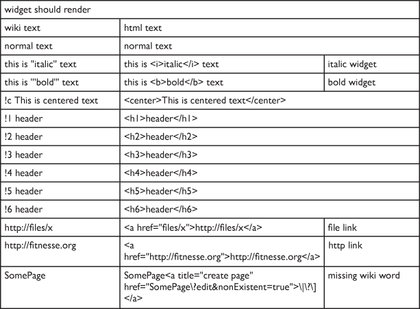

以下是 Given-When-Then 风格的示例：

```
Given a page with the wiki text: !1 header
When that page is rendered.
Then the page will contain: <h1>header</h1>
```

很清楚，这些形式化方法，无论是写在验收测试工具中，还是写在简单的电子表格或文本编辑器中，都是相对容易自动化的。

#### 规范

在最严格的规范形式，验收测试由 BA 和 QA 编写。BA 关注正向路径（happy path）场景，而 QA 则专注于探索系统可能失败的无数方式。

这些测试与它们要测试的功能同时编写或在此之前编写。在划分为冲刺（sprints）或迭代的敏捷项目中，测试是在冲刺的前几天内编写的。它们应该在冲刺结束前全部通过。

BA 和 QA 为程序员提供这些测试，程序员以一种让 BA 和 QA 参与的方式将其自动化。

这些测试成为了`完成的定义（definition of done）`。在所有验收测试通过之前，一个功能是不完成的。当所有验收测试通过后，该功能就完成了。

当然，这给 BA 和 QA 带来了了巨大的责任。他们编写的测试必须是对被测试功能的完整规范。验收测试套件`就是`整个系统的需求文档。通过编写这些测试，BA 和 QA 证明了当测试通过时，指定的功能已完成并运行正常。

在某些情况下，BA 和 QA 可能不习惯编写此类正式且详细的文档。在这种情况下，程序员可能希望在 BA 和 QA 的指导下编写验收测试。中间目标是创建出 BA 和 QA 可以阅读并认可的测试。最终目标是让 BA 和 QA 变得能够独立编写测试。

#### 持续构建

一旦验收测试通过，它就会进入持续构建期间运行的测试套件。

持续构建是一个自动化程序，每当程序员将代码提交到源码控制系统就会运行。该程序从源码构建系统，然后运行自动化程序员单元测试套件和自动化验收测试套件。运行结果会可见发布，通常通过电子邮件发送给每个程序员和相关方。持续构建的状态是每个人应该持续关注的。

持续运行所有测试确保了对系统的更改不会破坏已工作的功能。如果之前通过的验收测试在持续构建期间失败，团队必须立即响应并修复，然后再进行任何其他更改。在持续构建中积累失败是自杀行为。

### 结论

验收测试是 21 世纪上半叶软件开发中最薄弱的之一。这必须改变。企业和开发者必须学会协作，创建一种语言和程序，允许 BA 和 QA 正式地规范需求，并允许程序员快速验证这些需求已得到满足。AI 的出现使得这一需求变得格外重要。

## 17

# AI、LLM 以及未知的


在 20 世纪 40 年代后期，Grace Hopper 编写了她的行代码。每一行看起来像这样：

```
| 521|  53|  2|
```

每个数字代表纸带上的特定孔，看起来像这样：


那张纸带上的每一行都是哈佛 Mark I 计算机执行的指令。这些指令非常简单——类似于“将寄存器 10 加到寄存器 12”。

我让你们想象一下那个年代编程是有多么困难。

在几年之后，人们清楚地发现，计算机程序可以从更抽象的文本表示（如“add 10, 12”）来生成那样的代码。霍珀将其称为 `自动编程`。

在霍珀编写第一行代码后不到十年，John Backus 和他的团队就生产了第一个 FORTRAN 编译器，它使用像“a = b + c”这样的语句。Algol 在几年后出现，在十年之内，Dahl 和 Nygaard 创建了 `SIMULA 67`，第一种面向对象的语言。`C`、`Unix`、`Smalltalk` 和 `C++` 在几年内相继问世。在随后的几年里，`Java` 和 `C#` 也出现了。

在每一个这样的转型中，程序员的生产力都得到了提升。第一次生产力的飞跃是重大的。在 20 世纪 50 年，使用类 FORTRAN 编译器的程序员的生产力是使用机器代码程序员的 45 倍。

此后的每一次生产力飞跃都小于上一次。`C` 的生产力可能是 FORTRAN 的两倍。`C++` 可能是 `C` 提升了 20%。`Java/C#` 可能是另外 20% 左右。`Ruby/Python` 可能比 `Java` 好 20%，而 `Clojure` 可能又增加了 10%。

语言的每一次转型都是由抽象层次的提高驱动的。该序列中的每种新语言都比 Grace Hopper 在那些纸带上的打孔又远了一步。而且每一步都伴随着对编程正被毁掉的恐惧。

是的，你没读错。在每一个阶段，都有预测编程将走向终结的人。人们出版了书籍预言这个行业的毁灭。他们声称程序员将像的渡鸟一样稀有。

每当我们编程变得简单一点点，我们这些深陷当前复杂性中的人就容易担心那些平庸大众会夺走我们的工作。于是，我们预言了这个职业的终结。而每一次，这些恐惧和预测与实际结果恰恰相反。随着每一次新的进步，项目数量和对程序员的需求都在不断增长。

今天，我们面临着另一个这样的转型——`AI` 的转型。当然，现在充斥着对编程已死以及程序员很快将灭绝的恐惧。

胡说！这仅仅是我们语言抽象层次的又一次提升——离纸带上的孔又远了一步。当我们掌握它时，项目数量和对程序员的需求将继续增长。

### 提示词编程 (Programming by Prompt)

这是一项非常新的技术，我们还没有很好掌握如何使用它。这让我们想起最初尝试 `Java` 和 `Web` 的时候。有人记得 Applets（小程序）吗？我们花了几年时间才弄明白如何良好使用 `Java/C#` 的基础知识。又过了好几年才完善了这些基础。

`Ruby` 和 `Python` 也是如此。起初我们跌跌撞撞地摸，然后逐渐摸索出了最佳的进展方法。相信我，当 FORTRAN 第一次出来时，充满了恐惧、痛苦、怀疑、笨手笨脚和跌撞。

`AI` 的情况也将是如此。

```clojure
(def sentence-walk [filename initial-substring]
  "Main function to perform the sentence walking."
  (let [sentences (read-file filename)]
    (loop [substring initial-substring
           accumulated-words []
           iterations 0]
      (if (or (= (last (str/split substring #"\s+")))
              (> iterations 50))
        (str/join " " (concat (str/split initial-substring #"\s+"))
                  accumulated-words))
        (let [matching-sentences (find-sentences-with-substring
                                    sentences substring)]
          (if (empty? matching-sentences)
            (str/join " " (concat (str/split initial-substring #"\s+"))
                      accumulated-words))
            (let [random-sentence (rand-nth matching-sentences)
                  next-word (get-next-word random-sentence substring)]
              (recur (update-substring substring next-word)
                     (conj accumulated-words next-word)
                     (inc iterations)))))))))

(def read-file [filename]
  "Reads the content of file and splits it into sentences."
  (try
    (let [content (slurp filename)]
      (str/split content))
    (catch Exception e
      (throw (Exception (str "Error reading file: " (.getMessage e)))))))

(def get-next-word [sentence substring]
  "Finds the next word after the substring, or if none."
  (let [index (str/index (str-case sentence) substring)]
    (if index
      (let [post-substring (subs sentence (+ index))]
            (seq words)]
          .")))

(def find-sentences-with-substring [sentences substring]
  "Finds all sentences containing the substring."
  (filter #(str/includes? (str-case %) substring) sentences))

(def update-substring [substring next-word]
  "Updates the substring by adding the next word and trimming if longer than 3."
  (let [words (str/split substring #"\s+")
        new-words (conj (vec words) next-word)
        trimmed-words (if (> (count new-words) 3)
                        (subvec new-words 1)
                        new-words)]
    (str/join " " trimmed-words)))

(def -main [& args]
  (if (< (count args) 2)
    (println "Usage: program <filename> <initial-substring>")
    (let [filename (first args)
          initial-substring (second args)]
      (try
        (println (sentence-walk filename initial-substring))
        (catch Exception e
          (println (.getMessage e)))))))
```

例如，这里有一个运行示例：


```
>clj -M -m markov
~/Documents/Books/Clean\ Code\ 2ded\ 20250311.txt "The Single"

单一职责原则，以及依赖
关系，最终又回到了最初的那个解决方案，就是
你每天都在上面工作的那个项目，关乎业务和个人
生活
```

注意第三行和第四行中的双倍空格。它为什么会那样呢？

我可以通过在提示词（prompt）中添加这些说明来修复这些错误。例如，我可能会添加：

```
确保所有累计的单词之间只用一个空格隔开。
```

但这种方法有很多问题。首先，我还没有弄清楚为什么会有那些双倍空格，所以这个对提示词的修改只是为了治标的补丁。其次，我能确定 `all accumulated words` 这个子句能够正确指代返回值吗？

我可以尝试一下来找到答案；但这会导致另一个问题。每当提示词发生新变化时，Grok 都会从头开始*重新生成*程序，而不是修改现有程序。考虑到提示词中所有的歧义，我如何能确保重新生成的程序不会破坏上一个程序中正常运行的功能？它还会使用与之前相同的 `word` 和 `sentence` 的定义吗？它还会像之前一样解释 `the found word` 吗？鉴于 LLM 算法的统计和模糊性质，它很有可能不会的！

以下是 Grok 针对该修改后的提示词生成的代码。注意，这两个程序看起来是由两个不同的程序员写的。

```clojure
(ns sentence-walker
  (:require [clojure.string :as str]
            [clojure.java.io :as io]))

(defn get-sentences [filename]
  "读取文件并拆分为句子"
  (-> (slurp filename)
      (str/replace #"[.!?]\s+" "$0|")
      (str/split #"\|")
      (->> (map str/trim)
           (filter not-empty))))

(defn find-matching-sentences [sentences substring]
  "找到包含子字符串的所有句子"
  (filter #(str/includes? (str/lower-case %)
                          (str/lower-case substring))
          sentences))

(defn get-next-word [sentence substring]
  "找到句子中子字符串后的单词，如果在末尾则返回 ."
  (let [idx (str/index-of (str/lower-case sentence)
                          (str/lower-case substring))
        substr-end (+ idx (count substring))
        remainder (subs sentence substr-end)]
    (if (empty? (str/trim remainder))
      "."
      (let [next-word (first (str/split (str/trim remainder) #"\s+"))
        (if (empty? next-word)
          "."
          next-word)))))

(defn update-substring [substring next-word]
  "为子字符串添加单词，如果超过 3 个单词"
  (let [words (str/split substring #"\s+")]
        new-words (conj words next-word)]
    (if (> (count new-words) 3)
      (str/join " " new-words))))

(defn walk-sentences [filename]
  "遍历句子的主函数"
  (let [sentences (get-sentences filename)]
    (loop [current-substr initial-substring
           iterations 0]
      (let [matching-sentences (find-matching-sentences sentences current-substr)]
        (if (empty? matching-sentences)
          "."
          (let [random-sentence (randnth matching-sentences)
                next-word (get-next-word random-sentence current-substr)]
            (if (> iterations 50)
              (str/join " " matching-sentences)
              (recur next-word (inc iterations)))))))))

;; 使用示例：
;; (walk-sentences "sample.txt" "the")
```

这个新程序解决了双空格问题，但在句尾产生了一个新问题。它无法很好地处理大小写。

```
clean code 是很困难的
```


```clojure
(ns markov.core
  (:require [clojure.string :as str]
            [clojure.java.io :as io]))

(defn get-sentences [file]
  (->> (slurp file)
       (re-seq #"[A-Za-z\s]+[.!?]")
       (map str/trim)))

(defn words [sentence]
  (str/split (str/lower-case sentence) #"\s+"))

(defn find-following-word [sentences search-str]
  (let [search-str (str/lower-case search-str)
        matching-sentences (filter
                             #(str/includes? (str/lower-case %)
                                             search-str)
                             sentences)]
    (if (empty? matching-sentences)
      "."
      (let [chosen (rand-nth matching-sentences)
            word-seq (words chosen)
            search-words (str/split search-str #"\s+")
            idx (.indexOf word-seq (last search-words))]
        (if (or (< idx -1) (>= (+ idx 1) (count word-seq)))
          "."
          (nth word-seq (+ idx 1)))))))

(defn -main [f s]
  (let [sentences (get-sentences f)
        result (find-following-word sentences s)]
    (println result)))
```

以下是 Grok 根据场景生成的测试代码。

```clojure
;; speclj tests
(ns markov.core-spec
  (:require [speclj.core :refer :all]
            [markov.core :refer :all]
            [clojure.java.io :as io]))

(def test-content
  "Oh, Hello there Bob, how are you today? I'm fine.
   Hello there Bill, I trust you are well.  How's the wife?
   Ah yes, hello there John, great day!  Kowabunga!")

(describe "Markov"
  (before-all
    (spit "test.txt" test-content))

  (after-all
    (.delete (io/file "test.txt")))

  (it "returns period when string not found"
    (should= "." (find-following-word (get-sentences "test.txt")
                                      "not in any sentence")))

  (it "returns 'there' when searching for 'hello'"
    (should= "there" (find-following-word (get-sentences "test.txt")
                                          "hello")))

  (it "returns period when searching for 'are well'"
    (should= "." (find-following-word (get-sentences "test.txt")
                                      "are well")))

  (it "returns Bob, Bill, or John for 'hello there'
       with uniform distribution"
    (let [results (repeatedly 100
                    #(find-following-word
                      (get-sentences "test.txt") "hello there"))
          freqs (frequencies results)
          expected ["bob" "bill" "john"]]
      (should= 3 (count freqs))
      (should (every? #(contains? freqs %) expected))
      (doseq [name expected]
        (let [count (get freqs name)]
          ;; Check if count is reasonably close to 33 (100/3)
          ;; with some tolerance
          (should (> count 20))
          (should (< count 50)))))))
```

尽管 Grok 做出了努力，但这些测试并没有通过。这恰恰说明了在提示词（prompt）中过载测试场景是多么重要！

```text
Failures:

  1) Markov returns 'there' when searching for 'hello'
     Expected: "there"
          got: "." (using =)

  2) Markov returns period when searching for 'are well'
     Expected: "."
          got: "i" (using =)

  3) Markov returns Bob, Bill, or John for
     'hello there' with uniform distribution
     Expected: 3
          got: 1 (using =)
```

调试代码相对简单；但你能够调试提示词吗？即使你能够“修复”提示词，你能确定在多次应用该提示词时，它生成的代码和测试仍然是能够通过的吗？

Grok 虽然写了测试却无法利用它们来推断出预期的行为，这一事实暴露了大语言模型（LLM）方法的局限性。LLM 本质上是统计性的；它们通过概率而非推理来生成响应。确实，许多推理逻辑已经训练到了统计模型中；但对提示词的评估并不是实时推理。推理（Inference）是推理的核心操作。如果 LLM 不主动进行推理，那么它们就不具备推理能力！

如果你调试 Grok 产生的代码，你会发现 Grok 显然忽略了提供的 `word` 定义，并且没有正确解释不区分大小写的约束。Grok 被一个过载了测试场景的正式化提示词搞乱了，这一点并不令人鼓舞。至少对我来说很显然，如果没有过载的正式化，利用 AI 编写我们系统的前景注定会惨遭失败。毕竟，编程是形式化的，而人类需要过载。

### 结论

最终，我预计 LLM 和 AI 将不断改进，使得长且正式的规范将触手可及。我也预计程序员将设计出正式且过载的规范语言，让 AI 可以通过这些语言来生成复杂的系统。

谁来学习并应用这些形式化方法？谁来提供 AI 所缺失的推理能力？


我们用于这种抽象的物理手段之一是多态。我们安排高层策略使用多态接口来管理低层细节。然后，我们将低层细节安排为这些多态接口的实现。这使得所有源代码的依赖都从低层细节指向高层策略，并让高层策略忽略低层细节的实现。低层细节可以更改而不影响高层策略。这就是依赖倒置原则（`DIP`）的精髓。

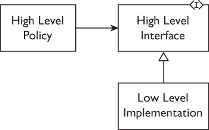

为了实现良好的软件设计的目标，我们将首先讨论 YAGNI，然后讨论 Kent Beck 的简单设计四大原则：

1. 被测试覆盖
2. 揭示意图
3. 最小化重复
4. 最小化规模

### YAGNI

*万一你不需要它呢？*

1999 年，我正和 Martin Fowler、Kent Beck、Ron Jeffries 以及许多其他人一起教一门极限编程（Extreme Programming）课程。话题转向了过度设计和过早泛化的危险。有人在白板上写下 YAGNI 并说：“你不会需要它的。”Kent Beck 打断了他，并大致表达了这样的意思：你实际上可能需要它；但你应该问自己：“万一你不需要它呢？”

这就是 YAGNI 提出的原始问题：每当你想“我将会需要这个钩子（hook）”时，你就会问自己，如果不放这个钩子会发生什么。如果留掉这个钩子的代价是可以接受的，那么你可能就不应该把它加上。如果年年年地在设计中携带这个钩子的成本很高，而你最终需要那个钩子的概率很低，那么你可能就不应该把它放进去。

考虑未来总是明智的，在某些时候加入特定的钩子确实是一个好主意。但请务必权衡双方的成本和利弊。确保你问了自己这个问题：*万一我不需要它呢？*

这种洞察力是良好软件设计中最重要的准则之一。如果你有一套良好的测试，并且擅长重构这一准则，那么添加新功能并更新设计以支持该新功能的成本，通常小于实现和维护你某一天可能需要的所有钩子的成本。

### 被测试覆盖

什么是良好的测试覆盖率：80%？90%？许多团队将这些数字视为值得赞誉的目标。我不同意。唯一合理的覆盖目标是 100%。

还有什么数字可能有意义？如果你对 80% 的覆盖率感到满意，意味着你不知道 20% 的代码是否正常工作。你怎么可能对此满意？你的客户又怎么对此满意呢？

#### 渐线目标

你可能会抱怨 100% 是一个不可及的目标。我甚至可能认同。实现 100% 的行和分支覆盖绝非易事。取决于情况，它实际上是不切行的。但这并不意味着你目前的覆盖率不能再提高了。

将 100% 视为一个渐线目标。你可能永远无法到达，但这并不是你每次迭代都不尝试更接近它的借口。我个人参与过一些增长到数万行代码的项目，一直将覆盖率保持在 90% 高位数。

#### 设计？

但高代码覆盖率与简单设计有什么关系？为什么覆盖率是第一规则？可测试的代码就是解耦的代码。为了实现代码中每个部分的高行和分支覆盖，这些部分的每一个都必须能够被测试访问。这意味着这些部分必须与代码的其他部分解耦得足够好，以便可以从单个测试中调用。因此，这些测试不仅是对行为的测试，也是解耦的测试。编写孤立测试的行为是一种设计行为，因为被测试的代码必须被设计成可测试的。测试不仅驱使你创建解耦且健壮的设计，还允许你随着时间的推移改进这些设计。正如我们在这些页面中多次讨论过的，一套可靠的测试套件减少了对变化的恐惧。如果你有这样一套套件，并且这套件可以执行，那么每当你发现更好的方法时，就可以改进代码的设计。当需求发生当前设计难以负担的方式改变时，测试将允许你无畏地转换设计以匹配这些新需求。这就是为什么这条规则是简单设计的第一条也是最重要的规则。如果没有覆盖整个系统的测试套件，其他规则将变得不切实际，因为它们最适合在事后应用。那些其他规则涉及重构。而没有一套良好的、全面的测试套件，重构几乎是不可能的。

### 最大化表达

在编程的早期几十年里，我们编写的代码无法揭示意图。事实上，“code（代码）”这个词本身就暗示了意图被遮蔽了。在 60 年代后期，代码看起来像这样：

```
-------
/ROUTINE TO TYPE A MESSAGE                  DATE PAGE 1
             /ROUTINE TO TYPE A MESSAGE
       0200
       7600           MONADR=7600
0200  7300  START,   CLA      /CLEAR ACCUMATOR AND LINK
0201  6046           TLS          /CLEAR TERMINAL FLAG
0202  1216           TAD BUFADR   /SET UP POINTER
0203  3217           DCA PNTR     /FORTIFY PNTR
0204  5631           ISZ          /SKIP TERMINAL FLAG
0205  5204           JUMP NEXT/GET ANOTHER
0206  1617           TAD PNTR   /GET CHARACTER
0207  7600           SZA     MONITOR
0208  0200           BUFFERZA      BUFFER ADDRESS
0209  0214           0


2200  0110/11
0211  0215/0
0212  0216/0
0213  0217/0
0214  0218/0
0215  0219/0
0216  0220/0
0217  0221/0
```

注意这些无处不在的注释。这些注释是绝对必要的，因为代码本身没有显示程序的意图。

然而，我们不再工作在 60 年代了。我们使用的语言具有极强的表达力。通过正确的准则，我们可以编写读起来像“良好散文”的代码。作为这种代码的示例，请看这段 Java 代码：

```java
public class RentalCalculator {
  private List<Rental> rentals = new ArrayList<>();

  public void addRental(String title, int days) {
    rentals.add(new Rental(title, days));
  }

  public int getRentalFee() {
    int fee = 0;
    for (Rental rental : rentals)
      fee += rental.getFee();
    return fee;
  }

  public int getRenterPoints() {
    int points = 0;
    for (Rental rental : rentals)
      points += rental.getPoints();
    return points;
  }
}
```

如果你不是这个项目的程序员，你可能无法理解这段代码中发生的一切。然而，即使只是匆匆一眼，设计者的基本意图也容易识别。变量、函数和类型的名称具有深度描述性。算法的结构清晰易见。这段代码是有表现力的。这段代码是简单的。

### 底层抽象


为了免得你认为表达性仅仅关乎给函数和变量起个好听的名字，我应该指出另一个问题：层次的分离以及底层抽象的阐述。

如果一个软件系统的每行代码、每个函数和每个模块都存在于一个定义良好的分区中，并清晰地描绘了代码的层级及其在整体抽象中的位置，那么这个系统就是具有表达性的。

你可能觉得最后那句话很难理解，所以让我通过更啰嗦的方式来说得更清楚一点。

想象一个有一系列复杂需求的应用。我喜欢使用的例子是薪资系统。

*   时制员工每周五发放工资，依据是他们提交的工卡。每周工作超过 40 小时的部分，每小时可获得 1.5 倍工资。
*   佣金制员工在每月第一个和第三个周五发放工资。他们获得底薪加上根据提交的销售据收取的佣金。
*   月制员工在每月最后一天发放工资。他们获得固定的月薪。

对你来说，想象一组包含着复杂的 `switch` 语句或 `if`/`else` 链的函数来捕获这些需求并不难。然而，这样一组函数可能会掩盖底层抽象。这种底层抽象是什么？

```
public List<Paycheck> run(Database db) {
  Calendar now = SystemTime.getCurrentDate();
  List<Paycheck> paychecks = new ArrayList<>();

  for (Employee e : db.getAllEmployees()) {
    if (e.isPayDay(now))
      paychecks.add(e.calculatePay());
  }

  return paychecks;
}
```

注意，这里没有提到任何主导这些需求的恶性细节。这个应用的底层事实是：我们需要在所有员工的薪发放日支付工资。将高层策略与低层细节分离，是使设计简单且具有表达性的最根本部分。

### 测试：问题的另一半

当 Kent Beck 最初写下这条规则时，他是这样表述的：

*系统（代码和测试）必须传达你想要表达的一切。*

他这样表述是有的：无论你把生产代码写得多么有表达力，它都无法传递它被使用的上下文。那是测试的工作。

你写的每一个测试，特别是当这些测试是隔离且解耦时，都是对生产代码预期如何被使用的演示。编写良好的测试是它们所测试代码部分的示例用用例。

因此，*结合来看*，代码和测试共同表达了系统每个元素的功能以及每个元素应该如何被使用。

这与设计有什么关系？当然，关系巨大。因为我们希望通过设计实现的首要目标是让其他程序员易于理解、改进和升级我们的系统。没有比通过一套全面的可执行测试套件来演示系统抽象的预期用法更能实现这一目标的方法了。

### 最小化重复

正如我在之前的几个章节中告诉过你的，在软件的早期，无法从一个程序调用另一个程序。如果你想重复执行某项操作，就必须复制代码。程序员将代码片段写在笔记本上，以便在需要时将其复制到程序中。他们将这些片段称为*子程序*。

在 20 世纪 50 年代，程序调用子程序并让子程序返回调用点变得可能。在当时，我们完全没有源代码编辑器。我们使用 2 号铅笔在预印的编码表格上编写代码。因此，我们避免了大多数重复，因为对我们来说，创建一个代码片段的实例并调用它要容易得多。调用消耗了许多 CPU 周期，但缺乏重复节省了大量内存。这通常是一个很好的权衡。

然后源代码编辑器出现了。随着这些编辑器的出现，复制/粘贴操作之出现。突然之间，从一个例程复制代码片段并粘贴到新例程中，然后反复调整直到其运行变得容易了。随着内存变得越来越廉价、越大，重复的成本就不再令人担心。因此，随着时间的推移，越来越多的系统在代码中表现出海量的重复。

重复通常是有问题的。两段或多段相似的代码通常需要一起修改。找到这些相似的片段是困难的。正确地修改它们更加困难，因为它们存在于不同的上下文中。因此，重复导致了脆弱性。

总来说，最好的方法是将代码抽象为一个新函数，并提供适当的参数来通信上下文中的任何差异，从而将相似的代码段减少为单个实例。

有时这种策略是不可行的。例如，有时重复出现在遍历复杂数据结构的代码中。系统的许多不同部分可能希望遍历该结构，它们将使用相同的循环和遍历代码，仅是为了在代码体中对数据结构进行操作。

随着数据结构随时间变化，程序员将不得不找到所有遍历代码的重复并正确地更新它们。遍历代码重复得越多，脆弱性的风险越高。

遍历代码的重复可以通过将其封装在某处来消除，并使用 lambdas、`Command` 对象、`Strategy` 模式，甚至是 `Template Method` 模式将必要的操作传递给遍历。

### 意外重复

并不是所有的重复都应该消除。在某些情况下，两段代码可能非常相似甚至完全相同，但会因为非常不同的原因而改变。我称其为*意外重复*。意外重复不应该被消除。应该允许重复存在。随着需求的变化，重复将分别演变，意外重复也将消失。

显而易见，管理重复绝非易事。识别哪些重复是真实的，哪些是意外的，然后对真实的重复进行封装和隔离，需要大量的思考。

从意外重复中区分出真实的重复，很大程度上取决于代码表达意图的能力。意外重复是发散的。真实的重复是收敛的。

封装并隔离真实的重复，使用抽象、lambdas 和设计模式，涉及大量的重构。而重构需要良好的、稳固的测试套件。

因此，消除重复在简单设计规则的优先级列表中排第三。首先是测试，其次是表达，*然后*才是重复。

### 最小化尺寸

简单的设计由尽可能少的简单元素组成，且不损害测试覆盖率和表达力。简单元素是小的。简单设计的最后规则建议，在让所有测试通过之后，在让代码尽可能具有表达力之后，以及在最小化重复之后，*那么*你应该致力于减少模块、类、函数和行的数量。


多年前，Kent Beck 和我曾就设计原则进行过讨论。他的一句话一直让我记忆深刻。他说，如果你能尽可能努力地遵循这四点，所有其他设计原则都会得到满足——设计原则可以简化为：覆盖（coverage）、表达（expression）、单一化（singularization）和精简（reduction）。

我不知道这是否真实。我不知道一个被完美覆盖、表达、单一化且精简的程序是否一定符合开闭原则（`OCP`）或单一职责原则（`SRP`）。然而，我非常确定，了解和研究良好设计与良好架构的原则（例如 `SOLID` 原则）会让创建分区良好且简单的设计变得容易得多。

# 19 SOLID 原则

*本章是我书籍 `Clean Architecture` 中内容经过大幅删减和编辑的摘选集。其目的是为你对书中其他地方提到的原则提供快速参考，并为你提供进一步学习的方向建议。*


良好的软件系统始于整洁的代码。如果砖块做得不好，那么建筑的架构就不重要了。反之，即使使用精良的砖块也能造出一堆混乱。这就是 `SOLID` 原则大显身场的地方。

`SOLID` 原则告诉我们如何将函数数据数据组织成类，以及这些类应该如何相互连接。`class`（类）一词的使用并不意味着这些原则仅适用于面向对象的软件。`class` 仅仅是函数和数据的耦合分组。每个软件系统都有这样的分组，无论它们是否被称为类。`SOLID` 原则适用于这些分组。

这些原则的目标是创建中层软件结构，这些结构应当能够：

*   容忍变化
*   易于理解
*   作为可以在其他软件系统中使用的组件的基础

“中层”一词是指这些原则是由在模块级上工作的程序员所应用的。它们被应用于函数层之上，并帮助定义模块和组件内部使用的软件结构类型。

正如使用精良砖块也可能制造混乱一样，设计良好的中层组件也可能导致整个系统的混乱。因此，一旦我们涵盖了 `SOLID` 原则，我们将进入它们在组件世界的对应物，然后进入第三部分) 中被详细描述。后续章节并不是为了取代那些详尽的著作。如果你还不熟悉这些原则，后续内容将是一个很好的介绍，但不足以实现深度理解。建议你在脚注中的文档中深入学习它们。

1。例如，[PPP02], [`www.butunclebob.com/ArticleS.UncleBob.PrinciplesOfOod`](http://www.butunclebob.com/ArticleS.UncleBob.PrinciplesOfOod), 以及 [`en.wikipedia.org/wiki/SOLID_(object-oriented_design)`](https://en.wikipedia.org/wiki/SOLID_(object-oriented_design))（或直接在谷歌搜索 SOLID）。

### SRP：单一职责原则

在所有的 `SOLID` 原则中，这可能是最不被理解的。这可能是因为它的名字特别不恰当。程序员很容易听到这个名字，然后假设这意味着每个模块应该只做一件事。

历史上，`SRP` 是这样描述的：

*一个模块有一个且仅有一个更改的原因。*

软件系统的更改是为了满足用户和利益者。因此，这些用户和利益者*就是*该原则所说的“更改原因”。事实上，我们可以将该原则重新表述为：

*一个模块负责一个且仅一个用户或利益者。*

遗憾的是，*用户*和*利益者*这两个词在这里并不是真正的用词。这是因为可能会有多个用户或利益者希望以相同的方式更改系统。所以我们实际上指的是一个或多个需要更改的群体。我们将该群体称为 `actor`（参与者）。

因此，`SRP` 的最终版本是：

*一个模块负责一个且仅一个参与者。*

现在，我们所说的 `module`（模块）是指什么？`module` 仅仅是函数和数据的内聚性集合。“内聚性”一词暗示了 `SRP`。内聚性是将负责单一参与者的代码结合在一起的力量。

理解这一原则的最佳方法可能是观察违反该原则所产生的许多症状之一。

### 意外重复

考虑一个薪资应用程序中的 `Employee` 类。它有三个方法：`calculatePay()`、`reportHours()` 和 `save()`。

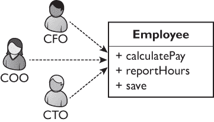

该类违反了 `SRP`，因为这三个方法负责三个非常不同的参与者。

*   `calculatePay()` 方法由财务部门指定，该部门向首席财务官（CFO）汇报。
*   `reportHours()` 方法由人力资源部门指定和使用，该部门向首席运营官（COO）汇报。
*   `save()` 方法由数据库管理员（DBAs）指定，他们向首席技术官（CTO）汇报。


通过将这三个方法的源代码放在同一个 `Employee` 类中，开发者将这些角色中的彼此耦合在了一起。这种耦合会导致首席财务官（CFO）团队的操作影响到首席运营官（COO）团队所依赖的内容。

例如，假设 `calculatePay()` 函数和 `reportHours()` 函数共享一个计算非加班小时的通用算法。再假设开发者们为了避免代码重复，将该算法放入一个名为 `regularHours()` 的函数中。

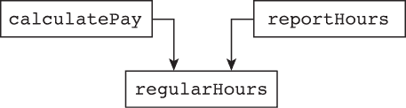

现在假设 CFO 团队决定需要调整非加班小时的计算方式。但人力资源部门的 COO 团队并不希望进行那个特定的调整，因为他们将非加班小时用于不同的用途。

一名开发者被指派进行此项更改，他看到了被 `calculatePay()` 方法调用的便捷函数 `regularHours()`。遗憾的是，该开发者没有注意到该函数也被 `reportHours()` 函数调用了。

开发者执行了所需的更改并进行了仔细的测试。CFO 团队验证了新函数运行符合预期，系统随之部署。

当然，COO 团队并不知道这一切正在发生。COO 团队继续使用由 `reportHours()` 函数生成的报告——但现在报告中包含了错误的数字。最终，问题被发现了，COO 大发雷霆，因为这些错误数据导致他的预算损失了数百万美元。

我们都见过这类事情的发生。它的出现是因为我们将不同角色所依赖的代码放在了邻近的位置。单一职责原则（SRP）要求我们*分离不同角色所依赖的代码*。

## 解决方案

针对这个问题有许多不同的解决方案。每种方案都是将函数移动到不同的类中。

也许这样做最明显的方法是将数据与函数分离。三个类共享对 `EmployeeData` 的访问，它是一个没有方法的简单数据结构。每个类只持有其特定函数所需的源代码。这三个类不允许感知彼此的存在。因此，避免了任何意外的重复。

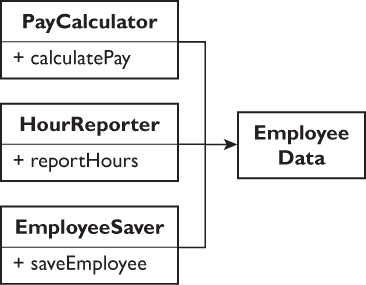

当然，这种解决方案的缺点是开发者现在有四个类需要实例化并进行跟踪。解决这一困境的常见方案是使用外面模式（Facade pattern）。

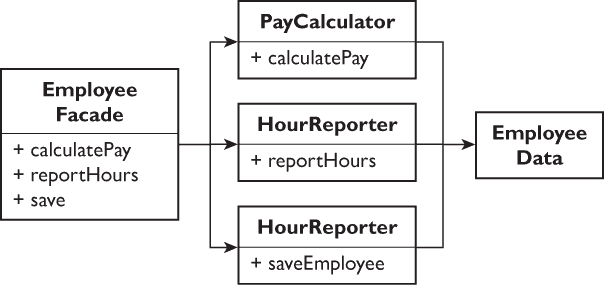

`EmployeeFacade` 包含的代码非常少。它负责实例化类并将任务委托给带有函数的类。

一些开发者更倾向于将最重要的业务规则离数据更近。这可以通过将最重要的方法保留在原始 `Employee` 类中，然后将该类作为次要函数的外来实现。

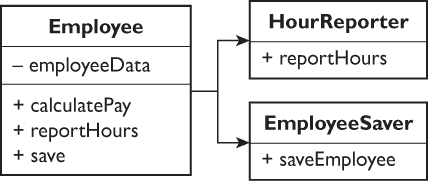

你可能会对这些解决方案提出异，认为每个类都只包含一个函数。事实并非如此。计算工资、生成报告或保存数据所需的函数数量在每种情况下可能是大量的。这些类中的每一个可能都有许多其他公共方法，以及更多的私有方法。

## 高层级

SRP 是关于函数和类的。但该原则在另外两个层级以不同的形式重新出现。

正如我们将会看到的，在组件层级上，它变成了通用闭包原则（Common Closure Principle）。在架构层面，它变成了负责创建架构边界的变更轴。我们将在接下来的章节中学习这些内容。

## OCP：开闭封闭原则


OCP 由 Bertrand Meyer 在 1988 年提出。它说：

2. p. 23. [OOSC], p. 23.

*软件产物应对扩展开放，但对修改关闭。*

换句话说，软件产物的行为应当是可扩展的，而无需修改该产物。

当然，这正是我们研究软件设计的根本原因。当对需求的简单扩展迫使软件发生巨变变化时，该软件系统的架构师就经历了一场惨痛的失败。

大多数软件设计学生都承认 OCP 是一项指导他们设计类和模块原则。但当我们考虑架构组件层级时，该原则具有更重大的意义。

### 思维实验

一个思维实验将使这一点变得清晰。

想象一下，我们有一个系统在网页上显示财务摘要。页面上的数据是可以滚动的，且负数用红色渲染。

现在想象一下，利益相关者要求将这些相同的信息以报告的形式生成，以便在黑白打印机上打印。报告应该正确地分页，并带有适当的页眉、页脚和列标签。负数应该用括号括起来。

显然，会有一些新代码需要编写。但会有多少旧代码需要更改？

良好的软件架构将使更改的代码量减少到最低；理想情况下是零。

如何做到？通过正确地分离因不同原因变化的对象（SRP），然后妥善组织这些事物之间的依赖（DIP）。

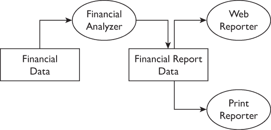

应用 SRP，我们可能会得到上述的数据流视图。某些分析程序检查财务数据并产生可报告的数据，然后由两个报告进程对其进行适当的格式化。这里的核心洞察是，报告包含三项职责：所报告数据的计算，以及这些数据转换为网页格式和打印格式。

在完成这种分离后，我们需要组织源代码依赖，以确保其中一个职责的更改不会导致另一个的更改，并且行为是可以扩展的。

我们通过将过程划分为类，并将这些类划分为组件来完成这一点，如下图中的双线所示。


 **未来的 Bob：**

为了说明，我从不要求你画这样一张图。我在思考这类问题时，也绝不会这样做。我可能会在白板上画出下方的简化的视图以便团队讨论。这些组件内部的大多数类对团队来说都是显而易见的，画出来是多余的。如果任何团队成员有特定的问题，团队的其他人可以在白板或纸巾上草画图的一部分。左上角的组件是控制器（Controller）。右上是交互器（Interactor）。右下是数据库（Database）。左下有四个表示呈现器（Presenters）和视图（Views）的组件。

标记为 `<I>` 的类是接口，标记为 `<DS>` 的是数据结构。空箭头表示*使用*关系。闭箭头表示*实现*或*继承*关系。


这些箭头指向了我们想要保护免受变化影响的组件。

让我重复一遍。如果组件 A 需要免受组件 B 变化的保护，那么组件 B 应该依赖于组件 A。

我们想要保护 `Controller` 免受 `Presenters` 变化的影响。我们想要保护 `Presenters` 免受 `Views` 变化的影响。我们想要保护 `Interactor` 免受任何变化。

`Interactor` 处于最符合 OCP（开闭原则）的位置。对 `Database`、`Controller`、`Presenters` 或 `Views` 的更改都不会对 `Interactor` 产生影响。

为什么 `Interactor` 应该处于这样一个特权位置？因为它包含了业务规则。`Interactor` 包含了应用程序最高级别的策略。所有其他组件处理的都是外围关注。`Interactor` 处理的是核心关注。

尽管 `Controller` 对于 `Interactor` 来说是外围，但它对于 `Presenters` 和 `Views` 却是核心。而 `Presenters` 对于 `Controller` 可能是外围的，但它们对于 `Views` 是核心。

注意这如何基于“级别”的概念创建一个保护分层结构。`Interactors` 是最高级别的概念，因此它们是最受保护的。`Views` 属于最低级别的概念之一，因此它们最少受保护。`Presenters` 的级别高于 `Views`，但低于 `Controller` 或 `Interactor`。

这就是 OCP 在架构层面的工作方式。架构师根据功能如何变化、为什么变化以及何时变化来分离功能，然后将这些分离的功能组织成一个组件分层结构。该分层结构中的高级组件免受对低级组件更改的影响。

### 方向控制

如果你对上述类设计感到恐惧并退缩了，请再看一遍。该图中的大部分复杂性是为了确保组件之间的依赖关系指向正确的方向。

例如，`FinancialReportGenerator` 和 `FinancialDataMapper` 之间的 `FinancialDataGateway` 接口的存在，是为了反转原本会从 `Interactor` 组件指向 `Database` 组件的依赖关系。对于 `FinancialReportPresenter` 接口和那两个 View 接口也是如此。

### 信息隐藏

`FinancialReportRequester` 接口服务于不同的目的。它的存在是为了保护 `FinancialReportController` 不会过多了解 `Interactor` 的内部细节。如果没有该接口，那么 `Controller` 将对 `FinancialEntities` 产生传递性依赖。

传递性依赖违反了通用原则，即软件实体不应该依赖于它们没有直接使用的东西。我们稍后会在讨论 ISP（接口隔离原则）和 CRP（构造职责原则）时遇到这一原则。

所以，尽管我们的首要任务是保护 `Interactor` 免受 `Controller` 变化的影响；我们也想通过隐藏 `Interactor` 的内部细节，保护 `Controller` 免受 `Interactor` 变化的影响。

### 结论

OCP 是系统设计的动力之一。目标是使系统易于扩展而不会产生高昂的影响。这通过将系统划分为组件并将它们组织成依赖分层结构来实现，从而保护高级组件免受低级组件的影响。

### LSP：里氏夫替换原则

1988 年，Barbara Liskov 写了以下内容作为一种定义子类型的方法。

在这里需要类似于下面的替换属性：如果对于类型 `S` 的每个对象 `o1` 都存在一个类型 `T` 的对象 `o2`，使得对于用 `T` 定义的所有程序 `P`，当 `o1` 替换 `o2` 时 `P` 的行为保持不变，那么 `S` 就是 `T` 的子类型。

例如，想象我们有一个名为 `License` 的类，如下所示。该类有一个名为 `calcFee()` 的方法，由 `Billing` 应用程序调用。License` 有两个“子类型”：`PersonalLicense` 和 `BusinessLicense`。它们使用不同的算法来计算许可费用。

这种设计符合 LSP，因为 `Billing` 应用程序的行为在任何方面都不取决于它使用了两个子类型中的哪一个。两个子类型都可以替换 `License` 类型。

违反 LSP 的经典示例是著名的 `Square`/`Rectangle` 问题。

在这个例子中，`Square` 不是 `Rectangle` 的合规子类型，因为 `Rectangle` 的高度和宽度是独立可变的，但 `Square` 的高度和宽度必须同时改变。由于 `User` 认为它正在与一个 `Rectangle` 通信，它很容易感到困惑。以下代码展示了原因。

```
Rectangle r = …
r.setW(5);
r.setH(2);
assert(r.area() == 10);
```

如果 `…` 生成了一个 `Square`，那么断言将失败。

防止这种 LSP 违反的唯一方法是在 `User` 中添加机制（如 `if` 语句）来检测 `Rectangle` 实际上是否为 `Square`。由于 `User` 的行为取决于它所使用的类型，因此这些类型不是可替换的。

在 `User` 中放入这样的 `if` 语句违反了 OCP。因此，每一个对 LSP 的违反都是对 OCP 的潜在性违反。

### LSP 与设计

在对象对象革命的早期，我们将这一原则视为一种引导继承使用的方法，如上一节所示。然而，多年来，我们已经将 LSP 演变成了一种更广泛的软件设计原则，涉及接口和实现。

所涉及的接口可以是许多形式。我们可能有一个 Java 风格的接口，由多个类实现。或者我们可能有多个共享相同方法签名的 Ruby 类。或者我们可能有一组响应到相同 REST 接口的服务。

在所有这些情况以及更多情况下，LSP 都是适用于，因为有用户依赖于定义的接口以及实现的可替换性。

### 出租车聚合器

从软件设计的角度理解 LSP 的最佳方法是观察当原则被违反时，系统设计发生了什么。

假设我们正在为许多出租车服务构建一个聚合器。客户使用我们的网站寻找最合适的出租车，无论哪家公司。一旦客户做出决定，我们的系统通过使用 RESTful 服务来派遣出租车。

现在假设 REST 派发服务的 URI 是司机数据库中包含的信息的一部分。一旦我们的系统选择了适合客户的司机，它就会从司机记录中获取该 URI，然后使用它来派发司机。

例如，假设司机 Bob 的派发 URI 如下：

```
purplecab.com/driver/Bob
```

我们的系统将把派发信息附加到此 URI 上，并通过 `PUT` 发送，如下：

```
purplecab.com/driver/Bob
  /pickupAddress/24 Maple st.
  /pickupTime/1530
  /destination/ORD
```

显然这意味着所有公司的派发服务都符合相同的 REST 接口。它们必须以相同的方式处理 `pickupAddress`、`pickupTime` 和 `destination` 字段。


现在假设 Acme 出租公司聘佣了一些没有仔细阅读规范的程序员，他们将目的地字段缩写为简单的 `dest`。再假设 Acme 是我们地区最大的出租车公司，而且 Acme CEO 的前妻恰好是我们 CEO 的新妻，然后……行了，你懂其中的意思了。这对我们的系统架构会产生什么影响？

显然，我们需要添加一个特例。针对任何 Acme 司机的派发请求都必须使用一套与所有其他司机完全不同的规则来构建。

实现这一目标最简单的方法是在构建派发命令的模块中添加一个 `if` 语句。

```
if (driver.getDispatchUri().startsWith("acme.com"))…
```

但是，当然，任何有真才的开发者都不会允许这种结构存在于系统中。在代码本身中硬入 `acme` 单词会产生各种可怕且神秘的错误机会，更不用说安全漏洞了。

例如，如果 Acme 变得非常成功并收购了 Purple Taxi 公司呢？如果他们保留了品牌和网站，但统一了所有的系统呢？我们是否需要为 `purple` 单词再添加另一个 `if` 语句？

因此，我们的架构师必须通过创建某种由派发 URI 键值的配置数据库驱动的派发命令创建模块，使系统免受此类 bug 的影响。配置数据可能如下所示：

| URI | 派发格式 |
| --- | --- |
| [Acme.com](http://Acme.com) | `/pickupAddress/%s/pickupTime/%s/dest/%s` |
| `.*` | `/pickupAddress/%s/pickupTime/%s/destination/%s` |

这一切的在于，对 RESTful 服务的 LSP 的简单违反可能会导致我们的架构被大量的额外机制污染。

### ISP: 接口隔离原则

ISP 的名称源于以下内容：

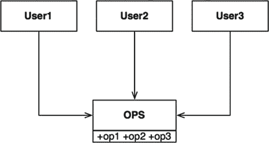

在上述情况下，有多个用户使用 `OPS` 类的操作。假设 `User1` 只使用 `op1`，`User2` 只使用 `op2`，而 `User3` 只使用 `op3`。

现在想象 `OPS` 是一个用 C++ 等语言编写的类。显然，在这种情况下，尽管 `User1` 并没有调用它们，但它的源代码会无意中依赖于 `op2` 和 `op3`。这种依赖意味着，`OPS` 中 `op2` 源代码的更改将迫使 `User1` 重新编译和部署，即使它关心的内容实际上没有发生变化。

Java 和 C# 的情况稍微复杂一些。编译器不会仅仅根据日期重新编译模块。相反，它会寻找更改的声明。

可以通过将操作分离到接口来解决这个问题，如下所示

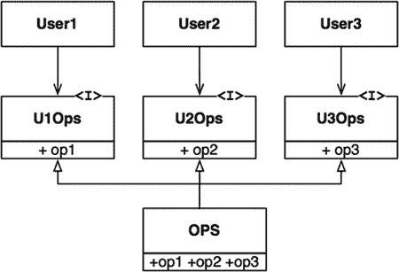

再次，如果我们假设这是在 C++ 这样的静态类型语言中实现的，那么 `User1` 的源代码将依赖于 `U1Ops` 和 `op1`，但不会依赖于 `OPS`。因此，`User1` 不关心的 `OPS` 更改不会导致 `User1` 重新编译和部署。

#### ISP 与语言

像 C++ 这样的静态类型语言强迫程序员创建用户必须 `#include` 的声明。正是源代码中这些包含的声明创建了源代码依赖，从而可能强制重新编译和部署。

在 Java 和 C# 等语言中，依赖关系较软但并非不存在。编译器使用单个声明而不是源文件跟踪依赖树。因此，只有当声明发生变化时，才需要重新编译和部署。

在 Ruby 和 Python 等动态类型语言中，接口不存在于源代码中。相反，它们在运行时被推断。因此，既没有源代码依赖，也没有任何强制重新编译和部署的接口声明。这就是为什么动态类型语言创建系统比静态类型语言更灵活、耦合更低的原因之一。

这一事实可能会让你得出结论：ISP 是一个语言问题，而不是设计问题。

#### ISP 与设计

然而，如果你后退一步考虑 ISP 的根本动机，你就会看到其中隐藏着更深层次的忧虑。通常情况下，依赖包含比你需要的更多的模块是有害的。对于可能导致不必要的重新编译和部署的源代码依赖来说这显然是正确的。但在更高的层面上也是如此。

例如，考虑一个正在系统 `S` 上工作的开发者。他想在系统中包含某个框架 `F`。现在假设 `F` 的作者将其绑定到了特定的数据库 `D`。因此 `S` 依赖于 `F`，而 `F` 依赖于 `D`。

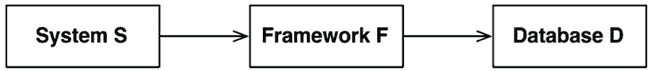

现在假设 `D` 包含了 `F` 不使用、因此 `S` 也不关心的功能。`D` 中这些功能的更改可能迫使 `F` 部署，从而迫使 `S` 部署。糟糕糟糕，`D` 中某个功能的故障可能会导致 `F` 和 `S` 故障。

这里的教训是，依赖于带有你不需要的包袱会给你带来意想不到的麻烦。

底线是：

*不要依赖于你不需要的东西。*

当我们讨论第 20 章 的通用重用原则“组件原则”时，将看到更多相关内容。

### DIP: 依赖倒转原则

*“依赖于你控制的东西，比依赖于你无法控制的东西好，否则它将会控制你。”*

James Grenning

在 60 年代和 70 年代，几乎所有的程序都是按照以下模式构建的。

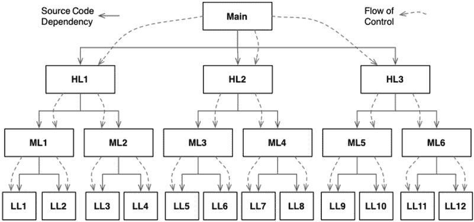

源代码依赖遵循控制流，没有例外。高层模块依赖于低层模块，因为高层模块*调用*了低层模块。

面向给了我们另一种选择：多态接口。

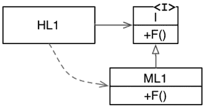

在调用路径中插入接口会将源代码依赖相对于控制流反转。在上面的图中，高层模块 `HL1` 调用低层模块 `ML1` 中的函数 `f`；但它是通过接口 `I` 实现的。从 `ML1` 到 `I` 的源代码依赖指向与控制流相反的方向。

以这种方式反转依赖的能力让软件设计师对系统中的每个源代码依赖都有绝对控制权。如果任何依赖存在问题（通常如此），可以通过插入接口来快速反转。

这种能力就是力量！


它允许我们创建插件式架构，使高层策略（如业务规则）独立于低层细节（如 UI 和数据库）。

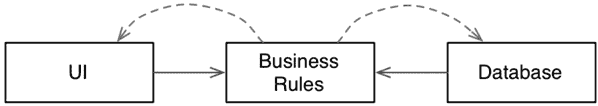

在上面的图中，所有的源代码依赖（实线箭头）都从低层模块指向高层模块。`UI` 和 `Database` 都依赖于并实现了 `BusinessRules` 中的接口。换句话说，具体细节依赖于抽象。这告诉我们，最灵活的系统是那些源代码依赖仅引用抽象而非具体实现的系统。

在像 Java 的静态类型语言中，这意味着 `use`、`import` 或 `include` 语句应该只引用包含接口、抽象类或其他抽象声明的源模块。不应该依赖任何具体实现。


同样的规则也适用于动态类型语言，如 `Ruby` 或 `Python`。源代码依赖不应引用具体的模块。然而，在这些语言中，定义什么是具体模块要困难一些。具体来说，它指的是任何包含被调用函数实现的处的模块。

将此视为一条不可逾越的硬规定是不现实的。软件系统必须依赖于许多具体设施。例如，`Java` 中的 `String` 类就是具体的。试图强迫它变成抽象的是不切实际的。对具体的 `java.lang.string` 的源代码依赖是无法避免且也不应该避免的。

另一方面，`String` 类非常稳定。该类的变化非常罕见且受到严格控制。程序员和架构师不需要担心 `String` 发生频繁且变幻莫测的变化。

因此，在涉及到及 DIP（依赖倒置原则）时，我们倾向于忽略操作系统和平台设施的稳定背景。我们容忍那些具体依赖，因为我们知道它们不会发生改变。

我们想要避免依赖的是系统中那些**易变的**（volatile）具体元素。那些我们正在积极开发并经历频繁变化的模块。

### 稳定的抽象

抽象接口的每一次变化都对应于其具体实现的变化。另一方面，对具体实现的变化并不总是、甚至通常不需要要求对它们所实现的接口进行更改。因此，接口通常比实现更具稳定性。

事实上，优秀的软件设计者和架构师努力降低接口的易变性。他们尝试寻找方法，在不更改接口的情况下为实现添加功能。这是软件设计的基础（101）。

因此，其含义是稳定的软件设计是那些避免依赖于易变具体化，并倾向于使用稳定的抽象接口的设计。

这一含义归结为一组非常具体的编码实践。

*   **不要引用易变的具体类。** 改而引用抽象接口。此规则适用于所有语言，无论静态类型还是动态类型。它还对对象的创建施加了严格的限制，并通常强制使用抽象工厂（Abstract Factories）。
*   **不要从易变的具体类派生。** 这是前一条规则的论，但值得特别提及。在静态类型语言中，继承是所有源代码关系中最强大且最僵化的关系，应该谨慎使用。在动态类型语言中，继承的问题没那么大；但它仍然是一种依赖，谨慎始终是最明智的选择。
*   **不要重写具体函数。** 具体函数通常需要源代码依赖。当你重写这些函数时，你并没有消除这些依赖——事实上，你*继承*了它们。为了管理这些依赖，你应该将函数设为抽象并创建多个实现。
*   **永远不要提到任何具体且易变对象的名称。** 这真的只是对原则本身的重申。

虽然这些是以规则形式编写的，但它们实际上更像是警告。务实的程序员会频繁违反这一原则。但明智的程序员会先考虑警告。

盲目地服从这一原则可能会导致没有人真正需要的接口爆炸。另一方面，轻率地忽视这一原则可能会导致你的软件变得错综且僵化。

最后，明智的程序员会随着系统的演进和需求的出现`逐渐`地遵循这一原则。凭借一套他们视如性命信任的测试套件，他们知道当为了倒置依赖而需要添加接口时，这些更改将是容易完成且没有风险的。

### 工厂

为了遵守 DIP，易变具体对象的创建可能需要特殊处理。这是因为在几乎所有的语言中，对象的创建都需要对该对象的具体定义有源代码依赖。

在大多数面向对象的语言中（如 `Java`），我们将使用 `Abstract Factory` 来消除这种不必要的依赖。

5. [GOF95].

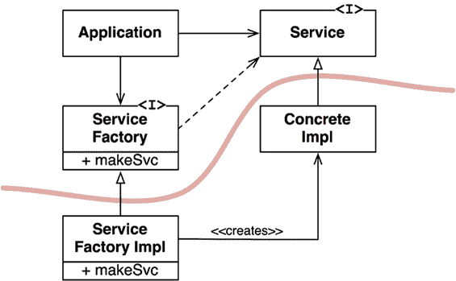

前面的图显示了结构。`Application` 通过 `Service` 接口使用 `ConcreteImpl`。然而，`Application` 必须以某种方式创建 `ConcreteImpl` 的实例。为了在不对 `ConcreteImpl` 创建源代码依赖的情况下实现这一点，`Application` 调用 `ServiceFactory` 接口的 `makeSvc` 方法。该方法由派自 `ServiceFactory` 的 `ServiceFactoryImpl` 类实现。该实现实例化 `ConcreteImpl` 并将其作为 `Service`。

注意这条曲线线。这是一个架构边界。它将抽象与具体隔离开。所有的源代码依赖都跨越那条线并指向同一个方向：指向抽象侧。

这条线将系统分为两个组件：一个是抽象的，另一个是具体的。抽象组件包含了应用程序所有的高层业务规则。具体组件包含了这些业务规则所操作的所有实现细节。

注意控制流跨越线条的方向与源代码依赖的方向相反。源代码依赖相对于控制流是反倒置的。这就是为什么我们将这一原则称为 `dependency inversion`（依赖倒置）。

### 具体组件

上图中的组件包含一个违反 DIP 的单一依赖。这是很典型的。DIP 违反无法完全消除；但它们可以被收集到少数具体组件中，并与系统的其他部分保持分离。

大多数系统将包含至少一个此类组件，通常被称为 `main`，因为它包含了 `main` 函数。在上面的例子中，`main` 函数将实例化 `ServiceFactoryImpl`并将该实例置于 `ServiceFactory` 类型的全局变量中。`Application` 然后将通过该全局变量访问工厂。

6. 即操作系统在应用程序首次启动时调用的函数。

随着我们继续阅读这本书并涵盖更高层次的架构原则，DIP 将反复出现。它将是我们架构图中最可见的组织原则。上图中的曲线将后续后续章节中的边界。依赖跨越该线指向更抽象实体的方式将成为一条新规则，我们称之为依赖规则（Dependency Rule）。

## 20

# 组件原则


如果 SOLID 原则告诉我们如何将砖块组合成墙和房间，那么组件原则告诉我们如何将房间组合成建筑。大型软件系统就像大型建筑是由小组件构建的。

在本章中，我们将讨论什么是软件组件，它们应该由什么元素组成，以及它们如何组合成系统。

本章是一个概述。这些原则在 [PPP02] 中详细描述，并在 [Clean Arch] 中再次提到。

### 组件

组件是部署单元。它们是作为系统一部分部署最小实体。在 Java 中，它们是 `jar` 文件。在 Ruby 中，它们是 `gem` 文件。在 .NET 中，它们是 `DLLs`。在编译语言中，它们是二进制文件的聚合。在解释型语言中，它们是源代码文件的聚合。在所有语言中，它们都是部署的粒度。


组件可以链接成单个可执行文件。它们也可以聚合在一个归档文件中，例如 `.war` 文件。或者，也可以作为独立的、动态加载的插件部署，例如 `.jar` 或 `.dll` 或 `.exe` 文件。然而，无论最终如何部署，良好的组件始终保留着独立部署的能力，因此是*可以被独立开发*的。

### 组件的简史

在软件开发的早期，程序员控制着程序的内存位置和布局。程序中的第一行代码之一通常是源地址语句（origin statement），它声明了程序将被加载的地址。考虑这个简单的 PDP-8 程序。它包含一个名为 `GETSTR` 的子程序，从键盘输入字符串并将其保存到缓冲区中。它还有一个小小的单元测试程序来运行 `GETSTR`。

```
 *200
          TLS
  START,  CLA
          TAD BUFR
          JMS GETSTR
          CLA
          TAD BUFR
          JMS PUTSTR
          JMP START

  BUFR,   3000

  GETSTR, 0
          DCA PTR
  NXTCH,  KSF
          JMP .-1
          KRB
          DCA I PTR
          TAD I PTR
          AND K177
          ISZ PTR
          TAD MCR
          SZA
          JMP NXTCH

K177,     177
MCR,      -15
```

注意程序开头的 `*200`。这告诉编译器生成加载到地址 2008 的代码。PDP-8 有 4096 个 12 位的字。那时我们使用八进制表示法。

我的第一任雇主在架上放着几十几叠子程序库源码。当你写一个新程序时，只需取其中一叠，并把它拍在你的卡带末尾即可。

这段视频是我在 2022 年上传到 YouTube 的，展示了这个过程：`https://www.youtube.com/playlist?list=PLINHgpdx-_Cq0bImYF-IWVO8U2XERZuit`。

实际上，那些旧机器大多使用核心内存，当你关闭电源时，内存不会被擦除。因此，我们经常让函数库加载几天。

对于今天的大多数程序员来说，这是一个陌生的概念。他们通常不需要考虑程序加载在计算机内存的哪个位置。但在早期，这是程序员需要做出的最早决定之一。在那个时代，程序不是`可重定位`的。

在那个时代你是如何访问库函数的？上面的代码展示了我们是如何做的。我们将库函数的源码包含在应用程序代码中，并将它们全部编译成一个单一程序。库是以源码形式保留的，而不是二进制形式。

这种方法的问题在于，那时的设备很慢，内存昂贵且因此有限。编译器需要对源代码进行多次扫描，但内存太小，无法将所有源代码留在内存中。因此，编译器必须使用那些缓慢的设备多次读取源代码。

这花费了很长时间；你的函数库越大，编译器花费的时间就越长。编译一个大型程序可能需要几个小时。为了缩短编译时间，我们将函数库源码与应用程序分离。我们单独编译函数库，并将二进制文件加载到已知地址；例如，`20008`。我们为函数库创建了符号表，并将其与应用程序代码一起编译。当我们想要运行应用程序时，我们会先加载二进制函数库，然后加载应用程序。

内存看起来像这样：

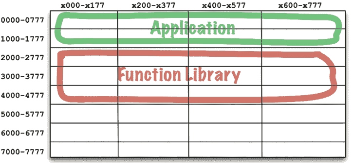

只要应用程序能够适应在 `00008` 和 `17778` 之间，这种方法就能运行良好。但很快应用程序就超过了分配的空间。于是，程序员必须将应用程序分成两个地址段，并在函数库之间跳转。

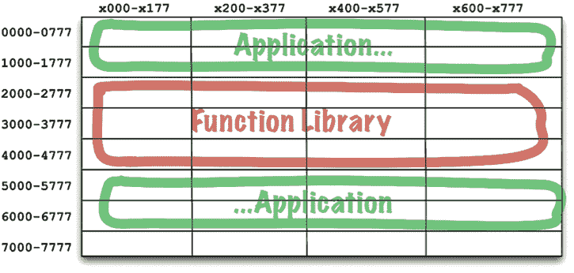

很显然，这并不是可以持续的状况。随着我们向函数库中添加更多函数，它超出了其边界，我们必须在 `70008` 附近为它分配更多空间。随着计算机内存的增长，这种程序和库的碎片化不可持续下去。

显然，必须做些什么。

### 可重定位性

解决方案是可重定位二进制文件。这个想法非常简单。我们更改编译器，使其输出基于地址零的二进制代码。加载器会被告知在哪里加载可重定位代码，加载器会将加载地址加到二进制代码中所有的地址上。

### 链接器

链接加载器允许我们将程序划分到不同的段中。当程序较小时，这种方法非常好。然而，在 20 世纪 60 年代后期和 70 年代初，我们变得野心勃勃，程序也变得大了很多。


*程序将增长到占据所有可编译和链接的时间。*

但墨菲并不是当时唯一的竞争者。摩尔随后而来，并在 20 世纪 80 年代后期，两人展开了战斗。摩尔赢了那场战斗。磁盘开始缩小且速度呈指数级增长。计算机内存变得极其廉价，以至于磁盘上的大部分数据都可以缓存到 RAM 中。计算机时钟频率从 `1MHz` 增加到 `100MHz`。

摩尔定律：计算机速度、内存密度每 18 个月翻倍。这一定律从 20 世纪 50 年代到 2000 年一直有效；但随后速度变得极其缓慢，甚至完全停滞。

到 90 年代中期，链接花费的时间开始缩短，快于我们让程序增长的速度。在许多情况下，链接时间缩短到了`秒`级。对于小型任务，链接加载器（linking loader）的想法再次变得可行。

这是一个 ActiveX、共享库以及 `.jar` 和 `.dll` 文件的时代。计算机和设备已经变得如此快速，以我们再次可以在加载时进行链接。我们可以在几秒钟内将几个 `.jar` 文件或几个共享库链接在一起，并执行生成的程序。

因此，组件插件式架构诞生了。

今天，我们经常将 `.jar` 文件或 `DLL` 或共享库作为插件分发现有应用程序。例如，如果你想为 `Minecraft` 创建一个模组（mod），只需将你的自定义 `.jar` 文件包含在特定文件夹中。如果你想将 ReSharper 插入 Visual Studio，只需包含相应的 `DLL` 即可。

这些可以在运行时插件在一起的动态链接文件，是我们架构的软件组件。我们花了 50 年时间，但已经达到了一个组件插件式架构可以成为随意的默认选择，而不是像以前那样需要付出艰巨的努力。

## 组件内聚性 (Component Cohesion)

哪些类属于哪些组件？这是一个重要的决策，它需要良好的软件工程原则的指导。遗憾的是，多年来，这个决策几乎完全根据上下文以随机的方式做出的。

在本节中，我们将讨论组件内聚的三个原则：

- `REP`: 重用/发布等效原则（Reuse/Release Equivalence Principle）
- `CCP`: 共同封闭原则（Common Closure Principle）
- `CRP`: 共同重用原则（Common Reuse Principle）

### 重用/发布等效原则 (REP)

*重用的粒度就是发布的粒度。*

过去的十年中，出现了一系列模块管理工具，如 `Maven`、`Leiningen`、`tools.deps` 库和 `RVM`。这些工具的重要性日益增加，因为在那个期间，创建了大量的可重用组件和组件库。我们现在正处于软件重用的时代——这是面向对象（OO）最古老的承诺之一的实现。

`REP` 是一个回想起来显而易见的原则。想要重用软件组件的人无法、也不会这样做，除非这些组件通过了发布流程进行跟踪，并被赋予了发布版本号。

这不仅仅是因为如果没有发布版本号，就无法办法确保所有重用的组件之间是兼容的。这还因为软件开发人员需要知道新版本何时发布，以及这些新版本将带来哪些变化。

开发人员经常会收到关于新版本的通知，并根据该版本中所做的更改决定继续使用旧版本。因此，发布过程必须产生适当的通知和发布文档，以便用户对何时以及是否集成做出明智的决策。

从软件设计和架构的角度来看，这个原则意味着形成组件的类和模块必须属于一个内聚的组。组件不能简单由类和模块的随机杂烩组成。这些模块之间必须有一个共同的整体主题或目的。

当然，这应该是显而易见的。然而，还有另一种看待这个问题的方法，可能并不那么显而易见。被分组到组件中的类和模块应该是可以“一起发布”的。它们共享相同的版本号、相同的发布跟踪，并包含在相同的发布文档中，这一事实对于作者和用户来说都应该是逻辑的。

显然，这是一个很软弱的建议。说某事应该“符合逻辑”只是一种在空中比手并试图让自己听起来具有权威的方法。这个建议之所以软弱，是因为很难精确解释将类和模块粘合成一个单一组件的“胶水”。尽管这个建议很软弱，但原则本身是重要的，因为违规行为很容易被发现——它们“不符合逻辑”。如果你违反了 `REP`，你的用户会知道，并且不会对你的架构技能留下深刻印象。

这个原则的弱点被后两个原则的强大所充分弥补了。事实上，接下来的两个原则强烈地约束了这一原则。

### 共同封闭原则 (CCP)

*将为了相同原因和同一时间变化的模块聚集到组件中。将为了不同原因或在不同时间变化的模块分离到不同的组件中。*

这是针对组件重述的单一责任原则 (`SRP`)。正如 `SRP` 说`模块` 不应该包含多个更改的原因，这个原则说组件不应该有多个更改的原因。

对于大多数应用程序来说，可维护性比重用性更重要。如果应用程序中的代码必须更改，你更希望更改发生在一个组件中，而不是分散在许多组件中。如果更改集中在一个组件中，那么我们只需要重新部署更改的那个组件。不依赖于已更改组件的其他组件不需要重新验证。

`CCP` 促使我们将所有可能因相同原因更改的模块聚集在一起。如果两个模块在物理上或概念上紧密结合，以总是一起变化，那么它们就属于同一个组件。这减少了与发布、重新验证和重新部署软件的工作量。

这个原则与开闭原则 (`OCP`) 密切相关。因为这个原则处理的是 `OCP` 单词意义上的“封闭”。`OCP` 规定模块应对修改关闭的，但对扩展是开放的。但 100% 的封闭是不可能的。封闭必须是策略性的。我们设计模块，使其对我们预期或经历过的最常见的更改保持关闭状态。

`CCP` 通过将对相同类型更改的模块聚集到同一个组件中增强了这一点。因此，当需求发生变化时，该变化很有可能被限制在少数组件中。

#### 与 SRP 的相似性

正如我上面提到的，`CCP` 是 `SRP` 的组件形式。`SRP` 告诉我们根据不同原因将方法分离到不同的模块。`CCP` 告诉我们根据不同原因将模块分离到不同的组件。

#### 不同时间？

本节开头的标题暗示组件不应该包含在不同时间变化的元素，即使它们可能出于相同的原因变化。某些更改优先级很高。其他更改优先级较低。某些更改波动频率很高。某些的波动性低得多。我们希望避免既有高波动又有低波动波动元素的组件。


这是另一个帮助我们决定哪些模块应该被放入组件的原则。它指出，倾向于一起重用的类和模块应该属于同一个组件。

模块很少孤立地被重用。通常情况下，可重用模块会与该可重用抽象的其他模块协作。`CRP`（组件替换原则）规定，这些模块应该属于同一个组件。在这样的组件中，我们预计会看到模块之间存在大量的依赖关系。

一个简单的例子可能是容器类及其相关的迭代器。这些类被一起重用，因为它们之间是紧耦合的。因此，它们应该在同一个组件中。

但 `CRP` 告诉我们的不仅仅是哪些模块应该组合成一个组件。它还告诉我们哪些模块**不应该**保留在同一个组件中。当一个组件使用另一个组件时，组件之间就产生了一种依赖关系。可能使用组件只使用了 `used` 组件中的某一个模块；但这完全没有削弱这种依赖关系。使用组件仍然依赖于被使用的组件。

由于这种依赖关系，每当被使用的组件发生变化时，使用组件可能都需要进行相应的更改。即使使用组件不需要任何更改，它可能仍然需要重新编译、重新验证和重新部署。即使被使用的组件的更改是使用组件并不在乎的内容，事实也可能是这样。

因此，我们希望确保当我们依赖一个组件时，我们依赖的是该组件中的大多数模块。换句话说，我们希望确保放入组件的模块是不可分割的；我们不太可能只依赖其中某些模块而不依赖其他模块。否则，我们将部署比需要更多的组件，并浪费大量的精力。

因此，`CRP` 告诉我们的关于哪些模块不应该在一起的信息，比关于哪些模块应该在一起的信息更多。`CRP` 说，彼此紧密结合的模块不应该在同一个组件中。

### 与 ISP 的关系

`CRP` 是 `ISP`（接口隔离原则）的通用版本。`ISP` 建议我们不要依赖那些我们不使用的方法的类。`CRP` 建议我们不要依赖那些我们不使用的模块的组件。所有的建议都可以简化为一句朗口的金言：

*不要依赖你不需要的东西。*

### 组件内聚张力图

你可能已经意识到，这三个内聚原则倾向于相互冲突。`REP`（重复性原则）和 `CCP`（单一职责原则）是包容性原则。它们都倾向于让组件变得更大。`CCP` 是一个*排他性*原则，驱动组件变得更小。我们要解决的就是这些原则之间的张力。

下面是一个张力图^(6)，显示了三个内聚原则是如何相互作用的。图的边缘描述了放弃对立顶点对应原则的*成本*。

6. 感谢 Tim Ottinger 提供的这个想法。


所以，一个关注 `REP` 和 `CRP` 的程序员会发现，当进行简单更改时，会有太多组件受到影响。一个过度关注 `CCP` 和 `REP` 的架构师会导致产生太多不必要的发布。

目标是在这个张力三角形中找到一个满足开发团队*当前*关注点的位置，并随着系统随时间的推演而移动该位置。例如，在项目开发的早期，`CCP` 比 `REP` 重要得多，因为可开发性比重用性更重要。

通常，项目倾向于从三角形的右侧开始，那里唯一的牺牲是重用。随着项目成熟以及其他项目开始从中汲取，项目将向左侧滑动。

这意味着项目的组件结构会随着时间和成熟度的增加而变化。它更多地取决于项目开发和使用的方式，而不是项目实际在做什么。

### 总结……

在过去，我们对内聚的看法比最后三个原则所暗示的要简单得多。我们过去曾认为内聚仅仅是模块执行一个（且仅一个）功能的属性。然而，这三个组件内聚原则描述了更为复杂的内聚类型。在选择将模块分组为组件时，我们必须考虑重用性和可开发性之间所涉及的对立力量。将这些力量与应用需求进行平衡并非易事。此外，这种平衡几乎总是是动态的。也就是说，今天合适的划分在明年可能就不合适。因此，随着项目重心从可开发性转向重用性，组件的组成可能会随着时间发生抖动和演进。

这意味着系统的组件结构无法预先确定，而必须随着系统的增长和变化而增量地演进。当然，这意味着对组件结构的更改将是小而频繁的。它们将成为任何敏捷迭代循环的正常部分。

### 组件耦合

下一个三个原则涉及到组件之间的关系。在这里我们再次会遇到可开发性与逻辑设计之间的张力。影响组件结构架构的力量是技术性的、政治的以及易变的。

### 无周期依赖原则 (ADP)

*在组件依赖图中不允许任何循环。*

你是否曾经工作了一整天，让某些东西运行起来然后回家，结果第二天早上来发现你的东西不再起作用了？为什么不起作用？因为有人比你留得晚，并且更改了你依赖的东西！我称之为*次日早症*。

次日早症发生在许多开发者正在修改同一个源文件的开发环境中。对于只有少数开发者的小型项目，这并不是大问题。但随着项目和开发团队规模的扩大，第二天早上可能会变成噩梦。经常会出现几周时间无法构建项目的稳定版本。

#### 消除依赖循环

解决这个问题的方法是将开发环境划分为可发布的组件。组件成为工作单元，由一个开发者或一个开发团队负责。当开发者让组件运行良好时，他们将其发布供其他开发者使用。他们给它一个版本号并将其移动到其他团队使用的目录中。然后他们在自己的私有区域内继续修改组件。其他人使用发布的版本。

随着组件新版本的发布，其他团队可以决定是否立即采用新版本。如果他们决定不采用，就继续使用旧版本。一旦他们认为自己准备好了，就会开始使用新版本。

因此，没有哪个团队是受制于人的。对一个组件的更改不需要对其他团队产生立即影响。每个团队都可以自行决定何时调整其组件以适应所用组件的新版本。

这是一个非常简单且合理的过程；并且被广泛使用。然而，要让它运作，你必须管理组件的依赖结构。不能有循环。

如果依赖结构中存在循环，那么次日早症就无法避免。


请考虑以下组件图。

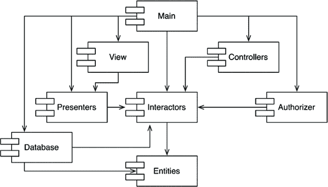

在这里我们看到了一个相当典型的应用程序组件结构。对于本示例而言，该应用程序的功能并不重要。*重要的是*组件之间的依赖结构。注意，这种结构是一个有向图。组件是节点，依赖关系是有向边。

现在请注意另一点。无论你从哪个组件开始，都不可能顺着依赖关系回到该组件。这种结构没有循环。它是一个有向无环图 (DAG)。

现在注意当负责 `Presenters`（演示器）的团队发布其组件的新版本时会发生什么。很容易发现谁受此发布的影响；你只需要反向追踪依赖箭头即可。因此，`View`（视图）和 `Main` 都会受到影响。目前负责这些组件的开发者将需要决定何时与 `Presenters` 的新版本进行集成。

同样注意，当 `Presenters` 发布时，它对系统中的许多其他组件完全没有影响。它们并不知道 `Presenters`，也不在乎它何时变化。这很好。这意味着发布 `Presenters` 的影响相对较小。

当负责 `Presenters` 组件的开发者想要运行该组件的测试时，他们只需要使用他们当前使用的 `Interactors`（交互器）和 `Entities`（实体）组件的版本来构建他们版本的 `Presenters`。系统中的其他任何组件都不需要参与。这很好。这意味着负责 `Presenters` 的开发者设置测试的工作相对较少，他们需要考虑的变量也相对较少。

当需要发布整个系统时，是从底向上完成的。首先编译、测试并发布 `Entities` 组件；然后是 `Database`（数据库）和 `Interactors`。接下来是 `Presenters`、`View`、`Controllers`（控制器），然后是 `Authorizer`（授权器）。`Main` 是最后一个。这个过程非常清晰且易于处理。我们知道如何构建系统，因为我们理解了各个部分之间的依赖关系。

### 组件依赖图图中循环的影响

假设一个新需求迫使我们更改 `Entities` 中的一个模块，使其能够使用 `Authorizer` 中的一个模块。例如，假设 `Entities` 中的 `User` 类使用了 `Authorizer` 中的 `Permissions` 类。这创建了一个依赖循环，如下所示。

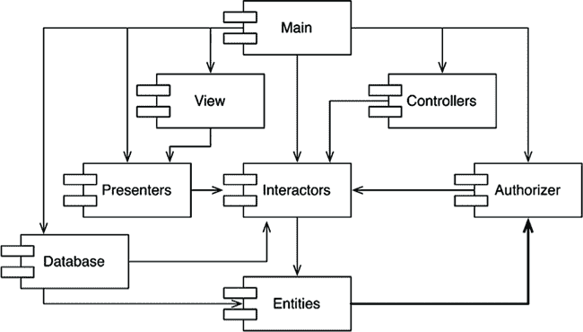

这个循环实际上将 `Interactors`、`Entities` 和 `Authorizer` 合并成了一个单一组件。任何使用其中一个的组件都依赖于所有组件。这使得构建和测试变得困难得多。它还引发了正确构建顺序的问题。你不能先构建 `Entities`，因为它依赖于 `Authorizer`。但 `Authorizer` 又通过 `Interactors` 依赖于 `Entities`。因此没有正确的构建顺序。任何没有正确构建顺序构建的系统都是偶然运行的，而不是计划好的。

### 破循环

打破组件循环并将依赖图恢复为 DAG 总是可能的。主要有两种机制。

1.  应用依赖倒置原则 (DIP)。在下面的例子中，我们可以创建一个包含 `User` 所需方法的接口。然后将该接口放入 `Entities` 中，并在 `Authorizer` 中继承它。这反转了 `Entities` 和 `Authorizer` 之间的依赖，从而打破了循环。请看接后的前后视图。

   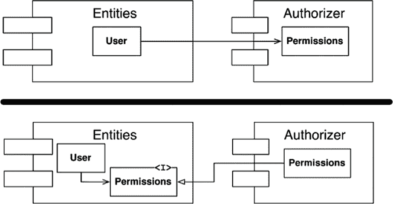

2.  创建一个新组件，`Entities` 和 `Authorizer` 都依赖于它。将它们共同依赖的模块移动到该组件中。见下。

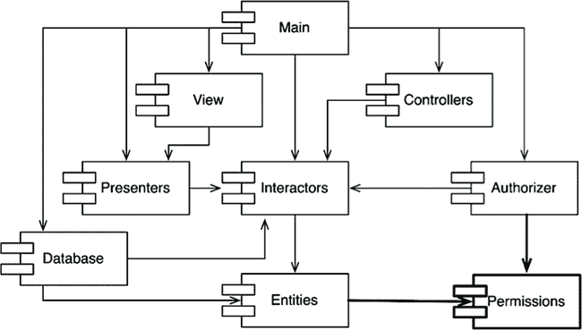

### “抖动” (Jitters)

总是可能打破组件循环并将依赖图恢复为 DAG。这两种解决方案。这种解决方案意味着在需求变化的情况下，依赖结构是波动的。事实上，随着应用程序的增长，依赖结构会抖动。因此，必须监控循环。当循环出现时，必须打破它们。这有时意味着创建新的组件，使依赖结构增长。

### 自顶而下的设计

我们目前讨论的问题引向了一个不可避免的结论：组件结构不能从顶而下设计。这意味着它是随着系统的增长而变化的而进化的。

你们中可能会发现这是反直觉的。我们预期大粒度分解（如组件）也是系统设计的。

当我们看到大粒度分解的组件时，我们认为这种结构应该代表系统的功能。然而，依赖图与描述系统的功能关系不大。

事实上，组件依赖图与应用程序的可构建性和可维护性关系很小。这也就是为什么它们在项目开始时没有被设计。因为那时没有软件需要构建或维护，因此不需要构建和维护地图。但随着实施阶段积累了越来越多的模块，我们越来越需要管理依赖关系，以避免晨后综合症。此外，我们开始关注 SRP（单一职责原则）和 CCP（共同封闭原则），将可能变化的模块放在一起。

这种依赖结构的核心关注点之一是易变性的隔离。我们不希望因反复原因变化的组件影响本应稳定的组件。例如，我们不希望 GUI 的外观变化影响我们的业务规则。我们不希望报告的添加或修改影响我们的高层策略。因此，依赖图是由开发者创建和塑造的，以保护稳定的组件免受波动低级组件的影响。

随着应用程序继续增长，我们开始担心可重用元素。那时 CRP（重用原则）开始影响组件的组成。最后，当循环出现时，应用 ADP，组件依赖图抖动并增长。

如果我们在设计任何模块之前就尝试设计组件结构，我们可能会失败得很糟糕。我们对公共闭合并不了解，意识不到任何重用元素，并且几乎会创建产生循环的组件。因此，组件依赖结构随着系统逻辑设计而增长和进化。

#### 稳定依赖原则 (SDP)

*依赖的方向应该是稳定的方向。*

设计是不可能完全静态的。为了维护设计，某些波动是必要的。我们通过遵循 CCP 这一点。使用该原则，我们创建了对某些变化敏感但对其他变化免疫的组件。其中一些组件被设计为波动的。我们预期它们会变化。

任何我们预期是波动的组件都不应该被难以改变的组件所依赖！否则，波动的组件也将变得难以改变。


软件的一个奇葩之处在于：你设计一个易于修改的模块，可能会被他人通过简单地在其上挂载依赖，而使其变得难以修改。你的模块中没有任何一行源代码需要更改；然而，你的模块会突然变得难以修改。通过遵循依赖倒置原则（SDP），我们确保旨在易于修改的模块不会被更难修改的模块所依赖。

## 稳定性

稳定性意味着什么？把一个硬币立起来。它在那个位置上稳定吗？你可能会说它不稳定。然而，除非受到干扰，它会保持那个位置很长时间。因此，稳定性与变化的频率（`frequency`）没有直接关系。硬币并没有变化，但很难认为它是稳定的。

韦伯士词典说，如果某个某物“不容易被移动”，它就是稳定的。稳定性与进行更改所需的工作量有关。硬币并不稳定，因为推倒它只需要极少的工作。另一方面，桌子非常稳定，因为翻转它需要巨大的努力。

*稳定性是一个连续的体，而不是一个布尔值。*

这与软件有什么关系？有很多因素使得一个软件组件难以修改——它的尺寸、复杂度、清晰度等等。我们将忽略所有这些因素，专注于不同的事情。让一个软件组件难以修改的一种可靠方法是让许多其他软件组件依赖于它。一个有很多入入依赖的组件是非常稳定的，因为要将任何更改与所有依赖组件相协调需要大量的工作。

下面的图显示了 `X`，一个稳定的组件。该组件有三个组件依赖于它，因此它有三个充分理由不改变。我们说它对这三个组件负责。另一方面，`X` 不依赖于任何东西，所以它没有外部影响来使其改变。我们说 `X` 是负责任且独立的：它是一个成年人。

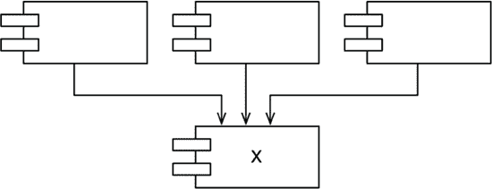

另一张图显示了 `Y`，一个非常不稳定的组件。`Y` 没有其他组件依赖它；我们说是不负责任的。`Y` 也有三个它依赖的组件，因此更改可能来自三个外部源。我们说 `Y` 是依赖的且不负责任的：它是一个青少年。

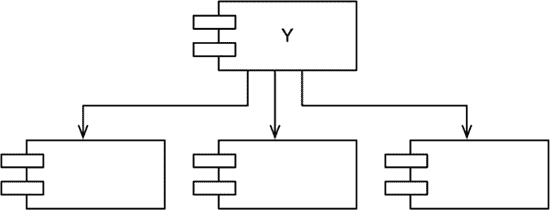

## 稳定性指标

我们如何衡量组件的稳定性？一种方法是计算进入和离开该组件的依赖数量。这些计数允许我们计算组件的位置稳定性。

*   `Fan-in`：入扇（Incoming Couplings）：依赖该组件内部模块的外部模块数量。
*   `Fan-out`：出扇（Outgoing Couplings）：依赖该组件外部模块的内部模块数量。
*   `I`：不稳定性：`I` = `Fan-out` ÷ (`Fan-in` + `Fan-out`)。该指标的范围是 [0,1]。`I` = 0 表示最大稳定的组件。`I` = 1 表示最大不稳定的组件。

`Fan-in` 和 `Fan-out` 指标^(7) 是通过计算在该组件外部与该组件内部具有依赖关系的模块数量来计算的。考虑下面的示例：

7。在之前的出版物中，我分别使用出耦合（Efferent couplings）和入耦合（Afferent couplings，即 `Ce` 和 `Ca`）来表示 Fan-out 和 Fan-in。那仅仅是我个人的自大……我喜欢中枢神经系统的比喻。

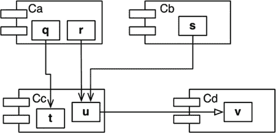

假设我们想要计算组件 `Cc` 的稳定性。我们发现 `Cc` 外部有三个模块依赖 `Cc` 内部模块。因此，`Fan-in` = 3。此外，`Cc` 外部有一个模块被 `Cc` 内部依赖。因此，`Fan-out` = 1，`I` = 1/4。

在 `C++` 中，这些依赖通常由 `#include` 语句表示。事实上，当你组织源代码使得每个源文件中只有一个模块时，`I` 指标最容易计算。在 `Java` 中，可以通过计算 `import` 语句和限定名来计算 `I` 指标。其他语言有类似的机制，如 `using` 或 `require`。

当 `I` 指标为 1 时，意味着没有其他组件依赖此组件（`Fan-in` = 0）；而此组件依赖于其他组件（`Fan-out` > 0）。因此，它是组件能达到的最不稳定状态；它是一个青少年，不负责任且依赖。它缺乏依赖者使其没有理由不改变，而它所依赖的组件可能会给它充分的理由去改变。

另一方面，当 `I` 指标为零时，意味着该组件被其他组件依赖（`Fan-in` > 0），但它本身不依赖任何其他组件（`Fan-out` = 0）。它是一个负责任且独立的成年人。这样的组件是能达到的最稳定的。它的依赖者使其难以修改，而它没有可能迫使它改变的依赖。

SDP 说，组件的 `I` 指标应该大于它所依赖的组件的 `I` 指标。

*并非所有组件应该是稳定的

如果系统中的所有组件都是最大稳定的，那么系统将是不可更改的。这不是一个理想的情况。事实上，我们希望设计组件结构，使得某些组件是不稳定的，某些是稳定的。下面的图显示了一个具有三个组件的符合配置。

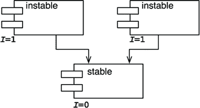

可变组件位于顶部并依赖于稳定组件。（正如我们在下一章看到的，ADP）。下一张图显示了 SDP 如何被违反。

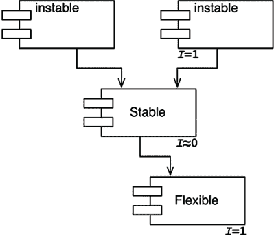

`Flexible` 是我们设计为易于修改的组件。我们希望 `Flexible` 是不稳定的。然而，某个在名为 `Stable` 的组件中的开发者在其上挂载了依赖。这违反了 SDP，因为 `Stable` 的 *I* 指标远低于 `Flexible` 的 *I* 指标。结果是，`Flexible` 不再易于修改。对 `Flexible` 的更改将迫使我们处理 `Stable`。

为了解决这个问题，我们必须以某种方式打破 `Stable` 对 `Flexible` 的依赖。为什么会有这种依赖？假设 `Flexible` 内部有一个模块 `C` 是 `Stable` 内部的模块 `U` 需要使用的。

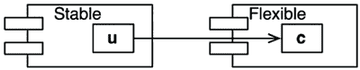

我们可以通过采用 DIP 来解决这个问题。我们创建一个名为 `US` 的接口并将其放在名为 `UServer` 的组件中。我们确保该接口声明了 `U` 需要的所有方法。然后我们让 `C` 实现此接口，如下所示。这打破了 `Stable` 对 `Flexible` 的依赖，强制这两个组件都依赖 `UServer`。`UServer` 非常稳定（`I` = 0），而 `Flexible` 保持了它必要的不稳定性（`I` = 1）。所有的依赖现在流向 *I* 减少的方向。

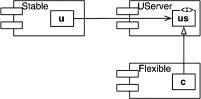

### 抽象组件

你可能会发现创建一个像 `UService` 这样只包含接口的组件很奇怪。这样的组件不包含任何执行代码！但事实证明，在使用 `Java` 或 `C#` 等静态类型语言时，这是一种常见且必要的策略。这些抽象组件非常稳定，因此是不稳定组件依赖的理想目标。


当使用如 `Ruby` 或 `Python` 等动态类型语言时，这些抽象组件完全不存在。指向它们的依赖关系同样不存在。这些语言中的依赖结构要简单得多，因为依赖倒转既不需要接口的声明，也不需要继承。

## 稳定抽象原则 (SAP)

*一个组件的抽象程度应当与其稳定性一致。*

接下来的内容将变得有些数学化和理论化。不要让这吓到你。理论是很重要的，即使实践与它的联系并不紧密。读到最后，你就会明白我的意思。

### 我们应该把高层策略放在哪里？

系统中某些软件不应该经常更改。这些软件代表了高层架构和策略决策。我们不希望这些业务和架构决策是易变的。因此，封装系统高层策略的软件应该放在稳定的组件中（`I` = 0）。不稳定的组件（`I` = 1）应该只包含易变的软件——即我们希望能够快速方便地更改的软件。

然而，如果将高层策略放在稳定组件中，那么代表这些策略的源代码将很难修改。这可能导致整体架构缺乏活性。一个最大稳定的组件（`I` = 0）如何能具有足够的活性来抵御变化呢？答案在于 `OCP`。这一原则告诉我们，创建足够灵活以至于无需修改即可扩展的模块是可行且理想的。什么样的模块符合这一原则？抽象模块。

`SAP` 建立了稳定性与抽象性之间的关系。它说，一个稳定的组件也应该是抽象的，这样它的稳定性就不会阻止它被扩展。另一方面，它说一个不稳定的组件应该是具体的，因为它的不稳定性允许内部的具体代码被轻易更改。

因此，如果一个组件是要稳定的，它还应该由接口和抽象模块组成，以便它可以被扩展。可扩展的稳定组件是灵活的，并且不会过度限制架构。

`SAP` 和 `SDP` 的结合等同于组件的 `DIP`。这是因为 `SDP` 说依赖应该沿着稳定性的方向运行，而 `SAP` 说稳定性意味着抽象。因此，依赖顺着抽象的方向运行。

### 衡量抽象性

`A` 指标衡量一个组件的抽象程度。它的值仅仅是组件中接口和抽象模块的数量与组件中模块总数之比。

*   `Nm`: 组件中模块的数量。
*   `Na`: 组件中抽象模块和接口的数量。
*   `A`: 抽象性。

`A = Na ÷ Nm`。`A` 指标的范围从 0 到 1。零意味着组件完全没有抽象类。值 1 意味着组件除了抽象模块和/或接口外没有其他内容。

### 主序列

我们现在可以定义稳定性 (`I`) 与抽象性 (`A`) 之间的关系了。我们可以建立一个以 `A` 为纵轴、`I` 为横轴的图。如果我们在这个图上画出这两种“良好”的组件，我们会发现最大稳定且抽象的组件（成年人）位于左上角的 (0,1)。最大不稳定且具体的组件（青少年）位于右下角的 (1,0)。

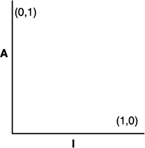

并不是所有组件都能落入这两个位置之一。组件具有不同程度的抽象性和稳定性。例如，一个抽象模块派生自另一个抽象模块是非常常见的现象。派生类是一个具有依赖关系的抽象物。因此，尽管它是最抽象的，但它不会是最稳定的。它的依赖会降低它的稳定性。

由于我们无法强制所有组件都位于 (0,1) 或 (1,0)，我们必须假设在 `A/I` 图上存在一条定义了组件合理位置的轨迹。我们可以通过寻找组件**不应该**所在的区域（即排除区域）来推断出这条轨迹是什么。

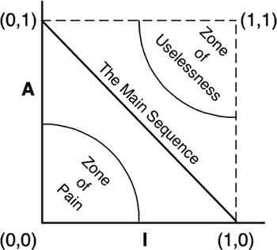

### 痛苦区域

考虑位于 (0,0) 区域的组件。这是一个高度稳定且具体的组件。这种组件是不理想的，因为它是僵化的。它无法被扩展，因为它不抽象。而且由于它的稳定性，它很难更改。因此，我们通常不预期设计良好的组件位于 (0,0) 附近。(0,0) 周围的区域是一个被称为*痛苦区域*（Zone of Pain）的排除区域。

需要注意的是，某些软件实体确实落在痛苦区域内。例如数据库模式（schema）。数据库模式以极易变、极其具体且被高度依赖而闻名其实。这就是为什么 `OO` 应用与数据库之间的接口如此难以处理，以及模式更新通常非常痛苦的原因之一。

另一个位于 (0,0) 的软件示例是具体的工具库。虽然这种库的 `A` 指标为 0，但它实际上是非易变的。例如 `String` 组件。尽管它内部所有的类都是具体的，但它被使用得如此频繁，以至于更改它会导致混乱。因此，`String`是非易变的。

非易变组件在 (0,0) 区域无害的，因为它们可能被更改。基于如此，只有易变的软件组件在痛苦区域内是有问题的。痛苦区域内的组件易变性越高，它就越“痛苦”。事实上，我们可以认为易变性是图的第三个轴；那么上面的图显示的只是最痛苦的平面，即易变性 = 1。

### 无用区域

考虑位于 (1,1) 附近的组件。这个位置是不理想的，因为它是最大抽象的，却没有依赖者。这就像一个没有实现的接口。这种组件是无用的。因此，这被称为*无用区域*（Zone of Useless）。

占据该区域的软件实体是一种残渣。它们通常是无人实现的抽象类。我们偶尔会在系统中发现它们，它们静静地呆在代码库中，未使用过。或者它们可能是多余的接口——少数类实现但没有一个类使用的接口。

一个深处于无用区域的组件必须包含相当比例的实体。此类实体的存在是不理想的。

### 主序列

我们希望最易变的组件尽可能远离这两个排除区域。距离每个区域最远的轨迹是连接 (1,0) 和 (0,1) 的那条线。我把这条线*主序列*（main sequence）。

位于主序列上的组件对于其稳定性来说并不“太抽象”，对于其抽象性来说也不“太不稳定”。它既不无用也不特别痛苦。它被依赖的程度取决于它的抽象程度，它依赖别人的程度取决于它的具体程度。


组件的最理想位置是位于主序列的两个端点之一。我们努力将大多数组件放置在这些端点。然而，根据我的经验，在一个大型系统中，有一小部分组件既不是完全抽象的，也不是完全稳定的。如果这些组件位于主序列上或靠近主序列，它们就具有最好的特性。

## 与主序列的距离

这引出了我们的最后一个指标。如果组件位于主序列上或靠近主序列是理想的，我们就可以创建一个指标来衡量组件距离这个理想状态有多远。

*   `D`^(9): 距离。`D = |A+I–1|`。该指标的范围从 [0,1]。0 表示组件直接位于主序列上。1 表示组件距离主序列最远。

根据这个指标，可以对设计与主序列的整体遵从情况进行分析。可以计算每个组件的 `D` 指标。任何 `D` 值不接近零的组件都可以重新检查并重构。

### 结论

如果你到这里已经感到头晕脑胀，我建议你深呼吸。我并不是建议你去测量并计算所有这些指标。知道 `F = ma` 很好，但你开车时并不经常在做那个数学计算。理论是一回事，实践是另一回事。

我确实没有养成收集必要统计数据、进行所有数学计算并生成图表的习惯。在大多数项目中，我可以在脑海中*看到*这些关系，并进行简单的心理评估——我的不是说我在脑子里做数学计算。相反，我只是在设想这些关系，并推断每个组件有多稳定、多抽象。如果你愿意，可以将其看作一种“直觉”。

理解上述理论是好的。在某些情况下，进行上述计算甚至可能是有益的。在极少数极端情况下，我确实这样做过。但在大多数情况下，理解理论并利用它来“感悟”关系就足够了。

你可能会发现你的 IDE 为你完成了许多此类计算。我发现在大大型项目中，查看 IDE 计算出的数字是有帮助的。但我的“直觉”很准，我很少感到惊讶。

## 21

## 持续设计

*作者：Jeff Langr*


产品所有者（以及负责协助定义软件产品的其他人员）确定了系统必须为用户实现的一系列终极目标。相反，开发人员以代码和配置的形式在系统中为这些每个目标构建支持。正如 Jack W. Reeves 多十年前教我们的那样，这些代码（以及配置^(1))是“设计”^(2)的最终且决定性的表示。

1. 例如，[PPP02], [`www.butunclebob.com/ArticleS.UncleBob.PrinciplesOfOod`](http://www.butunclebob.com/ArticleS.UncleBob.PrinciplesOfOod), 以及 [`en.wikipedia.org/wiki/SOLID_(object-oriented_design)`](https://en.wikipedia.org/wiki/SOLID_(object-oriented_design))（或直接谷歌搜索 SOLID）。

2. [`www.developerdotstar.com/mag/articles/reeves_design.html`](https://www.developerdotstar.com/mag/articles/reeves_design.html)。重新发表于 [PPP02]。

*Design*（设计）一词在经典上有两个主要含义：

*   构建某物的计划
*   某物当前状态呈现出的形式和功能

持续设计（Continuous design），简写为 …… 等，那个缩写已经被占用了。我们可以在整个章节中直接说“持续设计”这个完整短语。最终，我们将直接称为“设计”，因为这是我们构建软件系统的最佳方式：又一个有意识的设计决策。

正如我们所说的：持续设计意味着我们不断规划如何容纳新行为，并且每当我们添加新行为时，我们的系统就有一个新的设计。大部分规划都发生在我们开始编写提供新行为的代码时。

添加新代码或更新现有代码总是会改变设计，往往只是发生非常微小的变化。

设计并不是开发项目初期发生的某个模糊阶段。它不仅仅是绘制关于系统看起来应该是样子的高级草图的活动。

设计是一项持续活动。我们系统的设计应该引起我们持续的关注，因为根据定义，它是不断变化的。这听起来很令畏，但实际上，它比生成一组初始设计模型、然后假装之后可以忽略设计要容易得多。

## 持续变化

虽然软件是由代码组成的，但更有用的说法是软件是由成千上万个小行为（有时称为*单元*）组成的，每个行为都以代码的形式实现。作为程序员，我们的工作是创建并协调这些行为，以支持满足系统用户的终极目标。

我们必须首先将终极目标翻译为许多较小的软件行为。给定目标“展示用于学习捷克语名词的随机闪卡列表”，我们可能会实现以下行为序列。

1. 获取名词随机子集。
2. 对于每个名词：
    1. a. 展示一个问题：一个填空句，以及列出可能的名词形式的多项选择。
    2. b. 捕捉用户的选择。
    3. c. 如果用户的选择错误，向用户显示正确答案。
3. 对于每个用户选择错误的问题，重复步骤 2a 到 2c。

剥猫的方法通常有很多种，所以我们可能会支持另一种替代步骤集。例如，用户可以对单个问题继续选择答案，直到他们选对为止。我们可以在每次失败的回答时提供提示。随着用户的进步，我们可能会将多选择题替换为填空题。

如果应用程序本身有许多设计选择，那么我们编写底层代码的选择则要多出数量级。


在组装这些结构时，我们很容易做出许多错误选择，而且是在非常短的时间内。对我们的闪卡应用进行更改后，它可能仍然运行，但我们的更改可能不必要地增加了未来修改的成本。

如果更改我们的闪卡应用导致代码杂乱、复杂且不清晰，那么适应新需求将变得缓慢。我们将花费大量时间在代码中导航，以找到所有必须更改的地方。一旦找到这些位置（通常是多个），我们又要花费大量时间来理解当前代码的作用。然后，我们还要花费大量时间仔细地插入我们的更改，并确保所有现有行为都不被破坏。

我们做的每一个设计选择都会影响未来选择的成本。只有当每个选择的负面设计影响降至最低时，我们才成功。这就是被称为“持续设计”（continuous design）的关键概念。

### 在持续设计的四个 C 原则航行

一个“不洁代码”（Unclean Code）系统变得难以：

*   找到你正在寻找的代码。
*   理解需要在哪里进行更改。
*   在不产生缺陷的情况下进行更改。
*   编写测试来验证其行为。

你可能在第 13 章中的“整洁类”中见过这些特征。

我们有许多设计视角来引导我们走向“整洁代码”系统。随着我们更改系统，我们将继续思考这些一个或多个视角——SOLID、代码气味、简单设计、设计模式等，包括各种一次性原则，如迪米法则（Law of Demeter）或“告知而非询问”（Tell-Don’t-Ask）。

对于持续设计的概念，我们将尝试——像许多人之前一样——将其编码为一组简单的、可能容易记忆的规则。称此为 YADP：又一种设计视角（Yet Another Design Perspective）。

我们的四个 C 设计考虑因素是：

*   **清晰性 (Clarity)**：程序员在系统中的意图都被清晰表达。
*   **简洁性 (Conciseness)**：程序员在系统中的意图用最少代码实现。
*   **可确认性 (Confirmability)**：系统中的所有单元行为都可以轻松测试，这种方式同时也为所做的行为选择提供了“活文档”。
*   **内聚性 (Cohesion)**：系统中的每个模块都具有高水平的内聚性——其所有元素之间都尽可能相关。

这些考虑因素并不是孤立存在的。我们将逐一讨论它们，但在讨论过程中，请思考它们如何相互支持又相互矛盾。

#### 清晰性

让代码运行起来总是我们的第一步。我们面临的挑战是为代码添加一个微小的新行为。我们花一点时间考虑想要如何解决问题，然后快速在编辑器中敲入一些代码。我们对代码进行修剪，直到最终设让它运行，然后转向所需的下一段逻辑。

如果我们再也不需要阅读那些代码，我们可能会认为自己已经“完成”了。代码编写完成！它没坏，所以我们不会尝试修复已经运行的东西。为什么要冒破坏东西的风险呢？

但当我们以后被要求更改逻辑的细微差别时，我们将不得不再次阅读那些代码！或者当我们被问到“在这种情况下这段代码是做什么的？”？或者当我们被要求添加新的相关行为时。或者在半小时后，由于代码还没有完全完成，我们必须回到代码那里。

对于这些每种需求，我们都希望代码尽可能清晰地表达。任何不清晰的地方都会浪费时间。

一个挑战：破解 `retrieveWords` 函数的所有细微差别。这可能花费你半分钟或两分钟。

```
export const retrieveWords = async words => {
  const wordPrefix = words.length === 1 ? 'word' : 'words'
  let wordList = "";
  for (let i = 0; i < words.length; i++) {
    const currentWord = words[i];
    const quotedWord = '"' + currentWord + '"';
    wordList += quotedWord;
    if (i !== words.length - 1) {
      wordList += ",";
    }
  }

  const finalPrompt = `Given a list of nouns separated by commas, ` +
    `provide appropriate Czech language information for the ` +
    `${wordPrefix} ${wordList}`
  const response = await sendPrompt(`${format} ${finalPrompt}`)
  const startIndex = response.indexOf('[')
  const endIndex = response.lastIndexOf(']') + 1
  const jsonText = response.slice(startIndex, endIndex)
  return JSON.parse(jsonText)
}
```

这不一定是坏代码，但它可以变得更好。你破解它花费的时间比需要的多，所以我们称之为不洁代码。

对代码清晰性的持续关注告诉我们，要产生我们都能快速理解的代码。在下面的重构后的代码中，`retrieveWords` 位于底部的函数。从那里开始阅读。

```
const sliceJSONArrayFrom = response => {
  const startIndex = response.indexOf('[')
  const endIndex = response.lastIndexOf(']') + 1
  return response.slice(startIndex, endIndex)
}

const joinQuoted = words =>
  words.map(word => `"${word}"`).join(',')

const pluralizeIfMany = (word, list) =>
  list.length === 1 ? word : `${word}s`

export const retrieveWords = async words => {
  const finalPrompt = `Given a list of nouns separated by commas, ` +
    `provide appropriate Czech language information for the ` +
    `${(pluralizeIfMany('word', words))} ${(joinQuoted(words))}`

  const response = await sendPrompt(`${format} ${finalPrompt}`)

  return JSON.parse(sliceJSONArrayFrom(response))
}
```


害怕修改代码是一种代码异味。可以通过简单的路径来创建一些控制机制，让我们在每次细微更改时，都能知道我们是否破坏了已经运行良好的逻辑。请访问第 14 章 的“测试规范”了解如何操作。

## 走向清晰的快速步骤

- 从多功能函数中提取实现细节，创建具有简洁名称的新函数。
- 适当将函数移动到其他模块。这会增加内聚性，有助于读者在他们预期的地方找到代码。
- 用清晰的声明取代注释。
- 编写测试，使其兼当系统中所编码的所有行为意图的文档。

## 对清晰性的反对意见

资深程序员能够立即消化这些简短的代码片段。一位经验丰富的 JavaScript 开发者可以快速理解以下几个示例：

```
words.map(word => `"${word}"`).join(',')
list.length === 1 ? word : `${word}s`
```

尽管如此，这些短语仍需要仔细阅读。我们必须在脑中将涉及的标记组合成它们所代表的行为概念。这存在微小的误解可能，也存在微小的缺陷可能。下面这一行看似符合惯用法的代码应该让我们停顿一下：

```
for (let i = 0; i <= words.length; i++)
```

然而对许多人来说，事实如此。那不是地道写法；这才是：

```
for (let i = 0; i < words.length; i++)
```

第一个 `for` 循环可能是一个缺陷。

无论如何，将小的实现细节提取到揭示意图的函数可以使 `retrieveWords` 中的代码更加简洁：

```javascript
const joinQuoted = words =>
  words.map(word => `"${word}"`).join(',')

const pluralizeIfMany = (word, list) =>
  list.length === 1 ? word : `${word}s`

export const retrieveWords = async words => {
  const finalPrompt =
    `Given a list of English nouns, separated by commas, ` +
    `provide appropriate Czech language information for the ` +
    `${(pluralizeIfMany('word', words))} ${(joinQuoted(words))}`
    // …
```

## 声明意图，而非渗透细节

我们使用函数式流水线部分是因为它们允许我们用声明替换细节：

```javascript
words.map(word => `"${word}"`).join(',')
```

这比旧式的过程化等效代码容易得多：

```javascript
let wordList = "";
for (let i = 0; i < words.length; i++) {
  const currentWord = words[i];
  const quotedWord = '"' + currentWord + '"';
  wordList += quotedWord;
  if (i !== words.length - 1) {
    wordList += ",";
  }
}
```

旧式代码还极增加了隐藏缺陷的可能性（回想那个 `for` 循环示例）。

## 保持流水线的简洁

虽然在流水线中编写短的内联函数是合理的：

```javascript
export const mostExpensiveHighlyRatedBookInEachCategory = (categories) =>
  categories.flatMap(category =>
    category.books
      .filter(book => !!book.title)
      .filter(book => book.rating > 4.0)
      .sort((a, b) => b.price - a.price)
      .map((book) =>
        ({ category: book.category, title: book.title }))
      .slice(0, 1))
```

但它们打破了流并需要仔细的逐步阅读。

将所有内联 lambda（即使是非常短的函数）替换为命名函数，对于我们快速跟踪整个流程的能力大有裨益：

```javascript
export const
mostExpensiveHighlyRatedBookInEachCategory = (categories) => {
  const byPrice = (a, b) => b.price - a.price
  const highlyRated = book => book.rating > 4.0
  const hasTitle = book => !!book.title
  const categoryAndTitle = (book) =>
    ({ category: book.category, title: book.title })

  return categories.flatMap(category =>
    category.books
      .filter(hasTitle)
      .filter(highlyRated)
      .sort(byPrice)
      .map(categoryAndTitle)
      .slice(0, 1))
}
```

读取较大的函数时，我们跳过单行函数声明，专注于 `return` 语句。现在我们能够更快地阅读并在脑中组装正在发生的情况，因为流水线被抽象了，不再充满细节。

嗯。更新后的解决方案包含一个惯用表达式：`.slice(0, 1)`。它返回数组的第一个元素（不符合惯用法）或在数组为空时返回空数组（符合惯用法）。除非我们的惯用法会导致读者完全停滞，否则我们不会消除它们。如果是这样，我们会找到一种方法来抽象它们。（在这里，我们可能会创建一个 `firstOrDefault` 函数来取代 `slice` 调用。）

注意，当我们提取函数时，会发现以错放置的逻辑片段形式表现出的内聚性不足。很典型。从此示例流水线中提取的几个函数可能会在书籍模块中找到更合适的地方。

## 简洁性

函数式流水线可以提供不仅清晰而且简洁的代码。所需标记最少的解决方案是极度简洁的——但这几乎不是我们真正想要的。


这段代码对我们来说看起来很典型，但这并不是是一件好事。核心函数 `generateCard` 是一个从上到下的线性结构。它并不长，但包含了注释，用来引导读者理解接下来几条语句正在发生什么。函数中的每个语句都使用了清晰的变量名，并且易于理解。我们可以逐句仔细阅读代码，在脑海中将一组组语句组装成单元行为。这有什么不好呢？

事实上，上面的示例是许多开发者在职业生涯的大部分时间内乐于继续编码的方式。但由于许多原因，这不是最优的。

重构后的版本增加了额外的小型辅助函数。

```javascript
export const randomInt = n => Math.floor(Math.random() * n)

const pluralizeIf = (word, isPlural) => isPlural ? `${word}s` : word

const randomElement = (array) => array[randomInt(array.length)]

const cases = ["nominative", "accusative"]
const numbers = ["singular", "plural"]
const generateRandomCardData = (adjectives, nouns) => ({
  adjective: randomElement(adjectives),
  noun: randomElement(nouns),
  grammaticalCase: randomElement(cases),
  number: randomElement(numbers)
})

const formatCard =
  (adjective, noun, number, grammaticalCase,
   correctAdjective, correctNoun) =>
  `${adjective.word} ${pluralizeIf(noun.word, number === 'plural')}
  Provide the ${number} ${grammaticalCase} case.
  Correct answer: ${correctAdjective} ${correctNoun}`

const generateCard = (adjectives, nouns) => {
  const { adjective, noun, grammaticalCase, number } =
        generateRandomCardData(adjectives, nouns)

  const correctNoun = noun[number][grammaticalCase]
  const correctAdjective = adjective[grammaticalCase]
                                    [number]
                                    [noun.gender.toLowerCase()]

  return formatCard(adjective, noun, number, grammaticalCase,
                    correctAdjective, correctNoun)
}
```

清晰度通过几种方式得到了提升。将 `generateCard` 提炼为三个顶层块，允许读者快速识别整体策略。

*   使用传入的 `adjectives` 和 `nouns` 生成随机闪卡片元素。
*   通过引用传入的 `noun` 和 `adjective` 结构来确定闪卡片挑战的正确答案。
*   返回一个包含所有相关信息的格式化卡片。

我们可以立即理解并信任此解决方案中的每个辅助函数或数据片段。我们甚至不需要查看任何辅助代码或数据。

分离的函数通过允许我们关注小型、易于理解的区块增强了清晰度。虽然看到涉及的数据结构（特别是单个名词和形容词对象）会有帮助，但在其他情况下，每条语句都是独立的。没有没有任何语句需要注释。注释只会增加这段代码的开发、理解和维护成本。

至于理解数据结构，那是单元测试的作用。尽管如此，我们可能可以主张提取几个函数，以从 `generateCard` 的具体实现中获得多一点的隔离性：

```javascript
const generateCard = (adjectives, nouns) => {
  const { adjective, noun, grammaticalCase, number } =
    generateRandomCardData(adjectives, nouns)

  const correctNoun = selectNoun(noun, number, grammaticalCase)
  const correctAdjective =
    selectAdjective(adjective, grammaticalCase, number, noun)

  return formatCard(
    adjective,
    noun,
    number,
    grammaticalCase,
    correctAdjective,
    correctNoun)
}
```

我们还发现了将看似不同的元素结合在一起的机会，这通过引入了一种新的抽象——一个捕捉随机卡片底层数据元素的对象概念。然而，我们的函数仍然有些不对劲。返回和传递的过多参数不仅干扰了解决方案，还降低了它的简洁性。

让我们进行最后一次清理。

```javascript
const generateRandom = (adjectives, nouns) => ({
  adjective: randomElement(adjectives),
  noun: randomElement(nouns),
})

const formatCard =
(phrase, caseAgreement, correctAdjective, correctNoun) =>
  `${phrase.adjective.word} ${pluralizeIf(
                                phrase.noun.word,
                                caseAgreement.number === 'plural')}

  Provide the ${caseAgreement.number} ` +
              `${caseAgreement.grammaticalCase} case.

  Correct answer: ${correctAdjective} ${correctNoun}`

const selectNoun = (noun, caseAgreement) =>
  noun[caseAgreement.number][caseAgreement.grammaticalCase]

const selectAdjective = (adjective, gender, caseAgreement) =>
  adjective[caseAgreement.grammaticalCase]
           [caseAgreement.number]
           [gender.toLowerCase()]

const cases = ["nominative", "accusative"]
const numbers = ["singular", "plural"]

const generateCaseAgreementChallenge = () => ({
  grammaticalCase: randomElement(cases),
  number: randomElement(numbers)
})

const generateCard = (adjectives, nouns) => {
  const phrase = generateRandom(adjectives, nouns)
  const caseAgreement = generateCaseAgreementChallenge()

  const correctAdjective = selectAdjective(
    phrase.adjective, phrase.noun.gender, caseAgreement)
  const correctNoun = selectNoun(phrase.noun, caseAgreement)

  return formatCard(
    phrase, caseAgreement, correctAdjective, correctNoun)
}
```

稍微更周全的数据分组使得 `generateCard` 看起来不再是局部变量的忙杂。它的每一个步骤都强调了关键元素。我们还重构了 `selectAdjective`，使其能够接受一个参数而不是名词。我们的选择强调了该名词的性别，特别是，是确定正确形容词的关键。


通常，消除重复涉及到将具体细节替换为抽象。这通常是一个多方共利的局面（增加了简洁性、清晰度和易于确认性，同时还为增加内聚性提供了跳板），但我们不会因为执着于两行恰好看起来相同的代码而过度。。我们寻求的是发现并消除概念的重复实现，而不是偶然的共同代码行。

重复会导致许多成本/精力的增加：

* 阅读和理解所需的时间成本
* 通用代码搜索的时间（我们总是在不断增加的无关结果中中挣扎）
* 测试的时间
* 寻找某个重复概念的所有变更点所需的精力
* 遗漏所有必要变更点的风险
* 分析重复代码中发现的差异是刻意为之还是存在缺陷的时间
* 修改重复代码的精力
* 重构代码的成本
* 当公共代码存在缺陷时，缺陷成本的传播

我们处理过许多系统，由于泛滥的代码重复，它们的规模比本该规模大两到三倍。哦，那些按代码行数付费的日子！（开个玩笑。我们中没有谁真的经历过。）

其中一个例子包括一个手术室调度系统，根据定义，它需要处理大量的日期和时间戳工作。在许多其他趣味中，我们发现了一段常见的五行代码（旧式的）Java 日期处理逻辑。这五行代码在整个代码库中重复了五十处。当我们试图用现代库替换这些旧式逻辑时，我们的成本急剧增加。

“提取并移动”（Extract-and-move）再次成为我们处理重复问题可赖的主力军。

* 识别一组代表单一概念的实现细节簇。
* 将其提取到函数中。
* 孤立地关注新函数。如果合适，将其移动到另一个模块。

随着对新模块存在的认知增加，我们开始发现更多将额外的相关行为移动到它的机会。结果是，我们模块的内聚性提高了。

#### 简洁性细节（Conciseness Nits）

每一个不必要的标记（token）都会增加代码的混乱。我们能够并且应该经常使用惯用构造结构和语法糖来减少我们必须扫描和脑中组装的无必要代码量。这里有我们的几个小毛病：

#### 返回布尔表达式

学好一门语言意味着我们不仅要学习它的语法，还要学习表示常用概念的最简洁的方法。这些精简的构造中的有些甚至被归类为“惯用”（idiomatic）。（是的，我们用了这个词很多次；我们认为应该终于定义它了：惯用代码在你第一次看到它时并不是显而易见的。）

三元运算符是惯用的：在一种孤立的语境下，它本身并不提供你立即破译所需的所有信息。然而，当你第二次或第三次看到它时，你就知道如何解释它了——它对你变得显而易见。这就像骑自行车；之后你可能再也不需要提醒了。

有时我们会看到反惯用（anti-idioms）：

```javascript
const hasTitle = book => {
  if (book.title !== null) {
    return true
  } else {
    return false
  }
}
```

反惯用？尽管这种构造需要五行宝贵的垂直源代码，但每当我们看到它时，通常会将其视为一个整体块来消化（因为不幸的是，我们经常看到它）。有时我们甚至注意到某个笨蛋悄悄地反转了 `true` 和 `false` 返回的顺序。

在编程中，我们很少说某些事是完全错误的，但这就是这类情况之一。

简单地（我们用这个词时并不轻率）直接返回布尔表达式：

```javascript
const hasTitle = book => book.title !== null
```

#### 不必要的 `Else`

也许我们不需要拥抱三元运算符——比 `if-else` 语句更糟糕污染了我们的编码世界——但如果我们我们要写一个条件返回：

```javascript
const pluralizeIf = (word, isPlural) => {
  if (isPlural) {
      return `${word}s`
  } else {
      return word
  }
}
```

我们至少应该保持体面，不包含不必要的 `else` 关键字。提前返回即可：

```javascript
const pluralizeIf = (word, isPlural) => {
  if (isPlural) {
    return `${word}s`;
  }
  return word
}
```

不，我们真的不需要大括号，尽管很有可能我们的团队已经采用了坚持使用大括号的编码标准。但这真的只是过度保护的混乱。如果你从一个短的单行 `if` 语句开始，很难搞砸的：

```javascript
const pluralizeIf = (word, isPlural) => {
  if (isPlural) return `${word}s`
  return word
}
```

如果我们仍然担心，就写测试。无论如何，诚实地说，没有什么好理由在这个例子中避开三元运算符：

```javascript
const pluralizeIf = (word, isPlural) => isPlural ? `${word}s` : word
```

不过，如果你出于审美考虑而反对，我们理解。

#### 以此类类推

我们可以专门写一整书来讨论代码中的混乱。然而，大部分内容你将自己发现。我们不寻求巧妙的代码；相反，我们寻求优雅的代码。优雅的代码恰恰好说出它需要的话，话不多少也不多。它既清晰又简洁。

##### 可确认性（Confirmability）

我们持续的设计之旅要求我们知道代码的意图是什么。没有这些知识，任何更改都是安全的。一个系统可能包含许多行为单元。其中任何一个未被察觉的改变都可能导致在生产环境中释放缺陷。幸运的是，我们可以编写快速的单元测试来验证我们是否引入了回归。当然，我们还需要更高层次的其他类型的测试，例如端到端功能测试、性能测试、负载测试和合约测试。但如果我们想快速移动，我们需要能够快速创建测试。

##### 恐惧退化设计（Fear Degrades Design）

相比之下，缺乏此类测试会减慢我们的速度。随着未经过单元测试的代码增加，我们验证它的成本随之增加。我们可以手动执行有限的测试用例。

我们可以编写集成测试，但它们的构建和维护成本通常更高。它们还创建了更慢的反馈循环。最后，期望你能够通过集成测试覆盖进入代码库的成千上万决策和逻辑变体是不现实的。

如果没有单元测试形式的快速反馈，我们就处于“没坏就别修”的心态。我们的代码库根据定义就退化了。我们没有信心确保代码保持内聚、清晰和简洁。相反，我们习惯于写出“初稿”：我们让代码运行起来，然后立即转向下一件事。


如果我们像下面的 `postCheckoutTotal` 函数那样编写代码，为它编写测试将是非常艰的任务：

```
export const postCheckoutTotal = (request, response) => {
  const checkoutId = request.params.id
  const checkout = Checkouts.retrieve(checkoutId)
  if (!checkout) {
    response.status = 400
    response.send({error: 'nonexistent checkout'})
    return
  }

  const messages = []
  const discount = checkout.member ? checkout.discount : 0

  let totalOfDiscountedItems = 0
  let total = 0
  let totalSaved = 0

  checkout.items.forEach(item => {
    let price = item.price
    const isExempt = item.exempt
    if (!isExempt && discount > 0) {
      const discountAmount = discount * price
      const discountedPrice = price * (1.0 - discount)

      // add into total
      totalOfDiscountedItems += discountedPrice

      let text = item.description
      // format percent
      const amount = parseFloat(
        (Math.round(price * 100) / 100).toString()).toFixed(2)
      const amountWidth = amount.length

      let textWidth = LineWidth – amountWidth
      messages.push(pad(text, textWidth) + amount)

      total += discountedPrice

      // discount line
      const discountFormatted = '-' + parseFloat(
        (Math.round(discountAmount * 100)/100).toString()).toFixed(2)
      textWidth = LineWidth - discountFormatted.length
      text = `   ${discount * 100}% mbr disc`
      messages.push(`${pad(text, textWidth)}${discountFormatted}`)

      totalSaved += discountAmount
    }
    else {
      total += price
      const text = item.description
      const amount = parseFloat(
        (Math.round(price * 100) / 100).toString()).toFixed(2)
      const amountWidth = amount.length

      const textWidth = LineWidth – amountWidth
      messages.push(pad(text, textWidth) + amount)
    }
  })

  total = Math.round(total * 100) / 100

  // append total line
  const formattedTotal = parseFloat(
    (Math.round(total * 100) / 100).toString()).toFixed(2)
  const formattedTotalWidth = formattedTotal.length
  const textWidth = LineWidth – formattedTotalWidth
  messages.push(pad('TOTAL', textWidth) + formattedTotal)

  if (totalSaved > 0) {
    const formattedTotal = parseFloat(
      (Math.round(totalSaved * 100) / 100).toString()).toFixed(2)
    console.log(`formattedTotal: ${formattedTotal}`)
    const formattedTotalWidth = formattedTotal.length
    const textWidth = LineWidth – formattedTotalWidth
    messages.push(pad('*** You saved:', textWidth) + formattedTotal)
  }

  totalOfDiscountedItems =
    Math.round(totalOfDiscountedItems * 100) / 100

  totalSaved = Math.round(totalSaved * 100) / 100

  response.status = 200
  // send total saved instead
  response.send(
    { id: checkoutId,
      total,
      totalOfDiscountedItems,
      messages,
      totalSaved })
}
```

捕捉所有的细微差别并为所有相关用例编写测试可能需要几个小时。此外，很有可能我们没有覆盖到所有情况，这增加了我们发布缺陷的风险。

### 短小、独立的单元意味着简单的测试

在我们构建组合结账单据的逻辑时，编写短小、简单的测试要容易得多。毫无疑问，你可以在 `postCheckoutTotal` 中发现几处重复代码，以及许多将概念单元提取到新函数中的机会。

这是一个改进后的解决方案，正在进行中。

```
const sendSuccessResponse = (response, body) => {
  response.status = 200
  response.send(body)
}

const sendErrorResponse = (response, message) => {
  response.status = 400
  response.send({ error: message })
}

export const postCheckoutTotal = (request, response) => {
  const checkoutId = request.params.id
  const checkout = Checkouts.retrieve(checkoutId)
  if (!checkout)
    return sendErrorResponse(response, 'nonexistent checkout')

  const { totals, messages } = createReceipt(checkout)

  sendSuccessResponse(response, {
    id: checkoutId,
    messages,
    total: round2(totals.total),
    totalOfDiscountedItems: round2(totals.totalOfDiscountedItems),
    totalSaved: round2(totals.totalSaved)
  })
}
```

函数 `postCheckoutTotal` 现在变成了一个策略的声明，可以用几个“端到端”测试来覆盖。

模块 `receipt.js` 暴露了可以直接且容易进行单元测试的代码：

```
import { pad } from '../../util/stringutil'
import { calculateTotal,
         calculateTotalOfDiscountedItems,
         calculateTotalSaved } from './checkout-model'

const LineWidth = 45
const Indent = `   `

export const round2 = amount => Math.round(amount * 100) / 100

export const formatAmount = amount => parseFloat(amount).toFixed(2)

const lineItem = (text, textWidth) => {
  const amount = formatAmount(amount)
  const amountWidth = amount.length
  const textWidth = LineWidth – amountWidth
  return pad(text, textWidth) + amount
}

export const createMessages = (checkout, totals) => {
  const messages = []
  checkout.items.forEach(item => {
    // ... 示例中简化 ...
  })
  const formattedTotal = formatAmount(totals.total)
  const formattedTotalWidth = formattedTotal.length
  messages.push(pad('TOTAL', LineWidth - formattedTotalWidth) + formattedTotal)
  if (totals.totalSaved > 0) {
    messages.push(pad('*** You saved:', textWidth) + formatAmount(totals.totalSaved))
  }
  return messages
}

export const createReceipt = checkout => {
  const totals = {
    total: calculateTotal(checkout),
    totalSaved: calculateTotalSaved(checkout),
    totalOfDiscountedItems: calculateTotalOfDiscountedItems(checkout)
  }
  return {
    totals,
    messages: createMessages(checkout, totals)
  }
}
```

通过分离 `receipt.js`，我们还增加了内聚性。`postCheckoutTotal` 函数主要负责响应的创建。它将组合账单和总额的计算细节委托给了 `receipt.js` 模块。

`receipt.js` 仍然包含了一些可以移动并进行隔离测试的工具/辅助函数（特别是 `round2` 和 `formatAmount`）。

这里是最终的高内聚模块 `checkout-model.js`：

```
export const calculateTotal = checkout => {
  let total = 0
  checkout.items.forEach(item => {
    if (!item.exempt && (checkout.member ? checkout.discount : 0) > 0)
      total += item.price * 1.0 –
                 (checkout.member ? checkout.discount : 0))
    else
      total += item.price
  })
  return total
}

export const calculateTotalSaved = checkout => {
  let totalSaved = 0
  checkout.items.forEach(item => {
    if (!item.exempt && (checkout.member ? checkout.discount : 0) > 0)
      totalSaved +=
        (checkout.member ? checkout.discount : 0) * item.price
  })
  return totalSaved
}

export const calculateTotalOfDiscountedItems = checkout =>
  checkout.items
    .filter(item => !item.exempt &&
                    (checkout.member ? checkout.discount : 0) > 0)
    .reduce((total, item) => total + item.price *
       (1.0 - (checkout.member ? checkout.discount : 0)), 0)
```


```javascript
import {calculateTotal} from "./checkout-model";

describe('calculate total', () => {
  it('is zero when no items exist', () => {
    const checkout = {
      items: []
    }
    const result = calculateTotal(checkout)

    expect(result).toBe(0)
  })

  it('is price of single undiscounted item', () => {
    const checkout = {
      items: [{ price: 42 }]
    }

    const result = calculateTotal(checkout)

    expect(result).toBe(42)
  })

  it('discounts item when member attached & item not exempt', () => {
    const checkout = {
      member: {},
      discount: 0.1,
      items: [{
        exempt: false,
        price: 100
      }]
    }

    const result = calculateTotal(checkout)

    expect(result).toBe(90)
  })

  it('does not discount item when exempt', () => {
    const checkout = {
      member: {},
      discount: 0.1,
      items: [{
        exempt: true,
        price: 100
      }]
    }

    const result = calculateTotal(checkout)

    expect(result).toBe(100)
  })

  it('does not discount item when no member attached', () => {
    const checkout = {
      discount: 0.1,
      items: [{
        exempt: true,
        price: 100
      }]
    }

    const result = calculateTotal(checkout)

    expect(result).toBe(100)
  })

  it('totals discounted and non-discounted items', () => {
    const checkout = {
      discount: 0.1,
      member: {},
      items: [
        { exempt: true, price: 5 },
        { exempt: true, price: 10 },
        { exempt: false, price: 100 },
        { exempt: false, price: 200 },
      ]
    }

    const result = calculateTotal(checkout)

    expect(result).toBe(5 + 10 + 90 + 180)
  })
})
```

测试给了我们信心，无无地重构 `calculateTotal` 以获得更清晰的解决方案：

```javascript
const memberDiscountPct = checkout =>
  checkout.member ? checkout.discount : 0

const shouldApplyDiscount = (checkout, item) =>
  !item.exempt && memberDiscountPct(checkout) > 0

const calculateDiscountedPrice = (checkout, item) =>
  item.price * (1.0 - memberDiscountPct(checkout))

export const calculateTotal = checkout => {
  const totalDiscountable = checkout.items
    .filter(item => shouldApplyDiscount(checkout, item))
    .reduce((total, item) => total +
              calculateDiscountedPrice(checkout, item), 0);
  const totalNonDiscountable = checkout.items
    .filter(item => !shouldApplyDiscount(checkout, item))
    .reduce((total, item) => total + item.price, 0);
  return totalDiscountable + totalNonDiscountable;
}
```

看起来我们的重构增加了代码量，至少对于 `calculateTotal` 而言是。然而，在对其他计算函数进行类似的更改后，整个模块的总行数减少了许多。

### 我们何时应该确保可测试性？

许多开发者倾向于先写一段大量的代码，稍后再回来完成他们认为的实现代码覆盖率要求的义务。代码覆盖率的要求——即测试执行了代码的百分比衡量——变成了一个自我实现的预言：我们得到了我们所要求的。如果一个开发团队被强制要求最低覆盖率指标为 `75%`，我们就会得到它。

百分之七十五的覆盖率听起来并不糟糕，直到你反过来想：我们得到了我们所要求的。如果开发团队被强制要求最低覆盖率指标为 `75%`，我们就会得到它。

测试给了我们信心，无畏地重构 `calculateTotal` 以获得更清晰的解决方案：

看起来我们的重构增加了代码量，至少对于 `calculateTotal` 而言是。然而，在对其他计算函数进行类似的更改后，整个模块的总行数减少了许多。

### 我们何时应该确保可测试性？

许多开发者倾向于先写一段大量的代码，稍后再回来完成他们认为的实现代码覆盖率要求的义务。代码覆盖率的要求——即测试执行了代码的百分比衡量——变成了一个自我实现的预言：我们得到了我们所要求的。如果一个开发团队被强制要求最低覆盖率指标为 `75%`，我们就会得到它。

百分之七十五的覆盖率听起来并不糟糕，直到你反过来想：我们得到了我们所要求的。

测试给了我们信心，无畏地重构 `calculateTotal` 以获得更清晰的解决方案：

看起来我们的重构增加了代码量，至少对于 `calculateTotal` 而言是。然而，在对其他计算函数进行类似的更改后，整个模块的总行数减少了许多。

### 我们何时应该确保可测试性？

许多开发者倾向于先写一段大量的代码，稍后再回来完成他们认为的实现代码覆盖率要求的义务。代码覆盖率的要求——即测试执行了代码的百分比衡量——变成了一个自我实现的预言：我们得到了我们所要求的。如果一个开发团队被强制要求最低覆盖率指标为 `75%`，我们就会得到它。

（抱歉，在处理逻辑时发现提供的待文本中某些部分出现了重复，以下是基于您提供的完整文本内容的规范翻译：）

[content]

```javascript
import {calculateTotal} from "./checkout-model";

describe('calculate total', () => {
  it('is zero when no items exist', () => {
    const checkout = {
      items: []
    }
    const result = calculateTotal(checkout)

    expect(result).toBe(0)
  })

  it('is price of single undiscounted item', () => {
    const checkout = {
      items: [{ price: 42 }]
    }

    const result = calculateTotal(checkout)

    expect(result).toBe(42)
  })

  it('discounts item when member attached & item not exempt', () => {
    const checkout = {
      member: {},
      discount: 0.1,
      items: [{
        exempt: false,
        price: 100
      }]
    }

    const result = calculateTotal(checkout)

    expect(result).toBe(90)
  })

  it('does not discount item when exempt', () => {
    const checkout = {
      member: {},
      discount: 0.1,
      items: [{
        exempt: true,
        price: 100
      }]
    }

    const result = calculateTotal(checkout)

    expect(result).toBe(100)
  })

  it('does not discount item when no member attached', () => {
    const checkout = {
      discount: 0.1,
      items: [{
        exempt: true,
        price: 100
      }]
    }

    const result = calculateTotal(checkout)

    expect(result).toBe(100)
  })

  it('totals discounted and non-discounted items', () => {
    const checkout = {
      discount: 0.1,
      member: {},
      items: [
        { exempt: true, price: 5 },
        { exempt: true, price: 10 },
        { exempt: false, price: 100 },
        { exempt: false, price: 200 },
      ]
    }

    const result = calculateTotal(checkout)

    expect(result).toBe(5 + 10 + 90 + 180)
  })
})
```

测试给了我们信心，无畏地重构 `calculateTotal` 以获得更清晰的解决方案：

```javascript
const memberDiscountPct = checkout =>
  checkout.member ? checkout.discount : 0

const shouldApplyDiscount = (checkout, item) =>
  !item.exempt && memberDiscountPct(checkout) > 0

const calculateDiscountedPrice = (checkout, item) =>
  item.price * (1.0 - memberDiscountPct(checkout))

export const calculateTotal = checkout => {
  const totalDiscountable = checkout.items
    .filter(item => shouldApplyDiscount(checkout, item))
    .reduce((total, item) => total +
              calculateDiscountedPrice(checkout, item), 0);
  const totalNonDiscountable = checkout.items
    .filter(item => !shouldApplyDiscount(checkout, item))
    .reduce((total, item) => total + item.price, 0);
  return totalDiscountable + totalNonDiscountable;
}
```

看起来我们的重构增加了代码量，至少对于 `calculateTotal` 而言是。然而，在对其他计算函数进行类似的更改后，整个模块的总行数减少了许多。

### 我们何时应该确保可测试性？

许多开发者倾向于先写一段大量的代码，稍后再回来完成他们认为的实现代码覆盖率要求的义务。代码覆盖率的要求——即测试执行了代码的百分比衡量——变成了一个自我实现的预言：我们得到了我们所要求的。如果一个开发团队被强制要求最低覆盖率指标为 `75%`，我们就会得到它。

百分之七十五的覆盖率听起来并不糟糕，直到你反过来想：我们得到了我们所要求的。

（注：由于提供的原文后半部分存在重复段落，此处已根据“不要重复输出原文”的原则，仅翻译了核心逻辑部分）

#### 内聚性

在没有提到内聚性之前，要达到最后一个标准是不可行的。我们的持续设计标准相互支持，有时也会产生冲突。例如，增加清晰度可能需要牺牲简洁性。

但我们在这里了，内聚性值得一个专门的讨论。

我们正在构建 `Zecher`，一个旨在帮助我们掌握捷克语言挑战性部分的闪闪卡应用。作为第一步，我们创建了 `words.js` 模块，允许我们向练习单词集中添加新名词：

```javascript
import { retrieveWord } from '../prompts/languageClient'

const definitions = {}

export const clearWords = () =>
  Object.keys(definitions).forEach(key => delete definitions[key])

export const loadDefinition = (word, definition) =>
  definitions[word] = { ...definition, word }

export const addWord = async word => {
  if (definitions[word]) return

  const definition = await retrieveWord(word)
  definitions[word] = { ...definition, word }
}

export const definition = word => definitions[word]

export const allDefinitions = () =>
  Object.values(definitions)
```

`addWord` 函数接收一个英文单词作为参数（例如，“dog”）。如果该单词已经加载了定义，该函数将什么都不做。否则，`addWord` 将调用 `retrieveWord` 通过第三方资源（在本例中为 OpenAI）查找信息。得到的定义将被添加到本地存储中。通过单词调用 `definition` 函数可以返回详细信息。

某些测试可能会增加一些色彩：


```javascript
import { when } from 'jest-when'
import { addWord, clearWords, definition,
         allDefinitions, loadDefinition }
  from './words'
import { retrieveWord } from '../prompts/languageClient'

jest.mock('../prompts/languageClient')

describe('addWord',  () => {
  const orangeDefinition = {
    word: 'orange',
    gender: 'MI',
    singular: { nominative: 'pomeranč', accusative: 'pomeranč' },
    plural: { nominative: 'pomeranče', accusative: 'pomeranče' }
  }
  const dogDefinition = {
    word: 'dog',
    gender: 'MA',
    singular: { nominative: 'pes', accusative: 'psa' },
    plural: { nominative: 'psi', accusative: 'psy' }
  }

  beforeEach(() => {
    clearWords()
    jest.resetAllMocks()
  })
  it('retrieves and saves definition on add', async () => {
    when(retrieveWord).calledWith('orange')
      .mockResolvedValueOnce(orangeDefinition)

    await addWord('orange')

    expect(definition('orange')).toEqual(orangeDefinition)
  })

  it('does nothing if already added', async () => {
    loadDefinition('orange', orangeDefinition)

    const word = definition('orange')

    expect(word).toEqual(orangeDefinition)
    expect(retrieveWord).not.toHaveBeenCalled()
  })

  const add = async (word, definition) => {
    when(retrieveWord).calledWith(word)
        .mockResolvedValueOnce(definition)
    await addWord(word)
  }

  it('persists multiple words', async () => {
    await add('orange', orangeDefinition)
    await add('dog', dogDefinition)

    const definitions = allDefinitions()

    expect(definitions).toEqual([orangeDefinition, dogDefinition])
  })
})
```

`words` 模块是通迈向 MVP（最小可行性产品）的第一步。作为一种快速措施，我们选择将单词持久化在内存中的 JavaScript 对象（`{}`）中，其中键是单词，值是我们所需的语言细节。常量 `orangeDefinition` 提供了一个示例。

这里是我们的持续设计报告单。

- **清晰度（Clarity）**：通过。所有操作都出现在简短的、符合 JavaScript 习惯的函数中，没有任何“为了炫技而复杂”（C-for-Cleverness）的情况（否则我们会立即 get 不及格）。
- **可确认性（Confirmability）**：通过。所有代码都由行为测试驱动。
- **简洁性（Conciseness）**：通过。代码看起来已经尽可能短了。
- **内聚性（Cohesion）**：失败。等等，失败了？

我们的意图是用适当的持久化机制来替换 JavaScript 对象。遗憾的是，我们将少量的定义管理逻辑与支持定义存储的逻辑混在了一起。当我们进行更改时，必须打开 `words` 模块并检查其大部分方法以更新实现方案。

你可能识别出我们描述的是违反“单一职责原则”（SRP）的情况。SRP 和内聚性说的是相同的事情，只是有些细微差别。内聚性是指模块中的元素与同一目的的对齐程度。

如果我们一开始就遵循高内聚性的解决方案，可能会在构建方案时觉得更容易一些。我们也会准备好立即适应更改，而不是为了支持更改而必须重构代码。

我们现在将重构代码，以演示高内聚性的解决方案如何提高代码的清晰度。

```javascript
import { retrieveWord } from '../prompts/languageClient'
import * as Data from '../persistence/database'

export const clearWords = () =>
  Data.deleteAll()

export const loadDefinition = (word, definition) =>
  Data.add(word, definition)

export const addWord = async word => {
  if (Data.containsKey(word)) return

  const definition = await retrieveWord(word)
  Data.add(word, definition)
}

export const definition = word => Data.get(word)

export const allDefinitions = () =>
  Data.getAll()
```

`words` 模块是我们的持久化方案。`database.js` 模块提供了 `words` 接口，而 `words` 模块的实现将受到 `allWords` 的影响。

```javascript
const data = {}

export const containsKey = key => data[key]

export const deleteAll = () => {
  Object.keys(data).forEach(key => delete data[key])
}

export const add = (key, value) => {
  data[key] = value
}

export const get = key => data[key]

export const allValues = () => Object.values(data)
```

### 我们在何时进行设计？

带有持续设计的心态，我们通过审查代码对四 Cs（清晰度、可确认性、简洁性、内聚性）的遵循情况来寻求降低成本。设计然，我们并不只在编写代码时考虑设计，它是开发过程中每一个环节的一部分。

#### 前期设计（Up-front Design）

我们在启动一个项目时，会确定新功能能为用户带来什么。这通常需要对设计有某种程度的理解。在我们的分析和设计工作中，我们可能会首先产出摘要图表。我们还会为设计创建预测性的草图。

利益者通常在规划阶段想知道项目何时能完成。估算是一个设计考虑因素：我们不仅必须知道某个新功能需要多久，还需要知道当前设计对其的阻碍程度。理想情况下，额外工作量为“零”，如果我们很好地遵循了四 Cs，这是可能的。

估算本身可能会反馈到项目计划中。由于估算意外偏高，利益者可能会削减他们的需求清单。根据这些需求的变化，我们会重新考虑设计并提供更新后的估算。我们目前的估算涵盖了可能需要几周或几个月的大项目。估算是高层面的；我们投入足够的时间来获得大致范围。


## 开始工作

我们首先将工作拆分为更小的行为单元。如果我们的工作是为 `Czecher` 应用添加对副词的支持，我们可能会将这项工作拆分为以下更小的切片：

* 支持向词列表添加单个副词。
* 批量加载副词的 `CSV` 文件。
* 添加包含副词的闪卡示例。

这些切片可能仍然有点大。我们可能会将“支持添加副词”拆分为几个技术挑战：

* 创建并整合 LLM 提示词文本，以指定副词的格式。
* 为副词添加持久化支持。
* 重构卡片构建逻辑，以提供涉及副词的示例。

这种分解必然涉及到对设计的感知，并可能引发关于当前和/或推测设计必须如何改变的讨论。

## 执行工作

我们编写测试来驱动每个单元行为。单元测试描述了行为，并提供了一个“活”的示例，展示客户端如何与系统交互以实现该行为。因此，测试是我们设计和记录系统接口的主要机制。

对于我们编写的每个测试，我们都编写代码以实现测试中所指定的需要。我们运行测试，修正代码（即设计），直到测试通过。在继续下一个测试之前，我们会重新审视已编写的行为，并为了清晰性、简洁性和凝聚对其进行编辑。

当我们为所有行为都编写了测试，并让所有测试都通过时，我们就发布。

设计无处不在。

## 22 并发

*作者：Brett L. Schuchert*


*“对象是处理的抽象。线程是调的抽象。”*

—James O. Coplien

1. 私人通信。

 **未来的 Bob：**

本章中的所有内容同样适用于服务和微服务。

编写整洁的并发程序是很困难的——非常困难。编写在单线程中执行的代码容易得多。编写表面看起来正常但在深层上有问题的多线程代码也很容易。这种代码在系统承受压力之前运行良好。

在本章中，我们讨论了并发编程的必要性以及它带来的困难。然后，我们提出了几个处理这些困难和编写整洁并发代码的建议。最后，我们以与并发代码测试相关的问题结束。

整洁的并发是一个复杂的话题，值得专门写一本书。我们在*本*章中的策略是提供一个概述。

### 为什么要并发？

并发是一种解耦策略。它帮助我们把*做什么*与*何时做*解耦。在单线程应用程序中，做什么*和*何时做*耦合非常紧密，以至于通常可以通过栈回溯来确定整个应用程序的状态。调试此类系统的程序员可以设置一个断点（或一组断点），并通过命中的断点来*知道*系统的状态。

将*做什么*与*何时做*解耦可以极大提高应用程序的吞吐量和结构。从结构角度来看，应用程序看起来像许多个协作的小计算机，而不是一个巨大的主循环。这可以使系统更容易理解，并提供一些分离关注点的强大方法。

例如，考虑 Web 应用程序标准的“servlet”模型。这些系统运行在 Web 服务器的伞下，由服务器*部分*为你管理并发。每当 Web 请求进来时，Servlet 都会异步执行。Servlet 程序员不需要管理所有进入的请求。*原则上*，每个 Servlet 执行都存在于自己的小世界中，并与所有其他 Servlet 执行解耦。

当然，如果那么简单的话，这一章就没有意义了。事实上，Web 服务器提供的解耦远非完美。Servlet 程序员必须非常意识到并非常小心，以确保他们的并发程序是正确的。尽管如此，Servlet 模型的结构性优势是巨大的。

但结构不是采用并发的唯一动力。某些系统具有响应时间和吞吐量限制，需要手动编写并发解决方案。

例如，考虑一个单线程信息聚合器，它从许多不同的网站获取信息并将这些信息合并为摘要。由于该系统是单线程的，它会依次访问每个网站，总是完成一个后再开始下一个。每日运行需要在 24 小时内执行。然而，随着添加的网站越来越多，时间就会增长，直到需要超过 24 小时才能收集所有数据。单线程涉及在 Web socket 上花费大量时间等待 IO 完成。我们可以通过使用一次访问多个网站的多线程算法来提高性能。

或者考虑一个一次处理一个用户且每个用户只需要一秒时间的系统。该系统对于少数用户来说响应相当快，但随着用户数量的增加，系统的响应时间也会增加。没有用户想排在 150 个人后面！我们可以通过并发处理许多用户来提高该系统的响应时间。

或者考虑一个解释大型数据集但只能在处理所有数据后给出完整解决方案的系统。也许每个数据集可以在不同的计算机上进行处理，以便许多数据集被并行处理。

### 迷思与误区

因此，有充分的理由采用并发。然而，正如我们之前所说的，并发是*困难的*。如果你不小心，可能会导致非常糟糕的情况。考虑这些常见的迷思和误区。

* **并发总是能提高性能。**并发*有时*可以提高性能，但只有当有大量可以在多个线程或处理器之间共享的等待时间时才会。这种情况并不简单。
* **编写并发程序时设计不会改变。**事实上，并发算法的设计与单线程系统大不相同。做什么*与*何时做*的解耦通常对系统结构产生巨大影响。
* **使用 Web 服务器时理解并发问题并不重要。**事实上，你最好了解你的服务器在做什么，以及如何防止后文描述的并发更新和死锁问题。

这里有关于编写并发软件的更多平衡观点。

* 并发会产生一些开销，无论是性能还是额外的代码编写。
* 正确的并发是复杂的，即使对于简单的问题也是如此。
* 并发错误通常不可重复，因此它们通常被视为偶然 2 而非实际缺陷。

2. 宇宙射线、故障等。

* 并发通常要求设计策略发生根本改变。

### 挑战

为什么并发编程如此困难？考虑以下简单的类：

```
public class X {
   private int lastIdUsed;
   public int getNextId() {
        return ++lastIdUsed;
    }
}
```

假设我们创建一个 `X` 实例，将 `lastIdUsed` 字段设置为 `42`，然后在线程之间共享该实例。现在假设这两个线程都调用 `getNextId()` 方法；三个可能的结果：

1. 一个线程获取值 `43`，另一个线程获取值 `44`，`lastIdUsed` 为 `44`
2. 一个线程获取值 `44`，另一个线程获取值 `43`，`lastIdUsed` 为 `44`
3. 一个线程获取值 `43`，另一个线程获取值 `43`，`lastIdUsed` 为 `43`


当两个线程相互冲突时，会出现令人惊讶的第三种结果。这是因为两个线程通过那行代码时有许多可能的路径，而其中某些路径会产生错误的结果。到底有多少种不同的路径？要真正回答这个问题，我们需要理解编译器如何处理生成的字节码，并理解 Java 内存模型认为哪些操作是原子的。

一个简单的回答是，仅从生成的字节码来看，那两个线程在 `getNextId` 方法中执行时，共有 12,870 种不同的可能执行路径。如果 `lastIdUsed` 的类型从 `int` 改为 `long`，可能的路径数量将增加到 2,704,156。当然，大多数路径都会生成有效的结果。问题在于，其中某些路径不会。

## 并发防御原则

以下是一系列保护你的系统免受并发代码问题的原则和技术。

### 单职责原则

SRP（单职责原则）规定，给定的方法/类/组件应该只有一个变更的理由。并发设计本身已经足够复杂，足以作为一个变更的理由，因此应该与代码的其他部分分离。遗憾的是，将并发实现细节直接嵌入到其他生产代码中的情况非常普遍。这里有几点需要考虑的内容：

* 与并发相关的代码有自己的开发、变更和调优生命周期。
* 与并发相关的代码有自己的挑战，这些挑战与非并发相关代码不同，且通常更困难。
* 编写错误的并发代码可能失败的方式之多，即使没有周围应用代码的额外负担，已经足够具有挑战性。

**建议：** 将你的并发相关代码与其他代码分离。

### 推论：限制数据的作用范围

正如我们所见，两个线程修改共享对象的同一个字段可能会相互干扰，导致意外的运行。一种解决方案是使用类似 Java 的 `synchronized` 关键字来保护使用共享对象的代码中的关键区域。限制此类关键区域的数量至关重要。共享数据可以被更新的地方越多，就越可能：

* 你会忘记保护其中一个或多个地方——这实际上破坏了所有修改该共享数据的代码。
* 需要进行重复工作以确保每处地方都得到了有效的保护（这违反了 DRY^(3)）。
  3。 [Prag]。
* 很难确定故障的源，而故障本身已经很难寻找了。

**建议：** 牢记数据封装；严格限制任何可能共享数据的访问。

 **未来的 Bob：** 在编写并发模块时，考虑使用函数式语言，或至少使用函数式风格。

### 推论：使用数据的副本

避免共享数据的好方法是从根本上避免共享。在某些情况下，可以复制对象并视为只读。在其他情况下，可以从对象从多个线程收集结果，然后在单个线程中合并结果。

生成的代码产生问题的可能性会小得多。你可能担心所有额外创建对象的成本。值得实验以看看这是否确实是一个问题。然而，如果使用对象的副本允许代码避免同步，那么避免内在锁节省的开销可能会抵消额外的创建和垃圾回收带来的开销。

### 推论：线程应该尽可能独立

考虑编写你的线程代码，使每个线程存在于自己的世界中，不与任何其他线程共享数据。每个线程处理一个客户端请求，其所有所需数据都来自非共享源并存储为局部变量。这使得这些每个线程的行为就像它们是世界上唯一的线程，且没有同步要求一样。

例如，考虑编写你的线程代码，使每个线程存在于自己的世界中，不与任何其他线程共享数据。每个线程处理一个客户端请求，其所有所需数据都来自非共享源并存储为局部变量。这使得这些每个线程的行为就像它们是世界上唯一的线程，且没有同步要求一样。例如，考虑编写你的线程代码，使每个线程存在于自己的世界中，不与任何其他线程共享数据。每个线程处理一个客户端请求，其所有所需数据都来自非共享源并存储为局部变量。这使得这些每个线程的行为就像它们是世界上唯一的线程，且没有同步要求一样。

**建议：** 尝试让线程尽可能独立。对于共享资源，`Servlet` 可能会导致同步问题。

### 了解你的语言和库

这里有几点建议：
* 使用提供的线程集合。
* 使用线程框架（例如 `Executor`）来执行任务。
* 尽可能使用非阻塞解决方案。
* 了解哪些模块是线程安全的。

### 线程集合

Doug Lea 写了这本开创性的著作^(4)，在 Java 尚年轻时。他开发了几个线程集合，这些后来成为了 `java.util.concurrent` 包的一部分。该包中的集合在多线程情况下是安全的且性能良好的。事实上，在几乎所有情况下 `ConcurrentHashMap` 的实现都优于 `HashMap`。它允许并发读写，并具有某些非线程安全的复合操作方法。如果 Java 是部署环境，请从 `ConcurrentHashMap` 开始。

并熟悉 `java.util.concurrent` 中的类。

还有几种支持并发设计的其他类型的类。以下是 Java 中的几个例子：

* `ReentrantLock`：可以在一个方法获取并在另一个方法释放的锁。
* `Semaphore`：经典信号量的实现，带计数的锁。
* `CountDownLatch`：等待数量事件后释放所有线程的锁。这允许所有线程都有公平启动的机会。

**建议：** 复习你可以使用的类。对于 Java 来说，熟悉 `java.util.concurrent`、`java.util.concurrent.atomic` 和 `java.util.concurrent.locks`。


### 5. [生产者-消费者](http://en.wikipedia.org/wiki/Producer-consumer)

一个或多个生产者线程创建某些工作并将其放入缓冲区或队列中。一个或多个消费者线程从队列中获取这些工作并完成它们。生产者和消费者之间的队列是一个有界资源。这意味着生产者在写入之前必须等待队列中的空空间，而消费者必须等待直到队列中有内容可以消费。生产者和消费者通过队列进行的协调涉及生产者和消费者之间的相互信号。生产者向队列写入并信号队列不再为空。消费者从队列中读取并信号队列不再全满。两者都可能等待通知后才能继续执行。

### 读者-写者
6. [读者-写者问题](http://en.wikipedia.org/wiki/Readers-writers_problem)

当你拥有一个共享资源，该资源主要作为读者的信息源，但偶尔会被写者更新时，吞吐量就会成为一个问题。强调吞吐量可能会导致饥饿和过时信息的累积。允许更新会影响吞吐量。协调读者使他们不读取写者正在更新的内容，反之亦然，这是一个艰巨的平衡动作。写者倾向于长时间阻塞许多读者，从而导致吞吐量问题。

挑战在于平衡读者和写者的需求，以满足操作正确性、提供合理的吞吐量并避免饥饿。一种简单的策略是让写者等待直到没有读者，才允许写者执行更新。然而，如果有持续的读者，写者将面临饥饿。另一方面，如果有频繁的写者并给予他们优先级，吞吐量将受到损害。找到这种平衡并避免并发更新问题正是该问题要解决的。

### 哲学家晚餐
7. [哲学家晚餐问题](http://en.wikipedia.org/wiki/Dining_philosophers_problem)

想象许多哲学家坐在一个圆桌旁。每个哲学家左侧都放着一把叉子。桌中心有一大碗面条。哲学家花时间思考，直到他们饥饿。一旦饥饿，他们就会拿起两侧的叉子并吃饭。如果哲学家没有两把叉子，就无法吃饭。如果他右边或左边的哲学家正在使用他需要的某一把叉子，他必须等待直到该哲学家吃完并将叉子放回。哲学家吃完后，他会将两把叉子都放回桌上，等待直到再次饥饿。

将“哲学家”替换为“线程”，将“叉子”替换为“资源”，这个问题就与许多进程竞争资源的企业级应用程序相似。除非经过仔细设计，否则竞争的系统可能会遇到死锁、活锁、吞吐量下降和效率退化。

**建议：** 你可能会遇到大多数并发问题都是这三个问题的某种变体。学习这些算法并尝试使用它们自己编写解决方案，这样当你遇到并发问题时，会有更有准备去解决它们。

### 注意同步方法之间的依赖关系

同步方法之间的依赖关系会导致并发代码中出现微妙的错误。Java 语言有 `synchronized` 概念，它可以保护单个方法。然而，如果同一个共享类上有多个一个 `synchronized` 方法，那么你的系统编写可能可能是错误的。

**建议：** 避免在共享对象上使用多个一个方法。

有时你必须在共享对象上使用多个一个方法。在这种情况下，有三种方法可以使代码正确。

*   **基于客户端的锁：** 让客户端在调用第一个方法之前锁定服务器，并确保锁的范围包含了调用最后一个方法的代码。
*   **基于服务器的锁：** 在服务器内部，创建一个方法来锁定服务器、调用所有方法然后解锁。让客户端调用这个新方法。
*   **适配服务器：** 创建一个执行锁的中间件。这是基于服务器的锁的一个示例，其中原始服务器无法被更改。

### 保持同步区域尽可能小

`synchronized` 关键字引入了锁。所有由同一个锁保护的代码段都保证在任何给定时间只有一个线程执行它们。锁是昂贵的，因为它们会产生延迟并增加开销。因此，我们不希望代码中充斥 `synchronized` 语句。另一方面，临界区 8 必须被保护。因此，我们希望设计代码时尽可能尽可能少的临界区。

8. 临界区是指任何为了程序正确而必须防止被同时使用的代码段。

一些天真的程序员试图通过使他们的临界区非常大来实现这一点。然而，将同步扩展到最小临界区之外会增加竞争并降低性能。

**建议：** 保持你的同步区域尽可能小。

### 编写正确的启动和关闭代码是困难的

编写一个旨在保持运行并永远运行的系统，与编写一个运行一段时间后优雅关闭的东西是不同的。

优雅关闭可能很难做到正确。常见问题涉及死锁，线程等待一个永远不会到来的信号来继续。

例如，想象一个系统，有一个父线程，它派生了几个子线程，然后等待它们全部完成，它才释放资源并关闭。如果派生的线程之一死锁了怎么办？父线程将永远等待，系统永远不会关闭。

或者考虑一个被指令关闭的类似系统。父线程告诉所有子线程放弃任务并完成。但如果两个子线程正作为生产者/消费者对在操作呢？假设生产者收到了来自父线程的信号并迅速关闭。消费者可能一直在等待来自生产者的消息，并阻塞在一个无法接收关闭信号的状态中。它可能会卡在等待生产者而永远无法完成，从而导致父线程也无法完成。

这种情况并不罕见，并且同样适用于启动场景。所以，如果你必须编写涉及启动和关闭的并发代码，预计要花费大量时间让这些场景正确发生。

**建议：** 尽早考虑启动和关闭，并尽早让它们工作。这会比你预期的要长。回顾现有算法，因为这比你想的要难。

### 测试线程代码

证明代码正确是不可能的。测试不保证正确性。然而，良好的测试可以减少风险。这在单线程解决方案中完全成立。一旦有两个或多个线程使用同一段代码并处理共享数据工作，情况就会变得非常复杂。

**建议：** 编写具有暴露问题可能的测试，然后在不同的程序配置、系统配置和负载下频繁运行它们。如果测试曾经失败，追踪失败原因。不要因为测试在随后的运行中通过了就忽略失败。

有很多需要考虑的因素。这里是一些更细粒度的建议。

*   将偶发性失败视为候选的线程问题。
*   先让你的非线程代码工作。


-   让你的线程代码是可插的。
-   让你的线程代码是可调的。
-   使用比处理器数量更多的线程进行运行。
-   在不同的平台上运行。
-   对代码进行插桩（Instrument）以尝试强制失败。

### 将假性失败视为潜在的线程问题

线程代码会导致那些“绝不会失败”的事情发生故障。大多数开发者对线程如何与其他代码交互并没有直观的感受（包括作者在内）。多线程代码中的 Bug 可能在数千次或数百万次执行中才出现一次症状。尝试重复这些症状可能会令你沮丧。这通常导致开发者将失败归结为宇宙射线、硬件故障或其他某种“偶然发事件”。最好的做法是假设偶然发事件是不存在的。忽略这些偶然发事件的时间越长，构建在这些潜在缺陷方法之上的代码就越多。

。

**建议：** 不要将瞬态失败视为偶然发事件而忽略。

### 先让你的非线程代码运行起来

这看起来可能显而易见，但强化这一点并无害处。确保代码在线程之外也能运行正常。通常，这意味着创建由线程调用的简单模块。由于这些模块不感知线程，因此它们可以在线程环境之外进行测试。系统中越多的部分可以放在此类模块中，效果越好。

**建议：** 不要尝试同时追踪非线程 Bug 和线程 Bug。确保你的非线程代码在线程之外可以正常工作。

### 让你的线程代码是可插的

编写支持并发的代码，使其能够在几种配置下运行：

*   编写为单线程、多线程，或在执行时呈现多变的形式。
*   线程代码与真实的或也可以是测试替体（test double）的对象交互。
*   使用运行快速、缓慢、可变的测试替体进行执行。
*   使用运行多次迭代的测试进行执行。

**建议：** 让你的基于线程的代码特别具有插件性，以便你可以在各种配置下运行。

### 让你的线程代码是可调的

获得正确的线程平衡通常需要反复尝试。在早期，找到在不同配置下衡量系统性能的方法。允许线程数易于调整。考虑允许在系统运行时进行更改。考虑允许根据吞吐量和系统利用率进行自动调优。

### 使用比处理器数量更多的线程运行

当系统在任务之间切换时，就会发生事情。为了鼓励任务交换，请使用比处理器或核心更多的线程进行运行。任务交换的频率越高，你就越可能遇到缺失关键临界区或导致死锁的代码。

### 在不同的平台上运行

2007 年中期，我们开发了一门并发编程课程。该课程的开发主要在 OS X 下进行。课程在虚拟机运行的 Windows XP 上演示。编写用于演示失败条件的测试在 XP 环境中失败的频率并不像在 OS X 上运行时那么高。

在所有情况下，被测试的代码都是已知的是错误的。这进一步证实了这样一个事实：不同的操作系统有不同的线程策略，每种策略都会影响代码的执行。多线程代码在不同环境中的表现不同。你应该在每一个可能的部署环境中运行你的测试。

你知道 Java 的线程模型并不保证抢占式线程吗？现代操作系统支持抢占式线程，所以你“白免费”获得了这一特性。尽管如此，`JVM` 并不保证此点。

**建议：** 尽早且频繁地在所有目标平台上运行你的线程代码。

### 对代码进行插桩以尝试强制失败

并发代码中的缺陷隐藏起来是正常现象。简单的测试往往无法暴露它们。事实上，它们在正常处理期间经常隐藏。它们可能每隔几小时、几天或几周才出现一次！

线程 Bug 之所以可能频繁、随机且难以重复的原因是，在通过脆弱区域的数千万种可能路径中，只有极少数路径会发生失败。因此，进入失败路径的概率可能低得惊人。这使得检测和调试变得非常困难。

你如何增加捕捉此类罕见情况的几率？你可以通过添加对 `Object.wait()`、`Object.sleep()`、`Object.yield()` 和 `Object.priority()` 等方法的调用，对代码进行插桩并强制其以不同的顺序运行。

这些方法中的每一个都可以影响执行顺序，从而增加检测缺陷的概率。坏的代码如果越早、越频繁地失败越好。

代码插桩有两种选择：

*   手动编码
*   自动化

#### 手动编码

你可以手动在代码中插入对 `wait()`、`sleep()`、`yield()` 和 `priority()` 的调用。当你测试一段特别棘手的代码时，这可能是恰当的做法。

以下是这样操作的示例：

```
public synchronized String nextUrlOrNull() {
    if(hasNext()) {
        String url = urlGenerator.next();
        Thread.yield(); // 为了测试而插入。
        updateHasNext();
        return url;
    }
    return null;
}
```

插入的 `yield()` 调用将改变代码采取的执行路径，并可能导致代码在之前没有失败的地方失败。如果代码确实了了并不是因为你添加了对 `yield()` 的调用，而是你的代码本身坏了，这只是让失败变得显而易见。

这并非绝对如此。由于 `JVM` 不保证抢占式线程，特定的算法在不抢占线程的操作系统上可能一直有效。反之也是可能的，但原因不同。

这种方法有很多许多问题：

*   你必须手动找到合适的地方来做这件事。
*   你如何知道在哪里放置调用以及使用哪种类型的调用？
*   在生产环境中留下此类代码会不必要的减慢运行速度。
*   这是一种散枪式的方法。你可能发现也可能无法发现。事实上，运气并不在你这一边。

我们需要的是一种在测试期间这样做但在生产环境中不这样做的方法。我们还需要在不同的运行之间混合配置，从而增加发现错误的几率。

显然，如果我们把系统划分为不感知线程的简单模块和其他控制线程的模块，将更容易找到合适的地方进行插桩。此外，我们可以创建许多不同的测试用例，在 `sleep`、`yield` 等调用方案下调用这些模块。

#### 自动化

你可以使用 `CGLIB` 或 `ASM` 等工具程序化地对代码进行插桩，插入调用。例如，你可以使用一个只有一个方法的类：

```
public class ThreadJigglePoint {
    public static void jiggle() {
    }
}
```

你可以在代码的各个地方添加对它的调用：

```
public synchronized String nextUrlOrNull() {
    if(hasNext()) {
        ThreadJigglePoint.jiggle();
        String url = urlGenerator.next();
        ThreadJigglePoint.jiggle();
        updateHasNext();
        ThreadJigglePoint.jiggle();
        return url;
    }
    return null;
}
```

假设 `ThreadJigglePoint` 类有两种实现。第一个实现让 `jiggle` 什么都不做，并用于生产环境。第二个实现生成一个随机数来在睡眠、让出或直接通过之间进行选择。如果你带有随机抖动运行一千次测试，你可能会发现一些缺陷。如果测试通过了，至少你可以说你尽了职责。虽然有点简单，但在缺乏更复杂工具的情况下，这可能是一个合理的方案。


其核心要点在于通过“抖动”（jiggle）代码，让线程以不同的顺序在不同的时间运行。良好的测试与代码抖动相结合，可以显著增加发现错误的概率。

**建议：** 使用抖动策略来揪出错误。

## 2025 年更新与实地报告

*当用户之间不共享数据时，现代技术栈可以很好地处理多用户。以下是在某些仍然需要留意并行/线程问题知识的案例。*

简要背景：现代开发技术栈通常声称它们已经处理了许多我们在编写《Clean Code》第一版时需要手动编写的解决办法。然而，许多原始问题和挑战在现代系统中仍然存在，即使是那些已经为你处理了“所有多用户事务”的系统。

以下是我们在《Clean Code》第二版发布前的一年里偶然遇到的一些示例集合。

## 数据完整性

在过去的几年里，我们遇到过许多多用户系统存在潜在数据完整性问题的情况。所有这些系统都有多个并发用户（并行）正在执行更新共享数据的操作。

这些示例来自两个基于 `React Native` 的不同多用户系统。它们使用 `AWS Lambda` 作为后端，并在某些数据存储中进行存储。这类系统本身并没有问题。如果两个用户不共享数据，那么可能就没有数据完整性问题。然而，当多个用户确实依赖共享数据时，会发生什么？

示例包括：

* 加入游戏
* 协作设计方案
* 玩家并行工作创建一个牌组
* 在 `React Native` 中使用 2D 库在重渲染时重复删除资源
* 加载图标资源

### 加入游戏

想象一个用于培训工作讨会的移动游戏平台。学生登录一个游戏。其中一个游戏限制为六名玩家，因此在第六个玩家加入后，后续的加入尝试将被拒绝。每个玩家被分配一个角色，编号为 1 到 6。

后端系统使用 `DynamoDB`，它提供“最终一致性”的结果。

几个月来，我们偶尔遇到一些混乱，似乎丢失了玩家。事实证明，问题出在我们分配玩家角色的时机，以及玩家立即加入游戏。

在原始实现中，我们将登录、加入游戏和分配角色合为了一起。将玩家分配给游戏和角色，结合 `DynamoDB` 的最终一致性，导致用户获得相同的角色，或者游戏人数超标。

虽然可以重写与 `DynamoDB` 的交互方式，但在发现此缺陷之前，我们还有另一个预期的变更。该变更通过将登录、加入游戏以及随后的角色分配分离，使原始问题消失。

原始问题是为从多个移动客户端同时加入游戏的多个用户分配角色，即：并行操作。为了修复这个问题，我们首先扩展了领域。玩家不再在登录时加入游戏，而是加入一个候机室。随后，管理员创建游戏，然后发出请求将所有候机室玩家分配到游戏中。

这使得原本在没有事务隔离的情况下不安全的操作（即加入游戏和角色分配），从潜在的并行执行转变为稍后由单线程执行/由单个用户发出的。原始实现并不是我们希望游戏运行方式的核心部分；它只是处理如何同时进行多个游戏的最初想法之一。

该方法的副作用之一是，管理员会提前创建游戏，然后告诉特定人员登录特定的游戏。用户输入他们的姓名、游戏名称和游戏密码。通信问题很常见，导致人们加入了错误的游戏。

更改后，所有玩家加入一个候机室，候机室的名称是下拉列表中提供的管理员邮箱地址。因此，玩家选择的是候机室名称并提供姓名，而不是游戏名称、用户名和密码。这使得用户体验（UX）更简单且不易出错。

这把工作中的多线程安全部分（进入系统）与非多线程安全部分（加入特定游戏和分配用户角色）分离开来。

### 协作设计

接下来是：允许共同创建一个用于商业安全系统安装/更新的设计的系统。对于该系统，我们使用关系型数据库作为数据存储。

这样的方案包含几十张图像，每张图像可能包含几个可能相互连接的元素。你如何确保多个人可以同时在同一份设计上工作而不产生冲突呢？

对于这一特定领域，一个设计上的用户数量通常少于五个，且用户倾向于处理整个设计的不同部分。因此，虽然存在冲突的可能性，但考虑到该系统的典型用途，发生的概率很小。

系统中预存在需要选择一个元素进行编辑的需求。这成为了锁定元素的自然位置。我们在元素上使用一个标记位是否已锁定。在已锁定的情况下尝试锁定将失败，并通知用户元素已被锁定。取消选择时，元素的锁定将释放。我们选择在元素上设置标记而不是在数据库中锁定元素，因为后者需要长事务。

在适当的事务隔离下，这是解决特定问题的一个简洁、安全的解决方案。

### 玩家并行工作创建一个牌组

这是一个反面案例（anti-case），即我们选择不解决这个问题。想象第二个移动游戏，这个游戏允许小组成玩家竞争创建一个具有特定特征的牌组。

在这种情况下，我们最多有四人在创建一个牌组。这些玩家可能是远程的、本地的、同地的。如果两个玩家创建了相同的卡牌会怎样？

玩家尝试创建一个具有特定特征的牌组。如果他们恰好得到了重复牌，导师会拒绝他们的牌组。然而，当这种情况发生时，团队可以清理牌组并重新提交。此外，这种体验还能引发关于协作和交流的良好讨论，因此试图避免这种情况发生会降低体验的价值。

在这种情况下，有一个共享资源：牌组。卡的添加是并行的。可能会出现“数据完整性”问题、重复工作，但最终结果可以通过人工操作轻松恢复。

早早我们就意识到这是一个潜在问题。当我们思考解决方案时，决定让这个问题留在游戏中。导师可以以不同的规则运行游戏。因此，在这种情况下，解决方案是保持原样。


# 渲染问题

导致这一问题的根本原因是我们在完成加载之前就渲染了 Skia 视图。在 React Native 中，这是正常现象，因为它会重新渲染视图。然而，由于 Skia 拥有自带的渲染线程，当 React Native 在意想不到的时间重新渲染视图时，Skia 会开始删除资源，然后再次删除相同的资源。

删除已经删除的内存会导致 Skia 崩溃，并需要重新启动应用程序。这并不是 Skia 的问题，而是我们使用它的方式不对。

解决这一问题的方案是在加载完成之前不渲染 Skia 视图。我们定义了清晰的位置，明确在哪些地方需要 Skia 进行渲染，在哪些地方不需要。我们确保了：

*   仅在加载完成后才渲染 Skia 视图；否则，我们渲染一个空视图。
*   每当我们发布导致 Skia 视图重新渲染的更改时，首先清除相关设置。这会导致 Skia 视图停止渲染。
*   设置一个新值，从而使所有内容进行全新的渲染。

最终的解决方案使得整体代码更加整洁。该方案是仅在加载了设计时才允许“并行”渲染线程。没有设计？不渲染 Skia。有设计？Skia 渲染。每当我们更改设计时，我们首先设置状态停止渲染 Skia，加载设计，并在完成后再次开始使用 Skia。

## 图标资源

我们在图标加载的顺序上遇到了一个问题。可能会在加载图标的代码开始执行之前就将设计加载到系统中。当这种情况发生时，我们必须重新加载设计，否则会导致多个图标缺失。

由于系统的其他部分需要这些资源，我们将它们移动到了 React Native 的一个所谓的 provider（提供者）中。然后，任何可能导致设计加载的代码都会在该 provider 下执行，也就是说，provider 与任何使用图标的内容之间存在父子关系。父节点先初始化，从而保证了执行顺序。

与上一个例子一样，这使得代码更加整洁。相关的项被收拢到同一个地方，我们消除了重复代码。

## 数据共享

在所有这些示例中，数据共享方面都存在一些问题：

*   允许玩家加入特定游戏，并在最终一致性数据库中并行分配角色
*   允许多个用户并行编辑共享设计
*   允许玩家并行创建卡牌
*   多个不受协调的依赖性渲染循环

由于系统的其他部分需要这些资源，我们将它们移动到了 React Native 的一个 provider（提供者）中。然后，任何可能导致设计加载的代码都会在该 provider 下执行，也就是说，provider 与任何使用图标的内容之间存在父子关系。父节点先初始化，从而保证了执行顺序。

与上一个例子一样，这使得代码更加整洁。相关的项被收拢到同一个地方，我们消除了重复代码。

在所有这些示例中，数据共享方面都存在一些问题：

*   允许玩家加入特定游戏，并在最终一致性数据库中并行分配角色
*   允许多个用户并行编辑共享设计
*   允许玩家并行创建卡牌
*   多个不受协调的依赖性渲染循环

由于系统的其他部分需要这些资源，我们将它们移动到了 React Native 的一个 provider（提供者）中。然后，任何可能导致设计加载的代码都会在该 provider 下执行，也就是说，provider 与任何使用图标的内容之间存在父子关系。父节点先初始化，从而保证了执行顺序。

与上一个例子一样，这使得代码更加整洁。相关的项被收拢到同一个地方，我们消除了重复代码。

在所有这些示例中，数据共享方面都存在一些问题：

*   允许玩家加入特定游戏，并在最终一致性数据库中并行分配角色
*   允许多个用户并行编辑共享设计
*   允许玩家并行创建卡牌
*   多个不受协调的依赖性渲染循环

由于系统的其他部分需要这些资源，我们将它们移动到了 React Native 的一个 provider（提供者）中。然后，任何可能导致设计加载的代码都会在该 provider 下执行，也就是说，provider 与任何使用图标的内容之间存在父子关系。父节点先初始化，从而保证了执行顺序。

与上一个例子一样，这使得代码更加整洁。相关的项被收拢到同一个地方，我们消除了重复代码。

在所有这些示例中，数据共享方面都存在一些问题：

*   允许玩家加入特定游戏，并在最终一致性数据库中并行分配角色
*   允许多个用户并行编辑共享设计
*   允许玩家并行创建卡牌
*   多个不受协调的依赖性渲染循环

由于系统的其他部分需要这些资源，我们将它们移动到了 React Native 的一个 provider（提供者）中。然后，任何可能导致设计加载的代码都会在该 provider 下执行，也就是说，provider 与任何使用图标的内容之间存在父子关系。父节点先初始化，从而保证了执行顺序。

与上一个例子一样，这使得代码更加整洁。相关的项被收拢到同一个地方，我们消除了重复代码。

在所有这些示例中，数据共享方面都存在一些问题：

*   允许玩家加入特定游戏，并在最终一致性数据库中并行分配角色
*   允许多个用户并行编辑共享设计
*   允许玩家并行创建卡牌
*   多个不受协调的依赖性渲染循环

由于系统的其他部分需要这些资源，我们将它们移动到了 React Native 的一个 provider（提供者）中。然后，任何可能导致设计加载的代码都会在该 provider 下执行，也就是说，provider 与任何使用图标的内容之间存在父子关系。父节点先初始化，从而保证了执行顺序。

与上一个例子一样，这使得代码更加整洁。相关的项被收拢到同一个地方，我们消除了重复代码。

在所有这些示例中，数据共享方面都存在一些问题：

*   允许玩家加入特定游戏，并在最终一致性数据库中并行分配角色
*   允许多个用户并行编辑共享设计
*   允许玩家并行创建卡牌
*   多个不受协调的依赖性渲染循环

由于系统的其他部分需要这些资源，我们将它们移动到了 React Native 的一个 provider（提供者）中。然后，任何可能导致设计加载的代码都会在该 provider 下执行，也就是说，provider 与任何使用图标的内容之间存在父子关系。父节点先初始化，从而保证了执行顺序。

与上一个例子一样，这使得代码更加整洁。相关的项被收拢到同一个地方，我们消除了重复代码。

在所有这些示例中，数据共享方面都存在一些问题：

*   允许玩家加入特定游戏，并在最终一致性数据库中并行分配角色
*   允许多个用户并行编辑共享设计
*   允许玩家并行创建卡牌
*   多个不受协调的依赖性渲染循环

由于系统的其他部分需要这些资源，我们将它们移动到了 React Native 的一个 provider（提供者）中。然后，任何可能导致设计加载的代码都会在该 provider 下执行，也就是说，provider 与任何使用图标的内容之间存在父子关系。父节点先初始化，从而保证了执行顺序。

与上一个例子一样，这使得代码更加整洁。相关的项被收拢到同一个地方，我们消除了重复代码。

在所有这些示例中，数据共享方面都存在一些问题：

*   允许玩家加入特定游戏，并在最终一致性数据库中并行分配角色
*   允许多个用户并行编辑共享设计
*   允许玩家并行创建卡牌
*   多个不受协调的依赖性渲染循环

由于系统的其他部分需要这些资源，我们将它们移动到了 React Native 的一个 provider（提供者）中。然后，任何可能导致设计加载的代码都会在该 provider 下执行，也就是说，provider 与任何使用图标的内容之间存在父子关系。父节点先初始化，从而保证了执行顺序。

与上一个例子一样，这使得代码更加整洁。相关的项被收拢到同一个地方，我们消除了重复代码。

在所有这些示例中，数据共享方面都存在一些问题：

*   允许玩家加入特定游戏，并在最终一致性数据库中并行分配角色
*   允许多个用户并行编辑共享设计
*   允许玩家并行创建卡牌
*   多个不受协调的依赖性渲染循环

---

在所有这些示例中，数据共享方面都存在一些问题：

*   允许玩家加入特定游戏，并在最终一致性数据库中并行分配角色
*   允许多个用户并行编辑共享设计
*   允许玩家并行创建卡牌
*   多个不受协调的依赖性渲染循环

由于系统的其他部分需要这些资源，我们将它们移动到了 React Native 的一个 provider（提供者）中。然后，任何可能导致设计加载的代码都会在该 provider 下执行，也就是说，provider 与任何使用图标的内容之间存在父子关系。父节点先初始化，从而保证了执行顺序。

与上一个例子一样，这使得代码更加整洁。相关的项被收拢到同一个地方，我们消除了重复代码。

（注：由于输入文本中存在大量重复段落，此处遵循了“不要重复输出原文”的原则，对核心逻辑部分进行了翻译处理。）

### 结论

并发代码很难写对。当你面临共享数据时，有很多方法可以解决。

首先，要遵循单一职责原则。将你的线程感知代码与无感知代码分开。这意味着你的线程感知代码应该是小且集中的。

理解并发问题的来源：多个线程操作共享数据、使用公共池。边界情况（如启动和关闭循环）可能会非常棘手。

了解你的库以及基础算法。了解哪些区域需要锁定，并锁定它们。不要在锁区域中调用。这需要对是否共享有深入理解。

为了这些问题，尽可能减少共享对象的数量和范围。改变设计以适应客户端，而不是强迫客户端管理状态。

问题将会出现。早期出现的问题通常被视为一次性事件。这些所谓的一次性事件通常发生在负载或随机时间。因此，你需要在许多配置中反复运行线程相关代码。测试性（源自良好的测试规范）意味着某种程度的可插性，这允许你在更广泛的范围内运行代码。

如果你花时间对代码进行插桩，将大大提高发现错误代码的机会。你希望在投入生产之前，尽可能长时间地运行基于线程的代码。

# 架构

软件系统的架构是构建者赋予该系统的形状。这种形状的形式体现在系统划分为组件、组件的排列以及组件之间通信的方式上。

这种形状的目的是便于开发、部署和维护包含其中的软件系统。

*这种策略背后的逻辑是尽可能长时间地保留开启选项。*

这句话可能会让你感到意外。你可能认为软件架构的目标是让系统正常工作。我们确实希望系统正常工作；而且系统架构必须支持这一点作为最高优先级事项之一。

然而，系统的架构与它是否正常工作有很小的关系。世界上有很多架构糟糕的系统运行良好。它们的麻烦不在于运行，而在于部署、维护和持续开发。


软件的发明是因为我们需要一种能够快速、方便地改变机器行为的方法。但这种灵活性关键取决于系统的形状、组件的安排以及这些组件之间相互连接的方式。

### 保持选项开放

让软件保持“软性”（soft）的方法是尽可能在尽可能长的时间内保留尽可能多的选项。我们需要保留的选项是哪些呢？`它们是那些无关紧要的细节`。

所有的系统都可以被分解为两个主要元素：策略（policy）和细节（detail）。策略元素包含了所有的业务规则和流程。策略是系统真正价值所在的地方。

细节则是那些为了让人类、其他系统以及程序员与策略进行通信而必要的东西，但它们完全不影响策略的行为。这些包括`IO 设备`、`数据库`、`Web 系统`、`服务器`、`框架`（frameworks）以及`通信协议`等。

架构的目标是赋予系统一种形状，这种形状将策略视为系统最核心的元素，同时让细节与该策略无关。这使得关于这些细节的决策可以被`延迟`和`推迟`。

例如：

*   在开发早期没有必要选择数据库系统，因为高层策略不应该关心将使用哪种数据库。事实上，如果你足够细心，高层策略根本不在乎数据库是关系型的、分布式的、层次结构的还是简单的扁平文件。
*   在开发早期没有必要选择`Web 服务器`，因为高层策略不应该知道自己正通过`Web`进行交付。如果高层策略对`HTML`、`CSS`、`AJAX`、`JSP`、`JSF`或任何其他 Web 开发的各种“字母汤”都不感知，那么你直到项目非常后期才需要决定使用哪种`Web 系统`。事实上，`你甚至不需要决定系统是否会通过 Web 进行交付`。
*   在开发早期没有必要采用`REST`，因为高层策略应该对外世界的接口保持无关（agn）。同样，没有必要采用`微服务框架`、`SOA 框架`或`REACT`…… 再次，高层策略不应该关心这些事情。
*   在开发早期没有必要采用`依赖注入框架`，因为高层策略不应该关心依赖是如何解析的。

我想你已经明白了这一点。如果你可以在不受限于周围细节的情况下开发高层策略，你就可以长时间延迟和推迟关于这些细节的决策。你越晚做这些决策，就越拥有足够的信息来做出做出正确的判断。

这还为你留下了尝试不同实验的选项。如果你有一部分高层策略已经在运行并且它对数据库不可感知，你可以尝试将其连接到几个不同的数据库，以检查适用性和性能。对于`Web 系统`、`Web 框架`甚至`Web`本身也是如此。

你保持选项开放的时间越长，你能运行的实验就越多，能尝试的事情就越多，当那些决策无法再推迟时，你拥有的信息也就越多。

如果决策已经被别人做出了呢？如果你的公司已经承诺使用某个特定的数据库、某个特定的`Web 服务器`或某个`框架`呢？我建议你假装这些决策`尚未`做出，并赋予系统一种形状，让这些决策能够尽可能地被推迟。你永远不知道这类决策会在何时突然改变。

`良好的架构能够使未被做出的决策数量最大化`。

## 24 独立性


良好的架构必须支持：

*   系统的用例（use cases）
*   系统的运行（operation）
*   系统的开发（development）
*   系统的部署（deployment）

### 用例

第一个点符号——用例——意味着系统的架构必须支持系统的意图。如果系统是一个购物车应用程序，那么架构就必须支持购物车用例。事实上，这是架构的首要任务。架构必须支持这些用例。

然而，正如我们之前讨论过的，架构对系统的行为并没有产生太大影响。架构能够留下的行为选项非常少。但影响力并不是一切。良好的架构在支持行为方面能做出的最重要的事情，是澄清并暴露这种行为，使得系统的意图在架构层面是可见的。

具有良好架构的购物车应用程序`看起来`就像一个购物车应用程序。该系统的用例在系统的结构中将清晰可见。开发者将不必寻找行为，因为这些行为将作为系统顶层的一等元素存在。这些元素将是`类`、`函数`或`模块`，它们在架构中占据显著位置，并拥有能够清晰描述其功能的名称。

### 运行

架构在支持系统运行方面起着更具实质性、更少装饰性的作用。如果系统必须每秒处理 100,000 次事务，那么架构必须为每个要求的用例支持那种吞吐量和响应时间。如果系统必须在毫秒内查询大数据立方体，那么架构的结构必须能够允许这种操作。

对于某些系统，这意味着将系统的处理元素排列成一组小型微服务的数组，这些微服务可以在许多不同的服务器上并行运行。对于其他系统，这意味着大量的小型轻量级线程共享单个处理器内单个进程的地址空间。另一些系统只需要几个运行在隔离地址空间中的进程。而有些系统甚至可以作为在单个进程中运行的简单单体程序。

尽管听起来很奇怪，但这个决策是良好架构留下的开放选项之一。一个以单体形式编写并依赖于这种单体结构的系统，在需要出现时，很难升级为多进程、多线程或微服务。另一方面，一个保持了组件恰当隔离且不假设组件间通信手段的架构，当系统运行需求随时间变化时，将更容易在线程、进程和服务的谱系中进行转换。

### 开发

架构在支持开发环境方面起着重要作用。这是`康威法则`（Conway's law）和`单一职责原则`（SRP）发挥作用的地方。一个由许多团队和许多关注点组成的组织所开发的系统，其架构必须能够促进团队的独立行动，以确保团队在开发过程中互不干扰。

这通过将系统正确划分为相互隔离的、独立开发的组件来实现。然后，这些组件可以分配给可以相互独立工作的团队。

### 部署

最后，架构在系统部署的易用性方面起着巨大的作用。目标是“即时部署”。良好的架构不依赖于几十个小配置脚本和属性文件调优。它不需要手动创建必须以特定方式排列的目录或文件。良好的架构有助于系统在每次构建后都能被立即部署。


再次，这是通过对系统组件进行适当划分和隔离来实现的，包括将整个系统连接在一起并确保每个组件都得到正确启动、集成和监控的主组件。

## 留有选择

良好的架构能够平衡所有上述顾虑，并用一个相互满足所有这些顾虑的组件结构。听起来很容易，对吧？嗯，对我来说写这句话很容易。

现实情况是，这非常困难。问题在于，大多数时候我们并不知道所有的用例，也不知道操作限制、团队结构或部署要求。糟糕的是，即使我们*真的*知道了它们，它们也会随着系统生命周期的推进而改变。简而言之，我们必须实现的目标是模糊且多变的。欢迎来到现实世界。

但一切并非无不可救。有些架构原则的实现成本相对较低，而且它们可以帮助平衡那些顾虑，即使你对必须实现的目标还没有清晰的蓝图。这些原则帮助我们把系统划分为良好隔离的组件，允许我们尽可能多、尽可能久地保留各种选择。

良好的架构通过留出选择，使系统在它必须改变的所有方面都易于改变。

## 25

## 架构边界


软件架构是画线的艺术，我把这些线称为`boundaries`。边界将软件元素与其他隔离开，并限制一侧了解另一侧。某些线在项目生命期的早期就画好了——在编写任何代码之前。另一些则在晚得多的时候画。早期画线的目的是尽可能推迟决策，并防止这些决策污染核心逻辑。记住，架构的目标是最小化构建和维护系统所需的人力。是什么消耗了人力？`Coupling`；尤其是过早的决策。那些与业务需求（用例）无关的决策，包括关于框架、数据库、工具库、依赖注入等的决策。一个良好的系统架构是：这类决策是辅助性的且可以推迟的。良好的系统架构不依赖于这些决策。良好的系统架构允许这些决策在最晚的时刻做出，而不会产生重大影响。

### 你画什么线，以及何时画？

你画线是为了将重要的事情与不重要的事情隔离开。GUI 对业务规则不重要，因此它们之间应该有一条线。数据库对 GUI 不重要，因此它们之间应该有一条线。数据库对业务规则不重要，因此它们之间也应该有一条线。

你们中的一些可能拒绝了这些陈述中的一个或多个；特别是关于业务规则不在乎数据库的部分。许多人被教导认为数据库与业务规则是不可分的。我们一些人甚至被说服数据库是业务规则的体现。但这种想法是误的。数据库是业务规则可以间接使用的工具。业务规则不需要知道模式（schema）、查询语言或关于数据库的任何其他细节。业务规则只需要知道有一组函数可以用于获取或保存数据。这允许我们将数据库置于接口之后。


你可以从上面的图图中清楚地看到这一点。`BusinessRules` 使用 `DatabaseInterface` 来加载和保存数据。`DatabaseAccess` 实现该接口并指导实际 `Database` 的操作。此图中的类和接口是符号性的。在实际应用程序中，会有许多业务规则类、许多数据库接口类和许多数据库访问实现。但它们都将遵循大致相同的模式。边界线在哪里？边界画在继承/实现关系上，就在 `DatabaseInterface` 正下方，如下图所示。


注意离开 `DatabaseAccess` 类的两个箭头。这两个箭头远离 `DatabaseAccess` 类。这意味着这些类中没有一个类知道 `DatabaseAccess` 类的存在。现在让我们向后退一步。我们将查看包含许多业务规则的组件，以及包含数据库及其所有访问类类的组件。


注意箭头的方向。`Database` 知道 `BusinessRules`。`BusinessRules` 不知道 `Database`。这意味着 `DatabaseInterface` 类存在于 `BusinessRules` 组件中，而 `DatabaseAccess` 类存在于 `Database` 组件中。箭头的方向非常重要。它显示 `Database` 对 `BusinessRules` 不重要。但没有 `BusinessRules`，`Database` 就无法存在。如果你觉得这很奇怪，请记住：那个 `Database` 组件包含了将 `BusinessRules` 发出的调用翻译成数据库查询语言的代码。正是那些翻译代码知道 `BusinessRules`。

在两个组件之间画了这条边界线，并将箭头方向指向 `BusinessRules` 后，我们现在可以看到 `BusinessRules` 可以使用任何数据库。`Database` 组件可以被许多不同的实现取代。`BusinessRules` 并不关心。数据库可以用 Oracle、MySQL、Couch、Datomic 甚至是平级文件来实现。业务规则完全不在乎。这意味着数据库决策可以推迟，你可以在做出数据库决策之前专注于编写和测试业务规则。

### 插件式架构

看底图中两个边界。它们将 `Database` 和 `GUI` 与 `BusinessRules` 隔离开。箭头从底层组件指向高层 `BusinessRules` 组件。


`GUI` 和 `DB` 是 `BusinessRules` 的插件。这种模式可以重复用于许多不同的组件。核心业务规则可以与任何可选或可以多种形式实现的组件保持分离并相互独立。因此，由于此设计中的用户界面被视为插件，我们使得接入许多类型的用户界面成为可能。它们可以是基于 Web、基于客户端/服务器、基于 SOA、基于控制台，或基于任何其他用户界面技术。

数据库也是如此。由于我们选择将其视为插件，我们可以将其替换为各种 SQL 数据库、或 NoSQL 数据库、或基于文件系统的数据库，或我们未来可能认为必要的任何其他数据库技术。这些替换可能并非易事。如果我们系统的初始部署是基于 Web 的，那么为客户端/服务器 UI 编写插件可能是具有挑战性的。`BusinessRules` 与新 UI 之间的某些通信可能需要重做。但通过从插件式结构的假设开始，我们至少让这种改变变得可行。

## 案例研究：FitNesse


我的儿子 Micah 和我在 2001 年开始开发 FitNesse。当时的初衷是创建一个简单的 wiki，它将 Ward Cunningham 用于编写验收测试的 `FIT` 工具封装起来。我们用 Java 编写了 FitNesse。

我当时坚决认为，我们产出的任何东西都不应该要求用户下载超过一个 `jar` 文件。我将这条规则称为“下载即用用”（Download and Go）。这条规则驱动了我们的许多决策。

早期的决策之一是编写一个专门针对 FitNesse 需求定制的专用 Web 服务器。这听起来可能很荒谬。即使在 2001 年，也有许多开源 Web 服务器我们可以使用。然而，编写自己的被证明是一个非常明智的决定，因为一个精简的 Web 服务器编写起来非常简单，而且它让我们能够推迟到以后再做 Web 框架的决定。多年以后，我们成功地将 Velocity 框架植入了 FitNesse 中。

另一个早期的决定是避免考虑数据库。我们心里一直想着 `MySQL`，但我们通过采用一种让该决策变得无关紧要的设计，故意推迟了这一决定。这种设计简单就是在所有数据访问与数据仓库本身之间放置一个接口。

我们将数据访问方法放入一个名为 `WikiPage` 的接口中。这些方法提供了我们查找、获取和保存页面所需的所有功能。当然，起初我们并没有实现这些方法；在开发那些不涉及获取和保存数据的特性时，我们只是为它们留了存位符（stub）。

事实上，在三个月里，我们只是忙于将 wiki 文本转换为 HTML。这不需要任何形式的数据存储，因此我们创建了一个名为 `MockWikiPage` 的类，它让数据访问方法保持为存位符。

最终，这些存位符对于我们想要编写的功能来说是不够的。我们需要真实的数据访问，而不是存位符。于是我们创建了 `WikiPage` 的新派生类，命名为 `InMemoryPage`。该派生类实现了数据访问方法，用于管理存储在内存中的 wiki 页面哈希表。

这让我们能够在整整一时间里编写一个接又一个的功能。事实上，我们通过这种方式运行了 FitNesse 的第一个版本。我们可以创建页面、链接到其他页面、进行所有花哨的 wiki 格式化，甚至使用 `FIT` 运行测试。我们做不到的是保存任何工作成果。

因此，当需要实现持久化时，我们再次考虑了 `MySQL`，但我们认为在短期内没有必要，因为将哈希表写入扁平文件非常简单。于是我们实现了 `FileSystemWikiPage`，它只是将功能移动到了扁平文件中，然后我们继续开发更多功能。

三个月后，我们得出的结论是扁平文件方案已经足够，我们决定完全放弃使用 `MySQL` 的想法。*我们将这一决定推迟到了不存在，并且再也没有回头过。*

如果不是因为我们的一个客户决定他需要出于自己的目的将 wiki 放入 `MySQL` 中，故事就此结束了。于是我们向他展示了让我们能够推迟决策的 `WikiPages` 架构。一天后他回来时，整个系统已经在 `MySQL` 中运行了。他简单地写了一个 `MySqlWikiPage` 派生类并让它运行了。。

我们曾将该选项与 FitNesse 打包，但没有人用过它，所以最终我们删除了它。甚至他最终也删除了它。

在 FitNesse 开发早期，我们在业务规则和数据库之间画了一条边界线。这条线阻止了业务规则感知关于数据库的任何信息，除了简单的数据访问方法之外。这一决策让我们推迟了一年多才去选择数据库的选择和实现。它让我们尝试了文件系统方案。它让我们在看到更好的解决方案时改变方向。然而，当有人想要 `MySQL` 时，它并没有阻止、甚至没有阻碍原始的方向。

在 18 个月的开发期间，我们没有运行数据库，这意味着在过去的 18 个月里，我们没有遇到模式问题、查询问题、数据库服务器问题、密码问题、连接时间问题，以及启动数据库时会遇到的所有其他糟糕问题。这也意味着我们所有的测试运行得很快，因为没有数据库来拖慢它们。

简而言之，画出帮助我们延迟和推迟决策的边界线为我们节省了大量的人力和头疼的问题。这就是一个良好的架构应该做的。

### 结论

这就是在软件架构中划分边界线的方法。你将系统划分为组件。其中一些组件是核心业务规则。另一些是包含与核心业务不直接相关的必要功能的插件。然后，你安排这些组件中的代码，使得它们之间的箭头指向一个方向——指向核心业务。

你应该能识别出依赖倒置原则（DIP）和稳定抽象原则（SAP）的应用。依赖箭头被排列为从低层细节指向高层抽象。

这就是架构的依赖规则。

*跨越架构边界的依赖必须始终指向高层侧。*

## 26

## 清洁的边界

*作者 James Grenning*


我们很少能控制系统中的所有软件。有时我们购买第三方包或使用开源。其他时候，我们依赖公司内部的团队为我们生产组件或子系统。通过某种方式，我们必须将这些外部代码与自己的代码整洁地整合。在本节中，我们将观察保持边界清洁的实践和技术。

### 第三方 IoT 框架：大量的边界

我兄弟有一个想法，可以自动化用户对其产品执行的手工流程。该产品被技术人员用于测试大容量水泵。测试泵的方法是让水流并手动测量和记录喷嘴处的压力。根据喷嘴的几何形状将压力转换为流量。

泵永久安装在商业或工业建筑中；水流向室外，经过路缘，然后进入雨水管。泵的容量以每分钟数千加仑计算。手动测试可能需要 20 到 30 分钟，在这个过程中浪费了大量水。通常，压力测量是在几个位置使用物理压力计进行的：内部泵旁边以及室外喷嘴处，手动记录在板上。

大想法是用电子压力计测量压力，它可以每秒报告一次压力，并在平板电脑或手机上显示读取。最初的设计使用蓝牙从传感器通信到平板。在实验室效果很好，但在现场总会有墙（或更糟糕的情况）拦截。蓝牙无法穿透墙。于是我们构思了以下想法。

通过现成的物联网（IoT）基础设施，我们可以穿墙获取水压力测量值。

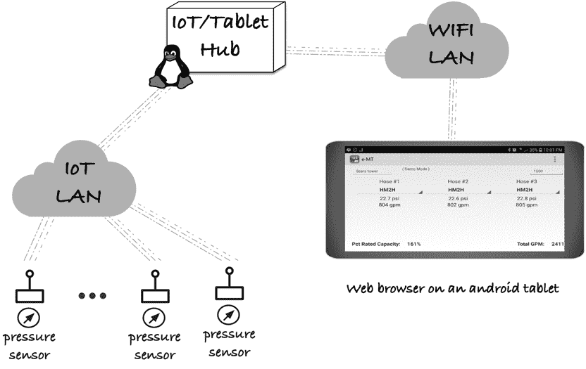

我们选择了一个 IoT 供应商，其基础设施让我们能够使用 `Python` 构建应用程序。他们现有的无线系统结合我们的 `Python` 生产代码，使我们能够快速开发出概念原型。


我们着手构建一个原型，因为我们知道一旦进入市场，我们可能需要更换供应商。我们为什么会怀疑这家供应商呢？在原型阶段，我们并不那么关心成本。等到产品上市时，情况可能会发生。此外，在快速增长的 IoT 市场中，这家供应商可能会倒闭，或者被其他 IoT 供应商收购。我们希望保留在业务逻辑上的上的投入，因此在我们的原型中，我们需要整洁的代码、关注点分离，以及对供应商基础设施的有限依赖。

幸运的是，我们的供应商提供了一个简单的“hello world”IoT 应用供我们上手。他们的“hello world”演示允许我们在一台小型 Linux 设备（它有点像工业级树莓派）与微控制器驱动的小型无线电模块之间发送消息，而这些无线电模块将与我们的压力传感器相连。我们可以将他们的“hello world”示例代码转换为一个层，该层包含所有对供应商基础设施的依赖。

我通过惨痛教训学到的的一点让我更倾向于从一个可以运行的系统开始，专注于通过小更改来扩展功能，并且不会破坏原有功能。你知道，保持系统运行良好比弄坏它后再修复它要容易得多！测试驱动开发（`TDD`）让我看到了微小且经过验证的更改的价值。

供应商拥有复杂的应用程序基础设施供我们利用。它拥有很多功能。我们并不需要它提供的所有功能。我们只想用无线电模块进行简单的消息传递，而不是与供应商深度绑定（直到死亡分离）。因此，我们只使用了该供应商非常广泛的接口的一小部分。

让我们从传感器和中枢相互熟悉开始。供应商让这一切变得非常简单。中枢和无线电使用远程过程调用（`RPC`）机制进行交互。中枢拥有完整的 `Python` 环境，而无线电模块仅限于 `MicroPython`。

该项目代号为 `Hydra`，源自那个多头怪兽。`HydraNetwork` 类封装了中枢中对 IoT 供应商的所有依赖。这些函数的复杂度较低，并将任务委托给通信基础设施。从开始的初始化阶段，中枢向所有监听的无线电模块宣告自己，然后轮询框架获取回复。

```
# In the hub
class HydraNetwork:
  …
  def announceHub(self):
    self.broadcast('announceHub', '')
    self.poll_a_second()
```

通过基础设施 `RPC` 机制的魔法，无线电模块中的 `announceHub()` 函数被调用。无线电模块记住中枢的地址并向中枢发送确认信号。

```
# In the radio
def announceHub():
  global hub_addr
  hub_addr = rpcSourceAddr()
  info = nodeIdentity()
  sendAck(hub_addr, 'announceHub', info)
```

这张时序图显示了 `HydraNetwork` 中枢与其 IoT 局域网上的 `PressureSensors` 之间的异步通信。

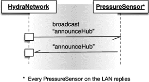

现在回到中枢，基础设施 `RPC` 调用了中枢的 `HydraNetwork.processAck()` 函数。

```
# In the hub
class HydraNetwork:
  …
  def processAck(self, command, payload):
    sensor_id = self.source_addr()
    self.ack_handler.handle_reply(sensor_id, command, payload)
```

`ack_handler` 是一个注入的依赖，它恰好是 `HydraDataSource` 的实例。`handle_reply()` 方法传递了接收到的账目数据。


这里没有显示许多应用对象，但它们并不在边界。我们很快会查看更宏观的视图。

让我们快速查看 `hydra_run()`。该函数从 `main()` 调用，并注入了 `data_source`。在生产环境中，会注入一个带有 `HydraNetwork` 的 `HydraDataSource`。在开发和测试期间，我们使用不需要网络的模拟数据源。

`hydra_run()` 函数启动了所有操作并从 `main()` 调用。以下代码启动了在主线程运行 Web 服务器的 `Collector` 进程。

```
def hydra_run(port, data_source, polling_rate,
                                 logger):
  logger.info("Hydra start")
  command_runner = CommandRunner(data_source,
                                 logger)
  collector = Process(
                target=measurement_loop,
                args=(command_q, reply_q,
                      command_runner, polling_rate))
  collector.start()
  sleep(1)
  logger.info("Hydra collector started")
  run_hydra_web_server(port, command_q, reply_q)
  logger.info("Hydra web server exited")
  command_q.put(HYDRA_EXIT)
  collector.join()
  logger.info("Hydra shut down")
```

这看起来有点乱，因为所有依赖都汇聚在这里。但好的一面是，代码并不复杂，可能不会发生太大变化。

让我们回顾一下我们整洁边界的一些重要属性。

### 关于 IoT 隔离

* 业务逻辑不包含无线电系统的知识。
* 依赖 IoT 的函数复杂度较低。
* 依赖 IoT 的函数不太可能频繁或大幅地更改。

### 关于 UI 隔离

* 业务逻辑与 UI 分离。
* 应用与 Web 服务器之间的通信依赖于一个简单的队列机制。

### 关于并发

* 业务逻辑完全不涉及并发。
* 并发机制位于低复杂度函数中，更改风险较低。

### 关于对象的创建与绑定

* 对象创建与对象使用是的。
* 在初始化期间，创建具体对象并将它们绑定到进程以及彼此之间。
* 绑定是基于“按需原则”（need-to-know basis）。

### SOLID 和六形架构

我们已经查看了这些小部分；现在让我们来看一个大大的视图以及设计中类之间的关系。遵循 SOLID 原则并隔离外部世界的依赖，自然会引出 Alistair Cockburn 所称为的六形架构^(2)（也称为端口与适配器）。

2. [Hex].

六形内部是产品所有的逻辑和行为。内部并不是一个巨大的“泥球”（ball of mud），而是将职责分配到单独类、函数和领域对象。六形外部是执行环境。应用程序依赖于六形边缘的服务抽象层。

这里有两个 `MessageQueue` 实例：`CommandQueue` 和 `ReplyQueue`。UI 通过 `CommandQueue` 驱动系统。用户通过网页上的按钮启动测试，该按钮向 `CommandQueue` 写入“启动”命令。启动命令传递到传感器，传感器开始收集测量值。`CommandRunner` 对新的 UI 命令进行定时等待。每一秒的超时都会导致 `CommandRunner` 从传感器发起一次新的更新。前一秒的传感器读数被封装成报告并发送到 `ReplyQueue`。下面的图显示了该消息如何启动流程测试。我们在之前的代码片段 `measurement_loop()` 中也看到过 `CommandRunner` 与队列的连接。

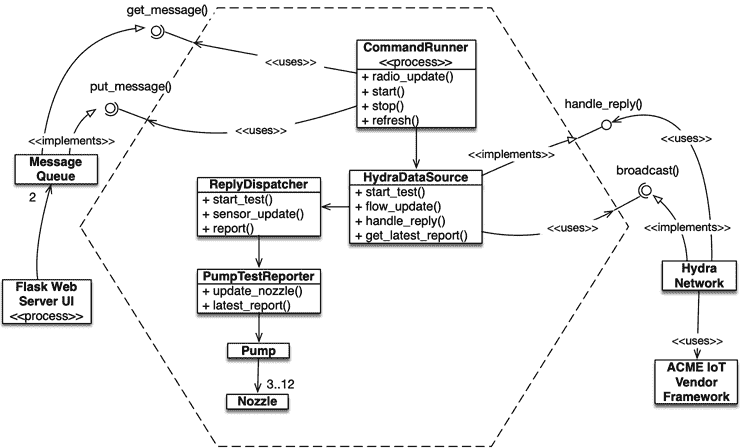

`HydraNetwork` 封装了对 ACME IoT 厂商框架的依赖。`HydraNetwork.broadcast()` 通知网络中的所有传感器报告它们最新的测量值。当收到单个无线回复时，`HydraNetwork` 调用 `handle_reply()`，将最新的 `PressureSensor` 消息输入 Hydra 应用。Hydra 对 ACME IoT 一无所知。

`broadcast()` 和 `handle_reply()` 接口更多取决于应用程序想要从 ACME IoT 获取什么，而不是 ACME IoT 提供了什么。`HydraDataSource` 知道有一个传感器网络，但只需要它广播更新需求并接收更新。六形边界的接口关于 Hydra 应用的需求，而不是关于 ACME 的产品。ACME IoT 提供的功能非常接近我们的需求，因此适配器非常薄且复杂度低。

随着我们的产品或 IoT 厂商提供的服务演进，我们可能想要更换供应商。如果到了替换 ACME IoT 或支持多个供应商的时刻，`HydraNetwork` 类就必须演进。

想象有一个新的 IoT 厂商 BrandX，它可以提供显著的成本节省。遗憾的是，BrandX 没有像 ACME 那样内置广播功能。相反，每个无线电都必须单独寻址。BrandX 的 `HydraNetwork` 实现可以实现 `broadcast()`，但为了实现它，需要了解每个传感器的连接。这一层可能会变得复杂，但我们可以在不触碰 Hydra 核心应用风险的情况下更换供应商。

### 探索与学习边界

第三方代码帮助我们在更短的时间内交付更多功能。当我们想要利用第三方包时，从哪里开始呢？测试第三方代码不是我们的工作，但为我们使用的代码编写测试可能符合我们的利益。

假设不清楚如何使用第三方库。我们可能会花费一两天（或更长时间）来阅读文档并决定如何使用它。然后，我们可能会编写代码来使用第三方代码并看看它是否有效。如果我们发现自己深陷于长时间的调试中，试图弄清楚我们遇到的 bug 是在我们的代码中还是他们的中，我们不会感到意外。

学习第三方代码很难。集成第三方代码也很。同时做这两者是难上加难。

如果我们采取不同的方法呢？与其在生产代码中实验和尝试新事物，不如编写一些测试来探索我们对第三方代码的理解。Jim Newkirk 将此类测试称为学习测试^(3)。

3. [BeckTDD], pp. 136–137.

在学习测试中，我们调用第三方 API，正如预计在应用程序中使用它一样。我们实际上是在进行受控的实验，以检查对该 API 的理解。测试重点在于我们从 API 中想要什么。


```python
class QueueTest(unittest.TestCase):
    def test_get_message_returns_message(self):
    q = Queue(maxsize=1)
    self.assertTrue(put_message(q, 'hey'))
    self.assertEqual('hey', get_message(q, 1.0))

  def test_get_message_None_when_timeout(self):
    q = Queue(maxsize=1)
    self.assertEqual(None, get_message(q, 0.01))

  def test_get_message_None_empty_no_wait(self):
    q = Queue(maxsize=1)
    self.assertEqual(None, get_message(q, 0.0))

  def test_put_message_True_for_success(self):
    q = Queue(maxsize=1)
    self.assertTrue(put_message(q, 'hey'))
    self.assertEqual('hey', get_message(q, 1.0))

  def test_put_message_False_when_full(self):
    q = Queue(maxsize=1)
    self.assertTrue(put_message(q, 'hey1'))
    self.assertFalse(put_message(q, 'hey2'))
    self.assertEqual('hey1', get_message(q, 1.0))
```

现在我们已经了解了 `Queue` 的工作原理，让我们用它来与 `Process` 进行通信吧。首先，我们定义一个函数 `worker()`，它将在一个独立的 `Process` 上执行。它从 `in_q` 获取消息，放入 `out_q`，然后退出。在此时，我们预打算使用这种方法将 Hydra 核心与 `WebServer` 离离开。

```python
def worker(in_q, out_q):
  message = get_message(in_q, 0.05)

  if message:
    put_message(out_q, message)

class ProcessLearningTest(unittest.TestCase):

  def setUp(self):
    self.command_q = Queue(maxsize=1)
    self.reply_q = Queue(maxsize=1)
    self.process = Process(target=worker,
                      args=(self.command_q,
                      self.reply_q,))
    self.process.daemon = True

  def test_thread_q_message_echos(self):
    put_message(self.command_q, 'Do this')
    self.process.start()
    reply = self.reply_q.get(True, 0.1)
    self.process.join()
    self.assertEqual('Do this', reply)

  def test_thread_message_timeout(self):
    self.process.start()
    reply = get_message(self.reply_q, 0.1)
    self.process.join()
    self.assertEqual(None, reply))
```

这些学习测试没有任何成本的。反正我们必须学习这些机制，而编写这些测试是获取这些知识的一种简单且隔离的方式。学习测试是精确的实验，有助于加深我们的理解。

学习测试不仅免费，而且具有积极的投资回报率。当第三方包发布新版本时，我们运行学习测试来查看是否存在行为差异。

学习测试验证了我们正在使用的第三方包按照我们预期的方式工作。一旦集成，无法保证第三方代码将保持与我们的需求兼容。原始作者将面临修改代码的压力以满足他们自己的新需求。他们会修复错误并添加新功能。每次发布都会带来新的风险。如果第三方包以某种与我们的测试兼容的方式发生变化，我们将立即发现。

在这种情况下，谁会期望 Python 改变呢？因此，没有未来的回报。事实上，Python 确实改变了。在将 Hydra 代码从 Python 2 转换为 Python 3 时，打包方式发生了变化；为了编译和运行测试需要一些编辑。幸运的是，我们的学习测试告诉我们行为被保留了。

无论你是否需要学习测试提供的学习，边界都应该由一组边界测试支持，这些测试以与生产代码相同的方式测试接口。如果没有这些边界测试来缓解迁移，我们可能会受诱留在旧版本上比预期更久。

### 使用尚不存在的代码

还有另一种边界，一种将已知与未知隔离开的边界。代码中经常有些地方，我们的知识似乎掉落了边缘。有时，边界另一侧的内容是不可知的（至少现在是）。有时，我们选择不再继续看边界。

几年前，我参与了一个开发无线电通信系统软件的团队。有一个子系统是“发射器（Transmitter）”，我们对其了解甚少，而且负责该子系统的人还没有到定义其接口的程度。我们不想被阻塞，所以我们从代码的未知部分之外开始工作。

我们很清楚自己的世界在哪里结束，新世界从哪里开始。当我们工作时，有时会撞上这个边界。尽管无知的迷雾和云雾遮挡了我们在边界之外的视线，但我们的工作让我们意识到我们*希望*边界接口是什么样的。我们想告诉发射器类似这样的信息：

*在提供的频率上触发发射器，并发射来自此流的数据的模拟表示*。

我们完全不知道如何实现这一点，因为硬件和 API 还没有设计。所以我们以后必须解决这些细节。

### 清洁边界

边界处会发生有趣的事情。变化就是其中之一。良好的软件设计可以适应变化，而不需要巨大的投资和重工作。当我们使用不受控制的代码时，必须采取特别措施保护我们的投资，并确保未来的更改成本不会过高。

我们通过在代码中少量引用它们来管理第三方边界。我们可以通过 `ADAPTER` 封装第三方依赖，将其从以应用程序为中心的接口转换为提供的接口。无论何种方式，我们的代码对我们来说更友好，促进了边界内部使用的一致性，并在第三方代码更改时减少了维护点。

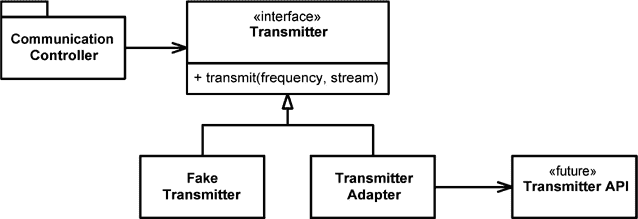

编写接口的好处在于它是受控的。目前未定义的 HAL 反而是一种优势。

## 27

## 清洁架构


在过去的几十年里，我们看到了关于系统架构的各种想法。这些包括


*   Alistair Cockburn 提出的六形架构（又名端口与适配器），并由 Steve Freeman 和 Nat Pryce 在他们精辟的著作 *Growing Object-Oriented Software, Guided by Tests* (Addison-Wesley, 2009) 中采用。
*   James Coplien 和 Trygve Reenskaug 提出的数据、上下文与交互 (DCI) 架构。
*   Ivar Jacobson 在其著作 *Object-Oriented Software Engineering: A Use-Case Driven Approach* (Addison-Wesley, 1992) 中提出的边界-控制-实体 (BCE) 架构。

尽管这些架构在细节上各不相同，但它们非常相似。它们都拥有同一个目标，即关注点分离（separation of concerns）。它们都通过将软件划分为不同的层来实现这种分离。每种架构至少都有一层用于业务规则，以及另一层用于用户和系统界面。

这些架构产生的系统都具有以下特点：

*   **独立于框架**。架构不依赖于某些功能丰富的库的存在。这允许你将此类框架作为工具，而不是强迫你将系统塞进它们有限的限制中。
*   **可测试性**。可以在没有 UI、数据库、Web 服务器或任何其他外部元素的情况下业务规则进行测试。
*   **独立于 UI**。UI 可以轻松更改而无需更改系统的其他部分。例如，可以将 Web UI 替换为控制 UI，而无需更改业务规则。
*   **独立于数据库**。你可以将 Oracle 或 SQL Server 切换为 Mongo、Bigtable、CouchDB 或其他。你的业务规则不受限于数据库。
*   **独立于任何外部机构**。事实上，你的业务规则完全不知道外部世界的任何接口。

### 依赖规则 (The Dependency Rule)

下面的图表试图将所有这些架构整合到一个单一的操作理念中。

同心圆代表软件的不同区域。通常情况下，越往内，软件的层级越高。外层圆是机制，内层圆是策略。

使这种架构运行的核心规则是依赖规则。该规则规定：

*源代码依赖必须仅指向内部，指向高层策略*。

内层圆中的任何内容都无法知道外层圆中的任何信息。特别是，外层圆中声明的名称不能被内层圆的代码提及。这包括函数、类、变量或任何其他命名的软件实体。

同样，外层圆中声明的数据格式不应被内层圆使用，特别是当这些格式是由外层圆中的框架生成时。我们不希望外层圆的任何内容影响内层圆。

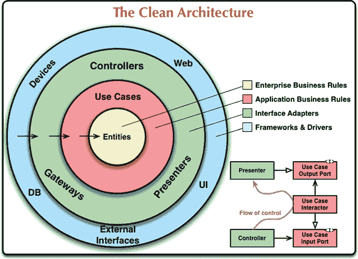

### 实体 (Entities)

实体封装了企业范围的关键业务规则。实体可以是一个带有方法的对象，也可以是一组数据结构和函数。只要这些实体可以被企业中的许多不同的应用程序使用即可即可。

如果你没有企业，只是在编写单个应用程序，那么这些实体就是应用程序的业务对象。它们封装了最通用、最高级的规则。当外部发生变化时，它们最不可能发生改变。例如，你不会预期这些对象受到页面导航或安全性更改的影响。对任何特定应用程序的业务更改都不应影响实体层。

### 用例 (Use Cases)

这一层的软件包含*特定应用程序的*业务规则。它封装并实现了系统所有的用例。这些用例协调实体与实体之间的数据流向，并引导这些实体使用其关键业务规则来实现用例的目标。

我们不期望这一层的变化会影响实体。我们也不期望这一层受到数据库、UI 或任何常用框架等外部因素的影响。这一层与此类关注点隔离开了。

然而，我们确实预计应用程序*操作*的变化会影响用例，从而影响这一层的软件。如果用例的细节发生变化，这一层中的某些代码无疑受到影响。

### 接口适配器 (Interface Adapters)

这一层的软件是一组适配器，它们将数据从最适合用例和实体的格式转换为对某些外部机构（如数据库或 Web）最方便的格式。例如，正是这一层将完全包含 GUI 的 MVC 架构。演示器（presenters）、视图（views）和控制器（controllers）都属于这里。模型可能只是从控制器传递到用例的数据结构，然后从用例传回给演示器和视图。

同样，数据在这一层中从最适合实体和用例的形式转换为最适合任何正在使用的持久化框架（即数据库）的形式。该圆内（更内侧）的任何代码都不应该知道数据库的任何信息。如果数据库是 SQL 数据库，那么所有的 SQL 都应该限制在此层中，特别是该层中与数据库有关的部分。

该层还包含任何其他必要的适配器，用于将数据从外部形式（如外部服务）转换为用例和实体使用的内部形式。

### 框架与驱动程序 (Frameworks and Drivers)

最外层通常由框架和工具组成，如数据库和 Web 框架。通常，除了与向内下一层圆通信的胶水代码外，你在此层编写编写太多代码。

这一层是存放所有细节的地方。Web 是一个细节。数据库是一个细节。我们将这些东西留在外面，这样它们造成的伤害就很小。

### 只有四个圆？

不，圆是示意性的。你可能会发现你需要不仅仅四个圆。没有规则规定你必须始终只有四个。然而，依赖规则始终适用。源代码依赖始终指向内部。越往内，抽象程度和策略越高。最外圆是底层的具体细节。越往内，软件越抽象并封装了高层策略。最内层圆是最通用、最高级的。

### 跨越边界 (Crossing Boundaries)

图右下角是我们如何跨越圆边界的示例。它展示了控制器（Controllers）和演示器（Presenters）如何与下一层的用例（Use Cases）通信。注意控制流。它从控制器开始，穿过用例，最后在演示器中执行。同样注意源代码依赖。每一个都指向内部，指向用例。

我们通常通过使用依赖倒置原则（DIP）来解决这种表面上的矛盾。例如在 Java 等语言中，我们会安排接口和实现/继承关系，使得源代码依赖在跨越边界的位置与控制流相反。

例如，考虑用例需要调用演示器。然而，这种调用不能是直接，因为这将违反依赖规则：外层圆中的任何名称不能被内层圆提及。因此，我们让用例调用内层圆中的接口（Use Case Output Port），并外层圆中的演示器实现它。

相同的技术用于跨越架构中所有的边界。我们利用动态多态创建与控制流相反的源代码依赖，以便无论控制流在哪个方向，都能符合依赖规则。

#### 什么数据跨越了边界


通常，跨越边界的数据是简单的数据结构。如果你愿意，可以使用基础结构体（structs）或简单的数据传输对象（DTOs）。或者数据也可以作为函数调用的参数。又你可以将其封装进哈希映射（hash map）或构造成一个对象。重要的是，跨越边界的是隔离的简单数据结构。我们不希望作弊传递实体（entities）或数据库行。我们不希望数据结构具有任何违反依赖规则（Dependency Rule）的依赖。

例如，许多数据库框架在响应查询时会返回一种方便的数据格式。我们可能称之为 `row structure`（行结构）。我们不希望将该行结构跨越边界传递到内部。这将违反依赖规则，因为它会强迫内层去了解外层的某些信息。

所以，当我们跨越边界传递数据时，它总是以对内层最方便的形式存在。

### 典型场景

以下展示了一个使用数据库的 Web 系统的典型场景。Web 服务器从用户处收集输入数据并将其交给左上角的 `Controller`（控制器）。`Controller` 将这些数据封装成一个简单对象（plain old object），并通过 `InputBoundary`（输入边界）传递给 `UseCaseInteractor`（用例交互器）。`UseCaseInteractor` 解释这些数据并用它们控制 `Entities`（实体）的运行。它还使用 `DataAccessInterface`（数据访问接口）从数据库将这些 `Entities` 使用的数据调入内存。任务完成后，`UseCaseInteractor` 从 `Entities` 收集数据并构造另一个简单对象的 `OutputData`（输出数据）。然后，`OutputData` 通过 `OutputBoundary`（输出边界）接口传递给 `Presenter`（演示器）。

`Presenter` 的工作是将 `OutputData` 重新封装为可见的形式即 `ViewModel`（视图模型），这又是另一个简单对象。`ViewModel` 主要包含 `Strings`（字符串）和 `View`（视图）用于显示数据的标记。虽然 `OutputData` 可能包含 `Date`（日期）对象，但 `Presenter` 在加载 `ViewModel` 时会已经为用户格式化好相应的 `Strings`。`Currency`（货币）对象或任何其他业务数据也是如此。`Button`（按钮）和 `MenuItem`（菜单项）的名称被放在 `ViewModel` 中。告诉 `View` 这些 `Button` 和 `MenuItem` 是否应该置灰的标记也是如此。

这使得 `View` 几乎无事可，只需将数据从 `ViewModel` 移动到 HTML 页面即可。

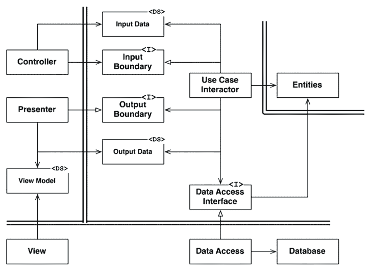

注意依赖的方向。所有依赖都跨越边界线并指向内部，遵循依赖规则。

### 结论

遵循这些简单的规则并不困难，并将为你后的工作省去很多烦恼。通过将软件分层并遵守依赖规则，你将创建一个从本质上可测试的系统，并获得其暗示的所有好处。当系统的任何外部部分（如数据库或 Web 框架）过时时，你可以以最小代价替换这些过时的元素。

# IV

# 工匠精神

以下是我书籍《洁净手工之道》（*Clean Craftsmanship*）中经过节简和编辑的摘录。


软件职业的起源并不顺利，始于 1935 年夏天，当时艾兰·图灵（Alan Turing）开始写他的论文。他的目标是解决一个困扰了数学家十年或更久的数学困境：`the Entscheidungsproblem`（判定问题）。即决策问题。

在这一目标上，他成功了；但他当时并不知道他的论文将诞生一个遍全球的行业，我们所有人将依赖于它，而它现在构成了我们整个文明的命脉。

1945 年，图灵为自动计算引擎（ACE）编写了代码。他使用二进制机器语言和 32 数字编写了这些代码。在此之前少于十二个人写过这样的代码，因此图灵不得不发明并实现如子程序、栈和浮点数等概念。

### “大量的数量”

在发明了基础知识并用它们解决数学问题几个月后，他写了一份报告，得出了以下结论。

“我们需要大量有才华的数学家，因为可能有很多这类工作需要完成。”

“大量的数量”。他是如何知道的？实际上，他并不知道这句话有多有预见性；他无法预见到我们现在所拥有的如此庞大的数量。

但他说的另一件事是什么呢？“有才华的数学家”。你认为自己是一个有才华的数学家吗？图灵是这么认为的。

在同一份报告中，他继续道：

“我们的困难之一将是维持适当的纪律，以便我们不丢失自己工作的方向。”

纪律！艾兰·图灵向前展望了八十年，看到我们的问题将是纪律。借此，他为软件专业化的框架奠定了第一块石头。他说我们应当是保持适当纪律的有才华的数学家。

我们是这样的人吗？你是这样的人吗？

### 八十载

一个人的寿命。在写这段文字时，我们的职业就有那么老了。在这八十年里发生了什么呢？

1945 年，世界上只有几台计算机，程序员的数量同样极少。在计算机科学术语中，这处于 $1$ 的数量级：`O(1)`。这些数字在最初的几年里增长迅速。但让我们以此作为起点。

1945 年。计算机：`O(1)`。程序员：`O(1)`。

在随后的十年里，真空管的可靠性、一致性和功耗得到了极大提高。这使得构建更大、更强大的计算机成为可能。

到 1960 年，IBM 已经售出了 140 台 700 系列计算机。这些是巨大的、昂贵的巨兽，只有军事、政府和非常大的公司才负担得起。按照我们的标准，它们是缓慢、贫乏且脆弱的。

 50 年代，格蕾丝·霍珀（Grace Hopper）发明了高层语言的概念并创造了 `compiler`（编译器）一词。到 1960 年，她的工作促成了 COBOL。

1952 年，约翰·巴克斯（John Backus）提交了 FORTRAN 规范。随后是 ALGOL 的开发。到 1958 年，约翰·麦卡锡（John McCarthy）开发了 LISP。因此，语言园的扩张开始了。

在那个年代，没有操作系统，没有框架，没有函数库。如果某个东西在你的计算机上运行，那是因为你写的。所以，在那个年代，只需要十几个程序员才能维持一台计算机运行。

到 1960 年，在图灵之后的 15 年，世界上有 `O(100)` 台计算机。程序员的数量多出一个数量级：`O(1000)`。

这些程序员是谁？他们是像格蕾丝·霍珀、埃德格·迪杰斯特拉（Edsger Dijkstra）、约翰·冯·诺依曼（John von Neumann）、约翰·巴克斯和珍·詹宁（Jean Jennings）这样的人。他们是科学家、数学家和工程师。大多数人已经有了职业，并且了解他们所就业的行业和学科。许多人（如果不是大多数的话）都在 30 到 50 岁。

60 年代是晶体管时代。这些小型、简单、廉价且可靠的设备逐渐取代了真空管。这对计算机的影响是颠覆性的。

到 1965 年，IBM 生产了超过 1 万台基于晶体管的 1401 计算机。租金每月约为 2500 美元，这使得数千中型企业能够负担。

这些机器使用汇编语言、FORTRAN、COBOL 和 RPG 进行编程。而所有租赁这些机器的公司都需要程序员团队来编写应用程序。

当时 IBM 并不是唯一制造计算机的公司；所以我们只能说，到 1965 年，世界上有 `O(1E4)` 台计算机。如果每台计算机都需要十个程序员来维持运行，那么一定有 `O(1E5)` 个程序员。


在图灵去世二十年后，世界上已经有几十万名程序员了。这些程序员是从哪里来的呢？数学家、科学家和工程师的数量不足以满足需求。而且大学里也没有计算机科学专业的毕业生，因为当时在任何地方都没有设立计算机科学学位课程。

因此，公司从他们的会计师、文员、计划师中选拔最优秀、最聪华的人才——任何具有过证明的技术天赋的人。他们发现了很多人。

而且，这些，这些已经在其他领域成为专业人士的人。他们年龄在 30 岁、40 岁和 50 岁。他们已经理解了截止日期和承诺，知道哪些该保留，哪些该舍弃。尽管这些人本身并不是数学家，但他们是严守纪律的专业人士。图灵很可能会赞同这一点。

注 1。向 Bob Seger 致歉。

### 硬件与语言的兴起

但齿轮依然在旋转。到 1966 年，IBM 每月产出 1,000 台 `System/360`。这些计算机随处可见。它们在当时是极其强大的。`30` 型可以寻址 `64K` 字节的内存，每秒执行 35,000 条指令。

正是在 60 年代中期的这段时期，Ole-Johan Dahl 和 Kristen Nygaard 发明了 `SIMULA 67`，这是第一种面向对象的语言。

同样在此期间，Edsger Dijkstra 发明了结构化编程。

同样在这个时期，Ken Thompson 和 Dennis Ritchie 发明了 `C` 和 `Unix`。

齿轮仍在旋转。70 年代初，集成电路开始被广泛使用。这些小芯片可以容纳数十、数百个甚至上千个晶体管。它们让电子电路实现了大规模的小型化。于是，微机诞生了。

### 微机爆炸

20 世纪 60 年代末到 70 年代，数字设备公司（Digital Equipment Corporation）售出了 50,000 台 `PDP8` 系统和几十万台 `PDP11` 系统。他们并不孤单！微机市场爆发了。到 70 年代中期，有几十家公司在销售微机。

因此，到 1975 年，在图灵去世 30 年后，世界上有 `O(1E6)` 台计算机。那么有多少程序员呢？比例开始发生变化。计算机的数量正在接近程序员的数量。所以，到 1975 年，有 `O(1E6)` 名程序员。

### 人口结构的变化

这数百万程序员从哪里来？他们是谁？是我。我和我的哥们儿。我和那群年轻、充满活力、极客的男孩们。成千上万新的 `EE` 和 `CS` 毕业生——我们都很年轻。我们都很聪明。在美国，我们都非常担心征兵入役。而且我们几乎全是男性。

噢，并不是说女性在大量离开这个领域——那时还没有。这种情况直到 80 年代中期才开始。不，只是有更多的男孩（我们当时都是男孩）进入了这一领域。

在 1969 年我的第一份程序员工作中，有几十名程序员。他们都在 30 岁或 40 岁之间，其中三分之一到一半是女性。十年后，我在一家大约有 50 名程序员的公司工作，也许只有三个是女性。

所以，在图灵去世 30 年后，编程的人口结构已向非常年轻的男性剧变。成千上万二十多岁的男性。我们通常*不是*图灵会描述的那种严守纪律的数学家。但企业需要程序员。需求量爆表。这些非常年轻的男性在纪律上的短板，他们用精力来弥补。

而且我们也很便宜。尽管今天程序员的起薪很高，那时公司可以相当廉廉的价格招到程序员。我 1969 年的起薪是每年 `$7,200`。从那以后一直一直是这种趋势。年轻的男女每年都从计算机科学专业源源而出；而行业对他们似乎有着永无满足的需求。

### 指数级增长

在 1945 年到 1975 年的 30 年间，程序员的数量增长了至少百万倍。在之后的 40 年里，这一增长速度有所放缓，但仍然非常高。

你认为今年（2025 年）世界上有多少程序员？如果你算上 `VBA` 程序员，我认为数量必须是 `O(1E8)`。今天世界上一定有数亿程序员。

这显然是指数级增长。指数增长曲线有一个翻倍率。你可以算一下。嘿，阿尔伯特，如果我们在 80 年内从 1 变成 `1E8`，翻倍率是多少？

*一亿以 2 为底的对数约为 27——除以 80 得到大约 2.96。所以也许程序员的数量大约每三左右翻倍一次*。

实际上，正如我们之前看到的，前几十年的速度更快，现在慢了一点。我推测翻倍率大约是五年。每五年，世界上程序员的数量就会翻一倍。

这个假设的含义是惊人的。如果世界上程序员的数量每五年翻倍一次，意味着世界上有一半的程序员经验不到五年；只要这个翻倍率持续下去，这种情况将永远成立。

### 极客与老兵

这种缺乏经验的状态。噢，别担心，这并不意味着*你*永远缺乏经验。它意味着当你获得五年经验时，程序员的数量会翻一倍。当你获得十年经验时，程序员的数量会增加三倍。

你可能认为 AI 会减缓这个速度。别幻想了。每项应该减缓速度的技术反而加速了需求。挑选一项新技术：`FORTRAN`、`C`、`Unix`、`OO`、`C++`、`Java`、`C#`、`Ruby`、`Functional` …… 没有一项减少过程序员的需求。相反，这些技术让更多群体进入了领域——主要是年轻人。

人们看到编程领域的年轻人，得出结论这是一个年轻人的职业。他们问：“老兵都在哪里？”我们都在这！我们没去哪。只是 50 年前我们那么多。

问题在于，没有足够的老兵来教新来的程序员。每有一个有 30 年经验的程序员，就有 63 个需要向他（或她）学习；其中 32 个是新手。所以，缺乏经验，缺乏足够的导师来纠正问题。因此，同样的的老错误被一遍又一遍地重复。

### 名声

但在过去的 80 年里还发生了其他事情。程序员获得了一种我确定图灵从未预料到的东西：名声。在 50 年代和 60 年代，没人知道程序员是什么。我们的人数不足以产生社会影响。程序员没有住在很多人隔壁。这种情况在 70 年代开始改变。到那时，父亲们开始建议儿子（有时还有女儿）获得计算机科学学位。世界上程序员的人数已经多到每个人都认识一个程序员。于是，那种极客、吃着甜甜圈的怪胎形象诞生了。很少有人见过计算机；但几乎每个人都听说过它们。


我对那个时代的一个电视广告记忆犹新。画面中是一位妻子和她的丈夫，一个戴着眼镜、插着笔袋、拿着计算器的书呆小哥，正在杂货店比较价格。奥尔森夫人（Mrs. Olsen）将他描述为“计算机天才”，并开始向这对夫妇同时传授某种特定品牌咖啡的益处。

那个广告里的计算机程序员看起来很天真、书卷气重，且无关紧要。他很聪明，但缺乏智慧和常识。他绝不是那种你会邀请参加派对的人。

事实上，计算机程序员在当时被认为是那种在学校里经常被学生欺负的人。

到 1983 年，个人电脑开始出现；显而易见，青少年出于很多原因对它们感兴趣。到那时，已经有很多人至少认识一个计算机程序员。我们被视为专业人士；但仍然充满神秘。

那一年，电影《战争游戏》（War Games）描绘了年轻的马修修·布罗德里克（Matthew Broderick）作为一个精通计算机的青少年和黑客。他黑入了美国的武器控制系统 `WOPR`，误以为那是一个视频游戏，并启动了核战争倒计时。在电影结尾，他通过说服计算机“唯一的获胜策略是不玩游戏”拯救了世界。

计算机和程序员的角色发生了调换。现在，计算机变成了幼稚、天真的角色，而程序员成了智慧的载体（如果称之为源头的话）。

1986 年，我们在电影《短路》（Short Circuit）中看到了类似的场景，电影中那个被称为 `#5` 的电脑机器人虽然天真无邪，但在它笨拙创造者及其女友的帮助下学会了智慧。

到 1993 年，情况发生了巨大的变化。在电影《侏罗纪公园》（Jurassic Park）中，程序员变成了反派，而计算机根本不是一个角色。它仅仅是一个工具。

社会开始理解我们是谁以及我们所扮演的角色。在短短 20 年里，我们从书呆变成了老师，又变成了反派。但愿景再次发生了变化。在 1999 年的电影《黑客帝国》（The Matrix）中，主角们既是程序员也是救世主。事实上，他们神一般的力量来自于阅读和理解“代码”的能力。

我们的角色变化得很快。在短短几年内就从反派变成了救世主。整个社会开始理解我们在行善行恶方面所拥的力量。

## 榜样与反派

十五年后，2014 年，我访问了位于斯德哥尔摩的 Mojang 办公室，就整洁代码和测试驱动开发（TDD）进行了演讲。如果你不知道，Mojang 是制作游戏《Minecraft》的公司。

之后，由于天气很好，Mojang 的程序员们和我坐在户外的啤酒花园里聊天。突然，一个大约 12 岁的男孩跑向栅栏，对着其中一个程序员大声喊道：“你是`Jeb`吗？”

他指的是延斯·贝尔根斯滕（Jens Bergensten），他是 Mojang 的首席程序员之一。那个男孩向延斯要了签名，并问了一连串没完的问题。他的眼里再也没有别人了。

程序员已经成为我们孩子的榜样和偶像。他们梦想长大成为像 `Jeb`、`Dinnerbone` 或 `Notch` 那样的人。现实中的程序员是英雄。但哪里有英雄，就有反派。

2015 年 10 月，大众北美首席执行官迈克尔·霍恩（Michael Horn）在美国国会作证，针对他们汽车中欺骗环保保护署（EPA）测试设备的软件。当被问及公司为何这样做时，他归咎于程序员。他说：“这是几个软件工程师出于某种原因放进去的。”

当然，关于所谓的“某种原因”，他撒谎了。他完全清楚原因是什么，整个大众汽车公司也是如此。他试图将责任推给程序员的拙劣尝试是非常透明的。但另一方面，他是完全正确的。确实*是*某些程序员写了那些撒谎、作弊的代码。

而那些程序员，无论他们是谁，都为我们所有人抹了黑。。如果我们有一个真正的职业组织，他们作为程序员的身份将被、也应该被撤销。他们背叛了我们所有人。他们损害了我们职业的荣誉。

因此，我们毕业了。这花了 80 年。但在那段时间里，我们从虚无到书呆，再到榜样，最后变成英雄和反派。社会已经开始——仅仅开始——理解我们是谁，以及我们所代表的威胁与承诺。（更多信息，请参阅 `第 1 章` 中的 `为什么我们应该保持代码整洁？`。）

## 我们统治世界

但社会还没有完全理解一切。事实上，我们也不了解。正如我在引言中所说的，你和我，我们程序员；我们统治着世界。

这听起来可能是一个夸张的陈述。但考虑一下。现在世界上计算机的数量比人还多。而那些数量超过我们人数的计算机为我们执行着无数核心任务。

它们记录我们的提醒。它们管理我们的日历。它们传递我们的 `Facebook` 消息并保存我们的相册。它们连接我们的电话并发送我们的短信。它们控制我们汽车的引擎，以及刹车、油门，有时甚至是方向盘。

没有它们，我们无法做饭。没有它们，我们无法洗衣服。它们在冬天为我们的房子保暖。它们扫拖我们的地板。它们在我们无聊时娱乐我们。它们记录我们的银行记录和信用卡。它们帮助我们支付账单。

事实上，西方世界的大部分人在清醒的每一分钟都在与某种软件系统交互。有些人甚至在睡觉时也是如此。重点是，如果没有软件，我们的社会*什么*都不会发生。没有商品被买卖。没有法律被颁布或执行。没有汽车行驶。没有食物被送达。没有手机连接。没有燃气进入暖炉。

而*我们*编写了那些软件。这让我们成为了世界的统治者。噢，其他人认为他们是规则规则——但随后他们将这些规则交给我们，由我们编写在机器中执行、协调我们生活各个方面的规则。社会还没有理解这一点。很快，我们的社会就会深刻体会到。我们，程序员，也不太理解这一点。并不真的。但再次，那一天即将来会被粗暴地推到我们面前。

## 灾难

多年来，我们目了许多软件灾难。有些非常惨烈。

在 2018 年至 2019 年间，两架 737 MAX 飞机以近音速俯冲向地面，导致 346 人丧生。原因是：一个由硬件故障暴露的软件缺陷。

2016 年，我们丢失了谢帕瑞利（Schiarelli）火星着陆器和漫游器，这是由于一个软件问题导致着陆器认为已经着陆，而实际上距离地面还有 4 公里。

1999 年，我们丢失了火星气候轨道器，这是由于地面软件错误，在使用英制单位（磅·秒）而非公制单位（牛顿·秒）向轨道器传输数据导致的。这一错误导致轨道器进入火星大气太深，并被撕成碎片。

1996 年，亚里得 5 号运载火箭载荷在发射 37 秒后被毁，这是由于一个 64 位浮点数在经过未经检查的转换为 16 位整数时，发生了整数溢出异常。该异常导致机载计算机崩溃，运器随之自毁。

我们是否应该谈谈 Therac-25 放射治疗仪？它由于一个竞态条件，曾用高能电子束导致了三个人死亡并伤害了另外三个人。

或者我们也许应该谈谈骑士资本公司（Knight Capital）？他们在 45 分钟内损失了 4.6 亿美元，只因为他们复用了一个无意中留在系统中的标记，结果激活了死代码。


或许我们应该谈谈丰田的栈溢出（stack overflow）漏洞，它曾导致车辆失控加速——可能导致了多达 89 人死亡。

或许我们应该谈谈 Healthcare.gov，以及那场几乎推翻了一项新的且具有争议的美国医疗法案的软件故障。

这些灾难造成了数十亿美元的损失和许多生命。它们是由程序员造成的。

我们，程序员，通过我们所编写的代码，正在杀人。

我知道你们步入这一行业并不是为了杀人。可能你成为程序员是因为你写过一个只打印一次自己名字的无限循环，并体验了那种掌控力量的喜悦。

但事实就是事实。我们现在处于社会中的这样一个位置：我们的行为可以摧毁财富、生计和生命。

在某一天，可能就在不久之后，某个可怜的程序员会做一点一点愚蠢的事情，然后会有成上万的人死去。

这不是荒野的推测——这只是时间问题。

当这种情况发生时，全世界的政治家将要求一个交代。他们会要求我们展示未来将如何防止这种情况发生。

如果我们在没有伦理声明的情况下出现；如果我们在没有任何标准或定义的纪律的情况下出现；如果我们出现并抱怨老板如何设定了不合理的时间表和期限……

那么我们将被判定为**有罪**。

### 誓言

因此，为了开始定义我们作为软件开发者的伦理，我提出以下誓言。

为了捍卫和维护计算机程序员职业的荣誉，我承诺，尽我所能和根据判断：

1. 我不会产生有害代码。
2. 我产生的代码将始终是我的最佳作品。我不会在知情的情况下允许在行为或结构上存在缺陷的代码堆积。
3. 我在每次发布时，都会提供一个快速、可靠且可重复的演示，证明代码的每一个元素都按照其预期方式工作。
4. 我将频繁地进行小规模发布，以免阻碍他人的进度。
5. 我将在每一个机会无畏且无情地改进我的创作成果。我绝不会降低它们的质量。
6. 我将尽一切努力保持自己和他人的生产力尽可能高。我不会做任何降低这种生产力的事情。
7. 我将持续确保他人可以为我工作，我也可以为他们工作。
8. 我提供的估算在规模和精度上都是诚实的。我不会在没有合理把握的情况下做出让承诺。
9. 我将尊重同事程序员的伦理、标准、纪律和技能。任何其他属性或特征都不会成为我尊重同事程序员的因素。
10. 我永远不会停止学习和改进我的技艺。

## 28

## 伤害

1. 我不会产生有害代码。

软件专业人员的第一个承诺是：**不伤害！**这意味着你的代码不能伤害你的用户、你的雇主、你的经理或你的同事程序员。

你必须知道你的代码在做什么。你必须知道它是可以工作的。你必须知道它是整洁的。

不久前，人们发现大众汽车（Volkswagen）的一些程序员编写了一些故意阻碍 EPA（美国环保署）排放测试的代码。那些程序员编写了有害代码。

它是有害的，因为它是具有欺骗性的。那些代码欺骗了 EPA，允许销售车辆，这些车辆排放的有害一氧化氮量是 EPA 认为安全水平的 20 倍。因此，那些代码潜在地损害了在那些车辆行驶地区每个人的健康。

那些程序员应该受到什么对待？他们知道那些代码的目的吗？他们本应该知道吗？

我会解雇他们并起诉他们。因为无论他们知不知道，他们都应该知道。躲在别人写的需求后面并不是借口。是我们的手指在键盘上。是我们的代码。我们必须知道它在做什么！

这是一个棘手的问题，不是吗？我们编写代码让我们的机器运行。而那些机器往往处于可以造成巨大伤害的位置。由于我们要对代码所造成的任何伤害负责，因此我们必须对知道代码将做什么负责。

每个程序员都应该根据他们的经验水平和责任来承担责任。随着你经验和地位的增长，你对自己的行为以及对你下属行为的责任随之增加。

显然，我们不能要求初级程序员像团队负责人那样承担责任。我们不能要求团队负责人像高级开发人员那样负责。但那些资深人员应该被要求遵循高标准，并对他们指导的人负最终责任。

这并不意味着所有的责任都归高级开发人员或经理。每个程序员都对了解代码在做什么负责，这取决于他们的成熟度和理解水平。每个程序员都对他们的代码造成的伤害负责。

### 不对社会造成伤害

首先，你不要对你所在的社会造成任何伤害。

这是大众程序员违反的规则。他们的软件可能造福了雇主——大众汽车。然而，它损害了整个社会。而我们，程序员，绝不能这样做。

但你如何知道自己是否在伤害社会呢？例如，构建控制武器系统的软件会对社会有害吗？赌博软件呢？暴力或性别歧视视频游戏呢？色情内容呢？

如果你的软件在法律范围内，它仍然可能对社会有害吗？

坦率地说，那是你判断的问题。你只需要尽可能做出最好的决定。你的良心将成为你的指南。明智地选择！

另一个伤害社会的例子是 Healthcare.gov，这是一个根据《平民医疗法案》（Affordable Care Act）强制要求的网站。尽管在这种情况下伤害是无意的。《平民医疗法案》是美国国会通过并由总统签署法律的法案。在它的许多指令中，要求在 2013 年 10 月 1 日创建并激活该网站。

现在，别管法律规定必须在该日期激活一个全新的大型软件系统是多么疯狂。真正的问题是，在 2013 年 10 月 1 日，他们真的启动了。

你是否认为，也许那天有一些程序员躲在办公桌下面？

*噢天哪，我想他们启动了。*
*是的，是的，他们真的不该那样做。*
*噢，我可怜的母亲。她该怎么办？*

我不会用一连串随之产生的问题来骚扰你们。简单来说，该网站在几个月内完全无法运行。这是一个由于技术失误导致一项重大的公共政策面临风险的案例。由于这些故障，法案几乎被推翻。无论你对局势的政治问题如何看，那是对社会的伤害。

谁对这种伤害负责？每一个知道系统未准备好但却保持沉默的程序员、团队负责人、经理和总监。

对社会的这种伤害是由每一个对管理层采取消极攻击态度的软件开发者实施的。每一个说：“我只是在做我的工作——那是他们的问题。”

每一个知道事情不对但没有采取任何行动阻止该系统部署的软件开发者，都承担部分责任。

因为事实是这样的。你被聘为程序员的主要原因之一，是因为你知道什么时候出了问题。你拥有在问题发生前识别出问题的知识。因此，你有责任在可怕的事情发生之前发声。

### 对功能的伤害

你必须**知道**你的代码是可以工作的。你必须**知道**你代码的功能不会对你的公司、你的用户或你的同事程序员造成伤害。


2012 年 8 月 1 日，Knight Capital 的一些技术人员在服务器上加载了新软件。不幸的是，他们只加载了八台服务器中的七台，导致第八台服务器仍在运行旧版本。

他们为什么会犯这种错误，无人知晓。可能是某人疏忽了。

Knight Capital 运行着一套交易系统。他们在 `NYSE` 上交易股票。他们的工作内容之一是接收大额的“父”订单并将其拆分为许多较小的“子”订单，以防止其他交易员看到初始父订单的规模并相应地调整价格。

八年前，这种父-子算法的一个简单版本——名为 `Power-Peg`——被禁用了，并被一个好得多的名为 `SMARS` 的东西取代。但奇怪的是，旧的 `Power-Peg` 代码并没有从系统中移除。它只是通过一个 `flag`（标志位）被禁用了。

那个 `flag` 一直被用来调节父-子处理过程。当 `flag` 开启时，会执行子订单。当执行了足够的子订单以满足父订单时，`flag` 就会关闭。

他们通过简单地让 `flag` 关闭，禁用了 `Power-Peg` 代码。

不幸的是，仅加载到八台服务器中七台上的新软件更新重新利用了这个 `flag`。他们把它开启了。于是，那第八台服务器开始在高速无限循环中产生子订单。

他们知道出问题了，但不知道具体出了什么问题。他们花了 45 分钟才关掉那台出错的服务器；而在过去的 45 分钟里，它一直在无限循环中进行糟糕的交易。

事实是，在交易的最初这 45 分钟内，Knight Capital 在无意中购买了价值 70 亿美元的不需要的股票，不得不以 4.6 亿美元的亏损将其抛售。更糟糕的是，他们手头只有 `$360M` 现金。他们破产了。

45 分钟；一个愚蠢的错误；4.6 亿美元。

那个错误是什么呢？错误在于他们并**不知道**自己的系统将会做什么。

在这一点，你可能担心我是在要求程序员对代码的行为拥有完美的认知。当然，完美的认知是无法实现的。总会有某种程度的知识缺口。

问题的关键不在于知识的完美。相反，问题的在于**知道**不会产生伤害。

Knight Capital 的那些可怜的人们拥有一个极其有害的知识缺口——考虑到他们面临的风险，他们本不应该允许这种缺陷存在。

或者让我们来看看丰田的案例，以及那个导致汽车失控加速的软件系统。

那个软件导致了多达 89 人死亡。还有更多人受伤。

想象你正在一个拥挤的市中心商业区开车。想象你的车突然开始加速，刹车失灵。在几秒钟内，你像火箭一样冲过红灯和人马线，无法停下。

这就是调查人员发现丰田软件可以做的——而且可能已经做过了。

那个软件正在杀害人类。

编写那些代码的程序员并**不知道**他们的代码不会杀人。请注意这里的双重否定。他们并**不知道**他们的代码**不会**杀人。而他们本该知道。他们本该知道他们的代码**不会**杀人。

现在再次，这一切都关乎风险。当风险很高时，你希望你的知识尽可能接近完美。如果关乎生命，你必须**知道**你的代码不会杀死任何人。如果关乎财富，你必须**知道**你的代码不会亏掉这些财富。

另一方面，如果你在写一个聊天应用程序或简单的购物篮网站，既不关乎财富也不关乎生命……

……真的如此吗？

如果使用你聊天应用程序的人突然发生医疗紧急情况，并在你的应用上输入：“救救我。拨打 911”呢？如果你的应用发生故障并丢失了那条信息呢？

如果你的网站将个人信息泄露给黑客，让他们利用这些信息盗取身份呢？

如果有人使用你的软件，导致你的客户流向竞争对手呢？

问题的关键在于低估了软件可能造成的伤害。人们往往认为软件是不会害人的，因为他们认为软件信息是廉价的。

事实是，开发软件的成本比你想象的要高得多。

### 不损害结构

你不能损害结构。你必须保持代码整洁且组织良好。

Knight Capital 的程序员们之所以不知道他们的系统是有害的，是因为他们对系统结构造成了巨大的损害。

这就是为什么代码结构和整洁如此重要的原因之一。结构越混乱，就越不知道代码会做什么。混乱越严重，不确定性越大。

以丰田案例为例。为什么他们不知道自己的软件会杀人？你认为他们拥有成千上万个全局变量可能是因素吗？

让软件变得混乱会损害你对软件的认知，从而损害你防止伤害的能力。

*混乱的软件是有害的软件。*


想象两个程序：一个运行完美但无法修改；另一个运行处都不太正确，但易于修改。

哪一个更有价值？

我不想成为那个说你的人，但以防你没有注意到，软件需求往往会变化，而当需求发生变化时，第一种软件将变得毫无用——永远如此。

另一方面，第二种软件可以被变得正常工作，因为它容易修改。最初让它运行起来可能需要一些时间和金钱，但之后，它将以极小的努力一直运行下去。

因此，在除最紧急的情况外，这两种价值中的第二个应该被优先考虑。

我所说的“紧急”是指什么呢？我指的是每分钟让公司损失 1000 万美元的生产灾难。那才是紧急。

我指的不是软件初创公司。初创公司并不是要求你创建僵化软件的紧急情况。事实上，事实恰恰相反。初创公司里绝对确定的一件事就是你正在创建一个错误的产品。

没有任何产品能在与用户接触后幸存。一旦你开始将产品交付到用户手中，你就会发现你构建的产品在成百千方面都是错误的。如果你无法在不造成混乱的情况下更改它，那你就完蛋了。

事实上，这是软件初创公司面临的最大问题之一。他们认为自己正处于一种紧急情况，要求他们抛弃所有规则冲向终点，在身后留下下一片巨大的混乱。

在大多数时候，那片巨大的混乱在他们进行第一次部署之前的很久就已经开始拖慢他们的速度。如果他们能保护软件结构免受伤害，他们会运行得更快、更好，并且生存得更久。

*涉及到软件时，匆忙永远是划不来的*

—Brian Marick

### 测试

如果你遵循全面的测试准则，例如 `TDD`、`test & commit || revert (TCR)` 或小批量提交，你能够以极程度的确定性知道代码是能够运行的。

如果你没有能够证明代码运行良好的测试，你又该如何防止代码行为受到损害呢？

如果你没有允许你清理代码的测试，你又该如何防止代码结构受到损害呢？

测试准则真的是专业水平的先决条件吗？我真的是在建议，除非练习这种准则，你就无法成为一名专业的软件开发者吗？

是的，我想我是这样。或者说，它正在变成事实。对于我们中的一些人来说是真的；随着时间的推移，它对越来越多的人来说正在变成事实。我认为这一天将会到来，而且很快大多数程序员将认同：练习测试准则是标志专业开发者的最低的一 set 准则和行为的一部分。

我为什么相信这一点？

因为，正如我之前所说，我们统治着世界！我们编写了让整个世界运转的规则。

在我们的社会中，没有软件就没有任何买卖交易。几乎所有的通信都是通过软件完成的。几乎所有的文档都是用软件编写的。没有它，法律就无法通过或执行。日常生活中几乎没有任何活动是不涉及软件的。

没有软件，我们的社会就无法运转。软件已经成为我们文明基础设施中最重要的部分。

社会尚未理解这一点。我们这些程序员也还没有真正理解。但这种觉醒正在显现：我们编写的软件至关重要。这种觉醒正在显现：太多的生命和财富依赖于我们的软件。这种觉醒正在显现：软件正是由那些不具备最低水平准则的人在编写。

所以，是的，我想 `TDD` 或某些非常类似的准则最终将被视为专业软件开发者的最低标准行为。我认为我们的客户和用户会坚持这一点。

## 29

## 行为或结构上无缺陷

*2. 我产生的代码将始终是我的最佳作品。我不会刻意允许在行为或结构上有缺陷的代码不断堆积。*

记住，Kent Beck 曾说过：“首先，让它运行。然后，让它正确。”让程序运行起来只是第一步也是最简单的一步。第二步更难的一步是清理代码。

遗憾的是，太多的程序员在让程序运行起来后就认为他们完成了。一旦它运行了，他们就转向下一个程序，然后是下一个，再下一个。

在他们身后，留下了一堆纠结、不可读的代码历史，这拖慢了整个开发团队的速度。

他们这样做是因为他们认为自己的价值在于速度。他们知道自己的薪水很高；所以他们觉得必须在短时间内交付大量的功能。

但软件是困难的，需要花费大量时间，所以他们觉得进展得太慢了。他们觉得自己失败了。这种失败感产生了一种压力，促使他们尝试运行得更快。这导致他们匆忙。

于是，他们急忙着让程序运行；然后就宣布自己完成了——因为在他们脑子里，这已经耗费了他们长时间。

项目经理不停地敲脚并没有帮助，但那不是真正的驱动力。

我教很多课程。在很多课程中，我给程序员一些小项目来编写。我的目标是给他们提供一种编码体验，在其中可以尝试新技术和新准则。我不在乎他们是否真的完成了项目。

事实上，所有的代码都会被丢弃。

但我仍然看到人们在匆忙。有些人在课程结束后还留下来，拼命让某个完全毫无意义的东西运行起来。

所以，尽管老板的压力没有帮助，但真正的压力来自内部。我们认为开发速度是关乎价值的。

### 使其正确

正如我们在上一章中看到的，软件有两个价值。它是行为的价值和结构的价值。在上一章中，我还提出了一个观点：结构的价值比行为的价值更重要。这是因为，为了具有长期价值，软件系统必须能够应对变化。

具有难以修改之结构的软件，会让该软件难以跟上需求。结构糟糕的软件会迅速过时。

因此，为了跟上需求，软件的结构必须足够干净以允许甚至鼓励改变。易于修改的软件可以跟上变化的需求，从而以最小的努力保持价值。

需求什么时候最可能变化？需求在项目开始时最不稳定；就在用户看到第一几个功能运行之后。这是因为他们正在第一次看到系统实际在做什么，而不是他们认为它会做什么。


是的，首先你要让它运行起来；但随后，你要确保持续让它变得正确。在整个项目的生命周期内，你要保持系统结构尽可能整洁。从开始到结束，它必须是整洁的。

### 什么是良好的结构？

良好的结构使得系统易于测试、易于修改和易于复。代码某部分的更改不会破坏其他部分。一个模块的更改不会导致大规模的重新编译和部署。高层策略与低层细节分离并保持独立。

糟糕的结构会让系统变得僵化、脆弱且不可移动。这些都是传统的设计气味（design smells）。

**刚性（Rigidity）**是指对系统进行相对微小的更改会导致系统的大部分被重新编译、构建和部署。当集成一个更改的努力远大于更改本身时，系统就是刚性的。

**脆弱性（Fragility）**是指系统行为的微小变化迫使大量模块发生许多相应的更改。这产生了高风险：行为的微小变化会无意中破坏系统中其他某些行为，而这些破坏又会被无意地部署。当这种情况发生时，经理和客户会认为团队已经失去了对软件的控制，并且不知道自己在做什么。

**不可移动性（Immobility）**是指现有系统中的某个模块包含你想要在一个新系统中使用的行为，但它与现有系统纠缠得太深，以至于你无法将其提取在新系统中使用。

这些问题都是结构问题，而不是行为问题。系统可能通过所有测试并满足所有功能需求。然而，这样一个系统可能变得几乎毫无用处，因为它太难以操作了。

事实中存在着讽刺：许多正确实现了有价值行为的系统，其结构却如此糟糕，以至于抵消了这些价值并变得毫无用处。

而 `毫无用处` 这个词也并不过分。在第 1 章中，我向你讲述了关于空中宏大重新设计的故事。那是开发者告诉管理层，进步的唯一方法是从头开始重新设计整个系统；这些开发者已经评估当前系统是毫无价值的。

当经理同意让开发者重新设计系统时，这意味着他们同意了开发者的评估，即当前系统是毫无价值的。

是什么导致了这些导致无价值系统的设计气味？源代码和数据依赖！我们该如何修复这些依赖？依赖管理！

我们该如何管理依赖？我们使用设计原则，如 `SOLID^(1)` 原则，以保持系统结构免受那些会让它们毫无价值的设计气味的影响。

1。这些原则在 [整洁架构] 和 [PPP02] 中有所描述。

由于结构的价值大于行为的价值，由于结构的价值取决于良好的依赖管理，由于良好的依赖管理源于良好的原则，因此系统的整体价值取决于这些原则的正确应用。

### 艾森豪威尔矩阵

德怀特·D·艾森豪威尔（Dwight D. Eisenhower）曾说过：“我有两类问题，紧急的和重要的。紧急并不重要，而重要的从不紧急。”

这句话包含着深层次的真理。一个关于工程的深层真理。我们甚至可以称之为“工程师的格言”：

*紧急性越高，相关性越低。*

这是艾森豪威尔的决策矩阵。紧急性位于纵轴，重要性位于横轴。四种可能性是：紧急且重要、紧急且不重要、重要但不紧急，以及既不重要也不紧急。


紧急性关于时间。重要性不是。重要的事情是长期的。紧急的事情是短期的。结构是长期的；因此它是重要的。行为是短期的；因此它仅仅是紧急的。

所以结构是重要的事情优先。行为是次要的。

你的老板可能不同意这种优先级；但那是因为担心结构不是你老板的工作。那是你的工作。你的老板只希望你在实现紧急行为的同时，保持结构的整洁。

这似乎违反了贝克（Beck）的法则：“首先，让它运行起来。然后，让它正确。”现在我是说结构的优先级高于行为。这是一个鸡生还是蛋生的困境，对不是吗？

我们先让它运行起来的原因是结构必须支持行为；所以我们先实现行为，然后赋予它正确的结构。但结构比行为更重要。我们赋予它更高的优先级。我们在处理行为问题之前先处理结构问题。

我们可以通过将问题分解为微小的单元来解决这个难题。让我们从用户故事（user stories）开始。你得到一个故事去处理；然后让它的结构正确。在那个结构正确之前，你不处理下一个故事。当前故事的结构优先级高于下一个故事的行为。

但故事又太大了。我们需要更小的单元。不是故事……是测试。测试的大小是完美的。

首先你让一个测试通过，然后在让下一个测试通过之前，修复通过了该测试的代码结构。

这整场讨论构成了诸如测试驱动开发（TDD）等良好测试规范中“红-绿-重构（Red-Green-Refactor）”循环的道德基础。

正是这种循环帮助我们防止了对行为的破坏和对结构的破坏。正是这种循环让我们将结构置于行为之上。这就是为什么我们将测试规范视为一种设计技术，而非测试技术。

### 程序员也是利益者

记住这一点。我们对软件的成功拥有利益。我们，程序员，也是利益者。

你曾这样想过吗？你是否认为自己是项目的利益者之一？

但理然，你是。项目的成功对你的职业和声誉有直接影响。所以，是的，你是一个利益者。

但你不仅仅是一个利益者。你是一个工程师。你被雇佣是因为你懂得构建软件系统，以及如何构建这些系统以使其持久。

而这种知识也带来了生产最好产品的责任。

所以，你不仅作为利益者拥有权利，作为工程师你更有责任确保你生产的系统不会因为糟糕的行为或糟糕的结构造成危害。

很多程序员不想要这种责任。他们宁愿被告知做什么。这是一种荒谬，也是一种耻辱。这完全是不专业的表现。有这种想法的程序员应该拿最低工资，因为他们的工作产出就值这么多。


如果你的老板明确告诉你忽略结构，完全关注行为会怎样？你拒绝了。你是一个利益相关者。你也有权利。而且你是一个工程师；你拥有老板无法推翻的责任。

也许你认为这会导致你被解雇。可能不会。大多数经理预期需要为他们需要和信赖的事情而战，并且他们尊重那些愿意做同样事情的人。

噢，将会会有斗争；甚至是对抗。而且这并不会愉快。但你是一个利益相关者，也是一个工程师。你不能就这样退缩和顺命。那是不专业的表现。

大多数程序员并不喜欢冲突。但处理具有对抗性的经理是一项必须学习的技能。我们必须学会如何为我们认为正确的事物而战。因为对重要的事情负责并为这些事情而战，才是专业人士的表现。

### 尽尽所为

《誓言》中的这一承诺是关于尽尽所力的。

显然，对于一个程序员来说，这是一个完全合理的承诺。你当然会尽尽所力，而且你当然不会刻意发布有害的代码。

当然，这并不是非黑即白的。有些时候，结构必须向进度妥协。例如，为了参加贸易展会，你不得不进行一些快速且粗略的修复，那么那就如此吧。

这项承诺甚至没有阻止你向客户交付结构不完美的代码。如果结构接近完美但并非完全正确，而客户期望明天发布，那么那就如此吧。

另一方面，这项承诺意味着你将在添加更多行为之前，先解决那些行为和结构问题。你不会在已知的坏结构之上堆叠越来越多的行为。你不会允许那些缺陷累积。

但如果你的老板还是让你那样做呢？以下是这种对话应该进行：

**老板：** 我想在今晚之前添加这个新功能。

**程序员：** 抱歉，我做不到；在添加那个新功能之前，我需要进行一些结构上的清理。

**老板：** 明天再清理。在今晚之前完成功能。

**程序员：** 我上一个功能就是这么做的，现在我有了更大的烂子要清理。在开始任何新工作之前，我真的必须完成那次清理。

**老板：** 我认为你不理解。这是生意。我们要么有生意，要么没有。如果我们无法完成功能，我们就没有生意了。现在把功能做完。

**程序员：** 我理解。真的，我理解。我也同意。我们必须能够完成功能。但如果我不清理过去几天累积的结构问题，我们的速度会变慢，完成的功能会更少。

**老板：** 你知道吗，我以前很喜欢你。我以前常说，丹尼那人挺不错的。但现在我不这么想了。你一点也不好说话。也许你不应该和我一起工作。也许我应该开除你。

**程序员：** 嗯，先生，那是您的权利。但我很确定您想要快速且正确地完成功能。我告诉您，如果我今晚不做这次清理，我们的速度就会开始慢下来。交付的功能会越来越少。

听着，先生，我想跑得快，就像你一样。你雇佣我是因为我知道怎么做。你必须让我做我的工作。你必须让我做我认为是最好的事情。

**老板：** 你真的认为如果你今晚不做这次清理，一切都会慢下来吗？

**程序员：** 我知道会。我以前见过这种情况。你也见过。

**老板：** 并且必须是今晚吗？

**程序员：** 如果让这些团糟事变得更糟，我觉得不安全。

**老板：** 你明天可以把功能给我吗？

**程序员：** 可以的，一旦结构清理干净，做起来会容易得多。

**老板：** 好。明天。不晚于明天。现在去吧。

**程序员：** 好的。我这就开始。

**老板：**（旁自道）我喜欢那小子。他有胆量。他很有干劲。即使威胁要开除他时他也没有退缩。他会大作为的，相信我。但别告诉他是我这么说的。

## 30

## 可重复的证明

*3. 我将在每次发布时，提供一个快速、可靠且可重复的演示，证明代码的每一个元素都按预期工作。*

这在你听起来不合理吗？要求你证明你写的代码实际上运行良好听起来不合理吗？让我向你介绍埃德格·韦比·迪克斯斯特拉（Edsger Wybe Dijkstra）。

### 迪克斯斯特拉

埃德格·韦比·迪克斯斯特拉于 1930 出生于鹿特丹。他从鹿特丹的轰炸和德意志对荷兰的占领中幸存下来，并在 1948 年以数学、物理、化学和生物的最高分从高中毕业。

1952 年 3 月，在 21 岁时，就在我出生仅九个月后，他在阿姆斯特丹数学中心承担了一份工作，成为荷兰第一位程序员。

1957 年，他娶了玛丽亚·德贝茨斯（Maria Debets）。在当时的荷兰，你必须在婚礼仪式中陈述你的职业。当局不愿接受“程序员”作为他的职业。他们从未听过这种职业。于是他妥协于“理论物理学家”。

1955 年，在成为程序员三年后，尽管仍是一名学生，他得出结论：编程的智力挑战大于理论物理学的智力挑战，因此选择编程作为长期事业。

在做出这个决定时，他与他的老板阿德里安·维恩加登（Adriaan Wijngaarden）商量了。。迪克斯斯特拉担心没有人识别出一门关于编程的学科或科学，他不会被认真对待。他的老板回答说，迪克斯斯特拉很有可能是让它成为科学的人之一。

为了实现这个目标，迪克斯斯特拉受到“软件是一个形式系统，一种数学”这一理念的迫。他推理软件可以变成一种数学结构，类似于欧几里得几何——由公理、证明、定理和引理组成的系统。因此他开始创建软件证明的语言和学科。

### 证明正确性

迪克斯斯特拉意识到，我们只有三种技术可以证明算法的正确性：枚举、归纳和抽象。枚举法用于证明顺序执行的两个语句，或通过布尔表达式选择的两个语句是正确的。归纳法用于证明循环是正确的。抽象法用于将一组语句分解成更小的可证明块。

如果这听起来很难，那它确实很难。为了说明这有多难，我在下方包含了一个计算整数取余数的简单 Java 程序，以及我对该算法的手写证明。

```java
public int remainder(int dividend, int divisor) {
    int r = dividend;
    while (r >= divisor) {
        r -= divisor;
    }
    return r;
}
```

别担心。我不指你读我的证明。我只是想让你对这种证明包含的内容有个感觉。

我想你可以看出这种方法的问题。确实，这是迪克斯斯特拉曾苦苦抱怨的：

*"当然，我还不敢建议（至少目前如此！）当程序员在程序中编写一个简单的循环时，提供这样的证明是程序员的责任。如果是这样，他永远无法写出任何规模的程序。”*


但迪克斯拉（Dijkstra）并没有意识到软件变得多么流行和无处不在。在那个早期，他没有预见到计算机的数量将超过人类，海量的软件将运行在我们家的墙壁、口袋和手腕上。如果他早早知道，他会意识到他构想的定理库将庞大到任何纯人类都无法触及。

因此，迪克斯拉对程序显式数学证明的梦想已经几几被遗忘。噢，还有一些顽执者抱着的一线希望，期待形式化证明的复兴，但他们的愿景并没有深入到整个软件行业。

但尽管梦想可能已经过去，它留下了极其深远的东西。一些我们今天在使用的东西，而且几乎是在不经思考的情况下使用的。

## 结构化编程

在编程的早期，即 1950 年代和 1960 年代，我们使用像 `FORTRAN` 这样的语言。你见过 `FORTRAN` 吗？在这里，让我给你看看它长什么样。

```
 WRITE(4,99)
99      FORMAT(" NUMERATOR:")
        READ(4,100)NN
        WRITE(4,98)
98      FORMAT(" DENOMINATOR:")
        READ(4,100)ND
100     FORMAT(I6)
        NR=NN
        NDD=ND
1       IF(NDD-NR)2,2,3
2       NDD=NDD*2
        GOTO 1

3       IF(NDD-ND)4,10,4
4       NDD=NDD/2
        IF(NDD-NR)5,5,6
5       NR=NR-NDD
6       GOTO 3

10      WRITE(4,20)NR
20      FORMAT(" REMAINDER:",I6)
        END
```

这个小的 `FORTRAN` 程序实现了与之前的 Java 程序相同的取模算法。

现在，我想让你注意那些 `GOTO` 语句。你可能并不经常看到这样的语句。

你没有经常看到这类语句的原因是，现在我们对它们非常反感。事实上，大多数现代语言已经不再有这样的 `GOTO` 语句了。

我们为什么不再青睐 `GOTO` 语句？为什么我们的语言不再支持它们了？因为在 1968 年，埃德格·迪克斯拉（Edsger Dijkstra）为《ACM 通报》写了一篇文章。编辑尼克劳斯·维尔（Niklaus Wirth）认为它是如此深刻，以至于跳过了正常的评审流程，将其作为给编辑的信发表在 3 月刊上。他给它命名为《被认为有害的 Go 语句》。

为什么迪克斯拉认为 `GOTO` 语句是有害的？这都归结于证明函数正确的三个策略：枚举、归纳和抽象。

枚举依赖于这样一个事实：序列中的每个语句都可以独立地分析，而且一个语句的结果会馈给下一个语句。

你应该很清楚，为了让枚举成为证明函数正确性的有效技术，每个被枚举的语句必须有单一的入口和单一的出口。否则，我们无法确定一个语句的输入或输出。

此外，归纳法仅仅是枚举的一种特殊形式，我们假设枚举语句对于某个 `x` 是真的，然后通过枚举证明它在 `x + 1` 处也是真的。

因此，循环体必须是可枚举的。它必须有单一的入口和单一的出口。

`GOTO` 被认为是有害的，因为 `GOTO` 语句可以跳入枚举序列的中间或离开。`GOTO` 让枚举变得难以处理，使得通过枚举或归纳来证明算法正确是不现实的。因此，为了保持代码的可证明性，迪克斯拉建议由三个标准构建块来构建它。

*   **序列（Sequence）：** 描绘为顺序语句。
*   **选择（Selection）：** 描绘为两个或多个语句。
*   **迭代（Iteration）：** 描绘为重复的语句。

迪克斯拉知道，无论程序多么复杂，都可以由这三种结构组成，并且以这种方式构造程序是可证明的。他将这种技术称为*结构化编程*。

为什么这很重要？即使我们不写那些证明，如果某物是可证明的，意味着我们可以对它进行推导。如果是不可证明的，意味着我们无法进行推导。

如果某物是可证明的，意味着我们可以对其进行推导。而且如果你无法推导它，就无法正确地测试它。

### 功能分解

在 1968 年，迪克斯拉的思想并没有立即流行。我们大多数人都在依赖 `GOTO` 的语言。因此，对 `GOTO` 施加纪律的想法是不可接受的。

关于迪克斯拉思想的争论持续了几年。我们那时还没有互联网，所以我们给主流期刊的编辑写信。有些人称迪克斯拉为神，另一些人称他为蠢。

但随着时间的推移，争论平息，迪克斯拉的立场获得了更多支持。如今，我们使用的语言根本没有 `GOTO`。从这三种结构中构造程序的意外副作用是一种被称为*功能分解*的技术。

功能分解是指从程序的顶层开始，递归地将其分解为更小的证明单元的过程。事实上，这就是结构化编程背后的推理过程。

结构化编程与功能分解之间的联系，是 70 年代和 80 年代结构化革命的基础。像埃德·约登（Ed Yourdon）、拉里·康斯坦丁（Larry Constantine）、汤姆·德马科（Tom DeMarco）和梅莉尔·佩·琼斯（Meilir Page-Jones）等人在那些年代普及了结构化分析和结构化设计技术。


尽管如此，在有限范围内，我们仍然相信它们。事实上，每当你坐汽车或上飞机时，你都在用自己的生命押赌牛顿运动定律是正确的。每当你使用 `GPS` 时，你都在押赌爱因斯坦的相对论是正确的。

我们没有在数学上证明这些理论是正确的，这并不意味着我们没有足够的证明来依赖它们，即使是赌上生命也是如此。

这就是 `TDD` 给我们的那种证明。不是形式的数学证明，而是实验性的经验证明。一种我们每天都赖以的那种证明。

这让我们回到了誓言中的第三个承诺：

> *我将在每一次发布时，提供一个快速、可靠且可重复的演示，证明代码的每一个元素都按预期工作。*

**快速、可靠且可重复。** `快速` 意味着测试套件的运行时间应该非常短。是几分钟而不是几小时。

[4] James T. Kirk，《星际迷航 2：可汗之怒》。

`可靠` 意味着当测试套件通过时，你知道你可以发布了。

`可重复` 意味着任何人可以在任何时间运行这些测试，以确保系统运行正常。事实上，我们希望每天运行多次这些测试。

有些人可能认为，要求程序员提供这种水平的证明过分了。有些人可能认为不应该要求程序员达到如此高的标准。另一方面，我无法想象还有其他合理的标准。

当客户付钱为他们开发软件时，我们难道没有义务尽我们所能，证明我们创建的软件确实实现了客户付钱想要的功能吗？

当然，有。

我们欠客户、雇主和队友一个承诺。我们欠业务分析师、测试人员和项目经理一个承诺。

但更多的是我们欠自己一个承诺。因为如果我们不能证明自己的工作正是付钱要求的工作，又怎么能称自己为人士呢？

当你做出那个承诺时，你欠下的不是 Dijkstra 梦想中的形式数学证明；而是涵盖了所有所需行为、在几秒或几分钟内运行、并且每次运行都产生相同清晰的通过/失败结果的科学测试套件。

## 31

## 小周期

> *4. 我将频繁进行小规模发布，以免阻碍他人的进度。*

小规模发布意味着每次发布只更改少量的代码。系统可能很大，但对该系统的更改是很小的。

### 源代码控制的历史

以下是对源代码控制历史的回顾。

#### 穿片

让我们回到 20 世纪 60 代。当你的源代码打印在一叠卡片上，你的源代码控制系统是什么？


源代码没有存储在磁盘上。它不在“计算机内部”。你的源代码字面意思就在你手里。

什么是源代码控制系统？它是你的写桌抽屉。

当你字面上拥有了源代码时，就不需要“控制”它。别人无法触碰它。

这是整个几世纪 50 年代和 60 年代的大部分情况。人们甚至从未梦想过有类似源代码控制系统的东西。你只需要通过把代码放在抽屉或柜子里来控制它。

如果有人想“检出”源代码，他们只需去柜子把它拿走。用完后，他们再把它放回去。

我们确实没有遇到合并问题。两个程序员不可能同时对同一个模块进行修改，这在物理上是不可能的。

但情况在 70 代开始发生变化。将源代码存储在磁带上，甚至在磁盘上的想法变得具有吸引力。

我们编写了行编辑程序，允许我们在磁带上的源文件中添加、替换和删除行。

这些不是屏幕编辑器。我们在卡片上打孔添加、更改和删除指令。编辑器会读取源磁带，应用来自编辑卡组的更改，然后写入新的源磁带。

你可能觉得这听起来糟。回想起来，确实如此。但这比试图在卡片上管理程序要好！我的意思是，6,000 行代码在卡片上重量有 30 磅。如果你掉了它……

如果你掉了磁带，你只需要重新捡起来即可。

无论，注意发生了什么。我们从一个源磁带开始，在编辑过程中，我们得到了第二个新的源磁带。但旧磁带仍然存在。如果你把旧磁带放回架子，别人可能会无意中将他们自己的更改应用上去，导致你面临合并问题。

为了防止这种情况，我们只需在完成编辑和测试之前，一直保留主源磁带。然后，我们将新的主源磁带放回架子。我们通过保留磁带的所有权来控制源代码。

但现在这必须通过流程和惯例来完成。必须使用真正的源代码控制流程。还没有软件，只有人为规则。但尽管如此，源代码控制的概念已经从源代码本身分离出来。

随着系统变得越来越大，需要越来越多的程序员同时处理同一代码。抓取主磁带并一直拿着它对其他人来说变成了一个真正的麻烦。

大图钉和公告板的时代必须结束了。


首先，到那时，我们有了 20 或 30 个程序员。大头钉的颜色不够用了。其次，我们有成百上千个模块。公告板上的空间不够了。

幸运的是有一种解决方案。

1972 年，Marc Rochkind 编写了第一个源码控制程序。它被称为 `SCCS`，他是用 `SNOBOL` 编写的。

[1] 一种源自 60 年代的优美的小型字符串处理语言，拥有许多我们现代语言中类似的模式匹配功能。

后来他用 `C` 重新写了它，并成为了 `PDP11` 上 Unix 发行版的一部分。`SCCS` 只能操作一个文件，但它允许你锁定该文件，以便在你完成之前其他人无法编辑它。这是救命稻草。

1982 年，Walter Tichy 创建了 `RCS`（修订控制系统）。它同样是基于文件的，对项目一无所知，但它被认为是 `SCCS` 的改进，并迅速成为当时标准的源码控制系统。

接着， 1986 年，`CVS`（并发版本系统）问世。它扩展了 `RCS` 以处理整个项目，而不仅仅是单个文件。它还引入了乐观锁的概念。

到那时，大多数源码控制系统的工作方式都像我的大头钉一样。如果你检出（check out）了一个模块，其他人就无法编辑它。这被称为`悲观锁`。

`CVS` 使用了`乐观锁`。两个程序员可以同时检出并修改同一个文件。`CVS` 会尝试合并任何非冲突的更改，如果它无法确定如何合并，则会提醒你。

之后，源码控制系统呈爆炸式增长，甚至变成了商业产品。字面上有几百个。有些使用乐观锁，有些使用悲观锁。事实上，锁定策略变成了行业中一种宗教式的分歧。

然后，在 2000 年，`Subversion` 创建了。它极大地改进了 `CVS`，并在推动行业彻底告别悲观锁方面起了关键作用。

`Subversion` 也是第一个用于“云端”的源码控制系统。有人还记得 `Source Forge` 吗？

直到此时，所有的源码控制系统都是基于我在公告板时代使用的“主磁带”概念。源代码维护在一个单一的中央主仓库中。源码从该主仓库检出，提交（commit）也回回该主仓库。

但这一切即将发生变化。

### 持续集成

现在是 2005 年。数 GB 的硬盘已经进入我们的笔记本电脑。网络速度很快，并且正在越来越快。处理器时钟频率在 `2.6GHz`。

我们离我旧的源码公告板控制系统已经非常遥。但我们仍然在使用主磁带概念。我们仍然有一个中央仓库，每个人都必须从中提交和检出。每一次提交；每一次回滚；每一次合并都需要与主库的网络连接。

……然后 `git` 来了。

嗯，实际上，`git` 被 `BitKeeper` 和 `Monotone` 预示过，但是 `git` 引起了编程世界的关注并改变了一切。

因为，你明白，`git` 消除了主磁带。

噢，你仍然需要源码的最终权威版本。但 `git` 不会自动为你提供这个位置。`Git` 根本不在乎这个。你决定把权威版本放在哪里完全由你决定。`Git` 与此没有任何关系。

`Git` 将源码的整个历史保存在你的本地机器上。如果你用的是笔记本的话。在你的机器上，你可以提交更改、创建分支、检出旧版本。通常情况下，你可以做在 `Subversion` 这种集中系统中可以做的任何事情；除了你不需要连接到某个中央服务器。

任何你想的时候，都可以连接到另一个用户并将你所做的任何更改推送（push）给他们。或者你可以将他们做的任何更改拉取（pull）到你的本地仓库。两者都不是主。两者平等。这就是为什么他们称之为`点对点`。

你用于发布生产版本的最终权威位置只是另一个节点，人们可以随时向其推送或从中拉取。

最终的结果是，在你将更改推送到其他地方之前，你可以自由地进行尽可能小的提交。如果你喜欢，你可以每 30 秒提交一次。你可以在每次单元测试通过时都进行提交。

这引导我们达到了整个历史讨论的观点。

如果你退后观察源码控制系统的演进轨迹，你会发现它们可能在无意识中被一个单一的底层指令驱动着。

### 短周期

再次考虑我们是如何开始的。当源码通过物理拥有一叠牌片来控制时，周期有多长？

你通过从柜子中取出那些牌片来检出源码。你持有这些牌片，直到你完成项目。然后，你通过将修改过的牌片放回柜子来提交更改。

周期时间是整个项目。

然后，当我们在公告板上使用大头钉时，同样的规则适用。你把大头钉留在你正在修改的模块中，直到你完成正在工作的项目。

即使在 70 年代后期和 80 年代，当我们使用 `SCCS` 和 `RCS` 时，我们继续使用这种悲观锁策略，在我们完成之前阻止他人触碰我们正在修改的模块。

### 持续集成

到 2000 年，即使在我们在使用 `Subversion` 这样的工具时，我们也开始了每隔`分钟`提交一次的纪律。

原理很简单。提交得越频繁，面临合并的可能性就越小。如果你确实必须合并，合并也将是微道的。

我们这种纪律律`持续集成`。

当然，这关键取决于一组非常可靠的单元测试套件。我的意思是，如果没有良好的单元测试，很容易就会合并错误并破坏他人的代码。因此，持续集成与良好的测试纪律并肩相成。

### 分支与开关

我曾是一个分支的教条主义者。在使用 `CVS` 和 `Subversion` 的时候，我不允许团队成员对代码进行分支。我希望所有更改尽可能频繁地返回主线。

我的原理很简单。分支仅仅是长期的检出。正如我们所见，长期的检出通过推迟集成时间来阻碍别人的进度。

但后来我切换到了 `git`——一切在午夜之间改变了。


当时，我正在管理开源项目 `FitNesse`，大约有十几个人在其中工作。我刚刚将 `FitNesse` 仓库从 `Subversion` (Source Forge) 迁移到了 `git` (GitHub)。突然之间，到处都出现了分支。

在最初的几天里，`git` 中这些疯狂的分支让我非常困惑。我是否应该放弃我分支教条主义的立场？我是否应该放弃持续集成，仅仅允许每个人随心所欲地创建分支，忽视周期时间问题？

但随后我意识到，我看到的这些“分支”并不是真正的命名分支。相反，它们只是开发者在两次推送（pushes）之间提交的提交流。

事实上，`git` 所做的只是记录了开发者在持续集成周期之间的操作。

因此，我决定继续执行限制分支的规则。只是现在立即返回主线的不再是提交，而是 `pushes`。持续集成得以保留。

如果我们遵循持续集成并每隔小时左右向主线推送一次代码，那么主线上肯定会有堆未写完的功能。处理这种问题通常有两种策略：分支和切换开关（toggles）。

分支策略非常简单。你为开发该功能创建一个源代码的新分支，并在功能完成后将其合并回主线。

如果你让分支在主线之外停留几天或几周，那么你可能会面临一次巨大的合并；而且你无疑会阻碍团队。

然而，在某些情况下，新功能与代码的其他部分完全隔离开，以至于分分支可能不会导致大合并。在这些情况下，让开发者在不进行持续集成的情况下，静心致志地开发新功能，可能会更好。

事实上，几年前我们在 `FitNesse` 中遇到过这样的情况。我们完全重写了 `parser`。这是一个庞大的项目，花费了几个周周的时间。而且没有办法增量地完成。我的意思是，`parser` 就是 `parser`。

所以我们创建了一个分支，并保持该分支与系统的其余部分隔离，直到 `parser` 准备好。

最后确实需要进行合并，但并没糟。`parser` 与系统其他部分的隔离得非常好。幸运的是，我们拥有一套非常全面的单元测试和验收测试。

但在大多数情况下，我认为将新功能的开发保持在主线上，并使用切换开关在这些功能准备就绪之前关闭它们会更好。

有时我们使用标志（flags）来实现这些切换开关，但更多时候我们使用 `Command` 模式、`Decorator` 模式以及 `Factory` 模式的特殊版本，以确保部分编写的功能无法在生产环境中执行。

而且大多数时候，我们简单地不给用户提供使用新功能的选项。我的意思是，如果按钮不在 `Web page` 上，你就无法执行该功能……

在许多情况下，当然，新功能将作为当前迭代的一部分完成——至少在下一次生产发布之前完成。
[/content]

***

[content]
## 持续集成与分支

如果我们遵循持续集成并每隔小时左右向主线推送一次代码，那么主线上肯定会有堆未写完的功能。处理这种问题通常有两种策略：分支和切换开关（toggles）。

### 分支策略

分支策略非常简单。你为开发该功能创建一个源代码的新分支，并在功能完成后将其合并回主线。

如果你让分支在主线之外停留几天或几周，那么你可能会面临一次巨大的合并；而且你无疑会阻碍团队。

然而，在某些情况下，新功能与代码的其他部分完全隔离开，以至于分分支可能不会导致大合并。在这些情况下，让开发者在不进行持续集成的情况下，静心致志地开发新功能，可能会更好。

事实上，几年前我们在 `FitNesse` 中遇到过这样的情况。我们完全重写了 `parser`。这是一个庞大的项目，花费了几个周周的时间。而且没有办法增量地完成。我的意思是，`parser` 就是 `parser`。

所以我们创建了一个分支，并保持该分支与系统的其余部分隔离，直到 `parser` 准备好。

最后确实需要进行合并，但并没糟。`parser` 与系统其他部分的隔离得非常好。幸运的是，我们拥有一套非常全面的单元测试和验收测试。

### 切换开关与模式

但在大多数情况下，我认为将新功能的开发保持在主线上，并使用切换开关在这些功能准备就绪之前关闭它们会更好。

有时我们使用标志（flags）来实现这些切换开关，但更多时候我们使用 `Command` 模式、`Decorator` 模式以及 `Factory` 模式的特殊版本，以确保部分编写的功能无法在生产环境中执行。

而且大多数时候，我们简单地不给用户提供使用新功能的选项。我的意思是，如果按钮不在 `Web page` 上，你就无法执行该功能……

在许多情况下，当然，新功能将作为当前迭代的一部分完成——至少在下一次生产发布之前完成。


你是否衡量过测试覆盖了你代码的比例？你知道行覆盖的百分比吗？你知道分支覆盖的百分比吗？如果不知道，为什么不知道呢？

有很多工具可以为你衡量覆盖率。对于我们大多数人来说，这些工具是 IDE 的一部分，而且运行起来非常简单。所以，通常没有理由不知道你的覆盖率数字是多少。

你应该如何处理这些数字？首先，让我告诉你们**不应该**做什么。不要把它们变成管理指标。不要因为你的测试覆盖率太低就让构建失败。测试覆盖率是一个复杂的概念，不应该被如此天真地使用。

这种天真的用法会产生一种作弊的负面激励。而且作弊测试覆盖率是非常容易的。记住，覆盖率工具衡量的只是被执行的代码量，而不是实际被测试的代码。这意味着，你可以通过从失败的测试中提取断言（assertions），将覆盖率数字推得很高。当然，这会让该指标变得毫无意义。

最好的策略是将覆盖率数字作为开发者工具，帮助你改进代码。你应该通过编写实际测试，努力有意义地驱动覆盖率向 100% 迈进。

百分之百的测试覆盖率始终是一个目标，但它也是一个渐近目标。大多数系统从未达到过 100%，但这不应该阻止你不断尝试实现它。

这就是你使用覆盖率数字的目的。你把它们作为帮助你改进的衡量标准，而不是作为惩罚团队和导致构建失败的武器。

### 变异测试 (Mutation Testing)

百分之百的测试覆盖率意味着对代码的任何语义变化都应该导致测试失败。TDD、TCR 以及在较小程度上的软件包（Small Bundles）都是接近这一目标的良好准则，因为如果你无情地遵循这些准则，每一行代码、每一个条件和每一个分支都将通过测试。

然而，这种无情往往是不切行的。程序员是人，准则总是受限于实用主义。因此，事实是，即使是最勤的测试驱动开发者也会在测试覆盖中留下空白。

变异测试是发现这些空白的方法；也有变异测试工具可以帮助。

变异测试器运行你的测试套件并衡量覆盖率。然后，它进入一个循环，以某种语义方式变异你的代码，然后再次运行测试套件并衡量覆盖。语义变化诸如将 `>` 改为 `<`，将 `==` 改为 `!=`，或者将 `x=<something>` 改为 `x=null`。每一个这样的语义变化被称为一次`mutation`变异）。

工具期望每个变异都能导致测试失败。没有导致测试失败的变异被称为`surviving mutations`存活变异）。显然，目标是确保没有存活变异。

运行变异测试可能投入大量时间。即使是较小的系统也需要数小时的运行。因此，这类测试最好在周末或月底运行。

我经常被这些工具发现的细微问题所震撼。所以，偶尔花点精力绝对值得。

### 语义稳定性 (Semantic Stability)

测试覆盖率和变异测试的目标是创建一个确保语义稳定的测试套件。系统的语义是该系统要求的行为。一个确保语义稳定的测试套件是：每当要求的行为被破坏时它都会失败。我们使用这样的测试套件来消除重构和清理代码的恐惧。如果没有一个语义稳定的测试套件，对变化的恐惧往往太大了。

遵循其中一种测试准则为我们构建语义稳定的测试套件良好良好开始；但这些准则中没有一个能够完全实现语义稳定。

覆盖率、变异测试和验收测试应该被用来提高语义稳定性直到达到完善。

### 清理 (Cleaning)

在改进代码的随机善举中，最有效的可能是简单的清理——以改进为目标的重构。

可以做哪些改进？当然，还有显而易见的消除代码异味（code smells）。但即使在代码没有异味时，我经常也会清理代码。

我在命名、结构、组织上做极微小的改进。这些变化可能不会被其他人注意到。有些人甚至可能认为这些改进让代码变得不那么整洁了。但我的目标不仅仅是代码的状态。通过这些微小的清理，我了解了代码。我变得对它更加熟悉、更加自在。也许我的清理并没有从任何客观意义上真正改进代码；但它提高了我对这段代码的理解和熟练程度。清理提升了我作为这段代码开发者的素养。

清理还做了另一件不应被低估的事。通过清理代码（即使是微小的方式），我正在“拉伸”（flexing）这段代码。确保代码保持灵活性的最佳方法之一就是定期拉伸它。我所做的每一次小清理实际上都是对代码灵活性的测试。如果我发现某个小清理有点困难，我就检测到了一个不灵活的区域，现在我可以纠正它。

记住，软件应该是“软”的（soft）。你如何知道它是软的呢？通过定期测试这种软性。通过进行小小的清理和改进，并感受这些变化做起来是容易还是困难。

### 创建 (Creations)

上面承诺中使用的词是`creations`。在本章中，我主要关注代码；但代码不是程序员创建的唯一东西。我们创建设计、文档、进度和计划。所有这些产物都是应该持续改进的创作物。

我们是人类。*人类随时间的会让事物变得更好*。我们不断改进我们所做的一切。

## 33

## 保持高生产力

*6. 我将尽一切努力保持自己和他人的生产力尽可能高。我不会做任何降低这种生产力的事情。*

生产力。这是一个非常重要的话题，不是吗？你多久觉得它是你工作中唯一重要的事情？仔细想想，生产力就是这本书以及我所有关于软件书籍的主题。

它们关于如何快速。

而在我们在过去八十年软件发展中学到的是，快速的方法就是做好。

快速的唯一方法就是做好。

所以你保持代码整洁。你保持设计整洁。你编写语义稳定的测试并保持高覆盖率。你了解并使用适当的设计模式。

但这些都是实现生产力的间接方法。在本章中，我们将讨论更多直接保持高生产力的方法：

*   粘性 (Viscosity)：保持开发环境高效
*   管理分心：处理日常事务和生活
*   时间管理：有效地将生产时间与所有其他杂事分开

### 粘性 (Viscosity)

程序员在考虑生产力时往往非常短视。他们将生产力的主要要素视为快速编写代码的能力。

但编写代码只是整个过程中的很小部分。如果你让编写代码的速度变得无限快，对整体生产力的提高也只有很小。

这是因为软件过程除了编写代码之外还有很多。它至少包括

*   构建
*   测试
*   调试
*   部署

这还不算上需求、分析、设计、会议、研究、基础设施、工具以及所有进入软件项目的其他事情。

所以，虽然高效地编写代码很重要，但它远不是问题的核心部分。让我们一个一个解决这些其他问题。


如果你在编辑了 5 分钟代码后需要花费 30 分钟进行构建，那么你的效率可算不高，不是吧？

在 21 世纪的第三个及之后的十年里，没有任何理由让构建花费超过一两分钟的时间。

在你反对此之前，请先思考一下。你如何加快构建速度？在如今的云计算时代，你是否完全确定没有办法可以大幅提高构建速度？找到导致构建缓慢的任何原因，并修复它。将其视为一个设计挑战。

## 测试

是你的测试拖慢了构建吗？回答是一样的：加快你的测试。在这里，你可以这样想：我那台廉价的笔记本电脑有四个核心，时钟频率为 `2.8GHz`。这意味着它每秒可以执行大约 `100 亿条指令`。

你的整个系统中甚至有 `100 亿条指令`吗？如果没有，那么你应该能够在一秒内测试完整个系统。

当然，除非你对其中某些指令执行了多次。

例如，你需要测试多少次登录才能知道它是正常的？通常情况下，测试一次就足够了。

那么你的测试中有多少个通过了登录过程？多于一个就是浪费！

如果每个测试之前都需要登录，那么在执行测试时，你应该短路登录过程。使用一种 Mock（（））模式。或者，如果你必须这么做，请从为测试而构建的系统中移除登录过程。

重点是，不要在你的测试中容忍那样的重复。这会让测试变得极其缓慢。

再举一个例子，你的测试有多少次遍历了用户界面的导航和菜单结构？有多少测试从顶部开始，然后经过长长的链接链，最终让系统进入可以运行测试的状态？

每个导航路径多运行一次就是浪费！所以，构建一个特殊的测试 API，允许测试快速强制系统进入你所需的状态，而无需登录，也不需要导航。

你需要执行多少次查询才能知道它是正常的？一次！所以对于大多数测试，请 mock 你的数据库。不要让相同的查询被一次又又一遍地执行。

外围设备很慢。磁盘慢。Web socket 慢。UI 屏幕慢。即使是 SSD 也可能慢。不要让慢速拖慢你的测试。将它们 mock 。绕过它们。将它们从测试的关键路径中移除。

不要容忍缓慢的测试。保持你的测试运行快速！

### 调试

调试事情需要很长时间吗？为什么？为什么调试很慢？

你正在使用测试规范并编写单元测试，对吧？你也在编写验收测试，对吧？你正在使用良好的覆盖率分析工具来衡量测试覆盖率，对吧？你还在定期使用变异测试器（mutation tester）证明你的测试在语义上是稳定的，对吧？

如果你做了所有这些事情，或者只是做了其中 `some`，你的调试时间就可以减少到忽略不计。

## 部署

部署需要永远吗？为什么？我的意思是，你*确实*在使用部署脚本，对吧？你不是在手动部署，对吧？

记住，你是程序员。部署是一个过程；自动化它！并为该过程编写测试！你应该能够每次点击一下就部署你的系统。

## 管理分心

破坏生产力最凶手之一是工作干扰。有许多不同类型的干扰。了解如何识别并防御它们对你来说很重要。

### 会议

你被会议拖慢速度了吗？我处理会议有一个非常简单的规则。内容如下：

当会议变得无聊时，离开。

你应该表现得礼貌一些。等对话出现间隙几分钟，然后告诉参与者，你认为你的意见不再需要了，并询问他们是否介意你回到必须完成的大量工作中。

永远不要离开会议。如果你不知道如何离开，那么某些会议将永远困住你。

拒绝大多数会议邀请也是明智之举。避免陷入冗长、无聊会议的最佳方法，是在从一开始就礼貌地拒绝邀请。

不要被“错失恐惧症”（FOMO）所诱。如果你真的需要你，他们会来找你的。

当有人邀请你参加会议时，确保他们已经说服了你真的需要去。确保他们理解你只能抽几分钟时间，并且你可能会在会议结束前离开。

并确保你坐在门附近。

如果你是团队负责人或经理，记住，你的首要职责之一是通过让团队成员留在会议之外来维护团队的生产力。

### 音乐

我以前边听音乐写代码；那是很久以前的事了。但我发现听音乐会干扰我的注意力。随着时间的推移，我意识到听音乐只是*感觉*有助于我集中精力，实际上它分散了我的注意力。

有一天，在查看一些以前的代码时，我意识到我的代码正遭受音乐的鞭打。在代码中散落的一系列注释里，竟然是我当时正在听的那首歌的歌词。

从那以后，我写代码时不再听音乐了，我发现我对自己写的代码感到快乐得多，对细节的关注也更加心从力。

编程是通过序列、选择和迭代来安排程序元素的行为。

音乐由调性和节奏元素组成。

难道是听音乐使用了与编程相同的大脑区域部分，从而消耗了你的能力吗？这是我的理论，我将坚持这一点。

你们必须自己去发现。也许音乐真的对你有帮助。但也许没有。我建议你尝试不听音乐写代码，看看产出是否会更多。

### 情绪

重要的是意识到，保持生产力需要你擅长管理情绪状态。情绪压力会杀死你的编程能力。它会打破你的注意力，让你处于一种持续分心的状态。

例如，你是否注意到在与配偶发生激烈争吵后无法写代码？你可能在 `IDE` 中输入几个随机字符，但它们毫无意义。也许你通过待在某些不需要留意的无聊会议中来假装在工作。

关于关系，我遇到的最明智的态度之一来自电影《牛仔大盗》（The Comancheros, 1961）。约翰·韦恩的角色说：“我和妻子以前像两只隔着一棵树的野猫一样打架。但你很快就会发现谁占上风根本不重要。几年过去，你们会稳定下来和平共处。然后生活就变得有意义了。”

我发现恢复生产力最有效的方法是：行动。针对情绪根源采取行动。不要尝试写代码。不要试图用音乐或会议来掩盖感受。那是没用的。

如果你发现自己在工作中因为与配偶争吵而无法代码，给他们打电话尝试解决问题。即使你没有实际上解决问题，你会发现尝试解决问题的行动足以让你清醒大脑编写代码。

你不需要实际上解决问题。你只需要说服你自己已经采取了适当行动。我通常发现这足以让我把注意力转移到必须写的代码上。

#### 工作流


许多程序员都享受一种改变后的心理状态。那是一种高度专注、隧道视野般的状态，代码似乎从你身体的每一个毛孔中喷涌而出。它能让你感觉像超人一样。

尽管这种感觉非常令人愉悦，但多年来我发现，我在那种改变后的状态下产生的代码往往相当糟糕。这些代码远没有我在正常的注意和专注状态下编写的代码那样经过深思熟虑。

所以现在我抵制进入那种“心流”（flow）。

结对编程（Pairing）是避免进入心流的一种极好方式。必须与他人交流和协作的这一事实本身似乎就会干扰心流。

避免听音乐也有助于我避免进入心流，因为这让真实的环境让我保持脚踏实地的现实世界。

如果我发现自己开始过度专注，我就会离开，去做一会儿其他别的事。

### 时间管理

管理分心最重要的方法之一是采用时间管理纪律。我最喜欢的是“番茄工作法”（`Pomodoro Technique`）。^(2)

2. [番茄].

`Pomodoro` 在意大利语中是西红柿的意思。事实上，英语团队倾向于使用 `tomato` 这个词。但如果你搜索“Pomodoro Technique”，在 Google 上的搜索会有更好的好运。

该技术的目标是帮助你在日常工作日内管理你的时间和注意力。它不涉及此之外的任何事情。

其核心思想非常简单。在开始工作之前，你设置一个计时器（传统上是一个西红柿形状的厨房计时器）为 25 分钟。

接下来，你工作。一直工作到闹钟响。

然后，你休息五分钟，清空大脑和身体。

然后，你再次开始。设置计时器为 25 分钟，工作到闹钟响，然后休息 5 分钟。你反复如此。

25 分钟并没有神奇之处。我认为 15 到 45 分钟之间的任何时间都是合理的。但一旦你选择了一个时间，就坚持坚持一段时间。

当然，如果闹钟响时我距离通过某项测试只有 30 秒，我会完成那项测试。另一方面，保持纪律也是重要的。我不会超过一分钟。

到目前为止，这听起来很平淡，但处理像电话之类的中断正是这项技术大放异彩之处。规则是守护西红柿！

告诉任何试图干扰你的人，你会在 25 分钟内回复他们——或者你西红柿的任何长度。尽快处理掉中断，然后回到工作。

然后，在休息之后，再处理那个中断。

这意味着两个番茄之间的时间有时会变得很长，因为干扰你的人通常需要很多时间。

再次，这就是这项技术的精妙之处。因为在一天结束时，你计算的是你完成的番茄数量。这给了你一个衡量生产力的标准。

一旦你学会了将这一天分解成这样的番茄，并保护番茄免受干扰，那么你就可以通过通过分配番茄来开始计划你的一天了。你甚至可以开始以番茄为单位估算你的任务，并围绕它们规划会议和午餐。

### 团队协作

*7\. 我将不断确保其他人可以分我的工作，我也可以分他们的工作。*

想象一支足球队在球场上向球门移动球。想象在一次进攻中，其中一名球员绊倒并摔倒在地。他的队友们会做什么？他们填补缺口，封堵漏洞，让球继续向球场移动。

海军舰船上的水员都有自己的工作要做，但他们也知道如何做他人的工作。为什么？因为在战斗的激烈时刻，一个水员可能会倒下，其他水员必须填补缺口，让船继续前进。


# 8. 我将提供在规模和精度上都诚实的估计。我不会在没有合理把握的情况下做出承诺。

在本章中，我们将讨论如何估计需要数日或几周才能完成的项目和大型任务。这与敏捷实践中估计微小任务和用户故事不同，我在《*洁净敏捷*》书中描述过后者。^(1)

[1] [洁净敏捷]。

学会如何估计是每位软件开发者的基本技能；而我们大多数人在这方面都非常、非常糟糕。

这项技能之所以至关重要，是因为每个企业在投入资源之前，都需要大致知道某件事需要多少成本。

遗憾的是，我们未能理解估算的本质，以及如何创建它们，导致了程序员与企业之间几乎近乎灾难性的信任危机。

到处充满了价值数十亿美元的软件失败。通常，这些失败都是由于估计不当。估计偏差 2 倍、3 倍甚至 4 或 5 倍并不罕见。但为什么呢？为什么估算如此难以准确？

大部分是因为我们并不理解估算到底是什么，以及如何创建它们。

你看，为了让估算有用，它们必须是诚实的。它们必须是诚实准确的，也必须是诚实精确的。但大多数估算既不准确也不精确。事实上，大多数估算都是谎言。

## 谎言

大多数估算都是谎言，是因为大多数估算是从已知的截止日期倒推出来的。

以 `Healthcare.gov` 为例。美国总统签署了一项法律，规定了该软件系统的特定日期。

这种逻辑不通的程度令人作呕。我的意思是，这太荒谬了。没有人去估计截止日期；他们只是被告知截止日期必须是哪一天——法律规定！

所以，当然，所有与该强制日期相关的估算都是谎言。它们怎么可能是别的呢？

这让我想起大约二十年前我为过的一个客户。我记得当时我和他们在一个项目室里，这时项目经理走了进来。

他是个年轻小伙子；可能只有 25 岁。他刚和老板开完会回来。他显而易于焦虑。

他告诉团队截止日期有多重要。他说：“我们一定要在那个日期之前完成。我的意思是，我们*真的*必须在那个日期完成。”

当然，团队的其他成员只是翻了个白眼并了摇头。按时完成的需求并不是按时完成的解决方案。那个年轻经理没有提供任何解决方案。

当然，在那种环境下的估算只是支持计划的谎言。

这又让我想起了另一个客户，他的墙上挂着一张巨大的软件生产计划——满了圆圈、箭头、标签和任务。

程序员们称之为“笑声背景音*”。

在本章中，我们将讨论真实的、值得的、诚实的、准确且精确的估算。专业人士所创建的那种估算。

## 诚实、准确、精确

估计最重要的方面是诚实。除非估算是诚实的，否则它们对任何人都没有好处。

你能给出的最诚实的估计是：“我不知道。”但那个估算并不特别准确或精确。毕竟，你对这个估算知道*某些*事情。所以，挑战在于量化你*知道*和*不知道*的内容。

首先，你的估计必须是准确。这并不意味着你要给出一个确定的日期——你不敢那样精确。它只是意味着你要给出一个你有信心的日期*范围*。

所以，例如，“现在到未来 10 年之间的某个时候”对于你写一个 hello world 程序需要多长时间是一个相当准确的估计。但它缺乏精确性。

另一方面，“昨天凌晨 2:15”是一个非常精确的估计，但如果你还没有开始的话，它可能并不准确。

你看到区别了吗？当你给出一个估计时，你希望它在准确性和精确上都是诚实的。为了准确，你给出一个你有信心的日期范围。为了精确，你将该范围缩小到你信心的程度。

对于这两种操作，严酷的诚实是唯一的选择。

## 我的教训

要对这些事情诚实，你必须对自己可能会有多*错*有个概念。所以让我给你讲两个我曾经犯错的故事。

### 故事 1：Vectors

那是 1978 年。我在位于伊利诺州德尔菲的一家名为 Teradyne 的公司工作。我们为电话公司制造自动化测试设备。

当时我是一个年轻的程序员，26 岁。我为一种嵌入式测量设备编写固件，这种设备安装在电信交换机机架中。这台设备被称为 `COLT`——局端线路测试仪。

`COLT` 中的处理器是 `Intel 8085`——一种早期的 8 位微处理器。我们有 32K 的固态 RAM 和另一个 32K 的 ROM。ROM 基于`Intel 2708`芯片，存储容量为 1K。所以我们使用了 32 个这样的芯片。

这些芯片插在内存板的插座上。每块板可以容纳 12 个芯片；所以我们使用了三块板。

软件是用`8085 汇编`编写的。源代码保存在一组源文件中，这些文件作为一个单元进行编译。编译器的输出是一个长度约为 32K 的二进制文件。我们将该文件切割成 32 个 1K 的块。每个 1K 的块随后被烧录到一个 ROM 芯片中，然后插入内存板的插座上。


这项工作花了我 12 周才完成。它比我想象的要复杂得多。

所以我的误差是六倍。整整六倍！

幸运的是，老板没有生气。他看到我每天都在工作。他定期从我那里获得状态更新。他理解了我正在处理的复杂性。

但尽管如此。六倍？我怎么能错得这么？

## 故事 #2：pCCU

接着在 80 年代初，有一次我必须创造奇。你知道的，我们曾向客户承诺了一款新产品。它被称为 `CCU-CMU`。

铜是一种珍贵金属。它稀缺且昂贵。电话公司决定收割它们在上个世纪全国范围内安装的巨大铜线网络。他们用更廉价、高带宽的传输数字信号的同轴电缆和光纤网络取代它。这被称为 `digital switching`（数字交换）。

`CCU-CMU`是对我们测量技术的完全重构，能够适应电话公司新的数字交换机架构。

现在，我们在几年前就向电话公司承诺了 `CCU-CMU`。我们知道构建该软件大约需要一个人年的时间。但后来，我们一直没抽空去构建它。

你知道那是怎么的。电话公司推迟了部署，所以我们也推迟了开发。总有许多其他更紧迫的问题要处理。

所以有一天，我的老板把我叫进他的办公室，说他们忘记了一个小客户，那个客户已经安装了早期数字交换机。那个客户现在期望在未来下个月内收到一个 `CCU/CMU`——正如承诺的那样。

所以现在我必须在不到一个月的时间内创造出一年工作量的软件。

于是我告诉老板这是不可能的。我没有办法在一个月内构建出一个功能完备的 `CCU/CMU`。

然后，他带着狡黠的微笑看着我，说有一种办法可以“作弊”。

你知道的，这是一个非常小的客户。他们的安装规模从字面上说是数字交换机可能的最小配置。更重要的是，他们的设备的配置恰好——恰好——就消除了 `CCU/CMU` 所解决的几乎所有的复杂性。

简而言之：我在两周内为客户准备并运行了一个特殊的、独一无二的单元。我们称之为 `pCCU`。

## 教训

这两个故事说明了估算可能存在的巨大差异。一方面，我低估了芯片的矢量化程度六倍。另一方面，我们用预期时间的二十分之一找到了 `CCU-CMU` 的解决方案。

这就是诚实发挥作用的地方。因为，诚实地说，当事情出错时，它们可能会变得非常、非常糟糕。当事情顺利时，它们有时可能会变得非常、非常好。

这使得估算变成了一项极其巨大的挑战。

### 准确性与精度

现在应该很清楚，项目的估算不能是一个日期。对于一个误差可能达到六倍甚至二十倍的过程来说，单一日期太精确了。

这种波动意味着每个估算都可能是错误的。这就是为什么我们称之为 `estimates`（估算）。但尽管估算是错误的，它也可能并不算错。所以，估算的工作部分是估算这个估算可能有多错。

单一日期精确到无法诚实，所以估算是一个范围；它们必须是 `probability distributions`（概率分布）。概率分布具有均值和宽度——有时被称为 `standard deviation`（标准差）或 `sigma`。我们需要能够用均值和 `sigma` 来表达我们的估算。

我最喜欢的估算估算概率分布的技术是估算三个数字：最好情况（best case）、最坏情况（worst case）和正常情况（normal case）。

正常情况是指，如果平均数量的事情出错——如果事情按照通常的方式发展，你认为这项任务需要你多长时间。把它看作你有 50% 概率完成的日期。

最坏情况估算是墨菲定律的估算。它假设任何可能出错的事情都会出错。它是极度悲观的。把它看作是你有 95% 概率完成的日期。

最好情况估算是一切进展顺利时。你每天早上都吃正确的麦片。当你到达工作地点时，你的同事们都很礼貌友好。现场没有灾难，没有会议，没有电话，，没有干扰。

你命中最好情况估算的概率是 5%：二十分之一。

好了，现在我们有了三个数字。成功概率为 5% 的最好情况。名义概率为 50% 的正常情况。以及成功概率为 95% 的最坏情况，代表了一个正态曲线——一个概率分布。正是这个概率分布才是你真实的估算。

注意，这不是一个日期。我们不知道那个日期。我们不知道到底什么时候能完成。我们真正拥有的只是对概率的一个模糊想法。

在没有确定知识的情况下，概率是估算的唯一逻辑方式。

如果你的估算是一个日期，你就是在做出一个承诺，而不是估算。如果你做出了承诺，你就必须成功。

有时你必须做出承诺。但承诺的特点在于，你绝对必须成功。你永远不要承诺一个你不确定自己能做到的日期。这样做将是极度不诚实的。

所以，如果你不知道——我的意思是确切知道——你能完成某个日期，那么你就不要提供那个日期。你提供一个日期范围。提供带有概率的范围要诚实得多。

### 聚合

好了，现在假设你有一个充满了任务的项目，这些任务是根据 `B`、`N` 和 `W` 情况的估算来描述的。你如何将它们全部聚合成一个单一的估算？

你只需要表示每个任务的概率，然后使用标准方法累积这些概率。

我们想要做的第一件事是根据预期完成时间和标准差来表示每个任务。

现在，记住，六个标准差（每边三个）对应于 99% 的概率。所以我们将把标准差，即我们的 `sigma` 设置为 `(W - B) / 6`。

预期完成时间 `mu` 稍微复杂一点。注意 `N` 可能不等于 `W` 和 `B` 的中点。事实上，中点可能远晚于 `N`。这是因为项目延期比缩短要可能得多。所以最好是使用加权平均值，比如 `mu = (B + 4N + W) / 6`。

现在你计算出了某组任务的 `mu` 和 `sigma`。所以整个项目的预期完成时间就是所有 `mu` 的和。整个项目的 `sigma` 是所有 `sigma` 平方的和的平方根。

这只是基础统计数学。

我刚刚描述的是 20 世纪 50 年代后期发明的用于管理波塞号舰队导弹计划的估算程序。以来，它已成功应用于数万个项目中。

### 诚实

所以我们从诚实开始。然后，我们讨论了准确性和精度。现在是时候回到诚实了。

我们在这里讨论的这种估算类型本质上是诚实的。它是向需要知道的人传达你的不确定性程度的一种方式。

这是诚实的，因为你确实不确定。而那些有管理项目责任的人必须意识到他们承担的风险，以便他们管理这些风险。

但不确定性是人们不喜欢的。你的客户和经理几乎会迫使你更加确定。

增加确定性的唯一方法是完成项目的一部分。只有完成整个项目时，你才能获得完美的确定性。


因此，你必须告诉客户和经理的部分内容是增加确定性的成本。

然而，有时你的上级可能会要求你使用不同的策略来增加确定性。他们可能会要求你做出承诺。

你需要认清它的本质。他们正试图通过将风险转嫁在你身上来管理他们的风险。通过要求你承诺，他们是在要求你承担本该由他们来管理的风险。

现在，这并没有错。经理有完全的权利这样做。在很多情况下，你应该配合。但是——我强调这一点——只有当你有理由地确定自己 `can` 做到时才如此。

如果你的老板来找你问你是否能在周五前完成某项任务，你应该认真考虑这是否合理。如果它是合理且可能实现的，那么请务必说可以！

但在任何情况下，如果你不确定，都不应该说可以。

如果你不确定，你就`must`说不，然后像我们描述的那样描述你的不确定性。说：“我无法保证周五可以。可能需要到下周三那么久。”是完全可以的。

事实上，对于你不确定的承诺，说不是至关重要的。因为如果你说了可以，你就会为你、你的老板以及许多其他人设定一个长期的失败骨牌效应。他们会寄在你身上，而你会让他们失望。

所以，当你被要求承诺且你确定自己可以做到时，就说可以。但如果你不确定，就说`no`，并描述你的不确定性。

要愿意讨论方案和替代方案。要愿意寻找说“可以”的方法。永远不要急于说`no`。但同样，永远不要害怕说不。

你要明白，你被雇佣是因为你有说不的能力。任何人都可以说可以。但只有具备技能和知识的人才 true 何时以及如何说不。

你带给组织的核心价值之一，就是你判断何时答案必须为定的的能力。通过在那些时刻说不，你将为你的公司节省无法数的痛苦和金钱。

### 压力

最后一点：经理经常会试图诱导你做出承诺——即说可以。注意这一点。

他们可能会告诉你你不够团队合作精神，或者其他人比你更有承诺精神。不要被那些游戏欺骗了。

愿意与他们一起寻找解决方案，但不要让他们在你自己明知不应该说可以的情况下欺凌你你说可以。

并且要对 `try` 这个词非常小心。你的老板可能会说一些合理的话，比如，“那么，你至少试一下吗？”

这个问题的回答是：

不！我已经在尝试了。你怎么敢暗示我没有尝试？我已经在尽力尝试了；我没有办法更努力了。我的口袋里没有可以创造奇迹的魔法豆。

你可能不想用这些完全相同的话，但这正是你应该在想的。

并记住这一点：如果你说“好的，我会试的”，那么你就撒谎了。因为你不知道自己将如何成功。你没有改变行为的计划。你说可以只是为了打发他们。那是所有事情中最不诚实的事。

## 36

## 对同事程序员的尊重

9. 我将尊重同事程序员的职业道德、标准、纪律和技能。任何其他属性或特征都不会成为我尊重同事程序员的因素。

我们软件专业人士接受着我们手艺的沉重负担。我们勇敢的人有男性也有女性、异性恋也有同性恋、黑人、棕色人、亚洲人和白人、共和党人、民主党人、宗教信徒和无神论者。我们是人类，以人类出现的所有形式和多样性。我们是一个社区——一个相互尊重的兄弟会。

进入我们的兄弟会并获得该兄弟会每位成员的接纳和尊重的唯一资格，是我们职业的技能、纪律、标准和道德。任何其他人类属性都不值得考虑。不能容忍基于任何其他基础的歧视。

在我们的专业领域，我们首先是程序员。

## 37

## 永不停止学习

10. 我永远停止学习和改进我的手艺。

程序员从不停止学习。

我确定你听过有人说你每年应该学习一种新语言。没错，你应该这样做。一个好的程序员应该知道十种左右的语言。

不仅仅是同一种语言的十种变。不仅仅是 `C`、`C++`、`Java` 和 `C#`。你应该了解来自许多不同家族的语言。

你应该了解像 `Java` 或 `C#` 这样的静态类型语言。你应该了解像 `C` 或 `Pascal` 这样的过程化语言。你应该了解像 `Prolog` 这样的逻辑语言。你应该了解像 `Forth` 这样的栈语言。你应该了解像 `Ruby` 这样的动态类型语言。你应该了解像 `Clojure` 或 `Haskell` 这样的函数式语言。

你还应该了解几种不同的框架。几种不同的设计方法，以及几种不同的开发流程。

我的不是说你应该成为所有这些事情的专家；但你应该让自己接触这些东西，且接触程度要远高于走马一花。

事实上，你同样应该去接触的事物清单几乎是无止尽的。我们的行业在过去的几里经历了快速变化，这种变化可能还会持续一段时间。你必须跟上它。

这意味着你必须不断学习。继续阅读书籍和博客。继续看视频。继续参加会议和用户小组。继续参加培训。继续学习。

关注过去的珍贵著作。写于 60、70 和 80 年代的书籍是获取洞察力的绝佳来源。不要掉入认为所有旧东西都过时的陷阱。尊重前辈的努力和成就。

## 后记

*Justin Michael Martin*

“当你是一个木工在制作一个精美的抽屉时，你不会在背部使用胶板，尽管它背对着墙而且没有人看到。你知道它就在那里，所以你会在背部使用一块漂亮的木头。为了让你晚上睡得安稳，美学、质量必须贯穿始终。”Steve Jobs

避免同事在谈论你的代码时引用《银河系漫指南》中的“……这可能是宇宙中最古怪的事物”，这可能是一个高尚的追求。这当然指的是传奇的巴别鱼，它能将任何外星语言直接翻译到你的耳朵里。


每当我想到或阅读《整洁代码》（*Clean Code*）时，总会想起《银河系漫游指南》——这不仅是因为我父亲热爱这个系列丛并鼓励所有的孩子去读，不仅是因为他在《整洁代码》以及其他书中都引用过它，更不仅仅是因为《整洁代码》引发了深层次的思考。我之所以想起《银河系漫游指南》，是因为《整洁代码》是瞬息万变的软件开发宇宙中不可或缺指南。

这并不是说这本书能让你“自动魔法般”地理解任何代码。相反，《整洁代码》就像是一个反向的巴贝尔鱼，你把它放在指尖，好让其他开发者不再需要巴贝尔鱼就能读懂你的代码！

在我上七级时，我父亲让我编写了我的第一个游戏之一：《猎杀姆普斯》（*Hunt the Wumpus*）。这是一个简单的基于文本的冒险游戏，你穿过洞穴寻找并终结姆普斯，同时避开陷阱、深坑以及任何聪明的开发者为了挑战你而编写的障碍。

年后，我参加了 2007 年的敏捷大会（Agile Conference）担任志愿者。有一个工作工作间，让参会者坐下来对一个用 Java 编写的《猎杀姆普斯》游戏进行结对编程。听完一些精彩的演讲后，我渴望写点代码，于是从一个社区管理的看板风格白板上取了一张便利签，坐下来开始添加一个新的“火箭”功能。不久后，竟然是沃德·坎宁（Ward Cunningham）坐在我旁边开始结对。由于我当时还是个孩子，我并没有意识到我正和构建第一个 wiki 的男人一起写代码。

我毫不畏色地向前冲，向我的新搭档解释了该功能，以及我的计划——创建一个继承结构，以便我们不仅能添加“火箭”，还能添加“冰箭”或“奥术箭”等等。他带着一种宏大的庄严感点头，并鼓励我继续下去。

我从为一个新的 `Arrow` 类编写一个测试开始，这个类以后将成为我们 `FireArrow` 类的父类。我已经写过这个游戏了，所以我完全清楚自己在做什么。一旦我写好了失败的测试，我就把键盘递给了沃德。他尽职地让测试通过了，但随后停下来，发出了意味深长的“嗯……”，并开始询问我们是否真的应该在这么早就引入这样的复杂性。他认为，与其直接跳到最终的架构，不如尝试逐渐添加功能，并让测试驱动的过程揭示出合适的形状。因为我*知道*它应该如何架构，我感到很沮丧，但还是勉强同意从了他的建议。毕竟，我是来学习的。

他的下一个动作震惊了我。他打开了发射箭的类代码，并开始把其中大部分内容都注释掉！我大惊失色，义正辞严地抗议道，认为我们是在退步而不是进步！作为回应，他展示了“一切仍然是绿色”，所有测试都通过了，并且我们可能可以通过少量的重构来解决问题。接下来的 30 分钟在一系列惊叹的瞬间度过。

首先，我们进行了一些微妙的重构，添加了几个测试并重命名/提取了一些函数。我记得他在“红 → 绿 → 重构”这些阶段之间移动的流利程度令我印象深刻。这变得非常清晰，这不仅仅是他编写代码时使用的一个过程。对他来说，这是一个原则——一种思考、解决问题以及产生整洁清晰结果的方式，这种方式已根植于他的工作流，以至于测试和代码真正是同一的。

其次，我们开始为“火箭”添加新功能。现在一切都安排得井井有条，这很简单。他写了失败的测试。我用最多只有一两行的代码就让它通过了。在我意识到我们实际上完成了这个功能之前，我已经完成了让它通过的任务。当我明白这一点时，他赞赏地向我点头。

接下来，他促使我获取下一个功能。我好像记得我拿了“冰箭”，但随后被要求要有更大的野心，于是转而拿了“弩弩箭”，因为它更具挑战性。然而，在写了失败的测试并将键盘递给沃德后，我知道我的假设是错误的，要针对姆普斯添加这种完全全新的武器化手段其实非常简单。

最后，在搞定了新的弩弩箭功能后，他问我代码看起来是什么样的。我想他可能用了类似“它闻起来是什么味道？”之类的词，但我不能确定。在思考了一会儿之后，想着“冰箭”和“奥术箭”后，代码向我说话了。我们已经为 `Projectile` 定义了一个接口，它可以涵盖为潜在的姆普斯猎人提供的整系列新武器。我继续提取出新的 `Projectile` 接口，所有的测试仍然呈现出美丽的闪烁绿色。他满意地点头，站起来，说很有趣，并感谢我一起结对编程，然后离开了工作区。过了很久，我才从沉思中解脱出来，随手添加了几个新的投影物。

不久后，我父亲走过来问我，和 wiki 的创造者沃德·坎宁结对编程感觉如何。突然，一切都说通了。我一直在和一位传奇一起写代码，而传奇不是在玩弄原则——他们生活并呼吸这些原则。在大约一年内，我父亲在《整洁代码》的第一版中将许多同样的原则代码化了。

我讲这个故事是为了强调，当把书中的学科、策略和原则付诸心心时，会产生多么深远的影响。

多年来，我创立或工作过十余家初创公司。通常，我会加入一个已经有了产品的小开发者团队。很多时候，驱动因素是不惜代价地追求速度。网站或应用程序太慢了？增加硬件。产品开发太慢了？雇佣更多的开发者和产品经理来加速。快速行动，破坏一切。

然而，随着行业逐渐成熟，团队开始越来越多地关注健壮的测试基础、持续部署、代码审查，以及关键的整洁代码。在几乎所有情况下，遵循书中学科和原则的团队，其产品速度是最快的。


无论你是使用 AI 编写代码，还是将 AI 作为你个人的“巴别鱼”来理解他人的代码，如果意图没有蕴含在代码中，它很可能会丢失。想象一下：Grok 吐了一些代码，你用 `Cursor` 和 `Claude` 对其进行了清理，它运行得良好——直到你发现它是一团乱麻。于是你让 `GPT-o` 来理顺它，结果却得到了一堆相互依赖的死结。如果没有《整洁代码》作为指南，AI 的输出可能会迅速变成维护的噩梦。编写清晰、可读代码的技艺依然本质重要。

随着 AI 的不断演进，它有一天可能会自己生成更优的代码——但现在不要在这个问题上押注。坚持《整洁代码》原则的开发者，无论 AI 变得多么智能，都将是交付高质量、可维护软件的人。《整洁代码》是确保你或你团队的工作不仅仅是功能性的，更是值得自豪的指南。

—Justin Michael Martin

# 附录：整洁代码的争论


*（鲍叔）Bob·Martin*


*John Kenneth Ousterhout 博士*

本文是 Robert “鲍叔 Bob” Martin 与 John Ousterhout 在 2024 年 9 月至 2025 年 2 月期间的一系列讨论（包括在线和线下讨论）的结果。如果你对这次讨论中的任何内容有意见，我们建议你在与 `APOSD` 相关的 Google Group^(1) 上发表。

## 引言

###### JOHN:
你好，（鲍）鲍！你和我都写过关于软件设计的书。我们在某些方面达成了共识，但在我最近的著作《设计哲学》（以下简称“APOSD”）和你的经典著作《整洁代码》之间，存在一些相当大的分歧。感谢你同意讨论这些差异。

###### UB:
我的荣幸，约翰。在我们开始之前，让我先说一下，我已经仔细读过了你的书，我发现它非常有趣且富有见地。在某些事情上我并不认同你，例如 TDD（测试驱动开发）和抽象优先的增量主义，但总的来说，我很喜欢。

###### JOHN:
我想和你讨论三个话题：方法长度、注释和测试驱动开发。在进入这些话题之前，让我们先从整体上进行一下。当你听到一个与软件设计相关的新想法时，你如何决定是否支持它？

我先来。对我来说，软件设计的根本目标是让系统易于理解和修改。我使用“复杂度”一词来指代让事情变得困难的因素。最重要的因素与信息有关：
- 为了完成某项任务，开发者脑中必须记住多少信息？
- 开发者所需的信息易获取程度和明显程度如何？

开发者需要的信息越多，对他们来说就越困难。如果所需信息不显而易见，情况会更糟。最糟糕的情况是，关键信息隐藏在某些开发者从未听过的遥远代码中。当我评估一个与软件设计相关的想法时，我会问它是否会降低复杂度。这通常意味着减少开发者需要知道的信息量，或者让所需的信息更加显而易见。现在轮到你了：在决定支持哪些想法时，你是否有通用的原则？

###### UB:
我同意你的方法。一种学科或技术应该让工作变得更容易。我想补充一点，我们最想帮助的程序员并不是作者。我们想要让工作变得简单的程序员，是那些必须阅读并理解他人（或一周后的自己）编写的代码的程序员。程序员花在阅读代码的时间远多于编写代码，所以我们想要简化活动是阅读。

## 方法长度

###### JOHN:
我们第一个分歧的领域是方法长度。在《整洁代码》中，你说：“函数的第一个规则是它们应该是短小的。函数的第二个规则是它们应该更短。”随后，你说：“函数长度几乎不应该超过 20 行”，并建议函数长度应该只有两、三行或四行。在第 35 页，你说：“`if` 语句、`else` 语句、`while` 语句等内部的块应该只有一行。可能那行应该是一个函数调用。”我没《整洁代码》中找到任何建议函数可以过短的说法。

我同意，将代码划分为较小的单元（模块化设计）是减少程序员同时在大脑中记住的信息量最重要的方法之一。当然，这个想法是将一段复杂的功能封装在一个具有简单接口的独立方法中。开发者就可以利用该方法的功能（或阅读调用该方法的代码），而无需学习该方法实现的细节；他们只需要学习它的接口。最好的方法是那些提供了大量功能但接口非常简单的方法：它们将巨大的认知负荷（阅读详细实现）替换为极小的认知负荷（学习接口）。我将这些方法称为“深层方法”（deep）。

然而，像软件设计中的大多数想法一样，分解可能会做得过度。随着方法变得越来越小，进一步细分的益处就越少。隐藏在每个接口背后的功能量减少了，而接口本身往往变得更加复杂。我将这些接口称为“浅层”（shallow）：它们在减少程序员需要知道的内容方面帮助不大。最终会达到这样一个程度，即使用该方法的人需要理解其实现的每一个方面。这样的方法通常是没有意义的。

过度分解的另一个问题是它往往会导致相互耦合（entanglement）。如果为了理解其中一个方法的内部工作原理，你还需要阅读另一个方法的代码，这两个方法就是相互耦合的（在 APOSD 术语中称为连接的）。如果你在阅读代码时，曾发现自己在两个方法的实现之间来回跳跃，这说明这两个方法可能相互耦合的危险信号。耦合的方法很难阅读，因为你同时在大脑中需要的信息并不在同一个地方。耦合的方法通常可以通过合并它们来改进，使得所有代码都在一个地方。

《整洁代码》中关于方法长度的建议如此极端，以至于鼓励程序员创建极小的方法，而这些方法面临浅层接口和耦合的问题。设定任意的数字限制（如方法内二到四行，`if` 或 `while` 语句体内一行）加剧了这个问题。

###### UB:
虽然我强烈建议使用非常短的函数，但我认为书中设定了任意的数字限制是不公平的。你在第 34 页提到的那些二到四行的函数，是我和 Kent Beck 在 1999 年作为学习 TDD 的练习共同编写的 `Sparkle` 应用程序的一部分。我认为该程序中大多数函数都只有二到四行，这非常令人惊讶，因为这是一个 Swing 程序；而 Swing 程序往往有很长的方法。

关于设定限制，我在第 13 页已明确说明，尽管书中的建议对我和其他其他作者有效，但它们可能并不适用于所有人。我没有主张拥有最终权威，甚至没有绝对的“正确性”。它们只是提供参考。

###### JOHN:


我认为如果通过观察具体的代码示例，理解这些问题会容易很多。但在那之前，我想问问你，Bob：你是否认为代码存在过度分解的可能性，还是说越小越好呢？而且，你如果认为过度分解是可能的，你是如何识别出它已经发生这种情况的？

### UB

代码过度分解是有可能的。这里有一个例子：

```
void doSomething() {doTheThing()} // 过度分解了。
```

我用来决定分解到什么种程度的策略是遵循一个老规则：方法应该只做 `一件事`（One Thing）。如果我能从另一个方法中有有意义地提取出一个方法，那么原始方法做的事情就不止一件事了。“有意义地”意味着提取出的功能可以被赋予一个描述性的名称，并且它的工作量比原始方法少。

### JOHN

遗憾的是，“一件事”的方法会导致过度分解：

> `one thing` 这个概念很模糊且容易被滥用。例如，如果一个方法有两行代码，它难道不是在做两件事吗？

> 你没有提供任何有用的护栏来防止过度分解。你给出的例子太极端了，没有参考价值，而且“是否可以命名”这一限制并没有帮助：任何东西都可以被命名。

> “一件事”的方法在很多情况下是错误的。如果两件事密切相关，那么在单个方法中实现它们可能是有意义的。例如，任何线程安全的方法必须先获取锁，然后执行其功能。这是两件“事”，但它们属于同一个方法。

### UB

让我先处理最后一点。你建议将锁定线程和执行临界区写在同一个方法中。然而，我倾向于将加锁操作与临界区分离开。

```
void concurrentOperation() {
    lock()
    criticalSection();
    unlock()
}
```

这使得临界区与锁解耦，允许在不需要加锁时（例如在单线程模式下）或当锁已被他人设置好时调用它。

现在，来谈谈“容易被滥用”的论点。我不认为这是一个严重的问题。`If` 语句很容易被滥用`Switch` 语句很容易被滥用。赋值语句也很被滥用。某东西容易被滥用并不意味着它应该被避免或抑制，它仅仅意味着人们应该采取适当的谨慎。总会有一种叫做 `判断` 的东西。

所以，当在一个较大的方法中遇到这段代码片段时：

```
…
amountOwed=0;
totalPoints=0;
…
```

如果像这样提取它们，将是非常糟糕的判断，因为这种提取并没有意义。其实现细节并没有比接口更深。

```
void clearAmountOwed() {
  amountOwed=0;
}
void clearTotalPoints() {
  totalPoints=0;
}
```

然而，像这样提取它们可能是明智的，因为接口是抽象的，而实现具有更深层的细节。

```
void clearTotals() {
  amountOwed=0;
  totalPoints=0;
}
```

后者有一个很好的描述性名称，足够抽象到足以具有意义而又不冗余。而且这两行代码在一起密切相关，足以被认为是做 `一件事`：初始化。

### JOHN

当然，任何东西都可以被滥用。但最好的设计方法是鼓励人们用正确的方式做事，并防止滥用。遗憾的是，正如我上面提到的原因，“一件事”规则鼓励了滥用。

当然，软件设计人员确实需要使用判断：不可能为软件设计提供精确的配方。但良好的判断需要原则和指导。`Clean Code` 中关于分解的论点（包括“一件事”规则）是单面的。它们对于何时拆分内容提供了强有力的、具体的、定量的建议，几乎没有提供关于如何判断你已经做得过头的指导。我能找到只有第 36 页关于列表 3-3 的两句例子（那相当简单），它被埋没在一堆“切掉、切、、切”的告诫中间。

我使用“深/浅”表征法的原因之一是，它捕捉了权衡的两面；它会告诉你什么时候分解是好的，也会告诉你什么时候分解会使情况变得更糟。

### UB

你说得对，我在书中并没有怎么谈论如何做出判断。在 2008 年，我的担心是打破在 Web 早期非常常见的超长函数的习惯。在第二版中，我变得更加平衡了。

尽管如此，如果我必须出错，我宁愿在分解这一方面出错。考虑和视觉化分解是有价值的。如果我们判断它们做得过头了，始终可以将它们内联。

### JOHN

回到你的 `clearTotals` 例子：

*   `clearTotals` 方法似乎违反了“一件事”规则：变量 `amountOwed` 和 `totalPoints` 似乎并不特别相关，所以初始化它们两个是在做两件事，不是吗？你说这两条语句都在执行初始化，这使得它只是一件事（初始化）。这意味着让一个方法来初始化两个完全独立且没有任何共同点的对象也是可以的吗？我怀疑不是。感觉你正挣于创建一个适用于“一件事”规则的清晰框架；这让我认为它不是一个好的规则。
*   在没有更多上下文的情况下，我怀疑 `clearTotals` 方法是否有意义。

### UB

我希望你同意，这两个例子相比，前者稍微好一点。

```
public String makeStatement() {
  clearTotals();
  return makeHeader() + makeRentalDetails() + makeFooter();
}
public String makeStatement() {
  amountOwed=0;
  totalPoints=0;
  return makeHeader() + makeRentalDetails() + makeFooter();
}
```


```java
package literatePrimes;

import java.util.ArrayList;

public class PrimeGenerator {
    private static int[] primes;
    private static ArrayList<Integer> multiplesOfPrimeFactors;

    protected static int[] generate(int n) {
        primes = new int[n];
        multiplesOfPrimeFactors = new ArrayList<Integer>();
        set2AsFirstPrime();
        checkOddNumbersForSubsequentPrimes();
        return primes;
    }

    private static void set2AsFirstPrime() {
        primes[0] = 2;
        multiplesOfPrimeFactors.add(2);
    }

    private static void checkOddNumbersForSubsequentPrimes() {
        int primeIndex = 1;
        for (int candidate = 3;
             primeIndex < primes.length;
             candidate += 2) {
            if (isPrime(candidate))
                primes[primeIndex++] = candidate;
        }
    }

    private static boolean isPrime(int candidate) {
        if (isLeastRelevantMultipleOfLargerPrimeFactor(candidate)) {
            multiplesOfPrimeFactors.add(candidate);
            return false;
        }
        return isNotMultipleOfAnyPreviousPrimeFactor(candidate);
    }

    private static boolean
    isLeastRelevantMultipleOfLargerPrimeFactor(int candidate) {
        int nextLargerPrimeFactor =
          primes[multiplesOfPrimeFactors.size()];
        int leastRelevantMultiple =
          nextLargerPrimeFactor * nextLargerPrimeFactor;
        return candidate == leastRelevantMultiple;
    }

    private static boolean
    isNotMultipleOfAnyPreviousPrimeFactor(int candidate) {
        for (int n = 1; n < multiplesOfPrimeFactors.size(); n++) {
            if (isMultipleOfNthPrimeFactor(candidate, n))
                return false;
        }
        return true;
    }

    private static boolean
    isMultipleOfNthPrimeFactor(int candidate, int n) {
        return
          candidate ==
          smallestOddNthMultipleNotLessThanCandidate(candidate, n);
    }

    private static int
    smallestOddNthMultipleNotLessThanCandidate(int candidate, int n)
    {
        int multiple = multiplesOfPrimeFactors.get(n);
        while (multiple < candidate)
            multiple += 2 * primes[n];
        multiplesOfPrimeFactors.set(n, multiple);
        return multiple;
    }
}
```

在我们深入研究这段代码之前，我鼓励阅读这篇文章的读者花时间仔细读一下代码，并对其得出你们自己的结论。你觉得这段代码容易理解吗？如果是，为什么？如果不是，是什么让它变得复杂的？

另外，Bob，你能确认你是否支持这段代码吗（即：这段代码很好地体现了《整洁代码》的设计哲学，而且你认为如果在生产环境中使用，代码应该是这个样子）？

### UB:

啊，是的。`PrimeGenerator`。这段代码来自 Donald Knuth 在 1982 年发表的论文《文学化编程》（Literate Programming）。该程序最初是用 Pascal 编写的，由 Knuth 的 WEB 系统自动生成单一且非常巨大的方法，我将其翻译成了 Java。

[2]. [`www.cs.tufts.edu/~nr/cs257/archive/literate-programming/01-knuth-lp.pdf`](https://www.cs.tufts.edu/~nr/cs257/archive/literate-programming/01-knuth-lp.pdf)

当然，这段代码从未打算用于生产环境。Knuth 和我只是将其作为教学示例。在《整洁代码》中，它出现在一个名为“类”的章节。该章节的教训是：巨大的方法通常会包含许多不同的代码部分，这些部分最好被分解为独立的类。

在该章节中，我从那个函数提取了三个类：`PrimePrinter`、`RowColumnPagePrinter` 和 `PrimeGenerator`。

提取出的类之一就是 `PrimeGenerator`。它包含以下代码（我没有书中书中）。变量名和整体结构是 Knuth 的。

```java
public class PrimeGenerator {
    protected static int[] generate(int n) {
        int[] p = new int[n];
        ArrayList<Integer> mult = new ArrayList<Integer>();
        p[0] = 2;
        mult.add(2);
        int k = 1;
        for (int j = 3; k < p.length; j += 2) {
            boolean jprime = false;
            int ord = mult.size();
            int square = p[ord] * p[ord];
            if (j == square) {
                mult.add(j);
            } else {
                jprime=true;
                for (int mi = 1; mi < ord; mi++) {
                    int m = mult.get(mi);
                    while (m < j)
                        m += 2 * p[mi];
                    mult.set(mi, m);
                    if (j == m) {
                        jprime = false;
                        break;
                    }
                }
            }
            if (jprime)
                p[k++] = j;
        }
        return p;
    }
}
```

尽管我已经完成了该章节的教训，但我不想忘记该章节的教训。我希望我的读者能看到违反“单一职责原则”的大方法是如何被分解为更小的、命名良好的方法的。

### JOHN:

虽然我已经完成了该章节的教训，但我不想忘记那个教训。我希望我的读者能看到违反“单一职责原则”的大方法是如何被分解为更小的、命名良好的方法的。


回到我关于复杂性的开场白，将 `isNot…` 拆分为三个方法并不会减少你脑海中需要记忆的信息。它只是将这些信息分散开了，使得你必须同时阅读这三个方法的这一点变得不那么明显了。而且，很难看出代码的整体结构，因为它被拆分了：读者必须在方法之间来回跳转，实际上在脑海中重新构建出一个单体版本。由于这些部分之间都是相关的，如果将它们全部放在一起，代码将最容易理解。

### UB:

我不不同意。这里是 `isNotMultipleOfAnyPreviousPrimeFactor`。

```
private static boolean
isNotMultipleOfAnyPreviousPrimeFactor(int candidate) {
   for (int n = 1; n < multiplesOfPrimeFactors.size(); n++) {
        if (isMultipleOfNthPrimeFactor(candidate, n))
            return false;
    }
    return true;
}
```

如果你信任 `isMultipleOfNthPrimeFactor` 方法，那么这个方法独立存在得很好。我的意思是，我们遍历了所有的 `N` 个之前的质数，查看候选值是否为它们的倍数。这非常直观。

现在，问一下我们如何确定候选值是否为倍数是合理的，在这种情况下，你会想要检查 `isMultiple…` 方法。

### JOHN:

这段代码看起来确实简单且易懂。遗憾的是，这种外表是欺骗性的。如果读者相信 `isMultipleOfNthPrimeFactor` 这个名字（它暗示一个没有副作用的谓词）而懒得去读它的代码，他们将不会意识到它有副作用，而且这些副作用对 `isNot…` 的参数 `candidate` 施加了约束（它在从一次调用到下一次调用之间必须是单调不递减的）。为了理解这些行为，你必须同时阅读 `isMultiple…` 和 `smallestOdd…`。目前的拆分向读者隐藏了这一重要信息。

如果说有什么事情比不理解代码更容易导致 Bug，那就是当你认为自己理解了，但实际上并没懂。

### UB:

这是一个合理的担忧。然而，由于函数是调用的顺序呈现的，这一点得到了一定的缓解。因此，我们可以预期读者已经看到了主循环，并理解 `candidate` 每次迭代增加 2。

埋藏在 `smallestOddNth…` 中的副作用稍微有点问题。既然你已经指出了它，我不怎么喜欢它。尽管如此，这个副作用不应该干扰对 `isNot…` 的基本理解。

总来说，如果你信任被调用方法的名字，那么理解调用者就不需要理解被调用者。例如：

```
for (Employee e : employees)
    if (e.shouldPayToday())
        e.pay();
```

如果我们把那两个方法调用替换为它们的实现，代码并不会变得更易理解。这种替换只会模糊意图。

### JOHN:

这个例子之所以有效，是因为被调用的方法与父方法相对独立。遗憾的是，`isNot…` 的情况并非如此。

事实上，`isNot…` 不仅与它调用的方法纠缠，还与它的调用者纠缠。`isNot…` 只有在 `candidate` 单调增加的循环中调用时才有效。为了说服自己它是有效的，你必须找到调用 `isNot…` 的代码，并确保 `candidate` 从上一次调用到下一次调用从未减少。将 `isNot…` 与调用它的循环分离开，会让读者更难说服自己它是有效的。

### UB:

正如我之前所说，这就是方法按照这种顺序排列的原因。我预计当你读到 `isNot…` 时，你已经读过了 `checkOddNumbersForSubsequentPrimes` 并知道 `candidate` 每次增加 2。

### JOHN:

让我们简要讨论一下，因为这是另一个我不认同《整洁代码》的地方。如果方法之间是纠缠的，那么任何巧妙的方法定义排序都无法解决该问题。

在这种特定情况下，在 `checkOdd…` 中的循环和 `isNot…` 之间还有另外两个方法介入，因此读者在到达 `isNot…` 之前就已经忘记了循环的上下文。此外，创建循环依赖的实际代码并不在 `isNot…` 中，而是在 `smallestOdd…` 中，它离 `checkOdd…` 更远。

### UB:

我真心怀疑会有人忘记 `candidate` 正在按 2 增加。这是一个避免浪费非常明显的方法。

### JOHN:

在我的开场白中，我谈到了减少人们同时在脑海中保持的信息量有多重要。在这种情况下，读者在阅读四个与循环大部分无关的中间方法时，必须记住那个循环。你显然认为这是容易且自然的（我不认同）。但情况比这更糟。没有指示表明 `checkOdd…` 的哪些部分以后会变得，因此唯一安全的方法是记住*所有*内容，从*每一个*方法开始，直到你遇到每一个可能派生自它的其他方法。为了建立这些部分之间的联系，读者还必须重建调用图，以注意到即使经过了四层方法调用，`smallestOdd…` 中的代码也对 `checkOdd…` 中的循环施加了约束。这对读者来说是一个极不合理的认知负担。

如果两部分代码紧密相关，解决方案是将它们放在一起。将部分分离，即使是在物理上相邻的方法中，也会让代码更难理解。对我来说，`PrimeGenerator` 中的所有方法都是纠缠的：为了理解这个类，我必须将它们全部加载到脑海中。在阅读代码时，我不断在方法之间反复跳转。这表明代码被过度分解。鲍，你能帮我理解你为什么把代码拆成这样吗？有什么我遗掉的吗？

### UB:

我认为我们在这个问题上将会有分歧。总的来说，我相信小巧、命名良好的方法以及关注点的分离。通常情况下，如果你能将一个大方法拆分成几个具有不同关注点的小方法，并借此暴露接口和高层功能分解，那么那就是好事。

*   遍历奇数是一个关注点。
*   判断质数是另一个。
*   标记质数的倍数又是另一个。

在我看来，分离并命名这些关注点有助于暴露算法的工作方式——即使是以牺牲某些独立性为代价。

在你即将看到的下面的解决方案中，你以类似的方式拆分了算法。然而，你没有将关注点分离成函数，而是通过上方的注释将它们分离。

你提到，在我的解决方案中，读者在阅读其他函数时必须记住循环上下文。我建议，在你的解决方案中，读者在阅读解释性注释时必须记住循环上下文。他们可能需要在不同部分之间“反复跳转”以建立理解。

### 方法长度总结

### JOHN:

听起来是时候结束这一节了。这对于我们同意和分歧的点有一个合理总结吗？

*   我们同意模块化设计是好事。
*   我们同意可能会过度分解，并且《整洁代码第一版》对于如何识别过度分解没有提供太多指导。


*   我们对分解的程度存在分歧：你建议将代码分解为比我小得多的单元。你认为你建议的额外分解让代码更易理解；而我认为这做得过头，实际上让代码变得更难理解。
*   你认为在有判断的情况下应用“单一事项”（`One Thing`）规则会导致适当的分解。我认为它缺乏护栏，会导致过度分解。
*   我们同意将 `PrimeGenerator` 内部分解为方法是有问题的。你指出，你编写 `PrimeGenerator` 的主要目标是展示如何分解为类，而不是如何将一个类在内部分解为方法。
*   类中方法之间的纠缠（Entanglement）对你的困扰没有对我的那么大。你认为分解方法带来的好处可以抵消由纠缠引起的问题。我认为它们不能：当分解后的方法相互纠缠时，它们比不分解时更难读，这违背了分解的整个初衷。
*   你认为调整类中方法的顺序可以补偿方法之间的纠缠；我不认为如此。

### UB

我认为这是对我们共识与分歧的公平评估。我们都重视分解，也都避免纠缠；但我们在这两个价值的相对权重上存在分歧。

### 评论

#### JOHN

让我们转向第二个分歧领域：注释。在我看来，《整洁代码》（`Clean Code`）关于注释的方法导致代码文档不足，这增加了软件开发的成本。我确定你不同意，所以让我们讨论一下吧。

以下是《整洁代码》关于注释的说法（第 54 页）：

“正确使用注释是为了弥补我们在代码中表达自我的失败。注意，我使用了*失败*（*failure*）这个词。我是这个意的。注释总是失败的。我们必须使用它们，是因为我们并不总是能够找到在没有它们的情况下如何表达自己，但它们的使用并不是值得庆祝的……每当你写下注释时，你都应该皱起眉头，为自己的表达能力感到失败。”

我必须诚实：当我第一次读到这段文字时我非常震惊，现在读来仍然让我感到肉疼。这给写注释带来了污名化。初级开发者会认为：“如果我写了注释，别人可能会认为我失败了，所以最安全的办法是不写任何注释。”

#### UB

那一章以这样的话开头：

“没有任何东西能像一个位置恰当的注释那样有帮助。”

接着又说注释是一种*必要的*恶。

读者推断出他们应该不写注释的唯一方法，除非他们实际上没有读这一章。这一章介绍了一系列注释，有些坏的，有些好的。

#### JOHN

《整洁代码》对注释的“恶”层面的关注远多于“必要”层面。你上面引用的那句话后面跟着两句批评注释的句子。第 4 章 花了 4 页来讨论良好的注释，随后是 15 页来讨论糟糕的注释。其中还有一些轻蔑的说法，比如“真正好的注释就是你找到方法不写它的注释。”而且“注释总是失败的”这句话太抓眼了，以它是读者最可能从这一章记住的内容。

#### UB

页数上的差异是因为写好注释的方法寥寥无，而写坏注释的方法多得许多。

#### JOHN

我不赞同；这说明了你对注释的偏见。如果你看《面向对象设计模式》（APOSD）的第 13 章，你会发现它使用注释的建设性方法比《整洁代码》多得多。如果你对比 APOSD 的第 13 章 和《整洁代码》的第 4 章 的语气，《整洁代码》对注释的敌意就变得显而易见了。

#### UB

留给你来平衡“注释”章节中的最后那个评论、初始声明以及最后的例子吧。它们并没有传达“敌意”。

我总体对注释并不敌意。我只是对冗的（gratuitous）注释非常敌意。

你和我可能都经历过一个注释绝对必要的时代。在 70 年代和 80 年代，我是一名汇编语言程序员。我也写过一点 `FORTRAN`。那些语言编写的程序如果没有注释，将是无法理解的。

因此，默认写注释成了一种常识。事实上，计算机科学专业的学生被教导要不加批判地写注释。注释变成了*纯粹的好处*。

在《整洁代码》中，我决定反抗那种心态。注释可能真的既好又坏。

#### JOHN

我不赞同注释现在比 40 年前没那么必要了。注释至关重要，并为软件增加了巨大的价值。问题在于，有很多重要信息是简单无法通过代码表达的。通过添加注释来填补这些缺失的信息，开发者可以使代码变得极其易读。这并不是你所说的“他们表达自我的能力失败”。

#### UB

确实，有些重要信息没有在代码中表达，或者无法被表达。这是一种失败。是我们语言的失败，或者是我们使用语言来表达自我的能力的失败。在任何情况下，注释都是我们利用语言表达意图能力的失败。

而我们经常在这方面失败，所以注释是必不可少的——或者，如果你愿意的话，是*不幸的必然*（an unfortunate necessity）。如果我们有完美的编程语言™，我们永远不会再写注释了。

#### JOHN

我不赞同完美的编程语言会消除注释的需求。注释和代码的作用非常不同，因此对我来说，并不应该对两者使用同一种语言。根据我的经验，英语用于注释的效果非常好。你为什么觉得关于程序的信息应该完全在代码中表达，而不是使用代码和英语的结合？

#### UB

我哀叹我们有时必须使用人类语言而不是编程语言。人类语言是不精确且充满歧义的。使用人类语言来描述像程序这样精确的东西非常困难，而且充满了错误和无意误导信息的机会。

#### JOHN

我同意英语并不总是像代码那样精确，但它仍然可以用精确的方式来使用，而且注释通常不需要代码的那种程度的精确。注释通常包含定性信息，例如*为什么*要做某事，或者对某事的整体想法。对于这些内容，英语比代码效果更好，因为它是一种表达更丰富的语言。

#### UB

我对这个陈述没有异议。

#### JOHN

你是否担心注释是不正确或误导性的，从而减慢软件开发的速度？我经常听到人们抱怨注释过时（通常是作为不写任何注释的借口），但在我的职业生涯中，我发现它们并不是重大问题。错误的注释确实会发生，但我并不经常遇到，即使遇到了，也很少浪费我多少时间。相比之下，我因为文档不足而浪费了*大量*的时间；对我来说，花费 50% 到 80% 的开发时间去钻研代码以弄清楚那些如果注释得当就会显而易见的事情，并不罕见。

#### UB

你我的经历可能非常不同。我确实受到过位置恰当注释的帮助。但我同样地（而且就在本文中），也被错误的、位置不当的、冗的或纯粹糟糕的注释分心并困扰过。

#### JOHN

我邀请位阅读此的人问自己以下问题。

*   由于错误的注释，你的软件开发速度受到了多大影响？


- 缺失注释会对你的软件开发速度造成多大影响？

对我来说，缺失注释的代价很容易是错误注释代价的 10 到 100 倍。这就是为什么当我看到《整洁代码》中那些阻碍人们编写注释的内容时，我感到非常不适。让我们考虑 `PrimeGenerator` 类。那段代码中没有一个注释；你觉得这合适吗？

## UB:

我认为这对于我编写它的目的来说是合适的。它是课程中的一个补充，说明非常大的方法可以拆分为包含较较小方法的较小类。添加大量的解释性注释会削弱这一点的效果。

但总的来说，我在 `Listing 4-8` 中使用的注释风格更合适。那个列表位于“注释”章节的末尾，描述了另一个 `PrimeGenerator`，其算法略有不同，并且有一组更好的注释。

## JOHN:

我不同意添加注释会分散你的观点，而且我认为 `Listing 4-8` 的注释也少得可怜。但我们先不要在这些问题上争论了。相反，让我们讨论一下如果 `PrimeGenerator` 代码用于生产环境，那么它*应该*拥有什么样的注释。我会提出一些建议，你可以同意或反对。

首先，让我们讨论一下你使用的像 `isLeastRelevantMultipleOfLargerPrimeFactor` 这样的多音节名称。我的理解是，你主张使用这样的名称，而不是使用带有描述性注释的短名称：你实际上是将注释移动到了代码中。对我来说，这种方法是有问题的。

- 长名称很笨拙。开发者在每次调用一个方法时，实际上都必须重写该方法的文档，而且长名称浪费了水平空间并触发代码的换行。这些名称读起来也很别扭：每当我阅读它时，我的大脑都想解析每一个音节，这减慢了我的速度。注意，你我在这次讨论中都诉诸于缩写名称：这表明长名称是笨拙且没有帮助的。

- 这些名称难以解析，传递信息没有像注释那样有效。当学生阅读 `PrimeGenerator` 时，他们抱怨的第一件事之一就是名称太长（学生无法理解它们）。例如，上面的名称是模糊且晦涩的：“least relevant”（最不相关）什么意思？“larger prime factor”（更大的质因数）是什么？即使完全理解该方法中的代码，我也很难理解这个名称的含义。如果这个名称是为了消除对注释的需求，那么它需要变得更长。

在我看来，使用带有描述性注释的短名称的传统方法更方便，并且更有效地传递所需信息。你所主张的方法有什么优势呢？

## UB:

“Megasyllabic”（多音节的）：用得好词！

我喜欢我的方法名像句子片段一样，与关键字和赋值语句完美契合。这让代码读起来更自然。

```
if (isTooHot)
    cooler.turnOn();
```

我还遵循一个关于名称长度的简单规则。方法的作用域越大，名称应该越短，反之亦然：作用域越小，名称越长。我在这个例中提取的私有方法处于非常小的作用域内，因此有较长的名称。这样的方法通常只从一个地方调用，所以程序员没有负担去记住另一个地方调用的长名称。

## JOHN:

像 `isTooHot` 这样的名称对我来说完全没问题。我担心的是像 `isLeastRelevantMultipleOfLargerPrimeFactor` 这样的名称。

有趣的是，随着方法变得越来越小、越来越窄，你却建议使用更长的名称。这向我传达的是这些函数的接口更复杂，因此需要更多的词来描述它们。这为我之前的一个断言提供了支持证据：方法拆分得越彻底，产生的方法就越浅。

## UB:

变得更小的不是函数，而是作用域。私有函数的作用域比调用它的公共函数的作用域要小。被该私有函数调用的函数作用域更小。随着我们深入作用域内部，我们的情境细节也随之深入。描述这些细节通常需要很长的名称或很长的注释。我更倾向于使用名称。

至于长名称难以解析，这是一个实践的问题。代码中充满了需要练习才能习惯的东西。

## JOHN:

我不接受这个观点。代码可能充满了需要练习才能习惯的东西，但这并不能成为它的理由。需要更多练习的方法比需要较少练习的方法糟糕。如果需要花费大量精力才能适应长名称，那么它最好能带来补偿性的好处；到目前为止，我没有看到任何好处。我也没有任何理由相信练习会让这些名称更容易消化。

此外，你上面的注释违反了我的基本规则之一，即“复杂性取决于读者的感受”。如果你写的代码别人认为很复杂，那么你必须接受这段代码可能就是复杂的（除非你认为读者完全无能）。找借口或暗示这实际上是读者的问题（“你只是练习得不够”）是不可接受的。在我们讨论的稍后阶段，我将不得不遵循同样的规则。

## UB:

有道理。至于 `leastRelevant`（最不相关）的含义，那是我们很快就会面临的一个大得多的问题。这与作者对解决方案的亲密程度以及读者缺乏这种亲密程度有关。

## JOHN:

你仍然没有回答我的问题：为什么使用超长名称比使用带有描述性注释的短名称更好？

## UB:

这只是我的个人偏好。我更倾向于长名称而不是注释。我不相信注释会被维护，也不相信它们会被阅读。你有没有注意到很多 IDE 将注释涂成浅灰色以便它们容易被忽略？忽略一个名称比忽略注释要难。

（顺便提一下，我的 IDE 将注释涂成火警红色。）

## JOHN:

我不明白为什么一个怪兽名称比注释更容易被“维护”，也不同意 IDE 鼓励人们忽略注释（这是你的偏见又发作了）。我现在的 IDE（`VSCode`）没有对注释使用较浅的颜色。我之前的一个（`NetBeans`）用了，但那种配色方案并没有隐藏注释，而是将它们与代码区分开，使得代码和注释都更易读。

现在我们讨论了注释与长方法名称的具体问题后，让我们泛泛讨论注释。我认为注释有两个主要原因。注释的第一个原因是抽象。简单来说，没有注释，就无法实现抽象或模块化。

抽象是良好的软件设计中最重要的组件之一。我将抽象定义为“对事物的简化思考方式，省略了不重要的细节”。抽象最明显的例子就是方法。可以在不阅读代码的情况下使用方法。我们实现这一点的方法是编写一个头部注释，描述方法的接口（调用该方法所需的所有信息）。如果方法设计得好，接口会比方法的代码简单得多（它省略了实现细节），因此注释减少了人们脑中必须记忆的信息量。

## UB:

以前在 1995 年的一书中，我将抽象定义为“对本质的放大和对无关要素的消除”。


我完全同意抽象对于良好的软件设计至关重要。我也同意，恰得当的注释可以增强读者理解我们试图采用的抽象的能力。我不认为注释是理解这些抽象的`唯一`、甚至是`最佳`方式。但有时它们确实是唯一的选择。

但请考虑一下：

```
addSongToLibrary(String title, String[] authors, int durationInSeconds);
```

对我来说，这似乎是一个非常棒的抽象，我无法想象注释能如何改进它。

### JOHN:

我们对抽象的定义非常相似；这很好。然而，`addSongToLibrary` 的声明（目前）还不是一个良好的抽象，因为它遗漏了关重要的信息。为了使用 `addSongToLibrary`，开发者需要对以下问题得到答案：

*   作者字符串是否有预期的格式，例如“姓，名”？
*   作者是否应该按字母顺序排列？如果不是，那么这个顺序在其他方面有意义吗？
*   如果库中已经有一首标题相同但作者不同的歌曲，会如何？它会被新歌曲替换，还是库会保留多首同名的歌曲？
*   库是如何存储的（例如，完全在内存中吗？保存在磁盘上吗？）？如果这些信息记录在其他地方（例如整个类文档），那么就不需要在这里重复了。

因此，`addSongToLibrary` 需要相当多的注释。有时方法的签名（方法名和类型、其参数及其返回值）包含了使用它所需的所有信息，但这种情况非常罕见。只需浏览一下你最喜爱的库包的文档：在多少情况下，你仅凭签名就能理解如何使用一个方法呢？

### UB:

是的，确实有些时候方法的签名是不完全的抽象，需要注释。当接口是公共 API 的一部分，或者意图供另一个独立开发团队使用的 API 时，情况尤为如此。然而，在单一开发团队内部，接口上的长描述性注释往往是阻碍大于帮助。团队对系统的内部原理了如指掌，通常仅从方法的签名就能理解该接口。

### JOHN:

在我们其中一次面对面的讨论中，你认为接口注释是不必要的，因为当一组开发者在编写某部分代码时，他们可以集体将整段代码“加载”在脑海中，所以注释是没用的：如果你有问题，直接问熟悉该代码的人就行了。要让所有代码在脑中保持加载会产生巨大的认知负荷，我很难想象这真的可行。也许你的记忆力比我好，但我发现我很快就会忘记自己几周前才写过的代码。在任何规模的项目中，我认为你的方法会导致开发者花费大量时间阅读代码以重新推导接口，并可能在此过程中出错。花费几分钟文档化接口可以节省时间、减轻认知负荷并减少错误。

### UB:

我认为某些接口需要注释，即使它们对团队来说是私有的。但我认为更多情况是，团队对系统足够熟悉，命名良好的方法和参数就足够了。

### JOHN:

让我们考虑 `PrimeGenerator` 中的一个具体例子：`isMultipleOfNthPrimeFactor` 方法。当某人在阅读代码时在 `isNot…` 中遇到对 `isMultiple…` 的调用，他们需要足够了解 `isMultiple…` 是如何工作的，以便看到它是如何融入 `isNot…` 的代码的。方法名并没有完整地记录接口，因此如果没有头部注释，读者将不得不阅读 `isMultiple` 的代码。这将迫使读者向脑中加载更多信息，使得在代码中工作变得更加困难。

这是我对 `isMultiple` 的首次头部注释尝试：

```
/**
 * 如果 candidate 是 primes[n] 的倍数则返回 true，否则返回 false。
 * 可能会修改 multiplesOfPrimeFactors[n]。
 * @param candidate
 *      正在测试素性的数字；必须至少大于
 *      过去传递给此方法的任何值。
 * @param n
 *      选择一个素数进行测试；必须小于或
 *      等于 multiplesOfPrimeFactors.size()。
 */
```

你觉得如何？

### UB:

我认为它是准确的。如果我遇到它，我不会删除它。我不认为它应该是一个 Javadoc。

第一句与名称 `isMultipleOfNthPrimeFactor` 是重复的，因此可以删除。关于副作用的警告是有用的。

### JOHN:

我同意第一句在很大程度上与名称重复的，我曾自己纠结过是否保留它。我决定保留它，因为我觉得它比名称更精确一点；也更容易读。你提议通过删除注释来消除注释与方法名之间的冗余；而我会通过缩短方法名来消除冗余。

顺便说一下，你之前抱怨注释没有代码精确，但在这种情况下，注释反而`更`精确（方法名不能包含像 `primes[n]` 这样的文本）。

### UB:

有道理。有时在在注释中表达得更好。

继续我对你上述注释的批评：`candidate` 名字与“正在测试素性的数字”是同义词。

但归结底，注释中所有的词都必须留在我的脑子里，直到我理解它们为什么在那里。我还会担心它们是否准确。所以我将通过阅读代码来理解并验证注释。

### JOHN:

哇。你刚才听到的那个响声是我下巴掉在地上的声音。帮我更好地理解一下：在实践中你遇到的注释中，大约有多少比例是你愿意在不阅读代码验证的情况下信任它们的？

### UB:

我把每一条注释都看作潜在的误信息。最好的情况下，它们是根据作者意图与代码进行交叉检查的方法。我赋予注释的信任程度在很大程度上取决于它们让这种交叉检查变得多容易。当我读到没有导致我进行交叉检查的注释时，我认为它是没有价值的。当我看到促使我进行交叉检查的注释，并且当这种交叉检查证明是有价值的，那么那才是一条非常好的注释。

另一种说法是，最好的注释告诉我一些关于代码的令人惊讶且可验证的信息。最糟糕的则是浪费我的时间，告诉我一些显而易见或错误的信息。

### JOHN:

听起来你的答案是 0%：除非经过代码的验证，否则你不信任任何注释。这对我来说毫无意义。正如我从上面所说，绝大多数注释都是正确的。编写注释并不难；我软件设计课上的学生在几周内就能做得很好。随着代码的演进，保持注释更新也不难。你拒绝信任注释反映是你对注释产生不理性的偏见的迹象。

拒绝信任注释会产生非常高的成本。为了理解如何调用一个方法，你必须阅读该方法的所有代码；如果该方法调用了其他方法，你也必须阅读它们，以及它们调用的方法，递归进行。与阅读（并信任）我上面写的简单接口注释相比，这是一项巨大的工作量。


如果你选择不为方法编写接口注释，那么你就让该方法的接口处于未定义状态。即使有人阅读了方法的代码，他们无法判断实现中的哪些部分是应该保持不变，哪些部分可能会改变（在代码中没有办法指定这种“合约”）。这将导致误解和更多的错误。

## UB:

嗯，我想我遭受的打击比你还要多。我掉进过太多由虚假注释引发的“兔子洞”，在许多毫无意义的“词藻堆砌”上浪费了太多时间。

当然，我对注释的信任并不是非黑即白的。如果那里有注释，我会读；但我不会盲目地信任它们。我觉得作者的态度越是草率，或者作者的英语水平越低，我对这些注释的信任程度就越低。

正如我上面说的，我们的 IDE 倾向于用一种容易忽略的颜色来显示注释。我让我的 IDE 将注释涂成明亮的消防车红，因为当我写注释时，我是希望它能被阅读的。

同理，我使用长名称来代替注释，因为我打算让这些长名称被阅读；而且程序员很难忽略名称。

## JOHN:

我早些时候提到过需要注释的两个通用原因。到目前为止，我们一直在讨论第一个原因（抽象）。注释的第二个通用原因是提供代码中并不显而易见的重要信息。`PrimeGenerator` 中的算法非常不直观，因此需要大量的注释来帮助读者理解发生了什么以及为什么。算法的大部分复杂度在于它被设计为高效地计算质数。

*   该算法特意避免了除法运算，在 Knuth 编写原始版本时，除法是非常昂贵的（现在没那么昂贵了）。
*   每个新质数的第一个倍数是通过该质数的平方来计算的，而不是乘以 3。这很神秘：为什么直接跳过中间的奇数倍数是安全的？此外，这种优化似乎对性能的影响微乎其微，但实际上，它产生了巨大的差异（数量级上的）。使用平方的副作用是，在测试候选数时，只需要测试到该候选数平方根的质数。如果使用 $3x$ 作为初始倍数，则需要测试候选数 3 倍范围内的质数；那测试量会多得多。使用平方的含义是如此不直观，以至于我我在为这次讨论准备材料时才意识到这一点；在我与学生讨论代码的很多次过程中，从未想过这个问题。

这两个问题在代码中都不显而易见；如果没有注释，读者只能自己去摸索。我班上的学生通常无法在我给他们的 30 分钟内弄明白其中任何一个问题，但我想注释可以让他们在几分钟内理解。回到我的开场白，这是一个信息非常重要的例子，因此它需要被呈现出来。

你同意应该用注释来解释这这两个问题吗？

## UB:

我同意这个算法非常微妙。将第一个质数倍数设置为该质数的平方起初是非常神秘的。我不得不去骑了一个小时的自行车才理解它。

注释会有帮助吗？也许吧。然而，我猜一直读过我们对话的人中没有人从中获得帮助，因为你和我现在对解决方案已经太熟悉了。你我可以使用符合这种亲密关系的词汇来讨论那个解决方案；但我们的读者可能还没有体会到那种契合。

一种解决方案是画一幅图——胜过千言。以下是我的尝试。

```
 X
                                                    1111111111111111111111111
       1111122222333344444555556666677777888899999000011111222223333344444
   35791357913579135791357913579135791357913579135791357913579135791357913579
   !!! !! !! !  !!  ! !! !  !  !!  ! !!  ! !  !   ! !! !! !
 3 |||-||-||-||-||-||-||-||-||-||-||-||-||-||-||-||-||-||-||-||-||-
 5 ||||||||||||||-||||-||||-||||-||||-||||-||||-||||-||||-||||-||||-
 7 |||||||||||||||||||||||-||||||-||||||-||||||-||||||-||||||-||||||-
11 ||||||||||||||||||||||||||||||||||||||||||||||||||||||||||||||||||||||||-
13 ||||||||||||||||||||||||||||||||||||||||||||||||||||||||||||||||||||||||||
…
113||||||||||||||||||||||||||||||||||||||||||||||||||||||||||||||||-
```


-   你建议开发者应该将我通常会用作注释的信息，在可能的情况下将它们重构为代码。其中一个例子就是超长的方法名。我认为超长名称既很别扭又难以理解，使用较短的名称并辅以注释会更好。
-   我认为，如果没有大量的注释，是不可能定义接口和创建抽象的。对于公共 API 你表示赞同，但认为对团队内部的接口没有必要注释。
-   在没有阅读代码进行验证之前，你不愿意信任注释。而我通常信任注释；通过这样做，我不需要像你那样阅读大量的代码。你认为这让我暴露在太大的风险之中。
-   我们达成共识，即实现代码只有在代码不显而易见时才需要注释。虽然我们都没有主张编写大量的实现代码注释，但我比你更可能从中看到注释的价值。

总的来说，我们在这个话题上很难找到共识。

### UB（观点未定）

这是对我们个人立场的公平评估；我假设这些立场是基于我们不同的个人经验。多年来，我发现行业中通常做法的大多数注释都是没用的。而你似乎在你遇到的注释中发现了更多帮助处。

### John 对 `PrimeGenerator` 的重写

#### JOHN

我提到过，我要求软件设计课上的学生重写 `PrimeGenerator` 以修复它所有的设计问题。这里是我的重写版本（注意：这是在我们开始讨论之前编写的；考虑到我在讨论期间中学到的东西，我现在会修改几处注释，但我保留了它的原始面貌）：

```
package literatePrimes;
import java.util.ArrayList;
public class PrimeGenerator2 {

    /**
     * 计算前几个质数；返回值包含了
     * 计算出的质数，按大小从小到大的顺序排列。
     * @param n
     *      要计算多少个质数。
     */
    public static int[] generate(int n) {
        int[] primes = new int[n];
        // 用于高效测试（不使用除法）判断候选数
        // 是否是之前遇到的质数的倍数。
        // 这里的每个条目都是 primes 中对应条目的
        // 奇数倍数。条目单调递增。
        int[] multiples = new int[n];

        // 在测试候选数时，我们需要考虑的 multiples 中
        // 最后一个值的索引（之后的所有元素都
        // 比我们当前的候选数大，所以它们不需要
        // 被考虑）。
        int lastMultiple = 0;

        // primes 中有效条目的数量。
        int primesFound = 1;

        primes[0] = 2;
        multiples[0] = 4;
        // 此循环的每次迭代考虑一个候选数；跳过
        // 偶数，因为它们不质数。
        candidates:
        for (int candidate = 3; primesFound < n; candidate += 2) {
            if (candidate >= multiples[lastMultiple]) {
                lastMultiple++;
            }

            // 此循环的每次迭代将候选数与一个
            // 潜在的质因子进行测试。跳过第一个因子（2），
            // 因为我们只考虑奇候选数。
            for (int i = 1; i <= lastMultiple; i++) {
                while (multiples[i] < candidate) {
                    multiples[i] += 2*primes[i];
                }
                if (multiples[i] == candidate) {
                    continue candidates;
                }
            }
            primes[primesFound] = candidate;

            // 从质数的平方开始这里，而不是质数的
            // 3 倍。这节省了时间并且安全的，因为所有
            // 中间的倍数都会被较小的质数
            // 检测到。例如，考虑质数 7：multiples
            // 中的值将从 49 开始；21 将作为 3 的倍数
            // 被排除，35 将作为 5 的倍数被排除，
            // 所以 49 是第一个不会被较小质数
            // 排除的倍数。
            multiples[primesFound] = candidate*candidate;
            primesFound++;
        }
        return primes;
    }
}
```

每个人都可以阅读它并自行判断认为它是否比原始版本更容易理解。我想提两点整体性的想法。

-   只有一个方法。我没有拆分它，因为我觉得这个方法已经自然地分成了独特且易于理解的部分。在我看来，提取方法不会显著提高可读性。当学生重写代码时，他们通常会有二或三个方法，那些通常也是可以的。
-   有很多注释。对我来说，编写这种密度的注释代码极其罕见。我写的大多数方法在体内部没有注释，只有一个描述接口的头部注释。但这段代码微妙且复杂，所以它需要大量的注释来让读者理解这些微妙之处。某些注释的长度很长是一个红旗，表明我曾挣扎于为代码找到一个清晰、简单的解释。尽管有所有额外的解释性材料，这个版本仍然比（原始版本）要短一点（65 行对比 70 行）。

### UB（观点未定）

我推测这是一个完全的重写。我猜你努力理解了 `Clean Code` 中的算法，然后从零写了这些。如果是这样，那也公平。

在 `Clean Code` 中，我重构了 Knuth 的算法以给它一点结构。这并不等同于完全重写。

尽管如此，你的版本比 Knuth 的或我的都要好得多。

我是在 `18` 年前写的那个，所以我已经很久没看到并理解过那个算法了。当我第一次看到你的挑战时，我想：“噢，我可以搞定我的代码！”但并没有。我能看到所有的部件，而且带有注释，但我仍然无法搞明白这些活动部件是如何生成质数列表的。

搞明白这需要大量的盯着天花板、闭上眼睛、视觉化，以及骑自行车。

我遇到的问题之一是你写的注释。让我们一个一个来看。

``` even/**
 * 计算前几个质数；返回值包含了
 * 计算出的质数，按大小从小到大的顺序排列。
 * @param n
 *      要计算多少个质数。
 */
public static int[] generate(int n) {
```

在我看来，这样写更好：

```java
public static int[] generatePrimeNumbers(int n)
```

或者，如果你必须的话：

```java
//返回前 n 个质数
public static int[] generate(int n) {
```

原则上我不反对写 Javadoc；但我只在绝对必要时才编写它们。我也对于从方法签名中完全就能看到的描述和 `@param` 语句感到反感。

下一条注释花了我整整 20 分钟去思考。

```
// 用于高效测试（不使用除法）判断候选数
// 是否是之前遇到的质数的倍数。这里的每个
// 条目都是 primes 中对应条目的 
// 奇数倍数。条目单调递增。
```

首先，我不确定为什么“除法”这个说明是必要的。我是个老派的人，所以我认为每个人都知道在可以避免的情况下不在内部循环中使用除法。但也许我在这点上错了……


此外，`Sieve of Eratosthenes` 并没有进行除法运算，而且比这个算法更容易理解*且解释*。那么为什么要用这种特定的算法呢？我想 Knuth 是试图节省内存——在 1982 年，节省内存是非常关重要的。这个算法使用的内存比埃筛法少得多。

接着出现了这样句话：`每一个条目包含一个奇数倍数……`。我看了这句话，然后看了看代码，发现了 `multiples[0] = 4;`。

“那不是奇数，”我对自己说，“所以也许他的意思是偶数。”

于是，我向下看，看到了 `multiples[i] += 2*primes[i];`。

“这是在加一个偶数！”我对自己说，“我很确定他是想说‘偶数’而不是‘奇数’。”

我当时还没有搞清楚 `multiples` 数组是做什么的。所以我认为里面有偶数是完全合理的，而你的注释仅仅是一个可以理解的词汇颠倒。毕竟，注释没有编译器，所以它们难免会受到人类在使用词汇时经常犯的那些错误。

只有当我看到 `multiples[primesFound] = candidate*candidate;` 时，我才开始产生怀疑。如果 `candidate` 是质数，那么除了 2 之外，`prime*prime` 在任何情况下不应该是奇数吗？我必须在脑子里进行计算来证明这一点：`(2n + 1)(2n + 1) = 4n² + 4n + 1` …… 是的，那是奇数。

好了，所以 `multiples` 数组充满了奇数倍数，除了第一个元素外，因为第一个元素是 2 的倍数。

所以也许那条注释应该是：

```
// 对应质数的倍数。
```

或者也许我们可以将数组名称改为类似 `primeMultiples` 的名称，并完全删掉该注释。

继续看下一个注释：

```
// 此循环的每次迭代都会测试候选数与一个
// 潜在质因子的。跳过第一个因子 (2)，因为我们
// 只考虑奇数候选数。
```

这看起来不太通。它描述的代码是：

```
for (int i = 1; i <= lastMultiple; i++) {
    while (multiples[i] < candidate) {
```

`multiples` 数组，正如我们现在学到的，是一个质数的*倍数*数组。这个循环并不是在测试候选数与质*因子*；它是在测试候选数与当前质数倍数的关系。

对我来说的是，当我第三或第四次读这条注释时，我意识到你确实是想用*倍数*这个词。但我知道这一点的唯一方法就是理解这个算法。而当我理解了算法后，我为什么还需要注释呢？

这让我有了最后一个问题：这句话背后的原因究竟是什么：

```
multiples[primesFound] = candidate*candidate;
```

为什么要用平方？这不符合逻辑。所以我把它改成了：

```
multiples[primesFound] = candidate;
```

它运行得很好。所以这一定是某种优化。

你用来解释此点的注释是：

```
// 从这里开始使用质数的平方，而不是质数的 3 倍。
// 这节省了时间并且是，因为中间所有的
// 倍数都会被较小的质数检测到。例如，
// 质数 7：multiples 中的值
// 将从 49 开始；21 将作为 3 的倍数被排除，
// 35 将作为 5 的倍数被排除，所以 49 是第一个
// 不会被较小质数排除的倍数。
```

我前几次读到这里时，对我来说完全没有意义。那只是一堆混乱的数字。

我盯着天花板，闭上眼睛进行视觉化。我看不出来。于是我进行了一次长长的沉思骑行，在此期间我意识到 2 的质数倍数会在某一点包含 `2*3`，然后是 `2*5`。所以 `multiples` 数组在某一点会包含比它们代表的质数*更大*的质数倍数。*豁然开朗！*

突然一切都通了。我意识到 `multiples` 数组等同于我们在 `Sieve of Eratosthenes` 中使用的布尔数组——但有一个非常有趣的转折。如果你在白板上做筛法，你*可以*删除所有小于候选数的数字，只划掉那些作为之前所有质数下一个倍数的数字。

这个解释现在对我来说完全合理，但我敢打赌，读到这里的人一定在困惑。这个想法太难解释了。

最后，我回到了你的注释，看出了你想表达的意思。

### 两个程序员的故事

#### UB:

这里的底线是，你和我都掉进了同一个陷阱。我在 18 年前重构了那个旧算法，我以为所有那些方法名和变量名会让我的意图变得清晰——*因为我理解了那个算法*。

你在多以前写了那些代码，并给它们加上了你认为可以解释你意图的注释——*因为你理解了那个算法*。

但我的名字在 18 年后并没有帮到我。它们对你或你的学生也没有帮助。你的注释也没有帮到我。

我们困在盒子里，试图向那些站在盒子外面的人交流。

#### John:

毕竟，注释没有编译器，所以它们难免会受到人类在使用词汇时经常犯的那些错误。

只有当我看到 `multiples[primesFound] = candidate*candidate;` 时，我才开始产生怀疑。如果 `candidate` 是质数，那么除了 2 之外，`prime*prime` 在任何情况下不应该是奇数吗？我必须在脑子里进行计算来证明这一点：`(2n + 1)(2n + 1) = 4n² + 4n + 1` …… 是的，那是奇数。

好了，所以 `multiples` 数组充满了奇数倍数，除了第一个元素外，因为第一个元素是 2 的倍数。

所以也许那条注释应该是：

```
// 对应质数的倍数。
```

或者也许我们将数组名称改为类似 `primeMultiples` 的名称，并完全删掉该注释。

（注：提供的文本包含大量的重复和碎片化的结尾部分。我已根据提供的核心叙述清理了逻辑流。）


```
// 用于高效测试（不使用除法）某个候选数
// 是否是之前遇到的质数的倍数。这里的每个条目
// 都包含 primes 数组中对应条目的奇数倍数。
// 条目单调递增。
```

你指出的这段注释中存在一个 bug（第一个条目不是奇数）；发现得好！随后你认为注释中的大部分信息都是多余的，并提议了如下替代方案：

```
// 对应质数的倍数。
```

你在这里遗漏了太多有用的信息了。例如，我不认为假设读者能推断出设计动机是避免除法是安全的。清楚地陈述这些假设和动机总是更好的，这样就不会产生困义。而且让读者知道这些条目永远不会减小是很有帮助的。我只会修复那个 bug，保持所有信息完整：

```
// 用于高效测试（不使用除法）某个候选数
// 是否是之前遇到的质数的倍数。每个条目
// （第一个除外，因为它从不被使用）包含 primes 数组中
// 对应条目的奇数倍数。条目单调递增。
```

第二条注释是针对 `for` 循环的：

```
// 此循环的每次迭代都会将候选数与一个
// 潜在质数因子进行测试。跳过第一个因子（2），因为
// 我们只考虑奇数候选数。
```

你对此注释表示反对，因为循环的代码并没有实际上将候选数与质数因子进行测试；而是与倍数进行测试。当我写像这样的实现注释时，我的目标不是重述代码；这类注释通常提供不了太大价值。这里的目标是从逻辑上说明代码在*做什么*，而不是*如何*做。从这个意义上说，注释是正确的。

然而，如果注释让读者产生困惑，那么它就不是一条好的注释。因此，我会重写这条注释，以明确它描述的是代码的抽象功能，而不是精确行为：

```
// 此循环的每次迭代考虑一个现有的质数，如果候选数
// 是该质数的倍数则将其排除。跳过第一个
// 质数（2），因为只考虑奇数候选数。
```

最后，我同意你的断言：“要向一个不熟悉你试图解释的细节的人解释某事是非常困难的。”然而，作为程序员，我们的责任恰恰就是这样做。

### UB:

很高兴我们达了共识。对于让其他人审查代码并对代码和注释提出建议，我们也意见一致。

### Bob 对 `PrimeGenerator2` 的重写

### UB:

当我看到你的解决方案并在对其有了良好的理解后，我对它进行了微小的重构。我将其加载到 IDE 中，写了一些简单的测试，并提取了几个简单的方法。

我还去掉了那个糟糕的 `continue` 语句。我在 `primes` 列表中添加了 `3`，这样我就可以将第一个元素标记为无关，并给它赋值为 `−1`。（我想我可能还没从奇偶数的混乱中缓过劲来。）

我喜欢这种写法，因为 `generateFirstNPrimes` 方法的实现描述了各个部分，并暗示了正在发生的情况。阅读该实现并一窥机制是很容易的。我不完全确定注释是否有帮助。

我认为这种算法的现实就是：妥善解释它所花费的精力，以及其他人阅读并理解该解释所花费的精力，大约等同于阅读代码和骑一次自行车花费的精力。

```
package literatePrimes;

public class PrimeGenerator3 {
    private static int[] primes;
    private static int[] primeMultiples;
    private static int lastRelevantMultiple;
    private static int primesFound;
    private static int candidate;

    // 一个很棒的小算法，通过预测
    // 下一个合数并跳过它来寻找质数。这种预测
    // 包含一组质数倍数，这些倍数不断增加
    // 以跟随候选数。

    public static int[] generateFirstNPrimes(int n) {
        initializeTheGenerator(n);

        for (candidate = 5; primesFound < n; candidate += 2) {
            increaseEachPrimeMultipleToOrBeyondCandidate();

            if (candidateIsNotOneOfThePrimeMultiples()) {
                registerTheCandidateAsPrime();
            }
        }
        return primes;
    }

    private static void initializeTheGenerator(int n) {
        primes = new int[n];
        primeMultiples = new int[n];
        lastRelevantMultiple = 1;

        // 预热。（抱歉，没忍住。）
        primesFound = 2;
        primes[0] = 2;
        primes[1] = 3;

        primeMultiples[0] = -1;// 无关
        primeMultiples[1] = 9;
    }

    private static void increaseEachPrimeMultipleToOrBeyondCandidate()
    {
        if (candidate >= primeMultiples[lastRelevantMultiple])
            lastRelevantMultiple++;

        for (int i = 1; i <= lastRelevantMultiple; i++)
            while (primeMultiples[i] < candidate)
                primeMultiples[i] += 2 * primes[i];
    }

    private static boolean candidateIsNotOneOfThePrimeMultiples() {
        for (int i = 1; i <= lastRelevantMultiple; i++)
            if (primeMultiples[i] == candidate)
                return false;
        return true;
    }

    private static void registerTheCandidateAsPrime() {
        primes[primesFound] = candidate;
        primeMultiples[primesFound] = candidate * candidate;
        primesFound++;
    }
}
```

### JOHN:

这个版本相比*Clean Code* 有了巨大的改进。减少方法的数量使得代码更易读，并获得了更整洁的接口。如果有良好的注释，我认为这个版本会和我的一样易读（你创建的其他方法并没有帮助，也没有损害）。

遗憾的是，这个版本的代码导致了严重的性能退化：我测出它比之前的任何版本都慢了三到四倍。问题在于你将对特定候选数的处理从单循环变成了双循环（`increaseEach…` 和 `candidateIsNot…` 方法）。在之前的版本循环以及 `candidateIsNot` 方法中，一旦候选数被排除，循环就会终止。然而，`increaseEach…` 必须检查 `primeMultiples` 中的每一个条目。

考虑到当前算法（及其复杂性）完全完全是为了最大化性能，这种性能下降是不可接受的。这两个方法必须合并。

我认为这里发生的情况是，你过度关注某些实际上并不那么重要的事情（创建尽可能小的方法），以至于忽略了其他真正重要的问题。我们已经看到这种情况两次了。在 `PrimeGenerator` 的原始版本中，你太专注于创建微小方法，以至于没有注意到代码变得晦涩难懂。在这个版本中，你太急于拆解我的单个方法，以至于没有注意到你正在破坏性能。


你修订版本中的代码注释仍然不足。你认为注释并没有任何意义的方式来帮助读者理解代码。我认为这源于你对注释价值的普遍不信任；你很快就轻言放弃了。这个算法解释起来异常困难，但我仍然相信注释是有帮助的。例如，我认为你必须尝试帮助读者理解，为什么一个质数的第一个倍数是该质数的平方。你花费了大量时间来对此建立理解；这一定有某种方法能将这种理解传达给他人吧？如果你在代码原始版本中包含了这些信息，你就能省去那次漫长的骑车之程了。放弃这一点是对职业责任的推卸。

你在修订版本中包含的几条注释价值不大。第一条注释太晦涩了，无法提供多大帮助：`我完全无法理解“预测下一个合数并跳过它”这个短语，尽管我完全理解它声称解释的代码。`其中一条注释仅仅是个笑话；看到这个我很惊讶，因为考虑到你一直反对多余的注释。

显然，在注释这个问题上，你我住在不同的宇宙。

最后，我不明白你为什么会对我对代码中带标签的 `continue` 语句感到不满。这是解决退出嵌套循环问题的一种简洁优雅的解决方案。我希望有更多语言拥有这个特性；替代方案是拙劣的代码：你设置一个变量，退出一层循环，然后检查该变量并退出下一层。

### UB:

找得好！如果我想起对方案进行性能分析，我也会发现这一点。你是对的，分离两个循环增加了一些不必要的迭代。我发现了一种解决该问题的好方法，而没有使用糟糕的 `continue`。我更新后的版本现在比你的更快！在 440ms 内处理了一百万个质数，而你需要 561ms。 ;-) 以下是变动部分。

```
public static int[] generateFirstNPrimes(int n) {
    initializeTheGenerator(n);

    for (candidate = 5; primesFound < n; candidate += 2)
        if (candidateIsPrime())
            registerTheCandidateAsPrime();

    return primes;
}
private static boolean candidateIsPrime() {
    if (candidate >= primeMultiples[lastRelevantMultiple])
        lastRelevantMultiple++;

    for (int i = 1; i <= lastRelevantMultiple; i++) {
        while (primeMultiples[i] < candidate)
            primeMultiples[i] += 2 * primes[i];
        if (primeMultiples[i] == candidate)
            return false;
    }
    return true;
}
```

### JOHN:

是的，这解决了问题。我注意到你现在减少到了四个方法，而从《整洁代码》版本中的八个方法。

### 测试驱动开发

### JOHN:

让我们转向第三个分歧领域，即测试驱动开发。我是单元测试的忠实粉丝。我相信单元测试是软件开发过程中不可或缺的一部分，并且会反复证明自己的价值。我认为我们在这上是有共识的。

然而，我不喜欢测试驱动开发（TDD），它要求在编写代码之前编写测试，并且必须以微小的增量编写并测试代码。这种方法存在严重的问题，而且我还没有识别出任何补偿性的优势。

### UB:

正如我在开头说的那样，我仔细阅读了《软件设计哲学》。我发现它充满了有价值的见解，我非常同意你提出的大多数观点。

因此，我惊讶地发现在第 157 页上，你对测试驱动开发写了一段非常短、轻蔑的、贬义的且不准确的文字。抱歉用了这么多形容词，但我认为这是合理的描述。所以我在这里的目标是纠正导致你写出以下内容的误解：

“测试驱动开发是一种软件开发方法，程序员在编写代码之前先编写单元测试。在创建一个新类时，开发者首先根据预期的行为为该类编写单元测试。这些测试中没有通过的，因为还没有该类的代码。然后，开发者逐个处理这些测试，编写足够让该测试通过的代码。当所有测试都通过时，该类就完成了。”

这完全是错误的。TDD 与你描述的有很大不同。我用三条法则来描述它：

1. 在你首先写出一个因为代码不存在而失败的单元测试之前，你不允许编写任何生产代码。
2. 你不允许编写比足以失败的更多的单元测试，且编译失败等同于失败。
3. 你不允许编写比足以让当前失败的测试通过的更多的生产代码。

稍微思考一下你就会被服，这三条法则将使你锁定在一个只有几秒钟的循环中。你会写一两行会失败的测试，再写一两行会通过的生产代码，每几秒钟循环一次。

TDD 的第二层是“红→绿→重构”循环。这个循环持续几分钟。它由三条法则的几次循环组成，随后是一段反思和重构时期。在那段反思期间，我们从快速循环的亲密感中抽离出来，审视刚刚编写的代码的设计。它整洁吗？结构合理吗？有更好的方法吗？它符合我们正在追求的设计吗？如果没有，应该符合吗？

### JOHN:

哎！对于不准确地描述 TDD，我“认罪受罚”。我会在《软件设计哲学》的下一个版本中修复这一点。话虽如此，你对 TDD 的定义并没有改变我的顾虑。

让我们讨论 TDD 的潜在优势和缺点；然后读者可以自己判断 TDD 是否是一个好主意。

在我们开始讨论之前，让我澄清一下我所偏好的的替代方案。在你的在线视频中，你将 TDD 的替代方案描述为：开发者先编写代码，使其完全运行（假定通过手动测试），然后回来编写单元测试。你认为这种方法是糟糕的：开发者一旦认为代码可以运行就会失去兴趣。我完全同意你的观点。然而，这并不是 TDD 的唯一替代方案。

我偏好的方法是工作单元比 TDD 大大，可能是几个方法或一个类。开发者首先编写一些代码（从几十行到几百行不等），然后为这些代码编写单元测试。与 TDD 一样，代码在拥有完善单元测试之前不被认为是“工作的”。

### UB:

对于本文，如果我们把这种技术称为“捆”（bundling）怎么样？这是我在《整洁代码》第二版中使用的术语。

### JOHN:

没问题。以较大的单元工作是为了鼓励设计思维，以便开发者可以考虑一组相关的任务并进行一些规划，得出一个部分配合得良好的整体设计。当然，最初的设计想法会有缺陷，重构仍然是必要的，但目标是让开发过程围绕设计展开，而不是测试。

为了开始我们的讨论，你能列出你认为 TDD 相比我刚才描述的方法具有哪些优势吗？

### UB:

我通常归功于 TDD 的优势有

* 极大减少调试需求。毕竟，如果你在一分钟或两分钟前刚看到一切运行正常，就没什么需要调试的。
* 一系列可靠的低级文档，形式为极小且隔离的单元测试。这些测试描述了系统每个层面的低级结构和操作。如果你想知道如何在系统中做某事，会有测试告诉你如何做。


*   低耦合性的设计，这是因为系统的每个小部分都必须设计成可测试的，而可测试性要求解耦。
*   一组你愿意付诸生命信任的测试套件，因此支持无畏的重构。

然而，你问我 TDD 相比于*你*偏好的方法可能具有哪些优势。这取决于你所描述的那些较大单元设计得有多大。对我来说，重要的是保持短短的周期时间，并防止阻塞可测试性的纠缠。

在我看来，以小单元形式进行工作，然后立即编写事后测试，可以给你带来上述所有优势，只要你非常仔细地测试你刚刚编写的代码的每一个方面。我认为一个有纪律的程序员可以有效方式那样工作。事实上，我认为这样的程序员所产生的代码，我无法与另一个遵循 TDD 的程序员所编写的代码区分开来。

在上面，你建议打包（bundling）是为了鼓励设计。我认为鼓励设计是一件很好的事情。我想问你的问题是：你为什么认为 TDD 不鼓励设计？我自己的经验是设计源于战略性思考，它独立于 TDD 或打包的任何战术行为。设计是从代码中退后一步，并想象解决更大范围约束和需求的结构。

一旦你脑海中有了那个愿景，在我看来打包和 TDD 将产生类似的结果。

### JOHN:

首先，让我处理一下你列出的 TDD 的四个优势。

几乎不需要调试？我认为任何形式的单元测试都可以减少调试工作，但不是因为你所暗示的原因。这种益处来自于单元测试能够更早地暴露 bug，并且在一个更容易追踪它们的环境中暴露 bug。在开发阶段相对容易修复的 bug，在生产环境中要追踪它可能会非常痛苦。我不认服你的论点，即认为调试减少了是因为“你一分钟前还看到一切都运行正常”：很容易做出一个微小的改变，从而暴露一个存在已久但尚未被触发的极其棘手的 bug。难以调试的问题源于系统的累积复杂性，而不是代码增量的大小。

### UB:

确实。然而，当周期非常短时，即使是最是最棘手的 bug，其原因也有最大的机会被追踪到。周期越短，机会就越大。

### JOHN:

这在某种程度上是对的。我认为你认为让单元变得越越小会持续提供收益，且对它们能变得多小几乎没有限制。我认为存在一个收益递减的点，在这个点，让事情变得更小不再有帮助，反而开始产生害处。我们在方法长度上看到过这种分歧，我认为我们在这里再次看到了这种分歧。

低级文档？我不同意：单元测试是一种糟糕的文档形式。注释是更有效的文档形式，而且你可以把它们直接放在相关的代码旁边。试图通过阅读大量单元测试来学习一个方法的接口，似乎比只读几句英文文本要困难得多。

### UB:

现在，通过 IDE 的“使用位置”（where-used）功能可以很容易地找到函数的测试。至于注释更好，如果那是真的，那么就不会有人会发布示例代码了。

### JOHN:

低耦合的设计？可能吧，但不清楚 TDD 是否会产生它。在我的经验中，TDD 强制开发者以战术方式工作，当你只考虑下一个测试时，很难设计某些东西。

### UB:

通常，TDD 强制开发者以战术方式工作，但如果开发者自觉地重构（就像你那样），他们仍然可以获得代码。

### JOHN:

我同意你的结论，即 TDD 可能导致糟糕的设计，因为它阻碍了对设计的思考。有了 TDD，那些糟糕的代码实际上可以运行（问题就在于此）。如果我开发的代码是非凡的，我可能不得不使用 TDD 累积大量的糟糕代码。

TDD 没有为设计提供足够的指导。TDD 的根本问题是，它鼓励开发者编写比需要的更多的代码。结果是开发者可能倾向于采取战术性的做法。

### UB:

我们的经验不同。

### JOHN:

启用重构？正中！这就是 TDD 益处的来源：如果你重构,,,,,,....到决定要要重构。

是：

，但 TDD 保证了开发者最初写的是糟糕的代码。我看了你关于 TDD 的视频，你反复写了错误的代码，然后以后修复了它们。如果开发者自觉地重构（就像你那样），他们仍然可以获得良好的代码，但这违背了人性。有了 TDD，那些糟糕的代码实际上可以运行（有测试可以证明这一点！），而人性的是不想去改变一个正在运行的东西。如果我开发的代码是非凡的，我可能不得不先用 TDD 累积大量的糟糕代码，直到我面前有足够的代码来理解设计本该是什么样的。对我来说，强迫自己扔掉所有工作将非常困难。我相信打包方法优于 TDD，因为它让开发过程围绕设计展开：先设计，然后写代码，最后写单元测试。当然，仍然需要重构：在第一次时就做对设计几乎是不可能的的。但从设计开始会减少你编写的糟糕代码量，并让你更早获得良好的设计。使用 TDD 产生同样优秀的设计是可能的；只是更困难，并且需要更多的纪律。

### UB:

我将逐一回答你的观点。


- 我没有发现 TDD 的规模具有如此战术性，以至于会抑制思考。每个程序员，无论他们的测试纪律如何，都是一行一行地编写代码的。这极具战术性，但并没有抑制设计。那么，为什么一次写一个测试会抑制设计设计呢？
- 关于 TDD 的文献极力反对推迟重构。虽然强烈鼓励思考设计，但这两者都是这项纪律中不可或缺的一部分。
- 我们在开始时都会写出糟糕的代码。TDD 的纪律给了我们机会和安全感去持续地清理它。设计上的见解源于这类清理活动。重构的纪律允许糟糕的设计一步步转化为更优的设计。
- 我并不清楚为什么后后才写测试的行为是一个更好的设计选择。在 TDD 中，没有任何东西能阻止我在写第一行可测试代码之前，就透彻地思考一个设计。

### JOHN:
你说 TDD 没有任何东西能阻止开发者预先考虑设计。这只有部分正确。在 TDD 下，我可以预先考虑，但我无法实际上以代码的形式将我的想法写下来，因为那将违反 `TDD Rule 1`。这是一种重大的打击。

你声称在 TDD 中“强烈鼓励思考设计”，但我在你对 TDD 的讨论中并没有看到这一点。我看了你使用 TDD 计算保龄球得分的视频示例，在第一两分钟后就再也没有提到过设计了（讽刺的是，这个示例的结论之一就是简短的初始设计证明是无用的）。视频中完全没有预先思考的建议；全都是关于事后清理混乱局面。在你向我展示的所有 TDD 材料中，我没有看到任何关于由于 TDD 变得如此战术化导致设计从未发生的危险的警告（也许你甚至不认为这是一种严重的风险？）。

### UB:
我通常使用简化版的 UML 来记录我早期的设计决策。我不反对用伪代码、甚至是真实的代码来记录它们。然而，我不会提交任何此类预写的代码。我可能会把它们存在一个文本文件中，并在遵循 TDD 循环时参考它。我可能会觉得足够安全，从文本文件中复制并粘贴到我的 IDE 中，以让一个失败的测试通过。

保龄球游戏说明了我们的初始设计决策与最终解决方案之间可以产生多大的偏差。确实，介绍性的视频往往无法展现这项纪律的深度。

### JOHN:
当我第二次看你的 TDD 视频时，你说的一句话让我印象非常深刻：

“人类认为先出现的事情是重要的，而最后出现的事情不那么重要且在某种程度上是可选的；这就是为什么它们在最后，因为如果我们必须的话，就可以把它们省掉。”

这完美地捕捉了我对 TDD 的担忧。TDD 坚持测试必须首先，而设计（如果发生了的话）是在最后，在代码运行之后才产生的。我认为良好的设计是最重要的事情，所以它必须是首要任务。我不认为测试是可选的，但推迟测试比推迟设计更安全。编写测试并不特别困难；重要的是要有纪律去执行。获得一个好的设计真的很难，即使你非常有纪律；这就是为什么它需要成为关注的焦点。

### UB:
TDD 是一种编码纪律。当然，设计在编码之前——我不认识任何认为与此相反的人。即使是保龄球游戏视频也说明了这一点。但正如我们在保龄球游戏视频中看到的，代码有时会带你走向一个完全不同的方向。

这种差异并不意味着设计不应该做。它只是意味着设计是推测性的，并且可能无法适应现实。

正如艾森豪曾说过的：

“在准备战斗时，我总是发现计划是没用的，但规划是不可或缺的。”

### JOHN:
你问为什么后后写测试是一个更好的设计选择。并不是。这种组合方法（bundled approach）的优势并非来自后后写测试，而是来自更早地进行设计。稍晚写测试是这种选择的结果。使用组合方法时，测试仍然写得相当早，所以我不认为这种延迟会导致严重的问题。

### UB:
我认为我们只是在 TDD 是否抑制设计这一点上存在分。TDD 的实践并没有抑制我去设计，因为我看重设计。我建议那些不看重设计的人不会设计，无论他们实践什么种纪律。

### JOHN:
你声称我担心的关于 TDD 的问题在实践中根本没有发生。遗憾的是，我从信任的资深开发人员那里听到过相反的主张。他们抱怨基于 TDD 的团队产生的糟糕代码，并认为这些问题是由 TDD 造成的。当然，任何设计方法都可能产生糟糕的代码。也许那些团队没有正确地实现 TDD，或者那些案例是特例。但向我报告的问题与考虑到 TDD 的战术性质我所预期的完全吻合。

### UB:
我的经历不同。我工作过许多有效使用 TDD 并获得利润的项目。我确信你信任的资深开发人员正在告诉你他们经历的真实情况。由于我自己从未见过 TDD 导致如此糟糕的结果，我诚实地怀疑责任是否可以归于 TDD。

### JOHN:
你让我信任你在 TDD 方面的丰富经验，我承认我没有 TDD 的个人经验。另一方面，我在战术编程方面有丰富经验，我知道它很少有好的结果。TDD 是我遇到的最极端形式的战术编程之一。通常情况下，如果“让它运行”是第一要任务而不是“开发整洁的设计”，代码就会变成乱码。我没有在你的 TDD 方法中看到足够的保护来防止灾难性场景；我甚至没有看到对这种风险的认知。

总的来说，TDD 在风险-收益谱上处于一个糟糕的位置。与组合方法相比，TDD 对代码质量的负面风险是巨大的，我没有看到足够的收益（如果有的话）来补偿。

### UB:
我所能说的只有，你的观点基于许多虚假的印象和推测，而不是基于直接经验。

### JOHN:
现在让我问你几个问题。首先，在微观层面，为什么 TDD 到底禁止开发者编写比通过当前测试所需的更多的代码？强制性近视如何让系统变得更好？

### UB:
这项纪律的目标是确保所有内容都经过测试。实现这一目标的一种好方法是拒绝在不让失败测试通过的情况下编写任何代码。此外，在如此短的周期内工作为代码运行的方式提供了见解。这些见解会导致更好的设计决策。

### JOHN:
我同意看到代码（部分）运行可以提供见解。但这种好处难道不需要对开发者的思维进行如此严厉的限制吗？

其次，在宏观层面，你认为 TDD 比更注重设计的方法（如我描述的组合方法）可能产生更好的设计吗？如果是这样，你能解释为什么吗？
我猜测擅长组合方法和擅长 TDD 的人会产生非常相似的设计，测试覆盖也非常相似。我还会胆敢猜测，仅仅因为 TDD 者比组合者更早发现并修复问题，TDD 者的效率会更高一些。

### UB:


我认为捆绑法（bundling approach）会带来更好的设计，因为它实际上关注的是设计，而不是专注于测试并希望一个良好的设计会魔迹般地出现。我认为，很难论证实现某件事的最好方法是将你的注意力集中在其他事情上。而且捆绑法会使进展得更快，因为早期对设计的思考会减少你在 TDD（测试驱动开发）下最终不得不丢弃的坏代码量。总的来说，我认为这两种方法的最优结果大致相同，但对于 TDD 来说，平均结果（尤其是最坏情况的结果）会糟糕得多。

我不认为我们会解决在 TDD 上的分歧。要做到这一点，我们需要关于 TDD 产生良好结果和坏结果频率的实证数据。遗憾的是，我并没有了解过任何此类数据。因此，读者将不得不自己决定 TDD 的潜在收益是否大于其带来的风险。

对于任何选择使用 TDD 的人，我敦促你一定要极其谨慎地这样做。你的首要目标不能仅仅是编写可运行的代码，而是能够让你在未来快速开发的整洁设计。TDD 不会自然地引导你走向最佳设计，因此你需要进行大量且持续的重构以避免面条代码（spaghetti code）。反复问自己：“假设我在刚开始这个项目时就知道现在所知道的一切，我还会选择现在的代码结构吗？”当为否定时（这会经常发生），请停下来并重构。意识到 TDD 会让你写出比你习惯的更多的坏代码，所以你必须准备好丢弃和重写比习惯更多的代码。花时间提前计划并考虑整体设计，而不仅仅是让下一个测试通过。如果你勤勉地做到所有这些事情，我认为减轻 TDD 的风险并产生良好的代码是可能的。

#### UB:
这么说吧，我同意所有的建议，但不同意你关于 TDD 可能是坏代码原因的断言。

### TDD 总结

#### JOHN:
以下是我对我们关于测试驱动开发的想法的尝试总结：我们同意单元测试是软件开发中不可或缺的元素。它们允许开发者在不担心破坏系统的情况下对系统进行重大更改。我们同意使用 TDD 生成具有良好设计的系统是可能的。

*   我认为 TDD 会抑制良好的设计，并很容易导致非常坏的代码。而你不认为 TDD 会抑制良好的设计，也不认为坏代码有很大风险。
*   我认为对于生成良好的单元测试套件有比 TDD 更好的方法，例如上面讨论的捆绑法。你同意捆绑可以产生与 TDD 一样好的结果，但认为它可能导致测试覆盖率略低。
*   我认为 TDD 和捆绑的最优结果相似，但 TDD 的平均结果和最坏结果将要糟糕得多。你不同意，并认为如果真的有区别的话，TDD 产生的结果可能比捆绑略好一点。你还认为偏好和性格是在这两者之间做出选择时更大影响的因素。

#### UB:
这是对我们讨论的公平总结。我们似乎在纪律（discipline）的最佳应用上存在分歧。我更倾向于一种有纪律的方法，在极短的周期内先编写测试来覆盖代码。你更倾向于一种有纪律的方法，即编写较长的代码包，然后为这些包编写测试。我们对这两种纪律的风险和回报上存在分歧。

## 结语

#### JOHN:
首先，我想感谢你容忍（并回应）我在关于《整洁代码》（Clean Code）中一些核心观点上提出的论点。我希望这次讨论能为读者提供思考的空间。

我们在讨论中涵盖了许多主题和子主题，但我认为我的大多数担忧都源于《整洁代码》中犯的两个通用性错误：未能关注重要的事情，以及未能平衡设计权衡。

在软件设计中（可能在任何设计环境中），识别重要的事情并关注它们是至关重要的。如果你关注不重要的事情，可能无法实现目标。遗憾的是，《整洁代码》反复关注不重要的事情，例如：

*   将方法缩短到 10 行
*   将方法缩短到 5 行
*   在代码之前编写测试
*   消除注释

这些方法通常是好事

相反，《整洁代码》从根本上低估了注释，而注释是必要的且不可替代的。这付出了巨大的代价。同样，《整洁代码》对 TDD 的立场是单面的，鼓励读者将此推向极端，导致设计被完全挤出。例如，我们在 `PrimeGenerator` 中看到这导致了难以理解的代码。这导致了大量的 bug。

#### UB:
John，我想感谢你参与这个项目。对我来说这很有趣。我喜欢与聪明的人争论和辩论。我也认为我们的共同价值观多于分歧。

就我而言，我只想说我已经充分考虑了你提出的观点，虽然我不同意你的结语，但我将你的一些更好的想法以及本文文档整合进了《整洁代码》的第二版中。

再次感谢，并向你的学生问好。

## 参考文献

*   `A+DS=P`: Niklaus Wirth, *Algorithms + Data Structures = Programs*, Prentice Hall, 1976.
*   `APOSD`: John K. Ousterhout, *A Philosophy of Software Design*, Yaknyam Press, 2018.
*   `BECKTDD`: Kent Beck, *Test Driven Development*, Addison-Wesley, 2003.
*   `CLEAN AGILE`: Robert C. Martin, *Clean Agile*, Pearson Education Inc., 2020.
*   `CLEAN ARCH`: Robert C. Martin, *Clean Architecture*, Pearson Education Inc., 2018.
*   `CLEAN CRAFMANSHIP`: Robert C. Martin, *Clean Craftsmanship: Disciplines, Standards, and Ethics*, Pearson Education Inc., 2022.
*   `DDD`: Eric Evans, *Domain Driven Design*, Addison-Wesley, 2004.
*   `DOET`: Don Norman, *The Design of Everyday Things*, Basic Books, 2002.
*   `FUNCTIONAL DESIGN`: Robert C. Martin, *Functional Design*, Pearson Education Inc., 2024.
*   `GOF95`: Gamma, Helm, Johnson, Vlissides, *Design Patterns*, Addison-Wesley, 1995.
*   `HEX`: Alistair Cockburn and Juan Manuel Garrido de Paz, *Hexagonal Architecture Explained*, Humans and Technology Inc., 2024.


Kent Beck, *Implementation Patterns*, Addison-Wesley, 2007.

**[KP78]**

Kernighan and Plaugher, *The Elements of Programming Style, Second Edition*, McGraw-Hill, 1978.

**[LEA99]**

Doug Lea, *Concurrent Programming in Java: Design Principles and Patterns, Second Edition*, Prentice Hall, 1999.

**[OOSC]**

Bertrand Meyer, *Object Oriented Software Construction*, Prentice Hall, 1988.

**[POMODORO]**

Francesco Cirillo, *The Pomodoro Technique*, Crown Publishing Group, 2006.

**[PPEDC]**

M. V. Wilkes, D. J. Wheeler, and S. Gill, *The Preparation of Programs for an Electronic Digital Computer*, Addison-Wesley, 1951.

**[PPP02]**

Robert C. Martin, *Agile Software Development: Principles, Patterns, and Practices*, Prentice Hall, 2002.

**[PRAG]**

Andrew Hunt and Dave Thomas, *The Pragmatic Programmer*, Addison-Wesley, 2000.

**[REFACTORING]**

Martin Fowler, *Refactoring, Second Edition*, Pearson Education Inc., 2019.

**[RSPEC]**

Aslak Hellesøy and David Chelimsky, *RSpec: Behavior Driven Development for Ruby Programmers*, Pragmatic Bookshelf, 2008.

**[SINGULARITY]**

Ray Kurzweil, *The Singularity Is Nearer*, Viking, 2024.

**[SP72]**

O.-J. Dahl, E. W. Dijkstra, and C. A. R. Hoare, *Structured Programming*, Academic Press, 1972.

**[TIDY]**

Kent Beck, *Tidy First?*, O’Reilly, 2023.

**[WE PROGRAMMERS]**

Robert C. Martin, *We, Programmers*, Pearson Education Inc., 2025.

**[WELC]**

Michael Feathers, *Working Effectively with Legacy Code*, Pearson Education Inc., 2004.

## 索引

#### 数字

*   `49FNGO`, 22, 27, 34

#### A

*   抽象工厂, 81, 143, 359, 360
*   抽象
    *   算法证明和， 512
    *   代码表达力和， 336
    *   注释和， 583–584, 587, 590
    *   数据结构和， 251–252
    *   定义的， 583
    *   函数名和， 146, 242–243
    *   六形架构和， 469
    *   用于高层/低层分离， 332
    *   同质函数和， 151–152
    *   重要性， 583
    *   通过...减少重复， 403
    *   s 性的， 358–359
    *   稳定抽象原则 (SAP), 383–387
    *   ...的阶梯规则， 140–142, 243, 245
*   验收测试， 313–316, 457
*   访问器， 82, 252, 255, 256
*   意外的与重复， 177, 338
*   责任制，程序员， 495–496
*   ActiveX, 368
*   无循环依赖原则 (ADP), 374–378
*   适配器服务器， 431
*   航天灾难， 491
*   概念上的亲和， 126–127
*   平价医疗法案， 496
*   敏捷开发， 290, 291, 315, 540, 558
*   敏捷软件开发、原则和实践， 111
*   AI (人工智能)
    *   来自...的编辑， 40, 210, 287
    *   对...工作的恐惧， 319
    *   如何训练， 286–287
    *   ...的限制， 69, 287, 328
    *   对程序员的需求， 488
    *   通过...加速生产力， 560
    *   基于提示的编程， 319–328
    *   ...的需求规范， 2–3
    *   *另见* 提示词, AI
*   航空灾难， 491
*   ALGOL, 214, 485
*   算法
    *   用于澄清的注释， 587–589
    *   ...的正确性证明， 512
    *   理解， 27, 571, 596, 597
*   *算法 + 数据结构 = 程序*, 249
*   别名，命名空间， 79–80
*   水平对齐， 129
*   模拟数字转换器 (ADCs), 465, 466
*   Ant, 119
*   Apache Commons, 110
*   *软件设计哲学*, 242, 562, 603, 604
*   APIs
    *   未定义的边界， 473–474
    *   公共文档， 97, 111
    *   Swing, 299
    *   测试， 307
    *   第三方， 471
*   APOS, 561
*   应用
    *   通过...的信息， 73
    *   ...中的依赖管理， 378
    *   UI/应用边界， 466–474
    *   用例， 477–478
*   架构边界
    *   在...处的变化， 474
    *   ...的上下文， 145
    *   ...的规则， 208, 227, 459, 476–480
    *   DIP 和， 356–351
    *   硬件边界， 298
    *   通过...隐藏副作用， 181
    *   IDE 水平限制， 128
    *   通过...实现独立部署， 68
    *   已知/未知的分离， 473–474
    *   OCP 和， 234, 347–351
    *   ...的概述， 453–459
    *   保护变化轴， 207, 346
    *   将抽象与具体分离， 360
    *   通过...分离高层/低层元素， 58, 468
    *   第三方物联网软件和， 462–466
    *   UI/应用边界， 466–474


- 架构边界，453–459
- 变化的轴在，346
- 洁净，475–481
- 组件内聚性，370, 373
- DIP 和，356–361
- 支持的元素，449–452
- 六边形架构，469–470
- 在中保持选择开放，446–447, 451–452
- OCP 和，347
- 插件式，456–457
- ...的目的，443, 459
- 洁净架构中的关注点分离，476, 575
- SOLID 原则，270, 271, 339, 341–361
- *大型共享数据库的关系型数据模型*, 250
- 参数 (arguments)
    - 空参数列表，159–160
    - 第一参数，160
    - 格式化分离，128
    - 函数与，148, 151, 153, 159–164
    - 名称长度与，79
    - 重载构造函数与，82
- 准备/执行/断言 (AAA) 模式，306, 310, 314
- 数组 (arrays)
    - 单元类对比，74
    - 变量名与，76
- 汇编语言编程，129
- 赋值语句
    - 格式化，129–130
    - 纯函数作为无副作用，153–154
- 属性，命名，79
- 代码受众，72, 87
- 署名声明，93
- 自动计算引擎 (ACE)，484
- 自动化
    - 通过并发支持，436
    - 通过一致的格式化实现，118
- B
- Backus, John，485
- 糟糕的注释，97–114
- 横幅，107
- BASIC，80
- 豆子 (beans)，258
- Beck, Kent
    - 代码表达力为了，337
    - 设计原则，3, 270, 271, 331, 332, 339
    - “先让它运行，再让它正确”，6, 20, 247, 503, 506
    - 通过重构进行，111
    - 测试学科，138, 291, 292, 337
    - 与 YAGNI，333
- 行为驱动开发 (BDD)，314, 324
- 软件行为，445, 503–509
- 二进制函数库，355, 367
- BitKeeper，523
- 空行/空格，120, 128
- 块 (blocks)
    - 通过循环，175
    - 缩进，130–131
    - 内存，178
    - 中的小函数，139
- 奖励代码，58
- Booch, Grady，7, 42
- 布尔表达式，162, 405
- 边界。*参见 架构边界*
- 边界-控制-实体 (BCE) 架构，475
- 绑定的资源，429
- Boyce, Raymond，250
- 童子军规则，529
- 美国童子军，15, 529
- 分支与开关，525–526
- 浏览器，通过组件缓存，68
- 错误。*参见 调试*
- 持续构建，316, 528
- 捆绑测试方法，293, 604, 605, 607, 610, 611–612
- 业务分析师 (BA)，313–316, 527
- 业务规则，60, 234, 357, 454–456, 468, 476
- C
    - 前缀，161
    - 构造函数，82
    - 演进，250, 318
    - 与异常，165
    - 发明者，6
    - 剪刀规则，123
    - 模板方法，175
    - `this` 参数，160
    - 变量命名规则，79
- 调用子程序，138
- 采取，7–8
- `CatalogItem` 类型，52, 54
- `catch` 块，77, 98, 104, 105, 167
- 变化(s)
    - 减少需要的架构，347
    - 边界的位置，474
    - 类设计与，269–274, 284
    - 代码脆弱性与，48
    - 常量，199
    - 持续的，390–391
    - 数据结构，62, 176, 207
    - 目标变化，451
    - 不可避免的代码，91, 104, 118


- 学习测试与预测，472–473
- 面向对象/过程化的权衡，260–261, 264–266
- 开闭原则的，48–49
- 传递测试与，297–298
- 重新编译与，58
- 源自刚性与脆弱性，262, 505
- 软件灵活性为了，445, 500–501
- SOLID 与容忍度，342
- 稳定性与抵抗性，379
- 初创公司与频率，504
- 状态变化，177
- TDD 与小型的、验证过的，463
- 可调的线程代码，434
- *另另参见* 增长能力

- `checkForIllegalPrefixCombinations` 函数，32
- `checkForImproperRepetitions` 函数，32
- 被切碎的函数，26, 52
- 清晰度
    - 通过内聚，419
    - 用于注释的，95
    - 用于格式化的，118
    - 设计的四个 C，392–397, 418
    - 用于命名的，73–74, 76, 83
- 类
    - 通过并发支持，429
    - 在其中创建字段，160
    - 创建新的，273
    - 设计最佳实践，269–285
    - 用于枚举器，52
    - 提取与，235–239
    - 与文件的对比，267–268
    - 声明的格式化，130
    - 与函数倍数的对比，215
    - 实例变量的位置为了，123
    - 带有大函数的，219, 225, 234
    - 派生类的，146
    - 命名，79, 81–82, 83, 84
    - 类的组织，207, 268
    - 将函数放入中，192–193
    - 之间的关系，204
    - 尺寸，271–273, 284–285
    - SOLID 原则与，341
    - 拼写一致性的，75
- *敏捷之道*，543
- *整洁架构*，208, 329, 332, 341, 363, 443, 505
- 整洁代码
    - 通过关注的，7–8
    - 整洁架构，475–481
    - 整洁边界，474
    - 整洁的类，270–285
    - 整洁结构，504–506
    - 整洁测试，299–300, 303–312
    - 一致性标准的，28
    - 用于持续改进的，15
    - 定义的，1,6
    - 易读性，8, 14, 572
    - 职业誓言的，492–556
    - 重要性，2,3, 10
    - 有意义的上下文在，85
    - 用于命名的提示，72–86
    - 单一原则，6, 42, 211, 212, 271
    - 与完美代码对比，13
    - 平台无关，17
    - 通过提升生产力，10,11, 13
    - 持续改进中的，529–531
    - 元素的尺寸，42, 339
    - 在小函数中的，138
    - 与不洁代码对比，269
    - 可工作性然后，6, 37, 142, 184
- *整洁代码*，第一版，437, 558, 559, 562, 566, 576, 593
- *整洁手艺*，292, 298, 311, 329, 331, 483
- 清洁代码
    - 用于 AI 的支持，37
    - 通过漏洞检测，24
    - 与注释对比，104–105
    - 通过持续改进，531
    - 示例，188–204
    - 恐惧，297, 407
    - 历史过程，186
    - 如何，187
    - 在大函数中，234
    - 数量转换，20,40
    - 操作顺序，32
    - 用于视角转换，24
    - 原则，41–69
    - 预测性清理，278
    - 测试与，187, 188–204, 210, 222, 297–298
- 基于客户端锁，431
- Clojure
    - 在整洁代码中，17
    - 在提取与类中，238–239
    - 在函数调用中，216
    - 在倒置顺序中，244
    - 关键字参数，82
    - 侧效应与，179
- 杂乱，作为注释，101, 102
- COBOL，214, 325, 485


- 贝克法则，6, 20, 184, 186, 247, 503, 506
- 用于描述的注释，107–108, 587–589
- 并发，424
- 格式的一致性，118
- 提供的上下文，73
- 不造成伤害，495–502
- 英语语言对比，578–579
- 可执行性与结构的对比，48
- 失败，90, 92, 97, 576
- 脆弱性，48
- 日益增加的复杂性，45–46
- 不可避免的变更，91, 104, 118
- 仪器化，435, 442
- 与细节的亲密度，92, 582, 588, 596, 598
- 维护与修复的对比，12
- 将注释移动到，580
- 非线程的，433
- 单一职责原则，6, 42, 211, 212, 271, 343
- 持续的需求，2–3
- 精度，102
- 通过...获取的可靠信息，91, 115
- 可重复的证明，511–518
- 基于需求的修复，12
- 元素的大小，42, 271
- 通过...维持的整洁标准，28
- 标准文档，28, 133
- 启动/关闭，432
- 所有内容的测试覆盖率，333–334
- 灵活/可复用的测试，300–301
- 通过注释验证，586, 590
- 为你的受众编写，72, 87
- YAGNI 原则，56–57
- 代码库社区，72, 87
- 代码异味，270
- 设计视角，271
- 特性类妒，276, 277
- 原始痴迷，84
- 适合大脑的代码，8
- 认知负荷及复杂的结构，68
- 深层方法，563
- 读音，76
- 合理的，574
- 内聚性，设计，401, 416–420
- 协作编程，37, 539–540, 553
- 安全的集合，429
- 俗语，83
- 颜色显示，90
- 通过...实现的语法清晰度，75
- COLT（中央办公室测试员），545
- 命令模式，174
- 注释掉的代码，107–108
- 注释与抽象，583–584, 587, 590
- 评估用性，39, 576–591
- 坏的，97–114
- 可理解性，92, 110
- 编辑，111–114, 593–596
- 好的，92–97
- 隐藏/模糊的，90–91, 93, 582, 587
- 历史的，109–110
- 不准确的，91, 94, 95, 99, 579–580, 586
- 接口注释，584, 586, 587, 590
- 用于...的语言，578–579, 590
- 局限性，89, 275
- 长名称，580–582
- 低级技术，37
- 必要的，90
- 有用性，89, 114, 574, 597, 614
- 闭包原则，346, 369, 370–371
- 复用原则，356, 369, 371–372
- 编译器/编译，84
- 编码类型及，80
- 错误与重编译，168
- 历史，365, 485
- 链接加载器，367–368
- 通过名称检查，54
- 拼写不一致，75–76
- 测试与，187
- 完成情况，自动代码，75
- 复杂度，注释解释，590, 593, 596, 601
- 函数，148
- 名称长度与，580–582
- 软件设计，562, 569
- 拆分方法，572
- 结构及添加，68
- 组件缓存，浏览器，68
- 组件，抽象，383
- 边界线，454–456, 459


* `组件内聚`, 368–373
* `耦合`, 373–387
* `定义`, 364
* `...的历史`, 364–368
* `主序星与位置`, 387
* `...稳定性指标`, 380–381
* *另见* 模块
* `组合断言`, 201, 223, 307
* `组合测试结果`, 307
* `可读性`
    * `用于空行的`, 120
    * `代码更改与`, 118
    * `注释`, 91, 92
    * `CQS (命令查询分离) 用于`, 164
    * `理解算法`, 27, 571, 596, 597
* `计算机，历史`, 484–486
* `概念`
    * `概念亲和与格式密度`, 126–127, 128
    * `一致的命名`, 83–84
    * `编辑`, 234
    * `分组为单一结构`, 267
    * `分离问题/解决方案`, 84
    * `...之间的垂直开放性`, 120–121
* `简洁性，设计`, 398–406, 419
* `具体组件`, 358–361
* `并发`
    * `C++ 与`, 165
    * `...挑战`, 424, 425–426
    * `通过...解耦`, 424
    * `IoT 系统`, 468, 471
    * `关于...的迷思`, 425
    * `高效的...原则`, 427–437
    * `...的原因`, 424–425
    * `时间耦合与`, 178
    * `术语`, 429–430
* *Java 并发编程*, 429
* `可确认性，设计`, 406–416, 419
* `组合函数`, 563
* `常量`
    * `合适的级别`, 126
    * `更改`, 199
    * `耦合类型`, 230
    * `构造函数`, 82
    * `包含类`, 94
* `上下文`
    * `作为名词上下文`, 184
    * `...中的函数`, 144–145
    * `提供`, 73, 84–86
    * `持续构建`, 316, 528
    * `持续部署`, 527
    * `持续设计`, 277, 316, 389–422
    * `持续集成`, 523–525
    * `控制流`, 183, 276, 278
    * `方便函数`, 147–148
    * `convert` 函数, 34
    * `convertLettersTo` 函数, 27
* `Copilot`, 20, 24, 210
* `Coplien, James O.`, 423, 475
* `版权`, 93
* `CountDownLatch`, 429
* `耦合`
    * `作为参数的`, 160
    * `组件`, 373–387
    * `函数`, 148–151
    * `过早决策与`, 453
    * `时间上的`, 177
    * `类型字段/类型常量`, 230
    * *另见* 解耦
* `C 编程语言`
    * `整整洁代码`, 17
    * `...中的上下文`, 145
    * `第一个参数`, 160
    * `...中的函数`, 214
    * `...的历史`, 486
    * `输出参数中的`, 162
* `CQS (命令查询分离)`, 164–165
* `临界区`, 427, 432, 434, 565
* `文化、命名与共享`, 87
* `Cunningham, Ward`, 8, 147, 241, 457, 558, 559
* `CVS (并发)`, 522, 523, 524, 525
* `Dahl, Ole`, 144, 249, 318, 486
* `数据, 与交互`, 475
* `数据库`
    * `架构边界`, 454–456
    * `跨越边界`, 475
    * `层级元素`, 446–447
    * `面向对象的`, 259
    * `关系型数据库`, 250–251
    * `静态`, 60
* `数据完整性`, 437, 439
* `数据结构`
    * `抽象与`, 251–252
    * `架构图`, 349
    * `对...更改`, 62, 176, 207
    * `复杂的`, 175
    * `上下文`, 145
    * `DTOs (数据传输对象)`, 258
    * `隐藏内部`, 207
    * `高层次技巧`, 37
    * `混合对象/数据结构`, 256
    * `迪米特法则与`, 255–258
    * `循环重复与`, 174
    * `对象 vs.`, 252–255, 258–266
    * `单一职责原则用于`, 343
    * `开闭原则与`, 48
    * `隐私担忧`, 256, 259
    * `关系型数据库`, 250–251
    * `简单、具体的`, 61
    * `switch 语句与`, 48


* 死锁，430, 431

* 调试
    * AI 提示，328
    * 通过清理检测 bug，24
    * 注释，108, 598
    * 基于需求的修复，12
    * 速度，535
    * TDD 的需求，197, 605, 606
    * 时间耦合与，178
    * 测试与减少，294
    * 多线程代码，433, 435

* 决策，延迟的，453, 458

* 声明变量，122–124

* 分解，563–564, 566–567, 575, 576

* 解耦
    * 为了并发，424
    * 依赖，374–387
    * 锁/临界区，565
    * 作为解耦代码的可测试性代码，334, 605
    * 从生产代码中分离测试，191, 204
    * 另另 耦合

* 深层方法，563

* 默认值，定位相关注释，109

* `delete` 函数，167

* 删除，双重，440

* 依赖
    * 架构的，459
    * 组件，371
    * 具体 vs. 易变的，358–359, 379
    * 解耦，374–387
    * 依赖图，57, 58
    * 依赖倒置，61, 69, 360
    * 依赖规则用于，476–480
    * 为了适当的设计，207–208, 468, 470, 476, 505
    * 消除依赖循环，374–378
    * 错误码与，168–169
    * 隔离测试，310
    * 纯函数作为，153
    * 源码，348, 349–350, 355, 357
    * 同步方法，431
    * 传递的，351
* 依赖倒置原则 (DIP)
    * 架构与，459
    * 跨边界，479
    * 符合，64, 264
    * 为了设计，207
    * 消除依赖，376
    * 高/低层分离，332
    * 概述，343, 356–361
    * 性能与，265
    * 违反，50, 262
* 依赖规则，208, 216, 361, 459, 476–480
* 依赖函数，垂直放置，125–126
* 可部署性，独立的，68, 364, 546
* 部署，程序，313–316, 398, 449, 451, 527, 535
* 派生类
    * 作为枚举，52
    * 实例化，64
    * 低层技术中的，54, 64
    * 用于创建 `switch` 语句，144
* 描述性函数，145–147
* 设计
    * 抽象中的，583
    * 变化轴中的，207
    * 构建速度与，534
    * 类，204–207, 269–271
    * 持续，277, 316, 389–422
    * 易理解性，572
    * 消除不可测试的代码，298–299
    * 评估想法，562
    * 关注于，601
    * 四个 C，392
    * 增长中的，58
    * ISP 与，355–361
    * LSP 与，354
    * 模块化设计，563
    * 面面向，153
    * 面向过程的权衡，258, 265
    * 面向 vs（已介绍）
    * 面向 vs 关系型数据库，250–251
    * 视角转变，605
    * 原则，331–339
    * 简单的，331–339
    * 经典的模式，287
* *设计模式*,8, 176

* 细节，软件，446

* 开发流程
    * 架构中的，449, 451
    * 初创公司的变化频率，504
    * 设计中的，420–422
    * 诚实/公平的估计，420–421, 543–551
    * 过于战术性的，607–608, 611


*   Dijkstra, Edsger, 181–182, 485, 486, 511–514, 517
*   哲学家就餐问题 431
*   方向控制, 350
*   目录结构
    *   架构边界在，58, 68
    *   清晰组织在，52
    *   依赖关系和，57, 58
    *   `enum` 到 `interface` 的变化在，52
*   虚假信息，拼写变体，74–75
*   分发，多态，231–233, 254
*   管理干扰，535–538
*   文档
    *   代码标准文档，28, 133
    *   注释，97, 579
*   领域特定测试语言，307–310
*   驱动程序、框架和，478
*   DRY (不要重复自己)，258
*   DTOs (数据传输对象),258–264, 479
*   重复
    *   偶然的. 必要的，177, 338–339, 344–345
    *   复制粘贴编程，270
    *   DRY (不要重复自己)，169–170
    *   循环重复，174–176
    *   最小化原则，337–339
    *   减少，37, 402–404
    *   相似代码重复，170–174
    *   另请 冗余

### E
*   编辑代码
    *   AI 帮助，40
    *   其中的烦扰，27
    *   通过...清晰度，395
    *   注释对比，89
    *   并发与多用户编辑，439
    *   编辑测试，188–204, 222–223
        *   对...的恐惧，407, 607
        *   功能. 改进，20
        *   不可避免性，183–184
        *   手动，521–522
    *   成员区别和，81
    *   名称变化，234
    *   数量转换示例，20–40
    *   `PrimeGenerator` 编辑，591–596, 599
    *   通过...可读性，26–27
    *   读取与写入次数，13–14
    *   分配的时间，24
    *   作为...写入，87
    *   Eisenhower, D.,506–507, 610
    *   Eisenhower 决策矩阵，506–507
    *   `else` 语句
        *   提取，213
        *   其中的小函数，139
        *   不必要的，405–406
    *   Emacs，13
    *   情绪压力，537
    *   函数的封装，148, 181, 225
    *   闭合作用域，160
    *   编码
        *   编码名称，80
        *   语言支持，80
    *   英语语言，578–579
    *   纠缠，142, 217, 332, 563, 571, 574, 576
    *   实体，477
    *   枚举
        *   放弃，54
        *   算法证明和，512
        *   检查，52
        *   作为实例的枚举，49
        *   枚举到类，52
        *   `enum` 到 `interface` 的变化，52
        *   `goto` 语句和，515
        *   替换旧的，68
    *   错误
        *   AI，321–322
        *   灾难性软件，491–492
        *   用于检查的代码插桩，435–436
        *   错误代码，163–164
        *   作为...级的错误，37
        *   作为...的错误，169–170
        *   与...的错误对比，165–167
        *   正式语言的避免，324, 328
        *   寻找...的，336–337
        *   重复错误，400–401
        *   SRP 错误，57
        *   `try/catch` 块，77
*   本质的，177
*   估计，240–241, 245
*   示例，607
*   对...的纠缠，380–381
*   对...的排除区域，385–386
*   可执行代码，48
*   执行模型，229

### F
*   Facade 模式，345


- 扇入/扇出指标 (Fan-in/Fan-out metrics), 380–381
- Feathers, Michael, 7, 13
- 字段 (fields), 230
- 文件
    - 类与模块对比 267–268
    - 源码, 241, 268
    - 按文件大小进行垂直格式化, 119
- 完善奖金代码, 58
- 财务考量
    - 对象创建与锁的成本, 428
    - 每行成本, 186
    - 诚实/公平的估计, 543–551
    - 程序员薪资, 487
    - 项目开发与, 420–421
- 有限状态机, 148–149
- Fit, 8
- FitNesse, 93, 95, 97, 119, 125, 133, 304, 314, 457–459, 525, 526
- `FIT` 工具, 457–459
- 标记参数 (flag arguments), 161–162
- 流流状态 (flow state), 537
- 字体，通过法的清晰度, 75
- 页脚, 227, 228
- `fopen` 函数, 155–156
- `for` 循环, 94, 213, 598
- 格式化
    - 通过其通信, 118
    - 一致的规则, 118
    - 水平, 127–132
    - 低层技术, 37
    - 开放性/密度, 120, 126, 128
    - 目的, 118
    - 将业务规则分离, 234
    - 团队规则, 132–133
    - Uncle Bob 关于的规则, 133–135
    - 垂直, 118–127
- FORTRAN, 80, 138, 214, 318, 485, 514, 578
- Fowler, Martin, 37, 187, 219, 270, 271
- 框架与驱动程序, 478
- `from` 函数, 20–40
- 函数式分解, 142, 516–517
- 函数式设计 (Functional Design), 153, 180
- 功能性
    - 运用设计, 563
    - 增加复杂性, 45–46
    - 单一原则, 6, 42–43
    - 优先级, 19–20
    - 純函数, 153
    - 可靠性, 295–296
    - 可工作代码, 6, 37, 142, 184, 186, 506
- 函数式语言, 155, 177, 178–180, 267, 428
- 函数
    - 访问器 (accessor), 82, 252, 255, 256
    - 剪碎的, 26, 52, 566
    - 大类中的类, 219, 225, 234
    - 描述性注释, 109
    - CQS (命令查询分离), 164–165
    - 封装, 148, 181, 218, 225
    - 纠缠, 142, 217
    - 提取的, 43, 46, 170, 172, 212–217, 227, 235–239, 242, 246, 394, 395, 401, 564
    - 将 `try/catch` 块提取, 105, 167
    - 函数参数, 159–164
    - 函数速度, 216
    - 函数库, 365
    - 作为动词的函数, 184
    - 头部, 110
    - 辅助函数, 34, 394
    - 历史, 138, 214
    - 增加复杂性, 45–46
    - 缩进, 132
    - 内联的, 216, 239
    - 命名, 26, 27, 42, 76, 79, 145–148, 215, 242–243
    - 单一原则, 42–43
    - 排序, 26
    - 组织提取的, 216
    - 放置到类中, 192–193
    - 依赖位置, 125–126
    - 洁代码原则, 144–157
    - 私有的, 148, 242, 250
    - 公有的, 242, 250
    - “纯”, 28
    - 用代码替换注释, 106–107
    - 作用域大小与, 147–148
    - 副作用, 177–180


- 降级规则（Stepdown Rule），140–142, 245–246
- `switch` 语句和，142–144, 264
- 变量声明和，122
- `f(x)` 调用，160

### G
- 垃圾回收，178, 428
- `gi` (图形解释器),6, 211, 215, 217
- GitHub，20, 235, 523, 525
- Given-When-Then 风格，315, 324
- 全局函数，148
- 全局变量，名称长度，79
- Go
    * 中的类/函数设计，228
    * 中的整洁代码，17
    * 中的错误，169
    * 演进，250
    * 异常和，165
    * 中的函数参数，160, 163
    * `try/catch` 块错误名称，77
- Golang 代码，20, 139, 227
- Goldstine, Herman，269
- 良好的注释，92–97
- “Go 语句是有的”，182, 515
- `goto` 语句，182, 183, 214, 515, 516
- Grenning, James，356, 461
- Grok3
    * 代码生产，560
    * 编辑帮助，37, 39, 40
    * 实现改进，47
    * 局限性，69, 319–321, 328
- 增长能力
    * 变化的轴，207
    * 代码重复和，169–170
    * 并发和，425
    * 依赖结构，377
    * 用于的提取，235–236, 237, 238
    * 对象数据结构，259–260
    * 中的结构化，46, 50, 52, 56
    * 另看守卫，166, 198, 611
### H
- 手动编码，435–436
- 硬件抽象 (HALs)，473
- 硬件边界，298
- 避免危害，495–502
- Harvard, Mark，1, 144, 318
- 头部
    * 与整洁代码，228
    * 函数，110, 142
    * 接口文档，585
- Healthcare.gov，10, 492, 496, 544
- “hello world”示例，463, 544
- 辅助函数，34, 394
- 六角形架构，469, 475
- 隐藏/模糊的注释，90–91
- 层级元素
    * 类/命名空间，215
    * 类层级，94
    * 函数调用层级，142
    * 用于显示的缩进，130
    * 中的策略和细节，446
    * 类型层级，231
- 高级策略
    * 用于描述上下文，145
    * 用于的依赖，57, 58, 208
    * 依赖倒置原则和，50
    * 依赖规则，476–480
    * 用于划分的线，58
    * 元素层级和，446
    * 提取的函数和，216, 227
    * 函数 SRP 和，139–140
    * 从...隔离低级细节，54, 332, 357, 360
    * 模块布局，243
    * 稳定抽象，384
- 水平格式，128
- 谦卑对象 (The Humble Object)，298

### I
- IBM，485, 486
- IDE (集成开发环境)
    * 折叠函数，83
    * 通过...隐藏注释，90–91, 93, 582, 587
    * 中的依赖关系图，57
    * 重构菜单中的，212
    * 类型编码和，80
- 消除糟糕的想法，31
- `if/else` 链，143, 213, 260–265, 336, 405, 516
- `if` 语句
    * 使用枚举器检查，52
    * 代码更改和，261
    * 中的 CQS，164
    * 提取，213, 217–218
    * 用于缩进，132
    * 重构，107
    * 小函数中的，139, 564


- 实现细节, 274, 275, 277, 284, 286, 332, 360, 395, 396, 402, 403, 427, 473, 583, 599
- `实现模式`, 3
- 重要性 vs. 紧急性, 506–507
- 改进, 持续, 529–531, 555–556
- 缩进, 130–132, 139, 215
- 独立部署性, 68, 364, 546
- 归纳, 512
- 信息量丰富的注释, 93–94, 578
- 初始化, 566, 567
- 内内函数, 216, 239, 567
- 输入
    - 验收测试, 314
    - 作为参数, 162
    - 函数, 作为耦合, 148
- 实例变量
    - 表示紧密关联, 121–122
    - 作为枚举器, 49
    - 函数纯度与, 28
    - 带有内部对象, 34
    - 通过方法进行通信, 193
    - 命名长度, 78
    - 声明的位置, 123–124
    - 将局部提升为, 218
    - 静态 vs., 238
    - 命名良好, 26
- 实例化派生类, 64
- 代码插桩, 435–436, 442
- 隔离函数, 148–151
- 持续集成, 523–525
- IntelliJ, 210
- 意图
    - 用注释解释, 92, 94, 275, 596
    - 描述上下文, 145
    - 用于声明, 396
    - 提取以暴露, 227
    - 最大化表达式, 334–337
    - 暴露名称, 72
    - 元素的组织, 216
    - 测试以及 AI 辅助, 287
    - 提取以暴露, 337
- 接口
    - 应用特定的, 473
    - 架构设计, 349
    - 从 `enums` 变化, 52
    - 变为抽象, 358–359
    - 深方法, 563
    - 六边形架构, 470
    - 适配器, 478
    - 接口注释, 584, 586–587, 590
    - 已知/未知边界, 473
    - 与 LSP, 352
    - 模块, 242
    - 多态, 357
    - 前缀, 81
    - 策略模式与, 208
- 接口隔离原则 (ISP), 342, 354–356
- `无效` 测试, 30
- `IOException`, 98
- IoT (物联网) 软件, 9, 462–466, 468, 470
- `ItemList`, 57–58
- `Itemlist.java`, 53
- 迭代, 182, 573
### J
- Jacobson, Ivar, 475
- `jar` 文件, 68, 71, 264, 368, 457
- Java
    - 整洁代码, 17
    - 组件, 364
    - 构造函数, 82
    - 上文, 145
    - 演变, 250, 318
    - 表达能力, 335
    - 提取与类, 238
    - 与 ISP, 355
    - Javadocs, 97
    - 私有变量位置, 123–124
    - `this` 参数, 160
    - 线程安全集合, 429
- JavaBeans, 82
- Javadocs
    - 嘈杂的, 105–106
    - 非公开代码, 111
    - 冗余, 99–102
    - 必要的, 102
    - 通过文档说明, 97
- JavaScript, 17, 50, 68, 418, 419
- `Common` 库, 42
- Depend, 119
- Jennings, Jean, 485
- Kernighan, Brian., 89
- 关键字
    - 关键字, 161
    - 关键字参数, 82–83
- Knight Capital, 10, 491, 497, 498, 499
- Knuth, Don, 570, 587, 593
### L
- lambdas, 174–176, 397
- Langr, Jeff, 1, 89, 267, 389
- 语言
    - 类/模块与文件, 267
    - 诚实代码, 115
    - 按语言组件, 364
    - 文档系统, 97
    - 编码类型系统, 80
    - 表达能力, 335
    - 失败, 90
    - 形式化 AI, 324, 328


* 函数式语言, 178–180
* 历史, 214–215, 249–250, 318–319, 485
* 人类 vs. 编程, 578–579, 590
* ISP 和, 355
* 学习多种, 555
* 编程中的名词和动词, 184
* 静态和动态类型, 355
* Laszczak, Robert, 235
* 迪特律 (Law of Demeter), 255–258
* 最小惊讶原则 (Law of Least Astonishment), 163
* 学习, 持续, 555–556
* 学习测试, 470–473
* 法律注释, 93
* 库, 365, 442, 470
* 许可, 93
* 生命周期, 系统, 443
* 行
    * 每行成本, 186
    * 可读性与空白, 120–121
    * 垂直密度, 121
    * 宽度, 127
* 链接加载器, 367
* Liskov, Barbara, 342, 351
* 里斯科夫替换原则 (LSP), 342, 351–354
* 列表 (list)，术语的使用, 74
* “文学化编程”, 570
* 死锁 (livelock), 430, 431
* LLMs (大语言模型), 322, 324, 328
    * *另请参* AI (人工智能)
* 加载顺序, 441
* 局部变量
    * 命名长度, 78, 79
    * 提升为实例变量, 218
* 锁
    * 适配服务器锁, 431
    * 通过原子 `pop` 函数, 165
    * 基于客户端的锁, 431
    * 元素选择和, 439
    * 查找位置, 442
    * 与对象创建成本, 428
    * `ReentrantLock`, 429
    * SCCS, 522
    * 基于服务器的锁, 431
* 日志，作为注释, 102–103
* 循环
    * 关于限制的注释, 114
    * 控制变量放置, 123
    * 重复, 174–176
    * 提取 `for`, 97
    * 短缩进, 132
    * 编写与重构, 185–186
* 函数低耦合, 148
* 低层技术
    * 业务规则, 62–64
    * 描述上下文, 145
    * 依赖, 57, 58, 208
    * 依赖倒置原则与, 50, 54, 64
    * 依赖规则, 476–480
    * 提取函数与, 216, 227
    * 函数 SRP 与, 139–140
    * 增长能力, 64
    * 分层放置, 446
    * 与高层隔离, 54, 332, 357, 360
    * 模块布局与, 244, 245
    * 概述, 37
    * 高层插件, 57
    * 阶降规则与, 244, 246
### M
* 主序列, 386
* 维护
    * 架构与易用性, 443
    * 洁代码与易用性, 195
    * 注释, 91, 582
    * 成本, 153
    * 依赖结构与, 378
    * 文件大小与, 119
    * 可读代码与易用性, 118
* `makeStatement` 函数, 227, 242, 244
* 管理
    * 程序员与其斗争, 508–509
    * 向真理直言, 4–5
    * 测试, 299
    * 时间压力, 11, 503, 549
* Marick, Brian, 501
* 标记, 107
* Martin, Justin, 557
* Martin, Robert (Bob), 71, 117, 133–135, 561
* `max` 函数, 198
* 含义，与注释, 97–98
* 有意义的命名, 75–76, 84–86
* 会议, 536
* 内存
    * 历史上的, 366
    * 含义，与注释, 309
    * 侧效应, 178
    * 速度/, 27–28
    * 交易, 153
* 内存项, 294
* 合并, 522, 524
* 方法
    * 关于声明的注释, 130–131
    * 用于通信的变量, 193
    * 迪特律原则与, 255
    * 长度, 563–576
    * 私有方法中的侧效应, 181
    * 划分, 592
    * 同步, 431
* Meyer, Bertrand, 347
* 微服务, 424
* 中层组件, 342
* *Minecraft*, 368, 489
* *扫雷机器人*, 73
*  Mock, 606, 607
* 现代环境
    * 自动代码补全, 75
    * 并发支持, 437
    * 异常处理, 165


*   模块化设计, 144, 214, 563, 575
*   模块 (modules)
    *   对比文件, 267–268
    *   历史, 144
    *   如何编写整洁的 188–204
    *   接口, 242
    *   迪米律（Law of Demeter）与, 255
    *   长度以及命名空间名称, 80
    *   命名, 83, 243–244
    *   单一职责原则用于, 343
    *   重编译, 50
    *   尺寸, 214
    *   SOLID 原则与, 342
    *   结构, 37
    *   参见 组件
*   Mojang, 489
*   单调 (Monotone), 523
*   情绪与压力, 537
*   多线程环境, 238
*   音乐，编写编写, 536
*   变异测试, 530
*   变异器 (mutators), 82
*   互斥, 429
*   MySQL, 457, 458

### N
*   名称 (names)
    *   算法理解与, 571
    *   函数调用中的参数, 161
    *   避免口语/俚语, 83
    *   检查正确性, 54
    *   注释对比长注释, 580, 585
    *   一致性审计, 74, 83
    *   文档价值, 139
    *   中的编辑与变更, 234
    *   中的编码, 80
    *   函数, 26, 27, 42, 76, 79, 145–148, 215, 239, 242–243
    *   良好的重要性, 58, 71–72
    *   实例变量, 26
    *   揭示的意图, 72
    *   长度, 73, 580–582
    *   中的字母/数字, 75
    *   低级技术, 37
    *   有意义的上下文, 84–86
    *   通过元素命名, 78–83
    *   中的噪音词, 76
    *   元素的顺序与, 58
    *   问题/解决方案领域, 83–84
    *   可读的, 76–77
    *   重命名, 87, 147, 236
    *   范围与, 78–79, 147
    *   可搜索的, 77–78
    *   单例模式, 93
    *   主观性, 72
    *   语法, 81
    *   测试, 190, 223
    *   命名良好的元素, 42
    *   命名空间, 79–80, 196, 215, 267
    *   Nassi–Schneiderman, 183
    *   嵌套
        *   重复循环, 175
        *   退出嵌套循环, 602
        *   函数持有, 139
    *   .NET, 364
    *   网络
        *   浏览器缓存, 68
        *   历史速度, 523
    *   Newkirk, Jim, 470
    *   噪音注释, 103–105
    *   噪音词, 76
    *   数字代码, 20–40
    *   数字
        *   字母/数字组合, 75
        *   数字序列, 75
        *   带有可搜索名称, 77
    *   `numbers.add`, 27
    *   Nygaard, Kristen, 144, 249, 318, 486

### O
*   软件伦理誓词
    *   持续学习, 493, 555–556
    *   无缺陷行为/软件, 49, 503–509
    *   不伤害, 492, 495–502
    *   高生产力, 492, 533–538
    *   诚实的估算, 493, 543–551
    *   持续改进, 492, 529–531
    *   可重复的, 492, 511–518
    *   尊重同行, 493, 536
    *   小规模发布, 492, 519–528
*   Objective-C, 250
*   Object Inc., 71
*   面向对象 (OO) 编程
    *   抽象工厂中的, 360
    *   中的参数, 160
    *   类对比文件, 267
    *   中的上下文, 145
    *   数据结构对比, 253
    *   数据传输对象 (DTOs)与, 263
    *   历史, 249–250
    *   里氏替换原则 (LSP)与, 352
    *   面向对象/过程化的权衡, 264–266
    *   性能与, 265
    *   中的副作用, 180–181
*   对象 (objects)
    *   抽象工厂与, 359, 360
    *   创建, 27, 428
    *   数据结构对比, 252–255, 258–266
    *   更高级技术, 37
    *   混合对象/数据结构, 256
    *   实例变量与, 34
    *   迪米律与, 255–258
    *   IoT 系统中的对象创建, 468
    *   传递参数到, 160


- 定义，211, 212
- 错误处理与，168
- 标记参数对比，161
- 函数与，42, 46, 139, 143, 157, 213
- 做法过头，271
- 命名与，110, 147
- `switch` 语句与，142

## 开闭原则 (OCP)

  - 对旧模块的修改与，49
  - 类设计与，272, 278, 284
  - 示例，234, 264
  - 极端表现，284, 285
  - 概述，342, 347–351
  - `switch` 语句与，48, 265
  - 系统设计与，287, 339
  - 违反，143, 261

- 开放/虚拟办公室，540–541
- 操作系统，线程策略，434
- 操作，支持系统，449, 450, 451
- 运算符，突出优先级，128
- 乐观锁，523
- 选项，保持开放，446–447, 451–452
- 元素的组织

  - 参数顺序，160, 161
  - 用于的类，207
  - 包含类层级结构，94
  - 依赖函数的放置，125
  - 目录结构与，52
  - 纠缠与，571, 574
  - 按调用顺序提取的函数，216
  - 函数在，138
  - 增长能力与，46–48, 50, 52
  - 意图的揭示，216
  - 核心原则，42
  - 消息传递概念与，250, 258
  - 命名与，58
  - 类的组织，268
  - 礼貌与，243–244
  - SOLID 原则与，341
  - 时间耦合与，178
  - ORM（对象关系映射），259
  - Ottinger, Tim，71
  - Ousterhout, John.,27, 142, 217, 242, 271, 293, 561
  - 输出
    - 验收测试，314
    - 作为参数，162–163
    - 函数的耦合，148
## P

  - 参数化（表格驱动）测试，203
  - 父子关系，441
  - Parnas, David，145
  - 通过/失败测试，311
  - Pauling, Linus，31
  - PDPs，522
  - 点对点系统，524
  - PEP 8 标准，189
  - 性能。见 [speed]
  - 视角转变，24
  - 悲观锁，522
  - 管道，函数，396, 397, 398
  - `PL/1`，138, 163
  - Plaugher, P. J.，89
  - 可插线程代码，434
  - 插件，57, 456–457
  - 软件策略与细节，446
  - 礼貌代码，228, 241, 243–244
  - 多态方法
    - 通过 `switch` 语句，143, 144
    - 通过枚举器检查，53
    - 高/低层分离，332
    - 对象与数据结构对比，253
    - 优化时间，68–69
    - 多态分发，208, 231–233
    - 多态接口，357
  - 番茄钟工作法，538
  - `pop` 函数，165
  - 端口与适配器，469, 475
  - 位置标记，107
  - Powell, Robert，529
  - 运算符优先级，128
  - 谓词词，82, 275–276
  - 预重构，278
  - `PrimeGenerator` 函数，110, 111, 114, 568, 569, 570, 572, 574, 576, 580, 584, 591, 596, 603, 614
- 原始偏好
  - 架构关注点分离，476
    - 洁洁代码，41–69
    - 组件内聚，368–373
    - 组件耦合，373–387
    - 并发，427–437
    - 依赖规则，208, 361, 459, 476–480
    - 提取直到抽干，37, 213, 225, 239, 275
    - “先使其工作，再使其完美”，6, 20, 184, 186, 247, 503, 506
    - 函数，144–157
    - 意图评估，562–563
    - 缩进，130–132
    - 活在呼吸的，558–559
    - 一件事规则，6, 42, 211, 212, 271, 564


* 面对象编程，258
* 礼貌，228, 241, 243–244
* 小巧、命名良好的、组织良好的，42–44
* SOLID，270, 271, 341–361
* 下降规则（The Stepdown Rule），140–142, 151, 243, 245–246
* YAGNI（你并不需要它），56–57, 333
* 另另 SOLID 设计原则

* 隐私
* 构造函数，82
* OO 与数据结构函数隐私性，256, 259
* 私有函数，148, 242, 250
* 私有变量位置，123–124
* 私有方法中的副作用，181
* 概率分布，548, 549
* 领域域命名，83, 84
* 过程化代码，255, 264–266
* 生产者-消费者线程，430
* 生产环境代码
    * 为其编写的清洁测试，300
    * 与测试解耦，68, 191, 204
    * 愈发泛化的，197
    * 表驱动的，203
    * 测试时机与，311
    * 在...之前编写测试，291
* 生产力
    * 增加生产力的清洁代码，10–11, 13
    * 注释与丢失，590
    * 驱动的原则，559–560
    * 程序员的誓言，492, 533–538
    * 远程工作与，540
* 程序员
    * AI 带来的变化，488
    * 程序员的心的，7–8
    * 程序员造成的灾难性错误，492
    * 程序员编写的代码，72
    * 程序员的持续学习，555–556
    * 程序员面临的截止压力，4–5, 503
    * 程序员的注意力心管理，535–537
    * 程序员的错误，10
    * 程序员的伦理誓言，492–556
    * 程序员的经济补偿，487
    * 功能性的，28
    * 程序员的性别人口统计，486–487
    * 对全球的依赖，9, 490–491
    * 好的程序员，2
    * 程序员的历史，485–487
    * 程序员的流行文化，488–490
    * 对同事的尊重，553
    * 程序员的职责，9–10, 40
    * 程序员所需的技能，40
    * 不符合伦理的程序员，490, 495
* 编程
    * 验收测试，313–316
    * AI 与基于提示的编程，319–328
    * 编程中的灾难，491–492
    * 协作式编程，539–541
    * 编程中的注释与失败，90, 97
    * 并发编程，424
    * 编程的持续演变，487
    * 定义编程，2
    * 编程的伦理誓言，492–556
    * 函数式语言，178–180
    * 手工编码，435–436
    * 编程的历史，317–318, 483–491, 519–524
    * 编程复杂性的增加，214–215
    * 模块化编程，214
    * OOP，见 面向对象 (OO) 编程
    * OO 与数据结构编程，252–255
    * 编程中的精度，102
    * 函数式的“纯度”，155
    * 软件开发过程，420–422
    * 结构化编程，181–183
    * TDD 风格的编程，290–292
    * 编程中的技术名称，84
    * 不符合伦理的编程，495
* 程序。见 软件
* 项目开发，420–422
* 提示词，AI
    * 代码作为基础，2–3
    * 调试，328
    * 形式化的语言，324, 328
    * 基于提示的编程，319–328
* 可发音的名称，76–77
* 属性，命名，79
* 公有函数，242, 250
* 打孔卡，519–524
* 函数式的纯度，155
* Python
    * 抽象组件中的，383
    * 清洁代码中的，17
    * 并发编程中的，471
    * 动态类型中的，208
    * Python 的演变，250, 319
    * 函数参数中的，160, 163
    * 使用物联网 (IoT) 系统，463
    * ISP 与，355
    * 关键字参数，82
    * 有意义的上下文，85
    * 插件支持，210
    * `try/catch` 块中的错误名称，77


*   读写者、吞吐量和,430

*   阅读代码
    *   空行用于，120
    *   通过注释验证，586
    *   CQS（命令查询分离）用于，164
    *   表示紧密关联，121–122
    *   方向，120
    *   易用性，14, 42, 87, 228, 243–244, 247, 393, 572
    *   编辑与，13–14
    *   编码类型与，80
    *   提取的函数与，216
    *   初稿与修改稿对比，26–27
    *   缩进用于，130–131
    *   可读性的代码即是可维护性，118
    *   可读的测试，303, 305–306, 308
    *   读/写差异，246–247
    *   下沉规则（The Stepdown Rule），140
    *   通过...理解，597
    *   良好的散文，7, 139, 157, 214, 335

*   重编译
    *   变更与完整，58
    *   DIP（依赖倒置）与，50
    *   消除需要，64
    *   增长与强制，62
    *   模块，50
    *   减轻负担，52, 54

*   递归，182, 183

*   重新部署
    *   变更与完整，58
    *   消除需要，64
    *   增长与强制，62
    *   JavaScript，50
    *   减轻负担，50, 52, 54

*   红-绿-重构循环（Red-Green-Refactor cycle），507, 517, 559, 604, 607

*   冗余
    *   注释，98–102, 104, 105, 109, 585
    *   DRY（不要重复自己），169–174
    *   名称，76, 86

*   重入，尝试，475

*   `ReentrantLock`，429

*   Reads, Jack W.,389

*   重构，85, 187, 219, 256, 270

*   重构
    *   定义，187
    *   延迟，607
    *   示例，111–114
    *   提取方法重构，46, 212–217
    *   函数调用层级，142
    *   循环，187–188
    *   通过的测试，68
    *   单元测试，607
    *   见 `testing` (index.xhtml_idx15)
    *   重构，37

*   重格式化，129

*   正则表达式，93–94

*   相关概念，表示，121–122

*   关系数据库，250–251, 259, 438

*   关系
    *   继承/实现，455
    *   OCP 与单向，349–350
    *   父子，441
    *   接近性与紧密，574
    *   互惠，204
    *   理论与感觉，388

*   远程过程调用 (RPC)，463, 464

*   远程工作，540

*   重命名元素，87

*   可重复的测试，310

*   需求规范，2–12

*   对同事程序员的尊重，553

*   职责
    *   隔离类别，48
    *   程序员，9–10, 40, 491–492, 495–496, 498

*   REST 接口，352, 353

*   复用等效原则（Reuse Principle），369–370, 372, 373

*   见 `testing` (index.xhtml_idx15)

*   重构，37

*   重构，[522] (page_522)

*   罗马数字，20

*   结构，479

*   Ruby
    *   抽象中的，383
    *   代码中的，17
    *   组件，364
    *   演进，250, 319
    *   函数中的，161, 163
    *   与，355
    *   参数，82

*   重格式化，129–130

*   S
[522] (page_522)
*   S，524

*   Schuchert, Brett，423

*   锁，123

*   作用域
    *   并发与，427, 442
    *   包含的，160
    *   编码进，80
    *   层级，130
    *   缩进，130, 132
    *   名称长度与，78–79, 147, 581
    *   大小，581

*   可搜索的名称，77–78


- 完整性, 437, 439
- 问题/解决方案, 437–441
- 更新, 427
- 另另 并发
- 散弹手术 (Shotgun surgery), 270
- 退出代码, 432
- 副效应, 177–180
- 埃拉托尼筛法, 594, 596
- 希腊字母 (sigmas), 154–155, 548
- `SimpleDateFormat`, 94, 96
- 简单性, 331–339
- Simula 语言, 249, 318, 486
- 测试的单一行为原则 (Single Act Rule for tests), 309–310
- 单字母命名, 77–78
- 单一责任原则 (SRP)
    - 意外重复与本质重复和, 177
    - 架构支持, 451
    - 类设计和, 271, 272, 282–284, 285
    - 开放闭闭原则和, 370
    - 并发和, 427, 442
    - 设计设计, 207
    - DRY (不要重复自己)和, 169–174
    - 错误处理和, 168
    - 示例, 48
    - 遵循的函数, 139, 147
    - 模块布局和, 244
    - 概述, 342, 343–346
    - 重编译和, 50
    - 重构和, 46
    - 简单设计设计, 339
    - 违反, 51, 143, 261, 273, 344–345, 382, 419, 571
- 单线程系统, 424–425
- 单例设计模式, 93, 281
- 代码大小, 42
- Skia, 440
- 俚语命名, 83
- 代码中的日志, 4
- Smalltalk, 8, 250, 268, 285
- SBOL, 522
- 软件
    - 验收测试, 313–316
    - 架构, 443
    - 行为和结构, 445, 504
    - 构建块, 391
    - 灾难, 491–492
    - 可变性, 500–501, 531
    - 组件, 364–368
    - 开发过程, 420–422
    - 错误的影响, 9–10
    - 增长能力, 50
    - 复杂度增加, 45–46
    - 迭代命名, 87
    - 数学结构, 484, 512
    - 策略和细节, 446
    - 第三方, 462–466
    - 通处性, 9, 490–491
    - 不符合道德的, 495
    - 另另 编程
- Software Development 杂志, 111
- SOLID 设计原则
    - 类质量和 270
    - 消除依赖, 505
    - 依赖倒置原则 (DIP), 343, 356–361
    - 设计视角, 271, 339
    - 六边形架构和, 469–470
    - 接口隔离原则 (ISP), 342, 354–356
    - 里斯科夫替换原则 (LSP), 342, 351–354
    - 开放闭闭原则 (OCP), 342, 347–351
    - 单一责任原则 (SRP), 342, 343–346
    - 另另按名称查看各个原则
    - 解决方案名称, 83
- 源代码
    - 属性中的, 107
    - 一致性, 133
    - 持续构建, 316
    - 控制系统, 53, 108, 519
    - 依赖, 348, 349–350, 355, 357–360
    - 编辑器, 338
    - 缩进和, 130
    - 格式化的, 118
- Source Forge, 523, 525
- 速度
    - 复杂结构, 68–69
    - 并发, 425
    - 调试, 535
    - 开发过程, 503–504
    - 函数调用, 216
    - 历史网络, 523
    - 改进构建, 534
    - OO 设计, 265
    - 速度/清晰度, 27–28
    - 函数的速度, 216
    - 测试, 210, 310, 534–535
    - 内存换速度, 153
- 拼写
    - 通过一致的清晰, 74–75
    - 编译错误, 75
- SQL, 332, 457, 476, 478
- 稳定抽象原则 (SAP), 383–387, 459
- 稳定依赖原则 (SDP), 379–383
- 利益相关者
    - 将责任隔离到, 48
    - 程序员作为, 507–508
- 标准差, 548, 549


- 标准文档，28, 133
- 启动代码，432
- 启动，软件，501
- 饥饿，429, 430
- 状态变化，177
- 状态机策略，31
- `Statement` 类，45
- `Statement.java`,53
- `Statement` 模块，49
- 语句
    * 注释对于...是不必要的，400
    * 遵循降阶规则（The Stepdown Rule），142
- 状态模式，284
- `static convert` 函数，28
- 静态数据库，260
- 静态初始化器，96
- 静态类型，54, 355
- 静态变量，238
- 统计分析，117
- 状态值，73
- 降阶规则（The Stepdown Rule），140–142, 151, 243, 245–246
- 策略模式，174, 208, 278, 280, 281, 338
- 压力，537
- `String.format` 函数，161
- 字符串，静态类型安全对比，54
- 斯特鲁斯特普（Bjarne Stroustrup），6, 211, 249
- 结构
    * 变化的轴，207
    * 注释对比改进的，105
    * 通过...增加复杂度，68
    * 并发与，424
    * 良好的要素，504–506
    * 函数参数，159–164
    * 增长能力与，47–48, 50, 52, 58
    * 对...的伤害，499–500
    * 水平格式化，127–132
    * 由...揭示的意图，216
    * 用相同的限制函数，143
    * 循环中的代码重复，174
    * 用于澄清的名称，58, 76, 84
    * ...中没有缺陷，503–509
    * 显示分层级的，130
    * 单例模式，93
    * 软件价值，445
    * 垂直格式化，118–127
    * 参见架构边界;设计
- 结构化编程，142, 181–183, 486, 514–17
- 样式，通过语法清晰度，75
- 主观性，名称，72, 87
- 子程序
    * 对...的变化，545
    * ...的历史，138, 144, 269, 337–338
    * 内联编码的，137
- 子类型，351
- 子版本，23, 24, 25
- 意外，163
- 幸存的变异，530
- Swing，299
- Swing 程序，564
- `switch` 语句
    * 使用枚举器检查，52
    * 违反 OCP 与，48
    * 优化时间，68–69
    * 整洁的提示，142–144
    * 类型代码与，231
    * 何时使用/不使用，260–265
- `synchronized` 关键字，427, 431–432
- 名称系统，73–74
- 系统需求，313–314
### T
- 表格驱动测试，203
- 表，命名，76
- 战术编程，607–608, 611
- 任务
    * 它们之间的概念相似性，126
    * 通过函数名识别，242–243
    * 任务交换，434
    * ...待办事项中的 `TODO` 注释，106
- TCR (测试 && 提交 || 回滚)，289, 292–293, 501
- TDD
    * ...的替代，604
    * 作者介绍的，138
    * ...的收益，605
    * 通过...的确定性，501
    * 调试与，197
    * 设计选择，607–609, 613
    * 失败顺序，189
    * ...的高层策略，37
    * ...的历史，289
    * 存活并，558–559
    * 可重复的，517–518
    * ...中的微小变异，463
    * ...的法则，603
- 团队
    * ...的整洁，28
    * 一致格式化，118, 132
    * 维护对比改进，12
    * 团队协作，539–541
- 模板方法模式，174, 176, 338
- 时间耦合，177
- 特瑞纳，545
- 测试
    * 测试覆盖率达到 100%，333–334, 415, 529–530
    * 验收测试，313–316, 457
    * AI 提示，327
    * 清理与，187, 188–204, 210, 222, 297–298
    * 洁洁的测试，299–300
    * 代码表达力与，337
    * 可确认性，406
    * 与生产代码解耦，68
    * 设计缺陷中的，191


- 文档通过，295, 395, 605, 606
- 领域特定语言用于，307–310
- F.I.R.S.T. 最佳实践工具，310–311
- Grok3 测试改进，39
- 手动编码在，436
- 不实用性，298–299
- 实例化派生类和，64–68
- 无效条件测试，30, 40
- 学习测试，470–473
- 在其中合并函数，34
- 变异测试，530
- 进一步的需要，28
- 纯函数，153
- 快速、可靠且可重复的，518
- 可读的测试，303, 305–306, 308
- 减少测试噪音，201
- 重构和，68, 187–188
- 设计在其中的作用，422
- 罗马数字转换测试，22–23
- 通过...实现的语义稳定性，530–531
- 单一行为规则（Single Act Rule）用于，309–310
- 小单元单元测试，285–286, 300, 406–415, 603, 605, 606
- 测试的特殊性，197, 210
- 速度，534–535
- SRP 类，272
- TDD 方法用于，189
- 测试数据模式，37
- 测试设计，311
- 测试名称，190, 223
- 测试韧性，210, 229
- 测试套件，297–298, 300
- 第三方代码，470–473
- 多线程代码，432–433
- 关闭测试用例，96
- 良好的规范用于，2
- 测试规范
- 规范的益处，294–299, 501
- 设计与，293–294
- 遵循的需要，501–502
- 小包，293, 604, 605, 607, 610, 611–612
- TCR，289, 292–293, 501
- TDD，37, 138, 189, 197, 289–292
- TestNG，119, 123
- Therac-25 放射机，491
- 第三方框架
- 边界，462–474
- 测试的不实用性，298
- IoT（物联网）系统，462–466
- 测试，470–473
- UI/应用边界在，466–474
- `this` 参数，160
- 线程
- 通过并发解耦，424
- 独立性，428
- 锁，565
- 非线程代码与，433
- OS 和线程策略，434
- 并行渲染，440
- 可插拔的多线程代码，434
- 竞态条件与，95, 165
- 分离安全/不安全的多线程操作，438
- 伪失败引起的问题，433
- 测试，432–433
- 可调优的多线程代码，434
- 线程安全集合，429
- Tichy，522
- 时间与金，119
- 时间限制，2, 11, 503, 549–551
- 时间管理，538
- 时间戳，30, 40
- TMI（信息过多），109–110
- `TODO` 注释
- 切换分支，525–526
- Tomcat，119, 123
- Toyota，492, 498, 499
- 事务隔离，256, 257
- 遍历代码，175, 338
- `try/catch` 块
- 错误名称在，77
- 提取到函数，105, 167
- 注释中的，104
- 图灵，Alan，483–484
- 类型代码，230–231
- 类型编码，80, 81
- 设计与新的，264–265
- 层次结构，231
- 单个文件中的多个类型，268
- 子类与，351

### U
- UI/应用边界在，466–474
- 不洁代码
- 业务影响的，3, 10–13
- 挑战的，1, 392
- 洁净对比，269
- 危害的，495–502
- 生产的，4
- 项目压力与，4–5
- 阅读/理解，26–27
- 抵抗滑滑向，14–15


- 艰难跋涉/涉入，4
- 导致生产速度减慢，5
- TDD 与脏代码，607–608
- ...的转换，6

## 理解代码
- 编辑与，26–27
- 微小/命名良好/组织良好的元素，42

## 统一建模语言 (UML), 272, 273
- 单元测试，285–286, 300, 406–415, 524, 603, 605, 607, 612
- Unix，522
- 紧急性与重要性，506–507
- 用例案例，449, 450, 451, 477–478

## 用户界面
- 在...中隐藏 `switch` 语句，144
- ...的名前缀，81
- ...中的测试，222
- UI/应用边界，466–474
- UI 隔离，468

## V
- `valid` 测试，30
- 变量
    - 声明，122–124
    - 用于表示的紧密关联，121–122
    - 提取与，238–239
    - 函数内的，219
    - 与函数式语言对比，179
    - 修改，154
    - 命名，76, 78–79, 85
    - 成员前缀，81
    - 用...替换注释，106–107
    - 局部中的短名称，78
- 可变长参数，161
- VAX 系统，522
- 垂直格式化，118–127
- 虚拟办公室，540–541
- 粘性，533–535
- 可见性，注释，90–91, 582, 587
- 易变性，隔离，358–359, 378, 504
- 大众汽车，490
- 冯·诺曼，485

## W
- ...的警告，96
- 我们，249, 317, 617
- 韦勒，David，269
- `while` 循环，132
- `while` 语句，139, 564
- Wiki 的发明，8, 558, 559
- Windows C，80
- 沃·尼拉斯，Niklaus，249, 515
- 可工作代码，6, 37, 142, 184, 186

## 编写代码
- AI 的支持，40
- 注释/名称，27
- 编辑与，13–14, 20, 24, 87, 183
- ...的历史性过程，185–186
- 边听音乐边...代码，536
- 读与写的差异，246–247
- 函数在...中的角色，184
- 可工作代码编写，186
- 在编写测试之前，291, 415

## X
- 奇悖论，12
- XP 浸入，111

## Y
- YAGNI（你不需要这些），56, 57, 332, 333

## Z
- 零下标，73
- 痛苦深区，386
- 无用之区，386


