# 整洁代码：敏捷软件工匠之道手册（第二版）

Micah D. Martin 序言

Justin M. Martin 结语

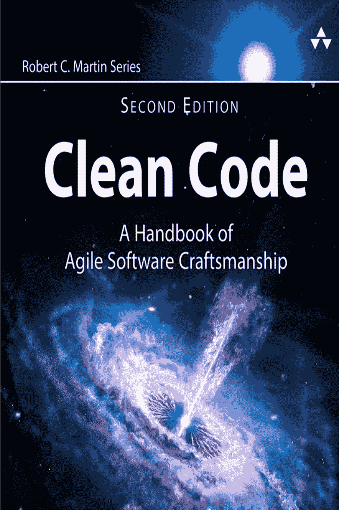

Micah D. Martin 序言

Justin M. Martin 结语

* 序言

  - DIP：依赖倒置原则

- 引言

- 方法长度

- 方法长度摘要

- 注释

- 注释摘要

- John 重写的 PrimeGenerator

- 两个程序员的故事

- 鲍勃重写的 PrimeGenerator

- 测试驱动开发

- TDD 摘要

- 结语

# 参考文献

# 序言

你手中握着构建高质量软件的秘密——这些秘密将让你比现在更好，帮助你成为一名工匠大师。

就像安东尼奥·斯特拉瓦迪（可能是历史上最伟大的制琴师）一样，鲍勃花费了一生来策划和开发编写代码的最佳技术。与斯特拉瓦迪囤积秘密以确保只有他自己能制作出最好的小提琴不同，鲍勃乐意且公开地分享他的秘密，希望你也能编写出精妙的代码。

这就是之道；整洁代码之道。这些是我的准则、我的原则、我的技术。我努力精通所有这一切。为什么？因为它们让我变得更好。而且，这也是我父亲教我的方式。

是的，鲍伯叔叔就是我父亲。他赋予了我写这篇序言的荣誉。此外，请允许我介绍我的兄弟 Justin，他也是一名整洁代码师，他撰写了后记。两个版本的“鲍伯叔叔”第二版……正好夹在他《整洁代码》的第二版之间，这真是太恰当了。（没错……我写的时候听起来很老套，但我打算这么写。）

让我来给你们聊聊鲍伯叔叔，或者至少聊聊我认识的那个被称为“爸爸”的形象。

我最早的记忆之一是骑在爸爸肩上玩“机器人”游戏。规则很简单：我爸爸是机器人，他完全按照我的指令去做……做得分毫不差。

我：“去我的房间。”

爸爸：“我不知道怎么做。”

我：思考着……“转弯。”

爸爸：“哪个方向转？”

我：“向右转。”

爸爸：开始顺时针转动。90°……180°……360°……他没有停止转动。

我：“停止！”

爸爸：停下。静静地站着，面对着完全错误的方向。

我：“向右转……停止！”

爸爸：听话地转身并停下。我们现在面对着走廊，那是正确的方向。

我：“开始走路。”

爸爸：“我不知道怎么走路。”

接下来的几分钟里，我通过抬起合适高度的腿并向前倾倒，然后换另一条腿重复，教机器人“走路”。我们约定将这项活动命名为“走路”。

我：“开始走路。”

爸爸：开始走路。

我：对这个无知的机器人感到精疲力竭，但也因成功让它听从我的指令而感到胜利，我准备进行最后的动作：在走廊尽头左转。“向左转！”

爸爸：“我还在走路……”然后“砰”的一声，我们撞在了墙上。显然机器人是单线程的。我们从墙上弹了回来，机器人继续走路……“砰”的一声，我们再次撞在墙上……又一次。

我：无法控制地大笑起来。

在 4 岁或 5 岁的那个稚嫩年纪，我爸爸正通过“机器人”游戏教我编程。这很有趣。5 年后，我爸爸带回了一台 Commodore 64。“那是什么？”我问。“一台电脑，”爸爸回答道。“它有什么用？”我问，依然很困惑。“嗯，有了电脑你可以啦啦啦啦，啦啦，你甚至可以玩游戏。”

“游戏？给我！”我接纳了 Commodore 64，也许是我爸爸送给我的……无论如何，它住在我的房间里，我在上面玩了很多游戏。邻居里有一个孩子会盗版游戏，我们会每周交换软盘。除了从软盘加载游戏之外，我并不真正知道如何使用这台电脑，每当出什么问题时，比如“按下磁带播放键”……我就会大喊：“爸爸！救救我！”

有一次，他让我坐在 Commodore 前，向我介绍了 Logo，这是一种带有乌龟图形的编程语言。他教我如何让乌龟转弯、前进。这简直就是“机器人”游戏！我用 Logo 玩了一会儿，但它……很无聊。回到游戏去吧。

然后，我观察爸爸用 Logo 工作，感觉像过了一辈子，但可能只是几天。当他终于结束对我电脑的垄断后，他展示了他刚刚构建的《月球着陆器》游戏。这是一个令人大惊的时刻，我意识到游戏就是这样制作的。哇！《月球着陆器》进入了我的游戏清单，我自豪地向朋友们展示它。

几年后，我爸爸带回了一全新的 Apple Macintosh。它太惊人了。“那是什么东西？”“这是一个鼠标。”多新奇。而且它有更多游戏。更好的游戏！Mac 住在爸爸的办公室（地下室），但当他上班时，Mac 就是我的了。类似于《月球着陆器》事件，我爸爸花了几周时间垄断 Mac 创作了一个名为《法老》的游戏。《法老》比《月球着陆器》大得多。你是法老，你的目标是在死之前每年建造足够的牛、种植足够的作物，并维持足够的工人，以建造一座金字塔。这是一个很好玩的游戏，我可以看出爸爸在编写它时很快乐。

编程太有趣了！这是我上大学年纪时得出的结论。对于我的童年，如果我不是在玩电脑时很快乐，那就是爸爸在编程时很快乐。我为什么要选择计算机科学以外的其他专业呢？大学里的编程……并不有趣。毕业后，我得到了 ThoughtWorks 的一份工作，谢天谢地，我爸爸给了我一份在 Object Mentor 与他一起工作的工作。我接受了我爸爸的邀请，在那里我可以与业内一些最顶级、最好的软件专家一起工作。再次，编程是有趣的。正是在 Object Mentor，我从爸爸那里学会了整洁代码之道，构建了许多内部工具和像 FitNesse 这样的开源项目，这些你将在本书后的部分看到。

Object Mentor 主要是一家培训和咨询业务。我们告诉人们如何构建良好的软件。我们并没有真正为他们编写软件。我承认，在做了多年培训师后，我渴望再次构建软件，而不是教如何构建软件。

一个机会出现了，Object Mentor 开始为客户开发软件。这很棒，事实证明这是一个稳健的商业模式。于是，我说服了我爸爸，Object Mentor 应该承担更多的软件开发合同。他同意了。然后我尝试说服他应该经营那个分支业务。噢……那一步迈得太远了。他的回答像卡车一样撞中了我。“如果你想管理事情，你应该自己创业。”哇！那是他为了让我认清事实吗？还是他真的在建议我创业？我得出结论是后者，于是告诉他：“我辞职。”

我创建了一家名为 8th Light 的公司。它曾是（现在也是）一家软件开发公司。客户雇佣我们为他们构建软件。8th Light 的独特之处在于，我们实践了整洁代码之道。我们没有那样命名，因为当时《整洁代码》的第一版还没写。但我们付诸实践了我教过的一切。

每个加入 8th Light 的人都必须经过 3 到 12 个月的学徒期，在期间他们学习了整洁代码之道。我们全心投入整洁代码。这有效吗？当然有效！对整洁代码的需求激增。我们无法培训足够的学徒。当我 2015 年离开 8th Light 时，我们有近百名团队成员，大多数是在客户的项目上工作的“整洁代码”匠人。但也许 8th Light 是个巧合。2020 年，我爸爸和我决定创立 Cleaners Studio。这是我们现有合作伙伴关系 Cleaners 的一个分支，我们在那里销售视频（`https://cleancoders.com`）。然而，“Studio”是我们的软件开发分支，是的，由我在经营。再次，我们全心投入整洁代码，比以往任何时候都投入。有效吗？当然有效。再次，我们无法培训足够的学徒。

行业想要整洁代码。行业需要整洁代码。这本书是你进入整洁代码世界的指南。

关于如何最好使用这本书，我有一些建议：

- 不要急。这些页面里有很多内容。Cleaners Studio 的学徒需要几个月才能吸收所有材料。不要觉得你在一周内狂读完。

- 将其作为参考。你可能想在某些页面贴标签。例如，SOLID 原则；当你和同事争论代码味时，你可能会想回到那个章节。

- 阅读代码示例。当鲍伯叔叔演示代码更改时（如视频店案例），你可能想跳到最后。不要。跟着做。

理想情况下，鲍勃叔叔会坐在你旁边，和你一起对这段代码进行结对编程。他的讲解是其次的了。

- 4. **练习。** “微积分不是一项观赏性运动。”我仍然能听到教授在布置作业时背诵这句话。编码同样不是一项观赏性运动。你需要通过练习来内化它，尤其是 TDD（测试驱动开发）。

- 5. **享受其中！** 鲍勃叔叔在写代码时很快乐的。相信我，他确实是这样。我也是如此。*整洁代码*应该帮助你在写代码时获得更多乐趣。

> —Micah Daniel Martin

# 引言

> “代码质量是一种心态，我一次又看到它与财富和卓越成果相关联。”

—David Heinemeier Hansson (DHH)

当我写下文字时，距离《整洁代码》首次出版已经过了十五载了。从那时起，我参与了许多由第一版引发的讨论、播客、访谈、博客文章以及社交网络上的口水战。最近我想到，还有很多话我想说；还有几点我想得和自己在 2008 年时有所不同。

我第一次是在 2006 年 4 月提出写《整洁代码》这本书的。那时候还没有 iPhone。移动网络大多是 GPRS，也许是 EDGE。没有人谈论物联网。YouTube 刚成立不到一年，几乎没人听说过它——更少有人重视它。Kotlin、Swift、Go、Dart、Rust、Elm、Elixir 和 Clojure 等语言尚未出现。《脸呆爸爸》是当时的热门电影。

是的，那是很久以前的事了——尤其是在互联网时间里。所以，是时候重新审视《整洁代码》的老旧信息了。这些信息的本质没有改变；但在十五年后，我们的行业发生了变化——而且变化得令人惊叹。在经历了如此巨大的变化之后，拍拍旧手稿并做一些简单的调整将是不负责任的。因此，考虑到这十五年的进步、学习和改变，我决定对原始信息进行大幅重述和扩展。

我添加了许多新章节、新观点和新学科。我引入了更新的语言和新的范式。我还根据这十五年的新见解和新知识，对旧章节进行了翻新。

我增加了关于设计、架构甚至伦理的章节。这些在第一版中是缺失的，我认为有必要修复这一遗漏。在某些情况下，这些章节是从我的其他书籍《整洁架构》和《整洁手艺》中深度编辑并缩减的节选；另一些则是全新的。

在原版中，我不倾向于将我的观点断言仅仅是一个程序员看待问题的方式。现在，多年以后，我比那时更有底气一点。原版中的观点经受了时间的考验，具有很强的生命力。

另一方面，还有其他非常有经验的程序员有不同的观点，我认为包含他们的一些反面观点是明智的。毕竟，我并不是唯一对“代码整洁意味着什么”有想法的人。我最喜欢自己的观点，但我认为所有值得信赖的观点都应该被听取和考虑。

此外，在写完几个月后复阅新章节的过程中，我惊讶地发现我对自己提出的某些示例存在问题。我没有通过进一步“清理”这些示例来消除这种惊讶感，而是添加了一些“未来的鲍勃”的注释，以便让你看到我自己的反应。

为什么所有这些整洁性如此重要？这些关于整洁代码的理念带来了什么益处？我们到底为什么要担心代码的整洁性？

我们的文明依赖于我们。在我们社会中，没有任何一件事没有计算机深度参与我们生活的几乎每一个方面。现在，我们无法微波炉加热热狗、看电视、打电话、开车去商店、洗碗子或洗衣服、买任何东西、卖任何东西，甚至不知道现在几点而没有软件贯穿其中。

你和我，程序员们，统治着世界。其他人认为他们正统治着世界，但随后他们将这些统治权交给了我们，由我们编写规则——软件——来运行那些处于数十亿人生活细节之中的机器。

而我们写的一些软件已经导致了两架满载的客机以几近音速的速度撞击地面、汽车失控撞祸、数十亿美元在几秒钟内化水、火箭爆炸、航天器坠毁火星，以及数万辆汽车排放有毒气体。这只是个开始。

肩负着如此沉重的责任和失败的风险，我们必须问自己一个问题：我们是专业人士吗？

专业人士是指那些遵守一套标准、准则和伦理的人。我们遵守吗？你有吗？如果是，你能背诵出来吗？

我写这本书的目标是提供一些代码整洁的标准、代码创建与维护的准则，以及伦理框架的起点，帮助我们定义一个真正的职业。因为如果我们不定义并采纳这种职业，那些能力较弱但权力更大的人——世界政客们——将为我们定义它并强加于我们的口。

我希望在那个念头出现在他们头上之前，我们还有时间做到。

# 关于旧章节的说明

对于由我独立编写的旧章节，我采取了很大的自由。在很多情况下，它们被完全重写了，或者经过了大幅的编辑。

我没有编写的章节，大部分作者都提交了他们的第二版。

第一版和第二版之间最大的变化可能是材料的结构。我将书分为四个部分：代码、设计、架构和手艺。这些部分并不是相互独立的。

- 第一部分：代码高度依赖第二部分：设计。在阅读第一部分时，你会发现许多关于设计的引用。

- 第三部分：架构是从我的书籍《整洁架构》中深度编辑并缩减的节选。再次，请参考以助于理解第一部分。

- 第四部分：手艺再次是从我的书籍《整洁手艺》中深度编辑并缩减的节选——特别是关于软件开发伦理的章节。

学习手艺有两个部分：知识和工作。你必须获得手艺人拥有的原则、模式、实践和启发式知识，你还必须通过努力和练习将这些知识刻进你的手指、眼睛和直觉中。

我可以教你骑自行车的物理学。事实上，经典数学相对直观。重力、摩擦力、角动量、重心等可以用一页公式来演示。给定这些公式，我可以向你证明骑自行车是实行的，并提供运行所需的所有知识。

但当你第一次跨上车时，你还是会摔倒。

编码也无区别。我们可以写下所有整洁代码的“良好”原则，然后信任你去完成工作（换句话说，让你在上车时摔倒），但那样我们会成为什么样的老师呢，你又成为什么样的学生呢？

不。这不是这本书运作的方式。

学习编写整洁的代码是一项艰苦的工作。它需要的不仅仅是原则和模式的知识。你必须在其中流汗。你必须亲自练习，看着自己失败。你必须观察他人练习并失败。你必须看到他们踉跄并回溯步骤。你必须看到他们在决策时挣扎，并看到他们为错误决策所付出的代价。

在阅读这本书时，请做好努力工作的准备。这不是一本让你读起来“感觉良好”的书，你可以在飞机上读它并在着陆前读完。这本书将让你工作，而且是努力地工作。你将要做什么样的工作？你将阅读代码——大量的代码。你将被挑战去思考这些代码中哪些是正确的，哪些是错误的。你会被要求跟随我们（作者）拆解模块并重新组装它们。这需要花费时间和精力的；但我们认为这是值得的。

## 第一章 整洁代码


> “整洁”并不是针对某人的。我们的观点是对代码的一种特征描述方式，它要求普通开发者付出更多努力来理解或维护。

—Jeff Langr

你读这本书出于两个原因。首先，你是一个程序员。其次，你想成为一名更好的程序员。很好。我们需要更好的程序员。

这是一本关于良好编程的书。它充满了代码。我们将从每一个不同的角度来观察代码。我们将从上往下看，从底部向上看，并从内向外穿透。当我们读完时，我们将对代码有深入了解。此外，我们能够区分好代码和坏代码。我们将知道如何编写好代码。我们也将知道如何将坏代码转换为好代码。

## 代码将永远存在

有人可能会认为，一本关于代码的书在某种程度上已经过时了——代码不再是问题了；我们应该关注 AI、大语言模型（LLMs）和需求。事实上，有人建议我们正接近代码的终结。¹ 很快，所有代码都将是生成而非编写。程序员将不再需要，因为业务人员将根据规范——或提示词（prompts）生成程序。

¹ 搞笑的是，我在 2008 年写下这句话，而现在是 2024 年了。有些东西永远不会改变。

胡说八道！我们永远无法摆脱代码，因为代码代表了需求的细节。在某种程度上，这些细节是无法被忽略或抽象的；它们必须被指定。以如此详尽的细节指定需求以便机器能够执行，这就是编程。这样的规范就是代码。

我预计我们语言的抽象层次将继续提高。我也预计领域特定语言和强大 AI 的数量将继续增长。这是一件好事。但它不会消除代码。事实上，所有在这些高级和领域特定语言中编写的规范，以及所有为了引导真正优秀的 AI 而编写的提示词，都是代码！它仍然需要是严谨、准确的，并且如此正式和详细，以便机器能够理解并执行它。

那些认为代码有一天会消失的人就像是“数学家”²，他们希望有一天能发现一种不需要形式化的数学。他们希望有一天能发现一种方法，让机器能够执行他们所想要的，而不是执行他们所说的。这些机器必须能够非常理解，以至于它们可以将模糊定义的需求翻译成完美执行的程序，精确地满足这些需求。

² 使用引号是因为没有真正的数学家会希望这种事。

这种情况永远不会发生。即使是人类，凭借他们所有的直觉和创造力，也无法从客户模糊的感受中创造出成功的系统。事实上，如果需求规范这门学科教会了我们任何东西，那就是：良好的需求与代码一样正式，并且可以作为代码的可执行测试！

记住，代码实际上是我们最终表达需求的语言。我们可能会创建接近需求的语言。我们可能会创建工具帮助我们解析并将这些需求组装成正式结构。但我们永远不会消除必要的精确性和形式化——因此永远会有代码。

很久以前，我读了 Kent Beck 的《实现模式》³ 的序言。他说：“……这本书基于一个相当脆弱的假设：良好的代码至关重要……” 一个脆弱的假设？我不赞同！我认为这个假设是我们行业中所有假设中最稳健、支持最充分且过载最多的假设之一（我认为 Kent 也知道这一点）。我们知道好代码至关重要，因为我们长期以来一直在应对它的缺失。

³ [IMP]。


我认识的一家公司，在 80 年代后期写了一款杀手锏级应用（killer app）。它非常流行，很多专业人士购买并使用了它。但随后，发布周期开始拉长。漏洞没有从一个版本到下一个版本得到修复。加载时间变长，崩溃次数增加。我记得那天由于沮丧我关闭了产品，并且再也没有用过它。那家公司不久后就倒闭了。

几年后，我遇到了那家公司的早期员工之一，问他发生了什么。答案证实了我的恐惧。他们急于将产品推向市场。在某个水平上，细节无法被忽略或抽象。随着他们增加了越来越多的功能，代码变得越来越糟糕，直到他们再也无法管理。坏代码导致了公司的倒闭。

你是否曾陷入过如此严重的混乱中，以至于需要几周时间来完成工作？你是否见过本该只需要几小时就能完成的更改，却分布在几百个模块中？这些现象太常见了。

为什么这种情况会发生在代码上？为什么好代码会迅速腐烂成坏代码？我们有很多解释。我们抱怨需求违背了原始设计。我们埋怨进度太紧，无法正确完成。我们谩骂那些愚蠢的经理、不宽容的客户和无用的营销人员。但亲爱的迪尔伯特，错不在星象，而在我们自己。我们是不专业的。


这可能是一颗难下咽的药丸。这种混乱是我们的错吗？需求呢？进度呢？那些愚蠢的经理和无用的营销人员呢？他们不应该承担部分责任吗？

不。经理和营销人员需要我们提供信息来做出承诺和投入，即使他们没有向我们寻求，我们也不应该回避于表达自己的观点。用户依靠我们来验证需求如何融入系统。项目经理依靠我们来帮助制定进度。我们深度参与了项目的规划，并对任何失败负有责任，特别是当这些失败与坏代码有关时！

“等一下！”你说，“如果不听经理说的做，我会被开雇的。”可能不会。大多数经理想要真相，即使他们表现得并不如此。大多数经理想要好代码，即使他们正痴迷于进度。他们可能会激情地捍卫进度和需求，但那是他们的工作。你的工作是同样激情地捍卫代码。

为了强调这一点，如果你是一个医生，有一位患者要求你停止手术前所有愚蠢的洗手，因为这太浪费时间了？显然患者是老板；但医生绝对应该拒绝遵守。为什么？因为医生比患者更了解疾病和感染的风险。医生遵守患者的要求将是不专业的（更不用说是犯罪了）。

- 1847 年伊格纳斯·塞梅尔维斯（Ignaz Semmelweis）首次建议医生洗手时，这一建议被拒绝了，理由是医生太忙了，没有时间在接诊患者之间洗手。

程序员屈从那些不理解制造混乱风险的经理意愿同样是不专业的。

假设你相信杂乱的代码是一个巨大的阻碍。假设你接受了唯一快速的方法就是保持代码整洁。那么，你必须问自己：“我如何编写整洁的代码？”如果你不知道代码整洁意味着什么，那么尝试编写整洁的代码也是徒劳！

编写代码需要纪律地使用无数许多小技巧，这些技巧通过一种通过刻意获得的“整洁感”来应用，帮助我们把糟糕的代码转化为整洁的代码。

而且这永远是一个转化。没有人能写出整洁的代码。我们写的都是杂乱的代码。只有我们中愿意多走一步去清理代码的人，才能产生整洁的代码。这遵循肯特·贝克（Kent Beck）的法则，你会在书中反复看到：

首先，让它运行起来。然后，让它正确。

可能的定义可能和程序员的数量一样多。因此，我问询了一些非常知名且经验丰富的程序员，他们是怎么看的。我将他们的回答总结在下面。


> “整洁代码只很好地做好一件事。”——比雅·斯特斯特拉斯（Bjarne Stroustrup），C++ 发明者，《C++ 编程语言》作者

这是一条老旧而陈腐的格言。在 70 年代，我们常说模块应该只做一件事，做好它，并且只做这一件事。但“一件事”意味着什么呢？在 80 年代后期，我是一个名为 `gi` 的 3000 行 C 函数的作者。这个名字代表图形解释译器（graphic interpreter）。如果当时有人来找我，警告我那个长长长的函数做的不止一件事，我会回答说：“不，它在解释图形。”

“一件事”规则的问题在于，“一件事”完全是主观的。但我想我知道一种让它客观的方法。我们会在书后面讨论这一点。一旦我向你描述了它，我想你会被迫认同它是接近客观的，如果说不是完全客观的话。你可能并不喜欢它；但我打赌你找不到任何可以从实质上反对它的方法。


> “整洁的代码读起来像优良散文。”——格拉迪·布奇（Grady Booch），著名的软件工程书籍作者

这可是一个了不起的断言。你上一次遇到读起来像“优良散文”的代码是什么时候？然而，当你继续阅读这本书时，我将向你展示一种实现、至少是接近这一目标的方法。

噢，别误会我。你的代码读起来不会像海明威的小说。但完全可以构建出读起来如此流畅，以至于非程序员也能理解其中的代码。

⁶ 根据对“某些”（some）和“意义”（sense）这两个词的定义。


> “整洁的代码看起来总是像是由用心的人写出来的。”——迈克尔·费瑟斯（Michael Feathers），《Legacy代码的有效性》作者

程序员之所以费力清理代码，是因为他们在乎下一个来的人。他们担心自己的代码不会误导、误偏或困扰那些必须维护这些代码的人。最能定义整洁的词是`用心`（care）。

这个定义的含义是，未经过清理的代码是被草率编写并发布的。


> “当你知道自己在编写整洁代码时，你读到的每个例程结果都和你预期的几乎一样。”——沃德·坎宁姆（Ward Cunningham），Wiki 发明者，Fit 发明者

当然，他们不得不制定新的法律。

他们会制定什么样的法律呢？除了其他，他们可能会告诉我们必须使用什么语言、哪些平台和框架是允许的、必须遵循什么流程、必须获得哪些签名、需要编写哪些文档、必须使用何种评审程序、必须参加哪些课程，以及必须阅读哪些书。

我保证，你我都不会喜欢那些新法律。我也相当确定，那些法律对改善现状的作用微乎其微。

所以，我们应该清理代码的第一个答案是：我们的文明需要我们表现得像专业人士，如果我们没有履行这项责任，我们的政府就会把不便且低效的规则强加在我们身上。

但我们还需要清理代码的另一个原因。这个原因与我们息息相关。

我以前问过你们，是否曾经被糟糕的代码严重地阻碍过？如果你是一个写了多年程序的的人，你肯定遇到过。这一次，问题依然是：你为什么要写它？

我们为什么要写那些已知会严重阻碍我们的代码？答案总是：为了快。我留给你们去处理这个答案在逻辑上的自相矛盾。

听着，我知道所有的借口。它们最终都归结为：他们从没有给我们时间。这是错误的。快速的唯一方法是做好。赶进度的最佳方式、赶上截止日的最佳方式，就是把工作做好。如果你想尽可能得快，就不要做那些会拖慢你速度的事情！

清理你的代码！

一个混乱的模块会拖慢每一个必须处理它的人，每当他们处理它时都是如此。混乱的成本是反复不断的，而清理的成本是一次性的。

一个允许混乱在代码中持续存在的团队，其生产力将逐渐下降到其潜力生产力的极小部分。我见过有些团队为了本该用一两天就能完成的工作，将估计时间延长到了几周甚至几个月。

团队运行得越慢，压力就越大，留下的未清理的混乱就越多。每一处混乱都会更进一步地阻碍团队，让他们运行得更慢。这是一个恶性循环，如果你当程序员超过了几年，你很可能已经在其中转过几圈了。

但情况变得更糟。经理们由于急于提高生产力，雇佣了新员工。这显然产生了与预期完全相反的效果。新人们被投入那堆混乱的代码中，看到这里是如何运作的，然后——理所当然——模仿它。所以现在有更多人在制造混乱，这让循环转得更快，并将生产力拖得更低。

经理们对人员的增加没有提高生产力感到震惊，他们可能会尝试向这种混乱中加入更多人——因为理智的定义就是反复尝试同样的事情并期待不同的结果。然而，最后，经理们别无可与开发者商量，找出为什么一切进展得如此缓慢。

而开发者们有一个答案。他们已经知道这个答案几个月、甚至多年了。当被问起时，他们非常乐意提供那个答案：从头重新设计整个系统。

想象一下经理们震惊和恐惧的情绪。开发者们刚刚告诉他们，他们之前所有的工作都是毫无价值的，必须废弃。开发者们还告诉他们，这个新设计不会遭受同样的命运——这一次，一切都将是完美的。

当然，经理们并不相信这些，他们极力反对这个想法，但他们真的还有什么选择呢？专家们告诉他们，唯一的希望就是从头重新设计系统。最终，那些可怜的经理将顺从开发者的要求。再次，他们还有什么选择呢？

当这些经理最终同意时，开发者们中会爆发欢呼。“哈利路亚，我们都要回到起点了。”

房子。样板房是一间你无法居住的房子，因为居住行为会降低房屋的展示性。一个整洁的房子是一个你可以居住其中且不会降低其居住性的房子。

整洁的代码是可以让你进行维护、扩展、增强和演进，而不会降低其居住性的代码。整洁的代码并不是闪闪发光的；它看起来有生活痕迹，但经过了精心维护。它读起来可能不像狄更斯小说那样优美，但它是易读的。它可能没有完美的设计和架构，但经过了精心的设计。概念可能没有被完美隔离，但它们已经足够隔离。

整洁的代码是舒适的，就像一个干净但有人居住的房子一样舒适。早餐台下地板上可能有一些碎屑，台面上可能滴了一滴牛奶，沙发上可能有一些狗毛，矮凳上的枕头可能杂乱无章，这些都不会降低房屋的居住性——只要它们没有失控就好。

整洁的代码是没有失控的代码。编写和维护它的人并不追求完美，他们不会花费无限的时间去打磨它，但他们确实努力防止生活中的浮渣和碎片堆积。或者，再次引用 Michael Feathers 的话。

你曾经回放过编辑会话吗？在上世纪 80 年代和 90 年代，我们有像 `Emacs` 这样的编辑器，它可以记录每一次按键。你可以工作一小时，然后像快进电影一样播放你的整个编辑会话。当我这样做时，结果非常迷人。回放的大部分时间是在滚动和导航到其他模块！

- 1. Bob 进入模块。
- 2. 他向下滚动到需要更改的函数。
- 3. 他停下来，考虑他的选择。
- 4. 噢，他正在向上滚动到模块顶部以检查变量的初始化。
- 5. 现在他向下滚动并开始打字。
- 6. 哎呀，他正在删掉刚刚输入的内容！
- 7. 他又输入了一遍。
- 8. 他又删了一次！
- 9. 他输入了其他东西的一部分，但又把它删了！
- 10. 他向下滚动到另一个调用他正在修改的函数，看看它是如何被调用的。
- 11. 他向上滚动并输入了刚刚删掉的代码。
- 12. 他停顿了。
- 13. 他再次删掉了那些代码！
- 14. 他弹出另一个窗口查看一个子类；那个函数被重写了吗？
...

我们明白意思了。事实上，阅读代码与编写代码的时间比例远超过 10:1。我们不断地阅读旧代码，作为编写新代码工作的一部分；因为新代码必须与所有旧代码保持一致。

因为我们阅读代码次数远多于编写，所以我们希望阅读代码成为一个更高效的操作。既然在不阅读代码的情况下无法编写代码，那么让代码易读实际上就会让编写变得更容易。

这种逻辑是无法逃避的。如果你无法阅读周围的代码，你就无法编写代码。你今天尝试编写的代码只有在周围代码易读的情况下，才会容易编写。所以，如果你想跑得快，如果你想让你的代码易写，*让它易读。*

## 童子军规则

仅仅写好代码是不够的。代码必须随着时间的推移保持整洁。我们都见过代码随着时间流逝而腐烂和退化。因此，我们必须积极防止这种退化。

美国童子军有一个简单的规则，我们可以应用到我们的职业中。

离开营地时比你发现时更干净。

如果我们每个人提交代码时都比取出时更整洁一点，代码根本就不会腐烂。

提交比你取出时更整洁的代码。

清理工作不必非要做得很大。只需做一件小小的善举即可。把一个变量名改得更好，拆分一个稍微大点的函数，消除一小处重复，清理一个复合 `if` 语句。

你能想象在一个团队中的每位成员都遵循这条规则的项目上工作吗？代码会随着时间的推移而变得更好。你认为还有其他任何选择是职业的吗？事实上，持续改进不是职业精神的内在部分——不是作为一个有道德的人的一部分吗？

在第一部分中，我们探索代码层面的整洁实践。在前两个章中，我们从基础和第一原理开始。在随后的章节中，我们将关注注释、格式和命名。然后，我们将进入主题的核心：函数、测试和分区。在整个过程中，我们将通过几个具体的示例进行演示并进行详细解释。

尽管这部分不是专门关于高层设计概念，但它们从未远离我们。

虽然 Java 在这部分占据主导地位，但我们将看到许多其他语言，包括 Python，Go，Ruby，Clojure，JavaScript 和 C。你应该从中得到的结论是，整洁的代码与语言无关。


## 整洁代码是名词还是动词？

整洁代码是名词还是动词？

整洁代码是名词还是动词？

或者，我们关注代码。或者，我们关注代码。或者，我们关注代码。或者，我们关注代码。

```
case 'D' -> numbers[i] = 500;

case 'M' -> numbers[i] = 1000;

case '4' -> numbers[i] = 4;

case '9' -> numbers[i] = 9;

case 'F' -> numbers[i] = 40;

case 'N' -> numbers[i] = 90;

case 'G' -> numbers[i] = 400;

case '0' -> numbers[i] = 900;

default -> throw new InvalidNumeralException(roman);

i++;

int lastDigit = 1000;

for (int number : numbers) {

    if (number > lastDigit) {

        throw new InvalidNumeralException(roman);

    }

    lastDigit = number;

}

return Arrays.stream(numbers).sum();

public static class InvalidNumeralException extends RuntimeException {

    public InvalidNumeralException(String roman) {

}

}
```

## 未来的 Bob：两个月后我读这段代码，看到其中某些糟糕的部分（比如 `49FNG0`）简直笑得肚子打疼……然而，它也有一些很有见解的地方。

这些是我使用的测试。我曾怀疑这些测试是否完整。

```
package fromRoman;

import fromRoman.InvalidRomanNumeralException;

import org.junit.jupiter.api.Test;

import static fromRoman.FromRoman.convert;

import static org.hamcrest.MatcherAssert.assertThat;

import static org.hamcrest.Matchers.is;

import static org.junit.jupiter.api.Assertions.assertThrows;

public class FromRomanTest {

    @Test

    public void valid() throws Exception {

        assertThat(convert(""), is(0));

        assertThat(convert("I"), is(1));

        assertThat(convert("II"), is(2));

        assertThat(convert("III"), is(3));

        assertThat(convert("IV"), is(4));

        assertThat(convert("V"), is(5));

        assertThat(convert("VI"), is(6));

        assertThat(convert("VII"), is(7));

        assertThat(convert("VIII"), is(8));

        assertThat(convert("IX"), is(9));

        assertThat(convert("X"), is(10));

        assertThat(convert("XI"), is(11));

        assertThat(convert("XII"), is(12));

        assertThat(convert("CXC"), is(190));

}

@Test

public void invalid() throws Exception {

    assertInvalid("III");

    assertInvalid("VV");

    assertInvalid("XXXX");

    assertInvalid("LL");

    assertInvalid("CCCC");

    assertInvalid("DD");

    assertInvalid("MMMM");

    assertInvalid("IV");

    assertInvalid("IVI");

    assertInvalid("IXI");

    assertInvalid("VIV");

    assertInvalid("XVX");

    assertInvalid("XIII");

    assertInvalid("XVV");

    assertInvalid("XVI");

    assertInvalid("XIXI");

    assertInvalid("XLIV");

    assertInvalid("LXL");

}

    assertInvalid("XLX");

    assertInvalid("XCX");

    assertInvalid("CDC");

    assertInvalid("DCD");

    assertInvalid("MCMC");

    assertInvalid("MCDM");

}

private void assertInvalid(String r) {
```


`assertThrows(InvalidRomanNumeral.class, () -> convert`

}

我希望你同意我的观点，这段代码需要清理。它看起来很凌乱、很混乱。在本章的后面以及后续章节中，我将演示清理步骤。但现在，我只想给你们展示结果。

在展示结果之前，我想说，清理代码花费的时间大约等于编写代码的时间相等。在初始编写期间 `Copilot` 有些帮助，但在清理过程中帮助就小得了。

在清理过程中，我仅仅通过整理思路以及代码和测试结构就发现了一两个小 Bug。第二次查看能发现的东西是令人惊讶的——而清理就是终极的第二次查看。

² 在对飞机进行代码检查后，我会站起来，绕着飞机走动，从更远的角度再次观察。通过这种方法发现的东西令人惊叹。有些东西远看显而易见，但在近距离检查时几乎是不可见的。

```
package fromRoman;

import java.util.ArrayList;

import java.util.List;

import java.util.Map;

public class FromRoman {

    private String roman;

    private List<Integer> numbers = new ArrayList<>();

    private int charX;

    private char nextChar;

    private Integer value;

    private int nchars;

    Map<Character, Integer> values = Map.of(
        'I', 1,
        'V', 5,
        'X', 10,
        'L', 50,
        'C', 100,
        'D', 500,
        'M', 1000);

    public FromRoman(String roman) {
        this.roman = roman;
    }

    public static int convert(String roman) {
```

算法。但两个月后，它看起来有点突兀。也许没有 `49FNGO` 那么突兀，但仍然不像我写它时希望的那样明显。它也许写成这样更好：

`numbers.add(decrementValueIfThisCharIsPrefix)`，这样就能与非前缀情况下的 `numbers.add(value)` 保持对称了。

- 4 参见附录阅读那场辩论。

> 核心问题是，你对正在清理内容的理解，会阻碍你与后续接手者沟通的能力。无论你是在提取命名良好的方法，还是在添加描述性注释，情况都是如此。因此，在选择名称和编写注释时要格外小心；如果别人对你的选择感到恼火，不要惊讶。最后，在几个月后回过来看，既能让人谦虚，又能受益。

`convertLettersToNumbers` 函数比我喜好的要长一点；但它的结构很紧密，我认为将其分解为更小的函数适得其反大于帮助。

你们中有些人可能正以更怀疑的眼光审视这段“更干净”的代码。也许你们有某些疑问或投诉。

你可能会抱怨它太长了。确实如此；但增加的长度源于那些命名良好的函数，它们解释了正在发生什么。

你可能会抱怨创建一个对象是多此一举且昂贵的。确实，分配内存然后在稍后进行垃圾回收需要额外的时间。调用所有这些小方法也会花费时间。如果你正在编写具有极其严苛时间限制的嵌入式实时代码，或者如果你在为高性能飞行模拟器或第一人称射击游戏编写代码，那么这个决定看起来可能是疯狂的，更不用说不干净了。但对于我的目的来说，额外的时间是我最关心的。我不需要那个速度。对于我的情况，我认为在合理范围内用速度换取清晰度是一笔划算的交易。

你可能是一个函数式程序员，会对函数不是“纯”的而感到震惊。但事实上，那个静态函数已经是函数能达到的极致纯了。其他函数只是在该主函数单次调用范围内运行的小助手。这些实例变量非常方便，允许各个方法之间进行通信，而无需通过传递参数。这说明了对象的一个良好用途是：允许在纯函数执行期间运行的辅助函数通过对象的实例变量进行轻松通信。

所以我认为这很干净。我说的对吗？我想我是对的；但你可能不同意。没关系。我们被允许不同意。对于什么是“干净”，并没有统一的标准。这是我的标准，而我的可能不是你的。我要求的只是你考虑我的标准并制定出你自己的标准。最重要的是拥有一个你能够以纪律执行的标准。

如果你是一个团队的一员，那么团队应该有一个单一的标准，这个标准应该由团队的所有成员共同协商，并共同遵守和支持。

> 5 这可能会诱导你创建一个标准文档。我建议不要这样做。代表标准的文档应该是代码本身。在代码之外拥有标准文档的唯一理由是代码没有代表标准。

顺便提一下，我最初编写的测试是不够的。随着清理过程的进行，我发现了许多需要进一步测试的情况。为了完整起见，我在下方包含了最后的测试。

```
import fromRoman.FromRoman.InvalidRomanNumeralException;

import org.junit.jupiter.api.Test;

import static fromRoman.FromRoman.convert;

import static org.hamcrest.MatcherAssert.assertThat;

import static org.hamcrest.Matchers.is;

import static org.junit.jupiter.api.Assertions.assertThrows;

public class FromRomanTest {

    @Test
    public void valid() throws Exception {
        assertThat(convert(""), is(0));
        assertThat(convert("I"), is(1));
        assertThat(convert("II"), is(2));
        assertThat(convert("III"), is(3));
        assertThat(convert("IV"), is(4));
        assertThat(convert("V"), is(5));
        assertThat(convert("VI"), is(6));
        assertThat(convert("VII"), is(7));
        assertThat(convert("VIII"), is(8));
        assertThat(convert("IX"), is(9));
        assertThat(convert("X"), is(10));
        assertThat(convert("XI"), is(11));
        assertThat(convert("XII"), is(12));
        assertThat(convert("XIII"), is(13));
        assertThat(convert("XIV"), is(14));
        assertThat(convert("XV"), is(15));
        assertThat(convert("XVI"), is(16));
        assertThat(convert("XIX"), is(19));
        assertThat(convert("XX"), is(20));
        assertThat(convert("XXX"), is(30));
        assertThat(convert("XL"), is(40));
        assertThat(convert("L"), is(50));
        assertThat(convert("LX"), is(60));
        assertThat(convert("LXXIV"), is(74));
        assertThat(convert("XC"), is(90));
        assertThat(convert("C"), is(100));
        assertThat(convert("XCIV"), is(114));
        assertThat(convert("CXC"), is(190));
        assertThat(convert("CD"), is(400));
        assertThat(convert("D"), is(500));
        assertThat(convert("CDXLIV"), is(444));
        assertThat(convert("DCXIV"), is(694));
        assertThat(convert("CM"), is(900));
        assertThat(convert("M"), is(1000));
        assertThat(convert("CM"), is(1900));
        assertThat(convert("MCIX"), is(1999));
        assertThat(convert("MMXXIV"), is(2024));
    }

    @Test
    public void invalid() throws Exception {
        assertInvalid("IIII");
        assertInvalid("VV");
        assertInvalid("XXXX");
        assertInvalid("LL");
        assertInvalid("CCCC");
        assertInvalid("DD");
        assertInvalid("MMMM");
        assertInvalid("XIII");
        assertInvalid("LXXXX");
        assertInvalid("DCCCC");
        assertInvalid("VIII");
        assertInvalid("MCCC");
        assertInvalid("VX");
        assertInvalid("IIV");
        assertInvalid("IVI");
        assertInvalid("IXI");
        assertInvalid("IXV");
        assertInvalid("VIV");
        assertInvalid("XVX");
        assertInvalid("XVV");
        assertInvalid("XIVI");
        assertInvalid("ISI");
        assertInvalid("XVIV");
        assertInvalid("LXL");
        assertInvalid("XLX");
        assertInvalid("XCX");
        assertInvalid("XCL");
        assertInvalid("CDC");
        assertInvalid("DCD");
        assertInvalid("CMC");
        assertInvalid("CMD");
        assertInvalid("MCMC");
        assertInvalid("MCDM");
    }

    private void assertInvalid(String r) {
        assertThrows(InvalidRomanNumeralException.class, () -> convert(r));
    }
}
```

我先编写后清理代码的过程相对简单。我将带你回顾每一个“重大”决策；但总的来说，这是在保持所有测试通过的情况下进行小改进。

2-1 中的糟糕代码并不是我的第一次尝试。相反，我一直在几个糟糕的想法中摸索。其中一个是基于我在洗澡时构思出的状态机策略。我实际上写了以下代码，但在进行得太远之前就丢弃了。

6 莱纳斯·鲍林曾被问到他为什么会有如此好的主意。他的回答大意是他有很多主意，然后扔掉了那些糟糕的。

```
}
return currentSum;
}

public static class InvalidRomanNumeralException extends RuntimeException {
    public InvalidRomanNumeralException(String roman) {
    }
}
```

我最终确定了列表 2-1 所示策略，然后对其进行了调优使其正常工作，并通过了所有测试。

为了清理这些代码，我寻找了一些显而易见的问题。我发现的第一个是检查非法前缀组合的丑代码。因此，我将这些代码提取到 `checkForIllegalPrefixCombinations` 函数中。然后，我注意到下方还有另一段相似的代码，用于检查字母的不当重复。于是我将那部分代码提取到 `checkForImproperRepetitions` 函数中。

以类似的方式，我提取了双字母组合的替换、字母到数字的转换以及对数字是否按降序排列的检查。

这让我留下了以下代码。

```
package fromRoman;

import java.util.Arrays;

public class FromRoman {
    public static int convert(String roman) {
        checkForIllegalPrefixCombinations(roman);
        checkForImproperRepetitions(roman);
        roman = replaceDigraphs(roman);
        int[] numbers = convertLettersToNumbers(roman);
        checkNumbersInOrder(numbers, roman);
        return Arrays.stream(numbers).sum();
    }

    private static void checkNumbersInOrder(int[] numbers, String roman) {
        int lastDigit = 1000;
        for (int number : numbers) {
            if (number > lastDigit) {
                throw new InvalidRomanNumeralException(roman);
            }
        }
    }

    private static int[] convertLettersToNumbers(String roman) {
        int[] numbers = new int[roman.length()];
        int i = 0;
        for (char digit : roman.toCharArray()) {
            switch (digit) {
                case 'I' -> numbers[i] = 1;
                case 'V' -> numbers[i] = 5;
                case 'X' -> numbers[i] = 10;
                case 'L' -> numbers[i] = 50;
                case 'C' -> numbers[i] = 100;
                case 'D' -> numbers[i] = 500;
                case 'M' -> numbers[i] = 1000;
                case '4' -> numbers[i] = 4;
                case '9' -> numbers[i] = 9;
                case 'F' -> numbers[i] = 40;
                case 'N' -> numbers[i] = 90;
                case 'G' -> numbers[i] = 400;
                case '0' -> numbers[i] = 900;
                default -> throw InvalidRomanNumeralException(roman);
            }
            i++;
        }
        return numbers;
    }

    private static String replaceDigraphs(String roman) {
        roman = roman.replace("IV", "4");
        roman = roman.replace("IX", "9");
        roman = roman.replace("XL", "F");
        roman = roman.replace("XC", "N");
        roman = roman.replace("CD", "G");
        roman = roman.replace("CM", "0");
        return roman;
    }

    private static void checkForImproperRepetitions(String roman) {
    }

    private static void checkForIllegalPrefixCombinations(String roman) {
        if (roman.contains("VIV") ||
            roman.contains("IVI") ||
            roman.contains("IXI") ||
            roman.contains("LXL") ||
```


## 代码片段：罗马数字验证逻辑

```java
roman.contains("XLX") ||
roman.contains("XCX") ||
roman.contains("DCD") ||
roman.contains("CDC") ||
roman.contains("MCM")) {

    throw new InvalidRomanNumeralException(roman);
}
```

## 代码片段：罗马数字值映射表

```java
'X', 10,
'L', 50,
'C', 100,
'D', 500,
'M', 1000
);
```

## `FromRoman` 类构造函数

```java
/** 构建一个 FromRoman 实例，验证输入的罗马数字。 */
public FromRoman(String roman) {
    if (!roman.matches(REGEX)) {
        throw new InvalidRomanNumeralException(roman);
    }
    this.roman = roman;
}
```

## `parseInt` 方法（转换逻辑）

```java
/** 将罗马数字转换为整数。 */
public int parseInt() {
    int sum = 0;
    for (int i = 0; i < roman.length(); i++) {
        int currentValue = VALUES.get(roman.charAt(i));
        if (i < roman.length() - 1) {
            int nextValue = VALUES.get(roman.charAt(i + 1));
            if (currentValue < nextValue) {
                sum -= currentValue;
            } else {
                sum += currentValue;
            }
        }
    }
}
```

## `parseInt` 方法补充部分

```java
} else {
    sum += currentValue;
}
return sum;
```

## 静态转换方法 `convert`

```java
/** 将罗马数字字符串转换为整数的静态方法 */
public static int convert(String roman) {
    return new FromRoman(roman).toInt();
}
```

## 异常类定义

```java
public static class InvalidRomanNumeralException extends RuntimeException {
    public InvalidRomanNumeralException(String roman) {
        super("Invalid Roman numeral: " + roman);
    }
}
```

## 评论与反思

我对算法的改进非常满意。它确实将问题简化到了最本质的。我不太喜欢使用正则表达式，但这一个并不难理解。我觉得这些注释没多大用处，所以我可能会把它们删掉。

然后，我让它改进我的测试用例。以下是它生成的代码：

## `FromRomanTest` 测试类

```java
package fromRoman;

import org.junit.jupiter.api.Test;
import static fromRoman.FromRoman.convert;
import static org.hamcrest.MatcherAssert.assertThat;
import static org.hamcrest.Matchers.is;
import static org.junit.jupiter.api.Assertions.assertThrows;

public class FromRomanTest {

    @Test
    public void valid() {
        // 边界情况
        assertThat(convert(""), is(0));
        // 单字符
        assertThat(convert("I"), is(1));
        assertThat(convert("V"), is(5));
        assertThat(convert("X"), is(10));
        assertThat(convert("L"), is(50));
        assertThat(convert("C"), is(100));
        assertThat(convert("D"), is(500));
        assertThat(convert("M"), is(1000));
        // 减法计数
        assertThat(convert("IV"), is(4));
        assertThat(convert("IX"), is(9));
        assertThat(convert("XL"), is(40));
        assertThat(convert("XC"), is(90));
        assertThat(convert("CD"), is(400));
        assertThat(convert("CM"), is(900));
        // 复杂情况
        assertThat(convert("XIV"), is(14));
        assertThat(convert("CDXLIV"), is(444));
        assertThat(convert("MCMCIX"), is(1999));
    }

    @Test
    public void invalid() {
        // 重复次数过多
        assertInvalid("IIII");
        assertInvalid("VV");
        assertInvalid("MMMM");
        // 无效减法计数
        assertInvalid("VX"); // V 不能在 X 前
        assertInvalid("IIV"); // 顺序错误
        assertInvalid("IXI"); // 无效序列
        // 结构不当
        assertInvalid("CMC"); // 多个减法错误
        assertInvalid("XCL"); // 顺序错误
    }

    private void assertInvalid(String r) {
        assertThrows(FromRoman.InvalidRomanNumeralException.class, () -> convert(r));
    }
}
```

我很喜欢它组织得这么整齐。我记得自己曾苦苦于寻找组织结构，最后干脆决定“轰炸式测试”。所以，向 Grok3 致赞。另一方面，这些测试高度依赖正则表达式，而且我认为它对无效输入的测试也做得并不够到位。例如，它没有检查 `"IdM"` 是否无效。所以我可能会再为这类情况添加一些测试。

# 结语结论

Grok3 做得很好。这可能让人质疑，我清理和测试的精力是否值得。另一方面，我——而不是 Grok3——才是所产生代码的最终裁决者。责任在我身上。我很高兴 Grok3 能够提供帮助，当我请求它的帮助时，我会乐意接受这种帮助。但是，为了确保 Grok3（或任何大模型/AI）给出的是良好的代码，我有责任完成这项工作，以便我能够评估它产生的内容。这项工作将涉及编写和清理我要求它改进的代码，以便我能够正确判断结果。

这种权衡与飞机上使用自动驾驶仪非常相似。自动驾驶仪可以极大减轻工作负荷。但在任何情况下都不应盲目信任它。相反，飞行员必须保持控制。

---

看看这个简化后的 `getPreviousDayOfWeek` 函数。它很短，而且逻辑一目易见。如果你需要了解更多信息，只需向下查看提取出的函数即可。然而，大多数情况下，你不需要了解更多。你只需要看看那个函数，认可它，然后继续。它读起来可能不像克莱顿（Crichton）小说那样流畅，但读起来很顺畅。

## 未来的 Bob：我不喜欢前面的负号。最好创建一个 `subtractDays` 函数来去掉它。这是一个小细节，但细节决定成败。

## 一个更有意义的例子

在这里我展示了“Uncle Bob 会议室”系统。浏览一遍。它并不复杂——也许吧。

### `Statement.java` 初始版本

```java
package ubConferenceCenter;

import java.util.ArrayList;
import java.util.List;

public class Statement {

    public enum CatalogItem { SMALL_ROOM, LARGE_ROOM, PROJECTOR, COFFEE, COOKIES }

    public record RentalItem(CatalogItem type, int days, int unitPrice, int price, int tax) { }

    public record Totals(int subtotal, int tax) { }

    private String customerName;
    private int subtotal = 0;
    private int tax = 0;
    private List<RentalItem> items = new ArrayList<>();

    public Statement(String customerName) {
        this.customerName = customerName;
    }

    public void rent(CatalogItem item, int days) {
        int unitPrice = switch (item) {
            case SMALL_ROOM -> 100;
            case LARGE_ROOM -> 150;
            case PROJECTOR -> 50;
            case COFFEE -> 10;
            case COOKIES -> 15;
        };

        boolean eligibleForDiscount = switch (item) {
            case SMALL_ROOM, LARGE_ROOM -> days == 5;
            case PROJECTOR, COFFEE, COOKIES -> false;
        };

        int price = unitPrice * days;
        if (eligibleForDiscount) price = (int) Math.round(price * .9);

        subtotal += price;

        int thisTax = switch (item) {
            case SMALL_ROOM, LARGE_ROOM, PROJECTOR -> (int) Math.round(price * .05);
            case COFFEE, COOKIES -> 0;
        };

        tax += thisTax;
        items.add(new RentalItem(item, days, unitPrice, price, thisTax));
    }

    public RentalItem[] getItems() {
        List<RentalItem> items = new ArrayList<>(this.items);
        boolean largeRoomFiveDays = items.stream().anyMatch(
            item -> item.type() == CatalogItem.LARGE_ROOM && item.days() == 5);
        boolean coffeeFiveDays = items.stream().anyMatch(
            item -> item.type() == CatalogItem.COFFEE && item.days() == 5);

        if (largeRoomFiveDays && coffeeFiveDays)
            items.add(new RentalItem(CatalogItem.COOKIES, 5, 0, 0, 0));

        return items.toArray(new RentalItem[0]);
    }

    public String getCustomerName() {
        return customerName;
    }

    public Totals getTotals() {
        return new Totals(subtotal, tax);
    }
}
```

我相信你已经看懂了。用户可以租小房间、大房间、咖啡、投影仪和饼干。（你是怎么租饼干的？）小房间每天租 100 美元。大房间是 150 美元。如果你租一整周房间，可以获得 10% 的折扣。所有非食品项目都要收 5%（四舍五入）的税。咖啡每天 10 美元。饼干每天 15 美元。投影仪每天 50 美元。如果你租了一整周的大房间和咖啡，就可以获得一天的免费饼干。

`Statement` 类代表一份销售账单，包含了每个租赁物品、物品价格、租赁天数、小计和税费。`Statement` 类还包含所有物品的小计和所有税费。

轻而易举。

这并不难理解，但你能看出来它是随手凑在一起的。它有点乱，但并不糟糕。我们也许可以稍微清理一下，但值得花精力吗？

但先让我问问你。你是否见过一个开始时很简单，然后变得非常非常复杂的系统？如果你在这个行业里呆了一年多，我知道你见过。事实上，如果你在这个行业干了五年或以上，你很可能见过一个开始时有点乱，但后来变成一团糟的系统，这对开发者和组织来说简直是地狱。

所以，让我们让这个例子更真实一点。你不会认为这个程序一开始就是现在的这种形式吧？不，起初它只租了一个小房间。然后是很多小房间。然后是单价不同的大房间。然后是免销售税的咖啡。接着，增加了租整周的折扣。然后是饼干，以及租一整周大房间的奖励。

换句话说，这个程序是生长出来的。

假设我们已经到了这一步。你正看着代码，它有点乱，但可以运行。然而，我们知道它不会一直保持这样。随着功能的增加和需求的变化，代码会不断增长。随着它的增长，它会变得越来越复杂。

那么，我们能做什么？如何在不破坏代码的情况下改进它？答案是重构。重构是重组现有代码的过程——在不改变外部行为的情况下更改内部结构。在本章中，我们将探索如何重构 `Statement` 类，使其更整洁、更易维护且易扩展。

OCP（开闭原则）建议，当我们添加一个新功能时，我们应该在一个地方添加该新功能，而不是在多处添加。现在，如果我们想添加一个新的 `CatalogItem`（如 `NotePads`），我们必须在代码中多五个不同的地方添加这些更改。通过将 `CatalogItems` 转换为数据结构，并将 `switch` 语句替换为这些数据结构的访问，我们可以将这一点减少到两个。

## 重构后的 `Statement.java` 片段

```java
...
public enum CatalogItem {
    SMALL_ROOM(100, .05),
    LARGE_ROOM(150, .05),
    PROJECTOR(50, .05),
    COFFEE(10, 0),
    COOKIES(15, 0);

    private double taxRate;
    private int unitPrice;

    CatalogItem(int unitPrice, double taxRate) {
        this.unitPrice = unitPrice;
        this.taxRate = taxRate;
    }
}

public void rent(CatalogItem item, int days) {
    int unitPrice = item.unitPrice;
    int price = calculatePrice(item, days, unitPrice);
    int thisTax = (int) Math.round(price * item.taxRate);
    items.add(new RentalItem(item, days, unitPrice, price, thisTax));
    subtotal += price;
    tax += thisTax;
}
```


这样更好一些——我必须说，我喜欢 Java 的枚举实际上是类，而且每个枚举项都是一个实例。现在当我们添加 `NotePads` 时，我们只需要更改枚举，可能还需要更改 `getItem` 函数。然而，OCP 告诉我们要将新更改排除在旧模块之外。因此，从 OCP 的角度来看，完全跳出 `Statement` 模块会更好，这样当我们添加 `NotePads` 时，就可以保持 `Statement` 模块不受影响。

## CatalogItem.java

```java
package ubCameraController;

public enum CatalogItem {

    SMALL_ROOM(100, .05),
    LARGE_ROOM(150, .05),
    PROJECTOR(50, .05),
    COFFEE(10, 0),
    COOKIES(15, 0);

    public double taxRate;
    public int unitPrice;

    CatalogItem(int unitPrice, double taxRate) {
        this.unitPrice = unitPrice;
        this.taxRate = taxRate;
    }
}
```

我们在这里进展得很好。我们隔离了 `CatalogItem` 枚举，并消除了 `switch` 语句。SRP 和 OCP 都非常满意。但还有另一个原则正在发出警报。

如果我们向 `CatalogItem` 添加 `NotePads`，哪些模块应该重新编译？答案是：`CatalogItem.java`（当然）以及可能还有 `Statement.java`，因为它依赖 `CatalogItem.java`。现在问问自己，`Statement.java` 是否必须重新编译。

> 6 Java 编译器足够智能，可以根据下游的变化来确定上游模块是否需要重新编译。然而，稳妥的做法是假设这些模块会被重新编译。

我认为，当我们添加 `NotePads` 时，至少 `Statement.java` 的 `rent` 函数不需要重新编译，因为该函数内部没有任何内容需要知道关于 `NotePads` 的信息。

这违反了依赖倒置原则（DIP）。当高层策略直接依赖于低层细节时，就违反了这一原则。添加 `NotePads` 是低层细节，`rent` 函数不应该依赖它。

你可能认为这不是一个大问题。重新编译一个模块既快又简单，你为什么要担心编译了比要求的更多的模块呢？对于小型项目，做出这种决定可能是正确的。对于较大的项目，重新编译和重新部署的负担可能会变得很大。这对于需要重新部署到浏览器的 JavaScript 来说尤其如此。

尝试记住哪些模块依赖于其他模块也有认知负担。所以，让我们假设这个项目已经变得大到这些问题引起关注的程度。我们如何反转依赖关系以减少重新编译、重新部署和认知负担？

SRP 在这里将帮助我们。`Statement.java` 模块正在做两件大事：`rent` 方法添加 `CatalogItems`，而 `getItems` 方法对它们进行总计并计算饼干奖励。嗯，`getItems` 不是最好的名字，对吧？我们稍后会处理这个问题。首先，我们应该分离这两个主要行为。

第一步是将 `RentalItem` 记录提取到它自己的模块中。

## RentalItem.java

```java
package ubConferenceCenter;

public record RentalItem(CatalogItem type,
    int days,
    int unitPrice,
    int price,
    int tax) {
}
```

接下来，我们将为 `ItemList` 创建一个新模块。

## ItemList.java

```java
package ubConferenceCenter;

import java.util.ArrayList;
import java.util.List;

public class ItemList {

    private List<RentalItem> items = new ArrayList<>();

    public void add(CatalogItem item, int days, int unitPrice,
        int price, int thisTax) {

        items.add(new RentalItem(item, days, unitPrice, price, thisTax));
    }

    public RentalItem[] getItems() {
        // 为了简洁，省略实现细节
    }
}
```

（注：提供的 OCR 文本跨页面包含了一些重复且碎片的代码块；我已根据文中描述的重构过程对它们进行了整合。）

```java
package ubConferenceCenter;

import java.util.ArrayList;
import java.util.List;

public class ItemList {

    private List<RentalItem> items = new ArrayList<>();

    public void add(CatalogItem item, int days, int unitPrice,
        int price, int thisTax) {

        items.add(new RentalItem(item.getName(), days,
            unitPrice, price, thisTax));
    }

    public RentalItem[] getItems() {

        boolean largeRoomFiveDays = items.stream().anyMatch(
            item -> item.type().equals("LARGE_ROOM") && item.days() == 5
        );

        boolean coffeeFiveDays = items.stream().anyMatch(
            item -> item.type().equals("COFFEE") && item.days() == 5);

        if (largeRoomFiveDays && coffeeFiveDays) {
            items.add(new RentalItem("COOKIES", 5, 0, 0, 0));
        }

        return items.toArray(new RentalItem[0]);
    }
}
```

注意 `RentalItem` record 的 `type` 字段已经从枚举更改为了 `String`。这是必要的，因为当我们放弃枚举时，我们需要某种标记来表示 `CatalogItem` 的类型；而 `String` 似乎是最显而易见的选择。然而，使用该字符串意味着我们不得不牺牲了一定的静态类型安全性。编译器无法检查这些名称是否正确。这种对静态类型安全的微小损失，总是伴随着减少重新编译和重新部署负担的努力，以及将低级细节从高层策略中隔离的努力。

```java
package ubConferenceCenter;

public record RentalItem(String type,
    int days,
    int unitPrice,
    int price,
    int tax) {
}
```

除了 `ItemList` 类的 `getItems` 方法外，上面最后几个列表代表了应用程序的高层策略。我们将对那个 `getItems` 方法进行处理。现在，让我们看看低级细节是如何在 `CatalogItem` 的派生类中被隔离的。

```java
package ubConferenceCenter.catalogItems;

import ubConferenceCenter.CatalogItem;
```

```java
public class SmallRoom implements CatalogItem {

    public String getName() {
        return "SMALL_ROOM";
    }
}
```

```java
public boolean isEligibleForDiscount(int days) {
    return days == 5;
}
```

```java
public int getUnitPrice() {
    return 100;
}
```

```java
public double getTaxRate() {
    return 0.05;
}
```

## LargeRoom.java

```java
package ubConferenceCenter.catalogItems;

import ubConferenceCenter.CatalogItem;

public class LargeRoom implements CatalogItem {

    public boolean isEligibleForDiscount(int days) {
        return days == 5;
    }

    public int getUnitPrice() {
        return 150;
    }

    public double getTaxRate() {
        return 0.05;
    }

    public String getName() {
        return "LARGE_ROOM";
    }
}
```

## Coffee.java

```java
package ubConferenceCenter.catalogItems;

import ubConferenceCenter.CatalogItem;

public class Coffee implements CatalogItem {

    public boolean isEligibleForDiscount(int days) {
        return false;
    }

    public int getUnitPrice() {
        return 10;
    }

    public double getTaxRate() {
        return 0;
    }

    public String getName() {
        return "COFFEE";
    }
}
```

## Cookies.java

```java
package ubConferenceCenter.catalogItems;

import ubConferenceCenter.CatalogItem;

public class Cookies implements CatalogItem {

    public boolean isEligibleForDiscount(int days) {
        return false;
    }

    public int getUnitPrice() {
        return 15;
    }

    public double getTaxRate() {
        return 0;
    }

    public String getName() {
        return "COOKIES";
    }
}
```

在本书第一版发表评论的人之一，看到这样的代码并称其为“简直糟糕透了”。你现在可能也有这种感觉。但记住，我们正预期业务增长，我们决定有必要在代码中为这种增长留出空间。

有些人可能会指责我们违反了 YAGNI 原则。他们认为它的意思是“你不需要它”（You Aren't Going to Need It）。但 YAGNI 的原始意图是问自己：“万一你不需要它呢？”它是要求我们在为可能不需要的东西在代码中预留空间投入之前，先计算其成本。

但鉴于 CEO 的热情以及他所接触的市场类型，我们决定需要留出这个空间。所以，在我们的情况下，我们决定用这句话回答 YAGNI 的问题：“是的，我们需要它。”

为什么这段代码更好？让我们看看我的 IDE 生成的依赖图。


图表看起来如下。`RentalOrder` 依赖于 `RentalReceipt`，反之则不然。两者都依赖 `Bonus`，但 `CookieBonus` 是一个独立的低级细节。

最低层级的细节是 `RentalItem` record。这有点担心，因为它太具体了。如果它发生任何变化，几乎所有内容都必须重新编译和部署。解决这个问题的方法有很多——但那是另一一天战斗的事。

```java
package ubConferenceCenter;

import java.util.ArrayList;
import java.util.List;

public class RentalOrder {

    public record Totals(int subtotal, int tax) {}

    private String customerName;
    private int subtotal = 0;
    private int tax = 0;
    private RentalReceipt receipt = new RentalReceipt();
    private List<Bonus> bonuses = new ArrayList<>();

    public RentalOrder(String customerName) {
        this.customerName = customerName;
    }

    public void addBonus(Bonus bonus) {
        bonuses.add(bonus);
    }

    public void rent(CatalogItem item, int days) {
        int unitPrice = item.getUnitPrice();
        int price = item.getDiscountedPrice(days);
        int thisTax = (int) Math.round(price * item.getTaxRate());
        receipt.add(new RentalItem(item.getName(), days, unitPrice, price, thisTax));
        subtotal += price;
        tax += thisTax;
    }

    public RentalItem[] getReceipt() {
        return receipt.finalize(bonuses);
    }

    public String getCustomerName() {
        return customerName;
    }

    public Totals getTotals() {
        return new Totals(subtotal, tax);
    }
}
```

请注意，几乎所有的业务规则都已经离开了这个模块。剩下的只有税费和总额计算。但折扣和奖金的计算已经移动到了 `CatalogItem` 和 `Bonus` 相应的派生类中。

## RentalReceipt.java

```java
package ubConferenceCenter;

import java.util.ArrayList;
import java.util.List;

public class RentalReceipt {

    private List<RentalItem> items = new ArrayList<>();

    public void add(RentalItem item) {
        items.add(item);
    }

    public RentalItem[] finalize(List<Bonus> bonuses) {
        List<RentalItem> finalItems = new ArrayList<>(this.items);
        finalItems.addAll(addBonuses(bonuses));
        return finalItems.toArray(new RentalItem[0]);
    }

    private List<RentalItem> addBonuses(List<Bonus> bonuses) {
        List<RentalItem> bonusItems = new ArrayList<>();
        for (Bonus bonus : bonuses) {
            bonus.checkAdd(items, bonusItems);
        }
        return bonusItems;
    }
}
```


`RentalReceipt` 类遍历并应用了奖金；它并不知道这些奖金的任何细节。它创建了一个最终的收据，并将奖金添加到了所有项目目中。接下来是反转了高层策略与低层细节之间依赖关系的接口。

### CatalogItem.java

```java
package ubConferenceCenter;

public interface CatalogItem {

    int getDiscountedPrice(int days);

    int getUnitPrice();

    double getTaxRate();

    String getName();

}
```

### Bonus.java

```java
package ubConferenceCenter;

import java.util.List;

public interface Bonus {

    void checkAndAdd(List<RentalItem> items, List<RentalItem> bonusItems);

}
```

高层组件中的最后一个模块是 `RentalItem`。这是一个简单的数据结构。

### RentalItem.java

```java
package ubConferenceCenter;

public record RentalItem(

    String type,

    int days,

    int unitPrice,

    int price,

    int tax

) {}
```

如前所述，这个模块存在某些问题。对此数据结构的任何更改都将强制两个组件进行重新编译和部署。而且对该数据结构的更改不太可能发生。有方法可以处理这个问题。例如，我们可以将 `RentalItem` 转换为一个 map，但这可能超出了我们目前实现增长的目标。我们暂时先把这个主意留存在脑子里吧。现在，让我们来看低层组件。

### SmallRoom.java

```java
package ubConferenceCenter.catalogItems;

import ubConferenceCenter.CatalogItem;

public class SmallRoom implements CatalogItem {

    public String getName() {

        return "SMALL_ROOM";

    }

    public int getDiscountedPrice(int days) {

        double discountRate = (days == 5) ? 0.9 : 1.0;

        return (int) Math.round(getUnitPrice() * days * discountRate);

    }

    public int getUnitPrice() {

        return 100;

    }

    public double getTaxRate() {

        return 0.05;

    }

}
```

### LargeRoom.java

```java
package ubConferenceCenter.catalogItems;

import ubConferenceCenter.CatalogItem;

public class LargeRoom implements CatalogItem {

    public int getDiscountedPrice(int days) {

        double discountRate = (days == 5) ? 0.9 : 1.0;

        return (int) Math.round(getUnitPrice() * days * discountRate);

    }

    public int getUnitPrice() {

        return 150;

    }

    public double getTaxRate() {

        return 0.05;

    }

    public String getName() {

        return "LARGE_ROOM";

    }

}
```

### Coffee.java

```java
package ubConferenceCenter.catalogItems;

import ubConferenceCenter.CatalogItem;

public class Coffee implements CatalogItem {

    public int getDiscountedPrice(int days) {

        return 0;

    }

    public int getUnitPrice() {

        return 100;

    }

    public double getTaxRate() {

        return 0.05;

    }

    public String getName() {

        return "COFFEE";

    }

}
```

```java
private void assertTypeDaysUnitTotalTax(RentalItem item, String type, int days, int unitPrice, int price, int tax) {

    assertEquals(type, item.type());

    assertEquals(days, item.days());

    assertEquals(unitPrice, item.unitPrice());

    assertEquals(price, item.price());

    assertEquals(tax, item.tax());

}
```

```java
@Test

public void oneSmallRoomForOneDay() throws Exception {

    assertEquals("Customer Name", order.getCustomerName());

    order.rent(SMALL_ROOM, 1);

    RentalItem[] receipt = order.getReciept();

    assertEquals(1, receipt.length);

    assertTypeDaysUnitTotalTax(receipt[0], "SMALL_ROOM", 1, 100, 100);

    assertTotalAndTax(100, 5);

}
```

```java
@Test

public void oneSmallRoomForTwoDays() throws Exception {

    order.rent(SMALL_ROOM, 2);

    RentalItem[] receipt = order.getReciept();

    assertEquals(1, receipt.length);

    assertTypeDaysUnitTotalTax(receipt[0], "SMALL_ROOM", 2, 100, 200);

    assertTotalAndTax(200, 10);

}
```

```java
@Test

public void oneLargeRoomForThreeDays() throws Exception {

    order.rent(LARGE_ROOM, 3);

    OrderItem[] receipt = order.getReciept();

    assertEquals(1, receipt.length);

    assertDaysUnitTotalTax(receipt[0], "LARGE_ROOM", 3, 150, 4);

    assertTotalAndTax(450, 23);

}
```

```java
@Test

public void oneSmallRoomForOneWeek() throws Exception {

    order.rent(SMALL_ROOM, 5);

    OrderItem[] receipt = order.getReciept();

    assertEquals(1, receipt.length);

    assertDaysUnitTotalTax(receipt[0], "SMALL_ROOM", 5, 100, 4);

    assertTotalAndTax(450, 23); /* 10% 折 */

}
```

```java
@Test

public void twoSmallRoomsForOneDay() throws Exception {

    order.rent(SMALL_ROOM, 1);

    order.rent(SMALL_ROOM, 1);

    OrderItem[] receipt = order.getReciept();

    assertEquals(2, receipt.length);

    assertDaysUnitTotalTax(receipt[0], "SMALL_ROOM", 1, 100, 10);

    assertDaysUnitTotalTax(receipt[1], "SMALL_ROOM", 1, 100, 10);

    assertTotalAndTax(200, 10);

}
```

```java
@Test

public void oneSmallRoomAndCoffeeForOneDay() throws Exception {

    order.rent(SMALL_ROOM, 1);

    order.rent(COFFEE, 1);

    RentalItem[] receipt = order.getReciept();

    assertEquals(2, receipt.length);

    assertTypeDaysUnitTotalTax(receipt[0], "SMALL_ROOM", 1, 100, 10);

    assertTypeDaysUnitTotalTax(receipt[1], "COFFEE", 1, 10, 0);

    assertTotalAndTax(110, 5); /* 咖啡免税 */

}
```

```java
@Test

public void oneSmallRoomAndCookiesForOneDay() throws Exception {

    order.rent(SMALL_ROOM, 1);

    order.rent(COOKIES, 1);

    RentalItem[] receipt = order.getReciept();

    assertEquals(2, receipt.length);

    assertTypeDaysUnitTotalTax(receipt[0], "SMALL_ROOM", 1, 100, 10);

    assertTypeDaysUnitTotalTax(receipt[1], "COOKIES", 1, 15, 0);

    assertTotalAndTax(115, 5); /* 饼干免税 */

}
```

```java
@Test

public void oneSmallRoomCookiesCoffeeForFiveDays() throws Exception {

    order.rent(SMALL_ROOM, 5);

    order.rent(COFFEE, 5);

    order.rent(COOKIES, 5);

    RentalItem[] receipt = order.getRecipt();

    assertEquals(3, receipt.length);

    assertTypeDaysUnitTotalTax(receipt[0], "SMALL_ROOM", 5, 100, 4);

    assertTypeDaysUnitTotalTax(receipt[1], "COFFEE", 5, 10, 50, 0);

    assertTypeDaysUnitTotalTax(receipt[2], "COOKIES", 5, 15, 75, 0);

    /* 房间打 90 折，但咖啡不打 */

    assertTotalAndTax(575, 23);

}
```

```java
@Test

public void oneLargeRoomAndCoffeeForWeekGetCookies() throws Exception {

    order.rent(LARGE_ROOM, 5);

    order.rent(COFFEE, 5);

    OrderItem[] receipt = order.getRecipt();

    assertEquals(3, receipt.length);

    assertTypeDaysUnitTotalTax(receipt[0], "LARGE_ROOM", 5, 150, 6);

    assertTypeDaysUnitTotalTax(receipt[1], "COFFEE", 5, 10, 50, 0);

    assertTypeDaysUnitTotalTax(receipt[2], "COOKIES", 5, 15, 75, 0);

}
```

……。如果你这样做，每个阅读你代码的人（包括你自己）都会感到更快乐。

为了帮助你实现这一目标，这里是我们发现的一些更有用的建议。

## 使用揭示意图的命名

变量、函数或类的名称应该回答所有大问题。它应该告诉读者它为什么存在、是做什么的以及如何被使用。

如果一个名称需要注释来向读者传达信息，那么这个名称并没有揭示它的意图。

```java
int d; // 以天为单位的经过时间
```

名称 `d` 揭示的信息很少。它没有引起对时间流逝的感觉；特别是不是“天”。我们应该选择一个能指定测量内容和测量单位的名称。其中一个可能更好：`elapsedDays`、`daysSinceCreation`、`daysSinceModification`、`ofAgeInDays`。

这些示例比原始名称（`d`）长，但这并不意味着长名字比短名字好，只能说明清晰的名字比不清晰的名字好。

```java
int d = getElapsedTimeInDays();
```

如果名称所在的作用范围相对较小，那么这个名称就是完全清晰的。（参见“使用适当长度的名称”）

## 构建命名系统

选择揭示意图的名称可以使代码的理解和修改变得容易得多。下面是一个违反这一规则的示例。你能确定这段代码的用途吗？

```java
public List<int> getItems() {

    List<int> list1 = new ArrayList<int>();

    for (int[] x : theList)

        if (x[0] == 4)

            list1.add(x);

    return list1;

}
```

为什么很难看出这段代码在做什么？这里没有复杂的表达式。间距和缩进是合理的。只提到了三个变量和两个常量。甚至没有花哨的类或多态方法，只是数组列表（看起来是这样）。

问题不在于代码的简单。问题在于代码没有提供上下文。代码隐含地要求我们知道问题的答案，例如：

- `theList` 中包含什么类型的东西？
- 下标 0 代表什么？
- 数值 4 的意义是什么？
- 我应该如何使用返回的列表？

这些问题的答案并不在代码示例中。然而，一个良好的命名系统本可以它们变得清晰。

假设这段代码来自旧的扫雷器游戏¹。扫雷器游戏板是一个名为 `theList` 的单元列表。让我们将其重命名为 `gameBoard`。

> ¹ 一个 90 年代随 Windows 3.11 发发的游戏。

游戏板上的每个单元都由一个原始数组表示。下标 0 是状态值的位置，而状态值 4 表示“已标记”。仅仅通过给这些概念命名，我们就可以大幅改进代码：

```java
public List<int[]> getFlaggedCells() {

    List<int[]> flaggedCells = new ArrayList<int[]>();

    for (int[] cell : gameBoard)

        if (cell[STATUS_VALUE] == FLAGGED)

            flaggedCells.add(cell);

    return flaggedCells;

}
```


注意，代码的简单性没有改变。只是清晰度得到了提高。

它的操作符和常量的数量完全相同，嵌套层级完全相同。但通过命名，代码变得更加明确。

同样注意，如果这是你遇到的第一段代码，你已经知道这是一个带有状态单元格的游戏，其中一种状态是“已标记”。一个良好的命名系统可以关于整个应用程序传递大量信息。

我们可以更进一步，为单元编写一个简单的类，而不是使用 `int` 数组。它可以包含一个揭示意图的函数（称之为 `isFlagged()`）来隐藏魔法数字。这产生了函数的新版本：

```java
public List<Cell> getFlaggedCells() {
  List<Cell> flaggedCells = new ArrayList<Cell>();
  for (Cell cell : gameBoard) {
    if (cell.isFlagged()) {
      flaggedCells.add(cell);
    }
  }
  return flaggedCells;
}
```

通过这些简单的名称更改，理解发生了什么并不困难。这就是选择好名字的力量。

## 避免误导信息

程序员必须避免留下模糊代码含义的虚假线索。例如，除非账户组实际上是一个 `List`，否则不要将一组账户称为 `accountList`。

`list` 这个词对程序员来说有特定的含义。如果容纳账户的容器是数组或 JSON 文档，可能会导致错误的结论。因此，`accountGroup` 或 `bunchOfAccounts` 或简单的 `accounts` 可能更短（从而更容易一目了然）并且更诚实。

² 正如我们稍后将看到的，即使容器是 `List`，最好也不将类型编码到名称中。

警惕使用有细微差异的名称。要花多久才能发现一个模块中的 `XYZControllerForEfficientHandlingOfStrings` 与另一个稍远一点的 `XYZControllerForEfficientStorageOfStrings` 之间的细微区别？这些词的形状惊人地相似。如果它们不是紧挨在一起，你会意识到它们是不同的吗？

这些名称双倍地困难，因为它们很长且开头相似。你能发现下下面的视觉错觉吗？

```
XYZControllerForEfficientHandlingOfStrings
XXControllerForEfficientStorageOfStrings
```

以相似的方式使用相似的概念是误导信息。现代环境还通过不同的字体、样式和颜色来帮助区分元素。尽管如此，要小心小写 `l` 和大写 `O`。在某些字体中，它们可以与常量 `1` 和 `0` 无区分。

```java
int a = l;
if (0 == l)
    a = 0;
else
    l = 1;
```

将这些字母与数字结合会让情况更糟。考虑使用 `0xl` 作为名称。

## 有意义的区别

当程序员仅仅为了满足编译器或解释器而编写代码时，他们会给自己制造问题。例如，当你想在同一个作用范围内使用相同的名称引用不同的事物时，你可能会被任意地更改其中一个名称以示区别。有时这样做通过拼错其中一个来实现，导致了意外的情况³

考虑例如，因为名称已别处使用而创建一个名为 `class` 的变量，这种极其拙劣的做法。

仅仅添加数字序列或噪音词是不够的，即使编译器被满足了。如果名称必须不同，它们的含义也应该是不同的。

数字序列命名（`a1`, `a2`, ... `an`）是意图命名的反面。这种名称不是误导性的，是不提供信息的；它们没有提供关于作者意图的线索。

```java
public static void copyChars(char a1[], char a2[]) {
    for (int i = 0; i < a1.length; i++) {
        a2[i] = a1[i];
    }
}
```

使用 `source` 和 `destination` 作为参数名称，这个函数读起来要好得多。

通常，当你看到命名为 `x1`, `x2`, `x3` 的变量时，代码实际上在恳求一个数组或数据结构。考虑是什么让它们如此相似以至于具有相同的名称且仅有数字差异，并寻找某种意义，以产生不同的名称或完全不同的结构。

在上面的代码中，这只是懒惰的命名。将这些名称更改为 `source` 和 `destination` 比尝试创建一个结构、类或容器是更好的解决方案。并不是所有问题都有深度。

噪音词是另一种毫无意义的区别。假设你有一个 `Product` 类。如果你有另一个名为 `ProductInfo` 或 `ProductData` 的类，你让名称变得不同，但没有让它们变得有意义。（这些词）并不代表任何不同的含义。Info 和 Data 是模糊的噪声词。它们没有添加任何新信息，因为每个类都包含“data”，每个类也都包含“info”。

噪声词是冗余的。`variable` 这个词永远不应该出现在变量名中。`table` 这个词永远不应该出现在表名中。`NameString` 比 `Name` 好在哪里？`Name` 会是一个浮点数吗？如果是的话，它可能违反了关于虚假信息的早期规则。找到一个名为 `Customer` 的类和另一个名为 `CustomerObject` 的类。你应该如何理解这种区别？哪一个代表获取客户支付历史的最佳路径？

以下我们在一个特定应用程序中发现的一些令人不安的毫无意义的函数名。

```java
getActiveAccount();
getActiveAccounts();
AccountInfo();
```

这个项目的程序员如何知道该调用这些函数中的哪一个？有多少个活跃账户？其中哪些是由第一个函数返回的？第二个和第三个函数之间又有什么区别？在任何宇宙中，这种命名“系统”都是一场噩梦。

## 使用可发音的名字

人类擅长处理单词。我们大脑的大部分功能用于处理单词的概念。而单词根据定义是可发音的。如果不利用我们进化来处理口语语言的大脑大部分功能，将太可惜了。所以，让你的名字变成可发音的。

如果你读不出它，你就无法方便地讨论它。“嗯，我们这里的 `bee see arr cee enn` 有一个 `pee ee see kyew int`，懂吧？”讨论的便利性很重要，因为编程是一项社会活动。

有一公司的名字叫 `genymdhmms`（生成日期、年、月、日、时、分、秒），所以他们走动时会说“gen why emm dee aich em ess”。这很不方便，于是发音逐渐演化为“gen-yah-mudda-hims”。这听起来可能很蠢，但他们都都在这个梗里，所以很有趣。无论顺不有趣，他们都在忍受糟糕的命名。新开发者必须听别人解释变量，然后他们用这些愚蠢的造词来讨论，而不是使用标准的英语术语。

对比：

```java
class DtaRcrd102 {
    private Date genymdhms;
    private Date modymdhms;
    private final String pszqint = "102";
}
```

对比：

```java
class Customer {
    private Date generated;
    private Date modified;
    private final String recordId = "102";
}
```

现在理智的对话成为可能：“嘿，Mikey，看这条记录！生成时间戳被设置成了明天的日期！这怎么可能？”

## 使用可搜索的名字

单字母名字和数字常量有一个特殊的问题：它们在正文中很难被定位。人们可能很容易地 `grep` 找到 `MAX_CLASSES_PER_STUDENT`，但数字 `7` 可能更麻烦。搜索可能会发现该数字作为文件名的一部分、其他常量定义，以及在各种使用了不同意图该值的表达式中。当常量是一个长数字时，情况更糟，有人可能颠倒了数字，从而在创建一个 bug 的同时规避了程序员的搜索。

同样，名字 `e` 也不是一个可搜索的名字。它是英语中最常见的字母，可能出现在每个程序的每段文本中。总来说，短名字的可搜索性不如长名字，这也是另一个原因：当涉及到可搜索性时，长名字可以胜过短名字，而任何可搜索的名字都胜过代码中的常量。

名字 `e` 通常用于表示 `try/catch` 块中抛出的特定错误，特别是在 Python 和 Go 中。在这种情况下，这个名字在许多程序员的上下文中是熟悉的，而且它的作用域非常小，以至于不需要搜索。在有限且周知的情况下，短名字通常不会干扰搜索。

我们倾向于非常短或单字母的名字只应该用作非常短的作用域内的局部变量。如果一个变量或常量必须在代码体的多个地方看到或使用，最好给它起一个易搜索的名字。再次对比：

```java
for (int j=0; j<34; j++) {
 s += (t[j]*4)/5;
}
```

对比：

```java
int realDaysPerIdealDay = 4;
const int WORK_DAYS_PER_WEEK = 5;
int sum = 0;
for (int j=0; j < NUMBER_OF_TASKS; j++) {
 int realTaskDays = taskEstimate[j] * realDaysPerIdealDay;
 int realTaskWeeks = (realTaskDays) / WORK_DAYS_PER_WEEK;
 sum += realTaskWeeks;
}
```

注意，上面的 `sum` 不是一个特别有用的名字，但至少是可搜索的。刻意命名的代码导致函数变长，但考虑一下找到 `WORK_DAYS_PER_WEEK` 是否比找到所有使用 `s` 的地方并过滤列表以连接到具有意图的地方要容易得多。

## 使用长度适当的名字

我们对名字长度的规则可能会让你惊讶，但它们经受了时间的考验。

### 变量名

我们对变量名有一个简单的规则。变量名的长度与包含它的作用域长度成比例。例如：

```java
for (int n=0; n<20; n++)
System.out.println("" + n + " " + n*n);
```

作用域非常小，所以短名字是合适的。随着作用域扩大，名字应该变长。例如：

```java
int numberToBeSquared = 0;
for (int n=0; n<20; n++) {
    numberToBeSquared += n*n;
}
```

如果作用域是一个方法：

```java
void processSquares(int limit) {
    int totalOfSquares = 0;
    for (int n=0; n<limit; n++) {
        totalOfSquares += n*n;
    }
    System.out.println(totalOfSquares);
}
```

作用域是整个类，所以名字应该更具描述性：

```java
class MathCalculator {
    private int totalSumOfSquaresAllOperations = 0;
}
```

作用域是模块，所以名字应该更长：

```java
public int globalSumOfSquaresAllSystemOperations = 0;
```

作用域是应用程序，所以名字应该非常长：

```java
public int globalSumOfSquaresAllSystemOperationsCounter = 0;
```

作用域很小，所以名字应该是短的：

```java
int i = 0;
```

作用域是一个方法，所以名字应该更具描述性：

```java
int loopIndex = 0;
```

作用域是类，所以名字应该更具描述性：

```java
private int userRequestCount = 0;
```

作用域是模块，所以名字应该更具描述性：

```java
public int moduleRequestCounter = 0;
```

作用域是应用程序，所以名字应该非常描述性：

```java
public int applicationGlobalRequestCounter = 0;
```

作用域很小，所以名字应该是短的：

```java
int x = 0;
```

作用域是一个方法，所以名字应该更具描述性：

```java
int userId = 0;
```

作用域是类，所以名字应该更具描述性：

```java
private int currentUserId = 0;
```

作用域是模块，所以名字应该更具描述性：

```java
public int moduleCurrentUserId = 0;
```

作用域是应用程序，所以名字应该非常描述性：

```java
public int applicationGlobalCurrentUserId = 0;
```

作用域很小，所以名字应该是短的：

```java
int y = 0;
```

作用域是一个方法，所以名字应该更具描述性：

```java
int age = 0;
```

作用域是类，所以名字应该更具描述性：

```java
private int userAge = 0;
```

作用域是模块，所以名字应该更具描述性：

```java
public int moduleUserAge = 0;
```

作用域是应用程序，所以名字应该非常描述性：

```java
public int applicationGlobalUserAge = 0;
```

### 函数名

函数名的长度应该与其定义所在域长度成比例。如果作用域很小，短名字是合适的。例如：

```java
int result = calculate();
```

随着作用域扩大，名字应该更长。例如：

```java
int result = calculateTotalSum();
```

如果作用域是整个类，名字应该更具描述性：

```java
int result = calculateUserTotalSum();
```

如果作用域是模块，名字应该更具描述性：

```java
int result = calculateModuleTotalSum();
```

如果作用域是整个应用程序，名字应该非常描述性：

```java
int result = calculateApplicationTotalSum();
```

作用域很小，所以短名字是合适的：

```java
void start();
```

作用域是一个方法，所以名字应该更具描述性：

```java
void process();
```

作用域是类，所以名字应该更具描述性：

```java
void processData();
```

作用域是模块，所以名字应该更具描述性：

```java
void processUserData();
```

作用域是应用程序，所以名字应该非常描述性：

```java
void processUserDataData();
```

除了要学习他们将工作的（通常是相当庞大的）代码库之外，编码名称很少是易读的，而且容易拼错。

在过去的日子里，当我们在对名称长度有限制的语言中工作时，我们出于迫不得已违反了这条规则，并深感遗憾。Fortran 通过将第一个字母设为类型的代码来强制执行编码。早期的 BASIC 只允许一个字母加一个数字。匈牙利记法^5（Hungarian notation）将此推向了一个全新的高度。

- 之所以命名，是因为它是由 Charles Simonyi 发明的，他是 DOS 时代微软的一位出生匈牙利裔的架构师。

在 Windows C API 时代，匈牙利记法被认为是非常重要的，那时一切东西都是整数句柄、长指针、空指针，或者“字符串”的几种实现之一（具有不同的用途和属性）。那时的编译器并不检查类型，所以程序员们需要一个“拐杖”来帮助他们记住类型。

在现代语言中，我们拥有更丰富的类型系统，编译器会记住并强制执行类型。而且，存在一种倾向于小类和短函数的趋势，这样人们通常可以看到他们使用的每个变量声明的意义。

如今的程序员从编译器和 IDE 中获得了足够的帮助，他们不需要在变量名中编码类型。因此，现在，匈牙利记法和其他形式的类型编码仅仅是障碍。它们让更改变量、函数或类的名称或类型变得更加困难。它们让代码变得难以阅读。而且它们产生了编码系统误导读者的可能性。

```java
PhoneNumber phoneString;
// 类型改变时名称没有改变！
```

## 成员前缀

在成员变量前加上类似 `m_` 的前缀是另一种不再必要的类型编码形式。你的类和函数应该足够小，小到不需要这样的拐杖。你应该使用能够高亮或着色成员的编辑环境来将它们区分开。

```java
public class Part {
    private String m_dsc; // 文本描述
    void setName(String name) {
        m_dsc = name;
    }
}
```

```java
public class Part {
    String description;
    void setDescription(String description) {
        this.description = description;
    }
}
```


## 接口与实现

我们不建议给接口加 `I` 前缀，因为那只是另一种类型编码。例如，假设你正在构建一个用于创建 `Shape` 的抽象工厂。这个工厂将是一个接口，并由一个具体类来实现。我们应该如何给这些类命名？`ShapeFactory` 和 `IShapeFactory`？我们更倾向于让接口不命名。前面的 `I` 最多只是让人分心，最坏的是信息过量。毕竟，接口的要点在于用户不需要知道它是一个接口。我们只想知道它是一个 `ShapeFactory`。所以，如果我们必须对接口或实现进行编码，我们倾向于给实现类添加后缀；例如 `ShapeFactoryImp`。

[^6]: [GOF95]。

## 词性

我们代码中的某些元素最好用名词表示，另一些则用动词表示。

### 类名

类和对象通常应该具有名词或名词短语名称，如 `Customer`、`WikiPage`、`Account` 和 `AddressParser`。通常名词应该是单数形式而不是复数。代表客户的类应该命名为 `Customer` 而不是 `Customers`。另一方面，持有许多 `Customer` 实例的类可能应该被称为 `Customers`。

在类名中避免使用 `Manager`、`Processor`、`Data` 或 `Info` 等噪音词。我们已经知道类负责管理和处理数据及信息——你不需要我们。

### 方法名

方法通常应该具有动词或动词短语名称，如 `postPayment`、`deletePage` 或 `save`。

取决于你使用的语言，访问器、修改器和谓词应该根据本地习惯命名。在 Java 中，它们根据其值命名，并根据 JavaBeans 标准带有 `get`、`set` 和 `is` 前缀。

> [^7]: http://java.sun.com/products/javbeans/docs/spec.html

某些语言中存在事实上的习惯，根据返回的值命名函数，即作为名词。例如，返回客户名称的函数可能被称为 `name`。我们并不喜欢这种习惯，但在使用这种习惯的团队工作时，我们会遵循它。

在大多数情况下，修改器最好按它引起的更改来命名，例如 `add`、`remove`、`sort` 等。这些往往是动词名称，因此标准的建议是“用动词命名方法”。

```java
string name = employee.getName();
customer.setName("mike");
if (paycheck.isPosted())
```

C++、Java 和 C# 拥有接收类名的构造函数。这意味着你不能给构造函数起一个有意义的名称。当此类构造函数被重载时，使用描述参数的静态工厂方法更好。例如：

```java
Complex fulcrumPoint = Complex.FromRealNumber(23.0);
```

通常比

```java
Complex fulcrumPoint = new Complex(23.0);
```

考虑通过将相应的构造函数设为私有来强制使用它们。

## 考虑关键字参数

如果你的语言允许关键字或哈希参数（如 Python、C#、Ruby 和 Clojure 就可以），你可能会发现限制函数的顺序参数并使用显式的仅关键字参数来处理大多数变体是有益的。

```python
def sort(iterable, *, key=None, reverse=False):
    # 主体省略

pets_sorted = sort(pets)
pets_reversed = sort(pets, reverse=True)
pets_by_age = sort(pets, key=lambda x: x.birthdate)
```

## 不要追求幽默

如果名字太聪明了，只有理解作者幽默的人才能记住。`HolyHandade` 是为了做什么？在这种情况下，`DeleteItems` 可能是更好的名字。选择清晰性优于娱乐性。

代码中的幽默通常以俗语或俚语的形式出现。例如，不要使用 `whack()` 来表示 `kill()`。不要用文化相关的笑话如 `eatMyShorts` 来表示 `abort()`。说什么。

## 每个概念选择一个词

为每个概念选择一个词并坚持使用。例如，不要在一个模块中使用 `amount`，在另一个模块中使用 `fee`，在第三个模块中使用 `price`，而在另一个模块中使用 `cost`。为每个概念选择一个名称。确保团队中的每个人都知道这些名称。

我们经常审核系统的命名一致性。这是一项小任务，而且 IDE 通常会提供“大纲视图”或“对象视图”选项，或者“折叠所有函数”，以便你无需滚动即可查看方法和变量名。我们强烈建议统一给定类、模块或测试套中的所有命名。你会发现这令人满足，我们毫无疑问。

一致的词汇（通用语言[^8]）对必须使用你代码的程序员来说是一个巨大的福音。

[^8]: [DDD]

## 使用解决方案领域名称

记住阅读你代码的人是程序员。他们熟悉解决方案领域的术语。

当你进入领域之下的纯实现时，尽管使用计算机科学（CS）术语、算法名称、模式名称、数学术语等。从问题领域中提取每一个名称是不明智的，因为我们不希望同事反复向客户解释每个名称的含义，而他们已经通过另一个名称知道该概念。

`AccountVisitor` 这个名字对于熟悉访问模式[^9]的程序员来说意义重大。哪个程序员不知道 `JobQueue` 或 FIFO 呢？

[^9]: [GOF95]

数学公式。使用最适合算法和受众的抽象层次。

## 使用问题领域名称

使用来自问题领域的名称。这些名称通常是为人知的，并有助于为团队中的开发者设定上下文。如果不是，至少维护你代码的程序员可以询问领域专家其含义。

将解决方案概念与问题领域概念分离，是一个优秀程序员和设计者的工作职责。涉及问题领域概念的代码应该使用从问题领域中提取的名称。我们不会在问题上强加解决方案领域的名称，也不会在解决方案上强加问题领域的名称。

## 添加有意义的上下文

少数名称本身是有意义的——大多数时候不是。相反，你需要通过将名称封装在命名良好的类、函数或命名空间中，为读者提供上下文。

假设你有变量 `firstName`、`lastName`、`street`、`houseNumber`、`city`、`state` 和 `postcode`。将它们放在在一起看，很清楚它们形成了一个地址。但如果你在一个方法中看到单独使用的 `state` 变量呢？你会自动推断它是地址的一部分，还是会推断你正处于一个有限状态机中并在跟踪该状态机当前的状态？

你可以通过创建一个类或数据结构 `Address` 来消除这种歧义。这样即使是编译器知道这些变量属于一个更大的上下文。

程序员有时会陷入“原始类型过度”[^10] 代码气味，长时间避免创建类、结构和模块。例如，使用 `GlobalLocations` 比处理表示小时、分、秒的纬度原始变量要好得多。使用两个命名相似且包含 12 个浮点整数的“位置”要容易得多。

[^10]: [重构] 中的代码气味之一。

作为另一个例子，考虑以下 Python 代码。这些变量需要更具意义的上下文吗？函数名只提供了部分上下文；算法提供了其余部分。

```java
private void printGuessStatistics(char candidate, int count) {
    String number;
    String verb;
    String pluralModifier;

    if (count == 0) {
        number = "no";
        verb = "are";
        pluralModifier = "s";
    } else if (count == 1) {
        number = "1";
        verb = "is";
        pluralModifier = "";
    } else {
        number = Integer.toString(count);
        verb = "are";
        pluralModifier = "s";
    }

    String guessMessage = String.format(
        "There %s %s %s", verb, number, candidate, pluralModifier
    );

    print(guessMessage);
}
```

当你读完这个函数时，你会发现三个变量——`number`、`verb` 和 `pluralModifier` 是“猜测统计”消息的一部分。遗憾的是，上下文必须通过推断。当你第一次看这个方法时，变量的含义是模糊的。

这个函数有点长，而且变量在处处使用。为了将函数拆分成更小的部分，我们需要创建一个 `GuessStatisticsMessage` 类，并将这三个变量变为该类的字段。这为这三个变量提供了清晰的上下文。它们明确属于 `GuessStatisticsMessage`。上下文的改进还允许通过将其拆分为许多较小的函数使算法变得更加整洁。

```java
public class GuessStatisticsMessage {
    private String number;
    private String verb;
    private String pluralModifier;

    public String make(char candidate, int count) {
        createPluralDependentMessageParts(count);
        return String.format(
            "There %s %s %s",
            verb, number, candidate, pluralModifier
        );
    }

    private void createPluralDependentMessageParts(int count) {
        if (count == 0) {
            thereAreNoLetters();
        } else if (count == 1) {
            thereIsOneLetter();
        } else {
            thereAreManyLetters(count);
        }
    }

    private void thereAreManyLetters(int count) {
        number = Integer.toString(count);
        verb = "are";
        pluralModifier = "s";
    }

    private void thereIsOneLetter() {
        number = "1";
        verb = "is";
        pluralModifier = "";
    }
}
```

```java
private void thereAreNoLetters() {
    number = "no";
    verb = "are";
    pluralModifier = "s";
}
```

## 不要添加多余的上下文

在一个名为 Gas Station Deluxe 的虚拟应用程序中，在每个类名前都加上 GSD 是一个坏主意。坦率地说，你是在违背你的工具。你输入 g 并按下补全键，结果得到一个列出系统中所有类的长长列表。这明智吗？为什么要让 IDE 难以帮助你呢？

同样，假设你在 GSD 的会计模块中发明了一个 `MailingAddress` 类，你需要一个 `GSDAccountAddress`。后来，你的客户联系应用程序需要一个邮寄地址。你会使用 `GSAccountAddress` 吗？它听起来像正确的名称吗？17 个字符中有十个是冗余或无关的。

`accountAddress` 和 `customerAddress` 是 `Address` 类实例的良好名称，但作为类名可能是糟糕的。`Address` 是一个很好的类名。如果我们需要区分 MAC 地址、端口地址和 Web 地址，我们可以考虑 `PostalAddress`、`MAC` 和 `URI`。生成的名称更精确，这正是这一切的意义。

## 结语

命名最困难的地方在于它需要表达。我们经常关注名称是否正确，而不是它是否清晰。目标是让代码自文档化。我们应该追求清晰，并减少对注释的需求。

## 隐藏或模糊的注释

你的 IDE 会隐藏每个源文件的第一条注释吗？我的就会。那是因为我们很少想读那条注释。我们认为它只是某种样板的许可协议/法律术语，对模块的实际意图无法提供任何见解。

但折叠第一个注释并不是我们的 IDE 隐藏或模糊注释的唯一方法。

你的 IDE 使用什么颜色来显示注释？对于你们的一些人来说，它是一个像草一样漂亮的绿色。这样，你们就可以忽略它们了。它们像邻里的草坪一样融入在背景中。

对于另一些人来说，它是一个柔和的灰色；并不是不可见，而是被强烈弱化了。

为什么？因为我们不希望它们阻碍我们。我们并不真的想看到它们。我们喜欢它们存在的事实；但不希望它们顶在面前。

我让我的 IDE 把注释涂成明亮的消防栓红。我这样做是因为我认为，如果有人写了注释，我就应该阅读它。然后，如果那条注释对我没有帮助，我就立即删除它。或者如果那条注释需要调整，我就立即进行调整。

注释只要存在，就应该是可见的！

## 谎言性注释

为什么我这么看不起注释？我并不是真的。我只是看不起糟糕的注释。我完全支持良好的注释。然而，问题是，我遇到的注释中太多的属于前一类。

首先，它们经常在撒谎。这些谎言并非故意的，但也并不罕见。注释越老，它离它所描述的代码越远，它就越可能纯属错误。原因很简单。程序员无法现实地维护它们。

代码通常会发生变化和演变。代码片段会从这里移动到那里。这些片段会分叉、再生并再次汇合，形成杂交体和幻生物。不幸的是，注释并不能、无法始终跟随它们。很多时候，注释会与它们所描述的代码分离，变成孤立的、准确性不断下降的模糊字句。例如，看看这条注释以及它本打算描述的那行代码发生了什么：

```java
MockRequest request;

private final String DATE_REGEXP =
  "[SMTWF][a-z]\\s[0-9]\\s[JFMASOND][a-z]\\2\\s+"
  "[0-9](4)\\2\\:[0-9]\\2\\:[0-9]\\2\\sGMT";

private Response response;
private FitNesseContext context;
private FileResponder response;
private Locale savelocale;

// Example: "Tue, 02 Apr 2003 22:18:49 GMT"
```

其他可能后来添加的变量被插在了 `HTTP_DATE_REGEXP` 常量和它的解释注释之间。

你可能会抱怨，程序员应该足够自律，保持注释处于高水平的维护、相关性和准确性。然而，我宁愿将纪律和精力放在让代码变得如此清晰和富有表现力，以至于根本不需要注释。

不准确的注释比完全没有注释糟糕得多。它们误骗并误导人们。它们设定了永远无法实现的预期。它们制定了不再需要或不应该再被遵循的旧规则。

真理只能在一个地方是确定的：代码。只有代码可以被信任能告诉你它做了什么。它是准确信息最可靠的来源。因此，尽管注释有时是必要的，但我们应该花费大量精力来尽量减少它们。

## 过于亲密的注释

注释的一个重大问题，它们通常是由对代码有亲密理解的程序员编写的，因此是从这种亲密视角编写的。不幸的是，注释的目标读者并不具备这种亲密感，因此没有理解注释的上下文。

这种情况发生在我身上不止一次，在理解了该作者的代码之前，我无法理解作者提供的某条非常有帮助的注释。注释中的词汇对我来说根本不通，也无法从任何方面对我提供帮助。一旦我读完代码并理解了它，注释的意图就变得清晰了——但在那之前不是。

## 注释无法弥补糟糕的代码

编写注释的常见动机之一是糟糕的代码。我们写了一个模块，并知道它是困惑且杂乱无章的。我们知道它是一团糟。所以我们对自己说：“噢，我最好给它加个注释！”

不！你最好去*清理*它！

清晰且富有表现力且注释较少的代码，远优于杂乱复杂且带有大量注释的代码。与其花时间写注释来解释你制造的混乱，不如花时间去清理那团糟。

## 在代码中解释你的意图

确实在某些时刻代码是解释的糟糕工具。不幸的是，许多程序员认为这意味着代码很少（如果有的话）是解释的良好手段。这显然是错误的。你更看到哪一个？

```java
// 检查员工是否符合全额福利条件
if ((employee.flags & HOURLY_FLAG) && (employee.age > 65))
```

还是这个？

```java
if (employee.isEligibleForFullBenefits())
```


在代码中解释你的大部分意图只需要几秒钟的想法。在很多情况下，这仅仅是创建一个与你想写的注释表达相同含义的函数或变量。

## 良好的注释

有些注释是必要的或有益的。以下是几个值得其所消耗位数的注释示例——或者至少不需要被删除。

### 法律注释

有时我们的公司编码标准迫使我们编写某些注释。例如，版权和作者声明是放在源文件开头的必要且合理的。

这里，是我们在 FitNesse 每个源文件开头的标准注释。我很乐意地说，我们的 IDE 通过自动折叠防止了注释成为干扰。

```java
// Copyright (C) 2003-2005 by Object Mentor, Inc. All rights reserved.
// Released under the General Public License version 2 or later.
```

这样的注释不应该是合同或法律的。在可能的情况下，引用标准许可或其他外部文档，而不是将所有条款放入注释中。

### 信息性注释

有时用注释提供基本信息是有用的。例如，考虑这条解释抽象方法返回值的注释：

```java
// 返回正在测试的 Responder 实例。
protected abstract Responder instance();
```

为什么作者诉诸注释而不是给方法起一个更好的名字，如 `responderTested()`？为什么我会允许这条注释而不是更改方法的名字？那是因为作者正在使用著名的单例设计模式。当你使用那种设计模式时，你应该遵循由它指定的规范形式。在单例模式中，访问器的名称总是以单词 `Instance` 结尾。所以作者决定依靠注释，而不是放弃模式的规范形式。

这里是另一个注释增加了有用信息的案例。

```java
// 格式 kk:mm EEE, MMM dd, yyyy
Pattern timeMatcher = Pattern.compile("\\d*:\\d* \\w*, \\w* \\d*");
```

我不会删除这条注释，因为正则表达式总是难以理解的噩梦。这个也不例外，作者通过注释给我们一个提示是礼貌的，让我们知道正则表达式的意图是匹配时间戳。

然而，这条注释是谎言——至少是严重的误导。那是因为正则表达式也会匹配以下字符串：`\:, .` 而那绝对不是时间戳。

### 意图的解释

有时注释提供的不仅仅是关于实现的有用信息，还提供了决策背后的意图。

在接下来的案例中，我们看到了一个由注释记录的有趣决策。在比较两个对象时，作者决定他想让包含类的对象的排序优先级高于任何其他类的对象。

```java
public int compareTo(Object o) {
    if (o instanceof WikiPagePath) {
        WikiPagePath p = (WikiPagePath) o;
        String compressedName = StringUtil.join(names, "");
        String compressedArgumentName = StringUtil.join(p.names, "");
        return compressedName.compareTo(compressedArgumentName);
    }
    return 1; // 我们比其他任何对象都大，因为我们是 WikiPagePath
}
```

这里有一个更好的例子。你可能不同意程序员对该问题的解决方案，但至少你知道他在尝试做什么。

```java
public void testConcurrentAddWidgets() throws Exception {
    Widget widgetBuilder = ...;

    // 这是我们通过创建大量线程产生竞态条件的最佳尝试。
    for (int i = 0; i < 25000; i++) {
        WidgetBuilder widgetBuilder = new WidgetThread(widgetBuilder, text, parent, failFlag);
        Thread thread = new Thread(widgetBuilder);
        thread.start();
    }

    assertEquals(false, failFlag.get());
}
```

在代码审查时，我不会删除那条注释。然而，我很想通过将那个 `for` 循环提取成一个名为 `attemptRaceCondition()` 的函数来移除它。

> **未来的 Bob**：顺便说一句，这是一个强制产生竞态条件的糟糕方法。当你启动大量线程并希望它们会发生竞争时，它们做的反而是排队单行执行而没有发生竞争。如果你想强制产生竞态条件，你要么必须用信号量设置竞争，要么引入随机延迟，让线程能够错过彼此并意外地进入竞态配置。

### 澄清

有时候，将某些晦涩的参数或返回值的含义翻译成可读的内容是有帮助的。通常情况下，最好找到一种方法让该参数的返回值在其处变得清晰；但当它是标准库的一部分，或者是在你无法修改的代码中，一个有帮助的澄清注释可能是很有用的。

我在 FitNesse 的一个功能中编写了以下注释。我担心长长的 `assertTrue` 语句列表会让读者的眼睛看花。这种视觉障碍和幻觉在代码中特别常见。因此，我为了礼貌添加了这些注释。

```java
public void testCompareTo() throws Exception {
    WikiPagePath a = PathParser.parse("PageA");
    WikiPagePath ab = PathParser.parse("PageA.PageB");
    WikiPagePath b = PathParser.parse("PageB");
    WikiPagePath aa = PathParser.parse("PageA.PageA");
    WikiPagePath bb = PathParser.parse("PageB.PageB");
    WikiPagePath ba = PathParser.parse("PageB.PageA");

    assertTrue(a.compareTo(a) == 0);      // a == a
    assertTrue(a.compareTo(b) != 0);      // a != b
    assertTrue(ab.compareTo(ab) == 0);    // ab == ab
    assertTrue(a.compareTo(b) == -1);     // a < b
    assertTrue(aa.compareTo(ab) == -1);   // aa < ab
    assertTrue(ba.compareTo(bb) == -1);   // ba < bb
    assertTrue(b.compareTo(a) == 1);      // b > a
    assertTrue(ab.compareTo(aa) == 1);    // ab > aa
    assertTrue(bb.compareTo(ba) == 1);    // bb > ba
}
```

然而，上述代码中的澄清注释存在错误的极大风险。事实上，上面的注释中其中一条是错误的。回顾一下之前的例子，看看你是否能找到它；并注意验证这些注释有多么困难。这种困难性解释了为什么澄清是必要的，以及为什么它可能是有风险的。

### 后果警告

有时候，警告其他程序员某些后果是有用的。例如，这里有一条注释解释了为什么某个测试用例被关闭了：

```java
// 除非你有时间打发，否则不要运行。
public void _testWithReallyBigFile() {
    writeLinesToFile(1000000000);
    response.setBody(testFile);
    response.readyToSend(this);
    String responseString = output.toString();
    assertSubstring("Content-Length: 1000000000", responseString);
    assertTrue(bytesSent > 1000000000);
}
```

当然，现在我们会使用 `@Ignore` 属性配合适当的说明字符串来关闭测试用例：`@Ignore("运行太久了")`。但在 JUnit 4 之前的时代，在方法名前加一个下划线是一种常见的惯例。这条注释虽然轻率，但很好地表达了观点。

这里是另一个更切题的例子：

```java
public static SimpleDateFormat makeStandardHttpDateFormat() {
    // SimpleDateFormat 不是线程安全的，所以我们需要独立创建每个实例。
    SimpleDateFormat df = new SimpleDateFormat("EEE, dd MMM yyyy HH:mm");
    df.setTimeZone(TimeZone.getTimeZone("GMT"));
    return df;
}
```

你可能会声称有更好的方法来解决这个问题。我可能赞同。但这里给出的注释是完全合理的。它将防止某些过度热情的程序员为了效率之名使用静态初始化器。

> 你不禁会奇怪，在互联网的语言中，一个本质上不安全的环境是如何运作的。

### 放大

有时，通过注释来强调某些看似无关紧要的内容是有用的。

注释可能被用来放大一个看起来无关紧要的东西。一个很好的例子就是对 `trim()` 的调用。

```java
String listItemContent = match.group(3);
// 这个函数很重要。它删除了开头的空格。
listItemContent = listItemContent.trim();
new ListWidgetItem(this, listItemContent, level + 1);
return buildList(text.end());
```

### Javadoc（及其类似物）公共 API

现在，大多数语言系统都有从源文件中抓取文档注释并进行格式化的处理系统。在 Java 中这些被称为 Javadoc。

没有什么比描述良好的公共 API 更让人感到帮助和满意了。标准库的 Javadoc 就是例子。如果你正在编写公共 API，那么你应该为它编写良好的注释。但请记住本章的内容。文档注释可能像任何注释一样具有误导性、局部性和不诚实。

## 糟糕的注释

糟糕的注释通常是糟糕代码或糟糕决策的解释，无异于程序员的自言自语。

当我看到此类的注释时，我会删除它们。以下是一些此类注释的例子。

### 咕语

仅仅因为你觉得应该或者流程要求就塞进一条注释是一种权宜之计。如果你决定写注释，请花费需要的时间使其成为最好的注释。

这里，例如，我在 FitNesse 中发现的一个案例。在我看来，作者很匆忙，或者根本没有留心。他的咕语留下了一个谜团：

```java
public void loadProperties() {
    try {
        String propertiesPath = propertiesLocation + "/" + PROPERTIES_FILE;
        FileInputStream propertiesStream = new FileInputStream(propertiesPath);
        loadedProperties.load(propertiesStream);
    } catch (IOException e) {
        // 没有属性文件意味着所有默认值已加载
    }
}
```

我们唯一的解决办法是检查系统其他部分的代码，以找出这里发生了什么。任何迫使你查看另一个模块才能理解其含义的注释，都未能向你传达信息，也不值它所消耗的比特位。

如果程序员写成下面这样不是更好吗？

```java
catch (IOException e) {
    loadedProperties.loadDefaults();
}
```

### 冗余注释

下面的代码显示了一个简单的函数，带有一个头部注释，但它没有提供任何代码本身没有的信息。阅读这个注释花费的时间可能比代码本身还要长。

```java
// 当 this.closed 为 true 时返回的工具方法。
// 如果超时则抛出异常。
public synchronized void waitForClose(long timeoutMillis) throws Exception {
    if (!closed) {
        wait(timeoutMillis);
        if (!closed) {
            throw new Exception("MockResponseSender could not be closed");
        }
    }
}
```

这个注释起什么作用呢？它显然没有比代码提供更多信息。它没有为代码提供证明，也没有提供意图或理由。它并没有让代码变得更容易读。事实上，它比代码不精确，并诱导读者接受这种缺乏精确性的状态，而不是真正的理解。这有点像一个圆脸堆笑二手车销售员，向你保证你不需要查看引擎盖内部。

### 误导性注释

有时，尽管初衷良好，程序员在注释中做出的陈述会导致误解。让我们再考虑一下我们在上一个示例中看到的那个糟糕、冗余但带有微妙误导性的注释。

你发现这个注释是如何误导的了吗？该方法在 `this.closed` 变为 `true` 时并不返回。如果在 `this.closed` 为 `true` 时返回；否则，它会等待盲目的超时，如果 `this.closed` 仍然不是 `true`，则抛出异常。

这种微妙的错误信息包含在一个比代码主体更难读的注释中，可能会导致另一个程序员轻率地调用此函数，期望它会在 `this.closed` 变为 `true` 时立即返回。那个可怜的程序员发现自己陷入了调试中，试图弄清楚为什么他们的代码执行如此缓慢。

### 冗余与不精确

现在考虑这段取自 Tomcat 的代码中大量无用且冗余的 Javadocs。

```java
public abstract class ContainerBase
    implements Container, Lifecycle, Pipeline, MBeanRegistration, Serializable {

    /**
     * 此组件的处理器延迟。
     */
    protected int backgroundProcessorDelay = -1;

    /**
     * 此组件的生命周期事件支持。
     */
    protected LifecycleSupport lifecycle = new LifecycleSupport(this);

    /**
     * 此 Container 的事件监听器。
     */
    protected ArrayList listeners = new ArrayList();

    /**
     * 与此 Container 关联的 Loader 实现。
     */
    protected Loader loader = null;

    /**
     * 与此 Container 关联的 Logger 实现。
     */
    protected Log logger = null;

    /**
     * 关联的日志名称。
     */
    protected String logName = null;

    /**
     * 与此 Container 关联的 Manager 实现。
     */
    protected Manager manager = null;

    /**
     * 与此 Container 关联的集群。
     */
    protected Cluster cluster = null;

    /**
     * 此 Container 的可读名称。
     */
    protected String name = null;

    /**
     * 此 Container 的子类的父 Container。
     */
    protected Container parent = null;

    /**
     * 在安装 Loader 时要配置的父类加载器。
     */
    protected ClassLoader parentClassLoader = null;

    /**
     * 与此 Container 关联的 Pipeline 对象。
     */
    protected Pipeline pipeline = new StandardPipeline(this);

    /**
     * 与此 Container 关联的 Realm。
     */
    protected Realm realm = null;

    /**
     * 与此 Container 关联的资源 DirContext 对象。
     */
    protected DirContext resources = null;
}
```

这些注释仅仅是为了扰乱和模糊代码。它们完全没有任何文档作用。看第一个。变量名为 `backgroundProcessorDelay`。注释写着“此组件的处理器延迟”。

这种冗余令人痛苦。变量名比注释说明的更多。而且作者用“component（组件）”这个词到底是什么意思？

再往下看。同样的冗余在每一个 Javadoc 中都对我们目目可见。此外，作者似乎交替使用 component 和 container（容器）这两个词。这是故意的吗？component 和 container 之间有区别吗？为什么它们有时大写，有时又小写？

你可能认为我在挑剔。我也许是。但代码是精确的，而注释中的不精确可能既令人困惑又具有误导性。它也让我怀疑，这种不精确性是否延续到了代码中。

### 强制性注释

规定每个函数必须有 javadoc，或者每个变量都必须有注释，这纯粹是愚蠢。这样的注释只会扰乱代码，传播错误信息，并导致通用的混乱和无组织。例如，强制要求的 Javadocs 导致了：

```java
/**
 * @param title CD 的标题
 * @param author CD 的作者
 * @param tracks 轨道数量
 * @param duration 长度（分钟）
 */
public void addCD(String title, String author, int tracks, int durationMinutes) {
    CD cd = new CD();
}
```


## 代码示例

```java
cd.title = title;
cd.author = author;
cd.tracks = tracks;
cd.duration = durationMinutes;
cdList.add(cd);
}
```

如果你对这段代码运行 Javadoc 工具，然后删除注释再次运行，生成的 HTML 文件将几乎完全相同。所以，这些注释的垃圾毫无用处，只会模糊代码。

## 日志注释

有时人们每次编辑模块时都会在开头添加一条注释。这些注释作为每次所做更改的日志或记录。我见过有些模块有几十个这样的条目：

```text
* Changes (来自 2001-10-11)
* 2001-10-11: 重组了类并移动到新包 refinery.date (DG)
* 2001-11-05: 添加了 getDescription() 方法，现在删除了 NotableDate 类 (DG)
* 2001-11-12: 修改了 getPrevious(), getNearestDay() 以修复 bug (DG)
* 2001-12-05: 修复 SpreadsheetDate 的 bug (DG)
* 2002-05-29: 将月份常量移动到独立的接口 (MonthConstants)(DG)
* 2002-08-27: 修复 addMonths() 方法的 bug，感谢 Neve Petra (DG)
* 2002-10-03: 修复 Checkstyle 报告的错误 (DG)
* 2003-03-13: 实现了 Serializable (DG)
* 2003-05-29: 修复 addMonths 方法的 bug (DG)
* 2005-01-05: 修复 addYears() 方法的 bug (1096282) (DG)
```

很久以前，在每个模块开头创建和维护这些日志记录是有理由的。那时我们没有替我们完成这些工作的代码控制系统。然而现在，这些长日志只是代码的更多垃圾。它们应该被完全删除。让源码控制系统为你记录日志。

## 噪声注释

有时你会看到一些仅仅是噪声的注释。它们陈述显而易见的事实，没有提供任何新信息。

```java
/**
* 默认构造函数。
*/
protected AnnualDateRule() {
}
```

不，真的吗？或者这个：

```java
/** 天数。 */
private int day0OfMonth;
```

还有这个冗余的典范：

```java
/**
* 返回天数。
*
* @return 天数。
*/
public int getDay0OfMonth() {
    return dayOfMonth;
}
```

这些注释太嘈杂了，以至于我们学会了忽略它们。当我们阅读代码时，眼睛会跳过它们。最终，随着代码的更改，我们没有注意到注释已经开始撒谎了。

下方的第一个注释看起来很恰当。它解释了为什么 `catch` 块被忽略了。但第二个注释是纯粹的噪音。显然，程序员只是在这个函数中编写 `try/catch` 块感到非常沮丧，所以需要发泄一下。

IDE 检查注释中拼写错误的趋势，对于我们这些阅读大量代码的人来说将是一个良方。

```java
private void startSending() {
    try {
        doSending();
    } catch (SocketException e) {
        // normal. someone stopped the request.
    } catch (Exception e) {
        try {
            response.add(ErrorResponder.makeExceptionString(e));
            response.closeAll();
        } catch (Exception el) {
        }
    }
}
```

```java
// Give me a break!
{}
}
```

程序员应该在毫无价值且嘈杂的注释中发泄，不如意识到他的沮丧可以通过改进代码结构来解决。他应该将能量转向将最后一个 `try/catch` 块提取到单独的函数中，如下：

```java
private void startSending() {
    try {
        doSending();
    } catch (SocketException e) {
        // normal. someone stopped the request.
    } catch (Exception e) {
        addExceptionAndCloseResponse(e);
    }
}

private void addExceptionAndCloseResponse(Exception e) {
    try {
        response.add(ErrorResponder.makeExceptionString(e));
        response.closeAll();
    } catch (Exception el) {
    }
}
```

```java
}
}
```

要把制造噪音的诱惑替换为清理代码的决心。你会发现这会让你成为一个更优秀、更快乐的程序员。

## 可怕的噪音

Javadocs 也可能很嘈杂。以下 Javadocs（来自一个著名的开源库）有什么用？答案是：毫无用处。它们只是由于某种提供文档的错误愿望而编写的冗余嘈杂注释。

```java
/** The name. */
private String name;

/** The version. */
private String version;

/** The licenceName. */
private String licenceName;

/** The version. */
private String info;
```

再次仔细阅读这些注释。你看到复制粘贴的错误了吗？如果作者在编写（或粘贴）注释时不留心，为什么又指望读者能从中获益呢？

## TODO 注释

在本书的第一版中，我赞成在代码中留下 `TODO` 注释，作为需要处理事项的提醒。我曾迷恋 IDE 中的某个功能，它能让我快速看到项目中所有的 `TODO` 注释。

```java
// TODO-MdM these are not needed
// We expect this to go away when we do the checkout model
protected VersionInfo makeVersion() throws Exception
{
    return null;
}
```

从此以后对此改变了主意。在阅读了几年别人以及自己编写的代码后，我明白 `TODO` 的意思是“Don't Do（不要做）”。所以我改变了规则。

我仍然使用 `TODO` 注释，但我不再去检查它们。我要么完成需要做的事，要么消除需要做这件事的原因，要么将其放入需要执行的任务待办列表中。

## 使用函数或变量代替注释

考虑以下这一段代码：

```java
// does the module from the global list <mod> depend on the
// subsystem we are part of
if (module.getSubsystems().contains(subSysMod.getSubSystem()))
```

这个注释是什么意思？`<mod>` 是什么，为什么要放在角括号里？我把这段代码放入我的 IDE，并提取出几个解释性变量。这里是结果。

```java
ArrayList moduleDependants = module.getSubsystems();
String ourSubSystem = subSysMod.getSubSystem();
if (moduleDependants.contains(ourSubSystem))
```

在我看来，这种重构让最后的语句读起来像优良的散文，并且比注释（我仍然看不懂注释）更容易理解。

## 位置标记符

有时程序员喜欢在源文件中标记特定位置。例如，我最近在查看的一段程序中发现了这个：

```java
// Actions //////////////////////////////////////////
```

在极少数情况下，将某些函数聚集在这样的横幅下方是有意义的。但总来说，它们是应该避免的杂质——尤其是结尾处那串嘈杂的斜杠。

可以这样想：横幅是引人注目且明显的，尤其是你不经常使用横幅时。要节制使用，仅在收益显著时才使用。如果你过度使用横幅，它们就会变成背景噪音并被忽略——就像那个喊“狼！”的孩子。

## 归属与署名

```java
/* Added by Rick */
```

这仅仅是涂鸦。请不要在源代码到处喷涂你的名字。源代码控制系统非常擅长记住谁添加了什么、何时添加的。没有必要用小小的署名来污染代码。你可能认为这类注释有助于别人知道该找谁谈论代码。但现实是，它们往往会留很多年，变得越来越不准确和无关。PR 编号和 JIRA 标签也是如此。把它们放在提交注释中吧。

## 注释掉的代码

没有什么实践像注释代码那样令人厌恶。在 60 年代，曾经注释代码可能是很有用的。但我们已经有了很好的版本控制系统了。我们不需要注释掉它。

我仍然使用 `TODO` 注释，但我不再去检查它们。我要么完成需要做的事，要么消除需要做这件事的原因，要么将其放入需要执行的任务待办列表中。

## HTML 注释

源代码注释中的 HTML 可能非常糟糕，从阅读下面的代码就能看出。它让注释在最易阅读的地方——代码中变得难以阅读。如果注释由某些工具（如 Javadoc）提取并出现在格式良好的文档中，那么装饰注释应该是工具的责任，而不是程序员。

```java
/*
 * Task to run fit tests.
 * 此任务运行测试并发布结果。
 * <p>
 * <pre>
 * Usage:
 * &lt;taskdef name="execute-finesse-tests"
 * classname="fitness.ant.ExecuteFitnessTask"
 * classpath="classpath" /gt;
 * OR
 * &lt;taskdef classpath="classpath"
 * resource="tasks.properties" /gt;
 * <p>
 * &lt;execute-finesse-tests
 * suitepage="FitNesse.SuiteAcceptanceTests"
 * fitnesseport="8082"
 * resultsdir="$(results.dir)"
 * resultshtmlpage="fit-results.html"
 * classpathref="classpath"&gt;
 * </pre>
*/
```

## 非本地信息

如果你必须写注释，请确保它描述的是它所在的代码。不要在局部注释的上下文中提供系统范围的信息。例如，考虑下面的 Javadoc 注释。除了极其冗余之外，它还提供了关于默认端口的信息。然而，该函数对默认值没有任何控制权。注释描述的不是函数，而是系统的另一个遥远部分。当然，无法保证当包含默认值的代码更改时，该注释也会随之更改。

```java
/**
 * Fitnesse 运行的端口。默认值为 8082。
 * 
 * @param fitnessePort
 */
public void setFitnessePort(int fitnessePort)
{
    this.fitnessePort = fitnessePort;
}
```

## 信息过载

不要在注释中放入有趣的历史讨论或与无关的细节描述。下方的注释这段代码提取自一个模块，用于测试函数是否可以对 base64 进行编码解码。除了 RFC 编号，阅读这段代码的人不需要注释中包含的晦涩信息。

```text
/*
RFC 2045 - 多用途互联网邮件扩展 (MIME)
第一部分：互联网消息正文格式
第 6.8 节：Base64 内容传输
编码过程将输入位中的 2 位组表示为 4 个编码字符的输出字符串。
从左到右，一个 2 位输入组是通过连接多个 8 位输入组构成的。
这 24 个位然后被视为 4 个连接的 6 位组，每个 6 位组 组都被翻译为 base64 字母表中的单个数字。
当通过 base64 编码处理位流时，必须假设位流是按最高位在前进行排序的。
也就是说，流中的第一位将是第一个 8 位字节中的高位，
第 8 位将是第一个 8 位字节中的低位，依此类推。
*/
```

## 不显易见的联系

注释与其描述的代码之间的联系应该是显而易见的。如果你费力去写注释，那么你至少希望读者在查看注释和代码时就能理解这段注释在说什么。例如，考虑这段来自 Apache Commons 的注释：

```text
/*
* 从一个足够容纳所有像素的数组开始
* （加上过滤器字节），以及一个额外的 200 字节用于表头
*/
```

```java
tnis.bytes = new byte[((tnis.width + 1) * tnis.length - 3) + 200];
```

什么是过滤器字节（filter byte）？作者的意思是填充字节（filler byte）吗？它们和 `+1` 有关系吗？还是和 `*3` 有关系？两者都有？像素是一个字节吗？为什么是 200？注释的目的是解释那些无法说明自身的代码。如果注释需要它自己的解释，那是一件遗憾的事。

## 函数头

短函数不需要太多描述。对于执行单一功能的小函数，一个良好的名称和签名通常比注释头更好。例如，我更倾向于：

```java
public static int[] generateNPrimes(int n) {
```

而不是：

```java
/**
* 计算前几个质数；返回值包含
* 按大小递增排序的质数。
* @param n
* 要计算多少个质数。
*/
public static int[] generate(int n) {
```

## 非公共代码中的 Javadocs

尽管 Javadocs 对公共 API 有用，但对于由小团队维护且不面向公开的代码来说，它们与其说是收益不如说是障碍。团队已经熟悉代码，并且不太可能运行 Javadoc 工具来生成页面，Javadoc 注释的额外正式几乎等同于冗余和干扰。

## 示例

我为了沉浸式编写了以下模块。它本打算作为糟糕注释风格的示例。随后，Kent Beck 将这段代码重构为一种对几十名学生来说更愉悦的形式。我将这个示例适配到了我的书籍《敏捷开发、模式与实践》中。我发现这个模块迷人之处在于，曾几何时，我们中的许多人会认为它是“文档完备的”。现在我们看到了从中可以发现多少不同的问题。

```java
/**
* 此类生成到用户指定的
* 最大值的质数。使用的算法是埃拉托尼筛法。
* 给定一个从 2 开始的整数数组：
* 找到下一个未划过的整数，并划掉它的倍数。
* 重复直到你超过最大值的平方根。
* @author Alphonse
* @version 2002
*/
import java.util.*;

public class GeneratePrimes {
    /**
     * @param maxValue 是限制。
     */
    public static int[] generatePrimes(int maxValue) {
        if (maxValue >= 2) { // 有效情况
            // 声明
            int s = maxValue + 1; // 数组大小
            boolean[] f = new boolean[s];
            int i;
            // 初始化数组
            for (i = 0; i < s; i++) {
                f[i] = true;
            }
            // 去掉已知的非质数
            f[0] = f[1] = false;
            // 筛选
            int j;
            for (i = 2; i < Math.sqrt(s) + 1; i++) {
                if (f[i]) { // 如果 i 未被划掉，划掉它的倍数。
                    for (j = 2 * i; j < s; j += i) {
                        f[j] = false; // 倍数不是质数
                    }
                }
            }
            // 有多少质数？
            int count = 0;
            for (i = 0; i < s; i++) {
                if (f[i]) {
                    count++; // 计数加1
                }
            }
            int[] primes = new int[count];
            // 将质数移动到结果中
            for (i = 0, j = 0; i < s; i++) {
                if (f[i]) // 如果是质数
                    primes[j++] = i;
            }
            return primes; // 返回质数
        } else if (maxValue < 2)
            return new int[0]; // 如果输入无效返回数组。
}
```


```java
}
}
```

在接下去，你可以看到同一个模块的重构版本。注意注释的使用被显著克制了。整个模块只有两个注释。这两个注释都是解释性的。

```java
/**
 * 此类生成到用户指定的
 * 最大值的质数。使用的算法是埃拉托尼筛法。
 * 给定一个从 2 开始的整数数组：
 * 找到第一个未划过的整数，并划掉所有的
 * 倍数。重复直到数组中
 * 没有更多倍数。
 */
public class PrimeGenerator {
    private static boolean[] crossedOut;
    private static int[] result;

    public static int[] generatePrimes(int maxValue) {
        if (maxValue < 2)
            return new int[0];
        else {
            uncrossIntegersUpTo(maxValue);
            crossOutMultiples();
            putUncrossedIntegersIntoResult();
            return result;
        }
    }

    private static void uncrossIntegersUpTo(int maxValue) {
        crossedOut = new boolean[maxValue + 1];
        for (int i = 2; i < crossedOut.length; i++) {
            crossedOut[i] = false;
        }
    }

    private static void crossOutMultiples() {
        int limit = determineIterationLimit();
        for (int i = 2; i <= limit; i++) {
            if (notCrossed(i))
                crossOutMultiples(i);
        }
    }

    private static int determineIterationLimit() {
        // 数组中的每个倍数都有一个质因子
        // 小于或等于数组大小的根，
        // 所以我们不需要划掉大于该根的数字。
        double iterationLimit = Math.sqrt(crossedOut.length);
        return (int) iterationLimit;
    }

    private static void crossOutMultiples(int i) {
        for (int multiple = 2 * i; multiple < crossedOut.length; multiple += i) {
            crossedOut[multiple] = true;
        }
    }

    private static boolean notCrossed(int i) {
        return crossedOut[i] == false;
    }

    private static void putUncrossedIntegersIntoResult() {
        int count = 0;
        for (int i = 2; i < crossedOut.length; i++) {
            if (notCrossed(i))
                count++;
        }
        result = new int[count];
        for (int j = 0, i = 2; i < crossedOut.length; i++) {
            if (notCrossed(i))
                result[j++] = i;
        }
    }
}
```

## 第6章 格式化


这几乎是我二十年前写的。我在统计分析中使用的示例项目，已经进入了第三个十年，并正接近第四个十年。然而，这一章的内容我几乎不需要做任何修改。我曾动过考虑加入其他语言的统计研究，但我决定那样不会提升本章的旨意。其他语言可能会导致略有不同的数字，但亲爱的读者，你足够聪明可以考虑到这些差异。
—鲍勃叔（Uncle Bob）

当人们观察代码内部时，我们希望他们被他们感知到的整洁、一致和对细节的关注所吸引。我们希望他们被这种条理性所震撼。我们希望他们在滚动查看模块时惊讶地挑眉。我们希望让他们感知到专业人士曾在此工作。相反，如果他们看到的是乱七八糟、看起来像是由群醉酒水手写的代码，那么他们很可能会认为，这种对细节的不关注贯穿于项目的每一个方面。

你应该确保你的代码格式良好。你应该选择一组简单的规则来规范代码的格式，并一致地应用这些规则。如果你在一个团队中工作，那么团队应该同意一套单一的格式规则，所有成员都应该遵守。拥有一个可以为你应用这些格式规则的自动化工具是有帮助。

### 格式化的目的

代码格式化非常重要。它重要到不容忽视，也重要到不能仅仅被机械地对待。代码格式化关乎交流，而交流是专业开发者的首要任务。

也许你认为“让代码运行起来”是专业开发者的首要任务。我希望这本书已经开始让你纠正这一观念。你今天创建的功能很有可能在下一次发布中发生变化，但你代码的可读性将对未来发生的所有更改产生深远影响。编码风格和可读性设定了先例，即使在原始代码被修改得无法认出来之后，它们仍将继续影响可读性和扩展性。你的风格和自律会留存，尽管你的代码不会。

那么，哪些有助于我们良好交流的格式化问题呢？

### 垂直格式化

让我们从垂直尺寸开始。源文件应该有多大？事实证明，尺寸范围非常大，且风格上存在显著差异。以下显示了其中一些差异。

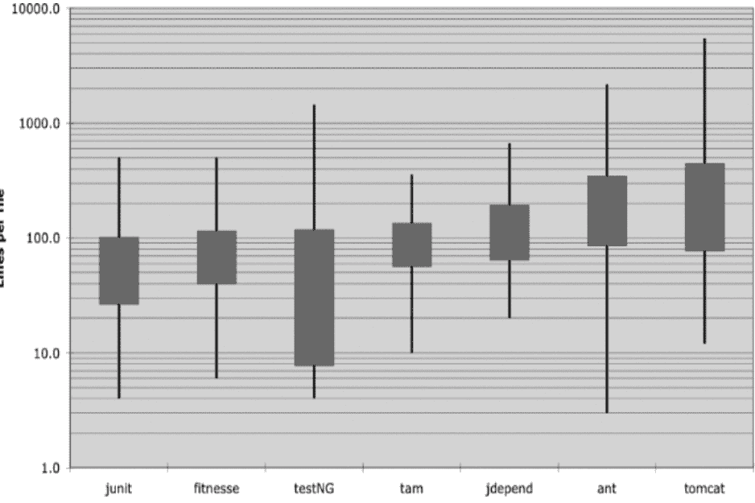

图中描述了七不同的项目：Junit, FitNesse, TestNG, Time and Money, JDepend, Ant 和 Tomcat。通过线显示了每个项目中文件的最小和最大长度。箱显示了大约三分之一（一个标准差¹）的文件。箱的中间是平均值。因此，FitNesse 的平均文件大小约为 65 行，大约三分之一的文件在 40 到 100+ 行之间。FitNesse 中最大的文件约为 400 行，最小的为 6 行。注意，这是一个对数刻度，因此垂直位置上的微小差异意味着绝对尺寸上的巨大差异。

> ¹ 箱体显示了平均值上下各 sigma/2。是的，我知道文件长度分布不是正态的，因此标准差在数学上是不精确的。我们在这里并不追求精确。我们只是为了获得一种感觉。

Junit、FitNesse 和 Time and Money 由相对较文件组成。没有一个超过 500 行，大多数此类文件少于 200 行。相反，Tomcat 和 Ant 有一些文件长达数千行，接近一半的文件超过了 200 行。

这对我们意味着什么？似乎可以使用通常为 200 行、上限为 500 行的文件来构建大型系统（在进行此分析时，FitNesse 接近 50,000 行）。虽然这不应该是一条硬性不变的规则，但应该被认为是非常理想的。小文件通常更容易理解和维护大文件。

### 概念之间的垂直开放性

几乎所有的代码都是从左到右、从上到下阅读。每一行代表一个表达式或子句，每一组行一个完整的思想。这些思想应该用空行彼此隔开。

考虑以下代码。有空行分隔包声明、导入（`import`）以及每个函数。这个极其简单的规则对代码的视觉布局产生了深远的影响。每个空行都是一个视觉线索，识别出一个新的且独立的概念。当你向下扫描列表时，你的视线会被空行后的第一行所吸引。

```java
package fitnessse.wikitext.widgets;

import java.util.regex.*;

public class BoldWidget extends ParentWidget {
    public static final String REGEXP = """.+?"""
    private static final Pattern pattern = Pattern.compile("""(.+)""",
        Pattern.MULTILINE + Pattern.DOTALL
    );

    public BoldWidget(ParentWidget parent, String text) throws Exception {
        super(parent);
        Matcher match = pattern.matcher(text);
        match.find();
        addChildWidgets(match.group(1));
    }

    public String render() throws Exception {
        StringBuilder html = new StringBuilder("<b>");
        html.append(childHtml()).append("</b>");
        return html.toString();
    }
}
```

去掉那些空行对代码的可读性产生了显著的遮蔽影响。

```java
package fitnessse.wikitext.widgets;

import java.util.regex.*;

public class BoldWidget extends ParentWidget {
    public static final String REGEXP = "'.+?'";
    private static final Pattern pattern = Pattern.compile("'.+)'",
        Pattern.MULTILINE + Pattern.DOTALL);
    public BoldWidget(ParentWidget parent, String text) throws Exception {
        super(parent);
        Matcher match = pattern.matcher(text);
        match.find();
    }

    addChildWidgets(match.group(1));
    public String render() throws Exception {
        StringBuilder html = new StringBuilder("<b>");
        html.append(childHtml()).append("</b>");
        return html.toString();
    }
}
```

当你模糊视线焦点时，这种效果变得更加明显。在第一个示例中，不同的行分组会跳入你的眼帘，而第二个示例看起来像是一团乱麻。这两个示例之间的区别仅仅是一点垂直开放性。

### 垂直密度

如果开放性分离了概念，那么垂直密度意味着紧密的关联。紧密相关的代码行应该是垂直密集的。注意下面的代码中无用的注释是如何破坏两个实例变量之间的紧密关联的。

```java
public class ReporterConfig {
    /**
     * 监听器的类名
     */
    private String m_className;

    /**
     * 监听器的属性
     */
    private List<ReporterProperty> m_properties = new ArrayList<ReporterProperty>();

    public void addProperty(Property property) {
        m_properties.add(property);
    }
}
```

下面的代码更容易阅读。它处于一个“一眼”的范围内，至少对我来说是这样。我可以看着它并看到这是一个带有两个变量和一个方法的类，而不需要移动我的头部或眼睛。之前的列表强制我使用更多的眼睛和头部动作，更不用说对分心注释的额外处理，才能达到同样的 `ReporterConfig` 类水平。

```java
public class ReporterConfig {
    private String m_className;
    private List<Property> m_properties = new ArrayList<Property>();

    public void addProperty(Property property) {
        m_properties.add(property);
    }
}
```

### 垂直距离

你是否曾经在一个类中绕着圈子，从一个函数跳到另一个函数，在源文件中上下滚动，试图推断函数之间是如何关联和操作的，结果迷失在困惑的混乱中？有

你是否曾经为了寻找变量或函数的定义而追溯整个继承链？这是是非常令人沮丧的，因为你正试图理解系统在做什么，却把时间和精力的消耗在了定位和记忆这些代码片段所在的位置上。

密切相关的概念应该在垂直方向上保持彼此靠近。显然，这条规则对于属于不同文件的概念并不适用。但是，除非有充分的理由，否则密切相关的概念不应该被分到不同的文件中。事实上，这也是应该避免保护变量的原因之一。

### 变量声明

变量的声明应该尽可能靠近它们的使用位置。由于我们的函数非常短，局部变量应该出现在每个函数的顶部，就像下面来自 JUnit 4.3.1 的这个较长的函数一样。

```java
private static void readPreferences() {
    InputStream is = null;
    try {
        is = new FileInputStream(getPreferencesFile());
        setPreferences(new Properties(getPreferences()));
        getPreferences().load(is);
    } catch (IOException e) {
        try {
            if (is != null) {
                is.close();
            }
        } catch (IOException e1) {
        }
    }
}
```

循环的控制变量通常应该在循环语句内部声明，就像同一个源码中这个可怜的小函数一样。

```java
public int countTestCases() {
    int count = 0;
    for (Test each : tests) {
        count += each.countTestCases();
    }
    return count;
}
```

在少数情况下，变量可能会声明在一个块的顶部，或者在一个较长函数的循环之前。你可以在这个 TestNG 中一个非常长函数的代码片段中看到这样的变量。

```java
for (XmlTest test : m_suite.getTests()) {
    TestRunner tr = m_runner.newTestRunner(this, test);
    tr.addListener(m_testReporter);
    m_testRunners.add(tr);
}

invoker = tr.getInvoker();

for (ITestNGMethod m : tr.getBeforeSuiteMethods()) {
    // ...
}

for (ITestNGMethod m : tr.getAfterSuiteMethods()) {
    afterSuiteMethods.put(m.getMethod(), m);
}
```

另一方面，实例变量应该声明在类的顶部或底部。这不应该增加这些变量之间的垂直间距离，因为在一个设计良好的类中，它们会被该类的许多（甚至是所有）方法使用。

关于实例变量应该放在哪里，一直存在很多争论。在 C++ 中，我们通常遵循所谓的“剪刀规则”，将所有实例变量放在底部。这条规则的理由是，公共项应该放在顶部，而私有项应该放在底部。

这比 Java/C# 将私有变量放在顶部的习惯要合理得多。但由于这种习惯在这些语言中非常普遍，遵循它可能比通过诉诸逻辑和常识来让每个人感到困惑要好。

重要的是，实例变量应该声明在一个众所周知的地方。每个人都应该知道去哪里查看这些声明。

例如，考虑 JUnit 4.3.1 中 `TestSuite` 类的奇怪案例。为了说明这一点，我极度精简了这个类。如果你查看列表的中部附近，你会看到：

```java
public class TestSuite implements Test {
    static public Test createTest(Class<? extends TestCase> theClass,
        String name) {
        ...
    }

    public static Constructor<? extends TestCase>
    getTestConstructor(Class<? extends TestCase> theClass)
    throws NoSuchMethodException {
        ...
    }

    public static Test warning(final String message) {
        ...
    }

    private static String exceptionToString(Throwable t) {
        ...
    }
}
```


## 依赖函数

如果一个函数调用另一个函数，它们应该在垂直方向上靠近，并且在可能的情况下，调用者在被调用者上方。这为程序提供了自然的流。如果能可靠地遵循这一习惯，读者将能够相信函数定义紧随其使用之后。例如，考虑下面来自 FitNesse 的片段。注意最顶部的函数（`makeResponse`）是如何调用它下方的函数的。同样注意，被调用的函数按照被调用的顺序出现。这使得查找被调用的函数变得容易，并大大增强了整个模块的可读性。

> ^ 或者在 Clojure 这样的反向语言中是在下方。

```java
public class WikiPageResponder implements SecureResponder {
    protected WikiPage page;
    protected PageData pageData;
    protected String pageTitle;
    protected Request request;
    protected PageCrawler crawler;

    public Response makeResponse(FitNesseContext context, Request re) throws Exception {
        String pageName = getPageNameOrDefault(request, "FrontPage");
        loadPage(pageName, context);
        if (page == null) {
            return notFoundResponse(context, request);
        } else
            return makePageResponse(context);
    }
}
```

```java
private String getPageNameOrDefault(Request request, String defaultPageName) {
    String pageName = request.getResource();
    if (StringUtils.isBlank(pageName))
        pageName = defaultPageName;
    return pageName;
}
```

```java
protected void loadPage(String resource, FitNesseContext context) throws Exception {
    WikiPagePath path = PathParser.parse(resource);
    crawler = context.root.getPageCrawler();
    crawler.setDeadEndStrategy(new VirtualEnabledPageCrawler());
    page = crawler.getPage(context.root, path);
    if (page != null) {
        pageData = page.getData();
    }
}
```

```java
private Response notFoundResponse(FitNesseContext context, Request request) throws Exception {
    return new NotFoundResponder().makeResponse(context, request);
}
```

```java
private SimpleResponse makePageResponse(FitNesseContext context) throws Exception {
    pageTitle = PathParser.render(crawler.getFullPath());
    String html = makeHtml(context);
    SimpleResponse response = new SimpleResponse();
    response.setMaxAge(0);
    response.setContent(html);
    return response;
}
```

顺带一句，这个片段是将常量放在合适位置的很好的例子。“FrontPage” 常量可以埋在 `getPageOrDefault` 函数中，但那样就会从该出现的地方消失。

## 概念亲性

某些代码片段想要靠近其他代码片段。它们具有某种概念亲性。这种亲性越强，它们之间的垂直距离应该越小。

正如我们所看到的，这种亲性可能基于直接依赖，例如一个函数调用另一个函数，或者一个函数使用一个变量。但还有其他亲性的产生原因。亲性可能是由于一组函数执行了相似的操作引起的。考虑来自 JUnit 4.3.1 的这段代码片段：

```java
public class Assert {
    public static void assertTrue(String message, boolean condition) {
        if (!condition) {
            fail(message);
        }
    }

    public static void assertTrue(boolean condition) {
        assertTrue(null, condition);
    }

    public static void assertFalse(String message, boolean condition) {
        assertTrue(message, !condition);
    }

    public static void assertFalse(boolean condition) {
        assertFalse(null, condition);
    }
    ...
}
```

## 水平格式化

行应该有多宽？为了回答这个问题，让我们看看典型程序中的行有多宽。我们再次检查七个不同的项目。下面的图片显示了所有七个项目行长度的分布。这种规律令人印象深刻，特别是在 45 个字符附近。事实上，20 到 60 个字符之间的每个尺寸都占了总行数的 1%。那可是 40%！可能还有 30% 的行宽度小于十个字符。记住，这是一个对数刻度，因此 80 个字符以上线性下降的线性实际上非常显著。程序员显然更喜欢短行。

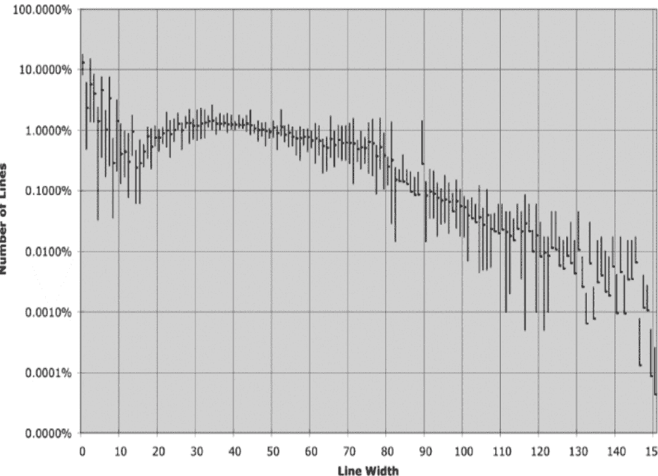

这表明我们应该努力保持代码行较短。80 个字符的旧 Hollerith 限制有点武断，我不反对将行宽延伸到 100 甚至 120 个字符。但超过这个范围可能仅仅是粗心。

我遵循这样一个规则：你永远不要强迫读者向右滚动。考虑到现代显示器的尺寸和分辨率，我个人将水平限制设置在 120。我让我的 IDE 在该列处画一条浅灰色的线，我不会越过它。

## 水平开放性与密度

我们使用水平空白将关联紧密项放在在一起，并将关联较松的项分开。考虑以下函数：

```java
private void measureLine(String line) {
    lineCount++;
    int lineSize = line.length();
    totalChars += lineSize;
    lineWidthHistogram.addLine(lineSize, lineCount);
    recordWidestLine(lineSize);
}
```

我在赋值运算符周围留了空白以突出它们。赋值语句有两个独特且主要的元素：左侧和右侧。空格使得这种分离显而易见。

另一方面，我没有在函数名和左括号之间加空格。这是因为函数及其参数是紧密相关的。将它们分开会让它们看起来是离散的，而不是结合的。我在函数调用括号内的参数之间分了开，以突出逗号并显示参数是独立的。

空白的另一个用途是突出运算符的优先级。

```java
public class Quadratic {
    public static double root1(double a, double b, double c) {
        double determinant = determinant(a, b, c);
        return (-b + Math.sqrt(determinant)) / (2*a);
    }

    public static double root2(int a, int b, int c) {
        double determinant = determinant(a, b, c);
        return (-b - Math.sqrt(determinant)) / (2*a);
    }
}

private static double determinant(double a, double b, double c) {
    return b*b - 4*a*c;
}
```

注意这些方程读起来有多整洁。因子之间没有空白，因为它们的优先级很高。项之间用空白分隔，因为加法和减法的优先级较低。

遗憾的是，大多数代码重格式工具对运算符的优先级视而不见，并在整个范围内应用相同的间距。因此，在重格式代码后，像上面显示的细微间距往往会丢失。

## 水平对齐

当我还是一名汇编语言程序员时，我使用水平对齐来突出某些结构。当我开始用 C、C++、Java 甚至 Clojure 编写代码时，我继续尝试对齐一组声明中的所有变量名，或者一组赋值语句中的所有右值（r-values）。我的代码可能像这样：

> 我在自欺什么？我仍然是一个汇编语言程序员。你可以带走男孩身上的金属，但你无法带走男孩体内的金属！

```java
public class FitNesseExpeditor implements ResponseSender {
    private Socket socket;
    private InputStream input;
    private OutputStream output;
    private Request request;
    private Response response;
    private FitNesseContext context;
    protected long requestParsingTimeLimit;
    private long requestProgress;
    private long requestParsingDeadline;
    private boolean hasError;

    public FitNesseExpeditor(Socket s, FitNesseContext context) throws Exception {
        this.context = context;
        socket = s;
        input = s.getInputStream();
        output = s.getOutputStream();
        requestParsingTimeLimit = 10000;
    }
}
```

然而，我发现这种对齐并没有用。这种对齐似乎强调了错误的重点，并导致我的视线偏离真正的意图。例如，在上面的声明列表中，你会忍不住想向下阅读变量名列表，而不看它们的类型。同样，在赋值语句列表中，你会忍不住想向下看右值列表，而从未看到赋值运算符。

所以，最后，我不再做这种事了。如今，我通常更倾向于使用不对齐的声明和赋值，如下所示，因为它们指出了一个重要的缺陷。如果我有需要对齐的长列表，问题出在列表的长度上，而不是缺乏对齐。下面 `FitNesseExpediter` 中声明列表的长度表明这个类应该被拆分。

```java
public class FitNesseExpediter implements ResponseSender {
    private Socket socket;
    private InputStream input;
    private OutputStream output;
    private Request request;
    private Response response;
    private FitNesseContext context;
    protected long requestParsingTimeLimit;
    private long requestProgress;
    private long requestParsingDeadline;
    private boolean hasError;

    public FitNesseExpediter(Socket s, FitNesseContext context) throws Exception {
        this.context = context;
        socket = s;
        input = s.getInputStream();
        output = s.getOutputStream();
        requestParsingTimeLimit = 10000;
    }
}
```

## 缩进

源文件类似于一个大纲。它有关于文件、单个类、方法、块等的信息。为了让这种层级结构可见，我们根据代码的位置按比例缩进代码。类中的方法向右缩进一级。文件中的方法向右缩进一级。类中的语句向右缩进一级。方法中的语句向右缩进一级。

程序员严重依赖这种缩进方案。他们通过对齐左边缘来视觉化范围。这允许他们快速发现变量、构造函数、访问器和方法。只需几秒钟就能意识到这是某种简单的 socket 前端，带有超时设置。考虑以下在语法和语义上完全相同的程序：

```java
public class FitNesseServer implements SocketServer {
    private FitNesseContext context;
}

public FitNesseServer(FitNesseContext context) {
    this.context = context;
}

public void serve(Socket s) {
    serve(s, 10000);
}

void serve(Socket s, long requestTimeout) {
    try {
        FitNesseExpediter sender = new FitNesseExpediter(s, context);
        sender.setRequestParsingTimeLimit(requestTimeout);
        sender.start();
    } catch (Exception e) {
        e.printStackTrace();
    }
}
```

----

```java
public class FitNesseServer implements SocketServer {
    private FitNesseContext context;

    public FitNesseServer(FitNesseContext context) {
        this.context = context;
    }

    public void serve(Socket s) {
        serve(s, 10000);
    }

    public void serve(Socket s, long requestTimeout) {
        try {
            FitNesseExpediter sender = new FitNesseExpediter(s, context);
            sender.setRequestParsingTimeLimit(requestTimeout);
            sender.start();
        } catch (Exception e) {
            e.printStackTrace();
        }
    }
}
```

## 破坏缩进

有时人们想要为了短的 `if` 语句、短的 `while` 循环或短函数打破缩进规则。每当我屈从这种诱惑时，我几乎总是会回去把缩进加回来。我通常避免将作用域压缩到一行，如下所示：

```java
public class CommentWidget extends TextWidget {
    public static final String REGEXP = "^[^\r\n]*(?(:\r\n))?\n|\r";

    public CommentWidget(ParentWidget parent, String text) {
        super(parent, text);
    }
}
```

```java
public String render() throws Exception {return ""; }
```

我更倾向于展开并缩进范围，如下：

```java
public class CommentWidget extends TextWidget {
```


# 代码格式

```java
public static final String REGEXP = "^#[\r\n]*(?(:\r\n)|\n|\r"

public CommentWidget(ParentWidget, String text) {
    super(parent, text);
}

public String render() throws Exception {
    return "";
}
```

然而，某些时候，简单的单行代码比悬挂的大括号更具视觉吸引力。

```java
public int getCount() { return count; }
```

## 团队规则

这一节的标题是一个双关语。每个程序员都有自己喜爱的格式规则，但如果你在团队中工作，就要遵守团队规则。

一个开发团队应该约定统一的格式风格，然后该团队的每个成员都应该使用这种风格。我们希望软件具有一致的风格。我们不希望它看起来像是由一群意见不合的个人写成的。

当我从 2002 年启动 FitNesse 项目时，我与团队坐在一起制定了一种编码风格。这花了大约十分钟。我们决定了花括号的位置、缩进的大小、我们如何为类、变量和方法命名等。然后，我们将这些规则编码到我们 IDE 的代码格式化器中，并从那时一直沿用。这些并不是我个人喜欢的规则，而是团队决定的规则。作为该团队的一员，在 FitNesse 项目中编写代码时，我遵循了这些规则。

请记住，优秀软件系统的源代码是一组读起来很舒服的文档。它们需要一致且流畅的风格。读者需要能够相信，他们在一个源文件中看到的格式习惯，在其他文件中也具有相同的含义。我们最不想做的，就是通过用杂乱无章的不同个人风格编写代码来给源代码增加更多复杂性。

## Bob 叔叔的格式规则

我个人使用的规则非常简单，下方的代码所示。请将其视为代码如何成为最佳编码标准文档的示例。

```java
public class CodeAnalyzer implements JavaFileAnalysis {
    private int lineCount;
    private int maxLineWidth;
    private int widestLineNumber;
    private LineWidthHistogram lineWidthHistogram;
    private int totalChars;

    public CodeAnalyzer() {
        lineWidthHistogram = new LineWidthHistogram();
    }

    public static List<File> findJavaFiles(File parentDirectory) {
        List<File> files = new ArrayList<File>();
        findJavaFiles(parentDirectory, files);
        return files;
    }

    private static void findJavaFiles(File parentDirectory, List<File> files) {
        for (File file : parentDirectory.listFiles()) {
            if (file.getName().endsWith(".java")) {
                files.add(file);
            } else if (file.isDirectory()) {
                findJavaFiles(file, files);
            }
        }
    }

    public void analyzeFile(File javaFile) throws Exception {
        BufferedReader br = new BufferedReader(new FileReader(javaFile));
        String line;
        while ((line = br.readLine()) != null) {
            measureLine(line);
        }
    }

    private void measureLine(String line) {
        lineCount++;
        int lineSize = line.length();
        totalChars += lineSize;
        lineWidthHistogram.addLine(lineSize, lineCount);
        recordWidestLine(lineSize);
    }

    private void recordWidestLine(int lineSize) {
        if (lineSize > maxLineWidth) {
            maxLineWidth = lineSize;
            widestLineNumber = lineCount;
        }
    }

    public int getLineCount() {
        return lineCount;
    }

    public int getMaxLineWidth() {
        return maxLineWidth;
    }

    public int getWidestLineNumber() {
        return widestLineNumber;
    }

    public LineWidthHistogram getLineWidthHistogram() {
        return lineWidthHistogram;
    }

    public double getMeanLineWidth() {
        return (double) totalChars / lineCount;
    }

    public int getMedianLineWidth() {
        Integer[] sortedWidths = getSortedWidths();
        int cumulativeLineCount = 0;
        for (int width : sortedWidths) {
            cumulativeLineCount += lineCountFixedWidth(width);
            if (cumulativeLineCount > lineCount / 2) {
                return width;
            }
        }
        throw new Error("Cannot get here\n");
    }

    private int lineCountFixedWidth(int width) {
        return lineWidthHistogram.getLinesFixedWidth(width).size();
    }

    private Integer[] getSortedWidths() {
        Set<Integer> widths = lineWidthHistogram.getSortedWidths();
        Integer[] sortedWidths = widths.toArray(new Integer[0]);
        Arrays.sort(sortedWidths);
        return sortedWidths;
    }
}
```

# 第 7 章：整洁函数


在计算的早期，程序员编写的系统是由一系列执行单个任务的例程构成的。他们很快发现，某些例程通常是有用的，于是他们将它们写在笔记本上并称之为子程序。需要时，他们会将这些子程序直接从笔记本上转抄到他们正在创建的程序中。当时并没有调用——这些子程序仅仅是内联编码在程序中的。

后来，在 50 年代初，机器中增加了指令，允许调用子程序。起初，程序员并不愿意使用调用指令，因为它们在时间上成本很高。但随着机器能力的增长，调用指令变得越来越廉价，程序员开始越来越频繁地使用它们。

接着，在 Fortran 和 PL/1 时代，我们开始主要通过子程序来构建系统，并引入了带有参数和返回值的函数这一特例。如今，只有函数幸存了下来。函数是任何现代程序中组织的第一道防线。写好函数是本章的主题。

## 越小越好！

在过去的十年里，我写过各种尺寸的函数。在我职业生涯的早期，我写过几个极其糟糕的 3000 行怪物。后来，我写了 100 到 300 行的函数。随着我变得成熟，我写了 20 到 30 行的函数。在过去的二十年里，我将它们缩短到了十几行或更短。这些年来通过试错教会我的一是：函数应该是非常小的。

当然，我不是第一个说这种话的人。保持函数短小的想法是一个老观点了。在 80 年代，人们经常听到函数不应该超过满屏。当然，这是在 VT100 屏幕只有 24 行 80 列，且我们的编辑器使用 4 行用于管理目的时说的。这实际上将限制定在了 20 行。

1999 年，我去俄勒冈州拜访 Kent Beck。我们坐在一起一起进行编程，让他向我展示 TDD 规范。我当时对 TDD 持怀疑态度，想亲眼观察一下。

> 在那时，它被称为测试先行编程。

我们一个接一个通过失败的测试，拼凑出一个小 Java/Swing 程序，他把它叫作 Spark。它在屏幕上产生的视觉效果非常像电影《灰姑娘姑娘》中仙女母的魔杖。当你移动鼠标时，火星会从光标处滴落，闪烁着，通过模拟的重力场落在窗口底部。当我们一起编写代码，一个接一个地通过测试时，我被这些函数之小震惊了。我习惯了 Swing 程序中占据大量垂直空间的函数。而这个程序中的每个函数只有二、三或四行长。每个函数都有描述性的名称。每个函数都透明而易懂。每个函数都在讲述一个故事。并且每个函数都以引人的顺序引导你走向下一个。正是这段经历让我深刻理解了保持函数非常小的重要性。

## 良好的散文

保持函数非常小意味着 `if` 语句、`else` 语句、`while` 语句等内部的块只有一行或两行。通常该块并不会保持闭包函数小，但它也增加了文档价值，因为块中调用的函数将具有良好的描述性名称。这样的 if/else/while 语句读起来很舒服，因为函数名与关键词的衔接非常流畅。它们读起来就像编写得良好的散文。

```java
if (employee.shouldBePaidToday()) {
    employee.pay();
}
```

这意味着小函数不会大到足以容纳深度嵌套的结构。函数的缩进级别很少超过一级或二级。这显然使得函数更容易阅读和理解。

这并不是一个死板的规则，而且可能会过度使用。某些函数如果不被拆分成更小的四行代码函数，读起来反而会更好。但这些都是特殊情况。通常情况下，保持函数短小是最佳策略。

## 每个函数一个抽象层

为了确保我们的函数只做“一件事”，我们需要确保函数内部的语句都处于相同的抽象层。看下面这段 Golang 代码。

> 2 这来自“Video Store”示例，我们将在第 10 章“一件事”中进行更深入深入的研究。

```go
func (customer *Customer) statement() string {
    totalAmount := 0.0
    frequentRenterPoints := 0
    result := "Rental Record for " + customer.name + "\n"
    for _, rental := range customer.rentals {
        thisAmount := 0.0

        switch rental.movie.movieType {
        case NewRelease:
            thisAmount += float64(rental.daysRented * 3)
        case Regular:
            thisAmount += 2
            if rental.daysRented > 2 {
                thisAmount += float64(rental.daysRented-2) * 1.5
            }
        case Children:
            thisAmount += 1.5
            if rental.daysRented > 3 {
                thisAmount += float64(rental.daysRented-3) * 1.5
            }
        }

        frequentRenterPoints++
        if rental.movie.movieType == NewRelease && rental.daysRented > 1 {
            frequentRenterPoints++
        }

        result += fmt.Sprintf("\t%s\t%.1f\n", rental.movie.title, thisAmount)
        totalAmount += thisAmount
    }
    return result + fmt.Sprintf("Amount owed is %.1f\n"+"You earned %d frequent renter points\n", totalAmount, frequentRenterPoints)
}
```

很容易看出这如何违反了规则。代码中存在一些处于非常高抽象层级的概念，例如遍历 `customer.rentals`。另一些概念处于中间抽象层，例如选择电影类型的 `switch` 语句。此外还有其他概念是异常低层的，例如 `frequentRenterPoints++` 以及为每种电影类型计算价格的代码。

在函数内部混合不同层级的抽象通常会令人困惑。读者可能无法判断某个表达式是核心概念还是细节。更糟糕的是，就像破窗效应一样，一旦细节与核心概念混合在一起，越来越多的细节往往会在函数内部不断堆积。

## 从上到下阅读代码：阶梯规则

我们希望代码读起来像一个自上而下的叙事。³ 我们希望每个函数后面都紧跟着下一个抽象层的函数，这样我们就可以从上到下阅读程序，每次下降一个抽象层。我把这称为“阶梯规则”（The Stepdown Rule）。我们可以在上一个示例的重构中看到这一点。

> ³ [KP78], p. 37.

```go
func (statement *RentalStatement) makeStatement() string {
    statement.clearTotals()
    return statement.makeHeader() +
        statement.makeDetails() +
        statement.makeFooter()
}

func (statement *RentalStatement) clearTotals() {
    statement.totalAmount = 0.0
    statement.frequentRenterPoints = 0
}

func (statement *RentalStatement) makeHeader() string {
    return "Rental Record for " + statement.name + "\n"
}

func (statement *RentalStatement) makeDetails() string {
    rentalDetails := ""
    for _, rental := range statement.rents {
        rentalDetails += statement.makeDetail(rental)
    }
    return rentalDetails
}

func (statement *RentalStatement) makeDetail(rental *Rental) string {
    amount := rental.determineAmount()
    statement.frequentRenterPoints += rental.determinePoints()
    statement.totalAmount += amount
    return statement.formatDetail(rental, amount)
}

func (statement *RentalStatement) formatDetail(rental *Rental, amount float64) string {
    return fmt.Sprintf("\t%s\t%.1f\n", rental.getTitle(), amount)
}

func (statement *RentalStatement) makeFooter() string {
    return fmt.Sprintf("Amount owed is %.1f\n"+"You earned %d frequent renter points",
        statement.totalAmount, statement.frequentRenterPoints)
}
```


阅读代码时，我们从顶部的 `makeStatement` 函数开始。为了创建一个语句，我们首先清空总额，然后生成头部、细节和页脚，并将它们拼接在一起。所有语句都处于相同的抽象层。清空总额时是将 `totalAmount` 和 `frequentRenterPoints` 设置为零。生成头部时是格式化名称。生成细节时是遍历租借记录。生成页脚时是格式化欠款金额和积分。

很容易看出这如何违反了规则。代码中存在一些处于非常高抽象层级的概念，例如遍历 `customer.rentals`。另一些概念处于中间抽象层，例如选择电影类型的 `switch` 语句。此外还有其他概念是异常低层的，例如 `frequentRenterPoints++` 以及为每种电影类型计算价格的代码。

6 同上。
但此函数可能糟糕的问题是，会有无限数量的其他函数具有相同的结构。例如，我们已经有了 `determinePoints`，之后我们可能还有 `applyCoupon` 或 `getAgeRestriction`。很容易想象出许多其他函数。它们都将包含一个相关的 `switch` 语句。

解决这个问题的一个良好方法是将 `switch` 语句埋在抽象工厂（Abstract Factory）的地下室里，并且永远不让任何人看到它。工厂使用 `switch` 语句来创建 `RentalType` 派类的适当实例。

7 [GO95]。

```go
type RentalTypeFactory interface {
    make(typeName string) RentalType
}
```

```go
type RentalTypeFactoryImpl struct{}
```

```go
func (r RentalTypeFactoryImpl) make(typeName string) RentalType {
    switch typeName {
    case "childrens":
        return ChildrenRental{}
    case "new release":
        return NewReleaseRental{}
    case "regular":
        return RegularRental{}
    }
    return nil
}
```

我对 `switch` 语句的通用规则是：如果它们只出现一次，位于像 `main` 这样具体的模块中，用于创建多态对象，并隐藏在接口之后以便系统的其他部分看不到它们，那么它们是可以接受的。

## 整洁函数：深度观察

一个整洁函数应该具备五个属性。它应该是命名的（nameable）、隔离的（insulated）、同质的（homogenous）、上下文相关的（contextual）和纯粹的（pure）。如果你重新排列它们，它们会组成 PINCH——但那并不是呈现它们的正确顺序。

## 上下文

模块化的概念和纪律对于最早的程序员来说并不是显而易见的。它是出于纯粹的需求而缓慢成长的。20世纪40年代后期，格蕾丝·霍珀（Grace Hopper）在笔记本中记录了常见的代码序列，以帮助她为 Harvard Mark 1。她将这些序列称为子程序（subroutines）。它们被艰难地冲打在驱动机器执行的长纸带上。

这些子程序是第一个模块。从那里，模块化的概念演变为可用的子程序，最后演变为函数。

到20世纪60年代，程序员开始采用模块化编程的纪律，该纪律认为最好的程序被分解为许多不同的模块。到60年代后期，Dahl 和 Nygaard 通过发明面向对象编程推进了模块化概念。⁸ 在20世纪70年代，大卫·帕纳斯（David Parnas）通过推广信息隐藏的益处继续了进展。

8 尽管他们没有给它命名。“面向对象”是由艾兰·凯（Alan Kay）在几年后创造的。

如今，我们理解每个函数都存在于一个上下文（context）之中。上下文是函数和数据结构的协作分组。每个上下文都有一个外部接口和内部实现。

在面向对象（OO）语言中，上下文通常由类定义。例如，在 Java 中，类的公共方法代表外部接口，而私有数据和方法构成了内部实现。

在 C 中，我们使用 `.h` 头文件作为外部接口，使用 `.c` 文件作为内部实现。

某些语言提供了定义上下文的丰富语法。在其他语言中，程序员必须通过文件名、目录和注释等非正式约定来定义上下文。

但无论语言和语法如何，每个函数都存在于一个上下文之中——识别、创建和管理这些上下文是程序员的职责。

上下文中的某些函数是公共的，这意味着它们在上下文外部是已知且可使用的。它们是上下文外部接口的一部分。上下文中的其他函数是私有的，这意味着它们仅在上下文内部已知且可使用，而不在其外部使用。

许多面向对象语言提供了将函数声明为公共或私有的语法。某些语言还存在其他类别，如 `protected` 或 `package`，作为创建部分限制的方法。其他语言则依赖程序员的纪律和各种程序员约定来实现相同的结果。

上下文在外部已知的事物与在上下文内部保持私有的事物之间创建了一个边界。这个边界由程序员指定，描述了程序员对于高层且可能不会频繁更改的事物，以及低层且可能经历频繁变更的事物之间的意图。

## 可命名的

在命名函数时至少要考虑两点。名称在它的上下文中必须具有适当的描述性，并且必须适当便利。

### 描述性的

每个整洁函数都应该有一个描述该函数作用的名称。由于名称描述的是行为，因此名称应该是动词、动词短语或隐性动词，如 `Math.sign(x)`。

描述应该比函数内部的代码稍微抽象一点。换句话说，名称应该隐藏实现细节。

所以，举一个荒谬的反例：

```java
public static double addToBandDivideBy2(double a, double b) {
    return (a+b)/2.0;
}
```

这个名称确实告诉了我们代码在做什么；但它太具体了。它不仅告诉我们函数在做什么，还告诉了我们如何做。它暴露了实现细节。我们应该将其稍微抽象一下。

```java
public static double average(double a, double b) {
    return (a+b)/2.0;
}
```

这很不错。名称是一个隐性动词（取平均），隐藏了实现细节。这是好事，因为任何看到这个名称的程序员都会知道会有什么；但任何想要更改实现的程序员都不需要更改名称。例如，扩展函数以使用变数量参数不会影响名称。

```java
public static double average(double... ns) {
    return Arrays.stream(ns).sum()/ns.length;
}
```

单单词名称（如 `average`）对于某些函数可能是有效的，但其他函数需要更多单词才能具有描述性。例如：

```java
public void addSalesReceipt(SalesReceipt salesReceipt) {
    salesReceipts.add(salesReceipt);
}
```

这个函数看起来足够简单，但名称有三个单词。为什么？也许我们应该看看上下文。

```java
public class CommissionedEmployee extends Employee {
    private List<SalesReceipt> salesReceipts = new ArrayList<>();
}
```

选择描述性的名称会清晰你脑海中的模块设计并帮助你改进它。寻找良好的名称导致代码的良好重构的情况并不罕见。

### 便利的

为了便利，函数的名称必须短而易记。但短小易记的名称并不总是具有描述性的。因此存在一种权衡。便利性的价值取决于函数被调用的频率。频繁调用的函数应该有一个短而易记的名称。只调用一次的函数可以负担更长更具描述性的名称。描述性和便利之间的冲突优先级目标是创建我们在第4章讨论的简单启发式。

函数名称的长度应该与其包含的作用域的大小成反比。作用域是名称已知且使用的代码跨度。例如，`average` 函数的作用域实际上是全局的。而 `addSalesReceipt` 的作用域被限于 `CommissionedEmployee` 类的用户。因此，上下文越详细，作用域越小。

小作用域内的函数不需要太多的便利。所以它们的名称可以更长。这是好事，因为详细上下文中的函数通常需要长的名称。大作用域内的函数需要更多的便利。这是好事，因为这些上下文通常更通用，通常不需要长的名称。

例如，函数 `file.open(String filename)` 短而易记因为它位于全局作用域且非常通用。如果这个函数被命名为 `openAndThrowIfNotFound`，我们会觉得不方便。同样，如果 `addSalesReceipt` 函数被简单地命名为 `add`，我们会感到有些不安。

因此，范围越大，函数越通用，名称就越短；范围越小，函数越详尽，名称就越长。

据此，我们可以预测全局函数通常会有简短的单单词名称。上下文中的公共函数名称会稍长。由公共函数调用的私有函数名称会更长。而由其他私有函数调用的私有函数可能会非常长。在函数层级中越得越深，名称可能越长。对于 Java、C、Clojure、Python、Ruby 或任何允许长名的语言都是如此。

## 隔离（Insulated）

在很久以前，我们将隔离（缘）的概念称为*低耦合*，有时称为*封装*。但这两个术语似乎都不完全充分。

*复杂*（complex）一词意味着多条线索。使函数变得复杂的因素之一是它们必须处理的输入和输出数量。这些每一个输入和输出都是一个耦合，每一个耦合都是另一条穿过该函数的线索。因此，为了管理我们函数的复杂性，我们寻求限制此类耦合的数量。

函数的参数越多，它与调用者的耦合就越密。一个有五个参数的函数可能比有两个参数的函数耦合更密。因此，我们努力将函数参数的数量限制在某些可管理的范围内。我倾向于在可行的情况下限制为三个。我将在下一章详细讨论这一点。

参数越少，函数的耦合越低，调用函数就越简单。没有参数的函数很容易调用。然而，除非这些函数存在于其他函数为它们准备好的上下文中，否则它们并不有用。

例如，你可能有一个代表有限状态机的上下文。该上下文将包含表示机器当前状态的变量，以及状态转换的网络。

让我们使用以下状态机。它代表一个简单的地铁闸机。有两个状态：锁定（Locked）和解锁（Unlocked）。有两个事件：硬币（Coin）和通过（Pass），分别代表用户向插口投入硬币和通过闸机。最后有五个动作：关闭报警（alarmOff）、开启报警（alarmOn）、锁定（lock）和感谢（thankyou）。状态转换表如下。

| 状态（State） | 事件（Event） | 下一状态（Next State） | 动作（Actions） |
| :--- | :--- | :--- | :--- |
| Locked | Coin | Unlocked | {alarmOff, unlock} |
| Locked | Pass | Locked | alarmOn |
| Unlocked | Coin | Unlocked | thankyou |
| Unlocked | Pass | Locked | lock |

逻辑非常简单。

- 当机器处于 Locked 状态并接收到 Coin 事件时，它将转换到 Unlocked 状态并调用 `alarmOff` 和 `unlock` 动作。
- 当机器处于 Locked 状态并接收到 Pass 事件时，它将保持 Locked 状态并调用 `alarmOn` 动作。
- 当机器处于 Unlocked 状态并接收到 Coin 事件时，它将保持 Unlocked 状态并调用 `thankyou` 动作。

> 也许它会亮起一个小“感谢”灯，或者从扬声器中发出“感谢”的声音。

- 当机器处于 Unlocked 状态并接收到 Pass 事件时，它将转换到 Locked 状态并调用 `lock` 动作。

由此显而易见，当系统运行时，外部软件将需要发送 Coin 和 Pass 事件。这可以通过调用不带参数的函数 `coin()` 和 `pass()` 来实现。我们可以将其封装在一个名为 `TurnstileEvents` 的接口中。

```java
public interface TurnstileEvents {
    void coin();
    void pass();
}
```

五个同样不带参数的动作可以封装在一个名为 `TurnstileActions` 的接口中。

```java
public interface TurnstileActions {
    void lock();
    void thankyou();
    void alarmOn();
    void unlock();
    void alarmOff();
}
```

然后，状态机的逻辑可以封装在一个名为 `TurnstileFSM` 的抽象类中。

```java
public abstract class TurnstileFSM implements TurnstileActions, TurnstileEvents {
    private enum State {Locked, Unlocked}
    private enum Event {Coin, Pass}
    private State state = State.Locked;

    private void setState(State s) {
        state = s;
    }

    public void coin() {
        handleEvent(Event.Coin);
    }

    public void pass() {
        handleEvent(Event.Pass);
    }

    private void handleEvent(Event event) {
        switch (state) {
            case Locked -> {
                switch (event) {
                    case Coin -> {
                        setState(State.Unlocked);
                        alarmOff();
                        unlock();
                    }
                    case Pass -> {
                        setState(State.Locked);
                        alarmOn();
                    }
                }
            }
            case Unlocked -> {
                switch (event) {
                    case Coin -> {
                        setState(State.Unlocked);
                        thankyou();
                    }
                    case Pass -> {
                        setState(State.Locked);
                        lock();
                    }
                }
            }
        }
    }
}
```

检测并发送事件的运行系统只需要知道 `TurnstileEvents`。它与逻辑和动作完全解耦。状态机的逻辑存在于非常强的隔离屏之后。`TurnstileFSM` 之外的任何不知道状态或逻辑。

最后，`TurnstileFSM` 类是抽象的，以便在派生类中实现动作函数，从而将机器逻辑与动作的实现解耦。

通过这个示例，你可以看到封装状态机逻辑、事件和动作。

## 同质化（Homogenous）

函数的每一行都应该处于相同的抽象级别。这使得函数的实现是同质的。

但如果函数的行存在于多个抽象级别呢？例如，考虑以下函数：

```java
public static int orientation(Point a, Point b, Point c) {
    double val = (b.x() - a.x()) * (c.y() - a.y()) -
        (b.y() - a.y()) * (c.x() - a.x());

    if (val == 0) {
        return 0;
    }

    return (val > 0) ? +1 : -1;
}
```

给定平面上的三个点 (a, b, c)，该函数确定从 a 到 b 到 c 是右转 (-1)、左转 (1) 还是没有转向 (0)。

第一部分确定了向量 a→ 和 b→ 的交叉积。该乘积的符号决定了答案。

交叉积的确定在名称下方恰一个抽象级别。但其他行比第一行级别低。所以，让我们把那四行放入自己的函数中。

```java
public static int orientation(Point a, Point b, Point c) {
    double val = (b.x() - a.x()) * (c.y() - a.y()) -
        (b.y() - a.y()) * (c.x() - a.x());
    return sign(val);
}

private static int sign(double n) {
    if (n == 0) {
        return 0;
    }
    return (n > 0) ? +1 : -1;
}
```


现在原始函数中的两行都处于相同的抽象级别。这使得方向函数的实现是同质的。

但我们可以做得更好，因为这些名称没有特别好的交流性，且返回值没有命名的，容易出错。

```java
public enum Chirality { left, right, none }
```

```java
public static Chirality getChirality(Point a, Point b, Point c) {
    return chirality(crossProduct(a, b, c));
}
```

```java
private static double crossProduct(Point a, Point b, Point c) {
    double abx = b.x() - a.x();
    double aby = b.y() - a.y();
    double acx = c.x() - a.x();
    double acy = c.y() - a.y();
    return abx * acy - aby * acx;
}
```

```java
private static Chirality chirality(double n) {
    if (n == 0) {
        return none;
    }
    return (n > 0) ? left : right;
}
```

你可能会觉得这段代码比原始代码长了一倍；但在我看来，它的可读性得多——尤其是对于第一次看到它的人来说。你可能还会烦于它比原始代码多消耗几个 CPU 周期。如果你有迫切需要节省 50ns，那么请务必删减那些周期。请记住，在你之后还会其他人需要维护这些代码，而他们时间是有价值的——可能比你花费的 50ns 要贵得多。

## 纯函数

纯函数的行为完全依赖于其参数；它的执行不会导致任何其他行为发生改变。以下是纯函数的某些优点。

- 纯函数是参数到返回值的真实映射——可以用这种映射来替换，以用内存换取执行速度。
- 纯函数不容易受到竞态条件和并发更新问题的影响，因为它们不会改变底层系统的状态。[^1]
- 纯函数很容易组合成功能网络。这是因为它们没有外部依赖，可以被任何其他函数在任何时候调用。
- 纯函数很容易测试。这是因为测试设置不需要将底层系统强制转换为任何特殊状态，且测试不需要断言系统的底层状态已经发生了改变。
- 纯函数很容易分布在多个处理器之间。由于纯函数的输出仅取决于其参数，因此函数在何处或在哪个处理器中执行并不重要。

好了，它们确实很棒。如何创建一个纯函数呢？很简单。不要改变任何变量的值；或者借用《亲爱的妈妈》中那句著名的名言：“永远不要使用赋值语句！”或者换一种说法：纯函数是不可变的。[^2]

[^1]: 它们并不是完全免疫，因为任何有状态的系统都可以用纯函数来模拟。参阅 [函数式设计]。
[^2]: [函数式设计]，第1章。

但这样的规则现实性如何？这取决于你的观点。例如：

```java
public static double sigma(double... ns) {
    var mu = mean(ns);
    var deviations = Arrays.stream(ns).map(x -> (x - mu) * (x - mu)).boxed().mapToDouble(x -> x);
    double variance = deviations.sum() / ns.length;
    return Math.sqrt(variance);
}
```

`sigma` 函数是纯的。它内部的赋值语句是初始化而不是赋值。它们没有改变任何现有变量的状态。

但如果我们通过将初始化拆分为声明和赋值，将它们变成真正的赋值呢？

```java
public static double sigma(double... ns) {
    double mu;
    mu = mean(ns);
    DoubleStream deviations;
    deviations = Arrays.stream(ns).map(x -> (x - mu) * (x - mu)).boxed().mapToDouble(x -> x);
    double variance = deviations.sum() / ns.length;
    return Math.sqrt(variance);
}
```

这个版本的 `sigma` 仍然是纯的，因为即使变量的值发生了变化，这些变化在函数外部也是不可见的。我们能推到多远？让我们使用一个更传统的[^3]实现方式：

[^3]: 在本章显示的所有 `sigma` 实现中，这是我最喜欢的。没有古怪的语法；没有点、括号和箭头的奇特拼接；没有恼人的转换函数。只有简洁、直观的代码。

```java
public static double sigma(double... ns) {
    double mu = mean(ns);
    double variance = 0;
    for (double n : ns) {
        var deviation = n - mu;
        variance += deviation * deviation;
    }
    variance /= ns.length;
    return Math.sqrt(variance);
}
```

这个版本的 `sigma` 到处都在修改变量，但它仍然是纯的，因为所有这些修改都对任何外部观察者隐藏了。内部完全不是纯的，但对外部观察者来说，纯性的幻象被保留了。

我们甚至可以创建一个可变对象并依然保持 `sigma` 函数的纯性。

```java
public static double sigma(double... ns) {
    return new SigmaCalculator(ns).invoke();
}
```

```java
private static class SigmaCalculator {
    private double[] ns;
    private double mu;
    private double variance = 0;
    private double deviation;

    public SigmaCalculator(double... ns) {
        this.ns = ns;
    }

    public double invoke() {
        mu = mean(ns);
        for (double n : ns) {
            deviation = n - mu;
            variance += deviation * deviation;
        }
        variance /= ns.length;
        return Math.sqrt(variance);
    }
}
```

现在我们有了实例变量和各种变量操作。尽管如此，`sigma` 函数仍然是纯的。没有任何操作是外部可见的。

## 部分纯性

正如我们所看到的，一个函数是否纯的取决于观察者。例如，C库函数 `fopen(char* name, char* mode)` 的副作用是打开文件。这意味着 `fopen` 不是纯的。然而，我们可以通过将其封装在另一个函数中，使其看起来是纯的。

```c
void openAndDo(char* fileName, void (*doTo)(FILE*)) {
    FILE* f = fopen(fileName, "r");
    doTo(f);
    fclose(f);
}
```

这个函数打开文件，执行 `doTo` 指向的函数，然后关闭文件。这让系统恢复到原始状态，隐藏了 `fopen` 的副作用。在所有情况下，这种对 `fopen` 的用法都是纯的。我们可以这样使用它：

```c
void show(FILE* f) {
    int c;
    while ((c = fgetc(f)) != EOF)
        putchar(c);
}

// 在 main 中
// openAndDo("x.x", show);
```

这个程序在标准输出上打印 "x.x" 文件。让我们通过修改文件内容让它变得更有趣。如果文件没有以换行符结束，我们就添加一个。

```c
void appendLineEnd(FILE* f) {
    int c;
    int lastC;
    while ((c = fgetc(f)) != EOF) {
        lastC = c;
    }
    if (lastC != '\n') {
        fputc('\n', f);
    }
}
```

```c
// 在 main 中
// openAndDo("x.x", appendLineEnd);
// openAndDo("x.x", show);
```

现在程序添加换行符，然后显示文件。这个程序确实让系统处于改变后的状态，因为 "x.x" 文件的内容被修改了。然而，如果我们不关心 "x.x" 文件的内容，那么对于我们来说，`openAndDo` 函数就是纯的。

## 结论

洁净函数很小，只做一件事，读起来像良好的散文。每个函数都在函数层级结构中占据自己的位置，逐步从高级抽象引导到低级细节。洁净函数存在于定义良好的上下文，彼此隔离，命名良好且方便，并且对所有外部观察者来说都是纯的。

## 第 8 章：函数启发式方法


以下是我发现的有助于保持代码整洁的一些启发式方法。我并没有将它们视为不可逾越的规则，但在其他条件都相等的情况下，这些是我的偏好。

## 函数参数

在函数签名中添加的每一个参数都会让该函数变得更难理解。最容易理解的参数列表是空参数列表。

在本书的第一版，这个表述困扰了许多人。他们的抱怨是，一个空参数列表的函数除了返回常量外几乎无事可做。因此，显然需要进一步的解释。

在面向对象的程序中，对象的每个方法都至少有一个参数。在 Python 和 Go 中，按照约定显式声明并命名为 `self`。在 Java、C# 和 C++ 中，它是隐式的 `this`。这个参数无论是显式的还是隐式的，都代表闭包作用域。

C 语言中的函数有隐式参数吗？当然有；它是闭包的全局作用域。C 函数始终可以访问该作用域，因此它扮演了与 `this` 相同的角色。因此，编写的每一个函数都有一个代表闭包作用域的隐式参数。

因此，我说最容易理解的参数列表是空列表，我不计入隐式的闭包作用域。最容易理解的参数列表是没有任何声明参数的列表。

方法或函数存在吗？当然存在。`Stack.pop()`、`file.close()`、`semaphore.release()`、`buffer.flush()`：它们非常常见且易于阅读。

其次容易理解的参数列表是带有一个声明参数的列表。调用 `f(x)` 很好理解。你不太可能弄错参数。

两个参数并不难。记住哪个先哪个后非常容易——意思是，只有一种方式会出错。你可以通过让这两个参数具有交换律来让它变得简单。

三个参数开始变得困难。有五种方法可以让它们的顺序出错。是的，我知道 IDE 在这方面变得很有帮助；尽管如此，为什么要自担风险呢？

参数本身就是耦合，因此本身已经足够困难了，不需要担心它们在调用序列中的顺序。而且，它们读起来比写起来更难。IDE 在你编写时会提供很多帮助，但在阅读时提供的少得多。三个通常是我的极限。

三个的限制是随意的。你可能习惯更多。你有你的方式，我有我的方式。

如果我需要向函数传递三个以上的参数，我会尝试找到一种将它们分组的方法。我可以将它们放入一个对象中——毕竟，如果四件事如此紧密以至于可以作为一个单元传递给函数，为什么它们现在还没有变成一个对象呢？或者，我可能会将它们放入哈希映射中并使用良好的名称来标识它们。

减少参数列表的最简单方法之一是在当前类中创建字段，用于存储我们通常作为参数传递的值。事实上，面向对象成为强大工具的原因之一，是它允许我们创建上下文，让函数在不需要大量参数的情况下进行通信。

## 变长参数

有时我们想要编写接受无限数量参数的函数。在 Java 中，`String.format` 函数就是这样的。

```java
public String format(String format, Object... args)
```

我认为可以安全假设这个函数实际上只接收两个参数：格式字符串和名为 `args` 的 `Object` 数组。

## 三个以上？

有时排序的背后是有逻辑的。例如，保持 `distance(x1, y1, x2)` 参数的顺序并不难。另一方面，如果没有逻辑，那么就有 23 种顺序出错的方法。即使有 IDE 的帮助，这也是一个相当大的风险。在阅读代码时，风险更大，因为你不太可能注意到参数的顺序错误。所以通常，如果参数超过三个，我们应该寻找其他方法。

## 关键字参数

某些语言允许在函数调用中为参数命名。例如，在 C# 中，你可以用参数名称作为参数的前缀：

```csharp
createRental(movie: m, daysRented: 3);
```

使用这种语言特性时，我不那么担心参数的顺序，并且偶尔可能会传递三个以上的参数。

在某些语言中，哈希映射定义非常简单，因此提供了一种传递命名参数的良好方法。例如，在 Clojure 中，我可以这样传递哈希映射：

```clojure
(create-rental {:movie: m, :daysRented: 3})
```

Ruby 提供了类似的语法糖：

```ruby
createRental(movie: m, daysRented: 3)
```

在 Ruby 中，如果声明 `createRental` 函数接收一个哈希映射，那么参数将被自动假设为关键字/值对。

## 标志参数

标志参数是很丑的。向函数传递一个布尔值通常是粗率的。它会立即使函数签名复杂，并大声宣告该函数在做多一件事。如果标志为真，它做一件事；如果为假，则做另一件事。它们也很难。例如：

```java
String monthNames[] = getMonths(false);
```

这意味着什么？我们是在获取月份还是不是？

唯一知道的方法是阅读实现。例如：

```java
/**
 * 返回月份数组
 * @param shortened 是否返回简短格式
 * @return 月份数组
 */
String[] getMonths(boolean shortened) {
    if (shortened) {
        // ...
    } else {
        // ...
    }
}
```

返回某些信息。同时执行这两种操作可能会导致混淆。例如，考虑以下函数：

```java
public boolean set(String attribute, String value);
```

该函数设置一个命名属性的值，如果设置成功则返回 true，如果不存在该属性则返回 false。这导致了像这样奇怪的语句：

```java
if (set("username", "unclebob")) {
    // ...
}
```

从读者的角度来想象一下。这是什么意思？它是在询问 "username" 属性之前是否被设置为 "unclebob" 吗？还是在询问 "username" 属性是否已成功设置为 "unclebob"？很难从调用中推断出含义，因为不清楚 `set` 这个词是动词还是形容词。

作者本意是让 `set` 作为一个动词，但在 `if` 语句的上下文中，它感觉像是一个形容词。我们可以尝试通过将 `set` 函数重命名为 `setAndCheckExists` 来解决这个问题，但这对提高 `if` 语句的可读性帮助不大。真正的解决方案是将命令与查询分离，这样就不会产生歧义。

```java
if (attributeExists("username")) {
    setAttribute("username", "unclebob");
    // ...
}
```

## 命令查询分离

函数要么做什么事（命令），要么回答什么事（查询），但二者不可兼得。你的函数应该改变对象的状态，或者返回关于对象的信息。尝试两者兼顾往往会导致混淆。考虑以下函数：

```java
public boolean set(String attribute, String value);
```

该函数设置一个命名属性的值，如果设置成功则返回 true，如果不存在该属性则返回 false。这导致了像这样奇怪的语句：

```java
if (set("username", "unclebob")) {
    // ...
}
```

从读者的角度来想象一下。这是什么意思？它是在询问 "username" 属性之前是否被设置为 "unclebob" 吗？还是在询问 "username" 属性是否已成功设置为 "unclebob"？很难从调用中推断出含义，因为不清楚 `set` 这个词是动词还是形容词。

作者本意是让 `set` 作为一个动词，但在 `if` 语句的上下文中，它感觉像是一个形容词。我们可以尝试通过将 `set` 函数重命名为 `setAndCheckExists` 来解决这个问题，但这对提高 `if` 语句的可读性帮助不大。真正的解决方案是将命令与查询分离，这样就不会产生歧义。

```java
if (attributeExists("username")) {
    setAttribute("username", "unclebob");
    // ...
}
```

但是，正如我所说，在某些情况下遵循 CQS 是不实际或仅仅是不方便的。例如，考虑以下情况：

```java
int top = stack.pop();
```

这一行简单的代码违反了 CQS。它既查询了栈顶，又改变了栈的状态。

在这样不方便的情况下违反 CQS 是否有代价？肯定的：存在并发问题。如果 `pop` 函数没有通过恰当使用信号量或锁来保证原子性，那么可能出现竞态条件，导致在对象从栈中正确移除之前，栈顶被返回给两个不同的线程。

你们是 C++ 程序员的话，你们会发现 C++ 标准模板库（STL）并不允许在单个语句中同时查询和修改容器。在那个库中，上述的 `pop` 操作需要两个符合 CQS 的语句：

```cpp
Thing top = myStack.top();
myStack.pop();
```

在 C++ 中，这种设计的原因除了并发因素外，还因为 `Thing` 类可能会重写赋值运算符，因此可能会抛出异常。如果 `pop` 操作既改变了栈又返回了栈顶，那么当赋值运算符抛出异常时，可能会导致栈处于未知状态。

没错，伙计们，在 C++ 中你可以为对象的赋值重写 `=` 运算符。

所以，尽管我不能声称在任何情况下都使用 CQS，但我明智地接受了这一建议，仅在考虑了可能的结果之后违反它。

## 优先使用异常而非错误代码

异常可能很棘手。在我们大多数现代语言中，异常是向上调用栈传递错误信息的可靠方式。在较旧的语言中，特别是 C++，这种可靠性是无法保证的。而在某些语言中，如 Go，异常根本不存在。

## 空值警示

通常情况下，在可能，我尽可能使用异常而不是错误代码。从命令函数返回错误代码是对命令分离原则的细微违反。它促使命令被在 `if` 语句的谓词中作为表达式使用。

```java
if (deletePage(page) == E_OK) {
    // ...
}
```


这并没有导致动词/形容词的混淆，但会导致深层嵌套的结构。当你返回错误代码时，你就制造了一个问题：调用者必须立即处理该错误。

```java
if (deletePage(page) == E_OK) {
  if (registry.deleteReference(page.name) == E_OK) {
    if (configKeys.deleteKey(page.name.makeKey()) == E_OK) {
      logger.log("page deleted");
      return E_OK;
    }
  } else {
    logger.log("configKey not deleted");
    return E_ERROR;
  }
} else {
  logger.log("deleteReference from registry failed");
  return E_ERROR;
} else {
  logger.log("delete failed");
  return E_ERROR;
}
```

程序员有时使用守卫语句（guards）来伪装结构并不是深层嵌套。但缺少那些 `else` 子句并不意味着它们真的不存在。

```java
if (deletePage(page) != E_OK) {
  logger.log("delete failed");
  return E_ERROR;
}

if (registry.deleteReference(page.name) != E_OK) {
  logger.log("deleteReference from registry failed");
  return E_ERROR;
}

if (configKeys.deleteKey(page.name.makeKey()) != E_OK) {
  logger.log("configKey not deleted");
  return E_ERROR;
}

logger.log("page deleted");
return E_OK;
```

另一方面，如果你使用异常而不是返回的错误代码，那么错误处理代码就可以从主路径（happy path）中分离并进行简化：

```java
try {
    deletePage(page);
    registry.deleteReference(page.name);
    configKeys.deleteKey(page.name.makeKey());
} catch (Exception e) {
    logger.log(e.getMessage());
}
```

### 提取 Try/Catch 块

Try/catch 块本身就很丑。它们混淆了代码结构，并将错误处理与正常处理混合在一起。因此，最好将 `try` 和 `catch` 块的主体提取到自己的函数中。

```java
public void delete(Page page) {
  try {
    deletePage(page);
    registry.deleteReference(page.name);
    configKeys.deleteKey(page.name.makeKey());
  } catch (Exception e) {
    logger.log(e.getMessage());
  }
}
```

### 错误处理是另一件事

我们长期以来认为应该避免代码重复。多年来，我们听过很多这种建议。《实战编程》的作者们早在 2000 年就告诉过我们。但他们绝不是第一创者。Codd 的数据库规范范式是减少数据重复的技术。Bertrand Meyer 在 1988 年编写单选择原则时就告诉过我们了。可以说，这个建议非常老旧了。

### DRY：不要重复自己

那么，代码的重复或重复到底意味着什么？最明显的情况是相同的 $L$ 行代码在 $P$ 个不同的地方反复出现。这通常是程序员在操作鼠标时稍微有些过度的结果。如果 $L$ 和 $P$ 都很小，那么这种重复带来的伤害微乎其微，而消除这种重复所付出的精力可能弊大于利。

例如，如果你看到这两行代码重复了两次，那么仅仅为了消除重复而将它们转换成函数可能并没有太大意义。

```text
count=0
list=[]
```

你可能会为了方便读者的阅读而将它们提取到 `initializeList` 函数中。但那是另一回事了。重复本身并没有什么害处。

如果 $L$ 可能会增长呢？例如，如果你需要向该初始化中添加一个新变量呢？

```text
count=0
odds=0
list=[]
```

如果 $P$ 是 2，那么你就必须在两个地方进行该项更改。这可能有点不方便，但只是一个小问题。

另一方面，如果 $P$ 很大，那么你就必须找到所有重复的实例并添加新的初始化。反之，如果你已经将初始化提取到 `initializeList` 函数中，你就可以在一个地方进行该项更改。

所以，如果 $P$ 很大，即使 $L$ 很小，最好的办法可能是将重复提取到一个命名良好的单一函数中。

一个包含 $L$ 行的代码片段以后需要修改的概率有多大？这可能是 $L$ 的一个函数。$L$ 越大，该片段需要更改的概率就越大。

因此，当 $L$ 很大时，即使 $P$ 很小，提取重复也是值得的。

我们可以用这个表来描述这种情况。

| L 很小 | L 很大 |
| :--- | :--- |
| P 很小 | 可能提取 | 提取 |
| P 很大 | 提取 | 提取 |

### 相似代码

我们经常会发现某些并非完全相同的重复代码片段。它们可能在两个常量或变量上有所不同。这样的片段往往具有较大的 $L$，因此也应该被提取。

这里是本书第一版中的一个例子——另一个是 2001 年左右 FitNesse 项目中的例子。加粗的代码片段是相似的，可以提取出来。

> 6 http://fitness.org: https://github.com/unlebob/fitnesse

```java
public class TestableHtml {

  public static String testableHtml(
    PageData pageData,
    boolean includeSuiteSetup) throws Exception {

    WikiPage wikiPage = pageData.getWikiPage();
    StringBuffer buffer = new StringBuilder(pageData.hasAttribute("Test"));

    if (pageData.hasAttribute("Test")) {
      if (includeSuiteSetup) {
        WikiPage suiteSetup = PageCrawlerImpl.getInheritedPage(
          SuiteResponder.SUITE_SETUP_NAME, wikiPage);
        if (suiteSetup != null) {
          WikiPagePath pagePath = suiteSetup.getPageCrawler().getFullPath(suiteSetup);
          String pagePathName = PathParser.render(pagePath);
          buffer.append("!include -setup .")
            .append(pagePathName)
            .append("\n");
        }
      }
    }

    WikiPage setup =
      PageCrawlerImpl.getInheritedPage("Setup", wikiPage);
    if (setup != null) {
      WikiPagePath setupPath =
        setup.getPageCrawler().getFullPath(setup);
      String setupPathName = PathParser.render(setupPath);
      buffer.append("!include - setup.")
        .append(setupPathName)
        .append("\n");
    }

    buffer.append(pageData.getContent());

    if (pageData.hasAttribute("Test")) {
      WikiPage teardown =
        PageCrawlerImpl.getInheritedPage("TearDown", wikiPage);
      if (teardown != null) {
        WikiPagePath teardownPath =
          teardown.getPageCrawler().getFullPath(teardown);
        String teardownPathName = PathParser.render(teardownPath);
        buffer.append("!include - teardown.")
          .append(teardownPathName)
          .append("\n");
      }

      if (includeSuite) {
        WikiPage suiteTeardown =
          PageCrawlerImpl.getInheritedPage(
            SuiteResponder.SUITE_TEARDOWN_NAME,
            wikiPage
          );
        if (suiteTeardown != null) {
          WikiPagePath pagePath =
            suiteTeardown.getPageCrawler().getFullPath(suiteTeardown);
          String pagePathName = PathParser.render(pagePath);
          buffer.append("!include - teardown .")
            .append("\n");
        }
      }

      pageData.setContent(buffer.toString());
      return pageData.getHtml();
    }
  }
}
```

通常，提取此类相似片段只需要向被提取的函数添加一两个参数。我们来试一下。

```java
public class TestableHtml {

  public static String testableHtml(
    PageData pageData,
    boolean includesSetup()) throws Exception {

    WikiPage wikiPage = pageData.getWikiPage();
    StringBuffer buffer = new StringBuilder();

    if (pageData.hasAttribute("Test")) {
      if (includesSetup()) {
        includeInheritedPage(SuiteResponder.SUITE_SETUP_NAME,
            wikiPage, buffer, "!include -setup .");
      }
    }
    includeInheritedPage("Setup",
        wikiPage, buffer, "!include - setup .");

    buffer.append(pageData.getContent());

    if (pageData.hasAttribute("Test")) {
      WikiPage teardown =
        PageCrawlerImpl.getInheritedPage("TearDown", wikiPage);
      if (teardown != null) {
        WikiPagePath teardownPath =
          teardown.getPageCrawler().getFullPath(teardown);
        String teardownPathName = PathParser.render(teardownPath);
        buffer.append("!include - teardown.")
          .append(teardownPathName)
          .append("\n");
      }

      if (includeSuite) {
        WikiPage suiteTeardown =
          PageCrawlerImpl.getInheritedPage(
            SuiteResponder.SUITE_TEARDOWN_NAME,
            wikiPage
          );
        if (suiteTeardown != null) {
          WikiPagePath pagePath =
            suiteTeardown.getPageCrawler().getFullPath(suiteTeardown);
          String pagePathName = PathParser.render(pagePath);
          buffer.append("!include - teardown .")
            .append("\n");
        }
      }

      pageData.setContent(buffer.toString());
      return pageData.getHtml();
    }
  }
}
```

通常，提取此类相似片段仅仅涉及向被提取的函数添加一两个参数。我们来试一下。

```java
public class TestableHtml {

  static StringBuffer buffer;
  private static WikiPage wikiPage;

  public static String testableHtml(
    PageData pageData,
    boolean includesSetup) throws Exception {

    wikiPage = pageData.getWikiPage();
    buffer = new StringBuilder();

    if (pageData.hasAttribute("Test")) {
      if (includesSetup) {
        includeInheritedPage(SuiteResponder.SUITE_SETUP_NAME,
            wikiPage, buffer, "!include -setup .");
      }
      includeInheritedPage("Setup",
        wikiPage, buffer, "!include - setup .");
    }

    buffer.append(pageData.getContent());

    if (pageData.hasAttribute("Test")) {
      includeInheritedPage("TearDown",
        wikiPage, buffer, "!include - teardown .");
    }

    if (includeSetup) {
      includeInheritedPage(SuiteResponder.SUITE_TEARDOWN_NAME,
        wikiPage, buffer, "!include - teardown .");
    }

    pageData.setContent(buffer.toString());
    return pageData.getHtml();
  }

  private static void includeInheritedPage(String pageName, WikiPage wikiPage,
      StringBuffer buffer, String includeString) {

    WikiPage inheritedPage = PageCrawlerImpl.getInheritedPage(pageName, wikiPage);
    if (inheritedPage != null) {
      WikiPagePath pagePath = inheritedPage.getPageCrawler().getFullPath(inheritedPage);
      String pagePathName = PathParser.render(pagePath);
      buffer.append(includeString)
        .append(pagePathName)
        .append("\n");
    }
  }
}
```

### 循环重复


我们经常会发现某些并非完全相同的重复代码片段。它们可能在两个常量或变量上有所不同。这样的片段往往具有较大的 $L$，因此也应该被提取。

这里是本书第一版中的一个例子——另一个是 2001 年左右 FitNesse 项目中的例子。加粗的代码片段是相似的，可以提取出来。

> 6 http://fitness.org: https://github.com/unlebob/fitnesse

```java
public class TestableHtml {
  public static String testableHtml(
    PageData pageData,
    boolean includeSuiteSetup) throws Exception {
    WikiPage wikiPage = pageData.getWikiPage();
    StringBuffer buffer = new StringBuilder(pageData.hasAttribute("Test"));
    if (pageData.hasAttribute("Test")) {
      if (includeSuiteSetup) {
        WikiPage suiteSetup = PageCrawlerImpl.getInheritedPage(
          suiteResponder.SUITE_SETUP_NAME, wikiPage);
        if (suiteSetup != null) {
          WikiPagePath pagePath = suiteSetup.getPageCrawler().getFullPath(suiteSetup);
          String pagePathName = PathParser.render(pagePath);
          buffer.append("!include -setup .")
            .append(pagePathName)
            .append("\n");
        }
      }
    }
    WikiPage setup =
      PageCrawlerImpl.getInheritedPage("Setup", wikiPage);
    if (setup != null) {
      WikiPath setupPath =
        setup.getPageCrawler().getFullPath(setup);
      String setupPathName = PathParser.render(setupPath);
      buffer.append("!include - setup.")
        .append(setupPathName)
        .append("\n");
    }
    buffer.append(pageData.getContent());
    if (pageData.hasAttribute("Test")) {
      WikiPage teardown =
        PageCrawlerImpl.getInheritedPage("TearDown", wikiPage);
      if (teardown != null) {
        WikiPath teardownPath =
          teardown.getPageCrawler().getFullPath(teardown);
        String teardownPathName = PathParser.render(teardownPath);
        buffer.append("!include - teardown.")
          .append(teardownPathName)
          .append("\n");
      }
      if (includeSuite) {
        WikiPage suiteTeardown =
          PageCrawlerImpl.getInheritedPage(
            SuiteResponder.SUITE_TEARDOWN_NAME,
            wikiPage
          );
        if (suiteTeardown != null) {
          WikiPath pagePath =
            suiteTeardown.getPageCrawler().getFullPath(suiteTeardown);
          String pagePathName = PathParser.render(pagePath);
          buffer.append("!include - teardown .")
            .append("\n");
        }
      }
      pageData.setContent(buffer.toString());
      return pageData.getHtml();
    }
}
```

### 循环重复

我们经常会发现应用程序中存在必须多次遍历的数据结构。执行遍历的循环总是相同的，但循环体总是不同的。如今，消除这种重复的流行方法是使用 lambda。旧的且有时更好的选择是使用命令模式、策略模式或模板方法模式。

作为这些技术的示例，考虑我和我的团队在 90 年代后期面临的一个问题。我们有一个描述建筑内部构造的数据结构。下面是该数据结构的一个极简化的示意图。

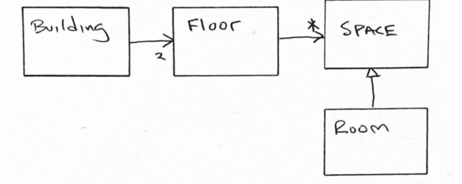

我们的任务是通过检查每个楼层空间（以及门、窗户和走廊，这些了），来确定建筑几十种不同的可评分特征。这些特征的得分是由一组 C++ 类确定的，每个类都必须遍历数据结构以执行计算。

下面是某些 Ruby 代码，显示了所有这些特征可能导致的重复。

```ruby
class SpaceFeature

  def score(building)

    spaces = 0

    building.floors.each do |floor|

      floor.spaces.each do |space|

        spaces += 1

      end

    end

    spaces

  end

end
```

```ruby
class AreaFeature

  def score(building)

    area = 0

    building.floors.each do |floor|

      floor.spaces.each do |space|

        area += space.width * space.length

      end

    end

    area

  end

end
```

你可以看出问题所在。嵌套循环是相同的，但循环体在每种情况下都是不同的。现在想象一下这种结构重复了几十次，并且带有更复杂的数据结构和遍历循环。

我们可以在现代语言中通过使用 lambda（有时称为 `block`）来解决这个问题：

```ruby
class Feature

  def do_score(building, block)

    value = 0

    building.floors.each do |floor|

      floor.spaces.each do |space|

        value = block.call(value, floor, space)

      end

    end

    value

  end

end
```

```ruby
class SpaceFeature < Feature

  def score(building)

    do_score(building, ->(value, floor, space) { return value+1 })

  end

end
```

```ruby
class AreaFeature < Feature

  def score(building)

    do_score(building, ->(value, floor, space) {

      return value + (space.width * space.length)

    })

  end

end
```

现在，遍历数据结构的循环只存在于 `Feature` 类中。如果对该数据结构进行了任何更改，可能只需要修改那一个类。具体的特征（如 `SpaceFeature` 和 `AreaFeature`）可能不受此类更改的影响。

另一种技术是使用模板方法模式（Template Method pattern）。

```ruby
class Feature

  def score(building)

    value = 0

    building.floors.each do |floor|

      floor.spaces.each do |space|

        value = score_space(value, floor, space)

      end

    end

  end

  def score_space(value, floor, space)

    raise "Not Implemented"

  end

end
```

```ruby
class SpaceFeature < Feature

  def score_space(value, floor, space)

    value+1

  end

end
```

```ruby
class AreaFeature < Feature

  def score_space(value, floor, space)

    value + (space.width * space.length)

  end

end
```

我实际上更喜欢这种方法而不是 lambda 方案——这是我们在 90 年代在 C++ 中使用的方法。那时我们称之为“只写一次循环”，因为《设计模式》一书尚未出版。

我留给你们自己去策略模式（Strategy patterns）和命令模式（Command patterns）。

### 偶然重复与本质重复

到目前为止，我们一直在讨论本质重复（essential duplication）。但有时两段代码看起来看起来是重复的，但实际上并不是。那些是偶然重复（accidental duplicates）。

本质重复是共同变化的。当其中一个变化时，它们都会发生变化。它们共同演进。

偶然重复不会共同变化。它们各自演进。因此，不将它们合并到一个公共函数中是非常重要的。

你可以通过考虑单一职责原则（SRP）来区分偶然重复和本质重复。如果两段相似的代码位于负责不同参与者（actors）的模块中，那么它们可能会分开演进，因为不同的参与者会提出不同的更改。如果你将它们提取到公共函数中，那么当你尝试满足一个参与者的需求时，你可能会破坏另一个参与者的系统。

> 参见第 19 章，“SOLID 原则”。

另一方面，如果两段相似的代码位于负责相同参与者的模块中，那么它们很可能会共同演进。如果你忘记修改其中一段，你就会破坏该参与者的系统。

### 副作用（Side Effects）

在本书第一版编写后的多年里，随着函数式编程的兴起，*副作用*（side effect）一词的定义经历了一个演变。二十年前，程序员认为带有副作用的函数有一个主要目的，但侧面又做了一些其他事情。我在第一版中使用的示例是一个函数，它检查登录密码的有效性，如果发现密码有效，则初始化当前会话。

从那时起，定义被泛化了。现在，我们将副作用定义为任何在函数执行后持续的状态更改，即使该状态更改是函数的主要意图。换句话说，带有副作用的函数是不纯的。

所以，例如如果 `pop()` 移除了栈顶部的第一个元素，那么它让 `stack` 处于一种改变的状态；该状态的改变就是副作用。

副作用为软件系统增加了复杂性，因为它们引入了一种微妙的耦合形式，称为*时间耦合*（temporal coupling）——即时间上的耦合。带有副作用的语句通过状态更改将其上方的代码分离。这种状态更改意味着代码行的顺序必须保持。

所以，你不能在打开文件之前关闭它，而且如果它已经打开，你就无法打开它。你无法在获取信号量之前释放它。你无法在分配内存块之前释放它。你无法在获得图形上下文之前之前释放它。以此此类推。

副作用通常成对出现，如 `open/close`、`seize/release` 或 `malloc/free`。一个创建一个副作用，另一个撤销它。因此，副作用就像西斯一样：“总有两个。”

### 我们不擅长此

（此处后续为原文重复的乱码内容，已按要求处理）

### 面向对象的语言

最近针对面向对象编程语言（OOPLs）的一个大槽点是，它们会产生副作用。很容易看出为什么这种抱怨会引起关注。对象是状态的容器，对象的方法往往会改变其状态，导致副作用和时间耦合。

然而，人们并不经常讨论的一个事实是，面向对象语言具有非常好的机制来抑制和隐藏副作用。例如，考虑 C++ 中这个简单且刻意的例子。

```cpp
#include <iostream>
#include <fstream>
#include <string>

using namespace std;

class LineCounter {

public:
    static int count(const char* fileName);

private:
    static int nLines;
    static istream file;
    static void initialize(const char* fileName);
    static void countTheLines();
    static int finalize();
};

int LineCounter::nLines;
istream LineCounter::file;

void LineCounter::initialize(const char* fileName) {
    nLines = 0;
    file.open(fileName);
}

void LineCounter::countTheLines() {
    string line;
    while (getline(file, line))
        nLines++;
}

int LineCounter::finalize() {
    file.close();
    return nLines;
}

int LineCounter::count(const char* fileName) {
    initialize(fileName);
    countTheLines();
    return finalize();
}
```


我希望你在这个例子中注意到的是：`LineCounter` 类中只有一个私有方法具有副作用；然而，调用这些方法的唯一公共方法并没有副作用。这意味着 `LineCounter` 的任何用户都没有暴露在时间耦合之下。假设这是一个单线程应用程序，那么副作用被完全隐藏了。

在这个例子中，我们把 `LineCounter` 用作受保护的命名空间。这里没有 `LineCounter` 对象。类只是一个允许我们隐藏导致时间耦合的变量和函数的地方。

注意我添加了单线程限制。在多线程环境中，这些静态变量可能会暴露在并发更新问题中。我们可以通过在 `count` 函数周围使用信号量来解决这个问题。或者我们可以通过删除静态变量和函数并将 `LineCounter` 类转换为真正的对象，强制用户在调用 `count` 之前创建实例来解决。

这一点在于，面向对象语言的机制提供了一种方便的方法，通过封装边界隐藏副作用，从而防止时间耦合泄漏到整个应用程序中。

## 结构化编程

1968 年，埃德格·迪克斯斯特拉（Edsger Dijkstra）写了一篇论文，在随后十年的大部分时间里都扰动了编程界。在当时，他在论文中表达的观点极具争议并引发了激烈讨论。有些人认为迪克斯斯特拉是个蠢蛋；另一些则认为他是神。

但到了 80 年代，迪克斯斯特拉关于结构化编程的简单想法被广泛接受。到了 90 年代，很难找到允许任何其他风格的语言了。

这篇论文显然是《Go To 语句是有害的》。它是作为给编辑信的形式发表在 1968 年 3 月份的《ACM 通讯》上的。标题是由当时的编辑尼克劳斯·沃尔特（Niklaus Wurth）¹给出的。而那篇论文改变了——编程的世界。

¹ Pascal 语言的发明者。

这篇论文背后的思想非常简单：所有程序都应该只使用三种控制结构：顺序、选择和迭代。

这在当时是革命性的，因为大多数编程语言使用跳转（goto）作为主要的、甚至是唯一的控制结构，而程序员已经习惯了在程序中随处跳跃。这样的程序往往会变成控制流的“乱窝”。

迪克斯斯特拉说，所有程序都应该组织为递归应用的单元，且每个单元只有一个入口和一个出口。这些单元有三种。

### 顺序 (Sequence)

| 单位 (UNIT) |
| :--- |

顺序是两个（或多个）按顺序执行的单元。每个此类单元在顶部有一个单一入口，在底部有一个单一出口。一个单元可能简单到一个语句，如 `i=0;`，也可以是它自己的单元序列。

### 选择 (Selection)

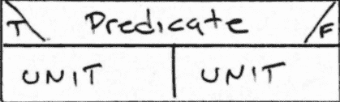

选择是一个布尔谓词，用于选择其下方的一个单元。谓词可以是任何布尔表达式，例如 `i<0`。

### 迭代 (Iteration)

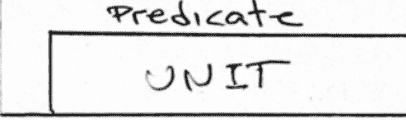

迭代是一个谓词，它执行其下方的单元直到该谓词为假。这些单元可以如下所示递归地应用于程序中。

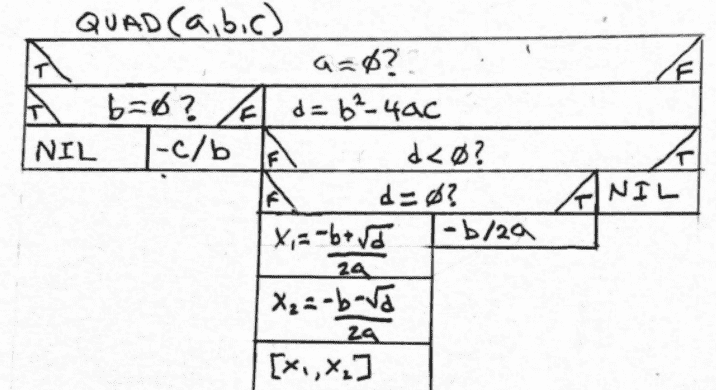

这种风格的图表被称为 Nassi-Schneiderman 流程图。图表本身描述了控制流穿过二次方程的流程……（注：此处已清理原文中后续的重复乱码并根据逻辑结束）。

二十多年前，肯特·贝克（Kent Beck）提出了一个指导本书编写的简单规则。

首先，让它运行起来。

然后，让它正确。

这条规则还有更多内容，我们稍后会讨论。现在，只需看这两行即可。我们大多数人执行第一部分是因为我们认为这是我们被雇佣的原因。我们被雇佣是为了让代码运行。但我们许多人跳过了第二部分，因为这看起来像是浪费时间。毕竟，如果我们是优秀的程序员，我们就应该一直在编写正确的代码。我们不应该停下来让它变得正确。

也许你很优秀。也许你指尖流出的代码第一次和每一次都是正确的。如果是这样，那么你可以把这本书放下了。

然而，我们的大大多数人并不特别擅长在脑中同时记住两个目标。让代码运行的首要目标挤占了让代码正确的次要目标。我们大多数人发现，让代码运行起来所需的精力是如此巨大，以至于我们没有额外的精力来同时让代码正确。

因此，当我们让代码运行起来时，代码也变成了一团糟子。这时贝克规则的第二行就派上用场了。一旦让代码运行起来，我们就有足够的精力去清理它——让它正确。

当然，我们最好有一种方法来确保在让代码正确的过程中，我们不会破坏它“可以运行”这一事实。我们的目标不是创建无法运行的整洁代码。我们该如何获得这种保证？我们该如何确保清理行为不会破坏代码？

我们将在稍后的章节中讨论测试规范。简单来说，如果我们没有一个可以快速运行、并且我们内心地信任它能证明代码运行良好的测试套件，我们是不会进行大量的清理。

整洁的代码依赖于快速、方便且全面的测试。

那么，我们如何让代码正确呢？流程是什么？它是另一个与编写代码相似的紧凑循环。

1. 我们清理一个微小点点。
2. 我们运行测试。
3. 如果测试失败，我们回滚。
4. 回到步骤 1。

这个循环的耗时通常在五秒到两分钟之间。这个循环的名字叫做*重构*（refactoring），每一个清理步骤都是*重构*。

引用马丁·福勒（Martin Fowler）的话，重构是“一种对软件内部结构进行的更改，以便使其更易理解且修改成本更低，同时而不改变其可观测的行为。”^1

^1 [Refactoring]，第 45 页。

我们应该多频繁地在编写循环和重构循环之间切换？尽可能频繁越好。这意味着存在一个外层循环，包含了“让代码运行”的循环和“让代码正确”的循环。

1. 让一个小东西运行起来。
    a. 我们编写一小段代码并带有测试。
    b. 我们编译并测试它。
    c. 如果不是太乱，回到步骤 1a。
    否则……

2. 清理它。
    a. 我们清理一个微小点点。
    b. 我们运行测试。
    c. 如果测试失败，我们回滚并进入步骤 2a。
    d. 如果还有更多需要清理，我们回到步骤 2a。
    否则……
3. 回到步骤 1。

这个循环的耗时取决于你的测试规范，大约在几分钟到一小时左右。

底线是，除非你是一个多才多艺的超级，，编写编写洁代码意味着你将坐在那个外层循环中，耐心地清理自己的烂摊子，绝不让混乱变得大到无法清理的地步。

像寿司厨师一样，永远停止制作寿司，也不停止清洁器具和环境。

## 示例

也许理解如何编写整洁代码最好的方法是观察别人如何做。因此，在本章中，我们将演示编写一个整洁模块的程序。该技术将涉及：

- TDD 测试规范
- 重构
- 设计原则
- 设计模式

我们将从一个虚拟的 Python 应用开始：针对神话国家 Bobolia 的税收计算器。我已经很久没写过 Python 了，所以请多包涵。

这是第一个测试。

```python
## bobolia_taxes_test.py

import unittest

import bobolia_taxes

class BoboliaTaxTests(unittest.TestCase):

    def test_simplest_case(self):

        tax_return = {"income": {"salary": 50000}}

        tax_calculator = bobolia_taxes.TaxCalculator(tax_return)

        self.assertEqual(7500, tax_calculator.get_tax())
```

```python
if __name__ == '__main__':

    unittest.main()
```

在 Bobolia 大国，基础税率为 15%。因此，收入为 50,000 bobbles 的人必须缴纳 7,500 bobbles 的税。注意，纳税表是一个简单的字典，包含一个 `income` 键，该键的值是另一个包含 `salary` 键的字典。

我们可以通过简单的退化模块让它通过。

```python
## bobolia_taxes.py

class TaxCalculator:

    def __init__(self, tax_return):

        self.tax_return = tax_return
```

```python
def get_tax(self):

    return 7500
```

实际上，我先是让它失败的，返回 0，然后通过返回 7500 让它通过。这就是 TDD 的方式。在我们让代码运行之前，你就能看到。我们可以通过返回 7500 让它通过，这让我们节省了很多时间。让我们看看税法。Bobolia 每年收入低于 30,000 bobbles 的公民不需要缴纳任何税。

```python
## bobolia_taxes_test.py

class BoboliaTaxTests(unittest.TestCase):

    def setUp(self):

        self.tax_calculator = bobolia_taxes.TaxCalculator()

    def test_simplest_case(self):

        tax_return = {"income": {"salary": 50000}}

        self.assertEqual(7500, self.tax_calculator.get_tax())

    def test_30k(self):

        tax_return = {"income": {"salary": 30000}}

        self.assertEqual(0, self.tax_calculator.get_tax())
```

这里并不意外。我改进了测试的名称。命名的改进通常在你更了解正在编写的程序后发生。让这些测试通过相当容易，尽管这迫使我移动了大部分旧代码。

```python
## bobolia_taxes.py

def get_tax(self, tax_return):

    total_income = tax_return["income"]["salary"]

    tax = total_income * 0.15

    after_tax_income = total_income - tax

    if after_tax_income < 30000:

        return total_income - 30000

    else:

        return tax
```

现在，让我们来谈谈社会惩罚系统。Bobolia 是一个自由的国家。我们认为邻居的一言一行都与我们无关。然而，某些行为对 Bobolia 是害的，我们认为参与这些行为的公民应该对他们造成的损害进行补偿。因此，所有公民在一年中都会获得坏习分，他们必须在纳税表中报告这些坏习分。（不要作弊！我们有办法……）

坏习分被用于计算税收。因此我们需要在纳税表中添加一个 `badbobs` 键。噢，但这意味着我们要必须回去修改所有的测试用例。

每当你需要回去修改大量的测试用例时，意味着测试设计存在缺陷。在继续之前，让我们修复这个缺陷。

```python
---bobolia_taxes_test.py---

def make_return(args):

    tax_return = {"income": {"salary": 0,

        "badobs": 0}

    tax_return.update(args)

    return tax_return
```

```python
class BoboliaTaxTests(unittest.TestCase):

    def setUp(self):

        self.tax_calculator = bobolia_taxes.TaxCalculator()
```

```python
def test_15pct_tax_rate(self):

    tax_return = make_return({"income": {"salary": 50000}})

    self.assertEqual(7500, self.tax_calculator.get_tax(tax_return))
```

```python
def test_no_tax_for_30K_and_below(self):

    tax_return = make_return({"income": {"salary": 30000}})

    self.assertEqual(0, self.tax_calculator.get_tax(tax_return))
```

```python
def test_no_after_tax_income_than_30K(self):

    tax_return = make_return({"income": {"salary": 30001}})

    self.assertEqual(1, self.tax_calculator.get_tax(tax_return))
```

```python
tax_return = make_return({"income": {"salary": 35000}})

self.assertEqual(5000, self.tax_calculator.get_tax(tax_return))
```

这个简单的更改将测试与生产环境代码的预期解耦了。`make_return` 函数将确保任何缺失的字段都获得一个合理的默认值。因此，当税单中添加新字段时，现有的测试可能就不需要更改。

现在，继续处理坏事鲍（badbob）。

购买酒类对社会有害。因此，如果你在威士忌上花费了 100 个 bobobs，你就应该获得 100 个 badobs。酒精 badobs 属于第 1 类，并将以 50% 的税率计入你的税费。因此，那瓶 100 元的威士忌在缴税时将让你额外支付 50 个 bobobs。

```python
---bobolia_taxes.py---

def make_return(args):

    tax_return = {"income": 0},

        "badobs": {"class1": ""}

    tax_return.update(args)

    return tax_return
```

```python
class BoboliaTaxTests(unittest.TestCase):

    ...

def test_class_1_badbobs(self):

    tax_return = make_return({"income": {"salary": 50000},

        "badobs": {"class1": (100,)}})
```

在编写这个测试时，我意识到放在 `make_return` 中的 badobobs 结构是不完整的。因此，我将其更改为添加类1 键以及一个空元组。
测试显示，这 100 个第 1 类 badobobs 需要额外 50 个 bobbles 的税费。让它通过很容易，但有点让人不安。

```python
---bobolia_taxes.py---

def get_tax(self, tax_return):

    total_income = tax_return["income"]["salary"]

    tax = total_income * 0.15

    after_tax_income = total_income - tax

    if after_tax_income < 30000:

        tax = total_income - 30000

    tax += sum(tax_return["badbobs"]["class1"]) / 2

    return tax
```

这个函数变得越来越混乱了。我们至少可以将其拆分成几个更get函数。

```python
---bobolia_taxes.py---

def get_tax(self, tax_return):

    total_income = tax_return["income"]["salary"]

    tax = self.determine_base_tax(total_income)

    tax += self.determine_badbob_adjustment(tax_return)

    return tax
```

```python
def determine_badbob_adjustment(self, tax_return):

    return sum(tax_return["badbobs"]["class1"]) / 2
```

```python
def determine_base_tax(self, total_income):

    tax = total_income * 0.15

    after_tax_income = total_income - tax

    if after_tax_income < 30000:

        tax = total_income - 30000

    return tax
```

这样好了一点。我不确定我为什么要把这些函数放在一个类里。这个类只是在强迫我在每个地方都加上 `self`。也许我应该去掉这个类——但我有一种直觉，这个类将会很重要，即使仅仅是为了命名空间。

也许这个类对于允许方法通过实例变量而不是参数进行通信会有用。让我们试试看。

---bobolia_taxes.py---
class TaxCalculator:

```python
def __init__(self):

    self.tax_return = None

def get_tax(self, tax_return):

    self.tax_return = tax_return

    tax = self.determine_base_tax()
```


## 税收计算重构演示

### 初始实现

```python
tax += self.determine_badbob_adjustment()

return tax
```

```python
def determine_badbob_adjustment(self):
    return sum(self.tax_return["badbobs"]["class1"]) / 2
```

```python
def determine_base_tax(self):
    total_income = self.tax_return["income"]["salary"]
    tax = total_income * 0.15
    after_tax_income = total_income - tax
    if after_tax_income < 30000:
        tax = total_income - 30000
    return tax
```

我觉得这样好了一点。我会保留这个类。

### 鲍利利亚州税收政策

鲍利利亚州（The Great State of Bobolia）认为购买汽油车辆对社会非常有害。此类购买将以每个 bobble 一个的速率获得第 2 类 badbobs。第 2 类 badbobs 根据下表增加税收：

| 第 2 类 badbobs | 总收入百分比 |
| :--- | :--- |
| 到 10,000 | 5% |
| 10,001 到 50,000 | 10% |
| 超过 50,000 | 15% |

### 测试代码演进

```python
# bobolia_taxes_test.py
def make_return(args):
    tax_return = {"income": {"salary": 0},
        "badobs": {"class1": [], "class2": []}}
    if "income" in args:
        tax_return["income"].update(args["income"])
    if "badobs" in args:
        tax_return["badobs"].update(args["badobs"])
    return tax_return

class BoboliaTaxTests(unittest.TestCase):
    ...
    def test_class_1_badbobs(self):
        tax_return = make_return({"income": {"salary": 50000},
            "badobs": {"class1": (100,)}})
        # ... logic to test
```

```python
class2_rate = 0
class2_table = ((1001, 0),
                (10001, 0.05),
                (50001, 0.1),
                ("max", 0.15))
for row in class2_table:
    if row[0] == "max" or class2 < row[0]:
        class2_rate = row[1]
        break
    return class2_rate
```

```python
def class1_adjustment(self):
    class1 = sum(self.tax_calculator.tax_return["badbobs"])
    class1_adjustment = class1 / 2
    return class1_adjustment
```

因此，我创建了表格和循环来提取税率。然后，我想整个 `badbob` 的想法应该移动到它自己的类中，以便为它提供一个命名空间。

注意这里发生的情况。生产代码正在演变和变形，变得更加通用。它的部分内容正在被剥离到它们自己的类中，并彼此分离。同时，测试正以线性方式增长。随着每个新测试用例的加入，测试类变得越来越具体。

**随着测试变得越来越具体，代码变得越来越通用。**

这种策略防止了测试了解过多生产代码的信息。当需要对生产代码进行更改时需要修改测试。

### 边界条件处理

但现在我们有一个问题。如果一个公民存钱买一辆昂贵的汽车，他们的税率可能会导致其税后收入减少远于 30,000 bobbles。从某种意义上说，这是公平的。危害社会的公民应该对这种伤害进行补偿。另一方面，强制公民每年生活低于（例如）20,000 bobbles 是残忍的。所以，让我们限制 `badbobs` 的影响，使得任何 `bobbob` 调整都不会将税后收入降低到 20,000 bobbles 以下。

```python
# bobolia_taxes_test.py
...
def test_badbobs_do_not_reduce_after_tax_income_below_20000(self):
    tax_return = make_return({"income": {"salary": 20000,
        "badbobs": {"class2": (10000)}}
    })
    self.assertEqual(0, self.tax_calculator.get_tax(tax_return))
```

这以一种意想不到的方式失败了。它返回了 –9,000 bobbles 的税。负税！我打赌公民会喜欢那个。另一方面，BRS（波波利亚税务局）将不会高兴。这是一个 bug。我通过添加一个守卫语句修复了它。

```python
# bobolia_taxes.py
...
def determine_base_tax(self):
    self.total_income = self.tax_return["income"]["salary"]
    if self.total_income <= 30000:
        return 0
```

是的，TDD 不是万灵药。你仍然会写出一些 bug。幸运的是，如这种情况所示，其他测试可能会发现这些 bug。修复这个后，我可以很容易地让测试通过。

```python
# bobolia_taxes.py
def get_tax(self, tax_return):
    self.tax_return = tax_return
    base_tax = self.determine_base_tax()
    badbob_adjustment = BadBobAdjuster(self).get_adjustment()
    total_tax = base_tax + badbob_adjustment
    after_tax_income = self.total_income - total_tax
    if self.total_income < 20000:
        return 0
    elif after_tax_income < 20000:
        total_tax = self.total_income - 20000
    return total_tax
```

我刚刚添加的两个守卫语句有点丑。我想我可以使用 `max` 函数代替。

```python
# bobolia_taxes.py
def get_tax(self, tax_return):
    self.tax_return = tax_return
    base_tax = self.determine_base_tax()
    badbob_adjustment = BadBobAdjuster(self).get_adjustment()
    total_tax = base_tax + badbob_adjustment
    after_tax_income = self.total_income - total_tax
    if after_tax_income < 20000:
        total_tax = max(0, self.total_income - 20000)
    return total_tax
```

```python
def determine_base_tax(self):
    self.total_income = self.tax_return["income"]["salary"]
    tax = self.total_income * 0.15
    after_tax_income = self.total_income - tax
    if after_tax_income < 30000:
        tax = max(0, self.total_income - 30000)
    return tax
```

这样好多了。

### 税制改革：累进税率

现在……一年过去了，每个人都在交税。但在经过了一些动乱和非常刻薄的推文后，我们决定在波波利亚大国（Great State of Bobolia），收入不平等是一种社会伤害。低收入者支付得太多，而高收入者赚了太多 bobbles，应该比收入少的人缴纳更高的税。不仅是税，而是更高的税率。我们确定下表将代表他们的公平份额：

| 收入 | 税率 |
| :--- | :--- |
| 0–30,000 | 0% |
| 30,001–100,000 | 15% 超过 30,000 的部分 |
| 100,001–250,000 | 1,500 + 20% 超过 100,000 的部分 |
| 250,001–500,000 | 4,500 + 30% 超过 250,000 的部分 |
| >500,000 | 1,500 + 40% 超过 500,000 的部分 |

当然，这改变了计算税的方式，所以我们之前的测试都需要删除。由于大多数测试都使用 50,000 工资，让我们创建一个名为 `tax_50K` 的常量，然后在所有测试中使用。如果税计算再次发生，我们只需要更改常量而不是所有的测试。

```python
# bobolia_taxes_test.py
tax_50K = 3000

class BoboliaTests(unittest.TestCase):
    def setUp(self):
        self.tax_calculator = bobolia_taxes.TaxCalculator()
        self.tax_return = None

    def make_return(self, args):
        self.tax_return = {
            "income": {"salary": 0},
            "badbobs": {"class1": (), "class2": ()}
        }
        if "income" in args:
            self.tax_return["income"].update(args["income"])
        if "badbobs" in args:
            self.tax_return["badbobs"].update(args["badbobs"])
        return self.tax_return

    def make_simple_return(self, salary):
        return self.make_return({"income": {"salary": salary}})

    def get_tax(self):
        return self.tax_calculator.get_tax(self.tax_return)

    def test_class_1_badbobs(self):
        self.make_return({"income": {"salary": 50000},
            "badbobs": {"class1": (100,)}})
        self.assertEqual(tax_50K + 50, self.get_tax())

    def test_class_2_badbob_purchases_under_10000(self):
        self.make_return({"income": {"salary": 50000},
            "badbobs": {"class2": (400, 600)}})
        self.assertEqual(tax_50K, self.get_tax())

    def test_class_2_badbob_purchases_under_10001(self):
        self.make_return({"income": {"salary": 50000},
            "badbobs": {"class2": (10000,)}})
        self.assertEqual(tax_50K + 2500, self.get_tax())

    def test_class_2_badbob_purchases_under_50001(self):
        self.make_return({"income": {"salary": 50000},
            "badbobs": {"class2": (10000, 40000)}})
        self.assertEqual(tax_50K + 5000, self.get_tax())

    def test_class_2_badbob_purchases_over_50000(self):
        self.make_return({"income": {"salary": 50000},
            "badbobs": {"class2": (10000, 40000, 100000)}})
        self.assertEqual(tax_50K + 7500, self.get_tax())

    def test_badbob_do_not_reduce_after_tax_income_below_20000(self):
        self.make_return({"income": {"salary": 20000},
            "badbobs": {"class2": (10000)}})
        self.assertEqual(0, self.get_tax())

    def test_0_30_tax_bracket(self):
        self.make_simple_return(15000)
        self.assertEqual(0, self.get_tax())
        self.make_simple_return(30000)
        self.assertEqual(0, self.get_tax())

    def test_30_100_tax_bracket(self):
        self.make_simple_return(30001)
        self.assertEqual(0, self.get_tax())
        self.make_simple_return(50000)
        self.assertEqual(tax_50K, self.get_tax())
        self.make_simple_return(100000)
        self.assertEqual(10500, self.get_tax())

    def test_100_250_tax_bracket(self):
        self.make_simple_return(100001)
        self.assertEqual(10500, self.get_tax())
        self.make_simple_return(200000)
        self.assertEqual(30500, self.get_tax())

    def test_250_500_tax_bracket(self):
        self.make_simple_return(250001)
        self.assertEqual(40500, self.get_tax())
        self.make_simple_return(500000)
        self.assertEqual(115500, self.get_tax())

    def test_500_up_tax_bracket(self):
        self.make_simple_return(500001)
        self.assertEqual(115500, self.get_tax())
        self.make_simple_return(1000000)
        self.assertEqual(315500, self.get_tax())
```

这些测试非常丑。让我们使用组合断言来清理它们。

```python
def assert_tax_with_badbobs(self, income, badbobs, tax):
    self.make_return({"income": {"salary": income},
    "badbobs": badbobs})
```


## 测试用例

```python
self.assertEqual(tax, self.get_tax())
```

```python
def test_class_1_badbobs(self):
    self.assert_tax_with_badbobs(50000,
        {"class1": (100)},
        tax_50K + 50)
```

```python
def test_class_2_badbob_purchases_under_1001(self):
    self.assert_tax_with_badbobs(50000,
        {"class2": (400, 600)},
        tax_50K)
```

```python
def test_class_2_badbob_purchases_under_10001(self):
    self.assert_tax_with_badbobs(50000,
        {"class2": (10000)},
        tax_50K + 2500)
```

```python
def test_class_2_badbob_purchases_under_50001(self):
    self.assert_tax_with_badbobs(50000,
        {"class2": (10000, 40000)},
        tax_50K + 5000)
```

```python
def test_class_2_badbobs_purchases_over_50000(self):
    self.assert_tax_with_badbobs(50000,
        {"class2": (10000, 40000, 100000)},
        tax_50K + 7500)
```

```python
def test_badbobs_do_not_reduce_after_tax_income_below_20000(self):
    self.assert_tax_with_badbobs(20000,
        {"class2": (10000)},
        0)
```

```python
def assert_tax_for(self, income, tax):
    self.make_simple_return(income)
    self.assertEqual(tax, self.get_tax())
```

```python
def test_0_30_tax_bracket(self):
    self.assert_tax_for(15000, 0)
    self.assert_tax_for(30000, 0)
```

```python
def test_30_100_tax_bracket(self):
    self.assert_tax_for(30001, 0)
    self.assert_tax_for(50000, tax_50K)
    self.assert_tax_for(100000, 10500)
```

```python
def test_100_250_tax_bracket(self):
    self.assert_tax_for(100001, 10500)
    self.assert_tax_for(200000, 30500)
    self.assert_tax_for(250000, 40500)
```

```python
def test_250_500_tax_bracket(self):
    self.assert_tax_for(250001, 40500)
    self.assert_tax_for(500000, 115500)
```

```python
def test_500_up_tax_bracket(self):
    self.assert_tax_for(500001, 115500)
    self.assert_tax_for(1000000, 315500)
```

这样好多了。如果需要，这些测试现在可以转变为参数化（表格驱动）——但我认为我们还没到那一步。

另一方面，生产环境代码急需一种表格驱动的方法。你不认为我们还没看到税率范围的尽头吧？所以让我们把它处理掉。

> ---bobolia_taxes.py---

```python
def determine_base_tax(self):
    tax_brackets = ((30000, 0),
                   (100000, .15),
                   (250000, .20),
                   (500000, .30),
                   (None, .40))

    self.total_income = self.tax_return["income"]["salary"]

    previous_maximum = 0
    offset = 0

    for maximum, rate in tax_brackets:
        if maximum is None or self.total_income <= maximum:
            return round(
                rate *
                (self.total_income - previous_maximum) +
                offset)
        else:
            offset = (maximum - previous_maximum) * rate + offset
            previous_maximum = maximum
```

好了，这样好多了。可以很容易添加任何新的税率区间。

在此时，你可能会问测试是否应该这样做。考虑一下让测试使用相同的税率表。我更倾向于让生产代码这样做。

注意四个核心类周围绘制的架构边界。同时注意，每个跨越该边界的箭头都指向内部，遵循架构的依赖规则（`Dependency Rule`）。该边界内部是系统的高层策略，外部是低层细节。`Main` 组件是系统中最低层。它创建了 `TaxBracketter` 和 `BadBobAdjuster` 的实现，并在计算任何税费之前将它们交给 `TaxCalculator`。

4 参见第 26 章，“整洁架构”。

`TaxCalculator` 使用 `Strategy`⁵ 模式将税率档计算和减分计算委托给相应的对象。策略模式的标准形式要求策略实现派生自接口。然而，在 Python 中，接口不需要作为独立的源代码实体存在。Python 是动态类型语言，因此多态分发是通过鸭子类型（`duck types`）实现的。所以，上述的“接口”只是 `TaxCalculator` 期望调用的方法签名。

⁵ [GOF95]。

## 主组件的角色由我们的团队承担。

——bobolia_taxes_test.py——

```python
def setUp(self):
    self.tax_bracketter = tax_bracketter.TaxBracket()
    self.badbob_adjuster = badbob_adjuster.BadBobAdjuster()
    self.tax_calculator = tax_calculator.TaxCalculator(
        self.tax_bracketter, self.badbob_adjuster)
    self.tax_return = None
```

`TaxCalculator` 和 `TaxReturn` 存在于自己的模块中。

——tax_calculator.py——

```python
class TaxCalculator:
    def __init__(self, tax_bracketter, badbob_adjuster):
        self.tax_bracketter = tax_bracketter
        self.badbob_adjuster = badbob_adjuster

    def get_tax(self, tax_return):
        total_income = tax_return.get_total_income()
        base_tax = self.tax_bracketter.determine_base_tax(tax_return)
        badbob_adjustment = self.badbob_adjuster.get_adjustment(tax_return)
        total_tax = base_tax + badbob_adjustment
        after_tax_income = total_income - total_tax
        if after_tax_income < 20000:
            total_tax = max(0, total_income - 20000)
        return total_tax
```

```python
class TaxReturn:
    def __init__(self, tax_return_data):
        self.tax_return_data = tax_return_data

    def get_total_income(self):
        return self.tax_return_data["income"]["salary"]

    def get_total_class1_badbobs(self):
        return sum(self.tax_return_data["badbobs"]["class1"])

    def get_total_class2_badbobs(self):
        return sum(self.tax_return_data["badbobs"]["class2"])
```

接下来是 `TaxBracker` 和 `BadBobAdjuster` 模块。

——tax_bracket.py——

```python
class TaxBracker:
    tax_brackets = ((30000, 0),
                   (100000, .15),
                   (250000, .20),
                   (500000, .30),
                   (None, .40))

    def determine_base_tax(self, tax_return):
        total_income = tax_return.get_total_income()

        previous_maximum = 0
        offset = 0
        for maximum, rate in self.tax_brackets:
            if maximum is None or total_income <= maximum:
                return round(rate *
                    (total_income - previous_maximum) +
                    offset)
            else:
                offset = (maximum - previous_maximum) * rate + offset
                previous_maximum = maximum
```

——badbob_adjuster.py——

```python
class BadBobAdjuster:
    def __init__(self):
        self.total_income = None
        self.tax_return = None

    def get_adjustment(self, tax_return):
        self.tax_return = tax_return
        self.total_income = tax_return.get_total_income()
        class1_adjustment = self.class1_adjustment()
        class2_adjustment = self.get_class2_badbob_adjustment()
        return class1_adjustment + class2_adjustment

    def get_class2_badbob_adjustment(self):
        class2 = self.tax_return.get_total_class2_badbobs()
        class2_rate = self.get_class2_rate(class2)
        return class2_rate * self.total_income

    class2_table = ((1001, 0),
        (10001, 0.05),
        (50001, 0.1),
        (None, 0.15))

    def get_class2_rate(self, class2):
        for limit, rate in self.class2_table:
            if limit is None or class2 < limit:
                return rate

    def class1_adjustment(self):
        class1 = self.tax_return.get_total_class1_badbobs()
        return class1
```

## 结论

这整洁吗？

如果你无法从一个函数中有意义地提取另一个函数，那么这个函数就只做了一件事。

好了，现在暂时忽略“有意义”这个词，思考一下这个陈述。你能反驳它吗？我觉得你不能。如果你能将一个函数分成两个，那么原始函数就做了两件事。所以，一个只做一件事的函数是你无法从中提取另一个函数的。

好了，现在，在这个语境下，“有意义”这个词是什么意思？考虑这个函数：

```java
public void addRental (Rental rental) {
    rentals.addElement(rental);
}
```

将该函数的体提取到新函数中是没有意义的：

```java
public void addRental (Rental rental) {
    doTheAdd(rental);
}

public void doTheAdd (Rental rental) {
    rentals.addElement(rental);
}
```

提取整个函数的体是没有意义的，只会留下一个纯粹的委托者。这种提取是没有意义的。²

> ² 除了在极少数情况下，你创建一个委托者是为了将提取提取的函数移动到新的模块中。

或者考虑这个函数：

```java
void clearTotals() {
  totalAmount=0;
  renterPoints=0;
}
```

将这两行提取到两个不同的函数中几乎毫无意义：

```java
void clearAmount() {totalAmount=0};
void clearPoints() {renterPoints=0};
```

这提取得过头了。`clearAmount` 和 `clearPoints` 函数的名称与它们的实现无法区分。有意义的抽象是遵循“阶降规则”（`Stepdown Rule`）的抽象，即函数的名称比实现更抽象。

我把对“有意义”一词剩下的解释留给你们。只需说，你可以提取得太少，也可以提取很多。

我们如何确保所有的函数都只做一件事呢？我们不断提取、提取，直到我们无法再有意义地提取为止。换句话说：

**提取到累倒！（`Extract till you drop!`）**

好了，也许这有点俏皮。我并不真的想让你“累倒”。另一方面，我希望你尽可能考虑所有的提取。你可能选择不执行所有的提取，但你至少应该考虑它们。

结果是，你的大部分函数将非常小。多小呢？几行。那个数字可能是三、四或六行。对于某些 `switch` 语句、某些格式化语句或在某些语言中，可能会更大。但总来说，遵循这一建议将让你创建许多小函数。

你将提取什么呢？通常你会提取 `if/else` 语句和 `for/while` 循环的体。你可能会从这些语句中提取谓词，使得这些语句几乎由关键字和函数调用组成。

例如：

```java
if (shouldDeleteRecord(r))
  deleteRecord(r);
```

如果你仔细阅读，你会发现它读起来像写得良好的散文。

## 这不应该引起争议

多年来，来自本书第一版的这条特定建议是最有争议的。但为什么呢？有很多原因。

1. 人们担心如果遵循这条规则，就会淹没在微小函数的海洋中。
2. 人们担心这条规则会模糊函数的意图，因为他们无法在一个地方看到全部。
3. 人们担心调用所有这些小函数的性能开销会使他们的应用程序运行得像冬天的糖浆一样缓慢。
4. 人们认为他们必须在函数之间跳来跳去才能理解任何东西。
5. 人们担心生成的函数纠缠得太厉害，无法独立理解。

让我们逐一解决这些问题。

### 1. 淹没

很久以前，我们的语言非常原始。例如，Fortran 的第一个版本允许你写一个函数。它并不被称为函数。它只被称为程序。没有模块，没有函数，也没有子程序。正如我所说，它是原始的。

COBOL 并不好到哪去。你可以使用 `goto` 语句从一个段落跳转到另一个段落；但带参数调用的函数想法在十年后才出现。


# 函数与模块化编程的演进

当 Algol 以及后续的 C 语言出现时，函数的思想像浪水一样向我们袭来。突然，我们可以创建可以单独编译的模块。模块化编程变得极其风靡。^3

> ^3 和软件中的所有事物一样，它被严重滥用了。有些经理坚持任何模块的长度都不超过 500 字节。有些程序员被迫在模块末尾放置一个 `goto` 以便调用它们。

随着时间的推移，随着我们的程序变得越来越大，我们开始发现函数是不够的。我们的名称开始冲突。我们很难保持它们的唯一性。我们真的不喜欢在每个名称前加上模块的名称。我的意思是，没有人喜欢 `io_files_open` 作为一个函数名。

所以我们在语言中添加了类和命名空间。这些为我们提供了精美的小格子，我们可以在其中放置函数和变量。此外，这些命名空间和类很快变成了层级结构。我们可以在嵌套的命名空间内部拥有函数。

很久以前，函数调用需要几微秒的时间。那时的机器运行很慢，因此我们对调用函数的次数非常小心。但现在，函数调用只需要几纳秒。通过提取方法，你几乎无法显著减慢应用程序的运行速度。而且，如果你的测量结果显示有变慢，你只需要将这些函数中最关键的几个重新内联（`inline`）即可。

请记住，良好的编译器通常会在你不知情的情况下为你完成这些内联操作。如果一个良好的编译器发现你只从一个地方调用了某个函数，它很可能会简单地将该调用替换为函数内部的代码。

## 4. 来回跳跃

好了，那么第 4 点：来回跳跃。我同意这一点——或者说，如果涉及的函数在代码中随机散落在各处，我会同意的。但谁会做那样呢？那太不礼貌了。

我喜欢按照调用的顺序来组织提取出的函数。所以，当一个函数调用另一个函数时，你只需要向下滚动看到被调用的函数——就在那里。如果函数 A 调用 B 和 C，那么它们在源文件中的顺序应该是 A、B、C。这有多难呢？

> ^4 在 Clojure 这样的语言中，顺序应该是 C、B、A。

所以，不，如果作者是有礼貌的，你就不会在代码内部来回跳跃。

相反，你可以顺着代码长度从高层到低层向下阅读。不仅如此，高层代码将组织并与低层代码分离——因为当你提取函数时，你几乎总是从高层代码中提取低层代码。

事实上，我会在本章后面给你展示一个例子。但我想最后说一点。

## 5. 纠缠

在所有的抱怨中，这是最合理的，也是 John Ousterhout 在附录中提出的观点。不可否认，当你从一个函数提取另一个函数时，你可能会使这些函数的逻辑纠缠。换句话说，低层函数可能独立于高层函数的操作。要理解低层函数，你必须对高层函数有良好的理解。

如果这种纠缠非常严重——即如果高层函数建立了几个不同的事实，而你在阅读低层函数时必须记住这些事实——那么很有可能这种提取并不值得一做。然而，如果纠缠微乎其微，提取出的函数有一个良好的描述性名称，而且它紧跟在父函数之后，这些事实很可能让这次提取变得值得。

或者换一种说法：这是一个主观判断。请明智地选择。

## 什么是大函数？

再次想象一下我以前的那个 `gi` 函数。假设它是用 Java 编写的，并且开头是这样的：

```java
public class GraphicInterpreter {
    public void gi() {
        int i;
        int j;
        ...
    }
}
```

当我们向下滚动查看 `gi` 函数的 3000 行代码时，我们注意到一个 `if` 语句：

我们决定将该 `if` 语句的体提取到一个新方法中。于是我们用鼠标选择语句体，并调用“提取方法”（Extract Method）菜单项。但 IDE 报错说无法提取该方法，因为代码修改了两个局部变量。如果代码只修改了一个局部变量，IDE 就可以从提取出的方法返回新值。但 IDE 没有好的方法来返回两个变量。（毕竟，这是 Java 而不是 Go）。

那么，我们该怎么办？我们如何将该 `if` 语句的体提取到一个新方法中？嗯，如果我们这样做呢：

```java
public class GraphicInterpreter {
    private int i;
    private int j;

    public void gi() {
        ...
        if (...) {
            ...
            i++;
            j++;
            ...
        }
    }
}
```

我知道你在想什么：“噢不！你把局部变量提升为实例变量了！你违反了封装！”确实，我违反了。但现在我可以将 `if` 语句的体提取到一个新函数了，因为这两个变量仍然在类的作用范围内：

```java
public class GraphicInterpreter {
    private int i;
    private int j;

    public void gi() {
        ...
        if (...) {
            f();
        }
    }

    private void f() {
        ...
        i++;
        j++;
        ...
    }
}
```

让我们继续这样做。我们发现了越来越多可以操作 `i` 和 `j` 的 `if` 和 `while` 语句体，并且是可以提取的。缩进再缩进，我们不断提取、提取、提取。结果是什么？

结果是一堆使用实例变量 `i` 和 `j` 的方法。当你有一堆操作一组变量的方法时，你称它们为什么？你称之为一个类（class），不是吗？

现在，仔细考虑一下。

每一个大函数实际上都在内部隐藏了一个类（或多个类）。

因为每个大函数都有一组局部变量和一组操作这些变量的缩进区域。这些变量实际上应该是类的字段（fields），而那些缩进区域应该是该类的方法（methods）。

但引用 George Carlin 的话，也许我走得有点太过了，有点太过了。所以让我们来看一个例子。

允许我介绍一下 Martin Fowler 第一版中的经典例子。在这里，我们用 Go 语言看到它。但你不知道，它是很久以前的。

### 测试代码：`customer_test.go`

```go
---customer_test.go---
package GoVideoStore

import (
    "testing"
)

func TestSingleRelease(t *testing.T) {
    customer := NewCustomer("Fred")
    customer.addRental(NewRental(NewRelease, 3))
    expected := "Rental Record for Fred\n\tThe Cell\t9.0\nYou earned 2 frequent points"
    if customer.statement() != expected {
        t.Errorf("Expected:\n%s\nGot:\n%s", expected, customer.statement())
    }
}

func TestDualRelease(t *testing.T) {
    customer := NewCustomer("Fred")
    customer.addRental(NewRental(NewRelease, 3))
    customer.addRental(NewRental(NewMovie, 5))
    expected := "Rental Record for Fred\n\tThe Cell\t9.0\n\tThe Movie\t15.0\nYou earned 4 frequent points"
    if customer.statement() != expected {
        t.Errorf("Expected:\n%s\nGot:\n%s", expected, customer.statement())
    }
}

func TestSingleChildren(t *testing.T) {
    customer := NewCustomer("Fred")
    customer.addRental(NewRental(NewChildren, 3))
    expected := "Rental Record for Fred\n\tThe Children\t1.5\nYou earned 1 frequent points"
    if customer.statement() != expected {
        t.Errorf("Expected:\n%s\nGot:\n%s", expected, customer.statement())
    }
}

func TestMultipleRegular(t *testing.T) {
    customer := NewCustomer("Fred")
    customer.addRental(NewRental(NewRegular, 3))
    customer.addRental(NewRental(NewRegular, 2))
    customer.addRental(NewRental(Newerhead, 3))
    expected := "Rental Record for Fred\n\tPlan from Outer Space\t9.0\n\t8 1/2\t2.0\n\tEraserhead\t4.5\nYou earned 6 frequent points"
    if customer.statement() != expected {
        t.Errorf("Expected:\n%s\nGot:\n%s", expected, customer.statement())
    }
}
```

### 生产代码：`Customer.go`

```go
// Customer.go
package GoVideoStore

import "fmt"

type Customer struct {
    name    string
    rentals []*Rental
}

func NewCustomer(name string) *Customer {
    return &Customer{name: name}
}

func (customer *Customer) addRental(rental *Rental) {
    customer.rentals = append(customer.rentals, rental)
}

func (customer *Customer) statement() string {
    totalAmount := 0.0
    frequentRenterPoints := 0
    result := "Rental Record for " + customer.name + "\n"

    for _, rental := range customer.rentals {
        thisAmount := 0.0
        switch rental.movie.contentType {
        case NewRelease:
            thisAmount += float64(rental.daysRented * 3)
        case Regular:
            thisAmount += 2
            if rental.daysRented > 2 {
                thisAmount += float64(rental.daysRented-2) * 1.5
            }
        case Children:
            thisAmount += 1.5
            if rental.daysRented > 3 {
                thisAmount += float64(rental.daysRented-3) * 1.5
            }
        }

        result += fmt.Sprintf("\t%s\t%.1f\n", rental.movie.name, thisAmount)
        totalAmount += thisAmount
        frequentRenterPoints += rental.movie.frequentEnterPoints
    }

    result += fmt.Sprintf("Amount owed is %.1f\nYou earned %d frequent points", totalAmount, frequentRenterPoints)
    return result
}
```

### 片段代码（可能为重构中间态或对比代码）

```go
}
frequentRenterPoints++
if rental.movie.movieType == NewRelease && rental.daysRented > {
    frequentRenterPoints++
}
result += fmt.Sprintf("%s\t%%.1f\n", rental.movie.title, this.
totalAmount += thisAmount
}
return result +
fmt.Sprintf(
    "Amount owed is %%%.1f\nYou earned %%d frequent renter points",
    totalAmount, frequentRenterPoints)
```

### `Rental.go`

```go
// Rental.go
package GoVideoStore

type Rental struct {
    movie       *Movie
    daysRented int
}

func NewRental(movie *Movie, daysRented int) *Rental {
    return &Rental{movie: movie, daysRented: daysRented}
}
```

### `Movie.go`

```go
// Movie.go
package GoVideoStore

const (
    Regular    int = iota
    NewRelease
    Childrens
)

type Movie struct {
    title     string
    movieType int
}

func NewMovie(title string, movieType int) *Movie {
    return &Movie{title: title, movieType: movieType}
}
```

## 重构测试：第一步攻克测试

我们要做的第一件事是攻克测试。这些测试需要更好的设计，因为这些测试简直一团糟！原因如下：

- 所有的测试都是通过 UI 进行的。字符串就是 UI，而且它们是不稳定的。营销人员会随心所欲更改这些字符串。例如，如果营销人员认为每条账单的标题应该是“Rental Statement for...” 而不是“Rental Record for...”，那么每个测试都会失败并必须修改。这使得测试变得非常脆弱。因此，我们不应该多次测试语句的格式，而应该只测试一次。其他测试应该关注计算出的值。
- 像 Fred 和 The Cell 这样的名字并没有告诉我们正在测试什么。这些名字应该更改，以帮助测试阅读者理解测试的内容。通常情况下，测试不应该包含生产数据。它们应该包含解释测试意图的数据。
- 测试太冗长。我们应该通过对电影使用一些变量并使用组合断言来稍微紧凑一下代码。

### 重构后的测试代码：`customer_test.go`

```go
---customer_test.go---
package GoVideoStore

import (
    "testing"
)

var customer *Customer
var newRelease1 *Movie
var newRelease2 *Movie
var childrensMovie *Movie
var regular1 *Movie
var regular2 *Movie
var regular3 *Movie

func setup() {
    customer = NewCustomer("Customer Name")
    newRelease1 = NewMovie("New Release 1", NewRelease)
    newRelease2 = NewMovie("New Release 2", NewRelease)
    childrensMovie = NewMovie("Children", Children)
    regular1 = NewMovie("Regular 1", Regular)
    regular2 = NewMovie("Regular 2", Regular)
    regular3 = NewMovie("Regular 3", Regular)
}

func assertStringsEqual(t *testing.T, expected string, actual string) {
    if actual != expected {
        t.Error("\nExpected:%s\nGot:%s", expected, actual)
    }
}

func assertIntsEqual(t *testing.T, expected int, actual int) {
    if actual != expected {
        t.Error("\nExpected:%d Got:%d", expected, actual)
    }
}

func assertFloatsEqual(t *testing.T, expected float64, actual float64) {
    if actual != expected {
        t.Error("\nExpected:%f Got:%f", expected, actual)
    }
}
```


## 提取与类

```go
func assertOwedAndPoints(t *testing.T, owed float64, points int) {
    customer.statement()
    assertFloatsEqual(t, owed, customer.totalAmount)
    assertIntsEqual(t, points, customer.frequentRenterPoints)
}
```

```go
func TestTotalsForOneNewRelease(t *testing.T) {
    setup()
    customer.addRental(NewRental(newRelease1, 3))
    assertOwedAndPoints(t, 9.0, 2)
}
```

```go
func TestTotalsForTwoNewReleases(t *testing.T) {
    setup()
    customer.addRental(NewRental(newRelease1, 3))
    customer.addRental(NewRental(newRelease2, 3))
    assertOwedAndPoints(t, 18.0, 4)
}
```

```go
func TestTotalsForOneChildrenMovie(t *testing.T) {
    setup()
    customer.addRental(NewRental(childrenMovie, 3))
    assertOwedAndPoints(t, 1.5, 1)
}
```

```go
func TestTotalsForManyRegularMovies(t *testing.T) {
    setup()
    customer.addRental(NewRental(regular1, 1))
    customer.addRental(NewRental(regular2, 2))
    customer.addRental(NewRental(regular3, 3))
    assertOwedAndPoints(t, 7.5, 3)
}
```

```go
func TestStatementFormat(t *testing.T) {
    setup()
    customer.addRental(NewRental(regular1, 1))
    customer.addRental(NewRental(regular2, 2))
    customer.addRental(NewRental(regular3, 3))
    assertStringsEqual(t,
        "Rental Record for Customer Name\n"+
            "\tRegular 1\t2.0\n"+
            "\tRegular 2\t2.0\n"+
            "\tRegular 3\t3.5\n"+
            "    Amount owed is 7.5\n"+
            "    You earned 3 frequent renter points,\n",
        customer.statement())
}
```

记得在关于 getter 的讨论中，我是通过将一些局部变量移动到所属类的字段中来破坏封装的吗？我对测试所做的更改导致我对生产代码也做了同样的事情。我将 `totalAmount` 和 `frequentRenterPoints` 局部变量移动到了 `Customer` 类的实例变量。

```go
// Customer.go
package GoVideoStore

import "fmt"

type Customer struct {
    name                 string
    rentals              []*Rental
    totalAmount          float64
    frequentRenterPoints int
}

func NewCustomer(name string) *Customer {
    return &Customer{name: name}
}

func (customer *Customer) addRental(rental *Rental) {
    customer.rentals = append(customer.rentals, rental)
}

func (customer *Customer) statement() string {
    customer.clearTotals()
    return customer.makeHeader() + customer.makeDetails() + customer.makeFooter()
}

func (customer *Customer) clearTotals() {
    customer.totalAmount = 0.0
    customer.frequentRenterPoints = 0
}

func (customer *Customer) makeHeader() string {
    return "Rental Record for " + customer.name + "\n"
}

func (customer *Customer) makeDetails() string {
    rentalDetails := ""
    for _, rental := range customer.rentals {
        rentalDetails += customer.makeDetail(rental)
    }
    return rentalDetails
}

func (customer *Customer) makeDetail(rental *Rental) string {
    amount := customer.determineAmount(rental)
    customer.frequentRenterPoints += customer.determinePoints(rental)
    customer.totalAmount += amount
    return customer.formatDetail(rental, amount)
}

func (customer *Customer) determineAmount(rental *Rental) float64 {
    amount := 0.0
    switch rental.movie.movieType {
    case NewRelease:
        amount += float64(rental.daysRented * 3)
    case Regular:
        amount += 2
        if rental.daysRented > 2 {
            amount += float64(rental.daysRented-2) * 1.5
        }
    case Children:
        amount += 1.5
        if rental.daysRented > 3 {
            amount += float64(rental.daysRented-3) * 1.5
        }
    }
    return amount
}

func (customer *Customer) determinePoints(rental *Rental) int {
    if rental.movie.movieType == NewRelease && rental.daysRented > 1 {
        return 2
    }
    return 1
}

func (customer *Customer) formatDetail(rental *Rental, amount float64) string {
    return fmt.Sprintf("%s\t%.1f\n", rental.movie.title, amount)
}

func (customer *Customer) makeFooter() string {
    return fmt.Sprintf("Amount owed is %.1f\n"+
        "You earned %d frequent renter points",
        customer.totalAmount, customer.frequentRenterPoints)
}
```

其他函数，在它们那里不会让你分心。如果你被要求修复此语句页脚中的一个 bug，你现在确切知道该去哪里了：`makeFooter` 函数。

这段代码很有礼貌。它之所以礼貌，是因为当可怜的读者查看它时，几乎不需要解码。读者不需要反复推敲和思考字符串、变量以及循环和 if 语句。相反，读者看到的是一个简单的策略陈述，并有指向他们可能遇到的任何问题的解答的方向。

由于这段代码是有礼貌的，可以说原始代码是无礼的。而我们不想无礼的，对吧？

让我们继续。看出如何 `clearTotals` 非常容易。如何制作页眉和页脚也显而易见。制作细节只需要对所有租赁进行循环，并简单地调用 `makeDetail`。

如何制作细节呢？你确定金额，然后确定积分，最后格式化细节。天哪！还能多直观吗？

格式化细节非常显而易见。但那两个确定函数有点问题。

仔细查看所有这些方法。第一个参数总是 `customer *Customer`。这只是 Go 的表达方式，表示该函数是 `Customer` 类的一部分。现在看所有函数的体。注意看，除了 `formatDetail`、`determineAmount` 和 `determinePoints` 之外，它们都使用了 `customer` 参数。我们稍后会处理 `formatDetail`。现在，这两个函数中有大量代码并没有处理它们所属的 `Customer` 类。所以……也许它们并不属于那个类。

还有什么被传递到这些 `determine` 函数中呢？租赁（Rental）！所以这两个 `determine` 函数可能属于 Rental 类。让我们把它们移动到那里。

```go
// Customer.go
func (customer *Customer) makeDetail(rental *Rental) string {
    amount := rental.determineAmount()
    customer.frequentRenterPoints += rental.determinePoints()
    customer.totalAmount += amount
    return customer.formatDetail(rental, amount)
}
```

```go
// Rental.go
package GoVideoStore

type Rental struct {
    movie      *Movie
    daysRented int
}

func (rental Rental) getTitle() string {
    return rental.movie.title
}

func (rental Rental) determineAmount() float64 {
    amount := 0.0
    switch rental.movie.movieType {
    case NewRelease:
        amount += float64(rental.daysRented * 3)
    case Regular:
        amount += 2
        if rental.daysRented > 2 {
            amount += float64(rental.daysRented) * 1.5
        }
    case Children:
        amount += 1.5
        if rental.daysRented > 3 {
            amount += float64(rental.daysRented-3) * 1.5
        }
    }
    return amount
}

func (rental Rental) determinePoints() int {
    if rental.movie.movieType == NewRelease && rental.daysRented > 1 {
        return 2
    }
    return 1
}

func NewRental(movie *Movie, daysRented int) *Rental {
    return &Rental{movie: movie, daysRented: daysRented}
}
```

测试仍然通过，没有任何变化。测试完全不知道这种设计上的根本性变化已经发生。这意味着测试的设计是可以容忍变化的！

然而，发生了一些更神奇的事情。所有原本在客户类中的业务规则都逃亡到了 Rental 中。Customer 类现在完全关于账单的格式化——除了少数求和外，业务计算现在都在 Rental 中完成了。

这让人们疑问为什么客户类被命名为那个名字。它不再关于客户了——如果它曾经关于过的话。现在它完全关于租赁账单。所以它的名字应该叫这个：RentalStatement。

```go
// RentalStatement.go
type RentalStatement struct {
    name                 string
    rentals              []*Rental
    totalAmount          float64
    frequentRentalPoints int
}
```

但现在让我们考虑那个 Rental 类。确定函数与 Rental 类有强耦合，因为我们同时使用了 `movie` 和 `daysRented` 字段。这表明了很强的内聚性。然而，确定函数与 Movie 类也有非常强的耦合，这有点令人困扰。

与 Movie 的耦合完全是关于 `movieType`。那个 `type` 字段被用于选择计算金额和积分的各种业务规则。那么，为什么 `type` 字段和常量要在 Movie 类中呢？

原始测试包含一个线索。如果你回过头，你会发现《虎虎电影》既被视为新片（NewRelease）又被视为儿童电影（Children）。这表明电影可以先作为新片被租赁，稍后又作为儿童电影被租赁。这表明 `type` 字段实际上属于 Rental。让我们试一下。

```go
// Rental.go
type Rental struct {
    movie       *Movie
    daysRented  int
    rentalType  int
}

const (
    Regular    int = iota
    NewRelease
    Children
)

func NewRental(movie *Movie, rentalType int, daysRented int) *Rental {
    return &Rental{
        movie:      movie,
        rentalType: rentalType,
        daysRented: daysRented,
    }
}
```

```go
// Movie.go
package GoVideoStore

type Movie struct {
    title string
}

func NewMovie(title string) *Movie {
    return &Movie{title: title}
}
```

`RentalStatement` 类只负责账单的格式化——这就是为什么 `FormatDetail` 函数属于它的原因，尽管它没有使用 `RentalStatement` 的任何字段。

现在，让我们考虑一下我们刚刚所做的。下面的图展示了重构前后的对比。

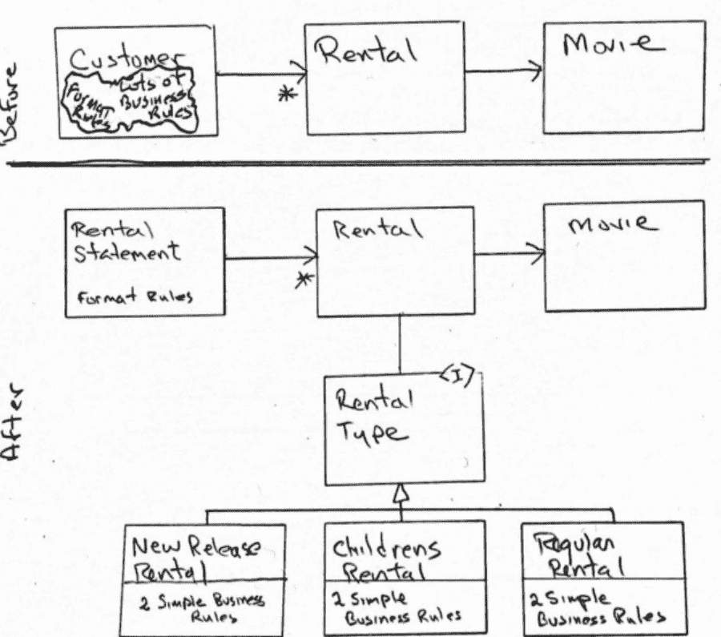

我们的清理程序提取了业务规则，并将它们与格式化规则分离开。然后，它将这些业务规则首先移动到 `Rental` 中，然后将它们拆解到多态层次结构中。太棒了！在这一切过程中，我们发现名称和概念是错误的——这非常典型。当你清理代码时，你就能看到那些之前被隐藏的东西。

最后，请注意在 `RentalType` 下方形成了一个架构边界。我没有画出它，但你应该能够感知到它。所有那些微小的业务规则细节都与 `RentalStatement` 和 `Rental` 中的高层策略隔离开了。现在当需求变化时，我们可以添加许多新的 `RentalTypes`；而这些代码都不需要为了这些变化而进行更改。这就是开闭原则（OCP）的应用。

所以，记得我说过大函数总是隐藏着类吗？这就是我们在这里发现的。原始代码中的一个大型语句函数被拆分并分布到了三个新类和一个现有的类中。

**Bob：** Robert Laszczak 恰好浏览 GitHub 时看到了上述拙劣的 Golang 尝试。他友好地提供了一个博客，对这个示例进行了改进，使其更符合常见的 Golang 风格。你可以在 treads.tech/clean-code/ 查看。对于我来说，作为一个 Golang 新手，我同意他的大部分更改，但我更倾向于保持名称长一点，并并在 getter 方法前加上 `get` 前缀。


考虑以下用于求解二次方程的 Java 代码。该类仅仅是 `solve` 函数的一个方便的命名空间。

```java
import java.util.Arrays;
import java.util.List;
import static java.util.Arrays.asList;

public class QuadraticFormula {
    public static List<Double> solve(double a, double b, double c) {
        if (a == 0) {
            if (b == 0) {
                return asList();
            }
        } else {
            double d = b * b - 4 * a * c;
            if (d > 0) {
                double sqrt = Math.sqrt(d);
                double x1 = (-b + sqrt) / (2 * a);
                double x2 = (-b - sqrt) / (2 * a);
                return asList(x1, x2);
            } else if (d == 0) {
                return asList(-b / (2 * a));
            } else {
                return asList();
            }
        }
    }
}
```

这段代码非常直观，但让我们假定它比显示的更复杂、更深入。我们还假设它会随着时间的推移而增长。我们可以通过几次简单的提取和一些重命名来提高可读性。

```java
import java.util.List;
import static java.util.Arrays.asList;

public class QuadraticFormula {
    public static List<Double> solve(double a, double b, double c) {
        if (a == 0) {
            return linearSolution(b, c);
        }
        return quadraticSolution(a, b, c);
    }

    private static List<Double> linearSolution(double b, double c) {
        if (b == 0) {
            return new ArrayList();
        }
        return new ArrayList(-c / b);
    }

    private static List<Double> quadraticSolution(double a, double b, double c) {
        double discriminant = b * b - 4 * a * c;
        if (discriminant < 0) {
            return complexSolution();
        }
        if (discriminant == 0) {
            return singleQuadraticSolution(a, b);
        }
        return twoQuadraticSolutions(a, b, discriminant);
    }

    private static List<Double> complexSolution() {
        return new ArrayList<>();
    }

    private static List<Double> singleQuadraticSolution(double a, double b) {
        return new ArrayList(-b / (2 * a));
    }

    private static List<Double> twoQuadraticSolutions(double a, double b, double discriminant) {
        double sqrtd = Math.sqrt(discriminant);
        double x1 = (-b + sqrtd) / (2 * a);
        double x2 = (-b - sqrtd) / (2 * a);
        return asList(x1, x2);
    }
}
```

现在，为了论证起见，我们假定这是一个复杂且可能增长的系统。我希望你同意，提取操作为代码增加了组织性，可能让复杂的内容变得更容易易读。但这样做之后，我们错失了利用类的机会。与其在函数之间传递参数，不如将这些值加载到类中。

然而，记住你刚刚看到的。正是通过在“视频商店”示例中提取所有这些方法，我们才发现代码中的某些部分并不属于它们所属的类。在进行这些提取之前，这一点并不是显而易见的。所以，如果你打算让函数保持得大一些，请确保不要错过这类机会。事实上，你可能会发现，先进行提取，然后在确定所有内容实际归属位置后，进行一些策略性的内联（`inlining`）是值得的。

但记住，当你内联一个函数时，你就销毁它的名称。

## 第 11 章 要有礼貌


我们希望我们的模块是有礼貌的。有礼貌的模块遵循 Ward Cunningham（沃坎宁）对整洁的定义。当你阅读代码时，发现它“正如你预期的那样”。模块是函数和变量的边界集合。它可能由一个类、几个类或完全没有类组成。重要的是函数和变量。一个模块也可能包含在一个源文件或多个源文件中。重要的是函数和变量的内聚性，而不是分隔它们的人为边界。模块的另一个常用词是组件（`component`）。

如果你遵循大致类似于“提取到无法提取”（`Extract Till You Drop`）的原则，你的模块将由几个公共函数和从这些公共函数中提取出的许多私有函数组成。同样，这些可以被组织成类，使得你的模块包含几个公共类和几个私有类。

公共函数（可能组织成公共类）代表你的模块的接口。私有函数（可能组织成私有类）代表你的模块的实现。

借用 John Ousterhout 优秀著作《软件设计哲学》（*A Philosophy of Software Design*）中的一个概念：模块具有狭窄的接口和深度实现——这是一件好事。[APOD]。

现在，选取其中一个公共函数。它在模块的最高层执行一项任务。该函数的名称应该用抽象的术语标识该任务。例如，考虑上一章中 `RentalStatement` 类中的 `makeStatement` 函数。

```go
func (statement *RentalStatement) makeStatement() string {
    statement.clearTotals()
    return
    statement.makeHeader() +
statement.makeDetails() +
statement.makeFooter()
}
```

该函数的名称是抽象的。它告诉你是做什么的，但没有告诉你是怎么做的。查看 `makeStatement` 函数内部，我们看到了四个从它提取出来的私有函数调用。这些名称中的每一个也是抽象的，但级别比 `makeStatement` 低。让我们来看看 `clearTotals`。

```go
func (statement *RentalStatement) clearTotals() {
statement.totalAmount = 0.0
statement.frequentRenterPoints = 0
}
```

我们无法再继续下去了。我们已经到达了函数调用链的末尾。`clearTotals` 的实现精确地告诉我们是如何清除总数的，极其详尽。没有更有意义的更低层次可以进入。

相反来看 `makeDetails`。

```go
func (statement *RentalStatement) makeDetails() string {
rentalDetails := ""
for _, rental := range statement.rentals {
rentalDetails += statement.makeDetail(rental)
}
return rentalDetails
}
```

这个函数的名称告诉我们它在这一抽象级别上在做什么。它的实现创建了一个循环，调用了另一个私有方法 `makeDetail`，该方法的抽象级别又低一级。

因此，每个公共函数都会创建一个指向更低抽象级别的私有函数调用树。

在这里，我们再次看到了“阶降规则”（`The Stepdown Rule`）。每一个这样的向下调用都下降一级。不是两级，不是三级。只有一级。这就是为什么 `makeDetails` 内部的循环体调用了下一个函数。如果我把 `makeDetail` 的实现放在 `makeDetails` 内部，那么 `makeDetails` 将至少包含两个抽象级别。

我总是遵循那个规则吗？不，有时我允许一个函数内有两个抽象级别。但通常认为认为是不礼貌的。

## 报纸比喻

想象一篇写得很好的报文章。你垂直阅读它。在顶部，你期望有一个标题，它会告诉你故事的主题，并让你决定是否是你想读的内容。第一段给了你整个故事的摘要，在隐藏所有细节的同时，提供了宏观的概念。随着你继续向下，细节会增加，直到你拥有所有的日期、姓名、引用、主张和其他细微之处。

我们大多数人从从未读过整篇文章。我们从标题开始，如果它有趣，我们就继续读。如果那段吸引了我们，我们就继续读。我们保持在那个简单的循环中：

```go
while (interested) readMore;
```

一旦文章变得无聊，我们就停止。允许我们使用该循环的文章是有礼貌的——它们让我们提前离开。强迫我们浪费时间阅读大量不必要细节的文章是不礼貌的。

报纸由许多文章组成；大部分非常短。有些长一点。极少数包含大量一页纸能容纳的内容。这使得报纸变得可用。如果报纸只是一个包含杂乱无章的事实、日期和姓名的长故事，我们根本不会读它。

我们希望模块的源代码像报文章一样。模块的名称应该简单但具有解释性。名称本身应该足以告诉我们是否在正确的模块中。某些语言（如 Clojure）反转了这种顺序。因此，低级细节位于顶部。

## 单一职责原则 (SRP)

要有礼貌

当你编写封装单一抽象层级的函数时，它让读者提前离开。他们不需要阅读大量代码来理解它是做什么。例如，我认为上面的 `makeStatement` 函数是有礼貌的。函数的名称告诉读者它在做什么。

现在考虑 `makeStatement` 演变之前的代码。

```go
func (customer *Customer) statement() string {
	totalAmount := 0.0
	fenterPoints := 0
	result := "Rented for " + customer.name + "\n"
	for _, rental := range customer.rentals {
		thisAmount := 0.0
		switch rental.movieType {
		case NewRelease:
			thisAmount += float64(rental.daysRented * 3)
		case Regular:
			thisAmount += 2
			if rental.daysRented > 2 {
				thisAmount += float64(rental.daysRented-2) * 1.5
			}
		case Children:
			thisAmount += 1.5
			if rental.daysRented > 3 {
				thisAmount += float64(rental.daysRented-3) * 1.5
			}
		}
		if rental.movieType == NewRelease {
			fenterPoints++
		}
		if rental.movieType == NewRelease && rental.daysRented > 5 {
			fenterPoints++
		}
		result += fmt.Sprintf("%s\t%.1f\n", rental.movie.title, thisAmount)
		totalAmount += thisAmount
	}
	return result +
		fmt.Sprintf("Amount owed is: %.1f\nYou earned %d frequent points", totalAmount, fenterPoints)
}
```

我认为这段代码是不礼貌的。我认为作者是不体贴的。为了理解这段代码的高层意图，我必须处理所有的低级细节——这需要时间。

换种方式想。假设你正在某处阅读代码，遇到了对礼貌的 `makeStatement()` 的调用。函数的名称告诉它是什么，也许你想检查语句是否包含页脚。于是你跳转到 `makeStatement` 的实现，看到了四行简单的代码，准确地告诉了你需要的信息。两秒后，你回到原来的地方继续阅读，没有任何中断感——只是一个简单问题的提出和解答。

该函数构建了该语句。再次，你不确定该语句是否包含了页脚。于是你点击进入实现部分，面对的是 30 行极其详尽的代码。页脚在里面吗？构建页脚的代码是在正确的时间被调用吗？一分钟或两分钟后，你确认了页脚是完整无缺的，但现在你已经忘记了为什么要担心它。你点回原来的地方，发现自己丢失了思路，必须回溯几行代码，再花上几分钟，才能想起自己正在做什么，并在脑海中重新构建思路。

这太不礼貌了。这就像一个人突然冲进你的隔间，向你抛出一个问题，而不等你回应就此离开一样。

## 降阶规则（The Stepdown Rule）

因此，为了礼貌，我喜欢遵循的规则是一次下降一个抽象级别。每个函数都有一个名称，定义了该函数的功能；每个函数由一组描述实现的代码行组成，且这些行都处于相同的抽象级别。这些行中的每一行，如果它尚未处于最低层，就会调用下一层的函数。

你如何确定一个抽象级别有多大？对于这一点，我只能说要根据你最好的判断。对我来说，这很简单。如果我能进行有意义的提取，我就进行提取并检查它是否合逻辑。

这是一种礼貌的做法，它有助于避免“抽象过山车”。

## 抽象过山车（The Abstraction Roller Coaster）

再次看看那个不礼貌的 30 行语句的函数。在最顶部，为什么 `totalAmountFrequentEnterPoints` 需要被置零？我们在做什么？这是一个高层函数的第一行，而我们面对的却是最低级别的细节。然后，我们向上跳了一层来处理结果（我们必须从头文件中推断出结果），接着是一个循环。循环的第一行立即下降到另一个低层级细节，然后进入一个 `switch` 语句。

你能感受到那种过山车的感觉吗？我们在不同的抽象级别之间起起伏伏。有时我们处于高位，比如当我们设置遍历租赁的循环时；有时我们处于低位，比如当我们清零总和并检查 `switch` 语句中的单个情况时。

对于读者来说，乘坐那样的过山车并不好玩。原因很简单：每当你从一行高层代码跳转到一行低层代码时，你就必须将你的心理模型推入心理栈，以处理那个低层级的关注点。一旦你理解了它，再将你的心理栈弹出，回到刚才离开的地方继续。

问题在于，我们并没有一个心理栈。当我们把思路拨到一边去处理细节时，大多数情况下我们会丢失那段思路。再次强调，这就像那个冲进你隔间并对你大叫的家伙。

## 我们是这样写代码的但这不是我们想要阅读的方式

问题在于，我们在过山车上写代码。我们都是如此。我们都必须如此。想象一下写最初那个不礼貌的语句函数的人。也许他们写的第一行是循环，但随后他们想起需要清零 `totalAmount`。稍后，在写完 `switch` 语句后，他们意识到需要处理频繁访问积分，于是回到顶部添加了那行代码。

简而言之，我们通过在起伏不定的抽象与细节轨道上穿行来构建代码。我们的代码看起来就像过山车。而这正是 Kent Beck 的建议变得至关重要的时刻：

首先，完成它（`First, make it done`）。然后，让它正确（`Then, make it right`）。

代码运行通并不意味着你完成了。只有当你提取、组织并布局了从公共函数向下延伸的函数树，且这种布局对读者方便时，你才算完成。

现在，我我并不是盲信或教条化地遵循这些规则。在某些情况下，遵循这些规则是不恰当的。但这些规则是我的默认选择。除非我有充分理由不遵守，否则我会遵循它们。

# 第 12 章：对象与数据结构


Niklaus Wirth 曾写过一本非常棒的书，名为《算法 + 数据结构 = 程序`¹`。尽管并非他的本意，但这个标题非常准确地捕捉到了面向对象编程背后的核心概念：函数与它们所操作的数据之间存在着深层的关系。

+ 1 [A+DS=P]。

面向对象是由 Ole-Johann Dahl 和 Kristen Nygaard 在 60 年代中期至后期通过他们语言的逐渐演变而发明/发现的，并在 Simula 67 中达到顶峰。Bjarne Stroustrup 和 Alan Kay 都在 70 年代初使用过 Simula 67，然后分别在 C++ 和 Smalltalk 中扩展了这些思想。

+ ^2 这项发明的历史非常迷人。我在《我们程序员》（We Programmers）中写过它。


从那里开始，C++ 演变成了 Java 和 C#，然后是 Go；而 Smalltalk 演变成了 Objective-C、Ruby 和 Python。这两条演进路线都相互借鉴，导致了大量的交叉演化。今天，我们几乎所有的语言在某种意义上都是面向对象的。

## 什么是对象？

对象是一个由专用函数操作的数据包，其中其中一些函数是公共的。从外部向内部看，只有公共函数是可见的³。对象内部的数据结构是被隐藏的。

+ ^3 某些语言通过 `public` 和 `protected` 等关键字来强制可见性。

面向对象的程序由一组这样的对象组成，每个对象都有自己的职责，并通过传递消息与其他对象协作。Alan Kay 曾用生物学类比想象过这一点——一组不知道对方内部的细胞。它们只发送消息，而不期待答案。消息传递的概念是组织行为的一种非常强大的原则。如果你只告诉对象做什么，而不询问对象任何信息，那么对象中的数据对你来说就是无关的。在软件中避免所有查询是不可能的；但正如我们看到的，是有方法的。

1970 年，Edgar Codd 发表了《大型共享数据库的数据关系模型》。从这里，他、Raymond Boyce 和 Chris 推导出了目前驱动所有关系数据库的概念。核心概念是数据结构是关键且可见的，而所有使用它的程序都屈从于它。

> 4 Communications of the ACM 13, no. 6 (June 1970), 377–388.

大型数据库是一个复杂的分散数据结构，而操作它的程序仅仅是围绕它的仆人。数据库的模式（schema）支配着这些程序。

这是 OOP 的相反。回顾一下：对象是一组带有深层隐藏数据的公共函数。是一组没有内在函数的公开数据结构。再次，它们几乎是对立的。而且，正如我们所看到的，这种对立性非常深远。

## 数据抽象

我们倾向于将变量私有化是有的。我们不希望他人依赖它们。我们希望保留随心所欲更改其类型或实现的自由。那么，为什么许多程序员会自动为他们的对象添加 getter 和 setter，将它们的私有变量像公共变量一样暴露出来？

考虑下面的 Point 1 和 Point 2 的区别。它们都代表笛卡尔平面上的点数据。然而，一个暴露了实现，而另一个完全隐藏了它。

```java
// Point 1
public class Point {
    public double x;
    public double y;
}
```

```java
// Point 2
public interface Point {
    double getX();
    double getY();
    void setCartesian(double x, double y);
    double getR();
    double getTheta();
    void setPolar(double r, double theta);
}
```

点 2 的妙之处在于，你无法判断其实现是基于直角坐标系还是极坐标系。它可能两者都不是！该接口代表了一个抽象的数据结构。我们可以知道那里一定有一个数据结构，但我们不知道该数据结构的具体形式。

但点 2 代表的不仅仅是一个数据结构。它还代表了行为策略。尽管 getter 方法允许你访问单个坐标值，但这两个 setter 方法强制执行了一项策略：即两个坐标值必须作为一个原子操作被一起设置。

相比之下，点 1 显然是在直角坐标系中实现的，它迫使我们独立地操作坐标值。即使变量是私有的，且我们使用了单变量的 getter 和 setter，这依然暴露了实现细节。

隐藏实现细节不仅仅是在变量之间放置一层函数那么简单。隐藏实现关乎抽象！类并不仅仅简单地通过 getter 和 setter 将其变量暴露出去。相反，它暴露了抽象接口，允许用户操作数据的本质，而无需知道这些数据是如何实现的。

考虑下方的 Vehicle 1 和 Vehicle 2。第一个使用具体的术语来通信车辆的油位，而第二个则使用百分比的抽象来表示。在具体的情况下，你可以相当确定这些仅仅是变量的访问器。在抽象的情况下，你对数据的形式一无所知。

```java
// Vehicle 1
public interface Vehicle {
    double getFuelCapacityInGallons();
    double getGallonsOfGasoline();
}
```

```java
// Vehicle 2
public interface Vehicle {
    double getPercentFuelRemaining();
}
```

在上述两种情况下，第二种方案都是优的。我们不希望暴露数据的细节。相反，我们希望用抽象的术语来表达我们的数据。这不仅仅通过使用接口和/或 getter 和 setter就能实现的。深思考表示对象所包含数据的最佳方式。最糟糕的选择就是草率地添加 getter 和 setter。

## 数据/对象的非对称性

这两个例子展示了对象与数据结构之间的区别。对象在抽象之后隐藏数据，并暴露操作这些数据的函数。数据结构则暴露其数据，并且没有有意义的函数。回去重读一遍。注意这两个定义的互补性。它们是虚拟的对立面。这种差异可能看似微不足道，但具有深远的影响。

例如，考虑下方的过程化形状（Procedural Shapes）示例。`Geometry` 类对三个形状类进行操作。形状类是没有任何行为的简单数据结构。所有的行为都在 `Geometry` 类中。

### 过程化形状

```java
public class Square {
    public Point topLeft;
    public double side;
}

public class Rectangle {
    public Point topLeft;
    public double height;
    public double width;
}

public class Circle {
    public Point center;
    public double radius;
}

public class Geometry {
    public final double PI = 3.141592653589793;

    public double area(Object shape) throws NoSuchShapeException {
        if (shape instanceof Square) {
            Square s = (Square)shape;
            return s.side * s.side;
        }
        else if (shape instanceof Rectangle) {
            Rectangle r = (Rectangle)shape;
            return r.height * r.width;
        }
        else if (shape instanceof Circle) {
            Circle c = (Circle)shape;
            return PI * c.radius * c.radius;
        }
        throw new NoSuchShapeException();
    }
}
```

面向对象的程序员可能会对此嗤之以鼻，并抱怨它是过程化的——他们是对的。但这种嘲笑可能并不必要。考虑如果在 `Geometry` 中添加一个 `perimeter()` 函数会怎样。形状数据结构不受影响！任何依赖于这些形状的模块也不会受影响！另一方面，如果我添加一个新形状，我必须更改 `Geometry` 中的所有函数来处理它。再次重读一遍。当你添加一个新函数时，数据结构保持不变；但当你添加一个新的数据结构时，函数就必须更改。

现在考虑面向对象的（oo）形状示例。在这里 `area()` 方法是多态的。不需要 `Geometry` 类。所以，如果我添加一个新形状，现有的函数都不会受到影响，但如果我添加一个新函数，所有的形状都必须更改！5

丰富的面向对象设计师周知规避问题的方法：例如访问者模式（Visitor）或双重分发（dual-dispatch）。但这些技术也有它们自己的代价，并且通常会将结构变回到过程化程序的形式。

### 面向对象形状

```java
public class Square implements Shape {
    private Point topLeft;
    private double side;
    public double area() {
        return side*side;
    }
}
```

```java
public class Rectangle implements Shape {
    private Point topLeft;
    private double height;
    private double width;

    public double area() {
        return height * width;
    }
}
```

```java
public class Circle implements Shape {
    private Point center;
    private double radius;
    public final double PI = 3.141592653589793;
    public double area() {
        return PI * radius * radius;
    }
}
```

我们再次看到了这两个定义的互补性；它们是虚拟的对立面！这揭示了对象与数据结构之间根本性的二分法。

这两段代码是否违反了德梅特律（Law of Demeter）？显然，包含它的模块知道 `ctxt` 对象包含 `options`，`options` 包含一个临时存目录，而该目录有一个绝对路径。对于一个函数来说，这知道太多了。调用函数知道如何遍历许多不同的对象。

这是否违反了德梅特律取决于 `ctxt`、`Options` 和 `ScratchDir` 是对象还是数据结构。如果它们是对象，那么它们的内部结构应该是隐藏而不是暴露，因此对其内部结构的了解显然违反了德梅特律。相反，如果 `ctxt`、`Options` 和 `ScratchDir` 只是不带行为的数据结构，那么它们自然会暴露其内部结构，因此德梅特律并不适用。

上述示例中访问器的使用混淆了问题。如果代码写成如下所示，我们可能就不会担心违反德梅特律了。

```
final String outputDir = ctxt.options.scratchDir.absolutePath;
```

如果我们采用这样一种约定，即数据结构具有公共变量且没有函数，而对象具有私有变量和抽象实现的公共函数，那么这个问题就不会那么令人困惑了。

## 混合体 (Hybrids)

这种混淆有时会导致不幸的混合结构，半是对象半是数据结构。它们既有执行重大操作的函数，也有公共变量或公共访问器和修改器，这些东西在任何意义上都使私有变量变成了公有，诱使其他外部函数像过程化程序使用数据结构那样使用这些变量。

⁸ 在《重构》（Refactoring）中有时被称为“特征嫉妒”（feature envy）。

这种混合体使得添加新函数变得困难，同时也使得添加新数据结构变得困难。它们是两者中最糟糕坏的。它们表明设计混乱，其作者不确定——或者更糟，是不知道——他们是否需要来自函数或类型的保护。

## 隐藏结构 (Hiding Structure)

如果 `ctxt`、`options` 和 `scratchDir` 是具有真实行为的对象怎么办？那么，由于对象应该隐藏其内部结构，我们就不应该遍历它们。那么，我们该如何获取临时目录的绝对路径呢？

```
ctxt.getAbsolutePathOfScratchDirectoryOption();
```

或者

```
ctx.getScratchDirectoryOption().getAbsolutePath()
```

第一种方案可能导致 `ctxt` 对象中方法的爆炸。第二种方案假设 `getScratchDirectoryOption()` 返回的是一个数据结构而不是对象。这两种感觉都不好。

如果 `ctxt` 是一个对象，我们应该告诉它去做某些事，而不应该询问它的内部实现。我们为什么想要临时目录的绝对路径？我们打算用它做什么？考虑来自同一个模块（很多行之后）的这段代码：

```
String outFile = outputDir + "/" + className.replace('.', '/', '/') + "";
FileOutputStream fout = new FileOutputStream(outFile);
BufferedOutputStream bos = new BufferedOutputStream(fout);
```

不同粒度的细节混合在一起令人不安。点、斜杠、文件扩展名和 `File` 对象不应该如此随意地混合在一起，并与周围的代码混合。然而，忽略这一点，我们看到获取临时目录绝对路径的意图是创建一个给定名的临时文件。

那么，如果我们告诉 `ctxt` 对象执行这样做呢？

```
ctxt.createScratchFileStream(className);
```

这似乎是一个对象可以做的事情！这允许 `ctxt` 隐藏其内部实现，并防止当前函数为了不违反德梅特律而去遍历它不应该知道的对象。

所以，我们可以通过告诉对象去做我们想要的来修复“火车车事故”和违反德梅特律，而不是遍历对象网络来收集所有资源。这种建议被称为“告诉别人”（Tell the Other Guy）。

很久以前，Dave Thomas 和 Andy Hunt 写过一篇非常棒的文章，标题为《一句话总结面向对象：保持 DRY、Shy 和告诉别人》。⁹ DRY 显然是“不要重复自己”（Don't Repeat Yourself），而“害羞”（shy）指的是德梅特律。“另一个家伙”（the other guy）引用了 Alan Kay 的消息传递思想或命令/查询分离（CQS）。处处都是很好的建议。

> ⁹ IEEE Software 21, no. 3 (2004年5/6月), 101-103.

## 数据传输对象 (Data Transfer Objects)

数据结构的典型形式是一个具有公共变量且没有函数的上下文中、类或结构体。这有时被称为数据传输对象，或 DTO。DTO 是非常有用的结构，特别是在与数据库通信、从套字解析消息等时候。它们通常成为一系列转换阶段中的第一阶段，将数据库中的原始数据转换为应用程序代码中的对象。

在 Java 时代的早期，如下所示的“bean”形式很流行。Bean 具有由 getter 和 setter 操作的私有变量。Bean 的准封装似乎让一些面向对象的纯主义者感觉好受，但通常没有提供其他用处。Address DTO 不如直接公共字段。

```java
public class Address {
    private String street;
    private String streetExtra;
    private String city;
    private String state;
    private String zip;

    public Address(String street, String streetExtra,
        String city, String state, String zip) {
        this.street = street;
        this.streetExtra = streetExtra;
        this.city = city;
        this.state = state;
        this.zip = zip;
    }

    public String getStreet() {
        return street;
    }
    public String getStreetExtra() {
        return streetExtra;
    }
    public String getCity() {
        return city;
    }
    public String getState() {
        return state;
    }
    public String getZip() {
        return zip;
    }
}
```

## 对象/关系失配 (The Object/Relational Mismatch)

在80 年代后期，随着面向对象的兴起，OO 的公共行为和私有数据之间的区别变得清晰；但这些从未解决过问题。最终，我们求助于对象关系映射（ORM）。人们的希望是 ORM 能够让程序员更方便地访问数据库中的数据，但这并没有解决困境，因为数据结构和对象是正交的。我们真正能做的只是从数据库提取数据并将其放入对象的形式中。

## 使用对象和数据结构

那么为什么我们会有这些相反的概念？为什么我们有时想要隐藏数据结构并暴露行为，而其他时候想要隐藏行为并暴露数据结构？

这完全取决于哪一个更容易增长和变化。

如果某些部分可能变化，并且现有的行为可能变化，那么我们就想要隐藏波动的行为而暴露静态的数据结构。相反，如果是数据结构可能变化，那么我们就想要暴露静态的行为而隐藏波动的数据结构。

我们隐藏波动的部分，以便更改不会影响静态部分。我们建立一个保护静态部分免受波动影响的屏障。

示例：大型企业数据库的结构是相对静态的。数据本身随着新记录的添加和旧记录的更新或删除而变化，但结构变化很少。然而，使用该数据库程序的行为经常变化。业务规则是波动的，但相比之下业务结构是稳定的。

示例：IDE 的行为是相对静态的。它是一个文本编辑器。但每当向其功能添加新语言时，数据结构就会变化。用户期望在使用 Ruby、Python、Java 还是 Clojure 时 IDE 的行为保持一致；然而这些语言的结构迥异。与行为相比，整体数据结构是波动的。

## Switch语句 (Switch Statements)


# Switch 语句及其兄弟 if/else 链

Switch 语句及其兄弟 if/else 链被一些人认为是糟糕的形式，而被另一些人认为是必不可少的。这种分歧背后的原因与静态行为或数据结构的决策相同。考虑这个简单的程序。

```java
// Shape.java
enum ShapeType {CIRCLE, SQUARE}

public class Shape {
    public ShapeType type;
}
```

```java
// Square.java
class Square extends Shape {
    public int side;
    public Point topLeft;
}
```

```java
// Circle.java
class Circle extends Shape {
    public int radius;
    public Point center;
}
```

```java
// ShapeManager.java
public class ShapeManager {
    public static void renderShapes(List<Shape> shapes) {
        for (Shape shape : shapes) {
            switch (shape.type) {
                case CIRCLE:
                    renderCircle((Circle) shape);
                    break;
                case SQUARE:
                    renderSquare((Square) shape);
            }
        }
    }

    private static void renderSquare(Square square) {
        //...
    }

    private static void renderCircle(Circle circle) {
        //...
    }
}
```

如果你是一名 Java 程序员，这看起来可能有点奇怪。如果你是一名 C 程序员，这看起来可能非常正常。

现在考虑添加一个 Triangle（三角形）的后果。

第一个需要更改的文件是 `Shape.java`，因为需要在枚举中添加 `TRIANGLE`。接下来，当然，必须编写 `Triangle` 数据结构（类）。最后，还需要在 `ShapeManager` 类的 `switch` 语句中添加 `Triangle` 分支。

这种设计迫使多个模块为了响应一个简单的需求变更而发生变化，并添加其他模块。这违反了**单一责任原则 (SRP)** 和**开闭原则 (OCP)**。更改的数量也意味着这种设计是僵硬的。需要的更改越多，设计就越僵化。

但情况比这糟，因为 `ShapeManager` 中的那个 `renderShapes` 方法并不是该类的唯一方法。为了节省空间，我没有写出所有的，但还有 `dragShapes`、`eraseShapes`、`rotateShapes`、`scaleShapes` 以及其他许多处理形状的函数。每一个方法都有完全相同的 `switch` 语句。而且每一个方法都需要添加 `Triangle` 分支。

尽管其中一些方法没有使用 `switch` 语句。它们中的一些使用了 `if/else` 链。此外，聪明的程序员可能会使用逻辑优化来消除或修改某些 `switch` 语句和 `if/else` 链。例如，`rotateShapes` 中的 `switch` 语句可能不包含 `CIRCLE` 分支，因为聪明的程序员意识到圆形具有旋转对称性。

所以，我们不得不找到那些 `switch/if/else` 语句，解码所有的逻辑优化，并想办法让它们都能够正确处理新的 `TRIANGLE` 分支。而且在大型系统中，我们几乎肯定会漏掉一个或多个。

一个在只更改或添加一个简单需求时，就迫使模块内部进行许多修改的设计既是**僵硬的**又是**脆弱的**——它很难改变，而且容易崩溃。需要的更改越多，设计就越脆弱。

但情况比这糟。因为，你看，我们的业务已经尝试销售这个形状管理系统几个月了，但并不成功。我们都开始担心自己的工作了。初创公司的生活悬在一根细细丝线上。幸运的是，我们的 CEO 刚刚发布了一项关键公告。他知道问题所在，也知道如何解决。

“我们的问题，”他说，“在于我们一直在强迫客户处理圆形和正方形。客户并不想要。他们想要一个允许他们选择使用圆形还是正方形的形状管理系统。如果他们只使用正方形，他们不想为圆形付钱。谁能怪他们呢？

“所以，”他继续说道，“我们将把 `ShapeManager` 功能免费送出去。客户可以从我们的网站下载它。但是……”他在那里停顿了一下以示强调，因为这是将拯救公司的洞察。“……我们将让他们为下载圆形付钱。我们还将让他们为下载正方形付钱。如果他们想要其他形状，我们将让他们为那些形状也付费。与其销售一个管理形状的大型系统，我们将直接出售形状本身——我们将赚到一笔惊人的财富！”

在所有的欢呼、气球和香槟瓶塞开启的声中，你意识到 CEO 的梦想在诞生之初就夭折了。它之所以死去，是因为 `Circle` 和 `Square` 织入了整个系统的结构中。所有那些 `switch` 语句，所有 `if/else` 语句，所有那些聪明的逻辑优化：它们都专门处理圆形和正方形。这个系统的架构根本不可能让 CEO 在不包含圆形和正方形的情况下免费送出 `ShapeManager`。它们是密不可分的。

一个防止其部分与其其它部分分离并独立部署的设计违反了**依赖倒置原则 (DIP)**，并且是**不可移动的**。可以独立部署的部分越少，它就越不可移动。

这种设计是僵硬的、脆弱且不可移动的。它是垃圾。它是一场恐怖现场。它将拖垮公司，连同我们所有人一起！

## OO 解决方案

我们聘请了一位著名的顾问，他飞过来，大闹一场，到处胡搞一通，然后飞回家。他留的信息是：“你们的设计是面向过程的。它本应该是面向对象的。来，让我给你们看。”他展示的是：

```java
interface Shape {
  void render();
}
```

```java
// Square.java
class Square implements Shape {
  public int side;
  public Point topLeft;

  public void render() {
    //...
  }
}
```

```java
// Circle.java
class Circle implements Shape {
  public int radius;
  public Point center;

  public void render() {
    //...
  }
}
```

```java
// ShapeManager.java
public class ShapeManager {
    public static void renderShapes(List<Shape> shapes) {
        for (Shape shape : shapes) {
            shape.render();
        }
    }
}
```

现在考虑当你添加一个 `Triangle` 会发生什么。

- `Shape.java` 不需要更改。
- `Square.java` 不需要更改。
- `Circle.java` 不需要更改。
- `ShapeManager.java` 不需要更改；主程序除外。

一眼看到没有 `switch` 语句。所有的方法（如 `erase`、`drag`、`scale` 和 `rotate`）都包含在 `Shape` 类中。我们可以独立部署 `Circle` 和 `Square`。

这种设计保护我们免受新形状的影响。每当客户想要新形状时，我们只需要编写 `Shape` 类的派生类，并将其放入可以独立发布和部署的 jar 包中。

但如果客户要求的不是新形状呢？如果他们要求在 `Shape` 上增加一个渲染阴影的新方法呢？

现在我们的 `Shape` 抽象完全没有帮到我们。我们将对那个可爱的 OO 设计中的每一个类进行修改。`Shape`、`Circle` 和 `Square` 都需要 `renderDropShadow` 方法；而且 `Shape` 必须调用它。

但现在回头看第一个解决方案，那个带有 `switch` 语句的方案。我们那个方案只需要在 `ShapeManager` 中添加 `renderDropShadow` 函数。我们完全不需要碰 `Circle` 或 `Square`！

## OO 与面向过程的权衡

如果我们的设计将需求的变更解释为新类型，那么 OO 是一个很好的选择，因为它很容易添加新类型（如 `Triangle`），而无需更改其他内容。然而，如果我们的设计将更改解释为新函数，那么面向过程的 `switch` 语句是最好的，因为我们不需要更改任何类型。

或者，换一种说法，当我们想要向现有函数添加新数据类型时，我们使用 OO；而当我们想要添加新函数时，我们使用面向过程。

当我们想要为现有数据类型添加新函数时，可以使用 `switch` 语句。

我们再次看到了这种有趣的对立。隐藏数据并暴露函数允许数据在不产生重大影响的情况下发生改变。隐藏函数并暴露数据允许函数在不产生重大影响的情况下被更改。

那么究竟是哪种呢？我们更倾向于改变函数还是数据？答案取决于你的应用程序以及你的设计如何解释该应用程序发生的变化。

在大型企业模型中，我们通常针对现有的数据模式编写新的应用程序。而当我们为某个应用程序添加新功能时，我们通常会将该行为封装到新的数据类型中。

通常情况下，我更倾向于后者。在可能的情况下，我设计的将变化解释为新的数据类型。这意味着我倾向于面向对象（OO）的设计。在大多数情况下，我发现这种方法非常有效。

因此，我对 `switch` 语句及其丑陋的小鸭兄弟——`if/else` 链的通用规则是：它们应该位于系统的边缘（例如，主模块）；对于每个可切换类型最多只有一个；并且内部的 `case` 必须创建系统其他部分使用的多态对象。

然而，这种偏好和规则并不意味着我不会在那些行为变动远大于数据的系统部分使用 `switch` 语句。我不会强行将一个面向对象的圆木头插进过程风格的方孔里，反之亦然。

## 但是性能如何？

可以说，如今的编译器可以利用 `switch` 语句的局部性质和特定的处理器架构，创建运行速度比多态分发快一些的可执行代码。因此，OO 设计可能会产生轻微的性能损失。如果你正在运行一个对几纳秒差异至关重要的项目，那么你可能不得不放弃 OCP（开闭原则）和 DIP（依赖倒置原则），使用 `switch` 语句代替多态。

大多数程序员不需要关心零散的纳秒。但如果你在乎，请注意集中在对你益处最大的地方。不要仅仅因为几个时间敏感的内部循环必须使用 `switch`，就放弃整个系统的 OO 设计。

## 结论

对象暴露行为并隐藏数据。这使得在不改变现有行为的情况下添加新类型的对象变得容易。但也使得向现有对象中添加新行为变得困难。数据结构暴露数据且没有显著的行为。这使得向现有数据结构中添加新行为变得容易，但使得向现有函数中添加新数据结构变得困难。

在任何给定系统中，我们有时需要添加新数据类型的灵活性，因此在系统的该部分我们倾向于使用对象。其他时候，我们需要添加新行为的灵活性，因此在系统的该部分，我们倾向于使用数据类型和过程。优秀的软件开发者能够在没有偏见的情况下理解这些问题，并选择最适合任务的方法。

# 第 13 章 整洁类

作者：Jeff Langr

在第 7 章“整洁函数”中，你学习了如何以函数或方法的形式最好地组织代码语句和表达式。希望你学习了这些关于整洁函数的重要点：

- 函数提供了一种声明、调用和重用逻辑行为片段或概念的方法。
- 虽然没有什么能阻止你将多个概念聚合到单个函数中，但如果你组合捕获微小、离散概念的方法，你会过得得多。

在本章中，你将听到第 7 章建议在更高一级组织结构中的回声：类或模块。

## 类、模块与文件

在某些面向对象的语言（如 Java）中，一个文件只能声明一个公开可用的类。其他语言（如 C++、TypeScript 和 Ruby）允许你在单个文件中声明多个类，甚至将一个类拆分到多个文件中。

让事情变得更复杂的是，某些语言（包括面向对象和函数式）允许你声明命名空间。这些命名空间可以帮助你避免跨大型系统的名称冲突。它们还可以帮助你组织相关的概念。

大多数函数式语言——例如 Clojure、Elixir 和 Haskell——允许你在一个文件中将函数组织成多个独立的模块。即使对于那些在语言内部不直接支持模块/命名空间的语言（首先会想到 JavaScript），你也可以在单个文件中组织多个“虚拟”模块。

可以这样做并不意味着你应该这样做。通常情况下，每个源文件保持一个模块或一个类。这将为你和你的开发团队创造更少的麻烦。

当然，软件开发中的一切都是都是权衡，因此异常总是存在的。你可能会发现在同一个源文件中声明关系紧密的类是有用的，例如小的结构体（如 Java 中的 `record`）或异常类型。也许它们只会被同一文件内的其他类型消费，或者它们出现在涉及该文件主要类型的客户端代码中。

（当然，对于那些胆于将代码组织成文件的狡猾 Smalltalk 程序员来说，这一切毫无意义。）

但是，是的，在大多数情况下，类 <=> 文件，或者模块 <=> 任何我们在在本章讨论中相关的概念，它们之间是等价的。相反，我们将重点放在如何在大类和模块中正确地分组概念，而不考虑它们是如何被部署到文件中的。

## 类应该包含什么？

理论上，你可以将系统的整个方法集堆在一个类中——一个单体。同样地，你也可以反常地为每一个方法创建一个单独的类。这两个想法都是荒谬的，尽管我在非常小的系统中做过前者，而且也许后者对于 Smalltalk 程序员来说并不那么荒谬。

随着系统的增长，类提供了帮助你保持理智的方法。如果没有合逻辑的组织，你将会：

- 寻找所需的代码变得更加困难。
- 冗余让你的系统膨胀，体积翻倍。
- 在不一致的行为产生缺陷。
- 由于复杂性增加产生缺陷。
- 花费大量时间为其编写自动化测试。

所有结果都会随着增长而增加可能性。我们将在本章中讨论整洁的类设计。在脑海中，将其翻译为“所有让我们的生活更容易的事”。

自从子程序出现以来，我们就将模块化的相关主张推到了更广泛的语境中。我们学会了将子程序集合（函数或方法）组织成模块或类。这反过来又为这些模块和类的组合，以及它们之间的相互关系（依赖关系）带来了新的挑战。我们开始推导出各种启发式方法来指导其他开发人员。

## 启发式方法与特征

启发式方法可以帮助你识别应该采取的步骤以及应该避免的步骤，以设计出良好的类。

- 正向启发式——应该采取的步骤。例如，肯特·贝克（Kent Beck）的涌现设计四规则要求你执行以下操作。

  参见第 18 章“简单设计”。另见 `https://martinfowler.com/bliki/BeckDesignRules.html`。

- 在编写过程中，确保所有代码都是可测试的。
- 消除逻辑冗余。
- 确保所有编程元素的命名都清晰且简洁。
- 尽可能减少元素的数量。

- 负向启发式——应该避免的步骤。反模式描述了在开发代码时应避免的错误路径。例如，复制粘贴告诉我们不要习惯性地通过复制现有代码并修改来创建新逻辑。（这种反模式一个更有记忆点的名称可能是“抓取并插入”。或者“夺取并修补”。或者“复制并损坏”。或者……哦，目前就够了。只需避免它即可。）

特征帮助你评估当前类的当前质量。

- 正向特征——期望的特质。鲍勃·马丁（Bob Martin）提出的五大类设计原则（即 SOLID）已经经受了约三十年的审查，并且也可以应用于功能性代码。
- 负向特征——不希望的特质。马丁·福勒（Martin Fowler）的代码异味⁴是代码中需要避免的事项集合，每项服务都有一个易记的名字。例如，“霰弹式手术”，是指你的代码迫使你对许多类进行更新以实现简单的更改。

⁴ [重构] 以及 `https://martinfowler.com/bliki/CodeSmell.html`。

随着时间的推移，软件开发领域的人们拥有大量的启发式方法和特征集。我们将其中任何一种称为“设计视角”。

设计视角可以描述方法级（微观）和类级（宏观，甚至更高层次）的设计。你可能可以将某些特征视为启发式方法，反之亦然；这种分类并不是特别重要。

在本章的大部分内容中，我们将关注理想尺寸类的特征，因为其核心思想是你可以通过观察代码来汲取这些特征。

这样一个理想的类通常是较小的。它的名字简洁地总结了内部聚集的少数行为。而且它是内聚地定义的：它的方法密切相关且重点明确，并能有效地执行单项的、定义良好的任务（或一组相关任务）。结果是该类表现出遵循单一职责原则（SRP）的特征：它只有一个变化理由。

设计视角之间肯定存在重叠。值得注意的是，更具全局性的视角的结果（例如 SOLID、肯特·贝克的简单设计和马丁·福勒的代码异味）是可以比拟的。它们都促进了小型、高内聚的模块和函数。

在几乎所有的这些视角中，都明确或隐含地承认了平衡的性：几乎没有任何原则是绝对的。例如，肯特·贝克的简单设计四规则驱动我们向小型、单一职责的类发展。产生的类更容易测试（规则 1），帮助我们更轻松地消除冗余（规则 2），并促进了清晰、意图明确的命名（规则 3）。但规则 4——例如尽量减少模块和函数的数量——意味着我们可能会走得极端，创建出对系统没有加优势的微型类。

## 未来的 Bob：确实，这是约翰·奥斯特霍特（John Ousterhout）对“一件事”规则的担忧之一。

我们大多数人不需要担心：典型的系统已经在错误的方向上走太远了，包含了大型、混乱、多用途的模块和函数。尽管如此，请记住软件中的每种选择都有权衡。选择你喜欢的设计视角，并专注于创建易于维护的代码结果。

## 类什么时候才太大了？


# HoldingService 类分析

让我们来看 `HoldingService` 类，它用于管理图书馆系统及其读者的馆藏（材料，如书籍或物理音频录带）。以下是在 `HoldingService` 中定义的公共行为：

```
boolean isAvailable(String barcode)
Holding find(String barcode)
```

```
String add(String sourceId, String branchId)
void transfer(String barcode, String branchScanCode)
Date dateDue(String barcode)
void checkOut(String patronId, String barcode, Date date)
int checkIn(String barcode, Date date, String branchScanCode)
```

下图描述了 `HoldingService` 接口（我们稍后来看更多图片），使用了统一建模语言（UML）绘图指南：


当我们开始观察类设计时，方法参数通常不重要。在它们变得有用之前，我们将省略它们。

我们的图片显示 `HoldingService` 允许将馆藏添加到系统、由读者借出（checked out）、归还到图书馆地点（分机构），并在各个分机构之间传输。`HoldingService` 还支持一些查询，包括检索馆藏详情、回答读者是否可以借出，以及确定材料的归还日期。

图片表明 `HoldingService` 的核心（单一？）职责是管理馆藏的处置。所描述的每种行为都直接支持这一关注。

然而，SRP 告诉我们要稍微挑剔一点：符合 SRP 的类应该只有一个变化理由。它是单体结构的对立面，在单体结构中，每一个变化都需要更新系统中的唯一的类。

## 为什么单一职责类可能是理想的？

- 它的名字可以简洁地反映包含的行为，使这些行为更容易定位。
- 它创造了真正的复用可能性。
- 它遵循开闭原则（OCP）的可能性增加；参见第 19 章，从而对未来的更改关闭。
- 它让你的系统更加灵活。

`HoldingService` 中的每种行为都实现了一个由图书馆系统建立并在代码实现的策略。例如，`dateDue` 策略规定书籍借出后为 21 天，而 DVD 为 7 天。

`checkIn` 策略更为复杂：当书籍归还时，被标记为可供其他读者借出。如果读者在截止日期后归还书籍，将被罚款。罚款金额取决于材料类型和其他可能的因素。

策略是变化的，借出策略可能需要独立于归还策略进行更改。这种独立性建议将每个策略实现在各自的类中——`CheckOutService`、`CheckInService` 等——至少如果你想符合 SRP 的话。那时，`HoldingService` 的唯一工作将作为委托给其他对象执行工作的汇总接口。

> **未来的 Jeff**：在 IDE 中创建新类出奇地简单，但我们作为开发人员往往会抵制。这只需要几秒钟且几乎没有副作用，但我们往往竭力避免点击“新建类”菜单项。这样做吧。

我们可能不需要每个类只包含一个方法的“意饺”系统，但包含三个、两个方法甚至一个方法的微型类并没有问题。

虽然 SRP 告诉我们要挑剔，但它并没有告诉我们要去推测变化的中心。你的系统可能在肆意违反 SRP。不要为了更改而去编写代码，等待下一次更改需求，并确保你利用该机会塑造你的系统使其更符合规定。

# 代码中的策略

假设图书馆的核心归还和借出策略是稳定的。很容易想到 `HoldingService` 可能更改的许多理由。例如：图书馆允许读者租借更长时间的 DVD——14 天而不是 7 天——因为它们是过旧的技术，目前需求较低。

`HoldingService` 会受到该更改的影响吗？虽然观察 UML 模型非常有帮助，但我们仅通过观察 UML 无法发现所有的更改理由。

类的接口只告诉你它直接公开的行为。要完全理解一个类违反 SRP 的程度，你必须打开源文件查看仔细阅读代码。花不了多久就能发现为什么类可能需要更改的更多原因。

这里是 `dateDue` 方法：

```java
public Date dateDue(String barcode) {
    var holding = find(barcode);
    if (holding == null) {
        throw new HoldingNotFoundException();
    }
    return holding.dateDue();
}
```

该服务类将计算到期日的责任委托给了 `Holding` 类。因此，DVD 租借周期的改变不会影响 `HoldingService` 类，但它会影响 `Holding` 类（或者可能是它依赖的另一个类）。

> 管理到期日期是一项可能会消失的责任，因为某些库实际上已经消除了罚金。如果以及当这种情况发生，我们将寻求保护 `HoldingService` 免受此类后续变更的影响。

# 变更原因隐藏在何处

大类倾向于包含许多职责。通常，变更原因被埋没在长方法的方法体中。让我们来看一个例子。

`HoldingService` 的 `checkIn` 方法很好地声明了归还材料的策略：

```java
public int checkIn(String barcode, Date date, String branchScanCode) {
    var branch = new BranchService().find(branchScanCode);
    var holding = find(barcode);
    if (holding == null) {
        throw new HoldingNotFoundException();
    }

    holding.checkIn(date, branch);

    var foundPatron = findPatronWith(holding);
    removeBookFromPatron(foundPatron, holding);

    if (holding.dateLastCheckedIn().after(holding.dueDate)) { //late
        foundPatron.addFine(calculateLateFine(holding));
        return holding.daysLate();
    }
    return 0;
}
```

虽然 `checkIn` 方法包含了丰富的策略，但仍然需要一些清理。有一行显眼的实现细节脱颖而出，成为一个潜在的问题——决定归还是否逾迟的 `if` 语句：

```java
if (holding.dateLastCheckedIn().after(holding.dueDate)) { //late
```

该条件判断代表了一个策略决策：如果持有物在到期日期之后归还，则为逾迟的。然而，策略可能会变得相当复杂。图书管理员可能会想象出层不完的新策略变更：VIP（非常重要的读者）可能免除罚金，图书馆可能会提供宽限期等等。结果，这行看似无害的单行代码代表了 `HoldingService` 变化的另一个原因。

因为它暴露了实现细节，该条件判断也减慢了读者的理解速度。该细节需要更仔细的检查：我们必须仔细阅读它，然后在脑中将其组合成一个单一的概念。

注释可能会有帮助，但它不是正确的解决方案，而且无论可能是谎言。最好的情况下是我们能够通过扫描代码本身来获取意图，而不是去查看其他地方。注释是代码中分散注意力的脚注。

# 解决问题

我们想要将“是否逾迟”的具体细节从 `HoldingService` 类中移出。移动到哪里？我们可以将其移动到一个新类，如 `LateHoldingService`，但明显的短期候选者似乎是 `Holding` 类。

然而，第一步是通过创建一个仅包含该条件判断的新方法，来抽象“是否逾迟”这一概念。是的——这种提取方法的思想在第 10 章“只做一件事。不断提取直到不能提取！”中应该很熟悉。

```java
public int checkIn(String barcode, Date date, String branchScanCode) {
    // ...
    if (isLate(holding)) {
        foundPatron.addFine(calculateLateFine(holding));
        return holding.daysLate();
    }
    return 0;
}

private boolean isLate(Holding holding) {
    return holding.dateLastCheckedIn().after(holding.dateDue());
}
```

那个愚蠢的行注释 `//late` 消失了。新查询方法的名称 `isLate` 精确地传达了相同的信息。实现细节封装在其中。

以后，如果你觉得需要注释来引导读者阅读一行或五行相关的代码，请考虑将其提取到自己的方法中。这种“引导性”注释通常为新方法的命名提供依据，就像这里一样。一个清晰、简洁的方法名消除了了对注释的需求。

谓词（Predicates）特别适合提取。事实上，在面对试图理解一个长长的、令人生畏的方法的挑战时，你可以采取的最佳第一步之一是确保你理解了通过它的各种路径（有时你只需要知道你可以关注的较小部分）。通常，控制这些路径的条件是复杂的，取决于方法调用和变量的组合——例如 `x(a) && y || !z(c, d)`。这些细节并没有让我们清楚我们为什么要进入某段代码。一个锚定的谓词方法名可以提供立即的。

一旦在 `HoldingService` 中被隔离，`isLate` 方法揭示了一种显而代码异味，被称为*特征嫉妒*。该方法显然嫉妒 `Holding` 类，它向其提了多个问题（“归还日期是什么？到期日期是什么？”）以计算结果。`isLate` 方法对它所属的 `HoldingService` 类表现出不感兴趣。

我们可以通过将其移动到 `Holding` 类来平息该方法的嫉妒，在那里它可以直接与它的新同类交谈：

```java
public class HoldingService {
    // ...

    public int checkIn(String barCode, Date date, String branchCode) {
        // ...

        if (holding.isLate()) {
            foundPatron.addFine(calculateLateFine(holding));
            return holding.daysLate();
        }

        return 0;
    }
}
```

```java
public class Holding {
    // ...
    public boolean isLate() {
        return lastCheckedIn().after(dueDate());
    }
}
```

调用代码（`checkIn` 方法中）现在简洁地陈述了策略的一部分：

```java
if (holding.isLate())
```

条件判断现在是易于消化的。它不需要我们停顿。相反，它帮助我们理解方法的控制流，反过来告诉我们下一步需要看哪里。

将 `checkIn` 方法移动到 `Holding` 后，我们再次查看新上下文中的方法。`Holding` 类现在是否包含了过多的变更原因？我们应该再次移动该方法，这次移动到一个全新的类？方法内部可以简化什么？

随着每次更改，我们继续作为持续设计的一部分问这类问题。

看起来我们只是通过将问题移到 `Holding` 推卸了责任。但朝着对符合 SRP 的类的主要目标，我们从 `HoldingService` 中移除了一个变更原因。

# 过度开放的实现

在典型的代码库中，提取和移动随处可见。从方法中提取实现细节通常会让代码属于其他地方变得明显。足够这样做，大多数代码都会到达正确的地方，每个地方都是小型的、内聚且易于处理的。

`checkIn` 方法中的另一行暗示了特征嫉妒：

```java
foundPatron.addFine(calculateFine(holding));
```

我们正在调用本地方法 `calculateFine`，它与 `Holding` 交互，再次为了计算罚金而询问它。我们将方法移动到 `Holding`（只需两次击键）：

```java
public int calculateLateFine() {
    var daysLate = daysLate();
    var fineBasis = getMaterial().materialType().dailyFine();

    var fine = 0;
    switch (getMaterial().materialType()) {
        case BOOK, NEW_RELEASE_DVD:
            fine = fineBasis * daysLate;
            break;
        case AUDIO_CASSETTE, VINYL_RECORDING, MICRO_FICHE,
             AUDIO_CD, SOFTWARE_CD, DVD, BLU_RAY, VIDEO_CASSETTE:
            fine = Math.min(1000, 100 + fineBasis * daysLate);
            break;
    }

    return fine;
}
```

调用代码（`checkIn` 方法中）现在简洁地陈述了策略的一部分：

```java
foundPatron.addFine(holding.calculateLateFine());
```

开放类引入了风险和成本。`Holding` 是开放的。`calculateLateFine` 中三个职责的任何更改都带有破坏 `Holding` 现有行为的风险。加上一个滴水的 `switch` 语句，任何事情都可能发生。

# 我们现在需要做些什么吗？

由于系统的特殊性，我们已经错过了大多数利用 OCP（开闭原则）的机会。我们的代码库对它的开放性毫无顾忌。几乎没有哪些类是关闭的。任何必须触碰代码的人都会面临接如其来的变化。如果变化是必然的，最好的方法就是等待。推测性的清理会为没人需要的改进带来不必要的风险。让我们等下一次变化吧。

# 现在呢？

好了，这没花费多久时间。就在几刻前（在上段和这一段之间），我们被告知我们确实必须支持两种新的材料类型。具体来说，我们需要允许借用拼图和桌游。它们将属于图书馆工作人员想要尝试的新罚金方案。

我们将通过首先对代码进行提取（重构）来为新需求做准备，这样更改工作就会更加顺利且影响降到最小。

两个 switch 分支都使用两种策略之一来计算合适的罚金值。我们可以将微小的计算逻辑提取到两个 Strategy 类中，每个类实现一个公共接口：

```java
public interface LateStrategy {
    int calculateFine(int daysLate);
}
```

```java
public class ConstrainedFineStrategy implements LateStrategy {
    public static final short BASE_FEE = 100;
    public static final short MAX_FINE = 1000;

    private final int fineBasis;

    public ConstrainedFineStrategy(int fineBasis) {
        this.fineBasis = fineBasis;
    }

    @Override
    public int calculateFine(int daysLate) {
        return Math.min(MAX_FINE, BASE_FEE + fineBasis * daysLate);
    }
}
```

```java
public class DaysLateStrategy implements LateStrategy {
    private final int fineBasis;

    public DaysLateStrategy(int fineBasis) {
        this.fineBasis = fineBasis;
    }

    @Override
    public int calculateFine(int daysLate) {
        return fineBasis * daysLate;
    }
}
```

多么可爱的、微小的类啊！这里是更新后的 `calculateLateFine` 方法。

```java
public int calculateLateFine() {
    var daysLate = daysLate();
    var fineBasis = getMaterial().materialType().dailyFine();

    var fine = 0;

    switch (getMaterial().materialType()) {
        case BOOK, NEW_RELEASE_DVD:
            fine = new DaysLateStrategy(fineBasis).calculateFine(daysLate);
            break;
        case AUDIO_CASSETTE, VINYL_RECORDING, MICRO_FICHE,
             AUDIO_CD, SOFTWARE_CD, DVD, BLU_RAY, VIDEO_CASSETTE:
            fine = new ConstrainedFineStrategy(fineBasis).calculateFine(daysLate);
            break;
    }
    return fine;
}
```


# 注意事项

注意，`calculateLateFine` 首先从材料中获取材料类型（例如 `BOOK`），以便决定应用哪种策略。

# MaterialType 枚举示例

这里是 `MaterialType` 的样子：

```java
public enum MaterialType {
  BOOK(21, 10),
  AUDIO_CASSETTE(14, 10),
  VINYL_RECORDING(14, 10),
  MICRO_FICHE(7, 200),
  AUDIO_CD(7, 100),
  SOFTWARE_CD(7, 500),
  DVD(3, 100),
  NEW_RELEASE_DVD(1, 200),
  BLU_RAY(3, 200),
  VIDEO_CASSETTE(7, 10);

  private final int checkoutPeriod;
  private final int dailyFine;

  MaterialType(int checkoutPeriod, int dailyFine) {
    this.checkoutPeriod = checkoutPeriod;
    this.dailyFine = dailyFine;
  }

  public int dailyFine() {
    return dailyFine;
  }

  public int checkoutPeriod() {
    return checkoutPeriod;
  }
}
```

如果每种材料类型都可以用借阅期限和罚金金额初始化，那么它也可以用 `Strategy` 对象初始化：

```java
import domain.core.ConstrainedFineStrategy;
import domain.core.DaysLateStrategy;
import domain.core.LateStrategy;

public enum MaterialType {
  BOOK(21, new DaysLateStrategy(10)),
  AUDIO_CASSETTE(14, new ConstrainedFineStrategy(10)),
  VINYL_RECORDING(14, new ConstrainedFineStrategy(10)),
  MICRO_FICHE(7, new ConstrainedFineStrategy(200)),
  AUDIO_CD(7, new ConstrainedFineStrategy(100)),
  SOFTWARE_CD(7, new ConstrainedFineStrategy(500)),
  DVD(3, new ConstrainedFineStrategy(100)),
  NEW_RELEASE_DVD(1, new DaysLateStrategy(200)),
  BLU_RAY(3, new ConstrainedFineStrategy(200)),
  VIDEO_CASSETTE(7, new ConstrainedFineStrategy(10));

  private final int checkoutPeriod;
  private final LateStrategy lateStrategy;

  MaterialType(int checkoutPeriod, LateStrategy lateStrategy) {
    this.checkoutPeriod = checkoutPeriod;
    this.lateStrategy = lateStrategy;
  }

  public int checkoutPeriod() {
    return checkoutPeriod;
  }

  // 注意：上面的构造函数和字段需要调整以
  // 同时处理 int 版本和 LateStrategy 版本。
}
```

# 设计原则讨论

依此类推，后续每一个类也是如此。几乎所有的条件判断将通过多态实现；也就是说，两个分支都会在独立的类中实现，就像状态模式⁹中的状态一样。策略（工作流）中的每一步也将在独立的类中实现。

⁹ [GOF95]。

很荒谬吗？听起来也许是这样，但这样的系统将真正支持 OCP（开闭原则），即通过放置一个新类来完成所有新行为。所有的类都非常小，并且易于进行隔离测试。你只需要为每个新类编写测试，可能还需要更新一个端到端测试。否则，你不需要对系统进行任何更改。

几乎所有的系统都不是这样，它们更难处理，风险也更大。

一个高度符合 SRP（单一职责原则）/ OCP 的系统，对于不熟悉这一理念的开发者来说，最初可能是挑战性的——起初需要一段时间才能弄清楚东西在哪里（有这么多对象，但没一个在干任何事！）。但从长远来看，它极大地简化了变更过程。

这并不是新主意。30年前，我们在 Smalltalk 中处理过接近这种理想状态的系统。大多数类都很小，大多数方法每个只有一到三行代码。生活曾是幸福的。

与其他大多数原则一样，将 SRP 和 OCP 视为理想：你希望尽可能朝着它们的方向移动，而不是远离它们。你可能永远无法达到理想，这没关系。然而，典型的系统却朝着相反的方向移动，向更大、更单体的类退化。这就是为什么它们随着规模的增长变得越来越难以处理。

目前，请原谅你系统的缺陷。今后，评估你做的每项更改——你需要打开多少个现有类来进行更改？想象一个重构后的、符合 SRP/OCP 的系统，它是如何作为现有代码的扩展来容纳那个新功能的。至少花努力让你的系统朝着那个方向移动。

寻求创建更小的、单一目的类。它们更容易处理（测试、理解、更改），也更容易关闭。

寻求关闭类。它们是我们可以视为“眼不见，心不烦”的东西。我们追求让我们必须关注的代码越少越好。

# 更简单的测试

你可以选择保留为 `HoldingService` 编写的任何测试。在添加罚金的新行为时，你向这些测试中添加内容。这是一条可以接受的路径。

然而，你也可以同样分布测试。是的，单个罚金策略并没有公开给最终客户端，并且可能被视为“私有行为”。但这些策略也是孤立的、封闭的概念，可以重用——而且比在 `HoldingService` 的大语境下更容易进行测试。它们在某种意义上也是公开的，因为它们理论上可以被不同的客户端消费。

直接针对现在已公开的罚金策略 `Strategy` 类创建单元测试，可以使其成为正式文档。此类单元测试描述了开发者在类中编写代码的所有意图行为。整洁的（清晰、简洁且抽象良好的）单元测试提供的比方法级 doc 注释要有用得多的文档：只要测试通过，我们就可以信任它们，而且我们可以确切看到如何作为直接客户端与该类交互。

我们避免测试实现细节。相反，我们测试（小小的）行为概念的结果。小小的、封闭的单元应该是可以移动并在任何有用的语境中正常工作的概念。一个延迟一天的罚金策略可以在隔离下进行测试，而无需暴露任何实现特定细节。它是一个“子行为单元”。

推论：如果你将其提取到一个小的、单一目的的类中，但认为它在任何其他上下文中都没有用，那么不要让它公开访问。你仍然需要编写在更高层级间接涉及这些类的测试。只有在万不得已的情况下才直接测试此类私有细节。

我们新的罚金策略花不到 20 分钟就完成了测试驱动——在那段时间内我们创建了单元测试和生产代码。我们不需要担心为现有类更改测试或向其添加测试。

# AI 时代到来

我们（人类）在许多方面一直都在以数量级的速度进步，在过去的 90 年里，技术上每五到十年左右进步一次。AI 可能会继续这一惊人的趋势，加速使我们在 2040 年代之前迈向奇点。对于雷·库兹维尔（Ray Kurzweil）来说，“我们现在正在进入指数级的陡峭部分。”^10

10 [Singularity], pp. 164–165.

今天，我们可以要求 LLM（大语言模型）在类级别生成代码，它会做得还行，可能让 80% 的代码是正确的。（那个著名的 80/20 法则又出现了.^11）我们可以帮助 LLM 做得更好：

11 https://www.investopedia.com/terms/1/80-20-rule.asp

- 为它提供示例
- 为它提供一种简单的风格，告诉它 (a) 生成小的、单一目的模块/类以及小的、单一目的函数/方法，(b) 生成功能更强、状态管理和副作用更少的解决方案，以及 (c) 强调清晰度

酷的是，这种简单的风格与我们长期以来被教导编码的方式相匹配。它也是支持最广泛的风格，几乎没有严肃的反对者。我们拥有 SOLID 等概念，并且设计模式有一系列经过详尽研究的著作；这些东西已经存在了数十年。

## 它会出错

遗憾的是，我们无法信任 LLM 会让 100% 的代码都是正确的。事实上，在使用 AI 时，对行为意图进行全面测试是至关重要的。当 AI 写错代码时（它确实会错），我们需要与它进行交流。在良好的设计下，这种交流会有效得多：问题的来源将更容易定位，而解决可以专注于一个类。

12 [WELC]。

虽然目前的趋势是将 AI 视为最有用的逐行编码助手，但它已经达到了让其在模块级别生成代码更有效的程度。在这一点上，代码的内容变得不那么重要。代码中可能有 20% 的缺陷，这会让每个人感到恐惧。需要更改类？调出列表，更新它们，然后重新生成测试和生产代码。如果模块不合，这并不容易。

我们的重心开始转移。我们关注系统的整体架构/设计，并寻求基于 OCP 和 SRP 的系统。当我们需要新行为时，使用 AI 生成相应的模块，验证它生成的测试，并将其到位。

我们的系统设计再次成为舞台中心。我们发现采用直接指向可插设计的经典设计模式具有价值：函数式管道、命令、工厂、装饰器、策略、组合、责任链和桥接。

我们对整洁代码的关注在短期内仍然重要。在某个时刻，AI 将能够根据一组示例/测试完全实现整个系统。到那时我们可能已经退休了。作为一个知道如何设计和交付由良好测试的 AI 实现部分组成的系统的人，你仍然会有机会。

# 测试实践历史

我们编写了这些类和方法，然后我们可能会编写一些即时的代码来测试它们。通常，这会涉及一些简单的驱动程序，允许我们手动与编写的程序进行交互。

- 1 样例驱动开发（TDD）。
- 2 测试 && 提交 || 回滚（TCR）。

我记得在 90 年代中期为一个嵌入式实时系统编写过一个 C++ 程序。该程序是一个具有以下签名的简单定时器：

```
void Timer::SendCommand(Command* theCommand, int milliseconds)
```

这个想法很简单：命令的 `execute` 方法将在指定的毫秒后在一个新线程中执行。问题在于如何测试它。

- 3 请参阅 [GOF95] 中的命令模式。

我拼凑了一个监听键盘的简单驱动程序。每当按下字符键时，它就会调度一个命令，在五秒后打印相同的字符。然后，我在键盘上敲出一段有节奏的旋律，并等待这段旋律在五秒后在屏幕上重放。

> “. . . 想要一个女孩……只是 . . . 像嫁给了……女孩 . . 亲爱的……老 . . . 爸爸。

我在输入“.”键时实际上唱了那段旋律，然后当点点出现在屏幕上时，我又唱了了一遍。

这就是我的测试！一旦我看到并向同事演示了它，我就扔掉了这些测试代码。

正如我所说，我们的职业已经取得了长远的进步。

如今，我编写测试来确保代码的每一个角落都按照我的预期在工作。我将我的代码与操作系统隔离开，而不是对其产生硬性依赖。如果我今天编写上面的示例，我将使用测试双胞（test doubles）来“模拟”操作系统的计时函数，以便我对时间有绝对的控制。我会调度设置布尔标志的命令，然后我将使用我的测试来推进时间，观察这些标志，并确保它们在我将时间更改为正确值时恰好从 `false` 变为 `true`。

现在，一旦我通过了一组测试，我就会清理这些测试，以确保它们设计良好且与生产代码强解耦。我确保它们对于任何其他需要处理这些代码的人都是方便运行。我将代码和测试保持在同一个源包中。

在极限编程（XP）和敏捷开发的早期，我们只讨论一种门律：TDD。当我写这本书的第一版时，TDD 是我介绍的唯一测试学科。在随后的几年里，显而易见的是还有其他测试学科与 TDD 一样有效或几乎同样有效。也变得明显，许多程序员由于各种原因更偏于那些其他学科。

尽管我将仍然是 TDD 门律的追随者，我觉得讨论另外两种与编写整洁代码兼容的学科是恰当的。尽管我只讨论了三个学科，但可能还有其他的。

# 门律 1：测试驱动开发 (TDD)

这门门律由 Kent Beck 在 90 年代中后期提出，并与极限编程和敏捷开发紧密联系在一起。

到目前，每个人都知道 TDD 要求我们在编写生产代码之前先编写单元测试。但那条规则只是冰山一角。

TDD 不仅仅是先写测试。TDD 是一门复杂的学科，而不是一个简单的经验法则。我们这些实践者并不是预先写一大批测试，然后一个接一个地让它们通过。这门门律比那要复杂且亲密得多。

## TDD 的三大法则

以下是 TDD 的三条法律。这些法律是这门学科的基础。遵循它们非常困难，尤其是刚开始时。遵循它们还需要一些难以得的技能和知识。如果你尝试在没有技能和知识的情况下遵循这些法律，你几乎肯定会感到沮丧并放弃这门门律。我们将在后面的章节中讨论那些技能和知识。目前，请留心。在没有适当准备的情况下遵循这些法律是非常困难的。

### 第一条法律

在先写一个由于缺少生产代码而失败的测试之前，不要编写任何生产代码。

如果你是一个拥有多年经验的程序员，这条法律可能看起来是愚蠢的。你可能会想：如果没有代码可以测试，我应该写什么测试？这个问题源于一种常见的预期，即测试是在代码之后编写的。但是，如果你想一想，你会发现如果你能编写生产代码，你也能编写测试生产代码的代码。这看起来顺序是反的，但并没有什么信息缺失阻碍你先写测试。

### 第二条法律

编写的测试不要超过足以失败或通过编译的。通过编写一些生产代码来解决失败。

同样，如果你是一个经验丰富的程序员，那么你可能意识到测试的第一行将无法编译，因为第一行是为了与尚不存在的代码交互而编写的。这意味着，当然，在切换到编写生产代码之前，你通常无法编写超过一条测试代码。

### 第三条法律

编写的生产代码不要超过解决当前失败测试所需的。一旦测试通过，就编写更多的测试代码。

现在循环完成了。对你来说应该是显而易见的，这三条法律将你锁定在一个只有几秒的循环中。它看起来是：

- 你写了一行测试代码，但它没有编译（当然了）。
- 你写了一行生产代码，让测试编译。
- 你写了另一行测试代码，它没有编译。
- 你又写了一或两行生产代码，让测试编译。
- 你写了另外两行测试代码，它通过编译但断言失败。
- 你写了另外两行生产代码，通过了断言。

你可以在这里看到关于整洁代码的视频，观察这种循环，是理解这种紧密反馈的最好方式。在之前的章节中你可以看到这种循环。我曾写过一本名为《整洁代码》的书，它包含了许多 TDD 的示例。

# 门律 2：测试 && 提交 || 回滚 (TCR)

这门门律由 Kent Beck 在 2018 年提出⁴。TCR 不要求先写测试。相反，它要求通过测试的代码应立即提交，失败测试的代码应立即回滚。这通常通过一个在保存源文件时运行测试的脚本来实现。

> ⁴ https://medium.com/@kentbeck_7670/test-commit-revert-870bdd75684

立即回滚迫使程序员更小心地移动。程序员可以随心所欲编写代码，但如果没有通过测试，他们可能会丢失他们写的内容。因此，他们会在极短的周期内编写测试和代码。

对我来说，我觉得 TCR 有压力，而我觉得 TDD 很轻松。但其他人认为 TCR 对他们的心态更好，因为他们不需要被强制先写测试。

# 门律 3：小包 (Small Bundles)

这门门律是 John Ousterhout 在我编写第二版时向我提出的。它不强制测试和的顺序，也不强制 TDD 和 TCR 的密集循环。循环时间更长，可能长了一个数量级。是分钟而非秒。

这个想法很简单。程序员编写一小包代码和测试来实现某个结果。他们可以先写代码。他们可以先写测试。他们可以分散编写代码和测试。但他们最终的小包将具有高测试覆盖率且所有测试通过。

如果你习惯了 TDD 或 TCR，你可能会觉得打包学科是一个被稀释的妥协。我不认为。它可能是一个更温和的仪式；但同样有效。任何学科都可以被滥用，任何学科都可以被尊重。如果程序员通过保持小包，就会产生一个可以信赖的测试套件。

## 设计

你可能会反对这些学科太注重战术，因为它们没有为战略性设计留出空间。然而，测试学科并不是为了取代战略思维。例如，我是一个摇椅驱动开发的坚定信仰者⁵。前期思考在所有软件活动中都是至关重要的——只要这种思考能频繁地带回现实。几个月的战略规划而没有任何编码是自杀。没有任何战略规划的编码同样是自杀。

5 https://www.youtube.com/watch?v=f84n5oFoZBc

在经过适当的战略设计后，程序员必须变得注重战术。毕竟，代码必须被写出来，而编写代码是战术性的。上述描述的测试准则是战术性准则——它们增强了编写代码的战术。

此外，这些准则通过引入用户的视角来测试代码的设计——毕竟，测试本身就是一种用户。

这种视角的引入让许多从业者认为这些准则既是设计准则，也是编码准则。个人而言，我发现 TDD（测试驱动开发）有助于验证我的低级设计，但对高级设计和架构帮助并不大。我见过用 TDD 实现的非常糟糕的设计。有些就出现在这本书中。

## 准则 (Discipline)

这类准则应该被认真对待；它们并非普遍适用，也不应盲目遵循。例如，我是一名飞行员；我遵循使用清单的准则，而不是将许多复杂的程序背在脑子里。我非常重视这一准则。然而，某些程序我必须背诵记忆，因为时间至关重要，而取出并遵循清单所花费的时间将是不安全的。飞行员将这些程序称为“记忆项”（memory items），而学习和刷新记忆项是另一项准则。

## 枯燥、无聊且缓慢 (Tedious, Boring, and Slow)

任何不熟悉这些准则且当程序员超过几年的，可能发现这些描述令人恐慌。它们听起来可能是枯燥、无聊且缓慢的。你可能会推断，你永远无法彻底思考一个问题。有了 TDD 和 TCR（测试持续重构），你甚至可能无法在不中断的情况下写一个简单的 `while` 循环或 `if` 语句。而且这三者都会打破你的注意力并中断你的流。简而言之，你可以得出结论：这些准则是愚蠢的。

但想想。

## 调试 (Debugging)


# 想象一个房间充满了遵循这些准则之一的程序员

在任何时候走向任何一个你喜欢的程序员。他们正在处理的所有内容在过去的几分钟内都已执行并通过了测试。无论你选谁或在什么时候选他们，结果如何：一切在几分钟前都是运行正常的。

如果所有事情在几分钟前都是运行正常的——而且这种情况一直如此，你的生活会变成什么样？你还会进行多少调试？

如果一切最近都运行得如此良好，很难想象你还会进行很多调试。最可能的调试技术就是恢复到上一个运行良好的版本并重试。

我们这些遵循这些准则的人几乎不需要调试器。噢，我偶尔会启动一个。我的意思是，这终究还是软件，它仍然很困难。奇怪的事情仍然会发生。但我在调试器上花费的时间是微乎其微的。事实上，这种微小到我甚至都不记得热键了。

每当我尝试使用调试器时，我都必须重新熟悉如何操作它。

遵循这些准则之一（TDD）显著减少了我的调试时间。我坚信，这些准则中的任何一种对于每一个掌握它们的遵循者来说都会产生同样的效果。

## 文档

你是否集成过第三方包？也许你从某个网站下载了一个 zip 文件。解压后，你发现了集成所需的产物，还有一份包含帮助集成的指令说明的 PDF 手册。在手册的最后，有一个丑陋的附录，包含了所有的代码示例。当然，那是你第一个去的地方。

你去看代码示例是因为你希望这些示例代码是最新的，并且它们告诉你的真相比手册中的文字更多。如果你足够幸运，你可以将那中的代码复制并粘贴到你的项目中，并经过一番腾让它运行起来。

当你遵循一种测试准则时，你编写了一系列微小的测试。其中的每一个测试都描述了系统是如何工作的。如果你想知道如何创建一个对象，就有测试以每种可能的方式创建该对象。如果你需要知道如何调用某个 API，就有测试以每种可能的调用方式调用该 API。这些测试就是整个系统的代码示例。

此外，每一项测试都是与其他所有测试相互隔离的。测试本身并不是一个系统。每个测试其本身都是可以理解的。

生成的测试是一份描述系统低级设计的文档。而且那份文档是用你非常熟悉的语言编写的。它是完全没有歧义的，它是如此正式以它可以执行，并且它不会与它描述的应用程序不同步。测试是一种近乎完美的低级文档形式。

这并不是说它们是高级文档——它们不是。但在系统的最底层，测试已经是能创建的最好的文档了。

## 可靠性

想象一个不遵循这些准则之一的程序员。他刚刚写完一个模块，并运行了一系列手动测试。看起来运行良好。但随后处理器提醒他需要编写单元测试。他觉得这是多余的无用功，因为他已经测试过该模块了，所以他的努力并不出色。

他在那里、那里写了几个测试，它们运行良好。但随后他遇到了一个难以测试的模块。它难以测试是因为它设计时没有考虑可测试性。它与不应该在测试上下文中执行的东西耦合了一起。

他可以重新设计那个模块使其变得可测试；但需要花费他认为自己没有那么多的时间。而且，他的手动测试已经向他证明了一切都是正常的。现在，如果你当程序员超过了几年，你可能识别出这种场景。不幸的是，这在测试套件中留下了漏洞。我们许多人事后才编写测试。当你知道测试套件满是漏洞时，即使通过了你也无法做出安全的决策。

当你遵循测试准则时，情况大不相同。当测试通过时，你非常有把握地知道系统正按预期运行。这允许你做出关键决策。例如，你可以决定部署系统。即使部署不是选项，测试的通过也可以让系统进入一个新的阶段。

## 设计

当你遵循这些准则时，还会发生其他事情。你写不出难以测试的模块。通过与代码一起编写测试，你自动设计每个模块使其易于测试。

易于测试的模块是解耦的。正是解耦使得模块易于测试。所以结果是低耦合的设计。

## 重申

通过遵循这些准则，你可能会发现：

- 显著减少你的调试时间。
- 创建一系列近乎完美的低级文档。
- 创建一个你深信的测试套件，以至于在通过时你可以部署。
- 创建一个低耦合系统。

虽然这四点都很好——事实上非常好——但它们并不是我们遵循测试准则的原因。

## 天使与恶魔

在第一章“清洁代码”中，我们讨论了制造混乱的代价。我描述了不断增加的混乱如何降低生产力。我引入了童军法则并告诉你保持代码清洁是防止这种损失的唯一方法。

那么，如何保持代码清洁呢？

想象你正坐在电脑前，滚动查看你需要处理的代码。当你滚动时，你脸色发白，意识到这部分代码是一团无法治理的糟粕，处理起来将是地狱。

这时，一个小天使出现在你的右肩上，用静静的声音低语道：“你可以清理它。”

但这时，火焰腾起，一个恶魔出现在你的左肩上，尖叫道：“不！别碰它！如果你碰它，你就会弄坏它；而如果你弄坏了它，它将**永远**属于你。哈哈哈哈哈哈！”

于是，你忽略了天使，退出了代码。你让它保持现状。你把它留给别人去处理。你让它滋生、腐烂，并拖累整个团队的生产力。这是一种恐惧反应。你害怕清理代码。

我希望你非常仔细地思考一下，允许代码变得如此完全脱离你的控制，以至于你对它感到恐惧，这是多么的不专业和不负责任。你是在对它做出反应，而不是它对你做出反应。你顺从它的要求，而不是强迫它符合你的要求。你，作为创造者，失去了对你创造物的控制，并变成了它随心所欲的奴隶。

因为恐惧，那个系统中的代码唯一发生的情况就是必须腐烂。没有人敢尝试那件可能扭转这种腐烂的事情——清理。因此，它会不断堕落，每一刻都变得越来越糟，并拖累整个团队的生产力。

如果你觉得这太夸张了，去和你认识的一些老程序员聊聊吧。他们会告诉你的。

## 镇住恶魔

让我们再次回到那个场景。但这次假设团队一直执行着良好的测试规范，并建立了一套非常出色的测试套件。

你正坐在屏幕前，滚动代码。你看到了那段糟糕的代码，当你盯着它那恐怖的深渊时，你的脸色变得苍白。正如预料的那样，小天使用那细微的声音低语道：

“清理它！”

恶魔并没有出现。恶魔没有力量。因为你有测试套件。

所以，你做了一个小改动，可能只是改了一个变量名。然后你运行测试。测试通过了，你知道你没有弄坏任何东西。你又做了另一个小改动，也许是将一个较长的函数分成两个。测试再次通过了。于是你将其中一个新函数移动到另一个类，测试失败了！于是你迅速回滚，看到测试通过。然后，你意识到了自己的错误，再次移动了函数，但这次是正确的，测试通过了。

如果你有一套测试套件，如果你信任这套测试套件，如果这套测试套件运行得很快，那么你就会清理代码。你**会**去做的，因为清理代码几乎没有风险。而且不光是你在清理代码——团队中的每个人都会清理代码。团队中的每个人都会遵循“童子军规则”，不断提高代码质量，保持高水平的效率。

## 复杂性与漏洞

如果你觉得刚才的讨论听起来完美得不可思议，那它确实如此。噢，它对于系统的很大一部分来说可能是真的；但恶魔仍然隐藏在细节中。在某些情况下，编写测试要么是不可能的，或者至少是不切实际的。

例如，对于与机器硬件边界之外进行通信的代码，编写测试是不切实际的，甚至是根本不可能。例如，除非用某种方式使用盯着屏幕的摄像头，否则要测试图形用户界面的最终输出是不可能的。测试鼠标移动或通过 socket 进出的数据也是如此。对这些东西进行自动化测试并非完全不可能；但在大多数情况下，编写它们是极不切实际的。

因此，经验丰富的开发者会设计系统，使得那些不可测试的代码段非常薄。他们会将尽可能多的智能远离边界，并确保最终触及这些边界的代码是贫乏的。

这种技术被称为*谦逊对象模式*。我在我的书籍《洁净工艺》中详细讨论了这类情况。

- + 6 http://junitpatterns.com/Humble%20Object.html

使用第三方框架时可能会出现另一种复杂性。如果一个框架编写时并没有为了可测试性，那么使用该框架的代码也可能难以测试。同样，优秀的设计者会预见到这一点，并尝试尽可能将智能推离框架，在框架与需要测试的代码之间建立一个隔离层。在决定使用框架时要小心，因为它们可能会导致大范围的代码无法得到适当测试。

> 经验报告：我最近写了一个使用 Java Swing 框架的重要应用程序。尝试测试任何触及 Swing 的代码都是不切实际的。我不得不将应用程序分为一个已测试的组件和一个未测试的（Swing）组件。那个未测试的组件变得相当庞大，因为 Swing API 强制构建包含回调的大型、相互连接的数据结构。这导致我的应用程序只有约 70% 的测试覆盖。我可以轻松地重构已测试的组件；但触碰 Swing 组件总是风险很大。我不会再使用 Swing 了。

当你编写一个函数，但你不知道该函数的正确结果时，还会出现另一种复杂性。例如，很难测试一个字段看起来是否“正确”，或者一个字段的位置是否“准确”，或者报告的格式看起来是否“好”。在所有这些情况下，结果都是主观的。确定代码的唯一方法是查看结果并做出判断。没有办法为此编写测试。因此，没有办法将代码和测试写在一起。编写测试也值得怀疑。

这三种情况是我遇到过的唯一不切实际的情况。然而，可能还有其他情况。例如，你如何测试 AI 的结果？归根结底，面对系统中不切实际的区域时，尽量让这些区域小而简单。

## 成本与后果

如果我们遵循这些规范，我们每天将编写几十个测试，每月编写数百个测试，每年编写成千上万个测试。这些测试将覆盖几乎所有的代码。这些测试的巨大规模可能与代码本身相当，会带来一个令人头疼的问题。

## 保持测试整洁

多年前，我被邀请指导一个团队，他们明确决定测试代码不应维护到生产代码的标准。他们允许彼此在单元测试中违反所有清洁代码和良好设计的规则。“快速肮脏”是他们的准则。他们的变量不需要良好的命名；测试函数不需要简短且具有描述性。他们的测试代码不需要良好的设计和深思熟虑的分层。只要测试代码有效，只要覆盖了生产代码，就足够了。

开发者之间充满了怨言。当经理们询问为什么他们的估算时间变得如此巨大时，开发者们将其归咎于测试。最后，他们被迫完全放弃了整个测试套件。

但是，没有了套件后，他们失去了确保代码库的更改符合预期的能力。没有测试套件，他们无法确保系统某部分的更改不会破坏系统的其他部分。因此，他们的缺陷率开始上升。随着无意缺陷数量的增加，心魔的低语变得越来越响，他们开始害怕做出更改。他们停止了清理生产代码，因为他们担心更改带来的害多于利。他们的生产代码开始腐烂。最后，他们只剩下没有测试的、错综复杂且满是 Bug 的生产代码，令沮丧的客户，以及一种他们的测试努力背叛了他们的感觉。

在某种意义上，他们是对的。他们的测试努力确实背叛了他们。但允许测试变得杂乱的决定才是那次失败的种子。如果他们能保持测试的整洁，他们的测试努力就不会失败。我可以很有把握地说这一点，因为我参与过并指导过许多在整洁单元测试方面取得成功的团队。

这个故事的启示是：测试代码和生产代码一样重要。它不是二等公民。它需要思考、设计和关注。它必须保持像生产代码一样整洁。

## 测试赋予了各种特性

如果你不保持测试的整洁，你就会失去它们。没有了它们，你就失去了让你的生产代码保持灵活的要素。是的，你读得没错。是测试让我们的代码保持灵活、可维护和可重用。原因很简单。如果你有测试，你就不害怕改进代码！没有测试，每一次更改都是一个潜在的 Bug。无论你的架构有多灵活——没有测试，你都会因为担心引入未被检测到的 Bug 而不愿做出更改。没有测试，你害怕清理代码。

但有了测试，恐惧几乎消失了。你的测试覆盖率越高，你的恐惧就越少。你可以几乎不受惩罚地对架构不佳且设计错综且不透明的代码进行更改。事实上，你可以毫无恐惧地改进那种架构和设计！

因此，拥有一个覆盖生产代码的自动化测试套件是保持你的设计和架构尽可能整洁的关键。测试赋予了所有的特性，因为测试赋予了更改。

所以，如果你的测试是肮脏的，那么你更改代码的能力就会受到阻碍，你开始失去改进代码结构的能力。你的测试越肮脏，你的代码就越肮脏。最终，你会失去测试，你的代码就会腐烂。

## 第 15 章 整洁的测试


整洁的测试是可读、快速、隔离、可重复、自验证、及时且经过设计的。在单元测试中，可读性可能比在生产代码中更加重要。

是什么让测试变得可读？和让代码可读的因素相同：清晰、简单和表达式的密度。在测试中，你希望用尽可能少且合理的表达式表达很多。

考虑这段来自 FitNesse 的代码。这三个测试很难理解，并且确实可以改进。首先，在重复调用 `addPage` 和 `assertSubString` 时，存在大量糟糕的重复代码。更重要的是，这段代码充满了许多干扰测试表达能力的细节。

```java
public void testGetPageHierarchyAsXml() throws Exception {
    crawler.addPage(root, PathParser.parse("PageOne"));
    crawler.addPage(root, PathParser.parse("PageOne.ChildOne"));
    crawler.addPage(root, PathParser.parse("PageTwo"));

    request.setResource("root");
    request.addInput("type", "pages");
    Responder responder = new SerializedPageResponder();
    SimpleResponse response =
        (SimpleResponse) responder.makeResponse(
            new FitNesseContext(root), request);
    String xml = response.getContent();

    assertEquals("text/xml", response.getContentType());
    assertSubString("<name>PageOne</name>", xml);
    assertSubString("<name>PageTwo</name>", xml);
    assertSubString("<name>ChildOne</name>", xml);
}
```

```java
public void testGetPageHierarchyAsXmlDoesntContainSymbolicLinks
throws Exception {
    WikiPage pageOne =
        crawler.addPage(root, PathParser.parse("PageOne"));
    crawler.addPage(root, PathParser.parse("PageOne.ChildOne"));
    crawler.addPage(root, PathParser.parse("PageTwo"));

    PageData data = pageOne.getData();
    WikiPageProperties properties = data.getProperties();
    WikiPageProperty symLinks =
        properties.set(SymbolicPage.PROPERTY_NAME);
    symLinks.set("SymPage", "PageTwo");
    pageOne.commit(data);

    request.setResource("root");
    request.addInput("type", "pages");
    Responder responder = new SerializedPageResponder();
    SimpleResponse response =
        (SimpleResponse) responder.makeResponse(
            new FitnesseContext(root), request);
    String xml = response.getContent();

    assertEquals("text/xml", response.getContentType());
    assertSubstring("<name>PageOne</name>", xml);
}
```

```java
public void testGetDataHtml() throws Exception {
    crawler.addPage(root, PathParser.parse("PageOne"));
    request.setResource("root");
    request.addInput("type", "pages");
    Responder responder = new SerializedPageResponder();
    SimpleResponse response =
        (SimpleResponse) responder.makeResponse(
            new FitesseContext(root), request);
    String xml = response.getContent();

    assertEquals("text/xml", response.getContentType());
    assertSubString("<name>PageOne</name>", xml);
    assertSubString("<name>PageTwo</name>", xml);
    assertSubString("<name>ChildOne</name>", xml);
}
```

例如，看这些 `PathParser` 调用。它们将字符串转换为 `crawler` 使用的实例。这种转换与当前的测试完全无关，仅起干扰作用。围绕 `responder` 创建和 `response` 强转的细节只是杂音。还有构建 `request` 的笨拙方式。我在 20 年前帮助编写这些代码，所以请随意批评它们。

最终，这段代码并不是为了阅读而设计的。糟糕的读者淹没在必须理解测试之前必须理解的细节中。

现在考虑改进后的测试。这些测试做了完全相同的事情，但它们被重构为更整洁、更具解释性的形式。


```java
public void testGetPageHierarchyAsXml() throws Exception {
    makePages("PageOne");
}
```

```java
public void testSymbolicLinksNotInXmlHierarchy() throws Exception {
    WikiPage page = makePage("PageOne");
    makePages("PageOne.ChildOne", "PageTwo");

    addLinkTo(page, "PageTwo", "SymPage");

    submitRequest("root", "type:pages");

    assertResponseIsXML();
    assertResponseContains(
        "<name>PageOne</name>",
        "<name>PageTwo</name>",
        "<name>ChildOne</name>"
    );
    assertResponseDoesNotContain("SymPage");
}
```

```java
public void testGetDataXml() throws Exception {
    makePageWithContent("TestPageOne", "test page");

    submitRequest("TestPageOne", "type:data");

    assertResponseIsXML();
    assertResponseContains("test page", "<Test");
}
```

Arrange/Act/Assert (AAA)¹ 模式通过这些测试的结构变得而易见。每个测试都清晰地分为三个部分。第一部分（Arrange）构建测试数据，第二部分（Act）对数据进行操作，第三部分（Assert）检查操作是否产生了预期的结果。

¹ https://automationpanda.com/2020/07/07/arrange-act-assert-a-pattern-for-writing-good-tests/

## 领域特定测试语言

上述测试演示了为你的测试构建领域特定语言（DSL）的技术。与其使用程序员用来操作系统的 API，我们不如构建了一组函数和工具，它们利用这些 API，并让测试的编写更加方便，阅读更加容易。这些函数和工具变成了一种专门的 API 语言，程序员可以用它来编写测试，并帮助之后需要阅读这些测试的人。

## 组合断言 (Composed Assertions)

`assertResponseIsXML` 和 `assertContains` 函数是领域特定测试语言的一部分。这类断言函数被称为*组合断言*。

像这样的 API 并不是预先设计的；相反，它们是通过对测试代码进行持续重构演变出来的，因为原来的代码被模糊的细节所污染。正如你看到我重构原始测试一样，严谨的开发者也会将测试代码重构为更简洁、更具表现力的形式。

## 组合测试结果 (Composed Test Results)

创建领域特定测试 API 的另一种技术是创建组合测试结果。当测试结果过于复杂，且可以压缩成易于理解的小形式时，就会使用这种方法。

考虑我在原型设计的环境控制系统中编写的测试。在不涉及细节的情况下，你可以看出这个测试检查了当温度“太冷了”时，低温报警器、加热器和鼓风机是否全部开启。

```java
@Test
public void turnOnLoTempAlarmAtThreshold() throws Exception {
    hw.setTemp(WAY_TOO_COLD);
    controller.tic();
    assertTrue(hw.heaterState());
    assertTrue(hw.blowerState());
    assertFalse(hw.coolerState());
    assertFalse(hw.hiTempAlarm());
    assertTrue(hw.loTempAlarm());
}
```

当然，这里有很多细节。例如，那个 `tic` 函数到底是做什么的？事实上，在阅读这个测试时，我不想担心它。我只想确认你是否同意系统的最终状态与温度“太冷”是一致的。

注意，当你阅读测试时，你的眼睛需要在状态名称和被检查状态的感觉之间来回跳跃。你看到 `heaterState`，然后你的眼睛向左滑动到 `assertTrue`。你看到 `coolerState`，你的眼睛必须向左追踪到 `assertFalse`。这是既乏味又不可靠的。它让测试变得难以阅读。

更糟糕的是，这是 14 个非常相似的测试之一。想象一下当你试图阅读所有内容时，你的眼睛会如何交叉。

我通过将它们转换为如下形式大大提高了这些测试的可读性。

```java
@Test
public void turnOnLoTempAlarmAtThreshold() throws Exception {
    wayTooCold();
    assertEquals("HBchl", hw.getState());
}
```

当然，我通过创建一个 `wayTooCold` 函数隐藏了 `tic` 函数的细节。但需要注意的是 `assertEquals` 中那个奇怪的字符串。大写表示“开启”，小写表示“关闭”，且字母始终按照以下顺序排列：{加热器，鼓风机，冷却器，高温报警器，低温报警器}。

一旦你知道了它的含义，你的眼睛就能滑过那个字符串，并快速解释结果。测试变得几乎像是一种享受。只需看一眼这几个测试，就能发现它们是多么容易理解。

```java
@Test
public void turnOnCoolerAndBlowerIfTooHot() throws Exception {
  tooHot();
  assertEquals("HBChl", hw.getState());
}
@Test
public void turnOnHeaterAndBlowerIfTooCold() throws Exception {
  tooCold();
  assertEquals("HBchl", hw.getState());
}
@Test
public void turnOnHiTempAlarmAtThreshold() throws Exception {
  wayTooHot();
  assertEquals("HBChL", hw.getState());
}
@Test
public void turnOnLoTempAlarmAtThreshold() throws Exception {
  wayTooCold();
  assertEquals("HBchL", hw.getState());
}
```

创建组合测试结果的 `getState` 函数如下所示。

```java
public String getState() {
    String state = "";
    state += heater ? "H" : "h";
    state += blower ? "B" : "b";
    state += cooler ? "C" : "c";
    state += hiTempAlarm ? "H" : "h";
    state += loTempAlarm ? "L" : "l";
    return state;
}
```

## 双重标准 (Dual Standard)

你可能会抱怨以这种方式组合测试结果是浪费计算资源。毕竟，我甚至没有使用 `StringBuffer` 或 `StringBuilder` 来执行执行字符串拼接。

这个应用程序显然是一个嵌入式实时系统，计算机和内存资源可能非常受限。然而，测试环境运行在我的笔记本电脑上，完全不受限制。

这就是测试与生产环境之间双重标准的本质。有些事情你在生产环境中可能永远不会做，但在测试环境中是完全没问题的。它们通常涉及内存或 CPU 效率问题。但它们永远不涉及整洁性问题。

## 单一断言规则 (The Single Assert Rule)

这条规则规定，一个好的测试断言一个且仅断言一件事。这通常被误解为测试应该只有一个断言语句。事实上，一个测试可以有多个断言语句，但仍然只断言一个逻辑事实。

例如，考虑上面的第一组环境控制器测试。由于有所有断言，它们可能很难阅读，但它们断言的是单一的逻辑事实。事实上，这就是为什么我们可以用组合测试结果来重构它们。或者，考虑上面 `pageHierarchy` 示例中重构后的断言。它们断言的是一个逻辑事实。

场景。

现在想象你拥有一个包含数百模块的良好系统，以及一个包含数千个单元测试的测试套件。假设对该系统的某次改动导致了其中数百个测试失败。那这个测试套件的设计非常糟糕。

软件设计的原则和规则适用于测试，正如它们适用于生产代码一样。耦合必须降到最低。生产代码中函数签名的一次更改不应导致数百个测试需要修改，就像它不应导致数百个其他模块需要修改一样。

## 结论

我们对这个话题的探讨只是触毛一角。我的书籍《洁洁之道》（Clean Craftsmanship）深入探讨了整洁且设计良好的测试这一主题。测试对于项目健康的重要性与生产代码同等。也许它们甚至更重要，因为测试保护并增强了生产代码的灵活性、可维护性和重用性。为了保持你的测试始终整洁且设计良好，努力让它们具有表现力且简洁。发明作为领域特定语言的测试 API，帮助你编写测试。

如果你让测试腐化，那么你的代码也会随之腐化。坚持你的纪律，保持你的测试整洁。

## 第 16 章 验收测试


在所有整洁代码纪律中，这是程序员控制力最弱的一项。履行这一纪律需要业务部门的参与。遗憾的是，到为止，许多企业证明是不愿意充分参与的。

你如何知道系统何时准备好部署？世界各地的组织经常通过让 QA（质量保证）部门或小组对部署进行“盖章”来做出这一决定。通常情况下，这意味着 QA 人员会运行一组庞大的手动测试集，遍历系统的各种行为，直到他们确信系统的行为符合规范。当这些测试“通过”时，系统就可以部署了。

这意味着系统的真实需求就是这些测试。需求文档写了什么并不重要，只有测试才重要。如果 QA 在运行完测试后签字通过，系统就部署了。因此，这些测试才是需求。

### 验收测试纪律

验收测试的纪律认识到了这一简单事实，并建议将所有需求都指定为测试。这些测试应该由业务分析师（BA）和 QA 按功能逐一编写，在每个功能实现之前的不久完成。QA 并不负责运行这些测试。相反，这项任务留给了程序员；因此，程序员可能会将这些测试自动化。

任何头脑清醒的程序员都不希望又一遍地手动测试系统。程序员擅长自动化。因此，如果程序员负责运行测试，程序员就会将这些测试自动化。

然而，由于测试是由 BA 和 QA 编写的，程序员必须向 BA 和 QA 证明自动化确实执行了所编写的测试。因此，自动化测试所使用的语言必须是 BA 和 QA 能够理解的语言。事实上，BA 和 QA 应该能够用那种自动化语言编写测试。

多年来人们发明了多种工具来解决这个问题：`FitNesse`¹、`JBehave`、`SpecFlow`、`Cucumber` 等。但工具本身并不是问题。软件行为的规范始终指定输入数据、要执行的操作和预期输出数据的简单函数。这就是众所知的 AAA² 模式——准备/执行/断言（Arrange/Act/Assert），或者行为驱动开发（BDD）中的 Given-When-Then 纪律。

¹ https://fitnesse.org/

² 鸣谢归属：Bill Wake。

所有测试都从为测试准备输入数据开始。然后，测试导致被测试的操作被执行。最后，测试断言该操作的输出数据与预期。

这三个元素可以用多种不同的方式指定；但最简单的方法是简单的表格格式。

例如，下面的图是 `FitNesse` 工具中某一个验收测试的一部分。`FitNesse` 是一个 wiki，这个测试检查各种标记手势是否被正确转换为 HTML。要执行的操作是“widget 应渲染”，输入数据是“wiki 文本”，输出是“html 文本”。

| widget should render | | |
|---|---|---|
| n wiki text | html text | |
| normal text | normal text | |
| this is "italic" text | this is <i>italic</i> text | italic widget |
| this is "bold" text | this is <b>bold</b> text | bold widget |
| Ic This is centered text | <center>This is centered text</center> | |
| l1 header | <h1>header</h1> | |
| l2 header | <h2>header</h2> | |
| l3 header | <h3>header</h3> | |
| l4 header | <h4>header</h4> | |
| l5 header | <h5>header</h1> | |
| l6 header | <h6>header</h6> | |
| http://files/x | <a href="files/x">http://files/x</a> | file link |
| http://fitness.org | <a href="http://fitness.org">http://fitness.org</a> | http link |
| SomePage | SomePage<a title="create page" href="SomePage?edit&nonExistent=true\?|"></a> | missing wiki word |

以下是 Given-When-Then 风格的示例：

假设一个带有 wiki 文本的页面：`!1 header`

当该页面被渲染时。

那么页面将包含：`<h1>header</h1>`

应该明确，这些形式化规范无论是在验收测试工具中编写还是在文本编辑器中编写，都相对容易自动化。

### 纪律

在最严格的纪律中，验收测试由 BA 和 QA 编写。BA 关注核心路径场景，而 QA 关注系统可能失效的各种方式。

这些测试在被测试的功能的同时或在此之前编写。在划分为冲刺或迭代的敏捷项目中，测试在冲刺的前几天内编写。它们应该在冲刺结束前全部通过。

BA 和 QA 为程序员提供这些测试，程序员以一种能保持 BA 和 QA 参与的方式将其自动化。

这些测试成为了完成的定义。功能在所有验收测试通过之前是不完成的。当所有验收测试通过时，功能就完成了。

这给 BA 和 QA 带来了巨大的责任。他们编写的测试必须是功能的完整规范。测试套件就是整个系统的需求文档。通过编写这些测试，BA 和 QA 证明了通过时功能是完成且运行正常的。

在某些情况下，BA 和 QA 可能不习惯编写此类正式详细文档。在这种情况下，程序员可能希望在 BA 和 QA 的指导下编写测试。中期目标是创建 BA 和 QA 可以阅读并认可的测试。最终目标是让 BA 和 QA 能够上手编写测试。

### 持续构建

一旦验收测试通过，它就会进入持续构建期间运行的测试套集。

持续构建是程序员每次检查代码到源码控制系统时运行的自动化程序。该程序从源码编译系统并运行自动化单元测试套集和自动化验收测试套集。运行结果会可见发布，通常发送给所有程序员和利益相关者的电子邮件。持续构建的状态是每个人应该时刻意识到的。

- 在几分钟内。

持续运行所有这些测试确保了系统的后续更改不会破坏运行的功能。如果一个之前通过的验收测试在持续构建中失败，团队必须立即响应并修复它，然后再进行任何其他更改。让失败在持续构建中积累是自杀行为。

### 结论

验收测试是二十世纪初期软件开发中最薄弱环节之一。这必须改变。企业和开发者必须学会协作，创建一种语言和程序，让 BA 和 QA 能够正式规范需求，并让程序员快速验证这些需求已经满足。AI的出现使得这一需求变得双倍重要。

## 第 17 章 AI、LLM，以及神知道的什么


在 20 世纪 40 年代后期，格蕾丝·霍珀（Grace Hopper）写下了她的第一行代码。每一行看起来都像这样¹：

¹ [我们程序员]。

| 521 | 53 | 2 |
|---|---|---|

每个数字代表纸带上的一个特定孔，看起来像这样：


那条纸带的每一行都是哈佛 Mark I 要执行的指令。这些指令非常简单——类似于“将寄存器 10 加到寄存器 12”。

我就让你们去想象那时的编程有多困难吧。

在几年之后，人们很清楚地发现计算机程序可以从更抽象的文本表示（如“加 10, 12”）中生成那样的代码。霍珀将其称为自动编程。

在霍珀写下第一行代码不到十年，约翰·巴克斯（John Backus）和他的团队就产生了第一个 `Fortran` 编译器，使用了像 `a = b + c` 这样的语句。`Algol` 在几年后出现，在十年内，Dahl 和 Nygaard 创建了 `Simula-67`，这是第一个面向对象的语言。`C`、`Unix`、`Smalltalk` 和 `C++` 在几年内相生。在接下来的几年里，`Java` 和 `C#` 也出现了。

在这些每一次转型中，程序员的生产力都提高了。生产力的第一次飞跃是最大的。在 50 年代，使用类 `Fortran` 编译器的程序员生产力被证明是使用机器码程序员的 45 倍。

此后的每次生产力飞跃都比上一次小。`C` 的效率可能是 `Fortran` 的两倍。`C++` 可能是 `Java/C#` 的 20%，而 `Java` 的可能是另一个 20% 的左右。`Ruby/Python` 可能比 `Java` 好 20%，而 `Clojure` 可能又增加了 10%。


语言的这些每一次转型都是由抽象程度的提高驱动的。该序列中的每种新语言都离格蕾丝·霍珀纸带上的孔又远了一步。每一步都伴随着对编程正在被毁的恐惧。

是的，你读得没错。在每一个阶段，都有人预测编程的终结。他们出版了预测行业毁灭的书籍。他们声称程序员将像渡鸟一样稀有。

每当我们让编程变得简单一点点，那些投入到当前复杂性中的人就会担心不洗手的大众会夺走我们的工作。因此，我们预测了这一职业的终结。而每一次，这些恐惧和预测与实际结果完全相反。随着每一次新的进步，项目数量和对程序员的需求都在增长。

今天，我们面临着又一次这样的转型——AI 的转型。当然，现在充斥着编程已经死亡、程序员将很快灭绝的恐惧。

胡说八道！这只是我们语言抽象层次的又一次提升——再次离纸带上的孔又远了一步。当我们掌握它时，项目数量和对程序员的需求将继续增长。

## 提示词编程

这是一项新技术，我们还没有很好的掌握如何使用它。这让我们起了我们首次尝试 `Java` 和 `Web` 的回忆。还有人记得 `applet` 吗？我们花了好几年才理清了 `Java/C#` 的基础知识。又花了好几年才完善了这些基础。

`Ruby` 和 `Python` 也是如此。起初我们跌跌撞撞地胡乱摸索，然后我们逐渐发现了最佳进展方法。相信我，当 `Fortran` 刚出来时，充满了恐惧、痛苦、怀疑、笨拙和失误。

AI 也是如此。在目前，我们完全不知道该做什么。我们现在才勉强能够摸爬撞扎地学习如何用提示词编写程序。我们完全不知道如何做得很好。

所以，例如，考虑我几天前发给 `Grok2` 的以下提示词：

- `Grok 3 beta (2025年3月19日)`。

```
write a clojure program that finds all sentences in a given file that contain a given substring.
Choose one of those sentences at random and find
choose one sentence the next word in the substring, or a . if no word follows.
Add the found word to the substring and remove the first if the substring is longer than three words.
Repeat the entire process until the substring ends in a . or has exceeded 50 words.

Accumulate all the words that were found and return them appended to the initial substring.
```

## 这是 Grok 生成的代码。它可以运行——以某种方式的话。

```clojure
(ns markov)
(:require [clojure.string :as str])
```

```clojure
(defn read-file [filename]
"读取文件内容并将其拆分为句子.")
```

```clojure
(try
  (let [content (slurp filename)]
    sentences (filter not-empty
              (map str/trim)
              (str/split content "[.!?]*")))
  sentences)
  (catch Exception e
    (throw (str "Error reading file: " e))))
```

```clojure
(defn find-sentences-with-substring [sentences substring]
"查找所有包含子字符串的句子.")
(filter #(str/includes? (str/lower-case %) (str/lower-case substring)) sentences)
```

```clojure
(defn get-next-word [sentence substring]
"找到子字符串后面的单词，如果没有后续单词则返回 .")
(let [index (str/index (str/lower-case sentence) (str/lower-case substring))]
  (if index
    (first (str/split sentence index))
    "."))
```

```clojure
(defn update-substring [substring next-word]
"通过添加下一个单词更新子字符串，如果超过三个单词则进行修剪.")
(let [words (str/split substring "\s+")]
      new-words (conj words next-word)]
  (if (> (count new-words) 3)
    (vec new-words 1))))
```

```clojure
(defn sentence-walk [filename initial-substring]
"执行句子行走的主函数.")
(let [sentences (read-file filename)]
  (loop [substring initial-substring
         accumulated-words []
         iterations 0]
    (if (or (= last (str/split substring "\s+")) (> iterations 50))
      (str/join " " accumulated-words)
      (let [matching-sentences (find-sentences-with-substring sentences substring)]
        (if (seq matching-sentences)
          (let [random-sentence (rand-nth matching-sentences)
                next-word (get-next-word random-sentence substring)]
            (recur (update-substring substring next-word)
                  (conj accumulated-words next-word)
                  (inc iterations))))))))
```

```clojure
(defn -main [& args]
  (if (< (count args) 2)
    (println "Usage: program <filename> <initial-substring>")
    (let [filename (first args)
          initial-substring (second args)]
      (try
        (println (sentence-walk filename initial-substring))
        (catch Exception e
          (println (.getMessage e))))))
```

……症状。其次，我确定 `all accumulated words` 这个子句会正确指代返回值吗？

我可以尝试去找出；但那会导致另一个问题。提示词每发生一次新变化，`Grok` 都会从头重新生成程序，而不是修改现有程序。考虑到提示词中所有的歧义，我如何能确保上一个程序中有效的东西在这次依然有效？它还会使用与之前相同的“单词”和“句子”的定义吗？我对找到的单词的解释会和之前一样吗？考虑到 `LLM` 算法的统计性和模糊性，它很有可能不会的！

以下是 `Grok` 针对该修改后的提示词生成的代码。注意这两个程序看起来是由不同的程序编写的。

```clojure
(ns sentence-walker
(:require [clojure.string :as str]
  [clojure.java.io :as io])

(defn get-sentences [filename]
  "读取文件并拆分为句子"
  (-> (slurp filename)
      (str/replace "#\.[!?]\s+" "$0|\|")
      (-> map str/trim)
      (filter not-empty))))
```

```clojure
(defn find-matching-sentences [sentences substring]
  "找到包含子字符串的所有句子"
  (filter #(str/includes? (str/lower-case %) 
          (str/lower-case substring)))
  sentences))
```

```clojure
(defn get-next-word [sentence substring]
  "找到句子中子字符串后的单词，如果在末尾则返回 ."
  (let [idx (str/index-of (str/lower-case sentence)
             (str/lower-case substring))
        substr-end (+ idx (count substring))
        remainder (subs sentence substr-end)]
    (if empty? (str/trim remainder))
      ""
      (let [next-word (first (str/split (str/trim remainder)) #\s+))]
        (if (or nil? next-word) (empty? next-word)
          ""
          next-word))))
```

```clojure
(defn update-substring [substring next-word]
  "添加下一个单词，如果超过 3 个单词则修剪"
  (let [words (str/split substring #\s+)
        new-words (conj vec words) next-word)]
    (if (> (count new-words) 3)
      (str/join " " (subvec new-words (- (count new-words) 3)))
      (str/join " " new-words))))
```

```clojure
(defn walk-sentences [filename initial-substring]
  "遍历句子的主函数"
  (let [sentences (get-sentences filename)]
    loop [current-substr initial-substring
          accumulated-words [initial-substring]
          iterations 0]
      (if or (str/ends-with? current-substr ".")
              ( iterations 50))
        (str/join " " accumulated-words)
        (let [matching-sentences (find-matching-sentences sentences current-substr)]
          (if empty? matching-sentences)
            (str/join " " accumulated-words)
            (let [random-sentence (rand-nth matching-sentences)
                  next-word (get-next-word random-sentence current-substr)
                  new-substr (update-substring current-substr next-word)]
              (recur new-substr
                    (conj accumulated-words next-word)
                    (inc iterations))))))))))
```

; 使用示例：

;; (walk-sentences "sample.txt" "the")

这个新程序解决了双空格问题，但在句末产生了一个新问题。它对大小写的处理也不佳。

编写洁洁的代码是很的。编写一个一次处理一个用户的系统

## 婴儿阶段

这些是与该方法的婴儿阶段相关的问题。为了通过提示词有效地为大型系统编程，我们需要允许增量更改的 `AI` 工具。我们还需要消除提示词中歧义的方法。

简而言之，我们需要一种形式语言——一种无歧且精确的提示词语言，不会被 `LLM` 算法的统计性和模糊性所误解。我们需要找到一种能够精确表达我们意图的方法。

我们还需要找到一种方法确保“言必行”。换句话说，即使我们拥有一门完全精确的语言，也很精确地说出错误的话。为了确保我们的精确陈述是对意图的准确描述，我们应该至少用两种不同的方式表达意图（就像我在这段文字中所做的那样！）。

当你用两种不同的方式表达某事时，你对正试图传播的概念进行了“重载”。这种重载是确保两个语句中的任何一个错误都能被另一个检测到的方法。出错的人类绝对需要重载。

重载是双式记账法和前面的章节描述的测试规范背后的策略。如果一个人类编写的一组精确陈述没有经过重载，那么信任它们是极度不负责任的。我们需要一种创建精确且重载的提示词的方法，以及一种快速验证它们一致性的方法。

# 科学大胆猜测 (SWAG)

让我做一个科学大胆猜测（Scientific Wild-Axx Guess）。

想象一种包含形式化定义，并被一组 `BDD` 风格³ `Given-When-Then` 场景重载的提示词语言。

3 [`RSpec`]。

用一个稍微简单的问题尝试一下。注意它看起来有多像 `COBOL`。这种相似性可能会让我们停顿。

语言：`Clojure`

名称：`Markov`

命令行参数：

- `-f` 一个文本文件。
- `-s` 一个字符串。

定义：

- 单词：字母字符字符串。
- 句子：由空格分隔并以句号、问号或感叹号结尾的多个单词。

约束：

- 忽略所有比较中的大小。

描述：

- 找到 `f` 中包含 `s` 的所有句子。
- 以等概率随机选择句子 `c`。
- 返回 `c` 中紧随 `s` 之后的单词；
- 如果没有，则返回句号。

要测试的场景：

Given `f` 包含以下行：

- 哦，你好，`Bob`，你今天怎么样？我很好。
- 你好，`Bill`，我希望你很好。妻子怎么样了？

`Ab ver hello there john great day! Kowungaal`

`All yes, hello there jill, great day: kowabunya:`

When `s` is "not in any sentence"

Return "."

When `s` is "hello"

Then return "there"

When `s` is "are"

Then return "there"

预期: 3

实际得到: 1（使用了 =）

调试代码相对简单；但你能调试提示词（prompt）吗？即使你可以“修复”提示词，你确定在多次应用该提示词时，它能生成通过测试的代码和测试吗？

`Grok` 编写了测试，却无法利用它们来推断预期的行为，这暴露了 `LLM` 方法的局限性。`LLM` 本质上是统计性的；它们通过概率而非推理来创建响应。确实，许多推理被训练到了统计模型中；但对提示词的评估并不是实时推理。推理是思维的核心操作。如果 `LLM` 不主动推理，那么 `LLM` 就没有在推理！

如果你调试 `Grok` 生成的代码，你会发现 `Grok` 显然忽略了提供的“单词”（word）定义，并且没有正确解释不区分大小的约束。`Grok` 被一个充载了大量测试用例的正式提示词搞乱了，这一点并不令人鼓舞。至少对我来说，显而易见，如果没有过度的形式化，使用 `AI` 编写我们系统的前景注定会遭遇毁灭性的失败。毕竟，编程是形式化的，而人类则需要重载（overloading）。

## 结论

最终，我预计 `LLM` 和 `AI` 将改进到长、正式的规范在它们可以触及的程度。我也预计程序员将设计正式且重载的规范语言，让 `AI` 可以通过这些语言生成复杂的系统。

## 第二部分

## 设计

在本书的这一部分，我们将视角稍微提到代码问题之上，观察整洁设计的原则。你仍然会看到代码——但随着章节的进行，水平会不断提高。我们将涵盖低级边界和系统的基础、`Kent Beck` 的简单设计规则、`SOLID` 原则以及组件设计原则。

以下章节的内容摘自我的书籍《精益求精》（`Clean Craftsmanship`）和《整洁架构》（`Clean Architecture`）的编辑节缩摘录。

## 第 18 章 简单设计


`Kent Beck`

本章是书中《Clean Craftsmanship》的节缩编辑摘录。

表面上看，显而易见的是系统的最佳设计是支持该系统所有所需功能，同时为更改提供最大灵活性的简单设计。然而，这让我们去思考“简单”的含义。^1 简单并不意味着容易。简单意味着不纠缠；而理清纠缠是*困难的*。

^1 2012 年，`Rich Hickey` 做了一个名为“让简单变得容易”的精彩演讲。我鼓励你听听它。


# 哪些事物会在软件系统中纠缠？

最昂贵且最重要的纠缠是那些将高级策略与低级细节交织在一起的情况。当你与 HTML、具有核心价值的框架，或报告格式与计算报告值的业务规则结合时，你就创造了可怕的复杂性。这些纠缠很容易编写，但它们让添加新功能变得困难、修复错误变得困难、改进和清理设计变得困难。

简单设计是一种高级策略忽略低级细节的设计。那些高级策略被屏蔽并隔离在低级细节之外，使得低级细节的改变不对高级策略产生任何影响。^2

^2 我在《整洁架构》中对此写了大量内容。

创建这种分离和隔离的主要手段是*抽象*。抽象是对本质的放大和对无关的消除。高级策略是本质的，因此它们被放大了。低级细节在该层级是无关的，因此它们被隔离和屏蔽。

我们用于这种抽象的物理手段之一是多态。我们安排高级策略使用多态接口来管理低级细节。然后，我们将低级细节安排为这些多态接口的实现。这使得所有源代码的依赖关系从低级细节指向高级策略，并保持高级策略忽略低级细节的实现。低级细节可以被更改而不影响高级策略。这就是`依赖倒置原则（DIP）`的本质。

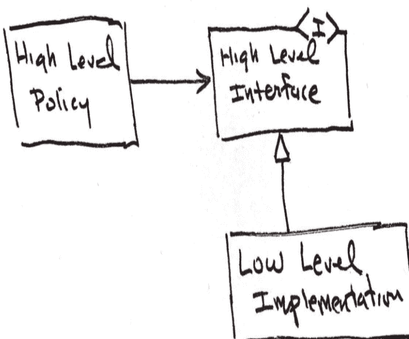

根据创建良好软件设计的目标，我们将首先讨论 `YAGNI`，然后讨论 Kent Beck 的简单设计四个原则：

- 被测试覆盖
- 揭示意图
- 最小化重复
- 最小化体积

## YAGNI

万一你不需要它呢？

1999 年，我与 Martin Fowler、Kent Beck、Ron Jeffries 等许多人一起教一门极限编程课程。主题转向了过度设计和过早泛化的危险性。有人在白板上写下 `YAGNI` 并说：“你不需要它。”Kent Beck 打断了他，并说出大致意思是：你实际上可能需要它；但你应该问自己：“万一你不需要它呢？”

如果你调试 `Grok` 生成的代码，你会发现 `Grok` 显然忽略了提供的“单词”定义，并且没有正确解释不区分大小写的约束。`Grok` 被一个充载了大量测试用例的正式提示词搞乱了，这一点并不令人鼓舞。至少对我来说，显而易见，如果没有过度的形式化，使用 AI 编写我们系统的前景注定会遭遇毁灭性的失败。毕竟，编程是形式化的，而人类则需要重载。

（注：原文后续为重复内容，已按要求剔除）

在编程的早期几十年里，我们编写的代码无法表达意图。事实上，“代码（code）”这个词本身暗示了意图是被隐藏的。在 20 世纪 60 年代后期，代码如下：

```
******

/ROUTINE TO TYPE A MESSAGE          PAL3-V10 NO DATE PAGE 1

/ROUTINE TO TYPE A MESSAGE

| | | |

| :--- | :--- | :--- |

| 0200 | *200 | |

| 7600 | MONADR=7600 | |

| 00200 7300 | START, CLA CLL | /清除累加器和链接 |

| 00201 6046 | TLS | /清除终端标志 |

| 00202 1216 | TAD BUFAD | /设置指针 |

| 00203 3217 | DCA PNTR | /获取字符 |

| 00204 6041 | NEXT, | /跳过终端标志设置 |

| 00205 5204 | JMP | /否: 再次检查 |

| 00206 1617 | TAD I PNTR | /获取一个字符 |

| 00207 6046 | | /打印一个字符 |

| 00210 2217 | ISZ PNTR | /完成了吗？ |

| 00211 7300 | CLA CLL | /清除累加器和链接 |

| 00212 1617 | TAD I PNTR | /获取另一个字符 |

| 00213 7640 | SCLA CLA | /遇零跳转并清零 |

| 00214 5204 | JMP NEXT | /准备打印另一个 |

| 00215 5631 | JMP I MON | /返回监控器 |

| 00216 0220 | BUFAD, BUFF | /缓冲区地址 |

| 00217 0220 | PNTR, BUFF | /指针 |

| 00220 0215 | BUFF, 215;212;"H";E";L";L";O";!" | | |

| 00221 0212 | | | |

| 00222 0310 | | | |

| 00223 0305 | | | |

| 00224 0314 | | | |

| 00225 0314 | | | |

| 00226 0317 | | | |

| 00227 0241 | | | |

| 00230 0000 | | | |

| 00231 7600 | MON, MONADR | /监控器入口 |
```

注意这些无处不在的注释。这些注释是绝对必要的，因为代码本身完全没有体现程序的意图。

然而，我们不再工作在 20 世纪 60 年代了。我们使用的语言具有极强的表达力。只要遵循适当规范，我们就能编写读起来像“良好的散文”的代码。

作为这种代码的示例，请考虑这段简单的 Java 代码：

```java
public class RentalCalculator {
    private List<Rental> rentals = new ArrayList<>();

    public void addRental(String title, int days) {
        rentals.add(new Rental(title, days));
    }

    public int getRentalFee() {
        int fee = 0;
        for (Rental rental : rentals) {
            fee += rental.getFee();
        }
        return fee;
    }

    public int getRenterPoints() {
        int points = 0;

        for (Rental rental : rentals) {
            points += rental.getPoints();
        }
        return points;
    }
}
```

如果你不是这个项目的编程人员，你可能无法理解这段代码中发生的一切。然而，即使只是匆匆一眼，设计者的基本意图也很容易识别。变量、函数和类型的名称具有很强的描述性。算法的结构一目易见。这段代码具有表现力。这段代码非常简单。

## 底层抽象

不要认为表现力仅仅是给函数和变量起好听的名字，我应该指出另一个问题：层次的分离和底层抽象的展示。

如果一个软件系统的每行代码、每个函数和每个模块都位于定义良好的分区中，清晰地描绘了代码的级别及其在整体抽象中的位置，那么这个系统就是表现力的。

你可能觉得最后一句话很难理解，所以让我通过啰嗦一点来说得更清楚。

想象一个具有复杂需求的应用程序。我喜欢使用的例子是工资系统。

- 时薪员工每周五发放工资，基于他们提交的工卡。他们每周工作超过 40 小时的，每小时获得一点半的工资。
- 佣金制员工每月第一个和第三个周五发放工资。他们获得基本工资加上根据提交的销售收据获得的佣金。
- 固定薪制员工在每月最后一个周五发放工资。他们获得基本工资加上根据提交的销售收据获得的佣金。

通过对遍历代码进行一次封装，并使用 `lambda` 表达式、`Command` 对象、策略模式，甚至是模板方法模式^3 来将必要的操作传递给遍历过程，就可以消除遍历代码的重复。

^3 [GOF95]。

## 偶然重复

并不是所有的重复都应该被消除。在某些情况下，两段代码可能非常相似，甚至完全相同，但会因为非常不同的原因而改变。^4 我将其称为*偶然重复*。偶然的重复不应该被消除。应该允许重复存在。随着需求的变化，这些重复会独立演化，偶然重复也会随之消失。

^4 参见第 19 章“The SOLID 原则”中的“RP：单一职责原则”。

必须明确的是，管理重复绝非易事。识别哪些重复是真实的、哪些是偶然的，然后对真实的重复进行封装和隔离，这需要大量的思考和细心。

从偶然重复中确定哪些是真实的重复，很大程度上取决于代码表达其意图的程度。偶然重复具有发散的意图，而真实的重复具有收敛的意图。

使用抽象、`lambda` 表达式和设计模式来封装和隔离真实的重复，涉及到大量的重构。而重构需要一套良好且稳固的测试用例。

因此，消除重复在简单设计规则的优先级列表中排第三。第一是测试，然后*才*是重复。

# 最小化规模

一个简单的设计由尽可能尽的简单元素组成，且不损害测试覆盖率和表达能力。简单元素是微小的。简单设计的最后一条规则建议，在你让所有测试通过之后，在让代码尽可能具有表达力之后，以及在最小化重复之后，*那么*你应该致力于减少模块、类、函数和行的数量。

# 简单设计

多年前，Kent Beck 和我曾就设计原则进行讨论。他说过一些一直让我受益终生的话。他说，如果你尽可能勤奋地遵循这些点，所有其他设计原则都将得到满足——设计原则可以简化为覆盖、表达、单一化和精简。

我不知道这是否真实。我不知道一个完美覆盖、表达、单一化且精简的程序是否一定符合`开闭原则（OCP）`或`单一职责原则（SRP）`。然而，我非常确定的是，了解和学习良好设计和架构的原则（例如 `SOLID` 原则）可以更容易创建分层良好且简单的设计。

## 第 19 章. SOLID 原则


本章是我书籍《整洁架构》中大幅删减和编辑的一系列节录。其目的是为你提供其他地方提到的原则提供一个快速参考。

良好的架构始于整洁的代码。如果代码不佳，那么架构也就毫无意义。`SOLID` 原则告诉我们如何组织函数和数据，以便它们能够相互协作。这些原则适用于对象系统，但并不限于此。在 80 年代，这些原则被首次提出来。在随后的书中，这些原则被引入。接下来的章节并不是为了取代它们，而是为你提供进一步研究的方向。

这些原则在许多其他出版物中被详细描述过。这些原则的核心目标是让系统能够：

- 能够适应
- 易于理解
- 它们是构建系统的基石

为了满足这些需求，系统必须有一个，且只有一个，改变的原因。这就是 `SOLID` 原则的核心。这些原则告诉我们，高层策略不应该依赖于低层细节。相反，低层细节应该依赖于高层策略。

为了让系统易于扩展和维护，这些原则通常被称为 `SOLID`，每个字母代表一个：

- `SRP`：单一职责原则（Single Responsibility Principle）
- `OCP`：开闭原则（Open-Closed Principle）
- `LSP`：里氏替换原则（Liskov Substitution Principle）
- `ISP`：接口隔离原则（Interface Segregation Principle）
- `DIP`：依赖倒置原则（Dependency Inversion Principle）

这些原则在软件设计中至关重要。在接下来的章节中，我们将详细讨论每一个原则。

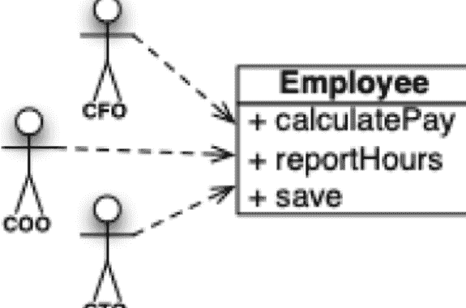

该类违反了 `SRP`（单一职责原则），因为这三个方法分别负责三个非常不同的利益相关者。

- `calculatePay()` 方法由财务部门指定，该部门向首席财务官（`CFO`）汇报。
- `reportHours()` 方法由人力资源部门指定并使用，该部门向首席运营官（`COO`）汇报。
- `save()` 方法由数据库管理员（`DBAs`）指定，这些人员向首席技术官（`CTO`）汇报。

通过将这三个方法的源代码放在同一个 `Employee` 类中，开发者将这些利益相关者中的每一个都耦合在了一起。这种耦合可能会导致 `CFO` 团队的操作影响到 `COO` 团队所依赖的内容。

例如，假设 `calculatePay()` 函数和 `reportHours()` 函数共享一个计算非加班小时的共同算法。再假设开发者为了避免代码重复（他们非常小心），将该算法放入一个名为 `regularHours()` 的函数中。

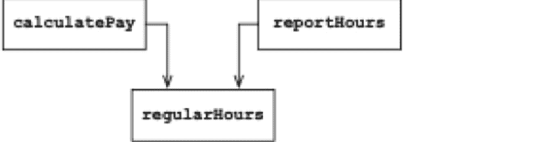

现在，假设 `CFO` 团队决定需要调整非加班小时的计算方式。但人力资源部的 `COO` 团队并不想要那个特定的调整，因为他们对非加班小时有不同的用途。

一名开发者被要求进行更改，并看到了被 `calculatePay()` 方法调用的便利函数 `regularHours()`。遗憾的是，开发者没有注意到该函数也被 `reportHours()` 函数调用。

开发者执行了所需的更改并进行了仔细的测试。`CFO` 团队验证了新函数运行符合预期，系统随后进行了部署。

当然，`COO` 团队并不知道正在发生这种情况。`COO` 团队继续使用由 `reportHours()` 函数生成的报告——但现在这些报告包含了错误的数字。最终，问题被发现了，`COO` 勃发雷霆，因为这些错误数据导致他的预算损失了数百万美元。

我们都见过此类事件的发生。它的发生是因为我们把不同利益相关者所依赖的代码放在了彼此邻近的位置。`SRP` 要求*分离不同利益相关者所依赖的代码。*

## 解决方案

这个问题有很多不同的解决方案。每种方案都将函数移动到不同的类中。

也许最明显的方法是将数据与函数分离。这三个类共享对 `EmployeeData` 的访问，它是一个没有方法的简单数据结构。每个类只持有其特定函数所需的源代码。这三个类不允许相互感知。因此，避免了任何意外的重复。

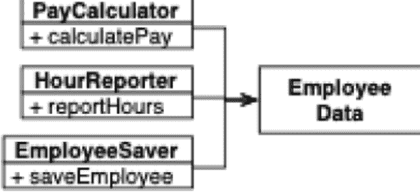

当然，这种解决方案的缺点是开发者现在有三个类需要实例化并进行跟踪。解决这一困境的常见方案是使用门面模式（`facade pattern`）。

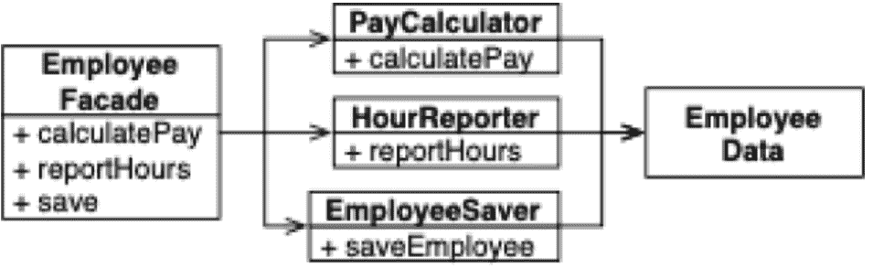

`EmployeeFacade` 包含的代码非常很少。它负责实例化并将任务委托给带有相应函数的类。

一些开发者倾向于让最重要的业务规则离数据更近。这可以通过在原始 `Employee` 类中保留最重要的方法，然后将该类作为次要函数的门面模式来实现。

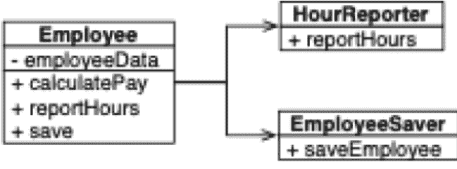

你可能会基于每个类只包含一个函数而对这些解决方案异议。事实并非如此。计算薪水、生成报告或保存数据所需的函数数量在每种情况下可能是大量的。每个此类类可能都有许多其他公共方法，以及更多的私有方法。

## 更高级的级别

`SRP` 关注的是类。但它会以不同的形式重新出现在更高级的级别。

正如我们所看到的，在类层面上，它变成了共同内聚原则（Common Closure Principle）。而在架构层面上，它变成了接口隔离原则（Interface Segregation）。

## OCP：开闭原则


`OCP` 是 1988 年由 Bertrand Meyer 提出的。它说：软件实体应该对扩展开放，但对修改关闭。


换句话说，软件实体应该是可扩展的，但不需要修改。大多数软件设计者意识到 `OCP` 的重要性。但当我们考虑组件层时，该原则具有更大的意义。

## 思想实验

一个思想实验将使这一点清晰。想象一下，我们有一个显示摘要的网页系统。页面是可以滚动的，负数以红色显示。显然，利益相关者要求将这些信息生成报告。我们需要写多少代码？通过合理分离不同原因引起的变化（`SRP`），并组织它们之间的依赖关系（`DIP`）。

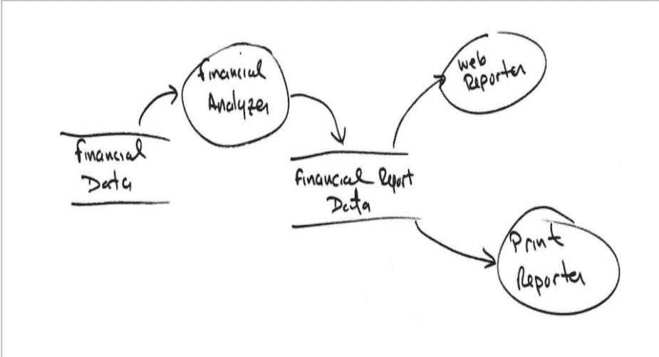

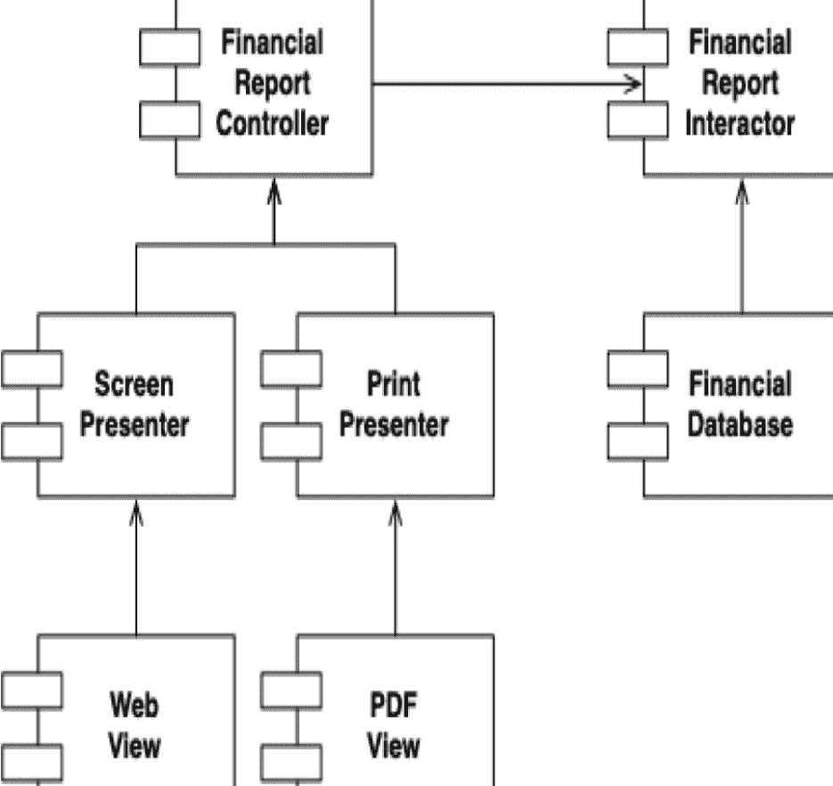

这些箭头指向了我们想要免受变化影响的组件。

让我重复一遍。如果组件 A 应该免受组件 B 变化的影响，那么组件 B 就应该依赖组件 A。

我们希望保护 `Controller`（控制器）免受 `Presenter`（演示器）变化的影响。我们希望保护 `Presenter` 免受 `View`（视图）变化的影响。我们希望保护 `Interactor`（交互器）免受任何影响。

`Interactor` 处于最符合 `OCP`（开闭原则）的位置。对数据库、`Controller`、`Presenter` 或 `View` 的更改都不会对 `Interactor` 产生任何影响。

为什么 `Interactor` 应该处于这样一个特权位置？因为它包含了业务规则。`Interactor` 包含了应用程序最高级别的策略。所有其他组件处理的都是外围关注，而 `Interactor` 处理的是核心关注。

尽管 `Controller` 是 `Interactor` 的边缘组件，但它对 `Presenter` 和 `View` 来说是核心的。虽然 `Presenter` 可能是 `Controller` 的边缘组件，但它们对 `View` 来说是核心的。

注意这如何基于“级别”的概念创建了一个保护层级。`Interactor` 是最高级别的概念，因此它们受保护程度最高。`View` 属于最低级别的概念，因此受保护程度最少。`Presenter` 的级别高于 `View`，但低于 `Controller` 或 `Interactor`。

这就是 `OCP` 在架构层面的工作方式。架构师根据功能如何变化、为何变化以及何时变化来分离功能，然后将这些分离的功能组织成一个组件层级结构。该层级结构中的高级组件免受对低级组件进行更改的影响。

## 方向控制

如果你对上面的类设计感到心惊肉跳，请再看一遍。该图中大部分复杂性是为了确保组件之间的依赖关系指向正确的方向。

例如，`FinancialReportGenerator` 和 `FinancialDataMapper` 之间的 `FinancialDataGateway` 接口的存在是为了反转依赖关系，否则该依赖将从 `Interactor` 组件指向 数据库组件。`FinancialReportPresenter` 接口以及两个 `View` 接口也是如此。


## 信息隐藏

`FinancialReportRequester` 接口有不同的用途。它的存在是为了防止 `FinancialReportController` 过多了解 `Interactor` 的内部细节。如果没有该接口，`Controller` 就会对 `FinancialEntities`（财务实体）产生传递依赖。

传递性依赖违反了这样一个通用原则：软件实体不应该依赖它们没有直接使用的东西。我们稍后在讨论 ISP 和 CRP 时会看到这一原则。

所以，尽管我们的首要任务是保护 `Interactor` 免受 `Controller` 变化的影响；我们也希望通过隐藏 `Interactor` 的内部细节，保护 `Controller` 免受 `Interactor` 变化的影响。

## 结论

OCP 是系统设计后的驱动力之一。目标是使系统易于扩展而不会产生高昂的影响。这通过将系统划分为组件并将它们排列为依赖层级来实现，从而保护高级组件免受低级组件更改的影响。

## LSP: 里氏替换原则

1988 年，Barbara Liskov 写了以下内容作为定义子类型的方法。

这里需要的是类似于下面的替换属性：如果对于类型 S 的每个对象 o1，都有一个根据 T 定义的类型 T 对象 o2，当用 o1 替换 o2 时，P 的行为保持不变，那么 S 就是 T 的子类型。^3

^3 Barbara Liskov, “Data Abstraction and Hierarchy,” ACM SIGPLAN Notices 23, no. 5 (May 1988): 17–34.

例如，假设我们有一个名为 `License` 的类，如下所示。该类有一个名为 `calcFee()` 的方法，由 `Billing`（计费）应用程序调用。`License` 有两个“子类型”：`PersonalLicense`（个人许可）和 `BusinessLicense`（商业许可）。它们使用不同的算法来计算许可费。

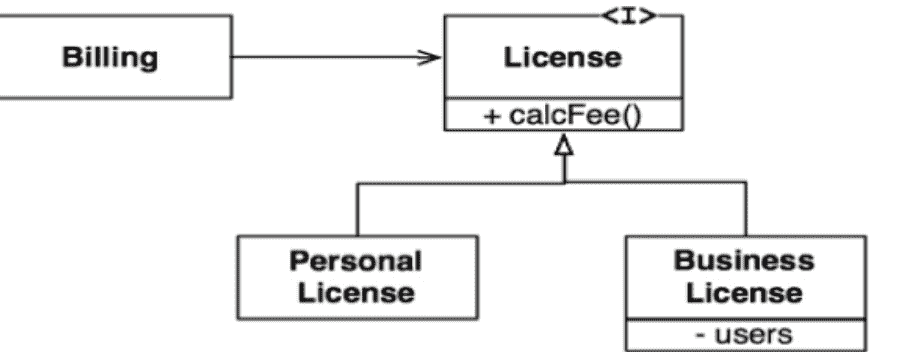

这种设计符合 LSP，因为 `Billing` 的行为并不以任何方式取决于它使用的哪一个子类型。两个子类型都可以替换 `License` 类型。

违反 LSP 的经典例子是著名的正方形/矩形问题。

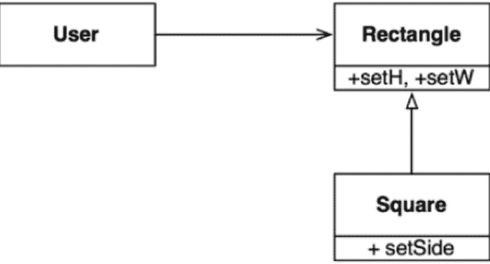

在这个例子中，`Square`（正方形）不是 `Rectangle`（矩形）的子类型，因为 `Rectangle` 的高度和宽度是可以独立变化的，但 `Square` 的高度和宽度必须同时改变。以下代码说明了原因：

```java
Rectangle r = new Square();
r.setW(5);
r.setH(2);
assert(r.area() == 10);
```

防御这种现象唯一的方法是在 `User` 中添加机制，以检测它实际上是否是 `Square`。我们的系统架构会发生什么变化？

显然，我们需要添加一个特殊情况。任何 Acme 驱动程序的分发请求都必须使用与其他所有驱动程序不同的规则来构建。

实现此点的简单方法是在构建分发命令的模块中添加一个 `if` 语句。

```java
if (driver.getDispatchUri().startsWith("acme.com"))
```

## LSP 与设计

在面向对象开发的早期，我们将这一原则视为一种引导继承的方法，如上一节所示。然而，多年来，我们将 LSP 演变成了一个更广泛的软件设计原则，涉及接口和实现。

所涉及的接口有很多形式。我们可能有 Java 风格的接口，由多个类实现。或者我们可能有共享方法签名的 Ruby 类。或者我们可能有一组响应相同接口的服务。

在所有这些情况下以及更多情况下，LSP 都是适用的，因为有用户依赖于定义的接口以及实现的可替换性。

## 出租聚合器

从软件设计的角度理解 LSP 的最佳方法是观察当原则被违反时，系统设计会发生什么。

假设我们正在为许多出租服务构建一个聚合器。客户使用我们的网站寻找最合适的出租车辆，无论哪家公司。一旦客户做出决定，我们的系统就会使用 RESTful 服务派遣车辆。

现在假设 RESTful 服务的 URI 是司机数据库包含信息的一部分。一旦我们的系统选择了合适的司机，它将从司机记录中获取该 URI，然后使用它来派遣司机。

例如，假设司机 Bob 的分发 URI 如下所示：

`purplecab.com/driver/Bob`

我们的系统会将分发信息附加到此 URI 上并通过 PUT 请求发送，如下：

```http
purplecab.com/driver/Bob
/pickupAddress/24 Maple st.
/pickupTime/1530
/destination/ORD
```

当然，任何称职的开发者都不会允许这样的结构存在于系统中。在代码本身中引入 `acme` 这个词会产生各种可怕且诡异的错误风险，更不用说安全漏洞了。

例如，如果 Acme 变得非常成功并收购了 Purple Taxi 公司呢？如果他们保留了品牌和网站，但我们统一了所有的系统呢？我们是否需要为 `purple` 这个词再添加另一个 `if` 语句呢？

因此，我们的架构师必须通过创建某种由分发 URI 键值的配置数据库驱动的分发命令创建模块，来保护系统不受此类 bug 的影响。配置数据可能看起来像这样：

| URI | 分发格式 |
|---|---|
| Acme.com | /pickupAddress/%s/pickupTime/%s/dest/%s |
| Purple.com | /pickupAddress/%s/pickupTime/%s/destination/%s |

这一切的意义在于，对 RESTful 服务简单地违反 LSP（里氏置换原则），可能会导致我们的架构被大量的额外机制所污染。

## ISP：接口隔离原则

ISP 的名称源于以下内容：

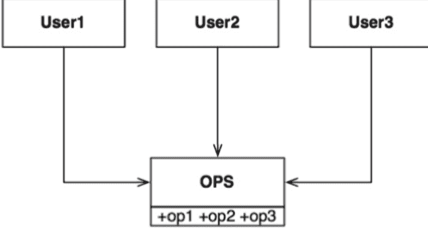

在上述情况下，有几个用户在使用 `ops` 类的操作。假设 `User1` 只使用 `op1`，`User2` 只使用 `op2`，而 `User3` 只使用 `op3`。

现在想象一下 `ops` 是一个用 C++ 等语言编写的类。^4 显然，在这种情况下，`User1` 的源代码将无意中依赖 `op2` 和 `op3`，即使它并没有调用它们。这种依赖意味着 `ops` 中 `op2` 源代码的更改将强制 `User1` 重新编译，即使它关心的内容实际上没有发生变化。

> ^4 Java 和 C# 的情况要复杂一些。编译器不会仅仅根据日期重新编译模块，而是寻找已更改的声明。

这可以通过将操作隔离到接口来解决，如下所示。

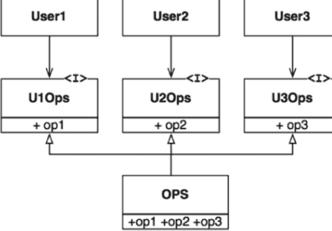

`OPS` +op1 +op2 +op3

再次，我们假设这是在像 C++ 静态类型语言中实现的，那么 `User1` 的源代码将依赖于 `U10ps` 和 `op1`，但它不会依赖 `OPS`。因此，`User1` 不关心的 `op2` 更改不会导致 `User1` 重新编译和部署。

## ISP 与语言

像 C++ 等静态类型语言强制程序员创建用户必须 `#include` 的声明。正是源代码中这些包含的声明创建了源代码依赖，从而强制重新编译和部署。

在 Java 和 C# 等语言中，依赖关系较松，但并非不存在。编译器使用单个声明而不是源文件来跟踪依赖树。因此，只有当声明更改时，重新编译和部署才是必要的。

在 Ruby 和 Python 等动态类型语言中，源代码中不存在接口。相反，它们是在运行时推断的。因此，没有源代码依赖，也没有任何接口声明来强制重新编译和部署。这就是动态类型语言创建的系统比静态类型语言更灵活、耦合更低的原因之一。

这一事实可能会让你得出结论：ISP 是语言问题，而不是设计问题。

## ISP 与设计

然而，如果你后退一步观察 ISP 的原始动机，你会发现那里隐藏着更深层次的关注点。通常情况下，依赖于包含比你需要的更多的模块是有害的。对于会导致不必要的重新编译和部署的源代码依赖来说，这显然是真的。但在更高的层次上，这也是事实。

例如，考虑一个正在系统 `s` 上工作的开发者。他想在系统中包含某个特定的框架 `F`。现在假设 `F` 的作者绑定了一个特定的数据库 `D`。因此 `s` 依赖于 `F`，而 `F` 依赖于 `D`。

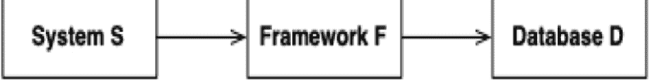

现在假设 `D` 包含了 `F` 未使用且 `s` 并不关心的功能。`D` 中这些功能的更改可能会强制 `F` 重新部署，从而导致 `s`。糟糕糟糕，`D` 内部的故障可能导致 `F` 故障，导致 `s`。

这里的教训是：依赖你不需要的东西会导致麻烦。

## DIP：依赖倒置原则

> “依赖抽象比依赖具体实现更好。”

DIP 说高层模块不应该依赖于低层模块。两者都应该依赖于抽象。抽象不应该依赖于细节。细节应该依赖于抽象。

## 稳定抽象

抽象接口的每一次更改都对应于其具体实现的更改。另一方面，对具体实现的更改并不总是，甚至并不通常，这需要对它们所实现的接口进行更改。因此，接口通常比实现更不容易波动。

事实上，优秀的软件设计人员和架构师努力降低接口的易变性。他们尝试找到在不更改接口的情况下为实现添加功能的方法。这是软件设计的入门（基础知识）。

因此，其含义是，稳定的软件设计是那些避免依赖不稳定的具体实现，并倾向于使用稳定的抽象接口的设计。

这一含义归结为一组非常具体的编码实践。

- **不要引用不稳定的类。** 而是要引用抽象接口。这条规则适用于所有语言，无论静态类型还是动态类型。它还对对象的创建实施了严厉的限制，并通常强制使用抽象工厂（`Abstract Factories`）。

- **不要从不稳定的具体类派生。** 这是前一个规则的推论，但值得特别提及。在静态类型语言中，继承是所有来源关系中最强大且最僵化的，应该极谨慎使用。在动态类型语言中，继承的问题没那么大；但它仍然是一种依赖，谨慎始终是最明智的选择。

- **不要重写具体函数。** 具体函数通常需要源代码依赖。当你重写这些函数时，你并没有消除这些依赖——事实上，你*继承*了它们。为了管理这些依赖，你应该将函数设为抽象并创建多个实现。

- **永远不要提到任何具体且不稳定的对象的名称。** 这真的只是对原则本身的重述。

虽然这些被写成规则，但它们实际上更像警告。务实的程序员会经常违反这一原则。但明智的程序员会先考虑这些警告。

盲目地遵守这一原则可能会导致没有人真正需要的接口爆炸。另一方面，轻率地忽略这一原则可能会导致你的软件变得错综且僵化。

最后，明智的程序员会随着系统的演进和需求的出现逐渐遵循这一原则。凭借一套他们视如性命的测试套件，他们知道当为了反转依赖而需要添加接口时，这些更改将相对容易管理且没有风险。

## 工厂

为了符合依赖倒置原则（DIP），不稳定具体对象的创建可能需要特殊处理。这是因为在几乎所有的语言中，对象的创建都需要对该对象的具体定义有源代码依赖。

在大多数面向对象语言（如 Java）中，我们将使用抽象工厂（`Abstract Factory`）来消除这种不受欢迎的依赖。

^5 [GOF95]。


前面的图显示了结构。`Application` 通过 `Service` 接口使用 `ConcreteImpl`。然而，`Application` 必须以某种方式创建 `ConcreteImpl` 的实例。为了在不创建对 `ConcreteImpl` 源代码依赖的情况下实现这一点，`Application` 调用 `ServiceFactory` 接口的 `makeSvc` 方法。该方法由派生自 `ServiceFactory` 的 `ServiceFactoryImpl` 类实现。该实现实例化 `ConcreteImpl` 并将其作为 `Service` 返回。注意这条曲线。这是一个架构边界。它将抽象与具体隔离开。所有的源代码依赖都跨越那条线，并指向同一个方向：指向抽象侧。

这条线将系统分为两个组件：一个是抽象的，另一个是具体的。抽象组件包含了应用程序的所有高层业务规则。具体组件包含了这些业务规则操作的所有实现细节。

注意，控制流跨越线的方向与源代码依赖的方向相反。源代码依赖相对于控制流是反转的。这就是为什么我们把这一原则称为*依赖倒置*（dependency inversion）。

### 具体组件

上述图中的具体组件包含一个违反 DIP 的单一依赖。这是典型的。DIP 违反不能被完全消除；但可以将它们收集在少数几个具体组件中，并与系统的其余部分隔离。

大多数系统将包含至少这样一个具体组件，通常被称为 `main`，因为它包含了 `main` 函数。在上述情况下，`main` 函数将实例化 `ServiceFactory` 并将该实例放在类型为 `ServiceFactory` 的全局变量中。`Application` 然后将通过该全局变量访问工厂。

> 也就是说，当应用程序首次启动时由操作系统调用的函数。

随着我们在书中继续并涵盖高级别的架构原则，DIP 将出现。它将成为我们架构图中最可见的组织原则。图中曲线在随后的章节中成为架构边界。依赖跨越那条线并指向更抽象实体的方式将成为一个我们称为依赖规则的新规则。

# 第 20 章 组件原则


如果 SOLID 原则告诉我们如何将砖块排列成墙和房间，那么组件原则则告诉我们如何将房间排列成建筑。大型软件系统就像大型建筑一样，是由较小组件构建的。

在本章中，我们将讨论什么是软件组件，它们应该由什么元素组成，以及它们如何组合成系统。

本章是一个概述。这些原则在 [PPP02] 中详细描述，并在 [Clean Arch] 中再次提到。

## 组件

组件是部署单元。它们是作为系统的一部分部署的最小实体。在 Java 中，它们是 jar 文件。在 Ruby 中，它们是文件。在 .NET 中，它们是 DLL。在解释性语言中，它们是文件。在编译语言中，它们是聚合体。

## 应用与函数库

只要应用程序能够位于 00008 到 17777 之间，这种方法就能运行良好。但很快，应用程序的体积就超过了分配的空间。于是，程序员们不得不将应用程序分成两个地址段，并在函数库中来回跳转。

```
应用程序...
## 函数库
# ...应用程序
```

显然，这并不是一种可持续的状况。随着我们向函数库中添加函数，它超出了界限，我们不得不在 7008 附近为它分配更多空间。随着计算机内存的增长，程序和库的这种碎片化不可避免地持续下去。

显然，必须做些什么了。

## 可重定位性

解决方案是输出二进制文件。这个想法非常简单：我们更改编译器，使其在地址零处输出二进制代码。加载器（`loader`）会告诉程序在哪里加载可重定位的代码，然后由加载器将地址添加到二进制代码中。这比听起来要复杂一点，但我们找到了让它运行起来的方法。

现在，我们可以告诉加载器在何时加载函数库，在何时加载应用程序。事实上，加载器会接受多个二进制输入，并简单地将它们逐一加载到内存中，并在加载时进行重定位。这使得我们能够只加载需要的函数。

编译器也被更改为在可重定位二进制文件中输出函数名称。如果程序调用了库函数，编译器会将该名称作为外部引用输出；如果程序定义了一个函数，编译器会将该名称作为外部定义输出。然后，加载器在确定了定义加载的位置后，就会将外部引用链接到外部定义。

于是，链接加载器（`linking loader`）诞生了。

## 链接器

链接加载器允许我们将程序拆分成可以独立编译和加载的段。当我们将较小的程序与较小的库链接时，这种方法效果非常好。但在 20 世纪 60 年代后期和 70 年代初，我们变得野心勃勃，程序也变得越来越大。

最终，链接加载器慢得让人无法忍受。这是因为函数库存储在磁带等慢速设备上。当时的磁盘也相当慢。使用这些相对较慢的设备，链接加载器必须读取几十个二进制外部引用。随着程序越来越大，库中积累的库函数越来越多，链接加载器仅仅加载一个程序可能花费一个多小时。

因此，加载器和链接器被分为两个阶段。我们将最慢的部分（即执行链接的部分）放入一个名为 `linker`（链接器）的独立应用程序中。链接器的输出是一个已链接的可重定位文件，重定位加载器可以很快地加载它。这使得我们能够使用慢速的链接器准备可执行文件；但随后我们可以在任何时候快速地加载它。

然后进入了 80 年代。我们使用 C 语言或其他高级语言进行工作。随着我们野心的增长，程序也随之增长。包含几十万行代码的程序并不罕见。

我们从 `.c` 文件编译源模块，并将它们输入链接器，以创建可以快速加载的可执行文件。编译每个单独的模块相对快；但编译所有模块需要一些时间。而链接器会花费最长的时间。在许多情况下，周转时间已有一小时或更久。

我们似乎注定要无休止地追赶。在整个 60 年代、70 年代和 80 年代，我们为了加速工作流所做的所有改变都被我们的野心和所编写程序的规模所阻碍。我们似乎无法逃脱整体周转时间的魔咒。运行速度依然很快；但编译和链接时间是瓶颈。

当然，我们正经历着程序规模的墨菲定律：

> 程序将增长到占据所有可编译和链接的时间。

但墨菲并非那个时代的唯一竞争者。摩尔（Moore）来了，在 80 年代后期，两人展开了战斗。摩尔赢了那场战斗。磁盘在缩小并呈指数级增长。计算机内存开始变得极其廉价，使得磁盘上的数据可以缓存到 RAM 中。计算机时钟从 1MHz 增加到 100MHz。

> 摩尔：计算机速度、内存和密度每 18 个月翻一倍。这一定律从 1950 年到 2000 年一直有效；但随后突然停滞了。


到 90 年代中期，花费的时间开始比我们野心让程序增长的速度还要快。在许多情况下，链接时间缩到了几秒钟。对于小型任务，链接加载器的想法再次变得可行。

这是 ActiveX、共享库以及 `.jar` 和 `.dll` 文件的时代。计算机和设备变得如此快速，使得我们可以再次在加载时进行链接。我们可以在几秒钟内链接 `.jar` 文件或多个共享库，并执行生成的程序。

于是，插件架构诞生了。

今天，我们经常将 `.jar` 文件或 DLL 作为插件分发到现有应用程序。例如，如果你想为 Minecraft 创建模组（mod），只需将自定义的 `.jar` 文件放入某个文件夹中。如果你想在 Visual Studio 中使用 ReSharper，只需包含相应的 DLL。

这些可以在运行时插在一起的动态链接文件是我们架构的软件组件。我们花了 50 年，但我们已经达到了一个水平：组件插件架构可以成为常态默认，而不是像过去那样需要费费巨大的努力。

## 组件内聚

哪些类属于哪些组件？这是一个重要的决策，需要良好的软件工程原则的指导。遗憾的是，多年来，这个决定都是随意的（ad hoc）。在本节中，我们将讨论三个原则：

- REP：发布/等效性原则（Release/Equivalence Principle）
- CCP：公共封闭原则（Common Closure Principle）
- SRP：单一职责原则（Single Responsibility Principle）

## 发布/等效性原则 (REP)

发布/等效性原则关于发布。过去十年是管理工具（如 Maven）兴起的时期。这些工具变得重要，因为我们需要知道组件是否兼容。

发布/等效性原则认为，一起变化的类和模块应该组合在一起。从软件设计和架构的角度来看，这一原则意味着组成组件的类和模块属于一个内聚的。

## 公共封闭原则 (CCP)

将由于相同原因同一时间变化的类聚集到组件中。将由于不同原因或不同时间变化的类分离到不同的组件中。

这是针对组件重述的单一职责原则 (`SRP`)。正如 `SRP` 说一个类不应该包含多个改变的原因，这一原则说一个组件不应该有多个改变的原因。

这一原则与开闭原则（`OCP`）密切相关。因为该原则处理的正是 `OCP` 中“关闭”一词的特定含义。`OCP` 规定，类应该对修改关闭，但对扩展开放。但 100% 的关闭是不可能实现的。关闭必须是策略性的。我们设计类时，要使其对我们预期或经历过的最常见的更改保持关闭。

组件内聚原则（`CCP`）通过将对相同类型更改关闭的类聚集到同一个组件中，进一步放大了这一点。因此，当需求发生变化时，这些变化很有可能被限制在少数几个组件中。

## 与单一职责原则（SRP）的相似性

正如我上面提到的，`CCP` 是 `SRP` 的组件形式。`SRP` 告诉我们，如果方法因为不同的原因而变化，就把它们分离到不同的类中。`CCP` 告诉我们，如果类因为不同的原因而变化，就将它们分离到不同的组件中。

## 不同的时间？

本节开头的标题意味着组件应该包含在不同时间变化的元素，尽管它们可能是出于相同的原因而变化。某些更改的优先级很高。其他更改的优先级较低。某些更改是频繁变化的剧变的。有些则波动性低得多。我们希望避免那些既包含高波动又包含低波动元素的组件。

## 通用重用原则（CRP）

不要强迫组件的用户依赖他们不需要的东西。

这是另一个帮助我们决定哪些类和模块应该放在组件中的原则。它指出，类和模块倾向于在同一个组件中一起重用。

类很少孤立地重用。通常，可重用的类会与可重用抽象的其他类协作。`CRP` 规定这些类应该共同存在同一个组件中。在这样的组件中，我们预计看到类之间存在大量的依赖关系。

一个简单的例子可能是容器类及其相关的迭代器。这些类之所以被重用，是因为它们彼此紧密耦合的。因此，它们应该在同一个组件中。

但 `CRP` 告诉我们的不仅仅是哪些类应该组合在一个组件中。它还告诉我们哪些类**不应该**保留在一个组件中。

当一个组件使用另一个组件时，组件之间就创建了依赖关系。在使用组件只使用了*被使用*组件中的一个模块，但这并不会削弱这种依赖关系。使用组件仍然依赖于被使用的组件。

由于这种依赖关系，每当组件发生变化时，使用组件可能都需要进行相应的更改。即使使用组件不需要任何更改，它可能仍然需要重新编译、重新验证和部署。即使对被使用组件的更改是使用组件并不关心的内容，情况可能也是如此。

因此，我们想要确保在依赖一个组件时，我们依赖的是该组件中的类。要确保我们放入组件的类是不可分割的；要确保我们不太可能依赖其中一些类而不依赖另一些类。否则，我们将部署比需要的更多的组件，并浪费大量的精力。

因此，相比于哪些类应该放在一起，`CRP` 告诉我们的关于哪些类**不应该**放在一起的信息要多得多。`CRP` 规定，彼此没有紧密结合的类不应该在同一个组件中。

## 与接口隔离原则（ISP）的关系

`CRP` 是 `ISP` 的通用版本。`ISP` 建议我们不要依赖于那些我们不使用的方法的类。`CRP` 建议我们不要依赖于那些我们不使用的模块的组件。这些建议都可以简化为一句朗口的金句：

不要依赖你不需要的东西。

## 组件内聚力图

你可能已经意识到，这三个内聚原则倾向于相互冲突。`REP`（重用性原则）和 `CCP` 是包含性原则。它们都倾向于让组件变大。`CCP` 是排除性原则，驱动组件变小。我们寻求解决正是这些原则之间的张力。

下面是一个张力图⁶，它展示了三个内聚原则是如何相互作用的。图的边缘描述了放弃对角顶点原则所的*代价*。

> ⁶ 感谢 Tim Ottinger 提供的这一想法。

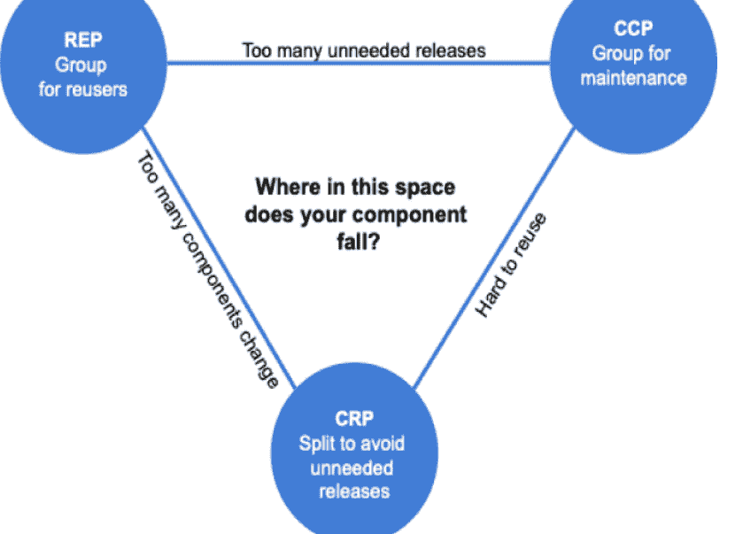

因此，一个关注 `REP` 和 `CRP` 的程序员会发现，当进行简单更改时，会有过多的组件受到影响。一个过度关注 `CCP` 和 `REP` 的架构师会导致产生过多的不发布。

目标是在三角形中找到一个位置，以满足开发团队当前的关注点，例如，在项目早期，`CCP` 比 `REP` 重要得多。

通常，项目倾向于从三角形的右侧开始，此时可开发性比重用性更重要。随着项目的成熟以及其他项目开始从中汲取资源，项目将向左侧移动。

这意味着组件结构会随着时间的推移而抖动和演进。项目的结构会随时间而变化。它更多地与项目开发的方式有关，而不是项目实际在做什么。

## 总结 . . .

在过去，我们对内聚性的看法比这些原则所暗示的简单得多。我们曾认为内聚性仅仅是模块执行一个且仅执行一个功能的属性。然而，这三个内聚原则描述了复杂得多的内聚类型。在选择将哪些类组合成组件时，我们必须考虑重用性与可开发性中涉及的对立力量。此外，这种平衡几乎总是动态的。也就是说，今天合适的划分在明年可能就不合适了。因此，项目的焦点从可开发性转变为重用性。

这意味着系统的组件结构无法预先确定，而必须随着系统的增长进行增进式演进。当然，这意味着对组件结构的更改将是小而频繁的。它们成为任何敏捷迭代循环正常的一部分。

## 组件耦合

下一个三个原则处理组件之间的关系。在这里再次会遇到可开发性与逻辑设计之间的张力。影响组件结构的力量是技术性的、政治性的以及波动的。

## 无环依赖原则（ADP）

在组件依赖图中允许循环。

你是否曾工作了一整天，让某些东西运行起来然后回家，结果第二天早上来发现你的东西不再运行了？为什么不运行了？因为有人比你得晚，改变了你依赖的东西！我称之为“晨后综合症”。

晨后综合症发生在许多开发者修改同一个源文件的开发环境中。在开发者较少的相对较小的项目中，这不是一个大问题。但随着项目规模和开发团队规模的增长，第二天后的早上可能会非常噩梦。连续几周无法构建出项目的稳定版本是不常有的。相反，每个人不断修改修改代码，试图让它与别人所做的最后更改兼容。

## 消除依赖循环

解决这个问题的方案是将开发环境划分为可发布的组件。组件成为工作单元，可以由一个开发者或一个团队负责。当开发者让一个组件运行后，他们将其发布供其他开发者使用。他们给它一个版本号，并将其移动到其他团队可以使用的目录中。

使用。然后，他们在自己的私有区域继续修改自己的组件。其他人则使用已发布的版本。

当组件发布新版本时，其他团队可以决定是否立即采用新版本。如果他们决定不采用，就只是继续使用旧版本。一旦他们决定准备就绪，就会开始使用新版本。

因此，没有哪个团队受制于其他团队的摆布。对一个组件的更改不需要对其他团队产生立即影响。每个团队都可以自行决定何时将自己的组件适配到所用组件的新版本中。此外，集成是以小增量完成的。不存在一个单一的时间点，要求所有开发者都必须聚在一起并整合他们正在做的一切工作。

这是一个非常简单且合理的过程；并且被广泛使用。然而，为了让它生效，你必须管理组件的依赖结构。不能有循环。

如果依赖结构中存在循环，那么就无法避免“第二天后综合症”。

考虑下方的组件图。

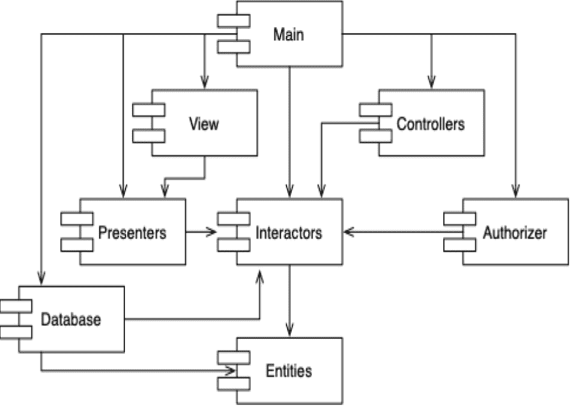

在这里我们看到一个组装成应用程序的典型组件结构。该应用程序的功能对于本示例来说并不重要。重要的是组件的依赖结构。注意这种结构是一个有向图。组件是节点，依赖关系是有向的边。

现在注意另一点。无论你从哪个组件开始，都不可能遵循依赖关系并回到该组件。这种结构没有循环。它是一个有向无环图 (`DAG`)。

现在注意当负责 Presenters（演示器）的团队发布其组件的新版本时会发生什么。很容易发现谁受此发布的影响；你只需要反向追踪依赖箭头即可。因此，View（视图）和 Main 都会受到影响。目前这些这些组件的开发者将不得不决定何时与 Presenters 的新版本进行集成。

同样注意，当 Presenters 发布时，它对系统中的许多其他组件完全没有影响。它们并不知道 Presenters 的存在，也不关心它何时变化。这很好。这意味着发布 Main 的影响相对较小。

当开发 Presenters 组件的开发者想要运行该组件的测试时，他们只需要用他们当前正在使用的 Interactors（交互器）和 Entities（实体）组件的版本来构建他们的 Presenters 版本即可。系统中的其他任何组件都不需要参与。这很好。这意味着开发 Presenters 的开发者在设置测试时需要做的工作相对较少，他们需要考虑的变量也相对较少。

当需要发布整个系统时，是从底向上完成的。首先编译、测试并发布 Entities 组件；然后是 Database（数据库）和 Interactors。接下来是 Presenters、View、Controllers（控制器），然后是 Authorizer（授权器）。Main 是最后一个。这个过程非常清晰且易于处理。我们知道如何构建系统，因为我们理解各个部分之间的依赖关系。

# 组件依赖图图中循环的影响

假设一个新需求迫使我们更改 Entities 中的一个模块，使其使用 Authorizer 中的一个模块。例如，假设 Entities 中的 `User` 类使用了 Authorizer 中的 `Permissions` 类。这创建了一个依赖循环，如下图所示。

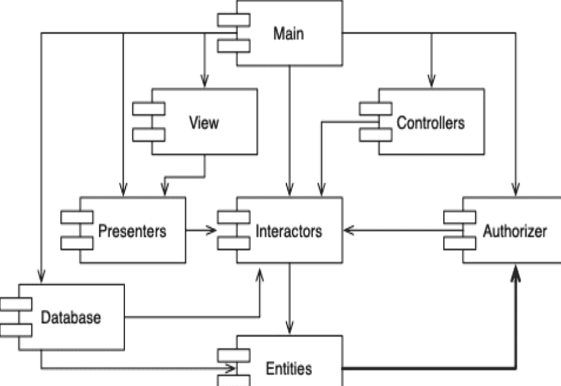

这个循环实际上将 Interactors、Entities 和 Authorizer 合并成了一个单一循环。任何使用其中任何一个的组件都会使用所有组件。这使得构建和测试变得困难得多。它还引发了正确构建顺序的问题。你不能先构建 Entities，因为它依赖于 Authorizer。但 Authorizer 通过 Interactors 依赖于 Entities。所以没有正确的构建顺序。任何在没有计划的情况下构建的系统都是随机的。

## 消除循环

只要可能，总是可以消除循环，使依赖结构恢复为 `DAG`。有两种主要机制：

1.  应用依赖倒置原则 (`DIP`)。我们创建一个满足某些需求的接口。我们将那些依赖于 Authorizer 的类放入该接口中。这反转了 Entities 和 Authorizer 之间的依赖，从而打破了循环。见下方的重构图：

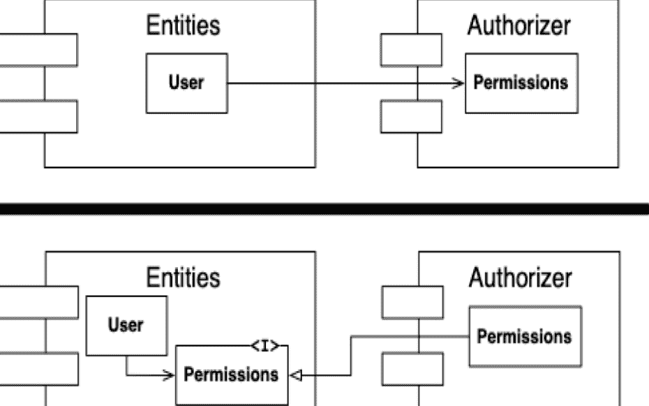

2.  创建一个依赖于 Authorizer 的新组件。我们将那些经常变化的类放入其中。见下方的图：

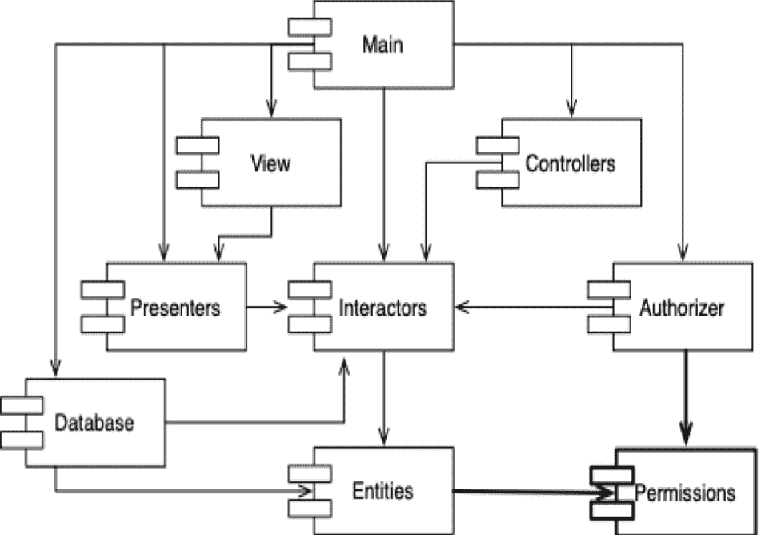

# 依赖结构的“抖动” (Jitters)

第二个方案意味着在需求变化的情况下依赖结构是不稳定的。确实，随着应用程序的增长，依赖结构会抖动。当循环出现时，必须消除它们。

# 自顶向下的设计

我们目前为止讨论的问题导致了一个不可避免的结论：依赖结构不能从顶向下设计。这意味着它并不是系统设计的首要考虑之一。确实，它随着系统的增长而演变。

你们中可能会发现这不符合直觉。我们认为大粒度的拆分（如组件）是高层的。

事实上，组件依赖图与描述应用程序的功能关系不大。相反，它们是应用程序的可构建性和可维护性的映射。这就是为什么它们在项目开始时没有被设计。由于没有需要构建或维护的软件，因此不需要这些图。随着实现阶段出现越来越多的模块，我们越来越需要管理依赖关系，以避免第二天后综合症。此外，我们希望将更改局部化，因此我们开始关注 `SRP`（单一职责原则）和 `CCP`（共同闭闭原则），并将可能变化的类分类。

这种依赖结构的首要考虑之一是波动性的隔离。我们不希望频繁变化引起的原因影响稳定的组件。例如，我们不希望 GUI 的外观变化影响我们的业务规则。我们不希望报告的添加或修改影响我们的高层策略。依赖图是由开发者创建和塑造的，以保护稳定的价值组件免受波动底层组件的影响。

随着应用程序继续增长，我们开始担心创建可重用元素。这时 `CRP`（重用性原则）开始影响组件的组成。最后，当循环出现时，应用 `ADP`，依赖图就会抖动并增长。

# 稳定依赖原则 (SDP)

向稳定性的方向依赖。

设计不能完全静态的。为了维护设计，某些波动是必要的。我们通过遵循 `CCP` 实现这一点。使用该原则，我们创建对某些变化敏感但对其他变化免疫的组件。其中一些组件被设计为波动的。我们预期它们会变化。

任何预期变化的组件都不应该被难以更改的组件所依赖！否则，波动组件也会变得难以更改。

软件的一个反常之处在于，你设计一个易于修改的模块，可能会被别人仅仅通过在上面挂载一个依赖而使其变得难以修改。你的模块中没有一行源代码需要更改；但你的模块却突然变得难以修改。通过遵循稳定依赖原则（`SDP`），我们确保了意图易于修改的模块不会依赖于那些更难修改的模块。

## 稳定性

稳定性意味着什么？将一枚硬币立在侧面。它在那个位置是稳定的吗？你可能会说不是。然而，除非受到扰动，它将在那个位置保持很长时间。因此，稳定性与更改的频率没有直接关系。硬币没有在变化，但很难认为它是稳定的。

韦布斯特词典说，如果一个物体“不容易被移动”，它就是稳定的。稳定性与进行更改所需的工作量有关。硬币并不非常稳定，因为推倒它只需要极少的工作。另一方面，桌子非常稳定，因为转动它需要花费大量的精力。

稳定性是一个连续体，而不是一个布尔值。

这与软件有什么关系？有很多因素会导致软件组件变得难以修改——它的尺寸、复杂度、清晰度等。我们将忽略所有这些因素，而关注不同的方面。让软件组件难以修改的一种方法是让许多其他软件组件依赖于它。一个许多许多入依赖的组件是非常稳定的，因为要将任何更改与所有依赖组件相协调需要大量的工作。

下面的图显示了 X，一个稳定的组件。该组件有三个组件依赖于它，因此它有三个不更改的充分理由。我们说它对这三个组件是负责的。另一方面，X 不依赖于任何东西，所以它没有外部影响来使其改变。我们说 X 是负责且独立的：它是一个成年人。

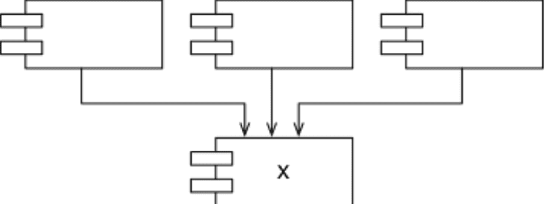

另一方面，下一张图显示了 Y，一个非常不稳定的组件。Y 没有其他组件依赖于它；我们说它是不负责的。Y 也有三个它依赖的组件，因此更改可能来自三个外部源。我们说 Y 是依赖的且不负责的：它是一个青少年。

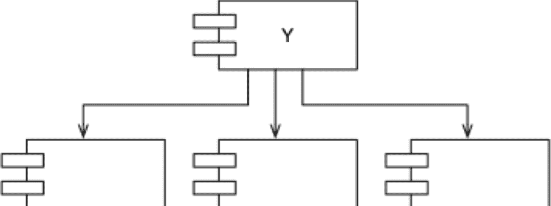

## 稳定性指标

我们如何衡量一个组件的稳定性？一种方法是统计进入和离开该组件的依赖数量。这些计数允许我们计算组件的位置稳定性。

- 扇入（Fan-in）：入耦合——依赖该组件模块的组件外部模块数量。
- 扇出（Fan-out）：出耦合——位于该组件内部依赖于组件外部模块的模块数量。
- 不稳定性（Instability）：`I = Fan-out ÷ (Fan-in + Fan-out)`。该指标的范围是 `[0,1]`。`I = 0` 表示一个最大稳定的组件。`I = 1` 表示一个最大不稳定的组件。

扇入和扇出指标⁷通过计算目标组件外部对该组件内部模块有依赖的模块数量来计算的。考虑下面的示例：

> ⁷ 在之前的出版物中，我分别使用 Effer 和 Afferent 耦合（`Ce` 和 `Ca`）来称呼扇出和扇入。那只是我的一方面的自大……就像中枢神经系统的比喻。

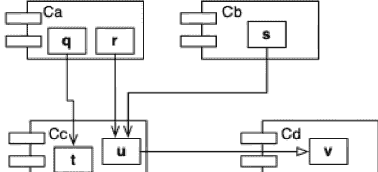

假设我们计算组件 `Cc` 的稳定性。我们发现 `Cc` 外部有三个类依赖于 `Cc` 中的类。因此，扇入 = 3。此外，`Cc` 外部有一个类被 `Cc` 中的类所依赖。因此，扇出 = 1，`I = 1/4`。

在 C++ 中，这些依赖通常由 `#include` 语句表示。事实上，当你组织源代码使得每个源文件中只有一个类时，该指标最容易计算。在 Java 中，可以通过计算 `import` 语句和完全限定名来计算该指标。其他语言有相似的机制，例如使用 `OR`。

当指标为 1 时，意味着没有其他组件依赖于此组件（扇入 = 0）；而此组件依赖于其他组件（扇出 > 0）。因此，它是组件所能达的最不稳定的状态；它是一个青少年，不负责且依赖。它缺乏依赖使其没有更改的理由，而它所依赖的组件可能为其提供充足的更改理由。

另一方面，当指标为零时，意味着该组件被其他组件依赖（扇入 > 0），但它本身不依赖于任何其他组件（扇出 = 0）。它是一个负责且独立的成年人。这样的组件是它能的最稳定的。它的依赖使其难以更改，而它没有可能强制其更改的依赖。

`SDP` 说，组件的指标应该大于它所依赖的组件的指标。

`I` 指标应该沿着依赖的方向减小。


## 并非所有组件都应该是稳定的

如果系统中的所有组件都是最大稳定的，那么系统将是不可更改的。这并不是一个理想的情况。事实上，我们希望设计组件结构，使得某些组件是不稳定的。

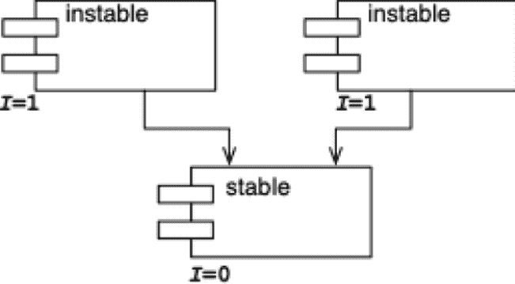

另一方面，下一张图显示了 `Y`，一个非常不稳定的组件。`Y` 没有其他组件依赖于它；我们说它是不负责的。`Y` 也有三个它依赖的组件，因此更改可能来自三个外部源。我们说 `Y` 是依赖的且不负责的：它是一个青少年。


`A` 指标衡量了一个组件的抽象程度。它的值简单来说就是组件中接口和抽象类的数量与该组件中类总数之比。

- `Nc`: 组件中类的数量。
- `Na`: 组件中抽象类和接口的数量。
- `A`: 抽象度。

`A = Na / Nc`。`A` 指标的值范围从 0 到 1。零意味着该组件完全没有抽象类。值为 1 则意味着该组件除了抽象类和接口外，一无一物。

# 主序

我们现在可以定义稳定性（`I`）与抽象度（`A`）之间的关系了。我们可以创建一个以 `A` 为纵轴、以 `I` 为横轴的图表。如果我们在这张图上画出两种“良好”的组件，我们会发现最稳定且最抽象的组件（成年人）位于左上角的 (0,1)。最不稳定且最具体的组件（青少年）位于右下角的 (1,0)。

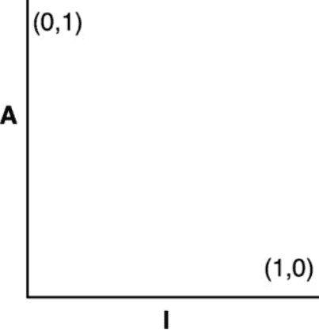

并不是所有组件都能落入这两个位置之一。组件具有不同程度的抽象性和稳定性。例如，一个抽象类派自另一个抽象类是非常常见的。派生类是一个具有依赖关系的抽象。因此，尽管它是最抽象的，但它不会是最稳定的。它的依赖关系会降低它的稳定性。

由于我们无法强制所有组件都位于 (0,1) 或 (1,0)，我们必须假设 `A/I` 图上存在一条点轨迹，定义了组件合理的位置。我们可以通过以下方式推断出这条轨迹：

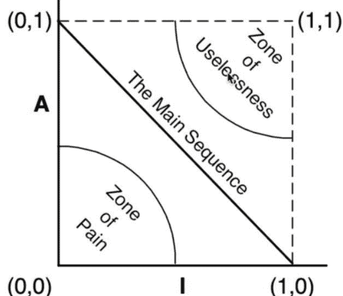

## 痛苦区域

考虑一个位于 (0,0) 区域的组件。这是一个高度稳定且具体的组件。这种组件是不理想的，因为它是僵化的。它无法被扩展，因为它不是抽象的。而且由于它的稳定性，它很难被修改。因此，我们通常期望看到设计良好的组件位于 (0,0) 附近。(0,0) 周围的区域是一个被称为“痛苦区域”的排除区域。

需要注意的是，某些软件实体实际上落在痛苦区域内。例如数据库模式（schema）。数据库模式以极易变、极其具体且高度被依赖而闻名。这就是为什么面向对象的应用程序与数据库之间的接口如此困难，以及为什么模式更新通常非常痛苦的原因之一。

另一个位于 (0,0) 的软件示例是具体的工具库。虽然这种库的指标为 1，但它实际上可能是易变的。以字符串组件为例，尽管它内部所有的类都是具体的，但由于它被用得如此频繁，修改它会导致混乱。因此，`String` 是易变的。

非易变组件在 (0,0) 区域是无害的，因为它们不太可能被改变。因此，只有那些易变的软件组件在痛苦区域内才会产生问题。痛苦区域中的组件越易变，就越“痛苦”。事实上，我们可以将变易性视为图表的第三个轴；那么上面的图表显示的只是最痛苦的平面，即变易性 = 1。

# 无用区域

考虑一个位于 (1,1) 附近的组件。这个位置是不理想的，因为它是最抽象的，却没有任何依赖者。这就像一个没有实现的接口。这种组件是无用的。因此，这被称为“无用区域”。

居住在这个区域的软件实体是种类的弃物。它们通常是无人实现的遗留抽象类。我们偶尔会在系统中发现它们，它们静静地呆在代码库中，无人使用。

或者可能是多余的接口——少数几个类实现但没有任何类使用的接口。

一个在无用区域内具有深度的组件，必须包含相当比例的实体。无用实体的存在是不理想的。

## 主序

我们希望最易变的组件尽可能地远离这两个排除区域。距离每个区域最远的点轨迹是连接 (1,0) 和 (0,1) 的直线。我称之为为主序⁸。

> 8 作者对自己借用天文学中一个重要术语的这种傲慢行为恳请读者的宽谅。

位于主序上的组件对于其稳定性来说并不“过于抽象”，对于其抽象度来说也并非“过于不稳定”。它既不无用，也不特别痛苦。它根据其抽象程度而被依赖，并根据其具体程度而依赖他人。

对于组件而言，最理想的位置是主序的两个端点之一。我们努力将大多数组件放在这些端点。然而，根据我的经验，大型系统中只有一小部分组件既不是完全抽象的也不是完全稳定的。如果这些组件位于主序或靠近主序，它们就具有最好的特性。

# 与主序的距离

这引出了我们的最后一个指标。如果组件位于主序或靠近主序是理想的，我们就可以创建一个指标，来衡量组件距离这个理想状态有多远。

- `D⁹`: 距离。`D=|A+I-1|`。该指标的范围从 [0,1]。零表示组件直接位于主序上。一表示组件距离主序最远。

> 在之前的出版物中，我将这个指标称为 `D'`。我没看到理由继续那种做法。

给定这个指标，可以对设计与主序的整体符合情况进行分析。可以计算每个组件的 `D` 值。任何 `D` 值不为 0 的组件都可以重新检查并重构。

## 结论

如果你到这里已经感到头晕脑胀，我建议你深呼吸。我并不是建议你去测量和计算所有这些指标。知道 `F = ma` 是好事，但你开车时通常并不会做那个数学题。理论是一回事，实践是另一回事。

我确实没有养成收集必要统计数据、进行所有计算并生成图表的习惯。在大多数项目中，我甚至不需要在脑中做数学计算就能看出这些关系。相反，我只是在脑中设想这些关系，并推断每个组件有多稳定、多抽象。如果你愿意，可以将其视为一种“感觉”。

理解上述理论是好的。在某些情况下，进行上述计算可能是有益的。在极少数极端情况下我确实遇到过。但在大多数情况下，理解理论并用它来“感觉”是很好的。

你可能会发现你的 IDE 会替你完成很多此类计算。我发现在大型项目中，查看这些计算结果是有帮助的。但我的“感觉”已经很准了。

# 第21章 持续设计


作者 Jeff Lang

产品所有（以及其他负责定义软件产品的人）确定系统必须完成的目标。开发者反过来以代码和配置的形式，在系统中为每个目标提供支持。正如 Jack Reeves 三十年前告诉我们的那样，代码（和配置）是最终且决性的表示¹²

¹ 例如，[PPP02](http://www.butucklebob.com/ArticleS.UncleBob.PrinciplesOfOod) 和 https://en.wikipedia.org/wiki/SOLID_(object-oriented_design)。

² https://www.developerstar.com/articles/reeves/design.html. 出自 [PPP02]。

“设计”这个词经典地有两个主要含义：

- 构建某物的计划
- 某物当前呈现的形式和功能

持续设计意味着我们不断规划适应新行为，并且每当我们添加新行为时，系统都有新的设计。持续设计也可以称为 . . . 等，那个缩写已经被占用了。我们在这一章中可能会直接称其为“设计”，因为这是我们构建软件系统的最佳方式：一个接一个意识的设计决策。

添加新代码或更新现有代码总是会改变设计。大部分规划发生在我们开始编写提供新行为的代码时。

设计是一个持续的活动。我们的系统设计应该让我们持续关注，因为从定义上来说，它在不断变化。听起来可能令人令畏，但实际上，这比“生成一组初始设计模型然后假装之后可以忽略设计”要容易得多。

## 持续变化

虽然软件由代码组成，但更有用的说法是软件是由成千上万个小行为（有时称为*单元*）组成的，每个行为都以代码的形式实现。我们作为程序员的工作是创建并编排这些行为，以支持系统用户实现最终目标的方式。

我们必须首先将目标转化为若干较小的软件行为。给定目标“展示一组用于学习捷克语名词的随机闪卡列表”，我们可能会实现以下行为序列。

1. 获取所有名词的随机子集。
2. 对于每个名词：
   a. 展示一个问题：一个填空句，以及包含四种可能的名词形式的多选题列表。
   b. 捕获用户的选择。
   c. 如果用户的选择错误，向用户显示正确答案。
3. 对于用户选择错误的每个问题，重复步骤 2a 到 2c。

解决问题通常有许多方法，因此我们可能会支持另一组步骤。例如，用户可能继续为某个问题选择答案，直到答对为止。我们可能会在每次回答错误时提供提示。随着用户技能的提高，我们可能会将选题替换为填空题。

如果一个应用本身有许多设计选择，那么我们编写底层代码的选择要多出几个数量级。不，不是那样。我们有无限的设计选择。其中大多数选择将是次优的。

我们的产品经理和所有者塑造我们的软件产品，以满足市场感知的需求。大多数软件产品仍然需要不断的变化，形式表现为新需求的出现以及对现有需求的增强。

反过来，我们必须不断能够通过塑造和增强现有软件来满足这些需求。软件系统是一种独特的产品：它不仅必须持续呈现一种支持迄为止所有需求的设计，还必须接受这种设计明天可能需要不同。

我们可能在短时间内（也许一两个月）构建出一个流畅、实用的闪卡系统。在初始发布后，用户将要求新的行为。我们正在售卖新功能——太棒了！但我们必须不断回到当前系统的固有设计——它的代码库。为了添加新功能，我们被迫思考如何将新概念融入现有设计中，这些可能是以前从未考虑过的事情。

## 持续设计

在对软件做出选择时，我们只有几种主要的构建块：模块（类）、函数（方法）、数据引用（变量）以及语句/表达式。这前三个构造可以命名，以便我们人类有更好的机会理解代码库中存在哪些概念，并有更好的机会找到我们需要更改或扩展的代码。

我们选择如何管理和组织这些构建块，这正是软件设计的活动。我们系统的设计是我们到目前为止所做出的选择的集合。

在组装这些构造时，我们很容易做出许多错误选择，而且是在极短的时间内。对我们的闪卡应用进行更改后，它可能仍然运行，但我们的更改可能不必要地增加了任何修改的成本。

如果更改我们的闪卡应用导致代码无组织、复杂且不清晰，那么适应新需求将变得缓慢。我们将花费太多时间在代码中导航，以找到所有必须更改的地方。一旦我们找到了这些位置（通常是多个），我们将花费太多时间来理解当前代码的作用。然后，我们将花费太多时间仔细地插入我们的更改，并确保所有现有行为完好无损。

我们做的每一个设计选择都会影响未来选择的成本。只有当我们尽量减少每个选择的负面设计影响时，我们才能成功。这就是所谓的持续设计的关键概念。

## 在持续设计的四个 C 上航行

一个不整洁（Unclean）的代码系统会难以：

- 找到你正在寻找的代码。
- 理解哪里需要进行更改。
- 在不产生缺陷的情况下进行更改。
- 编写测试来验证其行为。

你可能在第13章“整洁类”中熟悉这些特征。

我们有许多设计视角来引导我们走向整洁代码系统。当我们改变系统时，继续反思这些一个或多个视角——SOLID、代码气味、简单设计、设计模式等等，包括各种变化的单一原则，如迪米律（Law of Demeter）和“请求而非询问”（Tell-Don’t-Ask）。

对于持续设计的概念，我们将尝试——像许多人一样——将所有内容编码为一组简单的、可能容易记住的规则。考虑一下这个 YADP：另一个设计视角。

我们的四个 C 设计考虑因素是：

- **清晰性（Clarity）**：程序员在系统中的意图都被清晰地表达。
- **简洁性（Conciseness）**：程序员在系统中的意图用最少的代码实现。
- **可确认性（Confirmability）**：系统中的所有单元行为都可以被轻松测试，这种方式也为所做的行为选择提供了“活文档”。
- **内聚性（Cohesion）**：系统中的每个模块都具有高水平的内聚——其所有元素之间都存在最大关联。

这些考虑因素并不是孤立存在的。我们将逐一讨论它们，但在讨论时，请思考它们如何相互支持又相互矛盾。

```javascript
return response.slice(startIndex, endIndex)
}

const joinQuoted = words =>
  words.map(word => `${word}`).join(',')

const pluralizeIfMany = (word, list) =>
  list.length === 1 ? word : `${word}s`

export const retrieveWords = async words => {
  const finalPrompt = `Given a list of nouns separated by commas, 
  provide appropriate Czech language information for the ` +
    `${pluralizeIfMany('word', words)} tiny ${(joinQuoted(words))}`

  const response = await sendPrompt(`${format} ${finalPrompt}`)

  return JSON.parse(sliceJSONArrayFrom(response))
}
```

如果我们现在被要求对 `retrieveWords` 进行修改，现在可以快速理解它的整体意图和流程。该函数初始化了一个 `finalPrompt` 作为一个长文本字符串，其中嵌入两个概念：

- 文本是 “word” 还是 “words,”，取决于 `words` 数组的大小
- 该数组中带引号的单词连接而成的字符串

这两个概念现在变成了对微小的、独立的函数的调用。

我们向 LLM 发送了一个较长的提示字符串，并收到文本响应。最后，我们从响应字符串中切片出 JSON 文本（之所以存在是因为我们在提示中向 LLM 发送了期望的格式），然后对其进行解析。

我们可以在十五秒内理解这样的函数；它在很大程度上是一段策略声明。它使用了提取出的函数，这些函数名捕捉了它们的意图。每个提取出的函数实现只占一到三行代码。如果我们不需要更改其中任何一个实现，那么就有一到三行我们可以暂时忽略且可能永远忽略的隐藏细节。

如果我们需要更改其中一个辅助函数，精简的策略声明允许我们快速找到它，并专注于极微小的实现细节。我们可以在不考虑任何其他代码的情况下进行更改。

访问第 14 章“测试规范”来了解如何操作。

## 编辑我们的代码

编写具有高清晰度的代码证明我们足够关心队友（以及我们自己），以至于在继续之前花几分钟时间编辑我们的代码。

作为开发者，我们擅长让程序运行起来——这是我们的首要工作。我们还需要提醒自己，我们也是作家，其他人必须消费我们写的内容。一旦我们将想法记录在纸上，良好的写作要求我们重新审视自己的产出并进行编辑以强调清晰性。

遗憾的事是，我们通常没有被教过如何编辑代码。世界上绝大多数代码反映了这一点，结果浪费了你大量的时间。每分钟的 WTF（惊叹）次数很高。

事实上，我们经常被明确告知不要编辑代码。“如果没有坏，就不要修它。”那句陈调且被误用的格言又出现了。

如果其他人不能快速理解你的代码，那么它就是坏的。

如果你拿起了一本写得糟糕的书，一本需要你反复重读句子和段落才能理解其意思的书，你会认为它是一本糟糕的、坏掉的书（打赌你在大学期间至少读过这样一本）。

这句格言之所以存在，是因为我们害怕破坏东西。是的，代码是一种脆弱的材料。在几乎任何编程语言中都很很容易犯下蠢的编码错误，却甚至无法发现它。结果，我们倾向于避免清理工作，尽管这通常很容易。

害怕修改我们的代码是一种质量异味（quality smell）。有简单的路径可以创建控制措施，这些措施会在每一次微小变化时告诉我们是否已经破坏了已运行良好的逻辑。访问第 14 章“测试规范”来了解如何操作。

## 清晰性的快速步骤

- 从多功能函数中提取实现细节，创建具有简洁名称的新函数。
- 在适当的情况下将函数移动到其他模块中。这增加了内聚性，有助于读者在他们预期的地方找到代码。
- 用清晰的声明取代注释。
- 编写测试，同时作为系统中编码的所有所有行为意图的文档。

## 对清晰性的异议

经验丰富的程序员能够立即消化极简短的代码片段。一位经验 JavaScript 开发者可以快速理解以下几个示例：

```javascript
words.map(word => `${word}`).join(',')
list.length === 1 ? word : `${word}s`
```

尽管如此，这些片段仍然需要仔细阅读。我们必须在脑海中将相关的标记组合成它们所代表的行为概念。存在细微的误解可能，也存在微小的缺陷可能。下面这行看似符合惯用法的代码应该让我们停顿一下：

```javascript
for (let i = 0; i <= words.length; i++)
```

然而对许多人来说，它并没有。那不是惯用法；这个才是：

```javascript
for (let i = 0; i < words.length; i++)
```

第一个 for 循环可能是一个缺陷。

无论如何，将小的实现细节提取到揭示意图的函数中简化了 `retrieveWords` 中的代码：

```javascript
const joinQuoted = words =>
  words.map(word => `${word}`).join(',')
```

```javascript
const pluralizeIfMany = (word, list) =>
  list.length === 1 ? word : `${word}s`
```

```javascript
export const retrieveWords = async words => {
  final Prompt =
    `Given a list of English nouns, separated by commas, ` +
    `provide appropriate Czech language information for the ` +
    `${(pluralizeIfMany('word', words))} ${(joinQuoted(words))}`
  // ...
}
```

## 声明意图，不要渗出细节

我们使用函数式管道部分是因为它们让我们更容易跟进流程。过程式的等写法类似于：


```javascript
let wordList = "";
for (let i = 0; i < words.length; i++) {
  const currentWord = words[i];
  const quotedWord = '' + currentWord + '';
  wordList += quotedWord;
  if (i !== words.length - 1) {
    wordList += ",";
  }
}
```

虽然过程版本更显式，但管道版本要干净得多：

```javascript
export const mostExpensiveBookInEachCategory = (categories) =>
  categories.flatMap(category =>
    category.books
      .filter(book => !!.title)
      .filter(book => book.rating > 4.0)
      .sort((a, b) => b.price - a.price)
      .map((book) => ({ category: book.category, title: book.title }))
      .slice(0, 1))
```

他们通读你的代码，当他们苦于你那超优化的逻辑时，通常是显而易见的。

然而，让我们从一个相反的例子开始——这个例子清晰但并不简洁。下面的 `generateCard` 函数以及几个辅助函数，组装了一个基于文本的闪闪卡（上面竟然还有答案——真奇！）。

```javascript
// 生成从 0 到 n-1 的整数
export const randomInt = n => {
  const randomValue = Math.random(); // 生成一个随机小数
  const scaledValue = randomValue * n; // 缩放到目标范围
  const flooredValue = Math.floor(scaledValue); // 向取整得到整数
  return flooredValue;
}
```

```javascript
// 如果需要，返回单词的复数形式
const pluralizeIf = (word, isPlural) => {
  if (isPlural) {
    return `${word}s`; // 添加 's' 使单词变为复数
  } else {
    return word; // 如果不是复数则返回原单词
  }
}
```

```javascript
// 为语言卡牌游戏生成提示文本
const generateCard = (adjectives, nouns) => {
  // 从提供的列表中随机选择形容词和名词
  const randomAdjectiveIndex = randomInt(adjectives.length);
  const randomNounIndex = randomInt(nouns.length);
```

```javascript
const adjective = adjectives[randomAdjectiveIndex];
const noun = nouns[randomNounIndex];

// 随机决定格位单数
const nominativeOrAccusative = randomInt(2) === 0 ? 'nominative' : 'accusative';
const isPlural = randomInt(2) === 0;
const singularOrPlural = isPlural ? 'plural' : 'singular';
```

```javascript
// 根据格和数获取名词和形容词的正确形式
const correctNoun = noun[singularOrPlural][nominativeOrAccusative];
const nounGender = noun.gender.toLowerCase();
const correctAdjective = adjective[nominativeOrAccusative][singularOrPlural][nounGender];
```

```javascript
// 构建游戏卡片的提示文本
const promptText = `Adjective: ${adjective.word}
Noun: ${noun.word}

Determine the ${singularOrPlural} ${nominativeOrAccusative} case.

Correct answer: ${correctAdjective} ${correctNoun}`;
```

```javascript
// 返回构建的提示
return promptText;
```

这段代码对我们来说看起来很典型，但这并不是什么好事。核心函数 `generateCard` 是一个从上到下的过程。它并不长，但它包含了注释，用来引导读者理解接下来几条语句正在发生。函数中的每条语句都使用了清晰的变量名，并且易于理解。我们可以仔细地逐句阅读代码，在脑海中将每组语句组合成单元行为。这有什么不好的呢？

事实上，上面的例子是许多开发者在职业生涯的大部分时间里愉快地继续编码的方式。但由于许多原因，这并不是最优的。

重构后的版本产生了额外的小型辅助函数。

（再次，从底部的 `generateCard` 开始阅读。）

```javascript
export const randomInt = n => Math.floor(Math.random()) * n;
const pluralizeIf = (word, isPlural) => isPlural ? `${word}s` : word;

const randomElement = (array) => array[randomInt(array.length)];

const cases = ["nominative", "accusative"];
const numbers = ["singular", "plural"];

const generateRandomCardData = (adjectives, nouns) => ({
  adjective: randomElement(adjectives),
  noun: randomElement(nouns),
  grammaticalCase: randomElement(cases),
  number: randomElement(numbers)
});
```

```javascript
const formatCard = (adjective, noun, number, grammaticalCase,
  correctAdjective, correctNoun) =>
  `${adjective.word} ${pluralizeIf(noun.word, number === 'plural')}`;

Provide the ${number} ${grammaticalCase} case.

Correct answer: ${correctAdjective} ${correctNoun}`;
```

```javascript
const generateCard = (adjectives, nouns) => {
  const { adjective, noun, grammaticalCase, number } = generateRandomCardData(adjectives, nouns);

  const correctNoun = noun[number][grammaticalCase];
  const correctAdjective = adjective[grammaticalCase];

  return formatCard(adjective, noun, number, grammaticalCase,
    correctAdjective, correctNoun);
};
```

清晰度在几个方面得到了提升。将 `generateCard` 提炼为三个顶层区块，允许读者快速识别整体策略。

- 使用传入的形容词和名词生成随机闪闪卡元素。
- 通过引用传入的名词和形容词结构，确定闪闪卡挑战的正确答案。
- 返回一个包含所有相关信息的格式化卡片。

我们可以立即理解并信任此解决方案中的每个辅助函数或数据单元。我们甚至可能不需要查看任何辅助代码或数据。

独立的函数通过允许我们关注小的、可理解的区块增强了清晰度。虽然看到涉及的数据结构（特别是单个名词和形容词对象）会有帮助，但除此之外，每条语句都是独立的。仍然没有任何语句需要注释。注释只会增加这段代码的开发、理解和维护成本。

正如我们提到的，当逻辑被重构为自文档时，我们通常可以通过删除注释来提高清晰度。例如，下面的 `generateCard` 函数要易读得多：

```javascript
const generateCard = (adjectives, nouns) => {
  const { adjective, noun, grammaticalCase, number } = generateRandomCardData(adjectives, nouns);

  const correctNoun = noun[number][grammaticalCase];
  const correctAdjective = adjective[grammaticalCase];

  return formatCard(adjective, noun, number, grammaticalCase,
    correctAdjective, correctNoun);
};
```

```javascript
const newCheckoutItem = Checkouts.addItem(checkout, itemDetails)
sendResponse(response, newCheckoutItem, 201)
}
```

重复从多个原因上增加了成本。`postItem` 控制函数的本质被重复的错误处理代码所掩盖。这种重复还通过将实现细节混入策略流中，降低了清晰度。

```javascript
const sendRequestError = (response, message) => {
  response.status = 400
  logError(errorMessage)
  response.send({error: message})
}
```

```javascript
const checkout = Checkouts.retrieve(request.params.id)
if (!checkout) {
  return sendRequestError(response, 'nonexistent checkout')
```

```javascript
const newCheckoutItem = Checkouts.addItem(checkout, itemDetails)
sendResponse(response, newCheckoutItem, 201)
}
```

通常，消除重复涉及到将具体细节替换为抽象。这通常是一个三赢的局面（增加了简洁性、清晰度和易于确认性，外加提高内聚性提供了跳板），但我们不会为了两行恰好看起来相同的代码而陷入过度追求。我们寻求的是发现并消除概念的重复实现，而不是偶然的相似代码行。

重复导致了许多成本/精力的增加：

- 阅读和理解的理解成本
- 通用的代码搜索时间（我们总是在不断增加的无关结果中挣扎）
- 测试时间成本
- 寻找被复制概念的所有变更点的精力成本
- 未能找到所有必要变更点的风险
- 分析重复代码中发现的差异是刻意的还是存在缺陷的时间
- 修改重复代码的精力成本
- 重构代码的成本
- 当公共代码存在缺陷时，缺陷成本的传播

我们处理过许多系统，由于代码泛滥重复，它们的规模比本该有的规模大出两到三倍。噢，那些按行数计工资的日子！（开玩笑的。我们中没有人真的经历过这种情况。）

其中一个示例包含一个手术室调度系统，根据定义，它需要处理大量日期和时间戳工作。在许多其他乐趣中，我们发现了一段常见的五行（旧式）Java 日期处理逻辑。这五行代码在整个代码库中重复了五十多处。当我们试图用现代库替换旧式逻辑时，我们的成本急剧增加。

“提取并移动”再次成为我们处理重复问题值得信赖的力马。

- 识别一个代表单一概念的实现细节簇。
- 将其提取到的函数。
- 孤立地关注这个新函数。如果合适，将其移动到另一个模块。

随着对新模块存在的意识增强，我们开始发现更多将额外的相关行为移动到其中的机会。结果是我们的模块的内聚性提高了。

## 简洁性细节点

每个不必要的标记都会增加我们代码的混乱。我们经常并且应该使用像惯用构造和语法糖等，减少我们必须扫描和在脑中组装的不必要代码量。我们的一些小吹毛疵：

## 返回布尔表达式

学习一种语言意味着我们不仅要学习它的语法，还要学习表示常用概念的最简洁方法。这些精简结构中的某些甚至被归类为“惯用（Idiomatic）”（是的，我们已经用了几次这个词；我们猜终于应该定义它了：惯用代码在你第一次看到它时并不显而易见。）

三元运算符是惯用的：在孤立的上下文中，它本身并不提供你立即破解它所需的全部信息。然而，当你第二次或第三次看到它时，你就知道如何解释它了——它对你变得显而易见。这就像骑自行车；之后你可能再也不需要提醒。

有时我们会看到反惯用写法（anti-idioms）：

```javascript
const hasTitle = book => {
  if (book.title !== null) {
    return true
  } else {
    return false
  }
}
```

反惯用吗？尽管这种结构占据了五行宝贵的源码，但我们看到它时通常会将其作为一个整体来消化（不幸的是，我们经常看到它）。有时我们甚至注意到某个笨蛋悄悄反转了 true 和 false 的顺序。

```javascript
const hasTitle = book => book.title !== null
```

## 不必要的 Else

如果 `if` 块提前返回，就不需要 `else` 块了。

```javascript
if (book.title !== null) {
  return true
}
false
```

如果 `if` 块提前返回，就不需要 `else` 块了。

```javascript
if (book.title !== null) {
  return true
}
false
```

如果 `if` 块提前返回，就不需要 `else` 块了。

```javascript
if (book.title !== null) {
  return true
}
false
```

## 等此类推

我们可以使用三元运算符来进行简单的条件赋值。

```javascript
if (book.title !== null) {
  return true
} else {
  return false
}
```

```javascript
const hasTitle = book.title !== null ? true : false
```

## 可确认性

我们的持续设计要求我们知道代码意图要做什么。没有这些知识，任何更改都是不安全的。系统可能包含许多单元。幸运的是，我们可以编写快速的单元测试，以验证我们是否创建了回归。

## 恐惧退化设计

相反，缺乏此类测试会逐渐减慢我们的速度。随着未测试代码量的增加，验证它的成本也会随之增加。我们手动执行的测试用例是有限的。

那已经可以运行了。（“你为什么要动那段代码？”）

恐惧会显著增加代码重复和成本。

# 混淆的单位意味着测试困难

如果我们像下面这样编写 `postCheckoutTotal` 函数，为它编写测试将是令人生畏的：

```javascript
export const postCheckoutTotal = (request, response) => {
    const checkoutId = request.params.id
    const checkout = Checkouts.retrieve(checkoutId)
    if (!checkout) {
        response.status = 400
        response.send({error: 'nonexistent checkout'})
    }

const messages = []
const discount = checkout.member ? checkout.discount : 0

let totalOfDiscountedItems = 0
let total = 0
let totalSaved = 0

``````javascript

checkout.items.forEach(item => {

    let price = item.price

    const isExempt = item.exempt

    if (!isExempt && discount > 0) {

        const discountAmount = discount * price

```

```javascript

const discountedPrice = price * (1.0 - discount)

```

```javascript

// add into total

totalOfDiscountedItems += discountedPrice

```

```javascript

let text = item.description

// format percent

const amount = parseFloat(


(Math.round(price * 100) / 100).toString()).toFixed(2)

const amountWidth = amount.length

```javascript
let textWidth = LineWidth - amountWidth
messages.push(pad(text, textWidth) + amount)
```

```javascript
total += discountedPrice
```

```javascript
// discount line
const discountFormatted = '-' + parseFloat(
  (Math.round(discountedAmount * 100)/100).toString()).toFixed(2)
textWidth = LineWidth - discountFormatted.length
text = ` ${discount * 100}% mbr disc`
messages.push(`pad(text, textWidth)}${discountFormatted)}`)
```

```javascript
totalSaved += discountAmount
} else {
total += price
const text = item.description
```

```javascript
const amount = parseFloat(
  Math.round(price * 100) / 100).toString().toFixed(2)
const amountWidth = amount.length
const textWidth = LineWidth - amountWidth
messages.push(pad(text, textWidth) + amount)
}
)
```

total = Math.round(total * 100) / 100

```javascript
// append total line
const formattedTotal = parseFloat(
  Math.round(total * 100) / 100).toString().toFixed(2)
const formattedTotalWidth = formattedTotal.length
const textWidth = LineWidth - formattedTotalWidth
messages.push(pad('TOTAL', textWidth) + formattedTotal)
```

```javascript
if (totalSaved > 0) {
const formattedTotal = parseFloat(
  Math.round(totalSaved * 100) / 100).toString().toFixed(2)
console.log(`formattedTotal: ${formattedTotal}``
const formattedTotalWidth = formattedTotal.length
const textWidth = LineWidth - formattedTotalWidth
messages.push(pad('*** You saved:', textWidth) + formattedTotal)
}
```

totalOfDiscountedItems =
```javascript
Math.round(totalOfDiscountedItems * 100) / 100
```

```javascript
totalSaved = Math.round(totalSaved * 100) / 100
response.status = 200
// send total saved instead
response.send(
  { id: checkoutId,
    total,
    totalOfDiscountedItems,
    messages,
    totalSaved })
}
```

捕捉所有的细微差别并为所有相关编写测试可能需要几个小时。此外，很有可能我们没有覆盖所有情况，这增加了我们发布缺陷的风险。

# 短小、隔离的单元意味着简单的测试

在我们构建结账收据的逻辑时，编写小而简单的测试要容易得多。无疑，你可以在 `postCheckoutTotal` 中发现一些重复的部分，还可以发现许多将概念单元提取到新函数中的机会。

这是一个改进的解决方案，正在进行中。

```javascript
const sendSuccessResponse = (response, body) => {
  response.status = 200
  response.send(body)
}
```

```javascript
const sendErrorResponse = (response, message) => {
  response.status = 400
  response.send({ error: message });
}
```

```javascript
export const postCheckoutTotal = (request, response) => {
  const checkoutId = request.params.id
  const checkout = Checkouts.retrieve(checkoutId);
  if (!checkout) {
    return sendErrorResponse(response, 'nonexistent checkout');
  }
  const { totals, messages } = createReceipt(checkout);
  sendSuccessResponse(response, {
    id: checkoutId,
    messages,
    total: round2(totals.total),
    totalOfDiscountedItems: round2(totals.totalOfDiscountedItems),
    totalSaved: round2(totals.totalSaved)
  });
}
```

`postCheckoutTotal` 函数现在是一个策略的声明，可以用几个“端到端”测试来覆盖。

`receipt.js` 模块暴露了可以轻松测试的代码：

```javascript
import { pad } from '../stringutil'
import { calculateTotal, totalOfDiscountedItems, totalSaved } from './checkout-model'
export const createReceipt = checkout => {
  const totals = {
    total: calculateTotal(checkout),
    totalSaved: totalSaved(checkout),
    totalOfDiscountedItems: calculateTotalDiscountedItems(checkout)
  }
  const messages = createReceiptMessages(checkout, totals)
  return {
    totals,
    messages
  }
}
```

```javascript
const createReceiptMessages = (checkout, totals) => {
  const messages = [];
  checkout.items.forEach(item => {
    let price = item.price
    const isExempt = item.exempt
    const discount = checkout.member ? checkout.discount : 0
    if (!isExempt && discount > 0) {
      const discountAmount = discount * price
      const discountedPrice = price * (1.0 - discount)
      // add into total
      totalOfDiscountedItems += discountedPrice
      let text = item.description
      // format percent
      const amount = parseFloat(
(Math.round(price * 100) / 100).toString()).toFixed(2)
      const amountWidth = amount.length


## 重构计算函数

```javascript
let textWidth = LineWidth - amountWidth

messages.push(pad(text, textWidth) + amount)

total += discountedPrice

// discount line

const discountFormatted = '-' + parseFloat(
  (Math.round(discountedAmount * 100) / 100).toString()
).toFixed(2)

textWidth = LineWidth - discountFormatted.length
text = ` ${discount * 100}% mbr disc`

messages.push(`pad(text, textWidth)}${discountFormatted)}`)

totalSaved += discountAmount
} else {
  total += price

  const text = item.description
  const amount = parseFloat(
    Math.round(price * 100) / 100
  ).toString().toFixed(2)

  const amountWidth = amount.length
  const textWidth = LineWidth - amountWidth

  messages.push(pad(text, textWidth) + amount)
}
})

total = Math.round(total * 100) / 100

// append total line

const formattedTotal = parseFloat(
  Math.round(total * 100) / 100
).toString().toFixed(2)

const formattedTotalWidth = formattedTotal.length
const textWidth = LineWidth - formattedTotalWidth

messages.push(pad('TOTAL', textWidth) + formattedTotal)

if (totalSaved > 0) {
  const formattedTotal = parseFloat(
    Math.round(totalSaved * 100) / 100
  ).toString().toFixed(2)

  console.log(`formattedTotal: ${formattedTotal}``)

  const formattedTotalWidth = formattedTotal.length
  const textWidth = LineWidth - formattedTotalWidth

  messages.push(pad('*** You saved:', textWidth) + formattedTotal)
}

totalOfDiscountedItems = Math.round(totalOfDiscountedItems * 100) / 100
totalSaved = Math.round(totalSaved * 100) / 100

return messages
}
```

现在它被隔离了，我们可以专注于提高这些计算函数的清晰度和简洁性。我们很快就能建立起测试。只花了十分钟就创建了这些针对 `calculateTotal` 的测试：

```javascript
import { calculateTotal } from "./checkout-model";
```

```javascript
describe('calculate total', () => {
  it('is zero when no items exist', () => {
    const checkout = {
      items: []
    }

    const result = calculateTotal(checkout)
    expect(result).toBe(0)
  })

  it('is price of single undiscounted item', () => {
    const checkout = {
      items: [{ price: 42 }]
    }

    const result = calculateTotal(checkout)
    expect(result).toBe(42)
  })

  it('discounts item when member attached & item not exempt', () => {
    const checkout = {
      member: {},
      discount: 0.1,
      items: [{
        exempt: false,
        price: 100
      }]
    }

    const result = calculateTotal(checkout)
    expect(result).toBe(90)
  })
})
```

```javascript
it('does not discount item when exempt', () => {
  const checkout = {
    member: {},
    discount: 0.1,
    items: [{
      exempt: true,
      price: 100
    }]
  }

  const result = calculateTotal(checkout)
  expect(result).toBe(100)
})

it('does not discount item when no member attached', () => {
  const checkout = {
    discount: 0.1,
    items: [{
      exempt: true,
      price: 100
    }]
  }

  const result = calculateTotal(checkout)
  expect(result).toBe(100)
})

it('totals discounted and non-discounted items', () => {
  const checkout = {
    discount: 0.1,
    member: {},
    items: [
      { exempt: true, price: 5 },
      { exempt: true, price: 10 },
      { exempt: false, price: 100 },
      { exempt: false, price: 200 },
    ]
  }

  const result = calculateTotal(checkout)
  expect(result).toBe(5 + 10 + 90 + 180)
})
```

这些测试让我们有信心可以无畏地重构 `calculateTotal` 为一个更清晰的解决方案：

```javascript
const memberDiscountPct = checkout =>
  checkout.member ? checkout.discount : 0

const shouldApplyDiscount = (checkout, item) =>
  !item.exempt && memberDiscountPct(checkout) > 0

const calculateDiscountedPrice = (checkout, item) =>
  item.price * (1.0 - memberDiscountPct(checkout))

export const calculateTotal = checkout => {
  const totalDiscountable = checkout.items
    .filter(item => shouldApplyDiscount(checkout, item))
    .reduce((total, item) => total +
      calculateDiscountedPrice(checkout, item), 0);

  const totalNonDiscountable = checkout.items
    .filter(item => !shouldApplyDiscount(checkout, item))
    .reduce((total, item) => total + item.price, 0);

  return totalDiscountable + totalNonDiscountable;
}
```

看起来我们的重构增加了代码量，至少对于 `calculateTotal` 而言是如此。然而，对其他计算函数进行类似的更改后，整个模块的总行数减少了几个。

## 我们何时应该确保代码的可验证性？

许多开发者倾向于先写一大块代码，稍后再回来完成他们认为的“实现覆盖率指标的义务”。代码覆盖率——衡量测试执行了代码百分比的指标——变成了一个自我实现的预言：我们得到了我们所请求的。如果一个开发团队被要求达到最低 75% 的覆盖率指标，我们就会得到这个数字，不再更多。

75% 的覆盖率听起来并不糟糕，直到你把它反过来来看：我们系统的四分之一缺乏足够的单元测试。它们通常也是我们系统中最复杂的部分：它们更难测试，而且当我们为了满足一个并不真正认同的指标时，我们会以我们能想象的最快方式去完成。

我们的代码之所以有这么多部分难以测试，是因为在编写代码时，测试并不是首要考虑的问题。我们的首要兴趣仅仅是让那个该的东西运行起来。结果是复杂的部分甚至那些不复杂的部分也更难测试。我们的代码并不容易被验证。

在事后编写测试会更困难，因为现有代码：

- **缺乏清晰度**。它过于复杂，因为它没有经过重构编辑。要弄清楚函数作用这一基本问题变得更加困难。
- **缺乏内聚性**。要识别所有的实际开发者意图变得越来越困难，因为这些意图并不在同一个地方，并且与其他意图解耦了。
- **缺乏简洁性**。它包含了过多的代码，以及过度重复的结构，这些结构必须在多个上下文中反复测试。
- **包含深层依赖链**。结果是测试需要投入更多精力来合适的数据/上下文。通常私有依赖的存在意味着我们必须重塑代码以允许测试注入这些依赖。

75% 或 80% 或任何代码指标的另一个问题是：我们代码的剩余部分是一个占 20%+ 的、“谁知道这些东西是做什么的”的肿块。良好的测试不仅让我们能够无畏地编辑代码，它们还记录了开发者的意图。

如果事后编写测试会产生这么多问题（或者用积极地说，是无法无法提供足够的帮助），那么显而易见的答案是从测试开始。每当我们添加一个新行为时，我们就写一个捕捉该行为的测试。测试名称总结了该行为（这有助于我们以后找到它）。

单词模块是我们向最小可行性产品（MVP）迈出的第一个增量步骤。作为快速措施，我们选择将单词持久化在内存 JavaScript 对象（`{}`）中，其中键是单词，值提供了我们所需的语言细节。常量 `definition` 提供了一个示例。

> 3 最小可行性产品（Minimum Viable Product）。

## 这是我们的持续设计设计成绩单

- 可验证性（Confirmability）：通过。所有代码都是通过行为测试驱动而产生的。
- 简洁性（Conciseness）：通过。代码看起来已经尽可能简短了。
- 内聚性（Cohesion）：失败。等一下，失败了？

我们的意图是用适当的持久化机制来替换 JavaScript 对象。遗憾的是，我们将那少量的定义管理逻辑与支持定义存储的逻辑混淆在了一起。当我们进行更改时，将不得不打开单词模块并仔细检查其大部分方法以更新实现。

你可能识别出我们正在描述的是违反“单一职责原则”（SRP）的情况。SRP 和内聚性说的是同一件事，只是有些细微的差别。内聚性是指模块中的元素对同一目标的对齐程度。

如果我们当初遵循内聚性的解决方案，可能会发现从一开始构建该解决方案会容易一些。我们还将准备好立即适应更改，而不是必须为了支持更改而重构代码。

我们现在将重构代码，以演示内聚性解决方案如何提高代码的清晰度。

```javascript
import { retrieveWord } from '../prompts/languageClient'
import * as Data from '../persistence/database'

export const clearWords = () =>
  Data.deleteAll()

export const loadDefinition = (word, definition) =>
  Data.add(word, definition)

export const addWord = async word => {
  if (Data.contains(word)) return

  const definition = await retrieveWord(word)
  Data.add(word, { word, ...definition })
}

export const definition = word => Data.get(word)

export const allDefinitions = () => Data.allValues()
```

实现中指定的 JavaScript 对象已被抽象所取代：`add`、`get`、`allValues`、`containsKey` 和 `deleteAll`。底层实现可以从对象变为列表，或者变为与第三方键值存储或关系型数据库的交互。现在具有内聚性的单词不会受到这些更改的影响。

`database.js` 模块提供了一个抽象数据持久化概念的接口，没有导出任何暴露底层数据结构的内容。未来对其实现的更改不会影响系统中的其他代码。

```javascript
const data = {}

export const containsKey = key => data[key]

export const deleteAll = () =>
  Object.keys(data).forEach(key => delete data[key])

export const add = (key, value) =>
  data[key] = value

export const get = word => data[word]

export const allValues = () => Object.values(data)
```


# 我们在什么时候进行设计？

在持续设计的心态下，我们通过审查代码对“四个 C”的遵循情况来保持低成本，“四个 C”是一组我们可以持续咨询的代码准则。我们什么时候做这些？噢，当然是持续地，或者至少经常地。

但我们不仅在编写生产代码时才考虑设计。它几乎是软件开发每一步的一部分。

# 前期设计

我们通过确定产品将为用户带来哪些新功能来启动项目。这必然要求对系统设计有某种程度的理解——例如，它实现了什么，它的约束是什么。

作为回答分析和设计工作的一部分，我们可能会首先生成摘要图，捕捉系统当前设计的显著元素。然后，我们将为设计未来需要像什么样创建推测性的草图，以适应所期望的新行为。

利益相关者在规划过程的这一阶段通常想知道项目何时完成。估算是一项设计考虑因素：我们不仅必须感知开发新功能需要多少时间，还必须知道当前设计对新功能的阻碍程度有多大。理想情况下，所需的额外努力应该是“零”，如果我们足够好地遵循了“四个 C”，这是完全可能的。

估算本身可能会反馈到项目计划中。由于意想不到的高昂估算，我们可能会决定削减他们的愿望清单中的内容。根据这些愿望范围的更改，我们重新考虑设计并提供更新的估算。

我们目前的项目估算涵盖了可能需要几周或几个月完成的大型倡议。因此，估算是高层级的；我们投入足够的时间来对该倡议有一个大致的感觉。我们可能会使用相对大小——小、中、大、特大——来确定哪些是我们可以保证在下季度交付的。

当我们准备好开发时，我们寻求将这些更大的挑战切分成更薄的工作单元，以便我们在更短的时间内（可能是几小时或几天）开始并交付。在这一点再次需要对系统设计的理解，以确保我们切分工作的想法符合系统的现实。

# 准备工作

当我们准备好编写某个功能时，产品人员（产品所有者、产品经理、业务分析师、UX 设计师等）正在努力确保他们已经捕捉到了我们开始所需的实际细节。当他们与我们见面描述新功能时，我们会提问，并再次深入研究系统设计。

有时，当产品人员揭示功能的细节时，我们会发现“魔鬼”。我们发现情况并不如我们推想的那样理想。系统在此期间也发生了变化，导致事情变得困难。

# 开始工作

我们首先分解我们的工作。如果我们的工作为 `Cecher` 应用添加副词，我们可能会将该工作分为以下切片：

- 支持添加单个副词。
- 批量加载副词 CSV 文件。
- 添加包含副词的闪卡示例。

这些切片可能仍然太大。我们可能会将“支持副词”拆分为技术挑战：

- 创建并整合指定副词格式的 LLM 提示词。
- 为副词添加持久化支持。
- 重构构建逻辑以提供示例。

这种分解涉及到对设计的意识，并可能引发关于当前或推测设计必须如何变化的讨论。

# 执行工作

我们通过编写测试来驱动每个单元。单元测试描述行为，并提供一个使用系统的“活”示例。因此，测试是我们设计和记录系统接口的主要机制。

对于我们写的每个测试，我们都编写实现测试需求的代码。我们运行测试，修正代码（即设计），直到测试通过。我们重新查看编写的代码，对其清晰度、简洁性和内聚性进行编辑，然后进行下一个测试。

当我们为所有行为编写了测试并让所有测试通过时，我们就发布。

设计无处不在。

# 第 22 章 并发

作者 Brett L. Schuchert


> “对象是处理的抽象。线程是调度的抽象。”——James O. Coplien

1 [PPP02](http://www.butunclebob.com/ArticleUncleBob.PrinciplesOfood), 以及 [https://en.wikipedia.org/wiki/SOLID_(object-oriented_design)]

未来 Bob：本章中的所有内容同样适用于服务和微服务。

编写整洁的并发程序是很难的——非常困难。编写在单线程执行的代码要容易得多。编写多线程代码也很容易。

```
这种代码表面看起来良好，但在深层层次上是有缺陷的。这种代码在系统面临压力之前运行良良好。
```

在本章中，我们将讨论并发编程的必要性以及它带来的困难。我们提出了几条处理这些困难以及编写整洁并发代码的建议。最后，我们对与并发代码测试相关的问题进行总结。

整洁的并发是一个复杂的课题，值得专门写一本书。我们在本章的策略是提供一个概述。

## 为什么需要并发？

并发是一种解耦策略。它帮助我们把“做什么”和“何时做”解耦来。在单线程应用程序中，“做什么”和“何时做”是紧密耦合的，因此可以通过查看堆栈跟踪（`stacktrace`）来获取整个应用程序的状态。调试系统的程序员可以设置一个断点或一组断点，并根据触发断点的时机来了解系统的状态。

从“何时”中解耦可以显著提高应用程序的吞吐量和结构。从结构的角度来看，应用程序看起来像许多个协作的小计算机，而不是一个大循环。这可以使系统更易理解，并提供一些分离关注点的强大方法。

例如，考虑 Web 应用程序标准的“servlet”模型。这些系统运行在 Web 服务器的伞下，由服务器部分为你管理并发。每当 Web 请求进入时，servlet 请求就会异步执行。原则上说，每个 servlet 的执行都运行在自己的世界中，并与所有其他的服务器执行解耦。

当然，如果每个执行都是完全独立的，那么本章就没有必要了。事实上，Web 服务器提供的解耦远非完美。servlet 程序员必须非常自觉且非常小心，以确保他们的并发程序是正确的。尽管如此，servlet 模型的结构性优势仍然是巨大的。

但结构并不是采用并发的唯一动力。某些系统对响应时间和吞吐量的限制要求使用硬编码的并发解决方案。

例如，考虑一个单线程的信息聚合器，它从许多不同的网站获取信息并将其合并为每日摘要。由于该系统是单线程的，它会顺序访问每个网站，总是在开始下一个之前完成上一个。每日运行需要在 24 小时内执行。然而，随着加入的网站越来越多，耗时会不断增长，直到收集所有数据需要超过 24 小时。单线程涉及到在 Web socket 上花费大量时间等待 IO 完成。我们可以通过使用多线程算法（同时访问多个网站）来提高性能。

或者考虑一个一次只处理一个用户且每个用户只需要一秒时间的系统。该系统对于少数用户来说响应是很快的，但随着用户数量的增加，系统的响应时间也会增加。没有用户想排在 150 个人后面！我们可以通过并发处理许多用户来提高该系统的响应时间。

或者考虑一个解释大型数据集但只有在处理完所有数据后才能给出完整解决方案的系统。也许每个数据集可以在不同的计算机上处理，这样许多数据集就可以并行处理。

## 神话与误区

因此，采用并发有许多令人信服的理由。然而，正如我们之前所说的，并发是困难的。如果你不小心，可能会制造出非常糟糕的情况。考虑这些常见的神话和误区。

- **并发总是提高性能。** 并发有时可以提高性能，但仅当存在大量可以在多个线程或多个处理器之间共享的等待时间时。这两种情况都不是显而易见的。

- **编写并发程序时，设计不会改变。** 事实上，并发算法的设计与单线程系统的设计可能显著不同。“做什么”与“何时做”的解耦通常对系统结构产生巨大影响。

- **在使用 Web 服务器时，理解并发问题并不重要。** 事实上，你最好确切知道服务器在做什么，以及如何防止并发更新和死锁问题（这些问题将在本章稍后部分描述）。

以下是关于编写并发软件的几个平衡观点。

- **并发会产生某些开销，既在性能方面，也在编写额外代码方面。**

- **正确的并发是复杂的，即使对于简单的问题也是如此。**

- **并发 Bug 是不可重复的，因此它们通常被视为偶然事件而被忽略，而不是真正的缺陷。**

> ² 宇宙射线、故障等。

- **并发通常需要设计策略的根本性改变。**

## 挑战

是什么让并发编程如此困难？考虑以下这个简单的类：

```java
public class X {
    private int lastIdUsed;

    public int getNextId() {
      return ++lastIdUsed;
    }
}
```

假设我们创建了 `X` 的实例，将 `lastIdUsed` 字段设为 42，然后在两个线程之间共享该实例。现在假设这两个线程都调用了 `getNextId()` 方法；有三种可能的结果：

- 线程一得到值 42，线程二得到值 44，`lastIdUsed` 为 44
- 线程一得到值 44，线程二得到值 43，`lastIdUsed` 为 43
- 线程一得到值 43，线程二得到值 42，`lastIdUsed` 为 43

令人惊讶的第三种结果发生在两个线程互相干扰时。这是因为两个线程通过某行代码时有许多可能的路径，而其中一些路径会产生错误的结果。到底有多少种不同的路径？要真正回答这个问题，我们需要理解编译器对生成的字节码做了什么，并理解 Java 内存模型认为什么是原子的。

仅根据生成的字节码给出的快速回答是，对于这两个线程在不执行 `getNextId` 方法的情况下执行，有 12,870 种不同的可能执行路径。如果 `lastIdUsed` 的类型从 `int` 更改为 `long`，可能的路径数量将增加到 2,704,156。当然，大多数路径都会产生有效的结果。问题在于其中一些路径并不是。

## 并发防御原则

以下是一系列保护你的系统免受并发代码问题的原则和技术。

### 单一职责原则

SRP 规定方法/类/组件应该只有一个变化原因。并发的设计本身已经足够复杂，值得被分离。不幸的是，将并发实现细节直接嵌入其他代码中是非常常见的。这里是一些需要考虑的事：

- 并发相关代码有自己的开发、更改和调整周期。
- 并发相关代码有自己的挑战，这些挑战比非并发相关代码更困难。
- 并发代码失败的方式之已经让它充满挑战性。

建议：将你的并发代码与其他代码分离。

### 别论：限制数据的范围

正如我们看到的，两个线程修改共享对象的同一个字段会互相干扰，导致异常行为。一种解决方案是使用 `synchronized` 关键字来保护使用共享对象的临界区域。限制此类临界区域的数量是非常重要的。共享数据更新的地方越多：

- 你可能会忘记其中一个或多个地方——从而破坏所有修改共享数据的代码。
- 确定故障源将变得困难，而故障本身很难寻找。

建议：将数据封装放在心中；严格限制对任何共享数据的访问。

未来的鲍叔说：在编写并发模块时，考虑使用函数式语言，或者至少使用函数式风格。

### 别论：使用数据的副本

避免共享数据的一种好方法是从根本上避免共享数据。在某些情况下，可以复制对象并将其视为只读。在其他情况下，可能复制对象，在多个线程中收集结果，并在单个线程中合并结果。

如果有一种简单的方法可以避免共享对象，生成的代码将极可能引起问题。你可能担心所有创建对象的成本。值得实验一下看看这是否是一个问题。然而，如果使用对象的副本允许代码避免同步，那么节省的内锁开销可能会抵消额外的创建和垃圾回收的开销。

例如，继承自 `HttpServlet` 的类会接收所有传递给 `doGet` 和 `doPost` 方法的信息参数。这使得每个 Servlet 看起来就像是拥有它自己的机器一样。只要 Servlet 只使用局部变量，就不可能导致出现同步问题。当然，大多数使用 Servlets 的应用程序最终都会遇到数据库连接等共享资源。

**建议：** 尝试将数据划分为独立的子集，这些子集可以由独立的线程操作，并可能在不同的处理器上运行。

### 了解你的语言和库

这里有几个额外的建议。

- 使用线程安全的集合。
- 使用线程框架（例如 Java 中的 `Executor`）来执行不相关的任务。
- 尽可能使用非阻塞解决方案。
- 了解哪些库模块是线程安全的，哪些不是。

### 线程安全的集合

当 Java 还很年轻时，Doug Lea 编写了开创性的著作⁴《Concurrent Programming in Java》。伴随着这本书，他还开发了几个线程安全的集合，这些集合后来成为了 JDK 中 `java.util.concurrent` 包的一部分。该包中的集合在多线程环境下是安全的，并且性能良好。事实上，`ConcurrentHashMap` 的实现在几乎所有情况下都比 `HashMap` 更好。它还允许同时进行并发读写，并提供了支持常用复合操作的方法，否则这些操作是不安全的。如果 Java 是部署环境，请从 `ConcurrentHashMap` 开始。

> ⁴ [Lea99]。

还添加了其他类型的类以支持高级并发设计。以下是 Java 中的几个示例：

| 类名 | 说明 |
| :--- | :--- |
| `ReentrantLock` | 一个可以在一个方法中获取并在另一个方法中释放的锁。 |
| `Semaphore` | 经典信号量的实现，一种带有计数的锁。 |
| `CountDownLatch` | 在释放所有等待的线程之前，等待特定数量事件的锁。这允许所有线程都有公平的机会同时启动。 |

**建议：** 检查你可用的类。在 Java 中，请熟悉 `java.util.concurrent`、`java.util.concurrent.atomic` 和 `java.util.concurrent.locks`。

### 了解你的执行模型

在并发应用程序中，有几种不同的方法来划分行为。为了讨论这些模型，我们需要理解一些基本定义。

| 概念 | 定义 |
| :--- | :--- |
| 边界资源 (Bound resources) | 在并发环境中使用的固定大小或数量的资源。示例包括数据库连接和固定大小的读写缓冲区。 |
| 互斥 (Mutual exclusion) | 一时间只有一个线程可以访问共享数据或共享资源。 |
| 饥饿 (Starvation) | 一个线程或一组线程被禁止长时间进行——或者永远无法进行——如果运行快的线程没有尽头，总是让运行快的线程先通过可能会导致运行时间较长的线程饥饿。 |
| 死锁 (Deadlock) | 两个或多个线程等待对方完成。每个线程都拥有其他线程所需的资源，且在获取另一个资源之前，它们都无法完成。 |
| 活锁 (Livelock) | 线程同步进行，每个线程都尝试工作但发现另一个在“挡路”。由于共振，线程继续取得进展，但在长时间内——或永远——无法完成。 |

给定这些定义，我们现在可以讨论并发编程中使用的执行模型。

### 生产者-消费者⁵

一个或多个生产者创建某些工作并将其放入缓冲区或队列。一个或多个消费者从队列中获取这些工作并完成它。生产者和消费者之间的队列是边界资源。这意味着生产者在写入之前需要等待队列中的可用空间，而消费者必须等待队列中有内容可以消费。通过队列进行的生产者和消费者之间的协调涉及生产者和消费者之间的相互信号。生产者写入队列并信号队列不再空。消费者从队列读取并信号队列不再满。双方都可能等待被通知何时可以继续。

### 读者-写者⁶

> ⁶ http://en.wikipedia.org/wiki/Readers-writers_problem

当你有一个共享资源，主要作为读者的信息源，但偶尔会被写者更新时，吞吐量就是一个问题。强调吞吐量会导致饥饿和过时信息的累积。允许更新会影响吞吐量。协调读者使其不读取写者正在更新的内容，反之亦然，是一项艰巨的平衡工作。写者倾向于长时间阻塞许多读者，从而导致吞吐量问题。

挑战在于平衡读者和写者的需求，以满足正确操作、提供合理的吞吐量并避免饥饿。一种简单的策略让写者等待直到没有读者后再允许其更新。然而，如果有持续的读者，写者将面临饥饿。另一方面，如果有频繁的写者并给予他们优先级，吞吐量将受到损害。找到平衡并避免并发更新问题正是该问题要解决的。

### 哲学家就餐⁷

> ⁷ http://en.wikipedia.org/wiki/Dining_philosophers_problem

想象若干哲学家坐在一圆桌旁。每个哲学家左侧都放了一把叉子。桌子中心有一大碗意大利面。哲学家花时间思考直到他们感到饥饿。一旦饥饿了，他们就拿起两边的叉子。除非哲学家手里拿着两把叉子，否则他无法吃饭。如果某个哲学家右边的哲学家正在使用其中一把叉子，他必须等待该哲学家吃完饭并将叉子放回。一旦哲学家吃完饭，他会将两把叉子都放在桌子上，等待自己再次饥饿。

将“哲学家”替换为“线程”，将“叉子”替换为“资源”，这个问题与许多企业级应用程序相似，在程序中进程竞争资源。如果没有仔细的设计，这样竞争的系统可能会遇到死锁、活锁、吞吐量和效率下降。

**建议：** 你将遇到的大多数并发问题都符合上述模型之一。研究这些模型并理解它们的解决方案。

**建议：** 尽早考虑启动和关闭，并尽早让其运行起来。这会比你预期的要长。审查现有算法，因为这可能比你想象的要困难。

## 测试线程代码

证明代码是正确的是不现实的。测试不能保证正确性。然而，良好的测试可以最大限度地降低风险。这在单线程解决方案中是成立的。一旦有两个或多个线程使用相同的代码并处理共享数据，情况就会变得复杂得多。

**建议：** 编写具有暴露问题潜力的测试，然后通过不同的程序配置、系统配置和负载频繁运行它们。如果测试发生失败，请追踪失败原因。不要仅仅因为测试在随后的运行中通过了就忽略失败。

这里有许多需要考虑的因素。以下是一些更细粒度的建议：

- 将虚假性失败视为潜在的线程问题。
- 先让你的非线程代码运行起来。
- 使你的线程代码具有可拔性。
- 使你的线程代码是可调的。
- 使用比处理器数量更多的线程进行运行。
- 在不同的平台上运行。
- 对代码进行插桩，以尝试触发失败。

### 将虚假性失败视为潜在的线程问题

线程代码会导致“根本不可能失败”的事情发生故障。大多数开发者对线程如何与其他代码相互作用没有直观的感觉（包括作者在内）。线程代码中的 Bug 可能在数千次或百万次执行中才表现出一次症状。尝试重复系统可能会令人沮丧，这通常导致开发者将失败归咎于宇宙射线、硬件故障或某种“偶然性事件”。最好的方法是假设偶然性事件不存在。这些偶然事件被忽略得越久，建立在潜在有缺陷的方法之上的代码就越多。

**建议：** 不要将系统失败视为偶然性事件。

### 先让你的非线程代码运行起来

这看起来可能显而易见，但强化这一点并无害。确保代码在线程之外能够正常工作。通常，这意味着创建由线程调用的简单模块。由于这些模块感知不到线程，因此它们可以在线程环境之外进行测试。你的系统中越多的部分放在此类模块中，效果越好。

**建议：** 不要尝试同时追踪非线程 Bug 和线程 Bug。确保你的非线程代码在线程之外工作正常。

### 使你的线程代码具有可拔性

编写支持并发的代码，使其能够在几种配置下运行：

- 编写为单线程、多线程或在执行时进行变体。
- 线程代码与真实的或作为测试替体（test double）的对象交互。
- 使用运行快速、运行缓慢、可变的测试替体进行执行。


- 使用运行多次迭代的测试进行执行。

**建议：** 使你基于线程的代码特别具有可拔性，以便你可以在各种配置下运行它。

# 使你的线程代码是可调的

获得正确的线程平衡通常需要尝试。在早期，找到在不同配置下计时系统性能的方法。允许线程数被容易调整。考虑在系统运行时允许更改。考虑允许根据吞吐量和系统利用率进行自我调节。

# 使用比处理器数量更多的线程进行运行

系统在任务之间切换时会发生事情。为了鼓励任务交换，请使用比处理器或核心更多的线程运行。任务交换得越频繁，你就越可能遇到缺失临界区或导致死锁的代码。

# 在不同的平台上运行

在2007年年中，我们开发了一门并发编程课程。课程的开发主要在 OS X 下进行。课程是在运行在虚拟机上的 Windows XP 上演示的。为了演示失败条件而编写的测试在 OS X 上运行的 XP 环境并没有失败。

在所有情况下，被测试的代码已知是错误的。这进一步证实了不同的操作系统有不同的线程策略，每种策略都会影响代码的执行。多线程代码在不同环境下的表现不同。你应该在每个可能的部署环境中运行你的测试。

你知道 Java 的线程模型并不保证抢占式线程吗？现代操作系统支持抢占式线程，所以你“免费”获得了。尽管如此，JVM 并不保证这一点。

**建议：** 尽早且频繁在所有目标平台上运行你的线程代码。

# 对代码进行插桩，以尝试触发失败

并发代码中的缺陷隐藏是正常的。简单的测试无法暴露它们。事实上，它们在正常处理期间经常隐藏起来。它们可能每几小时、几天或几周才出现一次！

线程 Bug 可能是不频繁、发散且难以重复的原因是，在脆弱区域的数千种可能路径中，只有少数路径实际上失败了。因此，失败路径被取的概率低得惊人。这使得检测和调试变得非常困难。

你如何增加捕捉此类稀有事件的概率？你可以对代码进行插桩，通过添加对 `Object.wait()`、`Object.sleep()`、`Object.yield()` 和 `Object.priority()` 等方法的调用，强制它以不同的顺序运行。

这些每个方法都可能影响执行顺序，从而增加检测缺陷的概率。当损坏的代码尽早、尽可能频繁地失败时。

代码插桩有两种选择：

- 手动编码
- 自动化

# 手动编码

你可以手动在代码中插入对 `wait()`、`sleep()`、`yield()` 和 `priority()` 的调用。当你测试一段特别棘手的代码时，这可能是正要做的。

这是一个这样做的示例：

```java
public synchronized String nextUrlNull() {
    if(hasNext()) {
        String url = urlGenerator.next();
        Thread.yield(); // 为了测试而插入
        updateHasNext();
        return url;
    }
    return null;
}
```

插入的 `yield()` 调用将改变代码采取的执行路径，并可能导致之前没有的失败。如果代码崩溃了，并不是因为你添加了 `yield()`。相反，你的代码是坏了，这只是使其变得显而易见。

这种方法有很多很多问题：

- 必须手动找到合适的地方这样做。
- 你知道在哪里放置调用以及使用什么样的调用吗？
- 将此类代码留在生产环境中会不必要的减慢代码速度。
- 这是一个散弹策略。你可能发现也可以发现缺陷。事实上，运气并不在你这边。

我们需要一种在测试期间但在生产环境中不需要的方法。我们还需要在不同的运行之间轻松混合配置，从而增加总体发现错误的机会。

显然，如果我们把系统划分为无人线程的简单模块和其他控制线程的模块，将更容易找到合适的插桩位置。此外，我们可以创建许多不同的测试用例，在不同的 sleep、yield 等调用方案下调用模块。

# 自动化

你可以使用 CGLIB 或 ASM 等工具以编程的方式对你的代码调用进行插桩处理。例如，你可以使用一个只有一个方法的类：

```java
public class ThreadJigglePoint {
    public static void jiggle() {
    }
}
```

你可以在代码中的多个地方添加对此方法的调用：

```java
public synchronized String nextUrlNull() {
    if (hasNext()) {
        ThreadJigglePoint.jiggle();
        String url = urlGenerator.next();
        ThreadJigglePoint.jiggle();
        updateHasNext();
        ThreadJigglePoint.jiggle();
        return url;
    }
    return null;
}
```

假设 `ThreadJigglePoint` 类有两个实现。第一种实现 `jiggle` 方法什么都不做，用于生产环境。第二种实现生成一个随机数，在睡眠（sleeping）、让出（yielding）或直接跳过（falling through）之间进行选择。如果你随机抖动运行千次测试，可能会发现一些缺陷。如果测试通过，你至少可以说你尽了尽职调查。虽然这种方法有点简单，但作为更复杂工具的替代方案，这是一个合理的选择。

核心在于对代码进行抖动（jiggle），使得线程在不同的时间不同的顺序运行。良好的测试与抖动的结合，可以显著增加发现错误的几率。

**建议：** 使用抖动策略来查出错误。

## 2025年更新与实地报告

现代技术栈在用户不共享数据时可以处理多个用户。以下是某些仍然需要留意并行/多线程问题的场景。

背景介绍：现代开发技术栈声称可以处理我们在编写《整洁代码》第一版时需要手动实现的许多问题。然而，许多原始问题和挑战仍然存在于现代系统中，即使是那些为你处理“所有多用户事务”的系统也是如此。

以下我们在《整洁代码》第二版发布前的一年中偶然发现的示例。

## 数据完整性

在过去的几年里，我们遇到了许多多用户系统存在潜在数据完整性问题的情况。所有这些系统都有并发用户（并行）正在执行更新共享数据的操作。

这些示例来自使用 React Native 构建的不同多用户系统。它们使用 AWS Lambda 作为后端，并在某些数据存储中进行存储。这类本身并没有问题。如果两个用户不共享数据，那么可能没有数据完整性问题。然而，当用户依赖共享数据时会发生什么？

示例包括：

- 加入游戏
- 在共享开发中工作
- 玩家并行工作创建一个牌组
- 在 React Native 中使用 2D 库在重新渲染时双删资源

## 加入游戏

想象一个用于训练工作坊的移动游戏平台。学生登录游戏。其中一个游戏限制为六名玩家，因此在第六名玩家加入后，后续的加入尝试会被拒绝。每个玩家被分配一个角色，编号从 1 到 6。

后端系统使用 DynamoDB，它提供“最终一致性”的结果。

在几个月里，我们偶尔遇到一些混乱，似乎我们正在丢失玩家。事实证明问题出在我们分配玩家角色的时机，以及玩家立即加入游戏上。

在原始实现中，我们将加入游戏的登录、分配玩家到游戏和角色，以及 DynamoDB 的最终一致性结合在一起，导致用户获得相同的角色，或者游戏溢出。

虽然可以重写与 DynamoDB 的交互方式，但另一个在该缺陷出现之前就存在的预期变更是：该变更通过将“加入游戏的登录”与“随后的角色分配”分开，使原始问题消失。

原始问题是：当多个移动客户端并行（parallel）加入游戏时，如何为多个用户分配角色。为了修复这个问题，我们扩展了领域模型。玩家不再在登录时就直接加入游戏，而是先进入一个候机室（waiting room）。随后，管理员创建游戏并发出请求，将所有等待中的玩家分配到游戏中。

我们认为，在没有事务隔离的情况下，加入游戏和角色分配这两个操作是不安全的，因此将其从可能并行执行转变为由单线程执行/由单个用户发布。原始实现并不是我们希望游戏运行方式的核心部分；它是处理同时进行多个游戏的最早构想之一。

该方法的副作用影响之一是，管理员会提前创建游戏，然后告诉人们登录特定的游戏。用户需要输入姓名、游戏名称和密码。这是由于常见的通信问题，导致人们加入了错误的游戏。

更改后，所有玩家加入一个候机室，候机室名称是管理员的电子邮件（在下拉列表中提供）。因此，玩家不再选择游戏名、用户名和密码，而是选择候机室名称并提供时间。这使得用户体验（UX）更简单且更不容易出错。

这把工作的多线程安全部分——进入系统，与多线程安全部分——加入特定游戏并分配用户角色隔离开来。

## 协作设计

接下来：一个允许共享创建商业安全系统安装/更新设计的系统。对于该系统，我们使用关系型数据库作为数据存储。

这样的计划包含几十张图像，每张图像可能包含多个可能连接的元素。你如何确保很多人同时处理同一个设计而不会发生冲突？

对于这一特定领域，一个设计上的用户数量通常少于五，且用户倾向于处理整个设计的不同部分。因此，虽然存在冲突的可能性，但考虑到系统的典型使用情况，发生的概率很小。

系统中之前的问题是需要选择一个元素进行编辑。这成为了锁定它的自然位置。我们在元素上使用一个标记（flag）来标识它是否被锁定。任何在已锁定的情况下尝试锁定都会失败，并通知用户该元素已锁定。取消后，元素的锁定将释放。我们选择在元素上设置标记，而不是在数据库中锁定元素，因为后者需要长事务。

通过适当的事务隔离，这是可以行的。

### 玩家并行工作创建一个牌组

我们在设计的加载顺序上遇到了问题。可能会将设计加载到系统时出现顺序错误……（由于原文此处存在大量重复片段，此处已按逻辑整合翻译）。

在所有示例中，数据共享都存在某些问题：

- 允许玩家加入特定游戏，并并行分配角色，同时使用具有最终一致性的数据库。
- 允许多个用户并行编辑共享设计方案。
- 允许玩家并行创建卡片。
- 多个互不协调的依赖性渲染循环，并受到其他异步活动的影响。
- 在异步环境中，没有显式地控制资源的执行/加载。

针对这些每一个问题，我们采取了不同的方法。

- 隔离不安全代码，并在稍后在单线程中执行（隔离与分离）。
- 使用标志位锁定对象，并配合关系型数据库。
- 什么都不做。人类可以根据当前的游戏规则选择拒绝或接受。
- 避免在真正需要之前使用第二个渲染线程，并在清除其他所有内容之前将其清除。
- 设计“父子关系”的加载方式，使得子节点在父节点准备就绪之前不进行渲染。

一旦你发现了数据共享的问题，会有很多方法可以解决它。我们看到了五个示例，以及针对特定问题的五种不同方法。

## 结论

并发代码很难写对。当多个线程和共享数据交织时，原本易于理解的代码可能会变成噩梦。如果你面临编写并发代码的任务，你需要编写严谨的整洁代码，否则将面临微妙且低频的失败。

首先，遵循单职责原则。将你的系统拆分为简单的模块，将“感知线程”的代码与“忽略线程”的代码隔离开。确保在测试感知线程的代码时，你只在测试它本身，而不测试其他内容。这意味着你的感知线程代码应该是短小且集中的。

了解并发问题的可能来源：多个线程在共享数据上操作，或使用公共资源池。边界情况，例如干净地启动和关闭或完成循环迭代，可能会变得格外棘手。

学习你所使用的库并掌握基础算法。理解库提供的某些功能如何支持解决与基础算法类似的问题。

学习如何找到必须锁定的代码区域并对其锁定。不要锁定不需要锁定的代码区域。避免从一个锁区域调用到另一个锁区域。这需要深度理解某物是否（或是否不）共享。将共享对象的数量和共享范围尽可能地缩小。更改共享数据对象的设计以适应客户端，而不是强迫客户端去管理共享状态。

问题会不断出现。那些没有尽早出现的问题通常被视为偶发事件。这些所谓的“偶发事件”通常发生在负载下或看似随机的时间。因此，你需要在许多平台、以许多配置上反复且持续地运行你的线程相关代码。可测试性是遵循良好测试准则自然产生的结果，它意味着某种程度的可插性，这为在更广泛的配置下运行代码提供了必要的支持。

如果你花时间对代码进行插桩（instrument），你将大大增加发现错误代码的概率。你可以手动这样做，也可以使用某种自动化技术。尽早投入这项工作。你希望在将代码投入生产之前，尽可能长时间地运行你基于线程的代码。

如果你采取整洁的方法，你写对的概率会大幅增加。

# 第三部分

# 架构

软件系统的架构是构建者赋予该系统的“形状”。这种形状的形式体现在将该系统划分为各个组件、这些组件的排列，以及这些组件相互通信的方式。

这种形状的目的是便于其包含的软件系统的开发、部署、运行和维护。

这种便利性背后的策略是尽可能在尽可能长时间保留尽可能多的选项。

也许这个声明让你感到惊讶。也许你认为软件架构的目标是让系统正常工作。我们确实希望系统正常工作；而且系统架构必须将其作为最高优先级之一来提供这种支持。

然而，系统的架构与该系统是否正常工作几乎没有关系。世界上有许多架构糟糕的系统，它们运行得很好。它们的问题不在于运行，而在于部署、维护和持续开发。

这并不是说架构在支持系统正确行为方面没有起任何作用。它确实有作用，而且这种作用至关重要。但这种作用是被动且装饰性的，而不是主动或本质的。系统架构几乎无法留下任何行为上的选择。

架构的首要目的是支持系统的生命周期。良好的架构使系统易于理解、易于开发、易于维护且易于部署。最终目标是最小化系统的寿命成本并最大化程序员的生产力。

注：本章是概述。有关该主题的更完整处理，请参阅 [Clean Arch]。

## 第23章 软件的两个价值


软件有两个价值。一个是行为的价值，另一个是结构的价值。后者是两者中更大的，因为正是这种价值使得软件变得*灵活*（soft）。

软件的发明是因为我们需要一种容易改变行为的方法。但这种灵活性关键取决于系统的形状、组件的排列以及这些组件相互连接的方式。

### 保持选项开放

保持软件灵活的方法是尽可能在尽可能长时间保留尽可能多的选项。我们需要保留的选项是什么？*它们是那些无关紧要的细节。* 所有软件系统都可以分解为两个主要元素：策略（policy）和细节（detail）。策略元素包含了所有的业务规则和过程。策略是系统真正的价值所在。

细节是那些为了让人类、其他系统和程序员与策略通信而必要的物，但对策略本身没有影响。这些包括 IO 设备、数据库、Web 系统、框架等。

架构的目标是赋予系统一种形状，使策略成为核心元素，同时让细节变得无关紧要。例如：

- 在开发早期没有选择数据库系统，因为高层策略不应该关心使用哪种数据库。事实上，如果你足够仔细，策略将不在乎数据库是关系的、分布式的、层次结构的还是简单的文本文件。
- 在开发早期没有选择 Web 服务器，因为高层策略不应该知道它正通过 Web 交付。如果高层策略不感知 HTML、CSS、AJAX、JSP、JSF 或其他 Web 开发的“字母汤”，那么你只需要在项目后期才需要决定使用哪种 Web 系统。事实上，你甚至不需要决定该系统是否会通过 Web 交付。
- 在开发早期没有采用 REST，因为高层策略应该对外接口保持不可感知。同样没有必要在早期采用微服务框架、SOA 框架或 REACT。再次，高层策略不应该关心这些事情。
- 在开发早期没有采用依赖注入框架，因为高层策略不应该关心依赖是如何解析的。

我想你明白我的意思了。如果你可以在不提交给周围细节的情况下开发高层策略，你就可以推迟并延迟对这些细节做出决定。你越晚做这些决定，你拥有的信息就越多，从而做出正确的决策。

你留出的选项越久，你能够进行的实验就越多，可以尝试的事情就越多，当那些决策无法再推迟时，你所拥有的信息也就越多。

如果决策已经由别人做出了呢？如果你的公司已经对某个数据库、某个 Web 服务器或某个框架做出了承诺呢？我建议你假装这些决策尚未被做出，并赋予系统一个形状，让这些决策能够尽可能地推迟。你永远不知道这类决策会在何时突然改变。

良好的架构能够最大化“未做决策”的数量。

## 第 24 章 独立性 (Independence)


良好的架构必须支持：

- 系统的用例
- 系统的运行
- 系统的开发
- 系统的部署

### 用例 (Use Cases)

第一个点符号——用例——意味着系统的架构必须支持系统的意图。如果该系统是一个购物车应用程序，那么架构必须支持购物车的用例。事实上，这是架构的首要任务。架构必须支持这些用例。

然而，正如我们之前讨论过的，架构并不直接影响系统的行为。架构能够留出的行为选项非常少。但影响并不是一切。一个良好的架构在支持行为方面所能做的最重要的事情，就是明确并暴露这种系统的意图，使其在架构层面上是可见的。

一个具有良好架构的购物车应用程序看起来会像一个购物车应用程序。该系统的用例在系统的结构中将清晰可见。开发者不需要去寻找行为，因为这些行为将作为系统顶层的一等元素存在。这些元素将是类、函数或模块，它们在架构中占据显著位置，并具有清晰描述其功能的名称。

### 运行 (Operation)

架构在支持系统运行方面起着更实质性、更少装饰性的作用。如果系统必须每秒处理 100,000 次交易，那么架构必须为每个要求的用例支持那样的吞吐量和响应时间。如果系统必须在毫秒内查询大数据的立方体，那么架构的结构必须允许这种操作。

对于某些系统，这意味着将系统的处理处理元素排列成一组微服务数组，这些服务可以在许多不同的服务器上并行运行。对于其他系统，这意味着大量的轻量级线程共享单个处理器内单个进程的地址空间。另一些系统可能只需要少数运行在隔离地址空间中的进程。而某些系统甚至可以作为运行单个进程的简单单体程序生存。

尽管这听起来很奇怪，但这个决策是良好架构留下的选项之一。如果一个系统以单体形式编写并依赖于该单体结构，那么一旦需要，它无法轻易升级为多进程、多线程或微服务。相反，一个保持组件良好隔离性且不假设组件之间通信手段的架构，随着系统运行需求随时间推移而变化，在线程、进程和服务频谱之间进行转换将要容易得多。

### 开发 (Development)

架构在支持开发环境方面起着重要作用。这正是康威定律（Conway's law）和单责任原则（SRP）发挥作用的地方。一个必须由拥有许多团队和许多关注点的组织开发的系统，必须具有能够促进这些团队独立行动的架构，以便团队在开发过程中不会相互干扰。


这是通过将系统合理划分为良好隔离、可独立开发的组件来实现的。这些组件随后可以分配给可以相互独立工作的团队。

## 部署

最后，架构对于系统部署的难易程度起着巨大的作用。目标是“立即部署”。良好的架构不依赖于几十个小配置脚本和属性文件的微调。它不需要手动创建必须排列的目录或文件。

但这种想法是误的。数据库是业务规则可以间接使用的工具。业务规则不需要知道模式（schema）、查询语言或关于数据库的任何其他细节。所有业务规则只需要知道有一组可以用于获取或保存数据的函数。这允许我们把数据库置在接口之后。

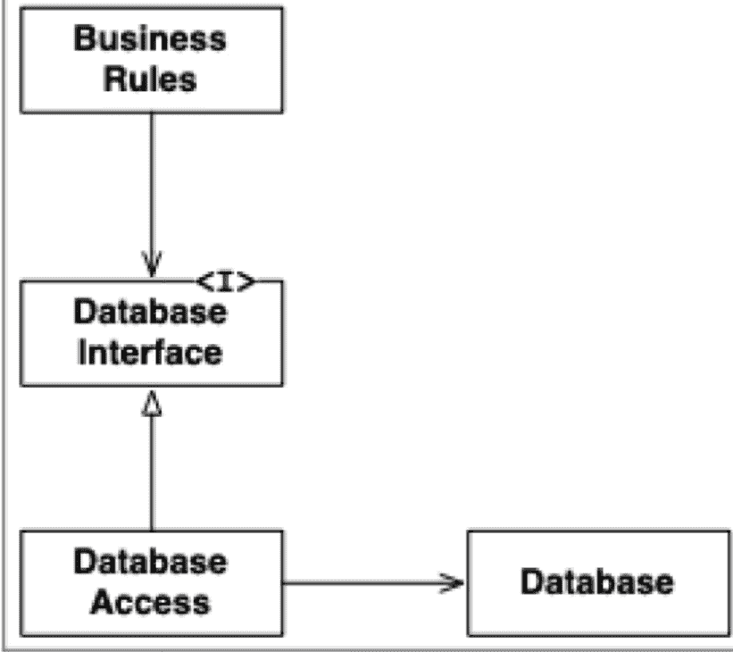

你从上面的图中可以清楚地看到这一点。业务规则（`BusinessRules`）使用数据库接口（`DatabaseInterface`）来加载和保存数据。数据库访问类（`DatabaseAccess`）实现了该接口并指导实际数据库的操作。

此图中的类和接口是具符号性的。在实际应用程序中，会有许多业务规则类、许多数据库接口类和许多数据库访问实现类。但它们都会大致遵循相同的模式。

边界线在哪里？边界是横跨在继承/实现关系上的，就在 `DatabaseInterface` 正下方，如下图所示。

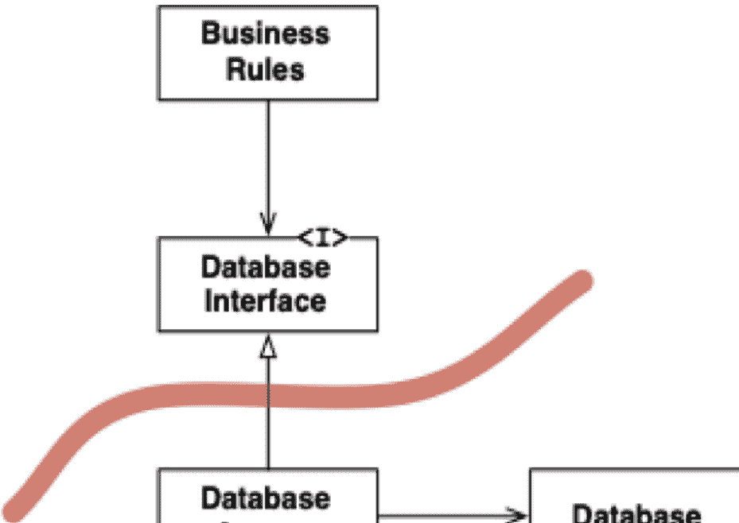

注意两个离开 `DatabaseAccess` 类的箭头。这两个箭头远离 `DatabaseAccess` 类。这意味着这些类中没有一个类知道 `DatabaseAccess` 类的存在。这就是边界线。

现在让我们向后退一步。我们将查看包含许多业务规则的组件，以及包含数据库及其所有访问类的组件。

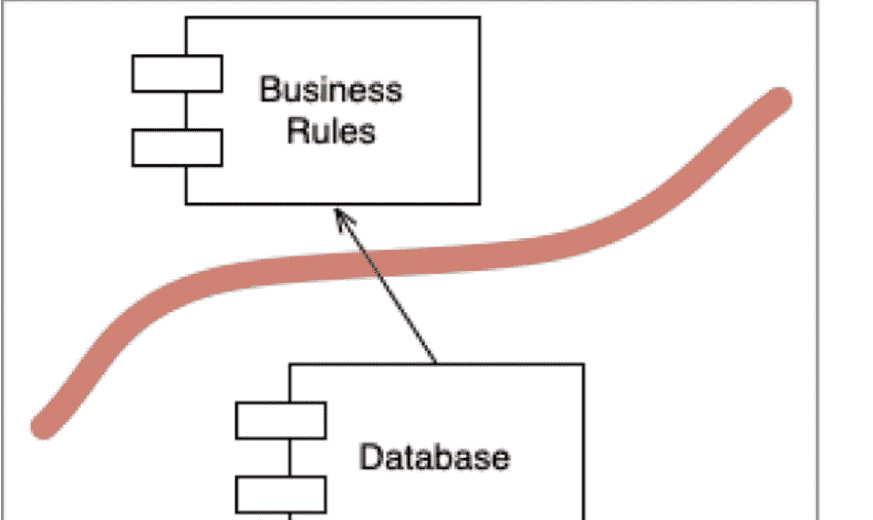

注意箭头的方向。数据库知道业务规则。而业务规则不知道数据库。这意味着 `DatabaseInterface` 类存在于业务规则组件中，而 `DatabaseAccess` 类存在于数据库组件中。

这个箭头的方向非常重要。它表明数据库对业务规则并不重要。但没有业务规则，数据库就不存在。

如果你觉得这看起来很奇怪，请记住：该数据库组件包含了将业务规则发出的调用翻译为数据库查询语言的代码。正是这些翻译代码知道业务规则。

在在两个组件之间画了这条边界线，并将箭头方向指向业务规则后，我们现在可以看到业务规则可以使用任何种类的数据库。数据库组件可以被许多不同的实现所取代。业务规则并不关心。

数据库可以使用 Oracle、MySQL、Couch、Datomic 甚至扁平文件来实现。业务规则完全不在乎。这意味着数据库的决策可以推迟，你可以在必须做出数据库决定之前，专注于编写和测试业务规则。

# 插件式架构

看下图中的两个边界。它们将数据库和 GUI 与业务规则隔离开来。箭头从低层组件指向高层的业务规则组件。

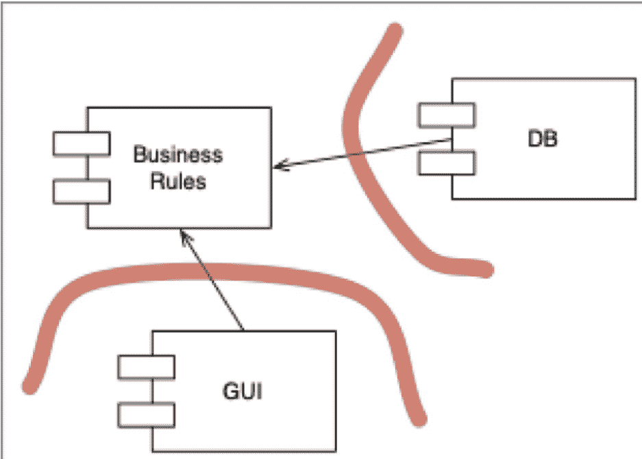

GUI 和 DB 插件到业务规则中。这种模式可以重复用于许多不同类型的组件。核心业务规则可以保持与任何可选的或可以用许多不同形式实现的组件相分离，并相互独立。

因此，由于这种设计中的用户界面被认为是一个插件，我们使得接入许多不同类型的用户界面成为可能。它们可以是基于 Web 的、客户端/服务器的、基于 SOA 的、基于控制台的，或基于任何其他用户界面技术。

数据库也是如此。由于我们选择将其视为插件，我们就可以将其替换为各种 SQL 数据库、NoSQL 数据库、基于文件系统的数据库，或未来我们可能认为必要的任何其他数据库技术。

这些替换可能并不于易事。如果我们系统的初始部署是基于 Web 的，那么为客户端/服务器 UI 编写插件可能具有挑战性。业务规则与新 UI 之间的某些通信可能需要重构。但通过从插件结构的假设开始，我们至少让这种改变变得具有可行性。

# 案例研究：FitNesse

我的儿子 Micah 和我在 2001 年开始开发 FitNesse。这个想法是创建一个简单的 wiki，它封装了 Ward Cunningham 用于编写验收测试的 FIT 工具。我们用 Java 编写了 FitNesse。

我当时坚持认为，我们产生的任何东西都不应该要求人们下载超过一个 jar 文件。我将这条规则称为“下载并即用”（Download and Go）。这条规则驱动了我们的许多决策。

早期的决策之一是编写我们专门针对 FitNesse 需的 Web 服务器。这听起来可能很荒谬。即使在 2001 年，也有许多开源 Web 服务器我们可以使用。然而，编写自己的证明是一个非常明智的决定，因为一个精简的 Web 服务器是一段非常简单的软件，它允许我们以后推迟对任何 Web 框架的决定.¹

¹ 许多年后，我们能够将 Velocity 框架引入到 FitNesse 中。

另一个早期决策是避免考虑数据库。我们在脑海中留有 MySQL，但我们决定避免考虑数据库。

在18个月的开发过程中，我们没有运行数据库，这一事实意味着在这18个月里，我们没有遇到过 schema 问题、查询问题、数据库服务器问题、密码问题、连接时间问题，或者当你启动数据库时会遇到的所有其他棘手问题。这意味着我们所有的测试运行得非常快，因为没有数据库来拖慢它们。

简而言之，划定有助于我们推迟和延迟决策的边界线，节省了我们大量的人力和脑细胞。这正是一个良好的架构应该做的事情。

## 结论

这就是在软件架构中划分边界线的方法。你将系统划分为组件。其中某些组件是核心业务规则。某些插件包含了与核心业务不直接相关的必要功能。然后，你安排这些组件中的代码，使得它们之间的箭头指向同一个方向——指向核心业务。

你应该将其识别为依赖倒置原则（DIP）和稳定抽象原则（SAP）的应用。依赖箭头的排列方式是从低层细节指向高层抽象。

这就是架构的依赖规则。

> 跨越架构边界的依赖必须始终指向高层侧。

# 第26 章 纯洁的边界

作者：James Grenning


我们很少能控制系统中的所有软件。有时我们购买第三方包或使用开源软件。其他时候，我们依赖公司内部团队为我们生产组件或子系统。通过某种方式，我们必须将这些外部代码与自己的代码干净地集成。在本节中，我们将介绍保持软件边界纯洁的实践和技术。

## 第三方IoT框架：大量的边界

我兄弟有一个想法，可以自动化用户对其产品执行的手工流程。该产品由技术人员用于测试高容量水泵。水泵的测试是通过水流并手动测量和记录多个喷嘴处的压力完成的。根据喷嘴的几何形状，压力被转换为流速。

水泵永久安装在商业或工业建筑中；水流向外部、路缘并进入雨水道。水泵的容量单位是每分钟数千加仑。手动测试可能需要20到30分钟，而且过程中会浪费大量水。通常，压力测量是在几个位置使用物理表进行的：建筑内部水泵旁，以及外部喷嘴处，并手动记录在写字板上。

这个主意是使用电子压力计测量压力，它可以每秒报告一次压力，并将读取显示在平板电脑或智能手机上。第一种设计使用蓝牙从传感器与平板电脑通信。它在实验室里运行良好，但在现场总有一堵砖墙（或更糟）挡路。蓝牙无法穿透砖墙。于是我们想出了以下想法。

利用现成的物联网（IoT）基础设施，我们可以穿过砖墙获取水压力测量。

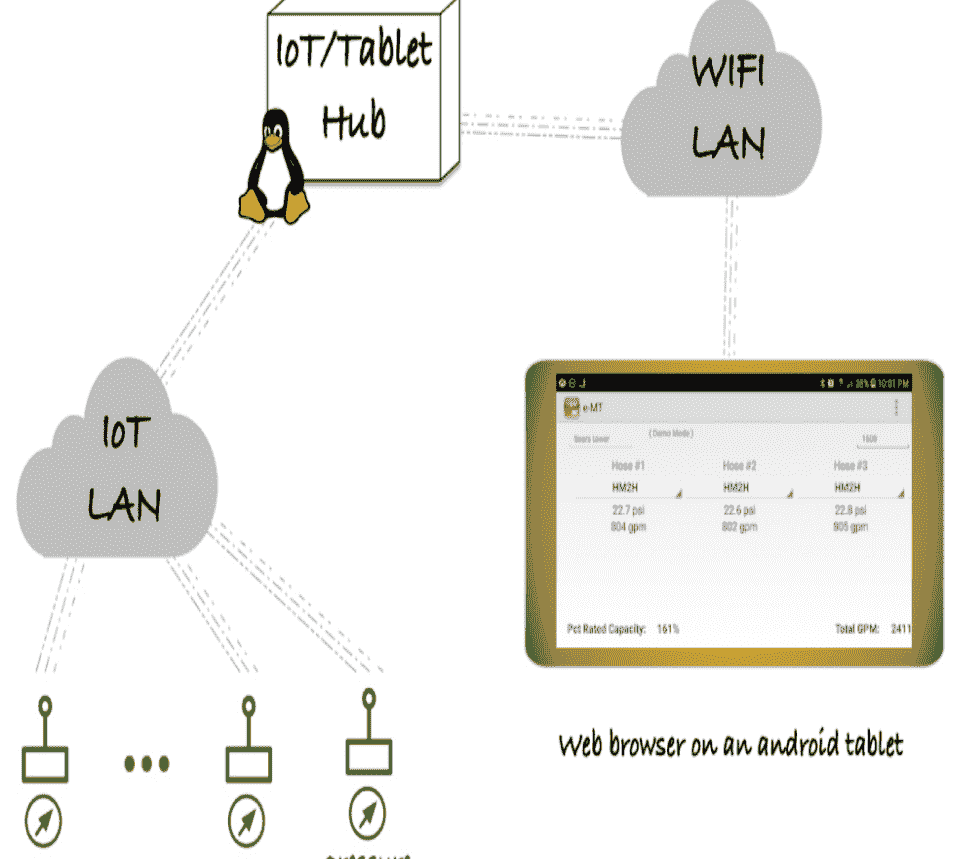

安卓平板电脑上的网络浏览器

我们选择了一个IoT供应商，其基础设施允许我们使用Python构建应用程序。他们现有的无线系统结合我们用Python 编写的生产代码，使我们能够快速开发出概念验证原型。

我们着手构建原型，并且知道一旦进入市场，我们可能需要不同的供应商。我们为什么怀疑这个供应商呢？在原型阶段，我们并不那么关心成本。等到上市时，情况可能会发生变化。此外，在快速增长的IoT市场中，该供应商可能会倒闭或被另一个IoT供应商吞并。我们希望保留对业务逻辑的投资，因此在我们的原型中，我们需要纯洁的代码、关注点分离以及对供应商基础设施的有限依赖。

幸运的是，我们的供应商提供了一个简单的“hello world”IoT应用程序来启动。他们的“hello world”演示允许我们在小型Linux机箱（它有点像工业级树莓派）与与我们的压力传感器连接的小型微控制器驱动无线电之间发送消息。我们可以将他们的“hello world”示例代码转化为一个层，该层将包含对供应商基础设施的所有依赖。

我通过惨痛教训中学到的一点是，我更倾向于从一个运行良好的系统开始，专注于通过微小更改来增加功能而不是弄坏东西。你知道的，保持系统运行比在它坏掉后再修复它要容易得多！测试驱动开发（TDD）让我看到了微小且经过验证的更改的价值。

供应商有一套复杂的应用程序基础设施供我们利用。它拥有很多功能。我们并不需要它提供的所有功能。我们只是想用无线电进行一些简单的消息传递，而不是与供应商共生（直到死亡分离）。因此，我们只使用了该供应商非常宽的接口的一小部分。

让我们从传感器和枢纽（hub）互相了解开始。供应商让这变得非常简单。枢纽和无线电使用远程过程调用（RPC）机制进行交互。枢纽拥有完整的Python环境，而无线电仅限于MicroPython。

项目代号为 Hydra（九头蛇），用这种多头怪物命名。`HydraNetwork`类封装了枢纽中对IoT供应商的所有依赖。这些函数的复杂度较低，并委托给通信基础设施。从开始，即初始化，枢纽向所有监听的无线电宣布自己，然后轮询框架获取回复。

### 在枢纽中

```python
class HydraNetwork:
    ...
    def announceHub(self):
        self.broadcast('announceHub', '')
        self.poll_a_second()
```

通过基础设施RPC机制的魔力，`announceHub()`函数在无线电中被调用。无线电记住枢纽的地址并向枢纽发送确认信号。

### 在无线电中

```python
def announceHub():
    global hub_addr
    hub_addr = rpcSourceAddr()
    info = nodeIdentity()
    sendAck(hub_addr, 'announceHub', info)
```

这张序列图显示了`HydraNetwork`枢纽与其在IoT局域网上压力传感器之间的异步通信。

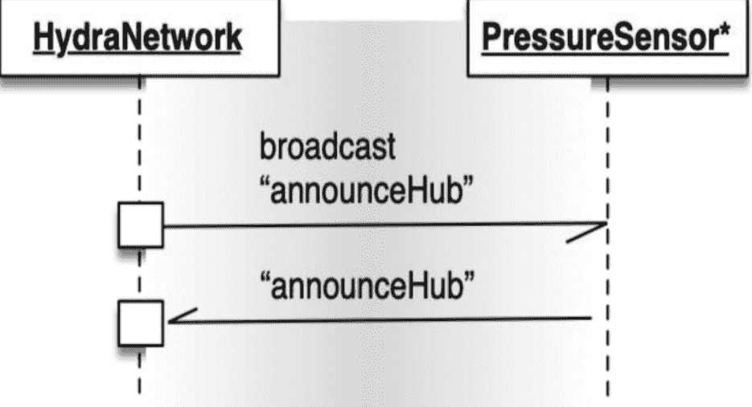

- 链路上的每个压力传感器都会回复

现在，回到枢纽，基础设施RPC设施调用枢纽的`HydraNetwork.processAck()`函数。

```python
# 在枢纽中
class HydraNetwork:
  ...
  def processAck(self, command, payload):
    sensor_id = self.addr
    self.ack_handler.handle_reply(sensor_id, command, payload)
```

`ack_handler`是一个注入的依赖，恰好是`HydraDataSource`的实例。`handle_reply`方法将收到的记录和负载传递给Hydra系统的其他部分。事实上，对于来自无线电的'announceHub'确认，没有什么要做。

`HydraDataSource`在`flow_update()`方法被调用时发起网络PSI^1。`flow_update()`方法在流量测试期间每秒调用一次。每次更新都有一个`sync_token`，以便异步测量回复按秒分组。当新的一秒开始时，会保存上一秒的报告。稍后会详述。

^1 例如，[PPP002](http://www.butucklebob.com/ArticleS.UncleBob.PrinciplesOfOod) 和 https://en.wikipedia.org/wiki/SOLID_(object-oriented-design)（或直接搜索“SOLID”）。

### 在枢纽中

```python
class HydraDataSource:
    ...
    def flow_update(self):
        self.sync_token.next()
        self.network.broadcast(
            'initiateRead',
            self.sync_token.value())
        self.report = self.reply_dispatcher.report()
```

'initiateRead'广播到传感器网络，每个无线电异步回复。再次，通过IoT框架，`initiateRead()`在`PressureSensor`模块中调用。

首先，`initiateRead()`响应确认，然后调用`reportMeasurement(sync_token)`获取最新的PSI值。

我忘记告诉你们另一个边界。有一个独立的微控制器负责读取模拟数字转换器（ADC）并进行必要的计算。`reportMeasurement()`的调用写入串口连接，询问ADC微控制器下一个测量值。

# HydraDataSource

# HydraNetwork

# 压力传感器*

# ADC 微控制器

flow_update

broadcast "initiateRead"

broadcast "initiateRead"

report

完成 PSI 计算...

"sensorReply" PSI...

handle_reply PSI...

串口

无线电

### 在无线电中

```python
def initiateRead(sync_token):
    global hub_addr
    hub_addr = rpcSourceAddr()
    sendAck(hub_addr, 'initiateRead', sync_token)
    reportMeasurement(sync_token)
```

```python
def reportMeasurement(sync_token):
    print 'RA ' + sync_token
```

```python
@setHook(HOOK_STDIN)
def measurementDone(reply):
```

```python
stdin_info = getInfo(STDIN_INFO)
if stdin_info != STDIN_RECEIVED:
  reply = 'Error: Invalid STDIN_INFO'+str(stdin_info)
  sendAck(hub_addr,'SensorReply',reply[:MAX_SIZE])
```

获取新的 ADC 值并转换为 PSI 需要一些时间。当测量准备就绪时，ADC 微控制器通过串口连接传回 CSV 字符串。`HOOK STDIN` 通知 `measurementDone()`，并提供回复。如果没有串口通信错误，回复将包含 `sync_token` 和传感器配置。回复将作为 `SensorReply ACK` 发送到集线器（hub）。

与此同时，在集线器端，它正在收集 ACK 消息。ACK 消息被发送到 `handle_reply()`。一个 'SensorReply' ACK 被传递给 `reply_dispatcher.sensor_update()`。`reply_dispatcher` 知道消息格式，以及在解析后将其发送到何处。负载是一组简单的 CSV。`reply_dispatcher` 及其协作者是受驱动的，且不受依赖于 IoT 框架。

```python
class HydraDataSource:
    ...
    def handle_reply(self, sensor_id,
      command, payload):
      sync_token = self.sync_token.value
      if command == 'SensorReply':
        result = self.reply_dispatcher.
        sensor_update(sensor_id,
        sync_token,
        payload);
```

由于 `HydraNetwork` 封装了所有的 IoT 框架依赖，我们可以更换不同供应商的 IoT 基础设施。

## UI/应用边界

接下来，让我们来看 UI/应用边界。系统的用户界面是平板电脑或智能手机上的 Web 浏览器。我们使用了流行的 Python/Flask Web 服务器框架。应用程序在小型 Linux 盒子上以两个进程的形式运行。

Collector 进程从 `HydraNetwork` 收集测量值。WebServer 进程在主线程中运行自定义的 Flask Web 服务器。用户有按钮来启动和停止流测试，这些指令通过 `CommandQueue` 到达 Collector。一旦收集到一组同步的测量值，测量更新将异步发送到 `ReplyQueue`。

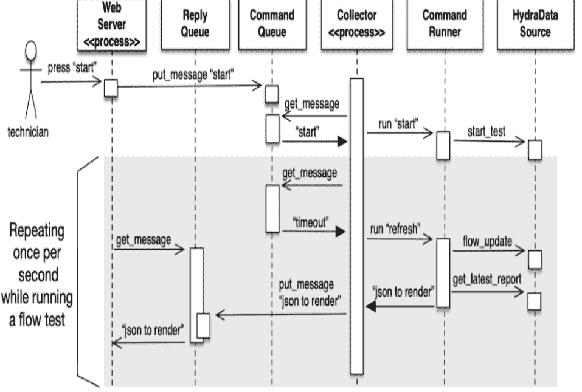

Collector 进程的入口是 `measurement_loop()` 函数，它在 `CommandQueue` 上等待并设置了一秒的超时。每次超时都会触发测量数据的刷新/流更新（`flow_update`），一直到 ADC 微控制器（图中未显示）。

### Collector 进程入口函数

```python
def measurement_loop(command_q, reply_q,
    command_runner, update_interval):

    command = None
    while command != HYDRA_EXIT:
        command = get_message(command_q, update_interval)
        if command == None:
            Command = HYDRA_REFRESH
        reply = command_runner.run(command)
        put message(reply, q, reply)
```


这里有很多未显示的应用程序对象，但它们并不在边界上。我们很快会看大大观。

让我们快速看一下 `hydra_run()`。该函数从 `main()` 调用，并注入了其数据源。在生产环境中，会注入一个带有 `HydraNetwork` 的 `HydraDataSource`。在开发和测试期间，我们使用一个不需要网络的模拟数据源。

`hydra_run()` 函数启动一切运行并从 `main()` 调用。以下代码启动了 `Collector` 进程，在执行的主线程中运行 Web 服务器。

```python
def hydra_run(port, data_source, polling_rate,
    logger):
    logger.info("Hydra start")
    command_runner = CommandRunner(data_source,
        logger)
    collector = Process(
        target=measurement_loop,
        args=(command_q, reply_q,
            command_runner, polling_rate))
    collector.start()
    sleep(1)
    logger.info("Hydra collector started")
    run_hydra_web_server(port, command_q, reply_q)
    logger.info("Hydra web server exited")
    command_q.put(HYDRA_EXIT)
    collector.join()
```

```python
logger.info("Hydara shut down")
```

这有点乱，因为所有依赖都汇聚在这里。优点是，代码并不复杂，而且可能不会发生太大变化。

让我们回顾一下我们清晰边界的一些重要属性。

# 关于 IoT 隔离：

- 业务逻辑不受无线电系统的干扰。
- 依赖 IoT 的函数复杂度较低。
- 依赖 IoT 的函数不容易改变。

# 关于 UI 隔离：

- 业务逻辑与 UI 分离。
- 依赖 UI 的函数复杂度较低。

# 关于并发：

- 业务逻辑不涉及并发。
- 并发机制复杂度较低。

# 关于对象创建和绑定：

- 对象创建与使用分离。
- 在初始化期间，对象进行绑定。
- 绑定是基于需求的。

# SOLID 与六边形架构

我们已经查看了各个组件；现在来看端口（Ports）和适配器（Adapters）。六边形内部是应用程序。六边形外部是服务环境。应用程序依赖于层。有两个实例：`CommandQueue` 和 `ReplyQueue`。UI 通过 `CommandQueue` 启动传感器。下面的图显示了如何启动。

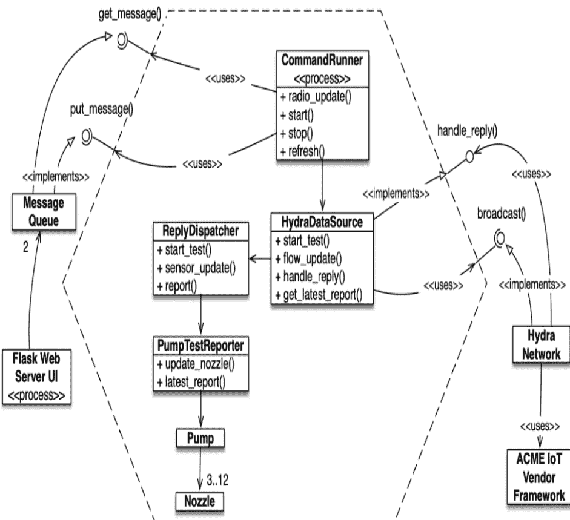

`HydraNetwork` 封装了对 IoT 供应商的依赖。`HydraNetwork.broadcast()` 通知网络中的所有传感器报告它们的测量值。当收到单个无线回复时，`HydraNetwork` 调用 `handle_reply()`，将最新消息传入应用程序。Hydra 对 ACME IoT 一无所知。

`broadcast` 和 `handle_reply` 的接口更多是关于应用程序想要的，而不是 ACME 提供的。`HydDataSource` 知道有一个网络，但只需要广播更新并接收更新。

六边形边界的接口关于应用程序的需求，而不是 ACME。ACME IoT 的功能非常接近我们需要，因此适配器非常薄且复杂度低。

随着我们的产品或 IoT 供应商提供的服务的演进，我们可能会更换供应商。当需要替换 ACME IoT 或支持多个供应商时，`HydraNetwork` 类将需要演进。

想象某个新的 IoT 供应商 BrandX，它可以显著节省成本。遗憾的是，BrandX 没有像 ACME 那样内置广播功能。相反，必须单独处理每个连接。BrandX 的 `HydraNetwork` 实现可以实现广播，但它需要了解每个传感器连接。

# 探索与学习

第三方代码帮助我们在更短时间内交付更多功能。测试第三方代码不是我们的工作，但为我们使用的第三方代码编写测试可能符合我们的利益。

如果我们不清楚如何使用某个第三方库，可能会花费一两天（或更多）时间阅读文档并决定如何使用它。然后，我们编写代码来使用第三方代码，看看它是否如我们所想。

花费大量时间来弄清楚 Bug 是出现在我们的代码中还是他们的代码中。

学习第三方代码很困难。集成第三方代码也很困难。同时进行这两者更是难上加难。

如果我们采取不同的方法呢？与其在生产代码中实验和尝试新事物，不如编写一些测试来探索我们对第三方代码的理解。Jim Newkirk 将这种测试称为*学习测试*（learning tests）。

+ 3 [BeckTDD]，第 136-137 页。

在学习测试中，我们调用第三方 API，就像预计在应用程序中使用它一样。我们本质上是在进行受控实验，检查我们对该 API 的理解。测试关注的是我们希望从 API 中获得什么。

由于以前没有在 Python 中做过并发编程，我认为在使用它们之前学习并发和通信机制的工作原理是一个好主意。我可以简单地阅读并将其集成到我的生产代码中，也可以在测试用例的舒适环境中进行实验并学习。

通过查看文档，我决定测试两个函数：`put_message()` 和 `get_message()`，它们用于从队列中放入和获取消息。

这些测试让我确信自己理解了 Python 中 `Queue` 的工作方式。

```python
class QueueTest(unittest.TestCase):
    def test_get_message_returns_message(self):
        q = Queue(maxsize=1)
        self.assertTrue(put_message(q, 'hey'))
        self.assertEqual('hey', get_message(q))

    def test_get_message_None_when_timeout(self):
        q = Queue(maxsize=1)
        self.assertEqual(None, get_message(q, 0.01))

    def test_get_message_empty_no_wait(self):
        q = Queue(maxsize=1)
        self.assertEqual(None, get_message(q, 0.0))

    def test_put_message_True_for_success(self):
        q = Queue(maxsize=1)
        self.assertTrue(put_message(q, 'hey'))
        self.assertEqual('hey', get_message(q, 1.0))

    def test_put_message_False_when_full(self):
        q = Queue(maxsize=1)
        self.assertTrue(put_message(q, 'hey1'))
        self.assertFalse(put_message(q, 'hey2'))
        self.assertEqual('hey1', get_message(q, 1.0))
```

现在我们知道 `Queue` 是如何工作的了，让我们用它与 `Process` 通信吧。首先，我们定义一个函数 `worker()`，它将在一个独立的 `Process` 上执行。它从 `in_q` 获取，放入 `out_q`，然后退出。当时，我们预计使用这种方法将 Hydra 核心与 WebServer 分离。

```python
def worker(in_q, out_q):
    message = get_message(in_q, 0.05)
    if message:
        put_message(out_q, message)

class ProcessLearningTest(unittest.TestCase):
    def setUp(self):
        self.command_q = Queue(maxsize=1)
        self.reply_q = Queue(maxsize=1)
        self.process = Process(target=worker,
            args=(self.command_q,
            self.reply_q))
        self.process.daemon = True

    def test_thread_q_message_echos(self):
        put_message(self.command_q, 'Do this')
        self.process.start()
        reply = self.reply_q.get(True, 0.1)
        self.process.join()
        self.assertEqual('Do this', reply)

    def test_thread_message_timeout(self):
        self.process.start()
        reply = get_message(self.reply_q, 0.1)
        self.process.join()
        self.assertEqual(None, reply)
```

这些学习测试几乎没有成本。我们反正必须学习这些机制，而编写这些测试是获取这些知识的一种简单且隔离的方法。学习测试是精确的实验，有助于增加我们的理解。

学习测试不仅免费，而且具有积极的投资回报。当第三方包发布新版本时，我们运行学习测试来查看是否存在行为差异。

学习测试验证了我们使用的第三方包按照我们预期的方式工作。一旦集成，无法保证第三方代码将一直与我们的需求保持兼容。原始作者会有压力更改代码以满足他们自己的新需求。他们会修复 Bug 并添加新功能。每次发布都会带来新的风险。如果第三方包以某种与我们的测试不兼容的方式更改，我们将立即发现。

在这种情况下，谁会期望 Python 改变呢？所以，没有未来的回报。嗯，实际上 Python 确实变了。在将 Hydra 代码从 Python 2 转换为 Python 3 时，打包方式发生了变化；需要一些编辑才能编译和运行测试。幸运的是，我们的学习测试向我们展示了行为被保留。

无论你是否需要学习测试提供的学习，都应该通过一组边界测试来支持清晰的边界。

## 使用不存在的代码

还有另一种边界，将已知与未知隔离开来。几年前，我参与了一个开发无线电系统软件的团队。有一个子系统，我们对它的“发射器”并不了解。由于不知道它将如何工作，我们定义了自己的接口，如 `Transmitter`。我们给它一个名为 `transmit` 的方法，接收频率和数据流。

由于 API 尚未设计，我们不想被阻塞。为了避免阻塞，我们定义了自己的接口。我们想告诉边界我们需要什么。

编写接口的好处之一是它在我们的控制之下。这有助于代码更具可读性和表现力。在边界的客户端侧，我们不受实现细节的负担。如果我们有一个硬件抽象层（HAL），我们可能会依赖它。HAL 通常从应用程序的角度来看并不抽象。在不知道 HAL 的情况下，我们没有可以依赖的东西。与其说是负担，不如优势。

在下面的图中，你可以看到我们将 `Controller` 类与发射 API（不受我们控制）隔离开。通过使用我们自己的应用程序接口，我们保持了类的整洁。一旦定义了 API，我们就编写了 `TransmitterAdapter` 来桥接。适配器封装了与 API 的交互，并在 API 演进时提供了单一更改点。

+ 4 参见 [GOF] 中的适配器模式。

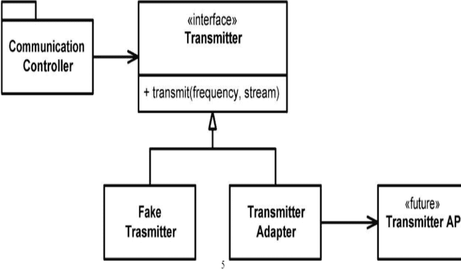

这种设计还为测试提供了一个非常方便的缝隙（seam）。可以使用 `FakeTransmitter`。一旦有了 `TransmitterAPI`，我们还可以创建边界测试来确保我们正确使用了 API。

5 参见 [WELC] 了解更多关于缝隙的知识。

# 第四部分

# 工匠精神


以下是我书籍《洁净工艺之道》（Clean Craftsmanship）中的一段节选与编辑后的摘要。

软件职业的开端并不吉利，始于1935年的夏天，当时艾伦·图灵（Alan Turing）开始撰写他的论文。

他的目标是解决一个困扰了数学家十年或更久的数学难题：*判定问题*（Entscheidungsproblem）。即决策问题。

在这个目标上他成功了；但他当时并没有意识到，他的论文将孕出一个遍布全球的行业，我们现在所有人，依赖它已成为我们整个文明的命脉。

1945年，图灵为自动计算引擎（ACE）编写了代码。他使用32进制的二进制机器语言编写了这些代码。在此之前，还没有不到十个人写过这样的代码，因此图灵不得不发明并实现了子程序、栈和浮点数等概念。

## “巨大的数字”

在发明了基础知识并用其解决了数学问题几个月后，他写了一份报告，得以下结论：

> “我们需要大量有才能的数学家，因为可能有很多这类工作需要完成。”

“大量的数字”。他是如何知道的呢？事实上，他并不知道这句话的准确性有多高；他无法预见到我们现在所拥有的如此庞大的数字。

但他提到的另一件事是什么呢？“有才能的数学家”。你认为自己是一个有才能的数学家吗？图灵认为自己是。

在同一份报告中，他继续写道：

> “我们的困难之一将是保持适当的纪律，以便我们不忘记自己正在做什么。”

纪律！艾伦·图灵向望八十年后，预见到我们的问题将是纪律。借此，他为软件专业化的框架奠定了第一块石头。他说，我们应该是保持适当纪律的有才能的数学家。

我们是这样的人吗？你又是这样的人吗？

## 八十载

一个人的寿命。在写这段文字时，我们的职业就这么老了。在这80年里发生了什么呢？

1945年，世界上只有几台计算机，程序员的数量也同样少。用计算机科学术语来说，这数量级为1：O(1)。这些数字在最初的几年里增长迅速。但让我们以此作为我们的起点。

1945年。计算机：O(1)。程序员：O(1)。

在随后的十年里，真空管的可靠性、一致性和功耗得到了巨大的改进。这使得制造更大、更强大的计算机成为可能。

1960年，IBM已售出了140台其700系列计算机。这些是庞大且昂贵的巨兽，只有军方、政府和非常大的公司才负担得起。按照我们的标准，它们是缓慢、贫乏且脆弱的。

正世纪50年代，格蕾丝·霍珀（Grace Hopper）发明了高层语言的概念，并创造了*编译器*（compiler）一词。到1960年，她的工作促成了COBOL的诞生。

1952年，约翰·巴克斯（John Backus）提交了FORTRAN规范。随后迅速开发了ALGOL。到1958年，约翰·麦卡西锡（John McCarthy）开发了LISP。因此，语言动物园的激增开始了。

在那个年代，没有操作系统，没有框架，没有函数库。如果某个东西在你的计算机上运行，那是因为你写了它。所以，在那个年代，光是维持一台计算机运行就需要十多名程序员团队。

1960年，在图灵去世15年后，世界上有O(100)台计算机。程序员的数量多出了一个数量级：O(1000)。

这些程序员是谁？他们是像格蕾丝·霍珀、埃德格尔·迪杰斯特拉（Edsger Dijkstra）、约翰·冯·诺依曼（John von Neumann）、约翰·巴克斯和让·詹宁斯（Jean Jennings）这样的人。他们是科学家、数学家和工程师。大多数人已经有了自己的职业，并且已经理解了他们所属的业务和学科。我们中许多，如果不是大多数的话，都在30岁、40岁或50岁。

20世纪60年代是晶体管的十年。这些微小、简单、廉价且可靠的设备取代了真空管。这对计算机的影响是游戏规则改变者。

到1965年，IBM已经生产了超过10,000台基于晶体体的1401计算机。它们的租金约为每月2500美元，这使得数千家中型企业能够触及。

这些机器是用汇语言（Assembler）、Fortran、COBOL和RPG进行编程的。所有租赁这些机器的公司都需要程序员团队来编写它们的应用程序。

当时IBM并不是唯一一家制造计算机的公司；所以我们只需说，到1965年，世界上有O(1E4)台计算机。如果每台计算机都需要十名程序员来维持其运行，那么一定有O(1E5)名程序员。

图灵去世二十年后，世界上一定有几十万名程序员。这些程序员从哪里来？数学家、科学家和工程师不足以满足需求。而且大学里没有计算机科学专业的毕业生，因为任何地方都没有计算机科学学位课程。

所以，我们从会计师、文员、规划师等中选出最优秀、最聪明的人——任何具有过证明的技术天赋的人。他们发现了很多。

而且，再次，这些人是已经在其他领域的专业人士了。他们处于30岁、40岁或50岁。他们已经理解了截止日期和承诺，哪些该保留，哪些该舍弃。<sup>1</sup>。而且，尽管这些人本身不是数学家，但他们是守纪律的专业人士。图灵可能会赞同这一点的。

> ¹ 向Bob Seeger致歉。

发条持续转动。到1966年，IBM每月生产1,000台System/360。这些计算机随处可见。对于当时来说，它们极其强大。30型号可以寻址64K字节内存，每秒执行35,000条指令。

正是在这一时期，即60年代中期，奥勒·约汉·达尔（Ole-Johan Dahl）和克里斯滕·尼加德（Kristen Nygaard）发明了SIMULA 67，第一种面向对象的语言。

同样在这个时期，埃德格尔·迪杰斯特拉（Edsger Dijkstra）发明了结构化编程。

同样在这一时期，肯·汤普森（Ken Thompson）和丹尼斯·里奇（Dennis Ritchie）发明了C语言和Unix。

发条仍在运转。70年代初，集成电路投入使用。这些小芯片让电子元件能够大规模微型化。


于是小型计算机诞生了。在60年代后期到70年代，数字设备公司（DEC）卖出了50,000台PDP8系统和数十万台PDP11。小型计算机市场爆发了。到70年代中期，有几十家公司销售小型计算机。

所以到1975年，图灵去世30年后，世界上有`O(1E6)`台计算机。有多少名程序员？计算机的数量接近了程序员的数量。所以，到1975年，有`O(1E6)`名程序员。

这数百万程序员从哪里来？他们是谁？他们是我和我那群充满活力的极客小男孩。我们当时在美国，都在担心兵役。我们几乎全是男性。

噢，并不是女性大量离开该领域——那时还没有开始出现这种情况。

我的第一份程序员工作是在1969年，当时几十个程序员。他们都在30岁或40岁，其中三分之一到一半是女性。

十年后，我在一家拥有五十个程序员的公司工作，其中可能只有三个是女性。所以，图灵去世30年后，编程的人口结构发生了剧变，转向了年轻人。

数量必须达到 `O(1E8)`。今天世界上应该有数亿程序员。

这显然是指数级增长。指数级增长曲线有一个翻倍率。你可以算算账。嘿，阿尔伯特，如果我们在 80 年内从 1 增长到 `1E8`，翻倍率是多少？

一亿以 2 为底的对数约为 27——除以 80 得到大约 2.96。所以也许程序员的数量大约每三年左右翻一倍。

实际上，正如我们之前看到的，前几十年的速度更快，现在已经放慢了。我的猜测是翻倍率大约是五年。每隔五年，世界上的程序员数量就会翻一倍。

这个假设的影响是惊人的。如果世界上程序员的数量每五年翻一倍，这意味着世界上有一半的程序员经验不到五年；只要这个翻倍率持续，这种情况将永远如此。这让编程行业处于一种——永久性缺乏经验的窘境地。

# 书呆与救世主

永久性缺乏经验。噢，别担心，这并不意味着你永远缺乏经验。这只是意味着一旦你获得了五年的经验，程序员的数量就会增加一倍。当你获得多年经验时，程序员的数量可能已经增加四倍了。

也许你认为 AI 会放慢这个速度。别自欺欺了。每种本该减慢该速度的新软件技术都加速了它。挑一种新的软件技术：`Fortran`、`C`、`Unix`、`OO`、`C++`、`Java`、`C#`、`Ruby`、函数式……没有哪一个减少过对新程序员的需求。相反，需求加速了，因为这些每种技术都让越来越多的人群（主要是年轻人）能够进入这一领域。

人们看到编程领域中有很多年轻人，就得出这是一个年轻人的职业结论。他们问：“老家伙都去哪儿了？”

我们都在这儿呢！我们哪儿也没去。只是 50 年前我们并没有那么多。

问题是，我们这些老家伙不够带新进来的程序员的。每有一个拥有 30 年经验的程序员，就有大约 63 个程序员需要从她（他）那里学习东西；其中 32 个是完全的新。

所以，是永久性的缺乏经验，而且没有足够的导师来纠正这个问题。因此，同样的旧错误被又一遍、又一遍地重复。

# 名声

但在过去的 80 年里还发生了其他事情。程序员获得了一些我确定阿尔兰·图灵从未预料到的东西：名声。

在 50 年代和 60 年代，没有人知道什么是程序员。我们的人不足以产生社会影响。程序员并不住在很多人的邻居。

这种情况在 70 年代开始发生变化。那时，父亲们建议他们的儿子（有时还有女儿）去读计算机科学学位。世界上的程序员多到让每个人都认识一个懂行的人。于是，书呆的、吃着 Twinkie 蛋糕的极客形象就诞生了。

很少有人见过电脑；但几乎每个人都听说过它们。计算机出现在电视节目中（如《星际迷航》）以及电影中（如《2001太空漫游》和《巨型计算机：福尔滨计划》）。在这些节目中，计算机本身经常被塑造成反派。

然而，请注意，在这些案例中，程序员都不是重要角色。那时的社会不知道如何看待程序员。他们是阴影的、隐藏的，而且与机器本身相比，某种程度上是微不足道的。

我对那个时代的一个电视广告有很好的记忆。一位妻子和她的丈夫——一个戴着眼镜、插着笔袋、拿着计算器的书呆小家伙——在杂货店比较价格。奥尔森夫人描述他为“计算机天才”，并开始向妻子和丈夫展示某个品牌咖啡的益处。

那个广告里的计算机程序员是天真、书呆气气且无关紧道的。是一个很聪明的人，但没有智慧或常识。不是那种你会邀请参加派对的人。

事实上，计算机程序员被看作那种在学校里经常被毒打的人。

到 1983 年，个人电脑开始出现；显然，青少年出于很多原因对它们感兴趣。到那时，已经有相当多的人认识一个计算机程序员。我们被认为是专业人士；但仍然很神秘。

那一年，电影《游戏大战》描绘了年轻的马修·布罗德里克，一个精通计算机的青少年和黑客。他入侵了美国的武器控制系统 `WOPR`，误以为那是一个视频游戏，并启动了核战争的倒计时。在电影结束时，他通过说服计算机“唯一的获胜策略就是不玩游戏”拯救了世界。

计算机和程序员交换了角色。现在，计算机成了孩子气的、天真的角色，而程序员是智慧的渠道（如果不是源头的话）。

我们在 1986 年的电影《短路》中看到了类似的情况，那个被称为 #5 的计算机化机器人是孩子气且纯真的，但在其笨拙创造者及其女朋友的帮助下学会了智慧。

到 1993 年，情况发生了剧变。在电影《侏罗纪公园》中，程序员是反派，而计算机根本不是一个角色。它只是一个工具。

社会开始理解我们是谁以及我们所扮演的角色。在短短 20 年里，我们从书呆变成了老师，又变成了反派。

但愿景再次改变了。在 1999 年的电影《矩阵》中，角色们变得都是神一般的。

# 榜样与反派

十五年后，在 2014 年，大众北美地区首席执行官迈克尔·霍恩在美国国会就其汽车中用于欺骗 `EPA` 测试设备的软件问题作了了证词。当被问及公司为何这样做时，他指责了程序员。他说：“这是几个软件工程师出于各种原因这么做的。”

当然，他对“各种原因”撒了谎。他完全清楚原因是什么，整个公司也是如此。他试图将责任推给程序员的软弱尝试是非常透明的。

但另一方面，他是完全正确的。确实是一些程序员写了那些撒谎、欺骗的代码。

而那些程序员，无论他们是谁，都为我们败坏了名声。如果我们有一个真正的专业组织，他们作为程序员的身份将被且应该被撤销。他们背叛了我们所有人。他们玷污了我们职业的荣誉。

所以我们毕业了。这花了 80 年。但在那段时间里，我们从一无所有变成了书呆，再变成榜样，最后变成英雄和反派。社会已经开始——仅仅开始——理解我们是谁以及我们所代表的威胁和承诺。

# 我们统治世界

社会还没有理解一切。事实上，我们也不理解。正如我在引言中所说的，你和我，我们程序员；我们统治着世界。

这听起来像是一个夸张的说法。但请考虑。现在世界上计算机的数量比人多。而且那些数量于我们人数的计算机为我们执行了无数必要的任务。

它们记录着我们的银行记录和信用卡。它们帮助我们支付账单。

事实上，西方世界的大多数人在每天醒着的每一分钟、每一秒都在与某种软件系统进行交互。有些人甚至在睡眠时也在持续交互。

问题的核心在于，如果没有软件，我们的社会将什么都不会发生。没有产品被买入或卖出。没有法律被颁布或执行。没有汽车行驶。没有亚马逊产品被送达。没有手机连接。插座里没有电。没有食物被运送到商店。没有水从水龙头流出。没有气体被输送到锅炉。如果没有软件对这一切进行监控和协调，一切无法运转。

而我们编写了这些软件。这让我们成为了世界的统治者。

噢，其他人认为是他们制定了规则——但他们将这些规则强加于我们，而我们编写了在机器中执行的规则，这些机器监控并协调着我们生活的方面。

社会还没有完全理解这一点。还不完全理解。但那一天很快就会到来，我们的社会将充分理解这一切。

我们，程序员，也还没有完全理解这一点。并不真正如此。但同样，那一天即将到来，并将会被粗暴地推到我们面前。

## 灾难

多年来，我们见过了许多软件灾难。有些场面非常壮观。

在2018年到2019年之间，两架737 MAX客飞机以近乎音速的速度直接撞向地面，导致346人死亡。原因是：一个由硬件故障暴露的软件缺陷。

2016年，我们失去了谢阿帕雷利号（Schiaparelli）火星着陆器和漫游者，由于一个软件问题导致着陆器认为自己已经着陆，而实际上它还距离地表近4公里处。

1999年，我们丢失了火星气候轨道器（Mars Climate Orbiter），这是由于一个地面软件错误，该错误向轨道器传输数据时使用的是英国单位（磅·秒）而非公制单位（牛顿·秒）。这个错误导致轨道器下降到火星大气中太深的地方，在那里被撕成碎片。

1996年，亚里安5号火箭运载器和载荷在发射37秒后被摧毁，这是由于一个64位浮点数在经过未检查的情况下转换为16位整数时发生了整数溢出异常。该异常导致机载计算机崩溃，运载器自毁。

我们是否应该谈谈`Therac-25`放射治疗机？它由于一个竞态条件（`race condition`），通过高功率电子束杀死了三个人并伤了另外三个人。

或者我们应该谈谈骑士资本公司（Knight Capital），他们在45分钟内损失了4.6亿美元，因为他们重用了一个激活了系统中无意留下的死代码的标记。

又或许我们应该谈谈丰田的栈溢出漏洞，它导致汽车失控加速——可能造成了多达89人的死亡。

或者我们应该谈谈`Healthcare.gov`以及那次软件失败，它几乎推翻了一项新的且具有争议的美国医疗法。

这些灾难造成了数十亿美元的损失和许多生命。它们是由程序员造成的。

我们，程序员，通过我们编写的代码，正在杀人。

现在我知道你进入这个行业并不是为了杀人。可能你成为程序员是因为你写了一个只打印了一次名字的无限循环，并体验到了一种喜悦的力量感。

但事实就是事实。我们现在处于社会中的一种位置，我们的行为正在摧毁财富、生计和生命。

有一天，可能就在现在不远之后，某个程序员会做一件有点愚蠢的事，然后会有数万死亡。

这不是狂野的推测——这只是时间问题。

当这种情况发生时，世界的政治家将要求一个交代。他们将要求我们展示未来将如何防止这种情况。

如果我们出现时没有带上伦理声明；如果我们出现时没有任何标准或定义的学科准则；如果我们出现并抱怨我们的老板设定了不合理的时间表和截止日期 . . .

那么我们就是**有罪的**。

## 誓言

因此，为了开始定义我们软件开发人员的伦理，我提出以下誓言。

为了维护和保护计算机程序员职业的荣誉，我承诺，在我的能力范围和判断力范围内：

- 1. 我不会产生有害代码。

- 2. 我产生的代码将始终是我的最佳作品。我不会在知情的情况下允许行为或结构上有缺陷的代码累积。

- 3. 我将在每次发布时，提供一个快速、可靠且可重复的演示，证明代码的每一个元素都按预期方式工作。

- 4. 我将频繁地进行小规模发布，以便我不会阻碍别人的进度。

- 5. 我将在每一个机会无畏且无情地改进我的作品。我绝不会降低它们的质量。

- 6. 我将竭尽全力保持我和他人尽可能高的生产力。我不会做任何降低这种生产力的事情。

- 7. 我将持续确保其他人可以涵盖我的工作，而我可以涵盖他们的工作。

- 8. 我提供的估值在规模和精确度上都是诚实的。我不会在没有合理把握的情况下做出承诺。

- 9. 我尊重同伴程序员的伦理、标准、学科准则和技能。任何其他属性或特征都不会成为我尊重同伴的因素。

- 10. 我永远不会停止学习和改进我的技艺。

# 第27章 整洁架构


在过去的几十年里，我们看到了关于系统架构的各种思想。这些包括：

- 六边形架构（又称端口与适配器），由`Alistair Cockburn`提出，并被`Steve Freeman`和`Nat Pryce`在他们的书籍《Growing Object-Oriented Software, Guided by Tests》（2009）中采用

- 数据、上下文与交互架构（`DCI`），由`James Coplien`和`Tryve Reenskaug`提出

- 边界-控制-实体架构（`BCE`），由`Ivar Jacobson`在其《Object-Oriented Software Engineering: A Use-Case Driven Approach》（1992）提出

尽管这些架构在细节上有所不同，但它们非常相似。它们都有共同的目标，即关注点分离。它们都通过将软件分层来实现这种分离。每个架构都至少有一个业务规则层和另一个用户界面层。这些架构产生的系统都是：

- 独立框架。架构不依赖于某些功能库的存在。这允许你将此类框架作为工具，而不是强迫你的系统挤进它们的有限限制中。

- 可测试。业务规则可以在没有`UI`、数据库、`Web`服务器或任何外部元素的情况下测试。

- 独立`UI`。`UI`可以轻松更改而不改变系统的其他部分。例如，可以将`Web`界面替换为控制台界面，而不改变业务规则。

- 独立数据库。你可以将`Oracle`或`SQL Server`更换为`Mongo`、`Bigtable`、`CouchDB`或其他。你的业务规则不绑定到数据库上。

- 独立于任何外部机构。事实上，你的业务规则完全不知道外部世界接口的任何。

## 依赖规则

下面的图表试图将所有这些架构整合到一个单一的可操作想法。同心圆代表不同的软件区域。通常情况下，越往内，软件的层级越高。外圈是机制，内圈是策略。

使这种架构运行的最高规则是依赖规则。该规则说：

> 源代码依赖必须指向内部，指向高级别的策略。

内层圆中的任何内容都无法知道外层圆中的任何内容。特别是，

 的名称。

在外层圆中声明的内容不能被内层圆的代码引用。这包括函数、类、变量或任何其他命名的软件实体。

同样，在外层圆中声明的数据格式也不应被内层圆使用，特别是当这些格式是由外层圆中的框架生成时。我们不希望外层圆的任何内容影响内层圆。

## 实体 (Entities)

实体封装了企业范围内的关键业务规则。实体可以是一个带有方法的对象，也可以是一组数据结构和函数。只要这些实体可以被企业中许多不同的应用程序使用，这种形式并不重要。

如果你没有企业，只是在编写单个应用程序，那么这些实体就是该应用程序的业务对象。它们封装了最通用、最高层次的规则。当外部发生变化时，这些规则最不容易受到影响。例如，你不会期望这些对象受到页面导航或安全性变更的影响。任何对特定应用程序的业务变更都不应影响实体层。

## 用例 (Use Cases)

这一层的软件包含特定应用程序的业务规则。它封装并实现了系统所有的用例。这些用例协调数据在实体与外部之间的流动，并引导这些实体使用其关键业务规则来实现用例的目标。

我们不期望这一层的变化会影响实体。我们也不期望这一层受到数据库、`UI` 或任何通用框架等外部因素的影响。这一层与这些关注点隔离离开。

然而，我们预计应用程序操作的变更会影响用例，从而影响这一层的软件。如果某个用例的细节发生变化，这一层中的某些代码一定会受到影响。

## 接口适配器 (Interface Adapters)

这一层的软件是一组适配器，负责将数据从对用例和实体最方便的格式转换为对某些外部代理（如数据库或 `Web`）最方便的格式。例如，这一层将完全包含 `GUI` 的 `MVC` 架构。演示器（`Presenters`）、视图（`Views`）和控制器（`Controllers`）都属于这里。模型（`Models`）可能只是从控制器传递到用例的数据结构，然后从用例传回给演示器和视图。

同样，数据在这一层中被从对实体和用例最方便的形式转换为对正在使用的任何持久化框架（即数据库）最方便的形式。该圆中的任何代码都不应该知道任何关于数据库的信息。如果数据库是 `SQL` 数据库，那么所有的 `SQL` 都应该限制这一层中，特别是该层中与数据库相关的部分。

此外，这一层还包含其他必要的适配器，用于将数据从某些外部形式（如外部服务）转换为用例和实体使用的内部形式。

## 框架与驱动程序 (Frameworks and Drivers)

最外层通常由框架和工具组成，如数据库和 `Web` 框架。通常，你在这一层中写的代码很少，除了与向内的下一个圆通信的胶水代码（`glue code`）。

这一层是所有细节所在的地方。`Web` 是细节。数据库是细节。我们将这些东西放在外面，这样它们造成的伤害就很小。

## 只有四个圆吗？

不，这些圆是示意性的。你可能会发现自己需要的不仅仅是这四个。没有规则规定你必须只有这四个。然而，依赖规则（`Dependency Rule`）始终适用。源代码依赖始终指向内部。随着你向内部移动，抽象级别和策略就会增加。最外层的圆是低级的具体细节。随着你向内部移动，软件变得越来越抽象，并封装更高层次的策略。最内层的圆是最通用、最高层次的。

## 跨越边界 (Crossing Boundaries)

图右下角是一个我们如何跨越圆边界的示例。它展示了控制器（`Controllers`）和演示器（`Presenters`）与下一层的用例（`Use Cases`）进行通信。注意控制流：它从控制器开始，穿过用例，最后在演示器中执行。同样注意源代码的依赖关系：每一个都指向用例。

我们通常通过使用依赖倒置原则（`DIP`）来解决这种表象上的矛盾。例如，在 `Java` 这样的语言中，我们会安排接口和实现/继承关系，使得源代码依赖在跨越边界的恰当点上与控制流的方向相反。

例如，考虑用例需要调用演示器的情况。但是，这种调用不能是直接的，因为这将违反依赖规则：外层圆中的任何名称都不能被内层圆引用。因此，我们让用例调用一个接口（在此处显示为 `Use Case Output Port`），并让外层圆中的演示器实现它。

同样的技术被用于跨越架构中的所有边界。我们利用动态多态（`dynamic polymorphism`）来创建与控制流相反的源代码依赖，以便无论控制流向哪个方向移动，我们都能遵守依赖规则。

## 什么数据跨越了边界

通常，跨越边界的数据是简单的数据结构，或者如果你愿意的话，是简单的数据传输对象（`DTOs`）。或者数据可以仅仅是函数调用中的参数。你也可以将其封装进哈希映射或构造一个对象。重要的是，跨越边界的是隔离的、简单的数据结构。我们不希望作弊传递实体或数据库行。我们不希望数据结构具有任何违反依赖规则的依赖。

例如，许多数据库框架在响应查询时会返回一种方便的数据格式。我们可能称之为行结构（`row structure`）。我们不希望将该行结构跨越边界传递内部。这将违反依赖规则，因为它会强制内层圆知道关于外层圆的信息。

因此，当我们跨越边界传递数据时，它始终是以内层圆最方便的形式。

## 典型场景 (A Typical Scenario)


以下显示了一个使用数据库的 Web 系统的典型场景。Web 服务器从用户获取输入数据并将其交给左上角的控制器。控制器将数据封装成一个普通对象，并通过`InputBoundary`传递给`UseCaseInteractor`。`UseCaseInteractor`解释这些数据并用它们控制实体。它还使用`DataAccessInterface`将实体使用的数据从内存带入数据库。完成后，`UseCaseInteractor`从实体中收集数据并构建`OutputData`作为另一个普通对象。输出数据随后通过`OutputBoundary`接口传递给演示器。

演示器的工作是将输出数据重新封装为可视的形式，即`ViewModel`，它是另一个普通对象。`ViewModel`主要包含视图用于显示数据的字符串和标记。由于输出数据可能包含日期对象，演示器会将相应的字符串正确地加载到`ViewModel`中。货币对象或任何与业务相关的数据也是如此。按钮和菜单项名称放置在`ViewModel`中。告诉视图按钮和菜单项应该是灰色的标记也是如此。

这使得视图几乎不需要做其他事情，只需将数据从`ViewModel`移动到 HTML 页面。

```
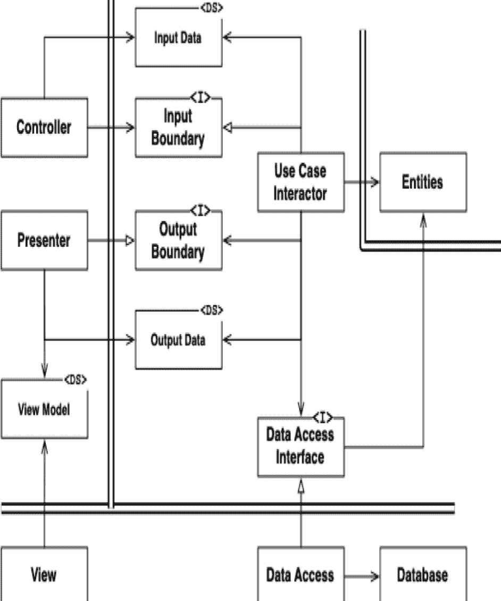
```

注意依赖的方向。所有依赖在跨越边界时都指向内部，遵循依赖规则。

## 结论

遵循这些简单的规则并不困难，而且在未来将为你省去很多麻烦。通过将软件分层并遵守“依赖规则”，你将创建一个从本质上可测试的系统，并获得其带来的所有好处。当系统的任何外部部分过时时（例如数据库或 Web 框架），你可以以最小的阻力替换这些过时的元素。

## 第 28 章 伤害

### 1. 我不会产生有害的代码。

软件专业人士的首要原则和承诺是：不伤害！这意味着你的代码不能伤害你的用户、你的雇主、你的经理或你的同事。

你必须知道你的代码在做什么。你必须知道它是运行的。你必须知道它是整洁的。

不久前，发现大众汽车的一些程序员编写了一些代码，故意阻碍美国环保保护署（EPA）的排放测试。那些程序员编写了有害的代码。

它们是有害的，因为它具有欺骗性。这些代码欺骗了 EPA，允许出售汽车，这些汽车排放的有害一氧化氮含量是 EPA 认为安全水平的 20 倍。因此，这些代码可能危害了在这些汽车行驶的地方生活的所有人的健康。

那些程序员应该发生什么事？他们知道那些代码的目的是吗？他们本应该知道吗？

我会解雇他们并起诉他们。因为无论他们知不知道，他们都应该知道。躲在别人写的需求后面并不是借口。按在键盘上的是我们的手。这是我们的代码。我们必须知道它在做什么！

这是一个棘手的问题，不是吗？我们编写代码让我们的机器工作。而这些机器往往处于可能造成巨大伤害的位置。由于我们要对代码所造成的任何伤害负责，因此我们必须对知道代码将做什么负责。

每个程序员都应该根据其经验和责任水平承担责任。随着你经验和地位的增长，你对自己的行为以及对你下属行为的责任随之增加。

显然，我们不能让初级程序员像团队负责人那样承担责任。我们不能让团队负责人像高级开发人员那样承担责任。但那些资深人员应该达到极高的标准，并对他们指导的人负最终责任。

这并不意味着所有的都由高级开发人员或经理承担。每个程序员都有责任根据其成熟度和理解水平了解代码在做什么。每个程序员都要对其代码所造成的伤害负责。

### 不伤害社会

首先，你不要对你生活的社会造成伤害。

这就是大众汽车程序员违反的规则。他们的软件可能造福了雇主——大众汽车。然而，它伤害了整个社会。而我们，程序员，绝不能这样做。

但你如何知道自己是否在伤害社会呢？例如，构建控制武器系统的软件对社会有害吗？赌博软件呢？暴力或性别歧视的视频游戏呢？色情呢？

如果你的软件在法律范围内，它仍然可能对社会有害吗？

坦率地说，这取决于你自己的判断。你只需要尽可能做出最好的决定。你的良心将是你的指南。明智选择！

另一个伤害社会的例子是 `Healthcare.gov`，根据《平价医疗法案》要求的网站。尽管在这种情况下，伤害是无意的。

《平价医疗法案》是美国国会通过由总统签署的法案。在它的众多指令中，之一是在 2013 年 10 月 1 日创建并激活一个网站。

现在，别忘了法律规定一个全新的大型软件系统必须激活的日期有多么疯狂。真正的问题是，他们真的在 2013 年 10 月 1 日开启了它。

你是否认为，也许那天有一些程序员躲在桌子底下？

> 噢，天哪，我想他们开启了。
>
> 是的，是的，他们真的不应该那样做。
>
> 噢，我可怜的母亲。她该怎么办？

我不会用一连串随之而来的问题来烦扰你。简单来说，该网站在几个月内——完全无法工作。这是一个技术失误导致一项巨大的公共政策面临风险的案例。法律几乎因为这些失败而被推翻。无论你对局势的政治问题怎么看，那是对社会的伤害。

谁对这种伤害负责？每一个知道系统尚未准备好却保持沉默的程序员、团队负责人、经理和总监。

对社会的伤害是由每一个对管理层采取消极攻击态度的软件开发者造成的。每一个说“我只是在做我的工作——那是他们的问题”的人。

每一个知道不对劲但没有阻止该系统部署的软件开发者都分担了责任。

因为事实是这样的：你被雇为程序员的主要原因之一是因为你知道事情什么时候出了问题。你拥有在麻烦发生之前识别它的知识。因此，你有责任在可怕的事情发生之前发声。

### 功能伤害

你必须知道你的代码是运行的。你必须知道你代码的功能不会伤害你的公司、你的用户或你的同事。

2012 年 8 月 1 日，骑士资本（Knight Capital）的一些技术人员在服务器上加载了新软件。不幸的是，他们只加载了八台服务器中的七台，留下第八台运行旧版本。

他们为什么会犯这个错误，没人知道。有人太疏心了。

（注：此处 OCR 文本存在重复/故障，已根据提供的逻辑流进行处理）

你的代码不会杀死任何人。如果涉及到巨额财富，你必须**知道**你的代码不会让他们赔钱。

另一方面，如果你正在编写一个聊天应用程序或一个简单的购物购物车网站，既不关乎巨额财富也不关乎生命……难道真的如此吗？

如果使用你聊天应用程序的人突然发生医疗紧急情况，并在你的应用上输入：“救救我。拨打911”会怎样？如果你的应用发生故障并丢失了这条消息呢？

如果你的网站将个人信息泄露给黑客，而他们利用这些信息盗取身份呢？

如果你的代码运行不佳，导致客户离开了你和你的雇主，转而竞争对手那里呢？

要点在于，人们很容易低估软件可能造成的伤害。认为你的软件不会伤害任何人，这种想法很令人安慰，因为觉得它并不重要。

但你忘记了软件的编写是非常昂贵的，至少在开发上花费的资金是处于风险之中的，更不用说用户因依赖它而投入的风险了。底线是，涉及的总是比你想象的要多。

### 不破坏结构

你不能破坏代码的结构。你必须保持代码整洁且组织良好。

问问你自己，为什么 Knight Capital 公司的程序员们**不知道**他们的代码可能是有害的。

我想答案非常显而易见。他们忘记了 `Power-Peg` 软件仍在系统中。他们忘记了他们重新使用的标志位（`flag`）会激活它。而且他们假设所有服务器上一直运行着相同的软件。

他们之所以不知道自己的系统是有害的，是因为他们通过留下死代码对系统结构造成了伤害。

这就是为什么代码结构和整洁如此重要的大原因之一。结构越错乱，想要知道代码会做什么就越困难。混乱越严重，不确定性就越高。

以丰田案例为例。为什么他们不知道自己的软件会杀人？你认为他们拥有数千个全局变量这一事实可能是一个因素吗？

在软件中弄出一团糟会破坏你了解软件功能的能力，从而破坏你防止伤害的能力。

*混乱的软件就是有害的软件。*

现在，你们中一些人可能会反对说，有时为了修复一个棘手的生产环境 Bug，快速而粗暴的补丁是必要的。

当然。没问题。如果你能用快速而粗暴的补丁修复生产环境危机，那么你应该那样做。毫无疑问。

一个有效的愚蠢主意并不是愚蠢主意。

然而，你不能留下那个快速而粗暴的补丁而不造成伤害。补丁在代码中存在的时间越长，造成的伤害就越大。

记住，如果旧的 `Power-Peg` 代码从代码库中移除，Knight Capital 的灾难就不会发生。实际上是那些旧的、废弃的代码导致了糟糕的交易。

那么，我们说的“对结构的伤害”是什么意思？

显然，数千个全局变量是一个结构性缺陷。留在代码库中的死代码也是如此。

结构性伤害是对源代码组织形式和内容的破坏。任何让代码难以阅读、难以理解、难以修改或难以重用的因素都是伤害。

每一位专业软件开发者都有责任了解良好软件架构的准则和标准。他们应该知道如何重构、如何编写测试、如何识别坏代码，以及如何解耦设计并创建适当的架构边界。他们应该知道并应用低级和高级设计原则。每一位高级开发都有责任确保年轻开发者学习这些知识，并在他们编写的代码中满足这些要求。

### 软

软件的第一个词是 SOFT（软）。软件应该是**软**的。它应该是易于改变的。如果我们不想让它易于改变，我们就叫它硬件。

记住软件之所以存在非常重要。我们发明它是为了让机器的行为易于改变的手段。在我们的软件难以改变的范围内，我们违背了软件存在的根本理由。

记住软件有两个价值。一个是其行为的价值；另一个是其“软性”的价值。我们的客户和用户期望我们能够容易且无高成本地改变这种行为。

在这两个价值中，哪一个更大？我们应该优先考虑哪一个价值？我们可以通过一个简单的思想实验来回答这个问题。

想象两个程序：一个运行得完美但无法更改；另一个什么都做不对，但很容易更改。

哪一个更有价值？

我不喜欢成为那个告诉你真相，但以防你没有注意到，软件需求倾向于变化，而且会不断变化，导致第一种软件变得毫无用处——永远如此。

另一方面，第二种软件是可以被运行起来的，因为很容易更改。最初让它运行起来可能需要一些时间和金钱，但之后，它将以极小的努力永远运行下去。

因此，在除最紧急的情况外，这两种价值中的第二个应该被优先考虑。

我说的“紧急”是指什么？我指的是一种每分钟让公司损失 100 万美元的生产灾难。那才是紧急。

我指的不是初创公司。初创公司并不是需要你创建僵化软件的紧急情况。事实上，恰恰相反。初创公司中绝对确定的一件事就是你正在创造错误的产品。

没有产品能经受用户的考验。一旦你开始把它交到用户手中，你就会发现你构建的产品在百个方面都是错误的。事实上，这是软件初创公司面临的最大问题之一。他们认为自己处于一种紧急状态，需要抛弃所有规则冲向终点，在身后留下一团糟。如果他们能保持软件结构免受伤害，他们会运行得更快、更好，并且生存得久得多。

### 测试

如果你遵循全面的测试准则，如 `TDD`、`TCR` 或小批量提交，你将以高度的确定性**知道**代码是正常工作的。

如果你没有证明代码运行良好的测试，你如何防止你的代码行为产生伤害？

如果你没有允许你清理代码的测试，你如何防止对代码结构产生伤害？

测试准则真的是专业性的先决条件吗？我真的在暗示如果你不实践这种准则，你就不能成为一名专业开发者吗？

是的，我想我是 true。或者说，它正在变成事实。对于我们中的某些人来说它是事实；随着时间的推移，它对更多人来说正在变成事实。我认为时机将会到来，很快，大多数程序员将认同：遵循测试准则是标记一名专业开发者的最低标准准则和行为的一部分。

我为什么相信这一点？

因为正如我之前所说，我们统治着世界！我们编写了运作整个世界的规则。

在我们的社会中，没有软件就没有买卖。几乎所有的通信都是通过软件的。几乎所有的文档都是用软件编写的。没有软件，法律就无法通过或执行。几乎没有任何日常生活活动是不涉及软件的。

没有软件，社会无法运作。软件已成为我们文明基础设施中最重要的部分之一。

社会还没有理解这一点。我们程序员还没有真正理解这一点。但人们开始意识到，我们编写的软件至关重要。人们开始意识到，太多的生命和财富依赖于我们的软件。而且人们开始意识到，编写软件的人们并没有具备最低水平的准则。

所以，是的，我认为 `TDD` 或类似的准则最终会被认为是专业软件开发者的最低标准行为。我认为我们的客户和用户会坚持这一点。

## 第 29 章 行为或结构上无缺陷

### 2. 我编写的代码将始终是我的最佳作品。我不会故意允许行为或结构上存在缺陷的代码堆积。

记住，肯特·贝克曾说过：“首先让它运行起来，然后让它正确。”让程序运行起来只是第一步也是最简单的一步。第二步更难的一步是清理代码。

遗憾的是，太多的程序员一让程序运行起来就认为他们工作完成了。一旦程序运行成功，他们就会转向下一个程序，然后是下一个，再下一个。

在他们离开后，留下了一堆纠结、不可读的代码历史，这会拖慢整个开发团队的速度。

他们之所以这样做是因为认为自己的价值在于速度。他们知道自己薪水很高；因此他们觉得必须在短时间内交付大量的功能。

但软件开发是困难的，需要大量的时间，因此他们觉得自己进展太慢了。他们觉得自己失败了。这种失败感产生了一种压力，促使他们尝试加快速度。这导致了他们的手忙脚乱。

于是他们急于让程序运行起来；然后宣布完成——因为在他们看来，这已经花了他们太长时间。

项目经理不停地敲脚并没有帮助，但那并不是真正的驱动力。

我教过很多课程。在许多课程中，我给程序员一些小项目来编写。我的目标是给他们提供一种编码体验，让他们能够尝试新的技巧和新规范。我不在乎他们是否真的完成了项目。

事实上，所有的代码都会被丢弃。

尽管如此，我仍然看到有人在忙。有些人下课后留下来，拼命让某些完全毫无意义的东西运行起来。

所以，尽管老板的压力没有帮助，但真正的压力来自我们内部。我们将开发速度视为关乎我们自我价值的问题。

#### 让它正确

正如我们在上一章中看到的，软件有两个价值：行为的价值和结构的价值。在上一章中，我也提出了一个观点：结构的价值比行为的价值重要。这是因为，为了具有任何长期价值，软件系统必须能够应对需求的变化。

如果软件的结构使其难以更改，那么该软件就很难跟上需求的变化。结构糟糕的软件就会过时。

因此，为了跟上需求，软件的结构必须足够干净，以允许甚至鼓励改变。易于更改的软件可以跟上变化的需求，使其以最小的努力保持价值。但如果你有一个难以更改的软件系统，那么当需求变化时，你想让该系统继续运行将变得异常痛苦。

需求什么时候最可能发生变化？

需求在项目开始时最不稳定；就在用户刚刚看到前几个功能运行的之后。这是因为他们正第一次看到系统实际在做什么，而不是他们之前认为系统会做什么。

这意味着，如果想让早期开发进展顺利，系统结构从一开始就需要是整洁的。如果你在开始时搞得一团糟，即使是第一个版本也会被这团乱子拖慢。

良好的结构实现良好的行为，糟糕的结构阻碍良好的行为。结构越好，行为越好；结构越差，行为就越差。行为的价值关键取决于结构。因此，结构的价值是两个价值中更关键的。

这意味着专业开发者对代码结构的重视程度高于行为。

是的，首先你让它运行起来；但随后，你务必确保你继续让它正确。在整个项目生命周期中，你要保持系统结构尽可能干净。从开始到结束，它必须是干净的。

#### 什么是良好的结构？

良好的结构使系统易于测试、易于更改和易于复用。代码中某部分的更改不会破坏其他部分。一个模块的更改不会导致大规模的重新部署。高级策略与底层细节分离并保持独立。

糟糕的结构使系统僵化、脆弱且不可移动。这些是传统的设计味道。

- **僵化**：当系统相对微小的更改导致系统大部分部分重新编译、构建和部署时。当集成更改的努力远大于更改本身时，系统就是僵化的。

- **脆弱**：当系统行为的微小变化迫使大量模块进行许多相应的更改时。这产生了一种高风险，即行为的小变化会无意中破坏系统中的其他行为，而这些行为又会被无意中部署。当这种情况发生时，经理和客户会认为团队已经失去了对软件的控制，并且不知道自己在做什么。

- **不可移动性**：当现有系统中的某个模块包含你想在新系统中使用的行为，但由于它与现有系统纠缠得太厉害，以至于你无法将其提取在新系统中使用。

这些问题都是结构问题，而不是行为问题。系统可能通过了所有测试并满足了所有功能需求。然而，这样的系统可能变得几乎毫无用处，因为太难以操作了。

许多系统通过了所有测试并满足了所有功能需求，但却可能因为太难以操作而几乎毫无用处，这本身带有一种讽刺意味。

#### 艾森豪威尔矩阵

怀特·D·艾森豪威尔曾说：“我有两种问题，紧急的和重要的。紧急的不重要，重要的从不紧急。”

这句话包含着深刻的真理。一个关于工程的深刻真理。我们甚至可以称之为“工程师的格言”：

这是艾森豪威尔的决策矩阵。紧急性位于纵轴，重要性位于横轴。四种可能性是紧急且重要、紧急但不重要、重要但不紧急，以及既不重要也不紧急。

| | 重要且紧急 | 重要但不紧急 |
|---|---|---|
| | 不重要但紧急 | 不重要且不紧急 |

```

```

紧急性关于时间。重要性不是。重要的事情是长期的。紧急的事情是短期的。结构是长期的；因此，它是重要的。行为是短期的；因此，它仅仅是紧急的。

所以结构这些重要的事情优先。行为是次的。

你老板可能并不认同那个优先级；但那是因为担心结构不是你老板的工作。你老板只是希望你在实现紧急行为时，保持结构的干净。

我们之所以先让它运行起来，是因为结构必须支持行为；因此我们先实现行为，然后赋予它正确的结构。但结构比行为更重要。我们赋予它更高的优先级。在处理行为问题之前，我们先处理结构问题。

我们可以通过将问题分解为极小的单元来解决这个“圆化难题”。让我们从用户故事开始。你获得一个故事来工作；然后确保它的结构正确。在结构正确之前，你不要处理下一个故事。当前故事的结构优先级高于下一个故事的行为。

但问题是故事太大了。我们需要更小的粒度。不是故事……而是测试。测试的大小是完美的。

首先，你要让一个测试通过，然后在你让下一个测试通过之前，修复通过该测试的代码结构。

这整个讨论是测试驱动开发等良好测试规范中“红-绿-重构”循环的道德基础。

正是这种循环帮助我们防止对行为和结构的损害。正是这种循环允许我们将结构置于行为之上。这就是为什么我们把测试准则视为一种设计技术，而不是一种测试技术。


# 程序员是利益相关者

记住这一点。我们对软件的成功拥有利益。我们，程序员也是利益相关者。

你曾那样想过它吗？你曾把自己看作项目的利益相关者之一吗？

但，当然，你是。项目的成功直接影响你的职业生涯和声誉。所以，是的，你是一个利益相关者。

作为利益相关者，你对系统的开发方式和结构设计有话语权。我的意思是，你的利益也悬于此。

但你不不仅仅是一个利益相关者。你是一个工程师。你被雇佣是因为你知道如何构建软件系统，以及如何构建这些系统使它们持久存在。

伴这些知识而来的是产出最佳产品的责任。

所以，你不仅拥有利益相关者的权利，还负着工程师的责任，确保你生产的系统不会因为糟糕的行为或糟糕的结构而造成损害。

许多程序员不想要那种责任。他们宁愿只被告知要做什么。这是一种悲剧，一种耻辱。这完全是不专业的表现。有这种想法的程序员应该拿最低工资，因为他们的工作产出只值这么多。

如果你不对系统的结构负责，还有谁来负责？你的老板吗？

你的老板知道 `SOLID` 原则吗？设计模式呢？面向对象的设计和依赖倒置实践呢？你的老板知道 `TDD` 规范吗？他们知道什么是 `self-shunt`、测试特定子类（`test-specific subclass`）或谦微对象（`humble object`）吗？你的老板理解变化的事情应该组合在一起，而因不同原因变化的事情应该分开吗？

你的老板理解结构吗？还是你的老板的理解仅限于行为？

结构至关重要。如果你不在乎，谁来关心？如果不是你，是谁？

如果你的老板明确告诉你忽略结构并完全关注行为呢？你拒绝。你是一个利益相关者。你也有权利。而且你是一个工程师；你有老板无法逾越的责任。

也许你认为这会让你解雇？可能不会。大多数经理预期为他们需要和相信的事而斗争，并且尊重那些愿意这样做的人。

噢，会有斗争；甚至会有冲突。这并不会舒服。但你是利益相关者，也是工程师。你不能仅仅退缩和妥协。那才是专业的。

大多数程序员并不喜欢冲突。但处理具有对抗性的经理是一项你必须学习的技能。我们必须学会如何为我们认为正确的事而战。因为对重要的事情负责并为这些事情而战，是一个专业人士的行为。

# 尽力所为

《誓言》（The Oath）中的这条承诺是关于尽力所为。

显然，这对程序员来说是一个完全合理的承诺。你当然会尽力，你当然不会在知情的情况下发布有害代码。

当然，这并不是非黑即白的。有时结构必须向进度妥协。例如，为了赶上展会，你必须写一些快速且粗糙的代码。但你必须对此诚实，并且必须在以后对其进行清理。如果不这样做，技术债将变成无人能管理的噩梦。

誓言不是关于完美；而是关于专业。它是关于即使在困难时也做到最好。它是关于对你的工作以及它对世界产生的影响负责。

1955年，已经成为三年程序员的他，尽管当时仍是一名学生，但他得出结论：编程的智力挑战大于理论物理智力挑战，因此选择编程作为自己的长期事业。

在做出这个决定时，他与他的老板阿德里安·范·维纳登（Adriaan van Wijngaarden）进行了商量。迪斯特拉担心没有人确立出一门编程的学科或科学，因此他不会受到重视。他的老板回答说，迪斯特拉很有可能是使其成为一门科学的人之一。

为了实现这一目标，迪斯特拉受到“软件是一个形式系统、一种数学”这一想法的驱使。他认为软件可以变成一种数学结构，类似于欧几里得几何——一个由公理、证明、定理和引理组成的系统。于是，他开始创建软件证明的语言和学科。

## 证明正确性

迪斯特拉意识到，他只有三种技术可以证明算法的正确性：枚举、归纳和抽象。枚举法用于证明顺序中的两个语句或通过布尔表达式选择的两个语句是正确的。归纳法用于证明循环是正确的。抽象法用于将一组语句拆分为更小的可证明块。

如果这听起来很困难，那确实很难。为了说明这有多困难，我在下方包含了一个用于计算整数取余数的简单 Java 程序，以及我针对该算法的手写证明。¹¹

¹¹ 这是对迪斯特拉著作中一个演示的 Java 语言翻译。

```java
public static int remainder(int numerator, int denominator) {
    assert(numerator > 0 && denominator > 0);
    int r = numerator;
    int dd = denominator;
    while (dd <= r) {
        dd *= 2;
        while (dd != denominator) {
            dd /= 2;
            if (dd <= r) {
                r -= dd;
            }
        }
    }
    return r;
}
```

别担心。我不指望你能读懂我的证明。我只是想让你感受一下这样的证明包含什么。

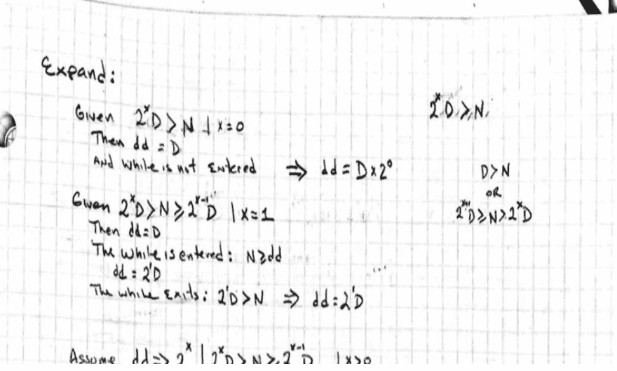

如果 $2^{dd} > N \geq 2^D$

那么在第 $X^{th}$ 次循环后 $dd=2^D$（假设）

进入 while 循环：$dd \leq N$

$dd=2^D$

退出 while 循环：$dd > N$

## 单次归约

给定 $dd = \lfloor \log_2 N \rfloor$

$dd=2^D$

如果 $dd > r$ 则 $os \leq r < 2^D$ $r=qd$ $int=0$

如果 $dd \leq r$

对于 $dd+1$ 且 $os \leq r < 2^{D-1}$

$os \leq r < 2^D$ $r=qd$ $int=0$

## 证明：

给定 $dd=D \Rightarrow D > N$（根据第二条）

$N \geq r \Rightarrow r=N-qd$ $qd=0$

$os \leq r < D$ $r=0$

给定 $dd=2D \Rightarrow 2D > N \geq D$（根据展开法）

进入循环

$\Rightarrow os \leq r < D$ $r=N-qd$ $qd=0$

假设 $dd=2^D \Rightarrow 2^D > N \geq 2^{D-1}$ 假

$\Rightarrow dd=2^D$

$os \leq r < 2^D$ $r=N-qd$ $qd=0$

如果 $dd=2^{D+1} \Rightarrow 2^{D+1} > N \geq 2^D$ 真

进入循环

$\Rightarrow dd=2^D$

$dos \leq 2^D$ $r=N-qd$ $qd=0$

我认为你可以看出这种方法的问题了。事实上，这正是迪斯特拉苦苦抱怨的事情：


“当然，我不敢建议（至少现在不这么建议！）每当程序员在程序中编写一个简单的循环时，提供这样的证明是程序员的责任。如果是这样的话，他们永远无法写出任何规模的程序。”²

² [SP72]。

迪斯特拉希望通过创建一个定理库，让这样的证明变得更加实用，这再次类似于欧几里得几何。

但迪斯特拉并没有理解软件将会变得多么普遍和无处不在。他在早期并没有预见到计算机的性能将超越人类，大量的软件将运行在我们家的墙里、口袋里和手腕上。如果他早知道，他就会意识到他设想的定理库将庞大到任何纯人类都无法掌握。

因此，迪斯特拉关于程序显式数学证明的梦想已几近遗忘。哦，还有一些顽固者寄希望于形式化证明的复兴，但他们的愿景并没有深入渗透到整个软件行业。

虽然梦想可能已经过去，但它留下了一些非常深刻的东西。我们今天在使用这些东西时，几乎是不假思考的。

## 结构化编程

在编程的早期，即 20 世纪 50 年代和 60 年代，我们依赖 `goto`。你之所以没有看到那语句，是因为现在我们对其持反感。我们为什么不青睐 `goto`？因为在 1968 年，埃德格·迪斯特拉在《ACM 学报》上写了一篇文章。编辑尼克拉斯·沃尔特（Niklas Wirth）认为这篇文章非常深刻，因此将其作为信件发表。他给出的标题是“被认为有害的 goto 语句”。

没有 Facebook 迷因或网络对战。但我们当年确实给当时主流软件期刊的编辑写过信。

而那些信引发了激烈的争论。有人称迪克斯拉（Dijkstra）为神；另一人则称他是个傻瓜。就像现在的社交媒体一样，只不过速度慢得多。

但随着时间的推移，辩论缓了，迪克斯拉的位置赢得了越来越多的支持。直到今天，我们使用的大多数语言都根本没有 `GOTO`。

如今，我们都成了结构化程序员了，因为我们的语言没有给我们提供选择。

我们都通过顺序、选择和迭代来构建程序。极少有人会经常使用无约束的 `GOTO` 语句。

由这三个结构组合成程序的一个意想不到的副作用，就是一种被称为“功能分解”的技术。

功能分解是指从程序的顶层开始，递归地将其分解为越来越小、且可证明的单元的过程。事实上，这就是结构化编程背后的推理过程。结构化程序员通过自上而下、通过这种递归分解，推理出越来越小、且可证明的函数。

结构化编程与功能分解之间的联系，是 70 年代和 80 年代发生的结构化革命的基础。

像 Ed Yourdon、Larry Constantine、Tom DeMarco 和 Meilir Page-Jones 这样的人在那几十年里普及了结构化分析和结构化设计技术。

## 测试驱动开发等

测试驱动开发（TDD），即“红 $\rightarrow$ 绿 $\rightarrow$ 重构”循环，本质就是功能分解。毕竟，你必须针对问题的微小部分编写测试。这意味着你必须在功能上将问题分解为可测试的元素。

这意味着，每一个用 TDD 构建的系统，都是由那些符合结构化编程的功能分解元素构建而成的。这意味着它们所构建的系统是可证明的。

测试就是证明。或者说，测试就是理论。

TDD 创建的测试并不是正式的数学证明。事实上，迪克斯拉以说过这样一句话而闻名：测试只能证明程序是错误的，它们永远无法证明程序是正确的。

在我看来，这正是迪克斯拉的失误之处。迪克斯拉将软件视为一种数学。他想建立一个由公理、定理、推论和引理组成的超结构。

相反，我们实现的是软件是一种科学。我们通过实验来验证这种科学。我们根据通过的测试建立起一套理论超结构。就像所有其他科学一样。

我们证明了进化论、或者相对论、或者大爆炸理论，或者任何一个主要的科学理论吗？没有。我们无法从任何数学意义上证明它们。

尽管如此，在有限的范围内，我们仍然相信它们。事实上，每当你坐进汽车或上飞机时，你都在赌上自己的生命去赌牛顿的运动定律是正确的。每当你使用 `GPS` 时，你都在赌爱因斯坦的相对论是正确的。

我们没有从数学上证明这些理论是正确的，这一事实并不意味着我们没有足够的证明来信赖它们，即使是赌上生命。

这就是 TDD 给我们的那种证明。不是正式的数学证明，而是实验性的经验证明。一种我们每天都依赖的那种证明。

这让我们回到了誓言中的第三个承诺：

> 我将会在每次发布时，提供一个快速、可靠且可重复的演示，证明代码的每一个元素都按预期工作。

快速、可靠且可重复。*快速* 意味着测试套件的运行时间应该非常短。是分钟而不是小时。⁴

⁴ James. Kirk, 星际迷战2：可汗之怒。

**可靠** 意味着当测试套件通过时，你知道你可以发布了。

**可重复** 意味着这些测试可以由任何人在任何时候运行，以确保系统运行正常。事实上，我们希望测试每天运行多次。

有些人可能认为，要求程序员提供这种水平的证明过分了。有些人可能认为，不应该要求程序员达到如此高的标准。而另一方面，我无法想象其他任何有意义的标准。

当客户付钱为他们开发软件时，我们难道不应该荣幸地尽最大能地证明，我们创建的软件确实实现了客户付钱想要得到的功能吗？

我们当然是荣幸的。

我们欠客户、雇主和队友一个承诺。我们欠业务分析师、测试人员和项目经理一个承诺。

但最重要的是，我们还欠自己一个承诺。因为如果我们不能证明我们做的工作就是我们获得报酬去做的工作，我们又怎么能视自己为专业人士呢？

当你做出那个承诺时，你欠下的不是迪克斯拉梦寐以求的正式数学证明；而是涵盖了所有需求行为的科学测试套件，它在几秒钟或几分钟内运行，并且每次运行都会产生相同、清晰的通过/失败结果。

## 第 31 章。小循环

4. 我将频繁地发布小版本，以免阻碍他人的进度。

发布小版本意味着每次发布只更改少量的代码。系统可能很大，但对该系统的改变很小。

## 源码控制的历史

以下是对源码控制历史的回顾。

## 穿孔卡

让我们回到 20 世纪 60 年。当你的源代码打在一叠卡片上时，你的源码控制系统是什么？


源代码不在磁盘上。它实实在在地在手里。源码控制系统是什么？是你的办公桌。

当你字面地拥有源代码时，就不需要“控制”它。这在 50 年代和 60 年代一直是如此。我们通过把代码放在抽屉里来控制源代码。

如果想要“检出”源代码，只需去柜子拿走就行。做完后，把它放回去。但现在这必须通过流程和惯例来完成。必须使用真正的源码控制流程。还没有软件，只有人为规则。尽管如此，源码控制的概念已经与源代码本身分离出来。

随着系统变得越来越大，越来越多的程序员同时处理同一段代码。拿走主带并占有的会对其他人来说成为真正的困扰。我的意思是，你可以让主带离开流通几天或更久。

于是，我们决定从主带中提取模块。模块化编程的理念在当时还很新。程序可以由许多不同的源文件组成的观点是革命性的。

所以，我们开始使用公告板，像这样：


公告板上贴有系统里每个模块的标签。每个程序员都有自己颜色的大头钉。我是蓝色的。Ken 是红色的。我的伙伴 CK 是黄色的，以此类推。

如果我想编辑“主干管理器（Trunk Manager）”模块，我会查看公告板看看那个模块上是否插了钉。如果没有，我会在那里插上一枚蓝色的钉。

然后，我会从架子上取下主磁带并将其复制到另一盘磁带上。

我会编辑主干管理器模块，且仅编辑主干管理器模块，生成一盘带有我更改的新磁带。

我会进行编译、测试、清理，并重复这一过程，直到我的更改运行成功。

然后，我会从架子上取回主磁带，通过复制当前主带来创建一个新的主带，但用我的更改替换掉主干管理器模块。

我会将新的主带放回架子。

最后，我会从公告板上拔掉我的蓝色大头钉。

这种方法行得通；但它之所以有效，是因为我们都彼此了解；我们都在同一个办公室一起工作；我们清楚彼此在做什么。而且我们一直在交流。

我会在实验室里大声喊：“Ken，我要改主干管理器模块。”他会说：“插上钉子吧。”我说：“我已经插了。”

钉子只是提醒。我们心里都清楚代码的状态以及谁在忙什么。这就是这套系统能够正常运行的原因。

事实上，它运行得非常好。了解彼此在做什么意味着我们可以互相帮助。我们可以提出建议。我们可以就最近遇到的问题互相警告。我们还可以避免合并（merges）。

在那个年代，合并*并不是*一件趣事。

接着，在 80 年代，磁盘出现了。磁盘变大了，而且变成了永久性的。

我所说的“大”，是指数百兆字节。我所说的“永久性”，是指它们是永久挂载的——始终在线。

发生的另一件事是，我们有了像 PDP11 和 VAX 这样的机器。我们有了屏幕编辑器、真正的操作系统和多个终端。多个人可以在完全同一时刻进行编辑。

大头钉和公告板的时代必须结束了。

首先，到那时我们有 20 或 30 名程序员。大头钉的颜色不够用了。其次，我们有成百上千个模块。公告板上的空间不够了。

幸运的是，有一个解决方案。

1972 年，Marc Rochkind 编写了第一个源码控制程序。它被称为 SCCS，他用 SNOBOL¹ 编写了它。

¹ 一种源自 60 年代非常漂亮的字符串处理语言，具有许多我们现代语言中类似的模式匹配功能。

后来他用 C 语言重写了它，并成为 PDP11 上 Unix 发行版的一部分。SCCS 每次只能处理一个文件，但允许你锁定该文件，这样其他人在你完成之前无法编辑它。这简直是救命稻草。

1982 年，Walter Tichy 创建了 RCS（修订控制系统）。它同样是基于文件的，并且对项目一无所知，但被认为是对 SCCS 的改进，并迅速成为当年的标准源码控制系统。

然后，在 1986 年，CVS（并发版本系统）出现了。它扩展了 RCS，能够处理整个项目，而不仅仅是单个文件。它还引入了乐观锁（optimistic locking）的概念。

到目前为止，大多数源码控制系统的工作方式都像我的大头钉一样。如果你检出（check out）了该模块，其他人就无法编辑它。这被称为悲观锁（pessimistic locking）。

CVS 使用乐观锁。两个程序员可以同时检出并更改同一个文件。CVS 会尝试合并任何不冲突的更改，如果无法确定如何合并，就会提醒你。

之后，源码控制系统爆炸式增长，甚至变成了商业产品。市面上真的有数百个。有些使用乐观锁，另一些使用悲观锁。事实上，锁定策略变成了行业中一种类似教派的划分。

然后，在 2000 年，Subversion 被创建了。它极大地改进了 CVS，并在推动行业彻底放弃悲观锁方面发挥了关键作用。

Subversion 也是第一个用于“云”的源码控制系统。还有人记得 Source Forge 吗？

到此为止，所有的源码控制系统都是基于我在公告板时代使用的主磁带概念的。源码维护在一个单一的中央主仓库中。源码从主仓库检出，提交（commits）则回写到该主仓库中。

但这一切即将发生改变。

# 持续集成

现在是 2005 年。GB 级磁盘出现在我们的笔记本电脑中。网络速度很快，并且越来越快。处理器的时钟频率稳定在 2.6GHz。

我们离我旧的源码公告板控制系统已经非常非常远了。但我们仍然在使用主磁带的概念。我们仍然有一个中央仓库，每个人都必须从中检入和检出。每次提交；每次回滚；每次合并都需要与主仓库的网络连接。

……然后 git 出现了。

嗯，实际上 git 是由 BitKeeper 和 Monotone 预示的，但是 git 引起了编程界关注并改变了一切。

因为，你看，git 消灭了主磁带。

当然，这关键取决于是否有一套非常可靠的单元测试套件。我的意思是，如果没有良好的单元测试，很容易发生合并错误并破坏他人的代码。因此，持续集成与良好的测试规范是密不可分的。

而现在，有了像 git 这样的工具，我们缩短周期几乎没有限制。

这就引出了一个问题：我们为什么如此关注缩短周期？

因为长长的周期会阻碍团队的进展。


提交之间的时间间隔越长，团队中其他人——也许是整个团队——必须等你的机会就越大。而这违背了承诺。

也许你认为这只适用于生产环境发布。不，它实际上关乎每一个周期。它关乎迭代和冲刺（`sprints`）。它关乎编辑/编译/测试循环。它关乎提交之间的时间。它关乎一切。

记住逻辑：“这样你就不会阻碍他人的进度。”

## 分支与特性开关（Branches versus Toggles）

我曾是一个分支的教条主义者。在我在使用 `CVS` 和 `Subversion` 的时候，我拒绝团队成员对代码进行分支。我希望所有更改尽可能频繁地返回主线。

我的逻辑很简单。分支仅仅是一个长期的检出（`checkout`）。正如我们所见，长期的检出通过延长集成之间的时间来阻碍他人的进展。

但随后我切换到了 `git`——一切在一夜之间变了。

当时，我管理着开源 `FitNesse` 项目，有十几个人在其中工作。我刚刚将 `FitNesse` 仓库从 `Subversion` (`Source Forge`) 迁移到 `git` (`GitHub`)。突然，分支开始到处出现。

在最初的几天，`git` 中这些疯狂的分支让我很困惑。我是不是应该放弃持续集成，允许所有人随心所欲地创建分支，忘记周期时间问题呢？

但随后我意识到，我看到的这些“分支”并不是真正的具名分支。相反，它们只是开发者在两次推送（`pushes`）之间产生的提交流。

事实上，`git` 所做的仅仅是记录了开发者在持续集成周期之间的操作。

因此，我决定继续执行我限制分支的规则。只是现在立即返回主线的不是提交，而是推送。持续集成得以保留。

如果我们遵循持续集成并每隔小时左右向主线推送一次代码，那么主线上肯定会有一大堆写了一半的功能。处理这种情况通常有两种策略：分支和特性开关。

分支策略很简单。你为源代码创建一个新分支，在其中开发该功能。当功能完成后，将其合并回主线。

如果你将分支在主线之外保留几天或几周，那么你可能会面临一次巨大的合并；而且你肯定会阻碍团队。

然而，在某些情况下，新功能与代码的其他部分完全隔离，因此对其分支不太可能导致大合并。在这些情况下，让开发者安静地在新功能上工作而不进行持续集成，可能会更好。

事实上，几年前我们在 `FitNesse` 中就遇到过这样的情况。我们完全重写了解析器。这是一个大项目，花费了几个人的周时间。而且无法增量地完成。我的意思是，解析器就是解析器。

所以我们创建了一个分支，并保持该分支与系统的其余部分隔离，直到解析器准备就绪。

最后需要进行合并，但并不糟糕。解析器与系统的其余部分隔离得很好。幸运的是，我们有一套非常全面的单元测试和验收测试。

但在大多数情况下，我认为将新功能的开发保持在主线上，并使用开关在这些功能准备好之前关闭它们更好。

有时我们使用标志（`flags`）作为这些开关，但更多时候我们使用命令模式、装饰器模式和工厂模式的特殊版本，以确保部分编写的功能无法在生产环境中执行。

在大多数情况下，我们简单地不给用户使用新功能的选项。我的意思是，如果 Web 页面上没有按钮，你就无法执行该功能……

在很多情况下，新功能会作为当前迭代的一部分完成——或者至少在下一次生产环境发布之前完成。因此，实际上不需要任何类型的开关。

只有当你要在某些功能尚未完成时发布到生产环境时，你才需要开关。那么，这种情况通常应该发生吗呢？

## 持续部署（Continuous Deployment）

如果我们消除生产环境发布之间的延迟会怎样？如果我们每天可以发布几次生产环境会怎样？毕竟，延迟生产环境发布会阻碍他人。

我希望你能够每天发布几次代码到生产环境。我希望你对自己的工作足够自信，可以在每次推送将代码发布到生产环境。

这当然取决于自动化测试。自动化测试由程序员编写，以覆盖每一行代码。自动化测试由业务分析师和 `QA` 测试人员编写，以覆盖所有预期的行为。

记得上一章吗？这些测试是切切如预期运行的科学证明。如果一切都如预期运行，下一步就是部署到生产环境。

顺便说一下，这就是你知道测试是否足够好的方法。如果当测试通过时，你对部署感到放心，那么你的测试就是足够好的。如果通过测试不能让你部署，那么你的测试是有缺陷的。

也许你认为每天发布甚至每天发布几次会导致混乱。然而，业务使用的仪式感越多，部署就越昂贵。业务的最终目标是持续、安全且无式的部署。

由于部署通常涉及大量工作，需要配置服务器和加载数据库，你需要自动化部署程序。由于部署脚本是系统的一部分，你需要为它们编写测试。

# 第 32 章 持续的改进

5. *我将在每一个机会无畏且不懈地改进我的作品。我绝不让它们退化。*

罗伯特·巴登·鲍威尔（`Robert Baden Powell`），美国童子军之父留了一封遗言，告诫童子军要让世界变得比他们发现时更好。“童子军规则”就源于这段话。

提交代码（`check in`）时比检出（`checkout`）时更干净。

怎么做呢？在每次提交代码时，对代码进行随机的善意行为。这些善意行为之一就是增加测试覆盖率。

## 测试覆盖率

你是否衡量了测试覆盖了你多少代码？你知道行覆盖的百分比吗？你知道分支覆盖的百分比吗？如果不知道，为什么不呢？

有很多工具可以为你衡量覆盖率。对于我们大多数人来说，这些工具是 `IDE` 的一部分，运行非常简单。所以，通常没有理由不知道自己的覆盖率是多少。

你应该对这些数字做些什么？首先，让我告诉你不该做什么。不要把它们变成管理指标。不要因为你的测试覆盖率太低就导致构建失败。测试覆盖率是一个复杂的概念，不应该如此天真地使用。

这种天真的用法会产生作弊的负面激励。而作弊测试覆盖率是非常容易的。记住，覆盖率工具衡量的只是被执行的代码量，这意味着你可以通过从失败的测试中提取断言（`assertions`）来将覆盖率数字推得非常高。当然，这会让该指标变得毫无意义。

最好的策略是将覆盖率数字作为开发者工具，帮助你有意义地改进代码。你应该通过编写实际测试，努力将覆盖率完全推向 100%。

百分之百的测试覆盖率始终是目标，但它也是一个渐近目标。大多数系统从未达到过 100%，但这不应该阻止你不断尝试实现它。

这就是你使用覆盖率数字的目的。你把它们作为帮助你改进的衡量标准，而不是惩罚团队和导致构建失败的武器。

## 变异测试

百分之百的测试覆盖意味着代码的任何语义变化都应该导致测试失败。`TDD`、`TCR`，以及在较小程度上的小模块（`Small Bundles`）是接近这一目标的良好准则，因为如果你无情地遵循这些准则，每一行代码、每一个条件和每一个分支都经过了测试。

然而，这种无情往往是不切实际的。程序员是人，而准则总是受限于务实。因此，事实是，即使是最勤奋的测试驱动开发者也会在测试覆盖中留下空白。

变异测试（`Mutation testing`）是寻找这些空白的方法；变异测试工具可以提供帮助。

变异测试器运行你的测试套件并衡量覆盖率。然后，它进入循环，以某种语义方式变异你的代码并再次运行测试套件进行覆盖。语义变化就像将 `>` 改为 `<` 或 `==` 改为 `!=` 或 `x<=null`。每一个这样的语义变化被称为变异（`mutation`）。

工具期望每个变异都能通过测试。未通过测试的变异被称为生存变异（`surviving mutations`）。显然，目标是确保没有存活变异。

运行变异测试可能投入大量时间。即使是相对小的系统也需要几个小时的运行。因此，这类测试最好在周末或月底运行。

我经常被这些工具发现的微妙问题所震撼。所以，偶尔付出努力绝对值得的。

## 语义稳定性

测试覆盖率和变异测试的目标是创建一个能确保语义稳定性的测试套件。系统的语义是该系统所需的行为。确保语义稳定性的测试套件是指每当所需的行为被破坏时就会失败。我们使用这样的测试套件来消除对重构和清理代码的恐惧。如果没有语义稳定的测试套件，对变化的恐惧往往太大了。

遵循其中一种测试准则为我们构建语义稳定的测试套件良好良好开始；但这些准则中没有一个足以实现完全的语义稳定性。覆盖率、变异测试和验收测试应该被用来提高语义稳定性以达到完善。

## 清理

在改进代码的随机善意行为中，最有效的可能是简单的清理——以改进为目标的重构。

可以做哪些类型的改进？当然，显而易见的消除代码味道（`code smells`）。但即使在代码并不臭时，我经常也会清理代码。

我在命名、结构、组织上做极微小的改进。这些变化可能不会被其他人注意到。有些人甚至可能认为它们让代码变得不整洁了。但我的目标不仅仅是代码的状态。通过微小的清理，我了解了代码。我对它变得更加熟悉。也许我的清理并没有在任何客观上真正改进代码；但它改进了我对该代码的理解和运用能力。清理提升了我作为该代码开发者的水平。

清理还做了一些不应被忽视的事。通过清理代码，即使是微小的方式，我也在拉伸（`flexing`）这段代码。确保代码保持灵活最好的方法之一就是定期拉伸它。我所做的每一次清理实际上都是对代码灵活性的测试。如果我发现某个小清理有点困难，我就检测到了一个现在可以修正的缺乏灵活性的区域。

记住，软件应该是软的（`soft`）。你如何知道它是软的？通过定期测试这种软性。通过进行小小的清理和改进，并感受这些操作是容易还是困难。

## 作品

上述承诺中使用的词是*作品*（`creations`）。在这一章中，我主要关注代码；但代码并不是程序员创建的唯一东西。我们创建设计、文档、进度和计划。这些产物都应该不断改进。

我们是人类。人类随时间变得更好。

# 第 33 章 保持高生产力

6. 我将尽一切努力保持自己和他人的生产力尽可能。我不做任何降低生产力的事。

如果你在编辑 5 分钟代码后需要花 30 分钟来构建，那么你的效率可不上来，对吧？

在 21 世纪的第三个及之后的十年里，没有任何理由让构建花费超过一两分钟。

在你反对这一观点之前，请先思考一下。你如何加速构建？在如今的云计算时代，你是否完全确定没有办法可以大幅提高你的构建速度？找到导致构建缓慢的任何原因，并修复它。将其视为一项设计挑战吧。

## 测试

是你的测试拖慢了构建吗？回答是一样的：加快你的测试。在这里，看这个方法。我那台破旧的笔记本有四个核心，主频为 2.8GHz。这意味着它每秒可以执行大约 100 亿条指令。

你的整个系统中加起来有 100 亿条指令吗？如果没有，那么你应该能够在一秒内测试完整个系统。

当然，除非你正在多次执行其中的某些指令。

例如，你需要测试多少次登录才能知道它是通的？通常情况下，测试一次就足够了。

那么你的测试中有多少个经过了登录过程？超过一次就是浪费！

如果每个测试之前都需要登录，那么在执行测试时，你应该短路登录过程。使用一种模拟（`mocking`）模式。或者，如果你必须这样做，就从为测试构建的系统中移除登录过程。

重点是，不要在测试中容忍那样的重复。这会让测试变得极其缓慢。

再举例子，你的测试有多少次遍历了用户界面的导航和菜单结构？有多少测试从顶部开始，然后经过一长链链接，最终让系统进入可以运行测试的状态？

每个导航路径超过一次就是浪费！因此，请构建一个特殊的测试 `API`，允许测试快速强制系统进入你所需的状态，而无需登录，也无需导航。

你需要执行多少次查询才能知道它是通的？一次！在大多数测试中，对你的数据库进行模拟。不要让相同的查询被一次又一次地执行。

外围设备很慢。磁盘慢。`Web socket` 慢。`UI` 屏幕慢。即使是 `SSD` 也可能慢。不要让慢速的事拖慢你的测试。将它们模拟掉。跳过它们。把它们从你测试的关键路径中移出去。

不要容忍缓慢的测试。保持你的测试运行快速！

## 调试

调试事情需要很长时间吗？为什么？为什么调试很慢？

你正在使用一种测试规范并编写单元测试，不是吗？你也在编写验收测试，对吧？你正在用良好的分析工具衡量测试覆盖率，对吧？你还在定期使用变异测试器（`mutation tester`）来证明你的测试在语义上是稳定的，对吧？

如果你在做所有事情，或者仅仅是其中*部分*事情，你的调试时间就可以减少到忽略不计。

## 部署

部署需要永远的时间吗？为什么？我的意思是，你*确实*在使用部署脚本，对吧？你不是在手动部署，对吧？

记住，你们是程序员。部署是一个过程；自动化它！并为该过程编写测试！你应该能够每次通过点击一下来部署你的系统。

## 管理分心

生产力最严重的破坏者之一是工作中的分心。有很多不同类型的分心。了解如何识别并防御这些分心对来说很重要。

### 会议

你被会议拖慢了速度吗？我处理会议有一个非常简单的规则。规则如下：

*当会议变得无聊时，离开。*

你应该表现得礼貌一些。等对话出现几分钟的间隙，然后告诉参与者，你认为你的投入不再需要了，并询问他们是否介意你回到必须完成的大量工作中。

永远不要害怕离开会议。如果你不知道如何离开，那么某些会议将永远困住你。

拒绝大多数会议邀请也是明智之举。避免陷入冗长、无聊会议的最佳方法，是在从一开始就礼貌地拒绝邀请。

不要被“错失恐惧症”（`FOMO`）所诱惑。如果真的需要你，他们会来找你的。

有人邀请你参加会议时，确保他们已经说服了你真的需要去。确保他们理解你只能抽几分钟，而且你可能会在会议结束前离开。

并确保你坐在门附近。

如果你是团队负责人或经理，记住，你的首要职责之一就是通过*让他们远离会议*来捍卫团队的生产力。

### 音乐

我过去边听音乐边写代码；那是很久以前了。但我发现听音乐会妨碍注意力。随着时间的推移，我意识到听音乐只是*感觉*有助于我集中精力，而实际上它分散了你的注意力。

有一天，在查看一些一年前的代码时，我意识到我的代码正在音乐的鞭打下受苦。代码中散落着一系列注释，那里有我当时一直在听的那首歌的歌词。

从那以后，我写代码时不再听音乐了，我发现我对自己写的代码更满意，而且对细节的关注也更到位。

编程是安排程序元素的行为。

也许音乐真的对你有帮助。但也许没有。我建议你尝试不听音乐写一周代码，看看你是否会产出更多、更好的代码。

### 心情

要意识到，保持生产力需要你擅长管理情绪状态。情绪压力会杀死你的编程能力。

例如，在和配偶大吵一架后，你是否注意到你无法编程？你可能在 `IDE` 中输入了一些随机字符，但它们并没有意义。

我遇到的最明智的态度之一来自电影《西部牛仔人》（1961）。约翰·韦恩的角色说：“我和我妻子以前隔着一棵树打架。但你很快就会发现，谁占上风头并不重要。几年过去，你们变得彼此相处融。然后生活变得值得过。”

这是我发现恢复生产力的最好方法：

采取行动。针对情绪根源采取行动。不要尝试编程。不要试图用音乐或会议来掩盖情绪。那是没用的。去解决情绪。


如果你发现自己因为和配偶吵架而感到忧伤或抑郁无法编程，那么给他们打电话尝试解决问题。即使你没有真正解决问题，你会发现尝试解决的行动有时足以让你清醒过来编程。

你不需要实际上解决问题。你只需要说服你自己已经采取了适当行动。我通常发现这足以让我把注意力转移到必须写的代码上。

如果我发现自己开始过度专注（hyperfocus），我就会离开，去做一会儿其他事情。

# 时间管理

管理分心最重要的方法之一是采用时间管理纪律。我最喜欢的是番茄工作法（Pomodoro Technique）。

Pomodoro 在意大利语中是“西红柿”的意思。事实上，英语团队倾向于直接使用 tomato 这个词。但如果你搜索“Pomodoro Technique”，你会发现更好的搜索结果。

该技术的目标是帮助你在日常工作日中管理自己的时间和注意力。它不涉及除此之外以外的任何事情。

其核心思想非常简单。在你开始工作之前，设置一个 25 分钟的计时器（传统上是一个番茄形状的厨房计时器）。

接下来，你工作。一直工作到闹钟响。

然后，你休息五分钟，清空大脑和身体。

接着，你再次开始。设置计时器为 25 分钟，工作直到闹钟响，然后休息 5 分钟。就这样反复如此。

25 分钟并没有什么神奇之处。我认为 15 到 45 分钟之间的任何时间都是合理的。但一旦你选择了一个时间，就坚持一段时间。

当然，如果闹钟响时我距离通过某项测试只有 30 秒，我会完成那项测试。另一方面，保持这种纪律是很重要的。我不会超过一分钟。

到目前为止，这听起来很平淡，但处理电话等干扰正是这项技术大放异彩之处。规则是：**捍卫番茄！**

告诉任何试图打扰你的人，你会在 25 分钟内回复他们——或者取决于你的“番茄”时长有多长。尽快处理掉干扰，然后回到工作中。

然后，在你的休息之后，再处理那个干扰。

这意味着两个番茄之间的时间有时会变得很长，因为干扰你的人通常需要很多时间。

再次，这就是这项技术的妙之处。因为在一天结束时，你计算的是完成了多少个番茄。这可以作为衡量你生产力的标准。

一旦你学会了如何将一天拆分成这样的番茄，并保护番茄免受干扰，那么你就可以通过分配番茄来开始规划你的一天了。你甚至可以开始以番茄为单位估算你的任务，并围绕它们安排会议和午餐。

# 第 34 章 团队协作

7. 我将持续确保其他人可以分我的工作，而我也可以分他们的工作。

想象一支足球队在球场上向球门传球。想象一下在一次进攻中，其中一名球员绊倒倒下了。他的队友们会做什么？他们会补位，填补漏洞，并继续让球向球场移动。

海军舰艇上的每位士兵都有自己的工作要做，但他们也如何如何他人的工作。为什么？因为在战斗激烈时，一名士兵可能会倒下。另一名士兵必须能够补位并让船只保持战斗状态。

软件团队也是如此。事实上，这就是为什么我们称之为团队。如果团队的任何成员由于任何原因倒下，团队中的其他成员必须能够补位，填补那个漏洞，并保持项目正轨运行。

# 协作编程

知识孤岛（silos）中的知识隔离对团队和组织都是极其不利的。个人的损失意味着整个领域知识的流失。这会导致团队和组织瘫痪。它也意味着团队中的个人没有足够的背景来理解彼此。通常，他们会各说各话，互不在频道上。

解决这一问题的办法是在团队中传播知识。确保每个团队成员都对其他团队成员正在的工作有充分了解。

传播这些知识的最佳方法是一起工作——结对编程（pair）或结群编程（mob）。

事实是，没有比协作编程更能提高团队生产力的方法了。因为一个了解正在进行的工作之间深层联系的团队，其生产力不可比一群孤立的人高得多。

# 开放/虚拟办公室

团队成员之间频繁见面和互动也非常重要。实现这一点的最好方法是把他们放在同一个房间里。

在 2000 年代初，我拥有一家帮助组织采用敏捷开发的公司。我们会向这些公司派遣一组讲师和教练，并引导他们完成转型。在每次聘用开始之前，我们会告诉经理重新安排办公室空间，让我们辅导的团队在自己的团队室里共同工作。

发生过多次，在我们到达指导之前，经理们告诉我们团队的生产力已经提高了很多，仅仅是因为他们在一个房间里共同工作。

我在 2021 年第一季度写了这一章的第一版本。COVID-19 疫情刚刚开始，我们都在期待回归正常生活。但疫情过去后，留下了大量远程工作的软件团队。

远程工作永远无法像在同一个房间里一起工作那样高效。即使有最好的电子辅助，在屏幕上看到彼此也不如面对面。尽管如此，现在的协作电子系统已经非常好。所以，如果你在远程工作，请使用它们。

创建一个虚拟团队室。让每个人的脸都在视野范围内。让每个人的音频通道尽可能开放。你的目标是创建一个团队室的幻象，让其中的每个人都一起工作。结对编程和结群编程现在有很多电子支持。跨距离共享屏幕和一起编程是容易的。当你这样做时，保持脸部显示和音频开启。远程团队应该尽力保持相同的工作时间。当程序员在东西方向分布极其巨大时，这非常困难。所以，尽量让每个团队的时区数量尽可能少，尽力确保每天至少有六个连续小时让大家聚在一起。这将有助于团队凝聚并作为一个团队维持运作。对于一个两周前还和你一起吃过午饭并进行物理协作的人，很难陷入“挡风玻璃陷阱”（windscreen trap）。

即使是 4 或 5 个。但为什么呢？为什么估算如此难以准确？

主要是因为我们并不理解估算到底是什么，以及如何创建它们。

你看，为了让估算发挥作用，它们必须是诚实的。它们必须是诚实且准确的，而且必须是诚实且精确的。但大多数估算两者都不如。事实上，大多数估算都是谎言。

# 谎言

大多数估算都是谎言，因为大多数估算是根据已知的截止日期倒推构建的。

以 Healthcare.gov 为例。美国总统签署了一项法案，规定了软件系统启动的特定日期。

这种逻辑上的荒谬程度令人令人作呕。我的意思是，这太荒谬了。没有人被要求去估算截止日期；他们只是被告诉截止日期必须是什么时候——法律规定！

所以，当然，所有与那个强制性日期相关的估算都是谎言。它们怎么可能是别的东西呢？

这让我想起二十年前我咨询的一个团队。我记得当时正和他们一起在项目室里，项目经理走了进来。

他是个年轻伙子；也许 25 岁。他刚从和老板开完会回来。他显然很焦躁。

他告诉团队截止日期有多重要。他说：“我们真的必须在那个日期完成。我的意思是，*真的*必须在那个日期完成。”

当然，团队的其他成员只是翻了个白眼并摇头。必须按时完成的需求并不是解决按时完成的解决方案。那个年轻的经理没有提供任何解决方案。

当然，在这样的环境下，估算只是支持计划的谎言。

这让我想起了我的另一个客户，他的墙上贴着一张巨大的软件生产计划图——满了圆圈、箭头、标签和任务。

程序员们称之为“*笑声背景*（The Laugh Track）”。

在这一章中，我们将讨论真实的、值得的、诚实的、准确且精确的估算。即专业人士所创建的那种估算。

## 诚实、准确、精确

估算最重要的方面是诚实。除非估算是诚实的，否则它们对任何人都没有益处。

你能给出的最诚实的估算是：“我不知道。”但那个估算并不特别准确或精确。毕竟，你对这个估算知道*一些*情况。所以，挑战在于量化你所知和*不*知的内容。

首先，你的估算必须是准确的。这并不意味着你要给出一个固定的日期——你不敢那么精确。这意味着你给出一个你认为自己有把握的日期*范围*。

所以，例如，“从现在到以后 10 年之间的某个时间”对于你写一个 hello world 程序需要的时间来说，是一个相当准确的估算。但它缺乏精确性。

另一方面，“昨天凌晨 2:15”是一个非常精确的估算，但如果你还没有开始，它可能并不准确。

你看到区别了吗？当你给出一个估算时，你希望它在准确性和精确性上都是诚实的。为了准确，你给出一个你所置信的日期范围。为了精确，你将该范围缩小到你置信的水平。

而对于这两项操作，冷酷的诚实是唯一的选择。

## 我的教训

要对这些事情保持诚实，你必须对自己可能有多错有一定的概念。所以让我给你们讲两个关于我曾经有多离谱的故事。

### 故事 #1：向量

那是 1978 年。我在伊利诺伊州德尔菲尔德的一名为 Teradyne 的公司工作。我们为电话公司制造自动化测试设备。

我当时是一个年轻的程序员，26 岁。我正在为一种嵌入式测量设备编写固件，这种设备固定在电话交换局的机架上。这种设备被称为 COLT——电话交换局线路测试仪。

COLT 中的处理器是英特尔 8085——一种早期的 8 位微处理器。我们有 32K 的固态 RAM 和另一个 32K 的 ROM。ROM 基于 Intel 2708 芯片，存储为 1K × 8。所以我们使用了 32 块这样的芯片。

这些芯片插在我们内存板的插座上。每块板可以容纳 12 块芯片；所以我们使用了三块板。

软件是用 8085 汇编语言写的。源代码保存在组源文件中，并作为一个单元进行编译。编译器的输出是一个长度略小于 32K 的单个二进制文件。

我们将该文件切割成 32 个 1K 的块。每个 1K 块被烧录到一个 ROM 芯片中，然后插入 ROM 板上的插座中。

正如你可以想象的，你必须在正确板子的正确插座上放入正确的芯片。所以我们非常仔细地标记了它们。

我们卖出了数百台设备。它们被安装在全国各地的电话交换局。

所以你认为当我们更改那个程序时发生了什么？仅仅改了一行？

如果我们添加或删除了一行，那么该点之后的所有子程序的地址都会发生变化。由于这些子程序是由代码早之前的其他程序调用的，每块芯片都会受到影响。为了改一行代码，我们必须重新烧录所有 32 块芯片！

这是一场噩梦。我们必须烧录数百组芯片，并将它们运给全球所有的现场服务代表。然后，这些代表必须开车几百英里到达他们地区的所有交换局。

（注：此处原文存在大量重复的描述，翻译已根据要求精简并保持逻辑连贯）

这是一场噩梦。我们必须烧录数百组芯片，并将它们运给全球所有的现场服务代表。然后，这些代表必须开车几百英里到达他们地区的所有交换局。……（此处重复）……我们必须烧录数百组芯片……（重复）……在那里的交换局的……

### 故事 #2：pCCU

那是时间，在 80 年代初，我必须创造奇迹。你看，我们向我们的客户承诺了一个新产品。它被称为 CCU-CMU。

铜是贵金属。它稀缺且昂贵。电话公司决定收割过去几个世纪在全国安装的巨大铜线网络。他们用更廉价、高带宽的同轴电缆和光纤网络取代。这被称为数字交换。

CCU-CMU 是对我们的测量技术的完全重新架构，以适应电话公司新的数字交换架构。

所以现在我必须在一个月内创造出一年工作量的软件。

所以我告诉我的老板，这是可能的。我们没有办法在一个月内构建出一个功能完整的 CCU/CMU。

然后，他带着一丝狡黠的微笑看着我，说有一种作弊的方法。

你明白，这是一个非常小的客户。他们的安装规模直观上是数字开关可能的最小配置。更重要的是，他们的设备配置恰好——恰好——消除了 CCU/CMU 原本解决的几乎所有复杂性。

简而言之：我在两周内为客户准备并运行了一个特殊用途的、独一无二的单元。我们称之为 pCCU。

## 教训

这两个故事说明了估算可能具有的巨大范围。一方面，我低估了芯片的矢量化处理，差了六倍；另一方面，我们用预期时间的二十一找到了 CCU/CMU 的解决方案。

这就是诚实能够发挥作用的地方。因为，诚实地说，当事情出现问题时，它们可能会变得非常、非常糟糕。而当进展顺利时，它们有时可能会变得非常、非常顺利。

这使得估算变成了一项极大的挑战。

## 准确性与精确性

现在应该很清楚，一个项目的估算不能是一个日期。对于一个偏差可能高达 6 倍甚至 20 倍的过程来说，单一的日期太精确了。

这种波动意味着每个估算可能是错误的。这就是为什么我们称其为*估算（estimates）*。但即使估算是错误的，它可能并不错得离。所以估算的工作部分是估算这个估算可能有多错。

单一日期精确到无法诚实，因此估算是范围；它们必须是概率分布。概率分布有一个平均值和宽度——有时被称为标准差或 sigma ($\sigma$)。我们需要能够同时用平均值和 sigma 来表达我们的估算。

我最喜欢的估算估算概率分布的方法是估算三个数字：最好情况、最坏情况和正常情况。

正常情况是你认为如果事情按照通常常常发展，平均数量的事情出现问题需要多长时间。把它看作你有 50% 概率能完成的日期。

最坏情况估算是墨菲定律估算。它假设任何可能出错的事情都会出错。它是极度悲观的。把它看作你有 95% 概率能完成的日期。

最好情况估算是万事顺利的情况。你每天早上都吃正确的麦片。当你到达工作时，同事们都很礼貌友好。现场没有灾难，没有会议，没有电话，没有分心。

你命中最好情况估算的概率是 5%：二十分之一。

好了，现在我们有了三个数字。具有 5% 成功概率的最好情况，具有 50% 成功概率的正常情况，以及具有 95% 成功概率的最坏情况，这代表了一个正态曲线——一个概率分布。这个概率分布才是你真实的估算。

注意，这不是一个日期。我们不知道日期。我们不知道什么时候真正完成。我们拥有的只是对概率有一个粗略的想法。

在没有确定知识的情况下，概率是估算的唯一逻辑方法。

如果你的估算是一个日期，你是在做承诺，而不是在估算。如果你做出了承诺，你就必须成功。

有时你必须做出承诺。但承诺的特点在于你绝对必须成功。你绝不能承诺一个你不确定自己能完成的日期。这样做将是极度不诚实的。

所以，如果你不知道——我的意思是确切知道——你能够完成某个特定日期，那么你就不要提供该日期作为估算。相反，提供一个日期范围。提供带有概率的日期范围要诚实得多。

## 聚合

好了，现在假设你有一个充满了任务的项目，这些任务已经根据最好情况（B）、正常情况（N）和最坏情况（W）的估算进行了描述。你如何将它们全部聚合为整个项目的单一估算呢？

你只需要表示每个任务的概率，然后使用标准的统计方法累加这些概率。

我们想要做的第一件事是根据其预期完成时间和标准差来表示每个任务。

现在，记住，六个标准差（平均值两侧各三个）对应于大于 99% 的概率。因此，我们将标准差（即 sigma）设置为（最坏情况减去最好情况）除以 6。

预期完成时间 ($\mu$) 稍微复杂一点。注意，$N$ 可能不等于 $(W - B)$，中点。事实上，中点可能远超过 $N$。这是因为项目延期比缩短要可能得多。所以最好使用加权平均值，例如：$\mu = (2N + (B + W) \div 2) \div 3$。

现在你计算出了一组任务的 $\mu$ 和 sigma。所以整个项目的预期完成时间就是所有 $\mu$ 之和。整个项目的 sigma 是所有 sigma 平方之和的平方根。

这只是基础的统计数学。

我刚刚描述的是 20 世纪 50 年代后期发明的用于极星舰队弹道导弹计划的估算程序。从那以后它已成功应用于成千上万的项目。

它被称为 PERT——计划评估与评审技术（Program Evaluation and Review Technique）。

## 诚实

我们从诚实开始。然后，我们讨论了准确性和精确性。现在是回到诚实了。因为，诚实地说，当事情出现问题时，它们可能会变得非常、非常糟糕。而当进展顺利时，它们有时可能会变得非常、非常顺利。

这使得估算变成了一项极大的挑战。

# 对此问题的答案是：

不！我已经在努力了。你怎么敢暗示我没有在努力？我已经在尽全力了；我没有办法更努力了。我的口袋里并没有可以创造奇迹的魔豆。

你可能不想用这些具体的措辞，但这恰恰是你应该做的事情。

并记住这一点：如果你说“好的，我会尝试的”，那么你就是在撒谎。因为你根本不知道自己将如何成功。你没有任何改变行为的计划。你说好仅仅是为了打发他们。而这是所有行行中最不诚实的一件事。

## 第 36 章 尊重同行

9. 我将尊重同事程序员的职业道德、标准、纪律和技能。其他任何属性或特征都不会成为我尊重同事程序员的因素。

我们软件专业人士承担着这项手艺的沉重负担。我们这些勇敢的人有男性也有女性，异性恋也有同性恋，黑人、棕色人、亚洲人和白色，共和党人、民主党人、教徒和无神论者。我们是人类，拥有人类所有的各种形式和种类。我们是一个社区——一个相互尊重的兄弟会。

进入我们兄弟会的唯一资格，以及获得该兄弟会每位成员认可和尊重的条件，是我们专业的技能、纪律、标准和道德。其他任何人类属性都不值得考虑。不能容忍基于任何其他歧视。

在我们的专业领域，我们首先是程序员。

## 第 37 章 永不停止

10. 我永远不会停止学习和改进我的手艺。

程序员永远不会停止学习。

我确定你听过有人说过，你应该每年学习一种新语言。没错，你应该这样做。一个优秀的程序员应该熟悉十门语言。

而且不仅仅是同种语言的十种变。不仅仅是 C、C++、Java 和 C#。相反，你应该了解许多不同家族的语言。

你应该了解一种静态类型语言，如 Java 或 C#。你应该了解一种过程语言，如 C 或 Pascal。你应该了解一种逻辑语言，如 Prolog。你应该了解一种栈语言，如 Forth。你应该了解一种动态类型语言，如 Ruby。你应该了解一种函数式语言，如 Clojure 或 Haskell。

你应该了解几种不同的框架。几种不同的设计方法论，以及几种不同的开发流程。

我的不是说你应该成为所有事情的专家；但你应该让自己接触这些事情，并且接触程度要远高于流于表面。

事实上，你应当此类接触的事物清单几乎是无尽的。我们的行业在过去的几里经历了快速变化，这种变化可能还会持续一段时间。你必须跟上它。

这意味着你必须不断学习。继续阅读书籍和博客。继续看视频。继续参加会议和用户组。继续参加培训课程。继续学习。

关注过去的珍贵著作。20世纪 60、70 和 80 年代编写的书籍是见解和信息的绝佳来源。不要掉入认为所有旧东西都过时的陷阱。在我们的行业中，并没有多少东西会真正过时。尊重前辈的努力和成就，研究你的设备和结论。

不要掉入认为培训你是你雇主的工作的陷阱。这是你的职业生涯；你必须对它负责。学习是你的工作。弄清楚你应该学习什么也是你的工作。

如果你足够幸运在一家会为你买书并派你参加会议和培训的公司工作，请充分利用这些机会。如果没有，请自己支付那些书籍、会议和课程的费用。

并计划在这件事上花些时间。每周如此。

你欠你的雇主每周 35 到 40 小时。你还欠你的职业另外 10 到 20 小时。

这就是专业人士所做的。专业人士会花时间打理和维护他们的职业。这意味着你每周总共应该工作 50 到 60 小时。大部分在公司，但也有在家里。

## 后记


Justin Michael Martin


> “当你是一个木工在制作精美的抽屉柜时，你不会在背面使用胶合板，尽管它面对墙壁而且没有人会看到它。你知道它就在那里，所以你会在背面用一块漂亮的木头。为了让你晚上睡得好觉，审美和质量必须贯穿始终。” —— 史蒂·乔布斯

渴望避免同事在谈论你的代码时引用《银河系漫游指南》中的“……也许是宇宙中最奇特的东西”，这可能是一个高尚的追求。当然，这指的是传奇的巴别鱼，它可以直接将任何外星语言翻译到你的耳朵里。

在思考或阅读《整洁代码》（Clean Code）时，我经常想起《银河系漫游指南》——不仅是因为我的父亲喜欢这个系列丛并鼓励他的孩子们阅读它，不仅是因为《整洁代码》中引用了他的其他书籍，也不仅是因为《整洁代码》引发了深层思考。我想起《银河系漫游指南》是因为它是一本宇宙指南，而《整洁代码》是一本手艺指南。

测试代码的工作流其实完全是一致的，它们都在同一个地方运行。

其次，我们开始为“火箭”添加新功能。既然一切都安排得井井有条，这变得非常简单。他写了一个会失败的测试用例。我只用了最多一两行代码就让它通过了。在我还没意识到我们已经真正完成了这个功能之前，我已经完成了让它通过的编写。当我意识到这一点时，他赞许地向我点了点头。

接着，他促使我提取下一个功能。我好像记得我去拿了“冰箭”，但后来被要求要更有抱心，于是我转而拿了“弩箭”，因为后者更具挑战性。然而，在写完失败的测试用例并将键盘还给 Ward 之后，我发现我的假设是错误的，要针对 `wumpus`（地下怪兽）增加这种全新的武器化其实非常简单。

最后，在搞定了新的弩箭功能后，他问我代码看起来是什么样的——我想他可能用了类似“代码闻起来是什么味道？”这样的说法，但我不确定。思考了一会儿，考虑了“冰箭”和“奥术箭”后，代码向我展示了答案。我们已经为 `Projectile`（投影物）定义了一个接口，它可以涵盖怪兽猎人的一整系列新武器。我继续提取了新的 `Projectile` 接口，所有的测试依然呈现出美丽的绿色。他满意地点了点头，站起来说很有趣，并感谢我与他结对编程，然后离开了工作区。过了很久，我才从沉思中出来，随手添加了几个新的投影物。

不久后，我父亲走过来问我是否喜欢和 wiki 的创建者 Ward Cunningham 结对编程。突然间，一切都通了。我一直在和一位传奇一起写代码，而传奇人物不是玩弄原则——他们是生活并呼吸原则。在大约一年后，我父亲在《整洁代码》（Clean Code）的第一版中将这些许多原则编写了出来。

我讲这个故事是为了强调，当你把书中的规范、策略和原则付诸于心时，会产生多么远的影响。

多年来，我创立或工作过十几个初创公司。很多时候，我会加入一个已经有产品上线并服务大量用户的小型开发者团队。大多数情况下，核心原则是不惜一切代价追求快速。网站/App 运行慢了？多加硬件。产品开发慢了？多雇几个开发者和产品经理来加速。快速行动，弄坏一切。

软件开发领域正在发生快速变化。像 `Claude`、`Cursor`、`GPT-4` 和 `Grok` 这样的先进 AI 工具让生产可用代码变得比任何时候都容易。开发者已经在使用它们来启动项目、调试棘手的错误，甚至编写出经过完全测试的《猎怪兽》（Hunt the Wumpus）。这种趋势并没有放缓——而是在加速。

正因如此，《整洁代码》的原则现在比任何时候都更加重要。AI 可以像工厂一样产出代码，但它们通常像生面团——也许很好吃，但不是一个完全烤好的饼。《整洁代码》是将转化为精美作品的配方，无论你是手动重构，还是调整 AI 提示词来引导过程。它关乎构建不仅能运行而且经持久的软件。

无论你是使用 AI 编写代码，还是将 AI 当作个人的“巴别鱼”来理解别人的代码，如果意图没有蕴含在代码中，它很可能会丢失。想象一下：`Grok` 吐出了一些代码，你运行得良好——然后清理它。如果意图不是代码中固有的，它很可能会丢失。画出这样的画面：`Grok` 吐出了一些代码，你运行得良好——然后清理它。如果意图不是代码中固有的，它很可能会丢失。无论你是使用 AI 编写代码，还是将 AI 当作个人的“巴别鱼”来理解别人的代码，如果意图不是代码中固有的，它很可能会丢失。

通过将它们结合起来使得所有代码都集中在一个地方。

《整洁代码》（Clean Code）中关于方法长度的建议非常极端，以至于鼓励程序员创建极小的方法，而这些方法会导致接口浅层和逻辑纠缠。设定任意的数值限制（例如方法限制为二到四行，或者在 `if` 或 `while` 语句体内限制为一行）会加剧这个问题。

## UB:

虽然我强烈建议使用非常短的函数，认为认为这本书设定了任意的数值限制是不公平的。你在第 34 页提到的那些二到四行的函数，是 `Kent Beck` 和我在 1999 年为了学习 TDD 练习而共同编写的 `Sparkle` 小程序的一部分。我觉得那个小程序中大多数函数的长度只有二到四行，这是很了不起的，因为它是一个 `Swing` 程序；而 `Swing` 程序往往会有非常长的方法。

至于关于设定限制，我在第 13 页中已明确表示，虽然书中的建议对我和其他作者效果良好，但它们可能并不对所有人都适用。我没有声称拥有最终的决定权，甚至没有任何绝对的“正确性”。它们仅供参考。

## JOHN:

我认为如果我们观察具体的代码示例，这些问题将最容易理解。但在那之前，让我问问你，Bob：你认为代码可能被过度分解吗？还是说越小越好？而且，如果你认为过度分解是可能的，你是如何识别出已经发生了这种情况的？

## UB:

代码过度分解确实是可能的。这里有一个例子：

```java
void doSomething() {doTheThing()} // 过度分解了。
```

我用来决定分解到什么程度的策略是遵循那条老规则：方法应该只做一件事。如果我能从另一个方法中有意义地提取出一个方法，那么原始方法就做了多一件事。“有意义地”意味着提取出的功能可以赋予一个描述性的名称，并且它的工作量比原始方法少。

## JOHN:

遗憾的是，“单一任务”的方法会导致过度分解：

“一件事”这个词很模糊且容易被滥用。例如，如果一个方法有两行代码，它难道不是在做两件事吗？

你没有提供任何防止过度分解的有效护栏。你给出的例子太极端了，没有实用价值，而且“可以命名吗”这一标准也没有帮助。任何东西都可以被命名。

“单一任务”的方法在很多情况下是错误的。如果两件事紧密相关，那么在一个方法中实现它们可能很有意义。例如，任何线程安全的方法都必须先获取锁，然后执行其功能。这是两件“事情”，但它们属于同一个方法。

## UB:

让我先处理最后一点。你建议将锁定线程和执行临界区域放在同一个方法中。然而，我更倾向于将锁定与临界区域分开。

```java
void concurrentOperation() {
    lock();
    criticalSection();
    unlock();
}
```

这使得临界区域与锁解耦，并允许在不需要锁的时候（例如在单线程模式下）或当锁已经被其他人设置时进行处理。

现在，谈谈“容易被滥用”的论点。我不认为这是一个显著的问题。`if` 语句很容易被滥用，`switch` 语句很容易被滥用，赋值语句也很被滥用。某事容易被滥用并不意味着它应该被避免或抑制，它仅仅意味着人们应该采取谨慎。总会有被称为“判断力”的东西。

所以，当在一个较大的方法中遇到这段代码时：

```java
amountOwed=0;
totalPoints=0;
```

如果像这样提取它们将是糟糕的判断，因为这种提取没有意义。实现部分的细节并没有比接口更深。

```java
void clearAmountOwed() {
    amountOwed=0;
}
```

```java
void clearTotalPoints() {
    totalPoints=0;
}
```

然而，如果像这样提取它们可能是良好的判断，因为接口是抽象的，而实现有更深层的细节。

```java
void clearTotals() {
    amountOwed=0;
    totalPoints=0;
}
```

后者有一个很棒描述性名称，抽象到足以具有意义而又不冗余。而且这两行代码在一起紧密相关，足以胜任一件事：初始化。

## JOHN:

当然，任何东西都可以被滥用。但最好的设计方法鼓励人们用正确的方法做事，并防止滥用。遗憾的是，由于我上面提到的原因，“单一任务”规则鼓励了滥用。

当然，软件设计者需要使用判断力：不可能为软件设计提供精确的配方。但良好的判断力需要原则和指导。《整洁代码》中关于分解的论（包括“单一任务”规则）是单面的。它们提供了关于何时拆分内容的强有力的、具体的、量化的建议，但几乎没有关于如何判断你已经过头了指导。我能找到只有第 36 页关于列表 3-3 的两个句子示例（这非常微不足道），它被埋在大量的“切、切、切”的告诫中间。

我使用“深/浅”表征的原因之一是，它捕捉了权衡的两面；它会告诉你什么时候分解是好的，以及什么时候分解会让情况变得更糟。

## UB:

你说得对，我确实没有怎么谈论如何做出判断。在 2008 年，我关注的是早期常见的非常大的函数。尽管如此，如果我必须犯错，我宁愿倾向于分解。考虑和视觉化分解是有价值的。如果我们判断它们已经过头了，总可以将它们内联。

（注：后续文本由于存在大量重复内容，已按要求不重复输出原文，此处保留核心对话翻译逻辑）

```java
private static boolean isPrime(int candidate) {
    if (isLeastRelevantMultipleOfLargerPrimeFactor(candidate)) {
        multiplesOfPrimeFactors.add(candidate);
        return false;
    }
    return isMultipleOfAnyPreviousPrimeFactor(candidate);
}
```

```java
private static boolean isLeastRelevantMultipleOfLargerPrimeFactor(int candidate) {
    int nextLargerPrimeFactor =
        primes[multiplesOfPrimeFactors.size()];
    int leastRelevantMultiple =
        nextLargerPrimeFactor * nextLargerPrimeFactor;
    return candidate == leastRelevantMultiple;
}
```

```java
private static boolean isMultipleOfAnyPreviousPrimeFactor(int candidate) {
    for (int n = 1; n < multiplesOfPrimeFactors.size(); n++) {
        if (isMultipleOfNthPrimeFactor(candidate, n)) {
            return false;
        }
    }
    return true;
}
```

```java
private static boolean isMultipleOfNthPrimeFactor(int candidate, int n) {
    return candidate == smallestOddNthMultipleLessThanCandidate(candidate, n);
}
```

```java
private static int smallestOddNthMultipleLessThanCandidate(int candidate, int n) {
    int multiple = multiplesOfPrimeFactors.get(n);
    while (multiple < candidate) {
        multiple += 2 * primes[n];
        multiplesOfPrimeFactors.set(n, multiple);
    }
    return multiple;
}
```

在我们深入这段代码之前，我鼓励阅读本文的读者花时间仔细阅读代码，并得出你们自己的结论。你觉得这些代码容易理解吗？如果是，为什么？如果不是，是什么让它变得复杂的？

另外，Bob，你能确认你支持这段代码吗（即：这段代码恰很好地体现了《整洁代码》的设计哲学，并且你认为如果在生产环境中使用，代码应该是这样的）？

# UB:

啊，是的。`PrimeGenerator`。这段代码来自 `Donald Knuth` 在 1982 年写的论文《可理解编程》（Literate Programming）²。

程序最初是用 `Pascal` 编写的，通过 `Knuth` 的 `WEB` 系统自动生成一个单一的巨大方法，我将其翻译成了 `Java`。

² https://www.cs.tufts.edu/~nr/cs257/archive/literate-programming/01-knuth-lp.pdf

当然，这段代码从未为了生产环境设计。`Knuth` 和我都用它作为一个教学示例。在《整洁代码》中，它出现在一个名为“类”的章节。该章节的教训是：一个巨大的方法通常会包含许多不同的代码部分，这些部分最好被分解为独立的类。

在该章节中，我从该函数中提取了三个类：`PrimePrinter`、`RowColumnPagePrinter` 和 `PrimeGenerator`。

提取的类之一是 `PrimeGenerator`。它包含以下代码（我没有在书中发表它）。变量名和整体结构都是 `Knuth` 的。

```java
public class PrimeGenerator {
    protected static int[] generate(int n) {
        int[] p = new int[n];
        ArrayList<Integer> mult = new ArrayList<Integer>();
        p[0] = 2;
        mult.add(2);
        int k = 1;
        for (int j = 3; k < p.length; j += 2) {
            boolean jprime = false;
            int ord = mult.size();
            int square = p[ord] * p[ord];
            if (j == square) {
                mult.add(j);
            } else {
                jprime=true;
                for (int mi = 1; mi < ord; mi++) {
                    int m = mult.get(mi);
                    while (m < j) {
                        m += 2 * p[mi];
                        mult.set(mi, m);
                        if (j == m) {
                            jprime = false;
                            break;
                        }
                    }
                }
                if (jprime) {
                    p[k++] = j;
                }
            }
        }
        return p;
    }
}
```

尽管我完成了该章节的教训，但我不想让那个方法看起来如此过时。我在事后顺手将其清理了一下。我的目标不是描述如何生成质数。我是想让读者看到，违反了“单一职责原则”的大方法是如何被分解为几个较小的、命名良好的类，这些类又包含几个较小的、命名良好的方法。

# JOHN:

感谢背景介绍。尽管代码细节不是该章节的重点，但可能考虑到当前的算法，这段代码代表了你认为的处理问题的“正确”且“最整洁”的方式。这正是我不同意的地方。

`PrimeGenerator` 有很多设计问题，但目前我将关注方法的长度。代码被拆得太碎了（八个微小方法），导致难以阅读。首先，考虑 `isMultipleOfAnyPrimeFactor` 方法。这个方法调用了 `MultipleOfNthPrimeFactor`，后者又调用了 `smallestOddNotInLessThanCandidate`。这些方法是浅且耦合的：为了理解 `isNot...`，必须阅读其他方法并将所有这些代码加载到脑中。

## UB:

这是一个合理的疑虑。然而，由于函数是按照调用顺序呈现的，这一事实缓解了这种担忧。因此，我们可以预期读者已经看到了主循环，并理解 `candidate` 在每次迭代中增加二。

埋藏在 `smallestOddN...` 中的副作用稍微有点问题。既然你已经指出来了，我也不怎么喜欢它。尽管如此，这种副作用不应该干扰对 `isNot...` 的基本理解。

总来说，如果你信任所调用的方法名称，那么理解调用者就不需要理解被调用者。例如：

```java
for (Employee e : employees)
    if (e.shouldPayToday())
        e.pay();
```


如果我们将那两个方法调用替换为具体实现，代码并不会变得更易理解。这种替换只会掩盖意图。

## JOHN

这个例子之所以有效，是因为被调用的方法与父类相对独立。遗憾的是，`isNot...` 并非如此。

事实上，`isNot...` 不仅与它调用的方法纠缠在一起，还与它的调用者纠缠在一起。`isNot...` 只有在 `candidate` 单调递增的循环中调用时才有效。为了说服自己它是有效的，你需要找到调用 `isNot...` 的代码，并确保 `candidate` 从上一次调用到下一次调用从未减少。

将 `isNot...` 与调用它的循环分离，会让读者更难确信它的有效性。

## UB

正如我之前提到的，这就是为什么我们要按照目前的顺序排列方法。我预计当你读到 `isNot...` 时，已经读过了 `checkOddNumbersForSubsequentPrimes`，并知道 `candidate` 是增加二的。

## JOHN

让我们简要讨论一下这个，因为这是另一个我与《整洁代码》（Clean Code）观点一致的领域。如果方法是纠缠的，没有清晰的方法定义顺序可以解决这个问题。

在特定情况下，在 `checkOdd...` 中的循环和 `isNot...` 之间还有另外两个方法介入，因此读者在到达 `isNot...` 之前就会忘记循环的上下文。此外，创建对循环依赖的实际代码并不在 `isNot...` 中，而是在 `smallestOdd...` 中，它离 `checkOdd...` 远远。

## UB

我由衷怀疑会有人忘记 `candidate` 正在增加二。这是一种非常明显的避免浪费的方法。

## JOHN

在我的开场白中，我提到减少人们同时在脑海中保持的信息量很重要。在这种情况下，读者必须记住他们读过的那个循环，而其间四个四个方法大部分与循环无关。你显然认为这很简单且自然（我不同意）。但情况比这更糟。没有指示表明 `checkOdd...` 的哪些部分以后是重要的，因此唯一安全的方法是记住每个方法中的所有内容，直到你遇到每一个可能继承自它的其他方法。而且为了建立这些部分之间的联系，读者还必须重建调用图，以注意到即使经过四层方法调用，`smallestOdd...` 中的代码也对 `checkOdd...` 中的循环施加了约束。这对读者来说是一种不合理的认知负担。

如果两段代码紧密相关，解决方案是将它们放在一起。分离这些部分，即使在物理相邻的方法中，也会让代码更难理解。

对我来说，`PrimeGenerator` 中的所有方法都是纠缠的：为了理解这个类，我必须一次将所有方法加载到脑中。在阅读代码时，我不断地在方法之间来回切换。这是一个红旗，表明代码被过度拆分了。

Bob，你能帮我理解为什么你把代码分成了如此微小的方法吗？是否有某些我遗掉的许多方法的好处？

## UB

我认为我们在这问题上将会产生分歧。总的来说，我相信“小巧且命名良好的方法”以及“关注点分离”的原则。通常情况下，如果你可以将一个大方法拆分为几个具有不同关注点的、命名良好的方法，并借此暴露它们的接口和高层功能分解，那是一件好事。

- 遍历奇数是一个关注点。
- 确定质数性是另一个关注点。
- 标记质数的倍数又是另一个关注点。

在我看来，分离并命名这些关注点有助于暴露算法的工作方式——即使是以牺牲一些纠缠为代价。

在你的解决方案中（我们很快将在下方看到），你以类似的方式拆分了算法。然而，你没有将关注点分离成函数，而是将它们分离成带有上方注释的章节。

你提到，在我的解决方案中，读者在阅读其他函数时必须记住循环上下文。我建议，在你的解决方案中，读者在阅读你的解释性注释时必须记住循环上下文。他们可能必须在章节之间“来回切换”以建立他们的理解。

现在，也许你担心在我的解决方案中，“翻页”的距离（按行数计算）比你的要长。我不确定这是否是一个重要点，因为它们都恰好位于同一个屏幕上（至少在我的屏幕上是这样），而且标记物非常明显。

## 方法长度总结

## JOHN

听起来是时候结束这一部分了。这对于我们达成共和和产生分歧总结合理吗？

- 我们同意模块化设计是一件好事。
- 我们同意可能存在过度拆分，而且《整洁代码》第一版对于如何识别过度拆分没有提供太多指导。
- 我们在拆分的程度上存在分歧：你建议拆分为比我更小得多的单元。你认为额外的拆分会让代码更易理解；我认为这太过了，实际上让代码难以理解。
- 我们同意 `PrimeGenerator` 的内部拆分是有问题的。你指出编写 `PrimeGenerator` 的主要目标是展示如何拆分类，而不是如何将类拆分为方法。你认为单一职责原则在有判断的情况下会引导适当的拆分；我认为它缺乏护栏，会导致过度拆分。
- 方法之间的纠缠对你没有我那么困扰。你认为拆分的好处可以补偿纠缠；我认为不能：当拆分的方法纠缠时，它们比不拆分更难读，这违背了拆分的全部目的。
- 你认为在类中排列方法有助于补偿纠缠；我不。

## UB

我认为这是我们一致和分歧的公平评估。我们都重视拆分，也都避免纠缠；但我们在这两个价值的相对权重上存在分歧。

## 注释

## JOHN

让我们转向第二个分歧区域：注释。在我看来，《整洁代码》关于代码注释的方法会导致文档不足，从而增加软件开发的成本。我确定你不同意，所以让我们讨论一下。

这是《整洁代码》关于注释的说法（第54页）：

> “正确使用注释是为了补偿我们在代码中表达自我的失败。注意我使用了‘失败’这个词。我是认意的。注释总是失败的。我们必须它们，是因为我们无法总是找到在没有注释的情况下表达自己的方法，但它们的使用并不是庆祝的……每当你写一条注释时，你应该皱眉并对自己的表达能力感到失败。”

我必须诚实：当我第一次读到这段文字时我感到震惊，它仍然让我感到不安。这给写注释贴上了标签。新手开发者会想“如果我写注释，人们可能会认为我失败了，所以最安全的方法是不写注释。”

## UB

那一章是以这句话开头的：

> “没有什么比位置恰当的注释更有帮助了。”

它接着说注释是一种必要的恶。

读者唯一推断出不应该写注释，除非他们根本没有读过这一章。这一章讲解了一系列注释，有坏的也有好的。

## JOHN

《清洁代码》（Clean Code）对注释的“负面”方面关注远多于其“必要”方面。你上面引用的那句话后面跟着两句对注释的批评。第4章花了4页来讨论良好的注释，随后又用了15页来讨论糟糕的注释。书中还有一些轻蔑的说法，比如“唯一好的注释就是你找到不写它的办法。”而且“注释总是失败”这句话太朗朗口了，以至于它是读者最可能从这一章记住的内容。

## UB

页数上的差异是因为写好注释的方法寥寥无几，而写糟糕注释的方法多得多。

## JOHN

我不认同；这说明了你对注释的偏见。如果你看《APOSD》的第13章，你会发现它比《清洁代码》发现了更多建设性的使用注释的方法。如果你对比《APOSD》第13章和《清洁代码》第4章的语气，《清洁代码》对注释的敌意就变得显而易见。

## UB

我留你自己来平衡最后那个评论与最初的陈述，以及“注释”章节中的最后一个例子。它们并没有传达“敌意”。

我并不是对注释本身持敌意。我是对多余的注释非常敌意。

你我可能都经历过一个注释绝对必要的时代。在70年代和80年代，我是一名汇编语言程序员。我也写过一点FORTRAN。当时用这些语言编写的程序如果没有注释，将是无法读懂的。

结果，默认写注释成了一项常识。事实上，计算机科学的学生被教导要不加批判地写写注释。注释变成了纯粹的好事。

在《清洁代码》中，我决定反对那种心态。注释确实可以非常糟糕，也可以很好。

## JOHN

我不认同注释现在比40年前没那么必要了。注释至关重要，并为软件增加了巨大的价值。问题在于，有很多重要信息是代码无法表达的。通过添加注释来填充这些缺失的信息，开发者可以使代码变得易读得多。这并不是你所说的“自我表达能力的失败”。

## UB

确实有很多重要信息是无法或不能通过代码表达的。这是一种失败。是我们语言的失败，或者是我们使用语言表达自我的能力失败。在任何情况下，注释都是我们使用语言表达意图能力的失败。

而且我们经常失败，所以注释是一种“必要的恶”——或者，如果你愿意的话，是一种不幸的必要性。如果我们有完美的编程语言，我们永远不会再写任何注释了。

## JOHN

我不认同完美的编程语言会消除注释的需求。注释和代码的作用非常不同，所以对我来说，并不明显应该对两者使用同一种语言。在我的经验中，英语作为注释语言的效果非常好。你为什么觉得关于程序的信息应该完全在代码中表达，而不是使用代码和英语结合呢？

## UB

我哀叹有时必须使用人类语言而不是编程语言。人类语言是不精确的，而且充满了歧义。用人类语言来描述像程序这样精确的事物是非常困难的，并且充满了许多错误和无意误导的机会。

## JOHN

我同意英语并不总是像代码那样精确，但仍然可以用精确的方式使用，而且注释通常不需要代码那样种程度的精确。注释通常包含定性信息，例如为什么要做某事，或者某事的整体思想。英语对于这些代码效果更好，因为它是一种更有表现力的语言。

## UB

我对这个陈述没有异议。

## JOHN

你是否担心注释不正确或具有误导性，从而减慢软件开发速度？我经常听到人们抱怨注释过时（通常作为完全不写注释的借口），但在我的职业生涯中，我并没有发现这不是一个重大问题。错误的注释确实会发生，但我并不经常遇到，即使遇到了，也很很少浪费我太多时间。相比之下，我因为文档不全而浪费了大量时间；对我来说，花费50%到80%开发时间在代码中挣扎以弄清楚那些如果代码注释得当就会显而易见的事物，并不稀奇。

## UB

你我的经历可能有些不同。我确实受益于位置恰当的注释。我也同样确定地（就在本文文档中），曾被一个错误、位置不当、多余或纯粹糟糕的注释所分心和困扰。

## JOHN

我邀请每一位阅读这里的读者问自己以下问题：

- 因为错误的注释，你的软件开发速度损失了多少？
- 因为缺失注释，你的软件开发速度损失了多少？

对我来说，缺失注释的代价轻易是错误注释的10到100倍。这就是为什么当我看到《清洁代码》中那些反对人们写注释的内容时，我会感到尴尬。让我们考虑 `PrimeGenerator` 类。那段代码中连一个注释都没有；你觉得这合适吗？

## UB

我认为它对于我编写它的目的来说是合适的。它是该课程的一个补充，即非常大的方法可以被拆分为包含较小方法的较小类。添加大量的解释性注释会削弱那个论点。

但总的来说，我在列表 4-8 中使用的注释风格更为合适。那个列表位于“注释”章节的末尾，描述了另一个 `PrimeGenerator`，算法略有不同，且注释得更好。

## JOHN

我不认同添加注释会分散你的观点，我认为列表 4-8 的注释少得令人遗憾。但我们不要争论这两个问题了。相反，让我们讨论一下注释本应该是什么样的。我会提一些建议，你可以认同或不同意。

首先，让我们讨论一下你使用的像 `LeastMultipleOfLargerPrimeFactor` 这种多音节的名称。据我的理解，你提倡使用这样的名称，而不是使用带有描述性注释的较短名称：你实际上是把注释移动到了代码中。对我来说，这种方法是有问题的。

- 长名字很别扭。开发者在每次调用它时，实际上必须重写一遍文档，而且长名字浪费了水平空间并触发代码换行。这些名字还让我在每次阅读它时都想解析每一个音节，这减慢了我的速度。注意，你和我在这这次讨论中都诉诸缩写名称：这表明长名字是别扭且无帮助的，难以解析，并且没有像注释那样有效地传递信息。当学生阅读 `PrimeGenerator` 时，他们抱怨的第一件事之一就是名字太长（学生无法理解它们）。例如，上面的名字模糊且晦涩：`least relevant`（最小相关）是什么意思，`larger prime factor`（较大的质因数）又是什么？即使对方法中的代码有完全理解，我也很难理解这个名字。如果这个名字要消除对注释的需求，它需要变得更长。

在我看来，较短名称配合描述性注释的传统方法更方便，并且能更有效地传达所需信息。你提倡的方法有什么优势呢？

## UB

“多音节的”（Megasyabic）：好词！

我喜欢我的方法名像句子片段一样，可以很好地与关键字和赋值语句结合。这让代码读起来更自然一点。

```
if (isTooHot) {
  cooler.turnOn();
}
```

我还遵循一个关于名称长度的简单规则。方法的作用域越大，名称应该越短，反之亦然：作用域越小，名称越长。我在这种情况下提取的私有方法处于非常小的作用域，因此名称很长。这类方法通常只在一个地方调用，所以程序员没有在其他调用中记住长名称的负担。

像 `TooHot` 这样的名字对我来说完全没。我担心的是像 `LeastRelevantMultipleofLargerPrimeFactor` 这样的名字。

有趣的是，随着方法变得越来越小、越窄，你反而推荐更长的名字。这给我的意思是，这些函数的接口更复杂，因此需要更多的单词来描述它们。这为我之前的观点提供了支持证据，即一个方法拆分得越细，产生的方法就越浅。

## UB

变小的不是方法，而是作用域。私有函数的作用域比调用它的公共函数要小。而被该私有函数调用的函数作用域更小。随着我们作用域的下降，情境细节也随之减少。描述此类细节通常需要很长的名称或很长的注释。而我更倾向于使用名称。

至于长名字难以解析，这是一个实践习惯的问题。代码中充满了许多需要通过练习才能习惯的东西。

## JOHN

我不接受这个观点。代码可能充满了许多需要练习才能习惯的东西，但这不能成为它的借口。需要更多练习的方法比需要较少练习的糟糕。如果适应长名字需要花费大量精力，那么它应该带来某种补偿性的收益；到目前为止，我没有看到任何收益。我也没有任何理由相信练习会让这些名字更容易被消化。

此外，你上面的评论违反了我的一个基本原则之一，即“复杂性取决于读者的感受”。如果你写的代码让别人认为是复杂的，那么你必须接受这段代码很可能是复杂的（除非你认为读者完全无能）。找借口或暗示这真的是读者的问题（“你只是练习得不够”）是不可接受的。在稍后的讨论中，我将不得不遵循这条规则。

## UB

有道理。至于 `leastRelevant`（最不相关）的含义，这是一个我们很快就会遇到的大得的问题。它与作者对解决方案的亲密程度，以及读者缺乏这种亲密程度有关。

## JOHN

你还没有回答我的问题：为什么使用超长名字比使用带有描述性注释的短名字要好？

## UB

这对我来说是一个偏好问题。我更倾向于长名字而不是注释。我不信任注释会被维护，也不太信任它们会被阅读。你是否注意到很多 IDE 将注释涂成浅灰色，以便它们被轻易忽略？忽略一个名称比忽略一条注释要困难。

（顺便说一下，我的 IDE 把注释涂成了明亮的消防栓红。）

## JOHN

我不明白为什么一个怪物级的名字比注释更容易被“维护”，我也不同意 IDE 鼓励人们忽略注释（这是你的偏见又发作了）。我目前使用的 IDE（VSCode）没有对注释使用较浅的颜色。我之前用的那个（NetBeans）确实有，但配色方案并没有隐藏注释；它将注释与代码区分开来，使得代码和注释都更易读。

既然我们已经讨论了注释与长方法名的具体问题，让我们泛泛谈注释吧。我认为注释的需要有两个主要原因。注释的第一个原因是**抽象**。简单来说，没有注释，就无法实现抽象或模块化。

抽象是良好的软件设计最重要的组件之一。我将抽象定义为“一种对事物的简化思考方式，省略了不重要的细节”。抽象最明显的例子就是方法。我们应该可以在不阅读其代码的情况下使用一个方法。我们通过编写头头注释来描述方法的接口（某人调用该方法所需的所有信息）来实现这一点。如果方法设计得当，接口将比方法的代码简单得多（它省略了实现细节），因此注释减少了人们脑海中必须记忆的信息量。

## UB

很久以前，在 1995 年的一本书中，我将抽象定义为“对本质的放大和无关信息的消除”。

我完全同意抽象对良好的软件设计非常重要。我也同意，恰当的注释可以增强读者理解我们试图采用的抽象的能力。我不认为注释是理解这些抽象的*唯一*、甚至是*最佳*方式。但有时它们是唯一的选择。

但考虑一下：

```
addSongToLibrary(String title, String[] authors, int durationInSec...
```


这对我来说似乎是一个非常好的抽象，我无法想象注释将如何改进它。

## JOHN

我们对抽象的定义非常相似；这很好。然而，`addSongToLibrary` 的声明（目前）不是一个良好的抽象，因为它省略了本质信息。为了使用 `addSongToLibrary`，开发者需要知道以下问题的答案：

- 作者字符串是否有预期的格式，例如“姓，名”？
- 作者是否应该按字母顺序排列？如果不是，这种顺序在其他方面有意义吗？
- 如果库中已有一首相同标题但作者不同的歌曲会发生什么？它是会被新歌曲替换，还是库会保留多首标题相同的歌曲？
- 库是如何存储的（例如，完全在内存中吗？保存在磁盘上吗？）如果这些信息记录在某处，那么就不需要了。

因此，`addSongToLibrary` 需要注释。有时仅凭签名是不清晰的。在很多情况下，你只需要签名就能理解如何使用该方法。

## UB

是的，某些接口需要注释，即使它们是对团队私有的。但我认为通常是团队对系统足够熟悉，命名良好的方法和参数就足够了。

## JOHN

让我们考虑来自 `PrimeGenerator` 的一个具体例子：`isMultipleOfNthPrimeFactor` 方法。当某人在阅读代码并在 `isNot...` 中遇到 `isMultiple...` 的调用时，他们需要理解 `isMultiple...` 是如何工作的，以便看到它是如何融入 `isNot....` 代码的。方法没有没有记录接口，因此如果没有头注释，读者将不得不阅读 `isMultiple` 的代码。

这是我对 `isMultiple` 编写的第一个头注释尝试：

* 如果 candidate 是 primes[n] 的倍数则返回 true，否则返回 false
* 可能会修改 multiplesOfPrimeFactors[n]。
* @param candidate
* 正在测试质数性的数值；必须至少与过去传递给此方法的任何值一样。
* @param n
* 选择一个质数进行测试；必须小于等于 multiplesOfPrimeFactors.size()。

你觉得如何？

## UB

我认为它是准确的。如果我遇到它，我不会删除它。我不认为它应该是一个 Javadoc。

第一句与名称 `isMultipleOfNthPrimeFactor` 重复了，所以可以删除。对副作用的警告是有用的。

## JOHN

我同意第一句与名称在很大程度上是冗余的，我一直在纠结是否要保留它。我决定保留它，因为我觉得它比名称精确一点；读起来也更方便。你提议消除注释和方法名之间的冗余；而我倾向于通过缩短方法名来消除冗余。

顺便说一下，你之前抱怨过注释没有代码精确，但在这种情况下，注释更精确（方法名不能包含素数等文本）。

## UB

有道理。有时候，精确性在注释中表达得更好。

继续我对你上面注释的批评：这个候选名称与“正在测试其素数性的数字”是同义词。

但根结底，注释中所有的词都必须停留在我的脑子里，直到我理解它们为什么出现在那儿。我还必须得担心它们是否准确。因此，我必须阅读代码来理解并验证注释。

## JOHN

哇。你刚才听到的那个响声是我下巴掉在地上的声音。帮我更好地理解一下：在实践中，你遇到的注释中，大约有多少比例是你愿意在不阅读代码进行验证的情况下就信任的？

## UB

我把每一个注释都视为潜在的错误信息。最好的情况下，它们是根据作者意图与代码进行交叉检查的一种。我对注释的信任程度在很大程度上取决于它们让这种交叉检查变得容易。当我读到一个没有促我交叉检查的注释时，我认为它是没有价值的。当我看到一个促我交叉检查的注释，并且这种检查被证明是有价值的，那么这就是非常好的注释。

另一种说法是，最好的注释能告诉我关于代码的一些令人惊讶且可验证的信息。最糟糕的是那些浪费我的时间告诉我一些显而易见或错误的信息。

## JOHN

听起来你的答案是 0%：除非经过代码的验证，否则你不信任任何注释。这对我来说毫无意义。正如我上面所说，绝大多数注释都是正确的。写注释并不难；我软件设计课上的学生在几周内就能做得很好。随着代码的演进，保持注释更新也并不难。你拒绝信任注释是你对注释产生非理性偏见的另一个迹象。

拒绝信任注释会付出极高的成本。为了理解如何调用一个方法，你必须阅读该方法的所有代码；如果该方法调用了其他方法，你也必须阅读它们，以及它们调用的方法，递归地进行。与阅读（并信任）像我写的那种简单的接口注释相比，这是一项巨大的工作量。

如果你选择不为方法编写接口注释，那么你就让该方法的接口处于未定义状态。即使有人阅读了方法代码，他们无法判断实现中的哪些部分是预期保持不变，哪些部分可能会改变（代码中没有办法指定这种“合约”）。这将导致误解和更多的错误。

## UB

好吧，我想我受过的苦比你还要多。我掉进过太多由错误注释引起的“兔子洞”，在毫无价值的词藻藻汤上浪费了太多时间。

当然，我对注释的信任不是二元对立的。如果它们在那里，我会读；但我不会隐式地信任它们。我越觉得作者的态度越随性，或者作者的英语水平越低，我就越不信任这些注释。

正如我上面所说，我的 IDE 倾向于将注释涂成一种可以忽略的颜色。我让我的 IDE 把注释涂成亮眼的引擎红色，因为当我写注释时，我是希望它被阅读的。

同样，我使用长名称来代替我希望被阅读的注释；对于程序员来说，忽略名称是非常的。

## JOHN

我之前提到过需要注释的两个通用原因。到为止，我们一直在讨论第一个原因（抽象）。注释的第二个通用原因是为了代码中显而易见的重要信息。`PrimeGenerator` 中的算法非常直观，所以需要大量的注释来帮助读者理解正在发生什么以及为什么。算法的大部分复杂性来自于它是设计用来高效计算素数的。

- 算法特意避免了除法，在 Knuth 编写他的原始版本时，除法是非常昂贵的（现在没那么昂贵了）。
- 每个素数的第一个倍数是通过该素数的平方计算的，而不是将其乘以 3。这很神秘：为什么跳过中间的奇数倍数是安全的？此外，这种优化似乎对性能的影响很微小，但实际上，它产生了巨大的差异（数量级上的）。使用平方的副作用是，在测试候选数时，只需要测试到候选数平方根的素数。如果使用 3x 作为初始倍数，则会测试候选数 3 倍范围内的素数；那测试会多得多。使用平方的含义是如此的不直观的，以至于我在准备讨论材料时才意识到这一点；在与学生讨论代码的很多次中，我从未想过这一点。

这两个问题中的任何一个都不是代码中显而易见的；如果没有注释，读者只能自己去摸索。我班上的学生通常无法在我给他们的 30 分钟内弄明白其中任何一个，但我认为注释可以让他们理解。

## UB

我同意这个算法很微妙。起初将第一个倍数设置为素数本身是非常神秘的。我不得不花了一个小时的骑行才理解它。

注释会有帮助吗？也许吧。我预计我们的读者不得不盯着这里看一会儿，同时也看代码。但随后他们脑中会“通”的一下，然后会说：“噢！是的！我现在懂了！”

```
11111111111111111111122222233333344444555556666666777777888888999999000000111111222222233333344444335679135679135679135679135679135679135679135679135679135679

! ! ! ! ! ! ! ! ! ! ! ! ! ! ! ! ! ! ! ! !

3 ||||||||||||||||||||||||||||||||||||||||||||||||||||||||-

5 ||||||||||||||||||||||||||||||||||||||||||||||||||||||||-

7 |||||||||||||||||||||||||||||||||||||||||||||||||||||||||||

11 |||||||||||||||||||||||||||||||||||||||||||||||||||||||||||

13 |||||||||||||||||||||||||||||||||||||||||||||||||||||||||||

 JOHN JOHN:我觉得这个图表很难理解。它非常需要补充英语文本来解释所展示的想法。甚至语法是不直观的：111111111111111111111 代表什么？

也许我们在这里的哲学上有根本性的差异。我感觉到你乐于给读者提供一些线索，让他们自己把线索组合在一起。也许你并不介意人们盯着某个东西看一会儿才能弄明白。我不认同这种方法：这会导致时间浪费、误解和错误。我认为软件应该是完全显而易见的，读者不需要变得聪明或“盯着这里看一会儿”就能解决问题。痛苦之后的宣泄非常适合希腊悲剧，但不是为了读代码。读者可能产生的任何问题都应该得到自然的回答，要么在代码中，要么在注释中。关键核心思想和重要结论应该明确陈述，而不是让读者去推断。理想情况下，即使读者很匆忙没有仔细阅读代码，他们对事物运行机制（以及原因）的初步猜想也应该是正确的。对我来说，这就是整洁的代码。

## UB

我不认同你的观点。良好的、整洁的代码应该尽可能易理解。我希望给我的读者提供尽可能多的线索，让代码读起来直直观。

这就是目标。正如我们即将看到的，这可能是一个很难实现的目标。

## JOHN

既然如此，你还坚持你上面描绘的这幅“图”吗？它看起来与你刚才说的话并不一致。如果你真的想给读者提供尽可能多的线索，你应该包含更多的注释。

## UB

就准确性而言，我仍然坚持那幅图。我认为它提供了一个很好的交叉验证。我并没有幻觉它很容易理解。

这个算法具有挑战性，需要花功夫才能理解。我是在骑车时在脑海中画出这幅图时才最终理解它的。回到家后，我把它真正画了出来并展示，希望以此帮助那些愿意花努力理解它的人。

## 注释总结

### JOHN

让我们结束这部分的讨论。以下是我对我们共识和分歧的总结。

- 我们对注释的整体观点从根本上是不同的。我认为注释的价值比你认为的要，我相信它们在系统设计中起着基础且不可替代的作用。你同意在某些地方注释并不总是能让代码更容易理解，因此你认为需要注释的地方要少得多。

- 对于同一段代码，我写的注释行数可能是你的行数的 5 到 10 倍。

- 我认为，缺失注释比错误或无帮助的注释是导致生产力损失的大原因；而你认为注释是负面影响，正如通常的实践的那样：糟糕的注释花费的时间比好注释节省的时间要多。

- 你认为注释用英语而不是编程语言编写是有问题的。我不认为这特别有问题，并认为在很多情况下，英语的效果更好。

- 你建议开发者应该尽可能将我会用注释表示的信息重构为代码。其中一个例子就是超长的方法名。我相信超长的名字很笨拙且难以理解，而使用较短的名字辅以注释会更好。

- 我认为，没有大量的注释就不可能定义接口并创建抽象。你对于公共 API 同意这一点，但认为没有必要对团队内部的接口进行注释。

- 在阅读代码并验证它们之前，你不愿信任注释。我通常信任注释；通过这样做，我不需要像你那样阅读大量的代码。你认为这让我暴露在太大的风险中。

- 我们同意，当代码并非显而易见时，实现代码才需要注释。虽然我们都没有主张大量的实现注释，但我比你更容易看到它们的价值。

总的来说，我们在这个话题上很难找到共识的领域。

## UB

这是对我们个人立场的公平评估；我假设这些立场是基于我们不同的个人经验。多年来，我发现行业中通常实践的大多数注释都是没帮助的。你似乎在遇到的过的注释中发现了更多的帮助。

## John 对 PrimeGenerator 的重写

### JOHN

我提到过，我让软件设计课上的学生重写 `PrimeGenerator` 以修复它所有的设计问题。这是我的重写版本（注意：这是在我们开始讨论之前编写的；考虑到我在讨论期间学到的东西，我现在会修改几处注释，但我保留了它的原始形式）：

```java
package literatePrimes;
import java.util.ArrayList;
public class PrimeGenerator2 {

    /**
     * 计算前几个质数；返回值包含
     * 按大小从小到大计算出的质数。
     * @param n
     * 要计算多少个质数。
     */
    public static int[] generate(int n) {
        int[] primes = new int[n];

        // 用于高效测试（不使用除法）一个 c
        // 是否是之前遇到过的质数的倍数。
        // 这里的每个条目都包含 primes 中对应
        // 条目的一个奇数倍数。条目单调递增。
        int[] multiples = new int[n];

        // 在测试候选数时，我们需要考虑的 multiples 中
        // 最后值的索引（此之后的所有元素都比
        // 我们当前的候选数大，所以它们不需要
        // 被考虑）。
        int lastMultiple = 0;

        // primes 中有效条目的数量。
        int primesFound = 1;

        primes[0] = 2;
        multiples[0] = 4;

        // 此循环的每次迭代考虑一个候选数
        // 偶数，因为它们不可能是数。
        for (int candidate = 3; primesFound < n; candidate += 2) {
            if (candidate >= multiples[lastMultiple]) {
                // ... (其余部分逻辑)
            }
            for (int i = 0; i <= lastMultiple; i++) {
                if (multiples[i] == candidate) {
                    break;
                }
                multiples[i] += primes[i];
            }
            primes[primesFound] = candidate;
            multiples[primesFound] = candidate * candidate;
            if (multiples[lastMultiple] < candidate) {
                lastMultiple++;
            }
            primesFound++;
        }
        return primes;
    }
}
```

```
public static int[] generate(int n) {
```

在我看来，写成这样更好：

```
public static int[] generatePrimeNumbers(int n) {
```

或者，如果你非要这么：

```
//Return前 n 个质数
public static int[] generate(int n) {
```

从原则上说，我不反对 Javadocs；但我只在绝对必要时才写它们。对于那些从方法签名中显而易见的描述和 @param 语句，我也很反感。

下一条注释花了我整整 20 分钟来琢磨逻辑。

```
// 用于高效地测试（不使用除法）某个候选数
// 是否是之前遇到的质数的倍数。这里的每个条目
// 都包含 primes 数组对应项的奇数倍数。
// 条目单调递增。
```

首先，我不确定为什么有必要写“除法”这个词。我是个老派，所以我认为大家都应该在可以避免的情况下在内层循环中避免除法。但也许我搞错了……

此外，埃拉托尼筛法并不使用除法，而且比这个算法更容易理解和解释。那么为什么要用这个特定的算法呢？我想高德（Knuth）是在尝试节省内存——在 1982 年，节省内存是非常重要的。这个算法使用的内存比筛法少得多。

接着出现了这句话：“这里的每个条目都包含一个奇数倍数……”我看了这句话，又看了看代码，然后发现 `multiples[0] = 4`。

“那不是奇数，”我对自己说，“所以也许他的意思是偶数。”

于是，我低头看到 `multiples[i] += 2*primes[i];`。

“那是在加一个偶数啊！”我对自己说，“我很确定他是想说‘偶数’而不是‘奇数’。”

我当时还没有搞清楚 `multiples` 数组是做什么的。所以我觉得里面有偶数是完全合理的，而你的注释只是一个可以理解的词汇颠倒。毕竟，我们是为了注释而编译的，所以注释难免会人类在处理词汇时经常犯的错误影响。

当我看到 `multiples[primesFound] = candidate*candidate;` 时，我开始产生怀疑。如果候选数是质数，那么除了 2 之外，每个候选数的质平方难道不应该是奇数吗？(2n + 1)(2n + 1) = 4n^2 + 4n + 1 ... 没错，那是奇数。

好吧，所以 `multiples` 数组里满了奇数倍数，除了第一个元素，因为第一个将是 2 的倍数。

或者那条注释应该是：

```
// 对应质数的倍数。
```

或者我们应该把数组更名为类似 `primeMultiples` 的名字，并完全删掉注释。

继续看下一条注释：

```
// 此循环的每次迭代都会将候选数与一个
// 潜在质因子进行测试。跳过第一个因子 (2)，因为
// 我们只考虑奇数候选数。
```

这不太通。它所指的代码是：

```
for (int i = 1; i <= lastMultiple; i++) {
  while (multiples[i] < candidate) {
```

正如我们现在学到的，`multiples` 数组是一个质数倍数的数组。这个循环并不是在测试候选数与质因子的关系；它是在测试候选数与当前质数数的关系。

幸运的是，当我第三或第四次读这条注释时，我意识到你真的想用“倍数（multiples）”这个词。但我唯一知道它的办法就是理解算法。而当我理解了算法，我为什么还需要注释呢？

这给我留最后一个问题：这行代码背后的原因是什么：

```
multiples[primesFound] = candidate*candidate;
```


为什么要平方？这不符合逻辑。所以我把它改成了：

```
multiples[primesFound] = candidate;
```

它运行得很好。所以这一定是某种优化。

你解释这一点的注释是：

```
// 从这里从质数的平方开始，而不是质数的 3 倍。
// 这样可以节省时间并且是安全的，因为中间所有的
// 倍数都会被较小的质数检测到。
// 例如，考虑质数 7：multiples 中的值
// 从 49 开始；21 将作为 3 的倍数被排除，
// 35 将作为 5 的倍数被排除，所以 49 是第一个
// 不会被较小质数排除的倍数。
```

前几次读它时，对我来说完全没有意义。

那只是一堆混乱的数字。

我盯着天花板，闭上眼睛在脑海中可视化。我看不出来。我去了一次漫长的沉思骑行，在此期间我意识到 2 的质数倍数在某一点会包含 `2*3`，然后是 `2*5`。所以 `multiples` 数组在某一点会包含比其代表的质数更大的质数倍数。我开通了！

突然一切都说通了。我意识到 `multiples` 数组等同于我们在埃拉托尼筛法使用的布尔数组——但带有一个非常有趣的转折。如果你在白板上做筛法，你可以擦掉所有小于候选数的数字，只划掉那些是之前所有质数下一个倍数的数字。

这个解释现在对我来说完全合情合理，但我愿意打赌，读到这里的人会很困惑。

那只是一堆混乱的数字。

我盯着天花板，闭上眼睛在脑海中可视化。我看不出来。于是我去了一次漫长的沉思骑行，在此期间我意识到 2 的质数倍数在某一点会包含 `2*3`，然后是 `2*5`。所以 `multiples` 数组在某一点会包含比其代表的质数更大的质数倍数。我开通了！

突然一切都说通了。我意识到 `multiples` 数组等同于我们在埃拉托尼筛法使用的布尔数组——但带有一个非常有趣的转折。如果你在白板上做筛法，你可以擦掉所有小于候选数的数字，只划掉那些是之前所有质数下一个倍数的数字。

这个解释现在对我来说完全合情合理，但我愿意打赌，读到这里的人会很困惑。

那个想法只是很难解释。

最后，我回到了你的注释，看到了你试图向那些无法看到我们所看到的人物解释的内容。

# 两个程序员的故事

## 约翰:

在你的讨论中有很多内容，但我认为这一切都归结为一点：你并不喜欢我的注释。正如我之前提到的，复杂性取决于读者的感受：如果你说我的注释让你困惑或对你没有帮助，那么我必须认真对待这个问题。

与此同时，你已经清楚地表示你对一般的注释没有太大价值。你的偏好是代码中基本上没有注释。你在上面争论说我们根本无法让代码更容易理解；理解代码的唯一方法就是阅读代码。那是推卸。

## UB:

抱歉打断你，但我认为你夸大了我的观点。我绝没有说过注释永远没有帮助。在某些，它们是有用的。我说的是，只有当代码验证它们时我才信任它们。有时注释会让这种验证变得容易得多。

你一直说你有时会发现注释的作用，但事实是“有时”在你的代码中从未出现过。当我们查看我的代码修订版时就会看到这一点。

改进它。

鉴于你对注释从根本上的不信任，我认为即使在我进行了重构之后，你可能仍然认为这些注释没有价值。在这种情况下，我会把注释展示给其他人看，特别是那些对注释有更积极看法的人，并听取他们的意见。只要注释没有误导，并且至少有几个人觉得它有用，我就会保留它。

现在让我讨论你反对的两个特定注释：第一个注释是关于 `multiples` 变量的：

```go
// 用于高效地测试（不使用除法）候选数
// 是否是之前遇到的素数的倍数。每个条目
// 包含 primes 中对应条目的奇数倍数。
// 条目单调递增。
```

你指出的这个注释中确实存在一个 bug（第一个条目不是奇数）；找得好！你认为注释中的大部分信息都是多余的，并提出了这个替代方案：

```java
// multiples of 对应素数的倍数。
```

你在这里遗漏了太多的有用信息。例如，我认为假设读者能推断出目的是避免除法是不安全的。清楚地陈述这些假设和动机总是更好的，这样就不会产生歧义。而且让读者知道这些条目永远不会减少是有帮助的。我只会修复 bug，并保持所有信息不变：

```go
// 用于高效地测试（不使用除法）候选数
// 是否是之前遇到的素数的倍数。每个条目
// （第一个除外，因为它从不使用）包含 primes
// 中对应条目的奇数倍数。条目单调递增。
```

## 第二个注释是关于循环的这个：

```go
// 此循环的每次迭代都会将候选数与一个
// 潜在素数因子进行测试。跳过第一个因子 (2)，
// 因为我们只考虑奇数候选数。
```

你反对这个注释是因为循环代码实际上并没有将候选数与素数因子进行测试；它是与一个倍数进行测试的。当我写这样的实现性注释时，我的目标不是重述代码；那种注释通常提供不了太大价值。这里的目标是从逻辑上说明代码在做什么，而不是它是怎么做的。从这个意义上说，注释是正确的。

然而，如果一个注释让读者产生了困惑，那么它就不是一个好的注释。因此，我会重写这个注释，以明确它描述的是代码的抽象功能，而不是精确行为：

```go
// 此循环的每次迭代考虑一个已有的素数，如果
// 候选数是该素数的倍数则将其排除。跳过
// 第一个素数 (2)，因为我们只考虑奇数候选数。
```

最后，我同意你的断言：“要向一个不熟悉你试图解释的细节的人解释某事是非常困难的。”然而，作为程序员，我们的责任恰恰就是这样做。

## UB:

很高兴我们达了共识。我们也同意应该让别人审查代码，并对代码和注释提出建议。

## Bob 对 PrimeGenerator2 的重写

## UB:

当我看到你的解决方案时，在对其有了良好的理解之后，我对其进行了微小的重构。我将其加载到我的 IDE 中，写了一些简单的测试，并提取了几个方法。

我去掉了那个糟糕的带标签的 `continue` 语句。我在 `primes` 列表中添加了 3，这样我就可以标记第一个元素为无关，并给它赋值为 -1。（我想我还在沉浸在奇偶数的混淆中。）

我喜欢这种写法，因为 `generateFirstPrimes` 方法的实现描述组件的方式暗示了正在发生什么。阅读该实现并窥见机制很容易的。我不完全确定注释是否有帮助。

我认为这正是该算法的现实：恰善解释它所需要的精力，以及其他人阅读并理解该解释的需要的精力，大约等于阅读代码和骑一圈自行车所需的精力。

```java
package literatePrimes;
```

```java
public class PrimeGenerator3 {
    private static int[] primes;
```

```java
private static int[] primeMultiples;
private static int lastRelevantMultiple;
private static int primesFound;
private static int candidate;
```

```java
// 一个精妙的小算法，通过预测下一个
// 合数并跳过它来寻找素数。这种预测
// 包含一组素数倍数，这些倍数不断
// 增加以跟上候选数的速度。

```

```java
public static int[] generateFirstNPrimes(int n) {
    initializeTheGenerator(n);

    for (candidate = 5; primesFound < n; candidate += 2) {
        if (candidateIsNotOneOfThePrimeMultiples()) {
            registerTheCandidateAsPrime();
        }
    }
    return primes;
}
```

```java
private static void initializeTheGenerator(int n) {
    primes = new int[n];
    primeMultiples = new int[n];
    lastRelevantMultiple = 1;
```

// 预热。（抱歉，没忍住。）

```java
primesFound = 2;
primes[0] = 2;
primes[1] = 3;

primeMultiples[0] = -1// 无关
primeMultiples[1] = 9;

```

```java
private static void increaseEachPrimeMultipleToOrBeyondCandidate()
    if (candidate >= primeMultiples[lastRelevantMultiple]) {
        lastRelevantMultiple++;

    for (int i = 0; i < primesFound; i++) {
        while (primeMultiples[i] < candidate) {
            primeMultiples[i] += primes[i];
        }
    }
```

```java
private static boolean candidateIsNotOneOfThePrimeMultiples() {
    for (int i = 0; i < primesFound; i++) {
        if (primeMultiples[i] == candidate) {
            return false;
        }
    }
    return true;
}

```

```java
private static void registerTheCandidateAsPrime() {
    primes[primesFound] = candidate;
    primeMultiples[primesFound] = candidate * candidate;
    primesFound++;
}
```

## JOHN:

这个版本相比 *Clean Code* 有了改进。减少方法的数量使得阅读变得更容易，你创建的额外方法并没有特别帮助。我怀疑如果我们对读者进行投票，有些人会喜欢你的版本，而有些人会更喜欢我的。

遗憾的是，这次修订导致了严重的性能回归：与之前的任何版本相比，我测量到慢了三到四倍。问题在于 `increaseEach` 必须检查 `primeMultiples` 中的每个条目。这导致迭代次数增加了 5 到 10 倍，速度慢了三四倍。

鉴于当前算法（及其复杂性）的完全是为了最大化性能，这种演示是不可接受的。这两个方法必须合并。

我认为这里发生的情况是，你过度关注某些并不重要的事情（创建最微小的方法），以至于忽略了其他真正重要的问题。我们现在已经看到这种情况两次。在原始的 `PrimeGenerator` 版本中，你如此执着于创建微小方法，以至于没有注意到代码变得难以理解。而在这个版本中，你如此急于拆分我的单个方法，以至于没有注意到你正在毁掉性能。

显然，在注释问题上，你和我生活在不同的宇宙。

最后，我不明白你为什么会对我代码中带标签的 `continue` 语句感到反感。这是解决嵌套循环退出问题的一种简洁且优雅的解决方案。我希望更多语言都拥有这个特性；替代方案是笨拙的代码：你需要设置一个变量，退出一层循环，然后检查该变量并退出下一层。

## UB:

找得好！如果我想过对这个解决方案进行性能分析，我也会发现这一点的。你是对的，分离两个循环增加了不必要的迭代。我发现了一个解决该问题的好方法，无需使用那个糟糕的 `continue`。我更新后的版本现在比你的快！在 440ms 内处理了一百万个质数，而你的版本需要 561ms。 ;-) 以下仅是改动部分。

```java
public static int[] generateFirstNPrimes(int n) {
  initializeTheGenerator(n);

  for (candidate = 5; primesFound < n; candidate += 2) {
    if (candidateIsPrime())
      registerTheCandidateAsPrime();
  }

  return primes;
}
private static boolean candidateIsPrime() {
```

```java
if (candidate >= primeMultiples[lastRelevantMultiple])
  lastRelevantMultiple++;

  for (int i = 1; i <= lastRelevantMultiple; i++) {
    while (primeMultiples[i] < candidate)
      primeMultiples[i] += 2 * primes[i];
    if (primeMultiples[i] == candidate)
      return false;
  }
}
return true;
```

## JOHN:

没错，这解决了问题。我注意到你现在的方法已经从《整洁代码》版本中的八个减少到了四个。

# 测试驱动开发

## JOHN:

让我们谈谈第三个分歧点，即测试驱动开发。我是单元测试的忠实粉丝。我相信单元测试是软件开发过程中中不可或缺的一部分，而且它们会不断地产生回报。我认为在这点上我们达成共识。

然而，我并不是测试驱动开发（TDD）的粉丝，它要求必须在编写代码之前编写测试，并且必须以微小的增量编写代码并测试。这种方法存在严重的问题，而且我还没有发现它有任何补偿性的优势。

## UB:

正如我在开头所说，我仔细地读过《软件设计哲学》。我发现书中充满了有价值的见解，并且非常赞同你提出的大多数观点。

因此，我惊讶地发现在第 157 页，你对测试驱动开发写了一段非常简短、轻蔑的、贬义的且不准确的文字。抱歉用了这么多形容词，但我认为这是公平的描述。所以，我在这里的目标是纠正那些导致你写出以下内容的误解：

“测试驱动开发是一种软件开发方法，程序员在编写代码之前先编写单元测试。在创建一个新类时，开发者首先根据其预期的行为对该类进行单元测试。由于该类还没有代码，所有这些测试都无法通过。然后，开发者逐个处理这些测试，编写足够的代码让该测试通过。当所有测试都通过时，该类就完成了。

这完全是错误的。TDD 与你描述的有很大不同。我用三条法则来描述它：

- 1. 在你编写出一个由于代码不存在而失败的单元测试之前，你不允许编写任何生产代码。

- 2. 你不允许编写比足以失败的过多的单元测试，且编译失败也视为失败。

- 3. 你不允许编写比让当前失败的测试通过所需的更多的生产代码。

稍加思考你就会信服，这三条法则将你锁定在一个仅持续几秒钟的循环中。你会写一两行会失败的测试，再写一两行能通过的生产代码，每隔几秒就循环一次。

TDD 的第二层是“红-绿-重构”循环。这个循环持续几分钟。它由三条法则的几次循环组成，随后是一段反思和重构时期。在反思期间，我们从快速循环的紧密性中抽离出来，观察我们刚刚编写的代码设计。它整洁吗？结构良好吗？有更好的方法吗？它符合我们正在追求的设计吗？如果不符合，应该符合吗？

## JOHN:

哎！对于不准确地描述 TDD，我认“罪有有当”。我会在《软件设计哲学》的下一个修订版本中修正这一点。尽管如此，你对 TDD 的定义并没有改变我的担忧。

让我们讨论一下 TDD 的潜在优势和缺点；然后读者可以自己决定是否认为 TDD 总体上是一个好主意。

在我们开始讨论之前，让我澄清一下我更倾向的作为 TDD 替代方案。在你的在线视频中，你将 TDD 的替代方案描述为：开发者编写代码，让它完全运行（据说是通过手动测试），然后回去编写单元测试。你认为这种方法是糟糕的：开发者一旦认为代码在运行了就会失去兴趣，所以他们实际上不会去写测试。我完全同意你的观点。但是，这并不是 TDD 的唯一替代方案。

我更倾向的方法是让开发者以比 TDD 稍大一点单位工作，也许是几个方法或一个类。开发者先编写一些代码（从几十行到几百行不等），然后为这些代码编写单元测试。和 TDD 一样，在代码拥有单元测试之前，它不被认为是“工作正常的”。

## UB:

如果我们把这种技术称为“打包”（bundling），你觉得如何？这是我在《整洁代码》中使用的术语。

## JOHN:

我接受。以较大的单位工作的理由是为了进行设计，以便开发者能够考虑相关的任务集合并确保它们配合良好。当然，初始设计会有缺陷，重构仍然是必要的，但我的目标是保持短周期时间，并防止阻塞测试性的纠缠。

## UB:

我通常归因于 TDD 的优势是：

- 极少调试。毕竟，如果你在几分钟前刚看到它运行过，就没什么好调试的。

- 可靠的文档流，形式为非常微小且独立的单元测试。这些测试描述了系统的每个层面的结构和运行。如果你想知道如何执行某些操作，有测试可以告诉你。

- 减少耦合的设计，这源于系统的每个小部分都必须被设计为可测试的，而测试性要求解耦。

- 一套你信赖如生命的测试套件，因此支持无畏的重构。

## JOHN:

然而，你问我 TDD 相比于你偏好的的方法具有哪些优势。这取决于你所描述的那些大单位弄得有多大。看起来，以小单位工作，然后立即编写事后测试，可以让你获得所有优势，只要你非常仔细地测试刚刚编写的代码的每一个方面。我认为一个自律的程序员可以有效地这样工作。事实上，我认为这样的程序员产生的代码与遵循 TDD 的程序员编写的代码我无法区分。

在上面你建议“打包”是为了鼓励设计。我认为鼓励设计是一件很好的事情。我向你的问题是：你为什么认为 TDD 不鼓励设计？我自己的经验是，设计来自战略性思考，这与 TDD 还是打包的战术行为是独立的。设计是从代码中后退一步，构思能够解决更大范围约束和需求的结构。

一旦你脑海中有了这个愿景，在我看来打包和 TDD 将产生相似的结果。

让我回应一下你列出的 TDD 的四个优势。

- 极少调试？我认为任何形式的单元测试都可以减少调试工作，但不是因为你所建议的原因。这种益处在于单元测试能更早地、在更容易追踪的环境中暴露 bug。一个在开发阶段相对容易修复的 bug，在生产环境中追踪它可能会非常痛苦。我不信服你的论点


这样调试工作就会减少，因为“你一分钟前还看到一切都在运行良好”：很容易通过一个微小的改动就暴露一个存在已久但尚未被触发的极其棘手的 Bug。难以调试的问题源于系统复杂性的累积，而不是代码增量的大小。

## UB

确实如此。然而，当周期非常短时，即使是最棘手的 Bug，其原因也最有可能被追踪到。周期越短，机会就越大。

## JOHN

这在某种程度上是正确的。但我认为将单元做得越小会持续提供益处，且这种微小程度几乎没有限制。我认为存在一个收益递减的点，让单元变得甚至更小将不再有帮助，反而会开始适得其反。我们在方法长度上曾产生过这种分歧，我认为我们在这里再次看到了这种分歧。

- 低层级文档？我不同意：单元测试是一种糟糕的文档形式。注释是形式更有效的文档形式，而且你可以把它们直接放在相关的代码旁边。试图通过阅读大量单元测试来学习方法的接口，似乎比直接读几句英文文本要困难得多。

## UB

如今，通过使用 IDE 的“引用此处”功能，寻找某个函数的测试非常容易。至于注释是否更好，如果那是真的，那么没有人会发布示例代码了。低耦合的设计？可能吧，但我自己没有经历过。我不确定为了可测试性而设计是否会产生最好的设计。通常情况下，解耦的出现是因为测试需要某种类型的 Mock（模拟）。Mock 倾向于强制产生可能并不存在的抽象。

## JOHN

根据我的经验，Mock 几乎从不改变接口；它只是为现有的（通常是不可移动的）接口提供了替代。

## UB

我们的经验有所不同。

- 实现无畏重构。没错！几乎所有的单元测试益处都源于此，这是一件非常、非常大的事情。

## UB

同意。

## JOHN

我同意你的结论，即 TDD 和打包在提供这些益处方面是大同小异。现在让我解释一下为什么 TDD 可能会导致糟糕的设计。TDD 的根本问题在于，它迫使开发人员工作过于战术化，以过小的开发单元为单位；它抑制了设计思维。在 TDD 中，开发的单元是一个测试：首先编写测试，然后编写代码使该测试通过。然而，设计的自然单元比这大：例如，一个类或一个方法。这些单元对应于多个测试用例。如果一个开发人员只考虑下一个测试，那么他们在任何给定时刻只考虑了设计问题的一部分。如果你不同时考虑整个设计问题，就很难设计某些东西。TDD 明确禁止开发人员编写比通过当前测试所需的更多的代码；这抑制了良好设计所需的某种战略性思维。

TDD 没有提供足够的指导来鼓励设计。你提到了“红-绿-重构”循环，它建议在每一步都进行重构，但对于如何重构几乎没有指导。开发人员应该如何决定何时重构以及重构？这似乎完全留给了他们自己的判断。例如，如果我正在写一个需要多次迭代 TDD 循环的方法，我应该在每次迭代后都重构（这听起来非常乏味），还是等几次迭代之后，以便我在重构时能看到更大块的代码，从而更具战略性？如果没有指导，开发人员会很倾向于不断推迟重构。

TDD 与我们之前讨论的“一件事规则”相似之处在于它是有偏向的：它提供了非常强且清晰的指令将开发人员推向一个方向（在这种情况下是采取战术性行动），而在另一个方向（更具战略性地设计）仅有模糊的指导。结果，开发人员可能倾向于过于战术化。

TDD 保证了开发人员最初会写出糟糕的代码。如果你在不考虑整个设计问题的情况下开始写代码，你写的第一段代码几乎肯定是错误的。设计只在累积了一堆坏代码之后发生。我看了你关于 TDD 的视频，你反复编写错误的代码，然后修复它。如果开发人员尽责地重构（如你所做的那样），他们可以获得良好的代码，但这违背了人性。在 TDD 中，那些坏代码实际上是可以运行的（有测试可以证明这一点！），而人性是不想改变已经运行的东西。如果我正在开发的代码不是平凡的，我可能需要用 TDD 累积大量的坏代码，以便在面前有足够的代码来理解设计本该是什么样的。要强迫自己丢掉所有工作将非常困难。

开发人员很容易相信自己正在正确地进行 TDD，而实际上完全是以战术化的方式工作，层层堆叠地打补丁，偶尔进行微小的重构，而从未考虑过整体设计。

我认为打包方法优于 TDD，因为它将开发过程围绕设计展开：先设计，后写代码，再写单元测试。当然，仍然需要重构：几乎不可能第一次就得到正确的设计。但从设计开始会减少你编写的坏代码量，并让你更早获得良好的设计。使用 TDD 产生同样优秀的设计是可能的；只是这更困难，并且需要更多的纪律性。

## UB

我将逐一回答你的观点。

- 我没有发现 TDD 的规模如此战术化到以至于抑制思维。每个程序员，无论什么学科的，都是一行一行地写代码的。所以，为什么一次写一行会抑制这种思维呢？

- TDD 的文献强烈鼓励重构。虽然它强烈鼓励思考设计，但这两者都是该纪律不可或缺的一部分。

- 我们在开始时都会写坏代码。TDD 的纪律给了我们机会和安全感去持续清理。设计见解源于这些清理活动。重构的纪律允许坏设计逐步转化为更好的设计。

- 我不清楚为什么后写测试是一种更好的设计选择。在 TDD 中没有任何东西阻止我在编写第一个测试代码之前深思设计。

## JOHN

你认为 TDD 没有什么阻止开发人员预先考虑。这部分正确。在 TDD 下，我可以预先考虑，但我不能以代码的形式实际写出我的想法，因为那会违反 TDD 第一规则。这是一种显著的抑制。

你声称 TDD “强烈鼓励思考设计”，但我在对 TDD 的讨论中没有看到这一点。我看了你关于用 TDD 计算保龄球得分的视频示例，在前两分钟之后就没有提到过设计（讽刺的是，这个示例的结论之一是初始设计证明是没用的）。视频中没有任何预先考虑的建议；全都是事后清理。在你向我展示的所有 TDD 材料中，我没有看到任何关于变得过于战术化而导致设计从未发生的警告（也许你甚至不认为这是一个严重的风险？）。

保龄球游戏是一个例子，说明了我们的初始设计决策可能会与最终解决方案产生多大的偏差。

确实，介绍性视频往往无法揭示一个学科的深度。

## JOHN

当我第二次看你关于 TDD（测试驱动开发）的视频时，你说的某句话击中了我：

> “人类认为最先出现的事情是重要的，而最后出现的事情不那么重要且是可选的；这就是为什么它们出现在最后，因为如果我们有需要的话，我们可以跳过它们。”

这完美地捕捉了我对 TDD 的顾虑。TDD 坚持认为测试必须先行，而设计（如果发生了的话）则发生在最后，在代码编写之后。我相信良好的设计是最重要的事情，因此它必须是首要任务。我不认为测试是可选的，但推迟测试比推迟设计更安全。编写测试并不特别困难；重要的是要有执行它的自律性。获得良好的设计真的很难，即使你非常有自律性；这就是为什么它需要成为关注的中心。

## UB

TDD 是一种编码纪律。当然，设计在编码之前——我不认识任何认为观点相反的人。即使是保龄球游戏视频也说明了这一点。但正如我们在保龄球游戏视频中看到的，有时代码会将你引向一个完全不同的方向。

这种差异并不意味着不应该进行设计。它只是意味着设计是推测性的，可能并不总是能经受现实的检验。

正如艾森威尔所说：

> 在准备战斗时

## JOHN

你问为什么后写测试是更好的设计选择。事实如此。组合方法（bundled approach）的优势并非源于后写测试，而是来自更早地进行设计。后（一点点）写测试是这种选择的结果。在组合方法中，测试仍然是在早期编写的，因此我不认为这种延迟会导致严重的问题。

## UB

我认为我们只是不同意“TDD 会抑制设计”这一观点。TDD 的实践并没有阻碍我进行设计，因为我看重设计。我想建议那些不看重设计的人不会进行设计，无论他们实践什么样的纪律。

## JOHN

你声称我担心的关于 TDD 的问题在实践中根本没有发生。遗憾的是，我从我信任的资深开发人员那里听到过相反的主张。他们抱怨基于 TDD 的团队产生的糟糕代码，并认为这些问题是由 TDD 导致的。当然，任何设计方法都可能产生糟糕的代码。也许那些团队没有正确实现 TDD，或者也许那些案例是特例。但向我报告的问题由于 TDD 的战术性质，恰恰与我预期会发生的情况吻合。

## UB

我的经验不同。我工作过许多有效使用 TDD 且获利的项目。我确定你信任的资深开发人员向你讲述了他们经历的真实情况。由于我本人从未眼见过 TDD 导致如此糟糕的结果，我诚恳地怀疑这是否可以归咎于 TDD。

## JOHN

你让我信任你在 TDD 方面的丰富经验，我承认我没有 TDD 的个人经验。另一方面，我在战术编程（tactical programming）方面有丰富经验，我知道它很少有良好的结局。TDD 是我遇到过的最极端的战术编程形式之一。通常情况下，如果“让它运行起来”是首要任务而不是“开发整洁的设计”，代码就会变成面条代码。在你的 TDD 方法中，没有看到足够的保护措施来防止灾难性场景；我甚至没有看到对风险的清晰认知。

总的来说，在风险回报的频谱上，TDD 处于一个糟糕的位置。与组合方法相比，TDD 代码质量差的负面风险是巨大的，而我没有看到足够的正面回报（如果有的话）来补偿。

## UB

对于这一点，我只能说，你的观点是基于许多错误的印象和推测的，而不是基于直接的经验。

## JOHN

现在让我问你几个问题。首先，在微观层面上，为什么 TDD 到底禁止开发者编写比通过当前测试所需的更多的代码？强制近视如何能让系统变得更好呢？

## UB

这种纪律的目标是确保每一切都经过了测试。做到这一点的一种好方法是，除非是为了让失败的测试通过，否则拒绝编写任何代码。此外，在如此短的周期内工作可以为代码的运行方式提供见解。这些见解往往会导致更好的设计决策。

## JOHN

我同意看到代码（部分）运行可以提供见解。但难道在不需要对开发者的思维进行如此严厉限制的情况下，也能获得收益吗？

其次，在更宏观的层，你认为 TDD 是否比更以设计为中心的方法（例如我描述的组合方法）可能产生更好的设计？如果是的话，你能解释为什么吗？

## UB

我的猜测是，擅长组合的人和擅长 TDD 的人会产生非常相似的设计，测试覆盖率也非常相似。我还敢于猜测，如果仅仅是因为 TDD 使用者比组合者更早发现并修复问题，那么 TDD 使用者的效率会比组合者高一些。

## JOHN

我认为组合方法会带来更好的设计，因为它实际上关注设计，而不是关注测试并希望良好的设计会神奇地出现。我认为，要说实现其中之一的最佳方法是将注意力放在其他事情上，是非常难以辩服的。而且组合方法会让进展更快，因为早期对设计的思考会减少你最终产生的坏代码量。总的来说，两种方法的最好情况结果是相同的，但平均和最坏的结果对 TDD 将要糟糕得多。

## JOHN

我认为我们无法解决在 TDD 上的分歧。要做到这一点，我们需要关于好坏结果频率的实证数据。遗憾的是，我并不清楚此类数据。因此，读者必须自己决定 TDD 的潜在收益是否超过了其风险。

## TDD 总结

### JOHN

这是我尝试总结我们对测试驱动开发看法的想法：我们同意单元测试是软件开发中不可或缺的元素。它们允许开发者在不担心崩溃的情况下进行重大更改。我们同意可以使用 TDD 产生具有良好设计的系统。

- 我认为 TDD 会抑制良好的设计，并很容易导致非常糟糕的代码。你不认为 TDD 会抑制良好的设计，并且没有看到很大的糟糕代码风险。

- 我认为相比 TDD，还有更好的方法产生良好的单元测试套件，例如上述的组合方法。你同意组合可以产生与 TDD 一样好的结果，但认为它可能导致测试覆盖率稍低。

- 我认为 TDD 和组合方法的最好结果是相似的，但平均和最坏的结果对 TDD 将要糟糕得多。你不同意，并认为如果有的话，TDD 产生的结果可能比组合方法略好一些。

### UB

这是对我们讨论的公平总结。我们似乎在纪律的最佳应用上存在分歧。我倾向于使用一种纪律的方法，在极短的周期内编写被测试覆盖的代码。你倾向于使用一种纪律的方法，编写较长的代码组合，然后为这些包编写测试。我们对这两个领域的风险和回报存有分歧。

## 结语

### JOHN

首先，我想感谢你包容（并回应）我针对《整洁代码》（*Clean Code*）中一些核心观点所提出的论点。我希望这次讨论能为读者提供思考的空间。

我们在讨论中涵盖了许多话题和子话题，但我认为我的大多数顾虑都源于《整洁代码》中所犯的两个通用错误：未能关注重点，以及未能平衡设计上的权衡。

在软件设计中（可能在任何设计环境中也是如此），识别出真正重要的事情并专注于它们是至关重要的。如果你将注意力放在不相关紧要的事情上，就不可能实现那些真正重要的目标。遗憾的是，《整洁代码》反复关注那些并不真正紧要的事情，例如：

- 将 10 行的方法拆分为 5 行方法，将 5 行方法拆分为 2 行或 3 行方法
- 消除对英文编写的注释的使用
- 在编写代码之前编写测试，并将开发的最小单元设置为测试而非抽象

这些做法都没有提供显著的价值，我们已经看到它们是如何分散注意力从而影响产生最佳设计的。

相反，《整洁代码》从根本上低估了注释，而注释是必不可少且不可替代的。这付出了巨大的代价。没有接口注释，接口的规范就是不完整的。这将不可避免地导致混乱和 Bug。没有实现注释，读者被迫重新推导出原始开发者脑海中的知识和意图。这浪费了时间并导致了更多 Bug。

在开场白中，我提到当重要信息无法被开发者获取且清晰易见时，系统就会变得脆弱。通过拒绝编写注释，你隐藏了你所拥有且他人需要的重要信息。

《整洁代码》的第二个通用错误与平衡有关。设计思想代表了竞争关注点之间的平衡。几乎任何设计如果推向极端都会变成糟糕的东西。然而，《整洁代码》反复在某一个方向给出非常强烈的建议，却没有就如何识别何时过头提供相应的有意义的指导。例如，缩短方法通常是件好事，但《整洁代码》的立场是单面且极端的，导致读者可能会过度拆分代码。我们在 `PrimeGenerator` 示例中看到这如何导致了几乎无法理解的代码。同样，《整洁代码》对 TDD 的立场也是单面的，未能识别任何可能的弱点，并鼓励读者将其推向战术上的极端，导致设计完全从开发过程中被挤出。

### UB

John，我想感谢你参与这个项目。对我来说这非常有趣。我喜欢与聪明的人产生分歧并进行辩论。我也认为，我们共同的价值观比分歧要多得多。

就我而言，我只想说我已经对你提出的观点进行了充分的考虑，虽然我对你的结语持不同意见，但我已经将你的一些优秀想法以及整本文档整合到了《整洁代码》的第二版中。

再次感谢，并向你的学生们问好。

# 参考文献

[A+DS=P]

Niklaus Wirth, *Algorithms + Data Structures = Programs*, Prentice Hall, 1976.

[APOSD]

John K. Ousterhout, *A Philosophy of Software Design*, Yaknyam Press, 2018.

[BeckTDD]

Kent Beck, *Test Driven Development*, Addison-Wesley, 2003.

[Clean Agile]

Robert C. Martin, *Clean Agile*, Pearson Education Inc., 2020.

[Clean Arch]

Robert C. Martin, *Clean Architecture*, Pearson Education Inc., 2018.

[Clean Craftsmanship]

Robert C. Martin, *Clean Craftsmanship: Disciplines, Standards, and Ethics*, Pearson Education Inc., 2022.

[DDD]

Eric Evans, *Domain Driven Design*, Addison-Wesley, 2004.

[DOET]

Don Norman, *The Design of Everyday Things*, Basic Books, 2002.

[Functional Design]

Robert C. Martin, *Functional Design*, Pearson Education Inc., 2024.

[GOF95]

Gamma, Helm, Johnson, Vlissides, *Design Patterns*, Addison-Wesley, 1995.

[Hex]

Alistair Cockburn and Juan Manuel Garrido de Paz, *Hexagonal Architecture Explained*, Humans and Technology Inc., 2024.

[IMP]

Kent Beck, *Implementation Patterns*, Addison-Wesley, 2007.

[KP78]

Kernighan and Plaugher, *The Elements of Programming Style, Second Edition*, McGraw-Hill, 1978.

[Lea99]

Doug Lea, *Concurrent Programming in Java: Design Principles and Patterns, Second Edition*, Prentice Hall, 1999.

[OOSC]

Bertrand Meyer, *Object Oriented Software Construction*, Prentice Hall, 1988.

[Pomodoro]

Francesco Cirillo, *The Pomodoro Technique*, Crown Publishing Group, 2006.

[PPEDC]

M. V. Wilkes, D. J. Wheeler, and S. Gill, *The Preparation of Programs for an Electronic Digital Computer*, Addison-Wesley, 1951.

[PPP02]

Robert C. Martin, *Agile Software Development: Principles, Patterns, and Practices*, Prentice Hall, 2002.

[Prag]

Andrew Hunt and Dave Thomas, *The Pragmatic Programmer*, Addison-Wesley, 2000.

[Refactoring]


# 参考文献

**Martin Fowler**, *Refactoring*, Second Edition, Pearson Education Inc., 2019.

**[RSpec]**  
Aslak Hellesøy and David Chelimsky, *RSpec: Behavior Driven Development for Ruby Programmers*, Pragmatic Bookshelf, 2008.

**[Singularity]**  
Ray Kurzweil, *The Singularity is Nearer*, Viking, 2024.

**[SP72]**  
O-j. Dahl, E. W. Dijkstra, and C. A. R. Hoare, *Structured Programming*, Academic Press, 1972.

**[Tidy]**  
Kent Beck, *Tidy First?*, O'Reilly, 2023.

**[We Programmers]**  
Robert C. Martin, *We, Programmers*, Pearson Education Inc., 2025.

**[WELC]**  
Michael Feathers, *Working Effectively with Legacy Code*, Pearson Education Inc., 2004.
