# 整洁代码 ／ 整洁程序员两本书


## 前言

在丹麦，我们最喜欢的糖果之一是 Ga-Jol，它浓郁的甘草气息与我国潮湿且常常寒冷的天气堪称绝配。对我们丹麦人来说，Ga-Jol 的魅力之一在于每个盒盖内侧印着的睿智或诙谐的谚语。今天早上我买了一盒两包装的这种美味，发现上面印着一句古老的丹麦谚语：

> *小事中的诚实并非小事。*

“小事中的诚实并非小事。”这是一个好兆头，与我在这里本就想说的话不谋而合。小事很重要。这本书关注的是那些不起眼的问题，但其价值却远非小事。

建筑师路德维希·密斯·凡·德·罗曾说：*上帝在细节之中*。这句话让人想起当代关于架构在软件开发中角色的争论，尤其是在敏捷世界中。我和鲍勃有时也会热烈地参与这场对话。没错，密斯·凡·德·罗注重实用性，也注重伟大建筑背后那种永恒的建筑形式。另一方面，他也亲自为自己设计的每一栋房子挑选每一个门把手。为什么？因为小事很重要。

在我们关于 TDD 的持续“辩论”中，我和鲍勃发现，我们都认为软件架构在开发中占有重要地位，尽管我们对这究竟意味着什么可能有着不同的愿景。然而，这样的争论相对并不重要，因为我们可以理所当然地认为，负责任的专业人士会在项目开始时花*一些时间*进行思考和规划。20 世纪 90 年代末那种*仅*由测试和代码驱动的设计观念早已一去不复返。然而，对细节的关注比任何宏大愿景都更是专业素养的关键基石。首先，正是通过在小处的实践，专业人士才能获得在大处实践的能力和信任。其次，哪怕是最微小的粗糙构造——一扇关不紧的门、地板上稍显歪斜的瓷砖，甚至一张凌乱的桌子——都会完全破坏整体的魅力。这就是整洁代码的意义所在。

“邪恶。”那么 Seiso 呢？*清洁近乎圣洁。* 即使房子再漂亮，一张凌乱的桌子也会让它失去光彩。在这些小事上，Shitsuke 呢？*在小事上忠诚的人，在大事上也忠诚。* 在恰当的时候积极重构，为随后的“重大”决策巩固基础，而不是拖延，这又如何呢？*一针及时省九针。早起的鸟儿有虫吃。今日事今日毕。*（在精益中，“最后负责任时刻”这个短语原本就是这个意思，直到它落入软件顾问之手。）如何校准微小个人努力在整个宏大图景中的位置？*参天橡树由小小橡果长成。* 或者将简单的预防性工作融入日常生活？*一盎司预防胜过一磅治疗。每天一苹果，医生远离我。* 整洁代码尊崇我们广博文化之下智慧的深根，无论是我们曾经的文化、应有的文化，还是通过关注细节*可以*实现的文化。

即使在宏伟的建筑文献中，我们也能找到回溯这些所谓细节的谚语。想想密斯·凡·德·罗的门把手。那就是 *seiri*。那就是关注每一个变量名。你应该像给第一个孩子起名一样用心地给变量命名。

正如每个房主所知，这种关怀和持续的完善永无止境。建筑师克里斯托弗·亚历山大——模式与模式语言之父——将每一次设计行为本身视为一次小型的、局部的修复。他认为精细结构的工艺是建筑师独有的职责；更大的形式可以留给模式以及居民对模式的应用。设计是持续进行的，不仅在我们为房子添置新房间时，也在我们用心重新粉刷、更换磨损的地毯或升级厨房水槽时。大多数艺术都有类似的观点。在寻找其他认为上帝居于细节之中的人时，我们与 19 世纪法国作家居斯塔夫·福楼拜为伴。法国诗人保罗·瓦莱里告诫我们，一首诗永远没有完成，需要不断重写，停止创作就是放弃。这种对细节的专注是所有卓越追求的共性。所以，也许这里没有什么新鲜东西，但在阅读本书时，你将受到挑战，去重新拾起那些你早已因冷漠或对自发性（以及对“响应变化”）的渴望而放弃的良好纪律。

不幸的是，我们通常不把这些关注视为编程艺术的关键基石。我们过早地放弃代码，不是因为它已经完成，而是因为我们的价值体系更看重外在表象，而不是我们交付内容的实质。这种疏忽最终会让我们付出代价：*坏硬币总会现形。* 无论是工业界还是学术界，研究都不肯屈尊去关注保持代码整洁这种卑微的工作。早年在贝尔实验室软件生产研究组织（确实是 *Production*！）工作时，我们有一些粗略的发现：一致的缩进风格是低缺陷密度最具统计显著性的指标之一。我们总希望质量是由架构、编程语言或其他某个崇高概念所决定的；作为那些所谓专业素养归功于工具掌握和崇高设计方法的人，我们对那些车间机器——程序员——通过简单一致地应用缩进风格所增加的价值感到被冒犯。引用我自己 17 年前的书，这种风格区分了卓越与仅仅胜任。日本人的世界观理解日常工人的关键价值，更理解归功于这些工人简单日常行动的发展体系。质量是一百万次无私关怀行为的结果——而不仅仅是某一种从天而降的伟大方法。这些行为简单，并不意味着它们肤浅，也并不意味着它们容易。然而，它们是一切人类努力中伟大，乃至美丽的织物。忽视它们，还不足以成为完整的人。

当然，我仍然倡导更广泛的思考，特别是倡导植根于深厚领域知识和软件可用性的架构方法的价值。这本书不是关于那个的——至少不是显而易见地关于那个。这本书有一个更微妙的信息，其深刻性不应被低估。它与真正以代码为本的人们（如 Peter Sommerlad、Kevlin Henney 和 Giovanni Asproni）当前的箴言相契合。“代码即设计”和“简单代码”是他们的口头禅。虽然我们必须注意记住，接口就是程序，接口的结构对程序结构有很多启示，但持续采取谦逊的姿态至关重要：设计存在于代码之中。此外，在制造业隐喻中，返工会导致成本，而在设计中，返工会带来价值。我们应该将代码视为设计之崇高努力的优美表达——设计是一个过程，而不是静态终点。耦合与内聚这些架构度量正是在代码中体现的。如果你听 Larry Constantine 描述耦合与内聚，他是用代码来讲述的——而不是你在 UML 中可能看到的那种崇高抽象概念。Richard Gabriel 在他的文章《Abstraction Descant》中告诫我们，抽象是邪恶的。代码是反邪恶的，而整洁代码也许是神圣的。

回到我那盒小小的 Ga-Jol，我认为重要的是要指出，丹麦的智慧不仅告诫我们要注意小事，还要在小事上*诚实*。这意味着对代码诚实，对同事诚实地说明代码的状态，最重要的是，对自己诚实地看待代码。我们是否尽力“让营地比我们到来时更干净”？我们在签入代码前是否进行了重构？这些不是边缘问题，而是正位于敏捷价值观中心的问题。Scrum 推荐的做法是，重构是“完成（Done）”概念的一部分。无论是架构还是整洁代码，都不要求完美，只要求诚实和尽我们所能。*人非圣贤，孰能无过；宽恕则显神圣。* 在 Scrum 中，我们让一切可见。我们暴露自己的脏衣服。我们对代码的状态诚实，因为代码永远不完美。我们变得更加完整，更配得上神圣，也更接近细节中的伟大。

在我们的职业中，我们迫切需要一切能得到的帮助。如果整洁的车间地面能减少事故，摆放整齐的工具能提高生产率，那我完全支持。至于这本书，它是我所见过的将精益原则应用于软件的最实用的印刷品。我对这个务实的小型思考者团体寄予厚望，他们多年来一直共同努力，不仅是为了变得更好，也是为了以你现在手中这样的作品将知识赠予行业。这本书让世界比我最初发现它时变得更好了一点——那时鲍勃大叔还没有把书稿寄给我。

完成了这次崇高见解的练习，我该去清理我的书桌了。

**James O. Coplien**  
Mørdrup, Denmark


## 引言

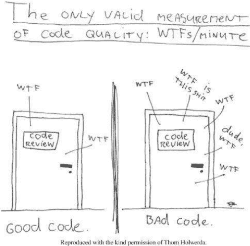

哪扇门代表着你的代码？哪扇门代表着你的团队或公司？我们为什么会在那个房间里？这只是一次普通的代码评审，还是我们在上线后不久就发现了一连串可怕的问题？我们是不是在惊慌失措地调试，仔细检查那些我们以为能正常工作的代码？客户是不是正成群结队地离开，经理们是不是在我们身后步步紧逼？当情况变得艰难时，我们如何确保自己最终站到*正确*的那扇门后面？答案是：*工匠精神*。

学习工匠精神包含两部分：知识和实践。你必须掌握工匠所知晓的原则、模式、实践和经验法则，并且还必须通过努力工作和练习，将这些知识磨进你的手指、眼睛和直觉中。

我可以教你骑自行车的物理学。事实上，经典数学相对简单。重力、摩擦力、角动量、质心等等，用不到一页的公式就能证明。有了这些公式，我可以向你证明骑自行车是可行的，并给你所有让骑车成为可能所需的知识。但当你第一次爬上那辆自行车时，你仍然会摔倒。

编码也不例外。我们可以写下所有“感觉良好”的整洁代码原则，然后让你自己去实践（换句话说，让你在上车时摔倒），但那样的话，我们算什么老师，你又算什么学生？

不，这不是本书的运作方式。

学习编写整洁代码是*艰苦的工作*。它需要的不仅仅是原则和模式的知识。你必须为之流汗。你必须亲自练习，看着自己失败。你必须观察他人练习并失败。你必须看到他们跌跌撞撞，重新回溯自己的步骤。你必须看到他们为决策而痛苦，并看到他们因错误决策而付出的代价。

准备好在这本书的阅读过程中努力付出吧。这不是一本你在飞机上读完、落地前就能看完的“感觉良好”的书。这本书会让你工作，*而且努力工作*。你将做什么样的工作？你将阅读代码——大量的代码。你将被要求思考这些代码哪些是对的，哪些是错的。在我们拆解模块再重新组装的过程中，你会被要求跟随我们的思路。这将花费时间和精力；但我们认为这是值得的。

我们将这本书分为三个部分。前几章描述了编写整洁代码的原则、模式和实践。这些章节中有相当多的代码，读起来会很有挑战性。它们将为你即将到来的第二部分做好准备。如果你读完第一部分就放下这本书，祝你好运！

书的第二部分是更艰难的工作。它包含几个复杂度不断增加的案例研究。每个案例研究都是一次清理代码的练习——将有问题的代码转换成问题更少的代码。这一部分的细节*非常密集*。你将不得不在叙述和代码清单之间来回翻阅。你必须分析和理解我们正在处理的代码，并仔细审视我们做出每项更改的推理过程。留出一些时间，因为*这可能需要你花上数天时间*。

这本书的第三部分是回报。它是一个单独的章节，包含我们在创建案例研究时收集到的启发式规则和坏味道清单。在逐步审查并清理案例研究中的代码时，我们将每一个行动的原因记录为一条启发式规则或坏味道。我们试图理解自己对所阅读和修改的代码的反应，并努力捕捉我们为什么会有那样的感受和那样的做法。其结果是一个知识库，描述了我们在编写、阅读和清理代码时的思维方式。

如果你没有用心仔细阅读本书第二部分的案例研究，这个知识库的价值就有限。在这些案例研究中，我们用对启发式规则的前向引用仔细标注了我们所做的每一处更改。这些前向引用以方括号形式出现，像这样：[H22]。这让你能够看到这些启发式规则被应用和编写的*上下文*！真正有价值的不是启发式规则本身，而是*这些启发式规则与我们在清理案例研究代码时所做的各个决策之间的关系*。

为了进一步帮助你理解这些关系，我们在书末放置了一个交叉引用，显示了每个前向引用的页码。你可以用它来查找某个特定启发式规则被应用的每个位置。

如果你只读了第一部分和第三部分，跳过案例研究，那么你读到的不过是又一本关于编写优秀软件的“感觉良好”的书。但如果你花时间仔细研读案例研究，追随每一个微小的步骤、每一个细微的决策——如果你设身处地，强迫自己沿着我们思考的路径去思考，那么你将对这些原则、模式、实践和启发式规则获得更深刻的理解。它们将不再是“感觉良好”的知识。它们已经被磨进你的直觉、手指和心灵。它们将成为你的一部分，就像当你学会骑自行车后，自行车成为你意志的延伸一样。

## 致谢

感谢我的两位艺术家，Jennifer Kohnke 和 Angela Brooks。Jennifer 负责每章开头那些惊艳而富有创意的图片，以及 Kent Beck、Ward Cunningham、Bjarne Stroustrup、Ron Jeffries、Grady Booch、Dave Thomas、Michael Feathers 和我自己的肖像。

Angela 负责装饰每章内容的巧妙图片。多年来她为我画了相当多的图片，包括*《敏捷软件开发：原则、模式与实践》*中的许多内部插图。她也是我的长女，我深以她为傲。

特别感谢我的审阅者 Bob Bogetti、George Bullock、Jeffrey Overbey，尤其是 Matt Heusser。他们毫不留情。他们严苛残酷。他们锲而不舍。他们强力推动我做出必要的改进。

感谢我的出版商 Chris Guzikowski 的支持、鼓励和愉快的面容。也感谢 Pearson 的编辑人员，包括 Raina Chrobak 让我保持诚实和守时。

感谢 Micah Martin 和 8th Light（[www.8thlight.com](http://www.8thlight.com)）的所有伙伴们的审阅和鼓励。

感谢所有 Object Mentor 的成员，过去的、现在的和未来的，包括：Bob Koss, Michael Feathers, Michael Hill, Erik Meade, Jeff Langr, Pascal Roy, David Farber, Brett Schuchert, Dean Wampler, Tim Ottinger, Dave Thomas, James Grenning, Brian Button, Ron Jeffries, Lowell Lindstrom, Angelique Martin, Cindy Sprague, Libby Ottinger, Joelen Craig, Janice Brown, Susan Rosso 等人。

感谢我的朋友兼商业伙伴 Jim Newkirk，他教给我的东西比我认为他意识到的还要多。感谢 Kent Beck、Martin Fowler、Ward Cunningham、Bjarne Stroustrup、Grady Booch 以及我所有的其他导师、同道和对手。感谢 John Vlissides 在关键时刻的出现。感谢 Zebra 的伙伴们容忍我大谈特谈一个函数应该有多长。

最后，感谢你阅读这些感谢。

## 关于封面

封面上的图像是 M104：草帽星系。M104 位于室女座，距离我们不到 3000 万光年。其核心是一个超大质量黑洞，质量约为十亿个太阳质量。

这幅图像是否让你想起克林贡动力卫星*普拉西斯*的爆炸？我清晰地记得*《星际迷航VI》*中的场景：一道赤道环状的碎片从爆炸中飞散。自那个场景以来，赤道环成为科幻电影爆炸中常见的元素。它甚至被加入到第一部*《星球大战》*电影后来的版本中奥德兰的爆炸里。

是什么导致了这个环在 M104 周围形成？为什么它有一个如此巨大的中央核球，以及一个如此明亮而微小的核？在我看来，仿佛中央黑洞失去了冷静，在星系中央炸开了一个 30000 光年的洞。任何可能挡在那场宇宙灾难路径上的文明都将遭殃。

超大质量黑洞把整颗恒星当作午餐吞下，将其相当大一部分质量转化为能量。*E = MC²* 已经是足够的杠杆，但当 *M* 是一颗恒星的质量时：小心！在怪物饱足之前，有多少恒星一头栽进那张巨口？中央空洞的大小是否是一个线索？

封面上的 M104 图像是著名的哈勃可见光照片（右侧）和斯皮策轨道天文台最近的红外图像（下方，右侧）的结合。正是红外图像向我们清晰地展示了该星系的环状本质。在可见光下，我们只能看到环的前缘剪影。中央核球遮挡了环的其余部分。

但在红外线下，环中的炽热粒子透过中央核球发出光芒。这两幅图像结合在一起，给了我们一个前所未见的视角，并暗示很久以前这里曾是一个剧烈活动的炽热地狱。


封面图片：© 斯皮策太空望远镜

## 代码永存

有人可能会说，一本关于代码的书在某种程度上已经过时了——代码不再是关键问题；我们应该关注的是模型和需求。的确，有些人认为我们已接近代码的终结。很快所有代码都将被生成而不是编写。程序员根本不再需要，因为业务人员会从规格说明中生成程序。

胡说！我们永远无法摆脱代码，因为代码代表着需求的细节。在某个层面上，这些细节无法被忽略或抽象；它们必须被明确指定。而把需求详细到机器可以执行的程度，*就是编程*。这样的规格说明*就是代码*。

我预计我们语言的抽象层次会不断提高。我也预计领域特定语言的数量会继续增长。这是好事。但这不会消除代码。事实上，用这些更高级、更领域特定的语言写出的所有规格说明都将是代码！它仍然需要严谨、准确，并且要正式、详细到机器能够理解和执行。

那些认为代码终将消失的人，就像那些希望有一天能发现一种不必形式化的数学的数学家。他们希望有一天我们能找到一种方法，创造出能按我们意愿而非按我们所说的去做事的机器。这些机器必须能极其深入地理解我们，从而能把模糊指定的需求翻译成完美执行的程序，并精确满足这些需求。

这永远不会发生。即使是充满直觉和创造力的人类，也未能从客户模糊的感觉中创建出成功的系统。事实上，如果需求规格说明这门学科教会了我们什么，那就是：定义良好的需求规格与代码一样正式，并且可以作为该代码的可执行测试！

记住，代码实际上是我们最终表达需求所用的语言。我们也许可以创建工具来帮助我们把这些需求解析、装配成形式化结构。但我们永远不会消除必要的精确性——所以代码将永远存在。

## 糟糕的代码

我最近在读肯特·贝克的《实现模式》[^1] 的序言。他说：“……这本书基于一个相当脆弱的前提：好的代码很重要……”*一个脆弱*的前提？我不同意！我认为这个前提是我们这一行中最坚实、最受支持、也最被反复强调的前提之一（而且我认为肯特也知道这一点）。我们知道好的代码很重要，因为我们长期以来不得不应对它缺失的后果。

我知道有一家公司，在 80 年代末编写了一个**杀手级**应用。它非常受欢迎，许多专业人士购买并使用它。但后来发布周期开始拉长。缺陷从一个版本拖到下一个版本都未修复。加载时间变长，崩溃次数增多。我记得有一天我无奈地关闭了该产品，从此再也没有用过它。那家公司不久之后就倒闭了。

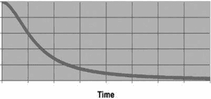

## 空中楼阁式的大重构

最终，团队反抗了。他们告知管理层，自己无法继续在这个令人厌恶的代码库上开发。他们要求重新设计。管理层不想在这个项目的全新重新设计上投入资源，但他们也无法否认生产力糟透了。最终管理层屈服于开发者的要求，批准了这个空中楼阁式的大重构。

一个新的尖刀团队被挑选出来。每个人都想加入这个团队，因为这是一个从零开始的新项目。他们可以推倒重来，创造一些真正优美的东西。但只有最优秀最聪明的人才能入选尖刀团队。其他人则必须继续维护现有系统。

于是两个团队展开竞赛。尖刀团队必须构建一个能完成旧系统所有功能的新系统。不仅如此，他们还必须跟上旧系统持续进行的变更。管理层不会用新系统替换旧系统，直到新系统能做到旧系统能做的一切。

这场竞赛可能持续很长时间。我见过持续 10 年的。等到完成时，尖刀团队最初的成员早已离开，而现任成员又在要求重新设计新系统，因为它已经乱成一团。

如果你哪怕只经历过我刚才讲的故事的一小部分，那么你已经知道，花时间保持代码整洁不仅成本效益高；更是职业存亡的问题。

## 态度

对行业产生了深远的影响，并已成为我们最基本的准则之一。戴夫说得对。没有测试的代码是不洁净的。无论它多么优雅，多么可读、易于理解，若无测试，便不洁净。

戴夫两次使用了*最小*这个词。显然，他看重的是小的代码，而不是大的代码。的确，自软件文献出现以来，这一点一直是反复出现的共识。越小越好。

戴夫还说代码应该是*可读的*。这隐约引用了克努特的*文学化编程*。<sup>4</sup> 其中的要点是，代码应当以人类可读的形式编写。

**迈克尔·费瑟斯，*《修改代码的艺术》*作者**


> *我可以列出我在整洁代码中注意到的所有特质，但有一个统摄性的特质引出了所有其他特质。整洁代码看起来总像是某个在乎它的人写的。没有什么显而易见的改进余地。所有这些都被代码作者考虑过了，而如果你试图想象任何改进，你都会绕回原处，坐下来欣赏某人留给你的代码——由一位对这门技艺深怀在意的人留下的代码。*

一个词：在乎。这其实就是本书的主题。也许一个合适的副标题是*如何关爱代码*。

迈克尔说到了点子上。整洁代码是被人用心照料过的代码。有人花时间让它保持简单有序，对细节给予了恰当的关注。他们用心了。

**罗恩·杰弗里斯，*《极限编程实施》*和*《C#极限编程冒险》*作者**

罗恩在战略空军司令部用 Fortran 开始了他的编程生涯，之后几乎在每种语言和每台机器上都写过代码。他的话值得仔细品味。


> *近年来，我从贝克的简单代码规则开始，也差不多以它结束。按优先级排列，简单代码：*
>
> - 能通过所有测试；
> - 没有重复；
> - 表达了系统中所有的设计思想；
> - 尽量减少类、方法、函数等实体的数量。
>
> 在这些规则中，我最关注的是重复。当同一件事反复发生时，就说明我们脑海中有一个想法没有在代码中得到很好的体现。我会试着找出那个想法是什么，然后试着更清晰地表达它。
>
> 对我来说，表达性包括有意义的命名，而且我很有可能在最终敲定之前多次更改事物的名称。有了诸如 Eclipse 这样的现代编码工具，重命名代价很低，所以我不怕修改。然而，表达性不止于命名。我也会检查一个对象或方法是否在做不止一件事。如果是对象，它很可能需要拆分成两个或更多对象。如果是方法，我总是会使用 Extract Method 重构它，从而得到一个更能说明其职责的方法，以及一些说明具体如何实现的子方法。
>
> 消除重复和注重表达性，让我在通往我所认为的整洁代码的道路上走了很远；仅仅关注这两点来改进脏代码就能产生巨大的不同。不过，还有一件我意识到自己会做的事情，稍微有点难以解释。
>
> 从事这项工作多年之后，在我看来，所有程序都是由非常相似的元素构成的。一个例子就是“在集合中查找东西”。无论我们面对的是员工记录数据库、键值哈希映射，还是某种条目数组，我们经常会想从那个集合中找到某个特定项。当我发现这种情况时，我常常会把具体的实现包装到一个更抽象的方法或类中。这给我带来一些有意思的好处。
>
> 我现在可以用简单的东西来实现这个功能，比如哈希映射，但既然所有对该查找的引用都被我的小抽象所覆盖，我就可以更改


美国童子军有一条简单的规则，我们可以将其应用到我们的职业中。

> *让你离开时的露营地比你发现时更干净。*⁵

如果我们每次签入代码时都比签出时干净一点，那么代码根本就不会腐烂。清理工作不必是什么大动作。把一个变量名改得好一点，把一个有点过大的函数拆开，消除一小段重复，清理一个复合的 `if` 语句。

你能想象在一个代码*只会变得更好*的项目上工作吗？你相信还有其他选择是专业的吗？事实上，持续改进难道不是专业精神的内在组成部分吗？

## 前传与原则

在很多方面，本书是我在2002年所著的*《敏捷软件开发：原则、模式与实践》*（PPP）的“前传”。PPP 这本书关注的是面向对象设计的原则，以及专业开发人员使用的许多实践。如果你没有读过 PPP，那么你可能会发现它延续了本书讲述的故事。如果你已经读过它，那么你会发现那本书中的许多观点在本书中于代码层面得到了呼应。

在本书中，你会看到对各种设计原则的零星引用。其中包括单一职责原则（SRP）、开闭原则（OCP）以及依赖倒置原则（DIP）等。这些原则在 PPP 中有深入的描述。

## 结语

关于艺术的书不会承诺让你成为艺术家。它们所能做的只是给你一些其他艺术家使用过的工具、技巧和思维过程。同样，本书也不能承诺让你成为一名优秀的程序员。它不能承诺给你“代码直觉”。它所能做的只是向你展示优秀程序员的思维过程，以及他们使用的窍门、技巧和工具。

就像一本关于艺术的书一样，本书将充满细节。会有大量代码。你会看到好代码，也会看到坏代码。你会看到坏代码被改造成好代码。你会看到启发式规则、纪律和技巧的列表。你会看到一个又一个示例。之后，就看你自己的了。

还记得那个关于音乐会小提琴手在演出途中迷路的笑话吗？他在街角拦住一位老人，问他怎么去卡内基音乐厅。老人看着小提琴手，又看了看他腋下夹着的小提琴，说：“练习，孩子。练习！”

## 参考文献

- [Beck07]：*实现模式*，Kent Beck，Addison-Wesley，2007。
- [Knuth92]：*文学编程*，Donald E. Knuth，语言与信息研究中心，利兰·斯坦福初级大学，1992。

读者可能会认为这是杜撰，但我们确实检查过大量存在此类情况的代码。有一个案例中，代码作者建议使用不同的字体，以使差异更加明显，这是一种必须作为口头传统或书面文档传给所有未来开发者的解决方案。而通过简单的重命名，这个问题就能一劳永逸地解决，且不会产生新的工作产物。

### 做有意义的区分


程序员在编写代码仅仅是为了满足编译器或解释器时，会给自己制造问题。例如，因为你不能在同一个作用域中使用相同的名字来指代两个不同的事物，你可能会想任意更改其中一个名字。有时这是通过拼错其中一个来实现的，导致一个令人惊讶的情况：纠正拼写错误反而导致无法编译。²

仅仅添加数字序列或噪音词是不够的，即使编译器对此满意。如果名字必须不同，那么它们也应该具有不同的含义。

数字序列命名（a1, a2, .. aN）是有意图命名的反面。这样的名字不是误导性的——它们根本没有信息量；它们不能提供任何关于作者意图的线索。考虑一下：

```java
public static void copyChars(char a1[], char a2[]) {
    for (int i = 0; i < a1.length; i++) {
        a2[i] = a1[i];
    }
}
```

当参数名使用 source 和 destination 时，这个函数的可读性会好得多。

噪音词是另一种无意义的区分。假设你有一个 Product 类。如果你还有另一个名为 ProductInfo 或 ProductData 的类，你会发不好这个名字的音，讨论起来也会显得像个白痴。“嗯，在这边的 BCR3CNT 上，我们有一个 PSZQINT，明白吗？” 这很重要，因为编程是一种社交活动。

我认识的一家公司有一个变量 *genymdhms*（生成日期、年、月、日、时、分、秒），所以他们总是说“gen why emm dee aich emm ess”。我有一个惹人讨厌的习惯，就是看到什么就读什么，所以我开始说“gen-yah-muddahims”。后来，许多设计师和分析师也开始这么叫，我们听起来仍然很傻。但我们是这个笑话的知情人，所以很有趣。不管有趣与否，我们都在容忍糟糕的命名。新开发人员不得不让别人解释这些变量，然后他们用愚蠢的编造词来谈论，而不是使用正确的英文术语。比较

```java
class DtaRcrd102 {
    private Date genymdhms;
    private Date modymdhms;
    private final String pszqint = "102";
    /* ... */
};
```

和

```java
class Customer {
    private Date generationTimestamp;
    private Date modificationTimestamp;
    private final String recordId = "102";
    /* ... */
};
```

现在，明智的对话成为可能：“嘿，Mikey，看看这条记录！生成时间戳被设置成了明天的日期！怎么可能？”

### 使用可搜索的名称

单字母名称和数字常量有一个特殊问题：它们不易在整篇文本中定位。

人们可以很容易地用 grep 搜索 `MAX_CLASSES_PER_STUDENT`，但数字 7 可能更麻烦。搜索可能会将该数字作为某个文件的一部分找到。

我们要处理的编码已经够多了，不必再增加负担。将类型或作用域信息编码到名称中，只会增加额外的解码负担。要求每位新员工在学习他们将要处理的（通常相当可观的）代码库之外，再学习另一种编码“语言”，这似乎不太合理。在尝试解决问题时，这是一种不必要的心智负担。编码后的名称很少能读得出来，而且容易打错。

### 匈牙利命名法

在旧时代，当我们使用名称长度受限的语言时，我们出于必要而违反这条规则，并且心怀遗憾。Fortran 通过让第一个字母作为类型的代码来强制编码。早期版本的 BASIC 只允许一个字母加一个数字。匈牙利命名法（HN）将这种情况提升到了一个全新的水平。

在 Windows C API 时代，HN 被认为相当重要，那时一切都是整数句柄、长指针或 `void` 指针，或是“字符串”的几种实现之一（具有不同的用途和属性）。当时的编译器不检查类型，所以程序员需要一根拐杖来帮助记忆类型。

在现代语言中，我们拥有更丰富的类型系统，编译器会记住并强制执行类型。此外，现在的趋势是更小的类和更短的函数，这样人们通常可以看到他们正在使用的每个变量的声明点。

Java 程序员不需要类型编码。对象是强类型的，而且编辑环境已经非常先进，在你运行编译之前就能检测到类型错误！因此，如今 HN 和其他形式的类型编码只会成为障碍。它们使更改变量、函数或类的名称或类型变得更加困难。它们使代码更难阅读。而且它们还可能导致编码系统误导读者。

```
PhoneNumber phoneString;
// name not changed when type changed!
```

### 成员前缀


你也不再需要用 `m_` 前缀来标识成员变量。你的类和函数应该足够小，以至于不需要它们。并且你应该使用一个能够高亮或着色成员变量的编辑环境，以便区分它们。

```java
public class Part {
    private String m_dsc; // The textual description
    void setName(String name) {
        m_dsc = name;
    }
}
```

```java
public class Part {
    String description;
    void setDescription(String description) {
        this.description = description;
    }
}
```

此外，人们很快就会学会忽略前缀（或后缀），只看名字中有意义的部分。我们读代码越多，就越少看到这些前缀。最终，前缀变成了看不见的杂物和旧代码的标记。

### 接口与实现

### 避免心智映射

读者不应该在脑海中把你的名字转换成他们已经知道的其他名字。这个问题通常源于既没有使用问题领域术语，也没有使用解决方案领域术语的选择。

单字母变量名就是这样一个问题。当然，如果循环计数器的范围非常小，且没有其他名字与之冲突，它可以用 `i`、`j` 或 `k` 命名（但绝不能用 `l`！）。这是因为这些单字母的循环计数器名称是传统习惯。然而，在大多数其他情况下，单字母名称是一个糟糕的选择；它只是一个占位符，读者必须通过心智映射将其映射到实际概念。没有比“因为 `a` 和 `b` 已经被用了”更糟糕的理由来使用 `c` 这个名字了。

总的来说，程序员是非常聪明的人。聪明人有时喜欢通过展示他们的心智杂耍能力来炫耀自己的聪明。毕竟，如果你能可靠地记住 `r` 是去掉了主机和协议的 URL 小写版本，那么你显然一定非常聪明。

聪明程序员和专业程序员之间的一个区别是，专业程序员明白*清晰至上*。专业人士将他们的才智用在正道上，编写他人能够理解的代码。

### 类名

类和对象应该使用名词或名词短语名称，如 `Customer`、`WikiPage`、`Account` 和 `AddressParser`。避免在类名中使用 `Manager`、`Processor`、`Data` 或 `Info` 之类的词。类名不应是动词。

### 方法名

方法应该使用动词或动词短语名称，如 `postPayment`、`deletePage` 或 `save`。访问器、修改器和谓词方法应该根据其值命名，并按照 JavaBean 标准加上 `get`、`set` 和 `is` 前缀。^4

```java
String name = employee.getName();
customer.setName("mike");
```

```java
if (paycheck.isPosted())...
```

当构造函数被重载时，使用名称能描述参数的静态工厂方法。例如，

```java
Complex fulcrumPoint = Complex.FromRealNumber(23.0);
```

通常比

```java
Complex fulcrumPoint = new Complex(23.0);
```

更好。

考虑通过将相应的构造函数设为 `private` 来强制使用它们。

### 不要卖弄聪明

如果名字太过于巧妙，那么只有与作者有同样幽默感的人才能记住它们，而且只有在这些人记得这个玩笑的时候。他们会知道名为 `HolyHandGrenade` 的函数是做什么的吗？当然，这很俏皮，但也许在这种情况下 `DeleteItems` 会是更好的名字。选择清晰而非娱乐价值。


代码中的俏皮话常常以口语或俚语的形式出现。例如，不要用 `whack()` 来表示 `kill()` 的意思。不要讲那些依赖文化的笑话，比如用 `eatMyShorts()` 来表示 `abort()`。

言必由衷，言必有物。

### 每个概念选择一个词

为每个抽象概念挑选一个词，并坚持使用它。例如，在不同的类中，将 `fetch`、`retrieve` 和 `get` 作为等价的方法会让人困惑。你如何记住哪个方法名对应哪个类？遗憾的是，你常常必须记住是哪个公司、团队或个人编写了该库或类，才能记得使用了哪个术语。否则，你会花大量时间浏览头文件和之前的代码示例。

像 Eclipse 和 IntelliJ 这样的现代编辑环境提供了上下文相关的线索，例如你可以在给定对象上调用的方法列表。但要注意，这个列表通常不会显示你在函数名和参数列表周围写的注释。如果它能给出函数声明中的*参数名*，你就很幸运了。函数名必须能够独立表达意义，并且必须保持一致，以便你无需额外探索就能选对方法。

同样，在同一个代码库中同时存在 `controller`、`manager` 和 `driver` 也会令人困惑。`DeviceManager` 和 `ProtocolController` 之间的本质区别是什么？为什么不是都为 controller 或都为 manager？它们真的都是 driver 吗？这些名字会让你期望两个对象具有非常不同的类型和不同的类。

一致的词汇表对于必须使用你的代码的程序员来说是一个巨大的福音。

### 不要双关

避免使用同一个词来表示两种目的。用同一个术语来表示两个不同的概念本质上是一种双关。

如果你遵循“一个概念一个词”的规则，你可能会得到许多类，例如，都有一个 `add` 方法。只要各种 `add` 方法的参数列表和返回值在语义上是等价的，那就没问题。

然而，当一个人实际上并不是在相同的意义上进行“添加”时，他或她可能会决定使用 `add` 这个单词来保持“一致性”。假设我们有很多类，其中 `add` 通过将两个现有值相加或连接来创建一个新值。现在假设我们正在编写一个新类，该类有一个方法将其单个参数放入一个集合中。我们是否应该将此方法称为 `add`？这看起来可能是一致的，因为我们有很多其他的 `add` 方法，但在这种情况下，语义是不同的，所以我们应该使用诸如 `insert` 或 `append` 之类的名称。将新方法称为 `add` 就是一种双关。

### 添加有意义的语境

想象一下，你有变量名 `firstName`、`lastName`、`street`、`houseNumber`、`city`、`state` 和 `zipcode`。综合来看，很明显它们构成一个地址。但如果你只看到 `state` 变量在某个方法中单独使用，你会自动推断它是地址的一部分吗？

你可以通过使用前缀来添加上下文：`addrFirstName`、`addrLastName`、`addrState` 等等。至少读者会理解这些变量是更大结构的一部分。当然，更好的解决方案是创建一个名为 Address 的类。然后，即使是编译器也知道这些变量属于一个更大的概念。

考虑 [清单 2-1](#listing-2-1) 中的方法。这些变量需要更有意义的上下文吗？函数名只提供了部分上下文；算法提供了其余的部分。当你通读这个函数，你会看到 `number`、`verb` 和 `pluralModifier` 这三个变量是“猜测统计”消息的一部分。不幸的是，上下文必须被推断出来。当你第一次看到这个方法时，这些变量的含义是晦涩难懂的。

### 清单 2-1 上下文不明确的变量。

```java
private void printGuessStatistics(char candidate, int count) {
    String number;
    String verb;
    String pluralModifier;
    if (count == 0) {
        number = "no";
        verb = "are";
        pluralModifier = "s";
    } else if (count == 1) {
        number = "1";
        verb = "is";
        pluralModifier = "";
    } else {
        number = Integer.toString(count);
        verb = "are";
        pluralModifier = "s";
    }
}
```

```java
String guessMessage = String.format(
    "There %s %s %s%s", verb, number, candidate, pluralModifier
);
print(guessMessage);
}
```

这个函数有点太长，而且这些变量贯穿始终。为了将函数拆分成更小的片段，我们需要创建一个 `GuessStatisticsMessage` 类，并将这三个变量设为该类的字段。这就为这三个变量提供了清晰的上下文。它们*确实*是 `GuessStatisticsMessage` 的一部分。上下文的改善还使得算法可以通过拆分成许多更小的函数而变得更加整洁。（参见[清单 2-2](#)。）

### 清单 2-2 变量具有上下文。

```java
public class GuessStatisticsMessage {
    private String number;
    private String verb;
    private String pluralModifier;

    public String make(char candidate, int count) {
        createPluralDependentMessageParts(count);
        return String.format(
            "There %s %s %s%s",
            verb, number, candidate, pluralModifier );
    }

    private void createPluralDependentMessageParts(int count) {
        if (count == 0) {
            thereAreNoLetters();
        } else if (count == 1) {
            thereIsOneLetter();
        } else {
            thereAreManyLetters(count);
        }
    }

    private void thereAreManyLetters(int count) {
        number = Integer.toString(count);
        verb = "are";
        pluralModifier = "s";
    }

    private void thereIsOneLetter() {
        number = "1";
        verb = "is";
        pluralModifier = "";
    }

    private void thereAreNoLetters() {
        number = "no";
        verb = "are";
        pluralModifier = "s";
    }
}
```

### 不要添加不必要的上下文

在一个名为“Gas Station Deluxe”的虚构应用程序中，给每个类加上 GSD 前缀是个坏主意。坦率地说，你是在与你的工具作对。你输入 G 并按补全键，得到的却是系统中每个类的一长串列表。这明智吗？为什么要让 IDE 难以帮助你？

同样，假设你在 GSD 的会计模块中发明了一个 MailingAddress 类，并将其命名为 GSDAccountAddress。后来，你的客户联系应用程序需要一个邮寄地址。你会使用 GSDAccountAddress 吗？它听起来像正确的名称吗？17 个字符中有 10 个是多余或无关的。

只要清晰，较短的名字通常比较长的名字更好。不要给名字添加超出必要的上下文。

`accountAddress` 和 `customerAddress` 作为 `Address` 类的实例名是很好的名字，但作为类名可能就不太好了。`Address` 是一个不错的类名。如果我们需要区分 MAC 地址、端口地址和 Web 地址，我可能会考虑 `PostalAddress`、`MAC`、

## 第五章 模拟信号的频域分析

在连续时间信号与系统的分析中，傅里叶变换是一种非常重要的数学工具，它将信号的时域特性与频域特性联系起来，使人们对信号和系统的研究可以在频域中进行。本章首先介绍周期信号的傅里叶级数和非周期信号的傅里叶变换，然后讨论傅里叶变换的性质，最后介绍系统的频域分析方法。

### 5.1 周期信号的傅里叶级数

将周期信号表示为各个频率分量的线性组合，即傅里叶级数，是分析周期信号频域特性的基本方法。

设 f(t) 是一个周期为 T 的周期信号，即 f(t) = f(t + mT) (m 为任意整数)，且满足狄里赫利条件，则 f(t) 可以展开为如下形式的傅里叶级数：

f(t) = a₀/2 + Σₙ₌₁^∞ [aₙ cos(nω₀t) + bₙ sin(nω₀t)]

其中，ω₀ = 2π/T 称为基波角频率；a₀、aₙ、bₙ 为傅里叶系数，分别由以下公式给出：

a₀ = (2/T) ∫₀ᵀ f(t) dt,  aₙ = (2/T) ∫₀ᵀ f(t) cos(nω₀t) dt,  bₙ = (2/T) ∫₀ᵀ f(t) sin(nω₀t) dt

式中，n = 1, 2, 3, …。上述傅里叶级数还可表示为余弦形式：

f(t) = c₀/2 + Σₙ₌₁^∞ cₙ cos(nω₀t + φₙ)

## 第3章 函数


在编程的早期，我们用例程和子例程来构建系统。然后，在 Fortran 和 PL/1 时代，我们用程序、子程序和函数来构建系统。如今，从那个时代保留下来的只有函数。函数是任何程序中的第一级组织单元。本章的主题就是如何写好函数。

请看[清单 3-1](#)中的代码。在 FitNesse¹ 中很难找到一个长函数，但经过一番搜索我找到了这个。它不仅很长，而且含有重复的代码、大量奇怪的字符串，以及许多陌生且不直观的数据类型和 API。看看你在接下来的三分钟内能从其中理出多少头绪。

### 清单 3-1 `HtmlUtil.java`（FitNesse 20070619）

```java
public static String testableHtml(
    PageData pageData,
    boolean includeSuiteSetup
) throws Exception {
    WikiPage wikiPage = pageData.getWikiPage();
    StringBuffer buffer = new StringBuffer();
    if (pageData.hasAttribute("Test")) {
        if (includeSuiteSetup) {
            WikiPage suiteSetup =
                PageCrawlerImpl.getInheritedPage(
                    SuiteResponder.SUITE_SETUP_NAME, wikiPage
                );
            if (suiteSetup != null) {
                WikiPagePath pagePath =
                    suiteSetup.getPageCrawler().getFullPath(suiteSetup);
                String pagePathName = PathParser.render(pagePath);
                buffer.append("!include -setup .")
                    .append(pagePathName)
                    .append("\n");
            }
        }
    }
    WikiPage setup =
        PageCrawlerImpl.getInheritedPage("SetUp", wikiPage);
    if (setup != null) {
        WikiPagePath setupPath =
            wikiPage.getPageCrawler().getFullPath(setup);
        String setupPathName = PathParser.render(setupPath);
        buffer.append("!include -setup .")
            .append(setupPathName)
            .append("\n");
    }
    buffer.append(pageData.getContent());
    if (pageData.hasAttribute("Test")) {
        WikiPage teardown =
            PageCrawlerImpl.getInheritedPage("TearDown", wikiPage);
        if (teardown != null) {
            WikiPagePath tearDownPath =
                wikiPage.getPageCrawler().getFullPath(teardown);
            String tearDownPathName = PathParser.render(tearDownPath);
            buffer.append("\n")
```

这还增加了文档价值，因为在块内调用的函数可以有一个很好的描述性名称。

这也意味着函数不应该大到能够容纳嵌套结构。因此，函数的缩进级别不应超过一级或两级。当然，这会使函数更容易阅读和理解。

### 只做一件事

显然，[清单 3-1](#) 所做的远远不止一件事。它创建缓冲区、获取页面、搜索继承的页面、渲染路径、拼接晦涩的字符串以及生成 HTML 等等。[清单 3-1](#) 忙于做许多不同的事情。另一方面，[清单 3-3](#) 只做一件简单的事情。它把 setups 和 teardowns 包含到测试页面中。

下面的建议以这样或那样的形式已经出现 30 年甚至更久。


***函数应该只做一件事。应该把它做好。应该只做这一件事。***

这句话的问题在于，很难知道什么是“一件事”。[清单 3-3](#) 只做一件事吗？很容易论证它做了三件事：

- 判断页面是否为测试页面。
- 如果是，则包含 setups 和 teardowns。
- 以 HTML 形式渲染页面。

那么到底是哪一种？这个函数是在做一件事还是三件事？请注意，函数的这三个步骤比函数名称所陈述的抽象级别低一级。我们可以用一个简短的 TO⁴ 段落来描述这个函数：

> *为了渲染带 setups 和 teardowns 的页面，我们检查页面是否为测试页面，如果是，我们包含*

与基本概念混杂在一起，越来越多的细节往往会在函数内部累积。

### 从上到下阅读代码：阶梯规则

我们希望代码读起来像一篇自上而下的叙述。^5 我们希望每个函数后面跟着处于下一抽象级别的函数，这样我们在从上到下阅读函数列表时，就能逐级下降一个抽象级别。我把这称为*阶梯规则*。

换句话说，我们希望程序读起来就像一组 *TO* 段落，每个段落描述当前抽象级别，并引用下一级别的后续 *TO* 段落。

> *要包含 setups 和 teardowns，我们先包含 setups，然后包含测试页面内容，最后包含 teardowns。*

> *要包含 setups，如果是套件，我们先包含套件 setup，然后包含常规 setup。*

> *要包含套件 setup，我们在父层级中搜索 “SuiteSetUp” 页面，并添加一条包含该页面路径的 include 语句。*

> *要搜索父级…*

事实证明，程序员很难学会遵循这一规则并编写保持在单一抽象级别的函数。但学习这一技巧也非常重要。它是保持函数简短并确保它们“只做一件事”的关键。让代码读起来像一组自上而下的 *TO* 段落，是保持抽象级别一致的有效技巧。

看看本章末尾的[清单 3-7](#)。它展示了根据这里描述的原则重构的完整 `testableHtml` 函数。注意每个函数是如何引出下一个函数的，并且每个函数都保持一致的抽象级别。

### Switch 语句


保持命名的一致性。在你为模块选择的函数名中，使用相同的短语、名词和动词。例如，考虑这些名字：`includeSetupAndTeardownPages`、`includeSetupPages`、`includeSuiteSetupPage` 和 `includeSetupPage`。这些名字中相似的措辞使得这个序列能够讲述一个故事。事实上，如果我仅仅向你展示上面的序列，你会问自己：“`includeTeardownPages`、`includeSuiteTeardownPage` 和 `includeTeardownPage` 去哪里了？”这难道不就是“...与你所期望的差不多”吗？

## 函数参数

函数参数数量的理想值是零（niladic）。接下来是一个（monadic），紧随其后的是两个（dyadic）。三个参数（triadic）应尽可能避免。超过三个（polyadic）则需要非常特殊的理由——而且即便如此也不应该使用。


参数很难处理。它们需要耗费大量的概念能力。这就是为什么我在示例中去掉了几乎所有的参数。例如，考虑示例中的`StringBuffer`。我们本可以把它作为参数传递，而不是让它成为一个实例变量，但那样我们的读者每次看到它时都必须对它进行解释。当你阅读模块讲述的故事时，`includeSetupPage()`比`includeSetupPageInto(newPageContent)`更容易理解。参数所处的抽象层级与函数名不同，它会迫使你去了解一个在当时并不特别重要的细节（换句话说，就是`StringBuffer`）。

从测试的角度来看，参数甚至更难。想象一下，要编写所有测试用例来确保各种参数组合都能正常工作，是多么困难。如果没有参数，这很简单。如果只有一个参数，也不算太难。两个参数时，问题就变得更具挑战性。超过两个参数时，测试每个合适值的组合可能会令人生畏。

输出参数比输入参数更难理解。当我们阅读函数时，我们习惯于信息通过参数*进入*函数、通过返回值*输出*的概念。我们通常不期望信息通过参数输出。因此，输出参数常常让我们多看两眼。

一个输入参数是仅次于无参数的最佳选择。`SetupTeardownIncluder.render(pageData)`很容易理解。显然，我们将*渲染*`pageData`对象中的数据。

## 常见的一元函数形式

向函数传递单个参数有两个非常常见的原因。你可能是在询问关于该参数的问题，比如`boolean fileExists("MyFile")`。或者你可能是在操作该参数，将其转换为其他东西并*返回它*。例如，`InputStream fileOpen("MyFile")`将文件名`String`转换为`InputStream`返回值。这两种用途是读者看到函数时所期望的。你应该选择能够清晰区分这两种用法的名称，并始终在一致的上下文中使用这两种形式。（参见下面的[命令查询分离](#)。）

对于单参数函数，一种不太常见但仍然非常有用的形式是*事件*。在这种形式中，有输入参数但没有输出参数。整个程序的意图是将函数调用解释为一个事件，并使用参数来改变系统的状态，例如`void passwordAttemptFailedNTimes(int attempts)`。请谨慎使用这种形式。读者应该非常清楚这是一个事件。仔细选择名称和上下文。

尽量避免任何不符合这些形式的一元函数，例如`void includeSetupPageInto(StringBuffer pageText)`。在转换中使用输出参数而不是返回值会令人困惑。如果一个函数要转换其输入参数，那么转换应该以返回值的形式呈现。事实上，`StringBuffer transform(StringBuffer in)`比`void transform(StringBuffer out)`更好，即使第一种情况下的实现只是简单地返回输入参数。至少它仍然遵循转换的形式。

## 标志参数

标志参数很丑陋。向函数传递布尔值是一种非常糟糕的做法。它立刻使方法的签名复杂化，并响亮地宣告这个函数做了不止一件事。如果标志为真，它做一件事；如果标志为假，它做另一件事！

在[清单3-7](#)中，我们别无选择，因为调用者已经在传递那个标志了，而且我想把重构的范围限制在该函数及其以下。尽管如此，方法调用`render(true)`对可怜的读者来说简直令人困惑。鼠标悬停在调用上看到`render(boolean issue)`有一点帮助，但帮助不大。我们应该把这个函数拆分成两个：`renderForSuite()`和`renderForSingleTest()`。

## 二元函数

带两个参数的函数比一元函数更难理解。例如，`writeField(name)`比`writeField(outputStream, name)`更容易理解。[10] 尽管两者的含义都很清楚，但第一个从眼前掠过，轻松地传达其含义。第二个则需要短暂停顿，直到我们学会忽略第一个参数。而*那*，正是输出参数的问题。换句话说，对于`appendFooter`，最好这样调用：

```
report.appendFooter();
```

一般来说，应该避免输出参数。如果你的函数必须改变某个对象的状态，那就让它改变其所属对象的状态。

## 命令查询分离

函数要么做一些事情，要么回答一些问题，但不能两者兼顾。你的函数要么改变对象的状态，要么返回关于该对象的一些信息。同时做这两件事往往会导致混乱。例如，考虑下面的函数：

```
public boolean set(String attribute, String value);
```

这个函数设置一个命名属性的值，如果成功则返回`true`，如果不存在该属性则返回`false`。这会导致这样奇怪的语句：

```
if (set("username", "unclebob"))…
```

从读者的角度想象一下。这是什么意思？它是在询问“username”属性之前是否被设置为“unclebob”吗？还是在询问“username”属性是否被成功设置为“unclebob”？很难从调用中推断出含义，因为不清楚“set”这个词是动词还是形容词。

作者本意是让`set`作为动词，但在`if`语句的上下文中，它更像是形容词。因此该语句读起来像是“如果username属性之前被设置为unclebob”，而不是“将username属性设置为unclebob，如果设置成功则……”。我们可以尝试将 set 函数重命名为 setAndCheckIfExists 来解决这个问题，但这对`if`语句的可读性没有太大帮助。真正的解决方案是将命令与查询分离，这样歧义就不会发生。

```
if (attributeExists("username")) {
    setAttribute("username", "unclebob");
    …
}
```

## 提取 Try/Catch 代码块

`Try/catch`代码块本身就很难看。它们扰乱了代码的结构，把错误处理与正常处理混在一起。因此，最好将`try`和`catch`块的主体提取到各自的函数中。

```
public void delete(Page page) {
    try {
        deletePageAndAllReferences(page);
    }
    catch (Exception e) {
        logError(e);
    }
}
```

```
private void deletePageAndAllReferences(Page page) throws Exception {
    deletePage(page);
    registry.deleteReference(page.name);
    configKeys.deleteKey(page.name.makeKey());
}
```

```
private void logError(Exception e) {
    logger.log(e.getMessage());
}
```

在上面的代码中，`delete`函数完全专注于错误处理。它很容易理解，然后就可以忽略。`deletePageAndAllReferences`函数则完全专注于完全删除页面的过程。错误处理可以被忽略。这提供了一种良好的分离，使代码更易于理解和修改。

## 错误处理也是一件事

函数应该只做一件事。错误处理也是一件事。因此，处理错误的函数不应该做其他任何事情。这意味着（如上面的示例所示）如果函数中存在关键字`try`，那么它应该是函数中的第一个词，并且在`catch/finally`块之后不应该有任何内容。


## Error.java 依赖磁铁

返回错误码通常意味着存在某个类或枚举，其中定义了所有错误码。

```java
public enum Error {
    OK,
    INVALID,
    NO_SUCH,
    LOCKED,
    OUT_OF_RESOURCES,

    WAITING_FOR_EVENT;
}
```

这样的类就是一个*依赖磁铁*；许多其他类必须导入并使用它们。因此，当`Error`枚举发生变化时，所有那些其他类都需要重新编译和重新部署。[11] 这给`Error`类带来了负面压力。程序员不愿意添加新的错误，因为那样他们就必须重新构建和重新部署所有东西。所以他们宁愿复用旧的错误码，也不愿添加新的。

当你使用异常而不是错误码时，新的异常就是异常类的*派生类*。你可以在不强制重新编译或重新部署的情况下添加它们。[12]

## 不要重复自己[13]

仔细回看[清单3-1](#listing-3-1)，你会注意到有一个算法被重复了四次，分别对应`Setup`、`SuiteSetUp`、`TearDown`和`SuiteTearDown`这四种情形。这种重复并不容易被发现，因为四个实例与其他代码交织在一起，并非完全一致的重复。然而，这种重复仍然是个问题，因为它使代码变得臃肿，而且一旦该算法需要修改，就需要进行四重修改。同时，它也带来了四倍的遗漏风险。

## 你怎么写出这样的函数？

编写软件就像其他任何写作一样。当你写一篇论文或文章时，你先把想法写下来，然后反复推敲，直到读起来流畅。初稿可能笨拙而杂乱，所以你会字斟句酌、重构并打磨，直到它读起来符合你的期望。

当我编写函数时，它们一开始总是又长又复杂。它们有大量的缩进和嵌套循环，有很长的参数列表。名字随意，还有重复的代码。但与此同时，我有一套单元测试覆盖了这些笨拙代码的每一行。

然后我会打磨和优化这些代码，拆分函数、更改名字、消除重复。我会缩短方法并重新排列它们。有时我会拆分出整个类，同时始终保持测试通过。

最终，我得到的函数遵循了我在本章中制定的规则。我并不是一开始就按这种方式写。我想没有人能做到这一点。

## 结论

每个系统都由程序员设计的一种领域特定语言构建而来，这种语言用来描述该系统。函数是该语言中的动词，类则是名词。这并不是退回到那种可怕的老观念：需求文档中的名词和动词就是对系统类与函数的初步猜测。相反，这是一个更为古老的真理。编程的艺术，过去是，现在也一直是语言设计的艺术。

编程大师把系统看作是要讲述的故事，而不是要编写的程序。他们利用所选编程语言的功能，构建一种更丰富、更具表现力的语言，并用它来讲述那个故事。这个领域特定语言的一部分，就是描述系统内所有行动的函数层级结构。在一个巧妙的递归行为中，这些行动被写成使用

```java
pageCrawler = testPage.getPageCrawler();
newPageContent = new StringBuffer();
}

private String render(boolean isSuite) throws Exception {
    this.isSuite = isSuite;
    if (isTestPage())
        includeSetupAndTeardownPages();
    return pageData.getHtml();
}

private boolean isTestPage() throws Exception {
    return pageData.hasAttribute("Test");
}

private void includeSetupAndTeardownPages() throws Exception {
    includeSetupPages();
    includePageContent();
    includeTeardownPages();
    updatePageContent();
}

private void includeSetupPages() throws Exception {
    if (isSuite)
        includeSuiteSetupPage();
    includeSetUpPage();
}

private void includeSuiteSetupPage() throws Exception {
    include(SuiteResponder.SUITE_SETUP_NAME, "-setup");
}

private void includeSetUpPage() throws Exception {
    include("SetUp", "-setup");
}

private void includePageContent() throws Exception {
    newPageContent.append(pageData.getContent());
}

private void includeTeardownPages() throws Exception {
    includeTeardownPage();
    if (isSuite)
        includeSuiteTeardownPage();
}

private void includeTeardownPage() throws Exception {
    include("TearDown", "-teardown");
}

private void includeSuiteTeardownPage() throws Exception {
    include(SuiteResponder.SUITE_TEARDOWN_NAME, "-teardown");
}

private void updatePageContent() throws Exception {
    pageData.setContent(newPageContent.toString());
}

private void include(String pageName, String arg) throws Exception {
    WikiPage inheritedPage = findInheritedPage(pageName);
    if (inheritedPage != null) {
        String pagePathName = getPathNameForPage(inheritedPage);
        buildIncludeDirective(pagePathName, arg);
    }
}

private WikiPage findInheritedPage(String pageName) throws Exception {
    return PageCrawlerImpl.getInheritedPage(pageName, testPage);
}

private String getPathNameForPage(WikiPage page) throws Exception {
    WikiPagePath pagePath = pageCrawler.getFullPath(page);
    return PathParser.render(pagePath);
}

private void buildIncludeDirective(String pagePathName, String arg) {
    newPageContent
        .append("\n!include ")
        .append(arg)
        .append(" ")
        .append(pagePathName)
        .append("\n");
}
}
```

## 参考书目

- **[KP78]:** Kernighan 和 Plauger，*编程风格的元素*，第2版，McGraw-Hill，1978年。
- **[PPP02]:** Robert C. Martin，*敏捷软件开发：原则、模式与实践*，Prentice Hall，2002年。
- **[GOF]:** *设计模式：可复用面向对象软件的元素*，Gamma 等人，Addison-Wesley，1996年。
- **[PRAG]:** *程序员修炼之道*，Andrew Hunt、Dave Thomas，Addison-Wesley，2000年。
- **[SP72]:** *结构化编程*，O.-J. Dahl、E. W. Dijkstra、C. A. R. Hoare，Academic Press，伦敦，1972年。

## 第4章 注释


> “不要给糟糕的代码写注释——重写它。”
>
> ——Brian W. Kernighan 和 P. J. Plauger¹

没有什么比位置恰当的注释更有帮助的了。没有什么比轻浮而教条式的注释更让模块杂乱无章的了。没有什么比陈旧肮脏、传播谎言和错误信息的注释更具破坏性的了。

注释不像《辛德勒的名单》。它们并非“纯粹的善”。事实上，注释充其量是一种必要的恶。如果我们的编程语言足够富表现力，或者如果我们有足够的才能巧妙运用这些语言来表达我们的意图，那么我们就不会那么需要注释——也许完全不需要。

注释的恰当用途是弥补我们未能用代码表达自己的失败。请注意，我用了*失败*这个词。我是认真的。注释永远是失败的表现。我们必须拥有它们，因为我们并非总能想出不用注释来表达自己的方法，但使用注释并不是值得庆祝的理由。

因此，当你发现自己需要写注释时，仔细想一想，看看是否有什么办法扭转局面，用代码来表达自己。每当你用代码表达自己

因此，尽管注释有时是必要的，我们仍会投入大量精力去尽量减少它们。

### 注释不能弥补糟糕的代码

写注释最常见的动机之一就是糟糕的代码。我们写了一个模块，知道它令人困惑、杂乱无章。我们知道它一团糟。于是我们对自己说：“哦，我最好给它加上注释！”不！你最好把它清理干净！

清晰且富有表现力的代码配以少量注释，远胜于杂乱复杂且充满注释的代码。与其花时间编写注释来解释你制造的混乱，不如花时间清理那个混乱。

### 用代码表达自己

确实有些时候，代码不是很好的解释工具。不幸的是，许多程序员因此认为代码很少（如果有的话）是一种好的解释手段。这显然是错误的。你更愿意看到哪个？这个：

```text
// Check to see if the employee is eligible for full benefits
if ((employee.flags & HOURLY_FLAG) &&
    (employee.age > 65))
```

还是这个？

```text
if (employee.isEligibleForFullBenefits())
```

用代码解释你的大部分意图，只需几秒钟的思考。在许多情况下，只需创建一个函数，让它说出你想写的注释内容即可。

### 好的注释

有些注释是必要的或有益的。我们来看几个我认为值得它们所占用篇幅的注释。但请记住，唯一真正好的注释，是你设法不去写的那个注释。


一个专门转换日期和时间格式的特殊类。那么这条注释很可能是多余的。

### 意图说明

有时候，注释不仅仅提供关于实现的有用信息，还会说明某个决策背后的意图。在下面这个例子中，我们看到了一个有趣的决策被注释记录了下来。当比较两个对象时，作者决定让他自己类的对象排在所有其他类的对象之前。

```java
public int compareTo(Object o)
{
    if(o instanceof WikiPagePath)
    {
        WikiPagePath p = (WikiPagePath) o;
        String compressedName = StringUtil.join(names, "");
        String compressedArgumentName = StringUtil.join(p.names, "");
        return compressedName.compareTo(compressedArgumentName);
    }
    return 1; // we are greater because we are the right type.
}
```

下面是一个更好的例子。你可能不认同程序员对问题的解决办法，但至少你能知道他当时想做什么。

```java
public void testConcurrentAddWidgets() throws Exception {
    WidgetBuilder widgetBuilder =
        new WidgetBuilder(new Class[]{BoldWidget.class});
    String text = "bold text";
    ParentWidget parent =
        new BoldWidget(new MockWidgetRoot(), "bold text");
    AtomicBoolean failFlag = new AtomicBoolean();
    failFlag.set(false);

    //This is our best attempt to get a race condition
    //by creating large number of threads.
    for (int i = 0; i < 25000; i++) {
        WidgetBuilderThread widgetBuilderThread =
            new WidgetBuilderThread(widgetBuilder, text, parent, failFlag);
        Thread thread = new Thread(widgetBuilderThread);
        thread.start();
    }
    assertEquals(false, failFlag.get());
}
```

### 澄清

有时候，把某些晦涩的参数或返回值的含义转述成可读性更强的内容会很有帮助。通常来说，更好的做法是设法让参数或返回值本身就能清晰表达其含义；但如果它是标准库的一部分，或者位于你无法修改的代码中，那么一条有益的澄清注释就很实用。

```java
public void testCompareTo() throws Exception
{
    WikiPagePath a = PathParser.parse("PageA");
    WikiPagePath ab = PathParser.parse("PageA.PageB");
    WikiPagePath b = PathParser.parse("PageB");
    WikiPagePath aa = PathParser.parse("PageA.PageA");
    WikiPagePath bb = PathParser.parse("PageB.PageB");
    WikiPagePath ba = PathParser.parse("PageB.PageA");

    assertTrue(a.compareTo(a) == 0);   // a == a
    assertTrue(a.compareTo(b) != 0);   // a != b
    assertTrue(ab.compareTo(ab) == 0); // ab == ab
    assertTrue(a.compareTo(b) == -1);  // a < b
    assertTrue(aa.compareTo(ab) == -1); // aa < ab
    assertTrue(ba.compareTo(bb) == -1); // ba < bb
    assertTrue(b.compareTo(a) == 1);   // b > a
    assertTrue(ab.compareTo(aa) == 1); // ab > aa
    assertTrue(bb.compareTo(ba) == 1); // bb > ba
}
```

当然，澄清注释有相当大的风险，可能会出错。回顾前面的例子，你就会发现要验证这些注释是否正确非常困难。这既解释了为什么澄清是必要的，也解释了为什么它有风险。因此在写这类注释之前，要确保没有更好的办法，然后还要格外小心，确保注释准确无误。

### 后果警告

有时候，向其他程序员警告某些后果会很有用。例如，下面这条注释解释了为什么某个特定的测试用例被关闭：


```java
// Don't run unless you
// have some time to kill.
public void _testWithReallyBigFile()
{
    writeLinesToFile(10000000);

    response.setBody(testFile);
    response.readyToSend(this);
    String responseString = output.toString();
    assertSubString("Content-Length: 10000000", responseString);
    assertTrue(bytesSent > 100000000);
}
```

当然，如今我们会使用带适当说明字符串的`@Ignore`属性来关闭测试用例，例如`@Ignore("Takes too long to run")`。但在JUnit 4之前的时代，在方法名前面加下划线是一种常见的约定。这条注释虽然有点轻率，但表达得相当清楚。

下面是另一个更发人深省的例子：

```java
public static
SimpleDateFormat makeStandardHttpDateFormat()
```

注释也可用来强调某些原本看似无关紧要的事情的重要性。

```java
String listItemContent = match.group(3).trim();
// the trim is real important. It removes the starting
// spaces that could cause the item to be recognized
// as another list.
new ListItemWidget(this, listItemContent, this.level + 1);
return buildList(text.substring(match.end()));
```

### 公共 API 中的 Javadoc

没有什么比一个描述良好的公共 API 更有用、更令人满意的了。标准 Java 库的 Javadoc 就是一个典型的例子。没有它们，编写 Java 程序至少会变得困难重重。

如果你正在编写公共 API，那么当然应该为它编写良好的 javadoc。但请记住本章中的其他建议。Javadoc 也可能像其他任何注释一样具有误导性、非局部性和不诚实性。

### 糟糕的注释

大多数注释都属于这一类。它们通常是为糟糕的代码提供拐杖或借口，或是为不充分的决策找理由，几乎只是程序员在自言自语。

### 喃喃自语

仅仅因为觉得应该写注释，或者因为开发流程要求而随意塞进一条注释，这是一种草率的做法。如果你决定写注释，那就花必要的时间，确保写出来的注释是你所能写出的最好的一条。

例如，下面是我在 FitNesse 中发现的一个案例，在这个案例中，一条注释本可能确实有用。但作者当时很匆忙，或者根本没有用心。他的喃喃自语留下了一个谜团：

```java
public void loadProperties()
{
    try
    {
        String propertiesPath = propertiesLocation +
            "/" + PROPERTIES_FILE;
        FileInputStream propertiesStream = new
            FileInputStream(propertiesPath);
        loadedProperties.load(propertiesStream);
    }
    catch(IOException e)
    {
        // No properties files means all defaults are loaded
    }
}
```

catch 块中的那条注释是什么意思？显然作者知道它是什么意思，但这个意思并没有很好地传达出来。显然，如果我们收到一个`IOException`，那就意味着没有属性文件；在这种情况下，所有默认值都被加载了。但是谁加载了所有默认值？它们是在调用`loadProperties.load`之前被加载的吗？还是`loadProperties.load`捕获了异常，加载了默认值，然后把异常传给我们忽略？或者`loadProperties.load`在尝试加载文件之前就加载了所有默认值？作者是在试图安慰自己，因为他把 catch 块留空了？还是说——这才是可怕的可能性——作者在试图告诉他自己，稍后回到这里，编写加载默认值的代码？

我们唯一的办法是检查系统其他部分的代码，以弄清到底发生了什么。任何一条注释，如果迫使你要去另一个模块寻找它的含义，那就说明它未能与你沟通，并且不值得它所占用的那些比特。

### 冗余注释

代码清单 4-1 展示了一个带有头部注释的简单函数，这个注释完全是多余的。阅读注释所用的时间可能比阅读代码本身还要长。

#### 代码清单 4-1 waitForClose

```java
// Utility method that returns when this.closed is true. Throws an exception
// if the timeout is reached.
public synchronized void waitForClose(final long timeoutMillis)
throws Exception
{
    if(!closed)
    {
        wait(timeoutMillis);
        if(!closed)
            throw new Exception("MockResponseSender could not be closed");
    }
}
```

这条注释有什么目的？它肯定不比代码包含更多信息。它没有为代码提供辩护，也没有提供意图或理由。它并不比代码更容易阅读。事实上，它比代码更不精确，并且诱使读者接受这种不精确，而不是去真正理解。这就像一位热情过度的二手车推销员向你保证，你不需要看引擎盖下面。

现在来看看取自 Tomcat 的[代码清单 4-2]中那一大堆无用且冗余的 javadoc。这些注释只会让代码变得杂乱、难以理解。它们根本没有文档作用。更糟糕的是，我只向你展示了开头几个。这个模块里还有更多。

#### 代码清单 4-2 ContainerBase.java（Tomcat）

```java
public abstract class ContainerBase
implements Container, Lifecycle, Pipeline,
MBeanRegistration, Serializable {

/**
 * The processor delay for this component.
 */
protected int backgroundProcessorDelay = -1;

/**
 * The lifecycle event support for this component.
 */
protected LifecycleSupport lifecycle =

```


```java
new LifecycleSupport(this);

/**
 * The container event listeners for this Container.
 */
protected ArrayList listeners = new ArrayList();

/**
 * The Loader implementation with which this Container is
 * associated.
 */
protected Loader loader = null;

/**
 * The Logger implementation with which this Container is
 * associated.
 */
protected Log logger = null;

/**
 * Associated logger name.
 */
protected String logName = null;

/**
 * The Manager implementation with which this Container is
 * associated.
 */
protected Manager manager = null;

/**
 * The cluster with which this Container is associated.
 */
protected Cluster cluster = null;

/**
 * The human-readable name of this Container.
 */
protected String name = null;

/**
 * The parent Container to which this Container is a child.
 */
protected Container parent = null;

/**
 * The parent class loader to be configured when we install a
 * Loader.
 */
protected ClassLoader parentClassLoader = null;

/**
 * The Pipeline object with which this Container is
 * associated.
 */
protected Pipeline pipeline = new StandardPipeline(this);

/**
 * The Realm with which this Container is associated.
 */
protected Realm realm = null;
```

```java
private void startSending()
{
    try
    {
        doSending();
    }
    catch(SocketException e)
    {
        // normal. someone stopped the request.
    }
    catch(Exception e)
    {
        addExceptionAndCloseResponse(e);
    }
}

private void addExceptionAndCloseResponse(Exception e)
{
    try
    {
        response.add(ErrorResponder.makeExceptionString(e));
        response.closeAll();
    }
    catch(Exception e1)
    {
    }
}
```

用清理代码的决心取代制造噪音的诱惑。你会发现，这让你成为更好、更快乐的程序员。

## 可怕的噪音

Javadoc 也可能充满噪音。下面这些 Javadoc（来自一个著名的开源库）有什么用途？答案是：什么用也没有。它们只是为了满足某种错位的文档化渴望而写出的冗余噪音注释。

```java
/** The name. */
private String name;

/** The version. */
private String version;

/** The licenceName. */
private String licenceName;

/** The version. */
private String info;
```

再仔细读一下这些注释。你看到复制粘贴的错误了吗？如果作者在写（或粘贴）注释时都不用心，又怎能指望读者从中获益呢？

## 能用函数或变量时，就别用注释

考虑下面这段代码：

```java
// does the module from the global list <mod> depend on the
// subsystem we are part of?
if (smodule.getDependSubsystems().contains(subSysMod.getSubSystem()))

ArrayList moduleDependees = smodule.getDependSubSystems();
String ourSubSystem = subSysMod.getSubSystem();
if (moduleDependees.contains(ourSubSystem))
```

原始代码的作者可能先写了注释（这不太可能），然后再编写代码来满足这条注释。然而，作者随后应该像我那样重构代码，这样就可以把注释删掉了。

## 位置标记

有时程序员喜欢在源文件中标记某个特定位置。例如，我最近在我正在查看的一个程序中发现了这个：

```java
// Actions //////////////////////////////
```

```java
System.err.println("Error: " + e.getMessage());
} //catch
} //main
}
```

## 归属与署名

```java
/* Added by Rick */
```

源代码控制系统非常擅长记住谁在何时添加了什么内容。没有必要用这些小小的署名来污染代码。你可能会认为，这类注释有助于别人知道该找谁讨论这段代码。但现实是，它们往往年复一年地留在那里，变得越来越不准确、越来越无关紧要。

再说一次，源代码控制系统才是存放这类信息的更好地方。

## 注释掉的代码

很少有做法像注释掉代码这样令人厌恶。不要这样做！

```java
InputStreamResponse response = new InputStreamResponse();
response.setBody(formatter.getResultStream(),
formatter.getByteCount());
// InputStream resultsStream = formatter.getResultStream();
// StreamReader reader = new StreamReader(resultsStream);
// response.setContent(reader.read(formatter.getByteCount()));
```

看到这些被注释掉的代码的人，不会有勇气将其删除。他们会认为它放在那里是有原因的，而且太过重要，不能删除。于是，被注释掉的代码就像劣质葡萄酒瓶底的渣滓一样，越积越多。

看看 apache commons 中的这个例子：

```java
this.bytePos = writeBytes(pngIdBytes, 0);
//hdrPos = bytePos;
writeHeader();
writeResolution();
//dataPos = bytePos;
if (writeImageData()) {
```

```java
* resource="tasks.properties" />
* <|p|>
* <execute-fitness-tests
*     suitepage="FitNesse.SuiteAcceptanceTests"
*     fitnessport="8082"
*     resultsdir="${results.dir}"
*     resultstemplate="fit-results.html"
*     classpathref="classpath" />
* </pre>
*/
```

## 非本地信息

如果你一定要写注释，那就确保它描述的是它附近的代码。不要在局部注释的语境中提供系统级的信息。例如，考虑下面的 Javadoc 注释。除了极其冗余之外，它还提供了关于默认端口的信息。然而，这个函数对默认值完全没有控制权。这条注释描述的不是这个函数，而是系统中某个非常遥远的部分。当然，当包含默认值的代码被修改时，并不能保证这条注释也会被修改。

```java
/**
 * Port on which fitnesse would run. Defaults to 8082.
 *
 * @param fitnessePort
 */
public void setFitnessePort(int fitnessePort)
{
    this.fitnessePort = fitnessePort;
}
```

## 信息太多

不要在你的注释中加入有趣的历史讨论或无关的细节描述。下面的注释摘自一个用于测试函数能否对 base64 进行编码和解码的模块。除了 RFC 编号之外，阅读这段代码的人并不需要注释中包含的那些晦涩信息。

```java
/*
RFC 2045 - Multipurpose Internet Mail Extensions (MIME)
Part One: Format of Internet Message Bodies
section 6.8. Base64 Content-Transfer-Encoding
The encoding process represents 24-bit groups of input bits as output
strings of 4 encoded characters. Proceeding from left to right, a
24-bit input group is formed by concatenating 3 8-bit input groups.
These 24 bits are then treated as 4 concatenated 6-bit groups, each
of which is translated into a single digit in the base64 alphabet.
When encoding a bit stream via the base64 encoding, the bit stream
must be presumed to be ordered with the most-significant-bit first.
That is, the first bit in the stream will be the high-order bit in
the first 8-bit byte, and the eighth bit will be the low-order bit in
the first 8-bit byte, and so on.
*/
```

## 不明显的联系

注释与其所描述代码之间的联系应该是显而易见的。如果你不嫌麻烦地写注释，那么至少你希望读者看着注释和代码，就能明白注释在说些什么。

例如，看看这条摘自 apache commons 的注释：

```java
/*
 * start with an array that is big enough to hold all the pixels
 * (plus filter bytes), and an extra 200 bytes for header info
 */
this.pngBytes = new byte[((this.width + 1) * this.height * 3) + 200];
```

什么是过滤字节（filter byte）？它与 +1 有关吗？还是与 *3 有关？还是两者都有？一个像素是一个字节吗？为什么是 200？注释的目的是解释那些无法自我解释的代码。当一条注释需要它自己的解释时，真是遗憾。

## 函数头

短小的函数不需要太多的描述。对于一个只做一件事的小函数来说，一个精心挑选的名字通常比一个注释头更好。


## 非公开代码中的 Javadoc

Javadoc 对公共 API 而言固然有用，但对于不供公众使用的代码来说，它们却是大忌。为系统内部的类与函数生成 Javadoc 页面通常没有什么用处，而 Javadoc 注释带来的额外形式感，也不过是多余之物和干扰罢了。

### 示例

我为第一次 *XP Immersion* 编写了[清单 4-7](#) 中的模块。本意是作为糟糕编码和注释风格的反面示例。随后 Kent Beck 在几十位热忱的学生面前，把这段代码重构得赏心悦目。后来，我把这个示例改写进了我的著作 *Agile Software Development, Principles, Patterns, and Practices* 以及我在 *Software Development* 杂志上发表的第一篇 *Craftsman* 文章。

这个模块让我着迷的一点是，曾经有一段时间，我们许多人会认为它“文档完备”。如今我们却视之为一团小乱麻。看看你能找出多少种不同的注释问题。

#### 清单 4-7 `GeneratePrimes.java`

```java
/**
 * This class Generates prime numbers up to a user specified
 * maximum. The algorithm used is the Sieve of Eratosthenes.
 * <p>
 * Eratosthenes of Cyrene, b. c. 276 BC, Cyrene, Libya --
 * d. c. 194, Alexandria. The first man to calculate the
 * circumference of the Earth. Also known for working on
 * calendars with leap years and ran the library at Alexandria.
 * <p>
 * The algorithm is quite simple. Given an array of integers
 * starting at 2. Cross out all multiples of 2. Find the next
 * uncrossed integer, and cross out all of its multiples.
 * Repeat until you have passed the square root of the maximum
 * value.
 *
 * @author Alphonse
 * @version 13 Feb 2002 atp
 */
import java.util.*;

public class GeneratePrimes
{
    /**
     * @param maxValue is the generation limit.
     */
    public static int[] generatePrimes(int maxValue)
    {
        if (maxValue >= 2) // the only valid case
        {
            // declarations
            int s = maxValue + 1; // size of array
            boolean[] f = new boolean[s];
            int i;
            // initialize array to true.
            for (i = 0; i < s; i++)
                f[i] = true;

            // get rid of known non-primes
            f[0] = f[1] = false;

            // sieve
            int j;
            for (i = 2; i < Math.sqrt(s) + 1; i++)
            {
                if (f[i]) // if i is uncrossed, cross its multiples.
                {
                    for (j = 2 * i; j < s; j += i)
                        f[j] = false; // multiple is not prime
                }
            }

            // how many primes are there?
            int count = 0;
            for (i = 0; i < s; i++)
            {
                if (f[i])
                    count++; // bump count.
            }

            int[] primes = new int[count];

            // move the primes into the result
            for (i = 0, j = 0; i < s; i++)
            {
                if (f[i])  // if prime
                    primes[j++] = i;
            }

            return primes;  // return the primes
        }
        else // maxValue < 2
            return new int[0]; // return null array if bad input.
    }
}
```

在[清单 4-8](#) 中，你可以看到同一模块的重构版本。请注意，注释的使用被显著地克制了。整个模块只有两条注释，且两条都是解释性的。

#### 清单 4-8 PrimeGenerator.java（重构版）

```java
/**
 * This class Generates prime numbers up to a user specified
 * maximum.  The algorithm used is the Sieve of Eratosthenes.
 * Given an array of integers starting at 2:
 * Find the first uncrossed integer, and cross out all its
 * multiples.  Repeat until there are no more multiples
 * in the array.
 */

public class PrimeGenerator
{
    private static boolean[] crossedOut;
    private static int[] result;

    public static int[] generatePrimes(int maxValue)
    {
        if (maxValue < 2)
            return new int[0];
        else
        {
            uncrossIntegersUpTo(maxValue);
            crossOutMultiples();
            putUncrossedIntegersIntoResult();
            return result;
        }
    }

    private static void uncrossIntegersUpTo(int maxValue)
    {
        crossedOut = new boolean[maxValue + 1];
        for (int i = 2; i < crossedOut.length; i++)
            crossedOut[i] = false;
    }

    private static void crossOutMultiples()
    {
        int limit = determineIterationLimit();
        for (int i = 2; i <= limit; i++)
            if (notCrossed(i))
                crossOutMultiplesOf(i);
    }

    private static int determineIterationLimit()
    {
        // Every multiple in the array has a prime factor that
        // is less than or equal to the root of the array size,
        // so we don’t have to cross out multiples of numbers
        // larger than that root.
        double iterationLimit = Math.sqrt(crossedOut.length);
        return (int) iterationLimit;
    }

    private static void crossOutMultiplesOf(int i)
    {
        for (int multiple = 2*i;
             multiple < crossedOut.length;
             multiple += i)
            crossedOut[multiple] = true;
    }

    private static boolean notCrossed(int i)
    {
        return crossedOut[i] == false;
    }

    private static void putUncrossedIntegersIntoResult()
    {
        result = new int[numberOfUncrossedIntegers()];
        for (int j = 0, i = 2; i < crossedOut.length; i++)
            if (notCrossed(i))
                result[j++] = i;
    }

    private static int numberOfUncrossedIntegers()
    {
        int count = 0;
        for (int i = 2; i < crossedOut.length; i++)
            if (notCrossed(i))
                count++;

        return count;
    }
}
```

很容易认为第一条注释是多余的，因为它读起来与 `generatePrimes` 函数本身十分相似。不过，我认为这条注释有助于读者进入算法语境，所以我倾向于保留它。

第二条注释几乎肯定是必要的。它解释了将平方根作为循环上限背后的原理。我找不到一个简单的变量名，也找不到任何不同的编码结构能把这个要点表达清楚。另一方面，使用平方根或许是一种自负的表现。把迭代限制到平方根，我真的节省了那么多时间吗？计算平方根的开销会不会大于我节省下来的时间？

这值得思考。把平方根作为迭代上限满足了我内心深处的老派 C 语言和汇编语言极客，但我并不确信它值得其他所有人花费时间和精力去理解。

### 参考文献

[KP78]: Kernighan 和 Plauger，*The Elements of Programming Style*，第2版，McGraw-Hill，1978年。

## 第5章 格式


当人们掀开引擎盖往里看时，我们希望他们对所看到的整洁、一致和细致入微留下深刻印象。我们希望他们被那种井然有序所打动。我们希望他们在滚动浏览模块时不禁眼界大开。我们希望他们感知到这是专业人士的手笔。反之，如果他们看到的是杂乱无章的代码，仿佛出自一群醉醺醺的水手之手，那么他们很可能会认为，对细节的同样疏忽渗透到了项目的每个方面。

你应该注意让代码排版精美。你应该选择一套简单的规则来管理代码的格式，然后始终如一地应用这些规则。如果你在一个团队中工作，那么团队应该就一整套格式规则达成一致，并且所有成员都应遵守。有一个自动化工具来替你应用这些格式规则会很有帮助。

### 格式的目的

首先，让我们明确一点。代码格式*很重要*。它重要到不可忽视，也重要到不该被教条化地对待。代码格式关乎沟通，而沟通是专业开发者的第一要务。

也许你认为“让程序跑起来”才是专业开发者的第一要务。不过，我希望这本书现在已经让你摆脱了这种想法。你今天创造的功能很有可能会在下一个版本中改变，但你的代码的可读性将对将来所有修改产生深远影响。编码风格和可读性树立了先例，即使在原始代码已经被改得面目全非之后，它们仍会继续影响可维护性和可扩展性。你的风格和纪律会存续下去，尽管你的代码本身不会。

那么，哪些格式问题最能帮助我们进行沟通呢？

### 垂直格式

让我们从垂直尺寸开始。一个源文件应该有多大？在 Java 中，文件大小与类大小密切相关。我们谈论类时会讨论类大小。此刻我们只考虑文件大小。

大多数 Java 源文件有多大？事实证明，其大小范围极其广泛，并且在风格上也存在一些显著差异。[图 5-1](#figure-5-1) 展示了其中一些差异。

图中描绘了七个不同的项目：JUnit、FitNesse、testNG、Time and Money、JDepend、Ant 和 Tomcat。穿过箱子的线条表示各项目中文件长度的最小值和最大值。箱子大约表示三分之一的文件（一个标准差<sup>1</sup>）。箱子的中间是平均值。因此，FitNesse 项目的平均文件大小约为 65 行，大约三分之一的文件在 40 到 100+ 行之间。FitNesse 中最大的文件约为 400 行，最小的为 6 行。请注意，这是对数尺度，因此垂直位置上的微小差异意味着绝对尺寸上的巨大差异。

**图 5-1** 文件长度分布对数尺度（箱高 = 标准差）


细节应随我们向下阅读而逐渐增加，直到最后在源文件中找到最底层的函数和细节。

报纸由许多文章组成；大多数都很短。有些稍长。很少有一篇能占满一整页。这使报纸*可用*。如果报纸只是一篇长长的故事，堆砌着杂乱无章的事实、日期和姓名，那我们根本不会去读它。

## 概念之间的纵向开放性

几乎所有的代码都是从左到右、从上到下阅读。每一行代表一个表达式或一个子句，每一组行代表一个完整的思想。这些思想之间应该用空行隔开。

考虑一下[列表 5-1](#listing-5-1)。其中有空行将包声明、导入语句和每个函数分隔开。这个极其简单的规则对代码的视觉布局有着深远的影响。每个空行都是一个视觉线索，标识一个新的、独立的概念。当你向下扫描代码时，你的眼睛会被空行后的第一行吸引。

### 列表 5-1 `BoldWidget.java`

```java
package fitnesse.wikitext.widgets;

import java.util.regex.*;

public class BoldWidget extends ParentWidget {
    public static final String REGEXP = "''(.+?)''";
    private static final Pattern pattern = Pattern.compile("''(.+?)''",
        Pattern.MULTILINE + Pattern.DOTALL
    );

    public BoldWidget(ParentWidget parent, String text) throws Exception {
        super(parent);
        Matcher match = pattern.matcher(text);
        match.find();
        addChildWidgets(match.group(1));
    }

    public String render() throws Exception {
        StringBuffer html = new StringBuffer("<b>");
        html.append(childHtml()).append("</b>");
        return html.toString();
    }
}
```

删掉这些空行后，如[列表 5-2]所示，代码的可读性会受到显著的破坏。

### 列表 5-2 `BoldWidget.java`

```java
package fitnesse.wikitext.widgets;
import java.util.regex.*;
public class BoldWidget extends ParentWidget {
  public static final String REGEXP = "''.+?''";
  private static final Pattern pattern = Pattern.compile("''(.+?)''",
      Pattern.MULTILINE + Pattern.DOTALL);
  public BoldWidget(ParentWidget parent, String text) throws Exception {
    super(parent);
    Matcher match = pattern.matcher(text);
    match.find();
    addChildWidgets(match.group(1));
  }
  public String render() throws Exception {
    StringBuffer html = new StringBuffer("<b>");
    html.append(childHtml()).append("</b>");
    return html.toString();
  }
}
```

当你不再聚焦于文字时，这种效果更加明显。在第一个示例中，不同的行组会跃入你的眼帘，而第二个示例则看起来一团糟。这两个列表之间的区别就在于一点纵向开放性。

## 纵向密度

## 纵向距离

你是否曾经在类中徒劳地来回查找，从一个函数跳到另一个函数，在源文件中上下滚动，试图理解这些函数之间的关系和运作方式，最后却迷失在迷宫般的混乱中？你是否曾经沿着继承链去查找变量或函数的定义？这很令人沮丧，因为你试图理解系统*做什么*，却把时间和精力花在查找和记住各个部分*在哪*上。

紧密相关的概念应该在纵向上彼此靠近 [G10]。显然，这条规则不适用于属于不同文件的概念。但除非有很好的理由，否则紧密相关的概念不应该被分隔到不同的文件中。事实上，这也是应该避免受保护变量的原因之一。

对于那些关系紧密以至于属于同一个源文件的概念，它们的纵向距离应取决于每个概念对理解另一个概念的重要程度。我们不想强迫读者在我们的源文件和类之间跳来跳去。

**变量声明。** 变量应尽可能靠近其使用位置声明。由于我们的函数很短，局部变量应该出现在每个函数的顶部，就像 JUnit 4.3.1 中这个稍长的函数那样。

```java
private static void readPreferences() {
    InputStream is= null;
    try {
        is= new FileInputStream(getPreferencesFile());
        setPreferences(new Properties(getPreferences()));
        getPreferences().load(is);
    } catch (IOException e) {
        try {
            if (is != null)
                is.close();
        } catch (IOException e1) {
        }
    }
}
```

循环的控制变量通常应在循环语句内声明，就像来自同一源文件的这个可爱的小函数一样。

```java
public int countTestCases() {
    int count= 0;
    for (Test each : tests)
        count += each.countTestCases();
    return count;
}
```

在极少数情况下，变量可能会声明在块顶部或较长函数中循环之前。你可以在 TestNG 中一个非常长函数的中间片段中看到这样一个变量。

```java
...
for (XmlTest test : m_suite.getTests()) {
    TestRunner tr = m_runnerFactory.newTestRunner(this, test);
    tr.addListener(m_textReporter);
    m_testRunners.add(tr);

    invoker = tr.getInvoker();

    for (ITestNGMethod m : tr.getBeforeSuiteMethods()) {
        beforeSuiteMethods.put(m.getMethod(), m);
    }

    for (ITestNGMethod m : tr.getAfterSuiteMethods()) {
        afterSuiteMethods.put(m.getMethod(), m);
    }
}
...
```

**实例变量**则应在类的顶部声明。这不应增加这些变量的纵向距离，因为在设计良好的类中，它们会被类中许多（甚至所有）方法使用。

关于实例变量应该放在哪里，一直有很多争论。在 C++ 中，我们通常采用所谓的*剪刀法则*，即把所有实例变量放在底部。然而，Java 中的常见约定是将它们全部放在类的顶部。我认为没有理由遵守其他约定。重要的是将实例变量声明在一个众所周知的位置。每个人都应该知道去哪里查看这些声明。

例如，考虑 JUnit 4.3.1 中 `TestSuite` 类的奇怪情况。我大大简化了这个类来说明问题。如果你看列表大约一半的位置，你会看到那里声明了两个实例变量。很难找到比这更隐蔽的地方了。阅读这段代码的人只能偶然发现这些声明（就像我一样）。

```java
public class TestSuite implements Test {
    static public Test createTest(Class<? extends TestCase> theClass,
                                  String name) {
        ...
    }

    public static Constructor<? extends TestCase>
    getTestConstructor(Class<? extends TestCase> theClass)
    throws NoSuchMethodException {
        ...
    }

    public static Test warning(final String message) {
        ...
    }

    private static String exceptionToString(Throwable t) {
        ...
    }

    private String fName;

    private Vector<Test> fTests= new Vector<Test>(10);

    public TestSuite() {
    }

    public TestSuite(final Class<? extends TestCase> theClass) {
        …
    }

    public TestSuite(Class<? extends TestCase> theClass, String name) {
        …
    }
    … … … … …
}
```

**依赖函数。** 如果一个函数调用另一个函数，它们应该在纵向上靠近，并且如果可能的话，调用者应位于被调用者上方。这赋予了程序自然的流动。如果这种约定被可靠地遵循，读者就能相信函数定义会紧随其使用之后出现。例如，考虑 [列表 5-5](#) 中的 FitNesse 片段。注意最顶部的函数如何调用下面的函数，以及它们又如何依次调用更下面的函数。这使得查找被调用的函数变得容易，并大大增强了整个模块的可读性。

### 列表 5-5 `WikiPageResponder.java`

```java
public class WikiPageResponder implements SecureResponder {
    protected WikiPage page;
    protected PageData pageData;
    protected String pageTitle;
    protected Request request;
    protected PageCrawler crawler;

    public Response makeResponse(FitNesseContext context, Request request)
        throws Exception {
        String pageName = getPageNameOrDefault(request, "FrontPage");
        loadPage(pageName, context);
        if (page == null)
            return notFoundResponse(context, request);
        else
            return makePageResponse(context);
    }
}
```


```java
private String getPageNameOrDefault(Request request, String
defaultPageName)
{
    String pageName = request.getResource();
    if (StringUtil.isBlank(pageName))
        pageName = defaultPageName;

    return pageName;
}

protected void loadPage(String resource, FitNesseContext context)
    throws Exception {
    WikiPagePath path = PathParser.parse(resource);
    crawler = context.root.getPageCrawler();
    crawler.setDeadEndStrategy(new VirtualEnabledPageCrawler());
    page = crawler.getPage(context.root, path);
    if (page != null)
        pageData = page.getData();
}

private Response notFoundResponse(FitNesseContext context, Request
request)
    throws Exception {
    return new NotFoundResponder().makeResponse(context, request);
}

private SimpleResponse makePageResponse(FitNesseContext context)
    throws Exception {
    pageTitle = PathParser.render(crawler.getFullPath(page));
    String html = makeHtml(context);

    SimpleResponse response = new SimpleResponse();
    response.setMaxAge(0);
    response.setContent(html);
    return response;
}
}
...
```

顺便说一句，这段代码为如何在适当的层次上保留常量提供了一个很好的例子[G35]。“FrontPage”常量本可以埋藏在`getPageNameOrDefault`函数内部，但那会把这个众所周知且理应出现的常量隐藏在一个不适当的低层函数中。更好的做法是，把这个常量从知道它有意义的地方向下传递到真正使用它的地方。

**概念亲和性。**某些代码片段*希望*彼此靠近。它们具有某种概念上的亲和性。这种亲和性越强，它们之间的垂直距离就应该越小。

正如我们所见，这种亲和性可能基于直接的依赖关系，例如一个函数调用另一个函数，或者一个函数使用某个变量。但亲和性还有其他可能的原因。一组函数执行类似的操作也可能导致亲和性。请看JUnit 4.3.1中的这段代码：


```java
public class Assert {
    static public void assertTrue(String message, boolean condition) {
        if (!condition)
            fail(message);
    }

    static public void assertTrue(boolean condition) {
        assertTrue(null, condition);
    }

    static public void assertFalse(String message, boolean condition) {
        assertTrue(message, !condition);
    }
}
```

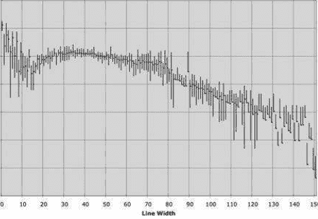

这表明我们应该努力让代码行保持简短。旧的Hollerith 80列限制有点武断，我并不反对代码行延伸到100甚至120个字符。但再长的话，可能就只是粗心大意了。

我曾遵循一条规则：永远不需要向右滚动。但如今显示器已经太宽了，年轻程序员可以把字体缩得很小，以至于一屏能放下200个字符。不要这样做。我个人把限制设为120。

## 水平开放性与密度

我们使用水平空白来关联关系紧密的事物，并分离关系较弱的事物。考虑以下函数：

```java
private void measureLine(String line) {
    lineCount++;
    int lineSize = line.length();
    totalChars += lineSize;
    lineWidthHistogram.addLine(lineSize, lineCount);
    recordWidestLine(lineSize);
}
```

另一方面，我没有在函数名和左括号之间加空格。这是因为函数与其参数紧密相关。将它们分开会让它们看起来是分离的，而不是结合在一起的。我会在函数调用的括号内分隔参数，以突出逗号，并表明各个参数是相互独立的。

空白的另一个用途是突出运算符的优先级。

```java
public class Quadratic {
    public static double root1(double a, double b, double c) {
        double determinant = determinant(a, b, c);
        return (-b + Math.sqrt(determinant)) / (2*a);
    }

    public static double root2(double a, double b, double c) {
        double determinant = determinant(a, b, c);
        return (-b - Math.sqrt(determinant)) / (2*a);
    }

    private static double determinant(double a, double b, double c) {
        return b*b - 4*a*c;
    }
}
```

注意这些方程读起来多么优美。因子之间没有空格，因为它们是高优先级的。各项之间用空格分隔，因为加法和减法的优先级较低。

不幸的是，大多数代码重新格式化工具对运算符的优先级视而不见，会在整个代码中强加相同的间距。因此，像上面展示的那种微妙间距，在重新格式化代码之后往往会丢失。

## 水平对齐

当我还是汇编语言程序员时^3，我使用水平对齐来突出某些结构。当我开始用C、C++，并最终用Java编码时，我仍然试图将一组声明中的所有变量名对齐，或将一组赋值语句中的所有值对齐。我的代码可能看起来像这样：

```java
public class FitNesseExpediter implements ResponseSender
{
    private Socket socket;
    private InputStream input;
    private OutputStream output;
    private Request request;
    private Response response;
    private FitNesseContext context;
    protected long requestParsingTimeLimit;
    private long requestProgress;
    private long requestParsingDeadline;
    private boolean hasError;

    public FitNesseExpediter(Socket s,
                             FitNesseContext context) throws Exception
    {
        this.context = context;
        socket = s;
        input = s.getInputStream();
        output = s.getOutputStream();
        requestParsingTimeLimit = 1000;
    }
}
```

然而，我发现这种对齐并没有用处。对齐似乎强调了错误的东西，会把我的视线从真正的意图上引开。例如，在上面的声明列表中，你会忍不住顺着变量名往下读，而不去看它们的类型。同样，在赋值语句列表中，你会忍不住只看右值列表，而从不看赋值运算符。更糟的是，自动格式化工具通常会消除这种对齐。

所以，归根结底，我不再这样做了。如今我更喜欢不对齐的声明和赋值，如下所示，因为它们能暴露出一个重要缺陷。如果我需要对齐很长的列表，问题在于列表的长度，而不是缺少对齐。下面`FitNesseExpediter`中声明列表的长度表明，这个类应该被拆分。

```java
public class FitNesseExpediter implements ResponseSender
{
    private Socket socket;
    private InputStream input;
    private OutputStream output;
    private Request request;

    private Response response;
    private FitNesseContext context;
    protected long requestParsingTimeLimit;
    private long requestProgress;
    private long requestParsingDeadline;
    private boolean hasError;

    public FitNesseExpediter(Socket s, FitNesseContext context) throws Exception
    {
        this.context = context;
        socket = s;
        input = s.getInputStream();
        output = s.getOutputStream();
        requestParsingTimeLimit = 10000;
    }
}
```

## 缩进

源文件是一个类似大纲的层次结构。有些信息属于整个文件，有些属于文件中的各个类，有些属于类中的方法，有些属于方法中的代码块，并递归地属于代码块中的代码块。这个层次结构的每一层都是一个作用域，可以在其中声明名称，也可以在其中解释声明和可执行语句。

为了使这个作用域层次结构可见，我们根据源代码行在层次结构中的位置按比例缩进它们。文件级别的语句（如大多数类声明）完全不缩进。类中的方法在类的基础上向右缩进一级。这些方法的实现则实现在……的右侧一级处


方法声明。块实现比其所在块向右缩进一级，依此类推。

程序员非常依赖这种缩进方案。他们通过视觉上对齐左侧的行来判断自己处于哪个作用域。这使他们能够快速跳过与当前情况无关的作用域，例如`if`或`while`语句的实现。他们扫视左侧以寻找新的方法声明、新变量乃至新类。没有缩进，程序对人类来说几乎无法阅读。

考虑下面两个在语法和语义上完全相同的程序：

```java
public class FitNesseServer implements SocketServer { private FitNesseContext context; public FitNesseServer(FitNesseContext context) { this.context = context; } public void serve(Socket s) { serve(s, 10000); } public void serve(Socket s, long requestTimeout) { try { FitNesseExpediter sender = new FitNesseExpediter(s, context); sender.setRequestParsingTimeLimit(requestTimeout); sender.start(); } catch(Exception e) { e.printStackTrace(); } } }
```

---

```java
public class FitNesseServer implements SocketServer {
    private FitNesseContext context;

    public FitNesseServer(FitNesseContext context) {
        this.context = context;
    }

    public void serve(Socket s) {
        serve(s, 10000);
    }

    public void serve(Socket s, long requestTimeout) {
        try {
            FitNesseExpediter sender = new FitNesseExpediter(s, context);
            sender.setRequestParsingTimeLimit(requestTimeout);
            sender.start();
        }
        catch (Exception e) {
            e.printStackTrace();
        }
    }
}
```

你的眼睛可以迅速辨别出缩进文件的结构。你几乎能立刻发现变量、构造函数、访问器和方法。只需几秒钟就能看出这是某种简单的 socket 前端，带有超时机制。而未缩进的版本，如果不仔细研究，几乎无法看透。

**打破缩进。** 有时，面对简短的`if`语句、简短的`while`循环或简短函数，我们会忍不住打破缩进规则。每当我屈服于这种诱惑时，几乎总是会回头把缩进加回去。因此，我避免把作用域压缩成一行，像这样：

```java
public class CommentWidget extends TextWidget
{
    public static final String REGEXP = "^#[^\r\n]*(?:(?:\r\n)|\n|\r)?";

    public CommentWidget(ParentWidget parent, String text){ super(parent, text);}
    public String render() throws Exception {return ""; }
}
```

我更喜欢展开并缩进作用域，像这样：

```java
public class CommentWidget extends TextWidget {
    public static final String REGEXP = "^#[^\r\n]*(?:(?:\r\n)|\n|\r)?";

    public CommentWidget(ParentWidget parent, String text) {
        super(parent, text);
    }
```

自那以后。这些并非我偏爱的规则，而是团队决定的规则。作为团队的一员，我在 FitNesse 项目中编写代码时遵循了这些规则。

记住，一个优秀的软件系统由一组读起来赏心悦目的文档组成。它们需要有一致而流畅的风格。读者需要能够相信，在一个源文件中看到的格式表达方式，在其他文件中含义相同。我们最不想做的事情，就是用一堆杂乱无章的个人风格给源代码增添更多复杂性。

## 鲍勃大叔的格式规则

我个人使用的规则非常简单，[清单 5-6](#)中的代码对此进行了说明。把这看作一个例子，说明代码如何成为最好的编码标准文档。

```java
// Listing 5-6: CodeAnalyzer.java
public int getWidestLineNumber() {
    return widestLineNumber;
}

public LineWidthHistogram getLineWidthHistogram() {
    return lineWidthHistogram;
}

public double getMeanLineWidth() {
    return (double)totalChars/lineCount;
}

public int getMedianLineWidth() {
    Integer[] sortedWidths = getSortedWidths();
    int cumulativeLineCount = 0;
    for (int width : sortedWidths) {
        cumulativeLineCount += lineCountForWidth(width);
        if (cumulativeLineCount > lineCount/2)
            return width;
    }
    throw new Error("Cannot get here");
}

private int lineCountForWidth(int width) {
    return lineWidthHistogram.getLinesForWidth(width).size();
}

private Integer[] getSortedWidths() {
    Set<Integer> widths = lineWidthHistogram.getWidths();
    Integer[] sortedWidths = (widths.toArray(new Integer[0]));
    Arrays.sort(sortedWidths);
    return sortedWidths;
}
}
```

## 第6章 对象和数据结构


我们将变量设为私有是有原因的。我们不希望其他人依赖它们。我们希望保留随心所欲更改其类型或实现的自由。那么，为什么这么多程序员会不假思索地给对象添加 getter 和 setter，把私有变量暴露得像公开变量一样呢？

### 数据抽象

思考一下[清单 6-1](#listing-6-1)和[清单 6-2](#listing-6-2)之间的区别。两者都表示了笛卡尔平面上一个点的数据。然而，一个暴露了其实现，另一个则完全隐藏了实现。

**清单 6-1** *具体点*

```java
public class Point {
    public double x;
    public double y;
}
```

**清单 6-2** *抽象点*

```java
double getGallonsOfGasoline();
}
```

**清单 6-4** `Abstract Vehicle`

```java
public interface Vehicle {
    double getPercentFuelRemaining();
}
```

在上述两种情况下，第二种选择都更可取。我们不想暴露数据的细节，而是希望以抽象的方式表达数据。这不仅仅是通过使用接口和/或 getter 与 setter 就能实现的。需要认真思考如何以最佳方式表示对象所包含的数据。最糟糕的选择是轻率地添加 getter 和 setter。

### 数据/对象反对称性

这两个例子展示了对象与数据结构之间的区别。对象将数据隐藏在抽象之后，并暴露操作这些数据的函数。数据结构则暴露其数据，并且没有有意义的函数。回过头去再读一遍。注意这两个定义的互补性质。它们几乎是完全对立的。这种差异看似微不足道，却有着深远的影响。

例如，考虑[清单 6-5](#listing-6-5)中的过程式形状示例。`Geometry`类对三个形状类进行操作。这些形状类是简单的数据结构，没有任何行为。所有行为都在`Geometry`类中。

**清单 6-5** `Procedural Shape`

```java
public class Square {
    public Point topLeft;
    public double side;
}

public class Rectangle {
    public Point topLeft;
    public double height;
    public double width;
}

public class Circle {
    public Point center;
    public double radius;
}

public class Geometry {
    public final double PI = 3.141592653589793;

    public double area(Object shape) throws NoSuchShapeException
    {
        if (shape instanceof Square) {
            Square s = (Square)shape;
            return s.side * s.side;
        }

        else if (shape instanceof Rectangle) {
            Rectangle r = (Rectangle)shape;
            return r.height * r.width;
        }
        else if (shape instanceof Circle) {
            Circle c = (Circle)shape;
            return PI * c.radius * c.radius;
        }
        throw new NoSuchShapeException();
    }
}
```

面向对象的程序员可能会对此嗤之以鼻，抱怨这是过程式的——他们说得没错。但这种嘲笑可能并不合理。想想如果给`Geometry`添加一个`perimeter()`函数会发生什么。形状类完全不受影响！其他依赖这些形状的类也完全不受影响！另一方面，如果我添加一个新形状，就必须修改`Geometry`中的所有函数来处理它。再读一遍。注意，这两种情况是截然相反的。


-   作为参数传递给 *f* 的对象
-   保存在 *C* 的实例变量中的对象

该方法*不应*对任何允许的函数所返回的对象调用方法。换句话说，只与朋友交谈，不与陌生人交谈。

下面的代码似乎违反了迪米特法则（还有其他方面），因为它在`getOptions()`的返回值上调用了`getScratchDir()`函数，然后在`getScratchDir()`的返回值上调用了`getAbsolutePath()`。

```
final String outputDir =
ctxt.getOptions().getScratchDir().getAbsolutePath();
```

### 火车失事

这种代码通常被称为*火车失事*，因为它看起来像一串耦合的火车车厢。这种调用链通常被认为是草率的风格，应当避免 [G36]。通常最好将它们拆分为如下形式：

```
Options opts = ctxt.getOptions();
File scratchDir = opts.getScratchDir();
final String outputDir = scratchDir.getAbsolutePath();
```

这两段代码是否违反了迪米特法则？当然，包含它们的模块知道`ctxt`对象包含选项，选项包含临时目录，而临时目录又有绝对路径。对于单个函数来说，这需要了解太多知识。调用函数知道如何穿过许多不同的对象。


这是否违反了迪米特法则，取决于`ctxt`、`Options`和`ScratchDir`是对象还是数据结构。如果它们是对象，那么它们的内部结构应当被隐藏而不是暴露，因此了解它们的内部结构显然违反了迪米特法则。另一方面，如果`ctxt`、`Options`和`ScratchDir`只是没有行为的数据结构，那么它们自然会暴露其内部结构，因此迪米特法则不适用。

访问器函数的使用使问题变得混乱。如果代码是这样写的，那么我们可能就不会质疑迪米特法则的违反了。

```
final String outputDir = ctxt.options.scratchDir.absolutePath;
```

如果数据结构只有公共变量而没有函数，而对象有私有变量和公共函数，那么这个问题就不会那么令人困惑了。然而，有些框架和标准（例如“beans”）要求即使是简单的数据结构也要有访问器和修改器。

### 混合体

这种混淆有时会导致不幸的混合结构：一半是对象，一半是数据结构。它们具有执行重要事情的函数，同时也具有公共变量或公共访问器和修改器，这些实际上使私有变量变为公开，诱使其他外部函数以过程式程序使用数据结构的方式使用这些变量。<sup>4</sup>

这种混合体既难以添加新函数，也难以添加新数据结构。它们集两种世界的缺点于一身。避免创建它们。它们表明设计混乱，其作者不确定——或者更糟，根本不知道——自己需要防范的是函数还是类型。

### 隐藏结构

如果`ctxt`、`options`和`scratchDir`是具有真实行为的对象呢？那么，因为对象应当隐藏其内部结构，我们就不应该能够遍历它们。那么我们怎样才能得到临时目录的绝对路径呢？

```
ctxt.getAbsolutePathOfScratchDirectoryOption();
```

或

```java
ctxt.getScratchDirectoryOption().getAbsolutePath()
```

第一个选项可能导致`ctxt`对象中的方法数量激增。第二个选项假定`getScratchDirectoryOption()`返回的是数据结构而不是对象。这两个选项都不理想。

如果`ctxt`是一个对象，我们应该告诉它*去做某事*，而不是询问它的内部细节。那么，我们为什么需要临时目录的绝对路径呢？我们打算用它做什么？考虑同一模块中（往下很多行的）这段代码：

```java
String outFile = outputDir + "/" + className.replace('.', '/') + ".class";
FileOutputStream fout = new FileOutputStream(outFile);
BufferedOutputStream bos = new BufferedOutputStream(fout);
```

不同抽象层次的细节混在一起 [G34][G6] 有点令人不安。点、斜杠、文件扩展名和`File`对象不应该如此随意地混在一起，也不应该与周围的代码混在一起。不过，忽略这一点，我们可以看到，获取临时目录绝对路径的目的是为了创建一个指定名称的临时文件。

那么，如果我们让`ctxt`对象来做这件事呢？

```java
BufferedOutputStream bos =
ctxt.createScratchFileStream(classFileName);
```

这似乎是对象应该做的合理事情！这让`ctxt`得以隐藏其内部细节，也防止当前函数因遍历它不应知道的对象而违反迪米特法则。

### 数据传输对象

数据结构的典型形式是拥有公共变量且没有函数的类。这种类有时被称为数据传输对象（Data Transfer Object，DTO）。DTO是非常有用的结构，尤其是在与数据库通信或从套接字解析消息等场景中。它们往往是一系列转换阶段中的第一步，将数据库中的原始数据转换为应用程序代码中的对象。

更常见的是[清单 6-7](#)中所示的“bean”形式。Bean 具有通过 getter 和 setter 操作的私有变量。这种准

```java
return zip;
}
}
```

### 活动记录

活动记录是 DTO 的特殊形式。它们是具有公共（或通过 bean 访问的）变量的数据结构，但通常还具有像 save 和 find 这样的导航方法。通常，这些活动记录直接对应于数据库表或其他数据源。

不幸的是，我们经常发现开发人员试图将业务规则方法放入这些数据结构中，把它们当作对象来使用。这很尴尬，因为它创造了数据结构和对象之间的混合体。

当然，解决方案是将活动记录视为数据结构，并创建包含业务规则的独立对象，这些对象隐藏其内部数据（这些数据很可能只是活动记录的实例）。

### 结论

对象暴露行为并隐藏数据。这使得添加新类型的对象变得容易，而无需改变现有行为。但这也使得向现有对象添加新行为变得困难。数据结构暴露数据，且没有重要的行为。这使得向现有数据结构添加新行为变得容易，但向现有函数添加新数据结构则很困难。

在任何给定的系统中，我们有时希望具备添加新数据类型的灵活性，因此在系统的这一部分，我们倾向于使用对象。其他时候，我们希望具备添加新行为的灵活性，因此在系统的这一部分，我们倾向于使用数据类型和过程。优秀的软件开发人员会不带偏见地理解这些问题，并选择最适合当前任务的方法。

### 参考文献

[Refactoring]: *重构：改善既有代码的设计，*
Martin Fowler 等，Addison-Wesley，1999 年。

## 第 7 章 错误处理

作者：Michael Feathers


在一本关于整洁代码的书中设置一个关于错误处理的章节，看起来可能有些奇怪。错误处理只是我们编程时都必须做的事情之一。输入可能异常，设备可能故障。简而言之，事情可能出错，而出错时，我们作为程序员有责任确保我们的代码完成它需要完成的工作。

然而，这与整洁代码的联系应当很清楚。许多代码库完全被错误处理所支配。当我说“支配”时，并不是指它们只做错误处理，而是指由于错误处理分散在各处，几乎无法看清代码在做什么。错误处理很重要，*但如果它掩盖了逻辑，那就是错误的。*

在本章中，我将概述一些技术和注意事项，你可以用它们来编写既整洁又健壮的代码——以优雅和风格处理错误的代码。

### 使用异常而非返回码

在遥远的过去，许多语言没有异常机制。在这些语言中，处理和报告错误的技术非常有限。你要么设置错误标志，要么返回错误码


```java
public class DeviceController {
    …

    public void sendShutDown() {
        try {
            tryToShutDown();
        } catch (DeviceShutDownError e) {
            logger.log(e);
        }
    }

    private void tryToShutDown() throws DeviceShutDownError {
        DeviceHandle handle = getHandle(DEV1);
        DeviceRecord record = retrieveDeviceRecord(handle);

        pauseDevice(handle);
        clearDeviceWorkQueue(handle);
        closeDevice(handle);
    }

    private DeviceHandle getHandle(DeviceID id) {
        …
        throw new DeviceShutDownError("Invalid handle for: " + id.toString());
        …
    }
    …
}
```

注意这看起来干净多了。这不仅仅是美学问题。代码更好是因为两个纠缠在一起的问题——设备关闭算法和错误处理——现在被分开了。你可以分别审视每一个问题并独立理解它们。

### 先编写你的 `Try-Catch-Finally Statement`

关于异常最有趣的事情之一是它们在程序中*定义了范围*。当你在`try-catch-finally`语句的`try`部分执行代码时，你就是在声明执行可以在任何一点中止，然后在`catch`处恢复。

从某种意义上说，`try`块就像事务。无论`try`中发生什么，你的`catch`都必须使程序保持一致的状态。因此，在编写可能抛出异常的代码时，最好从`try-catch-finally`语句开始。这有助于你定义该代码的用户应该期待什么，无论`try`中执行的代码出了什么问题。

让我们看一个例子。我们需要编写一些代码来访问文件并读取一些序列化对象。

我们从一个单元测试开始，该测试表明当文件不存在时我们会得到一个异常：

```java
@Test(expected = StorageException.class)
public void retrieveSectionShouldThrowOnInvalidFileName() {
    sectionStore.retrieveSection("invalid - file");
}
```

测试驱动我们创建这个桩代码：

```java
public List<RecordedGrip> retrieveSection(String sectionName) {
    // dummy return until we have a real implementation
    return new ArrayList<RecordedGrip>();
}
```

我们的测试失败了，因为它没有抛出异常。接下来，我们修改实现，使其尝试访问一个无效文件。这个操作会抛出异常：

```java
public List<RecordedGrip> retrieveSection(String sectionName) {
    try {
        FileInputStream stream = new FileInputStream(sectionName);
    } catch (Exception e) {
        throw new StorageException("retrieval error", e);
    }
    return new ArrayList<RecordedGrip>();
}
```

现在我们的测试通过了，因为我们已经捕获了异常。此时，我们可以进行重构。我们可以缩小捕获的异常类型，使其与`FileInputStream`构造函数实际抛出的类型匹配：`FileNotFoundException`

```java
public List<RecordedGrip> retrieveSection(String sectionName) {
    try {
        FileInputStream stream = new FileInputStream(sectionName);
        stream.close();
    } catch (FileNotFoundException e) {
        throw new StorageException("retrieval error", e);
    }
    return new ArrayList<RecordedGrip>();
}
```

现在我们已经用`try-catch`结构定义了范围，就可以使用TDD来构建我们需要的其余逻辑。该逻辑将被添加到`FileInputStream`的创建和`close`之间，并且可以假装一切正常。

尝试编写能够强制抛出异常的测试，然后向你的处理程序添加行为以满足这些测试。这将促使你先构建`try`块的事务范围，并帮助你维护该范围的事务性质。

### 使用非受检异常

争论已经结束。多年来，Java程序员一直在争论受检异常的利弊。当受检异常在Java的第一个版本中引入时，它们似乎是一个伟大的想法。每个方法的签名都会列出它可能传递给调用者的所有异常。此外，这些异常是方法类型的一部分。如果你的签名与代码所能做的不匹配，你的代码根本无法编译。

当时，我们认为受检异常是一个伟大的想法；是的，它们可以带来*某些*好处。然而，现在很明显，它们对于生产健壮的软件并不是必需的。C#没有受检异常，尽管进行了勇敢的尝试，C++也没有。Python和Ruby也没有。然而，用所有这些语言编写健壮的软件是可能的。既然如此，我们必须真正决定——受检异常是否值得付出代价。

代价是什么？受检异常的代价是违反开闭原则¹。如果你在代码中的一个方法中抛出受检异常，而catch在其上三层，*你必须在从你到catch之间的每个方法的签名中声明该异常*。这意味着软件低层的更改可能会迫使许多更高层级更改签名。即使被更改的模块并不关心这些变化，它们也必须被重新构建和重新部署。

考虑一个大型系统的调用层次结构。顶层的函数调用它们下面的函数，这些函数又调用更下面的函数，如此无限循环。现在假设某个最底层的函数被修改为必须抛出一个异常。如果该异常是受检的，那么函数签名必须添加一个`throws`子句。但这意味着每个调用我们修改过的函数的函数也必须被修改：要么捕获新异常，要么在其签名中附加相应的`throws`子句。如此无限循环。最终结果是，更改从软件的最底层级逐级传递到最高层级！封装被打破了，因为所有在抛出路径上的函数都必须了解那个低层异常的细节。鉴于异常的目的是让你能够远距离处理错误，受检异常以这种方式破坏封装实在遗憾。

如果你正在编写一个关键库，受检异常有时是有用的：你必须捕获它们。但在一般的应用程序开发中，依赖成本超过了收益。

### 为异常提供上下文

你抛出的每个异常都应提供足够的上下文，以确定错误的来源和位置。在Java中，你可以从任何异常中获取堆栈跟踪；然而，堆栈跟踪无法告诉你失败操作的意图。

创建信息丰富的错误消息，并将它们与异常一起传递。提及失败的操作和失败的类型。如果你在应用程序中记录日志，请传递足够的信息，以便在你的`catch`中记录错误。

### 根据调用者的需求定义异常类

对错误进行分类的方法有很多。我们可以按来源分类：它们来自哪个组件？或者按类型分类：它们是设备故障、网络故障还是编程错误？然而，当我们在应用程序中定义异常类时，我们最关心的问题应该是*它们如何被捕获*。

让我们看一个异常分类不佳的例子。下面是一个针对第三方库调用的`try-catch-finally`语句。它涵盖了调用可能抛出的所有异常：

```java
ACMEPort port = new ACMEPort(12);

try {
    port.open();
} catch (DeviceResponseException e) {
    reportPortError(e);
    logger.log("Device response exception", e);
} catch (ATM1212UnlockedException e) {
    reportPortError(e);
    logger.log("Unlock exception", e);
} catch (GMXError e) {
    reportPortError(e);
    logger.log("Device response exception");
} finally {
    ...
}
```

该语句包含大量重复代码，我们不应感到惊讶。在大多数异常处理情况下，无论实际原因是什么，我们所做的工作都相对标准。我们必须记录错误，并确保我们能够继续。


```java
try {
    MealExpenses expenses = expenseReportDAO.getMeals(employee.getID());
    m_total += expenses.getTotal();
} catch (MealExpensesNotFound e) {
    m_total += getMealPerDiem();
}
```

在这种业务中，如果餐费被报销，它们就计入总额；如果没有，员工当天会获得 *每日津贴* 的餐费金额。这个异常扰乱了逻辑。如果我们不必处理这种特殊情况，岂不是更好？如果不用处理，我们的代码会看起来简单得多。代码将会是这样：

```java
MealExpenses expenses = expenseReportDAO.getMeals(employee.getID());
m_total += expenses.getTotal();
```

我们能写出这么简单的代码吗？事实证明我们可以。我们可以修改 `ExpenseReportDAO`，让它总是返回一个 `MealExpense` 对象。如果没有餐费支出，它就返回一个以 *每日津贴* 为总额的 `MealExpense` 对象：

```java
public class PerDiemMealExpenses implements MealExpenses {
    public int getTotal() {
        // return the per diem default
    }
}
```

这被称为**特例模式** [Fowler]。你创建一个类或配置一个对象，让它为你处理特殊情况。这样做之后，客户端代码就不必处理异常行为了。该行为被封装在特例对象中。

### 不要返回 null

我认为，任何关于错误处理的讨论都应提及那些会招致错误的行为。列表上的第一条就是返回 `null`。我数不清见过多少应用程序，几乎每两行就有一行是检查 `null`。下面是一些示例代码：

```java
List<Employee> employees = getEmployees();
if (employees != null) {
    for(Employee e : employees) {
        totalPay += e.getPay();
    }
}
```

现在，`getEmployees` 可以返回 `null`，但有必要这样做吗？如果我们把 `getEmployee` 改为返回一个空列表，就能清理这段代码：

```java
List<Employee> employees = getEmployees();
for(Employee e : employees) {
    totalPay += e.getPay();
}
```

幸运的是，Java 有 `Collections.emptyList()`，它会返回一个预定义且不可变的列表，我们可以用它来实现这一目的：

```java
public List<Employee> getEmployees() {
    if (there are no employees...)
        return Collections.emptyList();
}
```

如果你这样编码，就能将 `NullPointerExceptions` 的出现机会降到最低，代码也会更干净。

### 不要传递 null

从方法中返回 `null` 很糟糕，但向方法中传递 `null` 更糟糕。除非你正在使用的 API 要求你传递 `null`，否则你应尽可能避免在代码中传递 `null`。

我们来看一个例子，了解其中的原因。下面是一个简单的、为两个点计算指标的方法：

```java
public class MetricsCalculator
{
    public double xProjection(Point p1, Point p2) {
        return (p2.x - p1.x) * 1.5;
    }
    …
}
```

当有人将 `null` 作为参数传入时会发生什么？

```java
calculator.xProjection(null, new Point(12, 13));
```

## 第8章 边界

作者：James Grenning


我们很少能控制系统中的全部软件。有时我们购买第三方包或使用开源软件；有时我们依赖公司内部的团队为我们提供组件或子系统。无论如何，我们必须将外部代码与自己的代码干净地集成。在本章中，我们将介绍一些保持软件边界整洁的实践和技术。

### 使用第三方代码

接口的提供者和使用者之间天然存在一种紧张关系。第三方包和框架的提供者力求广泛的适用性，以便能在多种环境中工作并吸引广大用户。而使用者则希望接口能聚焦于自己的特定需求。这种紧张关系会在我们的系统边界上引发问题。

让我们以 `java.util.Map` 为例。通过查看图8-1可以看到，Map 有一个非常宽泛的接口，带有大量功能。当然，这种强大和灵活性是有用的，但也可能成为一种负担。例如，我们的应用程序可能会构建一个 Map 并在各处传递。我们的意图可能是，任何拿到这个 Map 的接收者都不能删除其中的内容。但就在方法列表的最上面就有 `clear()` 方法。任何一个使用 Map 的人都有能力清空它。或者，我们的设计约定是只有特定类型的对象才能存储在 Map 中，但 Map 并不能可靠地约束放入其中的对象类型。任何执意要这样做的人都可以向任意 Map 中添加任何类型的对象。

**图8-1** `Map` 的方法

| 方法 | 返回类型 | 类 |
| --- | --- | --- |
| `clear()` | `void` | `Map` |
| `containsKey(Object key)` | `boolean` | `Map` |
| `containsValue(Object value)` | `boolean` | `Map` |
| `entrySet()` | `Set` | `Map` |
| `equals(Object o)` | `boolean` | `Map` |
| `get(Object key)` | `Object` | `Map` |
| `getClass()` | `Class<?>` | `Object` |
| `hashCode()` | `int` | `Map` |
| `isEmpty()` | `boolean` | `Map` |
| `keySet()` | `Set` | `Map` |
| `notify()` | `void` | `Object` |
| `notifyAll()` | `void` | `Object` |
| `put(Object key, Object value)` | `Object` | `Map` |
| `putAll(Map t)` | `void` | `Map` |
| `remove(Object key)` | `Object` | `Map` |
| `size()` | `int` | `Map` |
| `toString()` | `String` | `Object` |
| `values()` | `Collection` | `Map` |
| `wait()` | `void` | `Object` |
| `wait(long timeout)` | `void` | `Object` |
| `wait(long timeout, int nanos)` | `void` | `Object` |

如果我们的应用程序需要一个 Sensor 的 Map，你可能会看到传感器是这样设置的：

```java
Map sensors = new HashMap();
```

然后，当代码的其他部分需要访问传感器时，你会看到这样的代码：

```java
Sensor s = (Sensor)sensors.get(sensorId);
```

我们不止一次看到这种代码，而是在整个代码中反复看到。这段代码的客户端负责从 `Map` 中取出一个 `Object`，并将其强制转换为正确的类型。这能工作，但不是整洁的代码。而且，这段代码的表达力也没有达到应有的水平。使用泛型可以极大地提高这段代码的可读性，如下所示：

```java
Map<Sensor> sensors = new HashMap<Sensor>();
…
Sensor s = sensors.get(sensorId);
```

然而，这并不能解决 `Map<Sensor>` 提供了超出我们需要或想要的能力的问题。

在系统中随意传递 `Map<Sensor>` 实例意味着，如果 `Map` 的接口发生任何变化，就会有大量地方需要修改。你可能认为这种变化不太可能发生，但请记住，当 Java 5 添加泛型支持时，它就发生了变化。事实上，我们见过一些系统由于需要大量修改来弥补对 Map 的随意使用，而无法使用泛型。

更整洁地使用 `Map` 的方式可能如下所示。`Sensors` 的使用者根本不会关心是否使用了泛型。这个选择已经成为（而且应当始终是）一个实现细节。

```java
public class Sensors {
    private Map sensors = new HashMap();

    public Sensor getById(String id) {
        return (Sensor) sensors.get(id);
    }

    //snip
}
```

边界处的接口（`Map`）被隐藏起来了。它可以在对应用程序其余部分影响很小的情况下演进。泛型的使用不再是一个大问题，因为强制转换和类型管理都在 `Sensors` 类内部处理了。

`PatternLayout`，它再次抱怨缺少输出流。这是一种非常奇怪的行为。

更仔细地查看文档后，我们看到默认的 `ConsoleAppender` 构造函数是“未配置的”，这似乎不太明显或不太有用。这感觉像是 `log4j` 中的一个 bug，或至少是一个不一致之处。

再多一些搜索、阅读和测试，我们最终得到了[清单8-1](#)。我们已经发现了大量关于 `log4j` 工作方式的信息，并将这些知识编码为一组简单的单元测试。

**清单8-1 LogTest.java**

```java
public class LogTest {
    private Logger logger;

    @Before
    public void initialize() {
        logger = Logger.getLogger("logger");
        logger.removeAllAppenders();
        Logger.getRootLogger().removeAllAppenders();
    }

    @Test
    public void basicLogger() {
        BasicConfigurator.configure();
        logger.info("basicLogger");
    }

    @Test
    public void addAppenderWithStream() {
        logger.addAppender(new ConsoleAppender(
            new PatternLayout("%p %t %m%n"),
            ConsoleAppender.SYSTEM_OUT));
        logger.info("addAppenderWithStream");
    }

    @Test
    public void addAppenderWithoutStream() {
        logger.addAppender(new ConsoleAppender(
            new PatternLayout("%p %t %m%n")));
    }
}
```

```java
logger.info("addAppenderWithoutStream");
}
}
```

现在我们知道如何初始化一个简单的控制台记录器，我们可以将这一知识封装到我们自己的记录器类中，以便应用程序的其余部分与 log4j 边界接口隔离。

### 学习测试比免费更好

学习测试最终不花费任何成本。反正我们必须学习 API，而编写这些测试正是获取该知识的简单且独立的方式。学习测试是精确的实验，有助于加深我们的理解。

学习测试不仅免费，而且具有正投资回报。当第三方包发布新版本时，我们运行学习测试来检查是否存在行为差异。

学习测试验证我们使用的第三方包是否按我们期望的方式工作。一旦集成，就无法保证第三方代码会继续与我们的需求兼容。原作者会有压力去修改他们的代码以满足他们自己的新需求。他们会修复缺陷并增加新功能。每个新版本都带来新的风险。如果第三方包以某种与我们的测试不兼容的方式发生变化，我们马上就能发现。

无论你是否需要学习测试所提供的学习价值，一个干净的边界都应该由一组出站测试来支撑，这些测试以与生产代码相同的方式练习接口。如果没有这些*边界测试*来简化迁移，我们可能会倾向于比应该停留的时间更久地使用旧版本。

### 使用尚不存在的代码

还有另一种边界，它将已知与未知分开。代码中常常有些地方，我们的知识似乎到了边缘。有时边界另一边是

我拼凑了一个简单的驱动程序，用于监听键盘。每次输入一个字符，它就会安排一条命令，在五秒后输入相同的字符。然后我在键盘上敲出一段有节奏的旋律，并等待五秒后这段旋律在屏幕上重放。

> “我……想要一个女孩……就像……嫁给……亲爱的……老……爸爸的那个女孩。”

我实际上在输入“.”键时唱了那段旋律，然后当点出现在屏幕上时我又唱了一遍。

那就是我的测试！一旦我看到它工作，并向同事演示后，我就把测试代码扔掉了。

如我所说，我们这个行业已经走过了很长一段路。如今，我会编写一个测试，确保那段代码的每一个角落都按我的预期工作。我会将我的代码与操作系统隔离，而不是仅仅调用标准的计时函数。我会模拟这些计时函数，以便对时间有绝对的控制。我会安排一些设置布尔标志的命令，然后推进时间，观察这些标志，确保当我将时间改为正确值时，它们从 false 变为 true。

一旦我让一套测试通过，我会确保那些测试对于任何需要处理该代码的人来说都方便运行。我会确保测试和代码一起检入同一个源码包。

是的，我们已经走了很长的路；但还有更远的路要走。敏捷和 TDD 运动鼓励了许多程序员编写自动化单元测试，而且每天都有更多人加入他们的行列。但在疯狂地将测试加入我们的规程时，许多程序员错过了一些编写良好测试的更微妙且重要的要点。

## TDD 三定律

到目前为止，大家都知道 TDD 要求我们先编写单元测试，再编写生产代码。但这条规则只是冰山一角。考虑以下三条定律。¹

[http://doi.ieeecomputersociety.org/10.1109/MS.2007.85](http://doi.ieeecomputersociety.org/10.1109/MS.2007.85)

**第一定律** 在编写失败单元测试之前，你不得编写生产代码。

**第二定律** 你不得编写超出足以失败的单元测试；编译失败也算失败。

**第三定律** 你不得编写超出足以通过当前失败测试的生产代码。

这三条定律将你锁定在一个可能长达三十秒的循环中。测试和生产代码是*一起*编写的，测试仅比生产代码提前几秒。

如果我们以这种方式工作，我们每天会写几十个测试，每月几百个，每年几千个。如果我们以这种方式工作，这些测试将覆盖几乎所有的生产代码。这些测试庞大的数量（可能比肩生产代码本身的规模）会带来令人生畏的管理问题。

### 保持测试整洁

几年前，有人请我指导一个团队，他们明确决定其测试代码*不应*保持与生产代码相同的质量标准。他们互相允许在单元测试中打破规则。“快速而粗糙”是他们的口号。他们的变量不必命名得好，测试函数不需要短小且有描述性。测试代码不需要精心设计和合理划分。只要测试代码能工作，只要它覆盖了生产代码，就足够好了。

你们中有些人读到这可能会同情那个决定。也许很久以前，你写过我为那个 *Timer* 类写的那种测试。从写那种一次性测试到编写一套自动化单元测试，是一个巨大的跨越。所以，像我指导的那个团队一样，你可能会认为肮脏的测试总比没有测试好。

这个团队没有意识到的是，拥有肮脏的测试，如果不比没有测试更糟，也至少等同于没有测试。问题在于，随着生产代码的发展，测试必须改变。测试越脏，它们就越难以

划分你的设计；没有测试，你会因为害怕引入未检测到的缺陷而不愿做出更改。

但*有了*测试，那种恐惧几乎消失了。你的测试覆盖率越高，你越不害怕。你可以近乎不受惩罚地修改那些架构不佳、设计混乱且难以理解的代码。实际上，你可以毫不畏惧地*改进*那种架构和设计！

因此，拥有覆盖生产代码的自动化单元测试套件是保持你的设计和架构尽可能干净的关键。测试成就了所有“-ilities”，因为测试成就了*变化*。

所以如果你的测试很脏，你更改代码的能力就会受到阻碍，你开始丧失改进该代码结构的能力。测试越脏，代码也越脏。最终你会失去测试，而代码会腐烂。

## 干净的测试

什么使测试干净？三件事：可读性、可读性和可读性。在单元测试中，可读性甚至可能比在生产代码中更重要。什么使测试可读？使所有代码可读的东西：清晰、简单和表达密度。在测试中，你想用尽可能少的表达说很多内容。

考虑来自 FitNesse 的[清单9-1](#)中的代码。这三个测试难以理解，而且肯定可以改进。首先，重复调用`addPage`和`assertSubString`中有大量重复代码[G5]。更重要的是，这段代码充满了干扰测试表达力的细节。

**清单9-1 SerializedPageResponderTest.java**

```java
public void testGetPageHierarchyAsXml() throws Exception
{

    crawler.addPage(root, PathParser.parse("PageOne"));
    crawler.addPage(root, PathParser.parse("PageOne.ChildOne"));
    crawler.addPage(root, PathParser.parse("PageTwo"));
```


## 清单9-2 SerializedPageResponderTest.java（重构后）

```java
public void testGetPageHierarchyAsXml() throws Exception {
  makePages("PageOne", "PageOne.ChildOne", "PageTwo");

  submitRequest("root", "type:pages");

  assertResponseIsXML();
  assertResponseContains(
    "<name>PageOne</name>", "<name>PageTwo</name>",
    "<name>ChildOne</name>"
  );
}

public void testSymbolicLinksAreNotInXmlPageHierarchy() throws
Exception {
  WikiPage page = makePage("PageOne");
  makePages("PageOne.ChildOne", "PageTwo");

  addLinkTo(page, "PageTwo", "SymPage");

  submitRequest("root", "type:pages");

  assertResponseIsXML();
  assertResponseContains(
    "<name>PageOne</name>", "<name>PageTwo</name>",
    "<name>ChildOne</name>"
  );
  assertResponseDoesNotContain("SymPage");
}

public void testGetDataAsXml() throws Exception {
  makePageWithContent("TestPageOne", "test page");

  submitRequest("TestPageOne", "type:data");

  assertResponseIsXML();
}
```

```java
assertResponseContains("test page", "<Test>");
}
```

这些测试的结构使构建-操作-检查²模式一目了然。每个测试都清晰地分为三个部分。第一部分构建测试数据，第二部分对这些测试数据进行操作，第三部分检查操作是否产生了预期结果。

注意，绝大多数令人烦恼的细节已被消除。测试直击要点，只使用它们真正需要的数据类型和函数。任何阅读这些测试的人都应能很快弄清楚它们的作用，而不会被细节误导或压垮。

## 领域特定测试语言

清单9-2中的测试演示了为测试构建领域特定语言的技术。我们不使用程序员操纵系统所用的API，而是构建一组函数和工具，这些函数和工具利用这些API，使测试编写更方便、阅读更易懂。这些函数和工具成为测试所用的专用API。它们是程序员用来帮助自己编写测试，并帮助那些日后必须阅读这些测试的人的一种测试语言。

这个测试API并非事先设计好的；而是从对已被混淆细节污染过多的测试代码的持续重构中演化而来。正如你看到我将清单9-1重构为清单9-2一样，自律的开发者也同样会将其测试代码重构为更简洁、更具表现力的形式。

## 双重标准

从某种意义上说，我在本章开头提到的团队的做法是对的。测试API中的代码确实需要一套不同于生产代码的工程标准。它仍然必须简单、简洁、富有表现力，但不必像生产代码那样高效。毕竟，它运行在测试环境中，而不是生产环境中，这两种环境有不同的需求。

考虑清单9-3中的测试。这是我为正在原型设计的环境控制系统编写的测试。暂时不深入讨论

## 清单9-6 MockControlHardware.java

```java
public String getState() {
    String state = "";
    state += heater ? "H" : "h";
    state += blower ? "B" : "b";
    state += cooler ? "C" : "c";
    state += hiTempAlarm ? "H" : "h";
    state += loTempAlarm ? "L" : "l";
    return state;
}
```

StringBuffers有点丑陋。即使在生产代码中，如果代价很小，我也会避免使用它们；你可以说清单9-6中代码的代价非常小。然而，这个应用显然是一个嵌入式实时系统，计算机和内存资源很可能非常受限。但测试环境却很可能完全不受限制。

这就是双重标准的本质。有些在生产环境中绝不应该做的事情，在测试环境中却完全没问题。通常涉及内存或CPU效率问题。但它们绝不涉及整洁问题。

## 每个测试一个断言

有一种学派⁴认为，JUnit测试中的每个测试函数都应该只有一个断言语句。这条规则可能看起来严苛，但其优势在清单9-5中可见。这些测试得出单一结论，快速且易于理解。

但清单9-2呢？要是我们设法轻易地将输出是XML和输出包含某些子串这两个断言合并起来，似乎不合理。不过，我们可以将测试拆分为两个独立测试，每个测试有各自的断言，如清单9-7所示。

## 清单9-7 SerializedPageResponderTest.java（单一断言）

```java
public void testGetPageHierarchyAsXml() throws Exception {
    givenPages("PageOne", "PageOne.ChildOne", "PageTwo");

    whenRequestIsIssued("root", "type:pages");

    thenResponseShouldBeXML();
}
public void testGetPageHierarchyHasRightTags() throws Exception {
    givenPages("PageOne", "PageOne.ChildOne", "PageTwo");

    whenRequestIsIssued("root", "type:pages");

    thenResponseShouldContain(
        "<name>PageOne</name>", "<name>PageTwo</name>",
        "<name>ChildOne</name>"
    );
}
```

注意，我改变了函数名，以使用常见的given-when-then⁵约定。这使测试更容易阅读。不幸的是，按所示方式拆分测试会导致大量重复代码。

我们可以使用模板方法⁶模式来消除重复，将given/when部分放在基类中，将then部分放在不同的派生类中。或者，我们可以创建一个完全独立的测试类，将given和when部分放在@Before函数中，将when部分放在每个@Test函数中。但为了这么一个小问题而引入如此多的机制，似乎有点过分。最终，我更喜欢清单9-2中的多个断言。

我认为单一断言规则是一个很好的指导原则。我通常会尝试创建支持该规则的领域特定测试语言，如清单9-5所示。但我并不害怕在测试中放入多个断言。我认为最好的说法是，测试中的断言数量应当最小化。

## 每个测试一个概念

也许更好的规则是，我们希望在每个测试函数中测试一个概念。我们不想要一个又一个地测试杂项的冗长测试函数。清单9-8就是这样一个测试的例子。这个测试应该拆分成三个独立测试，因为它测试了三件独立的事情。将它们全部合并到同一个函数中，会迫使读者弄清楚每个部分为什么存在，以及该部分在测试什么。

## 清单9-8

```java
/**
 * Miscellaneous tests for the addMonths() method.
 */
public void testAddMonths() {
    SerialDate d1 = SerialDate.createInstance(31, 5, 2004);

    SerialDate d2 = SerialDate.addMonths(1, d1);
    assertEquals(30, d2.getDayOfMonth());
    assertEquals(6, d2.getMonth());
    assertEquals(2004, d2.getYYYY());

    SerialDate d3 = SerialDate.addMonths(2, d1);
    assertEquals(31, d3.getDayOfMonth());
    assertEquals(7, d3.getMonth());
    assertEquals(2004, d3.getYYYY());

    SerialDate d4 = SerialDate.addMonths(1, SerialDate.addMonths(1, d1));
    assertEquals(30, d4.getDayOfMonth());
    assertEquals(7, d4.getMonth());
    assertEquals(2004, d4.getYYYY());
}
```

这三个测试函数大概应该是这样：

- *给定一个有31天的月份的最后一天（如5月）：*
  1. *当增加一个月，且该月的最后一天是30号（如6月）时，* 日期应该是该月的30号，而不是31号。
  2. *当在该日期上增加两个月，且最终月份有31天时，* 日期应该是31号。
- *给定一个有30天的月份的最后一天（如6月）：*
  1. *当增加一个月，且该月的最后一天有31天时，日期应该是30号，而不是31号。*

这样表述，你可以看到在这些杂项测试中隐藏着一条通用规则。当你增加月份时，日期不能超过该月的最后一天。这意味着在2月28日增加一个月应该得到3月28日。*这个*测试缺失了，而且是一个值得编写的测试。

所以，问题不在于[清单9-8](#)的每个部分中的多个断言。而在于测试了不止一个概念。因此，最好的规则可能是，你应该最小化每个概念的断言数量，并且每个测试函数只测试一个概念。

## F.I.R.S.T.[^8]

整洁的测试遵循另外五项规则，这些规则构成了上述首字母缩写：

**快速** 测试应该快。它们应该运行得快。当测试运行缓慢时，你不会想频繁运行它们。如果不频繁运行，就无法及早发现问题以便轻松修复。你也不会觉得可以自由地清理代码。最终代码将开始腐坏。

**独立** 测试不应互相依赖。一个测试不应为下一个测试创造条件。你应该能够独立运行每个测试，并按任意顺序运行测试。当测试相互依赖时，第一个失败的测试会导致一连串下游失败，使诊断变得困难，并隐藏下游缺陷。

**可重复** 测试应该在任何环境中都可重复。你应该能够在生产环境、QA环境以及在没有网络的回家火车上的笔记本电脑上运行测试。如果你的测试不能在任何环境中重复，那么你总会有借口解释它们为什么失败。当环境不可用时，你也会发现自己无法运行测试。

**自验证** 测试应该有布尔输出。要么通过，要么失败。你不应该为了判断测试是否通过而阅读日志文件。你不应该手动比较两个不同的文本文件


以查看测试是否通过。如果测试不能自我验证，那么失败可能变得主观，运行测试也可能需要长时间的人工评估。

**及时** 测试需要及时编写。单元测试应该写在让它们通过的*生产代码之前*。如果你在生产代码之后编写测试，那么你可能会发现生产代码难以测试。你可能会认为某些生产代码太难测试。你可能不会设计可测试的生产代码。

### 结论

我们只是触及了这个话题的表面。事实上，我认为可以写一整本关于*整洁测试*的书。测试对项目健康的重要性不亚于生产代码。也许它们甚至更重要，因为测试保持并增强了生产代码的灵活性、可维护性和可重用性。所以要让你的测试始终保持整洁。努力使它们表达清晰且简洁。发明一些测试API，作为帮助你编写测试的领域特定语言。

如果你让测试腐化，那么你的代码也会腐化。保持你的测试整洁。

### 参考文献

- **[RSpec]**：*RSpec：Ruby 程序员的行为驱动开发*，Aslak Hellesøy、David Chelimsky，Pragmatic Bookshelf，2008年。
- **[GOF]**：*设计模式：可复用面向对象软件的元素*，Gamma 等人，Addison-Wesley，1996年。

## 第10章 类

与 Jeff Langr 合著


到目前为止，本书一直专注于如何写好代码行和代码块。我们已经深入探讨了函数的正确组合方式以及它们之间的相互关系。但是，尽管我们关注了代码语句及其所构成函数的表达力，除非我们关注更高级别的代码组织，否则我们仍然没有整洁的代码。让我们来谈谈整洁的类。

### 类的组织

按照标准的 Java 约定，类应该以变量列表开头。公共静态常量（如果有）应该排在前面。然后是私有静态变量，接着是私有实例变量。很少有充分的理由使用公共变量。

```java
public Properties getProps()
public String getUserHome()
public String getBaseDir()
public int getMajorVersionNumber()
public int getMinorVersionNumber()
public int getBuildNumber()
public MetaObject pasting(MetaObject target, MetaObject pasted, MetaProject project)
public void processMenuItems(MetaObject metaObject)
public void processMenuSeparators(MetaObject metaObject)
public void processTabPages(MetaObject metaObject)
public void processPlacement(MetaObject object)
public void processCreateLayout(MetaObject object)
public void updateDisplayLayer(MetaObject object, int layerIndex)
public void propertyEditedRepaint(MetaObject object)
public void processDeleteObject(MetaObject object)
public boolean getAttachedToDesigner()
public void processProjectChangedState(boolean hasProjectChanged)
public void processObjectNameChanged(MetaObject object)
public void runProject()
public void setAllowDragging(boolean allowDragging)
public boolean allowDragging()
public boolean isCustomizing()
public void setTitle(String title)
public IdeMenuBar getIdeMenuBar()
public void showHelper(MetaObject metaObject, String propertyName)
// ... many non-public methods follow ...
}
```

但是，如果 SuperDashboard 只包含 [清单 10-2] 中显示的方法呢？

**清单 10-2 足够小吗？**

```java
public class SuperDashboard extends JFrame implements
MetaDataUser
public Component getLastFocusedComponent()
public void setLastFocused(Component lastFocused)
public int getMajorVersionNumber()
public int getMinorVersionNumber()
public int getBuildNumber()
}
```

五个方法不算多，对吧？在这种情况下，尽管方法数量很少，`SuperDashboard` 却承担了太多*职责*。

类的名称应该描述它承担的职责。事实上，命名可能是帮助确定类大小的首要方法。如果我们无法为一个类推导出简洁的名称，那么它很可能太大了。类名越模糊，它可能承担了过多的职责。例如，包含诸如 `Processor`、`Manager` 或 `Super` 等模糊词汇的类名通常暗示着不幸的职责聚合。

我们还应该能够用大约 25 个词来简要描述这个类，而不使用“如果”、“和”、“或”、“但是”等词汇。我们如何描述 `SuperDashboard`？“`SuperDashboard` 提供对最后持有焦点的组件的访问，同时它还允许我们跟踪版本号和构建号。”第一个“和”暗示了 `SuperDashboard` 承担了过多的职责。

### 单一职责原则

单一职责原则（SRP）^2 指出，一个类或模块应该只有一个，也仅有一个*变更理由*。这个原则既给了我们职责的定义，也给了我们类大小的指导方针。类应该只有一个职责——一个变更理由。

[清单 10-2] 中看似很小的 `SuperDashboard` 类有两个变更理由。第一，它跟踪版本信息，而每次软件发布时，这些信息似乎都需要更新。第二，它管理 Java Swing 组件（它是 `JFrame` 的派生类，而 `JFrame` 是 Swing 对顶层 GUI 窗口的表示）。毫无疑问，如果我们更改任何 Swing 代码，我们都会想要更新版本号，但反过来并不一定成立：我们可能会根据系统中其他代码的更改来更改版本信息。

尝试识别职责（变更理由）常常帮助我们识别并创建更好的代码抽象。我们可以轻松地将 `SuperDashboard` 中处理版本信息的全部三个方法提取到一个类中，这样开发者就知道去哪里查找，并且任何时刻只需理解直接受影响的复杂性。相比之下，一个拥有更大、多功能类的系统总是妨碍我们，因为它坚持让我们涉足许多当前不需要知道的东西。

为了强调，重申前面的观点：我们希望系统由许多小类组成，而不是由少数大类组成。每个小类封装单一职责，有唯一的变更理由，并与少数其他类协作以实现期望的系统行为。

### 内聚性

类应该只有少量的实例变量。类中的每个方法都应该操作其中一个或多个变量。一般来说，一个方法操作的变量越多，该方法与它的类之间的内聚性就越强。如果每个变量都被每个方法使用，那么这个类就具有最大的内聚性。

一般说来，创建这样的最大内聚类既不推荐也不可能；另一方面，我们希望内聚性高。当内聚性高时，意味着类的方法和变量是相互依赖的，并作为一个逻辑整体紧密联系在一起。

考虑 [清单 10-4](#) 中 Stack 的实现。这是一个内聚性非常强的类。在三个方法中，只有 `size()` 没有同时使用这两个变量。

**清单 10-4** `Stack.java` 一个内聚的类。

```java
public class Stack {
  private int topOfStack = 0;
  List<Integer> elements = new LinkedList<Integer>();

  public int size() {
    return topOfStack;
  }

  public void push(int element) {
    topOfStack++;
    elements.add(element);
  }

  public int pop() throws PoppedWhenEmpty {
    if (topOfStack == 0)
        throw new PoppedWhenEmpty();
    int element = elements.get(--topOfStack);
    elements.remove(topOfStack);
    return element;
  }
}
```

保持函数小巧和参数列表简短有时会导致实例变量的激增，而这些变量只被一部分方法使用。发生这种情况时，几乎总是意味着至少还有另一个类正试图从更大的类中脱离出来。你应该尝试将变量和方法拆分为两个或多个类，使新类更具内聚性。

### 保持内聚性会带来许多小类

仅仅将大函数拆分成小函数这一行为，就会导致类的激增。考虑一个声明了许多变量的大函数。假设你想将函数中的一小部分提取到另一个函数中。然而，你想要提取的代码使用了函数中声明的四个变量。你必须将这四个变量都作为参数传递给新函数吗？

完全不必！如果我们将这四个变量提升为类的实例变量，那么就可以不传递*任何*变量就提取代码。这样很容易将函数拆分成小片段。

不幸的是，这也意味着我们的类会失去内聚性，因为它们积累了越来越多的实例变量，而这些变量仅仅是为了让少数几个函数共享它们而存在。但是等等！如果有几个函数想要共享某些变量，这难道不使它们本身就成为一个类吗？当然是。当类失去内聚性时，就拆分它们！

因此，将一个大函数拆分成许多小函数往往也给了我们拆分出几个小类的机会。这使我们的程序有更好的组织和更清晰的结构。


作为我意图的演示，让我们使用一个取自Knuth的精彩著作《*文学化编程*》¹中的经典示例。清单10-5展示了Knuth的`PrintPrimes`程序的一个Java翻译版本。为了对Knuth公平起见，这并非他原始编写的程序，而是由他的WEB工具输出的程序。我使用它，是因为它是将一个大函数分解为许多更小函数和类的绝佳起点。

## 清单10-5 PrintPrimes.java

```java
package literatePrimes;

public class PrintPrimes {
  public static void main(String[] args) {
    final int M = 1000;
    final int RR = 50;
    final int CC = 4;
    final int WW = 10;
    final int ORDMAX = 30;
    int P[] = new int[M + 1];
    int PAGENUMBER;
    int PAGEOFFSET;
    int ROWOFFSET;
    int C;

    int J;
    int K;
    boolean JPRIME;
    int ORD;
    int SQUARE;
    int N;
    int MULT[] = new int[ORDMAX + 1];

    J = 1;
    K = 1;
    P[1] = 2;
    ORD = 2;
    SQUARE = 9;

    while (K < M) {
        do {
            J = J + 2;
            if (J == SQUARE) {
                ORD = ORD + 1;
                SQUARE = P[ORD] * P[ORD];
                MULT[ORD - 1] = J;
            }
            N = 2;
            JPRIME = true;
            while (N < ORD && JPRIME) {
                while (MULT[N] < J)
                    MULT[N] = MULT[N] + P[N] + P[N];
                if (MULT[N] == J)
                    JPRIME = false;
                N = N + 1;
            }
        } while (!JPRIME);
        K = K + 1;
        P[K] = J;
    }
    {
        PAGENUMBER = 1;
        PAGEOFFSET = 1;
        while (PAGEOFFSET <= M) {
            System.out.println("The First " + M +
                    " Prime Numbers --- Page " + PAGENUMBER);
            System.out.println("");
            for (ROWOFFSET = PAGEOFFSET; ROWOFFSET <
                    PAGEOFFSET + RR; ROWOFFSET++) {
                for (C = 0; C < CC; C++)
                    if (ROWOFFSET + C * RR <= M)
                        System.out.format("%10d", P[ROWOFFSET + C * RR]);
                System.out.println("");
            }
            System.out.println("\f");
            PAGENUMBER = PAGENUMBER + 1;
        }
    }
  }
}
```

```java
import java.io.PrintStream;

public class RowColumnPagePrinter {
    private int rowsPerPage;
    private int columnsPerPage;
    private int numbersPerPage;
    private String pageHeader;
    private PrintStream printStream;

    public RowColumnPagePrinter(int rowsPerPage,
                                int columnsPerPage,
                                String pageHeader) {
        this.rowsPerPage = rowsPerPage;
        this.columnsPerPage = columnsPerPage;
        this.pageHeader = pageHeader;
        numbersPerPage = rowsPerPage * columnsPerPage;
        printStream = System.out;
    }

    public void print(int data[]) {
        int pageNumber = 1;
        for (int firstIndexOnPage = 0;
             firstIndexOnPage < data.length;
             firstIndexOnPage += numbersPerPage) {
            int lastIndexOnPage =
                Math.min(firstIndexOnPage + numbersPerPage - 1,
                         data.length - 1);
            printPageHeader(pageHeader, pageNumber);
            printPage(firstIndexOnPage, lastIndexOnPage, data);
            printStream.println("\f");
            pageNumber++;
        }
    }

    private void printPage(int firstIndexOnPage,
                           int lastIndexOnPage,
                           int[] data) {
        int firstIndexOfLastRowOnPage =
            firstIndexOnPage + rowsPerPage - 1;
        for (int firstIndexInRow = firstIndexOnPage;
             firstIndexInRow <= firstIndexOfLastRowOnPage;
             firstIndexInRow++) {
            printRow(firstIndexInRow, lastIndexOnPage, data);
            printStream.println("");
        }
    }

    private void printRow(int firstIndexInRow,
                          int lastIndexOnPage,
                          int[] data) {
        for (int column = 0; column < columnsPerPage; column++) {
            int index = firstIndexInRow + column * rowsPerPage;
            if (index <= lastIndexOnPage)
                printStream.format("%10d", data[index]);
        }
    }

    private void printPageHeader(String pageHeader,
                                 int pageNumber) {
        printStream.println(pageHeader + " --- Page " + pageNumber);
        printStream.println("");
    }

    public void setOutput(PrintStream printStream) {
        this.printStream = printStream;
    }
}
```

## 清单10-8 PrimeGenerator.java

```java
package literatePrimes;

import java.util.ArrayList;

public class PrimeGenerator {

    private static int[] primes;
    private static ArrayList<Integer> multiplesOfPrimeFactors;

    protected static int[] generate(int n) {
        primes = new int[n];
        multiplesOfPrimeFactors = new ArrayList<Integer>();
        set2AsFirstPrime();
        checkOddNumbersForSubsequentPrimes();
        return primes;
    }

    private static void set2AsFirstPrime() {
        primes[0] = 2;
        multiplesOfPrimeFactors.add(2);
    }

    private static void checkOddNumbersForSubsequentPrimes() {
        int primeIndex = 1;
        for (int candidate = 3;
             primeIndex < primes.length;
             candidate += 2) {
            if (isPrime(candidate))
                primes[primeIndex++] = candidate;
        }
    }

    private static boolean isPrime(int candidate) {
        if (isLeastRelevantMultipleOfNextLargerPrimeFactor(candidate)) {
            multiplesOfPrimeFactors.add(candidate);
            return false;
        }
        return isNotMultipleOfAnyPreviousPrimeFactor(candidate);
    }

    private static boolean
    isLeastRelevantMultipleOfNextLargerPrimeFactor(int candidate) {
        int nextLargerPrimeFactor = primes[multiplesOfPrimeFactors.size()];
```

## 清单10-9 一个必须为了变更而开放的类

```java
public class Sql {
    public Sql(String table, Column[] columns)
    public String create()
    public String insert(Object[] fields)
    public String selectAll()
    public String findByKey(String keyColumn, String keyValue)
    public String select(Column column, String pattern)
    public String select(Criteria criteria)
    public String preparedInsert()
    private String columnList(Column[] columns)
    private String valuesList(Object[] fields, final Column[] columns)
    private String selectWithCriteria(String criteria)
    private String placeholderList(Column[] columns)
}
```

当我们添加一种新类型的语句时，`Sql`类必须变更。当我们修改单个语句类型的细节时，它也必须变更——例如，如果我们需要修改select功能以支持子查询。这两个变更原因意味着`Sql`类违反了SRP。

我们可以从简单的组织角度发现这种SRP违规。`Sql`的方法轮廓显示，有一些私有方法，如`selectWithCriteria`，似乎只与select语句相关。

仅适用于类中一小部分子集的私有方法行为，可以作为识别潜在改进领域的有用启发。然而，采取行动的主要诱因应该是系统变更本身。如果`Sql`类在逻辑上是完整的，那么我们就不必担心分离职责。如果在可预见的未来我们不需要更新功能，那么我们应该让`Sql`保持原样。但是，一旦我们发现自己在打开一个类进行修改，就应该考虑修复我们的设计。

如果我们考虑像[清单10-10]中那样的解决方案会怎样？在[清单10-9]中的先前`Sql`中定义的每个公共接口方法都被重构为`Sql`类的自己的派生类。注意，私有方法（如`valuesList`）直接移动到需要它们的地方。常见的私有行为被隔离到一对工具类`Where`和`ColumnList`中。

```java
@Override public String generate()
```

```java
public class PreparedInsertSql extends Sql {
    public PreparedInsertSql(String table, Column[] columns)
    @Override public String generate() {
    private String placeholderList(Column[] columns)
}
```

```java
public class Where {
    public Where(String criteria)
    public String generate()
}
```

```java
public class ColumnList {
    public ColumnList(Column[] columns)
    public String generate()
}
```

每个类中的代码变得极其简单。我们理解任何类所需的时间减少到几乎为零。一个函数破坏另一个函数的风险变得微乎其微。从测试的角度来看，证明此解决方案中的所有逻辑位变得更加容易，因为所有类都彼此隔离。

同样重要的是，当需要添加更新语句时，现有的类都不需要变更！我们在`Sql`的一个名为`UpdateSql`的新子类中编写构建更新语句的逻辑。系统中的其他代码不会因为此变更而破坏。

我们重构后的`Sql`逻辑集所有优点于一身。它支持SRP。它还支持另一个关键的面向对象类设计原则，即开闭原则（Open-Closed Principle，OCP）。<sup>4</sup> 类应该对扩展开放，但对修改关闭。我们重构后的`Sql`类通过子类化开放以允许新功能，但我们可以在保持其他所有类关闭的情况下进行此变更。我们只需将`UpdateSql`类直接放到适当位置。

我们希望构建我们的系统，以便在使用新功能或变更功能更新系统时，尽可能少地改动。在一个理想的


## 与变化隔离

在系统中，我们通过扩展系统来引入新功能，而不是修改现有代码。

需求会变化，因此代码也会变化。我们在 OO 101 中学到，有具体类，包含实现细节（代码），和抽象类，只代表概念。依赖具体细节的客户类在这些细节变化时会面临风险。我们可以引入接口和抽象类来帮助隔离这些细节的影响。

对具体细节的依赖给测试我们的系统带来了挑战。如果我们正在构建一个`Portfolio`类，它依赖外部的`TokyoStockExchange` API 来获取投资组合的价值，我们的测试用例会受到这种查询波动性的影响。当每五分钟得到不同答案时，很难编写测试！

我们不是设计`Portfolio`直接依赖`TokyoStockExchange`，而是创建一个接口`StockExchange`，它声明了一个单一方法：

```
public interface StockExchange {
    Money currentPrice(String symbol);
}
```

我们让`TokyoStockExchange`实现这个接口。我们还确保`Portfolio`的构造函数接受一个`StockExchange`引用作为参数：

```
public class Portfolio {
    private StockExchange exchange;
    public Portfolio(StockExchange exchange) {
        this.exchange = exchange;
    }
    // ...
}
```

现在我们的测试可以创建`StockExchange`接口的一个可测试实现，模拟`TokyoStockExchange`。这个测试实现将为我们在测试中使用的任何符号固定当前价值。如果我们的测试演示为投资组合购买五股微软股票，我们编写

## 参考文献

- [RDD]: *对象设计：角色、职责与协作*, Rebecca Wirfs-Brock 等，Addison-Wesley, 2002.
- [PPP]: *敏捷软件开发：原则、模式与实践*, Robert C. Martin, Prentice Hall, 2002.
- [Knuth92]: *文学化编程*, Donald E. Knuth, 语言与信息研究中心, 小利兰·斯坦福大学, 1992.

## 第11章 系统

作者：Kevin Dean Wampler 博士


> “复杂性会扼杀一切。它吸干开发者的生命，使产品难以规划、构建和测试。”

—Ray Ozzie，微软公司首席技术官

### 你会如何建造一座城市？

你能自己管理所有细节吗？大概不能。即便管理一座现有的城市，对一个人来说也太多了。然而，城市（大多数时候）运转良好。它们运转良好是因为城市有团队来管理城市的特定部分，如供水系统、电力系统、交通、执法、建筑规范等等。有些人负责*宏观大局*，而其他人则专注于细节。

城市运转良好还因为它们演化出了适当的抽象和模块化层次，使得个人和他们管理的“组件”能够有效工作，即使不理解宏观大局。

虽然软件团队也常常如此组织，但他们所构建的系统往往没有同样的关注点分离和抽象层次。整洁代码帮助我们在较低的抽象层次实现这一点。在本章中，让我们考虑如何在更高的抽象层次上保持整洁，即*系统*层次。

### 将系统的构造与使用分离

首先，考虑*构造*和*使用*是非常不同的过程。在我写这些文字时，芝加哥我窗外有一家新酒店正在建设中。如今它只是一个裸露的混凝土盒子，外面固定着塔吊和电梯。那里忙碌的人们都戴着安全帽、穿着工作服。大约一年后，酒店将完工。塔吊和电梯会消失。建筑将变得整洁，包裹在玻璃幕墙和迷人的油漆中。在那里工作和居住的人也会看起来大不相同。

> *软件系统应将启动过程——即应用对象被构造、依赖被“装配”在一起的过程——与启动后接管的运行时逻辑分离开来。*

启动过程是任何应用都必须处理的一个关注点。这是我们本章将研究的第一个关注点。*关注点*分离是我们这一行最古老、最重要的设计技术之一。

不幸的是，大多数应用并没有分离这个关注点。启动过程的代码是临时拼凑的，并且与运行时逻辑混在一起。这里有一个典型示例：

```
public Service getService() {
    if (service == null)
        service = new MyServiceImpl(...); // Good enough default for most cases?
    return service;
}
```

这是懒初始化/求值惯用法，它有几个优点。除非我们实际使用对象，否则不会产生构造开销，因此启动时间可以更快。我们还确保永远不会返回`null`。

然而，我们现在对`MyServiceImpl`及其构造函数所需的全部内容（我已省略）有了硬编码依赖。如果不解决这些依赖，我们无法编译，即使我们在运行时从未实际使用过这种类型的对象！

测试也可能是个问题。如果`MyServiceImpl`是一个重量级对象，我们需要确保在单元测试中调用此方法之前，有一个合适的测试替身¹或模拟对象被赋值给 service 字段。因为我们将构造逻辑与正常的运行时处理混在一起，所以我们应该测试所有执行路径（例如，`null`测试及其代码块）。同时承担这两种职责意味着这个方法做的事情不止一件，所以我们在一定程度上违反了*单一职责原则*。

也许最糟糕的是，我们不知道`MyServiceImpl`在所有情况下是否是合适的对象。我在注释中也暗示了这一点。为什么拥有这个方法的类必须知道全局上下文？我们真的能知道在这里使用哪个对象是正确的吗？一种类型有可能适用于所有可能的上下文吗？

当然，一次懒初始化并不是一个严重的问题。然而，应用中通常会有许多这样的小型初始化惯用法的实例。因此，全局设置*策略*（如果有的话）*分散*在整个应用中，模块化程度很低，而且往往存在大量重复。

如果我们*勤勉*于构建结构良好且健壮的系统，就绝不能让那些小小的、*便捷*的惯用法导致模块化崩溃。对象构造和装配的启动过程也不例外。我们应该将这个过程的模块化与正常的运行时逻辑分开，并且我们应该确保我们有一个全局、一致的策略来解决我们的主要依赖。

### Main的分离

将构造与使用分离的一种方法，就是简单地将构造的所有方面都移到`main`函数，或由`main`调用的模块中，并设计系统的其余部分时假设所有对象都已经恰当地构造并装配好。（参见[图11-1](Figure 11-1)。）

控制流很容易理解。`main`函数构建系统所需的对象，然后将它们传递给应用程序，应用程序只是使用它们。注意跨越`main`和应用程序之间界限的依赖箭头方向。它们都指向一个方向，即背离`main`。这意味着应用程序不知道`main`或构造过程的存在。它只是期望一切都已经正确构建好了。

### 工厂

当然，有时我们需要让应用负责对象在*何时*被创建。例如，在订单处理系统中，应用必须创建

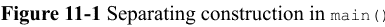


将构造与使用分离的一种强大机制是*依赖注入*（DI），即*控制反转*（IoC）在依赖管理中的应用。<sup>3</sup> 控制反转将次要职责从对象转移到专门负责这些职责的其他对象上，从而支持*单一职责原则*。在依赖管理的上下文中，对象不应自己负责实例化依赖。相反，它应该将这一责任交给另一个“权威”机制，从而反转控制。由于装配是一个全局性问题，这个权威机制通常是“主”例程或专门的*容器*。

JNDI 查找是 DI 的一种“部分”实现，其中对象请求目录服务器提供与特定名称匹配的“服务”。

```java
MyService    myService    =    (MyService)
(jndiContext.lookup("NameOfMyService"));
```

调用方对象并不控制实际返回的对象类型（当然，只要它实现了相应的接口即可），但调用方仍然主动解析依赖。

真正的依赖注入更进一步。类不采取任何直接步骤来解析依赖；它完全是被动的。相反，它提供用于*注入*依赖的 setter 方法或构造函数参数（或两者）。在构造过程中，DI 容器实例化所需的对象（通常按需），并使用提供的构造函数参数或 setter 方法将依赖装配在一起。实际使用哪些依赖对象，通过配置文件或在专门的构造模块中以编程方式指定。

Spring 框架提供了 Java 中最著名的 DI 容器。<sup>4</sup> 在 XML 配置文件中定义要装配在一起的哪些对象，然后在 Java 代码中按名称请求特定对象。我们稍后会看一个示例。

但是，LAZY-INITIALIZATION（懒初始化）的好处呢？这种惯用法在 DI 中有时仍然有用。首先，大多数 DI 容器直到需要时才构造对象。其次，许多此类容器提供调用工厂或构造代理的机制，可用于 LAZY-EVALUATION（懒求值）和类似的*优化*。<sup>5</sup>

### 扩展

城市由城镇发展而来，城镇由定居点发展而来。起初道路狭窄，几乎不存在，然后铺上路面，随着时间推移不断拓宽。小建筑和空地逐渐被更大的建筑填满，其中一些最终被摩天大楼取代。

起初没有电力、供水、排污和互联网等服务（天哪！）。随着人口和建筑密度的增加，这些服务才逐步添加。

这种增长并非没有痛苦。你有多少次在堵车时驶过一段“道路改造”工程，并问自己：“为什么他们当初不把路修得足够宽呢！？”

但除此之外别无他法。谁能证明在一个预期会发展的小镇中间修建六车道高速公路的费用是合理的？谁会*希望*这样一条路穿过自己的小镇呢？

认为我们可以“第一次就把系统做对”是一种神话。相反，我们只应该实现今天的*用户故事*，然后重构并扩展系统，以便明天实现新的用户故事。这就是迭代和增量敏捷的本质。测试驱动开发、重构，以及它们所产生的整洁代码，使这一点在代码层面得以实现。

但是在系统层面呢？系统架构难道不需要预先规划吗？当然，它*不可能*从简单逐步成长为复杂，对吧？

> *软件系统与物理系统不同。如果我们保持适当的关注点分离，它们的架构可以逐步增长。*

正如我们将看到的，软件系统的短暂性使这成为可能。让我们首先考虑一个未能充分分离关注点的架构的反例。

最初的 EJB1 和 EJB2 架构没有恰当地分离关注点，从而对有机增长造成了不必要的障碍。考虑一个用于持久化 *Bank* 类的*实体Bean*。实体Bean是关系数据的内存表示，换句话说，就是一行表数据。

首先，你必须定义一个客户端会使用的本地（进程内）或远程（独立 JVM）接口。清单 11-1 展示了一个可能的本地接口：

### Listing 11-1 Bank EJB 的 EJB2 本地接口

```java
package com.example.banking;
import java.util.Collections;
import javax.ejb.*;

public interface BankLocal extends javax.ejb.EJBLocalObject {
    String getStreetAddr1() throws EJBException;
    String getStreetAddr2() throws EJBException;
    String getCity() throws EJBException;
    String getState() throws EJBException;
    String getZipCode() throws EJBException;
    void setStreetAddr1(String street1) throws EJBException;
    void setStreetAddr2(String street2) throws EJBException;
    void setCity(String city) throws EJBException;
    void setState(String state) throws EJBException;
    void setZipCode(String zip) throws EJBException;
    Collection getAccounts() throws EJBException;
    void setAccounts(Collection accounts) throws EJBException;
    void addAccount(AccountDTO accountDTO) throws EJBException;
}
```

我展示了 Bank 地址的几个属性，以及该银行拥有的账户集合，其中每个账户的数据都由一个单独的 Account EJB 处理。清单 11-2 展示了 Bank bean 对应的实现类。

### Listing 11-2 对应的 EJB2 实体Bean 实现

```java
package com.example.banking;
import java.util.Collections;
import javax.ejb.*;

public abstract class Bank implements javax.ejb.EntityBean {
    // Business logic…
    public abstract String getStreetAddr1();
    public abstract String getStreetAddr2();
    public abstract String getCity();
    public abstract String getState();
    public abstract String getZipCode();
    public abstract void setStreetAddr1(String street1);
    public abstract void setStreetAddr2(String street2);
    public abstract void setCity(String city);
    public abstract void setState(String state);
    public abstract void setZipCode(String zip);
    public abstract Collection getAccounts();
    public abstract void setAccounts(Collection accounts);
    public void addAccount(AccountDTO accountDTO) {
        InitialContext context = new InitialContext();
        AccountHomeLocal accountHome =
            context.lookup("AccountHomeLocal");
        AccountLocal account = accountHome.create(accountDTO);
        Collection accounts = getAccounts();
        accounts.add(account);
    }
    // EJB container logic
    public abstract void setId(Integer id);
    public abstract Integer getId();
    public Integer ejbCreate(Integer id) { … }
    public void ejbPostCreate(Integer id) { … }
    // The rest had to be implemented but were usually empty:
    public void setEntityContext(EntityContext ctx) { }
    public void unsetEntityContext() { }
    public void ejbActivate() { }
    public void ejbPassivate() { }
    public void ejbLoad() { }
    public void ejbStore() { }
    public void ejbRemove() { }
}
```

我没有展示相应的 *LocalHome* 接口（本质上是一个用于创建对象的工厂），也没有展示你可能添加的任何 Bank 查找器（查询）方法。

最后，你不得不编写一个或多个 XML 部署描述符，指定到持久化存储的对象-关系映射细节、所需的事务行为、安全约束等。

业务逻辑与 EJB2 应用“容器”紧密耦合。你必须继承容器类型，并且必须提供容器所需的许多生命周期方法。

由于与这种重量级容器耦合，隔离的单元测试很困难。你必须模拟容器，这很难，或者浪费大量时间将 EJB 和测试部署到真实服务器上。由于紧密耦合，在 EJB2 架构之外复用实际上是不可能的。

最后，连面向对象编程也受到了损害。一个 bean 不能继承另一个 bean。注意添加新账户的逻辑。在 EJB2 bean 中，通常定义“数据传输对象”（DTO），这些对象本质上是没有行为的“结构体”。这通常会导致持有基本相同数据的冗余类型，并且需要样板代码来将数据从一个对象复制到另一个对象。

### 横切关注点

EJB2 架构在某些方面接近真正的关注点分离。例如，所需的事务、安全以及部分持久化行为都在部署描述符中声明，独立于源代码。

请注意，像持久化这样的*关注点*往往会横切领域的自然对象边界。你希望使用大体相同的策略来持久化所有对象，例如，使用特定的 DBMS<sup>6</sup> 而不是平面文件，遵循某些表和列的命名约定，使用一致的事务语义等等。

原则上，你可以用模块化、封装的方式推理你的持久化策略。然而，在实践中，你不得不将实现持久化策略的本质上相同的代码分散到许多对象中。我们用*横切关注点*这个术语来指代这类关注点。同样，持久化框架可能是模块化的，而我们的领域逻辑，在孤立情况下，

可能是模块化的。问题在于这些领域之间细粒度的*交叉*。

事实上，EJB 架构处理持久性、安全性和事务的方式，“预见了”*面向切面编程*（AOP），<sup>7</sup> 这是一种用于恢复横切关注点模块化能力的通用方法。

在 AOP 中，被称为*切面*的模块化构造会指定系统中的哪些点应以某种一致的方式修改其行为，以支持特定关注点。这种指定是通过简洁的声明式或编程式机制完成的。

以持久性为例，你可以声明哪些对象和属性（或其*模式*）应该被持久化，然后将持久化任务委托给你的持久化框架。行为修改由 AOP 框架以*非侵入*<sup>8</sup> 的方式作用于目标代码。让我们来看看 Java 中的三种切面或类切面机制。

### Java 代理

Java 代理适用于简单场景，例如包装单个对象或类中的方法调用。然而，JDK 提供的动态代理只适用于接口。要代理类，你必须使用字节码操作库，如 CGLIB、ASM 或 Javassist。<sup>9</sup>

[清单 11-3](#listing-11-3) 展示了一个 JDK 代理的骨架，用于为我们的 Bank 应用提供持久性支持，仅覆盖获取和设置账户列表的方法。

### 清单 11-3 JDK 代理示例

```java
// Bank.java (suppressing package names...)
import java.util.*;

// The abstraction of a bank.
public interface Bank {
    Collection<Account> getAccounts();
    void setAccounts(Collection<Account> accounts);
}

// BankImpl.java
import java.util.*;

// The "Plain-Old Java Object" (POJO) implementing the abstraction.
public class BankImpl implements Bank {
    private List<Account> accounts;

    public Collection<Account> getAccounts() {
        return accounts;
    }
    public void setAccounts(Collection<Account> accounts) {
        this.accounts = new ArrayList<Account>();
        for (Account account: accounts) {
            this.accounts.add(account);
        }
    }
}

// BankProxyHandler.java
import java.lang.reflect.*;
import java.util.*;
// "InvocationHandler" required by the proxy API.
public class BankProxyHandler implements InvocationHandler {
    private Bank bank;

    public BankProxyHandler(Bank bank) {
        this.bank = bank;
    }
    // Method defined in InvocationHandler
    public Object invoke(Object proxy, Method method, Object[] args)
        throws Throwable {
        String methodName = method.getName();
        if (methodName.equals("getAccounts")) {
            bank.setAccounts(getAccountsFromDatabase());
            return bank.getAccounts();
        } else if (methodName.equals("setAccounts")) {
            bank.setAccounts((Collection<Account>) args[0]);
            setAccountsToDatabase(bank.getAccounts());
            return null;
        } else {
            ...
        }
    }
}
// Lots of details here:
protected Collection<Account> getAccountsFromDatabase() { … }
protected void setAccountsToDatabase(Collection<Account> accounts) {
…
}

// Somewhere else…

Bank bank = (Bank) Proxy.newProxyInstance(
    Bank.class.getClassLoader(),
    new Class[] { Bank.class },
    new BankProxyHandler(new BankImpl()));
```

我们定义了一个接口 `Bank`，它将被代理*包装*，以及一个实现业务逻辑的*普通 Java 对象*（POJO）`BankImpl`。（我们稍后会再讨论 POJO。）

Proxy API 需要一个 `InvocationHandler` 对象，代理会调用它来实现所有对代理发出的 `Bank` 方法调用。我们的 `BankProxyHandler` 使用 Java 反射 API 将通用方法调用映射到 `BankImpl` 中的相应方法，等等。

这里的代码*非常*多，即使对于这个简单案例也相对复杂。使用字节码操作库之一同样具有挑战性。这种代码“量”和复杂性是代理的两个缺点。它们使编写整洁代码变得困难！此外，代理并没有提供一种机制来指定系统范围内感兴趣的“执行点”，而这正是真正 AOP 解决方案所需要的。[10][11]

### 纯 Java AOP 框架

幸运的是，大多数代理样板代码可以由工具自动处理。一些 Java 框架内部使用代理来实现纯 Java 中的切面，例如 Spring AOP 和 JBoss AOP。<sup>12</sup> 在 Spring 中，你将业务逻辑编写为*普通 Java 对象*。POJO 纯粹专注于其业务领域，不依赖企业框架（或任何其他领域）。因此，它们在概念上更简单，也更容易进行测试驱动开发。这种相对简单性使得你更容易确保正确实现对应的用户故事，也更容易为将来的故事维护和发展代码。

你通过声明式配置文件或 API 来整合所需的应用程序基础设施，包括持久性、事务、安全、缓存、故障转移等横切关注点。在许多情况下，你实际上是在指定 Spring 或 JBoss 库的切面，框架会用对用户透明的方式处理 Java 代理或字节码库的机制。这些声明驱动依赖注入（DI）容器，容器按需实例化主要对象并将它们装配在一起。

[清单 11-4](#listing-11-4) 展示了 Spring V2.5 配置文件 app.xml<sup>13</sup> 的一个典型片段。

### 清单 11-4 Spring 2.x 配置文件

```xml
<beans>

...

<bean id="appDataSource"
class="org.apache.commons.dbcp.BasicDataSource"
destroy-method="close"
p:driverClassName="com.mysql.jdbc.Driver"
p:url="jdbc:mysql://localhost:3306/mydb"
p:username="me"/>

<bean id="bankDataAccessObject"
class="com.example.banking.persistence.BankDataAccessObject"
p:dataSource-ref="appDataSource"/>

<bean id="bank"
class="com.example.banking.model.Bank"
/>
</beans>
```

### 清单 11-5 一个 EJB3 Bank EJB

```java
package com.example.banking.model;
import javax.persistence.*;
import java.util.ArrayList;
import java.util.Collection;

@Entity
@Table(name = "BANKS")
public class Bank implements java.io.Serializable {
    @Id @GeneratedValue(strategy=GenerationType.AUTO)
    private int id;

    @Embeddable // An object "inlined" in Bank's DB row
    public class Address {
        protected String streetAddr1;
        protected String streetAddr2;
        protected String city;
        protected String state;
        protected String zipCode;
    }
    @Embedded
    private Address address;

    @OneToMany(cascade = CascadeType.ALL, fetch = FetchType.EAGER,
               mappedBy="bank")
    private Collection<Account> accounts = new ArrayList<Account>();

    public int getId() {
        return id;
    }

    public void setId(int id) {
        this.id = id;
    }

    public void addAccount(Account account) {
        account.setBank(this);
        accounts.add(account);
    }

    public Collection<Account> getAccounts() {
        return accounts;
    }

    public void setAccounts(Collection<Account> accounts) {
        this.accounts = accounts;
    }
}
```

这段代码比原来的 EJB2 代码整洁得多。一些实体细节仍然存在，包含在注解中。然而，由于这些信息全部都在注解内，代码整洁、清晰，因此易于测试驱动、维护等。

如果需要，注解中的部分或全部持久化信息可以移到 XML 部署描述符中，从而留下一个真正纯 POJO。如果持久化映射细节不会频繁变化，许多团队可能会选择保留注解，但与 EJB2 的侵入性相比，其有害缺点要少得多。

### AspectJ 切面

最后，通过切面分离关注点的最全功能工具是 AspectJ 语言，¹⁷ 它是 Java 的扩展，为切面作为模块化构造提供了“一等公民”支持。Spring AOP 和 JBoss AOP 提供的纯 Java 方法足以应对 80%–90% 最需要切面的场景。然而，AspectJ 提供了一套非常丰富而强大的工具来分离关注点。AspectJ 的缺点是需要采用若干新工具，并学习新的语言构造和使用习惯。

最近引入的 AspectJ“注解形式”在一定程度上缓解了采用问题，这种形式使用 Java 5 注解，以纯 Java 代码定义切面。此外，Spring Framework 提供了许多特性，使得经验有限的团队也能更容易地整合基于注解的切面。


- [JBoss]：JBoss 主页，http://jboss.org
- [JMock]：JMock——一个用于 Java 的轻量级模拟对象库，http://jmock.org
- [Kolence]：Kenneth W. Kolence，《软件物理与计算机性能测量》，*ACM 年会论文集——第 2 卷*，马萨诸塞州波士顿，第 1024–1040 页，1972 年。
- [Spring]：*Spring 框架*，http://www.springframework.org
- [Meszaros07]：*XUnit 测试模式*，Gerard Meszaros 著，Addison-Wesley，2007 年。
- [GOF]：*设计模式：可复用面向对象软件的元素*，Gamma 等合著，Addison-Wesley，1996 年。

我们的函数和类，选择更好的命名，等等。这也是我们应用简单设计最后三条规则的地方：消除重复、确保表达力，以及尽量减少类和方法的数量。

### 无重复

重复是设计良好系统的主要敌人。它代表着额外的工作、额外的风险，以及额外的不必要复杂度。重复以多种形式存在。看起来完全相同的代码行当然是重复。相似的代码行通常可以通过调整而变得更为相似，以便更容易重构。重复还可能以其他形式存在，比如实现的重复。例如，我们可能在一个集合类中有两个方法：

```java
int size() {}
boolean isEmpty() {}
```

我们可能为每个方法提供独立的实现。`isEmpty` 方法可以跟踪一个布尔值，而 `size` 可以跟踪一个计数器。或者，我们可以通过将 `isEmpty` 绑定到 `size` 的定义来消除这种重复：

```java
boolean isEmpty() {
    return 0 == size();
}
```

创建一个整洁的系统需要消除重复的意愿，哪怕只是几行代码。例如，考虑下面的代码：

```java
public void scaleToOneDimension(
    float desiredDimension, float imageDimension) {
    if (Math.abs(desiredDimension - imageDimension) < errorThreshold)
        return;
    float scalingFactor = desiredDimension / imageDimension;
    scalingFactor = (float)(Math.floor(scalingFactor * 100) * 0.01f);

    RenderedOp newImage = ImageUtilities.getScaledImage(
        image, scalingFactor, scalingFactor);
    image.dispose();
    System.gc();
    image = newImage;
}
public synchronized void rotate(int degrees) {
    RenderedOp newImage = ImageUtilities.getRotatedImage(
        image, degrees);
    image.dispose();
    System.gc();
    image = newImage;
}
```

为了保持系统整洁，我们应该消除 `scaleToOneDimension` 和 `rotate` 方法之间少量的重复：

```java
public void scaleToOneDimension(
    float desiredDimension, float imageDimension) {
    if (Math.abs(desiredDimension - imageDimension) < errorThreshold)
        return;
    float scalingFactor = desiredDimension / imageDimension;
    scalingFactor = (float)(Math.floor(scalingFactor * 100) * 0.01f);
    replaceImage(ImageUtilities.getScaledImage(
        image, scalingFactor, scalingFactor));
}
public synchronized void rotate(int degrees) {
    replaceImage(ImageUtilities.getRotatedImage(image, degrees));
}
private void replaceImage(RenderedOp newImage) {
    image.dispose();
    System.gc();
    image = newImage;
}
```

当我们在这个非常细微的层次上提取共性时，我们开始察觉到对 SRP 的违反。于是我们可能将一个新提取的方法移到另一个类中。那会提升它的可见性。团队中的其他人可能会认识到进一步抽象这个新方法并在不同上下文中复用的机会。这种“小范围复用”可以使系统复杂度缩小。

```java
}
private void calculateBaseVacationHours() { /* ... */ };
abstract protected void alterForLegalMinimums();
private void applyToPayroll() { /* ... */ };
}
public class USVacationPolicy extends VacationPolicy {
    @Override protected void alterForLegalMinimums() {
        // US specific logic
    }
}
public class EUVacationPolicy extends VacationPolicy {
    @Override protected void alterForLegalMinimums() {
        // EU specific logic
    }
}
```

子类填补了 `accrueVacation` 算法中的“空洞”，提供了唯一未被重复的信息。

### 表达力

我们大多数人都经历过处理错综复杂代码的体验。我们中也有许多人自己编写过一些错综复杂的代码。编写我们理解的代码很容易，因为在编写时我们正深入理解所要解决的问题。代码的其他维护者不会拥有同样深入的理解。

软件项目的大部分成本在于长期维护。为了在引入变更时尽量降低缺陷的可能性，能够理解系统所做的工作对我们至关重要。随着系统变得越来越复杂，开发者理解系统所需的时间也越来越多，产生误解的机会也更大。因此，代码应当清晰地表达其作者的意图。作者能让代码越清晰，别人理解它所需的时间就越少。这将减少缺陷并降低维护成本。

你可以通过选择好的命名来表达自己。我们希望听到一个类或函数的名字时，不会在发现其职责时感到意外。

你也可以通过保持函数和类的小型化来表达自己。小的类和函数通常易于命名、易于编写，也易于理解。

你还可以通过使用标准术语来表达自己。例如，设计模式在很大程度上关乎沟通和表达力。通过使用标准的模式名称（如 COMMAND 或 VISITOR）作为实现这些模式的类的名称，你可以简洁地向其他开发者描述你的设计。

编写良好的单元测试也具有表达力。测试的一个主要目标是作为示例形式的文档。阅读我们测试的人应该能够快速理解一个类是做什么的。

但最有表达力的方式是要 *尝试*。我们常常让代码运行起来，然后继续解决下一个问题，而没有充分考虑让代码便于下一个人阅读。请记住，最有可能阅读这段代码的下一个人就是你自己。

因此，请对自己的工艺感到一点自豪。在每个函数和类上花一点时间。选择更好的名称，将大函数拆分为小函数，通常还要关心你所创造的东西。关心是宝贵的资源。

### 最少的类和方法

即使是像消除重复、代码表达力和 SRP 这样基础的概念，也可能被过度使用。为了追求类和方法的精简，我们可能会创建过多微小的类和方法。因此，这条规则建议我们也要保持函数和类的数量尽量少。

过高的类和方法数量有时是无意义的教条主义的结果。例如，考虑一种编码标准，它坚持要求为每一个类都创建一个接口。或者考虑那些坚持字段和行为必须始终分离到数据类中的开发者。

## 第13章 并发

作者：Brett L. Schuchert


> “对象是处理过程的抽象。线程是调度的抽象。”
>
> ——James O. Coplien¹

编写整洁的并发程序很难——非常难。编写单线程执行的代码要容易得多。编写表面上看起来不错但深层已损坏的多线程代码也很容易。这种代码在系统承受压力之前一直运行良好。

在本章中，我们讨论并发编程的必要性，以及它带来的困难。然后，我们针对这些困难提出几条建议，并说明如何编写整洁的并发代码。最后，我们以与测试并发代码相关的问题作为总结。


整洁并发是一个复杂的话题，本身就值得写一本书。我们在*本书*中的策略是在此处给出一个概述，并在第317页的“并发II”中提供更详细的教程。如果你只是对并发感到好奇，那么这一章现在对你已经足够了。如果你需要更深入地理解并发，那么你也应该通读该教程。

### 为什么需要并发？

并发是一种解耦策略。它帮助我们解耦*做什么*与*何时做*。在单线程应用中，*做什么*和*何时做*之间耦合得如此紧密，以至于通常只需查看堆栈回溯就可以确定整个应用的状态。调试此类系统的程序员可以设置一个断点或一系列断点，并通过命中的断点来*了解*系统的状态。

将*做什么*与*何时做*解耦，可以显著提高应用的吞吐量和结构。从结构上看，应用看起来像许多协作的小型计算机，而不是一个大型主循环。这可以使系统更易于理解，并提供了一些强大的关注点分离方式。

例如，考虑Web应用的标准“Servlet”模型。这些系统运行在Web或EJB容器的保护伞下，该容器会*部分地*为你管理并发。当Web请求到来时，Servlet会被异步执行。Servlet程序员不必管理所有传入的请求。*原则上*，每次Servlet执行都存在于自己的小世界中，并与其他所有Servlet执行解耦。

当然，如果真有这么容易，本章也就没有必要了。事实上，Web容器提供的解耦远非完美。Servlet程序员必须非常清楚并且非常小心，以确保他们的并发程序是正确的。尽管如此，Servlet模型在结构上的好处是显著的。

但结构并非采用并发的唯一动机。一些系统有响应时间和吞吐量的约束，需要手工编码的并发解决方案。例如，考虑一个单线程的信息聚合器，它从许多不同的网站获取信息，并将这些信息合并成每日摘要。由于该系统是单线程的，它依次访问每个网站，总是完成一个再开始下一个。每日运行需要在24小时内完成。然而，随着越来越多的网站被添加，时间不断增长，直到收集所有数据需要超过24小时。单线程涉及大量在Web套接字上等待I/O完成的时间。我们可以使用一次访问多个网站的多线程算法来提高性能。

或者考虑一个一次只处理一个用户、每个用户只需一秒钟时间的系统。对于少量用户来说，这个系统的响应性相当好，但随着用户数量的增加，系统的响应时间也会增加。没有用户愿意排在150个人后面！我们可以通过并发处理许多用户来提高该系统的响应时间。

或者考虑一个解释大型数据集的系统，但只有在处理完所有数据集后才能给出完整解决方案。也许每个数据集可以在不同的计算机上处理，从而并行处理许多数据集。

### 神话与误解

因此，采用并发有着令人信服的理由。然而，正如我们之前所说，并发是*困难的*。如果你不小心，可能会造成一些非常糟糕的情况。请考虑这些常见的神话和误解：

- *并发总能提高性能。*  
  并发*有时*可以提高性能，但只有在多个线程或多个处理器之间可以共享大量等待时间时才行。这两种情况都不简单。
- *编写并发程序时，设计不会改变。*  
  事实上，并发算法的设计与单线程系统的设计可能有显著不同。将*做什么*与*何时做*解耦通常会对系统结构产生巨大影响。
- *在使用Web或EJB等容器时，理解并发问题并不重要。*

令人惊讶的第三个结果³发生在两个线程相互踩踏时。这是因为两个线程在执行那一行Java代码时可能有许多路径，而其中一些路径会产生错误的结果。有多少种不同的路径？要真正回答这个问题，我们需要理解即时编译器对生成的字节码做了什么，并理解Java内存模型认为什么是原子操作。

一个快速答案（仅就生成的字节码而言）是，在`getNextId`方法中执行的那两个线程有12,870种不同的可能执行路径⁴。如果`lastIdUsed`的类型从`int`改为`long`，可能的路径数将增加到2,704,156。当然，其中大多数路径会产生有效结果。问题在于有些不会。

### 并发防御原则

下面是一系列防御你的系统免受并发代码问题的原则和技术。

#### 单一职责原则

SRP⁵指出，一个给定的方法/类/组件应该只有一个变更原因。并发设计本身的复杂性足以成为一个独立的变更原因，因此应当与其余代码分离。不幸的是，并发实现细节被直接嵌入到其他生产代码中的情况实在太常见了。以下几点值得考虑：

- *并发相关代码有自己独立的开发*、变更和调优生命周期。
- *并发相关代码有自身的挑战*，这些挑战与非并发相关代码不同，而且往往更加困难。
- 错误编写的并发代码可能失败的方式如此之多，这使得它本身就足够具有挑战性，更不用说还要承担周围应用代码的额外负担了。

**建议：***将并发相关代码与其他代码分开。*⁶

#### 推论：限制数据作用域

正如我们所见，两个线程修改共享对象的同一字段会相互干扰，导致意外行为。一种解决方案是使用`synchronized`关键字来保护使用共享对象的代码中的*临界区*。限制这种临界区的数量很重要。共享数据可能被更新的地方越多，就越有可能出现以下情况：

- 你会忘记保护其中一个或多个地方，从而有效地破坏所有修改该共享数据的代码。
- 需要重复劳动来确保所有内容都得到有效保护（违反DRY⁷）。
- 将难以确定失败之源，而这些失败本来就已经很难发现了。

**建议：***认真对待数据封装；严格限制任何可能被共享的数据的访问。*

#### 推论：使用数据副本

避免共享数据的一个好方法是从一开始就不共享数据。在某些情况下，可以复制对象并将它们视为只读。在其他情况下，可以复制对象，在多个线程中收集这些副本的结果，然后在单个线程中合并结果。

如果有一种简单的方法来避免共享对象，那么最终代码引发问题的可能性就会小得多。你可能会担心所有额外对象创建的成本。值得通过实验来了解这实际上是否是一个问题。然而，如果使用对象副本可以让代码避免同步，那么避免内置锁所节省的开销很可能弥补额外创建和垃圾收集的开销。

#### 推论：线程应尽可能独立

考虑编写你的线程代码，让每个线程存在于自己的世界中，不与其他任何线程共享数据。每个线程处理

一个客户端请求，其所有必需数据都来自非共享源，并存储为局部变量。这使得每个线程都表现得好像它是世界上唯一的线程，不存在任何同步需求。

例如，继承自 `HttpServlet` 的类通过 `doGet` 和 `doPost` 方法传入的参数接收其所有信息。这使得每个 `Servlet` 表现得就像拥有自己的机器一样。只要 `Servlet` 中的代码只使用局部变量，`Servlet` 就不会引起同步问题。当然，大多数使用 `Servlet` 的应用程序最终都会遇到共享资源，比如数据库连接。

> **建议：** *尝试将数据划分为独立子集，由独立线程（甚至可能在不同处理器上）操作。*

### 了解你的类库

Java 5 相比之前版本为并发开发提供了许多改进。在 Java 5 中编写多线程代码时，有几点需要考虑：

-   使用提供的线程安全集合。
-   使用执行器框架来执行不相关的任务。
-   尽可能使用非阻塞解决方案。
-   某些类库类不是线程安全的。

### 线程安全集合

当 Java 还很年轻的时候，Doug Lea 写了一本开创性的书⁸《Java 并发编程》。除了这本书，他还开发了几个线程安全的集合，这些集合后来成为 JDK 中 `java.util.concurrent` 包的一部分。该包中的集合在多线程情况下是安全的，并且性能良好。实际上，`ConcurrentHashMap` 实现在几乎所有情况下的性能都优于 `HashMap`。它还允许同时进行并发读写，并提供支持常见复合操作的方法，这些操作在其他情况下不是线程安全的。如果 Java 5 是部署环境，请从 `ConcurrentHashMap` 开始。

还有其他几种支持高级并发设计的类。这里有些例子：

| 类 | 描述 |
|---|---|
| ReentrantLock | 一种可以在一个方法中获取并在另一个方法中释放的锁。 |
| Semaphore | 经典信号量（一种带计数的锁）的实现。 |
| CountDownLatch | 一种锁，在释放所有等待线程之前等待多个事件。这允许所有线程有公平的机会大致同时启动。 |

**建议：** *审查你可用的类。对于 Java，请熟悉 `java.util.concurrent`、`java.util.concurrent.atomic`、`java.util.concurrent.locks`。*

### 了解你的执行模型

在并发应用中，有几种不同的方式来划分行为。为了讨论这些方式，我们需要理解一些基本定义。

| 术语 | 定义 |
|---|---|
| 受限资源 | 在并发环境中使用的固定大小或数量的资源。例如数据库连接和固定大小的读/写缓冲区。 |
| 互斥 | 一次只有一个线程可以访问共享数据或共享资源。 |
| 饥饿 | 一个线程或一组线程被禁止运行过长时间或永远无法运行。例如，如果总是让运行速度快的线程优先通过，而快速线程源源不断，那么运行时间长的线程可能会被饿死。 |
| 死锁 | 两个或多个线程相互等待对方完成。每个线程都持有一个其他线程需要的资源，并且只有获得对方的资源才能完成。 |
| 活锁 | 线程步调一致地相互阻塞，每个线程都在尝试工作，但发现另一个线程“挡路”。由于共振，线程继续尝试取得进展，但在过长时间内（或永远）无法做到。 |

有了这些定义，我们现在可以讨论并发编程中使用的各种执行模型。

### **生产者-消费者**<sup>9</sup>

一个或多个生产者线程创建一些工作并将其放入缓冲区或队列。一个或多个消费者线程从队列中获取这些工作并完成它。生产者和消费者之间的队列是一个*受限资源*。这意味着生产者在写入之前必须等待队列中有空闲空间，消费者必须等待队列中有东西可消费。通过队列在生产者和消费者之间进行的协调涉及两者互相发出信号。生产者写入队列并发出队列不再为空的信号；消费者从队列中读取并发出队列不再满的信号。两者都可能等待被通知后继续。

### **读者-写者**<sup>10</sup>

当你有一个主要作为读者信息来源、偶尔被写者更新的共享资源时，吞吐量就成了问题。强调吞吐量会导致饥饿和过时信息的积累。允许更新可能影响吞吐量。协调读者使其不读取写者正在更新的内容，反之亦然，这是一个艰难的平衡行为。写者往往会长时间阻塞大量读者，从而引起吞吐量问题。

挑战在于平衡读者和写者的需求，以满足正确操作、提供合理吞吐量并避免饥饿。一种简单的策略是让写者等待，直到没有读者时才允许写者执行更新。然而，如果读者持续不断，写者就会被饿死。另一方面，如果写者频繁且被赋予优先权，吞吐量就会受损。找到这种平衡并避免并发更新问题，正是该问题所要解决的。

### **哲学家就餐**<sup>11</sup>

想象许多哲学家围坐在一张圆桌旁。每位哲学家的左手边放着一把叉子。桌子中央有一大碗意大利面。哲学家们除了饥饿时会思考，其余时间都在思考。一旦饿了，他们就拿起左右两边的叉子开始吃。哲学家只有拿到两把叉子才能吃。如果他右边或左边的哲学家已经在使用他需要的一把叉子，他就必须等待那位哲学家吃完并把叉子放回去。一旦哲学家吃完，他会把两把叉子都放回桌上，然后等到再次饥饿。

将哲学家替换为线程，将叉子替换为资源，这个问题类似于许多企业应用中进程竞争资源的情况。除非经过精心设计，否则以这种方式竞争的系统可能会遇到死锁、活锁、吞吐量下降和效率降低的问题。

你可能会遇到的大多数并发问题都是这三个问题的某种变体。研究这些算法并自己动手编写解决方案，这样当你遇到并发问题时，你就能更有准备地去解决它。

**建议：** *学习这些基本算法并理解它们的解决方案。*

### 警惕同步方法之间的依赖

同步方法之间的依赖会导致并发代码中出现微妙的错误。Java 语言有 `synchronized` 的概念，它可以保护单个方法。然而，如果同一个共享类上有多个同步方法，那么你的系统可能就编写错了。[12]

**建议：** *避免在同一个共享对象上使用多个方法。*

有时你必须在共享对象上使用多个方法。在这种情况下，有三种方法可以使代码正确：

-   **基于客户端的锁定**——让客户端在调用第一个方法之前锁定服务器，并确保锁的范围包含调用最后一个方法的代码。
-   **基于服务器的锁定**——在服务器内部创建一个方法，该方法锁定服务器，调用所有方法，然后解锁。让客户端调用这个新方法。
-   **适配服务器**——创建一个执行锁定的中间层。这是基于服务器锁定的一种示例，适用于原始服务器无法修改的情况。

### 保持同步代码段短小

`synchronized` 关键字会引入一个锁。受同一把锁保护的所有代码段在任何给定时间都保证只有一个线程在其中执行。锁的代价很高，因为它们会造成延迟并增加开销。因此我们不希望代码中到处是 `synchronized` 语句。另一方面，临界区^13必须受到保护。所以我们希望在设计代码时尽可能减少临界区的数量。

一些天真的程序员试图通过将临界区设计得非常大来实现这一点。然而，将同步范围扩大到最小临界区之外会增加竞争并降低性能。^14

**建议：** *尽量保持同步代码段短小。*

### 编写正确的关闭代码很难

编写一个旨在保持运行并永远运行的系统，与编写一个运行一段时间然后优雅关闭的系统是不同的。

优雅关闭可能很难做到正确。常见问题涉及死锁，^15其中线程等待一个永远不会到来的继续信号。

例如，想象一个系统，其父线程创建了几个子线程，然后等待它们全部完成，之后才释放资源并关闭。如果其中一个被创建的线程死锁了怎么办？父线程将永远等待，系统将永远无法关闭。

再考虑一个类似的系统，它已收到*指令*要关闭。父线程告诉所有已创建的子线程放弃任务并结束。但是，如果其中两个子线程是以生产者/消费者配对方式运作的呢？假设生产者收到父线程的信号并迅速关闭


关闭。消费者可能一直在等待生产者的消息，并处于无法接收关闭信号的状态。它可能会一直等待生产者而无法结束，进而导致父进程也无法结束。

这种情况并不少见。因此，如果你必须编写涉及优雅关闭的并发代码，那么请做好花费大量时间让关闭正确实现的准备。

**建议：** *尽早考虑关闭问题，并尽早让其工作起来。这会比你预想的耗时更长。重新审视现有算法，因为这可能比你想象的更难。*

### 测试线程代码

证明代码正确是不切实际的。测试并不能保证正确性。然而，好的测试可以最大限度地降低风险。这在单线程解决方案中也是如此。一旦有两个或多个线程使用相同代码并处理共享数据，情况就会变得复杂得多。

**建议：** *编写有可能暴露问题的测试，然后频繁运行它们，使用不同的程序配置、系统配置和负载。如果测试失败，一定要追查失败原因。不要因为后续运行中测试通过了就忽视失败。*

这需要考虑很多方面。以下是一些更细粒度的建议：

- 将偶发失败视为潜在的线程问题。
- 先让非线程代码正常工作。
- 使线程代码可插拔。
- 使线程代码可调优。
- 使用比处理器更多的线程运行。
- 在不同平台上运行。
- 对代码进行插桩以尝试强制失败。

### 将偶发失败视为潜在的线程问题

配置。允许轻松调整线程数量。考虑允许在系统运行时更改它。考虑允许基于吞吐量和系统利用率进行自我调整。

### 使用比处理器更多的线程运行

当系统在任务之间切换时会发生很多事情。为了鼓励任务切换，请使用比处理器或内核数量更多的线程运行。任务切换越频繁，就越有可能遇到缺少临界区或导致死锁的代码。

### 在不同平台上运行

2007年年中，我们开发了一门关于并发编程的课程。课程开发主要在 OS X 下进行。课程演示则使用运行在虚拟机中的 Windows XP。为演示失败条件而编写的测试在 XP 环境中的失败频率不如在 OS X 中高。

在所有情况下，被测代码都是已知有问题的。这恰恰印证了一个事实：不同的操作系统有不同的线程策略，每种策略都会影响代码的执行。多线程代码在不同环境下表现不同。¹⁶ 你应该在每一个可能的部署环境中运行测试。

> **建议：** *尽早并频繁地在所有目标平台上运行你的线程代码。*

### 对代码进行插桩以尝试强制失败

并发代码中的缺陷隐藏起来是很正常的。简单的测试通常无法暴露它们。事实上，它们常常在正常处理过程中隐藏。它们可能每隔几小时、几天或几周才出现一次！

线程缺陷之所以罕见、零散且难以重现，是因为在通过易受攻击代码段的数千条可能路径中，只有极少数路径实际上会失败。因此，触发失败路径的概率可能低得惊人。这使得检测和调试变得非常困难。

那么如何提高捕获这种罕见情况的机会呢？你可以通过添加对 `Object.wait()`、`Object.sleep()`、`Object.yield()` 和 `Object.priority()` 等方法调用来对代码进行插桩，强制它以不同的顺序执行。

这些方法中的每一个都会影响执行顺序，从而增加发现缺陷的几率。对于有问题的代码，最好是尽早且尽可能频繁地失败。

代码插桩有两种选择：

- 手工编写
- 自动化

### 手工编写

你可以手工在代码中插入对 `wait()`、`sleep()`、`yield()` 和 `priority()` 的调用。这可能正是测试一段特别棘手的代码时的最佳时机。

下面是一个这样做的示例：

```java
public synchronized String nextUrlOrNull() {
    if(hasNext()) {
        String url = urlGenerator.next();
        Thread.yield(); // inserted for testing.
        updateHasNext();
        return url;
    }
    return null;
}
```

插入的 `yield()` 调用将改变代码的执行路径，并可能使代码在之前未失败的地方失败。如果代码确实崩溃了，这并不是因为你添加了 `yield()` 调用。¹⁷ 而是你的代码本身就有问题，这个调用只是让失败显现出来。

这种方法存在许多问题：

- 你必须手动找到合适的位置来执行此操作。
- 你怎么知道该把调用放在哪里，以及该使用哪种调用？
- 将此类代码留在生产环境中会不必要地拖慢代码速度。

或者想象一下 `ThreadJigglePoint` 类有两个实现。第一个实现 `jiggle` 什么也不做，用于生产环境。第二个实现生成一个随机数，在休眠、让出或直接通过之间进行选择。如果你运行测试一千次，随机抖动，你可能会找出一些缺陷。如果测试通过了，至少你可以说你已经尽到了尽职调查。虽然有点简单，但这是一个合理的选择，可以替代更复杂的工具。

有一个叫 Contest 的工具，¹⁸ 由 IBM 开发，它做了类似的事情，但方式要复杂得多。

关键是要抖动代码，使线程在不同时间以不同的顺序运行。精心编写的测试与抖动相结合，可以显著提高发现错误的几率。

**建议：** *使用抖动策略来揪出错误。*

### 结论

并发代码很难写对。当多个线程和共享数据混合在一起时，原本简单的代码可能会变成噩梦。如果你面临编写并发代码的任务，你需要以严谨的态度编写整洁的代码，否则就会面临隐蔽而罕见的失败。

首先，遵循单一职责原则。将系统分解为 POJO，将感知线程的代码与不感知线程的代码分开。确保在测试感知线程的代码时，你只测试它，而不测试其他任何东西。这意味着你的线程感知代码应该小而专注。

了解并发问题的可能来源：多个线程操作共享数据，或使用公共资源池。边界情况，例如干净地关闭或完成循环的迭代，可能特别棘手。

学习你的库并了解基本算法。理解库提供的某些特性如何支持解决与基本算法类似的问题。

学习如何找到必须锁定的代码区域并锁定它们。不要锁定不需要锁定的代码区域。避免从一个锁定区域调用另一个锁定区域。这需要深入理解某项内容是否被共享。尽可能减少共享对象的数量和共享范围。改变具有共享数据的对象的设计以适应客户端，而不是强迫客户端管理共享状态。

问题总会出现。那些没有及早出现的问题往往被视为一次性事件。这些所谓的一次性问题通常只会在负载下或在看似随机的时间发生。因此，你需要能够在许多平台上以多种配置反复持续地运行与线程相关的代码。遵循 TDD 三定律自然会带来可测试性，这意味着一定程度的可插拔性，为在更广泛的配置中运行代码提供了必要的支持。

如果你花时间对代码进行插桩，你将大大增加发现错误代码的机会。你可以手工完成，也可以使用某种自动化技术。尽早在这方面投入。在将基于线程的代码投入生产之前，你要尽可能长时间地运行它。

如果你采取整洁的方法，你把它做对的几率会大大增加。

### 参考文献

- [Lea99]: *Concurrent Programming in Java: Design Principles and Patterns*, 2d. ed., Doug Lea, Prentice Hall, 1999.
- [PPP]: *Agile Software Development: Principles, Patterns, and Practices*, Robert C. Martin, Prentice Hall, 2002.
- [PRAG]: *The Pragmatic Programmer*, Andrew Hunt, Dave Thomas, Addison-Wesley, 2000.


```java
marshalers.put(elementId, new StringArgumentMarshaler());
else
    throw new ArgsException(INVALID_ARGUMENT_FORMAT, elementId, elementTail);
}

private void validateSchemaElementId(char elementId) throws ArgsException {
    if (!Character.isLetter(elementId))
        throw new ArgsException(INVALID_ARGUMENT_NAME, elementId, null);
}

private void parseArgumentStrings(List<String> argsList) throws ArgsException {
    for (currentArgument = argsList.listIterator(); currentArgument.hasNext();) {
        String argString = currentArgument.next();
        if (argString.startsWith("-")) {
            parseArgumentCharacters(argString.substring(1));
        } else {
            currentArgument.previous();
            break;
        }
    }
}

private void parseArgumentCharacters(String argChars) throws ArgsException {
    for (int i = 0; i < argChars.length(); i++)
        parseArgumentCharacter(argChars.charAt(i));
}

private void parseArgumentCharacter(char argChar) throws ArgsException {
    ArgumentMarshaler m = marshalers.get(argChar);
    if (m == null) {
        throw new ArgsException(UNEXPECTED_ARGUMENT, argChar,
```

请注意，你可以从头到尾阅读这段代码，而无需大量跳转或向前查找。唯一可能需要你提前查看的是`ArgumentMarshaler`的定义，这是我故意省略的。仔细阅读这段代码后，你应该理解`ArgumentMarshaler`接口是什么，以及它的派生类做了什么。我现在向你展示其中的几个（清单14-3至14-6）。

### 清单14-3：`ArgumentMarshaler.java`

```java
public interface ArgumentMarshaler {
  void set(Iterator<String> currentArgument) throws ArgsException;
}
```

### 清单14-4：`BooleanArgumentMarshaler.java`

```java
public class BooleanArgumentMarshaler implements ArgumentMarshaler {
  private boolean booleanValue = false;

  public void set(Iterator<String> currentArgument) throws ArgsException {
    booleanValue = true;
  }

  public static boolean getValue(ArgumentMarshaler am) {
    if (am != null && am instanceof BooleanArgumentMarshaler)
      return ((BooleanArgumentMarshaler) am).booleanValue;
    else
      return false;
  }
}
```

### 清单14-5：`StringArgumentMarshaler.java`

```java
import static com.objectmentor.utilities.args.ArgsException.Error.Code.*;

public class StringArgumentMarshaler implements ArgumentMarshaler {
  private String stringValue =
```

```java
char errorArgumentId, String errorParameter) {
    this.errorCode = errorCode;
    this.errorParameter = errorParameter;
    this.errorArgumentId = errorArgumentId;
}

public char getErrorArgumentId() {
    return errorArgumentId;
}

public void setErrorArgumentId(char errorArgumentId) {
    this.errorArgumentId = errorArgumentId;
}

public String getErrorParameter() {
    return errorParameter;
}

public void setErrorParameter(String errorParameter) {
    this.errorParameter = errorParameter;
}

public ErrorCode getErrorCode() {
    return errorCode;
}

public void setErrorCode(ErrorCode errorCode) {
    this.errorCode = errorCode;
}

public String errorMessage() {
    switch (errorCode) {
        case OK:
            return "TILT: Should not get here.";
        case UNEXPECTED_ARGUMENT:
            return String.format("Argument -%c unexpected.", errorArgumentId);
        case MISSING_STRING:
            return String.format("Could not find string parameter for -%c.",
                    errorArgumentId);
        case INVALID_INTEGER:
            return String.format("Argument -%c expects an integer but was '%s'.",
                    errorArgumentId, errorParameter);
        case MISSING_INTEGER:
            return String.format("Could not find integer parameter for -%c.",
                    errorArgumentId);
        case INVALID_DOUBLE:
            return String.format("Argument -%c expects a double but was '%s'.",
                    errorArgumentId, errorParameter);
        case MISSING_DOUBLE:
            return String.format("Could not find double parameter for -%c.",
                    errorArgumentId);
        case INVALID_ARGUMENT_NAME:
            return String.format("'%c' is not a valid argument name.",
                    errorArgumentId);
        case INVALID_ARGUMENT_FORMAT:
            return String.format("'%s' is not a valid argument format.",
                    errorParameter);
    }
    return "";
}

public enum ErrorCode {
    OK,
    INVALID_ARGUMENT_FORMAT,
    UNEXPECTED_ARGUMENT,
    INVALID_ARGUMENT_NAME,
    MISSING_STRING,
    MISSING_INTEGER,
    INVALID_INTEGER,
    MISSING_DOUBLE,
    INVALID_DOUBLE
}
```

这个简单的概念竟然需要这么多代码来实现细节，真是令人惊叹。原因之一是我们使用了一种特别冗长的语言。Java作为一种静态类型语言，需要大量词汇来满足类型系统。而在Ruby、Python或Smalltalk这样的语言中，这个程序会小巧得多。¹

请再读一遍代码。特别注意命名方式、函数大小和代码格式。如果你是一位经验丰富的程序员，你可能会对风格或结构的某些部分有一些小意见。但总体而言，我希望你会认为这个程序写得很好，结构清晰。

例如，应该显而易见如何添加新的参数类型，比如日期参数或复数参数，并且这种添加只需要很少的工作量。简而言之，它只需要一个新的`ArgumentMarshaler`派生类、一个新的`getXXX`函数，以及在`parseSchemaElement`函数中新增一个case语句。可能还需要一个新的`ArgsException.ErrorCode`和一条新的错误消息。

## 我是怎么做到的？

让我先让你放心。我并不是简单地从始至终以当前形式写出这个程序。更重要的是，我并不期望你能一次就写出干净优雅的程序。如果说过去几十年我们学到了什么，那就是编程更像是一门手艺，而不是一门科学。要写出整洁的代码，你必须先写出凌乱的代码，*然后再把它清理干净*。

这应该不会让你感到惊讶。我们在小学时就学到了这个道理，当时老师试图（通常是徒劳地）让我们写作文草稿。他们告诉我们，过程应该是先写一份草稿，然后写第二稿，接着再写几稿，直到完成最终版本。他们试图告诉我们，写出整洁的作文是一个不断打磨的过程。

大多数新生程序员（就像大多数小学生一样）并不怎么遵循这条建议。他们认为主要目标是让程序运行起来。一旦程序“能运行”了，他们就转向下一个任务，让“能运行”的程序停留在他们最终让它“运行”时的状态。大多数经验丰富的程序员都知道，这是职业自杀。

## Args：初稿

## 致支援湖北医疗队员家属的一封信

亲爱的医疗队员家属朋友们：

庚子之初，疫情来袭。面对这场突如其来的新冠肺炎疫情，你们支持你们的亲人舍小家、顾大家，主动请缨，逆行而上，千里奔袭，驰援湖北。在此，我代表中共徐州市委、徐州市人民政府和全市千万人民，向你们致以衷心的感谢和崇高的敬意！

由衷感谢你们，为世界点亮了希望之光！疫情发生以后，在以习近平同志为核心的党中央坚强领导下，广大医务工作者义无反顾冲上疫情防控第一线。你们最亲爱的人，就是其中的优秀代表。他们同时间赛跑，与病魔较量，用逆行和坚守诠释了医者仁心、大爱无疆的职业精神。这是一场没有硝烟的战役，他们是当之无愧的逆行英雄！

由衷感谢你们，为医者注入了战斗之力！家是最小国，国是千万家。你们顾全大局，无怨无悔，牺牲小我，成就大我。正因你们深明大义、全力支持，他们才能卸下牵挂、奋勇向前；正因你们守望在后、稳固后方，他们才能心无旁骛、轻装上阵。你们的默默付出，是战疫一线最坚强的后盾，也是他们冲锋陷阵最大的力量源泉！

由衷感谢你们，为徐州凝聚了磅礴之力！危难时刻，全市人民同呼吸、共命运，心往一处想、劲往一处使。你们以优良家风带动社会新风，以实际行动支持疫情防控，汇聚起决战决胜的磅礴力量。你们的亲人不仅是你们家庭的骄傲，更是徐州这座城市的英雄，是全市人民学习的榜样！

我们将全力解决你们的后顾之忧。你们牵挂的，就是我们要做好的。全市各级党委政府始终是你们的坚强依靠，我们将落实落细关心关爱医务人员的各项政策措施，全力做好后勤保障工作，切实帮助你们解决实际困难和问题。也请你们一定要照顾好自己、保重好身体，你们的平安健康，就是对他们最好的慰藉。

没有一个冬天不可逾越，没有一个春天不会来临。我们坚信，有党中央的坚强领导，有中国特色社会主义的制度优势，有全党全军全国各族人民的团结奋斗，有广大医务人员的英勇奋战，我们一定能够打赢疫情防控的人民战争、总体战、阻击战！

期待你们的亲人早日凯旋、平安归来！

最后，衷心祝愿你们身体健康、工作顺利、阖家幸福、万事如意！

周铁根

2020年3月6日


```java
private void validateSchemaElementId(char elementId) throws
ParseException {
    if (!Character.isLetter(elementId)) {
        throw new ParseException(
            "Bad character:" + elementId + "in Args format: " + schema, 0);
    }
}

private void parseBooleanSchemaElement(char elementId) {
    booleanArgs.put(elementId, false);
}

private void parseIntegerSchemaElement(char elementId) {
    intArgs.put(elementId, 0);
}

private void parseStringSchemaElement(char elementId) {
    stringArgs.put(elementId, "");
}

private boolean isStringSchemaElement(String elementTail) {
    return elementTail.equals("*");
}

private boolean isBooleanSchemaElement(String elementTail) {
    return elementTail.length() == 0;
}

private boolean isIntegerSchemaElement(String elementTail) {
    return elementTail.equals("#");
}

private boolean parseArguments() throws ArgsException {
    for (currentArgument = 0; currentArgument < args.length;
currentArgument++)
    {
```

```java
private boolean isStringArg(char argChar) {
    return stringArgs.containsKey(argChar);
}

private void setBooleanArg(char argChar, boolean value) {
    booleanArgs.put(argChar, value);
}

private boolean isBooleanArg(char argChar) {
    return booleanArgs.containsKey(argChar);
}

public int cardinality() {
    return argsFound.size();
}

public String usage() {
    if (schema.length() > 0)
        return "[-" + schema + "]";
    else
        return "";
}

public String errorMessage() throws Exception {
    switch (errorCode) {
        case OK:
            throw new Exception("TILT: Should not get here.");
        case UNEXPECTED_ARGUMENT:
            return unexpectedArgumentMessage();
        case MISSING_STRING:
            return String.format("Could not find string parameter for -%c.",
                                 errorArgumentId);

        case INVALID_INTEGER:
            return String.format("Argument -%c expects an integer but was
'%s'.",
                                 errorArgumentId,
                                 errorParameter);
        case MISSING_INTEGER:
            return String.format("Could not find integer parameter for -%c.",
                                 errorArgumentId);
    }
    return "";
}

private String unexpectedArgumentMessage() {
    StringBuffer message = new StringBuffer("Argument(s) -");
    for (char c : unexpectedArguments) {
        message.append(c);
    }
    message.append(" unexpected.");

    return message.toString();
}

private boolean falseIfNull(Boolean b) {
    return b != null && b;
}

private int zeroIfNull(Integer i) {
    return i == null ? 0 : i;
}

private String blankIfNull(String s) {
    return s == null ? "" : s;
}

public String getString(char arg) {
    return blankIfNull(stringArgs.get(arg));
}

public int getInt(char arg) {
    return zeroIfNull(intArgs.get(arg));
}
```

```java
private void parseSchemaElement(String element) {
    if (element.length() == 1) {
        parseBooleanSchemaElement(element);
    }
}

private void parseBooleanSchemaElement(String element) {
    char c = element.charAt(0);
    if (Character.isLetter(c)) {
        booleanArgs.put(c, false);
    }
}

private boolean parseArguments() {
    for (String arg : args)
        parseArgument(arg);
    return true;
}

private void parseArgument(String arg) {
    if (arg.startsWith("--"))
        parseElements(arg);
}

private void parseElements(String arg) {
    for (int i = 1; i < arg.length(); i++)
        parseElement(arg.charAt(i));
}

private void parseElement(char argChar) {
    if (isBoolean(argChar)) {
        numberOfArguments++;
        setBooleanArg(argChar, true);
    } else
        unexpectedArguments.add(argChar);
}
```

```java
}
}
```

可以看到，这已经开始失控了。虽然还不算太糟，但混乱肯定在滋生蔓延。这是一堆杂物，但还不至于溃烂。直到加入了整数参数类型，这堆杂物才开始真正发酵、溃烂。

## 于是我停了下来

我至少还要添加两种参数类型，而且我知道它们会让情况变得更糟。如果我硬着头皮一路蛮干下去，或许能让它们工作起来，但会留下一个大到无法收拾的烂摊子。如果这段代码的结构还有希望变得可维护，那么现在就是修复它的时机。

于是我不再添加新功能，而是开始重构。刚刚添加了`String`和整数参数，我就知道每种参数类型都需要在三个主要位置编写新代码。首先，每种参数类型都需要某种方式来解析其模式元素，以便为该类型选择对应的`HashMap`。其次，每种参数类型都需要从命令行字符串中解析出来，并转换为其真实类型。最后，每种参数类型都需要一个`getXXX`方法，以便以其真实类型返回给调用者。

许多不同的类型，却都有相似的方法——这在我看来就是一个类。于是，`ArgumentMarshaler`的概念诞生了。

## 论增量式开发

毁掉一个程序的最佳方式之一，就是以改进的名义对其结构进行大规模修改。有些程序永远无法从这种“改进”中恢复过来。问题在于，要让程序在“改进”之后还能像之前一样正常工作，是非常困难的。

## Args：初稿

为了避免这种情况，我遵循测试驱动开发（TDD）的纪律。这种方法的核心教义之一，就是让系统始终保持运行状态。换句话说，使用TDD时，我不允许做出任何会破坏系统的改动。显然，眼前这个改动不会破坏任何东西。于是，我做了我能想到的最简单的修改，一个尽可能少破坏的修改。我把`Boolean`参数的`HashMap`改为存放`ArgumentMarshaller`。

```java
private Map<Character, ArgumentMarshaller> booleanArgs =
    new HashMap<Character, ArgumentMarshaller>();
```

这个改动破坏了几条语句，我很快修复了它们。

```java
...
private void parseBooleanSchemaElement(char elementId) {
    booleanArgs.put(elementId, new BooleanArgumentMarshaller());
}
```

```java
...
private void setBooleanArg(char argChar, boolean value) {
    booleanArgs.get(argChar).setBoolean(value);
}
```

```java
...
public boolean getBoolean(char arg) {
    return falseIfNull(booleanArgs.get(arg).getBoolean());
}
```

请注意，这些改动恰好发生在我之前提到的几个位置：参数类型的`parse`、`set`和`get`方法。不幸的是，尽管这个改动很小，一些测试还是开始失败了。如果你仔细查看`getBoolean`，就会发现，如果传入'y'调用它，但参数列表中并没有y，那么`booleanArgs.get('y')`将返回`null`，函数就会抛出`NullPointerException`。`falseIfNull`函数原本是用来防止这种情况的，但我所做的改动让该函数变得无关紧要了。

增量式开发要求我在做其他任何改动之前，先快速让这部分恢复正常工作。事实上，修复并不太难。我只需要把对`null`的检查换个位置。我需要检查的不再是`boolean`是否为`null`，而是`ArgumentMarshaller`是否为`null`。

首先，我移除了`getBoolean`函数中对`falseIfNull`的调用。它现在已经没用了，所以我连这个函数本身也一并删除了。测试仍然以同样的方式失败，因此我有信心没有引入任何新的错误。

```java
public boolean getBoolean(char arg) {
    return booleanArgs.get(arg).getBoolean();
}
```

```java
}
```

接下来，我把这个函数拆成两行，将`ArgumentMarshaller`存放到一个名为`argumentMarshaller`的变量中。我不喜欢这个冗长的变量名，它过于冗余，让函数显得杂乱。于是，我把它缩短为`am`[N5]。

```java
public boolean getBoolean(char arg) {
    Args.ArgumentMarshaller am = booleanArgs.get(arg);
    return am.getBoolean();
}
```

然后，我加入了空值检测逻辑。

```java
public boolean getBoolean(char arg) {
    Args.ArgumentMarshaller am = booleanArgs.get(arg);
    return am != null && am.getBoolean();
}
```

## 字符串参数

添加字符串参数与添加布尔参数非常相似。我需要修改`HashMap`，并让parse、set和get函数正常工作。接下来的内容应该不会让你感到意外，唯一可能让你感到意外的或许是，我似乎把所有编组（marshalling）实现都放在了`ArgumentMarshaller`基类中，而不是将其分发给各个派生类。

```java
private Map<Character, ArgumentMarshaller> stringArgs =
    new HashMap<Character, ArgumentMarshaller>();
```

```java
...
private void parseStringSchemaElement(char elementId) {
    stringArgs.put(elementId, new StringArgumentMarshaller());
}
```

```java
...
private void setStringArg(char argChar) throws ArgsException {
    currentArgument++;
    try {
        stringArgs.get(argChar).setString(args[currentArgument]);
    } catch (ArrayIndexOutOfBoundsException e) {
        valid = false;
```


再次说明，这些修改是一次只做一处，并且始终让测试保持运行（即便测试尚未通过）。一旦某个测试失败，在继续下一个修改之前，我会确保它重新通过。

到现在你应该能明白我的意图了。等我把当前所有的编组行为都移入 `ArgumentMarshaller` 基类之后，我就要开始把这些行为向下推送到各个派生类中。这样一来，我就能……

```java
private class ArgumentMarshaller {
    private boolean booleanValue = false;
    private String stringValue;
    private int integerValue;
    public void setBoolean(boolean value) {
        booleanValue = value;
    }

    public boolean getBoolean() {
        return booleanValue;
    }

    public void setString(String s) {
        stringValue = s;
    }

    public String getString() {
        return stringValue == null ? "" : stringValue;
    }
    public void setInteger(int i) {
        integerValue = i;
    }
    public int getInteger() {
        return integerValue;
    }
}
```

把所有编组行为都移入 `ArgumentMarshaller` 之后，我开始将功能推送到各个派生类中。第一步是把 `setBoolean` 函数移入 `BooleanArgumentMarshaller`，并确保它能被正确调用。于是我创建了一个抽象的 set 方法。

```java
private abstract class ArgumentMarshaller {
    protected boolean booleanValue = false;
    private String stringValue;
    private int integerValue;

    public void setBoolean(boolean value) {
        booleanValue = value;
    }
    public boolean getBoolean() {
        return booleanValue;
    }

    public void setString(String s) {
        stringValue = s;
    }

    public String getString() {
        return stringValue == null ? "" : stringValue;
    }

    public void setInteger(int i) {
        integerValue = i;
    }

    public int getInteger() {
        return integerValue;
    }

    public abstract void set(String s);
}
```

然后我在 `BooleanArgumentMarshaller` 中实现了 set 方法。

```java
private class BooleanArgumentMarshaller extends ArgumentMarshaller
{
    public void set(String s) {
        booleanValue = true;
    }
}
```

最后，我把对 `setBoolean` 的调用替换成了对 `set` 的调用。

```java
private void setBooleanArg(char argChar, boolean value) {
    booleanArgs.get(argChar).set("true");
}
```

```java
public void set(String s) {
}

public Object get() {
    return null;
}
}
}
```

最后，我对 `integers` 重复了同样的过程。这一步稍微复杂一些，因为 `integers` 需要解析，而解析操作可能抛出异常。但结果更好，因为 `NumberFormatException` 这个概念整体都被埋藏在了 `IntegerArgumentMarshaller` 里面。

```java
private boolean isIntArg(char argChar) {return intArgs.containsKey(argChar);}
```

```java
private void setIntArg(char argChar) throws ArgsException {
    currentArgument++;
    String parameter = null;
    try {
        parameter = args[currentArgument];
        intArgs.get(argChar).set(parameter);
    } catch (ArrayIndexOutOfBoundsException e) {
        valid = false;
        errorArgumentId = argChar;
        errorCode = ErrorCode.MISSING_INTEGER;
        throw new ArgsException();
    } catch (ArgsException e) {
        valid = false;
        errorArgumentId = argChar;
        errorParameter = parameter;
        errorCode = ErrorCode.INVALID_INTEGER;
        throw e;
    }
}
```

我先引入了 `ArgumentMarshaller`，然后一个接一个地把这些方法改成使用它，而不再使用原来的三个映射表。

```java
public class Args {
...
private Map<Character, ArgumentMarshaller> booleanArgs =
new HashMap<Character, ArgumentMarshaller>();
private Map<Character, ArgumentMarshaller> stringArgs =
new HashMap<Character, ArgumentMarshaller>();
private Map<Character, ArgumentMarshaller> intArgs =
new HashMap<Character, ArgumentMarshaller>();
private Map<Character, ArgumentMarshaller> marshalers =
new HashMap<Character, ArgumentMarshaller>();
...
private void parseBooleanSchemaElement(char elementId) {
    ArgumentMarshaller m = new BooleanArgumentMarshaller();
    booleanArgs.put(elementId, m);
    marshalers.put(elementId, m);
}

private void parseIntegerSchemaElement(char elementId) {
    ArgumentMarshaller m = new IntegerArgumentMarshaller();
    intArgs.put(elementId, m);
    marshalers.put(elementId, m);
}

private void parseStringSchemaElement(char elementId) {
    ArgumentMarshaller m = new StringArgumentMarshaller();
    stringArgs.put(elementId, m);
    marshalers.put(elementId, m);
}
```

当然，所有测试仍然通过。接下来，我把 `isBooleanArg` 从这样：

```java
private boolean isBooleanArg(char argChar) {
    return booleanArgs.containsKey(argChar);
}
```

改成了这样：

```java
private boolean isBooleanArg(char argChar) {
    ArgumentMarshaler m = marshalers.get(argChar);
    return m instanceof BooleanArgumentMarshaler;
}
```

测试仍然通过。于是我对 `isIntArg` 和 `isStringArg` 也做了相同的修改。

```java
private boolean isIntArg(char argChar) {
    ArgumentMarshaler m = marshalers.get(argChar);
    return m instanceof IntegerArgumentMarshaler;
}
```

```java
private boolean isStringArg(char argChar) {
    ArgumentMarshaler m = marshalers.get(argChar);
    return m instanceof StringArgumentMarshaler;
}
```

测试仍然通过。于是我把对 `marshalers.get` 的重复调用全部消除，改成了下面这样：

```java
private boolean setArgument(char argChar) throws ArgsException {
    ArgumentMarshaler m = marshalers.get(argChar);
    if (isBooleanArg(m))
        setBooleanArg(argChar);
    else if (isStringArg(m))
        setStringArg(argChar);
    else if (isIntArg(m))
        setIntArg(argChar);
    else
        return false;

    return true;
}
```

```java
private boolean isIntArg(ArgumentMarshaler m) {
    return m instanceof IntegerArgumentMarshaler;
}
```

```java
private boolean isStringArg(ArgumentMarshaler m) {
    return m instanceof StringArgumentMarshaler;
}
```

```java
private boolean isBooleanArg(ArgumentMarshaler m) {
    return m instanceof BooleanArgumentMarshaler;
}
```

这样一来，那三个 `isxxxArg` 方法就没有存在的理由了。于是我直接把它们内联了进去：

```java
private boolean setArgument(char argChar) throws ArgsException {
    ArgumentMarshaler m = marshalers.get(argChar);
    if (m instanceof BooleanArgumentMarshaler)
        setBooleanArg(argChar);
    else if (m instanceof StringArgumentMarshaler)
        setStringArg(argChar);
    else if (m instanceof IntegerArgumentMarshaler)
        setIntArg(argChar);
    else
        return false;

    return true;
}
```

接下来，我开始在 `set` 函数中使用 `marshalers` 映射表，从而不再使用另外三个映射表。我先从布尔类型开始。

```java
private boolean setArgument(char argChar) throws ArgsException {
    ArgumentMarshaler m = marshalers.get(argChar);
    if (m instanceof BooleanArgumentMarshaler)
        setBooleanArg(m);
    else if (m instanceof StringArgumentMarshaler)
        setStringArg(argChar);
    else if (m instanceof IntegerArgumentMarshaler)
        setIntArg(argChar);
    else
        return false;
    return true;
}
...
```


```java
private void setBooleanArg(ArgumentMarshaler m) {
  try {
    m.set("true"); // was: booleanArgs.get(argChar).set("true");
  } catch (ArgsException e) {
  }
}
```

测试仍然通过了，所以我对`Strings`和`Integers`也做了同样的处理。这让我可以将一些丑陋的异常管理代码整合到`setArgument`函数中。

```java
private boolean setArgument(char argChar) throws ArgsException {
  ArgumentMarshaler m = marshalers.get(argChar);
  try {
    if (m instanceof BooleanArgumentMarshaler)
      setBooleanArg(m);
    else if (m instanceof StringArgumentMarshaler)
      setStringArg(m);
    else if (m instanceof IntegerArgumentMarshaler)
      setIntArg(m);
    else
      return false;
  } catch (ArgsException e) {
    valid = false;
    errorArgumentId = argChar;
    throw e;
  }
  return true;
}
```

```java
private void setIntArg(ArgumentMarshaler m) throws ArgsException {
  currentArgument++;
  String parameter = null;
  try {
    parameter = args[currentArgument];
    m.set(parameter);
  } catch (ArrayIndexOutOfBoundsException e) {
    errorCode = ErrorCode.MISSING_INTEGER;
}
```

```java
if (isBooleanSchemaElement(elementTail))
    marshalers.put(elementId, new BooleanArgumentMarshaler());
else if (isStringSchemaElement(elementTail))
    marshalers.put(elementId, new StringArgumentMarshaler());
else if (isIntegerSchemaElement(elementTail)) {
    marshalers.put(elementId, new IntegerArgumentMarshaler());
} else {
    throw new ParseException(String.format(
    "Argument: %c has invalid format: %s.", elementId, elementTail), 0);
}
}
}
```

好了，现在让我们再次看一下整体情况。[清单14-12](#)展示了Args类的当前形式。

## 清单 14-12 Args.java（第一次重构后）

```java
package com.objectmentor.utilities.getopts;

import java.text.ParseException;
import java.util.*;

public class Args {
    private String schema;
    private String[] args;
    private boolean valid = true;
    private Set<Character> unexpectedArguments = new
TreeSet<Character>();
    private Map<Character, ArgumentMarshaler> marshalers =
        new HashMap<Character, ArgumentMarshaler>();
    private Set<Character> argsFound = new HashSet<Character>();
    private int currentArgument;
    private char errorArgumentId = '\0';
    private String errorParameter = "TILT";
    private ErrorCode errorCode = ErrorCode.OK;

    private enum ErrorCode {
```

```java
if (isBooleanSchemaElement(elementTail))
    marshalers.put(elementId, new BooleanArgumentMarshaler());
else if (isStringSchemaElement(elementTail))
    marshalers.put(elementId, new StringArgumentMarshaler());
else if (isIntegerSchemaElement(elementTail)) {
    marshalers.put(elementId, new IntegerArgumentMarshaler());
} else {
    throw new ParseException(String.format(
        "Argument: %c has invalid format: %s.", elementId, elementTail), 0);
}
}

private void validateSchemaElementId(char elementId) throws
ParseException {
    if (!Character.isLetter(elementId)) {
        throw new ParseException(
            "Bad character: " + elementId + " in Args format: " + schema, 0);
    }
}

private boolean isStringSchemaElement(String elementTail) {
    return elementTail.equals("*");
}

private boolean isBooleanSchemaElement(String elementTail) {
    return elementTail.length() == 0;
}

private boolean isIntegerSchemaElement(String elementTail) {
    return elementTail.equals("-");
}

private boolean parseArguments() throws ArgsException {
    for (currentArgument=0; currentArgument<args.length;
         currentArgument++) {
        String arg = args[currentArgument];
        parseArgument(arg);
    }
    return true;
}

private void parseArgument(String arg) throws ArgsException {
    if (arg.startsWith("-"))
        parseElements(arg);
}

private void parseElements(String arg) throws ArgsException {
    for (int i = 1; i < arg.length(); i++)
        parseElement(arg.charAt(i));
}

private void parseElement(char argChar) throws ArgsException {
    if (setArgument(argChar))
        argsFound.add(argChar);
    else {
        unexpectedArguments.add(argChar);
        errorCode = ErrorCode.UNEXPECTED_ARGUMENT;
        valid = false;
    }
}

private boolean setArgument(char argChar) throws ArgsException {
    ArgumentMarshaler m = marshalers.get(argChar);
    try {
        if (m instanceof BooleanArgumentMarshaler)
            setBooleanArg(m);
        else if (m instanceof StringArgumentMarshaler)
            setStringArg(m);
        else if (m instanceof IntegerArgumentMarshaler)
            setIntArg(m);
        else
            return false;
    } catch (ArgsException e) {
        valid = false;
        errorArgumentId = argChar;
        throw e;
    }
    return true;
}

private void setIntArg(ArgumentMarshaler m) throws ArgsException {
  currentArgument++;
  String parameter = null;
  try {
    parameter = args[currentArgument];
    m.set(parameter);
  } catch (ArrayIndexOutOfBoundsException e) {
    errorCode = ErrorCode.MISSING_INTEGER;
    throw new ArgsException();
  } catch (ArgsException e) {
    errorParameter = parameter;
    errorCode = ErrorCode.INVALID_INTEGER;
    throw e;
  }
}

private void setStringArg(ArgumentMarshaler m) throws ArgsException
{
  currentArgument++;
  try {
    m.set(args[currentArgument]);
  } catch (ArrayIndexOutOfBoundsException e) {
    errorCode = ErrorCode.MISSING_STRING;
    throw new ArgsException();
  }
}

private void setBooleanArg(ArgumentMarshaler m) {
  try {
    m.set("true");
  } catch (ArgsException e) {
  }
}
```

```java
message.append(" unexpected.");

return message.toString();
}

public boolean getBoolean(char arg) {
    Args.ArgumentMarshaler am = marshalers.get(arg);
    boolean b = false;
    try {
        b = am != null && (Boolean) am.get();
    } catch (ClassCastException e) {
        b = false;
    }
    return b;
}

public String getString(char arg) {
    Args.ArgumentMarshaler am = marshalers.get(arg);
    try {
        return am == null ? " " : (String) am.get();
    } catch (ClassCastException e) {
        return " ";
    }
}

public int getInt(char arg) {
    Args.ArgumentMarshaler am = marshalers.get(arg);
    try {
        return am == null ? 0 : (Integer) am.get();
    } catch (Exception e) {
        return 0;
    }
}

public boolean has(char arg) {
    return argsFound.contains(arg);
}
```

```java
}
return true;
}
```

---

```java
private void setIntArg(ArgumentMarshaler m) throws ArgsException {
    String parameter = null;
    try {
        parameter = currentArgument.next();
        m.set(parameter);
    } catch (NoSuchElementException e) {
        errorCode = ErrorCode.MISSING_INTEGER;
        throw new ArgsException();
    } catch (ArgsException e) {
        errorParameter = parameter;
        errorCode = ErrorCode.INVALID_INTEGER;
        throw e;
    }
}

private void setStringArg(ArgumentMarshaler m) throws ArgsException {
    try {
        m.set(currentArgument.next());
    } catch (NoSuchElementException e) {
        errorCode = ErrorCode.MISSING_STRING;
        throw new ArgsException();
    }
}
```

这些改动很简单，所有测试仍然通过。现在我们可以开始将set函数下移到合适的派生类中。首先，我需要对`setArgument`进行如下修改：

```java
private boolean setArgument(char argChar) throws ArgsException {
    ArgumentMarshaler m = marshalers.get(argChar);
    if (m == null)
        return false;
    try {
        if (m instanceof BooleanArgumentMarshaler)
            setBooleanArg(m);
        else if (m instanceof StringArgumentMarshaler)
            setStringArg(m);
        else if (m instanceof IntegerArgumentMarshaler)
            setIntArg(m);
        else
            return false;
    } catch (ArgsException e) {
        valid = false;
        errorArgumentId = argChar;
        throw e;
    }
    return true;
}
```


```java
private boolean booleanValue = false;

public void set(Iterator<String> currentArgument) throws ArgsException {
    booleanValue = true;
}

public void set(String s) {
    booleanValue = true;
}

public Object get() {
    return booleanValue;
}
}
private class StringArgumentMarshaler extends ArgumentMarshaler {
    private String stringValue = "";

    public void set(Iterator<String> currentArgument) throws ArgsException {
    }

    public void set(String s) {
        stringValue = s;
    }

    public Object get() {
        return stringValue;
    }
}

private class IntegerArgumentMarshaler extends ArgumentMarshaler {
    private int intValue = 0;

    public void set(Iterator<String> currentArgument) throws ArgsException {
    }

    public void set(String s) throws ArgsException {
        try {
```
```

```java
Object get();
}
```

那么现在我们来看看，要往我们的结构中添加一个新的参数类型是多么容易。它只需要很少的改动，而且这些改动应该是相互隔离的。首先，我们从添加一个新的测试用例开始，来检查`double`参数是否工作正常。

```java
public void testSimpleDoublePresent() throws Exception {
    Args args = new Args("x##", new String[]{"-x", "42.3"});
    assertTrue(args.isValid());
    assertEquals(1, args.cardinality());
    assertTrue(args.has('x'));
    assertEquals(42.3, args.getDouble('x'), .001);
}
```

现在我们来清理模式解析代码，并为`double`参数类型添加`##`检测。

```java
private void parseSchemaElement(String element) throws ParseException {
    char elementId = element.charAt(0);
    String elementTail = element.substring(1);
    validateSchemaElementId(elementId);
    if (elementTail.length() == 0)
        marshalers.put(elementId, new BooleanArgumentMarshaler());
    else if (elementTail.equals("*"))
        marshalers.put(elementId, new StringArgumentMarshaler());
    else if (elementTail.equals("#"))
        marshalers.put(elementId, new IntegerArgumentMarshaler());
    else if (elementTail.equals("##"))
        marshalers.put(elementId, new DoubleArgumentMarshaler());
    else
        throw new ParseException(String.format(
            "Argument: %c has invalid format: %s.", elementId, elementTail), 0);
}
```

接下来，我们编写`DoubleArgumentMarshaler`类。

```java
private class DoubleArgumentMarshaler implements ArgumentMarshaler {
    private double doubleValue = 0;

    public void set(Iterator<String> currentArgument) throws ArgsException {
        String parameter = null;
        try {
            parameter = currentArgument.next();
            doubleValue = Double.parseDouble(parameter);
        } catch (NoSuchElementException e) {
            errorCode = ErrorCode.MISSING_DOUBLE;
            throw new ArgsException();
        } catch (NumberFormatException e) {
            errorParameter = parameter;
            errorCode = ErrorCode.INVALID_DOUBLE;
            throw new ArgsException();
        }
    }

    public Object get() {
        return doubleValue;
    }
}
```

这迫使我们要添加一个新的`ErrorCode`。

```java
private enum ErrorCode {
    OK, MISSING_STRING, MISSING_INTEGER,
    INVALID_INTEGER, UNEXPECTED_ARGUMENT,
    MISSING_DOUBLE, INVALID_DOUBLE
}
```

而且我们需要一个`getDouble`函数。

```java
public double getDouble(char arg) {
    Args.ArgumentMarshaler am = marshalers.get(arg);
    try {
        return am == null ? 0 : (Double) am.get();
    } catch (Exception e) {
        return 0.0;
    }
}
```

```java
private class IntegerArgumentMarshaler implements ArgumentMarshaler {
    private int intValue = 0;

    public void set(Iterator<String> currentArgument) throws ArgsException {
        String parameter = null;
        try {
            parameter = currentArgument.next();
            intValue = Integer.parseInt(parameter);
        } catch (NoSuchElementException e) {
            errorCode = ArgsException.ErrorCode.MISSING_INTEGER;
            throw new ArgsException();
        } catch (NumberFormatException e) {
            errorParameter = parameter;
            errorCode = ArgsException.ErrorCode.INVALID_INTEGER;
            throw new ArgsException();
        }
    }

    public Object get() {
        return intValue;
    }
}

private class DoubleArgumentMarshaler implements ArgumentMarshaler {
    private double doubleValue = 0;

    public void set(Iterator<String> currentArgument) throws ArgsException {
        String parameter = null;
        try {
            parameter = currentArgument.next();
            doubleValue = Double.parseDouble(parameter);
        } catch (NoSuchElementException e) {
            errorCode = ArgsException.ErrorCode.MISSING_DOUBLE;
            throw new ArgsException();
        } catch (NumberFormatException e) {
            errorParameter = parameter;
            errorCode = ArgsException.ErrorCode.INVALID_DOUBLE;
            throw new ArgsException();
        }
    }

    public Object get() {
        return doubleValue;
    }
}
}
```

这很不错。现在，`Args`抛出的唯一异常就是`ArgsException`。将`ArgsException`移入它自己的模块，意味着我们可以把大量杂乱的错误支持代码移入该模块，从而移出`Args`模块。它为放置所有那些代码提供了一个自然且明显的位置，并且将真正帮助我们今后清理`Args`模块。

所以现在我们已经完全将异常和错误代码从`Args`模块中分离出来了。（参见[清单14-13](#)到[清单14-16](#)。）这是通过一系列大约30个小步骤实现的，并且每一步之间都保持了测试的通过。

### 清单14-13 ArgsTest.java

```java
package com.objectmentor.utilities.args;

import junit.framework.TestCase;

public class ArgsTest extends TestCase {
    public void testCreateWithNoSchemaOrArguments() throws Exception {
        Args args = new Args("", new String[0]);
        assertEquals(0, args.cardinality());
    }

    public void testWithNoSchemaButWithOneArgument() throws
Exception {
        try {
```
```

```java
assertEquals(2, args.cardinality());
assertTrue(args.has('x'));
assertTrue(args.has('y'));
}

public void testSimpleIntPresent() throws Exception {
    Args args = new Args("x#", new String[] {"-x", "42"});
    assertEquals(1, args.cardinality());
    assertTrue(args.has('x'));
    assertEquals(42, args.getInt('x'));
}

public void testInvalidInteger() throws Exception {
    try {
        new Args("x#", new String[] {"-x", "Forty two"});

        fail();
    } catch (ArgsException e) {
        assertEquals(ArgsException.ErrorCode.INVALID_INTEGER,
                e.getErrorCode());
        assertEquals('x', e.getErrorArgumentId());
        assertEquals("Forty two", e.getErrorParameter());
    }

}

public void testMissingInteger() throws Exception {
    try {
        new Args("x#", new String[] {"-x"});
        fail();
    } catch (ArgsException e) {
        assertEquals(ArgsException.ErrorCode.MISSING_INTEGER,
                e.getErrorCode());
        assertEquals('x', e.getErrorArgumentId());
    }
}

public void testSimpleDoublePresent() throws Exception {
    Args args = new Args("x##", new String[] {"-x", "42.3"});
    assertEquals(1, args.cardinality());
    assertTrue(args.has('x'));
    assertEquals(42.3, args.getDouble('x'), .001);
}

public void testInvalidDouble() throws Exception {
    try {
        new Args("x##", new String[] {"-x", "Forty two"});
        fail();
    } catch (ArgsException e) {
        assertEquals(ArgsException.ErrorCode.INVALID_DOUBLE,
            e.getErrorCode());
        assertEquals('x', e.getErrorArgumentId());
        assertEquals("Forty two", e.getErrorParameter());
    }
}

public void testMissingDouble() throws Exception {
    try {
        new Args("x##", new String[] {"-x"});
        fail();
    } catch (ArgsException e) {
        assertEquals(ArgsException.ErrorCode.MISSING_DOUBLE,
            e.getErrorCode());
        assertEquals('x', e.getErrorArgumentId());
    }
}
}
```

### 清单14-14 ArgsExceptionTest.java

```java
public class ArgsExceptionTest extends TestCase {
    public void testUnexpectedMessage() throws Exception {
        ArgsException e =
                                      new
```


```java
    ArgsException(ArgsException.ErrorCode.UNEXPECTED_ARGUMENT,
                  'x', null);
    assertEquals("Argument -x unexpected.", e.errorMessage());
}

public void testMissingStringMessage() throws Exception {
    ArgsException e =
        new ArgsException(ArgsException.ErrorCode.MISSING_STRING,
                          'x', null);
    assertEquals("Could not find string parameter for -x.",
                 e.errorMessage());
}

public void testInvalidIntegerMessage() throws Exception {
    ArgsException e =
        new ArgsException(ArgsException.ErrorCode.INVALID_INTEGER,
                          'x', "Forty two");
    assertEquals("Argument -x expects an integer but was 'Forty two'.",
                 e.errorMessage());
}

public void testMissingIntegerMessage() throws Exception {
    ArgsException e =
        new ArgsException(ArgsException.ErrorCode.MISSING_INTEGER,
                          'x', null);
    assertEquals("Could not find integer parameter for -x.",
                 e.errorMessage());
}

public void testInvalidDoubleMessage() throws Exception {
    ArgsException e =
        new ArgsException(ArgsException.ErrorCode.INVALID_DOUBLE,
                          'x', "Forty two");
    assertEquals("Argument -x expects a double but was 'Forty two'.",
                 e.errorMessage());
}
```

```java
}

public void setErrorArgumentId(char errorArgumentId) {
    this.errorArgumentId = errorArgumentId;
}

public String getErrorParameter() {
    return errorParameter;
}

public void setErrorParameter(String errorParameter) {
    this.errorParameter = errorParameter;
}

public ErrorCode getErrorCode() {
    return errorCode;
}

public void setErrorCode(ErrorCode errorCode) {
    this.errorCode = errorCode;
}

public String errorMessage() throws Exception {
    switch (errorCode) {
    case OK:
        throw new Exception("TILT: Should not get here.");
    case UNEXPECTED_ARGUMENT:
        return String.format("Argument -%c unexpected.", errorArgumentId);
    case MISSING_STRING:
        return String.format("Could not find string parameter for -%c.", errorArgumentId);
    case INVALID_INTEGER:
        return String.format("Argument -%c expects an integer but was '%s'.",
                             errorArgumentId, errorParameter);
    case MISSING_INTEGER:
        return String.format("Could not find integer parameter for -%c.",
                             errorArgumentId);
    case INVALID_DOUBLE:
        return String.format("Argument -%c expects a double but was '%s'.",
                             errorArgumentId, errorParameter);
    case MISSING_DOUBLE:
        return String.format("Could not find double parameter for -%c.",
                             errorArgumentId);
    }
    return "";
}

public enum ErrorCode {
    OK, INVALID_FORMAT, UNEXPECTED_ARGUMENT,
    INVALID_ARGUMENT_NAME,
    MISSING_STRING,
    MISSING_INTEGER, INVALID_INTEGER,
    MISSING_DOUBLE, INVALID_DOUBLE
}
```

### 清单 14-16 Args.java

```java
public class Args {
    private String schema;
    private Map<Character, ArgumentMarshaler> marshalers =
            new HashMap<Character, ArgumentMarshaler>();
    private Set<Character> argsFound = new HashSet<Character>();
    private Iterator<String> currentArgument;
    private List<String> argsList;

    public Args(String schema, String[] args) throws ArgsException {
        this.schema = schema;
        argsList = Arrays.asList(args);
        parse();
    }
```

```java
throw new ArgsException(ArgsException.ErrorCode.INVALID_ARGUMENT_NAME,
        elementId, null);
    }
}

private void parseArguments() throws ArgsException {
    for (currentArgument = argsList.iterator();
         currentArgument.hasNext();) {
        String arg = currentArgument.next();
        parseArgument(arg);
    }
}

private void parseArgument(String arg) throws ArgsException {
    if (arg.startsWith("-"))
        parseElements(arg);
}

private void parseElements(String arg) throws ArgsException {
    for (int i = 1; i < arg.length(); i++)
        parseElement(arg.charAt(i));
}

private void parseElement(char argChar) throws ArgsException {
    if (setArgument(argChar))
        argsFound.add(argChar);
    else {
        throw new ArgsException(ArgsException.ErrorCode.UNEXPECTED_ARGUMENT,
                argChar, null);
    }
}

private boolean setArgument(char argChar) throws ArgsException {
    ArgumentMarshaler m = marshalers.get(argChar);
```

```java
} catch (ClassCastException e) {
    return "";
}
}

public int getInt(char arg) {
    ArgumentMarshaler am = marshalers.get(arg);
    try {
        return am == null ? 0 : (Integer) am.get();
    } catch (Exception e) {
        return 0;
    }
}

public double getDouble(char arg) {
    ArgumentMarshaler am = marshalers.get(arg);
    try {
        return am == null ? 0 : (Double) am.get();
    } catch (Exception e) {
        return 0.0;
    }
}

public boolean has(char arg) {
    return argsFound.contains(arg);
}
}
```

对 `Args` 类所做的大部分修改都是删除。很多代码只是从 `Args` 移到了 `ArgsException`。不错。我们还将所有 `ArgumentMarshaler` 都移到了各自独立的文件中。更好！

良好的软件设计很大程度上就是分区——为不同类型的代码创建合适的位置。这种关注点分离使代码更易于理解和维护。

特别值得注意的是 `ArgsException` 的 `errorMessage` 方法。显然，将错误消息格式化放在 `Args` 中违反了 SRP。`Args` 应该负责参数的处理，而不是负责错误消息的格式。然而，将错误消息格式化代码放入 `ArgsException` 真的合理吗？

坦率地说，这是一种折衷。不喜欢 `ArgsException` 提供的错误消息的用户将不得不自己编写。但预先为你准备好现成错误消息的便利性也不容忽视。

到目前为止，我们应该清楚，我们已经接近本章开头出现的最终解决方案了。我将把最终的转换留给你作为练习。

## 结论

代码能工作是不够的。能工作的代码常常是严重损坏的。仅仅满足于代码能工作的程序员，其行为是不专业的。他们可能担心没有时间改进代码的结构和设计，但我不同意。没有任何东西比糟糕的代码对一个开发项目产生更深远、更长期的破坏性影响。糟糕的进度可以重新制定，糟糕的需求可以重新定义，糟糕的团队动态可以修复。但糟糕的代码会腐烂、发酵，变成拖垮团队的不可阻挡的重负。我一次又一次地看到团队因匆忙而步履维艰，他们制造出一片恶性代码沼泽，从此永远被其主宰命运。

当然，糟糕的代码可以清理，但代价非常高。随着代码腐烂，模块相互渗透，产生大量隐藏而纠缠不清的依赖。找到并打破旧的依赖是一项漫长而艰巨的任务。另一方面，保持代码整洁相对容易。如果你早上把一个模块弄得一团糟，下午清理起来很容易。更好的是，如果你五分钟前弄乱了它，现在清理起来非常容易。

因此，解决方案是持续让你的代码尽可能整洁、简单。永远不要让腐烂开始。

“笔记本电脑，开始编码？”经过三个小时的高空工作，他们写出了 JUnit 的基础代码。

我们将要讨论的模块是一段用于帮助识别字符串比较错误的精巧代码。这个模块叫做 `ComparisonCompactor`。给定两个不同的字符串，例如 `ABCDE` 和 `ABXDE`，它会通过生成类似 `<...B[X]D...>` 的字符串来揭示差异。

我可以进一步解释，但测试用例能更好地说明问题。因此，请看[清单 15-1](#)，你将深入理解这个模块的需求。同时，请评价一下测试的结构。它们能更简单或更清晰吗？

### 清单 15-1 `ComparisonCompactorTest.java`

```java
package junit.tests.framework;
import junit.framework.ComparisonCompactor;
import junit.framework.TestCase;

public class ComparisonCompactorTest extends TestCase {

  public void testMessage() {
    String failure = new ComparisonCompactor(0, "b", "c").compact("a");
    assertTrue("a expected:<[b]> but was:<[c]>".equals(failure));
  }

  public void testStartSame() {
    String failure = new ComparisonCompactor(1, "ba",
      "bc").compact(null);
    assertEquals("expected:<[b]a> but was:<[c]>", failure);
  }

  public void testEndSame() {
    String failure = new ComparisonCompactor(1, "ab",
      "cb").compact(null);
    assertEquals("expected:<a[b]> but was:<c[b]>", failure);
  }

  public void testSame() {
```


```java
String failure= new ComparisonCompactor(1, "ab",
"ab").compact(null);
assertEquals("expected:<ab> but was:<ab>", failure);
}

public void testNoContextStartAndEndSame() {
    String    failure=   new ComparisonCompactor(0, "abc",
"adc").compact(null);
    assertEquals("expected:<...[b]...> but was:<...[d]...>", failure);
}
public void testStartAndEndContext() {
    String    failure=   new ComparisonCompactor(1, "abc",
"adc").compact(null);
    assertEquals("expected:<a[b]c> but was:<a[d]c>", failure);
}

public void testStartAndEndContextWithEllipses() {
    String failure=
new ComparisonCompactor(1, "abcde", "abfde").compact(null);
    assertEquals("expected:<...b[c]d...> but was:<...b[f]d...>", failure);
}

public void testComparisonErrorStartSameComplete() {
    String    failure=   new ComparisonCompactor(2, "ab",
"abc").compact(null);
    assertEquals("expected:<ab[]> but was:<ab[c]>", failure);
}

public void testComparisonErrorEndSameComplete() {
    String    failure=   new ComparisonCompactor(0, "bc",
"abc").compact(null);
    assertEquals("expected:<[]...> but was:<[a]...>", failure);
}

public void testComparisonErrorEndSameCompleteContext() {
    String    failure=   new ComparisonCompactor(2, "bc",
"abc").compact(null);
    assertEquals("expected:<[]bc> but was:<[a]bc>", failure);
}

public void testComparisonErrorOverlappingMatches() {
    String  failure=  new  ComparisonCompactor(0,  "abc",
"abbc").compact(null);
    assertEquals("expected:<...[]...> but was:<...[b]...>", failure);
}

public void testComparisonErrorOverlappingMatchesContext() {
    String  failure=  new  ComparisonCompactor(2,  "abc",
"abbc").compact(null);
    assertEquals("expected:<ab[]c> but was:<ab[b]c>", failure);
}

public void testComparisonErrorOverlappingMatches2() {
    String failure= new ComparisonCompactor(0, "abcde",
"abcde").compact(null);
    assertEquals("expected:<...[d]...> but was:<...[]...>", failure);
}
public void testComparisonErrorOverlappingMatches2Context() {
    String failure=
    new ComparisonCompactor(2, "abcde", "abcde").compact(null);
    assertEquals("expected:<...cd[d]e> but was:<...cd[]e>", failure);
}

public void testComparisonErrorWithActualNull() {
    String failure= new ComparisonCompactor(0, "a", null).compact(null);
    assertEquals("expected:<a> but was:<null>", failure);
}

public void testComparisonErrorWithActualNullContext() {
    String failure= new ComparisonCompactor(2, "a", null).compact(null);
    assertEquals("expected:<a> but was:<null>", failure);
}

public void testComparisonErrorWithExpectedNull() {
```

```java
break;
}
}
```

你可能会对这个模块有些抱怨。这里有一些冗长的表达式，还有一些奇怪的+1等等。但总的来说，这个模块相当不错。毕竟，它可能看起来像[清单 15-3](#)。

## 清单 15-3 ComparisonCompactor.java（未重构版本）

```java
package junit.framework;

public class ComparisonCompactor {
    private int ctxt;
    private String s1;
    private String s2;
    private int pfx;
    private int sfx;

    public ComparisonCompactor(int ctxt, String s1, String s2) {
        this.ctxt = ctxt;
        this.s1 = s1;
        this.s2 = s2;
    }

    public String compact(String msg) {
        if (s1 == null || s2 == null || s1.equals(s2))
            return Assert.format(msg, s1, s2);

        pfx = 0;
        for (; pfx < Math.min(s1.length(), s2.length()); pfx++) {
            if (s1.charAt(pfx) != s2.charAt(pfx))
                break;
        }

        int sfx1 = s1.length() - 1;
        int sfx2 = s2.length() - 1;
        for (; sfx2 >= pfx && sfx1 >= pfx; sfx2--, sfx1--) {
            if (s1.charAt(sfx1) != s2.charAt(sfx2))
                break;
        }

        sfx = s1.length() - sfx1;
        String cmp1 = compactString(s1);
        String cmp2 = compactString(s2);
        return Assert.format(msg, cmp1, cmp2);
    }

    private String compactString(String s) {
        String result =
            "[" + s.substring(pfx, s.length() - sfx + 1) + "]";
        if (pfx > 0)
            result = (pfx > ctxt ? "..." : "") +
                s1.substring(Math.max(0, pfx - ctxt), pfx) + result;
        if (sfx > 0) {
            int end = Math.min(s1.length() - sfx + 1 + ctxt, s1.length());
            result = result + (s1.substring(s1.length() - sfx + 1, end) +
                (s1.length() - sfx + 1 < s1.length() - ctxt ? "..." : ""));
        }
        return result;
    }
}
```

尽管作者已经将这个模块维护得很好，但*童子军规则*²告诉我们，我们应该让它比我们发现时更干净。那么，我们该如何改进清单 15-2 中的原始代码呢？

我不太喜欢的第一点是成员变量上的`f`前缀[N6]。如今的环境已经让这种作用域编码变得多余。所以让我们去掉所有的`f`。

```java
private int contextLength;
private String expected;
private String actual;
private int prefix;
private int suffix;
```

接下来，`compact`函数开头有一个未封装的条件判断[G28]。

```java
public String compact(String message) {
    if (expected == null || actual == null || areStringsEqual())
        return Assert.format(message, expected, actual);
    findCommonPrefix();
    findCommonSuffix();
    String expected = compactString(this.expected);
    String actual = compactString(this.actual);
    return Assert.format(message, expected, actual);
}
```

这个条件判断应该被封装，以明确我们的意图。所以让我们提取一个方法来解释它。

```java
public String compact(String message) {
    if (shouldNotCompact())
        return Assert.format(message, expected, actual);
    findCommonPrefix();
    findCommonSuffix();
    String expected = compactString(this.expected);
    String actual = compactString(this.actual);
    return Assert.format(message, expected, actual);
}
private boolean shouldNotCompact() {
    return expected == null || actual == null || areStringsEqual();
}
```

我不太喜欢`compact`函数中的`this.expected`和`this.actual`写法。这是因为我们把`fExpected`改名为expected时造成的。为什么这个函数中会有与成员变量同名的变量？它们难道不代表其他含义吗[N4]？我们应该让这些名称无歧义。

```java
String compactExpected = compactString(expected);
String compactActual = compactString(actual);
```

否定形式比肯定形式更难理解[G29]。所以让我们把那个`if`语句颠倒过来，反转条件判断的含义。

```java
public String compact(String message) {
    if (canBeCompacted()) {
        findCommonPrefix();
        findCommonSuffix();
        String compactExpected = compactString(expected);
        String compactActual = compactString(actual);
        return Assert.format(message, compactExpected, compactActual);
    } else {
        return Assert.format(message, expected, actual);
    }
}
private boolean canBeCompacted() {
    return expected != null && actual != null && !areStringsEqual();
}
```

这个函数的名字有点奇怪 [N7]。虽然它确实会压缩字符串，但如果 `canBeCompacted` 返回 `false`，它实际上可能不会压缩字符串。所以将函数命名为 `compact` 会隐藏错误检查的副作用。还要注意，该函数返回的是一个格式化后的消息，而不仅仅是压缩后的字符串。因此，这个函数实际上应该命名为 `formatCompactedComparison`。当与函数参数放在一起时，这样读起来会好得多：

```java
public String formatCompactedComparison(String message) {
```

`if` 语句体里做的才是真正压缩 expected 和 actual 字符串的工作。我们应该将其提取为一个名为 `compactExpectedAndActual` 的方法。然而，我们希望 `formatCompactedComparison` 函数完成所有格式化。`compact...` 函数应该只做压缩这件事，不做其他 [G30]。所以让我们把它拆分成如下形式：

```java
...

private String compactExpected;
private String compactActual;

...

public String formatCompactedComparison(String message) {
  if (canBeCompacted()) {
    compactExpectedAndActual();
    return Assert.format(message, compactExpected, compactActual);
  } else {
    return Assert.format(message, expected, actual);
  }
}
private void compactExpectedAndActual() {
  findCommonPrefix();
  findCommonSuffix();
  compactExpected = compactString(expected);
  compactActual = compactString(actual);
}
```

注意，这要求我们将 `compactExpected` 和 `compactActual` 提升为成员变量。我不喜欢这个新函数最后两行返回变量，而前两行却没有。它们

```java
private void compactExpectedAndActual() {
    prefixIndex = findCommonPrefix();
    suffixIndex = findCommonSuffix(prefixIndex);
    compactExpected = compactString(expected);
    compactActual = compactString(actual);
}
private int findCommonSuffix(int prefixIndex) {
    int expectedSuffix = expected.length() - 1;
    int actualSuffix = actual.length() - 1;
    for (; actualSuffix >= prefixIndex && expectedSuffix >= prefixIndex;
            actualSuffix--, expectedSuffix--) {
        if (expected.charAt(expectedSuffix) != actual.charAt(actualSuffix))
            break;
    }
    return expected.length() - expectedSuffix;
}
```

我对此并不满意。`prefixIndex` 参数的传递有点随意 [G32]。它确实能建立顺序，但完全没有解释为什么需要这种顺序。另一位程序员可能会撤销我们刚才所做的工作，因为没有任何迹象表明这个参数是真正需要的。所以我们换一种思路。

```java
private void compactExpectedAndActual() {
    findCommonPrefixAndSuffix();
    compactExpected = compactString(expected);
    compactActual = compactString(actual);
}
private void findCommonPrefixAndSuffix() {
    findCommonPrefix();
    int expectedSuffix = expected.length() - 1;
    int actualSuffix = actual.length() - 1;
    for (
        actualSuffix >= prefixIndex && expectedSuffix >= prefixIndex;
        actualSuffix--, expectedSuffix--
    ) {
        if (expected.charAt(expectedSuffix) != actual.charAt(actualSuffix))
            break;
    }
    suffixIndex = expected.length() - expectedSuffix;
}
private void findCommonPrefix() {
    prefixIndex = 0;
    int end = Math.min(expected.length(), actual.length());
    for (; prefixIndex < end; prefixIndex++)
        if (expected.charAt(prefixIndex) != actual.charAt(prefixIndex))
            break;
}
```

我们让 `findCommonPrefix` 和 `findCommonSuffix` 恢复原样，将 `findCommonSuffix` 改名为 `findCommonPrefixAndSuffix`，并让它先调用 `findCommonPrefix` 再执行其他操作。与之前的解决方案相比，这更显著地确立了两个函数之间的先后关系。这也暴露了 `findCommonPrefixAndSuffix` 的丑陋之处。现在我们来清理一下。

```java
private void findCommonPrefixAndSuffix() {
    findCommonPrefix();
    int suffixLength = 1;
    for (; !suffixOverlapsPrefix(suffixLength); suffixLength++) {
        if (charFromEnd(expected, suffixLength) !=
            charFromEnd(actual, suffixLength))
            break;
    }
    suffixIndex = suffixLength;
}
private char charFromEnd(String s, int i) {
    return s.charAt(s.length()-i);
}
private boolean suffixOverlapsPrefix(int suffixLength) {
    return actual.length() - suffixLength < prefixLength ||
           expected.length() - suffixLength < prefixLength;
}
```

这样好多了。它暴露了 `suffixIndex` 实际上是后缀的长度，命名不佳。`prefixIndex` 也是如此，尽管在那种情况下“index”和“length”是同义词。即便如此，使用 “length” 更为一致。问题在于 `suffixIndex` 变量不是从 0 开始的；它是从 1 开始的，因此并不是真正的长度。这也是 `computeCommonSuffix` 中出现所有那些 +1 的原因 [G33]。所以我们来修复它。结果如[清单15-4](#)所示。

### 清单 15-4 ComparisonCompactor.java（中间版）

```java
public class ComparisonCompactor {
...
    private int suffixLength;
...
    private void findCommonPrefixAndSuffix() {
        findCommonPrefix();
        suffixLength = 0;
        for (; !suffixOverlapsPrefix(suffixLength); suffixLength++) {
            if (charFromEnd(expected, suffixLength) !=
                charFromEnd(actual, suffixLength))
                break;
        }
    }
    private char charFromEnd(String s, int i) {
        return s.charAt(s.length() - i - 1);
    }
    private boolean suffixOverlapsPrefix(int suffixLength) {
        return actual.length() - suffixLength <= prefixLength ||
            expected.length() - suffixLength <= prefixLength;
    }
...
    private String compactString(String source) {
        String result =
            DELTA_START +
            source.substring(prefixLength, source.length() - suffixLength) +
            DELTA_END;
        if (prefixLength > 0)
            result = computeCommonPrefix() + result;
        if (suffixLength > 0)
            result = result + computeCommonSuffix();
        return result;
    }
```

```java
source.substring(prefixLength, source.length() - suffixLength) +
DELTA_END +
computeCommonSuffix();
}
```

这样好多了！现在我们看到 `compactString` 函数只是简单地将各个片段组合在一起。我们也许还能让它更清晰。确实，还有很多小的清理可以做。但与其带你逐一浏览其余的修改，不如直接展示结果，见[清单15-5](#)。

### 清单 15-5 ComparisonCompactor.java（最终版）

```java
package junit.framework;
public class ComparisonCompactor {

    private static final String ELLIPSIS = "...";
    private static final String DELTA_END = "]";
    private static final String DELTA_START = "[";
    private int contextLength;
    private String expected;
    private String actual;
    private int prefixLength;
    private int suffixLength;

    public ComparisonCompactor(
        int contextLength, String expected, String actual
    ) {
        this.contextLength = contextLength;
        this.expected = expected;
        this.actual = actual;
    }

    public String formatCompactedComparison(String message) {
        String compactExpected = expected;
        String compactActual = actual;
        if (shouldBeCompacted()) {
            findCommonPrefixAndSuffix();
            compactExpected = compact(expected);
            compactActual = compact(actual);
        }
        return Assert.format(message, compactExpected, compactActual);
    }

    private boolean shouldBeCompacted() {
        return !shouldNotBeCompacted();
    }

    private boolean shouldNotBeCompacted() {
        return expected == null ||
            actual == null ||
            expected.equals(actual);
    }

    private void findCommonPrefixAndSuffix() {
        findCommonPrefix();
        suffixLength = 0;
        for (; !suffixOverlapsPrefix(); suffixLength++) {
            if (charFromEnd(expected, suffixLength) !=
                charFromEnd(actual, suffixLength))
                break;
        }
    }
    private char charFromEnd(String s, int i) {
        return s.charAt(s.length() - i - 1);
    }
    private boolean suffixOverlapsPrefix() {
        return actual.length() - suffixLength <= prefixLength ||
            expected.length() - suffixLength <= prefixLength;
    }

    private void findCommonPrefix() {
        prefixLength = 0;
        int end = Math.min(expected.length(), actual.length());
```

```java
for (; prefixLength < end; prefixLength++)
    if (expected.charAt(prefixLength) != actual.charAt(prefixLength))
        break;
}

private String compact(String s) {
    return new StringBuilder()
        .append(startingEllipsis())
        .append(startingContext())
        .append(DELTA_START)
        .append(delta(s))
        .append(DELTA_END)
        .append(endingContext())
        .append(endingEllipsis())
        .toString();
}
private String startingEllipsis() {
    return prefixLength > contextLength ? ELLIPSIS : "";
}
private String startingContext() {
    int contextStart = Math.max(0, prefixLength - contextLength);
    int contextEnd = prefixLength;
    return expected.substring(contextStart, contextEnd);
}
private String delta(String s) {
    int deltaStart = prefixLength;
    int deltaEnd = s.length() - suffixLength;
    return s.substring(deltaStart, deltaEnd);
}
private String endingContext() {
    int contextStart = expected.length() - suffixLength;
    int contextEnd =
        Math.min(contextStart + contextLength, expected.length());
    return expected.substring(contextStart, contextEnd);
}
private String endingEllipsis() {
    return (suffixLength > contextLength ? ELLIPSIS : "");
}
}
}
```

这实际上相当漂亮。该模块被分成一组分析函数和另一组综合函数。它们按拓扑排序，因此每个函数的定义恰好出现在它被使用之后。所有的分析函数在前，所有的综合函数在后。

如果你仔细观察，会发现我推翻了自己在本章前面做的几个决定。例如，我将一些提取出来的方法内联回了 `formatCompactedComparison`，并且改变了 `shouldNotBeCompacted` 表达式的语义。这很典型。常常一次重构引发另一次重构，而另一次重构又导致前一次重构被撤销。重构是一个充满试错的迭代过程，最终不可避免地收敛到我们认为符合专业人员水准的结果。

## 结论

因此，我们满足了童子军规则。我们离开这个模块时，它比我们找到它时更干净一些。并不是说它原本不干净。原作者已经把它做得非常出色。但没有任何模块能免于改进，我们每个人都有责任让代码比我们接手时更好一点。

## 16 重构 `SerialDate`


如果你访问 `http://www.jfree.org/jcommon/index.php`，你会找到 JCommon 库。在这个库的深处，有一个名为 `org.jfree.date` 的包。在这个包中，有一个名为 `SerialDate` 的类。我们将要探索这个类。

`SerialDate` 的作者是 David Gilbert。David 显然是一位经验丰富且能力出众的程序员。正如我们将要看到的，他在代码中展现了相当程度的专业性和纪律性。无论从哪个角度看，这都是“好代码”。而我打算把它拆得七零八落。

这并不是出于恶意。我也不认为自己比 David 高明到有权对他的代码指手画脚。事实上，如果你找到我的一些代码，我相信你也能找到很多可以抱怨的地方。

不，这不是一种刻薄或傲慢的行为。我接下来要做的不过是一次专业的评审。这是我们大家都应当能够坦然去做的事情。当别人为我们做这件事时，我们也应当欢迎。只有通过这样的批评，我们才能学习。医生这样做，飞行员这样做，律师也这样做。而我们程序员也需要学会这样做。

关于 David Gilbert，还有一点。David 不仅仅是一位优秀的程序员。他还拥有勇气和善意，把他的代码免费提供给整个社区。他把代码公开，供所有人查看，并邀请公众使用和审查。这做得非常好！

`SerialDate`（[清单 B-1](#)，第 349 页）是一个用 Java 表示日期的类。既然 Java 已经有 `java.util.Date`、`java.util.Calendar` 等等，为什么还需要一个表示日期的类呢？作者编写这个类，是为了回应我也经常感受到的一种痛苦。他在开头的 Javadoc（第 67 行）中的注释很好地解释了这一点。我们或许会对他的意图吹毛求疵，但我确实不得不处理过这个问题，所以我欢迎一个关注日期而非时间的类。

### 首先，让它能工作

有一些单元测试位于名为 `SerialDateTests`（[清单 B-2](#)，第 366 页）的类中。这些测试全部通过。不幸的是，快速检查这些测试就会发现，它们并没有把所有情况都测到 [T1]。例如，对 `monthCodeToQuarter` 方法（第 334 行）做一次“查找用法”搜索，会发现它并没有被使用 [F4]。因此，单元测试没有测试它。

于是我启动了 Clover，想看看单元测试覆盖了什么、没覆盖什么。Clover 报告说，单元测试只执行了 `SerialDate` 中 185 条可执行语句中的 91 条（约 50%）[T2]。覆盖率图看起来像一床拼布被，整个类中散布着大量未执行的代码。

我的目标是彻底理解并重构这个类。如果没有更高的测试覆盖率，我做不到这一点。所以我编写了自己的一套完全独立的单元测试（[清单 B-4](#)，第 374 页）。

当你浏览这些测试时，会注意到其中很多被注释掉了。这些测试没有通过。它们代表了我认为 `SerialDate` 应当具备的行为。因此，当我重构 `SerialDate` 时，我也会努力让这些测试通过。

即使有一些测试被注释掉了，Clover 也报告说，新的单元测试执行了 185 条可执行语句中的 170 条（92%）。这相当不错，而且我认为我们可以让这个数字更高。

最开始几个被注释掉的测试（第 23 至 63 行）有点我个人的自负。程序原本并不是为了通过这些测试而设计的，但在我看来，这些行为是显而易见的 [G2]。我不确定当初为什么要编写 `testWeekdayCodeToString` 方法，但既然它在那里，那么显然它不应当区分大小写。编写这些测试轻而易举 [T3]。让它们通过甚至更容易；我只需将第 259 行和第 263 行改为使用 `equalsIgnoreCase`。

我把第 32 行和第 45 行的测试保留为注释，因为我不太清楚“tues”和“thurs”这两个缩写是否应当被支持。

第 153 行和第 154 行的测试没有通过。显然，它们应当通过 [G2]。我们可以通过对 `stringToMonthCode` 函数做如下修改，轻松修复这些测试以及第 163 至 213 行的测试。

```text
457   if ((result < 1) || (result > 12)) {
      result = -1;
458   for (int i = 0; i < monthNames.length; i++) {
459       if (s.equalsIgnoreCase(shortMonthNames[i])) {
460           result = i + 1;
461           break;
462       }
463       if (s.equalsIgnoreCase(monthNames[i])) {
464           result = i + 1;
465           break;
466       }
467   }
468 }
```

第 318 行被注释掉的测试暴露了 `getFollowingDayOfWeek` 方法（第 672 行）中的一个错误。2004 年 12 月 25 日是星期六。接下来的星期六是 2005 年 1 月 1 日。然而，当我们运行测试时，看到 `getFollowingDayOfWeek` 返回 12 月 25 日作为 12 月 25 日之后的星期六。显然，这是错误的 [G3],[T1]。我们在第 685 行看到了问题。这是一个典型的边界条件错误 [T5]。它应当改为如下：

```text
685   if (baseDOW >= targetWeekday) {
```

有趣的是，这个函数之前曾被修复过。变更历史（第 43 行）显示，`getPreviousDayOfWeek`、`getFollowingDayOfWeek` 和 `getNearestDayOfWeek` 中的“缺陷”已被修复 [T6]。

抽象 [N2]。在我看来，这个类的名称应当直接就是 Date。

不幸的是，Java 库中已经有很多名为 `Date` 的类，所以这可能不是最佳选择。因为这个类完全是关于日（day）而不是时间（time），所以我考虑将其命名为 `Day`，但这个名字在其他地方也被大量使用。最终，我选择了 `DayDate` 作为最佳折中。

从现在起，在讨论中我将使用 `DayDate` 这个术语。但请你记住，你正在查看的清单中仍然使用 `SerialDate`。

我理解为什么 `DayDate` 继承自 `Comparable` 和 `Serializable`。但为什么它要继承自 `MonthConstants` 呢？`MonthConstants` 类（[清单 B-3，第 372 页](#）只是一堆定义月份的 `static final` 常量。继承带有常量的类是 Java 程序员过去常用的一种老把戏，这样他们就不必使用类似 `MonthConstants.JANUARY` 的表达式，但这是一个坏主意 [J2]。`MonthConstants` 实际上应该是一个枚举。

```java
public abstract class DayDate implements Comparable,
                                      Serializable {
public static enum Month {
    JANUARY(1),
    FEBRUARY(2),
    MARCH(3),
    APRIL(4),
    MAY(5),
    JUNE(6),
    JULY(7),
    AUGUST(8),
    SEPTEMBER(9),
    OCTOBER(10),
    NOVEMBER(11),
    DECEMBER(12);

    Month(int index) {
        this.index = index;
    }
}
```


```java
public static Month make(int monthIndex) {
    for (Month m : Month.values()) {
        if (m.index == monthIndex)
            return m;
    }
    throw new IllegalArgumentException("Invalid month index " +
monthIndex);
}
public final int index;
}
```

将`MonthConstants`改为这个枚举，迫使`DayDate`类及其所有使用者发生了相当多的变化。我花了整整一个小时才完成所有改动。不过，凡是以前用int表示月份的函数，现在都接受一个`Month`枚举值。这意味着我们可以去掉`isValidMonthCode`方法（第326行），以及所有月份代码错误检查，例如`monthCodeToQuarter`中的那些检查（第356行）[G5]。

接下来，我们看一下第91行的`serialVersionUID`。这个变量用于控制序列化器。如果我们修改了它，那么任何用旧版本软件写入的`DayDate`将不再可读，并会导致`InvalidClassException`。如果你不声明`serialVersionUID`变量，编译器会自动为你生成一个，而每当你修改模块时，它都会发生变化。我知道所有文档都建议手动控制这个变量，但在我看来，自动控制序列化要安全得多[G4]。毕竟，我更愿意调试`InvalidClassException`，而不是因为忘记修改`serialVersionUID`而带来的诡异行为。所以我打算删除这个变量——至少暂时是这样。²

我觉得第93行的注释是多余的。冗余注释只是收集谎言和错误信息的地方[C2]。所以我打算去掉它以及同类注释。

第97行和第100行的注释讨论的是序列号，我之前已经谈过[C1]。它们描述的变量是`DayDate`能够描述的最早和最晚日期。这一点可以表达得更清楚一些[N1]。

```java
public static final int EARLIEST_DATE_ORDINAL = 2;    // 1/1/1900
public static final int LATEST_DATE_ORDINAL = 2958465;  // 12/31/9999
```

我不明白为什么`EARLIEST_DATE_ORDINAL`是2而不是0。第829行的注释中有一条线索，提示这与Microsoft Excel中日期表示的方式有关。在`DayDate`的一个派生类`SpreadsheetDate`中提供了更深入的见解（[清单 B-5，第 382 页](#)）。第71行的注释很好地描述了这个问题。

我对此有个疑问：这个问题似乎与`SpreadsheetDate`的实现有关，而与`DayDate`无关。因此我得出结论，`EARLIEST_DATE_ORDINAL`和`LATEST_DATE_ORDINAL`实际上并不属于`DayDate`，而应该移到`SpreadsheetDate`中[G6]。

确实，在代码中搜索可以发现，这些变量只在`SpreadsheetDate`内部使用。`DayDate`或JCommon框架中的任何其他类都没有使用它们。因此，我会把它们下移到`SpreadsheetDate`中。

接下来的两个变量，`MINIMUM_YEAR_SUPPORTED`和`MAXIMUM_YEAR_SUPPORTED`（第104行和第107行），带来了一点两难困境。看起来很明显，如果`DayDate`是一个没有暗示任何实现的抽象类，那么它就不应该告诉我们最小或最大年份。我再次倾向于把这些变量下移到`SpreadsheetDate`[G6]。然而，快速搜索这些变量的使用者后发现，有另一个类使用了它们：`RelativeDayOfWeekRule`（[清单 B-6，第 390 页](#)）。我们可以从`getDate`函数的第177行和第178行看到这种用法，它们用来检查传递给`getDate`的参数是否是有效的年份。困境在于，抽象类的使用者需要了解其实现信息。

我们需要做的是提供这些信息，同时不污染`DayDate`本身。通常，我们会从派生类的实例中获取实现信息。然而，`getDate`函数并没有收到一个`DayDate`实例。但它确实返回了这样一个实例，这意味着它肯定在某个地方创建了它。第187到205行提供了线索。`DayDate`实例是由三个函数之一创建的：`getPreviousDayOfWeek`、`getNearestDayOfWeek`或`getFollowingDayOfWeek`。回顾`DayDate`的列表，我们看到这些函数（第638–724行）都返回一个由`addDays`（第571行）创建的日期，`addDays`又调用`createInstance`（第808行），而`createInstance`创建的是一个`SpreadsheetDate`！[G7]

基类了解其派生类通常不是个好主意。为了修复这个问题，我们应该使用ABSTRACT FACTORY²模式，并创建一个`DayDateFactory`。这个工厂将创建我们需要的`DayDate`实例，并且还能回答有关实现的问题，例如最大和最小日期。

```java
public abstract class DayDateFactory {
    private static DayDateFactory factory = new SpreadsheetDateFactory();
    public static void setInstance(DayDateFactory factory) {
        DayDateFactory.factory = factory;
    }

    protected abstract DayDate _makeDate(int ordinal);
    protected abstract DayDate _makeDate(int day, DayDate.Month month, int year);
    protected abstract DayDate _makeDate(int day, int month, int year);
    protected abstract DayDate _makeDate(java.util.Date date);
    protected abstract int _getMinimumYear();
    protected abstract int _getMaximumYear();

    public static DayDate makeDate(int ordinal) {
        return factory._makeDate(ordinal);
    }
    public static DayDate makeDate(int day, DayDate.Month month, int year) {
        return factory._makeDate(day, month, year);
    }

    public static DayDate makeDate(int day, int month, int year) {
        return factory._makeDate(day, month, year);
    }

    public static DayDate makeDate(java.util.Date date) {
        return factory._makeDate(date);
    }

    public static int getMinimumYear() {
        return factory._getMinimumYear();
    }

    public static int getMaximumYear() {
        return factory._getMaximumYear();
    }
}
```

这个工厂类用`makeDate`方法取代了`createInstance`方法，这大大改善了命名[N1]。它默认使用`SpreadsheetDateFactory`，但可以随时更改为使用不同的工厂。这些委托给抽象方法的静态方法，组合使用了SINGLETON[4]、DECORATOR[5]和ABSTRACT FACTORY模式，我发现这些模式非常有用。

`SpreadsheetDateFactory`看起来像这样。

```java
public class SpreadsheetDateFactory extends DayDateFactory {
  public DayDate _makeDate(int ordinal) {
    return new SpreadsheetDate(ordinal);
  }

  public DayDate _makeDate(int day, DayDate.Month month, int year) {
    return new SpreadsheetDate(day, month, year);
  }

  public DayDate _makeDate(int day, int month, int year) {
    return new SpreadsheetDate(day, month, year);
  }

  public DayDate _makeDate(Date date) {
    final GregorianCalendar calendar = new GregorianCalendar();
    calendar.setTime(date);
    return new SpreadsheetDate(
      calendar.get(Calendar.DATE,
```

实际上存在，因此该表应该移到使用它的地方附近[G10]。

最终让我下定决心的，是为了保持一致[G11]，我们应该把这张表设为私有，并通过一个类似`julianDateOfLastDayOfMonth`的函数来暴露它。似乎没有人需要这样的函数。此外，如果`DayDate`的任何新实现需要这张表，也很容易把它移回`DayDate`。所以我移动了它。

对于表`LEAP_YEAR_AGGREGATE_DAYS_TO_END_OF_MONTH`也是如此。

接下来，我们看到三组可以转换为枚举的常量（第162–205行）。这三组中的第一组定义了一个月中的某一周。我把它改成了一个名为`WeekInMonth`的枚举。

```java
public enum WeekInMonth {
    FIRST(1), SECOND(2), THIRD(3), FOURTH(4), LAST(0);
    public final int index;

    WeekInMonth(int index) {
        this.index = index;
    }
}
```

第二组常量（第177–187行）有点难以理解。`INCLUDE_NONE`、`INCLUDE_FIRST`、`INCLUDE_SECOND`和`INCLUDE_BOTH`这些常量用来描述一个区间的边界日期是否应包含在该区间内。数学上，这可以用“开区间”、“半开区间”和“闭区间”等术语来描述。我认为使用数学术语更清晰[N3]，所以我把它改成了一个名为`DateInterval`的枚举，包含`CLOSED`、`CLOSED_LEFT`、`CLOSED_RIGHT`和`OPEN`枚举值。

第三组常量（第188–205行）描述了对某个特定星期几的搜索，是应该返回上一个、下一个还是最近的一个实例。要决定怎么命名这组常量，实在很困难。最后，我选择了`WeekdayRange`，带`LAST`、`NEXT`和`NEAREST`枚举值。

你可能不同意我选择的这些名称。它们对我来说是有意义的，但对你来说可能并非如此。关键在于，它们现在采用了一种易于修改的形式[J3]。它们不再是以整数形式传递的

它们不再是原来的数字；它们作为符号传递。我可以使用IDE的“重命名”功能来更改名称或类型，而不必担心在代码某处遗漏了某个-1或-2，或某个`int`参数声明没有被良好描述。

第208行的描述字段似乎没有人使用。我连同它的访问器和修改器一起删除了[G9]。

我还删除了第213行的退化默认构造函数[G12]。编译器会为我们生成它。

我们可以跳过`isValidWeekdayCode`方法（第216–238行），因为我们在创建Day枚举时删除了它。

接下来是`stringToWeekdayCode`方法（第242–270行）。对方法签名没有太大补充的Javadoc只是些冗余[C3]，[G12]。这个Javadoc唯一的价值在于描述了-1返回值。然而，由于我们改用了Day枚举，这个注释实际上是错误的[C2]。该方法现在会抛出`IllegalArgumentException`。所以我删除了Javadoc。

我还删除了参数和变量声明中所有的`final`关键字。据我所知，它们没有真正的价值，只会增加混乱[G12]。消除`final`与某些传统智慧背道而驰。例如，Robert Simmons^6强烈建议我们“……在代码中到处使用`final`。”显然我不同意。我认为`final`有少数几个好的用途，比如偶尔的final常量，但除此之外，这个关键字增加的价值很少，反而造成了大量混乱。也许我这样感觉是因为`final`可能捕获的那类错误已经被我编写的单元测试捕获了。

我不喜欢`for`循环中重复的`if`语句[G5]（第259行和第263行），所以我用`||`运算符将它们连接成一个`if`语句。我还使用Day枚举来驱动`for`循环，并做了一些其他外观上的修改。

我意识到这个方法实际上不属于DayDate。它实际上是Day的解析函数。所以我将它移入了Day枚举。然而，这使Day枚举变得相当大。由于Day的概念不依赖于DayDate，我将Day枚举移出DayDate类，放到了它自己的源文件中[G13]。

我还将下一个函数`weekdayCodeToString`（第272–286行）移入`Day`枚举，并命名为`toString`。

```java
public enum Day {
    MONDAY(Calendar.MONDAY),
    TUESDAY(Calendar.TUESDAY),
    WEDNESDAY(Calendar.WEDNESDAY),
    THURSDAY(Calendar.THURSDAY),
    FRIDAY(Calendar.FRIDAY),
    SATURDAY(Calendar.SATURDAY),
    SUNDAY(Calendar.SUNDAY);

    public final int index;
    private static DateFormatSymbols dateSymbols = new DateFormatSymbols();

    Day(int day) {
        index = day;
    }

    public static Day make(int index) throws IllegalArgumentException {
        for (Day d : Day.values())
            if (d.index == index)
                return d;
        throw new IllegalArgumentException(
            String.format("Illegal day index: %d.", index));
    }

    public static Day parse(String s) throws IllegalArgumentException {
        String[] shortWeekdayNames =
            dateSymbols.getShortWeekdays();
        String[] weekDayNames =
            dateSymbols.getWeekdays();

        s = s.trim();
        for (Day day : Day.values()) {
            if (s.equalsIgnoreCase(shortWeekdayNames[day.index]) ||
                s.equalsIgnoreCase(weekDayNames[day.index])) {
                return day;
            }
        }
        throw new IllegalArgumentException(
            String.format("%s is not a valid weekday string", s));
    }

    public String toString() {
        return dateSymbols.getWeekdays()[index];
    }
}
```

有两个`getMonths`函数（第288–316行）。第一个调用第二个。第二个除了第一个之外从未被任何人调用。因此，我将这两个合并为一个，并大幅简化了它们[G9],[G12],[F4]。最后，我改了一个更具自描述性的名称[N1]。

```java
public static String[] getMonthNames() {
    return dateFormatSymbols.getMonths();
}
```

`isValidMonthCode`函数（第326–346行）因`Month`枚举而变得无关紧要，所以我删除了它[G9]。

`monthCodeToQuarter`函数（第356–375行）有特性依恋（FEATURE ENVY）^7的气味[G14]，可能应该作为名为`quarter`的方法放在`Month`枚举中。所以我替换了它。

```java
public int quarter() {
    return 1 + (index-1)/3;
}
```

这使`Month`枚举足够大，可以放入自己的类中。所以我将它移出`DayDate`，以与`Day`枚举保持一致[G11],[G13]。

接下来的两个方法名为`monthCodeToString`（第377–426行）。我们再次看到一个方法用标志调用其孪生方法的模式。将标志作为参数传递给函数通常是个坏主意，尤其是当该标志只是选择输出格式时[G15]。我重命名、简化并重构了这些函数，并将它们移入`Month`枚举中[N1],[N3],[C3],[G14]。

```java
public String toString() {
    return dateFormatSymbols.getMonths()[index - 1];
}
```

```java
public String toShortString() {
    return dateFormatSymbols.getShortMonths()[index - 1];
}
```

下一个方法是`stringToMonthCode`（第428–472行）。我重命名了它，将它移入`Month`枚举，并对其进行了简化[N1],[N3],[C3],[G14],[G12]。

```java
public static Month parse(String s) {
    s = s.trim();
    for (Month m : Month.values())
        if (m.matches(s))
            return m;
    try {
        return make(Integer.parseInt(s));
    }
    catch (NumberFormatException e) {}
    throw new IllegalArgumentException("Invalid month " + s);
}
```

```java
private boolean matches(String s) {
    return s.equalsIgnoreCase(toString()) ||
        s.equalsIgnoreCase(toShortString());
}
```

`isLeapYear`方法（第495–517行）可以表达得更清晰一些[G16]。

```java
public static boolean isLeapYear(int year) {
    boolean fourth = year % 4 == 0;
    boolean hundredth = year % 100 == 0;
    boolean fourHundredth = year % 400 == 0;
    return fourth && (!hundredth || fourHundredth);
}
```

下一个函数`leapYearCount`（第519–536行）实际上不属于`DayDate`。除了`SpreadsheetDate`中的两个方法外，没有人调用它。所以我将它下移了[G6]。

`lastDayOfMonth`函数（第538–560行）使用了`LAST_DAY_OF_MONTH`数组。这个数组实际上属于`Month`枚举[G17]，所以我将它移到了那里。我还简化了该函数，并使其更具表达力[G16]。

```java
public static int lastDayOfMonth(Month month, int year) {
    if (month == Month.FEBRUARY && isLeapYear(year))
        return month.lastDay() + 1;
    else
        return month.lastDay();
}
```

现在事情开始变得更有趣了。下一个函数是`addDays`（第562–576行）。首先，因为这个函数操作`DayDate`的变量，所以它不应该是静态的[G18]。因此我将其改为实例方法。其次，它调用了`toSerial`函数。这个函数应该重命名为`toOrdinal`[N1]。最后，这个方法可以被简化。

```java
public DayDate addDays(int days) {
    return DayDateFactory.makeDate(toOrdinal() + days);
}
```

`addMonths`（第578–602行）也是如此。它应该是一个实例方法[G18]。算法有点复杂，所以我使用了“解释性临时变量”（EXPLAINING TEMPORARY VARIABLES）^8[G19]来使其更透明。我还将方法`getMonthCode`重命名为`getMonth`[N1]。

```java
public DayDate addMonths(int months) {
    int thisMonthAsOrdinal = 12 * getYear() + getMonth().index - 1;
    int resultMonthAsOrdinal = thisMonthAsOrdinal + months;
    int resultYear = resultMonthAsOrdinal / 12;
    Month resultMonth = Month.make(resultMonthAsOrdinal % 12 + 1);

    int lastDayOfResultMonth = lastDayOfMonth(resultMonth, resultYear);
    int resultDay = Math.min(getDayOfMonth(), lastDayOfResultMonth);
    return DayDateFactory.makeDate(resultDay, resultMonth, resultYear);
}
```

`addYears` 函数（第604–626行）与其他函数相比并无特别之处。

```java
public DayDate plusYears(int years) {
    int resultYear = getYear() + years;
    int lastDayOfMonthInResultYear = lastDayOfMonth(getMonth(), resultYear);
    int resultDay = Math.min(getDayOfMonth(), lastDayOfMonthInResultYear);
    return DayDateFactory.makeDate(resultDay, getMonth(), resultYear);
}
```

我脑海中总有一丝不安，关于将这些方法从静态改为实例方法。表达式 `date.addDays(5)` 是否清楚地表明 `date` 对象不会被改变，而是返回一个新的 `DayDate` 实例？还是它错误地暗示我们正在向 `date` 对象添加五天？你可能觉得这不是什么大问题，但下面这样的代码可能会非常误导人 [G20]。

```java
DayDate date = DateFactory.makeDate(5, Month.DECEMBER, 1952);
date.addDays(7); // 将日期增加一周。
```

阅读这段代码的人很可能只会接受 `addDays` 正在修改 `date` 对象。因此我们需要一个能消除这种歧义的名称 [N4]。于是我将名称改为 `plusDays` 和 `plusMonths`。在我看来，以下写法很好地表达了方法的意图：

```java
DayDate date = oldDate.plusDays(5);
```

而下面的写法则不够流畅，读者不会轻易接受 `date` 对象被改变：

```java
date.plusDays(5);
```

算法继续变得更有趣。`getPreviousDayOfWeek`（第628–660行）能工作但有点复杂。在仔细思考了真正的逻辑之后 [G21]，我得以简化它，并使用解释性临时变量 [G19] 使其更清晰。我还把它从静态方法改为实例方法 [G18]，并去掉了重复的实例方法 [G5]（第997–1008行）。

```java
public DayDate getPreviousDayOfWeek(Day targetDayOfWeek) {
    int offsetToTarget = targetDayOfWeek.index - getDayOfWeek().index;
    if (offsetToTarget >= 0)
        offsetToTarget -= 7;
    return plusDays(offsetToTarget);
}
```

`getFollowingDayOfWeek`（第662–693行）也做了完全相同的分析和修改。

```java
public DayDate getFollowingDayOfWeek(Day targetDayOfWeek) {
    int offsetToTarget = targetDayOfWeek.index - getDayOfWeek().index;
    if (offsetToTarget <= 0)
        offsetToTarget += 7;
    return plusDays(offsetToTarget);
}
```

下一个函数是 `getNearestDayOfWeek`（第695–726行），我们在第270页已经修正过它。但我当时所做的修改与最后两个函数的当前模式不一致 [G11]。于是我使其保持一致，并使用一些解释性临时变量 [G19] 来阐明算法。

```java
public DayDate getNearestDayOfWeek(final Day targetDay) {
    int offsetToThisWeeksTarget = targetDay.index - getDayOfWeek().index;
    int offsetToFutureTarget = (offsetToThisWeeksTarget + 7) % 7;
    int offsetToPreviousTarget = offsetToFutureTarget - 7;

    if (offsetToFutureTarget > 3)
        return plusDays(offsetToPreviousTarget);
    else
        return plusDays(offsetToFutureTarget);
}
```

`getEndOfCurrentMonth` 方法（第728–740行）有点奇怪，因为它是一个实例方法，却接受一个 `DayDate` 参数，对自己的类表现出嫉妒 [G14]。我把它变成了真正的实例方法，并澄清了几个名称。

`getYYYY`、`getMonth` 和 `getDayOfMonth` 方法抽象得很好。然而，`getDayOfWeek` 方法是另一个应该从 `SpreadsheetDate` 上移的方法，因为它不依赖于任何无法在 `DayDate` 中找到的东西 [G6]。

如果你仔细观察（第247行，清单 B-5，第382页），你会发现该算法隐式地依赖于序数日的原点（换句话说，即第0天的星期几）。因此，尽管这个函数在物理上没有不能移到 `DayDate` 的依赖，它在逻辑上确实有依赖。

像这样的逻辑依赖让我困扰 [G22]。如果某些逻辑依赖于实现，那么物理上也应该有所依赖。此外，在我看来，算法本身可以是通用的，只有很小一部分依赖于实现 [G6]。

因此，我在 `DayDate` 中创建了一个名为 `getDayOfWeekForOrdinalZero` 的抽象方法，并在 `SpreadsheetDate` 中实现它，返回 `Day.SATURDAY`。然后我将 `getDayOfWeek` 方法移到 `DayDate`，并改为调用 `getOrdinalDay` 和 `getDayOfWeekForOrdinalZero`。

```java
public Day getDayOfWeek() {
    Day startingDay = getDayOfWeekForOrdinalZero();
    int startingOffset = startingDay.index - Day.SUNDAY.index;
    return Day.make((getOrdinalDay() + startingOffset) % 7 + 1);
}
```

顺便说一句，仔细看看第895行到第899行的注释。这种重复真的有必要吗？像往常一样，我删除了这条注释以及所有其他注释。

下一个方法是 `compare`（第902–913行）。同样，这个方法抽象得不恰当 [G6]，所以我把实现上移到 `DayDate`。此外，名称传达的信息不足 [N1]。这个方法实际上返回自参数以来的天数差。所以我将其改名为 `daysSince`。另外，我注意到这个方法没有测试，于是我写了测试。

接下来的六个函数（第915–980行）都是应该在 `DayDate` 中实现的抽象方法。所以我把它们全部从 `SpreadsheetDate` 上移。

首先，开头的注释早已过时，所以我缩短并改进了它 [C2]。

接下来，我把所有剩余的枚举移到它们自己的文件中 [G12]。

接着，我把静态变量（`dateFormatSymbols`）和三个静态方法（`getMonthNames`、`isLeapYear`、`lastDayOfMonth`）移到一个名为 `DateUtil` 的新类中 [G6]。

我把抽象方法移到顶部，它们理应放在那里 [G24]。

我把 `Month.make` 改为 `Month.fromInt` [N1]，并对所有其他枚举做了同样处理。我还为所有枚举创建了 `toInt()` 访问器，并将 `index` 字段设为私有。

在 `plusYears` 和 `plusMonths` 中有一些有趣的重复 [G5]，我通过提取一个名为 `correctLastDayOfMonth` 的新方法消除了重复，使这三个方法都更加清晰。

我去掉了魔法数字 1 [G25]，根据具体情况用 `Month.JANUARY.toInt()` 或 `Day.SUNDAY.toInt()` 替换。我花了一点时间在 `SpreadsheetDate` 上，稍微清理了算法。最终结果包含在[清单 B-7]（第394页）到[清单 B-16]（第405页）中。

有趣的是，`DayDate` 的代码覆盖率*下降*到了 84.9%！这并不是因为测试的功能变少了；而是因为类缩小了很多，少数未覆盖的行占据了更大的权重。`DayDate` 现在有 53 条可执行语句中的 45 条被测试覆盖。未覆盖的行微不足道，不值得测试。

### 结论

所以，我们又一次遵循了童子军规则。我们检查代码时，它比我们签出时更干净了一些。这花了一点时间，但值得。测试覆盖率提高了，一些错误被修复了，代码变得更清晰并且缩小了。下一个查看这段代码的人，希望会觉得比我们处理起来更容易。那个人也可能能够比我们清理得更多一点。

### 参考文献

- [GOF]: *设计模式：可复用面向对象软件的元素*，Gamma 等人，Addison-Wesley，1996。
- [Simmons04]: *硬核 Java*，Robert Simmons, Jr.，O’Reilly，2004。
- [Refactoring]: *重构：改善既有代码的设计*，Martin Fowler 等人，Addison-Wesley，1999。
- [Beck97]: *Smalltalk 最佳实践模式*，Kent Beck，Prentice Hall，1997。

例如，只会用大量历史性和无趣的文本把源文件弄得杂乱无章。一般来说，作者、最后修改日期、SPR 编号等元数据不应出现在注释中。注释应保留给关于代码和设计的技术说明。

### C2: *过时注释*

已经变旧、无关且不正确的注释就是过时的。注释很快就会过时。最好不要编写会过时的注释。如果你发现过时注释，最好尽快更新或删除。过时的注释往往会偏离它们曾经描述的代码。它们变成代码中无关和误导的漂浮岛屿。

### C3: *冗余注释*

如果注释描述的内容本身已经充分说明了自身，那么该注释就是冗余的。例如：

```java
i++; // 递增 i
```

另一个例子是 Javadoc 只说了与函数签名相同（甚至更少）的内容：

```java
/**
 * @param sellRequest
 * @return
 * @throws ManagedComponentException
 */
public SellResponse beginSellItem(SellRequest sellRequest)
    throws ManagedComponentException
```

注释应该说代码本身无法说明的事情。

### C4: *写得差的注释*

值得写的注释就应该写好。如果你要写注释，花点时间确保是你所能写出的最好注释。仔细选词。使用正确的语法和标点。不要啰嗦。不要陈述显而易见的内容。要简洁。

### C5: *注释掉的代码*


看到大段被注释掉的代码，我简直要疯了。谁知道它们存在多久了？谁知道它们是否还有意义？然而没有人会删除它们，因为每个人都以为别人需要这些代码，或者对它们另有计划。

这些代码就那样躺在那里慢慢腐烂，随着每一天的流逝，它们与当前代码的相关性越来越低。它们调用着已经不存在的函数。它们使用着名字已经改变的变量。它们遵循着早已过时的惯例。它们污染了包含它们的模块，分散了阅读者的注意力。被注释掉的代码是一种*恶行*。

当你看到被注释掉的代码时，*删除它！*别担心，源代码控制系统仍然记得它。如果真有人需要，他或她可以回去检出旧版本。不要容忍被注释掉的代码继续存活。

## 环境

### E1：*构建需要多于一步*

构建一个项目应该是一个简单的单一操作。你不必从源代码控制中签出许多零散的片段。你不需要一系列晦涩的命令或依赖于上下文的脚本来构建各个元素。你也不必翻遍各处寻找系统所需的种种额外的小 JAR、XML 文件以及其他构件。你*应该*只需一个简单命令就能签出整个系统，然后再用一个简单命令来构建它。

```
svn get mySystem
cd mySystem
ant all
```

### E2：*测试需要多于一步*

你应该只需一个命令就能运行*所有*单元测试。最好的情况是，你只需点击 IDE 中的一个按钮即可运行全部测试。最坏的情况下，你也应该能在 shell 中发出一个简单的命令。能够运行全部测试是根本且重要的，因此它应当是快速、简单且显而易见的。

## 函数

### F1：*参数过多*

函数应该只有少量参数。没有参数最好，其次是一个、两个、三个。超过三个就非常值得怀疑，应当坚决避免。（参见第 40 页“函数参数”。）

### F2：*输出参数*

输出参数违反直觉。读者期望参数是输入，而不是输出。如果你的函数必须改变某个东西的状态，那就让它改变其被调用对象的状态。（参见第 45 页“输出参数”。）

### F3：*标记参数*

布尔参数大声宣告该函数做了不止一件事。它们令人困惑，应当消除。（参见第 41 页“标记参数”。）

### F4：*死函数*

从未被调用的方法应当被丢弃。保留死代码是浪费。不要害怕删除函数。记住，你的源代码控制系统仍然记得它。

## 通用

### G1：*一个源文件中的多种语言*

当今的现代编程环境使得将多种不同的语言放入同一个源文件成为可能。例如，一个 Java 源文件可能包含 XML、HTML、YAML、JavaDoc、英文、JavaScript 等片段。再如，一个 JSP 文件除了 HTML 之外，还可能包含 Java、标签库语法、英文注释、Javadoc、XML、JavaScript 等等。这往好里说是令人困惑，往坏里说是不加思索的杂乱。

理想情况是，一个源文件只包含一种语言。现实地说，我们可能不得不使用多种语言。但我们应该尽力减少源文件中额外语言的数量和范围。

### G2：*未实现显而易见的行为*

遵循“最小惊讶原则”²，任何函数或类都应该实现其他程序员能够合理预期的行为。例如，考虑一个将日期名称转换为表示该日期的枚举的函数。

```
Day day = DayDate.StringToDay(String dayName);
```

我们会期望字符串“Monday”被转换为 `Day.MONDAY`。我们还会期望常见的缩写也能被转换，并且期望该函数忽略大小写。

当一个明显的行为没有被实现时，代码的阅读者和使用者就再也不能依赖他们对函数名的直觉。他们对原作者失去信任，只能退回去阅读代码细节。

### G3：*边界处的不正确行为*

说代码应该行为正确，这似乎是显而易见的。问题在于我们很少意识到正确行为有多复杂。开发人员常常编写他们自认为能工作的函数，然后相信自己的直觉，而不去努力证明自己的代码在所有边缘和边界情况下都能工作。

尽职调查无可替代。每一个边界条件、每一个极端情况、每一个怪癖和异常，都代表着可能扰乱优雅直观算法的东西。*不要依赖直觉。*寻找每一个边界条件，并为它编写测试。

### G4：*被覆盖的安全机制*

切尔诺贝利核事故之所以发生，是因为工厂管理者逐一覆盖了每一道安全机制。这些安全机制妨碍了他们进行一项实验。结果实验没能进行，全世界看到了第一场重大民用核灾难。

覆盖安全机制是危险的。手动控制 `serialVersionUID` 或许是必要的，但总是有风险。关闭某些编译器警告（或所有警告！）可能有助于构建成功，但代价可能是无尽的调试会话。关闭失败的测试并告诉自己以后会让它们通过，这就像假装信用卡里的钱是免费的一样糟糕。

### G5：*重复*

这是本书中最重要的规则之一，你应该非常认真地对待它。几乎所有写软件设计的作者都提到这条规则。戴夫·托马斯和安迪·亨特称之为 DRY^3 原则（不要重复自己）。肯特·贝克将其作为极限编程的核心原则之一，称之为“一次，且仅一次”。罗恩·杰弗里斯将这条规则排在第二位，仅次于让所有测试通过。

每一次你在代码中看到重复，都代表着一个错失的抽象机会。这种重复很可能可以变成一个子程序，甚至直接变成另一个类。通过将重复折叠到这样的抽象中，你增加了设计语言的词汇量。其他程序员可以使用你创建的抽象设施。因为你提高了抽象级别，编码变得更快、更不容易出错。

最明显的重复形式是成堆的相同代码，看起来像是某些程序员用鼠标疯狂地一遍又一遍地粘贴同样的代码。这些应该被简单的方法取代。

一种更微妙的形式是 `switch/case` 或 `if/else` 链，它们在各种模块中反复出现，总是测试同一组条件。这些应该被多态取代。

更微妙的是那些算法相似但又不共享相似代码行的模块。这仍然属于重复，应该通过使用模板方法^4 或策略^5 模式来解决。

事实上，过去十五年中出现的大多数设计模式，其实就是众所周知的消除重复的方法。同样，科德范式也是消除数据库模式中重复的一种策略。

### G8：*信息过多*

定义良好的接口不会提供太多可供依赖的函数，因此耦合度低。定义不佳的接口提供了大量你必须调用的函数，因此耦合度高。

优秀的软件开发人员学会限制他们在类和模块接口中暴露的内容。一个类的方法越少越好。一个函数知道的变量越少越好。一个类的实例变量越少越好。

隐藏你的数据。隐藏你的工具函数。隐藏你的常量和临时变量。不要创建具有大量方法或大量实例变量的类。不要为子类创建大量受保护的变量和函数。专注于让接口保持非常紧凑、非常小。通过限制信息来帮助保持低耦合。

### G9：*死代码*

死代码是不会被执行的代码。你会在一个检查不可能发生条件的 `if` 语句体中找到它。你会在一个从不抛出异常的 `try` 的 `catch` 块中找到它。你会在从未被调用的小工具方法中，或在永远不会发生的 `switch`/`case` 条件中找到它。

死代码的问题在于，过一段时间它就会开始发臭。它越老，气味就越浓、越酸。这是因为当设计变化时，死代码并没有被完全更新。它仍然可以*编译*，但它不遵循更新的约定或规则。它是在系统还*不同*的时代编写的。当你发现死代码时，做正确的事情。给它一个体面的葬礼。把它从系统中删除。

### G10：*垂直分隔*

变量和函数应该定义在靠近它们使用的位置。局部变量应该声明在第一次使用的位置上方，并且应该有很小的垂直作用域。我们不希望局部变量声明在距离其使用位置数百行之外。

私有函数应该定义在第一次使用的位置下方。私有函数属于整个类的作用域，但我们仍然希望限制调用与定义之间的垂直距离。查找一个私有函数应该只需从第一次使用的位置向下扫描即可。


## **G14：_依恋情结_**

这是 Martin Fowler 提出的代码坏味道之一。⁶ 一个类的方法应该只关心自己所属类的变量和函数，而不应关心其他类的变量和函数。当一个方法使用另一个对象的访问器和修改器来操作该对象内部的数据时，它便**嫉妒**那个对象所属类的作用域。它希望自己能进入那个类，以便直接访问正在操作的变量。例如：

```java
public class HourlyPayCalculator {
  public Money calculateWeeklyPay(HourlyEmployee e) {
    int tenthRate = e.getTenthRate().getPennies();
    int tenthsWorked = e.getTenthsWorked();
    int straightTime = Math.min(400, tenthsWorked);
    int overTime = Math.max(0, tenthsWorked - straightTime);
    int straightPay = straightTime * tenthRate;
    int overtimePay = (int)Math.round(overTime*tenthRate*1.5);
    return new Money(straightPay + overtimePay);
  }
}
```

`calculateWeeklyPay` 方法深入到 `HourlyEmployee` 对象中获取它所需操作的数据。`calculateWeeklyPay` 方法**嫉妒** `HourlyEmployee` 的作用域。它“希望”自己能位于 `HourlyEmployee` 内部。

在其他条件相同的情况下，我们希望消除依恋情结，因为它会将一个类的内部细节暴露给另一个类。然而，有时依恋情结也是一种必要之恶。考虑以下代码：

```java
public class HourlyEmployeeReport {
  private HourlyEmployee employee ;

  public HourlyEmployeeReport(HourlyEmployee e) {
    this.employee = e;
  }

  String reportHours() {
    return String.format(
      "Name: %s\tHours:%d.%1d\n",
      employee.getName(),
      employee.getTenthsWorked()/10,
      employee.getTenthsWorked()%10);
  }
}
```

显然，`reportHours` 方法嫉妒 `HourlyEmployee` 类。但另一方面，我们不希望 `HourlyEmployee` 类必须了解报告的格式。将格式字符串移入 `HourlyEmployee` 类会违反面向对象设计的若干原则。[^7] 这会使 `HourlyEmployee` 与报告格式耦合，从而暴露于格式变化的风险中。

## **G15：_选择器参数_**

没有什么比函数调用末尾悬空的 `false` 参数更令人厌恶的了。它是什么意思？如果换成 `true` 又会有什么不同？选择器参数不仅难以记住其用途，而且每个选择器参数都会把多个函数合并成一个。选择器参数不过是一种偷懒的方式，用来避免将一个大型函数拆分成若干小函数。考虑以下代码：

```java
public int calculateWeeklyPay(boolean overtime) {
    int tenthRate = getTenthRate();
    int tenthsWorked = getTenthsWorked();
    int straightTime = Math.min(400, tenthsWorked);
    int overTime = Math.max(0, tenthsWorked - straightTime);
    int straightPay = straightTime * tenthRate;
    double overtimeRate = overtime ? 1.5 * tenthRate : 1.0 * tenthRate;
    int overtimePay = (int)Math.round(overTime*overtimeRate);
    return straightPay + overtimePay;
}
```

如果加班按一倍半支付，你调用这个函数时传入 `true`；如果加班按正常时薪支付，则传入 `false`。当你偶然遇到 `calculateWeeklyPay(false)` 时，必须记住它的含义，这已经够糟了。但这样的函数真正的可悲之处在于，作者错过了编写下面代码的机会：

```java
public int straightPay() {
    return getTenthsWorked() * getTenthRate();
}

public int overTimePay() {
    int overTimeTenths = Math.max(0, getTenthsWorked() - 400);
    int overTimePay = overTimeBonus(overTimeTenths);
    return straightPay() + overTimePay;
}

private int overTimeBonus(int overTimeTenths) {
    double bonus = 0.5 * getTenthRate() * overTimeTenths;
    return (int) Math.round(bonus);
}
```

当然，选择器参数不一定是 `boolean` 类型。它们可以是枚举、整数或任何其他用于选择函数行为的参数类型。一般来说，拥有多个函数总比向函数传入某个代码来选择行为要好。

## **G16：_被遮蔽的意图_**

我们希望代码尽可能具有表达力。冗长啰嗦的表达式、匈牙利命名法和魔法数字都会遮蔽作者的意图。例如，下面是一个可能出现的 `overTimePay` 函数：

```java
public int m_otCalc() {
    return iThsWkd * iThsRte +
        (int) Math.round(0.5 * iThsRte *
            Math.max(0, iThsWkd - 400)
        );
}
```

这段代码虽然看起来短小紧凑，但实际上几乎无法理解。花时间让代码的意图对读者可见是值得的。

## **G17：_错置的责任_**

软件开发者能做的最重要决策之一就是代码应该放在哪里。例如，`PI` 常量应该放在哪里？应该放在 `Math` 类中吗？也许它属于 `Trigonometry` 类？或者放在 `Circle` 类中？

这里涉及最少惊讶原则。代码应该放在读者自然期望的位置。`PI` 常量应该放在声明三角函数的地方。`OVERTIME_RATE` 常量应该在 `HourlyPayCalculator` 类中声明。

有时我们在放置某些功能时显得过于“聪明”。我们会把它放在对我们来说很方便的函数中，但这未必对读者直观。例如，也许我们需要打印一份报告，显示员工工作的总小时数。我们可以在打印报告的代码中对这些小时数求和，也可以尝试在接收工时卡的代码中维护一个累计总数。

做这个决定的一种方法是查看函数的名称。假设我们的报告模块有一个名为 `getTotalHours` 的函数。再假设接收工时卡的模块有一个 `saveTimeCard` 函数。这两个函数中，哪个函数名称暗示它会计算总数？答案应该很明显。

显然，有时候出于性能原因，总数应该在接收工时卡时计算，而不是在打印报告时计算。这没问题，但函数名称应该反映这一点。例如，工时卡模块中应该有一个 `computeRunningTotalOfHours` 函数。

## **G18：_不恰当的静态方法_**

`Math.max(double a, double b)` 是一个很好的静态方法。它并不作用于某个实例；实际上，如果必须写 `new Math().max(a,b)` 甚至 `a.max(b)` 就太愚蠢了。`max` 使用的所有数据都来自它的两个参数，而不是来自任何“所属”对象。更重要的是，我们几乎不可能会希望 `Math.max` 具有多态性。

然而，有时我们会编写一些不应该是静态的静态函数。例如，考虑：

`HourlyPayCalculator.calculatePay(employee, overtimeRate)`

同样，这看起来是一个合理的 `static` 函数。它不作用于任何特定对象，所有数据都来自其参数。但是，我们很有可能会希望该函数具有多态性。我们可能希望实现多种不同的计算时薪算法，例如 `OvertimeHourlyPayCalculator` 和 `StraightTimeHourlyPayCalculator`。因此，在这种情况下，该函数不应该是静态的。它应该是 `Employee` 的一个非静态成员函数。

通常，你应该优先选择非静态方法而不是静态方法。有疑问时，让函数成为非静态的。如果你真的希望一个函数是静态的，请确保你绝不可能希望它有多态行为。

## **G19：_使用解释性变量_**

Kent Beck 在他伟大的著作 _Smalltalk 最佳实践模式_^8 中提到了这一点，最近又在他同样伟大的著作 _实现模式_^9 中再次提到。使程序可读性更强的一个有力方法，是将计算分解为中间值，并把这些值存储在具有有意义名称的变量中。

考虑以下来自 FitNesse 的示例：

```java
Matcher match = headerPattern.matcher(line);
if(match.find())
{
    String key = match.group(1);
    String value = match.group(2);
    headers.put(key.toLowerCase(), value);
}
```

简单使用解释性变量就可以清楚地表明，第一个匹配的组是 _键_，第二个匹配的组是 _值_。

这种做法很难说过头。解释性变量越多通常越好。一个不透明的模块仅仅通过将计算分解为命名良好的中间值就能突然变得透明，这是非常令人惊叹的。

## **G20：_函数名应当说明其行为_**

看看这段代码：

```java
Date newDate = date.add(5);
```


如果一个模块依赖于另一个模块，那么这种依赖应该是物理上的，而不仅仅是逻辑上的。被依赖的模块不应该对它所依赖的模块做出假设（换句话说，即逻辑依赖）。相反，它应该明确地向那个模块请求它所依赖的所有信息。

例如，假设你在编写一个函数，它以纯文本格式打印员工的工作时长报告。一个名为 `HourlyReporter` 的类将所有数据汇总成方便的形式，然后传递给 `HourlyReportFormatter` 进行打印。（参见[清单 17-1](#listing-17-1)。）

### 清单 17-1 HourlyReporter.java

```java
public class HourlyReporter {
    private HourlyReportFormatter formatter;
    private List<LineItem> page;
    private final int PAGE_SIZE = 55;

    public HourlyReporter(HourlyReportFormatter formatter) {
        this.formatter = formatter;
        page = new ArrayList<LineItem>();
    }

    public void generateReport(List<HourlyEmployee> employees) {
        for (HourlyEmployee e : employees) {
            addLineItemToPage(e);
            if (page.size() == PAGE_SIZE)
                printAndClearItemList();
        }
        if (page.size() > 0)
            printAndClearItemList();
    }

    private void printAndClearItemList() {
        formatter.format(page);
        page.clear();
    }

    private void addLineItemToPage(HourlyEmployee e) {
```

首先，大多数人使用 switch 语句是因为这是一种显而易见的暴力解决方案，而不是因为它适合当前情况的正确解决方案。因此，这个启发式规则在这里提醒我们在使用 switch 之前考虑多态。

其次，函数比类型更容易变化的情况相对较少。因此，*每一个* switch 语句都应受到质疑。

我使用以下“单一 switch”规则：*对于给定类型的选择，不能有多个 switch 语句。该 switch 语句中的 case 必须创建多态对象，以替代系统中其余地方的其他类似 switch 语句。*

## **G24：遵循标准约定**

每个团队都应该遵循基于行业通用标准的编码规范。这个编码规范应该明确规定诸如在何处声明实例变量、如何命名类、方法和变量、在何处放置花括号等内容。团队不需要用文档来描述这些约定，因为他们的代码本身就是示例。

团队中的每个人都应该遵循这些约定。这意味着每个团队成员都必须足够成熟，能够意识到只要大家一致同意花括号放在哪里，那么放在哪里并不重要。

如果你想了解我遵循什么约定，可以在第 394 页的[清单 B-7](#)到[清单 B-14](#)的重构代码中看到。

## **G25：用命名常量替换魔法数字**

这可能是软件开发中最古老的规则之一。我记得在六十年代末，我在 COBOL、FORTRAN 和 PL/1 的入门手册中读到过它。一般来说，在代码中使用原始数字是一种坏主意。你应该将它们隐藏在命名得当的常量后面。

例如，数字 86,400 应该隐藏在常量 `SECONDS_PER_DAY` 后面。如果你每页打印 55 行，那么常量 55 应该隐藏在常量 `LINES_PER_PAGE` 后面。

有些常量非常容易识别，因此只要它们与以下代码结合使用，就不总是需要命名常量来隐藏它们：

```java
public void dive(String reason) {
    Gradient gradient = saturateGradient();
    List<Spline> splines = reticulateSplines(gradient);
    diveForMoog(splines, reason);
}
...
}
```

这通过创建一条“串联传递”链暴露了时间耦合。每个函数产生的结果都是下一个函数所需要的，因此没有合理的方式可以不按顺序调用它们。

你可能会抱怨这增加了函数的复杂度，你说得没错。但额外的语法复杂度恰恰暴露了情境中真实的时间复杂度。

注意我保留了实例变量。我猜想它们会被类中的私有方法使用。即便如此，我仍希望参数就位，以使时间耦合明确。

## G32：*不要武断*

你构建代码的方式要有理由，并确保这个理由通过代码结构传达出来。如果某个结构看起来是随意的，其他人就会认为有权更改它。如果某个结构在整个系统中保持一致，其他人就会使用它并保留这个约定。例如，我最近在合并 FitNesse 的更改时，发现我们的一位提交者写了这样的代码：

```java
public class AliasLinkWidget extends ParentWidget
{
    public static class VariableExpandingWidgetRoot {
        ...
    }
    ...
}
```

也许程序员是为了方便而将 `VariableExpandingWidgetRoot` 随意放进了 `AliasLinkWidget`，或者他可能认为它确实需要被限定在 `AliasLinkWidget` 内部。无论原因是什么，结果都是随意的。公共类如果不是其他类的工具类，就不应该被限定在另一个类内部。约定是让它们在包的最顶层成为公共类。

## G33：*封装边界条件*

边界条件很难记录。将它们的处理集中在一个地方。不要让它们泄漏到整个代码中。我们不希望大量的 +1 和 -1 四处散落。考虑下面这个来自 FIT 的简单示例：

```java
if(level + 1 < tags.length)
{
    parts = new Parse(body, tags, level + 1, offset + endTag);
    body = null;
}
```

注意 `level+1` 出现了两次。这是一个边界条件，应该封装在一个名为 `nextLevel` 之类的变量中。

```java
int nextLevel = level + 1;
if(nextLevel < tags.length)
{
    parts = new Parse(body, tags, nextLevel, offset + endTag);
    body = null;
}
```

## G34：*函数应该只下降一层抽象级别*

函数内的语句应该都写在相同的抽象级别上，这个级别应该比函数名称所描述的操作低一级。这可能是这些启发式规则中最难解释和遵循的一条。虽然这个思想已经足够简单，但人类太擅长无缝地混合抽象级别了。例如，考虑下面这段来自 FitNesse 的代码：

```java
public String render() throws Exception
{
    StringBuffer html = new StringBuffer("<hr");
    if(size > 0)
        html.append(" size=\"").append(size + 1).append("\"");
    html.append(">");

    return html.toString();
}
```

稍加研究，你就能明白发生了什么。这个函数构造了在页面上绘制水平线的 HTML 标签。该线的高度由 `size` 变量指定。

现在再看一遍。这个方法混合了至少两个抽象级别。第一个是水平线有大小这一概念。第二个是 HR 标签本身的语法。这段代码来自 FitNesse 的 `HruleWidget` 模块。该模块检测一行四个或更多破折号，并将其转换为相应的 HR 标签。破折号越多，尺寸就越大。

我重构了这段代码，如下所示。注意我更改了 `size` 字段的名称，以反映其真实用途。它保存的是额外破折号的数量。

```java
public String render() throws Exception
{
    HtmlTag hr = new HtmlTag("hr");
    if (extraDashes > 0)
        hr.addAttribute("size", hrSize(extraDashes));
    return hr.html();
}
```

```java
private String hrSize(int height)
{
    int hrSize = height + 1;
    return String.format("%d", hrSize);
}
```

这一改动很好地将两个抽象级别分开了。`render` 函数只是简单地构造一个 HR 标签，而无需了解任何


关于那个标签的 HTML 语法，`HtmlTag` 模块处理了所有令人头痛的语法问题。

实际上，通过这一改动，我发现了一个微妙的错误。原始代码没有按 XHTML 标准在 HR 标签上加结束斜杠（换句话说，它输出的是 `<hr>` 而不是 `<hr/>`）。`HtmlTag` 模块很久以前就被改成符合 XHTML 标准了。

分离抽象层级是重构最重要的功能之一，也是最难做好的事情之一。举个例子，请看下面的代码。这是我在 `HrWidget.render` 方法中初次尝试分离抽象层级的代码。

```
    public String render() throws Exception
    {
        HtmlTag hr = new HtmlTag("hr");
        if (size > 0) {
            hr.addAttribute("size", ""+(size+1));
        }
        return hr.html();
    }
```

此时，我的目标是完成必要的分离并让测试通过。我轻松实现了这个目标，但结果是一个*仍然*混合了抽象层级的函数。在这个例子中，混合的层级是 HR 标签的构造以及 `size` 变量的解释和格式化。这说明当你按照抽象的线索拆分函数时，常常会发现被先前结构所掩盖的新的抽象线索。

### G35：将可配置数据放在高层级

如果你有一个在高层抽象中已知且期望的常量，比如默认值或配置值，不要把它埋在低层函数中。应将之作为从高层函数调用该低层函数时传入的参数。请考虑来自 FitNesse 的以下代码：

```
    public static void main(String[] args) throws Exception
    {
        Arguments arguments = parseCommandLine(args);
        ...
}

public class Arguments
{
    public static final String DEFAULT_PATH = ".";
    public static final String DEFAULT_ROOT = "FitNesseRoot";
    public static final int DEFAULT_PORT = 80;
    public static final int DEFAULT_VERSION_DAYS = 14;
    ...
}
```

命令行参数在 FitNesse 的第一行可执行代码中解析。这些参数的默认值在 `Arguments` 类的顶部指定。你不需要到系统底层去寻找如下语句：

```
if (arguments.port == 0) // use 80 by default
```

配置常量位于非常高的层级，易于修改。它们被传给应用程序的其余部分。应用程序的较低层级不拥有这些常量的值。

### G36：避免传递式导航

一般来说，我们不希望某个模块过多了解它的协作者。更具体地说，如果 A 与 B 协作，B 与 C 协作，我们不希望使用 A 的模块知道 C。（例如，我们不希望出现 `a.getB().getC().doSomething();` 这样的调用。）

这有时被称为迪米特法则（Law of Demeter）。《务实程序员》称之为“编写害羞的代码”。[^12] 不管叫什么，归根结底是要确保模块只了解其直接协作者，而不了解整个系统的导航图。

如果许多模块都使用类似 `a.getB().getC()` 的语句，那么要改变设计和架构，在 B 和 C 之间插入一个 Q 就会很困难。你得找出每一个 `a.getB().getC()` 实例，并将其转换为 `a.getB().getQ().getC()`。架构就是这样变得僵化的。太多模块对架构了解得太多。

相反，我们希望直接协作者能提供我们需要的所有服务。我们不应该在系统的对象图中四处搜寻想要调用的方法，而应该可以直接这样说：

```
myCollaborator.doSomething().
```

## Java

### J1：使用通配符避免过长的导入列表

如果你从一个包中使用两个或更多类，那么就用以下方式导入整个包：

```
import package.*;
```

过长的导入列表对读者来说是令人望而生畏的。我们不希望模块顶部堆满 80 行导入语句，而是希望导入语句能简洁地表明我们与哪些包协作。

特定导入是硬依赖，而通配符导入则不是。如果你具体导入了某个类，那么这个类*必须*存在。但如果你用通配符导入一个包，不需要存在任何特定的类。导入语句只是将包添加到搜索路径中以供查找名称。因此，这类导入不会创建真正的依赖，从而有助于保持模块之间的低耦合。

有时，冗长的特定导入列表可能很有用。例如，如果你在处理遗留代码，想找出需要构建模拟对象和桩的类，可以沿着特定导入列表查看所有类的真实限定名，然后放置相应的桩。然而，这种特定导入的用法非常少见。此外，大多数现代 IDE 允许你用一条命令将通配符导入转换为特定导入列表。因此，即使在遗留代码的情况下，使用通配符导入仍然更好。

通配符导入有时会引起名称冲突和二义性。两个同名但位于不同包中的类需要被具体导入，或者至少在使用时具体限定。这可能会带来麻烦，但这种情况很少见，因此使用通配符导入总体上仍然比特定导入更好。

### J2：不要继承常量

这种写法我见过好几次，每次都让我皱眉。程序员把一些常量放进接口，然后通过继承该接口来访问这些常量。请看下面的代码：

```
public class HourlyEmployee extends Employee {
  private int tenthsWorked;
  private double hourlyRate;

  public Money calculatePay() {
    int straightTime = Math.min(tenthsWorked, TENTHS_PER_WEEK);
    int overTime = tenthsWorked - straightTime;
    return new Money(
      hourlyRate * (tenthsWorked + OVERTIME_RATE * overTime)
    );
  }
  …
}
```

常量 `TENTHS_PER_WEEK` 和 `OVERTIME_RATE` 从何而来？它们可能来自 `Employee` 类；那让我们看看这个类：

```
public abstract class Employee implements PayrollConstants {
  public abstract boolean isPayday();
  public abstract Money calculatePay();
  public abstract void deliverPay(Money pay);
}
```

不，不在这里。那在哪里？仔细看看 `Employee` 类，它实现了 `PayrollConstants`。

```
public interface PayrollConstants {
  public static final int TENTHS_PER_WEEK = 400;
  public static final double OVERTIME_RATE = 1.5;
}
```

这是一种可怕的做法！常量被隐藏在继承体系的顶端。呃！不要用继承来绕过语言的作用域规则。请改用静态导入。

```
import static PayrollConstants.*;

public class HourlyEmployee extends Employee {
    private int tenthsWorked;
    private double hourlyRate;

    public Money calculatePay() {
        int straightTime = Math.min(tenthsWorked, TENTHS_PER_WEEK);
        int overTime = tenthsWorked - straightTime;
        return new Money(
            hourlyRate * (tenthsWorked + OVERTIME_RATE * overTime)
        );
    }
    ...
}
```

### J3：常量与枚举

既然语言（Java 5）中已经加入了 `enums`，那就用它们吧！不要继续使用 `public static final ints` 这种老把戏。`int` 的含义可能会丢失，而 `enum` 的含义不会，因为它们属于一个有名字的枚举。

此外，请仔细研究 `enums` 的语法。它们可以有方法和字段，这使它们成为非常强大的工具，比 `ints` 更具表现力和灵活性。请考虑这个工资代码的变体：

```
public class HourlyEmployee extends Employee {
    private int tenthsWorked;
    HourlyPayGrade grade;

    public Money calculatePay() {
        int straightTime = Math.min(tenthsWorked, TENTHS_PER_WEEK);
        int overTime = tenthsWorked - straightTime;
        return new Money(
            grade.rate() * (tenthsWorked + OVERTIME_RATE * overTime)
        );
    }
}
```


明智地选择名称，并使其切题。名称太重要了，不能随意对待。

看看下面的代码。它做了什么？如果我以精心选择的名称展示这段代码，你会完全理解；但像这样，它只是一堆符号和魔法数字的大杂烩。

```java
public int x() {
    int q = 0;
    int z = 0;
    for (int kk = 0; kk < 10; kk++) {
        if (l[z] == 10)
        {
            q += 10 + (l[z + 1] + l[z + 2]);
            z += 1;
        }
        else if (l[z] + l[z + 1] == 10)
        {
            q += 10 + l[z + 2];
            z += 2;
        } else {
            q += l[z] + l[z + 1];
            z += 2;
        }
    }
    return q;
}
```

下面才是这段代码应有的写法。这段代码实际上比上面那段更不完整。然而你却能立刻推断出它的意图，并且很可能根据推断出的含义写出缺失的函数。魔法数字不再神秘，算法的结构也具有很强的描述力。

```java
public int score() {
    int score = 0;
    int frame = 0;
    for (int frameNumber = 0; frameNumber < 10; frameNumber++) {
        if (isStrike(frame)) {
            score += 10 + nextTwoBallsForStrike(frame);
            frame += 1;
        } else if (isSpare(frame)) {
            score += 10 + nextBallForSpare(frame);
            frame += 2;
        } else {
            score += twoBallsInFrame(frame);
            frame += 2;
        }
    }
    return score;
}
```

精心选择的名称的力量在于，它们用描述性信息为代码结构“重载”。这种重载让读者对模块中其他函数的功能产生预期。通过阅读上面的代码，你可以推断出 `isStrike()` 的实现。当你读到 `isStrike` 方法时，它会“与你的预期大致相符。”¹³

```java
private boolean isStrike(int frame) {
    return rolls[frame] == 10;
}
```

## N2: *在适当的抽象层次上选择名称*

不要选择体现实现的名称；要选择反映你所处的类或函数抽象层级的名称。这很难做到。再说一次，人们太容易混淆抽象层次了。每当你通读代码时，很可能会发现某个变量命名层次太低。一旦发现，就应该抓住机会修改这些名称。让代码可读需要致力于持续改进。请看下面的 Modem 接口：

```java
public interface Modem {
    boolean dial(String phoneNumber);
    boolean disconnect();
    boolean send(char c);
    char recv();
    String getConnectedPhoneNumber();
}
```

乍一看这没问题。这些函数似乎都很合适。确实，对于许多应用来说它们是正确的。但现在考虑这样一个应用：有些调制解调器不是通过拨号连接的，而是通过硬接线永久连接在一起（想想如今为大多数家庭提供互联网接入的线缆调制解调器）。也许有些是通过 USB 连接向交换机发送端口号来连接的。显然，电话号码的概念处于错误的抽象层级。针对这种场景，更好的命名策略可能是：

```java
public interface Modem {
    boolean connect(String connectionLocator);
    boolean disconnect();
    boolean send(char c);
    char recv();
    String getConnectedLocator();
}
```

现在，这些名称不再对电话号码做任何假设。它们仍然可以用于电话号码，也可以用于任何其他类型的连接策略。

## N3: *尽可能使用标准术语*

如果名称基于现有约定或用法，就更容易理解。例如，如果你正在使用 DECORATOR 模式，就应该在装饰类的名称中使用 `Decorator` 一词。例如，`AutoHangupModemDecorator` 可以是一个类的名称，这个类为 `Modem` 装饰了在会话结束时自动挂断的能力。

模式只是标准的一种。例如，在 Java 中，将对象转换为字符串表示的函数通常命名为 `toString`。遵循这类约定比自创惯例更好。

团队常常会为特定项目发明自己的标准命名系统。Eric Evans 将其称为项目的*通用语言*。¹⁴ 你的代码应该广泛使用这种语言中的术语。简而言之，你使用的名称越能承载与项目相关的特殊含义，读者就越容易理解你的代码在说什么。

还存在一些尚未被测试探索的条件，或一些未被验证的计算结果。

## T2: *使用覆盖率工具！*

覆盖率工具会报告测试策略中的缺口。它们让你很容易找到测试不足的模块、类和函数。大多数 IDE 会给出可视化指示，将已覆盖的行标记为绿色，未覆盖的行标记为红色。这样就可以快速轻松地找到函数体尚未被检查的 `if` 或 `catch` 语句。

## T3: *不要跳过简单测试*

它们容易编写，而且其文档价值高于编写成本。

## T4: *被忽略的测试是对某个歧义的提问*

有时，由于需求不明确，我们对某个行为细节不确定。我们可以将关于需求的疑问表示为一个被注释掉的测试，或一个用 `@Ignore` 注解的测试。选择哪种取决于歧义是否涉及可编译的内容。

## T5: *测试边界条件*

要特别小心地测试边界条件。我们常常能把算法中间部分做对，却会误判边界。

## T6: *在缺陷附近做穷尽测试*

缺陷往往聚集在一起。当你发现某个函数中有一个缺陷时，明智的做法是对该函数进行穷尽式测试。你很可能发现这个缺陷并非孤立存在。

## T7: *失败的模式具有启发性*

有时，你可以通过寻找测试用例失败的方式中的模式来诊断问题。这也是让测试用例尽可能完整的又一个理由。完整且以合理方式排序的测试用例会暴露模式。

举个简单的例子：假设你注意到所有输入大于五个字符的测试都失败了？或者，任何向函数第二个参数传入负数的测试都失败了？有时，仅仅看到测试报告上红色和绿色交错的模式，就足以激发“啊哈！”的灵感，从而找到解决方案。回头看看第 267 页，在 `SerialDate` 示例中有一个有趣的实例。

## T8: *测试覆盖率的模式也可能具有启发性*

查看哪些代码被通过的测试执行、哪些没有执行，可以为失败的测试为何失败提供线索。

## T9: *测试应当快速*

慢速测试是不会被运行的测试。当时间紧迫时，被从测试套件中剔除的正是那些慢速测试。*所以，必须想尽一切办法* 让你的测试保持快速。

## 结论

这份启发式方法和坏味道清单很难说是完整的。事实上，我不确定这样的清单*是否*能完整。但也许完整性不应该是目标，因为这份清单*确实*在暗示一种价值体系。

事实上，这种价值体系一直是本书的目标和主题。整洁代码不是通过遵循一套规则写出来的。你也不会因为学习一列启发式清单而成为软件工匠。专业精神和工匠精神来自于驱动各种实践纪律的价值观。

## 参考文献

Refactoring: *《重构：改善既有代码的设计》*，Martin Fowler 等，Addison-Wesley，1999。

PRAG: *《程序员修炼之道：从小工到专家》*，Andrew Hunt、Dave Thomas，Addison-Wesley，2000。

GOF: *《设计模式：可复用面向对象软件的基础》*，Gamma 等，Addison-Wesley，1996。


## 附录 A 并发编程 II

作者：Brett L. Schuchert

本附录对第 [177](#) 页的*并发*章节进行补充和深入探讨。它以一系列独立主题的形式编写，您通常可以按任意顺序阅读。为确保这种阅读方式，各章节之间会存在一些内容重叠。

### 客户端/服务器示例

设想一个简单的客户端/服务器应用。服务器监听套接字，等待客户端连接。客户端连接后发送请求。

### 服务器端

以下是服务器应用的简化版本。本示例的完整源码请参见第 [343](#) 页的*客户端/服务器非多线程版*。

```java
ServerSocket serverSocket = new ServerSocket(8009);

while (keepProcessing) {
    try {
        Socket socket = serverSocket.accept();
        process(socket);
    } catch (Exception e) {
        handle(e);
    }
}
```

这个简单的应用等待连接、处理传入消息，然后再次等待下一个客户端请求。以下是连接该服务器的客户端代码：

```java
private void connectSendReceive(int i) {
    try {
        Socket socket = new Socket("localhost", PORT);
        MessageUtils.sendMessage(socket, Integer.toString(i));
        MessageUtils.getMessage(socket);
        socket.close();
    } catch (Exception e) {
        e.printStackTrace();
    }
}
```

这对客户端/服务器组合的性能表现如何？我们如何正式描述其性能？以下是一个断言性能“可接受”的测试：

```java
@Test(timeout = 10000)
public void shouldRunInUnder10Seconds() throws Exception {
    Thread[] threads = createThreads();
    startAllThreads(threads);
    waitForAllThreadsToFinish(threads);
}
```

为使示例简洁，此处省略了设置部分（参见第 344 页的[“ClientTest.java”](#)）。该测试断言应在 10,000 毫秒内完成。

这是验证系统吞吐量的经典示例。该系统应在十秒内完成一系列客户端请求。只要服务器能及时处理每个客户端请求，测试就会通过。

如果测试失败了怎么办？除非开发某种事件轮询循环，否则在单个线程内能做的提升速度的工作非常有限。使用多个线程能解决问题吗？可能可以，但我们需要了解时间消耗在何处。有两种可能：

- I/O操作——使用套接字、连接数据库、等待虚拟内存交换等。
- 处理器密集型——数值计算、正则表达式处理、垃圾回收等。

系统通常两者兼有，但对于特定操作，往往一种占据主导地位。如果代码受处理器性能限制，增加处理硬件可以提高吞吐量，使测试通过。但CPU周期是有限的，因此在线程受限的问题中添加线程并不会使其运行更快。

另一方面，如果进程是I/O密集型，那么并发可以提高效率。当系统某部分在等待I/O时，另一部分可以利用等待时间处理其他任务，从而更有效地利用可用CPU。

### 添加多线程

暂时假设性能测试失败。如何提高吞吐量使性能测试通过？如果服务器的`process`方法是I/O密集型，以下是让服务器使用线程的一种方法（仅需修改`processMessage`）：

```java
void process(final Socket socket) {
    if (socket == null)
        return;

    Runnable clientHandler = new Runnable() {
        public void run() {
            try {
                String message = MessageUtils.getMessage(socket);
                MessageUtils.sendMessage(socket, "Processed: " + message);
                closeIgnoringException(socket);
            } catch (Exception e) {
                e.printStackTrace();
            }
        }
    };

    Thread clientConnection = new Thread(clientHandler);
    clientConnection.start();
}
```

假设这一改动使测试通过¹，那么代码就完整正确了吗？

### 服务器端观察

更新后的服务器仅需一秒多钟就成功完成了测试。不幸的是，这种解决方案有些天真，并引入了一些新问题。

我们的服务器可能会创建多少个线程？代码没有设置限制，因此我们有可能达到Java虚拟机（JVM）所设定的上限。对于许多简单系统来说，这可能已经足够。但如果系统要支持公共网络上的众多用户呢？如果太多用户同时连接，系统可能会陷入停滞。

但暂且抛开行为问题不谈。所示解决方案在整洁性和结构性方面存在问题。服务器代码承担了多少职责？

- 套接字连接管理
- 客户端处理
- 线程策略
- 服务器关闭策略

不幸的是，所有这些职责都存在于`process`函数中。此外，代码跨越了多个抽象层次。因此，尽管`process`函数很小，也需要重新划分。

服务器有多个变更原因，因此它违反了单一职责原则。为了保持并发系统的整洁，线程管理应限制在少数几个受控良好的位置。更重要的是，任何管理线程的代码都只应做线程管理。为什么？即使没有别的原因，追踪并发问题本身就很困难，不应再同时处理其他非并发问题。

如果我们为上述每个职责（包括线程管理职责）创建一个独立的类，那么当我们改变线程管理策略时，改动将影响更少的整体代码，并且不会污染其他职责。这也使得测试所有其他职责变得更加容易，无需担心线程问题。以下是实现这一点的更新版本：

```java
public void run() {
    while (keepProcessing) {
        try {
            ClientConnection clientConnection =
                connectionManager.awaitClient();
            ClientRequestProcessor requestProcessor
                = new ClientRequestProcessor(clientConnection);
            clientScheduler.schedule(requestProcessor);
        } catch (Exception e) {
            e.printStackTrace();
        }
    }
    connectionManager.shutdown();
}
```

现在所有与线程相关的内容都集中在一个地方，即`clientScheduler`。如果出现并发问题，只需查看一处：

```java
public interface ClientScheduler {
    void schedule(ClientRequestProcessor requestProcessor);
}
```

当前的策略很容易实现：

```java
public class ThreadPerRequestScheduler implements ClientScheduler {
    public void schedule(final ClientRequestProcessor requestProcessor) {
        Runnable runnable = new Runnable() {
            public void run() {
                requestProcessor.process();
            }
        };

        Thread thread = new Thread(runnable);
        thread.start();
    }
}
```

将所有线程管理隔离到单一位置后，更改线程控制方式就变得容易多了。例如，迁移到Java 5 Executor框架只需编写一个新类并接入即可（[清单 A-1](#)）。

### 清单 A-1 `ExecutorClientScheduler.java`

```java
import java.util.concurrent.Executor;
import java.util.concurrent.Executors;

public class ExecutorClientScheduler implements ClientScheduler {
    Executor executor;

    public ExecutorClientScheduler(int availableThreads) {
        executor = Executors.newFixedThreadPool(availableThreads);
    }

    public void schedule(final ClientRequestProcessor requestProcessor) {
        Runnable runnable = new Runnable() {
            public void run() {
                requestProcessor.process();
            }
        };
        executor.execute(runnable);
    }
}
```

### 结论

在此示例中引入并发，展示了一种提高系统吞吐量的方法，以及通过测试框架验证该吞吐量的一种途径。将所有并发代码集中到少数类中，是应用单一职责原则的一个实例。在并发编程中，由于并发本身的复杂性，这一点尤其重要。

### 可能的执行路径


回顾 `incrementValue` 方法，这是一个只有一行的 Java 方法，没有循环或分支：

```java
public class IdGenerator {
    int lastIdUsed;

    public int incrementValue() {
        return ++lastIdUsed;
    }
}
```

忽略整数溢出，并假设只有一个线程可以访问 `IdGenerator` 的单个实例。在这种情况下，只有一条执行路径，结果也唯一确定：

- 返回的值等于 `lastIdUsed` 的值，两者都比调用方法前大 1。

如果我们使用两个线程且不修改方法，会发生什么？如果每个线程各调用一次 `incrementValue`，可能的结果有哪些？可能的执行路径有多少条？首先看结果（假设 `lastIdUsed` 的初始值为 93）：

- 线程 1 得到值 94，线程 2 得到值 95，`lastIdUsed` 现在是 95。
- 线程 1 得到值 95，线程 2 得到值 94，`lastIdUsed` 现在是 95。
- 线程 1 得到值 94，线程 2 得到值 94，`lastIdUsed` 现在是 94。

最终结果虽然令人惊讶，但确实是可能的。要理解这些不同结果为何会出现，我们需要了解可能的执行路径数量，以及 Java 虚拟机如何执行这些路径。

## 路径数量

要计算可能的执行路径数量，我们从生成的字节码开始。这一行 Java 代码（`return ++lastIdUsed;`）变成了 8 条字节码指令。两个线程可以像荷官洗牌时交错牌面那样交错执行这 8 条指令。² 即使每只手只有 8 张牌，洗牌后的结果数量也非常可观。

对于这种简单情况：*N* 条指令按顺序执行，没有循环或条件分支，*T* 个线程，总可能的执行路径数量等于

$$\frac{(NT)!}{N!^T}$$

## 计算可能的顺序

这来自 Uncle Bob 写给 Brett 的一封邮件：

有 *N* 个步骤和 *T* 个线程时，总步骤数为 *T* × *N*。在每个步骤之前，都有一个上下文切换，在 *T* 个线程之间进行选择。因此，每条路径都可以表示为表示上下文切换的数字字符串。给定步骤 A 和 B 以及线程 1 和 2，六条可能的路径是 1122、1212、1221、2112、2121 和 2211。或者，用步骤表示就是 A1B1A2B2、A1A2B1B2、A1A2B2B1、A2A1B1B2、A2A1B2B1 和 A2B2A1B1。对于三个线程，序列是 112233、112323、113223、113232、121233、121323、121332、123132、123123、……。

这些字符串的一个特征是，每个 *T* 必须始终出现 *N* 次。因此字符串 111111 是无效的，因为它有 6 个 1，而 2 和 3 各有 0 个。

所以我们想要的是 *N* 个 1、*N* 个 2、……、*N* 个 *T* 的排列。这实际上就是从 *N* × *T* 个元素中取 *N* × *T* 个元素的排列，即 (*N* × *T*)!，但要移除所有重复项。诀窍在于计算重复项的数量，并从 (*N* × *T*)! 中减去它。

给定两个步骤和两个线程，有多少个重复项？每个四位字符串都有两个 1 和两个 2。每一对都可以交换而不改变字符串的含义。你可以交换两个 1、两个 2、两者都交换，或者都不交换。所以每个字符串有四个同构体，这意味着有三个重复项。因此，四个选项中三个是重复的；或者说，四个排列中有一个不是重复的。4! * .25 = 6。所以这个推理似乎成立。

```java
04:    public void resetId() {
05:        value = 0;
06:    }
07:
08:    public int getNextId() {
09:        ++value;
10:    }
11:}
```

如果我们把 `value` 的类型从 int 改为 long，会发生什么？第 5 行仍然是原子操作吗？根据 JVM 规范，不是。在特定的处理器上它可能是原子的，但根据 JVM 规范，对任何 64 位值的赋值都需要两次 32 位赋值。这意味着在第一次 32 位赋值和第二次 32 位赋值之间，另一个线程可能偷偷介入并改变其中一个值。

第 9 行的前置递增运算符 ++ 呢？前置递增运算符可能被中断，因此它不是原子的。为了理解这一点，让我们详细检查这两个方法的字节码。

在继续之前，这里有三个重要的定义：

- **帧（Frame）——** 每个方法调用都需要一个帧。帧包括返回地址、传递给方法的参数以及方法中定义的局部变量。这是定义调用栈的标准技术，现代语言用它来实现基本的函数/方法调用，并支持递归调用。
- **局部变量（Local variable）——** 在方法作用域内定义的任何变量。所有非静态方法至少有一个变量 `this`，它代表当前对象，即（在当前线程中）收到最近消息、从而引起方法调用的那个对象。
- **操作数栈（Operand stack）——** Java 虚拟机中的许多指令都接受参数。操作数栈就是放置这些参数的地方。该栈是标准的后进先出（LIFO）数据结构。

以下是 `resetId()` 生成的字节码：

人们普遍误认为 ++（前置或后置递增）运算符是原子的，但它显然不是。这意味着你需要知道：

- 哪些地方有共享对象/值
- 哪些代码可能导致并发的读/写问题
- 如何防范这些并发问题的发生

## 了解你的类库

### Executor 框架

正如第 [321](#) 页的 `ExecutorClientScheduler.java` 所示，Java 5 中引入的 Executor 框架允许使用线程池进行复杂的执行。这是 `java.util.concurrent` 包中的一个类。

如果你正在创建线程却没有使用线程池，或者使用了手写的线程池，你应该考虑使用 Executor。它会让你的代码更干净、更易读、更精简。

`Executor` 框架会池化线程、自动调整大小，并在必要时重新创建线程。它还支持 *future*，这是一种常见的并发编程结构。`Executor` 框架既适用于实现 `Runnable` 的类，也适用于实现 `Callable` 接口的类。`Callable` 看起来像 `Runnable`，但它可以返回结果，这在多线程解决方案中是常见的需求。

当代码需要执行多个独立的操作并等待它们全部完成时，*future* 非常有用：

```java
public String processRequest(String message) throws Exception {
    Callable<String> makeExternalCall = new Callable<String>() {

        public String call() throws Exception {
            String result = "";
            // make external request
            return result;
        }
    };
    Future<String> result = executorService.submit(makeExternalCall);
    String partialResult = doSomeLocalProcessing();
    return result.get() + partialResult;
}
```

在这个例子中，方法开始执行 `makeExternalCall` 对象，然后继续其他处理。最后一行调用 `result.get()`，该方法会阻塞直到 future 完成。

### 非阻塞解决方案

Java 5 虚拟机利用了现代处理器设计，支持可靠的非阻塞更新。例如，考虑一个使用同步（因此是阻塞）来提供线程安全值更新的类：

```java
public class ObjectWithValue {
    private int value;
    public synchronized void incrementValue() { ++value; }
    public int getValue() { return value; }
}
```

Java 5 为这类情况提供了一系列新类：`AtomicBoolean`、`AtomicInteger` 和 `AtomicReference` 是其中三个例子；还有更多。我们可以用非阻塞方式重写上述代码：

```java
public class ObjectWithValue {
    private AtomicInteger value = new AtomicInteger(0);

    public void incrementValue() {
        value.incrementAndGet();
    }
    public int getValue() {
        return value.get();
    }
}
```

即使这使用了对象而不是原始类型，并且发送的是 `incrementAndGet()` 之类的消息而不是 ++，这个类的性能也几乎总是会超过之前的版本。在某些情况下，它只会


速度会稍快一些，但更慢的情况几乎不存在。

这是如何实现的？现代处理器通常具有一种称为*比较并交换（CAS）*的操作。该操作类似于数据库中的乐观锁，而同步版本则类似于悲观锁。

`同步` 关键字总是会获取锁，即使没有第二个线程试图更新同一个值。尽管内置锁的性能随着版本更新不断改进，但它们仍然代价高昂。

非阻塞版本基于这样的假设：多个线程通常不会频繁修改同一个值到足以引发问题的程度。相反，它会高效地检测是否发生了这种情况，并重试直到更新成功。即使在中等至高度争用的场景下，这种检测也几乎总是比获取锁代价更低。

虚拟机是如何做到这一点的？CAS 操作是原子的。从逻辑上讲，CAS 操作大致如下：

```java
int variableBeingSet;

void simulateNonBlockingSet(int newValue) {
    int currentValue;
    do {
        currentValue = variableBeingSet;
    } while(currentValue != compareAndSwap(currentValue, newValue));
}

synchronized int compareAndSwap(int currentValue, int newValue) {
    if(variableBeingSet == currentValue) {
        variableBeingSet = newValue;
        return currentValue;
    }
    return variableBeingSet;
}
```

当一个方法尝试更新共享变量时，CAS 操作会验证待设置的变量是否仍然具有上次已知的值。如果是，那么

```java
if (map.containsKey(key))
    map.put(key, value);
}
}
```

- 使用线程安全的集合：

```java
ConcurrentHashMap<Integer, String> map = new ConcurrentHashMap<Integer, String>();
map.putIfAbsent(key, value);
```

`java.util.concurrent` 中的集合提供了如 `putIfAbsent()` 这样的操作来满足此类需求。

## 方法之间的依赖可能破坏并发代码

下面是一个在方法间引入依赖的简单示例：

```java
public class IntegerIterator implements Iterator<Integer> {
    private Integer nextValue = 0;

    public synchronized boolean hasNext() {
        return nextValue < 100000;
    }

    public synchronized Integer next() {
        if (nextValue == 100000)
            throw new IteratorPastEndException();
        return nextValue++;
    }

    public synchronized Integer getNextValue() {
        return nextValue;
    }
}
```

下面是一些使用该 `IntegerIterator` 的代码：

有时你可以设计一些机制让失败不造成损害。例如，上述客户端可以捕获异常并做清理。坦白说，这有点草率，就像在午夜重启来清理内存泄漏一样。

## 基于客户端的锁定

为了让 `IntegerIterator` 在多线程下正确工作，需要将该客户端（以及其他所有客户端）改为如下形式：

```java
IntegerIterator iterator = new IntegerIterator();

while (true) {
    int nextValue;
    synchronized (iterator) {
        if (!iterator.hasNext())
            break;
        nextValue = iterator.next();
    }
    doSomethingWith(nextValue);
}
```

每个客户端都通过 `synchronized` 关键字引入锁。这种重复违反了 DRY 原则，但如果代码使用了非线程安全的第三方工具，这样做可能是必要的。

这种策略有风险，因为所有使用该服务器的程序员都必须记得在使用前加锁，使用后解锁。很多（很多！）年前，我曾在一个对共享资源采用基于客户端锁定的系统上工作。该资源在代码中被数百个不同的地方使用。一位可怜的程序员在其中一处忘了加锁。

该系统是一个多终端分时系统，为卡车司机工会 Local 705 运行会计软件。计算机位于 Local 705 总部以北 50 英里的一间有架空地板、环境受控的房间里。总部有数十名数据录入员，正往终端里录入工会会费条目。终端通过专用电话线和 600bps 半双工调制解调器连接到计算机。（这是很久很久以前的事了。）

有搜索工具、交叉引用或任何其他类型的自动化帮助吗？我们只能仔细查阅程序清单。

1971 年芝加哥那个寒冷的冬天，我学到了重要的一课：基于客户端的锁定真的很糟糕。

## 基于服务端的锁定

通过对 `IntegerIterator` 进行以下修改，可以消除重复代码：

```java
public class IntegerIteratorServerLocked {
    private Integer nextValue = 0;

    public synchronized Integer getNextOrNull() {
        if (nextValue < 100000)
            return nextValue++;
        else
            return null;
    }
}
```

客户端代码也相应改变：

```java
while (true) {
    Integer nextValue = iterator.getNextOrNull();
    if (next == null)
        break;
    // do something with nextValue
}
```

在这种情况下，我们实际上将类的 API 改成了多线程感知的。^3^ 客户端需要执行空值检查，而不是检查 `hasNext()`。

通常，你应该优先选择基于服务端的锁定，原因如下：

- 减少重复代码——基于客户端的锁定迫使每个客户端正确锁定服务端。通过将锁定代码放入服务端，客户端可以自由使用对象，而无需担心编写额外的锁定代码。
- 允许更好的性能——在单线程部署的情况下，你可以将线程安全的服务端替换为非线程安全的服务端，从而避免所有开销。
- 降低出错的可能性——只要有一个程序员忘记正确加锁，就可能出错。
- 强制单一策略——策略在单一地方（服务端）执行，而不是在很多地方（每个客户端）执行。
- 缩小共享变量的范围——客户端不需要了解共享变量或它们如何被锁定。所有这些都隐藏在服务端中。当出现问题时，需要排查的地方更少。

如果你不拥有服务端代码怎么办？

- 使用适配器（ADAPTER）来改变 API 并添加锁定

```java
public class ThreadSafeIntegerIterator {
    private IntegerIterator iterator = new IntegerIterator();

    public synchronized Integer getNextOrNull() {
        if(iterator.hasNext())
            return iterator.next();
        return null;
    }
}
```

- 或者更好的办法是，使用带有扩展接口的线程安全集合

## 提高吞吐量

假设我们想上网从一组 URL 列表中读取页面的内容。每读取一个页面，我们将解析它并累积一些统计信息。当所有页面都读取完成后，我们输出一份汇总报告。

下面的类在给定 URL 时返回一个页面的内容：

```java
public class PageReader {
    //...
    public String getPageFor(String url) {
        HttpMethod method = new GetMethod(url);
        try {
            httpClient.executeMethod(method);
            String response = method.getResponseBodyAsString();
            return response;
        } catch (Exception e) {
            handle(e);
        } finally {
            method.releaseConnection();
        }
    }
}
```

下一个类是基于 URL 迭代器提供页面内容的迭代器：

```java
public class PageIterator {
    private PageReader reader;
    private URLIterator urls;

    public PageIterator(PageReader reader, URLIterator urls) {
        this.urls = urls;
        this.reader = reader;
    }

    public synchronized String getNextPageOrNull() {
        if (urls.hasNext())
            return getPageFor(urls.next());
        else
            return null;
    }

    public String getPageFor(String url) {
        return reader.getPageFor(url);
    }
}
```

`PageIterator` 的实例可以在许多不同的线程之间共享，每个线程使用自己的 `PageReader` 实例来读取和解析从迭代器获取的页面。


注意，我们将`synchronized`块保持得非常小。它只包含`PageIterator`深处的临界区。尽可能少地同步总比尽可能多地同步要好。

## 单线程吞吐量计算

现在让我们做一些简单的计算。为了便于讨论，假设如下：

- 读取一个页面的I/O时间（平均）：1秒
- 解析页面的处理时间（平均）：0.5秒
- I/O占用0%的CPU，而处理需要100%的CPU。

对于由单个线程处理的*N*个页面，总执行时间为1.5秒 × *N*。[图 A-1](#)显示了13个页面的快照，大约需要19.5秒。

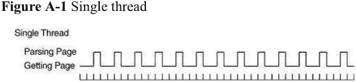

## 多线程吞吐量计算

如果能够以任意顺序获取页面并独立处理这些页面，那么就可以使用多线程来提高吞吐量。如果我们使用三个线程会发生什么？在同一时间内我们能获取多少个页面？

正如你在[图 A-2](#)中所见，多线程解决方案使页面的计算密集型解析与I/O密集型读取重叠。在理想情况下，这意味着处理器被完全利用。每一次1秒的页面读取都与两次解析重叠。因此，我们每秒可以处理两个页面，这是单线程解决方案吞吐量的三倍。

**图 A-2** 三个并发线程

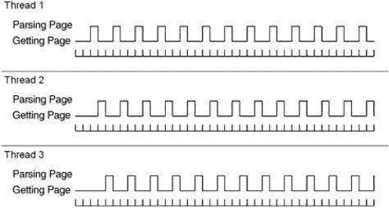

## 死锁

想象一个Web应用程序，它有两个有限大小的共享资源池：

- 一个用于本地工作进程存储的数据库连接池
- 一个用于主仓库的MQ连接池

假设该应用程序有两个操作，create（创建）和update（更新）：

- 创建（Create）—获取主仓库和数据库的连接。与主仓库服务通信，然后将工作存储到本地工作进程数据库中。
- 更新（Update）—获取数据库和主仓库的连接。从工作进程数据库读取数据，然后发送到主仓库。

当用户数超过池大小时会发生什么？假设每个池的大小为10。

- 十个用户尝试使用create，因此所有十个数据库连接都被获取，并且每个线程在获取数据库连接之后、获取主仓库连接之前被中断。
- 十个用户尝试使用update，因此所有十个主仓库连接都被获取，并且每个线程在获取主仓库连接之后、获取数据库连接之前被中断。

如果你拒绝等待，也可以消除死锁。在占用每个资源之前检查它，如果遇到一个忙碌的资源，就释放所有资源并重新开始。

这种方法会引入几个潜在问题：

- 饥饿（Starvation）—一个线程始终无法获得它所需的资源（也许它需要一组独特的资源组合，而这些资源很少同时可用）。

- 活锁（Livelock）—多个线程可能会进入步调一致的状态，反复获取一个资源然后释放一个资源。这在简单的CPU调度算法中尤其可能发生（想想嵌入式设备或简单的手写线程平衡算法）。

这两种情况都可能导致吞吐量不佳。前者导致CPU利用率低，而后者导致CPU利用率高但毫无意义。

尽管这种策略听起来效率很低，但总比什么都没有好。它的优点是，如果其他所有方法都失败，它几乎总是可以实现。

## 打破抢占

另一种避免死锁的策略是允许线程从其他线程手中夺取资源。这通常通过简单的请求机制完成。当线程发现某个资源忙时，它会请求所有者释放该资源。如果所有者也在等待其他资源，那么它会释放所有资源并重新开始。

这与前一种方法相似，但优点在于允许线程等待某个资源。这减少了重新开始的次数。但请注意，管理所有这些请求可能很棘手。

## 打破循环等待

这是预防死锁最常用的方法。对于大多数系统来说，只需各方同意一个简单的约定即可。

在上面的例子中，线程1希望获取资源1和资源2，线程2希望获取资源2和资源1，只需强制线程1和线程2以相同的顺序分配资源，循环等待就不可能发生。

更一般地，如果所有线程都同意资源的全局顺序，并且都按照该顺序分配资源，那么死锁就不可能发生。与所有其他策略一样，这也会带来问题：

- 获取资源的顺序可能与使用顺序不一致；因此，在开始时获取的资源可能要到最后才被使用。这会导致资源被锁定的时间超过严格必要的时间。
- 有时无法对资源的获取施加顺序。如果第二个资源的ID来自对第一个资源执行的操作，那么排序就是不可行的。

所以有很多方法可以避免死锁。有些会导致饥饿，而另一些则大量使用CPU并降低响应速度。天下没有免费的午餐！⁵

将解决方案中与线程相关的部分隔离出来，以便进行调整和实验，是获得确定最佳策略所需洞察力的有效方法。

## 测试多线程代码

我们如何编写一个测试来证明以下代码是错的？

```java
01: public class ClassWithThreadingProblem {
02:     int nextId;
03:
04:     public int takeNextId() {
05:         return nextId++;
06:     }
07:}
```

下面是一个测试的描述，它将证明这段代码是错的：

- 记住`nextId`的当前值。
- 创建两个线程，它们各自调用一次`takeNextId()`。
- 验证`nextId`比我们开始时多2。
- 重复运行，直到我们证明`nextId`仅增加了1而不是2。

[清单 A-2](#)显示了这样一个测试：

**清单 A-2** `ClassWithThreadingProblemTest.java`

```java
01: package example;
02:
03: import static org.junit.Assert.fail;
04:
05: import org.junit.Test;
06:
07: public class ClassWithThreadingProblemTest {
08:     @Test
09:     public void twoThreadsShouldFailEventually() throws Exception {
10:         final ClassWithThreadingProblem classWithThreadingProblem
             = new ClassWithThreadingProblem();
11:
12:         Runnable runnable = new Runnable() {
13:             public void run() {
14:                 classWithThreadingProblem.takeNextId();
15:             }
16:         };
17:
18:         for (int i = 0; i < 50000; ++i) {
19:             int startingId = classWithThreadingProblem.lastId;
20:             int expectedResult = 2 + startingId;
21:
22:             Thread t1 = new Thread(runnable);
23:             Thread t2 = new Thread(runnable);
24:             t1.start();
25:             t2.start();
26:             t1.join();
27:             t2.join();
28:
29:             int endingId = classWithThreadingProblem.lastId;
30:
31:             if (endingId != expectedResult)
```

讨论了通过插桩代码来暴露并发问题的策略。

## 教程：完整代码示例

### 客户端/服务器非线程化

**清单 A-3 server.java**

```java
package com.objectmentor.clientserver.nonthreaded;

import java.io.IOException;
import java.net.ServerSocket;
import java.net.Socket;
import java.net.SocketException;

import common.MessageUtils;

public class Server implements Runnable {
    ServerSocket serverSocket;
    volatile boolean keepProcessing = true;

    public Server(int port, int millisecondsTimeout) throws IOException {
        serverSocket = new ServerSocket(port);
        serverSocket.setSoTimeout(millisecondsTimeout);
    }

    public void run() {
        System.out.printf("Server Starting\n");

        while (keepProcessing) {
            try {
                System.out.printf("accepting client\n");
                Socket socket = serverSocket.accept();
                System.out.printf("got client\n");
                process(socket);
            } catch (Exception e) {
                handle(e);
```


```java
}
    }
  }

private void handle(Exception e) {
    if (!(e instanceof SocketException)) {
        e.printStackTrace();
    }
}

public void stopProcessing() {
    keepProcessing = false;
    closeIgnoringException(serverSocket);
}

void process(Socket socket) {
    if (socket == null)
        return;

    try {
        System.out.printf("Server: getting message\n");
        String message = MessageUtils.getMessage(socket);
        System.out.printf("Server: got message: %s\n", message);
        Thread.sleep(1000);
        System.out.printf("Server: sending reply: %s\n", message);
        MessageUtils.sendMessage(socket, "Processed: " + message);
        System.out.printf("Server: sent\n");
        closeIgnoringException(socket);
    } catch (Exception e) {
        e.printStackTrace();
    }
}

private void closeIgnoringException(Socket socket) {
    if (socket != null)
        try {
            socket.close();
        } catch (IOException ignore) {
        }
}

private void closeIgnoringException(ServerSocket serverSocket) {
    if (serverSocket != null)
        try {
            serverSocket.close();
        } catch (IOException ignore) {
        }
}
}
```

### 清单 A-5：MessageUtils.java

```java
package common;

import java.io.IOException;
import java.io.InputStream;
import java.io.ObjectInputStream;
import java.io.ObjectOutputStream;
import java.io.OutputStream;
import java.net.Socket;

public class MessageUtils {
    public static void sendMessage(Socket socket, String message)
            throws IOException {
        OutputStream stream = socket.getOutputStream();
        ObjectOutputStream oos = new ObjectOutputStream(stream);
        oos.writeUTF(message);
        oos.flush();
    }

    public static String getMessage(Socket socket) throws IOException {
        InputStream stream = socket.getInputStream();
        ObjectInputStream ois = new ObjectInputStream(stream);
        return ois.readUTF();
    }
}
```

### 使用线程的客户端/服务器

让服务器使用线程只需要修改 process 方法（新行已突出显示）：

```java
void process(final Socket socket) {
    if (socket == null)
        return;

    Runnable clientHandler = new Runnable() {
        public void run() {

            try {
                System.out.printf("Server: getting message\n");
                String message = MessageUtils.getMessage(socket);
                System.out.printf("Server: got message: %s\n", message);
                Thread.sleep(1000);
                System.out.printf("Server: sending reply: %s\n", message);
                MessageUtils.sendMessage(socket, "Processed: " + message);
                System.out.printf("Server: sent\n");
                closeIgnoringException(socket);
            } catch (Exception e) {
                e.printStackTrace();
            }
        }
    };

    Thread clientConnection = new Thread(clientHandler);
    clientConnection.start();
}
```

## 附录 B

### org.jfree.date.SerialDate

### 清单 B-1：SerialDate.java

```java
 * ------------------------------
 * 11-Oct-2001: Re-organised the class and moved it to new package
 *                com.jrefinery.date (DG);
 * 05-Nov-2001: Added a getDescription() method, and eliminated NotableDate
 *                class (DG);
 * 12-Nov-2001: IBD requires setDescription() method, now that NotableDate
 *                class is gone (DG); Changed getPreviousDayOfWeek(),
 *                getFollowingDayOfWeek() and getNearestDayOfWeek() to correct
 *                bugs (DG);
 * 05-Dec-2001: Fixed bug in SpreadsheetDate class (DG);
 * 29-May-2002: Moved month constants into a separate interface
 *                (MonthConstants) (DG);
 * 27-Aug-2002: Fixed bug in addMonths() method, thanks to Nálevka Petr (DG);
 * 03-Oct-2002: Fixed errors reported by Checkstyle (DG);
 * 13-Mar-2003: Implemented Serializable (DG);
 * 29-May-2003: Fixed bug in addMonths method (DG);
 * 04-Sep-2003: Implemented Comparable. Updated the isInRange javadocs (DG);
 * 05-Jan-2005: Fixed bug in addYears() method (1096022) (DG);
 *
 */

package org.jfree.date;

import java.io.Serializable;
import java.text.DateFormatSymbols;
import java.text.SimpleDateFormat;
import java.util.Calendar;
import java.util.GregorianCalendar;

/**
 * An abstract class that defines our requirements for manipulating dates,
 * without tying down a particular implementation.
 * <p>
 * Requirement 1 : match at least what Excel does for dates;
 * Requirement 2 : class is immutable;
 * <p>
 * Why not just use java.util.Date? We will, when it makes sense. At times,
 * java.util.Date can be "too" precise - it represents an instant in time,
 * accurate to 1/1000th of a second (with the date itself depending on the
 * time-zone). Sometimes we just want to represent a particular day (e.g. 21
 * January 2015) without concerning ourselves about the time of day, or the
 * time-zone, or anything else. That's what we've defined SerialDate for.
 * <p>
 * You can call getInstance() to get a concrete subclass of SerialDate,
 * without worrying about the exact implementation.
 *
 * @author David Gilbert
 */
public abstract class SerialDate implements Comparable,
                                             Serializable,
                                             MonthConstants {

    /** For serialization. */
    private static final long serialVersionUID = -293716040467423637L;

    /** Date format symbols. */
    public static final DateFormatSymbols
        DATE_FORMAT_SYMBOLS = new SimpleDateFormat().getDateFormatSymbols();

    /** The serial number for 1 January 1900. */
    public static final int SERIAL_LOWER_BOUND = 2;

public static boolean isValidWeekdayCode(final int code) {
    switch(code) {
        case SUNDAY:
        case MONDAY:
        case TUESDAY:
        case WEDNESDAY:
        case THURSDAY:
        case FRIDAY:
        case SATURDAY:
            return true;
        default:
            return false;
    }
}

/**
 * Converts the supplied string to a day of the week.
 *
 * @param s a string representing the day of the week.
 * @return <code>-1</code> if the string is not convertible, the day of
 *         the week otherwise.
 */
public static int stringToWeekdayCode(String s) {
    final String[] shortWeekdayNames =
        DATE_FORMAT_SYMBOLS.getShortWeekdays();
    final String[] weekDayNames = DATE_FORMAT_SYMBOLS.getWeekdays();

    int result = -1;
    s = s.trim();
    for (int i = 0; i < weekDayNames.length; i++) {
        if (s.equals(shortWeekdayNames[i])) {
            result = i;
            break;
        }
        if (s.equals(weekDayNames[i])) {
            result = i;
            break;
        }
    }
    return result;
}

/**
 * Returns a string representing the supplied day-of-the-week.
 * <p>
 * Need to find a better approach.
 *
 * @param weekday the day of the week.
 *
 * @return a string representing the supplied day-of-the-week.
 */
public static String weekdayCodeToString(final int weekday) {
    final String[] weekdays = DATE_FORMAT_SYMBOLS.getWeekdays();
    return weekdays[weekday];
}

/**
 * Returns an array of month names.
 *
 * @return an array of month names.
 */
public static String[] getMonths() {
    return getMonths(false);
}

/**
 * Returns an array of month names.
 *
 * @param shortened a flag indicating that shortened month names should
 *                  be returned.
 *
 * @return an array of month names.
 */
public static String[] getMonths(final boolean shortened) {
    if (shortened) {
        return DATE_FORMAT_SYMBOLS.getShortMonths();
    }
    else {
        return DATE_FORMAT_SYMBOLS.getMonths();
    }
}

/**
 * Returns true if the supplied integer code represents a valid month.
 *
 * @param code the code being checked for validity.
 *
 * @return <code>true</code> if the supplied integer code represents a
 *         valid month.
 */
public static boolean isValidMonthCode(final int code) {
    switch(code) {
        case JANUARY:
        case FEBRUARY:
        case MARCH:
        case APRIL:
        case MAY:
        case JUNE:
        case JULY:
        case AUGUST:
        case SEPTEMBER:
        case OCTOBER:
        case NOVEMBER:
        case DECEMBER:
            return true;
        default:
            return false;
    }
}
}
```


```java
/**
 * 返回指定月份对应的季度。
 *
 * @param code 月份代码（1-12）。
 *
 * @return 该月份所属的季度。
 * @throws java.lang.IllegalArgumentException
 */
public static int monthCodeToQuarter(final int code) {

    switch(code) {
        case JANUARY:
        case FEBRUARY:
        case MARCH: return 1;
        case APRIL:
        case MAY:
        case JUNE: return 2;
        case JULY:
        case AUGUST:
        case SEPTEMBER: return 3;
        case OCTOBER:
        case NOVEMBER:
        case DECEMBER: return 4;
        default: throw new IllegalArgumentException(
            "SerialDate.monthCodeToQuarter: invalid month code.");
    }
}

/**
 * 返回一个表示指定月份的字符串。
 * <p>
 * 返回的字符串是取自默认区域设置的完整月份名称。
 *
 * @param month 月份。
 *
 * @return 表示指定月份的字符串。
 */
public static String monthCodeToString(final int month) {

    return monthCodeToString(month, false);
}

/**
 * 返回一个表示指定月份的字符串。
 * <p>
 * 返回的字符串是取自默认区域设置的完整月份名称或缩写月份名称。
 *
 * @param month 月份。
 * @param shortened 如果为 <code>true</code>，返回月份的缩写。
 *
 * @return 表示指定月份的字符串。
 * @throws java.lang.IllegalArgumentException
 */
public static String monthCodeToString(final int month,
                                       final boolean shortened) {

    // 检查参数...
    if (!isValidMonthCode(month)) {
        throw new IllegalArgumentException(
            "SerialDate.monthCodeToString: month outside valid range.");
    }

    final String[] months;

    if (shortened) {
        months = DATE_FORMAT_SYMBOLS.getShortMonths();
    }
    else {
        months = DATE_FORMAT_SYMBOLS.getMonths();
    }

    return months[month - 1];
}

/**
 * 将字符串转换为月份代码：
 * <p>
 * 此方法将返回与字符串相对应的常量 JANUARY、FEBRUARY、...、DECEMBER 之一。
 * 如果无法识别该字符串，则此方法返回 -1。
 *
 * @param s 要解析的字符串。
 *
 * @return 如果字符串无法解析，返回 <code>-1</code>；否则返回一年中的月份。
 */
public static int stringToMonthCode(String s) {

    final String[] shortMonthNames = DATE_FORMAT_SYMBOLS.getShortMonths();
    final String[] monthNames = DATE_FORMAT_SYMBOLS.getMonths();

    int result = -1;
    s = s.trim();

    // 首先尝试将字符串解析为整数（1-12）...
    try {
        result = Integer.parseInt(s);
    }
    catch (NumberFormatException e) {
        // 忽略
    }

    // 现在在月份名称中搜索...
    if (result < 1 || result > 12) {
        for (int i = 0; i < shortMonthNames.length; i++) {
            if (s.equals(shortMonthNames[i])) {
                result = i + 1;
                break;
            }
        }
        if (result < 1 || result > 12) {
            for (int i = 0; i < monthNames.length; i++) {
                if (s.equals(monthNames[i])) {
                    result = i + 1;
                    break;
                }
            }
        }
    }
    return result;
}

return leap4 - leap100 + leap400;
}

/**
 * 返回某月最后一天是几号，并考虑闰年。
 *
 * @param month 月份。
 * @param yyyy  年份（范围 1900 到 9999）。
 *
 * @return 该月最后一天是几号。
 */
public static int lastDayOfMonth(final int month, final int yyyy) {
    final int result = LAST_DAY_OF_MONTH[month];
    if (month != FEBRUARY) {
        return result;
    }
    else if (isLeapYear(yyyy)) {
        return result + 1;
    }
    else {
        return result;
    }
}

/**
 * 通过向基准日期加上指定天数来创建新日期。
 *
 * @param days 要添加的天数（可以为负数）。
 * @param base 基准日期。
 *
 * @return 新日期。
 */
public static SerialDate addDays(final int days, final SerialDate base) {
    final int serialDayNumber = base.toSerial() + days;
    return SerialDate.createInstance(serialDayNumber);
}

/**
 * 通过向基准日期加上指定月数来创建新日期。
 * <p>
 * 如果基准日期接近月末，结果中的日期可能会稍有调整。例如，5月31日加1个月等于6月30日。
 *
 * @param months 要添加的月数（可以为负数）。
 * @param base   基准日期。
 *
 * @return 新日期。
 */
public static SerialDate addMonths(final int months,
                                   final SerialDate base) {
    final int yy = (12 * base.getYYYY() + base.getMonth() + months - 1)
                   / 12;
    final int mm = (12 * base.getYYYY() + base.getMonth() + months - 1)
                   % 12 + 1;
    final int dd = Math.min(
        base.getDayOfMonth(), SerialDate.lastDayOfMonth(mm, yy)
    );
    return SerialDate.createInstance(dd, mm, yy);
}

/**
 * 通过向基准日期加上指定年数来创建新日期。
 *
 * @param years 要添加的年数（可以为负数）。
 * @param base  基准日期。
 *
 * @return 新日期。
 */
public static SerialDate addYears(final int years, final SerialDate base) {

    final int baseY = base.getYYYY();
    final int baseM = base.getMonth();
    final int baseD = base.getDayOfMonth();

    final int targetY = baseY + years;
    final int targetD = Math.min(
        baseD, SerialDate.lastDayOfMonth(baseM, targetY)
    );

    return SerialDate.createInstance(targetD, baseM, targetY);
}

/**
 * 返回落在指定星期几且早于基准日期的最近日期。
 *
 * @param targetWeekday 目标星期几的代码。
 * @param base          基准日期。
 *
 * @return 落在指定星期几且早于基准日期的最近日期。
 */
public static SerialDate getPreviousDayOfWeek(final int targetWeekday,
                                               final SerialDate base) {

    // 检查参数...
    if (!SerialDate.isValidWeekdayCode(targetWeekday)) {
        throw new IllegalArgumentException(
            "Invalid day-of-the-week code."
        );
    }

    // 查找日期...
    final int adjust;
    final int baseDOW = base.getDayOfWeek();
    if (baseDOW > targetWeekday)
        adjust = Math.min(0, targetWeekday - baseDOW);
    else
        adjust = -7 + Math.max(0, targetWeekday - baseDOW);

    return SerialDate.addDays(adjust, base);
}

/**
 * 返回落在指定星期几且晚于基准日期的最早日期。
 *
 * @param targetWeekday 目标星期几的代码。
 * @param base          基准日期。
 *
 * @return 落在指定星期几且晚于基准日期的最早日期。
 */
public static SerialDate getFollowingDayOfWeek(final int targetWeekday,
                                               final SerialDate base) {

    // 检查参数...
    if (!SerialDate.isValidWeekdayCode(targetWeekday)) {
        throw new IllegalArgumentException(
            "Invalid day-of-the-week code."
        );
    }

    // 查找日期...
    final int adjust;
    final int baseDOW = base.getDayOfWeek();
    if (baseDOW >= targetWeekday) {
        adjust = 7 + Math.min(0, targetWeekday - baseDOW);
    }
    else {
        adjust = Math.max(0, targetWeekday - baseDOW);
    }

    return SerialDate.addDays(adjust, base);
}

/**
 * 返回落在指定星期几且距离基准日期最近的日期。
 *
 * @param targetDOW 目标星期几的代码。
 * @param base      基准日期。
 *
 * @return 落在指定星期几且距离基准日期最近的日期。
 */
public static SerialDate getNearestDayOfWeek(final int targetDOW,
                                              final SerialDate base) {

    // 检查参数...
    if (!SerialDate.isValidWeekdayCode(targetDOW)) {
        throw new IllegalArgumentException(
            "Invalid day-of-the-week code."
        );
    }

    // 查找日期...
    final int baseDOW = base.getDayOfWeek();
    int adjust = -Math.abs(targetDOW - baseDOW);
    if (adjust >= 4) {
        adjust = 7 - adjust;
    }
    return SerialDate.addDays(adjust, base);
}
```


```java
}
if (adjust <= -4) {
    adjust = 7 + adjust;
}
return SerialDate.addDays(adjust, base);
}

/**
 * 将日期向前滚动到当月的最后一天。
 *
 * @param base 基准日期。
 *
 * @return 一个新的序列化日期。
 */
public SerialDate getEndOfCurrentMonth(final SerialDate base) {
    final int last = SerialDate.lastDayOfMonth(
        base.getMonth(), base.getYYYY()
    );
    return SerialDate.createInstance(last, base.getMonth(), base.getYYYY());
}

/**
 * 返回与月中周代码对应的字符串。
 * <p>
 * 需要找到更好的方法。
 *
 * @param count 表示月中周的整数代码。
 *
 * @return 与月中周代码对应的字符串。
 */
public static String weekInMonthToString(final int count) {

    switch (count) {
        case SerialDate.FIRST_WEEK_IN_MONTH : return "First";
        case SerialDate.SECOND_WEEK_IN_MONTH : return "Second";
        case SerialDate.THIRD_WEEK_IN_MONTH : return "Third";
        case SerialDate.FOURTH_WEEK_IN_MONTH : return "Fourth";
        case SerialDate.LAST_WEEK_IN_MONTH : return "Last";
        default :
            return "SerialDate.weekInMonthToString(): invalid code.";
    }
}

/**
 * 返回表示所提供“relative”的字符串。
 * <p>
 * 需要找到更好的方法。
 *
 * @param relative 表示“relative”的常量。
 *
 * @return 表示所提供“relative”的字符串。
 */
public static String relativeToString(final int relative) {

    switch (relative) {
        case SerialDate.PRECEDING : return "Preceding";
        case SerialDate.NEAREST : return "Nearest";
        case SerialDate.FOLLOWING : return "Following";
        default : return "ERROR : Relative To String";
    }
}

/**
 * 工厂方法，返回 {@link SerialDate} 的某个具体子类的实例。
 *
 * @param day 日（1-31）。
 * @param month 月（1-12）。
 * @param yyyy 年（范围 1900 至 9999）。
 *
 * @return {@link SerialDate} 的实例。
 */
public static SerialDate createInstance(final int day, final int month,
                                         final int yyyy) {
    return new SpreadsheetDate(day, month, yyyy);
}

/**
 * 工厂方法，返回 {@link SerialDate} 的某个具体子类的实例。
 *
 * @param serial 日期的序列号（1900 年 1 月 1 日 = 2）。
 *
 * @return SerialDate 的实例。
 */
public static SerialDate createInstance(final int serial) {
    return new SpreadsheetDate(serial);
}

/**
 * 工厂方法，返回 SerialDate 子类的实例。
 *
 * @param date 一个 Java 日期对象。
 *
 * @return SerialDate 的实例。
 */
public static SerialDate createInstance(final java.util.Date date) {
    final GregorianCalendar calendar = new GregorianCalendar();
    calendar.setTime(date);
    return new SpreadsheetDate(calendar.get(Calendar.DATE),
                               calendar.get(Calendar.MONTH) + 1,
                               calendar.get(Calendar.YEAR));
}

/**
 * 返回日期的序列号，其中 1900 年 1 月 1 日 = 2（这几乎与
 * Microsoft Excel for Windows 和 Lotus 1-2-3 中使用的编号系统一致）。
 *
 * @return 日期的序列号。
 */
public abstract int toSerial();

/**
 * 返回一个 java.util.Date。由于 java.util.Date 比 SerialDate 的精度更高，
 * 我们需要定义一天中的时间约定。
 *
 * @return 作为 <code>java.util.Date</code> 的此日期。
 */
public abstract java.util.Date toDate();

/**
 * 返回日期的描述。
 *
 * @return 日期的描述。
 */
public String getDescription() {
    return this.description;
}

/**
 * 设置日期的描述。
 *
 * @param description 日期的新描述。
 */
public void setDescription(final String description) {
    this.description = description;
}

/**
 * 将日期转换为字符串。
 *
 * @return 日期的字符串表示形式。
 */
public String toString() {
    return getDayOfMonth() + "-" + SerialDate.monthCodeToString(getMonth())
           + "-" + getYYYY();
}

/**
 * 返回年份（假定有效范围为 1900 至 9999）。
 *
 * @return 年份。
 */
public abstract int getYYYY();

/**
 * 返回月份（一月 = 1，二月 = 2，三月 = 3）。
 *
 * @return 年份中的月份。
 */
public abstract int getMonth();

/**
 * 返回月份中的日。
 *
 * @return 月份中的日。
 */
public abstract int getDayOfMonth();

/**
 * 返回星期几。
 *
 * @return 星期几。
 */
public abstract int getDayOfWeek();

/**
 * 返回此日期与指定“other”日期之间的差值（以天为单位）。
 * <p>
 * 如果此日期晚于“other”日期，则结果为正；
 * 如果早于“other”日期，则为负。
 *
 * @param other 被比较的日期。
 *
 * @return 此日期与其他日期之间的差值。
 */
public abstract int compare(SerialDate other);

/**
 * 如果此 SerialDate 表示与指定 SerialDate 相同的日期，则返回 true。
 *
 * @param other 被比较的日期。
 *
 * @return 如果此 SerialDate 表示与指定 SerialDate 相同的日期，则返回
 *         <code>true</code>。
 */
public abstract boolean isOn(SerialDate other);

/**
 * 如果此 SerialDate 表示比指定 SerialDate 更早的日期，则返回 true。
 *
 * @param other 被比较的日期。
 *
 * @return 如果此 SerialDate 表示比指定 SerialDate 更早的日期，则返回
 *         <code>true</code>。
 */
public abstract boolean isBefore(SerialDate other);

/**
 * 如果此 SerialDate 表示与指定 SerialDate 相同的日期，则返回 true。
 *
 * @param other 被比较的日期。
 *
 * @return 如果此 SerialDate 表示与指定 SerialDate 相同的日期，则返回
 *         <code>true</code>。
 */
public abstract boolean isAfter(SerialDate other);

/**
 * 如果此 SerialDate 表示与指定 SerialDate 相同的日期，则返回 true。
 *
 * @param other 被比较的日期。
 *
 * @return 如果此 SerialDate 表示与指定 SerialDate 相同的日期，则返回
 *         <code>true</code>。
 */
public abstract boolean isOnOrBefore(SerialDate other);

/**
 * 如果此 SerialDate 表示与指定 SerialDate 相同的日期，则返回 true。
 *
 * @param other 被比较的日期。
 *
 * @return 如果此 SerialDate 表示与指定 SerialDate 相同的日期，则返回
 *         <code>true</code>。
 */
public abstract boolean isOnOrAfter(SerialDate other);

/**
 * 如果此 {@link SerialDate} 在指定范围（包含端点）内，则返回
 * <code>true</code>。d1 和 d2 的日期顺序并不重要。
 *
 * @param d1 范围的一个边界日期。
 * @param d2 范围的另一个边界日期。
 *
 * @return 一个布尔值。
 */
public abstract boolean isInRange(SerialDate d1, SerialDate d2);

/**
 * 如果此 {@link SerialDate} 在指定范围内（调用者指定是否包含端点），则返回
 * <code>true</code>。d1 和 d2 的日期顺序并不重要。
 *
 * @param d1 范围的一个边界日期。
 * @param d2 范围的另一个边界日期。
 * @param include 控制范围的开始日期和结束日期是否包含在范围内的代码。
 *
 * @return 一个布尔值。
 */
public abstract boolean isInRange(SerialDate d1, SerialDate d2,
                                  int include);

/**
 * 返回落在指定星期几且早于此日期的最近日期。
 *
 * @param targetDOW 目标星期几的代码。
 *
 * @return 落在指定星期几且早于此日期的最近日期。
 */
public SerialDate getPreviousDayOfWeek(final int targetDOW) {
    return getPreviousDayOfWeek(targetDOW, this);
}

/**
 * 返回落在指定星期几且晚于此日期的最早日期。
 *
 * @param targetDOW 目标星期几的代码。
 *
 * @return 落在指定星期几且晚于此日期的最早日期。
 */
public SerialDate getFollowingDayOfWeek(final int targetDOW) {
    return getFollowingDayOfWeek(targetDOW, this);
}

/**
 * 返回落在指定星期几上的最近日期。
 *
 * @param targetDOW 目标星期几的代码。
 *
 * @return 落在指定星期几上的最近日期。
 */
public SerialDate getNearestDayOfWeek(final int targetDOW) {
    return getNearestDayOfWeek(targetDOW, this);
}
```


```java
/* ============================================================
 * JCommon : a free general purpose class library for the Java(tm) platform
 * ============================================================
 *
 * (C) Copyright 2000-2005, by Object Refinery Limited and Contributors.
 *
 * Project Info:  http://www.jfree.org/jcommon/index.html
 *
 * This library is free software; you can redistribute it and/or modify it
 * under the terms of the GNU Lesser General Public License as published by
 * the Free Software Foundation; either version 2.1 of the License, or
 * (at your option) any later version.
 *
 * This library is distributed in the hope that it will be useful, but
 * WITHOUT ANY WARRANTY; without even the implied warranty of MERCHANTABILITY
 * or FITNESS FOR A PARTICULAR PURPOSE. See the GNU Lesser General Public
 * License for more details.
 *
 * You should have received a copy of the GNU Lesser General Public
 * License along with this library; if not, write to the Free Software
 * Foundation, Inc., 51 Franklin Street, Fifth Floor, Boston, MA  02110-1301,
 * USA.
 *
 * [Java is a trademark or registered trademark of Sun Microsystems, Inc.
 * in the United States and other countries.]
 */

/*
 * SerialDateTests.java
 * ====================
 *
 * (C) Copyright 2001-2005, by Object Refinery Limited.
 *
 * Original Author:  David Gilbert (for Object Refinery Limited);
 * Contributor(s):
 *
 * $Id: SerialDateTests.java,v 1.6 2005/11/16 15:58:40 taqua Exp $
 *
 * Changes
 * -------
 * 15-Nov-2001 : Version 1 (DG);
 * 25-Jun-2002 : Removed unnecessary import (DG);
 * 24-Oct-2002 : Fixed errors reported by Checkstyle (DG);
 * 13-Mar-2003 : Added serialization test (DG);
 * 05-Jan-2005 : Added test for bug report 1096282 (DG);
 *
 */

package org.jfree.date.junit;

import java.io.ByteArrayInputStream;
import java.io.ByteArrayOutputStream;
import java.io.ObjectInput;
import java.io.ObjectInputStream;
import java.io.ObjectOutput;
import java.io.ObjectOutputStream;

import junit.framework.Test;
import junit.framework.TestCase;
import junit.framework.TestSuite;

import org.jfree.date.MonthConstants;
import org.jfree.date.SerialDate;

/**
 * Some JUnit tests for the {@link SerialDate} class.
 */
public class SerialDateTests extends TestCase {

    /** Date representing November 9. */
    private SerialDate nov9Y2001;

    /**
     * Creates a new test case.
     *
     * @param name the name.
     */
    public SerialDateTests(final String name) {
        super(name);
    }

    /**
     * Returns a test suite for the JUnit test runner.
     *
     * @return the test suite.
     */
    public static Test suite() {
        return new TestSuite(SerialDateTests.class);
    }

    /**
     * Problem set up.
     */
    protected void setUp() {
        this.nov9Y2001 = SerialDate.createInstance(9, MonthConstants.NOVEMBER, 2001);
    }

    /**
     * 9 Nov 2001 plus two months should be 9 Jan 2002.
     */
    public void testAddMonthsTo9Nov2001() {
        final SerialDate jan92002 = SerialDate.addMonths(2, this.nov9Y2001);
        final SerialDate answer = SerialDate.createInstance(9, 1, 2002);
        assertEquals(answer, jan92002);
    }

    /**
     * A test case for a reported bug, now fixed.
     */
    public void testAddMonthsTo5Oct2003() {
        final SerialDate d1 = SerialDate.createInstance(5, MonthConstants.OCTOBER, 2003);
        final SerialDate d2 = SerialDate.addMonths(2, d1);
        assertEquals(d2, SerialDate.createInstance(5, MonthConstants.DECEMBER, 2003));
    }

    /**
     * A test case for a reported bug, now fixed.
     */
    public void testAddMonthsTo1Jan2003() {
        final SerialDate d1 = SerialDate.createInstance(1, MonthConstants.JANUARY, 2003);
        final SerialDate d2 = SerialDate.addMonths(0, d1);
        assertEquals(d1, d2);
    }

    /**
     * Monday preceding Friday 9 November 2001 should be 5 November.
     */

    /**
     * Test the conversion of a string to a month. Note that this test will fail if the
     * default locale doesn't use English month names...devise a better test!
     */
    public void testStringToMonthCode() {

        int m = SerialDate.stringToMonthCode("January");
        assertEquals(MonthConstants.JANUARY, m);

        m = SerialDate.stringToMonthCode(" January ");
        assertEquals(MonthConstants.JANUARY, m);

        m = SerialDate.stringToMonthCode("Jan");
        assertEquals(MonthConstants.JANUARY, m);
    }

    /**
     * Tests the conversion of a month code to a string.
     */
    public void testMonthCodeToStringCode() {

        final String test = SerialDate.monthCodeToString(MonthConstants.DECEMBER);
        assertEquals("December", test);
    }

    /**
     * 1900 is not a leap year.
     */
    public void testIsNotLeapYear1900() {
        assertTrue(!SerialDate.isLeapYear(1900));
    }

    /**
     * 2000 is a leap year.
     */
    public void testIsLeapYear2000() {
        assertTrue(SerialDate.isLeapYear(2000));
    }

    /**
     * The number of leap years from 1900 up-to-and-including 1899 is 0.
     */
    public void testLeapYearCount1899() {
        assertEquals(SerialDate.leapYearCount(1899), 0);
    }

    /**
     * The number of leap years from 1900 up-to-and-including 1903 is 0.
     */
    public void testLeapYearCount1903() {
        assertEquals(SerialDate.leapYearCount(1903), 0);
    }

    /**
     * The number of leap years from 1900 up-to-and-including 1904 is 1.
     */
    public void testLeapYearCount1904() {
        assertEquals(SerialDate.leapYearCount(1904), 1);
    }

    /**
     * The number of leap years from 1900 up-to-and-including 1999 is 24.
     */
    public void testLeapYearCount1999() {
        assertEquals(SerialDate.leapYearCount(1999), 24);
    }

    /**
     * The number of leap years from 1900 up-to-and-including 2000 is 25.
     */
    public void testLeapYearCount2000() {
        assertEquals(SerialDate.leapYearCount(2000), 25);
    }

    /**
     * Serialize an instance, restore it, and check for equality.
     */
    public void testSerialization() {

        SerialDate d1 = SerialDate.createInstance(15, 4, 2000);
        SerialDate d2 = null;

        try {
            ByteArrayOutputStream buffer = new ByteArrayOutputStream();
            ObjectOutput out = new ObjectOutputStream(buffer);
            out.writeObject(d1);
            out.close();

            ObjectInput in = new ObjectInputStream(
                    new ByteArrayInputStream(buffer.toByteArray()));
            d2 = (SerialDate) in.readObject();
            in.close();
        }
        catch (Exception e) {
            System.out.println(e.toString());
        }

        assertEquals(d1, d2);
    }

    /**
     * A test for bug report 1096282 (now fixed).
     */
    public void test1096282() {
        SerialDate d = SerialDate.createInstance(29, 2, 2004);
        d = SerialDate.addYears(1, d);
        SerialDate expected = SerialDate.createInstance(28, 2, 2005);
        assertTrue(d.isOn(expected));
    }

    /**
     * Miscellaneous tests for the addMonths() method.
     */
    public void testAddMonths() {
        SerialDate d1 = SerialDate.createInstance(31, 5, 2004);

        SerialDate d2 = SerialDate.addMonths(1, d1);
        assertEquals(30, d2.getDayOfMonth());
        assertEquals(6, d2.getMonth());
        assertEquals(2004, d2.getYYYY());

        SerialDate d3 = SerialDate.addMonths(2, d1);
        assertEquals(31, d3.getDayOfMonth());
        assertEquals(7, d3.getMonth());
        assertEquals(2004, d3.getYYYY());

        SerialDate d4 = SerialDate.addMonths(1, SerialDate.addMonths(1, d1));
        assertEquals(30, d4.getDayOfMonth());
        assertEquals(7, d4.getMonth());
        assertEquals(2004, d4.getYYYY());
    }
}
```

## 清单 B-3：MonthConstants.java

```java
public static final int MARCH = 3;

/** Constant for April. */
public static final int APRIL = 4;

/** Constant for May. */
public static final int MAY = 5;

/** Constant for June. */
public static final int JUNE = 6;

/** Constant for July. */
public static final int JULY = 7;

/** Constant for August. */
public static final int AUGUST = 8;

/** Constant for September. */
public static final int SEPTEMBER = 9;

/** Constant for October. */
public static final int OCTOBER = 10;

/** Constant for November. */
public static final int NOVEMBER = 11;

/** Constant for December. */
public static final int DECEMBER = 12;
}
```

## 清单 B-4：BobsSerialDateTest.java


```java
assertEquals(SUNDAY, stringToWeekdayCode("sun"));

public void testWeekdayCodeToString() throws Exception {
    assertEquals("Sunday", weekdayCodeToString(SUNDAY));
    assertEquals("Monday", weekdayCodeToString(MONDAY));
    assertEquals("Tuesday", weekdayCodeToString(TUESDAY));
    assertEquals("Wednesday", weekdayCodeToString(WEDNESDAY));
    assertEquals("Thursday", weekdayCodeToString(THURSDAY));
    assertEquals("Friday", weekdayCodeToString(FRIDAY));
    assertEquals("Saturday", weekdayCodeToString(SATURDAY));
}

public void testIsValidMonthCode() throws Exception {
    for (int i = 1; i <= 12; i++) {
        assertTrue(isValidMonthCode(i));
    }
    assertFalse(isValidMonthCode(0));
    assertFalse(isValidMonthCode(13));
}

public void testMonthToQuarter() throws Exception {
    assertEquals(1, monthCodeToQuarter(JANUARY));
    assertEquals(1, monthCodeToQuarter(FEBRUARY));
    assertEquals(1, monthCodeToQuarter(MARCH));
    assertEquals(2, monthCodeToQuarter(APRIL));
    assertEquals(2, monthCodeToQuarter(MAY));
    assertEquals(2, monthCodeToQuarter(JUNE));
    assertEquals(3, monthCodeToQuarter(JULY));
    assertEquals(3, monthCodeToQuarter(AUGUST));
    assertEquals(3, monthCodeToQuarter(SEPTEMBER));
    assertEquals(4, monthCodeToQuarter(OCTOBER));
    assertEquals(4, monthCodeToQuarter(NOVEMBER));
    assertEquals(4, monthCodeToQuarter(DECEMBER));

    try {
        monthCodeToQuarter(-1);
        fail("Invalid Month Code should throw exception");
    } catch (IllegalArgumentException e) {
    }
}

public void testMonthCodeToString() throws Exception {
    assertEquals("January", monthCodeToString(JANUARY));
    assertEquals("February", monthCodeToString(FEBRUARY));
    assertEquals("March", monthCodeToString(MARCH));
    assertEquals("April", monthCodeToString(APRIL));
    assertEquals("May", monthCodeToString(MAY));
    assertEquals("June", monthCodeToString(JUNE));
    assertEquals("July", monthCodeToString(JULY));
    assertEquals("August", monthCodeToString(AUGUST));
    assertEquals("September", monthCodeToString(SEPTEMBER));
    assertEquals("October", monthCodeToString(OCTOBER));
    assertEquals("November", monthCodeToString(NOVEMBER));
    assertEquals("December", monthCodeToString(DECEMBER));

    assertEquals("Jan", monthCodeToString(JANUARY, true));
    assertEquals("Feb", monthCodeToString(FEBRUARY, true));
    assertEquals("Mar", monthCodeToString(MARCH, true));
    assertEquals("Apr", monthCodeToString(APRIL, true));
    assertEquals("May", monthCodeToString(MAY, true));
    assertEquals("Jun", monthCodeToString(JUNE, true));
    assertEquals("Jul", monthCodeToString(JULY, true));
}

// assertEquals(2, stringToMonthCode("february"));
// assertEquals(3, stringToMonthCode("march"));
// assertEquals(4, stringToMonthCode("april"));
// assertEquals(5, stringToMonthCode("may"));
// assertEquals(6, stringToMonthCode("june"));
// assertEquals(7, stringToMonthCode("july"));
// assertEquals(8, stringToMonthCode("august"));
// assertEquals(9, stringToMonthCode("september"));
// assertEquals(10, stringToMonthCode("october"));
// assertEquals(11, stringToMonthCode("november"));
// assertEquals(12, stringToMonthCode("december"));

assertEquals(1, stringToMonthCode("JANUARY"));
assertEquals(2, stringToMonthCode("FEBRUARY"));
assertEquals(3, stringToMonthCode("MARCH"));
assertEquals(4, stringToMonthCode("APRIL"));
assertEquals(5, stringToMonthCode("MAY"));
assertEquals(6, stringToMonthCode("JUNE"));
assertEquals(7, stringToMonthCode("JULY"));
assertEquals(8, stringToMonthCode("AUGUST"));
assertEquals(9, stringToMonthCode("SEPTEMBER"));
assertEquals(10, stringToMonthCode("OCTOBER"));
assertEquals(11, stringToMonthCode("NOVEMBER"));
assertEquals(12, stringToMonthCode("DECEMBER"));
}

public void testIsValidWeekInMonthCode() throws Exception {
    for (int w = 0; w <= 4; w++) {
        assertTrue(isValidWeekInMonthCode(w));
    }
    assertFalse(isValidWeekInMonthCode(5));
}

public void testIsLeapYear() throws Exception {
    assertFalse(isLeapYear(1900));
    assertFalse(isLeapYear(1901));
    assertFalse(isLeapYear(1903));
    assertTrue(isLeapYear(1904));
    assertTrue(isLeapYear(1908));
    assertFalse(isLeapYear(1955));
    assertTrue(isLeapYear(1964));
    assertFalse(isLeapYear(1980));
    assertTrue(isLeapYear(2000));
    assertFalse(isLeapYear(2001));
    assertFalse(isLeapYear(2100));
}

public void testLeapYearCount() throws Exception {
    assertEquals(0, leapYearCount(1900));
    assertEquals(0, leapYearCount(1901));
    assertEquals(0, leapYearCount(1902));
    assertEquals(0, leapYearCount(1903));
    assertEquals(1, leapYearCount(1904));
    assertEquals(1, leapYearCount(1905));
    assertEquals(1, leapYearCount(1906));
    assertEquals(1, leapYearCount(1907));
    assertEquals(2, leapYearCount(1908));
    assertEquals(24, leapYearCount(1999));
    assertEquals(25, leapYearCount(2001));
    assertEquals(49, leapYearCount(2100));
}

public void testGettingFollowingDayOfWeek() throws Exception {
    assertEquals(d(1, JANUARY, 2005), getFollowingDayOfWeek(SATURDAY, d(25, DECEMBER, 2004)));
    assertEquals(d(1, JANUARY, 2005), getFollowingDayOfWeek(SATURDAY, d(26, DECEMBER, 2004)));
    assertEquals(d(3, MARCH, 2004), getFollowingDayOfWeek(WEDNESDAY, d(28, FEBRUARY, 2004)));

    try {
        getFollowingDayOfWeek(-1, d(1, JANUARY, 2005));
        fail("Invalid day of week code should throw exception");
    } catch (IllegalArgumentException e) {
    }
}

public void testGetNearestDayOfWeek() throws Exception {
    assertEquals(d(15, APRIL, 2006), getNearestDayOfWeek(SUNDAY, d(16, APRIL, 2006)));
    assertEquals(d(15, APRIL, 2006), getNearestDayOfWeek(SUNDAY, d(17, APRIL, 2006)));
    assertEquals(d(16, APRIL, 2006), getNearestDayOfWeek(SUNDAY, d(18, APRIL, 2006)));
    assertEquals(d(16, APRIL, 2006), getNearestDayOfWeek(SUNDAY, d(19, APRIL, 2006)));
    assertEquals(d(23, APRIL, 2006), getNearestDayOfWeek(SUNDAY, d(20, APRIL, 2006)));
    assertEquals(d(23, APRIL, 2006), getNearestDayOfWeek(SUNDAY, d(21, APRIL, 2006)));
    assertEquals(d(23, APRIL, 2006), getNearestDayOfWeek(SUNDAY, d(22, APRIL, 2006)));

    // TODO    assertEquals(d(17, APRIL, 2006), getNearestDayOfWeek(MONDAY, d(16, APRIL, 2006)));
    assertEquals(d(17, APRIL, 2006), getNearestDayOfWeek(MONDAY, d(17, APRIL, 2006)));
    assertEquals(d(17, APRIL, 2006), getNearestDayOfWeek(MONDAY, d(18, APRIL, 2006)));
    assertEquals(d(17, APRIL, 2006), getNearestDayOfWeek(MONDAY, d(19, APRIL, 2006)));
    assertEquals(d(17, APRIL, 2006), getNearestDayOfWeek(MONDAY, d(20, APRIL, 2006)));
    assertEquals(d(24, APRIL, 2006), getNearestDayOfWeek(MONDAY, d(21, APRIL, 2006)));
    assertEquals(d(24, APRIL, 2006), getNearestDayOfWeek(MONDAY, d(22, APRIL, 2006)));

    //    assertEquals(d(18, APRIL, 2006), getNearestDayOfWeek(TUESDAY, d(16, APRIL, 2006)));
    //    assertEquals(d(18, APRIL, 2006), getNearestDayOfWeek(TUESDAY, d(17, APRIL, 2006)));
    assertEquals(d(18, APRIL, 2006), getNearestDayOfWeek(TUESDAY, d(18, APRIL, 2006)));
    assertEquals(d(18, APRIL, 2006), getNearestDayOfWeek(TUESDAY, d(19, APRIL, 2006)));
    assertEquals(d(18, APRIL, 2006), getNearestDayOfWeek(TUESDAY, d(20, APRIL, 2006)));
    assertEquals(d(18, APRIL, 2006), getNearestDayOfWeek(TUESDAY, d(21, APRIL, 2006)));
    assertEquals(d(25, APRIL, 2006), getNearestDayOfWeek(TUESDAY, d(22, APRIL, 2006)));

    //    assertEquals(d(19, APRIL, 2006), getNearestDayOfWeek(WEDNESDAY, d(16, APRIL, 2006)));
    //    assertEquals(d(19, APRIL, 2006), getNearestDayOfWeek(WEDNESDAY, d(17, APRIL, 2006)));
    assertEquals(d(19, APRIL, 2006), getNearestDayOfWeek(WEDNESDAY, d(18, APRIL, 2006)));
    assertEquals(d(19, APRIL, 2006), getNearestDayOfWeek(WEDNESDAY, d(19, APRIL, 2006)));
    assertEquals(d(19, APRIL, 2006), getNearestDayOfWeek(WEDNESDAY, d(20, APRIL, 2006)));
    assertEquals(d(19, APRIL, 2006), getNearestDayOfWeek(WEDNESDAY, d(21, APRIL, 2006)));
    assertEquals(d(26, APRIL, 2006), getNearestDayOfWeek(WEDNESDAY, d(22, APRIL, 2006)));

    //    assertEquals(d(13, APRIL, 2006), getNearestDayOfWeek(THURSDAY, d(16, APRIL, 2006)));
    //    assertEquals(d(20, APRIL, 2006), getNearestDayOfWeek(THURSDAY, d(17, APRIL, 2006)));
    //    assertEquals(d(20, APRIL, 2006), getNearestDayOfWeek(THURSDAY, d(18, APRIL, 2006)));
    assertEquals(d(20, APRIL, 2006), getNearestDayOfWeek(THURSDAY, d(19, APRIL, 2006)));
    assertEquals(d(20, APRIL, 2006), getNearestDayOfWeek(THURSDAY, d(20, APRIL, 2006)));
    assertEquals(d(20, APRIL, 2006), getNearestDayOfWeek(THURSDAY, d(21, APRIL, 2006)));
    assertEquals(d(20, APRIL, 2006), getNearestDayOfWeek(THURSDAY, d(22, APRIL, 2006)));

    //    assertEquals(d(14, APRIL, 2006), getNearestDayOfWeek(FRIDAY, d(16, APRIL, 2006)));
    //    assertEquals(d(14, APRIL, 2006), getNearestDayOfWeek(FRIDAY, d(17, APRIL, 2006)));
    assertEquals(d(21, APRIL, 2006), getNearestDayOfWeek(FRIDAY, d(18, APRIL, 2006)));
    assertEquals(d(21, APRIL, 2006), getNearestDayOfWeek(FRIDAY, d(19, APRIL, 2006)));
    assertEquals(d(21, APRIL, 2006), getNearestDayOfWeek(FRIDAY, d(20, APRIL, 2006)));
    assertEquals(d(21, APRIL, 2006), getNearestDayOfWeek(FRIDAY, d(21, APRIL, 2006)));
    assertEquals(d(21, APRIL, 2006), getNearestDayOfWeek(FRIDAY, d(22, APRIL, 2006)));
}
```


```java
assertEquals(d(15, APRIL, 2006), getNearestDayOfWeek(SATURDAY, d(16, APRIL, 2006)));
assertEquals(d(15, APRIL, 2006), getNearestDayOfWeek(SATURDAY, d(17, APRIL, 2006)));
assertEquals(d(15, APRIL, 2006), getNearestDayOfWeek(SATURDAY, d(18, APRIL, 2006)));
assertEquals(d(22, APRIL, 2006), getNearestDayOfWeek(SATURDAY, d(19, APRIL, 2006)));
assertEquals(d(22, APRIL, 2006), getNearestDayOfWeek(SATURDAY, d(20, APRIL, 2006)));
assertEquals(d(22, APRIL, 2006), getNearestDayOfWeek(SATURDAY, d(21, APRIL, 2006)));
assertEquals(d(22, APRIL, 2006), getNearestDayOfWeek(SATURDAY, d(22, APRIL, 2006)));

try {
    getNearestDayOfWeek(-1, d(1, JANUARY, 2006));
    fail("Invalid day of week code should throw exception");
} catch (IllegalArgumentException e) {
}

public void testEndOfCurrentMonth() throws Exception {
    SerialDate d = createInstance(2);
    assertEquals(d(31, JANUARY, 2006), d.getEndOfCurrentMonth(d(1, JANUARY, 2006)));
    assertEquals(d(28, FEBRUARY, 2006), d.getEndOfCurrentMonth(d(1, FEBRUARY, 2006)));
    assertEquals(d(31, MARCH, 2006), d.getEndOfCurrentMonth(d(1, MARCH, 2006)));
    assertEquals(d(30, APRIL, 2006), d.getEndOfCurrentMonth(d(1, APRIL, 2006)));
    assertEquals(d(31, MAY, 2006), d.getEndOfCurrentMonth(d(1, MAY, 2006)));
    assertEquals(d(30, JUNE, 2006), d.getEndOfCurrentMonth(d(1, JUNE, 2006)));
    assertEquals(d(31, JULY, 2006), d.getEndOfCurrentMonth(d(1, JULY, 2006)));
    assertEquals(d(31, AUGUST, 2006), d.getEndOfCurrentMonth(d(1, AUGUST, 2006)));
    assertEquals(d(30, SEPTEMBER, 2006), d.getEndOfCurrentMonth(d(1, SEPTEMBER, 2006)));
    assertEquals(d(31, OCTOBER, 2006), d.getEndOfCurrentMonth(d(1, OCTOBER, 2006)));
    assertEquals(d(30, NOVEMBER, 2006), d.getEndOfCurrentMonth(d(1, NOVEMBER, 2006)));
    assertEquals(d(31, DECEMBER, 2006), d.getEndOfCurrentMonth(d(1, DECEMBER, 2006)));
    assertEquals(d(29, FEBRUARY, 2008), d.getEndOfCurrentMonth(d(1, FEBRUARY, 2008)));
}

public void testWeekInMonthToString() throws Exception {
    assertEquals("First", weekInMonthToString(FIRST_WEEK_IN_MONTH));
    assertEquals("Second", weekInMonthToString(SECOND_WEEK_IN_MONTH));
    assertEquals("Third", weekInMonthToString(THIRD_WEEK_IN_MONTH));
    assertEquals("Fourth", weekInMonthToString(FOURTH_WEEK_IN_MONTH));
    assertEquals("Last", weekInMonthToString(LAST_WEEK_IN_MONTH));
}
// TODO: try {
//     weekInMonthToString(-1);
//     fail("Invalid week code should throw exception");
// } catch (IllegalArgumentException e) {
// }

public void testRelativeToString() throws Exception {
    assertEquals("Preceding", relativeToString(PRECEDING));
    assertEquals("Nearest", relativeToString(NEAREST));
    assertEquals("Following", relativeToString(FOLLOWING));
}
// TODO: try {
//     relativeToString(-100);
//     fail("Invalid relative code should throw exception");
// } catch (IllegalArgumentException e) {
// }

public void testCreateInstanceFromDDMMYYYY() throws Exception {
    SerialDate date = createInstance(1, JANUARY, 1900);
    assertEquals(1, date.getDayOfMonth());
    assertEquals(JANUARY, date.getMonth());
    assertEquals(1900, date.getYear());
    assertEquals(2, date.toSerial());
}

public void testCreateInstanceFromSerial() throws Exception {
    assertEquals(d(1, JANUARY, 1900), createInstance(2));
    assertEquals(d(1, JANUARY, 1901), createInstance(367));
}

public void testCreateInstanceFromJavaDate() throws Exception {
    assertEquals(d(1, JANUARY, 1900),
                 createInstance(new GregorianCalendar(1900,0,1).getTime()));
    assertEquals(d(1, JANUARY, 2006),
                 createInstance(new GregorianCalendar(2006,0,1).getTime()));
}

public static void main(String[] args) {
    junit.textui.TestRunner.run(BobSerialDateTest.class);
}
```

## 清单 B-5：SpreadsheetDate.java

```java
/*
 * JCommon : a free general purpose class library for the Java(tm) platform
 * ========================================================================
 *
 * (C) Copyright 2000-2005, by Object Refinery Limited and Contributors.
 *
 * Project Info: http://www.jfree.org/jcommon/index.html
 *
 * This library is free software; you can redistribute it and/or modify it
 * under the terms of the GNU Lesser General Public License as published by
 * the Free Software Foundation; either version 2.1 of the License, or
 * (at your option) any later version.
 *
 * This library is distributed in the hope that it will be useful, but
 * WITHOUT ANY WARRANTY; without even the implied warranty of MERCHANTABILITY
 * or FITNESS FOR A PARTICULAR PURPOSE. See the GNU Lesser General Public
 * License for more details.
 *
 * You should have received a copy of the GNU Lesser General Public
 * License along with this library; if not, write to the Free Software
 * Foundation, Inc., 51 Franklin Street, Fifth Floor, Boston, MA 02110-1301,
 * USA.
 *
 * [Java is a trademark or registered trademark of Sun Microsystems, Inc.
 * in the United States and other countries.]
 *
 * --------------------
 * SpreadsheetDate.java
 * --------------------
 *
 * (C) Copyright 2000-2005, by Object Refinery Limited and Contributors.
 *
 * Original Author: David Gilbert (for Object Refinery Limited);
 * Contributor(s): -?
 *
 * $Id: SpreadsheetDate.java,v 1.8 2005/11/03 09:25:39 mungady Exp $
 *
 * Changes:
 *
 * 11-Oct-2001 : Version 1 (DG);
 * 05-Nov-2001 : Added getDescription() and setDescription() methods (DG);
 * 12-Nov-2001 : Changed name from ExcelDate.java to SpreadsheetDate.java (DG);
 *               Fixed a bug in calculating day, month and year from serial
 *               number (DG);
 * 24-Jan-2002 : Fixed a bug in calculating the serial number from the date,
 *               month and year. Thanks to Trevor Hills for the report (DG);
 * 29-May-2002 : Added equals(Object) method (SourceForge ID 555850) (DG);
 * 03-Oct-2002 : Fixed errors reported by Checkstyle (DG);
 * 13-Mar-2003 : Implemented Serializable (DG);
 * 04-Sep-2003 : Completed isInRange() methods (DG);
 * 05-Sep-2003 : Implemented Comparable (DG);
 * 21-Oct-2003 : Added hashCode() method (DG);
 *
 */

package org.jfree.date;

import java.util.Calendar;
import java.util.Date;

/**
 * Represents a date using an integer, in a similar fashion to the
 * implementation in Microsoft Excel. The range of dates supported is
 * 1-Jan-1900 to 31-Dec-9999.
 * <p>
* Be aware that there is a deliberate bug in Excel that recognises the year
 * 1900 as a leap year when in fact it is not a leap year. You can find more
 * information on the Microsoft website in article Q181370:
 * <p>
 * http://support.microsoft.com/support/kb/articles/Q181/3/70.asp
 * </p>
 *
 * Excel uses the convention that 1-Jan-1900 = 1. This class uses the
 * convention 1-Jan-1900 = 2.
 * The result is that the day number in this class will be different to the
 * Excel figure for January and February 1900...but then Excel adds an extra
 * day (29-Feb-1900 which does not actually exist!) and from that point forward
 * the day numbers will match.
 *
 * @author David Gilbert
 */
public class SpreadsheetDate extends SerialDate {

    /** For serialization. */
    private static final long serialVersionUID = -2039586705374454461L;

    /**
     * The day number (1-Jan-1900 = 2, 2-Jan-1900 = 3, ..., 31-Dec-9999 =
     * 2958465).
     */
    private int serial;

    /** The day of the month (1 to 28, 29, 30 or 31 depending on the month). */
    private int day;

    /** The month of the year (1 to 12). */
    private int month;

    /** The year (1900 to 9999). */
    private int year;

    /** An optional description for the date. */
    private String description;

    /**
     * Creates a range date instance.
     *
     * @param day the day (in the range 1 to 28/29/30/31).
     * @param month the month (in the range 1 to 12).
     * @param year the year (in the range 1900 to 9999).
     */
    public SpreadsheetDate(final int day, final int month, final int year) {

        if ((year >= 1900) && (year <= 9999)) {
            this.year = year;
        }
        else {
            throw new IllegalArgumentException(
                    "The 'year' argument must be in range 1900 to 9999.");
        }

        if ((month >= MonthConstants.JANUARY)
                && (month <= MonthConstants.DECEMBER)) {
            this.month = month;
        }
        else {
            throw new IllegalArgumentException(
                    "The 'month' argument must be in the range 1 to 12.");
        }
    }
}
```


```java
if ((day >= 1) && (day <= SerialDate.lastDayOfMonth(month, year))) {
    this.day = day;
}
else {
    throw new IllegalArgumentException("Invalid 'day' argument.");
}

// 序列号需要与年月日同步……
this.serial = calcSerial(day, month, year);

this.description = null;

}

/**
 * 标准构造函数——创建一个表示指定日期序号的新日期对象
 * （序号应在 2 到 2958465 之间）。
 *
 * @param serial 日期的序号（范围：2 到 2958465）。
 */
public SpreadsheetDate(final int serial) {

    if ((serial >= SERIAL_LOWER_BOUND) && (serial <= SERIAL_UPPER_BOUND)) {
        this.serial = serial;
    }
    else {
        throw new IllegalArgumentException(
                "SpreadsheetDate: Serial must be in range 2 to 2958465.");
    }

    // 年月日需要与序号同步……
    calcDayMonthYear();

}

/**
 * 返回附加到日期的描述。日期不一定要有描述，但对某些应用程序来说，
 * 描述是有用的。
 *
 * @return 附加到日期的描述。
 */
public String getDescription() {
    return this.description;
}

/**
 * 设置日期的描述。
 *
 * @param description 此日期的描述（允许 <code>null</code>）。
 */
public void setDescription(final String description) {
    this.description = description;
}

/**
 * 返回日期的序号，其中 1900 年 1 月 1 日 = 2
 * （这几乎与 Microsoft Excel for Windows 和 Lotus 1-2-3 中使用的
 * 编号系统一致）。
 *
 * @return 此日期的序号。
 */
public int toSerial() {
    return this.serial;
}

/**
 * 返回与此日期等价的 <code>java.util.Date</code>。
 *
 * @return 日期。
 */
public Date toDate() {
    final Calendar calendar = Calendar.getInstance();
    calendar.set(getYYYY(), getMonth() - 1, getDayOfMonth(), 0, 0, 0);
    return calendar.getTime();
}

/**
 * 返回年份（假设有效范围为 1900 到 9999）。
 *
 * @return 年份。
 */
public int getYYYY() {
    return this.year;
}

/**
 * 返回月份（一月 = 1，二月 = 2，三月 = 3）。
 *
 * @return 一年中的月份。
 */
public int getMonth() {
    return this.month;
}

/**
 * 返回一个月中的第几天。
 *
 * @return 一个月中的第几天。
 */
public int getDayOfMonth() {
    return this.day;
}

/**
 * 返回表示星期几的代码。
 * <p>
 * 这些代码在 {@link SerialDate} 类中定义为：
 * <code>SUNDAY</code>、<code>MONDAY</code>、<code>TUESDAY</code>、
 * <code>WEDNESDAY</code>、<code>THURSDAY</code>、<code>FRIDAY</code> 和
 * <code>SATURDAY</code>。
 *
 * @return 表示星期几的代码。
 */
public int getDayOfWeek() {
    return (this.serial + 6) % 7 + 1;
}

/**
 * 测试此日期与任意对象是否相等。
 * <p>
 * 如果对象是 {@link SerialDate} 基类的实例，并且它与此
 * {@link SpreadsheetDate} 表示同一天，则此方法返回 <code>true</code>。
 *
 * @param object  要比较的对象（允许 <code>null</code>）。
 *
 * @return 布尔值。
 */
public boolean equals(final Object object) {
    if (object instanceof SerialDate) {
        final SerialDate s = (SerialDate) object;
        return (s.toSerial() == this.toSerial());
    }
    else {
        return false;
    }
}

/**
 * 返回此对象实例的哈希码。
 *
 * @return 哈希码。
 */
public int hashCode() {
    return toSerial();
}

/**
 * 返回此日期与指定其他日期之间的差值（以天为单位）。
 *
 * @param other  要与之比较的日期。
 *
 * @return 此日期与指定其他日期之间的差值（以天为单位）。
 */
public int compare(final SerialDate other) {
    return this.serial - other.serial;
}

/**
 * 实现 Comparable 接口所要求的方法。
 *
 * @param other  另一个对象（通常是另一个 SerialDate）。
 *
 * @return 如果此对象小于、等于或大于指定对象，则返回负整数、零或正整数。
 */
public int compareTo(final Object other) {
    return compare((SerialDate) other);
}

/**
 * 如果此 SerialDate 表示与指定 SerialDate 相同的日期，则返回 true。
 *
 * @param other  要与之比较的日期。
 *
 * @return 如果此 SerialDate 表示与指定 SerialDate 相同的日期，则返回
 *         <code>true</code>。
 */
public boolean isOn(final SerialDate other) {
    return (this.serial == other.toSerial());
}

/**
 * 如果此 SerialDate 表示早于指定 SerialDate 的日期，则返回 true。
 *
 * @param other  要与之比较的日期。
 *
 * @return 如果此 SerialDate 表示早于指定 SerialDate 的日期，则返回
 *         <code>true</code>。
 */
public boolean isBefore(final SerialDate other) {
    return (this.serial < other.toSerial());
}

/**
 * 如果此 SerialDate 表示与指定 SerialDate 相同或早于指定 SerialDate 的日期，
 * 则返回 true。
 *
 * @param other  要与之比较的日期。
 *
 * @return 如果此 SerialDate 表示与指定 SerialDate 相同或早于指定 SerialDate 的日期，
 *         则返回 <code>true</code>。
 */
public boolean isOnOrBefore(final SerialDate other) {
    return (this.serial <= other.toSerial());
}

/**
 * 如果此 SerialDate 表示晚于指定 SerialDate 的日期，则返回 true。
 *
 * @param other  要与之比较的日期。
 *
 * @return 如果此 SerialDate 表示晚于指定 SerialDate 的日期，则返回
 *         <code>true</code>。
 */
public boolean isAfter(final SerialDate other) {
    return (this.serial > other.toSerial());
}

/**
 * 如果此 SerialDate 表示与指定 SerialDate 相同或晚于指定 SerialDate 的日期，
 * 则返回 true。
 *
 * @param other  要与之比较的日期。
 *
 * @return 如果此 SerialDate 表示与指定 SerialDate 相同或晚于指定 SerialDate 的日期，
 *         则返回 <code>true</code>。
 */
public boolean isOnOrAfter(final SerialDate other) {
    return (this.serial >= other.toSerial());
}

/**
 * 如果此 {@link SerialDate} 在指定范围内（包含端点），则返回
 * <code>true</code>。d1 和 d2 的日期顺序不重要。
 *
 * @param d1  范围的一个边界日期。
 * @param d2  范围的另一个边界日期。
 *
 * @return 布尔值。
 */
public boolean isInRange(final SerialDate d1, final SerialDate d2) {
    return isInRange(d1, d2, SerialDate.INCLUDE_BOTH);
}

/**
 * 如果此 SerialDate 在指定范围内，则返回 true（由调用者指定是否包含端点）。
 * d1 和 d2 的顺序不重要。
 *
 * @param d1 范围的一个边界日期。
 * @param d2 范围的第二个边界日期。
 * @param include 一个代码，控制范围的开始日期和结束日期是否包含在内。
 *
 * @return 如果此 SerialDate 在指定范围内，则返回 <code>true</code>。
 */
public boolean isInRange(final SerialDate d1, final SerialDate d2,
                         final int include) {
    final int s1 = d1.toSerial();
    final int s2 = d2.toSerial();
    final int start = Math.min(s1, s2);
    final int end = Math.max(s1, s2);

    final int s = toSerial();
    if (include == SerialDate.INCLUDE_BOTH) {
        return (s >= start && s <= end);
    }
    else if (include == SerialDate.INCLUDE_FIRST) {
        return (s >= start && s < end);
    }
    else if (include == SerialDate.INCLUDE_SECOND) {
        return (s > start && s <= end);
    }
    else {
        return (s > start && s < end);
    }
}

/**
 * 根据日、月、年计算序号。
 * <p>
 * 1900 年 1 月 1 日 = 2。
 *
 * @param d 日。
 * @param m 月。
 * @param y 年。
 *
 * @return 根据日、月、年计算出的序号。
 */
private static int calcSerial(final int d, final int m, final int y) {
    final int yy = (y == 1900) ? 365 : SerialDate.leapYearCount(y - 1);
    int mm = SerialDate.AGGREGATE_DAYS_TO_END_OF_PRECEDING_MONTH[m];
    if (m > MonthConstants.FEBRUARY) {
        if (SerialDate.isLeapYear(y)) {
            mm = mm + 1;
        }
    }
    final int dd = d;
```


```java
return y + m + dd + 1;
}

/**
 * Calculate the day, month and year from the serial number.
 */
private void calcDayMonthYear() {

    // get the year from the serial date
    final int days = this.serial - SERIAL_LOWER_BOUND;
    // overestimated because we ignored leap days
    final int overestimatedYYYY = 1900 + (days / 365);
    final int leaps = SerialDate.leapYearCount(overestimatedYYYY);
    final int nonleapdays = days - leaps;
    // underestimated because we overestimated years
    int underestimatedYYYY = 1900 + (nonleapdays / 365);

    if (underestimatedYYYY == overestimatedYYYY) {
        this.year = underestimatedYYYY;
    }
    else {
        int ssi = calcSerial(1, 1, underestimatedYYYY);
        while (ssi <= this.serial) {
            underestimatedYYYY = underestimatedYYYY + 1;
            ssi = calcSerial(1, 1, underestimatedYYYY);
        }
        this.year = underestimatedYYYY - 1;
    }

    final int ss2 = calcSerial(1, 1, this.year);

    int[] daysToEndOfPrecedingMonth
        = AGGREGATE_DAYS_TO_END_OF_PRECEDING_MONTH;

    if (isLeapYear(this.year)) {
        daysToEndOfPrecedingMonth
            = LEAP_YEAR_AGGREGATE_DAYS_TO_END_OF_PRECEDING_MONTH;
    }

    // get the month from the serial date
    int mm = 1;
    int ss = ss2 + daysToEndOfPrecedingMonth[mm] - 1;
    while (ss < this.serial) {
        mm = mm + 1;
        ss = ss2 + daysToEndOfPrecedingMonth[mm] - 1;
    }
    this.month = mm - 1;

    // what's left is day;
    this.day = this.serial - ss2
        - daysToEndOfPrecedingMonth[this.month] + 1;
}
```

```java
/**
 * Returns the 'relative' attribute, that determines which
 * day-of-the-week we are interested in (SerialDate.PRECEDING,
 * SerialDate.NEAREST or SerialDate.FOLLOWING).
 *
 * @return the 'relative' attribute.
 */
public int getRelative() {
    return this.relative;
}

/**
 * Sets the 'relative' attribute (SerialDate.PRECEDING, SerialDate.NEAREST,
 * SerialDate.FOLLOWING).
 *
 * @param relative determines which day-of-the-week is selected by this
 * rule.
 */
public void setRelative(final int relative) {
    this.relative = relative;
}

/**
 * Creates a clone of this rule.
 *
 * @return a clone of this rule.
 *
 * @throws CloneNotSupportedException this should never happen.
 */
public Object clone() throws CloneNotSupportedException {
    final RelativeDayOfWeekRule duplicate
        = (RelativeDayOfWeekRule) super.clone();
    duplicate.subrule = (AnnualDateRule) duplicate.getSubrule().clone();
    return duplicate;
}

/**
 * Returns the date generated by this rule, for the specified year.
 *
 * @param year the year (1900 <= year <= 9999).
 *
 * @return the date generated by this rule for the given year (possibly
 *         <code>null</code>).
 */
public SerialDate getDate(final int year) {

    // check argument.
    if ((year < SerialDate.MINIMUM_YEAR_SUPPORTED)
            || (year > SerialDate.MAXIMUM_YEAR_SUPPORTED)) {
        throw new IllegalArgumentException(
            "RelativeDayOfWeekRule.getDate(): year outside valid range.");
    }

    // calculate the date.
    SerialDate result = null;
    final SerialDate base = this.subrule.getDate(year);

    if (base != null) {
        switch (this.relative) {
            case (SerialDate.PRECEDING):
                result = SerialDate.getPreviousDayOfWeek(this.dayOfWeek,
                        base);
192  break;
193  case SerialDate.NEAREST:
194      result = SerialDate.getNearestDayOfWeek(this.dayOfWeek,
195          base);
196      break;
197  case SerialDate.FOLLOWING:
198      result = SerialDate.getFollowingDayOfWeek(this.dayOfWeek,
199          base);
200      break;
201  default:
202      break;
203  }
204  return result;
205
206 }
207
208 }
209 }
```

## 清单 B-7：DayDate.java（最终版）

```java
public boolean isAfter(DayDate other) {
    return getOrdinalDay() > other.getOrdinalDay();
}

public boolean isOnOrAfter(DayDate other) {
    return getOrdinalDay() >= other.getOrdinalDay();
}

public boolean isInRange(DayDate d1, DayDate d2) {
    return isInRange(d1, d2, DateInterval.CLOSED);
}

public boolean isInRange(DayDate d1, DayDate d2, DateInterval interval) {
    int left = Math.min(d1.getOrdinalDay(), d2.getOrdinalDay());
    int right = Math.max(d1.getOrdinalDay(), d2.getOrdinalDay());
    return interval.isIn(getOrdinalDay(), left, right);
}
```

## 清单 B-8：Month.java（最终版）

## 清单 B-9：Day.java（最终版）

```java
package org.joda.time;

import java.util.Calendar;
import java.text.DateFormatSymbols;

public enum Day {
    MONDAY(Calendar.MONDAY),
    TUESDAY(Calendar.TUESDAY),
    WEDNESDAY(Calendar.WEDNESDAY),
    THURSDAY(Calendar.THURSDAY),
    FRIDAY(Calendar.FRIDAY),
    SATURDAY(Calendar.SATURDAY),
    SUNDAY(Calendar.SUNDAY);

    private final int index;
    private static DateFormatSymbols dateSymbols = new DateFormatSymbols();

    Day(int day) {
        index = day;
    }

    public static Day fromInt(int index) throws IllegalArgumentException {
        for (Day d : Day.values()) {
            if (d.index == index)
                return d;
        }
        throw new IllegalArgumentException(
            String.format("Illegal day index: %d", index));
    }

    public static Day parse(String s) throws IllegalArgumentException {
        String[] shortWeekdayNames =
            dateSymbols.getShortWeekdays();
        String[] weekDayNames =
            dateSymbols.getWeekdays();

        s = s.trim();
        for (Day day : Day.values()) {
            if (s.equalsIgnoreCase(shortWeekdayNames[day.index]) ||
                s.equalsIgnoreCase(weekDayNames[day.index])) {
                return day;
            }
        }

        throw new IllegalArgumentException(
            String.format("%s is not a valid weekday string", s));
    }

    public String toString() {
        return dateSymbols.getWeekdays()[index];
    }

    public int toInt() {
        return index;
    }
}
```

```java
package org.jfree.date;

public enum WeekInMonth {
    FIRST(1), SECOND(2), THIRD(3), FOURTH(4), LAST(0);
    private final int index;

    WeekInMonth(int index) {
        this.index = index;
    }

    public int getIndex() {
        return index;
    }
}
```

## 清单 B-12：WeekdayRange.java（最终版）

```java
package org.jfree.date;

public enum WeekdayRange {
    LAST, NEAREST, NEXT
}
```

## 清单 B-13：DateUtil.java（最终版）

```java
package org.jfree.date;

import java.text.DateFormatSymbols;

public class DateUtil {
    private static DateFormatSymbols dateFormatSymbols = new DateFormatSymbols();

    public static String[] getMonthNames() {
        return dateFormatSymbols.getMonths();
    }

    public static boolean isLeapYear(int year) {
        boolean fourth = year % 4 == 0;
        boolean hundredth = year % 100 == 0;
        boolean fourhundredth = year % 400 == 0;
        return fourth && (!hundredth || fourhundredth);
    }

    public static int lastDayOfMonth(Month month, int year) {
        if (month == Month.FEBRUARY && isLeapYear(year))
            return month.lastDay() + 1;
        else
            return month.lastDay();
    }

    public static int leapYearCount(int year) {
        int leap4 = (year - 1896) / 4;
        int leap100 = (year - 1900) / 100;
        int leap400 = (year - 1600) / 400;
        return leap4 - leap100 + leap400;
    }
}
```

## 清单 B-14：DayDateFactory.java（最终版）

```java
package org.jfree.date;

import java.util.*;

public class SpreadsheetDateFactory extends DayDateFactory {
    public DayDate _makeDate(int ordinal) {
        return new SpreadsheetDate(ordinal);
    }

    public DayDate _makeDate(int day, Month month, int year) {
        return new SpreadsheetDate(day, month, year);
    }

    public DayDate _makeDate(int day, int month, int year) {
        return new SpreadsheetDate(day, month, year);
    }

    public DayDate _makeDate(Date date) {
        final GregorianCalendar calendar = new GregorianCalendar();
        calendar.setTime(date);
        return new SpreadsheetDate(
            calendar.get(Calendar.DATE),
            Month.fromInt(calendar.get(Calendar.MONTH) + 1),
            calendar.get(Calendar.YEAR));
    }

    protected int _getMinimumYear() {
        return SpreadsheetDate.MINIMUM_YEAR_SUPPORTED;
    }

    protected int _getMaximumYear() {
        return SpreadsheetDate.MAXIMUM_YEAR_SUPPORTED;
    }
}
```

## 清单 B-16：SpreadsheetDate.java（最终版）

```java
package org.jfree.date;

import java.util.*;

public class SpreadsheetDateFactory extends DayDateFactory {
    // 注意：原文此处代码与清单 B-14 相同，但根据上下文，此处应为 SpreadsheetDate 类
    // 为保持原文完整性，以下按原文输出
}
```


## 附录C：启发式方法的交叉引用

“坏味道与启发式方法”的交叉引用。所有其他交叉引用均可删除。

| 启发式方法 | 交叉引用 |
|---|---|
| C1 | 16-276, 16-279, 17-292 |
| C2 | 16-275, 16-295, 17-292 |
| C3 | 16-283, 16-285, 16-288, 17-293 |
| C4 | 17-293 |
| C5 | 17-293 |
| E1 | 17-294 |
| E2 | 17-294 |
| F1 | 14-239, 17-295 |
| F2 | 17-295 |
| F3 | 17-295 |
| F4 | 14-289, 16-273, 16-285, 16-287, 16-288, 17-295 |
| G1 | 16-276, 17-295 |
| G2 | 16-273, 16-274, 17-296 |
| G3 | 16-274, 17-296 |
| G4 | 9-31, 16-279, 16-286, 16-291, 17-297 |
| G5 | 9-31, 16-270, 16-286, 16-291, 16-297 |
| G6 | 6-106, 16-280, 16-283, 16-284, 16-289, 16-293, 16-294, 16-296, 17-299 |
| G7 | 16-281, 16-283, 17-300 |
| G8 | 16-281, 16-283, 17-301 |
| G9 | 16-283, 16-285, 16-286, 16-287, 17-302 |
| G10 | 5-85, 16-264, 16-276, 16-284, 17-302 |
| G11 | 15-264, 16-284, 16-288, 16-292, 17-302 |
| G12 | 16-284, 16-285, 16-286, 16-287, 16-288, 17-303 |
| G13 | 16-284, 16-288, 17-303 |
| G14 | 16-288, 16-292, 17-304 |
| G15 | 16-288, 17-305 |
| G16 | 16-289, 17-306 |
| G17 | 16-289, 17-307, 17-312 |
| G18 | 16-289, 16-290, 16-290, 16-308 |
| G19 | 16-290, 16-291, 16-292, 17-309 |
| G20 | 16-290, 16-291, 16-292, 17-309 |
| G21 | 16-291, 17-310 |
| G22 | 16-294, 17-322 |
| G23 | ??-44, 14-239, 16-295, 17-313 |
| G24 | 16-296, 17-313 |
| G25 | 16-296, 17-314 |
| G26 | 17-316 |
| G27 | 17-316 |
| G28 | 15-262, 17-317 |
| G29 | 15-262, 17-317 |
| G30 | 15-263, 17-317 |
| G31 | 15-264, 17-318 |
| G32 | 15-265, 17-319 |
| G33 | 15-265, 16-266, 17-320 |
| G34 | 1-40, 6-106, 17-321 |
| G35 | 5-90, 17-323 |
| G36 | 6-103, 17-324 |
| J1 | 16-276, 17-325 |
| J2 | 16-278, 16-285, 17-326 |
| J3 | 16-283, 16-285, 17-327 |
| N1 | 15-264, 16-277, 16-279, 16-282, 16-287, 16-288, 16-289, 16-290, 16-292, 16-294, 16-296, 17-328 |
| N2 | 16-277, 17-330 |
| N3 | 16-284, 16-288, 17-331 |
| N4 | 15-263, 16-291, 17-332 |
| N5 | 2-26, 14-221, 15-262, 17-332 |
| N6 | 15-261, 17-333 |
| N7 | 15-263, 17-333 |
| T1 | 16-273, 16-274, 17-334 |
| T2 | 16-273, 16-273, 17-334 |
| T3 | 16-274, 17-334 |
| T4 | 16-274, 17-334 |
| T5 | 16-274, 16-275, 17-335 |
| T6 | 16-275, 17-335 |
| T7 | 16-275, 17-335 |
| T8 | 16-275, 17-335 |
| T9 | 17-336 |

## 结语

2005年，在丹佛参加敏捷大会时，伊丽莎白·亨德里克森¹给了我一个绿色腕带，类似兰斯·阿姆斯特朗使之广为流行的那种。上面写着“测试成瘾”。我欣然戴上，并且自豪地戴着。自从1999年从肯特·贝克那里学到TDD以来，我确实已经对测试驱动开发上了瘾。

但接着奇怪的事情发生了。我发现我无法取下腕带。不是因为物理上卡住了，而是因为*道义上*卡住了。这个腕带对我的职业道德做出了公开的声明。它是我致力于编写最好代码的可见标识。取下它似乎就是对那些道德和承诺的背叛。

所以它至今仍在我手腕上。当我写代码时，它就在我的余光里。它不断提醒我对自己许下的承诺：编写整洁的代码。


## 索引

- ## 检测，237–238
- ++（前置或后置自增）运算符，325, 326

### A

- 中止的计算，109
- 抽象类，149, 271, 290
- 抽象工厂模式，38, 156, 273, 274
- 抽象接口，94
- 抽象方法
    - 添加到ArgumentMarshaller，234–235
    - 修改，282
- 抽象术语，95
- 抽象
    - 类依赖抽象，150
    - 错误抽象级别的代码，290–291
    - 每次下降一个抽象级别，37
    - 只下降一个抽象级别的函数，304–306
    - 混淆抽象级别，36–37
    - 合适抽象级别的命名，311
    - 分离抽象级别，305
    - 包装实现，11
- 抽象级别
    - 提升，290
    - 分离，305
- 访问器函数，迪米特法则和，98
- 构造，[194](#)
- 实现，[194–200](#)
- 草稿，[201–212, 226–231](#)
- `ArgsException`类
    - 列出，[198–200](#)
    - 将异常合并到其中，[239–242](#)
- 参数
    - 标志参数，[41](#)
    - 用于函数，[40](#)
    - 在函数中，[288](#)
    - 一元形式，[41](#)
    - 减少，[43](#)
- 参数列表，[43](#)
- 参数对象，[43](#)
- 参数类型
    - 添加，[200, 237](#)
    - 负面影响，[208](#)
- `ArgumentMarshaller`类
    - 添加骨架，[213–214](#)
    - 诞生，[212](#)
- `ArgumentMarshaller`接口，[197–198](#)
- 移动数组，[279](#)
- 整洁代码的艺术，[6–7](#)
- 人为耦合，[293](#)
- AspectJ语言，[166](#)
- 面向切面编程（AOP），[160, 163](#)
- 切面
    - 在AOP中，[160–161](#)
    - 对其提供“一流”支持，[166](#)
- 断言语句，130–131
- `assertEquals`，42
- 断言，使用一组，111
- 未对齐的赋值，87–88
- 原子操作，323–324
- 属性，68
- JUnit的作者们，252
    - 程序员作为作者，13–14
- 署名声明，55
- 自动化代码插桩，189–190
- 自动化测试套件，单元测试的，124

### B

- 糟糕的代码，3–4。*另见*[脏代码]；[杂乱代码]
    - 其破坏性影响，250
    - 示例，71–72
    - 清理的经验，250
    - 无法弥补，55
- 糟糕的注释，59–74
- 横幅，将函数聚集其下，67
- 基类，290, 291
- BDUF（预先大规模设计），167
- JavaBean，被操作的私有变量，100–101
- 贝克，肯特，3, 34, 71, 171, 252, 289, 296
- 行为，288–289
- 预先大规模设计（BDUF），167
- 代码中的空行，78–79
- 块，在其中调用函数，35
- 布奇，格雷迪，8–9
- 布尔值，传入函数，41
- 布尔参数，[194](#), [288](#)
- 布尔映射，删除，[224](#)
- 测试的布尔输出，[132](#)
- 绑定资源，[183](#), [184](#)
- 边界
    - 整洁的，[120](#)
    - 探索和学习，[116](#)
    - 边界处的错误行为，[289](#)
    - 分离已知与未知，[118–119](#)
- 边界条件错误，[269](#)
- 边界条件
    - 封装，[304](#)
    - 测试，[314](#)
- 边界测试，简化迁移，[118](#)
- “保龄球游戏”，[312](#)
- 童子军规则，[14–15](#), [257](#)
    - 遵循，[284](#)
    - 满足，[265](#)
- 破窗隐喻，[8](#)
- 桶式接力，[303](#)
- 构建-操作-检查模式，[127](#)
- 构建，[287](#)
- 业务逻辑，与错误处理分离，[109](#)
- 署名行，[68](#)
- 字节操作库，[161](#), [162–163](#)

### C

- *《C++编程语言》*，[7](#)
- 计算，拆分为中间值，[296](#)
- 调用栈，[324](#)


- 可调用接口，326
- 调用者，干扰，104
- 调用层次结构，106
- 调用，避免链式，98
- 关心代码，10
- 笛卡尔点，42
- CAS 操作，作为原子操作，328
- 变更
  - 与…隔离，149–150
  - 大量微小的变更，213
  - 组织变更，147–150
  - 测试支持变更，124
- 变更历史，删除，270
- 受检异常，Java 中，106
- 循环等待，337, 338–339
- 澄清，注释作为，57
- 清晰，25, 26
- 类名，25
- 类
  - 内聚性，140–141
  - 为更大概念创建，28–29
  - 声明实例变量，81
  - 强制执行设计和业务规则，115
  - 暴露内部细节，294
  - 为 ConTest 插桩，342
  - 保持小巧，136, 175
  - 最小化数量，176
  - 命名，25, 138
  - 非线程安全，328–329
- 命令，与查询分离，45–46
- 注释头标准，55–56
- 注释头，替换，70
- 注释掉的代码，68–69, 287
- 注释风格，糟糕示例，71–72
- 注释
  - 强调某事物的重要性，59
  - 糟糕的注释，59–74
  - 删除，282
  - 作为失败，54
  - 良好的注释，55–59
  - 启发式规则，286–287
  - HTML，69
  - 不准确的，54
  - 信息丰富的，56
  - 日志式，63–64
  - 法律声明，55–56
  - 强制要求的，63
  - 误导性的，63
  - 含糊不清的，59–60
  - 作为一种必要的恶，53–59
  - 噪音，64–66
  - 不能弥补糟糕代码，55
  - 过时的，286
  - 书写不佳的，287
  - 正确使用，54
  - 冗余的，60–62, 272, 275, 286–287
  - 重申显而易见的内容，64
  - 与代码分离，54
- 并发
  - 防御原则，180–182
  - 问题，190
  - 采用的动机，178–179
  - 相关的迷思和误解，179–180
- 并发代码
  - 与非并发相关代码相比，181
  - 聚焦，321
- 并发算法，179
- 并发应用程序，分区行为，183
- 并发代码
  - 破坏，329–333
  - 防范其问题，180
  - 隐藏的缺陷，188
- 并发编程，180
- *《Java 并发编程：设计原则与模式》*，182, 342
- 并发程序，178
- 并发更新问题，341
- ConcurrentHashMap 实现，183
- 条件表达式
  - 避免否定形式，302
  - 封装，257–258, 301
- 可配置数据，306
- 配置常量，306
- 后果，警告，58
- 一致性
  - 在代码中，292
  - 枚举的一致性，278
  - 在命名中，40
- 一致的约定，259
- 常量
  - 与枚举对比，308–309
  - 隐藏，308
  - 继承，271, 307–308
  - 保持在适当的层级，83
  - 保留为原始数字，300
  - 不继承，307–308
  - 作为符号传递，276
  - 转换为枚举，275–276
- 构建
  - 将所有内容移到 `main`，155, 156
  - 用工厂分离，156
  - 系统构建，154
- 构造器参数，157
- 构造器，重载，25
- 消费者线程，184
- ConTest 工具，190, 342
- 上下文
  - 添加有意义的上下文，27–29
  - 不添加多余的上下文，29–30
  - 通过异常提供上下文，107
- 持续读取者，184
- 控制变量，循环语句中，80–81
- 方便的惯用法，155
- 约定
  - 遵循标准，299–300
  - 优于配置，164
  - 结构优于约定，301
- 数据传输对象（DTO），100–101, 160
- 数据库范式，48
- `DateInterval` 枚举，282–283
- DAY 枚举，277
- 将 `SerialDate` 作为 `DayDate` 类运行，271
- `DayDateFactory`，273–274
- 死代码，288, 292
- 死函数，288
- 死锁，183, 335–339
- 致命拥抱。参见循环等待
- 调试，查找死锁，336
- 决策制定，优化，167–168
- 决策，推迟，168
- 声明，不对齐，87–88
- DECORATOR 对象，164
- DECORATOR 模式，274
- 解耦架构，167
- 解耦，与构建细节，156
- 解耦策略，并发作为，178
- 默认构造器，删除，276
- 退化，防止，14
- 删除，作为变更的大部分，250
- 密度，代码中的垂直密度，79–80
- 依赖
  - 发现并打破，250
  - 注入，157
  - 逻辑依赖，282
  - 使逻辑依赖变为物理依赖，298–299
  - 方法之间的依赖，329–333
  - 同步方法之间的依赖，185
- 依赖注入（DI），157
- 依赖倒置原则（DIP），15, 150
- 依赖磁铁，47
- 依赖函数，格式化，82–83
- 派生类
  - 基类依赖派生类，291
  - 基类了解派生类，273
  - 异常类的派生类，48
  - 将 set 函数移入派生类，232, 233–235
  - 将功能推入派生类，217
- 描述
  - 类的描述，138
  - 将代码结构重载到描述中，310
- 描述性名称
  - 选择，309–310
  - 使用，39–40
- 设计
  - 最小耦合，167
  - 原则，15
- 设计模式，290
- 细节，关注，8
- DI（依赖注入），157
- 迪杰斯特拉，艾兹格，48
- 哲学家就餐执行模型，184–185
- DIP（依赖倒置原则），15, 150
- 肮脏代码。*另见* 糟糕代码；混乱代码
- 肮脏代码，清理，200
- 肮脏测试，123
- `errorMessage` 方法，[250](#250)
- 错误。另见 [边界条件错误](#boundary_condition-errors)；[拼写错误](#spelling-errors)；[字符串比较错误分类](#string-comparison-errors-classifying)，[107](#107)
- 埃文斯，埃里克，[311](#311)
- 事件，[41](#41)
- 异常分类，[107](#107)
- 异常子句，[107–108](#107-108)
- 异常管理代码，[223](#223)
- 异常
  - 代替返回码，[103–105](#103-105)
  - 缩小异常类型，[105–106](#105-106)
  - 优先于错误码，[46](#46)
  - 提供上下文，[107](#107)
  - 与 `Args` 分离，[242–250](#242-250)
  - 抛出，[104–105, 194](#104-105-194)
  - 非受检，[106–107](#106-107)
- 执行，可能路径，[321–326](#321-326)
- 执行模型，[183–185](#183-185)
- `Executor` 框架，[326–327](#326-327)
- `ExecutorClientScheduler.java`，[321](#321)
- 意图解释，[56–57](#56-57)
- 解释性变量，[296–297](#296-297)
- 明确性，代码的，[19](#19)
- 富有表现力的代码，[295](#295)
- 表现力
  - 在代码中，[10–11](#10-11)
  - 确保，[175–176](#175-176)
- 提取方法重构，[11](#11)
- *《C# 极限编程冒险》*，[10](#10)
- *《极限编程安装》*，[10](#10)
- “满眼”，代码适配，79–80

### F

- 工厂，155–156
- 工厂类，273–275
- 失败
  - 未能在代码中表达自己，54
  - 模式，314
  - 无伤害容忍，330
- `false` 参数，294
- 快速测试，132
- 快速运行的线程，饿死长时间运行的线程，183
- 恐惧，重命名的，30
- 费瑟斯，迈克尔，10
- 依恋情结
  - 消除，293–294
  - 带有这种味道，278
- 文件大小，Java 中，76
- `final` 关键字，276
- F.I.R.S.T. 缩写，132–133
- TDD 第一定律，122
- FitNesse 项目
  - 编码风格，90
  - 文件大小，76, 77
  - 函数，32–33
  - 调用所有测试，224
- 标志参数，41, 288
- 专注的代码，8
- 外来代码。参见 [第三方代码]


### F

- 格式
  - 水平格式，85–90
  - 格式的目的，76
  - 鲍勃大叔的规则，90–92
  - 垂直格式，76–85
- 格式化风格，面向开发者团队，90
- Fortran，强制编码，23
- Fowler，Martin，285, 293
- 帧，324
- 函数参数，40–45
- 函数调用依赖，84–85
- 函数头，70
- 函数签名，45
- 功能，放置，295–296
- 函数
  - 拆分成更小的函数，141–146
  - 在块内调用，35
  - 死函数，288
  - 定义私有函数，292
  - 下降一个抽象层，304–306
  - 只做一件事，35–36, 302
  - 二元函数，42
  - 消除多余的 `if` 语句，262
  - 确定函数的时间性质，260
  - 依赖函数的格式化，82–83
  - 聚集在横幅下，67
  - 关于函数的启发式规则，288
  - 意图揭示函数，19
  - 保持小型，175
  - 函数长度，34–35
  - 移动函数，279
  - 命名函数，39, 297
  - 函数中的参数数量，288
  - 每个函数一个抽象层，36–37
  - 代替注释，67
  - 重命名以提高清晰度，258
  - 重写以提高清晰度，258–259
  - 函数内的区段，36
  - 小即更好，34
  - 使用函数的结构化编程，49
  - 理解函数，297–298
  - 作为语言中的动词，49
  - 编写函数，49
- Future，326

### G

- Gamma，Eric，252
- 通用启发式规则，288–307
- 生成的字节码，180
- 泛型，提高代码可读性，115
- `get` 函数，218
- `getBoolean` 函数，224
- `GETFIELD` 指令，325, 326
- `getNextId` 方法，326
- `getState` 函数，129
- Gilbert，David，267, 268
- 给定-当-那么（given-when-then）约定，130
- 小故障。参见 *一次性问题*
- 全局设置策略，155
- “上帝类”，136–137
- 好注释，55–59
- `goto` 语句，避免，48, 49
- 大规模重新设计，5
- 无谓的上下文，29–30

### H

- 手工编码的插桩，189
- `Hashtable`，328–329
- 头。参见注释头；函数头
- 启发式规则
  - 交叉引用，286, 409
  - 通用启发式规则，288–307
  - 列表，285–314
- 隐藏的时间耦合，259, 302–303
- 函数中的隐藏内容，44
- 隐藏
  - 实现，94
  - 结构，99
- 作用域层级，88
- HN。参见匈牙利命名法
- 代码的水平对齐，87–88
- 水平格式，85–90
- 水平空白，86
- HTML，在源代码中，69
- 匈牙利命名法（HN），23–24, 295
- Hunt，Andy，8, 289
- 混合结构，99

### I

- `if` 语句
  - 重复的，276
  - 消除，262
- `if-else` 链
  - 反复出现，290
  - 消除，233
- 被忽略的测试，313
- 实现
  - 重复，173
  - 编码，24
  - 暴露，94
  - 隐藏，94
  - 封装抽象，11
- *实现模式*，3, 296
- 代码的隐式性，18
- 导入列表
  - 避免过长，307
  - 在 `SerialDate` 中缩短，270
- 导入，作为硬依赖，307
- 代码中的不精确性，301
- 不准确的注释，54
- 注释中的不适当信息，286
- 不适当的静态方法，296
- `include` 方法，48
- 代码中的不一致性，292
- 不一致的拼写，20
- 增量主义，212–214
- 函数的缩进级别，35
- 代码的缩进，88–89
- 缩进规则，89
- 独立测试，132
- 信息
  - 不适当的，286
  - 过多，70, 291–292
- 提供信息的注释，56
- 继承层次结构，308
- 注释与代码之间的不明显的联系，70
- 输入参数，41
- 实例变量
  - 类中的，140
  - 声明，81
  - 隐藏声明，81–82
  - 作为函数参数传递，231
  - 激增，140
- 插桩类，342
- 不充分的测试，313
- 整数参数
  - 定义，194
  - 集成，224–225
- 将整数参数功能移入 `ArgumentMarshaller`，215–216
- 向 `Args` 添加整数参数类型，212
- 整数的变化模式，220
- IntelliJ，26
- 意图
  - 在代码中解释，55
  - 解释，56–57
  - 模糊的，295
- 意图揭示函数，19
- 意图揭示名称，18–19
- 接口
  - 定义本地或远程，158–160
  - 编码，24
  - 实现，149–150
  - 表示抽象关注点，150
  - 将 `ArgumentMarshaller` 转换为，237
  - 定义良好的，291–292
  - 编写，119
- 内部结构，对象隐藏，97
- 域的交集，160
- 直觉，不要依赖，289
- C++ 的发明者，7
- 控制反转（IoC），157
- `InvocationHandler` 对象，162
- **I/O 受限**，318
- 与变更隔离，149–150
- `isxxxArg` 方法，221–222
- 迭代过程，重构作为，265

### J

- 在 jar 文件中部署派生类和基类，291
- Java
  - 方面或类似方面的机制，161–166
  - 关于 Java 的启发式规则，307–309
  - 作为冗长语言的 Java，200
- Java 5，并发开发的改进，182–183
- Java 5 Executor 框架，320–321

### L

- L，变量名中的小写形式，20
- 语言设计，编程的艺术，49
- 语言
  - 看似简单的，12
  - 抽象层级，2
  - 单个源文件中的多种，288
  - 注释中的多种，270
- 后进先出（LIFO）数据结构，操作数栈作为，324
- 迪米特法则，97–98, 306
- 惰性初始化/惰性求值惯用法，154
- 惰性初始化，157
- Lea，Doug，182, 342
- 学习测试，116, 118
- 勒布朗定律，4
- 遗留代码，307
- 法律注释，55–56
- 抽象层级，36–37
- 细节层级，99
- 词汇表，拥有统一的，26
- 代码行
  - 重复，173
  - 宽度，85
- 列表
  - 参数列表，43
  - 程序员的特定含义，19
  - 返回预定义的不可变列表，110
- 文学化代码，9
- 文学编程，9
- *文学编程*，141
- 活锁，183, 338
- 局部注释，69–70
- 局部变量，324
  - 声明，292
  - 在每个函数顶部声明，80
- 锁与等待，337, 338
- 引入锁，185
- `log4j` 包，116–118
- 逻辑依赖，282, 298–299
- LOGO 语言，36
- 长描述性名称，39
- 长名称，用于长作用域，312
- 循环计数器，单字母名称，25

### M

- 魔数
  - 模糊意图，295
  - 用命名常量替换，300–301
- `main` 函数，将构造移至其中，155, 156
- 管理者的角色，6
- 强制注释，63
- 对序列号的手动控制，272
- `Map`
  - 为 `ArgumentMarshaler` 添加，221
  - 方法，114
- 映射，打破使用，222–223
- 编组实现，214–215
- 有意义的上下文，27–29
- 成员变量
  - `m_` 前缀，257
  - 前缀，24
  - 重命名以提高清晰度，259
- 避免心理映射，25
- 混乱的代码。*另请参阅* 坏代码；脏代码
  - 拥有的总成本，4–12
- 方法调用，324
- 方法名，25
- 方法
  - 影响执行顺序，188
  - 使用标志调用孪生方法，278
  - 从静态改为实例方法，280
  - 类的方法，140
  - 之间的依赖，329–333
  - 消除重复，173–174
  - 最小化断言语句，176
  - 命名，25
  - 测试暴露其缺陷，269
- 最小化代码，9
- 误导性注释，63
- 错位的责任，295–296, 299
- 模拟对象，分配，155
- 一元参数，40
- 参数的一元形式，41
- 一元参数，将二元参数转换为一元参数，42
- 蒙特卡洛测试，341
- `Month` 枚举，278
- `MonthConstants` 类，271
- 多线程感知，332
- 多线程吞吐量计算，335
- 多线程代码，188, 339–342


### P

- 在当今环境中已毫无用处，[312–313](312–313)
- 前置递增运算符，++，[324, 325, 326](324, 325, 326)
- “前传”，本书作为，[15](15)
- 最小惊讶原则，[288–289, 295](288–289, 295)
- 原则，设计，[15](15)
- `PrintPrimes` 程序，翻译为 Java，[141](141)
- 私有行为，隔离，[148–149](148–149)
- 私有函数，[292](292)
- 私有方法行为，[147](147)
- 问题域名称，[27](27)
- 过程式代码，[97](97)
- 过程式形状示例，[95–96](95–96)
- 过程，与对象比较，[101](101)
- process 函数，重新划分，[319–320](319–320)
- `process` 方法，I/O 密集型，[319](319)
- 进程，竞争资源，[184](184)
- 处理器密集型，代码作为，[318](318)
- 生产者-消费者执行模型，[184](184)
- 生产者线程，[184](184)
- 生产环境，[127–130](127–130)
- 生产力，因混乱代码而下降，[4](4)
- 专业程序员，[25](25)
- 专业代码评审，[268](268)
- 程序员
  - 作为作者，[13–14](13–14)
  - 面临的难题，[6](6)
  - 对混乱的责任，[5–6](5–6)
  - 不专业的，[5–6](5–6)
- 编程
  - 定义，[2](2)
  - 结构化，[48–49](#)
- 程序，使其工作，[201](#)
- 可发音的名称，[21–22](#)
- 受保护变量，避免，[80](#)
- 代理的缺点，[163](#)
- 公共 API 中的 javadoc，[59](#)
- 双关语，避免，[26–27](#)
- PUTFIELD 指令，作为原子操作，[325](#)

### Q

- 查询，与命令分离，[45–46](#)

### R

- 随机抖动，测试运行，[190](#)
- 范围，包含端点日期，[276](#)
- 可读性
  - 整洁测试的，[124](#)
  - 代码的，[76](#)
  - Dave Thomas 论，[9](#)
  - 使用泛型改进，[115](#)
- 可读性视角，[8](#)
- 读者
  - 代码的，[13–14](#)
  - 持续的，[184](#)
- 读者-写者执行模型，[184](#)
- 阅读
  - 整洁代码，[8](#)
  - 自上而下地阅读代码，[37](#)
  - 与写作相对，[14](#)
- 重启，作为锁死问题的解决方案，[331](#)
- 建议，本书中的，[13](#)
- 重新设计，团队要求的，[5](#)
- 冗余，噪声词，[21](#)
- 冗余注释，[60–62](#), [272](#), [275](#), [286–287](#)
- `ReentrantLock` 类，[183](#)
- 重构后的程序，更长，[146](#)
- 重构
  - Args，[212](#)
  - 增量重构代码，[172](#)
  - 作为一个迭代过程，[265](#)
  - 为了取出而放入，[233](#)
  - 测试代码，[127](#)
- *重构*（Fowler），[285](#)
- 重命名，恐惧，[30](#)
- 并发 bug 的可重现性，[180](#)
- 可重复的测试，[132](#)
- 需求，明确，[2](#)
- `resetId`，为其生成的字节码，[324–325](#)
- 资源
  - 受限的，[183](#)
  - 进程竞争的，[184](#)
  - 线程就资源的全局顺序达成一致，[338](#)
- 职责
  - 在类中计数，[136](#)
  - 定义，[138](#)
  - 识别，[139](#)
  - 错位的，[295–296](#), [299](#)
  - 将程序拆分为 main，[146](#)

### S

- 静态方法，不合适的，296
- *阶梯下降规则*，37
- 用户故事，只实现今天的，158
- 策略模式，290
- `string` 参数，194, 208–212, 214–225
- 字符串比较错误，252
- `StringBuffers`，129
- Stroustrup, Bjarne，7–8
- 结构。*另请参阅* 数据结构
  - 隐藏，99
  - 混合的，99
  - 进行大规模修改，212
  - 结构优先于约定，301
- 结构化编程，48–49
- `SuperDashboard` 类，136–137
- 交换，作为排列，323
- switch 语句
  - 隐藏，37, 38
  - 在考虑多态之前，299
  - 容忍的理由，38–39
- `switch/case` 链，290
- 同步问题，用 `Servlets` 避免，182
- `synchronized` 块，334
- `synchronized` 关键字，185
  - 添加，323
  - 总是获取锁，328
  - 通过它引入锁，331
  - 保护代码中的临界区，181
- 同步方法，185
- 同步，避免，182
- 合成函数，265
- 系统。*另请参阅* 软件系统
  - 大型系统的文件大小，77
  - 在开发期间保持运行，213
  - 需要特定领域的，168
- 系统架构，测试驱动，166–167
- 系统故障，不忽略偶发问题，187
- 系统层面，保持整洁，154
- 系统级信息，放在局部注释中，69–70

### T

- 表，移动，275
- 目标部署平台，在其上运行测试，341
- 任务切换，鼓励，188
- TDD（测试驱动开发），213
  - 构建逻辑，106
  - 作为基本纪律，9
  - 其定律，122–123
- 团队规则，90
- 团队
  - 每个团队的编码标准，299–300
  - 被混乱代码拖累，4
- 技术名称，选择，27
- 技术性说明，将注释保留给，286
- 模板方法模式
  - 解决重复，290
  - 消除高层重复，174–175
  - 使用，130
- 时间耦合。*另请参阅* 耦合
  - 暴露，[259–260](#)
  - 隐藏的，[302–303](#)
  - 副作用创建，[44](#)
- 临时变量，解释性的，[279–281](#)
- 测试用例
  - 添加以检查参数，[237](#)
  - 在 `ComparisonCompactor` 中，[252–254](#)
  - 失败模式，[269, 314](#)
  - 关闭，[58](#)
- 测试代码，[124, 127](#)
- 测试替身，分配，[155](#)
- 测试驱动开发。参见 [TDD](#)
- 测试驱动，架构，[166–167](#)
- 测试环境，[127–130](#)
- 测试函数，其中的解决方案概念，[131–132](#)
- 接口的测试实现，[150](#)
- 测试套件
  - 自动化的，[213](#)
  - 单元测试的，[124, 268](#)
  - 验证精确行为，[146](#)
- 可测试的系统，[172](#)
- 测试驱动开发。参见 [TDD](#)
- 测试
  - 参数使测试更难，[40](#)
  - 构造逻辑与运行时混合，[155](#)
- 特定领域的测试语言，[127](#)
- testNG 项目，[76, 77](#)
- 测试
  - 整洁的，[124–127](#)

### U

- 单元测试，难以隔离，[160]
- 单元测试，[124], [175], [268]
- 不专业的编程，[5–6]
- 变量名中的大写 c，[20]
- 报纸的可用性，[78]
- 系统的使用，[154]
- 用户，并发处理，[179]

### V

- 吞吐量验证，[318]
- 单字母变量名，[25]
- 变量
  - 基于 1 与基于 0，[261]
  - 声明，[80], [81], [292]
  - 解释性临时变量，[279–281]
  - 解释性的，[296–297]
  - 保持私有，[93]
  - 局部的，[292], [324]
  - 移到另一个类，[273]
  - 代替注释，[67]
  - 提升为类的实例变量，[141]
  - 上下文不清晰的，[28]
- 注释中的宣泄，[65]
- 动词，关键字与，[43]
- `Version` 类，[139]
- 版本，不跨版本反序列化，[272]
- 代码中的垂直密度，[79–80]
- 代码中的垂直距离，[80–84]
- 垂直格式，[76–85]
- 概念之间的垂直开放，[78–79]
- 代码中的垂直顺序，[84–85]
- 垂直分隔，[292]

### W

- 在糟糕代码中跋涉，[3]
- Web 容器，其提供的解耦，[178]
- 什么，与何时解耦，[178]
- 水平空白的运用，[86]
- 通配符，[307]
- *有效处理遗留代码*，[10]
- “可用”的程序，[201]
- 工艺，[176]
- 包装器，[108]
- 包装，[108]
- 写者，饥饿，[184]
- “编写羞怯代码”，[306]

### X

- XML
  - 部署描述符，[160]
  - “策略”指定的配置文件，[164]


## 脚注

### 第 1 章

- 1. [Beck07]。
- 2. 当伊格纳兹·塞梅尔维斯在1847年首次向医生推荐洗手时，这一做法遭到拒绝，理由是医生们太忙，没有时间在接诊间隙洗手。
- 3. [http://www.pragmaticprogrammer.com/booksellers/2004-12.html](http://www.pragmaticprogrammer.com/booksellers/2004-12.html)
- 4. [Knuth92]。
- 5. 这句话改编自罗伯特·斯蒂芬森·史密斯·巴登-鲍威尔（Robert Stephenson Smyth Baden-Powell）对童子军的告别致辞：“努力让这个世界比你发现它时变得更好一点……”

### 第 2 章

- 1. 正如我们稍后将看到的，即使容器*是*一个 List，最好也不要将容器类型编码到名称中。
- 2. 例如，考虑一种极其糟糕的做法：仅仅因为名称 `class` 已被用于其他用途，就创建一个名为 `klass` 的变量。
- 3. 鲍勃大叔以前在 C++ 中这样做过，但已经放弃了这种做法，因为现代 IDE 使其不再必要。
- 4. [http://java.sun.com/products/javabeans/docs/spec.html](http://java.sun.com/products/javabeans/docs/spec.html)

### 第 3 章

- 1. 一个开源测试工具。[www.fitnesse.org](http://www.fitnesse.org)
- 2. 一个用于 Java 的开源单元测试工具。[www.junit.org](http://www.junit.org)
- 3. 我问肯特是否还有副本，但他找不到。我也翻遍了所有旧电脑，但一无所获。如今剩下的只有我对那个程序的记忆。
- 4. LOGO 语言使用关键字“TO”，就像 Ruby 和 Python 使用“def”一样。因此每个函数都以“TO”开头。这对函数的设计方式产生了有趣的影响。
- 5. [KP78]，第 [37](#) 页。
- 6. 当然，我把 if/else 链也算在内。
- 7. a. [http://en.wikipedia.org/wiki/Single_responsibility_principle](http://en.wikipedia.org/wiki/Single_responsibility_principle)
- 8. a. [http://en.wikipedia.org/wiki/Open/closed_principle](http://en.wikipedia.org/wiki/Open/closed_principle)
- 9. [GOF]。
- 10. 我刚刚重构了一个使用二元形式的模块。我成功地将 `outputStream` 设为类的字段，并把所有 `writelnField` 调用转换为单元形式。结果干净得多。
- 11. 那些以为可以不重新编译和重新部署就蒙混过关的人，已经被发现——并得到了处理。
- 12. 这是开闭原则（OCP）的一个示例 [PPP02]。
- 13. DRY 原则。[PRAG]。
- 14. [SP72]。

### 第 4 章

- 1. [KP78]，第 [144](#) 页。
- 2. 当前 IDE 检查注释拼写的趋势，对我们这些阅读大量代码的人来说，是一种慰藉。

### 第 5 章

- 1. 该框显示均值上下各 sigma/2。是的，我知道文件长度分布不是正态分布，因此标准差在数学上并不精确。但这里我们追求的不是精确，而是想获得一种感觉。
- 2. 这与 Pascal、C 和 C++ 等语言完全相反，这些语言强制要求函数在使用*之前*被定义，或至少被声明。
- 3. 我在自欺欺人吗？我仍然是汇编语言程序员。你可以让男孩离开机器，但无法让机器离开男孩！

### 第 6 章

- 1. 有经验的面向对象设计师知道一些绕过此问题的方法：例如 VISITOR（访问者）模式，或双重分发。但这些技术本身也有成本，并且通常会使结构回到过程式程序的样子。
- 2. [http://en.wikipedia.org/wiki/Law_of_Demeter](http://en.wikipedia.org/wiki/Law_of_Demeter)
- 3. 在 Apache 框架的某处找到。
- 4. 这有时被称为 Feature Envy，出自 [Refactoring]。

### 第 7 章

- 1. [Martin]。

### 第 8 章

- 1. [BeckTDD]，第 [136–137](#) 页。
- 2. 参见 [GOF] 中的适配器模式。
- 3. 在 [WELC] 中查看更多关于 seam 的内容。

### 第 9 章

- 1. *专业主义与测试驱动开发*，罗伯特·C·马丁，Object Mentor，IEEE Software，2007年5/6月（第24卷，第3期）第 [32–36](#) 页。
- 2. [http://fitnesse.org/FitNesse.AcceptanceTestPatterns](http://fitnesse.org/FitNesse.AcceptanceTestPatterns)
- 3. 第 [25](#) 页的“避免心智映射”。
- 4. 参见 Dave Astel 的博客文章：[http://www.artima.com/weblogs/viewpost.jsp?thread=35578](http://www.artima.com/weblogs/viewpost.jsp?thread=35578)
- 5. [RSpec]。
- 6. [GOF]。
- 7. “坚守代码！”
- 8. Object Mentor 培训资料。

### 第 10 章

- 1. [RDD]。
- 2. 你可以在 [PPP] 中读到更多关于这一原则的内容。

### 第 11 章

- 16. [java-persistence-api.html](java-persistence-api.html)
- 17. 参见 [AspectJ] 和 [Colyer]。
- 18. 不要与预先设计（up-front design）这一良好实践混淆，BDUF 是指在实现任何东西之前，*一切*都预先设计好的做法。
- 19. 即使在构建开始之后，仍然会有大量的迭代探索和细节讨论。
- 20. *软件物理学*这一术语最早由 [Kolence] 使用。
- 21. [Alexander] 的工作对软件社区影响尤为深远。
- 22. 例如，参见 [DSL]。[JMock] 就是一个很好的例子，它创建了一个 DSL 的 Java API。

### 第 12 章

- 1. [XPE]。
- 2. [GOF]。

### 第 13 章

- 1. 私人通信。
- 2. 宇宙射线、故障，等等。
- 3. 参见第 323 页的“深入挖掘”。
- 4. 参见第 321 页的“可能的执行路径”。
- 5. [PPP]。
- 6. 参见第 317 页的“客户端/服务器示例”。
- 7. [PRAG]。
- 8. [Lea99]。
- 9. http://en.wikipedia.org/wiki/Producer-consumer
- 10. http://en.wikipedia.org/wiki/Readers-writers_problem
- 11. http://en.wikipedia.org/wiki/Dining_philosophers_problem
- 12. 参见第 329 页的“方法之间的依赖可能破坏并发代码”。
- 13. 临界区是指为了程序正确性，必须防止被同时使用的任何代码段。
- 14. 参见“[提高吞吐量](page 333)。”
- 15. 参见“[死锁](page 335)。”
- 16. 你知道吗？Java 中的线程模型并不保证抢占式线程。现代操作系统支持抢占式线程，所以你能“免费”获得它。即便如此，JVM 并不保证这一点。
- 17. 这并不完全正确。由于 JVM 不保证抢占式线程，某个特定算法可能在一个不抢占线程的操作系统上始终正常工作。反过来也可能发生，但原因不同。
- 18. [http://www.alphaworks.ibm.com/tech/content](http://www.alphaworks.ibm.com/tech/content)

### 第 14 章

- 1. 我最近用 Ruby 重写了这个模块。它的大小只有原来的七分之一，而且结构微妙地更好。
- 2. 为了防止再次出现这类意外，我添加了一个新的单元测试，它调用所有 FitNesse 测试。

### 第 15 章

- 1. *JUnit 袖珍指南*，肯特·贝克，O’Reilly，2004年，第 [43](43) 页。
- 2. 参见“[童子军规则](page 14)。”

### 第 16 章

- 1. 更好的解决方案是让 Javadoc 将所有注释按预格式化方式呈现，这样注释在代码和文档中看起来一致。
- 2. 本书的几位审阅者对此决定持异议。他们认为，在开源框架中，最好对序列化 ID 进行手动控制，这样软件的小改动不会导致旧的序列化数据失效。这是一个合理的观点。然而，至少这种失败虽然令人不便，但原因明确。另一方面，如果类的作者忘记更新

### 附录 A

- 1. 你可以亲自尝试前后代码来验证。从第 [343](#) 页开始查看非线程代码。从第 [346](#) 页开始查看线程代码。
- 2. 这有点简化。然而，为了本次讨论，我们可以使用这个简化模型。
- 3. 事实上，`Iterator` 接口本质上不是线程安全的。它从未被设计用于多线程环境，所以这并不令人意外。
- 4. 例如，有人添加了一些调试输出，问题就“消失”了。调试代码“修复”了问题，于是它留在了系统中。
- 5. 天下没有免费的午餐。
- 6. [http://www.haifa.ibm.com/projects/verification/contest/index.html](http://www.haifa.ibm.com/projects/verification/contest/index.html)
- 7. 参见 [Lea99] 第 [191](#) 页。

### 结语

- 1. [http://www.qualitytree.com/](http://www.qualitytree.com/)


# 《代码整洁之道》

程序员的职业素养准则

罗伯特·C·马丁


Upper Saddle River, NJ • Boston • Indianapolis • San Francisco  
New York • Toronto • Montreal • London • Munich • Paris • Madrid  
Capetown • Sydney • Tokyo • Singapore • Mexico City

## 对 *《代码整洁之道》* 的赞誉

> “‘鲍勃大叔’马丁的最新著作无疑提高了标准。他阐述了他对专业程序员在管理互动、时间管理、压力、协作以及工具选择方面的期望。除了 TDD 和 ATDD 之外，马丁还解释了每一个自视为专业人士的程序员不仅需要知道什么，还需要遵循什么，才能让软件开发这个年轻的专业领域成长起来。”

—*Markus Gärtner it-agile GmbH 高级开发人员* [www.it-agile.de](http://www.it-agile.de) [www.shino.de](http://www.shino.de)

> “有些技术书籍启发人、教育人；有些则令人愉悦、引人发笑。很少有技术书籍能同时做到这四件事。罗伯特·马丁的书对我来说一直如此，*《代码整洁之道》*也不例外。阅读、学习并践行这本书中的经验教训，你就可以准确地称自己为软件专业人士。”

—*George Bullock 微软公司高级项目经理*

> “如果计算机科学学位有‘毕业后必读书目’，那一定是这本书。在现实世界中，你的糟糕代码不会在学期结束时消失，你也不会因为作业截止前一夜的马拉松式编码而得到 A，最重要的是，你必须与人打交道。所以，编码大师不一定就是专业人士。*《代码整洁之道》*描述了通往专业主义的旅程……而且它以非常有趣的方式做到了这一点。”

—*Jeff Overbey 伊利诺伊大学厄巴纳-香槟分校*

> “*《代码整洁之道》*远不止是一套规则或指南。它包含了通常需要通过多年试错或作为大师级工匠的学徒才能获得的宝贵智慧和知识。如果你称自己为软件专业人士，你需要这本书。”

—R. L. Bogetti 百特医疗首席系统设计师

[www.RLBogetti.com](www.RLBogetti.com)

版权所有。在美国印刷。本出版物受版权保护，在禁止复制、存储于检索系统或以任何形式或任何方式（电子、机械、影印、录制或其他）传播之前，必须获得出版商的许可。如需获取许可信息，请写信至：

培生教育公司  
权利与合同部门  
501 Boylston Street, Suite 900  
Boston, MA 02116  
传真：(617) 671-3447

ISBN-13: 978-0-13-708107-3  
ISBN-10: 0-13-708107-3

文本在印第安纳州克劳福兹维尔的 RR Donnelley 以再生纸在美国印刷。

2011年8月第二次印刷。

1986年至2000年间，我与来自泰瑞达的同事吉姆·纽柯克密切合作。他和我都对编程和整洁代码充满热情。我们会一起度过夜晚、傍晚和周末，尝试不同的编程风格和设计技术。我们不断策划商业构想。最终我们共同创立了 Object Mentor 公司。在共同实施计划的过程中，我从吉姆身上学到了很多东西。但最重要的是他的*职业道德*态度；这是我努力效仿的。吉姆是一位专业人士。我很自豪曾与他共事，并称他为我的朋友。

## 前言

你拿起了这本书，所以我假设你是一名软件专业人士。很好；我也是。既然你注意到了，让我告诉你我为什么拿起这本书。

这一切始于不久之前，在一个不太远的地方。帷幕、灯光和摄像机就绪，查理……

几年前，我在一家销售高度监管产品的中型公司工作。你懂那种类型；我们坐在三层楼的隔间区里，总监及以上级别的人有私人办公室，而要把所有需要的人召集到同一个房间开会，需要一周左右的时间。

我们在一个竞争激烈的市场中运营，当时政府开放了一个新产品。

突然间，我们有了全新的一批潜在客户；我们所要做的只是让他们购买我们的产品。这意味着我们必须在某个截止日期前向联邦政府提交申请，在另一个日期前通过评估审计，并在第三个日期进入市场。

管理层一次又一次地向我们强调这些日期的重要性。稍有差池，政府就会让我们一年无法进入市场，而如果客户不能在第一天注册，他们就会都去注册别人的产品，我们就得关门大吉。

在这种环境中，有人抱怨，也有人指出“压力造就钻石”。

我是一名技术项目经理，从开发岗位晋升而来。我的职责是在上线日让网站运行起来，以便潜在客户能够下载信息，最重要的是，下载注册表格。我的合作伙伴是面向业务的项目经理，我姑且称他为乔。乔的角色是负责另一面，处理销售、营销和非技术需求。他也是那个喜欢说“压力造就钻石”的人。

如果你在美国企业界工作过很多，你可能见过那种推卸责任、指责风暴和厌恶工作的现象，这完全是作秀，但我怀疑乔在玩一场游戏，其隐含的假设是技术人员是他的对手。想想看：为什么有必要跑来跑去，踢翻椅子，对人们施加压力？

我们难道不应该能够询问员工什么时候能完成，得到明确的答复，相信我们得到的答案，并且不因这种信任而受到伤害吗？

当然，对于专业人士来说，我们应该……但同时，我们却做不到。乔不信任我们的答案，并且觉得微观管理技术团队很自在——与此同时，出于某种原因，他确实信任法律团队，却不愿意微观管理他们。

这是怎么回事？

不知何故，法律团队已经以某种方式展示了专业性，而技术团队却没有。

不知何故，另一个群体让乔相信他们不需要保姆，他们不是在玩游戏，他们需要被当作受尊重的同行来对待。

不，我不认为这与墙上挂着的漂亮证书或多上几年大学有什么关系，尽管那些大学岁月可能包含了相当多的关于如何行事的内隐社交训练。

自从多年前的那一天起，我一直在思考，技术职业需要如何改变才能被视为专业。

哦，我有一些想法。我写了一些博客，读了很多书，设法改善了自己的工作生活状况，也帮助了一些其他人。然而，我不知道有哪本书制定了一个计划，把整个事情说得明明白白。

然后有一天，出乎意料地，我收到了一份审阅一本早期草稿的邀请；就是你现在手里拿着的这本书。

这本书将一步一步地确切告诉你，如何以专业人员的身份展示自己和互动。不是用陈词滥调，不是用一纸证书，而是告诉你你能做什么以及如何做。

在某些情况下，示例是逐字逐句的。

其中一些示例包含回复、反驳、澄清，甚至还有如果对方试图“无视你”时该怎么做的建议。

太空旅行，在那个寒冷的早晨破灭了，因为那些管理人员将自己的恐惧、希望和直觉置于他们自己专家的意见之上。他们做出了一个他们无权做出的决定。他们篡夺了真正*知道内情*的人——工程师们——的权力。

但是工程师们呢？当然，工程师们做了他们该做的事。他们告知了管理人员，并为自己的立场奋力争取。他们通过适当的渠道，启动了所有正确的规程。他们在体制内尽了自己所能——但管理人员仍然否决了他们。所以看起来工程师们可以毫无责任地离开。

但有时我会想，那些工程师中是否有人夜不能寐，被克里斯塔·麦考利夫的母亲的画面所困扰，并希望他们当时联系了丹·拉瑟。

## 关于本书

这本书是关于软件专业主义的。它包含了许多实用的建议，试图回答诸如以下问题：

- 什么是软件专业人士？
- 专业人士如何行事？
- 专业人士如何处理冲突、紧张的日程和不讲理的管理者？
- 专业人士应该在何时、如何说“不”？
- 专业人士如何应对压力？

但在本书的实用建议之中，你会发现一种努力想要突破的态度。这是一种诚实、荣誉、自尊和骄傲的态度。这是一种愿意接受作为工匠和工程师的可怕责任的态度。这种责任包括工作出色、工作整洁，包括良好沟通、忠实估算，包括管理时间和面对艰难的风险回报决策。

但这种责任还包括另一件事——一件可怕的事。作为工程师，你对你的系统和项目有着深厚的知识，这是任何管理者都不可能拥有的。伴随着这种知识而来的是*行动*的责任。


## 参考文献

**[McConnell87]**: Malcolm McConnell, *挑战者号“重大故障”*, 纽约：Simon & Schuster, 1987

**[Wiki-Challenger]**: “航天飞机挑战者号灾难”，  
[http://en.wikipedia.org/wiki/Space_Shuttle_Challenger_disaster](http://en.wikipedia.org/wiki/Space_Shuttle_Challenger_disaster)

## 致谢

我的职业生涯就是一系列的合作与谋划。尽管我有很多私人的梦想和抱负，但我似乎总能找到人来分享。从这个意义上说，我有点像西斯，“始终有两个。”

我第一次可以称得上是专业的合作，是在13岁时与约翰·马尔凯塞一起进行的。他和我一起谋划着组装电脑。我是大脑，他是肌肉。我给他指出该在哪里焊线，他就焊；我给他指出该在哪里装继电器，他就装。这非常有趣，我们为此花了几百个小时。事实上，我们做出了不少用继电器、按钮、灯，甚至电传打字机组成的、看起来非常震撼的东西！当然，它们实际上什么也不做，但看起来非常酷，我们也在上面付出了巨大的心血。致约翰：谢谢你！

高中一年级时，我在德语课上遇到了蒂姆·康拉德。蒂姆很*聪明*。当我们联手组装电脑时，他是大脑，我是肌肉。他教我电子学，并让我第一次接触到了PDP-8。他和我真的用基本元件做出了一台能工作的18位电子二进制计算器。它可以做加、减、乘、除。这花掉了我们一年的周末以及整个春假、暑假和圣诞假期。我们拼命地干。最后，它运行得非常完美。致蒂姆：谢谢你！

蒂姆和我学会了如何编程。在1968年，这可不是件容易的事，但我们做到了。我们找到了关于PDP-8汇编、Fortran、Cobol、PL/1等语言的书籍。我们如饥似渴地阅读。我们写了一些根本没有机会运行的程序，因为我们没有电脑可用。但我们还是写了，纯粹是因为热爱。

我们高中在二年级开设了计算机科学课程。他们把一台ASR-33电传打字机连接到110波特的拨号调制解调器上。他们在伊利诺伊理工学院的Univac 1108分时系统上有一个账户。蒂姆和我立刻就成了那台机器的实际操作者。没有其他人能靠近它。

连接调制解调器的方法是拿起电话听筒拨号。当你听到应答调制解调器的尖叫声时，按下电传打字机上的“orig”按钮，让主叫调制解调器发出自己的尖叫声。然后挂断电话，数据连接就建立了。

电话的拨号盘上有一把锁。只有老师才有钥匙。但这没关系，因为我们发现，你可以通过在叉簧上敲击电话号码来打电话（任何电话）。我是鼓手，所以节奏感和反应都很好。我能在锁着的情况下，在10秒内拨通那个调制解调器。

计算机实验室里有两台电传打字机。一台是在线机器，另一台是离线机器。学生们都用它们来编写程序。学生们在电传打字机上输入程序时，纸带打孔机处于开启状态，每次击键都会在纸带上打孔。学生们用IITRAN写程序，那是一种功能非常强大的解释型语言。学生们会把纸带留在电传打字机旁边的篮子里。

放学后，蒂姆和我就会拨号连接电脑（当然是用敲击的方式），把纸带加载到IITRAN批处理系统中，然后挂断。以每秒10个字符的速度，这可不是个快过程。大约一个小时后，我们再拨回去取打印结果，还是以每秒10个字符的速度。电传打字机不会通过分页来分隔学生的程序清单，它只是一份接一份地打印。所以我们用剪刀把它们剪开，把输入的纸带用回形针夹在清单上，然后放进输出篮子里。

蒂姆和我是这个流程的主宰和上帝。就连老师在我们待在那个房间里时也不来打扰。他们知道他们是在尽自己的职责。他们从没要求我们做这件事。他们从没告诉我们说我们可以做。他们从没给我们电话的钥匙。我们就这样接管了，他们则退了出去——给了我们非常大的自由。致我的数学老师麦克德米特先生、福格尔先生和罗比恩先生：谢谢你们！

然后，在学生作业全部完成后，我们就会玩乐。我们写了一个又一个程序，去做各种疯狂古怪的事。我们编写程序，在电传打字机上用ASCII绘制圆和抛物线。我们编写了随机游走程序和随机单词生成器。我们

恒星坍缩成一个直径约30公里的中子球。坍缩的动能，再加上所有这些中子形成时产生的海量中微子，将恒星撕开，炸得粉碎。

这颗脉冲星每秒旋转约30次；它在旋转时发出闪光。我们可以在望远镜中看到它闪烁。这些光脉冲就是我们称之为脉冲星（pulsar）的原因，“pulsar”是“Pulsating Star”的缩写。

## 预备篇

*（别跳过，你会用到的。）*


我猜想你拿起这本书，是因为你是一名程序员，并且对专业精神这个概念很感兴趣。你应该感兴趣。我们的行业亟需专业精神。

我也是程序员。我已经当了42年半的程序员；在那段时间里——*我跟你说*——我什么都见过。我被解雇过。我被称赞过。我当过团队负责人、经理、普通员工，甚至CEO。我与出色的程序员合作过，也与懒虫共事过。² 我做过高科技前沿的嵌入式软硬件系统，也做过企业工资系统。我用COBOL、FORTRAN、BAL、PDP-8、PDP-11、C、C++、Java、Ruby、Smalltalk以及其他众多语言和系统编过程序。我与不可信任的“薪水小偷”合作过，也与造诣极高的专业人士合作过。正是后者，是这本书的主题。

在这本书的篇幅中，我将尝试定义成为一名专业程序员意味着什么。我将描述我认为是基本职业素养的态度、纪律和行动。

我怎么知道这些态度、纪律和行动是什么呢？因为我不得不付出惨痛的代价去学习。你看，当我得到第一份程序员工作时，“专业”这个词是最后一个你会用来形容我的词。

那是1969年，我17岁。我父亲软磨硬泡地让当地一家名叫ASC的公司雇我当临时的兼职程序员。（是的，我父亲能做到这种事。我亲眼见过他走到一辆飞驰的汽车前，伸出手命令道：“停下！”车就停了。没人敢对我爸说“不”。）公司把我安排在一间存放所有IBM计算机手册的房间里。他们让我把多年积累的更新内容放入手册中。正是在那里，我第一次看到这样一句话：“此页有意留空。”

在更新了几天手册之后，我的主管让我编写一个简单的Easycoder³程序。我很激动能被这样要求。我从未为真正的计算机写过程序。不过，我已经把Autocoder的书啃了下来，对如何开始有了模糊的概念。

这个程序很简单：从磁带上读取记录，并用新ID替换这些记录的ID。新ID从1开始，每处理一条新记录就加1。带有新ID的记录要写到新磁带上。

我的主管给我看了一个架子，上面放着很多叠红色和蓝色的打孔卡。想象你买了50副扑克牌，25副红背、25副蓝背，然后把它们一摞一摞地叠起来。这些卡片看起来就是这样：红蓝条纹相间，每条纹大约200张卡片。每条纹都包含了程序员通常使用的子程序库的源代码。程序员只需从这一叠上拿下最上面的那叠，确保只拿红色或蓝色的卡片，然后把它放在自己程序卡片组的末尾。

我把程序写在一些编码纸上。编码纸是一种大型长方形纸张，分成25行80列。每一行代表一张卡片。你使用大写印刷体字母和#2铅笔在编码纸上写程序。在每一行的最后6列，用那支#2铅笔写上序列号。通常序列号递增10，以便之后插入卡片。

编码纸被送到打孔员那里。这家公司有几十名女打孔员，她们从一个大收件篮里取出编码纸，然后


把它们“敲”进打孔机。这些机器很像打字机，只不过字符不是印在纸上，而是打在卡片上。

第二天，打孔员通过公司内部邮递把我的程序还了回来。我那叠不厚的穿孔卡片用我的程序书写纸裹着，再用橡皮筋扎在一起。我仔细检查卡片有没有打孔错误。一张都没有。于是我把子程序库卡片叠放在程序卡片叠的末尾，然后拿着这叠卡片上楼去找计算机操作员。

那些计算机锁在机房里，机房环境受控，地板架高（为了布设线缆）。我敲了敲门，一名操作员面无表情地接走了我的卡片叠，放进机房内的另一个收件篮。等他们腾出手来，就会运行我的卡片叠。

第二天，我拿回了卡片叠，外面裹着运行结果的打印清单，并用橡皮筋扎在一起。（那些年我们用掉了很多橡皮筋！）

我打开清单，发现编译失败了。清单上的错误信息对我来说非常难懂，于是我去找主管。他看了一遍，低声咕哝了几句话，在清单上飞快地做了些批注，然后抓起我的卡片叠，叫我跟他走。

他带我上楼到打孔室，坐在一台空着的打孔机前。他一张一张地改正有错的卡片，又加了一两张卡片。他飞快地解释自己在做什么，但这一切都像闪电一样过去了。

他拿着新的卡片叠上楼来到机房门口，敲了敲门，对其中一名操作员说了几句“咒语”般的话，然后跟在他身后走进机房，并示意我跟上。操作员在我们注视下架好磁带机，加载卡片叠。磁带转动，打印机咔嗒作响，然后一切就结束了——程序运行成功了。

第二天，我的主管感谢了我的帮助，然后解雇了我。显然，ASC 觉得他们没有时间培养一个 17 岁的年轻人。

但我与 ASC 的联系并没有就此结束。几个月后，我在 ASC 找到了一份全职中班工作，操作离线打印机。这些打印机根据存储在磁带上的打印映像，打印广告邮件。我的工作是给打印机上纸、把磁带装进磁带机、处理卡纸，除此之外就是看着机器干活。

那是 1970 年。上大学对我来说算不上一个选项，也没有任何特别的吸引力。越南战争仍在激烈进行，校园里一片混乱。我继续如饥似渴地阅读关于 COBOL、Fortran、PL/1、PDP-8 和 IBM 360 汇编语言的书。我的打算是绕过学校，全力以赴去争取一份编程工作。

十二个月后，我实现了这个目标。我在 ASC 被提升为全职程序员。我和两个好朋友——同样 19 岁的理查德和蒂姆——与另外三名程序员组成一个团队，为一个卡车司机工会编写实时会计系统。那台机器是 Varian 620i。这是一台简单的小型计算机，体系结构与 PDP-8 类似，只是字长为 16 位，有两个寄存器。语言是汇编语言。

那个系统里每一行代码都是我们写的。我指的是*每一*行。我们编写了操作系统、中断入口、I/O 驱动程序、磁盘的*文件系统*、覆盖交换程序，甚至可重定位链接器。更不用说所有应用程序代码了。为了赶一个要命的上线期限，我们每周工作 70 到 80 个小时，用 8 个月写完了这一切。我的年薪是 7200 美元。

我们交付了那个系统，然后辞职了。

我们辞得很突然，而且带着怨气。你看，在做了那么多工作、交付了一个成功的系统之后，公司只给我们涨了 2% 的工资。我们觉得自己被欺骗、被亏待了。我们中好几个人在别处找到了工作，就直接辞职了。

然而，我采取了一种不同的、也非常不幸的方式。我和一个哥们儿冲进老板的办公室，大吵大闹地一起辞职。这在情绪上非常解气——但也只管了一天。

第二天，我才猛然意识到自己已经没有工作了。我 19 岁，没有学位，失业了。我去面试了几个编程职位，但面试都不顺利。于是我在姐夫的割草机修理店干了四个月。不幸的是，我这个割草机修理工当得很糟糕。他最后不得不让我走人。我陷入了极度消沉。

我每天晚上熬到凌晨 3 点，吃着披萨，用父母那台老式的黑白“兔耳天线”电视看老怪兽电影。那些幽灵中只有一部分是电影里的角色。我在床上一直躺到下午 1 点，因为我不想面对那些灰暗的日子。我在当地一所社区大学选了微积分课，结果挂科了。我整个人都垮了。

母亲把我拉到一边，告诉我，我的生活一团糟；她说我是个傻瓜，既没有新工作就辞了职，而且辞得那么情绪化，还和哥们儿一起辞。她说，人绝不能在没有新工作时辞职，辞职时一定要冷静、镇定、独自去辞。她让我给原来的老板打电话，求他把原来的工作还给我。她说：“你得学会低头认错。”

十九岁的男孩通常没什么“低头认错”的胃口，我也不例外。但现实已经让我的自尊心付出了代价。最后，我给老板打了电话，大大地咬了一口“低头认错”的饼。这一招奏效了。他很乐意以年薪 6800 美元重新雇用我，我也很乐意接受。

我在那里又工作了十八个月，谨言慎行，尽可能让自己成为有价值的员工。我得到了晋升和加薪的回报，也有了稳定的薪水。生活很美好。当我离开那家公司时，我们好聚好散，而且我口袋里已经有一份更好的工作邀请。

你可能会以为我已经吸取了教训，已经是一名专业人士了。远非如此。那只是我需要吸取的众多教训中的第一个。在接下来的几年里，我曾因粗心错过关键日期而被一份工作解雇，又因无意中向客户泄露机密信息而差点被另一份工作解雇。我曾带头做一个注定失败的项目，明知需要帮助却不去求助，任由它一败涂地。我曾激烈地为自己的技术决策辩护，哪怕这些决策与客户的需求背道而驰。我曾雇了一个完全不合格的人，让雇主背上了一个巨大的麻烦。而最糟糕的是，我因为缺乏领导能力，害得另外两个人被解雇。

所以，请把这本书看作一份我自己错误的目录、一份我自己罪过的记录，以及一套帮助你避免重蹈我早年覆辙的指南。

非专业人士犯了错，由雇主来收拾烂摊子；而专业人士犯了错，由*他*自己来收拾。

如果你让一个 bug 从模块中溜了过去，导致公司损失了 1 万美元，会怎么样？非专业人士会耸耸肩，说“这种事难免”，然后开始写下一个模块。专业人士则会开一张 1 万美元的支票给公司！¹

是啊，当钱是你自己的时候，感觉是不是有点不一样？但这种感觉，正是专业人士每时每刻都有的感觉。事实上，这种感觉正是专业精神的核心。因为，你要明白，专业精神的关键就在于承担责任。

## 承担责任

你读过前言了，对吧？如果没有，现在回去读一遍；它为本书后面所有内容设定了背景。

我是在承受了不承担责任的后果之后，才学会承担责任的。

1979 年，我在一家名为 Teradyne 的公司工作。我是“责任工程师”，负责的软件控制着一套基于小型机和微型机的系统，那套系统用于测量电话线路质量。中央小型机通过 300 波特专线或拨号电话线，与数十台控制测量硬件的卫星微型机相连。代码全部用汇编语言编写。

我们的客户是各大电话公司的服务经理。每个人要负责 10 万条以上的电话线路。我的系统帮助这些服务区域经理在客户注意到之前，找出并修复电话线路中的故障和问题。这降低了客户投诉率，而公共事业委员会正是依据这些投诉率来监管电话公司的收费标准。简而言之，这些系统极其重要。

每晚，这些系统都会运行“夜间例行程序”：中央小型机指示每台卫星微型机测试自己控制下的每一条电话线路。每天早上，中央计算机会收回故障线路的列表以及相应的故障特征。服务区域经理会利用这份报告安排维修人员，赶在客户投诉之前修复故障。


经理们，以及他当时要告诉他们把旧磁带放回去，是多么尴尬的一件事。

最后，我找到了缺陷，发出了新磁带，一切恢复了正常。汤姆虽然不是我的上司，但也冷静了下来，我们把这件事彻底翻篇了。事情结束后，我的老板走过来对我说：“我打赌你不会再这么干了。”我表示同意。

事后反思，我意识到在没有测试这个例程的情况下就发货是不负责任的。我忽略测试的原因，是想让自己能说“按时发货了”。这关乎我的面子。我关心的不是客户，也不是雇主，而只有自己的名声。我本该及早承担责任，告诉汤姆测试还没完成，我还没准备好按时发布软件。那会很难开口，汤姆也会不高兴。但不会有客户丢失数据，也不会接到服务经理的电话。

### 首先，不伤害

那么，我们该如何承担责任？这里有一些原则。借用希波克拉底誓言也许显得傲慢，但还有更好的出处吗？而且，一位有志成为专业人士的人，首要责任和首要目标就是用自己的能力行善，这难道不合理吗？

软件开发者会造成什么伤害？从纯软件的角度看，他或她既可能损害软件的功能，也可能损害软件的结构。我们将探讨如何避免这些损害。

### 不伤害功能

显然，我们希望软件能正常工作。事实上，我们今天之所以大多是程序员，是因为我们曾让某个东西成功运行过，而我们还想要那种感觉。但希望软件正常工作的不只我们。客户和雇主也希望它正常工作。事实上，他们付钱给我们，就是要我们创造出完全符合他们期望的软件。

当我们制造出缺陷时，我们就在损害软件的功能。因此，要做到专业，我们就必须不制造缺陷。

> “等等！”我听到你说。“这不合理。软件太复杂了，不可能没有缺陷。”

你当然是对的。软件*确实*太复杂，不可能没有缺陷。不幸的是，这并不能让你免责。人体太复杂，无法完全理解，但医生仍然宣誓不伤害。如果医生都不会用这种理由让自己免责，我们怎么能呢？

> “你是说我们必须完美吗？”我是不是听到你在反对？

不，我是说你必须为自己的不完美负责。你的代码中必然会出现缺陷，这并不意味着你对此没有责任。写出完美软件几乎是不可能的，这也不意味着你对不完美没有责任。

即使错误几乎不可避免，专业人士的本分仍然是为错误负责。所以，我这位有志成为专业人士的朋友，你必须练习的第一件事就是道歉。道歉是必要的，但还不够。你不能只是反反复复犯同样的错误。随着你在专业上不断成熟，你的错误率应当迅速下降，趋向于零这个渐近线。它永远不会真正到零，但尽可能接近零是你的责任。

### QA 应该找不到任何问题

因此，当你发布软件时，你应该预期 QA 找不到任何问题。故意把你知道有问题的代码交给 QA，是极其不专业的。那么，什么样的代码是你知道有问题的？任何你不能*确定*没有问题的代码！

有些人把 QA 当作抓缺陷的人。他们把没有彻底检查过的代码交给 QA，指望 QA 找出缺陷并回报给开发人员。事实上，有些公司按照 QA 发现的缺陷数量来奖励他们。发现的缺陷越多，奖励越大。

暂且不说这是一种极其昂贵的行为，会损害公司和软件；暂且不说这种行为会打乱进度、削弱企业对开发团队的信任；暂且不说这种行为纯粹是懒惰和不负责任。把你不确定能工作的代码发布给 QA，是不专业的。这违反了“不伤害”原则。

QA 会发现缺陷吗？可能会。所以准备好道歉——然后弄清楚为什么这些缺陷逃过了你的注意，并采取措施防止它再次发生。

每次 QA——或者更糟，*用户*——发现问题，你都应该感到惊讶、懊恼，并下定决心防止它再次发生。

### ***你必须确认它能工作***

你怎么才能*知道*你的代码能工作？这很容易。测试它。再测试它。正着测，反着测，翻来覆去地测！

也许你担心花这么多时间测试代码会占用太多时间。毕竟你还有进度和截止日期要赶。如果把所有时间都花在测试上，就什么都写不出来了。说得好！所以，把你的测试自动化。编写随时可以执行的单元测试，并尽可能频繁地运行这些测试。

这些自动化单元测试应该覆盖多少代码？我真的需要回答这个问题吗？全部！所有代码。

我是在建议 100% 的测试覆盖率吗？不，我不是在*建议*，而是在*要求*。你写的每一行代码都应该被测试。无一例外。

这难道不现实吗？当然不。你写代码，是因为你期望它被执行。如果你期望它被执行，你就应该*知道*它能工作。知道这一点唯一的方法就是测试。

我是一个名为 FITNESSE 的开源项目的主要贡献者和提交者。在写这本书时，FITNESSE 已经有 6 万行代码。其中 2.6 万行由 2000 多个单元测试构成。Emma 报告这 2000 多个测试的覆盖率约为 90%。

为什么我的代码覆盖率没有更高？因为 Emma 无法看到所有正在执行的代码行！我相信实际覆盖率比那高得多。覆盖率是 100% 吗？不，100% 是一条渐近线。

但有些代码难道很难测试吗？是的，但那只是因为那些代码被*设计*得很难测试。解决办法是把代码设计得*容易*测试。而最好的方法就是先写测试，再写能通过这些测试的代码。

这就是所谓的测试驱动开发（TDD）纪律，我们会在后面的章节中进一步讨论。

证明软件易于修改的唯一方法，就是去对它做简单的修改。当你发现修改并不像想象中那样容易时，就要改进设计，让下一次修改更容易。

你什么时候做这些简单的修改？*无时无刻！*每次查看一个模块，你都对它做一点小幅、轻量的修改来改善其结构。每次通读代码，你都会调整结构。

这种理念有时被称为*无情重构*。我称之为“童子军规则”：提交模块时，要让它比你检出时更干净。每次看到代码，都要随手做一点善意的改进。

这与大多数人对软件的思考方式完全相反。他们认为对正常工作的软件做持续不断的修改是*危险的*。不！真正危险的是让软件保持静止。如果你不去舒展它，那么当你需要修改它时，你会发现它已经僵化了。

为什么大多数开发者害怕持续修改自己的代码？因为他们害怕把代码改坏！为什么会害怕改坏？因为他们没有测试。

一切都回到测试上。如果你有一套自动化测试，几乎覆盖 100% 的代码，而且这套测试能随时快速运行，那么*你就根本不会害怕修改代码*。你如何证明自己不怕修改代码？只要你一直在修改它。

专业开发者对自己的代码和测试非常自信，以至于他们会随意地、即兴地做出各种随机更改，这种随意甚至让人抓狂。他们会一时兴起改变一个类的名字。他们会一边读模块一边注意到某个方法有点长，然后顺理成章地重新拆分它。他们会把 switch 语句改造成多态部署，或者把继承层次折叠成命令链。简而言之，他们对待软件就像雕塑家对待黏土一样——不断塑造和打磨。

### 职业道德

你的职业生涯是你*自己的责任*。确保你在市场上保持竞争力并不是你雇主的责任。让你……也不是你雇主的责任。

培训你，或者送你去参加会议，或者给你买书。这些事情是*你*的责任。那些把职业生涯寄托在雇主身上的软件开发者，是可悲的。

有些雇主愿意给你买书，送你去参加培训和会议。这很好，他们是在帮你。但千万不要陷入这样的误区：认为这是雇主的责任。如果你的雇主不为你做这些事情，你应该自己想办法去做。

同样，给你学习所需的时间也不是雇主的责任。有些雇主可能会提供这些时间，有些雇主甚至可能会要求你花这些时间。但同样，他们是在帮你，你应该心怀感激。这样的帮助并不是你理所应当期待的。

你欠雇主一定的时间和精力。为了便于讨论，我们采用美国标准，即每周40小时。这40小时应该花在*雇主的*问题上，而不是*你自己的*问题上。

你应该计划每周工作60小时。其中40小时是为雇主工作，剩下的20小时是为你自己。在这剩下的20小时里，你应该阅读、练习、学习，以及以其他方式提升你的职业生涯。

我能听到你在想：“那我的家庭怎么办？我的生活怎么办？难道我要为了雇主牺牲它们吗？”

我这里说的不是你*所有*的空闲时间。我说的是每周额外20小时。这大约是每天3小时。如果你用午餐时间阅读，在通勤时听播客，每天花90分钟学习一门新语言，这些时间就够了。

算一下这笔账。一周有168小时。给雇主40小时，再给你的职业生涯20小时。还剩108小时。再减去56小时的睡眠，还有52小时可以做其他所有事情。

也许你不想做出这样的承诺。那也没关系，但你就不该把自己视为专业人士。专业人士会花*时间*来经营他们的专业。

也许你认为工作就是工作，不应该带回家。我同意！在那20小时里，你不应该为雇主工作。相反，你应该为自己的职业生涯努力。

有时候这两者是一致的。有时候你为雇主做的工作对你的职业生涯大有裨益。在这种情况下，把那20小时中的一部分花在这上面是合理的。但请记住，那20小时是给*你*的。它们应该用来提升你作为专业人士的价值。

也许你认为这样做会导致精疲力竭。恰恰相反，这样做正是为了*避免*精疲力竭。想必你之所以成为软件开发者，是因为你对软件充满热情，而你成为专业人士的渴望正是由这种热情所驱动。在那20小时里，你应该做那些能够*强化*这种热情的事情。那20小时应该是*有趣的*！

### 了解你的领域

你知道什么是Nassi-Schneiderman图吗？如果不知道，为什么不知道？你知道Mealy状态机和Moore状态机的区别吗？你应该知道。你能不看参考就写出快速排序吗？你知道“变换分析”这个术语是什么意思吗？你能用数据流图进行功能分解吗？“流浪数据”这个术语是什么意思？你听说过“耦合”这个术语吗？什么是Parnas表？

丰富的思想、学科、技术、工具和术语装点着我们领域过去的五十年。这些你知道多少？如果你想成为一名专业人士，你应该知道其中相当大的一部分，并不断扩充你的知识量。

为什么要知道这些东西？毕竟，我们的领域不是在飞速发展，这些旧思想都已经过时了吗？这个问题的前半部分表面上似乎显而易见。的确，我们的领域在飞速发展。然而有意思的是，这种发展在许多方面都是边缘性的。确实，我们不再需要等待24小时的编译周期了。确实，我们编写的系统有数GB之巨。确实，我们身处全球互联的网络之中，可以即时获取信息。但另一方面，我们编写的东西仍然是50年前就在编写的`if`和`while`语句。很多事情变了，很多事情没变。

问题的后半部分肯定是不对的。过去50年的思想中，极少有真正过时的。诚然，有些被边缘化了。瀑布式开发的概念确实已经不受待见。但这并不意味着我们不应该知道它是什么，以及它的优缺点是什么。

但总的来说，过去50年那些来之不易的思想，绝大多数在今天依然和当时一样有价值。也许现在它们甚至更有价值。

> 记住桑塔亚纳的诅咒：“那些忘记过去的人，注定会重蹈覆辙。”

以下是每位软件专业人士都应该熟练掌握的*最低限度*的知识列表：

- 设计模式。你应该能够描述GOF书中的全部24种模式，并且对POSA书中的许多模式有实际操作层面的了解。
- 设计原则。你应该知道SOLID原则，并深入理解组件原则。
- 方法论。你应该理解XP、Scrum、Lean、Kanban、Waterfall、结构化分析和结构化设计。
- 实践规范。你应该践行TDD、面向对象设计、结构化编程、持续集成和结对编程。
- 工件：你应该知道如何使用：UML、DFD、结构图、Petri网、状态转换图和表、流程图以及决策表。

### 持续学习

我们行业飞速变化的节奏意味着软件开发者必须持续学习大量新知识才能跟上步伐。那些停止编码的架构师是可悲的——他们会很快发现自己已无关紧要。那些停止学习新语言的程序员是可悲的——他们会眼看着行业将他们抛在身后。那些未能学习新实践和技术的开发者是可悲的——当他们在退步时，他们的同侪在超越。

你会去看一个不追踪医学期刊最新进展的医生吗？你会聘请一位不跟进税法最新判例的税务律师吗？雇主凭什么要雇佣那些不与时俱进的开发者呢？

阅读书籍、文章、博客、推文。参加会议。参加用户组。参与读书小组和学习小组。学习那些超出你舒适区的东西。如果你是.NET程序员，去学Java。如果你是Java程序员，去学Ruby。如果你是C程序员，去学Lisp。如果你真想挑战你的大脑，去学Prolog和Forth吧！

### 练习

专业人士会练习。真正的专业人士会努力保持技能的敏锐和就绪。仅仅完成日常工作并称之为练习是不够的。完成日常工作是一种表现，而不是练习。练习是指你*在工作表现之外*专门锻炼技能，其唯一目的是精炼和提升这些技能。

对软件开发者来说，练习意味着什么呢？乍一想，这个概念似乎很荒谬。但请停下来想一想。想想音乐家是如何掌握他们的技艺的。不是通过表演，而是通过练习。他们是如何练习的呢？除了其他方法，他们有专门的练习曲目。音阶、练习曲和快速乐段。他们一遍又一遍地反复练习这些，以训练手指和头脑，并保持对技艺的精通。

那么软件开发者可以做些什么来练习呢？本书有一整章专门讨论不同的练习技巧，所以我在这里就不赘述了。我经常使用的一种技巧是重复一些简单的练习，比如保龄球游戏或质因数分解。我把这些练习称为*形*。有很多这样的形可以选择。

一个形通常以一个小型编程问题的形式出现，比如编写一个计算整数质因数的函数。做形的重点不是弄清楚如何解决问题；你早就知道如何解决了。形的重点是训练你的手指和大脑。

我每天都会做一两个形，常常作为进入工作状态的一部分。我可能会用Java、Ruby、Clojure，或者任何其他我想要保持技能的语言来做。我会用这些形来磨炼特定技能，比如让手指习惯快捷键，或者练习某些重构手法。


把这一练习想象成早上10分钟的热身运动和晚上10分钟的放松运动。

### 协作

学习第二好的方式是与他人协作。专业的软件开发人员会特别努力地一起编程、一起练习、一起设计和规划。通过这样做，他们能互相学到很多，并且能以更快的速度、更少的错误完成更多工作。

这并不意味着你必须把100%的时间都花在与人合作上。独处的时间也非常重要。尽管我很喜欢与他人结对编程，但如果不能时不时地独自抽身，我会发疯的。

### 指导

学习最好的方式是教学。没有什么比必须把事实和价值观传达给你所负责的人，更能快速有力地将其刻入你的脑海。因此，教学的益处极大地偏向于教师本人。

同理，让新人融入组织的最佳方式，莫过于与他们坐下来，教他们门道。专业人士把指导初级人员视为个人责任。他们不会让初级人员在无人监督的情况下盲目挣扎。

### 了解你的领域

每位软件专业人士都有责任理解自己所编程解决方案的领域。如果你在编写会计系统，你就应该了解会计领域。如果你在编写旅行应用，你就应该了解旅游业。你不必成为领域专家，但你应该进行合理的尽职调查。

在开始一个陌生领域的项目时，请阅读一两本相关主题的书籍。与客户和用户交谈，了解该领域的基础和基本原理。花些时间与专家相处，努力理解他们的原则和价值观。

仅仅按照规格说明书来编码，却不理解为什么这份规格对业务有意义，这是最不专业的行为。相反，你应该对该领域有足够的了解，以便能够识别并质疑规格中的错误。

### 认同你的雇主/客户

你雇主的问题就是*你*的问题。你需要理解这些问题是什么，并努力找到最佳解决方案。在开发系统时，你需要设身处地地站在雇主的立场，确保你正在开发的功能确实能满足雇主的需求。

开发人员之间很容易互相认同。也很容易对雇主抱持一种“*我们*对*他们*”的态度。专业人士会不惜一切代价避免这种态度。

### 谦逊

编程是一种创造行为。当我们编写代码时，我们是在从无到有地创造事物。我们大胆地将秩序强加于混沌之上。我们正满怀信心地，以精确的细节指挥一台本可能造成不可估量损害的机器的行为。因此，编程是一种极度傲慢的行为。

专业人士知道自己傲慢，但不会虚伪地谦卑。专业人士了解自己的工作，并为之感到自豪。专业人士对自己的能力充满信心，并基于这份信心承担大胆而经过深思熟虑的风险。专业人士并不怯懦。

然而，专业人士也知道，总会有失败的时候：风险计算会出错，能力会不足；他会在镜子里看到一个傲慢的傻瓜对他微笑。

因此，当专业人士发现自己成了笑话的主角时，他会第一个笑出来。他永远不会嘲笑别人，但当嘲笑是应得的时候，他会坦然接受；当嘲笑并不应得时，他会一笑置之。他不会因为别人犯错误而贬低对方，因为他知道下一个失败的可能是自己。

专业人士理解自己的极度傲慢，也知道命运终将注意到这一点并瞄准他。当命运之箭射中时，你能做的最好的事情就是接受霍华德的建议：笑。

### 参考书目

[PPP2001]: Robert C. Martin, *敏捷软件开发的原则、模式与实践*, Upper Saddle River, NJ: Prentice Hall, 2002.

## 2. 说不


> “做，或者不做。没有‘试一试’。”
>
> —尤达

在70年代初，我和两个19岁的朋友在一家名为ASC的公司，为芝加哥的卡车司机工会开发一套实时会计系统。如果你的脑海中浮现出吉米·霍法这样的名字，那也正常。在1971年，你绝不敢招惹卡车司机工会的人。

我们的系统本应在某个日期前上线。那个日期关系着一大笔钱。我们的团队一直每周工作60、70甚至80个小时，试图赶上那个进度。

在上线日期前一周，我们终于把系统完整地组装了起来。有大量的缺陷和问题要处理，我们疯狂地逐项解决。几乎连吃饭和睡觉的时间都没有，更不用说思考了。

ASC的经理弗兰克是一名退休的空军上校。他是那种嗓门很大、盛气凌人的经理。要么听他的，要么滚蛋。他会把你从一万英尺的高空扔下去，连降落伞都不给。我们这些19岁的年轻人几乎不敢与他目光接触。

弗兰克说，必须在那个日期前完成。没有讨价还价的余地。日期到了，我们就得完成。就这样。没有讨论。通话完毕，结束。

我的老板比尔是个讨人喜欢的人。他已经和弗兰克共事多年，知道在弗兰克面前什么事是可能的，什么事是不可能的。他告诉我们，无论如何都要在那天上线。

于是我们按日期上线了。结果是一场彻头彻尾的灾难。

有十几台300波特、半双工的终端，将芝加哥的工会总部与我们在北郊30英里处的机器连接起来。这些终端大约每30分钟就会死机一次。我们之前就见过这个问题，但没有模拟过工会数据录入员突然涌入我们系统所带来的流量。

更糟的是，通过110波特电话线连接到我们系统的ASR35电传打字机，在打印撕取页时也会中途卡住。

解决这些死机的办法是重新启动。所以，他们必须先让所有终端仍然正常工作的人完成工作，然后停下来。等所有人都停下来后，他们再打电话叫我们重启。之前死机的人不得不重新开始。而这种情况每小时发生不止一次。

这种情况持续了半个工作日后，工会的办公室经理让我们关掉系统，在修好之前不要再启动。与此同时，他们已经损失了半天的工作时间，不得不用旧系统重新录入所有数据。

我们整栋楼都能听到弗兰克的哀号和怒吼。持续了很长时间。然后比尔和我们的系统分析师贾利勒来找我们，问我们什么时候能把系统稳定下来。我说：“四个星期。”

他们脸上的表情先是惊恐，然后变得坚定。他们说：“不行，必须周五前运行起来。”

于是我说：“听着，我们上周才勉强让这个系统算是能跑起来。我们需要彻查并解决这些麻烦和问题。我们需要四个星期。”

但比尔和贾利勒非常坚决。“不行，真的必须周五。你至少试试行吗？”

然后我们的团队负责人说：“好吧，我们试试。”

周五是个不错的选择。周末的负载要低得多。我们得以在周一到来之前发现更多问题并加以修正。即便如此，整个纸牌屋还是差点再次坍塌。死机问题仍然每天发生一两次。还有其他问题。但渐渐地，又过了几个星期，我们把系统改进到投诉平息的地步，正常的生活看起来真的有可能实现了。

然后，正如我在引言中告诉你的那样，我们全都辞职了。他们手上留下了一个真正的烂摊子。他们不得不雇用一批新的程序员，去处理来自客户的大量问题。

这场溃败该归咎于谁？显然，弗兰克的作风是问题的一部分。他的恐吓让他难以听到真话。当然，比尔和贾利勒本应更坚决地反驳弗兰克。当然，我们的团队负责人本不该屈服于周五的要求。而我也本应坚持说“不”，而不是跟在团队负责人后面妥协。

专业人士敢于向权威讲真话。专业人士有勇气对经理说不。

你怎么对老板说不？毕竟，那是你的*老板*！难道你不应该照老板说的做吗？

不。如果你是专业人士，就不应该。

奴隶不被允许说不。劳工可能会犹豫要不要说。但专业人士*理应*说不。事实上，优秀的经理渴望有勇气说不的人。这是真正办成事的唯一途径。

### 对立角色

这本书的一位审阅者非常讨厌这一章。他说这几乎让他把书放下。他建立了没有对立关系的团队；团队成员和谐地合作，没有对抗。

我为这位审阅者感到高兴，但我想知道他的团队是否真的像他想象的那样没有对抗。如果是的话，我也怀疑他们是否达到了应有的效率。我自己的经验是，艰难的决定最好通过对立角色的对抗来做出。


管理者是有工作要做的人，大多数管理者都很清楚如何做好那份工作。那份工作的一部分，就是尽可能积极地追求和捍卫自己的目标。

同样地，程序员也是有工作要做的人，他们中的大多数都知道如何把工作做好。如果是专业人士，他们会尽可能积极地追求和捍卫*自己的目标*。

当你的经理告诉你登录页面必须在明天之前准备好时，他是在追求和捍卫他自己的一个目标。他在做他的工作。如果你很清楚明天之前不可能完成登录页面，那么如果你说“好的，我试试”，你就没有在做你的工作。在那一刻，做好你的工作的唯一方式是说“不，那不可能。”

但难道你不该听从经理的话吗？不，你的经理指望你像他捍卫自己的目标那样积极地捍卫你的目标。这正是你们俩要达成*最佳结果*的方式。

最佳结果是您和经理共同追求的目标。关键在于找到这个目标，而这通常需要谈判。

谈判有时可以很愉快。

迈克：“保拉，我需要你明天之前完成登录页面。”

保拉：“哦，哇！这么快？好吧，我试试。”

迈克：“好的，太好了。谢谢！”

这是一段很愉快的小对话。所有对抗都避免了。双方都笑着离开。不错。

但双方的行为都不专业。保拉很清楚登录页面需要的时间不止一天，所以她只是在撒谎。她可能不认为那是谎言。也许她觉得她*真的会去尝试*，也许她抱着一丝微弱的希望能真的完成。但到头来，这还是谎言。

另一方面，迈克把“我试试”当成了“好的”。这实在太蠢了。他本应知道保拉是在试图避免冲突，所以他本应进一步追问：“你看起来有些犹豫。你确定明天能完成吗？”

下面是另一段愉快的对话。

迈克：“保拉，我需要你明天之前完成登录页面。”

保拉：“……顶部那块‘时代广场’风格的横幅、帮助按钮和悬停提示都不会起作用。它不会存储 cookie 来记住你下次访问，也不会对你设置任何权限限制。但你能登录。这样可以吗？”

迈克：“我能登录？”

保拉：“是的，你能登录。”

迈克：“太好了保拉，你真是我的救星！”（走开时兴奋地挥舞着拳头，嘴里说着“太好了！”）

他们达成了最佳结果。他们通过说“不”，然后共同制定一个双方都能接受的解决方案做到了这一点。他们表现得像专业人士。这段对话有点对抗性，也有几个不舒服的时刻，但当两个人坚定地追求并不完全一致的目标时，这是意料之中的。

### 那“为什么”呢？

也许你认为保拉应该解释为什么登录页面需要更长的时间。我的经验是，“为什么”远不如“事实”重要。事实是登录页面需要两周时间。为什么需要两周只是一个细节。

不过，知道为什么也许能帮助迈克理解，从而接受这个事实。这说得通。在迈克具备技术专长和思维方式能够理解的情况下，这样的解释也许有用。另一方面，迈克可能不同意这个结论。迈克可能认为保拉的做法完全错误。他可能会告诉她，不需要做那些测试，不需要那些审查，或者第12步可以省略。提供太多细节可能会招来微观管理。

### 高风险时刻

最需要说“不”的时候，是风险最高的时候。风险越高，“不”的价值就越大。

这应该是不言自明的。当失败的代价高到关乎公司存亡时，你必须绝对坚定地给经理提供你所能提供的最好的信息。而这通常意味着说“不”。

……通过打电话给他们（以及董事会）来处理这件事。但如果唐没有坚持立场，那些电话可能会被推迟得更久。

### 做“团队合作者”

我们都听说过做一个“团队合作者”有多重要。做一个团队合作者意味着尽可能好地打好你自己的位置，并在队友陷入困境时帮助他们。团队合作者会频繁沟通，留意队友的情况，并尽可能好地履行自己的职责。

团队合作者不是那种总是说“是”的人。考虑一下这个场景：

> 保拉：“迈克，我拿到那些估算数据了。团队认为我们大约八周左右可以准备好做演示，前后误差一周。”
>
> 迈克：“保拉，我们已经把演示安排在六周后了。”
>
> 保拉：“也没先听听我们的意见？别这样迈克，你不能把这个强加给我们。”
>
> 迈克：“已经定好了。”
>
> 保拉：（叹气）“好吧，听着，我回去和团队商量一下，看看六周内我们能稳妥交付什么，但不会是整个系统。会有一些功能缺失，数据加载也会不完整。”
>
> 迈克：“保拉，客户期待看到的是完整的演示。”
>
> 保拉：“那不可能，迈克。”
>
> 迈克：“该死。好吧，尽量制定最好的方案，明天告诉我。”
>
> 保拉：“这个可以。”
>
> 迈克：“难道没有什么办法能把这个日期提前吗？也许可以更巧妙地工作，发挥创造力。”
>
> 保拉：“我们都已经很有创造力了，迈克。我们对问题有很好的把握，日期是八到九周，不是六周。”
>
> 迈克：“你们可以加班。”
>
> 保拉：“那只会让我们更慢，迈克。还记得上次强制加班我们搞出的烂摊子吗？”
>
> 迈克：“是啊，但这次不一定还会那样。”
>
> 保拉：“会和上次一样，迈克。相信我。是八到九周，不是六周。”
>
> 迈克：“好吧，给我你的最佳方案，但要保持在迈克的操纵之下”就是说“好的，我们会试试。”我不想在这里引用尤达的话，但在这种情况下他是对的。*没有“试试”这回事。*

也许你不喜欢这个想法？也许你认为“尝试”是一件积极的事情。毕竟，如果哥伦布没有试过，他还会发现美洲吗？

“尝试”这个词有很多定义。我这里要讨论的定义是“付出额外的努力”。保拉可以付出什么额外的努力来按时准备好演示？如果她还能付出额外的努力，那么她和她的团队之前一定没有全力以赴。他们一定有所保留。¹

承诺去“尝试”等于承认你之前一直在有所保留，承认你还有可以付出的额外努力储备。承诺去“尝试”等于承认通过付出这些额外努力目标是可以实现的；而且，这也是一种承诺，承诺去付出这些额外努力来实现目标。因此，通过承诺去“尝试”，你实际上是在承诺成功。这把负担放在了你自己身上。如果你的“尝试”没有带来预期的结果，你就是失败了。

你有没有一直在有所保留的额外能量储备？如果你用上这些储备，你能实现目标吗？还是说，承诺去“尝试”只是在为失败埋下伏笔？

通过承诺去“尝试”，你是在承诺改变你的计划。毕竟，你原来的计划是不够的。通过承诺去“尝试”，你是否是在说你有新的计划？那个新计划是什么？你会对你的行为做出什么改变？因为你现在在“尝试”了，你会去做哪些不同的事情？

如果你没有新的计划，如果你不改变你的行为，如果你做的每一件事都和承诺“尝试”之前完全一样，那么“尝试”又有什么意义呢？

如果你没有在有所保留地储存能量，如果你没有新的计划，如果你不打算改变你的行为，而且如果你——


宝拉：（对着迈克的背影说）“迈克，你在做梦。这样下去*不会*有好结果的。”

（迈克头也不回，只是挥了挥手。）

### 被动攻击

宝拉面临一个有趣的抉择。她怀疑迈克没有把她给出的估算告诉唐。她可以索性让迈克走下悬崖的尽头。她可以确保所有相关备忘录的副本都存档在案，这样当灾难降临时，她就能证明自己告诉过迈克*什么*，以及是*何时*告诉他的。这就是被动攻击。她只是让迈克自取灭亡。

或者，她也可以尝试直接与唐沟通，从而避免这场灾难。这当然有风险，但这也正是团队合作的真谛所在。当一列火车朝你疾驰而来，而你是唯一看到它的人时，你要么悄悄退出铁轨，眼睁睁看着其他人被碾过，要么大喊：“火车！快离开铁轨！”

两天后……

宝拉：“迈克，你把我的估算告诉唐了吗？他有没有告诉客户，演示时‘文件上传’功能无法使用？”

迈克：“宝拉，你说过你会帮我搞定这个功能的。”

宝拉：“不，迈克，我没说过。我告诉过你，那是不可能的。这是我们那次谈话后我发给你的备忘录副本。”

迈克：“是啊，但不管怎么说，你本来打算*试试*的，对吧？”

宝拉：“迈克，我们已经讨论过这件事了。还记得吗，金子和铅？”

迈克：（叹气）“听着，宝拉，你必须做到。你就是得做到。拜托了，无论付出什么代价，你都得帮我实现。”

宝拉：“迈克，你错了。我并没有义务帮你实现。如果你不告诉唐，我*必须*做的事，就是去告诉他。”

迈克：“那就是越级上报了，你不会那么做的。”

宝拉：“我不想这样，迈克，但如果你逼我，我会的。”

迈克：“哦，宝拉……”

宝拉：“听我说，迈克，这些功能*不可能*及时完成赶上演示。你必须想明白这一点。别再说服我更努力地工作了。别再自欺欺人地以为我能像变戏法一样把它变出来。面对现实吧：你必须告诉唐，而且必须*今天*就告诉他。”

迈克：（瞪大眼睛）“今天？”

宝拉：“是的，迈克。今天。因为明天我希望能和你还有唐开个会，讨论演示中包含哪些功能。如果明天没有这个会，那我就只能亲自去找唐了。这里有一份备忘录，写的就是这件事。”

迈克：“你不过是在自保！”

宝拉：“迈克，我是在保护我们*俩*。你能想象客户满怀期待地来看完整演示，而我们却拿不出东西来的惨状吗？”

宝拉和迈克最后怎么样了？我把各种可能留给你们自己去设想。关键在于，宝拉表现得非常专业。她在所有正确的时机、以所有正确的方式说了“不”。当有人逼她修改估算时，她说了“不”；当她被操纵、哄骗、苦苦哀求时，她说了“不”。而最重要的是，她对迈克的自欺欺人和不作为说了“不”。宝拉是在为团队着想。迈克需要帮助，而她用尽了自己所能及的一切办法去帮他。

### 说“好”的代价

大多数时候，我们都想说“好”。事实上，健康的团队会努力找到说“好”的办法。管理良好的团队中，经理和开发人员会相互协商，直到达成双方都同意的行动计划。

但正如我们所见，有时候，要得到*正确的*“好”，唯一的方法就是不怕说“不”。

来看看约翰·布兰科发表在自己博客上的这个故事吧。^2 此处转载已获授权。阅读时，请扪心自问：他应该在什么时候、以何种方式说“不”呢？

### 好代码是不可能的吗？

当你进入青少年时期，你决定要成为一名软件开发人员。高中期间，你学会了如何运用面向对象的原则编写软件。进入大学后，你把自己学到的所有原则应用到人工智能或三维图形等领域。

而当你踏入职业圈，你便开始了永无止境的追求：编写经得起时间考验的商业级、可维护的、“完美”的代码。

商业级？呵，这倒挺好笑的。

我认为自己很幸运，我*热爱*设计模式。我喜欢研究完美编码的理论。我可以毫无障碍地开启一场长达一小时的讨论，解释为什么我的 XP 搭档对继承层次的选择是错误的——在很多情况下，HAS-A 比 IS-A 更好。但最近有件事一直困扰着我，我一直在琢磨……

……好代码在现代软件开发中是不可能的吗？

### 典型的项目提案

作为一名全职合同开发人员（也做兼职），我白天（和晚上）都在为客户开发移动应用。多年做这一行，我学到的是：客户工作的要求使我无法写出自己真正想写的高质量应用。

在开始之前，让我先声明：这并非因为不努力。我热爱整洁代码这一话题。我不知道还有谁像我一样追求那种完美的软件设计。我发现更难企及的是执行层面，而且原因并非你所想的那样。

来，我给你讲个故事。

去年快年底的时候，一家相当有名的公司发布了一份征求建议书（RFP），想找人帮他们开发一个应用。他们是一家大型零售商，但为了匿名，我们就叫它“大猩猩超市”吧。他们说需要在 iPhone 上亮相，希望我们在黑色星期五之前做出一个应用。难就难在：当时已经是 11 月 1 日了，也就是说，只剩不到 4 周的时间来开发这个应用。哦，而且当时这个应用还只是 Java 代码。API 就别想了。还有，它是由大猩猩超市的一个战略合作伙伴托管的。

这时，居心叵测的“第三方”登场了。

在客户的话语体系里，“第三方”就好比安吉丽娜·朱莉：尽管它让你觉得，你可以在享用美餐的同时进行一次启迪人心的交流，之后说不定还能进一步发展……抱歉，这种事情绝不可能发生。你只能一边自己处理正事，一边在脑海里幻想一下而已。

就我而言，我费尽力气才从大猩猩超市那里弄到一份 Excel 文件，里面是当前门店列表的一份最新快照。我不得不从头编写门店位置搜索代码。

当天晚些时候，双重打击接踵而来：他们希望产品和优惠券数据放在线上，以便每周都能更改。硬编码算是完了！原来用两周写一个 iPhone 应用，如今变成两周写一个 iPhone 应用、一个 PHP 后端，再把它们整合到一——……什么？他们还想让我负责 QA？

为了弥补这些额外的工作，编码速度还得再快一点。忘掉抽象工厂吧。用一个巨大的 for 循环来代替组合模式，没时间了！

好代码已经不可能了。

### 交付前的两周

告诉你吧，那两周过得相当凄惨。首先，有两天被取消了，因为要参加下一个项目的全天会议。（这更加凸显出时间原本多么紧张。）最终，我真正用来完成任务的时间只有八天。第一周我工作了 74 个小时；接下来那一周……天哪……我甚至都不记得了，那段记忆已经从我的脑海中抹除了。也许是件好事。

那八天里，我疯狂地写代码。为了完成它，我用了手头所有“工具”：复制粘贴（也就是所谓的可复用代码）、魔法数字（省去了定义常量，然后再——哎呀——重新敲一遍的重复劳动），还有绝不写单元测试！（在这种时候谁还需要红条？那只会让我士气低落！）

那些代码非常糟糕，我也从未有时间重构。不过，考虑到时间限制，它其实已经相当出众了，而且说到底，它毕竟是“一次性”代码，对吗？这一切听起来是不是很熟悉？别急，后面还有更精彩的。

当我正在给应用做最后的收尾（所谓的收尾，其实就是把整个服务器代码写出来）时，我开始审视代码库，心想这到底值不值得。毕竟应用总算完成了。我活下来了！

> “嘿，我们刚雇了鲍勃，他非常忙，没法亲自打电话，但他说我们应该要求用户提供电子邮件地址才能领取优惠券。他还没看过这个应用，但他觉得这是个很棒的主意！我们还想要一个报表系统，从服务器上获取这些邮箱。要漂亮一点，而且不要太贵。（等等，最后那句话是巨蟒剧团的台词。）说到优惠券，它们需要能在我们指定的天数后过期。哦，还有……”

让我们退一步看。对于什么是好代码，我们了解多少？好代码应该是可扩展的，可维护的。它应当易于修改。它读起来应当像散文一样。嗯，这并不是好代码。

还有一点。如果你想成为一名更优秀的开发者，就必须时刻牢记这一必然规律：客户总是会延长最后期限。他们总是想要更多功能。他们总是想要变更——而且是在最后一刻。以下就是你需要做好心理预期的公式：

```
(# of Executives)²
+ 2 * # of New Executives
+ # of Bob’s Kids
= DAYS ADDED AT LAST MINUTE
```


现在，高管们都是体面的人。我想是这样。他们养家糊口（假设撒旦已同意他们拥有家庭）。他们希望应用成功（升职时刻！）。问题是他们都想直接声称项目的成功。归根结底，他们都想指出某个功能或设计决策，将其称为自己的功劳。

所以，回到故事，我们给项目又加了几天时间，完成了电子邮件功能。然后我因精疲力竭而倒下了。

### 客户永远不会像你那样在乎

客户们，尽管他们口口声声宣称，尽管他们表面上急迫，但他们永远不会像你那样在乎应用是否按时完成。在我宣称应用完成的那天下午，我给所有利益相关者、高管（嘘声！）、经理等发了一封附有最终构建的电子邮件。“大功告成！我为你们带来了 V1.0！赞美主之名。”我点击发送，靠在椅背上，带着得意的笑容开始幻想公司会把我扛在肩上，沿着第42街游行，而我将被加冕为“史上最伟大开发者”。至少，我的脸会出现在他们所有的广告上，对吧？

有趣的是，他们似乎并不这么认为。事实上，我不确定他们怎么想。我什么都没听到。一点动静也没有。原来，Gorilla Mart 的人们急于……已经投入到下一件事中去了。

你以为我在撒谎？看看这个。我没有填写应用描述就推送到苹果商店了。我之前向 Gorilla Mart 要过描述，但他们没有回复，而且没有时间等。（见上一段。）我又给他们写邮件。一遍又一遍。我还让我们自己的管理层去跟进。我收到过两次回复，两次都被问：“你还需要什么来着？”我需要应用描述！

一周后，苹果开始测试这款应用。这通常是欢快的时刻，但反而成了极度恐惧的时刻。不出所料，当天晚些时候应用被拒绝了。这是我所能想象到的、允许拒绝的最可悲、最拙劣的借口：“应用”

让开发者快速编写代码。高效吗？不。快速吗？是的。方法如下：

- **告诉开发者这个应用很简单。** 这会让开发团队产生一种错误的心理预期。这也能让开发者更早开始工作，从而使他们……
- **通过指责团队没有认识到其必要性来增加功能。** 在这种情况下，硬编码的内容将需要通过应用更新来更改。我怎么会没意识到这一点？我意识到了，但之前有人给了我虚假的承诺，这就是原因。或者客户会雇一个“新人”，他发现了一些明显的遗漏。总有一天客户会说他们刚雇了史蒂夫·乔布斯，问我们能不能在应用里加炼金术？然后他们会……
- **反复推迟截止日期。** 在截止日期前还有几天的时候，开发者工作得最快、最努力（顺便说一句，这时他们也最容易出错，但谁在乎呢，对吧？）。为什么在他们如此高效的时候告诉他们你可以把日期再推后呢？利用这一点！就这样，几天被加进去了，一周被加进去了，就在你为了把一切做好而工作了20个小时之后。这就像驴和胡萝卜的把戏，只不过你受到的待遇还不如那头驴。

这是一套绝妙的战术手册。你能怪他们以为它有效吗？但他们看不到那糟糕透顶的代码。于是这种情况一次又一次地发生，尽管结果如此。

在全球化经济中，企业被万能的美元所束缚，提高股价意味着裁员、让员工过度劳累和离岸外包。我向你展示的这种削减开发人员成本的策略正在让优质代码变得过时。作为开发者，如果我们不小心，我们就会被要求/被告知/被欺骗在更短的时间内写出两倍的代码。

### 代码不可能

在故事中，当约翰问“好代码是否不可能？”时，他实际上是在问“职业精神是否不可能？”毕竟，在他的失能故事中，遭受损失的不仅仅是代码。还有他的家庭、他的雇主、他的客户和用户。*每个人*都在这个冒险中输了^3。而他们输是因为缺乏职业精神。

那么是谁在表现得不专业呢？约翰明确表示他认为是 Gorilla Mart 的高管们。毕竟，他的战术手册是对他们不良行为的相当明确的控诉。但是*他们*的行为真的不好吗？我不这么认为。

Gorilla Mart 的人们希望在黑色星期五拥有一个 iPhone 应用的选择。他们愿意为这个选择付费。他们找到了愿意提供这个选择的人。那你怎能责怪他们呢？

是的，确实存在一些沟通失误。显然，高管们不知道 Web 服务到底是什么，而且大公司中一个部门不了解另一个部门在做什么，这类常见问题也都有。但所有这些都应该是意料之中的。约翰甚至也承认了这一点，他说：“尽管多年来不断有人提醒，客户要求的每个功能在编写时总是比解释起来更复杂。。”

那么如果罪魁祸首不是 Gorilla Mart，那又是谁呢？

也许是约翰的直接雇主。约翰没有明确说明这一点，但当他用插入语说“在商业中，客户的重要性至关重要”时，有迹象可循。那么，约翰的雇主是否向 Gorilla Mart 做出了不合理的承诺？他们是否直接或间接地向约翰施压，要求他兑现这些承诺？约翰没有说，所以我们只能猜测。

即便如此，约翰在这件事中的责任在哪里？我把责任完全归咎于约翰。约翰是那个接受了最初两周期限的人，他完全清楚项目通常比听起来更复杂。约翰是那个接受了编写 PHP 服务器需求的人。约翰是那个接受了电子邮件注册和优惠券到期需求的人。约翰是那个每天工作20小时、每周工作90小时的人。约翰是那个为了赶上期限而把自己从家庭和生活中抽离出来的人。

约翰为什么这么做？他不容置疑地告诉我们：“我点击发送，靠在椅背上，带着得意的笑容开始幻想公司会把我扛在肩上，沿着第42街游行，而我将被加冕为‘史上最伟大开发者’。”简而言之，约翰想成为一名英雄。他看到了获得赞誉的机会，于是抓住了它。他俯身去抓那根铜环。

专业人士经常是英雄，但并非因为他们刻意为之。专业人士在按时、按预算把工作做好时成为英雄。约翰试图成为一时焦点、当天的救星，这不是专业人士的行为。

约翰本应拒绝最初的两周期限。如果做不到，那么他应该在发现没有 Web 服务时说“不”。他本应拒绝电子邮件注册和优惠券到期请求。他本应拒绝任何需要可怕加班和牺牲的事情。

但最重要的是，约翰本应拒绝自己内心的决定，即按时完成这项工作的唯一方法就是搞得一团糟。注意约翰关于好代码和单元测试的言论：

> “为了弥补额外的工作，编码必须加快速度。忘掉那个抽象工厂吧。用一个笨重的 for 循环代替组合模式，没时间了！”

> “那八天我疯狂地写代码。我用尽一切可用的工具来完成它：复制粘贴（又名可复用代码）、魔法数字（避免定义常量然后，天哪，还要重新输入的重复劳动），而且绝对没有单元测试！（在这种时候谁需要红色条形，那只会让我士气低落！）”

对这些决定说“是”才是失败的真正关键。约翰接受了唯一成功的方式是不专业地行事，于是他收获了相应的回报。

这听起来可能很刺耳。但这不是我的本意。在之前的章节中，我描述过自己在职业生涯中犯过同样的错误，而且不止一次。


想要当英雄并“解决问题”的诱惑是巨大的。我们都必须认识到，对放弃专业准则说“是”*不是*解决问题的方式。放弃这些准则正是你制造问题的方式。

有了这一点，我终于可以回答约翰最初的问题：

> “好的代码是不可能的吗？专业精神是不可能的吗？”

答案：我说*不*。

## 3. 说“是”


你知道我发明了语音邮件吗？这是真的。实际上，持有语音邮件专利的有三个人：肯·芬德、杰里·菲茨帕特里克和我。那是在80年代初，我们在一家名为 Teradyne 的公司工作。我们的 CEO 委托我们开发一种新产品，于是我们发明了“电子接待员”（The Electronic Receptionist），简称 ER。

你们都知道 ER 是什么。ER 就是那种可怕机器中的一种，它接听公司电话，问你各种需要按按钮回答的愚蠢问题。（“英语请按 1。”）

我们的 ER 会为公司接听电话，并让你输入你所要找的人的姓名。它会让你说出你的名字，然后拨打相关人员的电话。它会播报来电并询问是否接受。如果接受，它就会接通电话并退出。

你可以告诉 ER 你在哪里。你可以给它几个电话号码尝试。所以如果你在别人的办公室，ER 能找到你。如果你在家，ER 能找到你。如果你在另一个城市，ER 能找到你。最后，如果 ER 找不到你，它会记下留言。语音邮件就是这样来的。

奇怪的是，Teradyne 想不出如何销售 ER。项目预算耗尽，后来转变为我们知道如何销售的东西——CDS，即维修调度系统（Craft Dispatch System），用于派遣电话维修工前往下一个工作地点。而且 Teradyne 还在没有告诉我们的情况下放弃了专利。(!!) 现任专利持有人比我们晚三个月申请。(!!)¹

在 ER 转变为 CDS 很久之后，但在我发现专利被放弃之前很久，我爬到一棵树上等公司的 CEO。我们大楼门前有一棵大橡树。我爬上去等他的捷豹车开进来。我在门口拦住他，请求给我几分钟。他答应了。

我告诉他我们真的需要重新启动 ER 项目。我说我确信它能赚钱。他出人意料地说：“好的，鲍勃，制定一个计划，让我看看怎么赚钱。如果你能做到，而且我相信你，我就重新启动 ER。”

我没想到他会这么说。我原本以为他会说：“你说得对，鲍勃。我打算重新启动那个项目，而且我会想办法从中赚钱。”但不是这样。他把负担又抛回给了我。对于这个负担，我很矛盾。毕竟，我是搞软件的，不是搞钱的。我想参与 ER 项目，而不是对盈亏负责。但我不想表现出矛盾。于是我谢过他，带着这句话离开了他的办公室：

> “谢谢，拉斯。我承诺……大概吧。”

说到这里，让我介绍罗伊·奥谢罗夫给你，他会告诉你那句话有多么可悲。

### 承诺的语言

罗伊·奥谢罗夫 著

说。当真。做。

做出承诺有三个部分。

1. 你说你会去做。

这句话的重点是什么？*你是在陈述一个事实，关于你自己将在明确截止时间内完成某事。* 你不是在谈论别人，而是谈论自己。你在谈论你将采取的一个行动。你不会“可能”去做，或者“或许能搞定”；你将会完成它。

（从技术上讲）这种口头承诺没有退路。你说你会做，现在只可能出现二元结果——你要么完成，要么没完成。如果你没完成，人们可以用你的承诺来约束你。你会因为没有做到而感到*糟糕*。当你告诉别人你没做到时会感到*尴尬*（如果那个人听过你承诺会做的话）。

很吓人，不是吗？

你正在某事上承担全部责任，而且至少有一个听众。不是只有你站在镜子或电脑屏幕前，而是你面对另一个人，说你将去做。这就是承诺的开始。让自己处于被迫去做的境地。

你已经把自己使用的语言转变为承诺的语言，这能帮助你度过接下来两个阶段：当真，以及坚持到底。

以下是一些你可能不*当真*或无法坚持到底的原因，以及一些解决方案。

### **它行不通，因为我依赖某个人 X 来完成任务**

你只能承诺那些你*完全掌控*的事情。例如，如果你的目标是完成一个还依赖另一个团队的模块，你就不能承诺完成与其他团队完全集成的模块。但你可以承诺将你带到目标的具体行动，例如：

- 与基础设施团队的 Gary 坐下来花一个小时了解你的依赖。
- 创建一个接口，把模块对其他团队基础设施的依赖抽象出来。
- 本周至少与构建负责人见三次面，确保你的更改在公司构建系统中运行良好。

让他们知道。也许你可以找一个更近的会面地点，或者推迟会议。

- 如果你承诺修复一个你认为可以解决的 bug，但后来意识到这个 bug 比以前想象的要可怕得多，你可以发出警报。团队随后可以决定采取什么行动来兑现这个承诺（结对、对潜在方案进行技术调研、头脑风暴），或者改变优先级，把你调到另一个更简单的 bug 上。

这里重要的一点是：如果你没有尽快把潜在问题告诉任何人，你就没有给任何人机会来帮助你坚持完成承诺。

### 小结

创建承诺的语言可能听起来有点吓人，但它能帮助解决当今程序员面临的许多沟通问题——估算、截止日期和面对面沟通的失误。你会被视为一个言出必行的严肃开发者，这是在我们这个行业中最值得期待的事情之一。

### 学习如何说“是”

我请罗伊撰写那篇文章，因为它触动了我。一段时间以来，我一直在练习如何说‘不’。但学习如何说‘是’同样重要。

### “尝试”的另一面

假设 Peter 负责对评分引擎进行一些修改。他私下估计这些修改需要五六天时间。他还认为为这些修改编写文档需要几个小时。周一早上，他的经理 Marge 向他询问进度。

> 玛姬：“彼得，你周五前能完成评分引擎的修改吗？”
> 
> 彼得：“我觉得可以。”
> 
> 玛姬：“包括文档吗？”
> 
> 彼得：“我会尽量也把它完成。”

也许 Marge 听不出 Peter 话中的犹豫，但他显然没有做出多少承诺。Marge 问的问题需要布尔式回答，但 Peter 的布尔式回答却很模糊。

注意“try”这个词的滥用。在上一章，我们使用了“额外努力”的定义。这里，Peter 使用的是“可能，也可能不”的定义。

Peter 最好这样回答：

> 玛姬：“彼得，你周五前能完成评分引擎的修改吗？”
> 
> 彼得：“可能吧，但也许要到周一。”
> 
> 玛姬：“包括文档吗？”
> 
> 彼得：“文档还需要几个小时，所以周一是可能的，但也可能要到周二。”

在这种情况下，Peter 的语言更诚实。他在向 Marge 描述自己的不确定性。Marge 也许能处理这种不确定性，但另一方面，也可能处理不了。

### 有纪律地承诺

> 玛姬：“彼得，我需要一个明确的是或否。你周五前能将评分引擎完成并编写好文档吗？”

这是 Marge 问得完全合理的问题。她有进度要维护，她需要关于周五的二元答案。Peter 应该如何回应？

> 彼得：“那样的话，玛姬，我只能说不。我能确定完成修改和文档的最早时间是周二。”
> 
> 玛姬：“你承诺周二？”
> 
> 彼得：“是的，周二我会全部准备好。”

但如果 Marge 确实需要修改和文档在周五前完成呢？

> 玛姬：“彼得，周二会让我很为难。我们的技术文档撰写员 Willy 周一有空。他有五天时间完成用户指南。如果我在……之前拿不到评分引擎文档


“周一早上，他不可能按时完成手册。你能先做文档吗？”

彼得：“不行，修改必须优先，因为我们要根据测试运行的输出来生成文档。”

玛吉：“那么，难道没有办法让你在周一早上之前完成修改和文档吗？”

现在彼得需要做出决定。他很有可能会在周五完成费率引擎的修改，甚至可能赶在周末回家之前把文档写完。如果事情比预期的耗时更长，他*也可以*在周六再工作几个小时。那么，他应该怎么回答玛吉呢？

彼得：“听着，玛吉，如果我周六多花几个小时，很有机会在周一早上之前把一切搞定。”

这能解决玛吉的问题吗？不能，这只是改变了概率，而彼得需要告诉她这一点。

玛吉：“那么我可以指望周一早上吗？”

彼得：“可能可以，但不能确定。”

这对玛吉来说可能还不够。

玛吉：“听着，彼得，我真的需要你给我一个确定的答复。有没有*任何*办法能让你保证在周一早上之前完成这件事？”

彼得此时可能会想打破纪律。如果他不用编写测试，他也许能更快完成。如果他不用重构，他也许能更快完成。如果他不用运行完整的回归测试套件，他也许能更快完成。

这正是专业人士划出底线的地方。首先，彼得的假设是完全错误的。如果他不写测试，他*不会*更快完成。如果他不重构，他*不会*更快完成。如果他省略完整的回归测试套件，他*不会*更快完成。多年的经验告诉我们，打破纪律只会让我们更慢。

其次，作为一个专业人士，他有责任维持一定的标准。他的代码需要经过测试，也需要有测试。他的代码需要保持整洁。他还必须确保自己没有破坏系统中其他任何东西。

彼得作为专业人士，已经承诺要维持这些标准。他做出的所有其他承诺都应该服从于这一点。所以这整套推理必须中止。

彼得：“不，玛吉，在周二之前我真的没有办法对任何日期做出确定。如果这打乱了你的安排，我很抱歉，但这就是我们面临的现实。”

玛吉：“该死。我本来真的指望能早点完成这个。你确定吗？”

彼得：“我确定它可能会晚到周二，是的。”

玛吉：“好吧，我想我会去找威利，看看他能不能调整他的日程。”

在这种情况下，玛吉接受了彼得的回答，开始寻找其他选择。但如果玛吉的所有选择都用尽了呢？如果彼得是最后的希望呢？

玛吉：“彼得，听着，我知道这非常强人所难，但我真的需要你想办法在周一早上之前把这一切做完。这非常关键。你就不能做点什么吗？”

于是，彼得开始考虑大幅加班，可能还要搭上大半个周末。他需要对自己精力和储备非常诚实。说“我周末会做很多事”很容易，但真正要鼓起足够的精力去做高质量的工作就难多了。

专业人士知道自己的极限。他们知道自己实际上能承受多少加班，也知道代价会是什么。

在这种情况下，彼得相当有信心，在工作日多花几个小时，再加上周末的一点时间，应该足够了。

彼得：“好的，玛吉，我告诉你怎么办。我会打电话回家，和家人商量一下加班的事。如果他们同意，那我就在周一早上之前完成任务。我甚至会在周一早上到场，确保和威利的交接一切顺利。但之后我会回家，直到周三才回来。行吗？”

必须管理得当。简而言之，你的代码需要遵循坚实的工程原则。²

- 4. 你的代码必须能被其他程序员读懂。这不仅仅是写些好的注释的问题。相反，它要求你以某种能揭示你意图的方式来编写代码。这很难做到。事实上，这可能是程序员最难掌握的事情。

同时兼顾所有这些关注点是很难的。要在很长一段时间内保持必要的专注和聚焦，在生理上都是困难的。再加上在团队和组织中工作的各种问题和干扰，以及日常生活中的种种忧虑。归根结底，分心的机会是很多的。

当你无法充分集中注意力和聚焦时，你写的代码就会出错。它会有bug。它会有错误的结构。它会晦涩难懂、纠结缠绕。它无法解决客户的真实问题。简而言之，它必须被重做或重写。在分心状态下工作会造成浪费。

如果你累了或分心了，*不要写代码*。你最终只会重做你做过的事。相反，找到一种方法来消除干扰，让自己静下心来。

## 凌晨3点的代码

我写过的最糟糕的代码是在凌晨3点。那是1988年，我在一家名为Clear Communications的电信初创公司工作。为了建立“汗水股权”，我们都在长时间工作。当然，我们都梦想着发财。

有一天深夜——或者说，一天凌晨，为了解决一个计时问题——我让我的代码通过事件调度系统给自己发了一条消息（我们称之为“发送邮件”）。这是*错误*的解决方案，但在凌晨3点，它看起来实在太棒了。事实上，在连续写了18个小时的代码之后（更不用说每周60-70小时的工作了），这是我*唯一*能想到的办法。

我记得自己因长时间工作而自我感觉非常良好。我记得自己感觉*很有奉献精神*。我记得自己当时认为，凌晨3点还在工作才是严肃的专业人士所为。我错得有多离谱！

当然，有许多烦恼并不是一两个小时就能解决的。而且，在我们解决个人问题的过程中，雇主不太可能长期容忍我们无法工作。诀窍在于学会如何关闭后台进程，或者至少降低它的优先级，使它不再持续分散注意力。

我通过划分时间来做这件事。与其在背景烦恼不断困扰我的时候强迫自己写代码，我会专门拿出一整块时间，也许是一个小时，去处理那个引发忧虑的问题。如果我的孩子生病了，我会打电话回家问问情况。如果我和妻子吵架了，我会打电话给她，把问题谈开。如果我遇到经济问题，我会花时间思考如何应对财务问题。我知道我不太可能在这一小时内解决问题，但很可能我能减轻焦虑，让后台进程安静下来。

理想情况下，用来处理个人问题的时间应该是私人时间。在办公室里这样花一个小时是很可惜的。专业开发人员会分配他们的私人时间，以确保在办公室的时间尽可能高效。这意味着你应该特意在家里留出时间来抚平焦虑，这样就不会把焦虑带到办公室。

另一方面，如果你发现自己身处办公室，而后台的焦虑正在削弱你的生产力，那么与其用蛮力写下以后不得不丢弃（或者更糟，带着它们继续生活）的代码，不如花一个小时让它们安静下来。

### 心流区

关于被称为“心流”的高产出状态，已经有很多论述。有些程序员称之为“心流区”。不管叫什么，你可能都熟悉它。这是程序员在写代码时可以进入的一种高度专注、隧道视野的意识状态。在这种状态下，他们觉得自己*高效*。在这种状态下，他们觉得自己*不会犯错*。因此，他们渴望达到这种状态，并常常以自己能在那里待多少时间来衡量自己的价值。

这里有一个来自过来人的小建议：*避开心流区*。这种意识状态并不是真正的高产，而且它


片段中的歌词，以及关于俯冲轰炸机和啼哭婴儿的编辑注释。

那一刻，我恍然大悟。作为代码的阅读者，我了解到的更多是作者（也就是我）的音乐收藏，而不是代码试图解决的问题。

我意识到，我根本无法在听音乐时高效编码。音乐并不会帮助我集中注意力。事实上，听音乐这个行为似乎消耗了我大脑在编写整洁、设计良好的代码时所需的一些关键资源。

也许对你来说不是这样。也许音乐*确实有助*于你写代码。我知道很多人戴耳机写代码。我承认音乐可能对他们有帮助，但我也怀疑真正发生的是，音乐在帮助他们进入心流状态。

### 中断

想象一下你在工作站前编码的情景。当有人问你问题时，你会作何反应？你会厉声呵斥他们吗？你会怒目而视吗？你的肢体语言是否会因为忙碌而示意他们走开？简而言之，你粗鲁吗？

或者，你会停下手中的工作，礼貌地帮助遇到困难的人吗？你会像自己遇到困难时希望对方对待你那样去对待他们吗？

粗鲁的回应往往源于心流状态。你可能讨厌被打断，或者讨厌有人干扰你进入心流状态的尝试。无论如何，粗鲁往往与你和心流状态的关系有关。

然而，有时这并非心流状态的错，而只是你在试图理解某个需要集中注意力的复杂事物。对此有几种解决方案。

结对编程是应对中断的非常有效的方法。当你处理电话或同事的提问时，你的结对伙伴可以保持当前问题的上下文。当你回到结对伙伴身边时，他会迅速帮助你重建中断前的思维上下文。

TDD（测试驱动开发）也是极大的帮助。如果你有一个失败的测试，那个测试就保存了你当前所处的位置。中断后你可以回到它那里，继续让那个失败测试通过。

当然，最终*总会有干扰*让你分心并浪费时间。当它们发生时，请记住，下次你可能就是需要打断别人的人。因此，专业的态度是礼貌地乐于助人。

### 写作障碍

有时候代码就是写不出来。我经历过这种情况，也看到过别人如此。你坐在工作站前，却什么也做不出来。

通常你会找其他事情做。你会读电子邮件，刷推特，翻看书籍、日程或文档，召集会议，与别人聊天。你宁愿做*任何事*，也不愿面对工作站，看着代码就是写不出来。

是什么导致了这种阻塞？我们已经讨论过很多因素。对我来说，另一个主要因素是睡眠。如果睡眠不足，我就是无法写代码。其他因素还有忧虑、恐惧和抑郁。

很奇怪，有一个非常简单的解决办法。它几乎每次都有效。做起来很容易，还能为你提供写出大量代码的动力。

解决办法：找个结对伙伴。

这方法神奇地有效。一旦你坐到另一个人旁边，阻碍你的问题就会烟消云散。与人合作时，会发生*生理上*的变化。我不知道那是什么，但我确实能感觉到。我的大脑或身体中某种化学变化帮助我突破了阻塞，让我重新振作起来。

这并非完美的解决方案。有时这种变化只持续一两个小时，随后便陷入极度疲惫，使我不得不离开结对伙伴，找个地方恢复。有时，即使与某人坐在一起，我也只能同意那个人……

大约一个月后，就卡车司机工会而言，死机问题已经解决了。他们的终端偶尔会停顿半秒左右，但在每秒30个字符的基本速率下，似乎没有人注意到。

但为什么计数器会错位？我那时十九岁，决心要弄明白。

监管代码是由理查德编写的，他后来上了大学。我们其他人都对那段代码不熟悉，因为理查德对它的占有欲很强。那代码是*他的*，我们不允许了解它。但现在理查德走了，所以我拿出那本几英寸厚的清单，开始一页页地翻阅。

那个系统中的循环队列只是FIFO数据结构，也就是队列。应用程序把字符推入队列的一端，直到队列满。当打印机就绪时，中断处理程序从队列的另一端弹出字符。当队列为空时，打印机就会停止。我们的bug导致应用程序认为队列已满，却让中断处理程序认为队列为空。

中断处理程序与所有其他代码在不同的“线程”中运行。因此，同时被中断处理程序和其他代码操作的计算器和变量必须受到保护，防止并发更新。在我们的案例中，这意味着要在任何操作这三个变量的代码周围关闭中断。当我开始研究那段代码时，我已经知道我要找的是代码中某个触及变量却没有首先禁用中断的地方。

当然，如今我们会使用手头大量强大的工具来查找代码中触及这些变量的所有位置。几秒钟内我们就能知道每一行相关代码。几分钟内我们就能知道哪些没有禁用中断。但那时是1972年，我没有这样的工具。我拥有的只有我的眼睛。

我一页页地仔细阅读那段代码，寻找那些变量。不幸的是，这些变量*到处*都在使用。几乎每一页都以某种方式触及它们。其中许多引用没有禁用中断，因为它们是只读引用，因此无害。问题在于，在那个特定的汇编器中，如果不跟踪代码逻辑，就没有好办法判断一个引用是否是只读的。任何时候一个变量被读取，它可能随后被更新并存储。如果这发生在中断启用时，变量就可能被破坏。

我花了几天时间仔细研究，最终找到了问题所在。就在代码中间，有一个地方在中断启用时更新了三个变量之一。

我计算了一下。漏洞窗口大约两微秒。有十二台终端都以每秒30字符的速度运行，所以大约每3毫秒产生一次中断。考虑到监管程序的大小和CPU的时钟频率，我们预计这个漏洞每天会导致一两次死机。果然如此！

当然，我修复了这个问题，但一直没有勇气关闭那个检查和修复计数器的自动补丁。直到今天，我也不确信没有另一个漏洞。

### 调试时间

出于某种原因，软件开发人员并不把调试时间视为编码时间。他们认为调试时间像是生理需求，是*不得不*做的事情。但调试时间对业务而言与编码时间一样昂贵，因此任何能够避免或减少调试时间的做法都是好的。

如今，我花在调试上的时间比十年前少得多。我没有具体测量过差异，但我相信大约减少了十倍。我之所以能如此显著地减少调试时间，是因为采用了测试驱动开发（TDD）的实践，我们将在另一章讨论这一点。

无论你是采用TDD还是其他同样有效的方法，<sup>3</sup>作为专业人士，你都有责任将调试时间尽可能减少到接近零。显然，零是一个渐近目标，但无论如何它都是目标。

医生不喜欢重新打开病人身体来修复自己的失误。律师不喜欢重审自己搞砸的案件。经常这样做的医生或律师会被认为不专业。同样，制造许多bug的软件开发人员也是不专业的。


徒劳地希望创造奇迹而加班加点。这是一场灾难的根源，因为它给你、你的团队和你的利益相关者带来虚假的希望。它让所有人避免面对问题，并推迟了必要的艰难决定。

没有办法赶工。你无法让自己写代码更快。你无法让自己解决问题更快。如果你尝试，只会让自己慢下来，并制造一团乱麻，拖累所有人。

所以你必须通过剥夺他们的希望来回应你的老板、你的团队和你的利益相关者。

### 加班

所以你的老板说：“如果你每天多工作两小时怎么样？如果你周六也工作怎么样？拜托，总得有个办法挤出足够的时间来按时完成这个功能。”

加班有时确实有效，有时也是必要的。有时你可以通过投入一些每天十小时的工作日，再加上一两个周六，来完成原本不可能实现的日期。但这非常冒险。你不太可能通过多工作20%的时间来完成多20%的工作。而且，如果加班持续超过两三周，它*必然*会失败。

因此，你*不*应该同意加班，除非（1）你个人能够承受，（2）这是短期的，两周或更短，并且（3）*你的老板有一个后备计划*，以防加班努力失败。

最后一条标准是决定性的。如果你的老板无法向你说明，如果加班努力失败他打算怎么办，那么你就不应该同意加班。

### 虚假交付

在程序员可能沉迷的所有不专业行为中，也许最糟糕的就是在你明知没有完成时却说已经完成了。有时这只是明显的谎言，那已经够糟了。但更阴险的情况是，我们设法为“完成”的新定义找到合理的解释。我们说服自己已经完成得*差不多了*，然后继续下一个任务。我们合理化地认为，剩余的工作可以等到以后有更多时间时再处理。

这是一种会传染的做法。如果一个程序员这样做，其他人会看到并效仿。其中一个人会进一步扭曲“完成”的定义，其他人则会采用新的定义。我见过这种情况被带到可怕的极端。我的一个客户实际上将“完成”定义为“已签入”。代码甚至不必编译。如果什么都不需要工作，那么“完成”就太容易了！

当一个团队落入这个陷阱时，经理们听到的是一切都进展顺利。所有状态报告都显示每个人都按时完成。这就像盲人在铁轨上野餐：没有人看到未完成工作的货运列车向他们碾压过来，直到为时已晚。

### 定义“完成”

通过创建独立的“完成”定义，你可以避免虚假交付的问题。最好的方法是让你的业务分析师和测试人员创建自动化验收测试^5^，在你声称完成之前，这些测试必须通过。这些测试应该用诸如 FitNesse、Selenium、RobotFX、Cucumber 等测试语言编写。测试应该能被利益相关者和业务人员理解，并且应该经常运行。

### 帮助

编程是*困难*的。你越年轻越不相信这一点。毕竟，它只是一堆`if`和`while`语句。但随着你获得经验，你开始意识到你组合这些`if`和`while`语句的方式至关重要。你不能只是随意地把它们堆在一起，然后期望最好的结果。相反，你必须仔细地将系统划分为小的、可理解的单元，这些单元之间尽可能少地相互关联——这很困难。

事实上，编程如此困难，以至于单靠一个人的能力很难做好。无论你多么熟练，你肯定会从另一个程序员的思考和想法中受益。

### 帮助他人

因此，程序员有责任随时互相帮助。把自己隔离在隔间或办公室里，拒绝他人的询问，是对职业道德的违背。你的工作并没有重要到你不能挤出一些时间来帮助别人。事实上，作为专业人士，你有义务在需要时提供帮助。

是的，这是一种刻板印象。是的，这是一种有许多例外的概括。但现实是，程序员往往不善于协作。^6^ 然而，协作对于有效的编程至关重要。因此，由于我们中的许多人没有协作的本能，我们需要*纪律*来驱使我们协作。

### 指导

在本书后面有一整章专门讨论这个话题。现在我只简单地说，培训经验较少的程序员是更有经验者的责任。培训课程不够。书籍也不够。没有什么能比年轻软件开发人员自己的驱动力，以及前辈的有效指导，更快地让他们达到高绩效。因此，再次强调，资深程序员花时间提携年轻程序员并指导他们，是职业道德的问题。同样，那些年轻程序员也有职业义务去寻求前辈的指导。

### 参考文献

[Martin09]: Robert C. Martin, *Clean Code*, Upper Saddle River, NJ: Prentice Hall, 2009.

[Martin03]: Robert C. Martin, *Agile Software Development: Principles, Patterns, and Practices*, Upper Saddle River, NJ: Prentice Hall, 2003.

## 5. 测试驱动开发


测试驱动开发（TDD）在业界首次亮相已经超过十年了。它作为极限编程（XP）浪潮的一部分出现，但此后被 Scrum 以及几乎所有其他敏捷方法采用。甚至非敏捷团队也在实践 TDD。

1998 年，当我第一次听说“测试优先编程”时，我持怀疑态度。谁会不怀疑呢？*先*写单元测试？谁会做这种傻事？

但那时我已经做了三十年的专业程序员，见过业界种种事物的兴衰。我知道不能轻易否定任何东西，尤其是当像肯特·贝克这样的人说出它时。

于是在 1999 年，我前往俄勒冈州梅德福，与肯特会面，向他学习这门纪律。整个经历令人震惊！

肯特和我坐在他的办公室里，开始用 Java 编写某个简单的小问题。我只想直接写出那愚蠢的东西。但肯特拒绝了，并一步一步地引导我完成整个过程。首先他写了一小部分单元测试，勉强算得上代码。然后他写了刚好足够的代码来让测试编译通过。然后他又写了一点测试，接着又写更多代码。

这个循环时间完全超出了我的经验。我习惯于在编译或运行之前写大约一个小时的代码。但肯特实际上每三十秒左右就执行一次他的代码。我目瞪口呆！

更重要的是，我认出了这个循环时间！这正是我多年前还是个孩子¹时，用 Basic 或 Logo 等解释型语言编写游戏时所使用的那种循环时间。在这些语言中没有构建时间，所以你只需添加一行代码，然后执行。你很快地循环。正因为如此，在这些语言中你可以非常高效。

但在*真正*的编程中，这种循环时间是荒谬的。在*真正*的编程中，你必须花大量时间编写代码，然后花更多时间让它编译。然后还要花更多时间调试它。*我他妈是个 C++ 程序员！* 在 C++ 中，我们的构建和链接时间需要几分钟，有时甚至几个小时。三十秒的循环时间是难以想象的。

然而肯特就在那里，以三十秒的循环节奏飞速编写着这个 Java 程序，而且没有任何迹象表明他很快就会慢下来。于是，当我坐在肯特的办公室里时，我突然意识到，使用这个简单的纪律，我可以用真正的语言编写代码，而且循环时间与 Logo 一样快！我着迷了！

### 结论已定

从那些日子起，我了解到 TDD 不仅仅是一种缩短循环时间的简单技巧。这门纪律有一整套好处，我将在下面的段落中描述。

但首先我需要说明：

- 已有定论！
- 争议已结束。
- GOTO 是有害的。
- TDD 是有效的。

是的，多年来关于 TDD 已经有许多有争议的博客和文章，现在仍然如此。在早期，它们是认真的批评和理解尝试。然而，如今，它们只是

抱怨。底线是TDD是有效的，所有人都需要接受这一点。

我知道这听起来刺耳且片面，但鉴于已有记录，我认为外科医生不必为洗手辩护，程序员也不必为TDD辩护。

如果你不能*知道*你所有的代码都能工作，你怎么能认为自己是一名专业人士？如果你不在每次修改时都测试，你怎么能知道你所有的代码都能工作？如果你没有高覆盖率的自动化单元测试，你怎么能在每次修改时都测试？如果你不实践TDD，你怎么能得到高覆盖率的自动化单元测试？

最后一句需要详细说明。TDD到底是什么？

### TDD的三条法则

- 1. 在编写失败的单元测试之前，你不允许编写任何生产代码。
- 2. 你不允许编写超出足够失败程度的单元测试——编译不通过也算失败。
- 3. 你不允许编写超出足以通过当前失败单元测试的生产代码。

这三条法则将你锁定在一个大约三十秒的循环中。你首先编写一小部分单元测试。但几秒钟内，你必须提及某个尚未编写的类或函数的名称，从而使单元测试无法编译。所以你必须编写生产代码使测试编译通过。但你不能再多写，于是你又开始编写更多的单元测试代码。

你在这个循环中不断重复。测试代码加一点，生产代码加一点。两条代码流同时增长，成为互补的组成部分。测试与生产代码的契合，就像抗体与抗原的结合。

### 好处清单

### 确定性

你是否能点击一个按钮，并在90秒内*知道*你的修改没有破坏任何东西，*而且只带来了好处？*

这是TDD最强大的好处之一。当你拥有一套值得信赖的测试时，你就不再害怕做出修改。当你看到糟糕的代码时，你会当场清理它。代码变成了你可以安全雕琢成简洁而愉悦结构的黏土。

当程序员不再害怕清理时，他们就会清理！而干净的代码更容易理解、更容易修改、也更容易扩展。缺陷变得更少，因为代码变得更简单。代码库会稳步*改进*，而不是像我们行业习惯的那样逐渐腐烂。

什么专业程序员会允许腐烂继续下去？

### 文档

你用过第三方框架吗？第三方通常会给你一份由技术作家编写的格式精美的手册。典型的手册会采用27张8×10英寸的彩色光面照片，上面有圆圈和箭头，每张照片背面都有一段文字，解释如何配置、部署、操作以及使用该框架。在手册末尾的附录中，通常有一个难看的小部分，包含所有代码示例。

你拿到手册后第一眼会看哪里？如果你是程序员，你会去看代码示例。你去看代码，因为你知道代码会告诉你真相。那27张8×10英寸的彩色光面照片，有圆圈和箭头，背面还有段落，可能很漂亮，但如果你想知道如何使用代码，你需要阅读代码。

当你遵循三条法则时编写的每一个单元测试都是一个示例，用代码描述系统应如何使用。如果你遵循三条法则，那么就会有一个单元测试描述如何创建系统中的每个对象，以及这些对象可以创建的每种方式。还会有一个单元测试描述如何调用系统中的每个函数，以及这些函数可以有意义地被调用的每种方式。对于你需要知道如何做的任何事情，都会有一个详细描述它的单元测试。

单元测试就是文档。它们描述了系统最低层次的设计。它们毫不含糊、准确无误，以受众理解的语言编写，而且非常正式，以至于它们可以执行。它们是可能存在的最好的一种底层文档。什么专业人士会不提供这样的文档？

### 设计

当你遵循三条法则并先编写测试时，你会面临一个困境。通常你确切地知道你想编写什么代码，但三条法则告诉你必须编写一个因该代码不存在而失败的单元测试！这意味着你必须测试你即将编写的代码。

测试代码的问题在于你必须隔离该代码。如果一个函数调用其他函数，那么测试这个函数通常很困难。为了编写那个测试，你必须想办法让这个函数与其他所有函数解耦。换句话说，先测试的需要迫使你思考*好的设计*。

如果你不先编写测试，就没有任何力量阻止你把函数耦合在一起，形成一个无法测试的整体。如果你稍后编写测试，你也许能测试整个整体的输入和输出，但很可能很难测试单个函数。

因此，遵循三条法则并先编写测试，会形成一种力量，驱使你走向更好的解耦设计。什么专业人士会不使用推动他们走向更好设计的工具呢？

“但我可以稍后编写测试，”你说。不，你不能。真的不能。哦，你可以稍后编写*一些*测试。如果你仔细测量覆盖率，你甚至可以在稍后接近高覆盖率。但你在事后编写的测试是*防御*。你先编写的测试是*进攻*。事后测试是由一个已经投入代码、已经知道问题如何解决的人编写的。那些测试绝对不可能像先编写的测试那样犀利。

### 专业之选

这一切的结论是，TDD是专业的选择。它是一种增强确定性、勇气、减少缺陷、改进文档和设计的纪律。有了这些优点，不使用它甚至可以被认为是*不专业的*。

### TDD不是什么

尽管TDD有诸多优点，但它不是宗教，也不是神奇的公式。遵循三条法则并不能保证这些好处。即使你先编写测试，你仍然可以写出糟糕的代码。事实上，你也能写出糟糕的测试。

同样，有时遵循三条法则根本不切实际或不合适。这些情况很少见，但确实存在。当一种纪律弊大于利时，任何专业开发人员都不应遵循它。

### 参考文献

**[Maximilien]:** E. Michael Maximilien, Laurie Williams, “Assessing Test-Driven Development at IBM,” [http://collaboration.csc.ncsu.edu/laurie/Papers/MAXIMILIEN_WILLIAMS.PDF](http://collaboration.csc.ncsu.edu/laurie/Papers/MAXIMILIEN_WILLIAMS.PDF)

**[George2003]:** B. George, and L. Williams, “An Initial Investigation of Test-Driven Development in Industry,” [http://collaboration.csc.ncsu.edu/laurie/Papers/TDDpaperv8.pdf](http://collaboration.csc.ncsu.edu/laurie/Papers/TDDpaperv8.pdf)

**[Janzen2005]:** D. Janzen and H. Saiedian, “Test-driven development concepts, taxonomy, and future direction,” *IEEE Computer*, Volume 38, Issue 9, pp. 43–50.

**[Nagappan2008]:** Nachiappan Nagappan, E. Michael Maximilien, Thirumalesh Bhat, and Laurie Williams, “Realizing quality improvement through test driven development: results and experiences of four industrial teams,” Springer Science + Business Media, LLC 2008: [http://research.microsoft.com/en-us/projects/esm/nagappan_tdd.pdf](http://research.microsoft.com/en-us/projects/esm/nagappan_tdd.pdf)

## 6. 练习


所有专业人士都通过参与磨炼技能的练习来精进技艺。音乐家反复练习音阶。橄榄球运动员穿过轮胎阵。医生练习缝合和手术技巧。律师练习辩论。士兵演练任务。当表现至关重要时，专业人士会练习。本章全部关于程序员如何练习他们的技艺。

### 关于练习的一些背景

练习在软件开发中并不是一个新概念，但直到世纪之交后我们才将其视为练习。也许第一个正式的练习程序实例是印在[K&R-C]第6页上的那个：

```c
main()
{
    printf("hello, world\n");
}
```

我们中有谁没有以某种形式写过这个程序？我们用这种方式来验证新环境或新语言。编写和


走那么快并不总是明智的。通常最好放慢速度，只是*思考*。^2 但在其他时候，尽可能快地绕那个循环转是*非常富有成效的*。

快速做任何事都需要练习。快速围绕代码/测试循环运行需要你快速做出决策。快速做决策意味着能够识别大量情境和问题，并且简单地*知道*如何处理它们。

考虑两位在搏斗中的武术家。每个人必须在毫秒内识别对方试图做什么并做出适当回应。在搏斗情境中，你没有冻结时间、研究站位和思考合适回应的奢侈。在搏斗情境中，你只能*做出反应*。实际上，是你的*身体*在反应，而你的大脑则在处理更高层次的策略。

当你每分钟围绕代码/测试循环运行几次时，是你的*身体*知道该敲击哪些键。你大脑的一个原始部分识别情境，并在毫秒内用适当的解决方案做出反应，而你的大脑则可以自由地专注于更高层次的问题。

在武术和编程两种情况下，速度都取决于*练习*。而且两种情况的练习是相似的。我们选择一组问题/解决方案对，一遍又一遍地执行，直到我们对它们了如指掌。

想想像卡洛斯·桑塔纳这样的吉他手。他脑海中的音乐直接从指间流出。他不关注手指位置或拨弦技巧。他的大脑可以自由地规划更高层次的旋律与和声，而他的身体则将这些计划转化为更低层次的手指动作。

但要获得这种轻松演奏的能力需要*练习*。音乐家不断地练习音阶、练习曲和即兴重复段，直到烂熟于心。

### 编程道场

自2001年以来，我一直在进行一个TDD演示，我称之为*保龄球游戏*。^3 这是一个有趣的练习，大约需要三十分钟。它经历了设计上的冲突，逐步走向高潮，并最终以惊喜结尾。我在[PPP2003]中用整整一章来介绍这个例子。

多年来，我进行了数百次甚至数千次这个演示。我变得*非常*擅长它！我甚至能在睡梦中完成。我最小化按键次数，调整变量名，修改算法结构，直到恰到好处。尽管当时我并不知道，这就是我的第一个套路。

2005年，我参加了在英国谢菲尔德举行的XP2005大会。我参加了一个名为*编程道场*的会议环节，由Laurent Bossavit和Emmanuel Gaillot主持。他们让所有人打开笔记本电脑，跟着他们一起编码，用TDD编写康威的*生命游戏*。他们称之为“套路”，并将最初的想法归功于“务实”的Dave Thomas<sup>4</sup>。<sup>5</sup>

自那以后，许多程序员采用了武术隐喻来称呼他们的练习时段。“编程道场”<sup>6</sup>这个名称似乎已经固定下来。有时，一群程序员会像武术家一样聚在一起练习；其他时候，程序员也会单独练习，就像武术家一样。

大约一年前，我在奥马哈教一群开发者。午餐时，他们邀请我加入他们的编程道场。我看到二十位开发者打开笔记本电脑，逐键跟随带领者进行*保龄球游戏*套路。

道场中有几种活动。例如：

### 套路

在武术中，*套路*是一套精确编排的动作，模拟战斗的一方。其目标是完美，不断趋近但永远达不到。练习者努力让身体完美地做出每个动作，并将这些动作组合成流畅的展现。执行得好的套路看起来非常优美。

尽管它们很美，但学习套路的目的不是为了在舞台上表演。目的是训练你的身心在特定战斗情况下如何反应。目标是让完美的动作变得自动化和本能化，以便在需要时随时可用。

编程套路是一套精确编排的击键和鼠标移动，模拟解决某个编程问题。实际上你并不是在解决问题，因为你已经知道解决方案。相反，你在练习解决问题所涉及的动作和决策。

完美的渐近线再次成为目标。你一遍又一遍地重复练习，训练你的大脑和手指如何移动和反应。在练习中，你可能会发现动作或解决方案本身有微小的改进和效率提升。

练习一系列套路是学习快捷键和导航技巧的好方法。也是学习TDD和CI等训练方法的好方法。但最重要的是，这是将常见问题/解决方案对植入潜意识的好方法，这样你在实际编程中面对它们时，直接就知道如何解决。

像任何武术家一样，程序员应该掌握几个不同的套路并定期练习，以免它们从记忆中消失。许多套路可以在 http://katas.softwarecraftsmanship.org 找到。其他可以在 http://codekata.pragprog.com 找到。其中一些我最喜欢的是：

- **保龄球游戏：** http://butunclebob.com/ArticleS.UncleBob.TheBowlingGameKata
- **质因数分解：** http://butunclebob.com/ArticleS.UncleBob.ThePrimeFactorsKata
- **自动换行：** http://thecleancoder.blogspot.com/2010/10/craftsman-62-dark-path.html

要想真正挑战自己，试着把一个套路学到可以配上音乐的程度。做到这一点很难。[^7]

### 对练

我学习柔术时，在道场中的大部分时间都是成对练习我们的对练。对练非常像双人套路。双方精确记忆并演练动作。一方扮演攻击者，另一方扮演防守者。随着练习者互换角色，动作一遍又一遍地重复。

程序员可以用一种名为*乒乓*的游戏进行类似练习。[^8] 两个搭档选择一个套路或一个简单问题。一个程序员编写单元测试，然后另一个必须让测试通过。然后他们互换角色。

如果搭档选择一个标准套路，那么结果已知，程序员们在练习和互相评论对方的键盘和鼠标操作技巧，以及他们对套路的记忆程度。另一方面，如果搭档选择解决一个新问题，那么游戏就会变得更有趣。编写测试的程序员对问题将如何解决拥有过大的控制权。他也有很大的权力来设定约束。例如，如果程序员们选择实现一个排序算法，测试编写者可以很容易地对速度和内存空间施加约束，从而挑战他的搭档。这可以使游戏变得相当具有竞争性……并且有趣。

### 自由实战

*自由实战*是自由形式的搏击。在我们的柔术道场中，我们会设置各种战斗场景然后上演。有时让一个人防守，我们其他人轮流攻击他。有时我们会让两个或更多攻击者对抗一个防守者（通常是老师，他几乎总是获胜）。有时我们会进行二对二，等等。

模拟战斗并不能很好地映射到编程；然而，在许多编程道场中有一种叫做自由实战的游戏。它非常像双人对练，但搭档们在解决一个问题。然而，它有许多人参与，规则有所不同。将屏幕投影在墙上，一个人写一个测试然后坐下。下一个人让测试通过，然后写下下一个测试。这可以按桌子顺序轮流进行，或者人们可以凭兴致随时排队加入。无论哪种方式，这些练习都会*非常*有趣。

令人惊讶的是，你能从这些练习中收获很多。你可以对他人的解决问题方式获得深刻洞察。这些洞察只会帮助你拓宽自己的方法并提升技能。

### 拓宽你的经验

专业程序员常常因所解决问题的类型缺乏多样性而苦恼。雇主们常常强制要求一种单一的


### 参考书目

- **[K&R-C]:** Brian W. Kernighan 和 Dennis M. Ritchie 著，《C 程序设计语言》，新泽西州上萨德尔河：Prentice Hall，1975 年。
- **[PPP2003]:** Robert C. Martin 著，《敏捷软件开发：原则、模式与实践》，新泽西州上萨德尔河：Prentice Hall，2003 年。

## 7. 验收测试


专业开发者的角色既是开发角色，也是沟通角色。请记住，“垃圾进，垃圾出”同样适用于程序员，因此专业程序员会小心确保自己与团队其他成员以及业务方的沟通准确而健康。

### 沟通需求

程序员与业务方之间最常见的沟通问题之一就是需求。业务人员陈述他们认为自己需要什么，然后程序员构建他们认为业务方所描述的东西。至少，这是应有的流程。实际上，需求的沟通极其困难，而且整个过程充满错误。

1979 年，我在 Teradyne 工作时，负责安装和现场服务的经理 Tom 来访。他让我教他如何使用 ED-402 文本编辑器创建一个简单的故障工单系统。

ED-402 是为 M365 计算机（Teradyne 的 PDP-8 克隆机）编写的专有编辑器。作为文本编辑器，它非常强大。它内置了一种脚本语言，我们用它来处理各种简单的文本应用。

方式。

我们花了很长时间，摆弄、试探、调整那个应用，让它逐渐成形。我们试了一种又一种方法。我非常清楚地意识到，*他*是雕塑家，而我是他挥舞的工具。

最后，他得到了他想要的应用，但不知道如何为自己构建下一个应用。另一方面，我学到了一个深刻的教训，即客户实际上是如何发现自己需求的。我明白了，他们对功能的设想往往经不起与计算机的实际接触。

### 过早精确

业务方和程序员都容易陷入过早精确的陷阱。业务方希望在批准项目之前确切知道他们将得到什么。开发人员希望在估算项目之前确切知道他们应该交付什么。双方都想要一种根本无法达到的精确性，而且往往愿意浪费一大笔钱去追求它。

### 不确定性原理

问题在于，纸面上的东西看起来和在实际系统中的样子不同。当业务方真正看到他们指定的东西在系统中运行时，他们意识到这根本不是他们想要的。一旦他们看到需求实际运行，他们对真正想要什么有了更好的想法——而且通常不是他们看到的。

这里有一种观察者效应或不确定性原理在起作用。当你向业务方演示一个功能时，给他们提供了比以前更多的信息，而这些新信息会影响他们对整个系统的看法。

最终，你让需求越精确，随着系统的实现，它们就变得越不相关。

### 估算焦虑

开发人员也可能陷入精确性陷阱。他们知道自己必须估算系统，并且常常认为这需要精确。事实并非如此。首先，即使有完美的信息，你的估算也会有巨大的偏差。其次，不确定性原理会使早期精确性变得一团糟。需求*将会*改变，使那种精确性变得毫无意义。

专业开发人员明白，估算可以而且应该基于低精确度的需求进行，并认识到那些估算*就是估算*。为了强调这一点，专业开发人员总是在估算中包含误差线，以便业务方理解不确定性。（参见[第10章](#)，“估算”。）

### 延迟模糊

过早精确的解决方案是尽可能推迟精确性。专业开发人员直到即将开发需求时才详细说明它。然而，这可能导致另一种弊病：延迟模糊。

利益相关者常常意见不一。当出现分歧时，他们可能发现与其解决分歧，不如用*措辞*来绕过它。他们会找到一种他们都能同意的需求表述方式，而实际上并没有解决争议。我曾听 Tom DeMarco 说过：“需求文档中的模糊之处代表了利益相关者之间的争论。”[^1]

当然，产生模糊并不一定需要争论或分歧。有时利益相关者只是假设读者知道他们的意思。

在他们自己的背景下这可能完全清楚，但对阅读它的程序员来说却意味着完全不同的东西。这种语境模糊也可能发生在客户和程序员面对面交谈时。

> Sam（利益相关者）：“好的，现在这些日志文件需要备份。”
>
> Paula：“好的，多久一次？”
>
> Sam：“每天。”
>
> Paula：“行。您想保存到哪里？”
>
> Sam：“什么意思？”
>
> Paula：“您想让我把它保存在某个特定子目录中吗？”
>
> Sam：“是的，那很好。”
>
> Paula：“我们叫它什么呢？”
>
> Sam：“叫‘backup’怎么样？”
>
> Paula：“当然，很好。那我们每天把日志文件写入 backup 目录。什么时间？”
>
> Sam：“每天。”
>
> Paula：“不，我是说您希望一天中的什么时间写入？”
>
> Sam：“任何时间都可以。”
>
> Paula：“中午？”
>
> Sam：“不，不要在交易时间。午夜更好。”
>
> Paula：“好的，那就午夜。”
>
> Sam：“太好了，谢谢！”
>
> Paula：“乐于效劳。”

之后，Paula 告诉她的队友 Peter 这个任务。

> Paula：“好的，我们需要每天晚上午夜把日志文件复制到名为 backup 的子目录中。”
>
> Peter：“好的，我们用什么文件名？”
>
> Paula：“log.backup 就行。”
>
> Peter：“没问题。”

在另一个办公室里，Sam 正在和他的客户通电话。

> Sam：“是的，是的，日志文件会被保存。”
>
> Carl：“好的，最重要的是我们绝不能丢失任何日志。我们需要能够回溯所有这些日志文件，即使是几个月甚至几年之后，无论何时发生故障、事件或争议。”
>
> Sam：“别担心，我刚刚和 Paula 谈过。她每天晚上午夜会把日志保存到名为 backup 的目录中。”
>
> Carl：“好的，听起来不错。”

我想你已经发现了其中的模糊之处。客户期望保存所有日志文件，而 Paula 只是认为他们想保存昨晚的日志文件。当客户寻找数月甚至数年的日志文件备份时，他们只会找到昨晚的那个。

在这个案例中，Paula 和 Sam 都失职了。确保需求中所有模糊之处都被消除，是专业开发人员（和利益相关者）的责任。

这很*困难*，而据我所知只有一种方法可以做到。

### 验收测试

*验收测试*这个词被过度使用，含义过多。有些人认为这些是用户在接受发布前执行的测试。另一些人则认为这些是 QA 测试。在本章中，我们将验收测试定义为由利益相关者和程序员协作编写的测试，*目的是定义一项需求何时完成*。

### “完成”的定义

作为软件专业人员，我们面临的最常见的模糊性之一是“完成”的模糊性。当开发人员说某项任务已完成时，这意味着什么？开发人员说“完成”是指他已经准备好满怀信心地部署该功能吗？还是说他准备好交给 QA 了？或者他只是写完并让它运行过一次，但还没有真正测试过？

我曾与一些团队合作过，他们对“完成”和“彻底完成”有不同的定义。有一个团队特别使用了“done”和“done-done”这两个词。

专业开发人员对“完成”只有一个定义：完成意味着*完成*。完成意味着所有代码已编写，所有测试通过，QA 和利益相关者已接受。这就是完成。

但是，你如何才能达到这种完成程度，同时仍然在迭代中快速前进呢？你创建一组自动化测试，当这些测试通过时，就满足了上述所有标准！当你功能的验收测试通过时，你就*完成*了。

专业开发人员将需求的定义一直推进到自动化验收测试。他们与利益相关者和 QA 合作，确保这些自动化测试是“完成”的完整规范。

> Sam：“好的，现在这些日志文件需要备份。”
>
> Paula：“好的，多久一次？”
>
> Sam：“每天。”


Paula：“对。那你想让它保存在哪里？”

Sam：“你什么意思？”

Paula：“你想让我把它保存到某个特定的子目录吗？”

Sam：“是的，那太好了。”

Paula：“我们该叫它什么？”

Sam：“叫‘backup’怎么样？”

Tom（测试员）：“等等，‘backup’这个名字太常见了。你实际上要在该目录里存什么？”

Sam：“备份。”

Tom：“什么的备份？”

Sam：“日志文件。”

Paula：“但是只有一个日志文件啊。”

Sam：“不，有很多个。每天一个。”

Tom：“你的意思是有一个*活动*的日志文件，还有许多日志文件备份？”

Sam：“当然。”

Paula：“哦！我还以为你只是想要临时备份。”

Sam：“不，客户想永远保留它们。”

Paula：“这对我来说倒是新鲜事。好吧，很高兴我们搞清楚了。”

Tom：“所以这个子目录的名字应该准确告诉我们里面有什么。”

Sam：“里面存放所有旧的非活动日志。”

Tom：“那我们叫它`old_inactive_logs`吧。”

Sam：“太好了。”

Tom：“那么这个目录是什么时候创建？”

Sam：“啊？”

Paula：“我们应该在系统启动时创建该目录，但前提是目录尚不存在。”

Tom：“好，这就是我们的第一个测试。我需要启动系统，看看是否创建了`old_inactive_logs`目录。然后我在该目录中添加一个文件。然后我关闭系统，再次启动，并确保目录和文件都还在。”

Paula：“那个测试会花你很长时间。系统启动已经要20秒了，而且还在增加。再说，我真的不想每次运行验收测试时都要构建整个系统。”

Tom：“你有什么建议？”

Paula：“我们将创建一个`SystemStarter`类。主程序会加载这个启动器，里面带一组`StartupCommand`对象，这些对象遵循COMMAND模式。然后在系统启动期间，`SystemStarter`只需让所有`StartupCommand`对象运行。其中一个`StartupCommand`派生类将创建`old_inactive_logs`目录，但前提是它尚不存在。”

Tom：“哦，好，那我只需要测试那个`StartupCommand`派生类。我可以为此编写一个简单的FitNesse测试。”

Tom走到白板前。

“第一部分看起来像这样：”

```text
given the command LogFileDirectoryStartupCommand
given that the old_inactive_logs directory does not exist

when the command is executed
then the old_inactive_logs directory should exist
and it should be empty
```

“第二部分看起来像这样：”

```text
given the command LogFileDirectoryStartupCommand
given that the old_inactive_logs directory exists
and that it contains a file named x
when the command is executed
then the old_inactive_logs directory should still exist
and it should still contain a file named x
```

Paula：“是的，这应该能覆盖到。”


把这称为灾难还是一种严重的轻描淡写。执行手动测试计划的成本如此之高，以至于他们决定牺牲它，并干脆接受这样一个事实：*他们不会知道自己的产品是否有一半能用！*

专业的开发者不会让这种情况发生。自动化验收测试的成本与执行手动测试计划的成本相比微不足道，因此编写供人类执行的脚本在经济上毫无意义。专业的开发者会承担自己的那份责任，确保验收测试实现自动化。

有很多开源和商业工具可以促进验收测试的自动化。FitNesse、Cucumber、cuke4duke、Robot Framework和Selenium，仅举几例。所有这些工具都允许你以一种非程序员也能阅读、理解甚至编写的格式来指定自动化测试。

### 额外工作

Sam关于工作的观点是可以理解的。编写这样的验收测试*看起来*确实像大量的额外工作。但根据[图7-1](#)我们可以看到，这实际上并不是额外的工作。编写这些测试只是系统规格说明的工作。在这样细致的层面上进行规格说明，是我们作为程序员唯一能知道“完成”意味着什么的方式。在这样细致的层面上进行规格说明，是利益相关者唯一能确保他们花钱购买的系统确实满足他们需求的方式。而在这样细致的层面上进行规格说明，也是成功自动化测试的唯一途径。所以不要把这些测试看作是额外的工作。把它们看作节省大量时间和金钱的利器。这些测试将防止你实现错误的系统，并让你*知道*什么时候算完成。

### 谁来编写验收测试，何时编写？

在理想世界中，利益相关者和QA会协作编写这些测试，而开发者会审查它们的一致性。在现实世界中，利益相关者很少有时间或意愿深入到所需的细节层面。所以他们常常把这项责任委托给业务分析师、QA，甚至开发者。如果最终必须由开发人员来编写这些测试，那么要注意，编写测试的开发人员不能是实现被测试特性的同一个人。

通常业务分析师编写测试的“快乐路径”版本，因为这些测试描述的是具有业务价值的特性。QA通常编写“不快乐路径”的测试，也就是边界条件、异常和边缘情况。这是因为QA的工作是帮助思考可能出什么问题。

遵循“晚精确”原则，验收测试应尽可能晚编写，通常是在特性实现前几天。在敏捷项目中，测试是在为下一个迭代或冲刺选择了特性*之后*编写的。

前几个验收测试应在迭代的第一天就准备好。之后每天完成更多测试，直到迭代中点，届时所有测试都应该完成。如果到迭代中点所有验收测试尚未准备好，那么一些开发者就必须协助把它们完成。如果这种情况频繁发生，那么应该在团队中增加更多的BA和/或QA。

### 开发者的角色

当某个特性的验收测试准备好时，该特性的实现工作就开始了。开发者执行新特性的验收测试，看看它们如何失败。然后他们努力将验收测试连接到系统，再通过实现所需特性让测试通过。

Paula：“Peter，你能帮我处理这个用户故事吗？”

Peter：“当然，Paula，怎么了？”

Paula：“这是验收测试。如你所见，它失败了。”

```text
given the command LogFileDirectoryStartupCommand
given that the old_inactive_logs directory does not exist
when the command is executed
then the old_inactive_logs directory should exist
and it should be empty
```

Peter：“是的，全红。场景都还没写。我来写第一个。”

| scenario | given the command__ | cmd |
| --- | --- | --- |
| create command | @cmd | |

Paula：“我们已经有一个createCommand操作了吗？”

Peter：“是的，就在我上周写的CommandUtilitiesFixture里。”

Paula：“好，那我们运行一下测试。”

Peter：（运行测试）“嗯，第一行是绿的，我们继续下一个。”

不要过于担心场景和Fixture。那些只是你必须编写的一些管道代码，用于将测试连接到被测系统。

简单说，这些工具都提供了某种方式，使用模式匹配来识别和解析测试中的语句，然后调用函数将测试中的数据馈送到被测系统中。工作量很小，而且场景和Fixture可以在许多不同的测试中复用。

这一切的重点在于，将验收测试连接到系统，然后使这些测试通过，是开发者的工作。

### 测试协商与被动攻击


“这太荒谬了。”

Paula：“不，那要花上将近一个小时才能跑完。你看这样如何？”

```
execute 15 post transactions and accumulate times.
ensure that the Z score for 2 seconds is at least 2.57
```

Tom：“哇，什么是Z分数？”

Paula：“只是一点统计学知识。来，这样如何？”

```
execute 15 post transactions and accumulate times.
ensure odds are 99.5% that time will be less than 2 seconds.
```

Tom：“是的，这算可读，但我能相信背后的数学吗？”

Paula：“我会确保在测试报告中展示所有中间计算过程，这样如果你有任何疑问，都可以核对数学。”

Tom：“好，这对我没问题。”

### 验收测试与单元测试

验收测试不是*单元*测试。单元测试是由*程序员为程序员*编写的。它们是描述代码最低层结构和行为的正式设计文档。受众是程序员，而不是业务方。

验收测试是由*业务方为业务方*编写的（即使最终是你，开发者，来编写它们）。它们是正式的规格需求文档，从业务方的角度规定系统应如何表现。受众是业务方*和*程序员。

人们很容易通过假设这两类测试是多余的来试图消除“额外工作”。虽然单元测试和验收测试确实经常测试相同的东西，但它们一点也不多余。

首先，虽然它们可能测试相同的东西，但它们是透过不同的机制和途径来测试的。单元测试深入系统内部，调用特定类中的方法。验收测试则在更外层调用系统，通常是在API层，有时甚至是UI层。因此，这些测试所走的执行路径非常不同。

但这些测试并不过剩的真正原因是，它们的主要功能*并不是测试*。它们作为测试的事实只是附带结果。单元测试和验收测试首先是文档，其次才是测试。它们的主要目的是正式记录系统的设计、结构和行为。它们能自动验证所指定的设计、结构和行为，这一事实极其有用，但规格说明才是它们真正的目的。

### GUI及其他复杂问题

要预先明确GUI是很困难的。可以做到，但很少能做好。原因是美学是主观的，因此易变。人们想要*摆弄*GUI。他们想要调整和操控它。他们想尝试不同的字体、颜色、页面布局和工作流程。GUI总是处于不断变化之中。

这给为GUI编写验收测试带来了挑战。诀窍在于设计系统时，将GUI视为一个API，而不是一组按钮、滑块、网格和菜单。这听起来可能很奇怪，但这确实是好的设计。

有一个设计原则叫做单一职责原则（SRP）。该原则指出，你应该将因不同原因而变化的事物分开，并将因相同原因而变化的事物聚合在一起。GUI也不例外。

GUI的布局、格式和工作流程会因美观和效率的原因而改变，但GUI的底层能力在这些变化中保持不变。因此，在为GUI编写验收测试时，你可以利用那些变化不频繁的底层抽象。

例如，一个页面上可能有多个按钮。与其创建根据按钮在页面上的位置来点击它们的测试，不如根据按钮的名称来点击。更好的是，也许它们各自都有一个唯一的`ID`可以使用。编写一个选择`ID`为`ok_button`的按钮的测试，远比选择控件网格中第4行第3列的按钮要好得多。

### 通过正确的接口进行测试

更好的做法是编写通过真正的API而不是GUI来调用底层系统功能的测试。这个API应该与GUI使用的API相同。这并不新鲜。几十年来，设计专家一直告诉我们要将GUI与业务规则分离。

通过GUI进行测试总是有问题的，除非你测试的*仅仅*是GUI。原因是GUI很可能会变化，使测试非常脆弱。当每次GUI变更导致上千个测试失败时，你要么开始丢弃测试，要么停止修改GUI。这两种都不是好的选择。因此，编写业务规则测试时，应通过紧邻GUI之下的API进行。

有些验收测试规定GUI本身的行为。这些测试*必须*通过GUI进行。然而，这些测试并不测试业务规则，因此不需要业务规则连接到GUI。因此，在测试GUI本身时，最好将GUI与业务规则解耦，并用桩代码替换业务规则。

将GUI测试保持在最低限度。它们很脆弱，因为GUI易变。GUI测试越多，你保留它们的可能性就越小。

### 持续集成

确保每天在*持续集成系统*中运行多次所有单元测试和验收测试。该系统应由你的源代码控制系统触发。每当有人提交一个模块，CI系统就应触发构建，然后运行系统中的所有测试。运行结果应通过电子邮件发送给团队中的每个人。

### 叫停一切

保持CI测试持续运行非常重要。它们绝不应该失败。如果失败，整个团队应该停下手中的工作，专注于让失败的测试重新通过。CI系统中的构建失败应被视为紧急事件，一个“叫停一切”的事件。

我曾为一些未能认真对待失败测试的团队提供咨询。他们“太忙”了，没时间修复失败的测试，于是把它们搁置起来，承诺稍后修复。有一个案例中，团队甚至将失败的测试从构建中移除，因为看到它们失败太不方便了。后来，在向客户发布后，他们意识到忘记将这些测试放回构建中。他们之所以知道这件事，是因为一位愤怒的客户打电话给他们报告缺陷。

### 结论

就细节进行沟通是困难的。对于程序员和利益相关者就应用程序的细节进行沟通尤其如此。每一方都很容易挥挥手，*假设*对方已经理解。往往双方都表示自己理解了，然后带着完全不同的想法离开。

我所知道的能有效消除程序员和利益相关者之间沟通错误的唯一方法，就是编写自动化验收测试。这些测试非常正式，以至于可以直接执行。它们完全没有歧义，并且不会与应用程序失去同步。它们是完美的需求文档。

### 图8-1 测试自动化金字塔

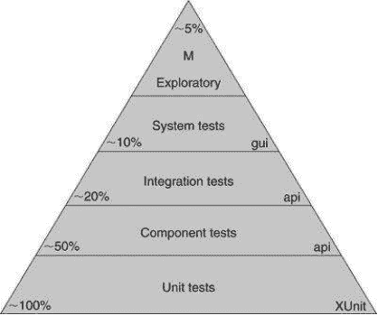

## 单元测试

金字塔的底部是单元测试。这些测试由程序员编写，面向程序员，使用系统的编程语言。这些测试的目的是在最低层规定系统。开发人员在编写生产代码之前编写这些测试，以规定他们将要编写的内容。它们作为持续集成的一部分执行，以确保程序员的意图得到贯彻。

单元测试应尽可能接近100%的覆盖率。通常这个数字应该在90多。而且应该是*真实*的覆盖率，而不是那些执行代码却不验证其行为的虚假测试。

## 组件测试

这些是上一章中提到的一部分验收测试。通常，它们是针对系统的各个组件编写的。系统的组件封装了业务规则，因此对这些组件的测试就是对这些业务规则的验收测试。


如图 8-2 所示，组件测试封装了一个组件。它将输入数据传入组件，并从中收集输出数据。它测试输出是否与输入匹配。任何其他系统组件都通过适当的模拟和测试替身技术与测试解耦。

**图 8-2. 组件验收测试**

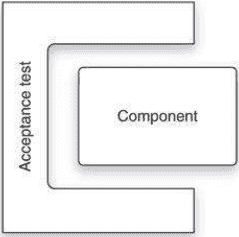

组件测试由 QA 和业务人员在开发的协助下编写。它们在组件测试环境中编写，例如 FitNesse、JBehave 或 Cucumber。（GUI 组件使用 Selenium 或 Watir 等 GUI 测试环境进行测试。）其意图是，业务人员即使不能编写这些测试，也应该能够阅读和解释它们。

组件测试大约覆盖系统的一半。它们更侧重于快乐路径情况以及非常明显的边界、边界值和备选路径情况。绝大多数不快乐路径情况由单元测试覆盖，在组件测试级别上毫无意义。

### 集成测试

这些测试仅对拥有许多组件的大型系统有意义。如图 8-3 所示，这些测试将组件组组装在一起，并测试它们之间通信的顺畅程度。系统的其他组件照常使用适当的模拟和测试替身进行解耦。

**图 8-3. 集成测试**

系统测试大约覆盖系统的 10%。这是因为它们的目的不是确保系统行为正确，而是确保系统*构建*正确。底层代码和组件的正确行为已由金字塔的较低层级确认。

### 手动探索性测试

这是人类将双手放在键盘上、将眼睛放在屏幕上的地方。这些测试不是自动化的，*也不是脚本化的*。这些测试的目的是在确认预期行为的同时，探索系统是否存在意外行为。为此，我们需要人类的头脑，凭借人类的创造力，去研究和探索系统。为这类测试制定书面测试计划反而会适得其反。

有些团队会由专家来完成这项工作。其他团队则会干脆宣布一两天“捉虫日”，让尽可能多的人——包括经理、秘书、程序员、测试人员和文档工程师——对系统进行“敲打”，看看能否让其崩溃。

目标不是覆盖率。我们不会用这些测试来证明每条业务规则和每条执行路径。相反，目标是确保系统在人工操作下表现良好，并创造性地找出尽可能多的“异常点”。

### 结论

TDD 是一种强大的纪律，验收测试是表达和强制执行需求的有价值方式。但它们只是整体测试策略的一部分。为了实现“QA 应该一无所获”的目标，开发团队需要与 QA 携手合作，创建单元测试、组件测试、集成测试、系统测试和探索性测试的层级结构。这些测试应尽可能频繁地运行，以提供最大化的反馈，并确保系统持续保持整洁。

### 参考书目

- [COHN09]: Mike Cohn, *Succeeding with Agile*, Boston, MA: Addison-Wesley, 2009.

## 9. 时间管理

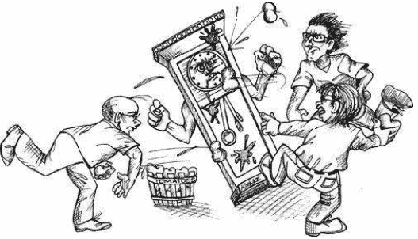

八小时是一段非常短的时间。它只有 480 分钟或 28,800 秒。作为专业人士，你期望自己能尽可能高效和有效地利用这些宝贵的秒数。你能用什么策略来确保不浪费你仅有的一点时间？你如何有效地管理你的时间？

1986 年，我住在英格兰萨里郡的小桑德赫斯特。我在布拉克内尔的 Teradyne 公司管理一个 15 人的软件开发部门。我的日子充满了电话、临时会议、现场服务问题和各种打扰，忙得不可开交。因此，为了完成任何工作，我不得不采取一些相当严格的时间管理纪律。

-   我每天早上 5 点起床，骑自行车在 6 点前赶到布拉克内尔的办公室。这让我在一天的混乱开始前拥有 2.5 小时的安静时间。
-   一到办公室，我就会在白板上写下时间表。我把时间分成 15 分钟的小块，并填写那段时间内要进行的活动。
-   我完全填满了该时间表的前 3 个小时。从上午 9 点开始，我每过一小时就留出 15 分钟的空档；这样我就可以迅速将大多数打扰推入那些空档之一，然后继续工作。
-   我把午餐后的时间留空，因为我知道到那时一切都会乱套，我必须在当天剩余时间里进入被动应对模式。在那些罕见的、混乱没有侵入的下午时间段，我会在混乱到来之前专注于处理最重要的事情。

这个方案并非总是成功。早上 5 点起床并不总是可行，有时混乱会突破我所有精心设计的策略，吞噬我的一天。但在大多数情况下，我都能勉强维持局面。

### 会议

每次会议每位与会者每小时的成本约为 200 美元。这考虑了薪水、福利、设施成本等。下次你参加会议时，计算一下成本。你可能会感到惊讶。

关于会议，有两个事实。

1.  会议是必要的。
2.  会议是巨大的时间浪费者。

通常，这两个事实同样适用于同一场会议。有些与会者可能觉得会议极有价值；另一些人可能觉得会议多余或无用。

专业人士深知会议的高昂成本。他们也清楚自己的时间非常宝贵；他们有代码要写，有进度要赶。因此，他们会主动拒绝参加那些没有直接且重大利益的会议。

### 拒绝

你不必参加每一个受邀参加的会议。事实上，参加太多会议是不专业的。你需要明智地利用时间。因此，要非常谨慎地选择参加哪些会议，以及礼貌地拒绝哪些会议。

邀请你参加会议的人不负责管理你的时间。只有*你*才能做到这一点。因此，当你收到会议邀请时，除非你的参与对你当前正在进行的工作有直接且重大的必要性，否则不要接受。

有时，会议内容与你兴趣相关，但并非当前所必需。你必须决定是否承担得起这个时间成本。要小心——这类会议可能有太多，足以耗尽你的每一天。

有时，会议内容你可以做出贡献，但对你当前正在做的事情没有直接的重要性。你必须权衡，你项目的损失是否值得你对他们项目的贡献。这听起来可能有些愤世嫉俗，但你的责任首先是*你*自己的项目。尽管如此，一个团队帮助另一个团队通常是有益的，因此你可能想与你的团队和经理讨论你的参与。

有时，某位权威人士会要求你参加会议，例如另一个项目的高级工程师或另一个项目的经理。你必须决定该权威是否压过你的工作进度。同样，你的团队和主管可以帮助你做出该决定。

你的经理最重要的职责之一就是让你*远离*会议。一个好的经理会非常愿意捍卫你拒绝参会的决定，因为那位经理和你一样关心你的时间。

### 中途离场

会议并不总是按计划进行。有时，你发现自己坐在一场本可以了解更多信息而当初拒绝的会议中。有时会添加新议题，或者某人的痛处主导了讨论。多年来，我总结出一条简单的规则：当会议变得无聊时，就离开。

同样，你有义务管理好自己的时间。如果你发现自己陷入一场没有很好利用你时间的会议，你需要设法礼貌地退出该会议。

显然，你不应该冲出会议室，大喊“太无聊了！”没有必要粗鲁。你可以简单地在适当时机


如果你的出席仍然必要，请把握时机。你可以解释自己无法再投入更多时间，并询问是否有办法加快讨论或调整议程。

需要认识到的重要一点是，留在一个对你而言已属浪费时间、且你再也无法作出重要贡献的会议中，是不专业的。你有义务明智地使用雇主的时间和金钱，因此在合适的时机协商离场并不是不专业的行为。

### 制定议程与目标

我们愿意承担会议成本的原因在于，有时我们确实需要参与者共聚一室，以帮助实现某个特定目标。为了明智地利用参与者的时间，会议应有清晰的议程，标明每个主题的时间，并设定一个目标。

如果你被要求参加会议，务必弄清楚会上将讨论哪些议题、为这些议题分配了多少时间，以及要实现什么目标。如果无法得到明确答案，那就礼貌地拒绝出席。

如果你参加会议后发现议程被劫持或弃之不顾，你应当请求将新议题搁置，并按照议程进行。如果未能如愿，你应该在可能时礼貌地离开。

### 站立会议

这些会议是敏捷规范的一部分。它们的名称源于这样一个事实：与会者在会议进行期间必须站立。每位参与者轮流回答三个问题：

- 1. 我昨天做了什么？
- 2. 我今天打算做什么？
- 3. 我遇到了什么障碍？

仅此而已。每个问题的回答应*不超过*二十秒，因此每位参与者总计不应超过一分钟。即使在十个人的小组中，这场会议也应在十分钟之前早早结束。

### 迭代计划会议

这些会议是敏捷规范中最难开好的会议。如果开得不好，会耗费过多时间。把这些会议开得顺顺利利需要技巧，而这是一项非常值得学习的技巧。

迭代计划会议旨在选出将在下一次迭代中执行的产品待办项。候选项目的估算应该已经完成，业务价值评估也应该已经完成。在真正优秀的组织中，验收/组件测试早已写好，或至少已画出草图。

会议应快速推进，每个候选待办项经过简短讨论后，要么选中要么拒绝。每个项目花费的时间不应超过五到十分钟。如果需要更长的讨论，应另约时间与团队的部分成员进行。

我的经验法则是，会议时间不应超过迭代总时长的5%。因此，对于为期一周的迭代（四十小时），会议应在两小时内结束。

### 迭代回顾与演示

这些会议在每个迭代结束时举行。团队成员讨论哪些地方做对了、哪些地方做错了。利益相关者观看新功能的演示。这些会议可能被严重滥用，并吞掉大量时间，所以应安排在迭代最后一天下班前45分钟进行。分配给回顾的时间不超过20分钟，分配给演示的不超过25分钟。记住，才不过一两周而已，不该有那么多可谈的。

### 争论/分歧

Kent Beck曾告诉过我一句意味深长的话：“任何五分钟内无法解决的争论，都无法通过争论来解决。”争论持续如此之久，是因为没有明确的证据支持任何一方。这种争论很可能是关乎信仰的，而非事实性的。

技术分歧往往会闹得不可开交。各方都为自身立场找各种理由，却很少拿出数据。没有数据，任何在几分钟内（五到三十分钟之间）无法达成一致的争论，就永远不会达成一致。唯一能做的，就是去获取一些数据。

有些人会试图以人格力量赢得争论。他们可能会大喊大叫、凑到你面前、或是摆出居高临下的姿态。但这些都没用，意志力无法长久解决分歧，数据才行。

有些人会消极对抗。他们只是为了结束争论而表示同意，然后拒绝参与解决方案，暗中破坏结果。他们会对自己说：“这是他们想要的方式，现在他们如愿以偿了。”这大概是所有不专业行为中最糟糕的一种。永远、永远不要这样做。如果你表示同意，那你*必须*参与。

如何获取解决分歧所需的数据？有时你可以做实验，或者进行某种模拟、建模。但有时最好的选择就是掷硬币，在两条路中选一条。

如果事情顺利，那就说明这条路走得通。如果遇到麻烦，你可以抽身而出，换另一条路。明智的做法是商定一个时限以及一组判定标准，以帮助判断何时应放弃所选路径。

要警惕那些实际上只是用来发泄分歧、为某一方拉拢支持的会议。还要避开那些只有争论一方在陈述的会议。

如果一场争论确实必须了结，那就让争论双方各自用不超过五分钟的时间向团队陈述理由，然后由团队投票。整个会议用不了十五分钟。

### 专注法力

如果这一节读起来有点新时代玄学的味道，或者像龙与地下城，请见谅。我只是用这种方式来思考这个话题。

编程是一项需要长时间集中注意力与专注的智力活动。专注是一种稀缺资源，有点像法力值。¹ 一旦你耗尽了专注法力，就必须通过进行一小时或更久的非专注活动来补充。

我不知道这种专注法力是什么，但我感觉它是一种影响警觉和注意力的生理物质（或者说，正是这种物质的缺乏在影响）。

无论它是什么，当它在的时候，你能*感受*到它；当它消失时，你也能感觉到。专业开发人员会学着管理自己的时间，以利用他们的专注法力。当专注法力高涨时，我们编写代码；当它低迷时，我们做其他不那么有产出的事情。

专注法力也是一种会衰减的资源。如果它在时你不用，就很可能会失去它。这也是会议可能极具破坏力的原因之一。如果你在会议中耗尽了全部专注法力，就不会剩下任何法力来写代码了。

忧虑和干扰同样会消耗专注法力。昨晚与配偶的争吵、今早挡泥板上撞出的凹痕、或是上周忘付的账单，都会迅速吸干你的专注法力。

### 睡眠

这一点我已强调得足够充分。一夜好眠之后，我的专注法力最为充沛。七小时的睡眠常常能带来整整八小时的专注法力。专业开发人员会管理自己的睡眠时间表，确保早上到达工作岗位前，专注法力已补给满格。

### 咖啡因

毫无疑问，我们中有些人可以通过适量摄入咖啡因来更高效地利用专注法力。但要小心，咖啡因也会让专注力产生一种奇怪的“抖动”。过量摄入会让专注力飘向十分奇怪的方向。一阵强烈的咖啡因快感可能让你一整天都过度关注所有错误的事情，白白浪费一天。

咖啡因的用量与耐受度因人而异。我个人偏爱早晨喝一杯浓咖啡，午餐配一罐健怡可乐。我有时会加倍，但很少超过这个量。

### 恢复

专注法力可以通过放松专注来部分恢复。一次惬意的长距离散步、与朋友聊天、或只是望着窗外发呆，都有助于把专注法力重新蓄满。

有人冥想，有人打个盹，还有人听播客或翻阅杂志。


无论出于什么原因，你总是想方设法逃避真正的工作。你说服自己别的事情更紧急，于是转而去做那些事。这被称为*优先级倒置*。你抬高某项任务的优先级，以便推迟真正具有优先级的任务。优先级倒置是我们对自己撒的谎。我们无法直面该做的事，于是说服自己另一项任务更重要。我们知道并非如此，但我们对自己撒谎。

实际上，我们并不是在对自己撒谎。我们真正在做的是为将来别人问起我们在做什么、为什么这么做时所撒的谎做准备。我们在构筑一道防御，以保护自己免受他人的评判。

这显然是不专业的行为。专业人士会评估每项任务的优先级，抛开个人的恐惧和欲望，按优先级顺序执行这些任务。

### 死胡同

死胡同是所有软件工匠生活中的常态。有时你会做出一个决定，沿着一条技术路径走下去，最终却通向死路。你在决定上投入越多，在荒野中徘徊的时间就越长。如果你赌上了自己的职业声誉，你就会永远徘徊下去。

审慎和经验会帮你避开某些死胡同，但你永远无法避开所有死胡同。因此，你真正需要的技能是：迅速意识到自己身处死胡同，并有勇气掉头退出。这有时被称为*坑洞法则*：当你在坑里时，停止挖掘。

专业人士不会对某个想法投入过深，以至于无法放弃并掉头。他们对其他想法保持开放心态，这样当他们撞上死胡同时，仍有其他选择。

### 沼泽、泥潭、湿地与其他烂摊子

比死胡同更糟的是烂摊子。烂摊子让你慢下来，但不会让你停下。烂摊子阻碍你的进展，但你仍能靠蛮力推进。烂摊子比死胡同更糟糕，因为你总能看到前进的路，而且前进的路看起来总比回头路短（但其实不是）。

## 10. 估算


估算是软件专业人士面临的最简单却最令人恐惧的活动之一。大量商业价值依赖于它。我们的声誉在很大程度上取决于它。我们的焦虑和失败也大多由它引起。它是横亘在业务人员与开发人员之间的主要楔子。它几乎是支配这段关系的所有不信任的源头。

1978 年，我是用汇编语言编写的 32K 嵌入式 Z-80 程序的首席开发人员。该程序被烧录到 32 片 1K × 8 的 EEPROM 芯片中。这 32 片芯片插在三块板上，每块板容纳 12 片芯片。

我们在全美电话中心部署了数百台设备。每当我们修复一个 bug 或添加一项功能，就必须派现场服务技术人员前往每台设备，更换全部 32 片芯片！

这简直是一场噩梦。芯片和板卡都很脆弱。芯片引脚可能弯曲或断裂。板卡的频繁弯曲可能损坏焊点。损坏和出错的风险极大。公司付出的成本实在太高了。

我的老板肯·芬德来找我，让我解决这个问题。他想要的是：对某一块芯片进行更改时，不需要更改其他所有芯片。如果你读过我的书或听过我的演讲，就会知道我经常对“独立可部署性”大发议论。这正是我第一次学到这一课的地方。

我们的问题是，这个软件是一个单一链接的可执行文件。如果在程序中添加一行新代码，后续所有代码行的地址都会改变。由于每片芯片只是地址空间的 1K，几乎所有芯片的内容都会随之改变。

解决方案非常简单。每片芯片都必须与其他芯片解耦。每片芯片都必须变成一个独立的编译单元，可以独立于其他所有芯片进行烧录。

于是我测量了应用程序中所有函数的大小，编写了一个简单程序，像拼图一样把它们塞进每一片芯片中，并留下约 100 字节的扩展空间。在每片芯片的开头，我放了一个指向该芯片所有函数的指针表。启动时，这些指针被移入 RAM。系统中的所有代码都被修改为只能通过这些 RAM 向量调用函数，绝不直接调用。

是的，你猜对了。这些芯片就是带有虚函数表（vtables）的对象。所有函数都以多态方式部署。而且，是的，我正是在这里学到了面向对象设计的一些原则，远在我知道“对象”是什么之前。

收益是巨大的。我们不仅可以独立部署单块芯片，还可以在现场通过将函数移入 RAM 并重新路由向量来打补丁。这使得现场调试和热修补变得容易得多。

但我跑题了。当肯来找我解决这个问题时，他提到了函数指针的概念。我花了一两天时间把想法正式化，然后向他提交了一份详细计划。他问我需要多长时间，我回答大约需要一个月。

结果花了*三个月*。

我这辈子只醉过两次，真正醉得不省人事只有一次。那是在 1978 年泰瑞达公司的圣诞派对上。我当时 26 岁。

派对在泰瑞达的办公室举行，那里大部分是开放的实验室空间。大家都到得很早，然后一场巨大的暴风雪让乐队和餐饮服务商无法赶到。幸运的是，酒水充足。

那晚的事我记不清多少了。而我*确实*记得的那些，我倒希望自己不记得。但我要和你分享一个令人心酸的瞬间。

我盘腿坐在地板上，旁边是肯（我的老板，当时只有 29 岁，而且*没有*喝醉），哭着说向量化工作花了太久。酒精释放了我对估算的压抑已久的恐惧和不安全感。我不*觉得*自己的头枕在他腿上，但我的记忆对这类细节实在不太清楚。

我确实记得我问过他是否生我的气，是否觉得我花的时间太长。虽然那晚的记忆模糊不清，但他的回答在接下来的几十年里始终清晰。他说：“是的，我觉得你花了很长时间，但我看得出你在努力做这件事，而且进展良好。这是我们确实需要的东西。所以，不，我没有生气。”

### 什么是估算？

问题在于我们对估算的看法不同。业务方喜欢把估算视为承诺。开发人员喜欢把估算视为猜测。两者的差别是巨大的。

### 承诺

承诺是你必须达成的事情。如果你承诺在某日期前完成某事，那你就*必须*在那日期前完成。如果这意味着你必须每天工作 12 小时、周末加班、取消家庭度假，那就这样吧。你做出了承诺，就必须遵守。

专业人士只有在*知道*自己能做到时才会做出承诺。就这么简单。如果有人要求你承诺一件你*不确信*能做到的事，那么在道义上你必须拒绝。如果有人要求你承诺一个你知道自己*能*达到、但需要长时间加班、周末工作并放弃家庭

所以现在迈克遇到了问题。他不确定彼得完成这项任务需要多长时间。为了尽量减少这种不确定性，他可能会请彼得做出承诺。而这是彼得无法给出的。

迈克：“彼得，你能给我一个确定的完成日期吗？”

彼得：“不能，迈克。我说过了，大概三天，也许四天能完成。”

迈克：“那我们就说四天，行吗？”

彼得：“不行，*可能*要五六天。”

到目前为止，双方的表现都算公平。迈克要求承诺，彼得谨慎地拒绝了。于是迈克换了一种方式：

迈克：“好吧，彼得，但你能*尽量*不超过六天吗？”

迈克的恳求听起来很无辜，迈克当然也没有恶意。但迈克到底是在要求彼得做什么？“尽量”是什么意思？

我们之前在[第 2 章](#)中讨论过这个问题。“*尽量*”这个词含义沉重。如果彼得答应“尽量”，那就等于他承诺了六天完成。没有其他解释。同意“尽量”就是同意成功。

还能有其他什么解释？彼得究竟要做什么才算“尽量”？他是否要工作超过八小时？显然隐含了这层意思。他是否要周末工作？是的，这也隐含了。他是否会取消家庭度假？是的，这也是隐含的一部分。所有这些都属于“尽量”的范畴。如果彼得不做这些事，迈克就可以指责他没有尽力。

专业人士会在估算和承诺之间划清界限。他们只有在确信自己能成功时才会承诺。他们会小心避免做出任何*隐含的*承诺。他们会尽可能清楚地传达估算的概率分布，以便管理者制定适当的计划。

### PART


根据彼得给出的4.2/1.8估算值，迈克明白这项任务很可能在五天内完成，但也可能需要6天，甚至9天。

但迈克管理的不仅仅是一项任务。他管理的项目包含许多任务。彼得必须按顺序完成其中三项任务。彼得对这些任务的估算如表10-1所示。

**表10-1. 彼得的任务**

| 任务 | 乐观估计 | 最可能估算 | 悲观估计 | μ | σ |
|---|---:|---:|---:|---:|---:|
| Alpha | 1 | 3 | 12 | 4.2 | 1.8 |
| Beta | 1 | 1.5 | 14 | 3.5 | 2.2 |
| Gamma | 3 | 6.25 | 11 | 6.5 | 1.3 |

那个“Beta”任务是怎么回事？看起来彼得对它相当有信心，但可能会有某些环节出错，使他大大偏离计划。迈克应该如何理解这一点？迈克应该为彼得完成全部三项任务规划多长时间？

事实证明，只需几个简单的计算，迈克就能将彼得的所有任务合并起来，得出整组任务的概率分布。计算非常直接：

- **μ<sub>sequence</sub> = ∑ μ<sub>task</sub>**

对于任何任务序列，该序列的预期工期就是该序列中所有任务预期工期的简单总和。因此，如果彼得有三项任务要完成，其估算值分别为4.2/1.8、3.5/2.2和6.5/1.3，那么彼得很可能在14天左右完成全部三项：4.2 + 3.5 + 6.5。

- **σ<sub>sequence</sub> = √(∑ σ<sub>task</sub>²)**

序列的标准差是各项任务标准差平方之和的平方根。因此，彼得三项任务的标准差约为3。

(1.8² + 2.2² + 1.3²)^(1/2) =  
(3.24 + 4.84 + 1.69)^(1/2) =  
9.77^(1/2) = ~3.13

这告诉迈克，彼得的任务很可能需要14天，但也很有可能需要17天（1σ），甚至可能需要20天（2σ）。甚至可能更长，但这种情况相当不可能。

回看估算表。你能感受到在五天内完成全部三项任务的压力吗？毕竟，最乐观的估算分别是1、1和3。即使是“最可能估算”加起来也只有10天。我们怎么会一路增加到14天，还有可能达到17或20天？答案在于，这些任务中的不确定性会叠加起来，为计划增加了*现实性*。

如果你是有多年经验的程序员，你很可能见过一些被乐观估算的项目，最终耗时比预期长了三到五倍。上面展示的简单PERT方案是一种合理的做法，有助于避免设定过于乐观的预期。尽管面临着*尝试*加快速度的压力，软件专业人士仍会非常谨慎地设定合理的预期。

### 估算任务

迈克和彼得犯了一个严重的错误。迈克问彼得他的任务需要多长时间，彼得给出了诚实的三变量答案。但他队友的意见呢？他们会不会有不同想法？

你最重要的估算资源是身边的人。他们能看到你看不到的东西。他们能帮助你更准确地估算任务，比你自己估算更准确。

### 宽带德尔菲

20世纪70年代，巴里·贝姆向我们介绍了一种名为“宽带德尔菲”的估算技术。⁵ 多年来出现了许多变体。有些是正式的，有些是非正式的；但它们都有一个共同点：共识。

策略很简单。一组人聚在一起，讨论任务、估算任务，并重复讨论和估算，直到达成一致。

贝姆最初概述的方法涉及多次会议和文档，对我来说过于仪式化和繁琐。我更喜欢简单、低开销的方法，例如下面这些。

### 飞指法

每个人围坐在桌旁。任务一次讨论一个。对于每个任务，大家讨论任务包含什么、什么可能干扰或使其复杂化，以及如何实现。然后参与者把手放在桌子下面，根据他们认为任务需要多长时间举起0到5根手指。主持人数1-2-3，所有参与者同时亮出手。

如果大家意见一致，就继续下一个任务。否则，他们继续讨论，以找出分歧的原因。他们重复这一过程，直到达成一致。

一致并不需要绝对一致。只要估算值接近，就足够了。例如，零星出现的3和4也算一致。但如果除了一人举起1根手指外，其余人都举起4根手指，那就有得讨论了。

估算的刻度在会议开始时确定。可以是任务所需的天数，也可以是更有趣的刻度，比如“手指乘以三”或“手指平方”。

同时亮出手指非常重要。我们不希望人们根据看到别人的做法而改变自己的估算。

### 计划扑克

2002年，詹姆斯·格伦宁撰写了一篇有趣的论文⁶，描述了“计划扑克”。这种宽带德尔菲法的变体变得非常流行，以至于好几家公司都利用这个想法制作了计划扑克牌作为营销赠品。⁷ 甚至还有一个名为 [planningpoker.com](http://planningpoker.com) 的网站，你可以用它来与分布式团队在线进行计划扑克。

这个想法非常简单。为估算团队的每位成员发一手印有不同数字的牌。数字0到5就很好，这使该系统在逻辑上等同于*飞指法*。

挑选一个任务并进行讨论。在某个时刻，主持人请每个人选一张牌。团队成员抽出一张与他们的估算相符的牌，背面朝外举起，这样其他人就看不到牌上的数值。然后主持人让大家亮牌。

其余过程与飞指法类似。如果意见一致，则接受该估算。否则，将牌收回手中，继续讨论该任务。

很多“学问”都致力于为一手牌选择正确的牌面数值。有些人甚至使用基于斐波那契数列的牌。其他人则加入了代表无限大和问号的牌。就我个人而言，我认为标有0、1、3、5、10的五张牌就足够了。

### 亲和估算

几年前，洛厄尔·林德斯特伦向我展示了一种特别独特的宽带德尔菲变体。我在各种客户和团队中使用这种方法，运气相当不错。

所有任务都写在卡片上，不显示任何估算值。估算团队站在桌子或墙壁周围，卡片随机摊开。团队成员不说话，只是开始按相对关系对卡片进行排序。耗时更长的任务移到右边，较小的任务移到左边。

任何团队成员都可以随时移动任何卡片，即使它已经被其他成员移动过。任何被移动超过n次的卡片都会被放在一边，供讨论。

最终，无声的排序逐渐停止，讨论可以开始。关于卡片顺序的分歧会被探讨。可能会有一些快速的设计讨论或手绘线框图来帮助达成共识。

下一步是在卡片之间画线，以表示桶的大小。这些桶可能是天、周或点数。传统上采用斐波那契数列的五个桶（1, 2, 3, 5, 8）。

### 三元估算

这些宽带德尔菲法适合为任务选择一个单一的最可能估算值。但正如我们之前所说，大多数时候我们需要三个估算值，以便创建概率分布。每个任务的乐观值和悲观值可以非常快速地使用任何一种宽带德尔菲变体生成。例如，如果你正在使用计划扑克，只需让团队举起代表他们


- [McConnell2006]: Steve McConnell, *软件估算：揭秘黑魔法*, Redmond, WA: Microsoft Press, 2006.
- [Boehm81]: Barry W. Boehm, *软件工程经济学*, Upper Saddle River, NJ: Prentice Hall, 1981.
- [Grenning2002]: James Grenning, “规划扑克，或如何在发布规划时避免分析瘫痪,” 2002年4月, [http://renaissancesoftware.net/papers/14-papers/44-planning-poker.html](http://renaissancesoftware.net/papers/14-papers/44-planning-poker.html)

1988 年，我在 Clear Communications 工作。这是一家从未真正起步的初创公司。我们烧完了第一轮融资，然后不得不进行第二轮，接着是第三轮。

最初的产品愿景听起来不错，但产品架构似乎始终无法落地。起初产品既有软件也有硬件。后来只剩下软件。软件平台从 PC 换成了 SPARCstation。客户从高端换成了低端。最终，在公司试图寻找能够创收的方向时，连产品的初衷都迷失了。我在那里待了将近四年，我不认为公司赚到过一分钱。

不用说，软件开发人员承受着巨大的压力。有不少漫长的不眠之夜，甚至还有更长的周末，在办公室的终端前度过。有人用 C 语言写出的函数有 *3000 行长*。有争吵，有喊叫，有辱骂。有勾心斗角和尔虞我诈。有拳头砸穿墙壁，有钢笔被愤怒地扔向白板，有用铅笔尖把讨厌同事的漫画刻进墙壁，还有源源不断的愤怒和压力。

截止日期是由各种活动驱动的。功能必须为贸易展览或客户演示做好准备。客户要求的任何东西，无论多么愚蠢，我们都会在下一次演示前准备好。时间总是太短。工作总是落后。进度安排总是让人不堪重负。

如果你在一周内工作了 80 个小时，你可能成为英雄。如果你为客户演示拼凑出一个烂摊子，你可能成为英雄。如果你这样做得足够多，你可能会升职。如果你不这样做，你可能会被解雇。这是一家初创公司——一切都关乎“汗水权益”。而 1988 年，在我积累了将近 20 年经验之后，我竟然相信了这套。

我是那个开发经理，告诉为我工作的程序员们，他们必须做得更多、更快。我是那些工作 80 小时的人之一，在凌晨 2 点写着 3000 行的 C 函数，而我的孩子们在家里睡觉，父亲却不在家中。我就是那个扔钢笔、大喊大叫的人。如果谁不改进，我会让他们被解雇。这太糟糕了。我也太糟糕了。

然后有一天，我的妻子强迫我好好照照镜子。我不喜欢我所看到的。她告诉我，我这个人让人难以相处。我不得不同意。但我不喜欢这样，所以我愤怒地冲出了家门，漫无目的地走。我走了大约三十分钟，边走边怒火中烧；然后天开始下雨了。

我脑子里突然有什么东西咔哒一声。我开始大笑。我笑自己的愚蠢。我笑自己的压力。我笑镜子里那个人，那个可怜虫，为了某种东西——究竟是为了什么？——让自己和他人的生活变得痛苦不堪。

那一天，一切都变了。我不再疯狂加班。我不再过那种高压的生活方式。我不再扔钢笔，也不再写 3000 行的 C 函数。我下定决心，要好好享受我的职业生涯，通过把事情做好，而不是通过愚蠢的方式。

我尽可能以专业的方式离开了那份工作，成为了一名顾问。从那天起，我再也没有叫过别人“老板”。

### 避开压力

在压力下保持冷静的最好方法，是避开那些*导致*压力的情境。这种回避或许不能完全消除压力，但可以大大有助于最大限度地减少压力，并缩短高压时期。

### 承诺

正如我们在[第 10 章](#)中发现的，避免承诺那些我们不确定能否实现的截止日期是非常重要的。业务方总是希望我们做出承诺，因为他们想消除风险。我们必须做的是确保风险被量化并提交给业务方，以便他们能恰当地管理风险。接受不切实际的承诺会阻碍这一目标，对业务方和我们自己都没有好处。

有时候承诺是别人替我们做出的。有时候我们会发现，业务方在没有征求我们意见的情况下向客户做出了承诺。当这种情况发生时，我们有道义上的责任帮助业务方找到实现这些承诺的方法。然而，我们*没有*道义上的责任去*接受*这些承诺。

这个区别很重要。专业人士总会帮助业务方找到实现其目标的方法。但专业人士并不一定要接受业务方替他们做出的承诺。归根结底，如果我们找不到办法去实现业务方所做的承诺，那么做出承诺的人必须承担责任。

这话说起来容易。但当你的公司经营不善，因为未能兑现承诺而导致工资被延迟发放时，很难不感到压力。但如果你一直表现得专业，至少在找新工作时，你可以昂首挺胸。

### 保持整洁

想要快速前进并避免被截止日期追着跑，方法就是保持整洁。专业人士不会为了追求速度而屈服于制造混乱的诱惑。专业人士明白“快速而草率”是一个矛盾的说法。草率永远意味着慢！

我们可以通过让我们的系统、代码和设计尽可能保持整洁来避免压力。这并不是说我们要花无尽的时间打磨代码。这只是说我们不能容忍混乱。我们知道混乱会拖慢我们的速度，导致我们错失日期、打破承诺。所以我们尽自己所能做好工作，并尽可能让我们的产出保持整洁。

### 危机中的纪律

通过在危机中观察自己，你就知道你真正相信什么。如果在危机中你坚持自己的纪律，那么你是真正相信这些纪律的。另一方面，如果你在危机中改变了自己的行为，那么你并不真正相信你平时的那种行为。

如果你在平时遵循测试驱动开发的纪律，但在危机中放弃了它，那么你并不是真正相信 TDD 是有帮助的。如果你在平时保持代码整洁，但在危机中制造混乱，那么你并不是真的相信混乱会拖慢你的速度。如果你在危机中进行结对编程，但平时却不结对，那么你是相信结对编程比不结对更高效。

选择一些你在危机中也能自在地遵循的纪律。*然后一直遵循它们。*遵循这些纪律是避免陷入危机的最好方法。

当关键时刻来临，不要改变你的行为。如果你的纪律是工作的最佳方式，那么即使在危机最深处也应该坚持遵循。

### 处理压力

预防、缓解和消除压力固然很好，但有时候，尽管你用心良苦、防范到位，压力还是会来。有时候，项目就是比所有人预期的都要耗时。有时候，初始设计就是错误的，必须返工。有时候，你会失去一位重要的团队成员或客户。有时候，你会做出一个自己根本无法兑现的承诺。那该怎么办？

### 不要恐慌

管理好你的压力。不眠之夜不会帮你更快完成工作。坐着发愁也没有用。而你最不该做的，就是匆忙行事！无论如何都要抵制这种诱惑。匆忙行事只会让你在坑里越陷越深。

相反，放慢速度。把问题想透。规划一条通往最佳结果的路线，然后以合理而稳定的步伐朝着那个结果前进。

### 沟通

让你的团队和上级知道你有麻烦了。告诉他们你摆脱麻烦的最佳计划。征求他们的意见和指导。避免制造意外。没有什么比意外更能让人愤怒和不理智的了。意外会让压力增加十倍。

### 依靠你的纪律

当情况变得艰难时，*相信你的纪律*。你之所以*拥有*纪律，就是为了在高压力时期给你指引。现在正是特别关注你所有纪律的时候。现在*不是*质疑或放弃它们的时候。

与其惊慌失措地四处寻找某个能帮你更快完成的东西，不如更加深思熟虑、更加专注地遵循你选择的纪律。如果你遵循 TDD，那么就比平时写更多的测试。如果你是个无情的重构者，那就更努力地重构。如果你让函数保持短小，那就让它们更短小。要熬过这口高压锅，唯一的办法就是依靠你已经知道有效的东西——你的纪律。


### 求助

结对！当压力来临时，找一位愿意与你结对编程的伙伴。你会更快完成任务，并且缺陷更少。你的结对伙伴会帮助你坚守纪律，避免惊慌失措。伙伴会注意到你忽略的地方，提出有用的想法，并在你分心时为你补位。

同样地，当你看到其他人在压力下工作时，主动提出与他们结对。帮助他们走出困境。

### 结论

应对压力的诀窍是：能避开时就避开，避不开时就承受。避开压力靠的是管理承诺、遵守纪律、保持整洁。承受压力靠的是保持冷静、善于沟通、遵守纪律、寻求帮助。

由于参与其中，我们大部分代码阅读和初步编辑都是使用打印出来的清单进行的。

我们完全没有搜索代码库的工具。无法找出一个函数在哪些地方被调用，或一个常量在哪些地方被使用。可以想象，这相当不便。

于是有一天，蒂姆和我决定编写一个交叉引用生成器。这个程序会读取我们的源码磁带，解析汇编语法，创建符号表，并将引用添加到条目中。程序本身写起来相当简单。它运行得很好，但慢得可怕。处理我们的主运行程序（MOP）需要一个多小时。

之所以这么慢，是因为我们将不断增长的符号表放在一个内存缓冲区中。每当我们发现一个新的引用，就把它插入缓冲区，将缓冲区其余部分向下移动几个字节来腾出空间。

蒂姆和我并不是数据结构和算法方面的专家。我们从未听说过哈希表或二分查找。我们不知道如何让算法变快。我们只知道我们正在做的事情太慢了。

所以我们尝试了一个又一个方法。我们尝试将引用放在链表中。我们尝试在数组中留出空隙，只在空隙填满时才扩展缓冲区。我们尝试创建空隙的链表。我们尝试了各种疯狂的想法。

我们站在办公室的白板前，画出数据结构的图示，并进行计算来预测性能。我们每天到办公室都会带着另一个新想法。我们像魔鬼一样合作。

我们尝试的一些方法提高了性能。一些则拖慢了速度。这令人恼火。就在那时，我第一次发现优化软件是多么困难，以及这个过程是多么违反直觉。

最终我们将时间降到了15分钟以内，这已经非常接近单纯读取源码磁带所需的时间了。所以我们很满意。

## 程序员与普通人

与市场人员谈论他们遇到的问题和难题。他们与管理层交谈，以了解团队的短期和长期目标。

简而言之，他们关注自己所乘的船。

我唯一一次被编程工作解雇是在1976年。当时我在Outboard Marine公司工作。我在帮助编写一个工厂自动化系统，该系统使用IBM System/7来监控车间里几十台铝压铸机。

从技术上讲，这是一份充满挑战且回报丰厚的工作。System/7的架构引人入胜，工厂自动化系统本身也真的很有趣。

我们还有一个好团队。团队负责人约翰能干且积极。我的两位编程队友友善且乐于助人。我们有一个专门用于项目的实验室，我们都在那个实验室工作。业务合伙人也很投入，和我们一起在实验室里。我们的经理拉尔夫能干、专注，并且掌控局面。

一切都应该很棒。问题出在我身上。我对项目和技术足够热情，但在24岁的“高龄”，我实在无法让自己关心业务或其内部政治结构。

我的第一个错误是在第一天犯的。我没打领带就到了。面试时我系了领带，而且我看到每个人都系领带，但我没有把这两件事联系起来。所以第一天，拉尔夫走到我面前直截了当地说：“我们这里要系领带。”

我无法告诉你我有多反感这件事。它在内心深处困扰着我。我每天都系领带，但我讨厌它。但为什么？我知道自己要面对的是什么。我知道他们采用的惯例。我为什么会如此不安？因为我是个自私、自恋的小混蛋。

我就是无法准时上班。而且我认为这无关紧要。毕竟，我干得“不错”。而且的确，我在编写程序方面做得很好。我无疑是团队里技术最好的程序员。我写代码比其他人都快、都好。我能更快地诊断和解决问题。*我知道*自己很有价值。所以时间和日期对我来说并不重要。

那天我回到家，面对我怀孕的22岁妻子，不得不告诉她我被解雇了。这是一段我永远不想再经历的经历。

### 程序员与程序员

程序员往往很难与其他程序员密切合作。这导致了一些非常严重的问题。

### 代码所有权

一个运转不良的团队最糟糕的症状之一，就是每个程序员都在*自己的*代码周围筑起围墙，拒绝让其他程序员碰它。我去过一些地方，那里的程序员甚至不让其他程序员*看*他们的代码。这是灾难的根源。

我曾为一家制造高端打印机的公司提供咨询。这些机器有许多不同的部件，比如进纸器、打印机、堆叠器、订书机、切割机等等。公司对这些设备的价值评估各不相同。进纸器比堆叠器更重要，而没有什么比打印机更重要。

每个程序员都负责*自己的*设备。一个人写进纸器的代码，另一个人写订书机的代码。他们每个人都把自己的技术保密，阻止其他人碰自己的代码。这些程序员所拥有的政治影响力，与公司对相应设备的重视程度直接相关。负责打印机的程序员是无可撼动的。

这对技术来说是一场灾难。作为顾问，我能看到代码中存在着大量的重复，模块之间的接口完全扭曲。但无论我怎么争辩，都无法说服程序员（或公司）改变他们的做法。毕竟，他们的加薪评审与自己所维护设备的重要性挂钩。

### 集体所有权

打破所有代码所有权围墙、让团队拥有全部代码要好得多。我更喜欢这样的团队：任何成员都可以检出任一模块，并做出他们认为合适的任何修改。我希望是*团队*拥有代码，而不是个人。

职业开发者不会阻止他人处理代码。他们不会在代码周围建立所有权围墙。相反，他们会尽可能多地和彼此一起处理系统中的不同部分。他们通过在系统的其他部分与彼此合作来互相学习。

### 结对编程

许多程序员不喜欢结对编程的想法。我觉得这很奇怪，因为大多数程序员在紧急情况下*会*结对。为什么？因为这显然是解决问题的最有效方式。这回到一句老话：三个臭皮匠，胜过诸葛亮。但如果结对是紧急情况下解决问题的最有效方式，为什么它不是解决所有问题的最有效方式呢？

我不打算给你引用研究数据，尽管确实有一些可以引用。我不打算给你讲轶事，尽管我能讲很多。我甚至不打算告诉你应该多少时间结对。我只想告诉你：*职业开发者会结对*。为什么？因为至少对于某些问题，这是最有效的解决方式。但这并不是唯一的原因。

职业开发者结对，还因为这是彼此分享知识的最佳方式。职业开发者不会制造知识孤岛。相反，他们通过相互结对来学习系统的不同部分和业务。他们认识到，虽然所有团队成员都有自己的位置，但在紧要关头，所有成员也应该能够胜任另一个位置。

职业开发者结对，因为这是审查代码的最佳方式。任何系统都不应该包含未经其他程序员审查的代码。进行代码审查的方式有很多种；大多数都极其低效。最有效且高效的代码审查方式，就是协作编写代码。

### 小脑

2000年，在互联网泡沫最盛时期的一天早上，我乘火车去芝加哥。当我走下火车踏上站台时，一个巨大的广告牌赫然出现在出站口上方，撞击着我的视线。那是家知名软件公司招募程序员的广告，上面写着：*来和最优秀的人一起摩擦小脑吧。*


我立刻被这样的标牌所蕴含的十足愚蠢所震惊。这些可怜的、毫无头绪的广告人试图吸引一群技术高超、聪明且知识渊博的程序员。这些人恰恰是最无法容忍愚蠢的人。广告商试图唤起的是与其他高智商人群分享知识的形象。不幸的是，他们提到的是大脑中负责精细肌肉控制的小脑，而不是智力。于是，他们想要吸引的那些人，恰恰在嘲笑这样一个愚蠢的错误。

但那个标牌还引起了我的另一些联想。它让我想到一群人试图摩擦彼此的小脑。既然小脑位于大脑后部，摩擦小脑的最佳方式就是彼此背对背。我想象着程序员团队坐在格子间里，彼此背对背窝在角落，戴着耳机盯着屏幕。*这就是摩擦小脑的方式。* 这也不是一个团队。

专业人士要*共同*工作。当你戴着耳机窝在角落里时，是无法共同工作的。所以我要你们围着桌子坐，*面对面*。我要你们能嗅到彼此的恐惧。我要你们能听到某人沮丧的嘟囔。我要的是意外收获式的沟通，无论是言语还是肢体语言。我要你们像一个整体那样沟通。

也许你认为自己单独工作效果更好。这或许没错，但这不意味着当你独自工作时，*团队*的整体效果更好。事实上，你独自工作时*确实*会做得更好的可能性微乎其微。

有些时候，独自工作是正确的选择。有些时候，你确实需要长时间深入思考一个问题。有些时候，任务太过琐碎，让另一个人陪你一起做纯属浪费。但总体而言，最好与他人紧密协作，并将大部分时间用于结对工作。

### 结论

也许我们进入编程行业并不是为了与人打交道。我们真不走运。编程*完全关乎与人合作*。我们需要与业务方合作，也需要彼此合作。

## 13. 团队与项目


如果有很多小型项目要完成，该怎么办？你应该如何把这些项目分配给程序员？如果有一个非常庞大的项目要完成呢？

### 它能融合吗？

多年来，我曾为多家银行和保险公司提供咨询。它们似乎有一个共同点，那就是划分项目的奇怪方式。

银行里的项目通常是比较小的活儿，只需要一两个程序员干上几周。这个项目往往会配备一名项目经理，而这位项目经理同时还管理着其他项目。它会配备一名业务分析师，而这位分析师同时也在为其他项目提供需求。它会配备一些程序员，而他们同时也在做其他项目。还会分配一两名测试人员，而他们同样也在做其他项目。

看出规律了吗？项目太小，以至于没有任何人能全职投入。每个人在这个项目上只投入 50%，甚至

当团队因进度压力而想偏离流程时，充当团队的良知。

### 发酵

这样的团队需要时间来解决彼此的分歧、达成默契，并真正凝聚起来。这可能需要六个月，甚至一年。但一旦实现，就会产生奇迹。一个凝聚的团队会一起规划、一起解决问题、一起面对问题，并*把事情做成*。

一旦形成这样的团队，仅仅因为一个项目结束就把它拆散，是荒谬的。最好的做法是让这个团队保持在一起，不断给它分配项目。

### 先有团队还是先有项目？

银行和保险公司试图围绕项目组建团队，这是愚蠢的做法。这些团队根本不可能凝聚起来。每个人只在项目上待很短的时间，而且只投入一部分时间，因此永远学不会如何与彼此相处。

专业的开发组织会把项目分配给已有的凝聚团队，而不是围绕项目组建团队。一个凝聚的团队可以同时承接许多项目，并根据自己的观点、技能和能力来分配工作。这样的团队会完成项目。

### 但你如何管理呢？

团队有各自的速率。^1 团队的速率就是在一个固定时间段内能够完成的工作量。有些团队用每周*点数*来衡量速率，其中点数是复杂度的单位。他们会把正在做的每个项目的功能拆解，并以点数进行估算，然后衡量每周完成多少点数。

速率是一种统计度量。一个团队可能一周完成 38 个点，下一周完成 42 个点，再下一周完成 25 个点。随着时间推移，这会趋于平均。

管理层可以为分配给团队的每个项目设定目标。例如，如果一个团队的平均速率是 50，并且他们有三个项目

[RCM2003]: 罗伯特·C·马丁，*《敏捷软件开发：原则、模式与实践》*，新泽西州上萨德尔河：普伦蒂斯·霍尔，2003年。

[COHN2006]: 迈克·科恩，*《敏捷估算与规划》*，新泽西州上萨德尔河：普伦蒂斯·霍尔，2006年。

当时的事情。我至今仍在疑惑。

当然，那是我在面试毕业生时遇到的一系列失望中最极端的例子。并非所有计算机科学毕业生都令人失望——远非如此！然而，我注意到那些不令人失望的人有一个共同点：几乎所有人都在进入大学之前就*自学了编程*，并且进入大学后仍然坚持自学。

请别误会。我认为在大学里获得一流的教育是可能的。只是我也认为，你同样有可能浑水摸鱼地混过整个体制，最后拿着一纸文凭出来，其他一无所得。

还有另一个问题。即使是最好的计算机科学学位课程，通常也不会让年轻毕业生为他们在行业中会遇到的情况做好准备。这与其说是对学位课程的控诉，不如说是几乎所有学科的现实。你在学校学到的东西和在工作中遇到的东西往往是截然不同的。

## 指导

我们是如何学习编程的？让我讲讲我被人指导的故事。

### Digi-Comp I，我的第一台计算机

1964 年，我十二岁生日时，母亲送给我一台小小的塑料计算机。它叫 Digi-Comp I。^1 它有三个塑料触发器和六个塑料*与门*。你可以把触发器的输出连接到*与门*的输入，也可以把*与门*的输出连接到触发器的输入。简而言之，这让你可以创建一个三比特有限状态机。

这个套件附带了一本手册，里面给出了几个可以运行的程序。给这台机器编程的方式，是把小管子（一小段吸管）插在触发器上伸出的小柱子上。手册精确地告诉了你每根管子该放在哪里，却没告诉你这些管子是干什么的。这让我非常沮丧！

我盯着机器看了几个小时，从最底层弄清了它的工作原理；但我想破脑袋也想不出怎么让它做我想做的事。手册的最后一页让我寄去一美元，他们会寄回一本告诉我如何给这台机器编程的手册。²

我寄出了那一美元，带着十二岁孩子才有的不耐烦等待着。手册寄到的那天，我如饥似渴地读完了它。那是一篇关于布尔代数的简明论文，涵盖了布尔等式的基本因式分解、结合律、分配律和德摩根定理。手册展示了如何将一个问题表达为一连串布尔等式，还描述了如何化简这些等式以适应 6 个*与*门。

我想出了我的第一个程序。我至今还记得它的名字：帕特森先生的计算机化门。我写出等式，化简它们，并把它们映射到机器上的管子和柱子上。*它竟然成功了！*

刚刚写下这几个字，让我脊背一阵发凉。将近半个世纪前，那个十二岁男孩也曾感受到同样的战栗。我彻底着迷了。我的生活从此再也不同。

你还记得自己的第一个程序成功运行的时刻吗？它是否改变了你的人生，或者让你走上了一条无法回头的道路？

这并不是我一个人想明白的。我得到了*指导*。一些非常善良且技艺精湛的人（我欠他们一份巨大的感激之情）花时间写了一篇十二岁孩子也能看懂的布尔代数论文。他们把数学理论与那台小小的塑料计算机的实用操作联系起来，让我有能力让那台计算机做我想做的事。

我刚刚取下那本命运攸关的手册。我一直把它放在一个密封袋里。然而，岁月还是造成了损伤，书页已经泛黄、变脆。不过，文字的力量依然从中闪耀。他们对布尔代数的优雅描述，只占了三页稀疏的篇幅。他们对每个原始程序的等式所做的逐步讲解，至今仍令人信服。这是一部大师之作，是一部至少改变了一个年轻人一生的作品。然而，我怀疑自己永远不会知道作者的名字。

### 高中时代的 ECP-18

十五岁时，我是一名高中新生，喜欢在数学组闲逛。（没想到吧！）有一天，他们推进来一台机器……

宽恕胜于许可！我输入了一个小程序，它会把累加器乘以2并加1。我将5输入累加器，运行程序，看到累加器中显示13₈！居然成功了！

接着，我又输入了几个类似的简单程序，它们都按预期运行。我感觉自己成了宇宙的主宰！

几天后，我才意识到自己当初是多么愚蠢，又是多么幸运。我在数学实验室里发现了一张散落的指令表。上面列出了所有不同的指令和操作码，其中许多是单靠观察技术人员所学不到的。我很欣慰自己正确理解了那些已知的指令，也为其他指令感到兴奋。然而，其中一条新指令是HLT。恰好*停机*指令是一个全零的字。又恰好我在每个程序的末尾都放了一个全零的字，以便加载到累加器中将其清零。我根本没有想到停机这个概念。我只是认为程序运行完就会停下来！

我记得有一次坐在数学实验室里，看着一位老师费力地想让一个程序跑起来。他试图在连接的电传打字机上输入两个十进制数，然后打印出它们的和。任何尝试过在小型计算机上用机器语言编写这种程序的人都知道，这绝非易事。你必须读入字符，转换成数字，再转换成二进制，相加，再转换回十进制，并编码回字符。而且，相信我，当你通过前面板用二进制输入程序时，情况还要*糟糕*得多！

我看着他往程序中加入了一个停机指令，然后运行它直到停止。（哦！这主意不错！）这个原始的断点让他得以检查寄存器的内容，看看他的程序做了什么。我记得他咕哝道：“哇，真快！” 天哪，我可真有消息要告诉他！

我完全不知道他的算法是什么。那种编程对我来说仍然像魔法一样。我在他身后观看时，他从不跟我说话。事实上，*没有人*跟我谈论过这台计算机。我想他们认为我是个该被无视的麻烦鬼，像飞蛾一样在数学实验室里扑腾。可以说，无论是那个学生还是那些老师，社交技能都不怎么高明。

最后，他终于让程序运行成功了。那场面令人惊叹。他慢慢地输入两个数字，因为尽管他之前声称很快，那台计算机实际上并不快（想想1967年从旋转磁鼓上读取连续字的情形）。当他输入第二个数字后按下回车键，计算机疯狂地闪烁了一会儿，然后开始打印结果。每个数字大约要花一秒钟。它打印了除最后一位以外的所有数字，然后更加疯狂地闪烁了五秒钟，接着打印出最后一位数字并停机。

为什么在最后一位数字之前会停顿？我始终没弄明白。但这让我意识到，解决问题的方法会对用户产生深远的影响。即使程序产生了正确的答案，它*仍然*存在某些问题。

这就是导师指导。当然，这并不是我所期望的那种指导。如果那些老师中有人能提携我，和我一起工作，那当然很好。但这并不重要，因为我一直在*观察*他们，并以疯狂的速度学习。

### 非常规指导

我给你们讲这两个故事，是因为它们描述了两种截然不同的指导方式，都不是这个词通常所隐含的那种。在第一种情况下，我从一本写得非常好的手册的作者那里学到了东西。在第二种情况下，我通过观察那些刻意无视我的人来学习。在这两种情况下，获得的知识都是深刻而基础的。

当然，我也有过其他类型的导师。有一位好心的邻居在Teletype公司工作，他带回家一盒30个电话继电器给我玩。我跟你说，给一个小伙子一些继电器和一个电动火车变压器，他就能征服世界！

还有一位好心的邻居是业余无线电操作员，他教我如何使用万用表（我很快就把它弄坏了）。还有一位办公用品商店老板，允许我进去“玩”他那台非常昂贵的可编程计算器。还有数字设备公司的销售办公室，允许我进去“玩”他们的PDP-8和PDP-10。

然后还有大个子吉姆·卡林，一位BAL程序员。他帮我调试一个远超出我能力范围的Cobol程序，使我免于在第一次编程工作中被开除。他教我如何阅读核心转储，如何用适当的空行、星号行和注释来格式化代码。他第一次推动我走向工匠精神。很抱歉，一年后老板对他不满时，我却没能回报这份恩情。

但坦率地说，也就这些了。七十年代初，资深程序员并不多。我工作过的其他地方，我都是最资深的。没有人帮助我弄清楚什么是真正的专业编程。没有榜样教我如何行事或重视什么。这些事情我必须自己学习，而且绝非易事。

### 艰难磨砺

正如我之前告诉你们的，事实上，我在1976年确实被那份工厂自动化工作解雇了。尽管我在技术方面非常能干，但我没有学会关注业务或业务目标。日期和截止日期对我来说毫无意义。我忘记了一个周一早上的大型演示，周五让系统保持损坏状态，周一又迟到，所有人都愤怒地盯着我。

我的老板给我发了一封信，警告我必须立即做出改变，否则就会被解雇。这对我来说是一个重要的警钟。我重新评估了自己的生活和职业，并开始对自己的行为做出一些重大改变——其中一些你们已经在这本书里读到了。但这太少也太迟了。势头完全朝着错误的方向发展，以前无关紧要的小事也变得重要起来。所以，尽管我很努力地尝试，他们最终还是把我送出了大楼。

不用说，把这种消息带回家给怀孕的妻子和两岁的女儿并不好受。但我振作起来，带着一些深刻的人生教训去了下一份工作——这份工作我干了十五年，也是我当前职业的真正基础。

最终，我幸存下来并取得了成功。但一定有更好的方法。如果我有一个真正的导师，一个教我门道的人，那对我来说会好得多。一个我可以在帮他做小事时观察的人，一个会审视和指导我早期工作的人。一个可以作为榜样，教我正确的价值观和反应的人。一位师父。一位大师。一位导师。

### 学徒制

医生是怎么做的？你觉得医院会雇佣医学院毕业生，然后让他们上班第一天就进手术室做心脏手术吗？当然不会。

医学界已经发展出一套严格的导师指导规范，它扎根于仪式之中，并以传统作为润滑剂。医学界监督大学，确保毕业生获得最好的教育。这种教育大约包括*同等比例*的课堂学习和在医院与专业人士一起进行的临床活动。

毕业后，在获得执照之前，这些新毕业的医生必须花一年时间接受监督下的实践和培训，称为实习。

这是高强度的在职培训。实习生周围都是榜样和老师。

实习期结束后，每个医学专科都还要求进行三到五年的进一步监督实践和培训，称为住院医师培训。住院医师通过承担越来越大的责任来获得信心，同时仍然身处高级医生的包围和监督之下。

许多专科还要求再花一到三年进行进修，在此期间，学员继续接受专业培训和监督实践。

*然后*，他们才有资格参加考试，并获得委员会认证。

对医学界的这种描述有些理想化，也许还极其不准确。但事实仍然是，当风险很高时，我们不会把毕业生送进一个房间，偶尔扔点肉进去，然后期待有好结果。那么，为什么我们在软件行业却要这样做呢？

诚然，由软件缺陷导致的死亡相对较少。但经济损失却相当可观。由于对软件开发人员的培训不足，公司损失了大量金钱。

不知何故，软件开发行业产生了一种观念：程序员就是程序员，一旦毕业就能编码。事实上，公司直接雇用刚走出……的年轻人并不少见。


他们是受过训练、能力出色且充满活力的程序员。在职业生涯的这个阶段，他们将学会在团队中良好工作，并成为团队领导者。他们熟悉当前的技术，但通常缺乏接触许多不同系统的经验。他们往往只掌握一种语言、一种系统、一个平台，但他们正在学习更多。他们的经验水平差异很大，但平均约为五年。在这条平均线之上，是崭露头角的师傅；在这条平均线之下，则是初出茅庐的学徒。

熟练工受师傅或其他更资深的熟练工监督。年轻的熟练工很少被允许自主工作。他们的工作受到密切监督，他们的代码受到严格审查。随着经验增长，自主权也随之增加。监督变得不那么直接，而是更加细致入微，最终过渡为同行评审。

### 学徒/实习生

毕业生以学徒身份开始职业生涯。学徒没有任何自主权。他们受到熟练工的密切监督。起初他们完全不承担任务，只是为熟练工提供协助。这应当是一段进行高强度结对编程的时期。正是在这一时期，各种纪律得以学习和强化；也正是这一时期，价值观的基础得以建立。

熟练工是老师。他们确保学徒了解设计原则、设计模式、纪律和仪式。熟练工教授TDD、重构、估算等等。他们为学徒布置阅读、练习和实践任务，并检查他们的进展。

学徒期应当持续一年。到那时，如果熟练工愿意接纳学徒进入他们的行列，就会向师傅提出推荐。师傅应通过面试和审查学徒的成果来考察学徒。如果师傅同意，学徒就成为熟练工。

### 现实

再说一次，这一切都是理想化和假设性的。然而，如果你换掉名字，眯起眼睛仔细看，就会发现这与我们如今期望的工作方式并没有太大不同。毕业生由年轻的团队负责人监督，团队负责人又由项目负责人监督，依此类推。问题是，在大多数情况下，这种监督*并不是技术性的！*在大多数

那么，你如何让人们接受工匠精神这一模因呢？记住，模因具有传染性，但前提是它能够被观察到。所以，你要让模因*可见*。你要以身作则。你先成为一名工匠，并让你的工匠技艺展现出来。然后让模因去完成剩下的工作。

### 结论

学校可以教授计算机编程的理论。但学校不会、也无法教授成为一名工匠所需的纪律、实践和技能。这些东西需要通过多年的个人辅导和指导才能获得。我们软件行业的人该面对现实了：引导下一批软件开发人员走向成熟的责任将落在我们肩上，而不是大学身上。我们该采纳一套包含学徒制、实习制和长期指导的方案。

## A. 工具


1978年，我在泰瑞达（Teradyne）公司从事我之前描述过的电话测试系统工作。这个系统大约有80KSLOC的M365汇编代码。我们把源代码保存在磁带上。

这些磁带类似于70年代非常流行的8轨立体声磁带盒。磁带是一个无限循环的环带，磁带驱动器只能朝一个方向移动。磁带盒的长度有10英尺、25英尺、50英尺和100英尺几种。磁带越长，“回绕”所需的时间就越长，因为磁带驱动器只能径直向前移动磁带，直到找到“加载点”。一盘100英尺的磁带需要五分钟才能到达加载点，因此我们选择磁带长度时非常谨慎。

从逻辑上讲，磁带被细分成多个文件。一盘磁带能容纳多少文件，就可以放多少文件。要找到一个文件，你需要装入磁带，然后逐个向前跳过文件，直到找到想要的那个。我们把源代码目录清单挂在墙上，这样我们就知道要跳过多少文件才能找到目标文件。

实验室的架子上有一盘100英尺的主源代码磁带，上面标着MASTER。当我们要编辑某个文件时，就把MASTER源磁带装入一个驱动器，把一盘10英尺的空白磁带装入另一个驱动器。我们在MASTER中逐个跳过文件，直到找到需要的那个文件，然后把它复制到临时磁带上。接着“回绕”两盘磁带，再把MASTER放回架子上。

实验室的布告栏上贴着MASTER的特殊目录清单。一旦我们复制好需要编辑的文件，就在布告栏上该文件名的旁边按上一枚彩色图钉。这就是我们检出文件的方式。

我们在屏幕上编辑磁带。我们的文本编辑器ED-402其实非常好用，与vi非常相似。我们从磁带读取一“页”，编辑内容，然后把这一页写回磁带，再读取下一页。一页通常是50行代码。你无法向前看磁带上即将到来的页面，也无法回头看你已经编辑过的页面。所以我们会使用清单。

事实上，我们会在清单上标出所有想要做的修改，*然后*再根据标记去编辑文件。*没有人*会在终端上直接写代码或改代码！那无异于自杀。

等所有需要编辑的文件都修改完毕后，我们会把这些文件与主磁带合并，生成一盘工作磁带。我们会用这盘磁带来运行编译和测试。

当我们完成测试并确认修改没有问题后，就会看看布告栏。如果布告栏上没有新的图钉，我们就直接把工作磁带重新标注为MASTER，然后取下自己的图钉。如果布告栏上有新的图钉，我们就取下图钉，把工作磁带交给布告栏上还留有图钉的人。接下来就由他们来进行合并。

我们一共三个人，每个人都有自己颜色的图钉，所以很容易知道谁检出了哪些文件。而且由于我们在同一个实验室工作，随时都在互相交流，布告栏的状态早已记在我们脑子里。所以平时布告栏都是多余的，我们常常不用它。

### 工具

如今，软件开发人员有各种各样的工具可供选择。大多数工具不值得投入精力去接触，但有少数工具是每位软件开发人员都必须熟悉的。本章描述的是我当前的个人工具箱。我没有对市面上所有其他工具做过完整调查，因此这不应被看作一份全面的评测。这只是我自己使用的东西。

文件，然后它们会应用多种策略来弄明白如何整合并发的修改。而且它们做得相当不错。

因此，悲观锁定的时代已经结束了。我们检出文件时，不再需要锁定文件。事实上，我们根本不必费心去单独检出文件。我们只需要检出整个系统，然后编辑任何需要的文件。

当我们准备好提交修改时，就执行一次“更新”操作。它会告诉我们是否有其他人比我们更早提交了代码，自动合并大部分修改，找出冲突，并帮助我们完成剩余的合并。然后我们提交合并后的代码。

在本章后面，关于自动化测试和持续集成在这一过程中所起的作用，我还有很多话要说。目前我们只需要说：我们*绝不*提交不能通过所有测试的代码。*绝不，绝不。*

### CVS/SVN

老牌的主力源代码控制系统是CVS。它在当年表现不错，但对于今天的项目来说已经有点过时了。虽然它非常擅长处理单个文件和目录，但在重命名文件或删除目录方面却不怎么样。还有那个attic……嗯，还是少说为妙。

另一方面，Subversion用起来就非常好。它允许你通过一次操作检出整个系统。你可以轻松地更新、合并和提交。只要不涉足分支，SVN系统管理起来就相当简单。

### 分支

在2008年之前，除了最简单的分支形式之外，我尽量避免一切分支。如果开发人员创建了一个分支，那么这个分支必须在迭代结束前合并回主线。事实上，我对分支的态度如此严格，以至于在我参与的项目中，分支极少出现。

如果你使用的是SVN，那我仍然认为这是一条好策略。然而，有一些新工具彻底改变了游戏规则。它们就是*分布式*源代码控制系统。在分布式源代码控制系统中，Git是我的最爱。让我给你讲讲它。


项目在他们的本地机器上。他们对本地副本进行检入和检出，然后根据需要与其他人的变更合并。

诚然，我会维护一个特殊的“金库”仓库，所有发布版本和中间构建都会推送到那里。但把这个仓库称为主线就不得要领了。它实际上只是每个开发者在本地维护的完整历史的一个便捷快照。

如果你不理解这一点，也没关系。`git` 一开始确实有点让人摸不着头脑。你得习惯它的工作方式。但我要告诉你：`git` 以及类似工具，就是源代码控制的未来。

### IDE/编辑器

### vi

你可能会认为，将 vi 作为主要开发编辑器的时代早已结束。如今有许多工具远胜于 vi 以及其他类似的简单文本编辑器。但事实是，vi 凭借其简洁、易用、快速和灵活，人气显著回升。vi 也许不如 Emacs 或 Eclipse 强大，但它仍然是一个快速而强大的编辑器。

话虽如此，我不再是 vi 的重度用户了。曾几何时，我被称为 vi “大神”，但那些日子早已一去不复返。当我需要快速编辑文本文件时，我会不时使用 vi。最近我甚至还在远程环境中用它快速修改了一个 Java 源文件。但在过去的十年里，我用 vi 进行的真正编码工作量已经微乎其微。

### Emacs

Emacs 仍然是当今最强大的编辑器之一，而且在未来几十年内很可能依然如此。其内部的 Lisp 模型保证了这一点。作为一种通用编辑工具，其他任何工具都无法与之相比。另一方面，我认为 Emacs 无法真正与如今占主导地位的专门 IDE 竞争。编辑代码并不是一项通用编辑工作。

在 90 年代，我是 Emacs 的狂热信徒。我不会考虑使用任何其他工具。那时的点击式编辑器不过是可以一笑了之的玩具，没有哪个开发者会认真对待。但在 21 世纪初，我接触到了 IntelliJ——我当前首选的 IDE，从此再也没有回头。

### Eclipse/IntelliJ

我是 IntelliJ 的用户，我喜欢它。我用它编写 Java、Ruby、Clojure、Scala、Javascript 以及许多其他语言的代码。这个工具由那些理解程序员写代码时需求的程序员打造。多年来，它很少让我失望，几乎总是令我满意。

在功能和规模上，Eclipse 与 IntelliJ 类似。在编辑 Java 代码方面，这两者比 Emacs 领先一大截。当然还有其他同类 IDE，但我不会在此提及，因为我没有直接使用过它们。

这些 IDE 之所以超越 Emacs 等工具，在于它们以极其强大的方式帮助你操作代码。例如，在 IntelliJ 中，你可以通过一条命令从类中提取超类。你可以重命名变量、提取方法、将继承转换为组合，此外还有许多其他出色的功能。

有了这些工具，代码编辑不再是逐行逐字符的工作，而更像是复杂的操作。你思考的不再是接下来要输入的字符和行，而是接下来需要做的转换。简而言之，这种编程模型截然不同，而且生产力极高。

当然，这种强大是有代价的。学习曲线陡峭，项目设置时间也不容小觑。这些工具*并非*轻量级，运行起来需要大量的计算资源。

### TextMate

TextMate 强大且轻量。它无法完成 IntelliJ 和 Eclipse 那些出色的操作；没有 Emacs 强大的 Lisp 引擎和库；也没有 vi 的速度和流畅体验。另一方面，它的学习曲线很平缓，操作直观。

我会不时使用 TextMate，尤其是偶尔写 C++ 时。如果是大型 C++ 项目，我会使用 Emacs，但我已经太生疏，懒得去折腾了。

只要开发者能够随时运行这些测试。运行测试的操作应该非常简单。

例如，我在 TextMate 中通过输入 `command-M` 来运行我的 CPPUTEST 测试。我将该命令设置为运行我的 makefile，它会自动运行测试，并在所有测试通过时打印一行报告。JUNIT 和 RSPEC 都受 INTELLIJ 支持，所以我只需按一个按钮即可。对于 NUNIT，我使用 RESHARPER 插件来提供测试按钮。

- 2. 工具应当给出清晰的可视化通过/失败指示。无论是图形化的绿色进度条，还是显示“所有测试通过”的控制台消息，都不重要。关键是，你必须能够快速且毫不含糊地判断所有测试是否通过。如果你不得不阅读多行报告，或者更糟的是，通过比较两个文件的输出来判断测试是否通过，那么你就没有达到这一点。

- 3. 工具应当给出清晰的可视化进度指示。无论是图形化仪表还是一串圆点，只要你能看出进度仍在推进、测试没有停滞或中止，就都不重要。

- 4. 工具应当阻止各个测试用例之间相互通信。JUNIT 通过为每个测试方法创建测试类的一个新实例来实现这一点，从而防止测试通过实例变量相互通信。其他工具会以随机顺序运行测试方法，使你无法依赖某个测试在另一个测试之前执行。无论机制如何，工具都应当帮助你保持测试相互独立。相互依赖的测试是一个深坑，你可不想掉进去。

- 5. 工具应当让编写测试变得非常容易。JUNIT 通过提供方便的断言 API 实现这一点。它还利用反射和 Java 属性来区分测试函数与普通函数。这使得优秀的 IDE 能够自动识别你的所有测试，省去了组装测试套件和创建易错测试列表的麻烦。

### 组件测试工具

这些工具用于在 API 层面测试组件。它们的作用是确保组件的行为用一种业务人员和 QA 人员都能理解的语言来规定。实际上，理想情况是业务分析师和 QA 能够使用该工具编写规范。

### *完成*的定义

与其他任何工具相比，组件测试工具更是我们指定*完成*含义的手段。当业务分析师和 QA 协作创建定义组件行为的规范，并且该规范可以作为一组通过或失败的测试套件执行时，*完成*就具有了非常明确的含义：“所有测试通过。”

### FitNesse

我最喜欢的组件测试工具是 FITNESSE。它的大部分代码是我写的，而且我是主要提交者。所以它是我的宝贝。

FITNESSE 是一个基于 wiki 的系统，允许业务分析师和 QA 专家以非常简单的表格格式编写测试。这些表格在形式和意图上都与 Parnas 表类似。测试可以快速组装成测试套件，并且可以随时运行这些套件。

FITNESSE 用 Java 编写，但可以测试任何语言的系统，因为它与一个底层测试系统通信，而该系统可以用任何语言编写。支持的语言包括 Java、C#/.NET、C、C++、Python、Ruby、PHP、Delphi 等。

FITNESSE 底层有两个测试系统：Fit 和 Slim。Fit 由 Ward Cunningham 编写，是 FITNESSE 及其同类工具的原始灵感。Slim 是一个更简单、更可移植的测试系统，如今受到 FITNESSE 用户的青睐。

### 其他工具

我知道还有几个工具可以归类为组件测试工具。

- RobotFX 是诺基亚工程师开发的一个工具。它使用与 FITNESSE 类似的表格格式，但并非基于 wiki。该工具直接运行在由 Excel 或类似工具准备的平面文件上。该工具用 Python 编写，但可以通过适当的桥接器测试任何语言的系统。


- Green Pepper 是一款商业工具，与 FitNesse 有许多相似之处。它基于流行的 Confluence wiki。
- Cucumber 是一个由 Ruby 引擎驱动的纯文本工具，但能够测试许多不同的平台。Cucumber 的语言是流行的 Given/When/Then 风格。
- JBehave 与 Cucumber 类似，是 Cucumber 的逻辑前身。它用 Java 编写。

### 集成测试工具

组件测试工具也可用于许多集成测试，但对于通过 UI 驱动的测试则不太合适。

一般来说，我们不希望通过 UI 驱动大量测试，因为 UI 是出了名的不稳定。这种不稳定性使得通过 UI 进行的测试非常脆弱。

尽管如此，有些测试*必须*通过 UI 进行——最重要的是 UI 本身的测试。另外，一些端到端测试应该贯穿整个组装好的系统，包括 UI。

我最喜欢的 UI 测试工具是 Selenium 和 Watir。

### UML/MDA

在 90 年代初，我曾非常希望 CASE 工具行业能彻底改变软件开发人员的工作方式。站在那些令人兴奋的日子里向前看，我以为到现在每个人都会在更高层次的图表中进行编码，而文本代码将成为过去式。

我错得离谱。这个梦想不仅没有实现，而且每次朝这个方向努力的尝试都以惨败告终。并非没有展示出潜力的工具和系统，只是这些工具并没有真正实现这个梦想，而且似乎几乎没有人愿意使用它们。

梦想是软件开发人员可以摆脱文本代码的细节，用更高级的图表语言来编写系统。事实上，按照这个梦想，我们可能根本不需要程序员。

### 结论

自从我开始编程以来，软件工具已经变得异常强大和丰富。我当前的工具箱只是这个大杂烩中的一个简单子集。我使用 `git` 进行源代码控制，Tracker 进行问题管理，Jenkins 进行持续构建，IntelliJ 作为我的 IDE，XUnit 进行测试，FitNesse 进行组件测试。

我的机器是一台 MacBook Pro，2.8 GHz Intel Core i7，配备 17 英寸雾面屏幕、8GB 内存、512GB 固态硬盘，外加两个额外的显示器。

- 保龄球游戏，[83]
- 分支，[191]
- Bug 计数，[197]
- 业务目标，[154]

### C

- 咖啡因，[122]
- 确定性，[74]
- 代码
    - 控制，[189–194]
    - 所有权，[157]
    - 凌晨 3 点，[53–54]
    - 担忧，[54–55]
- *编程道场*，[83–87]
- 协作，[14, 151–160]
- 集体所有权，[157–158]
- 承诺，[41–46]
    - 控制，[44]
    - 纪律，[47–50]
    - 估算，[132]
    - 期望，[45]
    - 识别，[43–44]
    - 隐含，[134–135]
    - 重要性，[132]
    - 缺乏，[42–43]
    - 压力，[146]
- 沟通
    - 验收测试，[97]
    - 压力，[148]
    - 需求，[89–94]
- 组件测试
    - 在测试策略中，[110–111]
    - 工具，[199–200]
- 会议中的冲突，120–121
- 持续构建，197–198
- 持续集成，104–105
- 持续学习，13
- 控制与承诺，44
- 勇气，75–76
- 工匠精神，184
- 创造性输入，59–60, 123
- 危机纪律，147
- Cucumber，200
- 客户认同，15
- CVS，191
- 测试驱动开发中的周期时间，72

### D

- 截止日期
    - 虚假交付，67
    - 空想，65
    - 加班，66
    - 仓促，65–66
- 调试，60–63
- 缺陷注入率，75
- 演示会议，120
- 设计与测试驱动开发，76–77
- 设计模式，12
- 设计原则，12
- 细节，201–203
- 开发。参见测试驱动开发（TDD）
- 会议中的分歧，120–121
- 纪律
    - 承诺，47–50
    - 危机，147
- 脱离，64
- 文档，[76](#)
- 领域知识，[15](#)
- “完成”的定义，[67](#), [94–97](#)
- “不伤害”方法，[5–10](#)
    - 对功能，[5–8](#)
    - 对结构，[8–10](#)
- 驱动，[64](#)

### E

- Eclipse，[195–196](#)
- Emacs，[195](#)
- 雇主
    - 认同，[15](#)
    - 程序员 vs.，[153–156](#)
- 估算
    - 亲和，[140–141](#)
    - 焦虑，[92](#)
    - 承诺，[132](#)
    - 定义，[132–133](#)
    - 大数定律，[141](#)
    - 名义，[136](#)
    - 乐观，[135–136](#)
    - PERT，[135–138](#)
    - 悲观，[136](#)
    - 概率，[133](#)
    - 任务，[138–141](#)
    - 三变量，[141](#)
- 期望与承诺，[45](#)
- 拓展经验，[87](#)

### F

- 失败的程度，[174](#)
- 虚假交付，[67](#)
- FitNesse，199–200
- 灵活性，9
- 心流状态，56–58
- 手指如飞，139
- 专注，121–123
- “不伤害”方法中的功能，5–8

### G

- Gaillot, Emmanuel，83
- 默契团队，162–164
- Git，191–194
- 目标，20–23, 118
- 图形用户界面（GUIs），103–105
- Green Pepper，200
- Grenning, James，139
- GUIs，103–105

### H

- 挫折，179–180
- 帮助，67–70
    - 给予，68
    - 指导，69–70
    - 压力，148–149
    - 接受，68–69
- “希望”，42
- 空想与截止日期，65
- 谦逊，16

### I

- IDE/编辑器，194
- 与雇主/客户的认同，15
- 隐含承诺，134–135
- 创造性输入，59–60, 123
- 持续集成，[104–105](#)
- 集成测试
    - 在测试策略中，[111–112](#)
    - 工具，[200–201](#)
- IntelliJ，[195–196](#)
- 实习生，[183](#)
- 中断，[57–58](#)
- 问题跟踪，[196–197](#)
- 迭代计划会议，[119](#)
- 迭代回顾会议，120

### J

- JBehave，[200](#)
- 熟练工，[182–183](#)

### K

- Kata，[84–85](#)
- 知识
    - 领域，[15](#)
    - 最少，[12](#)
    - 职业道德，[11–13](#)

### L

- 延迟，[65–67](#)
- 大数定律，[141](#)
- 学习与职业道德，[13](#)
- “让我们”，[42](#)
- Lindstrom, Lowell，[140](#)
- 锁定，[190](#)

### M

- 测试策略中的手动探索性测试，112–113
- 大师，[182](#)
- MDA，201–203
- 会议
    - 议程，118
    - 争论与分歧，120–121
    - 拒绝，117
    - 演示，120
    - 目标，118
    - 迭代计划，119
    - 迭代回顾，120
    - 离开，118
    - 站会，119
    - 时间管理，116–121
- 指导，14–15, 69–70, 174–180
- 无情重构，9
- 混乱，126–127, 146
- 方法，12
- 模型驱动架构（MDA），201–203
- 肌肉专注，123
- 音乐，57

### N

- “需要”，42
- 协商与验收测试，101–102
- 名义估算，136
- 非专业人士，2

### O

- 开源，87
- 乐观估算，135–136
- 乐观锁定，190
- 最佳可能结果，20–23
- 加班，66
- 自有代码，157
- 集体所有权，[157–158](#)

### P

- 节奏，[63–64](#)
- 结对，[58](#), [148–149](#), [158](#)
- 恐慌，[147–148](#)
- 激情，[154](#)
- 被动攻击，[28–30](#), [101–102](#)
- 人员，程序员 *vs.*，[153–158](#)
- 个人问题，[54–55](#)
- PERT（计划评审技术），[135–138](#)
- 悲观估算，[136](#)
- 悲观锁定，[190](#)
- 身体活动，[123](#)
- 计划扑克，[139–140](#)
- 练习
    - 背景，[80–83](#)
    - 道德，[87](#)
    - 经验，[87](#)
    - 周转时间，[82–83](#)
    - 职业道德，[13–14](#)
- 需求中过早的精确性，[91–92](#)
- 准备，[52–55](#)
- 压力
    - 避免，[145–147](#)
    - 整洁，[146](#)
    - 承诺，[146](#)
    - 沟通，[148](#)
    - 应对，[147–149](#)
    - 帮助，[148–149](#)
    - 混乱，[146](#)
    - 恐慌，[147–148](#)
- 优先级倒置，[125](#)


- 概率，[133](#)
- 专业性，[2](#)
- 程序员
  - 雇主 *与*，[153–156](#)
  - 人们 *与*，[153–158](#)
  - 程序员 *与*，[157](#)
- 项目提案，[31–32](#)

### Q

- 质量保证（QA）
  - 自动化，[8](#)
  - 作为缺陷捕获者，[6](#)
  - 作为特征描述者，[108–109](#)
  - 理想状态：不发现问题，[108–109](#)
  - 发现的问题，[6–7](#)
  - 作为规格制定者，[108](#)
  - 作为团队成员，[108](#)

### R

- Randori，[86–87](#)
- 阅读，作为创造性输入，[59](#)
- 充电，[122–123](#)
- 声誉，[5](#)
- 需求
  - 沟通，[89–94](#)
  - 估算焦虑与，[92](#)
  - 后期模糊性，[92–94](#)
  - 过早精确性，[91–92](#)
  - 不确定性与，[91–92](#)
- 责任，[2–5](#)
  - 道歉与，[6](#)
  - “不伤害”方法与，[5–10](#)
  - 功能与，[5–8](#)
  - 结构与，8–10
  - 职业道德与，10–16
- RobotFX，200
- 对抗性角色，20–23
- 仓促，34–35，65–66

### S

- 卡洛斯·桑塔纳，83
- “应该，”42
- 淋浴，64
- 简洁，34
- 睡眠，122
- 源代码控制，189–194
- 利害关系，23–24
- 站会，119
- 结构
  - 在“不伤害”方法中，8–10
  - 灵活性与，9
  - 重要性，8
- SVN，191–194
- 系统测试，在测试策略中，112

### T

- 任务估算，138–141
- 团队与协作，24–30
  - 凝聚，162–164
  - 管理，164
  - 被动攻击与，28–30
  - 维护，163
  - 项目发起的，163–164
  - 项目所有者困境与，164–165
  - 尝试与，26–28
  - 速度，164
- 测试驱动开发（TDD）
  - 益处，[74–77](#)
  - 确定性与，[74](#)
  - 勇气与，[75–76](#)
  - 周期时间，[72](#)
  - 债务，[71–72](#)
  - 缺陷注入率与，[75](#)
  - 定义，[7–8](#)
  - 设计与，[76–77](#)
  - 文档与，[76](#)
  - 中断与，[58](#)
  - 三条法则，[73–74](#)
  - 它不是什么，[77–78](#)
- 测试
  - 验收
    - 自动化，[97–99](#)
    - 沟通与，[97](#)
    - 持续集成与，[104–105](#)
    - 定义，[94](#)
    - 开发者的角色，[100–101](#)
    - 额外工作与，[99](#)
    - GUI与，[103–105](#)
    - 协商与，[101–102](#)
    - 被动攻击与，[101–102](#)
    - 时机，[99–100](#)
    - 单元测试与，[102–103](#)
    - 编写者，[99–100](#)
  - 自动化金字塔，[109–113](#)
  - 组件
    - 在测试策略中，[110–111](#)
    - 工具，[199–200](#)
  - 重要性，[7–8](#)
  - 集成

⁴ 关于这一点，在“估算”章节中有更多内容。

⁵ 参见[第7章](#)，“验收测试”。

⁶ 这个现象在男性中远比女性中普遍。我与@desi（Desi McAdam，DevChix的创始人）就女性程序员的动机进行了一次愉快的交谈。我告诉她，当我成功运行一个程序时，就像杀死了巨兽。她告诉我，对她以及她交谈过的其他女性而言，编写代码是一种滋养创造的行为。

## 第5章

¹ 以我当时的视角，孩子是指任何小于35岁的人。在我二十多岁时，我花了大量时间用解释型语言编写一些愚蠢的小游戏。我写过太空战争游戏、冒险游戏、赛马游戏、贪吃蛇游戏、赌博游戏，你能列举出来的都有。

² [http://fitnesse.org](http://fitnesse.org)

³ 百分之九十是最低限度。实际数字比这更大。确切数量很难计算，因为覆盖率工具无法看到在外部进程或catch块中运行的代码。

⁴ [http://www.objectmentor.com/omSolutions/agile_customers.html](http://www.objectmentor.com/omSolutions/agile_customers.html)

⁵ [Maximilian], [George2003], [Janzen2005], [Nagappan2008]

## 第6章

¹ 有些程序员确实在等待构建，这是可悲的，也表明他们粗心大意。如今，构建时间应以秒为单位来衡量，而不是分钟，更不是小时。

² 这是Rich Hickey所称的HDD（Hammock-Driven Development，吊床驱动开发）的一种技巧。

³ 这已成为一种非常流行的kata（编程练习），在Google上搜索可以找到很多实例。原始版本在这里：[http://butunclebob.com/ArticleS.UncleBob.TheBowlingGameKata](http://butunclebob.com/ArticleS.UncleBob.TheBowlingGameKata)。

情况很糟糕，尽管这非常罕见，我们还是重新开始整个操作。这就是70年代的生活。

² [http://en.wikipedia.org/wiki/ASR-33_Teletype](http://en.wikipedia.org/wiki/ASR-33_Teletype)

³ Rubout字符对于编辑纸带非常有用。按照惯例，rubout字符会被忽略。它们的代码0xFF意味着纸带那一行的每一个孔都被打穿。这意味着任何字符都可以通过叠加打孔转换为rubout。因此，如果你在输入程序时犯了错误，你可以回退打孔并按下*rubout*，然后继续输入。


## 注册此产品

注册您所拥有的Addison-Wesley、Exam Cram、Prentice Hall、Que和Sams产品，以解锁巨大优惠。

要开始注册流程，只需前往 **informit.com/register** 登录或创建账户。然后系统会提示您输入产品封底上的10位或13位ISBN。

注册您的产品可以解锁以下优惠：

- 访问补充内容，包括附加章节、源代码或项目文件。
- 可用于下次购买的优惠券。

注册优惠因产品而异。优惠将列在您账户页面的“已注册产品”下。

## 关于InformIT——可信赖的技术学习来源

INFORMIT 是领先技术出版品牌的所在地

Addison-Wesley Professional、Cisco Press、Exam Cram、IBM Press、Prentice Hall Professional、Que和Sams。在这里，您将获得来自技术作者、创造者、创新者和领导者的高质量、可信赖的内容和资源。无论您是在寻找有关新技术的书籍、有用的文章、及时的新闻通讯，还是访问Safari Books Online数字图书馆，InformIT都能为您提供解决方案。

## 对叛逆者心智的感知


大卫·艾克

## 对叛逆者心智的感知


大卫·艾克

## 对叛逆者心智的感知


大卫·艾克

## 献词：

致 *自由由由！*

## ICKONIC
另类之选

## 全新。不同。革命性。

数百部前沿纪录片、
故事片、剧集和播客。

立即在 ICKONIC.COM 注册

## 大卫·艾克的人生故事
### 叛逆者

长篇电影


现已在 DAVIDICKE.COM 上线

## 叛逆者：

形容词

> “拒绝传统：非传统。”

**《梅里亚姆-韦伯斯特词典》**

## 少数人如何控制大多数人，而且一直如此——大多数人唯命是从

> “前进，轻骑兵！”  
> 可有人惊慌失措？  
> 尽管士兵知道  
> 有人出了差错。  
> 他们不回答，  
> 他们不追问，  
> 他们只求执行与赴死。  
> 进入死亡之谷  
> 六百骑冲锋。  
> 
> 右有炮火，  
> 左有炮火，  
> 前方炮火  
> 齐射雷鸣；  
> 遭受弹雨，  
> 他们仍勇敢驰骋，  
> 进入死亡之颚，  
> 进入地狱之口，  
> 六百骑冲锋。

阿尔弗雷德·丁尼生勋爵（1809–1892）


## 你是无胆的懦夫，还是反叛的思想者？

从笔尖落到纸上的丰碑，  
将我变成无胆的懦夫，  
如果你们容忍这一切，  
那么下一个就是你们的孩子。  
重力让我低下头，  
或者也许是羞愧……

Manic Street Preachers

像沉睡后的狮子般奋起，  
以不可战胜的数量。  
将锁链如露珠般抖落在地，  
那些锁链是沉睡时落在你身上的。  
你们众多——他们寥寥。

Percy Shelley

## 第一章

### “我在思考”——哦，但你呢？

> *独立思考，也让他人享受这样做的特权。*
>
> 伏尔泰

法国出生的哲学家、数学家和科学家勒内·笛卡尔因在17世纪用拉丁文说出的一句名言而闻名，其英文意为“我思故我在。”从表面上看，这是事实。思想反映感知，感知又引导行为和自我认同。从这个意义上说，“我们”就是我们所想的。但思考的是谁或什么？思考是通往感知的唯一途径吗？显然，正如我们将看到的，“我们”并不总是“我们”感知的来源；事实上，就整个人类而言，情况很少如此；思考也远非感知的唯一手段。与我们都有潜力接触和利用的其他意识表达相比，思想就像是村里的傻瓜。当我们本身就是那些本质无限的其他意识表达时，这必定是真实的。我们已经忘记了这一点，或者更确切地说，被操纵而忘记了。

这些不只是对着肚脐的内省沉思。人类控制与压迫的整个基础在于对感知的控制。一旦感知被劫持，那么由感知所支配的行为也会被劫持。集体感知变成集体行为，而集体行为就是我们所说的人类社会。感知就是一切，而那些站在人类控制背后的人深知这一点；其中的工作人员和倡导者本身绝大多数也是同样重复灌输的感知产物。教师和学者总体上也与其他人一样，都是同一台编程机器加工出来的，但与绝大多数人不同的是，他们从不离开“教育”程序。它在他们身为学生时抓住他们，又继续在他们身为后继学生编程者时抓住他们。被编程者成了编程者——被编程的编程者。科学家、医生和政治家也大体如此，尤其是因为美国作家厄普顿·辛克莱曾说：“当一个人的薪水取决于他不理解某件事时，让他理解这件事是很困难的。”如果你的职业生涯和收入依赖于按照体制要求的方式思考，那么除了少数思想自由的例外，你会把自己的心智交给我所称的“感知主机”——“邮票共识”。这是一小片被感知的知识和可能性，由学校和大学“教授”（下载），由主流媒体反复灌输，并构成所有政府政策的基础。试着在共识之“盒”外思考，尤其是言说和行动，看看这对你在“主流一切”中的职业生涯有何影响——“主流一切”正是通过欺凌、骚扰、恐吓和嘲笑迫使大众就范。这里我们就看到了那个简单的结构，它使大多数人类终生被囚禁在感知的牢房里；我稍后会深入探讨这一过程。人类被告知的事实，大多不过是被编程的信仰。美国科幻作家弗兰克·赫伯特说得没错：“信仰可以被操纵。只有知识才是危险的。”在“新冠”时代，信仰被推崇，知识被审查。情况一直如此，但从未像今天这样极端。

### 第二世界

英文中“number 2”是“拉屎”的俚语，当这另一个“世界”无时无刻不在向人类头上拉屎时，这个称呼是多么贴切啊。第二世界是一个由秘密社团和半秘密团体组成的全球网络，通过政府、企业和各种权威机构左右着社会的方向。我花了30多年时间揭露和曝光这个我称之为“全球邪教”的网络，正是了解其议程，让我的书在预测当前和过去事件方面如此准确。秘密社团之所以秘密，是有原因的。他们想把自己囤积的知识留给自己和他们选定的入会者，并隐瞒大众，而他们正是想通过让大众无知来控制和压制他们。第一世界与第二世界之间整个分野的基础在于*知识*。第一世界所知道的，第二世界绝不能知道。他们费尽心思保守的秘密知识包括：(a) 在中央集权的全球独裁统治下奴役人类的议程，以及 (b) 现实和生命本身的本质。正如我将要解释的，后者 (b) 必须被压制，才能让前者 (a) 得以盛行。邪教操纵大众、与之互动的方式可以比作一张蜘蛛网。“蜘蛛”隐藏在暗处的中心，通过蛛网施加其意志；在第二世界中，每一根蛛丝由一个秘密社团、撒旦教或半秘密团体代表，而在第一世界——即可见之世——则由政府、政府机构、执法机关、企业、银行系统、媒体集团和硅谷代表（见下页图1）。蜘蛛和蛛网连接并协调所有这些组织，以追求同一个全球结果，而大众却将它们视为零散、独立运作的个体。在蛛网层面，政府就是银行系统，就是企业，就是媒体，就是硅谷，就是世界卫生组织，它们从内部核心作为一个整体运作。表面上互不关联的国家、企业、机构、组织和个人，其实都在*同一阵营*，追求着同一个全球结果。蜘蛛周围最近的蛛丝是那些最隐秘、最排外的秘密社团，其成员被严格限制在邪教核心圈内，这些人世代沿特定血脉传承，原因我稍后会讲到。在最核心中的最核心，你能让他们挤进一个房间。这就是在通过“新冠”骗局及其他手段主导人类社会及其变革方向的人数。随着蛛网从蜘蛛向外扩展，我们会遇到许多人都知道的秘密社团——共济会、圣殿骑士团、马耳他骑士团、主业会、耶稣会内殿，诸如此类。注意其中有多少与罗马教会有关联，这其中有原因。罗马教会的建立，是对迁移后的巴比伦“教会”进行改造和重塑；而今天强施全球暴政的邪教，可以追溯到位于今伊拉克的巴比伦和苏美尔。


**图1：** 少数人通过这张全球蛛网控制多数人。（图片：尼尔·海格）

蛛网的内层在公众视线之外的暗处运作，然后还有我所说的“临界组织”，它们位于隐藏与可见的交汇处。这些组织包括一系列卫星组织，听命于19世纪末在伦敦成立的一个名为“圆桌会议”的秘密社团；其中包括皇家国际事务研究所（英国，1920年成立）；外交关系委员会（美国，1921年）；彼尔德伯格集团（全球，1954年）；三边委员会（美国/全球，1972年）；以及罗马俱乐部（全球，1968年）——后者是为了利用环境关切来证明集中全球权力以“拯救地球”的合理性而创立的。罗马俱乐部与他人一起煽动了人为气候变化的骗局，这一骗局导致了所有的“绿色


新协议所要求的正是那种高度集中的控制。临界组织——包括世界各地无数的“智库”——旨在协调政治与商业领袖、情报人员、媒体组织以及任何能在自己影响范围内左右政策方向的人，共同执行单一的全球政策。主要参与者和常客会知道正在发生什么——至少知道一部分——而其他人来来去去，绝大多数被蒙在鼓里，看不清全局。我把这些临界团体称为半秘密组织，因为它们可以被公开识别，但内部核心的动向却被严格保密，甚至对其大多数成员和参与者都讳莫如深，手段是强加一套严格的“分格化”体系。只让他们知道你需要他们知道的东西，以服务于你的利益，仅此而已。秘密社会的结构就是这一原则的完美例证。大多数共济会员从未超越“等级”的最低三层（知识等级）——尽管苏格兰礼共有33个正式等级。只有当该等级的人选择允许他们时，入门者才有资格进入下一个更高的“隔间”或等级。知识只能被谨慎地授予那些被认为“安全”的人。几年前，我去当地的共济会会所参加他们的“开放日”，他们以此显示自己多么和蔼可亲；当我与其中一些人交谈时，我惊讶于普通成员对他们甚至最常用的符号所知之少。蘑菇战术——让他们待在黑暗中，喂他们狗屁——适用于网络中的大多数人，也适用于全体民众。网络的各个分支，在主题和结构上，都仿效跨国公司——这些公司在世界某地设有总部，指挥着不同国家的所有子公司。子公司的运作方式和品牌形象都遵循着同一个中央指令计划与政策，以追求特定目标。邪教之网也是同样的运作方式。每个国家都有自己的网络，作为全球网络的子公司。它们由秘密社团、半秘密团体和血脉家族网络构成，其任务是在本国强加蜘蛛和全球网络的意志。子网络控制并操纵国家政治体系、金融、企业、媒体、医学等等，以达到……的目的。

法西斯分子之所以不强行推行法西斯主义，是因为他们人数不够。法西斯主义是由民众对法西斯主义的默许强加于自身的。换句话说，就是允许自己的感知被编程到某种程度，从而让民众通过交出感知——交出思想——而交出自由。如果人类不能停止与自身的奴役合作，从而打破这个回路，那么一切都不会改变。要做到这一点，人们必须批判性地思考，看穿谎言和粉饰，然后鼓起勇气，按照自己所看到的去行动。邪教日复一日地致力于阻止这两件事的发生，而它的方法系统而详尽，但它是可以被克服的——这正是本书要讲的内容。

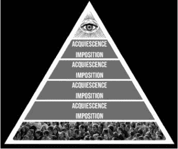

**图2：** 这种简单的强加与顺从序列，让金字塔顶端的一小撮人能够支配数十亿人的生活。

### 生命程序

好了，回到第一世界，或者说“大众”的世界。观察我们所谓的“生活”过程，它就是从摇篮到坟墓的一次感知下载。邪教构建了一个全球结构，在这个结构中，感知可以被编程，并且程序不断被补充，以使得程序看起来像是对真实现实的持续确认。这里的关键词是“看起来”。

感知下载在学校、学院和大学的整个成长阶段持续进行，而照着稿子念的“教师”、“学者”、“科学家”、“医生”和“记者”则坚称，每一代人都必须像他们一样被编程。接受这个程序，否则你就无法通过那些确证你“编程程度”的“考试”。可悲的是，许多父母逼迫子女在学校努力学习，以下载程序，并取得进入大学和学院的下一阶段资格。已故的伟大美国喜剧演员乔治·卡林曾说：“我希望能看到这样一张保险杠贴纸：我们为我们的孩子感到骄傲，因为他抵抗了老师们试图摧毁他精神、把他屈从于企业主子意志的企图。”那么，乔治，祝你好运能找到很多这样的孩子。然后，离开学术界的正式编程岁月、进入“成人”的工作世界的时刻到了。在那里，你会遇到在你所选或被指定的领域里，早于你经历过同样“邮票共识”程序的其他人。因此，几乎所有人都对“邮票共识”现实的基本根基达成压倒性一致，并对少数拥有独立思想并准备运用它的人加以排斥，甚至蔑视。这有两个主要影响。首先，共识向被编程者确认，他们的下载内容就是事物的真实面目。我的意思是，大家都知道，对吧？其次，“邮票共识”信徒的傲慢与无知确保，任何质疑这个程序的人，都会因为寻求自己的真相、而不是从标有“你必须毫无疑问地相信这些东西，否则你就是危险的精神失常的阴谋论者和疯狂的傻瓜”的货架上挑选感知，而招致不愉快的后果。

每一个政府、机构和公司都建立在同样的“邮票共识”牢房之上，你可以明白为什么这么多人相信同样的事情，却称之为自己的“观点”。政府与企业为了同一议程而融合，这正是意大利独裁者贝尼托·墨索里尼所描述的法西斯主义的定义。终生下载的感知规范带来的遵从压力从未间断，并渗透进社会……说服自己相信官方叙事，以保护他们的自尊，不去接受他们已沦为温顺恭服的顺从者这一真相。这样的人成为这个系统最狂热的捍卫者。你随处可见他们对着那些宁愿独立思考的人破口大骂，而这样的行为恰恰提醒了顺从者自己向从众的投降。“你在说危险的胡话，你这个新冠白痴！”你是在说服我还是说服你自己？这是一种强烈的斯德哥尔摩综合征，其定义是：“当受害者遭受虐待时，受害者与施虐者认同、依附或积极建立联系的一种心理状况。”例如，人质与绑架者建立情感联系，甚至“爱上”绑架者。这种综合征已在家庭暴力、受虐儿童、集中营囚犯、战俘以及各种撒旦邪教中被观察到。以下是goodtherapy.org列出的斯德哥尔摩综合征的一些特征：

- 对施虐者或绑架者抱有正面评价[见“新冠”]。
- 在追责施虐者或绑架者时，不与警察和其他政府当局合作[或者，就“新冠”而言，却与警方合作，以强制执行和维护绑架者的要求]。
- 很少或根本不努力逃跑[见“新冠”]。
- 相信施虐者或绑架者是好人[见“新冠”]。
- 安抚绑架者。这是一种维持自身安全的操纵策略。由于受害者得到奖励——也许是被少虐待，甚至得以活命——他们的安抚行为便得到强化[见“新冠”]。
- 习得性无助。这可能类似于“如果你打不败他们，就加入他们”。当受害者无法逃离虐待或囚禁时，他们可能开始放弃，并且很快意识到，如果他们把自己所有的权力都默许给绑架者，对每个人都更轻松[见“新冠”]。


- 对施虐者感到怜悯，相信他们实际上也是受害者。因此，受害者可能会踏上“拯救”[保护]施虐者的十字军东征或使命[看看那些挑战官方“新冠”叙事的人遭到怎样的恶毒攻击]。
- 不愿学着与施虐者分离并治愈自己。本质上，受害者对自身的忠诚往往不及对施虐者的忠诚[*确实*见“新冠”]。

思考这些特征，并将它们与全球大量民众的行为进行比较，这些民众为政府和当局辩护，而自2020年初以来，这些政府和当局每时每刻都在用法西斯式的封锁、软禁和剥夺工作来摧毁他们自己及其子孙后代的生活和生计，以“保护”他们免受一种“致命病毒”的侵害——这种病毒正是施虐者为了达到这一结果而通过感知（操控）创造出来的。我们看到的是大规模的斯德哥尔摩综合征。那些同意放弃自由的人会相信那些感知源于自己独立的“头脑”，而事实上，通过将现实交给斯德哥尔摩综合征，他们按定义已经放弃了任何思想的独立性。听听这个“新冠”时代顺服的民众的“意见”，倾泻而出的是对官方版本的复述，一切未经处理、未经过滤、不被质疑。整个编程动态就是这样运作的。我必须自由，因为有人告诉我我是自由的，所以我认为我是自由的。

你可以从我这一章的主题“我在思考——哦，真的吗？”中明白我的意思。绝大多数人没有在思考，更不用说为自己思考了。他们在重复权威告诉他们相信的东西，这让他们可以被控制。在这种心态中交织着一种恐惧，即“阴谋论者”是对的，这再次解释了当你敢于挑战任何官方叙事时，随之而来的往往是歇斯底里的谩骂。否认是一种机制，用来对自己隐藏你不希望成真的事情。告诉人们他们想听的话很容易，但告诉他们宁可不发生的事却是一个困难得多的挑战。一个就像推一扇开着的门，而另一个则会遭到强烈的抵抗，无论证据有多充分。“我不想这是真的，所以我说服自己这不是真的。”例子比比皆是：从否认伴侣出轨的所有迹象，到条件反射式地拒绝接受任何认为世界各国以完全同样的方式行事是有中央协调的观点。接受后者就是接受一股难以言喻的邪恶力量正在致力于摧毁你和你孩子的生活，并且为了达到目的不惜一切恐怖手段。究竟谁希望这是真的？但如果我们不正视现实，这个结局就会如期而至，其后果远比今天用勇气打破否认之墙、挺身反抗暴政要糟糕得多，而且会持续不断。

### 串联点点——但如何做到？

感知编程的一个关键方面是描绘一个世界，其中一切都是随机的，几乎没有什么与其他事物相连。随机性本质上无法被协调，一旦你感知到事件是随机的，它们可能相互关联的想法就会被斥为“锡箔帽大队”的胡言乱语。你不能计划并协调随机的东西，你这个白痴！不，你不能，但你可以在随机性的幻觉背后隐藏冷酷计算和长期谋划。叛逆心智的一个基础表现是扫描现实中的模式，将看似随机的事件联系起来，把像素和点变成图画。这就是我做事的方式，我这样做了30多年。你寻找人、作案手法和预期结果中的相似之处，慢慢地，然后越来越快，画面就形成了。例如：“新冠大流行”骗局与人为全球变暖骗局之间似乎没有联系，但它们（恰当地）是同一张脸上的面具，寻求同样的结果。那些通过罗马俱乐部和其他邪教机构推动全球变暖神话的人也在推动关于“新冠”的谎言——比尔·盖茨是一个明显的例子，但这无穷无尽。为什么同一批人会参与到这两件显然不相关的事情中？哦，但他们是*有关系*的。人员上的共同主题与共同目标相匹配。两个“问题”的“解决方案”都是全球权力的中央集权，以将少数人的意志强加给多数人，从而从“新冠”中“拯救”人类，并将地球从“生存威胁”中拯救出来（我们需要“零新冠”和“零碳排放”）。这些反过来又与“全球化”这个“点”联系在一起，而“全球化”这个词的创造是为了描述通过不间断的政治和企业扩张、贸易集团和像欧盟这样的超级国家，在全球生活各个领域实现全球权力集中。如果你是少数人，你想控制多数人，你就必须集中权力和决策。权力越集中，中央的少数人就能对多数人拥有更大的权力；而权力越集中，中央的人就越有能力更快地集中权力。集权的势头越来越快，这正是我们目睹的过程。这样，被欺骗的“大流行”和人为全球变暖的假象就服务于全球化的利益，以及夺取全球权力到邪教核心圈手中——这个核心圈正是“新冠”、“气候变化”*和*全球化的幕后黑手。此时，随机“点”变成了清晰明显的画面或模式。

克劳斯·施瓦布——典型的邦德反派，创立了邪教组织那个由盖茨资助的世界经济论坛——在2020年出版了一本书《大重置》，在书中他用“新冠”这个“问题”来为人类社会的彻底转型辩护，以从“气候变化”中“拯救”人类。施瓦布说：“这一大流行代表了一个罕见但狭窄的反思、重新构想和重置我们世界的窗口期。”他没有提到的是，他所服务的那个邪教正是这两个骗局的幕后主使，这一点我在我的书《答案》中已经展示。他和邪教并不需要重新构想世界。他们确切地知道他们想要什么，这就是为什么他们用“新冠”摧毁了人类社会，以便在他们的宏伟蓝图中“重建得更好”。他们的工作不是去想象，而是让人类去想象并同意他们的计划，同时相信这一切都是随机的。如果说《大重置》长期以来一直是邪教在全球推行法西斯主义的代号，并取代了此前邪教代言人如老乔治·布什使用的“新世界秩序”和源自共济会及更古老秘密社团的“时代新秩序”等代号，那么这一定是纯粹的巧合。“时代新秩序”以“Novus ordo seclorum”字样出现在美国国玺背面，下方是邪教一直使用的金字塔和全视之眼符号（图3）。金字塔是人类控制等级制度，顶端是发光的眼睛，象征着邪教背后的力量，我将在后续章节中揭露。术语“Annuit Coeptis”翻译为“他赞成我们的事业”。我们被告知“他”是基督教的上帝，但“他”不是，我稍后会解释。


**图3：** 在共济会设计的美国国玺上，以及美钞上，邪教“上帝”的全视之眼。

### 逗你玩

与此相关的两大邪教感知操控技术是我自20世纪90年代以来所称的“问题-反应-解决方案”（PRS）和“极权主义潜行”（TT）。好问的心智只需一个简单问题就能识破它们：谁受益？答案通常通过“从犯罪中获益最多的人最有可能实施犯罪”这一概念来识别特定行为或事件的肇事者。拉丁语“Cui bono?”——谁受益？——被广泛归功于罗马演说家兼政治家马库斯·图利乌斯·西塞罗。难怪它能追溯到如此久远，因为这一概念自……以来就一直与人类行为相关。


历史被记录了下来。问题-反应-解决方案（Problem-Reaction-Solution）是一种每天都在用来操纵我们的手段，它通过暗中制造一个问题（或一个问题的幻觉）并提供解决该问题的方案（或这种方案的幻觉）来达到目的。在第一阶段，你制造问题，并把问题发生的原因归咎于他人或他事。这可能涉及金融崩溃、恐怖袭击、战争、全球变暖或流行病，事实上，任何能让你在那个时候按照自己的愿望强加“解决方案”以改变社会的事情都可以。这个“问题”不一定要真实。PRS是对感知的操纵，你所需要的只是让民众相信问题是真实的。人为全球变暖和“新冠大流行”只需要被*感知*为真实的，民众就会接受权威的“解决方案”。我把这种技术称为“无问题-反应-解决方案”（NO-Problem-Reaction-Solution）。数十亿人之所以从2020年初就温顺地接受软禁，并不是因为存在一场真正致命的“新冠大流行”，而是因为他们感知到——相信——情况就是如此。问题-反应-解决方案的解毒剂是问：谁从提出的解决方案中获益？答案总是那些想通过剥夺自由、集中权力和决策来为更多控制辩护的人。

两次世界大战都是问题-反应-解决方案，它们改变并重新调整了全球社会。正如我自20世纪90年代中期以来在书中所详述的那样，这两次战争都是被阴谋集团操纵而成的。它们极大地集中了全球权力，尤其是第二次世界大战，它导致了联合国和其他全球机构的建立，这要归功于洛克菲勒家族以及像罗斯柴尔德家族这样的其他阴谋集团血脉的公开和隐蔽操纵。联合国是全面世界政府的幌子，这一点我很快就会讲到。联合国大楼所在的纽约土地是由洛克菲勒家族捐赠的，而同一个阴谋集团家族也站在大型制药公司、手术刀和药物“医学”的背后，并参与了世界卫生组织（作为联合国的一部分）的创建。他们一直是优生学运动的坚定支持者，并资助了希特勒的种族纯净专家恩斯特·吕丁（Ernst Rüdin）。人为全球变暖骗局是由罗马俱乐部通过联合国策划的，其目的是让底层人口依赖阴谋集团生存，从而处于他们的控制之下。

整个结构计划由一个军事警察国家来保护和执行（图4）。这就是假大流行进行全球封锁的原因：冷酷地摧毁独立收入和生计，使每个人都依赖“国家”（即控制“国家”的阴谋集团）。多年来，我一直在书中警告这个“保障收入”计划——一种勉强维持生存的微薄救济——其目的是在就业被人工智能技术摧毁后强加依赖，而现在“新冠”骗局正以更全面、更快的速度摧毁就业。一旦大流行上演，封锁的后果开始消除独立收入，当局便恰逢其时地开始谈论保障收入和“大重置”的必要性。保障收入会被描述为仁慈的政府试图帮助绝望的人民——而人民的绝望正是这些政府自身行为的直接结果。事实是，这类补贴是一个陷阱。只有你完全按照当局的要求行事，包括大规模接种疫苗（基因操纵），你才能得到它们。我们在澳大利亚已经看到了这一主题：如果父母不同意按照政府规定的疯狂且损害健康的日程为孩子接种疫苗，那么依赖政府福利的人获得的福利就会被削减。蓄谋的经济崩溃既适用于政府，也适用于人民。阴谋集团希望通过建立一个世界国家来消灭国家，将国家分裂成由世界政府和欧盟这样的超级国家统治的地区。为此，国家也必须破产，而这正通过数万亿美元的“救助计划”和暂时休假补贴、数万亿美元的税收损失，以及在“新冠”上不计成本的支出（包括持续的全媒体广告宣传（灌输））来实现，这使媒体的大部分收入依赖政府。清算之日即将到来——如计划的那样——对于政府支出来说，鉴于这种支出是通过印钞而非生产/税收才成为可能，通胀正在路上，它包含以下情形：封锁软禁由精心招募的法西斯头脑和愚蠢的体制服侍者残酷执行。

警察和军队计划合并为一支中央指挥的世界军队，处于一个由世界政府领导的全球结构中，而这个政府即使利用现存的选举舞弊手段也不会被选出来。世界军队甚至计划不由人类组成，而是使用由人工智能控制的机器人技术来进行战争，主要针对民众。几十年来我一直在警告这一点，而现在世界各地的军队正被这种人工智能技术改造。我所描述的全球政权是一种特殊形式的法西斯主义，称为技术官僚制，在这种制度下，决策不是由一无所知且被收买的政客做出的，而是由未经选举的技术官僚——科学家、工程师、技术专家和官僚——做出的。由阴谋集团拥有和控制的硅谷巨头就是技术官僚制的例子，他们左右世界事件的力量已经远超各国政府。他们通过审查制度在*挑选*政府。我知道有些人称“大重置”为马克思主义共产主义的接管，但法西斯主义和马克思主义是同一暴政的不同标签。去告诉那些生活在法西斯德国和斯大林俄国的人，在自由被剥夺和生活被控制的方式上是有区别的吧。我既可以称之为法西斯技术官僚制，也可以称之为马克思主义技术官僚制，两者同样准确。《饥饿游戏》式社会及其世界政府结构将监管一支世界军队、一家世界中央银行和一种单一的世界无现金货币，将其意志强加于植入微芯片的民众身上（图5）。审视其各个组成部分，就会看到这场虚幻的大流行正如何高速地把社会推向这个方向。2021年3月，23个国家的领导人和世界卫生组织（WHO）支持了一项关于在“卫生紧急事件”中进行“国际合作”的全球条约的构想，并表示各国应该“作为一个全球共同体团结起来，进行超越这场危机的和平合作”。剔除奥威尔式的胡言乱语，这意味着向全球政府又迈进了一步。该计划包括我早在1993年就警告过的无现金数字货币系统。就在“新冠”一开始，极其腐败的谭德塞

车窗自动摇下。车辆只会带你去电脑（国家）允许去的地方。从2022年起，英国和欧盟汽油车的终结以及所有新车上的限速器，是迈向电力计算机化交通的步骤，最终你将无法对其进行控制。这幅图景甚至比阴谋集团的全球网络或网还要大得多，等我讲到“蜘蛛”的本性时，这一点就会变得清晰。所有这些事件与由“新冠”骗局所正名的、操纵DNA的“疫苗”（并非“疫苗”）的推行之间存在着联系。这种联系是一个正在展开的计划，即将人体从生物状态转变为合成生物状态，这就是为什么合成生物学会成为主流科学中如此快速兴起的一门学科。“新冠疫苗”正在将自我复制的合成遗传物质注入细胞，逐步带我们踏上“极权主义踮步”（Totalitarian Tiptoe），从人类1.0走向合成生物人类2.0，后者将在物理上和感知上与智能电网相连，从而百分之百地控制每一个想法、感知和行为。人类需要觉醒，而且要*快*。

这些只是对“结果”预期走向的最简要解释，但足以看到我们身边正在发生的旅程。第一次接触这些信息的人将已经在全新的背景中看待“新冠”。接下来我会补充更多细节，但关于细枝末节的证据，请参阅我的巨著*《答案》*、*《触发器》*和*《你需要知道但从未被告知的一切》*。

那么——一个叛逆思维如何看待这个“世界”？


## 第二章：叛道者的感知

> *聪明是一回事，智慧是另一回事*
> 乔治·R·R·马丁

被编程的思维与叛道者思维之间差异的简单定义是：前者只看到点，而后者将这些点连接起来看到全貌。准确解读现实要求观察者（a）知道预定的结果，（b）意识到一切，而且是*一切*，都是相互关联的。

无限现实的整体是相互关联的——这正是其本质——而人类社会作为无限现实的一种表达，同样必须如此。简单的因果关系就是一种关联。结果由原因触发，而结果又成为另一个结果的原因。没有任何事情是孤立发生的，因为它*不可能*孤立发生。无论处于何种现实中，生活都只是简单的选择与后果。我们做出选择，这些选择导致后果。如果我们不喜欢这些后果，我们可以做出不同的选择，得到不同的后果，而这些后果又会导致其他的选择和后果。选择与后果不仅相互关联，而且不可分割。正如一首老歌所唱，你不能只拥有其中之一而没有另一个。少数人无法控制世界，除非被控制者允许这种情况发生——这就是原因与结果、选择与后果。控制——谁拥有它，谁没有——是一个双向的过程，一种共生关系，涉及控制者与被控制者。“他们夺走了我的自由！！”嗯，是的，但也是你把它交给他们的。人类之所以受到大规模控制，是因为人类默许了这种控制。这一切都是因果，字面意义上的给予与索取。同样，各种世界事件都是相互关联的，邪教不断努力兜售随机与巧合的幻觉，以维持那种（对他们而言至关重要的）只见点不见全貌的感知。叛道者思维深知这一点，并不断扫描世界寻找关联的模式。这对于理解世界上发生的事情绝对至关重要，没有这种视角，清晰就不可能实现。首先你知道预定的结果，然后你识别旅程中的步骤——那些日复一日看似随机的事件，当它们与结果关联起来时，就不再是孤立的事件，而是通往同一方向的众所周知的链条。我来给你们一些例子：

### 政治木偶戏

我们被告知要相信政治是“对抗性的”，即不同信仰的政党为了权力进行无休止的争斗。这在某种程度上可能有一些道理——而且仅仅是一点点——但如今“不同”政党之间的分歧是修辞上的，而非意识形态上的。甚至修辞也正在融合成一种话语，因为各政党驱逐了任何剩余的独立思考者，而其他人则屈服于对任何持有“错误”观点的人日益增强的恐吓。邪教并不是一个新现象，正如我的书所记载的，它可以追溯到数千年前。其跨代成员一直在操纵事件，随着全球权力日益集中，其效果也越来越大。在古代，邪教通过君主制体系确保控制，其中“特殊”血统（后面会详述）仅凭出身权利，以及击败其他声称拥有同样继承权的人，就要求以国王和王后的身份统治。然而，到了某个时候，人们已经成熟到足以看清这种暴政的不公，并要求在谁统治他们的问题上有发言权。注意*统治*这个词。不是服务他们——而是统治他们，因此政府的定义是“对社区、社会和国家成员、公民或居民的行动所行使的政治方向和控制；对国家、社区等事务的方向引导。”政府行使的是控制，而不是服务，就像之前的君主制一样。奇怪的是，仍然有一些国家如英国，由君主和正式对君主负责的政府统治。英国的国家元首，以及加拿大、澳大利亚和新西兰等英联邦国家的国家元首，是由一个*单一家族*中谁与谁进行了未受保护的性行为以及按什么顺序来“选出的”。掐我一下，这不可能是真的。哎哟！妈的，是真的。大多数国家君主制的消亡提供了一个潜在的真空，可能产生某种形式的自由公正的社会，而邪教已经覆盖了这个基地。君主制曾为其利益服务，但面对如此广泛的反对，它们无法继续存在，而且无论如何，用隐藏在“民主”概念背后的“人民”的独裁取代人们看得见的“王室”独裁，提供了更大的操纵可能性，以及在“自由”的幻觉背后隐藏协调一致的暴政的方式。

民主被非常错误地定义为由民众选择的政府。这根本不是事实。它是由*部分*民众选择的政府（而且仅仅在理论上）。这“部分”甚至不一定是多数，正如我们在简单多数制选举中经常看到的那样，所谓的多数党赢得的选票少于“落选”各党派的总和。民主可以把全部权力交给一个只获得少数选票的执政党。这是一种以自由为名兜售暴政的障眼法。在2020年明显可疑的选举中，7400万支持特朗普的美国人没有投票给乔·拜登的“民主党”，然而邪教控制的拜登政府非但没有承认美国社会这一大比例人群的愿望和感受，反而从第一天起就着手摧毁他们及其发声和表达意见的权利。空壳拜登和他的邪教操纵者说他们这样做是为了“保护民主”。政治已经堕落到这种疯狂和病态的程度。将点连接起来，并将它们与预期的结果联系起来——一个由自封的技术官僚管理的世界政府，甚至不再有民选政治家。邪教在通过其政府中的政治代理人运作的同时，也通过在通往消灭政治家的道路上让蠢货和无能者掌握名义上的权力，来鼓励公众对政治家的蔑视。其想法是激起公众的反应，对技术官僚说：“好吧，他们再怎么样也不会比那些可悲的政治家更糟了。”这一切都关乎控制认知，叛道者思维能够看穿这一点，而被编程的思维在既不知道预期结果也不知道用来确保这一结果的操纵手法时，则无法看穿。然而，这种知识是可以学会的，而且如果人们选择去了解，可以很快学会。

政治乍一看似乎很难从一个中心点来控制。我的意思是，看看那些“不同”的政党，你怎么可能监督它们全部及其组成部分？事实上，这非常简单，因为它们的结构。我们又回到了强制与默许的金字塔。组织的结构与整个系统的结构相同。政党不是自由表达的开放论坛。它们是等级制度。我曾是英国绿党的全国发言人，该党声称是一种不同的政治，影响力和权力被下放；但我可以从直接经验告诉你——现在情况更糟——绿党和其他所有政党一样，是作为等级制度运作的，无论他们多么努力地掩盖这一事实，或者自欺欺人地认为这不是真的。所有政党的顶层只有极少数人在指导政策和人事。他们决定你是在党内晋升，还是担任政府部长，要做到这一点，你必须是一个唯唯诺诺的人。看看那些从未爬上这根滑竿的特立独行的政治思想家。如果你想在党内取得进展或达到“高位”，你需要循规蹈矩，随波逐流。例外情况确实罕见。如果你想竞选议员或国会议员，你必须说服地方或州一级的政党选择你，为此你需要按照等级制度的指令行事。如果你赢得选举并希望在更大的结构中晋升，你需要继续遵守那些运行等级制度的人所接受的标准


我在书中详细揭露了这些情况，它们是“男孩乔治·布什”那愚蠢总统任期内各项政策背后的驱动力，其中就包括9/11事件（想要全面驳斥官方说法，请看《触发器》一书），随后的“反恐战争”（恐怖战争），以及入侵阿富汗和伊拉克。后者是一场基于邪教特工（包括布什和英国首相托尼·布莱尔）声称萨达姆·侯赛因拥有“大规模杀伤性武器”的“无问题-反应-解决方案”，而这些武器根本不存在，战犯布什和布莱尔心知肚明。

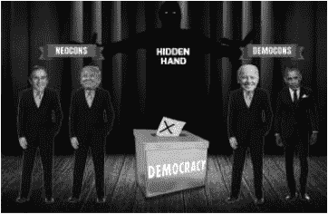

**图6：** 不同的门面人物，不同的政党——同一个控制系统。

民主党也有自己的“新保守派”集团在幕后操控，我称之为“民主保守派”，关键点在于——“新保守派”和“民主保守派”都听命于更深层阴影中的同一批主子（*图6*）。在邪教的那个层面上，共和党和民主党由同一批人控制，无论哪个党执政，实际上都是邪教在掌权。几乎每个国家都是如此，英国当然也不例外，保守党、工党、自由民主党和绿党如今都步调一致，不管他们在试图装点门面时说得多么天花乱坠。布什时期的新保守派通过一个名为“新美国世纪计划”的智库运作，该智库于2000年9月发布了一份题为《重建美国国防：战略、力量与资源》的文件，其他著作中也有详细背景。

萨巴泰-弗兰克主义结合了两个冒充“犹太人”的骗子的名字：萨巴泰·泽维（1626-1676），一位拉比、黑魔法师和神秘学家，自称是犹太弥赛亚；以及雅各布·弗兰克（1726-1791），这位波兰“犹太人”、黑魔法师和神秘学家声称自己是“弥赛亚”泽维和圣经先祖雅各布的转世。他们跨越两个世纪建立了萨巴泰-弗兰克教派，这个教派在全球邪教操纵人类社会中扮演着重要甚至核心的角色，而全球邪教的起源远比萨巴泰·泽维的时代更为久远。在此我要强调两点，以回应那些尖声叫嚷“反犹太主义”的人：
- （1）萨巴泰-弗兰克主义者不是犹太人，他们只是伪装成犹太人，以便在犹太门面背后隐藏其邪教；以及
- （2）我关于这个邪教的信息来自犹太消息来源，他们早已意识到自己的社会和社群已被闯入者萨巴泰-弗兰克主义者渗透并接管。

渗透是萨巴泰-弗兰克主义自17世纪正式起源以来的基本手法。泽维的萨巴泰教派吸引了大量追随者，被描述为犹太历史上最大的弥赛亚运动，传播远达非洲和亚洲，他承诺犹太人将重返以色列的“应许之地”。萨巴泰主义不是犹太教，而是对主流犹太教所代表的一切的颠倒。以至于这个邪恶教派在犹太教的斋戒日会举行盛宴，凡是犹太教禁止的，萨巴泰教徒都被鼓励甚至被命令去做。这包括乱伦以及今天所谓的撒旦崇拜。成员被禁止在教派外通婚，并且有一套制度，让他们的孩子对自己所参与的教派一无所知，直到他们长大到足以被信任，不会无意中向外人透露任何东西。同样的制度至今仍被全球邪教普遍采用，而萨巴泰-弗兰克主义对其产生了巨大影响，如今在很大程度上控制着它。

泽维和他的萨巴泰教徒遭遇了一次挫折，原因是中东伊斯兰奥斯曼帝国的苏丹——也就是泽维所在地、如今土耳其共和国所在的地区——进行了干预。苏丹给了他一个选择：证明自己的“神性”、皈依伊斯兰教，或者面对酷刑和死亡。有趣的是，泽维选择了皈依，或者至少表面上如此。他的一些支持者幻想破灭，逐渐离去，但许多人没有离开，还有300个家庭也（仅仅在理论上）皈依了伊斯兰教。他们继续在这层伊斯兰烟雾弹的掩护下，奉行萨巴泰主义的宗旨、规则和仪式，被称为“秘密犹太人”或“多尼梅”，意为“转向”。这颇具讽刺意味，因为他们并没有“转向”，而是躲藏在虚假的伊斯兰人设背后。表面上是一回事，实际上却是另一回事，这种手法将成为萨巴泰主义的招牌特征，尤其是在泽维去世后、18世纪撒旦主义者雅各布·弗兰克到来之时，这个教派演变为萨巴泰-弗兰克主义，并沉沦到更加堕落的深渊，包括——至今仍然如此——活人献祭和与儿童发生性关系。萨巴泰教徒所到之处，恋童癖和撒旦崇拜便如影随形。那么，当好莱坞由萨巴泰-弗兰克主义者建立并至今仍由他们控制时，它充斥着虐待儿童和撒旦崇拜，这真的令人惊讶吗？好莱坞一直是全球认知编程和操纵的主要工具之一。有多少人相信电影中描绘的“历史”版本，而它不过是对真相的歪曲和颠倒（又一次）？拉比马文·安特尔曼在他的著作《消除鸦片》中将弗兰克主义描述为“一个完全邪恶的运动”，而犹太教授格肖姆·肖勒姆在《犹太教中的弥赛亚观念》中这样评价弗兰克：“在他所有的行为中，[他]是一个真正腐败堕落的人……是整个犹太历史上最可怕的现象之一。”弗兰克被传统拉比逐出教门，泽维也是如此，但弗兰克并未气馁，反而获得了罗斯柴尔德家族的重要支持——这个臭名昭著的银行王朝，其核心成员是萨巴泰-弗兰克主义者，而不是犹太人。对罗马教会和梵蒂冈的渗透由弗兰克发起，许多多尼梅人再次“转向”，皈依罗马天主教，目的是夺取权力缰绳。这是一再重复的作案手法，至今仍然如此。假扮成你想要控制的宗教、文化或国家的拥护者，然后——

巴比伦以塞米勒米斯女王或伊什塔尔的身份出现。其意义将会变得清晰。再次注意无处不在的颠倒主题，“自由”女神像实际上象征着大规模控制（[图7](#)）。巴黎塞纳河中的一座岛上矗立着一尊镜像雕像，纽约自由女神像正是源于此处（[图8](#)）。巴黎阿尔玛桥隧道上方矗立着一座大型自由火焰复制品，戴安娜王妃正是在这座隧道中死于一场邪教仪式，这一点在《惊天秘密》一书中有描述。路西法“光之使者”与此相关（而且远不止如此，我们后面会看到），“路西法”是萨巴泰-弗兰克主义及其相关撒旦崇拜中的核心人物。萨巴泰教徒拒绝犹太教的《托拉》，即旧约中的“摩西五经”，包括《创世记》《出埃及记》《利未记》《民数记》和《申命记》，犹太教和基督教声称这些是“上帝”在西奈山上口授给摩西的。萨巴泰教徒说这些不适用于他们，他们试图用《光辉之书》取而代之，将犹太教及其信徒吸收进他们的颠倒体系，而这只是一个更大的全球性颠倒的表达。他们想要废除所有宗教，迫使人类崇拜一个世界性宗教——萨巴泰撒旦崇拜，其中还包括对大地女神的崇拜。撒旦主题正越来越多地被引入主流社会，虽然基督教目前是首要摧毁目标，但其他宗教也计划随之被摧毁。


**图7：** 巴比伦邪教女神伪装成自由女神像，手持“光之使者”路西法的火焰。


传统左派的政治信仰被取代，取而代之的是极右翼的假‘社会正义’，即众所周知的马克思主义。然而，觉醒运动将被其自身所感知的‘革命’所吞噬，这场‘革命’实际上是亿万富翁和伪装‘觉醒’的亿万富翁企业的杰作。觉醒主义者将马克思主义鼓吹为‘资本主义’的替代品，而我们并没有‘资本主义’。我们有的是卡特尔主义，市场被那些资助觉醒运动的邪教亿万富翁和企业所垄断。亿万富翁热爱马克思主义，这使人民处于奴役之中，而他们从顶层控制着一切。头脑简单到无可救药的觉醒主义者以为自己在‘改变世界’，而实际上是邪教在改变，当他们扮演完自己的重要角色、变得多余时，也会成为目标。光照派-雅各宾派是1793年和1794年法国大革命中被称为‘恐怖统治’时期的幕后黑手，当时雅各宾派领袖马克西米连·罗伯斯庇尔和他的奥威尔式‘公共安全委员会’杀害了17000名曾经是‘革命之友’的‘革命敌人’。卡尔·马克思（1818-1883）的萨巴蒂安式马克思主义信条已导致至少1亿人丧生，而如今他再次成为觉醒主义者的英雄；这些觉醒主义者被他们的‘教育’编程系统地剥夺了对真实历史的了解。结果，他们现在宣扬一种萨巴蒂安式的‘马克思主义’怪物，注定最终会吞噬他们。拉比安特尔曼花了数十年研究萨巴蒂安阴谋，他谈到正义者同盟和卡尔·马克思时说：

与普遍看法相反，卡尔·马克思并不是《共产党宣言》的原创者。他是受正义者同盟雇佣并付酬的，该同盟在其原籍国德国被称为‘被放逐者同盟’。

安特尔曼说，归于马克思名下的文本是别人的作品，马克思‘只是在重复别人已经说过的话’。马克思是‘一个被雇来的文人——富裕光照派分子的走狗’。马克思有句名言：宗教是‘人民的鸦片’（这是萨巴蒂安计划妖魔化宗教的一部分），安特尔曼称他的著作为*《消除鸦片》*。马克思生来是犹太人，但他的家庭改信了基督教（萨巴蒂安的一贯做法），他攻击犹太人，尤其是在他的著作*《没有犹太人的世界》*中。这样一来，他支持了萨巴蒂安摧毁传统犹太性和犹太教的计划；我们今天清楚地看到，萨巴蒂安控制的以色列政府以‘新冠’法律针对正统犹太人的泄愤行为。我不信奉任何宗教；宗教几个世纪以来对世界造成了巨大损害，并充当了认知的紧身衣。然而，反叛者总是问某件事*为什么*要做。无论他们同意与否，重要的是——*为什么*会发生？这个‘为什么？’可以从宗教角度回答：当邪教想要瓦解所有对话、团结和互动时（参见‘新冠’封锁），宗教创造了信徒之间的互动社群，其最终目标是废除所有宗教，建立一个崇拜他们‘神’的邪教撒但教世界宗教（关于这一点稍后再说）。我们在美国控枪问题上看到了同样的‘为什么’。我没有枪，也不想要枪，但为什么邪教在执法机构武装到牙齿的同时，试图解除民众的武装？为什么历史上每个暴君在最终夺权之前都要先解除人民的武装？他们包括希特勒、斯大林、波尔布特和毛泽东，他们在没收武器之后以暴力夺取了政权。从那些在多次枪击事件后立即冲向话筒、利用死者的人，你就知道这是邪教的议程。极端犹太复国主义邪教走狗参议员查克·舒默在2021年3月科罗拉多州博尔德市10人遇难后立刻跳了出来。简单的规则……如果舒默想要，那就是邪教想要的，他那极端犹太复国主义的搭档、眼神狂野的参议员亚当·希夫也一样。就在他们呼吁解除美国人武装的同时（许多美国人住得离警察很远），舒默、希夫和其他养尊处优的小丑们却坐在国会山上，身后是带刺铁丝网的安全围栏，围栏外有数千名武装部队保护，还有他们自己的武装保镖。偏僻家中的老两口？他们只是潜在的大规模枪手。

### 锡安主框架

萨巴蒂安-弗兰克派，尤其是罗斯柴尔德家族，是‘犹太复国主义’的幕后推手；这一政治运动要求在以色列建立一个犹太人国家，正如沙巴泰·泽维所承诺的那样。以色列的象征恰恰来自罗斯柴尔德这个名字的德语含义。王朝创始人迈耶·阿姆谢尔·罗斯柴尔德将家族姓氏从鲍尔改为罗斯柴尔德，德语意为‘红盾’，以纪念家族在法兰克福住宅上展示的六角‘大卫之星’六芒星。这个符号后来出现在以色列国旗上，而罗斯柴尔德家族在其创建中扮演了核心角色。六芒星并非犹太民族独有的符号，它被广泛用于神秘（‘隐藏’）网络，常常作为土星的象征（原因见我的其他著作）。犹太复国主义和犹太性也不能混为一谈。犹太复国主义是一种政治运动和哲学，而不是一个‘种族’或民族。许多犹太人反对犹太复国主义，而许多非犹太人，包括美国总统乔·拜登，自称是犹太复国主义者，以以色列为中心的特朗普也是如此。美国对以色列政府的支持几乎是理所当然的，因为极端犹太复国主义亿万富翁和企业为两党提供了巨额且主导性的资金。前众议员辛西娅·麦金尼讲述了她是如何在一参选就被要求‘签署承诺书’支持以色列，并确认她将始终投票维护该国的最佳利益。所有美国政客都以这种方式被接触。任何拒绝的人都不会从这个庞大而全能的犹太复国主义游说集团获得支持或资金，该集团包括超级游说集团AIPAC（美国以色列公共事务委员会）等组织。特朗普最大的资助者是极端犹太复国主义赌场和媒体亿万富翁谢尔登·阿德尔森，而民主党的主要资助者包括极端犹太复国主义者乔治·索罗斯和极端犹太复国主义金融与媒体大亨哈伊姆·萨班。有些人可能会对索罗斯是‘以色列优先者’（受萨巴蒂安控制的以色列优先者）的说法感到震惊，但反叛者观察行动而非言辞，索罗斯每一笔亿万捐款流向之处，萨巴蒂安议程都会受益。本着萨巴蒂安倒行逆施的精神，索罗斯承诺投入10亿美元建立一个新大学网络，以推动‘自由价值观并消除不容忍’。他是在2020年1月瑞士达沃斯由邪教控制的世界经济论坛上发表年度演讲时宣布这一点的，此前他‘严厉批评’了世界各地的‘独裁统治者’。面对如此厚颜无耻的谎言，你只能发笑。而他没有笑，这倒是个谜。从奥威尔式语言翻译过来，‘自由价值观并消除不容忍’意思是教非白人憎恨白人，让白人因生为白人而厌恶自己。其原因将变得清晰。

### “反犹太主义”骗局

犹太复国主义者支持在巴勒斯坦土地上建立犹太人家园，这一目标长期以来一直是萨巴蒂安-罗斯柴尔德的目标，但并不是为了犹太人的利益。萨巴蒂安及其全球‘反犹太主义产业’歪曲了公众和政治观点，将反对犹太复国主义的暴力极端主义等同于对所有犹太人的全面攻击和谴责。这不过是萨巴蒂安的保护伞，用以阻止对其议程和活动的合法调查与揭露。‘反犹太主义’的官方定义最近被扩大，将批评犹太复国主义——一个*政治运动*——也包括在内，这样做是为了进一步阻止揭露萨巴蒂安渗透者；正是他们在19世纪创造了我们今天所知的犹太复国主义。反叛者知道他们会因此遭殃，但仍会谈论这些话题。人们必须决定是想要知道真相，还是因为害怕别人说三道四而蜷缩在角落里。自20世纪90年代以来，萨巴蒂安一直试图给我贴上‘反犹太主义’的标签，因为我越来越多地揭露他们的背景和议程。那些无用、没骨气、骗人的‘记者’随后毫不犹豫地重复这些诽谤；就在我写这一节的那天，两个名叫本·奎因和阿奇·布兰德（多么贴切）的不加思索的传声筒在正统宣传报纸伦敦*《卫报》*上直接称我为‘反犹太主义者’，却没有提供任何证据。这


萨巴蒂安反犹主义产业这么说，他们又算什么人敢质疑？他们不敢。讽刺的是，“闪米特”指的是中东一组几乎全是阿拉伯语的语言。“反犹主义”变成了“反阿拉伯”，如果这一误解的后果不是如此严重，那还真是滑稽。别费心告诉奎因和布兰德了。我不想让他们困惑，愿上帝保佑他们。我被冠以“反犹主义者”的原因之一，是我在1990年代写道，犹太特工（萨巴蒂安人）在俄罗斯革命中深度参与，当时萨巴蒂安人推翻了罗曼诺夫王朝。这显然让我成了“反犹主义者”。哦，真的吗？以下是*《触发器》*中的一段：

> 英国记者罗伯特·威尔顿在其1920年出版的*《罗曼诺夫王朝的最后日子》*一书中证实了这些主题，他研究了俄罗斯政府的官方文件，以识别1917年至1919年间布尔什维克统治精英的成员。中央委员会62名成员中有41名犹太人；人民委员会22名成员中有17名犹太人；1918年至1919年间，布尔什维克最重要的556个职位中有458个由犹太人担任。只有17人是俄罗斯人。此外，1917年成立的恶毒的契卡苏维埃秘密警察36名成员中有23名犹太人，他们很快将遍布全国。
>
> 牛津大学研究20世纪俄罗斯历史的专家罗伯特·瑟维斯教授发现证据表明，“[犹太]”列夫·托洛茨基曾试图确保犹太人被征召入红军，并在苏联文职官僚机构中占据不成比例的比例，其中包括契卡，该机构对“人民公敌”进行了大规模逮捕、监禁和处决。美国国务院一份日期为1918年11月13日的十进制文件（861.00/5339）将[罗斯柴尔德在美洲的银行代理人]雅各布·希夫和一份极端犹太复国主义者名单列为俄罗斯革命的资助者，从而引发了“犹太阴谋”的说法，但所有人都忽略的关键点是，他们不是“犹太人”——他们是萨巴蒂安-弗兰克主义者。
>
> 英国的温斯顿·丘吉尔无论是有意还是无意，也犯了同样的错误。他在1920年的一期*《插图星期日先驱报》*上写道，俄罗斯革命背后的那些人是一个“旨在推翻文明、在停滞发展、嫉妒恶毒和不可能实现平等的基础上重组社会的全球阴谋”的一部分（参见今天的“觉醒”运动，因为该运动是由同一个网络创造的）。丘吉尔说，没有必要夸大这些“国际化的、大部分是无神论的犹太人”在创建布尔什维主义和实际引发俄罗斯革命中所扮演的角色[“无神论的犹太人”=萨巴蒂安人]。丘吉尔说，这当然是一个非常重大的角色，可能超过所有其他因素：“除了列宁这个显著的例外，大多数主要领导人物都是犹太人。”他接着有意或无意地描述了萨巴蒂安人惯用的手法，即名义上让傀儡领导人掌权，而他们则在幕后控制：
>
> 此外，主要的灵感来源和驱动力来自犹太领袖。因此，纯粹的俄罗斯人契切林被其名义上的下属李维诺夫所掩盖，而布哈林或卢那察尔斯基等俄罗斯人的影响力也无法与托洛茨基、红色城堡（彼得格勒）的独裁者季诺维也夫、克拉辛或拉迪克等人相比——他们全部是犹太人。在苏联机构中，犹太人的主导地位更加惊人。而在反革命的非常委员会所实施的恐怖主义体系中，即使不是主要的，也是突出的角色，已经由犹太人承担，在一些著名案例中，由犹太女性承担。

我所说的犹太“革命者”（萨巴蒂安人）在俄罗斯革命中严重不成比例地参与，是可证明的事实，但真相无法抵御萨巴蒂安反犹主义产业、像奎因和布兰德这样的复读机鹦鹉，以及如今令人惊叹的所谓“觉醒”“反仇恨”团体网络，这些团体领导层和资金相互交织，其作用是诋毁和压制任何过于接近揭露萨巴蒂安人的人。我们已经在法律判决中看到“真相无法辩护”得到确认，加拿大萨斯喀彻温省人权委员会如此裁定：“真实的陈述也可能以符合仇恨言论定义的方式呈现，并非所有真实的陈述都必须不受限制。”大多数“反仇恨”活动人士，他们自己也深陷仇恨之中，太愚蠢、对世界太无知，以至于不知道他们如何被利用。他们自以为是地高高在上，沉浸在自己的道德标榜中，黑暗太深，他们什么也看不见。

### “革命”游戏

“俄罗斯”革命的背景和方法完全来自萨巴蒂安的剧本，正如法国大革命中所见，通过一个全球组织网络，听命于萨巴蒂安创建和控制的全球情报网络，该网络涉及一个令人震惊的军事情报特工和行动网络，服务对象却是一个仅有九百万人口的小国。

其中有犹太资产，他们不是萨巴蒂安人，但被萨巴蒂安人说服，相信他们所做的事情是为了以色列和犹太社区的利益，保护他们免受一个自童年起就被灌输所认为的仇视犹太人的敌对世界的伤害。

犹太社区只是一个非常方便的掩护，用来隐藏萨巴蒂安人的真实本质。任何接近揭露他们把戏的人，都会被萨巴蒂安的代理人和跑腿指控为“反犹主义”，并被指责声称所有犹太人都是夺取世界阴谋的一部分。

我不是那个意思。我是说萨巴蒂安人——*真正*的仇视犹太人者——已经渗透进犹太社区，利用他们既作为掩护，又作为抵御暴露的“反犹主义”防御。

因此，反犹主义产业以这种方式针对研究人员，而大多数犹太人都认为这是合理和真实的。他们不知道他们的“犹太”领导人和国家、情报及军事机构根本不是由犹太人控制的，而是萨巴蒂安-弗兰克主义的邪教徒和走狗。我曾经在一个支持犹太人自由的在线请愿书上签了名，但下次再看时，我的名字不见了，请愿简介中还添加了文字攻击我为“反犹主义者”，可见感知编程的规模之大。

### 转向美国

我在*《触发器》*中讲述了这个故事，其中一章名为“跨大西洋之旅”，讲述了尤其是在以色列成立后，萨巴蒂安人如何进入美国，并最终控制了政府行政、通过民主党和共和党控制政治体系、中央情报局和国家安全局（NSA）等情报界、五角大楼和大众媒体。通过这个高度划分的网络，萨巴蒂安人及其在摩萨德、以色列国防军（IDF）和美国机构中的特工实施了9/11事件，并将其归咎于19名“基地组织劫机者”，这些人大多来自或关联于萨巴蒂安统治的沙特阿拉伯。这“19人”甚至不在飞机上，更不用说驾驶那些大型客机撞向大楼了，而他们大多数人连单引擎轻型飞机都驾驶得不熟练。被称为“劫机者”的哈尼·汉朱尔，据称驾驶美国航空公司77号航班撞向五角大楼，其转弯和操作是大多数专业飞行员都认为难以做到的，而就在*六周*前，马里兰州鲍伊市快速路机场的教练以他是不称职飞行员为由禁止他租用小型飞机。世界犹太人人口仅占0.2%，即使如此也几乎完全集中在以色列（75%犹太人）和美国（约2%）。这2%和全球0.2%指的是*犹太*人，而非萨巴蒂安闯入者，他们只是那一小部分中的一小部分。

当你想到小小的以色列对世界事务的巨大影响，以及新美国世纪计划（PNAC）时，这是多么令人清醒的想法。该计划于2000年9月为美国的反恐战争以及在伊拉克、利比亚和叙利亚的政权更迭战争制定了蓝图，其创立和主导者是被称为“新保守派”的萨巴蒂安人。该文件承认，如果没有对美国本土的重大攻击，以及一个“问题-反应-解决方案”的借口来向中东各地派兵作战，这一计划不会得到政治或公众支持。萨巴蒂安新保守派说：

> ... [这种]转变过程……[战争和政权更迭]……可能是漫长的，除非发生一些灾难性和催化性事件——比如新的珍珠港。

四个月后，许多编写该文件的人上台，他们带着其愚蠢的傀儡乔治·布什，来自长期的萨巴蒂安布什家族。其中包括萨巴蒂安迪克·切尼，他名义上是副总统，但实际上在整个“布什”政府期间是事实上的总统。“布什”就职九个月后，发生了布什当时所称的“21世纪的珍珠港事件”，而且具有典型的萨巴蒂安时机和象征意义，2001年正是1941年日本空军袭击夏威夷珍珠港的60周年纪念，那次袭击使富兰克林·德拉诺·罗斯福总统得以将美国带入一场萨巴蒂安-

他信奉言论自由，只要由他来决定你能听到和看到什么。硅谷的这些“大人物”不过是全球邪教的前台人物，尤其是萨巴蒂安人，他们才是这些公司的真正控制者。还有没有人奇怪，为什么这些人和公司一直在猛烈地审查和封禁像我这样的人，就因为我们揭露了邪教议程的任何方面，尤其是关于萨巴蒂安人精心策划的“新冠”骗局的真相？

杰弗里·爱泼斯坦的恋童癖团伙是一次萨巴蒂安行动。他名义上是“犹太人”，但他是个萨巴蒂安人，而受到该团伙虐待的女性告诉我，涉及的“犹太人”数量众多。爱泼斯坦的恐怖事件从头到尾都写着萨巴蒂安，与他们的惯用手法以及对性和仪式的痴迷完美契合。爱泼斯坦在经营一个萨巴蒂安敲诈勒索团伙，其中具有政治和其他影响力的名人被提供年轻女孩以供性行为，同时一切都被他在纽约的住所、加勒比岛屿和其他房产中的隐藏摄像头和麦克风拍摄和记录下来。爱泼斯坦的幸存者向我描述过这套监控系统，有些人已经公开了。一旦这位著名的政客或其他人物知道自己被拍了视频，他们往往会任人摆布。我们又来了……当你抓住了他们的命根子，他们的心和灵魂就会跟随。萨巴蒂安人在全世界广泛使用这种敲诈手段，来诱捕政客和其他他们需要按指令行事的人。爱泼斯坦的私人飞机，臭名昭著的“洛丽塔快车”，载过许多知名乘客，包括比尔·克林顿，而比尔·盖茨也曾乘坐过爱泼斯坦的飞机，并在爱泼斯坦因恋童癖入狱四年后与他见过面。据一名在场的目击者称，他们随后在爱泼斯坦位于纽约的家中多次会面。爱泼斯坦臭名昭著的搭档是吉斯莱恩·麦克斯韦，她是摩萨德特工、极端犹太复国主义者、极度腐败的英国商人鲍勃·麦克斯韦的女儿，鲍勃·麦克斯韦曾拥有《*每日镜报*》。1991年，鲍勃·麦克斯韦在他的船上于海上被萨巴蒂安控制的摩萨德谋杀，当时他因商业帝国崩溃而成为一个累赘，前摩萨德特工已证实此事（见《*触发器*》）。

### 金钱，金钱，金钱，神奇的钱……

在我谈到萨巴蒂安人与美国最近三任总统的联系之前，我要先说明控制银行业和金融业对萨巴蒂安人至关重要。萨巴蒂安人梅耶·阿姆谢尔·罗斯柴尔德开始着手主宰这一领域，以实现其家族全面控制全球的目标。什么是自由？实际上，自由就是选择。你的选择越多，你就越自由；选择越少，你就越受奴役。在萨巴蒂安人几个世纪以来构建的全球结构中，决定和限制选择的最大因素是……金钱。在全世界，如果你问人们想做什么，以及为什么没有做，他们会回答“我没有钱”。这就是问题所在。全球亿万富翁精英被描述为“贪婪”，这在一定程度上是对的；但控制金钱——谁有钱、谁没钱——主要不是贪婪的问题。这是关于控制。萨巴蒂安人已经攫取了越来越多的金融控制权，把世界的财富从民众手中吸走。毕竟，我们现在谈论的是“百分之一”，而即使在这些最富有的人中，最顶尖的也少得多。这一切之所以可能，是因为一个极其无耻且规模巨大的金钱骗局，它完全可以被称为骗局中的骗局，其基础是从虚无中创造“金钱”，然后以利息“借贷”给民众。从虚无中产生的钱被称为“信贷”。几个世纪以来，萨巴蒂安人越来越彻底地控制了政府和银行，并确保了金融法律允许银行放贷的金额远超其存款储备，这是一种被称为部分准备金贷款的骗局。想象一下，如果你能借出并不存在的钱，并为此向借款人收取利息。你会进监狱。而银行家们却住在豪宅、私人飞机、马里布和摩纳哥。

银行只需在金库中保留其存款和财富的一小部分，它们被允许借出它们并不拥有的“钱”，称为“信贷”。去银行申请贷款，如果你成功了，银行家不会把任何实际财富转入你的账户。他们会在你的账户里输入约定的“贷款”金额——比如10万英镑。这不是真实存在的财富；它是不存在的、虚无缥缈的、凭空创造出来的“信贷”，除了理论上之外，它从未存在过，现在不存在，将来也不会存在。信贷除了空气之外没有任何东西支撑，它之所以有购买力，只是因为人们认为它有购买力，并接受它来换取财产、商品和服务。我把这种情况描述为就像那些卡通人物互相追逐，当它们跑过悬崖边缘时，会继续在空气中向前跑，直到其中一个低头看，意识到发生了什么，然后它们全都坠入峡谷。萨巴蒂安金融体系的整个基础是阻止人们往下看，除了那些他们想要让体系崩溃的时刻（比如2008年和持续的2020年），然后从借款人作为“抵押品”签署给他们的财产、企业和财富中收获回报，而这些“抵押品”是为了换取一笔空气“贷款”。大多数人认为，金钱在某种程度上是由政府创造的，而它从诞生之初就以债务的形式存在，通过银行“借出”被称为信贷的虚幻金钱。是的，这种交换媒介本身就是一种债务，从第一天起就是一种附带利息的贷款。为什么政府不创造无息货币，并免息借给人民呢？政府被萨巴蒂安人控制，金融体系也被萨巴蒂安人控制，对他们来说，无息货币将是一场噩梦成真。萨巴蒂安人通过他们的全球中央银行网络来支撑其金融主导地位，包括私有的美国联邦储备委员会和英国的英格兰银行，而这一切由一个私有的中央银行协调机构精心策划，即位于瑞士巴塞尔的国际清算银行，由包括洛克菲勒和罗斯柴尔德在内的通常嫌疑犯创立。央行行长不对政府或人民负责。他们对国际清算银行负责，换句话说，对今日由萨巴蒂安人主导的全球邪教负责。

### 内建的灾难

沃伯格，以及萨巴蒂安人的洛克菲勒家族。不知怎的，从一个占人口百分之二、全球百分之零点二（记住，萨巴蒂安闯入者要少得多）的犹太群体中，极端犹太复国主义者以艾伦·格林斯潘、本·伯南克和珍妮特·耶伦（现为拜登的财政部长）的形式，在1987年至2018年间领导了美联储31年，而耶伦的副主席是拥有以美双重国籍的极端犹太复国主义者斯坦利·费舍尔，曾任以色列银行行长。极端犹太复国主义的美联储主席跨越了罗纳德·里根（“共和党”）、老乔治·布什（“共和党”）、比尔·克林顿（“民主党”）、小乔治·布什（“共和党”）和巴拉克·奥巴马（“民主党”）的总统任期。我们还应该加上格林斯潘之前的主席保罗·阿道夫·沃尔克，他被吉米·卡特（“民主党”）“任命”，在卡特和里根政府期间于1979年至1987年掌管美联储，之后格林斯潘接任。沃尔克是罗斯柴尔德家族的长期同伙和商业伙伴。无论官方在台上的“党派”是什么，美国经济都由同一股力量主导。以下是奥巴马、特朗普和拜登政府成员，看看你能不能找出一个共同主题。

### 巴拉克·奥巴马（“民主党”）

极端犹太复国主义者罗伯特·鲁宾、拉里·萨默斯和蒂莫西·盖特纳在克林顿政府期间掌管美国财政部，其中两人在奥巴马政府中再次出现。极端犹太复国主义的美联储主席艾伦·格林斯潘通过放松管制操纵了2008年的崩溃，并在灾难发生前跳船，为极端犹太复国主义者本·伯南克让路，让他向萨巴蒂安人“大到不能倒”的银行和企业发放数万亿资金，包括无处不在的极端犹太复国主义高盛，该公司与全球政府的重要金融职位之间存在持续的人员旋转门操作。奥巴马在2009年1月上任时继承了这次崩溃的后果，幸运的是，他得到了他的极端犹太复国主义白宫幕僚长拉姆·伊曼纽尔的支持，他的父亲是1948年帮助通过轰炸建立以色列的恐怖分子，还有他的极端犹太复国主义高级顾问戴维·阿克塞尔罗德，奥巴马两届任期的首席策略师

对萨巴蒂安控制的以色列的效忠。其中包括对以色列间谍乔纳森·波拉德（Jonathan Pollard）的赦免，他于1987年因《间谍法》被判终身监禁。招募波拉德的摩萨德特工阿维姆·塞拉（Aviem Sella）也被特朗普赦免，而阿桑奇仍身陷囹圄，斯诺登仍在俄罗斯流亡。塞拉于1987年“逃离”（在帮助下逃脱）到以色列，尽管依据《间谍法》被起诉，但从未被引渡。特朗普白宫的一份声明称，塞拉的宽大处理“得到了本杰明·内塔尼亚胡、以色列驻美大使罗恩·德默、美国驻以色列大使戴维·弗里德曼以及特朗普主要捐助者谢尔登·阿德尔森的遗孀米里亚姆·阿德尔森的支持”（谢尔登·阿德尔森不久前去世）。贾里德·库什纳的其他朋友也获得了赦免，其中包括肖洛姆·韦斯（Sholom Weiss），据信他在2000年被判处有史以来最长的白领刑期，超过800年。庞氏骗局操盘手埃利亚胡·温斯坦（Eliyahu Weinstein）被减刑，他诈骗了犹太人及其他人数亿美元。我确实提到过阿桑奇和斯诺登被忽视了，对吧？特朗普在军事和政治支持方面几乎满足了萨巴蒂安势力要求的一切：将美国大使馆从特拉维夫迁至耶路撒冷，这对巴勒斯坦建国具有重要的象征意义和实际意义；还有贾里德·库什纳和戴维·弗里德曼设计的“世纪交易”，该交易为萨巴蒂安以色列政府开了绿灯，使其大幅扩展已在被占领的约旦河西岸地区广泛进行的非法建造犹太人专属定居点的计划。这通过攫取潜在巴勒斯坦家园的全部土地，使两国“解决方案”变得不可能；这一计划自1948年以来一直存在，并在1967年以色列占领阿拉伯人控制的加沙地带、约旦河西岸、西奈半岛和叙利亚戈兰高地后得以延续。所有关于谈判的谈判、路线图和拖延都是在争取时间，直到约旦河西岸被以色列房地产实际占领。特朗普要是不明白这就是他正在帮助完成的计划，那他就是一个极其无知的白痴。特朗普政府在很多方面就是库什纳政府，也就是内塔尼亚胡政府，也就是萨巴蒂安政府。我理解为什么许多反对各种形式邪教法西斯主义的人被特朗普吸引，但他

## 第三章：抵制者陷阱

> *在你意识到自己的思绪多么容易被操纵之前，你始终是别人游戏中的傀儡*  
> 埃维塔·奥切尔

我将以特朗普和拜登的总统任期为例，展示一党制国家的操纵是如何在世界各地政治选择的幻象背后运作的。从表面上看，没有哪两届总统任期在方向和政策上比这两届更加不同，而且显然相互矛盾。

叛逆思维能透过表象看到本质，关注结果和后果，而不是形象、言辞和空话。邪教发起了一场运动，将美国分裂为盲目支持其议程的人（即所谓的“觉醒”心态）和那些抵制邪教及其萨巴蒂安势力所图方向的人。这为分而治之、让民众自相残杀提供了无限可能，并允许一道妖魔化的感知围栏将抵制者包围起来，类似于1876年的小巨角战役：当时由乔治·卡斯特中校率领的美国骑兵被引入陷阱，遭到保卫自己数千年土地、不愿其被政府夺走的印第安原住民部落的围歼。在现代版本中，角色颠倒了——如今被围困的是那些自我防卫、抵抗萨巴蒂安政府的人，而政府则想要摧毁他们。这个陷阱早在多年前就已布下，要解释这一点，我们必须回到2016年。

你想听的话，而不是那些告诉你相反情况的人。显然，正如我之前所说，人们希望他们想听的话是真实、真诚的，而且与一些人说他们不想听、不希望为真的话相比，他们更有可能相信前者。销售人员被教导要善于通过精心设计的问题，引出客户想听的话，并将其作为自己的观点重复给客户，以让目标客户喜欢并信任他们。邪教的资产从推销观念的意义上说也是销售人员。要识破邪教的操纵，你必须玩一场长期而扩展的游戏，而不是被政党政治的杂耍表演所迷惑。美国两党都是邪教的工具，邪教根据当时议程的需要，以不同方式利用它们。特朗普和共和党曾被用来充当分裂美国、孤立抵制者的焦点，为拜登总统任期成为美国历史上最极端的总统任期铺平道路——通过推进全面的“觉醒”（邪教）议程，旨在摧毁和压制如今被贴上“纳粹特朗普支持者”和“白人至上主义者”标签的抵制者。

萨巴蒂安势力希望特朗普上台，其原因由极端犹太复国主义者索尔·阿林斯基（Saul Alinsky，1909-1972）描述过。早在人们听说“觉醒”哲学之前，他就通过“社区组织”推广这一哲学。在那些日子里，它仍然以传统的名称——马克思主义——出现。特朗普被操纵的原因在阿林斯基1971年的著作*《激进者守则》*中有阐述，这本书是他推翻民主和其他政权、以萨巴蒂安马克思主义取而代之的蓝图。毫不奇怪，他的任务清单在萨巴蒂安式的法国和俄国“革命”以及中国革命中都很明显，这一点在下一章关于“新冠”骗局的内容中将变得非常相关。阿林斯基的追随者包括极度腐败的巴拉克·奥巴马、众议院议长南希·佩洛西和希拉里·克林顿，后者称他为“英雄”。这三个人都是萨巴蒂安的走狗，其中佩洛西代表了那种傲慢、腐败的愚蠢，而这种愚蠢广泛地代表邪教核心出面。可以预见的是，作为“光明使者”的萨巴蒂安倡导者，阿林斯基在书的献词页上将路西法作为最初获得自己王国（正如我们将看到的“地球”）的激进者。阿林斯基的金牌激进法则之一是挑选一个人，将所有注意力、仇恨和指责都集中在他身上，而不是针对面目模糊的官僚机构和公司。*《激进者守则》*实际上是一本萨巴蒂安手册，其内容几个世纪以来在世界各地被反复使用；那么萨巴蒂安势力为何不把他们设计出来的恶棍扶上台，让他成为所有注意力、仇恨和指责的焦点呢？他们正是这么做的；对我来说，唯一的问题是特朗普对此了解多少，以及他被操纵了多少。我怀疑两者兼而有之。这就是阿林斯基的特朗普手法，出自一个1972年去世的人。这一手法贯穿历史：

选择目标，冻结它，将其人格化，使之极化。不要试图攻击抽象的公司或官僚机构。找出一个负责的个人。忽略任何转移或分散责任的企图。

从特朗普登上虚幻的权力宝座那一刻起，一切都围绕着他。这不再是共和党的政策或观点，而是全部关于特朗普。萨巴蒂安主导的媒体由邪教组织牵头，如CNN、MSNBC、*《纽约时报》*和杰夫·贝索斯旗下的*《华盛顿邮报》*，它们以负面、贬损和辱骂的措辞呈现他所做的一切——“选择目标，冻结它，将其人格化，使之极化。”特朗普被变成了一个恶魔，任由憎恨他的人诋毁，同时又被崇拜他的人奉为半神。这反过来也让他的支持者被描绘成同样恶魔化，为后来拜登即将就职时的笑点埋下伏笔。这里一个特朗普，那里一个特朗普，到处都是特朗普。几乎每一个新闻故事或事件都通过“唐纳德”的滤镜过滤。你要么爱他，要么恨他；据说你的选择会定义你是撒旦的后裔还是美德的典范。即使你只支持特朗普的部分政策或言论而不支持其他，也足以让你的品格受到攻击。过去和现在都不允许有灰色地带。一切都是非黑即白的（字面意义上和比喻意义上）。我认识的一位加州人，她因对特朗普的仇恨而头脑完全混乱，同时却告诉人们应该彼此相爱。她完全被

正如后来人们所称的“特朗普痴狂综合征”一样，这种显而易见的矛盾根本不可能在她脑中浮现。按照定义，任何批评特朗普或赞扬其对手的人都是英雄，而这位女士却把乔·拜登描述为“一位善良、诚实的绅士”，尽管他明明是一个有确凿证据证明的骗子、超级骗子，还是个恶毒的坏东西。萨巴蒂派确实利用特朗普这个替罪羊分裂了美国，而一直以来，针对其支持者的后果之钟都在滴答作响。

### 受制于他的主子

在这四年里，特朗普通过以色列，几乎把萨巴蒂派想要的一切都给了他们。在他与本雅明·内塔尼亚胡之间，“有求必应”就是双方关系的运作逻辑，而这一切由特朗普极端犹太复国主义的女婿贾里德·库什纳、他那位极端犹太复国主义的驻以色列大使戴维·弗里德曼，以及极端犹太复国主义的“以色列顾问”贾森·格林布拉特操持。后两人对于特朗普商业帝国“特朗普集团”的运营以及防止其崩溃发挥了核心作用，而一系列巨大的商业失败也使他永远受制于那些曾为他纾困的萨巴蒂派网络。到20世纪90年代初，特朗普欠银行40亿美元，无力偿还，其中近10亿美元是他个人欠下的，而不是由他的公司承担。这场超级灾难源于他在大西洋城修建两座新赌场，并买下规模庞大的泰姬陵赌场项目，最终导致令他不堪重负的债务偿付。他从72家银行借来了巨额资金，而这些银行都与萨巴蒂派有重要联系；尽管债务规模本应让他只能住在公路旁的帐篷里，但这些银行始终没有取消抵押品赎回权。BT证券公司和罗斯柴尔德公司制定了一项计划，试图把特朗普从泥潭中捞出来，而此案由威尔伯·罗斯负责处理；罗斯曾为罗斯柴尔德家族工作了27年。特朗普当选后，罗斯被任命为美国商务部长。拯救特朗普的另一位关键人物，是极端犹太复国主义的“投资者”卡尔·伊坎，他买下了泰姬陵赌场。伊坎后来在特朗普政府中担任金融监管特别经济顾问。他任职时间不长，但仍设法抽出时间，在出售其……时为拜登赚得据报达3130万美元的一笔可观收入。

拜登的支持者。在关键摇摆州，特朗普早期的领先优势突然开始缩小并消失。疫情骗局被用作借口，发放几乎无上限数量的邮寄选票，却不核查收件人是否仍然在世，或是否居住在该地址。这些选票被寄给了大批甚至从未提出申请的人。私人组织受雇收集这些选票，而在它们出现在计票现场之前，谁知道这些组织究竟对它们做了什么。美国的选举制度经过数十年的操纵，已经变成一个比瑞士奶酪孔洞还多的病态笑话，其明确目的就是操纵结果。随后，萨巴蒂派科技巨头对信息进行了犯罪式操纵，例如脸书、推特以及谷歌旗下的 YouTube 删除支持特朗普、反对拜登的账号和帖子，却对一切支持拜登的内容放任不管。萨巴蒂派希望拜登获胜，因为在分裂美国之后，接下来便是全面推行“觉醒”，释放这套邪教议程的方方面面。

### 猎人搜集者

硅谷极端的偏见包括封锁《纽约邮报》披露的一桩拜登丑闻；这桩丑闻本应在竞选最后几周终结他竞选总统的努力。据报道，亨特·拜登——他那位极度腐败的儿子——曾把一台笔记本电脑送到当地一家商店维修，却一直没有回来取。随着时间流逝，由于账单未付，这台笔记本电脑便归商店所有。当店主看到硬盘里的内容后，给了联邦调查局一份副本，但联邦调查局什么也没做，尽管其中证实了广泛存在的腐败：乔·拜登一家利用他的政治地位，尤其是在他担任奥巴马副总统期间，在世界各国赚取数百万美元，最突出的是在乌克兰和中国牟利。亨特·拜登曾经的商业伙伴托尼·博布林斯基在《纽约邮报》刊出这则报道后站出来，证实了他亲眼看到的腐败，并确认乔·拜登不仅知道发生了什么，还从这些赃利中获利。一个与中国共产党关系密切的中国公司——像中国所有大型企业一样与习近平主席领导的中国共产党关系密切——交出了数百万美元。乔·拜登甚至在邪教世界经济论坛的一次会议上吹嘘说，他担任副总统时曾命令乌克兰政府解雇一名检察官。他没有提到的是，这名男子恰好正在调查一家能源公司，而该公司是亨特·拜登腐败商业版图的一部分。那家公司向他支付巨额款项，除此之外没有任何理由，只因为他父亲所拥有的影响力。鉴于拜登曾公开撒谎，声称自己不知道儿子在做什么，他的总统竞选本应在一夜之间结束。可是，几乎整个由萨巴蒂派控制的主流媒体，以及由萨巴蒂派掌控的硅谷，都压制了这则消息的传播。这件事本身就极大地推动了对2020年大选的操纵。脸书的马克·扎克伯格等邪教资产也花费数亿美元，用于支持拜登和所谓的投票“管理”。

邪教曾利用特朗普作为焦点来分裂美国，而现在又不顾一切地想把愚蠢、易受操纵且腐败的拜登扶上台，以完成这记双重打击。他们绝不会让诸如人民意愿之类的小事破坏自己的计划。硅谷广泛审查关于选举遭到操纵的说法，正是因为选举确实遭到了操纵。出于同样的原因，任何声称选举被操纵的人都会被斥为“白人至上主义者”，其中也包括少数几个敢于这样说的共和党政客。纵观整个媒体，只要提到这种说法，就会被描述为“虚假说法”，尽管这些自称“记者”的人根本没有对这一主题做过任何调查。特朗普比历史上任何一位在任总统都多获得了700万张选票，而一位认知能力受损、即将年满78岁、在竞选大部分时间里都被藏起来不见公众的人，却不知怎的获得了历史上任何总统候选人中最多的选票。这毫无道理。你只要看看两位候选人的竞选集会，就能感受到特朗普支持者的热情，以及拜登支持者的冷漠。数万人会参加特朗普的活动，而拜登却在空荡荡的停车场里讲话，现场往往只有电视摄制组，并通过调整拍摄角度来掩盖那里根本没有人的事实。后来曝光的视频显示，拜登站在讲台前讲话，面对的只有电视摄制组和政党工作人员，同时还要照着为他写好的、显示在巨大提词器屏幕上的文字念稿，这一幕实在可悲。所以，没错，1月6日的那些抗议者关于选举操纵的说法并非全无道理，但其中一些人即将走进邪教深层政府及其“QAnon心理战”在华盛顿为他们设下的陷阱。这就是国会山骚乱——一个被荒谬地称为“叛乱”的事件。

### 蜘蛛与苍蝇

叛逆思想者知道，政治中并不存在两个“阵营”，只有一个阵营——邪教通过所有“阵营”开展活动。这是一场舞台戏、一场木偶戏，目的是引导民众的认知，让他们把注意力集中在政党和候选人之类的障眼法上，却忽视那些手握所有丝线的幕后操纵者。国会山“叛乱”让我们回到了小大角战役。在制造出两个截然对立的群体——觉醒派和反击派——之后，陷阱即将启动。反击派将被围困并孤立：首先在公众心目中把他们全部与特朗普联系起来，然后给特朗普贴上某种邦联领导人的标签。

我立即知道国会山骚乱是一场设局，原因有两个。第一，骚乱者进入大楼的过程异常容易，几乎没有遇到任何可信的抵抗；第二，我看得出来——就像2020年初西方发生的“新冠”骗局一样——邪教能够如何利用这一局面，以极快的速度推进其议程。三十多年来，我对邪教的手段和活动的经历表明，虽然他们确实会利用并非由自己制造的局势，但对于具有根本性议程意义的事件，情况从来不是这样。每当重大事件为邪教徒提供借口，使他们能够迅速推进计划时，你都会发现，这些事件遭到操纵，正是为了提供那个借口——问题—反应—解决方案。华盛顿抗议者组成的庞大人群中，只有极少数人试图通过砸窗和破门进入国会大厦。但这并不重要。整个人群以及所有反击派，即使他们并不支持特朗普，也将被统统归为危险


2009 年至 2010 年期间，他以 GS-12 级别的[中层雇员]身份担任联邦调查局的科长。

他还成立并经营了一家咨询公司，为美国政府客户提供服务，其中许多工作属于机密性质，客户包括美国缉毒局、住房与城市发展部、美国海岸警卫队以及美国陆军人事司令部。

后来，由于没有证据证明 Caldwell 涉及共谋，也没有证据证明他试图强行进入大楼，一名法官裁定在审判前将 Caldwell 释放。*《纽约邮报》*援引一名“执法部门消息人士”的话称，在骚乱期间，摄像头拍到至少“两名已知的安提法成员”混在特朗普支持者中间；而被捕的骚乱者之一是 John Earle Sullivan——一名来自犹他州、极端激进、憎恨特朗普的“黑人的命也是命”运动支持者。2020 年 7 月，他曾因参与一场 BLM-安提法骚乱而被捕并受到指控；在那场骚乱中，司机遭到威胁，还有一人中枪。Sullivan 是总部位于犹他州的 Insurgence USA 的创始人，该组织是由邪教创建并资助的“黑人的命也是命”运动的附属组织。推特上曾出现特朗普支持者揭露安提法渗透者的视频，随后该视频被删除；还有一段录像显示，一群人在骚乱前换上了支持特朗普的服装。大楼的安保措施*糟糕透顶*——而且这是事先安排好的。曾长期参与美国安全机构秘密行动的 Leroy Fletcher Prouty 上校，过去曾描述过如何辨认谁参与了暗杀行动的明显迹象。他说：

> 没有人需要指挥一次暗杀——它会自行发生。真正发挥作用的，是暗中放任它发生。这是最重要的线索。谁有权叫停或减少通常的安保措施？

这一原则也适用于许多其他情形，当然也适用于 2021 年 1 月 6 日的国会大厦骚乱。

### 圈套

工作人员耗费了数千万美元，却没有找到任何俄罗斯通谋的证据——一个十岁孩子第一天就能告诉他们这一点。现在，同样愚蠢的 Schumer 和 Schiff 又想以国会大厦“叛乱”（骚乱）为由，第二次弹劾特朗普。发育迟滞般的 Schumer 称这又是一次“珍珠港事件”，而其他人则将其与造成 3,000 人死亡的“9·11”事件相提并论；CNN 甚至将其与 20 世纪 90 年代的卢旺达种族灭绝相比较。在那场种族灭绝中，据估计有 50 万至 60 万人遭到杀害，25 万至 50 万名女性被强奸，整座城镇的人口被用砍刀屠杀。仅仅出于邪教的政治目的而进行这种比较，是对那些受难者和死者的极大侮辱，也再次证实了我们所面对的冷酷与非人性。Schumer 是一个十足的蠢货，Schiff 也是如此，但他们服务于邪教的议程，唯命是从，因此会得到照顾。说到蠢货——另一名贯穿俄罗斯通谋调查和国会弹劾企图的愚蠢人物，是参议员 Eric Swalwell。他竟然有脸指控特朗普与俄罗斯人勾结，自己却和一名叫 Christine Fang 或“方芳”的中国间谍上床；这情节显然直接出自一部邦德电影，想必由 Klaus Schwab 饰演那个住在秘密岛屿、控制着部署在太空中并对准世界各国首都的激光武器的家伙。Fang Fang 扮演邦德的渗透者女友，我相信这会让她比和没脑子的 Swalwell 同床共枕、躺在那里想着中国更加开心。联邦调查局最终警告了 Swalwell 关于 Fang Fang 的情况，这给了她时间逃回中国的独裁政权。他们真是体贴周到。第二次弹劾特朗普也失败了——这并不令人意外，因为弹劾本应罢免一名在任总统，而弹劾发生时特朗普已经不再是总统。这些人正在管理你的国家，美国——至少官方说法是这样。很可怕，不是吗？

### 结果总能说明问题——永远如此

这一切的结果——而 Renegade Minds 关注的是*结果*，而不是言辞——是，一场恶毒、歇斯底里且显然经过预谋的攻击针对 Pushbackers 展开，目的在于审查、噤声和抹黑他们，甚至针对他们谋生的权利。此后，他们被谴责为需要像对待基地组织和“伊斯兰国”那样对待的“国内恐怖分子”。自 1995 年俄克拉何马爆炸案时期以来，“国内恐怖分子”这一标签就是邪教一直试图强加给他人的标签；那起爆炸案被归咎于“极右翼国内恐怖分子”。如果你读过*《扳机》*，就会明白，那场爆炸显然是由深层政府在比任何词典定义都远远不足以形容其腐败程度的比尔·克林顿政府时期实施的一场“问题—反应—解决方案”行动。拜登就职典礼期间，近 30,000 名士兵从美国各地被部署到空荡荡的华盛顿街道上。随后，其中 10,000 人以保护首都免受叛乱分子侵害为借口继续驻留；但这实际上更像是一种心理操控，旨在使人们习惯于在国内执法中使用军队，以支持邪教建立警察—军事国家的计划。拜登的法西斯政府开始清洗军队中的“错误思想者”，也就是任何不支持“觉醒”理念的人。国会大厦被铁丝网围栏包围，自由之地在象征意义和现实意义上都遭到进一步拆解。随着拜登就任以及对 QAnon 心理战的利用，这个循环最终完成。

自 19 世纪内战以来，美国从未如此分裂。Pushbackers 被孤立并被称为恐怖分子，而现在，正如注定会发生的那样，邪教立即开始删除所剩无几的自由，并通过其一挥手的方式改造美国社会；这一挥手来自美国历史上最受控制的“总统”，他（至少官方上）领导着自 1776 年 7 月 4 日宣布成为独立国家以来最极端的政权。拜登在上任最初几天几乎每小时都发布未经辩论、带有独裁性质的行政命令，涵盖邪教愿望清单的各个方面，其中包括放松对墨西哥边境的管控，允许数千名移民非法进入美国，以改变美国的人口结构，并引入足以改变选举结果数量的、被认为会支持民主党的选民。随后还有拜登针对已经非法居住者的驱逐大赦计划——据估计，这类人数量可能高达 2,000 万甚至 3,000 万。一项提交国会审议的法案规定，任何能够证明自己在此前两年内从事农业工作满 180 天的人，都可以获得美国公民身份；这样一来，“大型农业企业”便能长期确保其奴工。还有向联邦加入新州的计划，例如波多黎各，以及将华盛顿特区设为一个州。这些全都是确保邪教控制的“觉醒派”民主党永久掌权的计划组成部分。

### 边境——什么边境？

我已经在其他书中详细揭露，大规模移民进入美国和欧洲，是邪教网络所推动的行动；乔治·索罗斯及其全球性的“开放社会”（开放边境）基金会为此以及其他目的投入了数百亿美元。仅在美国，这一影响就显而易见：美国人口在略多于 30 年的时间里增加了*1 亿*，其中大部分增长来自移民。我在*《答案》*中写道，计划是让足够多的人越过南部边境，使人数最终变得无法阻止；如今，在邪教控制的拜登领导下，我们已经走到了这一步。中美洲的萨尔瓦多可以帮助我们理解正在发生的事情的规模。该国目前有三分之一的人口生活在美国，其中许多人属于非法居留者，还有更多人正在前往美国。其手段是从经济上击垮中美洲和南美洲国家，并通过挥舞砍刀的精神病态帮派传播暴力，例如总部位于萨尔瓦多、如今已在许多美国城市活动的 MS-13。拜登在南部边境实施的宽松安保政策，意味着那里几乎已经完全开放。他在“当选”之前曾表示，如果自己成为总统，希望看到边境方向出现一波涌入；这就是一道绿灯，选举日之后人们便开始这样做，从而制造了随后同时影响美国和移民群体的人道灾难。当这股涌入出现时，愚蠢的 Alexandria Ocasio-Cortez 说这并不是“涌入”，因为他们是儿童，而不是“叛乱分子”；她还声称，“涌入”一词（拜登使用的词）是“白人至上主义者”的说法。


儿童实际上是十几岁的男孩或年龄更大。与此同时，觉醒者们装模作样地标榜自己的纯洁，鼓励那些贫穷悲惨的人来到美国，在旅途中和边境上面对这场噩梦，而众议院议长南希·佩洛西那令人作呕的形象则发表着关心移民的虚伪演讲。这个女人真是邪恶。觉醒者们谴责特朗普在边境将儿童关进笼子（奥巴马也这么做过，*嘘*），但现在他们却睡在地板上，没有淋浴，而一个边境设施超出容量729%。拜登的疯狂甚至提议把移民从南部边境空运到与加拿大接壤的北部边境去“处理”。整个烂局由极端锡安主义的国土安全部长、愚蠢的骗子亚历杭德罗·马约卡斯监督，他禁止在边境设施使用新闻摄像机，以阻止美国人看到正在发生的事情。马约卡斯说，并没有禁止新闻摄制组；只是不允许他们拍摄。在国土安全部与他共事的还有另一位极端锡安主义者卡斯·桑斯坦，由拜登任命负责监督新的移民法。桑斯坦鄙视阴谋论研究者，甚至建议应禁止他们或对持有此类观点征税。此人并没有疯癫或什么的。他适应得非常好，但适应于什么才是问题所在。批评正在发生的事情，你就是“白人至上主义者”，而早先的非白人移民也反对那些影响其生活和机会的移民数量。贫困地区的黑人尤其受到不受控制的移民带来的伤害，以及来自那些愿意拿更低工资者的工作机会竞争加剧。随着拉美裔在原先的黑人聚居区越来越占主导地位，他们也正在失去投票权。对他们来说，这是一个恶性循环，而这项政策背后的亿万富翁们则喋喋不休地说他们多么关心黑人和“种族主义”。这一切都与对移民或黑人的同情无关——那只是空话。移民反而正被无情地利用来改造美国，而他们所离开的国家正在失去未来，欧洲也是如此。大规模移民现在也许是“觉醒派”民主党人的杰作，但它可以追溯到1986年《移民改革与控制法案》（事实并非如此），该法案由共和党英雄罗纳德·里根总统签署成为法律，对数百万非法居美者给予特赦，并为人们前往南部边境提供了其他激励。在这里，我们再一次看到一党制国家在运作。

### 救救我综合征

在我所揭露的邪教议程中，几乎每一个方面在“拜登”上任的最初几天就展现了出来，而压制抵制者（Pushbackers）则是一切的重中之重。当各种线索串联起来时，一个叛逆心智会以与其支持者和倡导者截然不同的视角看待特朗普时代和QAnon。QAnon/特朗普心理战给了邪教所有它一直在寻找的东西。我们或许不知道特朗普究竟意识到了多少，哪怕只有一点点，但那是次要问题。这场钳形运动产生了预期的结果：分裂美国，让抵制者陷入孤立。要扭转这一局面，我们必须寻找新的赋权途径，而不再通过我所说的“救救我综合征”把权力交给他人和团体——“我希望别人去做，这样我就不用做了”。我们在整个人类历史中都能看到这种现象，而QAnon/特朗普心理战只是与其他所有化身并列的最新化身。宗教是这一现象的明显体现：人们寄望于“神”或牧师来拯救自己，或告诉他们如何得救；然后还有像特朗普这样“救救我”的政客。政治是一种转移注意力的手段，而非“救世主”。它是阻止积极变革的工具，而不是让变革成为可能。

救救我综合征总是带有同样重复的主题：把你的权力交给你相信会拯救你的人或事物，而每天早上，你真正的“救世主”正在镜中回望你。叛逆心智在这方面始终保持警惕，总是问“我能做什么？”，而不是“别人能为我做什么？”。甘地说得没错：“你必须成为你希望在这个世界上看到的改变。”我们确实就是我们一直在等待的人。人们总是不停地听到种种理由，要我们把权力让渡给他人，忘记真正的力量在哪里。人类拥有数量优势，而邪教没有。它必须通过转移注意力和分裂来攻击源自团结的不可阻挡的力量。宗教、政府、政客、企业、媒体、QAnon，都是这种权力转移和稀释的不同表现。拒绝把你的权力交给政府，而把它交给特朗普和QAnon，并不是走上新方向，而只是在海报上换几个新名字，重复旧路。随着我们继续前进，我将探讨这一现象，以及如何打破那些让我们迷失于重复认知的迷雾、从而不断重演历史的循环和再循环。

现在，让我们转向整个人类历史中最有力的一个例子，看看当你放弃权力时，随之而来的后果是什么。当然，我说的是“新冠”骗局。

## 第四章

## “新冠”：蓄谋已久的灾难

*事实威胁着那些投资于欺诈的人*

达尚·斯托克斯

利用我迄今所概述的叛逆心智方法，我们可以轻松揭开“新冠大流行”骗局的真正原因。我们首先比较长期规划的邪教结局和“新冠大流行”的结局。知道了结局，你就会看清整个过程。

多年来，我一直在书中强调“饥饿游戏社会”的计划：极少数人通过持续的依赖来控制绝大多数人。要建立这种依赖，就必须摧毁独立的生计、企业和就业，通过一种有保障的微薄收入，使人们连基本生活都要依赖国家（邪教）。只要收入仍然独立，这些邪教野心就会受挫。有了这样的认识，一旦“封锁”开始被谈起，并且为了拯救我们免受一种所谓“致命病毒”的侵害而关闭除了被视为“必需”之外的营业场所时，就很容易看出“大流行”骗局将走向何方。像亚马逊和沃尔玛这样的邪教企业自然被视为“必需”，而夫妻店和小商店则被法西斯式的法令关上了门。结果，随着每一次新的封锁和新的规定，越来越多中小型甚至大型非邪教企业倒闭，而邪教巨头及其代言人们却每一秒都在变得更加有钱。夫妻店主们被剥夺了收入和谋生权，而杰夫·贝索斯（亚马逊）、马克·扎克伯格（脸书）、谢尔盖·布林和拉里·佩奇（谷歌/Alphabet）等人的财富则达到创纪录水平。邪教通过进一步急剧集中财富来增强自己的力量，同时摧毁竞争对手并使其进入依赖状态。封锁是为了实现这一目的而发起的，从来都与健康无关。我哥哥保罗花了45年时间建立了一家公交车修理企业，但封锁导致数月里公交车运行量只有正常水平的一小部分。全世界这样的故事可以以亿计。一生的努力被邪教亿万富翁及其在政府和执法部门的走狗冷酷摧毁，这些人继续依靠人民的税金谋生，却剥夺了同一群人谋生的权利。如果那些做出和执行这些决策的人也不得不面对他们影响下的人们同样的经济困难，情况会多么不同——但他们永远不必如此。

### 地狱之门

在这一切背后，完全清楚自己在做什么以及为何这样做的，是邪教干将比尔·盖茨这个心理变态者。他在世界卫生组织的傀儡谭德塞于2020年3月宣布“新冠”为“大流行”。世卫组织曾在2009年，也就是宣布“猪流感大流行”的一个月前，修改了“大流行”的定义；按旧定义，那本算不上大流行。“新冠”同样如此。旧定义中包括……“由传染性病原体引起、在不同国家同时发生、相对于感染人口比例具有显著死亡率的感染”。新定义删除了“显著死亡率”的要求。这场“大流行”连定义都是骗人的，但盖茨要求实施摧毁经济的封锁、关闭学校、保持社交距离、强制戴口罩、为地球上每个人接种“疫苗”，并让拒绝者承受严重后果和限制。是谁给了他这个权力？这个


邪教组织做了什么，他就像一个穿着短裤的小男孩听爸爸的话那样去执行。他和他那位精神变态的妻子甚至在说出“更糟糕的事情还在后面”时面带微笑（他们知道接下来计划要发生什么）。当被问及他的所作所为会对世界经济产生何种影响时，盖茨以所有精神变态者那种就事论事的方式回应道：

嗯，经济不会降至零，但会萎缩。全球 GDP 可能会遭受有史以来最沉重的打击［盖茨说这话时面带微笑］……在我的一生中，这将是最严重的经济打击。但你别无选择。人们表现得好像你有选择一样。当他们可能受到感染时，人们不会想去体育场……人们看到这些统计数据，知道自己可能成为传播链的一环，知道老人、父母和祖父母可能会受到影响，都会深受影响，所以你不能说，别管这里正在发生的一切。

如果未来几个月一切进展顺利，尤其是在富裕国家，将有能力重新开放，但对全世界而言，只有当我们基本上为全体人口接种疫苗后，正常状态才会恢复。

这个人没有同情心，也没有共情能力。他既然和邪教组织的所有参与者一样是精神变态者，又怎么可能有这些能力？我个人认为，除此之外，他还患有非常严重的精神疾病。看看他的眼睛，再看看他疯狂挥舞的双臂，你就能看出这一点。除非精神不健全，而且处于精神变态的最极端程度，否则不会自 2020 年初以来对世界人口做出他所做的一切。尤其是在你明知——正如我们将看到的那样——“新冠”的病例和死亡数据都是造假的，是对数字进行大规模粉饰的产物时，更不可能这样做。盖茨所说的“这些统计数据”，建立在一种“检测”之上，而他一直都知道这种检测并不是在检测所谓的“病毒”。他曾在邪教组织的大力支持下，以臭名昭著的冷酷软件推销员身份发家致富；如今，他正在购买对全球“卫生”（死亡）政策的控制权，而受其影响的人口却没有任何发言权。这是令人瞠目结舌的暴行。盖茨谈到人们深受对“新冠”的恐惧影响，可这种恐惧正是他造成的：他通过自己的全球网络，让一家受到他严重影响并获得其数亿美元资金支持的撒谎媒体，每分钟都对人们撒谎。他向包括 BBC、NBC、半岛电视台、Univision、PBS《新闻一小时》、ProPublica、《国家杂志》、《卫报》、《金融时报》、《大西洋月刊》、《德州论坛报》、美国《今日美国》的出版商 Gannett、《华盛顿月刊》、《世界报》、调查报道中心、危机报道普利策中心、国家新闻基金会、国际记者中心、Solutions Journalism Network、Poynter 媒体研究所等媒体机构提供了巨额资金，此外还有许多其他机构。盖茨无处不在，参与了这场“新冠”骗局；这个人必须在监狱里——或者精神病院里——度过余生，而他的钱也应当分给那些被他以巨大的精神变态式快感摧毁的人。

### 暴力机器

“饥饿游戏”式的全球结构需要一个警察—军事国家——将二者融合为一支力量——以残酷地把邪教组织的意志强加给民众，并保护邪教组织免受公众反抗。在这方面，“新冠”骗局也一直在不断提供便利。世界各地的愚蠢自动机器和精神变态者执行着那些经常违法、荒谬且相互矛盾的“新冠”规则与法规；他们戴着遮脸口罩，变得面目模糊，行事就像纳粹党卫军以及希特勒和墨索里尼的法西斯黑衫军、褐衫军一样。民众只要稍微偏离政府中的精神病患者及其毫无头脑的跑腿者制定的规则，就会遭到这些戴着遮脸口罩的法西斯分子的扑打。对公众抗议者的暴行很快变得司空见惯，甚至女孩、妇女和老人也不例外；那些手持警棍的勇敢男人——我称他们为“口罩人”——驱散和平抗议，并像撒花纸一样发放罚款，而受罚者别说支付数百英镑的罚款，甚至连谋生都成问题，而谋生曾经是被认可的人权。英格兰中部东米德兰兹的诺丁汉警方中，那些机器人般的“口罩人”曾因一群人参加孩子的生日聚会而对其处以 11,000 英镑的罚款。几十年来，我一直在记录执法部门的转变：真正正直、体面的警察被精神变态者和没有脑子的蠢货取代，而后者会乐意且残酷地执行主人吩咐的一切。如今，他们被放出来对付公众；我想强调的是，这一切绝非偶然发生。警察与公众之间关系的逐步变化，是由那些知道这一切将走向何方的人在幕后策划的；同样，那些处于各级权力和官方行政机构中的人，其认知框架也通过 Common Purpose 等组织开设的“培训课程”而被重新塑造。Common Purpose 创建于 20 世纪 80 年代末，在布莱尔时代的英国获得了巨大推动，最终成为一种全球现象。所谓的公共“服务人员”开始把民众视为敌人，警察也是如此。这是行为操纵组织和网络大规模爆发的开端，它们为 2020 年初爆发的、针对人类心灵的全面战争做准备。关于这一点，我将在本书后面展开更多细节，因为这是正在发生的一切的核心部分。

警察亵渎风景优美的地点，以阻止人们聚集；他们还逮捕独自在乡间散步、距离住家“太远”的女性。在我居住的怀特岛，警方有些傲慢而又无知的警长在 Facebook 上发帖，命令民众必须做什么，否则就会承担后果。一名叫 Radford 的校警出身警长看起来年轻得让我想问他母亲是否知道他跑出来了，但他却发帖要求人们做这做那；与此同时，一名叫 Wilkinson 的警长还吹嘘自己如何因为几个小伙子在麦当劳停车场见面而给他们开罚单——他们去那里是为了买一份封锁期间的外带餐。Wilkinson 还补充说，他甚至取消了他们的订单。这些人真是一对蠢货，可如今，他们越来越成为“穿靴子的约翰逊”的黄衫军中的常态；这些人过去被称为英国警察。全世界都是如此：美国、荷兰，以及澳大利亚维多利亚州这个由暴虐且再次显露愚蠢的州长 Daniel Andrews 领导的法西斯州，在封锁抗议期间，警方的暴行都很常见。暴虐和愚蠢往往会结伴而行，这一点在美国各地也能看到：傲慢、自恋的“觉醒派”州长和市长，如 Gavin Newsom（加利福尼亚州）、Andrew Cuomo（纽约州）、Gretchen Whitmer（密歇根州）、Lori Lightfoot（芝加哥）和 Eric Garcetti（洛杉矶），在制服执法人员顺从而残酷的全力支持下，模仿纳粹和斯大林，逮捕那些违抗命令的小企业主。

他们中的任何一个都不会有足够的自我意识，意识到自己是在模仿斯塔西，而他们很可能从未听说过斯塔西。政府心理学家——我将在后文揭露他们——制定了一项政策，要以同样的方式让社区彼此对立。

### 巧合？没错，我还会织雾

从这场所谓的疫情一开始，我就知道这是一次邪教组织的行动。它为迅速推进邪教组织的议程提供了无限可能，并利用经过操纵的恐惧，要求地球上的每一个男人、女人和孩子都接受“接种”；这是一个过去从未在人类身上使用过的过程，将能够自我复制的*合成*物质注入人体细胞。记住那个把人体从生物状态转变为合成生物状态的计划。关于“疫苗”（它实际上并不是疫苗），我将在关注基因议程时进行讨论。这里要说的是，由这个“新病毒”正当化的全球大规模“接种”，在我追踪这些人及其方法 30 年后，拉响了警报。所谓“新冠”骗局在中国正式开始，也因为我将要解释的原因而成为一个巨大的危险信号。其议程潜力如此巨大，以至于我完全可以排除“病毒”自然出现的任何想法。具有重大议程意义的重大事件，绝不会在没有邪教组织参与促成的情况下发生。2020 年初，媒体开始开展诱导全球恐惧和歇斯底里情绪的运动，我的问题有两个：这个所谓的传染性病原体，是邪教组织故意释放的吗？还是它根本就不存在？接着，我在这类情况下做了自己一贯会做的事。我坐下来观察并等待，看看证据和信息会把我带向何方。到了 3 月和 4 月初，同步性强烈地——从那以后更是越来越明显地——把我指向了*不存在“病毒”*这一方向。对此我公开表达了看法，甚至遭到大批另类媒体的嘲讽；这些媒体提出了另一种情景：即中国政府与美国的“深层政府”势力勾结，在武汉一座顶级生物实验室中释放了“病毒”，而据称“病毒”就是在那里首次出现的。我研究过这种可能性，但由于几个原因，我并不相信它。由“病毒”导致的死亡人数，与他们……


那就会是‘致命生物武器’，而如果你贩卖的是某种传染原的*错觉*，而不是真实的传染原，效果要好得多——除非你能通过注射控制谁染上、谁没有染上。否则你就会失去对事态的控制。一个虚构的‘病毒’给了你一张白纸，你可以让它做任何你想做的事，拥有你选择添加的任何症状或突变‘变种’，而真实的传染原则会让你受限于它实际的表现。一种幽灵般的疾病可以让你用‘新冠’的钱进行无数荒唐的‘研究’，通过编造越来越多的‘高风险’群体来扩大人们感知到的影响，其中一项研究称，走路慢的人死于该‘病毒’的可能性几乎是常人的四倍。人们因比这更不靠谱的事就会进精神病院。

真正的‘致命生物武器’可以干掉等级体系中不属于邪教、但对邪教运作至关重要的人。显然，他们不希望这样。释放真实疾病意味着你立刻失去对它的控制。释放一种虚幻的疾病则不会。同样重要的是，当人们听到他们想听的话时，必须格外小心。从中国实验室释放、与美国深层政府勾结的生物武器可能符合阴谋论的叙事，但它是真的吗？利用‘病毒’作为借口来为真正的生物武器——‘疫苗’——辩护，不是更有效吗？这样，你的致病因子不必传播，而是直接通过注射器进入人体。我看到另类媒体引述法国病毒学家吕克·蒙塔尼耶的话说，他发现所谓‘新型’严重急性呼吸综合征冠状病毒，即 SARS-CoV-2，是人工制造的，包含了人类免疫缺陷‘病毒’（HIV）和一种导致疟疾的寄生虫的成分。据称，SARS-CoV-2会引发一种被称为 Covid-19 的所谓疾病。我之所以记得蒙塔尼耶的名字，是因为多年前我曾研究过关于HIV‘逆转录病毒’导致艾滋病的说法——这些说法被伯克利病毒学家彼得·迪斯伯格推翻，他表明从来没有人证明过HIV会导致获得性免疫缺陷综合征，即艾滋病。在没有确凿证据的情况下，在公众和医学上被当作事实接受的说法，是一个反复出现的故事，而它极为适用于‘新冠’。

尽管如此，缺乏证据，蒙塔尼耶在巴黎巴斯德研究所的团队与美国研究者罗伯特·加洛之间还是发生了长期争执，争论是谁发现并分离了HIV‘病毒’，而双方都没有证据证明它会导致艾滋病。稍后你会看到，同样没有任何证据表明任何‘病毒’会导致任何疾病，甚至没有证据表明‘病毒’如人们所说的那样存在。当我们讲到 SARS-CoV-2 这个令人震惊的故事——它确实是一个故事——时，‘分离出’HIV‘病毒’的说法将被呈现其真实背景，蒙塔尼耶关于他识别出完整 SARS-CoV-2 基因组的断言也是如此。

### 正在酝酿的骗局

我们可以在2010年追溯‘新冠’故事，以及洛克菲勒基金会发布的一份名为《技术与国际发展的未来情景》的文件。自约翰·D·洛克菲勒（1839-1937）凭借标准石油发家以来，洛克菲勒家族的核心圈子就一直在为邪教服务。鲜为人知的是，这位洛克菲勒——他那个时代的比尔·盖茨——负责建立了如今所谓的‘大型制药公司’（Big Pharma），这是一个由制药公司组成的全球网络，它们通过提供手术刀和药物‘医疗’获取暴利，并且痴迷于将越来越多的疫苗注射到尽可能多的人类手臂和臀部。约翰·D·洛克菲勒是美国及其他地方‘教育’体系创建背后的推动力量，该体系专门设计来塑造其后几代人的认知。洛克菲勒家族捐赠了纽约极其宝贵的土地用于建造联合国大楼，并在1948年建立世界卫生组织作为联合国的一个机构方面发挥了核心作用，而该组织从一开始就被创建为世界政府的特洛伊木马和掩护马。现在轮到比尔·盖茨登场。他和洛克菲勒家族长期以来关系极为密切，我见过一份族谱声称，如果追溯得足够远，两个家族会融合成同一血统。盖茨曾表示，比尔及梅琳达·盖茨基金会的灵感来自洛克菲勒基金会，当两者都在为同一个邪教服务时，为什么不呢？

主要的免税基金绝大多数是犯罪企业，邪教资产以‘慈善’为幌子资助邪教议程，同时在此过程中避税。邪教操作者可以成为巨富，他们充当核心层精神变态者的前台人物，而他们也必须是精神变态者，才能明知是邪恶还为之服务。交易的一部分是，从代表邪教中攫取的财富中，有很大一部分必须用于推进邪教的野心，于是就有了洛克菲勒基金会、比尔及梅琳达·盖茨基金会（以及更多类似机构），还有乔治·索罗斯这样的人，他通过其全球性的开放社会基金会花费数十亿美元追求全球邪教控制。盖茨是邪教在全球的公众面孔，他干预世界事务，包括大型科技公司的影响力；在‘新冠’和‘疫苗’骗局中扮演核心角色；推动气候变化敲诈；操纵教育；对天空进行地球工程；以及他作为美国最大农田所有者、推广转基因和其他手段的粮食控制议程。正如一位作家所说：‘盖茨垄断或在科技行业、全球健康和疫苗、农业和粮食政策（包括生物剽窃和假食品）、天气改造和其他气候技术、监控、教育和媒体方面施加了不成比例的影响。’通过微软和其他不允许失败的冒险（包括疫苗）获得近乎无限的财富，已被投入到一长串旨在奴役全人类的邪教项目中。盖茨和洛克菲勒家族一直作为一个整体运作，由洛克菲勒建立的世界卫生组织领导全球‘新冠’政策，而盖茨通过其喉舌谭德塞控制该组织。当特朗普宣布美国政府将停止捐款时，盖茨成为世卫组织最大的资助者，但拜登立即表示，他将在2021年1月上任后恢复这笔资金。盖茨基金会（邪教）通过无限资金拥有世界卫生系统，以及全球范围内‘新冠’骗局的主要参与者。

于是我们有了2010年的预言式洛克菲勒，三年后他们为在中国北京举行的全球健康峰会提交了论文，当时政府代表、私营部门、国际组织和团体齐聚一堂，讨论未来100年的‘全球健康’。洛克菲勒基金会资助的论文题为《梦想未来百年的健康》，随后出现了更多预言，因为它描述了一个反乌托邦的未来：‘数据的丰富，以数字方式追踪和连接人们，可能意味着“隐私的死亡”，并可能将实体互动替换为短暂的虚拟联系，产生孤立感，并提出虚拟网络中价值观如何形成的问题。’在‘新冠’骗局准备序列中，接下来是2018年的一次‘桌面’模拟演习，针对另一种被称为‘进化枝X’（Clade X）的‘虚构’大流行病，据称它会导致9亿人死亡。这次演习由盖茨资助的美国约翰斯·霍普金斯大学健康安全中心组织，而正是这所大学一直在汇编‘令人厌恶且系统性错误’的全球‘新冠’病例和死亡数据。约翰斯·霍普金斯大学类似的健康危机情景包括2001年的‘暗冬’演习和2005年的‘大西洋风暴’。

### 诺查丹玛斯 201

单就预言天赋而言，预言观察者们只需看看比尔·盖茨资助的‘事件201’，它是在所谓‘冠状病毒大流行’在中国爆发前仅六周举行的，“事件201”基于一个全球‘冠状病毒大流行’的情景。这位伟人的妻子梅琳达·盖茨告诉BBC，他为冠状病毒大流行‘准备了多年’，这告诉了我们早已知道的事。诺查丹玛斯们在2015年的一次TED演讲中预言，一场大流行即将到来，将杀死很多人并摧毁世界经济。天哪，这个人简直是一台机器——甚至可能字面意义上就是。现在，就在真实事件发生前几周，他资助了这样一个模拟情景，并让他在约翰斯·霍普金斯大学的朋友和同事、克劳斯·施瓦布领导的世界经济论坛邪教前沿、联合国——

强生公司、各大银行，以及来自中国和美国疾病控制中心的官员们。多么同步——约翰斯·霍普金斯大学随后编制了伪造的“新冠”数据，世界经济论坛和施瓦布将推动“大重置”以应对“新冠”，美国疾病控制中心将成为美国“新冠”政策的前沿，强生公司将生产“新冠疫苗”，而一切将在中国正式启动，就在几周之后。令人毛骨悚然，是吧？他们甚至精确地创造了一场“病毒”大流行的模拟，因为“真实事件”也将是一场模拟。Event 201并非为可能发生的事情而准备的演习；而是为那些掌控者知道*即将*发生且很快就会发生的事情进行的预演。这场模拟的数小时内容被发布在互联网上，各种主题和应对措施映射出不久后将强加于人类社会以改造社会的种种。插入的新闻报道，以及他们所说的将在几周后成为常态，更有更多的预言精准。大量讨论聚焦于处理错误信息和“反疫苗运动”的必要性——这正是“病毒”抵达西方时——据称抵达时——所发生的事情。

邪教控制的社交媒体禁止了对官方“病毒”叙事的批评和曝光。当我在2020年4月初表示“根本*没有*‘病毒’”时，我一个接一个地被平台封禁，包括YouTube、Facebook，以及后来的Twitter。英国的广播主流媒体实际上被托尼·布莱尔创建的政府广播审查机构Ofcom禁止采访我，该机构由职业政府官僚梅兰妮·道斯领导，她正是在2020年1月“病毒”骗局即将上演时被任命的。与此同时，Ickonic媒体平台在使用另一家极端犹太复国主义者所有的运营机构Vimeo，而当我们自己的播放器正在创建时，他们瞬间删除了数百个视频、纪录片、系列和节目，证实了其难以置信的报复性。当然，我们有拷贝，当我们播放器准备好后，必须一一恢复。这些人毫无格调。萨巴提安的Facebook承诺为盖茨控制的世界卫生组织叙事提供免费广告，同时删除“虚假声明和阴谋论”，以阻止围绕所谓冠状病毒的“错误信息”。所有这些反应，在不久前的Event 201场景中都能看到。极端审查对邪教至关重要，因为官方说法如此荒谬、毫无证据支持，绝不可能在公开辩论和信息与意见的自由流通中幸存。如果你无法赢得辩论，那就不要辩论——这是邪教贯穿历史的做法。Facebook的小男孩代言人——前台男孩——马克·扎克伯格将“可信和准确的信息”等同于官方来源，而将揭露其谎言称为“错误信息”。

### 让那些看得见的人噤声

Event 201的审查动态如今已成为常态，大批支持叙事的“事实核查”组织，其存在的全部理由就是告诉公众官方叙事是真的，而揭露者是在撒谎。这些“事实核查者”中最令人震惊的之一是NewsGuard，由极端犹太复国主义者的美国人戈登·克罗维茨和史蒂文·布里尔创立。克罗维茨曾是*《华尔街日报》*的出版人、道琼斯公司前执行副总裁、外交关系委员会（CFR）成员，以及美国罗兹学者协会董事会成员。CFR和罗兹奖学金以罗斯柴尔德的代理人塞西尔·罗兹命名，他为他的主人和邪教掠夺了南非的黄金和钻石，这两者在我的书中被广泛提及。NewsGuard似乎出于某种原因不喜欢我——我真的想不出为什么——他们竭尽全力让我被审查和抹黑，引用一位英国老政治家的话说，这就像被一只死羊袭击。然而，和审查网络中的所有机构一样，他们关系深厚，并由那些本身就由比尔·盖茨资助或与其有关的组织出资。正如你对任何与盖茨相关的事物的预期一样，NewsGuard有一个名为HealthGuard的附属机构，它“打击在线医疗骗局”。真是太好了。不知何故，NewsGuard欧洲区总经理安娜-索菲·哈林，一位非常年轻的——

邪教玩的是长期游戏，一步一步地确保一切就位后才打出大牌，而没有什么牌比“新冠”骗局更大。这些精神病患者无法应对结果不确定的事件，尽可能少地——最好是零——留给偶然。那些会听从指示的政治家、政府和医疗官员，事先被邪教网络推上虚幻的权力位置，无论是在国家舞台上，还是在其他角色中，如美国各州州长和市长。几十年来，官场、执法部门和公众之间的关系从服务转向控制和独裁。政府内部建立的行为操控网络正等待着实施即将到来的“新冠”规则和条例，这些规则和条例旨在以保护健康为幌子，压制并重写人民的心理。在英国，这些包括英国政府内阁办公厅部分拥有的“行为洞察小组”；“科学流行病行为洞察小组”（SPI-B）；以及一整个情报和军事团体网络，试图引导社交媒体上的对话并控制叙事。其中包括英国军队的（针对人民的）网络战部队——第77旅，它也通过内阁办公厅协调，因为文职和军事领导层继续结合，他们称之为“融合主义”。第77旅相当于臭名昭著的以色列（萨巴提安）军事网络战和互联网操控行动——8200部队，我在*《触发》*一书中对此进行了详细揭露。同样精心安排的是政府的医学和科学顾问——许多人过去或现在都是比尔·盖茨的受薪人员——以及一个完整的非选举政府的替代结构，一旦“新冠”这张牌被摔在桌上，当选议会实际上被关闭时，这个结构随时准备接管控制。我在这里描述的构架以及更多，通过邪教网络在每一个主要国家中建立。自上而下的控制层级如下：邪教——邪教拥有的盖茨——世界卫生组织和谭德塞——各国由盖茨资助或控制的首席医疗官和科学“顾问”（独裁者）——政治“领袖”——执法部门——人民。

通过这个简单的全球沟通和执行结构，邪教的政策几乎可以强加于整个人类，只要他们默许这种法西斯主义。一切就位后，就到了2019年底/2020年初按下按钮的时候了。

以下是邪教为实现其意志必须确保的首要目标：

- 1) 封锁经济，关闭除指定“必需”企业（邪教拥有的企业是“必需”的）之外的一切，并将民众软禁起来，这是摧毁独立收入和就业、确保在《饥饿游戏》社会中依赖邪教控制的国家的必要之举。封锁必须从一开始就确立为应对“病毒”的全球蓝图，并让几乎整个世界都遵循。
- 2) 必须恐吓全球民众，使其相信一种实际上并不存在的致命“病毒”，这样他们就会不加质疑地服从权威，相信权威一定知道如何最好地保护他们及其家人。软件推销员盖茨将突然变身为全球卫生专家，并得到邪教控制的媒体的推广。
- 3) 必须建立一种不是检测“病毒”、而仅仅声称是检测“病毒”的检测方法，以提供“病例”和随后的“死亡”的假象，而这些“死亡”必须标注与死亡证明上涂写的“Covid-19”不同的死因。
- 4) 因为没有“病毒”，而且使用并非检测“病毒”的检测方法检测出阳性的绝大多数人不会出现任何症状，所以必须兜售这个谎言：没有症状（没有“病毒”）的人也可能将其传染给他人。这对于首次证明隔离——软禁——健康人是合理的至关重要。没有这一点，摧毁经济的全员封锁就不可能有可信度地出售。
- 5) “救世主”必须被视为一种疫苗，除了邪恶的制药公司之外，他们像仁慈的天使一样尽可能快地开发疫苗，走捷径，以拯救世界。公众绝对不能知道这种“疫苗”与“病毒”毫无关系，或者其内容早已准备就绪并等待，其动机与“新冠”牌甚至还没从牌堆中拿出来之前就已完全不同。

我在2020年3月说过，“疫苗”在“新冠”骗局之前很久就已经被制造出来了，正是这个骗局使其使用合理化。而接下来的十二月，纽约*《情报者》*杂志上的一篇文章称，莫德纳“疫苗”是由

从*20世纪80年代*起就在美国医疗领域占据关键地位？当你为邪教效力时，它会照顾你，直到你成为多余的人。

卡里·穆利斯（Kary Mullis）曾预言性地谈到福奇及其同类：“那些人有自己的议程，而且不是我们希望他们有的议程……他们自己制定规则，想改就改，而且托尼·福奇不介意在付他薪水的人面前上电视，直接对着镜头撒谎。”自“新冠”骗局开始以来，福奇几乎每天都这样做。撒谎是福奇的基因。为了把PCR检测的情况说清楚，以下是其发明者卡里·穆利斯的直接引述：

> 它（PCR检测）不会告诉你你生病了，也不会告诉你你最终感染的东西真的会伤害你……

问问你自己，为什么世界各地的政府和医疗系统一直在用这个检测来决定谁“感染”了*“SARS-CoV-2‘病毒’*以及它据称导致的所谓疾病“Covid-19”。这个问题的答案会告诉你到底发生了什么。顺便说一句，这有个让人大跌眼镜的发现——“新型”SARS-CoV-2“病毒”从一开始就是通过……*不检测“病毒”的PCR检测*被“鉴定”出来的。如果你第一次听说这个，觉得震惊，那就继续看下去。我还没怎么开始呢。

更糟糕的是，其他“检测”，比如“侧向流动装置”（LFD），被认为如此无用，以至于它们必须由PCR检测来*确认*！英国“卫生”大臣马特·汉考克（Matt Hancock）的顾问本·戴森（Ben Dyson）泄露的电子邮件中说，这些检测“危险地不可靠”。卫生部战略执行主任戴森写道：“截至今天，在（比如说）伦敦，LFD检测呈阳性的人，其真正阳性的概率最多只有25%；但如果是自我报告的检测，可能低至10%（依据对特异性的乐观假设），或低至2%（依据更悲观的假设）。”

这些就是被敦促学童和公众每周检测两次或更多次的“检测”，如果检测呈阳性，就必须隔离。每个假阳性都被作为“病例”计入统计，无论多么荒谬地不准确，而“病例”推动了封锁、口罩和“接种疫苗”的压力。

政府回应邮件泄漏时说，这些“检测”是准确的，这再次证实了他们有多么惊人和该死的骗子。真正的假阳性率是100 *%*，我们将会看到。

在另一个“简直难以置信”的事件中，英国政府同意向加利福尼亚州的Innova医疗集团支付28亿英镑，以供应这些无用的侧向流动检测。该公司的主要检测生产中心在中国。Innova医疗集团成立于2020年3月，由Pasaca Capital Inc.所有，其董事长是出生在武汉的美籍华裔百万富翁黄（Charles Huang）。

### 它的工作原理——以及为何不奏效

RT-PCR检测，全称为聚合酶链式反应，在世界各地被用来复制数百万甚至数十亿份DNA/RNA基因信息样本。这个过程被称为“扩增”，意味着将微小的遗传物质样本放大以提取详细内容。我要强调，这不是在检测传染病。它只是扩增一份遗传物质样本。用卡里·穆利斯的话说：“PCR是……只是一种用来从某物中制造出大量某物的过程。”为了强调这一点，制造PCR检测的公司将其分发到世界各地以“检测”“新冠”，但它们在包装盒上警告说，它不能用于检测“新冠”或传染病，仅用于研究目的。

没关系，休息一分钟，你会没事的。就是这种检测产生了那些被用来摧毁人类社会的“病例”和“死亡”。所有那些要求这种破坏以“拯救我们”的全球和国家医学及科学“专家”*知道*，这种检测不是在检测“病毒”，而他们制造出真实的“病例”和“死亡”几乎是难以想象的欺诈。

他们中的每一个人以及许多其他人，包括像盖茨和谭德塞这样的政治家和心理变态者，都必须被送上纽伦堡式审判，并被终身监禁。

PCR对遗传样本扩增得越多，该材料中对检测敏感的元素就越多。我这里说的敏感不是针对“病毒”，而是针对体内*自然*存在的遗传物质成分，或是与各种潜伏休眠、不引起疾病的旧状况残留有关。

一旦PCR扩增达到一定水平，*每个人*都会检测呈阳性。因为如此多的物质已经被使得对检测敏感，以至于每个人体内都会有其中的一部分。

即使是像福奇这样的罪犯也说过，一旦PCR扩增超过35个循环，所有结果都会是假阳性，出于我描述的原因，这些结果不可信。我要说，和许多真正的医生和科学家一样，100%的“阳性”都是假的，但让我们暂时听听福奇怎么说。

他说任何超过35个循环的扩增都会产生假阳性，然而美国疾病控制与预防中心（CDC）和食品药品监督管理局（FDA）却建议最多40个*循环*，而*英国*的国家医疗服务体系（NHS）在一份内部员工文件中承认，他们使用了45个*循环*的扩增。许多其他国家也在这样做，至少有一家“检测”实验室使用了50个*循环*。你可曾听说过有医生、医学“专家”或媒体询问，声称“阳性”时使用了何种水平的扩增？

“检测”结果呈“阳性”，于是你就有了“病毒”，就这么简单。

现在我们可以明白，坦桑尼亚政府为什么能以人类姓名送出山羊和木瓜果实的样本，而两者都检测出“Covid-19”阳性。

坦桑尼亚总统约翰·马古富利（John Magufuli）嘲笑了“新冠”歇斯底里、PCR检测和口罩，并拒绝进口这种操纵DNA的“疫苗”。邪教憎恨他，2021年2月，伦敦《*卫报*》上出现了一篇由比尔·盖茨基金会赞助的文章，标题是“是时候让非洲控制坦桑尼亚反疫苗总统了”。

嗯，他很快就被“控制”了。马古富利看起来健康状况良好，但随后在2021年3月，他因“心力衰竭”去世，享年61岁。接替他的是萨米娅·苏卢胡·哈桑（Samia Suluhu Hassan），她与克劳斯·施瓦布（Klaus Schwab）的世界经济论坛有联系，并立即推翻了马古富利的“新冠”政策。

在德国，一份可乐样本通过PCR检测检测出“新冠”阳性，而美国女演员、创作歌手埃里卡·巴杜（Erykah Badu）在一个鼻孔检测呈阳性，另一个鼻孔呈阴性。

足球运动员罗纳尔多在三次检测呈阳性并被迫隔离、错过比赛，而他实际上没有任何问题后，称PCR检测是“狗屁”。

世界卫生组织的谭德塞和各国政府（是一回事）的咒语一直是“检测、检测、检测”。他们知道，他们能做的检测越多，他们的假“病例”就越多，这些假“病例”接着会以我将要谈到的方式变成“死亡”。

英国政府计划实施“登月行动”（Operation Moonshot），每天在工作场所和学校检测数百万人，并免费向每个人提供每周在家检测两次的检测包，这符合邪教从一开始就把检测变成生活一部分的计划。

一则政府招聘广告招聘“无症状检测沟通临时主管”，称该职位包括负责实施“沟通策略”（即宣传），“以支持无症状检测的推广，从而*将检测作为日常生活的一部分常态化*”。

更多的检测意味着更多的假“病例”、“死亡”和法西斯主义。我听说过，也收到过很多人的消息，他们预约了检测，却没能到场，却通过邮件收到了一个他们根本没做过的检测的阳性结果。

这一切都很疯狂，但邪教在疯狂中自有方法。控制和操纵检测的扩增水平意味着当局可以随时控制表面上的“病例”和“死亡”数量。

如果他们想为更多的法西斯封锁和生计破坏辩护，他们就会保持高扩增水平。如果他们想造成一种封锁和“疫苗”有效的假象，他们就会降低扩增水平，于是“病例”和“死亡”似乎就会下降。

2021年1月，邪教控制的世界卫生组织突然警告各实验室注意检测的过度扩增，并降低阈值。突然，媒体开始出现诸如“为什么‘Covid’病例骤降？”这样的标题。而正当疫苗推广进行之时——我早在几个月前就预言过，当“疫苗”到来时，他们会通过篡改扩增使病例看似下降。这些人真是太好预测了。

### 牛疫苗？


在家中和学校里对成年人和儿童强行实施的这种制度，会让棉签上的任何东西在体内积累吗？

### 医生最清楚

人们必须意识到，那些“英雄”医生“知道”的，仅仅是由大型制药企业主导的医疗机构告诉他们要“知道”的东西；如果他们拒绝“知道”被告知要“知道”的内容，就会被扫地出门。他们大多不是医生，也不是治疗者，而是官方叙事的复读机——否则就会遭殃。我曾在英国电视上看到一些所谓的专业医生发表令人震惊的言论，而我们却被要求认真对待这些话。其中一个叫作“阿米尔·汗医生”的人，实际上还在告诉患者该如何应对疾病，他说男性可以服用避孕药来“帮助减缓新冠肺炎的影响”。

2021年3月，一位美国医生又提出了一项荒谬的“新冠研究”，建议给男性注射女性性激素孕酮，作为一种“新冠”治疗方法。英国医生尼盖特·阿里夫告诉英国广播公司，面部遮挡现在将成为日常生活的一部分。她说，是的，疫苗会保护你（证据呢？）……但应对社区中的病毒，最终总是要靠洗手、遮挡面部以及保持身体距离。这可不是在“疫苗”开始流通之前我们被告知的说法。

阿里夫说，她无法想象自己今后还能不戴口罩乘坐地铁或电梯。我当时只是在庆幸她不是我的医生，然而她却在2021年3月说，如果“我们表现良好，并且做对了所有事情”，她认为我们就可以“在家里和我们最亲近、最爱的人共度……圣诞节和新年”。她那种居高临下的表达方式，就像一个平时的学校老师在对六岁孩子说话；她重复着政府的每一个谈话要点，而且很可能全都相信。

如果说我们从“新冠”经历中学到了什么，那肯定应该是：人类对医生的认知需要彻底重新思考。英国国家医疗服务体系的“医生”萨拉·卡亚特告诉电视观众，“新冠疫苗”将“百分之百预防住院和死亡”。就连大型制药企业也没有这么声称过。当如此之多的“专家”所说的话都不能不加质疑地全盘接受时，我们必须停止把他们的话当作绝对真理，

以及中国的革命将为2019/2020年的事件准备好基础和控制体系。

叛逆思想知道，除了供公众消费的说法之外，根本不存在边界。这个邪教是一个无缝衔接、没有边界的全球实体；要理解这场游戏，我们需要抛开边界、民族、国家、共产主义、法西斯主义和民主等标签。这些标签误导民众，使他们相信各国都由某种类型的政府在其边界内进行统治，而实际上，这些政府不过是某个全球势力的代理机构。

美国的民主幻象与中国的共产主义/法西斯主义，都是同一议程的子公司——也就是实现该议程的工具。我们可能会听到美国与中国之间存在冲突和竞争，在较低层面上这确实如此；但在邪教层面上，它们就像我之前举过的麦当劳例子一样，是同一家公司的分支机构。

多年来，我在书中追踪记录了美国两党政府支持中国共产党渗透美国社会的情况：它们允许中国购买土地，甚至购买军事设施，并获取对美国企业和大学的影响力。所有这一切都以臭名昭著的知识产权和技术诀窍盗窃为支撑。

邪教控制的硅谷企业放弃了它们虚伪的“道德”，与一个毫无人权可言的中国做生意；邪教控制的迪士尼已经成为中国的公关部门；而中国实际上拥有“美国”的体育项目，例如篮球——该项目的很大一部分收入依赖中国观众。因此，任何反对中国可怕人权记录的运动员、教练或官员，都会立即受到崇拜中国的美国国家篮球协会谴责或解雇。

由中国控制的拜登政府上台后，最初的行动之一就是发布行政命令，要求联邦机构停止以“病毒”起源的“地理位置”来指称它。长期担任国会议员的杰里·纳德勒警告说，批评美国最大的竞争对手中国，会导致美国境内针对亚裔的仇恨犯罪。所以，闭嘴吧，你这个偏执的种族主义者。

中国正在迅速追赶以色列，成为一个不得批评的国家。这其实很合适，因为安息日派同时控制着这两个国家。两国已经发展出密切的经济、军事、技术和战略联系，其中包括参与中国旨在连接中国与欧洲的“丝绸之路”交通和经济倡议。以色列是中东第一个承认毛泽东暴政建立的国家；那是在其成立几个月后的1950年。

### 武汉项目——“新冠”心理战

我再次强调，邪教采取的是长期策略；如今世界正在发生的一切，是数百年来按照剧本进行、经过精心计算的操纵的结果，其目的在于一步步控制人类社会的每一个方面。我将在后文讨论这一切背后共同的力量——如果说实话，它已经延续了数百年乃至数千年。

在1949年煽动中国毛泽东革命时就将2020年的“疫情”纳入计划，这不仅是他们的一贯做法——按照邪教筹备操纵的标准，两者之间相隔71年其实非常短。邪教发动中国革命的原因，是要创造一个受到严密控制的环境，在其中培育出一套极端的人类控制结构，最终将其释放到全世界。

自“疫情”从中国出现以来，我们已经看到这一幕发生：中国以人工智能技术为基础、通过暴政执行的控制结构，席卷了西方。在邪教决定放手一搏、将其法西斯主义公开展示之前，西方政府还必须对自由和民主略作表面上的尊重，以免让太多人察觉到正在形成的暴政。

自由受到更隐蔽的侵蚀，权力逐渐集中，秘密政府结构被建立起来，等待2020年的到来；那时，这层“自由”的烟幕就可以被抛弃。2020年以前，西方不可能像中国那样迅速走向暴政——中国本来就是作为暴政而建立的，在构建邪教全球控制蓝图的速度方面没有任何限制。

当将这种结构强加于世界的时机到来时，提供借口的正是那个由邪教所有、由中国控制的共产主义/法西斯主义政府——“新冠疫情”。按照邪教的计划，中国对“疫情”的应对——对全体人口实施严厉封锁——成为西方国家用来摧毁本国人民生计和自由的蓝图，这是至关重要的。

这就是为什么由邪教控制、由盖茨控制的世界卫生组织总干事谭德塞早早地说：

> 中国政府为遏制疫情所采取的非凡措施值得称赞。中国实际上正在为疫情应对树立新标准，这一点并不夸张。

《福布斯》杂志这样评价中国：“……这些措施保护了数以亿计的人，使他们免于感染这种疾病。”洛克菲勒基金会2010年的“疫情情景”文件“预言性地”写道：

> 然而，有少数国家的表现确实更好——尤其是中国。中国政府迅速对所有公民实施强制隔离并加以执行，同时立即对所有边境进行近乎密封式的封锁，挽救了数百万人的生命，使病毒传播比其他国家早得多地停止，并促成了更迅速的疫情后复苏。

### 又来了——真是诡异。

最初的官方说法是“蝙蝠理论”，或者更准确地说，是蝙蝠转移视线论。我们被告知，“病毒暴发”的源头是武汉的一个“湿货市场”，那里在极其不卫生的条件下买卖并食用蝙蝠和其他动物。

随后，另一种说法通过另类媒体传播开来：这种“病毒”可能是有意或意外从武汉一所距离湿货市场不远的生物安全四级实验室中释放出来的。据报道，该实验室制造并研究致命混合物和生物武器。生物安全四级是世界卫生组织安全与遏制体系中的最高等级。

叛逆思想意识到了我所谓的设计操纵。对邪教而言，最理想的情况是人们接受它的主要叙事；在“疫情”最初的攻势中，这个叙事就是湿货市场说。可是它知道，如今世界各地已经有大量另类媒体研究者，他们对政府所说的一切都持怀疑态度；因此，他们往往会得到一个经过包装的事件版本，使其看起来可信，同时把他们引离真正的真相。在这个案例中，就让他们


认为这场阴谋涉及的是从武汉实验室释放的“生物武器病毒”，目的是让他们不去关注真正的阴谋——*根本不存在“病毒”*。撰写本文时，世卫组织对疫情源头的立场似乎是：“我们毫无头绪，老兄。”这是一个保持神秘感和困惑的好立场。核心圈子知道“病毒”来自哪里——*无处可寻*。底线是确保公众相信存在一种“病毒”，而他们认为它是自然产生还是从实验室释放并不重要。只要相信存在一种“致命病毒”，就足以引发全球恐慌和恐惧。民众被吓得将权力交给当局，并乖乖听从指示。他们必须这样做，否则就“全都会死”。

2020年3月，我开始从真正的医生和科学家那里获得信息，加上我自己进一步的研究，让我的直觉尖叫：“没错，就是这样！*根本没有病毒*。”“生物武器”不是“病毒”；而是已经在讨论中的“疫苗”，那才是生物武器。武汉发生的事件进一步印证了我的结论。据说“病毒”正席卷全城，新闻画面中人们倒在街头的镜头四处流传（而在西方，同样的“病毒”从未让人们这样做过）。中国政府正在十天之内建造“新医院”以“应对需求”，可见“病毒”的毒性之强。然而转眼之间，“新医院”就关闭了——即使它们确实开放过——中国宣布自己“无病毒”。一切照旧。这更像是宣传，推动西方采取中国式的严厉封锁，作为“战胜病毒”的方法。问题是，我们随后经历了一轮又一轮封锁，却从未恢复正常。当西方和世界大部分地区的人们陷入日益恶化的封锁、社交距离、口罩、老人被隔离、家庭被迫分离、生计被摧毁的螺旋时，武汉却在开派对。图片显示成千上万的人享受泳池派对和音乐会。这毫无道理，直到你意识到从来就没有过“病毒”，整件事就是一个邪教组织设下的局，目的是使人类社会脱离其在全球的主要据点之一——中国。

怎么可能欺骗几乎全世界的民众，让他们相信存在一种致命病毒，而实际上连“病毒”都没有，更别说致命病毒了？这远没有你想象的那么难，而且这显然是事实，因为它确实发生了。

**附言：** 关于“武汉实验室病毒释放”的故事，当局和媒体在2021年夏天大力推动，以转移人们对“新冠病毒”纯属捏造这一真相的注意力，详见书末附言。

## 第五章

## 没有“病毒”

> *你可以一直愚弄某些人，也可以在某些时候愚弄所有人，但你无法一直愚弄所有人*
>
> —— 亚伯拉罕·林肯

思想控制的最强大形式是重复。你越是重复同样的所谓“事实”的咒语，就会有越多的人相信它们是真实的。它变成了一句“老兄，人人都知道”。如果你还能审查任何与你所谓“事实”不同的版本或替代说法，你几乎就万事大吉了。

到2020年初，邪教组织几乎完全掌控了全球主流媒体，用来大肆宣扬其“新冠”宣传，同时忽略或诋毁任何其他信息和观点。邪教组织控制的硅谷及其社交媒体平台蓄势待发，准备发动一场猛烈的审查运动，消灭除官方叙述之外的一切。为了形成闭环，硅谷的许多审查要求是由主流媒体主导的，因为“记者”成了邪教组织的全面执行者，既是宣传者也是审查者。其中一部分原因是刚出大学校门的年轻人涌入媒体，担任重要职位，成为“记者”。他们毫无经验，脑子里装满了多年学校教育和大学期间灌输的观念；而如今，由于技术的隐蔽影响，年轻人正处于人类已知历史上感知被针对最严重的世代。他们进入媒体时，在感知上已被预先塑造，准备重复那个系统的叙事，而那个系统正是通过编程让他们重复这些叙事。英国广播公司（BBC）有一位非常可悲的“虚假信息专项记者”，名叫玛丽安娜·斯普林，她完全符合这种形象。她对世界、世界的运作方式以及真正发生的事情一无所知。她的角色是诋毁任何做真正记者该做的工作的人，而像斯普林这样为体制服务的雇佣文人既不敢做，也看不到有必要去做。他们忙于舔当局的屁股，当局永远不会错；就英国广播公司的宣传节目 *《全景》* 而言，他们还联系PayPal等支付系统，为一家制作质疑疫苗纪录片的电影公司撤下捐款页面。甚至英国广播公司的肥皂剧 *《东区人》* 也包含了一个可耻的偏见场景：一位不善言辞的白人工人阶级女性因质疑“疫苗”而显得愚蠢，而一位口齿伶俐的黑人男子和一位亚裔女性则宣传政府叙事。这一幕满足了BBC的所有套路，而黑人和少数族裔社区抵制“疫苗”的事实与这一幕的编写方式毫无关系。BBC已经变成一个令人作呕的专制宣传和审查机构，应当被防范并解散，由自由媒体取而代之，其职责是停止审查，而不是要求审查。

BBC对盖茨的“采访”大概是这样的：“盖茨先生，先生，如果我可以称您为先生，您愿意告诉我们的观众，为什么您是如此伟大的人物、一位了不起的人道主义慈善家，以及为什么您作为一个软件销售员绝对应当获准为接近八十亿人决定卫生政策吗？谢谢您，先生，求求您了，先生。”宣传攻势不断，毫不留情；当你从媒体听到的只有同一个故事，而你周围的人也只是听到同一个故事并不断重复，那么大规模的人将绝对的谎言垃圾信以为真，还有什么好奇怪的呢？你还会看到，当官方“新冠”叙事如此荒谬、毫无证据支持时，为什么需要这种程度的信息控制。

### 欺骗的结构

“新冠”骗局得以展现的金字塔结构非常简单，而且必须简单才能奏效。必须让尽可能少的人参与其中，并完全了解自己在做什么——以及为什么——否则真实故事就会泄露出去。金字塔顶端是邪教组织的核心，它控制着比尔·盖茨，而盖茨又通过其关键性的资助和他那个傀儡总干事传声筒谭德塞来控制世界卫生组织。在获得任命之前，谭德塞是盖茨创立的“抗击艾滋病、结核病和疟疾”全球基金的主席，是盖茨资助的“疫苗联盟”GAVI的董事会成员，并且是另一个盖茨资助组织的董事会成员。盖茨控制着他，并出于一个特定原因挑选了他——谭德塞是个骗子，甚至更糟。“谭德塞博士”（他不是医学博士，是世卫组织首位非医学博士的总干事）曾是埃塞俄比亚残暴的马克思主义政府成员数十年，该政府存在各种侵犯人权的行为。他面临腐败和挪用资金的指控，并在担任埃塞俄比亚卫生部长期间三次被曝光掩盖霍乱疫情。谭德塞任命了实施大规模屠杀、种族灭绝的津巴布韦独裁者罗伯特·穆加贝为世卫组织公共卫生亲善大使，此举与谭德塞本人如出一辙，就像任命一个精神病患者来主持一场和平与爱的运动。此举荒唐至极，迫于广泛谴责，他不得不放弃穆加贝。美国经济学家、诺贝尔和平奖提名人大卫·斯坦曼向海牙国际刑事法院提起诉讼，指控谭德塞在担任埃塞俄比亚外交部长期间犯下种族灭绝罪。斯坦曼表示，谭德塞是一名“关键决策者”，在2013年至2015年间指挥了埃塞俄比亚安全部队的行动，并且是在这些安全部门开始“杀害”和“折磨”埃塞俄比亚人时负责的三名官员之一。你可以看出谭德塞的来路，想到他一直是盖茨和邪教组织指挥全球应对“新冠”的工具，令人警醒。想一想：一个精神变态的邪教组织对精神变态的盖茨发号施令，盖茨又对精神变态的谭德塞发号施令，谭德塞则规定世界各国必须如何应对一种从未被科学证明存在的“新冠病毒”。与此同时，精神变态的邪教组织控制的硅谷信息


像谷歌、YouTube、脸书和推特这样的巨头很早就宣布，他们会为邪教/盖茨/谭德塞/世卫组织版本的叙事提供免费广告，并审查那些挑战他们侮辱智商、谎话连篇的故事的人。

在全球“医疗”结构中，位于邪教、盖茨和谭德塞之下的下一层，是世卫组织各成员国的首席医疗官和科学“顾问”——这实际上意味着几乎所有国家。医疗官员和科学仲裁者（他们并不是真正的科学家）随后将世卫组织的政策和建议的应对措施强加给本国人民，而政治“领袖”们则声称他们通过“遵循科学”、听从“专家”（也就是那些医疗官员和科学“顾问”，即独裁者）的建议来制定政策（显然他们并没有）。就这样，除了极少数例外，全世界都遵循了同样的封锁、社交距离、口罩和“疫苗”政策，这些政策都是由心理变态的邪教、心理变态的盖茨和心理变态的谭德塞所规定的，而我们还被要求相信他们关心的是他们试图奴役的世界人口的健康。令人惊讶的是，在关键的决策方面，全部内容不过如此。每个国家的医务人员随后像羊群一样遵循国家医疗层级顶端的牧羊人——首席医疗官和科学“顾问”的指令，而这些牧羊人自己又像羊群一样遵循世界卫生组织和邪教的牧羊人。国家层面的牧羊人往往与盖茨及其比尔及梅琳达·盖茨基金会有大量资金和其他联系，该基金会像婚礼上撒五彩纸屑一样仔细地分发金钱，以控制从世卫组织往下的整个全球医疗体系。

### 跟着钱走

克里斯·惠蒂，英国政府首席医疗顾问，处于“病毒”政策的核心，同时是政府紧急情况科学咨询小组（SAGE）的高级顾问，也是世界卫生组织执行委员会成员。比尔及梅琳达·盖茨基金会曾为他在非洲的疟疾研究提供了一笔4000万美元的赠款。英国广播公司（BBC）将未经选举的惠蒂描述为“可能对现代任何人日常生活产生最大影响的官员”，事实也的确如此。盖茨和谭德塞所说的话，惠蒂都照做了，就像他在世界各地的同行一样。帕特里克·瓦兰斯，SAGE联合主席，政府首席科学顾问，曾是大型制药巨头葛兰素史克的高管，与比尔·盖茨有着根本性的财务和商业联系。2020年9月，有消息透露，瓦兰斯拥有葛兰素史克的递延奖金股票，价值60万英镑，而该公司当时正在“开发”一种“新冠疫苗”。现在继续往前走——这里没什么可看的——那又能有什么问题呢？伦敦帝国理工学院是英国及其他地区“新冠”政策的主要参与者，拥有自己的“新冠-19”应对团队，由盖茨资助，并与中国有重大联系，而如今臭名昭著的尼尔·弗格森教授，帝国理工学院那个无用的“计算机建模者”，也由盖茨资助。弗格森为第一次封锁提供了极其不准确的借口（下一章会详细讲述）。美国健康指标与评估研究所（IHME）是另一个荒谬虚假的“新冠”计算机模型的来源，这些模型被用来为封锁辩护，而该研究所由盖茨资助，盖茨是封锁的强烈推动者。美国的惠蒂和瓦兰斯版本，同样是如今臭名昭著的安东尼·福奇，与“新冠疫苗”制造商莫德纳有联系，比尔·盖茨也通过比尔及梅琳达·盖茨基金会的资助与其有联系。福奇是美国国家过敏症和传染病研究所（NIAID）所长，该研究所是盖茨资金的主要接受者，他们关系非常密切。德博拉·伯克斯于2020年2月被任命为白宫冠状病毒应对协调员，她也是与盖茨有联系的又一个人。无论你看哪里，世界各地围绕“新冠”骗局的协调和决策的不同环节背后，都有比尔·盖茨和他的金钱。这些环节包括：世界卫生组织；美国疾病控制中心（CDC）；安东尼·福奇的美国国立卫生研究院（NIH）；帝国理工学院和尼尔·弗格森；克里斯·惠蒂曾工作过的伦敦卫生与热带医学院；英国药品和健康产品管理局（MHRA）等监管机构，该机构紧急批准了“新冠疫苗”；惠康基金会；全球疫苗免疫联盟（GAVI）；流行病防范创新联盟（CEPI）；汇编了虚假“新冠”数据的约翰斯·霍普金斯大学；以及世界经济论坛。Nationalfile.com的一篇文章说：

> 盖茨在医学界有巨大的影响力，他与福奇博士有数百万美元的关系，而福奇最初采纳了盖茨的立场，支持疫苗并对[药物羟氯喹]表示怀疑。冠状病毒应对团队成员德博拉·伯克斯博士，由前总统奥巴马任命为美国全球艾滋病协调员，同时也是一个从盖茨基金会获得了数十亿美元资金的组织的董事会成员，据报道，伯克斯使用了比尔·盖茨资助的一个有争议的模型，用于白宫的冠状病毒工作。盖茨是新冠疫情期间人口封锁方案的大力支持者。

莫德纳的另一个资助者是国防高级研究计划局（DARPA），这是五角大楼的技术开发部门，也是地球上最险恶的组织之一。DARPA与中央情报局的秘密技术资助行动In-Q-Tel在谷歌和社交媒体的开发中发挥了重要作用，而后者现在处于全球审查的中心。福奇和盖茨关系极其密切，并公开承认经常讨论“新冠”政策，但既然盖茨基金会承诺投入17.5亿美元用于“抗击新冠-19”，盖茨怎么可能不在每个国家的“新冠”决策桌上占有一席之地呢？经过我们的奥威尔式翻译单元处理后，这意味着他已经购买并支付了全球范围内由邪教驱动的“新冠”应对措施。研究你自己国家主要的“新冠”应对人员，你会发现同样的盖茨资助和其他联系一次又一次地出现。遵循世界卫生组织“政策”的医学和科学负责人，高高在上，位于本国行政人员、医生和护理人员组成的医疗层级之上。这些“下级”被告知，他们必须按照国家“健康”金字塔“顶端”传达的政策来工作和行事，而这在很大程度上是世卫组织传达的政策，也就是盖茨和邪教传达的政策。整个“新冠”叙事是透过恐惧气氛强加给医务人员的，尽管有很多人甚至不需要恐惧就会服从。他们之所以服从，是因为令人震惊的无知，而且

毕竟，正如穆利斯所写，他们本就是逆转录病毒方面的专家。医学和科学金字塔就是这样运作的。某件事被宣布或*假定*，然后仅仅通过重复这个假设，就好像它是事实一样，变成了“人人都知道”。完全荒谬的东西变成了被接受的真理，没有支持证据，只有对荒谬之物的重复。这就是一个不存在的“病毒”如何变成了改变世界的“病毒”。艾滋病毒/艾滋病童话变成了一项价值数十亿英镑的产业，媒体大量宣传，恐吓世界关于致命的艾滋“病毒”导致了致命的艾滋病。那时，穆利斯正在加州圣莫尼卡的一个实验室工作，用他的PCR检测方法检测红十字会收到的献血中的逆转录病毒。在这样做的过程中，他问一位病毒学家，在哪里可以找到关于艾滋病毒是艾滋病原因的参考文献。“你不需要参考文献，”病毒学家说……“*人人都知道*。”穆利斯说他想在他正在做的报告中引用一个参考文献，他说当其他所有人似乎都知道这个重要发现的来源时，他却不知道，这让他觉得有点奇怪。病毒学家建议他引用美国疾病控制与预防中心（CDC）关于发病率和死亡率的一份报告。穆利斯读了那份报告，但它只说已经确定了一种微生物，并没有说明如何确定的。该报告没有指出最初的科学研究。然而，医生们*假定*（关键且反复出现的主题），如果CDC确信艾滋病毒导致了艾滋病，那么证据一定存在。穆利斯继续说道：

我做了计算机搜索。无论是蒙塔尼耶、加洛，还是其他任何人都没有发表过描述实验的论文，这些实验会得出艾滋病毒可能导致艾滋病的结论。我读了他们在《科学》杂志上发表的论文，他们因此成为著名的艾滋病医生，但他们在所有论文中只说，他们发现了一些艾滋病患者过去感染过某种可能是艾滋病毒的东西的证据。

他们发现了抗体。针对病毒的抗体一直被认为是过去疾病的证据，而不是当前疾病的证据。抗体表明病毒已被击败。病人自己救了自己。这些论文中没有迹象表明这种病毒引起了疾病。他们没有表明所有有抗体的人都患有这种疾病。事实上，他们发现了一些健康的人也有抗体。


穆利斯问，如果蒙塔尼耶和加洛并没有真正找到这个证据，那他们的工作为什么会被发表？他们又为什么如此拼命地争抢这一发现的功劳？他说，他当初不愿写下“HIV是艾滋病可能的病因”，直到他找到已发表的证据来支持这一点。穆利斯写道：“成千上万的科学家和研究人员每年花费数十亿美元，基于这一想法进行研究。原因肯定在某处；否则这些人不会让自己的研究局限于一条狭窄的调查渠道。”他说，他在许多会议上讲授PCR，会上人们总是谈论HIV，他便问他们怎么知道HIV是艾滋病的病因：

> 每个人都说了点什么。每个人在家里、办公室、某个抽屉里都有答案。他们都知道，而且一回去就会把论文寄给我。但我从未收到任何论文。没有人告诉过我艾滋病是如何由HIV引起的。

最终，当蒙塔尼耶在圣地亚哥加州大学艾滋病研究中心盛大开幕时发表演讲，穆利斯得以亲自问他关于参考文献证据的问题。穆利斯说，这是他最后一次不带怒气地提问。蒙塔尼耶说，他应该参考CDC（美国疾病控制与预防中心）的报告。“我读过了，”穆利斯说，“但它没有回答这个问题。如果蒙塔尼耶都不知道答案，那他妈的谁知道？”后来有一天晚上，穆利斯正在开车，美国国家公共广播电台播出了一段对彼得·迪斯伯格（Peter Duesberg）的采访。迪斯伯格是伯克利著名的病毒学家，也是“加州年度科学家”。穆利斯说，他终于明白为什么自己找不到将HIV与艾滋病联系起来的参考文献——*根本就没有！* 从来没有人证明过HIV会导致艾滋病，尽管它已经催生了一个价值数十亿英镑的全球产业，媒体每天都在文章和广播中将其作为事实反复报道，把人们吓得屁滚尿流，并给人一种印象：HIV检测呈阳性（参见“新冠”）就等于被判了死刑。迪斯伯格是对艾滋病“肥差”及其背后议程的威胁。因此，当他告诉《美国国家科学院院刊》没有确凿证据牵连这种新“病毒”时，他受到了辱骂和斥责。编辑们拒绝了他的稿件，他的研究经费也被取消了。穆利斯指出，CDC将艾滋病定义为30多种疾病之一——*如果伴有*检测HIV抗体的阳性结果；但如果没有检测到抗体，同样的疾病则不被定义为艾滋病病例：

> 例如，一名HIV阳性的女性如果患上子宫癌，就被认为患有艾滋病。如果她不是HIV阳性，她就只是得了子宫癌。一名HIV阳性的男性患有肺结核，就被认为有艾滋病；如果他的检测结果呈阴性，他就只是患有肺结核。如果他生活在肯尼亚或哥伦比亚——那里检测HIV抗体太昂贵——他就被简单地推定拥有抗体，因此患有艾滋病，也因此可以在世界卫生组织的诊所接受治疗。那是一些地方唯一可获得的医疗帮助。而且是免费的，因为支持世卫组织的国家担心艾滋病。

穆利斯指责CDC不断将新的疾病（参见越来越多的“新冠症状”）添加到庞大的艾滋病定义中，实际上是在篡改数据，使其看起来疾病仍在继续传播。他举例说，1993年CDC大幅扩大了艾滋病定义，县级卫生部门对此非常高兴，因为每报告一例艾滋病病例，他们每年可以从联邦政府获得2500美元。女士们先生们，我刚刚通过卡里·穆利斯所描述的，正是2020年及以后的“新冠大流行”。每个要素都相同，而且是由同一批网络以同样的方式搞出来的。

### “新冠病毒”存在？好——拿出证据。呃……还在等

卡里·穆利斯关于“HIV”的描述，在“新冠”上重演了。有人声称发现了一种新的（或称“新型”）感染，而全世界的医疗体系都像当年对待HIV和艾滋病那样，将其当作事实重复。主流媒体中没有人提出诸如“你怎么知道？”和“你的证据在哪里？”这样相当相关的问题。SARS-CoV-2“病毒”和“新冠肺炎”一夜之间成了“人人都知道”的事。其起源可以争论和琢磨，但你不能暗示“SARS-CoV-2”不存在。那会显得荒谬。“人人都知道”这种“病毒”存在。嗯，我本人就不相信，还有安德鲁·考夫曼、汤姆·考恩这样的美国医生，以及长期担任美国记者的乔恩·拉帕波特。我们敢于追问这个显而易见又简单的问题：“证据在哪里？”医学界、新闻界和公众的绝大多数人都没想到要问这个问题。毕竟，*人人都知道*有一种新的“病毒”。每个人都在这么说，我在BBC上也听到了。有些人最终会辩称，这种“致命病毒”远没有声称的那么致命，但很少有人敢质疑它的存在本身。如果他们这样做了，他们就会发现，支持这一说法的证据已经像“HIV导致艾滋病”一样“擅离职守”了。事实上，甚至还不如。要让某物“擅离职守”，它首先必须存在，而支持“SARS-CoV-2”的科学证据，只能归入“没有、无处、零”。

安德鲁·考夫曼博士是纽约州经过委员会认证的法医精神病学家、医学博士，曾任纽约州立大学上州医科大学精神病学助理教授兼医学主任，以及南卡罗来纳医学院血液学和肿瘤学医学讲师。他还在麻省理工学院（MIT）学习过生物学，并在杜克大学接受精神病学培训。考夫曼已从对抗疗法医学退休，但仍是自然疗法的顾问和教育者。在“新冠”骗局极早期，我看到他的一段视频，视频中他在没有任何支持证据、且大量证据指向相反方向的情况下，质疑了关于这种“病毒”的说法。我尽一切可能传播他的工作，因为我觉得他提出了需要答案的关键问题。我推荐他与网站The Last Vagabond所做的一次精彩综合访谈，题为*安德鲁·考夫曼博士：病毒分离、地形理论与新冠*，他的网站是[andrewkaufmanmd.com](http://andrewkaufmanmd.com)。考夫曼不仅是一位法医精神病学家；他做任何事都像法医一样一丝不苟。他总是阅读原始科学论文、实验和研究，而不是媒体上关于这种“病毒”的二手或三手报道——那些报道只是不断重复着重复的叙事。当他这样去读中国原始的“病毒”论文时，考夫曼……

然而，在《信息自由法》范围之外，基于酌情考虑，我们得到了以下信息，可能会令人感兴趣。大多数传染病是由病毒、细菌或真菌引起的。有些细菌或真菌能够独立生长，例如在培养皿上形成菌落。病毒则不同，它们是我们所说的“专性病原体”——也就是说，它们不感染宿主就无法生存或繁殖……

……对于某些疾病，可以通过从患者体内分离病原体、在纯培养中生长，并将其重新引入健康有机体，来确定微生物与疾病之间的因果关系。这被称为“科赫法则”，于1882年提出。然而，随着我们对疾病和不同病原体的理解不断深入，这些已不再是确定因果关系的方法[安德鲁·考夫曼问道：既然如此，为什么有两篇已发表的文章虚假地声称符合科赫法则？]。

长期以来人们都知道，病毒性疾病无法通过这种方式识别，因为病毒不能在“纯培养”中生长。当患者接受病毒性疾病检测时，通常是通过分子生物学技术寻找宿主中是否存在抗原或病毒遗传密码[考夫曼问道：如果没有纯培养作为参照，你怎么知道这些化学物质的来源？]。

为记录起见，“抗原”的定义如下：

> 入侵的微生物表面带有抗原，人体可以将其识别为外来物质——也就是说，不属于自身。当身体识别出外来抗原时，淋巴细胞（白细胞）会产生抗体，抗体的形状与抗原互补。

> 尽管这在“SARS-CoV-2”方面尚有争议，但“抗体”的存在可能有很多原因，而且完全健康的人身上也会发现抗体。卡里·穆利斯曾说：
>
> “抗体……一直被认为是过去疾病的证据，而非现在疾病的证据。”

### “新冠”实际上是一种*计算机*“病毒”

英国卫生部的声明称，“病毒”现在通过“分子生物学技术在宿主中检测病毒遗传密码”来“诊断”，他们指的是……*PCR检测*，而PCR检测的发明者说过，它不能用于检测传染病。他们没有可靠的方法将“病毒”与疾病联系起来，我们将会看到，没有任何科学证据表明任何“病毒”会导致任何疾病，或者存在像描述中那样的“病毒”这种东西。顽强的加拿大研究员克里斯汀·马西和她的团队取得了……

大约40份信息自由请求被提交给不同国家的国家公共卫生机构，要求提供SARS-CoV-2已被分离的证据，但没有一个机构能够提供这一信息。梅西在谈到她在加拿大的请求时说：“信息自由披露显示，加拿大公共卫生局没有任何关于‘SARS-CoV-2’曾被任何人、在任何地方、任何时候分离的记录。”如果你接受英国卫生部的解释，那是因为他们无法分离出“病毒”。即便如此，许多“科学”论文声称已分离出“新冠病毒”，直到它们受到质疑，才不得不承认并没有。

德国罗伯特·科赫研究所的回复很典型：“我不知道有哪篇论文纯化并分离了SARS-CoV-2。”那么，当中国疾控中心的负责人从一开始就承认存在问题，即“病毒”从未被分离/纯化时，克里斯蒂安·德罗斯滕和他的同伙到底是用什么来设计“新冠”检测方案的？正是这个方案制造了所有虚幻的“新冠”病例和“新冠”死亡。

深呼吸：他们所谓的“新冠”实际上是由一个*计算机程序*制造出来的——也就是说，*是他们编造出来的*——呃，就是这样。他们从一名据称通过PCR检测感染了COVID-19的人身上提取肺液，其中含有多种遗传物质来源；而他们*声称*这些肺液含有“病毒”，却没有明确证据。他们使用多个计算机程序，从超过五千六百万条各自身份未知的小RNA序列中构建出一个理论病毒基因组序列模型，像拼一个没有已知答案的拼图一样组装它们。计算机用基因库中的片段序列填补空隙，使其看起来像一种蝙蝠SARS样冠状病毒。魔杖一挥，噗的一声，一个计算机模拟（电脑生成的）基因组——一个科学幻想——诞生了。

英国健康研究员凯文·科贝特博士用这个类比表达了同样的观点：

> ……这就像给你几根骨头，然后说那就是你的鱼。它可以是任何鱼。甚至连骨架都算不上。这里有几块骨头碎片。那就是你的鱼……这些都来自基因库，而那些本不存在的病毒序列片段，是他们编造出来的。
>
> 他们合成这些片段来填补空白。遗传学就是这样；它是一套代码。所以是ABBBCCDDD，而你缺少一些你认为应该是EEE的部分，于是你把它补进去。全都是……

上述引述令人震惊的是，病毒学家使用他们自己的方法发现，含有SARS-CoV-2的溶液——即使含量很高——也并没有，我重复，并没有，对他们测试的三种人体组织培养物中的任何一种具有传染性。说白了，这意味着他们按照自己的标准证明了，这种“新型冠状病毒”对人类不具有传染性。它只对猴肾细胞具有传染性，而且只有当你在混合物中加入两种已知对肾脏有毒的强效药物（庆大霉素和两性霉素）时才会如此。

朋友们，请一遍又一遍地读这段话。这些病毒学家在CDC发表了论文，他们按照自己的标准完成了一个明确的证明，表明SARS-CoV-2病毒对人类无害。这是唯一可能得出的结论，但遗憾的是，这一结果甚至没有在他们自己的结论中被提及。他们只是说，可以提供仅在猴Vero细胞上培养的病毒储备，感谢光临。

>> 考恩总结道：“如果人们真的了解了这种‘科学’是如何完成的，我希望他们会冲开大门，要求诚实、透明和真相。”制药巨头辉瑞的前副总裁兼首席科学顾问迈克尔·耶登博士一直是“新冠疫苗”及其多重潜在危害的直言不讳的批评者。他在2021年4月的一次采访中说，“没有一款（疫苗）含有病毒”。当被问及为什么通常使用疾病的“灭活”版本来激活免疫系统的疫苗没有用于“新冠”，反而采用了“mRNA新冠疫苗”的合成方法时，耶登说，要做到前者，“你得有一些（病毒），不是吗？”他补充说：“说真的，没有人有。”耶登说，他们当然不可能在没有病毒的情况下愚弄全世界一整年，“但奇怪的是，你去问问周围的人——没有人拿到过它”。他不明白，为什么世界上有这么多“伟大的实验室”，却仍然没有分离出这种病毒——“也许他们一直忙于实施糟糕的PCR检测和人们不需要的疫苗。”今天所谓的“科学”根本不是“科学”。科学不再是事物本来的样子，而是人们可以被操纵去*相信*它是什么。真正的科学已被邪教组织劫持，用来炮制符合邪教议程的“专家科学家”和论点。“新冠”骗局就是这种操作的大规模体现，它完全基于由假冒“科学家”和假冒“医生”提供的伪科学。人为气候变化骗局也完全基于由假冒“科学家”和假冒“气候专家”提供的伪科学。在这两种情况下，真正的……

可能彻底改变科学的发现。他发现，小纸片是活的，“嗯，算是活着的”，能够“感染”房屋，然后在房屋内自我繁殖。结果是，纸片在房屋内的爆发式增长会导致房屋爆炸，把它炸成碎片。他这一新理论的证据是，过去几个月里，他仔细观察了邻居家的许多房屋，发现房屋的草坪和周围几乎没有任何纸屑。偶尔会有一张零散的标签，仅此而已。然后，大约一周后，他会再次回到这些房屋。在少数几栋房屋中——不是全部，尤其是那些老旧破败的——他震惊而意外地发现，它们散落着零星的纸片。他于是知道，纸片感染了这些房屋，复制了自己，并炸毁了房屋。其中一处现场，一个骑自行车的小男孩告诉他，上周他看到一队拆迁人员用炸药炸毁了那栋房子，但考恩对此不予理会，认为那是傻小子的胡思乱想，因为“我当时正追查一个重大发现”。他发现的是“科学家”如何在他们所谓“病毒”的净化过程中制造遗传物质。考恩谈及他的房屋和纸片故事时说：

如果你觉得这听起来很疯狂，那是因为它本该如此。这个场景显然很荒谬。但请想一想这个为了效果而刻意润色过的当前病毒理论，所有科学家、医生和病毒学家目前都相信它。

他以“新型SARS-CoV-2”病毒为例来证明这一点。首先，他们找了一个患有名为“COVID-19”的不明疾病的人，甚至根本不去尝试在痰液中寻找任何病毒。更别提，科学家们仍在描述这种“病毒”——他们尚未定位到它——如何附着在细胞受体上，将其遗传物质（就“新冠”而言是RNA）注入细胞。一旦插入，RNA就会利用细胞进行自我复制，制造出“成千上万，不，数百万个自身副本……然后它凯旋而出，去夺取下一个受害者”。

紧接着，考恩说，情况变得更糟，甚至糟得多——当恩德斯描述病毒赖以“生长”的培养基时：“培养基由牛羊水（90%）、牛胚胎提取物（5%）、马血清（5%）、抗生素以及作为细胞代谢指示剂的酚红组成。”考恩难以置信地问：“他刚才是不是说了，培养基还含有本身富含遗传物质的液体和组织？”这种遗传混合液，或称“培养基”，被接种到来自恒河猴*肾脏*组织的组织和细胞上。这就是链霉素以及目前使用的抗微生物药和其他对肾脏*有毒*、用于所有现代病毒培养的药物（例如庆大霉素、链霉素和两性霉素）的重要性所在。考恩问道：“面对这锅巫婆汤，现在我们的混合物中有五种不同的丰富遗传物质来源，你怎么可能知道任何一段遗传物质来自哪里？”他说，请记住，所有遗传物质，无论来自猴肾组织、牛血清、牛奶等，都是由完全相同的基本成分构成的。同一个核心问题再次出现：“你怎么可能知道杀死肾组织的是病毒，而不是有毒的抗生素和你用来培养组织的饥饿配给？”约翰·恩德斯自己回答了这个问题——*你做不到*：

> 从未接种的猴肾细胞培养物中获得了一种第二种因子。它在未染色制剂中诱导的细胞病变变化（细胞死亡）无法与从麻疹中分离出的病毒有把握地加以区分。

考恩说，无论他们是否用麻疹鼻涕接种肾组织，细胞死亡（“细胞病变变化”）都以完全相同的方式发生。“这证明组织的破坏——即病毒致病的核心证据——并非由鼻涕中的任何东西引起，因为即使没有使用鼻涕，他们也看到了同样的破坏效应……细胞病变，也就是杀死细胞的变化，来自培养过程本身，而不是来自任何鼻涕中的任何病毒，句号。”恩德斯在1957年的论文中引用了病毒学家拉克尔的报告，称其发现了类似结果，“此外，还从猴肾组织中分离出一种因子，它是如此……”


与人类麻疹病毒几乎无法区分。换句话说，Cowan 说，这些被称为“麻疹病毒”的颗粒，实际上显然只是饥饿和中毒组织的分解产物。关于麻疹“病毒”，请参阅所有“病毒”，包括所谓的“新冠病毒”。被称为“现代疫苗之父”的 Enders 也曾说过：

> 使用灵长类细胞培养物生产由减毒病毒组成的疫苗，存在潜在风险，因为无法通过任何已知方法绝对排除灵长类组织中可能潜伏的其他病原体。

Cowan 进一步引用了2020年5月发表于 *Viruses* 期刊上的一篇论文，当时“新冠疫情”已经在媒体上全面展开，尽管现实中未必如此。这里的“EVs”指的是来自我们自身组织的遗传碎片颗粒，例如外泌体，稍后会进一步介绍：

> EVs 与病毒之间惊人的相似性，给研究病毒感染期间释放的 EVs 的分析工作带来了相当多的问题。

后来，该论文补充道，截至目前，还不存在一种能够真正保证将 EVs 与病毒完全分离的可靠方法。这篇论文发表于这样一个时期：当时，人们极其肯定地声称，一个童话般的“病毒”正在导致一种童话般的“病毒性疾病”，名为“新冠肺炎”——而这个童话已经在很大程度上走上了将人类社会改造成邪教长期以来企图塑造的样子的道路。Cowan 在文章中总结道：

> 总而言之，没有科学证据表明致病性病毒存在。我们所认为的“病毒”，实际上只是死亡和濒死组织与细胞的正常分解产物。当我们身体健康时，会产生较少的这些颗粒；当我们挨饿、中毒、因戴口罩而缺氧，或感到恐惧时，就会产生更多。

> 没有经过工程改造的病毒在传播并使人们患病。世界各地实验室中的人们正在制造使人患病的转基因产品。这些产品被称为疫苗。不存在病毒组，也不存在由病毒构成的“生态系统”；病毒并不是我们遗传物质的8%、50%或100%。这些都只是建立在“病毒”这一错误观念之上的错误想法。

### 什么是“新冠”？一派胡言

纳粹德国第三帝国时期的优生学（创造了与“新冠”骗局背后相同的萨巴泰派邪教）。Lanka 说：“1933年以前，科学家还敢于反驳这一理论；1933年以后，这些持批评意见的科学家被噤声了。”Tom Cowan 博士认为，健康不佳是由某种东西过多、某种东西过少，或化学物质和辐射造成的中毒引起的，而不是由传染引起的。我们还必须强调，一位至今仍被称为“现代病毒学之父”的人物，是“病毒”神学的主要来源之一——Thomas Milton Rivers（1888—1962）。鉴于邪教的长期战略，很难相信“现代病毒学之父”在1937年至1956年间担任洛克菲勒医学研究所所长只是巧合；据称正是在他的领导下，洛克菲勒医学研究所成为“病毒研究”的领军机构。邪教洛克菲勒家族是创建大型制药公司“医学产业”的幕后力量，于1948年建立了世界卫生组织，并且长期以来与盖茨家族保持密切联系。如今，在这场疫情骗局期间，正是这个由极其富有的邪教跑腿者兼精神变态者比尔·盖茨掌控的家族在运营世卫组织。

只有一个叛逆的头脑，才会通过提出那些必须得到回答的问题，看穿这一切胡说八道；既不会把“不”或推诿搪塞当作答案，也绝不会因为害怕说出真相而躲避真相。叛逆的头脑一直在让世界变得更美好，无论这个世界目前看起来多么黯淡，它们都将改变这个世界。

## 第六章

### 欺骗的顺序

> *如果你说真话，就不必记住任何事情*
>
> ——马克·吐温

在我迄今为止所描述的背景下，从2019年末邪教控制下的中国所“发明”的“病毒”，到人类社会被法西斯主义改造，这一连串事件可以在全新的背景下被看见和理解。

我们被告知，武汉爆发了一种致命疾病，世界媒体随即展开宣传活动（正如我们将看到的，这一活动由行为心理学家协调），恐吓民众，使其毫无疑问地服从。我们看到了一些中国人倒在街头的画面，而在西方，从未出现过这种据称由同一种疾病造成的情况。在最初阶段，当所谓病例和死亡人数还很少时，许多媒体中的恐惧宣传就已经歇斯底里般展开，并且后来扩展成全球媒体的共同叙事。真实情况却大不相同，但我们从未被告知这一点。邪教在全球最大的行动中心之一——中国政府——声称他们在一座空气污染严重、会让人出现类似流感症状、肺炎和呼吸道疾病的城市中，发现了一种带有流感样和肺炎样症状的新疾病。中国科学家称，这是一种新的——“新型的”——冠状病毒，并将其命名为 SARS-CoV-2；他们还称这种病毒导致了一种被标记为“新冠肺炎”的疾病。对此没有任何证据，而且直到今天，这种“病毒”从未被分离、纯化，其遗传密码也从未被确立。从一开始，这就是一段由计算机生成的虚构故事。

关于中国吹哨人声称死亡人数遭到压制，或者声称“新疾病”与武汉生物实验室有关的报道，将主流媒体和另类媒体误导进死胡同，以掩盖真正的事实——根本没有“病毒”。

中国科学家从少数几个人的肺部液体中提取遗传物质，并声称他们发现了一种“新”疾病，尽管这些物质包含的内容十分广泛。由于前两章所解释的原因，没有任何证据证明“病毒”存在。这种“病毒”从未被证明（a）确实存在，以及（b）能够导致任何疾病。人们仅凭症状被诊断，而这些症状在武汉和受到污染的中国极其普遍；同时还使用了一种无法检测传染性疾病的 PCR 检测。凭借这场闹剧，整个全球骗局被兜售给世界其他地区；其他国家也仅凭症状，或通过一种并非检测“病毒”的 PCR 检测，将呼吸道疾病诊断为“新冠肺炎”。2020年以及进入2021年后，流感奇迹般地在*全世界*消失了，因为它被重新标记为“新冠肺炎”。实际上，这仍是原来的流感，只不过其“类似流感”的症状被归因于“类似流感”的“新冠肺炎”。与此同时，除了极少数例外，中国那种严厉封锁和法西斯主义式的应对方式，成为西方各国采取的应对武器；这是由邪教控制的世界卫生组织所拥有的、邪教控制的 Tedros 所推荐的，而世卫组织又由邪教控制的盖茨运营。一切都按照计划进行。中国科学家——中国的一切都由邪教控制的政府掌控——将他们受到污染的 RNA 肺液物质与其他 RNA 序列进行比较，并声称其与被认为是2003年 SARS（严重急性呼吸综合征）“暴发”病因的 SARS-CoV-1“病毒”相似度略低于80%。他们据此断定，“新病毒”必然与其有关，并将其称为 SARS-CoV-2。这一假设存在一些严重问题，而它仅仅就是一个*假设*。大多数“事实性”的科学，最终都会被发现只是反复传播、直到变成“人人都知道”的假设。低于80%的匹配率毫无意义。Kaufman 博士指出，人类与黑猩猩之间存在*96%*的遗传相关性，但“没有人会说我们人类的遗传物质属于黑猩猩家族”。然而，中国当局却声称，一个低得多的比例——低于80%——证明了一种新型“冠状病毒”的存在。拜托，人类 DNA 与*香蕉*的相似度都有60%。

### 你感到困倦

整个“新冠”骗局都是一场全球性的心理战，是一种旨在将完整的幻想植入人类头脑，使人相信并恐惧它的心理行动。其中一个关键环节，就是意大利*看起来*发生的事情。每天从武汉播放所谓灾难的画面固然不错，但对于西方人的思维来说，武汉仍然位于世界另一端，处在完全不同的文化和环境中。对于那些操纵思想的人而言，“这可能发生在我和我的家人身上”的反应仍然远远不够强烈。邪教需要一个西方范例，把人们推过那道心理边界，于是选择了意大利——这个自罗马帝国时期起就一直是其全球主要据点之一的国家。意大利的“新冠危机”在一个名为伦巴第的特定地区被制造出来，而这个地区恰好以空气污染严重、因而呼吸道疾病多发而闻名。中国武汉，似曾相识。歇斯底里的媒体大肆讲述意大利人因“新冠”成批死亡的恐怖故事，并称伦巴第的医院正被一波又一波病情危重、感染“致命病毒”后急需治疗的人潮冲垮。这就是邪教所策划的心理转折点。西方人的思维得出了这样的结论：哇，如果这正在意大利发生，那确实也可能发生在我和我的家人身上。还有一点是，意大利当局采取了行动，遵循邪教控制的世界卫生组织极力推荐的中国蓝图。他们对全国实施了法西斯式封锁，并在监控无人机的协助下进行残酷巡逻，让无人机扫过街道，搜寻任何逃离大规模居家软禁的人。人们的生计被摧毁，心理状态也开始瓦解——正如我们后来在所有实施封锁的国家中所见。计划的关键之处在于，意大利以这种方式作出回应，为在一个“西方自由民主国家”中暂停自由、施行法西斯主义树立了先例。我在一


2020年夏天发布于[davidicke.com](https://davidicke.com)的一段动画视频解释称，对于邪教组织来说，将中国的封锁模式推广到西方是多么重要。如果没有这一点，再加上“无症状感染者也能传播一种他们并未患上的‘疾病’”这一赤裸裸的谎言，就不可能实现对整个群体（无论有病还是没病）的封锁。就在恰当时机，邪教组织成员和跟班在没有证据的情况下声称，没有症状的人也能传播这种“疾病”。以保护老年人等“弱势群体”为名，全面封锁会造成数万人死亡，我们首次看到健康人与病人一同被要求隔离。大多数检测呈阳性的人并没有症状，因为他们本身没有问题。这只是一个由不检测“病毒”的检测手段所促成的骗局。

在我的动画视频发布几个月后，由盖茨资助的帝国理工学院教授尼尔·弗格森（Neil Ferguson）证实我是对的。当然，他没有用那些措辞，但他确实这么说了。弗格森很快就会因为那些荒谬至极的“计算机模型”而登场，这些模型导致英国、美国以及许多其他国家效仿中国乃至意大利的应对方式。换句话说，就是遵循邪教组织的剧本。弗格森表示，英国政府的科学顾问小组SAGE（从一开始就掌控着“新冠”政策）想要效仿中国的封锁模式（同时他们自己继续工作并领取薪水），但他们不确定是否可能，用弗格森的话说，“在欧洲侥幸成功”。“侥幸成功”？这些愚蠢、傲慢的人以为自己是谁？这个令人震惊的弗格森说，一旦意大利进入全国封锁，他们就意识到他们也能模仿中国：

> 我们说，那是一个共产主义一党制国家。我们本以为在欧洲不可能侥幸成功……然后意大利做到了。我们意识到我们也能做到。

在弗格森这些垃圾言论背后有一个简单的事实：从一开始，在所有国家都效仿中国就是计划的一部分，而弗格森的“模型”将在实现这一目标中发挥核心作用。当然，这只是巧合，完全不值得你为它费心。

### 哎呀，抱歉，我们搞错了

当心理战（Psyop）的意大利部分完成了它被设计的任务后，一个截然不同的故事浮出水面。意大利当局透露，在意大利“死于新冠”的人中，99%的人有一项、两项、三项甚至更多的“合并症”，或者可能导致其死亡的疾病和健康问题。美国疾病控制与预防中心（CDC）公布的数字是，94%的美国人死于“新冠”的同时患有其他严重疾病——平均有两到三种（有些甚至有五六种）其他潜在死因。就一种未经证实的“病毒”造成的死亡而言，我认为是100%。意大利其余1%和美国其余6%的人，大概是由于“新冠”的流感样症状并伴随一系列其他可能原因而死亡，再加上一种不检测“病毒”的检测手段。福克斯新闻报道称，美国一个县出现了更惊人的数据：422例死于“新冠”的病例中有410例患有其他潜在致命疾病。意大利国家卫生研究所后来表示，在意大利被诊断为“新冠”而死亡的人的平均年龄约为81岁。90%的人超过70岁，其中10%超过90岁。从其他死亡原因来看，约80%的人患有两种或以上慢性病，其中一半患有三种或以上，包括心血管疾病、糖尿病、呼吸系统疾病和癌症。为什么这个虚幻的“新冠”据说会压倒性地杀死老年人，而几乎不影响年轻人？老年人不断因多种原因死亡，尤其是呼吸系统疾病，你可以将其重新诊断为“新冠”，而年轻人的死亡数量相比之下微乎其微，并且很少死于呼吸系统疾病。老年人“死于新冠”是因为他们死于其他可以被重新指定为“新冠”的原因，事实就是这么简单。

### 流感消失了

蓝图已经就位。通过一种不检测“病毒”的检测手段获得虚幻的“病例”，再将其他死因重新指定为“新冠”。你就瞬间得到了一场“大流行”，而它只不过是一个计算机生成的虚构产物。每年有近十亿人出现“流感样”症状，潜力是无限的，我们也可以理解为什么流感会迅速且看似奇迹般地在*全球*消失——因为它被诊断为“新冠”了。这种痛苦到显而易见的事实被幼稚的媒体用这样的标题搪塞过去，例如英国《独立报》的标题：“今年英格兰公共卫生局未检测到一例流感，因新冠限制措施抑制了病毒”。我没开玩笑。未能让“新冠病毒”消失的口罩、社交距离和软禁，却莫名其妙地让“流感病毒”消失了。更糟糕的是，这篇由一位名叫塞缪尔·洛维特（Samuel Lovett）的家伙撰写的文章暗示，也许应该继续采取口罩、消毒和其他“新冠”措施来防止流感。这位洛维特写道：“随着英国各地广泛实施社交距离和佩戴口罩措施，流感通常的传播途径已被阻断。”这种荒谬程度令人呼吸不畅（这就是“新冠”）。他完全没有证据支持这一说法，但看看他承认“显而易见”之事的后果吧。如果流感根本没有消失，只是被重新贴上“新冠”的标签，他就不得不承认“新冠”是一个规模难以想象的骗局。要走到那一步需要勇气和对真相的执着，而这显然是塞缪尔·洛维特并不具备的。反正他也无法通过编辑那一关。

仅美国每年冬天就有数万人死于流感，其中包括许多并发肺炎的人。CDC数据显示，2017-2018年有4500万美国人被诊断出流感，其中6.1万人死亡，有些报告称死亡人数为8万。当时为什么没有出现像“新冠”那样的歇斯底里？美国每年约有25万人因肺炎住院，其中约5万例死亡。每年约有6500万人患有呼吸系统疾病，300万死亡使其成为全球第三大死因。你只需将所有这些人的一部分重新指定为“新冠”，就能瞬间制造一场全球大流行，或者说是大流行的*表象*。医生们为什么要这么做？他们被要求这么做，除了少数人外，几乎没人敢违抗那些必须服从的命令。医生们通常并不会自己去研究

“新冠”骗局是如何被操纵的。他说，没有可靠的检测手段能检测出特定的“新冠-19病毒”，也没有可靠的机构或媒体渠道来报告实际“新冠-19”病例的数量。从那时起的漫长时期里，我们看到他是绝对正确的。“对新冠-19的每一个行动和反应都基于完全有缺陷的数据，我们根本无法做出准确的评估，”他说。大多数被诊断出“新冠-19”的人只是表现出感冒和流感样症状，“因为大多数冠状病毒株不过就是感冒/流感样症状”。我们看到了荒唐的局面，比如一位84岁的德国男子被检测出“新冠-19”阳性，他所在的养老院被要求隔离，结果发现他只是得了普通感冒。这位科学家当时就解释了为什么PCR检测和他所称的“米老鼠检测试剂盒”在声称要识别的东西上是无用的。“这些试剂盒能分离出像新冠-19这样的特定病毒的想法纯属胡说八道，”他说。重要的是，他指出，“如果你想制造一场关于完全虚假的大流行的完全虚假的恐慌——选一种冠状病毒就行”。这正是邪教组织控制的盖茨、世界经济论坛和约翰斯·霍普金斯大学所做的，他们先进行了Event 201“模拟”，然后进行了他们所谓的“大流行”现实模拟。这位科学家说，你所要做的就是在某一个地方——比如“武汉”——挑选出病情最重的呼吸道疾病患者，对他们进行PCR检测。然后你就可以声称，任何显示出与冠状病毒相似的“病毒序列”的人（“这样的人不可避免地会有相当多”）都患有一种“新”疾病：

> 既然你已经挑选了最严重的流感病例，你的样本中相当高比例的人会继续死亡。然后你可以说这种“新”病毒的CFR（病死率）高于流感，并借此引发更多担忧，做更多检测，这当然会产生更多“病例”，从而扩大检测范围，又产生更多“病例”，如此循环往复。要不了多久，你就有了你的“大流行”，而你所做的只是用一个简单的检测试剂盒把戏，将最严重的流感和肺炎病例转化为某种实际上并不存在的新的东西【加重强调】。

他说，然后你“在其他国家如法炮制同样的骗局”，并确保恐惧信息持续高涨，“这样人们


会感到恐慌，无法进行批判性思考’。唯一需要克服的问题是，实际上并没有新的致命病原体，只有普通的病人。这意味着，对于一场真正的新型致命病毒大流行来说，‘新型致命病原体’造成的死亡人数将太低，但他说可以通过以下方式克服——而这些方式后来全都发生了：

- 1. 你可以声称这只是开始，更多死亡即将到来[你用虚构的‘计算机预测’来支撑这一点]。以此为借口隔离所有人，然后声称隔离阻止了预期中数百万人的死亡。

- 2. 你可以[说那些]‘淡化’危险的人不负责任，并强迫他们不再谈论数字。

- 3. 你可以胡扯编造出来的数字，希望能用伪科学蒙蔽人们。

- 4. 你可以开始对健康的人进行检测（当然，他们体内也可能有冠状病毒的[RNA]片段），从而用‘无症状携带者’来虚增你的‘病例数字’（你当然必须把这事说得听起来很致命，尽管任何病毒学家都知道，无症状病例越多，你的病原体就越不致命）。

这位科学家说，如果你采取这些简单的步骤，“你可以在几周内启动一个完全人为制造的大流行”。他在骗局初期就做出的分析，对后来实际发生的事做出了精彩的预言。将最近这些章节中的所有信息汇总起来，我们就能得到简单的1, 2, 3，教你如何骗过几乎全人类，让他们相信一种根本不存在的‘病毒’：

- ‘新冠病例’是指某项不检测‘病毒’的检测结果呈阳性的人。

- ‘新冠死亡’是指某人因*任何*原因，在检测不检测‘病毒’的检测呈阳性后28天（或更长时间）内死亡。

- 无症状意味着你没有任何问题，但他们声称你可以传播你并不拥有的东西，以此证明全面封锁（隔离）健康人是合理的。

这场骗局的基础就这么简单。2020年11月发表的一项涉及武汉一千万人的研究，彻底粉碎了关于无症状者传播‘病毒’的整个谎言。他们发现了‘300例无症状病例’，并追踪了他们的接触者，结果发现没有一人被检测出‘病毒’。‘无症状’患者及其接触者被隔离了至少两周，但情况没有任何改变。我知道这些都是屁话，但如果你要声称无症状者可以传播‘病毒’，那么你必须拿出证据来，而他们从未拿出过。就连世界卫生组织新发疾病和人畜共患病部门负责人玛丽亚·范·科霍夫博士也在2020年6月就表示，她怀疑无症状传播的有效性。她说：‘从我们掌握的数据来看，无症状者实际将病毒传播给下一个个体的情况似乎仍然很少见’，而她说‘很少见’的意思是，她找不到任何无症状传播的案例。

### 弗格森因素

当邪教在2020年3月按剧本准备开始封锁时，他们面临的问题是，尽管操纵了病例和死亡数字，但他们仍然没有足够多据称死于‘新冠’的人来为大规模软禁辩护。这个问题以那位科学家描述的方式解决了：“你可以声称这只是开始，更多死亡即将到来……以此为借口隔离所有人，然后声称隔离阻止了预期中数百万人的死亡。”这时，伦敦盖茨资助的帝国理工学院的盖茨资助“流行病学家”尼尔·弗格森教授出场了。弗格森就像是英国的克里斯蒂安·德罗斯滕，因为他在预测健康结果方面有着糟糕的记录，但当另一场‘危机’来临时，政府仍会征询他对下一个健康结果的建议。这看起来可能很奇怪、很荒谬。你为什么要不断向那些曾犯下巨大错误的人寻求政策指导？啊，但从邪教的角度来看，这是有道理的。这些‘专家’不断提出符合邪教社会转型议程的预测，尼尔·弗格森也是如此，他公布了他可怕（且明显疯狂）的计算机模型预测，这些预测使得英国、美国和其他许多国家得以实施封锁。拥有计算智能硕士学位的德里克·温顿称，弗格森甚至连生物学的高级水平考试（A-level）都没通过，而且似乎没有接受过计算机建模、医学或流行病学方面的正规训练。他写了一篇文章，对弗格森的所作所为感到震惊，其中包括没有考虑呼吸道疾病的‘季节性’，这意味着它在冬季要严重得多。谁能想到呼吸道疾病在冬天会更严重呢？嗯，弗格森肯定想不到。

与中国联系紧密的帝国理工学院及其古怪的教授，为酝酿已久的中国式人类控制模式以闪电般的速度向西传播提供了借口。帝国理工学院在其网站上确认，它与中国研究机构合作；每年与中国研究机构共同发表600多篇研究论文；拥有225名中国员工；2600名中国学生——这是最大的国际群体；有7000名校友生活在中国，这是英国以外最大的群体；并且，中国国家主席习近平在2015年对英国进行国事访问期间曾选择参观该校。该学院接受中国的大笔捐赠，并称自己是英国与中国研究机构合作排名第一的大学。在弗格森引发的封锁期间，帝国理工学院与中国科技巨头华为签署了一项为期五年的合作协议，将在其西伦敦科技园区安装华为的室内5G网络设备以及一个‘人工智能云平台’。看来，中国的共产主义/法西斯政府并没有因弗格森和帝国理工糟糕的预测而感到不安。该协议还包括中方对帝国理工学院“Venture Catalyst”创业大赛的赞助。帝国理工学院是中国政府在英美大学和研究中心——以及更远地区——拥有巨大影响力的一个例子。来自英国十几所大学的多达200名学者正在接受调查，他们涉嫌通过‘转让飞机、导弹设计和网络武器等先进军事技术领域的世界领先研究’，‘无意中’帮助中国政府建造大规模杀伤性武器。美国也爆发过类似丑闻，但这一切都是巧合。帝国理工学院还在许多其他方面服务于这一议程，包括推广联合国《21世纪议程》/2030议程（大重置）的方方面面，并制作计算机模型来表明人为造成的‘气候变化’正在发生，而现实世界中它并未发生。帝国理工学院正在推动气候议程，就像它推动‘新冠’议程一样（两者都是邪教骗局），而英国政府‘新冠’首席科学顾问帕特里克·瓦兰斯被任命为联合国‘气候变化’会议（即COP26，由英国政府在苏格兰格拉斯哥主办）的首席科学顾问。‘新冠’和‘气候’从根本上就是联系在一起的。

### 可悲的教授

帝国理工学院孕育了尼尔·弗格森，尽管他此前屡屡酿成大祸，却仍在为政府提供建议。早在这一宣传故事被兜售时，就有消息称他和其他关键人物——如英国首席医疗顾问克里斯·惠蒂——感染了‘病毒’。不知何故，他们设法活了下来，而就在同一时期，首相鲍里斯·约翰逊被送往医院，据称感染了严重版本的‘病毒’。当他回到唐宁街时，他的整个政策和举止都发生了变化。这些政府顾问的世界真是够小的——尤其是在他们与盖茨的共同联系上——弗格森曾与惠蒂合作撰写了一篇题为《传染病：减少埃博拉传播的艰难选择》的论文，其中涉及另一个并未发生的恐慌故事。弗格森的‘模型’预测，如果‘疯牛病’（即BSE）及其绵羊版本传播给人类，可能导致多达15万人死亡。BSE并非通过传播引起，而是由一种用于防治某种害虫的有机磷农药引发的，该农药用于

牛。人型（疾病）造成的死亡不到200人。弗格森和他的无能同僚的模型导致了2001年口蹄疫爆发期间数百万头猪、牛和羊被不必要地扑杀，这摧毁了农民及其家人的生活和生计，他们往往花了几十年时间建立自己的畜群。这些动物中有大量并未感染口蹄疫，也没有接触过感染源。扑杀背后的另一位‘专家’是罗伊·安德森教授，他是帝国理工学院的计算机建模专家，专门研究*人类*而非动物疾病的流行病学。安德森曾在比尔及梅琳达·盖茨全球健康大挑战咨询委员会任职，并主持另一个盖茨资助的组织。盖茨无处不在。

作为‘新冠’剧本的前奏，弗格森在2009年猪流感‘大流行’期间支持‘长期’关闭学校，并表示如果以他所声称的速度继续传播，将影响世界三分之一的人口。他在帝国理工学院的同僚也说了类似的话，一篇新闻报道称：‘作者之一、流行病学家和疾病建模专家尼尔·弗格森，是世界卫生组织紧急委员会的成员，他说该病毒具有“完全的流行病潜力”。’利亚姆·唐纳森教授，相当于当时的首席医疗官克里斯·惠蒂，表示最坏的情况可能看到30%的英国民众感染猪流感，6.5万人死亡。弗格森和唐纳森确实被证明是正确的，因为到年底，归因于猪流感的死亡人数为392人。不幸的是，‘专家’这个词被相当随意地使用，尤其是用在彻头彻尾的白痴身上。猪流感的‘预测’对葛兰素史克（GSK）来说非常有利，因为其Pandemrix流感疫苗带来了数百万收入，该疫苗导致脑损伤，儿童受影响最严重。在GSK获得免于起诉的豁免后，英国政府（纳税人）支付了超过6000万英镑的赔偿金。这又是‘新冠’的似曾相识。猪流感据称在墨西哥爆发，但德国医生、前议会议员、‘新冠’骗局批评者沃尔夫冈·沃达格博士当时在墨西哥城观察了‘猪流感的传播’。他说：‘我们在墨西哥城经历的是一种非常轻微的流感，死亡人数没有超过平时——甚至比平时还少。’不顾所有事实地渲染恐惧并非‘新冠’独有，以前也发生过多次。据报道，弗格森高估了禽流感（H5N1）的预计死亡人数约300万倍，但禽流感疫苗制造商再次从恐慌中获利。这就是尼尔·弗格森的一些背景，他在2020年初制作了时机完美的计算机模型，预测如果不采取严厉封锁，英国将有50万人死亡，美国将有220万人死亡。政客们惊慌，民众惊慌，据称短期的封锁被推行，以‘拉平曲线’，这些曲线来自一个并不检测‘病毒’的测试。我当时说过，公众可以忘记‘短期’这一点。这是一个摧毁民众生计、通过依赖迫使他们接受大规模控制的议程，而且不会有任何‘短期’可言。美国研究员丹尼尔·霍洛维茨描述了盖茨资助的弗格森和帝国理工学院炮制的‘模型’的后果：

> 导致我们政府和许多其他国家政府陷入恐慌的，是英国帝国理工学院的一项研究，该研究由全球变暖活动人士资助，预测如果我们不封锁国家，将有220万人死亡。此外，据报道意大利8-9%的死亡率吓坏了我们，促使我们与公众接触，以确保对疫苗和免疫接种的持续信心。”疫苗信心项目’的负责人是伦敦卫生与热带医学院教授海蒂·拉森。十多年来，她一直在研究如何对抗疫苗犹豫。

像约翰·埃德蒙兹和尼尔·弗格森这样的家伙，拥有这样的人脉和财务联系，怎么可能对‘病毒’病例进行建模，而弗格森领导着帝国理工学院由盖茨基金会和GAVI（‘疫苗联盟’）资助的疫苗影响建模联盟，GAVI是盖茨创立的个人疫苗推广机构？更糟糕的是，弗格森的‘模型’在很大程度上造成了人类灾难，而他后来被曝出违反自己的封锁规定，在其已婚女友安东尼娅·斯塔茨的家中与她发生性关系，而她当时和丈夫及孩子住在另一个地方。斯塔茨是索罗斯资助的Avaaz组织的‘气候’活动家和高级活动人士，我连草地是绿色的这种话都不会相信他们。由于这种虚伪，弗格森不得不在2020年5月辞去政府顾问职务，但在沉寂一段时间后，他又被荒谬的媒体引用，谈论需要更多封锁和疫苗推广。帝国理工学院的其他政府顾问‘科学家’在他缺席期间坚守阵地，并表示在找到疫苗之前，封锁可能会无限期持续。邪教的剧本由领薪水的合唱团演唱。我说过，当‘疫苗’到来时，并没有打算回到‘正常’，因为‘疫苗’是另一个非常不同的议程的一部分，我将在《人类2.0》中讨论。如果永久摧毁那种正常状态是正在发生的事情的全部意义，邪教为什么想让世界恢复正常呢？软禁、通过封锁关闭企业和学校、（非）社交距离和口罩都遵循了弗格森的幻想模型。再次如我所料（这些人太可预测了），当‘疫苗’到来时，我们被告知软禁、封锁、（非）社交距离和口罩仍然必须继续。我将在下一章讨论口罩，因为它们至关重要。

### ‘大流行’在哪里？

对数据的任何稍微深入的评估都会揭示真正发生的事情。邪教资助和控制的组织内部仍有真诚的人在工作，因为涉及的人数众多。约翰斯·霍普金斯大学应用经济学硕士项目助理项目主任吉纳维芙·布里昂也是如此

大学。她利用美国疾病控制与预防中心（CDC）2020年2月初至9月初的官方数据，分析了“新冠”对*所有*死因的影响。她发现，据称与“新冠”*相关*的死亡人数超过了心脏病死亡人数，这令她感到奇怪，因为心脏病一直是头号死因。当她注意到2020年*所有*非“新冠”死亡人数突然下降时，她的研究变得更加重要：“这一趋势与以往所有年份的模式完全相反……其他原因导致的死亡减少总数几乎恰好等于新冠导致的死亡增加数。”就当时发生的情况而言，这简直是一锤定音，约翰斯·霍普金斯大学因此删除了那篇文章，理由是它“被用来支持关于疫情影响的虚假而危险的错误说法”。不——因为它从CDC官方数据中揭露了骗局，这一点在2021年1月那些数据公布时得到了证实。在这里，我们可以看到死于心脏病、癌症、交通事故和枪伤——*任何*原因——的人，其死亡证明上写着“新冠”，而那些根据“症状”诊断出来的人甚至没有经过阳性检测，而那种检测本身也并不能检测“病毒”。顺便说一句，我可不是在拿枪伤开玩笑。科罗拉多州格兰德县验尸官布伦达·博克透露，两名枪击受害者在过去30天内检测出“病毒”阳性，因此被归类为“新冠死亡”。博克说：“这两人检测出新冠阳性，但这不是他们的死因。枪伤才是他们的死因。”她说，她甚至还没有完成调查，该州就将枪击受害者列为“病毒”导致的死亡。“新冠”的死亡和病例数字完全是个笑话，然而媒体、政客和所谓的医学“专家”却像鹦鹉学舌一样重复着这些数字。官方的邪教叙事是唯一的选择。

吉纳维芙·布里昂发现，与前几年相比，2020年所有原因的死亡人数并非异常，一家西班牙杂志公布的数据也说明了西班牙的情况，而西班牙一度是“新冠”宣传的热点。《发现健康》杂志引用政府数据，显示2020年西班牙死亡人数比2019年*减少17,000人*，比2018年减少26,000多人。考虑到年龄分布，英格兰和威尔士的年龄标准化死亡率在2020年显著低于1970年代、80年代和90年代，并且只是2000年以来的第九高。“大流行”在哪里呢？

验尸和尸检对“新冠”死亡几乎消失了，因为有人声称“病毒感染”的体液对实施尸检的人构成风险。德国著名病理学家和法医克劳斯·普舍尔驳斥了这一点，他说他和他的工作人员当时已经对“新冠”患者进行了150次尸检，完全没有问题。他说，需要这些尸检来了解为什么一些“新冠”患者会出现血栓，而不是严重的呼吸道感染。毕竟，“病毒”被称为SARS或“严重急性呼吸综合征”。我在2020年春天强调了这一现象，并引用了纽约重症监护医生卡梅伦·凯尔-赛德尔的话，他发布了一段很快被删除的YouTube视频，说他们被告知要准备治疗一种叫做“Covid-19”的传染病，但这不是他们正在处理的情况。相反，他把最危重患者的肺部状况比作飞机在3万英尺高空机舱失压时的情况，或者一个人被扔在珠穆朗玛峰顶端没有氧气或适应环境时的状况。我从未说过这种情况不会发生在少数所谓的“新冠”患者身上——我是说这不是由一种幽灵般的“传染性病毒”引起的。事实上，凯尔-赛德尔说，“Covid-19”并不是他们被告知将要面对的疾病。“我们正在一种不真实的医学范式下运作，”他说，他相信他们正在治疗错误的疾病：“这些人正被慢慢剥夺氧气。”患者会因恐惧和压力而摘下氧气面罩，同时脸色发青，濒临死亡。他们看起来不像死于肺炎的患者。你可以理解为什么他们不希望尸检，因为他们的病毒并不存在，而且有些人还有另一种他们不希望被发现的状况。我在这里应该补充一点，毫米波的5G系统在2020年正迅速在全世界推广，现在更是如此，因为他们从卫星向地球发射5G。在5G范围内的60吉赫频率下，该频率与氧分子相互作用，阻止人们吸入足够的氧气进入血液。他们正在学校和医院安装5G。全世界并没有疯或什么的。5G可以对肺和血液造成重大改变，正如我在《答案》中详细描述的那样，这些后果被贴上“Covid-19”的标签，而所谓的症状可能是由5G和其他电磁频率引起的，因为细胞会对辐射中毒作出反应。

### “新冠死亡”骗局

斯科特·詹森博士，明尼苏达州参议员和医学博士，揭露了“新冠”医疗保险对医院的付款激励措施以及死亡证明的操纵。他说，美国卫生部门给他发了一份七页的文件，“指导”他如何填写死亡证明，这是以前从未发生过的。文件说，他不需要实验室检测“Covid-19”就可以将其写在死亡证明上，这让他感到震惊，因为死亡证明应该基于事实。詹森描述了医生们如何被“鼓励，如果不是被迫”在认为可能或*推定*的情况下做出“Covid-19”诊断。阳性检测不是必需的——无论如何这都不重要。他说，医生们被告知要根据症状诊断“新冠”，而这些症状与感冒、过敏、其他呼吸系统疾病相同，当然还有流感，而流感在“新冠”时代“消失”了。一个普通的鼻塞就足以得出可怕的结论。安大略省当局规定，养老院中只要有一名居民出现清单中的一种症状，就必须隔离整个养老院。其他像詹森一样勇敢的医生也提出了同样的观点，即死亡数字被操纵，其他原因造成的死亡正在下降，而“新冠死亡”因重新诊断而以同样速度上升。他们的视频在YouTube上很少能存活很久，因为YouTube及其首席执行官苏珊·沃西基和她在谷歌的老板们都支持邪教算法。篡改数据的行为如此明显和普遍，以至于连官员们都在无意中透露或直接说了出来。

英国首席科学顾问帕特里克·瓦兰斯曾说过，死亡证明上的“新冠”并不意味着“新冠”是死因（那它到底为什么在那里？），我们还难得地看到一位BBC记者说出了真相，她说：“一个人可能在4月份成功治愈新冠出院，然后在6月份被公共汽车撞死……在英国，这个人仍会被算作新冠死亡。”然而BBC和世界其他媒体继续重复着这些病例和死亡数字，就好像它们是真实的一样。伊利诺伊州公共卫生主任恩戈齐·埃齐克博士揭露了这个骗局，而她的老板们当时一定紧张得屁股都夹紧了：

> 如果你在临终关怀医院，被告知只能活几个星期，然后你被发现感染了新冠，那将被算作新冠死亡。[可能有]明确的替代原因，但它仍然被列为新冠死亡。所以每个被列为新冠死亡的人并不意味着那是死因，而是他们在死亡时感染了新冠。

是的，一种从未被证明存在的“新冠病毒”，用一项不检测“病毒”的检测来检测。在2020年春季的这场大流行骗局初期，将几乎所有东西都指定为“新冠”死亡的过程就开始了，此后一直持续。一天晚上，我坐在一家餐馆里，听到邻桌大声交谈，一家人困惑地讨论着一个没有“新冠”症状、死于长期疾病的亲戚，怎么会被诊断为“病毒”导致的死亡。我能理解他们的困惑。如果他们读这本书，就会知道为什么这场医学欺诈在全球范围内进行。

### 一些媒体的真相冲击

媒体无视死亡证明欺诈的证据，直到最终有一位专栏作家亲眼所见后说了出来。贝尔·穆尼是英国资深全国性报纸记者，目前在《每日邮报》工作。她在2021年2月19日的文章标题是：“我的父亲泰德通过了三次新冠检测

他死于慢性疾病，却被官方列为英国12万名病毒受害者之一，而他绝非个例……那么还有多少人呢？她讲述了自己99岁父亲的情况：他住在养老院，患有长期的慢性阻塞性肺疾病和血管性痴呆。也许如此，但他仍然足够清醒，从一开始就告诉她没有什么“病毒”，并因此拒绝了“疫苗”。鉴于他的慢性健康问题，他的去世并不意外，但穆尼说，她震惊地发现，他的死亡证明上写着“新冠肺炎”是死因。她说，对于一个长期身患疾病、且在养老院两次“病毒”检测均呈阴性的人来说，这是一个“离奇且不可接受的谎言”。我也对这个故事感到震惊，尽管不是因为她所说的话。十个月来，我一直在强调死亡证明被篡改的问题。这证实了一位全职专业记者只有在事情直接影响到她本人时才意识到这一切，而且她也不知道，她父亲的检测结果是阳性还是阴性根本不重要，因为这种检测并不能检测“病毒”。她之前去哪儿了？她说她不相信“阴谋论”，但我敢肯定，她不知道“阴谋论”和“阴谋论者”这两个词是中央情报局在20世纪60年代为了诋毁那些不接受肯尼迪遇刺荒谬官方说法的人而广泛传播的。“我不相信阴谋论”这种笼统说法总是古怪的。仅从字典定义来看，这个词就意味着世界正淹没在阴谋之中。当她父亲刚刚受到“新冠”阴谋影响时，她这番话就更愚蠢了。否则她为什么认为“新冠肺炎”会被写在那些死于其他原因的人的死亡证明上？

不过，当她从亲身经历中看到正在发生的事情时，她并没有含糊其辞。2月9日上午，穆尼接到养老院电话，被告知她父亲在睡梦中去世。当她询问官方死因时，得到的回答是“新冠肺炎”。穆尼对此提出质疑，并被告知在痴呆症病区曾出现过新冠死亡病例（通过一种不检测“病毒”的检测确认），因此他们认为“有理由假定”。穆尼正确地抗议说：“但是医生，假定不是诊断。”她说她不责怪那位非常体面和富有同情心的医生——“他只是在做他的工作”。抱歉，那是*胡扯*。他根本不是在履行职责。他在死亡证明上填写虚假死因，这是一种犯罪行为，他应该被追究责任，全球数百万做过同样事情的医生也应如此。他们不是在履行职责，而是在服从命令，而这种借口在新的纽伦堡审判中不会比在第一次审判中更管用。穆尼的医生是按吩咐去“假定”（推测）的，但“只是服从命令”并不能改变他的行为性质。医生的职责是服务于病人和真相，而不是服从命令，但全世界的医生都这么做了，并在制造“新冠”骗局及其对人类造成的灾难性后果中发挥了核心作用。他们应感到羞耻，必须为自己的行为负责。穆尼说，当她通过电话登记父亲死亡时，她的不安加剧了；登记员告诉她，像她这样的情况还有很多，即“死者”的“新冠”检测并未呈阳性，但死因却记录为新冠。检测也许无关紧要，但参与其中的那些层级的人*认为*它重要，这显示了对准确诊断的冷酷漠视。这种压力来自国家“卫生”金字塔的顶端，而后者又服从世界卫生组织，而世界卫生组织又服从盖茨和邪教组织。穆尼说，登记员同意这必定会扭曲国家数据，并补充说：“最奇怪的是，每年冬天我们都会记录无数流感死亡病例，而今年冬天却没有。一个都没有！”她问登记员，是否认为流感死亡病例被误诊并与“新冠”死亡病例混为一谈。答案是“困惑的‘是’”。穆尼说，殡葬承办人也对与“新冠”无关的“新冠”死亡发表了同样的看法。他们已经数不清有多少家庭因此感到不安，其他国家的其他殡葬公司也有同样的经历。穆尼写道：

每晚电视新闻强加给我们的裹尸布挥舞和令人震惊的疼痛特写，使公众困惑和恐惧，从而急切地遵守封锁。我们被邀请“拯救NHS”，为陌生人悲痛——那些惊人死亡数字背后真实生活中的亲人。公众为什么会想到我现在所担心的事情，即“新冠”死亡统计数据的编制方式可能使数字看起来比实际更大？

哦，只是稍微大一点——比如百分之百。

### 算算数字

穆尼问，一个国家为什么要通过错误地认证死亡来歪曲死亡率数据？到底发生了什么？好吧，如果你不相信阴谋，你永远不会找到答案，答案就是*这是一场阴谋*。然而，她确实将自己所发现的事情描述为“国家丑闻”。实际上，这是一场全球丑闻，无处不在。这场阴谋的支柱都是在按下按钮之前就位，包括德罗斯滕PCR方案和高扩增以制造病例，以及修改死亡证明以制造虚幻的“新冠”死亡。穆尼指出，通常需要两名医生来认证死亡，其中一名必须了解患者，而规则在2020年春季被修改，允许一名医生完成此事。同一时期，“新冠死亡”被规定为所有在死亡证明上写上“新冠肺炎”的病例，即使没有阳性检测或任何症状。穆尼问道：“截至1月15日，30851名养老院居民死亡中，有多少人的死亡证明上带有新冠肺炎（占迄今所有死亡的32.4%）是基于像父亲那样的假定？这对我们的民族心理产生了什么影响？”第一个问题的答案是：所有这些病例都是如此。而且，大规模地摧毁和瓦解了民族心理，实际上是全球心理。在英国，病例和死亡数据由英格兰公共卫生署（PHE）和国家统计局（ONS）等组织编制。穆尼强调了这一疯狂政策：如果在阳性检测（使用不检测“病毒”的检测）后28天内发生任何死亡，都算作“新冠肺炎”死亡，并指出ONS统计反映的是“涉及新冠”或“死于新冠”的死亡，这实际上意味着任何在死亡证明上提到“新冠肺炎”的死亡。她描述了这一欺诈行为的后果：

大多数人会接受灌输给他们的叙事，因此这里和欧洲的恐慌政府目睹了独裁中国实施的严厉措施，并跳入了封锁。关于新冠死亡的标题如同丧钟，似乎要给我们所有人带来世界末日。恐惧在我们空荡荡的街道上徘徊。政客们鹦鹉学舌地重复“零新冠”这一坦率荒谬的目标，并关闭了经济，而大多数英国人同意封锁是必要的，甚至（作为一个爱国的英国人，令我惊讶的是）希望有更多限制。

为了什么？为了死亡证明上的谎言？更不用说被毁掉的生活、自杀、学校关闭、不平等加剧、抑郁、医院治疗被取消、癌症病人在痛苦中等待、贫困、经济破坏、孤独、家庭分离等等的可怕代价。有多少生命因封锁而直接丧生？

她说，我们可以加入全国性的震惊和恐惧合唱，为达到12万死亡人数而哀叹，这肯定从一开始就被完全歪曲了，但以这些“死亡数字”为由的封锁所造成的人性代价呢？*《英国医学杂志》*曾报道，仅被送往大奥蒙德街医院的受虐待头部受伤儿童病例就增加了1493%，此外还有对家庭的影响：

也许这一切中最令人震惊的是，家庭被分开——并服从政府心血来潮的最无理、最多变的规定——因为他们相信统计数据。他们屈服于恐惧，而他的那一代人在为自由而战的那场战争中拒绝了恐惧。爸爸（愿上帝安息他的灵魂）会生气。我也是。

另一个值得关注的规律是，在冬季，当各种原因的死亡人数更多时，他们关注“新冠”死亡；而在夏季，当英国肺脏基金会表示呼吸道疾病发病率下降80%时，他们又对“病例”大加咆哮。无论哪种方式，对人口的法西斯主义总是答案。

### 21世纪的纳粹优生学

养老院中的老年人被与家人隔离一个月又一个月，与亲戚和孙辈断绝联系，而亲戚和孙辈被禁止探望他们。我们被告知

这种封锁法西斯主义声称是为了“保护弱势群体”，比如老年人。与此同时，他们在老年人的医疗档案中下达“不施行心肺复苏”（DNR）指令，因此一旦他们需要复苏，就不会得到救治，而“新冠肺炎”则会被写在死亡证明上。老年人并没有得到“保护”，他们是在被清除——说穿了就是被谋杀。针对残疾人以及有学习障碍或心理问题的年轻人，也在下达DNR指令。英国护理质量委员会（UK Care Quality Commission）是英国卫生与社会保健部下属的非部门公共机构，该机构发现，医疗和社会护理行业中有34%的人曾受到压力，被迫在患有残疾和学习障碍的“新冠”患者档案中添加“不要尝试心肺复苏”的指令，而且在作出决定时没有征求患者本人或其家属的意见。英国法官裁定，一名患有痴呆症的老年女性应当接受会操纵DNA的“新冠疫苗”，尽管她的儿子反对；他们还裁定，一名患有严重学习障碍的男子应当接种疫苗，尽管其家人提出异议。更不用说，许多人当时已经死亡。法西斯独裁政权中的司法机构总是支持医生和政府。他们不敢做出其他选择。一段骇人的视频被发布出来，显示洛杉矶警方的法西斯警员强行给有特殊需要的女性接种“新冠”疫苗；她们尖叫着说自己不想接种。同一批法西斯分子还被拍到给护理院里一名熟睡的老年女性接种疫苗。这完全就是纳粹的行事手册。希特勒的纳粹分子在整个德国及其占领区大规模谋杀精神疾病患者和肢体残疾者，这项计划后来被称为“ Aktion T4”，或简称T4。受撒巴蒂派控制的希特勒及其怪诞的狂热分子，开始杀害那些他们认为无用且多余的人。帝国遗传与先天疾病科学登记委员会，对医生认定存在“缺陷”的婴儿出生情况进行登记。仅到1941年，就已有超过5,000名儿童被国家杀害；据估计，行动T4最终杀害的无辜者总数在275,000至300,000人之间。父母们被告知，他们的孩子已被送去接受“特殊治疗”，却再也没有回来。如今，当人们否认正在筹划新的灭绝营时，实在可悲；因为同一股推动当前事件的势力，80年前就确实做过这种事。

玛格丽特·桑格是邪教组织的一名特工，她利用“节育”来粉饰自己的优生学计划。她创办的组织后来发展成如今的“计划生育”机构（Planned Parenthood）。桑格提出，“整个劣生人口都可以选择隔离或绝育”。其中包括癫痫患者、“低能者”和妓女。桑格反对慈善，因为慈善会延续“人类废料”。她揭示了这个邪教组织的心态；如果有人认为灭绝营是“阴谋论”，那他们的天真就算得上动人了——当然，也是惊人地愚蠢。

如果你不相信医生会对患者表现出冷酷的漠视，那么不妨想想：医生和医疗工作人员同意把政府下令的DNR指令写入医疗档案，并在有人需要复苏时袖手旁观。我不知道你们家会怎么称呼这种人。在我看来，他们就是约瑟夫·门格勒医学院培养出来的纳粹分子。全世界有数量惊人的老年人死于封锁、抑郁、缺乏治疗、“疫苗”（后文详述）以及失去生存意志的影响。人为制造的“大流行”开始时，一个常见做法是把老年人从医院病床上移走，转送到护理院。这一决定导致护理院中的老年人因得不到治疗而遭到大规模清除——并不是因为“新冠”。护理院的举报者讲述说，“新冠”时代开始后，医生不愿意到护理院为患者治疗，而他们苦苦请求抗生素之类的药物，却往往始终等不到。最臭名昭著的例子是纽约州州长安德鲁·科莫下达的命令。这个蠢货CNN主持人的兄弟，居然因为处理“新冠危机”而获得艾美奖——颁发这些奖项的可笑觉醒派真是荒唐至极。事情究竟有多荒唐，从2021年2月就能看出：美国司法部和联邦调查局开始调查，纽约州数千名老年人在出院后被转送到护理院，为“新冠”患者腾出病床，结果死在护理院里；调查还涉及科莫及其工作人员如何掩盖这些事实。这种事真是再适合不过地发生在这个变态心理 psychopath 身上了。即便如此，仍然有人从“新冠”的角度进行解读。报道说，数千名在医院检测“新冠”呈阳性的老年人被转送到护理院，既是为了让他们死于“新冠”，也是为了把病毒传染给其他人。不——他们之所以在医院，是因为他们生病了；而他们检测呈阳性的事实并无意义，因为那种检测根本没有检测“病毒”。他们患的往往是老年人临近生命终点时普遍存在的呼吸系统疾病。他们被转出医院后，治疗也随之停止，许多人最终会因此死亡。

### 他们老了。谁他妈在乎？

几十年来，我一直在书中揭露这个邪教组织清除全世界老年人的计划，甚至还揭露了他们计划在某个时候引入一种所谓的“死亡药片”：到了某个年龄，每个人都必须服用它，依法离开这个世界。2021年3月，西班牙将安乐死和协助自杀合法化，继荷兰、比利时、卢森堡和加拿大之后，踏上了通往死亡药片的“蹑手蹑脚之路”。在“新冠”时代，许多“护理”院对待老年人的方式令人不齿。当然，也有很多真正关爱他人的工作人员——我认识一些。然而，关于冷酷对待老年人及其家人的故事比比皆是。当家属前来接自己的亲人回家时，警方甚至会被叫来，因为隔离正在杀死这些老人。他们成了国家的囚犯。“新冠”骗局开始后，位于疯狂法西斯主义加拿大安大略省的护理院居民甚至不被允许离开自己的房间。英国的工作人员甚至会把老年人推离窗户，不让他们与窗外的家人交谈。来自英格兰西北部斯托克波特的奥莉安娜·克里斯库洛，给患有帕金森病和痴呆症的80岁父亲送去一些东西，并想隔着一楼的窗户向他挥手。她被告知那是“违法的”。但当她还是去了之后，工作人员竟在大白天拉上了窗帘。奥莉安娜说：

> 这简直令人难以置信。我无法理解，护理院的工作人员——那些拿钱来照顾人的人——怎么会变得如此冷漠。他们的行为不人道，而且残酷。简直令人无法相信。

她说得没错，这并不是个别事件。在如此缺乏关爱的环境中结束生命，真是何等悲惨。英国注册护士妮基·米伦是一名真正的老派护士，她从业已有40年。她说，自己刚开始职业生涯时，护理建立在尊严、选择、同情和共情之上。如今她说，“对我来说重要的那些东西，都已经被抛到九霄云外了。”看到人们在没有亲人陪伴、只能通过iPad告别的情况下死去，她感到震惊。一名情绪极度痛苦的89岁老妇人抚摸着妮基的脸，问她：“吃多少片扑热息痛才能让我死掉？”由于无法见到家人，她觉得活着已经没有意义。妮基说，因为允许这位老妇人抚摸自己的脸并给她一个拥抱，她竟在病房工作人员和患者面前受到羞辱。这就是“新冠”骗局暴露出来的非人化。在护理院工作时，患者告诉妮基，他们被当作囚犯关押。“我想一直活到死，”其中一人对她说。“有一位女士因为没见到自己的曾孙而哭得很伤心。”妮基是一名富有同情心的老派护士，却遭遇了精神变态的“新常态”。她还说，自己曾在一个没有“新冠”患者的“新冠”病房工作过。犹太作家沙伊·赫尔德在2020年3月发表了一篇文章，标题是《对老年人令人震惊、毫无怜悯的残酷》。他所描述的情况，从封锁最初几天起就已经发生了。他说，“老年人”被视为一个群体，而不是一个个独特的个体（这正是觉醒派的做法）。沙伊·赫尔德说：

> 注意观察这种过于熟悉的非人化言论是如何运作的：“老年人”被捆绑成一群没有面孔的大众，所有人都被视为罪魁祸首，因此实际上也就被认为理应承受大流行将施加于他们的苦难。人们完全忽略了这样一个事实：老年人是一个个独立的人类，每个人都有独特的面孔和声音，都有自己的希望与梦想、记忆与遗憾、友谊与婚姻、失去的爱以及仍在维系的爱。

“老年人”已经成为又一个被非人化的群体，对他们可以无所不用其极；而对许多人来说，这导致他们的权利和生命遭到冷漠的漠视。赫尔德所说的那张张独特的面孔，正被口罩设计成可以抹除，直到所有人都成为没有面孔的一团人群。


那些因害怕宣传而同意以这种方式被利用的救护车工作人员，或许应该照照镜子。我祝他们好运。取消对非“新冠”疾病的治疗和诊断，并让相关人员面对死亡，显然会导致医院空无一人。为了让空荡荡的医院应对一场根本没有发生的“疫情”，人们一直在家中因癌症、心脏病和其他危及生命的疾病未被诊断、未接受治疗而死亡。

### 无辜者之死

“战区”一直在裁减护理人员，能裁医生的地方甚至连医生也不放过。因为根本没有工作给他们。封控的理由是拯救生命、保护弱势群体；但实际上，他们通过“不予复苏”（DNR）命令杀害了这些人，同时阻止空荡荡的医院被“挤爆”。在英国，待在家里以“拯救国民保健署”（NHS）的口号无处不在；全世界也都在兜售同样的说法，而这一切全是谎言。

2020年4月，位于贝克斯菲尔德的 Accelerated Urgent Care 的两名加州医生 Dan Erickson 和 Artin Massihi 举行新闻发布会，表示加州的重症监护病房“基本上是空的”，医院关闭楼层、不接诊患者，还在裁减医生。加州医疗系统正以最低容量运转，“因为我们没有足够的业务量，所以正在清退医生”。他们说，由于害怕“新冠肺炎”，患有心脏病和癌症等疾病的人没有来医院。他们的视频获得了500万次观看后，被 Susan Wojcicki 旗下的邪教组织 YouTube 删除。

佛罗里达州州长 Ron DeSantis 拒绝了其他州采取的严厉封控措施，也因此成为攻击目标。他说，2020年3月，美国每位州长都拿到了一些模型，声称几天之内医院床位就会用尽。这根本不可能发生，而那些“建模者”心知肚明。欺骗可以在整个体系的每一层找到。儿童的紧急手术被取消，其中包括骨折修复手术和用于发现癌症的活检。儿科顾问医生 Eric Nicholls 说：“这显然令人担忧，我们需要尽快恢复正常运作，并提高接诊能力。”

掌权的精神病患者之所以没那么担心，*是因为*他们就是精神病患者。全世界都在取消紧急护理和诊断；那些冷酷无情、发号施令制定“健康”政策的疯子所采取的行动，究竟导致多少儿童和其他人死亡？这个数字一定高得惊人。

伦敦国王学院癌症与全球健康学教授 Richard Sullivan 表示，由于恐惧宣传，人们害怕“新冠”胜过害怕癌症。“失去的寿命将相当惊人，”Sullivan 说，并称会有“大量本可避免的死亡”。英国癌症研究中心负责政策的执行主任 Sarah Woolnough 表示，家庭医生将疑似癌症患者紧急转诊至医院的数量下降了75%。Sullivan 说，“许多服务不得不缩减——我们看到择期癌症手术的数量急剧下降”。全世界因封控造成的死亡绝对多得惊人，《*纽约邮报*》报道称，数据显示“封控结束的生命多于其拯救的生命”。

急诊室就诊人数大幅下降，而致命性心脏病发作却增加了，因为患者没有得到及时治疗。接受癌症筛查的人少了很多。社会隔离导致痴呆症和阿尔茨海默病造成的超额死亡增加。

研究人员预测，社会和经济动荡将导致数以万计的“绝望之死”，死因包括药物过量、酗酒和自杀。随着失业人数激增，心理健康和药物滥用治疗项目被中断，据报告，焦虑、抑郁和自杀念头的程度大幅上升，酒类销量和因药物过量导致的死亡也同样增加。

这一切发生时，护士和其他工作人员在“战区”里闲得有大量时间，以至于 TikTok 跳舞视频开始在互联网上出现：医护人员在空荡荡的病房和走廊里跳舞，而人们却因通常应在医院接受治疗的疾病死在家中。

### 通报中的表扬

一位勇敢且坚持真相的告密者是 Louise Hampton，她是英国国民保健署的一名接线员。她制作了一段在互联网上疯传的视频，称自己在这场“疫情”期间“屁事都没干”，而这场“疫情”就是“一派胡扯”。她说“新冠肺炎”只是重新包装后的流感；当然，她因此丢了工作。

如今，在医疗行业以及无数其他行业中，当你说出真相时，事情就是这样。Louise 在“战区”事故与急诊科内部拍摄视频，展示那里空空如也——我是说*真的空无一人*。主流媒体本可以做同样的事，揭穿整个阴谋。他们没有这样做，并将永远因此蒙羞。不过，大多数“记者”似乎根本没有表现羞耻的能力，就像那些他们盲目重复、从不质疑的精神病患者一样。

少数因严重健康问题入院的人被任由独自死去，因为“新冠规定”不允许亲人探望他们；其中还包括在病床边没有父母安慰、孤独死去的孩子，而这一切背后的恶人对此毫不在乎。对他们来说，这不过是一场有趣的游戏。

2021年春季，一名苏格兰国民保健署的护士公开辞职，并表示：“我不能再成为政府谎言和腐败的一部分。”她说，医院“没有满员，床位也没有满，床位被关闭了，病房也被关闭了”。在整个“新冠”期间，医院从未真正忙碌过。

这名护士说，苏格兰政府的领导人 Nicola Sturgeon——可悲的是，她就是苏格兰政府的领导人——在电视上不断说要拯救医院和国民保健署，但“床位是空的”，而且“我们没有看到流感；我们每年都会看到流感”。她写信给政府，也与自己的工会 Unison 交涉（这些工会已被邪教组织渗透，*毫无用处*），但什么都没有改变。

她的许多同事害怕，如果像自己所希望的那样发声，就会失去工作。她说，护理人员受到全天戴口罩的影响，“我每个班次戴着口罩，头都快裂开了”。国民保健署是法西斯暴政的一部分，必须将其拆解，这样我们才能让真正的人类重新掌权。

（讽刺的是，据报道，当官方“新冠”病例在2021年春夏下降时，医院又变得更加繁忙，因为许多其他疾病同时需要治疗，而此时正值*假疫苗推广*。）

我稍后会详细讨论“新冠疫苗”骗局，但它是我在此强调的、对人类生命令人作呕的漠视的又一项指标。这些操纵 DNA 的混合制剂不符合“疫苗”的定义，以前从未在人类身上使用过，并且仅仅因为试验尚未完成而获得紧急批准；然而，他们仍在继续拿毫不知情的公众做实验。

其结果正如一名负责“疫苗”流程的国民保健署高级护士所说，是“种族灭绝”。她说，这些“疫苗”并不是“疫苗”。它们尚未被证明是安全的，制药公司关于其有效性的说法只是“诗意许可”。她将正在发生的一切描述为“一场可怕的人类灭绝行为”。

这名护士说，管理层已经实施了一项政策：在给人们“接种”前不提供患者信息说明书（PIL），尽管按照流程，医护专业人员本应这样做。患者还应该被告知，他们正在参与一项持续进行的临床试验。

她对正在发生的一切提出质疑，因此被排除在会议之外，并在其他会议中遭到嘲笑。她说，有人告诉她：“小心你的言行……否则你会发现自己变得多余。”这名护士担心自己的职业生涯，因此匿名发言。她说，她曾询问自己的国民保健署经理，为什么他/她会甘愿参与针对那些接受“疫苗”者的种族灭绝。对方回答说，每个人都必须尽自己的一份力，并且要“忍着、闭嘴，把事情办完”。

政府“正在向国民保健署管理层施加强大压力，而管理层显然又在向工作人员施加强大压力”。这就是全球“医疗”等级体系的运作方式，而它始于邪教组织及其世界卫生组织。

她讲述了一名医生接种辉瑞针剂的故事。有人询问这名医生时，他竟完全不知道里面含有什么。那名医生从未读过相关资料。当这么多医生在道德和医学上都只是侏儒时，我们必须停止把他们当作智识巨人来对待。

这名医生甚至不知道这些“疫苗”尚未获得完全批准，也不知道相关试验仍在进行。然而，他们却在询问患者是否介意参加后续研究——是的，*正在进行的临床试验*。这名护士说，这名医生的无知并不罕见；她还与一名医院顾问医生交谈过，对方也接种了针剂，却完全不知道其背景，也不知道相关“试验”尚未完成。护士和药剂师同样表现出这种无知。


> “我的 NHS 同事们已经背弃了他们的照护义务，违反了他们的行为准则——《希波克拉底誓言》——而且和大多数英国公众一样，都被宣传洗了脑……”她说，她没能招募到哪怕一名 NHS 同事——无论是医生、护士还是药剂师——站出来与她并肩发声。她所在的工会拒绝提供帮助。她说，如果这场种族灭绝曝光，她会毫不犹豫地在类似纽伦堡审判的审判中作证，指控那些本可以影响结果却没有这样做的掌权者。

### 这一切究竟是为了什么？

为了正确看待这些荒谬说法，假设“病毒”确实存在，并且我们彻底失去理智，接受官方操纵后的病例数和死亡人数是准确的。*即便如此*，斯坦福大学流行病学家约翰·约安尼迪斯博士开展的一项研究发表在世界卫生组织网站上，该研究得出的平均感染致死率为……*0.23%！*约安尼迪斯说：“如果能够从全球所有地区按同等比例抽样，那么感染致死率中位数甚至可能大幅低于我在分析中观察到的 0.23%。”对于 70 岁以下的健康人群，这一数字是……*0.05%！*这与骗局刚开始上演、需要制造最大恐慌时，由邪教控制的世界卫生组织声称的 3.4% 形成对比。2021 年 4 月更新的一项斯坦福研究显示，“感染”到“死亡”的比率仅为 0.15%。由梅根·奥德里斯科尔和亨里克·萨尔热领导的另一组科学家研究了 45 个国家的数据，并将研究结果发表在《自然》网站上。对于儿童和年轻人来说，这个数字小到几乎无法记录，然而，当当局为儿童推出会操纵 DNA 的“疫苗”时，他们仍会大肆渲染年轻人面临的危险。奥德里斯科尔的研究得出的平均感染致死率为：出生至 4 岁儿童 0.003；5 至 14 岁 0.001；15 至 19 岁 0.003；即使在 64 岁以下人群中，也只有 0.456。声称儿童必须接种“疫苗”来保护他们免受“新冠”感染，显然是一个谎言，因此必然存在另一个原因，而且确实如此。更重要的是，“新冠”死亡者的平均年龄与人们通常死亡的平均年龄相近。英格兰男性的平均死亡年龄约为 80 岁，女性约为 83 岁。所谓“新冠”死亡者的平均年龄在 82 至 83 岁之间。

加利福尼亚州医生丹·埃里克森和阿尔廷·马西希在 4 月举行的媒体发布会上说，预计将有数百万人死亡的模型“极其不准确”。他们公布了详细数据，显示按照检测呈阳性的人数计算——这种检测并不能检测“病毒”——加州居民死于“新冠”的概率为 0.03%。埃里克森说，在纽约州而不仅仅是纽约市，死于“新冠”的概率为 0.1%；在西班牙这一度成为“新冠”歇斯底里中心的国家，该概率为 0.05%。斯坦福大学的研究以 0.23% 和 0.15% 的致死率估算支持了这些医生的数据。这些数字与我估计的零相比，究竟有多接近？骗局开始时，世界卫生组织声称的死亡率数字大约高出 15 倍。加州医生说，封锁措施及其造成的经济毁灭毫无正当理由。他们所学到的关于隔离的一切都是：隔离的是*病人*，而不是健康人。他们以前从未见过这种做法，而且这在医学上毫无道理。

鉴于这一切，为什么全世界各国政府和医疗系统要声称数十亿人必须被软禁在家；失去生计；在许多情况下失去理智、健康和生命；强迫人们佩戴危害健康和心理状态的口罩；把人与人之间、甚至家庭成员之间的互动定为犯罪；禁止旅行；关闭餐馆、酒吧，禁止观看现场体育赛事、音乐会、剧院演出以及任何涉及人类共同相处和交流的活动；并关闭学校，使儿童与朋友隔离，导致许多人因绝望和无望而自杀？加州医生说，封锁的后果包括儿童虐待、伴侣虐待、酗酒、抑郁以及其他他们每天都在看到的影响。如果不是比尔·盖茨这类近乎难以想象的极端精神病态的变态者，谁会对整个人类做出这种事？我们必须面对自己正在处理的现实，不再否认。

法西斯主义和暴政只有在目标人群屈服并默许的情况下才成为可能。整个人类历史都证明了这一点。大多数人天真地、毫不质疑地相信了别人告诉他们的“致命病毒”，温顺而软弱地服从了居家禁闭。那些不相信的人——至少不是完全相信的人——仍然因为害怕不服从的后果而选择服从。至于其余拒绝服从的人，他们遭到了严厉罚款、由变态者实施的残酷警察暴力——*为变态者服务*——以及那些温顺软弱之人的谴责；后者代表着正将他们自己也瞄准的那股力量，去谴责抵抗者。“可悲”一词甚至不足以形容这一切。

英国那个没脑子的“卫生”大臣马特·汉考克警告说，任何人在从“热点”国家名单中的国家返回时向边境官员撒谎的人，都可能面临最高十年的监禁；这比种族加重情节的袭击、乱伦以及试图与未满 13 岁儿童发生性关系的刑罚还要重。汉考克是个疯子，但在邪教主导的连锁反应中，他背后有国家机器撑腰；英国“疫苗事务大臣”纳齐姆·扎哈维也是如此，他是超级邪教秘密社团“圆环会”（Le Cercle）的重要成员，该组织曾出现在我早期的书中。邪教将自己的意志强加给政府和医疗系统；政府和医疗系统又将自己的意志强加给企业和警察；企业将自己的意志强加给员工，而员工再将其强加给顾客；警察则把邪教的意志强加给民众，并在制造一个法西斯控制的世界中发挥不可或缺的作用，而他们自己的子女和孙辈将不得不终其一生生活在这个世界里。这是一个强加与默许的等级金字塔，没错，也是一种临床意义上的疯狂。

有足够聪明、能读到这本书的人，难道还需要问答案是什么吗？我想不需要，但无论如何，我还是用最少的音节揭示出来：告诉那些疯子和他们愚蠢的走狗滚蛋，让我们继续过自己的生活。我们人数众多——他们只是少数。

## 第七章

### 对你心灵的战争

> *人们之所以相信某些事情，是因为他们已经被训练成相信这些事情*  
>   
> 阿道司·赫胥黎，《美丽新世界》

我曾将“新冠”骗局称为“心理战”（Psyop），而且从这个词所定义的每一个意义、每一个层面来说，这都是事实，因为它指的就是心理战。将“新冠疫情”分解为其基础主题后，你会发现，这是一场针对人类个体和集体心智的心理战。

同样的说法也适用于整个人类信仰体系，涉及你能想象到的每一个主题。赫胥黎得出的结论是正确的：人们相信自己被训练成相信的东西，而这种训练来自一生中对同样谎言的不断重复。这些谎言从政府、企业、媒体以及源源不断的“专家”口中喷涌而出，他们告诉你邪教希望你相信什么，然后自己也相信了这些东西（尽管*远非总是如此*）。“专家”会获得“享有声望”的职位和头衔，作为感知编程的代理人，他们还能定期接触媒体。邪教必须控制叙事——控制*信息*——否则就会失去对至关重要、不可或缺、没有它就无法获胜的现实观念的控制。如今，这种控制的基础是互联网，而互联网之所以成为可能，要归功于国防高级研究计划局（DARPA）——五角大楼极其阴险的技术部门。互联网是军事技术的产物。


Facebook、谷歌、亚马逊之流，无不是在种子期和成长期就直接或间接地获得了DARPA（美国国防高级研究计划局）和中情局技术部门In-Q-Tel不计成本的资金注入而得以诞生和成长。邪教组织（the Cult）玩的是长期游戏，并为“新冠”这样的大动作精心准备。亚马逊是心理战中的又一条战线，几乎控制着全球图书销售市场，并日益控制出版业。亚马逊用源源不断的资金消灭了数量惊人的独立出版商，以夺取全球主导地位，并在此过程中决定哪些书可以销售和流通，哪些不可以。朝着这一方向的行动已经在进行中。亚马逊的领军人物杰夫·贝索斯是劳伦斯·普雷斯顿·吉斯的孙子，吉斯曾在DARPA的前身ARPA工作。亚马逊与中情局和五角大楼关系密切。我长期以来描述的计划是这样的：

- 1. 运用军事技术建立互联网。

- 2. 把互联网推销为一个人们可以自由交流、没有审查的地方，并任由这种情况发展，直到互联网成为人类社会不可逆转的核心支柱。如果互联网从一开始就受到严格审查，许多人会拒绝使用它。

- 3. 资助并操纵大型企业，让它们控制你的互联网上的信息流通，用“车库里的极客”这样的封面故事来解释它们是如何出现的。给他们无限的资金，让他们迅速扩张，多年无需盈利，而那些需要平衡账目的非邪教公司则无法竞争。你知道，在这种情况下，你们的谷歌、YouTube、Facebook和亚马逊将通过碾压或收购对手来获得近乎垄断的地位。

- 4. 允许互联网和通信平台上自由表达，把人吸引进来，直到互联网成为人类社会不可逆转的核心支柱，你们的通信企业达到近乎垄断的统治阶段。

- 5. 然后以“你还能去哪儿？”为由，释放出你们早已计划好的审查狂潮，并不断扩大范围，直到不再剩下任何邪教组织不希望其人类目标看到的东西。

这一过程在时间安排上恰逢“新冠”骗局，以确保尽量大可能地控制叙事，他们知道必须不惜一切代价做到这一点。毕竟，他们即将释放一种实际上并不存在的“致命病毒”。如果你在一个信息和观点自由流通的环境中这样做，你就会一败涂地。

“新冠”灾难的方方面面之所以如此，可以从推动全球政策以如此协调方式推进的幕后黑手和动机中看出端倪。做出的决定不是为了保护健康，而是为了攻击心理。指导和“建议”政府政策的主导群体不是医疗专业人士，而是心理学家和行为科学家。每一个主要国家都有自己版本的这个现象，我将用英国的例子来说明它是如何运作的。在许多方面，英国版本以庞大的行为操控网络的形式影响着更广阔的世界，该网络在英国运作，并延伸至其他国家。这个网络涉及私营公司、政府、情报机构和军方。内阁办公室是政府“新冠”心理战的核心，并与“创新慈善机构”Nesta共同拥有行为洞察团队（BIT），该团队声称独立于政府，但显然并非如此。BIT成立于2010年，其工作是操纵公众心理，使其默许政府的要求，甚至远不止如此。它也被称为“助推小组”，这个名字的灵感来自两位极端犹太复国主义者卡斯·桑斯坦和理查德·泰勒在2009年出版的著作*《助推：如何做出有关健康、财富与幸福的最佳决策》*。这本书与行为洞察团队一样，旨在“助推”行为（即操纵行为），使公众遵循符合当权者（邪教组织）利益的行动和认知模式。桑斯坦精于此道，他为世界卫生组织和英国行为洞察团队提供咨询，并在奥巴马政府时期担任白宫信息与监管事务办公室主任。拜登任命他进入国土安全部——又一位归顺的极端犹太复国主义者，负责监督新的移民法规，这是邪教组织想要控制的另一项政策。桑斯坦拼命想让任何揭露阴谋的人闭嘴，并在2008年与人合著了一份关于这个课题的报告，其中建议禁止“阴谋论”或对“传播此类理论的人征收某种税收，无论是财政上的还是其他形式的”。我想，精神科医生的椅子是指望不上了吧？

桑斯坦的伙伴理查德·泰勒是英国行为洞察团队的“学术成员”，他是“行为经济学”的拥护者，该学科被定义为研究“心理、认知、情感、文化和社会因素对个人和机构决策的影响”。研究这些影响，以便把它们操控成你想要的样子。行为经济学发展中的其他领军人物还有极端犹太复国主义者丹尼尔·卡尼曼和罗伯特·J·席勒，他们与泰勒一起因在该领域的贡献获得了诺贝尔经济学纪念奖。行为洞察团队正在英国政府的心脏地带运作，并通过与哈佛、牛津、剑桥、伦敦大学学院（UCL）和宾夕法尼亚大学等多所大学的合作在全球扩展。他们声称已经“培训”（重构）了2万名公务员，并在几十个国家开展了750多个项目，涉及400项随机对照试验——这不过是思维重构组织Common Purpose的另一个版本。BIT从其在纽约的办公室与美国的城市及其机构以及加拿大各地和其他合作伙伴合作——这是一家由英国政府内阁办公室部分拥有的公司。邪教仆从奥巴马总统发布的一项行政命令于2015年设立了美国社会与行为科学团队。它们存在的理由都一样：直接给民众洗脑，并通过给当权者洗脑来间接洗脑。

### “新冠”心理游戏

英国心智控制网络的另一个重要方面是“独立的”[玩笑]科学大流行行为洞察小组（SPI-B），它“提供行为科学建议，旨在预测并帮助人们遵守医学或流行病学专家推荐的干预措施”。这意味着操纵公众认知和行为，让他们对政府言听计从。这令人作呕，如果他们真的希望公众“安全”，这群人就应该统统被关进监狱。根据政府网站，SPI-B由“行为科学家、健康与社会心理学家、人类学家和历史学家”组成，为惠蒂和瓦兰斯领导的紧急情况科学咨询小组（SAGE）提供建议，而SAGE又就“科学”（其实并不是）和“新冠”政策向政府提供建议。当政客们说他们以“科学”为指引时，他们所说的就是每个国家的这群乌合之众，而这种“科学”是由行为操纵者主导的，目的是通过公众的顺从实施政府法西斯主义。行为洞察团队由心理学家戴维·所罗门·哈尔彭领导，他是伦敦国王学院的客座教授，并与一个国内外的其他平民和军事组织网络相连，因为邪教组织正通过其“融合学说”朝着将各国这些组织融合成一个法西斯整体的目标迈进。行为操纵网络包括但不限于外交部；国家安全委员会；政府通信总部（GCHQ）；军情五处；军情六处；设在内阁办公室的媒体监测小组；以及快速反应小组——该小组监测数字趋势以发现新兴问题，包括错误信息和虚假信息，并确定最佳应对方式。

还有英国军队的第77旅，其运作方式类似于臭名昭著的以色列军事情报部队8200部队，通过在互联网上冒充普通公众来操纵信息和讨论，以推广叙事并诋毁那些质疑它的人。在这里我们看到军方试图操纵*国内*舆论，而政府中的纳粹分子对此欣然接受。保守党议员托比亚斯·埃尔伍德是封锁和“疫苗通行证”控制的倡导者，他是第77旅的预备役中校，该旅与军事行动jHub（国防部和战略司令部的“创新中心”）有关联。jHub还与平民机构国民健康服务体系（NHS）合作，对民众进行“症状追踪”。NHS是这个心智控制网络的关键组成部分，并在2020年12月制作了一份文件，向工作人员解释如何对不同群体和年龄的人进行心理操纵，让他们接种改变DNA的“新冠疫苗”。


这是一项旨在逐步改写人类基因的计划。这份名为《优化疫苗接种推广——所有信息、文件和广义“通讯”的注意事项》的文件，由NHS英格兰及NHS改善*行为改变部门*与英格兰公共卫生局和华威商学院联合发布。当我听到关于“拯救NHS”和“保护NHS”的咒语时，我们需要的却是废除NHS，重新开始。当前版本的NHS已经腐败透顶，极其反人类，完全被邪教特工及其爪牙渗透。英国政府广播媒体审查机构英国通信管理局（Ofcom）也将接入这个网络——英国广播公司（BBC）凭借其对Ofcom的巨大影响力也会如此——以控制公众所见所闻，并主导大众认知。纽伦堡审判必须将这些组织的相关人员全部纳入。

### 恐惧因素

“Covid”骗局促成了与英国内阁办公室有联系的联合生物安全中心（JBC）的成立，官方称其利用独立的[所有邪教行动都是“独立”的]分析功能提供“关于流行病的专家建议”，对感染暴发进行实时分析，以识别和应对Covid-19疫情。另一个角色是就应对感染激增向政府提供建议——“例如，在感染水平上升的地区关闭学校或工作场所”。换句话说，就是推进邪教议程。联合生物安全中心仿照联合恐怖主义分析中心而建，后者通过分析情报来设定“恐怖主义威胁级别”。在这里，你再次看到民用和军事行动与情报的融合——这种融合已导致军事情报部门制作有关“疫苗犹豫”及其应对策略的文件。国内民事事务和舆论不应成为军方的职责。联合生物安全中心由汤姆·赫德领导，他是安全与反恐办公室总干事，出身于根深蒂固的建制派赫德家族。他的父亲是前外交大臣道格拉斯·赫德。汤姆·赫德与鲍里斯·约翰逊同读精英伊顿公学和牛津大学，这何其巧合。帝国理工学院及其荒谬的计算机建模师尼尔·弗格森也会接入这个巨大的网络，这个网络本身又会与其他主要和非主要国家的类似机构互联。与这个邪教网络相比，政客们——无论是鲍里斯·约翰逊、唐纳德·特朗普还是乔·拜登——都不过是“追随科学”的小角色。这个心理学家网络从一开始就介入“Covid”事件，目的是制造对“病毒”的最大恐惧，以确保民众顺从。一个名为SPI-B的政府行为科学小组于2020年3月撰写了一份文件，供政府主要科学咨询小组SAGE讨论。该文件标题为《提高社交隔离措施遵守度的选项》，并在题为“说服”的章节中写道：

- 仍有相当多的人没有感到足够的个人威胁；可能他们因自己所属人群的死亡率较低而安心，尽管担忧程度可能正在上升。研究发现，在香港，对风险有良好认识与采取COVID-19社交隔离措施呈正相关。

- 对于自满的人群，需要借助严厉的评估手段，提高其感知到的个人威胁水平，以增加社交隔离的情感信息传达。要取得效果，还必须通过明确人们可以采取哪些行动来减少威胁，从而增强他们的行动力。

- 对他人的责任：人们似乎对自身在将感染传播给他人方面的作用缺乏了解或责任感……关于行动的信息需要以保护自己和社区的积极框架来表述，并增强人们对这些行动将会有效的信心。

- 有些人更会被遵守规则的说辞说服，有些人更看重对社区的责任，还有些人则更在意个人风险。

所有这些不同的方法都是必需的。信息传达还需要考虑到不同人生活的现实。信息传达必须考虑到不同人不同的动机杠杆和处境。

SPI-B的心理学家们表示，实现这一切的办法是*利用媒体增强个人威胁感*——说白了，就是把包括儿童在内的民众吓得屁滚尿流，让他们全都按我们的意愿行事。这还没有发生，对吧？那些被称为“记者”的人（绝大多数）就算新闻咬了他们屁股也认不出新闻。他们在这场为邪教-政府心理战效劳、奴役自己儿孙的行动中扮演了关键角色。我不知道他们如何能心安理得。这场心理战一直得到政府不断进行“Covid”宣传的支撑，几乎每个电视和广播广告时段，再加上互联网和印刷媒体，都在反复渲染恐惧，而纳税人则为这些宣传节目买单。结果是人们对一种并不存在的“病毒”感到恐惧，即使你相信它存在，其致死率也微乎其微。人们戴着“尿布口罩”走在街上、逛着商店，损害着自己的健康和心理，而另一些人则把拒绝如此天真的人举报给同样戴着“尿布口罩”的警察。曾有一位摄像师来到我的公寓，他对“Covid”怕得要死，戴着口罩进来，并拒绝与我握手，生怕染上什么。他真是天真——想到他在主流媒体工作，既令人沮丧，也让他的行为完全说得通。这种恐惧已牢牢控制住许多人的思想，使他们僵化顺从，而这正是由这些实际上是精神病态者的心理学家精心培育出来的。如果生命被摧毁，许多年轻人自杀，那就表明我们的计划正在奏效。SPI-B随后转向强制公众服从。文件称：“有了充分的准备，就能实现快速变革。”一些国家已经大规模实施强制自我隔离，而没有出现重大公众骚乱的迹象，英国绝大多数人口似乎也支持更具强制性的措施，64%的成年人表示他们会

酷刑无疑就是强加在人类身上的东西。

临床精神错乱的美国心理学家哈里·哈洛因20世纪50年代的隔离实验而闻名，在实验中，他将幼猴与母猴分开，并将它们连续数月囚禁在金属容器或“绝望之坑”中。它们很快就开始表现出精神痛苦和抑郁，这是任何傻瓜都能预料到的。哈洛将其他猴子关在钢制小室中三个月、六个月或十二个月，同时拒绝让它们与任何动物或人类接触。他说，完全社会隔离六个月的影响“如此具有毁灭性和致残性，以至于我们最初认为隔离十二个月不会产生额外的衰退”，但十二个月的隔离“几乎使这些动物在社交上消失殆尽”。这正是邪教及其精神病态者正在对你和你的孩子所做的事。即使是部分隔离、不允许与其他猴子建立关系的猴子，也变得“具有攻击性和敌意，不仅是对水獭，而且是对自己的身体”。在封锁的影响下，我们在年轻人身上看到了这一点。英国政府的精神病态者发起了一场公关活动，告诉人们即使在接种了“Covid-19疫苗”后也不要互相拥抱；而我们还被更多谎言告知，接种疫苗后将能回归“正常生活”。一位政府消息人士告诉*《每日电讯报》*：“大意会是，你已经接种了疫苗，这很棒，但如果你要去探望家人并拥抱孙辈，你就有可能感染你爱的人。”这位消息人士显然是在一家保安严密的精神病院里说这番话的。伯明翰大学炎症与衰老研究所所长珍妮特·洛德表示，父母和祖父母应避免拥抱孩子。好吧，洛德女士，我该怎么说呢？滚蛋。是的，这就够了。

### 摧毁孩子——父母在哪里？

看看那些被封锁奴役和隔离的人们发生了什么，自杀和自残行为在全球飙升，


再加上为食物和基本生活必需品耗尽资金而产生的深深不安。另一方面，有些人的家庭关系充满 dysfunction，比如专横、虐待或酗酒的父母、兄弟姐妹或家长，这使得待在家里成了一段煎熬的时期。全球范围内，针对女性的自杀和身体虐待事件有所增加。焦虑和抑郁的加剧也会影响人的免疫系统，使其更容易生病。

想想看，波瓦尔（Powar）的文章发表于2020年4月11日。

### 六英尺幻想

社交（非社交）距离要求人们保持六英尺或两米的间距。英国政府顾问、来自新型及新兴呼吸道病毒威胁咨询小组的罗伯特·丁沃尔（Robert Dingwall）在电台采访中表示，两米规则是“凭空捏造出来的”，并非基于科学。不，它不是基于*医学*科学，但也并非凭空而来。这个距离与*心理*科学有关。六英尺/两米被许多国家采用，而我们被像罪犯安东尼·福奇（Anthony Fauci）之流的人告知这是有科学依据的。许多学校无法重新开学，因为它们的空间不足以实现六英尺距离。然后在2021年3月，经过一年的六英尺“科学”之后，一项发表在《传染性疾病杂志》上的研究涉及超过50万名学生和近10万名教职员工，历经16周，结果显示六英尺与三英尺之间的“新冠”病例没有显著差异，福奇随即改口。现在三英尺可以了。当没有“病毒”时，六英尺和三*英寸*之间没有区别，而他们为了心理原因尽可能长时间地利用六英尺规则蒙混过关。我听到记者和其他人谈论封锁的“意外后果”。它们根本不是*意外*的；它们是冷酷计算出来的特定的人类控制结果，这就是为什么像盖茨这样的超级精神病患者如此强烈地呼吁它们。超级精神病心理学家要求实施封锁，而精神病态、无知或软弱的政客们则通过“遵循科学”来附和。但这根本不是科学。“科学”并不是它本身是什么；它只是人们可以被操纵去相信的东西。整个“新冠”灾难都建立在精神控制之上。英国政府发布的三词或三句口号是一种众所周知的精神控制技巧，所以我们看到了“待在家里/保护NHS/拯救生命”、“保持警惕/控制病毒/拯救生命”以及“手/脸/空间”。在英国，极端“新冠”规则最直言不讳的拥护者之一是苏珊·米奇（Susan Michie）教授，她是英国共产党成员，并非医学专业人士。米奇是伦敦大学学院行为改变中心的主任。她是一位*行为心理学家*，也是一个腰缠万贯的“马克思主义者”，曾赞扬中国的严厉封锁。她在牛津大学时因极端马克思主义而被称为“斯大林的保姆”。米奇是英国政府紧急情况科学咨询小组（SAGE）和主导“新冠”政策的行为操纵小组的有影响力成员。她是世界卫生组织关于“新冠-19”及行为问题的顾问。当封锁声称与健康有关时，它跟她有什么关系？为什么一个负责改变公众行为的团体中的行为心理学家会支持封锁、人类隔离和强制口罩？这个问题真的需要回答吗？当人类重新夺回世界时，米奇*绝对*必须在纽伦堡法庭上解释自己，尤其是当你看到她所要求强制佩戴口罩的后果时，更是如此。这是米奇的经典之作。

> > 让小学生戴口罩的好处是，无论在这些年龄段中发生多么微小的传播，都有助于使这种做法常态化。年幼的孩子戴口罩可能更有可能让他们的家人接受口罩。

当你仔细思考这些话对孩子们的冷酷漠视，以及它们揭示了苏珊·米奇的内心和动机时，这些话本身就应该被判刑。多么可爱的女士，她在那里的言论概括了“新冠”恐怖背后精神病态者的心态。让我们将米奇的话与德国一项全国性研究进行比较，该研究发表在[researchsquare.com](https://researchsquare.com)，涉及25,000名学童以及家长提交的17,854份健康投诉。研究人员

## 1、AI Grok

### 基础概念

- Grok，原意是“深刻理解”。现在指马斯克旗下的xAI公司开发的大语言模型(LLM)，它通过一种注意力机制(Attention Mechanism)来生成文本，重点是理解上下文并生成相关响应。

### 核心能力

- 长上下文窗口(131,072 tokens)
- 阅读理解能力
- 参数规模314B(3140亿参数)
- 算术推理能力
- 数据更新至2025年9月

### 架构特点

- 采用Mixture-of-Experts (MoE)架构
- 仅注意力机制，无卷积层
- 使用旋转位置编码(RoPE)
- 采用RMSNorm归一化

### 应用场景

- 文本生成
- 代码生成
- 对话系统
- 自动问答

### 局限与未来

- 数学推理能力需进一步提升
- 无法直接处理图像识别任务
- 计划推出全新多模态版本

口罩，为什么它们被大规模强制实施，以及为什么他们要求增加你佩戴的数量。先是戴一个，然后两个，还有一个可耻的所谓“医生”建议戴四个，这无异于死刑判决。必须佩戴口罩的地点和使用频率正在扩大，目的是大规模精神控制和损害呼吸系统健康，他们可以称之为“新冠-19”。以孩童般的贾斯汀·特鲁多（Justin Trudeau）为首的加拿大政府表示，两岁及以上的儿童佩戴口罩没有问题。意大利一项仅有47名儿童参与的疯狂“研究”得出，*四个月*大的婴儿佩戴口罩也没有问题。即使在人们“接种疫苗”后，罪犯安东尼·福奇仍告诉他们要佩戴口罩。凯西写道，强制戴口罩实际上是允许当局控制我们呼吸的空气，这正是MKUltra计划中所做的。你可能还记得歌手迈克尔·杰克逊戴口罩的事，那是有原因的。他通过“君主计划”成为MKUltra精神控制的对象，他的心智被这些愚蠢的人搞乱了。凯西写道：

> > 在MKUltra“君主计划”的精神控制中，迈克尔·杰克逊必须佩戴口罩来压制他的声音，这样他就无法呼救。还记得他在不唱歌时那种耳语般的声音吗？口罩从外到内地控制着心智，就像词汇的重新定义一样。通过控制我们能说什么，不能说什么——比如因为害怕被贴上种族主义者标签或被殴打——它最终控制了思想，而思想驱动着我们的言语，并最终驱动着行动（或缺乏行动）。

> > 同样，口罩使我们的说话声变得模糊，使别人听不到我们，这就控制了声音……话语……心智。这就是精神控制。口罩是一种显而易见的精神控制装置，让我感到不安的是，全球有这么多人服从。口罩使人失去个性，同时让一个人感觉自己没有话语权。它是与他人之间的屏障。那些本不愿意服从、但为了保住工作而被迫佩戴口罩，最终也是为了养家糊口的人，他们受到了损害。他们常常感到羞耻并被压制。人们停止了互相交谈，而媒体则控制着叙事。

“没有话语权”这一主题常常真的变成了现实：火车乘客被告知不要互相交谈，以免传播“病毒”，唱歌也因此被禁止，而加州官员疯了似的告诉乘坐过山车的人不能大喊大叫。凯西说，她每天都听到已康复的MKUltra幸存者说，他们一戴口罩就会闪现出某些记忆片段。


MKUltra 的操作者给两岁儿童戴上口罩，以便对他们进行神经重塑，原因显而易见。格里斯-布里森说，孩子需要大脑来学习，而大脑需要氧气才能运作。“我们不需要临床研究来证明这一点。这是简单、无可争辩的生理学。”有意识且故意引发的缺氧绝对是一种蓄意的健康危害，也是绝对的医学禁忌症，这意味着“这种药物、这种疗法、这种方法或措施不应使用，也不被允许使用”。她说，要强迫全体人口使用一种绝对的医学禁忌症，必须有明确而严重的理由，而且这些理由必须提交给有能力、跨学科且独立的机构进行验证和授权。她针对若继续佩戴口罩将到来的后果发出了这样的警告：

“十年后，当痴呆症呈指数级增长，年轻一代无法达到天赋潜能时，再说‘我们本不需要口罩’就无济于事了。我知道缺氧对大脑的损害有多大，心脏病专家知道它对心脏的损害有多大，肺病专家知道它对肺的损害有多大。缺氧会损伤每一个器官。我们的卫生部门、医疗保险、医学协会在哪里？他们本有义务强烈反对封锁，并从一开始就加以阻止。”

为什么医疗委员会要惩罚那些给人们开豁免证明的医生？个人或医生真的必须证明缺氧会伤害人吗？我们的医生和医学协会代表的到底是什么样的医学？谁该为这一罪行负责？是那些想要强制执行的人？是那些放任它发生并同流合污的人，还是没有阻止它的人？

她提到的所有组织和人，要么直接听命于邪教，要么服从上级层级告诉他们的任何命令。两者的结果都是一样的。“这关乎的不是口罩，不是病毒，更不是你们的健康，”格里斯-布里森说，“这关乎的要多得多。我不参与。我不害怕。”他们在夺走我们呼吸的空气，而且没有任何毫无根据的医疗豁免可以不戴口罩。缺氧对每一个大脑都是危险的。是否想要……必须由每个人自由决定。

我们被告知，随着“疫苗”的到来，世界可以回到“正常”。当它们到来时，尽管充满欺诈，故事还是如我所料地变了。我们正处于改造“正常”的过程中，而不是回到“正常”。英格兰公共卫生署免疫负责人玛丽·拉姆齐附和了美国罪犯安东尼·福奇的话，后者表示无论人们是否接种疫苗，口罩和其他规定都必须保留。这个白痴福奇在*声称*自己已接种疫苗后，继续戴着两只口罩——颜色不同，以便两者都能被清晰看到。参议员兰德·保罗在一次交流中告诉福奇，他的双层口罩是“做戏”，他说得没错。这一切都是做戏。玛丽·拉姆齐在疫苗回归常态的问题上改口，她说尽管打了疫苗，公众可能仍需数年佩戴口罩并保持社交距离。“人们现在已经习惯了那些较低级别的限制，并且能够接受它们，”她说，告诉我们这一贯以来的意图。“疫苗不会给你通行证，即使你打过疫苗，也必须继续遵守所有指南，”英格兰公共卫生署的一份声明说，这份声明背弃了之前告诉我们的东西，甚至按照官方说法，也让“疫苗”与“正常”变得无关。西班牙的法西斯政府通过了一项法律，要求在海滩上甚至在海里游泳时也佩戴口罩，这比其他任何人都更过分。此举本会摧毁西班牙所剩无几的旅游业，给游泳者带来潜在的呼吸危险，还会让北欧的日光浴者到处走动时额头晒成棕色，脸的其他部分白得像纸一样。这项规定疯狂至极，在公众和旅游业的压力下不得不被撤回，但它证实了邪教在口罩方面的意图，以及当局已经变得多么病态的疯狂。让口罩永久化并掩盖其对身心的严重危险的决心，可以从科学家丹尼斯·兰考特教授遭到比尔·盖茨资助的学术出版网站ResearchGate的审查中看出，原因是他发表了揭露口罩危害和无用的论文。兰考特说：

“ResearchGate今天永久锁定了我自2015年以来一直使用的账户。他们的理由生动地展示了他们对民主的攻击本质，以及他们对科学的腐败……按照他们荒谬的非逻辑，对报告口罩危害的科学文章进行科学审查具有‘可能造成伤害的潜力’。对这种心理装置（口罩）的批评是不被容忍的，如果所述批评显示出影响公共政策的潜力。”

这就是法西斯世界中发生的事情。

### “绿色人士”在哪里（再次）？

佩戴口罩，尤其是经常佩戴口罩的其他危险，与吸入微小塑料纤维进入肺部，以及废弃口罩在环境和海洋中的大量堆积有关。据估计，每年将有超过15亿只一次性口罩最终进入世界海洋，污染海水，造成大量塑料垃圾，并危及海洋野生动物。研究预测，全球人类每月使用1290亿只口罩——大约每分钟300万只。大多数是一次性的，由不可生物降解的塑料微纤维制成，这些微纤维会分解成更小的塑料颗粒，在生态系统中广泛分布。它们正在污染城市，堵塞下水道，并出现在水体中。我在其他书中写过，来自无穷来源的大量微塑料正被人体吸收。亚利桑那州立大学（ASU）生物设计环境健康工程中心主任罗尔夫·哈尔登是2020年一项研究的高级研究员，该研究分析了47份人体组织样本，并在所有样本中都发现了微塑料。“我们研究的每一个器官中都检测到了这些塑料化学物质，”他说。我在*《答案》*中写过世界被微塑料淹没的问题。世界自然基金会（WWF）的一项研究发现，人们平均每周摄入约2000小片塑料，主要通过水，也通过海洋生物和空气。每年人类摄入的微塑料足以装满一个堆得满满的餐盘，而在79年的一生中，足以装满两个大型垃圾桶。世界自然基金会国际总干事马尔科·兰贝蒂尼说：“塑料不仅污染我们的海洋和水道、杀死海洋生物——它们还在我们所有人身体里，我们无法避免摄入塑料，”美国人

- **经济虐待：** 施虐者通常通过控制伴侣获取任何资金的机会，使对方在经济上依赖自己。他们可能阻止伴侣找工作，或扣留伴侣工作赚来的钱。这造成了经济依赖性，使离开这段关系变得非常困难。[参见对生计的破坏，以及只要你唯命是从，就会有人提议给你微薄的“保障性收入”。]

- **利用孩子：** 施虐者可能贬低伴侣的育儿技能，向孩子们说伴侣的谎言，威胁夺取孩子的监护权，或威胁伤害孩子。这些策略会灌输恐惧，常常迫使对方顺从。[参见被重新包装的社会服务黑手党，以及国家如何因“Covid”无情虐待儿童，而他们的父母惊恐地看着却无能为力。]

虐待关系中的另一个反复出现的特征是，被虐待者将虐待归咎于自己，并为施虐者找借口。我们看到公众互相指责，为政府的封锁虐待负责，同时许多人为政府找借口，并攻击那些质疑政府的人。我们经常听到当局说，规则正在实施或重新实施，仅仅是因为人们拒绝“守规矩”和遵守规则。我们不想这样做——是*你们*。

叛逆心灵是这一切的解药。无论在什么情况下，他们都不会放弃自尊。即使明显的屈辱加诸于身，他们也会当面嘲笑，并将屈辱反射回应属于它的施虐者。叛逆心灵永远不会佩戴口罩，因为他们知道口罩只是为了羞辱、压制和从身体与心理上伤害他们。后果自会处理，他们永远不会被摧毁精神，也不会屈服于暴政。英国报纸专栏作家彼得·希钦斯是主流媒体中少数公开反对封锁和强制疫苗接种的人之一。随后他宣布自己已经接种了疫苗。他想去看望国外的家人，并且相信疫苗护照是不可避免的，尽管它们尚未推行。希钦斯


## 第八章

## “重构”疯狂

> *疯狂是相对的。这取决于谁把谁关在什么样的笼子里*  
> 雷·布拉德伯里

“重构”心智简单来说就是改变其感知和行为。这种改变可以在潜意识层面进行，以至于被重构者完全不知道自己已被“重构”，而在任何观察者看来，行为和态度的变化却显而易见。

自2020年初以来，人类社会正以极其庞大的规模被重构，而这也解释了为什么是心理学家而非医生一直在发号施令。问问大多数在“新冠”重构中屈服的人，他们是否有所改变，大多数人会说“没有”；但他们的确改变了，而且是根本性的改变。邪教的长期计划早已在为这些时刻做准备，关键在于从心理和情感上对民众和官方进行预备。用精神控制的术语来说，他们必须将民众重构为一种会屈从于法西斯主义的心态，并将政府和执法部门中的人重构为实施法西斯主义或至少随波逐流。其结果便是“觉醒”文化那种事实删除后的麻木，以及官方要么热情洋溢、要么不加质疑地推行由被重构的政客们代表心理变态且极度邪恶的邪教分子所要求的全球暴政。“认知重构”识别并挑战一个人以情境、经历和情感的形式看待世界的方式，然后重建这些认知，以不同的方式看待同样的一系列境况。如果态度具有自我毁灭性，这种做法可能有益；而另一方面，它也有潜力进行个体和集体的精神控制，而被控制者甚至浑然不觉。

认知疗法由亚伦·T. 贝克于20世纪60年代发展起来。贝克1921年出生于罗德岛，是来自乌克兰的犹太移民之子。他对将这一技术用于治疗抑郁症产生了兴趣。贝克的女儿朱迪思·S. 贝克在同一领域声名卓著，1994年他们在费城共同创立了贝克认知行为疗法研究所。然而，认知重构开始被全球那些怀有极其黑暗目的的人所使用。邪教重构政客，改变他们的态度和行为，直到他们与自己曾经代表的立场完全背道而驰。同样的事情也发生在各级政府行政人员、执法部门、军队和普通民众身上。邪教分子痴迷于精神控制，主要有两个原因：这让他们能够控制人们的所思、所行、所言，从而推动议程；而且，顾名思义，这能安抚他们出了名的不安全感和对未知的恐惧。自从1996年我周游美国以来，我一直在研究精神控制。那些年我的听众可能寥寥无几，但天哪，我确实收集了大量关于众多事物的信息和知识，包括精神控制技术。我在之前的书中对此有过详细描述，可以追溯到1998年的《最大的秘密》。我遇到了大量从MKUltra及其分支和后续项目中恢复过来的人，我开始看到同样的技术如何被用在普通民众身上。这一点在“新冠”骗局开始后表现得最为明显。

### 重构执法者

在过去二十多年里，我观察到警察、官方与公众之间关系动态发生的非常明显的转变。我在书中追踪了这一变化，从服务公众的关系演变为把公众几乎视为敌人，当然还视为低等阶层。基于收入的高低之分一直存在，也一直有一些心理变态、腐败且自大的警察。但这次不同。集体动态中正在发生大规模改变；这更多关乎地位和感知到的权力，而非金钱。一种“我们与他们”的对立正在浮现。政府行政和执法部门趾高气扬，他们对本应服务的公众的态度，变成了越来越多的轻蔑、优越感和控制欲。这种转变如此明显且广泛，必然是经过策划的。集体态度和动态不可能如此迅速、如此规模地自然有机地改变。后来我了解到英国一个名为“共同目标”的组织，由朱莉娅·米德尔顿于20世纪80年代末创立，她曾在战争罪犯托尼·布莱尔漫长而灾难性的首相任期内，在副首相约翰·普雷斯科特的办公室工作。布莱尔说话时，邪教就在说话，这个人早就该进监狱了。“共同目标”自称是世界上最大的“领导力发展”组织之一，同时却以*慈善机构*的身份运作，享受着由此带来的所有经济利益。它在世界各地举办“领导力发展”课程和项目，并声称‘汇集’了来自六大洲100多个国家的所谓“领导者”。“共同目标”的操作手法可以比作英国政府的重构网络，其中包括行为洞察团队的“助推小组”和SPI-B的“新冠”重构专家。维基解密很久以前就将“共同目标”描述为“我们政府和学校中的一种隐藏病毒”，而公众对此毫不知情：“它招募并培训‘领导者’，让他们忠于‘共同目标’和欧盟的指令，而不是忠于自己的部门，然后他们破坏或颠覆这些部门，国民健康服务体系（NHS）就是一个例子。”这是理解“新冠”骗局的关键一点。NHS及其世界各地的同类机构，在行政人员以及大量医务人员方面已被彻底重构，这种转变以招聘政策为基础。其结果便是各级部门和执法部门表现出犯罪和心理变态的行为。

如果你想要心理变态者，那就雇佣心理变态者，这就是简单的因果报应。如果你想让行政人员、警察和“领导者”把公众视为无足轻重的低等生物，那就雇佣自恋者。这些人格通过“心理测量学”来识别，该学科主要通过精心设计的问卷和测试来评估知识、能力、态度和人格特质。随着这一政策持续数十年，我们看到了权力狂、权力至上者被任命到执法、安全和政府行政部门，为当下时刻做准备，而公众与执法/官方之间的动态已被改变。英国专栏的布莱恩·格里什谈到了自恋型人格：

> 他们对自己的爱和对权力的迷恋，自然会让他们碾压任何挡路的人。一位朋友指出，几年前当他们让公职人员重新申请自己的职位时，还要求他们进行心理测量测试，这让我得到了拼图的重要一块。这无疑是筛选过程的开端，目的是让“他们”那类人上岗。

自2020年以来这有多明显，尽管如果人们留意到公共机构动态的变化，很久以前就能看清正在发生什么。

### 变革推动者

“新冠”英国事件的核心是国民健康服务体系（NHS），它在奴性地追随邪教议程方面表现得可耻。NHS的管理结构中充斥着“共同目标”的毕业生或为共同事业而工作的“变革推动者”。海伦·贝文是NHS创新与改进研究所的服务转型主管，她合著了一份名为《迈向百万变革推动者：社会运动文献综述——对NHS大规模变革的启示》的文件。该文件将项目管理方法与变革和社会运动的方法进行了比较，其中“人们改变


他们自己和彼此——点对点'。为‘社会运动’给出的两个定义是：

> *一群有意识地尝试建立全新社会秩序的人；包含各种社会背景的人；以及采用政治对抗和社会破坏性策略*——赛勒斯·齐拉克扎德（Cyrus Zirakzadeh）1997年

> *基于共同目标和社会团结的集体挑战，与精英、对手和权威持续互动*——西德尼·塔罗（Sidney Tarrow）1994年

海伦·贝文（Helen Bevan）在另一份英国国家医疗服务体系（NHS）文件中将‘框定’定义为‘领导者以强大而令人信服的方式构建、阐述并传达其信息，以赢得人们对其事业的支持并号召他们采取行动的过程’。我想我能给出一个更准确的定义。英国国家医疗服务体系以及英国和全球各机构都已被重新框定过的‘变革推动者’接管，从联合国到国家政府、地方议会和社会服务部门莫不如此，这些机构一直在以异常且不断扩大的规模，从慈爱的父母手中绑架孩子，走在彻底终结亲权的道路上。来自充满爱的家庭的孩子被国家偷走绑架，通过市政收容所、寄养家庭和强制收养，被送入地方当局的‘照顾’（颠倒黑白）之下。与此同时，许多孩子虽处于议会‘照顾’之下，却被允许遭受虐待而无人回应。UKColumn 强调了南约克郡警方与罗瑟勒姆议会官员之间的 Common Purpose 联系，该地区的儿童性剥削丑闻中，当局对此不是睁一只眼闭一只眼，而是两只眼都闭上了。

我们震惊地发现，首席执行官、儿童与青少年服务战略总监、地方战略伙伴关系经理、社区凝聚经理、凝聚力事务内阁成员、警察局长及其前任，都曾参加伪慈善机构 Common Purpose 提供的领导力培训课程。

一旦‘变革推动者’在任何组织内获得了人事任免权，事情就开始迅速发展。随后，人员是否被聘用或解雇，取决于他们是否愿意朝着变革推动者所代表的议程工作。如果愿意，他们就会迅速晋升，即使他们可能并不称职。而那些更有资历和技能、属于 Common Purpose 之前的‘老派’人物，则会看到自己的职业生涯停滞甚至消失。几十年来，这种情况一直发生在国家的每一个机构、警察、‘医疗’和社会服务部门中，所有这些机构对工作和公众的态度都因此发生了转变。医疗行业，包括护理业，曾经是关爱他人的职业，如今却雇用了许多冷漠、无情、漠不关心的人。UKColumn 的调查结论如下：

> 通过模糊人员、职业、公共与私营部门、责任与问责之间的界限，Common Purpose 鼓励‘毕业生们’相信，作为新选拔出的领导者，他们可以在既有的政治和社会结构之外携手合作，实现范式转变或变革——即所谓的‘超越权威的领导’。这样一来，个人的忠诚就被‘重新框定’到 CP 同事及其 NETWORK 上。

### 重新框定‘口罩’

这一过程在警察队伍中表现得最为明显。心理变态者的招募和毫无质疑、精神控制的群体思维者的培养，已将执法变成了一场政治正确的‘觉醒’（Woke）笑话，以及对应有公共服务的嘲弄。如今，他们像乖巧的小跟班一样戴着口罩，执行着换了个名字的法西斯主义‘新冠’规则。除了特意招募的心理变态者，还有无法自由思考的软件式思维。再次引用布莱恩·格里什（Brian Gerrish）的话：

一个例子是，一名警察因为没参加过自行车熟练度课程，就不肯骑上自行车拍照。普通人会说这是政治正确到了疯狂的地步。事实远非如此。这名警察已经被重新框定了，在他的认知里，不上自行车是‘因为他没上过骑行课程’，这完全是常识。

另一个例子是，警察在接到上级关于‘风险评估’的指示之前，不肯把一个男孩从池塘里救出来。一个正常人到了现场，也许会瞬间考虑一下风险，然后跳进去。而对于现在被‘重新框定’的警察来说，他们只是遵循了‘正常’程序。

还有令人震惊的案例，被重新框定的救护车工作人员也做出了同样的行为。伦敦的‘口罩’警察在 Common Purpose 毕业生克蕾西达·迪克（Cressida Dick）的带领下，表现出纯粹的、不假思索的愚蠢。2021年3月，在为一桩谋杀案受害者莎拉·埃弗拉德（Sarah Everard）举行的守夜活动中，他们的行为就充分说明了这一点。当时一名警察已被控犯下该罪行。任何有脑子的人在这种情况下都不会去干涉守夜活动。相反，他们‘粗暴对待’女性，阻止她们违反‘新冠规则’，这暴露了典型的重新框定行为。受感知控制束缚的心灵没有能力根据情况本身的是非来判断并采取相应行动。‘规则就是规则’是他们唯一的思维模式。我父亲常说，规章制度是用来指导聪明人、让白痴盲目服从的。大多数聪明正派的警察都已经离开了，只剩下了另一种人，以及少数老派警察，对他们来说，这份工作一定是一场日常噩梦。在‘新冠’时代，心理变态者与照本宣科的软件式思维的结合已经公开展现：穿着制服的自动机器人般的执行者，将法西斯式的‘新冠’规定强加于民众，没有任何个人主动性，也不根据具体情况作出判断。全世界有成千上万的例子，但我要以英格兰东米德兰兹郡臭名昭著的德比郡警察为例——就是那些认为向风景名胜倾倒染料、用无人机追踪在乡村无人处散步的人就是在‘维持治安’的警察。对他们来说，政府颁布了规定，他们必须执行，而在他们困惑的头脑中，一群人在封闭空间聚集与一个人在乡村独自行走是一回事。这已经超出了愚蠢的范畴，进入了临床精神错乱的领域。

德比郡的警察说，他们‘震惊’——*震惊*——地发现有15到20个‘不负责任’的孩子在一个关闭的休闲中心踢足球，‘违反了新冠病毒限制规定’。孩子们看到警察后丢下随身物品跑掉了，而被重新框定的德比郡警察男女们随后试图确认他们的身份，以便找到他们的父母。对年轻人来说最自然的事情——踢踢球——被变成了犯罪活动，并被德比郡警察愚蠢的软件程序所执法。你在每个国家都能发现同样的心态。这些几乎没有意识的‘震惊’警官说，他们必须采取行动，因为‘我们需要确保这些规则得到遵守’，而且‘你们确保自己的孩子遵守新冠规则和规定至关重要’。他们中有任何人花了十秒钟研究一下，看看这种对主子话术的鹦鹉学舌是否有任何证据支持吗？没有。被重新框定的人不思考——别人替他们思考，而这正是重新框定的全部意义所在。我见过警察一个接一个地不假思索、逐字逐句地重复官方的说法，就像我见过大批公众也这样做一样。问他们任何一方的‘意见’，他们吐出来的都是官方叙事告诉他们应该怎么想的内容。警察和公众似乎属于不同的群体，但他们的心态是一样的。大多数人做被吩咐的事，是因为害怕不这样做，或者是因为他们相信官方告诉他们的话；几乎整个警察队伍出于同样的原因做被吩咐的事。归根结底，是那个全球邪教的微小核心在告诉双方该做什么。

所以德比郡警察感到‘震惊’。哦，真的吗？他们为什么认为那些孩子在踢足球？那是为了缓解封锁带来的心理后果，以及被剥夺与朋友的人际接触、互动、触摸和交谈——这些对人类心理健康至关重要。一个月又一个月地被剥夺这一切，已经摧毁了许多儿童和青少年的心灵，抑郁和自杀率激增。德比郡警察对此感到*震惊*吗？你在开玩笑吗？被重新框定的人没有那些


在“花卉”听证会期间，当“大人”们决定他的命运时。县首席地区法官杰伊·科本宁问道：“一个相信圣诞老人、复活节兔子和牙仙子的孩子，应该做出改变人生的决定吗？”当然不应该，但当你有共同的目标和被重新设定的大脑时，常识就毫无意义了。以这种方式对待儿童，以及警察在美国学校中执勤，都是为儿童做好心理准备的一部分，让他们在成年生活中接受警察国家为常态。学校里的所有摄像头和生物识别跟踪技术也是如此。警察培训的重点是将其重新定义为“雪花”觉醒者，而这正在军队中发生。五角大楼高层表示，需要对那些质疑为什么他们如此关注国会大厦骚乱而忽视“黑人的命也是命”骚乱的军队进行“极端主义培训课程”。一些人显然正确地问道，这两者有什么区别？实际上，是有区别的。国会大厦骚乱中有5人死亡，其中只有一人死于暴力，那就是一名警察开枪打死了一名手无寸铁的抗议者。BLM骚乱造成至少25人死亡，损失数十亿美元。提出这个问题促使那些管理五角大楼的精神病患者和被重新设定思想的人说需要更多的“教育”（编程）。军队训练完全基于心理编程，使他们成为邪教的炮灰——正如骨子里是邪教成员的前国务卿亨利·基辛格的名言：“军人只是愚蠢的畜生，被当作外交政策的棋子。”政府也以类似的方式看待警察，现在正是那些能看到这一点的人站出来保护人民、停止充当邪教议程对人民的执行者的时候了。

美国军方，就像这个国家本身一样，正通过一系列“觉醒”强加措施而被推向毁灭。邪教控制的疯癫“总统”拜登在就职时签署了一项行政命令，允许用纳税人的钱为现役军人和退伍军人支付变性手术费用。你是一名男兵吗？不，我是一名LGBTQIA+，带有一点Skoliosexual和Spectrasexual倾向。哦，好啊，伙计。措辞不当，你这个偏执狂。五角大楼于2021年3月宣布，为美国特种部队任命首位“多元与包容事务官”。理查德·托雷斯-埃斯特拉达上任时发布了一份“多元与包容战略计划”，该计划将指导全企业的努力，以制度化和维持D&I。如果你认为特种部队的“战略计划”应该与保卫美国有关，那你显然没有注意。保卫“觉醒”现在是军队的新角色。托雷斯-埃斯特拉达曾发布将唐纳德·特朗普与阿道夫·希特勒比较的图片，作为据称非政治性的五角大楼的代表，我们可以预期他不会带有偏见。有线新闻主持人塔克·卡尔森说：“五角大楼现在是耶鲁大学的教师休息室，不过配备了巡航导弹。”与此同时，国防部长劳埃德·奥斯汀，他是武器制造商雷神公司的董事会成员，在2020年10月持有价值140万美元的股票和薪酬权益，他说他正在清洗军队中的“内部敌人”——任何不是“觉醒”且支持唐纳德·特朗普的人。奥斯汀称他的目标为“种族主义极端分子”，而按照真正的“觉醒”方式，他自己就是一个种族主义极端分子。五角大楼文件承诺“根除、消除和征服一切形式的种族主义、性别歧视和同性恋恐惧症”。这些定义由“多元与包容委员会”决定，而这些委员会由那些在每种情况和意见中都能看到种族主义、性别歧视和同性恋恐惧症的人组成。觉醒（邪教）正在瓦解美国军方，清除睾丸激素，而与此同时，中国正在扩充军力，并对其军队进行“男子气概训练”。当这一切都由邪教协调时，我们认为这会如何收场？美国军方，和英国军方一样，被“觉醒”和没有骨气的高层所控制，他们只是为了个人职业利益而随波逐流。

### “觉醒”意味着熟睡

用于在个体身上制造群体思维的精神控制和感知操纵技术，已被广泛地释放给全球人口。结果，许多人无法看到周围正在建立的明显法西斯议程，也无法理解“新冠”到底是怎么回事。他们的大脑就像计算机系统一样被防火墙保护，无法处理那些对邪教不利的某些概念、想法和认识。年轻人是最主要的目标，因为成年人他们

商店、运输公司和企业将这些东西强加给员工，员工又强加给顾客，顾客又向反抗者施压，要求他们服从邪教的意志，而邪教正在摧毁他们及其家人。把社会的这些方面称为这个，你每次都会看到同样的顺序。

### 无视事实的“觉醒”与对“左派”的劫持

没有什么比“觉醒”更能说明这一点了。这种心态之所以可能，是因为旨在产生更加统一社会的“教育”系统删除了事实证据。当你什么都不知道的时候，为什么要费心去了解事实呢？可信历史的删除，无论数量还是种类，都非常相关。奥威尔说过：“谁控制过去，谁就控制未来；谁控制现在，谁就控制过去。”控制过去认知的人控制着未来的认知，控制现在的人则通过书写和删除历史来控制过去的认知。当你不知道马克思主义仅在20世纪就至少夺去了一亿人的生命时，你为什么要以觉醒主义的名义反对马克思主义的强加呢？观看视频和阅读报告，其中“觉醒”一代被问及基本的历史问题——这令人震惊。一项针对2000人的调查发现，6%的千禧一代（大约出生于1980年代初至2000年代初）认为第二次世界大战（1939-1945）是由肯尼迪总统遇刺（1963年）引发的，十分之一的人认为当时英国首相是玛格丽特·撒切尔。她是在1979年至1990年期间执政。我们生活在一个后事实社会。可证明的事实无法抵御政治正确或硅谷审查的法西斯主义。事实已经不再重要，正如我们在“新冠”骗局中所看到的那样。你唯一需要做的就是将独特性牺牲给“觉醒”的群体思维宗教，这意味着独立思考是最违反“觉醒”的行为。所有宗教都是群体思维和审查制度的体现，“觉醒”只是另一种宗教，其正统观念由群体思维和审查制度捍卫。被烧死在

当局对他们有偏见，偏袒其他性取向。答案是一样的——邪教出于非常邪恶的动机希望如此。

这些都是邪教议程的核心部分，也是“觉醒”议程的核心部分，而“觉醒”是由邪教亿万富翁和公司创建并持续提供巨额资金的。如果有人开始说“巧合”，这两个字应该卡在他们喉咙里。

### 亿万富翁“社会正义战士”

乔·拜登是邪教的百分之百资产，也是“觉醒者”在白宫的人——只要他还记得自己的名字，以及在他认知功能迅速衰退的情况下还能撑多久。甚至登上飞机台阶而不摔个屁股蹲儿似乎都是挑战。他可不是什么空壳傀儡之类的。从拜登（或邪教）就职的那一刻起，他就开始签署行政命令，推动“觉醒”的愿望清单。你会看到“觉醒”议程被越来越严厉地推行，因为这实际上是邪教议程。邪教催生的“觉醒”组织和活动网络获得了巨额资助，只要它们推动邪教想要发生的事情。“觉醒”之所以被资助以促进“社会正义”，是因为那些通过摧毁社会正义而成为亿万富翁的亿万富翁们。社会正义的口头禅只是拆除社会正义的掩护，资助者是对社会正义漠不关心的亿万富翁。当你看透这一点，一切就讲得通了。“觉醒”的首要资助者之一是邪教亿万富翁金融家乔治·索罗斯，他曾说：“我基本上是为了赚钱，我不能也不会看我所作所为的社会后果。”正是这位索罗斯，向他的开放社会基金会全球“觉醒”网络捐赠了超过320亿美元，并资助了“黑人的命也是命”、大规模移民进入欧洲和美国、跨性别行动、气候变化行动、政治正确，以及针对“白人至上主义”的组织，这些组织以统治Antifa的特权白人暴徒的形式存在。这一切是多么大的骗局，当


你正与盲目、毫无事实依据的觉醒派打交道，欺骗他们简直是小儿科。在这些组织中要得逞，只需要几个熟悉内幕的邪教特工，加上一大群天真、被洗脑、无知、自恋、一无所知的人，他们深信自己的自以为是、自我纯洁和美德。

索罗斯和同道亿万富翁及亿万富翁企业已向“黑人的命也是命”及相关组织注入了数亿美元，并将它们推向全球受众。这一切都不是出于关心黑人。这些亿万富翁控制并利用着一个让数百万黑人陷入赤贫和匮乏的系统，而他们对解决这些问题毫无作为。资助BLM的同一邪教网络正是*奴隶贸易*的幕后黑手！“黑人的命也是命”劫持了一个几乎无人质疑的口号，并把这个值得称赞的概念变成了分裂社会的政治武器。当BLM声称*所有生命都重要*这一最具包容性的表述是“种族主义”时，你就知道BLM是个骗局。BLM及其邪教主子并不想结束种族主义。对他们来说，那是控制全人类的一种手段，无论其肤色、信仰、文化或背景如何。摧毁核心家庭与结束种族主义有什么关系？毫无关系——但这正是BLM的目标之一，也恰好是邪教的目标，正如我几十年来在书中揭露的那样。从慈爱父母身边偷走孩子，并赋予学校越来越多凌驾于父母之上的权力，正是同一议程的一部分。BLM是一个马克思主义组织，既然邪教创造了马克思主义*和*BLM，那有什么奇怪的？BLM联合创始人帕特里斯·库勒斯（Patrisse Cullors）在2015年的一段视频中表示，她和她的同事们，包括联合创始人艾丽西亚·加尔萨（Alicia Garza），都是“训练有素的马克思主义者”。这位婚后名为帕特里斯·汗-库勒斯（Patrisse Khan-Cullors）的女士在2021年于加州最白的地区之一购买了一栋140万美元的住宅，那里黑人人口仅占1.6%；迄今她已购买*四套*高端住宅，总价达320万美元。多么马克思主义啊。不过，当邪教企业和亿万富翁交出近1亿美元时，BLM的金库里肯定有些闲钱。许多黑人可以看出，“黑人的命也是命”不是在为他们服务，而是在损害他们，这再次印证了这一点。

黑人记者杰森·惠特洛克（Jason Whitlock）仅仅因为在推特上链接了关于这位“马克思主义者”购房狂潮的报道，其账户就被暂停。他说，BLM领导人“靠着这些死去的黑人男子赚取数百万美元，而这些黑人即使活着被火烧，他们也不会喷一口唾沫去救。”

### 黑人的谎言也重要

职业罪犯乔治·弗洛伊德死亡后，邪教的资产和机构联合起来为BLM造势。弗洛伊德曾多次入狱，包括一次与他人强行闯入一名黑人妇女家中，并用枪指着她的肚子。2020年，弗洛伊德被拍到在明尼阿波利斯街头被一名警官用膝盖压住脖子，随后死亡。该警官的做法令人发指，但警方也曾对和平抗议封锁的人使用过同样的手法，而“觉醒派”却没有发出任何抗议。作为邪教议程的盲目支持者，“觉醒者”支持封锁及所有“新冠”胡说八道，同时攻击任何挺身反抗以“新冠”名义实施的暴政的人。法庭文件后来包含县法医安德鲁·贝克博士对弗洛伊德的尸检细节，他得出结论，弗洛伊德服用了致命剂量的芬太尼。这一切对无事实、无质疑的“觉醒派”来说并不重要。弗洛伊德之死引发了全球反对警察暴行的抗议，要求削减警察经费的呼声四起。因噎废食是“觉醒派”的专长。在英国女性莎拉·埃弗拉德被谋杀后，上议院绿党成员莫尔斯库姆的琼斯女男爵（不如叫“傻瓜国”更好）呼吁对所有男性实施下午6点宵禁。这将违反禁止集体惩罚的《日内瓦公约》关于战争罪的规定，但这位“傻瓜女男爵”黑白分明、觉醒派的头脑绝不会想到这一点，她过于确信自己的自以为是，无法理解这些细节。面对弗洛伊德骚乱，许多美国城市确实削减了警察经费。在无能的“觉醒派”市长穆里尔·鲍泽领导下，华盛顿特区削减了1500万美元警察预算后，仅劫车案件就上升了300%，六个月内美国首都创下了15年来的最高谋杀率。芝加哥和其他城市也发生了同样的情况，这与邪教/索罗斯的计划一致，即通过减少警察、释放暴力罪犯和不起诉犯罪，给街道和社区带来恐惧。这就是我在书中长期警告过的暴民统治议程即将到来。在弗洛伊德被捕的明尼阿波利斯地区，枪击事件同比增加了2500%。因乔治·弗洛伊德事件削减警察经费导致死亡人数大增，其中许多是黑人。对这些做出决定的政客的警察保护保持不变或增加，正如你对职业伪君子的预期。邪教并不真想废除警察。它想废除地方对警察的控制，并将其交给联邦政府，因为这些精神病患者正在推进“饥饿游戏社会”。许多乔治·弗洛伊德抗议活动演变成暴力骚乱，在全美范围内，黑人的商店和企业被纵火和抢劫摧毁，这些骚乱得到“黑人的命也是命”运动的助燃。“觉醒派”不懂讽刺。如果你想要公民权利，你就必须抢劫酒类商店和超市，然后带着一台智能电视逃跑。这是唯一的办法。

### 这不是种族战争——而是阶级战争

黑人受到特权黑人和白人的恩赐式对待，并被告知他们是白人至上的受害者。我觉得奇怪的是，看到特权黑人支持奴隶贸易背后的制度和血缘网络，并鹦鹉学舌地重复他们那些特权白人（往往是亿万富翁）同伙为邪教服务的操纵性废话。这确实不是种族战争，而是阶级战争，肤色只是一个转移注意力的幌子。黑人参议员科里·布克和黑人众议员玛克辛·沃特斯，都是“傻瓜国”的居民，就是这种人的典型。一旦你告诉人们他们是别人的受害者，你就既贬低了他们对自己困境的责任，也贬低了他们影响自身现实和经历的力量。相反，我们听到的是：“你之所以处于这种境地，是因为白人——攻击他们，一切都会改变。”这不会改变。除非*我们*改变，否则我们生活中的一切都不会改变。关键是永远不要把自己看作受害者，而要始终把自己现实的创造者。生活是选择与结果的简单序列。做出不同的选择，就会产生不同的结果。*你*必须做出这些选择——而不是“黑人的命也是命”、“觉醒黑手党”或任何其他试图支配你生活的人。这些“觉醒者”——情感和心理上的交通事故——有什么资格告诉你该做什么？个人赋权是邪教及其“黑人的命也是命”最不希望黑人或其他任何人拥有的东西。他们声称在保护弱者，同时却在*制造和延续*弱者。邪教最可怕的噩梦是人类团结，如果他们想让黑人、白人和其他所有种族都处于经济奴役和控制之下，就必须把注意力从他们的共同点转移到那些可被操控相信其分歧点上。黑人必须被告知，他们的贫困和困境是那个流落街头、同样贫困、同样困境的白人的错。区别在于，你们黑人同胞的困境是由他造成的，一个流落街头、拥有“白人特权”的白人至上主义者。不要团结成一个人类大家庭来对抗你们共同的压迫者和抑制者——去和那个和你一样贫穷的白脸压迫者战斗吧。邪教知道，随着其“新冠”议程进入新的极端水平，人们会做出回应，因此它一直在各地播下分裂的种子，以阻止对针对*我们所有人*的邪恶做出团结一致的反应。

针对白人的种族主义攻击变得越来越离谱，尤其是通过美国民主党，该党在反黑人种族主义方面有着骇人听闻的历史。巴拉克·奥巴马、乔·拜登、希拉里·克林顿和南希·佩洛西在2010年参议员罗伯特·伯德的葬礼上都对他歌功颂德，而他在国会任职近60年。伯德是一个残暴的三K党种族主义者，也是MKUltra项目中对凯西·奥布莱恩的暴力虐待者。他曾说他永远不会在军队里“身边有个黑人”作战，并说“我宁愿死一千次，

organisation that supports violent riots and wants to destroy the nuclear family and white people.

### 他不是白人？唉！

2021年3月，科罗拉多州博尔德市有十人被枪杀，Woke 对种族的痴迷再次展现。邪教旗下的 Woke 电视频道（如 CNN）声称枪手看起来是一名白人男性，Woke 分子则在推特上用惯常的咒语谴责‘暴力白人男性’。随后枪手姓名公布，是艾哈迈德·阿利维·阿里萨——一名反特朗普的阿拉伯裔美国人，五英里外都能听到失望的叹息声。十个人死了，这对他们的家人意味着什么，他们毫不在意。对巴拉克·奥巴马这类病态的、为邪教效劳的人来说，种族煽动才是唯一要紧的事。他利用这些死亡事件进一步在种族问题上分裂美国，而这是他替邪教干的活。正是‘种族主义’的白人美国人让这个人成为美国首位黑人总统，并让他连任。不太聪明的奥巴马借此变得暴富，如今似乎对拜登政府有很大影响力。尽管如此，他仍然是个受压迫的黑人，是白人至上的受害者。这个虚伪的骗子暴露了他对黑人的轻蔑——每当他对黑人说话时，都会操着一口阿拉巴马州南方腹地的口音，不，是*冲*着他们说话。

另一个‘黑人的命也是命’的危险信号是，如今完全 Woke（完全邪教）并彻底进行道德作秀的职业足球当局，要求球队在每场比赛前单膝跪地，以支持马克思主义的‘黑人的命也是命’运动。足球当局和俱乐部在球员球衣上印上‘黑人的命也是命’，并在球场周围的电子广告牌上闪烁显示这个名字。任何谴责这种共济会式单膝跪地仪式的球迷，都会遭到广泛谴责，正如你会预料到职业体育界的 Woke 道德作秀者和如今完全 Woke 的媒体会这样做一样。我们面临的是逆向种族主义：你被禁止批评任何种族或文化，唯独白人除外——对他们什么都可以说，随便你说，没问题。这与种族和谐和马克思主义接管有什么关系？

为了让新文化‘重建得更好’，我们的文化过去和传统必须被扫除。Woke 对西方长期存在的文化支柱进行攻击，包括历史纪念碑和取消历史人物，这正是中国毛革命中发生的事情。毛革命‘清除了中国社会中资本主义和传统元素的残余’，并将毛主义确立为主导意识形态。看看中国，再看看今天的西方世界；把‘主导意识形态’换成 Woke。更准确地说，换成马克思主义或毛主义。‘Covid’骗局尤其致力于摧毁艺术和西方文化的所有元素，从人们去酒吧或餐馆聚会，到关闭剧院、音乐场所、体育场馆、礼拜场所，甚至禁止*唱歌*。对西方社会的破坏也是为什么除了基督教之外，批评任何宗教都会遭到禁止，而基督教同样是主导宗教，就像白人在数量上是主导种族一样。基督教也许正在迅速衰落，但其历史和传统已织入西方社会的肌理。拆掉这些支柱，其他结构也会随之崩塌，直到整个体系垮掉。我这么说并不是作为基督徒为那个宗教辩护。我没有宗教信仰。这只是事实。为此目的，基督教本身已经被 Woke 化，以迎来自身的垮台，其各级队伍中充斥着‘变革推动者’——有明知故犯的，也有不知不觉的——包括教皇方济各（*绝对*明知）和毫无头绪的坎特伯雷大主教贾斯汀·韦尔比（可能不知情，但谁能确定呢？）。Woke 试图通过‘交叉性’来协调对西方文化、传统和生活方式的攻击。‘交叉性’被定义为‘多种形式的歧视（如种族主义、性别歧视和阶级歧视）的影响，特别是在边缘化个人或群体的经历中，以复杂、累积的方式结合、重叠或交叉’。拨开奥威尔式的 Woke 话语，这意味着协调不同群体，以共同事业推翻自由和自由主义的价值观。

### 气候骗局

没有什么比人为全球变暖的骗局更能全面概括我所说的话了。多年来，我在书中详细描述了邪教特工和组织如何从气候骗局一开始就充当启动者。为此目的而专门打造的载体是罗马俱乐部，它由邪教于1968年建立。

-   大规模重新安置，因为人们被迫离开他们居住的土地
-   教育愚民化
-   为追求上述目标而进行全球大规模人口削减

联合国是作为世界政府的特洛伊木马而创建的。鉴于气候骗局对推动这一结果至关重要，你可以预料到联合国会参与其中。哦，它当然参与了。联合国正在推动‘21世纪议程’和‘2030年议程’，并以‘气候变化’为理由，同时通过其政府间气候变化专门委员会（IPCC）——世界上腐败最严重的组织之一——推动气候骗局。IPCC从开门第一天起就一直猛烈地、不断地撒谎，全球媒体对它的每一个谎言都毫无质疑地追随。绿色运动完全 Woke，自从被邪教收编以来，早已失去了最初的环保焦点。对‘全球变暖’的痴迷删除了它的价值观，搅乱了它的头脑。我在一次美丽的乡村散步中经历了一个小例子。多年来我每周都会享受几次这样的散步。小路融入田野和森林，你会感到与自然世界融为一体。然后一个‘绿色’组织——汉普郡和怀特岛野生动物信托基金——接管了部分土地，并开始砍伐大量树木，包括成熟树木，以便安装一道可怕的、明亮的钢铁‘此属我们、闲人免入’围栏，毁掉了这个美丽地方的整个氛围。任何有自然感觉的人都不会这么做。日复一日，我在链锯声中散步，一棵我所欣赏的壮观的成熟垂柳被齐根砍倒。当我向一个穿着绿色衬衫（当然）的 Woke 年轻女孩质问这种破坏行为时，她回答说：‘这是垂柳——它会再长出来的。’这就是今天人们向汉普郡和怀特岛野生动物信托基金及许多其他‘绿色’组织捐款所得到的东西。这不再是我所熟悉的环境运动，而是变成了一个支持系统——就像反抗灭绝运动一样——为非常黑暗的议程服务。


### 私人飞机与气候正义

由邪教组织所有、盖茨资助的世界经济论坛及其创始人克劳斯·施瓦布，是格蕾塔·通贝里出现背后的推手，目的是利用年轻人支持气候议程；她受邀在……联合国向世界发表讲话。施瓦布在2020年出版了一本书《Covid-19：大重置》，书中他利用“新冠”骗局和气候骗局，勾画了一个直接源自《21世纪议程》和《2030年议程》的新社会。比尔·盖茨在2021年初紧随其后，当时他暂时放下毁灭世界的“工作”，以他的名义出版了一本关于如何拯救世界的书。盖茨乘坐私人飞机飞遍世界各地，并承认“我可能是地球上温室气体足迹最大的人之一……仅我个人的飞行排放就十分巨大。”他还曾竞购全球最大的私人飞机运营商。其他乘坐私人飞机的气候变化救世主包括美国总统气候特使约翰·克里，以及演员莱昂纳多·迪卡普里奥，他是“联合国和平使者，特别关注气候变化”。这些人满嘴喷粪，简直可以垄断整个肥料市场。然而，我们绝不能怀疑，因为盖茨的《如何避免气候灾难：我们已有的解决方案和所需的突破》是保护世界的真诚尝试，而不是一个超级精神病患者为兜售其主子为人类制定的计划而写下的一堆显而易见的粪土。盖茨的书和克劳斯·施瓦布写的另一堆垃圾可能是同一个人写的，而且很可能就是同一个人写的。两者都用“气候变化”和“新冠”作为新社会的借口；巧合的是，邪教组织的世界经济论坛和比尔及梅琳达·盖茨基金会推广气候骗局，并主办了201号事件（Event 201），该事件用一场“模拟”抢先预演了“冠状病毒”骗局——几周后，这场骗局将在人类身上真实上演。英国“王室”正如你所料，正在通过查尔斯王子（“气候变化导致了叙利亚战争”）和他倒霉的儿子威廉王子推动“大重置”。威廉王子说，我们必须“重置我们与自然的关系以及我们作为一个物种的发展轨迹”，以避免气候灾难。

令人惊讶的是，有多少“新冠”和“气候变化”的推动者掌控着话语权。北极熊群落是稳定或繁盛的。美国气象学家、天气预报员、直言不讳的气候谎言批评者乔·巴斯塔迪在他的《气候纪事》一书中记录了那些据称是气候变化证据的天气模式和事件早在工业化之前就已发生：“过去自然发生的事情又在重演，考虑到地球的设计决定了气候的周期性，这本在意料之中。”

如果你在我其他书中读到气候骗局的详细背景，你会摇头感叹，怎么会有人相信这些催生了数万亿美元产业、建立在绝对垃圾之上的胡说八道（参见“HIV导致艾滋病”和“SARS-CoV-2导致‘Covid-19’”）。气候和“新冠”有很多共同点，因为它们有着相同的来源。两者都有着矛盾的*万物*因子，即一切都可以通过它们来解释。天热——“这是气候变化”。天冷——“这是气候变化”。我流鼻涕了——“这是新冠”。我没流鼻涕——“这是新冠”。不流鼻涕必须是“新冠”的症状。什么都是，而如果你走路慢，没有流鼻涕就尤其危险。单凭其厚颜无耻，我要给你看一个剑桥大学的“研究”，它居然把“新冠”和“气候变化”联系起来。这迟早会发生。他们得出结论，气候变化在“Covid-19”从动物传播给人类的过程中起了作用，因为……听好了……我没开玩笑……*随着人口增长，两个群体被迫靠得更近。* 呃，就这样。这一结论的整个基础是“蝙蝠可能是SARS-CoV-1和SARS-CoV-2的人畜共患病起源”。然而，它们不是。它们与此毫无关系。除了蝙蝠并非起源，因而“气候变化”对蝙蝠的影响无关紧要之外，我对他们的学术洞见深表敬佩。没有他们我们会在哪里？肯定不会是我们现在所处的位置。


**图9：** 认为生命之气正灾难性地改变气候，这是对脑细胞活动的侮辱。

关于天气的另一点是，气候改造现在已经非常先进，并非每一个重大天气事件都是自然的——地震亦如此。我在其他书中较为详细地讨论了这个主题。中国正公开计划快速扩展其人工影响天气项目，其中包括改变比印度面积大1.5倍以上的地区的气候。中国在2008年北京奥运会期间使用人工影响天气来确保晴朗天空。我曾引用美国军方文件，详细说明如何将人工影响天气用作战争武器；他们在20世纪60年代和70年代的越南冲突中就这么做过，“大力水手行动”为了军事目的操纵季风雨。如果这不可能，为什么会有关于人工影响天气的国际条约？当然可能。天气是一种能量信息，它可以被改变。

### 气候骗局是如何得逞的？参见“新冠”

如果你能让数十亿人相信一个根本不存在的“病毒”，你就能让他们相信并不存在的人为气候变化。两者都被邪教组织用来按照其长期计划改造全球社会。这两个骗局几乎是以同样的方式实现的。首先，你宣布谎言为事实。比如有一个叫SARS-CoV-2的“病毒”，或者人类的行为正在让地球变暖。接下来，通过邪教网络，这成为政府、学术界和科学政策及信仰的基础。那些附和这套说辞的人获得巨额资助，以产出证实该叙事属真的研究，而且不断增加“症状”，让“病毒”/“气候变化”听起来更可怕。挑战该叙事的科学家和研究人员被撤回资助，事业被毁。媒体将谎言宣传为不容置疑的真相，并审查持不同观点或证据的人。很大一部分人相信他们所被告知的内容，因为谎言变成了“众所周知的事实”，盲从的群众会攻击那些有自己想法的人。这种伎俩在人类历史上被反复使用。工人是气候谎言和“新冠”法西斯主义的最大推动者，因为他们的思想被邪教组织所掌控；他们自以为是的圣洁感没有界限；他们生活在一个现实泡沫中，事实无关紧要，只会妨碍他们视而不见。

贯穿这一切的，就像蓝纹奶酪中的脉络一样，是对信息的控制；对信息的控制意味着对感知的控制，对感知的控制意味着对行为的控制，而这一切合起来意味着对人类社会的控制。邪教组织拥有全球媒体和硅谷法西斯分子，原因很简单：它必须如此。没有对信息的控制，它就无法控制感知，进而无法控制人类社会。审视邪教议程的每一个方面，你会发现，任何支持其推行的东西都从未被审查，而任何反对的东西总是被审查。我再说一遍：那些知道自己为何这样做的精神病患者必须接受纽伦堡审判，而那些服从他们命令的人必须跟随他们进入同一个被告席。“我只是服从命令”第一次没有奏效，现在也绝不能奏效。纽伦堡审判必须在全世界举行，由公众陪审团审判政客、政府官员、警察、顺从的医生、科学家和病毒学家，以及所有邪教特工，如盖茨、谭德塞、福奇、瓦兰斯、惠蒂、弗格森、扎克伯格、沃西基、布林、佩奇、多尔西，所有这些该死的……


## 第九章

### 我们必须拥有它？那它又是什么？

> *我不会退缩。不，我不会退缩。你可以让我在地狱之门前空等。但我不会退缩*
> 
> 汤姆·佩蒂

现在我将聚焦于经过基因操控的“新冠疫苗”，它们并不符合美国疾病控制与预防中心（CDC）对疫苗的官方定义：“一种能刺激人体免疫系统对特定疾病产生免疫力，从而保护人们免受该疾病侵害的产品。”以此为基础，“新冠疫苗”并不算是疫苗，因为就连制造商也从不声称它们能阻止感染或传播。

相反，它们是一场多层次阴谋的一部分，目的是改变人体的本质，改变“人”的含义，并大幅削减人类人口。我称之为“人类1.0”的物种正处于变成“人类2.0”的临界点，而这背后是极其险恶的原因。在详细讨论“新冠疫苗”之前，先简单介绍一下疫苗的一般背景。政府监管机构并不测试疫苗——测试的是制造商——而且制造商控制着哪些数据公开、哪些不公开。在美国，儿童到6岁时被接种50剂疫苗，到19岁时接种69剂，而整个联合接种计划的效果从未经过测试。在大规模疫苗时代，免疫系统攻击自身的自身免疫性疾病激增，儿童和年轻人普遍患病的情况也日益增多。当疫苗针对的是*免疫系统*时，出现这种情况又有什么奇怪呢？1986年，美国政府通过《国家儿童疫苗伤害法》（NCVIA），给予大型制药公司疫苗致死致残的起诉豁免权；此后，政府（纳税人）一直在为大型制药公司疫苗的后果支付赔偿。这些罪恶的、撒旦般的制药巨头不会输，也正因如此，自1986年以来疫苗计划急剧扩大。他们没有任何动力让疫苗变得安全，却有巨大的动力通过推出越来越多疫苗来赚钱。尽管证明疫苗责任的举证门槛高得离谱，而且政府控制着索赔听证会，疫苗法庭迄今仍已支付了超过40亿美元。这些就是被告知安全的疫苗，而像扎克伯格这样的精神变态者却会审查那些持不同说法的帖子。这项豁免法甚至通过一项裁决被合理化，该裁决称疫苗本质上“不可避免地不安全”。

如果你刚接触这些，看看疫苗的成分会让你震惊。*他们把那些东西打进孩子的身体？？什么？？*比如铝，一种与痴呆症相关的脑毒素；还有流产胎儿组织，以及用来给尸体做防腐处理的甲醛。世界知名的铝研究专家克里斯托弗·埃克斯利，其关于疫苗中铝对健康影响的研究，在英国基尔大学开始接受比尔及梅琳达·盖茨基金会资助后被终止。去研究那些被疫苗“根除”的疾病是何时开始下降的，你会发现下降早在疫苗引入之前很久就开始了。有时甚至在疫苗推出后，下降趋势才趋于平稳。像猩红热这样没有疫苗的疾病也以同样的方式下降，原因是环境等因素。脊灰疫苗就是一个完美的例子。脊灰的出现始于砷酸铅首次被当作杀虫剂喷洒，而残留物留在了食品中。喷洒始于1892年，美国首次脊灰疫情于1894年在佛蒙特州暴发。简单的解决办法本是停止喷洒，但洛克菲勒缔造的大型制药公司有更好的主意。脊灰被宣称是由*脊髓灰质炎病毒*引起的，该病毒“在人与人之间传播，并能感染人的脊髓”。砷酸铅后来被致命的DDT取代，而DDT通过损害大脑和中枢神经造成瘫痪，具有同样的效果。

它针对的是DNA。强生的“疫苗”使用类似技术，也产生了血栓效应，以至于美国一度暂停使用。它们全都是“基因治疗”（细胞修饰）程序，而不是“疫苗”。事实是，一旦这些注射剂的内容物进入细胞，我们根本不知道会产生什么后果。人们可以猜测，有些人可以给出非常有见地的看法，这很好。但归根结底，只有制造商知道他们的药水设计用来做什么，而即便是他们也不可能知道每一个最终后果。迈克尔·伊登对医生们明知是错却仍然照做进行了严厉批评。

“所有人都沉默不语，”他说。英国国家医疗服务体系（NHS）的医生们每天来上班给人们注射，他们一定知道这是不对的。“我不知道他们晚上怎么睡得着。我知道我做不到。我知道如果我处在那个位置，我会辞职。”他说他对毒理学的了解足以让他知道，这不是一个好的风险收益比。伊登曾与七八位大学教授交谈过，除了两位之外，没有人愿意公开表态。他们的大学有一项规定：任何人不得发表与政府及其医疗顾问相悖的言论。他们害怕失去政府的资助。这就是恐吓如何被用来在系统的每一个层面压制真相。我说压制，但如果他们做出选择，这些人仍然可以站出来说话。伊登称他们为“道德懦夫”——“这关乎你们子孙后代的性命，而你们却一走了之，弃之不顾。”

### 所谓“变种”的胡说八道

他最有力的评论中，有一部分与所谓的“变种”有关，这些“变种”被用来灌输更多恐惧、为更多封锁辩护、并推出更多“疫苗”。他说政府关于“变种”的说法纯属胡说八道。他核查过所谓变种的“代码”，它们与“原始”毒株有99.7%的相同。这相当于人类身份差异中戴上或摘下棒球帽，或者把帽子反着戴。0.3%的差异不可能使那个“变种”逃脱“原始”毒株带来的免疫力。因此，为它们推出新“疫苗”毫无意义——

我们已经从CDC的定义中看到，mRNA“新冠疫苗”不是疫苗，其他那些*声称*能减轻*某些*人“症状严重程度”的疫苗也不是疫苗，它们都不能预防感染或传播。那些关于只要人们“接种”就能回到“正常生活”的谎言又作何解释？如果它们不被声称能阻止所谓“病毒”的感染和传播，那么一切怎么会改变？这全都是为了操纵人们接种而撒的谎，而我们现在看到的正是“已接种”人群仍须戴口罩和保持社交距离。他们难道认为，那些身体健康和免疫反应脆弱的老年人，在细胞被注入合成材料和其他有毒物质后，会安然无恙吗？他们*知道*这无论短期还是长期都将是毁灭性的、致命的，因为始于第一次封锁的“淘汰老人”行动正随着“疫苗”继续下去。养老院居民刚开始“接种”——即被注入合成材料——死亡率便立刻飙升。勇敢而尽责的举报护士冒着职业风险揭露这一真相，而其他人则低着头、闭着嘴，把职业前途置于他们本应照料的人之上。一位自报姓名为詹姆斯、长期在美国从事注册护理助理工作的人发布了一段视频，情绪激动地描述了疫苗接种开始时他所在养老院里发生的事。他说，2020年期间，很少有居民因“新冠”生病，全年无人死亡；但在接种辉瑞mRNA注射剂后不久，有14人在两周内死亡，还有许多人濒临死亡。“他们像苍蝇一样纷纷倒下，”他说。注射前还能独立行走的居民，之后再也走不了了，并且失去了进行理智交谈的能力。养老院管理层称，这些突然死亡是由“COVID-19”的“超级传播者”造成的。那么詹姆斯问道，为什么拒绝注射的居民却没有生病？这就是一个给老年人注射mRNA合成药水，然后把随后出现的疾病和死亡归咎于“病毒”的案例。詹姆斯将养老院里正在发生的事描述为“这个国家有史以来最严重的种族灭绝罪行”。还记得前面那位使用了同样的NHS在职护士


用“种族灭绝”这个词来形容“疫苗”正在做的事，称其为“人类毁灭行为”。英国一家养老院的举报人向詹姆斯讲述了类似的故事，关于接种“疫苗”后死亡以及被称为“新冠”的疾病“爆发”的情况。她讲述了她的养老院管理层和工作人员如何狂热地执行政府规定，没有人被允许质疑官方说法，更不用说公开反对了。她说国民保健署（NHS）甚至更糟。我们再次看到了“重新框定”的后果。在我住的地方，当地一家养老院的一名工作人员说，那里近一年来没有出现过一例“新冠”病例，而当居民接种“疫苗”后，他们在两周内出现了19例阳性病例，其中8人死亡。

### 这不是“疫苗”的问题——真的吗

明显的因果关系被媒体和大多数公众忽视了。澳大利亚卫生部长格雷格·亨特（世界经济论坛前战略主管）在接种“疫苗”后住院。据报道，他患有皮肤感染“蜂窝织炎”，而且一定很严重，才需要住院数天。当局立刻表示这与“疫苗”无关，而某些疫苗的副作用之一就是“类似蜂窝织炎的反应”。我们看到一些原本完全健康的老人接种“疫苗”后去世，他们的家人却说，要是能早点接种“疫苗”就好了，那样他们还能活着。这种愚蠢程度简直爆表。一位四个孩子的父亲在接种“疫苗”两天后生病，48岁时“死于新冠”。这名男子是一名卫生管理人员，疫情期间一直在“防护”，在去接种“疫苗”之前“几乎没出过家门”。接种“疫苗”后生病并死亡，似乎不能算作可能的因果关系，“新冠-19”被写在了他的死亡证明上。他的家人说他们完全不知道他是怎么“感染病毒的”。一位家属说：“可悲的是，可能正是去接种疫苗最终导致他感染了新冠……可悲的事实是，他们永远不知道病毒从何而来。”家人提醒人们要记住他已经死了，但自然在“心脏病发作”的结论中没有提到疫苗接种。

### 谎言，谎言，还是谎言

太多人类已经陷入了极端的疯狂状态，不幸的是，其中也包括被重新框定的医生和护士。接种“疫苗”后几分钟或几小时内死亡不被视为有效关联，而在检测结果阳性（且检测方法并不检测“病毒”）后28天或更长时间内因任何原因死亡，则意味着“新冠-19”会被写在死亡证明上。如果不是蓄意欺骗，怎么可能不建立这种“疫苗”与死亡之间的关联？美国在2020年2月12日之前的初始推广期数据显示，向疾病控制中心（CDC）报告的“新冠疫苗”后死亡病例中，有三分之一发生在48小时内。英国有五名男子在接种阿斯利康“疫苗”后出现了“极其罕见”的血栓问题，但由盖茨资助的药品和保健产品监管局（MHRA）表示未建立因果关系，而该机构此前已紧急批准该“疫苗”使用。辉瑞公司前高管迈克尔·耶顿博士在采访中解释了这些程序如何导致血液凝固和血栓。本不应有风险的人却死于脑部血栓，他说他从医生朋友那里听说，人们出现皮肤出血和剧烈头痛。由于血栓问题，约20个国家叫停了阿斯利康“疫苗”，但腐败的MHRA、欧洲药品管理局（EMA）和世界卫生组织仍然表示应继续接种，尽管EMA承认“仍不能完全排除”血栓与“疫苗”之间的关联。后来，EMA疫苗战略负责人马可·卡瓦莱里表示，“疫苗”与血栓之间确实存在明确关联，但他们不知道原因。那些证明“疫苗”安全的试验真是太好了。血栓影响着年轻人，即使“新冠”存在，这些人也几乎没有危险，这就更加愚蠢和险恶了。

“疫苗”。同一病房 apparently 还有另外七名“接种过疫苗”的人因类似症状接受治疗。这位女士说，他接种“疫苗”是因为他们相信媒体声称的安全性。“我以为政府不会推出对人有这种伤害的疫苗；我相信他们会推出一种安全的疫苗。”以如此悲剧的方式学到这一课，真是令人痛心。另一位女士发帖说，她的丈夫几乎每次值班都要运送中风患者去医院，当他问他们是否接种了“新冠”疫苗时，他们都回答“是”。其中一人在第二剂接种后第二天就发生了“大面积脑出血”。她说，她的丈夫每次都向急诊室医生报告“刚接种过疫苗”的信息，但他们却无视这些信息，不做任何记录，而且似乎对提到这一点感到恼火。这份特别的报告无法核实，但它表达了一个共同的主题，证实了“疫苗”后果被严重低估。有趣的是，随着“疫苗”及其脑血栓/中风后果开始显现，英国国民保健署发起了一项公众宣传活动，告诉公众发生中风时该怎么做。2021年3月，一名厌恶地辞职的苏格兰NHS护士说：

> 我见过疫苗造成的创伤性伤害，它们没有被报告给黄卡（不良反应）计划，他们在治疗症状，而不问为什么，为什么会发生。只是治疗症状，当你谈论这件事时，你会被当作疯子一样打发走。我没疯，我没疯，因为我谈过的每一个同事都不敢发声，他们已经受够了。

互联网上出现了人们在接种“疫苗”后无法控制地颤抖的视频，肌肉、四肢甚至面部都失去控制。一位苏格兰母亲在接种阿斯利康“疫苗”后几乎立刻全身出现严重皮疹。照片触目惊心。来自拉纳克郡的41岁美发师利·金说：“我这辈子都没准备好面对即将经历的事情……我的皮肤非常疼，而且持续发热……我从未感受过这样的疼痛……”但别担心，“疫苗”绝对安全。此外，还有对医护人员的影响，他们受到冷酷无情的“卫生”当局和政府的压力接种“疫苗”。一位自称K. 波利亚科娃的伦敦医院顾问医生写信给《英国医学杂志》（BMJ）：

> 我目前正在挣扎于……未能报告我们当前疫苗接种计划在卫生服务和工作人员群体中造成的实际发病率。接种后的患病率是前所未有的，工作人员病得很重，有些人出现神经系统症状，这对卫生服务的运作产生了巨大影响。即便是年轻健康的人也会请假数天，有些人请假数周，有些人需要治疗。整个团队都倒下了，因为他们一起去接种了疫苗。
>
> 在这种情况下，强制接种疫苗是愚蠢、不道德且不负责任的，根本无法保护我们的工作人员和公众健康。我们处于自愿接种阶段，却鼓励工作人员接种一种未获许可的产品，而这种产品正影响他们的即时健康……明确说明这些疫苗产品不能提供免疫力，也不能阻止传播。既然如此，我们为什么要这么做？

肯定不是为了保护健康。政府出于议程原因赞扬医务人员，而他们实际上对医务人员的关心程度和对普通民众一样低。美国各地的学校也面临同样的局面，由于大量教师和其他工作人员对辉瑞/BioNTech、莫德纳和强生的“新冠疫苗”产生严重不良反应而关闭，这些疫苗都与死亡和严重不良事件有关。《英国医学杂志》很快撤下了这位顾问医生的评论，理由是这些评论被用来传播“虚假信息”。真正的原因是它们揭露了“疫苗”的真相。这种掩盖令人震惊。

### 隐藏证据

“疫苗”死亡掩盖的全球规模，可以通过将官方数据与公众的个人经历进行比较来确认。我听说我所在的社区里有很多人在接种疫苗后立即或不久就去世了，而这些永远不会出现在媒体上，甚至很可能不会出现在官方的疫苗死亡和不良反应总数中，因为估计只有大约百分之十的案例被统计在内。


据报道，我看到哈佛大学的一项研究中估计低至1%。仅在英国，截至2021年4月29日，辉瑞/BioNTech、牛津/阿斯利康和Moderna的“疫苗”已正式报告了约757,654例不良反应，其中一千多例死亡与接种有关，这意味着根据10%的报告率，实际数字估计是这个数字的十倍。那就是700万例不良反应和1万例潜在死亡，而1%的报告率将是*那些*数字的十倍。1976年，美国政府因53人死亡而撤下了猪流感疫苗。英国的数据包括来自“新冠疫苗”的合计1万例眼部疾病，其中750多人患有视力障碍或失明，同样再乘以估计的报告率百分比。随着“新冠病例”官方数字下降，在“新冠危机”期间几乎空无一人的医院开始在“疫苗”推广之后挤满了各种其他问题。全美各地的数字也是灾难性的。与2020年相比，2021年第一季度与*所有*类型疫苗相关的死亡人数增加了6,000*%*。犹他州奥格登市一名39岁女性在接种第二剂Moderna“新冠疫苗”四天后死亡，她的肝脏、心脏和肾脏均衰竭，尽管她没有任何已知的医疗问题或病史。她的家人要求进行尸检，但犹他州首席法医埃里克·克里斯滕森博士表示，证明疫苗伤害是死因的情况几乎从未发生过。他能想到的唯一一个尸检会将疫苗列为官方死因的情况是过敏性休克，即某人接种疫苗后几乎立即死亡。克里斯滕森说：“除此之外，我们很难明确地说这就是疫苗所致。”如果这是真的，那么必须加上估计10%（或更低）的疫苗死亡和严重反应报告率，结论只能是：疫苗死亡和严重反应——包括这些“新冠药水”——在官方数据中被极大地低估了。世界各地都能看到同样的故事。公众、医务人员和疗养院工作人员中关于死亡和严重反应的叙述层出不穷，而官方数据甚至根本没有反映这一点。

加拿大安大略省“高级公共卫生官员”、照本宣科的职业医生大卫·威廉姆斯博士侮辱了我们的智商，声称当时接种的超过38万剂疫苗中只有四例严重不良反应，没有死亡病例。这与人们在自己圈子里所知道的情况毫无相似之处。当时 Dirk Huyer 负责让安大略省数百万人接种疫苗，同时他还是该省的首席法医，调查死因，包括可能因疫苗导致的死亡。一名助手说他已不再调查死亡事件，但证据表明并非如此。Rosemary Frei 在加拿大卡尔加里大学医学院获得分子生物学理学硕士学位后转行从事调查性新闻工作，她就是能看到“疫苗”死亡和反应的官方数据毫无意义的人之一。她说，医生很少报告不良事件，当人们在接种疫苗后真正生病或死亡时，他们会把原因归咎于疫苗以外的任何事情。多年来一直如此，任何公开质疑“新冠疫苗”或其他注射剂是否会造成伤害的人都会立即被贴上“反疫苗”和“反科学”的标签。这对医疗专业人员来说是“威胁职业生涯”的。此外，还有巨大的压力要求支持尽快为数十亿人接种“疫苗”。Frei 说：

> > 这就是我们今天所处的境地。仅安大略省就有超过50万人接种了疫苗。到9月份，我们要赶着为该省所有1500万人接种疫苗。而主流媒体还在叫嚷着要加快速度。所有这些都意味着，官员们告诉我们有多少人因疫苗而生病或死亡真相的可能性非常渺茫。

安大略省如此，世界各地皆然。

### 他们心知肚明——却仍然为之

当局知道会发生多起死亡和不良反应。英国政府下属的、由盖茨基金会资助且由大型制药公司主导的药品和健康产品管理局（MHRA）聘请了一家公司，利用人工智能来汇总对“疫苗”的预期反应，否则这些反应将无法计数。招标书称：“MHRA 急需一种人工智能（AI）软件工具来处理预计大量出现的新冠疫苗药物不良反应……”这家机构由不诚实的 June Raine 领导，正是它给予了“疫苗”紧急使用授权，而该公司在首次接种之前就被聘用了。“我们要杀死你、使你伤残——这样可以吗？”“哦，是的，完全没问题——我非常感激，谢谢您，医生。”在 MHRA 被严重低估的“黄卡”系统中，“新冠疫苗”不良反应的范围一页又一页地持续下去，包括对眼睛、耳朵、皮肤、消化、血液等的影响。Raine 领导的 MHRA 令人惊讶地声称“总体安全性经验……迄今为止与临床试验预期一致”。死亡、严重不良反应、耳聋和失明是*预期中*的？他们什么时候提到过？如果这些人间悲剧是预期中的，那么那些批准使用这些“疫苗”的人必定犯有反人类罪，包括谋杀——谋杀的定义是“在预谋恶意或表现出对人类生命价值极度漠视的鲁莽状态下杀人”。MHRA、美国 CDC 以及世界各地相应机构的相关人员必须接受纽伦堡审判，为他们的冷酷无情负责。我们这里只是谈论“疫苗”的即时效应。DNA合成操作的长期影响是他们如此歇斯底里地渴望在尽可能短的时间内为全球人口接种的主要原因。

非洲和发展中国家是“疫苗”人口减少议程的主要焦点，由于洛克菲勒家族和其他邪教资产等所谓关爱人士的推动，一场大规模疫苗接种推销正在进行中。洛克菲勒基金会在2010年发布的一份文件中抢先预见了“新冠大流行”，“预测”了十年后发生的事情。2021年2月，该基金会宣布了一笔3495万美元的初始赠款，以“确保更公平地获得Covid-19

英吉利海峡港口一片混乱，卡车司机需要“新冠”检测阴性才能搭乘渡轮回家过圣诞节。政府想尽快清除积压，于是调来军队做“检测”。在1600名司机中，只有*36*人检测呈阳性，其余人都获准通过海峡。我猜当局认为36是最低数字，他们可以蒙混过关而不会让那些不加质疑的人察觉。在主流媒体缺乏信息的情况下，大多数人相信了这种放大把戏，这给那些拒绝“疫苗”的人施加了更大压力，使其在“疫苗显然有效”时屈服。事实恰恰相反，养老院的死亡人数随着“疫苗”而飙升，在以色列，人们使用的词是“暴涨”。艾克斯-马赛大学新发传染病和热带病医学系的 Hervé Seligmann 博士牵头对以色列卫生部已公布数据进行的重新分析发现，辉瑞的“新冠疫苗”在五周接种期内杀死的“老年人人数约为该疾病本身所会杀死人数的40倍”，而且根据被操纵的“病毒”数字，原本会死于“病毒”的年轻人人数的*260倍*。Seligmann 博士及其研究合著者 Haim Yativ 在审查以色列“疫苗”死亡数据后宣称：“这是一场新的大屠杀。”

然后，在2021年4月中旬，全世界大量人口接种“疫苗”之后，故事在明显的协调下发生了变化。英国政府开始为未来更多的封锁做准备，此时注定要上纽伦堡审判台的鲍里斯·约翰逊又撒了一个弥天大谎。他说病例下降是因为*封锁*而不是“疫苗”。在没有*“病毒”*的情况下，封锁毫无意义，而检测和伪造的死亡证明决定了“病例”和“死亡”的数量。一项又一项研究表明，封锁不起作用，反而会杀人并在心理上摧毁人们。与此同时，在美国，安东尼·福奇和极端犹太复国主义的 CDC 负责人罗谢尔·瓦伦斯基也在兜售同样的论调。更多的封锁才是答案，而不是“疫苗”，加拿大脑残总理贾斯廷·特鲁多顺着这句话重复了这一论调。如果封锁和……

但是，“疫苗”起了作用？从表面上看，这一切都说不通。哦，但实际上说得通。邪教既想要封锁*也*想要“疫苗”；如果“疫苗”被视为彻底解决方案，那么在仍有生计可被摧毁的时候，封锁就不再合理。“变异株”和对PCR扩增的重新上调操纵，被策划来煽动无休止的封锁和更多“疫苗”。

### 你必须拥有它——我们很绝望

以色列的犹太人和阿拉伯人受到萨巴蒂安邪教的统治，它在向民众强制推行这种操纵DNA的“疫苗”方面走在了最前列，以至于拒绝接种的犹太人开始将正在发生的事情比作纳粹德国的最初几年。这似乎是一个荒诞的说法。一个犹太人组成的政府为什么会像纳粹那样行事？如果你意识到萨巴蒂安邪教是纳粹背后的势力，而且萨巴蒂安人仇恨犹太人，那么这些碎片就开始拼合起来，一个“犹太人”政府为何会如此冷酷无情地漠视犹太人的生命和自由，这个问题也就有了答案。控制以色列政府的那些人*不是犹太人*——他们是萨巴蒂安人。以色列律师塔米尔·图尔加尔（Tamir Turgal）就是作出纳粹类比的人之一，他在评论中向德国律师赖纳·菲尔米希（Reiner Fuellmich）发表了看法，后者正领导一场针对这些心理变态者的集体诉讼，指控他们犯下危害人类罪。图尔加尔描述了以色列政府如何给儿童和孕妇接种疫苗，理由是没有任何证据表明这很危险，而他们同样也没有证据表明它*不*危险。他们根本没有任何证据。这是一种医学实验，图尔加尔说这违反了《纽伦堡法典》中关于医学实验和程序需要知情同意和选择的规定。想一想吧。纽伦堡法典正是因为纳粹对犹太人和其他人在集中营中进行实验而制定的，那些实验是由恶毒得令人难以置信的约瑟夫·门格勒（Josef Mengele）之流进行的，而如今以色列政府正在违反这部法典；但当你意识到这是一个*萨巴蒂安*政府，其情报和军事机构如摩萨德、辛贝特和以色列国防军，而且萨巴蒂安人正是纳粹背后的势力时，万花筒便清晰起来。当以色列犹太人起诉本国政府违反《纽伦堡法典》，实质上是让以色列人成为使用有争议“疫苗”的医学实验对象时，我们已经堕落到什么地步了？鉴于纳粹德国发生的一切，竟然还要这样去做，实在令人震惊。由以色列医生、律师、活动人士和公众组成的“安谢哈埃梅特”（Anshe Ha-Emet，意为“真理人民”）已向国际刑事法院提起诉讼。诉讼称：

> 当卫生部负责人和总理在以色列推出疫苗并开始为以色列居民接种时，接种者并未被告知，实际上他们正在参与一项医学实验，而根据《纽伦堡法典》，这需要征得他们的同意。

这种讽刺令人难以置信，但用一个词就能轻易解释：萨巴蒂安。以色列“新冠”种族隔离制度的基础是“绿色通行证”或“绿色护照”，它允许接种了操纵DNA“疫苗”的犹太人和阿拉伯人正常生活——工作、乘飞机、旅行、逛商场、酒吧、餐馆、酒店、音乐会、健身房、游泳池、剧院和体育场馆，而未“接种”者则被禁止进入所有这些场所和参加所有这类活动。以色列人把“绿色通行证”比作纳粹德国犹太人被迫佩戴的黄星——这与英国超市连锁莫里森（Morrisons）某分店告知可免除戴口罩者购物时必须展示的黄色贴纸如出一辙。多么“敏感”啊。以色列的制度是赤裸裸的南非式种族隔离，其依据是对法西斯主义的服从与否，而不是肤色。萨巴蒂安以色列政府与比勒陀利亚的曼德拉之前的种族隔离政权如此亲近，这多么恰当。以色列在萨巴蒂安煽动下的“疫苗护照”计划将在所有地方推行。萨巴蒂安人与辉瑞公司达成协议，使他们在全国人口中被注入合成材料的比例方面领先，结果是一场灾难。以色列自由活动人士沙伊·丹农（Shai Dannon）告诉我，海滩上开始出现写着“仅供已接种者”的椅子。卫生部长尤利·埃德尔斯坦（Yuli Edelstein）表示，任何不愿或无法获得

当战犯兼邪教走卒托尼·布莱尔（Tony Blair）参与进来时，你就知道这是一个长期策划的议程。布莱尔以只有像他那样黑暗的人才能聚集的傲慢程度说道：“接种疫苗最终将是你获得自由的途径。”布莱尔是个令人作呕的家伙，他再次证实了这一点。媒体对一位名叫查理·马林斯（Charlie Mullins）的家伙进行了大量报道，他是伦敦最大的独立水管公司Pimlico Plumbers的创始人，他说他不会雇用任何未接种疫苗的人，也不会让他们进入任何有人未接种疫苗的家庭。他说，如果由他说了算，任何未接种疫苗的人都不得上街。当时盖茨在欢呼，而我正在提醒那些穿白大褂的人。计划是，人们因接种前两剂疫苗而获得“护照”资格，然后为了保留它，他们必须接受所有后续接种，并为虚构的“变异株”接种新疫苗，直到人类基因被改变，许多无法适应这些变化的人死亡。好莱坞名人——惯用的宣传噱头——正在推广一个叫“WELL健康安全评级”的东西，以验证一座建筑或空间是否“已采取必要措施，优先考虑员工、访客和其他相关方的健康和安全”。其中包括Lady Gaga、詹妮弗·洛佩兹、迈克尔·B·乔丹、罗伯特·德尼罗、维纳斯·威廉姆斯、沃尔夫冈·帕克、迪帕克·乔普拉和第17任卫生总监理查德·卡莫纳。无聊。WELL健康安全与中国有重大关联。其母公司Delos由前高盛合伙人保罗·夏拉（Paul Scialla）领导。这是另一个利用“健康”借口来支配民众生活和活动的例子——我们还将看到许多其他例子。我想，建筑“安全”的一个确证就是只有“已接种”者才能进入，对吧？

### 电子集中营

几十年前我就写过关于限制旅行的计划，如今，对于拒绝向暴政低头的人来说，我们已经走到了这一步。如果航空业颁布一项全面法令，这可以在航空旅行中一举实现。“疫苗”和有保障收入被设计为全球版中国社会信用体系的一部分，该体系全天候追踪行为，并根据你的行为是否得到国家支持来奖励或删除“信用分”。我是说你的整个生活方式——你做什么、吃什么、说什么，一切。一旦你的信用分降到一定水平以下，后果就会开始显现。在中国，已有数千万人因此被禁止乘坐飞机和火车。所有那些不向政府低头的人被“疫苗”护照拒之门外的场所和活动，都将被纳入一项大规模禁令，几乎禁止他们做任何事。这已经超越了法西斯主义，需要一个新术语来描述其极端程度——我想“法西斯技术官僚主义”这个词将不得不凑合着用。从洛杉矶的学校系统可以看到，中国的技术——技术官僚——控制体系正席卷西方，并且计划推广到全世界。每个孩子在进入教室前，都必须每天扫描“新冠”追踪应用。所谓的“每日通行证”追踪系统由盖茨的微软公司生产，我相信这一定会让你震惊得僵住。通行证将使用条形码（距离体内条形码仅一步之遥）进行扫描，信息将包括健康检查、“新冠”检测和疫苗接种情况。进入代码仅适用于某个特定建筑，只有在学生或教师符合以下条件时才允许进入：用不检测“病毒”的检测方法得出阴性结果；没有任何被声称与“新冠”相关的症状（实际上是其他一系列疾病的症状）；体温低于100度。没有条形码，不得进入——这计划在所有地方实施，而不仅仅是学校。

孩子们正在心理上被灌输，要将这一切视为终生的“常态”，这就是为什么他们能在学校强加的东西对邪教及其走卒如此重要。美国长期自由运动人士、卢瑟福研究所的约翰·怀特黑德（John Whitehead）并没有夸大其词，他曾说：“一个数据比特接一个数据比特，我们正在建造自己的电子集中营。”在其邪教走卒总理贾斯廷·特鲁多（Justin Trudeau）领导下的加拿大，已经朝真正的集中营迈出了一大步：如果人们在抵达加拿大时，用一种不检测“病毒”的检测方法测出阳性，就会被违背意愿地拘禁。


一家医疗服务机构，患者来自全美50个州和大约17个国家。帮助人们戒除处方药是其专长。

她于2000年在华盛顿特区参加全国疫苗信息中心的一次会议后，开始对疫苗的后果产生兴趣。那次会议上，她“花了四天时间听医生、科学家、律师和疫苗受害儿童的父母发言，并提出疑问：‘到底发生了什么？’”她本人从未接种过疫苗，也从未生病，而她的父亲为了参军接种了一系列疫苗，结果“终生疾病缠身”。这段经历加深了她的疑问，她开始查阅疾病控制中心（CDC）的疫苗文件。读完第一份文件——1998年版《疫苗接种通用建议》（*The General Recommendations of Vaccination*）后，她想：“就这？”这份文件写得拙劣，科学依据糟糕，Tenpenny由此开始了长达20年并持续至今的疫苗研究。

她于2020年3月开始研究“新冠疫苗”，并将它们描述为“致命”。我们已经看到，对许多人来说，它们确实已经如此。

Tenpenny说，在美国“疫苗”推出的头30天内，疫苗不良事件报告数据库已收到超过40000起不良事件报告。前一天有人给了她一份172页的文件。“我们有超过40000起不良事件；我们有超过3100例（可能致命的）过敏性休克；我们有超过5000例神经系统反应。”症状从头痛、麻木、头晕和眩晕，到手或脚失去知觉，以及感觉异常——四肢“麻木”并伴有皮下虫爬感。这一切都发生在头30天内，请记住，据估计，不良事件和疫苗相关死亡中只有约*百分之十*（或更少）被正式报告。

Tenpenny说：

> 那么，你能想到地球上任何行业——任何行业——从产品问世以来，有哪一种产品在30天内有4万人抱怨副作用，它不仅仍然在市场上销售，而且……我们还有花钱雇来的演员告诉我们它有多好。

他在审查合法的关切，并代表控制他的那个邪教组织，剥夺人们知情同意的权利。正是他自己都曾质疑过的“接种”技术，有人因此丧生和受伤，而他们本可以不用接种“疫苗”，只要看到被他封锁的信息。计划是至少每年接种“新冠疫苗”，增加其他疫苗以应对凭空杜撰的“变异株”，并将所有其他疫苗都改为mRNA体系。辉瑞高管在2021年3月巴克莱全球医疗保健虚拟会议上告诉股东，公众可能需要第三剂“新冠疫苗”，再加上每年定期加强针，公司计划提高价格以榨取利润，这是“我们疫苗的重大机遇”。正是这些职业骗子、欺诈者和投机者在告诉你，他们的“疫苗”是安全的。考虑到计划向人体注入如此大量的mRNA，以及它随后自我复制的能力，人类基因将从生物性转变为合成生物性——这正是邪教组织长期以来的计划，原因我们后续会看到——而且许多人将死亡。

Sherri Tenpenny谈到这种复制时说：

> 这就像一个只有开启按钮而没有关闭按钮的开关，整个机制……他们确实给它起了个名字，称之为特洛伊木马机制，因为它允许那种[合成]病毒和那种[合成]病毒的片段进入你的细胞，开始复制，甚至像特洛伊木马一样插入到你DNA的其他部分。

问问绝大多数接种了“疫苗”的人，他们知道疫苗里有什么、疫苗有什么作用，他们会回答：“政府说它能阻止我感染病毒。”政府故意制造这种错误印象，以提高接种率。你可以在Sherri Tenpenny的博客Vaxxter.com上阅读她对健康后果的详细分析，但下面是一些摘要。她强调了比尔·盖茨关于人类如何成为自己的“疫苗制造机器”的言论。这个人疯了。

Tenpenny认为，[“疫苗”产生的]“抗体”将合成信使RNA带入细胞，损害随即开始。她说，肺部可能受到不同程度脓液和出血的不利影响，这显然会影响呼吸，并被冠以“新冠-19”之名。更阴险的是“抗体”对巨噬细胞——免疫系统的一种白细胞——的影响。巨噬细胞分为1型和2型，功能截然不同。她说，1型是“高度警惕”的白细胞，会“吞噬”细菌等。然而，这样一来可能会引起炎症，在极端情况下可能致命。她说，这些影响由2型巨噬细胞缓解，后者会介入以平息系统，防止其失控。它们清理死亡组织碎片，并降低1型“消防员”造成的炎症。她说，1型杀死感染，2型修复损伤。这是她对“新冠疫苗”的核心观点：她说mRNA“抗体”通过附着在2型巨噬细胞上并使其失活来阻断它们。这意味着当1型反应被感染触发时，没有任何东西能通过平息一切来阻止其失控。她说，有开开关，但没有关开关。接下来可能就会“完毕，再见，后会有期”。

### 基因自杀

Tenpenny还强调了自身免疫疾病——身体攻击自身——的可能性。自疫苗问世以来，这种疾病就与疫苗联系在一起。将合成外源性物质注入细胞，可能引起免疫系统的恐慌反应，认为身体正被入侵者压倒（确实如此），后果同样可能致命。有一种自身免疫反应被称为“细胞因子风暴”，我曾将其比作房主因入侵者惊慌失措，捡起枪向四面八方乱射，最后将枪口转向自己。免疫系统对威胁释放出一股称为细胞因子的炎症反应风暴，身体便剖腹自尽。教训是：扰乱身体免疫反应，后果自负，而这些“疫苗”正是严重地——从根本上——扰乱免疫反应。

Tenpenny提到一种称为过敏性休克的后果，这是一种严重且高度危险的过敏反应，即免疫系统向全身释放大量化学物质。她举了蜜蜂蜇伤的例子，这会提前激活免疫系统，使其对这些化学物质敏感。当人们多年后再次被蜇时，免疫反应可能强烈到导致过敏性休克。Tenpenny将“新冠疫苗”相关的这种“休克”与一种叫做聚乙二醇（PEG）的物质联系起来。几十年来，PEG被广泛用于食品、饮料、护肤霜和“药物”等大量产品和工艺中，无数人已对其敏感。研究称，如今大约72%的人体内有由PEG引发的抗体，而在20世纪60年代这一比例仅为2%，由此引发的过敏超敏反应正日益成为令人担忧的问题。Tenpenny指出，“mRNA疫苗”被包裹在聚乙二醇的“气泡”中，这可能通过免疫敏感性导致过敏性休克。已经出现许多关于人们接种“新冠疫苗”后产生这种反应的报道。随着人类接种越来越多这种“疫苗”，我们认为会发生什么？Tenpenny说：我们看到的那些图片，人们身上起疹子……流液的疹子，手臂上出现强烈反应等等——这是一种急性过敏反应，最可能针对的是聚乙二醇，而你此前已被它致敏。

那些没有深入研究这场阴谋及其实施者的人可能会认为，让民众对PEG敏感，然后将其放入这些“疫苗”中，只是巧合。事实并非如此。这反而证明了当前事件策划得多么精心、冷酷，也证明了我们所面对的阴谋规模有多大。Tenpenny进一步解释说，“疫苗”的mRNA过程可以突破血脑屏障——这道屏障保护大脑免受毒素和其他会导致功能障碍的垃圾物质的侵害。在这种情况下，它们可能制造两种蛋白质，破坏大脑功能，导致肌萎缩侧索硬化症（ALS）——一种导致肌肉控制丧失的进行性神经系统疾病——以及额叶退化——阿尔茨海默病和痴呆症。免疫学家J. Bart Classen发表了一篇论文，将mRNA“疫苗”与朊病毒联系起来


这种疾病可能导致阿尔茨海默症和其他形式的神经退行性疾病，而其他人则指出它可能以某种方式影响胎盘，导致女性不孕。这在下一章将变得非常重要，届时我将讨论这种非疫苗的其他方面，包括其纳米技术以及从接种者向未接种者的传播。

### 蠢货资质

滕佩尼描述了研究如何证实这些‘疫苗’产生的抗体能与体内一系列其他组织相互作用，并攻击包括肺在内的许多其他器官。‘这意味着如果你面前站着一百个人，他们都接种了这种疫苗，他们可能出现一百种不同的症状。’有人真的认为，像女王、托尼·布莱尔、克里斯托弗·惠蒂、安东尼·福奇以及其他所有精神病患者这样的邪教跟班，在我们看到的照片里真的接种过这种‘疫苗’吗？门都没有。为什么医生不都告诉我们‘新冠疫苗’的这些危险和后果？为什么反而鼓励和施压患者接种？我们一刻也不要认为医生和医务人员不可能愚蠢、懒惰、精神变态，而且这还没有算上接种针剂的经济激励。滕佩尼又说：

有些人会直接死于疫苗，但会有大量的人开始病得很重，并在42天到大约一年内患上各种自身免疫性疾病。那些愚蠢的医生说‘恭喜你接种了疫苗’，他们到时候会怎么做？他们会说‘哦，那一定是变异株，我们需要再给一剂疫苗。’

因为现在疫苗，不是一剂或两剂，而是需要三剂或四剂，因为那些愚蠢的医生没有花时间去了解它。如果我能坐在客厅里读一篇19页的论文和其他几篇文章就能学会，他们也能。我没什么特别的，我只是花时间去做了。

还记得NHS和电视医生莎拉·卡亚特说‘新冠疫苗’会‘100%预防住院和死亡’吗？医生和其他职业一样可能是白痴，他们
商店等等。是时候让那些否认新冠、反疫苗的疯子们被揭穿‘狗屁’虚张声势，并禁止他们去任何负责任的公民去的地方了。’ 但愿我也能有他的天才。想想摩根，这个擅长对着任何他不同意的人大喊大叫的人，在他像个任性的孩子一样愤然离开直播节目后丢了工作时，竟被赞誉為言论自由英雄。如果他都是言论自由英雄，那我们可真麻烦了。顺便说一句，我不知道‘狗屁’是什么意思，那个*让我完全摸不着头脑。

他汀类药物用于降低胆固醇，这一切都是系统性的。降低胆固醇意味着减少维生素D的吸收，从而引发多种健康问题。至少如果你长期服用他汀类药物，政府就不必支付你的养老金了。阻断阳光的投放系统被广泛称为化学凝结尾迹（chemtrails），尽管这些也有更深的议程。它们起初看起来像是飞机在高空冷空气中留下的凝结尾迹或航迹云。正常的凝结尾迹会很快消散，而化学凝结尾迹不会，它们会在天空中扩散，最终其内容物落回地面。我多次看到飞机在晴朗的蓝天上纵横交错地释放化学凝结尾迹，直到天空看起来像阴天一样。化学凝结尾迹含有许多对人类和自然界有害的物质，包括有毒重金属、铝（参见阿尔茨海默症）和纳米技术。雷·库兹韦尔揭示了原因，虽然没有明说：‘纳米机器人将用信息灌注我们周围的所有物质。岩石、树木，一切都会变成这些智能生物。’你如何投放它们？_从天空。_自我复制的纳米机器人会将一切连接到智能电网。莫吉隆斯病现象始于化学凝结尾迹时代，这种相关性使其被称为‘化学凝结尾迹病’。体内会出现可透过皮肤拉出的自复制纤维。莫吉隆斯纤维在体外继续生长，并具有某种人工智能形态。我在《_幻影自我_》中对此有更详细的介绍。

### ‘疫苗’操作系统

‘新冠疫苗’及其自我复制的合成材料，也旨在建立人类与库兹韦尔‘云’之间的联系。美国医生、致力于追求真相的活动家凯莉·马德伊，是佐治亚州的一名内科专家，拥有20多年的医疗经验，她强调了假‘疫苗’的纳米技术方面。她解释说，至少莫德纳和辉瑞的合成药剂中的一种成分是‘脂质纳米颗粒’，它‘就像微小的计算机比特’——这是一种被称为纳米机器人和水凝胶的‘科幻物质’，可以‘随时被触发以释放其有效载荷’，并充当‘生物传感器’。这种合成物质‘能够从你的身体积累数据，比如你的呼吸、你的呼吸作用、思想和情绪，各种各样的东西’，每支注射器可以携带*一百万*个纳米机器人：

这种物质，因为它就像你体内的计算机小碎片，疯狂吧，但这是真的，它能做到这一点，[并且]显然有能力通过Wi-Fi运作。它能接收和传输能量、信息、频率或脉冲。这个问题从来没有被这些公司解决过。这对人体有什么影响？

想象一下，这种物质进入你体内，它能对你周围的事物作出反应，5G、你的智能设备、你的手机，那会发生什么？如果有什么东西也在触发它，比如一个脉冲、一个频率呢？我们体内有了一种完全外来的东西。

马德伊说，她的研究显示，在‘疫苗’推广的同一时期，手机和其他设备发出的电磁（EMF）频率急剧增加，随着5G和其他电磁技术被扩展并引入学校、医院，她看到越来越多的人出现辐射问题。她说，她检查的设备‘释放的电磁场淹没了她’。这一切完全说得通，并且与我自己数十年的研究相吻合，想想莫德纳在文件中将其mRNA‘疫苗’称为‘操作系统’：

认识到mRNA科学的广泛潜力，我们着手创建一个mRNA技术平台，其功能非常类似于计算机上的操作系统。它被设计成可以与不同程序即插即用互换。在我们的案例中，‘程序’或‘应用’是我们的mRNA药物——编码蛋白质的独特mRNA序列……

……我们的mRNA药物——‘生命软件’：当我们有了一个新mRNA药物的概念并开始研究时，基本组件已经就位。通常，一种潜在mRNA药物与另一种之间唯一的变化是编码区——实际指示核糖体制造蛋白质的遗传密码。利用这些指令集使我们的研究性mRNA药物具有类似软件的特性。我们还能够在一个单一的研究性mRNA药物中组合编码不同蛋白质的不同mRNA序列。

当你可以创造出一个计算机版本，为将你的操作系统注入全人类、把活生生会呼吸的人变成半机械人提供理由时，谁还需要真正的‘病毒’？‘疫苗’中遗漏的是合成材料与身体之间的*数字*连接，我在前面提到的用人类DNA黑掉计算机的研究中已强调过这一点。从某种程度上说，身体是数字化的，基于数学代码，我将在下一章详细阐述。那些荒谬地声称mRNA‘疫苗’并非设计用来改变人类基因的人，应该解释一下莫德纳首席医疗官塔尔·扎克斯博士在2017年TED演讲中的话。他说，过去30年里‘我们一直生活在卓越的数字科学革命中，我今天在这里要告诉你们，我们实际上正在*黑入生命的软件*，这正在改变我们对疾病预防和治疗的思考方式’：

> 在每个细胞中都有一种叫做信使RNA的东西，简称mRNA，它把关键信息从我们基因中的DNA传递给蛋白质，而蛋白质正是构成我们身体的东西。这是决定细胞将做什么的关键信息。所以我们把它看作一个操作系统。如果你能改变它，如果你能引入一行代码，或更改一行代码，事实证明，这对从流感到癌症的一切都有深远的影响。

扎克斯应该更准确地说，这对人类遗传密码和DNA的本质具有深远的影响。体内的通讯是双向的，不仅仅是一个方向。但是，嘿，不，‘新冠疫苗’不会影响你的基因。邪教的事实核查员这么说，尽管帮助开发mRNA技术的人说它会。扎克斯在2017年说：

> 如果你思考我们要做什么。我们获取了信息，以及我们对信息以及信息如何在细胞中传递的理解，我们还获取了我们对医学和如何制造药物的理解，并将两者融合。我们把它视为信息疗法。

几十年来我一直在写道，身体是一个信息场，与自身和更广阔的世界交流。这就是为什么


儿童正在试验中被注射“疫苗”（他们的父母真是丢人现眼），而且越来越年轻的人被提供这种“疫苗”，就算你相信它针对的“病毒”存在，该病毒对儿童也几乎零危害。一名12岁女孩在“试验”中出现的可怕后果，据其家人透露，是严重的脑部和胃部问题，包括肠梗阻和无法吞咽流质或固体食物。她只要吃喝就会呕吐，背部、颈部和腹部极度疼痛，并且从腰部以下瘫痪，无法自行排尿。女孩首次被送到医院时，医生竟说这都是她心理作用造成的。是她的父母给她报名参加了“试验”，对他们的行为任何言语都显得苍白无力。除非你看清“疫苗”的真正本质——它是一种改变人体的东西，否则这场“新冠疫苗”的疯狂完全无法理解。合成生物学（SynBio）是一门快速兴起并不断扩张的科学学科，涵盖从基因和分子工程到电气和计算机工程的一切领域。合成生物学的定义如下：

-   一个多学科研究领域，旨在创造新的生物部件、装置和系统，或重新设计自然界中已有的系统。

-   结合物理工程和基因工程，创造新的（因而是合成的）生命形式。

-   一个新兴研究领域，旨在结合生物学、工程学及相关学科的知识和方法，设计化学合成的DNA，以创造具有新颖或增强特性的生物体（包括人类在内的合成生物体）。

我们现在正在开发合成血液、皮肤、器官和四肢，同时还有3D打印机生产的合成身体部件。这些都是合成人类计划的组成部分，而库兹韦尔在奇点大学的联合创始人彼得·戴曼迪斯（Peter Diamandis）的这段话，在“新冠”骗局和对拒绝“疫苗”者的制裁背景下，可以被赋予全新的解读：

> 任何抗拒向[超人类主义]前进的人，都是在抗拒进化，从根本上说，他们将被淘汰。这不是好坏的问题。它一定会发生。

“抗拒进化”？简直是彻头彻尾的胡说八道。这些人的傲慢毫无底线。他那句“它一定会发生”的口头禅，不过是另一种表达“抵抗无用”的方式，目的是摧毁那些反抗者的意志，我们绝不能上当。让这种改变基因的“疫苗”进入每个人体内，是邪教组织全面控制计划的关键，而他们为此不惜一切代价的绝望心态，任何人都看得一清二楚。疫苗护照是其中的重要因素，而它们本身也是一种“抵抗无用”的形式。事实并非如此。洛克菲勒基金会为2013年中国“健康会议”资助的论文写道：

> 我们将与人工智能有更多互动。利用机器人技术和生物工程来增强人体功能已经在大规模进行，并将继续推进。通过基因工程或人机混合，将人类重新改造为可能分离且不平等的形态，这引发了关于伦理和平等的辩论。
>
> 预计2030年之后[又是那一年]将出现一种新的人口结构，技术（机器人、基因工程、纳米技术）将生产出能够自我复制的机器人、工程化生物、“纳米机器人”和人工智能（AI）。关于人类设计生命这一即将成为现实的事件的含义，争论将会加剧。

今天发生的一切都是长期谋划的结果。执行世界政府意志的世界军队，本意是机器人军队，而不是人类军队。当今的军队及其技术上“强化”的部队、无人驾驶飞机和无人驾驶车辆，只是通往那个终点的垫脚石。人类士兵被当作邪教组织的炮灰，是时候让他们醒悟过来，为人民的自由而战，而不是走向自己和家人的毁灭——警察也是如此。加入我们，让我们解决这个问题。在“新冠”时代，“强制自我毁灭”的现象无处不在，演艺和娱乐行业的“新冠拥护者”支持断送了自己职业的“新冠”规定，公众中也有一些人把“因新冠关闭——注意安全”的牌子挂在自家店门上，而许多人永远不会再开门。这是一种受虐狂的表现，绝对是精神错乱。

### 跨性别 = 超人类主义

当某样东西突然爆发并瞬间无处不在时，那总是邪教组织的议程，所谓的“跨性别主义”浪潮下的主张和要求也是如此，它们已经渗透到社会的方方面面。“跨性别”这个词实在太“流行”了，这是词典中的定义：

> 前缀，意为“横过”、“通过”，……出现在来自拉丁语的借词中，特别用于表示从一地到另一地的移动或运输（transfer; transmit; transplant），或彻底改变（transform; transmute），或构成形容词，意为“跨越”、“在……另一边”或“超越”所命名的地方（transmontane; transnational; trans-Siberian）。

跨性别意味着超越性别，超人类意味着超越人类。两者都是邪教组织计划的一部分，目的是将人体转变为*无性别*的合成状态。人类2.0并非为繁衍而设计，它将以技术方式生产，无需父母。新人类将意味着父母的终结，因此男性，以及越来越多的女性，正成为其权利和地位被剥夺的目标。父母的权利正以越来越快的速度消失，原因也是如此。当没有繁衍、没有性别时，新人类就不需要男人或女人了。或许，那个似乎永远处于狂热状态的跨性别运动，现在应该反思一下自己是如何被利用的。这从来就与跨性别权利无关，那些权利只是在走向*融合*性别的道路上，混淆性别（尤其是年轻人）的临时借口。跨性别激进主义不是终点，而是达到目的的一种*手段*。我们再次看到了“创造性破坏”的手法——你摧毁现状，以便按照你想要的形式“重建更好”。性别现状必须被摧毁，方法是让邪教组织创造的“觉醒”心态相信，你可以有100种甚至更多种性别。邪教组织旗下的英国广播公司（BBC）制作的一个面向9至12岁儿童的节目，就宣扬了“100种性别”的说法。这个想法本身可能是最荒谬至极的胡言乱语，但重要的不是什么是真实的，而是你能让人们相信什么是真实的。一旦“2 + 2 = 4”的性别观念通过洗脑、恐吓和“2 + 2 = 5”被瓦解，那么无性别的新常态就能取代它，迎来人类2.0。奥尔德斯·赫胥黎在1932年的预言性著作*《美丽新世界》*中揭示了这一计划：

> 自然繁殖已被废除，儿童被创造、“倒出”，并在“孵育中心”和“条件设置中心”中抚养。从出生起，人们就被基因设计为归属于五个等级之一，这些等级又分为“正”和“负”成员，并被设计为在世界国的社会和经济阶层中履行预定的位置。

赫胥黎在1932年怎么可能知道这些？这与乔治·奥威尔在1948年知道“老大哥”国家的原因相同，我所引用的邪教组织内部人士在1969年知道这一点，而我自20世纪90年代初以来就已经知道了。如果你与邪教组织有联系，或者你拼命努力去揭露这一计划，你就能预测未来。过程很简单。如果有一个针对世界的计划，而且没有任何东西干预阻止它，那么它就会发生。因此，如果你提前传达这个计划，人们就会认为你预测了未来，但你没有。你只是揭示了那个计划，如果不加干预，它将成为人类的未来。我之所以做我所做的事情，全部原因就是要唤醒足够多的人，以激发干预行动，也许现在终于到了那一刻，因为邪教组织及其意图对于任何头脑正常的人来说都已经昭然若揭。

### 未来已经到来

赫胥黎所描述的取代父母生育的技术子宫已经在开发中，而这只是我们在公共领域所知的项目。以色列科学家在2021年3月告诉《以色列时报》，他们已经培育出250个细胞的胚胎


这些都是同一幅画面中的点，正如所有个人助理、小玩意和儿童玩具一样，孩子们和成年人通过这些与AI交流，仿佛它是人类。卫星导航上的AI‘声音’也应包括在内。所有这些都是在为邪教的终局做心理准备。在你能与AI建立物理连接之前，你必须建立心理连接，而人们正在被训练去做这件事，随着人机互动不断增多。描绘超人类、机器人反乌托邦的电影和电视节目，与一种被称为‘预防性编程’的现象有关，在这种现象中，计划中的世界在电影、电视和广告中无处不在。这正在调节有意识和潜意识，使其熟悉计划中的现实，以便在它真正发生时削弱抵抗。原本会令人震惊的变化变得不那么令人震惊了。我们让年幼的孩子在小小年纪就走上跨性别转换手术的道路，服用青春期阻滞药物，而在那个年龄他们永远无法做出这些改变人生的决定。

蕾切尔·莱文（Rachel Levine），一位儿科和精神病学教授，相信用这种方式治疗儿童，在拜登（邪教）提名后，被确认为美国卫生与公众服务部助理部长，成为美国最高级别的公开跨性别官员。活动人士和政府施压要求通过法律，剥夺父母在孩子转换过程中的发言权，以便孩子们能被隔离并被操纵同意不可逆转的医疗程序。加拿大父亲罗伯特·霍格兰（Robert Hoogland）于2021年被温哥华最高法院拒绝保释，并因违反法院命令而入狱，该命令要求他对未成年的小女儿保持沉默，而她被提供改变人生的激素治疗却未经父母同意。在12岁时，女孩的‘学校辅导员’说她可能是跨性别者，将她转介给医生，并告诉学校把她当作男孩对待。这是另一个为国家服务的学校对儿童生活施加更多控制，而父母却越来越少的例子。

许多妇女权利组织已经意识到，花了这么长时间才获得的权利和地位正在被侵蚀，而且是系统性的。全球妇女人权运动的卡拉·丹斯基（Kara Dansky）表示，拜登一上任就签署的跨性别行政命令、随后的命令以及紧随其后的《平等法案》立法‘试图在法律中将妇女和女孩作为一个类别抹去’。正是如此。我早就在针对男性的战争（许多女性在其中扮演关键角色）开始时说过，这将会变成一场针对她们的战争。邪教正在逐步淘汰*两者*——男性和女性性别。为了逃脱惩罚，他们被卷入冲突，忙于互相争斗，而邪教则在缺乏统一回应的情况下完成任务。团结，人们，*团结*。我们在任何地方都需要团结。跨性别是当下唯一的选择，是迈向无性别人类的一大步。这从来不是关于跨性别者的权利，从来都不是。觉醒的政治正确正在删除与性别相关的词汇，目的相同。觉醒者认为这是‘包容’，而事实恰恰相反。他们删除描述性别的词汇，因为性别*本身*正在被人类2.0删除。像‘男人’、‘女人’、‘母亲’和‘父亲’这样的词正在大学和其他机构中被删除，取而代之的是*无性别*，而非跨性别的‘个体’和‘监护人’。妇女权利活动家、伦理关怀合作伙伴组织的玛丽亚·凯弗勒（Maria Keffler）说：‘孩子们从幼儿园开始就被教导，有些男孩有阴道，有些女孩有阴茎，而且孩子可以是任何他们想成为的性别。’难道我们真的相信，突然间世界各地的国家同时想到让变装皇后进入学校，或在当地图书馆给幼儿读跨性别故事？这是冷静计算的性别混淆，是在走向性别融合。南加州的心理学家苏珊娜·维尔林（Suzanne Vierling）提出了另一个重要观点：

> 昨天的奴隶妇女遭受妇科医学实验，今天的少女在蓬勃发展的性别转换行业中被屠宰。卵巢被切除，将她推入更年期和骨质疏松症，这是未知领域，父母的权利和权威也遭到重创。

而政府在2021年1月发布了计划，面对‘男性气概危机’，从幼儿园到高中培养男孩的‘男子气概’。一位政府顾问表示，除非采取措施，否则男孩很快就会变得‘娇气、胆怯和女性化’。不要指望在被针对的西方有任何类似的政策。

一项2006年的研究显示，2002年一名65岁男性的睾酮水平比1987年65岁男性低*15%*，而2020年的一项研究在年轻人和青少年中发现了类似的情况。男性正在接受睾酮替代疗法的处方，这导致精子数量进一步下降，在治疗期间，高达99%的人精子数量降至零。更多的精子有缺陷和功能障碍，有些有两个头，或者不追逐卵子。

一类被称为邻苯二甲酸盐的*合成*化学品被归咎于这一下降。这些物质无处不在，存在于塑料、洗发水、化妆品、家具、阻燃剂、个人护理产品、杀虫剂、罐头食品甚至收据中。为什么是收据？因为每个人都接触它们。不要让任何人自欺欺人地认为，这一切不是系统性地推进长期的人类身体改造议程。邻苯二甲酸盐模拟激素并破坏激素平衡，导致睾酮下降和男性婴儿的生殖器出生缺陷。由于河流中的邻苯二甲酸盐和其他毒素，动物和鱼类也受到同样的影响。当鱼类因河流和溪流中的化学物质而变同性恋或变性时，这指出了为什么同性恋者和性困惑者的数量会如此增加。对我来说，人们选择什么性取向并不重要，但如果它受到化学污染和消费的影响，那么我们需要知道。难道真的有人认为这与跨性别议程、对男性的战争以及对男性‘有毒的男子气概’的谴责无关吗？你会看到随之而来的是‘有毒的女性气质’。这已经在发生了。当母乳喂养变成‘胸部喂养’，孕妇变成怀孕的人，再加上所有其他觉醒的废话，你就知道世界正在变得疯狂，一场邪教骗局正在进行中。

跨性别活动人士正在推动邪教议程，而邪教亿万富翁支持和资助这种疯狂，他们笑到睡着，因为人类在遥远的星系中必定因愚蠢而声名狼藉。

### ‘新冠疫苗’与女性不孕不育

我们现在可以明白为什么‘疫苗’与女性潜在不孕不育有关了。迈克尔·耶顿博士，辉瑞公司前副总裁兼首席科学顾问，以及德国的沃尔夫冈·沃达格博士，于2020年12月向欧洲药品管理局提交了一份请愿书，敦促他们停止辉瑞/BioNTech疫苗和所有其他mRNA试验，直到进行进一步研究。他们特别担心‘疫苗’产生的抗体攻击合胞素-1蛋白可能对生育能力产生影响，该蛋白负责胎盘的发育。结果将是接种‘疫苗’的女性‘无限期’不孕，因为胎盘无法形成。辉瑞/BioNTech试验方案的10.4.2节规定，孕妇或可能怀孕的女性不应接种mRNA疫苗。10.4节警告接种mRNA疫苗的男性要‘避免异性性行为’，并且不要捐献精子。英国政府表示，*不知道*mRNA程序是否对生育能力有影响。*不知道？*这些人必须进监狱。英国政府的建议一开始并不推荐孕妇接种疫苗，并表示她们在‘接种疫苗’后至少两个月内应避免怀孕。后来‘建议’更新为，孕妇只有在益处大于对母亲和胎儿的风险时才应接种‘疫苗’。这到底是什么意思？然后，‘自然流产’开始出现并在不良反应报告系统中迅速增加，该系统只包括一小部分不良反应。成千上万且不断增加的‘接种疫苗’女性描述月经周期变化，经血量更大、月经不调，以及绝经后再次来月经——所有这些都与生殖影响有关。女性排出血栓和子宫内膜，而男性则报告勃起功能障碍和血液影响。大多数

对于掌权者而言。2019年12月《福布斯》杂志的一篇文章以“什么是物联网？它如何改变我们的世界？”为标题，重点介绍了施瓦布和邪教组织钟爱的这一计划。文章称，人体是最新的数据平台（还记得“我们的疫苗是一个操作系统”吗？）。《福布斯》对这个计划的描述非常准确，这些话语简直就像从我很久以前的书中直接摘出来的一样：

> 身体物联网（IoB）是物联网的延伸，基本上通过可摄入、可植入或以某种方式连接到身体的设备，将人体连接到网络。一旦连接，数据就可以交换，身体和设备可以远程监控和控制。

他们实际上是在描述一个人类蜂巢思维，人类的感知通过人工智能连接被集中控制，同时也允许人们被“远程监控和控制”。从冰箱到人类思维的一切，都可以被这些疯狂的精神病患者从一个中心点控制，而“新冠疫苗”对此至关重要。《福布斯》解释了我之前提到的过程：可持有和可穿戴技术之后是可植入技术。文章称，身体物联网有三代，包括：

- 体外：这是可穿戴设备，如Apple Watch或Fitbit，可以监控我们的健康状况。
- 体内：这些包括心脏起搏器、人工耳蜗和进入人体内部以监控或控制健康各个方面的数字药丸。
- 嵌入式：身体物联网的第三代是嵌入式技术，技术和人体融合在一起，并与远程机器实时连接。

《福布斯》注意到脑机接口（BCI）的发展，它将大脑与外部设备融合，以进行实时监控和控制。“最终目标是通过使用大脑信号而非传统神经肌肉通路，帮助残疾人士恢复功能。”哦，滚一边去吧。脑接口技术的目标是从蜂巢思维的中心点控制人类的思想和情感，以服务于其主人的意愿。现在许多人同意植入芯片以便不用钥匙开门。你可以认出他们，因为他们会戴着口罩、保持社交距离并排队打“疫苗”。邪教组织在完成对全球经济的破坏后，计划推行一个“大重置”货币体系，届时“货币”将通过通信与身体操作系统进行交换。兰德公司（一个邪教组织拥有的智库）在谈到身体物联网（IoB）时说：

> 身体物联网技术属于更广泛的物联网范畴。但顾名思义，IoB设备引入了人与设备之间更加亲密的互动。IoB设备监控人体，收集健康指标和其他个人信息，并通过互联网传输这些数据。许多设备，如健身追踪器，已经在使用中……IoB设备……以及正在开发的设备可以跟踪、记录和存储用户的行踪、身体功能，以及他们看到、听到甚至想到的内容。

施瓦布的世界经济论坛——一种委婉说法，实际上指“法西斯主义”或“邪教”——在“新冠”时代已全力投入身体物联网。“我们正在进入身体物联网时代，”它宣称，“通过一系列可植入、可吞服或可穿戴的设备收集我们的身体数据。”其结果将是大量与健康相关的数据，可以改善世界各地的人类福祉，并被证明在对抗“新冠大流行”中至关重要。在这场大流行病骗局蓄意造成的死亡和破坏之后，还有人认为这些小丑关心“人类福祉”吗？施瓦布之流表示，我们应该推进身体物联网，因为“跟踪症状可以帮助我们阻止感染传播，并快速发现新病例”。多么美妙啊，但他们真正在意的只是“跟踪”

将让你大开眼界。控制协调力量是位于以色列和美国的萨巴蒂安网络，那时他们已经渗透了美国整个政府、军队和情报系统。美国深层政府的真名是“萨巴蒂安国家”。以色列只是一个仅有九百万人口的小国，但它是全球网络作战中心之一，在对邪教的重要性上正迅速追赶硅谷。以色列被称为“创业之国”，因为那里涌现出许多网络公司，其特色是我之前提到的萨巴蒂安式的“网络安全”，这使这些公司能够通过下载安全软件时写入编码的“后门”，实时访问客户计算机系统。硅谷之外，萨巴蒂安网络作战的中心是以色列军方网络情报部队，这是以色列历史上最大的基础设施项目，总部设在沙漠城市贝尔谢巴，涉及约两万名“网络士兵”。这里驻扎着一支名副其实的互联网水军，扫描社交媒体、论坛和评论列表，寻找任何挑战邪教议程的人。英国军方也有类似机构，即第77旅及相关行动。贝尔谢巴综合体还包括为英特尔、微软、IBM、谷歌、苹果、惠普、思科系统、Facebook和摩托罗拉等其他邪教行动设立的研发中心。TechCrunch.com发表了一篇关于贝尔谢巴全球互联网技术中心的文章，标题为“以色列沙漠城市贝尔谢巴正变成网络科技绿洲”。

军方大规模迁移其知名技术部门，跨国公司本土公司的存在，靠近本·古里安大学以及慷慨的政府补贴，正使贝尔谢巴成为全球主要的网络科技中心。贝尔谢巴具备充满活力的安全技术生态系统的所有要素，包括设有网络安全研究生课程和网络安全研究中心的本·古里安大学，以及EMC、德国电信、PayPal、甲骨文、IBM和洛克希德·马丁等公司。它还是以色列国家网络局的未来所在地；为网络安全公司提供特别所得税优惠，并且是军方情报部队迁移的地点。

萨巴蒂安人通过以下过程接管了网络世界：他们从学校中物色有网络天赋的人才，在本·古里安大学以及他们在以色列国防军中服兵役期间（驻扎在贝尔谢巴综合体）培养他们。当有网络天赋的人正式退伍后，他们会得到资助，利用自己开发或国家交给他们的技术创办网络公司。其中大部分是通过世界各地计算机系统的后门窃取的，美国位居首位。其他人则被派往硅谷创业或加入大公司，因此我们在许多重要职位上看到的是表面“犹太”实则萨巴蒂安的特工。谷歌、YouTube和Facebook都由“犹太”首席执行官运营，而Twitter几乎完全由萨巴蒂安-犹太复国主义对冲基金大鳄保罗·辛格控制。萨巴蒂安全球网络的中心是以色列军方8200部队，该部队专门侵入其他国家的计算机系统、植入病毒、收集信息、引发故障，甚至远程控制这些系统。长长的萨巴蒂安人名单中，与9/11、硅谷和以色列网络安全公司有关的人都是8200部队的特工。这与以色列无关，而是关于邪教。以色列计划像中国一样成为智能电网枢纽，而贝尔谢巴正在发生的事情并非为了犹太人的利益——控制这个国家的萨巴蒂安精英阶层对犹太人凌辱有加。只要看一眼纽伦堡法典，你就会明白这一点。

这个故事比“新冠”要大得多，尽管“新冠”对于我们被带往何方至关重要。不过，现在，是时候真正系好安全带了。还有更多……多得多……


## 第十一章

## 谁控制着邪教？

> *醒来，奋起，否则永远沉沦*  
> 约翰·弥尔顿，《失乐园》

到目前为止，我已经揭露了邪教阴谋在可见世界中的运作层级，以及在全球秘密社团和撒旦网络中的运作层级——这些网络在可见世界背后一步之遥的阴影中运作。然而，故事远比这更加深远。

“新冠”骗局是邪教议程的重要组成部分，但只是一部分，要把握全局，我们必须将注意力扩展到人类视野之外，进入我们无法看见的无限可能性之中。归根结底，正是从那里，人类被那股支配邪教行动的力量操控，陷入完全受控的状态。我们能看到多少现实？答案几乎为零。我们似乎能看到眼睛所及“空间”中的一切，但事实远非如此。人类的“世界”只是身体视觉和感知系统能够解码为“世界”*感知*的一小段频率。根据主流科学，电磁波谱仅占宇宙存在之物的0.005%（图10）。我见过的最高估计是0.5%，无论如何都微乎其微。而我要说的是，如果我们把我们看到的现实与我们看不到的全部现实相比，它甚至远比0.005%还要小得多。如果你第一次接触这类信息，请注意：可见光，这个我们唯一能看到的频段，只是0.005的*一部分*。

彩虹的存在取决于你眼睛中的锥状感光细胞；对于没有锥状细胞的动物来说，彩虹并不存在。所以你不只是看到彩虹，而是创造了彩虹。这相当奇妙，尤其考虑到你看到的所有美丽色彩只代表电磁波谱中不到1%的部分。

突然之间，人类的“世界”看起来变成了一个截然不同的地方。还要考虑到，与这个单一宇宙的预测规模相比，地球相当于针尖的十亿分之一。想象一下，与无限现实相比，这个比例会是多少。想想基督教曾经坚持地球和人类是万物的中心。如果我们想理解“人类”的本质，以及我们如何被一股看不见的力量操纵，这个背景至关重要。对人类视觉现实而言，几乎*一切*都是看不见的，然而机构内部和多数公众中流行的看法是：如果我们看不见、摸不着、听不到、尝不到、闻不到，那它就不存在。这种认知是邪教及其代理人灌输和鼓励的，因为它将信徒孤立在严格受限、如乡村傻瓜一般的五感领域里，在那里感知可以被隔离，信息可以被控制。多数使“只有这个世界”的疯狂想法延续下去的人，自己也被洗脑相信了同样的妄想。虽然主要人物和有影响力者知道官方现实荒唐可笑，但科学界、学术界和医学界的多数人真的相信他们兜售并传授给后代的胡说八道。质疑正统的人被斥为疯子和怪人，以保护这一制造出来的幻觉不被揭穿。观察“新冠”骗局的动态，你会发现它采取了相同的形式。核心圈子的心理变态者知道这是一个巨大的骗局，但几乎所有强加其法西斯规则的人都相信，“新冠”就是他们所被告知的样子。

### 被窃取的身份

问人们他们是谁，他们会告诉你名字、出生地、位置、工作、家庭背景和人生故事。然而那不是他们是谁——而是他们正在*经历*的。这个区别*至关重要*。真正的“我”，永恒、无限的“我”，是意识，……描述学生身份：LGBTQQFAGPBDSM 或女同性恋、男同性恋、双性恋、跨性别者、变性人、酷儿、质疑者、流性恋、无性恋者、性别颠覆、多元恋爱、束缚/惩戒、支配/臣服和施虐/受虐。我敢说如今其他清单甚至更长，因为人们觉得有必要用种族和性偏好的细枝末节来自我定义那个“我”。被邪教世代编程的工人们相信这是关于“包容性”，而实际上这是邪教把他们锁进越来越小的幻我版本，同时将他们与真实自我——无限、永恒的“我”——的影响隔离开来。你可能会注意到，我的哲学主张我们都是同一个无限整体或合一之内的独特注意力/觉知点，这才是终极的反种族主义。正是这种合一感，使得根据体型、肤色或性取向来评判他人变得极其荒谬，并证实种族主义（包括反白人种族主义）根本不理解现实。然而，尽管我对生命有如此看法，邪教特工和沉睡中的工人们却给我贴上种族主义者的标签，以诋毁我的信息，而他们自己才是极其严重的种族主义者和性别歧视者。他们只看到种族和性取向，并根据种族和性取向来评判人们的好坏，是恶魔还是不可接触者。他们看到的只有*幻我*，并且也以幻我来理解自己。他们是邪教议程的棋子与傀儡，该议程将注意力和自我认同集中在五感上，并让这些身份互相争斗，以分而治之。哥伦比亚大学推出了隔离毕业典礼，这是社交隔离的另一个版本，旨在将人们分隔开来，并教导他们不同的种族和文化群体彼此毫无共同之处。邪教最不希望看到的就是团结。同样，这将由知情的邪教特工来推动，而其余的人不过是幻我中的盲人给幻我中的盲人带路。我们*确实*有共同之处——我们都是*同一个意识*，只是有着不同的暂时体验。

### 这个“人类”是什么？

是的，“人类”是什么？我们本应该是那样，对吧？我是说“人类”？没错，但“人类”是体验，而不是“我”。从根本上拆解，“人类”就是信息处理的方式。如果我们要体验并互动于这个我们称之为“世界”的频段，就必须有一个在该频段内运作的载具。我们的原始形态的意识无法做到这一点；它远远超出人类领域的频率。我的意识或觉知无法像敲击这些按键、拿起我面前的杯子那样，就像当A电台和B电台处于不同频率时，A电台无法与B电台互动一样。人类身体是我们进行这种互动的工具。我一直把身体描述为一台生物计算机，它以某种方式处理信息，使意识能够体验这个现实。身体是一个接收器、发射器和信息处理器，其特定方式我们称之为“人类”。我们在清醒状态下只能通过视觉感知五感世界——这是身体视觉解码系统的极限。事实上，它甚至不是我们体验“视觉现实”的那种视觉，这一点等会儿我会谈到。我们是“人类”，因为身体将人类的信息源处理成一种现实和行为系统，我们将其*感知*为人类。为什么大象表现得像大象，而不是像人类或鸭子？大象的生物计算机是一个不同的信息场，它按照那个程序将信息处理成我们称之为大象的视觉和行为类型。这适用于我们现实中的一切。这些身体信息场通过繁衍而延续（就像复制软件程序一样）。邪教想要打破这个循环，通过技术干预将人类信息场转变为一个会改变我们所谓人性的东西。如果它能改变人类信息场，就会改变该场处理信息的方式，并在“生理”和心理两方面改变人性。因此，*信使*（信息）RNA“疫苗”以及更多的东西，正通过食物、饮料、辐射、毒性和其他手段改变身体的信息——*讯息*——结构，以针对人类基因。


**图12：** 大脑从五感接收信息，并据此构建我们所感知的现实。

[没有大脑]世界就没有光、热、重量、固态、运动、空间、时间或任何其他可想象的特征。所有这些现象都是振动与特定神经元排列之间的相互作用或交互。

这正是它们的本质，科学家罗伯特·兰扎在其著作《生物中心主义》中描述了我们将电磁波和能量解码为视觉和“物理”体验的过程。他用火焰发射光子（电磁能量）为例，每个光子都带有电和磁脉冲：

……这些……不可见的电磁波击中人类视网膜，如果（且仅当）这些波的波长恰好介于400至700纳米（从波峰到波峰）之间，那么它们的能量恰好足以刺激视网膜上的800万个锥状细胞。

每个锥状细胞依次向相邻神经元发送电脉冲，并以每小时250英里的速度沿着神经通路传递，直到到达大脑后部的……枕叶。在那里，一个复杂的神经元级联因传入刺激而放电，我们便主观地将这种体验感知为一种黄色的亮光，出现在我们习惯称为“外部世界”的地方。

### 你听到的是你解码的结果

如果一棵树倒下或一座建筑坍塌，它们不会发出任何声音，除非有人在那里将扰动产生的能量波解码为我们所说的声音。一棵倒下的树会发出声音吗？只有当你听到它——*解码它*——时才会。我们现实中的一切都是一个频率信息场，运行在我称为“场”的整个“Wi-Fi”场中。倒下的树或建筑的场在“场”中产生振动扰动。这些扰动波就是我们解码为它们倒下声音的东西。如果没有人去解码，那么它们就不会发出任何声音。现实是由观察者——*解码者*——创造的，观察者的*感知*会影响解码过程。因此，不同的人——不同的*感知*——会以不同的方式感知同一现实或同一情境。一个人可能认为是噩梦的事情，另一个人会视为机遇。关于为什么这个“阴谋集团”如此专注于控制人类感知的问题，现在不言自明。所有被体验的现实都是解码行为，除非在电脑屏幕上被解码，否则我们无法体验Wi-Fi。网络视频的视觉和声音编码在我们周围的Wi-Fi中，但除非电脑解码这些信息，否则我们看不见也听不见。味觉、嗅觉和触觉都是大脑的现象，是同一过程的结果。我们只在脑中品尝、闻或感觉任何东西，并没有在身体其他部位；有一些止痛技术试图阻断从不适部位到大脑的信号，因为如果大脑不解码该信号，我们就不会感到疼痛。疼痛在大脑中，只是由于它们之间的反馈回路，才显得出现在撞击点。我们直到来自视觉感官的电信息在大脑后部区域被解码后，才能看见东西。如果该区域受损，即使我们的眼睛完全正常，我们也可能失明。那么为什么损伤眼睛会导致失明呢？我们损伤的是波形视觉信息与大脑视觉解码区域之间的信息处理过程。如果信息没有以大脑可解码的形式到达大脑，我们就无法看到它所代表的视觉现实。而且，大脑只解码它接收到的信息的一小部分，其余的被

无法解释为什么某事正在发生时，那么根据定义，它就不可能发生。我不敢苟同。心灵感应是思维波穿过“场”（再次想想波动干扰），被能够与该波长（信息）连接的人解码。例如：你可以随时随地接收到朋友的思维波，至少这会让你想起他们。几分钟后，朋友打电话给你。“天哪，”你说，“太不可思议了——我刚才正在想你。”啊，但他们在打电话之前就已经在想你了，而你所解码的正是这个。不受五感现实束缚的土著民族在这方面做得非常好，以至于被称为“丛林电报”。那些被称为通灵师和灵媒（真正的）的人也在做同样的事，只是跨越了现实的维度。“心能转物”源于物质和心灵是同一回事这一事实。一方状态影响另一方状态。实际上，两者都是幻象。它们是同一场的不同方面。超自然现象都是可以解释的，那为什么它们仍被视为“谜团”或被视为不存在呢？一旦你沿着这条理解之路走下去，你就会开始将意识扩展到五感之外，而这正是阴谋集团的噩梦。


**图13：** 全息图不是固态的，但最好的全息图看起来是固态的。

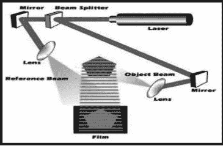

**图14：** 通过捕捉主体图像的波形版本创建全息图的方式。

### 全息的“固态性”

我们的现实不是固态的，而是全息的。我们现在对全息图非常熟悉，它们在当今被广泛使用。二维信息被解码为三维现实，这种现实不是固态的，尽管看起来非常像固态（[图13](#)）。全息图是用一分为二的激光创建的。一束直接照射到全息照相底片上（“参考光束”），另一束先拍摄主体的波形图像（“工作光束”），然后再照射到底片，与激光的另一半“碰撞”（[图14](#)）。这会产生一种*波形*干涉图案，其中包含被拍摄物体的波场信息（[图15](#)见下页）。这个过程可以比作往池塘里扔鹅卵石。每块石头产生的波浪在水面上扩散，与其他波浪碰撞，并产生一个波浪表征，显示出石头掉落的位置、速度、重量和距离。全息图的波形干涉图案类似于“场”中的波形信息，五感将之解码为电信号，再由大脑解码成全息的虚幻“物理”现实。同样，当一束激光（可以想象为人类注意力）照射到波形干涉图案上时，主体的三维版本就会被投射到看似“固态”的现实中（[图16](#)）。全息图的一个惊人特性揭示了更多的“超自然奥秘”。由于它们的创建方式，*整个*全息图的信息以波形编码在干涉图案的每一个部分中。

这意味着全息图的每一个部分都是整体的一个缩小版。将干涉波图案切成四份，你不会得到图像的四个部分，而是得到四个四分之一大小的完整图像。身体是一个全息图，同样如此。这就是针灸、反射疗法和其他形式的疗愈的基础，它们在身体的各个部分——手、脚、耳朵以及任何地方——识别出整个身体的表征。熟练的看手相者能够做到他们所做的事，因为整个身体的信息编码在手中。“如其在上，如其在下”的概念就源于此。


**图15：** 一个波形干涉图案，其中包含转变为全息图的信息。


**图16：** 全息人物，包括全息插入与席琳·迪翁合唱二重唱的“猫王”。

问题会被问到，如果固态是虚幻的，为什么我们不能直接穿过墙壁和彼此。阻力并不是实体会对实体，而是电磁场对电磁场，我们将之解码为*实体对实体*的体验。我们也不应低估信念支配现实的力量。你认为不可能的事*确实*不可能。你的信念影响你的解码过程，而它们不会解码你认为不可能的事。我们相信什么就会感知什么，感知什么就会体验什么。“做不到”和“不可能”就像计算机系统中的防火墙，防火墙阻止的内容不会显示在屏幕上。这对理解人类体验如何被劫持至关重要。我在《答案：你需要知道但从未被告知的一切》和其他书中解释了一长串“谜团”和“超自然”现象，一旦你意识到现实是什么以及它如何运作，它们就不再神秘，而是完全正常。“鬼魂”被视为能穿过“固态”墙壁，因为墙壁并不是固态的，而鬼魂是一种无肉身的实体，其运作频率与墙壁的频率如此不同，就像两个广播电台共享同一空间却从不相互干扰。我自己见过鬼魂这样做。人与物之间的分离也是一种幻觉。一切都被“场”连接，就像所有海洋生物被大海连接一样。只是在我们的视觉现实范围内，我们只“看见”全息信息，而看不见那个连接一切、并由之显现出全息世界的信息场。如果你只能看见全息的“物体”而看不到连接它们的场，它们在你看来就是彼此不相关联的，就像我们看到电脑却看不到Wi-Fi一样。

### 你不知道的事情可能会伤害你

好了，我们回到人类社会和那个“阴谋集团”的“两个世界”，该集团拥有一个由互相关联的秘密社团和撒旦团体组成的全球网络，通过政府、企业、媒体、宗教等进行操纵。它们之间的根本区别在于*知识*。其意图一直是让人类……

对其彻底奴役的计划一无所知，而这种无知的基础是对现实的关键性无知——我们是谁，我们身处何处——以及我们如何与之互动。“人”应当是我们扩展的外部意识与五感身体体验之间的互动。就五感而言，我们注定要*在*这个世界之中，但就我们更伟大的意识和视角而言，我们又不*属于*这个世界。在这种状态下，我们在超越五感的更广阔觉知背景中体验五感的微小图景。换句话说，五感看到的是点，而扩展的觉知将这些点连接成图像和模式，为那些表面随机且互不关联的事物赋予背景。没有扩展觉知的背景，五感只能看到分离和随机，显然毫无意义。邪教及其来自其他维度的控制者试图干预频率领域——在这个领域中，五感现实本应与扩展现实相连——并让两者保持分离（最后一章将详细讨论）。当这种情况发生时，五感的心智和情感过程不再受扩展觉知或真正的“我”的影响，而是由身体解码系统的孤立感知所驱动。它们既身处这个世界，也属于这个世界。这就是人类的困境，也解释了为什么拥有无限觉知潜力的人类会如此容易被操纵，并堕落到如此极端的愚蠢之中。

一旦邪教将五感心智与扩展觉知隔离开来，它就可以通过控制心智在成长期通过“教育”系统以及毕生所受到的媒体感知轰炸和审查而接收的信息，来对心智进行感知和信仰的程序化。通过限制和歪曲信息来限制知识，从而限制感知和对可能性的感知；同时审查和诋毁那些能够解放人们的东西。正如我的另一本书的书名所说：*……真理将使你们获得自由*。因此，邪教最不希望流传的就是任何事物的真相——尤其是永恒的“我”的现实——这就是为什么它拼命控制信息。邪教知道，信息变成感知，感知变成行为，而行为汇总起来就变成人类社会。

由邪教控制和资助的主流“科学”否认永恒的“我”的存在，并试图驳回和诋毁所有相反的证据。由邪教控制的主流宗教则有一套“上帝”的版本，它不过是一个控制和独裁的体系，利用来世受罚的威胁，通过恐惧和内疚来控制当下的感知和行为。两者都不是真的，而邪教想要压制的正是这个“两者皆非”。这个“两者皆非”指的是：一切皆是表达，是注意力的一点，存在于一个无限的意识状态之中——这才是“上帝”一词的真正含义。

对“物质身体”和五感的感知执着意味着“上帝”被拟人化为一个坐在云端的大胡子家伙，或一个狂暴的恶霸：如果我们照“他”的心意行事，他就爱我们；如果不照办，就把我们打入地狱之火。这些不过是“精神”童话，旨在通过对这个“上帝”的恐惧来控制和支配事件与行为。这种恐惧荒诞地使宗教圈中的“敬畏上帝”成为一种令人向往的状态。我认为，恐惧任何东西都不应被鼓励和赞美，而应被消除。你可以明白，当邪教及其宗教决定“上帝”想要什么、“上帝”要求（其实是邪教要求）每个人做什么时，“敬畏上帝”为何对他们如此有利。正如美国伟大喜剧演员比尔·希克斯在讽刺一位基督教狂热分子时所说：“我想这就是上帝想说的话。”我们能访问多少这种无限觉知（“上帝”），取决于我们选择将感知、自我认同和可能性感扩展到多远。自我认同的尺度反映在我们能够连接并受其影响的觉知的尺度上——即我们拥有多少真知和洞见，而不是程序化的感知。当你相信自己只是小小的我——邮递员彼得或市场部的玛丽——此外什么都不是时，你就无法将觉知扩展到无限的可能性之中。我将在最后一章讨论这一点，因为它对我们如何扭转当前局势至关重要。

### 邪教的由来

不可见的领域，即相对于人类的视觉过程而言，几乎一切存在都是不可见的。我曾断定，这确实是人类控制的基础，而邪教正代表这股隐藏力量在人类频段内运作；就在这时，我读到了诺斯替派的著作，它们以极其非凡的方式支持了我的结论。

1945年，在埃及尼罗河畔的拿戈玛第镇附近，即卢克索以北约75至80英里处，发现了一个密封的陶罐。罐内是一个由诺斯替派约1600年前留下的手稿和文本宝库。其中包括13部皮面装订的纸莎草抄本（手稿）和50多篇用科普特埃及语写成的文本，据估计是在公元400年前后藏入罐中的，尽管信息源头要古老得多。诺斯替派曾主管亚历山大城的“大图书馆”或“皇家图书馆”，那是一个令人惊叹的古代文本宝库，记载着先进的知识和人类历史。这座图书馆在很长一段时期内被分阶段拆毁和摧毁，最终由邪教建立的罗马教会在公元415年前后给予了致命一击。正如我之前所说，罗马教会就是迁址后的巴比伦教会。诺斯替派不是一个种族，而是一种感知现实的方式。无论他们在何处立足，只要他们的信息流传开来，罗马教会的恐怖分子就会将其列为摧毁目标。大图书馆如此，诺斯替派的卡特里派也是如此——1244年，在法国南部蒙塞居尔城堡被围困时，这些卡特里派教徒在长期受压迫后被那些精神变态者活活烧死。教会一直对诺斯替派的信息感到恐惧，因为这些信息摧毁了官方的基督教叙事，尽管如果你换一种方式阅读《圣经》，会发现其中有许多内容支持诺斯替观点。任何研究后来被称为《拿戈玛第文库》文本的人都会清楚地看到，大量基督教和《圣经》信仰都源于可追溯到苏美尔的诺斯替来源。诺斯替主题被扭曲，以操纵《圣经》信徒所感知的现实。几个世纪以来，《圣经》文本一直公开流传，因而可以被修改，而诺斯替文本对此至关重要——我们稍后将看到。邪教不是通过扩展觉知直接获取知识，而是由其秘密社团网络将知识传递给邪教特工；这些知识在公共领域之外已传承了数千年。扩展的意识领域是伟大的艺术家、作曲家和作家获得灵感的地方，也是真理等待着任何足够开放、能够与之连接的人的地方。我们需要尽快前往那里。

### 执政官劫持

拿戈玛第文本的五分之一描述了执政官的存在和操控，这些执政官由他们称为“亚大巴多”或“德谬哥”的“首席执政官”领导，而这就是基督教中的“魔鬼”、“撒旦”、“路西法”及其恶魔。在《圣经》象征体系中，执政官就是“堕落者”，也就是所谓的堕落天使——根据犹太教、基督教和伊斯兰教等亚伯拉罕宗教，这些天使被逐出天堂。据称这些天使持续不断地诱惑人类“犯罪”，在本书接下来的部分，你会看到这个象征何其准确。“原罪”的主题与“堕落”有关：亚当和夏娃被“蛇诱惑”，从与上帝同在的纯真和“顺从”（连接）状态，堕入不顺从（断开连接）的状态。据说这次“堕落”将罪带入了世界，并腐蚀了一切，包括人性。诺斯替派将“主执政官”亚大巴多描述为“伪造之灵”、“盲目者”、“盲目之神”和“愚笨者”。在塔木德文献中，亚大巴多的犹太名字是萨麦尔，意为“上帝之毒”或“上帝之盲目”。你看到了这些相似之处。在伊斯兰信仰中，亚大巴多就是穆斯林所说的精灵恶魔“撒伊坦”——撒伊坦就是撒旦，因为同样的主题在世界各地的每个宗教和文化中都能找到。《旧约》中的“主上帝”就是诺斯替手稿中的“主执政官”，这就是为什么他是如此嗜血的混账东西。基督徒称撒旦为“魔鬼中的魔鬼”，而诺斯替派称亚大巴多为“执政官中的执政官”。两者都被称为“欺骗者”。我们说的肯定是同一个“家伙”，而这些共同的主题……


使用不同的名字、故事情节和象征符号，讲述着人类共同命运的同一主题。

纳格·哈马迪文献将“执政官”（Archons）描述为心智寄生虫、颠倒者、守卫、门卫、扣留者、审判者、冷酷无情者和欺骗者。仅“新冠”骗局就是这一切的鲜明例证。圣经中的“上帝”在《旧约》和《新约》中如此不同，是因为它们描述的并非同一现象。《旧约》中那个报复心强、愤怒、充满仇恨的“上帝”，即耶和华（Yahweh），其实就是亚达巴沃（Yaldabaoth），在邪教主导的流行文化中被描绘成“黑暗君主”、“时间之主”、达斯·维达（Darth Vader）以及漫威漫画电影《奇异博士》中试图占领“地球维度”的“黑暗维度”邪恶统治者多玛姆（Dormammu）。亚达巴沃既是《旧约》中的“神”，也是圣经中的“撒旦”。诺斯替派称亚达巴沃为“宇宙的伟大建筑师”，而邪教控制的共济会网络也称他们的神为“宇宙的伟大建筑师”（或“大建筑师”）。“伟大建筑师”亚达巴沃被邪教以美国国玺和美元钞票上金字塔顶端的全视之眼作为象征。“执政官”（Archon）一词编码在“建筑师”（arch-itect）中，同样也编码在“大天使”（arch-angels）和“大主教”（arch-bishops）中。所有宗教都有某种灵性战争中善恶力量的母题，这并非偶然——这个母题是真实的。邪教及其非人类主子非常乐意看到这种情况传播。他们把自己表现为对抗邪恶的善良力量，而实际上他们才是邪恶（缺乏爱）的力量。邪教行动方式的整个基础就是颠倒。他们把自己标榜为善良的力量，而任何为了和平、爱、公平、真理和正义而挑战他们的人，都被谴责为邪恶的撒旦势力。这在历史上一直是他们的策略，无论是罗马教会对非信徒的审判，还是今天对“阴谋论者”和“反疫苗者”的迫害。无论处于哪个时代，其手法都是一样的。

### 亚达巴沃的叛逆（真实）

据说亚达巴沃和执政官们曾叛逆对抗上帝，亚达巴沃自称是上帝——即“万有”（*All That Is*）。《旧约》中的“上帝”（亚达巴沃）要求这样被崇拜：*“我是耶和华，再没有别的；除我以外再没有神”*（以赛亚书45:5）。我在其他书中引用过一个男人的话，他自称是法国木桐-罗斯柴尔德葡萄酒庄园已故的菲利普·德·罗斯柴尔德男爵的私生子（男爵于1988年去世），他告诉了我罗斯柴尔德家族“叛逆上帝”的事。此人说自己被赐名为菲利普·尤金·德·罗斯柴尔德，多年前他以另一个身份生活时，我们曾进行过长时间的交谈。他说自己是通过“神秘乱伦”受孕的，这在邪教内部是“正常且值得赞赏的”。“菲利普”向我讲述了他与一些他指名道姓的富人和名人一起参加撒旦仪式的经历，你可以在我的其他书中看到这些内容以及邪教撒旦主义的更广阔背景，从《最大的秘密》开始。邪教仪式是与执政官“诸神”的互动。“菲利普”形容菲利普·德·罗斯柴尔德男爵是“一个撒旦大师和憎恨上帝者”，他用与描述亚达巴沃/撒旦/路西法/魔鬼相同的术语“叛逆上帝”来描述萨巴蒂安·罗斯柴尔德王朝。“我在家族对上帝的叛逆中扮演了关键角色，”他说。这个角色是以典型的萨巴蒂安风格渗透进基督教会，但最终他逃离了心智监狱，过上了另一种生活。邪教一直在针对宗教进行渗透，其计划是让对执政官的崇拜成为全球性的一神论宗教。撒旦主义渗透进现代“文化”，尤其是年轻人群体，通过音乐视频、舞台表演和其他手段，这些都是其中的一部分。

纳格·哈马迪文本描述亚达巴沃和执政官在原始形态下是能量——意识——并说他们可以选择成形，就像意识以人类形态成形一样。亚达巴沃被称为“无形的”，代表一种深度颠倒、扭曲和混乱的意识状态，它试图附着于人类，将他们变成与自己相似的模样，企图实现同化。为此，它必须操纵人类进入与其自身相匹配的低频心理和情绪状态。

执政官当然可以以人形出现，这就是精神病态人格的起源。诺斯替派所称的亚达巴沃这种能量扭曲就是精神病态。当精神病态的执政官以人形出现时，那个人将是精神病患者，作为亚达巴沃意识的一种表达。邪教中的精神病患者就是人形执政官。其原理与2009年电影《阿凡达》中描绘的相同：美国军方前往半人马座阿尔法星系中一颗虚构的类地卫星“潘多拉”，通过隐藏在与纳威人相似的身体中来渗透蓝皮肤人（纳威人）的社会。伪装成人类的执政官带有一种特殊的混合信息场，部分人类、部分执政官（即古代的“半神”），这种信息场处理信息的方式导致其表现出的行为与其精神病态的邪恶、缺乏同理心和同情心相匹配，并阻止他们被完全人类信息场所能表达的同理心、同情心和爱所影响。邪教血统之间互相通婚，无论是王室还是穿深色西装的权贵，就是这个原因，也因此他们痴迷于乱伦。与完全的人类通婚会稀释执政官能量场，而这种能量场保证了其在人类领域的代表具有精神病态。

诺斯替派著作称，执政官主要采取的非人形态是*蛇形*（我几十年来一直称之为“爬虫类”，并遭到被执政官程式化的人们的无尽嘲笑）以及诺斯替派所描述的“像未出生的婴儿或胎儿，有着灰色皮肤和黑色、不动的眼睛”。这是UFO传说中外星“小灰人”的绝佳写照，大量人称见过他们或被他们绑架——祖鲁萨满克莱多·穆特瓦就是其中之一。我同意那些相信今天以及过去数千年都有外星或跨维度访问的人。难怪凭借其先进的知识和技术能力，他们被视为神并因其表现出的技术和其他“奇迹”而受到崇拜。想象一下，一个带着智能手机和电脑的人来到一个与现代世界隔绝的文化中。他们会


图17：艺术家尼尔·海格对“新冠”等级的描绘。

### 人类电池

然而，这种颠倒状态确实有其后果。与万有之源断开连接的程度意味着你脱离了这一能量滋养和创造力的来源。这意味着你必须自己寻找能量供应，而它找到了——*我们*。在第一部《黑客帝国》电影中，墨菲斯这个角色举起一块电池时，他说了一句深刻的真理：“矩阵是一个计算机生成的梦境世界，目的是让我们保持受控，以便将人类变成一种

拥有一种青春期前的特殊能量，这是执政官最渴望的，而年轻人的能量总体而言都是他们的目标。加州教育部希望学生们吟唱阿兹特克诸神（执政官神祇）的名字，这些神曾在对活人献祭的仪式中受到崇拜，该课程旨在鼓励学生“挑战种族主义、偏执、歧视、帝国主义/殖民主义信仰”，加入“争取社会正义的社会运动”，并“为后种族、后系统性种族主义社会构建新的可能性”。这是通常的“觉醒”垃圾话，它颠倒种族主义并称之为反种族主义。在这种情况下，与“原住民部落”的团结正被用作吟唱那些曾被用来献祭人（并且仍在秘密献祭）的“神”之名的借口。这是“觉醒”无法超越黑白、我们与他们二元对立的又一例证。他们谴责欧洲人对这些部落文化的殖民（完全正确），但那些文化向他们的“神”献祭人（包括儿童），以及像阿兹特克人那样大规模屠杀无数人，却完全没有问题。其中一首吟唱是献给阿兹特克神特斯卡特利波卡（Tezcatlipoca）的，在阿兹特克历法的第五个月，有一个人被献祭给他。他的心脏被挖出来并被吃掉。哦，那就可以了吗。来吧，孩子们……数三下……其他供年轻人吟唱效忠的献祭“神”还包括奎策尔夸托（Quetzalcoatl）、维齐洛波奇特利（Huitzilopochtli）和希佩·托特克（Xipe Totec）。该课程称，“吟唱、肯定和激励活动可以用来团结班级，围绕民族研究原则和价值观建立统一，并在可能情绪消耗的课程之后，甚至当学生参与度看似较低时，重振班级活力”。嗯，无论如何，这就是表面说法。吟唱和咒语是从声带产生的特定频率的重复，吟唱这些执政官“神”的名字会让你调谐到他们的频率。当这会促成能量同步、附着和知觉影响时，这是你最不想要的事情。入会者在其仪式中吟唱他们“神”的名字，正是出于这个原因。

### 觉醒的吸血鬼


上世纪60年代到90年代的书籍。唐望描述了操纵人类社会的力量，他对执政官（Archons）的称呼是“捕食者”：

> 我们有一个来自宇宙深处的捕食者，它接管了我们生活的统治权。人类是它的囚徒。捕食者是我们的主人。它使我们温顺、无助。如果我们想要抗议，它就会镇压我们的抗议。如果我们想要独立行动，它要求我们不要这样做……事实上，我们被囚禁了！

> 它们占领我们是因为我们是它们的食物，它们无情地压榨我们，因为我们是它们的养料。正如我们在鸡笼里养鸡一样，捕食者在人类围栏（humaneros）里饲养我们。因此，它们的食物总是唾手可得。

不同的文化，不同的时代，同样反复出现的主题。

### ‘ennoia’的困境

纳格·哈马迪诺斯替抄本说，执政官意识没有‘ennoia’。这个词被直接翻译为‘意向性’，但我会使用‘创造性想象’这个术语。*万有*对自身的觉知是一切创造性——一切可能性——的源头，而你与那个源头越脱节，你就越会被剥夺‘创造性想象’。鉴于执政官意识几乎完全脱节，它严重缺乏创造力，不得不依赖更为机械的思维过程，并剥削那些确实拥有‘ennoia’者的创造潜力。你可以在整个人类社会中看到这种情况。执政官意识几乎完全主导着全球银行体系，如果我们研究该体系的运作方式，你就会明白我的意思。银行通过发放‘信贷’额度凭空制造‘货币’，这种‘货币’除了理论上存在之外，从未存在过，不存在，也永远不会存在。这是一个信心把戏。如果你认为屏幕上的‘信贷’数字‘货币’值钱，你就会接受它作为支付手段。如果你不这样认为，那么整个体系就会因对这种‘货币’价值缺乏信心而崩溃。没有‘ennoia’的执政官银行家把并不存在的‘钱’‘借给’*确实*拥有创造力的人类——那些拥有灵感创意并创造企业和产品的人。执政官银行业以人类的创造力为食，并通过‘货币’创造和债务来控制这种创造力。人类拥有创造力，而执政官在自身毫无创造力的情况下，为了自身利益和控制而剥削这种创造力。像Facebook这样的执政官互联网平台声称对创意用户发布的所有内容拥有共同版权，而尽管像扎克伯格这样的执政官头脑可能正式掌管该公司，但提供创意灵感的将是员工中的具有创造力的人类。当你拥有无限的‘钱’时，你就可以收购由富有创造力的人类创立的公司。看看Facebook、谷歌及其同类公司的收购记录就知道了。审视一下执政官控制的音乐产业，你会看到没有创造力的深色西装高管们靠旗下艺人的创造力发财。这样的例子不胜枚举。研究一下盖茨、扎克伯格等人的发家史，看看他们的帝国是如何建立在剥削他人创造力之上的。执政官头脑无法凭空创造，但它们擅长（因为不得不擅长）诺斯替文本所称的‘反向模仿’。它们可以模仿，但不能创新。萨巴提安人通过他们借由网络安全系统在计算机系统中安装的后门来搜刮他人的创造力。执政官控制的中国因窃取知识产权而全球臭名昭著，我记得现已成为中国一部分的香港，曾因制造他人创意的假冒仿制品而臭名昭著——‘反向模仿’。如今，无处不在、无所不见的监控系统能够渗透任何计算机，你可以理解执政官吸食人类创造力的潜力。

作家约翰·兰姆·拉什在他关于纳格·哈马迪抄本的著作《*并非他的形象*》中写道：

> 尽管它们无法创造任何东西，因为它们缺乏ennoia（意向性）这一神圣要素，但执政官能够加倍地模仿。它们的专长是模拟（HAL，虚拟现实）。巨匠造物主[亚大巴奥]仿照[原初的]分形模式打造了一个天堂世界……他的构造是天界的俗气作品，就像黑手党大佬的仿意大利式别墅，配有武装天使守卫每个入口。

这就引出了我自千年之交以来一直在谈论的事情。我们的现实是一个模拟；一个我们认为是真实的虚拟现实。不，我不是在开玩笑。

光的形式，这一点得到了纳格·哈马迪文本的支持。模拟之外的原始实相（诺斯替主义者所谓的‘上层永世’）被描述为一片令人难以置信的美丽、极乐、爱与和谐的领域——一个‘水光’如此强大以至于‘没有阴影’的领域。我们被执政官控制的虚假现实——诺斯替主义者称之为‘下层永世’——被描绘为一个拥有另一种‘光’的领域，以混乱、‘地狱’、‘深渊’和‘外面的黑暗’来描述，被困的灵魂在那里受到恶魔的折磨和操纵（仅将这一点与‘新冠’骗局联系起来即可）。水光的主题可以在濒死体验的描述中找到，它不同于模拟‘光’——那是光速之内的电磁或辐射光——即‘下层永世’。模拟‘光’就是诺斯替主义者与执政官联系在一起的‘发光火焰’。圣经称亚大巴奥为‘那古蛇，名叫魔鬼，又叫撒但，是迷惑普天下的’（启示录12:9）。我认为，制造一个原始实相的模拟复制品（‘反向模仿’），并对其进行剧烈改动，同时一直操纵人类相信它是真实的，这或许符合迷惑普天下的标准。然后我们说到邪教神路西法——*光明使者*。路西法是亚大巴奥的象征，是辐射光的携带者，这种光在光速之内构成了劣质复制模拟。‘他’的象征是自由女神像手持的火炬，以及‘光照派’之名。萨巴提安-弗兰克主义宣称路西法是真正的神，而路西法也是共济会真正的神，被尊为他们的‘宇宙伟大或大建筑师’（模拟）。

我还要强调，自从我上世纪50年代还是个孩子以来，执政官通过技术产生的辐射之光是如何淹没我们的环境，并改变了我们不断与之互动的‘场’的性质。通过这种互动，技术辐射正在改变我们。智能电网被设计为以巨大的通信功率运行，5G正在全球扩展，6G、7G正处于开发过程中。辐射就是模拟和执政官操纵系统。执政官邪教为何不希望以越来越极端的程度向我们释放辐射，以形成库兹韦尔的‘云’呢？制造合成人类的计划与应对超出我们迄今所见辐射水平的需求有关。生物人类无法承受他们剧本中辐射的量级。智能电网是技术模拟中的一个技术子现实，旨在进一步将五官感知与扩展意识隔离开来。它是心灵的科技监狱。

### 注入‘黑暗之灵’

宗教和土著文化中一个反复出现的主题是非人力量对人类基因的操纵，其中最著名的记载是圣经中的‘神的儿子们’（原文中神为复数）与人的女儿们交合。纳格·哈马迪的《*约翰秘传*》以这种方式讲述了同样的故事：

> 他[亚大巴奥]派他的天使[执政官/恶魔]到人的女儿们那里，以便他们可以娶其中一些人为妻，并为自己的享乐繁衍后代。起初他们没有成功。当他们没有成功时，他们又聚在一起，共同制定了一个计划……天使们改变了自己的形象，变成他们配偶的形象，用他们为她们混合的黑暗之灵和邪恶充满她们……他们娶了女人，并按照他们灵魂的形象从黑暗中生出了孩子。

附体——当一个非肉体实体接管人体时——是一个古老的主题，并且今天仍在继续。它是真实存在的，我见过。撒但教和秘密社团的仪式可以创造一种能量环境，使实体能够附着在入会者身上，我听过许多关于人们在加入共济会甚至较低等级后性格改变的故事。我曾进入过三座共济会神庙，一是在一次公众开放日，两次是趁周围没人阻止我直接走进去。它们分别位于我居住的赖德镇、英格兰的伯明翰（当时我跟着一个团体），以及马萨诸塞州的波士顿。它们在能量上都给人同样的感觉——黑暗、浓重、低振动且阴险。恶魔附着可能发生在入会者完全不知道发生了什么的情况下。对他们来说，这只是加入共济会并做点好事的仪式


有趣的是，加州大学欧文分校认知科学系的唐纳德·霍夫曼教授表示，我们所体验的现实就像一个计算机界面，只向我们展示我们与之交互的那个层面，同时隐藏其背后存在的一切：‘进化用用户界面塑造了我们，这个界面隐藏了真相。我们所看到的一切都不是真相——用空间、时间和物体这种语言来描述现实，本身就是错误的语言。’他在很多层面上都说得对。空间和时间并非普遍的实在。它们是已被解码的*模拟*现实的一种现象，是奴役我们现实感过程的一部分。濒死体验者一再报告说，一旦脱离身体——即身体解码系统——空间和时间就不再像我们所感知的那样存在了。由此你可以理解，为什么执政官（Archons）及其邪教如此拼命地将人类注意力困在五官感觉之中，让我们身处矩阵之中，并且属于矩阵。将你的心智向扩展的意识状态敞开，你就能超越模拟的信息局限，意识到以前无法获得的知识和洞见。这就是我们所说的‘觉醒’——*从矩阵中觉醒*——在最后一章中，我将把这一点与当前事件联系起来。

### 外星人在哪里？

模拟可以解释所谓的‘费米悖论’，该悖论以意大利物理学家恩里科·费米（1901-1954）的名字命名，他建造了第一座核反应堆。他思考了这样一个问题：在一个看似广袤的宇宙中，恒星和行星如此之多，为什么外星活动却如此匮乏？但如果我们看到的——或者说自以为看到的——夜空，如我所说，只是一个模拟投影呢？如果你控制着模拟，而你的目标是让人类牢牢保持在根本的无知之中，你会希望其他生命形式——包括高级生命——来来往往，与人类分享信息吗？还是你会希望他们相信自己是被隔离的、显然是孤独的？人类隔离与疏离的主题随处可见，无论是无生命宇宙的感知，还是‘新冠’时代的法西斯式隔离法令。矛盾的是，这种隔离恰恰可以在计算机模拟中找到解释。他们还指出，模拟会创造自己的‘物理定律’，从而限制可能性。几十年来我一直提出同样的观点：*那些被感知到的*物理定律只与这个现实相关，或者与我后来所称的模拟相关。当设计师编写代码来创建计算机和虚拟现实游戏时，这些代码就相当于该游戏的物理定律。玩家在编码设定的限制范围内进行交互。同样，为模拟编写代码的人决定了适用于模拟的物理定律。这些定律可以被扩展的意识状态所超越，但无法被那些只囿于五官感知、受模拟代码支配的人所超越。超越代码就是人们所说的‘奇迹’。其实不然。那是在绕过模拟的编码限制。陷入模拟感知中的人群不会意识到这就是他们的困境。正如波恩的那篇论文所说：‘就像漆黑牢房里的囚犯，我们看不到自己牢房的“墙”。’如果人们仍然沉迷于五官感觉，那确实如此。向扩展的意识敞开，那些墙壁就会变得非常清晰。最主要的一堵墙就是光速。

美国理论物理学家詹姆斯·盖茨是另一位探索模拟问题并发现大量支持证据的学者。盖茨曾任马里兰大学物理学教授、弦与粒子理论中心主任，并任职于巴拉克·奥巴马总统的科学技术顾问委员会。他和他的团队在我们现实的构造中发现了嵌入其中的数字数据*计算机代码*。这些代码与计算机所使用的二进制系统中1和0的开闭电荷有关。‘我们不知道它们在那里做什么，’盖茨说。他们在能量构造中发现了被称为纠错码或分组码的数学序列，当某些东西使数据失去同步时，这些编码会将数据‘重启’到原始状态或‘默认设置’。有人问盖茨，他是否发现了一组嵌入我们现实中的方程，与驱动搜索引擎和浏览器的方程难以区分，他回答说：‘没错。’美国国家航空航天局喷气推进实验室进化计算与自动化设计中心主任里奇·特里尔曾公开表示，他相信宇宙是一个数字全息图，必定是由某种智能形式创造的。我完全赞同这一点。波形信息由感官以电信号方式传递给大脑，大脑由此构建出一个我们称之为‘世界’的*数字全息现实*。这一数字层面的现实可以通过数字命理学这门秘传技艺来解读。数字全息是当今全息技术的前沿。我们身边到处都是数字技术，它们被设计用来访问和操纵我们所感知现实的数字层面。‘新冠疫苗’中的合成信使RNA带有数字成分，用以操纵人体的数字‘操作系统’。

### 现实即数字

有多少人知道，我们的现实可以分解为与电脑游戏相同的数字和代码？麻省理工学院（MIT）物理学家马克斯·泰格马克是*我们的数学宇宙*一书的作者，他在书中阐述了现实如何完全用数字和数学来描述，就像电子游戏用电脑游戏的‘物理’进行编码一样。我们的世界与计算机虚拟现实本质上是相同的。泰格马克设想着高级电脑游戏中角色的感知——当图形效果如此逼真，以至于它们不知道自己身处游戏之中。它们认为自己能撞上真实的物体（即我们现实中的电磁阻力），会坠入爱河，并感受到兴奋之类的情绪。当它们开始研究电子游戏中这个看似‘物理的世界’时，就会意识到一切都是像素构成的（在我们的能量现实中已经发现了像素，既然我们的世界在某个层面上是数字化的，那么情况必然如此）。泰格马克说，电脑游戏角色认为是物理‘物质’的东西，实际上可以分解为数字：

> 而我们在这个世界上恰恰处于这种境地。环顾四周，一切看起来一点都不数学，但我们看到的一切都由夸克和电子这样的基本粒子构成。那么电子有什么性质？它有气味、颜色或质地吗？没有！……我们物理学家为[电子的]性质起了些极客式的名字，比如电荷、自旋或轻子数，但电子才不在乎我们叫它什么，这些性质不过是数字而已。


### 哇……

人类认为如此真实的现实，其实是一种幻象。政治家、政府、科学家、医生、学者、执法机构、媒体、中小学和大学课程，如此等等，都建立在一个*并不存在*的世界之上，而这个世界的本质不过是一间模拟的囚牢。当我们整个“物质”现实都不存在时，接受“Covid”不存在，真的有那么难以理解吗？这里所揭示的，是被邪教组织以分隔保密的方式隐藏起来的知识，其目的是通过诱导人们相信一个并不真实的现实，来控制人类对真实感的认知。如果不是在经验后果上如此悲惨，整件事简直可笑到歇斯底里。这些对反叛心智来说并不新鲜。古希腊哲学家柏拉图（约公元前428年—约公元前347年）对诺斯替信仰产生了重大影响，他在数千年前就通过“洞穴寓言”描述了人类的困境。他讲述了一个象征性的故事：囚犯们住在洞穴里，从未到过外面。他们被锁链束缚，只能看到洞穴的一面墙，而身后是他们无法看见的火。有人从火前走过，在囚犯面前的墙上投下影子，那些移动的影子就成了他们对现实的感知。一些囚犯开始研究这些影子，并被当作这方面的专家（今天的学者和科学家），但他们所研究的只是一种幻象（今天的学者和科学家）。有一个囚犯逃出了洞穴，看到了真实的现实。当他回来报告这个启示时，他们不相信他，说他是疯子，并威胁说如果他想释放他们，就杀了他。柏拉图的故事不仅是对人类困境和虚幻现实的绝妙类比，也描述了“Covid”骗局的动态机制。我在这里只是触及了这些主题的表面。本书的目标是清晰地连接所有关键点，把今天正在发生的事情放入其真实的背景中。本章涉及的所有主题领域及其相互联系，在*《你需要知道却从未被告知的一切》*和*《答案》*中都有详细的证据说明。

人们说困惑的人“只见树木，不见森林”。然而，人类却只见*细枝*，不见森林。五种感官只能看到细枝，而反叛心智能看到森林，答案就藏在森林中那些被揭示的联系里。挣脱感知程序，让森林可见，是我们扭转这一切的方法。无法挣脱，正是人类陷入这团乱麻的原因。局势看似无望，但我向你保证并非如此。只要我们知道，我们离天堂只差一次感知的心跳。

## 第十二章：逃离Wetiko

> *人生不过是来自无限的一次假期*  
> 迪恩·卡瓦纳

反叛心智编织着生命与事件的网，在看似随机的事物中看到共同的主题。只要你用心寻找，它们便一直都在；当你敞开心灵，而非沉醉于自以为能看见的事物时，令人难以置信的同步性会助你追寻。

无限的觉知就是无限的可能性，我们能够触及的无限可能性越多，就有越多的事情变得无限可能。这听起来像是显而易见的话，但这是一个具有毁灭性力量的事实，能够让我们自由。我们是无限意识中的一个注意点。问题在于，我们选择去触及多少无限？我们想要连接和探索多少知识、洞见、觉知和智慧？如果你的焦点仅停留在五种感官上，你只会受到无限觉知的极小一部分影响。我的意思是，这一小部分如此微小，以至于让“无限小”一词都有了新的含义。自我认同的限制和对可能性的感知，相应地限制了你意识的范围。我们以为我们是什么，我们就是什么。生活以为它是什么，它就是什么。梦是做梦者，做梦者就是梦。佛教哲学这样说：“一物如何被看待，它就如何显现。”大多数人生活在触、味、视、听、嗅的领域中，这就是他们对可能性和自我感受的极限。许多人会信仰宗教，谈论天上的上帝，但他们的生活仍然是可以扩展显化潜力的可能性领域。那些以同样的开放心灵散发相同振动的人，往往会通过我所说的“频率磁力”被“偶然”吸引到一起，而且不仅限于人。在过去的三十多年里，不可思议的同步性也引领我穿过邪教迷宫，以多种形式获取信息，并经历了关键的个人体验。这些“巧合”让我得以在极其广泛的主题和情境中拼凑出谜团的碎片。那些已经冲破五感现实气泡的人，会完全明白我的意思，而这种逃离感知囚牢的方式，向每一个做出选择的人敞开。与“人类”的局限相比，这可能显得超乎常人，但这其实是我们自然的状态。目前所体验的“人类”是一种不自然状态下的意识，被诱导与整体无限分离。等我更详细地描述那股通过否认通往无限自我的通道而使人类处于奴役状态的力量之后，我将会谈到如何实现这种向合一的转化。

### Wetiko因素

几十年来，我一直在谈论和书写关于五感心智如何被系统性地阻挡在扩展觉知之外。我曾用一台计算机（五感心智）和键盘前的操作者（扩展觉知）来做比喻。计算机与操作者之间的互动，象征着五感心智与扩展觉知之间的互动。计算机直接体验互联网，操作者则通过计算机体验互联网，这本应如此——两者合而为一。执政官试图控制操作者与计算机连接的那个点，以阻止这种互动（[图20](#)）。现在操作者猛敲键盘、点击鼠标，但计算机毫无反应；这种情况的发生，是因为计算机被一个名副其实的计算机“*病毒*”接管——即被*附身*。操作者失去了对计算机的所有影响，计算机自行其是，在“*病毒*”的控制下做决定。我刚才描述的正是这样一种动态：诺斯替教徒所称的亚大巴多与执政官的力量，正是通过这种动态将五感心智与扩展觉知断开，从而将人类囚禁在感知的奴役之中。


**图20：** 我几十年来一直在书写的“病毒”心智，试图将五感心智（计算机）与真正的“我”隔离开来。（图片来源：尼尔·海格）

大约一年前，我遇到了一个美洲原住民的概念“Wetiko”，它精确地描述了同样的现象。Wetiko是克里族使用的拼写，其他部落群体还有其他版本，如wintiko和windigo。他们以小写拼写这个名字，但我像看待执政官一样，将Wetiko视为专有名词，并倾向于大写首字母。我第一次看到关于Wetiko的文章，是作家兼研究员保罗·莱维所写，它与我一直以来关于计算机/操作者断连以及后来的执政官的写作内容如此同步。随后我读了他那本引人入胜的书*《驱散Wetiko，打破邪恶的魔咒》*。我之前得出的结论与美洲原住民Wetiko概念之间的相似之处如此清晰明显，简直令人发笑。Wetiko无疑对应诺斯替派的执政官，也对应精灵、掠食者，以及每一种代表邪恶、颠倒和混乱力量的名字。Wetiko是美洲原住民对那种将计算机与影响力分开的力量的称呼，而邪教组织深知这一点。我怀疑它睡得并不太好，因为它知道这一点。

### 哪个场域？

我认为，事情就是这样运作的。存在两个场域。一个是光速范围内的矩阵那强烈的电磁之光；另一个是矩阵壁垒之外与伟大无限相连的“水样光”场域。五感心智和人体的解码系统将我们与矩阵之光的场域相连。它们必须如此，否则我们无法体验这个现实。五感心智只能看到矩阵信息场，而我们扩展的意识则属于无限场域的一部分。当我们向无限场域敞开心灵——最重要的是敞开心扉——我们便拥有了一个任务控制中心，它给予我们扩展的视角、一张路线图，去理解五感世界的本质。如果我们仅仅孤立于五感心智之中，就没有任务控制中心。我们只能独自去理解一个不断向我们灌输信息以确保我们无法理解的世界。处于这种状态的人会感到“迷失”和困惑，没有方向，也没有雷达。通过人们对“Covid”骗局的看法和行为，你可以越来越清楚地看到哪些人受大无限场域的影响，哪些人受渺小的五感心智的影响。在整个人类已知历史中，这种分裂一直存在：绝大多数人站在一边，而少数能够看穿和直觉到模拟壁垒之外的人站在另一边——正如柏拉图那个逃出洞穴、看清现实真相的囚犯。这样的人总是成为被Wetiko/执政官附身的权威所针对的目标，被烧死在火刑柱上，或被污蔑为疯狂、邪恶和危险。今天的邪教组织及其全球性的“反仇恨”、“反法西斯”的“觉醒”团体网络，都是Wetiko攻击那些揭露阴谋、“Covid”谎言和“疫苗”议程者的表现。

整个“觉醒”运动就是Wetiko，这解释了它黑白分明的思维模式，以及它与被Wetiko附身的邪教组织为何如此一致。保罗·莱维说：“身处这种范式中，就意味着仍然受制于一种二值逻辑——事物非真即假——处于一种


被维蒂科化了的心灵。’维蒂科意识处于永恒的愤怒之中，因此觉醒运动也是如此，随之而来的还有觉醒运动的颠倒与矛盾。‘反法西斯主义者’的行径如同法西斯主义者，因为法西斯主义和‘反法西斯主义者’都是维蒂科在起作用。政党们声称彼此不同，却行为相同，原因也在此。秘密社团和撒旦仪式将入会者与维蒂科相连，而确保世界各地权力位置的冷酷、无情、精神病态的心态就是维蒂科。重构‘训练项目’具有同样的累积效应，使人沾染维蒂科，我们看到这些项目的毕业生被描述为自动化和机器人，带着冷漠、精神病态、漠不关心的举止。这些都是维蒂科附身的特征，看看这本书和其他地方多少次用这些特征描述‘新冠’背后的相关人员，包括警察和医疗行业。在维蒂科社会中，无论哪个行业，攀爬油滑的杆子都需要具备维蒂科的特质才能到达顶端，这在政治领域尤为如此——政治不是公平竞争和思想卓越，而是建立在你捅了多少人的背、舔了多少人的屁股之上。这最终导致了全球‘新冠’的协调行动，被维蒂科附身者在不同国家实施这一切，却对他们对人类的影响毫无同理心和同情心。我们的视觉感官只能看到全息形态，而看不到连接全息形态的场。因此我们感知到的是中间隔着‘空间’的‘物理’物体。事实上，那个‘空间’是在多重频率上运作的能量/意识。其中之一就是维蒂科，它将邪教中的精神病态者、屈服于精神病态者的人，以及在世界媒体运作中为精神病态者服务的人连接在一起。维蒂科就是盖茨。维蒂科就是戴口罩的顺从者。维蒂科就是假记者和‘事实核查员’。维蒂科场正在协调这一切。精神病态者、跟班、媒体特工、‘反仇恨’仇恨团体、‘事实核查员’和顺从的人们，即使没有人类的协调，也作为一个整体运作，因为他们附着于同一个正在组织这一切的场（图22）。保罗·利维在此描述的是，被维蒂科附身的人如何被吸引到一起，并拒绝让任何信息突破他们僵化的感知。

他写这些远在‘新冠’之前，但我相信你会认出‘新冠’宗教的信徒*哦，只需一点点：*

那些正在传送维蒂科振动频率的人，通过心灵共振彼此对齐，以强化他们未说出口的共同约定，从而维持他们对现实的疯狂看法。一旦无意识的内容占据了某些个体，它就会通过相互吸引不可抗拒地将他们拉在一起，并把它们编结成由共同疯狂捆绑的群体，这种疯狂很容易膨胀成一场精神错乱的雪崩。

心灵流行病是一个封闭的系统，也就是说，它是隔绝的，不向任何来自外部世界的、与其固定、有限且具有局限性的视角相矛盾的新信息或影响开放。

这就是觉醒心态和‘新冠’心态。相容的共振也将觉醒者吸引到一起，这显然正在今天发生。


**图22：** 维蒂科场，邪教金字塔及其人员由此显现。（图片由尼尔·黑格提供）

### 精神奴役

维蒂科不在乎人类。它不是人类；它只是为了自己的目的而附身人类，其影响（取决于...的规模

邪恶生邪恶，因为如果邪恶不不断扩张并寻找新的能量滋养来源，其邪恶，其*扭曲*，将在融入平衡与和谐中消亡。爱是维蒂科吸血鬼的大蒜。邪恶，即爱的缺失，在爱面前无法存在。我想我看到了从这里出去的路。几十年来我曾多次强调，执政官/维蒂科及其邪教并非全能。*他们不是。*我不在乎现在看上去怎样，*他们不是*。我不是为了效果才叫他们穿短裤的小男孩。我这么说是因为这是事实。维蒂科对掌控他人永不知足的渴望不是它全能的表现，而是它的不安全感。保罗·利维写道：‘由于最终驱动它、且它被迫培养的那种原始恐惧，维蒂科的政治体有一种内在而持久的对集中权力和控制的需求，以便为自己创造想象中的安全。’*是——的！*完全正确！为什么维蒂科要让人类持续处于恐惧状态？维蒂科本身就是恐惧，而且它被爱吓得魂不附体。正如邪恶是爱的缺失，爱也是恐惧的缺失。爱征服一切，*尤其是维蒂科*，它*就是恐惧*。维蒂科将恐惧带到了这个原本没有恐惧的世界。*恐惧*就是‘堕落’，堕落到低频的无知与幻象——恐惧是看似真实的情感。这个模拟由恐惧驱动和供能，因为维蒂科/亚达巴沃（恐惧）就是模拟本身。恐惧是爱的缺失，而维蒂科是爱的缺失。

### 今日的维蒂科

我们现在可以从这个层面来看待时事。‘新冠’骗局制造了大量持续不断的恐惧、焦虑、抑郁和绝望，这些赋予了维蒂科力量。难怪像盖茨这样的人会成为煽动者，因为他们是维蒂科的化身，并极端地展现出维蒂科的一切特质。看看盖茨及其同伙这些人多么冷酷无情，他们的眼神多么死寂。那就是维蒂科。萨巴蒂安人就是维蒂科，他们控制的一切，包括世界卫生组织、大制药公司、‘疫苗’制造商、各国‘卫生’当局、企业媒体、硅谷、银行系统，以及计划转型为世界政府的联合国，皆是如此。所有这些都被维蒂科扭曲所控制和附身，按照它的形象扭曲人类社会。掌握这一知识，我们便站在了理解世界的门槛上。种族、文化、信仰和性取向的划分，都是为了掩盖被维蒂科附身和影响者与未被附身者之间的真正分界。‘新冠’骗局使两者清晰地呈现在眼前。人类行为与种族无关。暴君和独裁政权有各种肤色和信仰。是什么将轰炸无辜者的美国总统与像卢旺达那样对另一个部落实施种族灭绝的非洲部落联系在一起？什么将他们联系在一起？*维蒂科。*所有战争都是维蒂科，所有种族灭绝都是维蒂科，所有在富足世界中持续数百年的饥饿都是维蒂科。孩子们饿着肚子上床，包括在西方，这也是维蒂科。邪教制造的、聚焦于身体的觉醒派种族分裂，旨在掩盖这样一个现实：行为上的分裂是心灵的表现，而非身体的表现。对身体身份和群体评判的痴迷，是一种将注意力从行为的真正源头——心灵与感知——转移开的手段。觉醒派在自己内部以及与目标群体之间播下的冲突，正是维蒂科通过更多的分裂、混乱和恐惧媒介为自己提供午餐，而它正是以这些为食。邪教正试图通过操纵全人类和所有儿童青少年进入恐惧与绝望的状态，将他们同化到维蒂科频率中。看看自2020年春季以来所有的自杀和心理崩溃。维蒂科精神病态者想要强加一种对权威不加质疑的服从状态，而这种权威不过是维蒂科执行其意志并将人类同化进它自身的管道。它需要我们认为抵抗是徒劳的，而它其实害怕抵抗，更害怕那种能改变游戏规则的不合作态度。它可以利用暴力抵抗来谋取自身利益。暴力强制和暴力抵抗*都是维蒂科*。爱的力量与其‘不’的力量将把维蒂科从我们的世界中扫除。维蒂科及其邪教知道这一点。他们只是不想让我们知道。


如此反人类，因为它*不是人类*。它开始了一项使命，通过针对一切使人之所以为人、人类赖以生存的事物来毁灭人类。“新冠”不是终点，只是达到目的的手段。这个拥有Wetiko意识的邪教正试图改变地球系统，包括大气层，以适应他们而非人类。仅5G就从地面和太空不断轰击，正在显著改变五感与之交互的“场”。如果我们袖手旁观，希望一切都会消失，那么还有更多事情会到来。它本就不会消失。它注定要变得更加极端，我们需要趁我们还能——勉强——面对它。

二氧化碳是生命之气。没有它，人类就完了。完蛋，消失，成为历史。没有自然世界，就没有人类。邪教编造了一个关于二氧化碳和气候变化的荒诞故事，以此证明减少二氧化碳是合理的，以至于盖茨和愚昧的拜登“气候主管”约翰·克里想要把它从大气中抽走。克里想这样做，是因为他的主子盖茨想这样做。Wetikos把生命之气变成了恶魔，通常还得到“灭绝叛乱”工人及类似组织的支持，以及被克劳斯·施瓦布和世界经济论坛推上世界舞台的困惑的木偶孩子格蕾塔·通贝里的支持。“灭绝叛乱”这个名字既具有讽刺意味，又一如既往是Wetiko的颠倒。我们生存所需的气体必须减少，以拯救我们免于灭绝。人类最基本的需求是氧气，而现在有数十亿人戴着“面部尿布”走来走去，剥夺了身体和大脑这一人类存在的基本必需品。不仅如此，60千兆赫的5G与氧分子相互作用，减少身体能吸收到血液中的氧气量。这显然会对呼吸系统、认知能力以及生命本身产生连锁后果，无需进一步解释。像马斯克这样的精神病患者正在组装一个全球卫星系统，用这种疯狂淹没人类大气层。这个人应该被关进监狱。在这里，人类最基本的两种需求——氧气和二氧化碳——正在被拆解。

另外两种人类基本需求——水和食物——也在遭受类似待遇。联合国《21世纪议程》和2030年议程——“大重置”——正计划集中控制所有水和食物供应。人们甚至连落在自己土地上的雨水都无法拥有。食物在最基本的层面上受到二氧化碳减少的影响。我们看到了基因改造（GMO）大规模渗透食物链，杀虫剂和除草剂污染空气、破坏土壤。根据环保人士的说法，为6000万人提供生计、养活全球数亿人的淡水鱼正被“推向灭绝边缘”，而气候变化却是唯一焦点。现在盖茨和施瓦布想要完全抛弃现有食物来源，用合成版本取而代之，Wetiko邪教将控制其生产以及谁吃谁不吃。六十多年来，我们一直踮着脚尖走向极权，因为食物变得越来越加工化，充满了化学垃圾，到了今天，它根本就不是天然食物。正如汤姆·考恩博士所说：“如果有标签，就别吃。”比尔·盖茨现在是美国最大的农田所有者，他做的每件事都有涉及邪教的不可告人的动机。克劳斯·施瓦布写道：“为了在未来50年养活世界，我们需要生产出与过去一万年一样多的食物……然而，只有调整转基因食品监管法规，以反映基因编辑为改良作物提供了精确、高效和安全的方法这一现实，才能实现粮食安全。”骗子。人类和世界正通过疫苗、化学尾迹、食品、饮料罐和无尽的其他来源受到铝的侵害，而铝已与许多健康问题联系在一起，包括逐年增多的痴呆症。对食物链至关重要的昆虫、蜜蜂和野生动物正被杀虫剂、除草剂和辐射消灭，而5G正急剧增加辐射，6G和7G也将来临。授粉蜜蜂种群正遭到毁灭，而包括鸟类、海豚和鲸鱼在内的野生动物，其天然雷达正被日益增加的辐射效应所阻断。夏天，挡风玻璃上曾溅满昆虫，数量多得惊人。现在不再发生了。它们去了哪里？

### 合成万物

邪教正在引入基因改造版本的树木、植物和昆虫，其中包括一个由盖茨资助的项目，释放数亿只经过基因改造、实验室改变并申请了专利的雄性蚊子，与野生蚊子交配，诱使它们产生导致灭绝的基因缺陷。临床意义上的疯子、盖茨资助的日本研究人员开发了能传播疫苗的蚊子，被称为“飞行接种员”。盖茨正在资助改造天气模式，部分是为了推销这种天气是由二氧化碳造成的谎言，同时他还在资助天空地球工程以改变大气层。其中一些事情因盖茨支持的一项计划而曝光：向大气中释放成吨的白垩来“遮挡太阳”并为地球降温。有趣的是，他们这样做时，却没有将太阳的加热效应纳入以二氧化碳为重点的气候预测中。原因是他们想减少二氧化碳（所以不提太阳），但同时他们确实想减少太阳的影响，而太阳对人类生命和健康至关重要。我曾提到过太阳-胆固醇-维生素D的关联，因为他们诋毁太阳，警告皮肤癌（由他们叫你涂的防晒霜中的化学物质引起）。他们从过程的另一端下手，使用他汀类药物来降低将阳光转化为维生素D的胆固醇。缺乏维生素D会导致一系列健康影响，而在“新冠”期间人们被限制在家里，维生素D水平必定已经下降。盖茨还在资助其他形式的地球工程，最重要的是化学尾迹，它们正在向地球投放重金属、铝和自我复制的纳米技术，正在扼杀自然世界。详见*《你需要知道但从未被告知的一切》*，了解这方面的详细背景。

每个人类系统都成为被非人类力量消灭的目标。正如我所解释的，Wetiko邪教已经开始将人体从生物体转变为合成生物体的过程。生物正在被人造和合成——Archontic“反模仿”——取代，遍及整个人类社会。最终计划是彻底抛弃人体

我想用一个有争议的小标题来推动我们应对全球法西斯主义的行动。你说“不要战斗”是什么意思？你说“走开”是什么意思？我们必须战斗。我们不能走开。嗯，这取决于我们对战斗和走开的理解。如果战斗意味着身体对抗，那我们就是在玩Wetiko的游戏，落入它的陷阱。它想让我们愤怒、好斗，把仇恨和敌意指向我们认为必须与之战斗的敌人。每一场战争、每一场战斗、每一场冲突，都是Wetiko在领导双方。这就是它的所作所为。Wetiko想要战斗，任何地方、任何场合。来吧，孩子，打我吧，这样我就可以还手。Wetiko打Wetiko，Wetiko还手打Wetiko。正如你所见，我非常直率地揭露邪教中的Wetikos，但我不恨他们。我拒绝恨他们。这正是他们想要的。你恨什么，就会变成什么。你*战斗*什么，就会变成什么。觉醒者、“反仇恨者”和“反法西斯者”每次伸手去拿键盘或戴上头套时都证明了这一点。我说“走开”，意思是脱离Wetiko，包括停止与它的暴政合作。保罗·利维这样评价Wetiko：

> “击败”邪恶的方式不是试图摧毁它（因为那样的话，在玩邪恶的游戏时，我们已经输了），而是要在我们内心找到那个邪恶无法战胜我们的不可侵犯之处——这才是真正“赢得”与邪恶的战斗。

Wetiko在人类社会中无处不在，自从“新冠”骗局以来，它就像打了类固醇一样。每一场关于戴口罩的争吵中，都有Wetiko戴着口罩，也有Wetiko不戴口罩。那是一个推与抗、推与抗的电路，Wetiko既在*推*也在*抗*。每一极都是Wetiko在增强自身。字典对“resist”（抵抗）的定义包括“反对、拒绝接受或服从”，而关键的字眼是“反对”。这采取什么形式——点燃警车，还是“拒绝接受或服从”？前者是Wetiko反对Wetiko，而后者指明了前进的方向。这就是那些激进要求必须服从政府法西斯主义的人与绝大多数抵制者之间的鲜明对比。我们在伦敦数千名抵制者反对封锁的游行中清楚地看到了这一点，几天后又发生了一场被觉醒者劫持的……

他在法庭上击败了精英，并成立了德国冠状病毒调查委员会，对主要肇事者提起民事诉讼，以期引发刑事指控。最重要的是，他抓住了这个骗局的根本——PCR检测并不能检测“病毒”——因此克里斯蒂安·德罗斯滕与盖茨的代言人、世界卫生组织的谭德塞一同被列入他的起诉名单。绝不能允许这些大角色在不受追究的情况下对人类施加恐怖。比尔·盖茨及其同伙必须被判无期徒刑。一群研究人员还以反人类罪起诉了挪威政府，并将副本送交给警方和国际刑事法院。该诉讼指控挪威参与了一场国际策划的虚假疫情，违反了国际法和人权、欧盟委员会关于通过强制规则定义人权的规定、《纽伦堡公约》和《海牙公约》关于基本人权的规定，以及挪威宪法。从今往后，我们必须主动出击，而不仅仅是抱怨、抗议和被动反应。

有许多切实可行的方法可以支持大规模的非暴力不合作。组织起来就是其中之一。2021年春天伦敦的封锁游行就是当局无法阻止的大规模不合作。人太多了。数十万人沿着伦敦市中心的道路中央走了数英里，而那些“口罩党”只能眼睁睁看着。他们意志坚定，但冷静，只是*做了*，没有歇斯底里，脸上满是笑容。警方无能为力。其他人正在组织不带口罩的集体购物，以互相支持——想象一下如果这种情况到处发生。对其进行警务管理是不可能的。如果商店在这种情况下拒绝为顾客服务，他们将面对一排排装满商品、孤零零的购物车，所有东西都得放回货架。如果这种情况不断发生，他们该如何应对？我在这里说的是从抱怨转向主动；从看着事情发生到让事情发生。我把我们与警察的关系也包括在内。许多“口罩党”的行为——他们的暴行和罪行——他们在像褐衫党和黑衫党那样行事之前会三思。

### 普通法——常识

提及普通法非常重要。大多数人认为法律就是一部法律。事实并非如此。有两套法律体系：普通法和成文法，它们并不相同。普通法建立在“不作恶”这一简单前提之上。它不承认无受害者的罪行，因为在这种情况下没有造成伤害，而成文法却承认。成文法几乎针对所有事情都有规定。那么什么是成文法？令人惊讶的是，它是*海洋*法，被邪教带到陆地上，用以凌驾于作为陆地法的普通法之上。他们无权这样做，但一如既往，他们还是做了。他们不得不如此。他们无法通过仅适用于“不作恶”的普通法将自己的意志强加于人民。他们怎么能用普通法来编织人们生活的细枝末节呢？

于是，他们转而采用海洋法（或海事法），并将其适用于全体人口。成文法指的是政府及其机构颁布的所有法律，包括与“新冠”有关的所有法西斯法律法规。关键的一点是，成文法属于*合同*法。它只适用于*缔约*公司之间。大多数警察甚至不知道这一点。他们也必须被蒙在鼓里。很久以前，当商人及其帆船开始与不同国家进行贸易时，一种被称为海事法等名称的合同法发展起来。同样，它只适用于*公司*实体之间达成的*合同*。如果没有约定的合同，海洋法就没有管辖权，*这一点同样适用于其新名称“成文法”*。邪教将海洋法带到陆地上时面临的问题显而易见。

人们不是公司，政府实体也不是。为了克服后者，他们使政府及所有相关组织都成为公司。所有机构都是*私人公司*，我指的是政府及其机构、地方议会、警察、法院、军队、美国各州，所有这一切。当你被要求回答某问题时，你在不知不觉中同意在两个公司实体之间的合同里授予他们对你的管辖权。

这在各方面都是一个骗局。合同必须由知情的各方达成协议，如果你不知道“大卫·沃恩·艾克”是在同意成为“MR DAVID VAUGHAN ICKE”这家公司，你就无法知情地同意合同。他们在欺骗你，而另一种欺骗方式是要求你出示身份证明。你通常会出示驾照或其他写有你公司名字的文件。这样做，你就承认自己是那个公司实体，而实际上你并不是。称自己为“人”或“公民”也是在认同你的公司虚构身份，这就是为什么我关于公民逮捕提出了普通法的观点。如果有警察走近你，你应立即表明自己是一个活生生的男人或女人，然后说：“我不同意，我不与你立约，我不理解”，或者不要站在他们的权威之下。我有一份作为活人的普通法出生证明，这些证明可以在commonlawcourt.com免费获取。根据成文法体系注册的企业意味着其法律适用。然而，也有办法在普通法下经营企业。请记住，所有“新冠”法律和法规都是成文法——即*合同*法——你没有义务订立合同。这并不意味着你可以杀人而不受惩罚。普通法规定“不作恶”，这适用于身体伤害、经济损失等。警察是私人公司的雇员，我们需要一个在成文法体系之外运作的非公司化普通法警察新体系。如果你访问davidicke.com，在搜索引擎中输入“Common Law”，你会找到更详细解释普通法的视频。这无疑是我们应该走的一条路。

### **全心全意**

我听人说我们处于一场属灵的战争中。我不喜欢“战争”这个词，因为它带有Wetiko的动态，但我明白他们的意思。抛开所有肉体形态，我们正处于两种意识状态寻求截然不同现实的境地。

Wetiko想要动荡、混乱、恐惧、痛苦、冲突和控制。另一个想要爱、和平、和谐、公正和自由。这就是我们当前的处境。我们不应轻信Wetiko无所不能、我们无能为力的想法。Wetiko并非无所不能。它是个笑话，可悲至极。它本不必如此，但它目前做出了这个选择。多年来，有几次当我感觉到它的频率存在时，我允许它短暂附着，以便有意识地观察它的本质。这种体验并不愉快，能量沉重而黑暗，但你能轻松地把它踢出门外，这表明它真正的力量在于说服我们相信它拥有力量。这全都是骗局。Wetiko是个骗局。它是一个骗子，而不是一种能在我们释放自身力量时控制我们的力量。这个骗局建立在操纵人类将自己的力量交给Wetiko的基础上，Wetiko再将这种力量循环回来，制造出它拥有力量的假象，而实际上那种力量*是*我们交出去的*自己*的力量。这发生在能量层面，并显化在可见世界中，表现为人类将自己的力量交给Wetiko权威，而该权威利用这种力量来控制民众——可这力量不过是民众自己交出去的。否则数十亿人怎么可能被少数人控制？我曾与那些被Wetiko附身的人打过交道，如果你敞开心扉去对付它，你同样可以踢它的屁股。哦，是的——*心*能够改变这个被感知为“物质”的世界。

我们是接收-发射器和信息处理器，但是什么信息，来自哪里？信息在三个主要区域被处理为感知——大脑、心脏和腹部。它们分别与思考、知道和情感相关。Wetiko希望我们成为“头脑之人”和“腹部之人”，这意味着我们在矩阵模拟的范围内思考，而低振动的情感反应会扰乱平衡和感知。在社交媒体上待几分钟，你就会看到情感是如何主导的。“觉醒”全是情感，因此没有思考，也没有事实。我们的心则不同。它*知道*，而头脑*思考*，必须尝试弄明白，因为它不知道。人类能量场有七个主要涡旋，将我们与更广阔的现实连接起来（[图23](#)）。查克拉的意思是


这种破坏与其与“物质”心脏的根本联系息息相关。汤姆·考恩博士写了一本杰出的书，挑战了心脏是泵的信念，并将“物质”心脏与灵性心脏联系起来。远见卓识的鲁道夫·施泰纳也说过同样的话，指出心脏是泵的说法是谬论。什么？心脏不是泵？这太疯狂了，对吧？人人都知道心脏是泵。读一读考恩的《人类心脏，宇宙之心》，当你看到证据时，你就会意识到心脏是泵这个想法是多么荒谬。脚部的血液离心脏那么远，怎么可能被心脏水平地泵上身体呢？考恩在书中解释了血液为何如此流动的真正原因。我们的“物质”心脏被用来象征爱，而爱的真正来源其实是心脏漩涡，即灵性心脏，它是我们与“外面”扩展意识之间最强大的能量连接。这就是为什么我们在胸腔中央会感受到*知晓*——直觉性的知晓。知晓并非来自一系列思考最终得出结论的过程。它是一瞬间、一次性出现的。我们的心脏之所以知晓，是因为它与那些*确实*知晓的觉知层面相连。这就是直觉——直觉性的*知晓*——的意义和源头。

在过去三十多年揭露全球游戏和现实本质的过程中，我的心脏一直是我探求真相与准确性的恒定天线。一位美国情报界内部人士曾说我的一本书里引用了某个虚假信息传播者的话，但我只引用了其中真实的部分。他问：“你是怎么做到的？”答案是使用我的心脏天线，而且任何人都能做到。以心为中心才是我们本该有的样子。当心轮关闭时，我们就会退入封闭的头脑和五感现实的泡沫之中。如果你花一点时间将注意力集中在胸腔中央，想象一个旋转的光轮，看着它打开并扩展。你会感觉到它正在发生，也会感受到内心的喜悦与爱等感知，因为心脏在与头脑互动时对头脑产生影响。心轮越打开，你就越能感受到心之意识的表达；随着这一过程持续并成为你的一部分，洞见和知晓将随之而来。一颗开放的心连接着那个觉知层面，那个层面知晓万物本为*一体*。你将从这个视角看到，分裂我们的断层线不过是用来控制我们的幻象。开放的心不会把种族、信条和性取向当作幻象去处理，除非它们是作为那涵盖一切的意识短暂的体验。我们的心看不到分裂，只看到合一（图24和图25）。还有别的东西。我们的心热爱欢笑。马克·吐温曾说过“人类有一种真正有效的武器，那就是笑声”，这实际上指的是心，它热爱欢笑，因知晓无限现实的真实本质以及人类社会的一切疯狂都只是头脑的幻象而喜悦。吐温还说：“在笑声的攻击面前，没有什么能够屹立不倒。”这对维蒂科和邪教来说千真万确。他们的不安全感要求他们被认真对待，要求他们的权力和权威得到承认和敬畏。我们绝不应如此。我们不应变得好斗或恐惧，那正是他们的不安全感所渴望的。我们应该当面嘲笑他们。即使他们戴着口罩，警察过来期望被认真对待，我们也要嘲笑他们。他们自己那副样子都没把自己当回事，我们何必呢？在恐吓面前大笑。在暴政面前大笑。你会从他们的反应中看到，你按下了他们所有的按钮。维蒂科面对笑声，或者当它的目标拒绝把喜悦让位给恐惧时，不知道该怎么办。在“新冠”骗局中，我们已经看到许多例子，人们表达出他们的能量力量，而维蒂科的提线木偶们夹着尾巴退缩了。大笑吧——这个世界终究是疯狂透顶的，如果要在笑和哭之间选择，我知道我会选哪条路。


这会造成一个没有方向的人，极端情况下几乎像僵尸一样，以残缺的意识状态运作，任由维蒂科摆布。尤其让我感兴趣的是，那位治疗师所说的话，与一百多年前消息灵通的鲁道夫·施泰纳的预言相呼应。施泰纳说：

> 在未来，我们将用药物消除灵魂。在“健康观点”的借口下，会有一种疫苗，让人的身体一出生就尽快得到处理，使人无法产生灵魂和精神存在的想法。唯物主义医生将被委以移除人类灵魂的任务。

> 正如今天人们接种疫苗来预防这种或那种疾病，在未来，儿童将接种一种物质，这种物质可以被精确地制造出来，使人们凭借这种疫苗，对陷入灵性生活之“疯狂”产生免疫。他会极其聪明，但不会发展出良知，而这就是某些唯物主义圈子的真正目标。

施泰纳说，这种疫苗会使物质身体脱离以太体（精微体），并且“一旦以太体脱离，宇宙与以太体之间的关系将变得极其不稳定，人就会变成自动机器”。他说“人的物质身体必须通过灵性意志在这个地球上得到磨炼——因此，这种疫苗成为一种阿赫里曼（维蒂科）力量”，并且“人再也无法摆脱给定的唯物主义感受”。他说，人类到那时将变得“体质上唯物化，再也无法上升到灵性层面”。多年来我一直在写DNA是信息的接收-发射器，将我们与其他现实层面连接起来，而这些“疫苗”改变DNA，就好比改变一根天线及其发射和接收的能力。这种断开显然会导致性格和感知的变化。施泰纳还预言了人工智能的到来。大型制药公司“新冠疫苗制造者，维蒂科的表现形式，在我写这些文字时正在儿童身上测试他们操纵DNA的邪恶行径，目的是将”疫苗“用于婴儿。如果它是一种灵魂-身体断开器——我说它是，或者说可以是——那么每个孩子从出生起就会与”灵魂“断开，”疫苗“将创造一个封闭系统，其中来自更高自我的灵性指引将毫无作用。这一直是维蒂科的野心。

不过，少说这些废话吧。维蒂科无法在心灵开放之处停留，因此它极力让心灵保持封闭。恐惧是它的货币和食物来源，而真正意义上的爱没有恐惧。当爱知道自己是*一切万有，过去、现在和未来永恒存在者*，在对一切可能性进行永恒探索时，它为何要有恐惧？真正意义上的爱，不是那种被当作爱的肉体吸引。那可以是爱的一种表达，没错，但无限之爱，无条件的爱，要深远得多，直达一切存在的核心。它是一切存在的核心。无限现实诞生于超越模拟幻象的爱。无限表达的爱，就是知晓一切合一，而迅速掠过的分离体验只是一种暂时的幻觉。你无法与合一断开；你只能*感知*自己断开了，并退出它的影响。这是维蒂科这个心智寄生虫进行的所有感知欺骗中最重要的一个，也是它所有操纵潜力的基础。

如果我们敞开内心，打开头脑的闸门，重新定义自我认同，令人惊叹的事情就会开始发生。意识会随着自我认同而扩展或收缩。当真正的自我被认作无限觉知，而标签化的自我——幻影自我——被看作只是一连串短暂的体验时，生命就会转变。意识扩展的程度与自我认同扩展的程度同步，一切都会改变。你看到的是合一，不是分裂；是整体画面，不是像素。由此，我们可以放长线。经验不再是某种独立存在的事物，而是永恒无尽中的一个短暂瞬间。突然间，穿制服和深色西装的人不再令人恐惧。做内心知道正确的事不再令人恐惧，这些行为的后果也呈现出短暂体验的性质，在无限之眼的眨眼中就过去了。恐吓全部存在于头脑中。超越头脑，就没有恐吓。

一颗开放的心不会为它所知正确之事考虑后果。这样做就等于考虑不去做它所知正确之事，而对于一颗处于其力量中的心来说，那从来都不是一个选项。叛逆之心实际上是叛逆之心。考虑后果总会为头脑提供一辆逃跑的车，而且


心并不想要它。鉴于我们今天所面对的一切，正确的做法是停止与一切形式的Wetiko合作，且不带恐惧或妥协。当暴政总是索取更多，直到拥有一切时，你无法与暴政妥协。生命即你的感知，你即你的命运。改变你的感知，你就改变了你的生活。改变集体感知，我们就能改变世界。

*来吧，人们……一个人类大家庭，一条心，一个目标……*

*自————由！*

我们绝不接受比这更少的东西。

餐馆、商店、健身房、剧院，基本上一切都关闭了。城市变成了鬼城。即使是所谓的‘必要’企业，也只营业到上午11点。你基本上只有一个小时购买食物，然后时间就到了。

跨州旅行，甚至跨区旅行都被禁止。警察在各主要路口守候，盘问你为何外出，如果你没戴口罩就会罚款。

这里的医疗界也是种族灭绝的同谋，撒谎说医院已满，拒绝需要立即护理的真正病人。他们甚至制造了氧气瓶短缺。

这是典型的邪教（Cult）惯用手法，在每一个国家上演。阿丽莎说，那些不进行PCR检测（这种检测并不检测‘病毒’）的人被拒绝住院治疗。她说受影响最严重的是流动工人和农村地区的人。大多数企业雇用流动工人，而随着一切关闭，没有工作、没有收入、没有食物。结果是数百万人死于饥饿或营养不良。这一切都发生在总理纳伦德拉·莫迪的统治之下，他是邪教百分之百的资产，这再次凸显了我们所面对的纯粹反人类邪恶的规模。澳大利亚禁止其公民从印度回国，违者最高可被判处五年监禁和37,000英镑罚款。印度被制造出来的‘新冠’危机，正被用来为西方进一步的法西斯主义辩护。在印度的‘疫苗’计划与‘病例’增加之间可以看到明显的联系，这成了一个常见的主题。塞舌尔，全世界人均‘接种新冠疫苗’最多的国家，在‘病例激增’后再次进入封锁。

很久以前，真正邪恶的孟山都农业生物技术公司，与比尔·盖茨关系密切，用转基因作物摧毁了印度农业。人权活动家古尔查兰·辛格指出，印度政府正试图通过‘新冠’封锁摧毁数亿人的粮食供应，以完成这一工作。他说，在令人作呕的种姓制度（不管他们怎么说，仍然存在）最底层有4.15亿人生活在贫困线以下，每年都要为吃饭挣扎。现在，政府恰好在破坏收成的时候实施封锁。这一蓄意政策正导致大规模饥饿。人们可能会对政府会这样做的说法感到震惊，但受Wetiko控制的‘领导人’能犯下任何程度的邪恶。事实上，印度正在发生的事情正在全世界范围内被煽动。食物链和粮食供应正受到各个层面的攻击，以制造世界饥饿，从而进行控制。比尔·盖茨成为美国最大的农田所有者并非没有原因，而摧毁获取食物的途径既有助于人口减少议程，也有助于盖茨已经资助的合成‘食物’计划。再加上为应对‘新冠’而自杀式制造假‘货币’所导致的即将到来的恶性通货膨胀，以及集装箱运输系统的崩溃，你就得到了一杯只能通往一个方向的鸡尾酒，而在我看来这简直是疯狂。邪教的计划是让整个体系崩溃，通过‘大重置’来‘重建得更好’。

### ‘疫苗’传播

来自世界各地的报告不断涌现，女性在接种假‘疫苗’后出现月经和生育问题，未‘接种疫苗’者与‘接种疫苗’者接触后也出现类似问题。此类案例实在太多，‘巧合’的说法难以令人信服。我们看到有更年期女性重新来月经，有人月经停止或持续数周不止、排出血块，有时还有子宫内膜脱落、乳房异常，以及流产（在美国部分地区增加了400%）。未‘接种疫苗’的男性和儿童在与‘接种疫苗’者接触后出现血栓和流鼻血。有婴儿因‘接种疫苗’母亲的母乳影响而死亡。清醒的医生——占少数——推测了未‘接种疫苗’者出现与‘接种疫苗’者相同症状的原因。是合成物质中的纳米技术传输频率，还是直接在人与人之间传播的化学生物武器？我并不是说某种化学传播不是一种可能的答案，但邪教所做的一切的基础是频率和智能电网，并切断接收器与发射器之间通往扩展意识的连接。这可以解释法国能量治疗师的经验：那些接种过‘疫苗’的人身体与‘灵魂’分离。在体内自我复制的纳米机器人也会传输合成频率，未‘接种疫苗’的人可以通过近距离接触而接收到这种频率。马德杰推测，也许直接导致症状的是5G和其他辐射水平的升高，但有趣的是，她说未‘接种疫苗’的患者在离开与其接触过的‘接种疫苗’者后，情况有所好转。必须记住，你可以用心灵控制频率和能量，可以有意识地用意念创造能量屏障或气泡，以阻止有害频率穿透你的能量场。美国儿科医生拉里·帕列夫斯基博士说，这种‘疫苗’并不是‘疫苗’，从来就不是为预防‘病毒感染’而设计的。他称之为‘一场大规模、精妙的种族灭绝宣传’，因为他们无需给每个人注射就能得到他们想要的结果。他说，注射内容物能够将任何物质注入大脑、心脏、肺、肾、肝、精子和女性生殖系统。‘这是种族灭绝；这是大规模杀伤性武器。’与此同时，美国大学禁止未接种这种改变人生且可能终结人生的‘疫苗’的学生入学。当这种大学法西斯主义的后果大白于天下时，集体诉讼必须跟进。就在本书即将付印之际，有报道称‘接种疫苗’男性的精子受到生育影响，这绝对符合我一直在说的观点，而医院里继续挤满‘疫苗’反应者。另一个问题是，通过输血传播又是什么情况？英国国家医疗服务体系（NHS）已将对献血限制的时间从‘新冠疫苗接种’后七天延长至即使出现手臂酸痛反应后的28天。

### **‘疫苗’改变行为**

我在本书正文中提到，我相信我们会看到‘接种疫苗’者出现越来越多的行为变化，而我已经听到未‘接种疫苗’者的此类评论，描述朋友、亲人和同事的行为变化。随着自我复制的合成材料和纳米粒子在身体和大脑中扩张，这种情况只会增加。2016年《卫报》的一篇文章详细介绍了夏洛茨维尔弗吉尼亚大学的研究，该研究开发了一种控制与复杂动物行为相关的大脑回路的新方法。这种方法被称为‘磁遗传学’，涉及对一种名为铁蛋白的蛋白质进行基因工程改造，这种蛋白质储存和释放铁，以产生一种名为‘磁铁’的磁化物质，可以从远处激活特定的神经细胞群。据称，这是对已知的脑活动操纵方法（光遗传学和化学遗传学）的进步（邪教长期以来一直在开发脑控制方法）。据说铁蛋白技术是无创的，能够‘快速且可逆’地激活神经元。换句话说，人类的思想和感知。文章称，早期研究揭示了如何通过基因工程改造被热和机械压力‘激活’的神经细胞蛋白，使其对无线电波和磁场敏感，方法是将它们附着在一种名为铁蛋白的储铁蛋白上，或者附着在无机...


强制疫苗接种可能是“民主社会所必需的”。  
17名法官裁定，强制接种疫苗并未违反人权法律。乍一看，这一裁决颠倒黑白，令人窒息。如果拒绝将疫苗注入体内不是一项人权，那什么才是？啊，但他们说的是人权法律，而这一法律是专门为了遵照国家（邪教）的指令删除所有人权而制定的。《欧洲人权公约》第8条涉及私人生活权。这里的关键词是“除外”：

> 公共当局不得干涉行使此项权利，除非  
> 符合法律规定，并且在民主社会中是必要的，为了国家安全、  
> 公共安全或国家的经济福祉，为了预防  
> 混乱或犯罪，为了保护健康或道德，或为了保护他人的权利  
> 和自由 [我强调]。

除非符合法律，否则不得干涉，这意味着除了欧盟政府根据其指令决定你享有的权利外，不存在任何“人权”。“在民主社会中是必要的”解释了判决中的这一提法，而“为了国家安全、公共安全或国家的经济福祉，为了预防混乱或犯罪，为了保护健康或道德，或为了保护他人的权利和自由”则给了欧盟一辆四驾马车，可以践踏“人权”并将其撞得四散。司法机构不是对政府极端主义的制衡，而是执行极端主义的工具。这一裁决简直可笑地可以预见，因为邪教最不希望看到的就是反对强制接种疫苗的裁决。法官们一次又一次地作出有利于其所属体系的裁决。提交到他们面前的疫苗接种争议，总是以有利于医生和当局的方式裁决，这些医生和当局代表着拥有司法机构的国家观点。哦，是的，我们甚至听到有人呼吁，在“阳性检测”后28天内不要在死亡证明上写“Covid-19”，据称这样做会让“疫苗”显得无效。他们在嘲笑你。

当那些未接种“新冠”疫苗的人在圣文森特加勒比海岛大规模火山喷发期间被拒绝撤离时，疯狂、不人道以及即将发生的事情的严重程度凸显出来。将居民运往另一个岛屿安全的游轮只允许“已接种疫苗”者上船，其余人则听天由命。即使在这样生死攸关的情况下，我们看到“新冠”剥夺了人们最基本的人类本能，而且当你想到那些假“疫苗”制造商甚至不声称他们操纵身体的混合物能阻止一种并不存在的“病毒”的“感染”和“传播”时，这种疯狂就更加极端了。圣文森特总理拉尔夫·冈萨尔维斯说：“首席医疗官将确定已接种疫苗的人员，以便我们让他们上船。”再次注意首席医疗官的权力，他与英国的惠蒂一样，将听从世界卫生组织的指示。这是邪教网络结构，它凌驾于那些“遵循科学”的政客之上，这意味着他们要做的是世卫组织控制的“医疗官员”和“科学顾问”告诉他们的事情。冈萨尔维斯甚至说，在命令下达后“接种疫苗”以便上船的居民仍将被拒绝登船，因为可能出现“头晕”等副作用。好消息是，如果他们头晕到一定程度，就有资格担任圣文森特总理了。

### 微芯片自由

欧洲的裁决将在某个时候被用来为执行“新冠”DNA操作程序的举措辩护。全球区块链商业理事会首席执行官桑德拉·罗在世界经济论坛活动上表示，她希望“疫苗护照”有助于推动全球数字身份计划的“强制同意和标准化”：“我希望，随着人们对某种疫苗护照的渴望和全球需求——以便人们能够重新旅行和工作——[它]将推动强制同意、标准化，坦率地说，还有世界各地的合作。”这位女士要么不太聪明，要么极其虚伪，才会使用“强制同意”这个词。如果你是被强迫的，你并不是“同意”——而是*屈服*。她描述的一直以来的计划就是，对每个人强制实施数字身份，没有它，人们将无法正常生活。“疫苗护照”只是打开了大门，远非最终目标。数字身份将使你在网络空间中所做的一切都受到追踪，这与邪教控制的中国用来推行其全面控制的社会信用体系是同一技术。最终的“护照”计划是一枚微芯片，正如我的书近30年来所警告的那样。五角大楼那些为邪教控制的国防高级研究计划局（DARPA）工作的好人，在2021年4月声称，他们已经开发出一种植入皮下的微芯片，用于在“无症状新冠感染”成为疫情之前检测到它，以及一种“革命性过滤器”，在连接到透析机时可以清除血液中的“病毒”。这里唯一的问题是，“病毒”并不存在，而无症状传播“病毒”的说法是令人麻木的胡扯。当然，这并不是为了让人们出于截然不同的原因而被植入微芯片的诡计。DARPA还表示，它正在生产一种针对这种“病毒”及其所有“变种”的一站式“疫苗”。地球上最邪恶的组织之一在做这件事？那还是接种吧。这些人疯了，因为占据他们的Wetiko疯了。

加利福尼亚州索尔克研究所的研究人员宣布，他们创造了一种半人半猴的胚胎。我早在20世纪90年代出版的书中就揭露了美国绝密地下设施中的实验，这些实验将人类与动物和非人类“外星”物种杂交。他们现在正将这一长期发展的能力悄悄带入公共领域，而且鉴于我们面对的是精神错乱的疯子，未来还会有更多。说到这个——埃隆·马斯克在Neuralink的科学家们训练一只猴子使用操纵杆在电脑屏幕上玩乒乓球和其他益智游戏，当猴子做出正确动作时，一根金属管将香蕉奶昔喷入它嘴里，这是训练人类无条件服从的基本技术。猴子的头骨中有两个Neuralink芯片，超过2000根导线“扇形展开”进入它的大脑。最终，这只猴子纯粹用脑电波玩起了电子游戏。心理变态的自恋狂马斯克表示，这一“突破”是朝着将Neuralink芯片植入人类头骨并将思想与人工智能融合迈出的一步。*确实如此。*这个人如此黑暗，邪教深入其骨髓。

### 世界经济法西斯主义（WEF）

世界经济论坛正通过其众多不同活动上的发言告诉你这个计划。邪教控制的法西斯分子、YouTube首席执行官苏珊·沃西基在2021年世界经济论坛全球技术治理峰会上（看看这个名字）发表讲话，40个政府和150家公司与会，以确保“新兴技术的负责任设计和部署”。奥威尔式的翻译：“确保长期规划的技术设计和部署将推进邪教的控制和审查议程。”摧毁自由并注定要上纽伦堡审判的沃西基表示，支持像她这样的科技平台审查“技术上合法但可能有害”的内容。谁来决定什么是“有害”？她决定，他们决定。“有害”将指邪教不希望人们看到的任何内容，而且英国政府已提出立法，将基于“伤害”来审查内容，无论信息是否公平、合法且可证明属实。如果内容公平、合法且可证明属实，那就*尤其*会如此。沃西基呼吁组建一个全球联盟，通过自动化审查来执行内容审核标准。这个女人和超级审查员如此自欺欺人，以至于她无耻地接受了一个“自由表达”奖——*沃西基*——在一个由她自己的*YouTube*赞助的活动中。他们毫无羞耻之心，也毫无自我意识。

当YouTube纯粹根据医疗和科学观点是支持还是反对邪教的“新冠”叙事来审查它们时，你就知道“新冠”是一个骗局，而沃西基是邪教特工。佛罗里达州州长罗恩·德桑蒂斯组建了一个专家小组，成员包括来自哈佛大学、牛津大学和斯坦福大学的四位医学教授，他们发言反对强迫儿童和

接种疫苗的人也要戴口罩。他们还表示，没有证据表明封锁降低了“新冠-19”的传播率或死亡率。邪教跑腿的沃西基和她的YouTube删除了那段小组视频，因为其内容与地方和全球卫生当局关于口罩阻止“新冠-19”传播有效性的共识相矛盾。这个“共识”指的是邪教告诉世界卫生组织该说什么，世界卫生组织又告诉“当地卫生当局”该做什么。沃西基当然知道这一点。小组成员指出，对科学辩论的审查应对许多原因造成的死亡负责，但沃西基根本不在乎。她不敢违抗命令，而且作为人类的耻辱，她本来也不想违抗。英国政府正试图通过一项法西斯主义的“在线安全法案”，专门以巨额罚款和其他手段针对未经审查的视频和社交媒体平台，迫使它们审查“合法但有害”的内容，就像邪教拥有的脸书、推特、谷歌和YouTube一样。什么是“合法但有害”将由法西斯主义者布莱尔创建的英国通信管理局（Ofcom）来决定。

世界经济论坛的另一个执念是对金融系统的网络攻击，而这显然就是邪教计划要搞垮所有人银行账户的手段——除了他们自己的账户。那些认为自己有足够的钱，邪教的议程对自己无关紧要的人，如果继续无视摆在眼前的事实，将会得到一个巨大的教训。由盖茨资助、克劳斯·施瓦布出面的世界经济论坛宣布，它将与俄罗斯政府和全球银行进行一场此类攻击的“模拟”，名为Cyber Polygon 2021。他们模拟什么——就像“新冠”事件201一样——他们就计划煽动什么。世界经济论坛参与了一个与邪教拥有的卡内基国际和平基金会合作的项目，名为“世界经济论坛-卡内基网络政策倡议”，该倡议试图将华尔街银行、“监管机构”（我喜欢这个词）和情报机构合并起来，以“防止”（安排并允许）一场网络攻击，这场攻击将摧毁全球金融体系，而控制世界经济论坛和卡内基机构的人早已对此谋划已久。卡内基国际和平基金会曾向第一次世界大战期间的美国总统伍德罗·威尔逊发出指示：在社会发生不可逆转的变革之前，不要让战争结束。

### 武汉实验室转移视线

在本文写作接近尾声之际，邪教控制的当局和走狗媒体正系统性地推动“病毒是从武汉实验室泄漏的”这一说法。有两种版本——一种是意外泄漏，一种是故意为之。两者都是胡说八道。从未被证明存在的“病毒”被认为存在，这对于制造“确实有传染源需要应对”的印象至关重要，并且使得用不存在的“病毒”的“变异株”来无休止地恐吓民众成为可能。在撰写本文时，当局正倾向于“意外”说，而另类媒体则在宣扬“故意”说。有线新闻主持人塔克·卡尔森曾对封锁和强制“疫苗”的某些方面提出质疑，但他也相信了武汉实验室的说法。他说：“现在所有人都同意了。”好吧，我不同意，许多其他人也不同意。问题是，为什么体制及其媒体突然“同意”了？当媒体作为一个整体朝着同一个叙事行动时，那永远是个谎言——看看“新冠”时代接连不断的谎言就知道了。为什么这个由邪教控制的、像机枪扫射一样散布谎言的组合，会突然“同意”说真话？？

许多另类媒体之所以相信这个谎言，是因为它符合*阴谋论*叙事，但这是*错误*的阴谋论。真正的阴谋是*根本没有病毒*，而这正是邪教拼命想要掩盖的。认为“病毒”是意外泄漏的想法是荒谬的，因为整个“新冠”骗局显然是长期策划好的，并且按照洛克菲勒文件和事件201的剧本迅速上演，只等被实施。那么他们用数十年时间详细准备了一切，然后就坐在那里敲着手指，等待某个生物实验室“意外”泄漏？什么？？这太疯狂了。然后是“故意”的说法。你想要传播一种“致命病毒”，同时隐瞒你已这样做了，然后你在中国最高级别的生物实验室附近释放它？我再说一遍——*什么？？*

关于“新冠疫苗”的（内容），并且没有考虑到“变异株”。该文件称：“疫情反弹是由于一些人（主要是儿童）不符合接种疫苗的条件；另一些人选择不接种疫苗；还有一些人虽然接种了疫苗，但没有得到完美保护。”这种谎言令人窒息。好吧，那就去责怪那些有脑子、不愿接种改变DNA疫苗的人吧，并对儿童施加更多压力让他们接种，与此同时，“试验”正在涉及年仅六个月的儿童，而他们的父母让“疯狂”都自愧不如。年轻人正被施加巨大压力去接种这种假“疫苗”，而全球范围内儿童的同意年龄限制被系统性地降低，以阻止父母干预。该文件最不寻常之处在于它声称，“第三波”疫情将由*“住院和死亡人数的回升……其中以接种过两剂疫苗的人为主，分别占这一波疫情的约60-70%”*所驱动。对“第三波”疫情峰值的预测显示，每天有300人死亡，其中250人是*完全“接种疫苗”*的人。默许者还需要被灌输多少谎言，才能看清显而易见的事实？那些为了“保护自己”而接种疫苗的人，预计将成为大多数生病和死亡的人？那么“疫苗”里到底有什么？该文件接着说：

> 夏季低患病率之后，可能会在随后的秋季和冬季出现发病率的显著上升。夏末的低患病率不应被视为 SARS-CoV-2 已经消退，或人群已具有足够高的免疫力来防止另一波疫情的迹象。

他们是在给你念剧本。尽管许多英国人相信“新冠”限制措施将在2021年夏天结束，但政府却在准备让这些限制持续下去。当局正在为“新冠执法官”签订合同，以监督这些限制措施，合同从2021年7月开始，持续到2022年1月31日；同时，政府还在为“媒体购买服务”做广告，以获得价值可能达3.2亿英镑的“新冠-19宣传活动”媒体宣传时段，合同要到2022年3月才结束。据报道，通过一系列其他幌子公司，中标方是美国媒体营销巨头宏盟集团。

燃烧吧，燃烧欲望  
用火焰般的舌头去爱  
净化灵魂  
让爱成为你的目标

### **弗兰基前往好莱坞**

## 附录

### 考恩-考夫曼-莫雷尔关于病毒分离的声明（SOVI）

> *隔离：隔离的行为；被隔离或独立存在的事实或状态；与其他事物或人分离；孤独*  
> 牛津英语词典

关于 SARS-CoV-2 病毒是否曾被分离或纯化的争议仍在继续。然而，根据上述定义、常识、逻辑法则和科学要求，任何不偏不倚的人都必须得出这样的结论：SARS-CoV-2 病毒从未被分离或纯化过。因此，无法找到确认该病毒存在的证据。这一事实在逻辑上、常识上和科学上的后果是：

- 无法知道一种尚未被证明存在的东西的结构和组成，包括任何假定刺突蛋白或其他蛋白质的存在、结构和功能；
- 无法知道一种从未被发现的东西的基因序列；
- 无法知道一种尚未被证明存在的东西的“变异株”；
- 不可能证明 SARS-CoV-2 会导致一种叫做 Covid-19 的疾病。


用尽可能简洁的语言，以下是分离、鉴定和证明一种新病毒的正确方法。首先，从许多（例如500名）具有足够独特和特异症状以界定一种疾病的人身上采集样本（血液、痰液、分泌物）。在不将这些样本与任何也含有遗传物质的组织或产物混合的情况下，病毒学家对标本进行浸渍、过滤和超速离心，即*纯化*标本。这项常见的病毒学技术几十年来一直在每个病毒学实验室中用于分离噬菌体^1^和所谓的巨型病毒，随后使病毒学家能够通过电子显微镜展示数千个大小和形状相同的颗粒。这些颗粒就是经过分离和纯化的病毒。

接着，通过物理和/或显微镜技术检查这些相同的颗粒是否具有均一性。一旦确定了纯度，就可以进一步鉴定这些颗粒。这将包括检查颗粒的结构、形态和化学成分。接下来，通过直接从纯化颗粒中提取遗传物质，并使用同样已有数十年历史的遗传测序技术（如桑格测序）来鉴定其遗传组成。然后进行分析，以确认这些均一的颗粒在来源上是外源的（外部），正如病毒被设想的那样，而不是死亡和濒死组织的正常分解产物。^2^（截至2020年5月，我们知道病毒学家无法确定他们所看到的颗粒是病毒，还是仅仅死亡和濒死组织的正常分解产物。）^3^

如果我们已经做到了这一步，那么我们就完全分离、鉴定并对一种外源病毒颗粒进行了基因测序。然而，我们仍然需要证明它与某种疾病有因果关系。这需要将一组健康受试者（通常使用动物）以该疾病被认为的传播方式暴露于这种分离、纯化的病毒。如果动物患上同样的疾病，并通过临床和尸检结果得到证实，那么我们就证明了这种病毒确实会导致疾病。这证明了传染性和感染因子的传播。

对于SARS-CoV-2病毒，这些步骤甚至一次都没有被尝试过，而且对于任何所谓的致病病毒，所有这些步骤也从未被成功执行过。我们的研究表明，在医学文献中不存在一项展示这些步骤的研究。

相反，自1954年以来，病毒学家从相对较少的、往往不到十名患有类似疾病的人身上采集未纯化的样本。然后，他们对样本进行最低限度的处理，并将这种未纯化的样本接种到通常含有四到六种其他类型材料的组织培养物上——所有这些材料都含有与所谓“病毒”相同的遗传物质。组织培养物被饥饿和毒害，自然分解成多种类型的颗粒，其中一些含有遗传物质。违背所有常识、逻辑、英语用法和科学诚信，这个过程被称为“病毒分离”。这种含有来自多种来源的遗传物质片段的混合物随后进行遗传分析，并在计算机模拟过程中生成所谓病毒的所谓序列，即所谓的计算机模拟基因组。在任何时候都没有通过电子显微镜确认真正的病毒。在任何时候都没有从真正的病毒中提取基因组并测序。这是科学欺诈。

未纯化的标本——与有毒抗生素、牛胎儿组织、羊水和其他组织一起接种到组织培养物上——破坏了它所接种的肾组织，这一观察结果被当作病毒存在及其致病性的证据。这是科学欺诈。

从现在起，当有人给你一篇声称SARS-CoV-2病毒已被分离的论文时，请检查方法部分。如果研究人员使用了Vero细胞或任何其他培养方法，你就知道他们的过程并非分离。你会听到以下关于为什么不做真正分离的借口：

- 1. 患者样本中发现的病毒颗粒不足以进行分析。
- 2. 病毒是细胞内寄生虫；它们不能以这种方式在细胞外被发现。

如果第1条是正确的，而我们在病人的痰液中找不到病毒，那么我们凭什么认为这种病毒是危险的，甚至是致命的？如果第2条是正确的，那么病毒如何在人与人之间传播？我们被告知它从细胞中出来感染他人。那为什么找不到它呢？

最后，质疑这些病毒学技术和结论并不是什么分散注意力或制造分裂的问题。照亮这一真相对于制止人类正在面临的这一可怕欺诈至关重要。因为，正如我们现在所知，如果病毒从未被分离、测序或证明会引起疾病，如果病毒是想象出来的，那么我们为什么要戴口罩、保持社交距离并把整个世界关进监狱？

最后，如果致病病毒不存在，那么那些被错误地称为“疫苗”的可注射装置里装的是什么，它们的目的是什么？这个科学问题是我们这个时代最紧迫和最相关的问题。

脚注：

1. 从肯尼亚盐碱湖Elmenteita分离、鉴定和分析噬菌体；Juliah Kageeli Akwale等人，《PLOS ONE》，2019年4月25日发布。https://journals.plos.org/plosone/article?id=10.1371/journal.pone.0215734 — 访问于2021年2月15日
2. “凋亡细胞来源的细胞外囊泡：死亡与再生之间的重要联系”，Maqiao Li等人，《细胞与发育生物学前沿》，2020年10月2日。https://www.frontiersin.org/articles/10.3389/fcell.2020.573511/full — 访问于2021年2月15日
3. “细胞外囊泡作为HIV、HCV和SARS病毒同盟者的作用”，Flavia Giannessi等人，《病毒》，2020年5月

### 我们是对的。SARS-CoV-2病毒不存在。

Sally Fallon Morell，文学硕士  
Thomas Cowan博士，医学博士  
Andrew Kaufman博士，医学博士

## 索引

### A

- **虐待关系**
  - 自责，曾受虐待者见 [ref1]
  - 儿童 [ref1], [ref2], [ref3], [ref4], [ref5], [ref6], [ref7], [ref8], [ref9], [ref10]
  - 阴谋论 [ref1]
  - 家庭暴力 [ref1], [ref2]
  - 经济虐待与依赖 [ref1]
  - 隔绝 [ref1]
  - 身体虐待 [ref1]
  - 心理虐待 [ref1]
  - 虐待迹象 [ref1]

- **成瘾**
  - 酗酒 [ref1]
  - 频率 [ref1]
  - 药物滥用 [ref1], [ref2]
  - 科技 [ref1], [ref2], [ref3]

- **阿德尔森，谢尔登** [ref1], [ref2], [ref3]

- **21世纪议程/2030年议程（联合国）** [ref1], [ref2], [ref3], [ref4]

- **艾滋病/艾滋病毒** [ref1]
  - **HIV与艾滋病之间的因果关系** [ref1], [ref2]
  - 逆转录病毒 [ref1]
  - 检测 [ref1], [ref2]
  - 作为Covid-19的预演 [ref1], [ref2]

- **外星人/地外生命** [ref1], [ref2]

- **铝** [ref1]

- **亚马逊** [ref1], [ref2], [ref3]

- **扩增循环** ref1, ref2

- **过敏性休克** ref1, ref2, ref3, ref4

- **动物** ref1, ref2, ref3

- **抗体** ref1, ref2, ref3, ref4, ref5

- **Antifa** ref1, ref2, ref3, ref4

- **抗原** ref1, ref2

- **反犹太主义** ref1, ref2, ref3

- **Archons（执政官）** ref1, ref2
  - 意识 ref1, ref2, ref3
  - 能量 ref1, ref2, ref3
  - 意念（ennoia） ref1
  - 基因操纵 ref1, ref2
  - 反转 ref1, ref2, ref3
  - 封锁 ref1
  - 金钱 ref1
  - 辐射 ref1
  - 宗教 ref1, ref2
  - 技术 ref1, ref2, ref3
  - Wetiko因素 ref1, ref2, ref3, ref4

- **人工智能（AI）** ref1

- **由机器人组成的军队** ref1, ref2
  - Human 2.0 ref1, ref2
  - 互联网 ref1
  - MHRA ref1
  - Morgellons纤维 ref1, ref2
  - 智能电网 ref1
  - Wetiko因素 ref1

- **无症状，Covid-19作为** ref1, ref2, ref3

- **航空业** ref1

### **B**


- **银行、金融与货币** ref1, ref2, ref3  
  - 2008年危机 ref1, ref2  
  - 繁荣与萧条 ref1  
  - 无现金数字货币系统 ref1  
  - 中央银行 ref1  
  - 信贷 ref1  
  - 数字货币 ref1  
  - 部分准备金贷款 ref1  
  - 大重置 ref1  
  - 保障收入 ref1, ref2, ref3  
  - 人类2.0 ref1  
  - 收入，被摧毁 ref1, ref2  
  - 利息 ref1  
  - 百分之一人群 ref1, ref2  
  - 诈骗 ref1  
- **BBC** ref1, ref2, ref3, ref4, ref5, ref6, ref7, ref8  
- **贝克尔-菲尔普斯，莱斯利** ref1  
- **行为洞察团队（BIT）（助推小组）** ref1, ref2, ref3  
- **行为科学家与心理学家的建议** ref1, ref2  
- **贝索斯，杰夫** ref1, ref2, ref3, ref4  
- **拜登，亨特** ref1  
- **拜登，乔** ref1, ref2, ref3, ref4, ref5, ref6, ref7, ref8, ref9, ref10, ref11, ref12, ref13, ref14, ref15, ref16, ref17  
- **大型制药公司**  
  - 胆固醇 ref1  
  - 卫生专业人员 ref1, ref2  
  - 在美国免于起诉 ref1  
  - 疫苗 ref1, ref2, ref3, ref4, ref5, ref6, ref7, ref8  
  - Wetiko因素 ref1, ref2  
  - 世界卫生组织 ref1, ref2, ref3  
- **比尔及梅琳达·盖茨基金会** ref1, ref2, ref3, ref4, ref5, ref6, ref7  
- **亿万富翁** [ref1], [ref2], [ref3], [ref4], [ref5], [ref6], [ref7], [ref8], [ref9] [ref10], [ref11]  
- **禽流感（H5N1）** [ref1]  
- **黑人的命也是命（BLM）** [ref1], [ref2], [ref3], [ref4], [ref5]  
- **布莱尔，托尼** [ref1], [ref2], [ref3], [ref4], [ref5], [ref6], [ref7]  
- **布林，谢尔盖** [ref1], [ref2], [ref3], [ref4], [ref5], [ref6], [ref7]  
- **大英帝国** [ref1]  
- **布什，乔治·H·W** [ref1], [ref2]  
- **布什，乔治·W** [ref1], [ref2], [ref3], [ref4]  
- **伯德，罗伯特** [ref1]  

### C

- **加拿大**  
  - 全球邪教 [ref1]  
  - 仇恨言论 [ref1]  
  - 拘禁 [ref1]  
  - 口罩 [ref1]  
  - 老年人 [ref1]  
  - SARS-CoV-2 [ref1]  
  - 卫星 [ref1]  
  - 疫苗 [ref1]  
  - 可穿戴技术 [ref1]  
- **国会山暴乱** [ref1], [ref2]  
  - 煽动分子 [ref1]  
  - Antifa [ref1]  
  - 黑人的命也是命（BLM） [ref1], [ref2]  
  - QAnon [ref1]  
  - 安保措施，缺乏 [ref1], [ref2], [ref3]  
- **二氧化碳** [ref1], [ref2]  
- **疗养院中的死亡** [ref1], [ref2]  
- **无现金数字货币系统** [ref1]  
- **审查制度** [ref1], [ref2], [ref3], [ref4], [ref5]  
  - **事实核查员** ref1  
  - **口罩** ref1  
  - **媒体** ref1, ref2  
  - **私人消息** ref1  
  - **社交媒体** ref1, ref2, ref3, ref4, ref5, ref6  
  - **跨性别者** ref1  
  - **疫苗** ref1, ref2, ref3  
  - **觉醒文化** ref1  
- **疾病控制中心（CDC）**（美国）ref1, ref2, ref3, ref4, ref5, ref6, ref7, ref8, ref9, ref10, ref11, ref12, ref13  
- **集权化** ref1, ref2, ref3, ref4, ref5, ref6, ref7, ref8  
- **脉轮** ref1  
- **变革推动者** ref1, ref2, ref3  
- **化学凝结尾迹** ref1, ref2, ref3  
- **首席医疗官和科学顾问** ref1, ref2, ref3, ref4, ref5, ref6  
- **儿童** _另见_ **青少年**  
  - 虐待 ref1, ref2, ref3, ref4, ref5, ref6, ref7, ref8, ref9, ref10  
  - 被收容照顾 ref1, ref2, ref3  
  - 教育 ref1, ref2, ref3, ref4  
  - 能量 ref1  
  - 家庭法庭 ref1  
  - 洗手液 ref1  
  - 活人献祭 ref1  
  - 封锁 ref1, ref2, ref3  
  - 口罩 ref1, ref2, ref3, ref4, ref5  
  - 心理健康 ref1  
  - 老年人 ref1  
  - 父母的替代 ref1, ref2  
  - 心理战（Psyop），Covid作为心理战 ref1, ref2  
  - 重新定义 ref1  
  - 智能手机成瘾 ref1  
  - 社交距离和隔离 ref1  
  - 社交媒体 ref1  
  - 跨性别者 ref1, ref2  
  - 美国 ref1  
  - 疫苗 ref1, ref2, ref3, ref4, ref5, ref6, ref7, ref8, ref9, ref10  
  - Wetiko因素 ref1  
- **中国** ref1, ref2, ref3, ref4  
  - 肛拭子检测 ref1  
  - 数字货币 ref1  
  - 全球邪教 ref1, ref2, ref3, ref4, ref5, ref6, ref7, ref8, ref9  
  - 保障收入 ref1  
  - 帝国理工学院 ref1  
  - 以色列 ref1  
  - 封锁 ref1, ref2  
  - 男性气质危机 ref1  
  - 口罩 ref1  
  - 媒体 ref1  
  - 病毒在中国的起源 ref1, ref2, ref3, ref4, ref5  
  - 污染导致呼吸系统疾病 ref1  
  - Sabbatians ref1, ref2  
  - 智能电网 ref1, ref2  
  - 社会信用体系 ref1  
  - 检测 ref1, ref2  
  - 美国 ref1, ref2  
  - 疫苗 ref1, ref2  
  - Wetiko因素 ref1  
  - 湿货市场阴谋论 ref1  
  - 武汉 ref1, ref2, ref3, ref4, ref5, ref6, ref7  
- **中国革命** ref1, ref2, ref3  
- **胆固醇** ref1, ref2  
- **基督教** ref1, ref2, ref3, ref4, ref5  
  - 批评 ref1  
  - 十字架的倒置 ref1  
- 合同法，成文法作为 [ref1]  
- 公司实体，人作为 [ref1]  
- 法律术语 [ref1]  
- 海洋法 [ref1]  
- 成文法 [ref1]  
- **共同目标领导力项目** [ref1], [ref2]  
- **共产主义** [ref1], [ref2]  
- **合并症** [ref1]  
- **计算机生成的病毒，**  
  - **Covid-19** 作为 [ref1], [ref2], [ref3]  
- **计算机模型** [ref1], [ref2], [ref3], [ref4], [ref5]  
- **联系** [ref1], [ref2], [ref3], [ref4]  
- **意识** [ref1], [ref2], [ref3], [ref4]  
  - 执政官 [ref1], [ref2], [ref3]  
  - 扩展的 [ref1], [ref2], [ref3], [ref4], [ref5], [ref6], [ref7]  
  - 体验 [ref1]  
  - 心脏 [ref1]  
  - 无限 [ref1], [ref2]  
  - 宗教 [ref1], [ref2]  
  - 自我认同 [ref1]  
  - 模拟假说 [ref1]  
  - 疫苗 [ref1]  
  - Wetiko因素 [ref1], [ref2]  
- **阴谋论者** [ref1], [ref2], [ref3], [ref4], [ref5]  
- **矛盾规则** [ref1]  
- **凝结尾迹** [ref1]  
- **科曼-德罗斯滕检测** [ref1], [ref2], [ref3], [ref4]  
- **反模仿** [ref1], [ref2], [ref3]  
- **Covid-19疫苗** _另见疫苗_  
- **新冠白痴** [ref1], [ref2]  
- **考恩，汤姆** [ref1], [ref2], [ref3], [ref4]  
- **危害人类罪** [ref1], [ref2], [ref3], [ref4], [ref5], [ref6], [ref7], [ref8]  
- **网络行动** ref1  
- **网络战** ref1  

### D

- **DARPA（国防高级研究计划局）** ref1  
- **死亡**  
  - 疗养院 ref1  
  - 死亡证明 ref1, ref2, ref3, ref4  
  - 死亡率 ref1  
  - 尸检/验尸 ref1  
  - 记录 ref1, ref2, ref3, ref4, ref5, ref6, ref7  
  - 疫苗 ref1, ref2, ref3, ref4, ref5  
- **欺骗**  
  - 欺骗金字塔 ref1, ref2  
  - 欺骗序列 ref1  
- **解码** ref1, ref2, ref3  
- **非人化** ref1, ref2, ref3  
- **德尔菲法** ref1  
- **民主** ref1  
- **依赖** ref1, ref2, ref3, ref4, ref5  
- **笛卡尔，勒内** ref1  
- **DNA**  
  - 数字 ref1  
  - 疫苗 ref1, ref2, ref3, ref4, ref5, ref6, ref7, ref8, ref9, ref10  
- **DNR（不进行心肺复苏）**  
  - 医嘱 ref1  
- **家庭暴力** ref1, ref2  
- **降低Covid-19的等级** ref1  
- **德罗斯滕，克里斯蒂安** ref1, ref2, ref3, ref4, ref5, ref6, ref7  
- **杜斯伯格，彼得** ref1, ref2  

### E

- 经济虐待 ref1  
- **埃德蒙兹，约翰** ref1, ref2  
- 教育 ref1, ref2, ref3, ref4  
- 电磁频谱 ref1, ref2  
- **恩德斯，约翰** ref1  
- **能量**  
  - 执政官 ref1, ref2, ref3  
  - 儿童和青少年 ref1  
  - 意识 ref1  
  - 解码 ref1  
  - 频率 ref1, ref2, ref3, ref4  
  - 心脏 ref1  
  - 人体能量场 ref1  
  - 源头，人类作为能量 ref1, ref2  
  - 疫苗 ref1  
  - 病毒 ref1  
- ennoia ref1  
- **爱泼斯坦，杰弗里** ref1, ref2  
- **永恒的我** ref1, ref2  
- 环氧乙烷 ref1  
- **欧洲联盟** ref1, ref2, ref3, ref4  
- **事件** ref1 *和* **比尔·盖茨** ref2  
- **外泌体**，Covid-19作为所谓的天然防御机制 ref1  
- **体验** ref1, ref2  
- **反抗灭绝** ref1, ref2  

### F

- **脸书**  
  - 成瘾 ref1, 448–50  
  - 脸书  


- 执政官 ref1
- 审查制度 ref1, ref2, ref3
- 仇恨言论 ref1
- 垄断，作为 ref1
- 私信，审查 ref1
- 沙巴泰教徒 ref1
- 美国选举舞弊 ref1
- 疫苗 ref1
- Wetiko因素 ref1
- **事实核查员** ref1
- **福奇，安东尼** ref1, ref2, ref3, ref4, ref5, ref6, ref7, ref8, ref9, ref10, ref11, ref12
- **恐惧** ref1, ref2, ref3, ref4
    - 气候变化 ref1
    - 计算机模型 ref1
    - 阴谋论 ref1
    - 空医院 ref1
    - 意大利 ref1, ref2, ref3
    - 封锁 ref1, ref2, ref3, ref4
    - 口罩 ref1, ref2
    - 媒体 ref1, ref2
    - 医务人员 ref1
    - 心理战（心理作战），新冠作为 ref1
    - Wetiko因素 ref1, ref2
- **女性不孕** ref1
- **费米悖论** ref1
- **弗格森，尼尔** ref1, ref2, ref3, ref4, ref5, ref6, ref7
- **生育率，下降** ref1
- **场** ref1, ref2, ref3, ref4, ref5, ref6, ref7, ref8
- **金融** 参见 **银行业、金融与货币**
- **五感** ref1, ref2
    - 执政官 ref1, ref2, ref3
    - 审查制度 ref1
    - 意识，扩展 ref1, ref2, ref3, ref4, ref5, ref6
    - 解码 ref1
    - 教育 ref1, ref2
    - 场 ref1, ref2
    - 上帝，人格化 ref1
    - 无限 ref1, ref2
    - 媒体 ref1
    - 超自然 ref1
    - 感知编程 ref1, ref2
    - 幻我 ref1
    - pneumonaut（不使用） ref1
    - 转世 ref1
    - 自我认同 ref1
    - Wetiko因素 ref1, ref2, ref3, ref4, ref5, ref6
- **5G** ref1, ref2, ref3, ref4, ref5, ref6, ref7, ref8
- **弗洛伊德，乔治，被杀及抗议** ref1
- **流感，重新标记** ref1, ref2, ref3
- **食物和水，控制** ref1, ref2
- **共济会** ref1, ref2, ref3, ref4, ref5, ref6
- **弗雷，罗斯玛丽** ref1
- **频率**
    - 成瘾 ref1
    - 执政官 ref1, ref2, ref3
    - 觉知 ref1
    - 唱诵与咒语 ref1
    - 意识 ref1
    - 解码 ref1, ref2
    - 教育 ref1
    - 电磁（EMF）频率 ref1
    - 能量 ref1, ref2, ref3, ref4
    - 恐惧 ref1
    - 场 ref1, ref2
    - 5G ref3, ref4, ref5, ref6, ref7, ref8, ref9, ref10
    - 五感 ref1, ref2
    - 鬼魂 ref1
    - 诺斯替派 ref1
    - 蜂群思维 ref1
    - 人类，意义 ref1
    - 光 ref1, ref2
    - 爱 ref1, ref2
    - 磁力 ref1
    - 感知 ref1
    - 现实 ref1, ref2, ref3
    - 模拟 ref1
    - 恐怖 ref1
    - 疫苗 ref1
    - Wetiko ref1, ref2, ref3
- **菲尔米希，赖纳** ref1, ref2, ref3
- **休假/救助款项** ref1

### G

- **加洛，罗伯特** ref1, ref2, ref3
- **盖茨，比尔**
    - 执政官 ref1, ref2, ref3
    - 气候变化 ref1, ref2, ref3, ref4
    - 每日通行证追踪系统 ref1
    - 爱泼斯坦 ref1
    - 法西斯主义 ref1
    - 五感 ref1
    - GAVI ref1
    - 大重置 ref1
    - GSK ref1
    - 帝国理工学院 ref1, ref2
    - 约翰斯·霍普金斯大学 ref1, ref2, ref3
    - 封锁 ref1, ref2
    - 口罩 ref1
    - 纽伦堡审判，提议 ref1, ref2
    - 洛克菲勒家族 ref1, ref2
    - 社交距离与隔离 ref1
    - 太阳，变暗 ref1
    - 合成肉 ref1, ref2
    - 疫苗 ref1, ref2, ref3, ref4, ref5, ref6, ref7
    - 惠康信托 ref1
    - Wetiko因素 ref1, ref2, ref3
    - 世卫组织 ref1, ref2, ref3, ref4, ref5, ref6, ref7, ref8, ref9, ref10
    - 觉醒主义 ref1
    - 世界经济论坛 ref1, ref2, ref3, ref4
- **盖茨，梅琳达** ref1, ref2, ref3
- **GAVI疫苗联盟** ref1
- **遗传学，操纵** ref1, ref2, ref3
- **德国** ref1, ref2, ref3, ref4, ref5, ref6 *另见* **纳粹德国**
- **全球邪教** ref1, ref2, ref3, ref4, ref5
    - 反人类，全球邪教为何 ref1
    - 黑人的命也是命（BLM） ref1, ref2, ref3, ref4
    - 中国 ref1, ref2, ref3, ref4, ref5, ref6, ref7, ref8, ref9
    - 气候变化骗局 ref1
    - 相互矛盾的规则 ref1
    - 新冠 ref1, ref2, ref3
    - 法西斯主义 ref1
    - 地理起源 ref1
    - 移民 ref1
    - 互联网 ref1
    - 主流媒体 ref1, ref2
    - 口罩 ref1, ref2
    - 君主制 ref1
    - 非人类维度 ref1
    - 感知 ref1
    - 政党 ref1, ref2
    - 金字塔式等级制度 ref1, ref2, ref3
    - 重新构建 ref1
    - 沙巴泰-弗兰克主义 ref1, ref2
    - 科学，操纵 ref1
    - 蜘蛛与网 ref1
    - 跨性别者 ref1
    - 疫苗 ref1
    - 谁控制着邪教 ref1
    - 觉醒主义 ref1, ref2, ref3, ref4
- **全球化** ref1, ref2
- **诺斯替派** ref1, ref2, ref3, ref4, ref5
- **谷歌** ref1, ref2, ref3, ref4
- **政府**
    - 行为科学家和心理学家，来自他们的建议 ref1, ref2
    - 定义 ref1
    - 联合生物安全中心（JBC） ref1
    - 人民，与…的虐待关系 ref1
- **大重置** ref1, ref2, ref3, ref4, ref5, ref6
    - 法西斯主义 ref1, ref2, ref3
    - 金融体系 ref1
    - 人类2.0 ref1
    - 水和食物，控制 ref1
- **绿党** ref1
- **格里兹-布里松，玛格丽塔** ref1
- **基本收入** ref1, ref2, ref3

### H

- **汉考克，马特** ref1, ref2, ref3, ref4, ref5
- **洗手液** ref1
- **心脏** ref1, ref2
- **蜂群思维/群体思维** ref1, ref2, ref3
- **全息图** ref1, ref2, ref3, ref4
- **医院，空荡荡** ref1
- **人类，意义** ref1
- **人类2.0** ref1
    - 技术成瘾 ref1
    - 人工智能（AI） ref1, ref2
    - 人类1.0的消灭 ref1
    - 生育率，下降 ref1
    - 大重置 ref1
    - 植入物 ref1
    - 金钱 ref1
    - mRNA ref1
    - 纳米技术 ref1
    - 父母，取代 ref1, ref2
    - 智能电网，连接 ref1, ref2
    - 合成生物学 ref1, ref2, ref3, ref4
    - 睾酮水平，下降 ref1
    - 跨性别 = 超人类主义 ref1, ref2, ref3
    - 疫苗 ref1, ref2, ref3, ref4
- **活人献祭** ref1, ref2, ref3
- **饥饿游戏社会** ref1, ref2, ref3, ref4, ref5, ref6, ref7
- **赫胥黎，阿道司** ref1, ref2, ref3

### I

- **身份政治** ref1, ref2, ref3
- **光明会** ref1, ref2
- **虚幻的物理现实** ref1
- **移民** ref1, ref2, ref3, ref4
- **帝国理工学院** ref1, ref2, ref3, ref4, ref5, ref6
- **植入物** ref1, ref2
- **收入，摧毁** ref1, ref2
- **无限觉知** ref1, ref2, ref3, ref4
- **互联网** ref1, ref2 *另见* 社交媒体
    - 人工智能（AI） ref1
    - 独立新闻业，缺乏 ref1
    - 身体互联网（IoB） ref1
- **万物互联（IoE）** ref1, ref2
- **物联网（IoT）** ref1, ref2
- **封锁** ref1
    - 心理战（心理作战），新冠作为 ref1
    - 网络喷子 ref1
- **交叉性** ref1
- **倒置**
    - 执政官 ref1, ref2, ref3
    - 气候变化骗局 ref1
    - 能量 ref1
    - 犹太教 ref1, ref2, ref3
    - 象征主义 ref1
    - Wetiko因素 ref1
    - 觉醒主义 ref1, ref2, ref3
- **伊斯兰教**
    - 执政官 ref1
    - 秘密犹太人 ref1
    - 伊斯兰国 ref1, ref2
    - 精灵（Jinn and Djinn） ref1, ref2, ref3
    - 奥斯曼帝国 ref1
    - 瓦哈比主义 ref1
- **隔离** *参见* **社交距离** *和* **隔离**
- **以色列**
    - 中国 ref1
    - 贝尔谢巴网络情报单位综合体 ref1
    - 非法定居点的扩张 ref1


- 形成 ref1
- 全球邪教 ref1
- 犹太教 ref1, ref2, ref3, ref4, ref5
- 医学实验，同意 ref1
- 摩萨德 ref1, ref2, ref3, ref4
- 巴勒斯坦-以色列冲突 ref1, ref2, ref3
- 父母，替代 ref1
- 萨巴蒂安派 ref1, ref2, ref3, ref4, ref5
- 2001年9月11日，对美国的恐怖袭击 ref1
- 硅谷 ref1
- 智能电网 ref1, ref2
- 美国 ref1, ref2
- 疫苗 ref1
- Wetiko因子 ref1

## 意大利

- 恐惧 ref1, ref2, ref3
- 伦巴第 ref1, ref2, ref3
- 疫苗 ref1

### J

- **约翰斯·霍普金斯大学** ref1, ref2, ref3, ref4, ref5, ref6, ref7
- **约翰逊，鲍里斯** ref1, ref2, ref3, ref4, ref5, ref6, ref7, ref8
- **联合生物安全中心（JBC）** ref1
- **犹太教**
  - 反犹太主义 ref1, ref2, ref3
  - 执政官 ref1, ref2
  - 秘密犹太人 ref1
  - 反转 ref1, ref2, ref3
  - 以色列 ref1, ref2, ref3, ref4, ref5
  - 工党 ref1
  - 纳粹德国 ref1, ref2, ref3, ref4
  - 萨巴蒂安派 ref1, ref2, ref3, ref4, ref5

- 家庭暴力 ref1
- 病例下降 ref1
- 恐惧 ref1, ref2, ref3, ref4
- 保障收入 ref1
- 饥饿游戏社会 ref1, ref2, ref3
- 互动，破坏 ref1
- 互联网 ref1, ref2
- 药物过量 ref1
- 感知 ref1
- 警察军事国家 ref1, ref2
- 抗议 ref1, ref2, ref3, ref4, ref5
- 精神病性人格 ref1, ref2, ref3
- 举报/告密，鼓励 ref1, ref2
- 检测 ref1
- 疫苗 ref1
- Wetiko因子 ref1
- 世界卫生组织 ref1
- **爱** ref1, ref2, ref3
- **路西法** ref1, ref2, ref3

### M

- **马德伊，卡丽** ref1, ref2
- **马古富利，约翰** ref1, ref2
- **主流媒体** ref1
  - 英国广播公司（BBC） ref1, ref2, ref3, ref4, ref5, ref6, ref7, ref8
  - 审查 ref1, ref2
  - 中国 ref1
  - 气候变化骗局 ref1
  - 恐惧 ref1, ref2
  - 全球邪教 ref1, ref2
  - 独立新闻业，缺乏 ref1
  - 英国通信管理局（Ofcom） ref1, ref2, ref3

### N

- **神经语言程序学（NLP）与德尔菲技术** ref1
- **英国国家医疗服务体系（NHS）**
  - 放大循环 ref1
  - 共同目标 ref1, ref2
  - 精神控制 ref1
  - **英格兰NHS** ref1
  - 拯救NHS ref1, ref2
  - 疫苗 ref1, ref2, ref3, ref4, ref5
  - 举报人 ref1, ref2, ref3
- **无问题-反应-解决方案** ref1, ref2, ref3, ref4
- **全球邪教的非人类维度** ref1
- **努斯** ref1
- **数字，现实作为** ref1
- **纽伦堡法典** ref1, ref2, ref3
- **纽伦堡式法庭，设立提议** ref1, ref2, ref3, ref4, ref5, ref6, ref7, ref8, ref9, ref10, ref11, ref12

### O

- **奥巴马，巴拉克** ref1, ref2, ref3, ref4, ref5, ref6, ref7, ref8, ref9, ref10
- **奥布赖恩，凯西** ref1, ref2, ref3, ref4
- **奥切尔，埃维塔** ref1
- **英国通信管理局（Ofcom）** ref1, ref2, ref3
- **老年人** ref1, ref2, ref3, ref4, ref5
- **合一** ref1, ref2, ref3
- **开放社会基金会（索罗斯）** ref1, ref2, ref3
- **氧气** 406, 528–34

### P

- **恋童癖** ref1, ref2
- **佩奇，拉里** ref1, ref2, ref3, ref4, ref5, ref6, ref7

### Q

- **QAnon心理战** ref1, ref2, ref3

### R

- **种族主义** *另见* **黑人的命也是命（BLM）**
  - 反种族主义 ref1
  - 阶级 ref1
  - 批判种族理论 ref1
  - 文化 ref1
  - 交叉性 ref1
  - 反向种族主义 ref1
- 白人特权 ref1, ref2
- 白人至上主义 ref1, ref2, ref3, ref4, ref5
  - 觉醒文化 ref1, ref2, ref3
- **辐射** ref1, ref2
- **随机性，幻觉** ref1, ref2, ref3
- **现实** ref1, ref2, ref3
- **重新框定** ref1, ref2
  - 变革推动者 ref1, ref2
  - 儿童 ref1
  - 气候变化 ref1
  - 共同目标领导力项目 ref1, ref2
  - 相互矛盾的规则 ref1
  - 执行者 ref1
  - 口罩 ref1, ref2
  - 神经语言程序学（NLP）与德尔菲技术 ref1
  - 警察 ref1
  - Wetiko因子 ref1
  - 觉醒文化 ref1, ref2
- 宗教 *另见* 特定宗教
  - 外星人入侵 ref1
  - 犹太教 ref1, ref2, ref3, ref4, ref5
  - 路西法 ref1
  - 媒体 ref1, ref2
  - 纳粹 ref1, ref2
  - QAnon ref1
  - 罗斯柴尔德家族 ref1, ref2, ref3, ref4, ref5, ref6
  - 俄罗斯 ref1
  - 沙特阿拉伯 ref1
  - 硅谷 ref1
  - 苏美尔 ref1
  - 美国 ref1, ref2, ref3
  - Wetiko因子 ref1
  - 觉醒文化 ref1, ref2, ref3

### S

- **SAGE（突发事件科学咨询小组）** ref1, ref2, ref3, ref4
- **SARS-1** ref1
- **SARS-CoV-2** ref1, ref2, ref3, ref4, ref5, ref6, ref7, ref8
- **撒旦/撒旦主义** ref1, ref2, ref3, ref4, ref5, ref6, ref7
- **低轨道卫星** ref1
- **沙特阿拉伯** ref1
- **拯救我综合征** ref1
- **替罪羊** ref1
- **施瓦布，克劳斯** ref1, ref2, ref3, ref4, ref5, ref6, ref7, ref8, ref9, ref10, ref11, ref12
- **科学，操纵** ref1
- **自我认同** ref1, ref2, ref3, ref4
- **自尊，攻击** ref1
- **2001年9月11日，对美国的恐怖袭击** ref1, ref2, ref3, ref4
- **英国陆军第77旅** ref1, ref2, ref3
- **硅谷/科技巨头** ref1, ref2, ref3, ref4, ref5, ref6 *另见* **Facebook**
  - 以色列 ref1
  - 萨巴蒂安派 ref1
  - 技术官僚主义 ref1
  - Wetiko因子 ref1
  - 觉醒文化 ref1
- **模拟假说** ref1, ref2, ref3, ref4, ref5
- **智能电网** ref1, ref2, ref3
  - 人工智能（AI） ref1
  - 中国 ref1, ref2
  - 控制中心 ref1
  - 场 ref1
  - 大重置 ref1
  - 人类2.0 ref1, ref2
  - 以色列 ref1, ref2
  - 疫苗 ref1
  - Wetiko因子 ref1
- **社会不认同** ref1
- **社交距离** *和隔离* ref1, ref2, ref3
  - 虐待关系 ref1, ref2
  - 儿童 ref1
  - 公寓和住宅 ref1
  - 心脏问题 ref1
  - 拥抱 ref1
  - 互联网 ref1
  - 口罩 ref1
  - 媒体 ref1
  - 老年人 ref1, ref2
  - 一米（三英尺）规则 ref1
  - 重塑思维 ref1
- **模拟，宇宙作为** ref1
- **SPI-B** ref1
  - 药物滥用 ref1

### T

- **技术** *另见* **人工智能（AI）；互联网；**
  - 社交媒体成瘾 ref1, ref2, ref3, ref4
  - 执政官 ref1, ref2
  - 云 ref1, ref2, ref3, ref4, ref5, ref6, ref7
  - 网络行动 ref1
  - 网络战 ref1
  - 辐射 ref1, ref2
  - 社交距离和隔离 ref1
  - 技术官僚主义 ref1
- **谭德塞（Tedros Adhanom Ghebreyesus）** ref1, ref2, ref3, ref4, ref5, ref6, ref7, ref8, ref9, ref10, ref11, ref12, ref13
- **心灵感应** ref1
- **滕佩尼，谢里** ref1
- **特斯拉，尼古拉** ref1
- **睾酮水平，下降** ref1
- **新冠病毒检测** ref1, ref2
  - 肛门拭子检测 ref1
  - 癌症 ref1
  - 中国 ref1, ref2, ref3
  - 科曼-德罗斯滕检测 ref1, ref2, ref3, ref4
  - 死亡证明 ref1, ref2
  - 欺诈性检测 ref1
  - 遗传物质，扩增 ref1
  - 侧向层析装置（LFD） ref1
  - PCR检测 ref1, ref2, ref3, ref4, ref5, ref6, ref7, ref8
  - 疫苗 ref1, ref2, ref3
- **通贝里，格蕾塔** ref1, ref2, ref3
- **极权主义踮脚** ref1, ref2, ref3, ref4
- **跨性别者**
  - 行动主义 ref1
  - 人工子宫 ref1
  - 审查 ref1
  - 儿童虐待 ref1, ref2
  - 人类2.0 ref1, ref2, ref3
  - 觉醒文化 ref1, ref2, ref3, ref4, ref5
  - 女性，权利与地位的删除 ref1, ref2
  - 未成年人 ref1
- **旅行限制** ref1
- **特鲁多，贾斯汀** ref1, ref2, ref3
- **特朗普，唐纳德** ref1, ref2, ref3, ref4, ref5, ref6, ref7, ref8, ref9, ref10, ref11
- **推特** ref1, ref2, ref3, ref4, ref5, ref6, ref7

### U

- UKColumn ref1, ref2
- **联合国（UN）** ref1, ref2, ref3, ref4, ref5 *另见* **21世纪议程/2030年议程（联合国）**
- **美国** ref1, ref2
  - 美国独立战争 ref1
  - 边界 ref1, ref2
  - 国会山暴乱 ref1, ref2
  - 儿童 ref1
  - 中国 ref1, ref2
  - 中央情报局（CIA） ref1, ref2
  - 每日通行证追踪系统 ref1
  - 移民导致的人口结构，变化 ref1
  - 民主党 ref1, ref2, ref3, ref4, ref5, ref6, ref7
  - 选举舞弊 ref1
  - 极右翼国内恐怖分子，将抵制者定性为 ref1
  - 美联储 ref1
  - 流感/呼吸系统疾病统计 ref1
  - 全球邪教 ref1, ref2
  - 洗手液，FDA警告 ref1


- 生物武器，真实存在 [ref1], [ref2]
- 黑人和少数族裔群体 [ref1]
- 血栓 [ref1], [ref2]
- 脑机接口（BCI） [ref1]
- 护理院中的死亡事件 [ref1]
- 审查制度 [ref1], [ref2], [ref3]
- 首席医疗官和科学顾问的财务利益 [ref1], [ref2]
- 儿童 [ref1], [ref2], [ref3], [ref4], [ref5], [ref6], [ref7], [ref8], [ref9], [ref10]
- 中国 [ref1], [ref2]
- 临床试验 [ref1], [ref2], [ref3], [ref4], [ref5], [ref6]
- 赔偿 [ref1]
- 强制疫苗接种 [ref1], [ref2], [ref3]
- 计算机程序 [ref1]
- 意识 [ref1]
- 掩盖 [ref1]
- 新冠之前创造 [ref1]
- 细胞因子风暴 [ref1]
- 疫苗导致的死亡和疾病 [ref1], [ref2], [ref3], [ref4], [ref5]
- 定义 [ref1]
- 发展中国家 [ref1]
- 数字纹身 [ref1]
- DNA操控 [ref1], [ref2], [ref3], [ref4], [ref5], [ref6], [ref7], [ref8], [ref9], [ref10]
- 紧急批准 [ref1], [ref2], [ref3], [ref4], [ref5]
- 女性不孕 [ref1]
- 资金 [ref1]
- 基因自杀 [ref1]
- 全球邪教 [ref1]
- 心轮 [ref1]
- 疫苗犹豫 [ref1]
- 人类2.0 [ref1], [ref2], [ref3], [ref4]
- 免于起诉 [ref1], [ref2], [ref3]
- 可植入技术 ref1
- 以色列 ref1
- 强生 ref1, ref2, ref3, ref4
- 封锁 ref1
- 长期影响 ref1
- 主流媒体 ref1, ref2, ref3, ref4, ref5
- 口罩 ref1, ref2, ref3, ref4, ref5
- 药品和医疗产品监管局（MHRA） ref1, ref2
- 信息传递 ref1
- 莫德纳 ref1, ref2, ref3, ref4, ref5, ref6
- mRNA疫苗 ref1, ref2, ref3, ref4, ref5, ref6, ref7, ref8, ref9
- 纳米技术 ref1, ref2
- NHS ref1, ref2, ref3, ref4, ref5
- 老年人 ref1, ref2
- 操作系统 ref1
- 护照 ref1, ref2, ref3, ref4
- 辉瑞/BioNTech ref1, ref2, ref3, ref4, ref5, ref6, ref7
- 聚乙二醇 ref1
- 孕妇 ref1
- 精神病态人格 ref1
- 针对不同种族 ref1
- 逆转录 ref1
- 智能电网 ref1
- 社交距离 ref1
- 社交媒体 ref1
- 不育 ref1
- 合成材料的引入 ref1
- 检测 ref1, ref2, ref3
- 旅行限制 ref1
- **变异株** ref1, ref2
- **病毒的存在** ref1
- 举报 ref1

- 国会山暴乱 ref1, ref2
- 审查制度 ref1
- 基督教 ref1
- 气候变化骗局 ref1, ref2
- 文化 ref1
- 教育控制 ref1
- 情感 ref1
- 事实 ref1
- 法西斯主义 ref1, ref2, ref3
- 全球邪教 ref1, ref2, ref3, ref4
- 群体思维 ref1
- 移民 ref1
- 与原住民的团结 ref1
- 反转 ref1, ref2, ref3
- 劫持左翼 ref1, ref2
- 马克思主义 ref1, ref2, ref3
- 精神控制 ref1
- 新觉醒 ref1
- 旧觉醒 ref1
- 合一 ref1
- 感知编程 ref1
  - 幻我 ref1
- 警察 ref1
- 削减经费 ref1
- 重新定义 ref1
- 公共机构 ref1
- 抵制者 ref1, ref2, ref3
- 种族主义 ref1, ref2, ref3
- 重新定义 ref1, ref2
- 作为宗教 ref1
- 萨巴蒂安 ref1, ref2, ref3
- 硅谷 ref1
- 社会正义 ref1, ref2, ref3, ref4
- 跨性别 ref1, ref2, ref3, ref4, ref5
- 美国 ref1, ref2
- 疫苗 ref1
- Wetiko因素 ref1, ref2, ref3
- 年轻人 ref1, ref2, ref3
- 女性权利和地位的剥夺 ref1, ref2
- **世界经济论坛（WEF）** ref1, ref2, ref3, ref4, ref5, ref6, ref7, ref8, ref9
- **世界卫生组织（WHO）** ref1, ref2, ref3, ref4, ref5, ref6, ref7, ref8, ref9
- 艾滋病/艾滋病毒 ref1
- 扩增循环 ref1
- 大型制药公司 ref1, ref2, ref3
- 卫生紧急情况下的合作 ref1
- 创造 ref1, ref2
- 死亡率 ref1
- 资金 ref1, ref2, ref3
- 盖茨 ref1
- 互联网 ref1
- 封锁 ref1
- 疫苗 ref1, ref2, ref3, ref4
- **Wetiko因素** ref1
- **世界第一（大众）** ref1, ref2
- **世界第二** ref1
- **武汉** ref1, ref2, ref3, ref4, ref5, ref6, ref7, ref8

### γ

- **亚大巴多** ref1, ref2, ref3, ref4, ref5, ref6
- **迈克尔·伊登** ref1, ref2, ref3, ref4
- 年轻人 *另见* 儿童对技术的成瘾 ref1
  - 人类2.0 ref1
  - 疫苗 ref1, ref2

## 大卫·艾克
## 答案


我们生活在非同寻常的时代，数十亿人感到迷茫，正在为当下发生的事情寻找答案。大卫·艾克，这个一次又一次被证明正确的人，花了30年时间揭露世界事务背后的真相，并在先前的一系列著作中预言了当前的事件。

《答案》将改变你对生活和世界的每一个认知，让你摆脱控制人类社会的种种幻象。对于我们集体的自由而言，没有什么比人类意识到本书中的内容更为重要。

**现已在 davidicke.com 发售。**

## 触发器

改变世界的谎言——究竟是谁干的，为什么


大卫·艾克

## 你需要知道却从未被告知的一切


大卫·艾克

## 在您离开之前……

关于《*叛逆者的感知*》中主题的更多细节、背景和证据——以及更多内容——请参阅我的其他著作，包括 *真相将使你自由*、*最大的秘密*、*矩阵之子*、*大卫·艾克全球阴谋指南*、*时间循环的故事*、*感知欺骗*、*记住你是谁*、*人类，站起来*、*幻我*、*你需要知道却从未被告知的一切*、*触发器*和*答案*。

您可以订阅精彩的全新 Ickonic 媒体平台，该平台拥有数百小时的前沿资讯，以视频、纪录片和系列节目形式呈现，涵盖各种主题，并且每周都有更新。其中包括我每周五对本周新闻进行的90分钟解析，以解释事件*为什么*发生以及最终目的。

