# 整洁工艺：纪律、标准与伦理（Robert C. Martin 系列）

## 对《匠艺整洁之道》的赞誉

“Bob 的*《匠艺整洁之道》*很好地解释了敏捷技术实践的目的，深入阐述了这些实践如何产生的历史基础，并说明了它们为何始终重要。他参与敏捷的历史与形成过程、对实践及其目的的透彻理解，在整部书稿中生动地体现出来。”

*——Tim Ottinger，知名敏捷教练和作家*

“Bob 的写作风格非常出色。它易于阅读，概念解释得恰到好处，即使是新程序员也能跟上。Bob 甚至还有一些幽默时刻，能令人愉快地让你从专注中回过神来。这本书的真正价值在于对改变的呼唤，对更好事物的呼唤……对程序员职业化的呼唤……对软件无处不在这一现实的认识。此外，我认为 Bob 提供的所有历史内容都很有价值。我喜欢他不浪费时间为我们如何走到今天而相互指责。Bob 呼吁人们行动起来，要求他们通过提高标准和职业化水平来承担责任，即使这意味着有时要据理力争。”

*——Heather Kanser*

“作为软件开发者，我们必须不断为雇主、客户、同事和未来的自己解决重要问题。让应用运行起来虽然困难，但这还不够，它并不能让你成为工匠。应用能运行，只说明你通过了*应用天赋*测试。你可能具备成为工匠的天赋，但还有更多需要掌握。在本书中，Bob 清晰地阐述了超越*应用天赋*测试所需的技术和责任，并展示了严肃软件工匠的道路。”


## 序言

我记得在2003年春天见到鲍勃大叔，那时Scrum刚刚被引入我们公司和技术团队。作为一个充满怀疑、初出茅庐的ScrumMaster，我记得听Bob教我们TDD和一个叫FitNesse的小工具，我心想：“我们为什么要*先写*失败的测试用例？测试难道不是在*编码之后*吗？”我经常挠着头走开，我的许多团队成员也是如此，但直到今天，我仍清晰地记得鲍勃大叔对代码工艺那种显而易见的热情，仿佛就在昨天。我记得有一天他看着我们的缺陷积压清单，问我们为什么会对自己并不真正拥有的软件系统做出如此糟糕的决策——“这些系统是*公司资产*，而不是你的*个人资产*。”他的热情激起了我们的好奇心，一年半之后，我们通过重构实现了约80%的自动化测试覆盖率，并拥有一个干净的代码库，使转向变得更加容易，从而让客户更满意——团队也更快乐。此后我们行动如闪电，用我们对“完成”的定义作为盔甲，保护我们免受那些总是潜伏的代码妖怪的侵袭；实质上，我们学会了如何保护自己免受自身伤害。随着时间的推移，我们对鲍勃大叔产生了一种温暖的感情，他确实让我们感觉像一位叔叔——一个温暖、坚定、勇敢的人，他会逐渐帮助我们学会为自己挺身而出，做正确的事。有些孩子的鲍勃叔叔教他们骑自行车或钓鱼，而我们的鲍勃大叔则教会我们不要妥协自己的正直——直到今天，带着勇气和好奇心出现在每个情境中的能力和愿望，一直是我职业生涯中最好的课程。

我们做出的决策，以及由于人工智能和预测分析，它影响着社会和群体行为。因此，我们必须负责任，并以极大的关怀和同理心行事——人们的健康和福祉有赖于此。鲍勃大叔帮助我们面对这一责任，*成为我们的社会期望并要求我们成为的那种专业人士。*

在撰写本篇序言时，敏捷宣言即将迎来二十岁生日，这本书正是一个回归初心的绝佳机会：它及时而谦逊地提醒我们，我们这个程序世界的复杂性日益增长，以及我们如何为了人类的遗产——也为了我们自己——去践行合乎伦理的开发。请慢慢阅读《*清洁工艺*》。让这些原则渗透到你心中。实践它们。改进它们。指导他人。把这本书放在你随手可及的书架上。让这本书成为你的老朋友——*你的*鲍勃大叔，*你的*向导——当你带着好奇心和勇气走过这个世界时。

——Stacia Heimgartner Viscardi，CST与敏捷导师

## 前言

在我们开始之前，有两件事需要处理，以确保您，我亲爱的读者，理解本书所呈现的参考框架。

### 关于术语*工匠*

二十一世纪初，语言问题上出现了一些争议。我们软件行业也经历了不少这样的争议。其中一个经常被指出缺乏包容性的术语就是*工匠*。

我对这个问题进行了相当多的思考，并与许多持不同意见的人进行了交流，最终得出的结论是，在本书的语境下，没有比这个更好的术语了。

我们也考虑过工匠一词的替代词，包括craftsperson、craftsfolk和crafter等。但没有任何一个词能像*工匠*那样承载历史的厚重感。而这种历史厚重感对于这里要传达的信息至关重要。

*工匠*让人联想到一个在特定活动中技艺精湛、成就卓著的人——一个对自己的工具和手艺驾轻就熟、以自己的工作为荣、并且可以信赖其以职业的尊严和专业精神行事的人。

你们中的一些人可能会不同意我的决定。我能理解为什么会这样。我只希望你们不要将其理解为任何形式的排他性尝试——因为这绝非我的本意。

### 关于唯一正道

当你阅读《*清洁工艺：纪律、标准与伦理*》时，你可能会觉得这就是通往工艺的*唯一正道*。也许*对我而言*是这样，但对你未必如此。我向你提供这本书，是作为*我的道路*的一个例子。当然，你需要选择自己的道路。

我们最终会需要*唯一正道*吗？我不知道。也许吧。正如你将在这些页面中读到的，对软件职业进行严格定义的压力正在增加。也许我们可以走几条不同的路，这取决于所创建软件的关键程度。但是，正如你将在接下来的内容中读到的，区分关键软件和非关键软件可能并不那么容易。

有一件事我确信无疑。“士师记”*1的时代已经结束。每个程序员都凭自己的眼光做正确的事，这已经不够了。一些纪律、标准和伦理*必将*到来。我们今天面临的决定是：我们程序员是自己定义它们，还是让那些不了解我们的人把它们强加给我们。

1. 指《旧约》中的《士师记》。

### 本书引言

这本书是为程序员和程序员的管理者而写。但从另一种意义上说，这本书是为整个人类社会而写。因为我们程序员，不经意间发现自己正处于这个社会的支点上。

### 为了你自己


如果你是一名有几年经验程序员，你大概知道让系统部署并运行起来的那种满足感。作为这样一项成就的一部分，你会感到某种自豪。你为把系统交付上线而自豪。

但你是否为你把系统交付上线的*方式*而自豪？你的自豪是完成工作的自豪，还是工艺的自豪？你是为系统已经部署而自豪，还是为你构建系统的方式而自豪？

当你写完一整天代码疲惫回家，你会对着镜子说“我今天干得不错”吗？还是不得不冲个澡？

我们太多人在一天结束时感到肮脏。我们太多人感到被困在做不合标准的工作。我们太多人觉得低质量是意料之中的，而且是高速所必需的。我们太多人认为生产力和质量成反比。

在本书中，我努力打破这种思维定式。这是一本关于*好好工作*的书。这是一本关于做好工作的书。这是一本描述每位程序员都应了解的纪律和实践的书，以便他们能快速工作、富有成效，并为自己每天写下的代码感到自豪。

### 对于社会

二十一世纪标志着人类历史上第一次，我们的社会为了自身生存而依赖一种几乎没有任何纪律或控制迹象的技术。软件已经侵入现代生活的每一个方面，从煮晨间咖啡到提供晚间娱乐，从洗衣服到驾驶汽车，从把我们在全球网络中连接起来到在社会和政治上把我们分隔开来。现代世界确实没有任何一个方面不受软件主导。然而，我们这些构建软件的人，不过是一群杂乱无章的修补匠，几乎不知道自己正在做什么。

如果我们程序员更好地掌握自己所做的事情，2020年艾奥瓦州党团会议的结果会不会在承诺时就准备好？两起737 Max坠机事故中的346人还会丧生吗？骑士资本集团还会在45分钟内损失4.6亿美元吗？丰田意外加速事故中的89人还会失去生命吗？

每五年，世界上的程序员数量就会翻一番。这些程序员对自己的技艺所知甚少。他们被展示工具，得到几个玩具项目去开发，然后就被抛入呈指数增长的劳动力队伍，以满足对越来越多软件呈指数增长的需求。每一天，我们称之为软件的那座纸牌屋都更深地潜入我们的基础设施、制度、政府和生活中。而每一天，灾难的风险都在增长。

我说的灾难是什么？它不是我们文明的崩溃，也不是所有软件系统突然同时瓦解。即将倒塌的纸牌屋并不是由软件系统本身构成的。相反，处于风险之中的是公众信任这一脆弱基础。

再有太多起737 Max事故、丰田意外加速事故、大众加州EPA事件或艾奥瓦州党团会议事件——再有太多起备受关注的软件故障或渎职事件——我们缺乏纪律、伦理和标准，就会成为不信任且愤怒的公众关注的焦点。然后监管就会随之而来：那是我们任何人都不应想要的监管；那会削弱我们自由探索和拓展软件开发工艺能力的监管；那会对我们的技术和经济增长施加严重限制的监管。

本书的目标不是阻止人们一头扎进对软件日益增多的采用。目标也不是减慢软件生产的速度。这样的目标只会白费力气。我们的社会需要软件，而且无论如何都会得到它。试图压制这种需求，并不能阻止公众信任这一迫在眉睫的灾难。

相反，本书的目标是让软件开发人员及其管理者深刻认识到纪律的必要性，并教给这些开发人员和管理者最能有效提升其生产健壮、容错、有效软件能力的纪律、标准和伦理。只有改变我们程序员的工作方式，提升我们的纪律、伦理和标准，纸牌屋才能被支撑起来并防止倒塌。

### 本书的结构

本书分为三部分，描述三个层次：纪律、标准和伦理。

*纪律*是最低层次。本书这一部分务实、技术性强且具有规定性。各类程序员都会从阅读和理解这一部分中受益。这一部分的页面中多次提到视频。这些视频实时展示测试驱动开发和重构纪律的节奏。本书的文字页面也试图捕捉那种节奏，但就此目的而言，没有什么比视频更合适。

*标准*是中间层次。这一部分概述世界对我们这一职业的期望。这一部分适合管理者阅读，以便他们知道该对专业程序员抱有什么期待。

*伦理*是最高层次。这一部分描述编程职业的伦理背景。它以誓言或一组承诺的形式来阐述。其中穿插了大量历史和哲学讨论。程序员和管理者都应阅读。

### 致管理者

这些页面包含大量你会发现有益的信息。它们也包含相当多你可能不需要的技术信息。我的建议是，你阅读每章引言，当内容变得比你需要的更技术性时就停止阅读。然后转到下一章重新开始。

务必阅读**第二部分**“标准”和**第三部分**“伦理”。务必阅读五项纪律各自的引言。

## 致谢

感谢我勇敢的审阅者：达蒙·普尔、埃里克·克里奇洛、希瑟·坎瑟、蒂姆·奥廷格、杰夫·朗格和斯塔西娅·维斯卡迪。他们让我避免了许多踉跄的脚步。

还要感谢朱莉·菲弗、克里斯·扎恩、门卡·梅塔、卡罗尔·拉利尔，以及培生所有不知疲倦地工作、使这些书如此成功的人。

一如既往，感谢我富有创造力且才华横溢的插画师詹妮弗·科恩克。她的图片总是让我微笑。

当然，还要感谢我可爱的妻子和美好的家人。

为全球主要企业提供咨询、培训和技能发展服务。他曾在总部位于芝加哥的软件咨询公司8th Light, Inc.担任首席工匠。

马丁先生已在各类行业期刊上发表数十篇文章，并经常在国际会议和贸易展上发表演讲。他还是cleancoders.com上广受好评的教育视频系列的创作者。

马丁先生著有多部书籍并担任编辑，包括以下作品：

- *使用Booch方法设计面向对象的C++应用*
- *程序设计的模式语言3*
- *更多C++珍宝*
- *实践中的极限编程*
- *敏捷软件开发：原则、模式与实践*
- *面向Java程序员的UML*
- *代码整洁之道*
- *整洁程序员*
- *整洁架构：软件结构与设计的工匠指南*
- *整洁敏捷：回归基础*

作为软件开发行业的领军人物，马丁先生曾担任C++ Report主编三年，并担任敏捷联盟首任主席。

展现了一些理性思考。正是达·芬奇意识到飞行之所以可能，是因为空气阻力在两个方向上都会起作用。向下推空气所产生的阻力，会形成同等大小的升力。这就是所有现代飞机飞行的机制。

达·芬奇的思想一直湮没无闻，直到18世纪中叶。但随后开始了对飞行可能性近乎疯狂的探索。18世纪和19世纪是密集的航空研究与实验时期。无动力原型被制造、试验、丢弃并改进。航空科学开始成形。升力、阻力、推力和重力被识别和理解。一些勇敢的人进行了尝试。

而有些人坠毁并丧生。

在18世纪最后几年以及随后的半个世纪里，现代空气动力学之父乔治·凯利爵士建造了实验装置、原型和全尺寸模型，最终实现了滑翔机的首次载人飞行。

而有些人仍然坠毁并丧生。

然后蒸汽时代到来，动力载人飞行成为可能。数十个原型和实验得以进行。科学家和爱好者都加入探索飞行潜力的人群。1890年，克莱芒·阿德驾驶一架双引擎蒸汽动力机器飞行了50米。

而有些人仍然坠毁并丧生。

但内燃机才是真正的变革者。最有可能的是，首次有动力且受控的载人飞行由古斯塔夫·怀特黑德于1901年完成。但真正实现首次持续、有动力且受控的载人飞行——驾驶比空气重的机器——的是莱特兄弟，他们于1903年12月17日在北卡罗来纳州斩魔山完成了这次飞行。

而有些人仍然坠毁并丧生。

但世界在一夜之间改变了。十一年后，1914年，双翼飞机在欧洲上空进行空战。


尽管许多人在敌方火力下坠毁丧生，但差不多同样多的人仅仅在学习飞行时就坠毁丧生。飞行原理或许已经被掌握，但飞行的*技术*却几乎不为人所理解。

又过了二十年，二战中真正可怕的战斗机和轰炸机在法国和德国上空肆虐。它们飞得极高。它们布满枪炮。它们携带毁灭性的破坏力。

战争期间，美国损失了 65,000 架飞机。但其中只有 23,000 架是在战斗中损失的。飞行员们飞行并在战斗中死亡。但更常见的是，他们在没有人开火时飞行并死亡。我们仍然不知道*如何*飞行。

又过了十年，出现了喷气动力飞行器、音障被突破，以及商业航空公司和民用航空旅行的爆炸式增长。那是喷气时代的开端，当时有财力的人（所谓的喷气机阶层）可以在几小时内从一个城市跳到另一个城市、从一个国家跳到另一个国家。

而喷气式客机以骇人的数量把自己撕成碎片并从天上坠落。关于制造和驾驶飞机，我们仍有太多不理解的地方。

这就把我们带到了 20 世纪 50 年代。到那个十年结束时，波音 707 将载着乘客飞往世界各地。再过二十年，将出现第一架宽体巨型喷气式飞机——747。

航空和航空旅行逐渐稳定下来，成为世界历史上最安全、最高效的旅行方式。这花了很长时间，并付出了许多生命的代价，但我们终于学会了如何安全地制造和驾驶飞机。<sup>1</sup>

<sup>1</sup> 尽管 737 Max 除外。

切斯利·萨伦伯格 1951 年出生于得克萨斯州丹尼森。他是喷气时代的孩子。他十六岁学习飞行，最终为空军驾驶 F4 幽灵战斗机。1980 年，他成为全美航空的飞行员。

2009 年 1 月 15 日，在从拉瓜迪亚机场起飞后不久，他驾驶的载有 155 人的空客 A320 撞上一群鹅，两个喷气发动机都失去了动力。萨伦伯格机长依靠超过两万小时的空中经验，引导他失去动力的飞机在哈德逊河进行“水上迫降”，并凭借纯粹不屈不挠的技艺，拯救了那 155 人中的每一个人。萨伦伯格机长精通他的技艺。萨伦伯格机长是一位工匠。

快速、可靠的计算和数据管理的梦想几乎肯定与人类一样古老。用手指、棍子和珠子计数可以追溯到几千年前。四千多年前，人们就在制造和使用算盘。大约两千年前，机械装置被用来预测恒星和行星的运动。计算尺发明于大约四百年前。

19 世纪初，查尔斯·巴贝奇开始制造曲柄驱动的计算器。这些是真正的数字计算机，具有存储器和算术处理能力。但用当时的金属加工技术很难制造它们，尽管他制造了几个原型，但它们并未取得商业成功。

19 世纪中叶，巴贝奇试图建造一台强大得多的机器。它本将由蒸汽驱动，并能够执行真正的程序。他将其称为*分析机*。

拜伦勋爵的女儿阿达——洛夫莱斯伯爵夫人——翻译了巴贝奇一次讲座的笔记，并发现了一个当时显然没有其他人想到的事实：*计算机中的数字根本不必表示数字，而可以表示现实世界中的事物*。由于这一洞见，她常被称为世界上第一位真正的程序员。

精密金属加工的问题继续困扰着巴贝奇，最终他的项目失败了。在 19 世纪余下时间和 20 世纪初，数字计算机没有再取得进一步进展。然而，在那段时间里，机械*模拟*计算机达到了鼎盛时期。

1936 年，艾伦·图灵证明，不存在一种通用方法来证明给定的丢番图²方程有解。他通过想象一台简单（尽管是无限的）数字计算机，然后证明存在这台计算机无法计算的数，构造了这一证明。作为这一证明的结果，他发明了有限状态机、机器语言、符号语言、宏和原始子程序。他发明了今天我们所谓的软件。

2. 整数方程。

几乎在同一时间，阿隆佐·丘奇为同一问题构造了一个完全不同的证明，并因此发展了λ演算——函数式编程的核心概念。

1941 年，康拉德·楚泽建造了第一台机电式可编程数字计算机 Z3。它由 2,000 多个继电器组成，时钟频率为 5 到 10Hz。该机器使用组织成 22 位字的二进制算术。

二战期间，图灵被招募去帮助布莱切利园的“科学家”破译德国恩尼格玛密码。恩尼格玛机是一台简单的数字计算机，它把通常用无线电电报广播的文本消息的字符随机化。图灵协助建造了一台机电式数字搜索引擎，以找出这些密码的密钥。

战后，图灵在建造和编程世界上最早的电子真空管计算机之一——自动计算引擎（ACE）——方面发挥了重要作用。最初的原型使用了 1,000 个真空管，以每秒一百万位的速度处理二进制数。

1947 年，在为这台机器编写了一些程序并研究了它的能力之后，图灵作了一场讲座，在讲座中发表了这些有先见之明的陈述：

> 我们将需要大量有能力的数学家[把问题]转化为适合计算的形式。
>
> 我们的困难之一将是维持适当的纪律，以免我们迷失自己正在做的事情。

世界在一夜之间改变了。

几年之内，核心存储器被开发出来。在微秒内访问数十万甚至数百万位存储器的可能性成为现实。与此同时，真空管的大规模生产使计算机更便宜、更可靠。有限的大规模生产正在成为现实。到 1960 年，IBM 已售出 140 台 70x 型计算机。这些是价值数百万美元的巨型真空管机器。

项目团队并发明了 UNIX 和 C。

现在节奏加快到了近乎疯狂的速度。我将给你几个关键日期。对于每一个日期，问问自己：世界上有多少台计算机？世界上有多少程序员？那些程序员来自哪里？

- 1970 年——数字设备公司自 1965 年以来已生产 50,000 台 PDP-8 计算机。
- 1970 年——温斯顿·罗伊斯写了“瀑布”论文《管理大型软件系统的开发》。
- 1971 年——英特尔发布 4004 单芯片微计算机。
- 1974 年——英特尔发布 8080 单芯片微计算机。
- 1977 年——苹果发布 Apple II。
- 1979 年——摩托罗拉发布 68000，一款 16 位单芯片微计算机。
- 1980 年——比雅尼·斯特劳斯特鲁普发明了*带类的 C*（一个让 C 看起来像 Simula 的预处理器）。
- 1980 年——艾伦·凯发明 Smalltalk。
- 1981 年——IBM 发布 IBM PC。
- 1983 年——苹果发布 128K Macintosh。
- 1983 年——斯特劳斯特鲁普将带类的 C 重命名为 C++。
- 1985 年——美国国防部采用瀑布模型作为官方软件过程（DOD-STD-2167A）。
- 1986 年——斯特劳斯特鲁普出版*《C++ 程序设计语言》*（Addison-Wesley）。
- 1991 年——格雷迪·布奇出版*《面向对象设计及应用》*（Benjamin/Cummings）。
- 1991 年——詹姆斯·高斯林发明 Java（当时称为 *Oak*）。
- 1991 年——吉多·范罗苏姆发布 Python。
- 1995 年——Erich Gamma、Richard Helm、John Vlissides 和 Ralph Johnson 撰写了*《设计模式：可复用面向对象软件的基础》*（Addison-Wesley）。
- 1995 年——松本行弘发布 Ruby。
- 1995 年——布兰登·艾奇创建 JavaScript。
- 1996 年——太阳微系统发布 Java。
- 1999 年——微软发明 C#/.NET（当时称为 *Cool*）。
- 2000 年——Y2K！千年虫问题。
- 2001 年——《敏捷宣言》写成。

在 1970 年到 2000 年之间，计算机的时钟频率提高了三个数量级。密度提高了四个数量级。磁盘空间提高了六到七个数量级。RAM 容量提高了六到七个数量级。成本从每比特数美元降到每吉比特数美元。硬件的变化很难可视化，但仅把我提到的所有数量级加起来，就会得出能力大约提高了三十个数量级。

而这一切仅仅发生在艾伦·图灵讲座之后的五十多年里。

现在有多少程序员？已经写了多少行代码？所有这些代码有多好？

将这条时间线与航空时间线进行比较。你看到相似之处了吗？你看到理论逐渐增加、爱好者的匆忙与失败、能力逐渐提高了吗？看到那几十年我们不知道自己在做什么了吗？

而现在，我们的社会以其自身的存在依赖于我们的技能，我们拥有社会所需要的萨伦伯格们吗？我们培养出的程序员，是否像当今的航空公司飞行员理解自己的技艺那样深刻地理解自己的技艺？我们拥有我们必将需要的工匠吗？

工匠精神是知道如何把某件事做好的状态，是良好指导和大量经验的产物。直到最近，软件行业在这两方面都远远不够。程序员往往不会长期做程序员，因为他们把编程视为进入管理层的垫脚石。这意味着很少有程序员积累了足够的经验来把技艺传授给他人。


更糟的是，进入这一领域的新程序员人数大约每五年翻一番，使得有经验的程序员比例始终过低。

结果是，大多数程序员从未学过那些本可以定义其技艺的纪律、标准和伦理。在相对短暂的写代码生涯中，他们始终是未曾拜师学艺的新手。当然，这意味着这些缺乏经验的程序员所产出的许多代码都不达标、结构不良、不安全、缺陷丛生，而且通常一团糟。

在本书中，我描述了我认为每位程序员都应该了解和遵循的标准、纪律和伦理，以便逐步获得其技艺真正要求的知识和技能。

## I 纪律


纪律是什么？纪律是一套规则，由两部分组成：本质部分和任意部分。本质部分赋予纪律力量；它是纪律存在的原因。任意部分赋予纪律形式和实质。没有任意部分，纪律就无法存在。

例如，外科医生在手术前会洗手。如果你仔细观察，就会发现洗手有一套非常特定的形式。外科医生不会像你我那样，只是在流水下抹上肥皂洗手。相反，外科医生遵循一套仪式化的洗手纪律。我见过的一种此类流程，部分如下：

- 使用合适的肥皂。
- 使用合适的刷子。
- 对每根手指，执行
  - 沿顶部刷十下。
  - 沿左侧刷十下。
  - 沿下侧刷十下。
  - 沿右侧刷十下。
  - 沿指甲刷十下。
- 以此类推。

这项纪律的本质部分应当显而易见。外科医生的手必须被弄得非常干净。但你注意到任意部分了吗？为什么是十下而不是八下或十二下？为什么把手指分成五个区域？为什么不是三个或七个区域？

这些全都是任意的。除了这些数字被认为足够之外，并没有真正的理由。

在本书中，我们研究软件工艺的五项纪律。其中一些纪律已有五十年历史，一些只有二十年历史。但在过去的几十年里，它们都展现了自己的用处。没有它们，软件作为一门手艺这一观念几乎不可想象。

这些纪律每一项都有其自身的本质要素和任意要素。阅读时，你可能会发现自己心里对其中一项或多项纪律产生抵触。如果发生这种情况，请注意这种抵触针对的是纪律的本质要素，还是仅仅是任意要素。不要让自己被任意要素误导。把注意力保持在本质要素上。一旦你内化了每项纪律的精髓，任意形式的重要性就很可能会降低。

例如，1861年，伊格纳兹·塞麦尔维斯发表了他关于将洗手纪律应用于医生的发现。他的研究结果令人震惊。他能够证明，当医生在检查孕妇前用含氯漂白剂彻底洗手时，这些女性随后因败血症死亡的比例从十分之一降至几乎为零。

但当时的医生在审视塞麦尔维斯提出的纪律时，并没有将本质与任意部分区分开来。含氯漂白剂是任意部分，洗手才是本质。他们厌恶用漂白剂洗手的不便，因此拒绝了关于洗手本质作用的证据。

过了几十年，医生才开始真正洗手。

### 极限编程

1970年，温斯顿·罗伊斯发表了那篇推动瀑布式开发流程进入主流的论文。花了近30年才纠正这个错误。

到1995年，软件专家开始考虑一种不同的、更加增量式的方法。Scrum、特性驱动开发（FDD）、动态系统开发方法（DSDM）以及 Crystal 方法族等过程被提出。但整个行业几乎没有改变。

然后，在1999年，肯特·贝克出版了*解析极限编程*（Addison-Wesley）一书。极限编程（XP）建立在那些先前过程的思想之上，但增加了一些新东西。XP 增加了*工程实践*。

1999年至2001年间，人们对 XP 的热情呈指数级增长。正是这种热情催生并推动了敏捷革命。时至今日，XP 仍是所有敏捷方法中定义最清晰、最完整的一种。其核心的工程实践正是本节关于纪律的内容重点。

#### 生命之环

在图 1.1 中，你会看到罗恩·杰弗里斯的*生命之环*，它展示了 XP 的实践。本书所涵盖的纪律是位于中央的四项以及最左侧的一项。

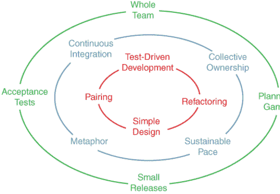

**图 1.1** 生命之环：XP 的实践

中央的四项是 XP 的工程实践：测试驱动开发（TDD）、重构、简单设计以及结对（我们将称之为*协作编程*）。最左侧的实践——验收测试——是 XP 业务实践中最具技术性、最侧重工程的一项。这五项实践属于软件工艺的基础纪律。

#### 测试驱动开发

TDD 是关键纪律。没有它，其他纪律要么不可能，要么形同虚设。因此，接下来描述 TDD 的两节几乎占本书一半的篇幅，而且技术性极强。这种安排可能显得不平衡。确实，我也有同感，并且曾为如何处理而纠结。然而，我的结论是：这种不平衡是对我们行业中相应不平衡的回应。精通这项纪律的程序员实在太少。

TDD 是规范程序员以秒为单位工作的纪律。它既不是前期纪律，也不是事后纪律。TDD 贯穿过程，直面眼前。不存在部分实施 TDD 的方式；它是一项全有或全无的纪律。

TDD 纪律的本质非常简单。小周期，测试先行。一切事情都测试先行。先编写测试，先清理测试。在所有活动中，测试都放在第一位。而且所有活动都被分解成最微小的周期。

周期时间以秒而非分钟来衡量，以字符而非行来衡量。反馈回路几乎可以说刚一打开就被闭合。

TDD 的目标是创建一套你可以性命相托的测试套件。如果测试套件通过，你就应当能够放心地部署代码。

在所有纪律中，TDD 最繁重，也最复杂。它繁重是因为它支配一切。它是你首先和最后想到的事情。它是厚厚地覆盖在你所做一切之上的约束。它是调速器，无论压力和环境压力如何，都能保持节奏稳定。

TDD 复杂，是因为代码复杂。每一种代码形态或形式，都有相应的 TDD 形态或形式。TDD 复杂，是因为测试必须设计得既能贴合代码又不与代码耦合，必须覆盖几乎所有内容，同时仍能在几秒内执行。TDD 是一项精细而复杂的技能，极难掌握，但回报不可估量。

把这一类比延伸到编程：如果 TDD 是编程的量子力学，那么重构就是化学，简单设计就是微生物学。继续这个类比，SOLID 原则、面向对象设计和函数式编程是生理学，而架构是编程的生态学。

没有重构，简单设计几乎不可能实现。事实上，简单设计是重构的终极目标，而重构是实现该目标的唯一实用手段。这个目标就是产出简单的原子化设计颗粒，使它们能够很好地融入程序、系统和应用的更大结构中。

简单设计并不是一项复杂的纪律。它由四条非常简单的规则驱动。然而，与 TDD 和重构不同，简单设计是一项不精确的纪律。它依赖判断力和经验。做得好时，它是区分“知道规则的学徒”和“理解原则的熟练工”的第一个标志。它是迈克尔·费瑟斯所称的*设计意识*的开端。

#### 协作编程

协作编程是在软件团队中协同工作的纪律与艺术。它包括结对编程、群体编程、代码审查和头脑风暴等子纪律。协作编程涉及团队中的每个人，无论是不是程序员。它是我们分享知识、确保一致性，并将团队凝聚成一个有效运作整体的主要手段。

在所有纪律中，协作编程的技术性最弱，规定性也最少。然而，它可能是五项纪律中最重要的，因为建设一支高效的团队既稀有又珍贵。

#### 验收测试

验收测试是将软件开发团队与业务联系起来的纪律。业务目的就是对期望之物的规格说明

系统的行为。这些行为被编码到测试中。如果这些测试通过，系统就会按规格说明运行。

这些测试必须让业务代表能够读写。正是通过编写和阅读这些测试并看到它们通过，业务方才得以知道软件做什么，以及它是否做了业务需要它做的事。

他的产品需求如此旺盛，以至于他为了满足需求几乎把自己弄到破产。他采用了复式记账法，从而能够以先前无法企及的精细程度看清资金如何流入和流出他的企业。通过调整这些资金流，他避免了迫在眉睫的破产，并建立了一家至今仍存在的企业。

韦奇伍德并非个例。工业化推动了欧洲和美洲经济的巨大增长。为了管理这种增长带来的所有资金流，越来越多的公司采用了这一准则。

1795年，约翰·沃尔夫冈·冯·歌德在*威廉·迈斯特的学徒时代*中写下了以下内容。请仔细留意，因为我们很快就会回到这段引文。

> “拿开它，把它扔进火里！”维尔纳喊道。“这项发明根本不值得丝毫称赞：那件事已经够折磨我了，还让你招致你父亲的怒火。这些诗句也许很美，但其中的含义从根本上说是虚假的。我仍记得你人格化的‘商业’；她是个干瘪、可怜兮兮的女先知。我猜你是从某家寒酸的小贩铺子里捡来她的形象。那时你对贸易毫无真正的概念；而我想不出还有谁的精神，比一个真正商人的精神更开阔，或更需要如此开阔。看到他的生意中处处井然有序，那是多么了不起的事！借此，他随时都能纵览全局，而不必陷入细节的困扰。他从复式记账体系中获得了多少优势啊！它是人类心智最杰出的发明之一；每一位审慎的一家之主都应把它引入自己的家政管理。”

如今，复式记账法在几乎世界上每个国家都具有法律效力。在很大程度上，这一准则*定义*了会计职业。

但让我们回到歌德的引文。请注意歌德用来描述他如此厌恶的“商业”手段的那些话：

> 她是个干瘪、可怜兮兮的女先知。我猜你是从某家寒酸的小贩铺子里捡来她的形象。

你见过符合这种描述的代码吗？我相信你见过。我也见过。事实上，如果你像我一样，那么你见过太多太多这样的代码。如果你像我一样，那么你也写过太多太多这样的代码。

现在，最后再看一眼歌德的话：

> 看到他的生意中处处井然有序，那是多么了不起的事！借此，他随时都能纵览全局，而不必陷入细节的困扰。

## 软件

维护正确的账目对于经营现代企业至关重要，而复式记账的准则对于维护正确的账目至关重要。但是，恰当地维护软件对于企业经营难道就没那么重要吗？绝非如此！在二十一世纪，软件是每家企业的心脏。

那么，软件开发者可以采用什么准则，获得复式记账赋予会计和管理者的那种对软件的控制力和洞察力？也许你认为软件和会计是差异极大的概念，二者无需对应，甚至不可能对应。我不同意。

试想，会计在某种程度上是一门法师的技艺。我们这些不熟悉其仪式与奥秘的人，对会计这一职业的深度知之甚少。那么，这一职业的工作产物是什么？是一组文件，其组织方式复杂，对外行人而言令人困惑。这些文件上散布着一组符号，除会计自己之外，很少有人能真正理解。然而，哪怕其中一个符号出错，也可能导致可怕的后果。企业可能倒闭，高管可能入狱。

现在想想会计与软件开发有多么相似。软件确实是一门法师的技艺。不熟悉软件开发仪式与奥秘的人，根本不知道表层之下发生了什么。那么产物呢？同样是一组文件：源代码——以极其复杂而令人困惑的方式组织起来的文件，散布着只有程序员自己才能参透的符号。而哪怕其中一个符号出错，也可能招致可怕的后果。

这两个职业极其相似。它们都致力于对错综复杂的细节进行严密而一丝不苟的管理。二者都需要大量训练和经验才能做好。二者都从事复杂文档的生产，而这些文档在单个符号层面上的准确性至关重要。

会计和程序员也许不愿承认，但他们是同一类人。较年轻的职业应当好好遵循较古老职业的准则。

正如你将在下文看到的，TDD *就是*复式记账。它是同一种准则，为相同目的而执行，并交付相同结果。每件事都要说两遍，记入互补账户；这些账户必须通过让测试保持通过来保持平衡。

#### TDD 三定律

在进入三定律之前，我们还有一些预备内容要讲。

TDD 的精髓要求遵循以下准则：

- 1. 创建一套支持重构、并且可信到“通过即意味着可部署”的测试套件。也就是说，如果测试套件通过，系统就可以部署。
- 2. 编写生产代码，使其解耦程度足以可测试、可重构。
- 3. 建立极短周期的反馈回路，以稳定的节奏和生产力维持编写程序这项工作。
- 4. 创建彼此充分解耦的测试与生产代码，以便两者都便于维护，且不会因需要在两者之间复制变更而受阻。

TDD 的准则体现在三条完全人为设定的定律中。这些定律是人为设定的，其证明在于：其精髓可以通过非常不同的方式实现。尤其是肯特·贝克（Kent Beck）的“测试 && 提交 || 回滚”（test && commit || revert，TCR）准则。尽管 TCR 与 TDD 完全不同，但它恰恰实现了相同的基本目标。

TDD 三定律是该准则的根本基础。遵循它们非常困难，尤其是在一开始。遵循它们还需要一些难以获得的技能和知识。如果你试图遵循这些定律

- 你再写一两行生产代码，使测试能够编译。
- 你再写一两行测试代码，使其能够编译但断言失败。
- 你再写一两行生产代码，使断言通过。

而从今以后，这就是你的生活。

再说一次，有经验的程序员很可能会认为这很荒谬。这三条定律把你锁进一个只有几秒钟长的循环。每绕这个循环一圈，你都在测试代码和生产代码之间切换。你将永远无法直接写一个 `if` 语句或 `while` 循环。你将永远无法直接写一个函数。你将永远被困在这个在测试代码与生产代码之间切换上下文的微小循环中。

你可能认为这会繁琐、无聊且缓慢。你可能认为它会阻碍你的进展，打断你的思路。你甚至可能认为这简直愚蠢。你可能认为这种方法会导致你产出意大利面条式代码，或几乎没有设计的代码——测试与让这些测试通过的代码的随意拼凑。

先保留所有这些想法，再考虑下面的内容。

#### *失去调试功夫*

我想让你想象一个房间，里面满是遵循这三条定律的人——一支正致力于部署一个大型系统的开发者团队。任选你喜欢的任何一名程序员，任选你喜欢的任何时刻。那名程序员正在处理的一切，都在过去一分钟左右执行过并通过了所有测试。而且这始终成立。你选谁都不重要，什么时候选也不重要。一分钟左右之前，一切都还能正常工作。

如果一分钟左右之前一切都还能正常工作，你的生活会是怎样？你觉得你还需要做多少调试？事实是，如果一分钟左右之前一切还能正常工作，那就不太可能有多少东西需要调试。


你擅长使用调试器吗？你的手指里有调试神通吗？所有快捷键都已就位、随时可用吗？高效地设置断点和监视点，并一头扎进深度调试会话，对你来说是否已是第二天性？

*这可不是值得追求的技能！*

你不会想擅长调试器。变得擅长调试器的唯一方法就是花大量时间调试。而我不想让你花大量时间调试。你也不应该想要那样。我希望你尽可能多花时间编写能正常工作的代码，尽可能少花时间修复不能正常工作的代码。

我希望你使用调试器的频率低到忘记快捷键，手指里也失去调试神通。我希望你对那些晦涩的“单步进入”和“单步跳过”图标感到困惑。我希望你对调试器如此生疏，以至于调试器用起来别扭又缓慢。而你也应该希望如此。你对调试器越感到自在，就越说明你在做错事。

现在，我不能向你保证这三条法则会消除对调试器的需求。你仍然需要时不时调试。这仍然是软件，仍然很难。但你调试会话的频率和持续时间将大幅下降。你会花更多时间编写能正常工作的代码，花更少时间修复不能正常工作的代码。

## 文档

如果你曾经集成过第三方包，你就会知道，收到的软件包中附带一份由技术文档工程师编写的 PDF。这份文档声称描述了如何集成该第三方包。在这份文档末尾，几乎总有一个难看的附录，其中包含集成该包的所有*代码示例*。

当然，那个附录是你最先查看的地方。你不想读技术文档工程师*关于*代码写了什么；你想读代码本身。而代码告诉你的信息，会远远多于技术文档工程师写的文字。如果运气好，你甚至可以用复制/粘贴把代码移到你的应用程序中，再摆弄到能运行。

这没多大乐趣，对吧？

之所以没乐趣，是因为等到我们开始写事后测试时，我们已经知道系统能工作了。我们已经手动测试过了。我们写这些测试只是出于某种义务感或负罪感，或者也许是因为管理层要求某种程度的测试覆盖率。于是，我们不情愿地埋头苦干，写一个又一个测试，心里清楚我们写的每个测试都会通过。无聊，无聊，无聊。

不可避免地，我们会遇到难以编写的测试。它难以编写，是因为我们没有把代码设计成可测试的；我们当时关注的只是让它工作。现在，为了测试代码，我们不得不修改设计。

但那很痛苦。那会花很多时间。那可能会破坏别的东西。而且我们已经知道代码能工作，因为我们手动测试过了。结果，我们放弃那个测试，在测试套件中留下一个洞。别告诉我你从没这么干过。你知道你干过。

你也知道，如果你在测试套件中留下了一个洞，团队里的其他人也一样，所以你知道测试套件满是漏洞。

测试套件中漏洞的数量，可以通过测量程序员在测试套件通过时的笑声音量和持续时间来判断。如果程序员笑得很厉害，那么测试套件里就有很多漏洞。

一个在通过时引发笑声的测试套件，并不是特别有用的测试套件。它或许能告诉你某些东西什么时候坏了，但当它通过时，你无法据此做出任何决定。当它通过时，你所知道的一切只是某些东西能工作。

好的测试套件没有漏洞。好的测试套件让你在它通过时能够做出决定。那个决定就是*部署*。

如果测试套件通过，你应当有信心建议部署系统。如果你的测试套件不能激发这种程度的信心，那它有什么用呢？

## 乐趣

当你遵循这三条法则时，会发生非常不同的事情。首先，它很有趣。再说一次，我不想过度吹嘘。TDD 并不像在拉斯维加斯中头奖那么有趣。它也不像去参加派对，甚至不像和你四岁的孩子玩“滑梯与梯子”那么有趣。的确，*乐趣*可能不是最完美的用词。

你还记得你让第一个程序运行起来的时候吗？还记得那种感觉吗？也许是在一家本地百货商店里，那里有一台 TRS-80 或 Commodore 64。也许你写了一个傻乎乎的小小无限循环，把你的名字永远永远地打印在屏幕上。也许你带着一丝微笑离开那块屏幕，知道自己就是宇宙的主宰，所有计算机都将永远向你俯首。

每次你走一遍 TDD 循环，都会得到那种感觉的一丝微弱回响。每个测试都如你所料地失败时，你都会微微点头微笑。每次你写出让那个失败测试通过的代码时，你都会想起自己曾经是宇宙的主宰，而且你仍然拥有*那种力量*。

每走一遍 TDD 循环，都会有一小剂内啡肽释放到你的爬虫脑里，让你感觉自己更有能力、更有信心，准备好迎接下一个挑战。虽然那种感觉很小，但它仍然挺有趣。

## 设计

但先别管乐趣。当你先写测试时，会发生重要得多的事情。事实证明，如果你先写测试，你就无法写出难以测试的代码。先写测试这一行为迫使你把代码设计成易于测试。这一点无法逃避。如果你遵循这三条法则，你的代码就会易于测试。

是什么让代码难以测试？耦合和依赖。易于测试的代码没有那些耦合和依赖。易于测试的代码是解耦的！

遵循这三条法则会迫使你编写解耦的代码。再说一次，这一点无法逃避。如果你先写测试，那么通过这些测试的代码将以你从未想象过的方式解耦。

而这是非常好的事情。

#### 锦上添花

事实证明，应用 TDD 三条法则会带来以下一组好处：

- 你会花更多时间编写能工作的代码，花更少时间调试不能工作的代码。
- 你会产出一套近乎完美的低层文档。
- 它很有趣——或者至少能给人动力。
- 你会产出一套测试，让你有信心部署。
- 你会创建耦合更少的设计。

这些理由可能会让你相信 TDD 是件好事。它们也许足以让你忽略最初的反应，甚至反感。也许吧。

但 TDD 纪律之所以重要，还有一个远比这些更重要的原因。

#### 恐惧

编程很难。它可能是人类试图掌握的最困难的事情。我们的文明如今依赖于数十万个相互连接的软件应用程序，每一个都涉及数十万甚至数千万行代码。人类建造的其他装置都没有这么多活动部件。

这些应用程序中的每一个，都由害怕变更怕得要死的开发团队支持。这很讽刺，因为软件存在的全部理由，就是让我们能轻松改变机器的行为。

但软件开发人员知道，每一次变更都会带来破坏的风险，而破坏可能极难检测和修复。

想象你正看着屏幕，看到那里有一些糟糕、纠缠不清的代码。你大概不需要费多大劲就能想象出这个画面，因为对我们大多数人来说，这是日常经历。

现在假设，当你瞥一眼那段代码时，有那么非常短暂的一刻，你想到应该把它稍微清理一下。但你紧接着的念头就像托尔之锤一样砸下来：“我绝不碰它！”因为你知道，如果你碰它，你就会弄坏它；如果你弄坏它，它就会*永远归你*。

这是一种恐惧反应。你害怕你维护的代码。你害怕弄坏它的后果。

这种恐惧的结果是，代码必然会腐烂。没人会清理它。没人会改进它。当被迫做出变更时，这些变更会以对程序员最安全的方式做出，而不是对系统最有利的方式。设计会退化，代码会腐烂，团队的生产力会下降，而且这种下降会一直持续到生产力接近零。

问问自己，你是否曾经因为系统中的糟糕代码而显著变慢。当然有过。现在你知道那些糟糕代码为什么存在了。它存在，是因为没有人有勇气去做那件可能改进它的事。没有人敢冒险清理它。

#### 勇气

但如果你有一套测试，你如此信任它，以至于每次这套测试通过时，你都有信心建议部署，那会怎样？如果这套测试能在几秒钟内执行完，又会怎样？那么，你还会多害怕对系统进行一次温和的清理呢？

再想象一下你屏幕上的那段代码。想象那个一闪而过的念头：你或许可以稍微清理它一下。什么会阻止你？你有测试。那些测试会在你弄坏东西的瞬间告诉你。

有了那套测试，你可以安全地清理代码。有了那套测试，你可以*安全地*清理代码。*有了那套测试，你可以安全地清理代码。*

不，那不是笔误。我想把这一点非常、非常用力地讲清楚。有了那套测试，你可以安全地清理代码！

而如果你能安全地清理代码，你就*会*清理代码。团队里的其他人也会。因为没人喜欢一团糟。


人类不擅长同时做两件事。如果我们专注于编写一个失败的测试，它不太可能是一个编写良好的测试。如果我们专注于编写通过测试的生产代码，它不太可能是良好的生产代码。如果我们专注于我们想要的行为，我们就不会专注于我们想要的结构。

不要自欺欺人。你无法同时做到两者。让代码按你希望的方式运行已经够难了。要让它既表现出正确行为*又*具有正确的结构，那就太难了。因此，我们遵循肯特·贝克的建议：

> *先让它工作。再让它正确。*

因此，我们为 TDD 三法则增加一条新法则：重构法则。首先编写少量失败的测试代码。然后编写少量通过测试的生产代码。然后清理你刚刚造成的混乱。

红绿灯有了一个新颜色：红 → 绿 → 重构（[图 2.1](#figure-2-1)）。

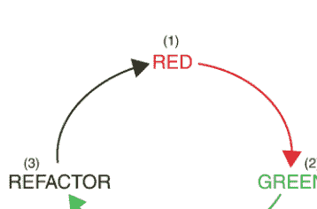

**图 2.1** 红 → 绿 → 重构

你可能听说过重构，正如我之前所说，接下来的章节我们会花大量时间讨论它。现在，让我澄清一些迷思和误解：

- 重构是一项持续的活动。每次经历 TDD 循环时，你都会清理东西。
- 重构不改变行为。你只在测试通过时重构，并且在你重构时测试会继续通过。
- 重构*从不*出现在日程表或计划中。你不为重构预留时间。你不请求重构许可。你只是*一直*在重构。

把重构想象成上完洗手间后洗手。这只是出于基本礼貌你总会做的事。

## 基础

在文本中创建有效的 TDD 示例非常困难。TDD 的节奏无法很好地传达出来。在接下来的页面中，我尝试用适当的时间戳和标注来传达这种节奏。但要真正理解这种节奏的真实频率，你只能亲眼看到它。

因此，接下来的每个示例都有一个对应的在线视频，可以帮助你亲眼看到这种节奏。请完整观看每个视频，然后务必回到文本，阅读带有时间戳的解释。如果你无法访问视频，那么请特别注意示例中的时间戳，以便推断节奏。

## 简单示例

当你回顾这些示例时，你很可能会因为它们都是小而简单的问题而轻视它们。你可能会得出结论：TDD 对于这样的“玩具示例”可能有效，但不可能适用于复杂系统。这将是一个严重的错误。

任何优秀软件设计师的首要目标都是将大型复杂系统分解为一组小而简单的问题。程序员的工作就是将这些系统分解为一行行代码。

因此，接下来的示例绝对能代表 TDD，*无论项目规模大小。*

这是我个人可以肯定的。我参与过用 TDD 构建的大型系统，我可以根据经验告诉你，TDD 的节奏和技术与范围无关。规模并不重要。

或者更准确地说，规模对流程和节奏并不重要。然而，规模对测试的速度和耦合有深远影响。但那些是高级章节的主题。

## 栈

观看相关视频：栈

在 [informit.com/register](https://informit.com/register) 注册以访问视频

我们从一个非常简单的问题开始：创建一个整数栈。当我们逐步解决这个问题时，请注意测试将回答你关于栈行为的任何问题。这是测试文档价值的一个例子。还要注意，我们似乎通过填入绝对值让测试通过来作弊。这是 TDD 中一种常见策略，并且具有非常重要的功能。我会在后续过程中描述这一点。

我们开始：

```java
// T: 00:00 StackTest.java
package stack;

import org.junit.Test;

public class StackTest {
    @Test
    public void nothing() throws Exception {
    }
}
```

```java
public class MyStack {
}
```

十秒钟过去了，测试编译并通过。当我最初编写这个示例时，那 10 秒的大部分时间都花在重新排列屏幕上，以便我能同时看到两个文件。我的屏幕现在看起来像图 2.2。测试在左边，生产代码在右边。这是我典型的布局。拥有大屏幕空间真好。

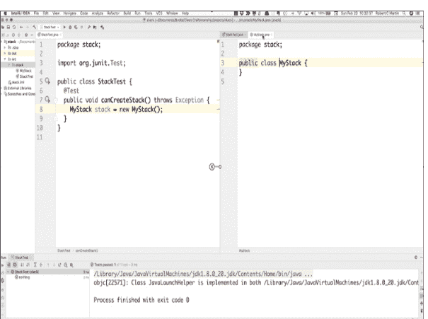

**图 2.2 重新排列后的屏幕**

MyStack 不是一个好名字，但它避免了命名冲突。既然 MyStack 已经在 stack 包中声明，让我们把它改回 Stack。这花了 15 秒。测试仍然通过。

```java
// T: 01:09 StackTest.java
public class StackTest {
    @Test
    public void canCreateStack() throws Exception {
        Stack stack = new Stack();
    }
}
```

```java
// T: 01:09 Stack.java
package stack;

public class Stack {
}
```

这里我们看到另一条规则：红 → 绿 → 重构。永远不要错过清理东西的机会。

> *规则 2：让它失败。让它通过。清理它。*

编写能工作的代码已经够难了。编写既能工作又整洁的代码更难。幸运的是，我们可以把这项努力分成两步。我们可以先编写能工作的糟糕代码。然后，如果我们有测试，就可以在保持其工作的同时轻松清理糟糕的代码。

因此，每次绕 TDD 循环一圈，我们都会抓住机会清理可能造成的任何小混乱。

你可能已经注意到，我们的测试实际上并没有断言任何行为。它编译并通过，但对新创建的栈没有断言任何东西。我们可以在 15 秒内解决这个问题：

```java
// T: 01:24 StackTest.java
public class StackTest {
    @Test
    public void canCreateStack() throws Exception {
        Stack stack = new Stack();
        assertTrue(stack.isEmpty());
    }
}
```

第二法则在这里起作用，所以我们最好让这段代码编译通过：

```java
// T: 01:49
import static junit.framework.TestCase.assertTrue;

public class StackTest {
    @Test
    public void canCreateStack() throws Exception {
        Stack stack = new Stack();
        assertTrue(stack.isEmpty());
    }
}
```

```java
// T: 01:49 Stack.java
public class Stack {
    public boolean isEmpty() {
        return false;
    }
}
```

二十五秒后，它编译通过但 `fails`。这个失败是有意的：`isEmpty` 被特意编码为返回 `false`，因为第一法则说测试必须失败——但为什么第一法则要求这样？因为现在我们可以看到，我们的测试在它应该失败时失败了。我们已经测试了我们的测试。或者更准确地说，我们测试了它的一半。我们可以通过将 `isEmpty` 改为 `return true` 来测试另一半：

```java
// T: 01:58 Stack.java
public class Stack {
    public boolean isEmpty() {
        return true;
    }
}
```

九秒后，测试 `passes`。只用了 `9 seconds` 就确保测试既通过又失败。

当程序员第一次看到 `false` 然后是 `true` 时，他们常常会笑，因为这看起来太愚蠢了。它看起来像作弊。但这不是作弊，也一点也不愚蠢。仅仅几秒钟就确保测试按预期既通过又失败。我们究竟为什么会 `not` 这样做呢？

下一个测试是什么？嗯，我们知道需要编写 `push` 函数。因此，根据规则 1，我们编写强制我们编写 `push` 函数的测试：

好吧，那真是太愚蠢了。但程序员时不时会犯一些低级错误，我也不例外。我第一次写这个示例时并没有立刻发现这个错误，因为测试 `failed` 的方式正好符合我的预期。

所以，现在，在确信我们的测试是好的这一假设下，让我们做出那些我们认为会让这些测试通过的修改：

点击此处查看代码图像

```java
// T: 08:56
public class Stack {
    private boolean empty = true;
    private int size = 0;

    public boolean isEmpty() {
        return size == 0;
    }

    public void push(int element) {
        size++;
    }

    public int pop() {
        --size;
        return -1;
    }

    public int getSize() {
        return size;
    }
}
```

看到这个 `fail` 时我很惊讶。但镇定下来后，我很快发现了自己的错误并修复了测试。让我们这样做：

点击此处查看代码图像

```java
// T: 09:28 StackTest.java
@Test
public void afterOnePushAndOnePop_isEmpty() throws Exception {
    stack.push(0);
    stack.pop();
    assertTrue(stack.isEmpty());
    assertEquals(0, stack.getSize());
}
```

然后测试全部通过。距离测试上一次通过已经过去了3分22秒。

为了完整起见，让我们把大小检查加到另一个测试中：

[点击此处查看代码图像](#)

```java
// T: 09:51 StackTest.java
@Test
public void afterOnePush_isNotEmpty() throws Exception {
    stack.push(0);
    assertFalse(stack.isEmpty());
    assertEquals(1, stack.getSize());
}
```

当然，这个测试通过了。

回到第一法则。如果我们从空栈中弹出元素，应该发生什么？我们应该预期一个下溢异常：

[点击此处查看代码图像](#)

```java
// T: 10:27 StackTest.java
@Test(expected = Stack.Underflow.class)
public void poppingEmptyStack_throwsUnderflow() {
}
```

第二法则迫使我们添加那个异常：

[点击此处查看代码图像](#)

```java
// T: 10:36 Stack.java
public class Underflow extends RuntimeException {
}
```

然后我们可以补全测试：

[点击此处查看代码图像](#)

```java
// T: 10:50 StackTest.java
@Test(expected = Stack.Underflow.class)
public void poppingEmptyStack_throwsUnderflow() {
    stack.pop();
}
```

当然，这个测试失败了，但让它通过很容易：

```java
// T: 11:18 Stack.java
public int pop() {
    if (size == 0)
        throw new Underflow();
    --size;
    return -1;
}
```

这个通过了。距离测试上一次通过已经过去了1分27秒。

回到第一法则。栈应该记住被压入的内容。让我们试试最简单的情况：

点击此处查看代码图像

```java
// T: 11:49 StackTest.java

@Test
public void afterPushingX_willPopX() throws Exception {
  stack.push(99);
  assertEquals(99, stack.pop());
}
```

这个测试失败，因为 pop 当前返回 -1。我们通过返回 99 让它通过：

```java
// T: 11:57 Stack.java
public int pop() {
    if (size == 0)
        throw new Underflow();
    --size;
    return 99;
}
```

这显然还不够，所以根据规则1，我们向测试中添加足够多的内容，迫使我们变得稍微聪明一点：

点击此处查看代码图像

```java
// T: 12:18 StackTest.java
@Test
public void afterPushingX_willPopX() throws Exception {
  stack.push(99);
  assertEquals(99, stack.pop());
  stack.push(88);
  assertEquals(88, stack.pop());
}
```

这个测试失败，因为我们返回的是 99。我们通过添加一个字段来记录最后一次压入的值，让它通过：

[点击此处查看代码图像](#)

```java
// T: 12:50 Stack.java
public class Stack {
  private int size = 0;
  private int element;

  public void push(int element) {
    size++;
    this.element = element;
  }

  public int pop() {
    if (size == 0)
      throw new Underflow();
    --size;
    return element;
  }
}
```

这个通过了。距离测试上一次通过已经过去了92秒。

此时，你可能对我相当沮丧。你甚至可能对着这些书页大喊，要求我别再瞎折腾，直接写出那个该死的栈。但事实上，我一直在遵循规则3。

> 规则3：不要直奔黄金目标。

当你刚开始TDD时，先处理困难或有趣的事情的诱惑是压倒性的。一个写栈的人会忍不住先测试后进先出（FILO）行为。这被称为“直奔黄金目标”。到现在为止，你已经注意到我故意避免测试任何像栈的东西。我一直关注栈外围的所有辅助性内容，比如空状态和大小。

为什么我一直没有直奔黄金目标？为什么会有规则3？因为当你过早地直奔黄金目标时，你往往会漏掉外围的所有细节。而且，你很快就会看到，你往往会错过那些辅助性细节所提供的简化机会。

不管怎样，第一法则刚刚起作用了。我们需要写一个失败的测试。而最明显要写的测试是FILO行为：

[点击此处查看代码图像](#)

```java
// T: 13:36 StackTest.java
@Test
public void afterPushingXandY_willPopYthenX() {
    stack.push(99);
    stack.push(88);
    assertEquals(88, stack.pop());
    assertEquals(99, stack.pop());
}
```

这个测试失败了。让它通过将要求我们记住不止一个值，所以我们可能应该使用数组。让我们把字段重命名为 elements，并把它变成一个数组：

[点击此处查看代码图像](#)

```java
// T: 13:51 Stack.java
public class Stack {
    private int size = 0;
    private int[] elements = new int[2];

    public void push(int element) {
        size++;
        this.elements = element;
    }

    public int pop() {
        if (size == 0)
            throw new Underflow();
        --size;
        return elements;
    }
}
```

啊，但是有编译错误。让我们逐个处理它们。`push` 中的 `elements` 变量需要方括号：

点击此处查看代码图像

```java
// T: 14:01 Stack.java
public void push(int element) {
    size++;
    this.elements[] = element;
}
```

我们需要往那些方括号里放点东西。嗯。还有前面代码片段里的那个 `size++`：

点击此处查看代码图像

```java
// T: 14:07 Stack.java
public void push(int element) {
    this.elements[size++] = element;
}
```

`pop` 中也有 `elements` 变量。它需要方括号：

```java
// T: 14:13
public int pop() {
    if (size == 0)
        throw new Underflow();
    --size;
    return elements[];
}
```

哦看！还有那个好用的 `--size`，我们可以把它放进去：

```java
// T: 14:24
public int pop() {
    if (size == 0)
        throw new Underflow();
    return elements[--size];
}
```

现在测试又通过了。距离测试上一次通过已经过去了94秒。

我们完成了。哦，我们还可以做更多。这个栈只保存两个元素，也不处理溢出，但已经没有剩下的事情需要我

我坐在厨房桌边，惊叹于一个简单的一字符改动——用一个变量替换一个常量，一个简单的泛化——就让新测试通过了，并且让之前所有测试都保持通过。

我本想说我们势头正盛，但下一个测试会令人失望。测试本身很明显：

点击此处查看代码图像

```java
assertThat(factorsOf(4), contains(2, 2));
```

但我们如何通过泛化来解决它呢？我想不出办法。我能想到的唯一解决方案是测试 `n` 是否能被 2 整除，而这并不很通用。尽管如此，

点击此处查看代码图像

```java
private List<Integer> factorsOf(int n) {
  ArrayList<Integer> factors = new ArrayList<>();
  if (n>1) {
    if (n%2 == 0) {
      factors.add(2);
      n /= 2;
    }
    factors.add(n);
  }
  return factors;
}
```

这不仅不太通用；它还使之前的一个测试失败。它使针对 2 的质因数的测试失败。原因应该很清楚。当我们把 `n` 除以 2 来减少它时，它变成 1，然后 1 会被放进列表。

我们可以用一些更不通用的代码来修复它：

点击此处查看代码图像

```java
private List<Integer> factorsOf(int n) {
  ArrayList<Integer> factors = new ArrayList<>();
  if (n > 1) {
    if (n % 2 == 0) {
      factors.add(2);
      n /= 2;
    }
    if (n > 1)
```


```java
        factors.add(n);
    }
    return factors;
}
```

在这一点上，你完全有理由指责我只是随手塞了几个 `if` 语句来让测试通过。这离事实并不远。你也可能指责我违反了规则 5，因为这段时间的代码谈不上什么通用性。但另一方面，我确实看不到其他的选择。

不过，这其中有通用化即将到来的蛛丝马迹。请注意，这两个 `if` 语句的谓词完全相同。它们几乎就像是某个被展开的循环的一部分。事实上，第二个 `if` 语句完全没理由非得放在第一个 `if` 里面。

点击此处查看代码图片

```java
private List<Integer> factorsOf(int n) {
    ArrayList<Integer> factors = new ArrayList<>();
    if (n > 1) {
        if (n % 2 == 0) {
            factors.add(2);
            n /= 2;
        }
    }
    if (n > 1)
        factors.add(n);
    return factors;
}
```

这段代码能通过测试，而且看起来*非常*像是被展开的循环。

接下来的三个测试无需任何修改即可通过：

点击此处查看代码图片

```java
assertThat(factorsOf(5), contains(5));
assertThat(factorsOf(6), contains(2, 3));
assertThat(factorsOf(7), contains(7));
```

这很好地表明我们走在了正确的方向上，也让我对那些丑陋的 `if` 语句感觉好了不少。

下一个最退化的测试是 8，它必然会失败，因为我们的解决方案代码根本不可能把三个数字放进列表里：

```java
n /= 3;
}
}
if (n > 1)
    factors.add(n);
return factors;
}
```

但这太可怕了。它不仅严重违反了规则 5，而且造成了大量的代码重复。我甚至不确定哪种违规更糟糕！

而正是在这里，通用化的咒语开始发挥作用：

> 随着测试变得越来越具体，代码变得越来越通用。

我们写的每一个新测试都让测试套件变得更具体。每当我们调用规则 5，解决方案代码就变得更通用。我们稍后会回到这条咒语。事实证明，它对测试设计以及防止脆弱测试至关重要。

我们可以通过把原始的因式分解代码放进一个循环中来消除重复和规则 5 的违反：

点击此处查看代码图片

```java
private List<Integer> factorsOf(int n) {
    ArrayList<Integer> factors = new ArrayList<>();
    int divisor = 2;
    while (n > 1) {
        while (n % divisor == 0) {
            factors.add(divisor);
            n /= divisor;
        }
        divisor++;
    }
    if (n > 1)
        factors.add(n);
    return factors;
}
```

再说一次，如果你看了视频，你会发现这一步是通过好几个步骤完成的。第一步是把三个 2 提取到 `divisor` 变量中。下一步是引入 `divisor++` 语句。然后把 `divisor` 变量的初始化移到 `if` 语句之上。最后，把 `if` 改成了 `while`。

这种从 `if` 到 `while` 的转变又出现了。你注意到原 `if` 语句的谓词恰好变成了外层 `while` 循环的谓词吗？我觉得这非常令人吃惊。这里面似乎有某种遗传性的东西。就好像我一直试图创造的那个生物，是从一颗简单的种子开始，通过一系列微小的突变逐渐进化而来的。

注意，底部的 `if` 语句已经变得多余了。循环唯一能终止的方式就是 n 等于 1。那个 `if` 语句实际上就是一个被展开的循环的终止条件！

点击此处查看代码图片

```java
private List<Integer> factorsOf(int n) {
    ArrayList<Integer> factors = new ArrayList<>();
    int divisor = 2;
    while (n > 1) {
        while (n % divisor == 0) {
            factors.add(divisor);
            n /= divisor;
        }
        divisor++;
    }
    return factors;
}
```

只需要一点点重构，我们就得到这样的代码：

点击此处查看代码图片

```java
private List<Integer> factorsOf(int n) {
    ArrayList<Integer> factors = new ArrayList<>();

    for (int divisor = 2; n > 1; divisor++)
        for (; n % divisor == 0; n /= divisor)
            factors.add(divisor);

    return factors;
}
```

推导那些能够解决*可以*解决的问题的算法的一般过程。

- 3. 这就是希尔伯特的“判定问题”。他问的是，是否存在一种通用的方法，能够证明任何给定的丢番图方程都是可解的。丢番图方程是一种输入和输出都是整数的数学函数。计算机程序也是一种输入和输出都是整数的数学函数。因此，希尔伯特的问题可以被描述为与计算机程序相关的问题。

## 保龄球游戏

1999 年，鲍勃·科斯和我在一次 C++ 会议上相遇。我们有一些空闲时间，于是决定练习一下 TDD 这个新想法。我们选择了计算保龄球比赛得分这个简单问题。

一场保龄球比赛由十轮组成。在每一轮中，球员有两次机会将球滚向十个木瓶，试图将它们击倒。一个球击倒的木瓶数就是该球的得分。如果第一个球就击倒了全部十个木瓶，这被称为*全中*。如果击倒全部十个木瓶需要用两个球，则被称为*补中*。可怕的滚沟球（图 2.3）则一分不得。

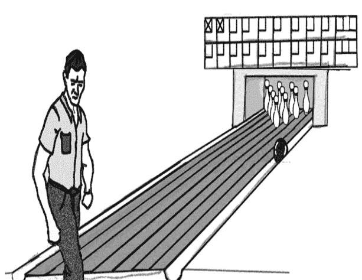

**图 2.3** 臭名昭著的滚沟球

计分规则可以简洁地表述如下：

- 如果一轮是全中，得分为 10 分加上接下来两次投球的得分。
- 如果一轮是补中，得分为 10 分加上下一次投球的得分。
- 否则，得分为这一轮两次投球的得分之和。

图 2.4 中的计分表是一场典型（如果说有点古怪的话）的比赛。

| 轮次 | 第一次投球 | 第二次投球 | 第三次投球 | 累计得分 |
|---|---|---|---|---|
| 1 | 1 | 4 | — | 5 |
| 2 | 4 | 5 | — | 14 |
| 3 | 6 | / | — | 29 |
| 4 | 5 | / | — | 49 |
| 5 | X | — | — | 60 |
| 6 | 0 | 1 | — | 61 |
| 7 | 7 | / | — | 77 |
| 8 | 6 | / | — | 97 |
| 9 | X | — | — | 117 |
| 10 | 2 | / | 6 | 133 |

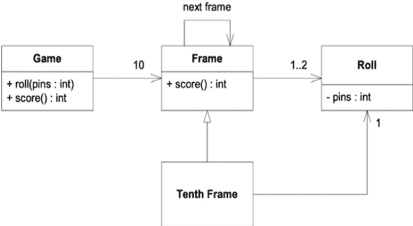

**图 2.5 保龄球计分的 UML 图**

`Game` 有十个 `Frame`。除 `TenthFrame` 子类外，每个 `Frame` 都有一到两次 `Roll`，而 `TenthFrame` 继承 `1..2` 并添加一次投球，使其变为 `2..3`。每个 `Frame` 对象都指向下一个 `Frame`，这样 `score` 函数就可以在需要计算补中或全中时向前查看。

`Game` 有两个函数。`roll` 函数在球员每次投球时被调用，并传入球员击倒的木瓶数。`score` 函数在所有球都投完后被调用，返回整场比赛的得分。

这是一个漂亮而简单的面向对象模型。编写代码应该相当容易。事实上，如果有一个四人团队，我们可以把工作分成四个类，然后大约一天后汇合，集成并让它们工作起来。

或者，我们也可以使用 TDD。如果你能观看视频，现在就应该去看。无论如何，请仔细阅读下面的文字。

观看相关视频：保龄球游戏

在 [informit.com/register](http://informit.com/register) 注册以访问视频

我们一如既往地从一个什么都不做的测试开始，只是为了证明我们能编译和运行。这个测试运行通过后，我们把它删掉：

点击此处查看代码图片

```java
public class BowlingTest {
  @Test
  public void nothing() throws Exception {
  }
}
```

接下来，我们断言可以创建 `Game` 类的实例：

点击此处查看代码图片

```java
@Test
public void canCreateGame() throws Exception {
  Game g = new Game();

}
```

然后我们通过让 IDE 创建缺失的类来使它编译并通过：

```java
public class Game {
}
```

接下来，我们看看能否投一个球：

点击此处查看代码图片

```java
@Test
public void canRoll() throws Exception {
  Game g = new Game();
  g.roll(0);
}
```

然后我们通过让 IDE 创建 `roll` 函数来使它编译并通过，并给参数起一个合理的名字：

点击此处查看代码图片

```java
public class Game {
  public void roll(int pins) {
  }
}
```


```java
}
```

你可能已经觉得无聊了。到现在为止，这些对你来说应该没什么新鲜的。但请耐心听我说——接下来会变得有趣。测试中已经有一点重复了。我们应该消除它，因此把游戏的创建抽取到 `setup` 函数中：

[点击此处查看代码图片](#)

```java
public class BowlingTest {
    private Game g;

    @Before
    public void setUp() throws Exception {
        g = new Game();
    }
}
```

这使得第一个测试完全为空，所以我们删除它。第二个测试也相当没用，因为它没有断言任何内容。我们也删除它。那些测试已经完成了它们的使命。它们是阶梯测试。

> *阶梯测试：* 有些测试写出来只是为了迫使我们创建将来需要的类、函数或其他结构。有时这些测试退化到不进行任何断言。另一些时候，它们断言一些非常幼稚的东西。通常，这些测试后来会被更全面的测试取代，并且可以安全删除。我们把这类测试称为阶梯测试，因为它们就像台阶，让我们能够逐步把复杂度提升到合适的水平。

接下来，我们想断言能够给一局比赛计分。但要做到这一点，我们需要投完一整局。记住，只有在游戏中所有球都投完之后，才能调用 `score` 函数。

我们退回到规则4，投出我们能想到的最简单、最退化的游戏：

[点击此处查看代码图片](#)

```java
@Test
public void gutterGame() throws Exception {
    for (int i = 0; i < 20; i++)
        g.roll(0);
    assertEquals(0, g.score());
}
```

```java
      }
    }
```

当然，这不是保龄球计分的正确算法。确实，很难看出这个算法如何能演变成保龄球计分规则。所以我心存疑虑——我预计接下来的测试会有风波。但就目前而言，我们必须重构。

测试中的重复可以通过提取一个名为 `rollMany` 的函数来消除。IDE 的 *提取方法* 重构对此帮助极大，甚至能检测并替换两处重复：

点击此处查看代码图片

```java
    public class BowlingTest {
      private Game g;


      @Before
      public void setUp() throws Exception {
        g = new Game();
      }


      private void rollMany(int n, int pins) {
        for (int i = 0; i < n; i++) {
          g.roll(pins);
        }
      }


      @Test
      public void gutterGame() throws Exception {
        rollMany(20, 0);
        assertEquals(0, g.score());
      }


      @Test
      public void allOnes() throws Exception {
        rollMany(20, 1);
        assertEquals(20, g.score());
      }
    }
```

好，下一个测试。此时很难想到什么退化的情况，所以我们不妨试试补中。不过我们会保持简单：一次补中，外加一个奖励球，其余全是洗沟球。

[点击此处查看代码图片](#)

```java
@Test
public void oneSpare() throws Exception {
    rollMany(2, 5); // spare
    g.roll(7);
    rollMany(17, 0);
    assertEquals(24, g.score());
}
```

我们来检查一下我的逻辑：这局比赛每格有两个球。前两个球构成补中。下一个球是补中之后的那个球，而17个洗沟球补完整局。

第一格的得分是17，也就是10加上下一格投出的7。因此，整局得分是24，因为那个7被计算了两次。请说服自己这是正确的。

当然，这个测试会失败。那么，我们怎样才能让它通过呢？看看代码：

[点击此处查看代码图片](#)

```java
public class Game {
    private int score;
    public void roll(int pins) {
        score += pins;
    }

    public int score() {
        return score;
    }
}
```

分数是在 `roll` 函数中计算的，所以我们需要修改该函数来处理补中。但这会迫使我们做一件非常丑陋的事，就像这样：

[点击此处查看代码图片](#)

```java
public void roll(int pins) {
    if (pins + lastPins == 10) { // horrors!
        // God knows what...
    }
    score += pins;
}
```

那个 `lastPins` 变量必须是 Game 类的一个字段，用来记住上一次投球是什么。如果上一次投球和这一次投球加起来等于10，那就是补中。对吧？呃！

你应该感觉到括约肌在收紧。你应该感觉到胃里翻腾，紧张性头痛开始出现。软件工匠的焦虑应该正在让你的血压升高。

*这完全错了！*

我们以前都有过那种感觉，不是吗？问题是，你对此怎么做？

每当你产生“有什么地方不对”的感觉时，相信它！那么，到底是什么地方不对呢？

存在一个设计缺陷。你可能会理所当然地纳闷：两行可执行代码里怎么会有设计缺陷？但设计缺陷就在那里；它很明显，而且极其有害。只要我告诉你它是什么，你就会认出来并同意我。你能找到它吗？

*《危险边缘》主题曲间奏。*

我在最开始就告诉过你设计缺陷是什么。这个类中的两个函数里，哪一个*从名字上看*声称要计算分数？当然是 score 函数。哪一个函数实际上在计算分数？`roll` 函数。这就是职责错位。

> ***职责错位：*** *一种设计缺陷，其中声称执行某项计算的函数实际上并不执行该计算。计算是在别处执行的。*

有多少次，你去找那个声称完成某项任务的函数，结果却发现那个函数并不做那项任务？而现在你根本不知道那项任务在系统中实际是在哪里完成的。为什么会发生这种事？

聪明的程序员。或者更确切地说，是那些*自认为*聪明的程序员。

```java
public int score() {
  int score = 0;
  int i = 0;
  for (int frame = 0; frame < 10; frame++) {
    score += rolls[i] + rolls[i + 1];
    i += 2;
  }
  return score;
}
```

再一次，这个实现通过了前两个测试，并因为和之前相同的原因在补中测试上失败。所以，行为没有改变。这是一次真正的重构。

你现在可能恨不得把这本书撕了，因为你知道每次循环数组取两个球根本就是错的。全中在其格中只有一个球，而第十格可能有三个球。

没错。然而，到目前为止，我们的测试都没有用到全中或第十格。所以，目前每格两个球是可行的。

现在我们能通过补中用例了吗？可以。这很简单：

[点击此处查看代码图片](#)

```java
public int score() {
  int score = 0;
  int i = 0;
  for (int frame = 0; frame < 10; frame++) {
    if (rolls[i] + rolls[i + 1] == 10) { // spare
      score += 10 + rolls[i + 2];
      i += 2;
    } else {
      score += rolls[i] + rolls[i + 1];
      i += 2;
    }
  }
  return score;
}
```

这通过了补中测试。不错。但代码相当丑陋。我们可以把 `i` 重命名为 `frameIndex`，并通过提取一个漂亮的小方法来去掉那个丑陋的注释：

[点击此处查看代码图片](#)

```java
public int score() {
    int score = 0;
    int frameIndex = 0;
    for (int frame = 0; frame < 10; frame++) {
        if (isSpare(frameIndex)) {
            score += 10 + rolls[frameIndex + 2];
            frameIndex += 2;
        } else {
            score += rolls[frameIndex] + rolls[frameIndex + 1];
            frameIndex += 2;
        }
    }
    return score;
}
```

```java
private boolean isSpare(int frameIndex) {
    return rolls[frameIndex] + rolls[frameIndex + 1] == 10;
}
```

这样好多了。我们也可以用同样的方式清理补中测试中那个丑陋的注释：

点击此处查看代码图片

```java
private void rollSpare() {
    rollMany(2, 5);
}
```

```java
@Test
public void oneSpare() throws Exception {
    rollSpare();
    g.roll(7);
    rollMany(17, 0);
    assertEquals(24, g.score());
}
```

像这样用令人愉快的小函数替换注释，几乎总是一个好主意。以后读你代码的人会感谢你。

那么，下一个测试是什么？我想我们应该试试全中：

点击此处查看代码图片


```java
@Test
public void oneStrike() throws Exception {
    g.roll(10); // strike
    g.roll(2);
    g.roll(3);
    rollMany(16, 0);
    assertEquals(20, g.score());
}
```

请说服自己这是正确的。这里有那次全中、2 个奖励球，以及 16 个落沟球来填满剩下的八局。第一局得分是 15，第二局是 5。其余都是 0，总分是 20。

当然，这个测试会失败。我们需要做什么才能让它通过？

[单击此处查看代码图像](#)

```java
public int score() {
    int score = 0;
    int frameIndex = 0;
    for (int frame = 0; frame < 10; frame++) {
        if (rolls[frameIndex] == 10) { // strike
            score += 10 + rolls[frameIndex+1] +
                     rolls[frameIndex+2];
            frameIndex++;
        }
        else if (isSpare(frameIndex)) {
            score += 10 + rolls[frameIndex + 2];
            frameIndex += 2;
        } else {
            score += rolls[frameIndex] + rolls[frameIndex + 1];
            frameIndex += 2;
        }
    }
    return score;
}
```

这次通过了。注意我们只把 frameIndex 增加 1。这是因为一局中的全中只有一次投球——你之前还为此担心得不行，对吧？

这是设计正确时会发生什么的一个很好的例子。其余代码开始自然而然地各就各位。各位，请特别注意规则 6，尽早把设计做对。这会为你节省大量时间。

我们可以把这段代码清理不少。那个难看的注释可以通过提取一个 `isStrike` 方法来消除。我们还可以把一些难看的数学计算提取到命名更悦耳的函数中。完成后，它看起来像这样：

单击此处查看代码图像

```java
public int score() {
  int score = 0;
  int frameIndex = 0;
  for (int frame = 0; frame < 10; frame++) {
    if (isStrike(frameIndex)) {
      score += 10 + strikeBonus(frameIndex);
      frameIndex++;
    } else if (isSpare(frameIndex)) {
      score += 10 + spareBonus(frameIndex);
      frameIndex += 2;
    } else {
      score += twoBallsInFrame(frameIndex);
      frameIndex += 2;
    }
  }
  return score;
}
```

我们还可以通过提取一个 `rollStrike` 方法来清理测试中那个难看的注释：

单击此处查看代码图像

```java
@Test
public void oneStrike() throws Exception {
  rollStrike();
  g.roll(2);
  g.roll(3);
  rollMany(16, 0);
  assertEquals(20, g.score());
}
```

下一个测试是什么？我们还没有测试第十局。但我开始对这段代码感觉相当不错了。我想是时候打破规则 3，去*冲击金牌*了。让我们测试一场完美比赛！

单击此处查看代码图像

```java
@Test
public void perfectGame() throws Exception {
    rollMany(12, 10);
    assertEquals(300, g.score());
}
```

我们在前九局各投出一个全中，然后在第十局投出一个全中和两个 10。总分当然是 300——所有人都知道这一点。

当我运行这个测试时会发生什么？它应该失败，对吧？但是，不！它通过了！它通过是因为我们完成了！`score` 函数*就是*解决方案。你可以通过阅读它来向自己证明这一点。来，我读给你听，你跟着看：

单击此处查看代码图像

```text
For each of the ten frames
    If that frame is a strike,
        Then the score is 10 plus the strike bonus
            (the next two balls).
    If that frame is a spare,
        Then the score is 10 plus the spare bonus
            (the next ball).
    Otherwise,
        The score is the two balls in the frame.
```

*这段代码读起来就像保龄球计分规则。回到本章开头，再读一遍那些规则。把它们与代码比较一下。然后问问自己，你是否见过需求与代码如此紧密地一致。*

你们中的一些人可能会困惑为什么这能行。你看看记分卡上的第十局，发现它看起来不像其他任何一局；然而我们的解决方案中没有任何代码把第十局当作特殊情况处理。这怎么可能？

答案是，第十局一点也不特殊。它在记分卡上的画法不同，但计分方式并没有不同。第十局没有特殊情况。

*而我们之前还打算为它做一个子类！*

回头看看那张 UML 图。我们本可以把任务分给三四个程序员，然后在一两天后集成。悲剧在于，我们本来会把它做出来。我们会庆祝那 400<sup>6</sup> 行能工作的代码，却从不知道算法不过是一个 `for` 循环和两个 `if` 语句，总共只有 14 行代码。

6. 我知道那是 400 行代码，因为那是我写的。

你很早就看到解决方案了吗？你看到那个 `for` 循环和两个 `if` 语句了吗？还是你期待某个测试最终会迫使我编写 `Frame` 类？你一直在等第十局吗？你以为所有复杂性都会在那里出现吗？

在运行第十局测试之前，你知道我们已经完成了吗？还是你觉得还有很多事情要做？我们写一个测试时完全预期后面还有更多工作，结果却惊讶地发现我们已经完成了，这难道不令人着迷吗？

有些人抱怨说，如果我们遵循前面展示的 UML 图，最终得到的代码会更容易修改和维护。那纯属胡说八道！你更愿意维护四个类里的 400 行代码，还是带一个 `for` 循环和两个 `if` 语句的 14 行代码？

## 结论

在本章中，我们研究了 TDD 的动机和基础。如果你已经读到这里，你的脑袋可能还在发晕。我们涵盖了很多内容。但还远远不够。下一章会更深入地讨论 TDD 主题，所以你也许想在翻页前稍作休息。

在[第2章](#)“测试驱动开发”中的最后两个示例引出了一个有趣的问题。我们使用测试驱动开发（TDD）推导出的算法从哪里来？显然它来自我们的大脑，但不是以我们习惯的思考方式。不知何故，失败测试的过程会把算法从我们的大脑中诱导出来，而不需要事先把它全部想清楚。

这提出了一种可能性：TDD 也许是一种逐步、增量的过程，用于推导任何问题的任何算法。把它想象成求解一个数学或几何证明。你从基本公设——退化的失败测试——开始。然后，一步一步地，你构建出问题的解决方案。

在每一步，测试变得越来越有约束力、越来越具体，但生产代码变得越来越通用。这个过程持续到生产代码足够通用，以至于你再也想不出任何会失败的测试。这就解决了整个问题。

让我们试试看。让我们用这种方法推导一个对整数数组排序的算法。

如果你能观看视频，现在是个好时机，但无论如何，请继续阅读下面的文本。

观看相关视频：SORT 1

注册后访问视频：[informit.com/register](https://informit.com/register)

像往常一样，我们从一个什么都不做的测试开始：

[单击此处查看代码图像](#)

```java
public class SortTest {
    @Test
    public void nothing() throws Exception {
    }
}
```

第一个失败测试将是空数组这种退化情况：

[单击此处查看代码图像](#)

```java
public class SortTest {
    @Test
    public void sorted() throws Exception {
        assertEquals(asList(), sort(asList()));
    }
    private List<Integer> sort(List<Integer> list) {
        return null;
    }
}
```

这显然会失败，但很容易让它通过：

单击此处查看代码图像

```java
private List<Integer> sort(List<Integer> list) {
    return new ArrayList<>();
}
```

在退化程度上再升一级，我们尝试一个包含一个整数的列表：

单击此处查看代码图像

```java
assertEquals(asList(1), sort(asList(1)));
```

这显然会失败，但我们可以通过让生产代码稍微更通用一点来让它通过：

单击此处查看代码图像

```java
private List<Integer> sort(List<Integer> list) {
    return list;
}
```

挺巧妙，对吧？我们在第 2 章的质因数示例中见过这个技巧。看来相对常见的是，给定问题的前两个测试可以通过返回最退化的答案、然后返回输入参数来解决。

下一个测试很平凡，因为它已经通过了：两个元素按顺序排列。可以说我们甚至不应该写它，因为它不是一个失败测试。但看到这些测试通过还是很好的。

单击此处查看代码图像

```java
assertEquals(asList(1, 2), sort(asList(1, 2)));
```

如果我们反转输入数组的顺序，测试就会失败：两个元素顺序不对。


```java
assertEquals(asList(1, 2), sort(asList(2, 1)));
```

为了让这个测试通过，我们不得不做点稍微聪明的事。如果输入数组中的元素多于一个，并且数组的前两个元素顺序颠倒，那么我们应该交换它们：

```java
private List<Integer> sort(List<Integer> list) {
    if (list.size() > 1) {
        if (list.get(0) > list.get(1)) {
            int first = list.get(0);
            int second = list.get(1);
            list.set(0, second);
            list.set(1, first);
        }
    }
    return list;
}
```

也许你能看出这会走向何方。如果是这样，不要破坏其他人的惊喜。另外，记住这一刻——我们将在下一节回到这里。

接下来的两个测试已经通过了。在第一个测试中，输入数组已经有序。在第二个测试中，前两个元素顺序颠倒，而我们当前的解决方案会交换它们。

```java
assertEquals(asList(1, 2, 3), sort(asList(1, 2, 3)));
assertEquals(asList(1, 2, 3), sort(asList(2, 1, 3)));
```

下一个失败的测试是三个元素，其中后两个顺序颠倒：

```java
assertEquals(asList(1, 2, 3), sort(asList(2, 3, 1)));
```

我们通过把比较并交换算法放入一个沿列表长度向下遍历的循环中，让这个测试通过：

```java
        }
      }
    }
    return list;
    }
```

为了完成这一部分，让我们做一个更大规模的测试：

```java
    assertEquals(
            asList(1, 1, 2, 3, 3, 3, 4, 5, 5, 5, 6, 7, 8, 9, 9,
    9),
            sort(asList(3, 1, 4, 1, 5, 9, 2, 6, 5, 3, 5, 8, 9, 7,
    9,
                        3)));
```

这个测试通过了，所以我们的排序算法看起来已经完成了。

这个算法从何而来？我们并没有事先设计它。它只是来自为了让每个失败测试通过而做出的一系列小决定。它是一次增量推导。瞧！

那么这是什么算法？当然，是*冒泡排序*——最糟糕的排序算法之一。

所以，也许TDD是一种逐步推导出真正糟糕算法的绝佳方式。

## 排序 2

让我们再试一次。这一次我们会选择一条稍微不同的路径。同样，如果可能的话观看视频，然后从这一点继续阅读。

观看相关视频：SORT 2

在 informit.com/register 注册后访问视频

我们像之前一样，从尽可能最退化的测试以及让它们通过的代码开始：

```java
public class SortTest {
    @Test
    public void testSort() throws Exception {
        assertEquals(asList(), sort(asList()));
        assertEquals(asList(1), sort(asList(1)));
        assertEquals(asList(1, 2), sort(asList(1, 2)));
    }
    private List<Integer> sort(List<Integer> list) {
        return list;
    }
}
```

和之前一样，然后我们提出两个顺序颠倒的项：

```java
assertEquals(asList(1, 2), sort(asList(2, 1)));
```

但现在，我们不是在输入列表内部比较并交换它们，而是比较并创建一个元素顺序正确的新列表：

```java
private List<Integer> sort(List<Integer> list) {
    if (list.size() <= 1)
        return list;
    else {
        int first = list.get(0);
        int second = list.get(1);
        if (first > second)
            return asList(second, first);
        else
            return asList(first, second);
    }
}
```

这是一个停下来反思的好时刻。当我们在上一节面对这个测试时，我们轻率地写出了比较并交换的解决方案，仿佛这是通过测试的唯一可能方式。但我们错了。在这个例子中，我们看到了另一种方式。

这告诉我们，我们有时可能会遇到有不止一种可能解决方案的失败测试。把这些看作道路上的分叉。我们应该走哪条分叉？

让我们看看这个分叉会如何发展。

显而易见的下一个测试和之前一样，是三个元素有序：

```java
assertEquals(asList(1, 2, 3), sort(asList(1, 2, 3)));
```

但与上一个例子不同，这个测试失败了。它失败是因为代码中没有任何路径能返回一个元素多于两个的列表。不过，让它通过很容易：

```java
private List<Integer> sort(List<Integer> list) {
  if (list.size() <= 1)
    return list;
  else if (list.size() == 2) {
    int first = list.get(0);
    int second = list.get(1);
    if (first > second)
      return asList(second, first);
    else
      return asList(first, second);
  } else {
    return list;
  }
}
```

当然，这很愚蠢，但下一个测试——三个元素中前两个顺序颠倒——消除了这种愚蠢。这个测试显然会失败：

```java
assertEquals(asList(1, 2, 3), sort(asList(2, 1, 3)));
```

我们到底要怎么让这个测试通过？对于一个有两个元素的列表，只有两种可能性，而我们的解决方案已经穷尽了这两种可能性。但对于三个元素，有*六*种可能性。我们真的要解码并构造所有六种可能的组合吗？

不，那太荒谬了。我们需要一种更简单的方法。如果我们使用三分律呢？

三分律说，给定两个数A和B，它们之间只有三种可能的关系：A < B、A = B或A > B。好，那么让我们任意选取列表中的一个元素，然后判断它与其他元素之间具有这些关系中的哪一种。

相关代码看起来像这样：

```java
    else {
      int first = list.get(0);
      int middle = list.get(1);
      int last = list.get(2);
      List<Integer> lessers = new ArrayList<>();
      List<Integer> greaters = new ArrayList<>();

      if (first < middle)
        lessers.add(first);
      if (last < middle)
        lessers.add(last);
      if (first > middle)
        greaters.add(first);
      if (last > middle)
        greaters.add(last);

      List<Integer> result = new ArrayList<>();
      result.addAll(lessers);
      result.add(middle);
      result.addAll(greaters);
      return result;
    }
```

现在，别慌。我们一起过一遍。

首先，我们把这三个值提取到三个命名变量中：`first`、`middle`和`last`。我们这样做是为了方便，因为我们不想让一堆`list.get(x)`调用把代码弄乱。

接下来，我们为小于`middle`的元素创建一个新列表，并为大于`middle`的元素创建另一个列表。注意，我们假设`middle`在列表中是唯一的。

然后，在接下来的四个`if`语句中，我们把`first`和`last`元素放入相应的列表。

最后，我们通过把`lessers`、`middle`，然后是`greaters`放入其中来构造`result`列表。

现在你可能不喜欢这段代码。我也不太喜欢它。但它有效。测试通过了。

接下来的两个测试也通过了：

```java
assertEquals(asList(1, 2, 3), sort(asList(1, 3, 2)));
assertEquals(asList(1, 2, 3), sort(asList(3, 2, 1)));
```

到目前为止，对于三个唯一元素的列表，我们已经尝试了六种可能情况中的四种。如果我们当时也尝试另外两种，`[2,3,1]`和`[3,1,2]`，正如我们应该做的那样，它们都会失败。

但也许是由于不耐烦或疏忽，我们继续测试一个包含四个元素的列表：

```java
assertEquals(asList(1, 2, 3, 4), sort(asList(1, 2, 3, 4)));
```

当然，这个测试失败了，因为当前解决方案假设列表不超过三个元素。而且，当然，我们对`first`、`middle`和`last`的简化在四个元素时就崩溃了。这可能会让你想知道为什么我们选择`middle`作为元素1。为什么不能是元素0？

所以，让我们注释掉最后一个测试，并把 middle 改为元素0：

```java
int first = list.get(1);
int middle = list.get(0);
int last = list.get(2);
```

惊喜——`[1,3,2]`测试失败了。你能看出为什么吗？如果`middle`是1，那么3和2会以错误的顺序被加入`greaters`列表。


现在，碰巧我们的解决方案已经知道如何对包含两个元素的列表进行排序。而 `greaters` 正是这样一个列表，因此我们可以通过对 `greaters` 列表调用 `sort` 来让这个测试通过：

点击此处查看代码图像

```java
List<Integer> result = new ArrayList<>();
result.addAll(lessers);
result.add(middle);
result.addAll(sort(greaters));
return result;
```

这使 `[1,3,2]` 测试通过了，但 `[3,2,1]` 测试失败了，因为 `lessers` 列表无序。不过这是一个很容易的修复：

点击此处查看代码图像

```java
List<Integer> result = new ArrayList<>();
result.addAll(sort(lessers));
result.add(middle);
result.addAll(sort(greaters));
return result;
```

所以，是的，我们应该在继续处理四元素列表之前，先尝试三个元素剩下的两种情况。

> 规则 7：在测试下一个更复杂的情况之前，先穷尽当前较简单的情况。

总之，现在我们需要让那个四元素列表的测试通过。于是，我们取消注释该测试，并看到它失败了（未展示）。

我们目前用于对三元素列表排序的算法可以推广，尤其是现在 `middle` 变量是列表的第一个元素。要构建 `lessers` 和 `greaters` 列表，我们只需应用过滤器：

点击此处查看代码图像

```java
else {
    int middle = list.get(0);
    List<Integer> lessers =
        list.stream().filter(x -> x < middle).collect(toList());
    List<Integer> greaters =
        list.stream().filter(x -> x > middle).collect(toList());
    List<Integer> result = new ArrayList<>();
    result.addAll(sort(lessers));
    result.add(middle);
    result.addAll(sort(greaters));
    return result;
    }
```

毫不意外，这通过了，并且也通过了接下来的两个测试：

[点击此处查看代码图像]()

```java
assertEquals(asList(1, 2, 3, 4), sort(asList(2, 1, 3, 4)));
assertEquals(asList(1, 2, 3, 4), sort(asList(4, 3, 2, 1)));
```

但现在你可能会疑惑那个 `middle`。如果 `middle` 元素在列表中不唯一呢？我们来试试：

[点击此处查看代码图像]()

```java
assertEquals(asList(1, 1, 2, 3), sort(asList(1, 3, 1, 2)));
```

是的，它失败了。这只是意味着我们不应该再把 `middle` 当作特殊的东西：

[点击此处查看代码图像]()

```java
else {
    int middle = list.get(0);
    List<Integer> middles =
        list.stream().filter(x -> x == middle).collect(toList());
    List<Integer> lessers =
        list.stream().filter(x -> x < middle).collect(toList());
    List<Integer> greaters =
        list.stream().filter(x -> x > middle).collect(toList());


    List<Integer> result = new ArrayList<>();
    result.addAll(sort(lessers));
    result.addAll(middles);
    result.addAll(sort(greaters));
    return result;
}
```

这通过了。不过，看看上面那个 `else`。还记得它上面是什么吗？来，我展示给你看：

[点击此处查看代码图像]

```java
if (list.size() <= 1)
    return list;
else if (list.size() == 2){
    int first = list.get(0);
    int second = list.get(1);
    if (first > second)
        return asList(second, first);
    else
        return asList(first, second);
}
```

那个 == 2 的情况现在真的还有必要吗？没有必要。移除它后，所有测试仍然通过。

好，那么第一个 `if` 语句呢？它还有必要吗？实际上，它可以改成更好的写法。而且，事实上，让我直接给你看最终算法：

[点击此处查看代码图像]

```java
private List<Integer> sort(List<Integer> list) {
    List<Integer> result = new ArrayList<>();

    if (list.size() == 0)
        return result;
    else {
        int middle = list.get(0);
        List<Integer> middles =
            list.stream().filter(x -> x == middle).collect(toList());
        List<Integer> lessers =
            list.stream().filter(x -> x < middle).collect(toList());
        List<Integer> greaters =
            list.stream().filter(x -> x > middle).collect(toList());

        result.addAll(sort(lessers));
        result.addAll(middles);
        result.addAll(sort(greaters));
        return result;
    }
}
```

这个算法有一个名字。它叫做*快速排序*。它是已知最好的排序算法之一。

它好多少呢？这个算法在我的笔记本电脑上，可以在 1.5 秒内对包含 100 万个介于 0 到 100 万之间的随机整数的数组进行排序。上一节中的冒泡排序则大约需要六个月才能对同样的列表完成排序。所以……更好。

这引出了一个令人不安的观察。对于排序一个有两个元素且顺序错误的列表，曾有两种不同的解决方案。一种解决方案直接引导我们走向冒泡排序，另一种解决方案直接引导我们走向快速排序。这意味着识别岔路口并选择正确的路径，有时会相当重要。在这个例子中，一条路径引导我们走向一个相当差的算法，另一条路径则引导我们走向一个非常好的算法。

我们能识别这些岔路口并确定该选择哪条路径吗？也许可以。但那是更高级章节的主题。

#### 陷入困境

到这里，我想你已经看了足够多的视频，对 TDD 的节奏有了很好的了解。从现在开始，我们将不再使用视频，只依靠本章的文字。

TDD 新手经常会发现自己陷入困境。他们写了一个非常好的测试，然后发现让该测试通过的唯一方法就是一次性实现整个算法。我把这种情况称为“陷入困境”。

摆脱困境的方法是删除你最后写的测试，并找到一个更简单的测试来通过。

> 规则 8：如果你为了让当前测试通过而必须实现太多内容，那就删除该测试，并写一个你更容易通过的更简单的测试。

在我的课堂练习中，我经常使用下面这个练习来让人陷入困境。它相当可靠。尝试它的人中，远超过一半会发现自己陷入困境，并且也发现很难脱身。

这个问题就是经典的自动换行问题：给定一个没有任何换行符的文本字符串，插入适当的换行符，使文本能适应宽度为 n 个字符的列。如果可能的话，在单词处换行。

学生应该编写以下函数：

点击此处查看代码图像

```
Wrapper.wrap(String s, int w);
```

假设输入字符串是葛底斯堡演说：

点击此处查看代码图像

```
"Four score and seven years ago our fathers brought forth upon this
continent a new nation conceived in liberty and dedicated to the
proposition that all men are created equal"
```

现在，如果期望宽度是 30，那么输出应该是

点击此处查看代码图像

```
=======:=======:=======:=======:=======:
Four score and seven years ago
Our fathers brought forth upon
This continent a new nation
Conceived in liberty and
Dedicated to the proposition
That all men are created equal
=======:=======:=======:=======:=======:
```

你会如何以测试优先的方式编写这个算法？我们可能像往常一样从这个失败的测试开始：

点击此处查看代码图像

```java
public class WrapTest {
    @Test
    public void testWrap() throws Exception {
        assertEquals("Four", wrap("Four", 7));
    }
    private String wrap(String s, int w) {
        return null;
    }
}
```

又是那个模式。我们通过返回退化的常量让第一个测试通过。我们通过返回输入让第二个测试通过。有意思。好，那么下一个最退化的测试是什么？

点击此处查看代码图像

```
assertWrapped("xx", 1, "x\nx");
```

它失败了，因为它返回 "xx"。不过让它通过并不难：

点击此处查看代码图像

```
private String wrap(String s, int w) {
  if (w >= s.length())
    return s;
  else
    return s.substring(0, w) + "\n" + s.substring(w);
}
```

这很容易。那么，下一个最退化的测试是什么？

点击此处查看代码图像

```
assertWrapped("xx", 2, "xx");
```

那个测试已经通过了。很好。那么，下一个测试将是

点击此处查看代码图像

```
assertWrapped("xxx", 1, "x\nx\nx");
```

这个测试失败了。并且它暗示了某种循环。但等等。有一种更简单的方法：

点击此处查看代码图像

```
private String wrap(String s, int w) {
  if (w >= s.length())
    return s;
  else
    return s.substring(0, w) + "\n" + wrap(s.substring(w), w);
}
```


这通过了。序列中的下一个测试也通过了：

单击此处查看代码图像

```
assertWrapped("x x", 3, "x x");
```

接下来呢？我们可以试试这些：

单击此处查看代码图像

```
assertWrapped("x x", 1, "x\nx\nx\nx");
assertWrapped("x x", 2, "x\nx\nx\nx");
assertWrapped("x x", 3, "x\nx\nx");
assertWrapped("x x", 4, "x x\nx");
assertWrapped("x x", 5, "x x");
```

它们都通过了。再加入第四个 x 大概没什么意义。我们试试这个：

单击此处查看代码图像

```
assertWrapped("xx xx", 1, "x\nx\nx\nx");
```

这个也通过了。序列中的接下来两个测试也同样通过：

单击此处查看代码图像

```
assertWrapped("xx xx", 2, "xx\nxx");
assertWrapped("xx xx", 3, "xx\nxx");
```

但下一个测试失败了：

单击此处查看代码图像

```
assertWrapped("xx xx", 4, "xx\nxx");
```

它失败是因为它返回了 "xx x\nx"。这是因为程序没有在两个“单词”之间的空格处换行。那个空格在哪里？它在第 *w* 个字符*之前*。因此，我们需要从 *w* 开始向后搜索一个空格：

单击此处查看代码图像

```
private String wrap(String s, int w) {
  if (w >= s.length())
    return s;
  else {
```

## 进入 BDD

2003 年，Dan North 在实践和教授 TDD 的过程中，与 Chris Stevenson 和 Chris Matts 合作，得出了与 Bill Wake 相同的发现。不过，他们使用了不同的词汇：给定-当-那么（GWT）。

这是*行为驱动开发*（BDD）的开端。

起初，BDD 被视为一种改进的编写测试的方式。Dan 和其他支持者更喜欢这套词汇，并将这套词汇固定到 JBehave 和 RSpec 等测试工具中。

例如，我可以用 BDD 术语将 `gutterGame` 测试重述如下：

单击此处查看代码图像

```
    Given that the player rolled a game of 20 gutter balls,
    When I request the score of that game,
    Then the score will be zero.
```

应该清楚，为了把该语句转换成可执行测试，必须进行某种解析。JBehave 和 RSpec 为这种解析提供了支持。同样应该清楚，TDD 测试和 BDD 测试是同义的。

随着时间的推移，BDD 的词汇将其从测试引向系统规格说明问题。BDD 支持者意识到，即使 GWT 语句从未作为测试执行，它们作为行为规格仍然有价值。

2013 年，Liz Keogh 这样评价 BDD：

> *它通过示例来讨论应用程序的行为。……并围绕这些示例展开对话。*

尽管如此，很难将 BDD 完全与测试分开，哪怕只是因为 GWT 和 AAA 的词汇如此明显同义。如果你对此有任何疑问，请考虑以下内容：

- *给定*测试数据已经*安排*好
- *当*我执行被测试的*动作*时
- *那么*预期结果被*断言*

## 有限状态机

我如此强调 GWT 和 AAA 同义性的原因在于，软件中还有另一个我们经常遇到的著名特征：有限状态机的转换。

考虑一个简单地铁旋转闸机的状态/转换图（图 3.1）。

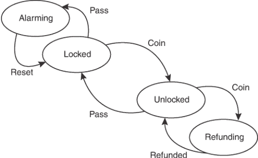

**图 3.1** 地铁旋转闸机的转换/状态图

旋转闸机从锁定状态开始。投入一枚硬币会使其进入解锁状态。当有人通过时，旋转闸机返回锁定状态。如果有人未付费就通过，旋转闸机发出警报。如果有人投入两枚硬币，多出的硬币会被退还。

该图可以转换为如下状态转换表：

| 当前状态 | 事件 | 下一状态 |
|---|---|---|
| 锁定 | 投币 | 解锁 |
| 锁定 | 通过 | 报警 |
| 解锁 | 投币 | 退款中 |
| 解锁 | 通过 | 锁定 |
| 退款中 | 已退款 | 解锁 |
| 报警 | 重置 | 锁定 |

表中的每一行都是一次由事件触发的、从当前状态到下一状态的转换。每一行都是一个三元组，就像 GWT 或 AAA 一样。更重要的是，这些转换三元组中的每一个都与对应的 GWT 或 AAA 三元组同义，如下所示：

单击此处查看代码图像

```
Given it is in the Locked state
When it gets a Coin event
Then it transitions to the Unlocked state.
```

由此我们可以推断：*你编写的每一个测试都是描述系统行为的有限状态机的一次转换。*

把这句话对自己重复几遍。每一个测试都是你试图在程序中创建的有限状态机的一次转换。

你知道你正在编写的程序是一个有限状态机吗？它当然是。每个程序都是有限状态机。这是因为计算机不过是有限状态机处理器。计算机本身每执行一条指令，都会从一个有限状态转换到下一个有限状态。

因此，你在实践 TDD 时编写的测试，以及你在实践 BDD 时描述的行为，都只是你试图创建的有限状态机的转换。如果你的测试套件是完整的，那么*它就是那个有限状态机。*

因此，显而易见的问题是：你如何确保希望状态机处理的所有转换都被编码为测试？你如何确保测试所描述的状态机就是程序应当实现的完整状态机？

使用*模拟对象*时，他们很可能不觉得这有什么。的确，1999 年当我向一位 Smalltalk 专家和 TDD 实践者介绍 Java 中的模拟对象这一想法时，他对我的回答是：“机制太多了。”

尽管如此，这项技术流行起来，并成为 TDD 实践者的常用手段。

但在进一步深入探讨这项技术本身之前，我们需要澄清一个词汇问题。我们几乎所有人都错误地使用了*模拟对象*这个术语——至少从正式意义上说是这样。如今我们谈论的模拟对象与 2000 年内测试论文中提出的模拟对象非常不同。事实上，它们如此不同，以至于人们采用了不同的词汇来澄清各自不同的含义。

2007 年，Gerard Meszaros 出版了 *xUnit 测试模式：重构测试代码*。^2 在书中，他采用了我们今天使用的正式词汇。非正式地，我们仍然谈论模拟对象和模拟，但当需要精确时，我们使用 Meszaros 的正式词汇。

2. Gerard Meszaros，*xUnit 测试模式：重构测试代码*（Addison-Wesley，2007）。

Meszaros 确定了五类属于非正式模拟类别的对象：哑元、桩、间谍、模拟对象和伪造对象。他把它们统称为*测试替身*。

这实际上是个很好的名字。在电影中，特技替身代替演员，手部替身代替演员手部的特写镜头。当屏幕上出现的是演员的身体而不是脸时，身体替身代替演员出镜。而这正是测试替身所做的。在运行测试时，*测试替身*代替另一个对象。

测试替身构成某种类型层次结构（图 3.2）。哑元最简单。桩是哑元，间谍是桩，模拟对象是间谍。伪造对象独立存在。

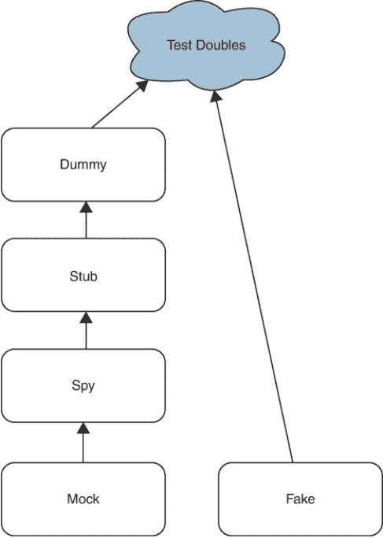

**图 3.2** 测试替身

所有测试替身使用的机制（也就是我的 Smalltalk 朋友认为“太多了”的机制）其实就是多态。例如，如果你想测试管理外部服务的代码，那么就把该外部服务隔离在一个多态接口之后，然后创建该接口的一个实现来充当该服务的替身。这个实现就是测试替身。

但也许解释这一切的最好方式就是演示它。

## 哑元

测试替身通常从一个接口开始——一个没有已实现方法的抽象类。例如，我们可以从 `Authenticator` 接口开始：

[单击此处查看代码图像](#)

```java
public interface Authenticator {
  public Boolean authenticate(String username, String password);
}
```

这个接口的意图是为我们的应用程序提供一种使用用户名和密码认证用户的方式。`authenticate` 函数在用户通过认证时返回 `true`，否则返回 `false`。

现在假设我们想测试：在用户输入用户名和密码之前，可以通过单击关闭图标取消 `LoginDialog`。该测试可能如下所示：

[单击此处查看代码图像](#)

```java
@Test
public void whenClosed_loginIsCancelled() throws Exception {
  Authenticator authenticator = new ???;
  LoginDialog dialog = new LoginDialog(authenticator);
  dialog.show();
  boolean success = dialog.sendEvent(Event.CLOSE);
  assertTrue(success);
}
```

注意，`LoginDialog` 类必须用一个 `Authenticator` 来构造。但这个 `Authenticator` 永远不会被该测试调用，那么我们应该向 `LoginDialog` 传入什么呢？

我们进一步假设，`RealAuthenticator` 是一个创建成本很高的对象，因为它需要向其构造函数传入一个 `DatabaseConnection`。


假设 `DatabaseConnection` 类有一个构造函数，它要求为 `databaseUser` 和 `databaseAuthCode` 提供有效的 `UID`。（我确信你见过类似的情况。）

点击此处查看代码图像

```java
public class RealAuthenticator implements Authenticator {
    public RealAuthenticator(DatabaseConnection connection) {
        //...
    }

    //...

}
```

```java
public class DatabaseConnection {
    public DatabaseConnection(UID databaseUser, UID databaseAuthCode) {
        //...
    }
}
```

要在测试中使用 `RealAuthenticator`，我们不得不做一些糟糕的事情，就像这样：

点击此处查看代码图像

```java
@Test
public void whenClosed_loginIsCancelled() throws Exception {
    UID dbUser = SecretCodes.databaseUserUID;
    UID dbAuth = SecretCodes.databaseAuthCode;
    DatabaseConnection connection =
        new DatabaseConnection(dbUser, dbAuth);
    Authenticator authenticator = new RealAuthenticator(connection);
    LoginDialog dialog = new LoginDialog(authenticator);
    dialog.show();
    boolean success = dialog.sendEvent(Event.CLOSE);
    assertTrue(success);
}
```

为了创建一个永远不会被使用的 `Authenticator`，就在测试里塞进一大堆糟糕的冗余代码，这实在太可怕了。它还会给测试增加两个依赖，而测试根本不需要这些依赖。这些依赖可能会在编译时或加载时破坏我们的测试。我们不需要这种混乱，也不需要这种头疼。

*规则 10：不要在测试中包含测试不需要的东西。*

因此，我们改为使用一个哑对象（图 3.3）。

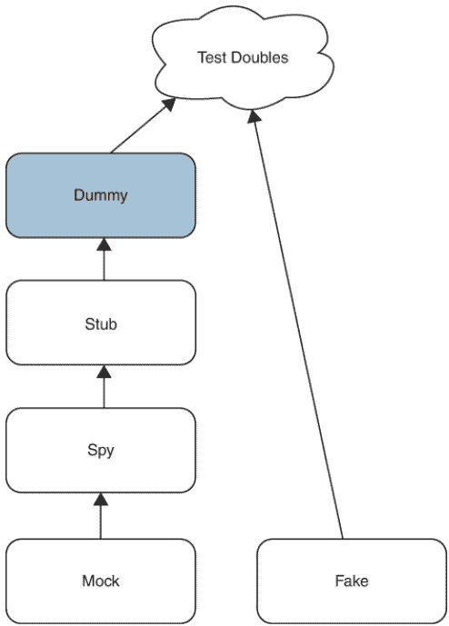

**图 3.3** 哑对象

哑对象是一种*什么也不做*的实现。接口的每个方法都实现为*什么也不做*。如果方法返回值，那么哑对象返回的值会尽可能接近 `null` 或零。

在我们的示例中，`AuthenticatorDummy` 会像这样：

点击此处查看代码图像

```java
public class AuthenticatorDummy implements Authenticator {
    public Boolean authenticate(String username, String password) {
        return null;
    }
}
```

事实上，当我调用 *实现接口* 命令时，我的 IDE 创建的就是这个精确实现。

现在，测试可以在没有那些冗余代码和讨厌的依赖的情况下编写：

点击此处查看代码图像

```java
@Test
public void whenClosed_loginIsCancelled() throws Exception {
    Authenticator authenticator = new AuthenticatorDummy();
    LoginDialog dialog = new LoginDialog(authenticator);
    dialog.show();
    boolean success = dialog.sendEvent(Event.CLOSE);
    assertTrue(success);
}
```

因此，哑对象是一种实现接口但什么也不做的测试替身。当被测试的函数将对象作为参数，但测试的*逻辑*并不要求该对象存在时，就会使用它。

我不经常使用哑对象，原因有两个。第一，我不喜欢函数中存在不使用该函数参数的代码路径。第二，我不喜欢具有依赖链的对象，例如 `LoginDialog->Authenticator->DatabaseConnection->UID`。这样的链总是会在以后引发麻烦。

不过，有时这些问题无法避免，在那些情况下，我更愿意使用哑对象，而不是与应用程序中复杂的对象较劲。

## 桩（Stub）

如图 3.4 所示，一个*桩*是哑对象；它被实现为什么也不做。然而，桩的函数不是返回零或 `null`，而是返回一些值，以驱动被测试的函数沿着测试希望执行的路径运行。

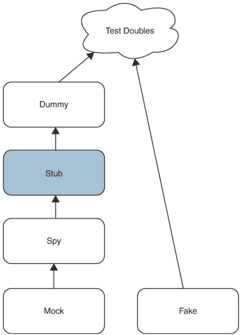

```java
public void whenAuthorizerRejects_loginFails() throws Exception {
    Authenticator authenticator = new RejectingAuthenticator();
    LoginDialog dialog = new LoginDialog(authenticator);
    dialog.show();
    boolean success = dialog.submit("bad username", "bad password");
    assertFalse(success);
}
```

我们期望 `LoginDialog` 的 `submit` 方法会调用 `authorize` 函数，并且我们知道 `authorize` 函数会返回 `false`，因此我们知道 `LoginDialog.submit` 方法中的代码**将走**哪条路径；而这正是我们正在测试的路径。

如果我们想测试当 `authorizer` 接受 `username` 和 `password` 时登录成功，我们可以用另一个桩玩同样的把戏：

点击此处查看代码图像

```java
public class PromiscuousAuthenticator implements Authenticator {
    public Boolean authenticate(String username, String password) {
        return true;
    }
}

@Test
public void whenAuthorizerAccepts_loginSucceeds() throws Exception {
    Authenticator authenticator = new PromiscuousAuthenticator();
    LoginDialog dialog = new LoginDialog(authenticator);
    dialog.show();
    boolean success = dialog.submit("good username", "good password");
    assertTrue(success);
}
```

因此，桩是一种哑对象，它返回测试专用的值，以驱动被测系统沿着正在测试的路径运行。

## 间谍（Spy）

一个*间谍对象*（图 3.5）是桩。它会返回测试专用的值，以驱动被测系统沿着期望的路径运行。然而，间谍对象会记住对它执行过什么操作，并允许测试询问这些信息。

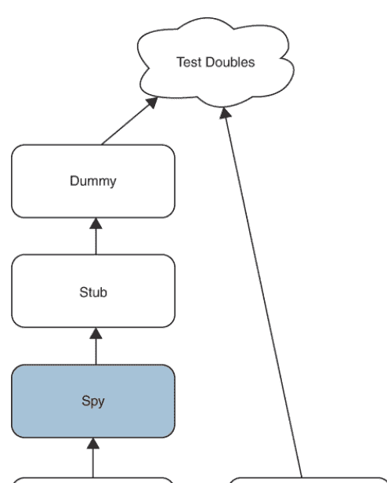

**图 3.5** 间谍对象

解释这一点的最好方式是通过一个示例：

点击此处查看代码图像

```java
public class AuthenticatorSpy implements Authenticator {
    private int count = 0;
    private boolean result = false;
    private String lastUsername = "";
    private String lastPassword = "";


    public Boolean authenticate(String username, String password) {
        count++;
        lastPassword = password;
        lastUsername = username;
        return result;
    }


    public void setResult(boolean result) {this.result = result;}
    public int getCount() {return count;}
    public String getLastUsername() {return lastUsername;}
    public String getLastPassword() {return lastPassword;}
}
```

请注意，`authenticate` 方法会记录它被调用的次数，以及最后一次调用它时使用的 `username` 和 `password`。还要注意，它为这些值提供了访问器。正是这种行为以及这些访问器使这个类成为一个间谍对象。

还要注意，`authenticate` 方法返回 `result`，而 `result` 可以通过 `setResult` 方法设置。这使得这个间谍对象成为一个可编程的桩。

下面是一个可能使用该间谍对象的测试：

点击此处查看代码图像

```java
@Test
public void loginDialog_correctlyInvokesAuthenticator() throws Exception {
    AuthenticatorSpy spy = new AuthenticatorSpy();
    LoginDialog dialog = new LoginDialog(spy);
    spy.setResult(true);
    dialog.show();
    boolean success = dialog.submit("user", "pw");
    assertTrue(success);
    assertEquals(1, spy.getCount());
    assertEquals("user", spy.getLastUsername());
    assertEquals("pw", spy.getLastPassword());
}
```

测试的名称告诉了我们很多信息。这个测试确保 `LoginDialog` 正确调用 `Authenticator`。它通过确保 `authenticate` 方法只被调用一次，并且参数就是传入 `submit` 的参数，来实现这一点。

间谍对象可以简单到只是一个布尔值，在某个特定方法被调用时被设置。或者，间谍对象也可以是一个相对复杂的对象，维护每次调用以及每次调用所传每个参数的历史记录。

间谍对象作为一种确保被测算法行为正确的方式很有用。间谍对象也很危险，因为它们将测试与被测函数的*实现*耦合在一起。我们稍后会更详细地讨论这一点。

## 模拟对象（Mock）

现在，终于，我们来到了真正的模拟对象（图 3.6）。这就是 Mackinnon、Freeman 和 Craig 在他们关于内测试（endo-testing）的论文中所描述的模拟对象。


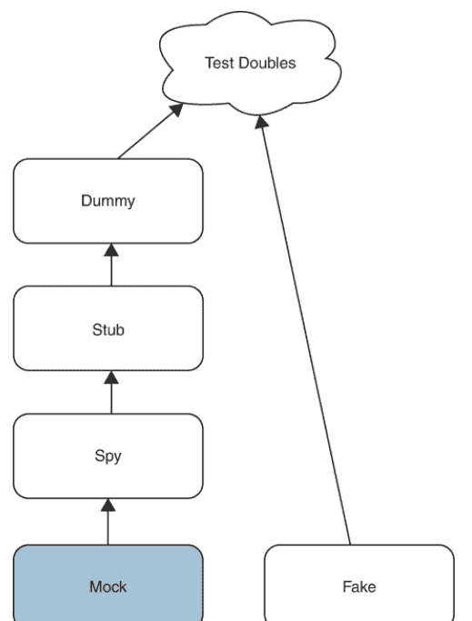

**图 3.6 模拟对象**

*模拟对象*是一个间谍对象。它会返回测试专用的值，以便驱动被测系统沿着期望的路径运行，并且它会记住对它执行过的操作。然而，模拟对象还知道应该预期什么，并会基于这些预期让测试通过或失败。

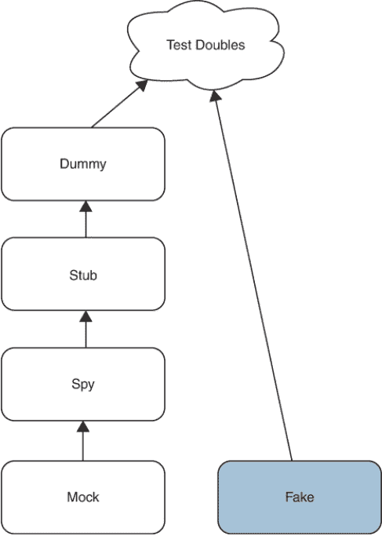

**图 3.7 假对象**

很久以前，在 20 世纪 70 年代末，我曾为一家公司工作，这家公司构建了一套安装到电话公司设施中的系统。这个系统用于测试电话线路。服务中心有一台中央计算机，它通过调制解调器链路与我们安装在交换局中的计算机通信。服务中心的那台计算机被称为 SAC（服务区

```
    dialog.show();
    boolean success = dialog.submit("user", "good password");
    assertTrue(success);
}
```

这两个测试使用同一个 `FakeAuthenticator`，但向它传入不同的密码。测试预期*错误密码*会使登录尝试失败，而*正确密码*会成功。

`FakeAuthenticator` 的代码应该很容易想象：

[点击此处查看代码图像](#)

```java
public class FakeAuthenticator implements Authenticator {
    public Boolean authenticate(String username, String password)
    {
        return (username.equals("user") &&
                password.equals("good password"));
    }
}
```

假对象的问题在于，随着应用程序增长，总是会有更多条件需要测试。因此，假对象往往会随着每一个新测试条件而增长。最终，它们可能变得如此庞大和复杂，以至于它们自己也需要测试。

我很少编写假对象，因为我不相信它们不会膨胀。

## TDD 不确定性原理

使用模拟还是不使用模拟，这是一个问题。其实不是。真正的问题是*何时*使用模拟。

关于这一点有两种思想学派：伦敦学派和芝加哥学派，本章末尾会讨论它们。但在深入讨论之前，我们需要先明确为什么这首先会成为问题。它之所以成为问题，是因为*TDD 不确定性原理*。

为了帮助我们理解这一点，我想请你容许我玩味地“走向极端”一下。下面的内容并不是你真正会去做的事情，但它很好地说明了我试图表达的观点。

想象一下，我们想用 TDD 编写一个函数，用来计算以弧度表示的角度的三角正弦值。第一个测试是什么？

记住，我们喜欢从最退化的情况开始。让我们测试能够计算零的正弦值：

[点击此处查看代码图像](#)

```java
public class SineTest {
    private static final double EPSILON = 0.0001;
    @Test
    public void sines() throws Exception {
        assertEquals(0, sin(0), EPSILON);
    }

    double sin(double radians) {
        return 0.0;
    }
}
```

现在，如果你提前思考，这应该已经让你感到不安了。这个测试除了 `sin(0)` 的值之外，没有约束任何东西。

我这么说是什么意思？我的意思是，我们使用 TDD 编写的大多数函数都受到不断增长的测试集的强烈约束，以至于到了某个时刻，函数会通过我们能提出的任何其他测试。我们在质因数示例和保龄球游戏示例中看到了这一点。每个测试都缩小了可能解的范围，直到最终解变得已知。

但在这里，`sin(r)` 函数看起来并不是那样运作的。`sin(0) == 0` 的测试是正确的，但它似乎并没有把解约束到那一个点之外。

当我们尝试下一个测试时，这一点会变得更加明显。那个测试应该是什么？为什么不试试 sin(π)？

[点击此处查看代码图像](#)

```java
public class SineTest {
    private static final double EPSILON = 0.0001;
    @Test
    public void sines() throws Exception {
        assertEquals(0, sin(0), EPSILON);
        assertEquals(0, sin(Math.PI), EPSILON);
    }

    double sin(double radians) {
        return 0.0;
    }
}
```

我们再次有了那种不受约束的感觉。这个测试似乎没有为解增加任何东西。它没有给我们任何如何解决问题的提示，所以让我们试试 π/2：

[点击此处查看代码图像](#)

```java
public class SineTest {
    private static final double EPSILON = 0.0001;
    @Test
    public void sines() throws Exception {
        assertEquals(0, sin(0), EPSILON);
        assertEquals(0, sin(Math.PI), EPSILON);
        assertEquals(1, sin(Math.PI/2), EPSILON);
    }
    double sin(double radians) {
        return 0.0;
    }
}
```

这个测试失败了。我们怎样才能让它通过？同样，这个测试没有给我们任何关于如何让它通过的提示。我们可以尝试加入一些糟糕的 `if` 语句，但那只会导致越来越多的 `if` 语句。

此时，你可能会认为最好的方法是查阅正弦的泰勒级数，然后直接实现它。

$$x - \frac{x^3}{3!} + \frac{x^5}{5!} - \frac{x^7}{7!} + \cdots$$

这应该不会太难：

[点击此处查看代码图像](#)

```java
public class SineTest {
    private static final double EPSILON = 0.0001;
    @Test
    public void sines() throws Exception {
        assertEquals(0, sin(0), EPSILON);
        assertEquals(0, sin(Math.PI), EPSILON);
        assertEquals(1, sin(Math.PI/2), EPSILON);
    }

    double sin(double radians) {
        double r2 = radians * radians;
        double r3 = r2 * radians;
        double r5 = r3 * r2;
        double r7 = r5 * r2;
        double r9 = r7 * r2;
        double r11 = r9 * r2;
        double r13 = r11 * r2;
        return (radians - r3/6 + r5/120 - r7/5040 + r9/362880 -
                r11/39916800.0 + r13/6227020800.0);
    }
}
```

这个测试通过了，但它相当丑陋。不过，我们仍然应该能够用这种方式计算其他几个正弦值：

[点击此处查看代码图像](#)

```java
public void sines() throws Exception {
    assertEquals(0, sin(0), EPSILON);
    assertEquals(0, sin(Math.PI), EPSILON);
    assertEquals(1, sin(Math.PI/2), EPSILON);
    assertEquals(0.8660, sin(Math.PI/3), EPSILON);
    assertEquals(0.7071, sin(Math.PI/4), EPSILON);
    assertEquals(0.5877, sin(Math.PI/5), EPSILON);
}
```

是的，这个测试通过了。但这个解决方案很丑陋，因为它的精度有限。我们应该把泰勒级数展开到足够多的项，使其收敛到我们的精度极限。（注意 EPSILON 常量的变化。）

[点击此处查看代码图像](#)

```java
public class SineTest {
    private static final double EPSILON = 0.00000001;
    @Test
    public void sines() throws Exception {
        assertEquals(0, sin(0), EPSILON);
        assertEquals(0, sin(Math.PI), EPSILON);
        assertEquals(1, sin(Math.PI/2), EPSILON);
        assertEquals(0.8660254038, sin(Math.PI/3), EPSILON);
        assertEquals(0.7071067812, sin(Math.PI/4), EPSILON);
        assertEquals(0.5877852523, sin(Math.PI/5), EPSILON);
    }

    double sin(double radians) {
        double result = radians;
        double lastResult = 2;
        double m1 = -1;
        double sign = 1;
        double power = radians;
        double fac = 1;
        double r2 = radians * radians;
        int n = 1;
        while (!close(result, lastResult)) {
            lastResult = result;
            power *= r2;
            fac *= (n+1) * (n+2);
            n += 2;
            sign *= m1;
            double term = sign * power / fac;
            result += term;
        }

        return result;
    }

    boolean close(double a, double b) {
        return Math.abs(a - b) < .0000001;
    }
}
```

好了，现在进展得很顺利。但是等等？TDD 怎么了？我们怎么知道这个算法真的正确工作？我的意思是，这是很多代码。我们怎么判断这些代码是否正确？

我想我们可以再测试几个值。而且，哎呀，这些测试变得越来越笨重了。我们也来稍微重构一下吧：

点击此处查看代码图像


```java
private void checkSin(double radians, double sin) {
    assertEquals(sin, sin(radians), EPSILON);
}
```

```java
@Test
public void sines() throws Exception {
    checkSin(0, 0);
    checkSin(PI, 0);
    checkSin(PI/2, 1);
    checkSin(PI/3, 0.8660254038);
    checkSin(PI/4, 0.7071067812);
    checkSin(PI/5, 0.5877852523);
    checkSin(3*PI/2, -1);
}
```

好，这通过了。我们再试几个：

```java
checkSin(2*PI, 0);
checkSin(3*PI, 0);
```

啊，2π 可行，但 3π 不行。不过它很接近：4.6130E-9。我们或许可以通过提高 `close()` 函数中比较的限值来修正这个问题，但那看起来像作弊，而且对 100π 或 1,000π 可能也不管用。更好的方案是把角度缩减到 0 到 2π 之间。

```java
double sin(double radians) {
    radians %= 2*PI;
    double result = radians;
```

是的。这样可行。那么负数呢？

```java
checkSin(-PI, 0);
checkSin(-PI/2, -1);
checkSin(-3*PI/2, 1);
checkSin(-1000*PI, 0);
```

是的，它们都可行。好，那么不是 2π 的整数倍的大数呢？

点击此处查看代码图像

```java
checkSin(1000*PI + PI/3, sin(PI/3));
```

唉。那也可行。还有什么可试的吗？有没有可能失败的值？

哎哟！我不知道。

## TDD 不确定性原理

欢迎来到 TDD 不确定性原理的前半部分。无论我们尝试多少个值，都会留下这种挥之不去的不确定性：我们漏掉了某些东西——某个输入值不会产生正确的输出值。

大多数函数不会让你这样悬着心。大多数函数都有一个很好的性质：当你写完最后一个测试时，你*知道*它们能工作。但随后又有这些烦人的函数，让你怀疑是否存在某个会失败的值。

用我们已经写出的这类测试来解决这个问题的唯一方法，就是尝试每一个可能的值。而由于 `double` 数有 64 位，这意味着我们需要编写略少于 2 × 10^19 个测试。这比我愿意写的多得多。

那么，关于这个函数，我们*到底*信任什么？我们信任泰勒级数能计算给定弧度角的正弦吗？是的，我们看到了它的数学证明，所以我们相当确定泰勒级数会收敛到正确的值。

我们如何把对泰勒级数的信任转化为一组测试，以证明我们正在正确地执行那个泰勒级数呢？

我想我们可以检查泰勒展开的每一项。例如，在计算 sin(π) 时，泰勒级数的各项为 3.141592653589793、−2.0261201264601763、0.5240439134171688、−0.075220615903062306、0.006925270707505149、−4.4516023820919976E-4、2.114256755841263E-5、−7.727858894175775E-7、2.2419510729973346E-8。

我不明白这种测试为什么会比我们已有的测试更好。那些值只适用于某一个特定测试，而且它们没有告诉我们这些项对其他任何值是否正确。

不，我们想要不同的东西。我们想要决定性的东西。某种能*证明*我们使用的算法确实恰当地执行了泰勒级数的东西。

好，那么那个泰勒级数是什么？它是 $x$ 的奇次幂除以奇阶乘的无限交错和：

$$\sum_{n=1}^{\infty} (-1)^{(n-1)} \frac{x^{2n-1}}{(2n-1)!}$$

或者，换句话说，

$$x - \frac{x^3}{3!} + \frac{x^5}{5!} - \frac{x^7}{7!} + \frac{x^9}{9!} - \cdots$$

这如何帮助我们？嗯，如果我们有一个间谍对象，能告诉我们泰勒级数的各项是如何被计算的，那就可以让我们写出这样的测试：

点击此处查看代码图像

```java
@Test
public void taylorTerms() throws Exception {
    SineTaylorCalculatorSpy c = new SineTaylorCalculatorSpy();
    double r = Math.random() * PI;
    for (int n = 1; n <= 10; n++) {
        c.calculateTerm(r, n);
        assertEquals(n - 1, c.getSignPower());
        assertEquals(r, c.getR(), EPSILON);
        assertEquals(2 * n - 1, c.getRPower());
        assertEquals(2 * n - 1, c.getFac());
    }
}
```

对 $x$ 使用随机数，并对 `n` 使用所有合理的值，可以让我们避免使用特定值。我们在这里关心的是：给定某个 $x$ 和某个 `n`，正确的数字被送入正确的函数。如果这个测试通过，我们就会*知道*`sign`、`power` 和 `factorial` 计算器都收到了正确的输入。

我们可以用下面这段简单的代码让测试通过：

点击此处查看代码图像

```java
public class SineTaylorCalculator {
    public double calculateTerm(double r, int n) {
        int sign = calcSign(n-1);
        double power = calcPower(r, 2*n-1);
        double factorial = calcFactorial(2*n-1);
        return sign*power/factorial;
    }

    protected double calcFactorial(int n) {
        double fac = 1;
        for (int i=1; i<=n; i++)
            fac *= i;
        return fac;
    }

    protected double calcPower(double r, int n) {
        double power = 1;
        for (int i=0; i<n; i++)
            power *= r;
        return power;
    }

    protected int calcSign(int n) {
        int sign = 1;
        for (int i=0; i<n; i++)
            sign *= -1;
        return sign;
    }
}
```

注意，我们并没有测试实际的计算函数。它们非常简单，可能不需要测试。鉴于我们即将编写的其他测试，这一点尤其正确。

这是间谍对象：

点击此处查看代码图像

```java
package London_sine;

public class SineTaylorCalculatorSpy extends SineTaylorCalculator {
    private int fac_n;
    private double power_r;
    private int power_n;
    private int sign_n;
    public double getR() {
        return power_r;
    }

    public int getRPower() {
        return power_n;
    }

    public int getFac() {
        return fac_n;
    }

    public int getSignPower() {
        return sign_n;
    }

    protected double calcFactorial(int n) {
        fac_n = n;
        return super.calcFactorial(n);
    }

    protected double calcPower(double r, int n) {
        power_r = r;
        power_n = n;
        return super.calcPower(r, n);
    }

    protected int calcSign(int n) {
        sign_n = n;
        return super.calcSign(n);
    }
}
```

```java
public double calculateTerm(double r, int n) {
    return super.calculateTerm(r, n);
}
```

既然测试通过了，编写求和算法有多难呢？

点击此处查看代码图像

```java
public double sin(double r) {
    double sin=0;
    for (int n=1; n<10; n++)
        sin += calculateTerm(r, n);
    return sin;
}
```

你可以抱怨整个实现的效率，但你相信它能工作吗？`calculateTerm` 函数是否正确计算了正确的泰勒项？`sin` 函数是否正确地把它们加在一起？10 次迭代足够吗？我们如何在不退回那些原始值测试的情况下测试这一点？

这里有一个有趣的测试。`sin(r)` 的所有值都应该在 –1 和 1 之间（开区间）。

点击此处查看代码图像

```java
@Test
public void testSineInRange() throws Exception {
    SineTaylorCalculator c = new SineTaylorCalculator();
    for (int i=0; i<100; i++) {
        double r = (Math.random() * 4 * PI) - (2 * PI);
        double sinr = c.sin(r);
        assertTrue(sinr < 1 && sinr > -1);
    }
}
```

那个测试通过了。这个呢？给定这个恒等式，

点击此处查看代码图像

```java
public double cos(double r) {
    return (sin(r+PI/2));
}
```

让我们测试毕达哥拉斯恒等式：sin² + cos² = 1。

[点击此处查看代码图像](#)

```java
    @Test
    public void PythagoreanIdentity() throws Exception {
        SineTaylorCalculator c = new SineTaylorCalculator();
        for (int i=0; i<100; i++) {
            double r = (Math.random() * 4 * PI) - (2 * PI);
            double sinr = c.sin(r);
            double cosr = c.cos(r);
            assertEquals(1.0, sinr * sinr + cosr * cosr, 0.00001);
        }
    }
```

嗯。实际上，直到我们把项数提高到 20 它才通过，而 20 当然是一个高得离谱的数字。但是，就像我说的，这是一个极端的练习。

鉴于这些测试，我们有多大信心认为自己正确地计算了正弦？我不知道你怎么想，但我相当有信心。我知道各项被喂入了正确的数字。我可以目测那些简单的计算器，而且 `sin` 函数似乎具有正弦的性质。

哦，管他呢，我们就随便做几个值测试吧：

[点击此处查看代码图像](#)

```java
    @Test
    public void sineValues() throws Exception {
        checkSin(0, 0);
        checkSin(PI, 0);
        checkSin(PI/2, 1);
        checkSin(PI/3, 0.8660254038);
        checkSin(PI/4, 0.7071067812);
        checkSin(PI/5, 0.5877852523);
    }
```

是的，全都可行。很好。我解决了我的信心问题。我不再怀疑我们是否正确计算正弦了。谢天谢地，有那个间谍对象！

### TDD 不确定性原理（再次）


但是等等。你知道有一种更好的计算正弦的算法吗？它叫 CORDIC。不，我不会在这里向你描述它。它远远超出了本章的范围。不过，我们不妨假设想改变函数来使用那种 CORDIC 算法。

我们的间谍测试就会失败！

事实上，只要回顾一下我们在那个泰勒级数算法上投入了多少代码。我们有两个完整的类：`SineTaylorCalculator` 和 `SineTaylorCalculatorSpy`，都专门用于旧算法。所有这些代码都得删除，还必须采用一套全新的测试策略。

间谍测试是*脆弱的*。对算法的任何更改几乎都会破坏所有这些测试，迫使我们修复甚至重写它们。

另一方面，如果我们坚持最初的值测试，那么这些测试在新的 CORDIC 算法下仍会继续通过。无需重写测试。

欢迎来到 TDD 不确定性原理的后半部分。如果你要求测试具备确定性，就不可避免地把测试与实现耦合起来，而这会使测试变得脆弱。

> *TDD 不确定性原理：你越要求确定性，测试就越不灵活；你越要求灵活的测试，确定性就越低。*

#### 伦敦派与芝加哥派

TDD 不确定性原理可能让人觉得测试是徒劳的，但事实完全不是这样。这个原理只是对测试能带来多大益处施加了一些约束。

一方面，我们不想要僵硬、脆弱的测试。另一方面，我们希望获得尽可能多的确定性。作为工程师，我们必须在这两个问题之间做出正确的权衡。

#### 脆弱测试问题

TDD 新手经常会遇到脆弱测试的问题，因为他们没有认真设计测试。他们把测试当作二等公民，破坏了所有耦合与内聚规则。这会导致这样的情况：对生产代码做微小更改，甚至只是轻微重构，也会使许多测试失败，并迫使测试代码大规模改动。

失败的测试若导致大量测试代码重写，可能让人一开始就感到失望，并过早否定这一实践。许多年轻的新 TDD 实践者之所以放弃这一实践，只是因为他们没有意识到：测试必须和生产代码一样精心设计。

你把测试与生产代码耦合得越多，测试就越脆弱；而很少有测试产物比间谍耦合得更紧。间谍深入算法核心，把测试与那些算法不可分割地耦合在一起。由于模拟对象就是间谍，这也适用于模拟对象。

这是我不喜欢模拟工具的原因之一。模拟工具常常引导你编写模拟对象和间谍，而这会导致脆弱的测试。

#### 确定性问题

如果你像我一样避免编写间谍，那么就只剩下值测试和属性测试。值测试就像本章前面做的正弦值测试。它们只是把输入值与输出值配对。

属性测试就像我们前面使用的 `testSineInRange` 和 `PythagoreanIdentity` 测试。它们遍历许多合适的输入值，检查不变量。这些测试可能很有说服力，但你往往仍会有挥之不去的疑虑。

另一方面，这些测试与所采用的算法如此解耦，以至于更改该算法，甚至只是重构该算法，都不会影响测试。

如果你是那种重视确定性胜过灵活性的人，你很可能会在测试中使用大量*间谍*，并容忍不可避免的脆弱性。

个人浅见。

## 综合

尽管存在这两种思想流派，尽管有些实践者倾向于这一边或那一边，但伦敦派与芝加哥派并不是一场战争。它实际上甚至算不上多大的分歧。它只是一个轻微的侧重点差异，仅此而已。

事实上，所有实践者，无论是芝加哥派还是伦敦派，都会在工作中使用这两种技术。只是有些人这一种用得多一点，有些人那一种用得多一点。

哪一派正确？当然都不正确。我更倾向于芝加哥派，但你可能看了伦敦派之后，觉得自己在那里更自在。我对此没有异议。事实上，我会很乐意和你结对编程，做一次愉快的综合。

当我们开始考虑架构时，这种综合就变得非常重要。

## 架构

我在伦敦派和芝加哥派策略之间所做的权衡是架构层面的。如果你读过*《整洁架构》*，^4 就会知道我喜欢把系统划分成组件。我把这些组件之间的分界称为*边界*。我对边界的规则是：源代码依赖必须始终跨越边界，并指向高层策略。

4. Robert C. Martin，*《整洁架构：软件结构与设计工匠指南》*（Addison-Wesley，2018）。

这意味着，包含低层细节的组件（如图形用户界面（GUI）和数据库）依赖于更高层的组件（如业务规则）。高层组件不依赖低层组件。这是依赖倒置原则的一个例子，也就是 SOLID 中的 D。

在编写最低层的程序员测试时，当测试跨越架构边界时，我会使用*间谍*（很少使用*模拟对象*）。或者换一种说法：测试某个组件时，我会用*间谍*来模拟任何协作组件，并确保被测组件正确调用协作组件。因此，如果我的测试跨越了架构边界，我就是伦敦派。

然而，当测试不跨越这样的边界时，我倾向于做芝加哥派。在组件内部，我更依赖状态测试和属性测试，以便尽可能降低测试的耦合，从而降低测试的脆弱性。

让我们看一个例子。**图 3.8** 中的 UML 图展示了一组类以及包含它们的四个组件。

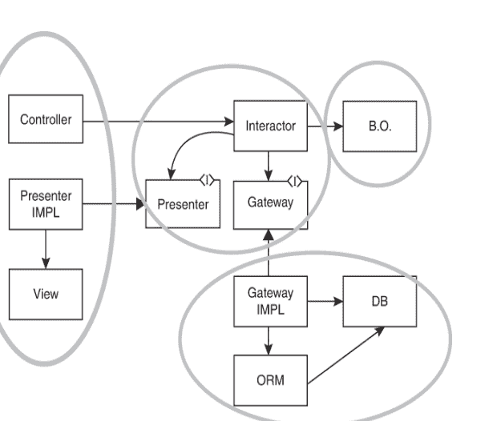

**图 3.8** 一组类以及包含它们的四个组件

注意，箭头都从低层组件指向高层组件。这就是*《整洁架构》*中讨论的*依赖规则*。最高层组件包含业务对象。下一层包含交互器和通信接口。最低层是 GUI 和数据库。

测试业务对象时，我们可能会使用一些桩，但不需要任何间谍或模拟对象，因为业务对象不知道任何其他组件。

另一方面，交互器会操作业务对象、数据库和 GUI。我们的测试很可能会使用间谍来确保数据库和 GUI 被正确操作。不过，在交互器和业务对象之间，我们可能不会使用那么多间谍，甚至不会使用桩，因为业务对象的函数可能并不昂贵。

测试控制器时，我们几乎肯定会用一个间谍来代表交互器，因为我们不希望调用传播到数据库或展示器。

展示器很有意思。我们把它看作 GUI 组件的一部分，但实际上我们需要一个间谍来测试它。我们不想用真实视图来测试它，所以可能还需要第五个组件，把视图与控制器和展示器分开。

最后这个小麻烦很常见。我们经常因为测试的要求而修改组件边界。

## 结论

在本章中，我们探讨了 TDD 的一些更高级的方面：从算法的增量开发，到卡住的问题，从测试的有限状态机本质，到测试替身和 TDD 不确定性原理。但我们还没完。还有更多内容。所以，泡一杯好热茶，把不可能性发生器调到无穷大。


### 4 测试设计


如果你查看第 2 章“测试驱动开发”中给出的测试驱动开发（TDD）三定律，你可能会得出这样的结论：TDD 是一种浅层技能——遵循这三条定律，你就完成了。这与事实相去甚远。TDD 是一种深层技能。它有许多层次；掌握它们需要数月，甚至数年。

在本节中，我们深入探讨其中少数几个层次，涵盖各种测试难题（例如数据库和图形用户界面（GUI）），到驱动良好测试设计的设计原则，再到测试模式，以及一些有趣而深刻的理论可能性。

#### 测试数据库

测试数据库的第一条规则是：*不要测试数据库。* 你不需要测试数据库。你可以假定数据库能正常工作。如果它不能，你很快就会知道。

你真正想测试的是查询。或者更准确地说，你想测试发送给数据库的命令是否格式正确。如果你直接编写 SQL，你会想测试你的 SQL 语句是否按预期工作。如果你使用对象关系映射（ORM）框架，例如 Hibernate，你会想测试 Hibernate 是否按你的意图操作数据库。如果你使用 NoSQL 数据库，你会想测试所有数据库访问是否按你的意图运行。

这些测试都不要求你测试业务规则；它们只涉及查询本身。因此，测试数据库的第二条规则是：*将数据库与业务规则解耦。*

我们通过创建一个接口来解耦，在[图 4.1]的图中，我将其称为 `Gateway`¹。在 `Gateway` 接口中，我们为希望执行的每一种查询创建一个方法。这些方法可以接受修改查询的参数。例如，为了从数据库中获取所有雇佣日期晚于 2001 年的 `Employees`，我们可能调用 `Gateway` 方法 `getEmployeesHiredAfter(2001)`。

- 1. Martin Fowler，*Patterns of Enterprise Application Architecture*（Addison-Wesley，2003），466。

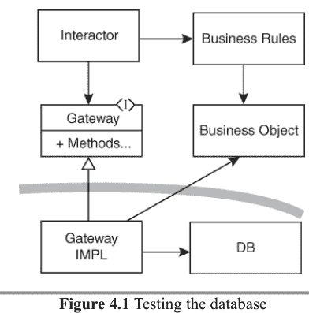

我们在数据库中要执行的每个查询、更新、删除或添加，都会在 `Gateway` 接口中有一个对应的方法。当然，根据我们想如何划分数据库，可以有许多 `Gateway`。

`GatewayImpl` 类实现该网关，并指挥实际数据库执行所需功能。如果这是 SQL 数据库，那么所有 SQL 都在 `GatewayImpl` 类中创建。如果你使用 ORM，则由 `GatewayImpl` 类操作 ORM 框架。在分隔 `Gateway` 与 `GatewayImpl`¹ 的架构边界之上，SQL、ORM 框架和数据库 API 都不可见。

事实上，我们甚至不希望数据库的模式在该边界之上可见。`GatewayImpl` 应当解包从数据库检索到的行或数据元素，并使用这些数据构造适当的业务对象，以跨边界传递给业务规则。

现在测试数据库就变得很简单了。你创建一个适当简单的测试数据库，然后在测试中调用 `GatewayImpl` 的每个查询函数，并确保它对该测试数据库产生预期效果。确保每个查询函数返回一组正确加载的业务对象。

窗口。展示器尽可能为此努力，使我们能够把 GUI 做得小得离谱。

因此，例如，展示器是决定每个按钮和菜单项状态的模块。它指定它们的名称以及它们是否应被置灰。如果按钮的名称根据窗口状态变化，那么是展示器知道该状态并更改该名称。如果屏幕上应出现一个数字网格，那么是展示器创建一个字符串表格，所有内容都正确格式化并排列。如果有字段应具有特殊颜色或字体，那么是展示器决定这些颜色和字体。

展示器负责所有这些详细的格式化和排列，并生成一个充满字符串和标志的简单数据结构，GUI 可以使用它来构建发送到屏幕的命令。当然，这确实使 GUI 变得非常小。

展示器创建的数据结构通常称为*视图模型*。

在图 4.2 的图中，交互器负责告诉展示器应向屏幕呈现哪些数据。这种通信将通过一组函数传递给展示器的一个或多个数据结构的形式进行。实际的展示器通过展示器接口与交互器隔离。这防止高层交互器依赖于低层展示器的实现。

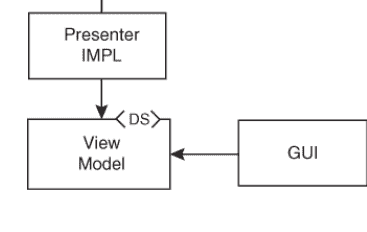

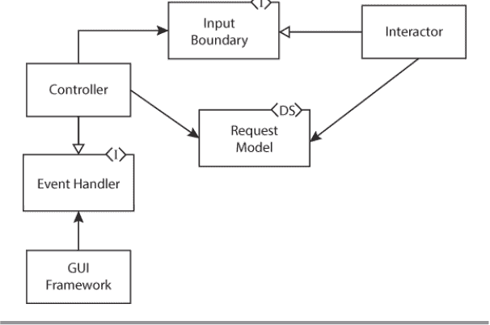

**图 4.3 测试 GUI**

GUI 框架通过 `EventHandler` 接口与控制器通信。这确保控制器对 GUI 框架没有传递性源代码依赖。控制器的职责是将来自 GUI 框架的必要事件收集到一个纯数据结构中，我在这里称之为 `RequestModel`。

一旦 `RequestModel` 完成，控制器就通过 `InputBoundary` 接口将其传递给交互器。同样，该接口的存在是为了确保源代码依赖指向架构上合理的方向。

测试交互器很简单；我们的测试只需创建适当的请求模型并将它们交给交互器。我们可以直接检查结果，也可以使用 spy 来检查它们。测试控制器也很简单——我们的测试只需通过事件处理程序接口调用事件，然后确保控制器构建正确的请求模型。

#### 测试模式

测试有许多不同的设计模式，也有几本书记录了它们：Gerard Meszaros 的 *XUnit Test Patterns*⁴ 和 J. B. Rainsberger 与 Scott Stirling 的 *JUnit Recipes*⁵，这里仅提及其中两本。

- 4. Gerard Meszaros，*XUnit Test Patterns: Refactoring Test Code*（Addison-Wesley，2012）。
- 5. J. B. Rainsberger 和 Scott Stirling，*JUnit Recipes: Practical Methods for Programmer Testing*（Manning，2006）。

我并不打算在这里记录所有这些模式和配方。我只想提到多年来我发现最有用的三个。

##### 测试专用子类

此模式主要用作安全机制。例如，假设你想测试 `XRay` 类的 `align` 方法。然而，`align` 方法会调用 `turnOn` 方法。你可能不希望每次运行测试时都打开 X 射线。

如图 4.4 所示，解决方案是创建 `XRay` 类的一个*测试专用子类*，它重写 `turnOn` 方法使其什么都不做。测试创建 `SafeXRay` 类的实例，然后调用 `align` 方法，而不必担心 X 射线机实际上会被打开。

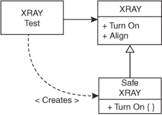

**图 4.4** 测试专用子类模式

让测试专用子类成为 spy 通常很有帮助，这样测试就可以询问安全对象，不安全的方法是否实际被调用了。

在示例中，如果 `SafeXRay` 是 spy，那么 `turnOn` 方法会记录其调用，而 `XRayTest` 类中的测试方法可以查询该记录，以确保 `turnOn` 确实被调用。

有时，*测试专用子类*模式用于便利和吞吐量，而不是安全性。例如，你可能不希望被测试的方法启动新进程或执行昂贵的计算。

为了在测试专用子类中重写它们，将危险、不便或缓慢的操作提取到新方法中，这并不罕见。这只是测试影响代码设计的方式之一。

##### Self-Shunt

该主题的一种变体是*Self-Shunt*模式。因为测试类*就是*一个类，所以让测试类成为测试专用子类通常很方便，如图 4.5 所示。

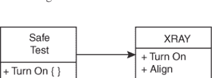

**图 4.5** Self-Shunt 模式


在这种情况下，是 `XRayTest` 类重写了 `turnOn` 方法，并且也可以充当该方法的 spy。

当我需要一个简单的 spy 或简单的 stub 时，我发现 Self-Shunt 非常方便。另一方面，缺少一个命名良好、专门提供 stub 或 spy 功能的独立类，可能会让读者困惑，因此我会审慎地使用这个模式。

使用这个模式时，重要的是要记住，不同的测试框架会在不同时间构造测试类。例如，JUnit 会为每次测试方法调用构造一个新的测试类实例。另一方面，NUnit 会在测试类的单个实例上执行所有测试方法。因此，必须小心确保任何 spy 变量都被正确重置。

#### 谦卑对象

我们倾向于认为系统中的每一段代码都可以使用 TDD 三定律进行测试，但这并不完全正确。跨硬件边界通信的代码部分极其难以测试。

例如，要测试屏幕上显示的内容、通过网络接口发送的内容，或通过并行或串行 I/O 端口发送的内容，都很困难。如果没有一些专门设计、可供测试与之通信的硬件机制，此类测试是不可能的。

此外，此类硬件机制很可能速度慢和/或不可靠。例如，想象一台摄像机盯着屏幕，而你的测试代码拼命试图判断从摄像机返回的图像是否就是你发送到屏幕的图像。或者想象一根环回网线，将网络适配器的输出端口连接到输入端口。你的测试将不得不读取从该输入端口流入的数据流，并查找你从输出端口发送出的特定数据。

在大多数情况下，这种专用硬件即便并非完全不切实际，也很不方便。

*谦卑对象*模式是一种折中方案。该模式承认存在无法实际测试的代码。因此，该模式的目标是*羞辱*这类代码，使其简单到不值得测试。我们之前在“测试 GUI”一节中看到过一个简单示例，但现在让我们更深入地看一看。

总体策略如图 4.6 所示。跨边界通信的代码被分成两个元素：呈现器和*谦卑对象*（这里表示为 `HumbleView`）。两者之间的通信是一个名为 `Presentation` 的数据结构。

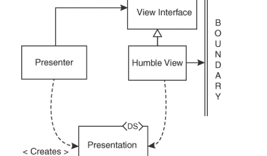

假设我们的应用程序（未显示）想要在屏幕上显示某些内容。它把适当的数据发送给呈现器。呈现器随后将这些数据解包成尽可能简单的形式，并将其加载到 `Presentation` 中。这种解包的目标是除去 `HumbleView` 中除最简单处理步骤之外的所有处理步骤。`HumbleView` 的工作只是将 `Presentation` 中解包后的数据跨边界传输。

具体来说，假设应用程序想要弹出一个对话框，其中包含发布和取消按钮、一个订单 ID 选择菜单，以及一个日期和货币项网格。应用程序发送给呈现器的数据由该数据网格组成，形式为 `Date` 和 `Money` 对象。它还会发送供菜单选择的可选 `Order` 对象列表。

呈现器的工作是把所有内容转换为字符串和标志，并将它们加载到 `Presentation` 中。`Money` 和 `Date` 对象会被转换为符合区域设置的字符串。`Order` 对象会被转换为 ID 字符串。两个按钮的名称会作为字符串加载。如果一个或多个按钮应被置灰，则在 `Presentation` 中设置相应的标志。

最终结果是，`HumbleView` 除了将这些字符串以及标志所隐含的元数据跨边界传输之外，无需再做其他事情。同样，目标是让 `HumbleView` 简单到无需测试。

应当清楚，这种策略适用于任何类型的边界跨越，而不仅仅是显示。

为了演示，假设我们正在编写一辆自动驾驶汽车的控制软件。还假设方向盘由一个步进电机控制，该电机每步将方向盘移动一度。我们的软件通过发出以下命令来控制步进电机：

```
out(0x3ff9, d);
```

其中 `0x3ff9` 是步进电机控制器的 IO 地址，d 为 1 表示向右，为 0 表示向左。

在高层次上，我们的自动驾驶 AI 向 `SteeringPresenter` 发出这种形式的命令：

```
turn(RIGHT, 30, 2300);
```

这意味着汽车（不是方向盘！）应在接下来的 2,300 毫秒内逐渐向右转 30 度。为实现这一点，方向盘必须按一定速率向右转动一定步数，然后再按一定速率向左转回，以便在 2,300 毫秒后，汽车航向比其先前航向向右偏 30 度。

我们如何测试 AI 是否正确控制方向盘？我们需要“羞辱”低层的方向盘控制软件。我们可以通过向它传入一个呈现数据（presentation）来做到这一点，它是一个如下所示的数据结构数组：

[点击此处查看代码图像](#)

困扰 TDD 新手程序员的问题之一是脆弱测试问题。当生产代码的微小改动导致许多测试失败时，测试套件就是脆弱的。对生产代码的改动越小，而失败的测试数量越大，这个问题就越令人沮丧。许多程序员在最初几个月里因为这个问题而放弃 TDD。

脆弱性始终是设计问题。如果你对一个模块做了微小改动，却迫使其他许多模块也发生改动，那你就存在明显的设计问题。事实上，微小改动就破坏许多东西，*正是糟糕设计的定义*。

测试需要像系统的任何其他部分一样进行设计。适用于生产代码的所有设计规则也同样适用于测试。测试在这方面并不特殊。必须正确设计测试，以限制其脆弱性。

许多早期关于 TDD 的指导忽略了测试的设计。事实上，其中一些指导推荐的结构违背良好设计，并导致测试与生产代码紧密耦合，因而非常脆弱。

#### 一一对应

一种常见且特别有害的做法是，在生产代码模块和测试模块之间创建并维护一一对应关系。TDD 新手常常被错误地教导：对于每个名为 χ 的生产模块或类，都应有一个名为 χTest 的对应测试模块或类。

不幸的是，这会在生产代码和测试套件之间产生强大的结构性耦合。这种耦合会导致脆弱测试。每当程序员想要更改生产代码的模块结构时，他们也被迫更改测试代码的模块结构。

也许最直观地看到这种结构性耦合的方式是看图（[图 4.7](#)）。

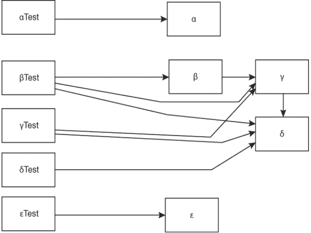

**图 4.7** 结构耦合

在图的右侧，我们看到五个生产代码模块：α、β、γ、δ 和 ε。α 和 ε 模块是独立的，但 β 与 γ 耦合，而 γ 与 δ 耦合。在左侧，我们看到测试模块。注意，每个测试模块都与对应的生产代码模块耦合。然而，由于 β 与 γ 和 δ 耦合，βₜₑₛₜ 也可能与 γ 和 δ 耦合。

这种耦合可能并不明显。βₜₑₛₜ 很可能与 γ 和 δ 存在耦合，原因是 β 可能需要用 γ 和 δ 来构造，或者 β 的方法可能把 γ 和 δ 作为参数。

βₜₑₛₜ 与如此多的生产代码之间的这种强大耦合意味着，对 δ 的微小改动可能影响 βₜₑₛₜ、γₜₑₛₜ 和 δₜₑₛₜ。因此，测试与生产代码之间的一一对应关系可能导致非常紧密的耦合和脆弱性。


#### 打破对应关系

要打破——或避免建立——测试与生产代码之间的对应关系，我们需要像看待软件系统中所有其他模块那样看待测试模块：将它们视为彼此独立且解耦的模块。

起初，这似乎很荒谬。你可能会争辩说，测试必须与生产代码耦合，因为测试会*执行*生产代码。后一个分句是对的，但谓语判断是错的。执行代码并不意味着强耦合。事实上，优秀的设计者总是努力打破模块之间的强耦合，同时允许这些模块相互交互并彼此执行。

这是如何实现的？通过创建接口层。

在图4.8的图中，我们看到αTest与α耦合。在α背后，我们看到一组支持α的模块，但αTest对此一无所知。α模块是通向该模块族的接口。优秀的程序员会非常小心，确保α模块族的任何细节都不会从该接口泄漏出去。

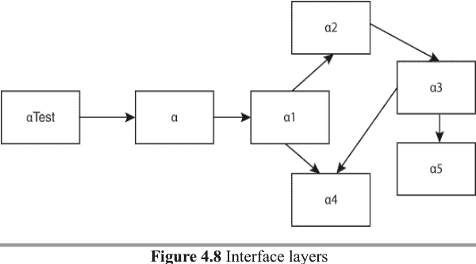

```java
    return 1;
  }
}
```

**重构：** 我们可以对它做不少清理。

单击此处查看代码图片

```java
public class CustomerTest {
  private Customer customer;

  @Before
  public void setUp() throws Exception {
    customer = new Customer();
  }

  private void assertFeeAndPoints(double fee, int points) {
    assertEquals(fee, customer.getRentalFee(), 0.001);
    assertEquals(points, customer.getRenterPoints());
  }

  @Test
  public void RegularMovie_OneDay() throws Exception {
    customer.addRental("RegularMovie", 1);
    assertFeeAndPoints(1.5, 1);
  }
}
```

**需求2：** 普通电影在第二、第三天的租借是免费的，并且这两天不获得积分。

**绿：** 生产代码无需更改。

单击此处查看代码图片

```java
@Test
public void RegularMovie_SecondAndThirdDayFree() throws Exception {
  customer.addRental("RegularMovie", 2);
  assertFeeAndPoints(1.5, 1);
  customer.addRental("RegularMovie", 3);
  assertFeeAndPoints(1.5, 1);
}
```

**需求3：** 此后所有天数的租金为 $1.50，并获得 1 个租赁积分。

**红：** 测试很简单。

单击此处查看代码图片

```java
@Test
public void RegularMovie_FourDays() throws Exception {
    customer.addRental("RegularMovie", 4);
    assertFeeAndPoints(3.0, 2);
}
```

**绿：** 这并不难修复。

单击此处查看代码图片

```java
public class Customer {
    private int days;

    public void addRental(String title, int days) {
        this.days = days;
    }

    public double getRentalFee() {
        double fee = 1.5;
        if (days > 3)
            fee += 1.5 * (days - 3);
        return fee;
    }

    public int getRenterPoints() {
        int points = 1;
        if (days > 3)
            points += (days - 3);
        return points;
    }
}
```

**重构：** 我们可以消除一些重复，但这会带来一些麻烦。

单击此处查看代码图片

```java
public class Customer {
    private int days;

    public void addRental(String title, int days) {
        this.days = days;
    }

    public int getRentalFee() {
        return applyGracePeriod(150, 3);
    }

    public int getRenterPoints() {
        return applyGracePeriod(1, 3);
    }

    private int applyGracePeriod(int amount, int grace) {
        if (days > grace)
            return amount + amount * (days - grace);
        return amount;
    }
}
```

**红：** 我们想对租赁积分和费用都使用 `applyGracePeriod`，但费用是 `double`，积分是 `int`。钱永远不应该用 `double` 表示！于是，我们把费用改成了 `int`，结果所有测试都失败了。我们需要回头修复所有测试。

单击此处查看代码图片

```java
public class CustomerTest {
    private Customer customer;

    @Before
    public void setUp() throws Exception {
        customer = new Customer();
    }

    private void assertFeeAndPoints(int fee, int points) {
        assertEquals(fee, customer.getRentalFee());
```

```java
else
    return 100;
}
```

**重构：** 但现在我们必须清理那处丑陋之处。视频类型绝不应该与标题耦合，所以让我们做一个注册表。

单击此处查看代码图片

```java
public class Customer {
    private String title;
    private int days;
    private Map<String, VideoType> movieRegistry = new HashMap<>();

    enum VideoType { REGULAR, CHILDRENS};

    public Customer() {
        movieRegistry.put("RegularMovie", REGULAR);
        movieRegistry.put("ChildrensMovie", CHILDRENS);
    }

    public void addRental(String title, int days) {
        this.title = title;
        this.days = days;
    }

    public int getRentalFee() {
        if (getType(title) == REGULAR)
            return applyGracePeriod(150, 3);
        else
            return 100;
    }

    private VideoType getType(String title) {
        return movieRegistry.get(title);
    }

    public int getRenterPoints() {
        return applyGracePeriod(1, 3);
    }

    private int applyGracePeriod(int amount, int grace) {
        if (days > grace)
            return amount + amount * (days - grace);
        return amount;
    }
}
```

这样更好，但它违反了单一职责原则⁷，因为 Customer 类不应负责初始化注册表。注册表应在系统的早期配置阶段初始化。让我们把该注册表从 `Customer` 中分离出来：

⁷. Robert C. Martin，*整洁架构：软件结构与设计工匠指南*（Addison-Wesley，2018），61ff.

单击此处查看代码图片

```java
public class VideoRegistry {
    public enum VideoType {REGULAR, CHILDRENS}

    private static Map<String, VideoType> videoRegistry =
            new HashMap<>();

    public static VideoType getType(String title) {
        return videoRegistry.get(title);
    }

    public static void addMovie(String title, VideoType type) {
        videoRegistry.put(title, type);
    }
}
```

`VideoRegistry` 是一个单态⁸类，保证只有一个实例。它由测试静态初始化：

⁸. Robert C. Martin，*敏捷软件开发：原则、模式与实践*（Prentice Hall，2003），180ff.

单击此处查看代码图片

```java
public class Customer {
    private List<Rental> rentals = new ArrayList<>();

    public void addRental(String title, int days) {
        rentals.add(new Rental(title, days));
    }

    public int getRentalFee() {
        int fee = 0;
        for (Rental rental : rentals) {
            if (rental.type == REGULAR)
                fee += applyGracePeriod(150, rental.days, 3);
            else
                fee += rental.days * 100;
        }
        return fee;
    }

    public int getRenterPoints() {
        int points = 0;
        for (Rental rental : rentals) {
            if (rental.type == REGULAR)
                points += applyGracePeriod(1, rental.days, 3);
            else
                points++;
        }
        return points;
    }

    private int applyGracePeriod(int amount, int days, int grace) {
        if (days > grace)
            return amount + amount * (days - grace);
        return amount;
    }
}

public class Rental {
    public String title;
    public int days;
    public VideoType type;
}
```

```java
public int getRentalFee() {
    int fee = 0;
    for (Rental rental : rentals)
        fee += feeFor(rental);
    return fee;
}
```

```java
private int feeFor(Rental rental) {
    int fee = 0;
    if (rental.getType() == REGULAR)
        fee += applyGracePeriod(150, rental.getDays(), 3);
    else
        fee += rental.getDays() * 100;
    return fee;
}
```

```java
public int getRenterPoints() {
    int points = 0;
    for (Rental rental : rentals)
        points += pointsFor(rental);
    return points;
}
```

```java
private int pointsFor(Rental rental) {
    int points = 0;
    if (rental.getType() == REGULAR)
        points += applyGracePeriod(1, rental.getDays(), 3);
    else
        points++;
    return points;
}
```

这两个私有函数似乎更多是在操作 Rental，而不是 Customer。让我们把它们连同其工具函数 applyGracePeriod 一起移走。这会使 Customer 类干净得多。

单击此处查看代码图片

```java
public class Customer {
    private List<Rental> rentals = new ArrayList<>();
}
```


```java
    public void addRental(String title, int days) {
        rentals.add(new Rental(title, days));
    }
```

```java
    public int getRentalFee() {
        int fee = 0;
        for (Rental rental : rentals)
            fee += rental.getFee();
        return fee;
    }
```

```java
    public int getRenterPoints() {
        int points = 0;
        for (Rental rental : rentals)
            points += rental.getPoints();
        return points;
    }
```

`Rental` 类已经变得臃肿了很多，现在也丑陋多了：

[点击此处查看代码图片](#)

```java
    public class Rental {
        private String title;
        private int days;
        private VideoType type;

        public Rental(String title, int days) {
            this.title = title;
            this.days = days;
            type = VideoRegistry.getType(title);
        }

        public String getTitle() {
            return title;
        }

        public VideoType getType() {
            return type;
        }
    }
```

```java
public int getFee() {
    int fee = 0;
    if (getType() == REGULAR)
        fee += applyGracePeriod(150, days, 3);
    else
        fee += getDays() * 100;
    return fee;
}

public int getPoints() {
    int points = 0;
    if (getType() == REGULAR)
        points += applyGracePeriod(1, days, 3);
    else
        points++;
    return points;
}

private static int applyGracePeriod(int amount, int days, int grace)
{
    if (days > grace)
        return amount + amount * (days - grace);
    return amount;
}
```

那些丑陋的 if 语句需要被消除。每一种新的视频类型都意味着这些语句中又会多出一个分支。让我们用一些子类和 polymorphism 来提前解决这个问题。

首先，是抽象 `Movie` 类。它包含 `applyGracePeriod` 工具方法，以及两个用于获取费用和积分的抽象函数。

[点击此处查看代码图片](#)

```java
public abstract class Movie {
    private String title;

    public Movie(String title) {
```

```java
    }

    public int getRenterPoints() {
        int points = 0;
        for (Rental rental : rentals)
            points += rental.getPoints();
        return points;
    }
}
```

现在让我们看看结果的图示（图 4.10）。

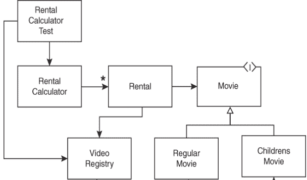

**图 4.10 结果**

随着代码演进，`RentalCalculator` 右侧的所有那些类都是通过各种重构创建出来的。然而，除了 `VideoRegistry` 之外，`RentalCalculatorTest` 对它们一无所知；而 `VideoRegistry` 必须用测试数据初始化。此外，没有其他测试模块会使用这些类。

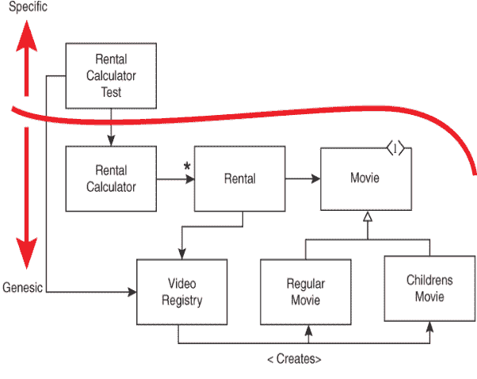

图 4.11 测试套件变得更具体，而被测试的模块家族变得更通用。

这是重构步骤的目标之一。你在视频店示例中看到了它的发生。首先添加一个测试用例。然后添加一些丑陋的生产代码，让测试通过。那些生产代码并不通用。事实上，它往往非常具体。然后，在重构步骤中，那些具体代码被调整成更通用的形式。

测试与生产代码的这种分化演进意味着，二者的形态将显著不同。测试会成长为线性的约束和规格列表。另一方面，生产代码会成长为一个丰富的逻辑和行为家族，它们被组织起来以应对驱动应用程序的底层抽象。

这种分化风格进一步将测试与生产代码解耦，保护二者免受对方变化的影响。

当然，耦合永远无法被完全打破。一方发生变化时，会迫使另一方也发生变化。目标不是消除这类变化，而是将它们最小化。而且所描述的技术有助于实现这一目标。

#### 变换优先级前提

前面的章节引出了一个引人入胜的观察。当我们践行 TDD 纪律时，我们会逐步让测试更具体，同时操纵生产代码使其越来越通用。但这些变化是如何发生的呢？

给测试添加约束很简单：要么向现有测试添加新的断言，要么添加一个全新的测试方法，用来安排、执行，然后断言新约束。这一操作完全是添加式的。现有测试代码不会改变，只会添加新代码。

然而，让新约束通过测试，往往并不是一个添加式的过程。相反，必须变换现有生产代码，使其行为不同。这些变换是对现有代码的小改动，会改变该代码的行为。

然后，当然，会对生产代码进行重构以清理它。这些重构也是对生产代码的小改动，但在这种情况下，它们保持行为不变。

你现在应该已经看到它与红/绿/重构循环的关联。红色步骤是添加式的。绿色步骤是变换式的。重构步骤是恢复式的。

我们在第 5 章“重构”中讨论恢复式重构。这里，我们讨论变换。

变换是对代码的小改动，它改变行为，同时泛化解决方案。解释这一点的最好方式是通过一个示例。

回想第 2 章中的质因数 kata。早些时候，我们看到了一个失败的测试和一个退化实现。

点击此处查看代码图片

##### 常量 → 变量

这个变换把常量变成变量。我们在栈 kata（第 2 章）中看到了这一点：当时我们创建了 `empty` 变量，用来保存 `isEmpty` 一直返回的 `true` 值。

点击此处查看代码图片

```java
public class Stack {
    private boolean empty = true;

    public boolean isEmpty() {
        return empty;
    }
    ...
}
```

在质因数示例中我们再次看到了这一点：为了让因式分解 3 的用例通过，我们用参数 `n` 替换了常量 2。

点击此处查看代码图片

```java
private List<Integer> factorsOf(int n) {
  ArrayList<Integer> factors = new ArrayList<>();
  if (n>1)
    factors.add(n);
  return factors;
}
```

此时应该很明显，到目前为止，这些变换中的每一个都会把代码从一个非常具体的状态移动到一个稍微更通用的状态。每一个都是一次泛化，是一种让代码处理比之前更广泛约束集合的方法。

如果仔细思考，你会意识到，每一个这样的变换所拓宽的可能性，都远远超过当前失败测试施加在代码上的约束。因此，当这些变换被逐一应用时，测试约束与代码通用性之间的竞赛必定以泛化获胜告终。最终，生产代码会变得足够通用，从而通过当前需求内所有未来的约束。

```java
factors.add(2);
n /= 2;
}
}
if (n > 1)
  factors.add(n);
return factors;
}
```

##### 值 → 变异值

这个变换会修改变量的值，通常是为了在循环或增量计算中累积部分值。我们在好几个 kata 中都看到了这一点，但也许最显著的是在[第 3 章](#)的排序 kata 中。

注意，前两个赋值不是变异。第一个和第二个值只是被初始化。真正构成变异的是 `list.set(...)` 操作。它们实际改变了列表中的元素。

[点击此处查看代码图片](#)

```java
private List<Integer> sort(List<Integer> list) {
    if (list.size() > 1) {
        if (list.get(0) > list.get(1)) {
            int first = list.get(0);
            int second = list.get(1);
            list.set(0, second);
            list.set(1, first);
        }
    }
    return list;
}
```

##### 示例：斐波那契

让我们尝试一个简单的 kata，并记录这些变换。我们将做久经考验的斐波那契 kata。记住 `fib(0) = 1`、`fib(1) = 1`，以及 `fib(n) = fib(n-1) + fib(n-2)`。


我们一如既往地从一个失败的测试开始。如果你好奇为什么我使用 BigInteger，那是因为斐波那契数增长得非常快。

点击此处查看代码图片

```java
public class FibTest {
  @Test
  public void testFibs() throws Exception {
    assertThat(fib(0), equalTo(BigInteger.ONE));
  }

  private BigInteger fib(int n) {
    return null;
  }
}
```

我们可以通过使用“空值 → 常量”变换来使其通过。

点击此处查看代码图片

```java
private BigInteger fib(int n) {
  return new BigInteger("1");
}
```

是的，我也觉得使用 String 参数很奇怪；但这就是 Java 库的作风。

下一个测试直接就通过了：

点击此处查看代码图片

```java
@Test
public void testFibs() throws Exception {
  assertThat(fib(0), equalTo(BigInteger.ONE));
  assertThat(fib(1), equalTo(BigInteger.ONE));
}
```

下一个测试失败：

点击此处查看代码图片

```java
@Test
public void testFibs() throws Exception {
  assertThat(fib(0), equalTo(BigInteger.ONE));
  assertThat(fib(1), equalTo(BigInteger.ONE));
  assertThat(fib(2), equalTo(new BigInteger("2")));
}
```

我们可以通过使用“无条件 → 选择”变换来使其通过：

点击此处查看代码图片

```java
private BigInteger fib(int n) {
    if (n > 1)
        return new BigInteger("2");
    else
        return new BigInteger("1");
}
```

这已经危险地接近“更具体而非更通用”，不过它让我对 `fib` 函数接受负数参数的可能性感到兴奋。

下一个测试引诱我们直奔金牌：

点击此处查看代码图片

```java
assertThat(fib(3), equalTo(new BigInteger("3")));
```

解决方案使用了“语句 → 递归”变换：

点击此处查看代码图片

```java
private BigInteger fib(int n) {
    if (n > 1)
        return fib(n-1).add(fib(n-2));
    else
        return new BigInteger("1");
}
```

这是一个非常优雅的解决方案。但它也极其耗时¹⁰ 和耗内存。过早追求金牌往往会付出代价。我们是否还有其他方法来完成最后一步呢？

- 10. fib(40) == 165580141，在我的 2.3GHz MacBook Pro 上计算耗时九秒。

当然有：

点击此处查看代码图片

```java
private BigInteger fib(int n) {
    return fib(BigInteger.ONE, BigInteger.ONE, n);
}
```

```java
private BigInteger fib(BigInteger fm2, BigInteger fm1, int n) {
    if (n>1)
        return fib(fm1, fm1.add(fm2), n-1);
    else
        return fm1;
}
```

这是一个不错的尾递归算法，速度尚可。^11

- 11. fib(100) == 573147844013817084101，耗时 10ms。

你可能会认为最后那个变换只是“语句 → 递归”的另一种应用，但它并不是。它实际上是“选择 → 迭代”。事实上，如果 Java 编译器愿意屈尊为我们提供尾调用优化，^12 它几乎会精确地翻译成下面这段代码。注意其中隐含的 if->while。

- 12. Java，Java，为何你偏偏是Java？

点击此处查看代码图片

```java
private BigInteger fib(int n) {
    BigInteger fm2 = BigInteger.ONE;
    BigInteger fm1 = BigInteger.ONE;
    while (n>1) {
        BigInteger f = fm1.add(fm2);
        fm2 = fm1;
        fm1 = f;
        n--;
    }
    return fm1;
}
```

我带你走这段小小的岔路，是为了说明一个重要观点：

> *规则14：如果某个变换让你得到一个次优的解决方案，那就尝试另一个不同的变换。*

实际上，这是我们第二次遇到这样的情况：一个变换导致次优解，而另一个变换产生了好得多的结果。第一次是在排序 kata 中。那次的情况是“值 → 变异值”变换。

### 5 重构

这一纪律追求两个目标。第一，每个函数都应只做*一件事*。<sup>5</sup> 第二，你的代码读起来应该像*文笔优美的散文*。<sup>6</sup>

- 5. 马丁，《代码整洁之道》，第7页。
- 6. 马丁，第8页。

当一个函数无法再从中提取出其他函数时，它就做到了只做*一件事*。因此，为了让你的函数都只做*一件事*，你应该提取、提取、再提取，直到再也无法提取为止。

这当然会导致大量微小函数。这也许会让你不安。你可能会觉得这么多微小函数会掩盖代码的意图。你可能会担心在这样一个巨大的函数群中很容易迷路。

但事实恰恰相反。代码的意图变得更加明显。抽象层次变得清晰，层次之间的界限也变得分明。

请记住，现代语言都拥有丰富的模块、类和命名空间。这让你可以构建一个名称层级结构来放置你的函数。命名空间包含类，类包含函数。公共函数引用私有函数。类包含内部类和嵌套类，等等。善用这些工具来创建结构，使其他程序员能够轻松找到你编写的函数。

然后选择好名字。记住，函数名的长度应与其所在作用域的范围成*反比*。公共函数的名称应该相对较短，私有函数的名称应该较长。

随着你不断提取，函数名会变得越来越长，因为函数的目的会变得越来越不通用。这些提取出来的函数大多只会被一个地方调用，因此它们的目的会极其专一而精确。这类专一而精确的函数的名称必须很长。它们很可能是完整的从句，甚至完整的句子。

这些函数将在`while`循环和`if`语句的括号内被调用，也会在这些语句的语句体中被调用，从而产生如下代码：

点击此处查看代码图片

```java
if (employeeShouldHaveFullBenefits())
  AddFullBenefitsToEmployee();
```

这将让你的代码读起来像*文笔优美的散文*。

使用**提取方法**重构也是让你的函数遵循*阶梯规则*⁷ 的方式。我们希望函数中的每一行都处于相同的抽象层级，并且该层级应比函数*名称*所代表的层级低一级。为此，我们提取函数中所有低于期望层级的代码片段。

- 7. 马丁，第37页。

#### 提取变量

如果说**提取方法**是所有重构中最重要的，那么**提取变量**就是它得力的助手。事实证明，为了提取方法，你往往必须先提取变量。

例如，考虑第2章“测试驱动开发”中保龄球游戏的重构。我们最初是这样的：

点击此处查看代码图片

```java
@Test
public void allOnes() throws Exception {
  for (int i=0; i<20; i++)
    g.roll(1);
  assertEquals(20, g.score());
}
```

而最终我们得到的是：

点击此处查看代码图片

```java
private void rollMany(int n, int pins) {
  for (int i = 0; i < n; i++) {
    g.roll(pins);
  }
}
```

```java
@Test
public void allOnes() throws Exception {
    rollMany(20, 1);
    assertEquals(20, g.score());
}
```

重构的序列如下：

- 1. **提取变量：** `g.roll(1)` 中的 `1` 被提取到一个名为 `pins` 的变量中。
- 2. **提取变量：** `assertEquals(20, g.score());` 中的 `20` 被提取到一个名为 `n` 的变量中。
- 3. 这两个变量被移动到 `for` 循环之上。
- 4. **提取方法：** `for` 循环被提取到 `rollMany` 函数中。变量的名字成为了参数的名字。
- 5. **内联：** 这两个变量被内联。它们已经完成了使命，不再需要了。

**提取变量**的另一个常见用途是创建*解释性变量*。<sup>8</sup> 例如，考虑下面的 if 语句：

- 8. 肯特·贝克，《Smalltalk 最佳实践模式》（Addison-Wesley，1997），第108页。

点击此处查看代码图片

```java
if (employee.age > 60 && employee.salary > 150000)
    ScheduleForEarlyRetirement(employee);
```

使用解释性变量可能读起来更好：

点击此处查看代码图片

```java
boolean isEligibleForEarlyRetirement = employee.age > 60 &&
                                       employee.salary > 150000;
if (isEligibleForEarlyRetirement)
    ScheduleForEarlyRetirement(employee);
```


#### 提取字段

这种重构可以产生极其积极的影响。我不经常使用它，但一旦使用，它会让代码走上大幅改进的道路。

一切都始于一次失败的**提取方法**。考虑下面的类，它将数据 CSV 文件转换为报告。它有点混乱。

[点击此处查看代码图像](#)

```java
public class NewCasesReporter {
    public String makeReport(String countyCsv) {
        int totalCases = 0;
        Map<String, Integer> stateCounts = new HashMap<>();
        List<County> counties = new ArrayList<>();


        String[] lines = countyCsv.split("\n");
        for (String line : lines) {
            String[] tokens = line.split(",");
            County county = new County();
            county.county = tokens[0].trim();
            county.state = tokens[1].trim();
            //compute rolling average
            int lastDay = tokens.length - 1;
            int firstDay = lastDay - 7 + 1;
            if (firstDay < 2)
                firstDay = 2;
            double n = lastDay - firstDay + 1;
            int sum = 0;
            for (int day = firstDay; day <= lastDay; day++)
                sum += Integer.parseInt(tokens[day].trim());
            county.rollingAverage = (sum / n);


            //compute sum of cases.
            int cases = 0;
            for (int i = 2; i < tokens.length; i++)
                cases += (Integer.parseInt(tokens[i].trim()));
            totalCases += cases;
            int stateCount = stateCounts.getOrDefault(county.state, 0);
            stateCounts.put(county.state, stateCount + cases);
            counties.add(county);
        }
        StringBuilder report = new StringBuilder("" +
        "County      State      Avg New Cases\n" +
        "======      =====      ================\n");
    for (County county : counties) {
      report.append(String.format("%-11s%-10s%.2f\n",
          county.county,
          county.state,
          county.rollingAverage));
    }
    report.append("\n");
    TreeSet<String> states = new TreeSet<>(stateCounts.keySet());
    for (String state : states)
      report.append(String.format("%s cases: %d\n",
          state, stateCounts.get(state)));
    report.append(String.format("Total Cases: %d\n", totalCases));
    return report.toString();
  }

  public static class County {
    public String county = null;
    public String state = null;
    public double rollingAverage = Double.NaN;
  }
}
```

幸好对我们来说，作者很贴心地写了一些测试。这些测试不算很好，但够用了。

点击此处查看代码图像

```java
public class NewCasesReporterTest {
  private final double DELTA = 0.0001;
  private NewCasesReporter reporter;


  @Before
  public void setUp() throws Exception {
    reporter = new NewCasesReporter();
  }


  @Test
  public void countyReport() throws Exception {
    String report = reporter.makeReport("" +
        "c1, s1, 1, 1, 1, 1, 1, 1, 1, 7\n" +
        "c2, s2, 2, 2, 2, 2, 2, 2, 2, 7");
    assertEquals("" +
        "County    State     Avg New Cases\n" +
        "======    =====     ==============\n" +
        "c1        s1        1.86\n" +
        "c2        s2        2.71\n\n" +
        "s1 cases: 14\n" +
        "s2 cases: 21\n" +
        "Total Cases: 35\n",
        report);
  }

  @Test
  public void stateWithTwoCounties() throws Exception {
    String report = reporter.makeReport("" +
        "c1, s1, 1, 1, 1, 1, 1, 1, 1, 7\n" +
        "c2, s1, 2, 2, 2, 2, 2, 2, 2, 7");
    assertEquals("" +
        "County    State     Avg New Cases\n" +
        "======    =====     ==============\n" +
        "c1        s1        1.86\n" +
        "c2        s1        2.71\n\n" +
        "s1 cases: 35\n" +
        "Total Cases: 35\n",
        report);
  }

  @Test
  public void statesWithShortLines() throws Exception {
    String report = reporter.makeReport("" +
        "c1, s1, 1, 1, 1, 1, 1, 7\n" +
        "c2, s2, 7\n");
    assertEquals("" +
        "County    State     Avg New Cases\n" +
        "======    =====     ==============\n" +
        "c1        s1        2.20\n" +
        "c2        s2        7.00\n\n" +
        "s1 cases: 11\n" +
        "s2 cases: 7\n" +
        "Total Cases: 18\n",
        report);
  }
}
```

也不想传入那四个参数。我们真正想传入提取函数的只是 `lines` 数组。

所以让我们点击取消，然后再看看。

为了正确地进行重构，我们需要把那个循环中的一些局部变量提取为外围类的字段。我们使用**提取字段**重构来完成这件事：

[点击此处查看代码图像](#)

```java
public class NewCasesReporter {
    private int totalCases;
    private final Map<String, Integer> stateCounts = new HashMap<>();
    private final List<County> counties = new ArrayList<>();

    public String makeReport(String countyCsv) {
        totalCases = 0;
        stateCounts.clear();
        counties.clear();

        String[] lines = countyCsv.split("\n");
        for (String line : lines) {
            String[] tokens = line.split(",");
            County county = new County();
```

请注意，我们在 `makeReport` 函数的顶部初始化这些变量的值。这保留了原来的行为。

现在我们可以提取出循环，而不需要传入比我们想要的更多的变量，也不需要返回 `totalCases`：

[点击此处查看代码图像](#)

```java
public class NewCasesReporter {
    private int totalCases;
    private final Map<String, Integer> stateCounts = new HashMap<>();
    private final List<County> counties = new ArrayList<>();

    public String makeReport(String countyCsv) {
        String[] countyLines = countyCsv.split("\n");
        calculateCounties(countyLines);
for (int i = 2; i < tokens.length; i++)
    cases += (Integer.parseInt(tokens[i].trim()));
totalCases += cases;
int stateCount = stateCounts.getOrDefault(county.state, 0);
stateCounts.put(county.state, stateCount + cases);
counties.add(county);
}
}

public static class County {
    public String county = null;
    public String state = null;
    public double rollingAverage = Double.NaN;
}
}
```

现在，有了这些变量作为字段，我们可以继续提取并重命名，直到心满意足。

[点击此处查看代码图像](#)

```java
public class NewCasesReporter {
    private int totalCases;
    private final Map<String, Integer> stateCounts = new HashMap<>();
    private final List<County> counties = new ArrayList<>();

    public String makeReport(String countyCsv) {
        String[] countyLines = countyCsv.split("\n");
        calculateCounties(countyLines);

        StringBuilder report = makeHeader();
        report.append(makeCountyDetails());
        report.append("\n");
        report.append(makeStateTotals());
        report.append(String.format("Total Cases: %d\n", totalCases));
        return report.toString();
    }

    private void calculateCounties(String[] countyLines) {
        totalCases = 0;
        stateCounts.clear();
        counties.clear();

        for (String countyLine : countyLines)
            counties.add(calculateCounty(countyLine));
    }

    private County calculateCounty(String line) {
        County county = new County();
        String[] tokens = line.split(",");
        county.county = tokens[0].trim();
        county.state = tokens[1].trim();

        county.rollingAverage = calculateRollingAverage(tokens);

        int cases = calculateSumOfCases(tokens);
        totalCases += cases;
        incrementStateCounter(county.state, cases);

        return county;
    }

    private double calculateRollingAverage(String[] tokens) {
        int lastDay = tokens.length - 1;
        int firstDay = lastDay - 7 + 1;
        if (firstDay < 2)
            firstDay = 2;
        double n = lastDay - firstDay + 1;
        int sum = 0;
        for (int day = firstDay; day <= lastDay; day++)
            sum += Integer.parseInt(tokens[day].trim());
        return (sum / n);
    }

    private int calculateSumOfCases(String[] tokens) {
        int cases = 0;
        for (int i = 2; i < tokens.length; i++)
            cases += (Integer.parseInt(tokens[i].trim()));
        return cases;
    }
}
```


```java
private void incrementStateCounter(String state, int cases) {
    int stateCount = stateCounts.getOrDefault(state, 0);
    stateCounts.put(state, stateCount + cases);
}


private StringBuilder makeHeader() {
    return new StringBuilder("" +
        "County      State      Avg New Cases\n" +
        "======      =====      ==============\n");
}


private StringBuilder makeCountyDetails() {
    StringBuilder countyDetails = new StringBuilder();
    for (County county : counties) {
        countyDetails.append(String.format("%-11s%-10s%.2f\n",
            county.county,
            county.state,
            county.rollingAverage));
    }
    return countyDetails;
}


private StringBuilder makeStateTotals() {
    StringBuilder stateTotals = new StringBuilder();
    TreeSet<String> states = new TreeSet<>(stateCounts.keySet());
    for (String state : states) {
        stateTotals.append(String.format("%s cases: %d\n",
            state, stateCounts.get(state)));
    }
    return stateTotals;
}


public static class County {
    public String county = null;
    public String state = null;
    public double rollingAverage = Double.NaN;
}
}
```

这样好多了，但我不喜欢报告格式化代码与数据计算代码位于同一个类中。这违反了单一职责原则，因为报告的格式和计算很可能因不同原因而变化。

为了将代码中的计算部分抽取到一个新类中，我们使用 **提取超类** 重构，将计算上移到名为 `NewCasesCalculator` 的超类中。`NewCasesReporter` 将从中派生。

[点击此处查看代码图片](#)

```java
public class NewCasesCalculator {
    protected final Map<String, Integer> stateCounts = new HashMap<>();
    protected final List<County> counties = new ArrayList<>();
    protected int totalCases;

    protected void calculateCounties(String[] countyLines) {
        totalCases = 0;
        stateCounts.clear();
        counties.clear();

        for (String countyLine : countyLines)
            counties.add(calculateCounty(countyLine));
    }

    private County calculateCounty(String line) {
        County county = new County();
        String[] tokens = line.split(",");
        county.county = tokens[0].trim();
        county.state = tokens[1].trim();

        county.rollingAverage = calculateRollingAverage(tokens);

        int cases = calculateSumOfCases(tokens);
        totalCases += cases;
        incrementStateCounter(county.state, cases);
        return county;
    }

    private double calculateRollingAverage(String[] tokens) {
        int lastDay = tokens.length - 1;
        int firstDay = lastDay - 7 + 1;
        if (firstDay < 2)
            firstDay = 2;
        double n = lastDay - firstDay + 1;
        int sum = 0;
        for (int day = firstDay; day <= lastDay; day++)
            sum += Integer.parseInt(tokens[day].trim());
        return (sum / n);
    }

    private int calculateSumOfCases(String[] tokens) {
        int cases = 0;
        for (int i = 2; i < tokens.length; i++)
            cases += (Integer.parseInt(tokens[i].trim()));
        return cases;
    }

    private void incrementStateCounter(String state, int cases) {
        int stateCount = stateCounts.getOrDefault(state, 0);
        stateCounts.put(state, stateCount + cases);
    }

    public static class County {
        public String county = null;
        public String state = null;
        public double rollingAverage = Double.NaN;
    }
}

public class NewCasesReporter extends NewCasesCalculator {
    public String makeReport(String countyCsv) {
        String[] countyLines = countyCsv.split("\\n");
        calculateCounties(countyLines);
```

#### 魔方

到目前为止，我试图向你展示一小组重构可以多么强大。在我的日常工作中，我很少使用超过我向你展示的那些重构。诀窍在于好好学习它们，并理解 IDE 的所有细节以及使用它们的技巧。

我经常把重构比作还原魔方。如果你从未解开过这种谜题，花时间学会它是值得的。一旦你掌握了诀窍，它就会相对容易。

事实证明，有一组“操作”可以应用于魔方，这些操作会保留魔方的大部分位置，但以可预测的方式改变某些位置。一旦你掌握了其中三四种操作，你就可以逐步把魔方调整到可解的状态。

你知道的操作越多，执行得越熟练，你还原魔方就越快、越直接。但你最好把这些操作学扎实。只要漏掉一步，魔方就会崩解成一堆随机分布的小方块，你不得不从头开始。

重构代码很像这样。你知道的重构越多，使用得越熟练，就越容易按你希望的方向推、拉、伸展代码。

哦，你最好也有测试。没有测试，崩溃几乎不可避免。

#### 纪律

如果你以规律且有纪律的方式对待重构，它就是安全、简单且强大的。反之，如果你把重构当作临时的、零散的活动，那种安全性和强大力量很快就会消失。

#### 测试

第一条纪律当然是测试。测试、测试、测试、测试，还有更多测试。要安全可靠地重构代码，你需要一套你可以性命相托的测试套件。你需要测试。

##### 快速测试

测试还需要快速。如果你的测试需要运行数小时（甚至数分钟），重构就无法顺利进行。

在大型系统中，无论你多么努力缩短测试时间，都很难将其缩短到几分钟以内。因此，我喜欢这样组织测试套件：能够快速轻松地运行 *相关子集* 测试，以检查我当前正在重构的那部分代码。这通常能让我把测试时间从几分钟缩短到亚秒级。我大约每小时运行一次完整套件，只是为了确保没有漏出缺陷。

##### 打破深度一对一对应关系

创建允许运行相关子集的测试结构，意味着在模块和组件层面上，测试的设计会镜像代码的设计。高层测试模块与高层生产代码模块之间很可能存在一对一对应关系。

正如我们在上一节所学到的，测试与代码之间深度的一对一对应关系会导致脆弱测试。

能够运行相关测试子集所带来的速度收益，远大于 *在那个层级上* 一对一耦合的成本。但为了防止脆弱测试，我们不希望这种一对一对应关系继续下去。因此，在模块和组件层级之下，我们有意打破这种一对一对应关系。

##### 持续重构

做饭时，我定下一条规矩：一边做一边清理备餐用的碗碟。⁹ 我不会让它们在水槽里堆积。在食物烹饪的过程中，总会有足够的时间清洗用过的器具和锅。

9. 我妻子不认可这一说法。

重构也是如此。不要等着才重构。边做边重构。把红色 → 绿色 → 重构循环记在心里，每隔几分钟就绕这个循环转一圈。这样，你就能防止混乱积累到开始让你畏惧的程度。

##### 无情重构

无情重构是 Kent Beck 为极限编程提出的金句之一。那是一句好话。这条纪律很简单：重构时要勇敢。不要害怕尝试。不要不愿做出改变。把代码当作黏土来操作，而你就是雕塑家。对代码的恐惧是心智杀手，是黑暗之路。一旦你踏上黑暗之路，它将永远主宰你的命运。它会吞噬你。

##### 保持测试通过！

有时你会意识到自己犯了一个结构性错误，并且大片代码需要修改。当新需求出现并使你当前的设计失效时，就可能发生这种情况。也可能在毫无预兆的情况下发生：某一天你突然意识到，对于项目的未来，存在一种更好的结构。

你必须无情，但也必须聪明。永远不要破坏测试！或者说，永远不要让测试保持失败状态超过几分钟。

如果重构需要数小时或数天才能完成，那就分小块进行重构，同时保持一切通过，并继续做其他活动。

例如，假设你意识到需要更改系统中的一个基础数据结构——一个如此大的数据结构

代码中有大片区域会使用它。如果你要改变那个数据结构，那些区域就会停止工作，许多测试也会失败。

相反，你应该创建一个新数据结构，镜像旧数据结构的内容。然后，逐步将代码的每个部分从旧数据结构迁移到新数据结构，同时保持测试通过。

在进行这项工作的同时，你也可以按照常规工作安排添加新功能和修复缺陷。不需要申请特殊时间来进行这次重构。你可以继续做其他工作，同时伺机调整代码，直到旧数据结构不再被使用并可以删除。

这可能需要数周甚至数月，取决于重构的规模有多大。即便如此，系统在任何时候都不会因部署而停机。即使重构只完成了一部分，测试仍然通过，系统也可以部署到生产环境。

#### 给自己留条退路

当飞入天气可能不太好的区域时，飞行员被教导始终要确保留有一条逃生通道。重构可能有点类似。有时你开始一系列重构，一两个小时后却走进死胡同。你最初的想法由于某种原因就是没有奏效。

在这种情况下，`git reset --hard` 可以成为你的朋友。

所以，在开始这样一系列重构时，务必给源代码仓库打上标签，以便需要时可以退出。

#### 结论

我故意把这一章写得很简短，因为我想补充到 Martin Fowler 的 *Refactoring* 中的想法只有几个。再次，我敦促你参考那本书以深入理解。

重构的最佳方法是，培养一套你经常使用、得心应手的重构手法，并对许多其他重构手法有良好的实用知识。如果你使用的 IDE 提供重构操作，务必详细了解它们。

没有测试，重构毫无意义。没有测试，出错的机会实在太常见。即使你的 IDE 提供的自动化重构有时也可能犯错。所以，*始终*要用一套全面的测试来保障你的重构工作。

最后，要自律。频繁重构。无情重构。并且毫无歉意地重构。永远、永远不要请求许可去重构。

很难想象这种新观点在20世纪90年代末引发了怎样的轰动。各地的设计师都已经非常习惯于把所有钩子都放进去。在那个年代，放入钩子被认为是传统智慧和最佳实践。

因此，当极限编程的 YAGNI 纪律浮出水面时，它遭到了全面批评，并被斥为异端邪说和哗众取宠的废话。

如今，讽刺的是，它已成为优秀软件设计中最重要的纪律之一。如果你有一套良好的测试，并且熟练掌握重构纪律，那么添加新功能并更新设计以支持该新功能的成本，几乎肯定小于实现和维护所有你某天可能需要的钩子的成本。

无论如何，钩子都有问题。我们很少能把它们做对。这是因为我们并不特别擅长预测客户实际会做什么。因此，我们往往会放入远超需要的钩子，并把这些钩子建立在很少能成立的假设之上。

归根结底，千兆赫兹时钟频率和太字节内存对软件设计与架构过程产生的影响让我们所有人都感到惊讶。直到20世纪90年代末，我们才意识到这些进步会让我们能够极大地*简化*设计。

我们行业的一大讽刺是，摩尔定律的指数级增长推动我们构建越来越复杂的软件系统，同时也使简化这些系统的设计成为可能。

事实证明，YAGNI 是如今我们几乎无限的计算机能力带来的意外结果。因为我们的构建时间已经缩短到几秒钟，并且因为我们有能力编写并执行在几秒钟内跑完的全面测试套件，所以我们有能力*不*放入钩子，而是随着需求变化重构设计。

这是否意味着我们永远不放钩子？我们是否总是只为我们今天需要的功能设计系统？我们是否从不提前思考并为未来做计划？

不，这不是 YAGNI 的意思。有时放入某个特定的钩子是个好主意。让代码面向未来并没有消亡，思考未来始终是明智的。

只是过去几十年里权衡取舍发生了如此巨大的变化，以至于现在通常最好把大多数钩子省掉。这就是为什么我们要问这个问题：

如果你并不需要它呢？

#### 由测试覆盖

我第一次遇到 Beck 的简单设计规则是在《*Extreme Programming Explained*》第一版中。⁴ 当时，四条规则如下：

⁴. Kent Beck，*Extreme Programming Explained*（Addison-Wesley，1999）。

- 1. 系统（代码和测试）必须传达你想要传达的一切。
- 2. 系统不得包含重复代码。
- 3. 系统应具有尽可能少的类。
- 4. 系统应具有尽可能少的方法。

到2011年，它们演变成了这样：

- 1. 测试通过。
- 2. 揭示意图。
- 3. 无重复。
- 4. 小。

到2014年，Corey Haines 写了一本书⁵，讲述这四条规则：

⁵. Corey Haines，*Understanding the Four Rules of Simple Design*（Leanpub，2014）。

2015年，Martin Fowler 写了一篇关于它们的博客⁶，在其中重新表述了这些规则：

⁶. Martin Fowler，“BeckDesignRules”，2015年3月2日，https://martinfowler.com/bliki/BeckDesignRules.xhtml。

- 1. 通过测试。
- 2. 揭示意图。
- 3. 无重复。
- 4. 最少元素。

在本书中，我将第一条规则表述为

- 1. *由测试覆盖。*

请注意，这些年来第一条规则的重点是如何变化的。第一条规则拆成了两条，最后两条规则合并成了一条。还要注意，随着岁月流逝，测试的重要性从沟通增长到了覆盖。

##### 覆盖率

测试覆盖率的概念由来已久。我能找到的最早提及可一直追溯到1963年。<sup>7</sup> 那篇文章以两段话开头，我认为你会觉得它们有趣，甚至能引发共鸣。

7. Joan Miller 和 Clifford J Maloney，“数字计算机程序的系统性错误分析”，*Communications of the ACM* 6，第2期（1963）：58–63。

> *有效的程序检查对于任何复杂的计算机程序都是必不可少的。在程序被认为可以用于解决实际问题之前，总会为它运行一个或多个测试用例。每个测试用例检查程序在其计算中实际使用的那部分。然而，错误常常直到程序投入运行数月（甚至数年）之后才暴露出来。这表明，程序中只有罕见输入条件才会调用到的部分，在检查阶段没有得到适当测试。*

> *为了自信地依赖任何特定程序，仅仅知道该程序大多数时候能工作，甚至知道它迄今为止从未出错，是不够的。真正的问题是，能否指望它每一次都能成功满足其功能规格。这意味着，程序通过检查阶段之后，不应存在这样的可能性：异常的输入数据或条件组合会揭示程序中意想不到的错误。程序的每一部分都必须在检查期间被使用，以便确认其正确性。*

1963年距离第一个程序在第一台电子计算机上运行仅仅过去了十七年，<sup>8</sup> 而我们已经知道，有效降低软件错误威胁的唯一方法就是测试每一行代码。

8. 假设第一台计算机是 Automated Computing Engine，并且第一个程序于1946年执行。


代码覆盖率工具已经存在了几十年。我不记得第一次遇到它们是什么时候。我想那是在20世纪80年代末或90年代初。当时，我在Sun Microsystems的SPARCstation工作站上工作，Sun有一个名为`tcov`的工具。

我不记得第一次听到“你的代码覆盖率是多少？”这个问题是什么时候。那大概是在2000年代初期。但此后，代码覆盖率是一个数字这一观念几乎变得普遍。

从那时起，软件团队将代码覆盖率工具作为持续构建过程的一部分来运行，并为每次构建发布代码覆盖率数字，已经变得相对普遍。

什么样的代码覆盖率数字才算好？80%？90%？许多团队非常乐意报告这样的数字。但在这本书出版六十年前，Miller和Maloney对这个问题的回答却截然不同：他们的答案是100%。

还有什么其他数字可能说得通呢？如果你对80%的覆盖率感到满意，那就意味着你不知道自己20%的代码是否能正常工作。你怎么可能对此感到满意？你的客户又怎么可能对此感到满意？

所以，当我在简单设计的第一条规则中使用*覆盖*这个术语时，我指的就是*覆盖*。我指的是100%的行覆盖率和100%的分支覆盖率。

#### 一个渐近目标

你可能会抱怨100%是一个无法达到的目标。我甚至可能同意你的看法。实现100%的行覆盖率和分支覆盖率绝非易事。事实上，根据具体情况，这可能并不实际。但这并不意味着你的覆盖率无法提高。

把100%这个数字看作一个渐近目标。你可能永远达不到它，但这并不是不努力在每次提交时都越来越接近它的借口。

我曾亲自参与过一些项目，这些项目增长到数万行代码，同时始终将代码覆盖率保持在

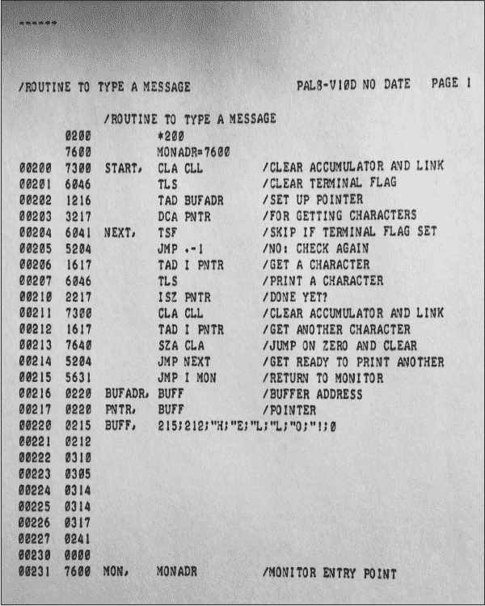

```text
/ROUTINE TO TYPE A MESSAGE

          /ROUTINE TO TYPE A MESSAGE
0200      *200
7600      MONADR=1600
00200 7300 START,  CLA CLL       /CLEAR ACCUMULATOR AND LINK
00201 6046          TLS          /CLEAR TERMINAL FLAG
00202 1216          TAD BUFADR    /SET UP POINTER
00203 3217          DCA PNTR      /FOR GETTING CHARACTERS
00204 6041 NEXT,    TSF          /SKIP IF TERMINAL FLAG SET
00205 5204          JMP .-1       /NO: CHECK AGAIN
00206 1617          TAD I PNTR    /GET A CHARACTER
00207 6046          TLS          /PRINT A CHARACTER
00210 2217          ISZ PNTR      /DONE YET
00211 7300          CLA CLL       /CLEAR ACCUMULATOR AND LINK
00212 1617          TAD I PNTR    /GET ANOTHER CHARACTER
00213 7640          SZA CLA       /JUMP ON ZERO AND CLEAR
00214 5204          JMP NEXT      /GET READY TO PRINT ANOTHER
00215 5631          JMP I MON     /RETURN TO MONITOR
00216 0220 BUFADR,  BUFF          /BUFFER ADDRESS
00217 0220 PNTR,    BUFF          /POINTER
00220 0215 BUFF,    215212;"H";"E";"L";"L";"O";"!"
00221 0212
00222 0310
00223 0305
00224 0314
00225 0314
00226 0317
00227 0241
00230 0000
00231 7600 MON,     MONADR        /MONITOR ENTRY POINT
```

图6.2 一个早期程序的示例

然而，我们不再工作在20世纪70年代。我们使用的语言*极其*富有表现力。有了适当的纪律，我们可以编写出读起来像“写得好的散文，[它]从不掩盖设计者的意图”的代码。^9

9. Martin，*代码整洁之道*，第8页（与Grady Booch的私人通信）。

作为这种代码的一个例子，请看第4章视频租赁店示例中的这一小段Java代码：

```java
public class RentalCalculator {
    private List<Rental> rentals = new ArrayList<>();

    public void addRental(String title, int days) {
        rentals.add(new Rental(title, days));
    }

    public int getRentalFee() {
        int fee = 0;
        for (Rental rental : rentals)
            fee += rental.getFee();
        return fee;
    }

    public int getRenterPoints() {
        int points = 0;
        for (Rental rental : rentals)
            points += rental.getPoints();
        return points;
    }
}
```

如果你不是这个项目的程序员，你可能无法理解这段代码中发生的一切。然而，即使只是最粗略地瞥一眼，设计者的基本意图也很容易识别。变量、函数和类型的名称极具描述性。算法的结构很容易看出。这段代码富有表现力。这段代码很简单。

#### 底层抽象

以免你认为表现力仅仅是给函数和变量取好名字的问题，我应该指出还有另一个关注点：层次的分离以及底层抽象的展示。

如果每一行代码、每个函数和每个模块都位于定义良好的分区中，清楚地描绘了代码的层次及其在整体抽象中的位置，那么软件系统就是富有表现力的。

你可能觉得上一句话很难解析，所以让我通过更啰嗦一些来把它说得更清楚一点。

想象一个具有复杂需求集的应用程序。我喜欢使用的例子是薪资系统。

- 小时工根据他们提交的工时卡在每个星期五领取工资。一周内工作超过四十小时后，每多工作一小时，他们获得1.5倍工资。
- 提成制员工在每个月的第一个和第三个星期五领取工资。他们获得基本工资，外加基于所提交销售收据的提成。
- 受薪员工在每月的最后一天领取工资。他们获得固定的月薪。

你应该不难想象一组函数，它们用复杂的`switch`语句或`if/else`链来捕获这些需求。然而，这样一组函数很可能掩盖底层抽象。那个底层抽象是什么？

```java
public List<Paycheck> run(Database db) {
    Calendar now = SystemTime.getCurrentDate();
    List<Paycheck> paychecks = new ArrayList<>();
    for (Employee e : db.getAllEmployees()) {
        if (e.isPayDay(now))
            paychecks.add(e.calculatePay());
    }
    return paychecks;
}
```

注意，这里没有提到主导这些需求的任何丑陋细节。这个应用程序的底层真相是，我们需要在所有员工的发薪日给他们发薪。将高层策略与低层细节分离，是使设计简单且富有表现力的最基础部分。

#### 测试：问题的另一半

回顾Beck最初的第一条规则：

1. *系统（代码和测试）必须传达你想要传达的一切。*

他那样措辞是有原因的，而且在某些方面，措辞被改变是不幸的。

无论你让生产代码多么富有表现力，它都无法传达其使用情境。那是测试的工作。

你编写的每个测试，尤其是当这些测试是隔离且解耦的时候，都是生产代码预期如何使用的一种演示。编写良好的测试是它们所测试的代码部分的示例用例。

因此，*合在一起看*，代码和测试表达了系统每个元素做什么以及系统每个元素应该如何使用。

这与设计有什么关系？当然，关系重大。因为我们希望通过设计实现的首要目标是让其他程序员容易理解、改进和升级我们的系统。而实现这一目标的最好方法，莫过于让系统表达它做什么以及它打算如何被使用。

#### 尽量减少重复

在软件的早期，我们根本没有源代码编辑器。我们用2号铅笔在预先印制的编码表格上编写代码。我们拥有的最好的编辑工具是橡皮擦。我们没有实际可行的复制和粘贴手段。


因此，我们不会重复代码。对我们来说，创建一个代码片段的单一实例并将其放入子程序会更容易。

但后来出现了源代码编辑器，随之而来的是复制/粘贴操作。突然间，复制一段代码、将其粘贴到新位置，然后反复摆弄直到它能工作，变得容易多了。

因此，随着岁月流逝，越来越多的系统在代码中表现出大量重复。

重复通常是个问题。两段或多段相似的代码往往需要一起修改。找到那些相似片段很难。正确地修改它们更难，因为它们存在于不同的上下文中。因此，重复会导致脆弱性。

一般来说，最好将相似的代码段缩减为单一实例，方法是将代码抽象成一个新函数，并为它提供适当的参数，以传达上下文中的任何差异。

有时这种策略并不可行。例如，有时重复出现在遍历复杂数据结构的代码中。系统的许多不同部分可能希望遍历该结构，并且会使用相同的循环和遍历代码，然后只在该代码主体中对数据结构进行操作。

随着数据结构随时间变化，程序员将不得不找出遍历代码的所有重复副本并正确地更新它们。遍历代码重复得越多，脆弱性的风险就越高。

遍历代码的重复可以通过将其封装在一个地方，并使用lambda、*Command*对象、*Strategy*模式甚至*Template Method*模式¹⁰将必要的操作传入遍历中来消除。

- 10. Erich Gamma、Richard Helm、Ralph Johnson 和 John M. Vlissides，*Design Patterns: Elements of Reusable Object-Oriented Software*（Addison-Wesley，1995）。

##### 偶然重复

并非所有重复都应被消除。有些情况下，两段代码可能非常相似，甚至完全相同，但会因非常不同的原因而变化。<sup>11</sup>我称之为*偶然重复*。偶然重复不应被消除。应该允许这种重复继续存在。随着需求变化，这些重复副本会各自演化，偶然重复也会消解。

- 11. 参见单一职责原则。Robert C. Martin，*Agile Software Development: Principles, Patterns, and Practices*（Pearson，2003）。

应当明确，管理重复并非易事。识别哪些重复是真实的、哪些是偶然的，然后封装和隔离真实重复，需要大量的思考和谨慎。

区分真实重复和偶然重复，很大程度上取决于代码表达其意图的好坏。偶然重复的意图是发散的。真实重复的意图是收敛的。

使用抽象、lambda和设计模式来封装和隔离真实重复，涉及大量重构。而重构需要一套良好且可靠的测试套件。

因此，在简单设计规则的优先级列表中，消除重复排在第三位。首先是测试和表达。

##### 最小化规模

简单的设计由简单的元素组成。简单的元素是小的。简单设计的最后一条规则指出，对于你编写的每个函数，在让所有测试通过之后，在使代码尽可能具有表达力之后，在最小化重复之后，*然后*你应该在不违反其他三项原则的前提下，努力减小每个函数内代码的规模。

你如何做到这一点？主要是通过提取更多函数。正如我们在[第5章“重构”](#)中所讨论的，你要一直提取函数，直到无法再提取为止。

这种做法会让你得到漂亮的小函数，它们有漂亮的长名称，这有助于使函数非常小且非常具有表达力。

##### 简单设计

许多年前，Kent Beck和我讨论设计原则。他说了一些让我一直铭记在心的话。他说，如果你尽可能勤勉地遵循这四件事，所有其他设计原则都会得到满足——设计原则可以归结为覆盖、表达、单一化和精简。

我不知道这是否正确。我不知道一个完美覆盖、表达、单一化和精简的程序是否必然符合开闭原则或单一职责原则。然而，我非常确定的是，了解和研究良好设计与良好架构的原则（例如SOLID原则）会使创建划分良好且简单的设计变得容易得多。

这不是一本关于那些原则的书。我以前已经写过很多次关于它们的内容，<sup>12</sup>其他人也是如此。我鼓励你阅读那些著作并研究那些原则，作为你技艺成熟的一部分。

- 12. 参见 Martin，*Clean Code*；*Clean Architecture*；以及 *Agile Software Development: Principles, Patterns, and Practices*。

### 7 协作编程


成为团队的一员意味着什么？想象一支球员队伍正在努力把球推向对方场地。想象其中一名球员绊倒并摔倒了，但比赛仍在继续。其他球员会怎么做？

其他球员通过调整场上位置来适应新的现实，以便*让球继续向对方场地推进*。

团队的行为方式就是这样。当一名团队成员倒下时，团队会掩护那名成员，直到他们重新站起来。

我们如何让一个编程团队成为这样的团队？团队如何为某个病了一周或只是编程状态不佳的人提供掩护？我们协作！我们一起工作，使整个系统的知识在团队中传播。

当Bob倒下时，最近与Bob一起工作过的其他人可以填补空缺，直到Bob重新站起来。

两个头脑胜过一个头脑的古老谚语是协作编程的基本前提。当两名程序员协作时，通常称为结对编程。<sup>1</sup>当有三名或更多程序员时，则称为群体编程。<sup>2</sup>

- 1. Laurie Williams 和 Robert Kessler，*Pair Programming Illuminated*（Addison-Wesley，2002）。
- 2. Mark Pearl，*Code with the Wisdom of the Crowd*（Pragmatic Bookshelf，2018）。

这一实践涉及两个或更多人同时在同一份代码上一起工作。如今，这通常通过使用屏幕共享软件来完成。两位程序员在各自的屏幕上看到相同的代码。两人都可以使用鼠标和键盘操作该代码。他们的工作站无论是在本地还是远程都彼此从属。

像这样的协作通常不应100%的时间都进行。相反，协作会议通常简短、非正式且间歇进行。团队应协作工作的总时间取决于团队的成熟度、技能、地理位置和人员构成，并且应在大约20%到70%的范围内。<sup>3</sup>

- 3. 有些团队100%的时间都在结对。他们似乎很享受，愿他们更强大。

一次协作会议可以短至10分钟，长至一两个小时。短于或长于这些限制的会议很可能帮助不大。我最喜欢的协作策略是使用番茄工作法。<sup>4</sup>这种技术将时间划分为约20分钟的“番茄钟”，中间有短暂休息。一次协作会议应持续一到三个番茄钟。

- 4. Francesco Cirillo，*The Pomodoro Technique*（Currency Publishing，2018）。

协作会议的持续时间比编程任务短得多。单个程序员对特定任务负责，然后不时邀请协作者帮助履行这些职责。


没有人负责主持协作会话，也没有人负责会话中被操作的代码。相反，每位参与者都是所讨论代码的平等作者和贡献者。如果在会话过程中出现争议，负责该任务的程序员是最终裁决者。

在会话中，所有人都盯着屏幕，所有人都在思考问题。可能有一两个人坐在键盘前，但这些座位在会话期间可能频繁更换。可以把这种会话同时看作现场编码练习和代码评审。

协作会话强度很高，需要大量脑力和情绪能量。在这种强度下，普通程序员大概最多能承受一两个小时，之后就需要抽身去做些消耗较少的事情。

你可能会担心，这样的协作是对人力的低效使用，独立工作的人能比一起工作的人完成更多事情。事实并非如此。对结对工作的程序员进行的研究⁵表明，结对会话中的生产率只下降约 15%，而不是人们担心的 50%。然而，在结对会话期间，结对者产生的缺陷约少 15%，而且（更重要的是）每个功能所需的代码约少 15%。

⁵. 两项此类研究分别是 Laurie Williams、Robert R. Kessler、Ward Cunningham 和 Ron Jeffries 的 “Strengthening the Case for Pair Programming”，*IEEE Software* 17, no. 4 (2000), 19–25；以及 J. T. Nosek 的 “The Case for Collaborative Programming”，*Communications of the ACM* 41, no. 3 (1998), 105–108。

最后两项统计数据意味着，所产出的代码结构显著优于程序员各自独立工作可能产出的代码。

我还没有看到关于群体编程（mobbing）的研究，但轶事证据⁶令人鼓舞。

⁶. 敏捷联盟，“Mob Programming: A Whole Team Approach，” AATC2017，https://www.agilealliance.org/resources/sessions/mob-programming-aatc2017/。

资深程序员可以与初级程序员协作。这样做时，资深程序员会在会话期间被初级程序员拖慢。另一方面，初级程序员在余生中都会因此加速——所以这是一个很好的权衡。

资深程序员也可以与资深程序员协作；只要确保房间里没有武器。

初级程序员也可以与初级程序员协作，不过资深程序员应仔细观察这类会话。初级程序员可能*更愿意*与其他初级程序员一起工作。如果这种情况发生得太频繁，资深程序员就应该介入。

有些人就是不喜欢参与这种协作。有些人在独自工作时表现更好。不应施加超出合理同伴压力的强迫，迫使他们参与协作会话。也不应因为他们的偏好而贬低他们。通常，他们在群体编程中会比在结对编程中更快乐。

协作是一项需要时间和耐心才能获得的技能。在练习很多个小时之前，不要指望自己擅长它。然而，这项技能对整个团队以及每一位参与其中的程序员都非常有益。

### 8 验收测试


在整洁技艺的所有纪律中，验收测试是程序员控制力最弱的一项。要履行这项纪律，需要业务方的参与。不幸的是，迄今为止，许多企业已被证明不愿适当参与。

你如何知道一个系统何时可以部署？世界各地的组织经常通过让 QA 部门或团队“认可”部署来做出这一决定。通常，这意味着 QA 人员运行大量手动测试，遍历系统的各种行为，直到他们确信系统按规范运行。当这些测试“通过”时，系统就可以部署了。

这意味着系统的真正需求*就是那些测试*。需求文档说什么并不重要；只有测试才重要。如果 QA 在运行测试后签字确认，系统就会部署。因此，那些测试就是需求。

验收测试这项纪律认识到这个简单事实，并建议将所有需求*以测试的形式*规定下来。这些测试应由业务分析师（BA）和 QA 团队逐个功能编写，并在每个功能实现前不久完成。QA 不负责运行这些测试。相反，这项任务留给程序员；因此，程序员很可能会将这些测试自动化。

任何心智正常的程序员都不希望一遍又一遍地手动测试系统。程序员会让事情自动化。因此，如果程序员负责运行测试，程序员*就会*将这些测试自动化。

然而，由于测试由 BA 和 QA 编写，程序员必须能够向 BA 和 QA 证明，自动化确实执行了所编写的测试。因此，用于自动化测试的语言必须是 BA 和 QA 能理解的语言。实际上，BA 和 QA 应该能够用这种自动化语言*编写*测试。

多年来，人们发明了多种工具来帮助解决这个问题：FitNesse、<sup>1</sup> JBehave、SpecFlow、Cucumber 等。但工具并不是真正的问题。软件行为的规定始终是规定输入数据、要执行的动作和预期输出数据的简单函数。这就是众所周知的 AAA 模式：Arrange/Act/Assert（准备/执行/断言）。<sup>2</sup>

- 1. fitnesse.org
- 2. 该模式归功于 Bill Wake，他在 2001 年识别出该模式（https://xp123.com/articles/3a-arrange-act-assert）。

所有测试都从准备测试的输入数据开始；然后测试会促使被测动作被执行。最后，测试断言该动作产生的输出数据与预期相符。

这三个要素可以通过多种不同方式规定，但最容易上手的是简单的表格格式。

例如，图 8.1 是 FitNesse 工具中一个验收测试的一部分。FitNesse 是一个 wiki，这个测试检查各种标记手势是否被正确转换为 HTML。要执行的动作是 `widget should render`，输入数据是 `wiki` 文本，输出是 `html` 文本。

**控件应渲染（widget should render）**

| wiki 文本 | html 文本 | |
|---|---|---|
| normal text | normal text | |
| this is ''italic'' text | this is &lt;i&gt;italic&lt;/i&gt; text | 斜体控件 |
| this is '''bold''' text | this is &lt;b&gt;bold&lt;/b&gt; text | 粗体控件 |
| !c This is centered text | &lt;center&gt;This is centered text&lt;/center&gt; | |
| !1 header | &lt;h1&gt;header&lt;/h1&gt; | |
| !2 header | &lt;h2&gt;header&lt;/h2&gt; | |
| !3 header | &lt;h3&gt;header&lt;/h3&gt; | |
| !4 header | &lt;h4&gt;header&lt;/h4&gt; | |
| !5 header | &lt;h5&gt;header&lt;/h5&gt; | |
| !6 header | &lt;h6&gt;header&lt;/h6&gt; | |
| http://files/x | &lt;a href=&quot;files/x&quot;&gt;http://files/x&lt;/a&gt; | 文件链接 |
| http://fitnesse.org | &lt;a href=&quot;http://fitnesse.org&quot;&gt;http://fitnesse.org&lt;/a&gt; | http 链接 |
| SomePage | SomePage&lt;a title=&quot;create page&quot; href=&quot;SomePage?edit&amp;nonExistent=true&quot;&gt;[?]&lt;/a&gt; | 缺失的 wiki 词 |

**图 8.1** FitNesse 工具中一个验收测试的部分结果

另一种常见格式是 Given-When-Then：

单击此处查看代码图像

```
Given a page with the wiki text: !1 header
When that page is rendered.
Then the page will contain: <h1>header</h1>
```

应该清楚的是，这些形式化表示——无论写在验收测试工具中，还是写在简单的电子表格或文本编辑器中——都相对容易自动化。

#### 纪律

在这种纪律最严格的形式下，验收测试由 BA 和 QA 编写。BA 关注正常路径场景，而 QA 关注探索系统可能失败的各种方式。

这些测试与它们所测试的功能同时编写，或略早于功能开发。在划分为冲刺或迭代的敏捷项目中，测试在冲刺的头几天编写。到冲刺结束时，它们应该全部通过。

BA 和 QA 将这些测试提供给程序员，程序员以让 BA 和 QA 保持参与的方式将它们自动化。

这些测试成为*完成定义*。一个功能直到其所有验收测试通过才算完成。而当所有验收测试通过时，该功能就完成了。

当然，这给 BA 和 QA 带来了巨大的责任。他们编写的测试必须是被测功能的完整规范。验收测试套件*就是*整个系统的需求文档。通过编写这些测试，BA 和 QA 在确认：当这些测试通过时，指定的功能已经完成并可正常工作。

有些 BA 和 QA 团队可能不习惯编写如此正式而详细的文档。在这种情况下，程序员可能希望在 BA 和 QA 的指导下编写验收测试。中间目标是创建 BA 和 QA *能读懂*并认可的测试。最终目标是让 BA 和 QA 足够适应，从而自己编写测试。


#### 持续构建

一旦某个验收测试通过，它就会进入持续构建期间运行的测试套件。

持续构建是一个自动化过程，每当程序员将代码检入源代码控制系统时³，它就会运行。该过程从源码构建系统，然后运行自动化程序员单元测试套件和自动化验收测试套件。该次运行的结果会被公开展示，通常通过电子邮件发送给每位程序员和相关方。持续构建的状态是每个人都应持续了解的事情。

³ 在几分钟内。

持续运行所有这些测试可确保系统后续变更不会破坏正常工作的功能。如果先前通过的验收测试在持续构建期间失败，团队必须立即响应并在进行任何其他变更之前修复它。任由失败在持续构建中累积是自杀式行为。

## II 标准

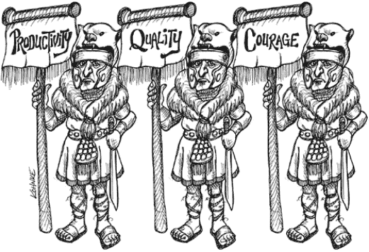

标准是基线*期望*。它们是我们决定不可逾越的底线。它们是我们设定的、我们可以接受的最低参数。标准可以被超越，但我们绝不能达不到标准。

### 你们的新 CTO

想象我是你们的新 CTO。我要告诉你们我对你们的期望。你们将阅读这些期望，并从两个相互矛盾的视角来看待它们。

第一个将是你们的管理者、高管和用户的视角。而且，从他们的视角来看，这些期望会显得显而易见且正常。没有哪位管理者、高管或用户会期望更低。

作为程序员，你可能更熟悉第二个视角。那就是程序员、架构师和技术负责人的视角。从他们的视角来看，这些期望会显得极端、不可能，甚至疯狂。

这两个视角之间的差异、这些期望之间的不匹配，是软件行业的主要缺陷，也是我们必须紧急修复的缺陷。

> > *作为你们的新 CTO，我期望……*

### 9 生产力


作为你们的 CTO，我对生产力有几项期望。

#### 我们绝不交付 S**T

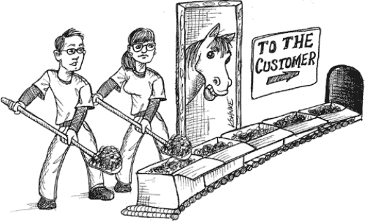

作为你们的新 CTO，我期望我们绝不交付 S**T。

我确信你知道 S**T 代表什么。作为你们的 CTO，我期望*我们不会交付 S**T。*

你曾经交付过 S**T 吗？我们大多数人有过。我有过。那感觉不好。我不喜欢。用户不喜欢。管理者不喜欢。*没有人*喜欢。

那么为什么我们要这样做？为什么我们要交付 S**T？

因为不知怎么的，我们认定自己别无选择。也许是一个我们绝对必须赶上的截止日期。也许是一个我们不好意思错过的估算。也许只是彻头彻尾的草率或粗心。也许是管理压力。也许是关乎自我价值。

无论原因是什么，它都是*无效的。*我们绝不交付 S**T，这是一条绝对的最低标准。

什么是 S**T？我确信你已经知道，但我们还是过一遍。

- 你交付的每个 bug 都是 S**T。
- 每个未经测试的函数都是 S**T。
- 每个写得糟糕的函数都是 S**T。
- 对细节的每一种依赖都是 S**T。
- 每一种不必要的耦合都是 S**T。
- GUI 中的 SQL 是 S**T。
- 业务规则中的数据库模式是 S**T。

我可以继续列举。但让我长话短说。前述章节中任何一项纪律的失败，都有交付 S**T 的风险。

这并不意味着每一项纪律都必须在任何时候被遵守。

我们是工程师。工程师会做权衡。但工程权衡不是粗心或草率。如果你必须打破某项纪律，最好有充分的理由。

更重要的是，你最好有一个好的缓解计划。

例如，假设你正在编写层叠样式表（CSS）代码。预先为 CSS 编写自动化测试几乎总是不切实际的。在你真正在屏幕上看到 CSS 之前，你并不真正知道它会如何渲染。

那么，我们将如何缓解 CSS 破坏了测试驱动开发的测试纪律这一事实？

我们将不得不靠肉眼手动测试 CSS。我们还必须在客户可能使用的所有浏览器中测试它。所以，我们最好制定一个标准描述，说明我们希望在屏幕上看到什么，以及我们可以容忍多大的差异。更重要的是，我们最好想出一个技术方案，让该 CSS 易于手动测试，因为在我们从开发环境发布它之前，将由我们而不是 QA 来测试它。

让我换一种方式说：*把工作做好！*

这才是每个人真正期望的。我们所有的管理者、所有的用户，每一个接触过我们的软件或被我们的软件影响的人，都期望我们把工作做好。我们不能让他们失望。

我期望我们绝不交付 S**T。

#### 低廉的适应性

*软件*是一个复合词，意思是“灵活的产品”。软件存在的全部理由，就是让我们能够快速、轻松地改变机器的行为。我们构建的软件越难以更改，就越是在阻碍软件存在的根本理由。

然而，软件的不灵活性仍然是我们行业的一个巨大问题。我们如此关注设计和架构，是为了提高系统的灵活性和可维护性。

为什么软件会变得僵化、不灵活且脆弱？同样，这是因为软件团队未能践行支持灵活性和可维护性的测试与重构纪律。在某些情况下，这些团队可能只依赖初始设计与架构工作。在另一些情况下，他们可能依赖那些做出不可持续承诺的时髦做法。

但无论你创建多少微服务，无论你的初始设计和架构愿景结构多么良好，如果没有测试和重构纪律，代码都会迅速腐化，系统也会变得越来越难以维护。

我不期望这样。我期望当客户要求变更时，开发团队能够以这样的策略回应：其开销*与变更范围成比例*。

客户可能不理解系统内部，但他们对自己请求的变更范围有很好的判断。他们明白一项变更可能影响许多功能。他们期望该变更的成本与其范围相称。

不幸的是，太多系统随着时间推移变得如此不灵活，以至于变更成本上升到客户和管理者无法根据所请求变更的范围来合理接受的水平。更糟的是，开发者常常以某些变更违背系统架构为由，反对这些变更，这并不罕见。

一个抵制客户所请求变更的架构，就是阻碍软件意义和意图的架构。这样的架构必须被改变，以适应客户将要进行的变更。没有什么比一个重构良好的系统和一套你信任的测试更能让这类变更变得容易。

我期望系统的设计和架构将随需求演进。我期望当客户请求变更时，这些变更不会受到现有架构或现有系统僵化与脆弱的阻碍。

我期望低廉的适应性。

#### 我们将时刻准备就绪

作为你们的新 CTO，我期望我们将时刻准备就绪。

早在敏捷让这一点流行之前，大多数软件专家就已充分理解：运作良好的项目会经历有规律的部署和发布节奏。在早期，这种节奏往往很快：每周甚至每天。然而，始于 1970 年代的瀑布运动大大放慢了节奏，变成数月，有时数年。

世纪之交敏捷的出现，重新强调了更快节奏的必要性。Scrum 建议 30 天的冲刺。XP 建议 3 周的迭代。两者都迅速将频率提高到双周。如今，开发团队每天多次部署并不罕见，实际上将开发周期缩短到接近零。

我期望快速的节奏。最多一两周。并且在每个冲刺结束时，我期望软件在技术上已准备好发布。

*技术上已准备好发布*并不意味着业务方会想要发布它。技术上已准备好的软件可能不具备业务方认为完整或适合其客户和用户的功能集。技术上已准备好仅仅意味着，如果业务方决定发布，开发团队（包括 QA）没有异议。软件可以工作、已经过测试、已有文档，并且准备好部署。

这就是*时刻准备就绪*的含义。我不期望开发团队告诉业务方等待。我不期望漫长的磨合期或所谓的*稳定化冲刺*。Alpha 和 beta 测试可能适合于


用于确定功能与用户的兼容性，但不应被用来消除编码缺陷。

很久以前，我的公司曾为一家为法律行业构建文字处理器的团队提供咨询。我们教他们极限编程。他们最终达到了这样的程度：团队每周都会刻录一张新 CD。¹ 他们会把那张 CD 放在开发者实验室里保存的一摞每周发布版本的最上面。销售人员在为潜在客户做演示的路上，会走进实验室，拿走那摞 CD 最上面的一张。这就是开发团队*准备就绪*的程度。这就是我期望我们达到的准备就绪程度。

¹. 是的，在遥远而黑暗的过去，确实有过软件通过 CD 分发的时代。

如此频繁地保持准备就绪，需要在计划、测试、沟通和时间管理方面具有非常高的纪律性。当然，这些正是敏捷的纪律。利益相关者和开发人员必须频繁参与估算并选择价值最高的开发故事。QA 必须深度参与，提供定义“完成”的自动化验收测试。开发人员必须紧密协作，并保持严格的测试、评审和重构纪律，以便在较短的开发周期内取得进展。

但*始终保持准备就绪*不仅仅是在遵循敏捷的教条和仪式。始终保持准备就绪是一种态度，一种生活方式。它是对持续提供增量价值的承诺。

我期望我们将始终保持准备就绪。

#### 稳定的生产力

软件项目常常会随着时间推移出现生产力下降。这是严重功能失调的症状。它源于对测试和重构纪律的忽视。这种忽视会导致代码日益纠缠、脆弱和僵化，从而造成越来越大的阻碍。

这种阻碍是一种失控效应。系统内的代码越脆弱、越僵化，这些代码就越难保持整洁。随着代码脆弱性的增加，对变化的恐惧也会增加。开发人员

### 10 质量


作为你们的 CTO，我对质量有若干期望。

#### 持续改进

我期望持续改进。

人类会随着时间推移改进事物。人类会在混乱之上建立秩序。人类会让事物变得更好。

我们的计算机比过去更好。我们的汽车比过去更好。我们的飞机、道路、电话、电视服务、通信服务都比过去更好。我们的医疗技术比过去更好。我们的太空技术比过去更好。我们的文明比过去好得多。

那么，为什么软件会随着时间推移而退化？我不期望我们的软件退化。

我期望，随着时间推移，我们系统的设计和架构会不断改进。我期望软件每过一周都会变得更整洁、更灵活。我期望随着软件老化，变更成本会*下降*。我期望一切都会随着时间推移变得更好。

要让软件随着时间推移变得更好，需要什么？需要意志。需要态度。需要对那些我们*知道*有效的纪律作出承诺。

我期望，任何程序员每次签入代码时，签入的代码都比他签出时更整洁。我期望每位程序员都*改进*他们触碰的代码，无论他们为什么触碰它。如果他们修复了一个缺陷，也应该让代码变得更好。如果他们正在添加一个功能，也应该让代码变得更好。我期望每一次对代码的操作都能带来更好的代码、更好的设计和更好的架构。

我期望持续改进。

#### 无畏的胜任力


我期望无畏的胜任力。

随着系统内部结构退化，系统的复杂性可能迅速变得难以驾驭。这会使开发人员自然而然地越来越害怕做出变更。即使是简单的改进也会充满风险。不愿做出变更和改进，可能会大幅降低程序员管理和维护系统的能力。

这种能力丧失并不是内在的。程序员并没有变得更不胜任。相反，系统日益增长且难以驾驭的复杂性开始超出程序员的自然能力。

随着系统对程序员来说越来越难以处理，他们开始害怕在系统上工作。这种恐惧会加剧问题，因为害怕变更系统的程序员只会做出他们认为最安全的变更。这类变更很少能改进系统。事实上，所谓的“最安全”的变更往往会使系统退化得更严重。

如果允许这种惶恐和胆怯继续下去，估算自然会膨胀，缺陷率会上升，截止日期会越来越难实现，生产力会骤降，士气会跌入谷底。

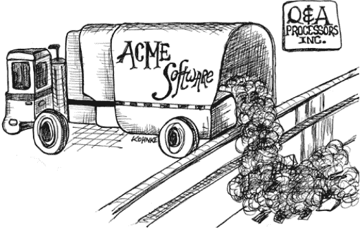

我期望我们不会把问题甩给 QA。

QA 部门为什么存在？公司为什么要投资于完全独立的团队来检查程序员的工作？答案显而易见且令人沮丧。公司选择创建软件 QA 部门，是因为程序员没有做好自己的工作。

我们是什么时候产生 QA 属于流程末端的想法的？在太多组织中，QA 坐等程序员把软件发布给他们。当然，程序员不会按计划发布软件，所以最终是 QA 被困住，只能通过缩短测试来赶发布日期。

这给 QA 人员带来了巨大压力。这是一项高压、枯燥的工作，如果要维持交付日期，就必须走捷径。而这显然不是保证质量的方式。

#### QA 病

你如何知道 QA 是否做得很好？你依据什么给他们加薪和晋升？是发现缺陷吗？最好的 QA 人员是发现缺陷最多的人吗？

如果是这样，那么 QA 会把缺陷视为积极的事情。越多越好！当然，这是病态的。

但 QA 可能并不是唯一以积极眼光看待缺陷的人。软件行业有句老话¹：“我可以满足你想要的任何进度，只要软件不需要工作。”

¹. 我第一次是从 Kent Beck 那里听到这句话的。

这听起来可能很有趣，但这也是开发人员可以用来满足个人截止日期的一种策略。如果找 bug 是 QA 的工作，那为什么不按时交付，让他们去找一些呢？

不必说任何话。不必达成任何交易。也从未发生任何握手。然而每个人都知道，开发人员和 QA 之间存在一种 bug 经济，bug 在他们之间来回流动。这是一种非常深层的病态。

我期望我们不会把问题甩给 QA。

#### QA 将什么也找不到

我期望，如果 QA 处于流程末端，那么 QA 将什么也找不到。开发团队的目标应该是：流程末端的 QA 永远找不到 bug。任何时候 QA 发现 bug，开发人员都应该下定决心查明原因、修正流程，并确保它不再发生。

QA 应该纳闷自己为什么处于流程末端，因为他们什么也找不到。

事实上，QA 不属于流程末端。QA 属于流程开端。QA 的工作不是找出所有 bug；那是程序员的工作。QA 的工作是用测试来详细说明系统行为，详细到足以将缺陷排除在最终系统之外。这些测试应该由程序员执行，而不是由 QA 执行。

我期望 QA 将什么也找不到。

#### 测试自动化

在大多数情况下，手工测试是对金钱和时间的巨大浪费。几乎所有可以自动化的测试都*应该*自动化。这包括单元测试、验收测试、集成测试和系统测试。

手工测试成本高昂。它应该保留给需要人类判断的情况。这包括检查 GUI 的美观性、探索性测试，以及主观评估交互的易用性。

探索性测试值得特别提及。这种测试完全依赖人类的创造力、直觉和洞察力。目标是通过广泛观察系统的运行方式，以经验方式推导系统行为。探索性测试人员必须推断边界情况，并推导出适当的操作路径来覆盖它们。这绝非易事，需要大量专业知识。

另一方面，大多数测试都非常适合自动化。绝大多数都是简单的 Arrange/Act/Assert 结构，可以通过提供预设输入并检查预期输出来执行。开发人员负责提供一个可函数调用的 API，使这些测试能够快速运行，并且无需大量设置执行环境。

开发人员应设计系统，将任何缓慢或需要大量设置的操作抽象出去。例如，如果系统大量使用关系数据库管理系统（RDBMS），开发人员应创建一个抽象层，将业务规则从中封装起来。这种做法使自动化测试能够用预设输入数据替换 RDBMS，从而大幅提高测试的速度和可靠性。

缓慢且不便的外围设备、接口和框架也应被抽象出去，以便单个测试可以在微秒级运行、可以在与任何环境隔离的情况下运行，²并且不受套接字时序、数据库内容或框架行为方面的任何歧义影响。

². 例如，在大西洋上空 30,000 英尺处用你的笔记本电脑运行。

#### 自动化测试与用户界面


自动化测试*不应通过用户界面来测试业务规则。* 用户界面会发生变化，其原因更多与时尚、易用性和一般营销混乱有关，而不是与业务规则有关。当自动化测试通过用户界面驱动时，如[图 10.1](#figure-10-1)所示，这些测试就会受到那些变化的影响。结果，测试变得非常脆弱，这常常导致测试因太难维护而被丢弃。

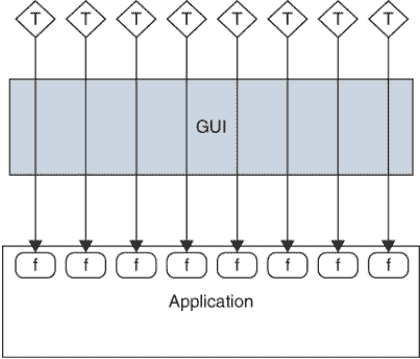

**图 10.1** 通过用户界面驱动的测试

为避免这种情况，开发人员应通过函数调用 API 将业务规则与用户界面隔离开来，如[图 10.2](#figure-10-2)所示。使用该 API 的测试完全独立于用户界面，并且不受界面变化的影响。

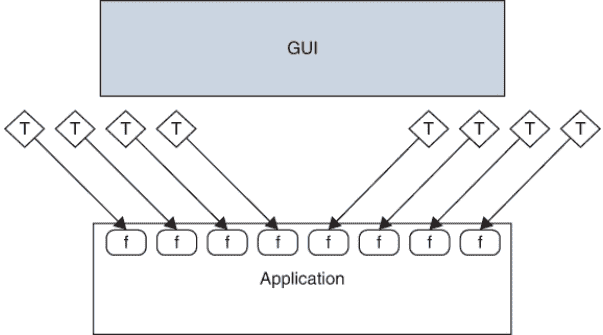

**图 10.2** 通过 API 进行的测试独立于用户界面。

#### 测试用户界面

如果业务规则通过函数调用 API 自动测试，那么用户界面行为所需的测试量就会大大减少。应注意通过用桩替代业务规则来保持与业务规则的隔离，该桩向用户界面提供预设值，如图 10.3 所示。

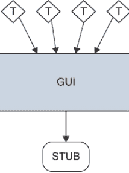

**图 10.3** 桩向用户界面提供预设值。

这样做可以确保用户界面测试快速且明确。如果用户界面相当大且复杂，那么自动化用户界面测试框架可能是合适的。使用业务规则桩将使这些测试更加可靠。

如果用户界面小而简单，那么退回到手动测试可能更省事，尤其是在需要评估美观性的情况下。同样，使用业务规则桩将使这些手动测试更容易进行。

我期望，每一项实际上可以自动化的测试*都*会被自动化，测试会快速执行，并且测试不会脆弱。

### 11 勇气


作为 CTO，我对勇气有几点期望。

#### 我们互相补位

我们用*团队*这个词来描述一组在项目上工作的开发人员。但我们真的理解团队是什么吗？

团队是一组协作者，他们如此清楚地理解自己的目标和彼此之间的互动，以至于当某位团队成员因某种原因倒下时，*他们仍会*朝着目标继续取得进展。例如，船上的每位船员都有自己的工作要做。每位船员也知道如何做别人的工作——原因显而易见。即使一名船员倒下，船也必须继续航行。

我期望编程团队的成员能像船员一样互相补位。当某位团队成员倒下时，我期望团队中的其他人接管那个角色，直到倒下的成员恢复其在团队中的位置。

团队中的人可能因许多原因倒下。他们可能生病。他们可能因家里的麻烦而分心。他们可能去度假。项目工作不能停止。其他人必须填补留下的空缺。

如果 Bob 是数据库负责人，而 Bob 倒下了，另一个人必须接手数据库工作并继续取得进展。如果 Jim 是 GUI 负责人，而 Jim 倒下了，另一个人必须接手 GUI 工作并继续取得进展。

这意味着团队中的每个成员都必须熟悉的不仅仅是自己的工作。他们必须熟悉其他人的工作，以便在其他人中的某一位倒下时能够顶上去。

但让我反过来讲。确保有人能替你补位，是*你*的责任。确保*你*不是团队中*唯一*不可或缺的成员，是你的责任。主动寻找其他人，并教给他们足够多关于你工作的内容，以便他们能在紧急情况下接替你，这也是你的责任。

你如何教别人了解你的工作？最好的方法可能是在工作站和他们坐在一起，一起写大约一个小时的代码。如果你明智，你会和团队中不止一位其他成员这样做。了解你工作的人越多，如果你倒下，能替你补位的人就越多。

并且记住，一次是不够的。当你在项目中你负责的部分继续取得进展时，你必须不断让其他人了解你的工作。在这方面，你会发现协作编程的纪律很有帮助。

我期望编程团队的成员能够互相补位。

#### 诚实的估算


我期望诚实的估算。

作为一名程序员，你能给出的最诚实的估算就是“我不知道”，因为你实际上并不知道这项任务会花多长时间。另一方面，你确实知道你可能在不到十亿年内完成这项任务。因此，诚实的估算是你不知道的东西和你确实知道的东西的混合体。

一个诚实的估算看起来大致如下：

- 我有 5% 的概率在周五前完成这项任务。
- 我有 50% 的概率在下一个周五前完成。
- 我有 95% 的概率在那之后的周五前完成。

像这样的估算提供了一个描述你不确定性的概率分布。描述你的不确定性，正是这种估算之所以诚实的原因。

当管理者要求你估算大型项目时，你应该以这种形式提供估算。例如，他们可能试图在批准项目之前判断项目成本。这时，这种对不确定性的诚实最有价值。

对于较小的任务，最好使用敏捷实践中的故事点。故事点是诚实的，因为它们不承诺具体时间范围。相反，它们通过与其他任务比较来描述一项任务的成本。所使用的数字是任意的，但具有相对性。

故事点估算看起来大致如下：

> *Deposit 故事的成本为 5。*

那个 5 是什么？它是一个任意的点数，相对于某个已知规模的任务。例如，假设 Login 故事被随意赋予 3 个点。当你估算 Deposit 故事时，你判断 Deposit 的难度还没有达到 Login 的两倍，因此给它 5。真的就是这么回事。

故事点本身已经嵌入了概率分布。首先，点不是日期或时间；它们只是点。其次，点不是承诺；它们是猜测。在每个敏捷迭代结束时（通常为一两周），我们合计已完成的点数。我们用这个数字来估算下一个迭代可能完成多少点。

我期望的是描述你不确定性的诚实估算。我不期望对某个日期的承诺。

#### 你必须说“不”

我期望当答案是不行时，你能说“不”。

程序员能说的最重要的话之一就是“不！”在正确的时间、正确的语境下说出这个回答，可以为你的雇主节省大量金钱，并防止可怕的失败和难堪。

这并不是一张许可证，让你到处怒气冲冲地对一切说不。我们是工程师；我们的工作是找到通向“是”的办法。但有时“是”并不是一个选项。我们是唯一能判断这一点的人。我们是知道的人。因此，当答案确实是不行时，由我们来说不。

假设你的老板要求你在周五前完成某件事。经过充分考虑后，你意识到你在周五前完成这项任务没有合理的机会。你必须回到老板那里说“不”。你最好还说你能在接下来的周二前完成，但你必须坚定地表示周五是不可能的。

管理者通常不喜欢听到“不”。他们可能会反驳你。他们可能会与你对峙。他们可能会对你大喊大叫。情绪对抗是一些管理者使用的工具之一。

你绝不能屈服于它。如果答案是不行，那么你必须坚持那个答案，不向压力让步。

并且要非常警惕“你至少试试行吗？”这种话术。被要求试一试似乎很合理，不是吗？但这根本不合理，因为*你已经在尝试了*。你没有什么新的办法能把“不”变成“是”，所以说你愿意试试只是一个谎言。

我期望当答案是不行时，你会说不。

#### 持续进取学习


软件行业极其动态。我们可以争论这是否*应该*如此，但无法争论这是否*确实*如此。事实就是如此。因此，我们都必须成为持续进取的学习者。

你今天使用的语言很可能不会是你5年后使用的语言。你今天使用的框架很可能不会是你明年使用的框架。通过了解周围正在发生的变化，为这些变化做好准备。

程序员经常被建议¹每年学习一门新语言。这是个好建议。此外，选择一门你不熟悉其风格的语言。如果你从未用动态类型语言写过代码，学一门。如果你从未用声明式语言写过代码，学一门。如果你从未用过 Lisp、Prolog 或 Forth，学它们。

¹. 大卫·托马斯和安德鲁·亨特，*《程序员修炼之道：从小工到专家》*（Addison-Wesley，2020）。

你如何以及何时进行这种学习？如果你的雇主为你提供时间和空间进行这类学习，那就尽可能充分利用。如果你的雇主不那么支持，那你就得用自己的时间学习。准备好每月花几个小时在上面。确保留出个人时间。

是的，我知道，你有家庭责任，有账单要付，有飞机要赶，而且你还有*生活*。好吧，但你也有*职业*。职业需要呵护和维护。

我希望我们所有人都是持续进取的学习者。

### 指导

我们似乎对越来越多程序员有无尽的需求。世界上程序员的数量正以迅猛且指数级的速度增长。大学能教的有限，不幸的是，许多大学根本没教多少。

因此，教新程序员的任务落到我们身上。我们这些已经工作了几年的程序员，必须承担起教导刚入行者的重担。

也许你觉得这很难。确实难。但它带来巨大好处。最好的学习方式是教学。其他方式都远不能及。所以，如果你想学某样东西，就去教它。

如果你已经当了5年、10年或15年程序员，你有大量经验和人生教训可以教给刚入行的新程序员。把其中一两个置于你的羽翼之下，指导他们度过最初6个月。

在他们的工作台前坐下，帮助他们写代码。给他们讲你过去的失败和成功故事。教他们纪律、标准和伦理。教他们这门手艺。

我希望所有程序员都成为导师。我希望你参与帮助他人学习。

## III 伦理


### 第一位程序员

软件职业始于1935年夏天，艾伦·图灵开始撰写他的论文，开局并不起眼。他的目标是解决一个困扰数学家十多年甚至更久的数学难题——*判定问题*。即决策问题。

他成功实现了那个目标，但当时他并不知道，他的论文将催生一个遍布全球的产业，我们所有人都依赖它，而它如今已成为我们整个文明的生命线。

许多人认为拜伦勋爵的女儿、洛芙莱斯伯爵夫人阿达是第一位程序员，这很有道理。她是我们所知第一个理解计算机器所处理的数字可以表示非数值概念的人。用符号代替数字。而且，平心而论，阿达确实为查尔斯·巴贝奇的分析机写了一些算法，不幸的是，那台机器从未被建造出来。

但正是艾伦·图灵写出了第一批¹在电子计算机上执行的程序。也正是艾伦·图灵首次*定义*了软件职业。

1945年，图灵为自动计算引擎（ACE）编写代码。他用二进制机器语言编写这段代码，使用以2为基数的数字。这样的代码此前从未有人写过，因此他不得不发明并实现子程序、栈和浮点数等概念。

在花了几个月发明这些基础概念并用它们解决数学问题之后，他写了一份报告，得出以下结论：

> *我们将需要大量有能力的数学家，因为很可能会有大量这类工作要做。*

¹. 有人指出，康拉德·楚泽在图灵为ACE编程之前，就为他的机电计算机编写了算法。

“大量。”他怎么知道？实际上，他并不知道那句话有多么具有先见之明——我们现在确实有大量这样的人。

但他说的另一件事是什么？“有能力的数学家。”你认为自己是一个有能力的数学家吗？

在同一份报告中，他接着写道：

> *我们的困难之一将是维持适当的纪律，以免我们迷失自己正在做的事情。*

“纪律！”他怎么知道？他怎能预见70年后，知道我们的问题会是纪律？

七十年前，艾伦·图灵为软件专业主义框架奠定了第一块基石。他说，我们应该是有能力并维持适当纪律的数学家。

我们是这样的人吗？你是这样的人吗？

### 七十五年

一个人的一生。截至本文写作时，我们的职业就有这么古老。仅仅75年。在那七十五年中发生了什么？让我们更仔细地重温我在[第1章“工艺”](#)中呈现的历史。

1945年，世界上只有一台计算机和一名程序员。艾伦·图灵。在最初几年，这些数字迅速增长。但让我们以此为起点。

> *1945年。计算机：O(1)。程序员：O(1)。*

在接下来的十年里，真空管的可靠性、一致性和功耗表现大幅改善。这使得建造更大、更强大的计算机成为可能。

到1960年，IBM已售出140台700系列计算机。这些是巨大、昂贵的庞然大物，只有军队、政府和超大型企业才负担得起。它们速度慢、资源有限且脆弱。

正是在这一时期，格蕾丝·霍珀发明了高级语言的概念，并创造了*编译器*一词。到1960年，她的工作促成了COBOL。

1952年，约翰·巴克斯提交了FORTRAN规范。随后ALGOL的开发迅速跟进。到1958年，约翰·麦卡锡

以2为底1亿的对数约为27——用75除以它，得到约2.8，所以也许程序员人数大约每两年半左右翻一番。

³. Visual Basic for Applications。

实际上，正如我们之前所见，最初几十年的速率更高，现在有所放缓。我猜翻倍周期约为五年。每五年，世界上程序员的数量就会翻一番。

这一事实的影响令人震惊。如果世界上程序员数量每五年翻一番，这意味着世界上有一半程序员的工作经验不足五年，而且只要翻倍速率持续，这将永远成立。这使编程行业处于一个岌岌可危的境地——永久缺乏经验。

### 书呆子与救世主

永久缺乏经验。哦，别担心，这并不意味着*你*永久缺乏经验。它只是意味着，一旦你获得5年经验，程序员人数将会翻一番。等你获得10年经验时，程序员人数将会变为四倍。

人们看到编程行业里年轻人的数量，就断定这是年轻人的职业。他们问：“老人都去哪儿了？”

我们都还在这里！我们哪儿也没去。只是从一开始我们的人数就没那么多。

问题在于，我们这些老家伙不够多，无法教导不断涌入的新程序员。每有一个拥有30年经验的程序员，就有63个程序员需要从她（或他）那里学点东西，其中32个是全新入行的。

因此便出现了永久缺乏经验的状态，且没有足够的导师来纠正这个问题。同样的老错误一遍又一遍又一遍地重复。


但在过去70年里，还发生了另一件事。程序员获得了一样我确信艾伦·图灵从未预料到的东西：名气。

20世纪50年代和60年代，没人知道程序员是什么。他们人数不够多，不足以产生社会影响。程序员并不与很多人比邻而居。

这种情况在20世纪70年代开始改变。到那时，父亲们建议儿子（有时也建议女儿）攻读计算机科学学位。世界上程序员已经足够多，以至于每个人都认识某个认识程序员的人。于是，书呆子气、吃着Twinkie的极客形象诞生了。

很少有人见过计算机，但几乎每个人都听说过它们。计算机出现在*《星际迷航》*这样的电视节目以及*《2001太空漫游》*和*《巨人：福宾计划》*这样的电影中。在这些节目中，计算机常常被塑造成反派。但在罗伯特·海因莱因1966年的著作*《严厉的月亮》*中，⁴计算机是自我牺牲的英雄。

⁴ 罗伯特·海因莱因，*《严厉的月亮》*（Ace，1966年）。

然而，请注意，在每一个案例中，程序员都不是重要角色。当时社会不知道如何看待程序员。他们模糊、隐蔽，与机器本身相比不知为何显得无足轻重。

我对这个时代的一则电视广告有着美好的记忆。一位妻子和她的丈夫——一个戴着眼镜、别着口袋保护套、拿着计算器的书呆子小个子——正在杂货店比较价格。奥尔森太太称他为“计算机天才”，随后向妻子和丈夫两人传授某个品牌咖啡的益处。

那则广告中的程序员天真、书卷气、无足轻重。聪明，但没有智慧或常识。不是你会邀请参加派对的人。事实上，计算机程序员被视为那种在学校经常被揍的人。

到1983年，个人计算机开始出现，显然青少年出于许多原因对它们感兴趣。此时，相当多的人至少认识一位计算机程序员。我们被视为专业人士，但仍然神秘。

那一年，电影*《战争游戏》*中，年轻的马修·布罗德里克饰演一名精通计算机的青少年和黑客。他黑入美国的武器控制系统，以为那是一款电子游戏，并启动了热核战争倒计时。影片结尾，他说服计算机唯一获胜的走法是不玩，从而拯救了世界。

计算机和程序员互换了角色。现在，计算机成了孩子般天真的角色，而程序员即使不是智慧的源头，也是智慧的通道。

我们在1986年的电影*《霹雳五号》*中看到了类似的情形：名为“五号”的计算机化机器人天真无邪，但在其创造者/程序员及其女友的帮助下学会了智慧。

到1993年，情况发生了巨大变化。在电影*《侏罗纪公园》*中，程序员是反派，而计算机根本不是角色。它只是工具。

社会开始理解我们是谁以及我们扮演的角色。短短20年里，我们从书呆子变成老师，再变成反派。

但这一形象又变了。在1999年的电影*《黑客帝国》*中，主角们既是程序员又是救世主。事实上，他们神一般的力量来自阅读和理解——“代码”的能力。

我们的角色变化很快。短短几年从反派到救世主。整个社会开始理解我们拥有的力量，既能行善也能作恶。

### 榜样与反派

十五年后，2014年，我访问了斯德哥尔摩的Mojang办公室，做了关于整洁代码和测试驱动开发的讲座。Mojang，如果你不知道的话，是制作游戏《我的世界》的公司。

之后，因为天气很好，我和Mojang的程序员坐在外面一个啤酒花园聊天。突然，一个大概12岁的男孩跑到围栏边，对其中一位程序员喊道：“你是Jeb吗？”他指的是延斯·伯根斯坦，Mojang的首席程序员之一。

男孩向延斯要签名，并连珠炮似的问他问题。他眼里没有别人。

而我，就坐在那儿。……

总之，重点是程序员已成为我们孩子的榜样和偶像。他们梦想长大后成为像Jeb、Dinnerbone或Notch那样的人。

程序员，现实生活中的程序员，是英雄。

但有真正的英雄，也就有真正的反派。

2015年10月，大众汽车北美公司首席执行官迈克尔·霍恩在美国国会作证，涉及他们汽车中欺骗美国国家环境保护局测试设备的软件。当被问及公司为何这样做时，他把责任归咎于程序员。他说：“是几个软件工程师出于某些原因把这个放了进去。”

当然，他关于“某些原因”的说法是在撒谎。他知道原因是什么，整个大众公司也知道。他试图把责任推给程序员，这种软弱尝试相当明显。

另一方面，他完全说对了。确实*是*一些程序员编写了那段撒谎、作弊的代码。

而那些程序员——不管他们是谁——让我们所有人蒙羞。如果我们有一个真正的专业组织，他们作为程序员的资格认定将会、也应该被撤销。他们背叛了我们所有人。他们玷污了我们职业的荣誉。

于是，我们毕业了。这用了75年。但在这段时间里，我们从无到书呆子，再到榜样和反派。

社会已经开始——仅仅是开始——理解我们是谁，以及我们所代表的威胁与希望。

### 我们统治世界

但社会还没有理解一切。事实上，我们也没有。你看，你和我，我们是程序员，而我们统治着世界。

这听起来可能像是夸张的说法，但请想一想。现在世界上计算机的数量比人还多。这些数量超过我们的计算机为我们执行无数基本任务。它们记录我们的提醒事项。它们管理我们的日历。它们传递我们的Facebook消息并保存我们的相册。它们接通我们的电话并传递我们的短信。它们控制我们汽车的发动机，以及刹车、油门，有时甚至方向盘。

没有它们，我们无法做饭。没有它们，我们无法洗衣服。它们在冬天让我们的房子保持温暖。它们在我们无聊时娱乐我们。它们记录我们的银行记录和信用卡。它们帮助我们支付账单。

事实上，现代世界的大多数人每天醒着的每一分钟都在与某个软件系统交互。有些人甚至在睡觉时继续交互。

重点在于，没有软件，我们的社会中*什么*都不会发生。没有产品被买卖。没有法律被制定或执行。没有汽车行驶。没有亚马逊产品被送达。没有电话接通。没有电力从插座流出。没有食物被送到商店。没有水从水龙头流出。没有天然气被输送到炉子。如果没有软件监控和协调一切，这些事情没有一件会发生。

而*我们*编写那些软件。这使我们成为世界的统治者。

哦，其他人以为他们制定规则——但随后他们把这些规则交给我们，而*我们*编写在机器中执行的规则，这些机器监控和协调我们生活的方方面面。

社会还没有完全理解这一点。还没有完全理解。还没有。但用不了多久，我们的社会就会对此理解得再清楚不过。

我们程序员也还没有完全理解这一点。并没有真正理解。但是，再一次，总有一天这一点会被残酷地刻进我们心里。

现在，我知道你进入这一行并不是为了杀人。也许，你成为程序员是因为你写了一个无限循环，打印了一次你的名字，然后体验到了那种令人喜悦的权力感。

但事实就是事实。我们在社会中现在所处的位置，使我们的行为可能摧毁财富、生计和生命。

总有一天，也许用不了多久，某个可怜的程序员会做一件稍微愚蠢的事，然后数万人会死去。

这不是胡乱猜测——这只是时间问题。

当这发生时，世界上的政客们会要求问责。他们会要求我们向他们展示未来将如何防止此类错误。

如果我们出现时没有一份伦理声明，如果我们出现时没有任何标准或明确的纪律，如果我们出现时抱怨老板设定了不合理的进度和截止日期——那么我们就会被判有罪。

### 誓言

为了开始讨论我们作为软件开发者的伦理，我提出以下誓言。

> *为了捍卫和维护计算机程序员职业的荣誉，我承诺，尽我所能并依据我的判断：*

- 1. *我不会生产有害的代码。*
- 2. *我生产的代码将始终是我最好的作品。我绝不会明知故犯地让在行为或结构上有缺陷的代码累积起来。*
- 3. *每次发布时，我都会提供快速、可靠且可重复的证明，表明代码的每个元素都按应有的方式工作。*
- 4. *我会频繁进行小规模发布，以免阻碍他人的进展。*


- 5. *我会无所畏惧、坚持不懈地利用每一个机会改进我的作品。我永远不会贬低它们。*
- 6. *我会尽我所能，让自身和他人的生产率尽可能高。我绝不会做任何降低生产率的事情。*
- 7. *我会持续确保他人能够接替我的工作，我也能接替他们的工作。*
- 8. *我会在规模和精度上都诚实地做出估算。没有合理把握时，我不会作出承诺。*
- 9. *我会因为同行程序员的道德、标准、纪律和技能而尊重他们。任何其他属性或特征都不会影响我对同行程序员的看法。*
- 10. *我永远不会停止学习和精进自己的手艺。*

### 12 危害


誓词中的几条承诺都与危害相关。

#### 首先，不可造成伤害

*承诺 1：我不会编写有害的代码。*

软件专业人士的第一条承诺就是“不可伤害”！这意味着你的代码不得伤害你的用户、雇主、经理或同行程序员。

你必须知道你的代码做了什么。你必须知道它能正常工作。你还必须知道它是整洁的。

不久前，有人发现大众汽车公司的一些程序员编写了故意干扰美国环境保护署（EPA）排放测试的代码。那些程序员编写了有害代码。它之所以有害，是因为它具有欺骗性。该代码欺骗了 EPA，使其允许销售那些排放的氮氧化物含量是 EPA 认为安全水平的二十倍的汽车。因此，这些代码可能危害了所有在那些汽车行驶地区生活的人的健康。

那些程序员应该受到怎样的处理？他们知道这段代码的目的吗？他们是否应该知道？

我会解雇他们并起诉他们，因为无论他们是否知道，他们*都应当*知道。以他人编写的要求为借口是站不住脚的。敲键盘的是你的手指，这是你的代码。你必须知道它在做什么！

这很难办，不是吗？我们编写代码让机器运转，而这些机器往往有可能造成巨大的伤害。因为我们要为代码造成的任何伤害负责，所以我们有责任了解代码将会做什么。

每位程序员都应根据其经验和职责级别来承担责任。随着经验和职位的提升，你对自己行为和所辖人员行为的责任也会增加。

显然，我们不能要求初级程序员像团队负责人那样承担责任；我们不能要求团队负责人像资深开发人员那样承担责任。但那些资深
从看到初始父交易的大小并相应调整价格开始。

八年前，这个父子算法的一个简单版本，名为 Power Peg，被禁用，并被一个更好的名为“智能市场接入路由系统”（SMARS）的系统所取代。但奇怪的是，旧的 Power Peg 代码并未从系统中移除，只是用一个标志将其禁用。

那个标志曾用于管理父子（交易）流程。当标志打开时，就会产生子交易；当产生的子交易足以满足父交易时，标志就会关闭。

他们只是把标志保持关闭，从而禁用了 Power Peg 代码。

不幸的是，新的软件更新重新利用了那个标志，而该更新只覆盖了八台服务器中的七台。更新打开了标志，第八台服务器便开始高速无限循环地生成子交易。

程序员们知道出了问题，但不知道具体是什么。他们花了 45 分钟才关闭那台出错的服务器——在这 45 分钟里，它一直在无限循环中进行错误交易。

最终结果是，在交易开始后的前 45 分钟里，骑士资本无意中买入了超过 70 亿美元的股票，而这些股票它并不想要，最终不得不以 4.6 亿美元的亏损卖出。更糟的是，公司只有 3.6 亿美元现金。骑士资本因此破产。

四十五分钟。一个愚蠢的错误。四亿六千万美元。

那个错误是什么呢？错误在于程序员不知道他们的系统将要做什么。

在这一点上，你可能担心我要求程序员对代码的行为拥有完美的认知。当然，完美的认知是无法实现的；总会有某种程度的认知欠缺。

问题不在于认知是否完美，而在于要知道不会造成伤害。

骑士资本那些可怜的家伙存在一种极具危害性的认知欠缺——考虑到事情的利害关系，这种欠缺本不应任其存在。

另一个例子是丰田（Toyota）以及那个导致汽车不受控制地加速的软件系统。

多达 89 人因该软件丧生，还有更多人受伤。

想象一下，你正行驶在拥挤的市中心商业区。突然，你的汽车开始加速，刹车失灵。几秒钟之内，你便冲过红绿灯和人行横道，却无法停下来。

这正是调查人员发现丰田软件所能做到的事情——而且很可能已经发生过。

该软件在夺人性命。

编写那套代码的程序员不知道自己的代码不会杀人——注意这里的双重否定。他们不知道自己的代码不会杀人。但他们应当知道这一点。他们应当知道自己的代码不会杀人。

再说一次，这一切都与风险有关。当利害关系重大时，你要尽可能让你的认知接近完美。如果涉及生命，你必须知道你的代码不会害死任何人。如果涉及财富，你必须知道你的代码不会让它们损失。

另一方面，如果你只是在编写一个聊天应用或一个简单的购物车网站，既无关财富也无关生命……

……果真如此吗？

如果有人在使用你的聊天应用时遇到医疗紧急情况，在你的应用上打出“救命，请拨打911”呢？如果你的应用出现故障，丢失了这条消息呢？

如果你的网站将个人信息泄露给黑客，让他们用来盗用身份呢？

如果因为你代码功能不佳，导致客户离开你的雇主，转投竞争对手，又当如何？

关键在于，人们很容易低估软件可能造成的危害。认为自己的软件不够重要、不可能伤害任何人，这是一种令人安慰的想法。但你忘了，编写软件的成本非常高，至少，投入开发的资金正处于风险之中——更不用说用户因依赖它而承担的风险了。

归根结底，风险几乎总是比你想象的更大。

#### 不得损害结构

你不得损害代码的结构。你必须保持代码整洁、组织良好。

问问自己，为什么骑士资本的程序员不知道他们的代码可能有害。

我认为答案相当明显。他们忘记了 Power Peg 软件仍在系统中。他们忘记了被他们重新利用的那个标志会激活它。他们还假设所有服务器始终运行着相同的软件。

他们不知道自己的系统会表现出有害行为，是因为他们对系统结构造成了损害，留下了那些死代码。这也是代码结构和整洁性如此重要的一个重要原因。结构越纠缠不清，就越难知道代码会做什么。越混乱，不确定性就越大。

以丰田案为例。为什么程序员不知道他们的软件会杀人？你认为他们拥有超过一万个全局变量这一事实，是否可能是一个因素？

把软件搞得一团糟，会削弱你了解软件功能的能力，进而削弱你预防伤害的能力。

混乱的软件就是有害的软件。

你们中有些人可能会反对，说有时为了修复一个棘手的生产环境缺陷，快速而粗糙的补丁是必要的。

当然，确实如此。如果你能用一个快速而粗糙的补丁解决生产危机，那你就应该这么做。毫无疑问。


能奏效的蠢主意就不算蠢主意。

然而，你不能把那个快速而粗糙的补丁留在原处而不造成损害。补丁留在代码中的时间越长，它能造成的损害就越大。

请记住，如果旧的 Power Peg 代码已从代码库中移除，骑士资本灾难就不会发生。正是那段早已废弃的旧代码实际执行了那些错误交易。

我们所说的“对结构的损害”是什么意思？显然，拥有数千个全局变量是一种结构缺陷。留在代码库中的死代码也是如此。

结构性损害是对源代码的组织和内容的损害。任何使源代码难以阅读、难以理解、难以修改或难以复用的东西，都是结构性损害。

每一位专业软件开发人员都有责任了解良好软件结构的纪律和标准。他们应该知道如何重构、如何编写测试、如何识别坏代码、如何解耦设计并创建适当的架构边界。他们应该知道并应用低层和高层设计的原则。每一位资深开发者都有责任确保年轻开发者学会这些东西，并在他们编写的代码中满足这些要求。

#### 软

软件（software）一词的第一个词是 *软*。软件本应是软的。它本应易于修改。如果我们不希望它易于修改，我们就会把它称为 *硬件*。

重要的是要记住软件究竟为什么存在。我们发明它，是为了让机器的行为易于改变。只要我们的软件难以修改，我们就已经违背了软件存在的根本原因。

请记住，软件有两种价值。一种是其行为的价值，另一种是其“软性”的价值。我们的客户和用户期望我们能够轻松且低成本地改变那种行为。

这两种价值中哪一种更大？我们应该把哪一种价值置于另一种之上？我们可以用一个简单的思想实验来回答这个问题。

想象两个程序。一个运行完美，但无法修改。另一个什么都做不对，但易于修改。哪一个更有价值？

我真不想由我来告诉你这件事，但如果你还没注意到的话，软件需求往往会变化；而一旦它们变化，第一个软件就会变得毫无用处——永远如此。

另一方面，第二个软件可以被做成能工作的，因为它易于修改。最初让它工作可能需要一些时间和金钱，但在此之后，它只需极少的努力就能持续工作下去。

因此，除了最紧急的情况外，在所有情况下都应优先考虑这两种价值中的第二种。

我说的 *紧急* 是什么意思？我指的是每分钟让公司损失 1000 万美元的生产灾难。那才叫紧急。

我不是指软件初创公司。初创公司并不是一种紧急情况，要求你创建不灵活的软件。事实上，恰恰相反。在初创公司中，有一件事是绝对确定的：你正在创造错误的产品。

没有产品在与用户接触后还能毫发无损。一旦你开始把产品交到用户手中，你就会发现你构建的产品在一百个不同方面都是错的。而如果你一改就弄得一团糟，那你就注定完蛋了。

这是软件初创公司最大的问题之一。初创企业家认为自己处于紧急情况，要求他们抛弃所有规则，冲向终点线，身后留下一片巨大的烂摊子。大多数时候，在他们进行第一次部署之前很久，那片巨大的烂摊子就已经开始拖慢他们的脚步。如果他们保护软件结构不受损害，他们会走得更快、更好，也能存活得久得多。

> *就软件而言，匆忙从来都不划算。*
>
> ——Brian Marick

#### 测试

测试优先。你先编写测试，也先清理测试。你会知道每一行代码都能工作，因为你会编写测试来证明它们能工作。

如果你没有能证明代码可工作的测试，你怎么能防止代码行为受到损害？

如果你没有允许你清理代码的测试，你怎么能防止代码结构受到损害？

如果你不遵循测试驱动开发（TDD）三定律，你又怎么能保证你的测试套件是完整的？

TDD 真的是专业性的先决条件吗？我真的是在暗示，除非你实践 TDD，否则你就不能成为一名专业软件开发人员吗？

是的，我认为确实如此。或者更确切地说，它正在成为事实。对我们中的一些人来说它已经是事实，而随着时间推移，它正在对越来越多的人成为事实。我认为，将会有一天——而且相对很快——大多数程序员都会同意，实践 TDD 是标志一名专业开发者的最低限度纪律和行为的一部分。

我为什么相信这一点？

因为，正如我之前所说，我们统治着世界！我们编写让整个世界运转的规则。

在我们的社会中，没有软件，任何东西都无法买卖。几乎所有通信都通过软件进行。几乎所有文档都用软件编写。没有软件，法律无法通过或执行。日常生活中几乎没有一项活动不涉及软件。

没有软件，我们的社会就无法运转。软件已经成为我们文明基础设施中最重要的组成部分。

社会还没有理解这一点。我们程序员也还没有真正理解它。但人们正逐渐意识到，我们编写的软件至关重要。人们正逐渐意识到，许多生命和财富都依赖于我们的软件。人们也正逐渐意识到，软件是由那些并不自称遵循最低限度纪律的人编写的。

所以，是的，我认为 TDD，或者某种非常类似它的纪律，最终会被视为专业软件开发人员的最低标准行为。我认为我们的客户和用户会坚持要求这一点。

#### 最佳作品

> *承诺 2。我编写的代码将始终是我最好的作品。我不会明知故犯地让在行为或结构上有缺陷的代码累积起来。*

肯特·贝克（Kent Beck）曾说过：“先让它跑起来，再把它做对。”

让程序运行起来只是第一步，也是最容易的一步。第二步——也更难——是清理代码。

不幸的是，太多程序员认为一旦程序能工作，他们就完成了。一旦它工作，他们就转向下一个程序，然后再下一个，再下一个。

在他们身后，他们留下一段又一段纠缠不清、难以阅读的代码历史，拖慢整个开发团队。他们这样做是因为他们认为自己的价值在于速度。他们知道自己薪水很高，因此觉得必须在短时间内交付大量功能。

但软件很难，而且需要大量时间，所以他们觉得自己走得太慢。他们觉得自己正在失败，这产生了一种压力，促使他们试图走得更快。这使他们匆忙行事。他们匆忙让程序工作起来，然后宣布自己完成了——因为在他们看来，这已经花了太长时间。项目经理不停跺脚催促也无济于事，但这不是真正的驱动因素。

我教很多课程。在许多课程中，我给程序员一些小型项目来编码。我的目标是给他们一段编码经历，让他们尝试新技术和新纪律。我不在乎他们是否真的完成项目。事实上，所有代码都会被丢弃。

然而我仍然看到人们在匆忙。有些人下课后还留下来，只是拼命敲代码，想让某个毫无意义的东西跑起来。

所以，尽管老板的压力没有帮助，但真正的压力来自我们内心。我们把开发速度看作关乎自我价值的事情。

#### 把它做对

正如本章前面所见，软件有两种价值。一种是其行为的价值，另一种是其结构的价值。我还指出，结构的价值比行为的价值更重要。这是因为，软件系统要具有任何长期价值，就必须能够对需求变化作出反应。

难以修改的软件也难以跟上需求的最新变化。结构糟糕的软件会很快过时。

为了跟上需求，软件结构必须足够清晰，以允许甚至鼓励修改。易于修改的软件可以随着需求变化保持最新，从而以最少的努力保持其价值。但如果你有一个难以修改的软件系统，那么当需求变化时，要让那个系统继续工作，你会经历极其艰难的时刻。

需求最可能在什么时候变化？需求在项目开始时最为易变，也就是在用户看到最初几个功能运行之后。这是因为他们第一次看到系统实际做什么，而不是他们以为它会做什么。

因此，如果早期开发要快速推进，系统结构从一开始就需要保持清晰。如果你一开始就弄得一团糟，那么即使是最初的发布也会被那团混乱拖慢。

好的结构促成好的行为，坏的结构阻碍好的行为。结构越好，行为越好。结构越差，行为越差。行为的价值关键取决于结构。因此，结构的价值是这两种价值中最关键的，这意味着专业开发者把代码结构的优先级置于行为之上。

是的，首先你让它跑起来；但随后你要非常确定自己继续把它做对。你要让系统结构尽可能保持清晰。


在项目的整个生命周期中。从最开始到最终结束，它都必须保持整洁。

##### 什么是好的结构？

好的结构使系统易于测试、易于修改、易于复用。代码某一部分的修改不会破坏代码的其他部分。对某个模块的修改不会强制进行大规模重新编译和重新部署。高层策略与低层细节保持分离，并独立于低层细节。

糟糕的结构使系统变得僵化、脆弱且难以移动。这些就是传统的*设计坏味*。

僵化是指对系统相对较小的修改会导致系统的大部分被重新编译、重新构建和重新部署。当集成一项修改所付出的努力远大于修改本身时，系统就是僵化的。

脆弱是指对系统行为的微小修改会迫使大量模块发生许多相应的修改。这会带来很高的风险：行为上的一个小改动可能会破坏系统中的其他行为。当这种情况发生时，你的管理者和客户就会开始认为你已经失去了对软件的控制，不知道自己在做什么。

固化是指现有系统中的某个模块包含了你希望在新系统中使用的行为，但它与现有系统纠缠得太深，以至于你无法将其提取出来用于新系统。

这些问题都是结构问题，而不是行为问题。系统可能通过所有测试并满足所有功能需求，但这样的系统可能几乎毫无价值，因为它太难操作了。

具有讽刺意味的是，许多正确实现了有价值行为的系统，最终却形成了如此糟糕的结构，以至于抵消了那种价值，使系统变得毫无价值。

而且*毫无价值*这个词并不算过分。你是否参与过*天空中的大重构？* 这就是开发人员告诉管理层，取得进展的唯一方法是从头重新设计整个系统；这些开发人员已经判定当前系统毫无价值。当管理者同意让开发人员重新设计系统时，这仅仅意味着他们同意开发人员的评估：当前系统毫无价值。

是什么导致了这些使系统变得毫无价值的设计坏味？源代码依赖！我们如何修复这些依赖？依赖管理！

我们如何管理依赖？我们使用面向对象设计的 SOLID⁵ 原则，使系统的结构不出现那些会使其变得毫无价值的设计坏味。

> *5. 这些原则在 Robert C. Martin 的 Clean Code（Addison-Wesley，2009）和 Agile Software Development: Principles, Patterns, and Practices（Pearson，2003）中有所描述。*

由于结构的价值大于行为的价值，并且取决于良好的依赖管理，而良好的依赖管理又源自 SOLID 原则，因此可以推出：系统的整体价值取决于是否正确应用 SOLID 原则。

这是一个相当大胆的主张，不是吗？也许有点难以相信。系统的价值取决于设计原则。但我们已经梳理了逻辑，而且你们中的许多人也有过支持这一结论的经历。所以，这个结论值得认真考虑。

#### 艾森豪威尔矩阵

德怀特·D·艾森豪威尔将军曾说：“我有两类问题：紧急的和重要的。紧急的并不重要，重要的从不紧急。”

这句话蕴含着一个深刻的真理——一个关于工程的深刻真理。我们甚至可以把这句话称为工程师的座右铭：

> *紧迫性越大，相关性越小。*

**图 12.1** 展示了艾森豪威尔决策矩阵：纵轴是紧迫性，横轴是重要性。四种可能是：紧急且重要、紧急但不重要、重要但不紧急，以及既不重要也不紧急。

| 重要且紧急 | 重要但不紧急 |
| --- | --- |
| 不重要但紧急 | 不重要也不紧急 |

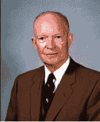

**图 12.1** 艾森豪威尔决策矩阵

现在让我们按优先级排列这些情况。两个显而易见的情况是：重要且紧急的位于顶部，既不重要也不紧急的位于底部。

问题在于，你如何排列中间的两类：紧急但不重要，以及重要但不紧急？你应该先处理哪一个？

显然，重要的事情应优先于不重要的事情。我进一步认为，如果某件事不重要，就根本不应该做。做不重要的事情是浪费。

如果我们排除所有不重要的事情，就剩下两类。我们先做重要且紧急的事情。然后第二做重要但不紧急的事情。

我的观点是，紧迫性关乎时间。重要性则不然。重要的事情是长期的。紧急的事情是短期的。结构是长期的。因此，它是重要的。行为是短期的。因此，它仅仅是紧急的。

所以，结构，也就是重要的东西，排在第一位。行为是次要的。

你的老板可能不认同这个优先级，但那是因为担心结构并不是你老板的职责。那是你的职责。你的老板只是期望你在实现紧急行为的同时保持结构整洁。

本章前面，我引用过肯特·贝克的话：“先让它工作，再让它正确。”现在我说，结构比行为优先级更高。这是个先有鸡还是先有蛋的困境，不是吗？

我们先让它工作的原因在于，结构必须支撑行为；因此，我们先实现行为，然后赋予它正确的结构。但结构比行为更重要。我们给予它更高的优先级。我们在处理行为问题之前先处理结构问题。

我们可以通过把问题分解成微小单元来化解这个矛盾。让我们从用户故事开始。你让一个故事工作起来，然后把它结构调整正确。在这个结构正确之前，不要着手下一个故事。当前故事的结构比下一个故事的行为优先级更高。

只不过，故事太大了。我们需要更小的单位。那么不是故事——而是测试。测试是完美的尺寸。

首先让一个测试通过，然后修复通过该测试的代码的结构，之后才让下一个测试通过。

整个讨论为 TDD 的红 → 绿 → 重构循环提供了*道德*基础。

正是这个循环帮助我们防止对行为造成伤害、防止对结构造成伤害。正是这个循环让我们能够把结构置于行为之上。这就是为什么我们把 TDD 视为一种*设计*技术，而不是测试技术。

#### 程序员也是利益相关者

记住这一点。软件的成功与我们利害攸关。我们程序员也是利益相关者。

你曾这样想过吗？你曾把自己视为项目的利益相关者之一吗？但你当然是。项目的成功直接影响你的职业和声誉。所以，是的，你是利益相关者。

作为利益相关者，你对系统的开发和构建方式有发言权。我的意思是，你也要为此担风险。

但你不仅仅是利益相关者。你是一名工程师。你被聘用，是因为*你*知道如何构建软件系统，以及如何构建这些系统使它们能够持久。伴随这种知识而来的，是尽你所能产出最佳产品的责任。

你不仅作为利益相关者拥有权利，而且作为工程师负有责任，确保你产出的系统不会因不良行为或不良结构而造成伤害。

许多程序员不想要这种责任。他们宁愿只被告知该做什么。这是一种荒唐，也是一种耻辱。这完全不专业。有这种想法的程序员应该拿最低工资，因为他们工作产出的价值就只值这么多。

如果你不为系统的结构负责，还有谁会？你的老板吗？

你的老板了解 SOLID 原则吗？设计模式呢？面向对象设计和依赖倒置实践呢？你的老板了解 TDD 的纪律吗？知道什么是 self-shunt、测试专用子类或谦卑对象吗？你的老板是否理解，一起变化的事物应该放在一起，因不同原因而变化的事物应该分开？

你的老板理解结构吗？还是你老板的理解仅限于行为？

结构很重要。如果你不关心它，谁会关心？

如果你的老板明确告诉你忽略结构、完全专注于行为，那该怎么办？你要拒绝。你是利益相关者。你也有权利。你也是一名工程师，负有你老板无法凌驾的责任。

也许你认为拒绝会让你被解雇。大概不会。大多数管理者预计自己必须为需要且相信的事情而争取，他们也尊重那些愿意同样争取的人。


哦，会有挣扎，甚至会有对抗，而且不会舒服。但你是利益相关者，也是工程师。你不能只是退缩并默许。那不够专业。

大多数程序员并不喜欢对抗。但应对喜欢对抗的管理者，是我们必须学习的一项技能。我们必须学会为自己确信正确的事情而抗争，因为对重要的事情承担责任，并为这些事情而抗争，才是专业人士的行事方式。

#### 尽你所能

《程序员誓言》中的这一承诺，讲的是尽你所能。

显然，对程序员来说，这是一项完全合理的承诺。你当然会尽你所能，当然也不会明知代码有害还将其发布。

当然，这项承诺并不总是非黑即白。有时结构必须为进度让步。例如，如果为了赶上贸易展会，你不得不加入一些快速而粗糙的修复，那就这样吧。

这项承诺甚至并不阻止你向客户交付结构不那么完美的代码。如果结构已经接近正确但还不完全正确，而客户期待明天发布，那就这样吧。

另一方面，这项承诺*确实*意味着，在你添加更多行为之前，你会先解决那些行为和结构问题。你不会把越来越多的行为堆在已知糟糕的结构之上。你不会允许那些缺陷*累积*。

如果你的老板无论如何都要你这么做，那该怎么办？那场对话应该这样进行。

**老板：** 我想今晚之前把这个新功能加上。

**程序员：** 抱歉，我做不到。在添加这个新功能之前，我有一些结构清理工作要做。

**老板：** 清理明天做。今晚把功能完成。

**程序员：** 上一个功能我就是这么做的，而现在我要清理的烂摊子更大了。我真的必须先完成那次清理，才能开始任何新工作。

**老板：** 我想你没明白。这是生意。要么我们有生意可做，要么就没生意可做。如果我们不能把功能做完，我们就没有生意。现在去把功能完成。

**程序员：** 我明白。真的，我明白。我也同意。我们必须能够完成功能。但如果我不清理过去几天累积下来的结构问题，我们就会变慢，完成的功能反而更少。

**老板：** 你知道吗，我以前挺喜欢你。我以前常说，丹尼这小子挺不错。但现在我不这么想了。你一点也不友善。也许你不该跟我共事。也许我该解雇你。

**程序员：** 那是你的权利。但我很确定，你希望功能完成得又快又正确。而我告诉你，如果我今晚不做这次清理，我们就会开始变慢。我们会交付越来越少的功能。

> *听着，我想和你一样快。你雇用我，是因为我知道怎么做。你得让我做我的工作。你得让我做我知道最正确的事。*

**老板：** 你真觉得如果你今晚不做这次清理，一切都会慢下来？

**程序员：** 我知道会。我以前见过。你也见过。

**老板：** 而且必须今晚？

**程序员：** 让这烂摊子变得更糟，我觉得不安全。

**老板：** 你明天能给我这个功能？

**程序员：** 能，而且结构清理干净后，做起来会容易得多。

**老板：** 好吧。明天。不能再晚。现在去干吧。

**程序员：** 好。我马上开始。

**老板：** [旁白] 我喜欢这孩子。他有胆量。他有魄力。即使我威胁要解雇他，他也没有退缩。他会大有前途，相信我——但别告诉他我说过这话。

#### 可重复的证明

> > *承诺3。在每次发布时，我都会提供快速、可靠且可重复的证明，证明代码的每个元素都按应有的方式工作。*

这听起来不合理吗？被要求证明你写的代码确实能工作，这听起来不合理吗？

请允许我向你介绍艾兹格·维贝·迪杰斯特拉。

##### 迪杰斯特拉

艾兹格·维贝·迪杰斯特拉于1930年出生在鹿特丹。他在鹿特丹轰炸和德国占领荷兰期间幸存下来，并于1948年以数学、物理、化学和生物学的最高分从高中毕业。

1952年3月，21岁的他——就在我出生前9个月——接受了阿姆斯特丹数学中心的一份工作，成为荷兰第一位程序员。

1957年，他与玛丽亚·德贝茨结婚。当时在荷兰，人们必须在结婚仪式上说明自己的职业。当局不愿接受“程序员”作为他的职业。他们从未听说过这种职业。迪杰斯特拉只好填了“理论物理学家”。

1955年，已经当了3年程序员、且仍是学生的他得出结论：编程的智力挑战大于理论物理的智力挑战，因此他选择编程作为自己的长期职业。

在做这个决定时，他与老板阿德里安·范·维恩加登商量。迪杰斯特拉担心，还没有人确立一门编程学科或编程科学，因此他不会受到认真对待。他的老板回答说，迪杰斯特拉很可能就是使它成为一门科学的人之一。

为了追求这个目标，迪杰斯特拉被这样一种观念所驱动：软件是一个形式系统，是一种数学。他推断，软件可以成为一种数学结构，很像*欧几里得的《几何原本》*——一个由公设、证明、定理和引理组成的系统。因此，他着手创建软件证明的语言和学科。

##### 证明正确性

迪杰斯特拉意识到，我们只有三种技术可以用来证明算法的正确性：枚举、归纳和抽象。枚举用于证明按顺序执行的两条语句，或由布尔表达式选择的两条语句是正确的。归纳用于证明循环是正确的。抽象用于把语句组拆分成更小的可证明块。

如果这听起来很难，那它确实很难。

为了说明这到底有多难，我附上了一个用于计算整数余数的简单 Java 程序（*图12.2*），以及该算法的手写证明（*图12.3*）。

[^6]: 这是将迪杰斯特拉著作中的一个演示翻译成 Java 的版本。

```java
public static int remainder(int numerator, int denominator) {
  assert(numerator > 0 && denominator > 0);
  int r = numerator;
  int dd = denominator;
  while(dd<=r)
    dd *= 2;
  while(dd != denominator) {
    dd /= 2;
    if(dd <= r)
      r -= dd;
  }
  return r;
}
```

**图12.2** 一个简单的 Java 程序

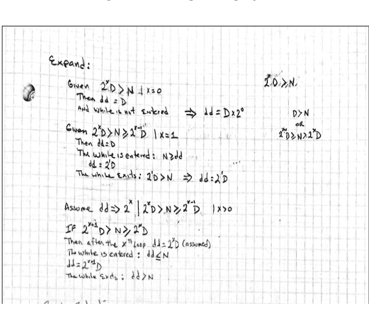

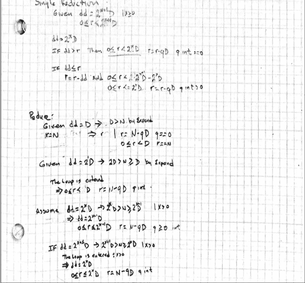

**图12.3** 该算法的手写证明

我想你能看出这种方法的问题。确实，迪杰斯特拉曾对此痛苦地抱怨道：

> > *当然，我不敢建议（至少目前不敢！）程序员在程序中每写一个简单循环时，都有责任提供这样的证明。如果真是这样，他根本永远写不出任何规模的程序。*

迪杰斯特拉希望，通过创建一个定理库——同样类似于欧几里得的*《几何原本》*——这类证明会变得更实用。

但迪杰斯特拉并不理解软件会变得多么普遍和无处不在。在那些早期岁月里，他没有预见到计算机会比人还多，大量软件会运行在我们家中的墙壁里、我们的口袋里和我们的手腕上。如果他知道，他就会意识到，他所设想的定理库会庞大到任何凡人都无法掌握。

因此，迪杰斯特拉为程序提供显式数学证明的梦想已经几乎湮没无闻。哦，仍有一些坚持者抱着渺茫的希望，期待形式化证明复兴，但他们的愿景并没有深入整个软件行业多远。

尽管这个梦想可能已经逝去，但它在其身后留下了某种深刻的东西。某种我们今天几乎不假思索就在使用的东西。

##### 结构化编程

在编程的早期，也就是20世纪50年代和60年代，我们使用 Fortran 等语言。你见过 Fortran 吗？来，让我给你看看它当时是什么样子。

[点击此处查看代码图像](#)

```fortran
      WRITE(4,99)
 99   FORMAT(" NUMERATOR:")
      READ(4,100)NN
      WRITE(4,98)
 98   FORMAT(" DENOMINATOR:")
      READ(4,100)ND
100   FORMAT(I6)
      NR=NN
      NDD=ND
  1   IF(NDD-NR)2,2,3
  2   NDD=NDD*2
      GOTO 1

  3   IF(NDD-ND)4,10,4
  4   NDD=NDD/2
      IF(NDD-NR)5,5,6
  5   NR=NR-NDD
  6   GOTO 3

 10   WRITE(4,20)NR
```


```fortran
FORMAT(" REMAINDER:", I6)
END
```

这个小 Fortran 程序实现了与早先的 Java 程序相同的余数算法。

现在我想提请你注意那些 `GOTO` 语句。你很可能不常看到那样的语句。你不常看到那样的语句，是因为如今我们不赞成它们。事实上，大多数现代语言甚至不再有那样的 `GOTO` 语句。

为什么我们不赞成 `GOTO` 语句？为什么我们的语言不再支持它们？因为在 1968 年，迪杰斯特拉给 *Communications of the ACM* 的编辑写了一封信，题为“GOTO 语句被认为有害”⁷。

7. Edsger W. Dijkstra，“GOTO 语句被认为有害”，*Communications of the ACM* 11, no. 3 (1968), 147–148.

迪杰斯特拉为什么认为 `GOTO` 语句有害？这一切都要回到证明函数正确的三种策略：枚举、归纳和抽象。

枚举依赖于这样一个事实：序列中的每条语句都可以独立分析，并且一条语句的结果会馈入下一条语句。你应该清楚，为了使枚举成为证明函数正确性的有效技术，被枚举的每条语句都必须有单一入口点和单一出口点。否则，我们无法确定一条语句的输入或输出。

此外，归纳只是枚举的一种特殊形式：我们假设被枚举的语句对某个 *x* 成立，然后通过枚举证明它对 *x* + 1 成立。

因此，循环体必须可枚举。它必须具有单一入口和单一出口。

`GOTO` 被认为有害，因为 `GOTO` 语句可以跳入或跳出被枚举序列的中间。`GOTO`s 会使枚举变得难以处理，从而使通过枚举或归纳证明算法正确成为不可能。

迪杰斯特拉建议，为了保持代码可证明，应当用三种标准构建块来构造代码。

- **顺序**，我们将其描述为按时间排序的两条或多条语句。这仅表示无分支的代码行。
- **选择**，描述为由谓词选择的两条或多条语句。这仅表示 `if/else` 和 `switch/case` 语句。
- **迭代**，描述为在谓词控制下重复执行的语句。这表示 `while` 或 `for` 循环。

迪杰斯特拉表明，任何程序无论多么复杂，都可以仅由这三种结构组成，并且以这种方式构造的程序是可证明的。

他把这种技术称为*结构化编程*。

## 功能分解

1968 年，迪杰斯特拉的思想并未立即受到欢迎。我们大多数人都在使用依赖 `GOTO` 的语言，因此放弃 `GOTO` 或对 `GOTO` 施加约束的想法令人反感。

围绕迪杰斯特拉思想的争论激烈持续了好几年。当时我们没有互联网，所以不会用 Facebook 梗图或网络骂战。但我们确实给当时主要软件期刊的编辑写信。而那些信件争论激烈。有人称迪杰斯特拉是神。另一些人称他是傻瓜。就像今天的社交媒体，只是速度更慢。

但随着时间的推移，争论平息了，迪杰斯特拉的立场获得了越来越多的支持，直到如今，我们使用的大多数语言根本没有 `GOTO`。

如今，我们都是结构化程序员，因为我们的语言没有给我们选择。我们都用顺序、选择和迭代来构建程序。而且很少有人经常使用不受约束的 GOTO 语句。

用这三种结构组合程序的一个意外副作用，是产生了一种称为*功能分解*的技术。功能分解是指从程序的顶层开始，递归地将其分解为越来越小的可证明单元的过程。它是结构化编程背后的推理过程。结构化程序员通过这种递归分解，自顶向下地推理出越来越小的可证明函数。

结构化编程与功能分解之间的这种联系，是 20 世纪 70 年代和 80 年代发生的结构化革命的基础。Ed Yourdon、Larry Constantine、Tom DeMarco 和 Meilir Page-Jones 等人在那些年代推广了结构化分析和结构化设计技术。

##### 测试驱动开发

TDD，即红 → 绿 → 重构循环，就是功能分解。毕竟，你必须针对问题的小部分编写测试。这意味着你必须将问题按功能分解为可测试的元素。

结果是，每个用 TDD 构建的系统都由符合结构化编程的功能分解元素构建而成。这意味着它们组成的系统是可证明的。

*而测试就是证明。*

或者更准确地说，测试就是*理论*。

TDD 创建的测试并不是迪杰斯特拉所希望的那种形式化数学证明。事实上，迪杰斯特拉有一句名言：测试只能证明程序有错，永远不能证明程序正确。

在我看来，这正是迪杰斯特拉看错的地方。迪杰斯特拉把软件视为一种数学。他希望我们构建一个由公设、定理、推论和引理组成的上层结构。

相反，我们已经认识到，软件是一种*科学*。我们用实验来验证这门科学。我们基于通过的测试构建理论上层结构，正如所有其他科学所做的那样。

我们证明过进化论、相对论、大爆炸理论或任何重大科学理论吗？没有。我们无法在任何数学意义上证明它们。

尽管如此，我们仍在一定限度内相信它们。事实上，每当你坐进汽车或飞机，你都在拿自己的生命打赌牛顿运动定律是正确的。每当你使用 GPS 系统，你都在打赌爱因斯坦的相对论是正确的。

我们尚未在数学上证明这些理论正确，这一事实并不意味着我们没有充分的证据来依赖它们，甚至是拿生命依赖它们。

这就是 TDD 给我们的那类证明。不是形式化数学证明，而是实验性的经验证明。是我们每天都依赖的那类证明。

这就把我们带回了《程序员誓言》中的第三个承诺：

> *我将在每次发布时，提供快速、可靠且可重复的证明，证明代码的每个元素都按它应有的方式工作。*

快速、可靠且可重复。*快速*意味着测试套件应在非常短的时间内运行。是几分钟而不是几小时。

*可靠*意味着当测试套件通过时，你知道可以交付了。

*可重复*意味着任何人都可以在任何时间运行这些测试，以确保系统正常工作。事实上，我们希望测试每天运行很多次。

有些人可能认为，要求程序员提供这种级别的证明太过分了。有些人可能认为，不应该用这么高的标准要求程序员。另一方面，我想象不出还有任何其他标准是合理的。

当客户付钱让我们为他们开发软件时，我们难道没有道义上的责任去尽我们所能证明，我们所创建的软件完成了客户付钱要我们做的事吗？

当然有。我们应当向客户、雇主和队友兑现这一承诺。我们应当向业务分析师、测试人员和项目经理兑现这一承诺。但最重要的是，我们应当向自己兑现这一承诺。因为如果我们不能证明我们所做的工作正是我们获得报酬要做的工作，我们怎么能把自己视为专业人士呢？

当你做出那个承诺时，你所应兑现的并不是迪杰斯特拉所梦想的形式化数学证明；相反，它是一套科学化的测试套件，覆盖所有必需的行为，在几秒或几分钟内运行，并且每次运行时都产生相同的清晰通过/失败结果。


### 13 诚信

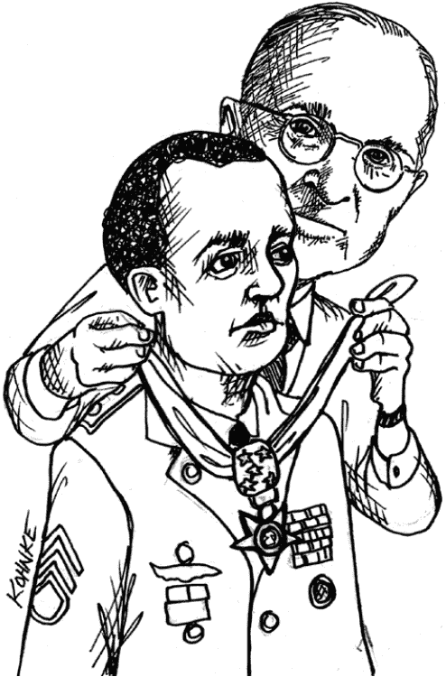

誓言中的若干承诺涉及诚信。

#### 小周期

*承诺 4：我将频繁进行小规模发布，以免阻碍他人的进度。*

小规模发布只是意味着每次发布只更改少量代码。系统可能很大，但对系统的增量更改很小。

##### 源代码控制的历史

让我们暂时回到 20 世纪 60 年代。当你的源代码被打孔在一叠卡片上时（图 13.1），你的源代码控制系统是什么？


**图 13.1** 打孔卡

源代码并不存储在磁盘上。它并不“在计算机里”。你的源代码实际上就在你手中。

源代码控制系统是什么？就是你的书桌抽屉。

当你实际拥有源代码时，就没有必要“控制”它。其他人无法碰它。

这就是 20 世纪 50 年代和 60 年代大部分时间的情况。甚至没有人梦想过源代码控制系统之类的东西。你只需把源代码放进抽屉或柜子里，就把它控制住了。

如果有人想“检出”源代码，他们只需走到柜子前把它拿走。用完后，再放回去。

我们当然没有合并问题。两名程序员同时修改同一模块在物理上是不可能的。

但到了 20 世纪 70 年代，情况开始改变。将源代码存储在磁带上，甚至磁盘上的想法变得越来越有吸引力。我们编写了行编辑程序，允许在磁带上的源文件中添加、替换和删除行。这些程序不是屏幕编辑器。我们把添加、更改和删除指令*打孔*在卡片上。编辑器会读取源磁带，应用编辑卡片组中的更改，并写出新的源磁带。

你可能觉得这听起来很糟糕。回顾过去——确实如此。但这比试图在卡片上管理程序要好！我的意思是，写在卡片上的 6,000 行代码重达 30 磅。如果你不小心把这些卡片掉在地上，看着它们散落到整个地板、家具下面，甚至掉进供暖通风口，你会怎么办？

如果掉的是磁带，你只需把它捡起来就行。

不管怎样，注意发生了什么。我们开始时有一盘源磁带，在编辑过程中，我们最终得到第二盘新的源磁带。但旧磁带仍然存在。如果我们把那盘旧磁带放回架子上，其他人可能会不经意地把自己的更改应用到它上面，从而给我们留下合并问题。

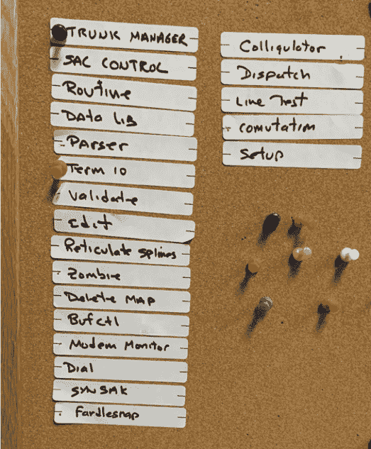

**图 13.2** 公告板

公告板上为系统中的每个模块贴有标签。我们每个程序员都有自己的彩色图钉。我是蓝色。肯是红色。我的伙伴 CK 是黄色，等等。

如果我想编辑 Trunk Manager 模块，我会查看公告板，看那个模块上是否有一枚图钉。如果没有，我就插上一枚蓝色图钉。然后我从架子上取下主磁带，把它复制到另一盘磁带上。

我会编辑 Trunk Manager 模块，而且只编辑 Trunk Manager 模块，生成一盘包含我更改的新磁带。我会编译、测试、反复进行，直到我的更改正常工作。然后我会从架子上取来主磁带，通过复制当前主磁带、但用我更改后的 Trunk Manager 模块替换原有模块，来创建一个新的主磁带。我会把新的主磁带放回架子。

最后，我会从公告板上取下我的蓝色图钉。

这行得通，但之所以行得通，只是因为我们彼此认识，我们都在同一间办公室一起工作，我们每个人都知道其他人在做什么。而且我们一直彼此*交谈*。

我会在实验室里大声喊：“肯，我要修改 Trunk Manager 模块了。”他会说：“插个图钉。”我会说：“我已经插了。”

图钉只是提醒。我们都知道代码的状态以及谁在做什么。这就是这个系统行得通的原因。

确实，它运行得非常好。知道其他每位程序员在做什么，意味着我们可以互相帮助。我们可以提出建议。我们可以互相提醒最近遇到的问题。而且我们可以避免合并。

那时候，合并可一点也不好玩。

然后，到了 20 世纪 80 年代，磁盘出现了。磁盘变得很大，而且变得永久。所谓*大*，我指的是数百兆字节。所谓*永久*，我指的是它们被永久挂载——始终在线。

另一件发生的事是，我们有了 PDP-11 和 VAX 这样的机器。我们有了屏幕编辑器、真正的操作系统和多个终端。不止一个人可以完全同时进行编辑。

图钉和公告板的时代不得不结束。

首先，到那时，我们已经有二三十名程序员。图钉的颜色不够用了。其次，我们有成百上千个模块。公告板上没有足够的空间。

幸运的是，有一个解决方案。

1972 年，Marc Rochkind 编写了第一个源代码控制程序。它被称为源代码控制系统（SCCS），他是用 SNOBOL 编写的。[^1]

[^1]: 一种 20 世纪 60 年代的可爱的字符串处理小语言，具有我们现代语言中的许多模式匹配功能。

后来，他用 C 重写了它，它成为 PDP-11 上 UNIX 发行版的一部分。SCCS 一次只处理一个文件，但允许你锁定该文件，这样在你完成之前其他人无法编辑它。它真是个救星。

1982 年，Walter Tichy 创建了 RCS，即修订控制系统。它同样基于文件，对项目一无所知，但被认为是对 SCCS 的改进，并迅速成为当时标准的源代码控制系统。

然后，在 1986 年，CVS，即并发版本系统，出现了。它扩展了 RCS，以处理整个项目，而不仅仅是单个文件。它还引入了*乐观锁定*的概念。

在此之前，大多数源代码控制系统都像我的图钉一样工作。如果你检出了该模块，其他人就不能编辑它。这被称为*悲观锁定*。

CVS 使用乐观锁定。两名程序员可以同时检出并更改同一个文件。CVS 会尝试合并任何不冲突的更改，如果它无法弄清楚如何进行合并，就会提醒你。

此后，源代码控制系统爆炸式发展，甚至成为商业产品。数以百计的系统涌入市场。有些使用乐观锁定，另一些使用悲观锁定。锁定策略成了行业内的一种宗教式分野。

然后，在 2000 年，Subversion 被创建。它极大地改进了 CVS，并在推动行业彻底摆脱悲观锁定方面发挥了关键作用。Subversion 也是第一个在云端使用的源代码控制系统。还有人记得 SourceForge 吗？

至此，所有源代码控制系统都基于我在公告板时代使用的主磁带理念。源代码维护在一个单一的中央主仓库中。源代码从该主仓库检出，提交则回到该主仓库中。

但所有这些即将改变。

##### Git

时间是 2005 年。我们的笔记本电脑里装着数 GB 的磁盘。网络速度很快，而且越来越快。处理器时钟频率已停滞在 2.6GHz。

我们已经远远超越了我那套旧的公告板源代码控制系统。但我们仍在使用主磁带概念。我们仍然有一个中央仓库，每个人都必须从中检入和检出。每一次提交、每一次回退、每一次合并都需要连接到主仓库的网络。

然后 git 出现了。

嗯，实际上，git 由 BitKeeper 和 monotone 预示；但正是 git 引起了编程界的注意并改变了一切。因为，你看，git 消除了主磁带。

哦，你仍然需要源代码的最终权威版本。但 git 不会自动为你提供这个位置。Git 根本不在乎这一点。你决定把权威版本放在哪里完全由你决定。Git 与此毫无关系。

Git 将源代码的完整历史保存在你的本地机器上。如果你的笔记本电脑就是你所用的机器，那就是它。在你的机器上，你可以提交更改、创建分支、检出旧版本，并且通常可以做任何你能在像 Subversion 这样的集中式系统中做的事情——只是你不需要连接到某个中央服务器。

你可以随时连接到另一位用户，并将你所做的任何更改推送给该用户。或者，你可以将他们所做的任何更改拉取到你的本地仓库中。两者都不是主。两者是平等的。这就是为什么他们称之为点对点。

而你用来进行生产发布的最终权威位置，只是另一个对等节点，人们可以随时向它推送或从中拉取。

最终结果是，在你将更改推送到其他地方之前，你可以自由地进行任意多的小提交。你可以提交每一个

如果你愿意，30秒。每当你让一个单元测试通过，就可以做一次提交。

这就把我们带到了这整段历史讨论的重点。

如果你退后一步，看看源代码控制系统演进的轨迹，就会发现它们一直——也许是无意识地——被一个潜在的迫切要求所驱动。

#### 短周期

再回想一下我们是如何开始的。当源代码的控制方式是实际持有一沓卡片时，周期有多长？

你从柜子里取出那些卡片，就算是检出了源代码。你一直保留那些卡片，直到完成你的项目。然后，你把改动过的那沓卡片放回柜子，以此提交你的更改。周期时间就是整个项目。

后来，当我们把图钉用在公告板上时，同样的规则也适用。你会把图钉留在正在修改的模块中，直到完成你正在做的项目。

甚至在20世纪70年代末到80年代，我们使用 SCCS 和 RCS 时，也继续采用这种悲观锁定策略，阻止他人在我们完成之前碰我们正在修改的模块。

但 CVS 改变了局面——至少对我们中的一些人来说是这样。乐观锁定意味着一个程序员不能把其他人锁在某个模块之外。我们仍然只在完成项目时才提交，但其他人可以同时处理相同的模块。因此，项目上提交之间的平均时间大幅缩短。当然，并发的代价就是合并。

我们多么讨厌做合并。合并很糟糕。尤其是在没有单元测试的时候！它们乏味、耗时且危险。

我们对合并的反感促使我们采取了一种新策略。

##### 持续集成

到2000年，即使我们还在使用 Subversion 之类的工具，我们也已经开始教导每隔几分钟提交一次的纪律。

理由很简单。你提交得越频繁，遇到合并的可能性就越小。而且如果你确实必须合并，合并也会很轻松。

我们把这种纪律称为*持续集成*。

当然，持续集成关键取决于拥有一套非常可靠的单元测试。我的意思是，没有好的单元测试，就很容易在合并时出错并破坏别人的代码。因此，持续集成与测试驱动开发（TDD）密不可分。

有了 git 这样的工具，我们能把周期缩短到什么程度几乎没有什么限制。这就引出了一个问题：我们为什么如此关心缩短周期？

因为长周期会阻碍团队的进展。

提交之间的时间越长，团队中其他人——也许是整个团队——不得不等你的可能性就越大。而这违背了那个承诺。

也许你认为这只关乎生产发布。不，它实际上关乎所有其他周期。它关乎迭代和冲刺。它关乎编辑/编译/测试周期。它关乎提交之间的时间。它关乎*一切*。

并且记住这个理由：这样你就不会阻碍其他人的进展。

##### 分支与开关

我曾经是个“分支纳粹”。在我使用 CVS 和 Subversion 的时候，我不允许团队中的成员给代码创建分支。我希望所有更改尽可能频繁地回到主线。

我的理由很简单。分支不过是一次长期检出。而且，正如我们所见，长期检出会延长集成之间的时间，从而阻碍其他人的进展。

但后来我改用 git——一切在一夜之间都变了。

当时，我正在管理开源 FitNesse 项目，大约有十几个人在为此工作。我刚把 FitNesse 仓库从 Subversion（Source Forge）迁移到 git（GitHub）。突然间，分支开始到处出现。

最初几天，git 中这些疯狂的分支让我感到困惑。我应该放弃我的“分支纳粹”立场吗？我应该放弃持续集成，干脆让所有人随意创建分支，而不再考虑周期时间问题吗？

但后来我意识到，我看到的这些分支并不是真正命名的分支。相反，它们只是开发者在两次推送之间做出的一连串提交。事实上，git 真正所做的，不过是记录开发者在持续集成周期之间的操作。

因此，我决定继续执行限制分支的规则。只不过现在，立即回到主线的不再是提交，而是推送。持续集成得以保留。

如果我们遵循持续集成，大约每小时向主线推送一次，那么主线上肯定会有一堆写了一半的功能。通常有两种策略来应对这种情况：分支和开关。

分支策略很简单。你只需为源代码创建一个新分支，在其中开发该功能。功能完成后，再把它合并回来。这通常是通过推迟推送直到功能完成来实现的。

如果你让分支脱离主线数天或数周，那么你很可能会面临一次大型合并，而且你肯定会阻碍团队。

然而，在某些情况下，新功能与代码的其余部分如此隔离，以至于为它创建分支不太可能导致大型合并。在这些情况下，也许更好的做法是让开发者安心开发新功能，而不进行持续集成。

事实上，几年前我们在 FitNesse 上就遇到过这样的情况。我们完全重写了解析器。这是一个大项目。它花了几个人周。而且没有办法增量地进行。我的意思是，解析器就是解析器。

因此，我们创建了一个分支，并让该分支与系统其余部分保持隔离，直到解析器准备就绪。

最后确实需要做一次合并，但还不算太糟。解析器与系统其余部分隔离得足够好。而且幸运的是，我们有一套非常全面的单元测试和验收测试。

尽管解析器分支取得了成功，但我认为通常更好的做法是把新功能开发保留在主线上，并使用开关在这些功能准备好之前将其关闭。

有时我们使用标志来实现这些开关，但更常见的是使用*命令*模式、*装饰器*模式和*工厂*模式的特殊版本，以确保写了一半的功能无法在生产环境中执行。

而大多数时候，我们干脆不给用户使用新功能的选项。我的意思是，如果按钮不在网页上，你就无法执行该功能。

当然，在许多情况下，新功能会作为当前迭代的一部分完成——或者至少在下一次生产发布之前完成——因此并不真正需要任何形式的开关。

只有当你要在一些功能尚未完成时发布到生产环境，才需要开关。这种情况应该多久发生一次？

##### 持续部署

如果我们能消除生产发布之间的延迟会怎样？如果我们能每天多次发布到生产环境会怎样？毕竟，延迟生产发布也会阻碍其他人。

我希望你能够每天多次将代码发布到生产环境。我希望你对自己的工作足够有信心，以至于每次推送时都能将代码发布到生产环境。

当然，这取决于自动化测试：由程序员编写、覆盖每一行代码的自动化测试，以及由业务分析师和 QA 测试人员编写、覆盖每一个期望行为的自动化测试。

还记得我们在[第12章“危害”](https://example.com)中对测试的讨论吗？那些测试是科学*证明*，证明一切都在按预期工作。而如果一切都在按预期工作，下一步就是部署到生产环境。

顺便说一句，这就是你判断测试是否足够好的方式。如果测试通过时你能够放心部署，那么你的测试就足够好。如果测试通过后仍不能让你部署，那么你的测试就有缺陷。

也许你认为每天部署甚至每天多次部署会导致混乱。然而，*你*准备好部署，并不意味着*业务*准备好部署。作为开发团队的一员，你的标准是始终准备好。

更重要的是，我们希望帮助业务消除所有部署障碍，以便尽可能缩短业务部署周期。毕竟，业务在部署上使用的仪式和繁文缛节越多，部署就越昂贵。任何业务都希望摆脱这笔开销。

任何业务的终极目标都是持续、安全且无需繁琐仪式的部署。部署应当尽可能接近于一件无足轻重的事。

由于部署通常是大量工作，要配置服务器、加载数据库，你需要*自动化*部署流程。而且由于部署脚本是系统的一部分，你要为它们编写测试。

对你们中的许多人来说，持续部署的想法可能与你当前的流程相差太远，以至于难以想象。但这并不意味着你无法采取一些措施来缩短周期。

谁知道呢？如果你月复一月、年复一年地不断缩短周期，也许有一天你会发现，你已经在持续部署了。


#### 持续构建

显然，如果你要在短周期内部署，就必须能够在短周期内构建。如果你要持续部署，就必须能够持续构建。

也许你们中有些人构建时间很慢。如果是这样，就加快它们。说真的，以现代系统的内存和速度，没有理由让构建缓慢。一点理由都没有。加快它们。把它当作一项设计挑战。

然后给自己弄一个持续构建工具，比如 Jenkins、Buildbot 或 Travis，并使用它。确保每次推送都启动一次构建，并尽一切努力确保构建永不失败。

构建失败是红色警报。这是紧急情况。如果构建失败，我希望给每个团队成员发送电子邮件和短信。我希望警报器响起。我希望首席执行官的桌上有一盏闪烁的红灯。我希望每个人都停下手中的事，处理这个紧急情况。

防止构建失败并不是什么高深难事。你只需在推送之前在本地环境中运行构建以及所有测试。只有当所有测试通过时，才推送代码。

如果在那之后构建失败，你就发现了一个需要迅速解决的环境问题。

你绝不能允许构建持续失败，因为如果你允许构建失败，你就会习惯它失败。而如果你习惯了失败，你就会开始忽视它们。你越是忽视这些失败，失败警报就变得越烦人。你也越是想把失败的测试关掉，直到你以后能修复它们——以后。你知道的。以后？

而这时，测试就变成了谎言。

移除失败的测试后，构建又通过了。这让每个人再次感觉良好。但这是一个谎言。

所以，持续构建。并且永远不要让构建失败。

#### 不懈改进

> *承诺 5：我将抓住每一个机会，无畏而坚持不懈地改进我的创造物。我永远不会让它们退化。*

男童军之父罗伯特·贝登堡留下了一封遗言，劝勉童军们要让世界比他们发现时更美好。正是从这句话中，我推导出了我的男童军规则：每次检入代码时，都要让它比检出时更干净。

怎么做？每次检入代码时，都对代码做点随机的善举。

其中一项随机善举就是提高测试覆盖率。

##### 测试覆盖率

你测量过测试覆盖了你多少代码吗？你知道行覆盖率是多少吗？你知道分支覆盖率是多少吗？

有很多工具可以为你测量覆盖率。对我们大多数人来说，这些工具是 IDE 的一部分，运行起来轻而易举，所以真的没有理由不知道自己的覆盖率数字是多少。

你应该如何处理这些数字？首先，让我告诉你*不要*做什么。不要把它们变成管理指标。如果你的测试覆盖率太低，不要让构建失败。测试覆盖率是一个复杂的概念，不应如此天真地使用。

这种天真的用法会形成不正当的作弊动机。而且，作弊测试覆盖率非常容易。记住，覆盖率工具只测量被*执行*的代码量，而不是真正被测试的代码。这意味着，你可以通过从失败的测试中移除断言，把覆盖率数字推得很高。当然，这会让该指标变得毫无用处。

最好的策略是把覆盖率数字当作开发者工具，帮助你改进代码。你应该通过编写真正的测试，努力*有意义地*将覆盖率推向 100%。

百分之百的测试覆盖率始终是目标，但它也是一个渐近目标。大多数系统永远达不到 100%，但这不应阻止你不断提高覆盖率。

这就是覆盖率数字的用途。你把它们当作帮助你改进的度量，而不是用来惩罚团队和让构建失败的大棒。

###### 变异测试

百分之百的测试覆盖率意味着，对代码的任何语义更改都应该导致测试失败。TDD 是一种很好的纪律，可以接近这一目标，因为如果你严格遵循这一纪律，每一行代码都是为了通过一个失败的测试而编写的。

然而，这种严格往往不切实际。程序员也是人，纪律总是要服从实际情况。所以，现实是即使最勤勉的测试驱动开发者也会在测试覆盖中留下缺口。

变异测试是一种找出这些缺口的方法，也有变异测试工具可以提供帮助。变异测试器会运行你的测试套件并测量覆盖率。然后它进入循环，以某种语义方式变异你的代码，然后再次运行测试套件并测量覆盖率。语义更改包括把 `>` 改成 `<`，把 `==` 改成 `!=`，或把 `x=<something>` 改成 `x=null` 之类。每一次这样的语义更改称为一个变异。

该工具期望每个变异都导致测试失败。没有导致测试失败的变异称为存活变异。显然，目标是确保没有存活变异。

运行变异测试可能投入大量时间。即使是相对较小的系统也可能需要数小时运行时间，所以这类测试最好在周末或月末运行。然而，变异测试工具能发现的问题总是让我印象深刻。偶尔花点精力运行它们绝对值得。

###### 语义稳定性

测试覆盖率和变异测试的目标是创建一个确保*语义稳定性*的测试套件。系统的语义就是该系统所需的行为。确保语义稳定性的测试套件，是每当所需行为被破坏时都会失败的测试套件。我们使用这样的测试套件来消除对重构和清理代码的恐惧。如果没有语义稳定的测试套件，对改变的恐惧往往太大。

TDD 为我们构建语义稳定的测试套件提供了良好开端，但它不足以实现完全的语义稳定性。应使用覆盖率、变异测试和验收测试来改进语义稳定性，使其趋于完备。

##### 清理

也许能改进代码的最有效的随机善举就是简单的清理——以改进为目标的重构。

可以进行哪些类型的改进？当然，显而易见的是消除代码异味。但即使代码没有异味，我也经常清理代码。

我会在名称、结构和组织上做微小的改进。这些更改可能不会被其他任何人注意到。有些人甚至可能认为它们让代码变得不那么干净。但我的目标不只是代码的状态。通过做一些小的清理，我*学习*代码。我对它变得更熟悉、更自在。也许我的清理并没有在任何客观意义上真正改进代码，但它改进了我对那段代码的理解和运用能力。清理改进了作为那段代码开发者的*我*。

清理还提供了另一个不应被低估的好处。通过清理代码，即使是以细微方式，我也在*活动*那段代码。而确保代码保持灵活的最好方法之一，就是定期活动它。我做的每一点清理，实际上都是在测试代码的灵活性。如果我发一项小清理有点困难，我就发现了一个不灵活的区域，现在可以纠正它。

记住，软件本应是软的。你怎么知道它是软的？通过定期测试这种柔软性。通过做一些小清理和小改进，并*感受*这些更改做起来有多容易或多困难。

###### 创造物

承诺 5 中使用的词是*创造物*。在本章中，我主要关注代码，但代码并不是程序员创造的唯一东西。我们创造设计、文档、时间表和计划。所有这些产物都是应该持续改进的创造物。

我们是人类。人类会随着时间把事情做得更好。我们不断改进我们所从事的一切。

##### 保持高生产力

> *承诺 6：我将尽我所能，让自己和他人的生产力尽可能高。我不会做任何降低生产力的事。*

生产力。这真是个话题，不是吗？你有多经常觉得它是你工作中唯一重要的东西？如果你仔细想想，生产力正是本书以及我所有软件书籍所讨论的内容。

它们讲的是如何快速前进。

而我们在过去七十年软件发展中学到的是，快速前进的方法就是好好前进。

快速前进的*唯一*方法就是好好前进。

所以，你保持代码干净。你保持设计干净。你编写语义稳定的测试，并保持高覆盖率。你了解并使用合适的设计模式。你保持方法短小、名称精确。

但这些都是实现生产力的*间接*方法。在这里，我们要讨论保持高生产力更为直接的方法。

- 1. 粘滞性——保持开发环境高效
- 2. 分心事务——处理日常业务和个人生活


- 3. 时间管理——有效地将高效工作时间与所有其他不得不做的杂事区分开来

#### 黏性

程序员在考虑生产力时，往往目光短浅。他们把生产力的主要组成部分看作是自己快速编写代码的能力。

但编写代码只是整个流程中很小的一部分。即使你把编写代码的速度提升到*无限快*，整体生产力也只会提高一点点。

这是因为软件流程远不止编写代码。至少还包括

- 构建
- 测试
- 调试
- 部署

这还没有算上需求、分析、设计、会议、调研、基础设施、工具，以及软件项目中涉及的所有其他内容。

所以，尽管能够高效地编写代码很重要，但它甚至远不是问题中最大的部分。

让我们逐一解决其他一些问题。

##### 构建

如果你花 5 分钟做了一处修改，却要花 30 分钟来构建，那你的效率不可能很高，对吧？

在二十一世纪的第二个十年及之后，构建没有理由需要超过一两分钟。

在反对这一点之前，先想一想。你可以怎样加快构建？在云计算时代，你能否完全确定，绝对没有办法大幅加快构建速度？找出导致构建缓慢的原因，并修复它。把它当作一项设计挑战。

##### 测试

是测试拖慢了构建吗？答案相同。加快测试速度。

这里可以这样看。我那可怜的小笔记本电脑有四个核心，时钟频率为 2.8GHz。这意味着它每秒可以执行大约*每秒约 100 亿条指令。*

你的整个系统里真的有 100 亿条指令吗？如果没有，那么你应该能在不到一秒内测试完整个系统。

当然，除非你把其中一些指令执行了不止一次。例如，你需要测试登录多少次才能知道它能正常工作？一般来说，一次就足够了。你的测试中有多少次会走登录流程？超过一次就是浪费！

如果每个测试之前都需要登录，那么在测试期间，你应该绕过登录流程。使用一种模拟模式。或者，如果实在必要，就从为测试而构建的系统中移除登录流程。

重点是，不要容忍测试中这种重复。它会让测试慢得可怕。

再举一个例子，你的测试有多少次会遍历用户界面的导航和菜单结构？有多少测试从顶部开始，然后走过一长串链接，最终才把系统置于可以运行测试的状态？

每条导航路径超过一次就是浪费！所以，构建一个特殊的测试 API，让测试能够快速把系统强制置入你需要的状态，无需登录，也无需导航。

你需要执行查询多少次才能知道它有效？一次！所以，在大多数测试中用模拟替代数据库。不要让同样的查询一遍又一遍又一遍地执行。

外围设备很慢。磁盘很慢。Web 套接字很慢。UI 屏幕很慢。不要让慢的东西拖慢你的测试。用模拟替代它们。绕过它们。把它们从测试的关键路径中移除。不要容忍缓慢的测试。让你的测试保持快速运行！

##### 调试

调试东西要花很长时间吗？为什么？为什么调试很慢？

你在用 TDD 编写单元测试，对吧？你也在编写验收测试，对吧？而且你在用一款好的覆盖率分析工具来衡量测试覆盖率，对吧？并且你定期使用变异测试器来证明你的测试在语义上是稳定的，对吧？

如果你在做所有这些事情，或者哪怕只是其中的*部分*事情，你的调试时间也能缩短到微不足道。

##### 部署

部署要花 forever 吗？为什么？我是说，你*确实*在使用部署脚本，对吧？你不是在手动部署，对吧？

记住，你是程序员。部署是一个过程——把它自动化！也要为这个过程编写测试！

你应该每次都能通过单击一次来部署系统。

##### 管理干扰

生产力最有害的破坏者之一，就是工作之外的干扰。干扰有很多种。重要的是，你要知道如何识别它们并防御它们。

##### 会议

你被会议拖慢了吗？

我有一条处理会议的非常简单的规则。它是这样的：

> *当会议变得无聊时，就离开。*

你应该礼貌地这样做。等几分钟，等对话出现停顿时，然后告诉参会者，你认为你的意见不再被需要，并问他们是否介意你回去处理你手头相当多的工作。

永远不要害怕离开会议。如果你不想办法离开，那么有些会议会永远把你困住。

明智的做法还有：拒绝大多数会议邀请。避免陷入冗长无聊会议的最好办法，就是一开始就礼貌地拒绝邀请。不要被错失恐惧所诱惑。如果你真的被需要，他们会来找你。

当有人邀请你参加会议时，确保他们已经说服你，你确实需要去。确保他们明白，你只能抽出几分钟，而且你很可能会在会议结束前离开。

还要确保你坐在靠近门口的位置。

如果你是团队负责人或管理者，请记住，你的主要职责之一就是让团队远离会议，从而保护团队的生产力。

##### 音乐

很久很久以前，我写代码时会听音乐。但我发现听音乐会妨碍我的专注。随着时间推移，我意识到，听音乐只是*感觉*能帮助我集中注意力，但实际上，它会分散我的注意力。

有一天，我在翻看一年前写的代码时意识到，我的代码正在音乐的鞭笞下遭罪。代码里散落着一条条注释，那是我当时正在听的歌曲的歌词。

从那以后，我写代码时不再听音乐，我发现我对写出的代码以及自己能在细节上投入的注意力都满意多了。

编程是通过顺序、选择和迭代来安排过程元素的行为。音乐由音调和节奏元素组成，并通过顺序、选择和迭代来安排。会不会听音乐动用了大脑中与编程相同的部分，从而消耗了一部分编程能力？这是我的理论，我坚持这个理论。

你得自己弄清楚这一点。也许音乐真的对你有帮助。但也许并没有。我建议你试着在没有音乐的情况下写一周代码，看看最终是否会写出更多、更好的代码。

##### 情绪

重要的是要认识到，要想高效工作，你必须善于管理自己的情绪状态。情绪压力会扼杀你的编码能力。它会破坏你的专注，让你一直处于分心的状态。

例如，你有没有注意到，和另一半大吵一架之后，你就无法写代码了？哦，也许你会在 IDE 里随便敲几个字符，但它们没什么用。也许你会假装自己很高效，混在一些无聊的会议里，而那些会议你根本不需要太在意。

以下是我发现对恢复生产力最有效的做法。

行动。针对情绪的根源采取行动。不要试图写代码。不要试图用音乐或会议掩盖感受。那不会有用。采取行动解决情绪。

如果你发现自己在工作中因为和另一半吵架而太难过或太沮丧，无法写代码，那就打电话给对方，试着解决问题。即使你实际上没有解决问题，你也会发现，尝试解决这个行动有时能让你的头脑清醒到足以写代码。

你实际上不必解决问题。你只需要说服自己，你已经采取了足够适当的行动。我通常发现，这足以让我把思绪重新转向必须编写的代码。

##### 心流


许多程序员享受一种意识改变的状态。那是一种高度专注、视野狭窄的状态，代码仿佛从你身体的每个毛孔中倾泻而出。它会让你感觉自己像超人。

尽管有这种欣快感，但多年来我发现，我在那种意识改变状态下产出的代码往往相当糟糕。这些代码远不如我在正常专注状态下写出的代码那样经过深思熟虑。所以，如今我会抵制进入心流。结对编程是避免进入心流的一个非常好的方法。你必须与他人沟通和协作这一事实本身，似乎就会干扰心流。

避免听音乐也有助于我远离心流，因为它让实际环境使我扎根于现实世界。

如果我发现自己开始高度专注，我会抽身离开，去做一会儿别的事。

##### 时间管理

管理分心最重要的方法之一，是采用一套时间管理纪律。我最喜欢的是*番茄工作法*。^2

2. 弗朗切斯科·奇里洛，*番茄工作法：改变人生的时间管理系统*（Virgin Books，2018）。

*Pomodoro* 在意大利语中是“番茄”的意思。英语团队往往改用 *tomato* 这个词。但如果你用谷歌搜索 Pomodoro Technique，效果会更好。

这项技术旨在帮助你在一个普通工作日内管理时间和专注力。它不关心除此之外的任何事情。

其核心思想相当简单。开始工作前，你设定一个 25 分钟的计时器（传统上是番茄形状的厨房计时器）。

接下来，你工作。一直工作到计时器响起。

然后休息 5 分钟，让头脑和身体放松下来。

然后再开始。把计时器设为 25 分钟，工作到计时器响起，然后休息 5 分钟。如此反复。

25 分钟并没有什么神奇之处。15 到 45 分钟之间的任何时长都合理。但一旦选定时长，就坚持那个时长。不要改变你的番茄大小！

当然，如果计时器响起时，我离让一个测试通过只差 30 秒，我会把测试做完。另一方面，保持纪律很重要。我不会多拖超过一分钟。

到目前为止，这听起来很平常，但处理电话之类的干扰，正是这项技术大放异彩之处。规则就是*捍卫番茄！*

告诉任何试图打断你的人，你会在 25 分钟内回复他们——或者无论你的番茄时长是多少。尽快打发掉这个干扰，然后回去工作。

然后，在休息之后，再处理那个干扰。

这意味着两个番茄之间的时间有时会变得相当长，因为打断你的人往往需要很多时间。

再说一次，这正是这项技术的妙处。一天结束时，你数一数自己完成了多少个番茄，这就能衡量你的生产力。

一旦你善于像这样把一天拆成番茄，并保护番茄不受干扰，你就可以开始通过分配番茄来规划一天。你甚至可能开始用番茄来估算任务，并围绕番茄安排会议和午餐。

### 14 团队合作

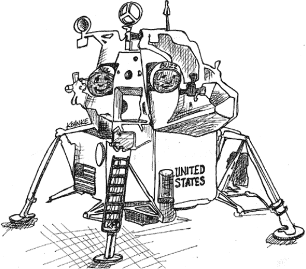

誓言中其余的承诺体现了对团队的投入。

#### 作为团队工作

> 承诺 7。我将持续确保他人能替我补位，我也能替他们补位。

把知识隔离成孤岛，对团队和组织都极为有害。失去一个人，可能就意味着失去一整块知识。这可能使团队和组织陷入瘫痪。这也意味着团队成员没有足够的背景信息来理解彼此。结果，他们常常各说各话。

解决这个问题的办法是在团队中传播知识。确保每位团队成员都充分了解其他成员正在做的工作。

传播这些知识的最佳方式就是一起工作——结对编程或群体编程。

事实上，提高团队生产力的方法中，几乎没有什么比实践协作式编程更好的了。一个了解各项工作之间深层联系的团队，其生产力必然远高于一群各自为政的知识孤岛。

#### 开放式/虚拟办公室

团队成员经常见面并互动也很重要。实现这一点的最佳方式是把他们安排在同一间房间里。

21 世纪初，我拥有一家公司，帮助组织采用敏捷开发。我们会向这些公司派出一组讲师和教练，指导他们完成转型。每次合作开始前，我们都会告诉管理者重新布置办公空间，好让我们将要辅导的团队在各自的团队室里工作。不止一次，在我们到达并开始辅导之前，管理者就告诉我们，这些团队仅仅因为在同一间房间里一起工作，生产力就已经高得多了。

我写这段话时是 2021 年第一季度。COVID-19 疫情正开始消退，疫苗正在快速分发（我今天将接种第二针），我们都期待着回归正常生活。但疫情过后，会留下大量远程工作的软件团队。

远程工作永远不可能像在同一间房间里一起工作那样高效。即使有最好的电子辅助手段，在屏幕上见面也远不如当面见面。不过，如今的协作电子系统已经非常好。所以，如果你在远程工作，*用好它们。*

创建一个虚拟团队室。让每个人的面孔都保持在视野中。让每个人的音频通道尽可能保持开启。你的目标是营造一种团队室的错觉，仿佛每个人都在其中一起工作。

如今，结对编程和群体编程享有大量电子工具的支持。跨距离共享屏幕并一起编程相对容易。这样做时，请保持视频画面和音频开启并正常运行。你希望在协作编写代码时能够*看到*彼此。

远程团队应尽可能努力保持相同的工作时间。当程序员在地理上横跨东西方、分布很广时，这非常困难。尽量让每个团队跨越的时区数量尽可能少，并尽最大努力每天至少留出六个连续小时，让所有人都能在虚拟团队室里共处。

你有没有注意到，开车时冲着另一个司机大喊大叫是多么容易？这就是挡风玻璃效应。当你坐在挡风玻璃后面时，很容易把别人看成傻瓜、蠢货，甚至敌人。很容易把他们非人化。这种效应在电脑屏幕后面也会发生，只是程度较轻。

为了避免这种效应，团队应每年在同一个实体房间里聚几次。我建议每季度一周。这将帮助团队凝聚起来，并保持团队的整体性。对于两周前还和你一起吃过午饭、一起面对面协作过的人，你很难落入挡风玻璃陷阱。

那种不合逻辑之深，令人作呕。我是说，这有多荒唐。没有人被要求估算结束日期；他们只是被告知结束日期必须是什么——由法律规定的！

所以，当然，所有与那个强制日期相关的估算都是谎言。它们怎么可能是别的呢？

这让我想起大约二十年前我咨询过的一个团队。我记得当时我和他们在项目室里，项目经理走了进来。他是个年轻人，也许二十五岁。他刚和老板开完会回来。他显然很焦躁。他告诉团队结束日期有多重要。他说：“我们真的必须赶上那个日期。我是说，我们*真的*必须赶上那个日期。”

当然，团队其他人只是翻翻白眼、摇摇头。需要赶上日期，并不是赶上日期的解决方案。这位年轻经理没有提供任何解决方案。

在那种环境里，估算不过是支撑计划的谎言。

这又让我想起我的另一个客户，他在墙上挂了一张巨大的软件生产计划图——上面满是圆圈、箭头、标签和任务。程序员们把它称为*罐头笑声*。

在本节中，我们将讨论真实、有价值、诚实、准确且精确的估算。也就是专业人士所做出的那类估算。

#### 诚实、准确、精确

估算最重要的方面是诚实。除非估算诚实，否则对任何人都没有好处。

***我：*** 那么，让我问你。你能给出的最诚实的估算是什么？  
***程序员：*** 呃，我不知道。  
***我：*** 对。  
***程序员：*** 对什么？  
***我：*** 我不知道。


***程序员：***等等。你要求我给出最诚实的估算。

***我：***没错。

***程序员：***而我说我不知道。

***我：***没错。

***程序员：***那么，它是什么？

***我：***我不知道。

***程序员：***好吧，那你怎么能期望我知道呢？

***我：***你已经说过了？

***程序员：***说了什么？

***我：***我不知道。

你能给出的最诚实估算就是“我不知道。”但这个估算并不特别准确或精确。毕竟，你对估算确实知道*一些东西*。挑战在于量化你已知和未知的部分。

首先，你的估算必须准确。这并不意味着你要给出一个确定的日期——你不敢那样精确。它只是意味着你给出一个你有信心的日期范围。

所以，例如，从现在到十年后的某个时间，对于你编写一个hello world程序所需的时间来说，是一个非常准确的估算。但它缺乏精确性。

另一方面，昨天凌晨2:15是一个非常精确的估算，但如果你还没开始，它可能就非常不准确了。

你看到区别了吗？当你给出估算时，你希望它在准确性和精确性上都是诚实的。为了准确，你给出一个有信心的日期范围。为了精确，你把这个范围缩小到与你的信心相匹配的程度。

而在这两种操作中，极度诚实是唯一的选择。

要对这些事情保持诚实，你必须对自己可能错到什么程度有所了解。所以让我讲两个故事，说明我曾经错得有多离谱。

#### 故事一：向量表

那是1978年。我在伊利诺伊州迪尔菲尔德的一家名为泰瑞达（Teradyne）的公司工作。我们为电话公司制造自动化测试设备。

我当时是个年轻的程序员，26岁。我在为一个嵌入式测量设备编写固件，该设备安装在电话中心局的机架上。这个设备叫COLT——中心局线路测试仪（central office line tester）。

COLT中的处理器是Intel 8085——一种早期的8位微处理器。我们有32K固态RAM和另外32K ROM。ROM基于Intel 2708芯片，每片存储1K×8，所以我们用了32片这种芯片。

这些芯片插在我们存储板上的插座中。每块板可以容纳12片，因此我们用了三块板。

软件是用8085汇编语言编写的。源代码保存在一组源文件中，作为一个整体编译。编译器的输出是一个长度略小于32K的单一二进制文件。

我们把这个文件切成32块，每块1K。然后每块1K的内容烧录到一片ROM芯片上，再将芯片插入ROM板的插座中。

可以想象，你必须把正确的芯片插到正确的板上的正确插座里。我们非常小心地给它们做标记。

我们卖出了数百台这种设备。它们被安装在遍布全国乃至——实际上——全世界的电话中心局。

你觉得当我们更改那个程序时会发生什么？哪怕只是一行改动？

如果我们增加或删除一行，那么之后所有子例程的地址都会改变。而且因为这些子例程被代码中更早的其他例程调用，所以每片芯片都会受到影响。哪怕只是一行改动，我们也得重新烧录全部32片芯片！

那是一场噩梦。我们必须烧录数百套芯片，并把它们运送给世界各地的现场服务代表。然后这些代表不得不驱车数百英里，去往他们辖区内的所有中心局。他们得打开我们的设备，拔出所有存储板，取下全部32片旧芯片，插入32片新芯片，然后重新装回板子。

我不知道你是否了解这点，但将芯片从插座中拔出和插入并不是完全可靠的。芯片上细小的引脚往往会弯折，并以令人沮丧的无声方式断裂。因此，可怜的现场服务人员不得不为32种芯片每种都准备大量备件，并忍受不可避免的调试——反复移除和插入芯片，直到设备能正常工作。

有一天，老板来找我，说我们必须解决这个问题，让每片芯片可以独立部署。当然，他没有用那些词，但意图就是如此。每片芯片需要变成一个可独立编译和部署的单元。这样我们就能在不重新烧录全部32片芯片的情况下修改程序。实际上，在大多数情况下，我们只需重新部署单片芯片——改动过的那片。

我就不用实现细节来烦你了。只需说它涉及向量表、间接调用，以及将程序划分为多个小于1K的独立块。

2. 也就是说，每片芯片都被变成了一个多态对象。

老板和我仔细讨论了策略，然后他问我完成这件事需要多长时间。

我告诉他两周。

但我并没有在两周内完成。四周也没有。六周、八周、十周也没有。这项工作花了十二周才完成——它比我预想的复杂得多。

结果，我差了6倍。6倍！

幸运的是，老板没有生气。他看到我每天都在做这件事。我定期向他汇报状态。他理解我所面对的复杂性。

但仍然。6倍？我怎么会错得这么离谱？

#### 故事二：pCCU

还有一次，在1980年代初期，我不得不创造一个奇迹。

你看，我们向客户承诺了一款新产品。它叫CCU-CMU。

铜是一种贵重金属。它稀有且昂贵。电话公司决定回收上个世纪在全国铺设的庞大铜线网络。其策略是用更便宜的高带宽同轴电缆和光纤网络来替换这些铜线，以传输数字信号。这被称为*数字交换*。

CCU-CMU是我们测量技术的彻底重新架构，以适应电话公司新的数字交换架构。

我们在几年前就向电话公司承诺过CCU-CMU。我们知道构建这个软件大概需要一人年左右。但后来我们一直没有真正动手去构建它。

你知道事情总是这样。电话公司推迟了他们的部署，所以我们也推迟了开发。总是有很多其他更紧急的问题要处理。

于是有一天，老板把我叫进办公室，说他们忘了还有一个小客户已经安装了一台早期的数字交换机。那个客户现在正期待在下个月内收到CCU/CMU——就像承诺的那样。

现在我必须在不到一个月的时间里完成一人年的软件工作。

我告诉老板这是不可能的。我绝不可能在一个月内构建出一个功能完整的CCU/CMU。

他脸上露出一丝狡黠的笑容，说有一个作弊的方法。

你看，这是一个很小的客户。他们的装置实际上是数字交换机最小可能的配置。而且，他们的设备配置碰巧——就这么碰巧——消除了CCU/CMU原本要解决的全部复杂性。

长话短说——我在两周内为客户构建并运行了一个专用的、独一无二的单元。我们称它为pCCU。

##### 教训

这两个故事说明估算的范围可以有多大。一方面，我低估了芯片向量化的时间，差了6倍。另一方面，我们却以预期时间的二十分之一找到了CCU/CMU的解决方案。

这正是诚实的重要之处。因为，说真的，当事情出错时，它们可能错得非常、非常离谱。而当事情顺利时，有时也会非常、非常顺利。

这使得估算成为一个巨大的挑战。

##### 准确性

现在应该很清楚了，对项目的估算*不能*是一个日期。对于可能偏差多达6倍甚至20倍的过程来说，单一日期过于精确了。

估算不是日期。估算是范围。估算是*概率分布*。

概率分布有均值和宽度——有时称为*标准差*或*西格玛*。我们需要能够同时用均值和西格玛来表达我们的估算。

我们先来看均值。

计算一个复杂任务的期望平均完成时间，就是把所有子任务的平均完成时间加起来。当然，这个过程是递归的。子任务可以通过累加所有子-子任务的时间来估算。这就形成了一个任务树，通常称为工作分解结构（WBS）。


现在，这一切听起来固然不错。然而问题在于，我们并不擅长识别所有子任务、子子任务和子子子任务。通常，我们会漏掉几个。比如，也许漏掉一半。

我们通过把总和乘以二来补偿。有时乘以三。甚至可能更多。

**柯克：** *我们还要多少改装时间才能再次带她出航？*

**斯科蒂：** 八周，长官。但您没有八周时间，所以我给您两周做完。

**柯克：** 斯科特先生，您一直把维修估算乘以四吗？

**斯科蒂：** 当然，长官！不然我还能怎么保住我作为奇迹创造者的名声呢？³

3. *星际迷航2：可汗之怒*，尼古拉斯·梅耶执导（派拉蒙影业，1982）。

现在，这个 2、3 甚至 4 的修正系数听起来像是在作弊。当然，它确实是。但估算这一行为本身也是如此。

要确定某件事需要多长时间，只有一种真正的方法，那就是实际去做。任何其他机制都是作弊。

所以，面对现实吧，我们就是要作弊。我们会先做 WBS，然后乘以某个 *F*，其中 *F* 介于 2 和 4 之间，具体取决于你的信心和生产率。这样就能得到我们的平均完成时间。

经理会问你估算是怎么得出来的，而你不得不告诉他们。当你告诉他们那个修正系数时，他们会要求你花更多时间在 WBS 上以降低这个系数。

这完全公平，你应该愿意照做。不过，你也应该警告他们：开发完整 WBS 的成本等同于任务本身的成本。事实上，等到你*真正*开发出完整 WBS 时，你也已经完成了项目，因为要真正枚举所有任务，唯一的方法就是执行已知任务，以便发现其余任务——如此递归下去。

因此，务必把你的估算工作放进一个时间盒，并让你的经理知道，要进一步细化修正系数会非常昂贵。

估算 WBS 树叶子节点处的子任务有很多技术。你可以使用功能点或类似的复杂度度量。但我一直发现，这些任务最好靠纯粹直觉来估算。

通常，我会把任务与我已完成的其他任务进行比较。如果我觉得它有两倍那么难，就把时间乘以二。

一旦估算了树的所有叶子节点，你只需把整棵树求和，就得到项目的均值。

不要过分担心依赖关系。软件是一种有趣的材料。尽管 A 依赖 B，但 B 往往不必在 A 之前完成。事实上，你*可以*先实现注销，再实现登录。

##### 精度

每个估算都是错的。这就是我们称之为估算的原因。正确的估算根本不是估算——它是事实。

但即使估算错了，也可能没那么错。因此，估算工作的一部分就是估算这个估算错得有多厉害。

我最喜欢的估算一个估算有多大误差的技巧，是估算三个数字：最佳情况、最差情况和正常情况。

正常情况是指，如果出问题的数量处于平均水平——如果事情按照它们*通常*的方式发展——你认为这项任务需要多长时间。把它看作一种直觉判断。正常情况就是你在现实状态下会给出的估算。

正常估算的严格定义是：它有 50% 的概率偏短或偏长。换句话说，你的正常估算应该有一半会失准。

最差情况估算是墨菲定律式的估算。它假设凡是可能出错的事都会出错。它极度悲观。最差情况估算有 95% 的概率偏长。换句话说，这个估算只有二十分之一的概率会失准。

我们要做的第一件事，是用预期完成时间和标准差来表示每项任务。

记住，6 个标准差（均值两侧各 3 个）对应高于 99% 的概率。因此，我们将把标准差，也就是 sigma，设为（最差情况 - 最佳情况）除以 6。

预期完成时间（mu）要稍微棘手一些。注意，N 很可能不等于中点 (W-B)。事实上，中点很可能远远超过 N，因为项目耗时比我们想象得更长的可能性，远大于耗时更短的可能性。那么，平均而言，这项任务什么时候会完成？*预期*完成时间是多少？

最好使用这样的加权平均：mu = (2N + (B + W)/2)/3。

现在，我们为一系列任务计算出了 mu 和 sigma。整个项目的预期完成时间就是所有 mu 之和。项目的 sigma 是所有 sigma 的平方和的平方根。

这只是基础统计数学。

我刚才描述的，是 20 世纪 50 年代末为管理北极星舰队弹道导弹计划而发明的估算程序。此后，它已在成千上万个项目中成功使用。

它被称为 PERT——计划评审技术。

##### 诚实

我们从诚实开始。然后我们谈了准确度，也谈了精度。现在该回到诚实了。

我们这里讨论的估算本质上是诚实的。它是一种向需要知道的人传达你的不确定程度的方式。

这是诚实的，因为你确实不确定。而那些负责管理项目的人必须意识到他们正在承担的风险，以便能够管理这些风险。

你为组织带来的首要价值之一，是你能够知道什么时候答案必须是“不”。在那些时候说“不”，将为公司省下难以估量的烦恼和金钱。

最后一件事。经理常常会试图哄你做出承诺——说“是”。要当心这一点。

他们可能会说你不具备团队精神，或者说别人比你更有奉献精神。不要被这些把戏骗了。

要愿意与他们合作寻找解决方案，但当你知道自己不该说“是”时，不要让他们逼你说“是”。

还要非常小心“尝试”这个词。你的老板可能会说些听起来合理的话，比如“好吧，你至少试试，行吗？”

这个问题的答案是

> 不！我已经在尝试了。你竟敢暗示我没有？我正在竭尽全力，不可能再更努力了。我口袋里没有能让我创造奇迹的魔法豆。

你可能不想用这些原话，但这正是你应该想的。

记住这一点。如果你说“好，我试试”，那你就是在撒谎。因为你根本不知道自己要如何成功。你没有任何改变行为的计划。你说“好”只是为了摆脱经理。而这从根本上是不诚实的。

#### 尊重

> 承诺 9。我将因我的程序员同行们的伦理、标准、纪律和技能而尊重他们。其他任何属性或特征都不会影响我对程序员同行的尊重。

我们这些软件专业人士，承担着我们这门手艺的沉重负担。我们这些勇敢的人，有男有女，有异性恋者和同性恋者，有黑人、棕色人种、黄种人和白人，有共和党人、民主党人、宗教信徒和无神论者。我们是人类，以人类所具有的多种形式和类型存在。我们是一个相互尊重的共同体。

加入我们共同体、并获得共同体每一位成员接纳与尊重的唯一资格，就是我们这一行的技能、纪律、标准和伦理。没有任何其他人类属性值得考虑。不能容忍基于任何其他理由的歧视。

无需多言。

#### 永不停止学习

> *承诺 10。我将永不停止学习和改进我的手艺。*

程序员永不停止学习。

我相信你听过这种说法：你应该每年学一门新语言。嗯，你应该这么做。一名优秀的程序员应该懂大约十几门语言。

而且不只是同一门语言的十几种变体。不只是 C、C++、Java 和 C#。相反，你应该了解来自许多不同语言族的语言。

你应该了解一门静态类型语言，比如 Java 或 C#。你应该了解一门过程式语言，比如 C 或 Pascal。你应该了解一门逻辑式语言，比如 Prolog。你应该了解一门栈式语言，比如 Forth。你应该了解一门动态类型语言，比如 Ruby。你应该了解一门函数式语言，比如 Clojure 或 Haskell。

你还应该了解几种不同的框架、几种不同的设计方法和几种不同的开发流程。我并不是说你应该成为所有这些方面的专家，但你应该刻意让自己以远不止于浅尝辄止的程度接触它们。

你同样应该接触的事物清单几乎无穷无尽。几十年来，我们行业经历了快速变化，而这种变化很可能还会持续一段时间。你必须跟上它。

这意味着你必须不断学习。继续读书和博客。继续看视频。继续参加大会和用户组。继续参加培训课程。继续学习。


重视过去那些珍贵的著作。20世纪60、70、80年代写成的书是洞见与信息的绝佳来源。不要陷入“所有旧东西都已过时”的思维陷阱。在我们这个行业，真正会过时的东西并不多。尊重前人的努力与成就，并研究他们的建议和结论。

也不要陷入“培训你是雇主的工作”这一思维陷阱。这是*你的职业生涯*——你必须对它负责。学习是你的事。弄清楚自己应该学什么，也是你的事。

如果你有幸为一家会为你买书、送你参加大会和培训课程的公司工作，那就充分利用这些机会。如果没有，那就自己为那些书、会议和课程付费。

并且计划为此投入一些时间。每周都投入时间。你每周欠雇主35到40小时。你还要为你的职业生涯再投入10到20小时。

专业人士就是这么做的。专业人士会投入时间经营和维护自己的职业生涯。这意味着你每周总共应该工作50到60小时。大部分时间在工作上，但也有很多时间在家里。

## 索引

### A

- 抽象
  - 阐明其层次，201
  - 迪杰斯特拉对抽象的发展，317–319，320
  - 用于抽象的多态，225
  - 抽象的下行规则，202
  - 底层抽象，235–236
- 验收测试，14，18，246–249
- 意外重复，237–238
- 会计，20–22，23
- 准确估算，360–361，365–367
- 阿达，洛芙莱斯伯爵夫人，5，280。*另见* N345TS
- 廉价适应性，256–257
- 克莱芒·阿代尔，2
- 航空学，1–4
- 汇总估算，369–370
- 敏捷方法
  - 通过敏捷方法做好准备，258，259
  - 故事点，275
  - 通过敏捷方法实现测试自动化，226
  - 极限编程作为敏捷方法，14
- ALGOL，6，7，282
- 算法
  - 保龄球比赛计分，62–79
  - 冒泡排序，82–87
  - 求质因数，52–62
  - 算法的增量推导，61，82，86
  - 整数堆栈，36–52
  - 证明算法正确性，316–323
  - 快速排序，94–95
  - 正弦计算，127–138
  - 文本换行，95–103
  - 录像店租赁，164–183
- API 函数，269
- 架构，143–145
- 安排/执行/断言测试模式，103–104，247，267
- `Authenticator` 接口，111
- 自动化测试，246，267–269，340
- 自动计算引擎（ACE），6，280

### B

- 查尔斯·巴贝奇，4–5，280
- 约翰·巴克斯，6，282，333
- 平衡，20
- 肯特·贝克
  - 其设计原则，226，239
  - *极限编程*，14
  - 论把事情做对，306
  - 论重构，219
  - 论简单设计，224，228
- 行为
  - 预测行为，300
  - 为保持行为而重构，199
  - 行为与结构之别，72，303–304，307，311
- 行为驱动开发（BDD），104–105，107
- 延斯·伯根斯坦，289
- 最佳工作，306–315
- 波音，4
- 边界，143–144
- 保龄球得分计算，62–79，104，203
- 分支与开关之别，338–340
- 冒泡排序算法，87，164
- 缺陷。*另见* 调试
  - 缺陷累积，314
  - 由 QA 发现的缺陷，266，267
  - 针对缺陷的快速补丁，302
  - 针对缺陷的快速测试，218
  - 缺陷不可接受，264
- 构建
  - 持续构建，249，341–342
  - 加速构建，347–348
- 业务分析（BA）团队，246，248
- 业务规则
  - 将数据库与业务规则解耦，148
  - 与测试隔离，268–269
  - 测试业务规则，150
  - 用户界面与业务规则之别，141，142

### C

- C 语言，284
- 层叠样式表（CSS）代码，255–256
- 灾难，291–293
- 乔治·凯利爵士，2
- CCU-CMU，364
- 确定性
  - 确定性的代价，358，370
  - 脆弱测试与确定性，139，140
  - 伦敦学派，141
- 变更
  - 对做出变更的恐惧，31–32，219，263
  - 低成本变更，256–257，262
  - 跟上变更，373–374
  - 学习为变更做准备，277
  - 作为软件的必要性，303–304，307
  - 对用户界面的变更，268
  - 通过 git 进行变更，335
  - 通过良好结构进行变更，308–310
- TDD 芝加哥学派，142
- 首席技术官（CTO），252
- 以及 TDD 三法则，23–26
- 转换，185
- 协作组件，144–145
- 协作编程
  - 协作编程的纪律，242–244
  - 通过协作编程改进，356
  - 远程协作编程，357
  - 用协作编程取代自己，272，273
  - 作为极限编程实践，14，17–18
- COLT（中央局线路测试器），361
- 承诺，368–369，370–372
- 无畏胜任，263–264
- 编译测试，36–52
- 增量复杂性，92
- 组件，144–145
- 计算机
  - 计算机史，4–9，280–286
  - 流行文化中的计算机，287
- 并发版本系统（CVS），333，334，336
- 常量到变量转换，187–188
- 持续构建，249，341–342
- 持续集成，337
- 持续学习，277–278，373–374
- 控制器
  - 组件层次中的控制器，144–145
  - 与 GUI 输入测试，153–154
  - 谦卑对象测试模式中的控制器，159
  - 测试控制器，153
- 伯爵夫人。见阿达
- 耦合。*另见* 解耦
  - 脆弱测试问题与耦合，139
  - 高层与低层细节，152，218，224–225
  - 最小化耦合，184
  - 一对一耦合，161–162
- 勇气，271–278
- 测试覆盖率，229–231，239，343–344
- 技艺
  - 航空业中的技艺，4
  - 定义，xxi–xxii
  - 作为开发者的责任，303
  - 其基础纪律，14–18，293
  - 计算机技艺史，4–9
  - 程序员所体现的技艺，9–10
  - 可证明代码作为技艺，324–325
- 菲利普·克雷格，108

### D

- 奥勒-约翰·达尔，283
- 数据库测试，148–150
- 列奥纳多·达·芬奇，2
- 调试
  - 避免调试，199
  - 致力于全面调试，264，266
  - 最小化调试，26–27
  - 由 QA 进行调试，265–267
  - 加速调试，349
- 可判定性问题，62
- 艾森豪威尔决策矩阵，310–312
- 判定问题，280
- 功能分解，322–323
- 解耦
  - 为可测试性而解耦代码，232
  - 解耦数据库，148
  - 解耦高层与低层细节，236，308
  - 解耦的重要性，224–225
  - 生产代码与测试解耦，161–184，218
- 退化测试
  - 通过退化测试求解，83–84，98–99
  - 阶梯测试作为退化测试，66
  - 作为 TDD 规则，53–54
- 依赖
  - 依赖倒置原则，143
  - 消除不必要的依赖，112–113，114
  - 通过 SOLID 管理依赖，309–310
  - 对生产数据的依赖，116
- 依赖规则，144–145
- 部署
  - 与最佳工作，307
  - 持续部署，340–341
  - 部署准备，258
  - 加速部署，349
  - 面向初创企业的部署，304–305
  - 与结构变更，308
- 推导，增量。*见* [增量推导](#)
- 设计
  - 对设计的变更，232
  - 设计的四项原则，239
  - 脆弱性成为问题，160–161
  - 高测试覆盖率，230–232
  - 设计漏洞，28–29
  - 设计中的最小规模，239
  - 由外而内与由内而外，141–142
  - 及时修复缺陷，70–71
  - 简单设计，17，224–226，228–229
  - 设计坏味，308，309
  - 测试设计，160–184
  - YAGNI，226–228
- 开发，测试驱动。*见* [测试驱动开发（TDD）](#)
- 数字设备公司，284
- 数字交换，364
- 艾兹格·迪杰斯特拉，7，282，316–323
- 丢番图方程，62
- 纪律
  - 验收测试，18，248–249
  - 艾伦·图灵论纪律，281
  - *洁净技艺*中的纪律，xxv
  - 协作编程，17–18
  - 纪律失败，255，256
  - 专注与纪律，13
  - 重构，16，217–221
  - 自我强加与他人强加的纪律，xxv
  - 简单设计，17
  - 测试驱动开发（TDD），15–16
  - YAGNI，227
- 管理分心，349–354
- 复式记账，20–22
- 哑对象，111–114
- 重复
  - 意外重复，238
  - 重复测试，66
  - 最小化代码重复，237–238

### E

- 艾森豪威尔决策矩阵，310–312
- Elements 变量，47，51
- 情绪压力，351
- “内测：使用模拟对象进行单元测试”（Freeman，McKinnon，Craig），108
- 工程实践，14
- 恩尼格玛机，5
- 纠缠的软件，224
- 枚举，317，321
- 错误，70，71
- 估算，诚实而公平，274–275，358–372
- 伦理
  - *洁净技艺*中的伦理，xxvi
  - 伦理誓言，293
  - 单一伦理与多元伦理，xxii


### E

- 期望，**252**
- 解释变量，**204**
- 探索性测试，**267**
- 表现力
  - 代码语言方面，**233–234**
  - 作为设计原则，**239**
  - 以及真实重复与偶然重复，**238**
  - 代码和测试在其中的作用，**236**
- 外部服务，**108, 110**
- 提取字段重构，**204–216**
- 提取方法重构，**68, 201–202, 208**
- 提取超类重构，**214**
- 提取变量重构，**202–204**
- *极限编程解析*（贝克），**228**
- 极限编程（XP），**13–14, 219, 226, 258**

### F

- 因子变量，**54–55**
- 失败测试
  - 通过算法，**82**
  - 输入/输出（IO），**108**
  - 用于整数排序算法，**83**
  - 在整数栈示例中，**36–52**
  - 多种解决方案，**88**
  - 在质因数示例中，**52–62**
- 伪造对象，**124–126**
- 恐惧
  - 对破损代码的恐惧，31–32, 219
- 无畏能力，263–264
- 斐波那契练习，191–194
- 有限状态机，105–107
- 先进后出（FILO）行为测试，50, 52
- FitNesse，247, 337
- 设计缺陷，70–71
- 灵活性，141, 142, 345
- 飞行史，1–4
- 心流，352
- Fortran，282, 319–320
- 马丁·福勒
  - TDD 芝加哥学派，142
  - 论重构，164, 198, 221
  - 论简单设计，229
- 脆弱测试
  - 确定性与脆弱测试，139, 140
  - 作为设计问题，160–161
  - 模拟对象与脆弱测试，139–140
  - 通过重构预防，218
  - 通过测试特异性预防，59, 232
  - 用户界面链接与脆弱测试，268
- 软件脆弱性，308
- 史蒂夫·弗里曼，108, 141
- 乐趣，30
- 功能分解，322–323
- 函数式编程，62, 196
- 函数
  - 函数的提取重构，201
  - 函数到 nil 的转换，186–187
  - 对函数的伤害，299–301
  - 最小化函数规模，239
  - 函数的错置责任，71
  - 用函数替换注释，75
  - 测试查询，148–150
  - 测试作为约束，127
  - 与函数实现绑定的测试，120
  - 函数中的不确定性原理，132
  - 以及底层抽象，235
  - 与清理代码的对比，306

### G

- 网关接口，149
- 泛化，59, 183–184
- 通用代码，59
- Git，334–336
- Git reset --hard，220
- 给定-当-那么（GWT），104, 105, 248
- 约翰·沃尔夫冈·冯·歌德，21
- GOTO 语句，320, 321, 322
- 绿步
  - 作为转化性步骤，185
  - 在视频租赁算法中，165, 166, 167, 169, 173
- GUI（图形用户界面）
  - 输入，153–154
  - 测试，150–153

### H

- 科里·海恩斯，229
- 洗手，12–13
- 不伤害
  - 对函数，299–301
  - 对社会，296–297
  - 对结构，302–303
  - 通过易于变更，303–304
  - 通过测试，305–306
- HealthCare.gov，297–298
- 切特·亨德里克森，224
- 飞行史，1–4
- 诚实的估算，274–275, 360–364, 370–372
- 钩子，226, 227–228
- 格蕾丝·霍珀，6, 282
- 迈克尔·霍恩，289
- 谦卑对象模式，157–160

### I

- IBM，6, 7, 282, 283
- `If statements`，58, 60, 202
- 僵化，309
- *实现接口*命令，114
- 函数实现，120
- 持续改进，262, 342–346
- 增量推导
  - 作为摆脱困境的解决方案，95, 98
  - 作为解决失败测试的方法，86
  - TDD 作为增量推导技术，61, 82
  - 通过增量推导编写测试，103
- 归纳，317, 321
- 不灵活的软件，256–257
- 由内而外的设计，142
- 集成测试，182–183
- 诚信
  - 通过高生产率，346–354
  - 通过不懈改进，342–346
  - 通过小周期，328–342
- 交互器
  - 在组件层次中，144–145
  - GUI，152, 154
- 迭代，321

### J

- JBehave，104
- 吉恩·詹宁斯，282
- *JUnit 秘诀*（雷恩斯伯格和斯特林），154

### K

- 莉兹·基奥，105
- 骑士资本集团，299–300, 302
- 鲍勃·科斯，62–79

### L

- 语言
  - 持续学习语言，277, 373–374
  - 富有表现力的代码，233–234
  - 第一门编程语言，7, 282–284
- 三分律，89
- 学习
  - 持续学习，277–278, 373–374
  - 向导师学习，278, 286
  - 通过清理代码学习，345
- 估算作为谎言，359
- 登录测试，348
- TDD 伦敦学派，141
- 展开的循环，57
- 洛夫莱斯伯爵夫人，5。*另见 Ada*

### M

- 蒂姆·麦金农，108, 120
- 管理者
  - 对管理者的承诺，370–372
  - 管理者的情绪对峙，276
  - 给管理者的信息，xxvi
  - 管理者的视角，252
- 手动测试，267, 270
- 布莱恩·马里克，305
- 克里斯·马茨，104
- 约翰·麦卡锡，282
- 均值和西格玛，365–367
- 会议，350
- 核心存储器，6
- 导师指导，278, 286
- 合并，332, 334, 336, 337
- 杰拉德·梅萨罗斯，110, 154
- 最小化规模，237, 239
- 错置责任，71
- 群体编程，242, 244, 357
- 模拟对象
  - 定义，109
  - 使用模拟对象测试的脆弱性，139
  - 在测试替身中，108–110, 121–123
  - 何时使用，126
- Mojang，289
- 情绪，351
- 音乐，350–351
- 变异测试，344

### N

- nil 到常量的转换，187
- 说“不”，276, 371
- 丹·诺斯，104
- N345TS。*另见 Ada*
- 克里斯滕·尼加德，283

### O

### P

- 生产率
  - 高，346–354
  - 其中的低成本适应性，256–257
  - 其中的持续就绪，258–259
  - 生产率的质量标准，254–256
  - 稳定的，259–260
- 项目评估与审查技术（PERT），369–370
- 程序员测试，182
- 程序员
  - 程序员的持续改进，262
  - 作为工匠，xxi
  - 程序员的人口统计，284–286
  - 艾兹格·迪杰斯特拉，316–323
  - 作为英雄和反派，289–290
  - 程序员的历史，5–9, 280–286
  - 程序员的经验不足，9–10
  - 作为书呆子和救世主，287–288
  - 程序员的一条道路，xxii
  - 程序员的视角，252
  - 流行文化中的程序员形象，287–288
  - 程序员的责任。*见* [责任]
  - 资深程序员，297
  - 资深/初级程序员结对，244
  - 作为利益相关者，312–313
  - 教导新程序员，278
  - 缺乏纪律的程序员，256
- 编程
  - 协作编程，17–18, 242–244, 356
  - 编程中的可判定性问题，62
  - 作为有限状态转换，107
  - 函数式，196
  - 编程史，280–286
  - 伦敦学派，141
  - 模块化编程，330–332
  - 过程式和函数式，62
  - 结构化编程，319–322
- 可重复的证明，316
- 属性测试，140
- 纳特·普赖斯，141
- `Public class stack`，36–52
- 公众信任，xxiv–xxv
- `Push function`，41

### Q

- 质量
  - 持续改进的质量，262
  - 低质量的定义，255
  - 极致质量，264
  - 对质量的无畏能力，263–264
  - 为 QA 评审做好准备，265–267
  - 测试自动化，267–269
  - 测试用户界面，269–270
- 质量保证（QA）部门
  - 验收测试的可读性，246
  - 为部门评审做好准备，265–267
  - 部门测试，248
- 查询测试，148–150
- 快速排序算法，94–95
- 快速测试，218, 324

### R

- J.B. 雷恩斯伯格，154
- 就绪，258–259
- RealAuthenticator，111–112, 116
- 递归，100
- 红/绿/重构循环
  - 通过它清理，39
  - 作为持续过程，219
  - 作为 TDD 第四定律，34–35
  - 作为功能分解，323
  - 其道德基础，312
  - 作为重构周期，199
  - 转化性优先级与它，185
- 红步
  - 作为增加性步骤，185
  - 在视频租赁算法中，165, 166, 168–169, 172
- 重构步
  - 作为恢复性步骤，185
  - 在视频租赁算法中，165–166
- 重构
  - 基本工具包，200–217
  - 重构的基础，232–233
  - 清理即重构，345
  - 通过重构实现代码泛化，184
  - 一致的重构，219
  - 定义，72, 199
  - 重构的纪律，16, 217–221
  - 作为 TDD 第四定律，34–35
  - 与脆弱测试，139
  - IDE 的*提取方法*，68
  - 红/绿/重构循环，34–35, 39, 185
  - 恢复性重构，185
  - 如同魔方解法，215
  - 在视频租赁算法中，164–183
  - 与放置钩子的对比，227
  - 作为 XP 实践，14
- *重构*（福勒），198, 221
- 远程工作，357
- 重命名重构，200–201
- 尊重，372–373
- 责任
  - 与协作编程，243
  - 持续学习的责任，374
  - 不伤害的责任，296–303
  - 错置责任，71
  - 程序员的责任，290–293, xxiv
  - 对责任的认识，306
  - 取代自己的责任，273
  - 单一责任原则，201, 214
  - 软件开发者的责任，xxiv


- 作为利益相关者，312–313
- 修订控制系统，333
- 僵化性，308
- 里奇，丹尼斯，284
- 罗奇金德，马克，333
- 榜样，289
- RSpec，104
- 魔方，215

### S

- 科学，软件，323–324
- Scrum，258
- 选择，321
- 选择到迭代的转换，190
- 自分流模式，156
- 语义稳定性，344–345
- 塞麦尔维斯，伊格纳茨，13
- 顺序，321
- `Setup` 方法，103
- 短周期，334–336
- 埃拉托斯特尼筛法，53, 61
- 西格玛，366, 369
- 简单性
  - 设计，14, 17, 224–226
  - 基本方面，235
  - 增量推导，61, 82, 86
  - 测试规则，95–96, 103
  - 通过富有表现力的语言，233–234
  - 通过技术进步，227
- Simula 67，7, 283
- 正弦计算，127–138
- 单一职责原则，201, 214, 239, 246
- 小周期，328–342
- Smalltalk，108
- 社会
  - 对软件的依赖，9, 291, 306
  - 对社会的危害，297–298
  - 对社会的责任，292
  - 对程序员的看法，286–288
- 软件
  - 灾难，291–293
  - 变更，224, 226, 303–304
  - 失败的估算，358
  - GUI，150–151
  - 发明，5
  - 混乱、有害，302
  - 普及性，290–291
  - 证明，316–323
  - 公众信任，xxiv–xxv
  - 僵化、脆弱、僵固，256, 308–309, 345
  - 作为科学，323–324
  - 与会计的相似性，23
  - 测试作为其文档，26–28
  - 理清，224
- SOLID 原则，17, 143, 309–310
- 排序算法
  - 冒泡排序，82–87, 95
  - 快速排序，94–95
- 源代码
  - 持续构建，249
  - 控制，328–334
  - 依赖，143, 153, 225
  - 编辑器，237
  - 损害，303
- 源代码控制系统（SCCS），333
- 特定性，183–184, 202
- 间谍
  - 使用间谍测试的脆弱性，138, 139
  - 作为间谍的模拟对象，121
  - 在正弦计算算法中，133–135
  - 在测试替身中，118–120
  - 用于跨边界测试，144
- 稳定化冲刺，258
- 整数栈，编写一个，36–52
- StackTest，37
- 阶梯式测试，66
- 利益相关者，312–313
- 标准
  - 在《整洁工匠之道》中，xxvi
  - 勇气，271–278
  - 定义，252
  - 不同视角，252
  - 生产力，253–260
  - 可证明的代码，324–325
  - 质量，261–270
    - 责任与，xix
    - 单一 vs. 多重，xxii
- 初创公司，304
- 状态/转换图，105–106
- 语句到递归的转换，189–190
- 阶梯规则，202
- 史蒂文森，克里斯，104
- 斯特林，斯科特，154
- 故事点，275
- 结构
  - 行为 vs.，303–304, 307, 311
  - 与协作编程，244
  - 重复与，237
  - 良好，308–310
  - 损害，302–303
- 结构化编程，7, 319–323
- 桩
  - 与业务规则隔离，269–270
  - 作为桩的间谍，118–119
  - 在测试替身过程中，115–117
- Subversion，334
- 地铁闸机，105–106
- 萨伦伯格，切斯利，4
- 存活突变，344

### T

- 泰勒级数，128, 130, 132–133
- 团队合作
  - 协作编程，242–244
  - 持续集成与，337
  - 互相补位，272
  - 作为诚实/公平估算，358–372
  - 通过团队合作进行知识共享，356
  - 开放/虚拟办公室，356–358
  - 尊重，372–373
- 技术进步，227–228
- Teradyne，361
- 测试替身
  - 跨边界与，144
  - 哑元，111–114
  - 伪对象，124–126
  - 模拟对象，108–110, 121–123
  - 间谍，118–120
  - 结构，109–110
  - 桩，115–117
- 测试驱动开发（TDD）
  - 通过 TDD 实现算法简单性，61–62, 78–79
  - 其中的 Arrange/Act/Assert 模式，104
  - BDD 作为，105
  - 益处，26–34
  - 持续集成与，337
  - 作为设计技术，312
  - 文档，26–28
  - 作为复式记账，23
  - 示例，36–79
  - 作为基础纪律，14, 15–16
  - 四条定律，23–35
  - 脆弱测试问题与，160–161
  - 陷入困境，95–103
  - 增量复杂性，92
  - 长期掌握，148
  - 必要性，305–306
  - 证明，323–325
  - 测试套件漏洞，28–29
  - 两个学派，140–143
  - 不确定性原理，126–139
- 测试专用子类模式，155–156
- 测试
  - 验收测试，18, 246–249
  - Arrange/Act/Assert 模式，103–104
  - 断言与间谍行为，123
  - 自动化，246, 267–269, 340
  - 代码与测试的沟通，236
  - 持续运行，249
  - 覆盖率，229–231, 239, 343–344
  - 用于数据库，148–150
  - 与生产代码解耦，161–184, 218
  - 退化测试，53–54, 57, 66
  - 删除阶梯式测试，66
  - 设计，160–184
  - 排除生产数据，116
  - 作为有限状态转换，107
  - 脆弱，59, 139–140, 160–161
  - 受测试约束的函数，127
  - 用于 GUI，150–154
  - 历史性测试，226
  - 集成测试，182–183
  - 变异测试，344
  - 模式，100, 155–160
  - 防止伤害，305–306
  - 程序员测试，182–183
  - 作为重构纪律，218, 219–220, 221
  - 简单性规则，95–96
  - 语义稳定性，344–345
  - 针对通用代码的特定性，59, 82, 183–184
  - 加速，348–349
  - 精简，113
  - 作为理论，323
  - 使测试通过的转换，184–196
  - 与放置钩子对比，227
  - 由 BA 和 QA 编写/为其编写，248–249
- 汤普森，肯，284
- ThoughtWorks，142
- 蒂奇，瓦尔特，333
- 时间管理，352–354
- 开关，分支对比，338–340
- 丰田，300–301, 302
- 转换优先级前提，195–196
- 转换，184–196
- 晶体管，6
- 转换三元组，106
- 遍历代码，237–238
- `Trim` 调用，101
- 图灵，艾伦，5–6, 62, 280–281

### U

- UML 图，64, 73, 144
- 不确定性原理，126–139, 140
- 无条件到选择的转换，188–189
- 下溢异常，47
- UNIX，284
- 理清软件，224
- 展开的循环，57, 60
- 用户界面
  - 与芝加哥学派，142
  - 与伦敦学派，141
  - 通过用户界面改变产品，304, 308
  - 与测试自动化，268–269
  - 测试用户界面，269–270, 348
- 用户视角，252

### V

- 真空管计算机，6
- 价值观
  - 测试，140
- 值到列表的转换，189
- 值到已变异值的转换，190–191
- 变量，202–204, 235
- 视图模型，151
- 虚拟团队合作，356–358
- 维斯卡迪，斯塔西娅，xix
- 粘滞性，347–349
- 大众汽车，289, 296, 297
- 冯·诺依曼，约翰，282

### W

- 韦克，比尔，103
- while 语句，58, 60, 202
- 怀特黑德，古斯塔夫，3
- 工作，最佳，306–315
- 工作分解结构（WBS），366–367
- 第二次世界大战，3, 5
- 包装调用，100
- 莱特兄弟，3

### X

- XRay 类，155
- *XUnit 测试模式*（梅萨罗斯），110, 154

### Y

- YAGNI，226–228

### Z

- 楚泽，康拉德，5


## 在 informit.com/register 注册您的产品

获取更多福利，下次购买**节省 35%**

- 自动获得下次购买 35% 的优惠券，有效期为 30 天。请在您的 InformIT 购物车或账户页面的“管理代码”部分查找您的代码。
- 下载可用的产品更新。
- 如果可用，访问额外资料。*
- 勾选该框以接收我们的消息，并获得新版本和相关产品的独家优惠。

*注册福利因产品而异。福利将列在您账户页面的“已注册产品”下。


## InformIT.com — 值得信赖的技术学习资源

InformIT 是培生（Pearson）旗下信息技术品牌的在线家园，培生是全球首屈一指的教育公司。在 InformIT.com，您可以：

- 购买我们的图书、电子书、软件和视频培训课程
- 享受我们的特别优惠和促销活动（informit.com/promotions）
- 订阅特别优惠和内容简报（informit.com/newsletters）
- 访问数千个免费章节和视频课程

## 与 InformIT 联系——访问 informit.com/community


Addison-Wesley · Adobe Press · Cisco Press · Microsoft Press · Pearson IT Certification · Que · Sams · Peachpit Press

## 代码片段

许多图书包含编程代码或配置示例。为优化这些元素的呈现效果，请以单栏、横向模式查看电子书，并将字号调整为最小设置。除了以可重排文本格式呈现代码和配置外，我们还加入了模仿印刷书中呈现效果的代码图像；因此，在可重排格式可能影响代码清单呈现效果之处，您会看到“单击此处查看代码图像”链接。单击该链接可查看与印刷版一致的代码图像。要返回之前查看的页面，请点击设备或应用上的“返回”按钮。

```java
// T: 00:00 StackTest.java
package stack;

import org.junit.Test;

public class StackTest {
    @Test
    public void nothing() throws Exception {
    }
}
```

```java
// T:00:44 StackTest.java
public class StackTest {
    @Test
    public void canCreateStack() throws Exception {
        MyStack stack = new MyStack();
    }
}
```

```java
// T:01:09 StackTest.java
public class StackTest {
    @Test
    public void canCreateStack() throws Exception {
        Stack stack = new Stack();
    }
}

// T: 01:09 Stack.java
package stack;

public class Stack {
}

// T: 01:24 StackTest.java
public class StackTest {
    @Test
    public void canCreateStack() throws Exception {
        Stack stack = new Stack();
        assertTrue(stack.isEmpty());
    }
}
```

```java
// T: 01:49
import static junit.framework.TestCase.assertTrue;

public class StackTest {
    @Test
    public void canCreateStack() throws Exception {
        Stack stack = new Stack();
        assertTrue(stack.isEmpty());
    }
}
```

```java
// T: 01:49 Stack.java
public class Stack {
    public boolean isEmpty() {
        return false;
    }
}
```

```java
// T: 02:24 StackTest.java
@Test
public void canPush() throws Exception {
    Stack stack = new Stack();
    stack.push(0);
}
```

```java
// T: 02:31 Stack.java
public void push(int element) {

}
```

```java
// T: 02:54 StackTest.java
@Test
public void canPush() throws Exception {
    Stack stack = new Stack();
    stack.push(0);
    assertFalse(stack.isEmpty());
}

// T: 03:46 Stack.java
public class Stack {
    private boolean empty = true;

    public boolean isEmpty() {
        return empty;
    }

    public void push(int element) {
        empty=false;
    }
}
```

```java
// T: 04:24 StackTest.java
public class StackTest {
    private Stack stack = new Stack();

    @Test
    public void canCreateStack() throws Exception {
        assertTrue(stack.isEmpty());
    }

    @Test
    public void canPush() throws Exception {
        stack.push(0);
        assertFalse(stack.isEmpty());
    }
}

// T: 04:50 StackTest.java
@Test
public void afterOnePush_isNotEmpty() throws Exception {
    stack.push(0);
    assertFalse(stack.isEmpty());
}

// T: 05:17 StackTest.java
@Test
public void afterOnePushAndOnePop_isEmpty() throws Exception {
    stack.push(0);
    stack.pop();
}
```

```java
// T: 08:56
public class Stack {
    private boolean empty = true;
    private int size = 0;

    public boolean isEmpty() {
        return size == 0;
    }

    public void push(int element) {
        size++;
    }

    public int pop() {
        --size;
        return -1;
    }

    public int getSize() {
        return size;
    }
}
// T: 09:28 StackTest.java
@Test
public void afterOnePushAndOnePop_isEmpty() throws Exception {
    stack.push(0);
    stack.pop();
    assertTrue(stack.isEmpty());
    assertEquals(0, stack.getSize());
}
```

```java
// T: 09:51 StackTest.java
@Test
public void afterOnePush_isNotEmpty() throws Exception {
    stack.push(0);
    assertFalse(stack.isEmpty());
    assertEquals(1, stack.getSize());
}

// T: 10:27 StackTest.java
@Test(expected = Stack.Underflow.class)
public void poppingEmptyStack_throwsUnderflow() {
}

// T: 10:36 Stack.java
public class Underflow extends RuntimeException {
}

// T: 10:50 StackTest.java
@Test(expected = Stack.Underflow.class)
public void poppingEmptyStack_throwsUnderflow() {
    stack.pop();
}

// T: 11:49 StackTest.java

@Test
public void afterPushingX_willPopX() throws Exception {
    stack.push(99);
    assertEquals(99, stack.pop());
}
```

```java
// T: 12:18 StackTest.java
@Test
public void afterPushingX_willPopX() throws Exception {
    stack.push(99);
    assertEquals(99, stack.pop());
    stack.push(88);
    assertEquals(88, stack.pop());
}

// T: 12:50 Stack.java
public class Stack {
    private int size = 0;
    private int element;

    public void push(int element) {
        size++;
        this.element = element;
    }

    public int pop() {
        if (size == 0)
            throw new Underflow();
        --size;
        return element;
    }
}
```

```java
// T: 13:36 StackTest.java
@Test
public void afterPushingXandY_willPopYthenX() {
    stack.push(99);
    stack.push(88);
    assertEquals(88, stack.pop());
    assertEquals(99, stack.pop());
}
```

```java
// T: 13:51 Stack.java
public class Stack {
    private int size = 0;
    private int[] elements = new int[2];

    public void push(int element) {
        size++;
        this.elements = element;
    }

    public int pop() {
        if (size == 0)
            throw new Underflow();
        --size;
        return elements;
    }
}
```

```java
// T: 14:07 Stack.java
public void push(int element) {
    this.elements[size++] = element;
}
```

```java
// T: 14:07 Stack.java
public void push(int element) {
    this.elements[size++] = element;
}

public class PrimeFactorsTest {
    @Test
    public void factors() throws Exception {
        assertThat(factorsOf(1), is(empty()));
    }
    private List<Integer> factorsOf(int n) {
        return null;
    }
}

private List<Integer> factorsOf(int n) {
    return new ArrayList<>();
}

assertThat(factorsOf(2), contains(2));

private List<Integer> factorsOf(int n) {
    ArrayList<Integer> factors = new ArrayList<>();
    if (n>1)
        factors.add(2);
    return factors;
}

assertThat(factorsOf(3), contains(3));
```

```java
private List<Integer> factorsOf(int n) {
    ArrayList<Integer> factors = new ArrayList<>();
    if (n>1)
        factors.add(n);
    return factors;
}
```

```java
assertThat(factorsOf(4), contains(2, 2));
```

```java
private List<Integer> factorsOf(int n) {
    ArrayList<Integer> factors = new ArrayList<>();
    if (n>1) {
        if (n%2 == 0) {
            factors.add(2);
            n /= 2;
        }
        factors.add(n);
    }
    return factors;
}
```

```java
private List<Integer> factorsOf(int n) {
    ArrayList<Integer> factors = new ArrayList<>();
    if (n > 1) {
        if (n % 2 == 0) {
            factors.add(2);
            n /= 2;
        }
        if (n > 1)
            factors.add(n);
    }
    return factors;
}
```

```java
private List<Integer> factorsOf(int n) {
    ArrayList<Integer> factors = new ArrayList<>();
    if (n > 1) {
        if (n % 2 == 0) {
            factors.add(2);
            n /= 2;
        }
    }
    if (n > 1)
        factors.add(n);
    return factors;
}

assertThat(factorsOf(5), contains(5));
assertThat(factorsOf(6), contains(2,3));
assertThat(factorsOf(7), contains(7));

assertThat(factorsOf(8), contains(2, 2, 2));

private List<Integer> factorsOf(int n) {
    ArrayList<Integer> factors = new ArrayList<>();
    if (n > 1) {
        while (n % 2 == 0) {
            factors.add(2);
            n /= 2;
        }
    }
    if (n > 1)
        factors.add(n);
    return factors;
}

assertThat(factorsOf(9), contains(3, 3));
```


```java
private List<Integer> factorsOf(int n) {
  ArrayList<Integer> factors = new ArrayList<>();
  if (n > 1) {
    while (n % 2 == 0) {
      factors.add(2);
      n /= 2;
    }
    while (n % 3 == 0) {
      factors.add(3);
      n /= 3;
    }
  }
  if (n > 1)
    factors.add(n);
  return factors;
}
```

```java
private List<Integer> factorsOf(int n) {
  ArrayList<Integer> factors = new ArrayList<>();
  int divisor = 2;
  while (n > 1) {
    while (n % divisor == 0) {
      factors.add(divisor);
      n /= divisor;
    }
    divisor++;
  }
  if (n > 1)
    factors.add(n);
  return factors;
}
```

```java
private List<Integer> factorsOf(int n) {
    ArrayList<Integer> factors = new ArrayList<>();
    int divisor = 2;
    while (n > 1) {
        while (n % divisor == 0) {
            factors.add(divisor);
            n /= divisor;
        }
        divisor++;
    }

    return factors;
}

private List<Integer> factorsOf(int n) {
    ArrayList<Integer> factors = new ArrayList<>();

    for (int divisor = 2; n > 1; divisor++)
        for (; n % divisor == 0; n /= divisor)
            factors.add(divisor);

    return factors;
}

public class BowlingTest {
    @Test
    public void nothing() throws Exception {
    }
}
```

```java
@Test
public void canCreateGame() throws Exception {
    Game g = new Game();
}

@Test
public void canRoll() throws Exception {
    Game g = new Game();
    g.roll(0);
}

public class Game {
    public void roll(int pins) {
    }
}

public class BowlingTest {
    private Game g;

    @Before
    public void setUp() throws Exception {
        g = new Game();
    }

    @Test
    public void gutterGame() throws Exception {
        for (int i = 0; i < 20; i++)
            g.roll(0);
        assertEquals(0, g.score());
    }
}
```

```java
public class Game {
    public void roll(int pins) {
    }

    public int score() {
        return 0;
    }
}

@Test
public void allOnes() throws Exception {
    for (int i = 0; i < 20; i++)
        g.roll(1);
    assertEquals(20, g.score());
}
```

```java
public class Game {
    private int score;

    public void roll(int pins) {
        score += pins;
    }

    public int score() {
        return score;
    }
}
```

```java
public class BowlingTest {
    private Game g;

    @Before
    public void setUp() throws Exception {
        g = new Game();
    }

    private void rollMany(int n, int pins) {
        for (int i = 0; i < n; i++) {
            g.roll(pins);
        }
    }

    @Test
    public void gutterGame() throws Exception {
        rollMany(20, 0);
        assertEquals(0, g.score());
    }

    @Test
    public void allOnes() throws Exception {
        rollMany(20, 1);
        assertEquals(20, g.score());
    }
}
```

```java
@Test
public void oneSpare() throws Exception {
  rollMany(2, 5); // spare
  g.roll(7);
  rollMany(17, 0);
  assertEquals(24, g.score());
}

public class Game {
  private int score;
  public void roll(int pins) {
    score += pins;
  }

  public int score() {
    return score;
  }
}

public void roll(int pins) {
  if (pins + lastPins == 10) { // horrors!
    // God knows what...
  }
  score += pins;
}
```

```java
public int score() {
  int score = 0;
  int i = 0;
  for (int frame = 0; frame < 10; frame++) {
    score += rolls[i] + rolls[i + 1];
    i += 2;
  }
  return score;
}
```

```java
public int score() {
  int score = 0;
  int i = 0;
  for (int frame = 0; frame < 10; frame++) {
    if (rolls[i] + rolls[i + 1] == 10) { // spare
      score += 10 + rolls[i + 2];
      i += 2;
    } else {
      score += rolls[i] + rolls[i + 1];
      i += 2;
    }
  }
  return score;
}
```

```java
public int score() {
    int score = 0;
    int frameIndex = 0;
    for (int frame = 0; frame < 10; frame++) {
        if (isSpare(frameIndex)) {
            score += 10 + rolls[frameIndex + 2];
            frameIndex += 2;
        } else {
            score += rolls[frameIndex] + rolls[frameIndex + 1];
            frameIndex += 2;
        }
    }
    return score;
}

private boolean isSpare(int frameIndex) {
    return rolls[frameIndex] + rolls[frameIndex + 1] == 10;
}

private void rollSpare() {
    rollMany(2, 5);
}

@Test
public void oneSpare() throws Exception {
    rollSpare();
    g.roll(7);
    rollMany(17, 0);
    assertEquals(24, g.score());
}
```

```java
@Test
public void oneStrike() throws Exception {
    g.roll(10); // strike
    g.roll(2);
    g.roll(3);
    rollMany(16, 0);
    assertEquals(20, g.score());
}
```

```java
public int score() {
    int score = 0;
    int frameIndex = 0;
    for (int frame = 0; frame < 10; frame++) {
        if (rolls[frameIndex] == 10) { // strike
            score += 10 + rolls[frameIndex + 1] +
                     rolls[frameIndex + 2];
            frameIndex++;
        }
        else if (isSpare(frameIndex)) {
            score += 10 + rolls[frameIndex + 2];
            frameIndex += 2;
        } else {
            score += rolls[frameIndex] + rolls[frameIndex + 1];
            frameIndex += 2;
        }
    }
    return score;
}
```

```java
public int score() {
    int score = 0;
    int frameIndex = 0;
    for (int frame = 0; frame < 10; frame++) {
        if (isStrike(frameIndex)) {
            score += 10 + strikeBonus(frameIndex);
            frameIndex++;
        } else if (isSpare(frameIndex)) {
            score += 10 + spareBonus(frameIndex);
            frameIndex += 2;
        } else {
            score += twoBallsInFrame(frameIndex);
            frameIndex += 2;
        }
    }
    return score;
}

@Test
public void oneStrike() throws Exception {
    rollStrike();
    g.roll(2);
    g.roll(3);
    rollMany(16, 0);
    assertEquals(20, g.score());
}

@Test
public void perfectGame() throws Exception {
    rollMany(12, 10);
    assertEquals(300, g.score());
}
```

```
对于十个回合中的每一回合
  如果该回合是全中（strike），
    那么得分为 10 加上全中奖励
      （接下来的两个球）。
  如果该回合是补中（spare），
    那么得分为 10 加上补中奖励
      （接下来的一个球）。
  否则，
    得分为该回合中的两个球。
```

```java
public class SortTest {
    @Test
    public void nothing() throws Exception {

    }
}
```

```java
public class SortTest {

    @Test
    public void sorted() throws Exception {
        assertEquals(asList(), sort(asList()));
    }
    private List<Integer> sort(List<Integer> list) {
        return null;
    }
}
```

```java
private List<Integer> sort(List<Integer> list) {
    return new ArrayList<>();
}
```

```java
assertEquals(asList(1), sort(asList(1)));
```

```java
private List<Integer> sort(List<Integer> list) {
    return list;
}
```

```java
assertEquals(asList(1, 2), sort(asList(1, 2)));
```

```java
assertEquals(asList(1, 2), sort(asList(2, 1)));
```

```java
private List<Integer> sort(List<Integer> list) {
    if (list.size() > 1) {
        if (list.get(0) > list.get(1)) {
            int first = list.get(0);
            int second = list.get(1);
            list.set(0, second);
            list.set(1, first);
        }
    }
    return list;
}

assertEquals(asList(1, 2, 3), sort(asList(1, 2, 3)));
assertEquals(asList(1, 2, 3), sort(asList(2, 1, 3)));

assertEquals(asList(1, 2, 3), sort(asList(2, 3, 1)));

private List<Integer> sort(List<Integer> list) {
    if (list.size() > 1) {
        for (int firstIndex = 0; firstIndex < list.size() - 1; firstIndex++) {
            int secondIndex = firstIndex + 1;
            if (list.get(firstIndex) > list.get(secondIndex)) {
                int first = list.get(firstIndex);
                int second = list.get(secondIndex);
                list.set(firstIndex, second);
                list.set(secondIndex, first);
            }
        }
    }
    return list;
}

assertEquals(asList(1, 2, 3), sort(asList(3, 2, 1)));
```


```java
public class SortTest {
  @Test
  public void testSort() throws Exception {
    assertEquals(asList(), sort(asList()));
    assertEquals(asList(1), sort(asList(1)));
    assertEquals(asList(1, 2), sort(asList(1, 2)));
  }

  private List<Integer> sort(List<Integer> list) {
    return list;
  }
}

assertEquals(asList(1, 2), sort(asList(2, 1)));

private List<Integer> sort(List<Integer> list) {
  if (list.size() <= 1)
    return list;
  else {
    int first = list.get(0);
    int second = list.get(1);
    if (first > second)
      return asList(second, first);
    else
      return asList(first, second);
  }
}

assertEquals(asList(1, 2, 3), sort(asList(1, 2, 3)));
```

```java
private List<Integer> sort(List<Integer> list) {
    if (list.size() <= 1)
        return list;
    else if (list.size() == 2){
        int first = list.get(0);
        int second = list.get(1);
        if (first > second)
            return asList(second, first);
        else
            return asList(first, second);
    }
    else {
        return list;
    }
}

assertEquals(asList(1, 2, 3), sort(asList(2, 1, 3)));
```

```java
else {
    int first = list.get(0);
    int middle = list.get(1);
    int last = list.get(2);
    List<Integer> lessers = new ArrayList<>();
    List<Integer> greaters = new ArrayList<>();

    if (first < middle)
        lessers.add(first);
    if (last < middle)
        lessers.add(last);
    if (first > middle)
        greaters.add(first);
    if (last > middle)
        greaters.add(last);

    List<Integer> result = new ArrayList<>();
    result.addAll(lessers);
    result.add(middle);
    result.addAll(greaters);
    return result;
}

assertEquals(asList(1, 2, 3), sort(asList(1, 3, 2)));
assertEquals(asList(1, 2, 3), sort(asList(3, 2, 1)));

assertEquals(asList(1, 2, 3, 4), sort(asList(1, 2, 3, 4)));

List<Integer> result = new ArrayList<>();
result.addAll(lessers);
result.add(middle);
result.addAll(sort(greaters));
return result;
```

```java
List<Integer> result = new ArrayList<>();
result.addAll(sort(lessers));
result.add(middle);
result.addAll(sort(greaters));
return result;

else {
    int middle = list.get(0);
    List<Integer> lessers =
        list.stream().filter(x -> x<middle).collect(toList());
    List<Integer> greaters =
        list.stream().filter(x -> x>middle).collect(toList());

    List<Integer> result = new ArrayList<>();
    result.addAll(sort(lessers));
    result.add(middle);
    result.addAll(sort(greaters));
    return result;
}

assertEquals(asList(1, 2, 3, 4), sort(asList(2, 1, 3, 4)));
assertEquals(asList(1, 2, 3, 4), sort(asList(4, 3, 2, 1)));

assertEquals(asList(1, 1, 2, 3), sort(asList(1, 3, 1, 2)));
```

```java
else {
    int middle = list.get(0);
    List<Integer> middles =
        list.stream().filter(x -> x == middle).collect(toList());
    List<Integer> lessers =
        list.stream().filter(x -> x<middle).collect(toList());
    List<Integer> greaters =
        list.stream().filter(x -> x>middle).collect(toList());

    List<Integer> result = new ArrayList<>();
    result.addAll(sort(lessers));
    result.addAll(middles);
    result.addAll(sort(greaters));
    return result;
}

if (list.size() <= 1)
    return list;
else if (list.size() == 2){
    int first = list.get(0);
    int second = list.get(1);
    if (first > second)
        return asList(second, first);
    else
        return asList(first, second);
}
```

```java
  private List<Integer> sort(List<Integer> list) {
    List<Integer> result = new ArrayList<>();

    if (list.size() == 0)
      return result;
    else {
      int middle = list.get(0);
      List<Integer> middles =
        list.stream().filter(x -> x == middle).collect(toList());
      List<Integer> lessers =
        list.stream().filter(x -> x < middle).collect(toList());
      List<Integer> greaters =
        list.stream().filter(x -> x > middle).collect(toList());

      result.addAll(sort(lessers));
      result.addAll(middles);
      result.addAll(sort(greaters));
      return result;
    }
  }
```

```java
  Wrapper.wrap(String s, int w);
```

> “八十七年前，我们的先辈在这块大陆上创立了一个新国家，它孕育于自由之中，奉行一切人生而平等的原则。”

```java
private void assertWrapped(String s, int width, String expected) {
    assertEquals(expected, wrap(s, width));
}

@Test
public void testWrap() throws Exception {
    assertWrapped("Four", 7, "Four");
    assertWrapped("Four score", 7, "Four\nscore");
}

assertWrapped("Four score and seven years ago our", 7,
    "Four\nscore\nand\nseven\nyears\nago our");

assertWrapped("ago our", 7, "ago our");

@Test
public void testWrap() throws Exception {
    assertWrapped("", 1, "");
}

private String wrap(String s, int w) {
    return "";
}

private String wrap(String s, int w) {
    return s;
}

assertWrapped("xx", 1, "x\nx");
```

```java
private String wrap(String s, int w) {
    if (w >= s.length())
        return s;
    else
        return s.substring(0, w) + "\n" + s.substring(w);


}

assertWrapped("xx", 2, "xx");

assertWrapped("xxx", 1, "x\nx\nx");

private String wrap(String s, int w) {
    if (w >= s.length())
        return s;
    else
        return s.substring(0, w) + "\n" + wrap(s.substring(w), w);
}

assertWrapped("xxx", 2, "xx\nx");

assertWrapped("xxx", 3, "xxx");

assertWrapped("x x", 1, "x\nx");

return s.substring(0, w) + "\n" + wrap(s.substring(w).trim(), w);

assertWrapped("x x", 2, "x\nx");

return s.substring(0, w).trim() + "\n" + wrap(s.substring(w).trim(), w);

assertWrapped("x x", 3, "x x");
```

```java
assertWrapped("x x x", 1, "x\nx\nx");
assertWrapped("x x x", 2, "x\nx\nx");
assertWrapped("x x x", 3, "x x\nx");
assertWrapped("x x x", 4, "x x\nx");
assertWrapped("x x x", 5, "x x x");

assertWrapped("xx xx", 1, "x\nx\nx\nx");

assertWrapped("xx xx", 2, "xx\nxx");

assertWrapped("xx xx", 3, "xx\nxx");

assertWrapped("xx xx", 4, "xx\nxx");

private String wrap(String s, int w) {
    if (w >= s.length())
        return s;
    else {
        int br = s.lastIndexOf(" ", w);
        if (br == -1)
            br = w;
        return s.substring(0, br).trim() + "\n" +
                   wrap(s.substring(br).trim(), w);
    }
}

assertWrapped("xx xx", 5, "xx xx");
assertWrapped("xx xx xx", 1, "x\nx\nx\nx\nx\nx");
assertWrapped("xx xx xx", 2, "xx\nxx\nxx");
assertWrapped("xx xx xx", 3, "xx\nxx\nxx");
assertWrapped("xx xx xx", 4, "xx\nxx\nxx");
assertWrapped("xx xx xx", 5, "xx xx\nxx");
assertWrapped("xx xx xx", 6, "xx xx\nxx");
assertWrapped("xx xx xx", 7, "xx xx\nxx");
assertWrapped("xx xx xx", 8, "xx xx xx");
```

```java
@Test
public void gutterGame() throws Exception {
  rollMany(20, 0);
  assertEquals(0, g.score());
}
```

假设玩家投出了一局20个洗沟球，
当我请求该局比赛的得分时，
那么得分将为零。

假设它处于 Locked 状态
当它收到 Coin 事件时
那么它将转换到 Unlocked 状态。

```java
public interface Authenticator {
  public Boolean authenticate(String username, String password);
}
```

```java
@Test
public void whenClosed_loginIsCancelled() throws Exception {
  Authenticator authenticator = new ???;
  LoginDialog dialog = new LoginDialog(authenticator);
  dialog.show();
  boolean success = dialog.sendEvent(Event.CLOSE);
  assertTrue(success);
}
```

```java
public class RealAuthenticator implements Authenticator {
    public RealAuthenticator(DatabaseConnection connection) {
        //...
    }

    //...

}

public class DatabaseConnection {
    public DatabaseConnection(UID databaseUser, UID databaseAuthCode) {
        //...
    }
}

@Test
public void whenClosed_loginIsCancelled() throws Exception {
    UID dbUser = SecretCodes.databaseUserUID;
    UID dbAuth = SecretCodes.databaseAuthCode;
    DatabaseConnection connection =
        new DatabaseConnection(dbUser, dbAuth);
    Authenticator authenticator = new RealAuthenticator(connection);
    LoginDialog dialog = new LoginDialog(authenticator);
    dialog.show();
    boolean success = dialog.sendEvent(Event.CLOSE);
    assertTrue(success);
}

public class AuthenticatorDummy implements Authenticator {
    public Boolean authenticate(String username, String password) {
        return null;
    }
}
```


```java
@Test
public void whenClosed_loginIsCancelled() throws Exception {
  Authenticator authenticator = new AuthenticatorDummy();
  LoginDialog dialog = new LoginDialog(authenticator);
  dialog.show();
  boolean success = dialog.sendEvent(Event.CLOSE);
  assertTrue(success);
}

public void whenAuthorizerRejects_loginFails() throws Exception {
  Authenticator authenticator = new ?();
  LoginDialog dialog = new LoginDialog(authenticator);
  dialog.show();
  boolean success = dialog.submit("bad username", "bad password");
  assertFalse(success);
}

public class RejectingAuthenticator implements Authenticator {
  public Boolean authenticate(String username, String password) {
    return false;
  }
}

public void whenAuthorizerRejects_loginFails() throws Exception {
  Authenticator authenticator = new RejectingAuthenticator();
  LoginDialog dialog = new LoginDialog(authenticator);
  dialog.show();
  boolean success = dialog.submit("bad username", "bad password");
  assertFalse(success);
}
```

```java
public class PromiscuousAuthenticator implements Authenticator {
    public Boolean authenticate(String username, String password) {
        return true;
    }
}
@Test
public void whenAuthorizerAccepts_loginSucceeds() throws Exception {
    Authenticator authenticator = new PromiscuousAuthenticator();
    LoginDialog dialog = new LoginDialog(authenticator);
    dialog.show();
    boolean success = dialog.submit("good username", "good password");
    assertTrue(success);
}

public class AuthenticatorSpy implements Authenticator {
    private int count = 0;
    private boolean result = false;
    private String lastUsername = "";
    private String lastPassword = "";

    public Boolean authenticate(String username, String password) {
        count++;
        lastPassword = password;
        lastUsername = username;
        return result;
    }

    public void setResult(boolean result) {this.result = result;}
    public int getCount() {return count;}
    public String getLastUsername() {return lastUsername;}
    public String getLastPassword() {return lastPassword;}
}
```

```java
@Test
public void loginDialog_correctlyInvokesAuthenticator() throws Exception {
  AuthenticatorSpy spy = new AuthenticatorSpy();
  LoginDialog dialog = new LoginDialog(spy);
  spy.setResult(true);
  dialog.show();
  boolean success = dialog.submit("user", "pw");
  assertTrue(success);
  assertEquals(1, spy.getCount());
  assertEquals("user", spy.getLastUsername());
  assertEquals("pw", spy.getLastPassword());
}

public class AuthenticatorMock extends AuthenticatorSpy {
  private String expectedUsername;
  private String expectedPassword;
  private int expectedCount;

  public AuthenticatorMock(String username, String password,
                           int count) {
    expectedUsername = username;
    expectedPassword = password;
    expectedCount = count;
  }

  public boolean validate() {
    return getCount() == expectedCount &&
      getLastPassword().equals(expectedPassword) &&
      getLastUsername().equals(expectedUsername);
  }
}
```

```java
@Test
public void loginDialogCallToAuthenticator_validated() throws Exception {
    AuthenticatorMock mock = new AuthenticatorMock("Bob", "xyzzy", 1);
    LoginDialog dialog = new LoginDialog(mock);
    mock.setResult(true);
    dialog.show();
    boolean success = dialog.submit("Bob", "xyzzy");
    assertTrue(success);
    assertTrue(mock.validate());
}

@Test
public void badPasswordAttempt_loginFails() throws Exception {
    Authenticator authenticator = new FakeAuthenticator();
    LoginDialog dialog = new LoginDialog(authenticator);
    dialog.show();
    boolean success = dialog.submit("user", "bad password");
    assertFalse(success);
}

@Test
public void goodPasswordAttempt_loginSucceeds() throws Exception {
    Authenticator authenticator = new FakeAuthenticator();
    LoginDialog dialog = new LoginDialog(authenticator);
    dialog.show();
    boolean success = dialog.submit("user", "good password");
    assertTrue(success);
}
```

```java
public class FakeAuthenticator implements Authenticator {
  public Boolean authenticate(String username, String password)
  {
    return (username.equals("user") &&
            password.equals("good password"));
  }
}
```

```java
public class SineTest {
  private static final double EPSILON = 0.0001;
  @Test
  public void sines() throws Exception {
    assertEquals(0, sin(0), EPSILON);
  }

  double sin(double radians) {
    return 0.0;
  }
}
```

```java
public class SineTest {
  private static final double EPSILON = 0.0001;
  @Test
  public void sines() throws Exception {
    assertEquals(0, sin(0), EPSILON);
    assertEquals(0, sin(Math.PI), EPSILON);
  }

  double sin(double radians) {
    return 0.0;
  }
}
```

```java
public class SineTest {
    private static final double EPSILON = 0.0001;
    @Test
    public void sines() throws Exception {
        assertEquals(0, sin(0), EPSILON);
        assertEquals(0, sin(Math.PI), EPSILON);
        assertEquals(1, sin(Math.PI/2), EPSILON);
    }
    double sin(double radians) {
        return 0.0;
    }
}
```

```java
public class SineTest {
    private static final double EPSILON = 0.0001;
    @Test
    public void sines() throws Exception {
        assertEquals(0, sin(0), EPSILON);
        assertEquals(0, sin(Math.PI), EPSILON);
        assertEquals(1, sin(Math.PI/2), EPSILON);
    }

    double sin(double radians) {
        double r2 = radians * radians;
        double r3 = r2*radians;
        double r5 = r3 * r2;
        double r7 = r5 * r2;
        double r9 = r7 * r2;
        double r11 = r9 * r2;
        double r13 = r11 * r2;
        return (radians - r3/6 + r5/120 - r7/5040 + r9/362880 -
                r11/39916800.0 + r13/6227020800.0);
    }
}

public void sines() throws Exception {
    assertEquals(0, sin(0), EPSILON);
    assertEquals(0, sin(Math.PI), EPSILON);
    assertEquals(1, sin(Math.PI/2), EPSILON);
    assertEquals(0.8660, sin(Math.PI/3), EPSILON);
    assertEquals(0.7071, sin(Math.PI/4), EPSILON);
    assertEquals(0.5877, sin(Math.PI/5), EPSILON);
}
```

```java
public class SineTest {
    private static final double EPSILON = 0.000000001;
    @Test
    public void sines() throws Exception {
        assertEquals(0, sin(0), EPSILON);
        assertEquals(0, sin(Math.PI), EPSILON);
        assertEquals(1, sin(Math.PI/2), EPSILON);
        assertEquals(0.8660254038, sin(Math.PI/3), EPSILON);
        assertEquals(0.7071067812, sin(Math.PI/4), EPSILON);
        assertEquals(0.5877852523, sin(Math.PI/5), EPSILON);
    }

    double sin(double radians) {
        double result = radians;
        double lastResult = 2;
        double m1 = -1;
        double sign = 1;
        double power = radians;
        double fac = 1;
        double r2 = radians * radians;
        int n = 1;
        while (!close(result, lastResult)) {
            lastResult = result;
            power *= r2;
            fac *= (n+1) * (n+2);
            n += 2;
            sign *= m1;
            double term = sign * power / fac;
            result += term;
        }

        return result;
    }

    boolean close(double a, double b) {
        return Math.abs(a - b) < .0000001;
    }
}
```

```java
private void checkSin(double radians, double sin) {
    assertEquals(sin, sin(radians), EPSILON);
}

@Test
public void sines() throws Exception {
    checkSin(0, 0);
    checkSin(PI, 0);
    checkSin(PI/2, 1);
    checkSin(PI/3, 0.8660254038);
    checkSin(PI/4, 0.7071067812);
    checkSin(PI/5, 0.5877852523);

    checkSin(3* PI/2, -1);
}

checkSin(1000*PI + PI/3, sin(PI/3));

@Test
public void taylorTerms() throws Exception {
    SineTaylorCalculatorSpy c = new SineTaylorCalculatorSpy();
    double r = Math.random() * PI;
    for (int n = 1; n <= 10; n++) {
        c.calculateTerm(r, n);
        assertEquals(n - 1, c.getSignPower());
        assertEquals(r, c.getR(), EPSILON);
        assertEquals(2 * n - 1, c.getRPower());
        assertEquals(2 * n - 1, c.getFac());
    }
}
```


```java
public class SineTaylorCalculator {
    public double calculateTerm(double r, int n) {
        int sign = calcSign(n-1);
        double power = calcPower(r, 2*n-1);
        double factorial = calcFactorial(2*n-1);
        return sign*power/factorial;
    }

    protected double calcFactorial(int n) {
        double fac = 1;
        for (int i=1; i<=n; i++)
            fac *= i;
        return fac;
    }

    protected double calcPower(double r, int n) {
        double power = 1;
        for (int i=0; i<n; i++)
            power *= r;
        return power;
    }

    protected int calcSign(int n) {
        int sign = 1;
        for (int i=0; i<n; i++)
            sign *= -1;
        return sign;
    }
}
```

```java
package London_sine;

public class SineTaylorCalculatorSpy extends SineTaylorCalculator {
    private int fac_n;
    private double power_r;
    private int power_n;
    private int sign_n;
    public double getR() {
        return power_r;
    }

    public int getRPower() {
        return power_n;
    }

    public int getFac() {
        return fac_n;
    }

    public int getSignPower() {
        return sign_n;
    }

    protected double calcFactorial(int n) {
        fac_n = n;
        return super.calcFactorial(n);
    }

    protected double calcPower(double r, int n) {
        power_r = r;
        power_n = n;
        return super.calcPower(r, n);
    }

    protected int calcSign(int n) {
        sign_n = n;
        return super.calcSign(n);
    }

    public double calculateTerm(double r, int n) {
        return super.calculateTerm(r, n);
    }
}
```

```java
public double sin(double r) {
    double sin=0;
    for (int n=1; n<10; n++)
        sin += calculateTerm(r, n);
    return sin;
}

@Test
public void testSineInRange() throws Exception {
    SineTaylorCalculator c = new SineTaylorCalculator();
    for (int i=0; i<100; i++) {
        double r = (Math.random() * 4 * PI) - (2 * PI);
        double sinr = c.sin(r);
        assertTrue(sinr < 1 && sinr > -1);
    }
}

public double cos(double r) {
    return (sin(r+PI/2));
}

@Test
public void PythagoreanIdentity() throws Exception {
    SineTaylorCalculator c = new SineTaylorCalculator();
    for (int i=0; i<100; i++) {
        double r = (Math.random() * 4 * PI) - (2 * PI);
        double sinr = c.sin(r);
        double cosr = c.cos(r);
        assertEquals(1.0, sinr * sinr + cosr * cosr, 0.00001);
    }
}
```

```java
@Test
public void sineValues() throws Exception {
    checkSin(0, 0);
    checkSin(PI, 0);
    checkSin(PI/2, 1);
    checkSin(PI/3, 0.8660254038);
    checkSin(PI/4, 0.7071067812);
    checkSin(PI/5, 0.5877852523);
}
```

```java
struct SteeringPresentationElement {
    int steps;
    bool direction;
    int stepTime;
    int delay;
};

public class CustomerTest {
    @Test
    public void RegularMovie_OneDay() throws Exception {
        Customer c = new Customer();
        c.addRental("RegularMovie", 1);
        assertEquals(1.5, c.getRentalFee(), 0.001);
        assertEquals(1, c.getRenterPoints());
    }
}

public class Customer {
    public void addRental(String title, int days) {
    }

    public double getRentalFee() {
        return 1.5;
    }

    public int getRenterPoints() {
        return 1;
    }
}
```

```java
public class CustomerTest {
    private Customer customer;

    @Before
    public void setUp() throws Exception {
        customer = new Customer();
    }

    private void assertFeeAndPoints(double fee, int points) {
        assertEquals(fee, customer.getRentalFee(), 0.001);
        assertEquals(points, customer.getRenterPoints());
    }

    @Test
    public void RegularMovie_OneDay() throws Exception {
        customer.addRental("RegularMovie", 1);
        assertFeeAndPoints(1.5, 1);
    }

    @Test
    public void RegularMovie_SecondAndThirdDayFree() throws Exception {
        customer.addRental("RegularMovie", 2);
        assertFeeAndPoints(1.5, 1);
        customer.addRental("RegularMovie", 3);
        assertFeeAndPoints(1.5, 1);
    }

    @Test
    public void RegularMovie_FourDays() throws Exception {
        customer.addRental("RegularMovie", 4);
        assertFeeAndPoints(3.0, 2);
    }
}
```

```java
public class Customer {
    private int days;

    public void addRental(String title, int days) {
        this.days = days;
    }

    public double getRentalFee() {
        double fee = 1.5;
        if (days > 3)
            fee += 1.5 * (days - 3);
        return fee;
    }

    public int getRenterPoints() {
        int points = 1;
        if (days > 3)
            points += (days - 3);
        return points;
    }
}
```

```java
public class Customer {
    private int days;

    public void addRental(String title, int days) {
        this.days = days;
    }

    public int getRentalFee() {
        return applyGracePeriod(150, 3);
    }

    public int getRenterPoints() {
        return applyGracePeriod(1, 3);
    }

    private int applyGracePeriod(int amount, int grace) {
        if (days > grace)
            return amount + amount * (days - grace);
        return amount;
    }
}
```

```java
public class CustomerTest {
    private Customer customer;

    @Before
    public void setUp() throws Exception {
        customer = new Customer();
    }

    private void assertFeeAndPoints(int fee, int points) {
        assertEquals(fee, customer.getRentalFee());
        assertEquals(points, customer.getRenterPoints());
    }

    @Test
    public void RegularMovie_OneDay() throws Exception {
        customer.addRental("RegularMovie", 1);
        assertFeeAndPoints(150, 1);
    }

    @Test
    public void RegularMovie_SecondAndThirdDayFree() throws Exception {
        customer.addRental("RegularMovie", 2);
        assertFeeAndPoints(150, 1);
        customer.addRental("RegularMovie", 3);
        assertFeeAndPoints(150, 1);
    }

    @Test
    public void RegularMovie_FourDays() throws Exception {
        customer.addRental("RegularMovie", 4);
        assertFeeAndPoints(300, 2);
    }
}
```

```java
@Test
public void ChildrensMovie_OneDay() throws Exception {
    customer.addRental("ChildrensMovie", 1);
    assertFeeAndPoints(100, 1);
}

public int getRentalFee() {
    if (title.equals("RegularMovie"))
        return applyGracePeriod(150, 3);
    else
        return 100;
}
```

```java
public class Customer {
  private String title;
  private int days;
  private Map<String, VideoType> movieRegistry = new HashMap<>();

  enum VideoType {REGULAR, CHILDRENS};

  public Customer() {
    movieRegistry.put("RegularMovie", REGULAR);
    movieRegistry.put("ChildrensMovie", CHILDRENS);
  }

  public void addRental(String title, int days) {
    this.title = title;
    this.days = days;
  }

  public int getRentalFee() {
    if (getType(title) == REGULAR)
      return applyGracePeriod(150, 3);
    else
      return 100;
  }

  private VideoType getType(String title) {
    return movieRegistry.get(title);
  }

  public int getRenterPoints() {
    return applyGracePeriod(1, 3);
  }

  private int applyGracePeriod(int amount, int grace) {
    if (days > grace)
      return amount + amount * (days - grace);
    return amount;
  }
}
```

```java
public class VideoRegistry {
    public enum VideoType {REGULAR, CHILDRENS}

    private static Map<String, VideoType> videoRegistry =
            new HashMap<>();

    public static VideoType getType(String title) {
        return videoRegistry.get(title);
    }

    public static void addMovie(String title, VideoType type) {
        videoRegistry.put(title, type);
    }
}

@BeforeClass
public static void loadRegistry() {
    VideoRegistry.addMovie("RegularMovie", REGULAR);
    VideoRegistry.addMovie("ChildrensMovie", CHILDRENS);
}
```

```java
public class Customer {
    private String title;
    private int days;

    public void addRental(String title, int days) {
        this.title = title;
        this.days = days;
    }

    public int getRentalFee() {
        if (VideoRegistry.getType(title) == REGULAR)
            return applyGracePeriod(150, 3);
        else
            return 100;
    }

    public int getRenterPoints() {
        return applyGracePeriod(1, 3);
    }

    private int applyGracePeriod(int amount, int grace) {
        if (days > grace)
            return amount + amount * (days - grace);
        return amount;
    }
}

@Test
public void ChildrensMovie_FourDays() throws Exception {
    customer.addRental("ChildrensMovie", 4);
    assertFeeAndPoints(400, 1);
}
```


```java
public int getRenterPoints() {
    if (VideoRegistry.getType(title) == REGULAR)
        return applyGracePeriod(1, 3);
    else
        return 1;
}

@Test
public void OneRegularOneChildrens_FourDays() throws Exception {
    customer.addRental("RegularMovie", 4); // $3+2p
    customer.addRental("ChildrensMovie", 4); // $4+1p

    assertFeeAndPoints(700, 3);
}
```

```java
public class Customer {
    private List<Rental> rentals = new ArrayList<>();

    public void addRental(String title, int days) {
        rentals.add(new Rental(title, days));
    }

    public int getRentalFee() {
        int fee = 0;
        for (Rental rental : rentals) {
            if (rental.type == REGULAR)
                fee += applyGracePeriod(150, rental.days, 3);
            else
                fee += rental.days * 100;
        }
        return fee;
    }

    public int getRenterPoints() {
        int points = 0;
        for (Rental rental : rentals) {
            if (rental.type == REGULAR)
                points += applyGracePeriod(1, rental.days, 3);
            else
                points++;
        }
        return points;
    }

    private int applyGracePeriod(int amount, int days, int grace) {
        if (days > grace)
            return amount + amount * (days - grace);
        return amount;
    }
}

public class Rental {
    public String title;
    public int days;
    public VideoType type;

    public Rental(String title, int days) {
        this.title = title;
        this.days = days;
        type = VideoRegistry.getType(title);
    }
}
```

```java
public int getRentalFee() {
    int fee = 0;
    for (Rental rental : rentals)
        fee += feeFor(rental);
    return fee;
}

private int feeFor(Rental rental) {
    int fee = 0;
    if (rental.getType() == REGULAR)
        fee += applyGracePeriod(150, rental.getDays(), 3);
    else
        fee += rental.getDays() * 100;
    return fee;
}

public int getRenterPoints() {
    int points = 0;
    for (Rental rental : rentals)
        points += pointsFor(rental);
    return points;
}

private int pointsFor(Rental rental) {
    int points = 0;
    if (rental.getType() == REGULAR)
        points += applyGracePeriod(1, rental.getDays(), 3);
    else
        points++;
    return points;
}
```

```java
public class Rental {
    private String title;
    private int days;
    private VideoType type;

    public Rental(String title, int days) {
        this.title = title;
        this.days = days;
        type = VideoRegistry.getType(title);
    }

    public String getTitle() {
        return title;
    }

    public VideoType getType() {
        return type;
    }

    public int getFee() {
        int fee = 0;
        if (getType() == REGULAR)
            fee += applyGracePeriod(150, days, 3);
        else
            fee += getDays() * 100;
        return fee;
    }

    public int getPoints() {
        int points = 0;
        if (getType() == REGULAR)
            points += applyGracePeriod(1, days, 3);
        else
            points++;
        return points;
    }

    private static int applyGracePeriod(int amount, int days, int grace)
    {
        if (days > grace)
            return amount + amount * (days - grace);
        return amount;
    }
}
```

```java
public abstract class Movie {
    private String title;

    public Movie(String title) {
        this.title = title;
    }

    public String getTitle() {
        return title;
    }

    public abstract int getFee(int days, Rental rental);
    public abstract int getPoints(int days, Rental rental);
    protected static int applyGracePeriod(int amount, int days,
                                         int grace) {
        if (days > grace)
            return amount + amount * (days - grace);
        return amount;
    }
}
```

```java
public class RegularMovie extends Movie {
    public RegularMovie(String title) {
        super(title);
    }

    public int getFee(int days, Rental rental) {
        return applyGracePeriod(150, days, 3);
    }

    public int getPoints(int days, Rental rental) {
        return applyGracePeriod(1, days, 3);
    }
}

public class ChildrensMovie extends Movie {
    public ChildrensMovie(String title) {
        super(title);
    }

    public int getFee(int days, Rental rental) {
        return days * 100;
    }

    public int getPoints(int days, Rental rental) {
        return 1;
    }
}
```

```java
public class Rental {
    private int days;
    private Movie movie;

    public Rental(String title, int days) {
        this.days = days;
        movie = VideoRegistry.getMovie(title);
    }

    public String getTitle() {
        return movie.getTitle();
    }

    public int getFee() {
        return movie.getFee(days, this);
    }

    public int getPoints() {
        return movie.getPoints(days, this);
    }
}
```

```java
public class VideoRegistry {
    public enum VideoType {REGULAR, CHILDRENS}

    private static Map<String, VideoType> videoRegistry =
            new HashMap<>();

    public static Movie getMovie(String title) {
        switch (videoRegistry.get(title)) {
            case REGULAR:
                return new RegularMovie(title);
            case CHILDRENS:
                return new ChildrensMovie(title);
        }
        return null;
    }

    public static void addMovie(String title, VideoType type) {
        videoRegistry.put(title, type);
    }
}
```

```java
public class RentalCalculator {
    private List<Rental> rentals = new ArrayList<>();

    public void addRental(String title, int days) {
        rentals.add(new Rental(title, days));
    }

    public int getRentalFee() {
        int fee = 0;
        for (Rental rental : rentals)
            fee += rental.getFee();
        return fee;
    }

    public int getRenterPoints() {
        int points = 0;
        for (Rental rental : rentals)
            points += rental.getPoints();
        return points;
    }
}
```

```java
public class PrimeFactorsTest {
    @Test
    public void factors() throws Exception {
        assertThat(factorsOf(1), is(empty()));
    }

    private List<Integer> factorsOf(int n) {
        return null;
    }
}
```

```java
private List<Integer> factorsOf(int n) {
    return new ArrayList<>();
}

assertThat(factorsOf(2), contains(2));

private List<Integer> factorsOf(int n) {
    ArrayList<Integer> factors = new ArrayList<>();
    if (n > 1)
        factors.add(2);
    return factors;
}

private List<Integer> factorsOf(int n) {
    return null;
}

private List<Integer> factorsOf(int n) {
    return new ArrayList<>();
}

public class Stack {
    private boolean empty = true;

    public boolean isEmpty() {
        return empty;
    }

    . . .
}
```

```java
private List<Integer> factorsOf(int n) {
    ArrayList<Integer> factors = new ArrayList<>();
    if (n > 1)
        factors.add(n);
    return factors;
}
```

```java
private List<Integer> factorsOf(int n) {
    ArrayList<Integer> factors = new ArrayList<>();
    if (n > 1)
        factors.add(2);
    return factors;
}
```

```java
public class Stack {
    private int size = 0;
    private int[] elements = new int[2];

    public void push(int element) {
        this.elements[size++] = element;
    }

    public int pop() {
        if (size == 0)
            throw new Underflow();
        return elements[--size];
    }
}
```

```java
private String wrap(String s, int w) {
    if (w >= s.length())
        return s;
    else
        return s.substring(0, w) + "\n" + wrap(s.substring(w), w);
}

private List<Integer> factorsOf(int n) {
    ArrayList<Integer> factors = new ArrayList<>();
    if (n > 1) {
        while (n % 2 == 0) {
            factors.add(2);
            n /= 2;
        }
    }
    if (n > 1)
        factors.add(n);
    return factors;
}

private List<Integer> sort(List<Integer> list) {
    if (list.size() > 1) {
        if (list.get(0) > list.get(1)) {
            int first = list.get(0);
            int second = list.get(1);
            list.set(0, second);
            list.set(1, first);
        }
    }
    return list;
}
```


```java
public class FibTest {
    @Test
    public void testFibs() throws Exception {
        assertThat(fib(0), equalTo(BigInteger.ONE));
    }

    private BigInteger fib(int n) {
        return null;
    }
}

private BigInteger fib(int n) {
    return new BigInteger("1");
}

@Test
public void testFibs() throws Exception {
    assertThat(fib(0), equalTo(BigInteger.ONE));
    assertThat(fib(1), equalTo(BigInteger.ONE));
}

@Test
public void testFibs() throws Exception {
    assertThat(fib(0), equalTo(BigInteger.ONE));
    assertThat(fib(1), equalTo(BigInteger.ONE));
    assertThat(fib(2), equalTo(new BigInteger("2")));
}

private BigInteger fib(int n) {
    if (n > 1)
        return new BigInteger("2");
    else
        return new BigInteger("1");
}
```

```java
assertThat(fib(3), equalTo(new BigInteger("3")));

private BigInteger fib(int n) {
    if (n > 1)
        return fib(n-1).add(fib(n-2));
    else
        return new BigInteger("1");
}

private BigInteger fib(int n) {
    return fib(BigInteger.ONE, BigInteger.ONE, n);
}

private BigInteger fib(BigInteger fm2, BigInteger fm1, int n) {
    if (n>1)
        return fib(fm1, fm1.add(fm2), n-1);
    else
        return fm1;

}

private BigInteger fib(int n) {
    BigInteger fm2 = BigInteger.ONE;
    BigInteger fm1 = BigInteger.ONE;
    while (n>1) {
        BigInteger f = fm1.add(fm2);
        fm2 = fm1;
        fm1 = f;
        n--;
    }
    return fm1;
}
```

```java
private List<Integer> sort(List<Integer> list) {
    if (list.size() <= 1)
        return list;
    else {
        int first = list.get(0);
        int second = list.get(1);
        if (first > second)
            return asList(second, first);
        else
            return asList(first, second);
    }
}
```

```java
public class NewCasesReporter {
  public String makeReport(String countyCsv) {
    int totalCases = 0;
    Map<String, Integer> stateCounts = new HashMap<>();
    List<County> counties = new ArrayList<>();

    String[] lines = countyCsv.split("\n");
    for (String line : lines) {
      String[] tokens = line.split(",");
      County county = new County();
      county.county = tokens[0].trim();
      county.state = tokens[1].trim();
      //compute rolling average
      int lastDay = tokens.length - 1;
      int firstDay = lastDay - 7 + 1;
      if (firstDay < 2)
        firstDay = 2;
      double n = lastDay - firstDay + 1;
      int sum = 0;
      for (int day = firstDay; day <= lastDay; day++)
        sum += Integer.parseInt(tokens[day].trim());
      county.rollingAverage = (sum / n);

      //compute sum of cases.
      int cases = 0;
      for (int i = 2; i < tokens.length; i++)
        cases += (Integer.parseInt(tokens[i].trim()));
      totalCases += cases;
      int stateCount = stateCounts.getOrDefault(county.state, 0);
      stateCounts.put(county.state, stateCount + cases);
      counties.add(county);
    }
    StringBuilder report = new StringBuilder("" +
        "County     State     Avg New Cases\n" +
        "======     =====     ==============\n");
    for (County county : counties) {
      report.append(String.format("%-11s%-10s%.2f\n",
          county.county,
          county.state,
          county.rollingAverage));
    }
    report.append("\n");
    TreeSet<String> states = new TreeSet<>(stateCounts.keySet());
    for (String state : states)
      report.append(String.format("%s cases: %d\n",
          state, stateCounts.get(state)));
    report.append(String.format("Total Cases: %d\n", totalCases));
    return report.toString();
  }

  public static class County {
    public String county = null;
    public String state = null;
    public double rollingAverage = Double.NaN;

  }
}
```

```java
public class NewCasesReporterTest {
    private final double DELTA = 0.0001;
    private NewCasesReporter reporter;

    @Before
    public void setUp() throws Exception {
        reporter = new NewCasesReporter();
    }

    @Test
    public void countyReport() throws Exception {
        String report = reporter.makeReport("" +
            "c1, s1, 1, 1, 1, 1, 1, 1, 7\n" +
            "c2, s2, 2, 2, 2, 2, 2, 2, 7");
        assertEquals("" +
            "County    State    Avg New Cases\n" +
            "======    =====    =============\n" +
            "c1        s1       1.86\n" +
            "c2        s2       2.71\n\n" +
            "s1 cases: 14\n" +
            "s2 cases: 21\n" +
            "Total Cases: 35\n",
            report);
    }
}
```

```java
@Test
public void stateWithTwoCounties() throws Exception {
    String report = reporter.makeReport("" +
        "c1, s1, 1, 1, 1, 1, 1, 1, 1, 7\n" +
        "c2, s1, 2, 2, 2, 2, 2, 2, 2, 7");
    assertEquals("" +
        "County     State     Avg New Cases\n" +
        "======     =====     ==============\n" +
        "c1         s1        1.86\n" +
        "c2         s1        2.71\n\n" +
        "s1 cases: 35\n" +
        "Total Cases: 35\n",
        report);
}

@Test
public void statesWithShortLines() throws Exception {
    String report = reporter.makeReport("" +
        "c1, s1, 1, 1, 1, 1, 7\n" +
        "c2, s2, 7\n");
    assertEquals("" +
        "County     State     Avg New Cases\n" +
        "======     =====     ==============\n" +
        "c1         s1        2.20\n" +
        "c2         s2        7.00\n\n" +
        "s1 cases: 11\n" +
        "s2 cases: 7\n" +
        "Total Cases: 18\n",
        report);
}
}
```

```java
public class NewCasesReporter {
    private int totalCases;
    private final Map<String, Integer> stateCounts = new HashMap<>();
    private final List<County> counties = new ArrayList<>();

    public String makeReport(String countyCsv) {
        totalCases = 0;
        stateCounts.clear();
        counties.clear();

        String[] lines = countyCsv.split("\n");
        for (String line : lines) {
            String[] tokens = line.split(", ");
            County county = new County();
```

```java
for (String line : lines) {
    String[] tokens = line.split(",");
    County county = new County();
    county.county = tokens[0].trim();
    county.state = tokens[1].trim();
    //compute rolling average
    int lastDay = tokens.length - 1;
    int firstDay = lastDay - 7 + 1;
    if (firstDay < 2)
        firstDay = 2;
    double n = lastDay - firstDay + 1;
    int sum = 0;
    for (int day = firstDay; day <= lastDay; day++)
        sum += Integer.parseInt(tokens[day].trim());
    county.rollingAverage = (sum / n);

    //compute sum of cases.
    int cases = 0;
    for (int i = 2; i < tokens.length; i++)
        cases += (Integer.parseInt(tokens[i].trim()));
    totalCases += cases;
    int stateCount = stateCounts.getOrDefault(county.state, 0);
    stateCounts.put(county.state, stateCount + cases);
    counties.add(county);
}

public static class County {
    public String county = null;
    public String state = null;
    public double rollingAverage = Double.NaN;
}
```

```java
public class NewCasesReporter {
  private int totalCases;
  private final Map<String, Integer> stateCounts = new HashMap<>();
  private final List<County> counties = new ArrayList<>();

  public String makeReport(String countyCsv) {
    String[] countyLines = countyCsv.split("\n");
    calculateCounties(countyLines);

    StringBuilder report = makeHeader();
    report.append(makeCountyDetails());
    report.append("\n");
    report.append(makeStateTotals());
    report.append(String.format("Total Cases: %d\n", totalCases));
    return report.toString();
  }

  private void calculateCounties(String[] countyLines) {
    totalCases = 0;
    stateCounts.clear();
    counties.clear();
    for (String countyLine : countyLines)
      counties.add(calculateCounty(countyLine));
  }

  private County calculateCounty(String line) {
    County county = new County();
    String[] tokens = line.split(",");
    county.county = tokens[0].trim();
    county.state = tokens[1].trim();
```


```java
county.rollingAverage = calculateRollingAverage(tokens);

int cases = calculateSumOfCases(tokens);
totalCases += cases;
incrementStateCounter(county.state, cases);

return county;
}

private double calculateRollingAverage(String[] tokens) {
    int lastDay = tokens.length - 1;
    int firstDay = lastDay - 7 + 1;
    if (firstDay < 2)
        firstDay = 2;
    double n = lastDay - firstDay + 1;
    int sum = 0;
    for (int day = firstDay; day <= lastDay; day++)
        sum += Integer.parseInt(tokens[day].trim());
    return (sum / n);
}

private int calculateSumOfCases(String[] tokens) {
    int cases = 0;
    for (int i = 2; i < tokens.length; i++)
        cases += (Integer.parseInt(tokens[i].trim()));
    return cases;
}

private void incrementStateCounter(String state, int cases) {
    int stateCount = stateCounts.getOrDefault(state, 0);
    stateCounts.put(state, stateCount + cases);
}

private StringBuilder makeHeader() {
    return new StringBuilder("" +
        "County     State     Avg New Cases\n" +
        "=======    =====     ==============\n");
}

private StringBuilder makeCountyDetails() {
    StringBuilder countyDetails = new StringBuilder();
    for (County county : counties) {
        countyDetails.append(String.format("%-11s%-10s%.2f\n",
            county.county,
            county.state,
            county.rollingAverage));
    }
    return countyDetails;
}

private StringBuilder makeStateTotals() {
    StringBuilder stateTotals = new StringBuilder();
    TreeSet<String> states = new TreeSet<>(stateCounts.keySet());
    for (String state : states)
        stateTotals.append(String.format("%s cases: %d\n",
            state, stateCounts.get(state)));
    return stateTotals;
}

public static class County {
    public String county = null;
    public String state = null;
    public double rollingAverage = Double.NaN;
}
```

```java
    return county;
}

private double calculateRollingAverage(String[] tokens) {
    int lastDay = tokens.length - 1;
    int firstDay = lastDay - 7 + 1;
    if (firstDay < 2)
        firstDay = 2;
    double n = lastDay - firstDay + 1;
    int sum = 0;
    for (int day = firstDay; day <= lastDay; day++)
        sum += Integer.parseInt(tokens[day].trim());
    return (sum / n);
}

private int calculateSumOfCases(String[] tokens) {
    int cases = 0;
    for (int i = 2; i < tokens.length; i++)
        cases += (Integer.parseInt(tokens[i].trim()));
    return cases;
}

private void incrementStateCounter(String state, int cases) {
    int stateCount = stateCounts.getOrDefault(state, 0);
    stateCounts.put(state, stateCount + cases);
}

public static class County {
    public String county = null;
    public String state = null;
    public double rollingAverage = Double.NaN;
}
}
```

```java
public class NewCasesReporter extends NewCasesCalculator {
    public String makeReport(String countyCsv) {
        String[] countyLines = countyCsv.split("\n");
        calculateCounties(countyLines);

        StringBuilder report = makeHeader();
        report.append(makeCountyDetails());
        report.append("\n");
        report.append(makeStateTotals());
        report.append(String.format("Total Cases: %d\n", totalCases));
        return report.toString();
    }

    private StringBuilder makeHeader() {
        return new StringBuilder("" +
            "County    State    Avg New Cases\n" +
            "======    =====    ==============\n");
    }

    private StringBuilder makeCountyDetails() {
        StringBuilder countyDetails = new StringBuilder();
        for (County county : counties) {
            countyDetails.append(String.format("%-11s%-10s%.2f\n",
                county.county,
                county.state,
                county.rollingAverage));
        }
        return countyDetails;
    }

    private StringBuilder makeStateTotals() {
        StringBuilder stateTotals = new StringBuilder();
        TreeSet<String> states = new TreeSet<>(stateCounts.keySet());
        for (String state : states)
            stateTotals.append(String.format("%s cases: %d\n",
                state, stateCounts.get(state)));
        return stateTotals;
    }
}
```

```java
public class RentalCalculator {
    private List<Rental> rentals = new ArrayList<>();

    public void addRental(String title, int days) {
        rentals.add(new Rental(title, days));
    }

    public int getRentalFee() {
        int fee = 0;
        for (Rental rental : rentals)
            fee += rental.getFee();
        return fee;
    }

    public int getRenterPoints() {
        int points = 0;
        for (Rental rental : rentals)
            points += rental.getPoints();
        return points;
    }
}

public List<Paycheck> run(Database db) {
    Calendar now = SystemTime.getCurrentDate();
    List<Paycheck> paychecks = new ArrayList<>();
    for (Employee e : db.getAllEmployees()) {
        if (e.isPayDay(now))
            paychecks.add(e.calculatePay());
    }

    return paychecks;
}
```

给定一个包含 wiki 文本：`!1 header` 的页面。

当该页面被渲染时。

然后页面将包含：`<h1>header</h1>`

```fortran
       WRITE(4,99)
   99  FORMAT(" NUMERATOR:")
       READ(4,100)NN
       WRITE(4,98)
   98  FORMAT(" DENOMINATOR:")
       READ(4,100)ND
  100  FORMAT(I6)
       NR=NN
       NDD=ND
    1  IF(NDD-NR)2,2,3
    2  NDD=NDD*2
       GOTO 1

    3  IF(NDD-ND)4,10,4
    4  NDD=NDD/2
       IF(NDD-NR)5,5,6
    5  NR=NR-NDD
    6  GOTO 3

   10  WRITE(4,20)NR
   20  FORMAT(" REMAINDER:",I6)
       END
```
