# 清晰 Visual Basic：Microsoft Visual Basic 2008 编程

以下章节、视频和文件可在 WWW.COURSE.COM 上以电子形式获得。

# 第28章：走向Web化

## 视频
- CH01-HISTORY
- CH02-CONTROL STRUCTURES
- CH03-PLANNING ALGORITHMS
- CH04-CONTROLS
- CH04-FORMAT MENU
- CH05-COMMISSION CALCULATOR
- CH05-NEW PAY
- CH06-COMMISSION CALCULATOR
- CH06-NEW PAY
- CH07-CIRCLE AREA
- CH08-DEBUGGING
- CH08-TRYTHIS
- CH09-SELECTION STRUCTURE
- CH10-NESTED SELECTION STRUCTURE
- CH11-GROUP BOX AND RADIO BUTTON VIDEO
- CH12-TESTING
- CH13-MY DREAM CAR
- CH14-STEPPING THROUGH A LOOP
- CH15-SPACESHIP
- CH16-NESTED LOOPS
- CH17-SUB PROCEDURES
- CH18-FUNCTIONS
- CH19-ONE-DIMENSIONAL ARRAYS
- CH20-REDIM
- CH21-TWO-DIMENSIONAL ARRAYS

这些元素引导学生访问包含附加示例和概念进一步说明的文件。其中一些文件涵盖与本章所讲概念相关的主题。*看一看*视频和*想要更多信息？*文件可通过 Course Technology 网站（www.course.com）以电子方式获取，然后导航到本书的页面。

## 特色

*清晰易懂的 Visual Basic：使用 Microsoft Visual Basic 2008 进行编程* 是一本卓越的教科书，因为它还包含以下特色：

- **学习目标。** 每章以目标列表开头，以便您了解将在本章中介绍的主题。除了提供所涵盖主题的快速参考外，该功能还提供了一个有用的学习辅助工具。
- **小测验。** 小测验被策略性地放置在各章的不同位置，以测试学生的知识。测验问题的答案在章节中提供。
- **小结。** 每章包含一个小结，概述本章涵盖的概念。
- **关键术语。** 每章在小结之后列出本章涵盖的关键术语（包括定义）。
- **小测验答案。** 每章在关键术语之后是小测验答案部分，其中包含本章小测验的答案。
- **复习题。** 每章包含五道复习题，测试学生对本章所学内容的理解。
- **练习题。** 每章包含练习题，为学生提供额外练习本章所学技能和概念的机会。练习题被指定为“试一试”、“修改此”、“入门”、“中级”、“高级”、“弄明白这一点”和“消灭错误”。
- **“试一试”练习。** “试一试”练习应当是学生在阅读一章后完成的第一个练习。这些练习与本章中开发的应用程序类似，让学生能够测试他们对本章概念的理解。“试一试”练习的答案在章末提供。
- **“修改此”练习。** 在这些练习中，学生修改现有应用程序。
- **“弄明白这一点”练习。** 这些练习要求学生分析一段代码，然后回答关于代码的问题。
- **“消灭错误”练习。** “消灭错误”练习为学生提供了检测和纠正现有应用程序错误的机会。
- **“试一试”练习答案。** 本部分包含本章“试一试”练习的答案。

## 教师资源

本书附带的所有资源都以单张 CD-ROM 形式提供给教师。其中许多资源也可在 Course Technology 网站（www.course.com）上找到。

- **电子版教师手册。** 本教科书附带的教师手册包含额外的教学材料，以帮助课堂准备，包括诸如示例教学大纲、章节大纲、技术说明、讲义、快速测验、教学提示、讨论主题和附加案例项目等项目。
- **ExamView®。** 本教科书附带 ExamView，这是一个强大的测试软件包，允许教师创建和管理印刷、计算机（基于局域网）和互联网考试。ExamView 包含数百道与本书所涵盖主题对应的问题，使学生能够生成详细的学习指南，其中包含供进一步复习的页面引用。基于计算机和互联网的测试组件允许学生在自己的计算机上参加考试，并通过自动评分每场考试为教师节省时间。
- **PowerPoint 演示文稿。** 本书为每章提供了 Microsoft PowerPoint 幻灯片。这些幻灯片作为课堂教学的辅助工具，供学生在网络上进行章节复习，或打印用于课堂分发。教师还可以为他们向课堂介绍的其他主题添加自己的幻灯片。
- **数据文件。** 完成本书中的章节应用程序和练习题需要数据文件。数据文件在教师资源 CD-ROM 上提供，也可在 Course Technology 网站 www.course.com 上找到。
- **解决方案文件。** 章节应用程序以及章末复习题和练习题的解决方案在教师资源 CD-ROM 上提供，也可在 Course Technology 网站 www.course.com 上找到。这些解决方案受密码保护。


## 访问我们的全球网站

为本教材设计的附加材料可能可通过 Course Technology 网站 *www.course.com* 获取。请在该网站搜索以了解更多详情。

## 致教师

要完成本书中的各章应用和练习，你的用户必须使用一组数据文件。这些文件包含在教师资源 CD 中。也可以通过 Course Technology 网站 *www.course.com* 以电子方式获取。请按照帮助文件中的说明，将数据文件复制到你的服务器或独立计算机上。你可以使用 WordPad 或 Notepad 等文本编辑器查看帮助文件。文件复制完成后，你应指导用户如何将这些文件复制到他们自己的计算机或工作站上。

本书中的各章应用和练习已在 Microsoft Windows（Vista 和 XP）操作系统上使用 Microsoft Visual Studio 2008（Express 和 Professional）进行质量保证测试。本书假定 Option Explicit 和 Option Infer 均设置为 On，Option Strict 设置为 Off，Option Compare 设置为 Binary。要验证这些设置，请启动 Visual Studio 2008（或 Visual Basic 2008 Express Edition）。单击菜单栏上的“工具”，然后单击“选项”。在“选项”对话框中展开“项目和解决方案”节点，然后单击“VB 默认值”。验证这四个 Option 设置，然后单击“确定”按钮关闭“选项”对话框。

## COURSE TECHNOLOGY 数据文件

你已获得许可，可将数据文件复制到购买本书的个人所使用的任何计算机或计算机网络。

# 1 编程？那是什么？

**学习第 1 章后，你应该能够：**

- 定义编程中使用的术语
- 解释程序员执行的任务
- 描述优秀程序员的品质
- 了解程序员的就业机会

## 我具备成为程序员的条件吗？

根据美国劳工部劳工统计局出版的《职业展望手册》（OOH）2006—07 年版，“在雇用程序员时，雇主寻找的是具备必要编程技能、能够逻辑思考并密切关注细节的人。这份工作需要耐心、坚持，以及从事精确分析工作的能力，尤其是在压力之下。当程序员设计解决方案并测试其工作是否存在潜在失败时，独创性、创造力和想象力也尤为重要。……由于程序员需要团队合作并与用户直接互动，雇主希望程序员能够与非技术人员沟通。”如果这听起来像你，那么你可能具备成为程序员的条件。但如果这听起来不像你，花时间了解编程过程仍然值得，尤其是如果你计划从事商业职业。即使只了解一点编程过程，也能让你作为部门经理更好地向程序员传达本部门的需求。它还能让你有信心在程序员声称无法完成你请求的程序修改时提出质疑。此外，它还能帮助你判断从自由程序员那里收到的 15,000 美元报价是否合理。最后，了解计算机程序员解决问题时遵循的过程，可以帮助你解决那些不需要计算机解决方案的问题。

## 就业机会

但是，如果读完本书后，你对成为计算机程序员这一想法感到兴奋，这里有一些关于就业机会的信息。根据劳工统计局的数据，2004 年计算机程序员约有 455,000 个工作岗位。计算机程序员几乎受雇于每一个行业。例如，你会发现大量程序员在电信公司、软件出版商、金融机构、保险公司、教育机构和政府机构工作。劳工统计局预测，2004 年至 2014 年间，程序员的就业人数将增长多达 8%。“随着各组织试图控制成本并跟上不断变化的技术，他们将需要程序员协助向新的计算机语言和系统转换。此外，由于需要替换离开劳动力队伍或转岗到经理、系统分析师等其他职业的程序员，将产生大量职位空缺。”编程工作的竞争非常激烈，因此求职者需要跟上最新的编程语言和技术。根据 OOH，2004 年 5 月计算机程序员的年收入中位数为 62,890 美元。OOH 还报告称，“根据美国大学与雇主协会的数据，2005 年计算机科学学士学位毕业生的起薪平均为每年 50,820 美元。”你可以在劳工统计局网站 www.bls.gov 上找到关于计算机程序员的更多信息。

## 小结

- 你可能已经为多种装置编过程序——换句话说，向它们发出过指令——例如你的 DVR、手机、咖啡机、数字时钟和汽车导航系统。计算机也是一种可以接受你指令的装置。给予计算机的指令称为计算机程序。
- 计算机程序（或程序）由程序员使用称为编程语言的专门语言编写。
- 程序员编写计算机程序来解决需要计算机解决方案的问题。为了让计算机程序满足用户需求，程序员和用户在程序的规划和创建过程中进行互动至关重要。
- 程序员必须能够逻辑思考并以细节为导向。他们还必须耐心、富有创造力，并能在压力下工作。此外，他们必须具备良好的沟通能力，并能与他人良好合作。
- 即使是非程序员也应了解编程过程。

## 关键术语

- **计算机程序**——给予计算机的指令；也称为程序
- **程序员**——编写计算机程序的人
- **编程**——向某种装置发出完成任务的指令
- **编程语言**——程序员用来与计算机交流的语言
- **程序**——给予计算机的指令；也称为计算机程序

# 第2章

# 2 我不是控制狂！

**学习第 2 章后，你应该能够：**


- 描述三种控制结构
- 使用顺序、选择和重复结构编写简单算法

## 控制结构

所有计算机程序，无论多么简单或多么复杂，都是使用三种基本结构中的一种或多种编写的：顺序、选择和重复。这些结构称为**控制结构**或**逻辑结构**，因为它们控制程序逻辑的流程。你编写的每个程序都会使用顺序结构。在大多数程序中，你还会同时使用选择结构和重复结构。本章向你介绍这三种控制结构。它还向你介绍一个名为 Rob 的计算机化机械人，他将帮助说明这些控制结构。关于每种结构的更详细信息，以及如何使用 Visual Basic 语言实现这些结构，将在后续章节中提供。

### 顺序结构

你已经熟悉顺序结构，因为每当你按顺序从头到尾遵循一组指示时，就会使用它。例如，一份饼干食谱就是顺序结构的好例子。要得到成品（可食用的饼干），你需要按顺序遵循食谱中的每一条说明，从第一条说明开始，到最后一条说明结束。同样，计算机程序中的**顺序结构**指示计算机按照程序中列出的顺序，逐条处理程序指令。你会在每个程序中找到顺序结构。

你可以通过为一个名为 Rob 的机械人编程来观察顺序结构如何工作。像计算机一样，Rob 的指令集有限。换句话说，Rob 只能理解特定数量的指令，也称为命令。目前，你将只使用 Rob 指令集中的三个命令：向前走、右转 90 度和坐下。当被告知向前走时，Rob 会向前走完整的一步。换句话说，Rob 将右脚向前移动一步，然后将左脚移动到与右脚并拢。在第一个示例中，Rob 面对一把离他两步远的椅子。你的任务是只使用 Rob 能理解的命令编写指令，引导 Rob 坐到椅子上。图 2-1 显示了 Rob、椅子以及能让 Rob 正确坐下的指令。图中显示的四个指令称为**算法**，它是一组逐步完成任务的指令。为了让 Rob 正确坐在椅子上，他必须按顺序遵循这些指令——换句话说，按顺序执行。


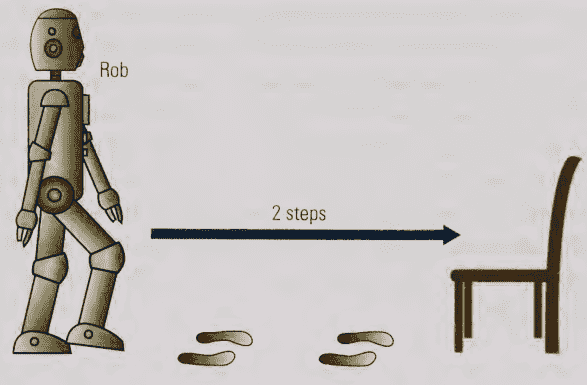

- 1. 向前走
- 2. 向前走
- 3. 向右转90度
- 4. 向右转90度
- 5. 坐下

图2-1：顺序结构示例

### 选择结构

与顺序结构一样，你已经熟悉**选择结构**，也称为**决策结构**。选择结构做出决策，然后根据该决策采取适当的行动。每次你开车接近十字路口时，都会使用选择结构。你的决策以及适当的行动，都取决于该十字路口是否有停车标志。如果十字路口有停车标志，你就停车；否则，你谨慎地通过十字路口。在计算机程序中使用时，选择结构会提醒计算机需要做出决策，并提供根据该决策结果要采取的适当行动。

你可以通过给机械人Rob编程来观察选择结构如何工作。在本例中，假设Rob拿着一个红色或黄色气球，并且面向两个箱子。其中一个箱子是黄色的，另一个是红色的。两个箱子位于离Rob三步远的地方。你的任务是让Rob把气球放进合适的箱子：黄色气球属于黄色箱子，并且

## 小结

- 算法是完成任务的逐步指令集合。
- 所有计算机程序的算法都包含以下三种控制结构中的一种或多种：顺序、选择和重复。
- 控制结构（也称为逻辑结构）之所以这样命名，是因为它们控制程序逻辑的流程。
- 顺序结构指示计算机按照程序中列出的顺序逐条处理程序指令。
- 选择结构（也称为决策结构）指示计算机做出决策，然后根据该决策选择要采取的适当行动。
- 重复结构指示计算机重复一条或多条程序指令，直到满足某个条件。
- 所有程序都使用顺序结构。大多数程序还同时包含选择结构和重复结构。

## 关键术语

- **算法**——完成任务的逐步指令集合
- **控制结构**——控制程序逻辑流程的结构；也称为逻辑结构
- **决策结构**——选择结构的另一种称呼
- **迭代**——重复结构的另一种称呼
- **逻辑结构**——控制结构的另一种称呼
- **循环**——重复结构的另一种称呼
- **重复结构**——指示计算机重复一条或多条指令直到满足某个条件，此时计算机应停止重复这些指令的控制结构；也称为循环或迭代
- **选择结构**——指示计算机做出决策，然后根据该决策采取适当行动的控制结构；也称为决策结构
- **顺序结构**——指示计算机按照程序中列出的顺序处理每条指令的控制结构

## 复习题

- 1. 将两个数相加的指令集是____________结构的示例。
    - a. 控制
    - b. 重复
    - c. 选择
    - d. 顺序

- 2. 食谱指令“搅拌至顺滑”是____________结构的示例。
    - a. 控制
    - b. 重复
    - c. 选择
    - d. 顺序

- 3. 指令“如果外面在下雨，就带伞去上班”是____________结构的示例。
    - a. 控制
    - b. 重复
    - c. 选择
    - d. 顺序

- 4. 算法会使用哪种控制结构来判断信用卡持卡人是否超过其信用额度？
    - a. 重复
    - b. 选择
    - c. 重复和选择两者

- 5. 一家公司向在公司工作超过5年的员工支付3%的年度奖金；其他员工获得1%的奖金。算法会使用哪种控制结构来计算每位员工的奖金？
    - a. 重复
    - b. 选择
    - c. 重复和选择两者

## 练习

使用Rob（机械人）完成练习1、3、4、6和11。Rob的指令集如图2-4所示。

```
    walk forward
    sit down
    stand up
    pick the flower with your right hand
    pick the flower with your left hand
    drop the toy in the toy chest
    turn right 90 degrees
    jump over the box
    throw the box out of the way
    if the box is red, do this:
    if the flower is white, do this:
    otherwise, do this:
    repeat x times:
    repeat until you are directly in front of the chair:
    repeat until you are directly in front of the toy chest:
```

图2-4

### 试一试

- 1. Rob离一个箱子有五步远，而该箱子离一把椅子有未知距离，如图2-5所示。仅使用图2-4所示的指令，创建一个算法，指示Rob坐到椅子上。假设Rob必须先跳过箱子，然后才能继续朝椅子前进。（“试一试”练习的答案位于本章末尾。）

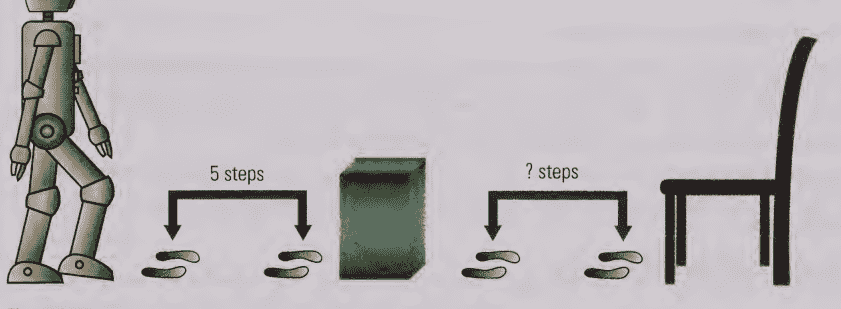

图2-5

- 9. 图2-10所示的算法应指导工资核算员如何计算并打印五名工人的总工资；然而，算法中缺少一些指令。补全该算法。如果员工工作超过40小时，则其超过40小时的工作时间应按1.5倍工资支付。

```
read the employee’s name, hours worked, and pay rate
________________________________________

calculate gross pay = hours worked times pay rate
otherwise, do this:
    calculate regular pay = pay rate times 40
    calculate overtime hours = hours worked minus 40
    calculate overtime pay = ________________________
    calculate gross pay = ________________________
print the employee’s name and gross pay
```

图2-10

- 10. 研究图2-11所示的算法，然后回答问题。

```
repeat 5 times:
    get the salesperson’s name and sales amount
    calculate the bonus amount by multiplying the sales amount by 3%
    print the salesperson’s name and bonus amount
```

图2-11

    - a. 图2-11所示的算法使用了哪些控制结构？
    - b. 当用户分别输入Mary Smith和2000作为销售员姓名和销售金额时，图2-11所示的算法将打印什么？
    - c. 你会如何修改图2-11所示的算法，使其还打印销售员的销售金额？
    - d. 你会如何修改图2-11所示的算法，使其可用于任意数量的销售员？
    - e. 你会如何修改图2-11所示的算法，使其允许用户输入奖金比例，然后使用该比例计算奖金金额？


- 11. 图2-12所示的算法无法让Rob穿过迷宫。改正该算法。

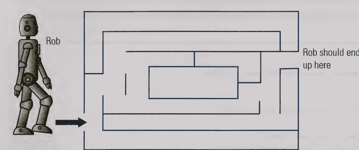

- 1. 走进迷宫
- 2. 向左转90度
- 3. 重复直到你正对着一堵墙：
    - 向前走
- 4. 向右转90度
- 5. 重复直到你正对着一堵墙：
    - 向前走
- 6. 向右转90度
- 7. 重复直到你正对着一堵墙：
    - 向前走
- 8. 向右转90度
- 9. 重复直到你正对着一堵墙：
    - 向前走
- 10. 向右转90度
- 11. 重复直到你正对着一堵墙：
    - 向前走
- 12. 向左转90度
- 13. 重复直到你正对着一堵墙：
    - 向右转90度
- 14. 重复直到你走出迷宫：
    - 向前走

图2-12


## “试一试”练习答案

- 1. 参见图2-13。

```
1.  repeat 5 times:
        walk forward
2.  jump over the box
3.  repeat until you are directly in front of the chair:
        walk forward
4.  repeat two times:
        turn right 90 degrees
5.  sit down
```

图2-13

- 2. 参见图2-14。

```
repeat 25 times:
    read the student’s answer and the correct answer
    if the student’s answer is not the same as the correct answer, do this:
        mark the student’s answer incorrect
```

图2-14

## 程序员如何解决问题？

图3-1展示了计算机程序员在解决需要计算机解决方案的问题时所遵循的步骤。

- **如何使用计算机解决问题**
- 1. 分析问题
- 2. 规划算法
- 3. 桌面检查算法
- 4. 创建用户界面
- 5. 将算法编码为程序
- 6. 桌面检查程序
- 7. 使用计算机严格测试程序

**图3-1：** 如何使用计算机解决问题

本章涵盖图3-1所示问题解决过程中的前三个步骤。第四步是创建用户界面，将在第4章和第5章中介绍。最后三个步骤将在其余章节中探讨。

### 第1步——分析问题

除非你理解问题，否则无法解决问题；而除非你分析问题——换句话说，除非你识别出问题的重要组成部分——否则你无法理解问题。任何问题中最重要的两个组成部分是问题的输出和输入。**输出**是解决问题的目标，**输入**是实现目标所需的一个或多个项目。分析问题时，你总是先寻找输出，然后寻找输入。本章分析的第一个问题说明如图3-2所示。

作为J & J Sales的销售人员，艾迪生·史密斯每年获得佣金，其计算方式是将她的年销售额乘以佣金率。艾迪生想要一个既能计算又能显示她年度佣金金额的程序。

**图3-2：** 艾迪生·史密斯的问题说明

识别输出的一种有用方法是，在问题说明中搜索以下问题的答案：*用户希望打印在纸上、显示在屏幕上或存储在文件中的内容是什么？* 该问题的答案通常以名词和形容词的形式出现在问题说明中。例如，图3-2所示的问题说明表明，艾迪生（程序用户）希望将她的年度佣金金额显示在屏幕上；因此，输出就是年度佣金。在此语境中，单词 *annual* 是形容词，单词 *commission* 是名词。

确定输出后，接着确定输入。识别输入的一种有用方法是，在问题说明中搜索以下问题的答案：*计算机需要知道哪些信息才能打印、显示或存储输出项？* 与输出一样，输入通常以名词和形容词的形式出现在问题说明中。确定输入时，想一想你手动解决问题所需的信息会有所帮助，因为计算机将需要知道相同的信息。在本例中，要确定艾迪生的年度佣金，你和计算机都需要知道她的年销售额以及佣金率；因此，这两项都是输入。在此语境中，*annual* 和 *commission* 是形容词，*sales* 和 *rate* 是名词。至此，艾迪生·史密斯问题的分析步骤完成。图3-3总结了该问题的输出项和输入项。

|  |  |
|---|---|
| 输出： | 年度佣金 |
| 输入： | 年销售额<br>佣金率 |

**图3-3：** 艾迪生·史密斯问题的输出项和输入项

现在分析图3-4所示的问题说明。

> 艾登·特纳每周五领取工资。他计划下周加薪；但是，他不确定具体的加薪百分比。艾登想要一个既能计算又能显示他新的周薪金额的程序。

**图3-4：** 艾登·特纳的问题说明

首先，回答以下问题：*用户希望打印在纸上、显示在屏幕上或存储在文件中的内容是什么？* 在本例中，艾登希望将他的新周薪显示在屏幕上；因此，输出就是新周薪。在此语境中，单词 *new* 和 *weekly* 是形容词，单词 *pay* 是名词。现在回答以下问题：*计算机需要知道哪些信息才能打印、显示或存储输出项？* 要确定艾登的新周薪，计算机需要知道艾登当前的周薪和他的加薪百分比；因此，这两项都是输入。在此语境中，*current*、*weekly* 和 *raise* 是形容词，*pay* 和 *percentage* 是名词。你已完成艾登·特纳问题的分析步骤。该问题的输出项和输入项列于图3-5。

|  |  |
|---|---|
| 输出： | 新周薪 |
| 输入： | 当前周薪<br>加薪百分比 |

**图3-5：** 艾登·特纳问题的输出项和输入项

遗憾的是，分析现实世界中的问题并不总是像分析教科书中的问题那样容易。分析步骤是问题解决步骤中最困难的一步，需要大量时间、耐心和努力。如果你在分析问题时遇到困难，请尝试多读几遍问题说明，因为在第一次阅读时很容易遗漏信息。如果问题对你来说仍然不清楚，不要羞于向用户询问更多信息。请记住，你对问题理解得越透彻，编写正确且高效的解决方案就越容易。

### 小测验1

指出以下每个问题说明中的输出和输入。（小测验答案位于本章末尾“关键术语”部分之后。）

- 1. 特雷森·利物浦每年按应纳税工资缴纳州所得税。他想要一个允许他输入年度应纳税工资金额的程序。然后，该程序应计算并显示他的州所得税金额。
- 2. 马克斯·琼斯属于一个CD（光盘）俱乐部，该俱乐部允许他以比当地音乐商店低得多的价格购买CD。他想知道通过俱乐部而不是音乐商店购买所有CD能节省多少钱。
- 3. 苏曼·帕特尔每天都存同样多的钱。她想知道在特定月份内她总共存了多少钱。

有关分析问题的更多示例，请参见 Ch3WantMore.pdf 文件中的“分析问题”部分。

### 第2步——规划算法

问题解决过程中的第二步是规划算法，算法是一组指令，遵循这些指令会将问题的输入转换为输出。大多数算法以一条将输入项输入计算机的指令开始。接下来，你通常会记录处理输入项以实现问题输出的指令。处理通常涉及对输入项执行一项或多项计算。大多数算法以一条打印、显示或存储输出项的指令结束。*显示*、*打印*和*存储*分别指计算机屏幕、打印机和磁盘上的文件。图3-6展示了艾迪生·史密斯问题的输出、输入和算法。该算法从输入输入项开始。然后使用输入项计算输出项。请注意，该算法既说明了要计算什么，也说明了如何计算。在本例中，年度佣金通过将年销售额乘以佣金率来计算。算法中的最后一条指令显示输出项。为避免混淆，算法在引用输入项和输出项时保持一致很重要。例如，如果输入项列为“年销售额”，那么算法应将该事项称为“年销售额”，而不是使用不同的名称，如“销售额”或“年度销售额”。

```
Output:  annual commission

Input:   annual sales
         commission rate

Algorithm:
1. enter the annual sales and commission rate
2. calculate the annual commission by multiplying the annual sales by the commission rate
3. display the annual commission
```

图3-6：艾迪生·史密斯问题的输出、输入和算法

图3-6所示的算法由简短的英文陈述组成，称为**伪代码**。单词 *pseudocode* 的意思是*假代码*。它被称为假代码，是因为尽管它类似于编程语言指令，但计算机无法理解伪代码。程序员在规划算法时使用伪代码来帮助自己。它允许他们用人类可读的语言记下自己的想法，而不必担心编程语言本身的语法。伪代码不是标准化的；每个程序员都有自己的版本，但你会发现一些


各个版本之间的相似之处。程序员在编写算法代码时使用伪代码作为指南，这是问题解决过程中的第五步。

除了使用伪代码外，程序员在规划算法时还使用**流程图**。与伪代码不同，**流程图**使用标准化符号以可视方式描绘算法。你可以手工绘制流程图符号；或者，你可以使用文字处理软件中的绘图或形状功能。你也可以使用流程图绘制程序，例如 SmartDraw 或 Visio。图3-7以流程图形式展示了艾迪生·史密斯问题的算法。该流程图包含三种不同的符号：椭圆形、平行四边形和矩形。这些符号由线连接，这些线称为**流程线**。椭圆形符号称为**开始/停止符号**。开始椭圆表示流程图的开始，停止椭圆表示流程图的结束。开始椭圆和停止椭圆之间有两个平行四边形，称为**输入/输出符号**。你使用**输入/输出符号**表示输入任务（例如从用户处获取信息）和输出任务（例如显示、打印或存储信息）。图3-7中显示的第一个平行四边形表示输入任务，而最后一个平行四边形表示输出任务。流程图中的矩形称为**处理符号**，用于表示计算等任务。

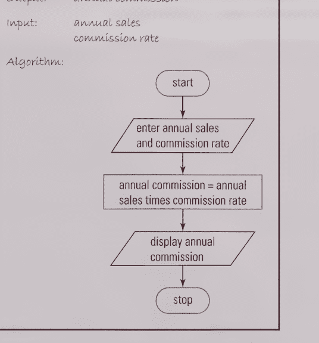

图3-7：艾迪生·史密斯问题算法的流程图

在规划算法时，你不需要同时创建流程图和伪代码；只需使用其中一种规划工具。使用哪种工具实际上取决于个人偏好。对于简单算法，伪代码就足够好用。然而，当算法变得更复杂时，程序逻辑在流程图中可能更容易看清。正如老话所说，一图有时胜千言。

图3-8展示了艾登·特纳问题的输出、输入和算法。这里同样，算法首先输入输入项。然后使用两个输入项计算输出项。再次注意，计算指令既说明了要计算什么，也说明了如何计算。算法中的最后一条指令显示输出项。

```
Output:   new weekly pay
Input:    current weekly pay
          raise percentage

Algorithm:
1. enter the current weekly pay and raise percentage
2. calculate the new weekly pay by multiplying the current weekly pay by the raise percentage,
   and then adding the result to the current weekly pay
3. display the new weekly pay
```

**图3-8：** 艾登·特纳问题的输出、输入和算法

即使非常简单的问题也可能有不止一种解法。例如，图3-9展示了艾登·特纳问题的另一种解法。在这个解法中，每周加薪额是在一条单独的指令中计算的，而不是在计算新周薪的指令中计算。每周加薪额既不是输入项（因为它不是由用户提供的），也不是输出项（因为它不会被显示、打印或存储到文件中）。相反，每周加薪额是一个特殊项，通常称为处理项。**处理项**表示算法在将输入处理为输出时使用的中间值。在本例中，算法使用输入项计算每周加薪额（一个中间值），然后算法再用它计算新周薪。请记住，并非所有算法都需要处理项。

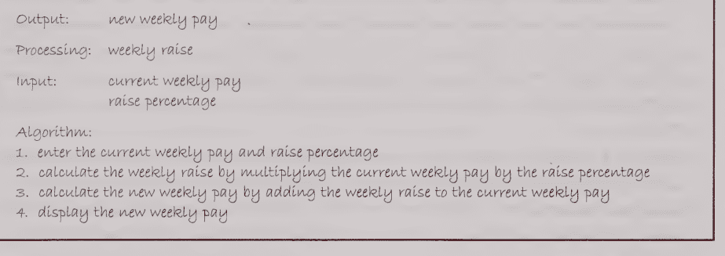

图3-9：艾登·特纳问题的另一种解法

图3-8和图3-9所示的解法产生相同结果，只是表示解决同一问题的两种不同方式。图3-10以流程图形式展示了图3-9的算法。

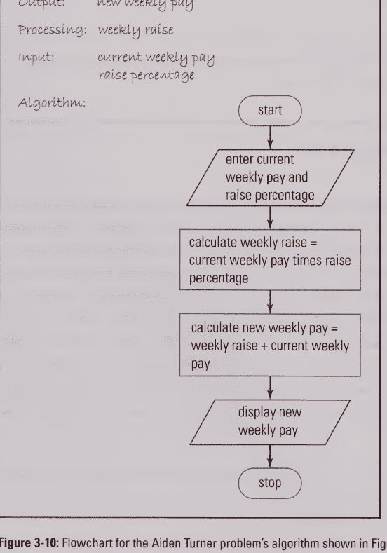

图3-10：图3-9所示艾登·特纳问题算法的流程图

输出值。在桌面检查算法时，使用桌面检查表会很有帮助。该表应为每个输入项包含一列，并为每个输出项包含一列，为每个处理项（如果有）包含一列。你可以使用算法的伪代码或流程图来执行桌面检查。图3-11展示了艾迪生·史密斯的解法以及相应的桌面检查表。（该解法的流程图已在前面图3-7中展示。）

```
Output: annual commission

Input: annual sales
       commission rate

Algorithm:
1. enter the annual sales and commission rate
2. calculate the annual commission by multiplying the annual sales by the commission rate
3. display the annual commission
```

| 年销售额 | 佣金率 | 年度佣金 |
| --- | --- | --- |

图3-11：艾迪生·史密斯的解法及桌面检查表

算法中的第一条指令是输入输入值：年销售额为 $85000，佣金率为 .08。你通过在桌面检查表的年销售额列和佣金率列中分别写入 85000 和 .08 来记录这条指令的结果，如图3-12所示。

| 年销售额 | 佣金率 | 年度佣金 |
| --- | --- | --- |
| 85000 | .08 | |

图3-12：录入桌面检查表中的输入值

算法中的第二条指令是通过将年销售额乘以佣金率来计算年度佣金。桌面检查表显示年销售额为 85000，佣金率为 .08。注意，你使用该表来确定年销售额和佣金率的值；这有助于验证算法的准确性。例如，如果表中佣金率列没有显示任何金额，你就会知道算法漏掉了一个步骤；在这种情况下，它漏掉了输入佣金率。将年销售额（85000）乘以佣金率（.08），得到 6800。你将数字 6800 记录在年度佣金列中，如图3-13所示。

## 小结

- 问题解决过程的前三步是分析问题、规划算法和桌面检查算法。
- 在分析问题描述时，程序员首先确定输出，即解决问题的目标或目的。然后程序员确定输入，即达到目标所需的信息。有些算法使用中间值，称为处理项。
- 程序员使用伪代码和流程图等工具，在分析问题和开发算法时组织思路。这些工具用于将算法编码为程序，这是问题解决过程中的第五步。
- 大多数算法首先输入一些数据（输入项），然后处理数据（通常执行一些计算），然后显示、打印或存储一些数据（输出项）。
- 算法中的计算指令应说明要计算什么以及如何执行计算。
- 完成分析和规划步骤后，程序员然后对算法进行桌面检查，以确定它是否按预期工作。

## 关键术语

- **桌面检查**——手动逐步执行算法中每一步的过程；也称为手工追踪
- **流程图**——程序员在规划算法时使用的工具；由标准化符号组成
- **流程线**——流程图中连接符号的线
- **手工追踪**——桌面检查的另一种说法
- **输入**——算法实现输出所需的数据项
- **输入/输出符号**——流程图中的平行四边形；用于表示输入和输出任务
- **无效数据**——算法不期望用户输入的数据
- **输出**——解决问题的目标


- **处理符号**——流程图中的矩形；用于表示计算等任务
- **处理项**——算法在将输入转换为输出时使用的中间值
- **伪代码**——程序员在规划算法时使用的工具；由简短的英文语句组成
- **开始/停止符号**——流程图中的椭圆形；用于标记流程图的开始和结束
- **有效数据**——算法期望用户输入的数据

## 小测验答案

### 小测验 1

1. 输出：年度州所得税  
   输入：年度应税工资；州所得税税率
2. 输出：储蓄  
   输入：购买的 CD 数量；俱乐部 CD 价格；商店 CD 价格
3. 输出：节省总额  
   输入：每日节省额；天数

### 小测验 2

1. 算法：
   1. 输入年度应税工资和州所得税税率
   2. 通过将年度应税工资乘以州所得税税率来计算年度州所得税
   3. 显示年度州所得税

## 复习题

1. 程序员将达成问题目标所需的项目称为 ________。
   - a. 输入
   - b. 输出
   - c. 处理
   - d. 目的
2. 算法中的计算指令应说明 ________。
   - a. 仅说明要计算*什么*
   - b. 仅说明*如何*计算某物
   - c. 既说明要计算*什么*，也说明*如何*计算
   - d. 既说明要计算*什么*，也说明*为什么*要计算它
3. 大多数算法遵循 ________ 的格式。
   - a. 输入输入项，然后显示、打印或存储输出项，然后处理输出项
   - b. 输入输入项，然后处理输出项，然后显示、打印或存储输出项
   - c. 输入输入项，然后处理输入项，然后显示、打印或存储输出项
   - d. 输入输出项，然后处理输入项，然后显示、打印或存储输出项
4. 在流程图中，________ 符号用于表示从用户处获取信息的指令。
   - a. 输入
   - b. 输入/输出
   - c. 处理
   - d. 开始/停止
5. 对算法进行桌面检查时，应建立一个包含 ________ 的表格。
   - a. 每个输入项一列，每个输出项一列
   - b. 每个输入项一列，每个处理项一列
   - c. 每个处理项一列，每个输出项一列
   - d. 每个输入项一列，每个处理项一列，每个输出项一列

- a. 当用户输入数字三作为延迟天数时，图 3-18 所示的算法将显示什么？当用户输入数字零作为延迟天数时，它将显示什么？
- b. 你会如何修改解决方案和桌面检查表，以将总滞纳金作为处理项包含在内？
- c. 你会如何修改问题 b 的解决方案，使其也显示总滞纳金？


11. 改正以下算法，该算法应计算三个数字的平均值。

```
    Output: average
    Processing: sum
    Input: first number
           second number
           third number

    Algorithm:
    1. enter the first number, second number, and third number
    2. calculate the average by dividing the sum by 3
    3. display the average number
```

## “试一试”练习答案

```
    1. Output:       tip
       Input:        total bill
                     liquor charge
                     tip percentage

       Algorithm:
       1. enter the total bill, liquor charge, and tip percentage
       2. calculate the tip by subtracting the liquor charge from the total bill, and then multiplying the remainder by the tip percentage
       3. display the tip
```

桌面检查表

| 总账单 | 酒水费用 | 小费百分比 | 小费 |
|---|---|---|---|
| 85 | 20 | .2 | 13 |
| 35 | 0 | .15 | 5.25 |

# 第4章

# 我需要一位导游

**学习完第 4 章后，你应该能够：**


- 创建 Visual Basic 2008 Windows 应用程序
- 使用 Label 和 PictureBox 工具向窗体添加控件
- 设置对象的属性
- 保存解决方案
- 使用“格式”菜单调整对象大小并对齐对象
- 锁定窗体上的控件
- 启动和结束应用程序
- 关闭并打开现有解决方案

# 第4章

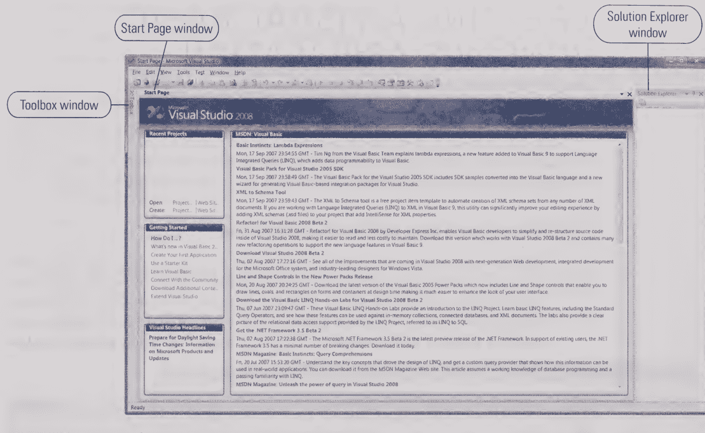

图 4-1：Microsoft Visual Studio 2008 Professional Edition 启动屏幕

Visual Studio 2008 中包含 Visual Basic、Visual C++ 和 Visual C# 编程语言。你可以使用这些语言将算法编码为程序，这是问题解决过程中的第五步。用户界面与程序代码的组合称为应用程序。你可以使用 Visual Basic 创建各种类型的应用程序，例如 Windows 应用程序和 Web 应用程序。Windows 应用程序具有 Windows 用户界面，并在台式计算机上运行，而 Web 应用程序具有 Web 用户界面，并在服务器上运行。你还可以使用 Visual Basic 创建在智能设备（如 Pocket PC 和 Smartphone）上运行的智能设备应用程序。本书重点介绍 Windows 应用程序。不过，Web 应用程序将在后面的章节中介绍，智能设备应用程序将在本书各章的若干高级练习中探讨。

2. 单击 **确定** 按钮关闭“选项”对话框。
3. 在菜单栏上单击 **文件**，然后单击 **新建项目**。“新建项目”对话框打开。如有必要，展开“项目类型”列表中的 **Visual Basic** 节点，然后单击 **Windows**。
4. 如有必要，在“模板”列表的“Visual Studio 已安装模板”部分中单击 **Windows 窗体应用程序**。
5. 在“名称”框中键入 **My Wizard Project**。
6. 使用“位置”框旁边的“浏览”按钮打开“项目位置”对话框。找到并单击 **ClearlyVB\Chap04** 文件夹，然后单击 **选择文件夹** 按钮。
7. 如有必要，在“新建项目”对话框中选中 **为解决方案创建目录** 复选框。
8. 在“解决方案名称”框中键入 **My Wizard Solution**。完成后的“新建项目”对话框如图 4-3 所示。如果你要保存到计算机硬盘以外的设备（例如，保存到闪存驱动器），则驱动器号会有所不同。此外，如果你使用的是 Express Edition，你的对话框看起来会有所不同。

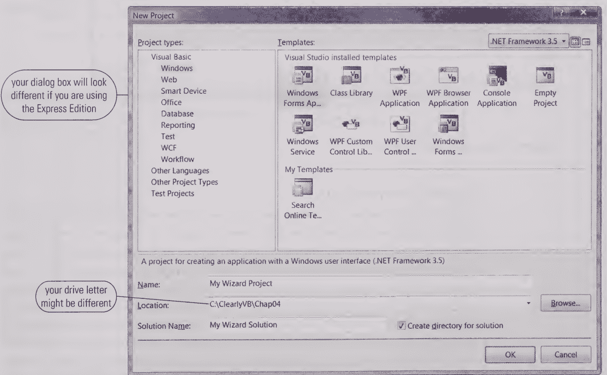

**图 4-3：** 完成后的“新建项目”对话框

9. 单击 **确定** 按钮关闭“新建项目”对话框。当你单击“确定”按钮时，Visual Studio 会创建一个解决方案，并向该解决方案添加一个 Visual Basic 项目，如图 4-4 所示。解决方案和项目名称将出现在“解决方案资源管理器”窗口中。

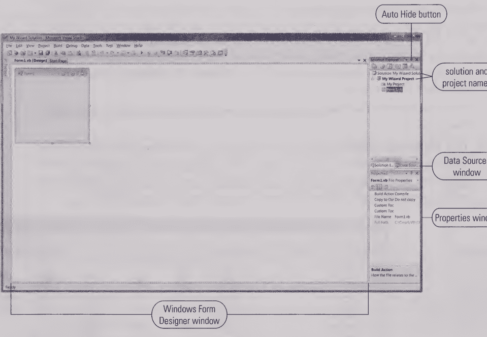

**图 4-4：** 解决方案和 Visual Basic 项目

## 这么多窗口！

除了前面提到的“工具箱”、“起始页”和“解决方案资源管理器”窗口外，图 4-4 所示的 IDE 中还打开了另外三个窗口：“Windows 窗体设计器”、“数据源”和“属性”。同时打开这么多窗口——此处是六个窗口——可能会令人困惑，尤其是在你刚开始学习 IDE 时。在大多数情况下，你会发现关闭或自动隐藏当前不使用的窗口后，在 IDE 中工作会更容易。关闭已打开窗口的最简单方法是单击窗口标题栏上的“关闭”按钮。在大多数情况下，“视图”菜单会提供用于打开已关闭窗口的相应选项。你可以使用窗口标题栏上的“自动隐藏”按钮（如图 4-4 所示）来自动隐藏窗口。“自动隐藏”按钮是一个切换按钮：单击一次可激活它，再次单击可停用它。图 4-4 所示的“工具箱”窗口就是一个自动隐藏窗口的示例。


## 创建用户界面

**Windows 窗体设计器窗口**是创建（或设计）应用程序用户界面的地方。图 4-6 所示的设计器窗口包含一个 **Windows 窗体对象**，即窗体。**窗体**是 Windows 应用程序中用户界面的基础。窗体自动包含一个标题栏，其中有一个默认标题——此处为 Form1——以及最小化、最大化和关闭按钮。设计器窗口顶部有一个标签，标为 Form1.vb [Design]。[Design] 表明该窗口是设计器窗口。Form1.vb 是计算机硬盘（或讲师/技术支持人员指定的设备）上包含与该窗体关联的 Visual Basic 指令的文件的名称。

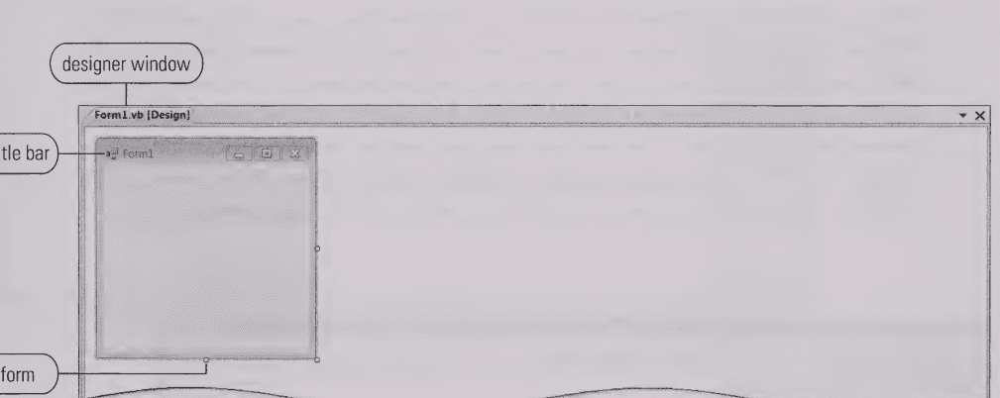

图 4-6：Windows 窗体设计器窗口

通过向窗体添加对象（如按钮、复选框和列表框）来创建用户界面。添加到窗体上的对象称为 **控件**。由于控件本质上是图形化的，用户界面通常称为图形用户界面，即 **GUI**。使用 **工具箱窗口** 中包含的工具将控件添加到窗体上。在下一组步骤中，你将开始创建图 4-7 所示的向导应用程序界面。该界面包含四个控件：两个图片框和两个标签。使用 **图片框** 在窗体上显示图像。使用 **标签控件** 显示应用程序运行时用户不能编辑的文本。有些标签控件仅用于标识其他控件的内容。例如，图 4-7 中的标签控件标识图片框的内容。标签控件也用于界面中显示程序输出，例如计算结果。在以下步骤中，你还将学习如何移动、删除、恢复删除以及调整控件大小。

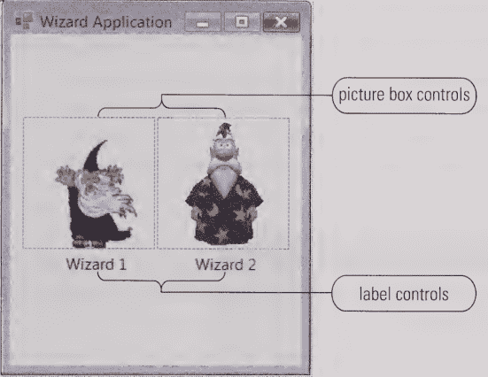

**图 4-7：** 向导应用程序用户界面

### 开始创建向导应用程序用户界面：

- 1. 单击工具箱中的 **标签** 工具，但不要松开鼠标按钮。按住鼠标按钮，同时将鼠标指针拖到窗体的左下角。拖动鼠标指针时，你会看到一个实心框，以及一个矩形轮廓和一个加号框跟随鼠标指针移动。注意，窗体的左边框与控件的左边框之间、窗体的下边框与控件的下边框之间会出现蓝线。这些蓝线称为边距线，因为其大小由控件的 Margin 属性的内容决定。边距线的作用是帮助你在窗体上正确调整控件间距。参见图 4-8。

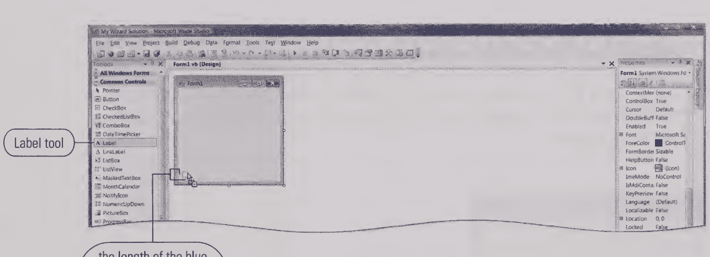

图 4-8：正在将标签工具拖到窗体上

- 2. 松开鼠标按钮。窗体上会出现一个标签控件，设计器窗口的标签上会出现星号（*），表示自上次保存以来窗体已更改。参见图 4-9。

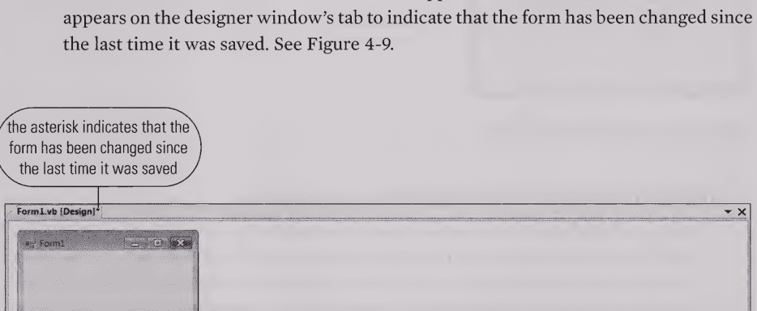

图 4-9：已添加到窗体的标签控件

- 3. 现在练习在窗体上重新定位控件。将鼠标指针放在标签控件的中心，然后按住鼠标左键并将控件拖到窗体的另一区域。（不必担心确切位置。）松开鼠标按钮。
- 4. 接下来，练习删除控件，然后恢复控件。按键盘上的 **Delete** 键删除标签控件。单击菜单栏上的 **编辑**，然后单击 **撤销** 以恢复标签控件。
- 5. 将标签控件拖回窗体左下角的原始位置。
- 6. 向窗体添加另一个标签控件。将该标签控件放在窗体中央。
- 7. 拖动 Label2 控件，直到其左边框与 Label1 控件的左边框对齐，但不要松开鼠标按钮。当两个控件的左边框对齐时，设计器会显示一条蓝色对齐线，如图 4-10 所示。由于两个控件大小相同，它们的右边框也会对齐。

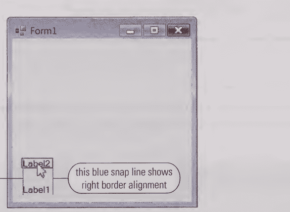

图 4-10：边框对齐时会出现一条蓝色对齐线

- 8. 松开鼠标按钮。
- 9. 现在拖动 Label2 控件，使 Label2 文本与 Label1 文本对齐。当两个控件中的文本对齐时，设计器会显示一条粉色对齐线，如图 4-11 所示。

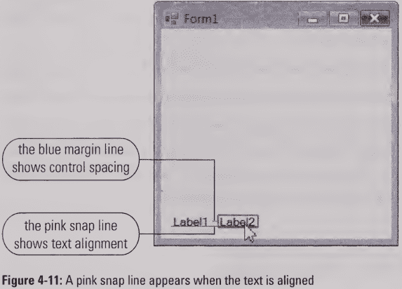

- 10. 松开鼠标按钮。
- 11. 使用 PictureBox 工具向窗体添加两个图片框。参见图 4-12。（不必担心控件在界面中的确切位置。）

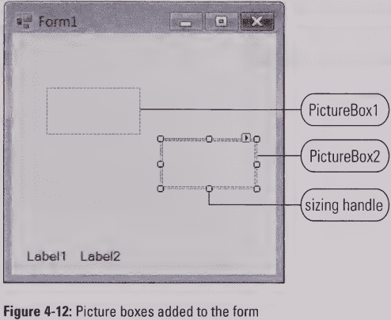

- 12. PictureBox2 控件上的尺寸柄表明它已被选中。可以使用尺寸柄将控件放大或缩小。使用尺寸柄将 PictureBox2 控件放大或缩小，然后单击菜单栏上的 **编辑**，再单击 **撤销**，使控件恢复原始大小。
- 13. 工具箱窗口已使用完毕，因此可以将其自动隐藏。自动隐藏工具箱窗口。


要详细了解如何向窗体添加控件，以及调整控件大小、移动、删除和恢复删除控件，请观看 Ch04-Controls 视频。

## 保存，保存，保存

最好每 10 或 15 分钟保存一次当前解决方案，这样如果计算机断电，就不会丢失大量工作。可以通过单击菜单栏上的“文件”，然后单击“全部保存”来保存解决方案。也可以单击标准工具栏上的“全部保存”按钮。保存解决方案时，计算机会保存对解决方案中包含的文件所做的任何更改。保存解决方案还会移除设计器窗口标签上出现的星号。

### 保存当前解决方案：

- 1. 单击菜单栏上的 **文件**，然后单击 **全部保存**。

## 小测验 1

- 1. ____________ 控件显示应用程序运行时用户不能编辑的文本。
- 2. ____________ 包含用于向窗体添加对象的工具。
- 3. GUI 代表 ____________。

## 这是谁的属性？

Visual Basic 应用程序中的每个对象都有一组称为 **属性** 的特性，用于确定其外观和行为。创建对象时，会为其每个属性分配默认值。选中对象时，每个属性的名称和当前值会显示在 **属性窗口** 中。

### 查看窗体属性：

- 1. 单击 **窗体**（而不是窗体上的控件）以选中它。窗体上会出现尺寸柄，表明窗体已被选中，窗体属性会显示在“属性”窗口中。
- 2. 向上滚动到“属性”窗口顶部。如有必要，单击“属性”窗口中的 **按字母顺序** 按钮，按字母顺序显示属性名。大多数情况下，属性名按字母顺序列出时，使用“属性”窗口会更方便。
- 3. 单击 **(Name)**（属性列表中的第三项），以选择窗体的 Name 属性。图 4-13 显示了窗体属性的部分列表。（注意，括号内的项出现在属性列表顶部。）

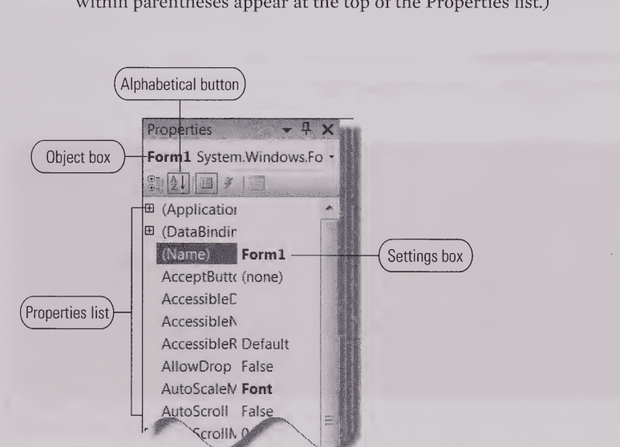

图 4-13：显示窗体部分属性的“属性”窗口

如图 4-13 所示，“属性”窗口包含一个对象框和一个属性列表。对象框显示所选对象的名称——此处为 Form1。属性列表有两列。左列列出与所选对象关联的属性名。右列包含每个属性的设置框。设置框显示属性的当前值或设置。例如，窗体 Name 属性的当前值为 Form1。根据属性的不同，你可以通过在属性列表中选择该属性，然后在设置框中键入新值，或从列表或对话框中选择预定义值，来更改分配给属性的默认值。尽管图 4-13 中未显示，但所选属性的简要说明会出现在“属性”窗口底部的说明窗格中。

在下一组步骤中，你将更改分配给窗体 Text、StartPosition 和 Font 属性的值。Text 属性控制应用程序运行时显示在窗体标题栏以及任务栏上应用程序按钮中的标题。StartPosition 属性指定应用程序启动后窗体首次出现在屏幕上的位置。Font 属性确定用于显示窗体上文本的字体类型、样式和大小。字体是文本中字符的整体形状。Segoe UI、Tahoma 和 Microsoft Sans Serif 是字体类型的示例。字体样式包括常规、粗体和斜体。数字 9、12 和 18 是字体大小的示例，字体大小通常以磅为单位，1 磅等于 1/72 英寸。

### 更改分配给窗体部分属性的值：

- 1. 向下滚动属性列表，然后单击列表中的 **Text**。键入 **Wizard Application** 并按 **Enter**。Wizard Application 文本会出现在设置框和窗体标题栏中。
- 2. 单击属性列表中的 **StartPosition**。单击设置框中的 **下箭头**，然后单击 **CenterScreen**，使应用程序启动时窗体显示在屏幕中央。
- 3. 单击属性列表中的 **Font**，然后单击设置框中的 **...**（省略号）按钮。这样做会打开“字体”对话框。

对于为 Windows Vista 环境创建的应用程序，Microsoft 建议使用 Segoe UI 字体，因为它具有更好的可读性。Segoe 读作 SEE-go，UI 代表 *用户界面*。对于界面中的大多数控件，你将使用 9 磅的字体大小。（为 Windows XP 环境创建的应用程序通常使用 10 磅或 12 磅的 Tahoma 字体。）可以逐个更改每个控件的 Font 属性；不过，更简单的方法是更改窗体的 Font 属性。任何未单独设置 Font 属性的控件都将被分配与窗体相同的字体。


- 4. 在“字体”列表框中单击 **Segoe UI**，在“大小”列表框中单击 **9**，然后单击 **确定** 按钮。窗体的 Font 属性设置将更改为新值。每个标签控件的 Font 属性设置也将更改为新值。要验证这一点，请单击 **Label1** 控件，然后查看其 Font 属性设置。单击 **Label2** 控件，然后查看其 Font 属性设置。

接下来，你将更改这两个标签控件的 Text 和 Location 属性。标签控件的 Text 属性指定控件内显示的文本。其 Location 属性控制控件左上角在窗体上的位置。（尽管你可以直接将控件拖动到所需位置，但很多时候会提供 Location 属性的设置，以便你的屏幕与本书中的图一致。）

### 更改每个标签控件的两个属性：

- 1. 单击 **Label1** 控件将其选中，然后将其 Text 属性更改为 **Wizard 1**。
- 2. 在“属性”列表中单击 **Location** 属性。“设置”框中的第一个数字指定控件的水平位置；第二个数字指定其垂直位置。换句话说，第一个数字是控件左边框的位置，第二个数字是其上边框的位置。键入 **40, 212** 并按 **Enter**。
- 3. 单击 **Label2** 控件。将其 Text 属性设置为 **Wizard 2**，将其 Location 属性设置为 **175, 212**。

最后，你将更改图片框的 Image 和 SizeMode 属性。Image 属性指定包含要显示图像的文件名。SizeMode 属性控制图像的显示方式，可以设置为 Normal、StretchImage、AutoSize、CenterImage 或 Zoom。Wizard 应用程序界面的图像存储在 Lightning_bolts (Lightning_bolts.gif) 和 Wizard_appears (Wizard_appears.gif) 文件中，这些文件包含在 ClearlyVB\Chap04 文件夹中。这两个图像文件均从 Animation Library 网站下载。你可以在 *www.animationlibrary.com* 浏览并选择下载其他免费图像文件。

- 4. 打开 ClearlyVB\Chap04 文件夹，然后在文件名列表中单击 **Lightning_bolts (Lightning_bolts.gif)**。单击 **打开** 按钮。见图 4-15。

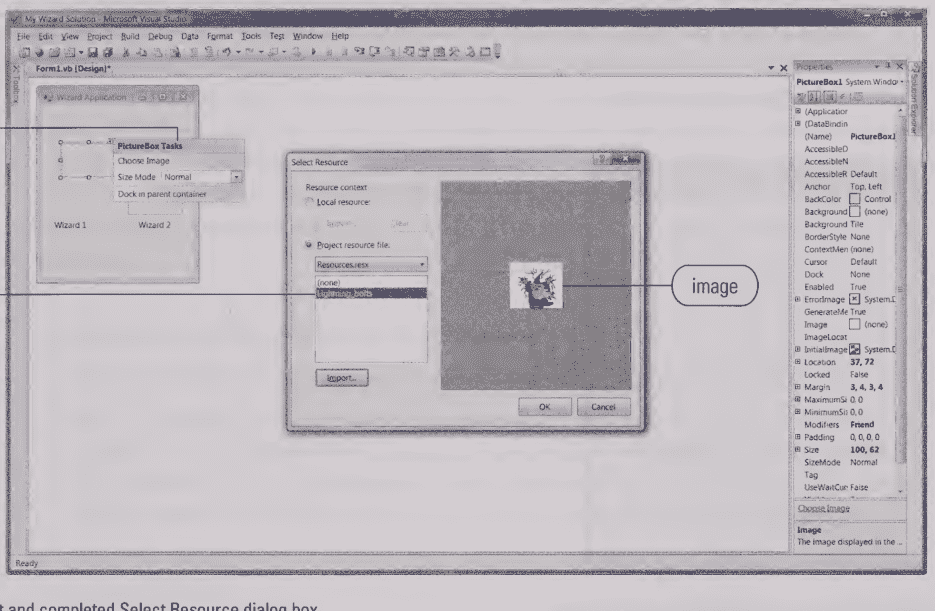

图 4-15：任务列表和已完成的“选择资源”对话框

- 5. 单击 **确定** 按钮。图像的一部分将显示在图片框中，并且 Lightning_bolts 文件名将分配给“属性”窗口中该控件的 Image 属性。
- 6. 单击任务列表框中的 **大小模式** 箭头，然后单击 **AutoSize**。这样做会将 AutoSize 值分配给“属性”窗口中图片框控件的 SizeMode 属性。AutoSize 值告诉计算机自动调整图片框大小以适合其内容。
- 7. 单击 **PictureBox1** 控件以关闭其任务列表，然后拖动图片框，使其位于 Wizard 1 标签上方。见图 4-16。

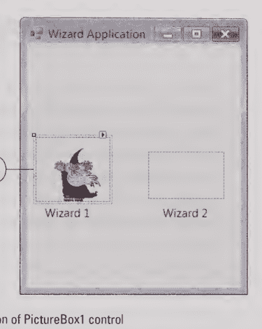

- 8. 单击 **PictureBox2** 控件，然后单击其 **任务列表**。使用任务列表显示 **Wizard_appears** (Wizard_appears.gif) 文件中包含的图像。还使用任务列表将 SizeMode 属性设置为 **AutoSize**。（如果图片框中只显示图像的一部分，不必担心。本章后面启动应用程序时，将显示整个图像。）
- 9. 将 PictureBox2 控件拖动到图 4-17 所示的位置。

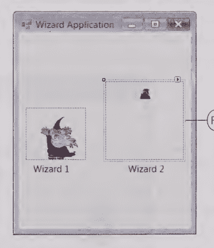

- 10. 自动隐藏“属性”窗口，然后单击标准工具栏上的 **全部保存** 按钮保存解决方案。（你也可以单击菜单栏上的“文件”，然后单击“全部保存”。）

## 使用“格式”菜单

图 4-17 所示界面中的两个图片框大小不同：PictureBox1 比 PictureBox2 小。你可以在“属性”窗口中将其 Size 属性设置为相同值，使它们大小相同。然而，更简单的方法是使用“格式”菜单，它提供了多个用于操作界面中控件的选项。例如，“对齐”选项允许你按左边框、右边框、上边框或下边框对齐两个或多个控件。你可以使用“使大小相同”选项使两个或多个控件具有相同的宽度和/或高度。“格式”菜单还有一个“在窗体中居中”选项，可以在窗体上水平或垂直居中一个或多个控件。在使用“格式”菜单使图片框大小相同之前，必须先选择它们。你选择的第一个控件应始终是你想要匹配其大小和/或位置的控件。例如，要使 PictureBox1 控件的大小与 PictureBox2 控件的大小匹配，需要先选择 PictureBox2 控件。第一个选中的控件称为参考控件。

### 使 PictureBox1 控件与 PictureBox2 控件大小相同：

- 1. 经过上一组步骤后，**PictureBox2** 控件应仍处于选中状态。按住 **Control (Ctrl)** 键并单击 **PictureBox1** 控件，然后释放 Control 键。现在两个图片框均被选中。请注意，PictureBox2 控件（参考控件）上的尺寸柄是白色的，而 PictureBox1 控件上的尺寸柄是黑色的。见图 4-18。

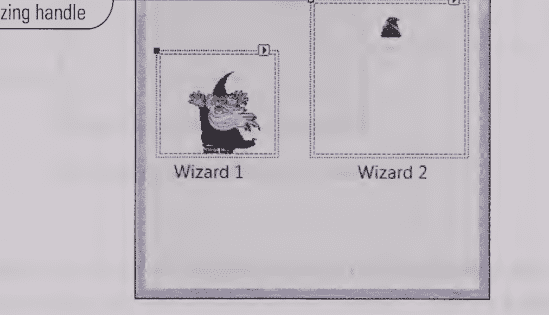

图 4-18：窗体上选中的图片框

- 2. 单击菜单栏上的 **格式**。指向 **使大小相同**，然后单击 **两者**。现在 PictureBox1 控件与 PictureBox2 控件大小相同。
- 3. 单击 **窗体** 以取消选择图片框。
- 4. 既然 PictureBox1 控件现在比其原始尺寸大，其中的图像看起来就太小了。你可以通过将 PictureBox1 控件的 SizeMode 属性从 AutoSize 更改为 StretchImage 来使图像变大。单击 **PictureBox1** 控件，然后在“属性”列表中将其 SizeMode 属性更改为 **StretchImage**。

现在你将使用“格式”菜单，将 PictureBox1 控件的上边框与 PictureBox2 控件的上边框对齐。

### 对齐两个图片框的上边框：

- 1. 单击 **PictureBox2** 控件，它是参考控件。按住 **Control** (Ctrl) 键并单击 **PictureBox1** 控件，然后释放 Control 键。
- 2. 单击菜单栏上的 **格式**。指向 **对齐**，然后单击 **顶端**。现在 PictureBox1 控件的上边框与 PictureBox2 控件的上边框对齐。
- 3. 单击 **窗体** 以取消选择图片框。
- 4. 现在将 Wizard 1 标签向右拖动，使其在 PictureBox1 控件下方居中。（或者，你可以将该标签的 Location 属性更改为 50, 212。）
- 5. 保存解决方案。

要了解有关“格式”菜单的更多信息，请观看 Ch04-Format Menu 视频。


## 锁定它们

在下一组步骤中，你将把窗体上的控件锁定到位。锁定控件可防止你在 IDE 中工作时无意间移动它们。

### 锁定控件：

- 1. 右键单击 **窗体**，然后单击上下文菜单中的 **锁定控件**。请注意，窗体左上角会出现一个小锁。（你也可以通过单击菜单栏上的“格式”，然后单击“锁定控件”来锁定控件。）见图 4-19。

## 好，让我们看看界面实际运行效果！

现在用户界面已完成，你可以启动应用程序，看看它对用户来说会是什么样子。你可以通过单击菜单栏上的“调试”，然后单击“开始调试”来启动应用程序；也可以直接按键盘上的 F5 键。

### 启动和停止当前应用程序：

- 1. 保存解决方案。要启动应用程序，请单击菜单栏上的 **调试**，然后单击 **开始调试**。（你也可以按键盘上的 F5 键。）见图 4-20。（不必担心屏幕底部出现的任何窗口。）

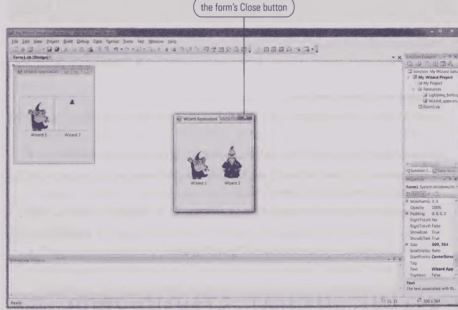

**图 4-20：** 启动 Wizard 应用程序后的结果

- 2. 要停止应用程序，请单击窗体标题栏上的 **关闭** 按钮。（你也可以单击设计器窗口使其成为活动窗口，然后单击菜单栏上的 **调试**，再单击 **停止调试**。）应用程序结束后，你将返回到 IDE。


## 小测验 2

- 1. 分配给图片框控件的图像文件名存储在该控件的 ________ 属性中。
- 2. 分配给标签控件 ________ 属性的值显示在该控件内部。
- 3. 控件的 Location 属性指定该控件在窗体上的 ________ 角的位置。
- 4. 要使 PictureBox2 控件与 PictureBox1 控件大小相同，首先选择 ________ 控件。
- 5. 要启动 Visual Basic 应用程序，请单击“调试”，然后单击 ________。

## 总结

- 问题解决过程的第四步是创建用户界面。
- 可以使用 Visual Basic 创建各种类型的应用程序，例如 Windows 应用程序、Web 应用程序和智能设备应用程序。
- Visual Basic 中的 Windows 应用程序由解决方案、项目和文件组成。
- 通过在 Windows 窗体设计器窗口中向窗体添加控件来创建用户界面。使用工具箱窗口中的工具添加控件。
- 标签控件显示应用程序运行时用户不允许编辑的文本。
- 使用图片框在窗体上显示图像。
- 当一个控件的边框与另一个控件的边框对齐时，会出现蓝色对齐线。当两个或多个控件中的文本对齐时，会出现粉色对齐线。
- 最好每隔 10 或 15 分钟保存一次解决方案。
- 属性窗口列出所选对象的属性。
- 分配给窗体的 Text 属性的值会显示在窗体的标题栏中，并在应用程序运行时显示在任务栏上的应用程序按钮上。分配给标签控件的 Text 属性的值显示在该控件内部。
- 窗体的 StartPosition 属性指定应用程序启动后窗体首次出现在屏幕上时的位置。

- **工具箱窗口**——包含用于向窗体添加控件的工具的窗口
- **用户界面**——应用程序运行时用户看到并与之交互的内容
- **Windows 窗体设计器窗口**——用于创建或设计用户界面的窗口
- **Windows 窗体对象**——Windows 应用程序中的窗体

## 小测验答案

### 小测验 1

- 1. 标签
- 2. 工具箱窗口
- 3. 图形用户界面

### 小测验 2

- 1. 图像
- 2. 文本
- 3. 左上角
- 4. PictureBox1
- 5. 开始调试

## 复习题

- 1. Windows 窗体对象（或窗体）自动包含 __________。
  - a. “关闭”、“最大化”和“最小化”按钮
  - b. 默认标题
  - c. 标题栏
  - d. 以上所有。
- 2. 文本“ABC Company”应出现在为 ABC Company 创建的界面顶部。应使用 ________ 控件显示该文本。
  - a. 窗体
  - b. 标签
  - c. 图片框
  - d. 以上都不是。
- 3. 使用 ________ 窗口设置控制对象外观和行为的特征。
  - a. 特征
  - b. 设计器
  - c. 对象
  - d. 属性
- 4. ________ 属性确定应用程序启动且窗体首次出现在屏幕上时窗体的位置。
  - a. StartPosition
  - b. Location
  - c. StartLocation
  - d. InitialPosition
- 5. 对齐两个或多个控件时，首先选择的控件称为 ________ 控件。
  - a. 初始化器
  - b. 定位
  - c. 参考
  - d. 以上都不是。

## 练习题

- 1. 在本练习中，你将创建一个用于 Scottsville 图书馆的应用程序。（“试一试”练习的答案位于本章末尾。）
  - a. 创建一个新的 Visual Basic Windows 应用程序。将项目命名为 Library Project。将解决方案命名为 Library Solution。将应用程序保存到 ClearlyVB\Chap04 文件夹中。
  - b. 使用以下信息创建图 4-21 所示的界面。图片框的 Book_opens.gif 图像文件存储在 ClearlyVB\Chap04 文件夹中。（该文件下载自 *www.animationlibrary.com* 网站。）为窗体和标签使用 9 磅的 Segoe UI 字体。应用程序启动时，窗体应居中显示在屏幕上。标签应在窗体上水平居中。图片框的 Size 属性应设置为 170, 140。图片框应在窗体上水平和垂直居中。

    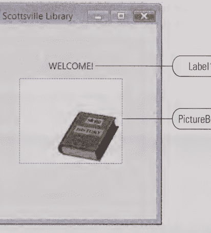

    **图 4-21**

  - c. 锁定窗体上的控件。保存并启动应用程序。单击窗体的“关闭”按钮停止应用程序，然后使用“文件”菜单关闭解决方案。
- 2. 在本练习中，你将修改本章创建的 My Wizard 应用程序。
  
  **修改此练习**
  
  - a. 使用 Windows 复制 My Wizard Solution 文件夹。将该副本保存到 ClearlyVB\Chap04 文件夹中。将副本重命名为 Modified My Wizard Solution。
  - b. 打开 Modified My Wizard Solution 文件夹中包含的 My Wizard Solution (My Wizard Solution.sln) 文件。按如下方式修改界面。将标签移动到图片框正上方的位置。在 PictureBox1 控件中显示 Wizard_appears 图像。在 PictureBox2 控件中显示 Lightning_bolts 图像。PictureBox2 控件应与 PictureBox1 控件大小相同。PictureBox2 控件中的图像应填满该控件。
  - c. 锁定窗体上的控件。保存并启动应用程序。单击窗体的“关闭”按钮停止应用程序，然后使用“文件”菜单关闭解决方案。
- 3. 在本练习中，你将创建一个用于 Scenic Vacations 的应用程序。
  
  **入门**
  
  - a. 创建一个新的 Visual Basic Windows 应用程序。将项目命名为 Scenic Project。将解决方案命名为 Scenic Solution。将应用程序保存到 ClearlyVB\Chap04 文件夹中。

Microsoft 网站，它们很可能将保存到你的 Pictures\Microsoft Clip Organizer 文件夹中。请将该文件夹中的文件复制到 ClearlyVB\Chap04 文件夹中。

- b. 创建一个新的 Visual Basic Windows 应用程序。将项目命名为 Arrows Project。将解决方案命名为 Arrows Solution。将应用程序保存到 ClearlyVB\Chap04 文件夹中。
- c. 创建图 4-23 所示的界面。该界面包含四个图片框和四个标签。务必使用适当的字体。还要确保应用程序启动且窗体首次出现在屏幕上时窗体居中。

  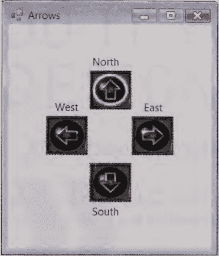

  图 4-23

- d. 锁定窗体上的控件。保存并启动应用程序。单击窗体的“关闭”按钮停止应用程序，然后使用“文件”菜单关闭解决方案。
- 5. 在本练习中，你将创建一个包含图片框和三个按钮控件的应用程序。
  - a. 创建一个新的 Visual Basic Windows 应用程序。将项目命名为 Show Hide Project。将解决方案命名为 Show Hide Solution。将应用程序保存到 ClearlyVB\Chap04 文件夹中。
  - b. 创建图 4-24 所示的界面。图片框的 Lightning_bolts.gif 图像文件存储在 ClearlyVB\Chap04 文件夹中。图片框周围应有边框；设置相应的属性。

    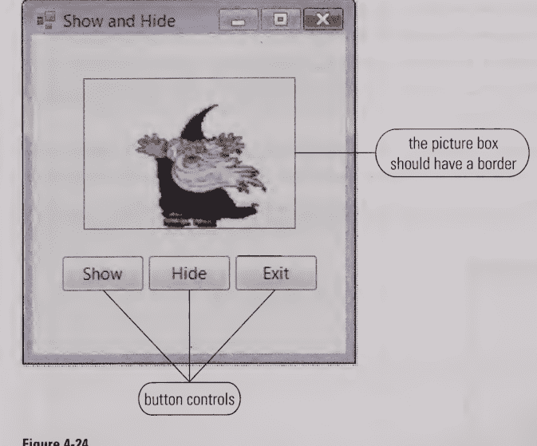

    **图 4-24**

  - c. 锁定窗体上的控件。保存并启动应用程序。单击窗体的“关闭”按钮停止应用程序，然后使用“文件”菜单关闭解决方案。

## “试一试”练习答案

- 1. 将窗体的 Font 属性设置为 Segoe UI, 9pt。将其 StartPosition 属性设置为 CenterScreen，将其 Text 属性设置为 Scottsville Library。将 Label1 控件的 Text 属性设置为 WELCOME!。将 PictureBox1 控件的 Image 属性设置为 Book_opens.gif。将其 SizeMode 属性设置为 StretchImage，并将其 Size 属性设置为 170, 140。


# 5 自己动手设计

**学习完第5章后，您应该能够：**

- 使用文本框获取用户输入
- 使用按钮控件执行操作
- 为控件的 Click 事件过程编写代码
- 使用 Me.Close() 指令停止应用程序

以及佣金率，一个用于计算并显示年度佣金的按钮，以及一个用于向用户显示年度佣金的标签。除了算法所需的控件外，每个界面还需要一个允许用户结束应用程序的控件。在此界面中，您将使用一个标有 Exit 的按钮来实现此目的。图5-2列出了本节提到的控件。

| 控件 | 用途 |
|---|---|
| 标签 | 显示年度佣金 |
| 文本框 | 获取年度销售额 |
| 文本框 | 获取佣金率 |
| 按钮（计算佣金） | 计算并显示年度佣金 |
| 按钮（退出） | 结束应用程序 |

图5-2：控件列表

您应为图5-2中列出的每个控件分配一个有意义的名称，因为这样做有助于您跟踪界面中包含的各种对象。此外，正如您将在第6章中学到的，程序员在代码中使用对象的名称来引用该对象。名称必须以字母开头，并且只能包含字母、数字和下划线字符。名称中不能包含标点字符或空格。在 Visual Basic 中命名对象有几种约定；在本书中，您将使用一种称为匈牙利命名法的命名约定。匈牙利命名法中的名称以表示对象类型的三（个或更多）字符 ID 开头。例如，标签控件名称以 lbl 开头。按钮名称以 btn 开头，文本框名称以 txt 开头。名称中的其余字符表示对象的用途。例如，使用匈牙利命名法，您可以将显示年度佣金的标签命名为 lblCommission。“lbl”标识该对象为标签，“Commission”提醒您该标签的用途。匈牙利命名法名称使用**驼峰命名法**输入，这意味着将 ID 字符小写，然后将名称中每个单词的首字母大写。驼峰命名法是指大写字母在名称中看起来像“驼峰”，因为它们比小写字母更高。图5-3列出了图5-2中所列每个控件的名称和用途。

| 控件名称 | 用途 |
|---|---|
| lblCommission | 显示年度佣金 |
| txtSales | 获取年度销售额 |
| txtRate | 获取佣金率 |
| btnCalculate（计算佣金） | 计算并显示年度佣金 |
| btnExit（退出） | 结束应用程序 |

图5-3：每个控件的名称和用途

## 小测验 1

1. 通常将计算结果显示在界面中的 ___________ 控件中。
2. 使用匈牙利命名法，以下哪一项是接受城市名称的文本框的好名称？
   - a. cityTextBox
   - b. textBoxCity
   - c. txtCity
   - d. TxtCity
3. 按钮控件名称的三字符 ID 是 ___________。


在开始创建 Commission Calculator 应用程序之前，您可能想观看 Ch05-Commission Calculator 视频。该视频演示了本章包含的所有步骤。在执行这些步骤之前先观看它们可能会有所帮助。

### 开始创建 Commission Calculator 应用程序：

1. 启动 Visual Studio 2008（或 Visual Basic 2008 Express Edition）。创建一个新的 Visual Basic Windows 应用程序。分别将项目和解决方案命名为 Commission Calculator Project 和 Commission Calculator Solution。将应用程序保存到 ClearlyVB\Chap05 文件夹中。
2. 将窗体的 Font 属性更改为 **Segoe UI, 9pt**。将其 StartPosition 属性更改为 **CenterScreen**。
3. 将窗体的 Text 属性更改为 **Commission Calculator**。拖动窗体右边框，直到整个 Text 属性值都能在标题栏中看到。
4. 因为一个项目可以包含多个窗体，所以为每个窗体分配一个有意义的名称是一种良好的编程做法。同一项目中的窗体名称必须唯一。窗体名称的三字符 ID 是 frm。将窗体的 Name 属性更改为 **frmMain**。
5. 您还将更改磁盘上包含该窗体的文件的名称。在解决方案资源管理器窗口中右击 **Form1.vb**，然后单击 **重命名**。键入 **frmMain.vb**，然后按 **Enter** 键。
6. 现在您将开始把图5-3中列出的控件添加到窗体中。目前，您不必担心控件的准确位置。使用标签工具向窗体添加一个标签。将该标签的名称更改为 **lblCommission**。
7. 使用文本框工具向窗体添加两个文本框。将第一个文本框命名为 **txtSales**，将第二个文本框命名为 **txtRate**。
8. 使用按钮工具向窗体添加两个按钮。将第一个按钮命名为 **btnCalculate**，将第二个按钮命名为 **btnExit**。
9. 按图5-4所示放置控件。

   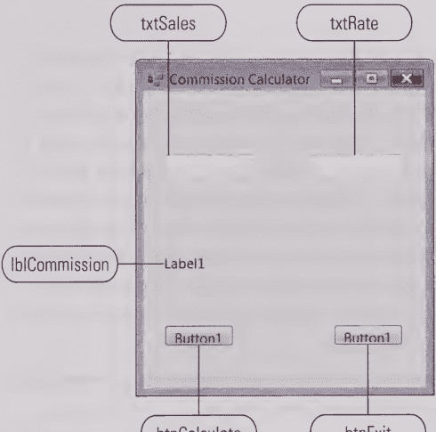

   图5-4：添加到窗体上的控件

10. 您需要在两个文本框上方添加描述性标识标签；否则，用户将不知道在哪里输入输入项。再向窗体添加两个标签。将其中一个标签放在 txtSales 控件上方，另一个放在 txtRate 控件上方。使用蓝色对齐线将每个标签的左边界与其各自文本框的左边界对齐。
11. 标识标签应仅包含一到三个词，并且整个标签应显示在一行中。在 Windows 应用程序中，标识标签通常以冒号结尾。冒号使某些辅助技术（即为残障人士提供帮助的技术）能够定位界面中的标识标签。通常还使用**句子式大写**输入标识标签，这意味着只大写第一个单词的首字母以及任何通常需要大写的单词的首字母。将 txtSales 控件的标识标签的 Text 属性更改为 **输入销售额：**。将 txtRate 控件的标识标签的 Text 属性更改为 **输入费率：**。
12. lblCommission 控件还需要一个标签来向用户标识其内容。再向窗体添加一个标签控件。将该标签控件放在 lblCommission 控件上方，并按左边界对齐这两个控件。将 Text 属性更改为 **佣金：**。
13. 保存解决方案。
14. 接下来，您将把每个按钮的 Text 属性更改为一个表示单击按钮时执行任务的值。按钮 Text 属性中的值显示在按钮表面上，通常称为按钮的标题。与标识标签一样，按钮标题应仅包含一到三个词，并且整个标题应显示在一行中。但是，与标识标签不同，按钮标题不以冒号结尾，并使用标题式大写输入。使用**标题式大写**时，每个单词的首字母都大写，但不出现在标题开头或结尾的冠词、连词和介词除外。将 btnCalculate 控件的 Text 属性更改为 **计算佣金**，然后拖动按钮的右边框和下边框，直到整个标题可见。
15. 将 btnExit 控件的 Text 属性更改为 **退出**。拖动按钮的下边框，直到该按钮与 btnCalculate 控件高度相同。
16. 当用户界面显示在屏幕上时，lblCommission 控件应为空。此外，通常会在显示输出的标签周围放置边框，并防止标签在应用程序运行时更改大小。单击窗体上的 **lblCommission** 控件。将其 AutoSize 属性更改为 **False**，并将其 BorderStyle 属性更改为 **FixedSingle**。在属性列表中单击 **Text**。按键盘上的 **Backspace** 键，然后按 **Enter** 键。
17. 将 lblCommission 控件稍微调高。然后使其宽度与其标识标签相同。


- 18. 锁定窗体上的控件，然后保存解决方案。图 5-5 显示了界面的当前状态。

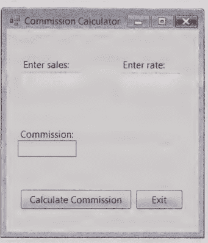

图 5-5：界面的当前状态

## 使界面更加用户友好

仔细观察图 5-6 所示的 Visual Studio 菜单栏，你会注意到菜单标题中包含带下划线的字母。带下划线的字母称为**访问键**，它允许用户通过将 Alt 键与字母或数字组合来选择一个菜单。例如，可以按 Alt+F 选择 Visual Studio 中的“文件”菜单，因为字母“F”是“文件”菜单的访问键。访问键不区分大小写；因此，按 Alt+F 或 Alt+f 都可以选择“文件”菜单。根据系统设置的不同，访问键在屏幕上可能显示下划线，也可能不显示。如果看不到带下划线的访问键，可以按 Alt 键临时显示它们。随后再次按 Alt 键即可隐藏它们。要始终显示访问键，请单击 Windows Vista 任务栏上的“开始”，单击“控制面板”，然后单击“外观和个性化”。在“轻松访问中心”部分，单击“给键盘快捷方式和访问键加下划线”，然后选中“给键盘快捷方式和访问键加下划线”复选框。（可能需要向下滚动才能看到该复选框。）单击“保存”按钮，然后关闭“轻松访问中心”对话框。（要在使用 Windows Vista 的经典视图时显示访问键，请单击“开始”，单击“控制面板”，双击“轻松访问中心”，单击“使键盘更易于使用”，选中“给键盘快捷方式和访问键加下划线”复选框，单击“保存”按钮，然后关闭对话框。要在使用 Windows XP 的分类视图时显示访问键，请单击“开始”，单击“控制面板”，单击“外观和主题”，单击“显示”，单击“外观”选项卡，单击“效果”按钮，取消选中“直到我按 Alt 键之前，隐藏键盘导航的下划线字母”，单击“确定”，然后再次单击“确定”。关闭“外观和主题”对话框。要在使用 Windows XP 的经典视图时显示访问键，请单击“开始”，单击“控制面板”，双击“显示”，单击“外观”选项卡，单击“效果”按钮，取消选中“直到我按 Alt 键之前，隐藏键盘导航的下划线字母”，单击“确定”，然后再次单击“确定”。关闭“控制面板”对话框。）


**图 5-6：** Visual Studio 菜单栏

应为界面中每个可接受用户输入的控件分配访问键。此类控件的示例包括文本框和按钮，因为用户可以在文本框中输入信息，也可以单击按钮。此规则的唯一例外是“确定”和“取消”按钮，它们不分配访问键。访问键很重要，因为它们允许用户即使在鼠标无法使用时也能操作界面。此外，一些打字快的人更喜欢使用访问键，因为访问键可以让他们双手不离开键盘。最后，访问键对于因残疾而无法使用鼠标的人很重要。通过控件的标题或标识标签中包含和号（&）来分配访问键。要为按钮分配访问键，请在按钮的 Text 属性（按钮标题的存储位置）中包含和号。要为文本框控件分配访问键，请在控件标识标签的 Text 属性中包含和号。（本节后面将学到，还必须将标识标签的 TabIndex 属性设置为比文本框中 TabIndex 属性存储的值小 1 的值。）将和号输入到要指定为访问键的字符紧左侧。界面中的每个访问键都应唯一。访问键的首选是标题或标识标签的第一个字母，除非另一个字母能提供更有意义的关联。例如，字母 X 通常是 Exit 按钮的访问键，因为字母 X 比字母 E 提供更有意义的关联。如果无法使用第一个字母（也许因为它已被用作另一个控件的访问键），并且没有其他字母能提供更有意义的关联，则使用标题或标签中一个独特的辅音字母。访问键的最后选择是元音或数字。在 Commission Calculator 界面中，有四个控件可以接受用户输入：两个文本框和两个按钮。图 5-7 列出了这四个控件及其访问键。

| 控件名称 | 访问键 |
| --- | --- |
| txtSales | “Enter sales:”标识标签中的第一个字母 s |
| txtRate | “Enter rate:”标识标签中的第二个字母 r |
| btnCalculate | “Calculate Commission”标题中的第一个字母 C |
| btnExit | “Exit”标题中的字母 x |

**图 5-7：** 控件及其访问键列表

要为可接受用户输入的控件分配访问键：

- 1. 将 Enter sales: 标签的 Text 属性更改为 **Enter &sales:**，然后将 Enter rate: 标签的 Text 属性更改为 **Enter &rate:**。
- 2. 将 btnCalculate 控件的 Text 属性更改为 **&Calculate Commission**，然后将 btnExit 控件的 Text 属性更改为 **E&xit**。图 5-8 显示了界面中的访问键。（如果看不到访问键，请按 Alt 键。）请注意，Commission: 标签没有访问键。这是因为该标签并不标识一个可接受用户输入的控件。相反，它标识 lblCommission 控件，该控件的用途只是在计算出年度佣金后显示该佣金。应用程序运行时，用户无法访问 lblCommission 控件；因此，不适合为该控件分配访问键。

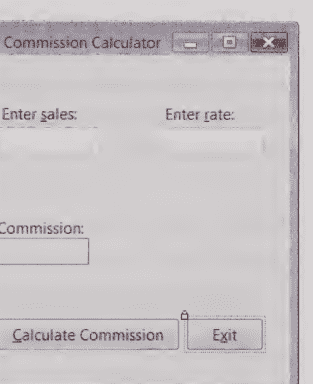

**图 5-8：** 界面中显示的访问键

除了为界面分配访问键之外，还应设置界面的 Tab 键顺序，即用户按 Tab 键或访问键时控件接收焦点的顺序。Tab 键顺序由存储在每个控件的 **TabIndex 属性**中的数字决定。首次创建界面时，TabIndex 值反映每个控件添加到窗体中的顺序。添加到窗体的第一个控件的 TabIndex 为 0，第二个控件的 TabIndex 为 1，依此类推。可以使用“属性”窗口重置每个控件的 TabIndex 属性，使其反映控件在 Tab 键顺序中的所需位置。不过，更简单的方法是使用“视图”菜单上的“Tab 键顺序”选项。“Tab 键顺序”选项仅在选中窗体时可用。使用“Tab 键顺序”选项时，需要按数字顺序设置 TabIndex 值，从数字 0 开始。如果在执行下一组步骤时出错，请按 Esc 键从窗体中移除 TabIndex 信息，然后重复所有步骤。

- 3. 用户接下来会想要输入费率。这里同样，在设置 txtRate 控件的 TabIndex 之前，需要先设置其标识标签的 TabIndex。单击**出现在 Enter rate: 标签顶部的蓝色框**，然后单击**出现在 txtRate 控件顶部的蓝色框**。现在白色框显示的 TabIndex 值为 2 和 3。
- 4. 输入各项输入内容后，用户很可能想要计算佣金。因此，Tab 键顺序中的下一个控件应该是 Calculate Commission 按钮。单击**出现在 Calculate Commission 按钮顶部的蓝色框**。白色框表明该按钮的 TabIndex 设置为 4。
- 5. 唯一剩余的可接受用户输入的控件是 Exit 按钮。单击**出现在 Exit 按钮顶部的蓝色框**，将该按钮的 TabIndex 设置为 5。
- 6. 不能接受用户输入的控件（如 lblCommission 控件），以及不标识可接受用户输入控件的控件（如显示 Commission: 的 Label2 控件），应放在 Tab 键顺序的末尾。单击**出现在 lblCommission 控件顶部的蓝色框**，然后单击**出现在 Commission: 标签顶部的蓝色框**。设置完所有 TabIndex 值后，框的颜色会自动从白色变为蓝色，如图 5-11 所示。

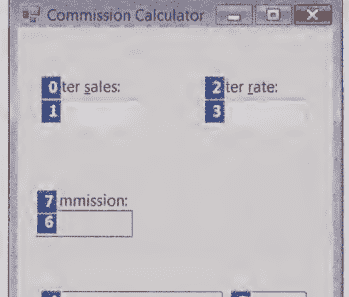

图 5-11：界面的正确 TabIndex 值

- 7. 按 **Esc** 键从窗体中移除 TabIndex 框，然后保存解决方案。
- 8. 现在测试 Tab 键顺序。启动应用程序。插入点出现在 txtSales 文本框中。插入点表示该文本框具有焦点。当控件具有**焦点**时，它可以接受用户输入。按两次 **Tab** 键。焦点移到 txtRate 控件，然后移到 Calculate Commission 按钮。当按钮具有焦点时，其边框会突出显示，并且标题周围会出现一个虚线矩形。再按两次 **Tab** 键。焦点移到 Exit 按钮，然后移到 txtSales 控件。
- 9. 目前只测试文本框的访问键。按 **Alt+r**（按住 Alt 键的同时轻按字母 r）。焦点移到 txtRate 控件。按 **Alt+s** 将焦点移到 txtSales 控件。
- 10. 单击窗体标题栏上的 **Close** 按钮以关闭应用程序。


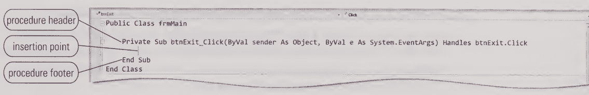

**图5-13：** btnExit 控件 Click 事件过程的代码模板

过程头以两个关键字 Private Sub 开头。**关键字**是在编程语言中具有特殊含义的单词。关键字在代码中显示的颜色与其他部分不同。Private 关键字表示该过程只能在当前代码编辑器窗口中使用。Sub 关键字是术语 sub procedure 的缩写。在编程术语中，**子过程**是执行特定任务的一段代码。Sub 关键字之后是对象名、下划线、事件名以及包含一些文本的括号。目前，不必关心括号之间出现的文本。右括号之后是 Handles btnExit.Click。过程头的这一部分表明该过程处理（或关联）btnExit 控件的 Click 事件。它告诉计算机在单击 btnExit 控件时处理该过程。代码模板以过程尾结束，其中包含关键字 End Sub。你在插入点所在位置输入 Visual Basic 指令，插入点出现在图5-13中 Private Sub 和 End Sub 行之间。代码编辑器会自动缩进过程头和过程尾之间的行。缩进过程中的行可使指令更易读，这是常见的编程实践。当用户单击 Exit 按钮时，表示他或她想要结束应用程序。可以使用 Me.Close() 指令完成此任务。

### Me.Close() 指令

Me.Close() 指令告诉计算机关闭当前窗体。如果当前窗体是应用程序中唯一的窗体，关闭它就会终止整个应用程序。在 Me.Close() 指令中，Me 是指向当前窗体的关键字，Close 是 Visual Basic 中可用的方法之一。**方法**是预定义的过程，你可以在需要时调用（或调用）它。例如，要在用户单击 Exit 按钮时关闭当前窗体，请在 btnExit 控件的 Click 事件过程中输入 Me.Close() 指令。注意该指令中方法名后的一对空括号。调用某些 Visual Basic 方法时需要括号。不过，根据方法的不同，括号可能为空，也可能不为空。

- 1. 键入 **m**（但不要按 Enter）。代码编辑器的 IntelliSense 功能会显示一个列表，你可以从中选择属性、方法等。如有必要，单击**常用**选项卡。**常用**选项卡显示最常用的项，而**全部**选项卡显示所有项。见图5-14。

  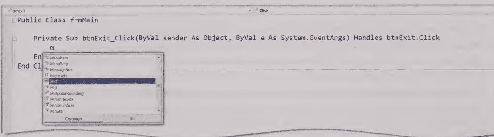

  **图5-14：** IntelliSense 功能显示的列表

  **重要说明：** 如果选择列表没有出现，可能你的计算机系统上已关闭 IntelliSense 功能。要将其打开，请单击菜单栏上的“工具”，然后单击“选项”。在“选项”对话框中展开“文本编辑器”节点，然后单击 Basic。如有必要，选中“显示所有设置”复选框，然后选中“自动列出成员”复选框。单击“确定”按钮关闭“选项”对话框。

- 2. 键入 **e.cl** 以在列表中高亮显示 Close 方法。按 **Tab** 将 Close 方法包含到指令中，然后按 **Enter** 完成指令。代码编辑器会在过程中输入 Me.Close() 指令，如图5-15所示。

  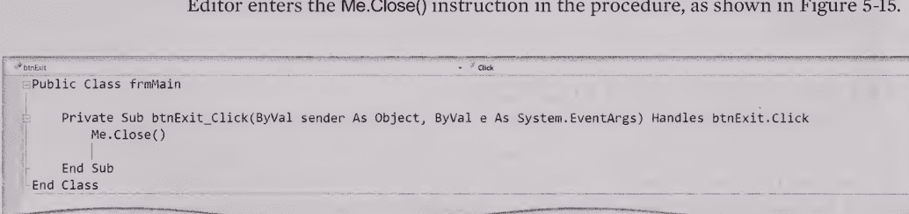

  **图5-15：** 完成的 btnExit Click 事件过程

- 3. 编写过程后对其进行测试是一种良好的编程实践。这样，如果发生错误，你就知道该从哪里查找。保存解决方案，然后启动应用程序。单击**退出**按钮。计算机会处理按钮 Click 事件过程中包含的 Me.Close() 指令，应用程序随即结束。
- 4. 现在测试退出按钮的访问键。启动应用程序，然后按 **Alt+x**。使用按钮的访问键时，计算机会处理该按钮 Click 事件过程中包含的任何指令。在本例中，该指令指示计算机结束应用程序。
- 5. 关闭代码编辑器窗口，然后使用“文件”菜单关闭解决方案。

## 小测验2

- 1. 如果文本框的 TabIndex 设置为 7，则其标识标签的 TabIndex 应设置为 ________。
- 2. 如果文本框的访问键是字母 t，则可以通过按 ________ 将焦点移到该文本框。
  - a. Alt+t
  - b. Ctrl+t
  - c. Esc+t
  - d. Shift+t
- 3. 过程中的第一行称为 ________。

## 小结

- 设计解决方案的界面时，要使用问题的输入、输出和算法。
- 文本框为用户提供输入数据的区域。
- 按钮用于在单击时执行操作。
- 输出项通常显示在标签控件中，以便用户无法编辑其值。
- 匈牙利表示法中的对象名以标识对象类型的 ID 开头。名称的其余部分标识对象的用途。对象名使用驼峰命名法输入。
- 窗体名以 frm 开头。按钮名以 btn 开头。标签名以 lbl 开头。文本框名以 txt 开头。
- 标识标签和按钮标题应为一到三个单词，整个标签或标题应出现在一行中。标识标签应以冒号结尾，并使用句子大写规则输入。按钮标题应使用书名标题大写规则输入。
- 要防止标签在应用程序运行时改变大小，请将其 AutoSize 属性更改为 False。
- 标签的 BorderStyle 属性决定标签是否有边框。
- 应为每个可接受用户输入的控件分配访问键。
- 界面的 Tab 键顺序由每个控件的 TabIndex 属性中存储的数字决定。
- 当对象上发生事件时，计算机会处理关联事件过程中包含的任何指令。
- 事件过程是告诉对象如何响应事件的过程，它们在代码编辑器窗口中输入。
- 过程头的 Handles 部分指示与该过程关联的对象和事件。
- 可以使用 Me.Close() 指令结束应用程序。

## 关键术语

- **访问键**——对象标识标签或标题中带下划线的字符；允许用户使用 Alt 键与带下划线字符的组合来选择对象
- **书名标题大写规则**——指将每个单词的首字母大写，但标题开头或结尾不出现的冠词、连词和介词除外；按钮标题使用这种大写规则
- **驼峰命名法**——匈牙利表示法中用于输入控件名的大小写规则；使用驼峰命名法时，将控件 ID 小写，然后将名称中每个单词的首字母大写
- **代码**——Visual Basic 指令
- **代码编辑器窗口**——在其中输入 Visual Basic 指令（代码）的窗口
- **事件过程**——一组告诉对象如何响应事件的 Visual Basic 指令
- **事件**——对象可以响应的动作；示例包括单击、双击和滚动
- **焦点**——当控件拥有焦点时，它可以接受用户输入
- **关键字**——在编程语言中具有特殊含义的单词
- **方法**——预定义的过程，可在需要时调用（调用）
- **过程尾**——过程中的最后一行
- **过程头**——过程中的第一行
- **句子大写规则**——指仅将第一个单词的首字母以及通常需要大写的任何单词的首字母大写；标识标签使用这种大写规则
- **子过程**——执行特定任务的一段代码
- **语法**——编程语言的规则
- **TabIndex 属性**——确定控件在 Tab 键顺序中的位置

## 小测验答案

### 小测验1

- 1. 标签
- 2. txtCity
- 3. btn

### 小测验2

- 1. 6
- 2. a. Alt+t
- 3. 过程头

## 复习题

- 1. 为了让用户控制任务何时（以及是否）执行，请将任务分配给界面中的 ________ 控件。
  - a. 按钮
  - b. 标签
  - c. 图片框
  - d. 文本框


- 2. 以下哪一项将字母 Z 指定为访问键？
  - a. @ZIP code:
  - b. &ZIP code:
  - c. `ZIP code:
  - d. #ZIP code:

- 3. 当用户____________时，计算机会处理按钮的 Click 事件过程。
  - a. 单击该按钮
  - b. 使用该按钮的访问键
  - c. 按 Tab 键移动到该按钮，然后按 Enter 键
  - d. 以上全部。

- 4. 以下哪一项出现在过程头中，并将该过程与 btnSave 控件的 Click 事件关联？
  - a. Handles btnSave.Click
  - b. Handles Click.btnSave
  - c. Header btnSave.Click
  - d. Event Click.btnSave

- 5. 以下哪一项告诉计算机停止应用程序？
  - a. Close.Me()
  - b. Me.Close()
  - c. Me.End()
  - d. Me.Stop()

## 练习

### 试一试

- 1. 在本练习中，你将为第3章的 Aiden Turner 问题创建一个界面。（“试一试”练习的答案位于本章末尾。）
  - a. 创建一个新的 Visual Basic Windows 应用程序。将项目命名为 New Pay Project。将解决方案命名为 New Pay Solution。将应用程序保存在 ClearlyVB\Chap05 文件夹中。
  - b. 将磁盘上的窗体文件名改为 frmMain.vb。如有必要，将窗体名称改为 frmMain。
  - c. 使用图5-16所示的信息创建合适的界面。还要包含一个 Exit 按钮。务必为相应的控件指定名称。还要务必指定访问键并设置 Tab 键顺序。

```
    Output:    new weekly pay
    Input:     current weekly pay
               raise percentage

    Algorithm:
    1. enter the current weekly pay and raise percentage
    2. calculate the new weekly pay by multiplying the current weekly pay by the raise percentage,
       and then adding the result to the current weekly pay
    3. display the new weekly pay
```

**图5-16**

  - d. 编写 Exit 按钮的 Click 事件过程，使其结束应用程序。你将在第6章的练习1中编写该算法。
  - e. 保存并启动应用程序。测试界面的 Tab 键顺序及其访问键。
  - f. 使用 Exit 按钮停止应用程序，然后使用 File 菜单关闭解决方案。

- 2. 在本练习中，你修改练习1中创建的 New Pay 界面。
  - a. 使用 Windows 复制 New Pay Solution 文件夹。将副本保存在 ClearlyVB\Chap05 文件夹中。将副本重命名为 Modified New Pay Solution。
  - b. 打开 Modified New Pay Solution 文件夹中包含的 New Pay Solution (New Pay Solution.sln) 文件。除了计算并显示新的周薪外，Aiden Turner 现在还希望计算并显示他的周加薪额。修改界面，加入一个用于显示周加薪额的标签。务必还要包含一个标识标签。
  - c. 保存并启动应用程序。单击 Exit 按钮停止应用程序，然后关闭解决方案。

### 修改练习

- 3. 在本练习中，你为一个应用程序创建界面，该应用程序根据餐厅账单计算 10%、15% 和 20% 的小费。
  - a. 创建一个新的 Visual Basic Windows 应用程序。将项目命名为 Tip Project。将解决方案命名为 Tip Solution。将应用程序保存在 ClearlyVB\Chap05 文件夹中。
  - b. 将磁盘上的窗体文件名改为 frmMain.vb。如有必要，将窗体名称改为 frmMain。
  - c. 使用图5-17所示的信息创建合适的界面。还要包含一个 Exit 按钮。务必为相应的控件指定名称。还要务必指定访问键并设置 Tab 键顺序。

### 入门

```
Output: 10% tip
        15% tip
        20% tip

Input:  restaurant bill

Algorithm:
1. enter the restaurant bill
2. calculate a 10% tip by multiplying the restaurant bill by 10%
3. calculate a 15% tip by multiplying the restaurant bill by 15%
4. calculate a 20% tip by multiplying the restaurant bill by 20%
5. display the 10% tip, 15% tip, and 20% tip
```

**图5-17**

  - d. 编写 Exit 按钮的 Click 事件过程，使其结束应用程序。你将在第6章的练习4中编写该算法。
  - e. 保存并启动应用程序。测试界面的 Tab 键顺序及其访问键。
  - f. 使用 Exit 按钮停止应用程序，然后关闭解决方案。

- 4. 在本练习中，你创建一个计算年度房产税的界面。目前，房产税率为每 $100 房产评估价值 $1.02。但是，税率每年都会变化。
  - a. 完成图5-18所示的算法。

```
Output: annual property tax

Input:  assessed value
        property tax rate

Algorithm:
1. enter ________________
2. calculate ________________
3. display ________________
```

**图5-18**

  - b. 创建一个新的 Visual Basic Windows 应用程序。将项目命名为 Property Tax Project。将解决方案命名为 Property Tax Solution。将应用程序保存在 ClearlyVB\Chap05 文件夹中。
  - c. 将磁盘上的窗体文件名改为 frmMain.vb。如有必要，将窗体名称改为 frmMain。
  - d. 使用图5-18中的信息创建合适的界面。还要包含一个 Exit 按钮。务必为相应的控件指定名称。还要务必指定访问键并设置 Tab 键顺序。

# 6 秘密代码

学习完第6章后，你应该能够：

- 在“代码编辑器”窗口中包含注释
- 使用 Val 函数将文本转换为数字
- 编写包含算术运算符的表达式
- 编写赋值语句

## 乐趣从这里开始

你在第5章完成了 Addison Smith 问题的界面。你还编写了 Exit 按钮的 Click 事件过程。现在是时候编写该问题的算法了。正如你在第3章学到的，编写算法是问题解决过程的第五步。对大多数程序员来说，这是最有收获的一步，因为他们在这里赋予界面生命。到这一步结束时，界面将从用户只能观看的界面变为用户能够与之交互的界面。图6-1显示了 Addison Smith 问题的界面，图6-2显示了该问题的输出、输入和算法。

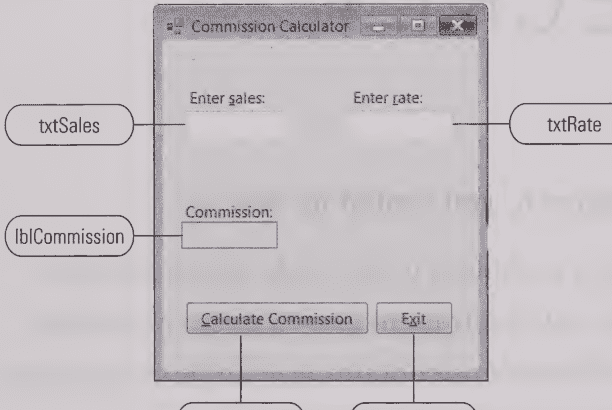

**图6-1：** Addison Smith 问题的界面

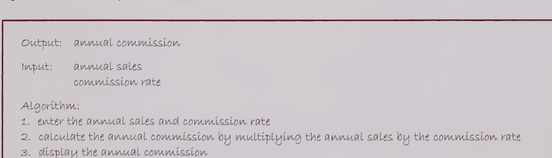

**图6-2：** Addison Smith 问题的输出、输入和算法

算法中的第1步是输入年销售额和佣金率。用户将在界面的两个文本框中输入这些值。文本框旨在接收用户输入的信息，并自动将信息存储在其 Text 属性中。因此，第1步不需要特殊编码。第2步和第3步是计算并显示年度佣金。回想一下，你已将这两步中的任务分配给 Calculate Commission 按钮。当用户单击该按钮时，应执行这些任务。显然，Calculate Commission 按钮需要你告诉它，在 Click 事件发生时*如何*计算年度佣金，以及*在哪里*显示计算结果。你通过编写该按钮的 Click 事件过程来完成这一点。


在开始编写 Calculate Commission 按钮的代码之前，你可能想观看 Ch06-Commission Calculator 视频。该视频演示了本章包含的所有步骤。你可能会发现，在执行这些步骤之前先观看它们会有所帮助。

**要打开 Calculate Commission 按钮的 Click 事件过程：**

- 1. 启动 Visual Studio 2008（或 Visual Basic 2008 Express Edition）。打开 **Commission Calculator Solution (Commission Calculator Solution.sln)** 文件，该文件位于 ClearlyVB\Chap06\Commission Calculator Solution 文件夹中。如果设计器窗口未打开，请在“解决方案资源管理器”窗口中双击 **frmMain.vb**。
- 2. 右键单击**窗体**，然后单击上下文菜单中的**查看代码**。如有必要，最大化 Visual Studio 窗口。“代码编辑器”窗口包含 **btnExit 控件的** Click 事件过程，这是你在第5章编写的。
- 3. 使用“类名”和“方法名”列表箭头打开 **btnCalculate 控件的** Click 事件过程的代码模板。

在过程中包含一条或多条注释是一种常见的编程做法。**注释**是写给阅读代码的人的消息，被称为**内部文档**。许多程序员使用注释记录过程的目的，并解释过程代码的各个部分。注释使代码对任何查看它的人都更易读、更易理解。在 Visual Basic 中，通过在表示注释的文本前放置一个撇号（'）来创建注释。计算机忽略该行中撇号之后的所有内容。尽管不是必需的，但有些程序员使用一个空格将撇号与注释本身分开，并在注释后跟一个空行。

**要为 btnCalculate 的 Click 事件过程添加内部文档：**

- 1. 键入 ' **计算并显示年度佣金**（注意撇号后的空格）。
- 2. 按两次 **Enter** 键。见图6-3。


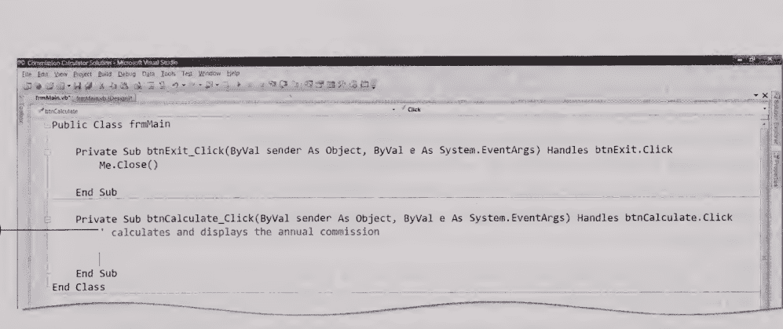

首先，你需要告诉过程*如何*计算年度佣金。根据算法，年度佣金通过将年度销售额乘以佣金率来计算。年度销售额和佣金率分别存储在 txtSales 和 txtRate 控件的 Text 属性中。但是，在计算中使用 Text 属性的值之前，你需要将该值转换为数字。一种方法是使用 Visual Basic 的 Val 函数。

### VAL 函数

在文本框中输入的字符可以是数字、字母或特殊字符（例如美元符号、逗号或百分号）。因此，控件 Text 属性中存储的值始终被视为字母数字文本，即使该值只包含数字也是如此。例如，计算机会将 Text 属性值 589 视为三个独立的字符（5、8 和 9），而不是数字 589（五百八十九）。因此，在计算中使用 Text 属性之前，必须将其字母数字值转换为数字。Visual Basic 提供了几种执行转换的方法。在本章中（且仅在本章中），你将使用 Val 函数将文本转换为数字，因为它最容易学习。

**函数**是一种预定义过程，它执行特定任务，然后在完成任务后返回一个值。例如，**Val 函数**会临时将一个或多个字符转换为数字，然后返回该数字。（该数字仅在函数处理期间存储在计算机的内部内存中。）Val 函数的语法是 **Val(text)**，其中 text 是希望被视为数字的字符。语法中括号内的项称为**参数**，它表示在函数处理期间传递给函数的信息。要将 txtSales 控件的 Text 属性临时转换为数字，需使用 txtSales.Text 作为 *text* 参数，如下所示：Val(txtSales.Text)。要使 *text* 参数转换为数字，它只能包含数字和一个可选的小数点；不能包含字母或特殊字符。当在 *text* 参数中遇到无效字符时，Val 函数会在该点停止转换过程。图6-4 显示了使用各种 Text 属性值时 Val(txtSales.Text) 函数返回的数字。注意，当 txtSales 控件为空时，该函数返回数字 0。当 *text* 参数中的第一个字符无效时，它也返回数字 0。但是，当无效字符出现在第一个字符之后时，该函数返回无效字符之前的数字。

| txtSales.Text 值 | Val(txtSales.Text) 函数返回的数字 |
| --- | ---: |
| 456 | 456 |
| 24,500 | 24 |
| $56.88 | 0 |
| Abc | 0 |
| 空文本框 | 0 |

**图6-4：** Val 函数示例

如前所述，你可以使用 Val(txtSales.Text) 函数将 txtSales 控件的 Text 属性转换为数字。同样，你可以使用 Val(txtRate.Text) 将 txtRate 控件的 Text 属性转换为数字。要计算年度佣金，需将销售额数字乘以佣金率数字。你使用算术表达式来执行计算，算术表达式是包含一个或多个算术运算符的表达式。

### 谁负责这个运算？

大多数程序需要计算机执行一个或多个计算。你通过编写包含一个或多个算术运算符的算术表达式来指示计算机执行计算。图6-5 列出了 Visual Basic 中最常用的算术运算符及其优先级编号。优先级编号指示计算机在表达式中执行运算的顺序。优先级编号为 1 的运算先于优先级编号为 2 的运算执行，优先级编号为 2 的运算先于优先级编号为 3 的运算执行，依此类推。但是，你可以使用括号覆盖优先级顺序，因为括号内的运算总是先于括号外的运算执行。

| 运算符 | 运算 | 优先级编号 |
| --- | --- | --- |
| ^ | 乘方（将一个数提升为幂） | 1 |
| - | 取负（反转一个数的符号） | 2 |
| *, / | 乘法和除法 | 3 |
| `\` | 整数除法 | 4 |
| Mod | 取模 | 5 |
| +, - | 加法和减法 | 6 |

**图6-5：** 最常用的算术运算符及其优先级顺序

图6-5 中的一些运算符具有相同的优先级编号。例如，加法和减法运算符的优先级编号都是 6。当表达式包含多个具有相同优先级的运算符时，这些运算符从左到右求值。例如，在表达式 5 + 12 / 3 - 1 中，先执行除法，再执行加法，最后执行减法。该表达式的结果是数字 8，如图6-6 所示。你可以使用括号更改表达式中运算符的求值顺序。例如，表达式 5 + 12 / (3 - 1) 的求值结果为 11 而不是 8，如图6-6 所示。这是因为括号告诉计算机先执行减法运算。

```
Original expression                 5 + 12 / 3 - 1
The division is performed first   5 + 4 - 1
The addition is performed next    9 - 1
The subtraction is performed last 8                     result

Original expression                 5 + 12 / (3 - 1)
The subtraction is performed first 5 + 12 / 2
The division is performed next    5 + 6
The addition is performed last    11                    result
```

**图6-6：** 展示表达式如何求值的示例

图6-5 中的两个算术运算符你可能不太熟悉：整数除法运算符（`\`）和取模运算符（Mod）。你使用**整数除法运算符**（`\`）来除以两个整数（whole numbers），然后将结果作为整数返回。例如，表达式 `211 \ 4` 的结果是 52，这是 211 除以 4 的整数结果。（如果使用标准除法运算符 [/] 将 211 除以 4，结果是 52.75 而不是 52。）你可能在确定向顾客找零时应返回的25美分硬币、10美分硬币和5美分硬币数量的程序中使用整数除法运算符。例如，如果应向顾客找零 53 美分，你可以使用表达式 `53 \ 25` 确定应返回的25美分硬币数量；该表达式的求值结果为 2。

取模运算符也用于除以两个数字，但这两个数字不必是整数；换句话说，数字可以包含小数位。除以数字后，**取模运算符**返回除法的余数。例如，211 Mod 4 等于 3，即 211 除以 4 的余数。你可以使用取模运算符确定一个数字是偶数还是奇数。如果将该数字除以 2 且余数为 0，则该数字是偶数；然而，如果余数为 1，则该数字是奇数。图6-7 显示了在表达式中使用算术运算符的示例。

| 表达式 | 结果 |
| --- | --- |
| 2 ^ 3 | 8 |
| 4 * -3 | -12 |
| 25 / 4 | 6.25 |
| `25 \ 4` | 6 |
| 25 Mod 4 | 1 |
| 7 + 6 * (5 - 2) | 25 |

**图6-7：** 包含算术运算符的表达式


有关使用算术运算符的更多示例，请参阅 Ch6WantMore.pdf 文件中的“算术运算符”部分。

回想一下，你需要告诉 btnCalculate 控件的 Click 事件过程*如何*计算年度佣金。你可以使用表达式 Val(txtSales.Text) * Val(txtRate.Text) 来完成。你还需要告诉过程*在哪里*显示计算结果。在本例中，你希望在 lblCommission 控件中显示结果。要在标签控件中显示年度佣金，需要将其赋给该控件的 Text 属性；你可以使用赋值语句完成此操作，接下来你将学习赋值语句。

### 小测验 1

- 1. 编写一个表达式，将数字 100 加到 lblTotal 控件的内容中。
- 2. 如果用户在 txtTax 控件中输入 $6745，则 Val(txtTax.Text) 函数将返回数字 ______________。
- 3. 如果用户在 txtTotal 控件中输入 23，则 Val(txtTotal.Text) Mod 2 表达式的求值结果为数字 ______________。


**要在代码编辑器窗口中输入其他注释：**

- 1. 将插入点定位到 Public Class frmMain 指令的开头，然后按 **Enter** 在该指令上方插入一个空行。
- 2. 按键盘上的 **上箭头键**，将插入点移到空行中。正如“类名”和“方法名”列表框所示，Public Class 行上方的区域称为 **通用声明部分**。
- 3. 键入图 6-10 中指示的注释；但是，将 <your name> 和 <current date> 文本替换为你的姓名和当前日期。

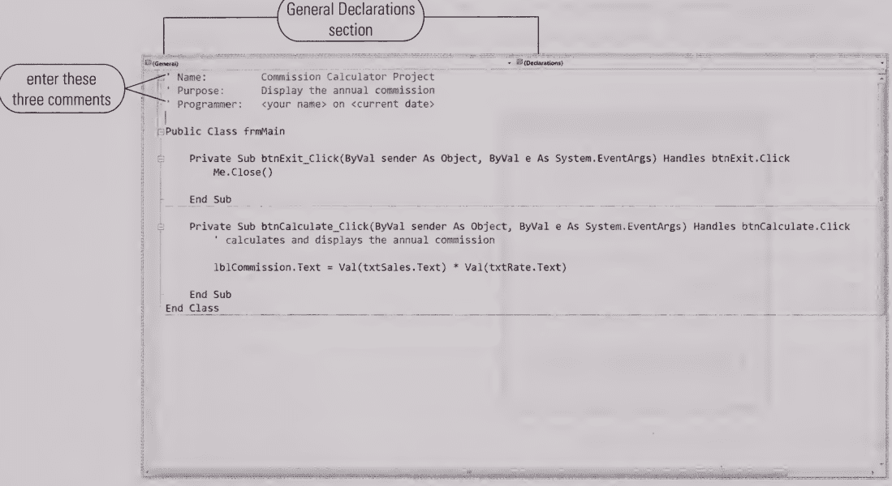

```vb
    ' Name: Commission Calculator Project
    ' Purpose: Display the annual commission
    ' Programmer: <your name> on <current date>

    Public Class frmMain

        Private Sub btnExit_Click(ByVal sender As Object, ByVal e As System.EventArgs) Handles btnExit.Click
            Me.Close()
        End Sub

        Private Sub btnCalculate_Click(ByVal sender As Object, ByVal e As System.EventArgs) Handles btnCalculate.Click
            ' calculates and displays the annual commission

            lblCommission.Text = Val(txtSales.Text) * Val(txtRate.Text)

        End Sub
    End Class
```

**图 6-10：** 在代码编辑器窗口中输入的其他注释

- 4. 保存解决方案。关闭代码编辑器窗口，然后关闭解决方案。

## 小测验 2

- 1. 编写一条赋值语句，将 `Val(txtHours.Text) * Val(txtRate.Text)` 表达式的结果赋给 `lblGross` 控件。
- 2. 编写一条赋值语句，将数字 5 与 `txtOldPrice` 控件的内容相加的结果赋给 `lblNewPrice` 控件。
- 3. 赋值语句中的等号称为 __________。
- 4. 代码编辑器窗口中 Public Class 行上方的区域称为 __________。

## 总结

- 问题解决过程的第五步是对问题的算法进行编码。
- 当你希望过程执行计算时，需要告诉它如何计算以及将结果存储在何处。
- 你使用注释在内部记录项目的代码。注释以撇号开头。
- Val 函数临时将一个或多个字符转换为数字，然后返回该数字。
- 你通过编写包含一个或多个算术运算符的表达式来指示计算机执行计算。
- 在表达式中，具有相同优先级编号的算术运算符从左到右计算。
- 可以使用括号来覆盖算术运算符的优先级顺序。
- 在应用程序运行时，你使用赋值语句将值赋给某个对象。
- 当赋值语句包含计算时，先执行计算，然后将结果值赋给其目标。

## 关键术语

- **参数**——出现在函数名后的括号内；表示函数在处理时使用的信息
- **赋值运算符**——赋值语句中的等号
- **赋值语句**——在程序中用于将值赋给目标（例如控件的属性）
- **注释**——为在内部记录代码而在代码编辑器窗口中输入的消息；以撇号开头；也称为内部文档
- **函数**——执行特定任务并在完成任务后返回值的预定义过程
- **通用声明部分**——代码编辑器窗口中 Public Class 行上方的区域
- **整除运算符**——算术运算符之一；由反斜杠（`\`）表示；返回两个整数相除的整数结果
- **内部文档**——在代码编辑器窗口中输入的注释
- **取模运算符**——算术运算符之一；由关键字 Mod 表示；将两个数相除，然后返回余数
- **Val 函数**——临时将一个或多个字符转换为数字，然后返回该数字

## 小测验答案

### 小测验 1

- 1. Val(lblTotal.Text) + 100
- 2. 0
- 3. 1

### 小测验 2

- 1. lblGross.Text = Val(txtHours.Text) * Val(txtRate.Text)
- 2. lblNewPrice.Text = Val(txtOldPrice.Text) + 5
- 3. 赋值运算符
- 4. 通用声明部分

## 复习题

- 1. Visual Basic 中的注释以 __________ 开头。
  - a. '（撇号）
  - b. *（星号）
  - c. ^（插入符）
  - d. 以上都不是。
- 2. 如果用户在 txtPrice 控件中输入 $5，并在 txtQuantity 控件中输入 3，则 `Val(txtPrice.Text) * Val(txtQuantity.Text)` 表达式的计算结果将为 __________。
  - a. 0
  - b. 3
  - c. 15
  - d. 以上都不是。
- 3. 如果 txtNum 控件包含值 75，以下哪一项会将控件内容更改为 -75（负 75）？
  - a. -txtNum.Text = Val(txtNum.Text)
  - b. -txtNum.Text = txtNum.Text
  - c. txtNum.Text = -Val(txtNum.Text)
  - d. 以上都不是。
- 4. 如果 txtNum 控件包含值 82，以下哪个表达式的计算结果为数字 4？
  - a. (Val(txtNum.Text) + 6) / 22
  - b. Val(txtNum.Text) Mod 6
  - c. Val(txtNum.Text) \ 20
  - d. 以上所有。
- 5. 以下哪条赋值语句中的表达式将无法正确计算？
  - a. lblTotal.Text = Val(txtSales1.Text) + Val(txtSales2.Text)
  - b. lblTotal.Text = Val(txtSales1.Text + txtSales2.Text)
  - c. lblTotal.Text = Val(txtRed.Text) * 2
  - d. lblTotal.Text = Val(txtBlue.Text) * 1.1

```text
Output:  10% tip
         15% tip
         20% tip

Input:   restaurant bill

Algorithm:
1. enter the restaurant bill
2. calculate a 10% tip by multiplying the restaurant bill by 10%
3. calculate a 15% tip by multiplying the restaurant bill by 15%
4. calculate a 20% tip by multiplying the restaurant bill by 20%
5. display the 10% tip, 15% tip, and 20% tip
```

**图 6-12**

- c. 保存并启动应用程序。测试应用程序以验证代码工作正常，然后停止应用程序并关闭解决方案。


- 5. 在本练习中，你将为 Vans & More Depot 创建一个应用程序，该公司为公司出游出租面包车。每辆面包车可运送 10 人。该应用程序应允许用户输入参加出游的人数。该应用程序应计算并显示可以完全坐满的面包车数量。它还应计算并显示需要另寻交通方式参加出游的人数。例如，如果 48 人参加出游，其中 40 人将坐满四辆面包车；其余 8 人需要自行安排交通。此问题的输出是可以完全坐满的面包车数量以及剩余人数。输入是参加出游的人数。
  - a. 编写问题的算法。
  - b. 创建一个新的 Visual Basic Windows 应用程序。将项目命名为 Vans Project。将解决方案命名为 Vans Solution。将应用程序保存在 ClearlyVB\Chap06 文件夹中。
  - c. 将磁盘上的窗体文件重命名为 frmMain.vb。如有必要，将窗体名称更改为 frmMain。
  - d. 创建适当的界面。还应包含一个退出按钮。
  - e. 编写退出按钮的 Click 事件过程和算法。确保包含注释。
  - f. 保存并启动应用程序。测试应用程序以验证代码工作正常，然后停止应用程序并关闭解决方案。


- 6. 在本练习中，你将完成第 5 章练习 4 中 Property Tax 应用程序的编码。如果你尚未完成第 5 章练习 4，则需要先完成该练习，然后才能完成本练习。


- a. 使用 Windows 将 Property Tax Solution 文件夹从 ClearlyVB\Chap05 文件夹复制到 ClearlyVB\Chap06 文件夹。

- b. 打开 ClearlyVB\Chap06\Property Tax Solution 文件夹中的 Property Tax Solution（Property Tax Solution.sln）文件。打开设计器窗口。

- c. 编写问题的算法。使用注释在代码内部添加文档说明。

- d. 保存然后启动应用程序。测试应用程序以验证代码是否正确工作。（使用 104000 和 1.02 时，税费为 1060.8。）停止应用程序并关闭解决方案。

- 7. 在本练习中，您将修改在练习 5 中创建的应用程序。除了出租面包车外，Vans & More Depot 还出租汽车。每辆面包车可搭载 10 人，每辆汽车可搭载 5 人。修改后的应用程序应计算三个值：可以坐满的面包车数量、可以坐满的汽车数量，以及需要安排其他交通工具的人数。例如，如果有 48 人参加郊游，公司需要租用四辆面包车（搭载 40 人）和一辆汽车（搭载 5 人）。其余三人需要自行安排交通。
  - a. 使用 Windows 复制 Vans Solution 文件夹。将副本保存在 ClearlyVB\Chap06 文件夹中。将副本重命名为 Modified Vans Solution。
  - b. 打开 Modified Vans Solution 文件夹中的 Vans Solution（Vans Solution.sln）文件。对界面和代码进行适当的修改。
  - c. 保存然后启动应用程序。测试应用程序以验证代码是否正确工作，然后停止应用程序并关闭解决方案。

- 8. 在本练习中，您为 Sun Projects 创建一个应用程序。公司的工资文员想要一个计算员工净工资的应用程序。文员将输入员工姓名、工作小时数和工资率。对于此应用程序，您不必担心加班问题，因为 Sun Projects 不允许任何人工作超过 40 小时。应用程序应计算并显示总工资、联邦预扣税（FWT）、社会保障税（FICA）、州所得税和净工资。FWT 的计算方法是将总工资乘以 20%。FICA 税为总工资的 8%，州所得税为总工资的 2%。
  - a. 列出输出项和输入项，然后创建适当的算法。
  - b. 创建一个新的 Visual Basic Windows 应用程序。将项目命名为 Sun Project。将解决方案命名为 Sun Solution。将应用程序保存在 ClearlyVB\Chap06 文件夹中。
  - c. 将磁盘上的窗体文件重命名为 frmMain.vb。如有必要，将窗体的名称更改为 frmMain。
  - d. 创建适当的界面。包含一个 Exit（退出）按钮。
  - e. 编写 Exit 按钮的 Click 事件过程和问题的算法。
  - f. 保存然后启动应用程序。测试应用程序以验证代码是否正确工作，然后停止应用程序并关闭解决方案。


- 9. 在本练习中，您将完成第 5 章练习 5 中的 RM Sales 应用程序的编码。如果您尚未完成第 5 章的练习 5，则必须先完成该练习，然后才能完成本练习。
  - a. 使用 Windows 将 Sales Solution 文件夹从 ClearlyVB\Chap05 文件夹复制到 ClearlyVB\Chap06 文件夹。
  - b. 打开 ClearlyVB\Chap06\Sales Solution 文件夹中的 Sales Solution（Sales Solution.sln）文件。打开设计器窗口。编写问题的算法。包含适当的注释。
  - c. 保存然后启动应用程序。测试应用程序以验证代码是否正确工作，然后停止应用程序并关闭解决方案。


- 10. Calculate 按钮的 Click 事件过程包含 lblDue.Text = Val(txtDaysLate.Text) * 2 + 3.5 语句。
  - a. 如果用户在 txtDaysLate 控件中输入数字 3，当用户单击 Calculate 按钮时，lblDue 控件将被赋什么值？
  - b. 如果用户在 txtDaysLate 控件中输入字母 AB，当用户单击 Calculate 按钮时，lblDue 控件将被赋什么值？
  - c. 如果用户单击 Calculate 按钮时 txtDaysLate 控件为空，按钮的 Click 事件过程将为 lblDue 控件赋什么值？


- 11. 在本练习中，您需要在应用程序的代码中查找错误。打开 SwatTheBugs Solution（SwatTheBugs Solution.sln）文件，该文件位于 ClearlyVB\Chap06\SwatTheBugs Solution 文件夹中。启动应用程序，然后测试应用程序。注意代码不能正常工作。找到并更正所有错误。

## “试一试”练习的答案


- 1. 观看 Ch06-New Pay 视频。

# 第7章

# 7 我该把这个存储在哪里？

学习第 7 章后，您应该能够：

- 声明变量和命名常量
- 使用 TryParse 方法将文本转换为数值数据类型
- 理解变量的作用域和生存期
- 对程序进行桌面检查
- 设置程序数值输出的格式

## 使用存储箱

每台计算机内部都有一个称为内部存储器的组件。计算机的内部存储器由内存位置组成。将内存位置想象成存储箱可能会有所帮助，类似于图 7-1 中所示的存储箱。然而，与图中的存储箱不同，计算机内部的每个存储箱（内存位置）一次只能保存一项数据。该项数据可以是一个数字，例如 5 或 45.89。也可以是文本，文本是作为一个整体处理且不用于计算的一组字符。文本的示例包括您的姓名、零件号 ABN123X、电话号码 111-2345 以及 Visual Basic 语句 Me.Close()。当您使用计算机时，计算机内部的一些存储箱（内存位置）会自动填充数据。例如，当您在键盘上输入数字 5 时，计算机会将数字 5 保存在一个内存位置中。同样，当您启动一个应用程序时，每条程序指令都会被放置在一个内存位置中，等待处理。

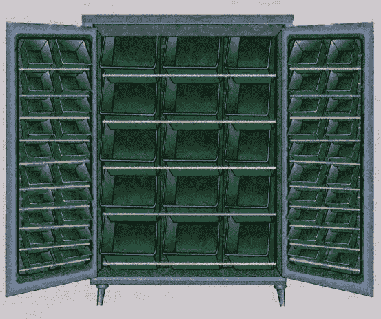

**图 7-1：** 存储箱示意图

计算机内部的一些存储箱（内存位置）是特殊的，程序员可以在程序中保留它们。您可以使用 Visual Basic 指令来保留一个内存位置，该指令会为内存位置指定名称和数据类型。数据类型指示内存位置将存储的数据类型——例如，数值或文本。但是，程序员为什么需要使用这些特殊的内存位置之一呢？在第 6 章中，您使用表达式 Val(txtSales.Text) * Val(txtRate.Text) 计算了 Addison Smith 的佣金。通常，程序员不会在算术表达式中使用控件的 Text 属性。原因之一是这些

如图中所示，被分配了 Integer 数据类型的变量可以存储整数。整数是不包含小数位的数字。整数的示例包括数字 0、45 和 -678。如果某个控件的 Text 属性包含一个您希望在计算中使用的整数，您应该将该 Text 属性值分配给一个 Integer 变量，然后在计算中使用该 Integer 变量。但是，如果 Text 属性包含一个带有小数位的数字，并且您希望在计算中使用该数字，则应将 Text 属性值分配给 Decimal 变量或 Double 变量。这两种数据类型都允许变量存储带有小数位的数字。这两种数据类型之间的区别在于每种类型可以存储的数字范围以及每种类型存储这些数字所需的内存量。如图 7-2 所示，Decimal 变量在内存中占用的空间是 Double 变量的两倍。然而，涉及 Decimal 变量的计算不会受到使用 Double 变量时可能发生的微小舍入误差的影响。在大多数情况下，微小舍入误差不会在应用程序中造成任何问题。但有一个例外，即当应用程序执行需要精确到分币的财务计算时。在这些情况下，Decimal 数据类型是最佳选择。

## 让我们来玩命名游戏

程序员使用的每个变量都必须被分配一个名称。名称应具有描述性，帮助您记住变量的用途。换句话说，它应该描述变量的内容。一个好的变量名是在您完成程序后立即有意义，并且在多年后当您（或也许是同事）需要修改程序时仍然有意义的名称。变量名必须以字母或下划线开头。名称只能包含字母、数字和下划线字符。名称中不允许使用标点符号或空格。此外，名称不能是保留字，例如 Val。在 Visual Basic 中有几种变量命名约定。在本书中，您将使用匈牙利表示法，这与用于控件命名的约定相同。匈牙利表示法中的变量名以三个字符的 ID 开头，该 ID 表示变量的数据类型。例如，Integer 变量的名称以 int 开头。名称中的其余字符表示变量的用途。使用匈牙利表示法，您可以将存储人的年龄的 Integer 变量命名为 intAge。与控件名称一样，变量名使用驼峰式大小写输入，这意味着您将 ID 小写，然后将名称中每个单词的首字母大写。图 7-3 列出了与图 7-2 中列出的每种数据类型关联的三个字符的 ID。该图还包含变量名示例。

| 数据类型 | ID | 示例 |
| --- | --- | --- |
| Integer | int | intAge |
| Decimal | dec | decPayRate |
| Double | dbl | dblPrice |

图 7-3：数据类型 ID 和变量名示例


（输入项）在 txtRadius 控件中。当用户单击 Calculate 按钮时，该按钮的 Click 事件过程将使用圆的半径来计算圆的面积（输出项）。你可能还记得数学课程中的内容，计算圆面积的公式是 πr²，其中 π 代表圆周率。在该过程结束前，它将在 lblArea 控件中显示圆的面积。

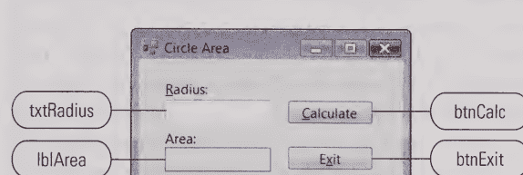

**图 7-6：** Circle Area 应用程序的界面

- 2. 打开“代码编辑器”窗口，其中包含 btnExit 控件的 Click 事件过程的代码。
- 3. 打开 btnCalc 控件的 Click 事件过程。首先，你将输入声明必要变量的指令。通常将变量声明语句输入在过程开头。输入图 7-7 中所示的注释和两条 Dim 语句，然后按图中所示放置插入点。每个变量名下方的绿色锯齿线表示该变量已声明，但尚未被该过程中的任何其他语句使用。

```vb
' Name:         Circle Area Project
' Purpose:      Display the area of a circle
' Programmer:   <your name> on <current date>

Public Class frmMain

    Private Sub btnExit_Click(ByVal sender As Object, ByVal e As System.EventArgs) Handles btnExit.Click
        Me.Close()
    End Sub

    Private Sub btnCalc_Click(ByVal sender As Object, ByVal e As System.EventArgs) Handles btnCalc.Click
        ' calculates and displays the area of a circle

        ' declare variables
        Dim dblArea As Double
        Dim dblRadius As Double

    End Sub
End Class
```

**图 7-7：** 在该过程中输入的注释和 Dim 语句

现在你可以开始编写应用程序的算法代码。算法中的第一步是输入圆的半径。回想一下，用户在 txtRadius 控件中输入半径。第二步是通过将半径乘以自身，然后将结果乘以 3.141593（π 的值四舍五入到六位小数）来计算圆的面积。运用你在第 6 章学到的内容，你可以使用表达式 Val(txtRadius.Text) * Val(txtRadius.Text) * 3.141593 来计算圆的面积。该表达式告诉计算机将 txtRadius 控件的 Text 属性内容（临时转换为数字）乘以 txtRadius 控件的 Text 属性内容（再次临时转换为数字），然后将结果乘以数字 3.141593。然而，尽管 Val 函数自 Visual Basic 语言诞生以来就是其组成部分，微软并不保证它会始终是该语言的一部分。因此，大多数程序员现在使用 TryParse 方法将文本转换为数字。

## TryParse 方法

Visual Basic 中的每种数值数据类型都有一个 **TryParse 方法**，可用于将文本转换为该数值数据类型。TryParse 方法的基本语法是 *dataType*.**TryParse**(*text*, *variable*)。在该语法中，*dataType* 是 Visual Basic 中可用的数值数据类型之一，例如 Double、Decimal 和 Integer。*text* 参数是要转换为 *dataType* 类型数字的文本，通常是控件的 Text 属性。*variable* 参数是数值变量的名称，TryParse 方法可在其中存储该数字。该数值变量必须具有与语法中 *dataType* 部分指定的数据类型相同的数据类型。换句话说，当使用 TryParse 方法将文本转换为 Double 数字时，需要向该方法提供一个用于存储该数字的 Double 变量名。TryParse 方法会解析文本，这意味着它会查看文本中的每个字符，以确定该文本能否转换为指定数据类型的数字。如果文本可以转换，TryParse 方法会将文本转换为数字，并将该数字存储在 *variable* 参数指定的变量中。但是，如果 TryParse 方法确定文本无法转换为适当的数据类型，该方法会将数字 0 赋给 *variable*。图 7-8 显示了 TryParse 方法的基本语法，并包含使用该方法的示例。（要了解更多关于 TryParse 方法的信息，请完成本章末尾的 FIGURE THIS OUT 练习。）

### TryParse 方法的基本语法

语法

`dataType.TryParse(text, variable)`

示例 1

`Double.TryParse(txtRadius.Text, dblRadius)`

如果 txtRadius 控件中输入的文本可以转换为 Double 数字，TryParse 方法会转换该文本并将结果存储在 dblRadius 变量中；否则，它会在 dblRadius 变量中存储数字 0。

示例 2

`Decimal.TryParse(txtSales.Text, decSales)`

如果 txtSales 控件中输入的文本可以转换为 Decimal 数字，TryParse 方法会转换该文本并将结果存储在 decSales 变量中；否则，它会在 decSales 变量中存储数字 0。

示例 3

`Integer.TryParse(txtNum.Text, intNum)`

如果 txtNum 控件中输入的文本可以转换为 Integer 数字，TryParse 方法会转换该文本并将结果存储在 intNum 变量中；否则，它会在 intNum 变量中存储数字 0。

**图 7-8：** TryParse 方法的基本语法和示例

在输入计算圆面积的指令之前，你首先将使用 TryParse 方法将 txtRadius 控件的 Text 属性转换为数字。你将让该方法把得到的数字赋给 dblRadius 变量。然后你将在圆面积计算中使用 dblRadius 变量。

**要继续编写 Circle Area 应用程序的代码：**

- 1. 插入点应位于前面图 7-7 所示的位置。输入 **assign radius to a variable** 并按 **Enter**，然后输入 **Double.TryParse(txtRadius.Text, dblRadius)** 并按两次 **Enter**。
- 2. 现在可以在计算圆面积的表达式中使用 dblRadius 变量。你将把计算结果赋给 dblArea 变量。输入 **calculate area** 并按 **Enter**，然后输入 **dblArea = dblRadius * dblRadius * 3.141593** 并按两次 **Enter**。（也可以使用 dblArea = dblRadius ^ 2 * 3.141593。）
- 3. 算法中的第 3 步（前面图 7-5 所示）是显示圆的面积。输入 **display area** 并按 **Enter**，然后输入 **lblArea.Text = dblArea** 并按 **Enter**。图 7-9 显示了该过程的代码。

```vb
Private Sub btnCalc_Click(ByVal sender As Object, ByVal e As System.EventArgs) Handles btnCalc.Click
    ' calculates and displays the area of a circle

    ' declare variables
    Dim dblArea As Double
    Dim dblRadius As Double

    ' assign radius to a variable
    Double.TryParse(txtRadius.Text, dblRadius)

    ' calculate area
    dblArea = dblRadius * dblRadius * 3.141593

    ' display area
    lblArea.Text = dblArea

End Sub
End Class
```

**图 7-9：** 在 btnCalc 控件的 Click 事件过程中输入的代码

- 4. 保存解决方案。

大多数变量在过程（例如事件过程）中声明。这些变量称为 **过程级变量**，并且被认为具有 **过程作用域**，因为它们只能由声明它们的过程使用。**作用域** 指变量在应用程序代码中被识别的区域。图 7-9 中的 dblRadius 和 dblArea 变量是过程级变量，只能由 btnCalc 控件的 Click 事件过程使用。当过程结束时，其过程级变量将从计算机的内部存储器中移除。程序员将变量在内存中保留的时间长度称为它的 **生存期**。过程级变量的生存期与声明它的过程相同。

## 检查一下……我准备好了

在使用计算机测试 Circle Area 应用程序之前（这是第 3 章问题求解过程中的第 7 步），你将执行第 6 步，即对程序进行桌面检查。你可以使用桌面检查表来完成此操作，类似于你对算法进行桌面检查时使用的表。程序的桌面检查表将为每个变量包含一列。例如，你将使用半径值 6.5 和 10 对 Circle Area 程序进行桌面检查。图 7-10 显示了完成的桌面检查表。请自行使用其他值对该程序进行桌面检查。

| dblRadius | dblArea |
|---:|---:|
| 6.5 | 132.73230425 |
| 10 | 314.1593 |

**图 7-10：** Circle Area 程序的桌面检查表


### 使用计算机测试圆面积应用程序：

- 1. 启动应用程序。在半径文本框中输入 **6.5**，然后单击 **Calculate** 按钮。见图 7-11。该按钮的 Click 事件过程告诉计算机保留两个名为 dblRadius 和 dblArea 的 Double 变量。该过程中的 TryParse 方法将半径文本框中输入的 6.5 转换为数字，然后将该数字存储在 dblRadius 变量中。接下来，计算机将 dblRadius 变量的内容自乘，然后将结果乘以 3.141593。随后，它将该结果存储在 dblArea 变量中。该过程中的最后一条语句在 lblArea 控件中显示 dblArea 变量的内容。过程结束时，dblRadius 和 dblArea 变量将从计算机的内部内存中移除。
- 2. 将半径从 6.5 改为 **10**，然后单击 **Calculate** 按钮。圆的面积为 314.1593。
- 3. 自行使用其他半径值测试该应用程序。
- 4. 单击 **Exit** 按钮停止应用程序。

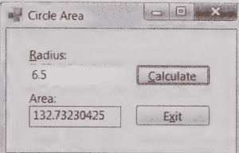

**图 7-11：** 界面中显示的圆面积

## 使用常量让事物……嗯，保持不变

除了在程序中保留（或声明）变量外，你还可以声明命名常量。**命名常量**是一个内存位置，其值在应用程序运行期间不能更改。程序员在声明命名常量时为其赋值。把命名常量想象成一个上锁的存储箱，除了所有者（在这里是程序员）之外，任何人都无法打开，这可能会有所帮助。当需要更改命名常量的值时，程序员必须在其声明语句中更改其值。程序员使用命名常量来为常量值命名。创建命名常量后，程序员就可以在应用程序代码中使用该常量的名称（而不是其值）。例如，与其在之前图 7-9 所示的面积计算语句中使用数字 3.141593，你可以为这个数字指定一个名称（例如 dblPI），然后在计算语句中使用 dblPI。命名常量使代码更具自文档性且更易于修改，因为它们允许程序员用有意义的词语代替不太清楚的值。例如，命名常量 dblPI 比数字 3.141593 有意义得多。使用命名常量表示值还有另一个优点：如果将来该值发生变化，程序员只需修改命名常量的声明语句，而不必修改所有使用该值的程序语句。

使用 **Const 语句**创建命名常量。该语句的语法如图 7-12 所示。在语法中，*常量名* 是要分配给命名常量的名称。为了将命名常量与程序中的变量区分开，许多程序员对命名常量名使用一种修改形式的匈牙利命名法。在这种修改后的命名法中，名称中的 ID 字符仍以小写形式输入，但名称的其余部分以大写形式输入——例如 *dblPI*。语法中的 *数据类型* 是命名常量的数据类型，*值* 是要存储在命名常量中的值。除了展示 Const 语句的语法外，图 7-12 还展示了声明命名常量的示例。

**声明命名常量**

语法

```
Const constantName As dataType = value
```

示例

```
Const dblPI As Double = 3.141593
Const intMAX_HOURS As Integer = 40
Const decTAXRATE As Decimal = .05
```

**图 7-12：** Const 语句的语法和示例

### 在圆面积应用程序中声明命名常量：

- 1. 将插入点定位到 'declare variables 注释上方的空行中，然后按 **Enter**。输入 ' declare named constant 并按 **Enter**，然后输入 **Const dblPI As Double = 3.141593** 并按 **Enter**。与过程中声明的变量一样，dblPI 命名常量具有过程级作用域，并会一直保留在内存中，直到过程结束。
- 2. 将计算面积的语句中的 3.141593 替换为 **dblPI**。
- 3. 保存并启动应用程序。在半径文本框中输入 2，然后单击 **Calculate** 按钮。界面显示面积为 12.566372。
- 4. 单击 **Exit** 按钮停止应用程序。

## 美化输出

很多时候，你会希望控制应用程序数值输出中出现的小数位数和特殊字符。例如，表示货币金额的数字通常显示为零位或两位小数，并且通常包含美元符号和千位分隔符。类似地，表示百分比金额的数字通常显示为零位或多位小数以及百分号。指定数字中要显示的小数位数和特殊字符称为**格式化**。可以使用语法 *变量.ToString(格式字符串)* 来格式化数字。在该语法中，*变量* 是数值变量的名称，ToString 是可用于任何数值数据类型的方法。**ToString 方法**将数值变量的内容转换为文本。语法中的 *格式字符串* 参数是一个字符串，用于指定要使用的格式。**字符串**是用双引号括起来的文本。*格式字符串* 参数必须采用 "Axx" 的形式，其中 A 是称为格式说明符的字母字符，xx 是称为精度说明符的数字序列。格式说明符必须是内置格式字符之一。最常用的格式字符如图 7-13 所示；请注意，格式说明符可以使用大写字母或小写字母。当与图 7-13 中列出的某个格式字符一起使用时，精度说明符控制格式化数字中小数点后出现的位数。图 7-13 还包含几个使用 ToString 方法的示例。

### 将面积输出格式化为仅包含两位小数：

- 1. 将最后一条赋值语句从 lblArea.Text = dblArea 改为 **lblArea.Text = dblArea.ToString("N2")**。图 7-14 显示了 btnCalc 控件的 Click 事件过程。

```vb
Private Sub btnCalc_Click(ByVal sender As Object, ByVal e As System.EventArgs) Handles btnCalc.Click
    ' calculates and displays the area of a circle

    ' declare named constant
    Const dblPI As Double = 3.141593

    ' declare variables
    Dim dblArea As Double
    Dim dblRadius As Double

    ' assign radius to a variable
    Double.TryParse(txtRadius.Text, dblRadius)

    ' calculate area
    dblArea = dblRadius * dblRadius * dblPI

    ' display area
    lblArea.Text = dblArea.ToString("N2")
End Sub
```

**图 7-14：** 完成的 btnCalc Click 事件过程

- 2. 保存并启动应用程序。在半径文本框中输入 **2**，然后单击 **Calculate** 按钮。界面显示圆的面积为 12.57。
- 3. 单击 **Exit** 按钮停止应用程序。关闭代码编辑器窗口，然后关闭解决方案。

## 小测验 2

- 1. 编写 TryParse 方法，将 txtIncome 控件中输入的值赋给 decIncome 变量。
- 2. 编写语句声明值为 55 的 intMINIMUM 命名常量。
- 3. decSales 变量包含数字 56.78。编写赋值语句，在 lblSales 控件中显示带有美元符号且没有小数位的值。________

## 小结

- 计算机的内部内存由内存位置组成。程序员可以为变量和命名常量保留其中一些位置。
- 一个内存位置在任何时候只能存储一个值。
- 变量的值可以在应用程序运行时更改，而命名常量的值在应用程序运行时不能更改。
- 使用 Integer 数据类型存储整数。Decimal 和 Double 数据类型用于存储带小数位的数字。Decimal 数据类型通常用于涉及货币的计算，因为它不会受到 Double 数据类型出现的微小舍入误差的影响。
- 使用 Dim 语句保留过程级变量。过程级变量只能由声明它的过程使用，并且在该过程结束时从内存中移除。
- 大多数情况下，你会为问题的解决方案中列出的每个唯一的输出、处理和输入项使用不同的变量。
- 大多数程序员使用 TryParse 方法而不是 Val 函数将文本转换为数字。
- 使用 Const 语句声明命名常量。
- 可以使用 ToString 方法将数字转换为包含特定小数位数和可选格式字符的文本。

## 关键术语

- **Const 语句**——用于声明命名常量的 Visual Basic 语句
- **Dim 语句**——用于声明过程级变量的 Visual Basic 语句
- **格式化**——指定数字中要显示的小数位数和特殊字符的过程
- **生存期**——变量保留在计算机内部内存中的时间长度
- **命名常量**——在应用程序运行期间其值不能更改的内存位置
- **过程级作用域**——过程级变量的作用域；指该变量只能由声明它的过程使用这一事实


- **过程级变量**——在过程中声明的变量；具有过程作用域
- **作用域**——变量在应用程序代码中被识别的区域
- **字符串**——用双引号括起来的文本
- **ToString 方法**——用于将数值变量的内容转换为文本的方法；同时也会格式化该数字
- **TryParse 方法**——用于将文本转换为数值数据类型
- **变量**——应用程序运行期间其内容可以更改的内存位置

## 小测验答案

### 小测验 1

- 1. Integer
- 2. d. dblPay.Rate
- 3. Dim dblHoursWorked As Double

### 小测验 2

- 1. Decimal.TryParse(txtIncome.Text, decIncome)
- 2. Const intMINIMUM As Integer = 55
- 3. lblSales.Text = decSales.ToString("C0")

## 复习题

- 1. 下列哪个语句声明了一个名为 intNumSold 的变量？
  - a. Dim intNumSold As Integer
  - b. Dim As Integer intNumSold
  - c. Const intNumSold As Integer
  - d. 以上都不是。
- 2. 如果用户在 txtPrice 控件中输入文本 A34，TryParse(txtPrice.Text, decPrice) 语句会将 __________ 赋给 decPrice 变量。
  - a. A
  - b. A34
  - c. 0
  - d. 34
- 3. 下列哪个语句将 intScore1 和 intScore2 变量的内容相加，然后将总和乘以 2，并将结果赋给 intTotal 变量？
  - a. `intScore1 + intScore2 * 2 = intTotal`
  - b. `(intScore1 + intScore2) * 2 = intTotal`
  - c. `intTotal = intScore1 + intScore2 * 2`
  - d. 以上都不是。
- 4. 下列哪个语句声明了 decRATE 命名常量并将其初始化为 .15？
  - a. `Con decRATE As Decimal = .15`
  - b. `Const decRATE As Decimal = .15`
  - c. `Constant decRATE As Decimal = .15`
  - d. 以上都不是。
- 5. 下列哪个语句会将 dblDue 变量的内容格式化为带有美元符号和两位小数的形式？
  - a. `lblDue.Text = dblDue.ToString("C2")`
  - b. `lblDue.Text = dblDue.ToCurrency("C2")`
  - c. `lblDue.Text = ToString(dblDue, "C2")`
  - d. `lblDue.Text = dblDue.ToFormat("C2")`

## 练习

### 试一试

- 1. 在本练习中，你将修改第 6 章中的 Commission Calculator 应用程序，使其使用变量和 TryParse 方法。（TRY THIS 练习的答案位于本章末尾。）
  - a. 打开 ClearlyVB\Chap07\Commission Calculator Solution 文件夹中包含的 Commission Calculator Solution (Commission Calculator Solution.sln) 文件。修改代码，使其使用变量和 TryParse 方法。佣金格式设置为带有美元符号和两位小数。
  - b. 保存解决方案，然后启动并测试应用程序。停止应用程序，然后关闭解决方案。

### 试一试

- 2. 在本练习中，你编写一个应用程序，用于计算并显示员工新的周薪金额。图 7-15 显示了输出、输入和算法。（TRY THIS 练习的答案位于本章末尾。）

```
输出：      新的周薪
处理：      周加薪额
输入：      当前周薪
算法：
1. 输入当前周薪
2. 将当前周薪乘以 .03 计算周加薪额
3. 将周加薪额加到当前周薪上，计算新的周薪
4. 显示新的周薪
```

图 7-15

- a. 打开 ClearlyVB\Chap07\New Pay Solution 文件夹中包含的 New Pay Solution (New Pay Solution.sln) 文件。使用 Decimal 变量编写算法。对于 .03 的加薪率，使用 Decimal 命名常量。新的周薪格式设置为带有美元符号和两位小数。
- b. 保存解决方案。使用 200 和 330 作为当前周薪对程序进行桌面检查。
- c. 启动然后测试应用程序。停止应用程序，然后关闭解决方案。

### 修改以下内容

- 3. 在本练习中，你修改本章中创建的 Circle Area 应用程序。
  - a. 使用 Windows 复制 Circle Area Solution 文件夹。将副本保存到 ClearlyVB\Chap07 文件夹中。将副本重命名为 Modified Circle Area Solution。
  - b. 打开 Modified Circle Area Solution 文件夹中包含的 Circle Area Solution (Circle Area Solution.sln) 文件。修改代码，使其对半径平方进行单独计算。将半径平方计算的结果赋给一个变量，然后相应地修改面积计算。
  - c. 保存解决方案。启动应用程序，然后使用 4.6 作为半径进行测试。面积应为 66.48。停止应用程序，然后关闭解决方案。

### 入门

- 4. Jackson College 的收银员希望有一个应用程序来显示学生本学期应付的总金额，包括学费和食宿费。学费为每学期学时 100 美元，食宿费为每学期 1800 美元。收银员需要输入学生注册的学时数。对于学期学时费和食宿费，使用 Integer 命名常量。对于输入和输出项，以及你选择使用的任何处理项，使用 Integer 变量。输出格式设置为带有美元符号且不带小数位。
  - a. 列出输出和输入项，以及任何处理项，然后创建适当的算法。
  - b. 创建一个新的 Visual Basic Windows 应用程序。将项目命名为 Jackson Project。将解决方案命名为 Jackson Solution。将应用程序保存到 ClearlyVB\Chap07 文件夹中。将磁盘上的窗体文件名称更改为 frmMain.vb。如有必要，将窗体的名称更改为 frmMain。
  - c. 创建适当的界面。包括一个 Exit 按钮。编写 Exit 按钮的 Click 事件过程和问题算法。保存解决方案。使用你自己的示例数据对程序进行桌面检查。
  - d. 启动然后测试应用程序。停止应用程序，然后关闭解决方案。

### 入门

- 5. 一个音乐厅有三个座位类别：Orchestra、Main floor 和 Balcony。Orchestra 座位票价为 25 美元。Main floor 座位票价为 30 美元，Balcony 座位票价为 15 美元。经理希望有一个应用程序，允许他输入每个座位类别售出的票数。该应用程序应计算每个座位类别产生的收入，以及总收入。
  - a. 列出输出和输入项，以及任何处理项，然后创建适当的算法。
  - b. 创建一个新的 Visual Basic Windows 应用程序。将项目命名为 Concert Project。将解决方案命名为 Concert Solution。将应用程序保存到 ClearlyVB\Chap07 文件夹中。将磁盘上的窗体文件名称更改为 frmMain.vb。如有必要，将窗体的名称更改为 frmMain。
  - c. 创建适当的界面。包括一个 Exit 按钮。编写 Exit 按钮的 Click 事件过程和问题算法。保存解决方案。使用你自己的示例数据对程序进行桌面检查。
  - d. 启动然后测试应用程序。停止应用程序，然后关闭解决方案。

### 中级

- 6. 在本练习中，你修改在练习 5 中创建的应用程序。除了计算和显示每个座位类别的收入以及总收入外，该应用程序现在还应显示每个座位类别对总收入的贡献百分比。
  - a. 使用 Windows 复制 Concert Solution 文件夹。将副本保存到 ClearlyVB\Chap07 文件夹中。将副本重命名为 Modified Concert Solution。
  - b. 打开 Modified Concert Solution 文件夹中包含的 Concert Solution (Concert Solution.sln) 文件。对界面和代码进行适当的修改。使用 Decimal 变量存储百分比。百分比显示为带有百分号并保留一位小数。
  - c. 保存解决方案，然后启动并测试应用程序。停止应用程序，然后关闭解决方案。

### 中级

- 7. 在本练习中，你修改本章中创建的 Circle Area 应用程序。在本练习中，圆将代表一个披萨。除了显示圆的面积外，


披萨，修改后的应用程序还将显示可以将披萨分成的切片数。在本练习中，使用数字 14.13 作为一块披萨的面积。

- a. 使用 Windows 复制 Circle Area Solution 文件夹。将副本保存在 ClearlyVB\Chap07 文件夹中。将副本重命名为 Pizza Circle Area Solution。
- b. 打开 Pizza Circle Area Solution 文件夹中包含的 Circle Area Solution (Circle Area Solution.sln) 文件。对界面和代码进行适当修改。显示切片数，不带小数位。
- c. 保存并然后启动应用程序。使用 10 作为圆的半径测试应用程序。面积为 314.16，切片数为 22。现在使用 6 作为半径测试它。面积和切片数应分别为 113.10 和 8。停止应用程序并关闭解决方案。

- 8. 在本练习中，你修改在第 6 章练习 8 中创建的应用程序。如果你尚未完成第 6 章练习 8，则需要先完成它，才能完成本练习。

  **高级**

  - a. 使用 Windows 将 Sun Solution 文件夹从 ClearlyVB\Chap06 文件夹复制到 ClearlyVB\Chap07 文件夹。
  - b. 打开 ClearlyVB\Chap07\Sun Solution 文件夹中包含的 Sun Solution (Sun Solution.sln) 文件。修改代码，使其使用 Decimal 变量和 Decimal 命名常量。将总工资和税款格式化为两位小数。将净工资格式化为带美元符号和两位小数。
  - c. 保存并然后启动应用程序。使用 35.5 作为工作小时数、9.56 作为工资率测试应用程序。总工资将为 339.38。税款将分别为 67.88、27.15 和 6.79。净工资将为 $237.57。请注意，税款与净工资的总额与总工资相差一美分。出现“差一美分”问题是因为 ToString 方法在显示总工资和税款之前对它们进行了四舍五入。但是，在用于计算净工资时，这些金额并未四舍五入。停止应用程序。
  - d. 你可以使用 Math.Round 方法修复“差一美分”问题。该方法的语法为 **Math.Round**(*数字*, *小数位数*)。在语法中，*数字* 是要舍入的数字，*小数位数* 表示舍入中要包含的小数位数。例如，**Math.Round**(4.658, 2) 的求值结果为 4.66。使用 Math.Round 方法修复“差一美分”问题。
  - e. 保存并然后启动应用程序。使用 35.5 作为工作小时数、9.56 作为工资率测试应用程序。这次净工资为 $237.56。停止应用程序，然后关闭解决方案。

- 9. 艾伦县的财产税管理员想要一个根据财产评估价值计算应缴财产税金额的应用程序。计算涉及七种不同的税率。每种税率均按每 $100 评估价值计算。州税率为 .124，县税率为 .096，学校税率为 .557。其余四项税率用于特殊服务，如下所示：救护车为 .1，健康为 .038，图书馆为 .093，水土保持为 .02。应用程序应显示每项税款以及总税款。

  - a. 列出输出项和输入项以及任何处理项，然后创建一个合适的算法。
  - b. 创建一个新的 Visual Basic Windows 应用程序。将项目命名为 Allen Property Project。将解决方案命名为 Allen Property Solution。将应用程序保存在 ClearlyVB\Chap07 文件夹中。将磁盘上的窗体文件重命名为 frmMain.vb。如有必要，将窗体名称更改为 frmMain。
  - c. 创建合适的界面。包含一个 Exit 按钮。编写 Exit 按钮的 Click 事件过程和该问题的算法。为变量和命名常量使用 Decimal 数据类型。以两位小数显示州、县、学校、救护车、健康、图书馆和水土保持税。以带美元符号和两位小数的形式显示总财产税。
  - d. 保存解决方案，然后启动应用程序。使用 105000 作为评估价值测试应用程序。（提示：总财产税将为 $1,079.40。）
  - e. 现在使用 121920 作为评估价值测试应用程序。请注意，税款总额与总财产税相差一美分。如果将各项税款相加，总额为 1253.33；但是，总财产税显示为 $1,253.34。出现“差一美分”问题是因为 ToString 方法在显示各项税款之前对它们进行了四舍五入。但是，在用于计算总税款时，税款金额并未四舍五入。停止应用程序。
  - f. 你可以使用 Math.Round 方法修复“差一美分”问题。该方法的语法为 **Math.Round**(*数字*, *小数位数*)。在语法中，*数字* 是要舍入的数字，*小数位数* 表示舍入中要包含的小数位数。例如，Math.Round(4.658, 2) 的求值结果为 4.66。使用 Math.Round 方法修复“差一美分”问题。
  - g. 保存并然后启动应用程序。使用 121920 作为评估价值测试应用程序。这次总财产税显示为 $1,253.33。停止应用程序，然后关闭解决方案。

- 2. 参见图 7-17 和 7-18。

```vb
Private Sub btnCalculate_Click(ByVal sender As Object, ByVal e As System.EventArgs) Handles btnCalculate_Click
    ' calculates and displays the new weekly pay

    ' declare named constant
    Const decRATE As Decimal = 0.03

    ' declare variables
    Dim decNewPay As Decimal
    Dim decRaise As Decimal
    Dim decCurrentPay As Decimal

    ' assign input to a variable
    Decimal.TryParse(txtCurrentPay.Text, decCurrentPay)

    ' calculate raise and new pay
    decRaise = decCurrentPay * decRATE
    decNewPay = decCurrentPay + decRaise

    ' display new pay
    lblNewPay.Text = decNewPay.ToString("C2")
End Sub
```

图 7-17

| decRATE | decNewPay | decRaise | decCurrentPay |
|---|---|---|---|
| 0.03 | 200 → 339.90 | 9.90 | 200 → 330 |

图 7-18

## 我的汤里有只 Bug！

恭喜你掌握了第 7 章中变量和命名常量的概念。如你现在所知，你可以使用这两种内存位置来控制计算中所用数字的数据类型。这两种内存位置还能让你的代码更具自文档性，更易于理解。此外，你可以使用变量存储处理项的值，这些处理项不会出现在用户界面中。变量和命名常量的唯一缺点是，使用它们需要额外的代码行。你可能已经注意到，在第 7 章的应用程序中输入的代码行比第 6 章的应用程序多了几行。随着你在本书中学习新概念，需要输入的代码量将会增加。随着代码量增加，出错的可能性也会增加。现在是开始学习查找和纠正错误方法的好时机。程序代码中的错误称为 **Bug**。在程序中定位并纠正任何 Bug 的过程称为 **调试**。程序 Bug 通常由语法错误或逻辑错误引起。（你将在本书后面的章节中了解另一种错误，称为运行时错误。）语法错误最容易发现，因此我们先处理它们。

### 查找语法错误

正如你在第 5 章所学，使用编程语言时必须遵循的一组规则称为该语言的语法。当你违反该语言的某条规则时，就会发生 **语法错误**。大多数语法错误是输入指令时产生的键入错误，例如输入 `Me.Clse()` 而不是 `Me.Close()`。代码编辑器会在你输入指令时检测出大多数语法错误。但是，如果你没有密切关注计算机屏幕，可能不会注意到这些错误。在下一组步骤中，你将观察当尝试启动包含语法错误的应用程序时会发生什么。


Ch08-Debugging 视频演示了本章包含的所有步骤。你可能会发现在执行这些步骤之前先观看它们会有所帮助。该视频还展示了如何访问联机帮助。

**调试 Total Sales 应用程序：**

- 1. 启动 Visual Studio 2008（或 Visual Basic 2008 Express Edition）。打开 ClearlyVB\Chap08\Total Sales Solution 文件夹中包含的 **Total Sales Solution (Total Sales Solution.sln)** 文件。如有必要，打开设计器窗口。该应用程序计算并显示用户输入的销售金额总计。


- 2. 打开“代码编辑器”窗口。图 8-1 显示了在 btnCalc 控件的 Click 事件过程中输入的代码。红色细框提示您有三行代码包含语法错误。但是，如果您没有非常仔细地注意代码，可能会注意不到它们。

```vb
Private Sub btnCalc_Click(ByVal sender As Object, ByVal e As System.EventArgs) Handles btnCalc.Click
    ' calculates and displays the total sales

    ' declare variables
    Dim intNorth As Integer
    Dim intSouth As Integer
    Dim intEast As Integer
    Dim intWest As Integer
    Dim intTotal As Integer

    ' assign input to variables
    Integer.TryParse(txtNorth.Text, intNorth
    Integer.TryParse(txtSouth.Text, intSouth)
    Integer.TryParse(txtEast.Text, intEast)
    Integer.TryParse(txtWest.Text, intWest)

    ' calculate total sales
    inTotal = intNorth + intSouth + intEast + intWest

    ' display total sales
    lblTotal.Text = intTotal.ToString("C0")

End Sub
```

**图 8-1：** btnCalc 控件的 Click 事件过程

- 3. 启动应用程序。如果出现图 8-2 所示的对话框，请单击**否**按钮。

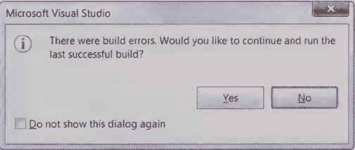

**图 8-2：** 对话框

- 4. 图 8-3 所示的“错误列表”窗口会在 IDE 底部打开。“错误列表”窗口指示代码包含三个错误。该窗口提供了每个错误的说明以及每个错误在代码中的位置。（您可以将鼠标指针定位在窗口的上边框，直到鼠标指针看起来像这样：[调整大小光标]，然后按住鼠标左键并向上或向下拖动边框，以更改“错误列表”窗口的大小。）

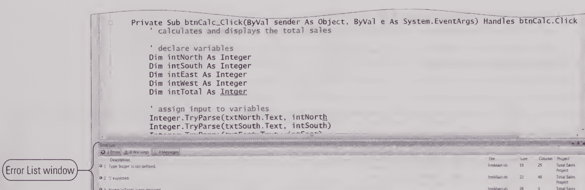

**图 8-3：** IDE 中的“错误列表”窗口

- 5. 在“错误列表”窗口中双击**未定义类型“Intger”。** “代码编辑器”会将插入点放在遇到错误的那一行，如图 8-4 所示。第一个错误只不过是一个输入错误：程序员原本想输入的是 Integer。

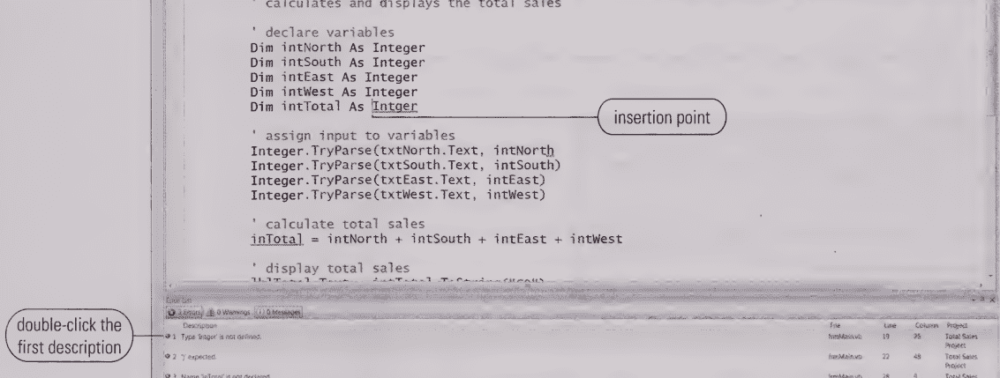

**图 8-4：** 插入点位于包含第一个错误的行中

- 6. 您可以自己修复第一个语法错误，只需输入缺少的字母 e；或者，也可以让“代码编辑器”为您更正错误。在这一步中，您将看到如何让“代码编辑器”发挥作用。将鼠标指针悬停在字母 r 下方出现的红色细框上。会出现一个“错误”图标（红色圆圈中的白色感叹号）以及一个向下箭头。（如果看不到向下箭头，请将鼠标指针悬停在“错误”图标上，直到向下箭头出现。）单击**向下箭头**以显示修复错误的建议列表。参见图 8-5。


**图 8-5：** 可能的解决方案列表

- 7. 单击列表中的**将“Intger”更改为“Integer”**。“代码编辑器”会将 Dim 语句中的 Intger 更改为 Integer，并从“错误列表”窗口中移除该错误。

- 8. 在“错误列表”窗口中双击**缺少“)”。** “代码编辑器”会将插入点放在包含第一个 TryParse 方法的行中，因为该语句缺少右括号。将鼠标指针悬停在字母 h 下方出现的红色细框上。当“错误”图标和向下箭头出现时，单击**向下箭头**。单击列表中的**插入缺少的“)”**。“代码编辑器”会插入缺少的括号，并从“错误列表”窗口中移除该错误消息。

- 9. 在“错误列表”窗口中双击**未声明名称“intTotal”。** “代码编辑器”会将插入点放在计算总销售额的语句开头。将鼠标指针悬停在字母 l 下方出现的红色细框上。当“错误”图标和向下箭头出现时，单击**向下箭头**。如消息所示，“代码编辑器”无法提供任何更正该错误的建议。参见图 8-6。

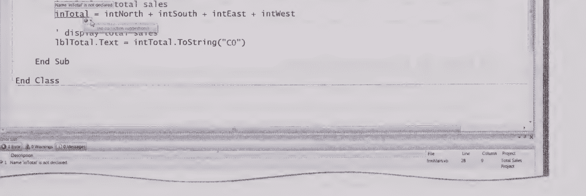

**图 8-6：** 没有可用更正建议时出现的消息

```vb
Private Sub btnCalc_Click(ByVal sender As Object, ByVal e As System.EventArgs) Handles btnCalc.Click
    ' calculates and displays a 10%, 20%, and
    ' 30% discount on an item's price

    ' declare variables
    Dim decPrice As Decimal
    Dim decDiscount10 As Decimal
    Dim decDiscount20 As Decimal
    Dim decDiscount30 As Decimal

    ' calculate discounts
    decDiscount10 = decPrice * 0.1
    decDiscount20 = decPrice * 0.2
    decDiscount30 = decPrice * 0.3

    ' display discounts
    lbl10.Text = decDiscount10.ToString("N2")
    lbl20.Text = decDiscount20.ToString("N2")
    lbl30.Text = decDiscount30.ToString("N2")
End Sub
```

**图 8-7：** 在 btnCalc 控件的 Click 事件过程中输入的代码

- 3. 启动应用程序。在 Price 文本框中输入 **100**，然后单击**计算**按钮。界面显示每个折扣都是 $0.00，这是不正确的。单击**退出**按钮以停止应用程序。

- 4. 您将使用“调试”菜单运行 Visual Basic 调试器，这是一个帮助您定位代码中逻辑错误的工具。单击菜单栏上的**调试**。该菜单的“逐语句”选项将启动您的应用程序，并允许您逐句执行代码。它通过一次执行一条语句，并在执行每条语句之前立即暂停来实现这一点。单击**逐语句**。在 Price 文本框中输入 **100**，然后单击**计算**按钮。调试器会突出显示要执行的第一条指令。在本例中，它突出显示 btnCalc_Click 过程头。此外，一个箭头指向该指令，如图 8-8 所示，并且代码的执行已暂停。（如果界面仍显示在屏幕上，请单击“代码编辑器”窗口的标题栏。）

```vb
Private Sub btnCalc_Click(ByVal sender As Object, ByVal e As System.EventArgs) Handles btnCa...
    ' calculates and displays a 10%, 20%, and
    ' 30% discount on an item's price

    ' declare variables
    Dim decPrice As Decimal
    Dim decDiscount10 As Decimal
    Dim decDiscount20 As Decimal
```

**图 8-8：** 突出显示的过程头

将文本框的值赋给 decPrice 变量。换句话说，该过程中缺少一条语句。

```vb
Private Sub btnCalc_Click(ByVal sender As Object, ByVal e As System.EventArgs) Handles btnCa
    ' calculates and displays a 10%, 20%, and
    ' 30% discount on an item's price

    ' declare variables
    Dim decPrice As Decimal
    Dim decDiscount10 As Decimal
    Dim decDiscount20 As Decimal
    Dim decDiscount30 As Decimal

    ' calculate discounts
    decDiscount10 = decPrice * 0.1
    decDiscount20 = decPrice * 0.2
    decDiscount30 = decPrice * 0.3
```

**图 8-10：** 在执行突出显示的语句之前存储在 decPrice 中的值

- 8. 单击菜单栏上的**调试**，然后单击**停止调试**以停止调试器。单击最后一条 Dim 语句下方的空白行，然后按 **Enter** 插入另一个空白行。键入 `' assign price to a variable`，然后按 **Enter**，再键入 `Decimal.TryParse(txtPrice.Text, decPrice)`，然后按 **Enter**。

- 9. 保存解决方案。单击菜单栏上的**调试**，然后单击**逐语句**。在 Price 文本框中输入 **100**，然后单击**计算**按钮。（如果界面仍显示在屏幕上，请单击“代码编辑器”窗口的标题栏。）按 **F8** 处理过程头。调试器会突出显示 `Decimal.TryParse(txtPrice.Text, decPrice)` 语句，并暂停代码的执行。

- 10. 在处理突出显示的语句之前，txtPrice 控件的 Text 属性应包含 100，这是您在控件中输入的值。将鼠标指针放在突出显示语句中的 txtPrice.Text 上。框内显示 Text 属性包含预期值。100 用引号括起来，因为它被视为字符串。（正如您在第七章中学到的，字符串是用引号括起来的文本。）

- 11. decPrice 变量应包含其初始值 0D。将鼠标指针放在突出显示语句中的 decPrice 上。框内显示该变量包含预期值。

- 12. 按 **F8** 处理 TryParse 方法。调试器会突出显示 `decDiscount10 = decPrice * 0.1` 语句，然后暂停代码的执行。将鼠标指针放在 TryParse 方法中的 decPrice 上，如图 8-11 所示。请注意，在计算机处理该方法后，decPrice 变量包含数字 100D。


```vb
' assign price to a variable
Decimal.TryParse(txtPrice.Text, decPrice)

' calculate discounts
decDiscount10 = decPrice * 0.1
decDiscount20 = decPrice * 0.2
decDiscount30 = decPrice * 0.3
```

图 8-11：执行 TryParse 方法后存储在 decPrice 中的值

13. 在执行突出显示的语句之前，decDiscount10 变量应包含其初始值，decPrice 变量应包含由 TryParse 方法赋给它的值。将鼠标指针放在突出显示语句中的 decDiscount10 上。框中显示该变量包含 0D，这是正确的。将鼠标指针放在突出显示语句中的 decPrice 上。框中显示该变量包含 100D，这也是正确的。

14. 处理突出显示的语句后，decPrice 变量仍应包含 100D。但是，decDiscount10 变量应包含 10D，即 100 的 10%。按 F8 执行 decDiscount10 = decPrice * 0.1 语句，然后将鼠标指针放在该语句中的 decDiscount10 上。框中显示该变量包含预期值。自行验证该语句中的 decPrice 变量包含适当的值。

15. 要在不使用调试器的情况下继续执行程序，请单击菜单栏上的 **调试**，然后单击 **继续**。这一次，界面中会显示正确的折扣金额（10.00、20.00 和 30.00）。

16. 单击 **退出** 按钮结束应用程序。关闭代码编辑器窗口，然后关闭解决方案。

## 我已经达到极限

逐行单步执行代码并不是查找逻辑错误的唯一方法。还可以使用断点，在代码的特定行暂停执行。你将在下一组步骤中学习如何设置断点。

**调试“工作小时数”应用程序：**

```vb
Private Sub btnCalculate_Click(ByVal sender As Object, ByVal e As System.EventArgs) Handles
    ' calculates and displays the total number
    ' of hours worked during 4 weeks

    ' declare variables
    Dim dblWeek1 As Double
    Dim dblWeek2 As Double
    Dim dblWeek3 As Double
    Dim dblWeek4 As Double
    Dim dblTotal As Double

    ' assign input to variables
    Double.TryParse(txtWeek1.Text, dblWeek1)
    Double.TryParse(txtWeek2.Text, dblWeek2)
    Double.TryParse(txtWeek3.Text, dblWeek2)
    Double.TryParse(txtWeek4.Text, dblWeek4)

    ' calculate total hours worked
    dblTotal = dblWeek1 + dblWeek2 + dblWeek3 + dblWeek4

    ' display total hours worked
    lblTotal.Text = dblTotal

End Sub
```

图 8-14：计算机到达断点时的结果

6. 同样，在查看突出显示语句中每个变量包含的值之前，请先考虑你期望找到的值。处理计算语句之前，dblTotal 变量应包含其初始值 (0)。其他四个变量应包含数字 1，即你在每个文本框中输入的值。将鼠标指针放在突出显示语句中的 dblTotal 上。框中显示该变量的值为 0.0，这是正确的。（你可以将鼠标指针放在声明语句中的 dblTotal 上来验证该变量的初始值。）不必担心显示的是 0.0 而不是 0。.0 表示该值的数据类型是 Double。

7. 自行查看 dblWeek1、dblWeek2、dblWeek3 和 dblWeek4 变量中包含的值。注意其中三个变量包含 1.0，这是正确的。然而，dblWeek3 变量包含其初始值 (0.0)，这是不正确的。

8. 其中一个 TryParse 方法负责为 dblWeek3 变量分配新值。仔细观察过程中的四个 TryParse 方法，你会发现第三个方法不正确。将 txtWeek3 控件的内容转换为数字后，该方法应将数字赋给 dblWeek3 变量，而不是赋给 dblWeek2 变量。单击菜单栏上的 **调试**，然后单击 **停止调试**。

9. 将第三个 TryParse 方法中的 dblWeek2 改为 **dblWeek3**。

10. 现在可以移除断点。右键单击包含断点的语句，指向 **断点**，然后单击 **删除断点**。

11. 保存解决方案。启动应用程序。在四个文本框中分别输入数字 **1**，然后单击 **计算** 按钮。界面显示总小时数为 4。自行使用每周工作小时数的其他值测试应用程序。

12. 单击 **退出** 按钮结束应用程序。关闭代码编辑器窗口，然后关闭解决方案。

## 小测验 1

1. 在过程中输入以下哪条语句会导致语法错误？
   a. Me.Close()
   b. Integer.TryPars(txtHours.Text, intHours)
   c. Dim decRate as Decimal
   d. 以上全部。

2. 要逐行单步执行可执行代码，请单击菜单栏上的“调试”，然后单击 ________。

3. 设置断点后，计算机在它处理断点语句的 ________ 立即停止处理代码。
   a. 之后
   b. 之前

4. 在单步执行代码时，只能查看突出显示的语句中出现的控件和变量的内容。
   a. 正确
   b. 错误

5. 哪个键用于单步执行代码？
   a. F8
   b. F7
   c. F6
   d. F5

## 小结

- 大多数情况下，程序错误（bug）由语法错误或逻辑错误引起。代码编辑器可帮助你定位并修复代码中的语法错误。但是，它无法定位代码中的任何逻辑错误。
- 启动应用程序时，应用程序代码中的任何语法错误都会列在“错误列表”窗口中。
- 可以通过单步执行代码来定位逻辑错误。要单步执行代码，请使用“调试”菜单上的“逐语句”选项，或按 F8 键。还可以右键单击某行代码，指向“断点”，然后单击“插入断点”来设置断点。要移除断点，请右键单击该断点，指向“断点”，然后单击“删除断点”。
- 值末尾的字母 D 表示该值的数据类型是 Decimal。
- 数字末尾的 .0 表示该数字的数据类型是 Double。
- 在查看控件或变量中存储的值之前，首先应考虑你期望找到的值。

## 练习

1. 在本练习中，你将调试一个应用程序。（TRY THIS 练习的答案位于本章末尾。）打开 Commission Calculator Solution（Commission Calculator Solution.sln）文件，该文件位于 ClearlyVB\Chap08\Commission Calculator Solution 文件夹中。运用本章所学知识调试该应用程序。完成应用程序调试后，关闭解决方案。 **试一试**

2. 在本练习中，你将调试一个应用程序。（TRY THIS 练习的答案位于本章末尾。）打开 New Pay Solution（New Pay Solution.sln）文件，该文件位于 ClearlyVB\Chap08\New Pay Solution 文件夹中。运用本章所学知识调试该应用程序。完成应用程序调试后，关闭解决方案。 **试一试**

3. 在本练习中，你将调试一个应用程序。打开 Hawkins Solution（Hawkins Solution.sln）文件，该文件位于 ClearlyVB\Chap08\Hawkins Solution 文件夹中。运用本章所学知识调试该应用程序。完成应用程序调试后，关闭解决方案。 **初级**

4. 在本练习中，你将调试一个应用程序。打开 Allenton Solution（Allenton Solution.sln）文件，该文件位于 ClearlyVB\Chap08\Allenton Solution 文件夹中。运用本章所学知识调试该应用程序。完成应用程序调试后，关闭解决方案。 **初级**

5. 在本练习中，你将调试一个应用程序。打开 Martins Solution（Martins Solution.sln）文件，该文件位于 ClearlyVB\Chap08\Martins Solution 文件夹中。运用本章所学知识调试该应用程序。完成应用程序调试后，关闭解决方案。 **中级**

6. 在本练习中，你将调试一个应用程序。打开 Average Score Solution（Average Score Solution.sln）文件，该文件位于 ClearlyVB\Chap08\Average Score Solution 文件夹中。运用本章所学知识调试该应用程序。完成应用程序调试后，关闭解决方案。 **中级**


# 9 决策，决策，决策

学习第 9 章后，你应该能够：

- 在伪代码和流程图中展示选择结构
- 编写 If...Then...Else 语句
- 在选择结构的条件中包含比较运算符
- 向界面添加复选框

## 有人可能需要做出决策

正如你在第 2 章所学到的，所有计算机程序都是使用三种控制结构中的一种或多种编写的：顺序、选择或重复。你在前几章编写的过程中使用了顺序结构。回想一下，每个过程中的指令都是按顺序处理的——换句话说，按照指令在过程中出现的顺序处理。然而，很多时候，接下来要处理的指令取决于必须做出的决策的结果。在这些情况下，你需要使用选择结构。**选择结构**会做出决策，然后根据该决策采取适当的操作。但是，程序员如何确定问题的解决方案是否需要选择结构？这个问题的答案就是研究问题规格说明。你在本章将要检查的第一个问题规格说明涉及 Rob，也就是第 2 章中的机械人。问题规格说明以及该问题的图示如图 9-1 所示。要解决这个问题，你需要让 Rob 从走廊进入他的卧室。为此，你指示他向前走两步，然后打开卧室门，再向前走一步。使用 Rob 能理解的命令编写的正确算法包含在图 9-1 中。该算法只使用了顺序结构，因为要让 Rob 从走廊中的初始位置到达卧室中的结束位置，不需要做出任何决策。

Rob 站在他的走廊里，面向他的卧室门。门是关着的，距离 Rob 有两步远。Rob 想进入他的卧室。

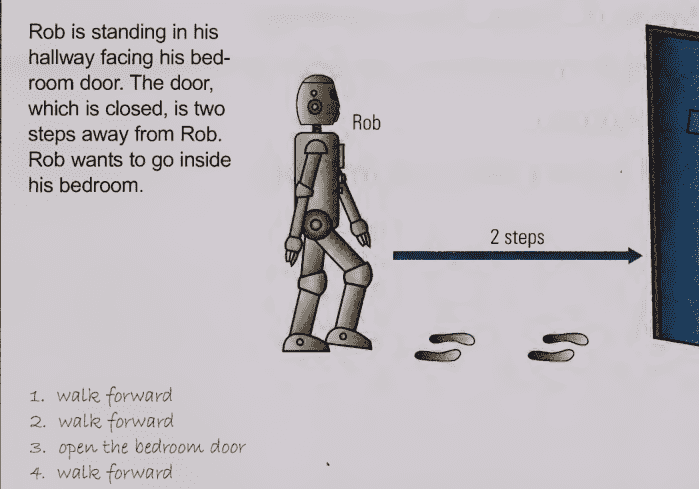

- 1. 向前走
- 2. 向前走
- 3. 打开卧室门
- 4. 向前走

**图 9-1：** 使用 Rob 的第一个问题

现在，让我们对图 9-1 所示的问题规格说明做一点小改动。这一次，Rob 的卧室门可能是关着的，也可能不是。由于这一微小修改，需要对图 9-1 所示的原算法做哪些更改？原算法中的前两条指令让 Rob 位于他的卧室门前；Rob 仍然需要遵循这些指令。第三条指令告诉 Rob 打开卧室门。对于说明卧室门是关着的原问题规格说明来说，这条指令是正确的。然而，在修改后的问题规格说明中，卧室门的状态未知：它可能是关着的，也可能已经打开了。因此，Rob 需要做出决策，然后根据结果采取适当的操作。更具体地说，Rob 需要确定卧室门是否关着，然后仅在需要开门时才打开门。原算法中的最后一条指令让 Rob 位于他卧室里面一步远的位置；Rob 仍然需要遵循那条指令。图 9-2 显示了修改后的问题规格说明以及修改后的算法。选择结构以 *如果门是关着的，执行以下操作：* 这一行开始，并以 *结束 if* 这一行结束。注意，*打开门* 指令在选择结构内缩进。以这种方式缩进表示，仅当门是关着的时候才应遵循该指令。

Rob 站在他的走廊里，面向他的卧室门。门可能关着，也可能没关，距离 Rob 有两步远。Rob 想进入他的卧室。

- 1. 向前走
- 2. 向前走
- 3. 如果门是关着的，执行以下操作：
  - 打开门
  - 结束 if
- 4. 向前走

**图 9-2：** 使用 Rob 的第二个问题

图 9-3 显示了另一个涉及 Rob 的问题规格说明和图示，以及正确的算法。正如算法所示，该问题的解决方案不需要 Rob 做出任何决策来完成他的任务。他只需要取下 Trash 容器上的盖子，将垃圾袋丢进该容器，然后重新盖上盖子。

Rob 右手拿着一个垃圾袋。他正面对着两个容器：一个标有 Trash，另一个标有 Recycle。每个容器上都有一个盖子。Rob 需要取下 Trash 容器上的盖子，然后将垃圾袋丢进该容器，再重新盖上盖子。

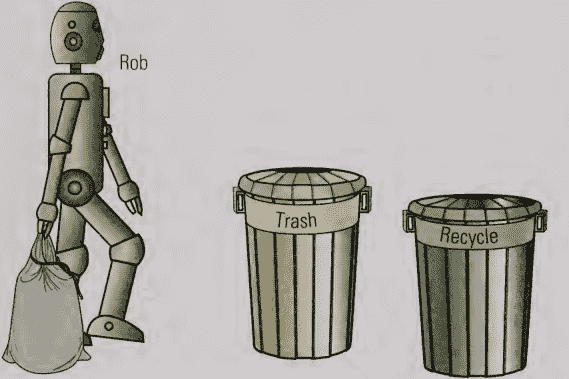

- 1. 用左手取下 Trash 容器上的盖子
- 2. 将垃圾袋丢进 Trash 容器
- 3. 用左手将盖子盖回 Trash 容器

**图 9-3：** 使用 Rob 的第三个问题

图 9-4 显示了前一个问题规格说明的修改版本。在修改版本中，你不知道 Rob 拿的是垃圾袋还是可回收物袋。Rob 应该把袋子丢进合适的容器。这些更改将如何影响图 9-3 所示的原算法？原算法中的三条指令只涉及 Trash 容器。对于说明 Rob 拿着垃圾袋的原问题规格说明来说，这些指令是正确的。然而，在修改后的问题规格说明中，Rob 所拿袋子里的物品并不确定：袋子里可能装的是垃圾，也可能是可回收物。因此，Rob 需要根据袋子里的物品做出决策，然后根据结果采取适当的操作。如果袋子里装的是垃圾，Rob 应遵循原算法中的三条指令。否则，也就是袋子里装的是可回收物，Rob 应先取下 Recycle 容器上的盖子，再将袋子丢进该容器，并重新盖上盖子。图 9-4 显示了修改后的问题规格说明以及正确算法的两个版本。注意，与图 9-2 所示的算法不同，图 9-4 所示的算法要求 Rob 在决策为真时执行一组指令，而在决策为假时执行另一组不同的指令。每组指令都在选择结构内缩进。以这种方式缩进清楚地表明了决策为真时要遵循的指令，以及决策为假时要遵循的指令。

Rob 右手拿着一个垃圾袋或一个可回收物袋。他正面对着两个容器：一个标有 Trash，另一个标有 Recycle。每个容器上都有一个盖子。Rob 需要取下合适容器上的盖子，然后将袋子丢进该容器，再重新盖上盖子。

版本 1：

```text
1. if you are holding a bag of trash, do this:
   use your left hand to remove the lid from the Trash container
   drop the bag of trash in the Trash container
   use your left hand to replace the lid on the Trash container
otherwise, do this:
   use your left hand to remove the lid from the Recycle container
   drop the bag of recyclables in the Recycle container
   use your left hand to replace the lid on the Recycle container
end if
```

版本 2：

```text
1. if you are holding a bag of recyclables, do this:
   use your left hand to remove the lid from the Recycle container
   drop the bag of recyclables in the Recycle container
   use your left hand to replace the lid on the Recycle container
otherwise, do this:
   use your left hand to remove the lid from the Trash container
   drop the bag of trash in the Trash container
   use your left hand to replace the lid on the Trash container
end if
```

**图 9-4：** 使用 Rob 的第四个问题

### 小测验 1

- 1. Rob 正坐在他客厅的一把椅子上。椅子旁边有一张桌子。桌子上放着 Rob 的手机。你的任务是指导 Rob 拿起他的手机。这个问题的解决方案需要做出决策吗？如果需要，需要做出什么决策？
- 2. Rob 正坐在他客厅的一把椅子上。椅子旁边有一张桌子。桌子上放着 Rob 的手机。你的任务是指导 Rob 拿起他的手机，但仅在手机响起时。这个问题的解决方案需要做出决策吗？如果需要，需要做出什么决策？

*（续下页）*


Mary 的年销售额至少为 $3000 时，她按年销售额获得 2% 的奖金；否则，她获得 1.5% 的奖金。她想要一个既能计算又能显示其奖金金额的程序。

- 输出：奖金
- 处理：奖金率
- 输入：年销售额

算法：
- 1. 输入年销售额
- 2. 如果年销售额至少为 3000，则执行以下操作：
  - 将奖金率赋值为 2%
  - 否则，执行以下操作：
    - 将奖金率赋值为 1.5%
  - 结束 If
- 3. 通过将年销售额乘以奖金率来计算奖金
- 4. 显示奖金

**图 9-6：** 修改后的奖金问题规格及其算法


要获得更多检查问题规格的练习，请参阅 Ch9WantMore.pdf 文件中的“问题规格”部分。

在下一组步骤中，您将开始为图 9-6 所示的算法编写代码。

### 打开 Bonus 应用程序，然后开始为该应用程序编写代码：
- 1. 启动 Visual Studio 2008（或 Visual Basic 2008 Express Edition）。打开 **Bonus 解决方案 (Bonus Solution.sln)** 文件，该文件位于 ClearlyVB\Chap09\Bonus Solution 文件夹中。如有必要，打开设计器窗口。应用程序界面如图 9-7 所示。

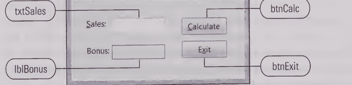

**图 9-7：** Bonus 应用程序的界面

- 2. 打开代码编辑器窗口，其中包含 btnExit 控件的 Click 事件过程代码。
- 3. 打开 btnCalc 控件的 Click 事件过程。首先，您将输入变量声明语句。该过程将使用三个 Decimal 变量分别用于输入、处理和输出项。键入 **'calculates and displays a bonus amount**，然后按两次 **Enter**。键入 **dim decSales as decimal** 并按 **Enter**。键入 **dim decRate as decimal** 并按 **Enter**，然后键入 **dim decBonus as decimal** 并按两次 **Enter**。
- 4. 算法中的第一步是输入年销售额。用户将在界面中的 txtSales 控件中输入金额。该过程需要将用户输入转换为数字，并将结果存储在 decSales 变量中。键入 **'assign sales to a variable** 并按 **Enter**，然后键入 **decimal.tryparse(txtSales.text, decSales)** 并按两次 **Enter**。
- 5. 保存解决方案。

## IF...THEN...ELSE 语句

图 9-6 所示算法中的第 2 步是一个选择结构。您可以在 Visual Basic 中使用 If...Then...Else 语句来编写该选择结构的代码。图 9-8 显示了该语句的语法。语法中方括号内的项是可选的。换言之，在 If...Then...Else 语句中，您并不总是需要包含语法中的 Else 部分（称为 Else 子句）。然而，粗体项是该语句的必需组成部分。例如，关键字 If、Then 和 End If 必须包含在 If...Then...Else 语句中。只有当程序员需要使用 Else 子句时，才必须包含关键字 Else。语法中的斜体项表示程序员必须提供信息的位置。在 If...Then...Else 语句中，程序员必须提供计算机在继续处理之前需要评估的 *条件*。该条件必须是一个布尔表达式，即结果为布尔值（True 或 False）的表达式。大多数条件中的表达式是使用比较运算符构成的。图 9-8 中列出了最常用的比较运算符。这些运算符之所以称为 **比较运算符**，是因为它们用于比较值。除了提供 *条件* 外，程序员还必须提供要在 If...Then...Else 语句的真路径中处理的语句，以及（如果使用）在其假路径中处理的语句。真路径中包含的一组语句，以及假路径中包含的一组语句，称为 **语句块**。除了展示 If...Then...Else 语句的语法和比较运算符之外，图 9-8 还展示了在 *条件* 中使用比较运算符的示例。请注意，每个示例的 *条件* 中所包含的表达式都会计算出一个布尔值——True 或 False。所有包含比较运算符的表达式都只会得出 True 或 False 的结果。

**IF...THEN...ELSE 语句**

**语法**

```
If condition Then
    statement block containing one or more statements to be processed when the condition is true

[Else
    statement block containing one or more statements to be processed when the condition is false]

End If
```

**最常用的比较运算符**

| 运算符 | 运算 |
| --- | --- |
| = | 等于 |
| > | 大于 |
| >= | 大于或等于 |
| < | 小于 |
| <= | 小于或等于 |
| <> | 不等于 |

**示例 1**

```vb
Dim intAge As Integer
Dim decDiscount As Decimal
Integer.TryParse(txtAge.Text, intAge)
If intAge >= 65 Then
    decDiscount = .15
    lblMessage.Text = "Senior Discount"
Else
    decDiscount = .1
    lblMessage.Text = "Regular Discount"
End If
```

如果 intAge 变量包含的数字大于或等于 65，则真路径中的指令将 .15 赋给 decDiscount 变量，并将字符串“Senior Discount”赋给 lblMessage 控件；否则，假路径中的指令将 .1 赋给 decDiscount 变量，并将字符串“Regular Discount”赋给 lblMessage 控件。

**图 9-8：** If...Then...Else 语句和比较运算符 *(续下页)*

**示例 2**

```vb
Dim decOwed As Decimal
Dim decPaid As Decimal
Dim decDifference As Decimal
Decimal.TryParse(txtOwed.Text, decOwed)
Decimal.TryParse(txtPaid.Text, decPaid)
decDifference = decPaid - decOwed
If decDifference < 0 Then
    lblMessage.Text = "You still owe money"
End If
lblDifference.Text = decDifference.ToString("C2")
```

如果 decDifference 变量包含的数字小于零，则真路径中的指令将字符串“You still owe money”赋给 lblMessage 控件。

**图 9-8：** If...Then...Else 语句和比较运算符 *(续上页)*

图 9-8 中示例 1 的选择结构告诉计算机：当条件计算结果为 True 时执行一组任务，而当条件计算结果为 False 时执行另一组不同的任务。在示例 2 中，选择结构告诉计算机仅当条件计算结果为 True 时执行那一项任务。请记住，表达式中的比较运算符会在所有算术运算符之后计算。例如，在处理表达式 7 > 3 + 5 时，计算机首先将数字 3 与数字 5 相加，得到 8。然后它将数字 7 与数字 8 进行比较。因为 7 不大于 8，所以该表达式的计算结果为 False。

### 完成 btnCalc 控件的 Click 事件过程：
- 1. 根据图 9-6 算法中的第 2 步，选择结构的 *条件* 需要将 Mary 的销售额与数字 3000 进行比较。算法中的“至少 3000”意味着有资格获得 2% 奖金的最低金额是 $3000。因此，在 *条件* 中使用的正确比较运算符是 >=（大于或等于）运算符。键入 **determine bonus rate** 并按 **Enter**，然后键入 **if decSales >= 3000 then** 并按 **Enter**。请注意，代码编辑器会自动为您输入 End If 行。它还会自动缩进当前行。
- 2. 如果存储在 decSales 变量中的值大于或等于 3000，则 *条件* 的计算结果为 True。在这种情况下，奖金率应为 2%。您将把转换为其小数形式的奖金率赋给 decRate 变量。键入 **decRate = .02** 并按 **Enter**。
- 3. 如果存储在 `decSales` 变量中的值不大于或等于 3000，则 *条件* 的计算结果为 False。在这种情况下，奖金率应为 1.5%，即 .015。键入 **else** 并按 **Enter**，然后键入 **decRate = .015**。
- 4. 算法中的第 3 步和第 4 步是计算奖金，然后显示奖金。在 End If 行中，单击 **字母 f 之后的位置**，然后按两次 **Enter** 插入两个空行。键入图 9-9 中指示的注释和两行代码。

```vb
Private Sub btnCalc_Click(ByVal sender As Object, ByVal e As System.EventArgs)
    ' calculates and displays a bonus amount

    Dim decSales As Decimal
    Dim decRate As Decimal
    Dim decBonus As Decimal

    ' assign sales to a variable
    Decimal.TryParse(txtSales.Text, decSales)

    ' determine bonus rate
    If decSales >= 3000 Then
        decRate = 0.02
    Else
        decRate = 0.015
    End If

    ' calculate and display the bonus
    decBonus = decSales * decRate
    lblBonus.Text = decBonus.ToString("C2")

End Sub
```

**图 9-9：** btnCalc 控件的完整 Click 事件过程

图 9-10 显示了 Bonus 程序的桌面检查表。请自行使用其他销售额对该程序进行桌面检查。

| decSales | decRate | decBonus（四舍五入到两位小数） |
| ---: | ---: | ---: |
| 3500.75 | .02 | 70.02 |
| 500.25 | .015 | 7.50 |

**图 9-10：** Bonus 程序的完整桌面检查表

### 测试 Bonus 应用程序：
- 1. 保存解决方案，然后启动应用程序。使用图 9-10 中显示的销售额以及您自己的销售额来测试该应用程序。
- 2. 完成应用程序测试后，单击 **退出** 按钮。关闭代码编辑器窗口，然后关闭解决方案。


## 检查另一个问题说明

图 9-11 显示了另一个问题说明，其解决方案需要使用选择结构。该图还包含该问题的一个正确算法（以流程图形式）。在此例中，算法需要确定客户是否为员工。

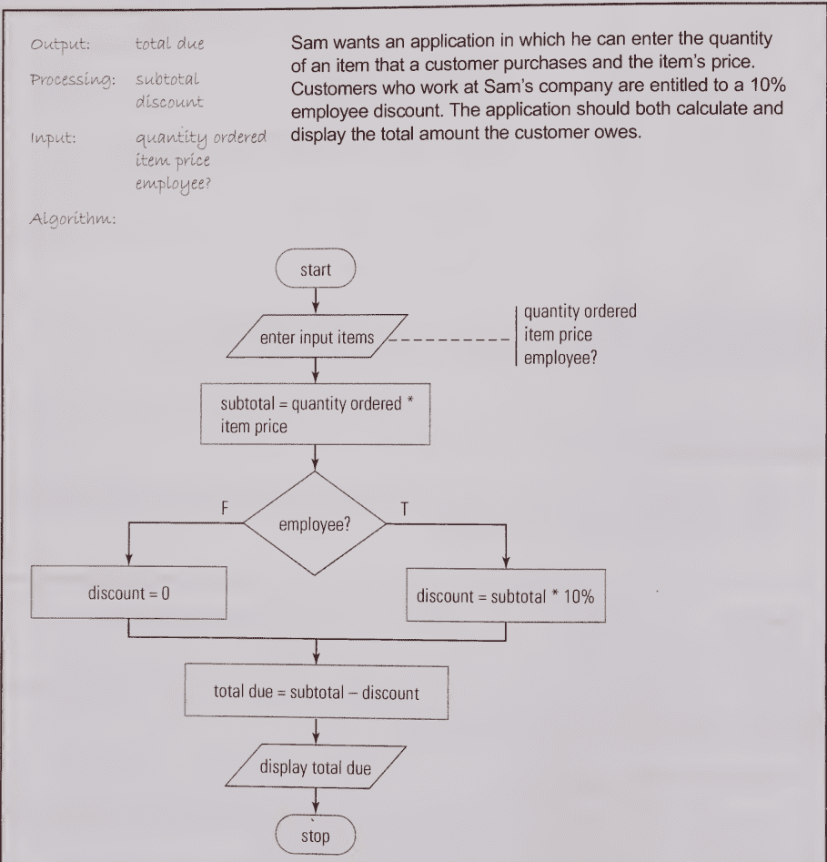

**图 9-11：** 应付总额问题说明和算法

回顾第 3 章，流程图中的椭圆是开始/停止符号，矩形是处理符号，平行四边形是输入/输出符号。流程图中的菱形称为**选择/重复符号**，因为它用于表示选择结构和重复结构中的条件。在图 9-11 的流程图中，菱形表示选择结构中的条件。（你将在后续章节学习如何使用菱形表示重复结构的条件。）菱形内是一个答案为 True 或 False 的问题。每个菱形还有一个流入符号的流程线，以及两个流出符号的流程线。从菱形引出的两条流程线应加以标记，以便任何阅读流程图的人都能区分真路径和假路径。你用“T”（表示 True）标记通向真路径的流程线，用“F”（表示 False）标记通向假路径的流程线。你也可以用“Y”和“N”（表示 Yes 和 No）标记从菱形引出的流程线。

### 打开应付总额应用程序，然后完成用户界面和代码：

- 1. 打开 **Total Due Solution (Total Due Solution.sln)** 文件，该文件位于 ClearlyVB\Chap09\Total Due Solution 文件夹中。如有必要，打开设计器窗口。屏幕上会出现该应用程序部分完成的界面。用户将在两个文本框中输入订购数量和商品价格。员工信息将通过复选框输入，你将在下一步将该复选框添加到界面中。
- 2. 单击工具箱中的 **CheckBox** 工具，然后将一个复选框拖到窗体上。命名复选框时使用的三字符 ID 是 chk。将复选框的 Name 属性改为 **chkEmployee**。将其 Location 属性改为 **127, 22**。将其 Text 属性改为 **&Employee**。（复选框的 Text 属性应使用句首大写形式输入，你在第 5 章已学过。）如果客户是员工，用户需要选中该复选框；否则，该复选框应处于未选中状态。你可以通过单击复选框来选中它。当复选框处于选中状态时，再次单击它会取消选中。完成后的界面如图 9-12 所示。

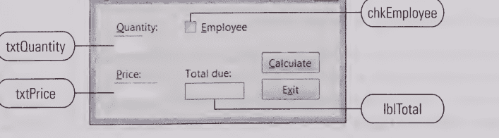

**图 9-12：** 应付总额应用程序的完成界面

- 3. 右键单击**窗体**，然后单击**锁定控件**。在菜单栏上单击**视图**，然后单击**Tab 键顺序**。使用图 9-13 所示的信息设置 Tab 键顺序。

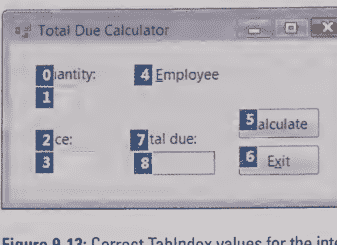

**图 9-13：** 界面的正确 TabIndex 值

- 4. 按 **Esc** 从窗体中移除 TabIndex 框，然后保存解决方案。
- 5. 打开“代码编辑器”窗口，其中包含 btnExit 控件的 Click 事件过程的代码。它还包含 btnCalc 控件的部分完成的 Click 事件过程，如图 9-14 所示。请注意，该过程为 10% 折扣率声明了一个命名常量。它还声明了五个变量，用于存储订购数量、商品价格、小计、折扣和应付总额。此外，它将数量和价格信息赋给其中两个变量。该过程中的赋值语句在 lblTotal 控件中显示应付总额。

```vb
Private Sub btnCalc_Click(ByVal sender As Object, ByVal e As System.EventArgs) Handles btnCalc.Click
    ' calculates and displays the total amount due

    Const decDISC_RATE As Decimal = 0.1
    Dim intQuantity As Integer
    Dim decPrice As Decimal
    Dim decSubtotal As Decimal
    Dim decDiscount As Decimal
    Dim decTotal As Decimal

    ' assign quantity and price to variables
    Integer.TryParse(txtQuantity.Text, intQuantity)
    Decimal.TryParse(txtPrice.Text, decPrice)

    ' calculate subtotal, discount, and total due

    ' display total due
    lblTotal.Text = decTotal.ToString("C2")
End Sub
```

**图 9-14：** btnCalc 控件的部分完成的 Click 事件过程

- 6. btnCalc 控件的 Click 事件过程中缺少用于计算小计、折扣和应付总额的指令。根据图 9-11 中显示的第一个处理符号，你通过将订购数量乘以商品价格来计算小计。单击 `' calculate subtotal, discount, and total due` 注释下方的**空白行**。键入 **decSubtotal = intQuantity * decPrice**，然后按 **Enter**。
- 7. 流程图中的下一个符号是一个菱形，表示选择结构中的条件。选择结构的条件应确定客户是否为员工。回顾一下，用户通过选中 Employee 复选框来表示员工。如果复选框未选中，则意味着客户不是员工。你可以使用复选框的 Checked 属性来确定其状态：如果复选框已选中，其 Checked 属性包含布尔值 True；否则，它包含布尔值 False。键入 **if chkEmployee.checked = true then**，然后按 **Enter**。
- 8. 接下来，你需要为选择结构的真路径编写代码。根据流程图，作为员工的客户应获得 10% 的折扣。键入 **decDiscount = decSubtotal * decDISC_RATE**，然后按 **Enter**。真路径的编码已完成；接下来是假路径。
- 9. 根据流程图，不是员工的客户不应获得折扣。键入 **else**，按 **Enter**，然后键入 **decDiscount = 0**。选择结构的编码已完成。
- 10. 最后，你需要为位于选择结构之后的处理符号编写代码。该处理符号指示你通过从小计中减去折扣来计算应付总额。在 **End If** 行中字母 **f** 之后立即单击，然后按 **Enter**。键入 **decTotal = decSubtotal - decDiscount**，然后按 **Enter**。该过程的编码已完成。（该过程已包含与流程图中最后一个平行四边形相关的代码。）图 9-15 显示了该过程的代码。

```vb
Private Sub btnCalc_Click(ByVal sender As Object, ByVal e As System.EventArgs) Handles btnCalc.Click
    ' calculates and displays the total amount due

    Const decDISC_RATE As Decimal = 0.1
    Dim intQuantity As Integer
    Dim decPrice As Decimal
    Dim decSubtotal As Decimal
    Dim decDiscount As Decimal
    Dim decTotal As Decimal

    ' assign quantity and price to variables
    Integer.TryParse(txtQuantity.Text, intQuantity)
    Decimal.TryParse(txtPrice.Text, decPrice)

    ' calculate subtotal, discount, and total due
    decSubtotal = intQuantity * decPrice
    If chkEmployee.Checked = True Then
        decDiscount = decSubtotal * decDISC_RATE
    Else
        decDiscount = 0
    End If
    decTotal = decSubtotal - decDiscount

    ' display total due
    lblTotal.Text = decTotal.ToString("C2")
End Sub
```

**图 9-15：** btnCalc 控件的完整 Click 事件过程

图 9-16 显示了应付总额程序的桌面检查表。你可以自行使用其他输入项值对该程序进行桌面检查。

| decDISC_RATE | intQuantity | decPrice | chkEmployee.Checked |
| --- | --- | --- | --- |
| 0.1 | 10 | 2.50 | True |
| 0.1 | 10 | 2.50 | False |

| decSubtotal | decDiscount | decTotal |
| --- | --- | --- |
| 25.00 | 2.50 | 22.50 |
| 25.00 | 0 | 25.00 |

**图 9-16：** 应付总额程序的完整桌面检查表

### 测试应付总额应用程序：

- 1. 保存解决方案，然后启动应用程序。使用图 9-16 中显示的数量、价格和复选框信息，以及你自己的数据来测试应用程序。
- 2. 完成应用程序测试后，单击 **Exit** 按钮。关闭代码编辑器窗口，然后关闭解决方案。

## 嘿，我不会那样做

解决问题总有多种方法。例如，图 9-17 显示了解决上一节应付总额问题的另一种方法，图 9-18 显示了相应的代码。请注意，这个版本的解决方案不使用任何处理项。还要注意，与前面图 9-11 所示的选择结构不同，图 9-17 中的选择结构仅在其真路径中包含一条指令。该指令将应付总额乘以 90%，因为这是员工获得 10% 折扣后应付的金额。


Sam 想要一个应用程序，通过它可以输入客户购买的商品数量以及商品价格。在 Sam 公司工作的顾客有权享受 10% 的员工折扣。该应用程序应该计算并显示客户应付的总金额。

- *输出：*总应付款
- *输入：*订购数量、商品价格、是否为员工？
- *算法：*

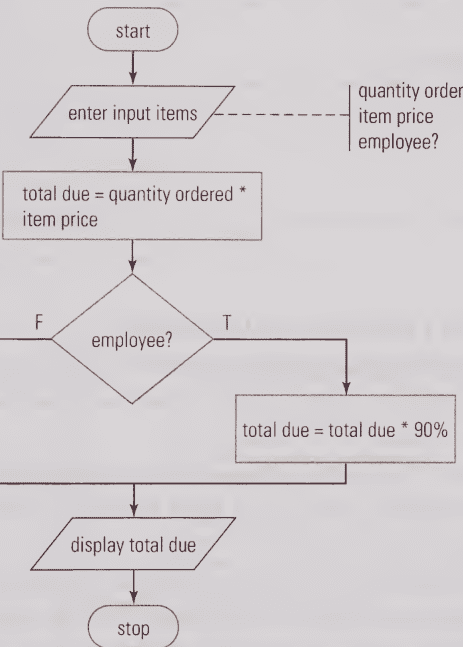

**图 9-17：** 总应付款问题的规格说明以及一种不同的算法

```vb
Private Sub btnCalc_Click(ByVal sender As Object, ByVal e As System.EventArgs)
    ' calculates and displays the total amount due

    Const decDISC_RATE As Decimal = 0.1
    Dim intQuantity As Integer
    Dim decPrice As Decimal
    Dim decTotal As Decimal

    ' assign quantity and price to variables
    Integer.TryParse(txtQuantity.Text, intQuantity)
    Decimal.TryParse(txtPrice.Text, decPrice)

    ' calculate total due
    decTotal = intQuantity * decPrice
    If chkEmployee.Checked = True Then
        decTotal = decTotal * (1 - decDISC_RATE)
    End If

    ' display total due
    lblTotal.Text = decTotal.ToString("C2")
End Sub
```

在任何折扣之前计算总应付款

将总应付款乘以 90%

**图 9-18：** 与图 9-17 的算法对应的代码

### 编写 Total Due—Version 2 应用程序，然后对其进行测试：

- 1. 打开 **Total Due Solution (Total Due Solution.sln)** 文件，该文件位于 ClearlyVB\Chap09\Total Due Solution—Version 2 文件夹中。如有必要，打开设计器窗口。
- 2. 打开代码编辑器窗口，其中包含 btnExit 控件的 Click 事件过程的代码。打开 btnCalc 控件的 Click 事件过程，然后输入图 9-18 中所示的代码。
- 3. 保存解决方案，然后启动应用程序。使用前面图 9-16 中显示的订购数量、价格和复选框信息，以及你自己的数据来测试应用程序。
- 4. 测试完应用程序后，单击 **Exit** 按钮。关闭代码编辑器窗口，然后关闭解决方案。

图 9-19 展示了解决总应付款问题的另一种方式，图 9-20 展示了相应的代码。

Sam 想要一个应用程序，通过它可以输入客户购买的商品数量以及商品价格。在 Sam 公司工作的顾客有权享受 10% 的员工折扣。该应用程序应该计算并显示客户应付的总金额。

- **输出：**总应付款
- **处理：**折扣
- **输入：**订购数量、商品价格、是否为员工？
- 算法：
  - 1. 输入订购数量、商品价格和是否为员工等条目
  - 2. 将订购数量乘以商品价格来计算总应付款
  - 3. 如果是员工，则执行以下操作：
    - 将总应付款乘以 10% 来计算折扣
    - 从总应付款中减去折扣
    - 结束 If
  - 4. 显示总应付款

**图 9-19：** 解决总应付款问题的另一种方式

```vb
Private Sub btnCalc_Click(ByVal sender As Object, ByVal e As System.EventArgs)
    ' calculates and displays the total amount due

    Const decDISC_RATE As Decimal = 0.1
    Dim intQuantity As Integer
    Dim decPrice As Decimal
    Dim decTotal As Decimal

    ' assign quantity and price to variables
    Integer.TryParse(txtQuantity.Text, intQuantity)
    Decimal.TryParse(txtPrice.Text, decPrice)

    ' calculate total due
    decTotal = intQuantity * decPrice
    If chkEmployee.Checked = True Then
        Dim decDiscount As Decimal
        decDiscount = decTotal * decDISC_RATE
        decTotal = decTotal - decDiscount
    End If

    ' display total due
    lblTotal.Text = decTotal.ToString("C2")
End Sub
```

块级变量

**图 9-20：** 与图 9-19 的算法对应的代码

仔细研究图 9-20 所示选择结构真路径中的指令。第一条指令 `Dim decDiscount As Decimal` 声明了一个名为 decDiscount 的变量。与在过程开头声明的变量一样，在语句块中声明的变量会一直保留在内存中，直到过程结束。但是，与在过程开头声明的变量不同，在语句块内声明的变量具有块作用域而不是过程作用域。具有过程作用域的变量可以在过程内的任何位置使用，而具有**块作用域**的变量只能在其声明的语句块内使用。例如，在本例中，intQuantity、decPrice 和 decTotal 变量（以及命名常量 decDISC_RATE）可以在 btnCalc 控件的 Click 事件过程中的任何位置使用，但 decDiscount 变量只能在 If...Then...Else 语句的真路径中使用。你可能会想，为什么 decDiscount 变量没有与其他变量一起在过程开头声明。虽然在过程开头声明所有变量并没有错，但 decDiscount 变量仅在需要计算折扣时才有必要，因此许多程序员更愿意仅在必要时才创建该变量。这是因为当使用所需的最小作用域声明变量时，应用程序中发生无意错误的可能性更小。在这种情况下，decDiscount 变量的最小作用域是块作用域，因为只有选择结构的真路径使用该变量。在语句块内声明的变量称为**块级变量**。

### 编写 Total Due—Version 3 应用程序，然后对其进行测试：

- 1. 打开 **Total Due Solution (Total Due Solution.sln)** 文件，该文件位于 ClearlyVB\Chap09\Total Due Solution—Version 3 文件夹中。如有必要，打开设计器窗口。
- 2. 打开代码编辑器窗口，其中包含 btnExit 控件的 Click 事件过程的代码。打开 btnCalc 控件的 Click 事件过程，然后输入图 9-20 中所示的代码。
- 3. 保存解决方案，然后启动应用程序。使用前面图 9-16 中显示的订购数量、价格和复选框信息，以及你自己的数据来测试应用程序。
- 4. 测试完应用程序后，单击 **Exit** 按钮。关闭代码编辑器窗口，然后关闭解决方案。

## 小测验 2

- 1. 编写一条 If...Then...Else 语句，当 decHours 变量中包含的小时数大于 40 时，在 lblMsg 控件中显示字符串 "Overtime pay"。
- 2. 修改问题 1 中的 If...Then...Else 语句，使其在选择结构的条件计算结果为 False 时显示字符串 "Regular pay only"。
- 3. 在选择结构的假路径中声明的变量的作用域是什么？
  - a. 整个应用程序
  - b. 包含该选择结构的过程
  - c. 整个选择结构
  - d. 仅该选择结构的假路径


有关选择结构的更多示例，请参阅 Ch9WantMore.pdf 文件中的“选择结构”部分。

现在该观看 Ch09-Selection Structure 视频了。

## 小结

- 选择结构是三种控制结构之一。当你需要计算机做出决策并采取相应操作时，可以使用它。
- 研究问题规格说明将帮助你确定解决方案是否需要选择结构。
- 你应该缩进选择结构真路径和假路径中的指令。每条路径中的指令集称为语句块。
- 你可以使用 If...Then...Else 语句在 Visual Basic 中编写选择结构。该语句的条件必须包含一个计算结果为布尔值（True 或 False）的表达式。在大多数条件中会用到比较运算符。


- 包含比较运算符的表达式始终会求值为 True 或 False。
- 在流程图中，选择结构的条件由菱形表示，该菱形称为选择/重复符号。菱形中应包含一个问题或比较，且其只能求值为 True 或 False。从菱形引出的两条流程线应分别指示真路径和假路径。
- 命名复选框时使用的三字符 ID 是 chk。选中复选框时，其 Checked 属性包含布尔值 True；否则，它包含布尔值 False。
- 解决同一问题有许多方法。
- 块变量具有块作用域，这意味着它只能在其声明所在的块内使用。

## 关键术语

- **块作用域**——块变量的作用域；指该变量只能在其声明所在的语句块内使用
- **块变量**——在语句块内声明的变量；该变量具有块作用域
- **比较运算符**——用于在选择结构的条件中比较值的运算符
- **选择/重复符号**——流程图中的菱形
- **选择结构**——程序中用于表示需要做出决策，并根据结果采取适当操作的结构
- **语句块**——选择结构真路径中的一组指令，以及其假路径中的一组指令

## 小测验答案

### 小测验 1

- 1. 该解决方案不需要做出决策。
- 2. 该解决方案需要就电话是否正在响铃做出决策。
- 3. 该解决方案不需要做出决策。
- 4. 该解决方案需要就球的颜色做出决策。

### 小测验 2

- 1.
  ```
  If decHours > 40 Then
      lblMsg.Text = "Overtime pay"
  End If
  ```
- 2.
  ```
  If decHours > 40 Then
      lblMsg.Text = "Overtime pay"
  Else
      lblMsg.Text = "Regular pay only"
  End If
  ```
- 3. d. 仅选择结构的假路径

## 复习题

- 1. 当 intPopulation 变量包含值 56000 时，以下哪个条件的求值结果为 True？
  - a. 如果 intPopulation = 56000 则
  - b. 如果 intPopulation <> 0 则
  - c. 如果 intPopulation > 1 则
  - d. 以上所有。

- 2. 当 chkShipping 复选框未选中时，以下哪个条件的求值结果为 True？
  - a. 如果 chkShipping.Check = False 则
  - b. 如果 chkShipping.Checked = False 则
  - c. 如果 chkShipping.Checked = No 则
  - d. 如果 chkShipping.Check = No 则

- 3. 以下哪项的作用域最小？
  - a. 在过程开头声明的变量。
  - b. 在选择结构真路径内声明的变量。
  - c. 在选择结构假路径内声明的变量。
  - d. b 和 c 两者。

- 4. 以下哪项用于在流程图中表示选择结构的条件？
  - a. 菱形
  - b. 椭圆形
  - c. 平行四边形
  - d. 矩形

- 5. 如果 decRate 变量包含值 .25，则条件 decRate > 1 的求值结果为 ________。
  - a. False
  - b. No
  - c. True
  - d. Yes

## 练习题


- 1. 在本练习中，你计算用户输入的两个整数的和或差。（TRY THIS 练习的答案位于本章末尾。）
  - a. 打开 ClearlyVB\Chap09\AddSub Solution 文件夹中包含的 AddSub Solution（AddSub Solution.sln）文件。如果用户想对两个整数做减法，他或她需要选中 Subtraction 复选框。如果未选中该复选框，则应相加这两个整数。列出输出项和输入项以及任何处理项，然后创建一个合适的算法。
  - b. 编写 btnCalc 控件的 Click 事件过程。保存解决方案，然后启动并测试应用程序。停止应用程序，然后关闭解决方案。


- 2. 在本练习中，你编写一个计算并显示员工新周薪金额的应用程序。图 9-21 显示了输出、处理、输入和算法。（TRY THIS 练习的答案位于本章末尾。）

| 项目 | 描述 |
|---|---|
| 输出 | 新周薪 |
| 处理 | 加薪率<br>周加薪额 |
| 输入 | 工资代码<br>当前周薪 |
| 算法 | 1. 输入工资代码和当前周薪<br>2. 如果工资代码为 1，则执行以下操作：<br>&nbsp;&nbsp;&nbsp;&nbsp;将 .03 赋为加薪率<br>&nbsp;否则，执行以下操作：<br>&nbsp;&nbsp;&nbsp;&nbsp;将 .05 赋为加薪率<br>&nbsp;结束 if<br>3. 通过将当前周薪乘以加薪率计算周加薪额<br>4. 通过将周加薪额加到当前周薪计算新周薪<br>5. 显示新周薪 |

**图 9-21**

  - a. 打开 ClearlyVB\Chap09\New Pay Solution 文件夹中包含的 New Pay Solution（New Pay Solution.sln）文件。除工资代码外，其余所有内容都使用 Decimal 变量来实现该算法。将新周薪格式化为带美元符号和两位小数。
  - b. 保存解决方案。使用 1 作为工资代码、200 作为当前周薪对该程序进行桌面检查。然后使用 3 作为工资代码、200 作为当前周薪对该程序进行桌面检查。
  - c. 启动并测试应用程序。停止应用程序，然后关闭解决方案。

- 3. 在本练习中，你修改本章中完成的某个 Total Due 应用程序。
  - a. 使用 Windows 复制 Total Due Solution 文件夹。将副本保存在 ClearlyVB\Chap09 文件夹中。将副本重命名为 Modified Total Due Solution。
  - b. 打开 Modified Total Due Solution 文件夹中包含的 Total Due Solution（Total Due Solution.sln）文件。目前，选择结构确定复选框是否被选中。修改选择结构，使其确定复选框是否未被选中。
  - c. 保存解决方案。启动并测试应用程序。停止应用程序，然后关闭解决方案。

- 4. Computer Haven 为公司提供编程研讨会。每人的价格取决于公司注册的人数。如果公司注册 1 到 10 人，则每人价格为 $100。如果公司注册超过 10 人，则每人价格为 $80。Computer Haven 想要一个计算公司应付总额的应用程序。
  - a. 列出输出项和输入项以及任何处理项，然后创建一个合适的算法。
  - b. 创建一个新的 Visual Basic Windows 应用程序。将项目命名为 Seminar Project。将解决方案命名为 Seminar Solution。将应用程序保存在 ClearlyVB\Chap09 文件夹中。将磁盘上的窗体文件名更改为 frmMain.vb。如有必要，将窗体名称更改为 frmMain。
  - c. 创建合适的界面。包含一个 Exit 按钮。编写 Exit 按钮的 Click 事件过程和该问题的算法。保存解决方案。使用你自己的示例数据对该程序进行桌面检查。
  - d. 启动并测试应用程序。停止应用程序，然后关闭解决方案。

### 入门

- 5. Tea Time Company 想要一个应用程序，使职员能够输入订购的茶叶磅数、每磅价格以及是否应向客户收取 $15 运费。使用复选框表示运费信息。该应用程序应计算应付总额。
  - a. 列出输出项和输入项以及任何处理项，然后创建一个合适的算法。
  - b. 创建一个新的 Visual Basic Windows 应用程序。将项目命名为 Tea Time Project。将解决方案命名为 Tea Time Solution。将应用程序保存在 ClearlyVB\Chap09 文件夹中。将磁盘上的窗体文件名更改为 frmMain.vb。如有必要，将窗体名称更改为 frmMain。
  - c. 创建合适的界面。包含一个 Exit 按钮。编写 Exit 按钮的 Click 事件过程和该问题的算法。保存解决方案。使用你自己的示例数据对该程序进行桌面检查。
  - d. 启动并测试应用程序。停止应用程序，然后关闭解决方案。

### 中级

- 6. Marcy's Department Store 正在举行 BoGoHo（Buy One, Get One Half Off，买一赠一，第二件半价）促销。创建一个应用程序，允许用户输入两件商品的价格。该应用程序应计算并显示应付总额。半价优惠应始终应用于价格较低的商品。例如，如果一件商品价格为 $24.99，另一件商品价格为 $12.50，则半价优惠将应用于 $12.50 的商品。（换句话说，该商品将花费 $6.25。）分别将解决方案、项目和窗体文件命名为 Marcy Solution、Marcy Project 和 frmMain.vb。将应用程序保存在 ClearlyVB\Chap09 文件夹中。编写该应用程序。保存解决方案，然后启动并测试应用程序。停止应用程序，然后关闭解决方案。

### 中级

- 7. Allenton Water Department 想要一个计算客户水费的应用程序。职员将输入当前水表读数和上一次水表读数。该应用程序应计算并显示用水加仑数和水费总额。水费为每 1000 加仑 $1.75，即每加仑 .00175。仅当当前水表读数大于或等于上一次水表读数时才进行计算；否则，将用水加仑数和水费总额显示为 -1。分别将解决方案、项目和窗体文件命名为 Allenton Solution、Allenton Project 和 frmMain.vb。将应用程序保存在 ClearlyVB\Chap09 文件夹中。编写该应用程序。保存解决方案，然后启动并测试应用程序。停止应用程序，然后关闭解决方案。


- 8. 在本练习中，你将修改第 7 章练习 8 中的应用程序。如果你尚未完成第 7 章练习 8，则需要先完成该练习，然后才能完成本练习。
  - a. 使用 Windows 将 Sun Solution 文件夹从 ClearlyVB\Chap07 文件夹复制到 ClearlyVB\Chap09 文件夹。
  - b. 打开 ClearlyVB\Chap09\Sun Solution Solution 文件夹中包含的 Sun Solution (Sun Solution.sln) 文件。修改代码，使员工工作超过 40 小时的任何小时数按 1.5 倍工资支付。
  - c. 保存，然后启动应用程序。使用 35.5 作为工作小时数、9.56 作为工资率测试应用程序。净工资将为 $237.56。现在使用 44 作为工作小时数、9.56 作为工资率测试应用程序。净工资将为 $307.83。停止应用程序，然后关闭解决方案。
- 9. Ned 健康俱乐部想要一个计算并显示会员每月应缴费用的应用程序。每位会员每月收取 25 美元的基本费用；但是，高尔夫、壁球和网球还有额外的每月收费。额外每月收费为：壁球 5 美元、高尔夫 10 美元、网球 20 美元。界面应包含三个复选框，用于提供额外收费信息。使用文本框输入会员姓名，并使用标签显示每月应缴费用。分别将解决方案、项目和窗体文件命名为 Health Solution、Health Project 和 frmMain.vb。将应用程序保存在 ClearlyVB\Chap09 文件夹中。编写应用程序代码。保存解决方案，然后启动并测试应用程序。停止应用程序，然后关闭解决方案。
- 10. 打开 ClearlyVB\Chap09\FigureThisOut Solution 文件夹中包含的 FigureThisOut Solution (FigureThisOut Solution.sln) 文件。启动应用程序。输入 2 作为第一个数字、5 作为第二个数字，然后单击 Display 按钮。输入 7 作为第一个数字、6 作为第二个数字，然后单击 Display 按钮。停止应用程序。打开代码编辑器窗口，研究 btnDisplay 控件的 Click 事件过程。该过程执行什么任务？选择结构的用途是什么？块变量的用途是什么？为什么该变量是必需的？关闭解决方案。
- 11. 在本练习中，你将找出应用程序代码中的一个错误。打开 ClearlyVB\Chap09\SwatTheBugs Solution 文件夹中包含的 SwatTheBugs Solution (SwatTheBugs Solution.sln) 文件。打开代码编辑器窗口并研究代码。启动，然后测试应用程序。请注意代码未正确工作。找出并更正任何错误。

## “试一试”练习答案

- 1. 参见图 9-22 和图 9-23。

```text
Output: answer
Input: first integer
       second integer
       subtraction?

Algorithm:
1. enter the first integer, second integer, and subtraction? items
2. if subtraction?, do this:
       calculate the answer by subtracting the second integer from the first integer
   otherwise, do this:
       calculate the answer by adding the second integer to the first integer
   end if
3. display the answer
```

图 9-22

```vb
Private Sub btnCalc_Click(ByVal sender As Object, ByVal e As System.EventArgs)
    ' calculates either the sum or the difference between two numbers

    Dim intNum1 As Integer
    Dim intNum2 As Integer
    Dim intAnswer As Integer

    ' assign numbers to variables
    Integer.TryParse(txtNum1.Text, intNum1)
    Integer.TryParse(txtNum2.Text, intNum2)

    ' calculate and display the difference or sum
    If chkSubtract.Checked = True Then
        intAnswer = intNum1 - intNum2
    Else
        intAnswer = intNum1 + intNum2
    End If
    lblAnswer.Text = intAnswer
End Sub
```

图 9-23

- 2. 参见图 9-24 和图 9-25。

| intCode | decCurrentPay | decRate | decRaise | decNewPay |
|---|---|---|---|---|
| 1 | 200 | .03 | 6 | 206 |
| 3 | 200 | .05 | 10 | 210 |

图 9-24

```vb
Private Sub btnCalculate_Click(ByVal sender As Object, ByVal e As System.EventArgs)
    ' calculates and displays the new weekly pay
    Dim intCode As Integer
    Dim decCurrentPay As Decimal
    Dim decRate As Decimal
    Dim decRaise As Decimal
    Dim decNewPay As Decimal

    ' assign input to variables
    Integer.TryParse(txtCode.Text, intCode)
    Decimal.TryParse(txtCurrentPay.Text, decCurrentPay)

    ' calculate raise and new pay
    If intCode = 1 Then
        decRate = 0.03
    Else
        decRate = 0.05
    End If
    decRaise = decCurrentPay * decRate
    decNewPay = decCurrentPay + decRaise

    ' display new pay
    lblNewPay.Text = decNewPay.ToString("C2")
End Sub
```

图 9-25

## 嵌套选择结构

正如你在第 9 章学到的，使用选择结构做出决策，然后根据结果选择适当的路径——真路径或假路径。选择结构中的两条路径都可以包含声明变量、执行计算等指令。两条路径也都可以包含其他选择结构。当选择结构的真路径或假路径包含另一个选择结构时，内部的选择结构称为**嵌套选择结构**，因为它包含（*嵌套*）在外部选择结构内。当在采取适当操作之前必须做出多个决策时，使用嵌套选择结构。与第 9 章中最初的选择结构示例类似，嵌套选择结构的第一个示例将涉及机械人 Rob。第一个问题说明及其算法如图 10-1 所示。（问题说明和算法来自第 9 章的图 9-4。图 9-3 展示了 Rob 和容器的插图。）该算法需要一个选择结构，但不需要嵌套的选择结构。这是因为只需要做出一个决策——Rob 是否拿着一袋垃圾。

Rob 右手拿着一袋垃圾或一袋可回收物。他正对着两个容器：一个标有 Trash，另一个标有 Recycle。每个容器上都有一个盖子。Rob 需要从适当的容器上取下盖子，然后将袋子放入容器中，再盖上盖子。

```text
1. if you are holding a bag of trash, do this:
        use your left hand to remove the lid from the Trash container
        drop the bag of trash in the Trash container
        use your left hand to replace the lid on the Trash container
    otherwise, do this:
        use your left hand to remove the lid from the Recycle container
        drop the bag of recyclables in the Recycle container
        use your left hand to replace the lid on the Recycle container
end if
```

**图 10-1：** 使用 Rob 的第一个问题

现在，我们对图 10-1 中所示的问题说明做一点小改动。这一次，两个容器上盖子的状态未知：盖子可能盖着，也可能取下了。考虑你需要对图 10-1 中所示的原始算法做哪些更改。原始算法中的第一条指令表示选择结构的条件。在这种情况下，条件告诉 Rob 对他拿着的袋子做出决策；Rob 仍然需要做出这个决策。接下来的三条指令告诉 Rob 当条件为真（即当他拿着一袋垃圾）时该做什么。真路径中的第一条指令告诉 Rob 从 Trash 容器上取下盖子。该指令对于原始问题说明是正确的，因为你知道盖子盖在 Trash 容器上。然而，在修改后的问题说明中，你不知道盖子的状态。因此，在指示 Rob 取下盖子之前，需要告诉他先对盖子的状态做出决策，并且只有当盖子盖在容器上时才取下它。真路径中的最后两条指令告诉 Rob 将垃圾袋放入 Trash 容器，然后盖上盖子；Rob 仍然需要遵循这两条指令。接下来，让我们看看原始算法中选择结构的假路径。假路径中的第一条指令告诉 Rob 从 Recycle 容器上取下盖子。同样，Rob 首先需要确定是否有必要取下盖子。假路径中的最后两条指令告诉 Rob 将可回收物袋放入 Recycle 容器，然后盖上盖子；Rob 仍然需要遵循这两条指令。图 10-2 显示了修改后的问题说明以及修改后的算法，其中包含一个外部选择结构和两个嵌套选择结构。外部选择结构以 *如果你拿着一袋垃圾，请执行以下操作：* 这一行开始，并以最后一个 *结束 if* 行结束。*否则，请执行以下操作：* 这一行属于外部选择结构。注意，真路径和假路径中的指令在外部选择结构内都进行了缩进。这种缩进方式清楚地表明当 Rob 拿着一袋垃圾时要遵循的指令，以及当袋子中不含垃圾时要遵循的指令。其中一个嵌套选择结构出现在外部选择结构的真路径中，另一个出现在其假路径中。真路径中的嵌套选择结构以 *如果盖子盖在 Trash 容器上，请执行以下操作：* 这一行开始，并以第一个 *结束 if* 行结束。两行之间的指令进行了缩进，以清楚表明它属于嵌套选择结构。假路径中的嵌套选择结构以 *如果盖子盖在 Recycle 容器上，请执行以下操作：* 这一行开始，并以第二个 *结束 if* 行结束。同样，两行之间的指令在嵌套选择结构内进行了缩进。


图 10-2：使用 Rob 的第二个问题


图 10-3 显示了另一个涉及 Rob 的问题说明，以及正确的算法。如该算法所示，要完成 Rob 的任务，问题的解决方案只需要 Rob 做出一个决策。在本例中，他需要确定店员关于商店是否接受 Discover 卡的答复。

Rob 在一家商店的收银台前，等着为他正在购买的商品付款。他想用他的 Discover 卡支付账单，但他不确定商店是否接受这种卡。如果商店不接受 Discover 卡，Rob 就需要为他正在购买的商品支付现金。

```
1. ask the clerk whether the store accepts the Discover card
2. if the clerk indicates that the store accepts the Discover card, do this:
        use your Discover card to pay the bill
   otherwise, do this:
        use cash to pay the bill
   end if
```

**图 10-3：** 使用 Rob 的第三个问题

现在让我们修改图 10-3 中所示的问题说明。这一次，Rob 想使用他的 Discover 卡或 Visa 卡，但他更愿意使用 Discover 卡。如果商店两种卡都不接受，Rob 就需要为他正在购买的商品支付现金。让我们查看图 10-3 中原始算法的每一行，以确定你需要做哪些修改。Rob 仍然需要询问店员商店是否接受 Discover 卡；如果接受，Rob 就应使用他的 Discover 卡支付账单。因此，原始算法的前三行不需要修改。算法的下一行是 otherwise, do this: 行。修改后的算法仍然需要这一行，以表明当商店不接受 Discover 卡时需要执行的任务。原始算法的下一行告诉 Rob 使用现金支付账单。该指令对于原始问题说明是正确的，因为原始问题说明只给 Rob 两个支付选择：Discover 卡或现金。然而，在修改后的问题说明中，Rob 有三个支付选择：Discover 卡、Visa 卡或现金。在指示 Rob 用现金支付之前，你需要告诉 Rob 询问商店是否接受 Visa 卡；如果接受，Rob 就应使用他的 Visa 卡支付账单。只有当商店两种信用卡都不接受时，才应指示 Rob 使用现金。图 10-4 显示了修改后的问题说明及其算法。该算法包含一个外层选择结构和一个嵌套选择结构。外层选择结构从 if the clerk indicates that the store accepts the Discover card, do this: 行开始，到最后一个 end if 行结束。第一个 otherwise, do this: 行属于外层选择结构。注意，外层选择结构真路径和假路径中的指令都进行了缩进。嵌套选择结构出现在外层选择结构的假路径中，它从 if the clerk indicates that the store accepts the Visa card, do this: 行开始，到第一个 end if 行结束。缩进的 otherwise, do this: 行属于嵌套选择结构。

为清晰起见，嵌套选择结构真路径中的指令以及其假路径中的指令都在该结构内进行了缩进。


图 10-4：使用 Rob 的第四个问题

## 小测验 1

- 1. Rob 正坐在他客厅的一把椅子上。椅子旁边有一张桌子。桌子上放着 Rob 的手机。你的任务是指导 Rob 接听他的手机，但仅在手机响起时这样做。这个问题的解决方案需要嵌套选择结构吗？如果需要，嵌套选择结构的条件需要做出什么决策？
- 2. Rob 正坐在他客厅的一把椅子上。椅子旁边有一张桌子。桌子上放着 Rob 的手机。你的任务是指导 Rob 接听他的手机，但仅在手机响起时这样做。如果来电者是电话推销员，Rob 应挂断电话。这个问题的解决方案需要嵌套选择结构吗？如果需要，嵌套选择结构的条件需要做出什么决策？
- 3. Rob 手里拿着一个红球或一个黄球。他面对两个盒子。其中一个盒子是红色的，另一个是黄色的。你的任务是指导 Rob 将他拿着的球放入合适的盒子，但仅在盒子尚未装满时这样做。这个问题需要多少个嵌套选择结构？每个嵌套选择结构的条件需要做出什么决策？

## 暂且放下 Rob 的问题

图 10-5 显示了一个不涉及机械人 Rob 的问题说明。它还显示了该问题的一个正确算法。因为解决该问题只需要做出一个决策——在本例中，即用户是否想执行减法——所以该算法只需要一个选择结构。

```
Jennifer wants an application that calculates either the sum of or the difference between the two
integers she enters.

Output: answer

Input: first integer
       second integer
       subtraction?

Algorithm:
1. enter the first integer, second integer, and subtraction? items
2. if subtraction?, do this:
       calculate the answer by subtracting the second integer from the first integer
   otherwise, do this:
       calculate the answer by adding the second integer to the first integer
   end if
3. display the answer
```

图 10-5：数学问题说明和算法

考虑一下，如果在执行减法时，Jennifer 希望应用程序总是用较大的整数减去较小的整数，那么你将需要如何修改图 10-5 中所示的算法。修改后的问题说明及其算法如图 10-6 所示。与原始算法不同，修改后的算法需要做出两个决策。第一个决策确定用户是否想执行减法；如果她想执行减法，则需要做出第二个决策。第二个决策确定第一个整数是否大于第二个整数。


Jennifer 想要一个应用程序，用于计算她输入的两个整数的和或差。不过，在计算差时，她希望应用程序总是用较大的整数减去较小的整数。

```
Output: answer
Input: first integer
       second integer
       subtraction?

Algorithm:
1. enter the first integer, second integer, and subtraction? items
2. if subtraction?, do this:
       if the first integer is greater than the second integer
           calculate the answer by subtracting the second integer from the first integer
       otherwise, do this:
           calculate the answer by subtracting the first integer from the second integer
       end if
   otherwise, do this:
       calculate the answer by adding the second integer to the first integer
   end if
3. display the answer
```

外层选择结构

嵌套选择结构

**图 10-6：** 修改后的数学问题说明及其算法


如果想获得更多检查问题说明的练习，请参阅 Ch10WantMore.pdf 文件中的“问题说明”部分。

在接下来的一组步骤中，你将编写图 10-6 所示算法的代码。

### 打开 AddSub 应用程序，然后编写 btnCalc 控件的 Click 事件过程：

- **1.** 启动 Visual Studio 2008（或 Visual Basic 2008 Express Edition）。打开 **AddSub Solution**（**AddSub Solution.sln**）文件，该文件位于 ClearlyVB\Chap10\AddSub Solution 文件夹中。如有必要，打开设计器窗口。应用程序界面如图 10-7 所示。


图 10-7：AddSub 应用程序的界面

- **2.** 打开“代码编辑器”窗口，其中包含 btnExit 控件的 Click 事件过程的代码。它还包含 btnCalc 控件的 Click 事件过程的部分完成代码。
- **3.** 图 10-6 所示算法的第一步是输入整数以及用户是否想执行减法。用户将在 txtNum1 和 txtNum2 控件中输入整数，并使用 Subtraction 复选框来指示是否执行减法。btnCalc 控件的 Click 事件过程已经包含声明必要变量的代码，以及将整数赋给变量的代码。根据算法中的第 2 步，外层选择结构的条件需要确定用户是否想执行减法。这可以使用 Subtraction 复选框的 Checked 属性来确定。在 btnCalc 控件的 Click 事件过程中，单击 ' calculate and display the difference or sum 注释下方的**空白行**。键入 **If chkSubtract.Checked = True Then**，然后按 **Enter**。
- **4.** 如果选中 Subtraction 复选框，则嵌套选择结构应确定第一个整数是否大于第二个整数。键入 **If intNum1 > intNum2 Then**，然后按 **Enter**。
- **5.** 根据算法，如果第一个整数大于第二个整数，则嵌套选择结构的真路径应通过用第一个整数减去第二个整数来计算答案。键入 **intAnswer = intNum1 - intNum2**，然后按 **Enter**。
- **6.** 如果第一个整数不大于第二个整数，则嵌套选择结构的假路径应通过用第二个整数减去第一个整数来计算答案。键入 **Else** 并按 **Enter**，然后键入 **intAnswer = intNum2 - intNum1**。你已经完成了嵌套选择结构以及外层选择结构真路径的编码。不过，你仍然需要编写外层选择结构假路径的代码。


- 7. 如果未选中“减法”复选框，则说明用户想要进行加法运算。因此，外层选择结构的假路径应把两个整数相加。单击第一个 End If 行中字母 **f** 的后面，然后按 **Enter** 键插入一个空行。输入 **else** 并按 **Enter** 键，然后输入 `intAnswer = intNum2 + intNum1`。图 10-8 显示了输入到过程中的代码。

```vb
Private Sub btnCalc_Click(ByVal sender As Object, ByVal e As System.EventArgs)
    ' calculates either the sum of or the difference between two numbers

    Dim intNum1 As Integer
    Dim intNum2 As Integer
    Dim intAnswer As Integer

    ' assign numbers to variables
    Integer.TryParse(txtNum1.Text, intNum1)
    Integer.TryParse(txtNum2.Text, intNum2)

    ' calculate and display the difference or sum
    If chkSubtract.Checked = True Then
        If intNum1 > intNum2 Then
            intAnswer = intNum1 - intNum2
        Else
            intAnswer = intNum2 - intNum1
        End If
    Else
        intAnswer = intNum1 + intNum2
    End If
    lblAnswer.Text = intAnswer
End Sub
```

插图标注：左侧 **nested selection structure**（嵌套选择结构）；右侧 **outer selection structure**（外层选择结构）。

**图 10-8：** 输入到 btnCalc 控件的 Click 事件过程中的代码

- 8. 保存解决方案，然后启动应用程序。在 **Number 1** 文本框中输入 **22**，在 **Number 2** 文本框中输入 **12**，然后点击 **Calculate** 按钮。btnCalc 控件的 Click 事件过程会将两个整数相加，并在 Answer 标签中显示和 (34)。

- 9. 选中 **Subtraction** 复选框，然后点击 **Calculate** 按钮。btnCalc 控件的 Click 事件过程会从较大的整数 (22) 中减去较小的整数 (12)，然后在 Answer 标签中显示差 (10)。

- 10. 将 **Number 1** 文本框的内容更改为 **5**，然后点击 **Calculate** 按钮。btnCalc 控件的 Click 事件过程会从较大的整数 (12) 中减去较小的整数 (5)，然后在 Answer 标签中显示差 (7)。参见图 10-9。


**图 10-9：** 界面中显示的差

- 11. 点击 **Exit** 按钮停止应用程序。

Jennifer 认为图 10-9 中显示的界面可能会产生误导，因为看起来答案 (7) 像是用 5 减去 12 得到的结果。她要求你修改应用程序，以明确表明答案是较大整数减去较小整数的结果——在本例中，是用 12 减去 5。你可以通过在 Number 1 文本框中出现较小整数时交换两个文本框的内容来实现这一点。交换值的方法是将第一个整数（用户输入在 Number 1 文本框中）赋值给 Number 2 文本框，并将第二个整数（用户输入在 Number 2 文本框中）赋值给 Number 1 文本框。但你应在何处输入交换指令呢？研究前面图 10-6 所示算法，找到当用户执行减法时执行的指令；你需要在该位置的某处输入交换指令。在本例中，当选中 Subtraction 复选框时，会执行嵌套选择结构中的指令。现在考虑在嵌套选择结构的何处输入交换指令。如果嵌套选择结构的条件计算结果为 True，则说明 Number 1 文本框已经包含较大的整数；因此无需在嵌套选择结构的真路径中进行交换。然而，如果嵌套选择结构的条件计算结果为 False，则说明 Number 1 文本框中的整数并不大于 Number 2 文本框中的整数；此时应交换两个文本框中的数字。图 10-10 显示了对图 10-6 算法的第一次修改。

```text
Algorithm:
1. enter the first integer, second integer, and subtraction? items
2. if subtraction?, do this:
    if the first integer is greater than the second integer
        calculate the answer by subtracting the second integer from the first integer
    otherwise, do this:
        assign the second integer to the Number 1 text box
        assign the first integer to the Number 2 text box
        calculate the answer by subtracting the first integer from the second integer
    end if
otherwise, do this:
    calculate the answer by adding the second integer to the first integer
end if
3. display the answer
```

*添加到嵌套选择结构假路径的指令*

**图 10-10：** 对图 10-6 中算法的第一次修改

在比较两个数字时，请记住第一个数字可能大于、小于或等于第二个数字。研究图 10-10 中嵌套选择结构条件的比较。如果条件为 True，则说明第一个整数（输入在 Number 1 文本框中）是两个整数中较大的一个，因此可以通过从第一个整数中减去第二个整数来计算答案。然而，如果条件为 False，则并不一定意味着第一个整数（输入在 Number 1 文本框中）小于第二个整数（输入在 Number 2 文本框中）；两个整数可能相等。图 10-10 中的修改算法在第一个整数小于或等于第二个整数时也会交换文本框的值并计算答案。虽然你可以保持算法不变，但当两个整数相等时，没有理由交换文本框的值。你可以通过在嵌套选择结构的条件中包含“等于”比较来修正算法，如图 10-11 中的最终算法所示。在最终算法中，嵌套选择结构的条件判断第一个整数是否大于或等于第二个整数。如果条件为 True，则通过从第一个整数中减去第二个整数来计算答案。如果条件为 False，则交换文本框的值，并通过从第二个整数中减去第一个整数来计算答案。

```text
Algorithm:
1. enter the first integer, second integer, and subtraction? items
2. if subtraction?, do this:
    if the first integer is greater than or equal to the second integer
        calculate the answer by subtracting the second integer from the first integer
    otherwise, do this:
        assign the second integer to the Number 1 text box
        assign the first integer to the Number 2 text box
        calculate the answer by subtracting the first integer from the second integer
    end if
otherwise, do this:
    calculate the answer by adding the second integer to the first integer
end if
3. display the answer
```

*添加到嵌套选择结构的条件中*

*添加到嵌套选择结构的假路径中*

**图 10-11：** 数学问题的最终算法

### 修改 btnCalc 控件的 Click 事件过程：

- 1. 将嵌套选择结构的条件改为 **intNum1 >= intNum2**。

- 2. 单击嵌套选择结构 Else 行中字母 **e** 的后面，然后按 **Enter** 键在嵌套选择结构的假路径中插入一个空行。输入 **txtNum1.Text = intNum2** 并按 **Enter** 键，然后输入 **txtNum2.Text = intNum1**。参见图 10-12。

```vb
Private Sub btnCalc_Click(ByVal sender As Object, ByVal e As System.EventArgs) Handles btnCalc.Click
    ' calculates either the sum or the difference between two numbers

    Dim intNum1 As Integer
    Dim intNum2 As Integer
    Dim intAnswer As Integer

    ' assign numbers to variables
    Integer.TryParse(txtNum1.Text, intNum1)
    Integer.TryParse(txtNum2.Text, intNum2)

    ' calculate and display the difference or sum
    If chkSubtract.Checked = True Then
        If intNum1 >= intNum2 Then
            intAnswer = intNum1 - intNum2
        Else
            txtNum1.Text = intNum2
            txtNum2.Text = intNum1
            intAnswer = intNum2 - intNum1
        End If
    Else
        intAnswer = intNum1 + intNum2
    End If
    lblAnswer.Text = intAnswer
End Sub
```

*添加到嵌套选择结构的条件中*

*添加到嵌套选择结构的假路径中*

**图 10-12：** btnCalc 控件的完整 Click 事件过程


- 3. 保存解决方案，然后启动应用程序。在 **数字 1** 文本框中输入 **22**，在 **数字 2** 文本框中输入 **12**，然后单击 **计算** 按钮。btnCalc 控件的 Click 事件过程将这两个整数相加，并在 **答案** 标签中显示和（34）。
- 4. 单击 **减法** 复选框，然后单击 **计算** 按钮。btnCalc 控件的 Click 事件过程从较大的整数（22）中减去较小的整数（12），然后在 **答案** 标签中显示差（10）。
- 5. 将 **数字 1** 文本框的内容改为 **5**，然后单击 **计算** 按钮。btnCalc 控件的 Click 事件过程交换文本框中的值。然后从较大的整数（12）中减去较小的整数（5），并在 **答案** 标签中显示差（7）。见图 10-13。


**图 10-13：** 显示值已交换的界面

- 6. 单击 **退出** 按钮。关闭 **代码编辑器** 窗口，然后关闭解决方案。

## 这对我来说逻辑性太强了

在第 9 章中，你学习了如何在 If...Then...Else 语句的条件中包含比较运算符。你也可以在条件中包含逻辑运算符。**逻辑运算符**（有时称为 **布尔运算符**）允许你将两个或更多条件组合成一个复合条件。图 10-14 列出了 Visual Basic 中可用的两个逻辑运算符及其优先级顺序。该图还包含在 If...Then...Else 语句的条件中使用逻辑运算符的示例。与包含比较运算符的表达式一样，包含逻辑运算符的表达式始终求值为布尔值。请记住，在表达式中，逻辑运算符始终在任何比较运算符之后求值。

| 运算符 | 运算 | 优先级编号 |
| --- | --- | --- |
| AndAlso | 复合条件中的所有条件都必须为 True，复合条件才为 True | 1 |
| OrElse | 只需其中一个条件为 True，复合条件即为 True | 2 |

### 示例 1

```vb
    If intPopulation > 25000 AndAlso intPopulation <= 50000 Then
```

当 intPopulation 变量包含大于 25000 但小于或等于 50000 的数时，复合条件求值为 True；否则，求值为 False。

### 示例 2

```vb
    If chkBonus.Checked = True AndAlso decSales > 50000 Then
```

当 chkBonus 控件被选中，并且同时 decSales 变量包含大于 50000 的值时，复合条件求值为 True；否则，求值为 False。

### 示例 3

```vb
    If intPayCode = 1 OrElse intPayCode = 2 Then
```

当 intPayCode 变量包含数字 1 或数字 2 时，复合条件求值为 True；否则，求值为 False。

### 示例 4

```vb
    If intRating = 5 OrElse decSales <= 2500 Then
```

当 intRating 变量包含数字 5，或者 decSales 变量包含小于或等于 2500 的值时，复合条件求值为 True；否则，求值为 False。

**图 10-14：** 逻辑运算符的列表和示例

到目前为止，在本书中，你已经学习了算术运算符（第 6 章）、比较运算符（第 9 章）和逻辑运算符。如果一个表达式包含逻辑运算符、比较运算符和算术运算符，则先计算算术运算符，然后计算比较运算符，最后计算逻辑运算符。因此，当计算机处理表达式 12 > 0 AndAlso 12 < 10 * 2 时，它会先计算算术运算符（*），然后计算两个比较运算符（> 和 <），最后计算逻辑运算符（AndAlso）。该表达式的求值结果为 True，如图 10-15 所示。

| 求值步骤 | 结果 |
| --- | --- |
| 原始表达式 | `12 > 0 AndAlso 12 < 10 * 2` |
| 先计算 10 * 2 | `12 > 0 AndAlso 12 < 20` |
| 接着计算 12 > 0 | `True AndAlso 12 < 20` |
| 然后计算 12 < 20 | `True AndAlso True` |
| 最后计算 True AndAlso True | `True` |

**图 10-15：** 包含算术、比较和逻辑运算符的表达式的求值步骤

研究图 10-16 所示的问题说明和算法。算法中的选择结构对员工的工作时长做出判断。更具体地说，它判断工作时长是否在可接受范围内。在本例中，可接受范围是大于或等于 0 但小于或等于 40。现在，将算法中的选择结构与图 10-17 所示的代码进行比较。请注意，“如果工作时长大于或等于 0 但小于或等于 40，则执行以下操作：”这一行在 Visual Basic 中编码为 `If decHours >= 0 AndAlso decHours <= 40 Then`。


**图 10-16：** 总工资问题的说明和算法

```vb
Private Sub btnCalc_Click(ByVal sender As Object, ByVal e As System.EventArgs) Handles btnCalc.Click
    ' calculates and displays a gross pay amount

    Dim decHours As Decimal
    Dim decGross As Decimal

    ' calculate and display gross pay, or display an error message
    Decimal.TryParse(txtHours.Text, decHours)
    If decHours >= 0 AndAlso decHours <= 40 Then
        decGross = decHours * 8.35
        lblGross.Text = decGross.ToString("C2")
    Else
        lblGross.Text = "Incorrect hours"
    End If
End Sub
```

选择结构

**图 10-17：** 与图 10-16 的算法对应的代码

### 完成 Gross Pay 应用程序的代码：

- 1. 打开 **Gross Pay 解决方案（Gross Pay Solution.sln）** 文件，该文件位于 ClearlyVB\Chap10\Gross Pay Solution 文件夹中。如有必要，打开设计器窗口。
- 2. 打开 **代码编辑器** 窗口，其中包含 **btnExit** 控件的 Click 事件过程的代码。在部分完成的 **btnCalc** 控件的 Click 事件过程中，输入图 10-17 所示的选择结构。
- 3. 保存解决方案，然后启动应用程序。在 **工作时长** 文本框中输入 **20**，然后单击 **计算** 按钮。由于工作时长在可接受范围内，**btnCalc** 控件的 Click 事件过程计算总工资，并在 **总工资** 标签中显示结果（$167.00）。
- 4. 在 **工作时长** 文本框中输入 **45**，然后单击 **计算** 按钮。在这种情况下，工作时长不在可接受范围内，因此 **btnCalc** 控件的 Click 事件过程会在 **总工资** 标签中显示“Incorrect hours”消息。见图 10-18。


**图 10-18：** 界面中显示的错误消息

- 5. 单击 **退出** 按钮。关闭 **代码编辑器** 窗口，然后关闭解决方案。


有关逻辑运算符的更多示例，请参阅 Ch10WantMore.pdf 文件中的“逻辑运算符”部分。

## 小测验 2

- 1. 下列哪个条件用于判断 intQuantity 变量包含的数是否小于 0 或大于 1000？
  - a. intQuantity < 0 AndAlso intQuantity > 1000
  - b. intQuantity < 0 OrElse intQuantity > 1000
  - c. intQuantity < 0 AndAlso > 1000
  - d. intQuantity < 0 OrElse > 1000
- 2. 下列哪个条件用于判断 decPrice 变量包含的数是否大于 15.45 但小于 25.75？
  - a. decPrice < 15.45 AndAlso decPrice < 25.75
  - b. decPrice > 15.45 OrElse < 25.75
  - c. decPrice > 15.45 AndAlso decPrice < 25.75
  - d. decPrice > 15.45 OrElse decPrice < 25.75
- 3. 下列哪个条件用于判断两个复选框是否都被选中？
  - a. chkDiscount.Checked = True AndAlso chkCoupon.Checked = True
  - b. chkDiscount.Checked = True OrElse chkCoupon.Checked = True
  - c. chkDiscount.Selected = True AndAlso chkCoupon.Selected = True
  - d. chkDiscount.Selected = True OrElse chkCoupon.Selected = True
- 4. 表达式 6 + 3 > 7 AndAlso 8 < 4 的求值结果为 ________。
  - a. True
  - b. False


现在该观看 Ch10-Nested Selection Structure 视频了。


## 小结

- 选择结构中的两个分支都可以包含其他选择结构，这称为嵌套选择结构。
- 当需要做出多个决策才能采取适当的操作时，可使用嵌套选择结构。
- 比较两个数字时，请记住，第一个数字可以大于、小于或等于第二个数字。
- 可以在 If...Then...Else 语句的条件中包含逻辑运算符。逻辑运算符允许你将两个或多个条件组合成一个复合条件。
- 使用 AndAlso 逻辑运算符组合条件时，所有条件都必须为 True，复合条件才为 True。使用 OrElse 逻辑运算符组合条件时，只需其中一个条件为 True，复合条件即为 True。
- AndAlso 运算符的优先级高于 OrElse 运算符。
- 表达式中的算术运算符最先计算，其次是比较运算符，最后是逻辑运算符。

## 关键术语

- **布尔运算符**——逻辑运算符的另一种说法
- **逻辑运算符**——用于将两个或多个条件组合成一个复合条件的运算符；示例为 AndAlso 和 OrElse 运算符；也称为布尔运算符
- **嵌套选择结构**——包含在另一个选择结构中的选择结构

## 小测验答案

### 小测验 1

- 1. 该解决方案不需要嵌套选择结构。
- 2. 该解决方案需要一个嵌套选择结构，其条件用于判断来电者是否为电话推销员。
- 3. 该解决方案需要两个嵌套选择结构。其中一个嵌套选择结构的条件应判断红色盒子是否已满。另一个嵌套选择结构的条件应判断黄色盒子是否已满。

### 小测验 2

- 1. b. intQuantity < 0 OrElse intQuantity > 1000
- 2. c. decPrice > 15.45 AndAlso decPrice < 25.75
- 3. a. chkDiscount.Checked = True AndAlso chkCoupon.Checked = True
- 4. b. False

## 复习题

- 1. 以下哪个表达式的计算结果为 True？
  - a. 7 > 4 AndAlso 6 <> 3
  - b. 9 + 3 < 20 OrElse 8 > 9
  - c. 67 Mod 2 = 1
  - d. 以上所有选项。
- 2. 如果变量 intUnits 和 decPrice 分别包含数字 5 和 12.45，则表达式 intUnits > 0 AndAlso intUnits < 10 OrElse decPrice > 25 的计算结果为 ____________。
  - a. True
  - b. False
- 3. 如果变量 intUnits 和 decPrice 分别包含数字 5 和 12.45，则表达式 intUnits > 0 AndAlso decPrice > 0 AndAlso decPrice < 10 的计算结果为 ____________。
  - a. True
  - b. False
- 4. 表达式 6 + 7 * 3 > 25 - 2 中的哪个运算符最先被计算？
  - a. +
  - b. *
  - c. >
  - d. -
- 5. 第 4 题中的表达式计算结果为 ____________。
  - a. True
  - b. False

- 4. 琼斯教授想要一个既能计算又能显示学生两次测试平均分的应用程序。
  - a. 打开位于 ClearlyVB\Chap10\Jones Solution 文件夹中的 Jones Solution（Jones Solution.sln）文件。
  - b. 打开代码编辑器窗口。为 btnCalc 控件的 Click 事件过程编写代码。该过程应验证每个分数是否有效。分数必须大于或等于零才有效。当一个或多个分数无效时，在 lblMessage 控件中显示适当的消息；否则，计算并显示平均分。
  - c. 保存解决方案。启动并测试应用程序。停止应用程序，然后关闭解决方案。


- 5. Geriatric Medical Supplies 按每位销售人员的年销售额向其支付 3% 的奖金。此外，在公司工作超过 10 年的销售人员还可获得额外奖金。额外奖金为员工在公司工作的每一年 100 美元。公司想要一个既能计算又能显示销售人员总奖金的应用程序。
  - a. 列出输出项、输入项以及任何处理项，然后创建合适的算法。算法应验证用户输入的销售金额不小于零。如果小于零，则显示适当的错误消息。
  - b. 创建一个新的 Visual Basic Windows 应用程序。将项目命名为 Geriatric Project。将解决方案命名为 Geriatric Solution。将应用程序保存到 ClearlyVB\Chap10 文件夹中。将磁盘上的窗体文件重命名为 frmMain.vb。如有必要，将窗体名称更改为 frmMain。
  - c. 创建合适的界面。包含一个 Exit 按钮。为 Exit 按钮的 Click 事件过程和问题的算法编写代码。保存解决方案。使用你自己的示例数据对程序进行桌面检查。
  - d. 启动并测试应用程序。停止应用程序，然后关闭解决方案。


- 6. Small Loans Inc. 想要一个显示客户最高可借款金额的应用程序。使用以下规则确定该金额。年薪至少为 35000 美元的客户最多可借其年薪的 25%，但前提是他们在当前工作岗位上工作至少 5 年。如果工作不足 5 年，则最多只能借其年薪的 20%。年薪低于 35000 美元的客户最多可借其年薪的 5%。分别将解决方案、项目和窗体文件命名为 Loans Solution、Loans Project 和 frmMain.vb。将应用程序保存到 ClearlyVB\Chap10 文件夹中。为应用程序编写代码。保存解决方案，然后启动并测试应用程序。停止应用程序，然后关闭解决方案。


### 中级

- 7. 在本练习中，你将修改第 9 章中创建的一个 Total Due 应用程序。
  - a. 使用 Windows 将 Total Due Solution—Version 3 文件夹从 ClearlyVB\Chap09 文件夹复制到 ClearlyVB\Chap10 文件夹。
  - b. 打开位于 ClearlyVB\Chap10\Total Due Solution—Version 3 文件夹中的 Total Due Solution（Total Due Solution.sln）文件。打开设计器窗口，然后打开代码编辑器窗口。Sam 的公司现在给员工 15% 的折扣。非员工客户如果订购超过 10 件商品，则可享受 8% 的折扣。修改 btnCalc 控件的 Click 事件过程。
  - c. 保存解决方案，然后启动并测试应用程序。停止应用程序，然后关闭解决方案。

### 高级

- 8. 在本练习中，你将修改第 9 章练习 9 中的应用程序。如果你尚未完成第 9 章的练习 9，则需要先完成它，然后才能完成本练习。
  - a. 使用 Windows 将 Health Solution 文件夹从 ClearlyVB\Chap09 文件夹复制到 ClearlyVB\Chap10 文件夹。
  - b. 打开位于 ClearlyVB\Chap10\Health Solution 文件夹中的 Health Solution（Health Solution.sln）文件。修改代码，使会员在注册全部三项附加活动（高尔夫、壁球和网球）时，其每月会费可享受 10% 的折扣。
  - c. 保存解决方案，然后启动并测试应用程序。停止应用程序，然后关闭解决方案。

### 高级

- 9. Johnson Supply 想要一个根据订购数量和客户类型（批发商或零售商）显示订单价格的应用程序。使用复选框指示客户是批发商。单价如下表所示。分别将解决方案、项目和窗体文件命名为 Johnson Solution、Johnson Project 和 frmMain.vb。将解决方案保存到 ClearlyVB\Chap10 文件夹中。为应用程序编写代码，然后启动并测试它。停止应用程序，然后关闭解决方案。

| 批发商订购数量 | 批发商单价（美元） | 零售商订购数量 | 零售商单价（美元） |
|---|---|---|---|
| 1–4 | 10 | 1–3 | 15 |
| 5 及以上 | 9 | 4–8 | 14 |
|  |  | 9 及以上 | 12 |


- 10. 打开位于 ClearlyVB\Chap10\FigureThisOut Solution 文件夹中的 FigureThisOut Solution（FigureThisOut Solution.sln）文件。打开代码编辑器窗口，研究 btnDisplay 控件的 Click 事件过程。该过程执行什么任务？各种费用的收取规则是什么？


换句话说，谁需要支付 10 美元？谁需要支付 5 美元，谁需要支付 20 美元？你将测试应用程序来验证你的答案是否正确。启动应用程序。输入 21 作为年龄，然后点击“显示费用”按钮。选中“会员”复选框，然后点击“显示费用”按钮。现在输入 66 作为年龄，然后点击“显示费用”按钮。停止应用程序，然后关闭解决方案。

- 11. 在本练习中，你需要找出应用程序代码中的错误。打开位于 ClearlyVB\Chap10\SwatTheBugs Solution 文件夹中的 SwatTheBugs Solution (SwatTheBugs Solution.sln) 文件。该应用程序应计算销售人员销售额的 8% 奖金。但是，销售代码为 5 的销售人员，当其销售额至少为 10000 美元时，可获得额外 150 美元奖金；否则，可获得额外 125 美元奖金。打开代码编辑器窗口并研究代码。启动并测试应用程序。注意代码运行不正确。找出并纠正所有错误。

## “试一试”练习的答案

- 1. 要修改“应付总额”应用程序，请将选择结构的条件更改为 `chkEmployee.Checked = True OrElse intQuantity >= 10`。

- 2. 参见图 10-19。

```vb
Private Sub btnCalc_Click(ByVal sender As Object, ByVal e As System.EventArgs) Handles btnCalc.Click
    ' 计算并显示应付总额

    Const decEMP_DISC_RATE As Decimal = 0.12
    Const decNON_EMP_DISC_RATE As Decimal = 0.05
    Dim intQuantity As Integer
    Dim decPrice As Decimal
    Dim decTotal As Decimal

    ' 将数量和价格赋给变量
    Integer.TryParse(txtQuantity.Text, intQuantity)
    Decimal.TryParse(txtPrice.Text, decPrice)

    ' 计算应付总额
    decTotal = intQuantity * decPrice
    If chkEmployee.Checked = True Then
        decTotal = decTotal * (1 - decEMP_DISC_RATE)
    Else
        If intQuantity > 20 Then
            decTotal = decTotal * (1 - decNON_EMP_DISC_RATE)
        End If
    End If

    ' 显示应付总额
    lblTotal.Text = decTotal.ToString("C2")
End Sub
```


# 第11章

# 路径繁多……时间有限

学习第 11 章后，你应该能够：

- 使用 If/ElseIf/Else 编写多路径选择结构
- 使用 String 数据类型声明变量
- 将字符串转换为大写或小写
- 使用 Select Case 编写多路径选择结构
- 在界面中包含单选按钮

## 多路径选择结构

有时，你可能需要创建能够从多个备选方案中进行选择的选择结构。这种选择结构被称为**多路径选择结构**或**扩展选择结构**。图 11-1 包含一个需要多路径选择结构的问题说明。该图还包含相应的算法。多路径选择结构以*如果代码是 1，执行此操作：*行开始，并以最后的 *end if* 行结束。

乔治想要一个应用程序，根据他输入的部门代码显示一条消息。有效的部门代码及其对应的消息如下所示。如果部门代码无效，应用程序应显示消息“Invalid code”。

| 部门代码 | 消息 |
|---|---|
| 1 | Payroll |
| 2 | Personnel |
| 3 | IT |

输出：消息

输入：代码

```text
算法：
1. 输入代码
2. 如果代码为：
    1      执行此操作：
           显示 "Payroll"
    2      显示 "Personnel"
    3      显示 "IT"
    无效    显示 "Invalid code"
结束 if
```

图 11-1：部门代码问题说明和算法

图 11-2 显示了图 11-1 中多路径选择结构的两种编码方式。版本 1 使用嵌套的 If...Then...Else 语句，你在第 10 章中已学过。版本 2 使用 If...Then...Else 语句的另一种形式，称为 **If/ElseIf/Else**。虽然两个版本的代码产生相同的结果，但版本 2 是编写多路径选择结构更为便捷的方式。

### 版本 1——嵌套 IF...THEN...ELSE 语句

```text
If intCode = 1 Then
    lblName.Text = "Payroll"
Else
    If intCode = 2 Then
        lblName.Text = "Personnel"
    Else
        If intCode = 3 Then
            lblName.Text = "IT"
        Else
            lblName.Text = "Invalid code"
        End If
    End If
End If
```

需要三个 End If 子句

### 版本 2——IF...THEN...ELSE 语句的 IF/ELSEIF/ELSE 形式

```text
If intCode = 1 Then
    lblName.Text = "Payroll"
ElseIf intCode = 2 Then
    lblName.Text = "Personnel"
ElseIf intCode = 3 Then
    lblName.Text = "IT"
Else
    lblName.Text = "Invalid code"
End If
```

需要一个 End If 子句

图 11-2：多路径选择结构的两个代码版本

图 11-3 显示了另一个需要多路径选择结构的问题描述。在这种情况下，选择结构必须先确定会员类型，然后才能显示正确的费用。该图还包含流程图形式的相应算法。

Fitness For Good 健身俱乐部想要一个应用程序，根据用户输入的代码显示会员的月费。该代码对应会员类型，如下所示。如果用户输入无效代码，则将月费显示为 0（零）。

| 代码 | 会员类型 | 月费 |
|---|---:|---:|
| S | 单人 | 40 |
| F | 家庭 | 50 |
| S65 | 单人老年人 | 30 |
| C65 | 双人老年人 | 35 |

输出：费用

输入：代码

算法：


图 11-3：Fitness For Good 问题说明和算法

在接下来的步骤中，你将编写图 11-3 中所示的算法。

### 打开 Fitness For Good 应用程序，然后编写并测试 btnDisplay 控件的 Click 事件过程：

- 1. 启动 Visual Studio 2008（或 Visual Basic 2008 Express Edition）。打开位于 ClearlyVB\Chap11\Fitness Solution-If 文件夹中的 **Fitness Solution (Fitness Solution.sln)** 文件。如有必要，请打开设计器窗口。应用程序的界面如图 11-4 所示。


图 11-4：Fitness For Good 应用程序的界面

- 2. 打开代码编辑器窗口，其中包含 btnExit 控件的 Click 事件过程的代码。它还包含 btnDisplay 控件部分完成的 Click 事件过程。

- 3. btnDisplay 控件的 Click 事件过程将使用一个 Integer 变量来存储月费。单击最后一个 Const 语句下方的**空行**，然后输入 **dim intFee as integer** 并按 **Enter**。

- 4. 该过程还将使用一个变量来存储代表会员类型的代码：S、F、S65 或 C65。你不能使用第 7 章中学到的任何数据类型来声明该变量，即 Integer、Decimal 和 Double 数据类型。这是因为使用这些数据类型声明的变量只能存储数字，而每个代码都包含一个字母。你应该使用名为 String 的数据类型来声明变量。**String 数据类型**可以存储字母数字文本，即可能包含字母、数字或特殊字符的文本。字母数字文本的示例包括会员代码“F”和“S65”，以及电话号码“111-2222”。命名 String 变量（和 String 命名常量）时使用的三个字符 ID 是 str。输入 **dim strCode as string** 并按 **Enter** 两次。

- 5. 现在使用图 11-3 中所示的流程图来编写该过程。Start 椭圆下方的第一个符号是“enter code”平行四边形。用户将在 txtCode 控件中输入代码。你将把控件的 Text 属性赋给 strCode 变量。回想一下，Text 属性中存储的值被视为字母数字文本；因此，你可以直接将值赋给变量。输入 **' assign code to a variable** 并按 **Enter**，然后输入 **strCode = txtCode.text** 并按 **Enter** 两次。

- 6. 接下来是一个多路径选择结构，使用代码确定相应的费用。输入 **' determine fee** 并按 **Enter**，然后输入图 11-5 中所示的多路径选择结构。请务必使用大写字母输入代码。


```vb
Const intCOUPLE_SENIOR As Integer = 35
Dim intFee As Integer
Dim strCode As String

' assign code to a variable
strCode = txtCode.Text

' determine fee
If strCode = "S" Then
    intFee = intSINGLE
ElseIf strCode = "F" Then
    intFee = intFAMILY
ElseIf strCode = "S65" Then
    intFee = intSINGLE_SENIOR
ElseIf strCode = "C65" Then
    intFee = intCOUPLE_SENIOR
Else
    intFee = 0
End If

' display fee
lblFee.Text = intFee.ToString("C0")
End Sub
```

> 输入多路径选择结构时，请务必使用大写字母输入代码

*图 11-5：在过程中输入的多路径选择结构*

- 7. 保存解决方案，然后启动应用程序。通过显示单人老年会员费来测试应用程序的代码，该费用应为 $30。输入 **S65**（务必输入大写字母 S）作为代码，然后单击 **显示费用** 按钮。正确的费用（$30）会显示在月费框中。
- 8. 现在显示双人老年会员费。将代码改为 **C65**（务必输入大写字母 C），然后单击 **显示费用** 按钮。正确的金额（$35）会显示为月费。
- 9. 接下来，显示家庭会员的费用。将代码改为大写字母 **F**，然后单击 **显示费用** 按钮。正确的金额（$50）会显示为月费。
- 10. 最后，显示单人会员费，该费用应为 $40。将代码改为小写字母 **s**，然后单击 **显示费用** 按钮。月费框显示 $0，这是不正确的。你将在下一节中学习如何解决此问题。
- 11. 单击 **退出** 按钮以结束应用程序。

## 不要如此敏感

与大多数编程语言一样，Visual Basic 中的字符串比较区分大小写，这意味着字母的大写版本与其小写版本并不相同。因此，尽管人类会将 S 和 s 识别为书写同一个字母的两种不同方式，但计算机不会在这两个字母之间建立这种联系。对计算机而言，S 与 s 完全不同，这两个字符彼此没有任何关系。

这是因为计算机键盘上的每个字符在计算机内部存储器中的存储方式不同。例如，大写字母 S 使用 Unicode 值 83 存储，而小写字母 s 使用 Unicode 值 115 存储。Unicode 是通用的字符编码方案。它为世界书面语言中使用的每个字符分配一个唯一的数值。（更多信息，请参阅 www.unicode.org 上的《Unicode 标准》。）因此，当 strCode 变量包含小写字母 s 时，多路径选择结构中的 strCode = "S" 条件求值为 False；因此，该选择结构将数字 0 赋给 intFee 变量。

在比较中使用字符串之前，可以将其转换为大写或小写，然后在比较中使用转换后的字符串。使用 **ToUpper 方法** 将字符串转换为大写，使用 **ToLower 方法** 将字符串转换为小写。图 11-6 显示了这两个方法的语法，并包含使用这些方法的示例。在每种语法中，*string* 通常是 String 变量的名称或对象的 Text 属性。这两个方法会临时将 *string* 转换为指定的大小写。你也可以使用这些方法将 String 变量的内容永久转换为大写或小写；控件 Text 属性中存储的值也是如此。你可以使用赋值语句完成此操作，如示例 3 所示。在比较中使用 **ToUpper 方法** 时，请确保你比较的所有内容都是大写。换句话说，子句 If strLetter.ToUpper = "p" Then 将无法正常工作：条件将始终求值为 False，因为字母的大写版本永远不会等于其小写版本。同样，在比较中使用 **ToLower 方法** 时，请确保你比较的所有内容都是小写。**ToUpper** 和 **ToLower** 方法仅影响表示字母表中字母的字符，因为这些是唯一具有大写和小写形式的字符。

## 将字符串转换为大写或小写

**语法**

*string*.ToUpper  
*string*.ToLower

**示例 1**

```vb
If txtCode.Text.ToUpper = "F" Then
```
将 txtCode 的 Text 属性中存储的字符串的大写版本与大写字母“F”进行比较

**示例 2**

```vb
If txtCity.Text.ToLower = “reno” Then
```
将 txtCity 的 Text 属性中存储的字符串的小写版本与小写字母“reno”进行比较

**示例 3**

```vb
strName = strName.ToUpper
txtState.Text = txtState.Text.ToLower
```
将 strName 变量的内容改为大写，并将 txtState 的 Text 属性的内容改为小写

*图 11-6：ToUpper 和 ToLower 方法的语法与示例*

要修复前面图 11-5 中显示的代码，你将使用 ToUpper 方法将用户输入转换为大写。实现此目的的一种方法是将 ToUpper 方法追加到 strCode = txtCode.Text 语句的末尾，如下所示：strCode = txtCode.Text.ToUpper。处理 strCode = txtCode.Text.ToUpper 语句时，计算机首先会创建 txtCode 控件中输入字符串的临时副本。然后，它将副本转换为大写，并将结果存储在 strCode 变量中。最后，它从内部存储器中删除该副本。你也可以在选择结构中将用户输入转换为大写。为此，你需要在四个条件中的每个条件里将 ToUpper 方法追加到 strCode 变量后，如下所示：strCode.ToUpper。但是，请记住，每次求值选择结构中的条件时，计算机都必须创建用户输入的临时副本，然后将副本转换为大写，再将副本与会员代码进行比较。在将输入赋给 strCode 变量的语句中将用户输入转换为大写，对程序员来说更容易，对计算机来说也更高效。

**要修复上一组步骤中提到的字符串比较问题：**

- 1. 将 strCode = txtCode.Text 语句改为 **strCode = txtCode.Text.ToUpper**。
- 2. 保存解决方案，然后启动应用程序。首先，显示单人会员费，该费用应为 $40。输入 **s** 作为代码，然后单击 **显示费用** 按钮。正确的费用会显示在月费框中。
- 3. 接下来，显示双人老年会员费。将代码改为 **c65**，然后单击 **显示费用** 按钮。正确的费用（$35）会显示在月费框中。
- 4. 现在使用无效代码测试应用程序；月费框应显示 $0。将代码改为 **x**，然后单击 **显示费用** 按钮。正确的金额会显示在月费框中。
- 5. 单击 **退出** 按钮以结束应用程序。关闭代码编辑器窗口，然后关闭解决方案。

有关使用 If...Then...Else 语句编写多路径选择结构的更多示例，请参阅 Ch11WantMore.pdf 文件中的 If...Then...Else 多路径选择结构部分。


## 小测验 1

- 1. 编写一个多路径选择结构，根据用户输入的促销代码确定适当的折扣率。用户的输入存储在 intPromoCode 变量中。有效的促销代码为 1、2、3 和 4。对应的折扣率分别为 2%、5%、10% 和 25%。将折扣率（转换为十进制）赋给 decRate 变量。如果用户输入无效的促销代码，则将数字 0 赋给 decRate 变量。使用 If...Then...Else 语句的 If/ElseIf/Else 形式。
- 2. 编写一条语句，将 txtId 控件的内容转换为大写后赋给 strId 变量。
- 3. 编写一个多路径选择结构，显示用户输入的 ID 对应的名和姓。该 ID 存储在问题 2 中的 strId 变量中。在 lblFirst 控件中显示名。在 lblLast 控件中显示姓。有效的 ID 为“12A”、“45B”、“67X”和“78Y”。对应的姓名为 Jerry Jones、Mark Smith、Jill Batist 和 Cheryl Sworski。如果用户输入无效的 ID，则将问号赋给 lblFirst 和 lblLast 控件。使用 If...Then...Else 语句的 If/ElseIf/Else 形式。


## 下一个要处理的 Case 是什么？

If...Then...Else 语句并不是在 Visual Basic 中编写多路径选择结构时可以使用的唯一语句；你还可以使用 **Select Case 语句**。图 11-7 显示了 Select Case 语句的语法。它还显示了如何使用该语句编写一个多路径选择结构，该结构显示与字母等级对应的消息。Select Case 语句以关键字 Select Case 开头，后面跟一个 *selectorExpression*。*selectorExpression* 可以包含变量、常量、方法、运算符或属性的任意组合。在图 11-7 的示例中，*selectorExpression* 是一个名为 strGrade 的 String 变量。Select Case 语句以 End Select 子句结束。在 Select Case 和 End Select 子句之间是各个 Case 子句。每个 Case 子句表示计算机可以遵循的一条不同路径。通常要缩进每个 Case 子句以及每个 Case 子句中的指令，如图所示。在 Select Case 语句中，可以根据需要拥有任意多个 Case 子句。但是，如果 Select Case 语句包含 Case Else 子句，则 Case Else 子句必须是该语句中的最后一个子句。除 Case Else 子句外，每个单独的 Case 子句都必须包含一个 *expressionList*，其中可以包括一个或多个表达式。要在 *expressionList* 中包含多个表达式，请用逗号分隔每个表达式，如 *expressionList* Case "D", "F" 中那样。*selectorExpression* 只需匹配 *expressionList* 中列出的一个表达式。表达式的数据类型必须与 *selectorExpression* 的数据类型兼容。如果 *selectorExpression* 是数值型，则 Case 子句中的表达式应为数值型。同样，如果 *selectorExpression* 是字符串，则表达式应为字符串。在图 11-7 的示例中，*selectorExpression*（strGrade）是字符串，表达式 "A"、"B"、"C"、"D" 和 "F" 也是字符串。

```vb
SELECT CASE STATEMENT
Syntax

Select Case selectorExpression
    Case expressionList1
        instructions for the first Case
    [Case expressionList2
        instructions for the second Case]
    [Case expressionListN
        instructions for the Nth case]
    [Case Else
        instructions for when the selectorExpression does not match any of the expressionLists]
End Select

Example

Dim strGrade As String = txtGrade.Text.ToUpper
Select Case strGrade
    Case "A"
        lblMsg.Text = "Excellent"
    Case "B"
        lblMsg.Text = "Above Average"
    Case "C"
        lblMsg.Text = "Average"
    Case "D", "F"
        lblMsg.Text = "Below Average"
    Case Else
        lblMsg.Text = "Error"
End Select
```

图 11-7：Select Case 语句的语法和示例

在处理 Select Case 语句时，计算机首先将 *selectorExpression* 的值与 *expressionList1* 中列出的值进行比较。如果找到匹配项，计算机将处理第一个 Case 的指令，直到遇到另一个 Case 子句或 End Select 子句时停止；然后跳到 End Select 子句之后的指令。如果在 *expressionList1* 中未找到匹配项，计算机跳到第二个 Case 子句，在那里将 *selectorExpression* 与 *expressionList2* 中列出的值进行比较。如果找到匹配项，计算机处理第二个 Case 子句的指令，然后跳到 End Select 子句之后的指令。如果未找到匹配项，计算机跳到第三个 Case 子句，依此类推。如果 *selectorExpression* 不匹配任何 *expressionList* 中列出的任何值，计算机处理 Case Else 子句中列出的指令（如果有），然后跳到 End Select 子句之后的指令。请记住，如果 *selectorExpression* 匹配多个 Case 子句中的值，则只处理第一个匹配项中的指令。

### 使用 Select Case 语句编写 Fitness For Good 应用程序：

- 1. 打开 **Fitness Solution (Fitness Solution.sln)** 文件，该文件位于 ClearlyVB\Chap11\Fitness Solution-Select Case 文件夹中。如有必要，打开设计器窗口。应用程序的界面（前面图 11-4 中所示）会出现在屏幕上。

- 2. 打开代码编辑器窗口。在 btnDisplay 控件的 Click 事件过程中，输入图 11-8 所示的 Select Case 语句。


```vb
' assign code to a variable
strCode = txtCode.Text.ToUpper

' determine fee
Select Case strCode
    Case "S"
        intFee = intSINGLE
    Case "F"
        intFee = intFAMILY
    Case "S&S"
        intFee = intSINGLE_SENIOR
    Case "C&S"
        intFee = intCOUPLE_SENIOR
End Select

' display fee
lblFee.Text = intFee.ToString("C0")
```

**图 11-8：** 在 btnDisplay 控件的 Click 事件过程中输入的 Select Case 语句

- 3. 保存解决方案，然后启动应用程序。

- 4. 输入 **f** 作为代码，然后单击 **显示费用** 按钮。按钮 Click 事件过程中的 strCode = txtCode.Text.ToUpper 语句将大写字母 F 赋给 strCode 变量。接下来处理 Select Case 语句。处理该语句时，计算机首先将 strCode 变量的内容（F）与第一个 Case 子句的 *expressionList*：“S”进行比较。F 不等于 S，因此计算机跳到第二个 Case 子句，在那里将 strCode 变量的内容（F）与字符串“F”进行比较。F 等于 F，因此计算机处理第二个 Case 子句中的 intFee = intFAMILY 赋值语句。然后跳到 End Select 子句之后的指令。

### ABC 公司价格表

| 订购物品数量 | 每件价格 |
|---|---|
| 1-5 | $25 |
| 6-10 | $23 |
| 超过 10 | $20 |

Example

```vb
Select Case intNumOrdered
  Case 1 To 5
    intPrice = 25
  Case 6 To 10
    intPrice = 23
  Case Is > 10
    intPrice = 20
  Case Else
    intPrice = 0
End Select
```

图 11-9：在 Select Case 语句中使用 To 和 Is 关键字的示例

**编写 ABC 公司应用程序，然后测试该应用程序：**

- 1. 打开 **ABC Solution (ABC Solution.sln)** 文件，该文件位于 ClearlyVB\Chap11\ABC Solution 文件夹中。如有必要，打开设计器窗口。应用程序的界面如图 11-10 所示。


图 11-10：ABC 公司应用程序的用户界面

- 2. 打开代码编辑器窗口。在 btnDisplayPrice 控件的 Click 事件过程中，输入图 11-11 所示的 Select Case 语句。

```vb
Private Sub btnDisplayPrice_Click(ByVal sender As Object, ByVal e As System.EventArgs)
    ' displays the price per item

    Dim intNumOrdered As Integer
    Dim intPrice As Integer

    ' assign number ordered to a variable
    Integer.TryParse(txtNumOrdered.Text, intNumOrdered)

    ' determine the price per item, then display the price
    Select Case intNumOrdered
        Case 1 To 5
            intPrice = 25
        Case 6 To 10
            intPrice = 23
        Case Is > 10
            intPrice = 20
        Case Else
            intPrice = 0
    End Select
    lblPrice.Text = intPrice.ToString("C2")
End Sub
```

**图 11-11：** 在 btnDisplayPrice 控件的 Click 事件过程中输入的 Select Case 语句

- 3. 保存解决方案，然后启动应用程序。

- 4. 输入 **4** 作为订购数量，然后单击 **显示价格** 按钮。按钮 Click 事件过程中的 Integer.TryParse(txtNumOrdered.Text, intNumOrdered) 语句将订购数量赋给 intNumOrdered 变量。接下来处理 Select Case 语句。处理该语句时，计算机首先将 intNumOrdered 变量的内容（4）与第一个 Case 子句的 expressionList：范围 1 To 5 进行比较。数字 4 包含在该范围内，因此计算机将数字 25 赋给 intPrice 变量。然后跳到 End Select 子句之后的指令。该指令在 lblPrice 控件中显示 intPrice 变量的内容（转换为带两位小数的 Currency）；在本例中，它显示 $25.00。

- 5. 自行使用以下数字测试应用程序：**10**、**-3**、**12** 和 **x**。价格应分别为 $23.00、$0.00、$20.00 和 $0.00。

- 6. 单击 **退出** 按钮结束应用程序。关闭代码编辑器窗口，然后关闭解决方案。

有关使用 Select Case 语句编写多路径选择结构的更多示例，请参阅 Ch11WantMore.pdf 文件中的“Select Case 多路径选择结构”部分。


## 使用单选按钮

选择结构的 If/ElseIf/Else 和 Case 形式，常用于编写包含单选按钮的界面。**单选按钮**通过工具箱中的 RadioButton 工具创建，它允许你将用户限制在一组两个或多个相关但互斥的选项中选择一项。图 11-12 显示了 Gentry Supplies 应用程序的示例运行结果，该程序在其界面中使用了单选按钮。注意，每个单选按钮都带有标签，以便用户了解其用途。你在单选按钮的 Text 属性中使用句首字母大写输入标签。每个单选按钮还具有唯一的访问键，允许用户使用键盘选择该按钮。


**图 11-12：** Gentry Supplies 应用程序的示例运行结果

Gentry Supplies 界面中出现两组单选按钮：一组包含四个州单选按钮，另一组包含三个配送方式单选按钮。要在界面中包含两组单选按钮，至少必须将其中一组放在容器中，例如分组框控件。否则，这些单选按钮会被视为同一组，并且任意时刻只能选择其中一个。在本例中，与州选择有关的单选按钮包含在 GroupBox1 控件中，与配送方式选择有关的单选按钮包含在 GroupBox2 控件中。你使用工具箱中的 GroupBox 工具创建分组框。将每组单选按钮放在单独的分组框中，可让用户从每组中各选择一个按钮。请记住，一组中单选按钮的最少数量为两个，因为取消选择一个单选按钮的唯一方法是选择另一个单选按钮。建议一组中单选按钮的最大数量为七个。

在 Windows 应用程序中，通常会在用户界面首次出现时，每组单选按钮中已经有一个被选中。被选中的按钮称为**默认单选按钮**，它要么是代表用户最可能选择的单选按钮，要么是该组中的第一个单选按钮。通过将按钮的 Checked 属性设置为布尔值 True，可将某个单选按钮指定为默认单选按钮。在“属性”窗口中将 Checked 属性设置为 True 时，按钮圆圈内会出现一个黑点，表示该按钮已被选中。

当用户单击 Gentry Supplies 界面中的 Display Shipping Charge 按钮时，该按钮的 Click 事件过程应显示相应的运费。运费如图 11-13 所示。

| 州 | 标准配送运费 |
|---|---|
| 阿拉巴马州 | 20 |
| 佐治亚州 | 35 |
| 路易斯安那州 | 30 |
| 北卡罗来纳州 | 28 |
|  |  |
| 隔夜配送 | 在标准配送运费上加 $10 |
| 两日配送 | 在标准配送运费上加 $5 |

**图 11-13：** Gentry Supplies 运费表

要为 Gentry Supplies 应用程序编码并测试该应用程序：

- 1. 打开 **Gentry Supplies 解决方案（Gentry Supplies Solution.sln）** 文件，该文件位于 `ClearlyVB\Chap11\Gentry Supplies Solution` 文件夹中。如有必要，打开设计器窗口。
- 2. 打开代码编辑器窗口。在 btnDisplay 控件的 Click 事件过程中，输入图 11-14 所示的两个选择结构。注意，代码使用 Checked 属性来确定 State 组中选中的单选按钮，以及 Delivery 组中选中的单选按钮。


**图 11-14：** 在 btnDisplay 控件的 Click 事件过程中输入的选择结构

- 3. 保存解决方案，然后启动应用程序。单击 **Georgia（佐治亚州）** 单选按钮，然后单击 **Overnight（隔夜配送）** 单选按钮。单击 **Display Shipping Charge（显示运费）** 按钮。运费为 $45.00，如前面图 11-12 所示。
- 4. 自行显示以下情形的运费：向阿拉巴马州两日配送、向北卡罗来纳州标准配送、向北卡罗来纳州隔夜配送，以及向路易斯安那州隔夜配送。运费应分别为 $25.00、$28.00、$38.00 和 $40.00。
- 5. 单击 **退出** 按钮结束应用程序。关闭代码编辑器窗口，然后关闭解决方案。

要了解如何向窗体添加分组框和单选按钮，请观看“Ch11-Group Box and Radio Button”视频。

## 小测验 2

- 1. 使用 Select Case 语句重写小测验 1 中的问题 1。
- 2. 使用 Select Case 语句重写小测验 1 中的问题 3。
- 3. 以下哪个 Case 子句指定从 10 到 20（含 10 和 20）的整数？
  - a. Case Is 10 To 20
  - b. Case Is >= 10 AndAlso <= 20
  - c. Case 20 To 10
  - d. 以上都不是。
- 4. 一个窗体包含三个单选按钮：January、February 和 March。这些单选按钮分别命名为 radJanuary、radFebruary 和 radMarch。编写一个多路径选择结构，显示与所选单选按钮相对应的诞生石。这三个月的诞生石分别是石榴石（Garnet）、紫水晶（Amethyst）和海蓝宝石（Aquamarine）。在 lblBirthstone 控件中显示诞生石。使用 Select Case 语句。

## 小结

- 某些问题的解决方案需要使用多路径（或扩展）选择结构。
- 你可以使用 If...Then...Else 语句或 Select Case 语句来编写多路径选择结构。
- Visual Basic 中的字符串比较区分大小写。
- 计算机键盘上的每个字符都与一个唯一的 Unicode 值相关联。
- 在比较中使用字符串之前，可以分别使用 ToUpper 或 ToLower 方法将其（临时）转换为大写或小写。
- Select Case 语句中表达式的数据类型必须与该语句的 *selectorExpression* 的数据类型兼容。
- 在 Select Case 语句中，可以使用 To 或 Is 关键字指定一个值范围。当你知道范围的上限和下限时，使用 To 关键字。当你只知道范围的一端（上限或下限）时，使用 Is 关键字。
- 可以使用单选按钮将用户限制在一组两个或多个相关但互斥的选项中只选择一个。
- 要在界面中包含两组单选按钮，至少必须将其中一组放在容器中，例如分组框控件。
- 通常，在用户界面首次出现时，每组单选按钮中都会有一个被选中。
- 单选按钮的 Checked 属性中存储的布尔值决定该单选按钮是处于选中状态（True）还是未选中状态（False）。

## 关键术语

- **默认单选按钮**——界面首次出现时自动选中的单选按钮
- **扩展选择结构**——具有若干可供选择的备选项的选择结构；也称为多路径选择结构
- **If/ElseIf/Else**——If...Then...Else 语句的一种形式；提供了一种便捷的编写多路径选择结构的方式
- **多路径选择结构**——具有若干可供选择的备选项的选择结构；也称为扩展选择结构
- **单选按钮**——一种控件，将用户限制在一组两个或多个相关但互斥的选项中只选择一个
- **Select Case 语句**——与 If...Then...Else 语句一样，此语句可用于编写多路径选择结构
- **字符串数据类型**——用于存储字母数字文本的数据类型
- **ToLower 方法**——用于将字符串临时转换为小写
- **ToUpper 方法**——用于将字符串临时转换为大写

## 小测验答案

### 小测验 1

- 1.

```vb
If intPromoCode = 1 Then
    decRate = .02
ElseIf intPromoCode = 2 Then
    decRate = .05
ElseIf intPromoCode = 3 Then
    decRate = .1
ElseIf intPromoCode = 4 Then
    decRate = .25
Else
    decRate = 0
End If
```

- 2.

```vb
strId = txtId.Text.ToUpper
```

- 3.

```vb
If strId = "12A" Then
    lblFirst.Text = "Jerry"
    lblLast.Text = "Jones"
ElseIf strId = "45B" Then
    lblFirst.Text = "Mark"
    lblLast.Text = "Smith"
ElseIf strId = "67X" Then
    lblFirst.Text = "Jill"
    lblLast.Text = "Batist"
ElseIf strId = "78Y" Then
    lblFirst.Text = "Cheryl"
    lblLast.Text = "Sworski"
Else
    lblFirst.Text = "?"
    lblLast.Text = "?"
End If
```


### 小测验 2

- 1.

```vb
Select Case intPromoCode
    Case 1
        decRate = .02
    Case 2
        decRate = .05
    Case 3
        decRate = .1
    Case 4
        decRate = .25
    Case Else
        decRate = 0
End Select
```

- 2.

```vb
Select Case strId
    Case "12A"
        lblFirst.Text = "Jerry"
        lblLast.Text = "Jones"
    Case "45B"
        lblFirst.Text = "Mark"
        lblLast.Text = "Smith"
    Case "67X"
        lblFirst.Text = "Jill"
        lblLast.Text = "Batist"
    Case "78Y"
        lblFirst.Text = "Cheryl"
        lblLast.Text = "Sworski"
    Case Else
        lblFirst.Text = "?"
        lblLast.Text = "?"
End Select
```

- 3. d. 以上都不是。

- 4.

```vb
Select Case True
    Case radJanuary.Checked
        lblBirthstone.Text = "Garnet"
    Case radFebruary.Checked
        lblBirthstone.Text = "Amethyst"
    Case Else
        lblBirthstone.Text = "Aquamarine"
End Select
```

## 复习题

- 1. 下列哪一项在销售数量为 1 到 100 时计算 5% 的折扣，在销售数量为 101 到 200 时计算 7% 的折扣，在销售数量超过 200 时计算 10% 的折扣？如果销售数量小于或等于 0，折扣应为 0。销售数量存储在 intUnits 变量中。每件成本为 100 美元。

  - a.

    ```vb
    If intUnits > 0 AndAlso intUnits < 101 Then
        decDiscount = (intUnits * 100) * .05
    ElseIf intUnits > 100 AndAlso intUnits < 201 Then
        decDiscount = (intUnits * 100) * .07
    ElseIf intUnits > 200 Then
        decDiscount = (intUnits * 100) * .1
    Else
        decDiscount = 0
    End If
    ```

  - b.

    ```vb
    Select Case intUnits
        Case 1 To 100
            decDiscount = (intUnits * 100) * .05
        Case 101 To 200
            decDiscount = (intUnits * 100) * .07
        Case > 200
            decDiscount = (intUnits * 100) * .1
        Case Else
            decDiscount = 0
    End Select
    ```

  - c.

    ```vb
    Select Case intUnits
        Case < 1
            decDiscount = 0
        Case 1 To 100
            decDiscount = (intUnits * 100) * .05
        Case 101 To 200
            decDiscount = (intUnits * 100) * .07
        Case Else
            decDiscount = (intUnits * 100) * .1
    End Select
    ```

  - d. 以上所有。

- 2. 下列哪一项将 txtState 控件的内容以大写形式赋给 strState 变量？

  - a. If strState = txtState.Text.ToUpper Then
  - b. strState.ToUpper = txtState.Text
  - c. strState = txtState.Text.ToUpper
  - d. 以上所有。

- 3. 当 intNum 变量包含以下整数之一：5、6、7、8 或 9 时，将处理下列哪个 Case 子句？

  - a. Case >= 5 AndAlso <= 9
  - b. Case 5 To 9
  - c. Case 9 To 5
  - d. 以上所有。

- 4. 下列哪一项确定 radAddition 单选按钮是否被选中？

  - a. If radAddition.Checked = True Then
  - b. If radAddition.Checked = Yes Then
  - c. If radAddition.Selected = On
  - d. If radAddition.Selected = True

- 5. 一组中单选按钮的最小数量是 __________。

  - a. 一个
  - b. 两个
  - c. 三个
  - d. 一组中单选按钮的数量没有最小值。

## 练习题


- 1. 在本练习中，你将修改图 11-2 中版本 2 所示的代码。（TRY THIS 练习的答案位于本章末尾。）

  - a. 打开 Department Solution (Department Solution.sln) 文件，该文件位于 ClearlyVB\Chap11\Department Solution 文件夹中。打开代码编辑器窗口。将 btnDisplay 控件 Click 事件过程中的选择结构替换为 Select Case 语句。
  - b. 保存解决方案，然后启动并测试应用程序。停止应用程序，然后关闭解决方案。

- b. 保存解决方案。启动并测试应用程序。停止应用程序，然后关闭解决方案。
- c. 使用 Windows 复制 Harry Car Solution 文件夹。将副本保存在 ClearlyVB\Chap11 文件夹中。将副本重命名为 Modified Harry Car Solution。
- d. 打开 Modified Harry Car Solution 文件夹中包含的 Harry Car Solution (Harry Car Solution.sln) 文件。将 btnCalc 控件 Click 事件过程中的选择结构更改为 Select Case 语句。
- e. 保存解决方案。启动并测试应用程序。停止应用程序，然后关闭解决方案。

### 基础

- 5. Concerts For All 的老板想要一个显示音乐会门票价格的应用程序。票价取决于座位位置。包厢座位为 75 美元。亭台座位为 30 美元，草坪座位为 21 美元。不过，老板有时会提供票价 10% 的折扣。使用单选按钮选择座位位置，并使用复选框表示 10% 折扣。

  - a. 列出输出项和输入项以及任何处理项，然后使用流程图创建合适的算法。
  - b. 创建一个新的 Visual Basic Windows 应用程序。分别将解决方案、项目和窗体文件命名为 Concerts Solution、Concerts Project 和 frmMain.vb。将应用程序保存在 ClearlyVB\Chap11 文件夹中。如有必要，将窗体名称更改为 frmMain。
  - c. 创建合适的界面。包含一个退出按钮。编写退出按钮的 Click 事件过程和问题的算法。保存解决方案。
  - d. 启动并测试应用程序。停止应用程序，然后关闭解决方案。

### 中级

- 6. Alvaton 小学的教师 Jack Jefferson 想要一个帮助学生学习 10 个州首府的应用程序。创建图 11-16 所示的界面。如果所选首府与所选州对应，则在 Result 框中显示消息“Correct”；否则显示消息“Try again”。分别将解决方案、项目和窗体文件命名为 State Capital Solution、State Capital Project 和 frmMain.vb。将应用程序保存在 ClearlyVB\Chap11 文件夹中。编写应用程序代码。保存解决方案，然后启动并测试应用程序。停止应用程序，然后关闭解决方案。

### 高级

- 8. 在本练习中，你将为 Willow Health Club 创建一个应用程序。该应用程序显示维持会员当前体重所需的每日卡路里数。计算每日卡路里数的公式如图 11-18 所示。

- 中等活动量女性：每日总卡路里 = 体重乘以每磅 12 卡路里
- 相对不活跃女性：每日总卡路里 = 体重乘以每磅 10 卡路里
- 中等活动量男性：每日总卡路里 = 体重乘以每磅 15 卡路里
- 相对不活跃男性：每日总卡路里 = 体重乘以每磅 13 卡路里

**图 11-18：** 计算每日卡路里的公式

- a. 列出输出项和输入项以及任何处理项，然后使用伪代码创建合适的算法。

- b. 创建一个新的 Visual Basic Windows 应用程序。分别将解决方案、项目和窗体文件命名为 Willow Solution、Willow Project 和 frmMain.vb。将应用程序保存在 ClearlyVB\Chap11 文件夹中。如有必要，将窗体名称更改为 frmMain。

- c. 创建合适的界面。包含一个退出按钮。编写退出按钮的 Click 事件过程和问题的算法。保存解决方案。

- d. 启动并测试应用程序。停止应用程序，然后关闭解决方案。

### 高级

- 9. Shopper Haven 想要一个显示客户每月获得的奖励积分数量的应用程序。奖励积分基于客户的会员类型和每月总购买金额，如图 11-19 所示。

| 会员类型 | 每月总购买金额 | 奖励积分 |
|---|---|---|
| 标准 | 0–74.99 | 每月总购买金额的 5% |
|  | 75–149.99 | 每月总购买金额的 7.5% |
|  | 150 及以上 | 每月总购买金额的 10% |
| Plus | 0–149.99 | 每月总购买金额的 6% |
|  | 150 及以上 | 每月总购买金额的 13% |
| Premium | 0–199.99 | 每月总购买金额的 4% |
|  | 200 及以上 | 每月总购买金额的 15% |

**图 11-19：** 奖励积分表


- a. 列出输出项和输入项，以及任何处理项，然后使用伪代码创建合适的算法。

- b. 创建一个新的 Visual Basic Windows 应用程序。分别将解决方案、项目和窗体文件命名为 Shopper Solution、Shopper Project 和 frmMain.vb。将应用程序保存在 ClearlyVB\Chap11 文件夹中。如有必要，将窗体名称改为 frmMain。

- c. 创建合适的界面。包含一个 Exit 按钮。编写 Exit 按钮的 Click 事件过程以及该问题的算法代码。将奖励积分显示为整数。保存解决方案。

- d. 启动并测试应用程序。停止应用程序，然后关闭解决方案。


- 10. 打开 FigureThisOut Solution（FigureThisOut Solution.sln）文件，该文件位于 ClearlyVB\Chap11\FigureThisOut Solution 文件夹中。打开代码编辑器窗口，研究 btnDisplay 控件的 Click 事件过程。该过程执行什么任务？收取各种费率的规则是什么？测试应用程序以验证你的答案是否正确。停止应用程序，然后关闭解决方案。


- 11. 在本练习中，你要找出应用程序代码中的一个错误。打开 SwatTheBugs Solution（SwatTheBugs Solution.sln）文件，该文件位于 ClearlyVB\Chap11\SwatTheBugs Solution 文件夹中。该应用程序应根据用户输入的总价显示运费。如果总价小于 $1，运费为 $0。如果总价大于或等于 $1 但小于 $100，运费为 $5。如果总价大于或等于 $100 但小于 $501，运费为 $10。如果总价大于或等于 $501 但小于 $1001，运费为 $12。如果总价大于或等于 $1001，运费为 $14。启动应用程序。使用以下总价测试应用程序：100、501、1500、500.75、30 和 1000.33。注意，应用程序对其中一些总价未显示正确的运费。打开代码编辑器窗口并研究代码。找出并更正代码中的错误。保存解决方案，然后启动并测试应用程序。

## “试一试”练习答案

- 1. 要修改 btnDisplay 控件的 Click 事件过程，请将 If...Then...Else 语句改为：

```vb
Select Case intCode
    Case 1
        lblName.Text = "Payroll"
    Case 2
        lblName.Text = "Personnel"
    Case 3
        lblName.Text = "IT"
    Case Else
        lblName.Text = "Invalid code"
End Select
```

- 2. 要修改 btnCalc 控件的 Click 事件过程，请将外层的 If...Then...Else 语句改为：

```vbnet
Select Case chkEmployee.Checked
    Case True
        decTotal = decTotal * (1 - decEMP_DISC_RATE)
    Case Else
        If intQuantity > 20 Then
            decTotal = decTotal * (1 - decNON_EMP_DISC_RATE)
        End If
End Select
```

# 第12章

# 测试，测试……1、2、3

学习完第 12 章后，你应该能够：

- 为应用程序选择合适的测试数据
- 防止在文本框中输入不需要的字符
- 使用 MessageBox.Show 方法创建消息框
- 去除字符串开头和结尾的空格


## 你的应用程序能通过测试吗？

正如你在第 3 章所学，问题解决过程的最后一步是在将程序发布给用户之前对其进行严格测试。你使用计算机以及一组包含有效数据和无效数据的示例数据来测试程序。有效数据是程序期望用户输入的数据。使用有效数据进行测试，以确保程序产生正确结果。另一方面，无效数据是程序不期望用户输入的数据。无效数据通常源于用户输入错误、以不正确格式输入数据或遗漏必填项。使用无效数据进行测试，以确保程序不会因输入错误而显示错误结果或意外终止。图 12-1 列出了为应用程序选择合适测试数据的一些准则。你将使用这些准则来测试本章中的几个应用程序。（后续章节会向列表中添加更多准则。）

**选择测试数据的准则**

- 1. 不输入任何数据测试应用程序。
- 2. 如果应用程序的代码期望某个文本框中包含数字，请为该文本框同时使用有效值和无效值。通常，测试数据中应包含数字 0，以及正整数和负整数、正非整数和负非整数，以及字母数字文本。
- 3. 如果应用程序的代码包含选择结构，请使用能够测试每个分支的值。如果条件包含一个值范围，测试数据应包含该范围的最低值和最高值，以及范围内的一个值。如果条件比较字符串，测试数据中应包含大写文本和小写文本。

**图 12-1：** 选择应用程序测试数据的准则

## Only Cookies 版本 1 应用程序

图 12-2 显示了 Only Cookies 版本 1 应用程序的界面。该界面提供一个文本框，用于输入订购的曲奇磅数；磅数可以包含小数位。每磅曲奇售价 5 美元。当用户单击 Calculate 按钮时，该按钮的 Click 事件过程会计算并显示订单总价。Click 事件过程如图 12-3 所示。请注意，该过程使用一个 Integer 命名常量表示每磅价格，并使用两个 Decimal 变量分别表示订购磅数和总价。


**图 12-2：** Only Cookies 版本 1 应用程序的界面

```vbnet
Private Sub btnCalc_Click(ByVal sender As Object, ByVal e As System.EventArgs) Handles btnCalc.Click
    ' calculates and displays the total price

    Const intPRICE As Integer = 5
    Dim decOrdered As Decimal
    Dim decTotalPrice As Decimal

    ' assign user input to a variable
    Decimal.TryParse(txtOrdered.Text, decOrdered)

    ' calculate and display total price
    decTotalPrice = decOrdered * intPRICE
    lblTotalPrice.Text = decTotalPrice.ToString("C2")
End Sub
```

**图 12-3：** Only Cookies 版本 1 应用程序中 Calculate 按钮的 Click 事件过程

在测试 Only Cookies 版本 1 应用程序之前，你将使用图 12-1 中的准则，以及图 12-2 和图 12-3 所示的界面和代码，创建一组测试数据。你需要将测试数据及其预期结果记录到测试图表中。第一条准则是：不输入任何数据来测试应用程序。如界面和代码所示，用户在此应用程序中只输入一项数据：订购的曲奇磅数。如果用户在未在 Pounds ordered 框中输入值的情况下单击 Calculate 按钮，则该过程应在 Total price 框中显示 $0.00。（该过程代码中的“C2”格式字符串会将总价格式化为带美元符号和两位小数的形式。）在测试图表中，记录“未输入数据”和 $0.00，如图 12-4 所示。

| 测试数据 | 预期结果 |
|---|---|
| 未输入数据 | $0.00 |

**图 12-4：** 应用程序测试图表中的第一条记录

Only Cookies 版本 1 应用程序期望用户在 Pounds ordered 文本框中输入一个数字。因此，根据图 12-1 中的第二条准则，你应通过在文本框中输入有效值和无效值来测试应用程序。如该准则所述，用于测试的典型值包括数字 0、正整数和负整数、正非整数和负非整数，以及字母数字文本。首先列出用户可能作为订购磅数输入的有效值。例如，用户可能输入数字 0，或正整数 10 和 25；也可能输入正非整数 4.5。预期结果为 $0.00、$50.00、$125.00 和 $22.50。（回想一下，每磅价格为 5 美元。）如果用户想计算退款，也可能输入负数，例如负整数 -3 或负非整数 -6.5。使用这些值的预期结果为 ($15.00) 和 ($32.50)。你将测试数据及其预期结果记录到测试图表中，如图 12-5 所示。

| 测试数据 | 预期结果 |
|---|---|
| 未输入数据 | $0.00 |
| **有效值：** 0 | $0.00 |
| 10 | $50.00 |
| 25 | $125.00 |
| 4.5 | $22.50 |
| -3 | ($15.00) |
| -6.5 | ($32.50) |

**图 12-5：** 应用程序测试图表中输入的有效值

现在考虑用户可能误输入的值。在当前应用程序中，用户可能无意中输入字母 x、# 符号或 3O（数字 3 后跟大写字母 O）。如果用户输入无效值，应用程序应在 Total price 框中显示 $0.00。图 12-6 显示了输入到测试图表中的无效值及其预期结果。请注意，测试数据包含数字 0、正整数和负整数、正非整数和负非整数，以及字母数字文本。


| 测试数据 | 预期结果 |
|---|---|
| 未输入数据 | $0.00 |
| 有效值： | |
| 0 | $0.00 |
| 10 | $50.00 |
| 25 | $125.00 |
| 4.5 | $22.50 |
| -3 | ($15.00) |
| -6.5 | ($32.50) |
| 无效值： | |
| x, #, 30 | $0.00 |

图12-6：Only Cookies-Version 1 应用程序的测试图表

图12-1中的第三条准则涉及选择结构。可以跳过第三条准则，因为该应用程序的代码不包含选择结构。在这第一组步骤中，你将使用图12-6中列出的测试数据和预期结果来测试该应用程序。

### 测试 Only Cookies-Version 1 应用程序：

- 1. 启动 Visual Studio 2008（或 Visual Basic 2008 Express Edition）。打开 **Only Cookies Solution**（**Only Cookies Solution.sln**）文件，该文件位于 ClearlyVB\Chap12\Only Cookies Solution-Version 1 文件夹中。如有必要，打开设计器窗口。
- 2. 启动应用程序。首先，在不输入任何数据的情况下测试该应用程序。单击 **Calculate** 按钮。预期结果 $0.00 会出现在 Total price 框中。
- 3. 在 Pounds ordered 框中键入 **0**，然后单击 **Calculate** 按钮。预期结果 $0.00 会出现在 Total price 框中。将订购的磅数改为 **10**，然后单击 **Calculate** 按钮。Total price 框中会出现 $50.00，这是正确的。
- 4. 自行使用以下有效值测试该应用程序：**25、4.5、-3 和 -6.5**。总价应与图12-6中列出的相应结果一致。
- 5. 将订购的磅数改为 **x**，然后单击 **Calculate** 按钮。该按钮的 **Click** 事件过程中的 TryParse 方法无法将字母 x 转换为 Decimal 数据类型，因此它将数字 0 赋给 decOrdered 变量。decTotalPrice = decOrdered * intPRICE 语句计算总价（0）。该过程中的最后一条赋值语句将总价格式化为带美元符号和两位小数，然后显示测试图表中所示的结果——$0.00。


图12-10：在文本框中输入非整数时的结果

- 6. 将订购的磅数改为 **-6.5**，然后单击 **Calculate** 按钮。Total price 框中会出现 $0.00。这里同样，总价具有误导性。单击 **Exit** 按钮。

## 停！这是限制区域！

Only Cookies-Version 2 应用程序要求用户以整数形式输入磅数。磅数不应包含任何字母、句点或特殊字符。遗憾的是，你无法阻止用户尝试在文本框中输入不合适的字符。不过，你可以阻止文本框接受该字符；为此，你需要为文本框的 KeyPress 事件过程编写代码。每当控件获得焦点时用户按下一个键，该控件的 **KeyPress 事件**就会发生。当 KeyPress 事件发生时，与所按键对应的字符会发送到 KeyPress 事件的 *e* 参数，该参数出现在事件过程标头的括号之间。例如，当用户在向文本框中输入数据时按下句点键，文本框的 KeyPress 事件就会发生，并且一个句点会发送到事件的 *e* 参数。同样，当按下 Shift 键和一个字母时，该字母的大写形式会发送到 *e* 参数。要阻止文本框接受不合适的字符，首先使用 *e* 参数的 **KeyChar 属性**来确定按下的键。（KeyChar 表示“key character”。）然后，如果按下的键不合适，就使用 *e* 参数的 **Handled 属性**取消该按键。图12-11展示了在 KeyPress 事件过程中使用 KeyChar 和 Handled 属性的示例。请注意，使用 **ControlChars.Back 常量**来引用键盘上的 Backspace 键。Backspace 键对于编辑文本框条目是必需的。

| 测试数据 | 预期结果 |
|---|---|
| 未输入数据 | $0.00 |
| **有效值：** | |
| 0 | $0.00 |
| 10 | $50.00 |
| 25 | $125.00 |
| -3 | ($15.00) |
| **无效值：** | |
| x、#、O、4.5、-6.5 | 不允许在文本框中输入 |

图12-12：修改后的 Only Cookies-Version 2 应用程序的测试图表

### 修改 Only Cookies-Version 2 应用程序，然后测试该应用程序：

- 1. 打开代码编辑器窗口。打开 txtOrdered 控件的 KeyPress 事件过程的代码模板。输入图12-11中示例2所示的注释和五行代码。
- 2. 启动应用程序。自行在不输入任何数据的情况下测试该应用程序，然后使用以下值测试它：**0、10、25 和 -3**。
- 3. 现在使用以下值测试该应用程序：**x、# 和 O**（务必键入大写字母 O，而不是数字 0）、**4.5 和 -6.5**。你将无法输入字母 x、# 符号、大写字母 O 或句点。
- 4. 单击 **Exit** 按钮。关闭代码编辑器窗口，然后关闭解决方案。


有关需要数值数据的应用程序的更多示例，请参阅 Ch12WantMore.pdf 文件中的“Numeric Data Testing”部分。

## 小测验 1

- 1. 选择测试数据的第一条准则是什么？
- 2. 如果 txtSales 控件包含数字 345.78，则 Integer.TryParse(txtSales.Text, intSales) 语句会将 __________ 赋给 intSales 变量。
- 3. 当用户在文本框中键入数字 9 时，9 会发送到 KeyPress 事件的 __________ 参数。

## SHADY HOLLOW HOTEL-VERSION 1 应用程序

Shady Hollow Hotel 的标准间每日房价为 $90。豪华间每日房价为 $115，套房的每日房价为 $130。图12-13展示了 Shady Hollow Hotel-Version 1 应用程序的界面。该界面使用单选按钮选择房间类型。当用户单击 Display Rate 按钮时，其 Click 事件过程会在界面中显示每日房价。该 Click 事件过程如图12-14所示。


**图12-13：** Shady Hollow Hotel-Version 1 应用程序的界面

```vb
Private Sub btnDisplay_Click(ByVal sender As Object, ByVal e As System.EventArgs)
    ' displays a room's daily rate

    Dim intDailyRate As Integer

    Select Case True
        Case radStandard.Checked
            intDailyRate = 90
        Case radDeluxe.Checked
            intDailyRate = 115
        Case Else
            intDailyRate = 130
    End Select

    ' display daily rate
    lblDaily.Text = intDailyRate.ToString("C0")
End Sub
```

测试此选择结构中的每条路径。

**图12-14：** Shady Hollow Hotel-Version 1 应用程序中 Display Rate 按钮的 Click 事件过程

在测试 Shady Hollow Hotel-Version 1 应用程序之前，你将使用图12-1中的准则，以及图12-13和图12-14所示的界面和代码，来创建一组测试数据。第一条准则是在不输入任何数据的情况下测试该应用程序。如果未选择任何单选按钮，Daily rate 框应显示 $0。第二条准则涉及在文本框中输入的数字；可以跳过这条准则，因为该应用程序不使用任何文本框。第三条准则涵盖选择结构。该应用程序的代码包含一个选择结构，它位于 Display Rate 按钮的 Click 事件过程中。根据第三条准则，你需要测试选择结构中的每条路径。当选择标准间单选按钮时，第一条路径的条件（radStandard.Checked）将计算为 True；当该条件为 True 时，Daily rate 框中应显示 $90。当选择豪华间单选按钮时，第二条路径的条件（radDeluxe.Checked）将计算为 True；当该条件为 True 时，Daily rate 框中应显示 $115。第三条路径是 Case Else 路径，当另外两条路径的条件计算为 False 时处理。处理 Case Else 路径时，Daily rate 框中应显示 $130。图12-15展示了该应用程序的测试图表。

| 测试数据 | 预期结果 |
|---|---|
| 未输入数据 | $0 |
| 选择标准间单选按钮 | $90 |
| 选择豪华间单选按钮 | $115 |
| 选择套房单选按钮 | $130 |

图12-15：Shady Hollow Hotel-Version 1 应用程序的测试图表

### 测试 Shady Hollow Hotel-Version 1 应用程序：

- 1. 打开 **Shady Hollow Solution（Shady Hollow Solution.sln）** 文件，该文件位于 ClearlyVB\Chap12\Shady Hollow Solution-Version 1 文件夹中。如有必要，打开设计器窗口。
- 2. 启动应用程序。首先，在不输入任何数据的情况下测试该应用程序。单击 **Display Rate** 按钮。Daily rate 框显示 $130，这是套房的每日房价。$130 的房价不正确，因为界面中未选择套房单选按钮。单击 **Exit** 按钮结束应用程序。
- 3. 打开代码编辑器窗口。找到 btnDisplay 控件的 Click 事件过程。请注意，套房房价是在 Case Else 子句中赋值的，当未选择标准间和豪华间单选按钮时就会处理该子句。换句话说，当选择套房单选按钮时（这是正确的）会处理它，而当未选择任何单选按钮时（这是不正确的）也会处理它。你可以通过将 Case Else 子句改为 Case radSuite.Checked 来修复该问题；这样做会告诉计算机仅在选择了套房单选按钮时才显示 $130。你也可以通过将其中一个单选按钮指定为默认单选按钮来修复该问题。指定默认单选按钮可确保界面首次出现时自动选中一个单选按钮；这也是 Windows 应用程序中的常见做法，正如你在第11章所学到的。


- 4. 关闭代码编辑器窗口。单击 **标准房** 单选按钮，然后将其 Checked 属性设置为 **True**。
- 5. 保存解决方案，然后启动应用程序。注意，Standard room 单选按钮会自动选中。单击 **显示房价** 按钮。Daily rate 框显示 $90，这是正确的标准房房价。
- 6. 单击 **豪华房** 单选按钮，然后单击 **显示房价** 按钮。Daily rate 框显示 $115，这是正确的。单击 **套房** 单选按钮，然后单击 **显示房价** 按钮。Daily rate 框显示正确的房价 $130。单击 **标准房** 单选按钮，然后单击 **显示房价** 按钮。正确的房价会出现在 Daily rate 框中。
- 7. 单击 **退出** 按钮，然后关闭解决方案。

图 12-16 显示了 Shady Hollow 酒店版本 1 应用程序的修改后测试图表。

| 测试数据 | 预期结果 |
|---|---|
| 未输入数据 | $90（Standard 单选按钮是默认单选按钮） |
| 选中 Standard room 单选按钮 | $90 |
| 选中 Deluxe room 单选按钮 | $115 |
| 选中 Suite 单选按钮 | $130 |

图 12-16：Shady Hollow 酒店版本 1 应用程序的修改后测试图表

## SHADY HOLLOW 酒店版本 2 应用程序

Shady Hollow 酒店正在翻修，现在只提供两种房型：标准房和豪华房。标准房的每日房价为 $90；豪华房的每日房价为 $115。图 12-17 显示了 Shady Hollow 酒店版本 2 应用程序的界面。该界面使用一个文本框来选择房型——输入 S 表示标准房，输入 D 表示豪华房。当用户单击“显示房价”按钮时，其 Click 事件过程会在 Daily rate 框中显示每日房价。该 Click 事件过程如图 12-18 所示。


txtType 控件

**图 12-17：** Shady Hollow 酒店版本 2 应用程序的界面

```vb
Private Sub btnDisplay_Click(ByVal sender As Object, ByVal e As System.Ev...
    ' displays a room's daily rate
    Dim strType As String
    Dim intDailyRate As Integer

    ' assign room type to a variable
    strType = txtType.Text.ToUpper

    If strType = "S" Then
        intDailyRate = 90
    ElseIf strType = "D" Then
        intDailyRate = 115
    End If

    ' display daily rate
    lblDaily.Text = intDailyRate.ToString("C0")
End Sub
```

将文本框的内容（大写形式）赋给变量

测试此选择结构中的每条路径

**图 12-18：** Shady Hollow 酒店版本 2 应用程序中“显示房价”按钮的 Click 事件过程

在测试 Shady Hollow 酒店版本 2 应用程序之前，你将创建一组测试数据。回顾图 12-1 中的第一条准则：在不输入任何数据的情况下测试应用程序。此应用程序只要求用户输入一项数据：房型。如果用户未输入房型就单击“显示房价”按钮，则该过程应在 Daily rate 框中显示 $0。图 12-1 中的第二条准则涉及在文本框中输入的数字。在此应用程序中，用户将在 txtType 控件中输入字符串（而不是数字）；因此，可以跳过第二条准则。第三条准则涵盖选择结构。应用程序代码中唯一的选择结构位于“显示房价”按钮的 Click 事件过程中。根据第三条准则，需要测试选择结构中的每条路径。如果路径条件比较字符串，则测试数据中应包含大写和小写文本。首先列出用户可能作为房型输入的有效值。在这种情况下，用户可能输入以下任意字母：S、s、D 或 d。预期结果为 $90、$90、$115 和 $115。现在考虑用户可能误输入的值。在当前应用程序中，用户可能无意中输入字母 a、$，甚至数字 9。如果用户输入无效值，应用程序应在 Daily rate 框中显示 $0。图 12-19 显示了该应用程序的测试图表。

| 测试数据 | 预期结果 |
| --- | --- |
| 未输入数据 | $0 |
| 有效值： | |
| S, s | $90 |
| D, d | $115 |
| 无效值： | |
| a, $, 9 | $0 |

图 12-19：Shady Hollow 酒店版本 2 应用程序的测试图表

### 测试 Shady Hollow 酒店版本 2 应用程序：

- 1. 打开 **Shady Hollow Solution**（Shady Hollow Solution.sln）文件，该文件位于 ClearlyVB\Chap12\Shady Hollow Solution-Version 2 文件夹中。如有必要，打开设计器窗口。
- 2. 启动应用程序。首先，在不输入任何数据的情况下测试应用程序。单击 **显示房价** 按钮。预期结果 $0 会出现在 Daily rate 框中。
- 3. 自行使用以下值测试应用程序：**S, a, D, $, s, d,** 和 **9**。结果应为 $90、$0、$115、$0、$90、$115 和 $0。
- 4. 单击 **退出** 按钮。

## 我需要告诉你一些事情

正如你在上一组步骤中观察到的，当房型缺失或无效时，Daily rate 框中会显示 $0。在这种情况下，许多程序员还会显示一条消息，提醒用户输入有误。可以将该消息显示在界面中的标签控件里，也可以显示在消息框中；大多数程序员使用消息框。使用 **MessageBox.Show 方法** 创建消息框。该方法的基本语法如图 12-20 所示，并附有使用该方法的示例。在方法的 *message* 参数中输入消息。通常，消息使用句子首字母大写。*titleBarText* 参数中的文本显示在窗体的标题栏中。大多数情况下，*titleBarText* 是应用程序的名称，并使用书名标题大写。MessageBoxButtons.OK 和 MessageBoxIcon.Information 参数会在消息框中显示一个 OK 按钮和一个 Information 图标，如图 12-21 所示。用户单击 OK 按钮关闭消息框。（你将在后续章节中进一步了解 MessageBox.Show 方法。）

```
THE BASIC SYNTAX OF THE MESSAGEBOX.SHOW METHOD
Syntax
MessageBox.Show(message, titleBarText, MessageBoxButtons.OK, MessageBoxIcon.Information)

Example
MessageBox.Show("The message appears here", "The titleBarText appears here", _
MessageBoxButtons.OK, MessageBoxIcon.Information)
```

图 12-20：MessageBox.Show 方法的基本语法和示例


图 12-21：由图 12-20 中的示例创建的消息框

### 修改 Shady Hollow 酒店版本 2 应用程序：

- 1. 打开代码编辑器窗口。找到 btnDisplay 控件的 Click 事件过程。按图 12-22 所示修改 If...Then...Else 语句。


图 12-22：修改后的 If...Then...Else 语句

- 2. 保存解决方案。

### 

在平面直角坐标系中，以原点 O 为起点，点 P(x, y) 为终点的向量 OP 称为点 P 的**位置向量**，记作 **OP** = (x, y)。平面直角坐标系中的任意向量都能用有序实数对表示，有序实数对 (x, y) 称为向量 OP 的**坐标**。

一般地，对于向量 a = (x₁, y₁), b = (x₂, y₂)，有

a + b = (x₁ + x₂, y₁ + y₂)

a - b = (x₁ - x₂, y₁ - y₂)

λa = (λx₁, λy₁)

上述运算法则可以简记为：两个向量的和（差）的坐标，等于这两个向量相应坐标的和（差）；实数与向量的乘积的坐标，等于这个实数乘以向量相应坐标。

已知点 A(x₁, y₁)，B(x₂, y₂)，则 AB = (x₂ - x₁, y₂ - y₁)。即：一个向量的坐标等于表示此向量的有向线段的终点的坐标减去起点的坐标。

**例 1** 已知 a = (2, 1)，b = (-3, 4)，求 a + b，a - b，3a - 4b 的坐标。

**解** 因为 a = (2, 1)，b = (-3, 4)，所以

不可能创建一组涵盖应用程序将遇到的每种可能场景的测试数据。通常，缺陷数量与应用程序的大小和复杂度直接相关。换句话说，大型复杂应用程序通常比小型简单应用程序有更多错误。因此，大多数大型复杂应用程序在市场上销售之前会由志愿者进行 beta 测试。鼓励 beta 测试人员尽可能多地使用应用程序，因为有些缺陷只有在使用数月后才会暴露。当 beta 测试人员在应用程序中发现缺陷时，她会向程序员提交缺陷报告。尽管 Shady Hollow 酒店版本 2 应用程序很小且非常简单，但它包含一个轻微缺陷。

### 定位 Shady Hollow 酒店版本 2 应用程序中的缺陷：

- 1. 启动应用程序。在文本框中输入数据时，用户无意间在输入内容末尾包含一个空格字符并不少见。输入字母 **d**，然后按键盘上的 **空格键**。单击 **显示房价** 按钮。消息框会出现消息“请输入有效的房型”。此时，用户肯定会想：“但我 *确实* 输入了有效的房型：d。” 用户不太可能记得自己按过空格键，因为这通常是无意识操作的。
- 2. 单击 **确定** 按钮关闭消息框。Daily rate 框中显示 $0，如图 12-25 所示。界面会让用户更加困惑，因为看起来豪华房的每日房价是 $0。（文本框中字母 d 后面有一个空格字符，这一点并不明显。）


**图 12-25：** 在房型后包含空格的结果

- 3. 单击 **退出** 按钮。


有几种方法可以修复应用程序中的 Bug（错误）。例如，你可以将 txtType 控件的 MaxLength 属性改为 1；这样文本框就只允许输入一个字符。你已在第 4 章学习了 MaxLength 属性。你还可以使用 txtType 控件的 KeyPress 事件来阻止文本框接受空格字符。你已在本章前面学习了 KeyPress 事件。此外，你可以使用 **Trim 方法** 删除房型前后的所有空格。图 12-26 显示了 Trim 方法的基本语法，并包含使用该方法的示例。在语法中，*字符串* 通常是控件的 Text 属性或字符串变量的名称。计算机处理 Trim 方法时，会在内存中创建该 *字符串* 的临时副本，然后只在副本上执行必要的修剪操作。换句话说，该方法不会从原始 *字符串* 中删除任何空格。要从原始 *字符串* 中删除空格，必须将 Trim 方法的结果赋给该 *字符串*，如示例 2 所示。

## TRIM 方法的基本语法

语法

```vb
string.Trim
```

示例 1

```vb
strName = txtName.Text.Trim
```

将 txtName 控件的内容（不包括任何前导和尾随空格）赋给 strName 变量

示例 2

```vb
txtCity.Text = txtCity.Text.Trim
```

从 txtCity 控件中移除任何前导和尾随空格

图 12-26：Trim 方法的基本语法和示例

**要在 Shady Hollow 酒店-版本 2 应用程序中包含 Trim 方法：**

- 1. 在将 txtType 控件的内容赋给 strType 变量的语句中，将 txtType.Text.ToUpper 改为 **txtType.Text.ToUpper.Trim**。
- 2. 保存解决方案，然后启动应用程序。输入字母 **d**，然后按键盘上的**空格键**。单击**显示价格**按钮。豪华间的每日房价 $115 将出现在“每日房价”框中。单击**退出**按钮。

图 12-27 显示了 Shady Hollow 酒店-版本 2 应用程序的最终测试图表。

| **测试数据** | **预期结果** |
| --- | --- |
| 未输入数据 | 消息，$0 |
| 有效值：<br>S、s，这些字母前和/或后有一个或多个空格<br>D、d，这些字母前和/或后有一个或多个空格 | $90<br>$115 |
| 无效值：<br>a、$、9，一个或多个空格 | 消息，$0 |

图 12-27：Shady Hollow 酒店-版本 2 应用程序的最终测试图表

**重新测试 Shady Hollow 酒店-版本 2 应用程序：**

- 1. 启动应用程序。自行使用图 12-27 所示的测试数据测试应用程序。
- 2. 单击**退出**按钮。关闭代码编辑器窗口，然后关闭解决方案。


有关需要字符串数据的应用程序的更多示例，请参阅 Ch12WantMore.pdf 文件中的“字符串数据测试”部分。

## 迷你测验 2

- 1. 你需要一个消息框，其中包含“You win!”消息。标题栏中应显示“Game Over”文本。消息框应包含一个确定按钮和一个信息图标。编写相应的 MessageBox.Show 方法。
- 2. 编写语句，从 txtState 控件中移除任何前导和/或尾随空格。
- 3. 编写一个语句，首先从 strDept 变量中移除任何前导和/或尾随空格，然后将变量内容转换为大写。


现在是时候查看 Ch12-Testing 视频了。

## 本章小结

- 在将程序发布给用户之前，应使用有效和无效数据对程序进行彻底测试。
- 选择测试数据的指南列于本章的图 12-1 中。
- 可以使用测试图表来记录测试数据和预期结果。
- 你可以通过编写文本框的 KeyPress 事件过程来阻止文本框接受某个字符。当文本框具有焦点时，每次按键都会发生 KeyPress 事件。与所按键对应的字符被发送到该事件的 e 参数。你可以使用 e 参数的 KeyChar 属性来确定按下的键。通过将 e 参数的 Handled 属性设置为 True 来取消该键。
- 每当更改应用程序的代码时，都应使用其测试图表中列出的数据重新测试应用程序。
- 可以在应用程序运行期间使用 MessageBox.Show 方法向用户显示消息。
- Trim 方法创建字符串的临时副本，然后仅在副本上执行必要的修剪操作。

## 关键术语

- **缺陷（Bug）**——应用程序代码中的错误
- **ControlChars.Back 常量**——表示键盘上的 Backspace 键
- **Handled 属性**——KeyPress 事件过程的 e 参数的一个属性；用于取消用户按下的键
- **KeyChar 属性**——KeyPress 事件过程的 e 参数的一个属性；存储与用户按下的键关联的字符
- **KeyPress 事件**——当控件具有焦点时，用户每次按下键时都会发生
- **MessageBox.Show 方法**——显示包含消息、标题栏文本、按钮和图标的消息框；允许应用程序在运行期间与用户交流
- **Trim 方法**——删除字符串开头和结尾的空格

## 迷你测验答案

### 迷你测验 1

- 1. 不输入任何数据直接测试应用程序。
- 2. o
- 3. e

### 迷你测验 2

- 1. `MessageBox.Show("You win!", "Game Over", MessageBoxButtons.OK, MessageBoxIcon.Information)`
- 2. `txtState.Text = txtState.Text.Trim`
- 3. `strDept = strDept.Trim.ToUpper`

## 复习题

- 1. __________ 常量指的是键盘上的 Backspace 键。
  - a. Control.Back
  - b. Control.Backspace
  - c. ControlKey.Back
  - d. 以上都不是。
- 2. 以下哪个语句可用于文本框的 KeyPress 事件中，以取消用户按下的键？
  - a. e.Cancel = True
  - b. e.Handled = True
  - c. e.KeyChar = True
  - d. 以上都不是。
- 3. 以下哪个选项用于判断用户是否按下了 $（美元符号）键？
  - a. If ControlChars.DollarSign = True Then
  - b. If e.KeyChar = Chars.DollarSign Then
  - c. If e.KeyChar = "$" Then
  - d. If KeyChar.ControlChars = "$" Then
- 4. 以下哪个选项创建的消息框会显示一个确定按钮、一个信息图标，在标题栏中显示“Hatfield Sales”，并显示“Please enter a sales amount”消息？
  - a.
    ```vb
    MessageBox.Show("Please enter a sales amount", "Hatfield Sales", _
        MessageBoxButtons.OK, MessageBoxIcon.Information)
    ```
  - b.
    ```vb
    MessageBox.Display("Hatfield Sales", "Please enter a sales amount", _
        MessageBox.OKButton, MessageBox.InformationIcon)
    ```
  - c.
    ```vb
    Message.Show("Please enter a sales amount", "Hatfield Sales", _
        MessageBoxButtons.OK, MessageIcon.Information)
    ```
  - d.
    ```vb
    MessageBox.Show("Hatfield Sales", "Please enter a sales amount", _
        MessageBoxButtons.OK, MessageBoxIcon.Information)
    ```
- 5. 如果条件包含值范围，则测试数据应包括 ___________。
  - a. 范围内的最小值
  - b. 范围内的最大值
  - c. 范围内的一个值
  - d. 以上所有。

## 练习


- 1. 在本练习中，你将为一个应用程序创建测试图表，然后使用图表中的数据测试该应用程序。（TRY THIS 练习的答案位于本章末尾。）
  - a. 打开 Shady Hollow Solution（Shady Hollow Solution.sln）文件，该文件位于 ClearlyVB\Chap12\Shady Hollow Solution-Version 3 文件夹中。打开代码编辑器窗口并查看现有代码。使用图 12-1 中的指南以及应用程序的界面和代码，为该应用程序创建测试图表。
  - b. 启动并测试应用程序。停止应用程序，然后关闭解决方案。


- 2. 在本练习中，你将为一个应用程序创建测试图表，然后使用图表中的数据测试该应用程序。（TRY THIS 练习的答案位于本章末尾。）
  - a. 打开 Bonus Solution（Bonus Solution.sln）文件，该文件位于 ClearlyVB\Chap12\Bonus Solution 文件夹中。打开代码编辑器窗口并查看现有代码。使用图 12-1 中的指南以及应用程序的界面和代码，为该应用程序创建测试图表。
  - b. 启动并测试应用程序。停止应用程序，然后关闭解决方案。


### 修改此内容

- 3. 在本练习中，你将修改一个现有应用程序。
  - a. 打开 Shady Hollow Solution (Shady Hollow Solution.sln) 文件，该文件位于 Shady Hollow Solution-Version 4 文件夹中。将 txtType 控件的 MaxLength 属性更改为 1。txtType 控件应只接受 Backspace 键以及字母 S、s、D 和 d。对代码进行适当修改。
  - b. 保存解决方案。启动并测试该应用程序。停止该应用程序，然后关闭解决方案。

### 初级

- 4. 打开 Department Solution (Department Solution.sln) 文件，该文件位于 ClearlyVB\Chap12\Department Solution 文件夹中。将文本框的 MaxLength 属性更改为 1。将其 CharacterCasing 属性更改为 Upper。打开代码编辑器窗口。该文本框应只接受 Backspace 键以及字母 A、a、B 和 b。如果用户未输入代码就单击“显示”按钮，则选择结构应在 lblName 控件中显示文本“不可用”。它还应在消息框中显示“请输入代码”消息，在标题栏中显示文本“部门代码”，并显示“确定”按钮和信息图标。对代码进行适当修改。保存解决方案。启动并测试该应用程序。停止该应用程序，然后关闭解决方案。

### 初级

- 5. 打开 Sales Tax Solution (Sales Tax Solution.sln) 文件，该文件位于 ClearlyVB\Chap12\Sales Tax Solution 文件夹中。打开代码编辑器窗口并查看现有代码。该文本框应只接受数字、句点和 Backspace 键；对代码进行适当修改。使用图 12-1 中的准则以及应用程序的界面和代码，为该应用程序创建测试图表。启动并测试该应用程序。停止该应用程序，然后关闭解决方案。

### 中级

- 6. 打开 Gross Pay Solution (Gross Pay Solution.sln) 文件，该文件位于 ClearlyVB\Chap12\Gross Pay Solution 文件夹中。打开代码编辑器窗口并查看现有代码。两个文本框都应只接受数字、句点和 Backspace 键；对代码进行适当修改。使用图 12-1 中的准则以及应用程序的界面和代码，为该应用程序创建测试图表。启动并测试该应用程序。停止该应用程序，然后关闭解决方案。

### 中级

- 7. 打开 ABC Solution (ABC Solution.sln) 文件，该文件位于 ClearlyVB\Chap12\ABC Solution 文件夹中。打开代码编辑器窗口并查看现有代码。修改代码，使该文本框只接受数字和 Backspace 键。使用图 12-1 中的准则以及应用程序的界面和代码，为该应用程序创建测试图表。启动并测试该应用程序。停止该应用程序，并对代码和测试图表进行任何需要的更改。再次启动并测试该应用程序。停止该应用程序，然后关闭解决方案。

### 高级

- 8. 打开 Average Solution (Average Solution.sln) 文件，该文件位于 ClearlyVB\Chap12\Average Solution 文件夹中。打开代码编辑器窗口并查看现有代码。使用 btnCalc 控件的 Click 事件过程中包含的测试信息，启动并测试该应用程序。注意，该代码并不总是产生预期结果。停止该应用程序，并对代码进行必要的更改。（提示：要确定文本框是否为空，请将其 Text 属性与 String.Empty 常量进行比较。）再次启动并测试该应用程序。停止该应用程序，然后关闭解决方案。

- 9. 打开 Total Due Solution (Total Due Solution.sln) 文件，该文件位于 ClearlyVB\Chap12\Total Due Solution 文件夹中。打开代码编辑器窗口并查看现有代码。为该应用程序创建测试图表。启动并测试该应用程序。停止该应用程序，并对代码进行任何需要的更改。再次启动并测试该应用程序。停止该应用程序，然后关闭解决方案。


- 10. 打开 FigureThisOut Solution (FigureThisOut Solution.sln) 文件，该文件位于 ClearlyVB\Chap12\FigureThisOut Solution 文件夹中。打开代码编辑器窗口并研究现有代码。启动该应用程序。在两个文本框中输入数字 1,200（务必键入逗号），然后单击“计算”按钮。答案应相同，并显示在两个标签控件中。为什么答案不同？你如何解决该问题？停止该应用程序。解决该问题，然后保存解决方案。启动并测试该应用程序。停止该应用程序，然后关闭解决方案。


- 11. 在本练习中，你将发现应用程序代码中的一个错误。打开 SwatTheBugs Solution (SwatTheBugs Solution.sln) 文件，该文件位于 ClearlyVB\Chap12\SwatTheBugs Solution 文件夹中。创建测试图表。启动并测试该应用程序。务必验证 KeyPress 过程工作正常。停止该应用程序。找到并更正代码中的错误。保存解决方案，然后启动并测试该应用程序。停止该应用程序，然后关闭解决方案。

## “试一试”练习答案

- 1. 参见图 12-28。

| 测试数据 | 预期结果 |
| --- | --- |
| 未输入数据 | $90（标准间单选按钮是默认单选按钮） |
| 未选中 Gold Club 会员复选框 | |
| 选中标准间单选按钮 | $90 |
| 选中豪华间单选按钮 | $115 |
| 选中套房单选按钮 | $130 |
| 选中 Gold Club 会员复选框 | |
| 选中标准间单选按钮 | $80 |
| 选中豪华间单选按钮 | $105 |
| 选中套房单选按钮 | $120 |

**图 12-28**

- 2. 参见图 12-29。你的测试图表第一列中列出的一些值可能与图中所示的值不同。不过，你的值应包括 0、负整数、负非整数、正整数、正非整数和字母数字文本。你的值应测试选择结构中的每条路径。回想一下，当条件包含一个值范围时，测试数据应包括该范围中的最低值和最高值，以及该范围内的一个值。因此，你的值应包括数字 100 和 5000（它们是第一个条件中的最低值和最高值），以及该范围内的一个数字。你的值还应包括数字 5000.01（它是第二个条件中的最低值），以及另一个会使第二个条件计算为 True 的数字。

| 测试数据 | 预期结果 |
| --- | --- |
| 未输入数据 | $0.00 |
| 有效值： | |
| 0 | $0.00 |
| 100 | $5.00 |
| 2500.75 | $125.04 |
| 5000 | $250.00 |
| 5000.01 | $500.00 |
| 12000 | $1,200.00 |
| 10 | $0.00 |
| -5 | $0.00 |
| -6.5 | $0.00 |
| 无效值： | |
| x, $6, 3A | $0.00 |

**图 12-29**

# 第13章

# 第13章

# 这能持续多久？

学习完第 13 章后，你应该能够：


- 使用 Do...Loop 语句编写前测循环
- 使用计数器和累加器变量
- 刷新屏幕
- 延迟程序执行
- 用伪代码和流程图展示前测循环
- 使用 InputBox 函数显示对话框

## 一遍又一遍

回想一下，所有计算机程序都是使用三种控制结构中的一种或多种编写的：顺序、选择或重复。你在前面的章节中已经学习了顺序结构和选择结构。本章介绍重复结构。程序员需要计算机重复处理一条或多条程序指令，直到满足某个条件为止，此时重复结构结束，这时他们就会使用**重复结构**，更简单地称为**循环**。重复结构可以是前测循环，也可以是后测循环。在这两种循环中，每次重复（或迭代）循环时都会对条件进行求值。在**前测循环**中，循环条件在循环内的指令被处理*之前*进行求值。在**后测循环**中，求值发生在循环内的指令被处理*之后*。根据求值结果，前测循环中的指令可能永远不会被处理。然而，后测循环中的指令将始终至少被处理一次。在这两种循环中，前测循环是最常用的。你将在本章和第 15 章学习前测循环；后测循环将在第 14 章介绍。

程序员通过研究问题规格说明来确定问题的解决方案是否需要重复结构。你将在本章检查的第一个问题规格说明涉及第 2 章中的机械人 Rob。问题规格说明以及该问题的图示如图 13-1 所示。该图还包括使用 Rob 能理解的命令编写的正确算法。该算法只使用顺序结构，因为不需要做出任何决定，也不需要重复任何指令。


- 1. 从顾客那里接过书
- 2. 把书放在桌子上
- 3. 打开书的前封面
- 4. 在第一页上签上你的名字
- 5. 合上书
- 6. 把书还给顾客
- 7. 感谢顾客

**图 13-1：** 使用 Rob 的第一个问题


图 13-4 展示了前一个问题说明的修改版本；在这个版本中，Rob 距离门有 10 步远。你如何重写原算法以反映这一小改动？一种方法是在原算法中再添加九条 *向前走* 指令；然而，这样写会相当繁琐。想象一下，如果 Rob 距离门有 500 步远！更好的修改原算法的方法是向其添加一个重复结构，如图 13-4 中的修改后算法所示。该重复结构以 *重复 10 次：* 行开始，以 *结束重复* 行结束，指示 Rob 向前走 10 次。

```
Rob is standing in his hallway facing his bedroom door. The door, which may or may not be closed, is 10 steps away from Rob. Rob wants to go inside his bedroom.

1. repeat 10 times:
       walk forward
   end repeat
2. if the door is closed, do this:
       open the door
   end if
3. walk forward
```

**图 13-4：使用 Rob 的第四个问题**

图 13-5 展示了前一个问题说明的修改版本。在这个版本中，Rob 与门之间的步数未知。他可能距离门 10 步远，也可能距离 500 步远；或者，Rob 可能已经正好站在门前。这将如何影响图 13-4 中所示的算法？算法中的重复结构需要修改，因为 Rob 与门之间的步数不再已知。重复结构不再告诉 Rob 将 *向前走* 指令重复 10 次，而是需要告诉他重复该指令，直到他正好站在门前。一旦 Rob 正确就位，他仍然需要遵循算法中的第二条和第三条指令。修改后的算法包含在图 13-5 中。该重复结构以 *重复直到你正好站在门前：* 行开始，以 *结束重复* 行结束。

Rob 站在他的走廊里，面对卧室门。门可能关着，也可能没关，它与 Rob 之间的距离未知。Rob 想进入卧室。

```
1. repeat until you are directly in front of the door:
    walk forward
end repeat
2. if the door is closed, do this:
    open the door
end if
3. walk forward
```

**图 13-5：使用 Rob 的第五个问题**

图 13-5 算法中的重复结构在 Rob 正好站在卧室门前时结束。如果 Rob 距离门 10 步远，重复结构会指示他向前走 10 次，然后判断门是否关着。同样，如果 Rob 距离门 500 步远，重复结构会指示他向前走 500 次。如果 Rob 正好站在门前，重复结构中的 *向前走* 指令会被跳过。

## 小测验 1

- 1. Rob 坐在他客厅的一把椅子上。椅子旁边有一张桌子。桌子上放着 Rob 的手机。你的任务是指导 Rob 拿起他的手机。这个问题的解决方案需要重复结构吗？如果需要，需要重复什么？
- 2. Rob 坐在他客厅的一把椅子上。房间的另一端有一张桌子。桌子上放着 Rob 的手机。你的任务是指导 Rob 拿起他的手机，但仅在电话响起时。这个问题的解决方案需要重复结构吗？如果需要，需要重复什么？
- 3. Rob 想在一张纸上写下他个人图书馆中每本书的书名。解决方案中的循环可以以 *对……重复* ____________ 开始。

## Do...Loop 语句

在解决需要重复结构的现实问题之前，你将学习 Do...Loop 语句，它是在 Visual Basic 中编写重复结构所用的三种语句之一。（另外两种语句 For...Next 和 For Each...Next 将在后续章节中介绍。）你可以使用 Do...Loop 语句编写前测循环和后测循环。如前所述，本章介绍前测循环。图 13-6 展示了用于编写前测循环时 Do...Loop 语句的语法。该语句以 Do 子句开始，以 Loop 子句结束。在这两个子句之间，你输入希望计算机重复的指令。语法中的 {While | Until} 部分表示，你只能选择花括号内出现的关键字之一——While 或 Until。输入 Do...Loop 语句时，不要键入花括号或竖线符号 (|)。在 While 或 Until 关键字之后跟一个 *条件*，该条件可以包含变量、常量、属性、方法或运算符。与 If...Then...Else 语句中的 *条件* 一样，Do...Loop 语句中的 *条件* 必须求值为布尔值——True 或 False。该 *条件* 决定计算机是否处理循环指令。While 关键字表示，应*在条件为真时*处理循环指令。另一方面，Until 关键字表示，应处理循环指令，*直到条件变为真*。图 13-6 还包含两个前测循环的示例。两个示例产生相同的结果，即在消息框中显示数字 1、2 和 3。

**DO...LOOP 语句**

*编写前测循环的语法*

**Do {While | Until}** *条件*

*在条件为真时或直到条件变为真时要处理的指令*

**Loop**

示例 1

```vb
intNumber = 1
Do While intNumber <= 3
    MessageBox.Show(intNumber.ToString)
    intNumber = intNumber + 1
Loop
```

示例 2

```vb
intNumber = 1
Do Until intNumber > 3
    MessageBox.Show(intNumber.ToString)
    intNumber = intNumber + 1
Loop
```

**图 13-6：用于前测循环的 Do...Loop 语句的语法和示例**

图 13-6 中的两个示例都首先将数字 1 赋给名为 intNumber 的 Integer 变量。intNumber 变量称为**计数器变量**，因为它用于计数。重复结构使用计数器变量来计数，例如一周内领取工资的员工人数，或用户输入的正数个数。图 13-6 中的重复结构使用 intNumber 计数器变量来跟踪循环指令被处理的次数。计数器变量始终是数值变量，通常被赋予 0 或 1 的初始值，具体取决于应用程序所需的值。赋值在循环外部完成，因为它只需要执行一次。计数器变量还必须更新。**更新**（也称为**递增**）是指将一个数字加到计数器变量中存储的值上。该数字可以是正数或负数，整数或非整数。计数器变量总是按一个常量值递增，通常为数字 1。你在循环内部更新计数器变量，因为每次处理循环指令时都必须执行更新任务。在图 13-6 的两个示例中，计数器变量都由循环内的 intNumber = intNumber + 1 语句更新。

图 13-6 中示例 1 的 Do 子句告诉计算机，*当 intNumber 变量中的值小于或等于 3 时*，重复循环指令。另一方面，示例 2 中的 Do 子句告诉计算机，重复循环指令，*直到 intNumber 变量中的值大于 3*。如前所述，两个示例产生相同的结果；它们只是表达同一件事的两种不同方式。图 13-7 描述了计算机处理示例 1 中所示代码的方式。请注意，当计数器变量 intNumber 包含数字 4 时，循环结束。


你可以通过代码在应用程序运行时更改控件的 Visible 属性，从而使控件闪烁。更改该属性的方式取决于其初始设置。如果在“属性”窗口中 Visible 属性设置为 True，则每次闪烁时，代码都需要先将该属性设置为 False，然后再设置回 True。另一方面，如果 Visible 属性的初始设置为 False，则每次闪烁时，代码必须先将该属性设置为 True，然后再设置回 False。在 My Dream Car-Version 1 应用程序中，lblMessage 控件的 Visible 属性在“属性”窗口中设置为 False。因此，要使控件闪烁一次，代码需要设置 Visible 属性两次：先设为 True，然后设为 False。同样，要使控件闪烁两次，代码需要设置 Visible 属性四次：先设为 True，然后设为 False，再设为 True，最后设为 False。Click Me 按钮的 Click 事件过程将使控件闪烁 10 次，因此它需要设置 Visible 属性 20 次，在 True 和 False 设置之间交替。你将使用一个计数器变量来跟踪 Visible 属性被设置的次数。

仅仅切换 Visible 属性并不足以使控件闪烁。由于计算机处理切换指令的速度非常快，你甚至不会注意到控件在闪烁。为了真正看到控件闪烁，你需要在每次更改 Visible 属性设置时，既刷新界面又延迟程序执行。你可以使用窗体的 Refresh 方法来刷新界面。**Refresh 方法**将确保其之前出现的、影响界面外观的代码都被处理。Refresh 方法的语法是 `Me.Refresh()`，其中 Me 指当前窗体。你可以使用 **Sleep 方法**按以下语法延迟程序执行：`System.Threading.Thread.Sleep(`*毫秒*`)`。*毫秒* 参数是指挂起程序的毫秒数。1 毫秒等于 1/1000 秒；换句话说，1 秒等于 1000 毫秒。图 13-9 显示了 Click Me 按钮的 Click 事件过程的算法。

```text
1. assign 1 to a counter variable
2. repeat while the counter variable’s value is less than or equal to 20:
    if the lblMessage control’s Visible property is set to True
        set the property to False
    else
        set the property to True
    end if
    refresh the interface
    delay program execution for 1/4 second
    add 1 to the counter variable
end repeat
```

**图 13-9：**Version 1 中 Click Me 按钮的 Click 事件过程的算法

在开始编写 My Dream Car-Version 1 应用程序的代码之前，你可能需要观看 Ch13-My Dream Car 视频。该视频演示了下一节中包含的步骤，并展示了该应用程序的另一种编码方式。它还向你展示了如何停止无限（死）循环。

### 打开 My Dream Car-Version 1 应用程序，然后编码并测试应用程序：

- 1. 启动 Visual Studio 2008（或 Visual Basic 2008 Express Edition）。打开 **Car Solution（Car Solution.sln）** 文件，该文件位于 ClearlyVB\Chap13\Car Solution-Version 1 文件夹中。如有必要，请打开设计器窗口。
- 2. 打开代码编辑器窗口，其中包含 btnExit 控件的 Click 事件过程的代码。打开 btnClickMe 控件的 Click 事件过程。键入 `' blinks the lblMessage control`，然后按 **Enter** 两次。
- 3. 首先，声明一个计数器变量，用于跟踪循环指令被处理的次数。键入 `' declare counter variable`，按 **Enter**，然后键入 `dim intCount as integer`，再按两次 **Enter**。
- 4. 算法的第一步是将数字 1 赋给计数器变量。键入 `' begin counting`，按 **Enter**，然后键入 `intCount = 1`，再按 **Enter**。
- 5. 算法的第二步是一个循环结构，当计数器变量的值小于或等于 20 时，重复执行其中的指令。键入 `do while intCount <= 20`，然后按 **Enter**。注意，代码编辑器会自动为你输入 Loop 子句。它还会自动缩进当前行。
- 6. 循环中的第一条指令是一个选择结构，用于确定 lblMessage 控件的 Visible 属性的当前值，然后根据结果采取相应的操作。键入以下选择结构。

```vb
If lblMessage.Visible = False Then
    lblMessage.Visible = True
Else
    lblMessage.Visible = False
End If
```

- 7. 循环中其余的指令用于刷新界面、将程序执行延迟四分之一秒，并更新计数器变量。键入图 13-10 中所示的注释和代码行。

```vb
Private Sub btnClickMe_Click(ByVal sender As Object, ByVal e As System.EventArgs) Handles btnClickMe.Click
    ' blinks the lblMessage control

    ' declare counter variable
    Dim intCount As Integer

    ' begin counting
    intCount = 1
    Do While intCount <= 20
        If lblMessage.Visible = False Then
            lblMessage.Visible = True
        Else
            lblMessage.Visible = False
        End If
        Me.Refresh()
        System.Threading.Thread.Sleep(250)
        ' update the counter variable
        intCount = intCount + 1
    Loop
End Sub
```

**图 13-10：**Version 1 中 btnClickMe 控件完整的 Click 事件过程

- 8. 保存解决方案，然后启动应用程序。单击 **Click Me** 按钮。lblMessage 控件闪烁 10 次。单击 **Exit** 按钮。关闭代码编辑器窗口，然后关闭解决方案。

### 为 Click Me 按钮的 Click 事件过程绘制流程图

正如你在第 3 章中学到的，有些程序员在规划算法时使用流程图而不是伪代码。Click Me 按钮的 Click 事件过程的流程图如图 13-11 所示。（伪代码如图 13-9 所示。）


**图 13-11：**Version 1 中 Click Me 按钮的 Click 事件过程的算法（以流程图形式表示）

循环条件在流程图中用菱形表示。与选择结构的菱形一样，循环结构的菱形包含一个问题，其答案要么为 True，要么为 False。该答案决定循环内的指令是否被执行。与选择结构的菱形一样，循环结构的菱形有一条流入符号的流程线和两条流出符号的流程线。流出菱形的两条流程线应加以标记，以便阅读流程图的人能够区分真路径和假路径。你可以在通向真路径的流程线上标记“T”（代表 True），在通向假路径的流程线上标记“F”（代表 False）。你也可以用“Y”和“N”（代表 Yes 和 No）来标记流出循环菱形的流程线。在图 13-11 所示的流程图中，流入循环菱形的流程线，以及循环结构真路径内的符号和流程线，形成了一个圆或循环。正是这个循环（或圆）将循环结构与流程图中的选择结构区分开来。

有关流程图的更多示例，请参阅 Ch13WantMore.pdf 文件中的流程图部分。

## My Dream Car-Version 2 应用程序

除了标题栏文本之外，My Dream Car-Version 2 应用程序的界面与前面图 13-8 中显示的界面完全相同。但是，在此版本中，lblMessage 控件的 Visible 属性在“属性”窗口中设置为 True，而 picCar 控件的 Visible 属性设置为 False。当用户单击 Click Me 按钮时，按钮的 Click 事件过程会将 picCar 控件放到窗体左边缘之外。这可以通过将控件的 Left 属性设置为负数来实现；你将使用 -750。随后，Click 事件过程会将控件的 Visible 属性设置为 True，然后将控件慢慢拖到窗体中央。你可以通过在循环中包含一条递增控件 Left 属性值的指令来拖动控件；在本例中，你将把该值递增 15。你需要在循环中包含 Refresh 和 Sleep 方法，以防止计算机过快处理拖动指令。当 Left 属性值大于 70 时，循环将停止。为什么是 70？目前，picCar 控件在窗体上水平居中。如果你检查其 Location 属性，会注意到其 X 值（决定其在窗体上的水平位置）设置为 74（你的属性值可能略有不同）。图 13-12 显示了 Click Me 按钮的 Click 事件过程的算法。

```text
1. position the picCar control off the left edge of the form by setting its Left property to -750
2. set the picCar control’s Visible property to True
3. repeat until the value in the picCar control’s Left property is greater than 70:
   reposition the picCar control by adding 15 to its Left property
   refresh the interface
   delay program execution for 1/4 second
   end repeat
```

**图 13-12：**Version 2 中 Click Me 按钮的 Click 事件过程的算法


### 打开 My Dream Car-Version 2 应用程序，然后编写并测试该应用程序：

- 打开 **Car Solution**（`Car Solution.sln`）文件，该文件位于 `ClearlyVB\Chap13\Car Solution-Version 2` 文件夹中。如有必要，打开设计器窗口。
- 打开代码编辑器窗口，其中包含 btnExit 控件的 Click 事件过程的代码。打开 btnClickMe 控件的 Click 事件过程。键入 **' drags the picCar control to the center of the form**，然后按两次 **Enter**。
- 算法中的前两步是将 picCar 控件定位到窗体左边缘之外，并将该控件的 Visible 属性设置为 True。键入 **' position picCar control off the left edge of the form**，然后按 **Enter**；接着键入 **picCar.Left = -750**，然后按 **Enter**。键入 **' show the picCar control**，然后按 **Enter**；接着键入 **picCar.Visible = True**，然后按两次 **Enter**。
- 算法中的第三步是一个重复结构，它重复执行其指令，直到 picCar 控件的 Left 属性值大于 70。键入 **Do Until picCar.Left > 70**，然后按 **Enter**。
- 第一条循环指令通过将 picCar 控件的 Left 属性增加 15 来重新定位该控件。其余循环指令刷新界面，并将程序执行延迟四分之一秒。键入图 13-13 中指示的注释和三行代码。

输入此注释和三行代码：

```vb
Private Sub btnClickMe_Click(ByVal sender As Object, ByVal e As System.EventArgs) Handles btnClickMe.Click
    ' drags the picCar control to the center of the form

    ' position picCar control off the left edge of the form
    picCar.Left = -750
    ' show the picCar control
    picCar.Visible = True

    Do Until picCar.Left > 70
        ' move the picCar control
        picCar.Left = picCar.Left + 15
        Me.Refresh()
        System.Threading.Thread.Sleep(250)
    Loop
End Sub
```

**图 13-13：** 版本 2 中 btnClickMe 控件的已完成 Click 事件过程

- 保存解决方案，然后启动应用程序。单击 **Click Me** 按钮。汽车图像将从左边缘拖动到窗体中央。单击 **Exit** 按钮。关闭代码编辑器窗口，然后关闭解决方案。

## 小测验 2

- 编写一个 Visual Basic Do 子句，只要 intQuantity 变量中的值大于数字 0，就处理循环指令。使用 While 关键字。
- 使用 Until 关键字重写问题 1 中的 Do 子句。
- 编写一条赋值语句，将 intNumEmployees 计数器变量递增 1。
- 编写一条语句，将程序执行暂停 1 秒。

## SALES EXPRESS 应用程序

图 13-14 展示了一个问题说明，其解决方案需要使用重复结构。它还展示了该问题的一个正确算法。该算法使用计数器变量来跟踪销售经理输入的销售金额数量。它使用累加器变量来汇总销售金额。**累加器变量**是用于累加（相加）某物的数值变量。重复结构使用累加器变量来统计信息，例如一周工资总额的美元金额。图 13-14 中的重复结构使用累加器变量来汇总用户输入的销售金额。与计数器变量一样，累加器变量在循环外被赋值；在几乎所有情况下，该值为 0。同样与计数器变量一样，累加器变量在循环内更新。然而，与计数器变量不同，累加器变量递增的量是可变的（而不是一个常量值）。在 Sales Express 算法中，累加器变量按销售经理输入的销售金额递增。该算法使用累加器变量和计数器变量中的值来计算平均销售金额。

Sales Express 的销售经理想要一个应用程序，使他能够一次输入每位销售人员的销售额。输入所有销售金额后，应用程序应计算并显示平均销售金额。

```
Output: average sales amount
Processing: sales counter variable (start at 0)
            sales accumulator variable (start at 0)

Input:   sales amount (for each salesperson)

Algorithm:
1. assign 0 to the sales counter and sales accumulator variables
2. enter a sales amount
3. repeat until there are no more sales amounts to enter:
      add the sales amount to the sales accumulator variable
      add 1 to the sales counter variable
      enter a sales amount
   end repeat
4. calculate the average sales amount by dividing the sales accumulator variable by the sales counter variable
5. display the average sales amount
```

**图 13-14：** Sales Express 应用程序的问题说明和算法

注意，*输入销售金额* 在算法中出现两次：紧挨循环上方以及循环内部。循环上方的 *输入销售金额* 条目称为**预读**，因为它用于预置（准备或设置）循环。在这种情况下，预读仅从用户那里获取第一位销售人员的销售金额。由于图 13-14 中的循环是预测试循环，第一个值决定是否处理循环指令。循环内的 *输入销售金额* 条目从用户那里获取其余销售人员（如果有）的销售金额。

### 打开 Sales Express 应用程序，然后开始编写该应用程序：

- 打开 **Sales Express Solution**（`Sales Express Solution.sln`）文件，该文件位于 `ClearlyVB\Chap13\Sales Express Solution` 文件夹中。如有必要，打开设计器窗口。
- 打开代码编辑器窗口，其中包含 btnExit 控件的 Click 事件过程的代码。打开 btnCalc 控件的 Click 事件过程。键入 **' calculates and displays the average sales amount**，然后按两次 **Enter**。
- 首先，声明必要的变量。该过程需要四个变量，分别用于输出、处理和输入项。输入以下声明语句和注释。键入最后一条声明语句后，按两次 **Enter**。

```vb
Dim intNumSales As Integer    ' counter
Dim decTotalSales As Decimal   ' accumulator
Dim decSales As Decimal
Dim decAverage As Decimal
```

- 算法中的第一步是将数字 0 赋给计数器变量和累加器变量。键入 **intNumSales = 0**，然后按 **Enter**；接着键入 **decTotalSales = 0**，然后按 **Enter**。
- 第二步是输入销售金额。你将使用 InputBox 函数完成此任务。保存解决方案。

## INPUTBOX 函数

**InputBox 函数**显示 Visual Basic 中可用的标准对话框之一；图 13-15 展示了一个示例。该对话框包含一条消息、一个“确定”按钮、一个“取消”按钮，以及一个用户可输入信息的输入区域。InputBox 函数返回的值取决于用户单击的是“确定”按钮、“取消”按钮还是“关闭”按钮。如果用户单击“确定”按钮，InputBox 函数将返回对话框输入区域中包含的值；该值始终被视为字符串。然而，如果用户单击对话框中的“取消”按钮或对话框标题栏上的“关闭”按钮，InputBox 函数将返回空字符串。空字符串在 Visual Basic 中由 **String.Empty 常量**表示。


对话框中的消息应提示用户在输入区域中输入适当的信息。然后，用户需要单击“确定”按钮或“取消”按钮，以继续在应用程序中工作。图 13-16 展示了 InputBox 函数的基本语法，并包含使用该函数的几个示例。在该语法中，*提示* 是要在对话框内显示的消息，*标题* 是要在对话框标题栏中显示的文本，*默认响应* 是希望在对话框输入区域中显示的文本。在图 13-15 所示的对话框中，“Enter a sales amount. Click Cancel to end.”是 *提示*，“Sales Entry”是 *标题*，“0.0”是 *默认响应*。在代码中键入 InputBox 函数时

编辑器窗口中，*提示*、*标题*和*默认响应*参数必须用引号括起来，除非该信息存储在名为 String 的命名常量或 String 变量中。Windows 标准是对*提示*使用句首大写，而对*标题*使用书名标题式大写。*默认响应*使用的大写形式（如果有）取决于文本本身。*标题*和*默认响应*参数是可选的，正如语法中的方括号所示。如果省略*标题*参数，项目名称将显示在标题栏中。如果省略*默认响应*参数，对话框打开时将显示空白输入区域。在大多数情况下，你将 InputBox 函数返回的值赋给 String 变量，如图 13-16 中的示例所示。

## InputBox 函数

**语法**

```vb
InputBox(prompt[, title][, defaultResponse])
```

**示例 1**

```vb
strName = InputBox("Enter your first name:", "Name Entry")
```

显示一个对话框，消息为“输入你的名字：”，标题栏为“姓名输入”，输入区域为空。将用户的响应赋给名为 strName 的 String 变量。

**示例 2**

```vb
strState = InputBox("State name:", "State", "Alaska")
```

显示一个对话框，消息为“州名：”，标题栏为“州”，输入区域为“Alaska”。将用户的响应赋给名为 strState 的 String 变量。

**示例 3**

```vb
Const strPROMPT As String = "Enter the rate:"
Const strTITLE As String = "Rate"
strRate = InputBox(strPROMPT, strTITLE, ".00")
```

显示一个对话框，消息为 strPROMPT 常量的内容，标题栏为 strTITLE 常量的内容，输入区域为“.00”。将用户的响应赋给名为 strRate 的 String 变量。

**图 13-16：** InputBox 函数的语法和示例

**继续为应用程序编码：**

- 1. 首先，为 InputBox 函数的*提示*和*标题*参数创建命名常量。单击第一个 Dim 语句上方的**空白行**，然后按 **Enter** 插入一个空白行。键入 `const strPROMPT As String = _` 并按 **Enter**。按 **Tab**，然后键入 `"Enter a sales amount. Click Cancel to end."` 并按 **Enter**。键入 `const strTITLE As String = "Sales Entry"` 并按 **Enter**。
- 2. 现在创建一个 String 变量，用于存储 InputBox 函数返回的值。键入 `Dim strInputSales As String` 并按 **Enter**。
- 3. 接下来，在过程中输入 InputBox 函数。将函数的返回值存储在 strInputSales 变量中。单击 `decTotalSales = 0` 语句下方的**空白行**。键入 `' get the first sales amount` 并按 **Enter**，然后键入 `strInputSales = InputBox(strPROMPT, strTITLE, "0.0")` 并按 **Enter**。
- 4. 算法中的第 3 步是一个循环，它会重复其指令，直到没有更多销售额要输入。用户通过单击对话框中的取消按钮来表示她已完成数据输入。回想一下，当单击取消按钮时，InputBox 函数返回空字符串。键入 `Do Until strInputSales = String.Empty` 并按 **Enter**。
- 5. 循环中的第一条指令将累加器变量增加销售额。在此之前，你需要将存储在 strInputSales 变量中的销售额转换为 Decimal 数据类型。键入 `Decimal.TryParse(strInputSales, decSales)` 并按 **Enter**，然后键入 `decTotalSales = decTotalSales + decSales` 并按 **Enter**。
- 6. 循环中的下一条指令将计数器变量增加 1。键入 `intNumSales = intNumSales + 1` 并按 **Enter**。
- 7. 循环中的最后一条指令是输入另一个销售额。键入 `' get another sales amount` 并按 **Enter**，然后键入 `strInputSales = InputBox(strPROMPT, strTITLE, "0.0")`。
- 8. 算法中的第 4 步和第 5 步是计算并显示平均销售额。如算法所示，这两项任务都在循环完成处理后执行。单击 Loop 子句中**字母 p 之后**的位置，然后按 **Enter** 两次以插入两个空白行。键入 `decAverage = decTotalSales / intNumSales` 并按 **Enter**，然后键入 `lblAverage.Text = decAverage.ToString("C2")` 并按 **Enter**。
- 9. 保存解决方案。图 13-17 显示了过程中输入的代码。
- 4. 在将变量用作表达式中的除数之前，始终应验证该变量不包含数字 0，因为正如数学中一样，除以零在数学上是不可能的。单击 Loop 子句下方的**空白行**，然后按 **Enter** 插入一个空白行。输入图 13-20 所示的选择结构。（你需要将计算语句移动到该选择结构的真路径中。）

  

  **图 13-20：** 在过程中输入的选择结构

- 5. 保存解决方案，然后启动应用程序。单击**计算**按钮，然后单击对话框中的**取消**按钮。平均销售额框中出现 $0.00，这是正确的。
- 6. 单击**计算**按钮。在对话框中键入 **25.67**，然后按 **Enter** 选择确定按钮。现在单击对话框中的**取消**按钮，表示没有更多销售额要输入。平均销售额为 $25.67，这是正确的。
- 7. 单击**计算**按钮。键入 **100** 并按 **Enter**，然后键入 **75.50** 并按 **Enter**。键入 **30.25** 并按 **Enter**，然后单击**取消**按钮。平均销售额为 $68.58，这是正确的。
- 8. 单击**计算**按钮。键入 **-5** 并按 **Enter**，然后单击**取消**按钮。平均销售额框中出现 ($5.00)，这是预期结果。
- 9. 单击**计算**按钮。键入 **78.56** 并按 **Enter**，然后键入 **-4** 并按 **Enter**。单击**取消**按钮。平均销售额为 $37.28，这是正确的。
- 10. 现在用测试图表中列出的无效值测试应用程序。单击**计算**按钮。按 **Backspace** 键删除对话框中的 0.00，然后按 **Enter**。由于输入区域不包含值，InputBox 函数返回空字符串。结果，循环结束，过程将 $0.00 显示为平均销售额。
- 11. 单击**计算**按钮。键入 **x** 并按 **Enter**，然后键入 **$5** 并按 **Enter**。单击**取消**按钮。平均销售额框中出现 $0.00。为什么是 $0.00？

  TryParse 方法将字母 x 转换为数字 0，并将结果存储在 decSales 变量中。然后该变量的值被加到累加器变量中，结果为 0。接着，计数器变量增加 1，结果为 1。然后 InputBox 函数提示你输入另一个销售额。由于 TryParse 方法无法识别 $，它将你输入的 $5 转换为数字 0，并将结果存储在 decSales 变量中。该变量的值被加到累加器变量中，结果为 0。接着，计数器变量增加 1，结果为 2。然后 InputBox 函数提示你输入另一个销售额。当你单击取消按钮时，循环结束，平均销售额通过将累加器变量的值（0）除以计数器变量的值（2）来计算；结果为 0。格式化后的结果显示在 lblAverage 控件中。当用户输入字母或特殊字符与数字时，显示 $0.00 是可接受的值。

- 12. 单击**退出**按钮结束应用程序。关闭代码编辑器窗口，然后关闭解决方案。

### 小测验 3

- 1. 编写一条赋值语句，将 intTotalNum 累加器变量增加 intNum 变量的内容。
- 2. Visual Basic 中的空字符串由 ________ 命名常量表示。
- 3. 编写一条语句，将 InputBox 函数的返回值赋给 strItem 变量。文本“项目名称”应出现在对话框的标题栏中。消息“输入项目：”应出现在对话框内部。输入区域应为空。

## 总结

- 使用重复结构（即循环）来重复处理一个或多个程序指令。
- 循环可以是前测循环或后测循环。前测循环更常用。前测循环中的条件在循环指令处理*之前*求值。后测循环中的条件在循环指令处理*之后*求值。


2. 以下代码中的 `MessageBox.Show` 方法会被处理多少次？

```vb
intCounter = 0
Do While intCounter > 3
    MessageBox.Show("Hello")
    intCounter = intCounter + 1
Loop
```

- a. 0 次
- b. 1 次
- c. 3 次
- d. 4 次

3. 当用户在 `InputBox` 函数的对话框中单击“取消”按钮时，该函数返回________。

- a. 数字 0
- b. 空字符串
- c. 一条错误消息
- d. 以上都不是。

4. 以下哪条语句会创建一个对话框，提示用户输入城市名称，然后将用户的响应赋给 `strCity` 变量？

- a. `InputBox("Enter the city name:", "City", strCity)`
- b. `InputBox("Enter the city name:", strCity)`
- c. `strCity = InputBox("Enter the city name:", "City")`
- d. 以上都不是。

5. 以下代码中的 `MessageBox.Show` 方法会被处理多少次？

```vb
intCounter = 0
Do Until intCounter > 3
    MessageBox.Show("Hello")
    intCounter = intCounter + 1
Loop
```

- a. 0 次
- b. 1 次
- c. 3 次
- d. 4 次

## 练习

### 试一试

- 1. 在本练习中，你将修改本章中编写的“My Dream Car-Version 1”应用程序。（“试一试”练习的答案位于本章末尾。）
  - a. 使用 Windows 复制 Car Solution-Version 1 文件夹。将副本保存在 ClearlyVB\Chap13 文件夹中，并将该副本重命名为 Car Solution-Version 3。
  - b. 打开 ClearlyVB\Chap13\Car Solution-Version 3 文件夹中包含的 Car Solution (Car Solution.sln) 文件。将标题栏中的 Version 1 改为 Version 3。
  - c. 打开代码编辑器窗口。修改 `Do` 子句，使其使用 `Until` 关键字而不是 `While` 关键字。保存解决方案。启动并测试应用程序，然后停止应用程序。
  - d. 不要让计数器变量从 1 开始向上计数，而是让它从 20 开始向下计数。对代码进行相应的修改。保存解决方案。启动并测试应用程序，然后停止应用程序并关闭解决方案。

### 试一试

- 2. 在本练习中，你将编写一个计算销售税金额的应用程序。（“试一试”练习的答案位于本章末尾。）
  - a. 打开 ClearlyVB\Chap13\Sales Tax Solution 文件夹中包含的 Sales Tax Solution (Sales Tax Solution.sln) 文件。该应用程序应允许用户输入零个或多个销售金额。输入销售金额后，应用程序应显示 6% 的销售税金额。在要求用户输入另一个销售金额之前，先在消息框中显示销售税。为“Calculate Sales Tax”按钮的 `Click` 事件过程编写代码。
  - b. 保存解决方案。启动并测试应用程序，然后停止应用程序并关闭解决方案。

### 修改练习

- 3. 在本练习中，你修改本章中编写的 Sales Express 应用程序。
  - a. 使用 Windows 复制 Sales Express Solution 文件夹。将副本保存在 ClearlyVB\Chap13 文件夹中，并将该副本重命名为 Modified Sales Express Solution。
  - b. 打开 Modified Sales Express Solution 文件夹中包含的 Sales Express Solution (Sales Express Solution.sln) 文件。打开代码编辑器窗口。修改 `Do` 子句，使其使用 `While` 关键字而不是 `Until` 关键字。
  - c. 如果计数器变量包含数字 0，则显示一条消息，告知用户没有输入任何销售金额。在消息框中显示该消息。
  - d. 显示平均销售金额后，让 `lblAverage` 控件闪烁 5 次。
  - e. 保存解决方案。启动并测试应用程序，然后停止应用程序并关闭解决方案。

- b. “Display”按钮的 `Click` 事件过程应显示用户输入的两个整数之间的所有偶数之和。如果用户输入的某个数本身是偶数，则该数也应包含在总和中。例如，如果用户输入整数 2 和 7，该过程应显示 12（2 + 4 + 6）。如果用户输入整数 2 和 8，该过程应显示 20（2 + 4 + 6 + 8）。为“Display”按钮的 `Click` 事件过程编写代码。
- c. 保存解决方案。启动并测试应用程序，然后停止应用程序并关闭解决方案。

8. 在本练习中，你为 Premium Paper 公司创建一个应用程序。该应用程序允许销售经理输入公司的收入和支出金额。每次启动应用程序时，收入和支出的金额数量可能不同。例如，用户可能输入 5 笔收入金额和 3 笔支出金额；或者，他/她可能输入 20 笔收入金额和 30 笔支出金额。该应用程序应计算并显示公司的总收入、总支出和利润（或亏损）。使用 `InputBox` 函数获取每笔收入和支出金额。如果公司出现亏损，请用红色字体显示亏损金额；否则，用黑色字体显示利润金额。（提示：将标签控件的 `ForeColor` 属性改为 `Color.Red` 或 `Color.Black`。）

- a. 列出输出项、输入项以及任何处理项，然后使用伪代码创建合适的算法。
- b. 新建一个 Visual Basic Windows 应用程序。将解决方案、项目和窗体文件分别命名为 Premium Solution、Premium Project 和 frmMain.vb。将应用程序保存在 ClearlyVB\Chap13 文件夹中。如有必要，将窗体的名称改为 `frmMain`。
- c. 设计合适的界面。使用标签控件显示总收入、总支出和利润（亏损）。显示计算出的金额时，请包含美元符号和两位小数。
- d. 编写应用程序代码。请记住，收入和支出金额可能包含小数位。
- e. 保存解决方案。启动并测试应用程序，然后停止应用程序并关闭解决方案。

9. 在本练习中，你修改本章中编写的 Sales Express 应用程序。

- a. 使用 Windows 复制 Sales Express Solution 文件夹。将副本保存在 ClearlyVB\Chap13 文件夹中，并将该副本重命名为 Advanced Sales Express Solution。
- b. 打开 ClearlyVB\Chap13\Sales Express Solution 文件夹中包含的 Sales Express Solution (Sales Express Solution.sln) 文件。修改用户界面，使其能够显示用户输入的销售金额数量。
- c. 打开代码编辑器窗口。如果用户输入的销售金额不大于 0，则不要将该销售金额计入平均值；使用消息框向用户显示适当的消息。除了显示平均销售金额外，应用程序还应显示输入的销售金额数量。对应用程序代码进行相应的修改。保存解决方案。启动并测试应用程序，然后停止应用程序并关闭解决方案。


- 10. 打开 ClearlyVB\Chap13\FigureThisOut Solution 文件夹中包含的 FigureThisOut Solution (FigureThisOut Solution.sln) 文件。打开代码编辑器窗口并研究现有代码。使用类似于图 13-7 中的图表来描述“Calculate”按钮的代码将被如何处理。启动并测试应用程序，然后停止应用程序并关闭解决方案。


- 11. 在本练习中，你需要在应用程序的代码中找出一个错误。打开 ClearlyVB\Chap13\SwatTheBugs Solution 文件夹中包含的 SwatTheBugs Solution (SwatTheBugs Solution.sln) 文件。该应用程序应能在窗体上将图片框向上拖动，然后再向下拖动。启动应用程序，然后点击“Up and Down”按钮。请注意，该应用程序运行不正常。点击“Exit”按钮。打开代码编辑器窗口。找出并更正代码中的所有错误。保存解决方案，然后再次启动并测试应用程序。停止应用程序，然后关闭解决方案。

## “试一试”练习答案

- 1. 对于步骤 c，将 `Do` 子句改为 `Do Until intCount > 20`。对于步骤 d，将 `intCount = 1` 语句改为 `intCount = 20`。同时将 `Do` 子句改为 `Do Until intCount < 1`，并将 `intCount = intCount + 1` 语句改为 `intCount = intCount - 1`。
- 2. 参见图 13-21。


```vb
Private Sub btnCalc_Click(ByVal sender As Object, _
    ByVal e As System.EventArgs) Handles btnCalc.Click
    ' calculates and displays sales tax amounts

    Const strPROMPT As String = _
        "Enter a sales amount. Click Cancel to end."
    Const strTITLE As String = "Sales Entry"
    Const decTAX_RATE As Decimal = 0.06
    Dim strInputSales As String
    Dim decSales As Decimal
    Dim decTax As Decimal

    ' get the first sales amount
    strInputSales = InputBox(strPROMPT, strTITLE, "0.0")
    Do Until strInputSales = String.Empty
        Decimal.TryParse(strInputSales, decSales)
        decTax = decSales * decTAX_RATE
        MessageBox.Show(decTax.ToString("C2"), _
            "Sales Tax", MessageBoxButtons.OK, _
            MessageBoxIcon.Information)
        ' get another sales amount
        strInputSales = InputBox(strPROMPT, strTITLE, "0.0")
    Loop
End Sub
```

图 13-21

# 14
# 先做，再请求许可

学习完第14章后，你应该能够：

- 使用 Do...Loop 语句编写后测试循环
- 在伪代码和流程图中展示后测试循环
- 连接字符串

## 事后测试

回忆一下，重复结构可以是前测试循环或后测试循环。这两种循环的区别在于循环条件何时求值。前测试循环条件是在处理循环内的指令*之前*求值，而后测试循环条件则是在处理循环内的指令*之后*求值。因此，前测试循环中的指令可能永远不会被执行，但后测试循环中的指令始终至少执行一次。你在第13章学习了前测试循环；本章介绍后测试循环。尽管大多数程序员使用前测试循环，但理解后测试循环的工作方式仍然很重要。你可能会遇到后测试循环是更好选择的情况。或者，你可能会在正在修改或调试的其他程序员代码中遇到后测试循环。后测试循环甚至可能是代码无法正常工作的原因。

图 14-1 中展示的问题说明和算法将有助于阐明前测试循环与后测试循环之间的区别。第一个算法使用前测试循环；另一个算法使用后测试循环。（问题说明和前测试循环算法来自第13章的图 13-5。）每个算法中循环的目的都是让 Rob 直接站在他卧室门前。比较前测试循环的第一行和最后一行与后测试循环的第一行和最后一行。更具体地说，注意循环条件的位置——在本例中，*直到你直接站在卧室门前*。在前测试循环中，条件出现在第一行；这表明 Rob 应在遵循循环中的指令*之前*对其求值。在后测试循环中，条件出现在最后一行，表明 Rob 只应在遵循循环中的指令*之后*对其求值。

```text
works when Rob is
zero or more steps
away from the door

Rob is standing in his hallway facing his bedroom door. The door, which may or may not be
closed, is an unknown number of steps away from Rob. Rob wants to go inside his bedroom.

Algorithm 1 – pretest loop
1. repeat until you are directly in front of the door:
       walk forward
   end repeat
2. if the door is closed, do this:
       open the door
   end if
3. walk forward
```

图 14-1：包含前测试循环和后测试循环的 Rob 算法（*下页续*）

```text
2. if the door is closed, do this:
       open the door
       end if
3. walk forward
```

**图 14-2：** 添加到图 14-1 中算法 2 的选择结构 *（上页续）*

图 14-2 中的后测试循环与图 14-1 中的后测试循环相同，只是仅当 Rob 不直接站在卧室门前时才会处理它。首先，用 Rob 离门一步远的情况测试该算法。图 14-2 中的算法以一个选择结构开始，其条件检查 Rob 的初始位置。他并不直接站在门前，因此后测试循环指示他*向前走*。接下来对循环条件求值。此时，Rob 的位置正确；于是循环结束，选择结构也结束。Rob 现在继续执行算法中的步骤 2。第二次测试时，Rob 直接站在卧室门前。这里同样，选择结构中的条件检查 Rob 的初始位置。在这种情况下，Rob 已经站在卧室门前，因此整个后测试循环被跳过，Rob 继续执行算法中的步骤 2。尽管修改后的算法可以正确工作，但大多数程序员更喜欢使用前测试循环（而不是带选择结构的后测试循环），因为它更易于编写和理解。后测试循环只应在其中的指令必须至少执行一次时使用。

## 更多关于 DO...LOOP 语句

在第13章中，你学习了如何使用 Do...Loop 语句编写前测试循环。该语句也用于编写后测试循环；其语法如图 14-3 所示。将该语句的后测试语法与其前测试语法（见第13章图 13-6）进行比较，你会注意到一个区别：{While | Until} *condition* 部分的位置。在前测试语法中，{While | Until} *condition* 部分是 Do 子句的一部分，表示 *condition* 在循环指令被处理*之前*求值。另一方面，在后测试语法中，它是 Loop 子句的一部分，表示 *condition* 在循环指令被处理*之后*求值。在

```text
1. assign 1 to the counter variable
2. repeat:
    display the counter variable's value in a message box
    add 1 to the counter variable
    end repeat until the counter variable's value is greater than 3
```


图 14-4：图 14-3 中示例 2 的伪代码和流程图

## “Good Morning”应用程序

在这第一组步骤中，你将完成一个应用程序的编码，该应用程序在标签控件中显示消息“Good Morning!”。要显示该消息的次数将输入到一个文本框中。

**要打开 Good Morning 应用程序，然后编写并测试该应用程序：**

- 1. 启动 Visual Studio 2008（或 Visual Basic 2008 Express Edition）。打开 **Good Morning Solution (Good Morning Solution.sln)** 文件，该文件位于 ClearlyVB\Chap14\Good Morning Solution 文件夹中。如有必要，打开设计器窗口。该应用程序的界面如图 14-5 所示。


**图 14-5：** Good Morning 应用程序的用户界面

- 2. 打开代码编辑器窗口。找到 btnPretest 控件的 Click 事件过程。该过程将使用前测试循环重复循环指令，直到计数器变量（intCounter）中的值大于 intNumTimes 变量中的值。将 Do 子句更改为 **Do Until intCounter > intNumTimes**。循环中的第一条指令在 lblMessage 控件中显示“Good Morning!”消息。该指令包含两个将在下一节解释的新内容：和号（用于连接字符串）和 ControlChars.NewLine 常量（用于开始新行）。循环中的第二条指令将计数器变量递增 1。

- 3. 接下来，找到 btnPosttest 控件的 Click 事件过程。该过程将使用后测试循环重复循环指令，直到计数器变量（intCounter）中的值大于 intNumTimes 变量中的值。将 Loop 子句更改为 **Loop Until intCounter > intNumTimes**。

- 4. 保存解决方案，然后启动应用程序。首先，测试 Pretest Loop 按钮的代码。在文本框中键入 **4**，然后单击 **Pretest Loop** 按钮。“Good Morning!”消息在 lblMessage 控件中出现 4 次。每条消息在控件中单独显示一行，如图 14-6 所示。


**图 14-6：** 在 lblMessage 控件中显示的 Good Morning! 消息


- 5. 将文本框中的 4 改为 **2**，然后单击 **预测试循环** 按钮。该消息在 lblMessage 控件中出现两次。将文本框中的 2 改为 **0**，然后单击 **预测试循环** 按钮。lblMessage 控件为空。
- 6. 现在测试后测试循环按钮的代码。将文本框中的 0 改为 **4**，然后单击 **后测试循环** 按钮。“Good Morning!”消息在 lblMessage 控件中出现 4 次。将文本框中的 4 改为 **2**，然后单击 **后测试循环** 按钮。该消息在 lblMessage 控件中出现两次。将文本框中的 2 改为 **0**，然后单击 **后测试循环** 按钮。该消息会出现在 lblMessage 控件中，尽管该控件本应为空。
- 7. 单击 **退出** 按钮。

图 14-7 显示了 Good Morning 应用程序中的预测试循环和后测试循环。它还描述了当用户输入数字 0 时，计算机处理每个循环中代码的方式。如图所示，当文本框中包含数字 0 时，预测试循环指令不会被执行；然而，后测试循环指令会被执行一次。

## 预测试循环和处理步骤

```vb
' start counting
intCounter = 1
Do Until intCounter > intNumTimes
    lblMessage.Text = lblMessage.Text & strMESSAGE _
        & ControlChars.NewLine
    ' update the counter
    intCounter = intCounter + 1
Loop
```

> 当用户输入 0 时，循环指令不会被执行

- 1. 将 intCounter 变量赋值为 1。
- 2. Do 子句标记循环的开始，它检查 intCounter 变量中的值（1）是否大于 intNumTimes 变量中的值（0）。因为大于，所以循环结束。处理继续执行 Loop 子句之后的语句。

图 14-7：预测试循环和后测试循环及处理步骤（续下页）

- 2. 保存解决方案，然后启动应用程序。使用数字 **4**、**2** 和 **0** 测试后测试循环按钮的代码。“Good Morning!”消息应在 lblMessage 控件中出现 4 次，然后出现 2 次，随后该控件应为空。
- 3. 单击 **退出** 按钮。关闭代码编辑器窗口，然后关闭解决方案。


有关使用 Do...Loop 语句编写后测试循环的更多示例，请参阅 Ch14WantMore.pdf 文件中的 Do...Loop Posttest 部分。

## 但他们说没有附加条件

lblMessage.Text = lblMessage.Text & strMESSAGE & ControlChars.NewLine 语句出现在 Good Morning 应用程序的两个循环中，它包含前几章未涉及的两个内容：连接运算符和 ControlChars.NewLine 常量。你使用**连接运算符**（即 & 符号）将字符串连接（连接或链接）在一起。连接字符串时，必须确保 & 符号前后各有一个空格；否则，代码编辑器将不会把 & 符号识别为连接运算符。图 14-9 显示了字符串连接的示例。

**连接字符串**

| 变量 | 内容 |
|---|---|
| strFirstName | Lucretia |
| strLastName | Jackson |
| intAge | 30 |

| 连接后的字符串 | 结果 |
|---|---|
| strFirstName & strLastName | LucretiaJackson |
| strFirstName & " " & strLastName | Lucretia Jackson |
| strLastName & ", " & strFirstName | Jackson, Lucretia |
| "She is " & intAge.ToString & "!" | She is 30! |

**图 14-9：** 连接字符串的示例

连接运算符在 lblMessage.Text = lblMessage.Text & strMESSAGE & ControlChars.NewLine 语句中出现两次。该语句连接三个字符串：lblMessage 控件的内容、strMESSAGE 常量的内容以及 ControlChars.NewLine 常量。**ControlChars.NewLine 常量**表示键盘上的 Enter 键，用于创建新行。在此例中，它在 lblMessage 控件中创建新行。ControlChars.NewLine 常量正是每条消息在标签控件中单独占一行的原因，如前面图 14-6 所示。

## 小测验 1

- 1. 编写一个 Visual Basic Loop 子句，只要 intQuantity 变量中的值大于数字 0，就处理循环指令。使用 While 关键字。
- 2. 使用 Until 关键字重写问题 1 中的 Loop 子句。
- 3. 编写一个赋值语句，将消息“My favorite city is ”与 strCity 变量的内容连接起来，然后将结果赋给 lblCity 控件。

现在是观看 *第14章——单步执行循环* 视频的时候了。

## 小结

- 后测试循环中的指令将至少被执行一次。
- 在 Visual Basic 中，使用 Do...Loop 语句编写后测试循环。Do 子句仅标记循环的开始。Loop 子句包含 While 关键字或 Until 关键字，后跟循环条件。
- 使用连接运算符（即 & 符号）连接字符串。连接运算符的前后都必须有空格。
- 键盘上的 Enter 键由 ControlChars.NewLine 常量表示。

## 关键术语

- &——Visual Basic 中的连接运算符
- **连接运算符**——& 符号；用于连接字符串
- **ControlChars.NewLine 常量**——表示键盘上 Enter 键的 Visual Basic 常量；创建新行

## 小测验答案

### 小测验 1

- 1. Loop While intQuantity > 0
- 2. Loop Until intQuantity <= 0
- 3. lblCity.Text = "My favorite city is " & strCity

## 复习题

- 1. 下列哪个 Loop 子句会在 intAge 变量中的值小于数字 0 时停止循环？
  - a. Loop While intAge >= 0
  - b. Loop Until intAge <= 0
  - c. Loop Until intAge >= 0
  - d. 以上都不是。
- 2. 下列代码中的 MessageBox.Show 方法将执行多少次？

```vb
intCounter = 0
Do
    MessageBox.Show("Hello")
    intCounter = intCounter + 1
Loop While intCounter > 3
```

  - a. 0
  - b. 1
  - c. 3
  - d. 4
- 3. 当复习题 2 中的循环结束时，intCounter 变量中的值是多少？
  - a. 0
  - b. 1
  - c. 3
  - d. 4
- 4. 下列代码中的 MessageBox.Show 方法将执行多少次？

```vb
intCounter = 0
Do
    MessageBox.Show("Hello")
    intCounter = intCounter + 1
Loop Until intCounter > 3
```

  - a. 0
  - b. 1
  - c. 3
  - d. 4
- 5. strCity 变量包含字符串“Boston”，strState 变量包含字符串“MA”。下列哪一项会在 lblAddress 控件中显示字符串“Boston, MA”（城市、逗号、空格和州）？
  - a. lblAddress.Text = "strCity" & ", " & "strState"
  - b. lblAddress.Text = strCity $ ", " $ strState
  - c. lblAddress.Text = strCity & ", " & strState
  - d. lblAddress.Text = "strCity," & "strState"

## 练习题

- 1. 以图 14-7 为指南，展示图 14-3 中示例 1 代码的处理步骤。（TRY THIS 练习的答案位于本章末尾。）


- 2. 在本练习中，你要修改第 13 章中的 My Dream Car-Version 1 应用程序。（TRY THIS 练习的答案位于本章末尾。）打开 ClearlyVB\Chap14\Car Solution-Version 1 文件夹中包含的 Car Solution (Car Solution.sln) 文件。打开代码编辑器窗口。将预测试循环改为后测试循环。使用 Until 关键字。保存解决方案。启动并测试应用程序。停止应用程序，然后关闭解决方案。


### 修改此项目

- 3. 在本练习中，你要修改本章编写的 Good Morning 应用程序。
  - a. 使用 Windows 复制 Good Morning Solution 文件夹。将副本保存到 ClearlyVB\Chap14 文件夹中。将副本重命名为 Modified Good Morning Solution。
  - b. 打开 Modified Good Morning Solution 文件夹中包含的 Good Morning Solution (Good Morning Solution.sln) 文件。打开设计器窗口。
  - c. 打开代码编辑器窗口。你不再让预测试循环从 1 向上计数，而是让它从用户输入的次数开始向下计数。将 btnPretest 控件的 Click 事件过程中的 intCounter = 1 语句改为 intCounter = intNumTimes。对代码进行必要修改以适应此更改。
  - d. 保存解决方案。启动并测试预测试循环按钮的代码。停止应用程序。
  - e. 后测试循环按钮应在 lblMessage 控件中的同一行显示 intCounter 变量的值、1 个空格和“Good Morning!”消息。修改 btnPosttest 控件的 Click 事件过程。
  - f. 保存解决方案。启动并测试后测试循环按钮的代码。停止应用程序，然后关闭解决方案。

### 入门练习

- 4. 打开 ClearlyVB\Chap14\Average Score Solution 文件夹中包含的 Average Score Solution (Average Score Solution.sln) 文件。该应用程序应允许用户输入 5 个测试分数；使用后测试循环。然后它应计算并显示平均测试分数。如果平均测试分数大于 80，则让 lblAverage 控件闪烁 6 次；使用后测试循环。编写 Calculate 按钮的 Click 事件过程。保存解决方案。启动并测试应用程序。停止应用程序，然后关闭解决方案。

### 中级练习

- 5. 在本练习中，你要创建一个在标签控件中显示乘法表的应用程序。应用程序的示例运行如图 14-10 所示。乘法表将文本框中输入的数字与数字 1 到 9 相乘，并显示乘积。
  - a. 列出输出项和输入项，以及任何处理项，然后使用伪代码创建合适的算法。
  - b. 创建一个新的 Visual Basic Windows 应用程序。分别将解决方案、项目和窗体文件命名为 Multiplication Solution、Multiplication Project 和 frmMain.vb。将应用程序保存到 ClearlyVB\Chap14 文件夹中。如有必要，将窗体的名称改为 frmMain。


- c. 创建图 14-10 所示的界面。在“Display Table”按钮的 Click 事件过程中使用后测试循环编写应用程序。
- d. 保存解决方案。启动并测试应用程序。停止应用程序，然后关闭解决方案。


图 14-10：乘法表界面

- 6. 在本练习中，你修改第 13 章的 Sales Express 应用程序。打开 Sales Express Solution（Sales Express Solution.sln）文件，该文件位于 ClearlyVB\Chap14\Sales Express Solution 文件夹中。打开代码编辑器窗口。将 btnCalc 控件的 Click 事件过程中的前测试循环改为后测试循环。对代码进行必要的修改。保存解决方案，然后启动并测试应用程序。停止应用程序，然后关闭解决方案。


- 7. 打开 FigureThisOut Solution（FigureThisOut Solution.sln）文件，该文件位于 ClearlyVB\Chap14\FigureThisOut Solution 文件夹中。打开代码编辑器窗口并研究现有代码。将 intCount = 1 语句改为 intCount = 0。由于计数器从 0 而不是从 1 开始，代码还需要进行哪些额外修改？进行必要的修改。启动并测试应用程序。停止应用程序，然后关闭解决方案。


- 8. 在本练习中，你要找出应用程序代码中的一个错误。打开 SwatTheBugs Solution（SwatTheBugs Solution.sln）文件，该文件位于 ClearlyVB\Chap14\SwatTheBugs Solution 文件夹中。启动应用程序，然后尝试输入三个销售金额来测试它。注意，应用程序运行不正常。单击 Exit 按钮。打开代码编辑器窗口。找到并更正代码中的任何错误。保存解决方案，然后再次启动并测试应用程序。停止应用程序，然后关闭解决方案。


## “试一试”练习答案

- 1. 参见图 14-11。

  - 1. intNumber 变量被赋值为数字 1。
  - 2. Do 子句标记循环的开始。
  - 3. 循环指令在消息框中显示 intNumber 变量的值（1），然后将该变量递增 1，得到 2。
  - 4. Loop 子句检查 intNumber 变量中的值（2）是否小于或等于 3。结果为是，因此处理返回到 Do 子句。
  - 5. Do 子句标记循环的开始。
  - 6. 循环指令在消息框中显示 intNumber 变量的值（2），然后将该变量递增 1，得到 3。
  - 7. Loop 子句检查 intNumber 变量中的值（3）是否小于或等于 3。结果为是，因此处理返回到 Do 子句。
  - 8. Do 子句标记循环的开始。
  - 9. 循环指令在消息框中显示 intNumber 变量的值（3），然后将该变量递增 1，得到 4。
  - 10. Loop 子句检查 intNumber 变量中的值（4）是否小于或等于 3。结果为否，因此循环结束。处理继续执行 Loop 子句之后的语句。

图 14-11

- 2. 将 Do While intCount <= 20 子句改为 Do，并将 Loop 子句改为 Loop Until intCount > 20。

## 何时停止？

如果你希望循环指令被精确执行一定次数，这种循环通常称为**计数器循环**，因为它使用一个计数器变量来跟踪循环指令被处理的次数。计数器循环可以是前测试循环，也可以是后测试循环。使用 Do...Loop 语句编写后测试计数器循环。另一方面，前测试计数器循环可以使用 Do...Loop 语句或 For...Next 语句编写。不过，For...Next 语句为编写这类循环提供了更方便的方式，因为它负责初始化并更新计数器变量，以及评估循环条件。For...Next 语句的语法如图 15-1 所示，同时还列出了计算机在处理该语句时执行的任务。该语句以 For 子句开始，以 Next 子句结束。在这两个子句之间，输入你希望计算机重复执行的指令。*Counter* 同时出现在 For 和 Next 子句中，是计数器变量的名称，该变量必须是数值变量。虽然从技术上讲，你不必在 Next 子句中指定计数器变量的名称，但强烈建议这样做，因为这会使代码具有更好的自文档性。可以使用 For 子句中的 As *dataType* 部分来声明计数器变量。在 For 子句中声明变量时，该变量具有块作用域，只能在 For...Next 循环内使用。循环结束时，该变量会从计算机的内部内存中移除。（你在第 9 章学习了块作用域。）或者，你也可以在 Dim 语句中声明计数器变量，只要该 Dim 语句出现在 For...Next 语句上方的某个位置即可。如你所知，在过程开头用 Dim 语句声明变量时，该变量具有过程作用域，可供整个过程使用。在决定在哪里声明计数器变量时，请记住：如果某个变量仅由 For...Next 语句使用，那么更好的编程做法是在 For 子句中声明该变量。正如你在第 9 章所学到的，当使用所需的最小作用域声明变量时，应用程序中发生的意外错误会更少。块变量的作用域小于过程级变量。语法中的 *startValue*、*endValue* 和 *stepValue* 项决定循环指令被处理的次数。*startValue* 告诉计算机从哪里开始计数，*endValue* 告诉计算机何时停止计数。*stepValue* 告诉计算机计数的步长——换句话说，每次处理循环时向计数器变量加多少。如果省略 *stepValue*，则使用正 1 作为 *stepValue*。*startValue*、*endValue* 和 *stepValue* 必须是数值，并且可以是正数或负数、整数或非整数。图 15-1 中的示例使用 For...Next 语句，以 1（*stepValue*）为增量，在消息框中显示从 10（*startValue*）到 13（*endValue*）的整数。

## FOR...NEXT 语句

### 语法

```
For counter [As dataType] = startValue To endValue [Step stepValue]
    [statements]
Next counter
```

### 处理任务

- 1. 如果计数器变量是在 For 子句中声明的，计算机将创建该变量并将其初始化为 *startValue*；否则，它只执行初始化任务。此操作仅在循环开始时执行一次。
- 2. 计算机通过将计数器变量中的值与 *endValue* 进行比较来评估循环条件。如果 *stepValue* 为正，则比较确定计数器变量的值是否大于 *endValue*。另一方面，如果 *stepValue* 为负，则比较确定计数器变量的值是否小于 *endValue*。
- 3. 如果循环条件的计算结果为 True，计算机停止处理循环；处理继续执行 Next 子句之后的语句。另一方面，如果循环条件的计算结果为 False，计算机处理循环内的指令，然后执行任务 4。请注意，计算机在*处理循环内的指令之前*评估循环条件。
- 4. 仅当循环条件的计算结果为 False 时才执行任务 4。在此任务中，计算机将 *stepValue* 加到计数器变量的内容中。然后重复任务 2、3 和 4，直到循环条件的计算结果为 True。

### 示例

```
For intPrice As Integer = 10 To 13 Step 1
    MessageBox.Show(intPrice.ToString)
Next intPrice
```

当 *stepValue* 为 1 时，可以省略这一部分

图 15-1：For...Next 语句的语法和示例


图15-2描述了计算机处理图15-1示例所示代码的方式。请注意，计算机四次处理循环指令，并在消息框中显示数字10、11、12和13（一次一个）。当计数器变量intPrice包含数字14时，循环停止。

### 图15-1示例的处理步骤

- 1. 计算机创建intPrice变量并将其初始化为10。
- 2. 计算机检查intPrice变量中的值是否大于13。不是，因此计算机会在消息框中显示数字10，然后将intPrice变量的内容加1，得到11。
- 3. 计算机再次检查intPrice变量中的值是否大于13。不是，因此计算机会在消息框中显示数字11，然后将intPrice变量的内容加1，得到12。
- 4. 计算机再次检查intPrice变量中的值是否大于13。不是，因此计算机会在消息框中显示数字12，然后将intPrice变量的内容加1，得到13。
- 5. 计算机再次检查intPrice变量中的值是否大于13。不是，因此计算机会在消息框中显示数字13，然后将intPrice变量的内容加1，得到14。
- 6. 计算机再次检查intPrice变量中的值是否大于13。是，因此计算机停止处理For...Next循环。处理继续执行Next子句之后的语句。

图15-2：图15-1示例的处理步骤


有关使用For...Next语句编写预测试计数器循环的更多示例，请参阅Ch15WantMore.pdf文件中的For...Next部分。

## 飞船版本1应用程序

图15-3显示了飞船版本1应用程序的界面。（飞船图像来自Microsoft Office剪贴画集，可在http://office.microsoft.com上获取。）在Go按钮的Click事件过程中，你将包含一个For...Next语句，该语句在lblCountToBlastOff控件中显示数字1、2和3。


图15-3：飞船版本1应用程序的界面


在开始编写飞船版本1应用程序的代码之前，你可能希望观看Ch15-Spaceship视频。该视频演示了以下部分包含的步骤。它还演示了编写飞船版本2应用程序所需的步骤。

### 打开飞船版本1应用程序，然后编写并测试应用程序：

- 1. 启动Visual Studio 2008（或Visual Basic 2008 Express Edition）。打开包含在ClearlyVB\Chap15\Spaceship Solution-Version 1文件夹中的**Spaceship Solution**（**Spaceship Solution.sln**）文件。如有必要，请打开设计器窗口。
- 2. 打开代码编辑器窗口。找到btnGo控件的Click事件过程。参见图15-4。该过程将飞船从窗体底部启动。然后，它移除lblCountToBlastOff控件的边框，并将该控件的Visible属性设置为True。接下来，该过程在lblCountToBlastOff控件中显示“Blast Off!”消息；然后在隐藏该控件之前，将程序执行暂停一小段时间。Do...Loop语句将飞船拖到窗体顶部。

```vb
Private Sub btnGo_Click(ByVal sender As Object, ByVal e As System.EventArgs) Handles btnGo.Click
    ' drags the spaceship from the bottom to the top of the form

    ' start the spaceship at the bottom of the form
    picSpaceship.Top = 355
    ' remove the border from the label control
    ' then show the control
    lblCountToBlastOff.BorderStyle = BorderStyle.None
    lblCountToBlastOff.Visible = True

    ' count up from 1 to 3, pausing execution after each number

    ' display the "Blast Off!" message, then pause execution
    lblCountToBlastOff.Text = "Blast Off!"
    Me.Refresh()
    System.Threading.Thread.Sleep(500)

    ' hide the label control
    lblCountToBlastOff.Visible = False

    ' drag the spaceship to the top of the form
    Do While picSpaceship.Top > 0
        picSpaceship.Top = picSpaceship.Top - 100
        Me.Refresh()
        System.Threading.Thread.Sleep(100)
    Loop
End Sub
```

**图15-4：** 飞船版本1应用程序中“Go”按钮的Click事件过程

- 3. 启动应用程序，然后点击**Go**按钮。标签控件中将出现“Blast Off!”消息，然后飞船被拖到窗体顶部。点击**Exit**按钮。
- 4. 点击注释“count up from 1 to 3, pausing execution after each number”下方的**空行**。键入`For intCount As Integer = 1 To 3`，然后按**Enter**。注意，代码编辑器会自动为你输入Next子句。
- 5. 首先在lblCountToBlastOff控件中显示计数器变量的值。键入`lblCountToBlastOff.Text = intCount.ToString`，然后按**Enter**。
- 6. 现在刷新屏幕并将程序执行暂停半秒钟，以便用户能够在lblCountToBlastOff控件中查看当前数字。键入`Me.Refresh()`，然后按**Enter**，接着键入`System.Threading.Thread.Sleep(500)`。
- 7. 将Next子句更改为`Next intCount`，然后保存解决方案。
- 8. 启动应用程序，然后点击**Go**按钮。数字1、2和3将（一次一个）出现在标签控件中，随后是“Blast Off!”消息。然后飞船被拖到窗体顶部。
- 9. 点击**Exit**按钮。关闭代码编辑器窗口，然后关闭解决方案。

- 3. 如果“Rising Zap”音效在飞船起飞*之前*播放，效果会更好。你可以通过在Do...Loop语句开始处理之前暂停程序来实现这一点。点击注释“drag the spaceship to the top of the form”上方的**空行**，然后按**Enter**插入一个空行。键入`Me.Refresh()`，然后按**Enter**，接着键入`System.Threading.Thread.Sleep(500)`，然后按**Enter**。
- 4. 保存解决方案。启动应用程序，然后点击**Go**按钮。数字3、2和1将（一次一个）出现在标签控件中，随后是“Blast Off!”消息。飞船开始向窗体顶部行进时，“Rising Zap”音效开始播放。
- 5. 点击**Exit**按钮。关闭代码编辑器窗口，然后关闭解决方案。

## 月度付款计算器应用程序

图15-6显示了月度付款计算器应用程序的界面，该应用程序显示贷款的月度付款。界面提供了文本框，供用户输入本金和期限。本金是贷款金额，期限是借款人还清贷款所需的年数。该应用程序将使用4%至7%的年利率计算月度付款。它将在lblPayments控件中显示年利率和月度付款。图15-7显示了应用程序的输出、处理和输入项目，以及其算法。


**图15-6：** 月度付款计算器应用程序的用户界面

| 项目 | 描述 |
| --- | --- |
| 输出： | 月度付款（针对每个年利率） |
| 处理： | 年利率（从4%到7%按1%递增的计数器） |
| 输入： | 本金、期限（年） |

算法：

- 1. 输入本金和期限
- 2. 从付款框中移除任何先前的月度付款
- 3. 以1%为增量，对从4%到7%的年利率重复执行以下操作
  - 使用本金、期限和当前年利率计算当前月度付款
  - 在付款框中显示当前年利率和当前月度付款
- 结束重复

图15-7：月度付款计算器应用程序的输出、处理、输入和算法

### 打开月度付款计算器应用程序，然后开始编写应用程序代码：

- 1. 打开位于ClearlyVB\Chap15\Monthly Payment Solution文件夹中的**Monthly Payment Solution**（**Monthly Payment Solution.sln**）文件。如有必要，请打开设计器窗口。
- 2. 打开代码编辑器窗口，然后打开btnCalc控件的Click事件过程的代码模板。键入`' calculates and displays monthly payment amounts`，然后按**Enter**两次。
- 3. 首先，声明必要的变量。你将使用Decimal变量存储本金和月度付款金额，并使用Integer变量存储期限。键入`Dim decPrincipal As Decimal`，然后按**Enter**；接着键入`Dim decPayment As Decimal`，然后按**Enter**。键入`Dim intTerm As Integer`，然后按**Enter**两次。注意，你没有为将跟踪年利率的计数器声明变量；这是因为该计数器变量将在For...Next语句中声明。
- 4. 接下来，将输入项目赋值给变量。输入以下注释和语句。在键入最后一个语句后，按**Enter**两次。

  ```vb
  ' assign input to variables
  Decimal.TryParse(txtPrincipal.Text, decPrincipal)
  Integer.TryParse(txtTerm.Text, intTerm)
  ```


- 5. 在 lblPayments 控件中显示利率和付款之前，该过程应清除控件中先前已有的任何信息。键入**clear label control**，按**Enter**，然后键入**lblPayments.Text = String.Empty**，再按两次**Enter**。
- 6. 算法中的第3步是一个前置测试循环，你希望其中的指令按精确的次数处理——本例中为从4%到7%，步长为1%。你将使用 For...Next 语句编写这个计数器循环。键入**calculate and display the monthly payments**并按**Enter**。键入**For decRate As Decimal = .04 To .07 Step .01**并按**Enter**。注意 For...Next 语句的*startValue*、*endValue*和*stepValue*可以包含小数位，并且计数器变量的数据类型为 Decimal。
- 7. 将 Next 子句更改为**Next decRate**，然后保存解决方案。

## Financial.Pmt 方法

根据图 15-7 所示的算法，循环中的第一条指令应根据本金、期限和当前年利率计算月付款额。计算贷款定期付款额的数学公式相当复杂，因此 Visual Basic 提供了替你执行该计算的方法，该方法称为**Financial.Pmt 方法**。（“Pmt”代表“Payment”，即付款。）图 15-8 展示了该方法的基本语法，并列出了语法中三个参数各自的含义。*Rate*和*NPer*（期数）参数必须使用相同的单位表示。如果*Rate*是月利率，则*NPer*必须指定月付款次数。同样，如果*Rate*是年利率，则*NPer*必须指定年付款次数。图 15-8 还包含使用 Financial.Pmt 方法的示例。示例1计算一笔贷款本金$9,000、期限3年、年利率5%的贷款的年付款额。如示例所示，Financial.Pmt 方法返回并四舍五入到分的年付款额为 -3,304.88。这意味着，如果你以5%的年利率借款$9,000，期限3年，则需要每年支付$3,304.88，共支付三次，才能还清贷款。注意，Financial.Pmt 方法返回的是负数。要将负数变为正数，可以在该方法前面加上负号运算符，如下所示：**-Financial.Pmt(.05, 3, 9000)**。如你在第6章中所学，负号运算符会反转数字的符号：负数前加上负号运算符会变为正数，正数前加上负号运算符会变为负数。图 15-8 中示例2的 Financial.Pmt 方法计算一笔贷款本金$12,000、期限5年、年利率6%的贷款的月付款额。在此示例中，*Rate*和*NPer*参数以月为单位而不是以年为单位表示。该贷款的月付款额四舍五入到分并转换为正数后为 231.99。（Financial.Pmt 方法也可用于计算投资而非贷款的定期付款额。你将在计算机练习 7 中学习如何执行此操作。）

```
Private Sub btnCalc_Click(ByVal sender As Object, ByVal e As System.EventArgs)
    ' calculates and displays monthly payment amounts

    Dim decPrincipal As Decimal
    Dim decPayment As Decimal
    Dim intTerm As Integer

    ' assign input to variables
    Decimal.TryParse(txtPrincipal.Text, decPrincipal)
    Integer.TryParse(txtTerm.Text, intTerm)

    ' clear label control
    lblPayments.Text = String.Empty

    ' calculate and display the monthly payments
    For decRate As Decimal = 0.04 To 0.07 Step 0.01
        decPayment = -Financial.Pmt(decRate / 12, intTerm * 12, decPrincipal)
        lblPayments.Text = lblPayments.Text & decRate.ToString("P0") _
            & "  ->  " & decPayment.ToString("C2") _
            & ControlChars.NewLine
    Next decRate
End Sub
```

*输入这 3 行代码*

**图 15-9：** 在 btnCalc 控件的 Click 事件过程中输入的附加代码

- 3. 图 15-9 中 For...Next 循环中的指令将使用 4%、5%、6% 和 7% 的利率执行四次。保存解决方案，然后启动应用程序。首先显示一笔贷款本金$12,000、期限5年的贷款的月付款额。在**本金**框中键入 **12000**，然后在**期限**框中键入 **5**。单击**计算月付款额**按钮。界面中会显示四个利率和月付款额，如图 15-10 所示。


**图 15-10：** 界面中显示的利率和月付款额

- 4. 删除本金框和期限框中的输入内容，然后点击**计算月付款额**按钮；这样做会导致运行时错误，也称为**异常**。代码编辑器会突出显示遇到错误的语句，并显示一个提供相关错误信息的帮助框。在本例中，代码编辑器突出显示包含 Financial.Pmt 方法的语句，帮助框指出 NPer 参数不包含有效值。
- 5. 将鼠标指针放在突出显示语句中的 intTerm 上，如图 15-11 所示。该变量包含数字 0，因为未在期限框中输入期限。


**图 15-11：** 无效 NPer 值导致的运行时错误的结果

- 6. 单击菜单栏上的**调试**，然后单击**停止调试**。

如前所述，Financial.Pmt 方法包含一个用于计算定期付款额的复杂数学公式。期限出现在公式的除数部分；因此，其值不能为0，因为在数学上不可能除以零。

**完成 btnCalc 控件的 Click 事件过程，然后测试应用程序：**

- 1. 单击“' calculate and display the monthly payments”注释上方的**空行**，然后按 **Enter** 插入一个空行。键入**' determine whether the term is valid**并按 **Enter**。键入图 15-12 所示的选择结构。你需要将该注释和 For...Next 语句移到选择结构的 false 路径中。

输入以下选择结构

```
' clear label control
lblPayments.Text = String.Empty

' determine whether the term is valid
If intTerm = 0 Then
    MessageBox.Show("Please enter a valid term.", _
        "Monthly Payment Calculator", _
        MessageBoxButtons.OK, MessageBoxIcon.Information)
Else
    ' calculate and display the monthly payments
    For decRate As Decimal = 0.04 To 0.07 Step 0.01
        decPayment = -Financial.Pmt(decRate / 12, intTerm * 12, decPrincipal)
        lblPayments.Text = lblPayments.Text & decRate.ToString("P0") _
            & "  ->  " & decPayment.ToString("C2") _
            & ControlChars.NewLine
    Next decRate
End If
End Sub
```

**图 15-12：** 在过程中输入的选择结构

- 2. 保存解决方案，然后启动应用程序。单击**计算月付款额**按钮。消息框中会显示“Please enter a valid term.”（请输入有效期限。）。单击**确定**按钮关闭消息框。
- 3. 在**本金**框中键入 **12000**，然后在**期限**框中键入 **5**。单击**计算月付款额**按钮。界面中会显示利率和月付款额，如前文图 15-10 所示。
- 4. 单击**退出**按钮。关闭代码编辑器窗口，然后关闭解决方案。

## 小测验 2

- 1. 编写一条 Visual Basic 语句，播放名为 Giggle.wav 的音频文件。
- 2. 若要通过 Financial.Pmt 方法显示年付款额，你需要 ________。
    - a. 将年利率除以 12
    - b. 将年利率乘以 12
    - c. 使用年利率
- 3. 可以使用 ________ 运算符将负数（例如 Financial.Pmt 方法返回的数）变为正数。


## 小结

- For...Next 语句提供了一种编写计数器循环的便捷方式。该循环是一个*预测试*循环，因为条件是在循环中的指令被处理*之前*进行求值的。
- 在 For 子句中声明的变量具有块作用域，并且只能由 For...Next 循环使用。
- For...Next 语句的计数器变量必须是数值。其 *startValue*、*endValue* 和 *stepValue* 可以是正数或负数，整数或非整数。如果 *stepValue* 为正，则循环条件检查计数器变量的值是否大于 *endValue*。如果 *stepValue* 为负，则循环条件检查计数器变量的值是否小于 *endValue*。
- 可以使用语法 My.Computer.Audio.Play(*fileName*) 在应用程序运行时播放音频文件。
- 可以使用 Financial.Pmt 方法计算贷款或投资的定期付款。

## 关键术语

- **计数器循环**——使用计数器变量将循环指令处理精确次数的循环
- **异常**——运行时错误的另一种说法
- **Financial.Pmt 方法**——可用于计算并返回贷款或投资的定期付款
- **My 功能**——一种 Visual Basic 功能，向程序员公开一组常用对象

## 小测验答案

### 小测验 1

- 1. For intX As Integer = 10 To 20 Step 2
- 2. For intX As Integer = 30 To 0 Step -2
- 3. a. 负数

### 小测验 2

- 1. My.Computer.Audio.Play("Giggle.wav")
- 2. c. 使用年利率
- 3. 取负（或 -）

## 复习题

- 1. 一个 For...Next 语句包含以下 For 子句：For intX As Integer = 2 To 11 Step 2。当该语句结束时，intX 变量中存储的值是什么？
  - a. 11
  - b. 12
  - c. 13
  - d. 以上都不是。
- 2. 以下代码中的 MessageBox.Show 方法将被处理多少次？

```
For intCounter As Integer = 4 To 11 Step 3
    MessageBox.Show("Hello")
Next intCounter
```

  - a. 3
  - b. 4
  - c. 5
  - d. 以上都不是。
- 3. 当复习题 2 中的循环结束时，intCounter 变量中的值是什么？
  - a. 11
  - b. 12
  - c. 13
  - d. 14
- 4. 以下哪一项计算的是 50,000 美元贷款的年度付款？期限为 10 年，年利率为 3%。
  - a. -Financial.Pmt(.03 / 12, 10, 50000)
  - b. -Financial.Pmt(.03 / 12, 10 * 12, 50000)
  - c. -Financial.Pmt(.03, 10 * 12, 50000)
  - d. -Financial.Pmt(.03, 10, 50000)
- 5. 以下哪一项计算的是 50,000 美元贷款的月度付款？期限为 10 年，年利率为 3%。
  - a. -Financial.Pmt(.03 / 12, 10, 50000)
  - b. -Financial.Pmt(.03 / 12, 10 * 12, 50000)
  - c. -Financial.Pmt(.03, 10 * 12, 50000)
  - d. -Financial.Pmt(.03, 10, 50000)

## 练习题


- 1. 列出以下代码的处理步骤。以图 15-2 为指南。（“试一试”练习的答案位于本章末尾。）

```
For decX As Decimal = 6.5 To 8.5
    MessageBox.Show(decX.ToString)
Next decX
```


- 2. 在本练习中，你将编写一个应用程序，允许用户输入两个整数。然后，该应用程序显示从第一个整数到第二个整数的所有奇数，以及从第一个整数到第二个整数的所有偶数。（“试一试”练习的答案位于本章末尾。）
  - a. 打开 OddEven Solution (OddEven Solution.sln) 文件，该文件位于 ClearlyVB\Chap15\OddEven Solution 文件夹中。打开代码编辑器窗口。使用 For...Next 语句编写应用程序。如果 txtNum1 控件中的整数大于 txtNum2 控件中的整数，则 stepValue 应为负数 1；否则，它应为正数 1。
  - b. 保存解决方案，然后启动应用程序。通过输入整数 6 和 25 测试该应用程序。该应用程序应显示以下奇数：7、9、11、13、15、17、19、21、23 和 25。它还应显示以下偶数：6、8、10、12、14、16、18、20、22 和 24。
  - c. 现在通过输入整数 25 和 6 测试该应用程序。该应用程序应显示以下奇数：25、23、21、19、17、15、13、11、9 和 7。它还应显示以下偶数：24、22、20、18、16、14、12、10、8 和 6。停止应用程序，然后关闭解决方案。
- 3. 在本练习中，你将修改第 14 章中编写的 My Dream Car-Version 1 应用程序。打开 Car Solution (Car Solution.sln) 文件，该文件位于 ClearlyVB\Chap15\Car Solution-Version 1 文件夹中。打开代码编辑器窗口。找到 btnClickMe 控件的 Click 事件过程。更改该过程的代码，使其使用 For...Next 语句而不是 Do...Loop 语句。保存解决方案。启动并测试应用程序。停止应用程序，然后关闭解决方案。

初级

- 4. 打开 New Salary Solution (New Salary Solution.sln) 文件，该文件位于 ClearlyVB\Chap15\New Salary Solution 文件夹中。该应用程序允许用户输入其当前工资。Calculate 按钮的 Click 事件过程应使用 2% 到 6%、增量为 .5% 的比率计算新工资额。在 lblNewSalary 控件中显示比率和工资额。保存解决方案。启动并测试应用程序。停止应用程序，然后关闭解决方案。

初级

- 5. 在本练习中，你将编写一个应用程序，显示贷款的季度付款。
  - a. 打开 Quarterly Payment Solution (Quarterly Payment Solution.sln) 文件，该文件位于 ClearlyVB\Chap15\Quarterly Payment Solution 文件夹中。该界面允许用户输入本金和利率（以十进制数表示）。
  - b. 打开代码编辑器窗口。两个文本框应只接受数字、句点和 Backspace 键。编写适当的事件过程。
  - c. Calculate Quarterly Payments 按钮应使用用户输入的本金和利率，以及 2、3、4 和 5 年的期限计算季度付款。如果利率以整数形式输入（即大于或等于 1），则通过将其除以 100 转换为等效的十进制数。在 lblPayments 控件中显示期限和季度付款。
  - d. 保存解决方案。启动并测试应用程序。停止应用程序，然后关闭解决方案。

初级

- 6. 在本练习中，你将修改本章中编写的 Spaceship-Version 1 应用程序。
  - a. 使用 Windows 复制 Spaceship Solution-Version 1 文件夹。将副本保存在 ClearlyVB\Chap15 文件夹中。将副本重命名为 Modified Spaceship Solution-Version 1。
  - b. 打开 Modified Spaceship Solution-Version 1 文件夹中包含的 Spaceship Solution (Spaceship Solution.sln) 文件。打开设计器窗口，然后打开代码编辑器窗口。修改 Go 按钮的 Click 事件过程，使其使用 For...Next 语句（而不是 Do...Loop 语句）将宇宙飞船拖到窗体顶部。
  - c. 保存解决方案。启动并测试应用程序。停止应用程序，然后关闭解决方案。

中级

- e. 保存解决方案，然后启动并测试应用程序。（提示：每月付款应为 $259.58。在第一个月，242.08 应用于本金，17.50 是利息。）停止应用程序，然后关闭解决方案。


**图 15-13：** 本金和利息计算器界面

- 9. 在本练习中，你将为 Sonheim Manufacturing Company 的会计创建一个应用程序。该应用程序将显示资产的年度折旧计划。会计将输入资产成本、使用寿命（年）和残值（即资产在使用寿命结束时的价值）。该应用程序应使用双倍余额递减法计算年度折旧额；你可以使用 Financial.DDB 方法计算这些金额。该方法的语法为 **Financial.DDB**(*cost*, *salvage*, *life*, *period*)，其中 *period* 是你希望计算折旧额的期间。

**高级**

- a. 列出输出项和输入项，以及任何处理项，然后使用伪代码创建适当的算法。
- b. 创建一个新的 **Visual Basic Windows** 应用程序。分别将解决方案、项目和窗体文件命名为 Sonheim Solution、Sonheim Project 和 frmMain.vb。将应用程序保存在 ClearlyVB\Chap15 文件夹中。如有必要，将窗体名称更改为 frmMain。
- c. 创建图 15-14 所示的界面。将 txtSchedule 控件的 Multiline 和 ReadOnly 属性设置为 True，并将其 ScrollBars 属性设置为 Vertical。


- d. 使用 For...Next 语句编写应用程序，以跟踪 Financial.DDB 方法的 *period* 参数。*period* 值将从 1 到 *life* 参数中的值。成本、寿命和残值文本框应接受数字和 Backspace 键。成本和残值文本框还应接受句点。
- e. 保存解决方案，然后启动应用程序。分别输入 1000、4 和 100 作为成本、寿命和残值。单击“显示折旧计划”按钮。四年的年折旧额应为 500.00、250.00、125.00 和 25.00。停止应用程序，然后关闭解决方案。


**图 15-14：** Sonheim Manufacturing 界面

- 10. 打开 FigureThisOut Solution（FigureThisOut Solution.sln）文件，该文件位于 ClearlyVB\Chap15\FigureThisOut Solution 文件夹中。打开“代码编辑器”窗口并研究现有代码。btnCalc 控件的 Click 事件过程从用户处获取四个测试分数，然后计算并显示输入的测试分数个数和平均测试分数。启动应用程序，然后单击“计算”按钮。输入 100 并按 Enter，然后输入 85 并按 Enter。单击

- 2. 参见图 15-16。

```vb
Private Sub btnDisplay_Click(ByVal sender As Object, _
    ByVal e As System.EventArgs) Handles btnDisplay.Click
    ' displays the odd and even numbers from one integer to another

    Dim intNum1 As Integer
    Dim intNum2 As Integer
    Dim intStep As Integer

    Integer.TryParse(txtNum1.Text, intNum1)
    Integer.TryParse(txtNum2.Text, intNum2)

    ' determine stepValue
    If intNum1 > intNum2 Then
        intStep = -1
    Else
        intStep = 1
    End If

    lblOdd.Text = String.Empty
    lblEven.Text = String.Empty

    For intNumber As Integer = intNum1 To intNum2 Step intStep
        If intNumber Mod 2 = 0 Then
            lblEven.Text = lblEven.Text & intNumber.ToString _
                & ControlChars.NewLine
        Else
            lblOdd.Text = lblOdd.Text & intNumber.ToString _
                & ControlChars.NewLine
        End If
    Next intNumber
End Sub
```

图 15-16

# 第16章
# 我在里面；你在外面

学习第 16 章后，你应该能够：

- 嵌套重复结构
- 使用文本框的 Multiline、ReadOnly 和 ScrollBars 属性

## 一个循环嵌套在另一个循环中

与选择结构一样，重复结构也可以嵌套。换句话说，你可以将一个重复结构（称为嵌套结构或内层重复结构）放在另一个重复结构（称为外层重复结构）中。两个重复结构都可以是前测循环，或者都可以是后测循环。或者，一个可以是前测循环，另一个是后测循环。程序员通过研究问题说明来确定问题的解决方案是否需要嵌套重复结构。图 16-1 显示了第 13 章中的一个问题说明和算法。该算法需要一个重复结构，因为为每本书签名的指令需要对每位顾客重复。然而，该算法不需要嵌套重复结构。这是因为重复结构中的所有指令对每位顾客只应执行一次。

罗布坐在书店的一张桌子旁，参加他的签售会。他需要为每位顾客签一本关于机器人技术的畅销书。

对每位顾客遵循以下说明

```text
1. repeat for each customer:
    accept the book from the customer
    place the book on the table
    open the front cover of the book
    sign your name on the first page
    close the book
    return the book to the customer
    thank the customer
end repeat
```

**图 16-1：** 为每位顾客签一本书的问题说明和算法

现在考虑一种可能性：一位顾客可能有多本让罗布签名的书。甚至可能有一位顾客事先不知道签售会，把书留在家里，排队只是为了见罗布。需要对图 16-1 所示的算法做哪些更改？重复结构中的现有指令仍然必须对每位顾客重复。然而，除此之外，循环中除最后一条指令（即 *感谢顾客* 指令）之外的所有指令都必须对顾客的每本书重复。你将需要使用嵌套重复结构，将这个附加任务包含到算法中。罗布只会在顾客的所有书都签完后才感谢顾客，因此 *感谢顾客* 指令不应成为嵌套循环的一部分。图 16-2 显示了修改后的算法，其中包含一个外层重复结构和一个嵌套重复结构。外层重复结构以 *对每位顾客重复：* 行开始，以最后一个 *结束重复* 行结束。嵌套重复结构以 *对顾客的每本书重复：* 行开始，以第一个 *结束重复* 行结束。所有指令都将对每位顾客执行；不过，对于顾客想要签名的每本书，还会执行六条指令。


**图 16-2：** 为每位顾客签零本或多本书的问题说明和算法

## 时钟应用程序

时钟使用嵌套重复结构来跟踪时间。例如，只考虑时钟的时针和分针。分针由内层（嵌套）循环控制，而时针由外层循环控制。时钟的分针每过一分钟就顺时针移动一个位置。分针移动 60 个位置后，时针也顺时针移动一个位置。然后分针再次开始绕钟面运行。图 16-3 显示了时钟的时针和分针所使用的逻辑。注意，整个嵌套循环都包含在外层循环中；循环必须如此才能成为嵌套循环并正确工作。

```text
1. repeat for hours from 0 through 23 in increments of 1
    repeat for minutes from 0 through 59 in increments of 1
        move minute hand 1 position, clockwise
    end repeat
    move hour hand 1 position, clockwise
end repeat
```

**图 16-3：** 时钟的时针和分针所使用的逻辑

图 16-4 显示了时钟应用程序的界面。（时钟图像来自 Microsoft Office 剪贴画收藏，可从 *http://office.microsoft.com* 获取。）在 Start 按钮的 Click 事件过程中，你将让外层循环显示小时数，让嵌套循环显示分钟数。


图 16-4：时钟应用程序的用户界面

### 打开时钟应用程序，然后编写并测试该应用程序：

- 1. 启动 Visual Studio 2008（或 Visual Basic 2008 Express Edition）。打开 **Clock Solution（Clock Solution.sln）** 文件，该文件位于 ClearlyVB\Chap16\Clock Solution 文件夹中。如有必要，打开设计器窗口。
- 2. 打开“代码编辑器”窗口，然后打开 btnStart 控件的 Click 事件过程的代码模板。输入 **' 显示小时和分钟**，并按 **Enter** 两次。
- 3. 为便于在界面中观察小时跳动，你将显示 0 到 3 的小时值，而不是 0 到 23。输入 **for intHours as integer = 0 to 3** 并按 **Enter**，然后输入 **lblHours.text = intHours.tostring** 并按 **Enter**。
- 4. 你还将显示 0 到 9 的分钟值，而不是 0 到 59。输入 **for intMinutes as integer = 0 to 9** 并按 **Enter**，然后输入 **lblMinutes.text = intMinutes.tostring** 并按 **Enter**。
- 5. 你需要刷新界面，然后暂停程序执行，以便在界面中看到每个小时和分钟值。输入 **me.refresh()** 并按 **Enter**，然后输入 **system.threading.thread.sleep(500)** 将程序执行暂停半秒。
- 6. 将嵌套的 Next 子句改为 **Next intMinutes**，并将外层 Next 子句改为 **Next intHours**。参见图 16-5。


```text
Output:     monthly payment (for each annual interest rate)
Processing: annual interest rate (counter that counts from 4% through 7% in increments of 1%)
Input:      principal
            term (in years)
Algorithm:
1. enter the principal and term
2. remove any previous monthly payments from the Payments box
3. repeat for annual interest rates from 4% through 7% in increments of 1%
       calculate the current monthly payment using the principal, term, and current annual interest rate
       display the current annual interest rate and the current monthly payment in the Payments box
   end repeat
```

图16-6：第15章中月度付款计算器应用程序的规划信息

现在假设要求你修改该应用程序，使其不再由用户输入期限，而是自动使用2到5年的期限。那么需要对图16-6所示的算法做哪些更改？显然，你会将第一条指令改为*输入本金*。第二条指令用于清除Payments框的内容，仍然需要保留。步骤3的重复结构包含计算并显示月度付款的指令。目前，这些指令会针对4%到7%的年利率重复执行。这些指令还需要针对2到5年的期限重复执行。你可以通过在算法中加入一个额外的循环来完成此任务。你可以将期限循环嵌套在利率循环内，也可以将利率循环嵌套在期限循环内。但是如何确定嵌套哪个循环呢？如果你想按利率分组、在每个利率下按期限显示月度付款——例如，先显示4%利率下2到5年的付款，再显示5%利率下2到5年的付款，依此类推——你就应该将期限循环嵌套在利率循环内。然而，如果你想按期限分组、在每个期限下按利率显示月度付款——例如，先显示2年期在4%到7%利率下的付款，再显示3年期在4%到7%利率下的付款，依此类推——你就应该将利率循环嵌套在期限循环内。

```text
Output:     monthly payment (for each annual interest rate within each term)
Processing: annual interest rate (counter that counts from 4% through 7% in increments of 1%)
            term (counter that counts from 2 years through 5 years in increments of 1 year)
Input:      principal

Algorithm:
1. enter the principal
2. remove any previous monthly payments from the Payments box
3. repeat for terms from 2 years through 5 years in increments of 1 year
    display the term in the Payments box
    repeat for annual interest rates from 4% through 7% in increments of 1%
        calculate the current monthly payment using the principal, term, and current
        annual interest rate
        display the current annual interest rate and the current monthly payment in the
        Payments box
    end repeat
    display a blank line in the Payments box to separate the current term's information from
    the next term's information
end repeat
```

图16-7：修改后的月度付款计算器应用程序的规划信息

### 打开月度付款计算器应用程序并为其编写代码：

- 1. 打开 **Monthly Payment Solution (Monthly Payment Solution.sln)** 文件，该文件位于 ClearlyVB\Chap16\Monthly Payment Solution-Version 1 文件夹中。如有必要，打开设计器窗口。应用程序的用户界面如图16-8所示。用户将在 txtPrincipal 控件中输入本金。当用户单击 Calculate Monthly Payments 按钮时，付款将显示在 txtPayments 控件中。


**图16-8：** 月度付款计算器应用程序的用户界面

你可能想知道，为什么界面使用文本框而不是标签控件来显示月度付款。尽管两种控件都可以显示大量信息，但文本框可以带有滚动条，使你能够查看当前未显示在控件中的任何信息。然而，要让文本框包含滚动条，必须正确设置其 ScrollBars 和 Multiline 属性。**ScrollBars 属性**指示文本框中是否显示滚动条。要包含滚动条，需要将该属性的设置从 None 改为 Horizontal、Vertical 或 Both。文本框的 **Multiline 属性**指定文本在控件中是否可以跨越多行。要让文本框包含滚动条，其 Multiline 属性必须设置为 True。

- 2. 单击 **txtPayments 控件**。将该控件的 Multiline 属性改为 **True**，并将其 ScrollBars 属性改为 **Vertical**。文本框右侧将出现一个垂直滚动条。

如你所知，应用程序运行时用户不能编辑标签控件的内容；但是，他们可以编辑文本框的内容。然而，在此应用程序中，不应允许用户更改 txtPayments 控件中显示的付款。你可以通过将文本框的 **ReadOnly 属性**设置为 True 来阻止用户编辑文本框的内容。

- 3. 将 txtPayments 控件的 ReadOnly 属性改为 **True**。请注意，文本框现在变为灰色而不是白色。

- 4. 要在控件中显示更多月度付款，请将 txtPayments 控件的 Size 属性设置为 **155, 240**。保存解决方案。

- 5. 打开“代码编辑器”窗口，然后打开 btnCalc 控件的 Click 事件过程的代码模板。键入 ' **计算并显示月度付款金额** 并按 **Enter**，然后键入 ' **使用2到5年的期限以及4%到7%的利率** 并按两次 **Enter**。

- 6. 首先，声明 Decimal 变量来存储本金和月度付款金额。键入 **dim decPrincipal as decimal** 并按 **Enter**，然后键入 **dim decPayment as decimal** 并按两次 **Enter**。请注意，你没有声明变量来存储年利率和期限；这是因为这些变量将在 For...Next 语句中声明。

- 7. 接下来，将本金赋给一个变量。键入 ' **将本金赋给一个变量** 并按 **Enter**，然后键入 **decimal.tryparse(txtPrincipal.text, decPrincipal)** 并按两次 **Enter**。

- 8. 现在，在显示当前付款之前，从 Payments 框中移除任何先前的付款。键入 ' **清除 Payments 框** 并按 **Enter**，然后键入 **txtPayments.text = string.empty** 并按两次 **Enter**。

- 9. 算法中的步骤3以一个预测试循环开始，其指令应针对从2到5、增量为1的值进行处理。你将使用 For...Next 语句来编写这个计数循环。键入 ' **计算并显示月度付款** 并按 **Enter**。键入 **for intTerm as integer = 2 to 5** 并按 **Enter**，然后将 Next 子句改为 **Next intTerm**。

- 10. 外层循环中的第一条指令是在 txtPayments 控件中显示期限。单击 For 子句下方的 **空白行**，然后输入以下两行代码。

    ```vb
    txtPayments.text = txtPayments.text _
        & "Term:" & intTerm.tostring & controlchars.newline
    ```

- 11. 外层循环中的下一条指令是另一个预测试循环；在本例中，循环指令应针对从4%到7%、增量为1%的值进行处理。这里同样要使用 For...Next 语句来编写这个计数循环。键入 **for decRate as decimal = .04 to .07 step .01** 并按 **Enter**，然后将嵌套的 Next 子句改为 **Next decRate**。

- 12. 嵌套循环中的两条指令应计算并显示月度付款金额及其对应的年利率。单击嵌套 For 子句下方的 **空白行**，然后输入以下代码行，从而完成嵌套重复结构。

    ```vb
    decPayment = -Financial.Pmt(decRate / 12, intTerm * 12, decPrincipal)
    txtPayments.Text = txtPayments.Text & decRate.ToString("P0") _
        & " -> " & decPayment.ToString("C2") _
        & ControlChars.NewLine
    ```


13. 单击 `Next decRate` 子句中**最后一个 e 之后**，然后按 **Enter** 在该子句下方插入一个空行。

14. 外层循环中的最后一条指令应在 Payments 框中显示一个空行。这将把当前期限的信息与上一期限的信息分隔开。在 `Next decRate` 子句下方的空行中，键入 **`txtPayments.Text = txtPayments.Text & ControlChars.NewLine`**。

15. 保存解决方案，然后将屏幕上的代码与图 16-9 中显示的代码进行比较。

```vb
Private Sub btnCalc_Click(ByVal sender As Object, _
    ByVal e As System.EventArgs) Handles btnCalc.Click
    ' calculates and displays monthly payment amounts
    ' using terms of 2 through 5 years and rates from 4% through 7%

    Dim decPrincipal As Decimal
    Dim decPayment As Decimal

    ' assign principal to a variable
    Decimal.TryParse(txtPrincipal.Text, decPrincipal)

    ' clear the Payments box
    txtPayments.Text = String.Empty

    ' calculate and display the monthly payments
    For intTerm As Integer = 2 To 5
        txtPayments.Text = txtPayments.Text _
            & "Term: " & intTerm.ToString & ControlChars.NewLine
        For decRate As Decimal = 0.04 To 0.07 Step 0.01
            decPayment = -Financial.Pmt(decRate / 12, intTerm * 12, decPrincipal)
            txtPayments.Text = txtPayments.Text & decRate.ToString("P0") _
                & " -> " & decPayment.ToString("C2") _
                & ControlChars.NewLine
        Next decRate
        txtPayments.Text = txtPayments.Text & ControlChars.NewLine
    Next intTerm
End Sub
```

**图 16-9：** btnCalc 控件的 Click 事件过程

现在你将测试代码，以确定它是否能正确运行。

### 测试 Monthly Payment Calculator 应用程序

1. 启动应用程序。在 Principal 框中键入 **12000**，然后单击 **Calculate Monthly Payments** 按钮。期限、利率和月供将显示在界面中，如图 16-10 所示。


**图 16-10：** 显示期限、利率和付款的界面

2. 使用滚动条查看 4 年期和 5 年期的月供。

3. 删除 Principal 框中的内容，然后单击 **Calculate Monthly Payments** 按钮。每个期限内的每个利率都会显示 $0.00 的月供。

4. 单击 **Exit** 按钮。关闭代码编辑器窗口，然后关闭解决方案。

## 但我想换一种方式

除了使用两个 `For...Next` 语句来编写 Monthly Payment Calculator 应用程序外，你也可以使用两个 `Do...Loop` 语句，或者一个 `For...Next` 语句和一个 `Do...Loop` 语句。在下一组步骤中，你将修改 Monthly Payment Calculator 应用程序，使其使用 `Do...Loop` 语句来跟踪年利率。

### 修改 Monthly Payment Calculator 应用程序

1. 使用 Windows 复制 Monthly Payment Solution-Version 1 文件夹。将副本保存到 `ClearlyVB\Chap16` 文件夹中。将副本重命名为 Monthly Payment Solution-Version 2。

2. 打开 Monthly Payment Solution-Version 2 文件夹中包含的 **Monthly Payment Solution**（**Monthly Payment Solution.sln**）文件。打开设计器窗口，然后打开代码编辑器窗口。

3. 找到 btnCalc 控件的 Click 事件过程。按图 16-11 所示修改该过程的代码。请注意，当你使用 `Do...Loop` 语句（而不是 `For...Next` 语句）来跟踪年利率时，必须包含用于声明、初始化和更新 `decRate` 变量的指令。

- 输入此声明语句
- 输入此注释和初始化语句
- 将此 `For` 子句替换为此 `Do` 子句
- 输入此注释和更新语句
- 将此 `Next` 子句替换为此 `Loop` 子句

```vb
Dim decPrincipal As Decimal
Dim decPayment As Decimal
Dim decRate As Decimal

' assign principal to a variable
Decimal.TryParse(txtPrincipal.Text, decPrincipal)

' clear the Payments box
txtPayments.Text = String.Empty

' calculate and display the monthly payments
For intTerm As Integer = 2 To 5
    txtPayments.Text = txtPayments.Text _
        & "Term: " & intTerm.ToString & ControlChars.NewLine
    ' initialize counter
    decRate = 0.04
    Do Until decRate > 0.07
        decPayment = -Financial.Pmt(decRate / 12, intTerm * 12, decPrincipal)
        txtPayments.Text = txtPayments.Text & decRate.ToString("P0") _
            & "  " & decPayment.ToString("C2") _
            & ControlChars.NewLine
        ' update counter
        decRate = decRate + 0.01
    Loop
    txtPayments.Text = txtPayments.Text & ControlChars.NewLine
Next intTerm
```

**图 16-11：** btnCalc 控件的 Click 事件过程中包含的修改后代码

4. 保存解决方案，然后启动应用程序。在 Principal 框中键入 **12000**，然后单击 **Calculate Monthly Payments** 按钮。期限、利率和月供将显示在界面中，如前文图 16-10 所示。单击 **Exit** 按钮。关闭代码编辑器窗口，然后关闭解决方案。

## 小测验 1

1. 编写代码，使用两个前测循环以及字母 X 显示以下图案。外层循环使用 `Do...Loop` 语句。嵌套循环使用 `For...Next` 语句。将图案显示在 `lblPattern` 控件中。

    ```
    XXXX
    XXXX
    XXXX
    ```

2. 使用外层循环的 `For...Next` 语句和嵌套循环的 `Do...Loop` 语句重写问题 1 中的代码。

3. 要使文本框显示滚动条，必须将其 __________ 属性设置为 True。

    a. DisplayBars  
    b. Multiline  
    c. Scrollable  
    d. ScrollBars

## 小结

- 重复结构可以嵌套，这意味着你可以将一个重复结构放在另一个重复结构内。

- 要使嵌套重复结构正确工作，它必须完全包含在外层重复结构中。

- 当文本框的 Multiline 属性设置为 True 时，它可以接受多行文本。

- 文本框的 ScrollBars 属性决定控件上是否显示滚动条。但是，要使 ScrollBars 属性生效，必须将文本框的 Multiline 属性设置为 True。

- 可以通过将文本框的 ReadOnly 属性设置为 True，来阻止用户编辑文本框的内容。

## 关键术语

- **Multiline 属性**——指定文本在控件中是否可以跨多行的文本框属性

- **ReadOnly 属性**——指定用户是否可以编辑文本框内容的文本框属性

- **ScrollBars 属性**——指示控件上是否显示滚动条的文本框属性；与 Multiline 属性配合使用

## 小测验答案

### 小测验 1

**1.**

```vb
Dim intOuter As Integer
intOuter = 1
Do While intOuter < 4
    For intNested As Integer = 1 To 4
        lblPattern.Text = lblPattern.Text & "X"
    Next intNested
    lblPattern.Text = lblPattern.Text & ControlChars.NewLine
    intOuter = intOuter + 1
Loop
```

**2.**

```vb
Dim intNested As Integer
For intOuter = 1 To 3
    intNested = 1
    Do While intNested < 5
        lblPattern.Text = lblPattern.Text & "X"
        intNested = intNested + 1
    Loop
    lblPattern.Text = lblPattern.Text & ControlChars.NewLine
Next intOuter
```

**3.** b. Multiline

## 复习题

1. 以下哪一项不会在 `lblAsterisks` 控件中每行显示四个星号，共显示三行？

    a. `lblAsterisks.Text = "****" & ControlChars.NewLine & "****" & ControlChars.NewLine & "****"`

    b.

    ```vb
    For intCounter As Integer = 1 To 3
        lblAsterisks.Text = lblAsterisks.Text & "****" & ControlChars.NewLine
    Next intCounter
    ```

    c.

    ```vb
    For intX As Integer = 1 To 4
        For intY As Integer = 1 To 3
            lblAsterisks.Text = lblAsterisks.Text & "*"
        Next intY
        lblAsterisks.Text = lblAsterisks.Text & ControlChars.NewLine
    Next intX
    ```

    d.

    ```vb
    For intX As Integer = 1 To 3
        For intY As Integer = 1 To 4
            lblAsterisks.Text = lblAsterisks.Text & "*"
        Next intY
        lblAsterisks.Text = lblAsterisks.Text & ControlChars.NewLine
    Next intX
    ```

2. 以下代码中的 `MessageBox.Show` 方法将被处理多少次？

```vb
For intX As Integer = 4 To 11 Step 3
    For intY As Integer = 1 To 3
        MessageBox.Show("Hello")
    Next intY
Next intX
```

    a. 9  
    b. 10  
    c. 11  
    d. 以上都不是。

3. 复习题 2 中的嵌套循环结束时，`intY` 变量中的值是多少？

    a. 0  
    b. 1  
    c. 3  
    d. 以上都不是。


5. 应用程序运行时，如何阻止用户编辑文本框的内容？

- a. 将文本框的 Editable 属性设置为 False。
- b. 将文本框的 Changeable 属性设置为 False。
- c. 将文本框的 ReadOnly 属性设置为 True。
- d. 将文本框的 WriteOnly 属性设置为 False。

## 练习

- 1. 在本练习中，你将修改本章中编写的 Clock 应用程序。使用 Windows 复制 Clock Solution 文件夹。将副本保存在 ClearlyVB\Chap16 文件夹中。将副本重命名为 Clock Solution-TRY THIS 1。打开 Clock Solution (Clock Solution.sln) 文件，该文件位于 ClearlyVB\Chap16\Clock Solution-TRY THIS 1 文件夹中。打开设计器窗口，然后打开代码编辑器窗口。修改 btnStart 控件的 Click 事件过程，使其使用 Do...Loop 语句而不是 For...Next 语句。在 Do 子句中使用 Until 关键字。保存解决方案，然后启动并测试应用程序。停止应用程序，然后关闭解决方案。（TRY THIS 练习的答案位于本章末尾。）

- 2. 在本练习中，你将修改本章中编写的 Clock 应用程序。使用 Windows 复制 Clock Solution 文件夹。将副本保存在 ClearlyVB\Chap16 文件夹中。将副本重命名为 Clock Solution-TRY THIS 2。打开 Clock Solution (Clock Solution.sln) 文件，该文件位于 ClearlyVB\Chap16\Clock Solution-TRY THIS 2 文件夹中。打开设计器窗口，然后打开代码编辑器窗口。修改 btnStart 控件的 Click 事件过程，使其使用后测试循环显示分钟数。在 Loop 子句中使用 While 关键字。保存解决方案，然后启动并测试应用程序。停止应用程序，然后关闭解决方案。（TRY THIS 练习的答案位于本章末尾。）

- 3. 在本练习中，你将修改本章中编写的某个 Monthly Payment Calculator 应用程序。使用 Windows 复制 Monthly Payment Solution-Version 1 文件夹。将副本保存在 ClearlyVB\Chap16 文件夹中。将副本重命名为 Monthly Payment Solution-Version 1-MODIFY THIS。打开 Monthly Payment Solution (Monthly Payment Solution.sln) 文件，该文件位于 Monthly Payment Solution-Version 1-MODIFY THIS 文件夹中。打开设计器窗口，然后打开代码编辑器窗口。找到 btnCalc 控件的 Click 事件过程。目前，该过程按期限内的利率显示付款。更改该过程的代码，使其按利率内的期限显示付款。保存解决方案。启动并测试应用程序。停止应用程序，然后关闭解决方案。


### 初级

- 4. 在本练习中，你将编写一个显示条形图的应用程序。该条形图描绘五家酒店的评级。打开 Hotel Solution (Hotel Solution.sln) 文件，该文件位于 ClearlyVB\Chap16\Hotel Solution 文件夹中。Create Bar Chart 按钮的 Click 事件过程应允许用户输入五家酒店各自的酒店评级。评级只能是 1 到 6。使用 InputBox 函数获取每个评级。如果用户输入无效评级，该过程应在消息框中显示适当消息，然后再次询问用户该酒店的评级。换句话说，该过程不应接受无效评级。使用每家酒店的评级在条形图中显示相应数量的星号。图 16-12 显示了用户输入以下评级后应用程序的示例运行结果：4、6、3、8、6 和 2。保存解决方案。启动并测试应用程序。停止应用程序，然后关闭解决方案。


图 16-12：Hotel Ratings 应用程序的示例运行结果

- 5. 在本练习中，你将修改本章中编写的某个 Monthly Payment Calculator 应用程序。使用 Windows 复制 Monthly Payment Solution-Version 2 文件夹。将副本保存在 ClearlyVB\Chap16 文件夹中。将副本重命名为 Modified Monthly Payment Solution-Version 2。打开 Monthly Payment Solution (Monthly Payment Solution.sln) 文件，该文件位于 Modified Monthly Payment Solution-Version 2 文件夹中。打开设计器窗口，然后打开代码编辑器窗口。找到 btnCalc 控件的 Click 事件过程。更改该过程的代码，使其使用 Do...Loop 语句跟踪期限。保存解决方案。启动并测试应用程序。停止应用程序，然后关闭解决方案。

### 中级

- 6. 在本练习中，你将修改本章中编写的 Clock 应用程序。使用 Windows 复制 Clock Solution 文件夹。将副本保存在 ClearlyVB\Chap16 文件夹中。将副本重命名为 Modified Clock Solution。打开 Clock Solution (Clock Solution.sln) 文件，该文件位于 Modified Clock Solution 文件夹中。打开设计器窗口。目前，界面和代码显示小时数和分钟数。修改界面和代码，使其还显示秒数。使用 0 到 5 的秒值（而不是 0 到 59）。保存解决方案。启动并测试应用程序。停止应用程序，然后关闭解决方案。

- 7. 在本练习中，你将编写一个显示星号图案的应用程序。打开 TwoToTenAsterisks Solution (TwoToTenAsterisks Solution.sln) 文件，该文件位于 ClearlyVB\Chap16\TwoToTenAsterisks Solution 文件夹中。Display Asterisks 按钮应显示如下所示的星号图案。该图案包含 2 个星号、4 个星号、6 个星号、8 个星号和 10 个星号。在 lblAsterisks 控件中显示该图案。外层循环使用 For...Next 语句，嵌套循环使用 Do...Loop 语句。保存解决方案，然后启动并测试应用程序。停止应用程序，然后关闭解决方案。

```
**
****
******
********
**********
```

### 高级

- 8. 在本练习中，你将编写一个用于 Cartwright Industries 的应用程序。打开 Cartwright Solution (Cartwright Solution.sln) 文件，该文件位于 ClearlyVB\Chap16\Cartwright Solution 文件夹中。该应用程序应允许用户输入任意数量销售人员的销售员 ID，以及为某个销售人员输入任意数量的销售金额。使用 InputBox 函数获取销售员的 ID 和销售金额。在继续处理下一个销售员之前，合计该销售员的销售额。在界面中显示每个销售员的销售总额及其 ID。当用户完成数据输入后，在界面中显示公司的总销售额。保存解决方案，然后启动并测试应用程序。完成应用程序测试后，停止应用程序，然后关闭解决方案。图 16-13 显示了用户输入以下 ID 和销售金额后应用程序的示例运行结果：

| ID | 销售金额 |
| --- | --- |
| AB2 | 300.35、200.50 和 250.75 |
| BN4 | 45.67 和 350.05 |
| CR7 | 100.23、67.45 和 35.85 |


图 16-13：Cartwright Industries 应用程序的示例运行结果

- 9. 在本练习中，你将创建一个显示由三行七列组成的表格的应用程序。第一列应包含数字 1 到 3。第二列及后续列包含第一列中的数字乘以 0 到 5 的结果。打开 Table Solution (Table Solution.sln) 文件，该文件位于 ClearlyVB\Chap16\Table Solution 文件夹中。编写 Display Table 按钮的 Click 事件过程。保存解决方案，然后单击 Display Table 按钮。图 16-14 显示了应用程序的示例运行结果。停止应用程序，然后关闭解决方案。


图 16-14：Table 应用程序的示例运行结果


- 10. 打开 FigureThisOut 解决方案（FigureThisOut Solution.sln）文件，该文件位于 ClearlyVB\Chap16\FigureThisOut Solution 文件夹中。打开代码编辑器窗口并研究现有代码。列出计算机处理 btnDisplay 控件的 Click 事件过程中包含的代码时所采取的步骤。btnDisplay 控件的 Click 事件过程将显示什么？启动并测试应用程序。停止应用程序，然后关闭解决方案。
- 11. 在本练习中，你要找出应用程序代码中的一个错误。打开 SwatTheBugs 解决方案（SwatTheBugs Solution.sln）文件，该文件位于 ClearlyVB\Chap16\SwatTheBugs Solution 文件夹中。打开代码编辑器窗口并研究现有代码。启动并测试应用程序。注意，应用程序运行不正常。要停止应用程序，请单击代码编辑器（或设计器）窗口，单击菜单栏上的“调试”，然后单击“停止调试”。找出并更正代码中的一个或多个错误。保存解决方案，然后再次启动并测试应用程序。停止应用程序，然后关闭解决方案。

## “试一试”练习答案

- 1. 参见图 16-15。

```vb
Private Sub btnStart_Click(ByVal sender As Object, ByVal e As System.EventArgs)
    ' displays hours and minutes
    Dim intHours As Integer
    Dim intMinutes As Integer

    Do Until intHours > 3
        lblHours.Text = intHours.ToString
        Do Until intMinutes > 9
            lblMinutes.Text = intMinutes.ToString
            Me.Refresh()
            System.Threading.Thread.Sleep(500)
            intMinutes = intMinutes + 1
        Loop
        intHours = intHours + 1
        intMinutes = 0
    Loop
End Sub
```

**图 16-15**

- 2. 参见图 16-16。

```vb
Private Sub btnStart_Click(ByVal sender As Object, ByVal e As System.EventArgs)
    ' displays hours and minutes

    Dim intMinutes As Integer

    For intHours As Integer = 0 To 3
        lblHours.Text = intHours.ToString
        Do
            lblMinutes.Text = intMinutes.ToString
            Me.Refresh()
            System.Threading.Thread.Sleep(500)
            intMinutes = intMinutes + 1
        Loop While intMinutes <= 9
        intMinutes = 0
    Next intHours
End Sub
```

图 16-16

# 第17章

# 我听到你的声音断断续续

**学习完第 17 章后，你应该能够：**

- 创建子过程
- 调用子过程
- 将数据*按值*传递给过程
- 将数据*按引用*传递给过程

## 什么是合适的过程？

到目前为止，你编写的所有过程都是事件过程。回想一下，事件过程是一组 Visual Basic 指令，当特定事件（例如 Click 事件）发生时，这些指令会被处理。代码编辑器会为每个事件过程提供代码模板。该代码模板包含过程头和过程尾。如你所知，事件过程的过程头以关键字 Private Sub 开头。Private 关键字表示该过程只能在当前代码编辑器窗口内使用。Sub 关键字是术语 sub procedure（子过程）的缩写，子过程就是执行特定任务的一段代码。事件过程始终以关键字 End Sub 结束。图 17-1 显示了一个退出按钮的 Click 事件过程示例。


图 17-1：退出按钮的 Click 事件过程示例

事件过程并不是 Visual Basic 中唯一可用的子过程；你还可以创建自己的子过程。你创建的子过程只有在从代码中调用（invoke）它们时才会被处理。但是，为什么要创建自己的子过程呢？首先，你可以使用子过程来避免在程序的不同部分重复代码。如果程序需要多次执行同一任务，那么在某个过程中输入一次相应代码，然后在需要时调用该过程来执行其任务会更高效。其次，考虑一个必须执行许多任务的事件过程。为了防止事件过程的代码变得笨重且难以理解，你可以将其中一些任务分配给子过程。最后，过程使大型复杂应用程序（通常由程序员团队编写）能够被分解为小型且易于管理的任务。团队中的每个成员都会被分配一个或多个任务，并将其编写为过程。当每位程序员完成他或她的过程后，所有过程会被汇集到一个应用程序中。图 17-2 显示了创建子过程的语法。它还包括一个子过程示例，以及在代码编辑器窗口中输入子过程时应遵循的步骤。在何处输入子过程是个人偏好问题。有些程序员会将它们输入在代码编辑器窗口中第一个事件过程的上方，而另一些程序员则会将它们输入在最后一个事件过程的下方。还有些程序员会将它们输入在调用它们的过程下方。在本书中，你将把子过程输入在第一个事件过程的上方。

## 创建子过程

语法

过程头

```vb
Private Sub procedureName([parameterList])
    [one or more statements]
End Sub
```

过程尾

示例

```vb
Private Sub ClearLabels()
    ' removes the contents of the labels that
    ' display the regular, overtime, and gross pay

    lblRegular.Text = String.Empty
    lblOvertime.Text = String.Empty
    lblGross.Text = String.Empty
End Sub
```

步骤

- 1. 打开代码编辑器窗口，然后单击窗口中的空白行。该空白行可以位于 Public Class 行和 End Class 行之间的任意位置；但是，它必须位于任何其他过程之外。
- 2. 键入子过程的过程头，然后按 Enter。代码编辑器会自动为你输入 End Sub 行。

图 17-2：创建子过程的语法、示例和步骤

如图 17-2 所示，子过程既有过程头，也有过程尾。在大多数情况下，过程头以关键字 Private Sub 开头，后面跟着过程名。子过程的命名规则与变量和常量的命名规则相同。约定是使用 Pascal 命名法输入过程名，这意味着名称中的第一个字母以及名称中后续每个单词的首字母都要大写。你应该为过程选择描述性名称；名称应表明该过程执行的任务。通常的做法是以动词开头命名过程。例如，对于清除界面中标签控件内容的子过程，一个合适的名称是 ClearLabels。

过程头中 *过程名* 后面是一组圆括号，其中包含可选的 *参数列表*。*参数列表* 列出一个或多个内存位置的数据类型和名称，这些内存位置称为参数。**参数**存储调用过程时传递给该过程的信息。*参数列表* 还指定每个参数的传递方式——*按值* 或 *按引用*。你将在本章后面进一步了解 *参数列表*，以及 *按值* 和 *按引用* 传递信息。如果过程不需要向它传递任何信息（如图 17-2 中的 ClearLabels 过程就是这种情况），则在过程头中 *过程名* 后面跟一对空圆括号。

与随每个过程而变化的过程头不同，子过程的过程尾始终是 End Sub。在过程头和过程尾之间，输入你希望计算机在调用该过程时处理的指令。你可以使用 **Call 语句** 调用子过程。图 17-3 显示了 Call 语句的语法，并包含一个使用该语句调用图 17-2 中 ClearLabels 过程的示例。在语法中，*过程名* 是你要调用（invoke）的过程的名称，而 *实参列表*（可选）是以逗号分隔的实参列表。**实参**表示调用过程时传递给该过程的信息。如果你没有要传递给过程的信息（如 ClearLabels 过程就是这种情况），则在 Call 语句中的 *过程名* 后面包含一对空圆括号。

## CALL 语句

语法

```vb
Call procedureName({argumentList})
```

示例

```vb
Call ClearLabels()
```

**图 17-3：** Call 语句的语法和示例

你将在下一节查看的周薪应用程序中使用 ClearLabels 过程。

## 周薪应用程序

在周薪应用程序中，员工按小时计酬，超过 40 小时的工作时间可获得 1.5 倍工资。该应用程序计算并显示员工的正常工资、加班工资和总工资。


### 打开周薪应用程序，然后测试应用程序：

- 1. 启动 Visual Studio 2008（或 Visual Basic 2008 Express Edition）。打开 **周薪解决方案（Weekly Pay Solution.sln）** 文件，该文件位于 ClearlyVB\Chap17\Weekly Pay Solution 文件夹中。如有必要，请打开设计器窗口。

- 2. 启动应用程序。在“小时”框中输入 **41**，然后在“工资率”框中输入 **9**。单击**计算**按钮。计算按钮的 Click 事件过程会计算并显示正常工资、加班工资和总工资。参见图 17-4。


图 17-4：显示计算金额的界面

- 3. 现在将小时数从 41 改为 **4**，但暂时不要单击**计算**按钮。注意，界面仍然显示 41 小时的工资金额；这是因为在您单击**计算**按钮之前，这些金额不会更新。单击**计算**按钮以更新工资金额，然后点击**退出**按钮。

为了避免混淆，最好在 txtHours 控件中的小时数或 txtRate 控件中的工资率发生变化时，从界面中移除工资金额。您可以通过在每个文本框的 **TextChanged 事件**过程中输入以下三个赋值语句来实现：lblRegular.Text = String.Empty、lblOvertime.Text = String.Empty 和 lblGross.Text = String.Empty。文本框的 **TextChanged 事件**在文本框内容发生更改时发生。您还可以通过将赋值语句输入到子过程中，然后在两个 **TextChanged** 事件过程中输入相应的 **Call** 语句来移除工资金额。您将使用后一种方法，因为在子过程中输入赋值语句可避免多次输入它们。此外，如果应用程序被修改——例如，如果用户希望您将字符串“N/A”而不是空字符串分配给标签——您只需要在代码中的一个位置进行更改。

### 输入 ClearLabels 子过程和 Call 语句，然后测试应用程序：

- 1. 打开代码编辑器窗口。单击 Public Class frmMain 行下方的 **空白行**，然后按 **Enter**。输入图 17-5 中所示的 ClearLabels 过程。


- 2. 打开 txtHours 控件的 TextChanged 事件过程的代码模板。输入 **Call ClearLabels()** 并按 **Enter**。现在打开 txtRate 控件的 TextChanged 事件过程的代码模板。输入 **Call ClearLabels()** 并按 **Enter**。

- 3. 保存解决方案，然后启动应用程序。在“小时”框中输入 **41**，然后在“工资率”框中输入 **9**。单击**计算**按钮。图 17-4 中先前显示的正常工资、加班工资和总工资金额将出现在界面中。

- 4. 现在将小时数从 41 改为 4。更改小时数会导致 txtHours 控件的 TextChanged 事件发生。因此，计算机将处理事件过程中输入的 Call ClearLabels() 语句。在处理该语句时，计算机会暂时离开事件过程，以处理 ClearLabels 过程中的代码。ClearLabels 过程中的赋值语句会移除界面中三个标签控件的内容。处理完赋值语句后，计算机将处理 ClearLabels 过程的 End Sub 子句，该子句结束该过程。然后计算机返回到 txtHours 控件的 TextChanged 事件过程，并处理 Call 语句下方的那行代码。在这种情况下，Call 语句下方的那行是 End Sub，它结束事件过程。

- 5. 单击**计算**按钮，然后将工资率从 9 改为 **9.55**。注意，当您对工资率进行更改时，工资金额会从界面中移除。单击**计算**按钮，然后点击**退出**按钮。

要完成周薪应用程序，您需要为“清除”按钮的 Click 事件过程编写代码。该过程应移除两个文本框的内容。还应从三个标签控件中移除工资金额。

### 编写清除按钮的 Click 事件过程的代码，然后测试该过程：

- 1. 打开 btnClear 控件的 Click 事件过程的代码模板。输入 **'清除文本框和标签控件** 并按 **Enter** 两次。
- 2. 输入 **txtHours.Text = String.Empty** 并按 **Enter**，然后输入 **txtRate.Text = String.Empty** 并按 **Enter**。您可以使用 ClearLabels 过程从标签控件中移除工资金额。输入 **Call ClearLabels()** 并按 **Enter**。
- 3. 保存解决方案，然后启动应用程序。在“小时”框中输入 **10**，然后在“工资率”框中输入 **5**。单击**计算**按钮。标签控件中将显示数值 50.00、0.00 和 50.00。单击**清除**按钮以移除文本框和标签控件的内容，然后点击**退出**按钮。
- 4. 关闭代码编辑器窗口，然后关闭解决方案。

## 小测验 1

- 1. Call 语句中的项被称为 ________。
  - a. 实参
  - b. 形参
  - c. 传递者
  - d. 以上都不是。
- 2. 您可以在代码编辑器窗口中，在 ________ 输入您的子过程。
  - a. Public Class 行上方
  - b. 第一个事件过程上方
  - c. End Class 行下方
  - d. 以上所有。
- 3. 当文本框的内容发生更改时，文本框的 ________ 事件发生。
  - a. ChangedText
  - b. ModifiedText
  - c. TextModified
  - d. TextChanged

过程。当仅传递内容时，接收过程不会获得对内存中变量的访问权；因此，它无法更改存储在变量中的值。当接收过程需要知道变量的内容，但不需要更改内容时，您会按值传递变量。除非另有指定，否则在 Visual Basic 中，变量按值传递。您将在下一步骤中编码的“生日快乐”应用程序将两个变量按值传递给一个子过程。

### 打开生日快乐应用程序，然后为该应用程序编码：

- 1. 打开 **Birthday Solution（Birthday Solution.sln）** 文件，该文件位于 ClearlyVB\Chap17\Birthday Solution 文件夹中。如有必要，请打开设计器窗口。当用户单击“显示消息”按钮时，按钮的 Click 事件过程将提示用户输入名和年龄。然后它将调用一个子过程，以生日消息显示这两个输入项，如下所示：“罗伯，18岁生日快乐！”

- 2. 打开代码编辑器窗口。找到 btnDisplay 控件的 Click 事件过程。该代码提示用户输入名字和年龄（以年为单位），并将值存储在 strName 和 strAge 变量中。

- 3. 您将使用名为 DisplayMessage 的子过程来显示生日消息。该子过程需要知道该人的名字和年龄，但不需要更改这两个值。因此，您将按值传递 strName 和 strAge 变量。首先，输入相应的 Call 语句。单击 btnDisplay 控件的 Click 事件过程中 End Sub 子句上方的 **空白行**，然后输入 **Call DisplayMessage(strName, strAge)** 并按 **Enter**。不要担心 Call 语句中 DisplayMessage 下方出现的锯齿线。当您在代码编辑器窗口中输入 DisplayMessage 过程后，该锯齿线将消失。

- 4. 现在输入 DisplayMessage 过程。该过程需要两个形参来存储 Call 语句传递给它的值。由于 Call 语句传递两个字符串，因此两个形参都必须是 String 变量。单击 Public Class frmMain 行下方的 **空白行**，然后按 **Enter** 插入另一个空白行。输入 **Private Sub DisplayMessage(ByVal strPerson As String, ByVal strYears As String)** 并按 **Enter**。参见图 17-6。注意，Call 语句中实参的个数、数据类型和顺序与过程头中相应形参的个数、数据类型和顺序匹配。还要注意，形参的名称不需要与相应实参的名称相同。实际上，为了避免混淆，通常最好为实参和形参使用不同的名称。


**图 17-6：** Call 语句以及 DisplayMessage 过程头和过程尾

- 5. 键入图 17-7 中所示的注释和代码行，然后保存解决方案。


**图 17-7：** 在代码编辑器窗口中输入的 DisplayMessage 过程

在测试应用程序之前，你将使用 Rob 作为姓名、18 作为年龄对其进行桌面检查。当用户单击显示消息按钮时，该按钮的 Click 事件过程会创建 strName 和 strAge 变量。接下来，两个 InputBox 函数提示用户输入姓名和年龄。这些函数将姓名（Rob）和年龄（18）存储在 strName 和 strAge 变量中。图 17-8 显示了处理 Call 语句之前的桌面检查表。

| strName | strAge |
| --- | --- |
| Rob | 18 |

**图 17-8：** 处理 Call 语句之前的桌面检查表

接下来，处理 Call 语句。该语句调用 DisplayMessage 过程，将 strName 和 strAge 变量*按值*传递给它，这意味着只将变量的内容发送到该过程。你知道这些变量是*按值*传递的，因为在 DisplayMessage 过程头中，关键字 ByVal 出现在每个变量对应参数之前。此时，计算机暂时离开 Click 事件过程，去处理 DisplayMessage 过程中的代码。处理 DisplayMessage 过程头时，计算机会创建 *parameterList* 中列出的变量；在本例中，它创建 strPerson 和 strYears 变量。在这些变量中，它存储从 Call 语句接收的姓名和年龄值。过程头中的变量具有过程级作用域，这意味着它们只能由声明它们的过程使用。在本例中，strPerson 和 strYears 变量只能由 DisplayMessage 过程使用。图 17-9 显示了计算机处理 Call 语句和 DisplayMessage 过程头之后的桌面检查表。

| 这些变量属于 btnDisplay 控件的 Click 事件过程 | 这些变量属于 DisplayMessage 过程 |
| --- | --- |
| strName: Rob | strPerson: Rob |
| strAge: 18 | strYears: 18 |

**图 17-9：** 处理 Call 语句和过程头之后的桌面检查表

接下来，计算机创建在 DisplayMessage 过程中声明的 strAddOn 和 intYears 变量。TryParse 方法将存储在 strYears 变量中的字符串转换为整数，并将结果存储在 intYears 变量中。由于 intYears 变量包含数字 18，Select Case 语句中的 Case Else 子句将“th”赋给 strAddOn 变量。图 17-10 显示了处理 Select Case 语句之后的桌面检查表。


子过程中的最后一条赋值语句使用存储在 strPerson、strYears 和 strAddOn 变量中的值来显示相应消息。在本例中，该语句显示“Rob，18 岁生日快乐！”消息。接下来处理 DisplayMessage 过程的 End Sub 子句。此时，计算机从内部内存中移除该子过程的变量，如图 17-11 所示。（回想一下，当声明过程级变量的过程结束时，该变量会从计算机内存中移除。）


DisplayMessage 过程结束后，计算机会返回到 btnDisplay 控件的 Click 事件过程中 Call 语句下方的那行代码。在本例中，它返回到 End Sub 子句，该子句标记事件过程的结束。当事件过程结束时，计算机从内部内存中移除 strName 和 strAge 变量。

### 测试 Happy Birthday 应用程序：

- 1. 如有必要，保存解决方案，然后启动应用程序。单击 **显示消息** 按钮。键入 **Rob** 并按 **Enter**，然后键入 **18** 并按 **Enter**。生日消息会显示在界面中，如图 17-12 所示。


**图 17-12：** 界面中显示的生日消息

- 2. 单击 **退出** 按钮。关闭代码编辑器窗口，然后关闭解决方案。

Ch17-Sub Procedures 视频通过单步执行代码演示了子过程。

## 你住在哪里？

除了将变量的值传递给过程外，还可以传递它的地址。换句话说，可以传递它在计算机内部内存中的位置。正如你之前所学，传递变量的地址称为*按引用*传递，它使接收过程能够访问该变量。当你希望接收过程更改变量的内容时，就*按引用*传递变量。要在 Visual Basic 中*按引用*传递变量，请在接收过程头中，在变量对应参数之前包含关键字 **ByRef**。**ByRef** 关键字告诉计算机传递变量的地址而不是其内容。你在本节中编写代码的应付总额计算器应用程序提供了一个*按引用*传递变量的示例。该应用程序的界面和规划信息分别如图 17-13 和图 17-14 所示。


**图 17-13：** 应付总额计算器应用程序的用户界面

```
    Output: subtotal
            discount
            total due

    Input:  quantity
            price
            coupon?
            coupon code

    Algorithm:
    1. enter the quantity, price, and coupon? items
    2. calculate the subtotal by multiplying the quantity by the price
    3. if coupon?, do this:
            enter the coupon code

            if the coupon code is:        do this:
                A05                       assign 5 as the discount
                X25                       multiply the subtotal by 10% and assign the result as the discount
                NE4                       multiply the subtotal by 15% and assign the result as the discount
                Invalid                   display an appropriate message and assign 0 as the discount
            end if
       otherwise, do this:
            assign 0 as the discount
       end if
    4. calculate the total due by subtracting the discount from the subtotal
    5. display the subtotal, discount, and total due
```

**图 17-14：** 应付总额计算器应用程序的规划信息

现在假设这是一个周五下午，你急于提前下班。然而，在你能这样做之前，需要为应付总额计算器应用程序编写代码并进行测试。你决定找一位同事 Sandy 来帮助你编写代码。更具体地说，你让 Sandy 将算法中的第 3 步编写为一个子过程。第 3 步的任务是分配适当的折扣，因此你和 Sandy 同意将该子过程命名为 AssignDiscount。你们俩都确定 AssignDiscount 过程需要两项信息。第一，它需要知道小计的值，因为有些折扣基于该值。第二，它需要知道将折扣赋到哪里。换句话说，它需要知道将存储折扣的变量的地址。

### 打开应付总额计算器应用程序，然后为该应用程序编写代码：

- 1. 打开 **Total Due Solution (Total Due Solution.sln)** 文件，该文件位于 ClearlyVB\Chap17\Total Due Solution 文件夹中。如有必要，打开设计器窗口。
- 2. 打开代码编辑器窗口。首先，输入 Call 语句。找到 btnCalc 控件的 Click 事件过程。单击 ‘assign discount’ 注释下方的**空白行**。该 Click 事件过程将需要传递存储在 decSubtotal 变量中的值以及 decDiscount 变量的地址。键入 **call AssignDiscount(decSubtotal, decDiscount)**，然后按 **Enter**。
- 3. 现在在 AssignDiscount 过程头中输入参数，该过程头位于 Public Class frmMain 行下方。这些参数需要接受一个 Decimal 值，后跟一个 Decimal 变量的地址。键入图 17-15 所示的参数，然后保存解决方案。


**图 17-15：** 在 AssignDiscount 过程头中输入的参数

在测试应用程序之前，你将使用数量 4、价格 15 和优惠券代码 X25 对其进行桌面检查。此外，将选中 Have coupon 复选框。当用户单击计算按钮时，计算机会创建五个 Dim 语句中声明的变量。两个 TryParse 方法分别将数量和价格存储在 intQuantity 和 decPrice 变量中。接下来，decSubtotal = intQuantity * decPrice 语句计算小计，并将结果存储在 decSubtotal 变量中。图 17-16 显示了处理该过程中的 Call 语句之前的桌面检查表。


**图 17-16：** 计算机处理 Call 语句之前的手工检查表

接下来，计算机处理 Call AssignDiscount(decSubtotal, decDiscount) 语句。此时，计算机暂时离开 Click 事件过程，转而去处理 AssignDiscount 过程中包含的代码；首先处理的是过程头。ByVal 关键字表示第一个参数从 Call 语句接收一个值；因此，计算机创建 decSub 变量来存储该值。在本例中，计算机将值 60 存储在 decSub 变量中。而 ByRef 关键字则表示第二个参数接收的是某个变量的地址。当您将变量的地址传递给过程时，计算机使用该地址在其内部内存中定位该变量，然后将参数名分配给该内存位置。例如，在本例中，计算机在内存中定位到 decDiscount 变量，并将名称 decDisc 分配给它。此时，该内存位置有两个名称：一个由 btnCalc 控件的 Click 事件过程分配，另一个由 AssignDiscount 过程分配，如图 17-17 所示。请注意，表中有四个变量完全属于 Click 事件过程，一个变量完全属于 AssignDiscount 过程。然而，有一个内存位置同时属于两个过程。尽管两个过程都可以访问该内存位置，但每个过程使用的名称不同。Click 事件过程使用名称 decDiscount，而 AssignDiscount 过程使用名称 decDisc。


**图 17-17：** 计算机处理 Call 语句和过程头之后的手工检查表

处理完 AssignDiscount 过程头后，计算机处理该过程中包含的代码。对于本次手工检查，“有优惠券”复选框处于选中状态，因此计算机执行选择结构真路径中的指令。第一条指令创建一个名为 strCouponCode 的变量。接下来，InputBox 提示用户输入优惠券代码，并将用户的响应（X25）存储在 strCouponCode 变量中。接着处理 Select Case 语句。Case "X25" 子句中的指令将 decSub 变量（60）的内容乘以 0.1 来计算折扣；然后将结果（6）赋给 decDisc 变量。图 17-18 显示了处理 Select Case 语句之后的手工检查表。请注意，当 decDisc 变量的内容发生变化时，decDiscount 变量的内容也会发生变化。这是因为名称 decDisc 和 decDiscount 引用的是计算机内部内存中的同一位置。


接下来，计算机处理 AssignDiscount 过程的 End Sub 子句，该子句标志着过程的结束。此时，计算机从内存中移除 decSub 和 strCouponCode 变量。同时，它还从内存中的相应位置移除 decDisc 名称，如图 17-19 所示。


AssignDiscount 过程结束后，计算机返回到 btnCalc 控件的 Click 事件过程中 Call 语句下方的那行代码。在本例中，它返回到 decTotalDue = decSubtotal - decDiscount 语句。图 17-20 显示了处理完该语句之后的手工检查表。

| intQuantity | decPrice | decSubtotal | decTotalDue | decDiscount |
| --- | --- | --- | --- | --- |
| 4 | 15 | 60 | 54 | 6 |
| ~~decSub 60~~ | ~~strCouponCode X25~~ | | | |

*手写备注：decDisc [AssignDiscount]，decDiscount [btnCalc Click 事件]*

**图 17-20：** 计算应付总额之后的手工检查表

Click 事件过程中的最后三条赋值语句在界面中显示 decSubtotal、decDiscount 和 decTotalDue 变量的内容（格式化为两位小数）。最后，计算机处理 Click 事件过程的 End Sub 子句。当 Click 事件过程结束时，计算机从内存中移除该过程的变量。

### 测试应付总额计算器应用程序：

- 1. 如有必要，先保存解决方案，然后启动应用程序。在数量框中输入 **4**，然后在价格框中输入 **15**。单击**有优惠券**复选框将其选中，再单击**计算**按钮。
- 2. 输入 **X25** 作为优惠券代码，然后按 **Enter** 键。参见图 17-21。


**图 17-21：** 界面中显示的小计、折扣和应付总额

- 3. 单击**退出**按钮。关闭代码编辑器窗口，然后关闭解决方案。

- 您可以*按值*（使用 ByVal 关键字）或*按引用*（使用 ByRef 关键字）将信息传递给子过程。过程头指示变量是*按值*传递还是*按引用*传递。
- 当*按值*传递变量时，只传递变量的内容。当*按引用*传递变量时，传递的是变量的地址。
- 出现在过程头 *parameterList* 中的变量具有过程作用域，这意味着它们只能由该过程使用。

## 关键术语

- **实参（Argument）**—列在 Call 语句括号内的一项内容；表示传递给接收过程的信息
- **Call 语句**—用于调用子过程的 Visual Basic 语句
- **形参（Parameters）**—列在过程头中的内存位置
- **按引用传递**—将变量的地址传递给过程的过程
- **按值传递**—将变量的内容传递给过程的过程
- **TextChanged 事件**—当关联文本框的内容发生更改时触发的事件

## 小测验答案

### 小测验 1

- 1. a. 实参
- 2. b. 第一个事件过程上方
- 3. d. TextChanged

### 小测验 2

- 1. b. Private Sub Display(ByVal strX As String, ByVal intY As Integer)
- 2. Call Display(strName, intQuantity)
- 3. ByRef

5. 一个名为 CalcEndingInventory 的子过程接收四个 Integer 变量，它们分别名为 intBegin、intSales、intPurchases 和 intEnding。该过程的任务是根据传递给它的期初库存、销售量和采购量计算期末库存。该过程应将结果存储在 intEnding 内存位置中。以下哪个过程头是正确的？

- a. Private Sub CalcEndingInventory(ByVal intB As Integer, ByVal intS As Integer, ByVal intP As Integer, ByRef intFinal As Integer)
- b. Private Sub CalcEndingInventory(ByVal intB As Integer, ByVal intS As Integer, ByVal intP As Integer, ByVal intFinal As Integer)
- c. Private Sub CalcEndingInventory(ByRef intB As Integer, ByRef intS As Integer, ByRef intP As Integer, ByVal intFinal As Integer)
- d. Private Sub CalcEndingInventory(ByRef intB As Integer, ByRef intS As Integer, ByRef intP As Integer, ByRef intFinal As Integer)

## 练习题

### 试一试

- 1. 在本练习中，您将编写一个应用程序，根据用户输入的两个销售金额计算并显示奖金金额。打开 Bonus Solution（Bonus Solution.sln）文件，该文件位于 ClearlyVB\Chap17\Bonus Solution-TRY THIS 1 文件夹中。打开设计器窗口，然后打开代码编辑器窗口。使用图 17-22 所示的算法编写 btnCalc 控件的 Click 事件过程和子过程。保存解决方案，然后启动并测试应用程序。停止应用程序，然后关闭解决方案。（试一试练习的答案位于本章末尾。）

```text
1. enter sale 1 and sale 2
2. calculate the sum by adding together sale 1 and sale 2
3. if the sum is greater than 1200, do this:
      calculate the bonus by multiplying the sum by 10%
   otherwise, do this:
      calculate the bonus by multiplying the sum by 8%
   end if
4. display the bonus
```

创建一个子过程来处理第 3 步和第 4 步。

**图 17-22：** Bonus Solution-TRY THIS 1 应用程序的算法


- **2.** 在本练习中，你编写一个应用程序，根据用户输入的两个销售金额计算并显示奖金金额。打开 Bonus Solution (Bonus Solution.sln) 文件，该文件位于 ClearlyVB\Chap17\Bonus Solution-TRY THIS 2 文件夹中。打开设计器窗口，然后打开代码编辑器窗口。使用图 17-23 所示的算法为 btnCalc 控件的 Click 事件过程和 Sub 过程编写代码。保存解决方案，然后启动并测试应用程序。停止应用程序，然后关闭解决方案。（试一试练习的答案位于本章末尾。）

### 试一试

创建一个将处理步骤 2 和步骤 3 的 Sub 过程。

```text
1. Enter sale 1 and sale 2.
2. Calculate the sum by adding together sale 1 and sale 2.
3. If the sum is greater than 1200, do this:
       Calculate the bonus by multiplying the sum by 10%.
   Otherwise, do this:
       Calculate the bonus by multiplying the sum by 8%.
   End If.
4. Display the bonus.
```

**图 17-23：** Bonus Solution-TRY THIS 2 应用程序的算法

### 修改此程序

- **3.** 在本练习中，你修改本章中编写的 Total Due Calculator 应用程序。使用 Windows 复制 Total Due Solution 文件夹。将副本保存在 ClearlyVB\Chap17 文件夹中。将副本重命名为 Total Due Solution-MODIFY THIS。打开 Total Due Solution-MODIFY THIS 文件夹中包含的 Total Due Solution (Total Due Solution.sln) 文件。打开设计器窗口，然后打开代码编辑器窗口。创建一个清除三个付款金额的 Sub 过程。当任一文本框的内容发生更改时调用该 Sub 过程。每当单击复选框时也调用该 Sub 过程。保存解决方案。启动并测试应用程序。停止应用程序，然后关闭解决方案。

- **4.** 在本练习中，你编写一个应用程序，根据三项测试成绩的平均值显示字母等级。打开 Grade Solution (Grade Solution.sln) 文件，该文件位于 ClearlyVB\Chap17\Grade Solution 文件夹中。为应用程序编写代码，使用一个 Sub 过程同时确定并显示字母等级。如果平均分至少为 90，等级为 A。如果平均分至少为 80 但低于 90，等级为 B。如果平均分至少为 70 但低于 80，等级为 C。如果平均分至少为 60 但低于 70，等级为 D。如果平均分低于 60，等级为 F。保存解决方案。启动并测试应用程序。停止应用程序，然后关闭解决方案。

### 入门

- **5.** 在本练习中，你修改第 4 题中的 Grade 应用程序。使用 Windows 复制 Grade Solution 文件夹。将副本保存在 ClearlyVB\Chap17 文件夹中。将副本重命名为 Modified Grade Solution。打开 Modified Grade Solution 文件夹中包含的 Grade Solution (Grade Solution.sln) 文件。打开设计器窗口，然后打开代码编辑器窗口。目前，该 Sub 过程同时确定并显示字母等级。修改代码，使该 Sub 过程确定字母等级但不显示它。字母等级应由 btnDisplay 控件的 Click 事件过程显示。保存解决方案。启动并测试应用程序。停止应用程序，然后关闭解决方案。

### 中级

- **6.** 在本练习中，你修改本章中编写的 Happy Birthday 应用程序。使用 Windows 复制 Birthday Solution 文件夹。将副本保存在 ClearlyVB\Chap17 文件夹中。将副本重命名为 Modified Birthday Solution。打开 Modified Birthday Solution 文件夹中包含的 Birthday Solution (Birthday Solution.sln) 文件。打开设计器窗口。DisplayMessage 过程应使用一个 Sub 过程来分配适当的字母（"st"、"nd"、"rd" 或 "th"）。创建该 Sub 过程，然后相应地修改 DisplayMessage 过程。注意，一个 Sub 过程可以调用另一个 Sub 过程。（提示：如果代码编辑器指示某个 String 变量在尚未赋值时就被传递，则在 Dim 语句中将 String.Empty 常量赋给该变量。）保存解决方案。启动并测试应用程序。停止应用程序，然后关闭解决方案。

### 中级

- **7.** 在本练习中，你编写一个计算水费的应用程序。水务部门的职员将在两个文本框中输入当前水表读数和上次水表读数。应用程序应计算并显示用水加仑数和用水总费用。水费为每 1000 加仑 $2.05，即每加仑 $0.00205。使用一个 Sub 过程进行计算，然后使用另一个 Sub 过程显示结果。从 Calculate 按钮的 Click 事件过程中调用这两个 Sub 过程。仅当当前水表读数大于或等于上次水表读数时才进行计算；否则，在消息框中显示适当的消息。
  - **a.** 列出输出项和输入项以及任何处理项，然后使用伪代码创建合适的算法。
  - **b.** 创建一个新的 Visual Basic Windows 应用程序。分别将解决方案、项目和窗体文件命名为 Water Bill Solution、Water Bill Project 和 frmMain.vb。将应用程序保存在 ClearlyVB\Chap17 文件夹中。如有必要，将窗体名称更改为 frmMain。
  - **c.** 创建图 17-24 所示的界面，然后为应用程序编写代码。确保为每个文本框的 KeyPress 和 TextChanged 事件过程编写代码。保存解决方案，然后启动并测试应用程序。停止应用程序，然后关闭解决方案。


**图 17-24：** Water Bill 应用程序的用户界面

- **8.** Cable Direct（当地一家有线电视公司）的计费主管 Sharon Barrow 要求你创建一个应用程序，供她计算并显示客户账单。有线电视费率如下表所示。商业客户必须至少有一个连接。

| 客户类型 | 费用项目 | 费率 |
| --- | --- | --- |
| 住宅客户 | 处理费 | $4.50 |
| 住宅客户 | 基本服务费 | $30 |
| 住宅客户 | 付费频道 | 每频道 $5 |
| 商业客户 | 处理费 | $16.50 |
| 商业客户 | 基本服务费 | 前 10 个连接 $80；每增加一个连接 $4 |
| 商业客户 | 付费频道 | 任意连接数每频道 $50 |

  - **a.** 创建一个新的 Visual Basic Windows 应用程序。分别将解决方案、项目和窗体文件命名为 Cable Direct Solution、Cable Direct Project 和 frmMain.vb。将应用程序保存在 ClearlyVB\Chap17 文件夹中。如有必要，将窗体名称更改为 frmMain。
  - **b.** 创建图 17-25 所示的界面，然后为应用程序编写代码。使用一个 Sub 过程计算住宅客户的账单，使用另一个 Sub 过程计算商业客户的账单。还包括一个 Sub 过程，当任一文本框发生更改或单击任一单选按钮时，清除 Total due 框。保存解决方案，然后启动并测试应用程序。停止应用程序，然后关闭解决方案。


**图 17-25：** Cable Direct 应用程序的用户界面

### 高级

- **9.** Harvey Industries 的薪资经理 Khalid Patel 手动计算每位员工的每周总工资、社会保障和医疗保险（FICA）税、联邦预扣税（FWT）以及净工资——这是一个非常耗时且容易发生数学错误的过程。Patel 先生要求你创建一个应用程序，既能高效又准确地执行薪资计算。Harvey Industries 的员工每周五领取工资。所有员工均按小时计酬，每周工作超过 40 小时的部分按 1.5 倍支付。从员工每周总工资中扣除的 FICA 税额，通过将总工资金额乘以 7.65% 计算得出。从员工每周总工资中扣除的 FWT 金额，取决于员工的申报状态——单身或已婚——以及其每周应税工资。计算每周应税工资时，首先将预扣津贴数乘以 $67.31（2008 年一项预扣津贴的价值），然后从每周总工资中减去该结果。例如，如果你的每周总工资为 $400，并且你有两项预扣津贴，那么你的每周应税工资为 $265.38。你使用每周应税工资、申报状态以及相应的每周联邦预扣税表，来确定应预扣的 FWT 金额。2008 年的每周税率表如图 17-26 所示。


### FWT 表 - 每周工资发放周期

**单身人士**

如果应税工资为：应预扣的所得税金额为

| 超过 | 但不超过 | 基础金额 | 百分比 | 超过以下金额的部分 |
| :--- | :--- | :--- | :--- | :--- |
|  | $ 51 | 0 |  |  |
| $ 51 | $ 198 | 0 | 10% | $ 51 |
| $ 198 | $ 653 | $ 14.70 加 | 15% | $ 198 |
| $ 653 | $1,533 | $ 82.95 加 | 25% | $ 653 |
| $1,533 | $3,202 | $ 302.95 加 | 28% | $1,533 |
| $3,202 | $6,916 | $ 770.27 加 | 33% | $3,202 |
| $6,916 |  | $1,995.89 加 | 35% | $6,916 |

**已婚人士**

如果应税工资为：应预扣的所得税金额为

| 超过 | 但不超过 | 基础金额 | 百分比 | 超过以下金额的部分 |
| :--- | :--- | :--- | :--- | :--- |
|  | $ 154 | 0 |  |  |
| $ 154 | $ 453 | 0 | 10% | $ 154 |
| $ 453 | $1,388 | $ 29.90 加 | 15% | $ 453 |
| $1,388 | $2,651 | $ 170.15 加 | 25% | $1,388 |
| $2,651 | $3,994 | $ 485.90 加 | 28% | $2,651 |
| $3,994 | $7,021 | $ 861.94 加 | 33% | $3,994 |
| $7,021 |  | $1,860.85 加 | 35% | $7,021 |

图17-26：每周联邦预扣税表

- a. 创建一个新的 Visual Basic Windows 应用程序。分别将解决方案、项目和窗体文件命名为 Harvey Industries Solution、Harvey Industries Project 和 frmMain.vb。将应用程序保存在 ClearlyVB\Chap17 文件夹中。如有必要，将窗体名称更改为 frmMain。

- b. 创建图17-27所示的界面，然后为应用程序编写代码。在代码中至少使用两个子过程：一个用于计算联邦预扣税，另一个用于清除总工资、FWT、FICA 和净工资框的内容。当 Hours、Rate 或 Allowances 文本框发生更改时，或单击其中一个单选按钮时，应清除这四个框。为 Hours、Rate 和 Allowances 文本框编写 KeyPress 事件过程。还要使用 Math.Round 方法，您已在第7章的高级练习8和9中学过。保存解决方案，然后启动并测试应用程序。停止应用程序，然后关闭解决方案。


图17-27：Harvey Industries 应用程序的用户界面


- 10. 打开 FigureThisOut Solution（FigureThisOut Solution.sln）文件，该文件位于 ClearlyVB\Chap17\FigureThisOut Solution 文件夹中。打开代码编辑器窗口并研究现有代码。btnClear 控件的 Click 事件过程中的第一条语句将空字符串赋给 txtSales 控件的 Text 属性。正如您在本章所学，当文本框的内容发生更改时，文本框的 TextChanged 事件就会发生。在此情况下，TextChanged 事件过程调用 ClearLabels 过程来清除两个标签控件的内容。请注意，btnClear 控件的 Click 事件过程中的第二条语句也调用了 ClearLabels 过程；您的任务是确定第二条语句是否真的必要。在 btnClear 控件的 Click 事件过程中的 Call ClearLabels() 语句前插入一个单引号，使该语句成为注释。保存解决方案，然后启动并测试应用程序。为什么 btnClear 控件必须调用 ClearLabels 控件？停止应用程序。删除您插入的单引号。保存并关闭解决方案。

- 11. 在本练习中，您将找出应用程序代码中的一个错误。打开 SwatTheBugs Solution（SwatTheBugs Solution.sln）文件，该文件位于 ClearlyVB\Chap17\SwatTheBugs Solution 文件夹中。打开代码编辑器窗口并研究现有代码。启动并测试应用程序。请注意，应用程序未正常工作。停止应用程序。在代码中找出并更正任何错误。保存解决方案，然后再次启动并测试应用程序。停止应用程序，然后关闭解决方案。

## “试一试”练习答案

- 1. 参见图17-28。

```vb
    Public Class frmMain
        Private Sub CalcAndDisplayBonus(ByVal decTotal As Decimal)
            ' calculates and displays the bonus

            Dim decBonus As Decimal

            If decTotal > 1200 Then
                decBonus = decTotal * 0.1
            Else
                decBonus = decTotal * 0.08
            End If
            lblBonus.Text = decBonus.ToString("C2")
        End Sub

        Private Sub btnExit_Click ...

        Private Sub btnCalc_Click(ByVal sender As Object, ByVal e As System.EventArgs) Handles ...
            ' prompts the user to enter two sale amounts, then totals both amounts,
            ' and then calls a sub procedure to calculate and display the bonus

            Dim strInputSale1 As String
            Dim strInputSale2 As String
            Dim decSale1 As Decimal
            Dim decSale2 As Decimal
            Dim decSum As Decimal

            strInputSale1 = InputBox("First sale amount", "Bonus Solution")
            strInputSale2 = InputBox("Second sale amount", "Bonus Solution")

            Decimal.TryParse(strInputSale1, decSale1)
            Decimal.TryParse(strInputSale2, decSale2)
            decSum = decSale1 + decSale2
            Call CalcAndDisplayBonus(decSum)
        End Sub

    End Class
```

图17-28

- 2. 参见图17-29。

```vb
Public Class frmMain

    Private Sub CalcBonus(ByVal decS1 As Decimal, _
                          ByVal decS2 As Decimal, _
                          ByRef decBonusAmt As Decimal)
        ' calculates the bonus

        Dim decSum As Decimal

        decSum = decS1 + decS2
        If decSum > 1200 Then
            decBonusAmt = decSum * 0.1
        Else
            decBonusAmt = decSum * 0.08
        End If
        lblBonus.Text = decBonusAmt.ToString("C2")
    End Sub

    Private Sub btnExit_Click ...

    Private Sub btnCalc_Click(ByVal sender As Object, ByVal e As System.EventArgs) Handles btnCalc.Click
        ' prompts the user to enter two sale amounts, then calls a
        ' sub procedure to calculate the bonus, then displays the bonus

        Dim strInputSale1 As String
        Dim strInputSale2 As String
        Dim decSale1 As Decimal
        Dim decSale2 As Decimal
        Dim decBonus As Decimal

        strInputSale1 = InputBox("First sale amount", "Bonus Solution")
        strInputSale2 = InputBox("Second sale amount", "Bonus Solution")

        Decimal.TryParse(strInputSale1, decSale1)
        Decimal.TryParse(strInputSale2, decSale2)
        Call CalcBonus(decSale1, decSale2, decBonus)
        lblBonus.Text = decBonus.ToString("C2")
    End Sub
End Class
```

**图17-29**

# 18 跟我聊聊

**学习第18章后，您应该能够：**

- 解释子过程和函数过程之间的区别
- 创建函数过程
- 调用函数过程

## 答案是什么？

除了创建子过程（您在第17章已学过）之外，您还可以创建函数过程。这两种过程之间的区别在于，**函数过程**在执行其指定任务后会返回一个值，而子过程不返回值。函数过程更简单地称为**函数**。图18-1显示了创建函数的语法。函数的头部和尾部与子过程的头部和尾部几乎相同，不同之处在于函数的头部和尾部包含的是 **Function** 关键字，而不是 **Sub** 关键字。与子过程头部不同的另一点是，函数的头部包含 As *数据类型* 部分。您使用头部的这一部分来指定函数返回的值的数据类型。如果函数返回字符串，则在头部末尾输入 As String；如果函数返回 Double 数字，则输入 As Double。与子过程一样，函数可以按*值*或按*引用*接收信息。它接收的信息列在头部的 *参数列表* 中。在函数的头部和尾部之间，输入您希望计算机在调用函数时处理的指令。在大多数情况下，函数内的最后一条语句是 Return *表达式*，其中 *表达式* 表示将返回给调用该函数的语句的唯一值。Return 语句中 *表达式* 的数据类型必须与头部 As *数据类型* 部分指定的数据类型一致。除了语法之外，图18-1还包含一个函数示例，以及在代码编辑器窗口中输入函数所遵循的步骤。与子过程一样，您可以将函数输入在第一个事件过程上方、最后一个事件过程下方，或调用它们的那个过程下方。在本书中，您将把函数输入在第一个事件过程上方。与子过程名称一样，函数名称使用 Pascal 大小写输入，并且通常以动词开头。名称应表明函数执行的任务。例如，对于返回新价格的函数，一个好的名称是 GetNewPrice。

## 创建函数过程

### 语法

函数过程头部

```vb
    Private Function procedureName([parameterList]) As dataType
        [one or more statements]
        Return expression
    End Function
```

函数过程尾部

**图18-1：**创建函数过程的语法、示例和步骤 *（续下页）*


### 示例

```vb
Private Function GetNewPrice(ByVal dblPrice As Double) As Double
    ' increases the current price by 5% and returns the new price

    dblPrice = dblPrice * 1.05
    Return dblPrice
End Function
```

### 步骤

- 1. 打开代码编辑器窗口，然后在窗口中单击一个空行。空行可以位于 Public Class 行和 End Class 行之间的任何位置；但是，它必须位于任何其他过程之外。
- 2. 键入函数过程头，然后按 Enter 键。代码编辑器会自动为你输入 End Function 行。

**图 18-1：**创建函数过程的语法、示例和步骤（续上一页）

创建函数之后，可以在应用程序代码中的一个或多个位置调用它。调用你创建的函数的方式与调用 Visual Basic 内置函数（如 InputBox 函数）的方式完全相同。方法是在语句中包含函数名称以及任何实参。实参的数目、数据类型和位置应与函数形参的数目、数据类型和位置一致。通常，调用函数的语句会将函数的返回值赋给一个变量；但也可以在计算中使用返回值，或直接显示返回值。图 18-2 显示了从图 18-1 调用 GetNewPrice 函数的示例。每个示例中的 GetNewPrice(dblCurrentPrice) 条目都会调用该函数，并将存储在 dblCurrentPrice 变量中的值传递给它。在示例 1 中，函数的返回值被赋给一个变量。示例 2 展示了如何在计算中使用返回值，示例 3 展示了如何在标签控件中显示返回值。

## 调用函数过程

### 示例 1——将返回值赋给变量

```vb
dblNewPrice = GetNewPrice(dblCurrentPrice)
```

**图 18-2：**调用 GetNewPrice 函数的示例（接下页）

### 示例 2——在计算中使用返回值

```vb
dblTotalDue = intQuantity * GetNewPrice(dblCurrentPrice)
```

### 示例 3——显示返回值

```vb
lblNewPrice.Text = GetNewPrice(dblCurrentPrice).ToString("C2")
```

**图 18-2：**调用 GetNewPrice 函数的示例*（接上页）*

你将在下一节查看的价格计算器应用程序中使用 GetNewPrice 函数。

## 价格计算器应用程序

图 18-3 显示了价格计算器应用程序的用户界面。该界面提供了一个文本框，供用户输入商品的当前价格。当用户单击 Calculate 按钮时，该按钮的 Click 事件过程将使用 GetNewPrice 函数计算并返回新价格，新价格将比当前价格高 5%。然后，Click 事件过程将在界面中显示函数的返回值。


**图 18-3：**价格计算器应用程序的用户界面

### 打开价格计算器应用程序，然后编写代码并测试该应用程序：

- 1. 启动 Visual Studio 2008（或 Visual Basic 2008 速成版）。打开 **Price Calculator Solution（Price Calculator Solution.sln）** 文件，该文件位于 ClearlyVB\Chap18\Price Calculator Solution 文件夹中。如有必要，请打开设计器窗口。
- 2. 打开代码编辑器窗口。首先，输入 GetNewPrice 函数。单击 Public Class frmMain 行下方的**空行**，然后按 **Enter** 键插入另一个空行。输入图 18-4 所示的 GetNewPrice 函数。

请输入此注释和下列代码行

```vb
    Public Class frmMain

        Private Function GetNewPrice(ByVal dblPrice As Double) As Double
            ' increases the current price by 5% and returns the new price

            dblPrice = dblPrice * 1.05
            Return dblPrice
        End Function
```

**图 18-4：**在代码编辑器窗口中输入的 GetNewPrice 函数

- 3. 现在输入调用 GetNewPrice 函数的语句。找到 btnCalc 控件的 Click 事件过程。该语句会将存储在 dblCurrentPrice 变量中的当前价格传递给函数，然后将函数的返回值存储在 dblNewPrice 变量中。单击 `' get the new price` 注释下方的**空行**。输入 **dblNewPrice = GetNewPrice(dblCurrentPrice)**，然后按 **Enter** 键。
- 4. 保存解决方案。

在测试应用程序之前，你将使用 $10 作为当前价格对其进行手工检查。当用户单击 Calculate 按钮时，该按钮的 Click 事件过程会创建 dblCurrentPrice 和 dblNewPrice 变量。TryParse 方法将 txtCurrentPrice 控件的内容转换为 Double 数据类型，并将结果存储在 dblCurrentPrice 变量中。图 18-5 显示了调用 GetNewPrice 函数之前的手工检查表。

| dblCurrentPrice | dblNewPrice |
| --- | --- |
| 10 |  |

**图 18-5：**调用 GetNewPrice 函数之前的手工检查表

接下来处理 dblNewPrice = GetNewPrice(dblCurrentPrice) 语句。该语句调用 GetNewPrice 函数，并将 dblCurrentPrice 变量*按值*传递给它。你知道该变量是按值传递的，因为在函数头部的 dblPrice 参数前出现了关键字 **ByVal**。此时，计算机暂时离开 Click 事件过程，转去处理函数中的代码。在处理函数头部时，计算机创建了 dblPrice 变量，并将传递给函数的值存储在该变量中。dblPrice 变量只能由 GetNewPrice 函数使用，因为与子过程头部的变量一样，函数头部的变量具有过程作用域。接下来，计算机通过将 dblPrice 变量的内容乘以 1.05 来计算新价格。它将新价格存储在 dblPrice 变量中。图 18-6 显示了将新价格赋给 dblPrice 变量之后的手工检查表。

### 测试价格计算器应用程序：

- 1. 如有必要，请保存解决方案，然后启动应用程序。在 Current price 框中键入 **10**，然后单击 **Calculate** 按钮。New price 框中将显示 $10.50。
- 2. 单击 **Exit** 按钮。关闭代码编辑器窗口，然后关闭解决方案。

Ch18-Functions 视频通过逐步执行代码来演示函数过程。

## 回顾 Total Due 计算器应用程序

图 18-8 显示了第 17 章中 Total Due 计算器应用程序的界面。你可能还记得，你使用一个子过程来分配折扣金额，从而对该应用程序进行了编码。图 18-9 显示了在第 17 章中在 AssignDiscount 子过程和 btnCalc 控件的 Click 事件过程中输入的代码。请注意，事件过程中的 Call 语句向 AssignDiscount 子过程传递了两项信息：存储在 decSubtotal 变量中的值和 decDiscount 变量的地址。你传递 decSubtotal 变量的值是因为子过程在两次折扣计算中需要该信息。你传递 decDiscount 变量的地址是为了让子过程能够设置该变量的值。


**图 18-8：**Total Due 计算器应用程序的用户界面

```vb
Private Sub AssignDiscount(ByVal decSub As Decimal, ByRef decDisc As Decimal)
    ' assigns the discount

    If chkCoupon.Checked = True Then
        Dim strCouponCode As String
        strCouponCode = InputBox("Coupon code:", "Total Due Calculator")
        Select Case strCouponCode.ToUpper
            Case "A05"
                decDisc = 5
            Case "X25"
                decDisc = 0.1 * decSub
            Case "NE4"
                decDisc = 0.15 * decSub
            Case Else
                MessageBox.Show("You entered an invalid coupon code.", _
                    "Total Due Calculator", MessageBoxButtons.OK, _
                    MessageBoxIcon.Information)
                decDisc = 0
        End Select
    Else
        decDisc = 0
    End If
End Sub

Private Sub btnCalc_Click(ByVal sender As Object, _
        ByVal e As System.EventArgs) Handles btnCalc.Click
    ' displays the subtotal, discount, and total due

    Dim intQuantity As Integer
    Dim decPrice As Decimal
    Dim decSubtotal As Decimal
    Dim decTotalDue As Decimal
    Dim decDiscount As Decimal

    Integer.TryParse(txtQuantity.Text, intQuantity)
    Decimal.TryParse(txtPrice.Text, decPrice)

    ' calculate subtotal
    decSubtotal = intQuantity * decPrice

    ' assign discount
    Call AssignDiscount(decSubtotal, decDiscount)

    ' calculate total due
    decTotalDue = decSubtotal - decDiscount
```

**图 18-9：**在 AssignDiscount 过程和 btnCalc 控件的 Click 事件过程中输入的代码

*（接下页）*


```vb
' display subtotal, discount, and total due
lblSubtotal.Text = decSubtotal.ToString("N2")
lblDiscount.Text = decDiscount.ToString("N2")
lblTotalDue.Text = decTotalDue.ToString("N2")
End Sub
```

*图 18-9：输入到 AssignDiscount 过程和 btnCalc 控件的 Click 事件过程中的代码*

与其使用子过程来分配折扣金额，不如改用函数。请考虑为了使用函数，需要对图 18-9 中显示的代码做哪些更改。你将按照以下步骤进行更改。

### 打开应付总额计算器应用程序，然后修改代码以使用函数：

- 1. 打开 **Total Due 解决方案（Total Due Solution.sln）** 文件，该文件位于 ClearlyVB\Chap18\Total Due Solution 文件夹中。如有必要，打开设计器窗口。
- 2. 打开代码编辑器窗口。找到 btnCalc 控件的 Click 事件过程。需要将 Call 语句替换为调用 AssignDiscount 函数（而不是 AssignDiscount 子过程）的语句。该语句将把函数的返回值（即折扣金额）赋给 decDiscount 变量。与子过程一样，函数需要该语句传递存储在 decSubtotal 变量中的值，因为该值用于其中两个折扣计算。但是，它不需要该语句传递 decDiscount 变量的地址，因为该语句本身会将折扣金额存储在该变量中。将 Call AssignDiscount(decSubtotal, decDiscount) 语句改为 **decDiscount = AssignDiscount(decSubtotal)**。（不必担心该语句中 AssignDiscount(decSubtotal) 下方出现的锯齿线。完成下面第 4 步后，锯齿线将消失。）
- 3. 在代码编辑器窗口中，找到 AssignDiscount 子过程。首先，将过程头中的 Sub 关键字改为 **Function**。代码编辑器会自动将过程尾中的 Sub 关键字改为 Function。
- 4. 接下来，从函数头中删除 **, ByRef decDisc As Decimal**。（务必删除逗号。）这样做会导致函数中每次出现 decDisc 的下方都出现锯齿线。锯齿线表示该变量尚未声明。为了使用 decDisc 变量，函数需要在 Dim 语句中声明它。单击 ' assigns the discount 注释下方的**空白行**，然后按 **Enter** 插入另一个空白行。键入 **dim decDisc as decimal**，然后按 **Enter**。
- 5. 回忆一下，函数返回值的数据类型在函数头末尾指定。AssignDiscount 函数返回 Decimal 值。单击函数头中 ) 之后，按**空格键**，然后键入 **As Decimal**。
- 6. 最后，你需要告诉函数将存储在 decDisc 变量中的折扣金额返回给调用该函数的语句。在 End If 子句中单击**字母 f 之后**，然后按 **Enter**。键入 **return decDisc**，然后按 **Enter**。
- 7. 保存解决方案。图 18-10 显示了输入到 AssignDiscount 函数和 btnCalc 控件的 Click 事件过程中的代码。修改过的代码行在图中用底纹标出。

```vb
Private Function AssignDiscount(ByVal decSub As Decimal) As Decimal
    ' assigns the discount
    Dim decDisc As Decimal

    If chkCoupon.Checked = True Then
        Dim strCouponCode As String
        strCouponCode = InputBox("Coupon code:", "Total Due Calculator")
        Select Case strCouponCode.ToUpper
            Case "A05"
                decDisc = 5
            Case "X25"
                decDisc = 0.1 * decSub
            Case "NE4"
                decDisc = 0.15 * decSub
            Case Else
                MessageBox.Show("You entered an invalid coupon code.", _
                    "Total Due Calculator", MessageBoxButtons.OK, _
                    MessageBoxIcon.Information)
                decDisc = 0
        End Select
    Else
        decDisc = 0
    End If
    Return decDisc
End Function

Private Sub btnCalc_Click(ByVal sender As Object, _
    ByVal e As System.EventArgs) Handles btnCalc.Click
    ' displays the subtotal, discount, and total due
    Dim intQuantity As Integer
    Dim decPrice As Decimal
    Dim decSubtotal As Decimal
    Dim decTotalDue As Decimal
    Dim decDiscount As Decimal

    Integer.TryParse(txtQuantity.Text, intQuantity)
    Decimal.TryParse(txtPrice.Text, decPrice)

    ' calculate subtotal
    decSubtotal = intQuantity * decPrice

    ' assign discount
    decDiscount = AssignDiscount(decSubtotal)

    ' calculate total due
    decTotalDue = decSubtotal - decDiscount

    ' display subtotal, discount, and total due
    lblSubtotal.Text = decSubtotal.ToString("N2")
    lblDiscount.Text = decDiscount.ToString("N2")
    lblTotalDue.Text = decTotalDue.ToString("N2")
End Sub
```

调用函数并将其返回值赋给变量

**图 18-10：** 输入到 AssignDiscount 函数和 btnCalc 控件的 Click 事件过程中的代码

### 测试应付总额计算器应用程序：

- 1. 如有必要，保存解决方案，然后启动应用程序。在 Quantity 框中键入 **4**，然后在 Price 框中键入 **15**。单击 **Have coupon** 复选框将其选中，然后单击 **Calculate** 按钮。
- 2. 键入 **X25** 作为优惠券代码，然后按 **Enter**。值 60.00、6.00 和 54.00 分别显示在 Subtotal、Discount 和 Total due 框中。
- 3. 单击 **Exit** 按钮。关闭代码编辑器窗口，然后关闭解决方案。

现在你已经看到了在应付总额计算器应用程序中分配折扣的两种不同方式——一种使用子过程，另一种使用函数过程——你可能想知道其中一种是否比另一种更好。比较图 18-9 中的子过程头和图 18-10 中的函数头，你会注意到只有子过程通过引用传递了一个内存位置。这是因为子过程负责将值赋给该内存位置。在计算机处理子过程头之后，该内存位置有两个不同的名称（decDiscount 和 decDisc），并且可以由两个不同的过程（AssignDiscount 子过程和 btnCalc 控件的 Click 事件过程）访问。允许多个过程更改内存位置的内容可能会导致难以发现的细微错误，尤其是在大型应用程序中。正如你在第 9 章中学到的，当内存位置具有所需的最小作用域时，应用程序中发生的意外错误会更少。因此，使用函数分配折扣是为应付总额计算器应用程序编码的更好方式。大多数程序员仅在过程需要产生多个结果时才通过*引用*传递变量。例如，过程可能需要返回员工工作的小时数，以及这些小时数是否有效。

## 小测验 1

- 1. 某个事件过程使用语句 `dblBonusAmount = GetBonus(dblSales)` 调用 `GetBonus` 函数。该函数将传递给它的销售额乘以 3%，然后返回结果。以下哪一项是 `GetBonus` 函数的合适函数头？
  - a. `Private Function GetBonus(ByVal dblSold As Double)`
  - b. `Private Function GetBonus(ByRef dblSold As Double)`
  - c. `Private Function GetBonus(ByVal dblSold As Double) As Double`
  - d. `Private Function GetBonus(ByVal dblSold As Double, ByRef dblBonus As Double)`
- 2. 编写一条 Visual Basic 语句，指示 `GetIncome` 函数返回 `decIncome` 变量的内容。
- 3. 编写一条 Visual Basic 语句，调用 `GetSales` 函数，并向它传递两个名为 `decSale1` 和 `decSale2` 的 Decimal 变量。该语句应将函数的返回值乘以 `.08`，然后将结果赋给 `decTax` 变量。


有关函数的更多示例，请参阅 Ch18WantMore.pdf 文件中的“函数过程”部分。


## 小结

-   可以在 Visual Basic 中创建自己的函数过程，称为函数。与子过程不同，函数在完成任务后返回一个值。
-   通常，Return 语句出现在函数的最后一条语句中。函数只向调用它的语句返回一个值。
-   通过在语句中包含函数名以及任何实参来调用函数。语句中列出的实参数量应与函数 *parameterList* 中列出的形参数量一致。此外，每个实参的数据类型和位置应与其对应形参的数据类型和位置一致。
-   调用函数的语句可以将返回值赋给变量、在计算中使用返回值，或显示返回值。
-   出现在函数头部的 *parameterList* 中的变量具有过程级作用域。
-   大多数情况下，使用函数比使用以*按引用*方式传递变量的子过程更好。

## 关键术语

**函数过程**——在完成任务后返回一个值的过程；也称为函数

**函数**——指代函数过程时更常用的术语

## 小测验答案

### 小测验 1

1. c. Private Function GetBonus(ByVal dblSold As Double) As Double
2. Return decIncome
3. decTax = GetSales(decSale1, decSale2) * .08

## 复习题

1. 以下哪项是错误的？
   a. 函数可以向调用它的语句返回一个或多个值。
   b. 函数可以接受传递给它的一个或多个数据项。
   c. 函数头部中的 *parameterList* 是可选的。
   d. 有时，计算机内部内存中的某个内存位置可能有多个名称。

2. 以下哪条语句调用 GetGross 函数并将其返回值赋给 decGrossPay 变量？该语句将两个 Decimal 变量的内容传递给该函数。
   a. decGrossPay = Call GetGross(decHours, decRate)
   b. Call GetGross(decHours, decRate, decGrossPay)
   c. decGrossPay = GetGross(decHours, decRate)
   d. decGrossPay = GetGross(ByVal decHours, ByVal decRate)

3. 当 GetExpenses 函数完成处理后，它应将存储在 decTotalExpenses 变量中的值发送给调用该函数的语句。以下哪条语句完成此任务？
   a. Return (ByVal decTotalExpenses)
   b. Send ByVal(decTotalExpenses)
   c. SendBack decTotalExpenses
   d. Return decTotalExpenses

4. 以下哪项是错误的？
   a. 函数可以*按值*和*按引用*接收信息。
   b. 当函数结束时，计算机会处理紧跟在调用该函数的语句之后的语句。
   c. 函数 *parameterList* 中列出的变量具有过程级作用域。
   d. 当函数结束时，计算机会从内部内存中移除该函数的变量。

5. 一个名为 GetEnding 的函数被传入三个名为 intBegin、intSales 和 intPurchases 的 Integer 变量。该函数的任务是计算并返回期末库存。以下哪个函数头是合适的？
   a. Private Function GetEnding(ByVal intB As Integer, ByVal intS As Integer, ByVal intP As Integer) As Integer
   b. Private Function GetEnding(ByRef intB As Integer, ByRef intS As Integer, ByRef intP As Integer) As Integer
   c. Private Function GetEnding(ByVal intB As Integer, ByVal intS As Integer, ByVal intP As Integer, ByRef intE) As Integer
   d. Private Sub Function GetEnding(ByVal intB As Integer, ByVal intS As Integer, ByVal intP As Integer) Integer)

## 练习题

1. 在本练习中，你将编写一个应用程序，它根据用户输入的两个销售金额计算并显示奖金金额。打开 Bonus Solution (Bonus Solution.sln) 文件，该文件包含在 ClearlyVB\Chap18\Bonus Solution-TRY THIS 1 文件夹中。打开设计器窗口，然后打开代码编辑器窗口。使用图 18-11 所示的算法编写 btnCalc 控件的 Click 事件过程和该函数。将该函数命名为 GetBonus。保存解决方案，然后启动并测试应用程序。停止应用程序，然后关闭解决方案。（TRY THIS 练习的答案位于本章末尾。）

创建一个名为 GetBonus 的函数来处理第 3 步

```
1. enter sale 1 and sale 2
2. calculate the sum by adding together sale 1 and sale 2
3. if the sum is greater than 1200, do this:
        calculate the bonus by multiplying the sum by 10%
    otherwise, do this:
        calculate the bonus by multiplying the sum by 8%
    end if
4. display the bonus
```

图 18-11：Bonus Solution-TRY THIS 1 应用程序的算法

2. 在本练习中，你将修改 TRY THIS 练习 1 中的应用程序。使用 Windows 复制 Bonus Solution-TRY THIS 1 文件夹。将副本保存在 ClearlyVB\Chap18 文件夹中。将副本重命名为 Bonus Solution-TRY THIS 2。打开 Bonus Solution (Bonus Solution.sln) 文件，该文件包含在 ClearlyVB\Chap18\Bonus Solution-TRY THIS 2 文件夹中。打开设计器窗口，然后更改窗体的 Text

c. 打开代码编辑器窗口。创建一个计算并返回联邦税的函数。同时创建一个计算并返回州税的函数。为简单起见，联邦税使用 25% 的税率，州税使用 5% 的税率。

d. 修改 btnCalc 控件的 Click 事件过程，以调用这两个函数。该过程还需要计算净工资，并显示联邦税、州税和净工资。（使用 Math.Round 方法，你在第 7 章的高级练习 8 和 9 中已经学过该方法。）同时修改两个 TextChanged 事件过程。

e. 保存解决方案。启动并测试应用程序。停止应用程序，然后关闭解决方案。

7. 在本练习中，你为 Wallpaper Warehouse 的经理编写一个应用程序。该应用程序计算并显示覆盖一个房间所需的壁纸单卷数量。

中级

a. 创建一个新的 Visual Basic Windows 应用程序。分别将解决方案、项目和窗体文件命名为 Wallpaper Warehouse Solution、Wallpaper Warehouse Project 和 frmMain.vb。将应用程序保存在 ClearlyVB\Chap18 文件夹中。如有必要，将窗体名称更改为 frmMain。

b. 创建图 18-12 所示的界面。

c. 编写应用程序。文本框应只接受数字、句点和 Backspace 键。当四个文本框中任意一个发生更改时，应清除 Single rolls 框。使用一个函数计算并返回单卷数量。

d. 保存解决方案，然后启动并测试应用程序。停止应用程序，然后关闭解决方案。


图 18-12：Wallpaper Warehouse 应用程序的用户界面

**高级**

8. Doughnut Shoppe 出售四种甜甜圈：Glazed（$.65）、Sugar（$.65）、Chocolate（$.85）和 Filled（$1.00）。它还出售普通咖啡（$1.80）和卡布奇诺（$2.50）。商店经理想要一个应用程序，用来计算并显示客户的小计、3% 销售税和应付总额。
   a. 创建一个新的 Visual Basic Windows 应用程序。分别将解决方案、项目和窗体文件命名为 Doughnut Shoppe Solution、Doughnut Shoppe Project 和 frmMain.vb。将应用程序保存在 ClearlyVB\Chap18 文件夹中。如有必要，将窗体名称更改为 frmMain。
   b. 创建图 18-13 所示的界面。
   c. 编写应用程序。使用一个函数计算并返回甜甜圈的成本。使用另一个函数计算并返回咖啡的成本。使用第三个函数计算并返回 3% 销售税。使用一个子过程在单击单选按钮时清除小计、销售税和应付总额金额。
   d. 保存解决方案，然后启动并测试应用程序。停止应用程序，然后关闭解决方案。


图 18-13：Doughnut Shoppe 应用程序的用户界面

**高级**

9. 在本练习中，你将修改第 17 章练习 9 中创建的 Harvey Industries 应用程序。如果你没有完成第 17 章的练习 9，则需要先完成该练习，才能完成本练习。使用 Windows 将 Harvey Industries Solution 文件夹从 ClearlyVB\Chap17 文件夹复制到 ClearlyVB\Chap18 文件夹。打开 Harvey Industries Solution (Harvey Industries Solution.sln) 文件，该文件包含在


```vb
Private Sub btnCalc_Click(ByVal sender As Object, _
    ByVal e As System.EventArgs) Handles btnCalc.Click
    ' prompts the user to enter two sale amounts, then totals both amounts,
    ' then calls a function to calculate the bonus, then displays the bonus

    Dim strInputSale1 As String
    Dim strInputSale2 As String
    Dim decSale1 As Decimal
    Dim decSale2 As Decimal
    Dim decSum As Decimal
    Dim decBonus As Decimal

    strInputSale1 = InputBox("First sale amount", "Bonus Solution")
    strInputSale2 = InputBox("Second sale amount", "Bonus Solution")

    Decimal.TryParse(strInputSale1, decSale1)
    Decimal.TryParse(strInputSale2, decSale2)
    decSum = decSale1 + decSale2
    decBonus = GetBonus(decSum)
    lblBonus.Text = decBonus.ToString("C2")
End Sub
```

**图18-14**

- 图18-15显示了GetSum函数的代码。在btnCalc控件的Click事件过程中，将decSum = decSale1 + decSale2语句更改为decSum = GetSum(decSale1, decSale2)。

```vb
Private Function GetSum(ByVal decS1 As Decimal, _
    ByVal decS2 As Decimal) As Decimal
    ' totals the sales amounts

    Return decS1 + decS2
End Function
```

**图18-15**

# 19 一束阳光

学习完第19章后，你应该能够：

- 解释数组的用途
- 创建一维数组
- 在一维数组中存储数据
- 对一维数组的内容进行排序
- 搜索一维数组

## 让我们分组

自第7章以来，你编写的所有应用程序都使用了简单变量。**简单变量**（也称为**标量变量**）是一种与内存中任何其他变量都无关的变量。然而，有时你会遇到应用程序中某些变量彼此相关的情况。在这些情况下，将相关变量作为一个组来处理会更加容易和高效。你已经熟悉分组的概念。你衣橱里的衣服可能被分成了组，如外套、毛衣、衬衫、连衣裙等。以这种方式对衣服分组，可以让你轻松找到最喜欢的毛衣，因为你只需查看毛衣组，而不是整个衣橱。你可能也将CD（光盘）收藏按音乐类型或艺术家进行分组。如果你的收藏按艺术家分组，那么只需几秒钟就能找到所有的披头士CD，并且根据你拥有的披头士CD数量，之后只需很短时间就能找到特定的一张CD。当你将相关变量组合在一起时，这个组就被称为变量数组，或者更简洁地说，一个**数组**。你可以使用包含12个String变量的数组来存储一年12个月份的名称。或者，你可以使用包含50个Decimal变量的数组来存储每个州（共50个州）的销售额。商业应用程序中最常用的数组是一维数组和二维数组。本章以及下一章将介绍一维数组。二维数组将在第21章中介绍。

数组中的每个变量都具有相同的名称和数据类型。你使用一个唯一的编号（称为**下标**）来区分一维数组中的一个变量与另一个变量。下标表示变量在数组中的位置，由计算机在数组于内部内存中创建时分配。一维数组中的第一个变量分配到的下标为0，第二个为1，依此类推。通过数组名称和变量的下标（紧跟在数组名称后面的一对括号内）来引用数组中的每个变量。要引用名为strFriends的一维String数组中的第一个变量，可以使用strFriends(0)——读作“strFriends 下标零”。同样，要引用strFriends数组中的第三个变量，可以使用strFriends(2)。图19-1使用第7章中的存储箱插图展示了这一命名约定。图中包含的intAge、decRate和strMonth变量是标量变量。


**图19-1：** 一维`strFriends`数组命名约定的图示

图19-2展示了在Visual Basic中声明过程级一维数组的两种语法版本。在每种语法中，*arrayName*是数组的名称，*dataType*是数组变量（称为元素）将要存储的数据类型。图中还包含了使用这两种语法版本的示例。

## 声明过程级一维数组

```vb
Syntax—Version 1

Dim arrayName(highestSubscript) As dataType

Syntax—Version 2

Dim arrayName() As dataType = {initialValues}
```

**图19-2：** 声明过程级一维数组的语法版本及示例

```vb
Example 1—Version 1's syntax
Dim intNumbers(5) As Integer
declares and initializes (to 0) a six-element Integer array named intNumbers

Example 2—Version 2's syntax
Dim strFriends() As String = {"Sue", "Bob", "John", "Mary"}
declares and initializes a four-element String array named strFriends
```

在语法版本1中，*highestSubscript*是一个整数，指定数组中的最大下标。创建数组时，它将包含比*highestSubscript*参数中指定的数量多一个元素；这是因为一维数组的第一个元素下标为0。因此，示例1中声明的*intNumbers*数组将包含六个元素，下标分别为0、1、2、3、4和5。使用语法版本1时，计算机会在数组创建时自动初始化数组中的每个元素。数值数组中的元素被初始化为数字0。而String数组中的元素则被初始化为空字符串。

与其让计算机使用默认值来初始化每个数组元素，你可以在声明数组时使用语法版本2来指定每个元素的初始值。为数组指定初始值通常称为**填充数组**。在语法的*initialValues*部分列出初始值，使用逗号分隔这些值，并将值列表放在大括号（{}）中。注意，语法版本2不包含*highestSubscript*参数；而是数组名称后面跟着一对空括号。计算机根据*initialValues*部分列出的值数量自动计算最大下标。因为一维数组的第一个下标是0，所以最大下标总是比*initialValues*部分列出的值数量少1。例如，Dim strFriends() As String = {"Sue", "Bob", "John", "Mary"}语句创建了一个四个元素的数组，下标分别为0、1、2和3。计算机将字符串"Sue"分配给*strFriends(0)*元素，将"Bob"分配给*strFriends(1)*元素，将"John"分配给*strFriends(2)*元素，将"Mary"分配给*strFriends(3)*元素，如图19-1中先前所示。

数组中的变量（元素）可以像任何其他变量一样使用：可以为它们赋值，在计算中使用它们，显示它们的内容等等。图19-3展示了执行这些任务的示例。

## 使用一维数组中的元素

**示例1**

```vb
Dim strCities() As String = {"Paris", "Rome", "Lisbon"}
strCities(0) = "Madrid"
```

将字符串“Madrid”赋值给strCities数组中的第一个元素，替换掉字符串“Paris”。

**示例2**

```vb
Dim intSalaries() As Integer = {25000, 35000, 50000, 23000}
intSalaries(3) = intSalaries(3) + 2000
```

将2000加到intSalaries数组中最后一个元素（23000）的内容上，然后将结果（25000）赋给该元素。

**示例3**

```vb
Dim decSales(10) As Decimal
Decimal.TryParse(txtSales.Text, decSales(2))
lblSales.Text = decSales(2).ToString("C2")
```

将TryParse方法返回的值赋给decSales数组中的第三个元素，然后在lblSales控件中显示该值（格式化为带美元符号和两位小数的形式）。

**图19-3：** 使用一维数组元素的示例

你在本章中编写的过程将演示一维数组在应用程序中的一些使用方式。在大多数应用程序中，数组存储的值来自计算机磁盘上的文件，并在声明数组后赋值给数组。然而，为了让你更容易理解代码及其结果，本章中的应用程序使用Dim语句将适当的值存储到数组中。


## 小测验 1

1. 编写一条 Visual Basic 语句，声明一个名为 intQuantities 的、包含 20 个元素的一维 Integer 数组。
2. 第 1 题中 intQuantities 数组的最高下标是 ________。
3. 编写一条 Visual Basic 语句，将数字 7 赋给 intQuantities 数组中的第四个元素。


在继续之前，观看 Ch19-One-Dimensional Arrays 视频可能会有所帮助。

## MY FRIENDS 应用程序

My Friends 应用程序将把四个名字存储在一个名为 `strFriends` 的一维 String 数组中。然后，它将在三个名为 `lblOriginal`、`lblAscending` 和 `lblDescending` 的标签控件中显示该数组的内容。在 `lblOriginal` 控件中，名字将按照与数组中相同的顺序显示。在 `lblAscending` 和 `lblDescending` 控件中，名字将分别按升序和降序显示。

### 打开 Friends 应用程序，然后开始编写该应用程序的代码：

1. 启动 Visual Studio 2008（或 Visual Basic 2008 速成版）。打开 **Friends 解决方案（Friends Solution.sln）** 文件，该文件位于 ClearlyVB\Chap19\Friends Solution 文件夹中。如有必要，打开设计器窗口。
2. 打开代码编辑器窗口，然后打开 `btnDisplay` 控件的 Click 事件过程的代码模板。输入 **' 按原始、升序和降序显示名字**，然后按两次 **回车**。
3. 首先，声明并初始化 `strFriends` 数组。输入 **Dim strFriends() As String = {"Sue", "Bob", "John", "Mary"}**，然后按两次 **回车**。
4. 现在清除三个标签控件的内容。输入以下注释和三条赋值语句。输入最后一条赋值语句后，按两次 **回车**。

```vb
' clear label controls
lblOriginal.Text = String.Empty
lblAscending.Text = String.Empty
lblDescending.Text = String.Empty
```

接下来，你将在 `lblOriginal` 控件中显示数组的内容。你可以使用循环来访问数组中的每个元素，从下标为 0 的元素开始，到下标为 3 的元素结束，从而完成此任务。因为你希望循环指令执行精确的次数——在本例中，从 0 到 3——所以你将使用 `For...Next` 语句编写循环。正如你在第 15 章学到的，`For...Next` 语句提供了一种更便捷的计数器循环编码方式，因为除了计算循环条件外，它还负责初始化和更新计数器变量。图 19-4 显示了相应代码的两个版本。每个版本中只有 `For` 子句中的 `endValue` 不同。在版本 1 中，`endValue` 为 3（数组中的最高下标）。在版本 2 中，`endValue` 为表达式 `strFriends.Length - 1`。该表达式使用数组的 `Length` 属性，该属性包含一个表示数组中元素个数的整数；在本例中，`Length` 属性包含数字 4。要确定数组中的最高下标，只需减去数字 1，如表达式所示。尽管图 19-4 中的两个代码版本都可以工作，但版本 2 的代码因几个原因更受青睐。首先，如果使用 `Length` 属性，就不必自己计算数组元素的个数。其次，当你不知道数组元素的确切个数时，`Length` 属性必不可少；当数组值来自文件时可能就是这种情况。最后，如果将来数组元素个数发生变化，`Length` 属性的值将自动调整。


**图 19-4：** `For...Next` 语句的两个版本

### 继续编写 My Friends 应用程序的代码，然后测试代码：

1. 输入图 19-5 所示的注释和四行代码，然后按图中所示定位插入点。

```vb
Private Sub btnDisplay_Click(ByVal sender As Object, ByVal e As System.EventArgs) Handles btnDisplay.Click
    ' displays names in original, ascending, and descending order
    Dim strFriends() As String = {"Sue", "Bob", "John", "Mary"}

    ' clear label controls
    lblOriginal.Text = String.Empty
    lblAscending.Text = String.Empty
    lblDescending.Text = String.Empty

    ' display in original order
    For intSubscript As Integer = 0 To strFriends.Length - 1
        lblOriginal.Text = lblOriginal.Text _
            & strFriends(intSubscript) & ControlChars.NewLine
    Next intSubscript

End Sub
```

*输入这条注释和这些代码行*

*将插入点定位在此处*

**图 19-5：** 以原始顺序显示数组内容的代码

2. 在完成该过程的代码之前，你将测试它。保存解决方案，然后启动应用程序。单击**显示**按钮。名字 Sue、Bob、John 和 Mary 将出现在 `lblOriginal` 控件中，如图 19-6 所示。


**图 19-6：** 在原始顺序框中显示的数组内容

3. 单击**退出**按钮。

在将数组值显示在 `lblAscending` 和 `lblDescending` 控件中之前，需要按适当的顺序排列这些值。按特定顺序排列数据称为**排序**。要按升序对一维数组中的值进行排序，可使用 **Array.Sort 方法**。该方法的语法为 **Array.Sort(arrayName)**。当数组按升序排序时，数组中的第一个元素包含最小值，最后一个元素包含最大值。要按降序对一维数组进行排序，首先按升序对值进行排序，然后使用 `Array.Reverse` 方法反转数组元素。该方法的语法为 `Array.Reverse(arrayName)`。当数组按降序排序时，数组中的第一个元素包含最大值，最后一个元素包含最小值。

### 完成 My Friends 应用程序，然后测试该应用程序：

1. 输入图 19-7 所示的注释和代码行。

*输入这些注释和代码行*

```vb
' display in ascending order
Array.Sort(strFriends)
For intSubscript As Integer = 0 To strFriends.Length - 1
    lblAscending.Text = lblAscending.Text _
        & strFriends(intSubscript) & ControlChars.NewLine
Next intSubscript

' display in descending order
Array.Sort(strFriends)
Array.Reverse(strFriends)
For intSubscript As Integer = 0 To strFriends.Length - 1
    lblDescending.Text = lblDescending.Text _
        & strFriends(intSubscript) & ControlChars.NewLine
Next intSubscript
```

*图 19-7：以升序和降序显示数组内容的代码*

2. 保存解决方案，然后启动应用程序。单击**显示**按钮。参见图 19-8。


*图 19-8：在三个标签控件中显示的数组值*

3. 单击**退出**按钮。关闭代码编辑器窗口，然后关闭解决方案。

`Array.Sort` 方法并不是对数组内容进行排序的唯一方式。要了解有关数组排序的更多信息，请参阅 Ch19WantMore.pdf 文件中的“排序例程”部分。


## SALARY 应用程序

Salary 应用程序将把六笔薪金金额存储在一个名为 `intSalaries` 的一维 Integer 数组中。每笔薪金金额对应一个薪金代码；有效代码是数字 1 到 6。代码 1 的薪金存储在数组的 `intSalaries(0)` 元素中。代码 2 的薪金存储在 `intSalaries(1)` 元素中，依此类推。注意，代码比数组中对应金额的下标大 1。将薪金金额存储在数组中后，应用程序将提示用户输入薪金代码。然后，它将显示与该代码关联的金额。图 19-9 显示了该应用程序的规划信息。

| | |
|---|---|
| 输出： | 薪金金额 |
| 处理： | 包含 6 个元素的一维薪金金额数组<br>数组下标 |
| 输入： | 薪金代码（1 到 6） |
| 算法： | 1. 输入薪金代码<br>2. 从薪金代码中减去 1 来计算数组下标<br>3. 使用数组下标在标签控件中显示数组中关联的薪金金额 |

**图 19-9：** Salary 应用程序的规划信息

### 打开 Salary 应用程序，然后编写并测试该应用程序：

1. 打开 **Salary 解决方案（Salary Solution.sln）** 文件，该文件位于 ClearlyVB\Chap19\Salary Solution 文件夹中。如有必要，打开设计器窗口。
2. 打开代码编辑器窗口，然后打开 `btnDisplay` 控件的 Click 事件过程的代码模板。输入 **' 显示与某个代码关联的薪金金额**，然后按两次 **回车**。
3. 首先，声明并初始化 `intSalaries` 数组。同时声明必要的变量。输入图 19-10 所示的声明语句，然后按图中所示定位插入点。


- 9. 将鼠标指针放在突出显示的语句中的 intSubscript 上，如图19-12所示。该变量包含数字7，它比你输入的薪水代码小1。然而，该数组的有效下标仅为数字0到5。


**图19-12：** 由无效数组下标引起的运行时错误的结果

- 10. 在菜单栏上单击**调试**，然后单击**停止调试**。

在访问数组元素之前，过程应始终验证下标是否有效；换句话说，验证其是否在范围内。如果下标不在可接受范围内，过程就不应尝试访问该元素，因为这样做会导致运行时错误。图19-13显示了Salary应用程序的修改后算法。请注意，第3步会验证数组下标，该下标必须大于或等于0但小于数组元素的数量。

```
Algorithm:
1. enter the salary code
2. calculate the array subscript by subtracting 1 from the salary code
3. if the array subscript is greater than or equal to 0 but less than the number of array elements,
   do this:
       use the array subscript to display (in a label control) the associated salary amount from
       the array
   otherwise, do this:
       clear the label control that shows the salary amount
       display a message informing the user that the salary code is invalid
   end if
```

**图19-13：** Salary应用程序的修改后算法

### 完成Salary应用程序，然后编写并测试该应用程序：

- 1. 输入图19-14所示的选择结构。你需要将 `lblSalary.Text = intSalaries(intSubscript).ToString` 语句移到该选择结构的真路径中。


```vb
intSubscript = intCode - 1

If intSubscript >= 0 AndAlso intSubscript < intSalaries.Length Then
    lblSalary.Text = intSalaries(intSubscript).ToString
Else
    lblSalary.Text = String.Empty
    MessageBox.Show("The salary code must be from 1 through 6.", _
                    "Salary", MessageBoxButtons.OK, _
                    MessageBoxIcon.Information)
End If

End Sub
```

**图19-14：** 在过程中输入的选择结构

- 2. 保存解决方案，然后启动应用程序。单击**显示薪水**按钮。输入**1**作为薪水代码，然后按**Enter**。数字25000出现在Salary框中，这是正确的。

- 3. 单击**显示薪水**按钮。输入**8**，然后按**Enter**。消息“薪水代码必须是1到6。”出现在消息框中。按**Enter**关闭消息框。

- 4. 自行使用薪水代码2到6测试该应用程序。还要通过在不输入任何数据的情况下单击InputBox中的“确定”按钮来测试它。此外，通过单击InputBox中的“取消”按钮来测试它。

- 5. 完成应用程序测试后，单击**退出**按钮。关闭代码编辑器窗口，然后关闭解决方案。

## STATES应用程序

States应用程序将九个州的名称存储在一个名为 `strStates` 的一维 String 数组中。这些名称按用户访问每个州的顺序存储。例如，用户首先访问了Hawaii，然后访问了Colorado。因此，“Hawaii”存储在 `strStates(0)` 元素中，“Colorado”存储在 `strStates(1)` 元素中。该应用程序的界面提供了一个文本框，供用户输入州名。应用程序在数组中搜索该州名，然后显示一条消息，指示是否找到了该州名。示例消息包括“Hawaii是你访问过的州列表中的第1个”和“你没有访问过Illinois”。图19-15显示了该应用程序的规划信息。


**图19-15：** States应用程序的规划信息

### 打开States应用程序，然后编写并测试该应用程序：

- 1. 打开**States Solution (States Solution.sln)**文件，该文件位于ClearlyVB\Chap19\States Solution文件夹中。如有必要，打开设计器窗口。

- 2. 打开代码编辑器窗口，然后找到 btnVisited 控件的 Click 事件过程的代码模板。该过程包含声明并初始化 strStates 数组的语句。

- 3. 首先，声明必要的变量。单击 End Sub 子句上方的**空白行**，然后按**Enter**。输入以下三条声明语句。在输入最后一条声明语句后，按两次**Enter**。

```vb
Dim strSearchFor As String
Dim intSubscript As Integer
Dim strFound As String
```

- 4. 首先，将 txtState 控件的内容转换为大写后赋给 strSearchFor 变量。输入 **strSearchFor = txtState.Text.ToUpper** 并按两次**Enter**。strSearchFor 变量现在包含要在数组中搜索的州名。

- 5. 搜索将从第一个数组元素开始。输入 **intSubscript = 0** 并按**Enter**。在搜索开始之前，过程将假定该州不包含在数组中。输入 **strFound = "N"** 并按**Enter**。

- 6. 算法中的第4步是一个预测试循环，它会重复其指令，直到两个条件之一为真：要么在数组中找到了州名，要么下标等于数组元素的数量（这表示没有更多元素可搜索）。你将使用 Do...Loop 语句来编写这个循环。For...Next 语句在此情况下不合适，因为你不知道循环指令应重复的确切次数。输入图19-16所示的 Do...Loop 语句。

```vb
Private Sub btnVisited_Click(ByVal sender As Object, ByVal e As System.EventArgs)
    ' searches an array for the name of a state, then
    ' displays an appropriate message
    Dim strStates() As String = {"Hawaii", "Colorado", "Florida", _
        "California", "Georgia", "Idaho", _
        "North Carolina", "Texas", "New York"}
    Dim strSearchFor As String
    Dim intSubscript As Integer
    Dim strFound As String
    strSearchFor = txtState.Text.ToUpper
    intSubscript = 0
    strFound = "N"
    Do Until strFound = "Y" OrElse intSubscript = strStates.Length
    Loop
End Sub
```

在此输入这个 Do...Loop 语句

**图19-16：** 在过程中输入的 Do...Loop 语句

- 7. 循环中的第一条指令是一个选择结构，它将当前数组元素的内容（转换为大写）与存储在 strSearchFor 变量中的州名进行比较。如果两个名称匹配，选择结构的真路径将把 "Y" 赋给 strFound 变量，以指示该名称已在数组中找到。如果两个名称不匹配，选择结构的假路径将把数组下标增加1；这将允许循环搜索数组中的下一个元素。输入图19-17所示的选择结构，然后按图中所示定位插入点。


**图19-17：** 在 btnVisited 控件的 Click 事件过程中输入的选择结构

- 8. strFound 变量的内容指示是否在数组中找到了州名，并决定要显示哪条适当消息。输入图19-18所示的附加选择结构。


**图19-18：** 在过程中输入的附加选择结构

- 9. 保存解决方案，然后启动应用程序。首先，输入一个包含在数组中的州名。在State框中输入**Texas**，然后单击**已访问？**按钮。相应的消息出现在界面中，如图19-19所示。


**图19-19：** 显示Texas消息的界面

- 10. 现在输入一个不在数组中的州名。在State框中输入**Louisiana**，然后单击**已访问？**按钮。消息“你没有访问过LOUISIANA”出现在界面中。


- 11. 自己动手，使用不同的州名测试应用程序。测试完应用程序后，单击**退出**按钮。关闭代码编辑器窗口，然后关闭解决方案。

## 小测验2

- 1. 编写一条Visual Basic语句，按升序对strStates数组进行排序。
- 2. 存储在数组的______________属性中的整数表示数组元素的数量。
- 3. 如果decBonus数组包含10个元素，当计算机处理decBonus(10) = 35.67语句时会发生什么？

## 摘要

- 数组中的所有变量都具有相同的名称和数据类型。
- 一维数组中的每个元素都由一个唯一的下标标识，该下标出现在数组名称后面的括号中。第一个下标是数字0。
- 声明一维数组时，需要提供最高下标或初始值。
- 一维数组的元素数量比其最高下标多一个。
- 引用一维数组中的元素时，使用数组名称后跟元素的下标。
- 可以像使用任何其他变量一样使用数组变量。
- 一维数组的Length属性包含一个整数，表示数组中的元素数量。
- Array.Sort方法按升序对一维数组中的元素进行排序。Array.Reverse方法反转一维数组中元素的顺序。

## 关键术语

- **数组**——一组具有相同名称和数据类型的相关变量
- **Array.Reverse方法**——反转一维数组中元素的顺序
- **Array.Sort方法**——按升序对一维数组的内容进行排序
- **填充数组**——指为数组分配初始值的过程
- **标量变量**——简单变量的另一个术语
- **简单变量**——与内存中任何其他变量无关的变量；也称为标量变量
- **排序**——按特定顺序排列数据
- **下标**——指示元素在数组中位置的整数

## 小测验答案

### 小测验1

- 1. Dim intQuantities(19) As Integer
- 2. 19
- 3. intQuantities(3) = 7

### 小测验2

- 1. Array.Sort(strStates)
- 2. Length
- 3. 将发生运行时错误。

## 复习题

- 1. 以下哪项创建了一个名为strLetters的四元素一维String数组？
  - a. Dim strLetters(3) As String
  - b. Dim strLetters() As String = “A”, “B”, “C”, “D”
  - c. Dim strLetters(3) As String = {“A”, “B”, “C”, “D”}
  - d. a和c都是。

- 2. 以下哪条语句将intItems数组中包含的元素数量赋值给lblCount控件？
  - a. lblCount.Text = intItems.Len.ToString
  - b. lblCount.Text = intItems.Length.ToString
  - c. lblCount.Text = Length(intItems).ToString
  - d. 以上都不是。

- 3. intItems数组是使用Dim intItems(20) As Integer语句声明的。intSubscript变量跟踪数组下标并初始化为0。以下哪个Do子句告诉计算机为数组中的每个元素处理循环指令？
  - a. Do While intSubscript > 20
  - b. Do While intSubscript < 20
  - c. Do While intSubscript >= 20
  - d. Do While intSubscript <= 20

- 4. decSales数组是使用Dim decSales(4) As Decimal语句声明的。以下哪个If子句可用于验证存储在intX变量中的数组下标？
  - a. If decSales(intX) >= 0 AndAlso decSales(intX) < 4 Then
  - b. If decSales(intX) >= 0 AndAlso decSales(intX) <= 4 Then
  - c. If intX >= 0 AndAlso intX < 4 Then
  - d. 以上都不是。

- 5. decSales数组是使用Dim decSales(4) As Decimal语句声明的。以下哪个循环会正确地将100加到数组中的每个元素？
  - a.
    ```vb
    intX = 0
    Do While intX <= 4
        decSales(intX) = decSales(intX) + 100
        intX = intX + 1
    Loop
    ```
  - b.
    ```vb
    For intSubscript = 0 To 4
        decSales(intSubscript) = decSales(intSubscript) + 100
    Next intSubscript
    ```
  - c.
    ```vb
    intX = 0
    Do
        decSales(intX) = decSales(intX) + 100
        intX = intX + 1
    Loop Until intX > 4
    ```
  - d. 以上都是。

## 练习

### 试一试

- 1. 打开Party List Solution（Party List Solution.sln）文件，该文件位于ClearlyVB\Chap19\Party List Solution文件夹中。打开设计器窗口。界面提供了一个文本框，供用户输入姓名。当用户单击“验证邀请”按钮时，该按钮的Click事件过程应（在消息框中）显示“NAME已受邀。”或“NAME未受邀。”其中NAME是用户输入的姓名。打开代码编辑器窗口，然后打开btnVerify控件的Click事件过程的代码模板。声明一个包含以下名称的数组：Jacob、Karen、Gregory、Jerome、Susan、Michele、Heather、Jennifer和George。使用Do子句中的While关键字编写该过程。保存解决方案，然后启动并测试应用程序。停止应用程序，然后关闭解决方案。（“试一试”练习的答案位于本章末尾。）

### 试一试

- 2. 打开Grades Solution（Grades Solution.sln）文件，该文件位于ClearlyVB\Chap19\Grades Solution文件夹中。打开设计器窗口。界面提供了一个文本框，供用户输入字母等级。当用户单击“计数”按钮时，该按钮的Click事件过程应（在消息框中）显示消息“等级：次数”，其中“等级”是用户输入的字母等级，“次数”是学生获得该等级的次数。打开代码编辑器窗口，然后打开btnCount控件的Click事件过程的代码模板。声明一个包含以下字母等级的数组：C、B、C、A、B、A、F、A、B、B和C。使用For...Next语句编写该过程。保存解决方案，然后启动并测试应用程序。停止应用程序，然后关闭解决方案。（“试一试”练习的答案位于本章末尾。）

### 修改此

- 3. 在本练习中，修改本章中编码的Salary应用程序。使用Windows制作Salary Solution文件夹的副本。将副本保存在ClearlyVB\Chap19文件夹中。将副本重命名为Salary Solution-MODIFY THIS。打开Salary Solution-MODIFY THIS文件夹中包含的Salary Solution（Salary Solution.sln）文件。打开设计器窗口，然后打开代码编辑器窗口。修改btnDisplay控件的Click事件过程，使其包含一个循环，将每个薪水增加5000美元。在提示用户输入薪水代码之前增加薪水。保存解决方案。启动然后测试应用程序。停止应用程序，然后关闭解决方案。

### 入门

- 4. 在本练习中，编写一个应用程序，显示一个月的天数。打开NumDays Solution（NumDays Solution.sln）文件，该文件位于ClearlyVB\Chap19\NumDays Solution文件夹中。打开btnDisplay控件的Click事件过程的代码模板。声明一个12元素的一维数组。使用每个月的天数初始化数组。（2月使用28。）该过程应（在lblDays控件中）显示与用户输入的月份编号对应的天数。例如，如果用户输入数字1，过程应在lblDays控件中显示31，因为1月有31天。当用户输入无效的月份编号时，过程应在消息框中显示适当的消息。编写应用程序代码。保存解决方案。启动然后测试应用程序。停止应用程序，然后关闭解决方案。

- 5. 在本练习中，编写一个应用程序，显示获得特定分数的学生人数。打开Scores Solution（Scores Solution.sln）文件，该文件位于ClearlyVB\Chap19\Scores Solution文件夹中。打开btnDisplay控件的Click事件过程的代码模板。声明一个20元素的一维数组，使用以下数字初始化数组：88、72、99、20、66、95、99、100、72、88、78、45、57、89、85、78、75、88、72和88。该过程应提示用户输入0到100之间的分数。然后应（在消息框中）显示获得该分数的学生人数。保存解决方案，然后启动应用程序。有多少学生获得了72分？有多少人获得了88分？有多少人获得了20分？有多少人获得了99分？停止应用程序，然后关闭解决方案。


- 6. 在本练习中，修改你在练习5中编写的应用程序。使用Windows制作Scores Solution文件夹的副本，该文件夹位于ClearlyVB\Chap19文件夹中。将副本保存在ClearlyVB\Chap19文件夹中。将副本重命名为Scores Solution-INTERMEDIATE 1。打开Scores Solution-INTERMEDIATE 1文件夹中包含的Scores Solution（Scores Solution.sln）文件。打开设计器窗口，然后打开代码编辑器窗口。btnDisplay控件的Click事件过程应提示用户输入最低分数和最高分数。然后应（在消息框中）显示在该范围内获得分数的学生人数。保存解决方案，然后启动应用程序。有多少学生获得了70到79分（含）？有多少人获得了65到85分（含）？有多少人获得了0到50分（含）？停止应用程序，然后关闭解决方案。


- 7. 在本练习中，修改你在练习5中编写的应用程序。使用Windows制作Scores Solution文件夹的副本，该文件夹位于ClearlyVB\Chap19文件夹中。将副本保存在ClearlyVB\Chap19文件夹中。将副本重命名为Scores Solution-INTERMEDIATE 2。打开Scores Solution-INTERMEDIATE 2文件夹中包含的Scores Solution（Scores Solution.sln）文件。打开设计器窗口，然后打开代码编辑器窗口。从btnDisplay控件的Click事件过程中移除现有代码；但保留数组声明。编写btnDisplay控件的Click事件过程，使其（在消息框中）显示数组中的平均分数。保存解决方案，然后启动并测试应用程序。停止应用程序，然后关闭解决方案。


### 高级

- 8. JM Sales 雇用了八名销售人员。销售经理希望有一个应用程序，让他能够输入奖金比率。该应用程序应使用该比率以及存储在数组中的八个销售额，计算每名销售人员的奖金金额。它还应计算支付给销售人员的奖金总额。应用程序应在界面中显示每名销售人员的编号（1 到 8）和奖金金额，以及支付的奖金总额。图 19-20 显示了该应用程序的一次示例运行。
    - a. 列出输出项和输入项，以及任何处理项，然后使用伪代码创建合适的算法。
    - b. 创建一个新的 Visual Basic Windows 应用程序。分别将解决方案、项目和窗体文件命名为 JM Sales Solution、JM Sales Project 和 frmMain.vb。将应用程序保存到 ClearlyVB\Chap19 文件夹中。如有必要，将窗体名称更改为 frmMain。
    - c. 创建图 19-20 所示的界面。将 txtReport 控件的 Font 属性设置为 Courier New 10 点。将其 Multiline 和 ReadOnly 属性设置为 True，并将其 ScrollBars 属性设置为 Vertical。
    - d. 为应用程序编写代码。使用一个一维数组，其元素初始化为以下销售额：2400、1500、1600、2790、1000、6300、1300 和 2700。txtRate 控件应只接受数字、句点和 Backspace 键。当 txtRate 控件的内容发生更改时，应清除 txtReport 控件的内容。
    - e. 保存解决方案，然后启动应用程序。输入 .1 作为奖金比率，然后单击 Create Report 按钮。界面应如图 19-20 所示。使用你自己的数据测试应用程序。停止应用程序，然后关闭解决方案。


图 19-20：JM Sales 应用程序的示例运行

- 9. 在本练习中，你将创建一个应用程序，用于显示数组中存储的最高值和最低值。
    - a. 打开 HighLow Solution，它位于 ClearlyVB\Chap19\HighLow Solution 文件夹中。打开设计器窗口，然后打开代码编辑器窗口。
    - b. 找到 btnHighest 控件的 Click 事件过程。首先，该过程应对测试分数进行排序，以确定数组中存储的最高分。然后，它应统计获得该分数的学生人数。在界面中显示最高分以及获得该分数的学生人数。为该过程编写代码。保存解决方案，然后启动并测试应用程序。停止应用程序。
    - c. 找到 btnLowest 控件的 Click 事件过程。该过程应在不对数组排序的情况下确定数组中的最低分。（提示：将第一个分数赋给一个变量，然后将剩余的数组值与该分数进行比较。）该过程还应统计获得该分数的学生人数。在界面中显示最低分以及获得该分数的学生人数。为该过程编写代码。保存解决方案，然后启动并测试应用程序。停止应用程序，然后关闭解决方案。


- 10. 打开 FigureThisOut Solution (FigureThisOut Solution.sln) 文件，它位于 ClearlyVB\Chap19\FigureThisOut Solution 文件夹中。
    - a. 打开代码编辑器窗口并研究现有代码。启动应用程序。单击 Find a Letter 按钮。输入字母 a 并按 Enter。界面中将显示消息“A 在数组元素 0 中”。使用字母 b、c 和 d 测试应用程序。界面中将显示消息“B 在数组元素 1 中”、“C 在数组元素 2 中”和“D 不在数组中”。停止应用程序。
    - b. 将 Do 子句更改为 `Do Until strLetters(intSubscript) = strSearchFor OrElse intSubscript = strLetters.Length`。保存解决方案，然后启动应用程序。单击 Find a Letter 按钮。输入字母 a 并按 Enter。界面中将显示消息“A 在数组元素 0 中”。使用字母 b 和 c 测试应用程序。界面中将显示消息“B 在数组元素 1 中”和“C 在数组元素 2 中”。单击 Find a Letter 按钮，然后输入字母 d 并按 Enter。发生运行时错误。单击菜单栏上的 Debug，然后单击 Stop Debugging。
    - c. 为什么当 Do 子句为 `Do Until strLetters(intSubscript) = strSearchFor OrElse intSubscript = strLetters.Length` 时会发生运行时错误，而当其为 `Do Until intSubscript = strLetters.Length OrElse strLetters(intSubscript) = strSearchFor` 时不会？
    - d. 将 Do 子句更改为 `Do Until intSubscript = strLetters.Length OrElse strLetters(intSubscript) = strSearchFor`。保存解决方案，然后启动并测试应用程序，以验证其工作正常。停止应用程序。关闭代码编辑器窗口，然后关闭解决方案。


- 11. 在本练习中，你将查找应用程序代码中的错误。打开 SwatTheBugs Solution (SwatTheBugs Solution.sln) 文件，它位于 ClearlyVB\Chap19\SwatTheBugs Solution 文件夹中。打开代码编辑器窗口并研究现有代码。启动并测试应用程序。注意应用程序未正常工作。停止应用程序。找到并更正代码中的任何错误。保存解决方案，然后再次启动并测试应用程序。停止应用程序，然后关闭解决方案。

## “TRY THIS”练习答案

- 1. 参见图 19-21。

```vb
Private Sub btnVerify_Click(ByVal sender As Object, _
    ByVal e As System.EventArgs) Handles btnVerify.Click
    ' searches the array for the name of a guest, then displays
    ' an appropriate message

    Dim strPartyList() As String = {"Jacob", "Karen", "Gregory", _
                                    "Jerome", "Susan", "Michele", _
                                    "Heather", "Jennifer", "George"}

    Dim strSearchFor As String
    Dim intSubscript As Integer
    Dim strFound As String

    strSearchFor = txtGuest.Text.ToUpper

    intSubscript = 0
    strFound = "N"
    Do While strFound <> "Y" AndAlso intSubscript < strPartyList.Length
        If strPartyList(intSubscript).ToUpper = strSearchFor Then
            strFound = "Y"
        Else
            intSubscript = intSubscript + 1
        End If
    Loop

    If strFound = "Y" Then
        MessageBox.Show(strSearchFor & " is invited.", _
                        "Party List", MessageBoxButtons.OK, _
                        MessageBoxIcon.Information)
    Else
        MessageBox.Show(strSearchFor & " is not invited.", _
                        "Party List", MessageBoxButtons.OK, _
                        MessageBoxIcon.Information)
    End If
End Sub
```

图 19-21

- 2. 参见图 19-22。

```vb
Private Sub btnCount_Click(ByVal sender As Object, _
    ByVal e As System.EventArgs) Handles btnCount.Click
    ' searches the array for a letter grade, then displays the
    ' number of times the letter grade appears in the array

    Dim strGrades() As String = {"C", "B", "C", "A", "B", "A", _
                                "F", "A", "B", "B", "C"}

    Dim strSearchFor As String
    Dim intCounter As Integer   ' counter

    strSearchFor = txtLetterGrade.Text.ToUpper
    intCounter = 0

    For intSubscript As Integer = 0 To strGrades.Length - 1
        If strGrades(intSubscript) = strSearchFor Then
            intCounter = intCounter + 1
        End If
    Next intSubscript

    MessageBox.Show(strSearchFor & ": " & intCounter.ToString, _
                    "Grades", MessageBoxButtons.OK, _
                    MessageBoxIcon.Information)
End Sub
```

**图 19-22**

# 20 并行与动态宇宙

**学习完第 20 章后，你应该能够：**

- 创建并行一维数组
- 声明模块级变量
- 声明模块级数组
- 使用动态一维数组


## 我们共享相同的下标

在某些应用程序中，你可能想用数组存储彼此相关但数据类型不同的项，例如员工 ID 和工资金额。ID 是字符串，而工资金额是数字。但是，如果数组中的所有数据都必须具有相同的数据类型，那么如何将员工项存储在数组中呢？一种解决方案是使用两个并行的一维数组：一个 String 数组存储 ID，一个 Integer 数组存储工资。**并行数组**是两个或多个数组，其元素通过它们在数组中的位置相关联。换句话说，这些元素通过下标相关联。图 20-1 所示的 strIds 和 intSalaries 数组是并行的，因为 strIds 数组中的每个元素都对应于 intSalaries 数组中同一位置的元素。例如，员工 A102 的 ID 存储在 strIds 数组的第一个元素中，其工资存储在 intSalaries 数组的第一个元素中。同样，员工 C220 的 ID 存储在 strIds(1) 元素中，其工资存储在 intSalaries(1) 元素中。两个数组中其余元素的关系也是如此。要确定某位员工的工资，可以在 strIds 数组中定位其 ID，然后查看 intSalaries 数组中对应的元素。


**图 20-1：** 两个并行一维数组的图示

你将在 Employee 应用程序中使用 strIds 和 intSalaries 数组，并在下一组步骤中编写该应用程序。该应用程序的界面提供一个文本框，供用户输入员工 ID。应用程序将在 strIds 数组中搜索该 ID。如果找到该 ID，它将显示 intSalaries 数组中对应的工资；否则，将显示“Invalid ID”消息。图 20-2 显示了该应用程序的规划信息。

```
Output:    salary or "Invalid ID" message
Processing: 5-element one-dimensional IDs array
             5-element one-dimensional salaries array
             array subscript
             found
Input:      ID to search for
Algorithm:
1. enter the ID to search for, then convert it to uppercase
2. assign 0 to the array subscript
3. assign "N" to found
4. repeat until found = "Y" or the array subscript equals the number of IDs array elements:
      if the contents of the current IDs array element is the same as the ID to search for, do this:
         assign "Y" to found
      otherwise, do this:
         add 1 to the array subscript
      end if
   end repeat
5. if found = "Y", do this:
      display the corresponding salary from the salaries array
   otherwise, do this:
      display the "Invalid ID" message
   end if
```

**图 20-2：** Employee 应用程序的规划信息

### 打开 Employee 应用程序，然后编码并测试该应用程序：

- 1. 启动 Visual Studio 2008（或 Visual Basic 2008 Express Edition）。打开 **Employee 解决方案 (Employee Solution.sln)** 文件，该文件位于 ClearlyVB\Chap20\Employee Solution 文件夹中。如有必要，打开设计器窗口。

- 2. 打开代码编辑器窗口，然后找到 **btnDisplay** 控件的 Click 事件过程的代码模板。首先，声明两个并行数组。单击 `' declare parallel arrays` 注释下方的**空白行**。输入图 20-3 所示的数组声明语句，然后按图中所示定位插入点。


**图 20-3：** 在过程中输入的并行数组声明

```vb
' declare parallel arrays
Dim strIds() As String = {"A102", "C220", "C510", "F251", "F503"}
Dim intSalaries() As Integer = {25000, 50000, 43000, 23000, 32000}

' assign the ID to a variable
```

- 3. 现在声明其余变量。输入以下三条声明语句。**strSearchFor** 变量将存储用户输入的 ID。**strFound** 变量将包含一个字母（N 或 Y），以指示该 ID 是否在数组中。**intSubscript** 变量将在搜索 **strIds** 数组时跟踪数组下标。

```vb
Dim strSearchFor As String
Dim strFound As String
Dim intSubscript As Integer
```

- 4. 接下来，将员工 ID（大写形式）赋给 **strSearchFor** 变量。单击 `' assign the ID to a variable` 注释下方的**空白行**，然后键入 `strSearchFor = txtId.Text.ToUpper` 并按 **Enter**。

- 5. 搜索将从 **strIds** 数组中的第一个元素开始。单击 `' until the ID is found or the end of the array is reached` 注释正下方的**空白行**。键入 `intSubscript = 0` 并按 **Enter**。

- 6. 在搜索开始之前，该过程将假定 **strIds** 数组中不包含该 ID。键入 `strFound = "N"` 并按 **Enter**。

- 7. 算法中的第 4 步是一个前测循环，它会重复执行其指令，直到两个条件之一为真：要么在 **strIds** 数组中找到了该 ID，要么下标等于数组元素个数（这表明没有更多元素可搜索）。你将使用 Do...Loop 语句（而不是 For...Next 语句）编写该循环，因为不知道循环指令应处理的确切次数。键入 `Do Until strFound = "Y" OrElse intSubscript = strIds.Length` 并按 **Enter**。

- 8. 循环中的第一条指令是一个选择结构，它将 **strIds** 数组中当前元素的内容与存储在 **strSearchFor** 变量中的 ID 进行比较。如果两个 ID 匹配，选择结构的真路径将把 "Y" 赋给 **strFound** 变量，以指示该 ID 已在数组中找到。如果两个 ID 不匹配，选择结构的假路径将把数组下标加 1；这将允许循环搜索数组中的下一个元素。键入图 20-4 所示的选择结构。

输入此选择结构

```vb
' search the strIds array for the ID, continue searching
' until the ID is found or the end of the array is reached
intSubscript = 0
strFound = "N"
Do Until strFound = "Y" OrElse intSubscript = strIds.Length
    If strIds(intSubscript) = strSearchFor Then
        strFound = "Y"
    Else
        intSubscript = intSubscript + 1
    End If
Loop
```

**图 20-4：** 在过程中输入的选择结构

- 9. 存储在 strFound 变量中的字母指示该 ID 是否在数组中找到，并决定要显示的适当信息。单击 'determine whether the ID was found' 注释下方的**空白行**，然后键入图 20-5 所示的另一个选择结构。

输入此选择结构

```vb
' determine whether the ID was found
If strFound = "Y" Then
    lblSalary.Text = intSalaries(intSubscript).ToString("C0")
Else
    lblSalary.Text = "Invalid ID"
End If
End Sub
```

**图 20-5：** 在过程中输入的另一个选择结构

- 10. 保存解决方案，然后启动应用程序。首先，输入一个有效 ID。在 Employee ID 框中键入 **c510**。该 ID 出现在 strIds(2) 元素中，其对应工资金额（43000）出现在 intSalaries(2) 元素中。单击 **显示工资** 按钮。正确的工资金额将出现在 Salary 框中，如图 20-6 所示。


**图 20-6：** 界面中显示的工资金额

- 11. 现在输入一个无效 ID。在 Employee ID 框中键入 **c511**，然后单击 **显示工资** 按钮。消息 "Invalid ID" 将出现在 Salary 框中。

- 12. 使用有效和无效 ID 再测试该应用程序几次。完成测试后，单击 **退出** 按钮。关闭代码编辑器窗口，然后关闭解决方案。

## 你会和我共享吗？

在到目前为止编写的应用程序中，变量和数组都是在过程中声明的。这是因为只有声明它们的过程才需要这些内存位置。然而，有时应用程序中的两个或多个过程可能需要使用同一个变量或数组。在这些情况下，可以在窗体的 Declarations 节中声明这些内存位置，该节在代码编辑器窗口中从 Public Class 行开始，到 End Class 行结束。在窗体的 Declarations 节中声明的变量和数组具有**模块级作用域**，分别称为**模块级变量**和**模块级数组**。正如第 7 章所学，作用域是指应用程序代码能够识别某个内存位置的区域。模块级内存位置会被该窗体代码编辑器窗口中的每个过程识别。与使用 Dim 关键字声明的过程级内存位置不同，模块级内存位置使用 Private 关键字声明。例如，在窗体的 Declarations 节中输入 Private intNumber As Integer 语句时，会创建一个名为 intNumber 的模块级变量。类似地，Private decSales(4) As Decimal 语句会创建一个名为 decSales 的模块级一维数组。模块级变量和数组会保留其值，并一直留在计算机的内部内存中，直到应用程序结束。在下一组步骤中编写的 Test Scores 应用程序中，你将同时使用模块级数组和模块级变量。图 20-7 显示了该应用程序的用户界面，图 20-8 显示了该应用程序的规划信息。请注意，每个算法都使用一个一维分数数组。**输入测试分数**按钮的算法用值填充该数组。**平均分**和**最高分**按钮的算法分别使用数组值来确定平均分和最高分。为了使每个按钮的 Click 事件过程都能访问该数组，需要将其声明为模块级数组。与其让每个按钮的 Click 事件过程确定数组中的元素个数，不如将元素个数赋给一个模块级变量，供每个过程使用。


# 第20章


**图 20-7：** Test Scores 应用程序的用户界面

```
Output: average score or highest score
Processing: one-dimensional array of scores (module-level)
            number of array elements (module-level)
            array subscript
            total scores accumulator (start at 0)
Input: scores
```

**Enter Test Scores 按钮的算法：**

```
1. repeat for array subscripts from 0 through the number of array elements - 1 in increments of 1:
        enter a score
        store the score in the current array element
   end repeat
2. clear the label control that displays the average score or highest score
```

**Average Score 按钮的算法：**

```
1. assign 0 to the total scores accumulator
2. repeat for array subscripts from 0 through the number of array elements - 1 in increments of 1:
        add the contents of the current array element to the total scores accumulator
   end repeat
3. calculate the average score by dividing the total scores accumulator by the number of array elements
4. display the average score
```

**Highest Score 按钮的算法：**

```
1. assign the contents of the first array element as the highest score
2. repeat for array subscripts from 1 through the number of array elements - 1 in increments of 1:
        if the contents of the current array element is greater than the highest score, do this:
            assign the contents of the current array element as the highest score
        end if
   end repeat
3. display the highest score
```

**图 20-8：** Test Scores 应用程序的规划信息

### 打开 Test Scores 应用程序，然后编写并测试该应用程序：

- 1. 打开 **Test Scores 解决方案（Test Scores Solution.sln）** 文件，该文件位于 `ClearlyVB\Chap20\Test Scores Solution` 文件夹中。如有必要，打开设计器窗口。

- 2. 打开代码编辑器窗口。首先，声明模块级数组和变量。为简单起见，你将使用一个只能存储五个成绩的数组。单击 Public Class 行下方的**空白行**。请注意，frmMain 和 (Declarations) 分别出现在“类名”和“方法名”框中；这是窗体的声明部分。按 **Enter** 键，然后键入图 20-9 所示的注释和声明。


**图 20-9：** 在窗体声明部分输入的模块级声明

- 3. 现在为 Enter Test Scores 按钮的算法编写代码。找到 btnEnter 控件的 Click 事件过程。单击注释下方的**空白行**，然后按 **Enter** 键。该过程将使用 InputBox 函数提示用户输入测试成绩。你需要声明一个 String 变量来存储用户的响应。键入 **dim strInputScore as string**，然后按两次 **Enter** 键。

- 4. 该算法的第一步是一个前测循环，它针对从 0 到数组元素个数减 1 的数组下标重复执行其指令。正如你在第 19 章中学到的，从数组元素个数中减去 1 可得到数组中的最高下标。你将使用 For...Next 语句编写该循环，因为你确切知道循环指令应处理的次数。键入 **for intSubscript as integer = 0 to intElements - 1** 并按 **Enter** 键，然后将 Next 子句改为 **Next intSubscript**。

- 5. 循环指令应从用户处获取测试成绩，并将该测试成绩赋给当前数组元素。键入图 20-10 所示的两条语句，然后按图中所示定位插入点。

```
    Private Sub btnEnter_Click(ByVal sender As Object, ByVal e As System.EventArgs)
        ' gets test scores and stores them in the module-level array

        Dim strInputScore As String

        For intSubscript As Integer = 0 To intElements - 1
            strInputScore = InputBox("Score:", "Test Scores")
            Decimal.TryParse(strInputScore, decTestScores(intSubscript))
        Next intSubscript

    End Sub
```

输入这两行代码

将插入点定位在这里

**图 20-10：** 在 btnEnter 控件的 Click 事件过程中输入的循环指令

- 6. 该算法中的最后一条指令是清除显示平均成绩或最高成绩的标签。键入 `' clear label control` 并按 **Enter** 键，然后键入 `lblResult.text = string.empty` 并按 **Enter** 键。

- 7. 现在为 Average Score 按钮的算法编写代码。找到 btnAverage 控件的 Click 事件过程的代码模板。单击注释下方的**空白行**，然后按 **Enter** 键。该过程将使用一个累加器变量对成绩求和，并使用一个变量存储平均成绩。键入 **dim decTotal as decimal**，按两次 **Tab** 键，然后键入 `' accumulator` 并按 **Enter** 键。键入 **dim decAverage as decimal** 并按两次 **Enter** 键。

- 8. 现在累加成绩。键入 `' accumulate the scores` 并按 **Enter** 键。首先，将 0 赋给累加器变量。键入 **decTotal = 0** 并按 **Enter** 键。现在使用一个循环将每个成绩加到累加器变量中。键入图 20-11 所示的 For...Next 语句，然后按图中所示定位插入点。

```
    Private Sub btnAverage_Click(ByVal sender As Object, ByVal e As System.EventArgs)
        ' calculates and displays the average test score

        Dim decTotal As Decimal       ' accumulator
        Dim decAverage As Decimal

        ' accumulate the scores
        decTotal = 0
        For intSubscript As Integer = 0 To intElements - 1
            decTotal = decTotal + decTestScores(intSubscript)
        Next intSubscript

    End Sub
```

输入这三行代码

将插入点定位在这里

**图 20-11：** 在 btnAverage 控件的 Click 事件过程中输入的 For...Next 语句

正如示例 3 所示，如果使用 ReDim 语句缩小数组的大小，则被截断元素中的值不会被保存。当应用程序运行时数组中的元素个数发生变化，该数组被称为**动态数组**。

## REDIM 语句

**语法**

```
ReDim [Preserve] arrayName(highestSubscript)
```

**示例 1**

```
Dim intNumbers() As Integer = {100, 120, 230}
ReDim Preserve intNumbers(4)
```

| Dim 语句的结果： | ReDim 语句的结果： |
|---|---|
| 100 | 100 |
| 120 | 120 |
| 230 | 230 |
|  | 0 |
|  | 0 |

**示例 2**

```
Dim intNumbers() As Integer = {100, 120, 230}
ReDim intNumbers(4)
```

| Dim 语句的结果： | ReDim 语句的结果： |
|---|---|
| 100 | 0 |
| 120 | 0 |
| 230 | 0 |
|  | 0 |
|  | 0 |

**示例 3**

```
Dim intNumbers() As Integer = {100, 120, 230}
ReDim Preserve intNumbers(1)
```

| Dim 语句的结果： | ReDim 语句的结果： |
|---|---|
| 100 | 100 |
| 120 | 120 |
| 230 |  |

**图 20-13：** ReDim 语句的语法和示例

你将在 ReDim 应用程序中使用 ReDim 语句，该应用程序将在下一组步骤中编写。

在完成下一组步骤之前，观看 Ch20-ReDim 视频可能会有所帮助。


### 打开 ReDim 应用程序，然后编写该应用程序：

- 1. 打开 **ReDim 解决方案（ReDim Solution.sln）** 文件，该文件位于 `ClearlyVB\Chap20\ReDim Solution` 文件夹中。如有必要，打开设计器窗口。该应用程序的界面如图 20-14 所示。该应用程序允许用户输入所需数量的销售金额，并将这些销售金额存储在一个数组中。然后它在 txtSales 控件中显示这些销售金额。


txtSales 控件

**图 20-14：** ReDim 应用程序的用户界面

- 2. 打开代码编辑器窗口，然后找到 btnDisplay 控件的 Click 事件过程的代码模板。当事件过程开始时，要存储在数组中的销售金额数量未知；因此，你将声明一个名为 decSales 的空数组。空数组是不包含任何元素的数组，使用一对空花括号声明。单击 ' declare array 注释下方的**空白行**。键入 **dim decSales() as decimal = {}** 并按 **Enter** 键。

- 3. 该过程使用 InputBox 函数从用户处获取销售金额，并将用户的响应存储在 strInputSales 变量中。只要该变量不包含空字符串（表示用户单击了输入框中的 Cancel 按钮），该过程的循环就会继续处理。为了将用户的输入存储在 decSales 数组中，首先需要向该数组添加一个元素。单击 ' add an element to the array 注释下方的**空白行**。键入 **redim preserve decSales(intSubscript)** 并按 **Enter** 键。第一次处理 ReDim 语句时，intSubscript 变量将包含数字 0。因此，计算机会将数组大小改为一个元素。

- 4. 现在将销售金额转换为 Decimal 数据类型，并将其存储在由 ReDim 语句添加的元素中。单击 ' store the sales amount in the 下方的**空白行**

数组注释。键入 **Decimal.TryParse(strInputSales, decSales(intSubscript))** 并按 **回车键**。

- 5. 最后，通过将 intSubscript 变量的内容加 1 来更新数组下标。如果循环中的 ReDim 语句第二次被执行，intSubscript 变量将包含数字 1。因此，计算机会将数组大小更改为两个元素。单击“update the subscript”注释下方的**空白行**。键入 **intSubscript = intSubscript + 1** 并按 **回车键**。

- 6. 保存解决方案。图 20-15 显示了 btnDisplay 控件的 Click 事件过程中包含的代码。你输入的代码在图中以阴影显示。

```vb
Private Sub btnDisplay_Click(ByVal sender As Object, _
    ByVal e As System.EventArgs) Handles btnDisplay.Click
    ' displays the sales amounts stored in an array

    'declare array
    Dim decSales() As Decimal = {}

    Const strPROMPT As String = "Enter a sales amount. Click Cancel to end."
    Dim strInputSales As String
    Dim intSubscript As Integer

    intSubscript = 0
    ' get a sales amount
    strInputSales = InputBox(strPROMPT, "ReDim")
    Do While strInputSales <> String.Empty
        ' add an element to the array
        ReDim Preserve decSales(intSubscript)

        ' store the sales amount in the array
        Decimal.TryParse(strInputSales, decSales(intSubscript))

        ' update the subscript
        intSubscript = intSubscript + 1

        ' get the next sales amount
        strInputSales = InputBox(strPROMPT, "ReDim")
    Loop

    ' display the sales amounts
    txtSales.Text = String.Empty
    For intX As Integer = 0 To decSales.Length - 1
        txtSales.Text = txtSales.Text & _
            decSales(intX).ToString & ControlChars.NewLine
    Next intX
End Sub
```

**图 20-15：** 在 btnDisplay 控件的 Click 事件过程中输入的代码

### 测试 ReDim 应用程序：

- 1. 如有必要，保存解决方案，然后启动应用程序。首先，输入两个销售额。单击**获取/显示销售额**按钮。键入 **50** 并按**回车键**，然后键入 **100** 并按**回车键**。单击**取消**按钮。数字 50 和 100 会出现在 txtSales 控件中。

- 2. 现在输入五个销售额。单击**获取/显示销售额**按钮。一次输入以下五个销售额：**250.05**、**300**、**1000**、**25.67** 和 **75**。单击**取消**按钮。这五个数字会出现在 txtSales 控件中。

- 3. 单击**退出**按钮。关闭代码编辑器窗口，然后关闭解决方案。

## 摘要

- 可以使用并行数组来存储彼此相关但数据类型不同的数据项。

- 模块级内存位置在窗体的声明部分中声明，该部分在代码编辑器窗口中从 Public Class 行开始，到 End Class 行结束。使用 Private 关键字声明模块级内存位置。

- 窗体代码编辑器窗口中包含的每个过程都能识别模块级内存位置。

- 可以使用 ReDim 语句在应用程序运行时更改数组的大小。

## 关键术语

**动态数组**——元素数量在应用程序运行时发生变化的数组

**模块作用域**——在窗体的声明部分中声明的内存位置的作用域；指该内存位置可由窗体代码编辑器窗口中的任何过程使用

**模块级数组**——在窗体的声明部分中声明的数组

**模块级变量**——在窗体的声明部分中声明的变量

**并行数组**——两个或多个数组，其元素通过它们在数组中的位置（下标）相关联

**ReDim 语句**——用于在应用程序运行时调整数组大小的 Visual Basic 语句

## 小测验答案

### 小测验 1

- 1. b. 错误
- 2. b. 错误
- 3. a. 正确

## 复习题

- 1. strMonth 和 intBonus 数组是并行数组。strMonth 数组包含 12 个月份的名称，intBonus 数组包含每个月支付的奖金金额。如果字符串 "June" 存储在 strMonth(5) 元素中，以下哪一项将 6 月的奖金金额 34000 赋给相应元素？
  - a. intBonus(4) = 34000
  - b. intBonus(5) = "34000"
  - c. intBonus(5) = 34000
  - d. 以上都不是。

- 2. 以下哪一项声明了名为 dblAmounts 的模块级变量？
  - a. Private dblAmounts As Double
  - b. Module dblAmounts As Double
  - c. Dim dblAmounts As Module Double
  - d. 以上都不是。

- 3. 模块级数组在 ________ 中声明。
  - a. 事件过程
  - b. Sub 过程
  - c. 窗体的声明部分
  - d. 以上都不是。

- 4. 如果在应用程序运行时向数组添加元素，则该数组称为 ________ 数组。
  - a. 扩展
  - b. 增长
  - c. 并行
  - d. 以上都不是。

- 5. 当向数组添加元素时，要保留数组的当前内容，应使用 __________。
  - a. Dim 语句中的 Preserve 关键字
  - b. ReDim 语句中的 Preserve 关键字
  - c. ReDim 语句中的 Save 关键字
  - d. 以上都不是。

## 练习

- 1. 打开 Price List Solution（Price List Solution.sln）文件，该文件位于 ClearlyVB\Chap20\Price List Solution 文件夹中。打开设计器窗口。界面提供了一个文本框，供用户输入产品 ID。当用户单击 Display Price 按钮时，该按钮的 Click 事件过程应显示与产品 ID 关联的价格，或显示“Invalid product ID”消息。打开代码编辑器窗口，然后打开 btnDisplay 控件的 Click 事件过程的代码模板。声明一个包含以下五个产品 ID 的 String 数组：BX35、CR20、FE15、KW10 和 MM67。与这些产品 ID 对应的价格如下：13、10、12、24 和 4。将这些价格存储在并行的 Integer 数组中。适当地编写该过程。保存解决方案，然后启动并测试应用程序。停止应用程序，然后关闭解决方案。（试一试练习的答案位于本章末尾。）

**▶ 试一试**

- 2. 打开 Temperature Solution（Temperature Solution.sln）文件，该文件位于 ClearlyVB\Chap20\Temperature Solution 文件夹中。打开设计器窗口。当用户单击 Get Temperatures 按钮时，该按钮的 Click 事件过程应提示用户输入 10 个温度。将温度存储在 Integer 数组中。当用户单击 Display High/Low 按钮时，该按钮的 Click 事件过程应显示数组中包含的最高温度和最低温度。编写该应用程序。保存解决方案，然后启动并测试应用程序。停止应用程序，然后关闭解决方案。（试一试练习的答案位于本章末尾。）

**▶ 试一试**

- 3. 在本练习中，你修改本章中编写的 Test Scores 应用程序。使用 Windows 复制 Test Scores Solution 文件夹。将副本保存到 ClearlyVB\Chap20 文件夹中。将副本重命名为 Test Scores Solution-MODIFY THIS。打开 Test Scores Solution-MODIFY THIS 文件夹中包含的 Test Scores Solution（Test Scores Solution.sln）文件。打开设计器窗口，然后打开代码编辑器窗口。修改应用程序，以允许用户根据需要输入任意数量的测试分数。保存解决方案。启动并测试应用程序。停止应用程序，然后关闭解决方案。

**▶ 修改此程序**

- 4. 在本练习中，你编写一个应用程序，根据 Carver 教授输入的分数显示等级。评分标准如图 20-16 所示。打开 Carver Solution（Carver Solution.sln）文件，该文件位于 ClearlyVB\Chap20\Carver Solution 文件夹中。打开设计器窗口。打开代码编辑器窗口，然后打开 btnDisplay 控件的 Click 事件过程的代码模板。将最低分数存储在包含五个元素的一维 Integer 数组中。将等级存储在包含五个元素的一维 String 数组中。两个数组应为并行数组。该过程应显示与用户输入分数相对应的等级。适当地编写该过程。保存解决方案。启动并测试应用程序。停止应用程序，然后关闭解决方案。

| 最低分数 | 最高分数 | 等级 |
|---:|---:|:---:|
| 0 | 299 | F |
| 300 | 349 | D |
| 350 | 399 | C |
| 400 | 449 | B |
| 450 | 500 | A |

**图 20-16：** 评分标准

- 5. 在本练习中，你编写一个应用程序，根据客户订购的商品数量显示运费。运费信息如图 20-17 所示。打开 Laury Solution（Laury Solution.sln）文件，该文件位于 ClearlyVB\Chap20\Laury Solution 文件夹中。打开 btnDisplay 控件的 Click 事件过程的代码模板。将最低订单金额存储在 Integer 数组中。将运费金额存储在另一个 Integer 数组中。两个数组应为并行数组。该过程应显示与用户输入的商品数量相对应的运费。保存解决方案，然后启动并测试应用程序。停止应用程序，然后关闭解决方案。

| 最低订单 | 最高订单 | 运费 |
|---:|:---:|---:|
| 1 | 10 | 15 |
| 11 | 50 | 10 |
| 51 | 100 | 5 |
| 101 | 无上限 | 0 |

**图 20-17：** 运费信息


- 6. 打开 Magazine Solution (Magazine Solution.sln) 文件，该文件位于 ClearlyVB\Chap20\Magazine Solution 文件夹中。打开设计器窗口。当用户单击“获取姓名和订阅数”按钮时，该按钮的 Click 事件过程应提示用户输入销售员姓名以及该销售员售出的杂志订阅数。将这些信息存储在两个包含五个元素的并行数组中。当用户单击“显示订阅数”按钮时，该按钮的 Click 事件过程应提示用户输入销售员姓名，然后显示该销售员售出的杂志订阅数。（提示：如果在单击“获取姓名和订阅数”按钮之前单击“显示订阅数”按钮，将发生运行时错误。这是因为你要搜索的数组不包含任何姓名。在尝试搜索数组之前，应验证该数组包含数据。可以通过将数组中的第一个元素与空字符串进行比较来完成此操作。）为该应用程序编写代码。保存解决方案。启动并测试该应用程序。停止应用程序，然后关闭解决方案。

  

- 7. 在本练习中，你编写一个应用程序，用于显示用户输入的字母所对应的食物或动物名称。打开 Letter Solution (Letter Solution.sln) 文件，该文件位于 ClearlyVB\Chap20\Letter Solution 文件夹中。打开设计器窗口。界面提供了一个文本框，供用户输入字母。打开代码编辑器窗口。声明一个模块级 String 数组。使用字母 A、B、C、G 和 K 初始化该数组。打开 btnFood 控件的 Click 事件过程的代码模板。声明一个并行的 String 数组，并使用以下值初始化它：Apple、Banana、Carrot、Grape 和 Kiwi。编写该过程，使其显示用户输入的字母所对应的食物名称。打开 btnAnimal 控件的 Click 事件过程的代码模板。声明一个并行的 String 数组，并使用以下值初始化它：Antelope、Bear、Camel、Goat 和 Kangaroo。编写该过程，使其显示用户输入的字母所对应的动物名称。保存解决方案，然后启动并测试该应用程序。停止应用程序，然后关闭解决方案。

  

- 8. 在本练习中，你创建一个应用程序，允许用户输入任意数量的降雨量。该应用程序的用户界面如图 20-18 所示。每次用户在文本框中输入降雨量并单击“添加到总计”按钮时，该降雨量会加到总降雨量中，随后显示在界面中。换句话说，该应用程序会持续累计降雨量。当用户单击“计算平均值”按钮时，该按钮的 Click 事件过程会计算并显示平均降雨量。当用户单击“重新开始”按钮时，该按钮的 Click 事件过程会将计数器和累加器变量重置为 0，并清除标签中的总降雨量和平均降雨量。

  

  

  图 20-18：降雨量计算器应用程序的用户界面

  - a. 新建一个 Visual Basic Windows 应用程序。分别将解决方案、项目和窗体文件命名为 Rainfall Solution、Rainfall Project 和 frmMain.vb。将应用程序保存在 ClearlyVB\Chap20 文件夹中。如有必要，将窗体名称更改为 frmMain。
  - b. 创建图 20-18 所示的界面。编写应用程序代码，不要使用数组。文本框应只接受数字、句点和 Backspace 键。显示平均降雨量，保留两位小数。
  - c. 保存解决方案，然后启动应用程序。在“降雨量”框中输入 3.5，然后单击“添加到总计”按钮。“总降雨量”框中将显示数字 3.5。将“降雨量”框中的输入项改为 2，然后单击“添加到总计”按钮。“总降雨量”框中将显示数字 5.5。将“降雨量”框中的输入项改为 1.5，然后单击“添加到总计”按钮。“总降雨量”框中将显示数字 7.0。将“降雨量”框中的输入项改为 4，然后单击“添加到总计”按钮。“总降雨量”框中将显示数字 11.0。单击“计算平均值”按钮。“平均降雨量”框中将显示数字 2.75。
  - d. 单击“重新开始”按钮。将“降雨量”框中的输入项改为 3，然后单击“添加到总计”按钮。“总降雨量”框中将显示数字 3。单击“计算平均值”按钮。“平均降雨量”框中将显示数字 3.00。停止应用程序，然后关闭解决方案。

- 9. 在本练习中，你创建一个应用程序，用于显示获得特定成绩的学生姓名。

  - a. 打开 Grade Solution，该文件位于 ClearlyVB\Chap20\Grade Solution 文件夹中。打开设计器窗口。界面提供了一个文本框，供用户输入字母成绩。
  - b. 打开代码编辑器窗口。txtGrade 控件应只接受以下字母和 Backspace 键：A、a、B、b、C、c、D、d、F 和 f。当用户更改 txtGrade 控件中输入的成绩时，应清除 txtNames 控件的内容。编写相应的事件过程。
  - c. 找到 btnDisplay 控件的 Click 事件过程。该过程应在整个 strGrades 数组中搜索用户输入的字母成绩。当在数组中找到该字母成绩时，该过程应将 strNames 数组中对应的姓名存储到一个名为 strNamesFound 的动态一维 String 数组中。你需要声明 strNamesFound 数组。搜索完 strGrades 数组后，该过程应按升序对 strNamesFound 数组的内容进行排序，然后在界面中显示结果。保存解决方案，然后启动并测试应用程序。停止应用程序。

  

- 10. 打开 FigureThisOut Solution (FigureThisOut Solution.sln) 文件，该文件位于 ClearlyVB\Chap20\FigureThisOut Solution 文件夹中。打开代码编辑器窗口并研究现有代码。启动应用程序。单击“计算平均值”按钮。为什么会出现运行时错误？如何修复该问题？单击“调试”，然后单击“停止调试”。修改代码以防止发生运行时错误。保存解决方案，然后启动应用程序。单击“计算平均值”按钮。不应发生运行时错误。停止应用程序。关闭代码编辑器窗口，然后关闭解决方案。

  

  

- 11. 在本练习中，你要找出应用程序代码中的一个错误。打开 SwatTheBugs Solution (SwatTheBugs Solution.sln) 文件，该文件位于 ClearlyVB\Chap20\SwatTheBugs Solution 文件夹中。打开代码编辑器窗口并研究现有代码。启动并测试应用程序。注意该应用程序运行不正常。停止应用程序。找出并更正代码中的任何错误。保存解决方案，然后再次启动并测试应用程序。停止应用程序，然后关闭解决方案。

## 现在先把这个想法搁置一下

正如你在第 19 章所学，商业应用程序中最常用的数组是一维数组和二维数组。你可以将一维数组想象成一列变量。另一方面，**二维数组**类似于表格，其中的变量（元素）按行和列排列。二维数组中的每个变量由计算机在创建数组时分配给该变量的两个下标的唯一组合来标识。这些下标指定变量在数组中的行位置和列位置。位于二维数组第一行的变量被分配行下标 0。第二行中的变量被分配行下标 1，依此类推。类似地，位于二维数组第一列的变量被分配列下标 0。第二列中的变量被分配列下标 1，依此类推。二维数组中的每个变量通过数组名以及该变量的行下标和列下标来引用，行下标和列下标之间用逗号分隔，并放在紧跟数组名之后的一对括号中。要引用名为 strProducts 的二维数组中位于第一行第一列的变量，可使用 strProducts(0, 0)——读作“strProducts sub zero comma zero”。使用 strProducts(1, 2) 引用该数组中位于第二行第三列的变量。图 21-1 说明了这种命名约定。请注意，行下标列在括号中的第一位。


图 21-1：strProducts 数组中包含的部分变量的名称


图21-2展示了在 Visual Basic 中声明二维数组所用语法的两个版本。使用 `Dim` 关键字创建过程级数组，使用 `Private` 关键字创建模块级数组。在每个语法版本中，`arrayName` 是数组的名称，`dataType` 是数组变量将存储的数据类型。在版本1的语法中，`highestRowSubscript` 和 `highestColumnSubscript` 是指定数组中最高行下标和最高列下标的整数。创建数组时，它将包含的行数比 `highestRowSubscript` 参数中指定的数字多一行，列数比 `highestColumnSubscript` 参数中指定的数字多一列。这是因为二维数组中的第一个行下标是0，第一个列下标也是0。当使用版本1所示的语法声明二维数组时，计算机会在创建数组时自动初始化数组中的每个元素。现在将版本1的语法与版本2的语法进行比较。注意，在版本2中，数组名后面的括号内会出现一个逗号。该逗号表示该数组是二维数组。（回想一下，在二维数组中，逗号用于分隔行下标和列下标。）你可以使用版本2的语法在创建数组时指定每个变量的初始值。为此，需要为数组中的每一行包含一个单独的 `initialValues` 节，并用花括号括起来。如果数组有两行，那么声明并初始化该数组的语句应有两个 `initialValues` 节。如果数组有五行，那么声明语句应有五个 `initialValues` 节。在各个 `initialValues` 节内，输入一个或多个用逗号分隔的值。要输入的值数量对应于数组中的列数。如果数组包含10列，那么每个单独的 `initialValues` 节应包含10个值。除了用一组花括号括住每个单独的 `initialValues` 节之外，版本2的语法还要求所有 `initialValues` 节都括在一组花括号中。图21-2展示了使用这两种语法版本的示例。

## 声明二维数组

**语法 - 版本1**

```vb
{Dim | Private} arrayName(highestRowSubscript, highestColumnSubscript) As dataType
```

**语法 - 版本2**

```vb
{Dim | Private} arrayName(,) As dataType = {{initialValues},...,{initialValues}}
```

**示例1**

```vb
Dim intScores(5, 3) As Integer
```

声明并初始化（初始化为0）一个名为 intScores 的六行四列数组

**示例2**

```vb
Dim strProducts(,) As String = {{"AC34", "Shirt", "Red"}, _
                                {"BD12", "Coat", "Blue"}, _
                                {"CP14", "Blouse", "White"}}
```

声明并初始化一个名为 strProducts 的三行三列数组；将 strProducts(0, 0) 元素初始化为“AC34”，strProducts(0, 1) 初始化为“Shirt”，strProducts(0, 2) 初始化为“Red”，strProducts(1, 0) 初始化为“BD12”，strProducts(1, 1) 初始化为“Coat”，strProducts(1, 2) 初始化为“Blue”，strProducts(2, 0) 初始化为“CP14”，strProducts(2, 1) 初始化为“Blouse”，strProducts(2, 2) 初始化为“White”，如图21-1所示。

*图21-2：声明二维数组的语法和示例*

二维数组中的变量（元素）可以像任何其他变量一样使用：可以为它们赋值、在计算中使用它们、显示其内容，等等。图21-3展示了执行这些任务的示例。如果需要访问二维数组中的每个元素，通常使用一个外层循环和一个嵌套循环：一个循环用于行下标，另一个循环用于列下标。如果外层循环控制行下标，如示例4所示，则数组逐行填充数据。但是，如果外层循环控制列下标，则数组逐列填充数据。

## 使用二维数组中的元素

**示例1**

```vb
intScores(0, 1) = 95
```

将数字95赋给 intScores 数组中位于第一行第二列的元素

**示例2**

```vb
intSalaries(3, 0) = intSalaries(3, 0) + 2000
```

将 intSalaries 数组中位于第四行第一列的元素内容加上2000，然后将结果赋给该元素

**示例3**

```vb
Decimal.TryParse(txtSales.Text, decSales(2, 1))
lblSales.Text = decSales(2, 1).ToString("C2")
```

将 TryParse 方法返回的值赋给 decSales 数组中位于第三行第二列的元素，然后在 lblSales 控件中显示该值（格式为美元符号和两位小数）

**示例4**

```vb
For intRow As Integer = 0 To 5
    For intColumn As Integer = 0 To 3
        intScores(intRow, intColumn) = 0
    Next intColumn
Next intRow
```

将数字0赋给六行四列的 intScores 数组中的每个元素

*图21-3：使用二维数组中元素的示例*

你在本章中编写的过程将演示二维数组在应用程序中的一些使用方式。正如第19章所述，在大多数应用程序中，数组中存储的值来自计算机磁盘上的文件，并在数组声明后赋给该数组。但是，为了让你更容易理解代码及其结果，本章的示例应用程序使用 Dim 语句将相应的值存储到数组中。

## 小测验1

- 1. 编写一个 Dim 语句，声明一个名为 intQuantities 的四行两列 Integer 数组。
- 2. 第1题中 intQuantities 数组的最高行下标是 __________。
- 3. 编写一个 Visual Basic 语句，将数字7赋给 intQuantities 数组中位于第三行第一列的元素。


在继续之前，观看 Ch21-Two-Dimensional Arrays 视频可能会有所帮助。

- **2.** 打开代码编辑器窗口，然后找到 btnDisplay 控件 Click 事件过程的代码模板。首先，声明二维数组。单击 `' declare the two-dimensional array` 注释下方的**空行**。输入图21-5所示的数组声明语句，然后按图中所示定位插入点。注意，每个 ID 都存储在数组的第一列中。与 ID 关联的工资存储在第二列中对应的行中。

  

- **3.** 现在声明其余变量。输入以下四个声明语句。strSearchFor 变量将存储用户输入的 ID。strFound 变量将包含一个字母（N 或 Y），用于指示该 ID 是否在数组中。intRow 变量将在搜索数组时跟踪行下标。intNumRows 变量将存储一个整数，表示数组中的行数。

  ```vb
  Dim strSearchFor As String
  Dim strFound As String
  Dim intRow As Integer
  Dim intNumRows As Integer
  ```

- **4.** 接下来，将员工 ID（大写）赋给 strSearchFor 变量。单击 `' assign the ID to a variable` 注释下方的**空行**，然后键入 `strSearchFor = txtId.Text.ToUpper` 并按 **Enter**。

- **5.** 搜索将从数组的第一行开始。单击 `' row has been searched` 注释正下方的**空行**。键入 `intRow = 0` 并按 **Enter**。

- **6.** 在搜索开始之前，该过程将假定数组中不包含该 ID。键入 `strFound = "N"` 并按 **Enter**，然后保存解决方案。

在编写算法中的第4步（即确定数组中的行数）之前，你将学习数组的 GetLowerBound 和 GetUpperBound 方法。


**要继续编写 Employee 应用程序的代码，然后测试该应用程序：**

- 1. 插入点应位于 strFound = "N" 语句下方。键入 **intNumRows = strEmployInfo.GetUpperBound(0) + 1**，然后按 **Enter**。

- 2. 算法中的第 5 步是一个预测试循环，它会重复执行其指令，直到以下两个条件之一为真：要么已在数组的第一列中找到该 ID，要么行下标等于数组中的行数（这表示没有更多行可供搜索）。你将使用 Do...Loop 语句（而不是 For...Next 语句）来编写该循环，因为你不清楚循环指令应被处理的确切次数。键入 **Do Until strFound = "Y" OrElse intRow = intNumRows**，然后按 **Enter**。

- 3. 循环中的第一条指令是一个选择结构，它将数组中当前行第一列存储的 ID 与 strSearchFor 变量中存储的 ID 进行比较。如果两个 ID 匹配，则该选择结构的真路径会将 "Y" 赋给 strFound 变量，以指示已在数组中找到该 ID。如果两个 ID 不匹配，则该选择结构的假路径会将行下标增加 1；这将允许循环搜索数组中的下一行。键入图 21-7 所示的选择结构。


```vb
' search for the ID in the first column in the array
' continue searching until the ID is found or each
' row has been searched
intRow = 0
strFound = "N"
intNumRows = strEmployInfo.GetUpperBound(0) + 1
Do Until strFound = "Y" OrElse intRow = intNumRows
    If strEmployInfo(intRow, 0) = strSearchFor Then
        strFound = "Y"
    Else
        intRow = intRow + 1
    End If
Loop
```

**图 21-7：** 在过程中输入的选择结构

- 4. strFound 变量中存储的字母指示是否在数组中找到了该 ID，并决定应显示的适当信息。如果找到了该 ID，则该过程应显示数组中当前行第二列存储的薪资；否则，应显示“Invalid ID”消息。单击 ' determine whether the ID was found 注释下方的 **空白行**，然后键入图 21-8 所示的附加选择结构。

输入此选择结构。

```vb
' determine whether the ID was found
If strFound = "Y" Then
    lblSalary.Text = strEmployInfo(intRow, 1)
Else
    lblSalary.Text = "Invalid ID"
End If
End Sub
```

**图 21-8：** 在过程中输入的附加选择结构

- 5. 保存解决方案，然后启动应用程序。首先，输入一个有效 ID。在 Employee ID 框中键入 **c510**。该 ID 位于 `strEmployInfo(2, 0)` 元素中，其关联薪资位于 `strEmployInfo(2, 1)` 元素中。单击 **显示薪资** 按钮。正确的薪资额会显示在 Salary 框中，如图 21-9 所示。请注意，该薪资额未格式化，这与第 20 章的 Employee 应用程序中一样（见图 20-6）。


**图 21-9：** 界面中显示的薪资额

- 6. 单击 **退出** 按钮。

在第 20 章的 Employee 应用程序中，薪资额被当作数字处理，并存储在 Integer 数组中。因此，在显示薪资时，你可以使用 ToString 方法对其进行格式化。在本章的 Employee 应用程序中，薪资额是字符串，并存储在 String 数组中。在使用 ToString 方法之前，你需要先将薪资转换为数字。

**要格式化薪资额，然后测试该应用程序：**

- 1. 按图 21-10 所示修改第二个选择结构。


```vb
' determine whether the ID was found
If strFound = "Y" Then
    Dim intSalary As Integer
    intSalary = strEmployInfo(intRow, 1)
    lblSalary.Text = intSalary.ToString("C0")
Else
    lblSalary.Text = "Invalid ID"
End If
```

**图 21-10：** 修改后的选择结构

- 2. 保存解决方案，然后启动应用程序。在 Employee ID 框中键入 **c510**，然后单击 **显示薪资** 按钮。格式化后的薪资额（$43,000）会显示在 Salary 框中。

- 3. 现在输入一个无效 ID。在 Employee ID 框中键入 **c511**，然后单击 **显示薪资** 按钮。消息“Invalid ID”会显示在 Salary 框中。

- 4. 再使用有效和无效 ID 测试该应用程序几次。完成应用程序测试后，单击 **退出** 按钮。关闭代码编辑器窗口，然后关闭解决方案。

## CALENDAR ORDERS 应用程序

Calendar Orders 应用程序显示三家商店在六个月中每个月订购的日历总数。每家商店每月订购的数量存储在一个三行六列的数组中。数组中的每一行代表一家商店，每一列代表一个月。要显示订购的日历总数，你需要累加二维数组中存储的值。

**要打开 Calendar Orders 应用程序，然后编写并测试该应用程序：**

- 1. 打开 **Orders Solution (Orders Solution.sln)** 文件，该文件位于 ClearlyVB\Chap21\Orders Solution 文件夹中。如有必要，打开设计器窗口。

- 2. 打开代码编辑器窗口，然后找到 btnDisplay 控件的 Click 事件过程的代码模板。首先，声明该二维数组。单击 ' declare the two-dimensional array 注释下方的 **空白行**。输入图 21-11 所示的数组声明语句，然后按图中所示放置插入点。


**图 21-11：** 在过程中输入的数组声明

- 3. 该过程将需要一个累加器变量来汇总订单。键入 **Dim intTotal As Integer**，按 **Tab**，然后键入 **' accumulator**，再按 **Enter**。

- 4. 要累加数组中存储的值，你需要访问每个数组元素。如前所述，你可以使用外层循环和嵌套循环来完成此操作。你可以逐行或逐列访问这些元素；在本例中，你将逐列访问它们。单击 ' accumulate the calendars ordered 注释下方的 **空白行**。输入图 21-12 所示的两个重复结构。


**图 21-12：** 在过程中输入的重复结构

- 5. 最后，显示订购的日历总数。单击 'display the number of calendars ordered 注释下方的 **空白行**。键入 **lblTotal.Text = intTotal.ToString**，然后按 **Enter**。

- 6. 保存解决方案，然后启动应用程序。单击 **显示总计** 按钮。订购的日历总数会显示在 Total ordered 框中，如图 21-13 所示。


**图 21-13：** 显示订购日历总数的界面

- 7. 单击 **退出** 按钮。关闭代码编辑器窗口，然后关闭解决方案。


要详细了解二维数组，请参阅 Ch21WantMore.pdf 文件中的 Two-Dimensional Arrays 一节。

## 小结

- 二维数组中的每个元素由两个下标的唯一组合来标识：行下标和列下标。这些下标出现在数组名后的括号中。先列出行下标，然后是一个逗号，再列出列下标。
- 二维数组中的第一个行下标是 0。第一个列下标也是 0。
- 声明二维数组时，你要么提供最高行下标和列下标，要么提供初始值。
- 二维数组中的行数比其最高行下标大 1。同样，列数比其最高列下标大 1。
- 引用二维数组中的某个元素时，使用数组名后跟该元素的行下标和列下标，两者之间用逗号分隔。
- 你使用外层循环和嵌套循环来访问二维数组中的每个元素。一个循环控制行下标，另一个循环控制列下标。
- 数组的 GetLowerBound 和 GetUpperBound 方法分别返回数组中的最低下标和最高下标。


## 关键术语

- **GetLowerBound 方法**—返回一个整数，表示数组中的最小下标
- **GetUpperBound 方法**—返回一个整数，表示数组中的最大下标
- **二维数组**—一种数组，其元素由两个数字的唯一组合标识：行下标和列下标

## 小测验答案

### 小测验 1

- 1. Dim intQuantities(3, 1) As Integer
- 2. 3
- 3. intQuantities(2, 0) = 7

## 复习题

- 1. 以下哪项声明了一个名为 strLetters 的二维 String 数组，该数组包含四行两列？
  - a. Dim strLetters(3, 1) As String
  - b. Private strLetters(3, 1) As String
  - c. Dim strLetters(,) As String = {{"A", "B"}, {"C", "D"}, {"E", "F"}, {"G", "H"}}
  - d. 以上全部。
- 2. 以下哪条语句将数组中的最大列下标赋给 intHighCol 变量？
  - a. intHighCol = decSales.GetHighest(1)
  - b. intHighCol = decSales.GetHighSub(1)
  - c. intHighCol = decSales.GetUpper(0)
  - d. intHighCol = decSales.GetUpperBound(1)
- 3. 以下哪条语句将字符串 “Hawaii” 赋给 strStates 数组中位于第三列、第五行的变量？
  - a. strStates(3, 5) = “Hawaii”
  - b. strStates(5, 3) = “Hawaii”
  - c. strStates(2, 4) = “Hawaii”
  - d. strStates(4, 2) = “Hawaii”
- 4. 以下哪项将数字 0 赋给名为 intSums 的、两行四列数组中的每个元素？
  - a.
    ```vb
    For intRow As Integer = 0 To 1
        For intColumn As Integer = 0 To 3
            intSums(intRow, intColumn) = 0
        Next intColumn
    Next intRow
    ```
  - b.
    ```vb
    Dim intRow As Integer
    Dim intColumn As Integer
    Do While intRow < 2
        intColumn = 0
        Do While intColumn < 4
            intSums(intRow, intColumn) = 0
            intColumn = intColumn + 1
        Loop
        intRow = intRow + 1
    Loop
    ```
  - c.
    ```vb
    For intRow As Integer = 1 To 2
        For intColumn As Integer = 1 To 4
            intSums(intRow - 1, intColumn - 1) = 0
        Next intColumn
    Next intRow
    ```
  - d. 以上全部。
- 5. 以下哪项将数字 100 加到数组中位于第一行第二列的变量内容上，然后将结果赋给该变量？
  - a. intNum(0, 1) = intNum(0, 1) + 100
  - b. intNum(1, 0) = intNum(1, 0) + 100
  - c. intNum(1, 2) = intNum(1, 2) + 100
  - d. intNum(2, 1) = intNum(2, 1) + 100

用户。请适当地编写该过程。保存解决方案。启动并测试应用程序。停止应用程序，然后关闭解决方案。

| 最低分数 | 最高分数 | 等级 |
| --- | --- | --- |
| 0 | 299 | F |
| 300 | 349 | D |
| 350 | 399 | C |
| 400 | 449 | B |
| 450 | 500 | A |

图 21-14：评分标准

- 5. **入门** 在本练习中，你编写一个应用程序，根据客户订购的商品数量显示运费。运费信息如图 21-15 所示。打开 Laury Solution (Laury Solution.sln) 文件，该文件位于 ClearlyVB\Chap21\Laury Solution 文件夹中。打开 btnDisplay 控件的 Click 事件过程的代码模板。将最低订购量和运费存储在一个四行两列的数组中。该过程应显示与用户输入的商品数量相对应的运费。保存解决方案，然后启动并测试应用程序。停止应用程序，然后关闭解决方案。

| 最低订购量 | 最高订购量 | 运费 |
| --- | --- | --- |
| 1 | 10 | 15 |
| 11 | 50 | 10 |
| 51 | 100 | 5 |
| 101 | 无上限 | 0 |

图 21-15：运费信息

- 6. **中级** JM Sales 公司雇佣了 10 名销售员。销售员在 1 月、2 月和 3 月期间的销售额如图 21-16 所示。销售经理希望有一个应用程序，允许他输入当前奖金率。该应用程序应显示每位销售员的编号（1 到 10）、总销售额和总奖金金额。它还应显示支付给所有销售员的总奖金。图 21-17 显示了该应用程序的示例运行。
  - a. 创建一个新的 Visual Basic Windows 应用程序。分别将解决方案、项目和窗体文件命名为 JM Sales Solution、JM Sales Project 和 frmMain.vb。将应用程序保存在 ClearlyVB\Chap21 文件夹中。如有必要，将窗体的名称更改为 frmMain。
  - b. 创建如图 21-17 所示的界面。txtReport 控件的 Font 属性设置为 Courier New 10 磅。其 Multiline 和 ReadOnly 属性设置为 True，ScrollBars 属性设置为 Vertical。
  - c. 编写应用程序代码。将销售额存储在一个 10 行三列的 Integer 数组中。txtRate 控件应只接受数字、小数点句点和 Backspace 键。当 txtRate 控件的内容发生更改时，应清除 txtReport 控件的内容。
  - d. 保存解决方案，然后启动应用程序。输入 .1 作为奖金率，然后点击 Create Report 按钮。界面应如图 21-17 所示。使用你自己的数据测试应用程序。停止应用程序，然后关闭解决方案。

| 销售员 | 一月 | 二月 | 三月 |
| --- | --- | --- | --- |
| 1 | 2400 | 3500 | 2000 |
| 2 | 1500 | 7000 | 1000 |
| 3 | 600 | 450 | 2100 |
| 4 | 790 | 240 | 500 |
| 5 | 1000 | 1000 | 1000 |
| 6 | 6300 | 7000 | 8000 |
| 7 | 1300 | 450 | 700 |
| 8 | 2700 | 5500 | 6000 |
| 9 | 4700 | 4800 | 4900 |
| 10 | 1200 | 1300 | 400 |

**图 21-16：** 每位销售员的月销售额


**图 21-17：** JM Sales 应用程序的示例运行

# 第21章

- 7. 在本练习中，你编写一个应用程序，显示一个值在二维数组中出现的次数。打开 Count Solution (Count Solution.sln) 文件，该文件位于 ClearlyVB\Chap21\Count Solution 文件夹中。打开设计器窗口，然后打开代码编辑器窗口。为 btnDisplay 控件的 Click 事件过程编写代码，显示数字 1 到 9 每个数字在 intNumbers 数组中出现的次数。（提示：将计数存储在一维数组中。）保存解决方案，然后启动并测试应用程序。停止应用程序，然后关闭解决方案。
- 8. Conway Enterprises 同时拥有国内和国际销售业务。公司的销售经理希望有一个应用程序，她可以用它来显示六个月期间的国内总销售额、国际总销售额和公司总销售额。销售额如图 21-18 所示。创建一个新的 Visual Basic Windows 应用程序。分别将解决方案、项目和窗体文件命名为 Conway Solution、Conway Project 和 frmMain.vb。将应用程序保存在 ClearlyVB\Chap21 文件夹中。如有必要，将窗体的名称更改为 frmMain。创建如图 21-19 所示的界面。使用一个六行两列的数组存储销售额来编写应用程序代码。保存解决方案，然后启动并测试应用程序。停止应用程序，然后关闭解决方案。

| 月份 | 国内 | 国际 |
|---:|---:|---:|
| 1 | 100,000 | 150,000 |
| 2 | 90,000 | 120,000 |
| 3 | 75,000 | 210,000 |
| 4 | 88,000 | 50,000 |
| 5 | 125,000 | 220,000 |
| 6 | 63,000 | 80,000 |


**图 21-18：** 销售额

**图 21-19：** Conway Enterprises 应用程序的用户界面

- 9. 每年，Waterglen Horse Farms 的拥有者 Sabrina Cantrell 都会让她的四匹马参加五场本地赛马比赛。她使用类似于图 21-20 所示的表格来记录她的每匹马在每场比赛中的表现。在表格中，1 表示该马赢得了比赛，2 表示第二名，3 表示第三名。0 表示该马没有进入前三名。Sabrina 希望有一个应用程序，显示每匹马的个人表现摘要，以及所有马的表现。例如，图 21-20 所示的表格表明，马 1 赢得了一场比赛，在一场比赛中获得第二名，在一场比赛中获得第三名，并在两场比赛中没有进入前三名。总体而言，Sabrina 的


马匹获胜四次，获得第二名三次，获得第三名三次，并且有十次未进入前三名。创建一个新的 Visual Basic Windows 应用程序。分别将解决方案、项目和窗体文件命名为 Waterglen Solution、Waterglen Project 和 frmMain.vb。将应用程序保存到 ClearlyVB\Chap21 文件夹中。如有必要，将窗体名称更改为 frmMain。创建图21-21所示的界面。使用一个四行五列的数组存储比赛结果来编写应用程序。保存解决方案，然后启动并测试应用程序。停止应用程序，然后关闭解决方案。


- 10. 打开 FigureThisOut Solution（FigureThisOut Solution.sln）文件，该文件位于 ClearlyVB\Chap21\FigureThisOut Solution 文件夹中。打开代码编辑器窗口，然后找到 btnCount 控件的 Click 事件过程。可以通过将行数乘以列数来确定二维数组中的元素个数。编写该过程以显示数组元素个数。保存解决方案，然后启动并测试应用程序。停止应用程序。关闭代码编辑器窗口，然后关闭解决方案。


- 11. 在本练习中，你将找出应用程序代码中的一个错误。打开 SwatTheBugs Solution（SwatTheBugs Solution.sln）文件，该文件位于 ClearlyVB\Chap21\SwatTheBugs Solution 文件夹中。打开代码编辑器窗口并研究现有代码。启动并测试应用程序。注意应用程序运行不正确。单击“调试”，然后单击“停止调试”。找出并更正代码中的任何错误。保存解决方案，然后再次启动并测试应用程序。停止应用程序，然后关闭解决方案。

## “试一试”练习答案

- 1. 见图21-22。

```vb
Private Sub btnDisplay_Click(ByVal sender As Object, _
    ByVal e As System.EventArgs) Handles btnDisplay.Click
    ' displays the price associated with the product
    ' ID entered by the user

    Dim strPriceList(,) As String = {{"BX35", "13"}, _
                                      {"CR20", "10"}, _
                                      {"FE15", "12"}, _
                                      {"KW10", "24"}, _
                                      {"MM67", "4"}}

    Dim strSearchFor As String
    Dim strFound As String
    Dim intRow As Integer
    Dim intNumRows As Integer

    ' assign the product ID to a variable
    strSearchFor = txtId.Text.ToUpper

    ' search for the product ID in the first column of the array
    ' continue searching until there are no more rows to search or
    ' the product ID is found
    intRow = 0
    strFound = "N"
    intNumRows = strPriceList.GetUpperBound(0) + 1

    Do Until intRow = intNumRows OrElse strFound = "Y"
        If strPriceList(intRow, 0) = strSearchFor Then
            strFound = "Y"
        Else
            intRow = intRow + 1
        End If
    Loop

    ' determine whether the product ID
    ' was found in the array
    If strFound = "Y" Then
        Dim intPrice As Integer
        intPrice = strPriceList(intRow, 1)
        lblPrice.Text = intPrice.ToString("C0")
    Else
        MessageBox.Show("Invalid product ID", _
            "Treasures Gift Shop", MessageBoxButtons.OK, _
            MessageBoxIcon.Information)
    End If
End Sub
```

**图21-22**

- 2. 见图21-23。

```vb
Private Sub btnDisplay_Click(ByVal sender As Object, _
        ByVal e As System.EventArgs) Handles btnDisplay.Click
    ' displays the sum of the values stored in the array
    Dim intInventory(,) As Integer = {{34, 56}, _
                                      {75, 67}, _
                                      {5, 6}}
    Dim intTotal As Integer ' accumulator
    ' total the array values
    For intRow As Integer = 0 To intInventory.GetUpperBound(0)
        For intColumn As Integer = 0 To intInventory.GetUpperBound(1)
            intTotal = intTotal + intInventory(intRow, intColumn)
        Next intColumn
    Next intRow
    ' display the total
    lblTotal.Text = intTotal.ToString
End Sub
```

**图21-23**

# 22 构建自己的结构

学习第22章后，你应该能够：


- 创建结构
- 声明和使用结构变量
- 理解使用结构的优点
- 将结构变量传递给过程
- 创建结构变量数组

## 整合各部分

在前面的章节中，你只使用了 Visual Basic 内置的数据类型，例如 Integer 和 Decimal 数据类型。你也可以使用 **Structure 语句** 在 Visual Basic 中创建自己的数据类型。使用 Structure 语句创建的数据类型称为**结构**。与数组类似，你可以使用结构将相关项组合在一起。但是，与数组中的项不同，结构中的项不必具有相同的数据类型。因此，你可以将具有 String 数据类型的项（例如员工的 ID、名字和姓氏）与具有数值数据类型的项（例如 Decimal 薪资金额）组合在一起。图22-1显示了 Structure 语句的语法。结构名称出现在 Structure 子句中。约定使用 Pascal 命名法输入结构名称，这意味着名称首字母以及名称中后续每个单词的首字母都要大写。在 Structure 和 End Structure 子句之间，定义结构中包含的成员。成员可以是变量或过程；但是，在本书中，你将只学习如何包含变量。这是因为大多数程序员使用 Class 语句（而不是 Structure 语句）来创建包含过程的数据类型。（你将在第27章学习 Class 语句。）在大多数结构中，成员变量使用关键字 Public 定义，后跟变量名、关键字 As 以及变量的 *dataType*。*dataType* 标识变量将存储的数据类型。*dataType* 可以是 Visual Basic 中可用的任何标准数据类型；也可以是另一个结构。图22-1所示的 Employee 结构包含四个成员：三个 String 变量和一个 Decimal 变量。

**创建结构**

语法
```vb
Structure structureName
    Public memberVariableName1 As dataType
    [Public memberVariableNameN As dataType]
End Structure
```

示例
```vb
Structure Employee
    Public strId As String
    Public strFirstName As String
    Public strLastName As String
    Public decSalary As Decimal
End Structure
```

**图22-1：** 创建结构的语法和示例

在大多数应用程序中，Structure 语句输入在窗体的声明部分，即代码编辑器窗口中 Public Class 和 End Class 行之间的区域。Structure 语句本身不会在计算机内部内存中预留任何位置。相反，它提供了一种数据类型的模式，可用于预留内存位置。使用结构声明的变量通常称为**结构变量**。图22-2显示了创建结构变量的语法。使用 Dim 关键字声明过程级结构变量，使用 Private 关键字声明模块级结构变量。该图还包含一个使用图22-1中的 Employee 结构声明结构变量的示例。

## 声明结构变量

语法
```vb
{Dim | Private} structureVariableName As structureName
```

示例
```vb
Dim manager As Employee
```

声明一个名为 manager 的 Employee 结构变量；该结构变量包含四个成员

**图22-2：** 声明结构变量的语法和示例


与 `Dim intAge As Integer` 指令声明一个名为 intAge 的 Integer 变量的方式类似，`Dim manager As Employee` 指令声明一个名为 manager 的 Employee 结构变量。不过，与 intAge 变量不同，manager 变量包含四个成员。在代码中，你通过结构变量的名称来引用整个结构变量——在本例中为 manager。要引用某个成员，需要在成员名称前加上结构变量的名称，并用**点成员访问运算符**（句点）分隔这两个名称。例如，要引用 manager 结构变量中的成员，可使用 manager.strId、manager.strFirstName、manager.strLastName 和 manager.decSalary。图 22-3 使用第 7 章中的存储箱类比来说明 manager 结构变量及其成员。


**图 22-3：** manager 结构变量的图示

结构变量的成员可以像任何其他变量一样使用。你可以为它们赋值、在计算中使用它们、显示其内容等。图 22-4 展示了使用 manager 结构变量中所含成员的各种方式。

## 使用结构变量的成员

示例 1

```vb
manager.strLastName = "Lopenski"
```

将字符串 "Lopenski" 赋给 manager.strLastName 成员

示例 2

```vb
manager.decSalary = manager.decSalary * 1.05
```

将 manager.decSalary 成员的内容乘以 1.05，然后将结果赋给该成员

示例 3

```vb
lblSalary.Text = manager.decSalary.ToString("C2")
```

格式化 manager.decSalary 成员中包含的值，然后将结果显示在 lblSalary 控件中

**图 22-4：** 使用结构变量成员的示例

在接下来两节中编写应用程序代码时，使用结构的优势将变得更加明显。

在继续之前，观看 Ch22-Structures 视频可能会有帮助。

## WILLOW POOLS 应用程序

Willow Pools 的销售经理想要一个应用程序，用于确定填满一个矩形水池所需的水量。为完成此任务，应用程序需要计算水池的体积。计算体积时，首先将水池的长度乘以其宽度，然后将结果乘以水池的深度。假设长度、宽度和深度均以英尺为单位，这样得到以立方英尺为单位的体积。要确定水的加仑数，需将立方英尺数乘以 7.48，因为一立方英尺中有 7.48 加仑。图 22-5 显示了 Willow Pools 应用程序的一次示例运行，图 22-6 显示了不使用结构编写该应用程序的一种方式。（图中仅显示了 CalcVolume 函数和 btnCalc 控件的 Click 事件过程。）请注意，btnCalc 控件的 Click 事件过程将三个变量*按值*传递给 CalcVolume 函数。该函数确定它接收的三个值是否大于零。如果大于零，该函数使用这些值计算水池的体积；否则，它将数字 0 赋为水池的体积。该函数将体积作为 Decimal 数返回给 Click 事件过程，后者将该值赋给 decPoolVolume 变量。


**图 22-5：** Willow Pools 应用程序的示例运行

```vb
Private Function CalcVolume(ByVal decLen As Decimal, _
                            ByVal decWid As Decimal, _
                            ByVal decDep As Decimal) As Decimal
    Dim decVol As Decimal

    If decLen > 0 AndAlso decWid > 0 AndAlso decDep > 0 Then
        decVol = decLen * decWid * decDep
    Else
        decVol = 0
    End If
    Return decVol
End Function

Private Sub btnCalc_Click(ByVal sender As Object, _
        ByVal e As System.EventArgs) Handles btnCalc.Click
    ' calculates volume and number of gallons

    Dim decPoolLength As Decimal
    Dim decPoolWidth As Decimal
    Dim decPoolDepth As Decimal
    Dim decPoolVolume As Decimal
    Dim decGallons As Decimal

    Decimal.TryParse(txtLength.Text, decPoolLength)
    Decimal.TryParse(txtWidth.Text, decPoolWidth)
    Decimal.TryParse(txtDepth.Text, decPoolDepth)

    decPoolVolume = _
        CalcVolume(decPoolLength, decPoolWidth, decPoolDepth)
    decGallons = decPoolVolume * 7.48

    lblVolume.Text = decPoolVolume.ToString("N0")
    lblGallons.Text = decGallons.ToString("N0")
End Sub
```

接收 3 个变量 *按值*

返回体积

声明 3 个变量以存储输入数据

将 3 个变量传递给 CalcVolume 函数

**图 22-6：** Willow Pools 应用程序的代码（不使用结构）

编写 Willow Pools 应用程序的一种更方便的方式是使用结构将长度、宽度和深度项组合在一起。将这三个项组合起来是合乎逻辑的，因为它们是相关的：每个项都表示矩形水池三个维度之一。你将在下一组步骤中观察到使用结构的优势。

### 打开 Willow Pools 应用程序，然后修改代码以使用结构：

- 1. 启动 Visual Studio 2008（或 Visual Basic 2008 Express Edition）。打开 **Pool 解决方案（Pool Solution.sln）** 文件，该文件位于 ClearlyVB\Chap22\Pool Solution 文件夹中。如有必要，打开设计器窗口。该界面提供文本框，供用户输入水池的长度、宽度和深度。
- 2. 打开代码编辑器窗口，其中包含图 22-6 中的代码。首先声明结构。单击 Public Class frmMain 行下方的 **空白行**。如“类名”和“方法名”框所示，这是窗体的声明部分。输入项表示水池的尺寸，因此 Dimensions 将是该结构的一个描述性名称。按 **Enter** 插入另一个空白行，然后输入图 22-7 所示的 Structure 语句。Dimensions 结构包含三个成员变量，名为 decLength、decWidth 和 decDepth。


输入以下五行代码

```vb
Public Class frmMain

    Structure Dimensions
        Public decLength As Decimal
        Public decWidth As Decimal
        Public decDepth As Decimal
    End Structure
```

**图 22-7：** 在窗体的声明部分输入的 Dimensions 结构

- 3. 找到 btnCalc 控件的 Click 事件过程的代码模板。该过程将使用结构变量（而不是三个标量变量）来存储输入项。将声明 decPoolLength、decPoolWidth 和 decPoolDepth 变量的三个 Dim 语句替换为以下 Dim 语句：**Dim poolSize As Dimensions**。
- 4. 现在将每个输入项存储到结构变量中对应的成员中。在第一个 TryParse 方法中，将 decPoolLength 改为 **poolSize.decLength**。在第二个 TryParse 方法中，将 decPoolWidth 改为 **poolSize.decWidth**。在第三个 TryParse 方法中，将 decPoolDepth 改为 **poolSize.decDepth**。
- 5. 接下来，考虑需要对调用 CalcVolume 函数的语句所做的更改。现在不需要向该函数发送三个标量变量，而只需发送一个变量：结构变量。当将结构变量传递给过程时，它的所有成员都会自动传递。尽管传递一个结构变量而不是三个标量变量似乎并不算很大的

```vb
    Private Sub btnCalc_Click(ByVal sender As Object, _
        ByVal e As System.EventArgs) Handles btnCalc.Click
        ' calculates volume and number of gallons

        Dim poolSize As Dimensions
        Dim decPoolVolume As Decimal
        Dim decGallons As Decimal

        Decimal.TryParse(txtLength.Text, poolSize.decLength)
        Decimal.TryParse(txtWidth.Text, poolSize.decWidth)
        Decimal.TryParse(txtDepth.Text, poolSize.decDepth)

        decPoolVolume = CalcVolume(poolSize)
        decGallons = decPoolVolume * 7.48

        lblVolume.Text = decPoolVolume.ToString("N0")
        lblGallons.Text = decGallons.ToString("N0")
    End Sub
```

声明一个结构变量以存储输入数据

将结构变量传递给 CalcVolume 函数

**图 22-9：** Willow Pools 应用程序的修改后代码（使用结构）

### 测试 Willow Pools 应用程序：

- 1. 如有必要，保存解决方案，然后启动应用程序。在 Length 框中键入 **100**，在 Width 框中键入 **30**，在 Depth 框中键入 **4**。单击 **Calculate** 按钮。数字 12,000 和 89,760 将出现在 Volume 和 Gallons 框中，如前面的图 22-5 所示。
- 2. 再测试该应用程序几次。完成测试后，单击 **Exit** 按钮。关闭代码编辑器窗口，然后关闭解决方案。

能够将结构变量及其成员作为一个单元传递，并不是使用结构的唯一优势。正如你将在下一节中了解到的，使用结构的另一个优势是：即使结构变量的成员具有不同的数据类型，结构变量也可以存储在数组中。

## 再次重温 EMPLOYEE 应用程序……又一次！

你在第 20 章和第 21 章中都编写了 Employee 应用程序。你可能还记得，该应用程序的界面提供一个文本框，供用户输入员工 ID。该应用程序在数组中搜索该 ID。如果找到该 ID，则显示


- 4. 现在声明剩余变量。输入以下三条声明语句。strSearchFor 变量将存储用户输入的 ID。strFound 变量将包含一个字母（N 或 Y），用于指示该 ID 是否在数组中。intSubscript 变量将在搜索数组时跟踪下标。

```vb
Dim strSearchFor As String
Dim strFound As String
Dim intSubscript As Integer
```

接下来，需要将五个 ID 和薪水存储到 employees 数组中。请记住，数组中的每个元素都是一个结构变量，每个结构变量包含两个成员：strId 和 intSalary。要访问数组中结构变量的成员，使用语法 arrayName(subscript).memberName。例如，employees(0).strId 引用第一个数组元素中包含的 strId 成员。同样，employees(4).intSalary 引用最后一个数组元素中包含的 intSalary 成员。图 22-11 说明了这种命名约定。


**图 22-11：** 结构变量 employees 数组的示意图

要完成 btnDisplay 控件的 Click 事件过程的编码，然后测试该过程：

- 1. 单击“将 ID 和薪水分配给数组”注释下方的**空白行**。输入图 22-12 所示的 10 条赋值语句。

    ```vb
    Dim strFound As String
    Dim intSubscript As Integer

    ' assign the IDs and salaries to the array
    employees(0).strId = "A102"
    employees(0).intSalary = 25000
    employees(1).strId = "C220"
    employees(1).intSalary = 50000
    employees(2).strId = "C510"
    employees(2).intSalary = 43000
    employees(3).strId = "F251"
    employees(3).intSalary = 23000
    employees(4).strId = "F503"
    employees(4).intSalary = 32000

    ' assign the ID to a variable
    ```

    **图 22-12：** 将 ID 和薪水分配给结构变量数组的语句

- 2. 现在将用户输入的员工 ID 赋给一个变量。单击“将 ID 赋给变量”注释下方的**空白行**，然后输入 `strSearchFor = txtId.Text.ToUpper` 并按 **Enter**。

- 3. 搜索将从数组中的第一个元素开始。单击“已搜索行”注释正下方的**空白行**。输入 `intSubscript = 0` 并按 **Enter**。

- 4. 在搜索开始之前，该过程将假定数组中不包含该 ID。输入 `strFound = "N"` 并按 **Enter**。

- 5. 接下来，输入一个前测循环，重复其指令，直到以下两个条件之一为真：要么在数组中找到了该 ID，要么下标等于数组元素数（这表明没有更多元素可搜索）。输入 `Do Until strFound = "Y" OrElse intSubscript = employees.Length` 并按 **Enter**。

- 6. 现在将当前数组元素中 strId 成员的内容与 strSearchFor 变量中存储的 ID 进行比较。如果两个 ID 匹配，则将“Y”赋给 strFound 变量，以指示在数组中找到了该 ID。如果两个 ID 不匹配，则将数组下标增加 1；这将允许循环搜索数组中的下一个元素。输入图 22-13 所示的选择结构。

    输入以下选择结构：

    ```vb
    Do Until strFound = "Y" OrElse intSubscript = employees.Length
        If employees(intSubscript).strId = strSearchFor Then
            strFound = "Y"
        Else
            intSubscript = intSubscript + 1
        End If
    Loop
    ```

    **图 22-13：** 在过程中输入的选择结构

- 7. strFound 变量中存储的字母指示是否在数组中找到了该 ID，并决定要显示的相应信息。单击“确定是否找到 ID”注释下方的**空白行**，然后输入图 22-14 所示的其他选择结构。

    输入以下选择结构：

    ```vb
    ' determine whether the ID was found
    If strFound = "Y" Then
        lblSalary.Text = employees(intSubscript).intSalary.ToString("C0")
    Else
        lblSalary.Text = "Invalid ID"
    End If
    ```

    **图 22-14：** 在过程中输入的其他选择结构

- 8. 保存解决方案，然后启动应用程序。首先，输入一个有效 ID。在“员工 ID”框中输入 **f503**。该 ID 存储在 employees(4).strId 元素中，其对应的薪资金额（32000）存储在 employees(4).intSalary 元素中。单击 **显示薪水** 按钮。正确的薪资金额将显示在“薪水”框中，如图 22-15 所示。

    

    **图 22-15：** 界面中显示的薪资金额

- 9. 现在输入一个无效 ID。在“员工 ID”框中输入 **f502**，然后单击 **显示薪水** 按钮。“无效 ID”消息将显示在“薪水”框中。

- 10. 使用有效和无效 ID 再测试应用程序几次。完成应用程序测试后，单击 **退出** 按钮。关闭“代码编辑器”窗口，然后关闭解决方案。

正如你通过本章和前两章编写 Employee 应用程序所观察到的那样，解决同一问题有许多不同的方法。大多数时候，“最佳”方法只是个人偏好问题。

## 小测验 1

- 1. 大多数时候，定义结构的代码输入到“代码编辑器”窗口中窗体的 ________ 部分。
- 2. 编写一条 Visual Basic 语句，将字符串“Maple”赋给名为 address 的结构变量的 strStreet 成员。
- 3. 使用语句 Dim items(4) As Product 声明一个数组，其中 Product 是结构的名称。编写一条 Visual Basic 语句，将数字 100 赋给最后一个数组元素中包含的 intQuantity 成员。
- 4. 关于第 3 题中的 items 数组，以下哪一项将数字 23 赋给第一个数组元素中包含的 intPrice 成员？
    - a. items(0).intPrice = 23
    - b. intPrice(0) = 23
    - c. Product.items(1).intPrice = 23
    - d. 以上都不是。
- 5. 关于第 3 题中的 items 数组，以下哪一项将第二个数组元素中 intPrice 成员的内容增加 100？
    - a. intPrice(1) = intPrice(1) + 100
    - b. items.intPrice(2) = items.intPrice(2) + 100
    - c. Product.items(1).intPrice = Product.items(1).intPrice + 100
    - d. 以上都不是。


要了解有关结构的更多信息，请参阅 Ch22WantMore.pdf 文件中的 Structures 部分。

## 总结

- 你可以使用 Structure 语句在 Visual Basic 中创建自己的数据类型。通常将 Structure 语句输入到“代码编辑器”窗口中窗体的声明部分。
- 定义结构后，可以使用它声明结构变量。结构变量包含一个或多个成员，通常是变量。访问成员时，使用结构名称后跟句点（点成员访问运算符）和成员名称。
- 结构变量中的成员变量可以像任何其他变量一样使用。
- 结构变量可以传递给过程。
- 可以创建结构变量的一维数组。访问数组元素中的成员时，使用数组名称后跟括号中的元素下标、句点（点成员访问运算符）和成员名称。

## 练习

### 试一试

- 1. 在本练习中，你将编写一个计算并显示佣金金额的应用程序。
    - a. 打开 Commission Solution (Commission Solution.sln) 文件，该文件位于 ClearlyVB\Chap22\Commission Solution 文件夹中。打开设计器窗口。界面提供三个文本框，供用户输入三个地区的销售额。
    - b. 打开“代码编辑器”窗口。声明一个名为 SalesInfo 的结构。该结构应包含三个 Decimal 成员，用于存储三个销售额。
    - c. 使用名为 GetCommission 的函数对三个销售额求和，然后返回 3% 的佣金。btnCalc 控件的 Click 事件过程应将文本框的内容存储到 SalesInfo 结构变量中。然后应使用 GetCommission 函数计算并返回佣金。最后，应在 lblComm 控件中显示佣金（格式为带美元符号和两位小数）。编写该函数和 Click 事件过程。
    - d. 保存解决方案，然后启动并测试应用程序。停止应用程序，然后关闭解决方案。（试一试练习的答案位于本章末尾。）


- 2. 打开 Price List Solution (Price List Solution.sln) 文件，该文件位于 ClearlyVB\Chap22\Price List Solution 文件夹中。打开设计器窗口。该界面提供了一个文本框，供用户输入产品 ID。当用户单击 Display Price 按钮时，该按钮的 Click 事件过程应显示与产品 ID 关联的价格，或显示“Invalid product ID”消息。（在消息框中显示该消息。）打开代码编辑器窗口。声明一个名为 Item 的结构。该结构应包含两个成员：一个用于产品 ID 的 String 变量和一个用于价格的 Integer 变量。找到 btnDisplay 控件的 Click 事件过程的代码模板。声明一个包含五个元素的 Item 结构变量数组；将该数组命名为 gifts。将以下 ID 和价格分配给 gifts 数组：BX35、13、CR20、10、FE15、12、KW10、24、MM67 和 4。完成该过程的编码。（可以将第 20 章的图 20-19 作为指南。）保存解决方案，然后启动并测试应用程序。停止应用程序，然后关闭解决方案。（“试一试”练习的答案位于本章末尾。）

### 试一试

- 3. 在本练习中，您将修改“试一试”练习 1 中的应用程序。使用 Windows 复制 Commission Solution 文件夹。将该副本保存到 ClearlyVB\Chap22 文件夹中。将该副本重命名为 Commission Solution-MODIFY THIS。打开位于 ClearlyVB\Chap22\Commission Solution-MODIFY THIS 文件夹中的 Commission Solution (Commission Solution.sln) 文件。打开设计器窗口，然后打开代码编辑器窗口。进行以下修改。btnCalc 控件的 Click 事件过程应提示用户输入佣金率。然后它应将该费率传递给 GetCommission 函数。保存解决方案，然后启动并测试应用程序。停止应用程序，然后关闭解决方案。

### 修改此练习

- 4. 打开 Test Scores Solution (Test Scores Solution.sln) 文件，该文件位于 ClearlyVB\Chap22\Test Scores Solution 文件夹中。打开设计器窗口，然后打开代码编辑器窗口。声明一个包含三个 Decimal 成员的结构；每个成员表示一个测试分数。创建一个接收结构变量的函数。该函数应对测试分数求和并返回平均分。btnAverage 控件的 Click 事件过程应提示用户输入测试分数，并应将分数存储在一个结构变量中。然后它应使用该函数确定平均分。最后，它应在 lblResult 控件中显示平均分（格式化为一位小数）。编写 Click 事件过程的代码。保存解决方案，然后启动并测试应用程序。停止应用程序，然后关闭解决方案。

### 入门

### 中级

- 5. 在本练习中，您将修改练习 4 中的应用程序。如果您尚未完成练习 4，则需要先完成该练习，然后再完成本练习。使用 Windows 复制 Test Scores Solution 文件夹。将该副本保存到 ClearlyVB\Chap22 文件夹中。将该副本重命名为 Modified Test Scores Solution。打开位于 ClearlyVB\Chap22\Modified Test Scores Solution 文件夹中的 Test Scores Solution (Test Scores Solution.sln) 文件。打开设计器窗口。解锁控件。将窗体的 Size 属性设置为大约 324, 220。将 lblResult 标签的 Size 属性设置为大约 238, 65。重新定位按钮控件，然后锁定控件。打开代码编辑器窗口。修改 btnAverage 控件的 Click 事件过程，使其使用一个包含三个元素的结构变量数组。每个元素将包含一名学生的测试分数。该过程应提示用户输入一名学生的三个测试分数，然后将这些分数存储到数组中的一个结构变量中。然后它应使用该函数确定该学生的平均分。最后，它应在 lblResult 控件中显示学生编号（1、2 或 3）以及平均分（格式化为一位小数）。保存解决方案，然后启动并测试应用程序。图 22-16 显示了当用户输入以下分数时该应用程序的示例运行：100、100、100、90、85、78、73、72 和 67。停止应用程序，然后关闭解决方案。


图 22-16：Test Scores 应用程序的示例运行

### 高级

- 6. 在本练习中，您将修改本章中编码的 Willow Pools 应用程序。使用 Windows 复制 Pool Solution 文件夹。将该副本保存到 ClearlyVB\Chap22 文件夹中。将该副本重命名为 Modified Pool Solution。打开位于 ClearlyVB\Chap22\Modified Pool Solution 文件夹中的 Pool Solution (Pool Solution.sln) 文件。目前，该应用程序假设整个泳池具有相同的深度。修改界面和代码，使应用程序能够显示深度可能变化的泳池的体积和加仑数。计算此类泳池体积的公式为 length * width * (shallow end's depth + deep end's depth) / 2。适当修改界面和代码。保存解决方案，然后启动并测试应用程序。停止应用程序，然后关闭解决方案。


- 7. 打开 FigureThisOut Solution (FigureThisOut Solution.sln) 文件，该文件位于 ClearlyVB\Chap22\FigureThisOut Solution 文件夹中。打开代码编辑器窗口并研究现有代码。Structure 语句中定义了哪些成员？salesperson.decSales(0) = 2000 语句的用途是什么？为什么该过程在语句中使用 salesperson.decSales(0)，而不是 salesperson(0).decSales？启动并测试应用程序。停止应用程序。关闭代码编辑器窗口，然后关闭解决方案。


- 8. 在本练习中，您将查找应用程序代码中的错误。打开 SwatTheBugs Solution (SwatTheBugs Solution.sln) 文件，该文件位于 ClearlyVB\Chap22\SwatTheBugs Solution 文件夹中。打开代码编辑器窗口并研究现有代码。更正代码以移除锯齿线。保存解决方案，然后启动并测试应用程序。注意该应用程序未正常工作。停止应用程序。找到并更正代码中的任何错误。保存解决方案，然后再次启动并测试应用程序。停止应用程序，然后关闭解决方案。

## “试一试”练习答案

- 1. 图 22-17 显示了 SalesInfo 结构、GetCommission 函数和 btnCalc 控件的 Click 事件过程的代码。

```vb
Structure SalesInfo
    Public decSale1 As Decimal
    Public decSale2 As Decimal
    Public decSale3 As Decimal
End Structure

Private Function GetCommission(ByVal company As SalesInfo) As Decimal
    ' calculates and returns the commission amount
    Dim decTotal As Decimal

    decTotal = company.decSale1 + company.decSale2 + company.decSale3
    Return decTotal * 0.03
End Function

Private Sub btnCalc_Click(ByVal sender As Object, _
    ByVal e As System.EventArgs) Handles btnCalc.Click
    ' displays the commission

    Dim companySales As SalesInfo
    Dim decCommission As Decimal

    Decimal.TryParse(txtRegion1.Text, companySales.decSale1)
    Decimal.TryParse(txtRegion2.Text, companySales.decSale2)
    Decimal.TryParse(txtRegion3.Text, companySales.decSale3)

    decCommission = GetCommission(companySales)
    lblComm.Text = decCommission.ToString("C2")
End Sub
```

**图 22-17**

- 2. 图 22-18 显示了 Item 结构和 btnDisplay 控件的 Click 事件过程的代码。

```vb
Structure Item
    Public strId As String
    Public intPrice As Integer
End Structure

Private Sub btnDisplay_Click(ByVal sender As Object, _
    ByVal e As System.EventArgs) Handles btnDisplay.Click
    ' displays the price associated with the product
    ' ID entered by the user

    ' declare an array of structure variables
    Dim gifts(4) As Item

    ' declare variables
    Dim strSearchFor As String
    Dim strFound As String
    Dim intSubscript As Integer
```

**图 22-18**


```vb
' assign IDs and prices to the array
gifts(0).strId = "BX35"
gifts(0).intPrice = 13
gifts(1).strId = "CR20"
gifts(1).intPrice = 10
gifts(2).strId = "FE15"
gifts(2).intPrice = 12
gifts(3).strId = "KW10"
gifts(3).intPrice = 24
gifts(4).strId = "MM67"
gifts(4).intPrice = 4

' assign the product ID to a variable
strSearchFor = txtId.Text.ToUpper

' search the array for the product ID
' continue searching until there are
' no more array elements to search or
' the product ID is found
strFound = "N"
Do Until intSubscript = gifts.Length _
    OrElse strFound = "Y"
    If gifts(intSubscript).strId = strSearchFor Then
        strFound = "Y"
    Else
        intSubscript = intSubscript + 1
    End If
Loop

' determine whether the product ID
' was found in the array
If strFound = "Y" Then
    lblPrice.Text = gifts(intSubscript).intPrice.ToString("C0")
Else
    MessageBox.Show("Invalid product ID", _
        "Treasures Gift Shop", MessageBoxButtons.OK, _
        MessageBoxIcon.Information)
End If
End Sub
```

**图 22-18** *（接上页）*

# 顺序访问文件

除了从键盘获取数据并将数据发送到计算机屏幕之外，应用程序还可以从磁盘上的文件获取数据，并将数据发送到磁盘上的文件。从文件获取数据称为“从文件读取”，将数据发送到文件称为“写入文件”。

写入数据的文件称为**输出文件**，因为这些文件存储应用程序产生的输出。由计算机读取的文件称为**输入文件**，因为应用程序将文件中的数据用作输入。

大多数输入和输出文件由文本行组成，这些文本行按顺序读写——换句话说，按连续顺序，一次一行，从文件的第一行开始，到文件的最后一行结束。由于访问文本行的方式，这类文件称为**顺序访问文件**。

存储在顺序访问文件中的文本示例包括员工列表、备忘录或销售报告。你将在 Game Show Contestants 应用程序中使用顺序访问文件，该应用程序将在本章剩余部分中编写。

图 23-1 显示了该应用程序的用户界面。该界面提供了一个文本框，用于输入参赛者姓名。Write to File 按钮会将姓名写入顺序访问文件。Read from File 按钮会从顺序访问文件中读取每个姓名，并将其显示在 Contestants 框中。（txtContestants 控件的 Multiline 和 ReadOnly 属性设置为 True，其 ScrollBars 属性设置为 Vertical。）你将首先编写 Write to File 按钮的代码。


图 23-1：Game Show Contestants 应用程序的用户界面

## 写入这些文本行

一条数据——例如字符串“Yolanda”——在人和计算机看来是不同的。对人来说，该字符串表示一个人的姓名；对计算机来说，它只是一个字符序列。程序员将字符序列称为**字符流**。在 Visual Basic 中，你使用 **StreamWriter 对象**将字符流写入顺序访问文件。在创建 StreamWriter 对象之前，首先要声明一个变量，用于在计算机内部存储器中存储该对象。图 23-2 显示了声明 StreamWriter 变量的语法和示例。语法中的 IO 代表“输入/输出”。

### 声明 StreamWriter 变量

```
Syntax
{Dim | Private} streamWriterVariableName As IO.StreamWriter

Example
Dim outFile As IO.StreamWriter
declares a StreamWriter variable named outFile
```

**图 23-2：** 声明 StreamWriter 变量的语法和示例

**要打开 Game Show Contestants 应用程序，然后开始编写该应用程序的代码：**

- 1. 启动 Visual Studio 2008（或 Visual Basic 2008 Express Edition）。打开 **Contestant Solution（Contestant Solution.sln）** 文件，该文件位于 ClearlyVB\Chap23\Contestant Solution 文件夹中。如有必要，打开设计器窗口。
- 2. 打开代码编辑器窗口，然后找到 btnWrite 控件的 Click 事件过程的代码模板。单击 ' declare a StreamWriter variable 注释下方的**空白行**。键入 **dim outFile as io.streamwriter**，然后按 **Enter**。

声明 StreamWriter 变量后，可以使用图 23-3 所示的语法创建 StreamWriter 对象。如图所示，创建 StreamWriter 对象涉及使用两种方法之一打开顺序访问文件：CreateText 或 AppendText。使用 **CreateText 方法**打开顺序访问文件以进行输出。当打开文件进行输出时，计算机会创建一个新的空文件，可将数据写入其中。如果文件已存在，计算机在向其中写入任何数据之前会先清除文件内容。使用 **AppendText 方法**打开顺序访问文件以进行追加。当文件以追加方式打开时，新数据会写入文件中任何现有数据之后。如果文件不存在，计算机会为你创建该文件。除了打开文件外，这两种方法都会自动创建一个 StreamWriter 对象，以在应用程序中表示该文件。将 StreamWriter 对象赋给一个 StreamWriter 变量，然后在代码中使用该变量引用文件。图 23-3 还包含使用 CreateText 和 AppendText 方法的示例。处理示例 1 中的语句时，计算机会在 C 盘的 ClearlyVB\Chap23 文件夹中搜索 pay.txt 文件。如果文件存在，则清除其内容并打开文件进行输出；否则，创建一个新的空文件并打开进行输出。该语句创建一个 StreamWriter 对象并将其赋给 outFile 变量。与示例 1 中的 *fileName* 参数不同，示例 2 中的 *fileName* 参数不包含文件夹路径。因此，计算机会在默认文件夹中搜索该文件，即当前项目的 bin\Debug 文件夹。在这种情况下，如果计算机在默认文件夹中找到 report.txt 文件，就会打开该文件进行追加。如果找不到该文件，则创建一个新的空文件，然后打开该文件进行追加。与示例 1 中的语句一样，示例 2 中的语句创建一个 StreamWriter 对象并将其赋给 outFile 变量。

**通过打开顺序访问文件创建 StreamWriter 对象**

```
Syntax
IO.File.method(fileName)
```

| 方法 | 说明 |
| --- | --- |
| CreateText | 打开顺序访问文件以进行输出 |
| AppendText | 打开顺序访问文件以进行追加 |

```
Example 1
outFile = IO.File.CreateText("C:\ClearlyVB\Chap23\pay.txt")
opens the pay.txt file for output; creates a StreamWriter object and assigns it to the outFile variable

Example 2
outFile = IO.File.AppendText("report.txt")
opens the report.txt file for append; creates a StreamWriter object and assigns it to the outFile variable
```

**图 23-3：** 通过打开文件创建 StreamWriter 对象的语法和示例

当用户单击 Game Show Contestants 应用程序中的 Write to File 按钮时，在 Name 框中输入的姓名应添加到文件中现有姓名的末尾；因此，你需要打开顺序访问文件以进行追加。用于存储参赛者姓名的文件，其描述性名称是 contestants.txt。虽然这不是硬性要求，但在命名顺序访问文件时通常使用“txt”（“text”的缩写）文件扩展名；这是因为这些文件包含文本。

**要继续编写 btnWrite 控件的 Click 事件过程：**

- 1. 单击 ' open the file for append 注释下方的**空白行**。
- 2. 键入 **outFile = io.file.appendtext("contestants.txt")**，然后按 **Enter**。

打开文件进行输出或追加后，就可以开始向其中写入数据。可以使用 **Write 方法**或 **WriteLine 方法**来完成；不过，在大多数情况下你会使用 WriteLine 方法。两种方法的区别在于，WriteLine 方法会在数据之后写入一个换行符。图 23-4 显示了这两种方法的语法和示例。如图所示，使用 Write 方法时，写入文件的下一个字符将紧跟在字符串“Hello”中的字母 o 之后出现。然而，使用 WriteLine 方法时，写入文件的下一个字符将出现在该字符串下一行。请注意，两种方法的语法中都不需要包含文件名。这是因为数据将写入与 StreamWriter 变量关联的文件。

## 将数据写入顺序访问文件

```
Syntax

streamWriterVariableName.Write(data)
streamWriterVariableName.WriteLine(data)

Example 1

outFile.Write("Hello")

Result

Hello|
the next character will appear immediately after the letter o

Example 2

outFile.WriteLine("Hello")

Result

Hello
|
the next character will appear on the next line
```

**图 23-4：** 将数据写入顺序访问文件的语法和示例


每个参赛者的姓名应在文件中单独占一行，因此你将使用 WriteLine 方法将每个姓名写入文件。

**继续编写 btnWrite 控件的 Click 事件过程：**

- 1. 单击“write the name on a separate line in the file”注释下方的**空白行**。
- 2. 输入 `outFile.WriteLine(txtName.Text)`，然后按 **Enter**。

使用完顺序访问文件后，应尽快使用 **Close 方法** 关闭它。这可以确保数据已保存，并使该文件可供应用程序中的其他地方使用。关闭与 StreamWriter 对象关联的顺序访问文件的语法是 *streamWriterVariableName*.Close()。同样请注意，在代码中使用 StreamWriter 变量来引用该文件。

**完成 btnWrite 控件的 Click 事件过程的编写，然后测试代码：**

- 1. 单击“close the file”注释下方的**空白行**，输入 `outFile.Close()`，然后按 **Enter**。
- 2. 为了方便用户输入下一个姓名，你将清除 Name 框中的当前姓名，然后将焦点移到该框。单击“clear the Name box, then set the focus”注释下方的空白行。输入 `txtName.Text = String.Empty`，然后按 **Enter**。你可以使用文本框的 Focus 方法将焦点移到该文本框。输入 `txtName.Focus()`，然后按 **Enter**。图 23-5 显示了在 btnWrite 控件的 Click 事件过程中输入的代码。

```vb
Private Sub btnWrite_Click(ByVal sender As Object, ByVal e As System.EventArgs)
    ' writes a name to a sequential access file

    ' declare a StreamWriter variable
    Dim outFile As IO.StreamWriter

    ' open the file for append
    outFile = IO.File.AppendText("contestants.txt")

    ' write the name on a separate line in the file
    outFile.WriteLine(txtName.Text)

    ' close the file
    outFile.Close()

    ' clear the Name box, then set the focus
    txtName.Text = String.Empty
    txtName.Focus()

End Sub
```

**图 23-5：** 在 btnWrite 控件的 Click 事件过程中输入的代码

- 3. 保存解决方案，然后启动应用程序。在 Name 框中输入 **Hannah Jones**，然后单击 **写入文件** 按钮。使用该应用程序将以下四个姓名写入文件：**Clark Smith**、**Khalid Shaw**、**Joe Mendez** 和 **Charise Jackson**。
- 4. 单击 **退出** 按钮。
- 5. 现在打开 contestants.txt 文件以验证其内容。单击菜单栏上的 **文件**，然后单击 **打开文件**。打开项目的 bin\Debug 文件夹。在文件名列表中单击 **contestants.txt**，然后单击 **打开** 按钮。contestants.txt 窗口将打开，并显示文件中包含的五个姓名。参见图 23-6。


图 23-6：contestants.txt 文件中包含的姓名

- 6. 单击 contestants.txt 窗口的 **关闭** 按钮将其关闭。

## 小测验 1

- 1. 编写代码声明一个可用于将数据写入顺序访问文件的变量。将该变量命名为 outFile。
- 2. AppendText 方法创建一个 ___________ 对象。
- 3. 编写一条 Visual Basic 语句，将焦点移到 txtCity 控件。

## 现在阅读这些文本行

接下来，你将编写从文件读取按钮的代码。在 Visual Basic 中，使用 **StreamReader 对象** 从顺序访问文件中读取数据。在创建 StreamReader 对象之前，首先声明一个变量，以将该对象存储在计算机的内部内存中。图 23-7 显示了声明 StreamReader 变量的语法和示例。如前所述，语法中的 IO 代表“Input/Output”。

### 声明 STREAMREADER 变量

```vb
Syntax

{Dim | Private} streamReaderVariableName As IO.StreamReader

Example

Dim inFile As IO.StreamReader
declares a StreamReader variable named inFile
```

**图 23-7：** 声明 StreamReader 变量的语法和示例

**开始编写从文件读取按钮的 Click 事件过程：**

- 1. 找到 btnRead 控件的 Click 事件过程的代码模板。
- 2. 单击“declare variables”注释下方的**空白行**。输入 `Dim inFile As IO.StreamReader`，然后按 **Enter**。

声明 StreamReader 变量后，你可以使用 **OpenText 方法** 打开一个顺序访问文件以供输入，这会自动创建一个 StreamReader 对象。当文件以输入方式打开时，计算机可以读取文件中存储的文本行。图 23-8 显示了 OpenText 方法的语法以及使用该方法的示例。示例中的 *fileName* 参数不包含文件夹路径，因此计算机将在当前项目的 bin\Debug 文件夹中搜索 report.txt 文件。如果计算机找到该文件，就会打开该文件以供输入；否则会发生运行时错误，导致应用程序突然结束。你将 OpenText 方法创建的 StreamReader 对象赋给一个 StreamReader 变量，并在代码中使用该变量来引用文件。

### 通过打开顺序访问文件创建 STREAMREADER 对象

```vb
Syntax

IO.File.OpenText(fileName)

Example

inFile = IO.File.OpenText("report.txt")
opens the report.txt file for input; creates a StreamReader object and assigns it to the inFile variable
```

**图 23-8：** 通过打开文件创建 StreamReader 对象的语法和示例

你可以使用 Exists 方法避免计算机找不到要以输入方式打开的文件时发生的运行时错误。图 23-9 显示了该方法的语法，并包含使用该方法的示例。这里同样，如果 *fileName* 参数不包含文件夹路径，计算机将在当前项目的 bin\Debug 文件夹中搜索该文件。如果文件存在，**Exists 方法** 返回布尔值 True；否则返回布尔值 False。

### 确定顺序访问文件是否存在

```vb
Syntax
IO.File.Exists(*fileName*)

Example
If IO.File.Exists("report.txt") = True Then
    determines whether the report.txt file exists in the current project's bin\Debug folder
```

图 23-9：Exists 方法的语法和示例

**继续编写 btnRead 控件的 Click 事件过程：**

- 1. 单击“determine whether the file exists”注释下方的**空白行**。输入 `If IO.File.Exists("contestants.txt") = True Then`，然后按 **Enter**。
- 2. 如果文件存在，你将使用 OpenText 方法打开该文件。输入 **' open the file for input**，然后按 **Enter**，接着输入 `inFile = IO.File.OpenText("contestants.txt")`，然后按两次 **Enter**。
- 3. 如果文件不存在，你将显示适当的消息。输入图 23-10 中显示的附加代码行，然后保存解决方案。

```vb
' determine whether the file exists
If IO.File.Exists("contestants.txt") = True Then
    ' open the file for input
    inFile = IO.File.OpenText("contestants.txt")
Else
    MessageBox.Show("Can't find the contestants.txt file", _
        "Game Show Contestants", MessageBoxButtons.OK, _
        MessageBoxIcon.Information)
End If
```

输入这些代码行

图 23-10：在选择结构的假路径中输入的代码

```vb
' display the name
txtContestants.Text = txtContestants.Text _
    & strName & ControlChars.NewLine
Loop
' close the file
inFile.Close()
Else
MessageBox.Show("Can't find the contestants.txt file", _
    "Game Show Contestants", MessageBoxButtons.OK, _
    MessageBoxIcon.Information)
End If
End Sub
```

**图 23-12：** 在 btnRead 控件的 Click 事件过程中输入的代码（*接上页*）

**测试 btnRead 控件的 Click 事件过程：**

- 1. 保存解决方案，然后启动应用程序。单击 **从文件读取** 按钮。contestants.txt 文件中包含的五个姓名将出现在 Contestants 框中，如图 23-13 所示。


**图 23-13：** 参赛者姓名出现在 Contestants 框中

- 2. 自行使用写入文件按钮再向文件中添加两个姓名。然后使用从文件读取按钮在界面中显示这七个姓名。单击 **退出** 按钮。
- 3. 现在让 Exists 方法返回布尔值 False。将 If 子句中的 "contestants.txt" 改为 "**contestant.txt**"。保存解决方案，然后启动应用程序。单击 **从文件读取** 按钮。消息框中将出现“Can't find the contestants.txt file”消息。单击 **确定** 按钮关闭消息框，然后单击 **退出** 按钮。


- 4. 将 If 子句中的“contestant.txt”改为**contestants.txt**。保存解决方案，然后启动应用程序。单击**从文件读取**按钮，界面中会显示这七个姓名。单击**退出**按钮。关闭代码编辑器窗口，然后关闭解决方案。

## 小测验 2

- 1. 编写代码声明一个可用于从顺序访问文件读取数据的变量。将该变量命名为 inFile。
- 2. OpenText 方法创建一个 __________ 对象。
- 3. ReadLine 方法返回的字符串包含换行符。
  - a. 正确
  - b. 错误


要了解有关顺序访问文件的更多信息，请参阅 Ch23WantMore.pdf 文件中的“顺序访问文件”部分。

要了解如何处理使用顺序访问文件时发生的异常，请观看 Ch23-TryCatch 视频。

## 摘要

- 应用程序既可以将数据写入顺序访问文件，也可以从顺序访问文件读取数据。顺序访问文件中的数据始终从文件开头到文件末尾按连续顺序（顺序）访问。
- 使用 StreamWriter 对象将字符序列（流）写入顺序访问文件。为输出或追加打开文件时，会创建 StreamWriter 对象。使用 StreamReader 对象从顺序访问文件读取字符序列（流）。为输入打开文件时，会创建 StreamReader 对象。
- 可以使用 Write 或 WriteLine 方法将数据写入顺序访问文件。使用 ReadLine 方法从顺序访问文件读取一行文本。ReadLine 方法返回一个字符串，该字符串仅包含当前行上的字符；它不包含行末尾的换行符。
- 使用完顺序访问文件后，应尽快使用 Close 方法关闭该文件。
- 可以使用文本框的 Focus 方法将焦点发送到该文本框。
- Exists 方法返回一个布尔值，该值指示顺序访问文件是否存在。
- 如果文件中还有另一个字符可读取，Peek 方法会返回该字符；否则返回数字 -1。

## 关键术语

- **AppendText 方法**——用于打开顺序访问文件以进行追加
- **Close 方法**——用于关闭顺序访问文件
- **CreateText 方法**——用于打开顺序访问文件以进行输出
- **Exists 方法**——用于确定文件是否存在
- **输入文件**——从中读取数据的文件
- **行**——后跟换行符的字符序列（流）
- **OpenText 方法**——用于打开顺序访问文件以进行输入
- **输出文件**——向其写入数据的文件
- **Peek 方法**——用于确定文件中是否还有另一个字符可读取
- **ReadLine 方法**——用于从顺序访问文件读取一行文本
- **顺序访问文件**——由文本行组成的文件，按顺序读取和写入
- **字符流**——字符序列
- **StreamReader 对象**——用于从顺序访问文件读取数据
- **StreamWriter 对象**——用于将字符序列（流）写入顺序访问文件
- **Write 方法**——用于将数据写入顺序访问文件；与 WriteLine 方法的不同之处在于，它不会在数据后写入换行符
- **WriteLine 方法**——用于将数据写入顺序访问文件；与 Write 方法的不同之处在于，它会在数据后写入换行符

## 小测验答案

### 小测验 1

- 1. Dim outFile As IO.StreamWriter
- 2. StreamWriter
- 3. txtCity.Focus()

### 小测验 2

- 1. Dim inFile As IO.StreamReader
- 2. StreamReader
- 3. b. 错误

## 复习题

- 1. 以下哪项会打开 states.txt 文件，并允许计算机将新数据写入文件中现有数据的末尾？
  - a. outFile = IO.File.AddText("states.txt")
  - b. outFile = IO.File.AppendText("states.txt")
  - c. outFile = IO.File.InsertText("states.txt")
  - d. outFile = IO.File.OpenText("states.txt")
- 2. 如果要打开的文件已存在，________ 方法会清除文件内容。
  - a. AppendText
  - b. CreateText
  - c. InsertText
  - d. OpenText
- 3. 以下哪项从顺序访问文件读取一行文本，并将该行（不包括换行符）赋给 strText 变量？
  - a. inFile.Read(strText)
  - b. inFile.ReadLine(strText)
  - c. strText = inFile.ReadLine
  - d. strText = inFile.Read(line)
- 4. 当到达文件末尾时，Peek 方法返回 ___________。
  - a. -1
  - b. 0
  - c. 文件中的最后一个字符
  - d. 换行符
- 5. 以下哪项可用于确定 employ.txt 文件是否存在？
  - a. If IO.File.Exists("employ.txt") = True Then
  - b. If IO.File("employ.txt").Exists = True Then
  - c. If IO.Exists("employ.txt") = True Then
  - d. If IO.Exists.File("employ.txt") = True Then

## 练习

### 试一试

- 1. 在本练习中，你编写一个应用程序，该程序从顺序访问文件读取总工资额，并将总工资额写入顺序访问文件。打开 Gross Pay Solution（Gross Pay Solution.sln）文件，该文件位于 ClearlyVB\Chap23\Gross Pay Solution 文件夹中。打开设计器窗口。界面提供了一个用于输入总工资额的文本框。Save 按钮应将总工资额写入名为 gross.txt 的顺序访问文件。将该文件保存在项目的 bin\Debug 文件夹中。Display 按钮应从 gross.txt 文件读取总工资额，并在界面中显示每个金额（格式为美元符号和两位小数）。打开代码编辑器窗口。为 btnSave 和 btnDisplay 控件编写 Click 事件过程。保存解决方案，然后启动应用程序。将以下 10 个总工资额写入文件：600、1250、750.67、350.75、2000、450、125.89、560、1400 和 555.78。单击 Display 按钮，在界面中显示总工资额。停止应用程序，然后关闭解决方案。（试一试练习的答案位于本章末尾。）

### 试一试

- 2. 打开 Name Solution（Name Solution.sln）文件，该文件位于 ClearlyVB\Chap23\Name Solution 文件夹中。打开设计器窗口，然后打开代码编辑器窗口。打开项目的 bin\Debug 文件夹中包含的 names.txt 文件。该顺序访问文件包含五个姓名。关闭 names.txt 窗口。btnDisplay 控件的 Click 事件过程应读取 names.txt 文件中包含的五个姓名，将每个姓名存储在一个包含五个元素的一维数组中。该过程应按升序对数组排序，然后在 lblFriends 控件中显示数组内容。编写该过程。保存解决方案，然后启动并测试应用程序。停止应用程序，然后关闭解决方案。（如果需要重新创建 names.txt 文件，请在 IDE 的窗口中打开该文件。如有必要，删除文件内容，然后键入以下五个姓名，每键入一个姓名后按 Enter：Jennifer、Zelda、Abby、Bruce 和 Karen。试一试练习的答案位于本章末尾。）

- 3. 在本练习中，你修改第 19 章中的一个应用程序。打开 Salary Solution（Salary Solution.sln）文件，该文件位于 ClearlyVB\Chap23\Salary Solution 文件夹中。打开设计器窗口。打开代码编辑器窗口并研究现有代码。btnDisplay 控件的 Click 事件过程将六个薪资金额存储在一个名为 intSalaries 的一维 Integer 数组中。每个薪资金额对应一个从 1 到 6 的薪资代码。代码 1 的薪资存储在数组的 intSalaries(0) 元素中。代码 2 的薪资存储在 intSalaries(1) 元素中，依此类推。将薪资金额存储到数组后，该过程提示用户输入薪资代码。然后显示与该代码关联的金额。目前，Dim 语句将这六个薪资金额赋给数组。修改该过程，使其从项目的 bin\Debug 文件夹中包含的 salary.txt 文件读取薪资金额，并将它们存储到数组中。保存解决方案，然后启动并测试应用程序。停止应用程序，然后关闭解决方案。

### 修改练习

- 4. 打开 Test Scores Solution（Test Scores Solution.sln）文件，该文件位于 ClearlyVB\Chap23\Test Scores Solution 文件夹中。打开设计器窗口，然后打开代码编辑器窗口。btnSave 控件的 Click 事件过程应允许用户输入未知数量的测试分数，并将每个分数保存到顺序访问文件中。btnCount 控件的 Click 事件过程应在消息框中显示文件中存储的分数数量。编写这两个过程。保存解决方案，然后启动并测试应用程序。停止应用程序，然后关闭解决方案。

### 初级

- 5. 在本练习中，你编写一个应用程序，该程序从顺序访问文件读取五个数字，并将这些数字存储在一维数组中。然后，该应用程序将每个数字增加 1，并将这些数字写入文件。该应用程序还会显示顺序访问文件的当前内容。打开 Numbers Solution（Numbers Solution.sln）文件，该文件位于 ClearlyVB\Chap23\Numbers Solution 文件夹中。打开设计器窗口，然后打开代码编辑器窗口。编写 btnDisplay 控件的 Click 事件过程，使其读取 numbers.txt 文件中存储的五个数字，并在 lblNumbers 控件中显示这些数字。numbers.txt 文件包含在项目的 bin\Debug 文件夹中。目前，该文件包含数字 1 到 5。编写 btnUpdate 控件的 Click 事件过程，使其从 numbers.txt 文件读取这五个数字，并将这些数字存储到数组中。然后，它应将数组中的每个数字增加 1，并将数组内容写入一个空的 numbers.txt 文件。保存解决方案，然后启动应用程序。单击 Display 按钮。界面中会出现数字 1 到 5。单击 Update 按钮，然后单击 Display 按钮。

### 中级


数字 2 到 6 出现在界面中。停止应用程序，然后关闭解决方案。（如果需要重新创建 numbers.txt 文件，请在 IDE 的窗口中打开该文件。如有必要，删除文件内容，然后键入数字 1 到 5，每键入一个数字后按 Enter。）

### 高级

- 6. 每年 7 月和 8 月，政治意识组织（PAO）向其所在地区的选民发送一份问卷。问卷询问选民的政党（民主党、共和党或无党派）和年龄。根据返回的问卷，该组织的秘书统计该地区民主党人、共和党人和无党派人士的人数。秘书想要一个应用程序，用来将每位受访者的信息（政党和年龄）保存到顺序访问文件中。该应用程序还应计算并显示每个政党的选民人数。创建一个新的 Visual Basic Windows 应用程序。分别将解决方案、项目和窗体文件命名为 PAO Solution、PAO Project 和 frmMain.vb。将应用程序保存在 ClearlyVB\Chap23 文件夹中。如有必要，将窗体名称更改为 frmMain。创建图 23-14 所示的界面。Party 文本框应仅接受 Backspace 键以及字母 D、d、R、r、I 或 i。Age 文本框应仅接受数字和 Backspace 键。为 Write to File 和 Display Totals 按钮编写 Click 事件过程。保存解决方案，然后启动并测试应用程序。停止应用程序，然后关闭解决方案。


图 23-14：PAO 应用程序的用户界面


- 7. 打开 FigureThisOut Solution（FigureThisOut Solution.sln）文件，该文件位于 ClearlyVB\Chap23\FigureThisOut Solution 文件夹中。打开“代码编辑器”窗口并研究现有代码。为什么 btnWrite 控件的 Click 事件过程中的 true 分支先打开顺序访问文件用于输出，然后关闭文件，再打开它用于追加？启动并测试应用程序。停止应用程序。关闭“代码编辑器”窗口，然后关闭解决方案。


- 8. 在本练习中，你要找出应用程序代码中的一个错误。打开 SwatTheBugs Solution（SwatTheBugs Solution.sln）文件，该文件位于 ClearlyVB\Chap23\SwatTheBugs Solution 文件夹中。打开“代码编辑器”窗口并研究现有代码。启动应用程序，然后使用 Sue 和 1000 测试，再使用 Pete 和 5000 测试。单击“调试”，然后单击“停止调试”。打开 bonus.txt 文件。注意该文件为空。关闭 bonus.txt 窗口。定位并更正代码中的任何错误。保存解决方案，然后再次启动并测试应用程序。停止应用程序，然后关闭解决方案。

## “TRY THIS”练习答案

- 1. 图 23-15 显示了 btnSave 和 btnDisplay 控件的 Click 事件过程。

```vb
Private Sub btnSave_Click(ByVal sender As Object, _
    ByVal e As System.EventArgs) Handles btnSave.Click
    ' writes a gross pay amount to a sequential access file

    ' declare a StreamWriter variable
    Dim outFile As IO.StreamWriter
    ' open the file for append
    outFile = IO.File.AppendText("gross.txt")
    ' write the amount on a separate line in the file
    outFile.WriteLine(txtGrossPay.Text)
    ' close the file
    outFile.Close()
    ' clear the Gross pay box, then set the focus
    txtGrossPay.Text = String.Empty
    txtGrossPay.Focus()
End Sub

Private Sub btnDisplay_Click(ByVal sender As Object, _
    ByVal e As System.EventArgs) Handles btnDisplay.Click
    ' reads gross pay amounts from a sequential access file
    ' and displays them in the interface

    ' declare variables
    Dim inFile As IO.StreamReader
    Dim strGrossPay As String
    Dim decGrossPay As Decimal

    ' clear previous amounts from the Gross pay box
    txtContents.Text = String.Empty

    ' determine whether the file exists
    If IO.File.Exists("gross.txt") = True Then
        ' open the file for input
        inFile = IO.File.OpenText("gross.txt")
        ' process the loop instructions until the end of the file
        Do Until inFile.Peek = -1
            ' read an amount
            strGrossPay = inFile.ReadLine
            ' display the amount
            Decimal.TryParse(strGrossPay, decGrossPay)
            txtContents.Text = txtContents.Text _
                & decGrossPay.ToString("C2") & ControlChars.NewLine
        Loop
        ' close the file
        inFile.Close()
    Else
        MessageBox.Show("Can't find the gross.txt file", _
            "ABC Company", MessageBoxButtons.OK, _
            MessageBoxIcon.Information)
    End If
End Sub
```

**图 23-15**（接上一页）

- 2. 图 23-16 显示了 btnDisplay 控件的 Click 事件过程。

```vb
Private Sub btnDisplay_Click(ByVal sender As Object, _
    ByVal e As System.EventArgs) Handles btnDisplay.Click
    ' reads the 5 names from a sequential access file and stores
    ' them in an array, sorts the names and then displays them

    Dim strFriends(4) As String
    Dim inFile As IO.StreamReader
    Dim intSubscript As Integer

    ' clear previous names from the My friends box
    lblFriends.Text = String.Empty

    ' determine whether the file exists
    If IO.File.Exists("names.txt") = True Then
        ' open the file for input
        inFile = IO.File.OpenText("names.txt")
        ' start the subscript at 0
        intSubscript = 0
        ' process the loop instructions until the
        ' end of the file or the array is filled
        Do Until inFile.Peek = -1 _
            OrElse intSubscript = strFriends.Length
            ' read a name and store it in the array
            strFriends(intSubscript) = inFile.ReadLine
            intSubscript = intSubscript + 1
        Loop
        ' close the file
        inFile.Close()

        Array.Sort(strFriends)

        For intSubscript = 0 To strFriends.Length - 1
            lblFriends.Text = lblFriends.Text _
                & strFriends(intSubscript) & ControlChars.NewLine
        Next intSubscript
    Else
        MessageBox.Show("Can't find the names.txt file", _
            "Friends", MessageBoxButtons.OK, _
            MessageBoxIcon.Information)
    End If
End Sub
```

**图 23-16**（接上一页）

# 24 字符串部分

学习第 24 章后，你应该能够：

- 确定字符串中的字符数
- 删除字符串开头和结尾的空格
- 替换字符串中的字符
- 在字符串中插入字符
- 搜索字符串
- 访问字符串中的字符
- 使用模式匹配比较字符串

## 处理字符串

很多时候，应用程序需要以某种方式操作（处理）字符串数据。例如，它可能需要查看库存零件编号中的第一个字符，以确定该零件在仓库中的位置。或者，它可能需要搜索地址以确定街道名称。在本章中，你将学习在 Visual Basic 中操作字符串的几种方法。第一种字符串操作技术向你展示如何确定字符串中的字符数。

## 有多少个字符？

如果应用程序期望用户输入七位电话号码或五位邮政编码，应用程序的代码应验证用户输入的字符数是否符合要求。字符串中包含的字符数存储在字符串的 **Length 属性**中。不出所料，该属性中存储的值是整数。图 24-1 显示了 Length 属性的语法，并包含使用该属性的示例。

**使用 Length 属性**

| 语法 | 用途 |
|---|---|
| *字符串*.Length | 存储字符串中包含的字符数 |

**示例 1**
```vb
strFullName = "Lee Thompson"
intNumChars = strFullName.Length
' assigns the number 12 to the intNumChars variable
```

**示例 2**
```vb
Do
    strPhone = InputBox("7-digit phone number (no dashes)", "Phone")
Loop Until strPhone.Length = 7
' gets a phone number from the user until the phone number contains exactly 7 characters
```

图 24-1：Length 属性的语法和示例


## 去除那些空格

在文本框或输入框中输入数据时，用户常常会在键入数据后不小心按下空格键，从而在数据末尾多出一个多余的空格字符。你可以使用 **Trim 方法** 删除（修剪）字符串开头和结尾的任何空格。图 24-2 显示了该方法的语法，并包含使用该方法的示例。处理 Trim 方法时，计算机首先在内存中创建 *字符串* 的临时副本。然后，它仅对副本执行必要的修剪。换句话说，Trim 方法不会从原始 *字符串* 中删除任何字符。Trim 方法返回一个不包含任何前导空格或尾随空格的字符串。

### 使用 TRIM 方法

| 语法 | 用途 |
| --- | --- |
| *string.Trim* | 删除字符串开头和结尾的任何空格 |

**示例**

`strFullName = txtName.Text.Trim`

将 txtName 控件的内容（不包括任何前导空格和尾随空格）赋给 strFullName 变量

**图 24-2：** Trim 方法的语法和示例

你将在产品 ID 应用程序中使用 Length 属性和 Trim 方法，该应用程序将在下一节中编写代码。

## 产品 ID 应用程序

产品 ID 应用程序（在标签控件中）显示用户输入的产品 ID 列表。每个产品 ID 必须恰好包含五个字符。

**要打开产品 ID 应用程序，然后为该应用程序编写代码并测试：**

- 1. 启动 Visual Studio 2008（或 Visual Basic 2008 Express Edition）。打开 **Product Solution (Product Solution.sln)** 文件，该文件位于 ClearlyVB\Chap24\Product Solution 文件夹中。如有必要，打开设计器窗口。用户界面提供了一个用于输入产品 ID 的文本框。
- 2. 打开代码编辑器窗口，然后找到 btnAdd 控件 Click 事件过程的代码模板。在验证产品 ID 的长度之前，你将删除 ID 中任何前导空格和尾随空格。单击 'remove any leading and trailing spaces' 注释下方的 **空白行**。键入 `strId = txtId.Text.Trim`，然后按 **Enter**。
- 3. 现在确定 ID 是否恰好包含五个字符。单击 'verify length' 注释下方的 **空白行**。键入 `If strId.Length = 5 Then`，然后按 **Enter**。
- 4. 如果 ID 恰好包含五个字符，该过程应在 lblListing 控件中显示该 ID；否则，它应显示相应的消息。键入图 24-3 中指示的代码行。

```vb
Private Sub btnAdd_Click(ByVal sender As Object, ByVal e As System.EventArgs)
    ' add product ID to listing

    Dim strId As String

    ' remove any leading and trailing spaces
    strId = txtId.Text.Trim

    ' verify length
    If strId.Length = 5 Then
        lblListing.Text = lblListing.Text & strId.ToUpper _
            & ControlChars.NewLine
    Else
        MessageBox.Show("The product ID must contain 5 characters.", _
            "Product ID", MessageBoxButtons.OK, _
            MessageBoxIcon.Information)
    End If

    txtId.Focus()
End Sub
```

输入这六行代码

**图 24-3：** btnAdd 控件的完整 Click 事件过程

- 5. 保存解决方案，然后启动应用程序。首先，输入一个包含四个字符的 ID。键入 **abc2** 作为产品 ID，然后单击 **添加到列表** 按钮。将打开一个消息框并显示消息“产品 ID 必须包含 5 个字符。”关闭消息框。
- 6. 现在在 ID 后包含两个尾随空格。将产品 ID 改为 **abc23**，然后按两次 **空格键**。单击 **添加到列表** 按钮。ABC23 会出现在产品 ID 列表中。
- 7. 自行测试该应用程序：使用一个包含九个字符的 ID 进行测试。还要使用一个同时包含前导空格和尾随空格的 ID 进行测试。完成应用程序测试后，单击 **退出** 按钮。关闭代码编辑器窗口，然后关闭解决方案。

## 让我们进行替换

Visual Basic 提供了 **Replace 方法**，用于将字符串中的某个字符序列替换为另一个字符序列，例如将电话号码中的区号“(800)”替换为区号“(877)”。图 24-4 显示了 Replace 方法的语法，并包含使用该方法的示例。在该语法中，*oldValue* 是你要在 *字符串* 中替换的字符序列，*newValue* 是替换后的字符。处理 Replace 方法时，计算机在内存中创建 *字符串* 的临时副本，然后仅替换副本中的字符。Replace 方法返回一个字符串，其中 *oldValue* 的 *所有* 出现位置都已替换为 *newValue*。

### 使用 REPLACE 方法

| 语法 | 用途 |
|---|---|
| `string.Replace(oldValue, newValue)` | 将 *oldValue* 的每次出现都替换为 *newValue* |

**示例 1**

```vb
strPhone = "(800) 111-2222"
strPhone = strPhone.Replace("(800)", "(877)")
```

将字符串 "(877) 111-2222" 赋给 strPhone 变量

**示例 2**

```vb
strWord = "latter"
strWord = strWord.Replace("t", "d")
```

将字符串 "ladder" 赋给 strWord 变量

**图 24-4：** Replace 方法的语法和示例

## 我需要把这个插入到某处

应用程序可能需要向字符串中插入字符，而不是替换字符串中的字符。你可以使用 **Insert 方法** 插入字符。该方法的可能用途包括在员工姓名中插入中间名首字母，或在电话号码的区号两侧插入括号。图 24-5 显示了 Insert 方法的语法。在该语法中，*startIndex* 指定你希望将 *value* 插入到 *字符串* 中的位置。*startIndex* 参数是一个整数，表示字符的索引——换句话说，就是它在字符串中的位置。字符串中的第一个字符索引为 0，第二个字符索引为 1，依此类推。要从字符串中的第五个字符开始插入 *value*，请使用 *startIndex* 为 4，如图 24-5 中的示例所示。处理 Insert 方法时，计算机在内存中创建 *字符串* 的临时副本，然后仅在该副本中插入字符。Insert 方法返回一个插入了相应字符的字符串。

### 使用 INSERT 方法

| 语法 | 用途 |
|---|---|
| `string.Insert(startIndex, value)` | 在字符串中插入字符 |

**示例**

```vb
strName = "Rob Smith"
strFullName = strName.Insert(4, "T. ")
```

将字符串 “Rob T. Smith” 赋给 strFullName 变量

**图 24-5：** Insert 方法的语法和示例

你将在电话号码应用程序中使用 Replace 和 Insert 方法，该应用程序将在下一节中编写代码。

## 电话号码应用程序

电话号码应用程序（在顺序访问文件中）保存用户输入的电话号码。每个电话号码按以下格式使用 12 个字符输入：111-222-3333。在将电话号码写入文件之前，应用程序会删除连字符，然后验证电话号码包含 10 个字符（原来的 12 个字符减去两个连字符）。该应用程序还会显示文件中包含的电话号码，既有带连字符的，也有不带连字符的。

**要打开电话号码应用程序，然后开始为该应用程序编写代码：**

- 1. 打开 **Phone Solution (Phone Solution.sln)** 文件，该文件位于 *ClearlyVB\Chap24\Phone Solution* 文件夹中。如有必要，打开设计器窗口。用户界面提供了一个用于输入电话号码的文本框。
- 2. 打开代码编辑器窗口，然后找到 btnSave 控件 Click 事件过程的代码模板。在将电话号码保存到顺序访问文件之前，该过程会将连字符替换为空字符串。单击 'remove the hyphens' 注释下方的 **空白行**。键入 **`strPhone = txtPhone.Text.Replace("-", String.Empty)`**，然后按 **Enter**。
- 3. 保存解决方案，然后启动应用程序。首先，输入一个无效的电话号码。键入 **111-2222** 作为电话号码，然后单击 **保存** 按钮。将打开一个消息框并显示“无效的电话号码”消息。关闭消息框。
- 4. 键入 **111-222-3333** 作为电话号码，然后单击 **保存** 按钮。键入 **222-333-4444** 作为电话号码，然后单击 **保存** 按钮。单击 **显示** 按钮。该按钮的 Click 事件过程会从 phoneNumbers.txt 文件中读取每个电话号码，并将每个电话号码显示在 lblFileContents 控件中。参见图 24-6。注意，这些电话号码不包含任何连字符。


**图 24-6：** 在 lblFileContents 控件中显示的 phoneNumbers.txt 文件内容

- 5. 单击 **退出** 按钮。

除了显示文件中包含的电话号码之外，显示按钮还应将适当的连字符插入每个号码中，然后在 lblFormattedNumbers 控件中显示格式化后的号码。你可以使用 Insert 方法插入连字符，如图 24-7 所示。


图 24-7：插入两个连字符所需的语句

### 要继续编写 Phone Numbers 应用程序的代码，然后测试该应用程序：

- 1. 找到 **btnDisplay** 控件的 Click 事件过程的代码模板。单击 `' insert hyphens, then display the phone number` 注释下方的**空白行**。键入图 24-8 中指示的代码行。


图 24-8：插入连字符并显示格式化号码的代码

- 2. 保存解决方案，然后启动应用程序。单击 **Display** 按钮。该按钮的 Click 事件过程会同时显示带连字符和不带连字符的号码。见图 24-9。


图 24-9：同时显示带连字符和不带连字符的号码

## 使用 IndexOf 方法

| 语法 | 用途 |
| --- | --- |
| `string.IndexOf(subString[, startIndex])` | 搜索一个字符串，以确定它是否包含特定的字符序列，然后返回一个整数，指示这些字符在该字符串中的起始位置 |

**示例 1**

`strMessage = "Visual Basic is fun!"`

`intIndex = strMessage.ToUpper.IndexOf("FUN")`

将数字 16 赋给 intIndex 变量

[索引 16]

**示例 2**

`strMessage = "Visual Basic is fun!"`

`intIndex = strMessage.IndexOf("is", 7)`

将数字 13 赋给 intIndex 变量

[索引 13]

**示例 3**

`strMessage = "Visual Basic is fun!"`

`intIndex = strMessage.IndexOf("S")`

将数字 -1 赋给 intIndex 变量，因为 strMessage 变量不包含大写字母 S

图 24-10：IndexOf 方法的语法和示例

## 我只需要其中一部分

在某些应用程序中，需要访问字符串中包含的一个或多个字符。例如，你可能只需要显示字符串的前五个字符，这些字符用于标识物品在仓库中的位置。Visual Basic 提供了 **Substring 方法**，用于访问字符串中包含的任意数量的字符。图 24-11 显示了该方法的语法，其中包含两个参数：*startIndex* 和 *count*。*StartIndex* 是你想要访问的 *string* 中第一个字符的索引。如你所知，字符串中的第一个字符的索引为 0。可选的 *count* 参数指定你想要访问的字符数。Substring 方法返回一个字符串，该字符串

- 2. 打开代码编辑器窗口，然后找到 btnRearrange 控件的 Click 事件过程的代码模板。该过程将用户输入的名称（不包括任何前导或尾随空格）赋给 strName 变量。

- 3. 在重新排列存储在 strName 变量中的名称之前，需要将名与姓分开。为此，首先要搜索名字之间出现的空格字符。单击 `' search for the space in the name` 注释下方的**空白行**。键入 `intIndex = strName.IndexOf(" ")`（务必在引号之间包含一个空格字符），然后按 **Enter**。如果 strName 变量包含空格字符，该语句会将该字符的索引赋给 intIndex 变量；否则，它将数字 -1 赋给 intIndex 变量。

- 4. 如果 intIndex 变量中的值大于 -1，该过程应继续重新排列名称；否则，应显示“Invalid name format”消息。将该过程中的 If 子句改为 `If intIndex > -1 Then`。用于显示“Invalid name format”消息的语句已经输入到选择结构的 false 路径中。

- 5. 现在使用存储在 intIndex 变量中的值将名与姓分开。单击 `' separate the first and last names` 注释下方的**空白行**。空格字符左侧的所有字符表示名。键入 `strFirstName = strName.Substring(0, intIndex)`，然后按 **Enter**。空格字符右侧的所有字符表示姓。键入 `strLastName = strName.Substring(intIndex + 1)`，然后按 **Enter**。

- 6. 最后，在界面中显示重新排列后的名称。输入图 24-12 中指示的代码行。

```vb
' assign the input to a variable
strName = txtName.Text.Trim

' search for the space in the name
intIndex = strName.IndexOf(" ")

' if the input contains a space
If intIndex > -1 Then
    ' separate the first and last names
    strFirstName = strName.Substring(0, intIndex)
    strLastName = strName.Substring(intIndex + 1)

    ' display last name, comma, space, and first name
    lblRearrangedName.Text = strLastName & ", " & strFirstName
Else    ' processed when the name does not contain a space
    lblRearrangedName.Text = txtName.Text
End If
```

**图 24-12：** 显示重新排列后名称的代码

- 7. 保存解决方案，然后启动应用程序。输入名称 **Veronica Chowski**，然后单击 **Rearrange Name** 按钮。该按钮的 Click 事件过程会重新排列名称并在界面中显示。见图 24-13。


**图 24-13：** 界面中显示的重新排列后的名称

- 8. 单击 **Exit** 按钮。关闭代码编辑器窗口，然后关闭解决方案。

## 小测验 2

- 1. 如果 strAddress 变量包含字符串“34 Elm Street”，则 `strAddress.IndexOf("Elm")` 方法返回 ___________。
- 2. 如果 strAddress 变量包含字符串“34 Elm Street”，则 `strAddress.IndexOf("Elm", 4)` 方法返回 ___________。
- 3. strPartNum 变量包含字符串“ABCD34G”。编写 Visual Basic 语句，将 strPartNum 变量中的字符串“CD34”赋给 strCode 变量。

## 我喜欢这个运算符

**Like 运算符**允许你使用模式匹配字符来确定一个字符串是否等于另一个字符串。图 24-14 显示了 Like 运算符的语法，并包含使用该运算符的示例。在语法中，*string* 和 *pattern* 都必须是 String 表达式；但是，*pattern* 可以包含图中列出的一个或多个模式匹配字符。最后两个模式匹配字符包含一个 *charList*，它代表 *字符列表*，也就是字符的列表。“[A9M]”是一个 *charList*，包含三个字符：A、9 和 M。你也可以在 *charList* 中包含一个值范围；为此，使用连字符将该范围中的最低值与最高值分隔开。例如，要在 *charList* 中包含所有小写字母，可以使用“[a-z]”。要同时包含小写和大写字母，可以使用“[a-zA-Z]”作为 *charList*。当 *string* 与 *pattern* 匹配时，Like 运算符的计算结果为 True；否则，其计算结果为 False。

## 使用 Like 运算符

| 语法 | 用途 |
| --- | --- |
| *string* **Like** *pattern* | 使用模式匹配字符比较两个 *字符串* |

| 模式匹配字符 | 在字符串中匹配 |
| --- | --- |
| `?` | 任意单个字符 |
| `*` | 零个或多个字符 |
| `#` | 任意单个数字（0-9） |
| `[charList]` | *charList* 中的任意单个字符（例如，“[AMT]”匹配 A、M 或 T，而“[a-z]”匹配任意小写字母） |
| `[!charList]` | 不在 *charList* 中的任意单个字符（例如，“[!a-z]”匹配任何不是小写字母的字符） |

### 示例 1

```vb
If strFirstName.ToUpper Like "B?LL" Then
```

当存储在 *strFirstName* 变量中的字符串（转换为大写）以字母 B 开头，后跟一个字符，然后再跟两个字母 LL 时，该条件的计算结果为 True；否则，其计算结果为 False。使该条件计算结果为 True 的 *字符串* 示例包括“Bill”、“Ball”、“bell”和“bull”。使该条件计算结果为 False 的 *字符串* 示例包括“BPL”、“BLL”和“billy”。

### 示例 2

```vb
If strState Like "K*" Then
```

当存储在 *strState* 变量中的字符串以字母 K 开头，后跟零个或多个字符时，该条件的计算结果为 True；否则，其计算结果为 False。使该条件计算结果为 True 的 *字符串* 示例包括“KANSAS”、“Ky”和“Kentucky”。使该条件计算结果为 False 的 *字符串* 示例包括“kansas”和“ky”。

**图 24-14：** Like 运算符的语法和示例（续下页）


### 示例 3

```vb
    Do While strId Like "###"
```

当 strId 变量中存储的字符串以三个数字开头，后跟零个或多个字符时，该条件求值为 True；否则求值为 False。会使该条件求值为 True 的*字符串*示例包括“178”和“983Ab”。会使该条件求值为 False 的*字符串*示例包括“X34”和“34Z5”。

### 示例 4

```vb
    If strFirstName.ToUpper Like "T[OI]M" Then
```

当 strFirstName 变量中存储的字符串（转换为大写后）为“TOM”或“TIM”时，该条件求值为 True。当 strFirstName 变量不包含“TOM”或“TIM”时——例如，当其包含“TAM”或“Tommy”时——该条件求值为 False。

### 示例 5

```vb
    If strLetter Like "[a-z]" Then
```

当 strLetter 变量中存储的字符串为小写字母时，该条件求值为 True；否则求值为 False。

### 示例 6

```vb
    For intIndex As Integer = 0 To strUserEntry.Length - 1
        If strUserEntry.Substring(intIndex, 1) Like "[!a-zA-Z]" Then
            intNonLetter = intNonLetter + 1
        End If
    Next intIndex
```

将 strUserEntry 变量中包含的每个字符与字母表中的小写字母和大写字母进行比较，并统计不是字母的字符数。

**图 24-14：** *Like 运算符的语法和示例（接上一页）*

### 修改产品 ID 应用程序

在本章前面，你编写了产品 ID 应用程序，它显示用户输入的产品 ID 列表。你可能还记得，每个产品 ID 恰好包含五个字符。在下面这组步骤中，你将修改该应用程序，以确保这五个字符是三个字母后跟两个数字。


在完成下一组步骤之前，观看 Ch24-Like 运算符视频可能会有帮助。

要修改产品 ID 应用程序，然后测试该应用程序：

- 1. 使用 Windows 复制 Product Solution 文件夹。将该副本保存在 ClearlyVB\Chap24 文件夹中。将副本重命名为 Modified Product Solution。
- 2. 打开 ClearlyVB\Chap24\Modified Product Solution 文件夹中包含的 **Product Solution (Product Solution.sln)** 文件。打开设计器窗口。
- 3. 打开代码编辑器窗口，并找到 btnAdd 控件的 Click 事件过程。将 'remove any leading and trailing spaces' 注释更改为 '**remove any leading and trailing spaces, then convert to uppercase.**'。同时将 strId = txtId.Text.Trim 语句更改为 **strId = txtId.Text.Trim.ToUpper.**。
- 4. 将 'verify length' 注释更改为 '**verify that the ID contains 3 letters followed by 2 numbers.**'。同时将 If 子句更改为 **If strId Like "[A-Z][A-Z][A-Z]##" Then**。
- 5. 在 If 子句下方的语句中，将 strId.ToUpper 更改为 **strId**。最后，将 MessageBox.Show 方法中的消息更改为 **"Invalid product ID"**。图 24-15 显示了修改后的 Click 事件过程。修改后的注释和代码在图中以底纹显示。

```vb
Private Sub btnAdd_Click(ByVal sender As Object, _
    ByVal e As System.EventArgs) Handles btnAdd.Click
    ' add product ID to listing

    Dim strId As String

    ' remove any leading and trailing spaces, then convert to uppercase
    strId = txtId.Text.Trim.ToUpper

    ' verify that the ID contains 3 letters followed by 2 numbers
    If strId Like "[A-Z][A-Z][A-Z]##" Then
        lblListing.Text = lblListing.Text & strId _
            & ControlChars.NewLine
    Else
        MessageBox.Show("Invalid product ID", _
            "Product ID", MessageBoxButtons.OK, _
            MessageBoxIcon.Information)
    End If

    txtId.Focus()
End Sub
```

图 24-15：修改后的注释和代码

- 4. 如果 strMessage 变量包含字符串“Today is Monday”，以下哪一项会将数字 9 赋给 intNum 变量？
  - a. intNum = strMessage.Substring("M")
  - b. intNum = strMessage.Substring("M", 1)
  - c. intNum = strMessage.IndexOf("M")
  - d. intNum = strMessage.IndexOf(0, "M")

- 5. 如果 strName 变量包含字符串“John Jones”，以下哪一项会将该变量的内容更改为“John K. Jones”？
  - a. strName = strName.Replace(" ", " K. ")
  - b. strName = strName.Insert(5, "K. ")
  - c. strName = strName.Insert(4, " K.")
  - d. 以上所有。

## 练习题

- 1. **试一试** strAmount 变量包含字符串“3,123,560”。编写 Visual Basic 语句，将该变量的内容更改为“3123560”；使用 Replace 方法。现在 strAmount 变量包含字符串“3123560”，编写 Visual Basic 语句，将该变量的内容更改为“$3,123,560”。（试一试练习的答案位于本章末尾。）

- 2. **试一试** 打开 ClearlyVB\Chap24\Zip Solution 文件夹中包含的 Zip Solution (Zip Solution.sln) 文件。打开设计器窗口。Display Shipping Charge 按钮的 Click 事件过程应根据用户输入的 ZIP 代码显示相应的运费。为有效，ZIP 代码必须恰好包含五位数字，且前三位数字必须是“605”或“606”。“605” ZIP 代码的运费为 $25。“606” ZIP 代码的运费为 $30。如果 ZIP 代码无效，则显示相应消息。编写该过程。保存解决方案，然后启动应用程序。使用以下 ZIP 代码测试应用程序：60677、60511、60344 和 7130。停止应用程序，然后关闭解决方案。（试一试练习的答案位于本章末尾。）

- 3. **修改此项目** 在本练习中，你将修改本章中编写的 Phone Numbers 应用程序。使用 Windows 复制 Phone Solution 文件夹。将该副本保存在 ClearlyVB\Chap24 文件夹中。将副本重命名为 Phone Solution-MODIFY THIS。打开 ClearlyVB\Chap24\Phone Solution-MODIFY THIS 文件夹中包含的 Phone Solution (Phone Solution.sln) 文件。打开设计器窗口。btnSave 控件的 Click 事件过程应确定用户是否按所需格式输入了电话号码：三位数字、一个连字符、三位数字、一个连字符和四位数字。如果格式不正确，则显示相应消息。适当地修改该过程。保存解决方案，然后启动应用程序。使用以下电话号码测试应用程序：1-234-567890 和 999-888-1111。停止应用程序，然后关闭解决方案。

- 4. **入门** 打开 ClearlyVB\Chap24\CityState Solution 文件夹中包含的 CityState Solution (CityState Solution.sln) 文件。打开设计器窗口。该界面提供了一个文本框，用于输入城市名称，后跟一个逗号、一个空格和一个州名。Display Message 按钮的 Click 事件过程应显示消息“cityName is located in stateName”，其中 cityName 和 stateName 是用户输入的城市和州的名称。编写该过程。保存解决方案，然后启动并测试应用程序。停止应用程序，然后关闭解决方案。

- 5. **中级** 打开 ClearlyVB\Chap24\Color Solution 文件夹中包含的 Color Solution (Color Solution.sln) 文件。打开设计器窗口。Display Color 按钮的 Click 事件过程应显示用户输入的商品编号所对应商品的颜色。所有商品编号都恰好包含五个字符。所有商品都有四种颜色：蓝色、绿色、红色和白色。商品编号中的第三个字符表示商品颜色，如下所示：B 或 b 表示蓝色，G 或 g 表示绿色，R 或 r 表示红色，W 或 w 表示白色。当商品编号不恰好包含五个字符，或第三个字符不是有效颜色字符之一时，该过程应显示相应消息。保存解决方案，然后启动应用程序。使用 12b45 作为商品编号测试应用程序。该过程应在 lblColor 控件中显示单词“Blue”。使用以下有效商品编号测试应用程序：99G44、abr55 和 78w99。现在使用以下无效商品编号测试应用程序：12x 和 23abc。停止应用程序，然后关闭解决方案。

- 6. **高级** 打开 ClearlyVB\Chap24\Jacobson Solution 文件夹中包含的 Jacobson Solution (Jacobson Solution.sln) 文件。打开设计器窗口。该界面提供了一个用于输入密码的文本框。该文本框的 CharacterCasing 属性设置为 Upper。密码可以包含 5、6 或 7 个字符，但不能包含空格字符。Display New Password 按钮应使用以下三条规则创建并显示新密码。第一，将所有元音（A、E、I、O 和 U）替换为字母 X。第二，将所有数字替换为字母 Z。第三，反转密码中的字符。保存解决方案，然后启动并测试应用程序。停止应用程序，然后关闭解决方案。

- 7. 打开 ClearlyVB\Chap24\FigureThisOut Solution 文件夹中包含的 FigureThisOut Solution (FigureThisOut Solution.sln) 文件。打开代码编辑器窗口并研究现有代码。btnDisplay 控件的 Click 事件过程执行什么任务？启动并测试应用程序。停止应用程序。关闭代码编辑器窗口，然后关闭解决方案。


- 8. 在本练习中，您要找出应用程序代码中的一个错误。打开 SwatTheBugs Solution（SwatTheBugs Solution.sln）文件，该文件位于 ClearlyVB\Chap24\SwatTheBugs Solution 文件夹中。打开“代码编辑器”窗口并研究现有代码。启动并测试应用程序。注意应用程序运行不正常。停止应用程序。定位并更正代码中的任何错误。保存解决方案，然后再次启动并测试应用程序。停止应用程序，然后关闭解决方案。

## “试一试”练习答案

- 1.
  ```vb
  strAmount = strAmount.Replace(",", String.Empty)
  strAmount = strAmount.Insert(0, "$")
  strAmount = strAmount.Insert(2, ",")
  strAmount = strAmount.Insert(6, ",")
  ```

- 2. 图24-16显示了btnDisplay控件的Click事件过程。

```vb
Private Sub btnDisplay_Click(ByVal sender As Object, _
    ByVal e As System.EventArgs) Handles btnDisplay.Click
    ' displays a shipping charge based on a ZIP code

    Dim strZip As String
    Dim intShipping As Integer

    strZip = txtZip.Text.Trim

    ' validate the ZIP code
    If strZip Like "605##" Then
        intShipping = 25
    ElseIf strZip Like "606##" Then
        intShipping = 30
    Else
        intShipping = 0
        MessageBox.Show("Invalid ZIP code.", "ZIP Code", _
            MessageBoxButtons.OK, MessageBoxIcon.Information)
    End If

    ' display shipping charge and set the focus
    lblShipping.Text = intShipping.ToString("C0")
    txtZip.Focus()

End Sub
```

图24-16

## 做好记录

为了维护准确的记录，大多数企业将有关员工、客户和库存的信息存储在计算机数据库中。**计算机数据库**是一个电子文件，其中包含有组织的相关信息集合。有许多产品可用于创建计算机数据库；此类产品称为数据库管理系统（或DBMS）。一些最流行的数据库管理系统是 Microsoft Access、Microsoft SQL Server 和 Oracle。您可以使用 Visual Basic 访问由这些数据库管理系统创建的数据库中存储的数据。这允许员工使用标准界面（在 Visual Basic 中创建）来访问以各种数据库格式存储的信息。员工无需学习每个 DBMS 的用户界面，只需了解一个界面。数据库的实际格式并不重要，对用户将是透明的。

本章中，您将学习如何访问 Microsoft Access 数据库中存储的数据。使用 Microsoft Access 创建的数据库是关系数据库。**关系数据库**将信息存储在由列和行组成的表中，类似于电子表格使用的格式。这些数据库被称为关系数据库，因为表中的信息可以以不同方式关联。表中的每一列表示一个字段，每一行表示一条记录。**字段**是关于人、地点或事物的单个信息项——例如姓名、薪资金额、社会安全号码或价格。**记录**是一组相关字段，包含有关特定人、地点或事物的所有必要数据。你就读的学院会保留你的学生记录。你的学生记录中包含的字段示例有社会安全号码、姓名、地址、电话号码、已获得学分和已获得成绩。你受雇的地方也会保留你的记录。你的员工记录包含社会安全号码、姓名、地址、电话号码、开始日期、薪水或时薪等。一组相关记录称为**表**。表中的每条记录都涉及同一主题，并且都包含相同类型的信息。换句话说，表中的每条记录都包含相同的字段。

关系数据库可以包含一个或多个表。单表数据库是存储你已修大学课程信息的好选择。图25-1显示了这样一个表的示例。表中的每条记录包含四个字段：指示部门名称和课程编号的ID字段、课程名称字段、学分数字段和成绩字段。在大多数表中，其中一个字段唯一标识每条记录，称为**主键**。在图25-1所示的表中，可以使用ID字段或Title字段作为主键，因为这些字段中的数据对于每条记录都将是唯一的。

### 连接……

Raye Industries 将有关其员工的信息存储在一个名为 Employees 的 Microsoft Access 数据库中。Employees 数据库包含在 Employees.accdb 文件中，该文件位于 ClearlyVB\Chap25\Access Databases 文件夹中。.accdb 文件扩展名代表 Access Database，表示该数据库是使用 Microsoft Access 2007 创建的。Employees 数据库包含一个表，名为 tblEmploy。表中的七个字段和12条记录如图25-3所示。Emp_Number 字段是主键，因为它唯一标识表中的每条记录。Status 字段包含就业状态，为字母 F（表示全职）或字母 P（表示兼职）。Code 字段标识员工部门：1 表示会计，2 表示广告，3 表示人事，4 表示库存。

| 员工编号 | 姓氏 | 名字 | 入职日期 | 时薪 | 状态 | 代码 |
|---|---|---|---|---|---|---|
| 100 | Benton | Jack | 3/5/1999 | $15.00 | F | 2 |
| 101 | Jones | Carol | 4/2/1999 | $15.60 | F | 2 |
| 102 | Ismail | Asaad | 1/15/2000 | $10.00 | P | 1 |
| 103 | Rodriguez | Carl | 5/6/2000 | $12.00 | P | 3 |
| 104 | Iovanelli | Sam | 8/15/2000 | $20.00 | F | 1 |
| 105 | Nguyen | Thomas | 10/20/2000 | $11.00 | P | 3 |
| 106 | Vine | Martha | 2/5/2001 | $9.50 | P | 2 |
| 107 | Smith | Paul | 5/14/2001 | $17.50 | F | 2 |
| 108 | Gerber | Wanda | 9/24/2001 | $21.00 | F | 3 |
| 109 | Zonten | Mary | 12/4/2001 | $13.50 | F | 4 |
| 110 | Sparrow | John | 1/5/2002 | $9.00 | P | 4 |
| 111 | Krutchen | Jerry | 5/7/2002 | $9.00 | P | 4 |

图25-3：tblEmploy表中包含的数据

应用程序要访问数据库中存储的数据，需要连接到数据库。将应用程序连接到数据库的最简单方法是使用数据源配置向导。

在完成 Raye Industries 应用程序版本1之前，查看 Ch25-Database 1 视频可能会有所帮助。


**要打开 Raye Industries 应用程序，然后将该应用程序连接到 Employees 数据库：**

- 1. 启动 Visual Studio 2008（或 Visual Basic 2008 Express Edition）。打开 **Raye Industries Solution（Raye Industries Solution.sln）** 文件，该文件位于 ClearlyVB\Chap25\Raye Industries Solution-Version 1 文件夹中。如有必要，打开设计器窗口并自动隐藏“工具箱”、“解决方案资源管理器”和“属性”窗口。

- 2. 单击菜单栏上的 **视图**，然后单击 **服务器资源管理器**（如果使用的是 Express Edition，则单击 **数据库资源管理器**）以打开“服务器（数据库）资源管理器”窗口。该窗口列出可用的数据连接。

- 3. 单击菜单栏上的 **数据**，然后单击 **显示数据源** 以打开“数据源”窗口。在“数据源”窗口中单击 **添加新数据源** 以启动数据源配置向导。

- 4. 如有必要，在“选择数据源类型”屏幕中单击 **数据库**，然后单击 **下一步** 按钮。在“选择数据连接”屏幕中单击 **新建连接** 按钮。将打开“添加连接”对话框。（如果改为打开“选择数据源”对话框，请单击“Microsoft Access 数据库文件”，然后单击“继续”按钮以打开“添加连接”对话框。）

- 5. 如果“数据源”框中未出现“Microsoft Access 数据库文件(OLE DB)”，请单击 **更改** 按钮以打开“更改数据源”对话框，然后单击 **Microsoft Access 数据库文件**，再单击 **确定** 按钮以返回“添加连接”对话框。（“添加连接”对话框可能需要几秒钟才会再次出现。）

- 6. 在“添加连接”对话框中单击 **浏览** 按钮。打开 ClearlyVB\Chap25\Access Databases 文件夹，然后在文件名列表中单击 **Employees.accdb**。单击 **打开** 按钮。图25-4显示了完成后的“添加连接”对话框。（图中的对话框已加宽，以显示“数据库文件名”框中的完整条目。您不必加宽对话框。）


图25-4：完成后的“添加连接”对话框


- 7. 在“添加连接”对话框中单击**测试连接**按钮。消息框中会出现“测试连接成功。”消息。单击**确定**按钮关闭消息框。

- 8. 单击**确定**按钮关闭“添加连接”对话框。“选择数据连接”屏幕中会出现 Employees.accdb。它也会出现在“服务器（数据库）资源管理器”窗口中“数据连接”条目的下方。单击**下一步**按钮。消息框中会出现一条类似于图 25-5 所示的消息。该消息询问是否要将数据库文件包含在当前项目中。通过将文件包含在当前项目中，可以更轻松地将应用程序及其数据库复制到另一台计算机。


图 25-5：关于复制数据库文件的消息

- 9. 单击**是**按钮，将 Employees.accdb 文件添加到当前项目。该文件会被添加到应用程序的项目文件夹中。

- 10. 接下来会出现“将连接字符串保存到应用程序配置文件”屏幕，并显示连接字符串的默认名称：EmployeesConnectionString。如有必要，选中**是，将连接字符串另存为**复选框。单击**下一步**按钮，显示“选择数据库对象”屏幕。可以使用此屏幕选择要包含在数据集中的表和/或字段对象，该数据集会自动命名为 EmployeesDataSet。**数据集**是应用程序可从数据库中访问的数据（字段和记录）的副本。应用程序运行期间，数据集存储在计算机的内部内存中。

- 11. 在此应用程序中，需要将全部字段包含在数据集中。单击“表”旁边的**加号框**，然后单击 tblEmploy 旁边的**加号框**。单击 tblEmploy 旁边的**空白框**。这样做会选中表和字段复选框，如图 25-6 所示。


**图 25-6：** 在“选择数据库对象”屏幕中选中的对象

- 12. 单击**完成**按钮。计算机会将 EmployeesDataSet 添加到“数据源”窗口。在“数据源”窗口中，单击 tblEmploy 旁边的**加号框**。该数据集包含一个表和七个字段对象。

- 13. 保存解决方案。现在预览数据集中包含的数据。在“数据源”窗口中右击 **EmployeesDataSet**，然后单击**预览数据**以打开“预览数据”对话框。单击**预览**按钮。EmployeesDataSet 包含前面图 25-3 中所示的 12 条记录（行）。每条记录由七个字段（列）组成。单击**关闭**按钮关闭“预览数据”对话框。

## 让计算机来完成

为了让用户在应用程序运行时查看数据集的内容，需要将数据集中的一个或多个对象连接到界面中的一个或多个控件。将对象连接到控件称为**绑定**，所连接的控件称为**绑定控件**（或数据感知控件）。可以将对象绑定到计算机为你创建的控件；也可以将其绑定到界面中现有的控件。在下一组步骤中，你将让计算机创建一个 DataGridView 控件，然后

- 2. 现在更改其中四列的标题文本。单击**编辑列**以打开“编辑列”对话框：Emp_Number 会在“选定列”框中突出显示。在对话框中单击**按字母顺序**按钮，然后单击**标题文本**。键入**员工编号**并按 **Enter**。参见图 25-9。


图 25-9：“编辑列”对话框

- 3. 在“选定列”框中单击 **Last_Name**。单击**标题文本**，然后键入**姓氏**并按 **Enter**。自行将 First_Name 列的标题文本更改为**名字**，并将 Rate 列的标题文本更改为**工资率**。

- 4. 现在设置“工资率”列的格式。单击 **DefaultCellStyle**，然后单击 **...**（省略号）按钮以打开“CellStyle 生成器”对话框。单击“行为”部分中的 **Format**，然后单击 **...**（省略号）按钮以打开“格式字符串”对话框。单击**数值**，然后单击**确定**按钮关闭“格式字符串”对话框。Format 属性现在显示 N2，表示保留两位小数的数值格式。单击**确定**按钮关闭“CellStyle 生成器”对话框，然后单击**确定**按钮关闭“编辑列”对话框。

- 5. 单击 **DataGridView** 控件以关闭其任务列表。显示“属性”窗口，然后单击 **AutoSizeColumnsMode**。单击“设置”框中的**下箭头**，然后单击 **Fill**。Fill 设置会自动调整列宽，使所有列恰好填满控件的显示区域。

- 6. 保存解决方案，然后启动应用程序。参见图 25-10。


图 25-10：自定义 DataGridView 控件中显示的记录

- 7. 与电子表格中一样，DataGridView 控件中列和行的交叉点称为单元格。可以使用键盘上的箭头键将突出显示移到其他单元格。按键盘上的**下箭头**键两次，然后按**右箭头**键三次。

- 8. BindingNavigator 控件提供了用于访问数据集中第一条和最后一条记录以及访问上一条和下一条记录的按钮。单击**移到第一条**按钮，然后单击**移到最后一条**按钮。单击**移到上一条**按钮，然后单击**移到下一条**按钮。

- 9. 还可以使用 BindingNavigator 控件按记录编号访问记录。数据集中第一条记录的记录编号为 1，第二条记录的记录编号为 2，依此类推。将**当前位置**框（位于“移到上一条”按钮的右侧）中的数字更改为 3，然后按 **Enter** 将突出显示移到第三条记录。

- 10. 单击窗体标题栏上的**关闭**按钮停止应用程序。

BindingNavigator 控件还提供了用于添加和删除记录以及保存对记录所做更改的按钮。保存更改的方式由数据库文件的“复制到输出目录”属性控制。

当应用程序启动并且窗体第一次显示时，会发生窗体的 **Load 事件**。在 Load 事件过程中，输入希望在窗体出现在屏幕上之前处理的代码。例如，图 25-11 中的 Load 事件过程使用 TableAdapter 对象的 Fill 方法从 Employees 数据库检索适当的数据，并将其存储在 DataSet 对象中。在大多数应用程序中，用数据填充数据集的代码应放在 Load 事件过程中。但是，如有必要，可以将代码移到其他过程中，或完全删除该代码。另一方面，当单击 BindingNavigator 控件上的“保存数据”按钮时，会处理 TblEmployBindingNavigatorSaveItem_Click 过程。该过程的代码在将数据保存到数据库之前验证对数据所做的更改。保存操作涉及两个方法：BindingSource 对象的 EndEdit 方法和 TableAdapterManager 的 UpdateAll 方法。EndEdit 方法将任何挂起的更改（如新记录、删除的记录或更改的记录）应用到数据集。UpdateAll 方法将数据集更改提交到数据库。由于将数据保存到数据库时可能会发生错误，因此将错误处理代码添加到“保存数据”按钮的 Click 事件过程是一种良好的编程做法。

## 感谢你捕捉我的错误

正如你在第 15 章中所学到的，应用程序运行时发生的错误称为异常。如果不在代码中采取刻意措施来处理异常，Visual Basic 会为你“处理”它们。通常，它会显示一条错误消息，然后突然终止应用程序。通过控制代码中的异常处理，可以防止应用程序以这种不友好的方式运行；可以使用 **Try...Catch 语句**来实现。图 25-12 显示了该语句的基本语法，并包含使用该语法的示例。基本语法包含一个 Try 块和一个 Catch 块。在 Try 块中放置可能生成异常的代码。当 Try 块代码中发生异常时，计算机会处理 Catch 块中包含的代码；然后跳到 End Try 子句后面的代码。所发生异常的说明存储在 Catch 块的 ex 变量的 Message 属性中。可以使用代码 ex.Message 访问该说明，如图中示例 2 所示。


## 使用 TRY...CATCH 语句的基本语法

- 语法
  - **Try**  
    *一条或多条可能生成异常的语句*
  - **Catch ex As Exception**  
    *异常发生时要执行的一条或多条语句*
  - **End Try**

### 示例 1

```vb
Private Sub btnDisplay_Click(ByVal sender As System.Object, _
    ByVal e As System.EventArgs) Handles btnDisplay.Click

    Try
        inFile = IO.File.OpenText("report.txt")
    Catch ex As Exception
        MessageBox.Show("Cannot find the report.txt file.", "File Error", _
            MessageBoxButtons.OK, MessageBoxIcon.Information)
    End Try
End Sub
```

如果使用 OpenText 方法打开顺序访问文件时发生异常，Catch 块中的代码会在过程结束前显示相应的消息。

### 示例 2

```vb
Private Sub TblBooksBindingNavigatorSaveItem_Click _
    (ByVal sender As System.Object, ByVal e As System.EventArgs) _
    Handles TblBooksBindingNavigatorSaveItem.Click

    Try
        Me.Validate()
        Me.TblBooksBindingSource.EndEdit()
        Me.TableAdapterManager.UpdateAll(Me.BooksDataSet)
    Catch ex As Exception
        MessageBox.Show(ex.Message, "Book Sellers", _
            MessageBoxButtons.OK, MessageBoxIcon.Information)
    End Try
End Sub
```

如果处理 Try 块中的代码时发生异常，Catch 块中的代码会在过程结束前显示该异常的说明。

**图 25-12：** Try...Catch 语句的基本语法和示例

**要在“保存数据”按钮的 Click 事件过程中输入 Try...Catch 语句：**

- 1. 单击 Me.Validate() 行中字母 **M** 的**正左侧**，然后按 **Enter** 插入一个空行。按**向上箭头**键，然后键入 **try** 并按 **Enter**。
- 2. 按图 25-13 所示修改 TblEmployBindingNavigatorSaveItem_Click 事件过程。


```vb
Private Sub TblEmployBindingNavigatorSaveItem_Click(ByVal sender As System.EventArgs, ByVal e As EventArgs)
    Try
        Me.Validate()
        Me.TblEmployBindingSource.EndEdit()
        Me.TableAdapterManager.UpdateAll(Me.EmployeesDataSet)
        MessageBox.Show("Changes saved.", "Raye Industries", _
                        MessageBoxButtons.OK, MessageBoxIcon.Information)
    Catch ex As Exception
        MessageBox.Show(ex.Message, "Raye Industries", _
                        MessageBoxButtons.OK, MessageBoxIcon.Information)
    End Try
End Sub
```

**图 25-13：** 在“保存数据”按钮的 Click 事件过程中输入的 Try...Catch 语句

- 3. 保存解决方案，然后启动应用程序。窗体 Load 事件过程中的语句会从 Employees 数据库中检索相应数据，并将数据加载到 EmployeesDataSet 中。数据显示在 DataGridView 控件中，该控件绑定到数据集包含的 tblEmploy 表。
- 4. 单击 BindingNavigator 控件上的**添加新项**按钮 ⚑，在 DataGridView 控件底部添加一个新行。单击新行“Employee Number”列中的空单元格，键入 **999** 并按 **Tab**。
- 5. 单击 BindingNavigator 控件上的**保存数据**按钮 ▣。消息框中会出现“更改已保存。”消息。关闭消息框，然后停止应用程序。
- 6. 再次启动应用程序。单击 Employee Number 列中的 **999**，然后单击 BindingNavigator 控件上的**删除**按钮 ✕ 以删除该记录。单击**保存数据**按钮 ▣。消息框中会出现“更改已保存。”消息。关闭消息框，然后停止应用程序。
- 7. 关闭代码编辑器窗口，然后关闭解决方案。

## 我将使用自己的控件，谢谢

如前所述，可以将数据集中的对象绑定到窗体上已有的控件。最简单的方法是将该对象从“数据源”窗口拖到该控件上。

在完成 Raye Industries 应用程序第 2 版之前，观看 Ch25-Database 2 视频可能会有所帮助。

**要打开 Raye Industries 应用程序的其他版本，然后绑定控件：**

- 1. 打开 **Raye Industries Solution (Raye Industries Solution.sln)** 文件，该文件位于 ClearlyVB\Chap25\Raye Industries Solution-Version 2 文件夹中。如有必要，打开设计器窗口。为方便起见，应用程序已连接到 Employees.accdb 数据库。可以在“服务器（数据库）资源管理器”窗口中验证该连接。
- 2. 显示“数据源”窗口，然后单击 tblEmploy 旁边出现的**加号框**。将出现字段对象列表。单击 **Emp_Number**，然后将该字段对象拖到 Number 框中，如图 25-14 所示。将对象从“数据源”窗口拖到现有控件时，计算机不会创建新控件；而只是将该对象绑定到现有控件。
- 3. 松开鼠标按钮。除了将 Emp_Number 对象绑定到 lblNumber 控件外，计算机还会将 DataSet、BindingSource、TableAdapter 和 TableAdapterManager 对象添加到组件栏中。但是请注意，将对象拖到现有控件时，计算机不会向窗体添加 BindingNavigator 控件，也不会向组件栏添加 BindingNavigator 对象。（如果需要向窗体添加 BindingNavigator 控件，可以使用“工具箱”中的 BindingNavigator 工具来添加；这样做也会向组件栏添加一个 BindingNavigator 对象。然后必须将 BindingNavigator 控件的 DataSource 属性设置为应用程序中 BindingSource 对象的名称。例如，在本例中，应将 DataSource 属性设置为 TblEmployBindingSource。）
- 4. 自行将 Last_Name、Status 和 Code 字段对象拖到界面中相应的框中。


**图 25-14：** 将 Emp_Number 字段对象拖到 Number 框

- 5. 打开代码编辑器窗口。将对象从“数据源”窗口拖到现有控件时，计算机（在代码编辑器窗口中）会输入前面图 25-11 所示的 Load 事件过程。（它不会输入“保存数据”按钮的 Click 事件过程，因为窗体不包含 BindingNavigator 控件。）
- 6. 保存解决方案，然后启动应用程序。数据集中的第一条记录会显示在界面中，如图 25-15 所示。


**图 25-15：** 第一条记录显示在界面中

- 7. 窗体不包含 BindingNavigator 控件，因此需要为“下一条记录”和“上一条记录”按钮编写代码，以在数据集中从一条记录移动到另一条记录。单击**退出**按钮。

BindingSource 对象使用一个不可见的记录指针来跟踪数据集中的当前记录。记录指针的位置存储在该对象的 **Position 属性**中。第一条记录位于位置 0，第二条位于位置 1，依此类推。图 25-16 显示了 Position 属性的语法，并包含使用该属性的示例。如示例 2 和示例 3 所示，可以使用 Position 属性将记录指针移到数据集中的某条记录。

### BindingSource 对象的 Position 属性

语法

```
bindingSourceName.Position
```

示例 1

```
intRecordNumber = TblEmployBindingSource.Position
```

将当前记录的位置赋给 intRecordNumber 变量。

示例 2

```
TblEmployBindingSource.Position = 4
```

将记录指针移到数据集中的第五条记录。

示例 3

```
TblEmployBindingSource.Position = _
    TblEmployBindingSource.Position + 1
```

将记录指针移到数据集中的下一条记录。

**图 25-16：** BindingSource 对象的 Position 属性的语法和示例

除了使用 Position 属性在数据集中定位记录指针外，还可以使用 BindingSource 对象的 Move 方法。Move 方法将记录指针移到数据集中的第一条、最后一条、下一条或上一条记录。图 25-17 显示了每个 Move 方法的语法，并包含使用 MoveFirst 方法的示例。

### BindingSource 对象的 Move 方法

语法

```
bindingSourceName.MoveFirst()
bindingSourceName.MoveLast()
bindingSourceName.MoveNext()
bindingSourceName.MovePrevious()
```

示例

```
TblEmployBindingSource.MoveFirst()
```

将记录指针移到数据集中的第一条记录。

**图 25-17：** BindingSource 对象的 Move 方法的语法和示例

**要为“上一条记录”和“下一条记录”按钮编写代码：**

- 1. 如有必要，自动隐藏“数据源”窗口。打开 btnPrevious 控件的 Click 事件过程的代码模板。键入**将记录指针移到上一条记录**，然后按两次 **Enter**。键入 **TblEmployBindingSource.MovePrevious()** 并按 **Enter**。


- 2. 打开 btnNext 控件的 Click 事件过程的代码模板。键入 `' moves the record pointer to the next record`，然后按 **Enter** 两次。键入 **TblEmployBindingSource.MoveNext()**，然后按 **Enter**。
- 3. 保存解决方案，然后启动应用程序。单击 **下一条记录** 按钮数次，然后单击 **上一条记录** 按钮数次。
- 4. 单击 **退出** 按钮。关闭“代码编辑器”窗口，然后关闭解决方案。

## 小测验 2

- 1. 如果 BindingSource 对象的名称为 TblInventoryBindingSource，请编写 Visual Basic 语句，将记录指针移动到数据集中的第一条记录。使用适当的 Move 方法。
- 2. 所发生异常的说明存储在 Catch 块的 ______________ 变量的 Message 属性中。
- 3. 当将字段对象拖到界面中现有控件上时，Visual Basic 会用新控件替换现有控件。
  - a. 正确
  - b. 错误


要详细了解如何将应用程序连接到数据库，请参阅 Ch25WantMore.pdf 文件中的 Database 部分。

## 总结

- Microsoft Access 创建的数据库是关系数据库。关系数据库可以包含一个或多个表。每个表包含字段和记录。
- 关系数据库中的数据可以按任意顺序显示，并且可以控制要查看的信息量。
- 大多数表包含唯一标识每条记录的主键。
- 要访问数据库中存储的数据，首先将应用程序连接到数据库。这样做会创建一个数据集，其中包含表对象和字段对象等对象。

## 复习题

- 1. 一组相关字段称为 __________。
  - a. 数据库
  - b. 记录
  - c. 表
  - d. 以上都不是。
- 2. __________ 控件包含用于在数据集中从一条记录移动到另一条记录的按钮。
  - a. BindingNavigator
  - b. BindingSource
  - c. TableAdapter
  - d. TableAdapterManager
- 3. 窗体的 __________ 事件在窗体首次出现在屏幕上之前发生。
  - a. Appearance
  - b. Initial
  - c. Load
  - d. 以上都不是。
- 4. 如果当前记录是数据集中的第二条记录，下列哪条语句会将记录指针定位到第一条记录？
  - a. TblEmployBindingSource.Position = 0
  - b. TblEmployBindingSource.Position = TblEmployBindingSource.Position - 1
  - c. TblEmployBindingSource.MoveFirst()
  - d. 以上所有。
- 5. 如果应用程序包含 Catch ex As Exception 子句，可以使用 __________ 访问异常的说明。
  - a. ex.Description
  - b. ex.Exception
  - c. ex.Message
  - d. 以上都不是。

## 练习

- 1. 打开 Morgan Solution (Morgan Solution.sln) 文件，该文件位于 ClearlyVB\Chap25\Morgan Solution 文件夹中。打开设计器窗口。将应用程序连接到 Employees 数据库。该数据库存储在 Employees.accdb 文件中，该文件位于 ClearlyVB\Chap25\Access Databases 文件夹中。将应用程序连接到数据库后，单击“数据源”窗口中的 tblEmploy，然后单击 tblEmploy 旁边出现的下箭头。单击列表中的 Details。将 tblEmploy 对象拖到窗体上，然后释放鼠标按钮。单击菜单栏上的“格式”，指向“在窗体中居中”，然后单击“水平居中”。单击菜单栏上的“格式”，指向“在窗体中居中”，然后单击“垂直居中”。将 Try...Catch 语句添加到“保存数据”按钮的 Click 事件过程。将数据库文件的“复制到输出目录”属性更改为“如果较新则复制”。保存解决方案，然后启动并测试应用程序。停止应用程序，然后关闭解决方案。（TRY THIS 练习的答案位于本章末尾。）


### 修改此练习

- 2. 在本练习中，你将修改本章中编写的一个 Raye Industries 应用程序。使用 Windows 复制 Raye Industries Solution-Version 2 文件夹。将副本保存在 ClearlyVB\Chap25 文件夹中。将副本重命名为 Raye Industries Solution-Version 2-MODIFY THIS。打开位于 ClearlyVB\Chap25\Raye Industries Solution-Version 2-MODIFY THIS 文件夹中的 Raye Industries Solution (Raye Industries Solution.sln) 文件。打开设计器窗口。修改 btnPrevious 和 btnNext 控件的 Click 事件过程，使其使用 Position 属性而不是 Move 方法。保存解决方案，然后启动并测试应用程序。停止应用程序，然后关闭解决方案。

### 初级

- 3. 打开 Cartwright Solution (Cartwright Solution.sln) 文件，该文件位于 ClearlyVB\Chap25\Cartwright Solution 文件夹中。打开设计器窗口。将应用程序连接到 Items 数据库。该数据库存储在 Items.accdb 文件中，该文件位于 ClearlyVB\Chap25\Access Databases 文件夹中。该数据库包含一个名为 tblItems 的表。该表包含 10 条记录，每条记录由三个字段组成。ItemNum 和 ItemName 字段包含文本，Price 字段包含数字。在 DataGridView 控件中显示记录。将 Try...Catch 语句添加到“保存数据”按钮的 Click 事件过程。更改数据库文件的“复制到输出目录”属性。保存解决方案，然后启动并测试应用程序。停止应用程序，然后关闭解决方案。

### 中级

- 4. 打开 Playhouse Solution (Playhouse Solution.sln) 文件，该文件位于 ClearlyVB\Chap25\Playhouse Solution 文件夹中。将应用程序连接到 Play 数据库。该数据库包含在 Play.accdb 文件中，该文件位于 ClearlyVB\Chap25\Access Databases 文件夹中。Play 数据库包含一个名为 tblReservations 的表。该表包含 20 条记录，每条记录有三个字段：一个名为 Seat 的数字字段和两个名为 Patron 和 Phone 的文本字段。将字段对象拖到界面中相应的标签控件上。为“第一条记录”“最后一条记录”“上一条记录”和“下一条记录”按钮编写 Click 事件过程。保存解决方案，然后启动并测试应用程序。停止应用程序，然后关闭解决方案。

### 高级

- 5. 在本练习中，你将修改练习 4 中的应用程序。使用 Windows 复制 Playhouse Solution 文件夹，该文件夹位于 ClearlyVB\Chap25 文件夹中。将副本保存在 ClearlyVB\Chap25 文件夹中。将副本重命名为 Modified Playhouse Solution。打开位于 ClearlyVB\Chap25\Modified Playhouse Solution 文件夹中的 Playhouse Solution (Playhouse Solution.sln) 文件。打开设计器窗口。

```vb
Private Sub TblEmployBindingNavigatorSaveItem_Click _
    (ByVal sender As System.Object, ByVal e As System.EventArgs)
    Try
        Me.Validate()
        Me.TblEmployBindingSource.EndEdit()
        Me.TableAdapterManager.UpdateAll(Me.EmployeesDataSet)
        MessageBox.Show("Changes saved.", "Morgan Industries", _
            MessageBoxButtons.OK, MessageBoxIcon.Information)
    Catch ex As Exception
        MessageBox.Show(ex.Message, "Morgan Industries", _
            MessageBoxButtons.OK, MessageBoxIcon.Information)
    End Try
End Sub

Private Sub frmMain_Load(ByVal sender As System.Object, _
    ByVal e As System.EventArgs) Handles MyBase.Load
    'TODO: This line of code loads data into the 'EmployeesDataSet.tblEmploy' table.
    'You can move, or remove it, as needed.
    Me.TblEmployTableAdapter.Fill(Me.EmployeesDataSet.tblEmploy)
End Sub
```

图 25-19：Morgan Industries 应用程序的代码


图 25-20：Morgan Industries 应用程序的示例运行

# 26 缺失的“LINQ”

学习第 26 章后，你应该能够：

- 使用 LINQ 查询数据集
- 使用 LINQ 聚合方法


**示例 3**

```vb
Dim records = From employee In EmployeesDataSet.tblEmploy _
    Where employee.Status.ToUpper = "P" _
    Select employee
```

仅选择兼职员工记录

**示例 4**

```vb
Dim records = From employee In EmployeesDataSet.tblEmploy _
    Where employee.Status.ToUpper = "P" _
    Order By employee.Code Descending _
    Select employee
```

仅选择兼职员工记录，并按 Code 字段对记录进行降序排序

**示例 5**

```vb
Dim records = From employee In EmployeesDataSet.tblEmploy _
    Where employee.First_Name.ToUpper Like "J*" _
    Select employee
```

仅选择名字以字母 J 开头的记录

**图 26-2：** 数据集中选择和排序记录的基本语法和示例 *（续前页）*

## 重新审视 RAYE INDUSTRIES 应用程序

你在第 25 章中编写了 Raye Industries 应用程序的两个版本。在接下来的步骤中，你将修改第二个版本，以显示 Last_Name 字段以用户输入的一个或多个字母开头的记录。

在完成本章步骤之前，查看 Ch26-LINQ 视频可能会有帮助。


**要打开 Raye Industries 应用程序，然后修改应用程序的代码：**

1. 启动 Visual Studio 2008（或 Visual Basic 2008 Express Edition）。打开 **Raye Industries Solution (Raye Industries Solution.sln)** 文件，该文件位于 **`ClearlyVB\Chap26\Raye Industries Solution`** 文件夹中。如有必要，打开设计器窗口。该界面已修改为显示 First_Name 字段。它还包括两个新按钮：查找记录和计算平均值。参见图 26-3。


**图 26-3：** 修改后的 Raye Industries 应用程序用户界面

2. 打开代码编辑器窗口，并找到 btnFind 控件的 Click 事件过程。首先，使用 InputBox 函数提示用户输入一个或多个字母，或者将输入区域留空。单击 `' get user input` 注释下方的**空白行**。键入 `strSearch = InputBox(strPROMPT, "Find Last Name").ToUpper`，然后按 **Enter**。

3. 现在输入 LINQ 语句以选择相应记录。单击 `' select the appropriate records` 注释下方的**空白行**。键入 `Dim records = From employee In EmployeesDataSet.tblEmploy _`，然后按 **Enter**。键入 `Where employee.Last_Name.ToUpper Like strSearch & "*" _`，然后按 **Enter**，再键入 `Select employee`，然后按 **Enter**。（如果 Dim 语句中的 records 下方出现锯齿线，请单击菜单栏上的“工具”，然后单击“选项”。展开“项目和解决方案”项，然后单击“VB 默认值”。将 Option Strict 改为 Off。）

4. LINQ 语句仅选择记录并将它们赋给 records 变量。要在界面中查看记录，需要将 records 变量的内容赋给 BindingSource 对象的 DataSource 属性。这样，绑定到 BindingSource 对象的标签控件将显示相应的数据。单击 `' display the records` 注释下方的**空白行**，然后键入 `TblEmployBindingSource.DataSource = records`，并按 **Enter**。

5. 保存解决方案，然后启动应用程序。首先，显示姓氏以字母 i 开头的员工记录。单击 **查找记录** 按钮，然后键入 **i** 并按 **Enter**。该按钮的 Click 事件过程中的 LINQ 语句选择姓氏以字母 i 开头的两条记录：Asaad Ismal 的记录和 Sam Iovanelli 的记录。当前，界面中显示的是 Asaad Ismal 的记录。单击 **下一条记录** 按钮。界面中显示 Sam Iovanelli 的记录。再次单击 **下一条记录** 按钮。注意，Sam 的记录是最后一条符合条件记录。单击 **上一条记录** 按钮返回到 Asaad Ismal 的记录。再次单击 **上一条记录** 按钮。注意，Asaad 的记录是第一条符合条件记录。

## 使用 LINQ 聚合方法

### 语法

```vb
Dim variableName = Aggregate elementName In dataset.table
    [Where condition]
    Select elementName.field
    Into aggregateMethod()
```

**示例 1**

```vb
Dim avgRate = Aggregate employee In EmployeesDataSet.tblEmploy _
    Select employee.Rate _
    Into Average()
```

计算数据集中工资率的平均值，并将结果赋给 avgRate 变量

**示例 2**

```vb
Dim maxRate = Aggregate employee In EmployeesDataSet.tblEmploy _
    Where employee.Status.ToUpper = "P" _
    Select employee.Rate _
    Into Max()
```

查找兼职员工的最高工资率，并将结果赋给 maxRate 变量

**示例 3**

```vb
Dim counter = Aggregate employee In EmployeesDataSet.tblEmploy _
    Where employee.Code = 2 _
    Select employee.Emp_Number _
    Into Count()
```

统计 Advertising 部门（Code = 2）的员工人数，并将结果赋给 counter 变量

**图 26-4：** LINQ 聚合方法的语法和示例

你将使用 Average 聚合方法编写“计算平均值”按钮的 Click 事件过程。

**要编写“计算平均值”按钮的 Click 事件过程，然后测试应用程序：**

1. 找到 btnAverage 控件的 Click 事件过程。首先，输入 LINQ 语句以计算所有员工的平均工资率。单击 `' calculate average pay rate` 注释下方的**空白行**。键入 `Dim avgRate = Aggregate employee In EmployeesDataSet.tblEmploy _`，然后按 **Enter**，再键入 `Select employee.Rate Into Average()`，然后按 **Enter**。

2. 现在在消息框中显示平均工资率。单击 `' display average pay rate` 注释下方的**空白行**，然后输入图 26-5 中所示的 MessageBox.Show 方法。


```vb
Private Sub btnAverage_Click(ByVal sender As Object, ByVal e As System.EventArgs) Handles btnAverage.Click
    ' displays the average pay rate

    ' calculate average pay rate
    Dim avgRate = Aggregate employee In EmployeesDataSet.tblEmploy _
        Select employee.Rate Into Average()

    ' display average pay rate
    MessageBox.Show("Average pay rate for all employees: " _
        & avgRate.ToString("C2"), "Raye Industries", _
        MessageBoxButtons.OK, MessageBoxIcon.Information)

End Sub
```

**图 26-5：** “计算平均值”按钮的 Click 事件过程

3. 保存解决方案，然后启动应用程序。单击 **计算平均值** 按钮。将打开一个消息框，并显示所有员工的平均工资率：$13.59。单击 **确定** 按钮关闭消息框，然后单击 **退出** 按钮。关闭代码编辑器窗口，然后关闭解决方案。

## 小测验 2

1. 完成以下语句，该语句应计算名为 JanSales 的数值字段中存储的值的总和。

```vb
Dim totalSales = Aggregate sales In SalesDataSet.tblSales _
    Select ____________ _
    Into Sum()
```

2. 完成以下语句，该语句应计算名为 PointsEarned 的数值字段中存储的值的平均值。

```vb
Dim avgPoints = Aggregate points In PointsDataSet.tblPoints _
    ____________ _
    ____________
```

3. 在 LINQ 中，____________ 聚合方法返回组中的最小值。


要详细了解 LINQ，请参阅 Ch26WantMore.pdf 文件中的 LINQ 部分。

## 总结

- LINQ 代表语言集成查询（Language Integrated Query）。你可以使用 LINQ 选择并排序数据集中的记录，还可以对记录中的字段执行计算。
- LINQ 提供 Average、Sum、Count、Min 和 Max 聚合方法用于执行计算。


## 关键术语

- **聚合方法**——从一组值中返回单个值的方法
- **语言集成查询**——LINQ；Visual Basic 2008 中的新查询语言
- **LINQ**——语言集成查询
- **查询**——指定要在数据集中选择的记录，以及排列记录的顺序

## 小测验答案

### 小测验 1

- 1. `name.LastName.ToUpper = "A*"`
- 2. `Order By name.LastName Descending`
- 3. 语言集成查询

### 小测验 2

- 1. `sales.JanSales`
- 2. `Select points.PointsEarned Into Average()`
- 3. `Min`

## 复习题

- 1. 下列哪条 LINQ 语句选择 tblStates 表中的所有记录？
  - a. `Dim records = From state In StatesDataSet.tblStates _`
    `Select All state`
  - b. `Dim records = From state In StatesDataSet.tblStates _`
    `Select state`
  - c. `Dim records = Select state From StatesDataSet.tblStates`
  - d. `Dim records = From StatesDataSet.tblStates _`
    `Select tblStates.state`

- 2. tblCities 表包含一个名为 Population 的数值字段。下列哪条 LINQ 语句选择人口超过 15,000 的所有城市？
  - a. `Dim records = From city In CitiesDataSet.tblCities _`
    `Where Population > 15000 _`
    `Select city`
  - b. `Dim records = From city In CitiesDataSet.tblCities _`
    `Select city.Population > 15000`
  - c. `Dim records = From city In CitiesDataSet.tblCities _`
    `Where city.Population > 15000 _`
    `Select city`
  - d. `Dim records = Select city.Population > 15000 From tblCities`

- 3. tblCities 表包含一个名为 Population 的数值字段。下列哪条 LINQ 语句计算表中所有城市的总人口？
  - a. `Dim total = Aggregate city In CitiesDataSet.tblCities _`
    `Select city.Population _`
    `Into Sum()`
  - b. `Dim total = Sum city In CitiesDataSet.tblCities _`
    `Select city.Population _`
    `Into total`
  - c. `Dim total = Aggregate CitiesDataSet.tblCities.city _`
    `Select city.Population _`
    `Into Sum()`
  - d. `Dim total = Sum city In CitiesDataSet.tblCities.population`

- 4. 在 LINQ 语句中，______________ 子句限制将被选择的记录。
  - a. Limit
  - b. Order By
  - c. Select
  - d. Where

- 5. 下列哪条 LINQ 语句按 LastName 字段升序排列记录，并将姓氏相同的记录按 FirstName 字段降序排列？
  - a.
    ```vb
    Dim records = From name In NamesDataSet.tblNames _
        Order By name.LastName Ascending, _
        name.FirstName Descending _
        Select name
    ```
  - b.
    ```vb
    Dim records = From name In NamesDataSet.tblNames _
        Order By name.LastName, name.FirstName Descending _
        Select name
    ```
  - c. `Dim records = Select name From NamesDataSet.tblNames _`
    `Order By name.FirstName Descending, name.LastName`
  - d. a 和 b 均正确。

## 练习题

- 1. 打开 ClearlyVB\Chap26\Magazine Solution-TRY THIS 1 文件夹中包含的 Magazine Solution（Magazine Solution.sln）文件。打开设计器窗口。该应用程序连接到 Magazines 数据库，该数据库存储在 Magazines.accdb 文件中。该数据库包含一个名为 tblMagazine 的表；该表有三个字段。Cost 字段为数值型。Code 和 MagName 字段包含文本。启动应用程序以查看数据集中包含的记录，然后停止应用程序。打开代码编辑器窗口。编写 btnSort 控件的 Click 事件过程，使其按 Cost 字段降序显示记录。编写 btnDisplayCode 控件的 Click 事件过程，使其显示 Code 字段包含 PG24 的记录。编写 btnDisplayName 控件的 Click 事件过程，使其仅显示 Java 记录。保存解决方案，然后启动并测试应用程序。停止应用程序，然后关闭解决方案。（TRY THIS 练习的答案位于本章末尾。）

- 2. 打开 ClearlyVB\Chap26\Magazine Solution-TRY THIS 2 文件夹中包含的 Magazine Solution（Magazine Solution.sln）文件。打开设计器窗口。该应用程序连接到 Magazines 数据库，该数据库存储在 Magazines.accdb 文件中。该数据库包含一个名为 tblMagazine 的表；该表有三个字段。Cost 字段为数值型。Code 和 MagName 字段包含文本。启动应用程序以查看数据集中包含的记录，然后停止应用程序。打开代码编辑器窗口。编写 btnDisplayCost 控件的 Click 事件过程，使其显示成本为 $4 或更高的记录。编写 btnDisplayName 控件的 Click 事件过程，使其仅显示名称以字母 C 开头（不区分大小写）的杂志。编写 btnAverage 控件的 Click 事件过程，使其显示杂志的平均成本。在消息框中显示该平均值。保存解决方案，然后启动并测试应用程序。停止应用程序，然后关闭解决方案。（TRY THIS 练习的答案位于本章末尾。）

- 3. 在本练习中，您将修改本章中编写的 Raye Industries 应用程序。使用 Windows 复制 Raye Industries Solution 文件夹。将该副本保存到 ClearlyVB\Chap26 文件夹中。将副本重命名为 Raye Industries Solution-MODIFY THIS。打开 ClearlyVB\Chap26\Raye Industries Solution-MODIFY THIS 文件夹中包含的 Raye Industries Solution（Raye Industries Solution.sln）文件。打开设计器窗口，然后打开代码编辑器窗口，并找到 btnAverage 控件的 Click 事件过程。目前，该过程显示所有员工的平均工资率。修改该过程，使其在消息框中显示三个值：兼职员工的平均工资率、全职员工的平均工资率，以及所有员工的平均工资率。保存解决方案，然后启动并测试应用程序。停止应用程序，然后关闭解决方案。

  **修改本题**

- 4. 在本练习中，您将编写本章中 Raye Industries 应用程序的另一个版本。打开 ClearlyVB\Chap26\Raye Industries Solution-INTRODUCTORY 文件夹中包含的 Raye Industries Solution（Raye Industries Solution.sln）文件。打开设计器窗口，然后打开代码编辑器窗口。编写 btnDisplay 控件的 Click 事件过程，使其使用 InputBox 函数向用户询问部门代码（1、2、3 或 4）。该过程应仅显示与该部门代码匹配的记录。如果用户输入无效的部门代码，则显示相应的消息。如果用户未输入部门代码，则显示所有记录。保存解决方案，然后启动并测试应用程序。停止应用程序，然后关闭解决方案。

  **入门**

- 5. 在本练习中，您将修改本章中编写的 Raye Industries 应用程序。使用 Windows 复制 Raye Industries Solution 文件夹。将该副本保存到 ClearlyVB\Chap26 文件夹中。将副本重命名为 Raye Industries Solution-INTERMEDIATE。打开 ClearlyVB\Chap26\Raye Industries Solution-INTERMEDIATE 文件夹中包含的 Raye Industries Solution（Raye Industries Solution.sln）文件。打开设计器窗口，然后打开代码编辑器窗口，并找到 btnFind 控件的 Click 事件过程。修改该过程的代码，使其（在消息框中）显示找到的员工数。保存解决方案，然后启动并测试应用程序。停止应用程序，然后关闭解决方案。

  **中级**

- 6. 在本练习中，您将使用名为 Courses 的 Microsoft Access 2007 数据库。该数据库包含在 Courses.accdb 文件中，该文件位于 ClearlyVB\Chap26\Access Databases 文件夹中。该数据库包含一个名为 tblCourses 的表。该表

  **高级**


有 10 条记录，每条记录有四个字段：ID、Title、CreditHours 和 Grade。CreditHours 字段是数值型；其他字段包含文本。打开 College Courses Solution (College Courses Solution.sln) 文件，该文件位于 ClearlyVB\Chap26\College Courses Solution 文件夹中。打开设计器窗口。将应用程序连接到 Courses 数据库。将表拖到分组框控件中，然后将 DataGridView 控件停靠在其父容器中。（在这种情况下，父容器是分组框控件。）使用任务列表禁用“添加”、“编辑”和“删除”。将 DataGridView 控件的 AutoSizeColumnsMode 属性更改为 Fill。通过从组件栏删除 BindingNavigator 对象，从窗体中移除 BindingNavigator 控件。打开代码编辑器窗口。删除“保存数据”按钮的 Click 事件过程。为“下一条记录”和“上一条记录”按钮编写代码。为“显示”按钮编写代码，使用户可以显示所有记录或与特定成绩匹配的记录。为“计算 GPA”按钮编写代码，使其显示学生的 GPA。（A 成绩值 4 分，B 值 3 分，依此类推。）保存解决方案，然后启动并测试应用程序。停止应用程序，然后关闭解决方案。

- 7. 打开 FigureThisOut Solution (FigureThisOut Solution.sln) 文件，该文件位于 ClearlyVB\Chap26\FigureThisOut Solution 文件夹中。打开代码编辑器窗口并研究现有代码。btnDisplay 控件的 Click 事件过程中的 LINQ 语句执行什么任务？启动并测试应用程序。停止应用程序。关闭代码编辑器窗口，然后关闭解决方案。

- 8. 在本练习中，你要找出应用程序代码中的一个错误。打开 SwatTheBugs Solution (SwatTheBugs Solution.sln) 文件，该文件位于 ClearlyVB\Chap26\SwatTheBugs Solution 文件夹中。打开代码编辑器窗口并研究现有代码。启动并测试应用程序。注意该应用程序运行不正确。停止应用程序。查找并更正代码中的任何错误。保存解决方案，然后再次启动并测试应用程序。停止应用程序，然后关闭解决方案。

## “试一试”练习答案

- 1. 参见图 26-6。

```vb
Private Sub btnSort_Click(ByVal sender As Object, _
    ByVal e As System.EventArgs) Handles btnSort.Click
    ' displays records in descending order by the Cost field

    Dim records = From magazine In MagazinesDataSet.tblMagazine _
        Order By magazine.Cost Descending _
        Select magazine
    TblMagazineBindingSource.DataSource = records
End Sub

Private Sub btnDisplayCode_Click(ByVal sender As Object, _
    ByVal e As System.EventArgs) Handles btnDisplayCode.Click
    ' displays the record whose Code field contains PG24

    Dim records = From magazine In MagazinesDataSet.tblMagazine _
        Where magazine.Code = "PG24" _
        Select magazine
    TblMagazineBindingSource.DataSource = records
End Sub

Private Sub btnDisplayName_Click(ByVal sender As Object, _
    ByVal e As System.EventArgs) Handles btnDisplayName.Click
    ' displays the record whose MagName field contains Java

    Dim records = From magazine In MagazinesDataSet.tblMagazine _
        Where magazine.MagName = "Java" _
        Select magazine
    TblMagazineBindingSource.DataSource = records
End Sub
```

图 26-6

- 2. 参见图 26-7。

```vb
Private Sub btnDisplayCost_Click(ByVal sender As Object, _
    ByVal e As System.EventArgs) Handles btnDisplayCost.Click
    ' displays magazines costing $4 or more

    Dim records = From magazine In MagazinesDataSet.tblMagazine _
                  Where magazine.Cost >= 4 Select magazine
    TblMagazineBindingSource.DataSource = records
End Sub

Private Sub btnDisplayName_Click(ByVal sender As Object, _
    ByVal e As System.EventArgs) Handles btnDisplayName.Click
    ' displays magazines whose name starts with C

    Dim records = From magazine In MagazinesDataSet.tblMagazine _
                  Where magazine.MagName Like "C*" _
                  Select magazine
    TblMagazineBindingSource.DataSource = records
End Sub

Private Sub btnAverage_Click(ByVal sender As Object, _
    ByVal e As System.EventArgs) Handles btnAverage.Click
    ' displays the average cost of a magazine

    Dim avgCost = Aggregate magazine In MagazinesDataSet.tblMagazine _
                  Select magazine.Cost Into Average()
    MessageBox.Show("Average cost of a magazine: " _
                    & avgCost.ToString("C2"), "Magazines", _
                    MessageBoxButtons.OK, MessageBoxIcon.Information)
End Sub
```

**图 26-7**

# 真正有品位的对象

Visual Basic 2008 是一种面向对象编程语言，这种语言允许程序员使用对象来实现程序目标。面向对象程序中使用的对象可以呈现许多不同形式。大多数 Windows 程序中包含的文本框、标签和按钮都是对象。对象也可以表示现实生活中的事物，例如信用卡收据、支票，甚至员工。每个对象都是由类创建的，类是计算机在创建对象时遵循的模式或蓝图。使用面向对象编程（OOP）术语来说，对象是从类实例化（创建）的，每个对象称为该类的一个实例。例如，按钮控件是 Button 类的实例，Button 类就是实例化按钮所用的类。另一方面，文本框是 TextBox 类的实例。类本身不是对象；只有类的实例才是对象。每个对象都有特性，即描述该对象的特征。特性也称为属性。按钮和文本框的特性包括 Name 和 Text 属性。DataGridView 控件具有 DataSource 属性以及 AutoSizeColumnsMode 属性。除了特性之外，每个对象还有行为。对象的行为包括方法和事件。方法是对象能够执行的操作（动作）。例如，按钮控件可以使用其 Focus 方法将焦点发送给自身。事件是对象可以响应的动作。例如，按钮控件的 Click 事件允许按钮响应鼠标单击。类包含——用 OOP 术语说，就是封装——它实例化的对象的所有特性和行为。

在前几章中，你使用 Visual Basic 内置的类（如 TextBox 和 Label 类）实例化对象。你在许多不同的应用程序中以多种方式使用了这些对象。在某些应用程序中，你使用文本框输入姓名，而在其他应用程序中，你使用它输入销售税率，或显示可滚动文本。同样，你使用标签控件来标识文本框，也用于显示计算结果。能够将一个对象用于多种目的可节省编程时间和金钱——这一优势促进了面向对象编程的流行。除了使用 Visual Basic 类之外，你还可以定义自己的类，然后从这些类创建实例（对象）。与 Visual Basic 类一样，你的类必须指定其创建对象的特性和行为。你使用 Class 语句定义类，其语法如图 27-1 所示。虽然语法并不要求，但约定使用帕斯卡命名法输入类名。回顾一下，帕斯卡命名法是指名称中的首字母以及名称中任何后续单词的首字母都大写。Visual Basic 类的名称（例如 String 和 TextBox）也遵循此命名约定。在 Class 语句内，你定义该类将创建的对象的特性和行为。特性由变量和 Property 过程表示。你将在本章学习 Property 过程。行为由 Sub 和 Function 过程表示，通常称为方法。（某些行为由事件过程表示；不过，该主题超出了本书的范围。）图 27-1 还包含一个 Class 语句示例，该语句定义了一个名为 RectangularPool 的类。

```text
THE CLASS STATEMENT
Syntax

Public Class className
    attributes section (contains variables and Property procedures)
    behaviors section (contains Sub and/or Function procedures)
End Class

Example

Public Class RectangularPool
    attributes
    behaviors
End Class
```

图 27-1：Class 语句的语法和示例

你将在 Willow Pools 应用程序中使用 Class 语句，你将在下一节开始编写该应用程序的代码。

## 重新审视 Willow Pools 应用程序

你在第 22 章编写了 Willow Pools 应用程序。你可能还记得，该应用程序计算并显示矩形水池的体积以及填满水池所需的水量。体积通过将水池的长度乘以宽度，再将结果乘以水池的深度来计算。假设长度、宽度和深度以英尺为单位，这样得到的是以立方英尺为单位的体积。要确定水的加仑数，需将立方英尺数乘以 7.48，

因为一立方英尺等于 7.48 加仑。在第 22 章中，你使用了一个结构来将水池的长度、宽度和深度测量值组合在一起。回想一下，将这三项组合起来是合理的，因为它们相互关联：每一项分别表示矩形水池三个维度中的一个。第 22 章中该应用程序的大部分代码如图 27-2 所示。在本章中，你将修改代码，改用类而不是结构。

```vb
Structure Dimensions
    Public decLength As Decimal
    Public decWidth As Decimal
    Public decDepth As Decimal
End Structure

Public Function CalcVolume(ByVal pool As Dimensions) As Decimal
    Dim decVol As Decimal

    If pool.decLength > 0 AndAlso pool.decWidth > 0 _
        AndAlso pool.decDepth > 0 Then
        decVol = pool.decLength * pool.decWidth * pool.decDepth
    Else
        decVol = 0
    End If
    Return decVol
End Function

Private Sub btnCalc_Click(ByVal sender As Object, _
        ByVal e As System.EventArgs) Handles btnCalc.Click
    ' calculates volume and number of gallons

    Dim poolSize As Dimensions
    Dim decPoolVolume As Decimal
    Dim decGallons As Decimal

    Decimal.TryParse(txtLength.Text, poolSize.decLength)
    Decimal.TryParse(txtWidth.Text, poolSize.decWidth)
    Decimal.TryParse(txtDepth.Text, poolSize.decDepth)

    decPoolVolume = CalcVolume(poolSize)
    decGallons = decPoolVolume * 7.48

    lblVolume.Text = decPoolVolume.ToString("N0")
    lblGallons.Text = decGallons.ToString("N0")
End Sub
```

- 在窗体的 Declarations 节中输入
- 按值接收一个结构变量
- 声明一个结构变量来存储输入数据
- 将结构变量传递给 CalcVolume 函数

图 27-2：使用结构的 Willow Pools 应用程序代码

**打开 Willow Pools 应用程序并开始创建类：**

1. 启动 Visual Studio 2008（或 Visual Basic 2008 Express Edition）。打开 **Pool Solution (Pool Solution.sln)** 文件，该文件位于 ClearlyVB\\Chap27\\Pool Solution 文件夹中。如有必要，打开设计器窗口并显示“解决方案资源管理器”窗口。
2. 首先，你将使用 Class 语句定义一个名为 RectangularPool 的类。你在类文件中输入 Class 语句。单击菜单栏上的 **项目**，然后单击 **添加类**。此时会打开“添加新项”对话框，并在 Visual Studio 的“已安装模板”框中选中 Class。将“名称”框中的文件名改为 **RectangularPool.vb**，然后单击 **添加** 按钮。此时会打开 RectangularPool.vb 窗口，并显示 Class 语句的代码模板。此外，RectangularPool.vb 文件名会出现在“解决方案资源管理器”窗口中。参见图 27-3。


图 27-3：在 RectangularPool.vb 窗口中输入的 Class 语句

在 OOP 语境中，RectangularPool 对象有三个特性：长度、宽度和深度。如前所述，类中的特性由变量和属性过程表示。这些变量首先在 Class 语句中输入。在大多数情况下，变量使用 Private 关键字声明。Private 关键字表示这些变量只能在其所定义的类中使用。在为类中的私有变量命名时，许多程序员会使用下划线作为第一个字符，然后对名称的其余部分使用驼峰命名法。在本例中，你将使用变量名 _decLength、_decWidth 和 _decDepth。

**开始编写 RectangularPool 类定义：**

1. 自动隐藏“解决方案资源管理器”窗口，然后单击 Public Class RectangularPool 子句下方的 **空行**。
2. 输入以下三条声明语句。输入完最后一条声明语句后，按两次 **Enter**。

```vb
Private _decLength As Decimal
Private _decWidth As Decimal
Private _decDepth As Decimal
```

示例

```vb
Public Property Length() As Decimal
    Get
        Return _decLength
    End Get
    Set(ByVal value As Decimal)
        If value >= 0 Then
            _decLength = value
        Else
            _decLength = 0
        End If
    End Set
End Property
```

**图 27-4：** 属性过程的基本语法和示例（续上一页）

属性过程中的 Get 块包含 **Get 语句**，该语句以关键字 Get 开始，并以关键字 End Get 结束。大多数时候，你只需在 Get 语句中输入 Return *privateVariable* 指令。该指令指示计算机返回与该属性关联的 Private 变量的内容。Set 块包含 **Set 语句**，该语句以关键字 Set 开始，并以关键字 End Set 结束。Set 关键字后面跟着一个括在括号中的参数。该参数以关键字 ByVal value As 开始。这些关键字后面跟着一个 *数据类型*，该数据类型必须与和该属性过程关联的 Private 变量的数据类型匹配。value 参数临时存储应用程序传递给该属性的值。你可以在 Set 语句中输入一条或多条指令。其中一条指令应将 value 参数的内容赋给与该属性关联的 Private 变量。在 Set 语句中，你通常会在将应用程序收到的值赋给 Private 变量之前，加入验证该值的指令。图 27-4 的示例中所示的 Set 语句包含一个选择结构，用于确定从应用程序接收的值是否有效。要有效，该值必须大于或等于数字 0。如果该值有效，则 `_decLength = value` 指令会将存储在 value 参数中的数字赋给 Private _decLength 变量；否则，`_decLength = 0` 指令会将默认值（在本例中为 0）赋给该变量。在下一组步骤中，你将为 RectangularPool 类中的每个 Private 变量创建一个 Public 属性。每个 Public 属性都将允许应用程序间接访问其关联的 Private 变量。

**在 RectangularPool 类定义中输入属性过程：**

1. 插入点应位于 Private _decDepth As Decimal 语句下方两行处。首先，为 _decLength 变量输入一个 Public Property 过程。键入 **public property Length as decimal** 并按 **Enter**。请注意，代码编辑器会在属性名后插入一对括号。另请注意，它会为你输入 **Get** 和 **Set** 语句，并将插入点定位在 **Get** 语句内。
2. 回想一下，属性过程中的 **Get** 块只是返回该过程的 Private 变量的内容。键入 **return _decLength**。
3. 属性过程中的 **Set** 块应将属性的 value 参数内容或默认值赋给 Private 变量。在本例中，仅当 value 参数中包含的数字大于或等于 0 时，才将该数字赋给变量；否则，将数字 0 赋给变量。单击 Set 子句下方的 **空行**，然后键入以下选择结构。

    ```vb
    If value >= 0 Then
        _decLength = value
    Else
        _decLength = 0
    End If
    ```

4. 保存解决方案。图 27-5 显示了已完成的 Length Property 过程，该过程与 _decLength 变量相关联。


**图 27-5：已完成的 Length Property 过程**

5. 现在输入 _decWidth 变量的 Property 过程。在 End Property 子句下方插入两个空行。键入 **public property Width as decimal** 并按 **Enter**，然后键入 **return _decWidth**。单击 Set 子句下方的 **空行**，然后键入以下选择结构。

    ```vb
    If value >= 0 Then
        _decWidth = value
    Else
        _decWidth = 0
    End If
    ```

6. 接下来，输入 _decDepth 变量的 Property 过程。在最后一个 End Property 子句下方插入两个空行。键入 **public property Depth as decimal** 并按 **Enter**，然后键入 **return _decDepth**。单击 Set 子句下方的 **空行**，然后键入以下选择结构。

    ```vb
    If value >= 0 Then
        _decDepth = value
    Else
        _decDepth = 0
    End If
    ```

7. 保存解决方案。

## 小测验 1

1. OOP 代表 __________。
2. 数据验证代码输入在属性过程的 __________ 代码块中。
3. 一个 Property 过程与名为 _strCity 的 Private 变量相关联。应该在过程的 Get 代码块中输入什么语句？


### 在 RectangularPool 类定义中输入默认构造函数

- **1.** 在最后一个 End Property 子句下方插入两个空行，然后键入 **Public Sub New** 并按 **Enter**。注意，代码编辑器会在默认构造函数名称后添加一对括号。
- **2.** 键入以下注释和代码行。

```vbnet
' default constructor
_decLength = 0
_decWidth = 0
_decDepth = 0
```

## 构造函数以外的方法

类还可以包含构造函数以外的方法。除了构造函数必须是 Sub 过程外，类中包含的方法可以是 Sub 过程或 Function 过程。回顾第 18 章，Function 过程在执行其分配的任务后返回一个值，而 Sub 过程不返回值。图 27-7 展示了一个非构造函数方法的语法。语法中的 {Sub | Function} 表示只能选择花括号内出现的关键字之一。与属性名一样，方法名应使用 Pascal 大小写形式输入。但是，与属性名不同，方法名中的第一个单词应为动词，后续单词应为名词和形容词。图 27-7 示例中使用的方法名 GetVolume 遵循此命名约定。

**语法**

```vbnet
Public {Sub | Function} methodName([parameterList]) As dataType
    instructions
End {Sub | Function}
```

**示例**

```vbnet
Public Function GetVolume() As Decimal
    Return _decLength * _decWidth * _decDepth
End Function
```

**图 27-7：** 非构造函数方法的语法和示例

如前所述，RectangularPool 对象应能够计算并返回其体积，以及计算并返回注满它所需的水的加仑数。要让 RectangularPool 对象执行这些任务，需要在类定义中包含两个额外方法：GetVolume 和 GetGallons。这两个方法都将是 Function 过程，因为每个方法都需要向包含该对象的应用程序返回一个值。

### 在 RectangularPool 类定义中输入 GetVolume 和 GetGallons 方法

- **1.** 在 End Sub 子句下方插入两个空行，然后键入 **public function GetVolume as decimal** 并按 **Enter**。这里同样，代码编辑器会在函数名后插入一对括号。键入 **return _decLength * _decWidth * _decDepth**。
- **2.** 在 End Function 子句下方插入两个空行。键入 **public function GetGallons as decimal** 并按 **Enter**。
- **3.** 回顾一下，通过将体积乘以 7.48 来确定水的加仑数。可以使用类的 GetVolume 方法获取体积。首先，声明一个变量来存储体积。键入 **dim decVol as decimal** 并按 **Enter**。然后键入 **decVol = GetVolume** 并按 **Enter**。注意，代码编辑器会在方法名后添加一对括号。现在键入 **return decVol * 7.48**，然后单击代码编辑器窗口中的**另一行**。
- **4.** 将你输入的代码与图 27-8 中显示的代码进行比较。进行任何必要的更正，然后保存解决方案。

```vbnet
Public Class RectangularPool
    Private _decLength As Decimal
    Private _decWidth As Decimal
    Private _decDepth As Decimal

    Public Property Length() As Decimal
        Get
            Return _decLength
        End Get
        Set(ByVal value As Decimal)
            If value >= 0 Then
                _decLength = value
            Else
                _decLength = 0
            End If
        End Set
    End Property

    Public Property Width() As Decimal
        Get
            Return _decWidth
        End Get
        Set(ByVal value As Decimal)
            If value >= 0 Then
                _decWidth = value
            Else
                _decWidth = 0
            End If
        End Set
    End Property

    Public Property Depth() As Decimal
        Get
            Return _decDepth
        End Get
        Set(ByVal value As Decimal)
            If value >= 0 Then
                _decDepth = value
            Else
                _decDepth = 0
            End If
        End Set
    End Property

    Public Sub New()
        ' default constructor
        _decLength = 0
        _decWidth = 0
        _decDepth = 0
    End Sub

    Public Function GetVolume() As Decimal
        Return _decLength * _decWidth * _decDepth
    End Function

    Public Function GetGallons() As Decimal
        Dim decVol As Decimal
        decVol = GetVolume()
        Return decVol * 7.48
    End Function
End Class
```

**图 27-8：** 完整的 RectangularPool 类定义

## 使用模式创建对象

定义类后，便可以使用它来实例化一个或多个对象。图 27-9 展示了完成此任务的两种基本语法版本。在两个版本中，*className* 是类的名称，*variableName* 是将对象存储在计算机内部内存中的变量名称。两个版本的区别在于对象实际创建的时间。计算机仅在处理包含 **New** 关键字的语句时才创建对象。如前面所学，**New** 是类构造函数的名称。回顾一下，构造函数负责创建对象并为 Private 变量赋初始值。图 27-9 还包含使用每种语法版本的示例。在示例 1 中，Private pool As RectangularPool 指令创建一个名为 pool 的模块级变量，该变量可存储 RectangularPool 对象；但是，它不创建对象。直到计算机处理 pool = New RectangularPool 语句时，才创建对象。该语句将对象赋给 pool 变量。在示例 2 中，Dim pool As New RectangularPool 指令创建一个名为 pool 的过程级变量。它还实例化一个新的 RectangularPool 对象并将其赋给该变量。

| 从类实例化对象 |
|---|
| **语法—版本 1**<br>**{Dim \| Private}** *variableName* **As** *className*<br>*variableName* = **New** *className*<br><br>**语法—版本 2**<br>**{Dim \| Private}** *variableName* **As New** *className*<br><br>**示例 1—版本 1 的语法**<br>Private pool As RectangularPool<br>pool = New RectangularPool<br>第一条指令声明一个名为 pool 的 RectangularPool 变量；第二条指令实例化一个 RectangularPool 对象，初始化其 Private 变量，并将该对象赋给 pool 变量 |

**图 27-9：** 实例化对象的基本语法版本和示例

## 软件工程

- 项目管理
- 需求工程
- 软件设计
- 实现
- 测试
- 维护

软件工程是将工程方法系统化地应用于软件开发。


**图 27-10：** RectangularPool 对象的属性和方法列表

- **6.** 如有必要，单击列表中的 **Length**，然后按 **Tab**。单击代码编辑器窗口中的**另一行**。
- **7.** 自行将第二个 TryParse 方法中的 poolSize.decWidth 改为 **pool.Width**，并将第三个 TryParse 方法中的 poolSize.decDepth 改为 **pool.Depth**。
- **8.** 现在使用类的 GetVolume 方法获取体积。在最后一个 TryParse 方法下方的语句中选择 CalcVolume(poolSize)，然后键入 **pool.**（务必键入句点）。单击列表中的 **GetVolume**，然后按 **Tab**。
- **9.** 最后，使用类的 GetGallons 方法获取加仑数。自行将 decPoolVolume * 7.48 改为 **pool.GetGallons**。图 27-11 显示了修改后的 Click 事件过程。你对过程所做的更改在图中以底纹显示。

```vb
Private Sub btnCalc_Click(ByVal sender As Object, _
    ByVal e As System.EventArgs) Handles btnCalc.Click
    'calculates volume and number of gallons
    Dim pool As New RectangularPool
    Dim decPoolVolume As Decimal
    Dim decGallons As Decimal

    Decimal.TryParse(txtLength.Text, pool.Length)
    Decimal.TryParse(txtWidth.Text, pool.Width)
    Decimal.TryParse(txtDepth.Text, pool.Depth)

    decPoolVolume = pool.GetVolume
    decGallons = pool.GetGallons

    lblVolume.Text = decPoolVolume.ToString("N0")
    lblGallons.Text = decGallons.ToString("N0")
End Sub
```

**图 27-11：** btnCalc 控件修改后的 Click 事件过程


在接下来的步骤中，你将测试应用程序以验证其是否正常工作。

### 测试应用程序：

- 1. 保存解决方案，然后启动应用程序。在“长度”框中输入 **100**，在“宽度”框中输入 **30**，在“深度”框中输入 **4**。单击 **计算** 按钮。“体积”和“加仑数”框中将分别显示数字 12,000 和 89,760。
- 2. 单击 **退出** 按钮。关闭代码编辑器窗口，然后关闭解决方案。

此时，创建类并实例化对象的好处——换句话说，面向对象编程的优势——可能还不明显。毕竟，修改 Willow Pools 应用程序以包含一个类需要多得多的代码行。面向对象编程的真正优势在于能够重用类——例如，以不同的方式或在不同的应用程序中使用它。在下一节中，你将在 Pool Supplies 应用程序中使用 RectangularPool 类。

## POOL SUPPLIES 应用程序

Pool Supplies 销售一种用于解决游泳池常见问题——水浑浊——的水质澄清剂。公司建议每 5000 加仑水使用一盎司 SoClear 澄清剂。Pool Supplies 的经理想要一个应用程序，用于计算游泳池中容纳的水的加仑数以及所需的澄清剂盎司数。你可以使用为 Willow Pools 应用程序创建的 RectangularPool 类。RectangularPool.vb 文件位于 ClearlyVB\Chap27\Pool Solution\Pool Project 文件夹中。

### 打开 Pool Supplies 应用程序，然后编写代码并测试该应用程序：

- 1. 使用 Windows 将 RectangularPool.vb 文件从 ClearlyVB\Chap27\Pool Solution\Pool Project 文件夹复制到 ClearlyVB\Chap27\Pool Supplies Solution\Pool Supplies Project 文件夹。
- 2. 打开 **Pool Supplies Solution (Pool Supplies Solution.sln)** 文件，该文件位于 ClearlyVB\Chap27\Pool Supplies Solution 文件夹中。如有必要，打开设计器窗口。用户界面提供了供用户输入游泳池尺寸的文本框。
- 3. 首先，将 RectangularPool.vb 文件添加到项目中。单击菜单栏上的 **项目**，然后单击 **添加现有项** 以打开“添加现有项”对话框。应打开 Pool Supplies Project 文件夹。单击 **RectangularPool.vb**，然后单击 **添加** 按钮。临时显示“解决方案资源管理器”窗口，以验证其中包含 RectangularPool.vb 文件名。
- 4. 打开代码编辑器窗口。找到 btnCalc 控件的 Click 事件过程，然后单击其 End Sub 子句上方的 **空行**。首先，实例化一个 RectangularPool 对象。键入 **dim pool as new RectangularPool** 并按 **Enter**。
- 5. 现在声明变量以存储水的加仑数和澄清剂的盎司数。键入 **dim decGallons as decimal** 并按 **Enter**，然后键入 **dim decOunces as decimal** 并按两次 **Enter**。
- 6. 接下来，将输入项分配给 RectangularPool 对象的属性。输入以下三条语句。在键入最后一条语句后按两次 **Enter**。
  ```
  Decimal.TryParse(txtLength.Text, pool.Length)
  Decimal.TryParse(txtWidth.Text, pool.Width)
  Decimal.TryParse(txtDepth.Text, pool.Depth)
  ```
- 7. 现在使用 RectangularPool 对象的 GetGallons 方法获取水的加仑数。键入 **decGallons = pool.GetGallons** 并按 **Enter**。
- 8. 通过将水的加仑数除以 5000 来计算澄清剂的盎司数。键入 **decOunces = decGallons / 5000** 并按两次 **Enter**。
- 9. 最后，在界面中显示水的加仑数和澄清剂的盎司数。输入图 27-12 所示的两条赋值语句。

```
Private Sub btnCalc_Click(ByVal sender As Object, ByVal e As System.EventArgs)
    ' calculates and displays the number of gallons in a pool
    ' and the number of ounces of clarifier needed

    Dim pool As New RectangularPool
    Dim decGallons As Decimal
    Dim decOunces As Decimal

    Decimal.TryParse(txtLength.Text, pool.Length)
    Decimal.TryParse(txtWidth.Text, pool.Width)
    Decimal.TryParse(txtDepth.Text, pool.Depth)

    decGallons = pool.GetGallons
    decOunces = decGallons / 5000

    lblGallons.Text = decGallons.ToString("N0")
    lblClarifier.Text = decOunces.ToString("N1")
End Sub
```

输入这两条赋值语句。

**图 27-12：** btnCalc 控件的完整 Click 事件过程

## 摘要

- 面向对象程序中使用的对象是从类实例化（创建）而来的。类封装（包含）了描述其创建对象的属性，以及允许该对象执行任务和响应操作的行为。
- 使用 Class 语句定义类。类名使用 Pascal 命名法输入。在类文件中输入类定义，你可以使用“项目”菜单将其添加到当前项目。
- 为类中的 Private 变量命名时，许多程序员以下划线字符开头。名称中的后续字符使用驼峰命名法输入。
- 在应用程序中实例化对象时，类的 Public 成员会向应用程序公开；Private 成员则对应用程序隐藏。
- 当应用程序需要向类中的 Private 变量分配数据或从中检索数据时，它必须使用 Public 属性来完成。使用 Property 过程创建 Public 属性。类中属性的名称应使用 Pascal 命名法输入。名称中应使用名词和形容词。
- 在 Property 过程中，Get 块允许应用程序访问与该属性关联的 Private 变量的内容。另一方面，Set 块允许应用程序向该 Private 变量赋值。
- 一个类可以有一个或多个构造函数。所有构造函数都是名为 New 的 Sub 过程。每个构造函数必须具有不同的 *参数列表*（如果有）。没有参数的构造函数是默认构造函数。一个类只能包含一个默认构造函数。
- 类中方法的名称应使用 Pascal 命名法输入。名称中的第一个单词应使用动词，后续单词应使用名词和形容词。

## 关键术语

- **特性**——描述对象的特征
- **行为**——包括对象的方法和事件
- **类**——计算机在创建（实例化）对象时遵循的模式
- **Class 语句**——用于在 Visual Basic 中定义类的语句
- **构造函数**——一种方法，每次类实例化对象时都会自动处理其指令；其目的是创建对象并初始化类的变量
- **默认构造函数**——没有参数的构造函数
- **封装**——一个 OOP 术语，意为“包含”
- **事件**——对象可以响应的操作
- **Get 块**——Property 过程中包含 Get 语句的部分
- **Get 语句**——出现在 Property 过程的 Get 块中；包含允许应用程序检索与该属性关联的 Private 变量内容的代码
- **实例**——从类创建的对象
- **实例化**——从类创建对象的过程
- **方法**——对象能够执行的操作
- **对象**——类的实例
- **OOP**——Object-Oriented Programming（面向对象编程）的缩写
- **Property 过程**——创建 Public 属性，应用程序可使用该属性访问类中的 Private 变量
- **Set 块**——Property 过程中包含 Set 语句的部分
- **Set 语句**——出现在 Property 过程的 Set 块中；包含允许应用程序向与该属性关联的 Private 变量赋值的代码

## 小测验答案

### 小测验 1

- 1. 面向对象编程
- 2. Set
- 3. Return _strCity

### 小测验 2

- 1. New
- 2. Dim dog As New Animal
- 3. a. True


## 复习题

- 1. 以下哪个陈述是错误的？
  - a. 属性的一个示例是 Time 类中的 _intMinutes 变量。
  - b. 行为的一个示例是 Time 类中的 SetTime 方法。
  - c. 类被认为是一种对象。
  - d. 由类创建的对象称为该类的一个实例。
- 2. 应用程序可以访问类中的 Private 变量____________。
  - a. 直接
  - b. 使用由 Property 过程创建的属性
  - c. 通过类中包含的 Private 过程
  - d. 以上都不是。
- 3. 以下哪个选项创建 Animal 对象并将该对象的地址赋给 cat 变量？
  - a. Dim cat As Animal
  - b. Dim cat As New Animal
  - c. Dim cat As Animal
      cat = New Animal
  - d. b 和 c 都是。
- 4. 应用程序实例化一个 Animal 对象并将其赋给 cat 变量。以下哪个选项调用 Animal 类的 GetName 方法并将返回值赋给 strName 变量？
  - a. strName = Animal.GetName
  - b. strName = cat.GetName
  - c. strName = Animal.GetName.cat
  - d. 以上都不是。
- 5. 构造函数必须是 ____________。
  - a. 一个 Function 过程
  - b. 一个 Sub 过程
  - c. 一个事件过程
  - d. 既可以是 Function 过程，也可以是 Sub 过程。

## 练习

- 1. 打开位于 ClearlyVB\Chap27\Area Solution 文件夹中的 Area Solution（Area Solution.sln）文件。打开设计器窗口。使用“项目”菜单向项目添加一个名为 Square.vb 的类文件。编写 Square 类的代码。该类应具有一个属性：边长（可以包含小数位）。它还应该具有两个行为：一个初始化类的 Private 变量的默认构造函数，以及一个计算并返回正方形面积的函数。保存解决方案。关闭 Square.vb 窗口，然后打开窗体的代码编辑器窗口。编写 btnCalc 控件的 Click 事件过程代码。保存解决方案，然后启动并测试应用程序。停止应用程序，然后关闭解决方案。（本章末尾提供了“TRY THIS”练习的答案。）


- 2. 在本练习中，你将修改练习 1 中的 Square 类。使用 Windows 将 Square.vb 文件从 ClearlyVB\Chap27\Area Solution\Area Project 文件夹复制到 ClearlyVB\Chap27\Square Box Solution\Square Box Project 文件夹。打开位于 ClearlyVB\Chap27\Square Box Solution 文件夹中的 Square Box Solution（Square Box Solution.sln）文件。打开设计器窗口。使用“项目”菜单将 Square.vb 文件添加到项目中。打开 Square.vb 文件，然后修改 Square 类，使其包含一个计算并返回正方形周长的方法。（要计算周长，需要将边长乘以 4。）保存解决方案。关闭 Square.vb 窗口，然后打开窗体的代码编辑器窗口，并编写 btnDisplay 控件的 Click 事件过程代码。保存解决方案，然后启动并测试应用程序。停止应用程序，然后关闭解决方案。


- 3. 打开位于 ClearlyVB\Chap27\Sweets Solution 文件夹中的 Sweets Solution（Sweets Solution.sln）文件。打开设计器窗口。向项目添加一个名为 Salesperson.vb 的类文件。编写 Salesperson 类的代码。该类应具有两个属性：销售员 ID 和销售金额。ID 可以包含字母；销售金额可以包含小数位。该类应具有一个行为：默认构造函数。保存解决方案。关闭 Salesperson.vb 窗口，然后打开窗体的代码编辑器窗口。btnSave 控件的 Click 事件过程应将每个销售员的 ID 和销售金额保存到顺序访问文件中。完成该过程的编码。保存解决方案，然后启动并测试应用程序。停止应用程序，然后关闭解决方案。


- 4. 打开位于 ClearlyVB\Chap27\Grade Solution 文件夹中的 Grade Solution（Grade Solution.sln）文件。打开设计器窗口。向项目添加一个名为 CourseGrade 的类文件。编写 CourseGrade 类的代码。该类应具有三个属性：三次测试的分数。它还应该具有两个行为：默认构造函数和一个确定并返回字母等级的方法。


- 6. 打开位于 ClearlyVB\Chap27\FigureThisOut Solution 文件夹中的 FigureThisOut Solution（FigureThisOut Solution.sln）文件。打开窗体的代码编辑器窗口和类的代码编辑器窗口。研究现有代码。这两个构造函数之间的区别是什么？启动并测试应用程序。停止应用程序。关闭代码编辑器窗口，然后关闭解决方案。


- 7. 在本练习中，你将查找应用程序代码中的错误。打开位于 ClearlyVB\Chap27\SwatTheBugs Solution 文件夹中的 SwatTheBugs Solution（SwatTheBugs Solution.sln）文件。打开窗体和类的代码编辑器窗口。更正 btnCalc_Click 过程以移除波浪线，然后保存解决方案。启动并测试应用程序。注意，应用程序无法正常工作。停止应用程序。找出并更正代码中的所有错误。保存解决方案，然后再次启动并测试应用程序。停止应用程序，然后关闭解决方案。

## “TRY THIS”练习的答案

- 1. 图 27-15 显示了 Square 类和 btnCalc 控件的 Click 事件过程。

```vb
Public Class Square
    Private _decSide As Decimal

    Public Property Side() As Decimal
        Get
            Return _decSide
        End Get
        Set(ByVal value As Decimal)
            If value > 0 Then
                _decSide = value
            Else
                _decSide = 0
            End If
        End Set
    End Property

    Public Sub New()   ' default constructor
        _decSide = 0
    End Sub

    Public Function GetArea() As Decimal
        Return _decSide * _decSide
    End Function
End Class

Private Sub btnCalc_Click(ByVal sender As Object, _
    ByVal e As System.EventArgs) Handles btnCalc.Click
    ' calculates and displays the area of a square

    ' instantiate a Square object
    Dim mySquare As New Square

    ' declare a variable to store the area
    Dim decArea As Decimal

    ' assign input to the Square object's property
    Decimal.TryParse(txtSide.Text, mySquare.Side)

    ' call the Square object's method to calculate the area
    decArea = mySquare.GetArea

    ' display the area
    lblArea.Text = decArea.ToString

    txtSide.Focus()
End Sub
```

**图 27-15**

## 索引

- 特殊字符，
  - &（与符号），306–307

### A

- 访问键，81–83
  - 分配给控件，82–83
  - 显示，81
- 累加器变量，279
- “添加连接”对话框，551
- AddSub 应用程序，191–194
- 聚合方法，578–580
- 算法，8
  - 人工检查，28–33
  - 规划，25–28
- 对齐图片框的上边框，62–63
- &（与符号），连接运算符，306–307
- 问题解决中的分析步骤，22–24
- AppendText 方法，505
- 应用程序
  - AddSub 应用程序，191–194
  - Bonus 应用程序，161–162, 165
  - Calendar Orders 应用程序，469–471
  - Circle Area 应用程序，120–121
  - Clock 应用程序，339–341
  - Commission Calculator 应用程序，78–81, 99–100, 104–105
  - 创建，78–81
  - Discount 应用程序，144–148
  - Employee 应用程序，437–440, 464–469, 489–494
  - Fitness for Good 应用程序，212–214, 220–221
  - Game Show Contestants 应用程序，505–509, 513–515
  - Gentry Supplies 应用程序，224–226
  - Good Morning 应用程序，302–306
  - Gross Pay 应用程序，200
  - Happy Birthday 应用程序，367–371
  - Hours Worked 应用程序，148–151
  - Monthly Payment Calculator 应用程序，321–327, 341–348
  - My Dream Car-Version 1 应用程序，272–275
  - My Dream Car-Version 2 应用程序，277–278
  - My Friends 应用程序，414–417
  - Only Cookies-Version 1 应用程序，240–244
  - Only Cookies-Version 2 应用程序，244–248
  - Phone Numbers 应用程序，530–533
  - Pool Supplies 应用程序，605–607
  - Price Calculator 应用程序，392–395
  - Product ID 应用程序，527–528
  - Raye Industries 应用程序，550–553, 563, 576–578
  - Rearrange Name 应用程序，535–537
  - Salary 应用程序，418–421
  - Sales Express 应用程序，279–281, 284–285
  - Shady Hollow Hotel-Version 1 应用程序，249–251
  - Shady Hollow Hotel-Version 2 应用程序，251–258
  - Spaceship-Version 1 应用程序，315–318
  - Spaceship-Version 2 应用程序，319
  - 启动，65


### A
- 应用程序（续）
  - States 应用程序，421-425
  - 停止，65
  - Test Scores 应用程序，440-445
  - 测试。参见测试应用程序
  - Total Due 应用程序，166-174
  - Total Due Calculator 应用程序，373-376，395-400
  - Total Sales 应用程序，140-144
  - Weekly Pay 应用程序，362-365
  - Willow Pools 应用程序，485-489，591-597
  - Windows 应用程序，46-49
- 参数，100-101，362
- 使用 LINQ 进行算术计算，578-580
- 算术运算符，102，103，104
- 数组，409-426
  - 动态，446
  - 模块级，440
  - My Friends 应用程序，414-417
  - 并行，436
  - 填充，412
  - Salary 应用程序，418-421
  - States 应用程序，421-425
  - 二维。参见二维数组
- Array.Reverse 方法，417
- Array.Sort 方法，416-417
- 赋值运算符 (=)，104
- 赋值语句，104
- 特性，对象，590
- 自动隐藏窗口，49

### B
- 行为，对象，590
- 绑定，553，562-566
- BindingNavigator 控件，554
- BindingSource 对象，555
  - Position 属性，564-565
- 块作用域，174
- 块变量，174
- Bonus 应用程序，161-162，165
- 书名大小写，80
- Boolean 数据类型，615
- 布尔运算符，197-200
  - Gross Pay 应用程序，200
- 图片框边框，对齐，62-63
- 绑定控件，553
- 错误，140，255-258。另请参见调试
- 按钮，单选按钮
  - 默认，225
  - Gentry Supplies 应用程序，224-226

### C
- 计算，算术，使用 LINQ，578-580
- Calendar Orders 应用程序，469-471
- Call 语句，362
- 驼峰命名法，77
- 大小写
  - 书名，80
  - 句子，80
- Case 子句，218-223
  - Select Case 语句，218-221
  - 在 expressionList 中指定值范围，221-223
- 区分大小写，字符串比较，214-217
- Char 数据类型，615
- 字符
  - 在字符串中访问，534-537
  - 在字符串中插入，529-533
  - 模式匹配，用于确定字符串是否相等，537-541
  - 替换字符串中的序列，529
  - 在字符串中搜索，533-534
- 子表，549
- Circle Area 应用程序，120-121，123-125，126-127
- 类，589-609
  - 构造函数，598-601
  - 封装，590
  - 实例，590
  - 实例化对象，590，602-605
  - Pool Supplies 应用程序，605-607
  - Willow Pools 应用程序，591-597
- Class 语句，590
- Click 事件过程
  - 绘制流程图，275-277
  - 内部文档化，99-100
  - 打开，99
- Clock 应用程序，339-341
- Close 方法，508
- 关闭
  - 当前解决方案，66
  - 窗口，49
- 代码，86。另请参见伪代码
  - 在代码编辑器窗口中自动输入，查看，559
- 代码编辑器窗口，86-87
  - 查看自动输入的代码，559
- 注释，99
- Commission Calculator 应用程序，78-81，99-100，104-105
- 比较运算符，162
- 组件栏，554-555
- 计算机数据库，548-553
  - Rave Industries 应用程序，550-553
  - 关系型，548
- 计算机程序，2
- 串联运算符 (&)，306-307
- Const 语句，126
- 常量
  - ControlChars.Back 常量，246
  - ControlChars.NewLine 常量，307
  - 命名，125-127
  - String.Empty 常量，281
- 构造函数，598-601
  - 默认，598-599
- 控件，50
  - 访问键，82-83
  - BindingNavigator 控件，554
  - 绑定，553
  - 将对象连接到，553，562-566
  - DataGridView 控件，554
  - 标签，50-51，58
  - 锁定，63-64
- 控制结构，7-12
  - 重复，10-11
  - 选择（决策），9-10
  - 顺序，8-9
- ControlChars.Back 常量，246
- ControlChars.NewLine 常量，307
- 将文本转换为数值数据类型，122-124
- 复制到输出目录属性，558
- 计数器循环，314
- 计数器变量，271
- CreateText 方法，505
- 创建应用程序，78-81
- 当前解决方案，关闭，66

### D
- 数据
  - 无效，32-33
  - 按引用传递，366，371-376
  - 按值传递，366-371
  - 有效，32
- 数据类型，117-118，615
  - Boolean 数据类型，615
  - Char 数据类型，615
  - Date 数据类型，615
  - Decimal 数据类型，117，118，615
  - Double 数据类型，117，118，615
  - Integer 数据类型，117，118，615
  - Long 数据类型，615

### F
- 外键，549
- 窗体，50
  - 更改分配给属性的值，57-58
- 格式菜单，62-63
- 格式设置，127
- 函数，100-101，390
  - InputBox 函数，281-287
  - Val 函数，100-101
- 函数过程，389-401
  - Price Calculator 应用程序，392-395
  - Total Due Calculator 应用程序，395-400

### G
- Game Show Contestants 应用程序，505-509，513-515
- 常规声明部分，106
- Gentry Supplies 应用程序，224-226
- Get 块，594
- Get 语句，585
- GetLowerBound 方法，466-469
- GetUpperBound 方法，466-469
- 图形用户界面 (GUI)，50
- Gross Pay 应用程序，200

### H
- Handled 属性，246
- 手工跟踪，29
- Happy Birthday 应用程序，367-371
- 标头，过程，86
- Hours Worked 应用程序，148-151
- 匈牙利命名法，名称，77

### I
- If/ElseIf/Else 语句，210-211
- If…Then…Else 语句，162-165
- 递增，271
- IndexOf 方法，533-534
- 输入，22-24
- 输入文件，504
- InputBox 函数，281-287
- 输入/输出符号，26
- Insert 方法，529-533
- 实例，590
- 从类实例化对象，590，602-605
- Integer 数据类型，117，118，615
- 集成开发环境 (IDE)，44
  - 多个窗口，48-49
- 内部文档，99-100
- 内部存储器，116-118
- 无效数据，32-33
- 迭代，10

### K
- 键
  - 访问，81-83
  - 外键，549
  - KeyChar 属性，246
  - KeyPress 事件，246
  - 主键，548
- KeyChar 属性，246
- KeyPress 事件，246
- 关键字，87

### L
- 标签控件，50-51
  - 更改属性，58
- 语言集成查询 (LINQ)，573-582
  - 聚合方法，578-580
  - Rave Industries 应用程序，576-578
  - 选择和排序记录，575-576
- Length 属性，526
- 生存期，124
- Like 运算符，537-541
- 行，512
- Load 事件，560
- 锁定控件，63-64
- 逻辑错误，144-151
- 逻辑结构。参见控制结构
- 逻辑运算符，197-200
  - Gross Pay 应用程序，200
- Long 数据类型，615
- 循环，10-11，266-269。另请参见 Do...Loop 语句
  - 计数器，314
  - 后测试。参见后测试循环
  - 前测试。参见前测试循环

### M
- 内存，内部，116-118
- MessageBox.Show 方法，253-255
- 方法，87，590
  - 聚合，578-580
  - AppendText 方法，505
  - Array.Reverse 方法，417
  - Array.Sort 方法，416-417
  - Close 方法，508
  - CreateText 方法，505
  - Exists 方法，511
  - Financial.Pmt 方法，323
  - GetLowerBound 方法，466-469
  - GetUpperBound 方法，466-469
  - IndexOf 方法，533-534
  - Insert 方法，529-533
  - MessageBox.Show 方法，253-255
  - OpenText 方法，510
  - 构造函数以外的方法，599-601
  - Peek 方法，512
  - ReadLine 方法，512
  - Refresh 方法，273
  - Replace 方法，529
  - Sleep 方法，273
  - Substring 方法，534-537
  - ToLower 方法，215-217
  - ToString 方法，127
  - ToUpper 方法，215-217
  - Trim 方法，257，527-528
  - TryParse 方法，122-124
  - Write 方法，507
  - WriteLine 方法，507
- 模块作用域，440
- 模块级数组，440
- 模块级变量，440
- 取模运算符，103
- Monthly Payment Calculator 应用程序，321-327，341-348
- Multiline 属性，344
- 多路径选择结构，210-217
  - Fitness for Good 应用程序，212-214
- My Dream Car-Version 1 应用程序，272-275
- My Dream Car-Version 2 应用程序，277-278
- My 功能，320
- My Friends 应用程序，414-417


### N

- 名称
  - 匈牙利命名法，77
  - 变量，119
- 命名常量，125–127
- 嵌套重复结构，338–341
  - Clock 应用程序，339–341
- 嵌套选择结构，186–197
  - AddSub 应用程序，191–194
- “新建项目”对话框，47
- 数值数据类型，将文本转换为，122–124

### O

- 对象，590
  - 属性，590
  - 行为，590
  - BindingSource 对象，555，564–565
  - 连接到控件，553，562–566
  - DataSet 对象，555
  - 实例化，590，602–605
  - StreamReader 对象，509–510
  - StreamWriter 对象，504–505
  - TableAdapter 对象，555
  - TableAdapterManager 对象，555
  - Windows 窗体对象。参见 form(s)
- Object 数据类型，615
- 面向对象编程（OOP），590
- Only Cookies-Version 1 应用程序，240–244
- Only Cookies-Version 2 应用程序，244–248
- OOP，590
- 打开
  - Click 事件过程，99
  - 现有解决方案，66
- OpenText 方法，510
- “选项”对话框，46
- 输出，22–24
- 输出文件，504

### P

- 并行数组，436
- 参数，Sub 过程，362
- 父表，549
- 按引用传递，366，371–376
- 按值传递，366–371
- 模式匹配字符，用于确定字符串是否相等，537–541
- Peek 方法，512
- Phone Numbers 应用程序，530–533
- 图片框，50
  - 对齐上边框，62–63
  - 更改属性，59–61
  - 大小，62–63
- 规划算法，25–28
- Pool Supplies 应用程序，605–607
- 填充数组，412
- Position 属性，564
- 后测试循环，266，297–308
  - 计数器循环，314
  - Do...Loop 语句，300–306
  - Good Morning 应用程序，302–306
  - 伪代码和流程图，301–302
- 前测试循环，265–289
  - 计数器循环，314
  - Do...Loop 语句，270–287
  - For...Next 语句，315

### R

- 替换字符串中的字符序列，529
- 运行时错误，285

### S

- Salary 应用程序，418–421
- Sales Express 应用程序，279–281，284–285
- 保存工作，55
- 标量变量，410
- 作用域，过程，124
- ScrollBars 属性，344
- 在字符串中搜索字符，533–534
- Select Case 语句，218–221
  - Fitness for Good 应用程序，220–221
- 使用 LINQ 选择记录，575–576
- 选择结构，9–10，156，164，166–167
  - Bonus 应用程序，161–162，165
  - 多路径（扩展），210–217
  - 嵌套，186–197
  - Total Due 应用程序，166–174
- 选择/重复符号，167
- 句子大小写，80
- 顺序结构，8–9，160
- 顺序访问文件，503–516
  - Game Show Contestants 应用程序，505–509，513–515
  - 读取，509–515
  - 写入，504–509
- Set 块，594
- Set 语句，585
- Shady Hollow Hotel-Version 1 应用程序，249–251
- Shady Hollow Hotel-Version 2 应用程序，251–258
- Short 数据类型，615
- 简单变量，410
- Single 数据类型，615
- 大小，图片框，62–63
- 程序员所需技能，3
- Sleep 方法，273
- 排序
  - Array.Sort 方法，416–417
  - 使用 LINQ 排序记录，575–576
- 空格，从字符串中移除，527–528
- Spaceship-Version 1 应用程序，315–318
- Spaceship-Version 2 应用程序，319
- 启动应用程序，65
- 开始/停止符号，26
- 语句
  - 赋值，104
  - Call 语句，362
  - Class 语句，590
  - Const 语句，126
  - Dim 语句，119
  - Do...Loop 语句，270–287
  - Get 语句，585
  - If/ElseIf/Else 语句，210–211
  - If...Then...Else 语句，162–165
  - ReDim 语句，445–449
  - Select Case 语句，218–221
  - Set 语句，585
  - Structure 语句，482
  - Try...Catch 语句，560–562
- 语句块，162
- States 应用程序，421–425
- 停止应用程序，65
- StreamReader 对象，509–510
- 字符流，504
  - 写入顺序访问文件，504–509
- StreamWriter 对象，504–505
- 字符串，127，525–541
  - IndexOf 方法，533–534
  - Insert 方法，529–533
  - Length 属性，526
  - Like 运算符，537–541
  - Phone Numbers 应用程序，530–533
  - Product ID 应用程序，527–528
  - Rearrange Name 应用程序，535–537
  - Replace 方法，529
  - Substring 方法，534–537
  - Trim 方法，527–528
- String 数据类型，213，615
- String.Empty 常量，281
- 结构，481–495
  - 控制（逻辑）。参见控制结构
  - 决策，9–10
  - 点成员访问运算符，484
  - Employee 应用程序，489–494
  - 重复。参见重复结构
  - 选择。参见选择结构
  - 顺序，8–9，160
  - Structure 语句，482
  - 结构变量，483–485
  - Willow Pools 应用程序，485–489
- Structure 语句，482
- 结构变量，483–485
- Sub 过程，87，360–365
  - 参数，362
- 下标，410
- Substring 方法，534–537
- 语法，86
- 语法错误，140–144

### T

- TabIndex 属性，83–85
- 表，548
  - 子表，549
  - 父表，549
- TableAdapter 对象，555
- TableAdapterManager 对象，555
- Test Scores 应用程序，440–445
- 测试应用程序，239–259，313–328
  - Monthly Payment Calculator 应用程序，321–327
  - Only Cookies-Version 1 应用程序，240–244
  - Only Cookies-Version 2 应用程序，244–248
  - 后测试循环。参见后测试循环
  - 前测试循环，265–289，315
  - Sales Express 应用程序，284–285
  - Shady Hollow Hotel-Version 1 应用程序，249–251
  - Shady Hollow Hotel-Version 2 应用程序，251–258
  - Spaceship-Version 1 应用程序，315–318
  - Spaceship-Version 2 应用程序，319
- 文本，转换为数值数据类型，122–124
- 文本框，阻止接受某些字符，246–248
- TextChanged 事件，363
- ToLower 方法，215–217
- 工具箱窗口，50
- ToString 方法，127
- Total Due 应用程序，166–174
- Total Due Calculator 应用程序，373–376，395–400
- Total Sales 应用程序，140–144
- ToUpper 方法，215–217
- Trim 方法，257，527–528
- Try...Catch 语句，560–562
- TryParse 方法，122–124
- 二维数组，459–472
  - Calendar Orders 应用程序，469–471
  - 声明，461–462
  - Employee 应用程序，464–469
  - 使用元素，462–463

### U

- 更新，271
- 用户界面，44
  - 创建，50–55，51–55
  - 使其更用户友好，81–85

### V

- Val 函数，100–101
- 有效数据，32
- 值
  - 更改分配给窗体属性的值，57–58
  - 按值传递，366–371
  - 在 Case 子句的 *expressionList* 中指定值范围，221–223
- 变量，117–118
  - 累加器，279
  - 块，174
  - Circle Area 应用程序，120–121
  - 计数器，271
  - 声明，119
  - 模块级，440
  - 名称，119
  - 要使用的数字，120–125
  - 过程级，124
  - 简单（标量），410
  - 结构，483–485
  - 类型，117–118
- Visual Basic 2008 Express Edition，启动，44–45
- Visual Studio 2008
  - 退出，66
  - 启动，44–45

### W

- Weekly Pay 应用程序，362–365
- Willow Pools 应用程序，485–489，591–597
- 窗口
  - 自动隐藏，49
  - 关闭，49
  - 代码编辑器窗口，86–87，559
  - 显示，49
  - 错误列表窗口，141–142
  - 多个，48–49
  - 属性窗口，56
  - 工具箱窗口，50
  - Windows 窗体设计器窗口，50
- Windows 应用程序，46–49
- Windows 窗体设计器窗口，50
- Windows 窗体对象。参见 form(s)
- Wizard Application 用户界面，创建，51–55
- Write 方法，507
- WriteLine 方法，507


# 清晰 Visual Basic®

## 使用 Microsoft® Visual Basic® 2008 编程

如果你想学习编程基础，不要被大多数书籍中成页的技术术语所困扰！相反，来探索 *《清晰Visual Basic：使用Visual Basic 2008编程》*，这是一本创新的书，以通过可视化和应用来教授编程基础而自豪。本资源专为几乎没有或完全没有编程经验的初学者设计，强调扎实的编程原则，并在此过程中教授 Visual Basic 语言。通过将输入、输出、选择和重复等标准概念置于首位，而不是仅仅关注某种特定语言，本书为读者提供了易于迁移到其他语言的知识和见解。

## 本书特色

- 小测验鼓励读者在进入更高级主题之前掌握基础主题，并提供答案以给予即时反馈和更多学习机会。
- 每章包含各种各样的练习，提供不同难度级别的几种不同类型的练习，因此每种学习者都有机会练习自己的技能。
- “看一看”和“想了解更多信息？”功能将读者引导至其他资源，以获取更多示例、解释和信息，包括视频和PDF格式。
- 可连同 Microsoft Visual Basic 2008 软件一起购买。请联系您的销售代表以获取更多信息。


Diane Zak 拥有计算机信息系统理学学士学位、会计学理学学士学位以及成人教育与继续教育文学硕士学位。她曾在多个计算机培训中心任教，最近担任伊利诺伊州杜佩奇学院的教授。她为 Course Technology 撰写了许多书籍，包括 *《C++编程入门》*；*《使用Microsoft Visual Basic编程》*；*《Microsoft Visual Basic：RELOADED》*；*《Microsoft Visual Basic：RELOADED，高级篇》*；*《CGI/Perl》*；以及 *《Visual Basic for Applications》*。


Microsoft Visual Basic 2008: RELOADED,  
第三版  
作者：Diane Zak  
978-1-4239-0250-8


Microsoft Visual C# 2008,  
第三版  
作者：Joyce Farrell  
978-1-4239-0255-3

