# 你的图书馆的云服务：LITA指南

**埃里克·米切尔**是马里兰大学学院公园分校信息研究学院的助理教授。除了研究图书馆中信息技术的采用和使用外，埃里克还研究图书情报学中的元数据问题和专业发展。在加入马里兰大学之前，埃里克在维克森林大学Z. Smith Reynolds图书馆担任技术服务部助理主任，工作了十二年。在此期间，他协调了多种图书馆系统的开发、实施和管理，最近负责将Reynolds图书馆的IT服务迁移到基于云的平台。埃里克是*《网络图书馆学杂志》*的专栏作家，并就图书馆IT、元数据使用和教学方法发表过文章和演讲。他拥有北卡罗来纳大学教堂山分校的信息与图书馆学博士学位、南卡罗来纳大学的MLS学位以及Lenoir-Rhyne学院的文学学士学位。

献给妈妈、爸爸、丽莎和杰夫。

谢谢你们。

## 前言

2009年，我开始将维克森林大学Z. Smith Reynolds图书馆的IT基础设施迁移到“云端”。我们迁移到云端，是因为我们相信图书馆的IT系统需要像我们想要提供的服务一样灵活，并且我们推测，尽管云在当时未必更便宜，但在未来几年能帮助我们更加敏捷。我们也致力于开源解决方案，并将云视为一个能够让我们使用最佳开源图书馆信息系统的环境。在图书馆同事的支持、校园IT部门的协作精神、供应商对我们专有系统的大力支持，以及我对云的实质和成功所需条件的乐观与开放态度的共同作用下，我承担了这次迁移。在一年多的时间里，我的技术团队和我学到了很多关于云架构、系统管理、应用管理以及图书馆IT服务的知识。

我写这本书的目的是帮助考虑采用云计算的图书馆以更明智的视角开始探索这些系统。在与图书馆员的交谈中，我发现，尽管许多图书馆和我们的热情一样高，但几乎没有正式的著作和指导可以帮助他们走上这条路。基于这种需求，本书探讨了虚拟化和云计算应用的广泛领域，并努力聚焦于它们在图书馆环境中的使用。为此，我采取了一种涵盖面广泛的方法：定义云计算，研究评估其在图书馆应用情况的模型，并探索云计算和虚拟化的具体实例，以作为实用指南。

本书的材料来源于众多渠道，包括我在云应用方面的专业知识、对图书馆特定云计算用途的调查、IT服务管理的相关文献、供应商访谈、平台测试，以及图书馆IT领域的技术和案例研究文献。尽管我选择了

### 读者对象与范围

本书面向图书馆员和IT人员编写。它包括关于法律和政策问题的广泛讨论，以及关于不同云方法的技术要求、能力和限制的具体信息。在第4章和第5章中，既有定义基本技术概念的章节，也有讨论部分，考察实施每种解决方案所需的技能范围和IT服务能力。本书的目标之一是帮助弥合技术采用中技术问题与组织问题之间的差距，并提出在虚拟化环境中行之有效的方法。

本书为读者提供了几个云计算框架、潜在的现实世界解决方案以及评估模型，以评估这些项目与其自身组织的契合度，最后探讨了图书馆可能采用的虚拟化和云计算方案，并讨论了图书馆界已在使用的实例。为了让读者达到这一目的，本书试图回答技术评估中的一些核心问题。例如，第2章考察了学术图书馆中云计算应用的现状，第3章在此基础上进一步探讨了在选择IT平台时评估技术、组织和环境因素影响的过程。利用第2章中确定的因素，第3章和第4章对云计算方案的探讨审查了每个平台（例如，`SaaS`、`PaaS`和`IaaS`）特有的问题、员工专业知识要求、评估服务成本的方法，以及评估服务的重要因素，包括复杂性、可靠性、可持续性、可移植性和互操作性。除了结合具体方案讨论这些概念外，第3章还利用第2章探讨的“技术、组织和环境”（`TOE`）模型，讨论了云和虚拟化应用中的重要因素，包括IT服务管理问题和IT服务采用问题，如专业知识、预算和支出分析、法律政策因素以及服务水平协议。尽管这一章并不能完全替代关于IT服务管理或与迁移到新IT环境相关的法律和组织问题的完整著作，但它为读者提供了一个框架，用以审视在其环境中云成功至关重要的关键问题。

特定项目、供应商和平台需要重点突出，我还发现该领域中的系统和选项数量正在迅速增长，因此很可能有些流行的系统和服务未在本书中涵盖。

## 材料组织

第1章定义了虚拟化和云计算，考察了这些平台的具体解决方案，并讨论了一些平台采用的常见方法。本章考察了云计算模型，并利用这些模型为本书其余部分的讨论奠定基础。

第2章报告了图书馆虚拟化和云计算采用情况调查的结果。调查于2011年秋季进行，数据使用技术采用模型进行分析。本章的发现为本书其余部分中用于考察具体云计算解决方案的模型提供了实证基础。

第3章详细探讨了与IT采用相关的因素和问题。本章按技术、组织和环境因素分组，并引导读者进行系统评估和实施规划。本章还包括对IT服务管理在系统设计中作用的重点关注。

第4章考察了与图书馆信息系统相关的软件即服务（`SaaS`）和平台即服务（`PaaS`）解决方案。本章包括相关技术概念概述、使用`SaaS`的信息系统的探索，以及影响这些服务决策的因素的考察。

与第4章类似，第5章考察了云服务，但特别关注基础设施即服务（`IaaS`）和多平台解决方案。本章包括相关技术概念概述、使用`IaaS`的信息系统的探索，以及影响这些服务决策的因素的考察。

第6章回顾了本书中探讨的模型和第4章和第5章中考察的系统，并提出了四种可用于系统设计的通用模型：一个完整的`SaaS`环境、一个纯`IaaS`环境，以及两种探索混合模型方法创建的模型。本章以将云计算和虚拟化纳入您的IT环境的建议作结。

## 致谢

撰写本书的动机始于这样一个想法：图书馆的最佳服务方式是其IT采用速度和灵活性与服务需求相匹配。在探索如何利用云计算实现这一目标时，我依靠了我的同行图书馆员的知识、IT专家的 know-how 和耐心，以及Wake Forest大学Z. Smith Reynolds图书馆同事的支持。特别感谢Tim Mitchell、Kevin Gilbertson和Barry Davis，他们与我一起迈入了云计算，并使云在我们的图书馆取得成功。还要感谢Susan Smith、Lynn Sutton以及图书馆全体员工和教职员工，他们对我们团队的信任使这一切成为可能。感谢来自Wake Forest校园各地的同事，包括Paul Whitener、Jeremy Kindy、Seth Stein和Odi Lancu，他们的知识、耐心和合作使我们对云计算的实验成为现实。

在研究和撰写本书的过程中，我依靠了会议研讨会参与者和在线图书馆社区成员的专业知识和反馈，包括Code4Lib和LITA。感谢你们的新想法和技术建议。还要感谢采用调查的参与者，他们为我提供了对图书馆云采用情况的更广泛理解。我也有机会与全国各地的社区谈论我的工作，并感谢他们倾听和反馈的慷慨。特别感谢我的编辑Marta Deyrup，她的耐心和指导使本书在变化的世界中不断推进，以及将本书付印的Neal-Schuman团队。还要感谢马里兰大学信息学院的同事们，他们在我开始职业生涯新篇章时帮助我保持写作。最后，如果没有Jeffery Loo的启发和支持，我不可能写出这本书，他的指导、乐于助人的能力以及从一堆想法中创造出深刻结论的非凡能力使本书成为现在这个样子。

## 图书馆中的云计算和虚拟化

图书馆采用云计算是图书馆创新更大趋势的一部分，这种趋势正在改变图书馆分配财务、IT和人员资源的方式。这种转变既受图书馆运营其他领域的驱动，也在影响这些领域，包括编目和元数据管理、数字信息服务、社区对信息空间的贡献以及数字馆藏管理。与所有这些趋势一样，云计算和虚拟化不仅可以从根本上改变图书馆提供服务的方式，还可以改变它们定义核心和增值功能的方式。正如图书馆将互联网作为公共服务交付改变了馆员对图书馆的看法一样，网络化书目数据的新趋势、对数字参考服务日益增长的需求以及电子馆藏的出现再次改变了服务及其交付方式。这些变化促使图书馆寻找方法使信息技术更高效、更广泛地渗透到图书馆运营中，并在不断变化的环境中更具灵活性。云计算及其父技术——虚拟化——正在帮助图书馆将其服务和馆藏塑造为实现这些目标，并如本书所示，为图书馆带来独特挑战和机遇。

这些技术带来的机遇对图书馆来说是独特的，因为图书馆本身与其他信息机构不同。图书馆在公共服务和文化保存之间取得平衡。它们通常在上级组织的管辖下运作，并且经常发现自己在地方技术、预算和运营限制的背景下运作。图书馆经常许可或购买服务，其唯一目的是以最有效和最以客户为中心的方式提供它们。正如没有一种类型的图书馆一样，图书馆转向虚拟或基于云的服务也没有单一原因。也许最常见的动机来自资源限制或对新颖创新服务的兴趣。有时它来自于希望提供高质量的信息服务，这些服务超越了本地IT基础设施或专业知识的能力。在这些方法中，图书馆正在拥抱初创组织的精神，适应不断变化的商业模式，对服务部署采取“永久测试版”方法，关注服务不足的人群和机会，并将资源转向成功的实验。

在过去二十年里，图书馆服务越来越依赖于基于互联网的技术。虽然对图书馆用户有利，但将互联网和其他计算资源与传统图书馆服务一起交付越来越难以为继（Bertot et al. 2011）。为了在IT丰富服务的基础上构建并以新的方式覆盖多元化人群，图书馆正在尝试社交媒体和移动应用程序（Blowers 2010），寻求服务的新的IT平台（Schrier 2011），将传统系统迁移到基于云的环境（Breeding 2011b; Fitzpatrick 2010），使用基于云的服务来吸引学生群体（Behrend et al. 2011），并研究包括网络规模信息系统在内的数字图书馆的新方法（Kimpton and Baker 2011）。

### 云计算和虚拟化概述

云计算和虚拟化是互补技术，虽然技术上非常不同，但通常被视为解决共同问题相似的方法。本书考察这两个概念，因为决定将IT服务虚拟化或部署在云环境中的决定归结为服务规模、组织因素或机构能力问题，而不是技术本身的问题。例如，虽然许多图书馆选择外包链接解析服务，但图书馆如果有复杂的内部数据需求，这些需求不符合托管OpenURL服务提供商的数据模型，则通常会在内部运行此服务。这一例子指出了一个现实问题，需要在本书记载之初就注意——图书馆经常讨论外包和托管

### 图书馆中的云计算与虚拟化

本书借用了云计算和虚拟化的术语来描述相关服务。尽管虚拟化和云计算的技术定义与外包和服务托管的操作性定义有很大不同，但本书有意模糊了基于云的方法（如软件即服务，`SaaS`）与图书馆IT供应商提供的`SaaS`式服务托管之间的界限。这使我们能够比较这些方法，并讨论创建一种更符合图书馆中常见的多样化供应商和平台组合的IT服务基础设施。从基于云的虚拟化IT对应物的角度讨论外包和托管，也使我们有机会使用常见的IT衡量标准来评估托管和外包服务的技术与服务质量。在开始探索这些广泛主题之前，我们必须定义并思考云计算与虚拟化之间的差异。

#### 云计算

Gartner和美国国家标准与技术研究院（NIST）这两个组织被认为给出了定义完善的云计算概念。两者都通过讨论云计算服务的不同方面来进行定义（Mell and Grance 2011; Smith 2010）。NIST将云计算广泛定义为“一种模型，用于实现对可配置计算资源（例如网络、服务器、存储、应用和服务）共享池的普遍、便捷、按需网络访问，这些资源可以以最少的管理工作或服务提供商交互快速供应和释放”（Hogan et al. 2011）。此外，它还通过三种服务模型来限定云计算：`SaaS`、平台即服务（`PaaS`）和基础设施即服务（`IaaS`）。NIST云计算框架定义了所有云计算环境共有的特征，并将云服务模型与云部署模型区分开来（Mell and Grance 2011）。

表1.1列出了NIST对云环境定义的特征和模型。理解这一点很有用：尽管所有云解决方案都采用一种服务模型、一种部署模型和多种服务特征，但每种解决方案很可能包含不同的服务特征和部署模型组合。例如，Microsoft Azure和Amazon Web Services（`AWS`）都提供`PaaS`和`IaaS`解决方案的混合，而RightScale和Rackspace则帮助用户在公有云和私有云之间搭建桥梁。此外，云提供商使用“即服务”模型为安全、IT管理、身份管理和其他信息服务定义定制云解决方案已日益普遍。这种碎片化可能使用户难以区分服务类型，并指向了构成特定云服务的复杂关系集合。

**表1.1**

**NIST云计算要素**

| 基本特征 | 服务模型 | 部署模型 |
|---|---|---|
| 按需自助服务 | `SaaS` | 私有云 |
| 广泛网络接入 | `PaaS` | 社区云 |
| 资源池化 | `IaaS` | 公有云 |
| 快速弹性 |  | 混合云 |
| 可测量或计量 |  |  |

##### 基本特征

NIST模型包含几个有助于区分云服务的基本特征。这些特征描述了一种环境：终端用户可以分配IT服务（如按需自助服务），可以根据需要扩展（如快速弹性），并且通过订阅付费而非一次性购买费用（如可计量服务）。NIST的基本特征还描述了一种环境：服务可通过网络获得，IT资源集中放置以促进共享和扩展。相比之下，传统IT环境侧重于通过一次性资本支出购买的本地托管硬件、计划容量而非按需容量，以及静态或变化较慢的服务产品。在考察云解决方案时，考虑这些特征（如弹性、可扩展性、按需性）很重要，但同样重要的是考虑在特定服务中哪些特征更可取。例如，在图书馆市场中，外包或托管的IT服务以及专门的`SaaS`提供商通常提供的云服务既不是按需的，也不具备弹性，但可能利用这些特征来创建和管理其底层云基础设施。

##### 服务模型

`SaaS`、`PaaS`和`IaaS`服务模型是云计算定义中最常讨论的模型，但在某些情况下它们之间的区别并不清晰。“即服务”的云计算方法包括数据库即服务（`DaaS`；Howe et al. 2011）、安全即服务（`SECaaS`；Hussain and Abdulsalam 2011）和身份即服务（Krüger and Grabski 2009）。缩略词的重复使用以及云计算定义的不断扩展，可能使信息组织难以识别和选择服务。与此同时，公司能够提供小众服务，而这些服务对于较小的组织来说实施起来可能很困难或过于昂贵。例如，CloudFlare（`www.cloudflare.com`）通过跨多个云提供商管理域名系统（`DNS`）和服务复制来抵御拒绝服务攻击和流量激增，而无需此类服务通常所需的负载均衡和安全配置。利用此类服务，信息组织可以在其IT配置中构建健壮性，而无需承担传统IT环境中必然产生的成本。正如我们在第4章和第5章中对这些服务模型的探讨所示，图书馆选择的模型在很大程度上取决于本地专业知识、IT服务要求、组织策略和本地偏好等因素。

##### 部署模型

NIST的四种部署模型（Fang et al. 2011）区分了内部和外部环境，并考察了服务于特定社区的云计算方法。在该模型中，私有云被定义为客户对其计算服务拥有独占物理或虚拟访问权的环境。这些服务可能在现场运行，或由云提供商远程托管，但通常涉及专用硬件，并且只能通过私有物理或虚拟网络访问。在社区云环境中，一组相关客户对计算服务拥有共享访问权。尽管实际计算服务可能在内部运行或由云提供商运行，但社区云通常具有对云环境中部分或全部资源的共享访问特征。政府云或教育云是社区云和私有云的很好例子。这些环境可能在专用硬件和网络上运行（如私有云的情况），但也可能在服务于其他云客户的硬件上运行，但具有虚拟隔离。Amazon政府计算云只是众多可用的社区/私有云解决方案之一。与私有云和社区云相比，公有云解决方案的特点是向公众提供云计算服务和基础设施。尽管公有云平台对所有订阅者开放，但它们通常具有安全层，允许订阅者创建与私有云一样安全的虚拟私有环境。例如，`AWS`平台主要作为公有云解决方案运行，但其设计使客户IT资源与Amazon员工和其他订阅者实现虚拟隔离。混合云是“包罗万象”的模型，因为它包含两种或多种云系统（公有云、私有云或社区云）的特征，但为了数据或应用共享而绑定在一起。

每种部署方法都有相应的风险和规模优势。例如，在物理安全和虚拟隐私至关重要的环境中，公有云可能不是最佳解决方案。同样，在规模经济性和互操作性很重要的情况下，私有云可能不太适合。熟悉这些模型很重要；理解它们有助于为云计算采用的方案提供背景信息。多位作者（Mell and Grance 2011; Metz 2011）已经准备了聚焦于服务模型和部署模型交叉点的优秀解释，并进一步说明了它们之间的差异。

除了理解服务模型和部署模型之间的区别外，理解云提供商和订阅者的角色也很重要。这些角色包括常见的角色，如云采用者和云提供商，以及新兴角色，如云审计员和云代理。图1.1中的NIST参考模型展示了这些参与者之间的关系，并探讨了

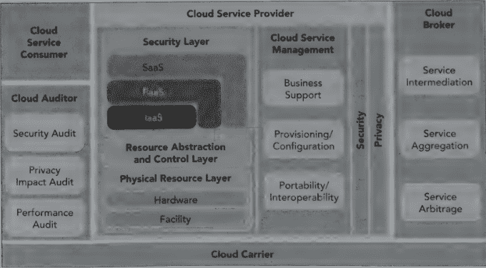

**图1.1**

NIST云参考模型

活动（例如云使用、开发、部署）与审计、管理以及服务部署、资源分配和物理/虚拟安全等功能之间的关系。

NIST 模型还定义了云计算解决方案中各参与方应具备的专业知识范围和责任边界。值得注意的是，消费者、审计方、提供商、运营商和代理商的角色并非适用于所有云计算采用框架；然而，在探索新的 IT 系统时，这些角色仍是值得考虑的。例如，在许多情况下，图书馆（即云消费者）直接与云提供商交互，而不是通过云代理商进行。在这种情况下，处理服务层、安全性、隐私性和服务级别协议（`SLA`）的流程以及对其进行审计的责任落在了云消费者身上。NIST 模型还提供了云特性分类法（Fang 等，2011），描述了云消费者在选择和实施云解决方案时应注意的问题。该分类法定义了活动（例如服务创建、发布、审计）、组件（例如流程、操作、任务）和子组件（例如服务提供、服务退役），这可能有助于组织理解在云计算采用中重要的关系和交互。

#### 虚拟化

与云计算相比，虚拟化被定义为“以掩盖 IT 资源的物理性质和边界的方式对 IT 资源进行抽象，使其对资源使用者不可见”（Gartner，2011）。虚拟化能够在共享硬件平台上创建多个虚拟机；增强机器之间 CPU、内存和存储分配的灵活性；并设计为可跨硬件平台移植（Smith 和 Nair，2005）。这是一个广义的定义，包括服务器、客户端、网络附加存储以及许多其他计算资源的虚拟化。常见的服务器平台包括 Xen（http://xen.org）、Citrix（http://citrix.com）和 VMware（http://vmware.com）。每个虚拟化平台历来都支持自己的虚拟化格式（例如内核虚拟机、裸机、VMware VMDK），但也有人倡导支持开放虚拟化标准，以实现虚拟化平台之间的轻松互操作。这些解决方案对图书馆来说可能是有价值的工具，但它们通常需要图书馆通常不具备的技术基础设施和专业知识。

### 图书馆中的云计算与虚拟化

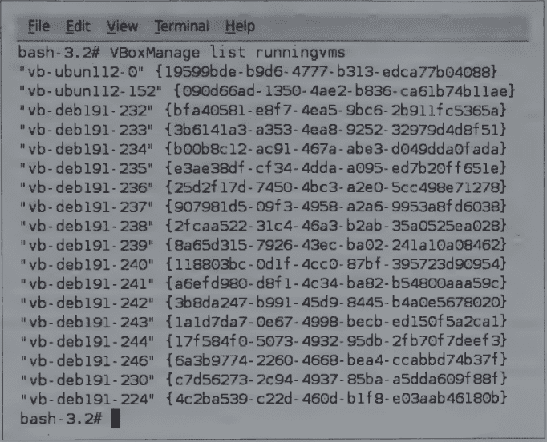

上级组织而非图书馆。这可能意味着重要的 IT 决策是在组织层面而非部门层面做出的，包括服务器硬件、操作系统和软件栈的选择——所有这些都会影响组织其他领域的软件选择。这种情况有可能限制图书馆在探索新系统时可以采用的 IT 解决方案，并且在图书馆采用新的数字服务时可能令人沮丧。

与此同时，图书馆正在采用包含大规模数据管理组件的系统，并转向更广泛的信息服务提供商。电子资源管理系统和推荐服务等系统是在新的数据即服务（DaaS）解决方案中实施的数据丰富服务的关键示例。对于 Breeding 来说，这种向扩展服务和新 ILS 发展的趋势“回应了图书馆在过去十年左右经历的向更多电子和数字内容参与的根本性变化”（2011a）。

### 影响服务选择的因素

IT 实施实践从传统的内部解决方案转向基于云的、托管的或外包的解决方案，这意味着图书馆在做出 IT 选择时必须考虑新的问题。幸运的是，图书馆在向基于数字订阅的研究工具和电子期刊迁移的过程中，积累了许多经验，涉及合同谈判、在线服务评估、数据访问和保存、订阅定价模型以及基于网络的认证实践（Zambare 等，2009）。这在图书馆电子内容许可的情况下尤其如此，这些许可通常包含对服务技术要素的保证。例如，加州数字图书馆许可的标准许可条款的关键方面包括服务器可用性和性能标准、认证和授权实践、机密性和隐私政策、客户支持条款以及数据访问标准（Lavery，2010）。云计算和托管许可中的类似条款包括 SLA；安全和访问条款；数据完整性保证；数据导出和迁移支持；以及机密性、隐私和法律赔偿政策（Zhou 等，2010）。

尽管寻求实施这些新的数据丰富且以网络为中心的服务，图书馆可以通过在传统内部 IT 解决方案之外寻找托管和平台支持而受益，但它们常常发现自己是在用一种复杂性换另一种复杂性。评估基于云的服务提供商时需要考虑的新因素包括安全性、机密性和隐私性、法律责任以及组织稳定性。表 1.2 列出了这些类别中的每一个以及与之相关的常见问题。

**表 1.2 云计算评估**

| 评估类别 | 具体问题 |
|---|---|
| 技术 | 平台适用性、控制、服务稳定性、所需专业知识、与组织目标的一致性 |
| 安全 | 是否符合认证和授权标准、适当的防火墙规定、与本地授权和认证实践的一致性（SAS 70、ISO/IEC 27001） |
| 隐私 | 是否符合地方、州和联邦法规；系统结构/拓扑对隐私问题的影响（HIPAA、FERPA、爱国者法案） |
| 法律 | 法律责任领域、数据所有权条款、数据访问条款 |
| 组织稳定性 | 组织稳定性风险、组织失败时处理服务的结构 |

重要的是要认识到，这些技术仍处于早期阶段，更多由“最佳实践”方法而非公认标准来定义。除了 NIST 之外，包括云安全联盟（https://cloudsecurityalliance.org）、开放网格论坛（www.ogf.org）、开放云计算接口（OCCI；http://occi-wg.org）以及结构化信息标准促进组织（www.oasis-open.org）在内的组织正在努力将这些最佳实践方法转化为行业标准。目前，图书馆很可能需要在理解专有和非标准实践对迁移到云解决方案的影响的基础上做出选择。尽管图书馆历来与专有系统打交道，但虚拟化和云服务通常伴随的快速部署和迁移意味着，确保数据和服务的可移植性以及数据备份和恢复的标准和实践的遵守，是需要纳入云和虚拟化采用讨论的考虑因素。

### 基于云或虚拟化信息服务的类型

云计算可以按服务类型（例如 SaaS、PaaS、IaaS、DaaS）分组，使用特定功能（例如订阅、计量、可扩展）描述，并用于不同的部署模型（例如公有云、私有云、社区云、混合云）。正如我们对这些关系的初步探索所示，从功能角度比较 IT 系统可能很困难，更不用说理解选择 IT 平台以及系统的含义了。此外，转向外包和托管解决方案的图书馆需要准备好评估这些服务的技术基础。因此，牢固理解这些云平台的基本功能对于做出明智决策至关重要。

图书馆支持广泛的信息系统，包括 ILS、链接解析器、数字资产管理系统（DAMS）、网站、研究指南、内部网和档案信息系统。云计算对大多数图书馆和图书馆服务都很适用，但平台、部署环境和采用目标的适当平衡自然会引导图书馆走向不同的解决方案。理解虚拟化和云服务如何支持功能性 IT 需求（如保真网络存储、开发和生产力计算平台以及采集和数据管理需求）可能很困难。例如，档案的选取和实施以及

数字保存系统需要考虑数字对象保存功能、网络带宽以及长期平台可行性。在选择平台和提供商时，图书馆必须意识到不同解决方案所带来的责任平衡，并为未来迁移到新系统做好准备。在转向云提供商时，图书馆还必须专注于创建高效且经济的云基础设施。例如，在高度外包或 SaaS 环境中，图书馆可能会发现无法避免重复资源或过度购买容量（例如，在多个平台上支付额外的磁盘空间费用，或为多个网络服务前端系统支付支持费用）。在接下来的章节中，我们将探讨这些问题，并具体了解图书馆如何既能从云计算采用的优势中受益，又能减轻其带来的风险。

## 参考文献

- Baev, Simon, Casey Weaver, and Cody Weaver. 2011. “Cost-Efficient Desktop Virtualization Experience at Georgia Southwestern State University.” Journal of Computing Sciences in Colleges 27 (no. 2): 188–195. http://dl.acm.org/citation.cfm?id=2038836.2038863.

- Behrend, Tara S., Eric N. Wiebe, Jennifer E. London, and Emily C. Johnson. 2011. “Cloud Computing Adoption and Usage in Community Colleges.” Behaviour and Information Technology 30 (no. 2): 231–240. doi:10.1080/0144929X.2010.489118.

- Bertot, John C., Kathryn Sigler, Elizabeth DeCoster, Abigail McDermott, Sarah Katz, Lesley A. Langa, and Justin M. Grimes. 2011. “Public Library Funding and Technology Access Survey: Executive Summary.” Public Libraries and the Internet. www.plinternetsurvey.org/sites/default/files/publications/2011_plftasexecsummary.pdf.

- Blowers, Helene. 2010. “From Realities to Values.” Computers in Libraries 30 (no. 4): 6–10. www.infotoday.com/cilmag/may10/Blowers.shtml.

- Breeding, Marshall. 2011a. “A Cloudy Forecast for Libraries.” Computers in Libraries 31 (no. 7): 32–34. www.infotoday.com/cilmag/sep11/Breeding.shtml.

- ———. 2011b. “Library Discovery Services: From the Ground to the Cloud.” In Getting Started with Cloud Computing, ed. Edward M. Corrado and Heather Lee Moulaison, 71–86. New York: Neal-Schuman.

- Fang Liu, Jin Tong, Jian Mao, Robert Bohn, John Messina, Lee Badger, and Dawn Lea. 2011. NIST Cloud Computing Reference Architecture, 28. National Institute of Standards and Technology: Washington, DC. www.nist.gov/customcf/get_pdf.cfm?pub_id=909505.

- Fitzpatrick, Sean. 2010. “Early Adopters Climb onto OCLC’s Web-Scale Management Cloud.” American Libraries 41 (no. 9): 15.

- Gartner. 2011. “Virtualization.” Gartner IT Glossary. Gartner Group. www.gartner.com/technology/it-glossary/virtualization.jsp.

- Hogan, Michael, Fang Liu, Annie Sokol, and Jin Tong. 2011. NIST Cloud Computing Standards Roadmap, 76. National Institute of Standards and Technology: Washington, DC. www.nist.gov/customcf/get_pdf.cfm?pub_id=909024.

- Howe, Bill, Garret Cole, Emad Souroush, Paraschos Koutris, Alicia Key, Nodira Khoussainova, and Leilani Battle. 2011. “Database-as-a-Service for Long-Tail Science.” Proceedings of the 23rd International Conference on Scientific and Statistical Database Management, 480–89. Springer-Verlag: Berlin, Heidelberg. http://dl.acm.org/citation.cfm?id=2032397.2032436.

- Hussain, Mohammed, and Hanady Abdulsalam. 2011. “SECaaS: Security as a Service for Cloud-Based Applications.” Proceedings of the Second Kuwait Conference on e-Services and e-Systems, 8:1–8:4. ACM: New York. doi:10.1145/2107556.2107564.

- Kimpton, Michele, and Stu Baker. 2011. “DuraCloud: Preserving the Scholarly Record.” Educause National Conference, Philadelphia. http://docs.duraspace.org/documents/DuraCloudEducauseOct2011.pdf.

- Krüger, Lars, and Bastian Grabski. 2009. “Using User Context for Accessing IT Resources.” Proceedings of the First International Workshop on Context-Aware Software Technology and Applications, 33–36. Association for Computing Machinery: New York. doi:10.1145/1595768.1595781.

- Lavery, Curtis. 2010. “CDL License Agreement Checklist.” California Digital Library, University of California, last modified January 26, 2010. www.cdlib.org/gateways/vendors/checklist.html.

- Marko, Kurt. 2012. “Fundamentals: Understanding Private Cloud Stacks.” Information Week Reports, February 2012. http://reports.informationweek.com/abstract/5/8682/cloud-computing/fundamentals-understanding-private-cloud-stacks.html.

- Mell, Peter, and Timothy Grance. 2011. The NIST Definition of Cloud Computing. National Institute of Standards and Technology: Washington DC. http://csrc.nist.gov/publications/nistpubs/800-145/SP800-145.pdf.

- Metz, Rosalind. 2011. “Understanding the Cloud: An Introduction to the Cloud.” In Getting Started with Cloud Computing, ed. Edward M. Corrado and Heather Lee Moulaison, 13–27. New York: Neal-Schuman.

- Miller, Fred. 2009. “Rationalizing IT Rationing: 10 Ways to Cut the IT Budget (and What Not to Cut).” EDUCAUSE Quarterly 32 (no. 2).

- Oracle. 2012. “Remote Virtual Machines.” In Oracle VM VirtualBox User Manual. www.virtualbox.org/manual/ch07.html.

- Purdy, Kevin. 2010. “How to Seamlessly Run That One Windows App You Need on a Mac.” Lifehacker, last modified April 27, 2010. http://lifehacker.com/5521308/how-to-seamlessly-run-that-one-windows-app-you-need-on-a-mac.

- Schrier, Robert A. 2011. “Digital Librarianship Social Media: The Digital Library as Conversation Facilitator.” D-Lib Magazine 17 (no. 7/8): 1–8. doi:10.1045/july2011-schrier.

- Shaffer, Henry E., Samuel F. Averitt, Marc I. Holt, Aaron Peeler, Eric D. Sills, and Mladen A. Vouk. 2009. “NCSU’s Virtual Computing Lab: A Cloud Computing Solution.” Computer 42 (no. 7): 94–97. doi:10.1109/MC.2009.230.

- Smith, David M. 2010. “Hype Cycle for Cloud Computing, 2010.” Gartner. www.gartner.com/DisplayDocument?doc_cd=201557.

- Smith, James E., and Ravi Nair. 2005. “The Architecture of Virtual Machines.” Computer 38 (no. 5): 32–38. doi:10.1109/MC.2005.173.

- Thomas, Stan J., and Paul M. Whitener. 2010. “In the Zone: Virtual Computing on a Budget.” Proceedings of the 41st ACM Technical Symposium on Computer Science Education, 366–70. http://portal.acm.org/citation.cfm?id=1734388.

- Wong, Danny. 2008. “Kickin’ It Old School! Dealing with Legacy Applications.” Proceedings of the 36th Annual ACM SIGUCCS Fall Conference: Moving Mountains, Blazing Trails, New York, 55–58. doi:10.1145/1449956.1449975.

- Zambare, Aparna, Anne Marie Casey, John Fierst, David Ginsburg, Judith O’Dell, and Timothy Peters. 2009. “Assuring Access: One Library’s Journey from Print to Electronic Only Subscriptions.” Serials Review 35 (no. 2): 70–74. doi:10.1016/j.serrev.2009.03.002.

- Zhou, Minqi, Rong Zhang, Wei Xie, Weining Qian, and Aoying Zhou. 2010. “Security and Privacy in Cloud Computing: A Survey.” Sixth International Conference on Semantics Knowledge and Grids, Beijing, 105–12. doi:10.1109/SKG.2010.19.

## 云计算和虚拟化采用的格局

由于采购、馆藏建设、信息管理以及公众服务期望的快速变化，图书馆在 IT 采用方面正处于十字路口（Attis et al. 2012）。这些变化伴随着对元数据标准、权威控制和信息管理系统方法的变化（Seikel and Steele 2011）。IT 环境的转变包括为不同服务（例如，数字参考、资源管理、数字图书馆）提供系统的激增，以及虚拟化、托管或基于云的新供应商和开源社区服务的出现（Breeding 2011）。特别是，LIS 供应商正在重新定义其服务，以利用云计算在“下一代”LIS 系统中。除了供应商驱动的将 ILS 迁移到云之外，图书馆还转向云计算以解决更广泛的信息系统需求。

图书馆采用云计算的研究很大程度上集中在特定用途或平台上。例如，Malpas（2011）探讨了云计算在大型数字文本集合中的作用，而 Schonfeld 和 Housewright（2010）探讨了“网络规模”学习和资源使用对学术教学和研究的影响。两项研究均发现学术图书馆及其用户对基于网络的技术和可通过互联网访问的数字文本集合的依赖日益增加。一些研究集中在如何将云计算纳入 IT 规划（Reeves 2010），学术机构越来越多地将虚拟化技术纳入战略计划（Furman University 2011）。除了组织为中心的

其他研究发现，包括学术环境中的学生和普通公众在内的图书馆用户越来越多地采用基于云的、社会化的和移动的信息技术（Anderson and Rainie 2010; Smith 2010）。这些研究强调了在云计算采用方面感知价值、组织影响和环境影响相关的问题。与此同时，它们也强调了该过程相关的诸多挑战，包括技术、法律、运营和财务压力。

尽管已有多个图书馆 IT 采用调查，包括 Breeding 对图书馆自动化系统的研究（`www.librarytechnology.org`），但很少有研究考察图书馆 IT 服务范围内虚拟化和云计算的采用。基于 2011 年进行的一项调查，本章旨在填补这一空白并识别影响云采用的因素。

### SURVEY FRAMEWORK

了解促进和阻碍 IT 变化的因素可以成为变革管理的重要要素，并有助于探索工具及其与您图书馆的契合度。有几种方法可以讨论这个问题，但有两个模型特别有助于组织对技术采用的理解：“技术接受模型”（TAM；Davis 1989）和“技术、组织和环境模型”（TOE；Tornatzky et al. 1990）。这些模型为理解技术与其被个人或组织使用之间的关系提供了框架。技术采用研究中经常使用的另一个模型是“创新扩散理论”（Rogers 2003），它通过考察包括优势、与其他系统的兼容性以及系统复杂性等因素来探索技术采用，并侧重于限定采用模式。相比之下，TOE 和 TAM 模型探讨了影响技术采用的因素，并更直接地涉及图书馆 IT 决策中的关键组织决策类型。

这些模型对理解技术采用采取了略有不同的方式。TAM 模型探讨了技术感知有用性和易用性之间的自然张力。与 TAM 的基于感知的模型不同，TOE 模型考察了影响技术采用的各种情境（例如组织和环境）。这两种视角有助于阐明影响个人和组织对技术价值评估的因素（例如易用性、感知价值、社会情境、组织价值观）。具体而言，TAM 模型为理解技术采用周围的个人、社会和技术情境提供了结构。相比之下，TOE 模型为理解组织、技术和组织外部因素的相互作用提供了框架。

先前的研究也使用这些模型来探索教育和技术环境中的云采用。例如，TAM 模型已被用于考察影响社区学院系统云计算采用的因素（Behrend et al. 2011），而 TOE 模型已被用于探索影响不同情境下技术采用的组织因素（Daylami et al. 2005）。纳入这两种模型有助于以参与者对云计算的感知为框架来界定研究，并将他们对云计算的使用置于组织内部。调查响应的分析寻找了每个模型的要素，包括对易用性/价值的个人看法（即 TAM）和对环境、组织和技术因素的个人看法（即 TOE）与四种计算平台的关系。图 2.1 显示了本次调查中使用的编码框架。

|  | Non-virtualized | Internal/private cloud virtualized | Public/community cloud virtualized | Outsourced |
|---|---|---|---|---|
| Personal views (e.g., perceived value, ease of use) |  |  |  |  |
| Environmental influence (e.g., industry support, professional standards, community needs) |  |  |  |  |
| Organizational influence (e.g., privacy, legal, financial perspective, staff expertise, service focus) |  |  |  |  |
| Technical influence (e.g., technical capacity to address service need, technical fit with organizational goals) |  |  |  |  |

FIGURE 2.1

Framework of factors influencing cloud computing adoption

图 2.1 包括使用 NIST 模型创建的四类虚拟化/云计算。这些四种模型（非虚拟化、内部非云或私有云虚拟化、公共或社区云虚拟化以及外包）代表了部署情境（例如公共、社区、私有）和服务模型（SaaS、PaaS、IaaS）的混合，并被选中是因为它们在图书馆 IT 环境中有常见的现实世界示例。

本研究框架的一个挑战是找到一种适合对大量参与者有意义的云平台分类方法。尽管研究重点是图书馆 IT 人员，但调查的人群包括技术性和非技术性馆员的混合。为了控制这种差异，类别在技术性和非技术性馆员中进行了非正式测试并进行了改进，以尽可能易于理解。在本研究框架中，非虚拟化是指在组织内部专用硬件上运行的传统图书馆 IT 系统。相比之下，内部虚拟化或私有云是指在组织内部运行但使用特定形式虚拟化的 IT 系统。重要的是区分在单个硬件堆栈上虚拟化多台机器（虚拟化）与将“服务器、存储和网络资源统一为通用资源池”的新一代软件平台（Marko 2012, 4）。该研究将外部云计算采用分为两个类型，“公共/社区云”和“外包”。在与馆员的类别测试中，外包一词虽然不能真正代表 SaaS 技术概念，但更能代表图书馆采用的 SaaS 解决方案形式，并且是非技术馆员中普遍理解的概念。表 2.1 提供了每个平台的详细解释。尽管混淆服务

### TABLE 2.1

### Cloud Computing/Virtualization Adoption Platforms

| Implementation type | Type of system |
|---|---|
| Virtualized using in-house systems | PaaS or IaaS in a private cloud environment |
| Virtualized using cloud resources run by library IT | PaaS or IaaS in a public or community cloud environment |
| Outsourced to external providers | Outsourced solutions described primarily as SaaS cloud solutions |
| Run in-house (not virtualized) | IT system run on dedicated hardware in a nonvirtualized configuration |
| Not supported at my library |  |

# The Landscape of Cloud Computing and Virtualization Adoption

三个研究问题考察了图书馆中云计算和虚拟化技术的采用，并探讨了 IT 馆员在评估这些技术及其在图书馆中的使用时考虑的因素：

- 图书馆中云计算和虚拟化技术采用的现状和格局如何？图书馆使用基于云和虚拟的平台提供哪些服务？图书馆中使用了哪些类型的基于云和虚拟的平台？
- 馆员在云计算采用方面识别了哪些促进和阻碍因素？
- 什么行动会增强图书馆中云计算的采用？这些行动如何设计或实施？

### METHODS

该研究使用在线调查平台设计并管理（请参阅 `www.alaeditions.org/webextras` 获取完整调查）。参与者来自一系列图书馆 IT 讨论板，包括 `Code4Lib`、`Lita-L`、`SYSLIB-L` 和 `WEB4LIB`。参与图书馆的总数为 111。参与者回答了一系列问题，包括图书馆规模和重点的人口统计信息、关于信息服务实施的问题（例如 ILS 和 OpenURL 解析器），以及关于云计算采用的动机/担忧。调查数据使用图 2.1 中介绍的框架进行分析，以发现常见主题。

混合方法在本研究中很有价值，因为它提供了图书馆中云计算和虚拟化技术采用现状的基线描述性数据，以及围绕馆员在技术采用决策中主观动机和促进/阻碍因素的高层次数据。调查包括图书馆使用云平台提供的服务类型的定量数据，以及与图书馆 IT 决策相关的促进和阻碍因素的定性数据。参与者被要求对图书馆对云和虚拟化技术的使用进行分类，并反思技术问题、经济因素和组织因素启用或抑制云采用。总共评估了十四类图书馆系统：

- 1. 数字资产管理系统（DAMS，例如 DSpace、Fedora、CONTENTdm）
- 2. 发现服务（例如 Summon、Primo、Encore）
- 3. 电子资源管理系统
- 4. 电子保留系统
- 5. 馆际互借系统
- 6. 综合图书馆系统（ILS）
- 7. 图书馆读者客户端计算机
- 8. 图书馆工作人员客户端计算机
- 9. 图书馆服务器
- 10. 图书馆网站
- 11. OPAC/发现层（书籍、媒体、连续出版物）
- 12. OpenURL 解析器
- 13. 研究指南
- 14. 员工内网

参与者还可选择包含额外的系统类别。基于他们对各类系统整体虚拟化类别之一的选择，参与者被要求对影响其选择的促进和抑制因素发表评论。参与者并非被具体询问系统，而是被一般性询问（例如，“您表示某些服务运行在内部虚拟化环境中…”）。

### 结果

总共，调查收到了 111 份回复。调查中的所有问题均为可选，因此每个问题的回复总数可能不同。调查数据被分为三个主要领域：人口统计信息、云计算采用的定量结果以及云计算采用的定性结果。

调查数据在受图 2.1 所示框架指导的情况下进行编码，但可根据参与者产生的主题进行增补和解释。编码重点在于识别影响云计算和虚拟化技术采用的主题和构念。代码经过细化并有助于开发一个扩展框架，重点探索考虑新 IT 服务时重要的因素和构念。定量数据被分析以提供云计算采用的描述性统计以及机构类型和规模、服务类型（例如数字图书馆、参考服务）与采用的技术平台（例如云、虚拟化、传统）之间关系的推断统计。

### 人口统计

回复调查的图书馆大多数为学术图书馆（n=57）。其他图书馆包括公共图书馆（n=13）和法律或医学图书馆（n=7）。值得注意的是，六名参与者代表图书馆的联合体 IT 支持，且有图书馆服务于多个群体，包括学术/公共（n=2）和学术/医学（n=1）。非学术图书馆回复数量较少限制了这些发现的普遍性。事实上，人口统计显示研究人群以中型学术机构为主，所提出的组织和环境问题应在该背景下考虑。

大多数受访者还表示其图书馆的 IT 支持人员环境相对较小，为一至三人（n=47）。图书馆工作人员整体规模分布较为均衡，略偏向小型和中型图书馆（40 人或以下占 29.9%）对比大型（41–119 人占 14.9%）和超大型（120 人或以上占 19.4%）。读者群体规模各异，超过 32% 的受访者服务 15,000 名或以上读者，22.4% 的图书馆服务 3,000 至 15,000 名读者。分支机构规模也各不相同，27%（n=37）的受访者支持单一图书馆分支，21%（n=29）支持两至五个分支。支持更大分支组织的参与者数量要少得多（6–20 个分支，n=13；21–30 个分支，n=4；31 个或以上，n=8）。

### 图书馆 IT 服务云服务采用现状

调查发现每个系统的采用率和采用平台各不相同。在某些情况下（例如 ILS），采用趋势倾向于非虚拟化解决方案；在其他情况下（例如研究指南），内部和外部虚拟化/云解决方案占主导。表 2.2 显示了每个平台/系统的各种采用率。表 2.3 和 2.4 按采用频率将系统按平台分组。表 2.3 显示了 20% 或以上参与者使用的服务/平台分组。

表 2.4 显示了 10–19% 的参与者使用的服务/平台分组。服务在多个表中列出（例如网站），如果其采用率在多个类别中达到与该表相关的范围。

这些采用水平表明受访图书馆存在一些共同趋势。例如，像 ILS 和图书馆 OPAC 这样较旧的系统往往既被广泛采用又仅在非虚拟化环境中运行。同样，客户端计算往往是非虚拟化的（例如公共客户端计算机和工作人员客户端计算机），但客户端和工作人员解决方案均存在桌面虚拟化的实例。相比之下，更近期开发的系统（例如发现服务）和以数据为中心的系统（例如 OpenURL 解析器）往往使用内部或外部云系统虚拟化或完全外包。例如，表 2.2 显示 24% 的受访者将发现服务作为外包服务运行，另外 11% 使用某种形式的虚拟化或云平台运行该服务，3% 表示这些服务作为非虚拟化服务运行。尽管多个系统围绕非虚拟化和外包解决方案分组，但值得注意的是，唯一显示出大量本地或云端（但非外包）虚拟化解决方案的服务是图书馆网站（31%）。

正如表 2.3 所示，一些系统适合多个实施平台。例如，OPAC 和图书馆网站系统均属于内部虚拟化和非虚拟化平台。有趣的是，这一数据视图显示系统分组在非虚拟化或外包解决方案之下。采用中的这一差距指向云采用向外包解决方案发展的有趣趋势。表 2.4 显示较少图书馆使用内部和外部虚拟/云系统，支持这一趋势并表明图书馆采用内部虚拟化和外部 PaaS/IaaS 云解决方案的频率低于非虚拟化或 SaaS 解决方案。对外部虚拟化（例如 PaaS 或 IaaS）服务使用的缺乏引发了关于影响图书馆技术平台采用的因素的问题，这可能对未来几年新图书馆系统（特别是开源解决方案）的开发产生相当大的影响。

数据中的第二个趋势是数据密集型和新类型系统在外包类别中占主导，而传统系统（例如 ILS）仍保持非虚拟化。参与者关于在非虚拟化环境中实施系统的动机回复表明，图书馆正将这些系统转向基于云的解决方案，但仍在考虑选项或尚未找到满足其所有需求的云解决方案。ILS 是这种类型的最具代表性的系统，在三个虚拟化类别中的实施水平相对较低，14% 的图书馆报告在虚拟化平台上使用 ILS，10% 使用某种形式的外部云提供商，略高于 16% 使用外包或 SaaS 解决方案。尽管单个方法显示的百分比相对较低，但值得注意的是，超过 40% 的图书馆已转向某种内部或外部虚拟化解决方案。这一趋势在大多数系统中均可见。当分组为虚拟化和非虚拟化解决方案时，除客户端计算外，虚拟化使用水平相对较高较为常见。这一趋势还包括服务器虚拟化，41% 的图书馆使用内部虚拟化资源。

### 对云计算和虚拟化的认知

除了探索云计算采用格局外，调查还探讨了参与者对云计算和虚拟化潜在影响的看法。参与者被要求对关于云计算和虚拟化的两个陈述表示同意与否：“云计算/虚拟化是管理层的当前优先事项”，以及“云计算/虚拟化有潜力在短期内改变图书馆 IT”。图 2.2 至 2.5 显示了参与者对这些问题的回复。

这些问题的数据显示出对云计算和虚拟化影响的总体积极看法。同样，调查参与者普遍认为云计算和虚拟化是管理层的优先事项。参与者对云计算和虚拟化优先级的看法存在一定差异，表明参与者对云计算和虚拟化持乐观态度，但对后者更为积极。

### 云计算和虚拟化的促进与抑制因素

调查还收集了与云计算和虚拟化资源使用相关的定性数据促进和抑制因素的定性数据。对于每个定性回复系列，代码从回复中生成，然后映射到调查分析框架。陈述被编码为 TAM 领域（价值和易用性），当参与者陈述一种感知（例如非虚拟化更容易）而不是一种情况（例如当前 IT 政策抑制云迁移）时。

请对以下陈述的认同程度进行评分：云计算目前是图书馆管理的重要举措

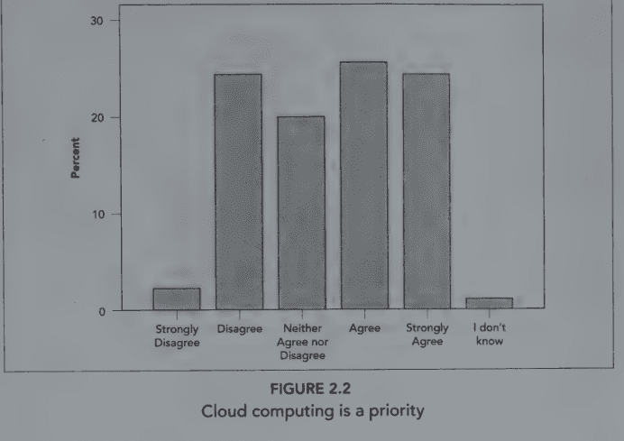

**图 2.2** 云计算是优先事项

请对以下陈述的认同程度进行评分：虚拟化目前是图书馆管理的重要举措

**图 2.3** 虚拟化是优先事项

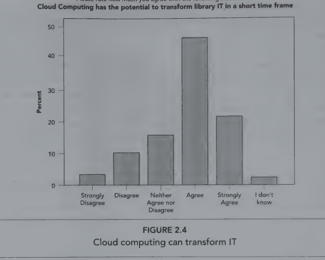

**图 2.4** 云计算可以改变 IT

**图 2.5** 虚拟化可以改变 IT

**表 2.5** 定性采纳主题及频次

| 代码 | % 出现率 |
|---|---:|
| 成本效益分析 | 19.16 |
| 技术支持 IT 服务生产力、效率、灵活性、可扩展性 | 19.16 |
| 遗留系统阻碍采纳 | 6.59 |
| 遵守供应商规范 | 5.39 |
| 图书馆正处于 IT 投资周期中 | 4.19 |
| 技术使无法在本地运行的服务成为可能（IT 能力） | 3.59 |
| 技术针对专门用途进行调优 | 3.59 |
| 技术由组织 IT 强制要求 | 3.59 |
| 当前 IT 政策、政治阻碍云迁移 | 2.99 |
| 有限的 IT 资源阻碍迁移 | 2.99 |
| 平台支持更高质量的 IT 服务支持（例如 SLA）和评估 | 2.99 |
| 对平台相关责任的担忧（法律、隐私、安全） | 2.40 |
| 缺乏知识/专业知识 | 2.40 |
| 技术使父级 IT 组织不支持的服务成为可能 | 2.40 |
| 采用的技术适合服务 | 1.80 |
| 技术使容量和故障排除的探索成为可能 | 1.80 |
| 技术促进与组织 IT 的协作 | 1.80 |
| 缺乏云或虚拟化基础设施 | 1.20 |
| 基于市场状况的衡量采纳 | 1.20 |
| 无本地虚拟化支持 | 1.20 |
| 云的处理限制 | 1.20 |
| 安全基础设施阻碍虚拟化或云采纳 | 1.20 |
| 系统备份要求阻碍云迁移 | 1.20 |
| 技术采纳是社区参与的必要条件 | 1.20 |
| 技术阻碍定制化 | 1.20 |
| 云的带宽限制 | 0.60 |
| 业务连续性 | 0.60 |
| 平台更易于使用 | 0.60 |
| 与供应商的 SaaS 锁定不好但更易于管理 | 0.60 |
| 技术是通往其他服务的桥梁 | 0.60 |
| 技术不需要 | 0.60 |

**表 2.6** 使用 TOE 模型分组的定性主题

| TOE 元素 | 示例代码 |
|---|---|
| 环境影响 | 遵守供应商规范 缺乏云或虚拟化基础设施 基于市场状况的衡量采纳 与供应商的 SaaS 锁定不好但更易于管理 技术采纳是社区参与的必要条件 |
| 组织影响 | 业务连续性 对平台相关责任的担忧 成本效益分析 当前 IT 政策、政治阻碍云迁移 缺乏知识/专业知识 图书馆正处于 IT 投资周期中 有限的 IT 资源阻碍迁移 无本地虚拟化支持 平台支持更高质量的 IT 服务 技术使父级 IT 组织不支持的服务成为可能 技术使无法在本地运行的服务成为可能 技术促进与组织 IT 的协作 技术不需要 技术由组织 IT 强制要求 |
| 技术影响 | 云的带宽限制 遗留系统阻碍采纳 平台更易于使用 云的处理限制 安全基础设施阻碍虚拟化或云采纳 采用的技术适合服务 技术使容量和故障排除的探索成为可能 技术阻碍定制化 技术是通往其他服务的桥梁 技术针对专门用途进行调优 技术支持 IT 服务生产力、效率、灵活性、可扩展性 |

平台类型之间的正面和负面表明，图书馆在进行 IT 服务选择时高度关注成本。图书馆利用这些平台与组织 IT 建立联系或与其保持距离的方式也存在差异。这些问题似乎与平台本身的利弊关系不大，而更多地与这些组织的内部运营有关。

### 图书馆虚拟化技术采纳评估模型

我们的数据显示，图书馆以不同的方式使用云和虚拟化平台，但总体上对这些技术的看法是积极的。虽然我们对文献的回顾发现了在转向内部或外部提供的虚拟解决方案时应考虑的广泛问题，但本研究中的参与者更关注供应商合规性、成本效益分析和云计算对效率和灵活性的积极影响，而非安全、业务连续性、隐私或责任问题。同样，图书馆高度频繁地表示对虚拟化和云平台持积极看法，但由于当前本地 IT 基础设施而表示犹豫，这表明图书馆乃至组织 IT 部门需要真正扩大其支持基于云服务的容量。云采纳的其他常见障碍包括遗留系统的存在、阻止虚拟化或云采纳的供应商要求、内部组织问题、当前技术投资以及缺乏专业知识。尽管存在这些制约因素，主要动机往往是 perceived 服务改善、对资源（成本、员工时间）效率的兴趣以及对新服务的兴趣。这些因素可能成为衡量云或虚拟化平台是否适合特定服务的良好指标，也能帮助图书馆就云选择的潜在优势或风险做出明智决策。

也许转向任何 IT 解决方案最困难的部分是理解如何权衡平台周围的正面和负面问题。一些参与者利用其定性回应来讨论决策过程或以这种方式比较问题。例如，一个图书馆认识到转向 SaaS 平台时存在供应商锁定风险，但表示服务效率超过了风险。同样，多个图书馆表示有迁移兴趣，但正在缓慢推进，以确保仅在市场验证其可行性后才采纳平台。尽管对组织和环境问题进行了一些丰富探索，但对网络化数据、开放数据或开源软件在 IT 决策中的作用讨论甚少。同样，安全和隐私问题，尽管在文献中常被视为关键关注点（Grant 2011, 47; Velte et al. 2009, 35），但并未以与技术和组织问题相同的具体程度进行讨论。这种侧重点可能确实是由于研究对象或问题的风格所致，但它提出了一个关于专业人士对虚拟化和云计算环境中法律、政策和安全问题的看法的好问题。

尽管本研究的主要目标是帮助确定一个图书馆可用于评估自身云采纳水平并考虑影响其 IT 决策的因素的模型，但值得将我们的结果与其他云计算采纳研究进行比较。例如，Aberdeen Group 于 2011 年进行的一项研究发现，在云采纳者中，68% 已转向私有云和内部虚拟化服务，50% 已转向 SaaS 解决方案（Brink 2011, 2）。与 Brink 的研究一样，本章介绍的研究也发现私有云和 SaaS 采纳率更高，而 PaaS（22%）和 IaaS（31%）采纳率要低得多。总体而言，Brink 发现云计算的整体采纳率（81%）远高于包含图书馆云计算使用评估的已发表研究。例如，《图书馆资源指南》关于图书馆资金优先事项的报告发现，2011 年图书馆的整体云计算采纳率为 7%，2012 年为 12%（McKendrick 2012）。相比之下，我们发现采纳率超过 90%。

《图书馆资源指南》调查还发现，图书馆倾向于不将 IT 作为节省开支的手段；只有 13% 的受访者表示他们将在 2011 年减少 IT 支出，2012 年为 11%。同样，该研究发现只有 1% 的图书馆计划在未来一年增加对云计算的支出（McKendrick 2012, 11, 15）。

研究结果之间的差异至少表明需要对云计算采纳率进行更正式的研究。结果也可能表明图书馆对云计算的看法与其在云计划上的资金投入之间存在差距。

我们的研究并未聚焦于馆员服务需求，但它们可能有助于解释图书馆为何转向新的 IT 平台。例如，2010 年的《公共图书馆资金与技术获取调查》报告了对一系列数字服务的兴趣扩大，包括技术培训、电子政务服务、许可电子资源和数字参考服务（Bertot et al. 2011)。Bertot 和同事还发现，上一年度图书馆 IT 服务的使用量大幅增加，包括公共工作站、Wi-Fi、电子馆藏和培训。Bertot 所证明的馆员需求与 McKendrick 讨论的资源分配之间的差距表明，图书馆可能有空间利用云计算和虚拟化平台来节省资源并改善服务。

## CONCLUSION

本调查对图书馆虚拟化、云计算和外包的采用情况进行了调查，既强调了图书馆对云计算和虚拟化的当前兴趣，也展示了采用者中流行的观点。图书馆和 IT 文献与调查参与者之间发现的差距表明，关于云计算和虚拟化的问题可能因受众不同而不同，或者随着云计算的成熟而发生变化。调查还表明，对外包图书馆 IT 的依赖日益增长，而非 PaaS 或 IaaS 方法，并表明将旧的和核心的图书馆系统（例如 ILS）迁移到这些环境中的趋势缓慢但在增长。这些调查结果不应过度泛化，但图 2.1 中代表的评估模型以及表 2.4 和 2.5 中呈现的分组主题可能有助于图书馆更详细地了解其自身的 IT 环境。

## REFERENCES

Anderson, Janna, and Lee Rainie. 2010. “The Future of Cloud Computing.” Pew Internet Trust Report, June 11, 2010. http://pewinternet.org/Reports/2010/The-future-of-cloud-computing.aspx.

Attis, David, Colin Kopros, Chris Mille, Kevin Matovich, and Hillary Tisdal. 2012. _Redefining the Academic Library: Managing the Migration to Digital Information Services._ University Library Council. www.educationadvisoryboard.com/pdf/23634-EAB-Redefining-the-Academic-Library.pdf.

Behrend, Tara S., Eric N. Wiebe, Jennifer E. London, and Emily C. Johnson. 2011. “Cloud Computing Adoption and Usage in Community Colleges.” _Behaviour and Information Technology_ 30 (no. 2): 231–40. doi:10.1080/0144929X.2010.489118.

Bertot, John C., Kathryn Sigler, Elizabeth DeCoster, Abigail McDermott, Sarah Katz, Lesley A. Langa, and Justin M. Grimes. 2011. “Public Library Funding and Technology Access Survey: Executive Summary.” _Public Libraries and the Internet._ www.plinternetsurvey.org/sites/default/files/publications/2011_plftasexecsummary.pdf.

# The Landscape of Cloud Computing and Virtualization Adoption

Breeding, Marshall. 2011. “A Cloudy Forecast for Libraries.” *Computers in Libraries* 31 (no. 7): 32–34. www.infotoday.com/cilmag/sep11/Breeding.shtml.

Brink, Derek E. 2011. “Security and Cloud: Augment, or Abdicate?” Aberdeen Group. http://resources.idgenterprise.com/original/AST-0054287_rp-abeerden-security-cloud.pdf.

Davis, Fred. D. 1989. “Perceived Usefulness, Perceived Ease of Use, and User Acceptance of Information Technology.” *MIS Quarterly* 13 (no. 3): 319–40. doi:10.2307/249008.

Daylami, Nozar, Terry Ryan, Lorne Olfman, and Conrad Shayo. 2005. “Determinants of Application Service Provider (ASP) Adoption as an Innovation.” *Proceedings of the 38th Annual Hawaii International Conference on System Sciences*. doi:10.1109/HICSS.2005.193.

Furman University. 2011. “A Strategic Plan for Furman University Information Technology.” www2.furman.edu/sites/ITS/About/Documents/IT_Strategic_Plan_final_public.pdf.

Grant, Carl. 2011. “Head in the Clouds? A Librarian/Vendor Perspective on Cloud Computing.” In *Getting Started with Cloud Computing*, ed. Edward M. Corrado and Heather Lee Moulaison, 71–86. New York: Neal-Schuman.

Malpas, Constance. 2011. “Cloud-Sourcing Research Collections: Managing Print in the Mass-Digitized Library Environment.” OCLC Research. www.oclc.org/research/publications/library/2011/2011-01.pdf.

Marko, Kurt. 2012. “Fundamentals: Understanding Private Cloud Stacks.” *Information Week Reports*, February 2012. http://reports.informationweek.com/abstract/58682/cloud-computing/fundamentals-understanding-private-cloud-stacks.html.

McKendrick, Joseph. 2012. “The Digital Squeeze: Libraries at the Crossroads—The Library Resource Guide Benchmark Study on 2012 Library Spending Plans.” Unisphere Research. www.libraryresource.com/downloads/researchreports.

Mitchell, Erik. 2011. “What Cloud Computing Means for Libraries.” In *Getting Started with Cloud Computing*, ed. Edward M. Corrado and Heather Lee Moulaison, 37–44. New York: Neal-Schuman.

Ovadia, Steven. 2010. “Navigating the Challenges of the Cloud.” *Behavioral and Social Science Librarian* 19 (no. 3): 233–36. doi:10.1080/01639269.2010.498764.

Reeves, Drue. 2010. “Managing Availability and Performance Risks in the Cloud: Expect the Unexpected.” *ECAR REPORT*, 1–33, last modified December 7, 2010. www.educause.edu/Resources/ManagingAvailabilityandPerform/219309.

Rogers, Everett. M. 2003. *Diffusion of Innovations*. New York: Simon and Schuster.

Schiller, Kurt. 2011. “Amazon EC2 Outage Highlights Risks.” *Information Today* 28 (no. 6): 10. www.infotoday.com/IT/jun11/index.shtml.

Schonfeld, Roger C., and Ross Housewright. 2010. “Faculty Survey 2009: Key Strategic Insights for Libraries, Publishers, and Societies.” Ithaka S+R. www.sr.ithaka.org/research-publications/faculty-survey-2009.

Seikel, Michele, and Thomas Steele. 2011. “How MARC Has Changed: The History of the Format and Its Forthcoming Relationship to RDA.” Technical Services Quarterly 28 (no. 3): 322–34. doi:10.1080/07317131.2011.574519.

Smith, David. M. 2010. “Hype Cycle for Cloud Computing, 2010.” Gartner. www.gartner.com/DisplayDocument?doc_cd=201557.

Tornatzky, Lois. G., Mitchell Fleischer, and Alok Chakrabarti. 1990. The Processes of Technological Innovation. Lexington MA: D.C. Heath.

Velte, Anthony. T., Toby J. Velte, and Robert Elsenpeter. 2009. Cloud Computing: A Practical Approach. New York: McGraw-Hill.

## Selecting and Implementing Solutions

在本章中，我们将更详细地探讨技术、组织、法律和人员/专业知识问题，并考虑影响云服务采用的图书馆特定因素。该审查基于第 2 章调查参与者的回复、云计算文献中描述的方法（例如，Reese 2009；Rittinghouse 和 Ransome 2009），以及图书馆采用云计算和虚拟化的案例研究（Fox 2009；Han 2010；Mitchell 2010）。

我们的调查发现云计算采用率存在差异，并且在组织问题、技术/功能要求和感知收益方面存在不同的推动和制约因素。这表明图书馆的云计算可能没有“一刀切”的解决方案，而需要为每个机构找到最佳契合。虽然很难比较图书馆与其他信息组织之间云计算采用的背景，但在我们的调查和其他第 2 章报告的研究中，都明显强调了私有虚拟化或完全外包（例如 SaaS）方法。提到的共同主题将这一趋势置于背景中，包括缺乏 IT 支持或本地专业知识，以及对维持复杂 IT 系统能力的担忧。鉴于图书馆在采用新信息服务时往往面临需要区分云、虚拟化和传统 IT 方法的选择，这些担忧是重大的。Breeding（2011）的研究特别关注了 ILS 方面的这一问题。他发现不仅继续向使用 SaaS 和 PaaS 平台的云解决方案转变，而且这些系统的结构也在重新构想，包括对书目和其他数据管理的改变方法，以及对数据和服务互操作性的关注。在评估这些系统时，图书馆必须了解其决策的 IT 服务和功能影响。此外，随着图书馆采用或迁移到基于云的平台，需要考虑新的问题，如服务质量和服务水平协议（SLAs），以及对传统问题的新的看法，如供应商锁定和系统功能。

# Chapter Three

本书的一个目标是为图书管理员提供评估和比较云、虚拟化和非虚拟化 IT 环境所需的工具。通过对可用的虚拟化和云计算类型以及这些平台附带的所需支持服务有深入的了解，图书管理员能够做出更明智的系统选择。本章重点关注与技术采用相关的问题，而非系统功能，但后者也是一个非常现实的担忧。在权衡系统之间的技术差异和组织/环境因素时，考虑组织单位、IT 系统、IT 服务和终端用户信息需求之间的关系也很有价值。例如，在 IT 服务环境中，对容量（技术和组织）、风险管理和服务或终端用户目标之间的关系有相当大的关注（Addy 2007, 45）。图书馆不应假设他们对这些要素的看法，甚至其定义，与组织 IT 中的对应者完全相同。Schaffhauser（2010）观察到，图书馆使用不同于 IT 部门的衡量标准来定义服务并评估价值、影响和风险，并区分了图书馆和 IT 对“终端用户”的观点。这种差异会对图书馆 IT 产生连锁效应，并可能成为图书馆中心和组织范围 IT 部门之间不和的原因。虽然转向云或虚拟化平台可能被视为弥合这些差异的一种方式，但它也可能导致更复杂和相互依存的关系。

弥合这一差距的一种方法是让图书馆选择与 IT 部门有共同点的服务评估模型，同时也为这些差异留出空间。尽管它们可能从 IT 为中心的世界观开始，但 IT 服务模型在这一领域很有用，因为它们包括区分内部和外部客户的方法，并包含对容量和风险的考虑，同时保持对用户服务期望的关注。一个为这些讨论提供共同词汇的模型是 Addy 的“服务组成部分”模型（2007, 51），该模型使用同心圆来显示容量、控制和指标概念之间的关系，这些概念源于单一层级的关系（例如，IT 到组织单位支持）。Addy 的模型将用户要求置于

服务条款生命周期的影响。衡量这些服务的质量和影响可能比衡量成本或投资回报率更困难，但它们可能是衡量组织对信息服务价值的看法更好的指标，并且有助于指导 IT 平台采用的决策。量化服务价值时可用的衡量指标包括期望的服务正常运行时间与实际可用性的比较、服务停机时间的机会成本、绝对或相对的服务利用率指标（例如，通过日志文件分析或 Google Analytics），以及系统关系和依赖性的分析。

表 3.1 中的几个问题——例如访问级别、管理和维护、问责制、责任边界、共同管理以及共同访问——在图书馆寻求与组织或外部 IT 部门共享管理角色的情况下可能需要复杂的协议。此外，谈判针对确保面向终端用户或公众运营的支持水平而量身定制的 SLA（例如，为研究工具提供晚间和周末支持），而不是针对员工或业务运营（例如，周一至周五工作时间），对于高质量的服务部署可能是关键的。最后，值得注意的是，表 3.1 中列出的因素也需要在所分析的服务或服务组件的背景下考虑。所有 IT 服务都包括基础设施（例如，计算硬件、操作系统、网络、电力和制冷）、平台（例如，操作系统、软件堆栈、开发和部署框架）、应用（例如，履行单一或多个角色的信息系统）以及服务元素（例如，提供某种形式信息服务的端点资源，基于应用的功能）。根据所检查的 IT 系统类型，需要从表 3.1 中讨论的视角考虑其中一个或多个领域。这使得比较传统的非虚拟化环境（其中四个技术层中的每一个都可能由图书馆管理）与外包或 SaaS 应用变得困难。以下各节更详细地探讨了这些因素中的一些，可以作为正在考虑 IT 替代方案的图书馆的起点。

## 技术因素

在探索基于云和虚拟化服务时需要考虑的所有问题中，技术问题可能占据中心地位。了解图书馆采用虚拟化和云计算时所需的技术工作是重要的一步，可以帮助指导关于容量和长期可持续性的决策。

### 基础设施管理

基础设施级服务的管理由核心要素组成，包括网络、服务器和操作系统。基础设施级管理通常伴随着对信息服务的从头到尾的责任，需要能够设计和部署硬件（虚拟化或物理）基础设施、安装和配置软件、安全维护不同的 IT 组件（例如，服务器、网络、安全），并管理服务配置和部署的变更。这需要熟悉安全措施（例如，防火墙、用户访问和系统更新）和 IT 服务管理（例如，服务配置、部署、备份、故障转移和折旧），以及对系统设计对信息服务影响的细粒度理解。在云环境中，这还意味着对构成 IaaS 环境的云服务元素的更广泛熟悉（例如，服务器镜像、卷快照、安全组）。NIST 参考模型在 Fang 等人（2011）的研究中扩展了基础设施级技能要求，提出了与云计算采用相关的十个技术因素：

- 1. 在云中创建、访问、更新和删除数据对象
- 2. 在云之间移动虚拟机和虚拟设备
- 3. 为私有外部托管云选择最佳 IaaS 供应商
- 4. 用于监控和管理多个云的工具
- 5. 在云之间迁移数据
- 6. 对多个云的单点登录访问
- 7. 跨云的编排流程
- 8. 发现云资源
- 9. 评估 SLA 和罚则
- 10. 审计云

其中一些任务技术性很强，需要基础设施级专业知识。例如，创建、管理和迁移虚拟机需要了解如何分配基础设施资源并配置系统和应用程序。其他任务包括评估 SLA、发现新的云资源以及审计云服务，对所有云计算方法都很重要。鉴于这些技术因素固有的复杂性，可能有必要选择在特定环境中更重要的因素。例如，虽然馆员隐私和服务质量在图书馆中是主要问题，但在选择基于云的信息服务时，单点登录或完全互操作的云环境可能并非必要。

图书馆可能很难在内部找到管理技术基础设施的资源，但也可能发现云提供商正在降低这些系统的复杂性并降低实施和管理这些服务的成本（财务和运营）。尽管所需技能清单可能令人望而生畏，但鉴于图书馆倾向于从不同供应商或开源社区采用信息服务，管理基础设施级服务的能力对图书馆有所帮助。对于寻求在基础设施管理方面培养专业知识的图书管理员来说，熟悉本地虚拟化平台（如 Oracle 的 `VirtualBox` (`http://virtualbox.org`)）以及 IaaS 提供商提供的云虚拟化平台（例如，`Amazon`、`Rackspace` 或 `Microsoft`）是一个良好的第一步。这些技能很容易转移，因为使用 `Amazon` 平台所需的概念理解在其他提供商中得到体现（例如，对基于 CPU 时间计费、存储资源、防火墙资源、监控服务、身份验证服务的理解）。尽管具体服务取决于部署的平台或应用程序，但对基础设施级容量的理解有助于图书管理员或 IT 管理员在设计基于云或虚拟化系统时。

### 平台管理

平台支持的技术方面通常侧重于构成面向终端用户应用程序的软件组件。例如，运行在 `WordPress` 上的内容管理系统需要熟悉 `Apache`、`MySQL`、`PHP` 和 `WordPress` 插件，并且可能需要熟悉身份验证系统（例如，`LDAP`、`Shibboleth`）和安全 Web 连接（例如，`SSL`）。根据所选平台，可能需要其他技能，包括编程熟悉度、对 Web 服务架构的理解，或对服务器基础设施的更细粒度理解。

在 PaaS 云环境中，平台管理可能需要熟悉特定套件或 Web 服务配置。例如，`Google App Engine` (`http://code.google.com/appengine/`) 要求用户在其特定的框架内设计应用程序，该框架包括数据库平台、编程框架和 Web 服务部署架构。由于图书馆通常 IT 资源有限，它们可能会发现平台和应用程序管理比基础设施管理更容易接近。On 管理系统的意义在于，图书馆可能能够保留定制用户界面和应用程序功能的能力，同时也依赖 SaaS 解决方案来提供应用程序。然而，这并不总是可能的；许多提供商承诺能够定制终端用户体验，但图书馆需要就其寻求的界面修改提出具体问题。

### 安全

有一系列安全问题影响着云服务采用的舒适度，也影响着一旦选定云服务的云服务的持续性。一般来说，系统安全的目标是防止未经授权访问 IT 基础设施、管理服务和面向用户的服务。它还包括防止连接中断以及使系统免受通过开放端口、破解密码、软件漏洞以及后门和中间人攻击的入侵尝试的侵害。该领域的工作包括对传统 IT 安全措施的必要关注，包括主动监控、防火墙和应用程序控制、渗透测试以及事件管理和响应，但它也涉及与云平台特有的新的安全问题，例如虚拟专用网络、多平台监控、数据中心认证和受信任用户身份验证（Constantin 2011）。对于有兴趣了解更多安全管理的图书管理员来说，Limoncelli 等人（2001）的系统管理指南为处理 IT 安全问题提供了基础，并侧重于政策和审计在确保一致和持久系统安全中的作用。

中央政策和程序检查清单可能有助于组织进行安全监控，但在云环境中也需要关注其他领域。例如，云计算环境中添加多个平台意味着安全问题需要针对单个系统以及系统之间的连接进行评估。除了常见的身份验证、服务器隔离和数据保护安全风险领域外，云中心的风险领域还包括所选 hypervisor 平台中的安全漏洞、在通用虚拟化环境中运行的风险，以及在公共或社区网络中运行服务器的风险（例如，防火墙、访问、文件权限）。

在服务器、平台或应用程序级别，安全方法包括通过密码/安全密钥身份验证方法限制访问，通过防火墙使用内部加密来保护服务器上的数据，并使用虚拟专用网络（VPN）在IT基础设施周围创建额外的安全层级。内部IT安全政策应包括可接受的使用、监控、隐私远程访问、网络连接和日志保留政策（Limoncelli等人，2001年，第124页）。此外，实施外部虚拟化或基于云服务的组织应获取或定义策略，以确保数据完整性、保留云中资源的本地所有权，并确保整个云平台的完整性。尽管在公共或社区云环境中运行存在风险，但云虚拟化系统旨在确保虚拟机的隔离。供应商保证有助于减轻对公共或社区云平台的感知风险，并且是制定本地安全策略的良好基础。例如，亚马逊已获得认证和认可，证明其提供安全云服务的能力（`http://aws.amazon.com/security/#certifications`）。以这些认证作为评估基础设施安全性的基准，可以帮助组织识别合适的云候选方案。此外，深入了解这些安全策略的细节可以帮助组织将工作重点放在其他易受攻击的领域。本章的法律和政策部分将更详细地讨论提供商级别的安全和保证。

云计算平台可能带来的一个复杂性是，需要在每个采用的平台或供应商中复制安全措施。因此，对于已采取的措施及其实施方式（例如，用户账户的创建、管理和审计方式）制定明确且一致的政策，有助于简化新计算环境的采用。这不一定意味着安全责任的集中化，而是整个组织需要充分了解云环境中所需的实际风险和管理实践。例如，在SaaS环境中，将这些任务委托给中级管理用户而不是通过IT部门处理可能是合理的。相比之下，在IaaS环境中正确管理用户账户所需的访问权限和专业知识水平可能意味着这些任务需要由熟悉流程和相关风险的人员来管理。然而，在这两种情况下，创建分层安全策略有助于将访问权限扩展到适当的级别，同时防止妥协。例如，在`Amazon EC2`环境中，安全组用作云环境级别的防火墙，允许将服务器分组到访问组中。这种安全级别是在服务器级防火墙选项之外提供的，并允许采用分布式安全管理策略，在这种策略中，中级管理员对服务器资源拥有更高级别的访问权限，因为他们不太可能从组织虚拟服务器基础设施的外部使系统易受攻击。

NIST云计算模型强调了确保云安全所需执行的几项重要任务。这些包括上面提到的要素（例如，管理访问、通过防火墙减轻常见IT使用相关的风险、检测入侵），以及设计利用云功能来增强而不是削弱安全性的应用程序。还有客户端要素，如Web浏览器安全性和客户端/服务器安全证书的使用，如果实施得当，可以确保更高级别的客户端/服务器安全性（Fang等人，2011年，第39页）。最后一个关键领域，尤其是在集成IaaS和PaaS环境时，是身份验证密钥和账户的共享。特别是`RightScale`，依赖于通过与IaaS云平台使用管理账户和访问密钥建立可信关系。值得注意的是，一旦建立了这些信任关系，`RightScale`服务中的用户就能够在非常细粒度的级别上控制那些其他环境中运行的服务。同样，许多`Amazon`应用程序编程接口（API）服务依赖于预共享密钥。如果这些密钥保存在客户端机器上，则该机器的任何用户都可以直接访问`Amazon` IaaS元素。云提供商开始提供使用身份管理工具对资源访问进行分区管理的方法，这些工具允许系统管理员监控哪些用户访问基础设施级资源，并根据登录或密钥凭据限制访问。

## 图书馆特定IT支持

确定实施和管理云资源的本地能力，基于对人员技能、时间可用性、技术需求和财务资源的理解。这些因素需要与预计的服务成本和影响进行比较，以了解特定服务或云平台的重要性。正如我们对基础设施、应用程序和平台管理的探索所示，技术技能和能力在选择、实施和管理服务方面发挥着重要作用。同样，取决于所选的云服务，该特定系统的容量可能存在上限。正如我们在第5章对IaaS提供商的探索所示，在这些平台上实现可扩展服务的方法和成本差异很大。例如，`Netflix`将`Amazon EBS`平台中的延迟视为容量限制因素，因此重新设计了其Web服务以利用`Amazon S3`（Cockcroft等人，2011年）。尽管该示例强调了IaaS提供商根据需求进行扩展的能力，但它回避了本地专业知识、物理基础设施或灾难管理的局限性，这些局限性可能使利用这些功能变得困难。因此，熟悉IT服务管理、安全性和本地能力的要素非常重要，以便确定本地和基于云的能力并选择合适的系统。

图书馆转向云系统的一个常见原因是需要比本地可用的更强大的IT支持。在某些情况下，需求集中在特定平台上；在其他情况下，需求集中在本地IT部门无法提供的数据问题或可扩展性要求上。然而，在选择迁移到云解决方案时，图书馆需要了解必须由本地IT提供的IT服务。图书馆所需服务支持的一些示例包括网络基础设施和互联网接入、域名服务（DNS）解析、组织身份验证、组织用户或读者数据，以及防火墙或VPN服务。特别是，能够与组织IT合作为外部服务器定义新的DNS条目、开放防火墙规则以允许内部服务器和基于云的服务器之间更轻松地通信，以及使用VPN作为限制服务器访问的手段，这三个关键服务有助于迁移到云平台。这些服务既在组织IT与图书馆之间建立了可信关系，也展示了图书馆IT所请求的支持范围的界限。一份明确概述所支持的服务类型和责任范围的服务水平协议（SLA），对于重新定义图书馆与组织IT部门的关系以及解决最初看似无法克服的担忧大有帮助。

## 组织因素

尽管本地IT资源或技术专长可能会影响图书馆考虑哪些云解决方案，但组织因素（包括风险承受能力、财务和预算环境、可用的人员资源，以及云解决方案与整体服务目标的契合度）可能同样重要。越来越多的图书馆能够找到适合其特殊需求和组织文化的云解决方案（尤其是SaaS）。这些不仅包括基于SaaS的供应商服务但也包括专为高等教育机构（例如 `Eduserve`，`www.eduserv.org.uk`）和政府机构提供的云环境，包括 `Amazon` (`http://aws.amazon.com/federal/`)、`Microsoft Azure` (`www.microsoft.com/industry/government`)、`GovDelivery` (`http://govdelivery.com`)，以及政府协调的清算所如 `apps.gov` (`http://apps.gov`)。这些云提供商是社区云的示例，通过解决特定社区的法律和运营要求来提供增值服务。例如，`Amazon` 的政府云环境包括额外的监管保证，并在服务器和网络层面与其它云环境进行物理隔离。

## Budgeting and Service Subscription

图书馆转向图书馆专用虚拟化和云解决方案时，往往会发现供应商提供的预算和订阅条款认可了该行业典型的模式，但他们也可能会发现来自其他领域的云提供商不习惯与图书馆和其他非营利机构合作。在第 4 章和第 5 章中探讨的许多云服务中，订阅条款以小时或月为单位计量，而不是按年度为基础。这使得预算编制和成本预测变得更加困难和具有挑战性。此外，许多云提供商包括 `Amazon` 和 `Microsoft` 主要依赖信用卡作为付款方式，并且默认不支持采购订单或其他长期订阅模式。

有若干 PaaS 和 SaaS 解决方案专门面向图书馆。这些包括营利性公司，如 SerialsSolutions (`http://serialssolutions.com`)、`LibLime` (`http://liblime.com`)、`Equinox` (`http://esilibrary.com`) 和 ByWater Solutions (`http://bywatersolutions.com/`)，以及非营利组织，如 Lyrasis (`http://lyrasis.org`)、`OCLC` (`http://oclc.org`)、`DuraCloud` (`http://duracloud.org`) 和 Omeka (`http://omeka.net`)。这些非营利组织（OCLC 除外）支持开源平台（如 DSpace 和 Omeka）的实施，这些平台否则可能无法由图书馆实施。对于有兴趣使用非图书馆专用应用托管的图书馆，有 LisHost (`http://lishost.org`) 等公司专注于为图书馆提供更通用的网络托管服务。选择其中一个云提供商可以规避图书馆在使用其他云提供商时可能遇到的一些预算和付款问题，但也限制了可用于云采用的平台。是否构成问题完全取决于组织因素和偏好的服务。

## Disaster and Recovery Planning

在传统的 IT 环境中，灾难规划涉及创建系统备份、制定服务恢复计划、管理 IT 基础设施以实现冗余和可用性，以及在多个位置共置备份和有价值的数据。云计算和虚拟化解决方案使持久和防灾服务的新方法成为可能，但也对这些服务的实施提出了新的要求，包括跨云区域的复制、包含多个云提供商的恢复计划，以及在基于云的存储系统上的备份。Reese (2009, 119) 讨论了与云中灾难恢复相关的各种问题，包括数据备份、服务器配置存储、服务器冗余和灾难监控。Velte 等人 (2009, 37) 提到了使用云进行备份的几个好处，包括减少数据丢失、简化监控、更快恢复和提高安全性。

无论好处如何，基于云的备份、复制和恢复策略需要在组织风险承受能力和法律责任的背景下考虑。例如，当组织从本地 IT 基础设施转向云平台时，需要增加支持跨多个云提供商的服务复制、在多个云网络上备份数据以及自动化流程的需求，以确保图书馆能够利用通常与云平台相关的备份、复制和可扩展性功能。云计算仍然是相对较新的技术，而且虽然很少见，但云提供商会定期

## Issues to Consider for Service Durability

无论平台或服务类型如何，在采用云平台时请考虑以下问题：

- Database backup and restoration procedures.
- Replicated storage of long-term digital resources.
- Documentation of server configuration and service interactions. In an optimal situation, this would be implemented using an automatic configuration system (see chapter 5).
- Automatic redundancy of cloud services within a cloud provider. A key method of avoiding downtime is to implement services that feature continuous data protection, automatic scaling, and multizone replication of services.

experience downtime related to software bugs and system configuration anomalies. On February 29, 2012, for example, a leap day software bug in the Microsoft Azure platform caused systemwide downtime for Azure customers for several hours (Babcock 2012). Likewise, in 2011 Amazon had its own issues when a misconfigured network caused widespread problems in its Virginia cloud region (Babcock 2011). These service outages were both fairly short-term and did not result in long-term data loss, but still they underscore the importance of being comfortable with and planning for backup and service replication strategies.

管理成功的备份和恢复策略的一个关键挑战是保持跨多个云提供商的一致方法。另一个复杂因素是确保您的图书馆符合组织政策。这可能会变得复杂，因为许多 IT 组织有针对传统备份方法（如基于磁带的备份或服务器重建流程）的备份程序。在云环境中，带宽限制和本地基础设施可能使备份到本地磁带变得困难，而跨网络传输备份数据集的成本可能使这种方法成本过高。有支持低成本、高耐用性备份的基于云的服务，包括 BackBlaze (`http://backblaze.com`) 和 MozyPro (`http://mozypro.com`)，但总体趋势是远离云服务的磁带备份。一些传统备份应用程序，如 Amanda (`www.amanda.com`) 已更新以利用 Amazon S3 的开放存储，使用开源行业标准备份工具。这可能比系统或卷快照更可取，后者仅在云提供商系统内部可用。相比之下，Amanda 使用不依赖专有系统的传统归档和压缩工具。通过备份到 S3，图书馆可以保留随时或通过自动化流程下载备份的能力。值得注意的是，有一些服务朝相反方向发展（例如，使用 S3 作为本地数据的冗余备份）。例如，使用 Amazon Storage Gateway (`http://aws.amazon.com/storagegateway/`)，订阅者可以将数据从本地或其他基于云的服务复制到 Amazon S3 系统。这使用户受益于备份到具有定义 SLA 的服务，并在冗余和地理复制系统中。2012 年 Amazon 还推出了一个由 S3 支持的存储解决方案，称为 Amazon Glacier (`http://aws.amazon.com/glacier/`)，具有内置数据复制和完整性检查服务。Glacier 被定位为磁带备份替代服务，通过将服务围绕长期存储保证而非即时检索来降低成本。

## Selecting and Implementing Solutions

除了在云环境中维护数据的合适备份外，开发备份和恢复服务器配置的方法也很重要。在最佳情况下，备份和复制方法包括将服务器和数据部署到不同云提供商的能力。虽然这可能仅对采用 PaaS 和 IaaS 解决方案的图书馆是一个问题，但对于考虑 SaaS 解决方案的图书馆来说，确定服务提供商是否有计划管理备份、恢复和服务复制非常重要。有一组新兴的业务专注于跨云提供商的服务复制，归入 NIST 的云经纪商类别。一个例子是 RightScale (`http://rightscale.com`)。该服务支持多个 IaaS 提供商，并将数据和服务同步回本地私有云环境或到其他公共云。

无论选择何种类型的云或虚拟化解决方案，复制和备份都是关键问题。这些决策中的一些重要考虑因素：(1) 次要云或本地化服务备份有多重要？(2) 哪种服务最适合本地容量？(3) 短期、中期和长期备份有多重要？(4) 连续数据保护是否比耐用的长期备份更重要？(5) 行业标准备份平台与专有系统相比有多重要？

这一第五项考虑因素可能成为图书馆寻求在云中存储数据的重大障碍。例如，使用云作为其主要数字对象和元数据存储平台的图书馆需要确定一个依赖传统存储、版本控制和位检查方法的解决方案。相比之下，云和虚拟化平台使拍摄文件系统快照变得更加容易，并通过仅记录文件系统版本之间的差异来节省空间。该过程对于备份和恢复都非常高效，但它为希望使用传统文件系统工具（例如可挂载文件系统和压缩工具）访问归档数据的组织带来了问题。

## Service-Level Agreements and Terms of Service

SLA 和服务条款是定义云计算提供商与订阅者之间关系的重要文件。SLA 定义了云服务保证的服务水平，包括系统正常运行时间、系统安全性、支持联系人和响应时间协议等要素。图书馆可能熟悉 SLA 要素，因为他们与电子资源供应商谈判的经验。相比之下，服务条款侧重于更高层面的问题，如责任、法律救济以及订阅者对服务的一般使用。条款

## 第三章

服务和SLA的目的不同，但总体上涉及如何使用服务以及哪些行为对提供者和订阅者来说是可接受的。Limoncelli等人（2001）列出了协商SLA时需考虑的若干事项，包括各种服务场景下的响应时间、性能不达标问题、性能评估、系统性能保证以及服务正常运行时间/备份例程。Trappler（2010）进一步扩展了这一列表，将基础设施容量、安全性和错误修正时间包括在内。

有了这么多衡量指标，人们可能难以理解哪些是关键的，以及正常运行时间保证的真正含义是什么。举个很好的例子，Conry-Murray（2009）在2009年的一份报告中记录了不同云提供商的正常运行时间保证，发现根据提供商的不同，这些保证从99.7%到100%不等。虽然99.7%看起来可能足够好，但它每个月留下超过两小时的停机时间。Reese（2009, 5.5）正确地指出，即使是短暂的停机时间也可能对信息服务产生重大影响。此外，由于云服务通常基于多个服务提供商，衡量服务质量可能非常不确定。当亚马逊在2011年初经历了一个可用区的服务停机，并导致那些未设计为在多个可用区运行的服务停机时，这种视角差异变得明显（Leong 2011）。事实上，亚马逊的可用性定义仅适用于在多个可用区运行的服务，这意味着除非组织以规定的方式配置其云服务，否则它们不会得到完全支持。

SLA带来的另一个挑战是，在试图实施可持续且一致的服务架构时，需要与多个供应商和协议打交道，这颇为困难。让这一过程更加困难的是，图书馆可能发现几乎不可能与大型云提供商协商SLA。尤其是IaaS提供商，它们为广泛的系统基础设施提供SLA，并不提供定制支持。虽然并非总是现实，但有一些方法可以绕开这种一刀切的做法。首先，政府机构正通过亚马逊和其他IaaS提供商获得对在专门条款下运营的专用IaaS环境的访问。寻找一个能认识到你所在机构独特问题的社区云提供商可能是值得的。此外，教育机构通常可以与公司协商企业级解决方案，或者可以选择（如亚马逊的情况下）为更高级别的服务支持付费。最后，关注内置支持级别和客户服务的可用性，可以帮助图书馆找到合适的IaaS提供商。这些提供商都提供类似的服务，但他们的客户服务方式差异很大。

订阅者和云提供商之间的服务条款、SLA和其他使用协议可以说令人生畏。这些协议详细说明了法律责任、追索权、赔偿以及其他可能显得过分的问题。

### 解读合同

解读云计算合同可能需要IT人员具备新的专业领域知识。一如既往，咨询法律顾问、馆藏管理或行政人员可能会有所帮助。在SLA和服务条款中需要重点关注的一些关键领域包括：

- 合同期限和终止程序：什么构成订阅和终止？续约如何处理？
- 支付方式：支持哪些支付方式，提供哪些支付条款？如果付款中断，终止程序是什么？
- 法律管辖权：哪些管辖权和法律适用于合同，仲裁和责任的限制是什么？
- 赔偿、保证和服务保证：提供商同意提供哪些保证？这些保证与SLA有何关联？提供商认可哪些责任？
- 隐私政策：在什么条件下客户数据可提供给外部组织？
- 服务终止时的数据所有权和保留：云服务上的数据归谁所有？服务协议终止时，这些数据会怎样？
- 服务完整性：提供商如何定义完整服务？如何确保其服务保持运行？
- 数据披露和服务监控：提供商是否定期披露有关客户的数据？是否监控流量、存储数据或进程？
- 数据和服务位置：云提供商托管数据的物理位置在哪里？这对您组织遵守组织政策和法律法规有何影响？

对这些主题的深入探讨很容易填满一个章节，但好的资源包括Jaeger等人（2008, 2009）和Bradshaw等人（2010）的政策论文。

低层次云采用。不过，有几个问题需要考虑，如果在阅读和解释这些协议时对采用构成问题，图书馆最好咨询法律顾问。

### 服务能力

图书馆是云计算的独特采用者，因为它们的主要重点是提供信息服务，而不是管理信息技术。图书馆也倾向于采用多种平台来满足其用户的需求，在尝试在其组织内为这些系统获得支持时可能会遇到挑战。虽然虚拟化和云解决方案可以有助于解决这种情况，但它们也可能造成一种环境，使图书馆IT服务分散在多个提供商和平台上。

熟悉ITIL或ITSM等服务管理方法的IT服务组织可能有办法衡量所选信息系统对组织IT支持能力的影响。常见衡量指标包括可用的IT基础设施、IT员工支持可用性和应用程序管理能力。这些部门可能会将虚拟化和云计算视为从基础设施或IT员工时间的角度来提高本地容量的一种方式。当图书馆或IT部门转向涉及直接系统或应用程序管理的云或虚拟化解决方案时，必须采取一种利用IT服务管理文献的系统方法。例如，在实施多个IaaS或PaaS解决方案之前，图书馆还应设计一个服务管理和复制计划，该计划要考虑到员工资源、IT资源和持续开支。这一考虑的核心部分是工作流集成和运营重叠。关于服务能力，重要的是要考虑共享数据面临的挑战、工作流集成中的兼容性问题，以及使用多个虚拟化或云解决方案时可能出现的效率损失。例如，通过基于互联网的网络连接访问数据，可能比通过内部网络连接访问数据时延迟更高。对于短促的数据突发来说，这可能不是问题，但在处理大量数据或通过云连接流式传输音频或视频资料时，这可能具有挑战性。特别是为了绕过延迟问题，云提供商可能会提供专用的上传/下载网络连接，可能允许订阅者将大型数据集放在物理存储介质上运送到数据加载部门，并且可能提供高速内部网络以促进提供商云网络内部的数据传输。

同样，如果图书馆转向云解决方案，仔细考虑与系统互操作性相关的含义非常重要。由于许多图书馆管理服务是通过基于浏览器的Web服务提供的，传统的效率技术（如客户端宏、应用程序切换和键盘快捷键）可能无法用于连接不同的应用程序。

#### 环境因素

##### 基础设施、平台和服务成本

预测成本的难易程度因云平台而异，但估算通常不仅仅涉及直接运行时间和许可成本。确定SaaS解决方案以及完全本地的虚拟化或非虚拟化解决方案的直接成本，可能比确定公有或社区PaaS和IaaS解决方案的直接成本更容易计算，这仅仅是因为私有IT服务和SaaS服务的购买方式遵循资本投资或年度订阅模式。相比之下，非私有PaaS和IaaS解决方案通常按小时或按比特计费，估算每个要素（例如CPU时间、网络流量、存储、备份、保留IP地址）的成本会影响这些预测的可靠性。

##### 计算成本的考虑因素

迁移到云环境相关的财务因素包括：需要支持持续成本而非资本成本，能够使用给定云提供商可用的支付条款来支付云服务费用，以及能够规划和支持与云计算相关的长期成本（例如数字资源的长期保存和迁移成本）。事实证明，使用受支持的支付方式支付云服务的能力对某些组织可能很重要。截至撰写本报告时，亚马逊EC2服务仅通过信用卡交易提供，大型订阅者除外。这可能会在支付方式可能与特定个人的公司卡绑定的小型组织中造成问题；在根本不支持信用卡交易的组织中，这可能成为关键障碍。在这些情况下，可以选择支持通用支付方式的替代云代理。

第二个关键的财务考虑因素是，图书馆当前的软件许可和平台是否支持迁移到云端。软件许可在服务器操作系统和更高级别的应用程序中都很重要。在某些情况下，特别是专有或托管操作系统（`http://aws.amazon.com/windows/`; `http://aws.amazon.com/rhel/`），云计算需要新的许可。在其他情况下，特定服务以SaaS模式（`http://salesforce.com`）获得许可。在极端情况下，如果许可条款严格绑定到传统IT范式（例如，按CPU、按用户或许可证服务器模式），则可能无法在云环境中实施软件。尽管更高级别的图书馆应用程序许可可能不会受到云计算环境实施的影响，但进行检查仍然很重要，尤其是在可能选择可创建额外软件运行时副本的扩展基础设施时。

值得注意的是，尽管向云计算转变给图书馆采用开源带来了问题，但鉴于缺乏许可问题，开源软件也简化了在云平台上实施IT的过程。完全有可能创建完全基于开源平台（包括操作系统、Web发布系统以及一系列图书馆特定应用程序）的云基础设施。在IaaS和PaaS环境中可以仅使用开源解决方案，但使用SaaS解决方案则不太可能。此外，当图书馆将操作系统和核心基础设施元素（例如系统备份和Web服务器）转向开源时，它们可能还需要承担额外的系统管理责任。这种情况下最重要的领域之一是必须选择具有定期安全和功能更新的开源组件。亚马逊通过在其服务器模板中提供经过认证的Linux版本（`http://aws.amazon.com/amazon-linux-ami/`）来努力使这一过程更具可持续性。Ubuntu和CentOS等其他社区也提供定期更新。此外，Red Hat（`http://redhat.com`）等开源平台为基于Linux的操作系统提供付费支持级别。

### 确定实际成本与投资回报率

本节探讨的两种ROI模型来自Reese（2009）关于云采用的研究和Feldman（2012）对云订阅者使用ROI的探讨。Reese（2009,50）使用了一个ROI工作表，其中包含与传统和基于云的IT相关的前期、人工、经常性、资本、许可和订阅成本类别。他建议估算三年期间的成本，以便与传统的IT服务进行比较。

## 选择与实施方案

Reese的方法侧重于详细列出硬件成本并将人工成本合并为单项总和，并包括对性能损失成本的估算，这可能是选择云容量的一个因素（例如，组织可能会选择刚好满足当前需求的中容量云服务器，而不是为物理服务器过度购买容量）。这种性能损失成本可以通过设计可扩展系统来缓解，实际上也可以从另一个角度来看（例如，未使用容量的资本成本）。

相比之下，Feldman（2012,19）的ROI方法将资本成本、运营成本、未来资本成本（例如用于节省）、人员配置影响、非IT员工的时间节省、资源调配（例如硬件获取/设置时间）、网络费用、实施成本和公用事业成本作为因素。Reese的计算描述了一种完全本地或完全基于云的IT基础设施，其中云部署实现的资本投资节省导致云服务总体总成本降低，而Feldman的ROI分析则表明，最经济的方法侧重于使用支持公有云突发（例如Eucalyptus、OpenStack或CloudStack）的私有云服务，并将长期投资与短期容量需求区分开来。

### 云爆发

云爆发是指使用私有云中采用的相同工具和标准，将计算和存储资源从私有云快速扩展到公有云或社区云环境的能力。特别是Amazon和Rackspace两家提供商，使用不同的私有云平台支持云爆发。2012年3月，Amazon宣布与Eucalyptus达成正式协议，使用Amazon首次部署的相同应用程序编程接口工具设计来设计其云系统（Eucalyptus 2012）。同样，Rackspace在OpenStack的开发和发布中发挥了关键作用，并正在构建将私有OpenStack部署轻松迁移到Rackspace服务的能力（Moorman 2011）。此外，Internap（`http://internap.com`）等数据中心开始提供使用OpenStack平台的私有云平台，从而实现一种新型的外部来源的私有和公有云架构。

这些结论显示了计算云服务ROI的难度，并引入了三种不同的方法：非虚拟化、私有/公有云、完全公有/社区云。值得注意的是，在提出这一论点时，Feldman指的是DreamWorks和Zynga等大型公司，这两家公司的“突发级”容量需求远远超过大多数图书馆数年的持续资源需求（例如，1000万CPU小时）（Feldman 2012, 6）。这意味着许多图书馆可能会发现他们的计算更接近Reese的观点，即组织通过对单一类型的计算平台进行集中投资来节省资源。图3.1将其中一些潜在成本组合在一个单一的ROI矩阵中。

图3.1将成本区域分为四个部分：初始成本、持续成本、服务管理和人工成本。每个区域的具体内容取决于机构的资源，但可能包括防火墙、负载均衡、网络交换机、互联网流量费用和硬件服务器。这种模型作为清单很有用，但在图书馆这样的组织中（通常作为更大组织内的一个子单位运作）可能会导致复杂的成本计算。例如，图书馆通常要处理一定水平的IT基础设施，这些基础设施要么不可替代，要么没有直接成本（例如组织防火墙），但可能会根据服务器采购需求产生直接成本。在这种情况下，在物理环境和云环境中详细列出IT服务的成本可能很困难，但可能有助于分解与基于云的选项相关的不同成本。

| 成本 |  | 内部非虚拟化 | 私有云 | 外部PaaS/IaaS | 外部SaaS |
|---|---|---|---|---|---|
| 前期资源 | 网络 |  |  |  |  |
|  | 服务器 |  |  |  |  |
|  | 存储 |  |  |  |  |
|  | 软件许可 |  |  |  |  |
| 持续资源 | 网络 |  |  |  |  |
|  | 服务器 |  |  |  |  |
|  | 存储 |  |  |  |  |
|  | 软件许可 |  |  |  |  |
| 支持服务 | 服务监控 |  |  |  |  |
|  | 服务审计 |  |  |  |  |
|  | 服务调配 |  |  |  |  |
| 人工 | IT人工 |  |  |  |  |
|  | 非IT人工 |  |  |  |  |

**图3.1** 通用成本计算模板

另一个使云成本计算复杂化的因素是所实施服务的预期持续时间。Reese建议预测三年期间的成本；Feldman则区分“初创”和“企业”采用，认为随着组织向企业级迈进，他们可能会在运行具有公有云突发能力的私有云环境中找到更多成本节省。图书馆可能不应从初创与企业角度思考，而应考虑信息服务的预期寿命。这可以帮助组织了解在短期和长期服务中，前期资本投资与持续云投资相比的潜在成本节省。同时，它也可能使ROI的计算更加复杂。这可能涉及选择或遵循折旧计划，并详细了解在云服务中会消失和不会消失的技术成本。为帮助进行这些计算，Reese提供了公式来计算服务生命周期内的成本并确定当前技术价值（2009,53,12）。云提供商，特别是IaaS提供商，可能会提供成本计算器——例如，Amazon（`http://calculator.s3.amazonaws.com/calc5.html`）、Microsoft Azure（`www.microsoft.com/windowsazure/pricing-calculator/`）和RightScale（`www.rightscale.com/tco-calculator/`）。

成本计算中的另一个重要因素，尤其是对图书馆而言，是数据存储和数据传输成本。随着时间的推移规划备份成本的常用方法是估计一个月内预期数据变化量，并将总存储量乘以该百分比（例如，如果您预计一个月内有15%的变化，则您的备份费用是存储成本的1.15倍）。备份数据在云服务上被完全复制这一事实会使存储成本看起来非常昂贵，但包括Amazon S3和Glacier服务在内的许多云服务将自动复制和冗余作为存储服务的一部分。这并不能消除备份需求，但对于熟悉这种存储方法的组织来说，使用版本控制和具有有限归档历史的唯一备份可以降低整体存储成本。

## 法律与政策问题

当图书馆采用云服务时，需要在提供商/订阅者关系内部以及订阅者与外部组织之间考虑一些政策。这些关系经常被讨论 as terms of service, acceptable use policies, and privacy policies. There are often multiple versions of these policies, particularly for free and paid versions of cloud services. Libraries interested in using free cloud services may find that the default terms of the service pose significant barriers in relation to FERPA, HIPAA, or USA PATRIOT Act regulations. In paid cloud services there are opportunities to negotiate these terms, and libraries can minimize risk by adopting cloud platforms that avoid thorny privacy policy terms or by blocking provider access to subscriber data.

Navigating this range of terms, policies, and agreements can be difficult, if only because of the number of ways agreements can be published or made available. In fact, organizations do not always publish distinct documents and may include privacy policy issues in terms of service document and vice versa (Bradshaw et al. 2010). Outside of the terms of service and acceptable use policies, libraries face legal and policy issues when examining cloud-based or virtualized IT solutions. Although these issues are not largely different from those encountered in a traditional IT environment, cloud computing brings the complications of working with an external vendor. A survey of new IT solutions should include examining government regulations (e.g., HIPAA, FERPA, Patriot Act), software and service licensing issues, and IT standards compliance (Reese 2009, 63). In addition, Gartner’s Hype Cycle report (Smith 2010) focuses on privacy issues including personal data and the implications of hardware ownership in public clouds. Jaeger et al. (2009) add data confidentiality and privacy, liability, intellectual property, ownership of data, and auditability as concerns. Trappler (2010) mentions other legal and policy issues including the disposal of data, handling of security breaches, geographic or political location of data, and compliance with legal or governmental requests for data.

These issues are international in scope and complicated by the fact that cloud computing environments can span multiple jurisdictions. Reese (2009, 104) explores three broad factors that should be considered for a given regulation: “How” (e.g., how does an application need to operate to comply with a standard), “Where” (e.g., where can data be stored), and “What” (e.g., what specific elements need to be included in an infrastructure). This approach can help libraries dissect an agreement and better understand the implications.

Cloud computing is also creating difficulties for organizations seeking to use tools that may be located in other countries. In particular, European laws protecting data privacy (Europa 2011) and regulations on data protection and retention (Europa 2010) have specific requirements regarding user consent for data storage and provisions regarding the disposal of unneeded personal data. These regulations pose challenges for vendors seeking to move cloud operations into Europe (O'Brien 2010). In the United States, key federal regulations include HIPAA, FERPA, Patriot Act, Gramm-Leach-Bliley Act, Stored Communications Act, and Sarbanes-Oxley (Jaeger et al. 2008, 2009; Reese 2009). These regulations need to be reviewed to make sure that the migration to the cloud does not compromise organizational adherence to relevant policies.

Although most cloud solutions libraries are likely to work with feature adequate security and privacy assurances, some policies such as the Patriot Act and National Security Letters leave library data vulnerable, given the ability for law enforcement to seize data without notifying the person whose data are requested (Gorham-Oscilowski and Jaeger 2008). This complex legal environment means that libraries must be aware of the risks they assume when moving resources to the cloud. Some suggested approaches include using encryption before sending data to cloud providers, ensuring limited data retention policies, and using system configuration options to prevent retention of private data. In addition, these legal issues have implications for local policy and practice for libraries adopting cloud solutions. For example, data retention is not only an issue for patron circulation data or log data but also applies to stored backups and archives. For libraries that will be responsible for managing their backups in the cloud, there is a real need to be aware of the legal obligation to provide archived data if required.

There are a variety of ways of addressing locally important legal and privacy concerns. First, if an organization seeks absolute privacy, adoption of a private cloud environment is an option that ensures continued local control over services while benefiting from cloud computing. Second, there are community cloud services such as Amazon's GovCloud that offer specialized services for a specific community. In addition, some providers support private cloud options in a public or community cloud. For example, Amazon offers a Virtual Private Cloud environment (`http://aws.amazon.com/vpc/`) that gives customers the ability to implement cloud infrastructure in a virtual environment that they define. In addition to this virtual isolation, Amazon also supports physical isolation for an additional hourly reservation fee (`http://aws.amazon.com/dedicated-instances/`).

Despite the procedural and legal concerns raised here, there are ways to handle the risk associated with putting private or sensitive data in the cloud. First, libraries need to implement cloud solutions in a way that guarantees that redundancy and replication are easy to implement and administer. Second, libraries need to have policies that govern loss of access to data and legal issues that may arise from being in the cloud. Finally, although I group legal, policy, and licensing issues under environmental considerations, libraries are likely to find themselves working with organizational standards and organizational data compliance requirements as well. These policies may require data management or nondisclosure agreements to be signed with external providers prior to the sharing of sensitive data such as patron lists or financial account information. The best way to be prepared for such agreements is to engage the management and IT entities in your organization that are responsible for defining and enforcing these policies early on.

## PLANNING FOR IMPLEMENTATION

It can be easy to get swept up in the potential cost and efficiency savings outcomes with cloud computing, particularly when focusing on a new service or the opportunity to solve a long-standing problem. For organizations with little existing technical or staffing capacity and no overriding legal or complicating organizational factors, the decision to move to the cloud may be easy. But this situation is likely not the norm, and the choice to move to cloud solutions can be difficult and time consuming. At the same time, libraries are approaching IT issues with a need for highly customized solutions and a need to minimize IT costs while delivering high-quality IT services. For small and medium-sized libraries these choices may frequently focus on SaaS, simple PaaS, or DaaS (a data subscription service supporting a key information system) solutions but may also require advanced PaaS or IaaS solutions for heavily customized or niche services.

For libraries that want to develop expertise in managing IT resources, there are a variety of options. Hosting companies offer platform-specific tutorials focused on launching and managing services (http://aws.amazon.com/articles; http://support.rightscale.com; www.microsoft.com/windowsazure/learn/tutorials/). In addition to platform-specific skills, a general understanding of IT support models helps provide a framework for designing and managing services. Limoncelli et al. (2001) provide a good overview of IT support methods, as does IT Service Management resources (www.itsm.info/). For librarians seeking to understand the elements required to install and configure specific library information systems, there are specialized resources for open-source platforms including DSpace (www.dspace.org/quick-start-guide), VuFind (http://vufind.org/wiki/), Fedora (http://fedora-commons.org), Evergreen (http://open-ils.org), and Koha (http://koha.org).

## 参考文献

云计算设计和采用的一个重要元素是全面理解云环境中所需的额外 IT 架构要素。不幸的是，选择自行承担 IT 服务管理责任的图书馆，有可能无法充分利用云计算的优势。无论采用何种解决方案，都必须了解提供商做出的服务保证、平台为在这些保证下获得保护而必须满足的要求、可用的备份和服务恢复选项，以及所需的管理活动（例如基础设施、平台、应用程序）。例如，由于云计算通常使用商用硬件，应特别注意系统架构，以确保系统迁移、故障转移和恢复是可复制且可持续的。同样，重要的是设计尽可能自动化这些流程的云服务。这些要素很重要；但仍然值得牢记“完美是优秀的敌人”这句格言。

尽管采用云计算或虚拟化解决方案的过程在很大程度上类似于任何 IT 服务的选择与实施，但评估基于云的备选方案，并将所选服务融入更广泛的图书馆 IT 基础设施，是往往会增加复杂性的重要步骤。一般而言，评估新的云平台或服务时，应考虑信息服务的目标；支持该服务可用的人力、IT 和财务资源；基于云的平台（例如 SaaS、PaaS、IaaS、DaaS）的可用性；以及这些备选方案如何适应当地资源和目标。

这里探讨的问题可能看似令人不知所措，但测试一个规模较小、影响最小的服务，可以减轻技术复杂性、法律/政策风险和服务成本。对于那些对系统化实施和管理指南感兴趣的人，Limoncelli 等人（2001）、Velte 等人（2009）以及 Rittinghouse 和 Ransome（2009）提供了详细计划。

- Addy, Rob. 2007. 《有效的IT服务管理：走向ITIL及超越！》纽约：Springer.
- Babcock, Charles. 2011. 《事后剖析：当亚马逊的云反噬自身》。《信息周刊》，2011年4月29日. www.informationweek.com/news/cloud-computing/infrastructure/229402534.
- ———— 2012. 《Azure宕机由虚假故障警报引起：微软》。《信息周刊》，2012年3月12日. www.informationweek.com/news/cloud-computing/infrastructure/232602382.
- Bradshaw, Simon, Christopher Millard, and Ian Walden. 2010. 《云计算合同：云计算服务条款和条件的比较与分析》。玛丽皇后法学院法律研究论文第63号。 http://papers.ssrn.com/sol3/papers.cfm?abstract_id=1662374.
- Breeding, Marshall. 2011. 《2011年自动化市场：新前沿》。《图书馆杂志》136（第6期）：24–34。 www.libraryjournal.com/lj/home/889533-264/automation_marketplace_2011_the_new.html.csp.
- Cockcroft, Adrian, Cory Hicks, and Greg Orzell. 2011. 《Netflix从AWS宕机中学到的教训》。Netflix技术博客，2011年4月。 http://techblog.netflix.com/2011_04_01_archive.html.
- Conry-Murray, Andrew. 2009. 《公有云：基础设施即服务》。《信息周刊分析》，2009年9月4日。 http://reports.informationweek.com.
- Constantin, Lucian. 2011. 《研究人员利用亚马逊AWS攻击演示云安全问题》。《PC世界》，2011年10月26日。 www.pcworld.com/businesscenter/article/242598/researchers_demo_cloud_security_issue_with_amazon_aws_attack.html.
- Eucalyptus. 2012. 《亚马逊网络服务（AWS）与Eucalyptus合作，使AWS与本地IT环境实现额外兼容性》。Eucalyptus新闻与活动博客，2012年3月22日。 www.eucalyptus.com/news/amazon-web-services-and-eucalyptus-partner.
- Europa. 2010. 《电子通信行业中的数据保护》。欧盟立法纲要，最后修改于2010年5月19日。 http://europa.eu/legislation_summaries/information_society/legislative_framework/l24120_en.htm.
- Europa. 2011. 《个人数据保护》。欧盟：欧盟立法纲要，最后修改于2011年1月2日。 http://europa.eu/legislation_summaries/information_society/data_protection/l14012_en.htm.
- Fang Liu, Jin Tong, Jian Mao, Robert Bohn, John Messina, Lee Badger, and Dawn Lea. 2011. 《NIST云计算参考架构》，28。美国国家标准与技术研究院：华盛顿特区。 http://www.nist.gov/customcfl/get_pdf.cfm?pub_id=909505.
- Feldman, Jonathan. 2012. 《云计算计算》。《信息周刊报告》，2012年3月。 http://reports.informationweek.com/abstract/5/8735/Cloud-Computing/cloud-calculations.html.
- Fox, Robert. 2009. 《云中的图书馆》。《OCLC系统与服务》25（第3期）：156–61。 doi:10.1108/10650750910982539.
- Gorham-Oscilowski, Ursula, and Paul T. Jaeger. 2008. 《国家安全信函、〈美国爱国者法案〉与宪法：国家安全与公民权利之间的紧张关系》。《政府信息季刊》25（第4期）：625–44。 doi:10.1016/j.giq.2008.02.001.
- Han Yan. 2010. 《云上：一种新的计算方式》。《信息技术与图书馆》29（第2期）：87–92。 www.ala.org/lita/ital/29/2.
- Jaeger, Paul T., Jimmy Lin, and Justin M. Grimes. 2008. 《云计算与信息政策：在政策云中计算？》。《信息技术与政治杂志》5（第3期）：269–83。 doi:10.1080/1933168080242547.
- Jaeger, Paul T., Jimmy Lin, and Shannon N. Simmons. 2009. 《云在哪里？云计算中的地理、经济、环境和管辖权》。《First Monday》14（第5期）。 http://firstmonday.org/htbin/cgiwrap/bin/ojs/index.php/fm/article/view/2456/2171.
- Leong, Lydia. 2011. 《亚马逊宕机与弹性的自身免疫脆弱性》。Gartner（博客），2011年4月21日。 http://blogs.gartner.com/lydia_leong/2011/04/21/amazon-outage-and-the-auto-immune-vulnerabilities-of-resiliency.
- Limoncelli, Thomas A., Christina Hogan, and Strata R. Chalup. 2001. 《系统与网络管理实践》。波士顿：Addison-Wesley.
- Mitchell, Erik. 2010. 《将云服务用于图书馆IT基础设施》。《Code4Lib Journal》9。 http://journal.code4lib.org/articles/2510.
- Moorman, Lew. 2011. 《OpenStack计算在Rackspace进入测试阶段》。Rackspace博客与新闻编辑室，2011年9月1日。 www.rackspace.com/blog/openstack-compute-enters-testing-stage-at-rackspace/.
- O’Brien, Kevin J. 2010. 《云计算在欧洲受阻》。《纽约时报》，2010年9月20日。 www.nytimes.com/2010/09/20/technology/20cloud.html.
- Reese, George. 2009. 《云应用架构：在云中构建应用和基础设施》。塞瓦斯托波尔，加利福尼亚州：O’Reilly.
- Rittinghouse, John W., and James Ransome. 2009. 《云计算：实施、管理与安全》。博卡拉顿，佛罗里达州：CRC出版社.
- Schaffhauser, Dian. 2010. 《图书馆/IT关系：干杯》。《校园技术》，2010年11月1日。 http://campustechnology.com/articles/2010/11/01/library-it-relations-down-the-hatch.aspx.
- Smith, David M. 2010. 《2010年云计算技术成熟度曲线》。Gartner。 www.gartner.com/DisplayDocument?doc_cd=201557.
- Trappler, Thomas J. 2010. 《如果它在云中，就把它落到纸上：云计算合同问题》。《EDUCAUSE季刊》33，第2期。 www.educause.edu/EDUCAUSE+Quarterly/EDUCAUSEQuarterlyMagazineVolum/IfItsintheCloudGetIt onPaperClo/206532.
- Velte, Anthony T., Toby J. Velte, and Robert Elsenpeter. 2009. 《云计算：实用方法》。纽约：McGraw-Hill.

## 软件即服务与平台即服务

In this chapter, we examine three specific forms of cloud computing and virtualization: SaaS applications provided by library-specific vendors, PaaS using traditional server hosting, and PaaS using specialized application hosting. I will discuss providers that exemplify each model and evaluate each using four primary criteria: the expertise required to implement and manage the service; service complexity, sustainability, and persistence; service cost; and service migration and portability.

在深入探讨这些概念之前，先定义几个技术概念是有用的：

- **容器**：PaaS 解决方案将服务部署在称为容器或环境的构造中。该构造定义了与服务分发相关的可用资源、安全性和可扩展性。尽管容器可以被启动或“拉起”，但这并不意味着它们运行在独立的服务器资源上。
- **部署/分发**：PaaS 和 SaaS 环境通过将服务捆绑到一个可整体部署在 IT 基础设施上的包中，提供了可扩展性和简单性。PaaS 服务尤其倾向于支持与分发相结合的版本控制概念，从而便于测试同一服务的多个版本。
- **开发工具包**：PaaS 和 SaaS 服务可能提供某些命令行或直接应用程序编程接口（API）访问权限，用于创建， 部署和服务退役功能。这些功能可以通过集成到开发环境（如 Eclipse）或分发平台（如 Git）中的开发工具包提供。

**弹性：** 弹性指 IT 服务根据需求进行伸缩的能力。对于 PaaS 和 SaaS 服务都应该评估弹性，以确保所选平台对于组织的规模来说既大小合适又具有可扩展性。

**环境：** 环境通常在容器语境中讨论，它定义了 PaaS 服务中的服务所运行的软件栈。环境通常由其脚本/编程平台（如 PHP、Java、Ruby）和 Web 服务器平台（如 Apache、Nginx、Tomcat）来定义。

**事件：** SaaS、PaaS 和 IaaS 服务应提供某种形式的事件日志作为服务的一部分。这通常是所执行操作及系统对这些操作响应的日志。

**插件/附加组件：** SaaS 和 PaaS 环境在可插拔应用架构中提供增值服务作为资源或附加组件。插件设计为通过最小配置添加到服务中，可能包括数据库、消息传递或日志服务。

**仓库：** 在 PaaS 环境中，此术语通常指已开发代码的软件源代码仓库。本书探讨的 PaaS 解决方案中最流行的分发仓库是 Git，它在名为 GitHub 的托管服务上实现。

**版本控制：** PaaS 平台通常依赖版本控制，以确保能够轻松控制分发。PaaS 提供商通常支持通过插件向流行的版本控制平台分发软件服务。

### SaaS 图书馆解决方案

对于希望规避与 IT 服务相关的风险、专业知识和维护问题的图书馆来说，SaaS 解决方案往往很有吸引力；而且由于集中管理数据集（如链接解析器知识库和书目数据库）的使用，它们也越来越受欢迎。图书馆正在转向云平台来提供数据密集型和新服务，如链接解析器、数字参考服务、研究指南和大规模发现系统，而对在线目录、网站和数字资产管理系统等复杂系统的采用则较慢；总体趋势是采用 SaaS 解决方案。尽管 SaaS 解决方案显然提供了诸多好处——例如企业级 IT、快速实施以及对图书馆 IT 人员影响最小——但它们可能更昂贵，定制化程度有限（与 PaaS 和 IaaS 解决方案相比），并且具有其他云服务平台所没有的长期承诺。下面讨论的特定于图书馆的 SaaS 解决方案反映了这些特点，这些特点与 PaaS 和 IaaS 解决方案的示例明显不同；因此，这里的案例研究按系统类型而非供应商平台进行分组。

### SaaS 供应商示例

与本章中的其他云解决方案相比，SaaS 解决方案更侧重于图书馆特定的应用程序。虽然也存在非图书馆特定的服务，如托管内容管理系统（例如 `wordpress.com`）和客户关系系统（例如 `Salesforce.com`），但这些系统并未像图书馆特定的 SaaS 服务那样被广泛采用。这里讨论的许多服务更符合“托管”和“外包”的广义定义；将其纳入此处反映了这样一种理念：它们是在无需任何基础设施、平台或应用级管理要求的情况下提供的。总的来说，SaaS 与 PaaS 的区别在于它更符合系统开发的“交钥匙”方法。

可以从 Breeding 的图书馆自动化网站调查（`www.librarytechnology.org`）中得出一个良好的图书馆系统类型和供应商分类。Breeding 将系统分为十一种类型：图书馆服务平台、发现产品与服务、联合检索、移动产品、数字图书馆管理系统、电子资源管理支持、机构知识库、OpenURL 链接应用、资源共享系统、RFID 系统和档案管理系统。除此之外，图书馆还倾向于使用知识库、数字参考服务工具、内容管理系统，当然还有订阅大量在 SaaS 环境中交付的聚合信息资源。本综述从三个大类审视系统：下一代基于云的 ILS、DAMS 和面向公众的服务。

### 下一代基于云的 ILS

越来越常见的是，ILS 供应商将云计算宣传为其 ILS 的关键方面。这可能包括完全基于云的解决方案，或仅仅是虚拟化托管或知识库同步。到目前为止，最常见的云功能是由供应商和 ILS 托管公司为传统 ILS 目录提供 SaaS 托管。ILS 系统的托管可以采用 PaaS 或 SaaS 模式，具体取决于提供商和客户之间的管理任务分工。这些系统通常作为专用机器或在仅服务提供商和客户可访问的虚拟化服务器上实现。除了商业 ILS 供应商外，还有基于云的开源 ILS 系统支持服务，包括 Evergreen（`http://open-ils.org`）和 Koha（`http://koha.org`）。也有一些联盟利用开源 ILS 平台作为在全州范围内进行托管的机会。值得注意的是佐治亚州的 Pines 系统（`http://gapines.org`）和一个印第安纳州图书馆联盟（`www.in.gov/library/evergreen.htm`），后者正在虚拟化平台上使用 Evergreen。

传统 ILS 平台的 SaaS 托管不同于新的综合资源管理平台（CRMP）。这些资源管理系统更接近基于 Web 服务的 SaaS 环境。它们通常具有共享书目数据库，强调系统和数据集之间的互操作性，并通过图形化 Web 服务提供对公共和工作人员工具的访问。该市场的主要供应商包括 OCLC（WorldShare Management Services，`www.oclc.org/webscale/`）、Ex-Libris（Alma，`www.exlibrisgroup.com/category/AlmaOverview`）和 SerialsSolutions（Intota，`www.serialssolutions.com/en/services/intota`）。OCLC 进军 ILS 和 CRMP 平台源于其长期以来为图书馆提供基于网络服务的悠久历史。它在 2010 年推出基于云的 ILS，标志着从提供 MARC 记录管理和规范控制服务等基础服务向提供全面的图书馆级服务的转变。该服务的最新示例包括 Pepperdine（Bryant 和 Ye 2012）和特拉华大学（OCLC 2012）的系统。

正如信息行业在数据托管和所有权中发现了巨大价值一样，图书馆自动化供应商不仅发现图书馆愿意为管理的、基于云的知识库付费，而且发现这个知识库可以被重新用于各种用途。OCLC 的产品不仅利用了其在过去四十年中构建的现有书目和馆藏数据库，还利用社区创建的程序和外部订阅的数据集，将传统 ILS 的功能与电子资源带来的新管理需求结合在一起。其结果是仅作为云应用运行的新一代系统。

### 数字档案管理系统

正如我们对 PaaS 和 IaaS 服务的探索所显示的，从完全传统的 IT 实践转向“Web 规模”意味着模糊个人和社区数据库与数据集之间的界限，重新设计服务以优化 Web 界面，并拥抱社区共享的内容。

基于云的数字档案管理系统（DAMS）包括诸如 ContentDM（`www.oclc.org/contentdm/`）、托管式开源归档服务如 DuraCloud（`http://duracloud.org`）、来自 Open Repository 的 DSpace 托管（`www.openrepository.com`）以及数字出版工具如 Omeka（`http://omeka.net`）等产品。与 ILS 系统一样，商业产品可提供为托管服务，但不一定设计为 SaaS 平台。对这些系统的 SaaS 云支持尚未达到 ILS、CRMS 等系统的成熟度，这可能是由于 DAMS 平台的复杂性和快速演进。同时，DAMS 因其相对复杂性也给图书馆带来了挑战。在 DAMS 开源市场中，开发社区使用基于客户端的虚拟机发布测试平台的做法已变得越来越普遍。这些机器镜像通常并非为生产安装而设计，因为它们硬编码了密码，并将数据库、管理和公共服务功能集成到单个虚拟机中。然而，它们正日益成为开源项目与潜在采用者建立联系的一种流行方式。包括 Islandora（`http://islandora.ca`）、Archivematica（`http://archivematica.org`）和 DAITSS 数字保存仓库软件（`http://daitss.fcla.edu`）在内的系统都可以直接下载，并能轻松导入虚拟机环境。

随着数字保存服务的使用不断演变，用于存储、比特检查和其他保存服务的 SaaS 选项已被开发出来，以帮助图书馆管理数字对象。例如，DuraCloud（`http://duracloud.net`）基于 DSpace 和 Fedora 平台，为图书馆提供云代理、数据保存、数据复制和在线共享服务。DSpace 和 Fedora 都具有便于与 DuraCloud 集成的内置服务。

鉴于 DuraCloud 专注于保存服务，其他平台如 Omeka 和 Viewshare（`http://viewshare.org`）则提供了一个易于使用的托管数字出版平台。Omeka 既可作为可下载的开源应用程序，也可作为托管的 SaaS 云解决方案提供，其功能包括存储、多个发布站点、预设计的功能插件（例如，地理定位、社交书签、Google Analytics），以及按年度订阅条款提供的预设计界面主题。与 Omeka 一样，Viewshare 既可作为开源平台（称为 Recollection，`http://sourceforge.net/projects/loc-recollect/`）使用，也可作为 SaaS 托管的云平台使用。与 Omeka 不同，Viewshare 专注于复杂的元数据和关联数据模型。因此，它提供了强大的数据导入、清理和链接服务，其范围类似于 Google Refine（`http://google.com/refine`）或 Google Fusion Tables（`www.google.com/fusiontables/Home/`）等其他产品。

### 面向公众的服务

图书馆越来越多地转向 SaaS 选项，用于面向公众的发现、参考咨询和资源提供服务。诸如 SerialsSolutions Summon、WorldCat Local（`www.oclc.org/worldcatlocal/`）和 EBSCO Discovery Service（`www.ebscohost.com/discovery`）等发现平台提供了集成的搜索平台，包括云索引的印本和电子（授权）资源。尽管图书馆尚未完全放弃传统目录，但这些新系统的相对普及对本地管理的发现系统（包括 OPAC）构成了真正的挑战。

除了发现服务外，图书馆正在转向虚拟参考咨询服务，如 OCLC 的 QuestionPoint（`http://questionpoint.org`）或 SpringShare 的 LibAnswers（`http://springshare.com/libanswers/`），或转向全州范围的服务，如 OhioLINK 的 KnowItNow 服务（`http://knowitnow.org`）。图书馆还在转向 LibGuides（`http://libguides.com`）等自助信息门户，并利用 YouTube 和 Vimeo 等消费级多媒体服务将流媒体视频整合到在线信息资源中。通过将复杂的信息服务分解为基于 SaaS 的离散组件，图书馆员能够以很少的开销创建复杂的信息服务。包括 SpringShare 在内的公司正致力于提供适合这种方法的多样化 Web 服务，并可以轻松填补企业 DAMS 和 ILS 留下的空白。这种方法最常见的形式是基于视频的指导或教程。例如，Loo（2010）创建并发布了一系列关于使用 PubChem 进行研究的视频教程。该系列视频使用简单的基于客户端的屏幕录制进行录制，托管在 YouTube 上，并按需紧密集成到多个 Web 服务中。

正如我们对 SaaS 解决方案的回顾所表明的，图书馆使用 SaaS 组件组装整个 IT 套件是现实的。图4.1中的每个服务都有多个强大的 SaaS 云选项，尽管选项可能有限。值得注意的是，尽管在这个领域有面向图书馆的商业提供商，但同样常见的是为特定产品找到开源 SaaS 选项。例如，在 ILS、DAMS 和虚拟参考服务（VRS）产品类别中有托管的开源产品。开源链接解析器和基于云的发现服务较少见，主要是因为这些服务依赖于许可数据集，这些数据集在供应商合同之外很难甚至不可能获得。特别是，这些数据管理密集型应用程序非常适合 SaaS 方法，因为它们在 IT 层面和组织其他部分的人员配置层面都能节省成本。

### 面向用户的服务

| 发现 | 研究辅助 | 资源提供 | 高级服务 |

| ILS | 链接解析器 | ERMS | 虚拟参考 | 研究指南 | PDA | ILL | CMS | DAMS | IR |

图4.1 图书馆服务的面向公众视图

### 社区虚拟化/云提供商

商业提供商如 Equinox（`http://equinox.com`）和 ByWater Solutions（`http://bywaterwsolutions.com`）以及非营利提供商如 Lyrasis（`http://lyrasis.org`）为图书馆专用应用提供云托管。其中许多提供商支持多个系统和开源平台。Amigos 图书馆服务也正在探索这种方法，该机构正在与合作伙伴图书馆试点 Koha 开源图书馆系统的虚拟化部署（`www.amigos.org/node/837`）。Amigos 项目正在考虑虚拟化服务托管的技术方面，以及在托管环境中提供数据迁移和其他 ILS 特定服务的物流。另一个图书馆合作社 Lyrasis 在基于社区的虚拟化平台上为 Evergreen、DSpace 和 Drupal 提供支持。Lyrasis 根据一项成员调查的结果开始了这些服务的虚拟化托管工作，该调查发现图书馆对开源软件感兴趣，并且需要图书馆为这些软件平台提供基础设施和托管支持。这项工作已发展成为一个开源站点注册表，即 FOSS4LIB（`http://foss4lib.org`），其目标是支持图书馆采用开源软件并满足成员对特定平台的需求。

像 Lyrasis 这样的提供商提供按需或快速弹性服务的情况较少见。相反，Lyrasis 与客户合作定义定制 SLA，协商特定的访问条款和应用程序管理协议，并采用比其他云或虚拟化平台可能提供的更传统的支付和订阅条款。这些技术更常见于社区云提供商，如 Lyrasis。这些好处可以成为图书馆寻求利用云端和虚拟化资源来实施新服务或管理现有服务的激励因素。社区特有的开源软件云和虚拟化提供商的另一个重要优势是提高了在提供商之间迁移的能力。例如，FOSS4LIB 列出了四个提供开源 ILS Koha 的提供商，而 Evergreen 有多个提供商。寻求更换提供商的图书馆在数据迁移和服务设置方面可能不会遇到重大问题，这不同于那些除了选择新提供商外还需要选择新系统的图书馆。

### 问题

尽管对于寻求迁移到云端的图书馆来说，有各种 SaaS 平台可供选择，但采用 SaaS 平台并非没有自身的问题。将大部分 IT 服务转移到 SaaS 解决方案可能导致 IT 环境碎片化，使系统难以协同工作。这可能导致数据丢失，但更可能导致服务控制权和数据所有权或访问权的丧失。同样，随着图书馆转向数据更丰富的系统，它们从这些解决方案中迁移出来的能力也在减弱。由于几乎没有标准来管理图书馆退出这些云服务，供应商锁定正成为一个重大问题，特别是考虑到新一代紧密集成的知识库和服务层正在被开发并作为'黑盒'授权给图书馆。在这种许可模式下，图书馆很容易失去对订阅中包含和排除的资源的控制。图书馆已经容忍了这种情况，但订阅资源的日益中心化意味着这些转变在未来几年将产生更大的影响。

### 所需专业知识

采用和管理 SaaS 解决方案所需的专业知识与其他平台有很大不同。熟悉许可谈判和组织政策成为关键问题。通过转向供应商寻求完全托管服务，图书馆面临更多法律和隐私问题，需要更扎实的谈判技能基础。此外，大量使用 SaaS 解决方案的图书馆所需的关键 IT 技能包括设计和管理支持系统互操作性的元数据和 Web 服务的能力。这可能包括与校园 IT 合作以实现系统身份验证或访问，并且可能包括员工培训和项目管理任务。最后，SaaS 解决方案通常要求图书馆对身份验证、访问（例如校外用户的代理访问）、服务管理、问题解决流程和第三方谈判有深入的理解。

### 服务复杂性、可持续性与持久性

SaaS 解决方案常被选中的原因在于，它们能以简单的管理要求提供功能强大的服务。通过将系统正常运行时间、持久性、安全性和升级的责任转移给供应商，图书馆无需再自行管理这些任务。SaaS 系统最大的复杂性来源往往在于尝试连接多个系统和供应商，或尝试实施利用某项 SaaS 服务能力的新服务。在这种情况下，可能有必要编写数据转换或传输应用程序，而这些应用程序本身也会带来复杂的问题。

SaaS 服务的另一个关键优势在于，提供服务的供应商会保证其持久性。这方面的一个主要风险是服务的可持续性，以及图书馆在采用最终消失的 SaaS 服务时可选择的范围有限。尽管付费服务中这种情况较少见，但免费服务经常变更条款或功能，有时甚至彻底消失。因此，图书馆在采用那些无法保证长期稳定性或仍处于开发阶段的 SaaS 服务时应保持谨慎。

### 服务成本

由于 SaaS 服务通常具有较长的订阅期限（例如按年计算而非按月计算），计算 SaaS 服务的成本和投资回报率（ROI）可能比 PaaS 和 IaaS 服务更容易。然而，由于难以识别隐性成本或软性成本，将 SaaS 服务的成本与 PaaS、IaaS 及其非虚拟化同类服务进行比较可能会很困难。不过，图书馆很可能具备处理这类订阅模式的专业经验，应当能够预测多年期的成本。这种长期成本预测有助于图书馆判断 SaaS 解决方案是否比其他替代方案更合适。

### 服务可移植性与互操作性

SaaS 解决方案与其他系统集成的能力在很大程度上取决于这些系统所具备的功能。在规模较大的、面向图书馆的 SaaS 供应商中，实施可访问数据和后端服务元素的 API 已越来越普遍。从 SaaS 解决方案迁移出去可能很困难，因为如果组织已经失去（或从未拥有）处理相关数据的能力，获取和管理与该服务关联的数据的过程就会变得更加困难。

## 使用传统服务器型托管的 PaaS

PaaS 为寻求定制解决方案的图书馆提供了实施基于 Web 的服务的机会，而无需了解系统管理的复杂内部运作。传统的 PaaS 解决方案提供不同级别的 IT 系统访问权限，并且往往具备某种形式的 LAMP（Linux、Apache、MySQL 和 PHP）支持。使用传统服务器托管平台的 PaaS 倾向于自动化系统管理，但通常不提供专用服务器访问权限、root 访问权限，也无法安装新的系统级工具（例如数据库平台、脚本语言）。因此，应仔细评估 PaaS 解决方案，以确保其支持的服务符合要求，并提供系统备份支持、在供应商层面有足够的安全措施，且使用该服务不会引发隐私或数据所有权问题。

本节介绍的服务器式解决方案与其他 PaaS 解决方案的不同之处在于，它们侧重于提供有限的计算能力和存储空间，但提供相对广泛的 IT 服务。这些服务通常包括数据库管理、防火墙保护、域名系统（DNS）解析、电子邮件托管以及其他核心 IT 服务。这些基于服务器的解决方案提供图形化管理界面（例如 `cPanel`）平台，简化了 Web 服务（例如 `WordPress`、数据库应用、自行开发的 PHP、Perl 或 Python 应用）的实施和管理。这些解决方案通常基于某种 `LAMP` 环境或其他常见的 Web 应用框架（`Ruby on Rails`、`Python/Django`）。这些解决方案提供了强大的 IT 框架，最适合网站托管和定制应用，但也可用于运行更复杂的应用，例如小规模图书馆目录、`DAMS`（数字资产管理系统）以及其他图书馆特定服务。这些解决方案可分为三种类型：共享 Web 托管、虚拟专用服务器托管和专用服务器托管。每种类型都有其优势和劣势。

### 服务类型与供应商

PaaS 供应商为网站托管、内容管理系统托管、利用特定资源开发 Web 服务，以及临时将系统用于开发或其他单一用途提供了良好的环境。商业供应商包括 DreamHost (`http://dreamhost.com`)、HostMonster (`http://hostmonster.com`) 和 BlueHost (`http://bluehost.com`)，以及专为图书馆环境运行的服务，如 LISHost。这些系统对于中小型图书馆、初次探索虚拟化计算的图书馆，以及希望为拥有 IT 技能但时间有限的员工赋能的图书馆尤其有用。PaaS 服务器供应商使用的图形控制面板简化了配置任务，消除了承担基础设施级 IT 管理任务（如操作系统维护、硬件管理和 LAMP 栈维护）的必要。同时，它保留了配置后端应用的能力。然而，并非每个供应商都提供这些功能，而且服务和选项的差异可能使选择供应商变得困难。

总体而言，重要的是关注所需功能（例如托管功能、账户/数据隐私、服务器位置和数据中心质量、有保障的容量以及公司的长期生存能力），并选择适合这些需求的解决方案。PaaS 服务器供应商可能会过度销售容量，向客户保证“无限数据和带宽”，但这些保证通常附带限制内容或托管服务的警告和约束（例如不允许流式传输视频、不提供长期对象存储），从而降低了这些功能的价值。低成本 PaaS 供应商往往避免严格的 SLA 协议，但可能会提供“服务级别说明”，其中不包含停机补偿条款，也不对正常运行时间作出任何硬性保证。价格较高的 PaaS 供应商则支持详尽的 SLA，将服务器访问权限扩大到更高级别的管理访问（例如 root 或超级用户访问），并且不倾向于过度销售容量，而是向订阅者租用特定数量的磁盘空间、CPU 容量和应用内存。以下三节将更详细地探讨三大类 PaaS 供应商。

### 共享虚拟服务器

共享虚拟服务器使您能够在虚拟化平台上获得预留的存储资源。这些供应商可能会提供“无限”磁盘空间和带宽，但对其 SLA 的审查表明，磁盘空间仅限于为托管在该服务器上的 Web 服务提供支持，并且不包括用于文件服务的备份或存储。此外，这些供应商可能会限制 CPU 使用，且不保证可用内存，因此这些解决方案最适合网站服务、小规模数据库托管或其他不消耗大量 CPU 或 RAM 的服务。由于这些特点，共享虚拟服务器在 PaaS 环境中风险最高，但成本最低。在共享虚拟服务器环境中，可能难以确定数据中心的稳健性或地理位置/法律位置，而且这些环境中的访问权限通常仅限于基于 Web 的控制面板或 SSH。

### 专用虚拟服务器

专用虚拟服务器是用户账户拥有独占访问权的服务器。专用虚拟服务器可能拥有基于 Web 的管理控制台，并且更有可能允许对系统进行大量访问，以更改应用程序配置和版本。同时，专用虚拟服务器通常由托管公司在操作系统层面进行管理，并提供定制支持，包括教程、指南，甚至实时协助。专用虚拟服务器包含 CPU、内存和磁盘空间分配，并具有共享虚拟服务器环境所不具备的用户隔离级别。与共享虚拟服务器环境一样，应充分了解专用虚拟服务器环境的安全性、隐私性、复制和管理功能。在专用虚拟服务器环境中运行所带来的法律和技术风险意味着，供应商必须具有自动故障转移能力，以确保专用虚拟服务器不依赖于特定硬件。

专用虚拟服务器环境能够运行小规模的图书馆特定应用程序，但对于需要大量内存和磁盘存储的发现服务或 DAMS 服务而言，可能规模过小。专用虚拟服务器环境最适合那些在共享虚拟服务器环境中托管无法满足其特定需求，但又不想承担专用服务器或 IaaS 解决方案所带来的成本或专业知识的图书馆。

### 专用物理服务器

与本书讨论的其他云计算和虚拟化模型相比，专用物理服务器更接近托管数据中心模式。许多供应商提供专用物理服务器，作为寻求更大容量或隔离性但在托管环境中运行的组织的一种替代方案。这种管理级别可能包括基于 Web 的控制面板和机器的超级用户访问权限，并且其容量确实比专用虚拟服务器更高。物理隔离很可能也伴随着虚拟网络隔离，因此数据中心中的其他客户无法访问自己的服务器。如果对安全性和隐私性有重大担忧，这可能是一个优势，但这些优势很可能被与绑定到特定 IT 硬件相关的风险所抵消。对于寻求在 IaaS 中获得物理隔离优势的组织

云环境中，托管在组织内部的私有云或基于订阅的私有云（如亚马逊的虚拟专用服务器环境）是更稳健的选择。

如果成本、用户隐私或其他问题超过了云提供商的预期收益，图书馆可能更希望使用专用物理服务器。希望在专用物理服务器上运行的图书馆也可以考虑购买硬件并支付订阅费以将硬件托管在数据中心的选择。这种方法通常提供更高级别的服务，可能包括额外收费的系统管理形式，但也使图书馆能够受益于数据中心的强大功能，如网络冗余、环境质量和异地备份冗余，同时不放弃拥有运行其网络服务的硬件的好处。如果图书馆采用了它们不熟悉的平台上的 IT 服务，这一点可能特别有吸引力。

值得注意的是，Salesforce、Heroku 或 GoogleApps 等其他 PaaS 解决方案不包括在上述三种 PaaS 托管中。这些解决方案专注于支持高度定制化的信息服务，如客户管理、站点发布和内容管理，而无需承担服务器管理任务的开销。因此，这些功能比这里提到的以服务器为中心的解决方案更具可扩展性，但要求应用程序与托管环境之间更紧密的耦合。这些 PaaS 解决方案将在本章后面进行评述。

在选择提供商时，重要的是查看每家公司的客观评价，并根据对您本地组织重要的要素来选择提供商。这些要素可能包括受支持的服务器软件、平台安全性、系统管理任务和 SLA 选项。图 4.2 提供了一个可用于比较 PaaS 提供商的初步清单。此外，比较这些解决方案的实际成本也很重要，考虑到某些提供商对系统备份、SSL 支持和专用 IP 地址等服务额外收费，这一过程可能很困难（参见下文“服务成本”中的表 4.1）。

### 问题

尽管以服务器为中心的 PaaS 解决方案为云计算提供了简单的入门途径，但它们可能无法在大型 IT 环境中良好扩展，因此可能给长期使用带来挑战。本节重点介绍相对可定制的 PaaS 服务器，这些服务器具有固定容量，并提供基于 Web 的管理

#### 图 4.2

PaaS 服务器评估清单

- 软件版本

  - 数据库类型和版本

  - 脚本语言类型和版本

  - 安装其他脚本语言库的能力

  - Web 服务器类型和版本 (`Apache`)

- 系统管理

  - 数据库备份类型

  - 文件系统备份类型

  - 数据恢复方法

- 服务级别

  - 正常运行时间保证

  - 联系支持人员的方法

  - 响应时间

  - 支持 SLA 的基础设施（例如，冗余服务器、备份、可用区）

- 安全功能

  - 提供商级防火墙支持

  - 系统级防火墙支持

  - 同一文件系统上存在其他用户

  - 文件系统权限控制

  - 创建/管理用户的能力

  - 委派访问权限的能力

工具和专门的客户支持。在下一节中，我们将探讨高度可扩展的平台栈（例如，Amazon Elastic Beanstalk、Heroku），这些平台栈放弃了服务器模型，转而采用应用程序托管框架。正如您所料，这两类 PaaS 平台面向不同的 IT 需求。例如，基于服务器的 PaaS 解决方案在通用 LAMP 环境中运行良好，在这种环境中，可扩展性不如访问具有某些自动化管理功能（例如，配置、备份、安全性）的应用程序栈重要。相比之下，基于应用程序的 PaaS 环境最适合高度定制的应用程序栈和开发环境。无论如何，这两种形式的基于服务器的 PaaS 解决方案都没有得到现成的图书馆信息系统的广泛支持。同样，固定的应用程序栈以及在某些情况下有限的管理访问权限可能会限制基于服务器的 PaaS 解决方案的潜在用途，并可能使其仅限于测试或小型生产部署。

### 所需专业技能

基于服务器的 PaaS 解决方案所需的专业技能差异很大，在很大程度上取决于所选的 PaaS 平台和所实施的服务。本节回顾了有效使用托管服务器型 PaaS 服务所需的首要技能。

#### 使用基于 Web 的控制面板

基于 Web 的控制面板旨在支持可在托管站点上管理的许多服务。两个最流行的平台是 Plesk (`http://plesk.com`) 和 cPanel (`http://cpanel.com`)，但还有其他许多解决方案。

#### 理解 DNS

DNS 是将服务器 IP 地址解析为主机名的方式。向 PaaS 提供商注册时，您可以选择建立新域名或将现有域名映射到您的服务器。对于作为较大机构一部分运营的图书馆，很可能需要与组织 IT 部门合作，将 PaaS 服务器的 IP 地址与组织管理的 DNS 服务器关联起来。为此，图书馆应选择在订阅中提供专用 IP 地址的 PaaS 提供商；仅当图书馆希望使用与较大机构相关的域名（例如 `myschool.edu`）而不是独立域名（例如 `library.com`）时，才需要这样做。DNS 是一个复杂的过程，包括创建子域、基于名称配置重定向流量以及支持 SSL 证书的能力。如果您的机构希望提供自己的 DNS 支持，可以在 Liu 和 Albitz (2006) 中找到关于 DNS 的很好的概述。

#### 理解服务配置

基于服务器的 PaaS 环境所依托的支持使得安装、配置和部署应用程序变得更加容易。许多 PaaS 提供商支持一键安装常见的内容管理系统，如 `WordPress` 和 `Drupal`。虽然这些功能使您的网站更容易启动和运行，但同样重要的是了解这些应用程序的文件和数据库所在位置，并了解应用程序升级是如何处理的。尤其重要的是要了解托管提供商如何支持向流行的内容管理系统添加可选模块。这通常需要 SSH 和 SFTP 访问，以及设置用户权限、解压文件和在 Web 界面之外完成其他配置任务的能力。

#### 理解 SSH/SFTP

要利用 PaaS 解决方案，需要 SSH 和 SFTP 来与您的服务器之间传输文件并与之交互。选择支持 SSH 和 SFTP 的提供商对于实现自动化、配置和资源传输非常重要。许多站点支持某种形式的 SSH，但在激活此服务之前还需要额外的安全措施。在选择提供商时，值得了解它是否支持多个 SSH 账户，以及是否有某种规定使用防火墙限制来限制可以 SSH 到托管服务器的 IP 地址。

#### 理解数据库

Web 应用程序最重要的元素之一是其数据库。许多 Web 服务（如 `WordPress` 或 `Drupal`）需要特定的数据库平台，并可能需要与这些数据库进行手动交互。

在选择提供商时，重要的是检查支持的数据库平台以及数据库版本和与应用程序平台的集成。同样重要的是了解您的 PaaS 提供商是否支持基于 Web 的数据库管理工具，例如 `phpMyAdmin` 或 `phpPgAdmin` (`http://phppgadmin.sourceforge.net`)。这些工具使配置、管理和备份数据库变得更加容易。了解 PaaS 提供商带来的大小限制、数据库实例限制、备份和恢复方法也很重要。除了这些技能之外，了解数据库设计、`SQL` 以及数据库与 Web 服务的集成对于应用程序开发至关重要。

#### 管理防火墙

基于服务器的 PaaS 解决方案的一个优势是它们提供提供商管理的安全、网络和操作系统更新。一个好的 PaaS 提供商应该防范拒绝服务攻击和权限方面的安全漏洞，并且默认情况下应阻止对服务器端口的访问。对于希望除了传统 Web 服务器（例如 `Tomcat` 或 `SOLR`）之外还实施服务的图书馆来说，管理服务器上打开的端口可能很重要。虽然可以通过主 Web 服务器端口（端口 `80`）提供对这些其他服务的访问，但在 PaaS 环境中可能无法进行配置。在这些情况下，在控制面板中访问某种形式的防火墙控制是很有用的。在控制面板界面中管理防火墙规则比直接在服务器上管理它们容易得多。这带来了额外的好处：尽管错误应用的规则可能会阻止对服务器实例的访问，但不太可能阻止您访问管理控制面板。相比之下，在 IaaS 环境中管理的防火墙服务可能更加困难，并且在激活之前更需要测试。

### 服务复杂性、可持续性和持久性

由于 PaaS 解决方案提供技术支持并简化了 Web 托管服务的实施和管理，它们最适合简单的基于 Web 的服务，例如图书馆网站、内容管理服务和定制 Web 服务。鉴于其技术栈通常有限且环境大多受管，基于服务器的 PaaS 环境通常无法作为复杂服务的托管环境，也可能无法很好地服务多个应用程序。提供商可能不允许 root 用户访问，并且只支持定期执行的自动化任务。因此，基于服务器的 PaaS 环境仅能提供有限的图书馆 IT 容量扩展能力。此外，虽然通常提供无限带宽和磁盘容量，但它们往往带有限制，阻止安装图书馆专用软件，如 `Koha`、`Evergreen`、`DSpace` 或 `Fedora`。

此问题可通过订阅专用的物理或虚拟服务器来缓解，但这种权衡意味着图书馆通常会放弃对管理控制面板的访问权限，以获得安装和配置自己的软件的能力。这些限制的好处是，基于服务器的 PaaS 环境是图书馆开始使用云和虚拟化计算时最容易实现的方法。

必须仔细关注 SLA，以确保公司有承诺提供高水平的服务。即使 99.9% 的正常运行时间保证每月仍允许 40 分钟的停机时间。要了解公司的正常运行时间保证意味着什么，重要的是使用正常运行时间计算器 (`http://easyuptimecalc.com`) 计算实际允许的停机时间，并充分了解服务配置如何影响正常运行时间保证。在基于服务器的 PaaS 环境中，可以找到站点评测或推荐服务 (`http://webhostingtop.org`, `http://en.wikipedia.org/wiki/Web_hosting_service`, `www.tophosts.com`) 来提供托管公司未提供的站点正常运行时间信息。正常运行时间保证应包含在 SLA 中，其中可能指的是公司的服务基础设施，而不是您特定的应用程序空间。除了 SLA 外，PaaS 提供商在注册过程中可能还会指定其他许可或合同协议。

### 在 PaaS 合同中应注意的内容

了解 PaaS 提供商的服务合同尤为重要，因为您的 Web 应用程序依赖于托管公司提供的硬件、软件和 IT 管理服务。在提供商的 SLA 和许可协议中查找以下项目可能有助于指导平台选择：

- **系统正常运行时间：** 保证或指示的系统正常运行时间是多少？对此保证是否有具体的指导方针或限制？是否存在合同依赖关系？

- **服务功能：** 提供哪些 IT 服务？对特定服务（如 SSH 访问）是否有限制？提供商是否指定了管理软件版本、依赖项和其他平台特定功能的方法？

- **数据所有权和隐私：** 提供商是否对数据所有权或系统隔离提供任何保证？服务位于其自己的硬件上，还是与其他订阅者共享？提供商对订阅者的监控是否有政策？对于有索赔或投诉的订阅者提供何种法律救济？

- **安全条款：** 提供商如何保证系统安全？哪些安全要素是订阅者的责任？系统是否支持所有级别的加密（如服务登录、服务配置、服务部署）？为应对安全漏洞而制定的响应程序和沟通计划是什么？

### 服务成本

托管服务的主要优势之一是其相对低廉的成本以及易于设置和管理。例如，简单的 Web 托管提供商每月收费五到十美元，并提供首年订阅费折扣。然而，这些基本费用可能会掩盖第二年或持续的成本，并且可能无法反映高级服务，例如 SSL 或专用 IP 地址（对 DNS 映射很重要）。此外，自动备份、额外存储空间和其他高级服务很可能需要额外收费。因此，以成本水平比较托管服务可能很困难，应列出所需功能清单进行比较。

表 4.1 显示了不同类型 PaaS 提供商的成本比较，基于简单的 Web 托管平台，具有有限的数据和空间需求，并支持专用 IP 和 SSL。第一行和第二行包括两家 Web 托管公司的成本。第三行记录了具有专用内存和硬盘空间的虚拟服务器的成本。第四行显示了具有指定内存、CPU 和硬盘规格的专用物理服务器的成本。第五行记录了一家在 PaaS 环境中支持预配置虚拟专用服务器的提供商，其成本大致相当于第四行的专用私有服务器。为了比较，第六行和第七行包括 IaaS Amazon Web 服务服务器的成本。如图所示，简单的 Web 托管比预留、私有或 IaaS 服务器平台便宜得多。这种成本节省伴随着限制，例如缺乏预留 CPU 或内存以及较低水平的保证 IT 服务，并且可能对附加服务（如系统备份）收取额外费用。此外，重要的增值服务，如专用 IP 地址和 SSL 安全，成本可能更高，并会增加 PaaS 服务的总成本。

#### TABLE 4.1

PaaS 和 IaaS 提供商小型服务器成本比较

| Hosting type | Yearly subscription | SSL support (private IP, SSL) | Total yearly cost |
|---|---|---|---|
| Shared virtual server (Provider 1) | $95.40 | $75.00 | $170.40 |
| Shared virtual server (Provider 2) | $107.40 | $62.40 | $169.80 |
| Virtual private server (Provider 2) (256 MB RAM) | $299.40 | $15.00 | $314.40 |
| Dedicated server (Provider 2) (2 GB RAM) | $1,188.00 | $15.00 | $1,203.00 |

| Virtual private server (Provider 3) (1.7 GB RAM) | $1,023.00 | $15.00 | $1,038.00 |
| Virtual private server (Provider 4) (1.7 GB RAM, no reservation) | $702.72 | $15.00 | $717.72 |
| Virtual private server (Provider 4) (1.7 GB RAM, yearly reservation) | $335.52 | $15.00 | $350.52 |

### 服务可移植性和互操作性

易于配置、部署和管理是基于服务器的 PaaS 解决方案的重要优势，但它们通常以可移植性和可扩展性为代价。在选择 PaaS 解决方案时，了解存在的系统迁移选项并记录在所选 PaaS 提供商中实施生产环境的流程非常重要。这些要素包括

### 创建前向失败计划

拥有良好的回退和前向失败计划是承担管理自己的 IT 服务责任的关键。良好的前向失败计划应包括有关以下内容的文档：

- Application elements
- Core application requirements (e.g., Linux, MySQL, PHP, additional libraries)
- Application version and dependencies
- Application backups (e.g., executable scripts, customized files, database files)
- System configuration (e.g., DNS mapping, user account creation)

此文档不应只是抽象的，而应包括在新环境中实施服务的计划。这可能看起来不必要复杂，但如果您依赖 PaaS 服务器环境，准备好在当前提供商出现重大技术问题或倒闭时迁移到新提供商非常重要。

system configuration (e.g., users, open ports, DNS settings, application versions), database and file system contents (e.g., exported database files, backed-up file system), and web server configuration (e.g., home directory, virtual hosts). 尽管某些服务（如数据库和文件系统元素）可以使用系统导出和导入功能复制，但其他服务（如用户管理、防火墙配置和 DNS 服务）可能只能通过托管 Web 门户配置。彻底记录这些要素并确保创建适当的备份非常有帮助，并简化迁移过程。由于托管 PaaS 环境的限制，单应用程序迁移可能相对容易，但高度定制的应用程序依赖于特定的软件元素和版本或多个配置元素（如 DNS、数据库、防火墙、Web 服务器），与其它云平台相比迁移起来要困难得多。

### 将 PaaS 解决方案用作应用程序平台

在这种 PaaS 方法中，服务并非旨在提供广泛的 Web 托管平台，而是旨在支持特定技术栈托管特定 Web 服务。示例包括 Google Apps Engine、Heroku、Salesforce 以及 Amazon Web Services (AWS) 的某些元素（如 Elastic Beanstalk）。这些服务专注于“单平台”方法，通常仅支持有限的 Web 应用程序框架、数据库和数据库连接方法。尽管 IT 堆栈有限，但服务可以提供更强大的云基础设施、响应用户请求的能力进行扩展，以及与开发环境紧密集成。例如，Google Apps Engine 将开发人员限制为 Java、Python 和 Go 的版本，并通过仅在其平台上支持 NoSQL 数据库进一步限制开发选项。这些权衡使 Google 能够以非常低的成本向订阅者提供高度可扩展的服务。同样，Amazon Elastic Beanstalk 支持有限的部署框架，包括 Java、PHP、Python 和 .NET，并依赖于数据库和持久数据在 AWS 服务基础设施的其他部分运行。通过支持特定类型的部署，Amazon 能够将 PaaS 环境的优势（如复制和响应服务负载的自动扩展）纳入其中。同样，通过支持特定于应用程序打包和部署的方法，Elastic Beanstalk 能够支持对应用程序的版本控制，从而轻松测试和部署新应用程序版本。

这些特性既能为基于云的系统提供企业级支持，又给希望利用它们的图书馆带来了问题。例如，没有现成的图书馆应用是为在 PaaS 应用平台上运行而设计的。虽然这种情况在未来几年可能会改变，但 PaaS 应用解决方案目前最适合本地开发的应用或流行应用的特定定制版本。这意味着，虽然 SaaS 应用平台为服务复制和可扩展性提供企业级支持，并且可能提供多个端点或可用性区域，但它们也要求开发人员在相当狭窄的开发环境中使用有限的开发工具和 IT 堆栈工作。一些 PaaS 提供商包括 Heroku 通过支持多个开发平台并提供预构建服务来解决这个问题，以促进从数据库集成到消息传递和服务监控等一切工作。显然，这些好处伴随着自身的权衡，需要对 PaaS 服务进行更多配置和管理。

### PaaS 提供商示例

截至本文撰写时，很少有专门针对图书馆的解决方案运行在基于应用的 PaaS 环境中，也没有应用默认设计为在基于应用的 PaaS 环境中工作。鉴于这种 IT 方法的好处以及许多相同平台的当前使用情况，例如 PHP、Python、Java、MySQL、PostgreSQL、Oracle，开放源代码系统以及也许商业系统很可能会迁移到 PaaS 平台。该领域的主要产品包括 Amazon Elastic Beanstalk、Heroku、Google Apps Engine、CloudFoundry 和 Microsoft Azure。

#### Amazon Elastic Beanstalk

Amazon Elastic Beanstalk 是 AWS 框架内提供的一项服务。截至本文撰写时，Beanstalk 支持 Java、PHP、Python 和 .Net 应用，并利用 AWS 环境中的其他服务。它使用 Amazon 计算实例作为分发平台，并通过从微型 1 EC2 计算单元、613 MB RAM 到超大 26 EC2 计算单元、68.4 GB RAM 的多实例级别支持扩展。

图 4.3 显示了通过 AWS Web 控制台的 Elastic Beanstalk 管理环境。与其他 Amazon 云服务一样，环境的一个强大功能是能够使用 Web 控制台和已在多种语言中实现的命令行工具部署和管理资源

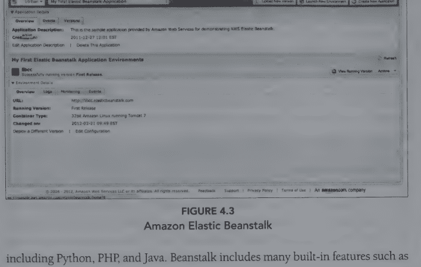

#### FIGURE 4.3

Amazon Elastic Beanstalk

包括 Python、PHP 和 Java。Beanstalk 包含许多内置功能，例如实例和应用监控、日志文件轮转、应用版本控制、自动扩展和自动负载平衡。这一套功能足以确保高质量的服务而无需大量的管理任务，并且正如我们在第 3 章和第 6 章中对 IT 服务管理原则的探索所示，以低成本提供了高度管理系统的许多关键优势。Elastic Beanstalk 作为基于其他 AWS 服务的管理平台提供，包括弹性计算云、关系数据库服务 RDS 和简单通知服务 SNS。这对于已经为其他云环境使用 Amazon 服务并且已经处理了采用云提供商相关的法律和组织问题的图书馆来说是好的。另一方面，Beanstalk 是围绕特定的部署架构设计的，因此部署在其上的系统必须以需要平台特定方法来管理数据库、域名管理和安全 Web 服务实现的方式设置。

#### CloudFoundry

CloudFoundry (`www.cloudfoundry.com`) 由 VMWare 所有，并支持 Java 和 Ruby 基于的环境，包括 Java Spring、Ruby on Rails 和 Ruby Sinatra。与 Amazon 的 Elastic Beanstalk 一样，CloudFoundry 支持应用版本控制、测试和通知服务。除了商业

CloudFoundry 系统外，该组织还在 CloudFoundry.org 上发布 CloudFoundry 堆栈，使组织能够在私有云中部署 PaaS 环境。

CloudFoundry 不支持基于 Web 的管理界面，而是使用名为 Micro Cloud Foundry 的客户端应用来允许开发人员测试和部署其服务。这使开发人员能够快速从测试转向生产，但带来了客户端配置和数据库连接要求。与依赖服务器资源用于测试或开发环境的其他 PaaS 环境相比，这无疑是一个优势，并且可能被视为 CloudFoundry 的竞争优势。

#### Google Apps Engine

与 CloudFoundry 类似，Google Apps Engine (`http://code.google.com/appengine/`) 既有本地测试应用，也有企业部署平台 图 4.4。它支持 Java、Python 和 Go 平台，但已定制这些部署以实现与 Google NoSQL 数据库系统的紧密集成。Google Apps Engine 提供免费和高级支持级别，并根据所需支持和服务利用率指标确定成本。这使其成为良好的测试和小型应用部署环境，但也意味着如果图书馆将其从测试用途转移到生产用途，可能需要仔细审查服务条款。

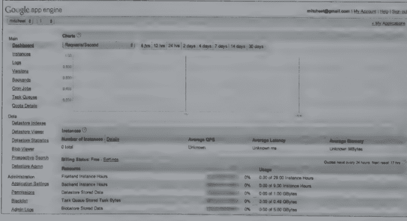

#### FIGURE 4.4

Google Apps Engine

Google Apps Engine 包含教程，并且像其他 PaaS 环境一样支持 SSL 解析和通过 URL 转发自定义域名。由于它使用定制的开发和部署环境，迁移到该平台以及从该平台迁移可能比其他解决方案更困难。Google Apps Engine 最近已从 Beta 状态推出，现在为付费应用提供 SLA 级别以及高级支持订阅选项。2012 年，Google 将 Google Apps Engine 从 Beta 转移到生产环境，并发布了一个名为 Google Cloud Platform 的新 Beta 服务 `http://cloud.google.com/`，其中包含 Google App Engine、Google Compute Engine、Google Cloud Storage 和 Google BigQuery。这四项服务中的每一项都支持不同的功能，可以被视为不同类型的云服务。

#### Heroku

Heroku (`http://heroku.com`) 支持经审查的 PaaS 系统中最广泛的开发平台，包括 Java、Ruby、Python、Clojure、Scala、Play 和 Node.js 图 4.5。Heroku 与 Git 版本控制系统集成，并使用一种称为“dyno manifold”的东西来部署和运行代码。与 Google Apps Engine 一样，Heroku 具有可扩展的定价结构，包括免费和高级服务级别。可以以按需付费系统将高级功能如 SSL、专用数据库支持以及大量专有附加组件添加到您的服务框架中。某些附加组件，例如 Amazon 的 RDS，可以免费包含在您的应用中，但涉及在外部供应商站点产生成本和配置要求。众多附加服务使 Heroku 平台能够调整以适应各种应用模型，但确定月度成本和配置服务可能比其他平台更困难。

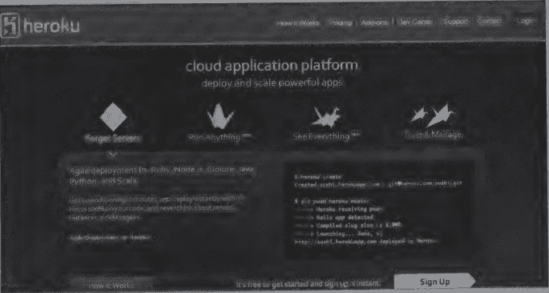

#### FIGURE 4.5

Heroku

通过使用更标准化的平台和开放的应用发布框架 Git，Heroku 保留了轻松在多个提供商上部署应用或服务的可能性。但这种能力取决于以这样的方式设计应用，即静态元素如数字对象和数据库元素可被应用部署的所有平台访问。这很可能需要外部托管数据库平台，例如 Amazon 的 RDS，以及在第二个云提供商如 Amazon S3 或 RackSpace 文件中进行长期数字对象存储。

人们一直在努力在 Heroku 上部署特定于图书馆的应用，特别是 Blacklight `http://projectblacklight.org`。Matienzo 2012 记录了他对此过程的方法 `github.com`，并且在 Code4Lib 讨论板上的讨论指出在 Heroku 和 Amazon Elastic Beanstalk 上部署 Blacklight 的其他一些努力。该线程 Code4Lib 2012 中讨论的一些挑战包括需要排除不必要的文件如 SolrMARC 和 Jetty 以减少部署大小，需要在不同的云提供商上托管 SOLR 索引 例如 Amazon IaaS 服务，以及管理 gem 依赖项和配置外部 SOLR 索引服务的挑战。

尽管存在这些问题，Blacklight 的测试以及其他常用 Web 发布应用的存在表明这种类型的云计算显示出可能性。例如，像 WordPress 这样的内容管理应用已被定制为在这些平台上工作 Hoofman 2012; Stein 2011，并且可以轻松满足图书馆网站需求。在这两种情况下，Heroku 上的 WordPress 安装都利用了一个支持 PostgreSQL 而非 MySQL 的插件，但除此之外未作修改。这种方法的一个关键问题是，被定制为在 PaaS 平台上工作的服务是否已“分叉”，或在很大程度上偏离了代码库。第二个主要考虑因素是，定制的软件版本是否引入了错误或未来的不兼容性，从而使未来的支持和迁移变得困难。在 Heroku 定制的 WordPress 应用的情况下，只需要一个简单的插件来修改服务，并且图书馆 IT 部门可能会发现监控这一定制是值得的，因为它带来了采用专用 PaaS 平台带来的更高安全性和可扩展性。

#### RedHat OpenShift

OpenShift 是 Red Hat 的 PaaS（`https://openshift.redhat.com`）环境（图 4.6）。它提供对 Java、Ruby、PHP、Perl 和 Python 应用以及包括 Node.js 在内的 JavaScript 框架的支持。OpenShift 提供命令行工具、基于 REST 的 API、Git 集成以及基于浏览器的控制台来配置、部署和管理应用程序。OpenShift 还支持使用 AWS 平台进行基于云的服务器创建和管理。

与审查的其他 PaaS 平台类似，OpenShift 具有定制的应用程序管理平台，使用特定于平台的工具和说明。与其他基于 PaaS 的应用程序平台一样，OpenShift 包括定义的 SLA（`https://access.redhat.com/support/`）、SSL、应用程序版本控制以及某种形式的 DNS 管理。尽管 OpenShift 是一个新服务，但已经

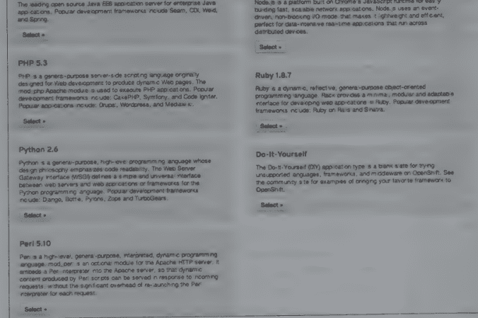

图 4.6

RedHat OpenShift（Courtesy of Red Hat, Inc.）

有努力使用其基础设施实现库域应用程序。Van Hooland 和 Wierckx（2011）已使用 OpenShift 免费层部署 Collective Access（`http://collectiveaccess.org`），该层支持 500 MB 的应用程序大小和内部托管的 MySQL 数据库。De Wilde（2011）对部署过程的详细说明已写成，并说明了在 PaaS 部署中通常需要进行的修改，这些应用程序是为传统 IT 环境开发的。例如，De Wilde 对 Collective Access 的修改涉及使用专用工具、特定目录和文件的排除以及版本控制管理。

#### Windows Azure

Windows Azure 是 Microsoft 提供的 PaaS 和 IaaS 服务，专注于面向 Web 服务的 Windows 平台（图 4.7）。而其他审查的平台倾向于平台无关的方法，但强调包括 Tomcat、Apache 和 Nginx 在内的 Web 服务器，Windows Azure 提供对 .NET 框架、Microsoft SQL Server 和 ASP.NET 应用程序的支持。服务使用 Microsoft 的 Internet Information Server 平台托管。

与其他服务一样，Windows Azure 支持负载平衡、数据库集成、应用程序版本管理和开发环境集成。与 Heroku 不同，Windows Azure 具有持久的数字对象存储，使其成为许多 PaaS 提供商支持的 Amazon S3 平台的替代方案。Windows Azure 还提供对 SaaS 开发和部署的支持

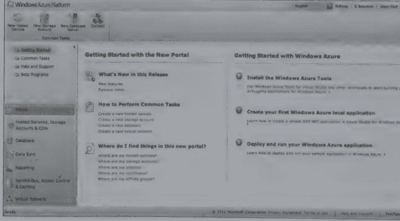

图 4.7

Windows Azure（Used with permission from Microsoft）

因此，云开发人员可以使用该平台为其他订阅者提供服务。这与 Salesforce 和 Amazon 等其他公司的做法类似，它们支持商业云服务部署。

## Issues

正如对 PaaS 提供商的审查所示，所支持的服务、平台和管理工具的范围各不相同，因此依赖现成软件的图书馆可能很难利用这些工具。然而，专用的 PaaS 平台为寻求创建和测试新应用程序的开发人员提供了相当大的能力，并且未来可能会被图书馆系统供应商和开源开发社区更广泛地采用。除了缺乏对现成图书馆软件的支持外，这些类型的 PaaS 系统还需要对 SSL 配置、DNS 名称映射、系统备份以及应用程序配置和部署采用新方法。所需的技术通常意味着解决方案比使用传统基于服务器的 IT 方法时更持久，但学习和整合这些技术可能很困难，特别是因为 IT 部门传统上依赖更接近 IaaS 环境的基于服务器的模型。出于这些原因，除非图书馆能够投入必要的时间来修改和管理应用程序使其在此环境中工作，否则他们可能无法使用这种类型的 PaaS 平台。尽管目前存在采用问题，但专用的 PaaS 解决方案提供了规模经济、低成本或免费使用级别，以及一种耐用性水平，而在不投入大量专业知识和时间和资源的情况下，使用其他方法很难实现。

## Expertise Required

除了管理 PaaS 应用程序所需的服务器类型管理专业知识外，专用的 PaaS 解决方案还需要对所实施系统的专业知识、熟悉版本管理解决方案以及了解如何在非服务器环境中实现和管理数据库结构。例如，Heroku 允许使用几种不同的数据库平台，每个平台都有其自身的优点和缺点。能够在数据库和软件平台之间进行区分以及通过命令行工具管理和部署应用程序，可以使开始使用专用 PaaS 系统比使用基于服务器的 PaaS 或 IaaS 解决方案更困难。正如许多审查的服务所指出的那样，这些系统面向需要其应用程序的生产级支持但没有时间和资源来管理所需基础设施的软件开发人员。

## Service Complexity, Sustainability, and Durability

PaaS 解决方案往往比传统 IT 系统更复杂。通常需要更多的依赖项，并且每个平台对应用程序的部署、配置和管理采用独特的方法。至少，专用的 PaaS 环境需要包括应用程序平台、持久数字对象存储平台和数据库平台。在足够分布式的架构中，每个系统都应独立于其他系统而持久存在。这使得应用程序可以在不影响有价值的数据和数字对象的情况下进行升级、扩展和重新部署。PaaS 应用程序环境的一个好处是它们往往包含内置的监控、复制和扩展功能。尽管这些功能的默认级别可能足以满足大多数图书馆的需求，但了解如何扩展这些服务或重新配置它们以支持在多个 PaaS 平台上部署应用程序对于大规模应用程序是必要的。此外，对于寻求利用多个 PaaS 提供商使应用程序更持久的图书馆，必须采用外部 DNS 系统以便轻松从一个服务提供商切换到另一个服务提供商。

尽管图书馆在使用专用 PaaS 平台时必须考虑多个问题，但这些系统的关键优势在于它们内置的能力，可在服务中断期间进行扩展和持久化。例如，Amazon 的 Elastic Beanstalk 包括自动扩展以处理增加的流量的能力，并具有多区域冗余功能，以确保即使云基础设施的部分发生故障，应用程序仍保持运行。同样，Heroku 提供自动复制和可扩展性，使测试和部署系统更新变得更容易。最后，PaaS 环境通过使用共享云服务获得快速配置速度和灵活性。例如，Zend PaaS（`http://zend.com`）框架与 RightScale 紧密集成，以启动和管理部署多个客户的基础设施级服务。这使得关于系统耐用性和长期可持续性的选择变得更加复杂，并且取决于诸如本地专业知识、对提供商锁定容忍度以及在多个云提供商上实施服务的能力等因素。

## Service Cost

而 PaaS 服务器解决方案提供某种形式的持续订阅成本，专用的 PaaS 解决方案寻求通过允许订阅者仅在任何给定时间使用所需的服务，使这些服务更实惠和可定制。此外，许多产品，如 Heroku、RedHat OpenShift Express 和 Google Apps Engine 提供免费服务级别，可能吸引中小型图书馆。专用的 PaaS 提供商倾向于根据附加组件和使用的 IT 资源收费。由于每个提供商使用不同的衡量标准，因此很难比较各提供商之间的成本。例如，Heroku 使用称为“dynos”的前端和后端进程衡量标准，这将很难与 Amazon 的 Elastic Beanstalk 实例进行比较。相比之下，Google 采用多方面的计费模式，包括 CPU 时间、带宽和数据存储元素。尽管有一些研究比较了云服务的总拥有成本，但这种形式的 PaaS 环境引入了新元素，需要更深入的探索。

## Service Portability and Interoperability

专用 PaaS 解决方案的复杂定制要求意味着它们可能难以迁移到新提供商。某些平台，如 Heroku 和 Amazon 的 Elastic Beanstalk 允许应用程序包部署在其他平台上。相比之下，使用定制技术堆栈的平台，如 Google App Engine，如果没有额外的应用程序开发，迁移到另一个平台将很困难甚至不可能。

## CONCLUSION

本章探讨了在探索云计算和虚拟化时需要考虑的两种广泛平台类型。对 SaaS 提供商的审查主要集中在图书馆特定解决方案上，但也突出了更广泛信息用途的 SaaS 服务。WordPress 和 Salesforce 等提供商可能非常适合图书馆，但应在其整体 IT 框架内考虑。事实上，如果图书馆寻求使用 SaaS 解决方案来取代其所有信息服务基础设施，这些选项应被视为在图书馆特定和通用基于 Web 的信息服务之间架起桥梁的方式。至少，图书馆转向 SaaS 解决方案时需要考虑如何计划监控这些服务、管理联系和访问信息以及为迁移离开 SaaS 提供商做准备。

本章还探讨了两种形式的 PaaS 解决方案——基于服务器和基于应用程序。两种解决方案都是本地开发的优秀选择或行业标准应用程序，但对传统图书馆应用程序构成挑战。基于服务器的 PaaS 平台在很大程度上旨在满足中小型用户的需求，而基于应用程序的平台则旨在实现透明且高度可用。

## 参考文献

Bryant, Sally, and Grace Ye. 2012. "Implementing OCLC's WMS (Web-Scale Management Services) Circulation at Pepperdine University." Journal of Access Services 9 (no. 1): 1–17. doi:10.1080/15367967.2011.629921.

Code4Lib. 2012. "Anyone Implementing Common LIS Applications on PaaS Providers?" Code4Lib Listserv archive, March 29, 2012. `http://serials.infomotions.com/code4lib/archive/2012/201203/0983.html`.

De Wilde, Max. 2012. "Collective Access on Red Hat OpenShift." `http://homepages.ulb.ac.be/~svhoolan/redhat_ca_install.pdf`.

Hoofman, Matt. 2012. "Wordpress-Heroku." `https://github.com/mhoofman/wordpress-heroku`.

Liu, Cricket, and Paul Albitz. 2006. DNS and Bind. Sebastopol, CA: O'Reilly.

Loo, Jeffery. 2010. "Library Instruction through Online Video and Social Media." Chemistry and Chemical Engineering Library, University of California, Berkeley, last modified July 16, 2010. `www.lib.berkeley.edu/CHEM/instruction/video/index.htm`.

Matienzo, Mark A. 2012. "Blacklight on Heroku." `https://github.com/projectblacklight/blacklight/wiki/Blacklight-on-Heroku`.

OCLC. 2012. "University of Delaware Chooses OCLC Worldshare." OCLC press release, January 18. `www.oclc.org/news/releases/2012/20125.htm`.

Stein, T. J. 2011. "Running WordPress on Heroku + Amazon RDS." `http://tjstein.com/2011/09/running-wordpress-on-heroku-and-amazon-rds/`.

Van Hooland, Seth, and Bram Wierckx. 2011. Open Source Software Platform Collective Access as a Service Solution." DISH (Digital Strategies for Heritage) 2011 conference, December 7, Rotterdam, Netherlands.

# 基础设施即服务

对于有传统 IT 资源管理背景的图书馆来说，采用 IaaS 方法进行云计算很可能是不错的选择。IaaS 提供商简化了预订、启动和管理 IT 资源的过程，包括服务器、存储空间、网络工具和监控工具。这使得图书馆能够创建针对特定需求和应用程序量身定制的 IT 基础设施。此外，这些系统通常支持对特定资源进行定制，例如操作系统、应用程序平台、磁盘空间和内存。

与专用的 PaaS 系统一样，IaaS 系统需要在计算环境中投入一定程度的资源，并且有一些复杂元素，需要熟悉 IT 系统和开发平台，而这些并不是图书馆常见的技能组合。有了这种专业知识，利用 IaaS 资源创建和管理灵活且强大的计算环境的能力，可以从根本上改变图书馆寻求满足其 IT 需求的新方式。这也意味着 IaaS 解决方案需要比 PaaS 或 SaaS 解决方案更关注安全、备份和服务恢复程序，并且将确保可扩展性和可持续性的负担放在图书馆而不是云服务提供商身上。

在本章中，我们从两个角度回顾 IaaS 解决方案：使用 IaaS 资源复制传统服务架构，以及使用它们创建云感知服务架构。在深入探讨这些解决方案之前，值得先定义一些通用的资源类型，这些资源类型是每个 IaaS 解决方案共有的。以下列表可能很熟悉，但在整个章节中，它们为 IaaS 示例的讨论提供了背景。

### 32 位与 64 位操作系统

这些数字指的是操作系统运行的底层架构。这些不同的硬件架构需要不同的操作系统版本，能够进行不同程度的 CPU 和内存管理。许多 IaaS 提供商根据所选的服务器大小确定操作系统的类型，并使用某种方法自动将 32 位系统扩展到 64 位系统。然而，Amazon 确实支持在 32 位平台上运行 64 位计算映像，因此如果需要扩展到更大服务器，最好选择 64 位操作系统发行版。

### 应用程序编程接口 (API)

在云环境中，API 是一种用于与 Web 服务交互的标准化的程序化机制。所有 IaaS 提供商都提供某种形式的 API，并且通常通过实现 API 功能的程序化工具提供增强的服务和功能。人们正在努力开始使用开源方法标准化云 API。

### 备份/恢复

IaaS 提供商通常具有某种系统范围的方法来处理服务器和存储空间备份。一些供应商提供托管备份解决方案（例如，Linode）；其他供应商仅提供云基础设施备份工具（例如，Amazon）。

### 带宽/进出传输

IaaS 供应商监控并对服务器实例的进出流量收费。向入站流量收费的情况变得越来越少，但本章讨论的所有供应商都对出站流量收费。一些供应商（例如，Linode）会在服务器实例中包含基础数据传输量。

### 云文件系统

云文件系统与传统文件系统不同之处在于，它们可通过 API 访问，而不是通过传统的磁盘或挂载机制。云文件系统可能具有自动复制、版本控制和其他增值服务，使其比传统存储更可靠。

### 配置配置文件

配置配置文件是一组促进云资源配置和部署的指令。这是 IaaS 提供商的新兴功能，并且在每个 IaaS 解决方案中实现方式不同。其基本概念与 Puppet 和 Chef 等自动配置平台类似，只是它们往往仅在系统启动期间使用，而不是持续使用。

### 域名服务 (DNS)

DNS 是一种全球互联网应用程序，可将域名（mycompany.com）解析为 IP 地址（10.10.10.10）。云提供商提供针对云用户特定需求的 DNS 解决方案，例如多区域路由。

### 端点

在云计算中，端点是私有云与互联网相遇的点。Amazon 提供多个云区域，每个区域都充当其内部云流量的端点。

### 文件存储桶/容器

存储桶或容器是与基于云的文件系统相关的存储单元。文件只能在与特定存储桶或容器关联后上传。云提供商还可能将访问控制与存储桶或容器关联。

### 负载均衡器

云提供商通常支持某种自动方法来实现负载均衡应用程序。负载均衡器监控给定服务的流量，并在需要时重新路由流量或扩展服务器资源。

### 机器映像

机器映像是 IaaS 环境中启动服务器的根源。一些提供商（例如，Amazon）允许用户在社区门户中上传、发布和下载映像；其他提供商（例如，Rackspace、Linode）提供较小的经过审核的机器映像套件。所有服务都提供某种机制，可将自定义机器映像保存到客户的云服务中以供重复使用或重新利用。

### 消息或队列服务

这些服务为向用户或应用程序发送消息提供独立的手段。Amazon 提供多种形式，包括简单电子邮件服务（SES）和简单通知服务（SNS）。消息服务可以取代在机器映像上运行传统电子邮件和其他消息服务的需要。

### 可挂载卷

一些 IaaS 提供商提供更传统的存储形式，可作为服务器资源的磁盘或卷挂载。Amazon 的这种存储形式（弹性块存储，EBS）具有用户控制的大小、格式、附加/分离服务和长期存储功能。

### 公钥/私钥

除了基于密码的安全性外，云提供商还可能支持生成或使用公钥/私钥进行资源 access. 需要注意的是，所有对 Amazon 启动资源的初始访问都是通过这些密钥进行的。

**Regions：** IaaS 提供商可能在多个云区域提供服务。云区域应在物理和虚拟上都独立于云提供商网络中的其他区域，但也应通过高速私有网络可访问以进行数据和服务复制。提供商可能会使用区域复制作为确保其 SLA 中高可用性水平的方法。

**Security groups：** IaaS 提供商通常提供某种基于基础设施的安全性。有些将此限制为委托用户访问以查看、修改或创建 IaaS 资源；其他则提供完全功能的防火墙服务。

**Server instance：** 服务器实例是 IaaS 环境中的运行服务器。它使用操作系统、存储资源以及 CPU/内存资源。它可能位于自己的硬件上，也可能不位于自己的硬件上（参见第 3 章中关于公共云和私有云的讨论）。

**Snapshots：** 快照在 IaaS 环境中很常见，并为服务器或存储资源设置“时间点”备份。在 Amazon 环境中，快照是增量的，这意味着每个连续的快照仅存储与前一个快照的更改。这加快了备份时间并节省了大量存储空间。

**Virtual private network (VPN)：** IaaS 提供商可能支持创建虚拟网络，该网络基于 IP 地址限制对服务器的访问。用户可能希望利用其组织环境中的 VPN 资源来限制对敏感端口的访问（例如，端口 22—SSH）。

## USING IAAS IN A TRADITIONAL IT APPROACH

尽管从“传统”和“云感知”角度考虑 IaaS 可能显得人为，但它提供了一种探索在 IaaS 环境中不同 IT 服务管理方法的功能影响的手段。与 PaaS 平台的广泛范围一样，IaaS 也可能包含令人困惑的一系列选项，并且肯定需要仔细检查第 2 章和第 3 章中探讨的问题，其中最重要的是与转向云服务相关的员工专业知识、组织政策和法律问题。

在本节中，我们探讨强调传统服务器生命周期模型（配置、安全、部署、管理、升级和退役）的平台。这里包含的五个示例在专业文献中很常见，但绝非详尽无遗。

## IaaS Provider Examples

有许多公共或社区云提供商提供 IaaS 服务。本书特别关注其中三家（Amazon、Rackspace 和 Linode），但还有许多其他提供商，包括 GoGrid (`http://gogrid.com`)、Internap (`http://internap.com`) 和 Hexagrid (`www.hexagrid.com`)。还有 IaaS 代理和增值服务提供商，如 RightScale 和 Cloudability。在私有云环境中，解决方案包括 Eucalyptus、Cloud Foundry、VMWare 和 OpenStack。

### Amazon Web Services

Amazon Web Services (AWS, `http://aws.amazon.com`) 也许是最知名的 IaaS 云提供商（图 5.1）。Amazon 支持一系列广泛的服务，包括服务器托管（EC2）、云存储（S3、EBS）、服务监控、通知服务（SES、SQS）、关系数据库服务（RDS）和 DNS（Route 53），以及服务模板（CloudFormation）和监控（CloudWatch）。此外，Amazon 还为公共、私有和社区云环境提供支持。

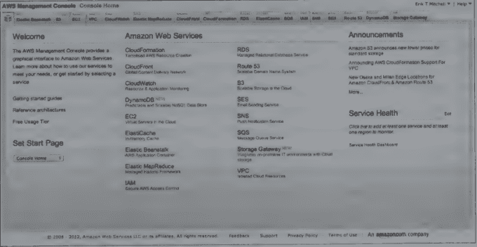

**FIGURE 5.1**

Amazon Web Services

指定数量的临时存储空间，该空间可以使用 EBS 卷进行扩展或完全替换。EBS 卷是持久的虚拟卷，与临时存储不同，它们并非永久绑定到机器实例，并且可以通过 Web 控制台轻松管理。

Amazon 服务的一个重要优势是其七个不同的云区域，这使得客户能够实现地理分离的云基础设施。事实上，多区域复制是 Amazon 客户的推荐做法，并且通常作为 Amazon 管理服务（包括 Elastic Beanstalk 和 RDS）的组件提供。另一方面，Amazon 的一个潜在限制是其服务旨在在自助服务环境中实施。Amazon 不提供图书馆员习惯从 SaaS 提供商那里获得的个性化服务，他们可能难以获得问题的答案，并且对缺乏个人级别客户服务的服务缺乏信心。为此，Amazon 实施了与云服务捆绑的基本支持级别，以及按月订阅模式运行的高级服务级别。四个支持级别包括增强的 SLA，定义了支持请求响应时间、支持活动类型以及支持系统范围。Amazon 高级支持费用从每月 49 美元到每月超过 15,000 美元不等，这说明了为什么 IaaS 服务往往比 PaaS 或 SaaS 服务更便宜。

### Linode

Linode 提供与 Amazon 许多服务范围相似的 IaaS 服务（图 5.2）。与 Amazon 一样，Linode 提供不同级别的服务器，从 512 MB 到 20 GB RAM。与按小时计费资源的 Amazon 不同，Linode 按月收费。Linode 节点（或服务器）附带指定的包含存储和 CPU 资源，并可部署在美国、英国或日本的六个区域之一。Linode 使用自定义语言部署和管理服务器，使用 Xen 虚拟化平台。所有 Linode 节点均包含高级支持服务。与本章讨论的其他一些 IaaS 提供商不同，Linode 提供自动备份和恢复服务以及节点平衡服务。通过简化备份和平衡流程，Linode 帮助用户以很少的知识或精力利用云功能。除了备份之外，Linode 还提供附加服务，包括额外的计算资源（例如 RAM、硬盘空间、带宽或 IP 地址）。它支持服务器的内部克隆，并提供配置配置文件以帮助管理服务器构建。

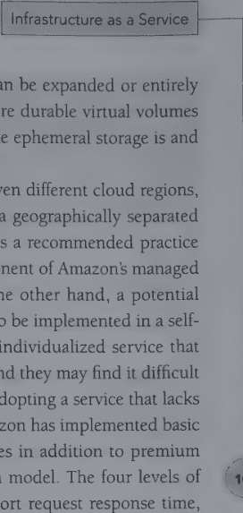

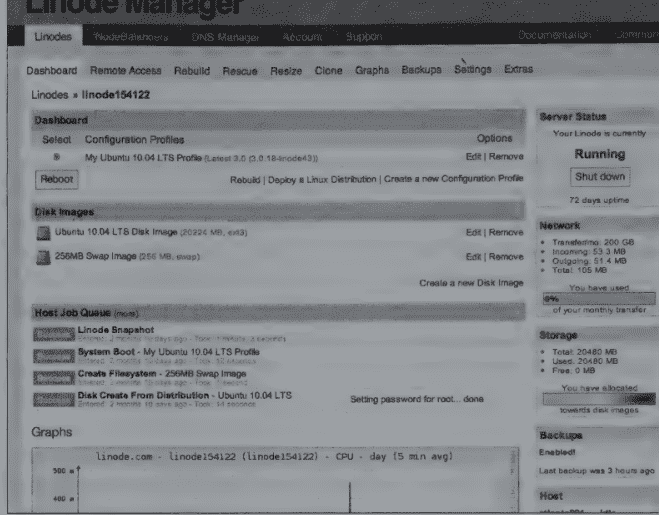

#### FIGURE 5.2
Linode web console (Courtesy of Linode)

Linode 支持账户上的多个用户，并支持多个 Linux 发行版，包括 Debian、Fedora、Ubuntu 和 CentOS。与其他 IaaS 服务不同，Linode 支持救援模式启动和其他救援方法。它还专注于比其他 IaaS 提供商更有限的公司管理操作系统集。这种方法的关键优势在于，通过保持操作系统发行版列表封闭，Linode 可以对其基础平台提供保证。

### Rackspace

Rackspace (`http://rackspace.com`) 提供一系列 PaaS 和 IaaS IT 托管服务（图 5.3）。与 Amazon 一样，Rackspace 支持多个服务器平台，包括 Windows 和 Linux 发行版。这些云服务器的规模从 256 MB 到 30 GB RAM 不等，并按小时许可。除了提供非托管服务器实例外，Rackspace 还提供高级支持，包括托管 IT 资源、PaaS 服务（包括电子邮件服务和网站托管服务（CloudSites））以及私有云服务。

#### FIGURE 5.3
Rackspace (Copyright Rackspace US, Inc. Used under license)

Rackspace 提供广泛的托管和非托管托管服务，并提供与 Linode 类似的定制选项。它提供有限的机器镜像选择，但提供支持服务作为按小时服务器费用的一部分，并提供用于备份配置和管理的图形界面。Rackspace 对非常小的服务器（256 MB RAM、10 GB 硬盘空间）的支持意味着组织可以采用多级架构，在可能时将服务器缩减规模以节省计算资源。按当前价格，Rackspace 上最小的服务器大约每月可运行 11 美元。除了低成本服务器外，Rackspace 还提供托管服务器，包括负载平衡和自动扩展。

与 Amazon 一样，Rackspace 将服务器指标和监控服务作为运行时服务器成本的一部分包含在内。基础设施级备份服务和内置支持服务的包含可以使其成为图书馆寻求对其服务器基础设施更多控制但不确定服务器管理要素（例如操作系统和备份管理）的有吸引力的选择。

## Private Cloud IaaS Platforms

除了公共、社区和混合云之外，还有来自商业和开源提供商的私有云系统，为组织提供了从云计算中受益的机会，即使他们不愿将 IT 资源转移到外部提供商。例如，Microsoft 提供

both public (Azure) and private cloud platforms, and Citrix (`http://citrix.com`) and VMWare (`www.vmware.com`) offer commercial private cloud systems. Open-source products include Eucalyptus (`www.eucalyptus.com`), CloudStack (`www.cloudstack.org`), and OpenNebula (`http://opennebula.org`). In addition to these private cloud applications, there are private cloud storage systems such as Walrus (`http://open.eucalyptus.com`) and Nimbus (`www.nimbusproject.org`) that work directly with private cloud platforms.

Implementing private cloud services is a complex task and requires considerable infrastructure and IT expertise. Libraries may find that their parent organizations are exploring or managing these services or that the scale required results in an overall decrease in cost for the organization. Private clouds may also be a good option for organizations seeking to run their services largely in the cloud while keeping a local backup of resources. Conversely, private clouds can be a good solution for organizations that seek to run their services largely in-house but also want to be able to “burst” into the cloud as needed (see “Cloud Bursting” sidebar, chapter 3).

## IaaS Examples in Libraries

Although the survey presented in chapter 2 found that IaaS was not often adopted by libraries seeking to implement cloud solutions, there are a few that have, including Wake Forest University (Mitchell 2010), the District of Columbia Public Library (Tonjes 2011), and the University of Arizona (Han 2010). For example, the Z. Smith Reynolds Library at Wake Forest turned to the AWS platform to implement its entire IT server infrastructure. Amazon services were used to deploy web server, discovery, DAMS, and other services, and PaaS and SaaS solutions were selected for the ILS, OpenURL, and other data-rich services. By using IaaS resources, the ZSR Library was able to implement services based on customer demand rather than on platform support limitations.

This had both positive and negative outcomes: the library was able to increase service offerings but also found itself supporting Ruby on Rails, PHP, Java, and Python applications using MySQL, PostgreSQL, and Oracle databases. In addition, when implementing licensed software, the library found that it had to implement a separate server running CentOS as opposed to its commonly used Ubuntu server operating system. This example illustrates some of the complexity that can come with this approach, but there are also features of IaaS platforms that greatly simplify IT management, including central backup and management services. For example, although the ZSR Library was managing four servers, each with a burden of configuration, management, and security on the operator and also places stipulations in SLAs that may or may not be achievable given local IT policies. For example, Amazon ties uptime assurances to specific server configuration approaches that add cost and complexity to the local IaaS system. To be protected by Amazon’s uptime assurance, an organization must deploy servers in multiple availability zones. For this reason, partially managed services such as Linode, Rackspace, or RightScale may be enticing for users seeking additional layers of IT support.

# Chapter Five

## Expertise Required

IaaS requires nothing short of a fully committed IT department that is prepared to engage with IT resources at a detailed level. Deploying IaaS services requires both an understanding of application development or deployment platforms and a detailed understanding of server configuration and security. Growing a server administrator from existing IT staff is a nontrivial task but can be accomplished with guided training and persistence. Training may include online tutorials or in-person/online fee-based classes. For IT staff seeking to learn more about system administration at low cost or via self-directed means, guides such as Limoncelli et al. (2001) and Nemeth et al. (2006) on Linux administration provide a foundation for budding system administrators.

Effective management of IaaS services requires all of the skills mentioned in relation to PaaS services including understanding application platforms, firewall rules, terminal commands, DNS operations, and control panel management. In addition, an effective IaaS administrator needs a more detailed understanding of operating system functions, user and permission issues, system configuration, and management and system troubleshooting. In addition, many of the skills common to PaaS environments require more detailed familiarity. For example, IaaS servers require command-line management of firewall rules, and Amazon features an additional account-level firewall that both adds security and makes configuration of rules more difficult. Many of these processes fall under the heading of “being a good server administrator” and are an important piece of a sustainable IT infrastructure.

**Extensive familiarity with IaaS platform.** To design an appropriate IaaS infrastructure, it is important that the system administrator be familiar with the range of services available on the IaaS platform. This means understanding the process of launching servers, creating server images, restoring backups, and managing DNS and IP services. In the Amazon environment it also means being able to manage EBS-mounted volumes and understanding the difference between S3-stored and

EBS-stored AMIs. In addition to these basic elements, it is important to understand monitoring services, notification services, Amazon availability zones, and CloudFront and replication options. Although Amazon, Linode, and Rackspace all provide guides and tutorials for this process, it can be difficult to pull all of these elements together. A series of guides and tutorials created from the experience of deploying Amazon services to support Wake Forest University's Z. Smith Reynolds Library can serve as a guide through these elements; these guides are available as a series at `http://libcc.org`.

Finally, understanding the infrastructure means making difficult choices regarding how to configure and deploy services. For example, choosing to have the IT department run a separate database server, rely on Amazon's RDS, or keep database systems on its application servers is a complex decision with cost, technical expertise, and system sustainability considerations. Likewise, the IT department must decide how to group and isolate IT services on servers and how to manage server configuration and updates as the number of systems grows.

Being familiar with the IaaS platform includes understanding something about the underlying hypervisor that runs the virtualized computing instances. Though an understanding of the underlying hypervisor is not as important as server management, understanding how hypervisors work is an important element of being able to migrate your server image into new cloud environments. At the very least, your IT department should understand the capabilities of the hypervisor and the service's support for downloading server images and volume snapshots. Although it is possible to migrate between incompatible hypervisors, this can be a difficult and somewhat tedious process (Amazon 2012). Still, there are benefits to migration, particularly for organizations seeking to test virtualization systems locally. In certain IaaS environments organizations may choose to run private cloud systems using a common cloud platform or to test exported cloud servers using locally deployed hypervisors.

## Understanding backup and restoration

Perhaps the most stressful element of moving to the cloud is making sure that your IT department has a robust backup plan. Without detailed backup and restoration plans, stress levels are high indeed and the first loss of data is disastrous. A backup plan at the least must include tested and easily replicated processes for restoring individual files/folders, entire applications, or entire servers. In an IaaS environment, backup and restoration processes should include a method to redeploy the application or data on a different availability zone or cloud platform, be appropriately secure, and be redundant as required to ensure service sustainability. It is important to know that the IT 部门依法有义务应执法部门要求恢复或提供所有备份数据的访问权限，因此制定包含备份轮换、特定归档以及恢复理解的自动化备份轮换计划是良好的实践。可以使用多种方法，但这些方法超出了本书的范围。至少，在评估 IaaS 提供商时，组织应考虑包含哪些备份功能，以及它们如何与现有的备份实践集成。某些提供商确实将备份作为服务的一部分，但可能会额外收费，并且可能只提供特定的恢复服务（例如，恢复完整磁盘但无法检索单个文件）。

## 理解服务器管理、服务监控和复制

服务器管理涵盖服务器配置、监控、安全管理、服务复制和系统更新。至少，服务器管理员应了解如何创建和管理用户，如何安装和保护应用程序，如何加固服务器以抵御攻击，如何将防火墙用作额外的安全层，以及如何自动化日志和日志轮换。服务需要以能够抵抗配置退化、抵御功能被破坏的尝试、并且能够轻松恢复或重新配置的方式设计。

测试复制服务器能力的最佳方法是仅使用系统备份从头开始恢复它。在可能的情况下，流程应实现自动化，并且在检测到服务中断时应建立新的流程。在云环境中，故障转移计划必须包括能够在单个云提供商的不同可用区之间移动或迁移到其他云提供商的能力。RightScale 等服务通过支持跨多个提供商复制服务器的机制简化了这一过程。同样，Amazon 提供了通过命令行工具迁移服务的选项。作为这一过程的一部分，了解在可用区中断情况下可用的服务非常重要。

IT 部门中正在获得支持的另一种服务器复制方法是自动配置和服务器部署，而不依赖云提供商。Puppet 和 Chef 等服务器配置工具用易于部署的配置脚本取代了“金蛋”方法。这些脚本记录了服务器创建和配置过程中的每个步骤，直到数据恢复和投入生产为止。使用这种“可操作”的配置文档，IT 部门可以通过快速恢复服务并使用配置脚本监控运行中的服务器来避免停机，从而节省大量时间。自动配置在 IaaS 提供商中变得越来越普遍。Amazon（通过 CloudFormation）、Linode 和 RightScale 都提供内置的脚本化配置服务。虽然这可能不是极大规模 IT 环境的最佳实践，这些环境更喜欢在特定云提供商之外托管其配置服务，但使用内置的服务配置工具在无需学习和管理另一个 IT 管理工具的开销的情况下，极大地提高了服务的耐久性。

与 IaaS 服务合作的另一个重要部分是确定服务器容量需求。这里讨论的所有 IaaS 提供商都提供各种 CPU、RAM 和存储空间选项，但可能有必要在多个平台上测试应用程序安装以找到性能最佳且最经济的配置。例如，Uspal 等人（2011）采用多方面的方法测试 AWS 服务器容量，与同等规模的本地虚拟化和物理服务器进行比较。尽管服务器 CPU 容量和可用内存存在差异，但所有三台服务器均使用运行在约 2 GHz 的 Intel Xeon CPU，并具有 6–8 GB 的 RAM。研究人员在所有三个服务器平台上使用名为 Bonnie++（`www.coker.com.au/bonnie++`）的输入/输出文件测试系统、MySQL 数据库加载例程以及 ImageMagick（`www.imagemagick.org`）对 1000 万张图像进行图像处理例程，以比较服务器性能。他们的测试发现，Amazon 服务器在全部三项测试中均优于本地物理服务器和本地虚拟化服务器，其中与文件输入和输出操作相关的差异最为显著。例如，在 Bonnie++ 测试中，Amazon 服务器的读取操作完成速度为每秒 92K，而物理服务器为每秒 38K，本地虚拟化服务器为每秒 18K。磁盘写入和 ImageMagick 处理显示出类似的结果。

IT 服务监控是高效服务管理的另一个关键方面。监控越来越多地成为 IaaS 系统的内置功能，但通常侧重于服务器监控而非应用程序监控。服务器资源监控（例如 CPU 负载、硬盘使用率、输入/输出）很重要，但应用程序监控也很重要，因为它使 IT 部门能够在应用程序崩溃前采取行动。大型 IT 部门可能拥有复杂的监控系统，但即使是小型部门也需要确保服务正常运行的监控解决方案。对于寻求大量控制的组织，Nagios（`http://nagios.org`）等系统可提供对应用程序、磁盘利用率、CPU 利用率以及其他各种资源的监控。Nagios 也有 SaaS 替代方案，包括 New Relic（`http://newrelic.com`）和 LogicMonitor（`http://logicmonitor.com`），它们提供类似规模的监控服务。Nagios 适用于复杂监控，但本章介绍的每个 IaaS 提供商都提供不同形式的监控。例如，Amazon 在不同层级监控服务器和基础设施状态，并提供多种通信方式。Monitor.Us（`http://monitor.us`）等 SaaS 服务提供易于使用的基于 Web 的服务监控。

## 能够谨慎预算

与 SaaS 和 PaaS 系统相比，IaaS 系统的预算编制要难以预测得多。例如，组织必须能够预测服务的带宽、存储利用率和 CPU 需求，并随时间推移预测容量需求。包括 Amazon 在内的 IaaS 提供商为愿意承诺特定期限的组织提供更低的成本，因此能够在一年到三年内预测资源利用率可以带来可观的成本节约。这对组织来说是好事，但要求系统管理员知道组织何时需要续订其预留实例条款。在到期日前未提前续订会导致服务器运行成本大幅意外增加。尽管预算编制通常是行政职能，但 IaaS 基础设施的众多变动部分意味着 IT 人员更有可能被要求确定运行 IT 服务的成本。

## 服务复杂性、可持续性和耐久性

IaaS 平台的主要缺点之一是其复杂性。图书馆经常发现 IaaS 服务比传统服务器平台更复杂，并且通常没有足够的 IT 资源来确保可持续的服务。避免不必要复杂服务的关键包括使用单一服务器平台和应用程序环境、使用单一方法管理所有服务，以及避免不增加显著改进的复杂服务调优。例如，在传统 IT 环境中，优选使用逻辑卷管理（LVM）方法，该方法允许卷跨多个磁盘。借助 LVM，IT 部门可以在不中断服务或复杂重建磁盘空间的情况下动态添加卷空间。这种方法的主要缺点是 LVM 需要配置文件和静态磁盘集。在云环境中，镜像、增加、分离和重新附加卷要容易得多。这在一定程度上削弱了 LVM 提供的优势，并具有额外的好处，即能够在无需跟踪 LVM 配置文件和卷关联的情况下轻松镜像、复制和恢复磁盘映像。

发现自己管理 IaaS 环境但超出舒适区的图书馆可以转向高级支持服务，或通过使用单一系统配置并转向自动化来简化服务部署 management tools. Automated backups, automatic configuration, and regular monitoring and notification services go a long way in helping library IT feel more comfortable with IaaS management responsibilities and can lead overall to a more efficient IT organization. Another approach to simplifying an IaaS environment is to identify services, such as database servers, monitoring services, server builds, or e-mail services, that can be outsourced to a PaaS or SaaS platform. By taking these base-level services out of the mix, organizations can focus on running customized services for only the applications that require them.

## Service Cost

IaaS services often cost less than their SaaS and PaaS counterparts, primarily because the latter include value-added services such as IT management, data management, and premium service levels. At the very least, a service cost comparison should include the hard costs of server run-time, storage space, bandwidth, backup, and related infrastructure (e.g., monitoring, documentation, software licensing). A full cost consideration also needs to include hidden or soft costs including those for personnel time, infrastructure management, replication and redundancy plans, and data management. Though planning for and incorporating such soft costs is difficult, even a basic attempt can help organizations fully understand the long-term costs of cloud computing. There are SaaS services such as Cloudability (`http://cloudability.com`) whose primary focus is on monitoring the use of common SaaS, PaaS, and IaaS services and triggering notifications when services are likely to expire or exceed limits.

## Service Portability and Interoperability

Although interoperability between applications in an IaaS environment is less of an issue than in SaaS or PaaS environments, given the control an IT department has over the infrastructure, ensuring IT system portability and interoperability with other systems is a more complex issue. Operations such as firewall administration, user account management, and service management enable application interoperability and data transfer. The larger issue with IaaS platforms is the challenge of moving the entire service to a new platform. This capability has seen increasing support in recent years, and now many IaaS systems support some form of system migration. In addition, services such as RightScale offer configuration management services that help replicate cloud platforms and data across multiple providers. At the very least, a cloud computing plan should include short-term replication and long-term migration planning elements. This may include documenting the server image and data download and redeployment process, server configuration process, and DNS reassignment process.

## Comparing Costs across Providers

Expertise, organizational fit, and technical features are important, but a cloud service cannot be competitive if it does not have a competitive business model. Comparing services from Amazon, Linode, and Rackspace actually turns out to be rather difficult, because each service takes a different approach to grouping and pricing IT resources. The comparison offered here uses the service with the most bundled IT resources as part of its pricing model (table 5.1). Unlike Amazon and Rackspace, Linode charges on a monthly level and includes specific data transfer capacity in addition to CPU, RAM, and storage resources. For this reason, two Linode servers are used as template servers for comparative purposes.

Table 5.1 shows the comparative cost for these three services based on a small server template. The table includes two entries for Amazon, the first for an unreserved or "on-demand" instance and the other for a reserved instance. Amazon uses server reservations to allow customers to pay a reservation fee that varies based on server size, server region, and expected utilization (i.e., heavy, light, or medium use). For this comparison, reservation fees were used for the U.S. East region and heavy (100 percent uptime) usage. One area of inconsistency in this comparison is with the charges for outgoing traffic. Linode servers include a specified level of data transfer with each server that is not included in Amazon or RackSpace server prices. To compare costs equally, data transfer costs for both Amazon and Rackspace are included at the Linode data transfer levels.

### TABLE 5.1

Comparison of IaaS Provider Costs

| Provider* | Upfront charges | Server costs (monthly) | Bandwidth charges (monthly) | Storage cost (monthly) | Total monthly cost | Yearly cost |
|---|---|---|---|---|---|---|
| Amazon (small) | $0.00 | $14.64 | $24.00 | $0.00 | $38.64 | $463.68 |
| Rackspace (small) | $0.00 | $21.90 | $36.00 | $0.00 | $57.90 | $694.80 |
| Linode (small) | $0.00 | $19.95 | $0.00 | $0.00 | $19.95 | $239.40 |
| Amazon reserved (small) | $62.00 | $8.88 | $24.00 | $0.00 | $32.88 | $456.56 |
| Amazon (medium) | $0.00 | $118.40 | $96.00 | $0.00 | $214.40 | $2,572.80 |
| Rackspace (medium) | $0.00 | $87.60 | $144.00 | $0.00 | $231.60 | $2,779.20 |
| Linode (medium) | $0.00 | $79.95 | $0.00 | $0.00 | $79.95 | $959.40 |
| Amazon reserved (medium) | $390.00 | $23.68 | $96.00 | $0.00 | $119.68 | $1,826.16 |

* Small server = 512 MB RAM, 20 GB storage, and 200 GB data transfer.

Medium server = 2 GB RAM, 80 GB storage, and 800 GB data transfer.

The apples-to-apples comparison in table 5.1 shows Linode as a cost leader for both small and medium-sized servers. In real-world costs, however, libraries may find considerable savings by going with providers that do not bundle data transfer charges with server fees. In fact, in real-world usage over two years with one large and two small servers in operation, the Z. Smith Reynolds Library found that data transfer varied between 100 and 200 GB of data transfer per month and also found that there was more need for storage space and server capacity. Clearly this makes selecting a cloud provider difficult, if only because the growth of services over time can be difficult to map. Our comparison of these IaaS providers found that differences in storage amounts, a lack of specificity of CPU power, and variation in how each company handles value-added services such as system backups, support requests, and server resizing make selecting a provider a matter of local factors. For instance, whereas Linode charges $1 per GB per month for each gigabyte allocated above the included storage amount, Amazon charges $0.10–0.125 and Rackspace charges $0.10. This difference could have a considerable impact in changing the cost for libraries with lower overall outbound data transfer but greater storage requirements for DAMS and discovery services.

## PLATFORM-AGNOSTIC APPROACHES TO CLOUD SERVICES

The idea of mixing and matching cloud service providers to find an optimal mix of cost, control, and service quality may not seem particularly groundbreaking. In practice, though, finding the right mix of service outsourcing, local management, and platform-specific migration can be difficult. In this section we explore some areas in which moving to SaaS or specific IaaS platforms can affect service quality and costs positively. Such approaches are not likely to solve all problems posed in the previous sections, but they may be right for organizations seeking a balance between wholly outsourced and internally managed cloud services. As a framework for this discussion, we should remind ourselves of the NIST reference model with its range of service roles associated with cloud platforms, including auditor, broker, provider, and consumer (see figure 1.1). In addition, this architecture explores elements that contribute to a well-run cloud service, including service provisioning and management and service monitoring.

Though it is important to understand each of these roles and to be able to identify service providers that fill them, it is also important to consider what combination of service providers and functions best fits a particular library's cloud service needs. For example, as important as it is to have monitoring, replication, and auditing services, small cloud deployments may be able to utilize a single provider that meets these needs whereas larger deployments may need to seek out providers with more complex capabilities. Here again, the adage "The perfect is the enemy of the good" can be worth considering when bringing together cloud systems to support your information services. In general, a cloud service needs approaches to service provision (e.g., resource allocation and integration), service monitoring/auditing (e.g., service uptime, system security/privacy, service cost), and service management (e.g., staff access, service create/start/stop/terminate, service aggregation) that are easy to use and sustainable.

## Hybrid IaaS Provider Examples

Many of the previously reviewed providers including Amazon, Linode, Google Apps, and Heroku offer monitoring, auditing, and cost management services, and it is possible that these services will work well in a limited cloud architecture. There are other services, however, that support cross-platform provisioning, monitoring, and auditing services. This section explores cloud services that can provide libraries with alternative or hybrid approaches to creating a robust cloud-based infrastructure. Three classes of service are of particular interest: multiplatform IaaS solutions, SaaS solutions for effective IT service management, and a mix of cloud resources for point-of-need services.

### Multiplatform IaaS Solutions

Unlike other IaaS providers, RightScale focuses on adding management, monitoring, and replication layers on top of IaaS services rather than on providing cloud computing services of its own (figure 5.4). RightScale supports multiple providers including Amazon, Datapipe, Logicworks, Rackspace, and SoftLayer. In addition, it supports private cloud management through support for CloudStack and Eucalyptus systems. RightScale adds value to IaaS providers by providing

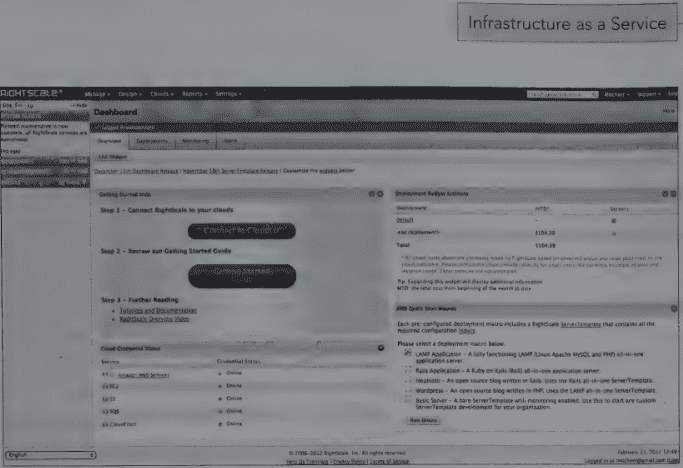

**FIGURE 5.4**  

RightScale (2006–2012 RightScale, Inc. All rights reserved)

a platform for server creation, configuration, deployment, management, and destruction. Its configuration system, known as deployment, uses server templates, customized user data, and scripts to automate server management. Scripts include booting, run-time, and decommissioning functions and enable the automation of complex server tasks.

By providing a configuration and monitoring platform, RightScale simplifies the process of replicating cloud services onto multiple providers. Although this leads to additional costs, it ensures that an organization’s service can persist even if its primary cloud provider experiences downtime. By supporting private as well as public clouds, RightScale also enables organizations to alternate between local computing resources and public or community cloud environments. This enables a new level of control for organizations that may want to manage IT services in-house except for those few occasions where additional IT resources are required.

Some providers take on the work of creating and managing machine images for customers but do not do the heavy lifting of service replication in the same way that RightScale does. For example, JumpBox (`http://jumpbox.com`) and Hyperic (`http://hyperic.com`) publish prebuilt AMIs on the Amazon platform. These prebuilt servers are designed to be run with minimal configuration while providing monitoring and configuration management services. They can facilitate the deployment of management of services but also require a level of expertise and
accounts as well as organizations that use multiple cloud providers. Cloudability offers a free usage tier for customers with less than $2,500 per month in cloud expenditures.

Another service similar in function but different in scope is Ylastic (`http://ylastic.com`; figure 5.6). Focusing primarily on the AWS and Eucalyptus platforms, Ylastic is a subscription service that provides monitoring, backup, service management, and server replication services through an easy-to-use web console. It features management functions in addition to auditing reports, but it functions only with Amazon and Eucalyptus services. As our exploration of PaaS and IaaS services shows, effective management tools that ensure cloud services are durable and easily recoverable are an important aspect of high-quality and sustainable cloud services. Ylastic makes this process easier by providing easy-to-use versions of Amazon services.

Ylastic provides tools that automate many of the complex processes required of Amazon adopters, such as automatic volume snapshots, application monitoring, availability zone migration, automatic image creation, and backup pruning (figure 5.7).

#### FIGURE 5.6
Ylastic management service

#### FIGURE 5.7
Ylastic backups

#### FIGURE 5.8
Ylastic monitoring

Ylastic conducts audits of security, cost, backups, and service redundancy services and monitors service availability. Monitoring includes a focus on service downtime and features multiple notification methods. It also tracks use trends and makes recommendations for removing unused cloud resources (figure 5.8).

## Using IaaS for Point-of-Need Service

To this point we have focused on IaaS providers that offer a distinct suite of services. Nevertheless, one of the primary benefits of turning to IaaS solutions is the ability to use distinct elements of the service without large overhead costs. For example, Iglesias and Meesangnil (2010) used Amazon S3 as a storage source for an OAIS-compliant digital object archival system. In combining local and cloud implemented resources they found an inexpensive alternative to SaaS offerings that amounted to a two-thirds reduction in cost per year. Because cloud services involve recurring costs, finding solutions that result in savings of this magnitude can shift the argument away from SaaS solutions. Since this work, Amazon has begun offering an automatic data synchronization service called Amazon Storage Gateway that offers the ability to synchronize locally stored data to Amazon S3 storage automatically.

Whereas Amazon’s focus is on simplifying the synchronization of data at the server level, there are also providers that offer client-level cloud-based data and file system tools. Cyberduck (`http://cyberduck.ch`), for example, is a multiprotocol file transfer and storage mounting service that supports a wide range of cloud storage services including Amazon, Google storage, Rackspace, and Windows Azure (figure 5.9).

Amazon S3 in particular supports advanced file storage service including access control, version control, and event logging. S3 is not a traditional file system, and it can be difficult to use S3 services without a secondary layer or client to facilitate access. Along with server tools that implement S3 integration (e.g., Amanda and KOALA) there are client-centric tools such as CloudBerry (`http://cloudberrylab.com`), JungleDisk (`http://jungledisk.com`), and BucketExplorer (`http://bucketexplorer.com`) that facilitate access to S3 by both implementing FTP, WebDav, or traditional file system volume/disc mounting services and managing services that otherwise can be difficult to manage including file deletion, version control, and access services.

Many of the tools mentioned in this section feature an implementation of Amazon, Microsoft, Rackspace, and other provider interfaces. Although there is a trend for new IaaS providers, particularly private cloud providers, to develop their

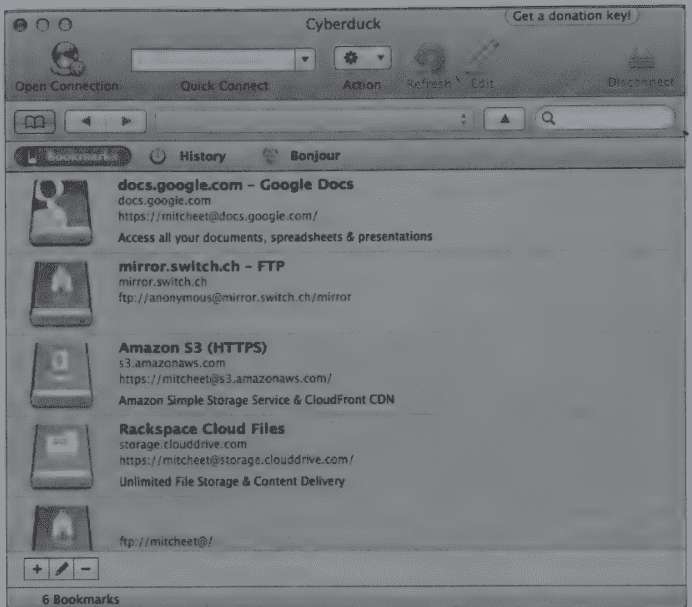

#### FIGURE 5.9
Cyberduck

command line tools consistent with the commands and parameters of the AWS API toolkit, this approach is far from standardized. As Baun and Kunze (2011, 2) point out, this level of standardization varies across platforms and feature sets. Although Amazon also supports many of the same functions using its web application interface, the command line tools enable automation and advanced access to EBS, S3, and AMI services. We have already explored services supported by Linode, Heroku, Amazon, and Google Apps Engine. Baun and Kunze point to several other PaaS and IaaS tools including GSUtil (`https://developers.google.com/storage/docs/gsutil`), a toolkit that provides direct access to Google Storage.

The inability of cloud subscribers to use a common toolkit to implement cloud services on multiple providers is a significant problem affecting the long-term sustainability and durability of cloud computing. In response to this need, Christian Baun and Marcel Kunze developed KOALA as an open-source product. The KOALA
toolkit both centralizes the management and deployment of cloud services on multiple IaaS platforms using a web service environment and provides a common toolkit library that supports multiple IaaS public and private cloud platforms including Amazon, Google Storage, Eucalyptus, and Nimbus. Unlike RightScale, KOALA is not focused on replicating services across multiple cloud providers but rather provides a common interface to manage disparate cloud providers.

## Configuration

Because this section focuses on combining SaaS, PaaS, and IaaS services to create an IT infrastructure, it is worth spending some time exploring which services need to be present in a cloud-based IT environment. These services include application monitoring, automatic configuration, cross-system backup/restoration, IT management documentation, and service and cost auditing. Although it is unlikely that libraries or IT departments are in the position to put all of these elements into place before adopting cloud-based services, they should ensure that these services are in place before moving toward complex IT service deployments in the cloud. For high-quality and sustainable IT service, these aspects must be accomplished:

- Optimize monitoring, backup, restoration, auditing, and service documentation functions; ensure that these services are bulletproof.
- Implement service documentation and ticket management systems on systems separate from the main service system. When production systems experience downtime, having access to documentation and management tools is essential to calm and quick service restoration.

- Design a cloud infrastructure that balances the need to replicate production servers on multiple providers with the need to keep service architecture simple. Although it can be enticing to replicate services on multiple platforms, it is worth considering whether this approach will lead to more uptime or simply more cost and IT management work.

Whereas many providers focus on offering a specific platform or enable wider use of infrastructure level services, a few providers also offer IT management services that automate or simplify the process of working with core infrastructure-level components. For organizations that may need IaaS platforms for specific services, it may be worth identifying SaaS providers for monitoring, auditing, and configuration services so that IaaS platforms can plug into a robust IT infrastructure. These services, including RightScale, Cloudability, and Monitor.Us, do have free service levels, though organizations managing several servers likely need to commit to a premium service level. A complicating factor in this area is that the library IT vendor community as a whole is not included as auditable services in these providers. Despite the inability to audit security and cost for these providers, it is still possible to monitor service uptime and integrate access rules into an IT management system.

By approaching cloud services without focusing on using them as you would traditional servers, it becomes possible to leverage cloud resources in new ways. For example, instead of running dedicated servers for database, web, and other services, consider employing a database or web service that features built-in redundancy and multizone availability. Amazon’s RDS, for example, features numerous cloud-based advantages including continuous data protection, automatic multizone redundancy, and automatic management. There are costs associated with running an RDS instance (essentially a small server instance), and your library must run an RDS instance for each database platform required (e.g., MySQL or Oracle), but the quality and stability of the database service can ultimately lead to lower costs and higher quality of service overall.

## Issues

Although a holistic or enterprise-level approach solves some of the issues raised by SaaS, PaaS, and IaaS solutions, it also raises issues of its own. First, a multizone or multiplatform solution is likely to be more expensive than other solutions. A multiplatform solution scales very well for small, medium-sized, and large libraries running multiple platforms and application bundles but leads to an overall more complex system with more cost.

Taking a multiplatform approach also requires a high level of IT expertise that may not be common in even dedicated IT organizations. This requirement can be mitigated through the use of SaaS providers for monitoring, auditing, and configuration services but, as with PaaS solutions, adopting a prebuilt infrastructure means that staff must develop expertise in these systems. And though this is a significant issue, it is important to remember that this expertise may lead to cost savings in other areas. By leveraging SaaS infrastructure services to enable the use of PaaS and IaaS platforms, IT organizations can more closely tune platform cost and scale to the information service. For example, implementing an open-source DAMS in an IaaS environment may be less expensive and offer more future migration options than going with SaaS options. Similarly, though the cost of IaaS solutions may appear high for the first service, with proper use of management tools organizations can adopt multiple IaaS-based services at a much lower cost and with less organizational fragmentation than adopting multiple SaaS services.

## Expertise Required

In addition to requiring the skills discussed in the previous sections, personnel expecting to really capitalize on cloud services using IaaS resources need to understand fully system architecture in the cloud. This means understanding how to configure servers automatically, how to set up load balancing services, and how to set up durable database and storage services while capitalizing on creating disposable servers. Coming up with a distributed and durable cloud architecture may seem overwhelming at first, but there are a variety of documented models and setup scripts discussed by the providers discussed in this chapter. In addition, there are valuable case studies from companies such as SlideShare (Mayank 2011) and Netflix (Cockcroft et al. 2011) that discuss the process of regular testing of infrastructure to ensure that the cloud environment is durable and secure.

## Service Complexity, Sustainability, and Durability

Though IT services in this environment are necessarily complex, the tradeoff for simpler ongoing server management is worth noting. For example, institutions that can turn to a hosted database service (e.g., Amazon RDS) can offload the work required to ensure high-quality uptime for their database services. This may lead to a more complex configuration but also pays off in the form of operational simplicity. For libraries seeking to make IT management an ongoing operation that persists outside of personnel and organizational change, implementing and documenting processes in actionable systems (e.g., automatic configuration tools) as opposed to documentation systems (e.g., wikis, blogs, knowledge management tools) benefit the organization long term.

Although libraries that implement cloud services on multiple providers must also come to terms with the legal and organizational policy issues associated with adoption, it also means that they can realistically look toward their cloud provider solution to be a longer-term solution. With the proper IT and operational support, a multifaceted cloud solution offers better sustainability and durability than any single model, largely due to the fact that the library is in more control of the service and can migrate portions of it without migrating the entire system.

## Service Cost

Table 5.2 shows the projected cost of an Amazon service running all applications on a medium-size server (2 GB RAM, 410 GB instance storage, 100 GB permanent storage, 2 CPUs), a MySQL database running on the Amazon RDS service, and the required backups and estimates for data transfer (150 GB per month). To save resources the application server could be configured using the Amazon CloudFormation service and monitored using Amazon and free instance-monitoring tools.

This level of architecture, though not as robust as other solutions, capitalizes on economies of scale with monitoring, auditing, and configuration services within the Amazon cloud and preserves the ability to launch highly customized information platforms. Tables 5.3 and 5.4 provide a high-level cost estimate for Linode and Rackspace running two servers (one database server, one application server) with the same levels of storage space.

Amazon’s reserved instance configuration is the cheapest ($1,626), but it comes with the longest agreement—a one-year server reservation. Although the reservation does not require that you run the service, it does lock you into server types. Amazon does have a marketplace in which subscribers can purchase and sell reservations, offering opportunities to purchase and sell instances with other Amazon customers. In contrast, Rackspace is much cheaper than Amazon for on-demand resource costs and is a good fit for short-term capacity. It is worth noting that Linode and Rackspace, though more expensive, do come with built-in customer support levels that fall under “premium” support contracts with Amazon.

### TABLE 5.2

Amazon Sample Server Configuration Costs

| IT resource | On-demand cost | Reserved cost |
|---|---|---|
| Amazon RDS, 10 GB MySQL | $77.86 | $21.00 |
| Yearly reservation fee for RDS | $0.00 | $195.00 |
| Amazon medium server instance | $118.00 | $23.42 |

| Yearly reservation fee for server | $0.00 | $390.00 |
| 100 GB EBS volumes | $10.00 | $10.00 |
| Snapshots with 15% change over month | $14.38 | $14.38 |
| Data transfer out | $18.00 | $18.00 |
| Monthly total | $238.24 | $86.80 |
| Yearly total | $2,858.88 | $1,626.60 |

In contrast, Amazon's storage is less expensive than other services, so libraries seeking a highly tuned environment may find a greater difference in cost as storage demand increases. As this comparison shows, there is no one-size-fits-all approach to service selection, and selecting based on lowest cost alone is difficult given a range of other factors including commitment term, support level desired, balance of on-demand scale versus sustained capacity, and need of specific storage, memory, and CPU resources.

## Service Portability and Interoperability

One of the key features of multiplatform services is the ability to move services across providers. Although much has been made of the ability to migrate server images, a properly architected application should be able to be implemented on

### TABLE 5.3

Linode Sample Server Configuration Costs

| IT resource | Service charge |
|---|---|
| Linode 512 server for database (monthly) | $19.95 |
| Linode 2048 application server | $79.95 |
| 20 GB extra to application server | $20.00 |
| Backup service for Linode 512 | $5.00 |
| Backup service for Linode 2048 | $20.00 |
| Data transfer out | $0.00 |
| Monthly total | $144.90 |
| Yearly total | $1,738.80 |

### TABLE 5.4

Rackspace Sample Server Configuration Costs

| IT resource | Service charge |
|---|---|
| Rackspace 512 server for database | $21.90 |
| Linode 2048 application server | $87.60 |
| 20 GB extra to application server | $3.60 |
| Backup service for Rackspace 512 | $4.50 |
| Backup service for Rackspace 2048 | $20.70 |
| Data transfer out | $27.00 |
| Monthly total | $165.30 |
| Yearly total | $1,983.60 |

both PaaS and IaaS platforms. This is not always possible for off-the-shelf library applications, particularly commercial solutions, but it may allow libraries to move common services such as database and file systems to platforms that are accessible from multiple service providers.

## CONCLUSION

Many libraries are already leveraging SaaS solutions for common data- and labor-intensive tasks. But because libraries often run specialized and relatively small services, it can be difficult for them to find SaaS or PaaS solutions that fit their needs economically. As chapters 4 and 5 demonstrate, libraries looking to develop their own applications or host relatively common applications such as content management or customer relations systems are likely to find PaaS solutions that fit their needs, and libraries seeking to implement customized library-focused systems such as DAMS or ILS are likely to need SaaS or IaaS solutions. In this chapter, we see that libraries seeking to use cloud computing as a simple disposable service have a variety of options, including application-specific PaaS and managed IaaS. These approaches are transformative in nature and can help IT departments create more durable, economical, and powerful service deployments.

## REFERENCES

Amazon. 2012. “Using Instances of Your Virtual Machine in Amazon EC2.” AWS Documentation. http://docs.amazonaws.com/AWSEC2/latest/UserGuide/UsingVirtualMachinesinAmazonEC2.html.

Baun, Christian, and Marcel Kunze. 2011. “The KOALA Cloud Management Service: A Modern Approach for Cloud Infrastructure Management.” Proceedings of the 1st International Workshop on Cloud Computing Platforms CloudCP 2011. New York: ACM. doi:10.1145/1967422.1967423.

Cockcroft, Adrian, Cory Hicks, and Greg Orzell. 2011. “Lessons Netflix Learned from the AWS Outage.” Netflix Tech Blog, April 2011. http://techblog.netflix.com/2011_04_01_archive.html.

Han Yan. 2010. “On the Clouds: A New Way of Computing.” Information Technology and Libraries 29 (no. 2): 87–92. www.ala.org/lita/ital/29/2.

Iglesias, Edward, and Wittawat Meesangnil. 2010. “Using Amazon S3 in Digital Preservation in a Mid-sized Academic Library: A Case Study of CCSU ERIS Digital Archive System.” Code4Lib Journal 12:1-7. http://journal.code4lib.org/articles/4468.

Limoncelli, Thomas. A., Christina Hogan, and Strata R. Chalup. 2001. *The Practice of System And Network Administration*. Boston: Addison-Wesley.

Mayank. 2011. “Puppet in the Cloud.” *SlideShare Engineering Blog*, March 2, 2011. http://engineering.slideshare.net/2011/03/cloud-control-puppetizing-cloud-servers-on-amazon-ec2/.

Mitchell, Erik. 2010. “Using Cloud Services for Library IT Infrastructure.” *Code4Lib Journal* 9. http://journal.code4lib.org/articles/2510.

Nemeth, Evi, Garth Snyder, and Trent R. Hein. 2006. *Linux Administration Handbook*. New York: Prentice Hall.

Tonjes, Chris. 2011. “Amazon Fail: DC Public Library’s Lessons Learned from the Amazon Cloud Outage.” American Librarian Association Annual Conference, July 2011. http://connect.ala.org/files/dcpl%20cloud%20computing%20amazon%20fail.pdf.

Uspal, David, David Lacy, and Demian Katz. 2011. “Deploying a Multifaceted Library Support System on the Cloud Using Open Source Components.” Montgomery County Community College Technology Conference, October 7, 2011. http://library.villanova.edu/files/4013/3001/4248/Deploying_a_Multifaceted_Library_Support_System_on_the_Cloud_using_Open_Source_Components.ppt.

# Best Practice and Recommendations

In this chapter we discuss ways to get started with cloud computing by exploring four basic methods of approaching larger-scale migrations to cloud computing that leverage a mix of the platforms and services reviewed in the previous chapters. The four approaches are based on a simple cloud architecture that features an application server, persistent storage space, and a separate database server or database service. The sizes of the server, database, and storage space are not specified; this architecture could scale for small, medium-sized, or large libraries and is capable of hosting multiple applications.

Each approach features common functions, including automatic server configuration, automated backups, a separate database service, a single application server, service monitoring, and cost auditing. Though it is common to find these services in IaaS providers, there the services are not always automated or monitored to the extent needed. Likewise, these services are implemented in PaaS and SaaS environments as well, but there they often focus on distinct applications and cannot be configured to monitor multiple platforms or providers. To stay focused on high-level issues, I do not include in the comparison of approaches the specific functions of monitoring, auditing, firewall services, administrative user access, service growth planning, and budgeting. This certainly does not minimize the importance of designing a cloud infrastructure that includes these highly functional features, for they may be a compelling reason to adopt or reject a platform.

## APPROACH ONE:

### SINGLE-VENDOR CLOUD DEPLOYMENT

## 方法一：单一供应商云

A common approach to cloud computing is to select a single vendor and implement a category of cloud services (e.g., all discovery services, all website services) within that vendor's environment. This applies to SaaS, PaaS, and IaaS environments and may be appropriate for specific categories of services. In this case, the single-vendor cloud is used to deploy our hypothetical application/database server environment. Single-vendor implementations can be easier to accomplish and have the benefit of enabling the library to work with a single suite of APIs and administrative interfaces. In the SaaS environment, a single-vendor cloud also likely includes tightly integrated services and efficient data management features. Single-vendor clouds do come with risks of vendor lock-in and service downtime if the cloud service fails, but many vendors have designed multiregion cloud platforms that operate independently, helping customers mitigate the risk of working with a single provider.

As an example, figure 6.1 illustrates an example set of services implemented in the Amazon EC2 cloud environment. This approach uses configuration,

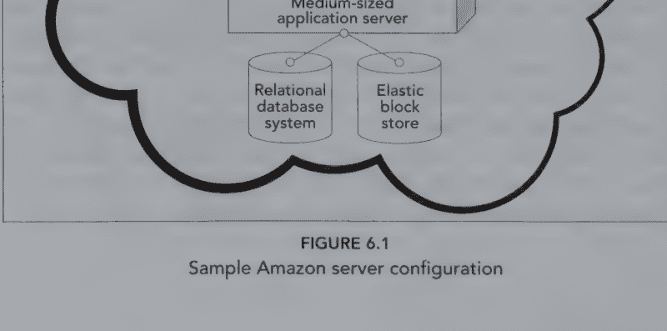

FIGURE 6.1

Sample Amazon server configuration

monitoring, machine imaging, and storage snapshot services built into the AWS platform to manage both the reserved storage space and application server. The Relational Database Service (RDS) is an independently managed service with its own backup and monitoring services. In this example, persistent data are stored as separate 100 GB EBS volumes (e.g., digital images, essential documents, website files) that can be detached from the application server and reattached to a new server if required. Storing important data on EBS volumes rather than on storage associated with the machine instance both makes it easier to migrate this data onto new servers and provides additional levels of redundancy that reduce the risk associated with hosting important files on cloud services.

In this environment, CloudFormation configuration services would be used to document server configuration. The CloudFormation service supports both initialization and setup of Amazon resources (e.g., EC2 instances, EBS volumes, Security Group definitions) and installation and configuration of specific server applications. To accomplish this, the CloudFormation service uses a package management service called `cloud-init` that is designed to facilitate server configuration during initial start-up. A good “getting-started” guide for this service is in Amazon’s documentation on CloudFormation (Amazon 2012). Reid (2012) suggests using Chef (`www.opscode.com/chef/`) along with CloudFormation to create an automatic configuration tool that is independent of platform and operating system.

Linode and Rackspace offer similar functionality for scripting resource creation and management. Figure 6.2 shows a similar cloud implementation using Linode as the sole cloud provider. Like Amazon, Linode supports multiple cloud regions and has its own customized scripting language, called Lish, to facilitate server management. Linode’s monitoring service, like Amazon’s, focuses on server health as opposed to application health. Linode uses StackScripts to support automatic configuration and deployment of servers and features version control for scripts to allow easy testing and restoration of services.

Chapter 5 examines the costs associated with a single-vendor model. Tables 5.2 and 5.3 show budgets that generally fit the configurations outlined in figures 6.1 and 6.2. The budgets include a comparison of costs for on-demand and reserved instances but omit charges for services that libraries may want to include from outside vendors (e.g., managed backups, region replication, or application monitoring).

Some benefits of this single-vendor cloud are tight integration between Amazon services; consistent monitoring, configuration, and backup services; built-in ability to scale or replace application server easily without impacting database or digital object storage; and ability to migrate one or more services into new availability

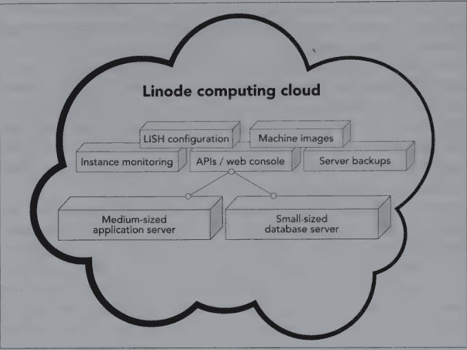

图6.2

示例 Linode 云部署

区域。此外，在这种方法中，数据库实例、长期存储的数据与应用服务器之间的紧密关系使得许多任务可以实现自动化。例如，自动配置和部署应用服务器（而非数据库和EBS资源）可能是非常理想的。此外，随着信息服务日渐成熟，学习配置系统的技术要素，能在高效的IT服务管理、文档编制和服务质量方面带来巨大回报。

图6.1中详述的方法也带来了技术和配置方面的挑战。例如，由于Amazon并未在其Web控制台中提供自动备份机制，用户必须借助外部供应商或Amazon命令行工具来实现定期对服务器资源进行快照的解决方案。幸运的是，由于这是一个常见问题，有几种可行的方法。对于希望在服务器上保留备份服务调度的客户，使用可用的AWS命令行工具平台（`http://aws.amazon.com/articles/`）编写的简单备份脚本即可轻松实现。libcc.org（`http://libcc.org`）上的AWS教程提供了一种使用Python BOTO库（`http://code.google.com/p/boto/`）的备份脚本。同样，由于Linode不提供托管数据库服务，因此额外加入一台服务器作为数据库服务器。对于在信息系统中使用多种数据库平台的图书馆而言，这实际上可能更可取。尽管此解决方案要求图书馆自行承担数据库管理，但它也减轻了备份方面的责任。Linode的托管备份服务负责备份调度和轮换。

云服务提供商确实会经历偶发的停机，而单一供应商云会带来相当大的风险。不过，对于包含多个独立云区域的供应商，有一些方法可以缓解这种风险。在2011年经历的故障中，Amazon客户认识到冗余且易于复制的云基础设施有多么重要（Cockcroft et al. 2011; Tonjes 2011）。事实上，Netflix的做法是利用Amazon平台构建PaaS环境，以此解决该问题（Cockcroft 2012）。在Netflix架构中，重点放在使用持续集成工具设计可扩展性、应用发布与管理，使用Cassandra（`http://cassandra.apache.org`）进行数据库存储，以及使用预构建的AMI来部署运行实例（Chan 2012; Cockcroft 2012）。Cockcroft关于系统架构的演讲中提到的有趣成果之一是IT开发从系统管理角色（如数据库管理、系统管理）中重新定位出来。

这种方法的另一个挑战是，如果不投入大量开发时间和费用，就无法迁移到新的云服务提供商。尽管这些提供商支持机器和数据导出，但对供应商提供的管理服务的依赖意味着迁移包含大量的学习和设计工作。最后，正如我们的成本分析所示，依赖单一供应商可能迫使图书馆在某些领域为其并不需要的容量付费。供应商对网络流量、存储空间、服务器规模以及核心服务与附加服务采用不同的成本模型。随着服务需求的变化，单一供应商云将使得长期管理这些成本变得困难。

## 方法二：基于SaaS的混合云管理

我们的第一种方法将所有应用绑定到一台服务器上，要求图书馆管理多个应用栈，并选择一台能够服务于所有应用的服务器。将应用隔离到不同的服务器上可能更可取，这样一台系统的停机或问题不会影响其他系统。此外，图书馆可能希望改用PaaS和IaaS提供商的混合，根据平台或可扩展性需求将应用分开。尽管这可能会带来更持久的架构和更高效的资源利用，但也可能使监控、审计和管理这些服务变得困难。

为了解决这些问题，越来越多的供应商在IaaS和PaaS服务之上提供增值支持。这些SaaS服务涉及的一些关键领域包括：服务审计、服务器和应用监控、服务管理自动化/简化，以及管理通知。在我们的第二种云模型中，保留了第一部分所述的Amazon云，但另一个应用部署在Heroku平台上。使用该平台可能是因为Heroku能够轻松扩展服务，因为与应用栈（如Ruby on Rails）的良好契合，或者仅仅是为了建立一定程度的供应商冗余。在本示例中，数据库和数字对象存储服务继续通过Amazon RDS和EBS服务提供。图6.3展示了这种部署，并说明了Ylastic和Cloudability等SaaS服务如何用于监控、审计、备份和复制。

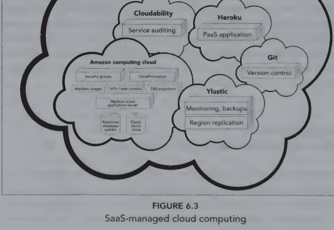

图6.3

SaaS管理的云计算

该模型使用Ylastic为Amazon和Heroku云平台提供应用监控，并为Amazon平台提供备份和区域迁移服务。Cloudability为Amazon和Heroku提供成本审计。通过监控成本和资源利用率，Cloudability允许管理员获得其环境的一致跨提供商视图。尽管Ylastic只专注于Amazon，但它能够为未附加的EBS卷等孤立资源提供高级审计。这种方法通过跟踪过度预留的资源并自动化复杂功能，为IaaS平台增值。例如，我们的第一个模型强调了AWS Web控制台中缺乏简化备份服务的问题。为解决此问题，Ylastic为EBS卷和AMI创建服务提供了托管备份服务。如图5.7所示，Ylastic提供自动化和计划任务，可促进服务器管理。此外，它还提供了跨多个AWS区域进行服务复制的图形界面。鉴于Amazon的SLA基于订阅者在另一区域重新部署服务的能力，拥有一个促进此过程的服务可能很有价值。Heroku的自动可扩展性、Ylastic的区域复制服务以及Cloudability的资源使用通知功能，都能通过允许图书馆按需扩展服务来省钱并简化IT环境。在传统IT模型中，IT服务容量以“n+1”概念为中心——也就是说，总是拥有超出需求的容量。在管理良好的云环境中，服务可以根据需求扩展或缩减，或在需要时复制到新区域，从而有可能实现“即时”提供服务。

虽然Ylastic对其基础服务收费，但一些SaaS服务对较小的用户确实是免费的。例如，Cloudability为云支出低于2500美元的订阅者提供免费成本审计服务。同样，像RightScale这样的云配置/监控服务以及包括Monitor.Us在内的监控服务都提供免费订阅级别。然而，免费服务可能并不理想，因为它们往往缺乏本地控制（见第3章）。

这种方法的好处包括：跨多个云提供商的选择性冗余；基础设施级任务（如备份）的自动化；对成本和资源利用率的更清晰了解；通过SaaS解决方案支持原本不可用的服务；以及自动扩展、复制和通知功能，使图书馆能够从“以防万一”的IT规划模式转向“即时”模式。这种方法也存在一些挑战。使用多个提供商所带来的额外复杂性需要 result in better service or a more durable or manageable system. Systems that rely on more than one provider to function run the risk of reduced stability and increased downtime as the SLAs of both vendors come into play. There is also a risk with turning key infrastructure functions such as backup over to SaaS options. This creates the same vendor lock-in risk discussed in our first model and requires that IT departments view these services as core elements of their IT infrastructure. For this reason, the services easiest to adopt in this environment are those whose temporary or permanent failure would not compromise the integrity of core library services. Finally, the SaaS services described in this model rely on IaaS vendor APIs and shared keys. Although it may ultimately make sense to use an SaaS service to benefit from economies of scale, it can be equally valuable to invest in developing local expertise for working with the command line tools instead.

## APPROACH THREE: REDUNDANT AND SCALABLE MULTICLOUD DEPLOYMENTS

Like our second approach, the third uses multiple providers and SaaS but adds abstracting service configuration and deployment to an SaaS provider. IaaS providers tend to do a good job creating a durable cloud framework but in exchange may focus less on simple IT administration services. Learning the API framework of IaaS providers is useful for ensuring a high-quality cloud infrastructure, but it can be difficult for a small IT environment to learn to work with multiple IaaS platforms using this approach.

Approach three seeks to balance the benefits of using multiple cloud IaaS providers while limiting the challenges associated with managing services without focusing on which IaaS provider runs each service. Two resources discussed in chapter 5 seek to serve this need: RightScale and KOALA. These services use a configuration and resource deployment platform to enable IT administrators to move services easily between cloud providers. This process means that certain services such as DNS resolution and server configuration tools are offloaded to these cloud services, but in exchange RightScale manages replication across multiple cloud providers. Figure 6.4 shows a potential configuration using RightScale to monitor and manage cloud services on Amazon, Rackspace, and a private cloud running Eucalyptus. It also shows the use of Cloudability to audit cost and resource utilization across these providers.

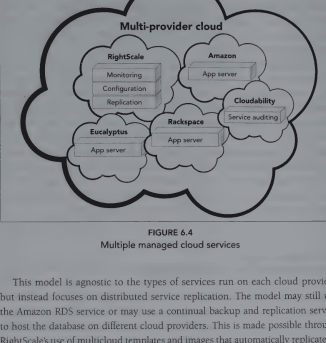

### FIGURE 6.4 Multiple managed cloud services

This model is agnostic to the types of services run on each cloud provider but instead focuses on distributed service replication. The model may still use the Amazon RDS service or may use a continual backup and replication service to host the database on different cloud providers. This is made possible through RightScale's use of multicloud templates and images that automatically replicate or back up services onto multiple cloud systems. For example, RightScale publishes a managed MySQL database server that runs on multiple cloud platforms, backs up to Amazon S3 and Rackspace CloudFiles, and includes tools to assist with database recovery and firewall management. In this model the private cloud (e.g., Eucalyptus) may be used as the primary service or simply as a redundant service in case the other providers experience difficulties. This model does not include PaaS providers, but it would be possible to build PaaS solutions into this framework as well.

An alternative approach to this configuration is to use KOALA as the federated system configuration and management tool. KOALA was designed as an open-source product that can be implemented in a PaaS environment using the Google Apps engine. KOALA focuses on different cloud services and is valuable because it provides a consistent management interface for both public cloud services like Amazon and private cloud services such as Eucalyptus. The KOALA framework would emphasize a common toolkit over managed images and replication services but would provide adapters with a simple-to-use platform that solved the API discrepancies between providers.

The benefits of this approach include the highly distributed use of cloud vendors; automated replication of services and management of DNS that can be tied into monitoring tools; incorporation of private cloud functions; abstraction of server configuration from specific providers; and automatic configuration of enterprise-scale database and application services. At the same time, this distributed vendor model is more complex than the other approaches and may lead to overall higher costs. As seen in chapter 5, many IaaS providers are designing systems that tightly integrate with private cloud platforms through common APIs and cloud bursting functionality. This is a useful development, but libraries without large IT departments or with applications designed to run in traditional server environments may not be able to take advantage of these features.

## APPROACH FOUR: DISTRIBUTED SAAS ENVIRONMENTS

The three approaches reviewed above are based on the premise that libraries will turn to PaaS and IaaS solutions for specific services. This is not to say that library-specific SaaS solutions are not yet mature enough for widespread adoption. There are now many options for libraries seeking SaaS solutions for all of their services. Existing vendors are expanding both their use of cloud approaches and their product suites, and new companies have emerged to provide website, virtual reference, media hosting, and other information services. In fact, every key information system including the ILS, DAMS, link resolver, digital reference, discovery, resource fulfillment, electronic resource management systems, and websites are available in SaaS forms. In figure 6.5 a hypothetical library relies on a mix of commercial and consortial providers for system support. In each case, the system is offered in a managed SaaS environment, and the library is responsible for ensuring that systems that need to connect to each other do so. In addition, to provide some measure of resource tracking and monitoring ability the library uses an SaaS monitoring service to keep track of system uptime and deploys both its website and an internal intranet on a WordPress SaaS service. To provide authentication services, the library has negotiated relationships with its organizational IT to make LDAP authentication available to their hosted EZproxy service.

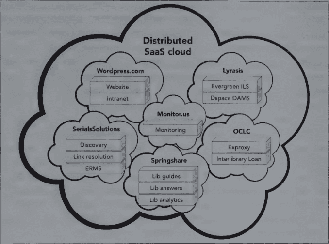

### Figure 6.5 Distributed SaaS cloud services

Figure 6.5 does not attempt to show relationships between services and does not speculate on the database or application platforms of the services. The use of the staff intranet allows the library to track administrative accounts and URLs, store license and renewal data, and provide a database of subscribed services. In addition to working with organizational IT for LDAP authentication for specific services (e.g., EZproxy), the library must track IP addresses associated with each service, coordinate data services where needed (e.g., between Evergreen and serials management services), and work with organizational IT to manage DNS services so that a consistent site-naming scheme (e.g., catalog.library.edu, ezproxy.library.edu, www.library.edu) is employed across the wide range of service providers.

Some key advantages to this approach are efficiency and economies of scale for data-intensive services; enterprise-level IT support that does not depend on local expertise; SaaS monitoring and intranet services that facilitate auditing and management of providers; and achievement of rich information services without dependence on local IT resources. Although these solutions may be preferable for many libraries, the market is still somewhat limited in terms of product selection, and consolidating the number of vendors in this model comes at the expense of product selection. At the present time, libraries seeking to adopt SaaS solutions exclusively find themselves making decisions on both system functionality and vendor services. This is likely to change in the coming years as LIS providers optimize their software to run efficiently in the cloud.

For libraries seeking to use SaaS solutions to fill these gaps, there are an increasingly large number of case studies that explore SaaS alternatives to traditional library solutions. For example, Wilson (2011) explores the use of `Drupal`, `Basecamp` (`http://basecamphq.com`), and `MIRA` (`http://atlassian.com/software/jira`) as an alternative platform for electronic resource management systems. Wilson explores the challenges associated with adapting these platforms to serve a very specific function, as opposed to the implications of using an SaaS platform for this service, but the reported success of all three services point to an opportunity for these types of tools to have a dramatic impact on library IT decisions.

Perhaps the largest challenge in this adoption environment is managing the budgetary, license, identity management, and functional interoperability of these systems. Although many providers feature some form of integration through web-based plug-ins, back-end indexing, or automated data loading, making these services work together can be challenging, particularly for libraries interested in offloading as much technical work as possible. Unfortunately, these challenges may not emerge until a specific system is implemented or need found, and it can be difficult for libraries without in-house IT staff to identify potential solutions.

These data and interoperability problems do not have easy one-size-fits-all solutions, but there are potentially useful options. For example, Peter Murray (personal communication, March 2012) observed that `Lyrasis` tunes its hosting services based on library need and worked with outside consultants to bring data migration services to the table for libraries adopting its hosted IT services. In addition, there are IaaS providers whose primary purpose is to enable interoperability in an SaaS environment. Two examples are `SnapLogic` (`http://snaplogic.com`) and `Jitterbit` (`http://jitterbit.com`). These providers support data connections using a range of data sources (e.g., `XML`, `CSV`, `ODBC`), include a data migration design interface, and support HTTP endpoint services in which data queries and publishing actions can be activated by REST-based HTTP requests. These services require detailed data analysis skills; still, they may enable libraries to avoid implementing expensive IT infrastructure for otherwise lightweight data conversion services.

这四种方法强调了云解决方案中不同的优势和劣势，可以作为图书馆转向云计算的起点。第一种方法强调使用单一云提供商的简单性和控制力，但也认识到通过广泛使用提供商API而被锁定的风险。第二种方法试图通过使用多个提供商并利用SaaS解决方案来监控、管理和审计这些提供商，从而减轻部分风险。这种方法展示了跟踪云基础设施和支出的好处，并表明SaaS解决方案是提供基础设施管理支持的一种方式。第三种方法侧重于从IaaS提供商抽象系统设计和实现的服务，并展示了轻松使用多个云平台的好处；尽管如此，它很复杂，可能需要超出第一和第二种方法的IT和资金资源。第四种方法认识到图书馆很可能转向完全基于SaaS的解决方案来满足技术需求。在这种情况下，运营、管理和服务质量问题比技术问题更为重要。

在现实世界中，图书馆很可能会采用不止一种方法。事实上，大多数图书馆已经在某种程度上依赖SaaS提供商或外包信息服务。在决定是否扩大这些角色，或在将新服务迁移到云端时考虑其他方法时，本地资源、专业知识、IT支持能力、组织政策和服务需求等问题是有用的因素，可以使一种方法比另一种方法更可行。无论选择哪种方法，容量规划、服务质量监控、服务集成和资源利用监控等IT服务要素都是可持续IT基础设施的重要组成部分。本章其余部分将探讨这些问题，并为开始使用云计算提供建议。

## 准备采用云计算

图书馆IT部门的发展是为了响应特定的图书馆需求，如客户支持、ILS支持和DAMS支持。仍然常见的是，IT图书馆员拥有IT学科以外的背景，但也有一个趋势在图书馆会议和文献中被记录，即采用行业标准的IT软件开发和服务管理方法（Chang 2010; Dougherty 2009）。这些文章讨论了图书馆正在采用IT服务模型，包括正式的模型，如信息技术基础设施库（ITIL）（`www.itil-officialsite.com`）和较非正式的模型，如ITSM（`www.itsm.info/ITSM.htm`）。即使对于尚未使用此类模型的图书馆，也存在服务管理门户的使用（McHale 2010），并且对社区驱动软件开发责任的认识日益增强（Reese 2012）。

正如我们对云方法的探索所强调的，需要正式的IT管理实践。对于主要转向SaaS解决方案的图书馆，IT管理的重点应放在维护服务提供商和支持信息的内部网上。对于更多转向PaaS和IaaS解决方案的图书馆，更正式的支持策略有助于使解决方案的实施和管理可持续。有多种模型可供选择，包括`ITIL`、系统开发生命周期（Department of Justice 2003）、信息及相关技术控制目标（ISACA 2011）和微软操作框架（Microsoft 2011）。这些模型帮助IT组织以系统的方式处理IT服务的系统选择、开发、实施、管理和退役，对任何类型的图书馆都有帮助。尽管每个模型都有其独特的特点，但已经尝试在这些模型中寻找相似的过程和共同点（Pollard et al. 2009; Susanto et al. 2011）。这些模型的批评者指出，IT服务模型的采用并未证明IT服务的改进，并断言它们创造了行政开销，并可能导致武断边界的创建（Addy 2007, 4）。

服务管理是一个广泛的概念，定义为“一组专门的组织能力，以服务的形式为客户提供价值”（ITIL 2011, 11）。`ITIL`服务生命周期描述了开发、交付和管理服务的过程，并特别关注知识管理、SLA和标准化。服务管理模型可以提供标准化的成功衡量标准，包括解决时间、未结与已结事件的比例、支持的服务数量以及IT人员的时间投入。

例如，`ITIL`服务模型讨论了服务的三个阶段：开发、转产和运营支持。这些过程中的每一个都涉及各种离散的服务组件，包括定义服务水平需求、评估IT支持容量、定义安全需求和记录用户期望。Addy (2007, 50) 提供了需要定义的领域的完整列表，包括用户、用户需求、预期交付物、用户提供的信息或数据、服务交付方法、角色和责任、合同要求、成功衡量标准、服务可用性定义、服务容量衡量标准、安全标准和成本要求/履行。虽然处于纳入正式IT服务管理方法阶段的读者最好更深入地探讨这些领域，但当您的组织探索云解决方案时，即使是非正式地意识到这些问题也很重要。

这里提到的每个IT服务模型在云环境中都能很好地工作，但有些正在探索特定于云采用的问题。例如，微软操作框架（2011）探讨了SaaS、PaaS和IaaS环境中哪些系统元素（如网络、存储、数据、应用程序）是本地管理还是远程管理。将通用IT服务指南应用于云环境的最佳实践建议包括对沟通、服务和问题解决的改变。例如，微软指南建议在服务目录中添加元素级云服务，以确保用户了解可用的核心云服务及其实施成本和参数。拥有关于组织已使用的云平台的文档，有助于指导围绕IT服务采用的讨论和决策，并可能防止以脱节的方式使用多个云服务提供商。微软的指南还建议尽可能自动化服务并利用云平台的自助服务功能。

对于从事IT服务重新评估、探索向云资源转移，或仅仅有兴趣寻找重新设计IT服务方法途径的图书馆，了解IT服务模型和标准有助于指导组织变革。这可能导致集中式的图书馆IT，特别是在转向PaaS或IaaS解决方案的组织中，也可能导致更分散的IT环境。在这两种情况下，使用某种形式的服务目录、知识管理系统和服务工单系统，可以帮助图书馆跟踪IT发展，并就其IT服务变更做出明智的决策。尽管有设计完美系统的动机，系统管理员应注意过度承诺复杂系统配置和管理实践的风险。事实上，通过使用云环境来托管服务目录、知识管理和工单管理系统，图书馆IT部门既可以利用SaaS解决方案的效率优势，也可以表明他们愿意“吃自己的狗粮”。将这些内部服务迁移到云端或首先在云端部署它们的做法，也可以成为图书馆环境中采用云服务影响的良好试验场。

虽然很难量化IT服务部门的服务容量，但作为IT服务模型一部分的度量标准和框架可以帮助衡量应用程序和资源的使用情况。同样，如果明智地应用，这些IT服务模型可以扩展IT部门的优势，使少量IT人员能够更轻松地管理大量请求。也许这些服务模型最重要的原则是，IT服务提供商设定了对客户和服务提供商都有效的界限和期望。虽然这通常在SLA中正式化，但这些协议不一定需要复杂，至少可以帮助避免误解和客户期望的错位。

### 为新服务腾出空间

对于探索云端的组织，一个重要的问题是云计算如何帮助图书馆支持新的或不同的服务。这里需要考虑几个重要的IT和组织问题，包括服务需求、用户期望、IT平台选项、成本考虑以及法律/组织政策。了解约束和剩余在哪里，可能有助于引导讨论，并帮助组织了解其精力应最好地分配在何处。例如，人员限制和缺乏专业知识可能意味着图书馆倾向于转向SaaS解决方案。正如前一节所指出的，使用SaaS解决方案并不能消除对IT服务管理任务的需求。相反，随着图书馆转向更多的SaaS解决方案，对跨部门服务目录和知识/工单管理系统的需求增加了。在SaaS服务的许可、管理和部署分布在多个部门的组织中，这种需求甚至更大。

对于发现需要定制化或本地化服务意味着使用PaaS或IaaS的组织，识别常见或非差异化服务（这些服务资源利用率高但影响低）并将其转移到SaaS解决方案可能会很有用。这可能包括系统和services that were once the bread and butter of library IT departments, ILSs, and electronic resource management systems. Likewise, new library services such as large-scale discovery, resource recommendation, and resource sharing depend on network-based services to such an extent that they work only as an SaaS solution.

## Build Support for the Migration

Some of the major internal limitations of moving to cloud computing include local policy, staff expertise, lack of cooperation with organizational IT, lack of funding, and lack of satisfaction with provider terms. Many of these issues require administrative-level work with providers; nevertheless, understanding and addressing the limitations of current staff expertise through new recruitment or training can dramatically improve an organization’s ability to adopt cloud solutions. It is not necessarily easy, but building internal capacity for software programming, IT service, and server administration increases the number of options in IT adoption and facilitates management of SaaS as well as PaaS and IaaS solutions.

Organizational resistance to cloud migration can be difficult to overcome. Marketing the shift as an opportunity to redefine service relations between libraries and organizational IT or to enable new collaborations can help resistant departments see how cloud adoption can benefit them. Libraries moving to the cloud are likely to depend on some key services from their organization’s IT, including `DNS` resolution, firewall support (for both incoming and outgoing ports as needed), and advice on IT issues. It makes sense for libraries to be well informed about legal and policy issues before heading to IT departments and to be prepared to take on the liability of service uptime and capacity planning in a formal document. Often, IT organizations are guided by a need to define and understand service boundaries. By recognizing these boundaries and taking appropriate responsibility, libraries can often be successful in renegotiating a relationship with organizational IT management that is beneficial for both parties.

## Leverage Vendor-Provided Tools

One of the key advantages of adopting cloud services is the built-in service infrastructure that comes with even the most basic services. For example, Amazon has a site dedicated to informing cloud customers about value-added applications (`http://aws.amazon.com/customerapps/`). These services include mobile AWS management tools such as `iAWSManager` and value-added services such as

LabSlice—a virtual computing lab (VCL) management tool designed to facilitate the design and deployment of VCL infrastructure on AWS. Many of the SaaS, PaaS, and IaaS platforms discussed in this book feature robust web-based management interfaces that are designed with mobile device utilization in mind. For those services that do not work well in a web-based mobile interface, there are often mobile device applications that provide access. For example, Linode services include an iPhone management application called Linode Manager, and Android apps that were not developed by Linode but leverage the Linode API suite are available.

Choosing applications to tie into or provide advanced services on top of cloud providers can be difficult. Mobile management tools, alternative client-based access tools such as Cyberduck, and application monitoring and auditing tools are of high value and pose little risk to the core cloud services. As in the case of cloud-based digital object storage, however, it can be difficult to use some cloud functions without relying heavily on third-party products. Perhaps the most important consideration is not whether a service adds value, since most of them do, but rather whether there is a second pathway away from the service if there is some failure of the primary application. For example, though using Amazon S3 as a file system through Cyberduck or S3-Fuse (`http://sourceforge.net/projects/s3fuse/`) serves a valuable need, adopters need some method by which they can recover their data if the selected service fails. In this case, there are several tools, not the least of which is Amazon’s own API toolkit, which can help with object recovery.

## Stand on the Shoulders of Giants

One of the great advantages of moving to the cloud is gaining access to enterprise-level IT services with very little overhead. Another important advantage is the ability to tap into support communities in both the cloud and library IT world. Many of the cloud providers discussed in this book make their tutorials available freely and even provide free levels of service for new adopters. In addition, there are companies such as Alestic (`http://alestic.com`) and willing experts in the library community (e.g., Code4Lib, LITA, and ALA Cloud Computing interest group) that can help answer questions, give advice, or solve specific technical problems. There is also an abundance of white papers, guides, tutorials, best-practice recommendations, and getting-started documents available to new and experienced cloud users.

A challenge that staff new to server administration in general are likely to encounter is developing an understanding of how to work with the many moving parts of system security, performance, application management, and IT service. Linode's system documentation and Mitchell's AWS-focused 2011 LITA preconference tutorials (`http://erikmitchell.info/lita_2011_aws/aws_tutorials.pdf`) can serve as initial guides through these environments. Many companies also publish a series of higher-level guides, video tutorials, and webinars intended to help adopters implement secure services. For example, Amazon's white paper series (`http://aws.amazon.com/whitepapers`) includes operational checklists, case studies on backup and recovery, and overviews of security and compliance procedures. Linode also offers a wide range of useful tutorials (`http://library.linode.com`). Linode's documentation library naturally focuses on managing Linode's infrastructure, but it includes platform-agnostic tutorials on how to create high-availability applications, set up system security, and deploy application frameworks. Because Linode's documentation often includes tailored tutorials for Ubuntu, Fedora, CentOS, and other flavors of Linux, it helps readers understand both the broad concepts of system administration and the specific practices associated with a given platform. For users seeking to take advantage of PaaS solutions, both Heroku (`http://devcenter.heroku.com/`) and Amazon (`http://aws.amazon.com/articles`) include platform-specific tutorials on deploying applications in their environment.

## Get Started

This book outlines several approaches to cloud computing or virtualization, focusing on technical, organizational, and environmental factors that influence decision making in this area. For those libraries seeking to implement new services, cloud computing can provide a way to implement those services quickly and without considerable overhead for organizational IT. In contrast, libraries that are looking toward cloud computing as a way to transform existing IT practice are best served by examining their current IT service environment as well as the functional needs of their user community and then selecting cloud solutions that will both improve service quality and create room for new information services.

Library-specific systems are moving toward the cloud, and there are new opportunities for libraries to engage with industry-standard applications. The trend toward cloud computing has become mainstream in both the library and wider information community, and, although library adoption of cloud computing lags behind the corporate world, a robust range of services is available. Libraries are more frequently turning to SaaS than to PaaS or IaaS solutions. It should not be surprising that libraries are finding SaaS solutions attractive, given the benefits of economies of scale, potential cost savings, and improved service offerings. Issues of expertise, local capacity, organizational policy, and desired end-user service outcomes are also heavily influencing these choices. This trend toward SaaS poses both opportunities for libraries and challenges to open-data and open-source communities in the library world. In fact, as libraries turn increasingly to cloud solutions, they are helping redefine our industry’s view of distinctive library services and shaping the design of new information systems. If nothing else, the shift to SaaS platforms is demonstrating that just about every library service can be turned into a generalized commodity whose primary purpose is to support high-quality, user-facing services. Still, issues of data ownership, resource sharing, and interoperability pose continued challenges for these communities as library IT vendors seek to offer more comprehensive service frameworks that discourage multivendor adoption.

In contrast, PaaS and IaaS solutions provide a great level of flexibility, independence, and assurance of privacy at lower cost but at the expense of more local investment and expertise. There are few ready-to-use library-specific applications in these environments. This points to a real opportunity for open-source communities, consortia, and commercial providers to expand their support for PaaS and IaaS solutions and to help libraries make use of a wider range of cloud services.

## REFERENCES

- Addy, Rob. 2007. *Effective IT Service Management: To ITIL and Beyond!* New York: Springer.
- Amazon. 2012. “Deploying Applications: AWS CloudFormation.” *Amazon Web Service Documentation*. `http://docs.amazonaws.com/AWSCloudFormation/latest/UserGuide/deploying.applications.html`.
- Chan, Jason. 2012. “Cloud Security @ Netflix.” *SVForum Cloud and Virtualization SIG*, March 27, 2012. `www.slideshare.net/jason_chan/cloud-security-at-netflix`.
- Chang, May. 2010. “An Agile Approach to Library IT Innovations.” *Library Hi Tech* 28 (no. 4): 672–89. doi:10.1108/07378831011096303.
- Cockcroft, Adrian. 2012. “Cloud Architecture at Netflix: How Netflix Built a Scalable Java Oriented PaaS Running on AWS.” *SVForum*, March 27, 2012. `www.slideshare.net/adrianco/netflix-in-the-cloud-at-sv-forum`.
- Cockcroft, Adrian, Cory Hicks, and Greg Orzell. 2011. “Lessons Netflix Learned from the AWS Outage.” *Netflix Tech Blog*, April 2011. `http://techblog.netflix.com/2011_04_01_archiv.html`.

## 最佳实践与建议

- Department of Justice. 2003. Department of Justice Systems Development Life Cycle Guidance Document. January. www.justice.gov/jmd/irm/lifecycle/table.htm.

Dougherty, William. C. 2009. “Virtualization and Libraries: The Future Is Now (or Virtualization: Which Libraries or Libraries Which?).” *Journal of Academic Librarianship* 35 (no. 3): 274–76. doi:10.1016/j.acalib.2009.03.006.

Feid, Allen. 2012. “Using Amazon’s CloudFormation, Cloud-Init, Chef and Fog to Automate Infrastructure.” *Allan Feid blog*, March 2, 2012. http://allanfeid.com/content/using-amazons-cloudformation-cloud-init-chef-and-fog-automate-infrastructure.

ISACA. 2011. “COBIT Framework for IT Governance and Control.” ISACA website. www.isaca.org/Knowledge-Center/cobit/Pages.

ITIL. 2011. *ITIL Service Design*. Norwich, Norfolk, U.K.: The Stationary Office.

McHale, Nina. 2010. “Managing Library IT Workflow with Bugzilla.” *Code4Lib Journal* 11. http://journal.code4lib.org/articles/3814.

Microsoft. 2011. *Microsoft Operations Framework 4.0*. 2011. Microsoft Operations Framework, last modified October 27, 2011. http://technet.microsoft.com/en-us/library/cc506049.aspx.

Pollard, Carol E., Dhiraj Gupta, and John W. Satzinger. 2009. “Integrating SDLC and ITSM to ‘Servitize’ Systems Development.” *AMCIS 2009 Proceedings*. http://aisel.aisnet.org/amcis2009/415.

Reese, Terry. 2012. “Purposeful Development: Being Ready When Your Project Moves from ‘Hobby’ to Mission Critical.” *Code4Lib Journal* 16. http://journal.code4lib.org/articles/6393.

Susanto, Heru, Mohammad Nabil Almunawar, and Yong Chee Tuan. 2011. “Information Security Management System Standards: A Comparative Study of the Big Five.” *International Journal of Electrical and Computer Sciences* 5:23–29. www.ijens.org/Vol_11_I_05/113505-6969-IJECS-IJENS.pdf.

Tonjes, Chris. 2011. “Amazon Fail: DC Public Library’s Lessons Learned from the Amazon Cloud Outage.” *American Library Association Annual Conference*, July 2011. http://connect.ala.org/files/dcpl%20cloud%20computing%20amazon%20fail.pdf.

Wilson, Kristen. 2011. “Beyond Library Software: New Tools for Electronic Resources Management.” *Serials Review* 37 (no. 4): 294–304. doi:10.1016/j.serrev.2011.09.010.

## F

Fedora (LIS), 10, 71

Feldman, Jonathan, 56–59

FERPA, cloud services and, 60

file bucket defined, 101

firewalls

- about, 83
- PaaS and, 77
- security and, 44–46

FOSS4LIB (registry), 74

## G

Gartner’s Hype Cycle report, 3, 60

Google Apps Engine

- PaaS platform, 90–91
- redundant and scalable deployments, 140–142

GovCloud (cloud service), 61

GovDelivery (cloud environment), 48

government clouds, 5

Gramm-Leach-Bliley Act, 61

GSearch (LIS), 10

## H

Heroku (PaaS platform), 91–92, 138

HIPAA, cloud services and, 60

hosting

- defined, 69
- services, 2–3

HostMonster (service provider), 77

Housewright, Ross, 17

hybrid platforms

- about, 6
- configuration, 125–126
- examples of, 118–125
- issues concerning, 126–130

hypervisors, virtualization and, 8

## I

iAWSManager (management tool), 149–150

identity as a service (IaaS)

- about, 4–5, 99
- backup services and, 51
- configuration, 125–126
- cost considerations, 56, 115, 128–129
- definitions, 100–102
- issues concerning, 109–110, 126–127
- library examples, 108–109
- as point-of-need, 123–125
- portability, 115–116, 129–130
- provider cost comparison, 116–117
- provider examples, 103–109
- SaaS services and, 120–123
- security measures and, 45
- service level agreements and, 52
- sustainability and durability, 114–115, 127
- traditional approach, 102–103
- training and education, 110–114, 127

implementation

- planning for, 62–63
- type results, 24†

incident management and response, security and, 44–46

indemnification (contracts), 53

Information Technology Infrastructure Library (ITIL), 146–148

infrastructures

- about, 99–102
- administration of, 41–42
- environmental factors and, 55–59
- hybrid examples, 118–125
- issues concerning, 109–116
- provider examples, 103–109

intellectual property, policies and, 60

interlibrary loan system (evaluation category), 22

internal noncloud model, 20

internally virtualized defined, 20

intranet (evaluation category), 22

Islandora (platform), 10, 71

IT service adoption

- about, 10–12
- cost considerations, 56
- environmental factors, 55–62
- implementation planning, 62–63
- organizational factors, 47–55
- solutions, 37–40
- technical factors, 40–47
- vendor provided tools and, 150–151

IT support, library specific, 29, 46–47

Index

## J

JungleDisk (server tool), 123–124

jurisdiction

- contracts and, 53
- policies and, 60–61

## K

Kernal Virtual Machine (virtualization format), 7

keys, shared, 46

KnowItNow (service), 72

KOALA (server tool), 123–125, 140–142

Koha (ILS system), 70

Kunze, Marcel, 124

## L

labor costs, 58

LabSlice (virtual computing lab), 149–150

legal issues, environmental factors and, 53, 59–62

liability, policies and, 60

LibAnswers (service), 72

LibGuides (self-service), 72, 142–145

LibLime (service subscription), 48

Library Resource Guide, 33

library centric IT service model, 39

licensing, cost and, 56

LibAnswers (SaaS service), 142–145

Linode

- configuration costs, 129t
- IaaS service, 105–106

Linux (open-source platform), 56, 77

LISHost (service provider), 78

Lita-L (discussion board), 21

load balancers defined, 101

log retention policies, 45

Lyrasis (service subscription), 48, 73–74, 142–145

## M

machine images defined, 101

Malpas, Constance, 17

management system (evaluation category), 22

Marko, Kurt, 8

McKendrick, Joseph, 34

messaging service defined, 101

methodology, 21–22

Microsoft Azure (cloud environment), 3, 48

Microsoft Operations Framework, 146–148

Microsoft Virtual OC (platform), 9

migrations

- distributed SaaS, 142–145
- mixed-cloud SaaS, 137–140
- redundant and scalable, 140–142
- single vendor cloud deployment, 134–137

MIRA (SaaS service), 142

models of cloud computing, 4–7, 32–34

monitoring, security and, 44–46

mountable volume defined, 101

MozyPro (backup service), 50

multiplatforms

- IaaS Solutions, 118–120
- monitoring and security, 44–46

MySQL (platform), 77

## N

National Institute of Standards and Technology (NIST)

- about, 3
- backup services and, 51
- elements of cloud computing, 4t
- infrastructure and, 41
- model of cloud computing, 4–7
- security and, 46

National Security Letters, 61

network-based technologies, 17

network connectivity policies, 45

non-profit service subscriptions, 48

nonvirtualized defined, 20

## O

OCLC (service subscription), 48, 70, 142–145

Omeka (digital publishing service), 48, 71

on-demand, cloud computing and, 4

ongoing costs, 58

OPAC/discovery (evaluation category), 22

Open Repository, 71

open-source

- cost considerations, 56
- hypervisors, 8
- library pilot program, 73

Open Virtualization format (OVA), 10

OpenShift (PaaS platform), 93–94

OpenStack, 8, 57

operating systems (32 bit vs. 64 bit) defined, 100

operational costs, 57

organizational influence, qualitative themes and, 31t

outages (disaster and recovery), 50

outsourcing

- defined, 20, 69
- services, 2–3

ownership of data, policies and, 60

## P

PaaS provider examples

- Amazon Elastic Beanstalk, 88–89
- CloudFoundry, 89–90
- Google Apps Engine, 90–91
- Heroku, 91–92
- issues concerning, 95–97
- RedHat OpenShift, 92–93
- Windows Azure, 94–95

Parallels (platform), 9

participants of survey, 23

payment methods, cost consideration, 55–56

payment methods (contracts), 53

penetration testing, security and, 44–46

PHP (platform), 77

platform, environmental factors and, 55–59

platform administration (IT service), 42–43

platform as a service (PaaS)

- about, 77
- as an application platform, 87–88
- backup services and, 51
- budgeting and, 48
- cost considerations, 56, 96–97
- dedicated servers, 79–80
- education and training, 95–96

# 索引

- hybrid examples, 118–125
- issues concerning, 80–87
- portability, 86–87, 97
- provider examples, 88–95
- server evaluation, 81t
- service cost, 85–86
- service model about, 4–5
- service types, 77–80
- sustainability and durability, 83–85, 96
- training and education, 81–83
- platforms adopted, survey and, 20t
- plug-in defined, 68
- point-of-need service, 123–125
- policies, security, 45
- policy issues, environmental factors and, 59–62
- privacy policy (contracts), 53
- privacy remote access policies, 45
- private cloud computing
  - about, 8
  - defined, 20
  - IaaS platforms, 107–108
  - virtualization model, 20
- private keys defined, 101–102
- providers, comparing costs, 116–117
- public clouds
  - about, 3–5
  - bursting, 57–59
  - virtualization model, 20
- public-facing services, 72–73
- public keys defined, 101–102
- Public Library Funding and Technology Access Survey, 33

## Q

- qualitative adoption themes, 30t
- qualitative data, cloud survey, 26–32
- QuestionPoint (reference service), 72
- queuing service defined, 101

## R

- Rackspace
  - about, 3
  - configuration costs, 129t
  - IaaS service provider, 106–107
- recovery planning, IT service and, 49–51
- RedHat (open-source platform), 56
- Reese, George, 56–59
- reference model, 6t
- reference services, 72
- regions defined, 102
- Relational Database Service (RDS), 135
- repository defined, 68
- resources, cost considerations and, 57
- responses, themes of, 29
- restoration plan (disaster and recovery), 49
- restored defined, 100
- results, cloud survey, 22–23
- return on investment (ROI) model, 56–59
- RightScale
  - about, 3, 46
  - cloud broker, 51
  - hybrid provider, 118–120
  - multicloud deployments and, 140–142

## S

- S3-backed storage, 50, 150
- SaaS provider examples
  - about, 67–68
  - cloud-based ILS, 70–71
  - community virtualization, 73–74
  - digital archival management systems, 71–72
  - hybrid examples, 118–125
  - issues concerning, 74–76
  - public-facing services, 72–73
- Sarbanes-Oxley (regulation), 61
- savings, cost considerations and, 57
- scalability, cloud computing and, 4
- Schaffhauser, Dian, 38
- Schonfeld, Roger, 17
- security
  - breaches in, 60
  - groups defined, 102
  - issues regarding, 44–46
  - IT service adoption and, 44–46
- security as a service (SECaaS), 5
- SerialsSolutions, 43, 70, 142–145
- servers
  - IaaS and management, 112–114
  - instance defined, 102
  - isolation and security, 44–46
  - library (evaluation category), 22
- service-level agreements (SLA), 38
- service monitoring
  - contracts, 53
  - IaaS and, 112–114
- services
  - adoption, influences on, 39t
  - capacity of, 54–55
  - choices in, 12–13
  - components of model, 38
  - configuration, 82
  - costs and environmental factors, 55–59
  - durability considerations, 49t
  - locations of, 53
  - management costs, 58
  - models of, 4–5, 13–14
  - outsourced and hosted, 2–3
  - restoration plan, 49
  - sharing authentication keys, security and, 46
  - snapshots defined, 102
- software
  - bugs (disaster and recovery), 50
  - licensing and cost, 56
- software as a service (SaaS)
  - about, 3
  - backup services and, 51
  - budgeting and, 48
  - cost considerations, 56, 76
  - issues concerning, 74–75
  - libraries and, 68–76
  - portability of, 76
  - security measures and, 45
  - service model, 4–5
  - sustainability and durability, 76
  - training and education, 75
- Solr (LIS), 10
- SpringShare (service company), 72, 142–145
- `SSH/SFTP` protocol, 82
- staffing, cost considerations and, 57
- startup adoptions, cost considerations and, 59
- storage (data) costs, 59
- Stored Communications Act, 61
- subscriptions
  - budgeting and, 48
  - IT service adoption and, 48
- support
  - built-in, 52, 149
  - IT specific, 46–47
- survey responses, 29
- SYSLIB-L (discussion board), 21
- systems
  - backups (disaster and recovery), 49
  - configuration (disaster and recovery), 50
  - implementation type (results), 24t
  - security, implementation and, 44–46
  - types of, 69
- Systems Development Lifecycle, 146–148

## T

- taxonomy of cloud systems, 8
- technical influence, qualitative themes and, 31t
- Technology, Organization and Environments model (TOE), 18–19, 30t
- Technology Acceptance Model (TAM), 18–19, 26
- termination procedures (contracts), 53
- terms of service, 51–54
- themes, survey response, 29
- tools, vendor-provided, 149–150
- transfer of data, cost considerations, 59
- transfers defined, 100
- Trappler, Thomas, 60
- trusted user authentication, security and, 44–46

## U

- Ubuntu (open-source platform), 56
- USA Patriot Act, cloud services and, 60
- user-facing services, 73t

## V

- vendors, SaaS types, 70
- version control defined, 68
- Viewshare (platform), 71–72
- Vimeo (online resource), 72
- Virtual Network Connection, 10
- virtual private network (VPN)
  - defined, 102
  - security and, 44–46
- VirtualBox (virtualization format), 8, 9, 9t, 11t, 42
- virtualization
  - about, 7–10
  - evaluation model, 32–34
  - IT transformation and, 28t
  - as a priority, 27t
- virtualized reference services, 72
- VMWare Fusion (server platform), 7, 9

## W

- warranties (contracts), 53
- web-based control panels, 81–82
- WEB4LIB (discussion board), 21
- website, library (evaluation category), 22
- Windows Azure (PaaS platform), 94–95
- Wison (SaaS service), 142–145
- WordPress (SaaS service), 142–145
- WorldCat Local (platform), 72
- Worldshare Management Service, 43

## X

- XEN (server platform), 7, 8

## Y

- Ylastic (hybrid provider), 121–123, 138–139
- YouTube (online resource), 72

## 您可能也会感兴趣

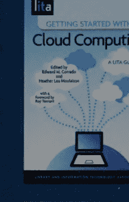

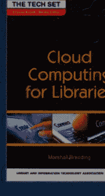

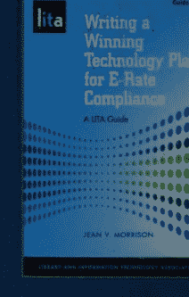
