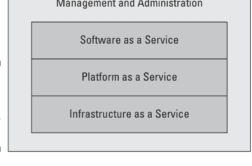
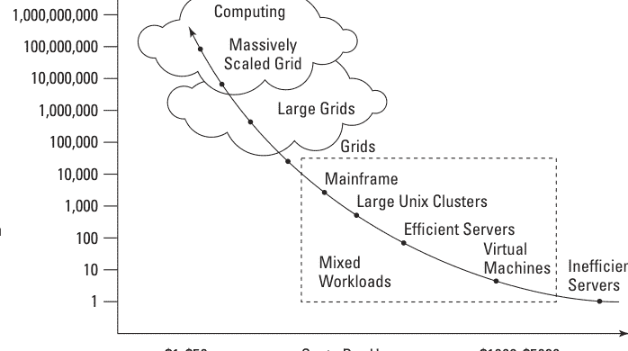
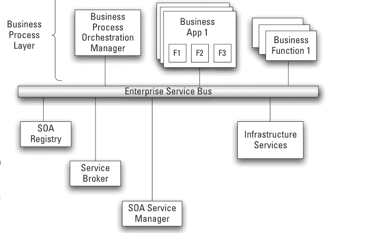
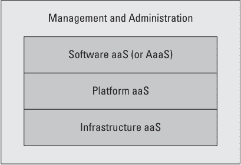
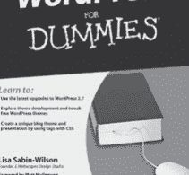
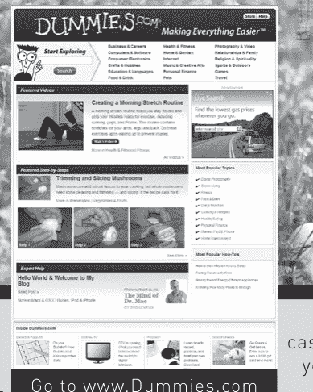
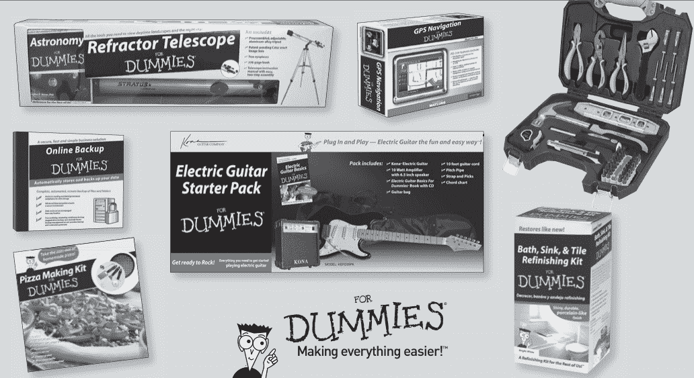

# 傻瓜的云计算

## 在 Dummies.com® 获取更多，成就更多

从**免费**速查表开始

速查表包括

- 清单
- 图表
- 常用说明
- 以及其他实用内容！

**要获取专门为本书打造的速查表，请访问 www.dummies.com/cheatsheet/cloudcomputing**

## 在 Dummies.com 获取智慧

Dummies.com 提供从去除墙纸到使用最新版 Windows 等各类问题的数千个答案，让你的生活更轻松。

看看我们的

- 视频
- 图文并茂的文章
- 分步教程

另外，每月你都可以参加 Dummies.com 抽奖活动，赢取丰厚奖品。*

想要每周获取 Dummies 精选内容吗？订阅以下主题的新闻通讯：

- 数码摄影
- Microsoft Windows 与 Office
- 个人理财与投资
- 健康与养生
- 计算、iPod 与手机
- eBay
- 互联网
- 美食、家居与园艺

## 在 Dummies.com 发现“方法”

*抽奖活动目前并非在所有国家/地区均可参与；请访问 Dummies.com 查看官方规则。

## 关于作者

**朱迪思·赫尔维茨**是一位技术战略家和思想领袖。她是 Hurwitz & Associates 的总裁，该公司是一家业务技术战略公司，帮助企业从技术投资中获取商业收益。她的关注领域是云计算以及所有支撑云的相关分布式计算技术。1992 年，她创立了技术研究集团 Hurwitz Group。她曾在多家公司工作，包括 John Hancock、Apollo Computer 和 Patricia Seybold’s Group。她定期发布博客。朱迪思拥有波士顿大学的理学学士和理学硕士学位。她是*《面向服务架构达人迷（第二版）》*（Wiley）、*《信息按需达人迷》*（2009）、*《服务管理达人迷》*（2009）和*《协作达人迷》*（2009）的合著者。

**罗宾·布洛尔**是 Hurwitz & Associates 的合伙人，担任 IT 顾问和技术分析师近 20 年。他在英国生活和工作到 2002 年，创立了 IT 分析公司 Bloor Research，该公司发布覆盖从计算机硬件架构到电子商务等各个领域的对比技术报告。罗宾是英国商业畅销书*《电子集市：从丝绸之路到电子之路》*（Nicholas Brealey Publishing）的作者，该书分析并阐述了电子商务领域。他是*《面向服务架构达人迷（第二版）》*（Wiley）和*《服务管理达人迷》*（2009）的合著者。

**玛西娅·考夫曼**是 Hurwitz & Associates 的创始合伙人，在商业战略、行业研究和分析方面拥有 20 年经验。她撰写了多份行业白皮书，并定期发布技术博客。玛西娅在不同研究环境中广泛从事金融服务业建模和预测工作，包括 Data Resources, Inc. (DRI)。玛西娅拥有康涅狄格学院数学和经济学文学学士学位，以及波士顿大学工商管理硕士学位。她是*《面向服务架构达人迷（第二版）》*（Wiley）、*《信息按需达人迷》*（2009）、*《服务管理达人迷》*（2009）和*《协作达人迷》*（2009）的合著者。

**费恩·哈尔珀博士**是 Hurwitz & Associates 的合伙人，在数据分析、业务分析和战略制定方面拥有超过 20 年经验。费恩发表了大量关于数据和内容管理的文章。她在文本分析主题上进行了广泛的研究、写作和演讲。她定期发布技术博客。她曾在 AT&T 贝尔实验室和朗讯科技担任要职，并负责朗讯互联网软件部门的战略和产品线规划。费恩获得科尔盖特大学文学学士学位和德克萨斯 A&M 大学博士学位。她是*《面向服务架构达人迷（第二版）》*（Wiley）、*《信息按需达人迷》*（2009）和*《服务管理达人迷》*（2009）的合著者。

## 致谢

**Judith** 将本书的她的部分献给她的家人——她的丈夫 Warren；她的子女 Sara 和 David；以及她的母亲 Elaine。她也谨以此书纪念她的父亲 David。

**Robin** 将本书的他的部分献给 Judy，感谢她的鼓励、支持和建议。

**Marcia** 将本书的她的部分献给她的丈夫 Matthew；她的女儿 Sara 和 Emily；以及她的父母 Larry 和 Gloria。

**Fern** 将本书的她的部分献给她的丈夫 Clay，以及她的女儿 Katie 和 Lindsay。她也谨以此书纪念她的父母 Stanley 和 Phyllis。

## 作者致谢

Amazon 的 Jeff Barr；Bell Aliant 的 Tony Lodge；CA 的 Brian Bonazzoli、Nicole Bufalino、Debra Cattani、Stephen Elliott、Jay Fry、Ajei Gopal、Joanne Moretti、Roger Pilc 和 John Swainson；Cisco 的 William Scott；Citrix 的 Ian Platt；Cloud Camp 的 David Neilson；Computer Sciences Corporation（CSC）的 Brian Boruff；Desktone 的 Jeff Fisher 和 Harry Ruda；Distributed Management Task Force（DMTF）的 Winston Bumpus；EMC 的 Chuck Hollis 和 Irene Miragias；Good Data 的 Roman Stanek；GSK Pharmaceuticals 的 Ivan Hislaire；HP 的 Magdy Assem、Russ Daniels、Cheryl Rose Hayden、Tom Hogan、Rebecca Lawson、Scott McClellan、Joanne McMenoman 和 Scott Pace；IBM 的 Lee Ackerman、Ruthie Amaru、Erich Clementi、Latha Colby、Teresa Cook、Jim Corgel、Dave Dworkin、Leon Katznelson、Martha Leversuch、Dave Lindquist、Amy Loomis、Steve Maher、Mike McCarthy、David Mitchell、Harold Moss、David Parker、Hamid Pirahesh、Sean Poulley、John Simonds、Toby Sirota、Zarina Lam Stanford、Lauren States、Tim Vincent、Marie Weeks 和 David Yockelson；Intuit 的 Anna Lane、Bill Lucchini 和 Angus Thomson；JBoss 的 Aaron Darcy；MDot 的 Mike Kavis；Metro Health 的 Bill Lewkowski；Microsoft 的 Prashant Ketkar、Niraj Nagrani、Steve Sloan 和 Mike Warner；国家标准与技术研究院；Pervasive 的 John Bernard、Kimberli Daugherty、David Inbar、Jim Falgout 和 Hollis Tibbetts；Platform Computing 的 Randy Clark；RightScale 的 Michael Crandell；Salesforce 的 Marc Benioff、Alex Chris、Ariel Kelman 和 Bill Lukini；Savvis 的 Bryan Doerr；ServiceNow 的 Rhett Glauser；Sisters of Mercy Health System 的 Jeff Bell 和 John Treadway；State Street Corporation 的 David Saul；THINKstrategies 的 Jeff Kaplan；Virtual Bridges 的 Jim Curtin 和 Dan Perlman；VMware 的 Dawn Giusti、Neena Joshi、Wendy Perilli 和 Jiam Zhen；Verizon 的 Joe Crawford 和 Tim Gillen；Wavemaker 的 Chris Keene；WorkXpress 的 Treff LaPlante；以及 3tera 的 Paul Brennan。

## 第3章：深入云端 27

### 对组织产生感触 27

### 制定策略 28

### 处理治理问题 28

### 监控业务流程 29

### 管理IT成本 30

### 管理云服务 30

### 服务等级协议与监控 31

### 支持 32

### 计费与会计 32

### 查看技术接口 32

### API与数据转换 33

### 数据与应用架构 33

### 云中的安全 34

### 管理云资源 34

### IT安全 35

### 性能管理 35

### 供给 36

### 服务管理 37

### 解开软件依赖关系 37

## 第4章：制定您的云战略 39

### 看清云战略的诸多方面 40

### 质疑您公司的战略 41

### 评估您今天所处的位置 42

### 我的计算环境有多复杂？ 42

### 我的数据中心环境是什么？ 42

### 什么数据支持我的战略？ 43

### 评估您的费用结构 44

### 检查规则与治理 44

### 制定路线图 45

## 第二部分：了解云的本质 47

## 第5章：了解高度扩展数据中心的优势 49

### 比较财务损失：传统与云 50

### 传统数据中心 50

## 第6章：探索扩展计算机系统的技术基础 59

- 提供一些硬件 60
- 传统！与云 60
- 考虑云硬件 61
- 开源动态 63
- 规模经济 63
- 极大受益 64
- 优化其他方面 64
- 牢记底线 65

## 第7章：检查云的工作负载策略 67

- 在云中管理工作负载 67
- 将工作负载视为精心规划的服务 68
- 创建容器之间的接口 70
- 发现XML如何契合 70
- 使用容器工作负载：案例研究 71
- 平衡风险与实用模型 71
- 在现实世界中测试工作负载 73

## 第8章：管理数据 75

- 声明数据类型 75
- 在云中保护数据 76
- 云中的数据位置 77
- 云中的数据控制 78
- 在云中传输数据的保护 79
- 查看数据、可扩展性与云服务 81
- 大规模数据处理 81
- 云中的数据库与数据存储 82
- 数据归档 84
- 梳理元数据问题 84
- 与您的云供应商讨论数据 84

## 第9章：发现私有云与混合云 87

- 渴望隐私 88
- 定义私有云 88
- 比较公有、私有与混合 89
- 审视私有云的经济性 92
- 评估资本支出 92
- 供应商私有云产品 93
- 提供关键供应商 94
- 以服务为导向的技术公司 95
- 系统集成公司 98
- 技术使能公司 99

## 第三部分：审视云元素 105

## 第10章：了解基础设施即服务 107

### 将IaaS追溯至ISP 107

### 租赁（但不拥有） 108

### 遵循ISP模式 109

### 探索Amazon EC2：案例研究 109

### EC2计算单元 110

### 平台与存储 110

### EC2定价 112

### EC2客户 112

### 查看其他IaaS公司 113

### Rackspace 113

### GoGrid 114

### 其他 114

### 审视IaaS使能技术 114

### AppLogic 115

### Eucalyptus 115

### 信任云 116

### 基础设施即服务对您的意义 117

## 第11章：探索平台即服务 119

### 将平台即服务置于首位 120

### 集成生命周期平台 121

### 锚定生命周期平台 122

### 作为平台的使能技术 122

### 深入集成生命周期平台 122

### Google App Engine 123

### Microsoft Azure 125

### 深入锚定生命周期平台即服务 127

### Salesforce.com的Force.com平台 127

### Intuit 130

### LongJump 132

### 作为平台的使能技术 133

### 在云中测试 134

### 云的服务管理 134

### 集成与配置平台 134

### 社交网络、框架与门户平台 135

## 第12章：使用软件即服务 137

### SalesForce.com对软件即服务的演进方法 138

### Salesforce.com软件环境 138

### SalesForce.com生态系统 140

### 特征化软件即服务 140

### 理解经济性与生态系统 142

### 假装您是客户 142

### 生态系统的价值 144

## 第13章：理解大规模应用和业务流程 .................153

命名名称：拥有大规模应用的公司 .........154

列出公司 .........................................................154

查看基于 Web 的业务服务 .......................................156

从云交付业务流程 ..................................157

业务流程示例 ....................................................157

 destined for the cloud 的业务流程 ....................................158

隐藏在云中 ...........................................................158

业务流程已飞得很高 .......................................158

预测未来 ........................................................159

## 第14章：设定一些标准 ...................................161

理解最佳实践和标准 ..................................161

熟能生巧 ...............................................162

将目标锁定在标准上 .............................................162

云化标准和最佳实践问题 .............................163

互操作性 .............................................................164

可移植性 ...............................................................164

集成 ...............................................................164

安全 ...................................................................164

标准组织和团体 ..........................................166

云安全联盟 .....................................................166

分布式管理任务组（DMTF） ...................................167

美国国家标准与技术研究院（NIST） .....................167

开放云联盟（OCC） ................................................168

开放网格论坛（OGF） ................................................168

对象管理组（OMG） ..........................................169

存储网络工业协会（SNIA） ............................169

云计算互操作性论坛（CCIF） .............................169

垂直团体 .............................................................170

## 第四部分：管理云 .............................................171

## 第15章：管理和保护云服务 ...............173

用问题将安全置于焦点 ................................174

理解安全风险 ...............................................175

减少云安全漏洞 ..........................................177

实施身份管理 ..........................................179

身份管理的益处 ...........................................179

身份管理的方面 ............................................180

检查 SaaS 平台类型 .........................................145

打包软件即服务 ............................................147

协作即服务 ................................................148

使能和管理工具 .............................................149

# 目录

+   监控服务 ............................................................... 217
+   变更管理 ................................................................. 218
+   安全 ......................................................................................... 218
+   进行现实检验 ................................................................. 219

## 第19章：面向服务的架构与云 .......... 221

+   定义面向服务的架构 ........................................ 221
+     结合云和 SOA ...................................................... 222
+     特征化 SOA ........................................................................ 222
+   在云上放松 ................................................................. 223
+   实现 SOA ....................................................................... 224
+     捕捉企业服务总线 ................................................. 225
+     区分你的注册表与你的存储库 ........................................ 225
+     目录化服务 .......................................................................... 227
+   理解云中的服务 ................................................ 228
+   用 SOA 和云计算为业务服务 ......................... 230

## 第20章：管理云环境 ......................... 231

+   管理云 ....................................................................... 232
+     服务提供商 ......................................................................... 232
+     客户 ....................................................................................... 234
+     混合环境 ....................................................................... 236
+   建立支持台 ............................................................... 237
+     服务台目标 ............................................................................ 237
+     多样的支持级别 ...................................................................... 238
+     检查支持服务 .............................................................. 238
+   获得可见性 ............................................................................... 240
+     确保足够的性能水平 ............................................. 241
+     监控服务可用性 .......................................................... 241
+   跟踪服务等级协议 .................................................... 241

## 第五部分：为云规划 .................................................... 243

## 第21章：押注云经济 ................................. 245

+   $eeing the Cloud’s Allure ............................................................... 245
+     满足容量需求 ............................................................. 246
+     在没有资本投资的情况下完成工作 ............................. 246
+     为通用应用选择 SaaS ......................................... 247
+     选择大规模应用 ........................................ 247
+     当并非黑白分明时 .......................................................... 247
+   创建数据中心的经济模型 ................................. 248
+     列出应用成本 .................................................................... 248
+     成本回收 ............................................................................... 250

进一步调整经济模型 ............................................ 251

私有云和分配成本 ...................................................... 251

服务级别和合规成本...................................................... 252

战略考虑和成本 ...................................................... 253

总结经济成本模型 .................................................... 253

## 第22章：开启你的云之旅 ................. 255

对云文化问题说不 ............................................ 255

预见（但不乐于）...................................................... 256

平稳过渡............................................................... 257

量 twice：评估风险 ....................................................... 258

按类别玩风险............................................................ 258

公司主要关切 ............................................................... 259

挑选正确的成功目标.................................................... 260

挑选低垂的果实........................................................... 261

接近其他领域 ............................................................... 261

为利用云做规划 ....................................................... 262

示例 1............................................................................... 262

示例 2............................................................................... 263

## 第六部分：十项清单部分................................................... 265

## 第23章：十个（加一个）优秀的云计算资源 ... 267

Hurwitz & Associates ............................................................... 267

美国国家标准与技术研究院 ...................................... 268

CloudCamp ....................................................................... 268

SaaS Showplace.................................................................... 268

TechTarget ....................................................................... 268

云标准 Wiki............................................................ 269

寻找 OASIS .................................................................... 269

Eclipse 基金会 ............................................................. 269

云安全联盟....................................................... 269

开放云宣言 .............................................................. 270

厂商网站 ..................................................................... 270

## 第24章：十条云计算的做与不做 ...................................... 271

不要被动反应 ................................................................... 271

要将云视为财务问题 ............................................ 271

不要单打独斗 ................................................................... 272

要考虑你的架构.................................................... 272

不要忽视治理............................................................ 272

## 目录

- 不要忘记业务流程 .................................................... 272
- 让安全成为战略的核心................................. 273
- 不要对所有事物都应用云.......................................................... 273
- 不要忘记服务管理.................................................... 273
- 从试点项目开始........................................................................ 273

## 术语表 ........................................................................275

## 索引........................................................................291

## 引言

欢迎阅读 *Cloud Computing For Dummies*。你无法阅读科技期刊或博客——甚至本地报纸——而不遇到对云计算的提及。虽然关于云计算是什么以及它将走向何方存在很多争论，但没有人怀疑它是否真实。

事实上，我们认为云计算以其所有形式正在改变计算格局。它将改变我们部署技术的方式以及我们思考计算经济的方式。我们希望这本书能为云计算提供一个视角，并开启你的探索之旅。

*云计算*不仅仅是位于某个远程数据中心的服务。它是一套方法，可以帮助组织在几乎实时地快速、有效地增加和减少资源。与其他方法不同，云计算在很大程度上关乎商业模式，而不仅仅是技术。公司清楚地了解技术是其运营业务的核心。企业高管长期以来对快速、经济高效地满足其计算需求的复杂性感到沮丧。从某种意义上说，云计算开始成为主流，正是因为这些企业高管将这一问题推到了前沿。

云计算不是一劳永逸的解决方案。它需要大量的思考：哪种方法最适合你的公司？例如，公司必须决定是否要使用 *公共*（外部）云服务，还是要在防火墙后拥有私有云。应如何构建内部环境以支持云？

云环境本身需要软件开发、软件架构和服务管理基础方面的最佳实践作为坚实基础。这一坚实基础尤其重要，因为大多数组织都结合使用公共和私有云服务。在你开始搜索之前，你需要做好充分的了解。我们认为这本书将为你做出明智的决策提供背景。

## 关于本书

云计算是一个庞大的新领域，需要在相当短的时间内让很多人熟悉它。这就是我们写这本书的原因。有些人可能想深入了解技术细节，而其他人可能只关心商业影响。

我们建议你无论想多深入地探索云，都应阅读前五章。这些章节为你提供了关于云及其概念背后的内容的背景。如果你想开始了解云的经济性和可用方法，你应该阅读后面的章节。

你可以从头到尾阅读，但如果你不是那种人，我们也尽量遵循 *For Dummies* 的风格，让各章自成体系，这样你就可以直接进入最感兴趣的主题。不论你从哪里开始，我们祝你好运。

## 愚蠢的假设

尽管我们尽力做到面面俱到，但在撰写本书时，我们必须选择我们认为最感兴趣的读者。以下是我们认为你是谁：

- **你很聪明。** 你不是傻瓜，但服务导向架构这个话题让你感到不安；你无法完全理解它，如果被要求给出定义，你可能会试图转移话题。
- **你是一名商人，对技术几乎不感兴趣或完全不想接触，** 但你生活在21世纪，发现自己无法逃避它。每个人都在说，“一切都关于迁移到云”，所以你认为最好弄清楚他们在谈论什么。
- **你是一名IT人员，对技术了如指掌，** 但对这云的东西很陌生。每个人都说它有所不同。你一次性和最终地想要全貌。

无论你是谁，欢迎。我们在这里帮助你。

## 本书的组织方式

我们将本书分为六个部分，便于阅读。请随意跳读。

## 第一部分：介绍云计算

在本部分，我们从商业和技术角度解释云计算的基础。我们还向你介绍主要概念和组件，以便你在任何有意义的云对话中都能自如应对。

## 第二部分：了解云的本质

第二部分面向更具技术倾向的人。在本节中，我们深入探讨云的实际基础元素。

## 第三部分：检查云元素

有哪些类型的云，它们是如何工作的？本部分深入探讨对你的云计划至关重要的领域。

## 第四部分：管理云

橡胶在这里接触到道路。云计算环境如果管理不当就无法运行。本节为你在这一关键领域提供了充足的思考材料。

## 第五部分：为云做规划

当你了解云计算的全部内容后，你就可以开始规划。你需要考虑云的财务影响以及让你起步的步骤。

## 第六部分：十项清单部分

如果你是 *For Dummies* 宝库的新手，你可能不熟悉“十项清单部分”。在“十项清单部分”，Wiley 编辑会折磨 *For Dummies* 作者，让他们创建有用且易于访问的信息，包含十个（或更多）阐明性要素的列表。我们起初是踢着叫着开始这些章节的，但最终非常高兴它们在这里。我们认为你也会很高兴。

## 本书中使用的图标

请注意。省下的麻烦可能是你自己的。

如果你让这点小提示溜走，你可能会后悔。

我们认为这是一个特别值得注意的有用观点。

为技术倾向更强的人准备的小贴士。

## 从这里开始

我们创建了云计算的概述，并向你介绍了其所有重要组件。其中许多章节本身都可以扩展成完整的书籍。云计算和整个分布式技术格局是我们 Hurwitz & Associates 的重点关注领域，我们邀请你访问我们的网站并阅读我们的博客和见解，网址为 www.hurwitz.com。

## 第一部分

## 介绍云计算

## 第五波

By Rich Tennant

“Oh, I’ll get us in — I used to run tech support at an internet access company.”

## 本部分内容 . . .

短语 *云计算* 暗示了某些东西，但究竟是什么？在本部分，我们介绍这一概念，并提供一个简单的图表来描述云计算的层次。我们还将考察云能为你的组织带来的价值，并审视一些相关的业务问题。

## 第1章

## 掌握基础知识

**本章内容**

- 在云上进行计算
- 看看云是由什么构成的
- 将云与传统方式进行比较
- 推动你的业务

在动态的经济环境中，你公司的生存可能取决于你专注于核心业务并快速适应的能力。昨天的盈利商业模式不能保证转化为未来的增长和利润。随着你的业务适应不断变化的政府和行业法规，评估新的业务合作伙伴，并预见竞争威胁，IT需要帮助业务找到新的应对方式。

与此同时，变革计划往往必须在财务、人力、技术和电力资源有限的背景下制定。在本章中，我们向你介绍云计算——它是什么以及它如何帮助公司重新思考技术部署方式。

虽然有很多技术考虑，但请记住一个基本事实：云计算是一种商业和经济模式。云计算是传统数据中心的替代品吗？答案很复杂。在某些情况下，是的；在某些情况下，不是。

我们是否建议传统数据中心消失而被云取代？不一定。有时传统数据中心是最合适的选择。然而，出于业务敏捷性和经济原因，云正成为公司日益重要的选择。我们认为云计算是计算工业化的基础。是的，它就是这么重要。

## 多视角审视

在本书中，我们从三个视角审视云计算：客户与供应商双方面的战略、商业与经济考量，以及技术基础。我们还将探讨各公司如何在准备迈向以服务为中心的世界时，利用云来控制IT支出。

云计算世界由众多参与者构成：

-   **供应商**：提供应用程序、使能技术、基础设施、硬件和集成。
-   **合作伙伴**：这些供应商的合作伙伴，负责创建云服务产品并为客户提供支持服务。
-   **业务领导者**：正在使用或评估各类云计算产品的企业领导者。

本书面向上述每一类读者，因为他们都是未来计算格局中不可或缺的一部分。

## 云上计算

什么是云计算？云计算是互联网演进的下一阶段。云计算的“云”提供了一种途径，让一切——从计算能力到计算基础设施、应用程序、业务流程再到个人协作——都能以服务的形式，随时随地交付给你。

云计算以不同形式提供：

-   公有云
-   私有云
-   混合云（结合了公有云和私有云）

总体来说，云——与其同名物种“积云”相似——是流动的，可以轻松扩展和收缩。这种*弹性*意味着用户可以根据需求请求额外资源，也可以在不再需要时轻松*取消配置*（或释放）这些资源。这种弹性是个人、企业和IT用户迁移到云的主要原因之一。

在传统数据中心中，添加和释放资源一直是可能的。然而，这一过程无法以自动化或自助服务的方式完成。

向云计算演进的进程——已经在进行中——可能彻底改变企业利用技术服务客户、合作伙伴和供应商的方式。一些企业已经几乎将所有IT资源置于云端。他们认为云模型能提供更高效、更具成本效益的IT服务交付。

这并不意味着所有应用程序、服务和流程都必然迁移到云端。许多企业更为谨慎，正在仔细审视其最具战略意义的业务流程和知识产权，以确定哪些计算资产需要保留在公司内部管控之下，哪些计算资产可以迁移到云端。

## 定义云

云本身是一组硬件、网络、存储、服务和接口，使得计算能够以服务形式交付。云服务包括通过互联网交付软件、基础设施和存储（作为独立组件或完整平台），并根据用户需求提供。

云世界拥有众多参与者：

-   **最终用户**不需要真正了解底层技术。例如，在小企业中，云提供商成为事实上的数据中心。在大型组织中，IT部门负责监督内部资源和外部云资源的内部运作。
-   **业务管理层**需要对云端数据或服务的整体治理负责。云服务提供商必须为其所有客户提供可预测且有保障的服务水平和安全性。
-   **云服务提供商**负责IT资产和维护。

因此，我们撰写本书，将不断演进的云生态系统所有参与者的关切都纳入其中。

云服务必须支持*多租户*——不同公司共享相同的底层资源。这一主题将在第12章进一步讨论。

各公司正在云服务中发现一些重要的新价值。云可以消除传统计算环境中的许多复杂限制，包括空间、时间、电力和成本。

社交网络（如Facebook或LinkedIn）和协作工具（如视频会议、文档管理和网络研讨会）等云服务正在改变企业内部人员访问、交付和理解信息的方式。云计算基础设施使企业更容易将其计算系统视为资源池，而不是一组需要单独管理的独立环境。

总体而言，云体现了以下四个基本特征：

-   弹性以及向上和向下扩展的能力
-   自助服务配置和自动取消配置
-   应用程序编程接口（API）
-   按使用量计费与计量（即用即付模式）

以下各节将更详细地描述每一项特征。

### 弹性和可扩展性

服务提供商无法预测客户将如何使用服务。一位客户可能每年只在销售旺季使用该服务三次，而另一位客户可能将其用作所有应用程序的主要开发平台。

因此，服务需要全天候可用（每周7天、每天24小时），并且必须设计为在高需求时期向上扩展，在低需求时期向下缩减。可扩展性还意味着当用户增加或应用程序需求发生变化时，应用程序可以进行扩展。

这种扩展能力是通过提供弹性来实现的。想想橡皮筋及其特性。如果你用橡皮筋捆扎一打笔，你可能需要将其对折。然而，如果你试图把100支笔固定在一起，你就必须拉伸那根橡皮筋。为什么一根橡皮筋能完成这两项任务？很简单，因为它有弹性，云也是如此。

在第2章中，我们给出一些具体示例，说明提供商如何利用这一特性。

### 自助服务配置

客户无需经过冗长的流程即可轻松获得云服务。客户只需向服务提供商请求一定数量的计算、存储、软件、流程或其他资源。第7章将详细解释这一过程。

## 性能监控与度量

云服务提供商必须包含服务管理环境。服务管理环境是一种集成方法，用于管理物理环境和IT系统。该环境必须能够维持组织所需的服务水平。

换言之，服务管理必须监控并优化服务或服务集合。服务管理必须考虑关键问题，例如整个系统的性能，包括安全性和性能。例如，使用内部或外部电子邮件云服务的组织可能要求99.999%的正常运行时间和最高安全性。该组织会期望云提供商证明其已履行义务。

许多云服务提供商为客户提供仪表板——关键服务指标的可视化视图——以便客户监控从提供商处获得的服务水平。此外，许多客户使用自己的监控工具来确定其服务水平要求是否得到满足。

## 安全性

许多客户必须凭信任“赌一把”，相信云服务是安全的。将关键数据或应用程序基础设施交给基于云的服务提供商，必须确保信息不会被其他公司意外访问（或被黑客恶意访问）。

许多公司在保护内部和外部信息方面都有合规要求。如果没有适当的安全水平，你可能无法使用提供商的产品。有关安全性的更多详细信息，请参阅第15章。

## 云提供商与传统IT服务提供商的比较

传统IT服务提供商为客户运营硬件、软件、网络和存储。虽然客户支付软件许可费，但IT服务提供商管理整个环境。服务提供商在其自有设施中运营基础设施。对于传统IT服务提供商，客户会签订一份长期合同，规定双方商定的服务水平。这些IT提供商通常针对单个客户的需求定制环境。

在云模型中，服务提供商仍可能在其自有设施中运营基础设施（私有云除外，我们将在第9章讨论）。然而，基础设施可能在全球范围虚拟化，这意味着你可能不知道计算资源、应用程序甚至数据实际存放在何处。（我们将在第17章更详细地讨论虚拟化。）此外，这些服务提供商正在为规模化设计其基础设施，这意味着不一定会有大量定制化。（我们将在第13章更详细地讨论规模化问题。）

## 应对问题

业务需求与数据中心管理能够合理提供的内容之间存在固有冲突。业务管理层期望最佳性能、完美实施和100%的正常运行时间。企业领导层希望新功能能够立即投入使用、应用程序能够频繁更改，并能实时访问更多高质量数据——但他们的组织预算有限。

## 采用云计算

尽管对于技术向云端迁移的速度众说纷纭，但毫无疑问，人们的兴趣程度很高。当许多企业人士听说像亚马逊(www.amazon.com)和谷歌(www.google.com)这样的公司实现了数据中心的效率时，他们便开始询问有关云方案的问题。

例如，一位精明的CEO承受着通过削减资本支出来提高盈利能力的巨大压力。一天，他在一本商业期刊上读到一篇关于云计算经济优势的文章，不禁思考：“嘿，如果亚马逊能提供按需计算，为什么我们自己的IT部门不能像那样运作呢？”

这位CEO拜访了CIO，并提出了那个问题。CIO不太确定如何回答老板。他唯一的回答是事情比那更复杂。CIO指出了与数据安全和隐私相关的问题。此外，数据中心中运行的一些应用程序独一无二，不容易处理。同时，他认识到该部门需要为内部客户提供更好的服务。CIO确实同意，IT的其他领域可能适合云模型。例如，测试、软件开发、存储和电子邮件等领域都是云计算的良好候选。

随着时间的推移，IT部门发现向数据中心添加硬件比专注于提高数据中心本身的效率更容易。这一策略奏效了。通过向数据中心投入更多资源，IT部门确保关键应用程序不会耗尽资源。与此同时，这些公司构建或购买软件以满足业务需求。内部构建的应用程序往往庞大而复杂。它们被反复修改以适应变化，却从未考虑底层架构。

既要管理不断扩展的大量硬件资源，又要管理庞大而笨重的业务软件，IT管理层发现自己承受着提高成效和效率的巨大压力。

过去几十年来，业务需求与数据中心约束之间的这种拉锯战一直引发摩擦。显然，需求与资金必须取得平衡。为了应对这些挑战，出现了重要的技术进步，包括虚拟化（见第17章）、面向服务的架构（见第19章）和服务管理（见第20章）。这些领域都旨在为IT提供更高的模块化、灵活性和更好的性能。

虽然这些技术推动因素帮助公司变得更高效、更具成本效益，但这还不够。公司仍深受大量低效问题的困扰。云的承诺是让公司能够提高对所购资源的利用能力，并利用设计为按需使用的外部资源。

我们并不想让你以为只要拥有了云，一切就会完美。不幸的是，世界远比这复杂。例如，复杂而脆弱的应用程序如果只是简单地扔到云上，并非都能成功。虚拟化会增加性能影响。而且许多此类应用程序缺乏实现规模化的架构。受数据库限制的应用程序仍将受数据库限制，无论其底层增加多少计算资源。

## 发现使用云服务的业务驱动因素

在本章开头，我们列举了公司考虑云服务的原因以及来自管理层的一些压力。显然，业务管理层在降低成本的同时，还要为内部和外部客户提供高水平的服务，压力巨大。在本节中，我们讨论云服务的好处。

## 支持业务敏捷性

基于云的基础设施服务最直接的好处之一是能够快速、低成本地增加新的基础设施容量。因此，云服务使企业能够通过自助服务管理器获得IT资源，从而节省时间和金钱。由于行动更加迅速，企业无需复杂的采购流程就能适应市场变化。

典型的云服务提供商拥有规模经济（通过将固定成本分摊给更多客户而产生的成本优势），而普通公司缺乏这种优势。如前所述，云的自助服务能力意味着IT部门更容易增加更多的计算周期（以增量方式增加更多CPU资源）或存储，以满足即时或间歇性需求。

随着云的出现，组织无需先投资硬件、软件和网络，就可以试用新应用程序或开发新应用程序。

## 减少资本支出

你可能想添加一个新的业务应用程序，却缺乏资金。你可能需要为各个部门增加存储容量。云服务提供商按比例计费的方式提供这种能力。云服务供应商可能会按每GB为单位出租存储空间。

公司常常面临这样的挑战：在尽量减少资本支出的同时增强IT功能。通过按需购买适量IT资源，组织可以避免购买不必要的设备。任何业务情境中总是存在权衡取舍。

一家公司可能通过迁移到云显著减少开支，但随后可能会发现其运营开支的增长超过预期。在其他情况下，公司可能已经购买了大量的IT资源，利用这些资源创建私有云可能在经济上更有效率。一些公司实际上将IT视为其主营业务，因此会将IT视为收入来源。这些公司会希望投资于自己的资源，以保护其业务价值。

## 第2章

## 发现云对企业的价值

+ **本章内容包括**
+ 
- 介绍云模型
- 熟悉*即服务*
- 衡量云对你的业务的价值

只要你开始阅读关于云计算的内容，你就会频繁遇到*即服务*这个词。例如，*基础设施即服务*、*硬件即服务*、*社交网络即服务*、*应用程序即服务*、*桌面即服务*，等等。

术语*服务*指的是一项经过封装的任务，它能够被自动化，并以一致、可重复的方式交付给客户。这些服务可以由云服务供应商交付，也可以通过你自己的内部数据中心交付。

## 服务建模

我们将各种类型的云服务归纳为三种不同的模型，如图2-1中不同层级所示。实际上，云供应商所提供的服务交付模式类型之间存在融合。例如，软件即服务供应商可能决定向客户提供独立的基础设施服务。将这些服务归类为三种模型，是为了帮助理解云服务之下包含什么。所有这些服务交付模式都需要管理和治理（包括安全），如图2-1中的外环所示。

云服务交付模型有三种，分别是基础设施即服务、平台即服务和软件即服务，各模型的目的如下：

- 基础设施即服务层提供存储和计算资源，供开发人员和 IT 组织用于交付定制业务解决方案。
- 平台即服务层提供开发环境，供 IT 组织用于创建面向云的业务应用程序。
- 软件即服务层提供 purpose-built 业务应用程序。

本章将对每个模型进行介绍。此外，由于理解每个模型对于理解云计算至关重要，因此第 II 部分的单独章节中对每个模型进行了介绍。

客户通过定义的接口访问这些服务。这些接口事实上是用户所接触到的全部内容。客户永远看不到为点播电影提供服务的底层基础设施——他们只看到能够让用户选择和购买电影的屏幕。同样，在云计算中，提供服务的底层基础设施可能非常复杂。然而，用户并不一定需要理解该基础设施才能使用它。

图 2-1：云服务交付模型。

## 理解基础设施即服务

基础设施即服务（IaaS）是将计算机硬件（服务器、网络技术、存储和数据中心空间）作为服务交付。它还可能包括交付操作系统和虚拟化技术以管理资源。

具有研究密集型项目的公司是 IaaS 的天然契合对象。基于云的计算服务使科学和医学研究人员能够在没有额外计算基础设施访问权限的情况下无法实现的水平上进行测试和分析。

其他具有类似额外计算资源需求的组织可以通过租用计算机硬件——服务器、网络技术、存储和数据中心空间的适当分配——作为服务来增强自己的数据中心。它们无需为满足最高需求水平而一次性支出最大资源量的资本支出，而是在需要时购买计算能力。

## 探索平台即服务

在平台即服务（PaaS）中，提供商交付的不仅仅是基础设施。它交付的可以称为解决方案堆栈——一套集成软件，为开发人员构建应用程序所需的一切提供支持——既用于软件开发也用于运行时。

PaaS 可以被视为 Web 主机的演进。近年来，Web 主机公司为开发网站提供了相当完整的软件堆栈。PaaS 将这一想法更进一步，通过提供生命周期管理——管理从规划和设计到构建和部署，再到测试和维护的所有软件开发阶段的能力。PaaS 的主要好处是软件开发和部署能力完全基于云——因此无需对基础设施进行管理或维护工作。软件开发的每个方面，从设计阶段开始（包括源代码管理、测试和部署）都存在于云中。

PaaS 本质上是多租户的，自然支持整个 Web 服务标准集，并且通常以动态扩展交付。关于平台即服务，动态扩展意味着软件可以自动扩展或缩小。平台即服务通常解决扩展需求以及为其客户分离访问和数据安全关注点的问题。

尽管这种方法对客户有许多好处，但也存在一些缺点。平台即服务的主要缺点是它可能使你锁定在特定的开发环境和软件组件堆栈中使用。平台即服务产品通常具有一些专有元素（可能是开发工具甚至组件库）。因此，你可能被绑定到供应商的平台，无法在不一定程度重写的情况下将应用程序移至其他地方。如果你突然对平台即服务提供商不满意，你可能需要承担非常高的费用，突然需要重写应用程序以满足另一家 PaaS 供应商的要求。

对供应商锁定的恐惧导致了一种新型平台即服务出现：开放平台即服务。它提供与平台即服务相同的方法，只是对开发软件的选择没有限制。它避免了锁定的可能性。

一些平台即服务示例包括 Google App Engine、AppJet、Etelos、Qrimp 和 Force.com，后者是 Salesforce.com 的官方开发环境。请参阅本章其他地方的“Salesforce.com 和自动化应用”侧边栏，了解有关这一平台即服务开创性示例的更多信息。

## 看见软件即服务

云服务的首次实现之一是 *软件即服务（SaaS）*——由提供商托管并作为服务交付的业务应用程序。

SaaS 的根源在于 *应用服务提供商（ASP）* 开展的一种早期托管业务。ASP 业务在互联网开始蓬勃发展后不久就增长起来，一些公司提供安全、私密托管应用程序的服务。供应链应用程序和 *客户关系管理（CRM）* 应用程序的托管尤其突出，尽管一些 ASP 只是专门运行电子邮件。在这种服务出现之前，公司通常花费巨额资金实施和定制这些应用程序以满足内部业务需求。许多这些产品不仅难以实施，而且难以学习和使用。然而，最成功的供应商是那些认识到作为服务交付的应用程序，按用户数量收取月费，必须易于使用且易于保留的人。

CRM 是软件即服务最常见的类别之一；该类别中最突出的供应商是 Salesforce.com，描述在本章的侧边栏中。有关其他软件即服务示例的更深入了解，请参阅第 12 章。

购买软件即服务提供了许多明显优势：虽然你可以在第 12 章找到更多关于这些好处的信息，但以下内容提供了这种软件交付方法为何在供应商和客户中获得如此大牵引力的一些见解。软件的价格是按 *使用量* 计算的，并且服务提供商无需前期成本。（当然，现实情况是你的公司可能需要做一些前期工作，将数据加载到软件即服务应用程序数据库中，并且你可能需要处理内部和云数据存储之间持续的数据集成。）企业获得了立即降低资本支出的好处。此外，企业获得了以租赁方式测试新软件的灵活性，然后如果证明合适，可以继续使用和采用该软件。

## Salesforce.com 和自动化应用

Salesforce.com 构建并交付了一个销售力量自动化应用程序（可自动化销售功能，例如跟踪销售线索和潜在客户以及预测销售），该应用程序适合典型的销售人员，并围绕通过互联网浏览器提供该应用程序建立了业务。

该公司随后通过鼓励其扩展客户关系管理（CRM）应用程序周围的软件生态系统而扩展，促使其他公司将其业务应用程序与 Salesforce.com 的应用程序集成（或构建组件以添加到 Salesforce.com）。例如，它首先允许客户更改选项卡并创建自己的数据库对象。接下来，公司添加了其所谓的 AppExchange，该平台添加了已发布的应用程序编程接口（API），以便第三方软件提供商可将其应用程序集成到 Salesforce.com 平台中。

大多数 AppExchange 应用程序更像是实用工具，而不是成熟的打包应用。通过 AppExchange 销售的许多软件包用于跟踪。例如，一个跟踪商业和住宅物业信息；另一个优化媒体/广告公司的销售流程；还有一个软件包分析销售数据。

Salesforce.com 将其产品更进一步，通过提供其自己的语言 Apex。Apex 仅在 Salesforce.com 平台内使用，让用户构建业务应用程序和管理数据和流程。开发人员可以使用 Apex 更改应用程序的外观。它本质上是接口即服务。

随着云计算的出现，Salesforce.com 将这些产品打包成其所谓的 Force.com，该服务为其合作伙伴和客户提供了一套通用服务，可将其集成到自己的应用程序中。Salesforce.com 因此也开始成为平台即服务供应商。在运行在 Force.com 上的数百个应用程序中，它现在提供各种人力资源软件，以及财务、供应链、库存和风险管理组件。就像亚马逊目前是基础设施即服务供应商中的先行者一样，Salesforce.com 是软件即服务供应商中的先行者。然而，许多供应商现在提供应用程序即服务。它已成为销售软件的流行选择。

## 软件即服务模式

作为传统 ASP 模型的遗留，软件即服务有两种不同的模式：

- 简单多租户：每个客户拥有自己的资源，与其他客户的资源隔离。它相当于一种相对低效的多租户形式。
- 细粒度多租户：它提供相同级别的隔离，但从软件工程角度来看效率要高得多。所有资源都是共享的，但客户数据和访问能力在应用程序内部是隔离的。这提供了更优越的规模经济。

最初，软件即服务（Software as a Service）产品并非简单地通过互联网实现。出于安全性和可靠性的考虑，这些产品通常会涉及使用虚拟专用网络（VPN）。VPN 本质上通过某种形式的加密，使公共网络成为你自己的私有网络，而无需购买专用的连接。这使你能够通过像互联网这样的公共网络安全地传输数据。

## 大规模扩展的软件即服务

所有按服务计费的业务都基于服务提供商以远低于你自行提供服务的成本提供服务。如果价格差异足够大，假设没有其他复杂因素，这就是双赢——提供商发展出蓬勃的业务，客户以更低的成本运行其应用程序。

但某些应用程序可以在云中以非常低廉的成本运行。当你有数百万用户做完全相同的事情——我们指的是完全相同的事情（而非类似的事情）——时，你可以将每个用户的成本保持在非常、非常低的水平。于是出现了大规模扩展的软件即服务。一个例子是 Yahoo Mail。Yahoo 是最大的电子邮件提供商，拥有约 2.6 亿用户。

这之所以成为可能，是因为提供商可以优化所有数据中心组件，包括硬件、通信和软件，以支持一两种类型的负载。

Facebook、eBay、Skype、Google Apps 等环境都是为大规模扩展而设计的。你可能根本不会把这些网站中的许多视为软件应用程序。然而，所有这些都直接被企业用于业务目的。例如，一些公司将社交网络网站 Facebook 用作员工的免费内联网。在线拍卖网站 eBay 是 50 万多家小型企业的基础，Skype（免费在线通话和视频）被世界各地的中小企业使用，而 Google Apps（消息传递和协作工具）已有超过一百万家不同企业注册。有关此主题的更多信息，请参阅第 13 章。

## 规模经济

提供大规模扩展软件即服务的公司实现了显著的规模经济——通过生产更多相同物品或处理更多相同工作负载，从而降低单位成本所获得的成本效益。

## 第一部分：介绍云计算

值得列出所有原因：

- 标准化工作负载可以在高度集成、可大规模复制的基础设施堆栈上执行。它们不必支持各种工作负载以及异构的硬件、中间件、操作系统等堆栈。
- 计算机硬件和网络高度精简，可以批量购买并配置以允许扩展。这些公司通常要求硬件为其独特的扩展需求而设计。
- 所有软件都可以精简，只加载必要的内容。
- 服务/软件本身是从头开始以云优化的方式编写的，针对指令级别的效率进行了定制。
- 提供商可能不提供或保证特定的服务级别。
- 无需虚拟化技术来构建虚拟机。软件可以针对裸机进行设计。
- 工作负载的特征可以通过用户数量来衡量和预测。

## 管理与管理

如果你参考图 2-1，你会注意到三个层被一个名为 *管理与管理* 的区域包围。在云中生活可能会变得非常复杂。描述如何使用某种云计算服务很容易，但你还必须将其集成到组织的 IT 运营中，而这不一定是一件简单的事情。

例如，由于云需要自助服务能力，它必须设计为不仅管理客户请求的配置，还要处理诸如工作负载管理、安全、计量、监控和计费服务等问题。我们在第 21 章和第 22 章中对此主题提供了更多详细信息。

许多管理者明白，为了使云服务安全有效，他们必须衡量和监控性能。

事实上，随着公司越来越多地依赖第三方服务，性能监控将变得越来越重要。而且，从所有迹象来看，典型公司可能会使用一个以上的云服务提供商。例如，一家公司可能使用一个云提供商用于协作等平台，而完全不同的提供商用于计算服务。他们可能还使用另一个提供商用于存储。

- 每个云服务表现如何？
- 它们共同表现如何以支持业务？
- 云服务供应商是否遵守公司必须遵循的治理规则？

有关云中治理的更多信息，请参阅第 17 章。

不要只相信供应商的话说一切运作良好。虽然你的公司可以在数据中心和软件许可上节省资金，但你需要在服务管理上 *花费* 金钱和资源来保护你的业务资产。

## 第 3 章

## 进入云内部

## 本章内容

- ▶ 应对组织挑战
- ▶ 承担管理挑战
- ▶ 检查技术接口
- ▶ 掌握云资源
- ▶ 创建可管理的服务

乍一看，你可能会认为云是一个完全自助的环境。现实比这复杂得多。云像其他任何计算平台一样，必须进行管理。在本章中，我们讨论整体云环境以及你需要考虑的问题，从组织和管理挑战到管理云资源。

## 对组织的感受

云服务以微妙的方式影响你的组织。云影响整个公司，而不仅仅是 IT 部门：

- ✔ 云服务如何融入你的整体企业和 IT 战略？你将如何管理云服务提供商以及内部服务？你将如何确保你的客户得到良好支持，而服务正在迁移到云？
- ✔ 云是否支持你的企业和 IT 治理要求？
- ✔ 新兴的企业和政府标准、业务流程管理以及整体成本管理问题的重要问题是什么？

## 制定战略

像其他任何技术战略一样，云战略是相对于以下内容考虑的：

- 你 IT 组织的整体战略
- 你公司的整体战略

在制定全面的云战略之前，你必须对成本、收益、业务文化问题、风险以及企业和政府标准进行复杂的评估。虽然很少有组织在这些重度使用情况下测试过云服务，但一个规划良好的云服务战略有可能显著降低成本。第 4 章将指导你进行战略规划。

然而，随着更多经过充分测试的商业云服务变得可用，公司将越来越多地能够依靠这些服务，不仅用于 IT 成本节约，还用于为组织提供新价值。朝着良好管理的云服务的趋势尤为重要，因为组织内自动化程度不断提高。这可能包括从制造系统到跟踪库存的射频识别标签等一切事物中嵌入的软件。

云服务可以帮助组织分步进行。有了实用计算，任何客户都可以插入应用程序或组件，因为所有实现之间的接口都已标准化。为了使公司成功使用云，管理层必须决定他们将开始从云中部署哪些类型的服务。

一个组织可能会决定软件即服务方法是最好的，而另一个组织想要按需的增量容量。在规划使用战略之前，请考虑哪些云服务适合你。大多数组织采用混合战略，结合内部托管服务和基于云的服务。第 9 章详细介绍了混合云。

## 应对治理问题

存在四个不同的云类别（它们在第 2 章中有详细讨论）。每种方法都带来不同的治理挑战：

- 基础设施即服务
- 平台即服务
- 软件即服务
- 业务流程即服务

使问题更加复杂的是，这些方法之间并没有清晰的划分界限。新兴供应商通常会将多种方法组合到其产品中。此外，在大多数情况下，会出现混合情况，即本地应用程序与传统托管服务和云服务协同使用。

管理内部提供的服务和外部提供的基于云的服务为公司的战略带来了新的挑战：

- 如何管理 IT 资源整体生命周期，包括软件许可、成本分摊和费用回拨？
- 如何保护信息资源的完整性？如何确保遵守数据隐私规则和法规？
- 如何确保所有服务提供商都能证明并记录他们满足政府和企业要求？

IT 治理问题因新供应商和新能力而变得复杂。在治理方面，你的公司需要证明其遵守政府机构和公司制定的规则。理想情况下，所有类型的服务提供商都应提供与你使用自身资源时相同的控制水平。然而，当你无法控制新供应商的运营方式时，治理会变得更加复杂。云计算需要更高级别的监督，以确保满足治理标准。

## 监控业务流程

大多数云服务都会影响业务流程在组织内部的实现方式。例如，你的组织可能正在使用基于云的服务来检查潜在客户的信用状况。因此，你必须确保这些服务与内部系统相连，以免出现疏漏。

你的企业应标准化一种监控业务流程的方式，这些流程完全或部分存在于云环境中。组织的重要计算机依赖型业务流程需要由软件持续监控。将内部和外部流程以无缝方式连接起来是确保客户满意度的最佳方式。

许多组织已经使用第三方业务流程提供商来提供支付服务等服务。随着更多服务在云中可用，第三方提供商的重要性继续扩大——这些服务将与各种内部和外部提供商相连。只要这种迁移不会妨碍其监控，业务流程的软件组件就可以迁移到云中。因此，你需要检查所有云方案，看看它们是否会影响业务流程监控。

理论上，云服务提供商可以构建并提供比客户内部实施更稳定、成本更低的服务。然而，实际服务与提供商销售文献中的承诺之间可能存在严重差距。

评估提供商时，你必须做好功课。评估他们在市场中的经验、建立的合作伙伴关系类型以及在市场中的声誉。你也可以与使用过其服务的其他客户交谈。

以下是需要考虑的一些问题：

- 有哪些供应商可以解决你的问题？
- 提供商管理自身环境的有效性如何？
- 他们是否提供可重复的服务？
- 他们如何处理中断？
- 他们处理客户问题的经验如何？

除了找到一个好的合作伙伴之外，拥有多个提供商作为备选方案始终是一个好主意。

## 服务等级协议和监控

每家从云服务提供商购买任何服务的公司都必须接受提供商的标准服务等级协议（SLA）或协商此类协议。服务等级协议是一份合同，规定你需要从提供商处获得的服务类型以及因意外业务中断而产生的惩罚类型。

没有任何组织应在未协商包含未提供承诺服务水平时重大惩罚的 SLA 的情况下，将关键任务系统委托给云。管理层需要了解在不断变化的业务条件下适当的服务水平。管理层不能假设服务提供商会提供所有监控。相反，管理员必须拥有自己的监控服务能力，以满足公司对性能的目标。

## 支持

当应用程序或基础设施迁移到云时，支持问题并不会消失。你必须确保与云服务提供商提前就支持目标达成一致。因此，你的公司必须使其处理内部客户的内部支持团队与云提供商保持一致。

当问题出现时，有哪些流程来解决？只要考虑一下某个重要应用程序出现性能问题的情况。尤其是在混合环境中，很难总是判断问题存在于云中还是云外。这种情况需要预防或至少非常高效地处理。

## 计费和会计

云带来的一个好处是，作为客户，你可以获取所需的尽可能多的能力。为此，计费和账户管理必须自动化。因此，客户需要能够监控他们使用的是什么以及花费多少。

如果服务水平惩罚不明确且提供商添加了太多偶发费用，就会出现潜在问题。如果客户无法准确跟踪使用情况，他们可能会产生意外的账单。

## 查看技术接口

由于云服务市场如此新颖，很少有应用程序是从头为这种新环境构建的。到目前为止，没有任何企业应用程序是为此模型而构建的。

组织如果已经在应用程序和基础设施组件之间设计了良好的接口，可能更容易过渡到云。已转向面向服务架构（SOA）的公司已做好准备。第 19 章详细讨论了 SOA。

在 SOA 中，组织构建包含标准化接口的模块化业务服务。这种模块化方法在处理高度分布式的云环境时是必需的。SOA 是一个良好的开端；然而，在未来几年中，将需要为云服务平台开发大量标准化接口。（有关面向服务架构主题的更多信息，请参阅 Judith Hurwitz、Robin Bloor、Marcia Kaufman 和 Fern Halper 合著的《Service Oriented Architecture For Dummies, Second Edition》。）

## API 和数据转换

云的应用程序编程接口（API）是让贵公司基础设施或应用程序接入云的软件接口。这是标准化最重要的地方。

许多云领域的供应商都希望声称对接口拥有整体领导权和控制权。因此，许多不同供应商都在开发自己的接口。反过来，这意味着客户很可能被迫支持多个 API。管理多个 API 意味着当应用程序发生变化时，需要更多编程；并且当支持太多 API 时，出现错误的可能性更大。

即使供应商同意一套 API 标准，也会出现数据转换问题（当数据从一台物理机器移动到另一台时）。这些数据转换与构建数据仓库等项目所需的数据转换相同，只有一个细微差别：内置软件平台和软件即服务环境必须遵循特定云服务提供商的数据标准。为了让组织轻松地在内部数据中心和云之间建立连接，它必须使用标准化的 API 和数据转换能力。

## 数据和应用程序架构

支持不断变化的业务需求的新内部创建服务必须与云生态系统协同运行。这些服务可能需要在云中迁移进出。例如，一家公司可能启动一项需要云中开发和部署的合作伙伴关系。这意味着它必须构建一种足够模块化的架构，以允许服务在各种云平台之间移动。

SOA 方法的一致性和灵活性使其非常适合云。在 SOA 环境中，软件组件被放入服务或容器中。这些容器包含执行特定任务的软件。软件存在于容器中后，可以从一个环境移植到另一个环境，这使得进出云的移植变得更容易。

要在云环境中发挥作用，数据也必须打包和管理。这并不简单，但在使云成为有效的业务平台方面至关重要。IT 组织需要独立于底层打包应用程序、事务系统或数据环境（如仓库）来管理数据。重要数据需要在内部数据中心和外部基于云的环境之间轻松移动。你的组织需要从一致的数据元素定义开始，以管理基于云的信息服务。

## 云中的安全

计划使用云服务的公司必须确保获得紧密且定义良好的安全服务。第 15 章详细介绍了安全。

云环境内部需要多层次的安全：

- **身份管理：** 例如，以便任何应用程序服务甚至硬件组件都能够基于个人或群组角色进行授权。
- **访问控制：** 云环境内部也需要正确的访问控制级别来保护资源的安全。
- **授权和身份验证：** 必须有一种机制，以便正确的人员可以更改应用程序和数据。

必须在所有层级和类型的云服务中提供全面的安全基础设施。开发人员还需要能够让他们设计的服务在云中交付时得到保护的工具。组织需要在其自身的数据中心环境中保持一致的安全性，这些环境与云服务相交。

## 管理云资源

理论上，基于云服务的资源不应与您自身环境中的资源有任何不同，只是它们位于远程。理想情况下，您对今天使用的资源或未来可能想要使用的资源拥有完整的视图。虽然这听起来很简单，但实现起来并不容易。

在大多数云环境中，客户只能访问其有权使用的服务。整个应用程序可能以云服务为基础使用。开发工具有时基于云。事实上，测试和监控环境可以基于云。

作为云客户，您应如何管理云资源？云资源管理涉及三个方面：

- IT 安全
- 性能管理
- 供应

## IT 安全

IT 安全是云计算新采用者的主要关注点。理想情况下，您希望云中的 IT 安全能够与您自身数据中心中的 IT 安全无缝集成。

然而，云服务提供商实施其自己的 IT 安全程序

- 保护客户免受外部威胁
- 确保各个客户环境彼此隔离

对于每种类型的云服务，提供商都提供大量 IT 安全。您可能需要了解云提供商如何处理诸如补丁管理和配置管理等问题，因为提供商升级到新工具和新操作系统。

作为客户，您应该

- 了解云提供商已部署的 IT 安全软件和硬件（防火墙、入侵检测系统、虚拟专用网络 [VPN] 和安全连接）。
- 知道云提供商如何保护整体计算环境。

对于基础设施即服务和平台即服务，云提供商需要明确其期望客户自行实施的 IT 安全类型。对于软件即服务，提供商负责除访问安全之外的所有安全——要么是身份管理系统，要么至少是通过客户自身系统的本地访问控制应用程序。

## 性能管理

*性能管理* 完全关乎您的软件服务如何在您自身环境内部以及通过云有效运行。

如果您开始将运行在您自身数据中心中的软件直接连接到运行在云中的软件，您会在连接点处产生潜在的瓶颈。

## 服务管理

在此上下文中，*服务管理*涵盖所有数据中心运营活动。这一广泛的学科考虑了云提供商和内部数据中心管理者跨越以下环境管理服务所需的必要技术和工具：

- 物理
- IT
- 虚拟

服务管理涵盖许多不同的学科，包括

- 配置管理
- 资产管理
- 网络管理
- 容量规划
- 服务台
- 根本原因分析
- 工作负载管理
- 补丁和更新管理

现实情况是，云本身就是一个服务管理平台。因此，设计良好的云服务组合包括核心服务管理能力的紧密集成和定义良好的接口。

## 解开软件依赖关系

当组织考虑将应用程序系统或整个系统集合迁移到云时，面临的最大问题可能是软件依赖关系的问题。这很重要，因为云采用服务导向架构方法，其中这些服务是松散耦合（松散链接）在一起的。您如何处理服务之间的依赖关系？有关松散耦合和服务导向的更多内容，请参阅第 19 章。

理论上，运行您数据中心的全部应用程序共享基础设施和数据。然而，随着公司开始将应用程序或功能（例如数据或存储）迁移到云中，这些应用程序需要设计为支持技术独立性。

因此，在数据中心的任何部分迁移到云之前，它需要与已存在的依赖关系分离。对于逐步进入云的迁移，需要考虑应用程序和系统的完整清单，以确定哪些*必须*——或至少*应该*——一起迁移。相互依赖决定了这一点，无论其视角如何：

- 硬件视角（例如，需要特定的处理器集群）
- 平台视角（例如，提供商必须使用给定的操作系统和给定的中间件产品）
- 软件视角（也许特定的服务需要与相关应用程序紧密耦合）
- 来自这些的任何混合

消除各种应用程序和系统之间的依赖关系有助于组织将数据中心演进为更灵活、模块化的环境。建立这种架构方法，实际上在数据中心内创建了功能容器，从而简化了向云的过渡。

## 第 4 章

## 开发您的云战略

## 本章内容

- ▶ 了解您公司的战略
- ▶ 评估您的环境
- ▶ 进行计算
- ▶ 权衡风险

许多公司认为云有可能大幅降低管理其技术基础设施的成本。情况并非黑白分明。在某些情况下，云服务是正确的时间、正确的价格下的正确解决方案。在其他情况下，云作为平台需要在应用于业务问题之前进行更多调查。人们很容易为了应对即时问题而开始使用各种云服务。然而，在您走得太远之前，您需要确保您拥有战略和路线图，说明您将在何时以及如何在使用云服务于组织内部。

您需要一个战略。在此，我们列出了应作为规划一部分的五个关键领域：

- ✔ 何时以及如何使用公共、私有和混合云服务？
- ✔ 您公司在一段时间内管理资本支出和运营支出的战略是什么？
- ✔ 您计划如何实现云和数据中心之间的正确服务级别？
- ✔ 您的云提供商需要遵守哪些规则和法规，以保持您公司安全并合规？
- ✔ 您计划如何控制数据从您的数据中心转移到外部云时的情况？

## 第一部分：介绍云计算

在业务中使用云服务没有唯一正确的路径或战略。决策取决于您的数据中心、您的应用程序、您的服务组合以及您不断变化的业务需求。

## 看到您云战略的诸多方面

在将组织送入云之前，您必须考虑几个问题。没有一种方法。您可能会在不同时间出于不同原因选择一种或多种方法。

考虑几个简单的例子：

- **您的公司正在构建一个将改变您在线销售产品方式的新应用程序。** 您希望在向客户发布之前对该新应用程序进行压力测试。虽然您防火墙内部有一些额外资源，但它们不足以证明新应用程序是否真的可扩展。使用云基础设施即服务使您能够有效地测试应用程序。
- **您的公司已在内部运行自己的电子邮件超过 20 年。** 它占用了数据中心的大量空间，并需要十人的团队。资金紧张，首席信息官必须削减人员和资本支出。首席信息官找到了一个软件即服务平台，可以以内部运行电子邮件成本的一小部分运行企业电子邮件。您的公司进行了迁移，节省非常显著。
- **您的公司正在构建一个全新但高度实验性的应用程序，可能改变其商业模式。** 前期花费大量资金在软件和硬件上可能不值得。事实上，如果项目成功，新应用程序可能部署在云中（而不是在您公司自身的数据中心内）。因此，公司使用了一个*平台即服务 (PaaS)*，其中包含其自身设计良好且经过充分验证的开发环境、最新一代工具以及允许其连接到许多不同环境的接口。无需预先测试 PaaS 供应商提供的所有组件——它们设计良好且已通过测试。基于该平台构建的新应用程序在创纪录的时间内完成，并直接从云服务部署到一组测试客户。
- **您的公司已开始使用第三方 SaaS 解决方案用于其客户管理应用程序。** 它已成功取代您多年来在数据中心运行的本地客户关系管理软件包。现在您的公司想知道还能将什么从数据中心移出到云中。如何处理处理所有超过 100 万美元订单的主机事务处理系统？经过一些调查，您意识到

由于该系统仅由公司少数几个人使用，且信息需要严格管控，因此云并不是一个好的选择。

- 你的首席信息官看到了一种可能解决严重问题的全新软件，但你并不确信该方案是否合适。公司没有购买许可证，而是决定将其作为服务使用。六个月后，证明该服务很有价值。软件公司向你提供了使用软件即服务或本地部署的机会。

正如你所见，规划你的云战略涉及诸多不同的维度——可能比你过去考虑的要多。你需要一张路线图来思考云战略如何支持公司的业务目标。

## 质疑公司的战略

决定调查云计算首先是一个商业决策。因此，先从评估以下事项开始：

- 你公司的业务战略
- 你的技术基础设施在该战略中扮演的角色

问这些问题：

- 我从事什么类型的业务？
- 我的行业是否高度受监管？
- 我如何为客户创造价值？
- 我从现有数据中心运营中获得了多少价值？
- 我公司的短期和长期目标是什么？
- 我是否面临降低资本支出的压力？
- 我是否计划在未来 18–24 个月内开发新的、未经测试的技术型产品？
- 我是否打算收购互补性公司？
- 我的竞争对手如何处理他们的技术战略？
- 我的竞争对手是否能比我的公司行动更快？
- 我的战略优势是什么？

在了解公司战略后，你可以制定自己的战略计划。

## 评估你今天所处的位置

云计算的福音和诅咒在于，它实际上很容易入门。在许多情况下，你首先将云作为一种技术方法开始使用，然后随着时间的推移再转向战略方法。云计算的一个好处是，你可以用极低的成本尝试一项服务，了解其工作原理，以及它可能如何惠及你的公司。你只需为一项服务注册即可。

这可能是一个很好的起点。然而，确保你从战略角度思考，而不仅仅是某项或一系列云服务；研究这些服务如何融入你的整体计算战略。你需要问自己以下问题。

### 我的计算环境有多复杂？

无论你是小型还是大型公司，你可能拥有大量应用程序。一些应用程序可能是在内部开发的，而另一些可能是打包软件。是什么让计算环境变得复杂？可能有数百个应用程序，拥有数千个难以理清的依赖关系。例如，你的公司可能有一个抵押贷款管理系统，该系统依赖于十个其他会计和客户管理系统。你的公司可能依赖于第三方提供的外部服务（例如支付服务提供商）。事实上，大多数数据中心随着时间的推移演变成了一个由应用程序、服务器和网络组成的复杂、错综复杂的网络。

### 我的数据中心环境如何？

当你考虑剥离一些应用程序并将其迁移到云端时，要考虑对整体业务的影响。许多计算环境并非以一系列明确定义的服务形式设置。

分析你计算环境当前的状态。这类分析会为可能的成本节约提供线索。不要直接将应用程序迁移到云端，你可能实际上需要先简化内部计算环境。

仔细审视你的数据中心：

- ✔ 架构是否一致，还是每个应用程序都有自己的架构？
- ✔ 是否有多个应用程序使用的通用业务服务？
- ✔ 这些通用业务服务是否自成一体（还是依赖于环境中的其他应用程序和服务）？
- ✔ 你的组织是否实施了工作负载管理？

你的计算环境服务化程度越高，你的组织就越能充分利用各种云服务。如果无法将应用程序或业务服务与数据中心服务分离，将组件迁移到云端就会变得困难得多。

### 什么数据支持我的战略？

考虑在你的数据中心运行的信息。在将任何数据迁移到云端之前，你需要考虑

- ✔ 隐私和合规问题
- ✔ 安全问题
- ✔ 特定于你公司的信息管理问题

例如，如果你是一家金融服务机构，将电子邮件迁移到云端，则必须归档电子邮件。归档电子邮件后，必须易于访问以满足监管要求。另一个例子：在将数据迁移到云端进行营销分析之前，跨国公司会检查有关不同政府访问数据、跨境数据流动等方面的法律。

信息管理和安全如此重要，以至于我们为每个主题分别专门撰写了两章：请参阅第 8 章和第 15 章。事实上，你的数据可能需要重新评估公共云模型，转而采用私有或混合模型。第 9 章详细介绍了私有和混合云。

了解当前环境可能看起来工作量很大。这对于帮助你为组织选择合适的云战略至关重要。

- ✔ 你可能认为最佳的起点是实施基础设施即服务，以增加增量存储容量来支持新的业务举措。
- 你可能会决定使用平台即服务，以限制开发新应用程序所需的资本支出。
- 另一个起点可能是添加软件即服务，以分析市场对你的产品以及任何可能的收购目标的看法。
- 一些组织可能需要业务流程即服务（例如按需供应链服务），这可以支持测试新的业务线。

## 评估你的费用结构

为云做准备时最重要的任务之一：评估你的成本结构（例如，你在支持现有硬件、软件、网络服务方面花费了多少）。如果你不知道今天花费了多少，就无法确定成本节约。还要考虑潜在的未来成本。

事情可能会变得模糊不清。你有时可能想使用云应用供应商提供的业务服务。你可能想构建一些基于内部服务导向架构的服务，这些服务可以在云环境中运行。在某些情况下，将电子邮件、软件测试或存储等服务迁移到云端可以节省资金，因为内部执行这些服务的成本要高得多。在其他情况下，将关键应用程序在云中实施的成本可能比在内部运行更昂贵。

第 21 章更详细地解释了云经济。

## 检查规则和治理

我们建议在制定云战略时评估你当前的 IT 和业务治理状况。在某些情况下，治理和合规禁止某些类型的信息离开组织的内部环境。你今天的内部安全状况如何？如果你考虑使用云服务提供商，你需要确信该公司能够在监督和问责制下支持你的安全和治理需求。检查报告和文件以支持你的监督要求。与提供商的其他客户交谈，看看它满足客户治理要求的程度如何。

例如，你可能希望利用云端的第三方信用检查服务。它的构建质量如何？是否符合你公司的业务规则？

除了安全和隐私问题外，你还需要考虑一系列法律问题。例如，如果云服务提供商倒闭，你的应用程序和数据会怎样？信息丢失由谁负责？提供商是否保证正常运行时间？如果服务等级协议未得到满足，你有什么补救措施？

第16章详细讨论治理问题。

### 制定路线图

在制定路线图之前，你必须考虑许多事项：

- 当前数据中心的效率和有效性
- 成本
- 风险
- 组织的准备程度

在了解问题和差距之后，你就可以开始设计你的云计划——即勾勒以下内容的路线图：

- 你需要哪些服务来支持业务增长？
- 你将如何推出这些服务？
- 你将在何时推出（或者说引入，可以这么说）这些服务？

不要试图在云战略中一次完成所有事情。逐步推出这些服务可能是合理的，这样你可以看到成效，并在整个组织中获得支持。此外，分步骤启动云服务可以帮助你快速响应业务需求。

即使你弄清楚了作为战略一部分的云利用的所有技术要求，你仍然需要计划将行动方案传达给业务部门和IT团队。有些人可能认为云是一种威胁，因为它将从IT部门移除一些任务。企业管理层会希望知道他们能控制重要的业务数据。关于战略行动方案的更多细节，请参阅第22章。

你需要了解供应商如何跟踪性能和安全。不要只听信他们的一面之词，就以为一切都完美无缺。即使云供应商为你提供了一个漂亮的仪表盘，你也应该有自己的手段来监控你的内容。你正在将一些关键责任移交给云服务提供商，但最终责任仍在你的组织身上。请仔细规划如何控制你在云中的资产。第20章将从云客户的角度详细讨论管理问题。

## 第二部分：理解云的本质

**第五波**

作者：Rich Tennant

> “我们仍在解决云计算环境中的一些细节问题。”

### 在本部分中……

云里面有什么？在本部分中，我们将考察一个高度扩展的计算环境。由于该环境是焦点所在，我们将着眼于这一模型的技术基础，包括工作负载和数据服务。

## 第5章：认识高度规模化数据中心的优势

## 本章内容

- 对数据中心进行建模
- 位置，位置，位置
- 供电
- 冷却

正如我们在第1章中讨论的，许多公司管理者要求IT管理层将他们的数据中心转变为能够轻松高效扩展的平台。另一些管理者则将云平台视为消除传统数据中心高昂运营成本的一种方式。

如果你负责规划云战略，如何为你的组织做出最佳选择？乍一看，答案似乎很明显：只需找到云服务提供商，分析其对你所需服务的收费，再与你自己的数据中心成本进行比较。但事情并没有那么简单。

- 不太可能你数据中心所做的一切都能作为云服务提供。
- 即使能提供，也可能无法满足你的特定需求。

归根结底，云服务之所以有吸引力，是因为其成本可能远低于从传统数据中心提供同样的服务，因此我们认为，如果你了解云数据中心成本较低的原因，将会有所帮助。这一经济因素适用于私有云和公有云。

事实上，云数据中心有两个方面：

- 不直接依赖技术的成本
- 依赖技术的成本

在本章中，我们将深入探讨不依赖技术的因素，并解释为什么云数据中心具有显著的成本优势。

### 财务成本对比：传统数据中心与云数据中心

运营一个数据中心的成本是多少？这取决于以下因素：

- **规模有多大。** 有多少台虚拟服务器？数据中心规模大吗？占地面积多大？有多少台服务器？每年运营成本是500万美元吗？
- **位置在哪里。** 办公空间成本多少？员工成本呢？数据中心是否靠近廉价的电力来源？
- **它做什么。** 数据中心是否保护敏感数据？它属于哪种业务？必须遵守何种合规要求？

显然，看待这个问题的方式有很多。

### 传统数据中心

尽管每个数据中心略有不同，但运营一个大型数据中心的年平均成本通常在1000万美元到2500万美元之间。

> **比虚构更离奇**
>
> 这1000万到2500万美元的数字并非我们凭空捏造。2008年，*《商业周刊》*杂志刊登了一篇名为“计算走向云端”的文章，作者是蕾切尔·金（Rachael King）(http://images.businessweek.com/ss/08/08/0804_cloudcomputing/1.htm)。该杂志调查了美国各地的11个不同的大型数据中心。

大部分资金流向哪里？这可能让你吃惊。

- **42%**：硬件、软件、灾难恢复安排、不间断电源和网络。（成本随时间分摊，即*摊销*，因为它们是资本支出和定期付款的结合。）
- **58%**：供暖、空调、财产税和销售税以及劳动力成本。（事实上，年度成本中高达40%是劳动力成本。）

传统数据中心的现实情况更加复杂，因为大部分成本用于维护现有（有时是陈旧的）应用程序和基础设施。一些估计显示，80%的开支用于维护。

在你得出结论认为需要抛弃数据中心、直接迁移到云端之前，请了解数据中心核心的应用程序和工作负载的性质：

- 大多数数据中心运行许多不同的应用程序，并承担各种各样的工作负载。
- 数据中心运行的许多最重要的应用程序实际上只被相对较少的员工使用。例如，交易管理应用程序（对公司与客户和供应商的关系至关重要）可能只被少数员工使用。
- 一些在旧系统上运行的应用程序已下市（不再销售），但仍为业务所需。

由于这些应用程序的性质，将这些环境迁移到云端可能*不会*具有成本效益。

### 云数据中心

在这里，*云数据中心*指的是现场拥有10,000台或更多服务器、专门运行少量且基于一致基础设施组件（如机架、硬件、操作系统、网络等）构建的应用程序的数据中心。

传统数据中心和云数据中心的成本结构关键区别是什么？最重要的因素之一是，云数据中心不是经过改造的传统数据中心。

云数据中心是

- 为不同的目的而构建的。
- 与传统数据中心相比，创建的时间不同。
- 构建的规模不同。
- 不受相同的限制约束。
- 运行的负载与传统数据中心不同。

由于这种设计方法，云数据中心的经济性与传统数据中心显著不同。

为了建立分析的基础，我们使用了微软一篇论文中描述的构建云数据中心的成本数据，该论文题为“云的成本：数据中心网络的研究问题”，作者为 Albert Greenberg、James Hamilton、David A. Maltz 和 Parveen Patel。

我们估算了构建云数据中心的成本，并查看了三个成本因素：

- **人工**成本占运营云数据中心总成本的 6%。
- **电力分配和冷却**占 20%。
- **计算**成本占 48%。

当然，云数据中心与传统数据中心的成本有所不同（例如购买土地和建设）。

这种成本解释旨在让你了解传统数据中心与云数据中心之间的差异所在。构建云数据中心的初始成本实际上分散在数十万甚至数百万个独立用户身上。因此，在建成之后，这些云数据中心能够很好地实现盈利，因为它们用大量服务器执行单一应用程序来支持众多客户。

## 扩展云

从提供商的角度来看，云计算的全部意义在于通过以高度经济和高效的方式管理一个非常庞大的计算资源池来实现规模经济。

一张图会让情况更清晰一些。图 5-1 显示了使用不同类型的计算资源运行单一软件应用程序的每用户成本图；该图与用户数量相对应。我们需要强调的是，我们谈论的是单一应用程序——甚至不是两个或三个。在图 5-1 中，该单一应用程序在不同的计算环境中运行，从低效的专用服务器一直到大规模扩展的网格。

需要指出的一点是，用户人口的 Y 轴是对数刻度。这意味着曲线比在等距比例尺上绘制时要平缓得多。如果我们在比例尺上绘制，我们就需要数英里的纸张。

我们故意没有在 X 轴上标注单位。相反，请注意以下几点：

- X 轴的一端显示每用户每年 1 美元至 50 美元之间的数据中心成本。这反映了例如 Google 对 Google Apps 的收费，或提供免费电子邮件的成本（来自 Google、Microsoft 或 Yahoo，由广告支付）。每用户成本极低。

- X 轴的另一端显示每用户每年 1,000 美元至 5,000 美元之间的数据中心成本。这可能是例如提供几乎一直处于空闲状态的打印服务器的成本。

图 5-1：
云计算规模经济。

基本上，在图 5-1 的左侧，你拥有非常高效的计算机资源利用，而在右侧，则是资源利用非常 *低效*。

线上的点表示服务特定用户群规模的计算资源类型：

- **低效服务器：** 这是 1:1 的用户与服务器比例（或接近 1）。在数据中心管理一台服务器的成本每年将达数千美元，这是每用户计算成本最昂贵的程度。
- **虚拟机：** 无法使用整台服务器的应用程序和用户数量会被 *虚拟化*（在多个虚拟服务器之间拆分）。这很高效（更好地利用了未充分使用的服务器），但也很低效（虚拟化需要大量开销，正如运行多个客户操作系统一样）。
- **高效服务器（和小集群）：** 从数百到 1,000 的用户群体，如果服务器上只运行一个应用程序，可以通过单台或多台服务器相当高效地提供服务；服务器可以非常高效，从而产生相对较低的每用户成本。
- **大型机和大型 Unix 集群：** 它们仅为节省空间而单独显示在网格上。两者都可以处理从数千到数万用户的非常大的数据库应用程序。
- **网格：** 从数十万到一百万用户，你就处于 *软件即服务 (SaaS)* 供应商如 Salesforce.com 运营的区域。SaaS 供应商提供的业务应用程序提出了棘手的扩展问题，因为它是一个事务性数据库应用程序。主要的 Salesforce.com CRM 应用程序运行在一组约 1,000 台计算机的网格上。
- **大型网格：** 并发用户超过一百万。仍然是非常繁重的负载，只能通过 *扩展*（通过使用更多相同的廉价资源使单一工作负载扩展）方法与网格来实现。Twitter 和 Linked-In 就是例子。
- **大规模扩展网格：** 这适用于数千万的用户群体。示例：Google 搜索的每个查询都由多达 1,000 台服务器的专用网格解决；Google 将查询路由到许多此类网格。Yahoo 也有一个大规模扩展的电子邮件系统。它服务超过 2.6 亿用户，其中数千万必须同时处于活跃状态。

图 5-1 中的虚线框表示企业计算的 *传统* 领域和资源类型。企业环境中使用的相同服务器也可以同样轻松地用于扩展部署，其中工作负载完全不混合。每用户成本的降低并不意味着...

查看表格后，很明显云数据中心组织和运营起来要简单得多，而且正因为其简单，它扩展性很好。换句话说，你把它做得越大，每用户成本越低。在下一节中，我们将研究这些成本中的一些，并了解效率从何而来。

## 检查人工成本和生产率

人工成本取决于以下几个因素：

- **管理数据中心的<|message|> 技术：** 即使在传统的企业环境中改进该技术，也可能只会少量降低人工成本。
- **工作环境：** 每人的劳动成本可能在任何类型的数据中心中都相当；技能要求相同。但该人员的 *生产率* 会根据环境而变化。运营扩展的云数据中心要简单得多。

这一系列差异对人工成本的影响是巨大的。企业数据中心通常的运营人员与服务器比例约为 1 人对 65 台服务器。在云数据中心，该比例更像是 1 人对 850 台服务器，而且我们甚至见过更好的比例。这是对劳动生产率 10 倍的改进（或可能更多——也许高达 20 比 1）。

## 想知道你在哪里

传统设置的 58% 成本在很大程度上取决于位置：

- 电费
- 地方税
- 人工成本

将北卡罗来纳州的数据中心与纽约的数据中心进行比较（请记住，没有两个数据中心具有相同的软件工作负载）。最好将技术成本单独考虑，并了解经济效益从何而来，我们将在以下各节中进行讨论。

## 其他位置成本

在建设新数据中心时，其他与位置相关的成本包括以下内容：

- **土地成本：** 将数据中心设在曼哈顿摩天大楼的日子已经过去。最好使用廉价土地和低财产税的地方。当然也有例外。例如，在算法金融交易中，由于网络（通信）距离造成的延迟损失会直接影响收入。
- **建筑成本：** 专门作为数据中心设计的建筑是必须的。
  - *热管理* 是压倒性的优先事项，因此向外扩展几乎肯定比向上建设更有意义。凉爽的地理区域可能比炎热的地区更有意义。
  - *安全* 是另一个重要考虑因素。数据中心需要电气安全、安保和防火。
- **员工：** 尽管云数据中心的人工成本占整体比例非常低，但在员工成本较低的地区（甚至国家）选址可以进一步降低员工成本。
- **投资激励和税收：** 世界上许多地区，包括美国各州，都欢迎外来投资，并通过非常慷慨的税收减免和现金激励来帮助资助投资。当你找到这些机会时，请充分利用它们。

在下一章中，我们将研究技术成本，这在许多方面也更有利于云数据中心。简单事实是，目前企业中存在的数据中心是一种手工业，将在未来几年内通过云数据中心的大规模生产效率而改变。

## 第6章：探索扩展计算机系统的技术基础

## 本章内容

- 对比传统数据中心与云
- 实现规模经济
- 通过利润底线节省成本

在第5章中，我们对比了传统数据中心与云数据中心在非技术运营成本（电力、冷却、空间等）方面的差异。在本章中，我们对比传统数据中心与云数据中心之间的技术成本。

我们将IT支出划分为四个领域：

- **硬件**，包括服务器、存储等
- 这些系统的**电源**以及如何防止它们过热
- **网络和通信设备**，以便系统可以互操作
- **电力**，以支持整个数据中心

有些要素比其他要素更昂贵。在第5章中，我们查看两份报告，详细说明了运行传统数据中心和云数据中心的成本。使用同一组数据，我们计算了各领域的成本。结果相当有趣。传统数据中心最大的开支是服务器和存储硬件，占摊销成本的36%。第二大开支是什么？配电和冷却。按年度摊销，电力和冷却占总费用的20%。

网络和电力每年各增加12%的总费用。将硬件及其配套的电力和冷却加在一起，您就得到了与技术相关的成本的56%。

我们在前一章讨论了电力成本，但仅从安排廉价电源的角度出发。在本章中，我们讨论如何高效利用这些电力的问题。

### 服务器硬件供应

尽管我们很想告诉您成本是静态的，但显然它们不是。您的数据中心硬件成本将根据您所支持的工作负载类型而发生巨大变化。

数据存储就是这种变化的一个极好例子。如果一个数据中心从庞大的视频库（如YouTube所做的那样）向互联网输送视频，存储需求将是巨大的。然而，存储短文本消息（如Twitter所做的那样）不需要太多空间。确实，Twitter甚至不会无限期存储其数十亿条消息。而YouTube的视频库则在持续增长。

### 传统与云对比

当您查看传统数据中心与云数据中心在硬件成本上的差异时，这意味着什么？让我们看看两者的一个快照：

- **传统：** 在传统数据中心，IT管理部门有一套结构化的硬件采购流程。每年他们与业务部门沟通，确定要增加或扩展哪些新应用，并与供应商进行采购流程协作。此外，大多数IT组织会定期更新硬件，以确保一切平稳运行，并在旧系统引发问题之前将其退役。
- **云：** 当企业创建云数据中心时（无论是防火墙内的私有云还是服务提供商），系统采购过程非常不同。由于云支持非常不同的工作负载，IT管理部门不会购买传统硬件。相反，IT管理部门可能直接去找一家工程公司，为其设计系统板和网络交换机，然后将合同交给制造商，让他们构建他们想要的确切硬件。

底线是，云数据中心非常适合以非常经济的方式准确购买所需的东西。相比之下，传统数据中心不具备相同的规模经济优势。

我们并不是在批评大型计算机厂商制造和交付的服务器产品。这种工程在自然环境中很难被批评。所有此类服务器，无论是大型机还是廉价商品级服务器板，都是为典型客户的普遍情况而设计的。只不过云中心的要求与“典型”相差甚远的可能性很大。

### 考虑云硬件

当您的公司建立云数据中心时，应以不同的方式思考硬件要素。以下小节概述了相关考虑。

### 冷却

云数据中心拥有对系统（板卡、芯片等）冷却方式进行工程设计的便利。当系统通过空调冷却时，它们需要消耗大量电力。然而，专用构建的云数据中心可以被设计为例如通过水来冷却（在冷却设备方面，水的效率比空气高3000倍）。

### CPU、内存和本地磁盘

传统数据往往充满了大量冗余设备（要么是为了支持意外的工作负载，要么是因为某个应用或流程没有被设计得高效）。冗余的内存、CPU和磁盘占用宝贵空间，而且当然需要冷却。云数据中心通常支持资源的自助配置，因此只有在需要时才增加容量。

### 数据存储和网络

如果要实现高效，数据存储和网络需要被统一管理。这个问题使传统数据中心的管理方式变得复杂，并迫使组织购买大量额外的硬件和软件。云数据中心可以通过工程设计来克服这个问题。云知道其数据需要放在哪里，因为它在管理工作负载方面非常高效。云实际上被设计为高效管理数据。

### 冗余

数据中心必须始终在网络中移动数据以进行备份和灾难恢复。传统数据中心支持如此多不同的工作负载，以至于必须采用多种备份和恢复方法。这使得备份和恢复数据变得复杂且昂贵。相比之下，云被设计为一致地处理数据工作负载。例如，在云数据中心，您可以制定关于备份处理方式和时间的全局策略。这可以通过自动化方式处理，从而降低处理备份和恢复的成本。

### 嵌入在数据中心内的软件

我们经常在应用程序的上下文中谈论软件，但有相当数量的软件是在系统级别关联的。这种系统级软件在传统数据中心是很大一笔成本，仅仅因为工作负载太多，操作系统和相关软件元素也太多。

如您所知，云数据中心的元素更少，因为它们的工作负载更简单。软件成本的管理方式因云模型的类型而异。云提供商非常了解这些成本，并设计其产品以最大化收入。了解每种模型的成本因素将有助于您理解定价。

以下让您了解在嵌入式软件成本方面，IaaS、PaaS和SaaS之间的差异：

- **基础设施即服务（IaaS）** 运营可能具有较高的软件成本，因为虽然它仅提供运行应用程序的*环境*，但它必须根据企业数据中心中的等效环境来构建该环境。因此，IaaS供应商除了操作系统之外，还必须在管理和安全软件上投入大量资源。有关IaaS的更多信息，请参见第10章。
- 对于**平台即服务（PaaS）** 运营，提供商交付完整的软件栈。为了降低成本，PaaS供应商很可能会提供由专有组件组成的软件栈。IaaS的许可成本可能低于PaaS环境，因为运营商可能强制使用特定的软件产品。然而，PaaS供应商必须维护和支持其提供的软件栈。有关PaaS的更多信息，请参见第11章。

在**软件即服务（SaaS）**模式中，SaaS供应商提供专有应用作为给客户的价值。虽然供应商投资于该软件，但通常依赖合作伙伴来支持许多其他功能。这些供应商也利用了开源组件。关于SaaS的更多内容，请参阅第12章。

## 开源动态

云既是技术模式，也是经济和商业模式。

因此，开源软件成为几乎所有云提供商的重要元素就不足为奇了。其中一些软件质量非常高，而且几乎所有软件都可以在遵守相关许可证限制的前提下免费使用。

在*互联网服务提供商（ISP）*业务中，开源软件已经成为一种商业因素，大多数ISP都会提供一套易于安装、功能强大的软件栈来构建网站。许多云提供商以开源软件为基础，并对其进行定制，以优化对其工作负载的支持。

另一个影响成本的软件领域是数据中心对操作系统的处理方式。在传统运营中，操作系统会运行许多后台进程。所有这些进程都有其功能，而且其中相当一部分默认运行，无论你是否需要。其中一些进程负责记录日志，一些负责处理来自网络的消息，一些触发计划任务，一些处理打印，一些提供目录服务，等等。它们都静静地在那边消耗着CPU周期。除非它们有特定角色要扮演，否则它们都不应该存在。

在传统环境中，没有人会想到删除有用的后台进程，但在一个注重高效资源利用的环境中，任何多余的东西都不应该运行。不仅如此，如果你运营的是一个云数据中心，你可能会希望重写其中一些任务，因为你需要它们以略有不同的方式运行。这就是开源在云运营中发挥重要作用的原因。

## 规模经济

在本章中，我们花了大量篇幅说明为什么云的经济模式与传统数据中心如此不同。当然，并非所有工作负载都适合云。

### 获益巨大

然而，当工作负载适合云时，会有许多经济效益：

- **更优惠的通信价格：** 非常大的数据中心可以与其通信提供商进行谈判。他们可能会购买大量带宽，但不会为有保证的服务支付如此高的每GB费用。
- **可预测的网络流量：** 如果扩展的数据中心是IaaS或PaaS，这会更难做到，因为整体工作负载的同质性较低。
- **网络虚拟化：** 如果网络针对支持网络硬件进行了定制，你就能获得规模经济。例如，谷歌设计自己的交换机。

针对特定应用的大规模数据中心被设计得更加高效。这里的关键点是：执行CPU指令是数据中心的职责。这就是数据中心存在的原因。高效软件是云数据中心应关注的主要优化。

### 以其他方式优化

公司建造云数据中心（或几个）的目标是尽可能降低吞吐成本。无论是IaaS、PaaS还是SaaS，重要的指标都是执行每个任务的成本。（当然，其他指标也很重要——管理每字节存储数据的成本，以及数据中心传输或接收每字节信息的成本——但它们属于同一种指标。）

### 备份与灾难恢复

采用镜像的三数据中心策略看起来很有前景，可以永远不需要备份（或UPS）。作为灾难恢复手段，它的成本确实很低，而且如果你有全球业务，你甚至可以在美国、欧洲和远东的三个数据中心之间进行负载均衡。在许多情况下，工作负载将“跟随太阳”，这也有助于降低成本。

### 系统管理

在系统管理领域可能有一个大的收获。部分根本原因分析和维护可以由为此设计的服务管理处理器预先执行。因为你可以控制操作系统，

## 第7章：检查云端工作负载策略

**本章提要**

- 掌握工作负载
- 将风险放在天平上称量
- 将工作负载置于真实世界的测试

要将大量硬件、软件、网络和服务整合在一起，云环境才能成为现实。显然，让云发挥作用意味着必须高效管理工作负载。这是如何实现的？你不能简单地将所有数据和服务都放入天空中的一朵大云中。事实上，要让云运行良好，它必须具备良好的架构和良好的组织。在本章中，我们将探讨云端工作负载的情况——它们如何被管理以及如何被编排。

### 管理云端工作负载

你如何组织云？基本要求是工作负载需要被组织。*工作负载*是一项独立服务或可执行的代码集合。因此，工作负载不依赖于外部元素。工作负载可以是一个小型或完整的应用程序。

你必须能够平衡两件事：

- ✓ 在云中运行的应用程序或组件
- ✓ 业务可预测运行的需求，尤其是在高峰负载期间

组织必须主动管理工作负载，以了解：

- 它们的应用程序运行情况如何
- 它们在做什么
- 单个部门应为其使用的服务支付多少费用

即使使用外部云提供商，企业也需要为其工作负载做规划。管理层需要了解他们放入云中的工作负载类型。工作负载可以是数据密集型工作负载，也可以是存储或事务处理型工作负载。

### 将工作负载视为精心规划的服务

云要求工作负载必须以高度抽象的方式处理。*抽象*是一种将技术细节与用户隔离开的方式。这种抽象的结果是一种服务类型，使其更容易具有明确定义的功能和明确的目的。该服务驻留在一个带有*应用程序编程接口（API）*的容器中，因此可以轻松地从一处移动到另一处。

如果你熟悉面向服务的架构，你可能会意识到这听起来很像业务服务。*业务服务*是一种功能或流程，旨在包含定义良好的Web服务接口。因此，这种服务类型是为许多不同场景设计的，这是云的一个重要概念。

### 工作负载管理简史

管理工作负载的功能并不是一个新概念。它已经存在了几十年，首先出现在大型机市场，然后是Unix和Linux。在大型机时代，生活要容易得多，因为有明确的技术来管理更统一的工作负载。在更加混乱、异构的计算环境中，情况发生了巨大变化。公司必须提供允许进程跨无关系统运行的组件。它们需要能够近乎实时地更改配置。例如，公司必须考虑管理与CPU、内存、存储I/O和网络基础相关的工作负载。当添加新应用程序或实施新业务流程时，它们还必须考虑重新平衡工作负载。

## 不同类型的工作负载

存在两种类型的工作负载：

- 可以在批处理模式下随时执行的工作负载
- 需要实时执行的工作负载

例如，保险公司很可能有一个计算利率的工作负载。这不必立即发生。相比之下，在线零售系统对购买进行税务计算需要在实时执行。许多帮助管理层了解业务状况的业务信息系统都是批处理工作负载。信用卡支付系统是实时工作负载。

你可能有一个单一的工作负载，它是一个供客户群使用的完整应用程序。在其他情况下，较小的服务可能在许多不同的上下文中使用。可能存在一个工作负载，即支付服务平台。该支付服务可能在云中运行，并且可能被许多不同的软件开发人员使用，他们都需要一个支付引擎，以便他们可以从客户那里收取付款，而无需自行构建引擎。许多平台即服务供应商为其合作伙伴提供类似的工作负载或服务。

## 工作负载作为自包含实体

如果工作负载是自包含实体，这些服务的特征是什么？

- **工作负载没有依赖关系。** 它是一组可独立于特定应用程序执行的离散应用程序逻辑。
- **工作负载接口必须保持一致。** 目前，最实用、最被接受的接口基于 XML（可扩展标记语言）。基于 XML 的接口可以使数据独立于每个实现；进程了解服务如何被使用。例如，具有 XML 接口的账单支付服务知道它根据使用情况计算账单。
- **工作负载可能具有适用于特定情况的规则或策略。** 使用服务执行特定功能可能与授权和安全策略相关联。关于何时使用特定工作负载可能存在规则。例如，像会计流程这样的工作负载可能需要在特定周期结束时执行。因此，尽管工作负载可以被视为容器或服务，但它将与简单和非常复杂的流程一起使用。

## 创建容器之间的接口

提供 XML-based 或 API 等接口是确保工作负载能够在云中有效管理的关键因素。借助定义良好的接口，开发人员可以将一个服务干净地链接到另一个服务。如果您有一系列放置在整洁容器中的工作负载，并且与其它服务没有依赖关系，您就有更好的机会确保一个灵活的环境，能够支持不断变化的工作负载。

因此，云的当务之急之一是工作负载必须是动态的。

这些工作负载不服务于单一的主人。它们被许多不同的客户在许多不同的情况下使用。这种类型的灵活性是许多公司转向云端的原因，或考虑云端解决业务问题的能力。

工作负载可以组合使用。这会在这些工作负载之间产生依赖关系，但以受控的方式进行。两个工作负载可能被链接在一起以完成一项任务。只要该链接有文档记录，就可以安全地进行。为什么创建依赖关系会成为潜在问题？如果您有一个服务期望使用特定操作系统，您就无法在另一个操作系统环境中使用该服务。

工作负载生活在执行明确功能且没有依赖关系的容器中。如果要将工作负载用于许多组合中，它也必须具有定义良好的接口。

您知道在云中拥有支持工作负载的特定容器很重要。但容器之间的接口如何工作以便优化其使用？要理解这一点，了解 XML 是很重要的。

## 发现 XML 如何契合

我们认为基于 XML 的 Web 服务接口将成为云连接容器的主要方式。

XML 代表 eXtensible Markup Language。可扩展标记语言。要理解其价值，将其拆分为几个部分：

- **一组指令**，您将其添加到单词、图片等的集合中，以控制其在屏幕上的外观、格式和行为。
- **标签**，您定义并嵌入内容中，然后编写程序编写程序，同意在容器上下文中如何定义数据。

如果许多不同的容器或服务都使用相同的语言来解释彼此的功能以及如何使用它们，这些服务就可以更轻松地交谈、连接并相互发送消息。

## 使用容器工作负载：案例研究

容器或服务在基于云的环境中如何工作？想象一下，您在云中有许多功能。如果您在云中放置传统程序而没有任何结构，您所拥有的只是一个通常只能执行单一业务功能的大型工作负载。大多数组织都不会获得经济价值。

这里有一个获得了经济价值的现实公司：Intuit 是一家知名的软件公司，销售名为 QuickBooks 的产品——它是中小企业最流行的会计软件。

云将大量基础设施和复杂性隐藏在最终客户之外，但事实上，有很多移动部件。该公司决定提供其他服务，包括平台即服务和软件即服务；客户可以使用他们在线创建并通过电传方式发送给客户的业务发票工作负载。

然而，Inuit 并没有就此止步。该公司继续创建一系列服务或工作负载，其合作伙伴可以轻松增强其对客户的服务交付。例如，Intuit 设计了一个支付系统来为其客户的产品和服务开具账单。它将该服务放入具有基于 XML 接口的定义良好的容器中，并让其合作伙伴将其作为其自身产品的一部分使用（在 Inuit 平台即服务环境中提供）。因此，软件合作伙伴不必编写自己的复杂支付软件。它可以依赖 Intuit 设计和测试的工作负载。

归根结底，使用定义良好的接口创建工作负载使得在云中交付软件成为一种务实且具有成本效益的与客户合作的方式。

## 平衡风险与实用模型

工作负载的管理可能非常复杂。在传统数据中心，工作负载往往被视为完整的应用程序而不是单个工作负载。通常，当应用程序复杂且运行成本很高时，费用往往会在使用该应用程序的部门之间分摊。

现在公司会考虑其他因素，例如该部门所需的服务水平。例如，如果系统每天不可用两小时会怎样？如果该系统生成月度研究报告，公司业务不会受到风险。然而，如果系统负责实时安全监控，两小时的停机时间可能会严重影响公司。

为安全监控系统创建更严格的 *服务水平协议 (SLA)* 将是物有所值的投资。

这种风险和服务水平协议的平衡在传统数据中心中是众所周知的。然而，当您引入云基础设施时，风险水平会发生巨大变化。您的云提供商的性质是什么？您选择的组织是否提供与您的风险水平相匹配的 SLA？工作负载实际是什么样的？如果它是一个独立的工作负载，您可能很容易将其捡起并移动到另一个位置——要么是另一个云提供商，要么如果事情进展不顺利则移回您自己的数据中心。

如果您处理的是对公司福祉不关键的全新服务，信任云提供商提供您所需的服务水平可能具有成本效益。您可能不需要持续验证它。您存储的信息不是任务关键的。您需要存储该数据，并且您知道云服务提供商有经过验证的业绩记录。当然，无论您将什么迁移到云中，数据的保护和安全仍然是您的责任。

然而，您可能有完全不同的情况。如果您考虑将一个在您的数据中心运行了多年的现有工作负载迁移到云中怎么办。它是一个高风险服务。很少有公司运行类似的服务。云供应商向您提出接管该工作负载的提议。乍一看似乎是正确的，但如果您深入挖掘，您可能会感到惊讶。当您加上所需的服务水平和额外安全措施时，成本加上风险可能会改变您的想法。因为这个特定工作负载已针对在现有数据中心有效运行进行了优化，所以在云中运行该工作负载的成本可能实际上更高。

在得出对贵公司最佳和最安全方法的结论之前，请做好功课。

## 在现实世界中测试工作负载

在你和云业务合作伙伴创建了标准化工作负载后，你可以在不同场景中重复使用它们。成为你云基础设施一部分的公司可以帮助你以云作为可扩展平台快速推进。但仅仅因为你创建了工作负载并不意味着你就完成了。

一个运行良好的基础设施的关键在于，云中和你自身环境中的工作负载必须基于你试图实现业务流程而*相互*关联。

这在现实世界中意味着什么？以一家公司为例，该公司开始使用云来管理其遍布100个国家的销售团队的销售管理系统。当销售人员完成一笔销售时，他需要将该交易发送到云外部的内部运行系统，该系统接收订单、通过第三方检查客户信用并确认交易。但这还不算结束。现在客户已获批准，库存系统需要被通知，并通过另一家管理货物和服务运输的合作伙伴发货。

除非工作负载管理置于*资产管理*（组织如何管理硬件、软件和服务生命周期）的上下文中，否则工作负载管理是不完整的。在此上下文中，资产管理需要涵盖

- 许可证管理
- 技术评估
- 能力规划

### 运行手册

具有讽刺意味的是，将工作负载关联起来的这种方法基于一个古老的功能，称为运行手册自动化。运行手册自动化始于大型机时代，当时公司需要一致地自动化流程，从执行和验证交易到确保打印作业在正确的时间由正确的打印机处理。

今天，运行手册自动化是在集成、编排和在系统、应用程序和平台之间运行的服务组件之间启动任务的过程中使用的技术。

哪些服务将驻留在云中？你需要在云中考虑任何许可证吗？

当你添加新服务时，你必须了解

- 其组成部分
- 它们驻留的位置
- 它们与其他服务的关系

例如，你可能有一个重要的工作负载迁移到云中。哪些内部应用程序和团队使用该服务？如果该工作负载发生变化，相关部门是否会收到警报？在管理基于云的工作负载甚至混合工作负载（同时存在于云中和本地）时，你必须确保高效地管理配置数据。配置管理软件（一种跟踪和控制软件代码更改的应用程序）有助于定义工作负载并跟踪对这些工作负载的更改。

公司管理必须将这些一系列工作负载视为集成系统进行测试。例如，你可能有工作负载运行在许多不同的云环境和数据中心内。你可能使用一种软件即服务应用程序，该应用程序需要将数据发送到你的内部应收账款系统。你可能有一个业务流程要求新客户收到一封确认订单收到的电子邮件。因此，你需要整体思考你的工作负载如何协同工作。

对于处理包含安全、协调、工作流和依赖关系跟踪的工作负载的公司，其要求是什么？公司需要在现实世界中付诸实践之前明确测试这些场景。

of data (to solve) problems that they could never have imagined tackling in the past decade). These might be one-time efforts or ongoing research projects that require massive amounts of computing resources under very controlled circumstances.

- ✓ **延迟要求变得更加苛刻。** 公司对许多应用程序越来越要求更低的延迟（例如，数据从一点到另一点所需的时间）。以射频识别标签（RFID）的实时数据为例。这需要强大的管理环境。

即使在传统数据领域，组织也开始聚合海量数据，以解决过去十年中他们从未想象过要解决的问题。云可以

- ✓ 提供按需访问数据的资源，并且价格远低于公司自身能够提供的价格。
- ✓ 帮助希望在员工、客户和业务合作伙伴之间协作使用数据的企业。

按需管理数据的成本在云圈中是一个有争议的话题。访问存储在云中的数据是一回事。在两个不同云中的应用程序之间使用数据可能会变得昂贵；它可能涉及实时同步或永久托管在云中的数据，而不管当前应用程序的需求如何。

## 在云中保护数据

与数据安全和隐私相关的三个关键关注领域是：

- ✓ 你的数据位置
- ✓ 对你的数据的控制
- ✓ 你的数据的安全传输

本节将讨论这三个领域。

由于安全是一个如此大的问题，我们将整章第15章专门用于此。此外，如果你想了解有关云安全的更多信息，我们建议你访问云安全联盟（www.cloudsecurityalliance.org）获取更多信息。

在云中，公司数据以前在防火墙内部得到保护，现在可能移至外部以供任何数量的业务应用程序和流程使用。

## 云中的数据控制

控制包括为确保你的数据可信而制定的治理政策。你的数据的完整性、可靠性和保密性必须无可挑剔。对云提供商而言也是如此。

例如，假设你使用云服务进行文字处理。你创建的文档存储在云提供商处。这些文档属于你的公司，你期望控制对这些文档的访问。没有人应该在未经你许可的情况下获取它们，但也许一个软件错误让其他用户访问了文档。这种隐私违规源于访问控制的故障。这是你希望确保不会发生的失误类型。

你必须了解云提供商将维护何种级别的控制，并考虑这些控制如何被审计。

以下是旨在确保数据输入、输出和处理的完整性和准确性的不同类型控制的示例：

- 输入验证控制，以确保输入到任何系统或应用程序的所有数据都是完整、准确和合理的。
- 处理控制，以确保数据在应用程序中被完整、准确地处理。
- 文件控制，以确保数据在任何类型的文件（结构化和非结构化）中被准确操作。
- 输出对账控制，以确保数据可以从输入对账到输出。
- 访问控制，以确保只有有权访问数据的人才能这样做。敏感数据在存储和传输中也必须得到保护。加密数据可以帮助实现这一点。
- 变更管理控制，以确保数据不能在未经适当授权的情况下被更改。
- 备份和恢复控制。许多安全漏洞源于数据备份问题。维护对数据备份的物理和逻辑控制很重要。例如，采取了哪些机制来确保没有人能够物理进入设施？

确保数据永久删除时从所有地方删除——包括所有备份和冗余存储站点的数据销毁控制。

## 云中传输数据的保护

关于数据传输，请记住两点：

- 确保在云中数据从 A 点移动到 B 点的过程中，没有人能够拦截您的数据。
- 确保云中任何存储的数据都不会泄漏（无论是恶意的还是其他原因）。

这些概念都不是新的；安全传输数据的目标与互联网一样久远。

在云中，从 A 点到 B 点的旅程可能有三种不同的形式：

- 在云环境内部
- 企业与云服务提供商之间通过公共互联网
- 云与云之间

安全流程可能包括将您的数据与其它公司的数据隔离，然后使用经批准的方法对其进行加密。此外，您可能还希望确保在您不再需要时仍留在云供应商处旧数据的安全性。

*虚拟专用网络 (VPN)* 是在云环境中管理传输中数据安全的一种方法。VPN 本质上是将公共网络变成您自己的专用网络，而不是使用专用连接。设计良好的 VPN 需要包含两点：

- *防火墙* 作为公共互联网与任何专用网络（如您企业中的网络）之间的屏障。
- *加密* 以保护您的敏感数据免受黑客攻击；只有您发送数据的计算机才应拥有解码数据的密钥。

## 查看数据、可扩展性和云服务

需要处理不断增加的数据量是推动云服务需求的关键因素之一。

例如，在 YouTube 之前，几乎所有公共视频都由电视网络存储。通过 YouTube 目前可获得的爆炸性视频量（一种数据类型）在其 1995 年创建之前是无法想象的。如今，您使用 YouTube 作为视频提供商（处理视频流到您网站）来存储视频、观看视频和搜索视频。

值得提及的用于管理这些日益增长的数据量和多样性的一些新兴技术有：

- ✓ **支持云中大规模处理和数据挖掘的资源：** 这种计算密集型应用的一个例子是计算基因组学的科学研究。其他例子包括用于跟踪和分析射频识别标签的业务服务、实时分析新闻源、向交易大厅提供实时股票报价，以及分析产品数据以提供实时价格促销。支持这些类型应用的组织通常迫切需要比其内部拥有的更多 IT 基础设施、计算能力和数据管理能力。

- ✓ **云中的数据库和数据存储：** 正在为云环境创建新的数据库。一些公司可能只想将数据存储在那里；其他公司可能正在数据之上构建服务。

- ✓ **云中的数据归档：** 将数据离线归档已流行多年。一些云服务提供商正试图为此带来新的变化。

在以下各节中，我们将研究这些技术中的每一种。

### 大规模数据处理

云计算的诱惑在于其弹性：您可以根据需要添加尽可能多的容量来处理和分析您的数据。数据可能在计算机集群上处理。这意味着分析是在机器之间进行的。

公司正在考虑这种方法来帮助他们管理供应链和库存控制。或者，考虑一家公司处理来自全国各地的产品数据，以确定何时更改价格或推出促销活动的情况。此数据可能来自多个州的多个商店中的销售点 (POS) 系统。POS 系统会产生大量数据，公司可能需要增加计算能力以满足需求。

这种模型是大规模分布式计算，并且正在出现一些框架来支持这种模型，包括

- MapReduce，Google 引入的软件框架，用于支持对大型数据集的分布式计算。它旨在利用云资源。这种计算是在大量计算机上进行的，称为集群。每个集群称为节点。MapReduce 可以处理结构化和非结构化数据。用户指定一个 map 函数来处理键/值对以生成一组中间对，以及一个 reduction 函数来合并这些对。

- Apache Hadoop，一种用 Java 编写的开源分布式计算平台，受 MapReduce 启发。它创建了一个计算机池，每个计算机都有一个 Hadoop 文件系统。然后它使用哈希算法对相似的数据元素进行聚类。Hadoop 可以创建有组织的键/值对的 map 函数，可以输出到表、内存或临时文件以供分析。数据的三个副本存在，因此不会丢失任何东西。

### 云中的数据库和数据存储

鉴于某些应用的规模，开发新的数据库技术来支持这种计算也就不足为奇了。

一些数据库专家认为，关系数据库模型可能难以在大量服务器之间处理数据——换句话说，当数据分布在多台机器上时。执行涉及分布式环境中连接的复杂查询时，性能可能会变慢。此外，在旧式数据库集群中，数据必须在集群中的各台机器之间复制或分区。根据其他数据库专家的说法，这使得按需配置服务器变得困难。

作为回应，一些大型云服务提供商开发了自己的数据库。以下是示例列表：

### 数据归档

数据备份和归档并非新鲜事。事实上，许多公司习惯于将静态、很少使用的数据离线归档。这很大程度上是由合规法规驱动的，这些法规要求公司归档记录多年。

云有不同的数据归档模型。在某些模型中，归档可能按需可用。在其他模型中，可能并非如此。

## 梳理元数据问题

元数据对于云环境中您的数据的持续可靠性和完整性至关重要。这是因为元数据提供了使您的数据能够在其预期用途或含义的上下文中被理解的手段。元数据被定义为用于描述如何查找、访问和使用公司的数据（和软件）组件的定义、映射和其他特征。

元数据的一个例子是与帐号相关的数据。这可能包括号码、描述、数据类型、名称、地址、电话号码和隐私级别。术语帐号可能根据应用程序的不同而有不同的定义，并且在多个终端用户公司或云服务提供商之间可能有不同的解释。

元数据有助于理清不同的定义，并在数据之间建立一致的理解水平。元数据——无论是由您的公司还是您的云服务提供商提供和维护——都可以用作交通警察，以确保数据流量在正确的时间被引导到适当的位置。

## 与您的云供应商谈论数据

您正在考虑使用云中的一些数据服务。在签署合同之前，请记住，数据（尤其是您公司的数据）是一项宝贵的资产，您需要像对待它一样对待它。

除了我们在本章前面讨论的数据安全和隐私问题外，我们建议您向潜在供应商询问以下主题：

- **数据完整性：** 你有哪些控制措施来确保我的数据完整性？例如，是否有控制措施确保输入到任何系统或应用程序的所有数据都完整、准确且合理？又有哪些处理控制来确保数据处理的准确性？此外，还需要建立输出控制，以确保来自任何系统、应用程序或流程的输出都能被验证和信任。这与下一个要点相呼应，即你所在行业可能存在的特定合规问题。
- **合规性：** 你可能已经意识到所在行业特有的合规问题。显然，你需要确保你的服务提供商能够遵守这些法规。
- **数据丢失：** 如果提供商对你的数据造成了损害（例如，因备份和恢复程序不当导致数据丢失），合同中有什么规定？如果合同只是说免收你的月费，那你需要再问一些问题。
- **业务连续性计划：** 如果云供应商的数据中心宕机了怎么办？你的提供商制定了哪些业务连续性计划：提供商需要多长时间才能让你的数据恢复运行？例如，SaaS 供应商可能会告诉你他们每天备份数据，但可能需要几天时间才能将备份恢复到另一设施的系统上。这符合你的业务要求吗？
- **正常运行时间：** 你的提供商可能会告诉你，你将在 99.999% 的时间里能够访问你的数据——但请仔细阅读合同。这个正常运行时间是否包括计划内维护？
- **数据存储成本：** 即付即用和无资本采购选项听起来不错，但请仔细阅读细则。例如，将数据迁移到云端需要多少成本？其他隐藏的集成成本呢？存储你的数据要花多少钱？你应该自己计算一下，以免措手不及。要了解提供商如何收取数据存储费用。一些提供商提供分级定价结构，另一些则根据服务器容量定价。
- **合同终止：** 如果合同终止，数据将如何归还？如果你使用的是 SaaS 提供商，且它也为你创建了数据，这些数据会移交给你吗？你需要问自己这是否是个问题。有些公司只希望数据被销毁。要了解你的提供商将如何销毁你的数据，以确保它不会漂浮在云端。
- **数据所有权：** 数据进入云端后归谁所有？一些服务提供商可能希望获取你的数据，与其他数据合并，并进行一些分析。
- **更换供应商：** 如果你使用一家云供应商创建应用程序，然后决定迁移到另一家供应商，迁移数据的难度有多大？换句话说，这些服务的互操作性如何？其中一些供应商可能拥有专有 API，更换供应商的成本可能很高。你在签订协议之前需要了解这一点。

## 第 9 章

## 探索私有云和混合云

## 本章内容包括

- ▶ 定义私有云
- ▶ 在公共云、私有云和混合云环境之间进行选择
- ▶ 探讨私有云的经济性
- ▶ 了解针对私有云和混合云的供应商解决方案

虽然许多企业高管被公共云的理念所吸引，但同样也有许多人希望在内部实现云的优势。公司在调研云时希望使用私有云而非公共云，原因各不相同。最明显的理由是数据的隐私和安全性。一些公司考虑私有云的另一个原因是，他们已经投资了大量的硬件、软件和空间，希望以更高效的方式利用这些投资。

如果你能通过将数据保留在防火墙内来避免安全问题，同时仍然获得公共云的益处呢？那么请考虑私有云或混合云。许多公司正在研究这样一种局面：他们确实看到了将公共云用于某些服务、私有云用于另一些服务、混合云用于某些场景，以及传统数据中心用于其余部分的益处。事实上，IT 世界是复杂的。我们推测大多数组织会采用多种方式组合——公共云、私有云与传统数据中心并存的混合模式。

在本章中，我们解释什么是私有云，以及它如何与公共云协同工作。我们讲解供应商提供的技术和服务，以及当公司实施一种将防火墙后或虚拟专用网络内的私有云与公共云服务相结合的战略时会发生什么。

## 对隐私的渴望

虽然私有云是私有的、公共云对任何人开放这一点可能很清楚，但一些细微差别有助于让差异更加明显。

以下是一些可能有帮助的示例：

- 你是一家向零售商销售数字礼品卡管理服务的公司。你可能会使用公共云服务让零售商向你提交信息，但你希望确保为他们收集的数据保持机密和安全。因此，你会将那些重要数据放在公司防火墙后的私有云中。
- 你是一家法国的医疗保健公司。你的政府要求患者的病历数据必须存储在法国境内。你可能希望将这些数据保存在私有云中。
- 你是一家金融服务公司，已选择基于 SaaS 的销售管理系统。然而，你担心客户数据的安全性。该 SaaS 公司通过添加一条虚拟专用网络，增加了第二层安全保护，从而提供其服务的私有云版本。

### 定义私有云

对于私有云的定义，人们既困惑又存在激烈的争论。当我们说*私有云*时，指的是位于公司防火墙内的高度虚拟化的云数据中心。它也可能是云供应商数据中心内专属于你公司的私有空间，用于处理你公司的工作负载。

私有云的特征如下：

- 允许 IT 以自助服务的方式向内部用户提供服务与计算能力
- 自动化管理任务，并允许你按业务部门消费的服务向其计费
- 提供管理良好的环境
- 优化服务器等计算资源的使用
- 支持特定工作负载
- 提供基于自助服务的硬件和软件资源调配

你可能会觉得这听起来和公共云很像！私有云确实具有公共云的关键特征，包括弹性、可扩展性和自助服务调配。（详细信息请参阅第 1 章关于云特征的介绍。）主要区别在于对环境的*控制*。在私有云中，由你（或可信赖的合作伙伴）控制服务管理。

把公共云想象成互联网，把私有云想象成内联网，可能有助于理解。

如果私有云和公共云如此相似，为什么不直接按需从基础设施即服务提供商那里订购容量，或者使用软件即服务，而要构建私有云呢？以下是一些公司使用私有云而非公共云的有力理由：

- 你的组织拥有一个庞大且运行良好的数据中心，且有大量闲置容量。即使需要添加新软件将数据中心转化为云，使用公共云也可能更昂贵。
- 你的组织作为核心业务的一部分，向庞大的合作伙伴生态系统提供 IT 服务。因此，私有云可以成为收入来源。
- 你公司的数据就是生命线。你感到要保持控制力，就必须将信息保留在自家的防火墙内。
- 你需要使数据中心的运行符合治理和合规规则。
- 你有关键的性能要求，意味着需要 99.9999% 的可用性。因此，私有云可能是你唯一的选择。这种更高级别的服务成本更高，但却是业务需求。

一些私有云技术的早期采用者实现了高达 90% 的服务器使用率。这是一个真正的突破，尤其是在经济形势严峻的时期。

## 比较公共云、私有云和混合云

我们希望可以告诉你私有云和公共云之间存在明显的区别。不幸的是，这两种方式之间的界限正在模糊。混合方式也开始逐渐被采用。例如，

一些公共云公司现在提供其公共云的私有版本。一些只提供私有云技术的公司现在提供这些相同能力的公共版本。

在本节中，我们提供了在做出业务决策时需要考虑的一些问题。

## 转向公有

什么时候公有云是显而易见的选择？以下是一些例子：

- 您的应用程序的标准工作负载被大量人使用。电子邮件就是一个很好的例子。
- 您需要测试和开发应用程序代码。
- 您来自供应商的 SaaS（软件即服务）应用程序，该供应商具有完善的安全策略。
- 您需要增量容量（在高峰时段增加计算容量）。
- 您正在进行协作项目。
- 您正在使用平台即服务（PaaS）提供进行临时软件开发项目。

许多 IT 部门高管担心公有云的安全性和可靠性。您需要把安全做好并处理任何法律和治理问题，否则短期成本节省可能会变成长期的噩梦。有关安全性的更多细节，请阅读第 15 章；有关治理的更多内容，请阅读第 16 章。

## 保持私有

相比之下，什么时候私有云是显而易见的选择？以下是一些例子：

- 您的业务就是您的数据和您的应用程序。因此，控制和安全至关重要。
- 您的业务属于必须遵守严格的安全和数据隐私规定的行业。私有云将满足这些要求。（有关治理的更多信息，请参阅第 16 章）。
- 您的公司足够大，拥有规模经济，可以高效有效地运行下一代云数据中心。

## Amazon 和 Salesforce.com 提供私有云服务

就在我们完成本章时，Amazon（有关 Amazon 提供的服务的更多信息，请参阅第 10 章）和 Salesforce.com（有关 Salesforce.com SaaS 平台的更多信息，请参阅第 12 章）宣布他们将提供其基于公有云服务的私有云实现。两家公司都在使用 VPN，该 VPN 使用加密使公共网络或公共云如同私有一样工作。

Amazon 宣布了其所谓的 Amazon Virtual Private Cloud（Amazon VPC），它将为客户提供由 VPN 连接保护的隔离的 AWS（Amazon Web Services）计算资源。因此，客户可以使用多因素身份验证等增强安全功能来保护数据。有关云中安全的更多信息，请参阅第 15 章。

Salesforce.com 与 NTT 合作，为希望对其 CRM 应用程序获得额外安全的客户提供 VPN。Salesforce.com 使用 NTT 的通信网络，该网络包含 VPN 以增强安全性。

## 推动混合

现在再加入一个选择：混合云。什么时候会使用它？这并不是在公有云或私有云之间做出二选一的选择。在大多数情况下，我们认为混合环境将满足许多业务需求。以下是一些例子：

- 您的公司喜欢一个 SaaS 应用程序并希望在整个公司中使用它；您担心安全。为了解决这个问题，您的 SaaS 供应商在他们的防火墙内为您公司创建一个私有云。他们为您提供虚拟专用网络（VPN）以获得额外安全。现在您同时拥有公有和私有云的成分。
- 您的公司为不同的垂直市场提供定制服务。例如，您可能会为保险代理处理理赔付款，为制造商提供运输服务，或为当地银行提供信用检查服务。您可能希望使用公有云来创建在线环境，以便每个客户都可以向您发送请求并查看其账户状态。然而，您可能希望将为这些客户管理的数据保留在您自己的私有云中。

虽然私有和公有云环境各自都有管理要求，但当您需要同时管理私有、公有和传统数据中心时，这些要求变得更加复杂。您需要添加联合（链接分布式资源）这些环境的能力。此外，您的服务级别需要关注服务的工作方式而不是服务器的工作方式。

## 审视私有云的经济性

评估公有云或私有云的经济效益没有唯一正确的方法。公有云中可能存在一些费用，只有在您已经开始项目后才会显现出来。

开始之前，弄清楚哪种选项最适合

- 您公司的信息技术战略
- 您安全战略
- 您的预算战略

云计算的经济性很复杂。（有关云经济性的更多细节，请参阅第 5、6 和 21 章。）

## 评估资本支出

您的数据中心和 IT 运营实际上花费了您多少钱？这不是一个简单的问题。大多数公司将 IT 费用分为两个类别：

- 资本支出用于购买设备（服务器、网络、存储系统）。
- 运营支出是日常运营业务的正常成本（薪资、系统维护和研究与开发）。

有时管理层喜欢不预先支付设备或软件包的想法。他们可能希望以更小、增量的付款方式支付。在这种情况下，他们可能更喜欢云平台。

- **示例 1：** 您预计会有一些大的 IT 投资支出。公有云提供可能在经济上非常有吸引力（因此您可以避免这些采购）。
- **示例 2：** 您的超大型公司有过剩的 IT 资源。您可能希望利用现有资源并重新架构为模块化服务。（有关服务导向的更多信息，请参阅第 19 章。）此外，您可能还希望添加服务管理以支持内部客户不断变化的工作负载的自动化。（有关服务管理和配置的更多见解，请查看第 7 章和第 20 章。）

查看第 10 章至第 12 章，了解如何评估不同类型云模型的成本。

## 供应商私有云产品

了解每个供应商提供的产品以及它们如何比较可能会令人困惑。

大多数技术供应商仍在完善其云战略，因为他们正在确定新产品并发展合作伙伴关系。事实上，私有云市场的竞争格局目前仍在不断变化。

我们可以确定地说，私有和混合云的供应商产品将在本书撰写时间和出版日期之间发生变化。

在此免责声明下，我们已将供应商分为三个类别，以便让您了解不同类型的公司如何进入市场。

## 以服务为主导的技术

这些供应商的服务组件（内部或合作伙伴）在数千次 engagement 中开发了最佳实践，所有这些经验都体现在每家公司的云战略的最前沿。

如果您的公司缺乏云的内部专业知识并且需要实施专门的解决方案集，以服务为主导的 engagement 可能是一个不错的方法。此外，一家服务公司可能在您的行业有直接经验，从而为您节省时间。

此类供应商均拥有

- 大型客户群
- 多年与客户实施工作的经验
- 服务团队与客户合作回答有关安全、治理、成本和业务目标的难题
- 足够规模来发展合作伙伴生态系统，以在服务、软件、硬件和存储方面提供私有、公有和混合云的全面愿景
- 用于私有云的许多自身复杂技术（也许是服务器、存储系统、服务管理软件、面向服务的架构框架和服务、安全软件以及中间件）

## 系统集成商

制定云战略是一个复杂的过程。云基础设施需要一个明确定义的架构，否则它无法扩展且无法管理。

您是否需要大量帮助进行云战略开发和实施以及集成服务？系统集成商处理这类客户。

许多系统集成商

- 拥有数据中心创建的深入知识
- 与技术提供商密切合作，创建专注于私有和混合云创建的实践
- 在安全和服务导向等领域拥有专业知识

## 技术使能者

几乎任何为面向服务的架构（SOA）、服务管理、安全、测试、存储、虚拟化和网络管理（仅举几例）提供解决方案的技术公司都在改造其产品，以便它们可以为云销售。一些愤世嫉俗者称之为云洗牌。现实是云计算需要所有这些技术。

## 提供关键供应商

我们无法涵盖所有供应商，但在下一节中我们将介绍每个类别中一些关键供应商的私有（和混合）云战略和产品。这应该能让您开始了解有哪些可用。包括的公司有 IBM、HP、EMC、Unisys、Computer Sciences Corporation、Accenture、VMware、CA、Platform、Rackspace、3Tera 和 Eucalyptus。

## 以服务为主导的技术公司

以下所有厂商都通过合作伙伴生态系统提供私有云服务。然而，服务公司的产品基于其知识产权。例如，IBM 专注于专业软件和最佳实践服务，而 EMC 则专注于虚拟化和云对存储需求的影响。另一方面，HP 则非常注重实施服务。

### IBM

由于众多大型企业客户决心将其数据中心转型以提高效率，IBM 已完成了大量私有云和混合云的实施。虽然 IBM 最初的大部分工作都集中在为企业数据中心打包私有和混合解决方案，但从长远来看，我们预计将看到一个更广泛的战略，涵盖云的各个方面，包括用于 SaaS、IaaS 和 PaaS 的公共云。IBM 已成立一个集中的云计算组织，其目标是创建涵盖软件、硬件和服务的产品。

IBM 预计对管理公共云和私有云之间接口的解决方案需求很大。例如，IBM 的 Blue Business 平台同时支持公共和私有云接口。在这种情况下，客户在数据中心现场拥有一台物理设备。这样客户就可以在防火墙内拥有私有云，同时在需要额外计算能力或存储时，还能支持向公共云突发扩展的能力。

IBM 私有云和混合云战略的一个关键要素是提供基于不同客户驱动工作负载的解决方案。这些解决方案被统称为 IBM Smart Business Cloud。IBM 的私有云和公共云战略提供基于不同以客户为中心的工作负载的解决方案。

这些解决方案通过三种消费模式提供：

- ✔ Smart Business on the IBM Cloud（公共云）是由 IBM 在 IBM 云上提供的标准化服务集合。
- ✔ Smart Business Cloud（私有云）提供私有云服务，在客户防火墙后构建和/或由 IBM 管理。
- ✔ Smart Business Systems（云即盒）是预集成的、针对工作负载优化的系统，适用于希望使用硬件和软件自行构建云的客户。

基于这些客户参与的经验，HP 已特别强调帮助希望创建混合云环境的客户。该公司正在利用其庞大的服务团队（包括 EDS 部门）来帮助教育并引导客户走向云的合适路径。EDS 在垂直市场托管服务（为不同行业定制的托管服务）方面拥有丰富的经验，HP 将利用这一知识和知识产权（IP）来发展其不断演进的云战略。

HP 的业务和 IT 顾问以及工程师团队参与了各种不同类型云环境的部署和实施。例如，HP 的基础设施设计服务将帮助您设计计算、存储、数据中心和基础设施即服务实施。其他团队提供管理咨询、业务技术优化和测试服务。

虽然公司可以轻松地将 CRM 软件即服务实施纳入其 IT 环境，但大规模采用云计算需要 IT 采用服务导向；HP 正是怀着这种想法设计其部分咨询服务。此外，HP 还扩大了其云环境咨询团队，以帮助公司专注于在所有业务线中提供的服务质量。

HP 正在为私有云实施打包其硬件。两个关键示例：

- Proliant SL，一种基于通用服务器的扩展服务器环境
- Blade Matrix，一种云即盒，包含网络、服务器、存储和自动化能力的预集成

### EMC

EMC 与其主要合作伙伴 VMware、Cisco 和 AT&T 一起制定了私有云的共同愿景。该集团认为，为寻求更好地管理 IT 基础设施的公司提供技术和服务存在大量机会。

尽管一些公司可能会将私有云作为切入点然后过渡到公共云，但 EMC 认为私有云远不止是公共云的过渡平台。EMC 和合作伙伴希望帮助您通过将私有云与第三方提供商提供的外部基础设施联合起来，从而创建灵活的 IT 资源集。

不出所料，EMC 的贡献集中在为私有云环境中的数据中心提供存储、备份、归档和安全（来自 RSA）。当所有 IT 资源（服务器、网络和存储）在虚拟化数据中心模型中汇集时，许多事情都需要改变。

存储必须以不同的方式设计和管理。例如，许多 EMC 产品需要一对专用服务器，而这一要求在虚拟化环境中行不通。需要新的工具和流程来规划和管理 IT 资源并确保信息安全。例如，您的公司可以使用 EMC 的 Atmos 云存储服务构建可扩展的内部存储云，然后将其与外部云存储服务连接。Cisco 带来了构建可扩展网络的网络和能力。VMware 的 vSphere，如本节后面所述，是云操作系统。

## 系统集成商公司

没有一种最佳方式来提高数据中心效率并利用云的弹性等优势和自助服务。云不是盒装产品，因此您需要与提供商和顾问合作。这就是为什么像 IBM 和 HP 这样的公司会利用其内部服务团队主导云服务项目。

然而，还有更多工作要做，像 Unisys 和 CSC 这样的公司专注于安全和治理。其他集成商，如 Accenture，正在将其现有的托管服务和托管知识进行转型，以为客户提供云支持。

很明显，系统集成商目前还处于早期阶段。他们将找到参与这一新市场的方法，但其服务产品仍在形成中。

### Unisys

Unisys 是一家资深的计算公司，其云战略专注于安全。其主要产品是 Unisys Secure Cloud Solution，这是一项托管的托管云服务。Unisys 计划在年底前推出该服务的版本，称之为 Cloud-in-a-box。其目标是让您更容易创建自己的私有云。该公司还计划在 2010 年提供混合云服务。此项服务将使您能够拥有自己的私有云并将其与 Unisys 的托管云服务相结合。

### Computer Sciences Corporation

Computer Sciences Corporation 将其云战略重点放在 IT 安全和可靠性上。虽然 CSC 以托管形式提供过安全服务，但该公司现在正在推出一项基础设施即服务版本。CSC 将通过考虑公司的物理位置（因为不同国家对数据移动有不同的法规）来使其与众不同。未来的服务将帮助这些公司安全地连接到第三方云。CSC 计划在其服务之上构建 Cisco 的统一计算系统。

### Accenture

Accenture 提供其所谓的 Cloud Computing Suite，其中包括以下服务：

- Accenture Cloud Computing Accelerator
- Accenture Cloud Opportunity Assessment Tool
- Accenture Cloud Computing Data Processing Solution

Accenture 正在利用其在托管服务和托管方面的经验进入云市场。它还与许多软件和硬件提供商（包括 EMC、Microsoft 和 HP）合作，为其客户提供云解决方案。

### Savvis, Inc.

Savvis 主要是一家面向企业的外包基础设施服务提供商。在过去几年中，该公司开始为其客户提供私有云解决方案。该公司正在利用其 29 个数据中心来创建云服务，例如为开发人员提供虚拟实验室服务以及为独立软件供应商（ISV）提供其 SaaS 应用的平台。此外，该公司还提供混合云服务，以便客户无需 Savvis 数据中心即可建立私有云环境。

## 技术使能公司

我们将这些公司放在一起，因为他们的云产品更侧重于硬件和/或软件技术，而较少侧重于实施服务。在很大程度上，他们拥有构建云所需的一个或多个关键技术组件。

然而，截至 2009 年 8 月，您无法从 Platform 以外的任何一家厂商处获得构建私有云所需的所有技术。合作伙伴关系对于这些公司来说非常重要，可以确保客户从他们提供的技术中获得最大价值。

## VMware

VMware 的云战略和技术路线图专注于私有云，并通过私有云提供通往外部云的桥梁。虚拟化作为使云基础设施成为可能的底层关键技术，VMware 已确定私有云的三个关键构建模块：

- 云操作系统
- 服务等级管理
- 联邦和标准

该公司可以提供其中一部分需求，并依赖合作伙伴提供其余部分。

VMware 通过其名为 vSphere 的软件解决方案为私有云提供云操作系统。该公司将此解决方案称为 *云操作系统*，因为它管理数据中心基础设施组件（CPU、存储和网络），正如计算机操作系统（如 Linux 或 Windows）管理计算机组件一样。

vSphere 有两个主要组件：

- 将服务器、存储和网络硬件转变为共享资源的 基础设施服务
- 提供内置服务等级控制的 应用服务

VMware 于 2009 年 8 月收购 SpringSource，使公司能够用自己的技术填补更多这些私有云构建模块。SpringSource 带来了开发工具和管理平台，使 VMware 向平台即服务提供迈进。EMC 和 Cisco 等合作伙伴为私有云的额外关键组件提供解决方案。EMC 带来了存储、管理以及来自 RSA 的安全，而 Cisco 则为 VMware 云产品带来了网络和可扩展网络业务。

## CA

CA 处于有利位置，可帮助公司管理私有云和公有云之间的中介层。CA 预计贵公司希望利用公有云服务来处理部分工作负载，但需要将这些公有服务与私有云实现相连接进行管理。

贵公司需要一种方式来管理来自公有和私有来源的组合服务，以便利用混合云服务并以更低的成本提供更高质量的 IT 服务。

例如，如果您使用大量虚拟化服务器，您需要一种确保其高效运行的方法。此外，您必须确保能够将内部和外部资源视为集成环境。这需要复杂的服务管理。 （有关服务管理的更多信息，请参阅第 20 章。）

CA 的战略是提供服务，帮助您了解特定工作负载运行的位置（公有云与私有云）以及它们应运行的位置以获得最佳性能和生产力提升。CA 可以帮助贵公司了解和管理私有云与公有云工作负载之间的安全和配置要求。此外，CA 预计将向服务提供商以及直接向企业提供其云服务，但不计划成为像 Google 或 Amazon 那样的公有云提供商。

CA 拥有大量可应用于云环境的<|message|> 基础设施管理软件。

CA 的许多产品已适配以支持 VMware 的私有云操作系统 vSphere：

- ✔ Spectrum Infrastructure Manager
- ✔ eHealth Performance Manager
- ✔ Spectrum Automation Manager

这些解决方案都有一个共同的重点：帮助您使用统一信息模型和单一用户界面来管理私有云环境。

## Platform Computing, Inc.

Platform Computing 是一家独立的云管理软件公司，在行业内以其集群和网格而闻名。凭借在高性能计算方面的深厚背景，该公司已开发出构建私有云所需的所有组件。Platform 的方法是通过与合作伙伴合作，帮助贵公司通过实施私有云将 IT 作为服务交付。

为了实现这一云战略，Platform 已与一个合作伙伴生态系统建立了密切关系。Platform 已与系统管理和虚拟化厂商（例如 HP、IBM、VMware、RedHat）建立合作。其他合作，例如与 CA 和 BMC 的合作，正在规划中。

该公司面向云的产品 Platform ISF，可从物理和虚拟资源中创建共享计算基础设施。该共享基础设施根据特定策略交付应用程序环境，该策略考虑了各种工作负载、可用资源以及它们之间的关系。Platform ISF 可帮助您跨虚拟和物理环境管理此工作负载，因为它关注工作负载与资源之间的关系。例如，由于 Platform ISF 了解工作负载和资源使用情况，因此可以帮助在贵公司不同业务部门之间平衡资源使用。

## Rackspace

Rackspace 是一家企业托管提供商，其大部分客户群位于云中。该公司有三个核心产品，均提供计算即服务：

- Rackspace Managed Hosting
- Rackspace Cloud
- Rackspace Email and Apps

Rackspace Cloud 专注于为客户托管网站。它提供存储空间、带宽使用量和计算周期。它还为希望逐步将整个运营迁移到云中的公司提供服务。

Rackspace 私有云产品使贵公司能够在自己的数据中心中私有专用硬件环境上运行集中管理的 VMware 虚拟化平台。它采用单租户架构设计，因为 Rackspace 认为这种方法将为客户提供云所需的控制和安全级别。公司希望获得控制权，但又不想放弃公有云所能提供的可扩展性、灵活性和资源优化。Rackspace 的客户能够快速配置虚拟化服务器实例并仅使用所需资源。

## 3Tera

3Tera 的 AppLogic 是一种网格操作系统（支持平台），旨在支持云计算。它在此操作系统下支持中间件和 Web 应用程序。因此，AppLogic 被 3Tera 合作伙伴用于帮助虚拟化软件，从而在云环境中更易于管理。

AppLogic 的工作原理是允许将应用程序放入“容器”中，就像它是一种业务服务一样。 （有关服务导向的更多信息，请参阅第 19 章。）通过这种方式，为传统数据中心设计的应用程序可以表现得好像是为云设计的。

此外，3Tera 还宣布了一项名为 Cloudware 的新产品，它基于 AppLogic，但将操作系统支持扩展到 Windows 和 Solaris。它还增加了支持服务目录和其他服务管理功能。因为它可以虚拟化传统应用程序，所以被用于许多私有云实现中。

## Eucalyptus

Eucalyptus Systems 是一种开源软件基础设施，用于在集群中实现云计算 — 一组以允许该组作为一台计算机工作的方式连接在一起的计算机。 （如果您想知道公司名称的由来，它是“Elastic Utility Computing Architecture for Linking Your Programs to Useful Systems”这一短语首字母的组合。）公司使用 Eucalyptus 的软件来构建私有云、公有云或混合云。

您可以使用 Eucalyptus 软件以及 IT 资源（服务器、网络、存储）将自己的数据中心形成私有云。许多构建私有云的公司担心该新兴领域缺乏标准。他们不想现在做出选择，从而锁定在特定供应商并使未来难以转换。

Eucalyptus 提供了一套集成的 *应用程序编程接口 (APIs)*，与 Amazon Web Services 兼容，包括 Amazon 的 Elastic Compute Cloud (EC2)、Amazon Simple Storage Service (S3) 和 Amazon Elastic Block Store (EBS)。

Eucalyptus Systems 认识到需要开发大量第三方软件解决方案生态系统来帮助增加其私有云平台的需求。到目前为止，Eucalyptus 已与一些关键云公司合作，包括 AppScale、Canonical、CohesiveFT、Rightscale、rPath 和 Ylastic，提供扩展 Eucalyptus 可用性和可访问性的解决方案。该公司与 Canonical 的合作导致了与 Ubuntu 的一些有趣发展 — 一种面向服务器、笔记本电脑和桌面的社区驱动开源 Linux 操作系统）。正如我们在本章前面提到的，许多公司开始关注私有云，因为他们希望将公有云的弹性与自助服务特性带入防火墙内部。Ubuntu Enterprise Cloud（由 Eucalyptus 提供支持）允许使用 Amazon EC2 平台的公司将这些计算服务扩展用于私有云。

## 第三部分
## 审视云元素
## 第五波
By Rich Tennant

> > “我假设你们团队每个人都同意对系统架构提出的更改。”

## 本部分内容 . . .

作为服务模型是云计算的基本概念。在本部分中，我们将深入探讨这些服务：软件、平台和基础设施。此次深入还包括审视支持云服务所需的大规模可扩展性。

## 第10章
## 将基础设施视为服务
## 本章内容

- 比较 ISP 和 IaaS
- 查看亚马逊的 EC2
- 了解 IaaS 竞争格局
- IaaS 的使能技术
- 信任可信的云

在本章中，我们将对基础设施即服务（IaaS）进行更深入的探讨。

IaaS 是将计算机硬件（服务器、网络技术、存储和数据中心空间）作为服务交付。你也可以期望它包括操作系统和用于管理资源的虚拟化技术的交付。IaaS 客户租用计算资源，而不是在自己的数据中心购买和安装它们。

## 将 IaaS 追溯到 ISP

大多数评论人士认为 IaaS 的曙光始于亚马逊于 2006 年推出其弹性计算云（EC2）服务。亚马逊进入市场无疑是向前迈出的一步。但在此之前很久，互联网服务提供商（ISP）就已经愉快地向公司出租服务器了。

为什么我们在 IaaS 方面谈论 ISP？如果你查看 ISP 业务模式和技术基础设施，你会看到与 IaaS 模型有很多相似之处。事实上，如果你比较客户从 ISP 获得的内容与从 IaaS 供应商获得的内容，你会发现它们的能力基本相同。两者都租用基础设施用于运行应用程序。

因此，好消息是基础设施即服务实际上是 ISP 模型的成熟。关键区别在于增加了诸如虚拟化以及定义良好的自助式管理界面等新技术。

## 租赁（但不拥有）

为什么公司租用外部基础设施来运行其网站？所有原因都与四个动机相关：

- 价格
- 资源聚合
- 部署速度
- 安全

ISP 对希望建立不会吸引大量流量的网站的小公司特别有用。但 ISP 也能够运行大型网站。在大多数情况下，只有当流量变得非常繁重时，组织才会选择自行运行其网站。

## 将价格超越硬件

在撰写本文时，你可以以大约每月 300 美元的价格租用一台运行在 2.4 GHz 的四核 Xeon 服务器，配备 8GB 内存和 250GB 磁盘空间。那是每年 3,600 美元。这种服务器本身并不昂贵（大约 2,000–3,000 美元），但如果你打算将其用作 Web 服务器，考虑到 ISP 提供的网络、互联网连接、服务器管理以及其他一切，拥有成本很可能远高于每年 3,600 美元。

## 管理流量

ISP 不仅聚合服务器资源，还聚合网络资源、磁盘空间和带宽。因此，只要合同表明有足够的资源来处理需求高峰，ISP 客户就不再需要担心这些资源。这对于网站来说可能是一个特别的关注点，因为网站有时会受到流量洪峰的冲击；ISP 可能无法按需扩展以满足对网络带宽和计算容量的额外需求。

## 快速部署

ISP 及其在 IaaS 市场的继任者通常从资源池中分配资源，因此通常可以快速提供新资源。通常，当你购买服务或更多容量时，它几乎是立即可用（在数小时内）。由于这些提供商在大量客户之间聚合同质资源，因此通常可以比典型的数据中心更快地提供新资源。这包括提供即用型服务器（或虚拟服务器），通常是从适用于 Web 服务器的标准软件映像创建的。

## 安全因提供商而异

服务提供商提供的实际安全级别可能有所不同。然而，他们会了解互联网安全，并且大型 ISP 可能已准备好并能够处理诸如拒绝服务攻击等互联网特定威胁。

## 遵循 ISP 模式

IaaS 市场的很大一部分可能会遵循 ISP 市场的路径。ISP 模式已被证明是可行的，一些大型 ISP（GoDaddy at www.godaddy.com 和 inMotion Hosting at www.inmotionhosting.com）运行着数百万个网站。

ISP 服务通常根据随时间使用的资源量付费。这可能包括 *动态扩展*，以便如果需要超出预期的资源，就会立即提供（最高达给定限制）。该安排涉及商定的服务级别——通常为 99.9% 或更高的可用性，并对 CPU 使用率、内存、磁盘空间和互联网带宽设置限制。

如果您想从 ISP 租用服务器或虚拟服务器并运行数据仓库（而不是运行网站），不会有人反对。客户协议中没有任何内容阻止您以这种方式使用资源。然而，这并没有多大意义，因为您可能得不到想要的服务等级协议或所需的支持。

IaaS 将 ISP 模型提升到一个新水平。如果您的基础设施（包括计算机硬件、操作系统和虚拟化技术）作为服务交付，那么您将期望服务交付级别与您对这些服务的需求变化同步。

## 探索亚马逊 EC2：案例研究

目前最受关注的 IaaS 运营是亚马逊的弹性计算云，通常称为亚马逊 EC2。具有讽刺意味的是，亚马逊最初并没有打算建立一个庞大的基础设施服务业务。相反，该公司建立了庞大的基础设施来支持其零售业务，并发现其利用率不足。

它决定利用这一资产，同时增加底线。实施这一适度计划后发生了一件有趣的事情：客户开始发现这可能会发展成大事。快进几年：今天，亚马逊已确立自己为市场上的游击队。亚马逊 EC2 于 2006 年 8 月推出，此后通过添加不同的服务和对不同操作系统的支持而不断发展。

亚马逊今天提供什么？客户可以租用计算机或虚拟实例来运行自己的计算机应用程序。EC2 提供了一个 Web 服务接口，通过该接口客户可以创建虚拟机并加载和运行任何软件。客户可以控制虚拟操作系统环境，因此可以根据需要创建、启动和终止服务器实例，这也是亚马逊将其描述为 *弹性* 的原因。客户可以在彼此隔离的区域中设置服务器实例（关于任何组件的故障），因此可以设置一个备份另一个服务器实例的服务器实例。

## EC2 计算单元

EC2 使用 Xen 虚拟化来创建和管理其虚拟机。（Xen 是一种流行的、经过验证的开源 *hypervisor* —— 一层薄软件，允许其他操作系统在同一系统上运行。）亚马逊服务允许以三种大小之一创建虚拟服务器：小型、大型或超大型。

目前亚马逊使用基于物理硬件近似等效 CPU 容量的 EC2 计算单元来衡量这些实例。一个 EC2 计算单元等于 1.0–1.2 GHz 2007 年 AMD Opteron 或 2007 年 Intel Xeon 处理器。以此为基础，表 10-1 显示了资源分配。前三个表条目是 EC2 提供的常见实例。亚马逊还为计算密集型应用程序提供了另外两种替代方案，称为高 CPU 实例。这些是最后两个条目。

## 平台和存储

亚马逊 EC2 支持以下操作系统：

- Linux
- Sun Microsystems’ OpenSolaris 和 Solaris Express Community Edition
- Microsoft’s Windows Server 2003

这涵盖了公司可能想要使用的绝大多数常见操作系统，除了 IBM 和 Hewlett-Packard 的操作系统，两者都提供自己的云服务（单独提供和通过合作伙伴关系）。

The storage offered with the various instances persists only as long as the instance is in use. Amazon also provides persistent storage for those who want it, in the form of Elastic Block Storage (EBS). Users can set up and manage storage volumes of anything from 1GB to 1TB (terabyte). You can connect these EBSs to servers, so the data is attached to the server instance while it exists.

Storage needs can also be met by Amazon’s Simple Storage Service (S3), which is available independently to EC2 because its goal is simply to provide storage space that is accessible via the Internet at any time. With S3, storage items (called objects) can be any size from 1 byte to 5 gigabytes, and there’s no limit of the number of items that can be stored. Each object is stored in a “bucket” and retrieved via a unique, user-assigned key. Full authentication security is provided.

Table 10-1 Resource Allocation Based on EC2 Compute Units

| Instance | System | Compute Units | Instance Storage | Platform |
|---|---|---|---|---|
| EC2 Small Instance* | 1.7GB of memory | 1 EC2 Compute Unit (i.e. 1 virtual core with 1 EC2 Compute Unit) | 160GB | 32-bit platform |
| Large Instance* | 7.5GB of memory | 4 EC2 Compute Units (i.e. 2 virtual cores with 2 EC2 Compute Units each) | 850GB | 64-bit platform |
| Extra Large Instance* | 15GB of memory | 8 EC2 Compute Units (4 virtual cores with 2 EC2 Compute Units each) | 1690GB | 64-bit platform |
| High-CPU Medium Instance* | 1.7GB of memory | 5 EC2 Compute Units (2 virtual cores with 2.5 EC2 Compute Units each) | 350GB | Moderate I/O usage, 32-bit platform |
| High-CPU Extra Large Instance* | 7GB of memory | 20 EC2 Compute Units (8 virtual cores with 2.5 EC2 Compute Units each) | 1690GB | High I/O usage, 64-bit platform |

*Alternatives for compute-intensive applications (known as High-CPU Instances).

## EC2 pricing

Amazon’s primary charges are of two types:

- Hourly charge per virtual machine
- Data transfer charge

Amazon’s EC2 hourly charges are counted from the moment a virtual machine is created to the time it’s taken down (rounding up to the next hour). The charge applies whether the resources are fully used or lying idle.

The data transfer charges are for data in and out, not for data retained. There are increased rates for running Windows and some small charges for data transfer between instances.

If you compare resource for resource, the ISP offering of a Quad Core Xeon server running at 2.4 GHz with 8 gigabytes of memory and 250GB of disk space for about $300 per month is clearly a better deal than Amazon offers, but that tells you that the Amazon’s IaaS business has a completely different character than an ISP business. Amazon sells by the hour and ISPs don’t — that’s the major difference.

## EC2 customers

Many activities that occur in a data center are temporary. Consider these examples:

- End-of-month and end-of-year workloads
- Ad-hoc workloads (such as creating a temporary data mart to analyze a data set)
- System testing

You either cater for these workloads by putting something permanent in place, or you have to commission resources for them. It’s really unlikely that your data center has the ability to set up and take down virtual servers under user control.

That’s what Amazon provides. If you make efficient use of the capability, it’s likely to be less expensive than trying to achieve something similar in your own data center. Amazon provides the capability to remove some of the peak demands on the data center. For most companies that’s a win all the way around: for the systems users, for developers for operational staff, and for the company itself in terms of cost and service levels.

## Checking Out Other IaaS Companies

We spend a good deal of time in this chapter describing Amazon’s EC2 because it’s the best known of the IaaS operations. However, it’s by no means the only one. Companies that have entered the IaaS market include Rackspace Cloud, GoGrid, MediaTemple, GridLayer, Flexiscale, and Joyent. All of these, like Amazon, offer a pay-per-use arrangement, with the prices, capabilities, and terms of usage varying.

The services they provide are similar to EC2 as well in that they provide access to a resource pool and enable the configuration of virtual servers and the installation of platform software and Web server software in a simple way. Their approaches vary.

These companies (and others not mentioned) will inevitably be joined by major IT companies such as IBM, Hewlett-Packard, Cisco, EMC, Microsoft, Oracle, CSC, and Accenture, all of whom are strategizing and some of whom are building data centers and preparing to enter the market.

## Rackspace

Rackspace Cloud, a spinoff from Rackspace, for example, entered the market in 2005 before Amazon did and offers a service that is much closer to an ISP service than Amazon’s.

It focuses primarily on attracting customers that want to host Web sites and its charges are more oriented to Web site usage. It charges for

- Storage space
- Bandwidth usage
- Compute cycles (which constitute its own measure of CPU and memory usage)

However, it also offers “instant servers” that can be bought on an hourly basis with prices based on memory used and instant storage.

This service is for companies that might want to gradually move their whole operation into the cloud (assuming that all their software can run on *commodity servers* — no-frills servers designed for basic workloads or servers grouped in clusters to provide lots of computing power through virtualization). Refer to Chapter 6 for more information.

## GoGrid

GoGrid has similar pricing to Rackspace, charging for

- Storage space (more than 10GB)
- Outbound data transfer
- Server RAM hours (with different prices for different combinations of memory and CPU)

GoGrid emphasizes ease of use and offers a greater level of technical control (including load balancing) than either the Amazon EC2 or Rackspace cloud.

## Others

Many other companies are entering the IaaS market. Here are a few:

- **MediaTemple** is a highly successful ISP that’s turning its hand to IaaS, but continuing with ISP-type pricing.
- **Gridlayer** is a grid computing company that has more than 12,000 servers deployed. It offers virtual private servers, storage, and virtual private data centers. The *virtual private data center* is what it sounds like — a collection of server resources that can be configured according to need.
- **Flexiscale** is like most of the IaaS companies already described, although it distinguishes itself by providing an API to its environmental software (which most companies don’t). It also provides a *virtual LAN (VLAN)* to each customer. It claims to be significantly less expensive than Amazon EC2, although it’s clear from the pricing that other IaaS companies may come in less expensive than Amazon EC2, depending on your needs.
- **Joyent Accelerator** is an ISP that has moved into the IaaS market and its pricing (based on a monthly fee for specific levels of hardware) reflects that. Its Zeus Accelerator is a virtual appliance that manages Web applications to guarantee performance. Joyent also has specific expertise in most Web platforms, including Ruby on Rails.

## Examining IaaS-Enabling Technology

The ability to offer IaaS requires software that can manage the infrastructure that’s being shared. In this area, two technologies are worth drawing attention to:

Eucalyptus is open source, so the software can be downloaded free and it is also shipped with the Ubuntu 9.04 (and later) distribution of Linux. It is thus becoming the default open-source cloud capability. It is implemented by using commonly available Linux tools and basic Web service technologies. The current interface to Eucalyptus is compatible with Amazon’s EC2, S3, and Elastic Block Store (EBS) — a storage area network (SAN) in the cloud — interfaces, so it is possible to create a private cloud by using Eucalyptus with the intention of moving some or all of it onto EC2.

## Trusting the Cloud

A significant amount of nervousness surrounds the prospect of using cloud services. Part of this can be chalked up to unfamiliarity with using cloud-based capability, but some of it is goes much deeper than that.

CSC, the global systems integration company, was quick to recognize this issue and first used the term trusted cloud to define the kind of environment that many organizations would want and expect from a cloud service provider.

The trusted cloud includes services that are

- Secure
- Transparent of control and result (whether it provides a full customer interface so that you can see how everything functions)
- Able to provide evidence that systems operate as advertised (whether it definitely meets the services levels it is supposed to be providing)

An organization might have many concerns in moving systems into an IaaS environment, but these are the primary ones.

Although companies clearly trust their Web sites to cloud providers, they’re much less likely to trust their mission-critical systems to the cloud. Secure cloud data centers exist. In a way, this type of trusted cloud is similar to what outsourcing specialists and managed service providers offer (plus a cloud customer interface that puts the customer directly in control).

We discuss cloud standards in Chapter 14, and clearly standards will emerge in time so customers can select cloud services without making significant technical changes to either software or data. At the moment, however, no established standards exist, so those organizations moving systems into the cloud need to be concerned not just about the preceding points, but also about overall control of their systems.

IaaS 客户需要能够将云中运行的所有系统和软件与其他企业系统集成，并将整个体系作为一个整体来管理。这种系统编排在许多领域都是一项新挑战，尤其是在以一致的方式管理性能和安全性方面。

## 基础设施即服务对你意味着什么

越来越多的公司希望通过利用可按需使用的基础设施来降低成本并获得灵活性。这对你意味着什么？

- 思考你目前是如何获取服务的。
- 了解哪些服务包含一组定义明确的接口，哪些服务会把你锁定在一套复杂且难以脱离的服务中。
- 明确你使用云服务的原因。例如，如果你只是需要一些临时容量来测试新应用，你的需求将与创建将在云中运行的应用时的需求截然不同。

除了了解潜在的云收益外，还要熟悉你的基础设施服务提供商如何处理以下能力：

- 明确定义可用性、支持和性能（包括资源配置）方面的服务级别协议
- 采用效用计算计费方式，将成本与实际资源使用情况进行可量化关联
- 提供虚拟化环境，既能配置系统（计算能力、带宽和存储），也能创建独立虚拟机（所有这些都可以临时按需提供）
- 提供灵活、可扩展、资源丰富的环境，并针对安全的多租户架构（多个用户或租户在其服务器上的共享环境中运行软件）进行设计
- 提供互联网连接，包括面向客户管理环境的 Web 服务接口

## 第 11 章

## 探索平台即服务

## 本章内容包括

- ▶ 审视集成生命周期平台即服务
- ▶ 探索锚定生命周期平台即服务
- ▶ 将使能技术作为平台

根据你要解决的业务问题，云计算的实现方式有很多种。当组织需要按需容量时，通常会考虑基础设施即服务（IaaS）。然而，当组织需要更深入的能力时，他们会考虑平台即服务（PaaS）。

当然，就像生活中的一切事物一样，也存在中间地带。事实上，许多属于 IaaS 类别的公司也提供平台服务。但为了简化问题，我们将重点放在为云提供基础设施以及各种开发和部署服务的技术和公司上。

尽管 PaaS 有许多定义，但我们希望你将其理解为一种计算平台，包含一组开发、中间件和部署能力。一个关键的供应商特征在于创建并鼓励一个深度合作伙伴生态系统，让所有成员都承诺长期使用该环境。

在本章中，我们将讨论平台即服务包含哪些类型的服务、各种实现方式，以及你应该考虑的注意事项。我们还将提供 PaaS 市场上几个关键平台的示例。

## 将平台即服务置于重要地位

PaaS 并不是只有一种实现方式。事实上，平台即服务与基础设施即服务之间的界限也可能变得模糊。但为了帮助你理解那些有助于在云中开发应用的平台，我们将基础设施即服务单独划分开来（更多内容请参阅第 10 章）。平台即服务有许多值得提及的特征。

请思考所有 PaaS 解决方案的共同点：

- PaaS 必须利用互联网。
- PaaS 必须提供某种开发语言，以便专业开发人员（在某些情况下也包括用户）能够增加价值。
- 这些环境需要一种方法来监控和衡量资源使用情况，并跟踪供应商平台的总体性能。
- 几乎所有的 PaaS 平台都基于多租户架构（该架构通过虚拟化让多个客户端分别运行各自的副本），从而确保每个客户的代码或数据相互隔离。更多关于多租户的内容请参阅第 12 章。
- PaaS 环境需要支持开发生命周期和团队开发流程，包括测试。
- PaaS 平台需要包含服务接口，如 SOAP（简单对象访问协议）和 XML（可扩展标记语言）等。
- PaaS 平台必须能够部署、管理、测试和维护所开发的应用。
- PaaS 平台必须支持定义良好且文档完善的接口，以便元素和组件可用于以下场景：
  - *复合应用*：通过组合服务来创建企业应用，基于业务流程和规则的编排。
  - *门户*：一种有组织的环境，为客户整理应用组件。
  - *混搭应用*：允许最终用户轻松地将两个或多个能够通信和交换数据的业务服务聚合在一起。

## NIST 对 PaaS 的定义

美国国家标准与技术研究院（NIST）是一个负责设计技术标准的美国联邦政府机构，它提出了一个值得注意的 PaaS 定义：

> “平台即服务是提供计算环境以及交付解决方案所需的开发和部署栈，以满足消费客户需求的能力。”

尽管 PaaS 平台有一些共同特征，但我们认为存在一些适用于不同需求的不同方法。我们将这些环境分为三类：

- ✓ 集成生命周期平台
- ✓ 锚定生命周期平台
- ✓ 使能技术作为平台

### 集成生命周期平台

一些新兴的关键平台为开发者提供了完整的应用创建环境，无需购买任何单独的工具。例如，平台提供商会为开发者提供完整的技术栈，包括操作系统、编程语言、安全性、存储、版本控制、协作工具，以及构建 Web 交互的工具。

这些集成的 PaaS 公司通常包括以下能力：

- ✓ 工作流引擎
- ✓ 开发工具
- ✓ 测试环境
- ✓ 集成数据库的能力
- ✓ 第三方工具和服务

这些平台以高度集成且调优良好的技术栈形式提供服务，自带中间件，并且通常拥有自己的编程接口。

集成生命周期平台的两个典型例子是 Google App Engine 和 Microsoft 的 Azure，我们将在本章后面的“深入了解集成生命周期平台”一节中讨论。

### 锚定生命周期平台

尽管锚定平台与集成生命周期平台具有大部分相同的特征，但有一个关键区别：这些环境的核心是一个打包好的业务软件。

最典型的锚定平台例子是 Salesforce.com 及其 Force.com 平台。同样，Intuit 也正在利用其 QuickBooks 财务软件环境来创建锚定平台。

### 使能技术作为平台

并非所有云平台都包含完整的生命周期环境。一些平台专注于提供专业化的能力，其中某些能力可能是一个特定工具。

例如，尽管 Amazon.com 提供了全面的 IaaS 平台，它也提供平台工具，如 SimpleDB 和简单查询服务（SQS）。其他使能技术环境（如 Rightscale）则提供了专为云设计的集成管理平台。Hyperic（Springsource 的一个部门，最近被 VMWare 收购）提供基于云的监控环境。WaveMaker 允许用户自定义平台，并允许开发者在 PaaS 环境中重用现有代码。此外还有基于测试和基于社交网络的服务。

本章后续小节将更深入地探讨这三类 PaaS。为此，我们将考察一些提供这些能力的关键供应商。显然，除了我们这里列出的厂商之外，还有很多其他参与者，而且在本书出版之前还会有更多。我们的目标是让你理解每种 PaaS 方法的工作原理。

## 深入了解集成生命周期平台

为了真正深入理解将生命周期平台作为服务的含义，我们认为深入考察两个最重要的 PaaS 供应商会很有帮助：Google 的 App Engine 和 Microsoft 的 Azure 平台。

## Google App Engine

当你访问 Google App Engine 网站 http://code.google.com/appengine 时，你会注意到以下四句话：

- 无需组装。
- Google App Engine 提供了一个完全集成的开发环境。
- 扩展非常容易。
- 开始使用是免费的。

这实际上概括了 Google 对 PaaS 的策略。Google 并不是试图帮助客户在每个平台上创建每个应用程序。它实际上非常专注，帮助客户构建基于 Web 的应用程序。该平台用于开发和部署。

本质上，开发人员为其正在构建的应用程序向 Google App Engine 提供一个 URL（网络地址），引擎将该代码映射到 Google 的开发平台。App Engine 处理 Web 应用程序生命周期，包括例行任务，例如请求日志、检查应用程序状态、更新应用程序版本、操作底层数据库以及处理工作流。

Google 已将所有开发工具集成到单一集成环境中。当客户将其开发与 Google 提供的生命周期环境绑定时，他们还可以获得访问 Google IaaS 的权限。这样，客户可以根据需求增加更多容量。

## 其他 Google 基础设施服务

除了开发服务外，Google 还提供其他集成平台服务，包括但不限于以下内容：

- 用于身份验证的 Google 账号
- Google 原生文件系统，称为 GFS（Google 文件系统）
- BigTable 平台（用于数据管理），一种分布式存储系统，可管理非常大规模的结构化数据

它还包括基础设施服务，例如

- 负载均衡
- 具有查询的持久存储
- 排序和事务
- 编程接口，用于使用 Google 账号支持用户身份验证和发送电子邮件
- 用于在指定时间和定期间隔触发事件的计划任务

这本质上是 Google 用于构建其自身软件的相同平台。

## Google 开发栈

除了这些基础设施工具外，Google App Engine 还包括一个开发栈。Google 将其称为 *可扩展的服务基础设施*，它将 Web 应用程序代码连接到 Google 环境。

它通过集成以下工具来实现这一点：

- **Python 运行时：** 要为平台创建应用程序需要一种编程语言。Google 最初支持的是 Python，一种高级编程语言，使快速构建复杂应用程序变得更容易，同时编程量最少。Python 包含模型和包，并支持代码重用。
- **Java 运行时：** Google 将 Java 添加为第二个受支持的编程语言平台。此运行时与 Google 的工具包集成，旨在用于 AJAX（异步 JavaScript 和 XML）或交互式 Web 应用程序。
- **软件开发工具包（SDK）：** 这套开发工具使开发人员能够编写应用程序代码。
- **基于 Web 的管理控制台：** 控制台帮助开发人员管理其应用程序。
- **数据存储：** *数据存储* 是存储 Web 应用程序数据的软件层。它建立在 Bigtable（高性能数据库）结构之上。（有关云中数据的更多详细信息，请参阅第 8 章）。

## Google 费用

Google 已设置 Google App Engine 以鼓励其广泛采用。与其他云平台一样，客户根据使用量付费，因此没有设置成本或其他维护费用。例如，开发人员构建应用程序无需付费。但是，在客户部署该应用程序后，费用开始累积。客户为存储和带宽付费。每种应用程序最多可使用 500MB 的存储空间，每月最多可浏览 500 万次页面而无需额外费用。客户最多可为每个开发人员账号注册十个应用程序。

当开发人员创建应用程序时，他们会获得可免费使用的资源配额。这包括每天 6.5 小时的 CPU 时间，以及每天进出应用程序 1 GB 的数据传输。

当需要额外资源时，费用如下：

- $0.10–$0.12 每 CPU 核心小时
- $0.15– $0.18 每 GB 每月存储
- $0.11– $0.13 每 GB 出站带宽
- $0.09– $0.11 每 GB 入站带宽
- $0.15 每 GB 每月存储数据
- $0.0001 每封电子邮件收件人

## Microsoft Azure

作为应用程序开发和部署市场的既有厂商，Microsoft 已将其 .Net 平台引入云中。Azure 是 Microsoft 于 2008 年宣布的 PaaS 策略。Microsoft 将 Azure 平台定义为“托管在 Microsoft 数据中心的互联网规模云服务平台，提供操作系统和可单独或一起使用的开发人员服务集。”

Microsoft 的整体策略是本地计算与基于云服务的结合。想法是开发人员希望构建一些驻留在现场的应用程序，而其他组件将驻留在云中。Microsoft 将此策略称为软件加服务。Microsoft 策略的核心是允许开发人员使用相同的底层技术和使能器来构建本地应用程序和云应用程序。

虽然 Azure 平台的主要重点是将 Microsoft 熟悉的编程模型带到云中，但 Microsoft 还打算支持其他编程模型，包括 Ruby on Rails 和 Python。为了实现互操作性，Microsoft 支持各种 Internet 协议，包括 HTTP、REST、SOAP 和 XML。

## Azure 平台

Azure 平台由四个不同组件组成：

- **Windows Azure：** 此 Windows 环境在本地运行应用程序，并将相关数据存储在 Microsoft 数据中心的服务器上。
- **Microsoft .NET Services：** 这些是 Microsoft 在其 Windows 环境中拥有的相同 .Net 服务。它已扩展以支持基于云的以及本地应用程序。
- **Microsoft SQL Services：** 这些是 Microsoft 在本地提供的相同数据服务，已扩展到云中。但是，如果你想利用 Azure 的扩展能力，你必须重写 SQL 代码。SQL 服务的目标是提供用于在云中存储数据的云方法的资产。数据服务同时公开 SOAP 和 REST 接口作为数据访问方法。对于数据存储，Azure 不使用关系模型。
- **Live Services：** 这组服务允许开发人员将 Windows Live 平台中开发的代码连接到云中。这些服务包括旨在集成、连接和同步代码的框架。该平台还包括对不同编程语言的支持，并允许所有资源包含 URL 地址。

将这些部分组合起来，Microsoft 创建了一个平台，允许开发人员使用熟悉的工具，例如 Microsoft 的 Visual Studio 和 .Net 服务，然后将数据存储在 Microsoft 拥有的云平台中。因此，熟悉构建 .Net 应用程序的开发人员将对 Microsoft 的云方法感到舒适。

与 Google 一样，Microsoft 对其 PaaS 采用按需消费模式。与 Google 一样，Microsoft 不对开发和测试阶段收费。它在应用程序部署后开始向客户收费。

## Azure 费用

以下是 Microsoft 已发布的定价列表：

### Windows Azure:

- 计算每小时 $0.12
- 存储每 GB 存储 $0.15
- 存储事务每 10K $0.01

### SQL Azure:

- Web 版：最多 1GB 关系数据库 $9.99
- Business 版：最多 10GB 关系数据库 $99.99

### .NET Services:

- 消息每 100K 消息操作 $0.15（包括 Service Bus 消息和 Access Control 令牌）
- 所有三个服务的带宽将按 $0.10 入站和 $0.15 出站每 GB 收费

## 深入理解锚定生命周期平台即服务

为什么我们要区分集成生命周期平台和锚定生命周期平台？其实很简单。锚定平台即服务是一种以业务应用为中心的云端开发方法。因此，大多数锚定平台即服务供应商最初都是以软件即服务供应商的身份起家的。

由于其历史渊源，这一领域的供应商具有几个共同特征：

- 庞大的客户群
- 定义明确的服务，例如计费
- 安全与认证
- 编程语言
- 集成服务

这些服务与这些公司当初用于创建自身 SaaS 产品的服务相同。

在下一节中，我们将重点介绍两家锚定平台即服务供应商及其产品的结构方式。

## Salesforce.com 的 Force.com 平台

Salesforce.com 推出了一个名为 Force.com 的平台，作为其进军云平台市场的首次尝试。它帮助商业软件开发者基于 Salesforce.com 的开发环境创建云应用。此外，使用 Force.com 工具构建的应用还可以利用 CRM 应用。

该平台的核心是*多租户*架构。这意味着，使用 Force.com 设计的应用假定用户将共享同一个物理实例。但是，这些实例以及在这些实例中构建的应用程序代码彼此隔离。此外，这种多租户架构还意味着，一个用户设计的定制内容将与其他任何用户构建的定制设计相互隔离。

### Salesforce.com 的历史

我们应该称赞 Salesforce.com 是这一领域的创新者。简短的历史回顾有助于正确看待锚定 PaaS 领域。当 Salesforce.com 于 1999 年首次进入市场时，其目标是提供打包的客户关系管理（CRM）即服务。无论有多少客户要求该公司为他们提供本地部署版本的产品，答案始终是否定的。起初，客户对由这家新兴公司控制其客户应用有些担忧。但几年后，企业开始喜欢他们所看到的东西。有了这种软件即服务，平台客户可以鱼与熊掌兼得。他们无需管理或更新应用程序。随着时间的推移，Salesforce.com 不断成长，直到拥有数千家客户和大量个人用户。

现在情况发生了变化。Salesforce.com 没有止步于一款精美简洁的 CRM 应用，而是决定利用这个平台，创建一个更广泛的软件供应商社区，让他们可能希望在其环境之上构建自己的应用。因此，该公司将自己用于创建 CRM 应用的编程环境开放给第三方软件开发者。就此而言，锚定 PaaS 与集成 PaaS 并没有太大区别。区别在于生态系统。当供应商开始编写应用以利用 Salesforce.com 的平台时，他们就可以向不断增长的 Salesforce.com 客户群营销和销售其软件。这就是集成生命周期平台与锚定平台之间的真正区别。（有关 Salesforce.com 的更多详细信息，请参见第 12 章。）

### Force.com 平台

Force.com 平台围绕一个开发栈构建，该开发栈包括以下组件：

- 元数据架构：Salesforce.com 需要一种元数据架构来支持其多租户方法。Salesforce.com 将此元数据栈视为其在市场上实现差异化的核心。元数据层非常复杂，包含一个名为 Resin 的应用服务器。Resin 应用服务器是一个高性能 XML 应用服务器，用于 Java 服务器页面（JSP）、servlet、JavaBeans、XML 以及众多其他技术。
- 授权服务器位于此元数据层之上。元数据层的结构使得每个组织都拥有对该栈的独特访问权限。因此，两家公司可能在物理上连接到同一台服务器，但彼此无法访问对方的数据。元数据层只会指向特定于用户的数据。该环境的设计使得每个客户都拥有一个基于 Web 服务描述语言（WSDL）的特定 API。实际上，该架构包含通过 WSDL 接口访问 API 的方法。WSDL 有两个版本：一个通用版本，一个用于特定客户实现。例如，如果客户想要共享数据，他们必须通过通用 WSDL 接口。
- **服务交付基础设施：** Salesforce.com 的云交付基础设施基于其受管且安全的数据中心环境。这与用于管理其 CRM 客户的基础设施相同。
- **数据库即服务：** 数据库构建在元数据服务之上。数据服务通过允许客户声明验证规则（例如确认账号有效）来提供数据安全。它使客户能够构建自定义对象和字段。由于云基础设施，客户无需负责数据库调优、备份或升级。
- **集成即服务：** Force.com 集成能力的核心是 Web 服务*应用程序编程接口（API）*。该 API 允许客户访问存储在 Force.com 应用中的数据，因为它支持行业标准的 SOAP Web 服务。Salesforce.com 合作伙伴使用该 API 创建与打包应用（如 SAP R/3 和 Oracle Financials）的连接器。此外，还有针对 Amazon Web 服务、Facebook 和 Google App Engine 等服务的预建集成。Force.com 还支持包括 Java、.NET、PhP 和 Perl 在内的 Web 服务标准。
- **逻辑即服务：** 这是一组自动化工作流服务。内置工作流引擎包括任务创建、记录分配以及其他事件触发服务等服务。客户可以使用 Salesforce.com 编程语言（称为 Apex）通过编写新代码来扩展应用。
- **用户界面即服务：** Force.com 提供两种构建或自定义用户界面的方式：
  - 用于更改应用程序布局的构建器，以及 Visualforce
  - 用于为私有云和公共云构建用户界面的框架

开发者可以使用标准 Web 开发工具，包括 HTML、AJAX 和 Adobe Flex。

- **开发即服务：** 开发工具包括元数据 API、IDE（集成开发环境）、*开发沙箱*（为开发者提供的独立开发空间），以及一项名为 Code Share 的用于构建云应用的服务。
- **AppExchange 市场：** 这个网站让那些已经使用 Salesforce.com 接口的供应商能够向现有客户群销售产品。它本质上是合作伙伴向现有客户群进行销售的渠道。

与许多平台即服务提供商一样，Salesforce.com 允许独立软件供应商（ISV）和商业开发者免费加入其 Force.com 计划，无需任何启动费用。如果开发者通过 AppExchange 向现有 Salesforce.com 客户销售产品，ISV 无需支付任何费用。但是，如果 ISV 向不使用 Salesforce.com 的新客户销售独立应用，则需要支付每个用户每月 15 美元的嵌入式许可费。

### Force.com 费用

此外，构建基于 Force.com 站点的开发者需要承担以下成本：

- **Force.com 免费版** 每月最多包含 250,000 次页面浏览量。（客户可以构建一个支持 100 用户的自定义应用。）需要更多访问量的客户可以按每个用户每月 50 美元购买额外的 Force.com 订阅。
- **Force.com 企业版** 每月最多包含 500,000 次页面浏览量。
- **Force.com 无限版** 每月最多包含一百万次页面浏览量。
- **额外月度页面** 以每月 1,000 美元的价格提供最多一百万的额外页面浏览量（无论哪个版本）。

## Intuit

Intuit 的目标市场是使用其广受欢迎的 QuickBooks 应用来开展日常财务运营的中小企业。Intuit 利用这一基础，结合一系列收购，创建了一种 PaaS 模式。超过 80,000 名开发者和约四百万客户属于该公司的生态系统。

### 联邦应用

Intuit 新的基于云的平台即服务称为联邦应用（Federated Applications）。本质上，开发者可以使用任何编程语言编写应用，使用任何数据库或云计算资源，然后通过基于 XML 的接口和配置文件将此代码连接到 Intuit 平台。这些开发者随后可以利用 Intuit 为构建其自身打包应用而创建的同一开发平台来创建云应用。

这些组件包括用户界面服务、计费服务、账户管理、权限、数据以及单点登录服务。因此，软件开发者可以使用 Intuit 已经构建好的计费服务，而无需自行构建。

of building one from scratch. These services are federated together through Intuit’s Workplace portal environment. Intuit uses a service-oriented architecture (SOA) to build its platform. For more on SOA, see Chapter 19.

After linking an application to the Intuit Workplace portal, a customer is essentially published into Intuit’s cloud marketplace. Therefore, a QuickBooks customer can go to the portal and buy an application designed to work with QuickBooks. The user interface, account management, security, and billing are the same. Integration with QuickBooks is automatic.

## Intuit’s Partner Platform

What are the components of Intuit’s Partner Platform? They are as follows:

- ✔ **QuickBase:** This Web infrastructure is for small business applications. The foundation of the QuickBase platform is a database that includes team workflow, communications, and task management. QuickBase provides partners with support for multi-tenancy. It is used as a collaboration platform by partners.

- ✔ **Workplace:** This is a portal environment for customers. It can either be used as a stand-alone environment or can be integrated with QuickBooks. Customers can use a QuickBase application within the workplace to control how the application will be presented to individual users. In addition, the Workplace also provides services that track subscriptions and revenue.

- ✔ **Federated Applications model:** With the federated application services, developers can integrate existing code through a configuration service. There are four integration methods:
  - **Data integration:** To integrate at the data level, the partner must program to a set of Application Programming Interfaces (APIs) that enable data synchronization. This allows developers to take advantage of the platform’s common cloud data schema (which defines the relationships between data elements). For more on data in the cloud, see Chapter 8.
  - **Login integration:** To integrate at login, the partner uses a Federated Identity Web API. After the developer has used this API, customers can use their Intuit Workplace login credentials to access the partner application that they bought.
  - **User management and permissions integration:** Intuit provides developers with a Web API so their application can handle processes such as adding more users.
  - **Navigation-based integration:** A developer who has built a Software as a Service–based application can use this tool to provide the Intuit Workplace toolbar. This allows the customer to have common integration.

Unlike many of the companies in the PaaS market, Intuit charges between 14–20 percent of revenue to partners who sell through Intuit’s Workplace. The exact percentage depends on the volume sold. If the vendor is offering a free application via the Workplace, there is a utility fee. While the customer buys the application directly from the vendor, the transaction is handled directly by Intuit. There are no fees for page views or data storage.

## LongJump

LongJump is a division of Relational s, Inc., a privately held provider of SaaS *Customer Relationship Management (CRM)* and Sales Force Automation (SFA) business applications to more than 150 enterprise companies. The company is leveraging its platform to move into the platform as a service market — specifically for companies who are building private clouds. Therefore, it assumes that development will take place inside a private data center or inside one of the Infrastructure as a Service environments (Amazon, RackSpace, and so on).

The company offers a Java-based development suite that includes a plug-in to the Eclipse *Integrated Development Environment (IDE)*. LongJump’s PaaS environment enables developers to use services that it calls Building Blocks. These services include objects, scripts, component extensions, business logic, data policies, and workflows.

A developer uses LongJump’s platform to create Building Blocks that can then be reused for other purposes. For example, a single contract object and its records can be created and reused by business teams such as sales, business development, compliance, legal, and finance by simply modifying data policies and workflows.

### LongJump Development Suite

The new LongJump Development Suite includes the following components:

- ✔ A visual browser-based user interface for data and process modeling, as well as advanced coding and scripting features for developers who are familiar with Java. That way they can enhance and extend applications or completely create new data models and processes from scratch.
- ✔ LongJump provides a set of Web services as a technique to allow services to communicate and pass data from one to the other (using SOAP and REST APIs to connect to external systems or platforms). When LongJump objects are extended, those fields are immediately available for integration with SOAP and REST APIs, workflow processes, and the built-in report creation wizard.

There are hundreds of different players in different areas. For example, some companies provide testing capabilities for PaaS vendors; some companies provide management frameworks. Other platforms help customers move data and code from on premise to the cloud.

## Testing in the cloud

Testing in the cloud is a very critical; however, most platforms don’t provide their own testing environment. Therefore, you might want to look at the various options on the market.

Hundreds of vendors, big and small, provide services to test cloud-based platforms. They include HP, IBM, and independent companies such as iTKO and SOASTA. All have one common capability: They integrate with the platform and enable customers to test their applications before deploying them to a public or private cloud. While the platform vendors themselves offer their own testing tied to their platform, many customers and developers need testing for their own code and for integration testing.

## Service management for the cloud

Managing applications created in clouds is a complex area and few platform vendors provide their own management services. Therefore, a range of companies are emerging to fill the gap, including companies like RightScale. In fact, RightScale is the primary management platform for Amazon.com EC2 offering. (See Chapter 10 for more on Infrastructure as a Service.) Companies including HP, IBM, CA, and others also provide service management offerings that are sold independently.

## Integration and configuration platforms

For cloud development to flourish, you need enabling tools that make it easy to customize cloud applications for different end-user needs. A variety of platforms provide capabilities for this need.

For example, WaveMaker is a cloud-development platform based on Java. It’s intended to make it easier for developers to customize and extend Web applications from a Web browser. It can also integrate existing data and logic into a cloud platform.

Gigaspaces is another enabling platform. The Gigaspaces XAP cloud PaaS is tightly integrated with Amazon EC2’s infrastructure. It allows customers to build Web applications for the cloud by migrating existing enterprise applications. It does this by providing a development platform that supports major frameworks, languages, and management environments.

## Social network, framework, and portal platforms

We could write a whole book on social networks, frameworks, and portals, but we want to give you an idea of the type of enabling technology that is a natural part of enablement of Platform as a Service. Customers are taking advantage of platforms for blogging like Wordpress; they’re using open-source environments like Joomla to create cloud-based applications. Even social networking environments like Facebook and Twitter are becoming a part of enablement of the cloud.

## 第 12 章
## 使用软件即服务
## 本章内容包括

- ▶ 追溯 SaaS 的起源：Salesforce.com
- ▶ 理解 SaaS 模型如何运作
- ▶ 理解其经济模式和生态系统

“软件即服务是什么时候开始出现的？”这个问题听起来可能很简单，但实际上并非如此。从某种意义上说，在 30 多年前分时系统风靡一时的时候，所有软件都是以服务形式交付给客户的。

大型主机系统对于大多数公司来说过于昂贵，无法购买自己的系统。几十年后，小型计算机、服务器和个人电脑改变了市场格局。在经济上，每个普通人都能拥有自己的系统和软件。然而，并非所有软件都转向了内部模式。（例如，ADP 的薪资系统等软件仍然属于软件即服务。）

两个关键事件汇聚在一起，催生了我们现在所称的软件即服务（SaaS）模式：

- ✔ 首先，互联网成为商业平台。
- ✔ 其次，软件的成本和复杂性变得如此之大，以至于运行、升级和管理软件对许多公司来说过于复杂而难以管理。这一点对于不想承担管理所有组件费用的小型和中型公司尤其如此。这些公司最早接受了新一代 SaaS。

如今，SaaS 是云计算中最成熟的领域。SaaS 最初在客户关系管理（CRM）市场获得发展动力，并扩展到其他领域——尤其是协作市场以及各类使能工具和管理环境。在本章中，我们将解释什么是 SaaS，讨论其商业模式，并探讨当今市场中的供应商类型。

## Salesforce.com 演进软件即服务的方法

开发环境内部有什么？为什么我们现在要讨论这个？Salesforce.com 对其平台的做法与市场上许多平台类似。因此，了解平台构建的基础将有助于你做出决策。

你可能看不到产品的制作过程，但你仍然要对自己数据的完整性和安全性以及应用程序的运行效果负责。

## Salesforce.com 软件环境

以下是 Salesforce.com 软件环境的组成部分列表：

- **多租户基础：** 在*多租户架构*中，每个用户的私有代码都存储在独立的容器中，并与其他容器隔离。
- **元数据：** *元数据*是一种架构方法，允许每个用户自定义的逻辑和数据被独立管理。
- **基础设施：** 该数据中心环境是 Salesforce.com 应用环境的基础，包括中间件、安全和数据库管理等功能，还包括性能管理和监控。
- **数据库：** 有一组数据库服务运行在 Oracle 数据库之上，包括管理数据对象、字段以及 Salesforce.com 应用程序使用的文档的方法。
- **集成：** 这组标准化的 Web 服务 API 使应用程序能够以通用方式访问从一个应用程序到另一个应用程序的信息（以及其他企业应用程序的数据）。如果有一种标准化方式将一个 SaaS 应用链接到另一项服务，客户或实施者就不必诉诸自定义编码。
- **逻辑：** 该组件包括创建应用程序所使用的业务流程（如工作流、审批流程等）的服务。
- **用户界面：** 这包括一个框架和工具，用于构建应用程序呈现在客户面前的方式。

## 深入探究 SaaS 的起源

你可能能在多年来找到许多公司将软件产品作为服务提供的例子。但为了简单起见，我们从真正让今天我们所知的软件即服务声名鹊起的公司——Salesforce.com 开始。我们认为，Salesforce.com 如何起步以及如何演进的故事，充分说明了这个市场。

Salesforce.com 的创始人马克·贝尼奥夫曾在甲骨文公司担任多年营销高管。离开并自主创业后，他创办了 Salesforce.com。作为营销高管，马克为他羽翼未丰的公司起了一个大胆的营销口号：“没有软件”。这个计划非常简单：创造一种方式，让客户能够通过互联网使用一个流行的应用程序——*客户关系管理（CRM）*。客户购买一个席位，就可以通过 Web 使用该应用。客户永远不需要更新软件，不必将数据存储在服务器上，也无需担心维护费用。如果客户出差到偏远地区，他可以从任何一台 PC 上访问其销售线索。除了 PC 和互联网连接之外，没有任何资本支出。

Salesforce.com 最初的客户是小企业，这些企业不介意由一家公司代管其客户数据。这些客户愿意承担风险，以换取不必购买硬件或雇佣员工的好处。而且由于只需要承诺一个月，他们知道如果效果不好，只需带上自己的客户数据离开即可。

另一方面，大公司则持谨慎态度。这家公司是什么来头？它在财务上可行吗？软件好不好用？它能长期经营下去吗？如果他们喜欢这个应用，能否获得代码并将其部署在自己的服务器上？Salesforce.com 至少说服了一些早期客户，表明该公司资金充足，与之合作是安全的。然而，它拒绝向企业提供代码以便在本地运行。Salesforce.com 通过直接向大公司的部门销售，得以走出小企业市场。这些销售和营销部门可以将运行 Salesforce.com 的费用计入其费用报告。稳扎稳打地，Salesforce.com 逐渐打入了那些欣赏其免于购买设备能力的大公司。

Salesforce.com 背后有什么客户看不见的东西？软件，而且很多。普通客户不必也不想了解 Salesforce.com 的内部运作方式来使用它。然而，正如你将在本章后面看到的，开发该产品所用的底层软件已成为该公司合作伙伴生态系统的基础。

与云计算中的一切一样，SaaS 与云计算的其他领域存在重叠。例如，Salesforce.com 有一个名为 Force.com 的大型平台即服务合作伙伴计划。（更多关于平台即服务的详细信息，请参见第 11 章。）Force.com 作为合作伙伴开发环境的基础，是基于其自身的软件开发平台。

## Salesforce.com 生态系统

我们为什么告诉你 Salesforce.com 软件环境内部有什么？我们认为，重要的是要理解 SaaS 是一种特殊的企业应用实例，它旨在安全可靠地支持许多不同的客户，并具有足够的可扩展性以应对不断变化的情况。

此外，这个基础随后成为丰富合作伙伴生态系统的支柱。Salesforce.com 的合作伙伴生态系统名为 Force.com。它是一种平台即服务（参见第 11 章），允许互补型软件公司利用此基础设施以及 Salesforce.com 开发的一组工具，在该 CRM 平台之上进行构建。

这并不是一个新现象。几十年来，公司一直在构建合作伙伴生态系统。这些领先的供应商鼓励独立软件供应商在其使能软件之上构建应用程序。包括 IBM、HP、Microsoft 和 VMware 等公司都采用了这种方法在市场上取得成功。SaaS 的不同之处在于，合作伙伴生态系统是商业模式不可或缺的一部分。

如今，Salesforce.com 的收入超过 10 亿美元，拥有广泛的合作伙伴生态系统。其品牌广受好评，大公司不再要求该公司允许它们在内网运行软件。强大的品牌对于 SaaS 和任何云计算环境的成功都至关重要。但 Salesforce.com 在市场上并不孤单。像 Netsuite、Oracle、IBM、HP、Microsoft、Intuit 等数百家公司都已进入该市场。

但在让你了解市面上有哪些类型的产品之前，你应该先理解软件即服务的经济模式。当你审查解决方案的技术能力时，你也需要清楚理解其经济影响。

## 描述软件即服务的特征

一个 SaaS 要想在商业上可行，必须具备哪些特征？我们认为以下是必要的：

- ✓ **SaaS 应用程序需要足够通用，以便大量客户对该服务感兴趣。** 以下是此类应用程序的一些示例：会计、协作、项目管理、

testing, analytics, content management, Internet marketing, risk management and of course, CRM. What doesn’t work as SaaS? A specialized one-of-a-kind application with a small number of potential customers.

- **SaaS 应用需要精妙的导航和易用性。** 如果 SaaS 应用不够易用，客户就会停止订阅。大多数 SaaS 厂商会向潜在客户提供一两个月的免费试用。如果客户在第一个月内没有开始使用该应用，那么很可能客户不会签署合同。这非常重要，因为据报道，在第一个月后仍继续成为客户的用户不到 20%。
- **SaaS 应用需要模块化和面向服务。** 没有这种模块化方法，就很难进行更改，也难以让第三方独立公司加入生态系统。
- **SaaS 应用需要包含衡量和监控功能，以便根据实际使用量向客户收费。**
- **SaaS 应用必须内置计费服务。**
- **SaaS 应用需要发布接口并拥有一个合作伙伴生态系统，这些合作伙伴可以扩大公司的客户基础和市场覆盖范围。**
- **SaaS 应用必须确保每个客户的数据和专用配置与其他客户的数据和配置分离且安全。**
- **SaaS 应用需要为客户提供精妙的业务流程配置器。** 每个客户都可以更改标准化 SaaS 应用中的流程。例如，一家公司可能希望添加一个流程，以便经理必须批准向新客户提供的价格。内置的配置工具使这可以在无需编程的情况下临时完成。
- **SaaS 应用需要不断快速发布新功能和新能力。** 这必须在不影响客户正常业务能力的情况下完成。
- **SaaS 应用必须保护客户数据的完整性。** 这包括提供技术以允许数据迁移到防火墙内的私有数据库或第三方存储能力。

## 关于传统的本地部署软件模式？

公司使用软件的传统方式是购买永久许可证，因为它不会结束，并在内部自己的系统上实施该软件。你一次性支付软件费用，然后继续支付维护费。这与较新的软件即服务模式大不相同。某家公司提供出售 CRM 能力。你决定需要多少用户使用该软件，并按每月每用户付费。公司负责软件的所有维护、数据中心、备份和系统支持。

显然，这与永久许可证的软件采购模式不同。永久许可证模式意味着客户一次性为软件许可证付费。在过去，你购买服务器、操作系统、数据库许可证和 CRM 系统许可证。你可能还需要一些系统管理和安全软件，并需要购买备份驱动器和其他各种组件。每年，你支付软件购买价格的 10–25% 之间的费用以获得更新和软件补丁。许多公司仍然以这种方式购买许多产品，我们不期望这种情况很快改变。一些产品过于专业化，短期内无法作为 SaaS 出售。

## 理解经济性和生态系统

SaaS 市场的经济性与传统的永久许可证软件模式不同。在永久许可证模式下，客户支付软件许可的总成本，并同意每年额外支付费用以覆盖维护和支持。维护费用可能低至购买价格的 10%，也可能高达 25%。SaaS 模式与之最关键的区别在于经济性完全不同。最重要的是，当公司试图向你销售 SaaS 产品时，进入门槛实际上更低。

## 假装你是一位客户

假设你是一位正在寻找 CRM 产品的客户。如果你决定 SaaS 可能是可行的方式，你可以在各种厂商网站上逛逛，找到一个看起来有希望的产品，并免费试用 30 天。

如果在试用结束时你决定这个产品真的很好，公司可能会决定是购买的时候了。即使你最终可能希望公司 50 个人使用该产品，你也可能先购买一个入门级配置，例如 5 用户包来开始。如果公司的人员真的喜欢该产品，你可以添加套餐直到支持全部 50 个用户。

## 确定正确的收入模式成本

这对厂商的收入模式意味着什么，以及客户应如何权衡传统永久许可证与基于 SaaS 许可证之间的成本？在五年期间查看这些数字。虽然计算所有细节可能很复杂，但这里有一个一般规则：

- 采用传统软件购买的初始成本。
- 增加 20% 的年费用于维护和支持。
- 考虑 IT 成本（包括支持服务和硬件更新等）。（例如，你的数据中心是否有足够的空间容纳新的 CRM 应用？你是否需要增加支持人员或新的管理软件？）

另一个需要考虑的因素是，厂商可能会尽一切努力让你成为客户。他们可能会提供一些特别激励。例如，许多 SaaS 厂商提供打包优惠。（一个例子是，如果你决定预付全年费用，价格会更低；如果你购买大量许可证，成本也会更低。）

## 计算两个示例

如果你购买传统软件产品，它将花费你一次性费用 100,000 美元。现在你必须增加 20% 的年费用于维护和支持。如果你查看五年内的成本，例如，你可能会得出以下结论：软件将花费 100,000 美元；维护费用在五年内还将增加另外 100,000 美元，五年总成本为 200,000 美元。

你必须考虑所有相关的基础设施成本。（请参阅第 21 章，了解云经济学的完整讨论。）我们无法开始告诉你这将花费你多少钱，因为每个情况都不同。例如，你可能已经拥有一个拥有剩余容量和足够人员支持额外应用的成熟数据中心。或者你可能需要从新硬件到网络到备份和支持人员的一切。你是否根据各部门对数据中心资源的使用百分比向每个部门收费？你是否将成本平均分摊给所有部门，就像电费等公用事业一样？无论你的组织如何计算费用，都必须将其考虑在内。

## 在 Salesforce.com 之上构建应用

CODA 是一家软件公司，自 1970 年代以来一直活跃于金融服务打包软件市场。该公司一直与 HP、Digital Equipment Corporation 和 IBM 等本地部署软件厂商合作。此外，该公司喜欢随着新平台的出现而迁移到新平台（包括大型机、小型机和客户端/服务器）。

有一段时间 CODA 希望快速行动以利用向软件即服务的转变。迁移到新平台基于一个雄心勃勃的计划，即为金融产品做 Salesforce.com 为 CRM 所做的事情。毋庸置疑，这是一个雄心勃勃的目标。CODA 管理层开始认识到 SaaS 作为一种比本地部署软件销售流程更快建立客户的方式的潜力。在决定使用 sForce（Salesforce.com 的开发平台）之前，公司进行了投资回报分析。

挑战在于从头开始编写代码的成本。基本上，开发管理意识到他们必须为多租户环境编写代码，这需要数年的工作才能建立正确的基础设施服务。他们根本无法证明开发所需的费用或时间是合理的。无需担心任何特定软件基础设施，CODA 的开发人员专注于面向客户的功能，例如针对不同行业的专用流程。

与一些在 sForce 之上构建的小公司不同，CODA 是一家服务于中端市场的大公司。Salesforce.com 需要 CODA 就像 CODA 需要他们一样。Salesforce.com 需要向市场证明其平台能够支持主要应用。CODA 的应用对这种关系感到满意，并且节省了时间和金钱。考验将是客户是否采用其新的 SaaS 平台。

CODA 使用 Salesforce.com 的类 Java 语言 APEX 编写了其应用。因此，公司被锁定在 Salesforce.com 平台上。然而，从进入市场的角度来看，这是一个优势，因为 Salesforce.com 将帮助 CODA 销售给其客户群。

## 检查 SaaS 平台的类型

由于 SaaS 比大多数其他类型的云计算存在的时间更长，数百家——如果不是数千家——公司正试图成为领导者。这并不容易。他们面临许多障碍。例如，初始构建能够扩展以支持数千家公司（以及可能数百万个个人用户）的数据中心和应用需要花费大量资金。把一个月的免费试用转化为长期合同需要时间。尽管存在这些障碍，仍然存在一些非常成功的 SaaS 公司，从新兴企业到大型 IT 公司。

我们没有足够的篇幅来为你列出所有可能找到的公司，但我们计划让你对市场上现有的产品有个大致了解。（在第23章中，我们列出了可以帮助你识别更多参与者的资源。）

当你看到有多少公司为其产品创建了 SaaS 版本时，可能会感到不知所措——即使主要专注于本地部署模式的公司也觉得有必要为客户提供其产品的 SaaS 版本。

为了帮助你理清这个复杂的世界，我们将 SaaS 划分为三个类别：

- **打包软件：** 这是 SaaS 市场最大的领域。打包软件有许多不同的类型：客户关系管理、供应链管理、财务管理、人力资源，仅举最常见的几种。这些集成方案专注于特定的流程，例如管理员工福利、薪资和年度绩效评估。这些产品往往具有一些共同特征：它们内置了特定的业务流程，客户可以进行修改。它们大量迁移到云端，因为客户发现平台太难管理。
- **协作软件：** 这个市场日益活跃的领域是由互联网的无处不在所驱动，再加上团队分布在世界各地。该领域由专注于各种协作工作的软件主导，包括网络会议、文档协作、项目规划、即时消息，甚至电子邮件。从某种意义上说，这些平台迁移到云端是不可避免的：这些任务在整个组织中发生，需要从许多位置轻松访问。
- **使能和管理工具：** 我们将这两个领域合并，因为它们支持 SaaS 的开发和部署。这个类别里有什么？想想开发人员在创建和扩展 SaaS 平台时需要的开发工具；还要想想客户和开发人员需要的测试、监控和度量。还要考虑在现实世界中使用此类软件相关的合规问题。这些问题都包含在第三个类别中。

在下一节中，我们将为你介绍每个类别中的供应商，他们为客户提供什么，以及你应该考虑的问题。我们不可能对这个主题做到尽善尽美，但我们为你提供了理解产品和问题的路线图。

## 打包软件即服务

我们写了很多关于 Salesforce.com 如何创建客户关系管理即服务的内容。花了几年时间，但该公司投资了其基础设施，构建了一个灵活且模块化的应用程序，并使导航更易于使用。但与任何成功的事业一样，Salesforce.com 的竞争对手很快就成群结队地进入市场。

今天市场上有哪些公司值得你关注？这并不像听起来那么简单。这是一个动态的市场，所以今天看起来有前景的公司明天可能就消失了。另一方面，看起来太新而无法考虑的小型新兴公司可能会成为一股主要力量。同样，过去作为本地软件提供商取得成功的公司正在涌入 SaaS 市场，并可能成为有竞争力的对手。

打包软件市场的公司包括以下：

- **Netsuite**，与 Salesforce.com 一样，提供 CRM 基础。自 1998 年成立以来，Netsuite 已添加了多个模块用于 *企业资源规划 (ERP)* 应用程序，包括财务功能、电子商务和商业智能。
- **Intuit** 提供一套金融服务产品，支持为中小型企业提供会计服务。该公司提供丰富的接口，使合作伙伴能够将其服务和应用程序连接到其环境中。
- **RightNow** 提供一套 CRM 产品，包括营销、销售和各种行业解决方案。
- **Concur** 专注于员工支出管理。它通过自动化流程实现成本控制自动化。
- **Taleo** 专注于人才管理任务。
- **SugarCRM** 是一个建立在开源平台上的 CRM 平台。该公司按费用提供支持。
- **Constant Contact** 是一个营销自动化平台，直接与 Salesforce.com 和其他 CRM 平台合作。他们自动化发送电子邮件和其他营销工作的流程。

一些传统的本地软件公司也进入了打包 SaaS 市场，包括

- Microsoft 及其 Dynamics 套件
- SAP 针对中小型企业市场提供的 By Design 方案
- Oracle 基于收购 Siebel Software 的 On Demand 方案

## 协作即服务

协作是 SaaS 的自然市场之一。带宽足够，而且所有公司都已连接到互联网。此外，比以往任何时候都多的公司拥有遍布全球的远程办公室和员工。一个团队可能很容易分布在 40 个不同国家的 100 个地点！

随着基于 SaaS 的协作服务的可用性，一切都发生了巨大变化。虽然它尚未成为一个主要市场，但我们预计将会有公司提供统一通信（电话、即时消息和电子邮件的集成）即服务。这些服务将来自大型电信公司与 HP 和 IBM 等公司的合作伙伴关系。GoogleVoice 未来可能会成为一个重要参与者。

今天有哪些公司专注于协作即服务？以下是供你入门的列表：

- **MicrosoftLive** 已通过其 Meeting Live 方案首次涉足协作即服务。今天 Microsoft 提供 Meeting Live 和实时消息服务。此外，Microsoft 还提供运行其电子邮件服务器（Exchange as a Service）的能力。未来，该公司将拥有其许多协作应用程序的在线版本。
- **LotusLive** 是 IBM 的协作环境，包括一套工具，包括社交网络、即时消息以及共享文件和进行在线会议的能力。IBM 正在发布接口以允许其他协作工具集成到平台中。
- **GoogleApps** 来自 Google，据称有高达 150 万家企业使用其各种协作应用程序，包括电子邮件、文档管理和即时消息。它发布 API 以便第三方软件开发人员可以与平台集成。
- **Cisco Webex Collaboration** 平台来自 Cisco（2007 年收购 Webex），它已成为其协作 SaaS 平台的核心。它可能会使用该平台来增加统一通信即服务。
- **Zoho**，一个开源协作平台，包括电子邮件、文档管理、项目管理和发票管理。它向其环境提供 API，并开始将其协作工具与其他公司（如 Microsoft）集成。Zoho 按费用提供支持。
- **Citrix GotoMeeting** 提供在线会议服务，作为其更大的虚拟化产品套件的一部分。有关虚拟化的更多信息，请参阅第 17 章。

## 使能和管理工具

你在组织中使用各种软件的方式正在发生巨大变化——无论你是在考虑供应链即服务还是文字处理器即服务。正如我们在第 10 章和第 11 章中所讨论的，许多公司正在寻求服务提供商提供所需的功能。

在这些环境之下是开源 Eclipse 框架。一个使能和管理工具集正在以服务形式提供。虽然其中一些服务可能实际上在你自己的数据中心内的私有云中交付，但许多供应商将使你能够使用他们的数据中心服务。在本节中，我们谈论作为服务提供的使能技术。

随着时间的推移，将会有更多软件和功能作为服务提供，但在本节中，我们讨论五个不同的领域，包括

- 测试即服务
- 监控和管理即服务
- 开发即服务
- 安全即服务
- 合规和治理即服务

### 测试即服务

测试是云计算的最大用途之一。即使公司转向使用公共或私有云，它仍然需要进行与在本地数据中心相同的测试，包括

- 功能测试
- 单元测试
- 压力测试
- 兼容性测试
- 性能测试
- 需求管理
- 集成测试

开发人员面临的最大问题之一是在软件部署时准确模拟条件（预期和非预期）。

此外，越来越多的公司开始将**测试即服务**和**开发即服务**视为一种管理遍布全球的开发团队的方式。

让开发人员依赖基于SaaS的服务进行测试，可以节省大量的时间和金钱。当开发人员开始进行测试时，他们通常会请求硬件和软件来完成这项任务。通常，这些组织无法收回他们交给开发人员的系统。许多供应商提供测试即服务平台，包括HP、IBM、Sogeti（一家总部位于英国的IT服务公司）、Compuware，以及iTKO和SOASTA等较小的公司。实际上，我们可以列出数百家涌入测试即服务领域的公司。

## 监控与管理即服务

眼见为实？也许吧。这就是为什么使用SaaS的公司需要自己进行一些监控，以确定他们的SaaS提供商是否达到了服务水平。当公司使用多个SaaS应用程序时，情况就更加复杂了。而且更复杂的是，你不仅要监控单个应用程序，还要监控应用程序的组合。

系统管理领域的公司正在为适应这一趋势而定位自己。供应商从两个不同的角度进入这个市场：

- 自上而下，大型电信公司正在整合它们的能力，以帮助提供云管理和监控。
- 你还会看到传统的Web服务监控公司提供的服务，这些服务会告知你的网站是否添加了新服务以支持云。

## 开发工具即服务

开始创建新软件的开发人员越来越多地转向**开发即服务**。（换句话说，开发在基于云的环境中完成，而不是在单个内部开发环境中实施开发。）这种开发基础设施的交付模式可以通过Google、Intuit、Microsoft、Force.com和Bungee Labs等平台即服务供应商完成。（更多关于平台即服务的内容，请参见第11章。）同样，Amazon.com等基础设施即服务供应商也为开发人员提供支持服务。（关于基础设施即服务，请参见第10章。）

## 安全即服务

几乎无一例外，提供杀毒软件的供应商都在将其产品作为服务提供。这些供应商包括赛门铁克（Symantec）、迈克菲（McAfee）、CA和卡巴斯基实验室（Kaspersky Labs）。此外，惠普（Hewlett-Packard）和IBM等公司拥有扫描漏洞和进行漏洞测试的工具。

身份管理是本地部署服务和云服务的一个重要方面。这个市场上的许多公司都将开始提供身份管理即服务。

## 合规与治理即服务

合规和治理任务是大型公司必须履行的耗时且复杂的任务。因此，将这些能力作为服务提供至关重要。

毫不奇怪，数百家公司正在进入这个市场。正在成为SaaS的服务包括以下内容：

- 补丁管理
- 业务连续性规划
- 记录和消息的发现
- 各种治理要求，如美国的SOX（萨班斯-奥克斯利法案）和SAS 70（审计准则声明）数据控制

更多关于治理的内容，请参见第16章。

## 第13章：理解大规模扩展的应用程序和业务流程

## 本章内容

- 定义大规模扩展的应用程序和业务流程
- 探索当前大规模扩展的应用程序
- 以大规模方式交付业务流程

通过按需从云提供商处调配容量，你可以获得成本效益。或者，你可以通过私有云提高数据中心的整体效率；请参见第9章。考虑到所有这些，云提供商基于其对大规模扩展应用程序的使用，拥有独特的优势。在本章中，我们描述了公司如何利用大规模扩展的云应用来提供高成本效益的业务流程和服务。

大规模扩展是什么意思？数百万用户同时做完全相同的事情。当你做到这一点时，你就大幅降低了每用户成本。

大多数企业需要其数据中心支持多种不同类型工作负载的运行——例如计算密集型分析、员工协作能力、虚拟化桌面管理，或计费等业务服务。你的典型IT基础设施需要足够灵活以支持大量变化，并且你需要建立冗余机制，以确保每个工作负载在需要时拥有所需容量。

但试想一下，仅针对一两种业务类型构建一个大型数据中心。当你为单一类型工作负载的大规模重复而设计时，你可以在软件架构、硬件和通信方面做出决策，从而打造一个非常高效的数据中心。

## 具体案例：拥有大规模扩展应用程序的公司

我们以亚马逊（Amazon）为例，因为它既是在线零售商，又是云服务提供商。（我们在第10章中提供了有关亚马逊IaaS产品的更多细节。）大多数提供大规模扩展应用程序的公司要么是在线零售商，要么是云提供商，但很少两者兼是。该领域的许多公司都提供低成本（或免费）的业务流程即服务。

总的来说，这些企业拥有非常庞大的用户群，这使得它们能够将每用户的软件成本降至创纪录的低水平。当电子邮件管理这样的业务流程从大规模扩展的数据中心交付时，你自有的数据中心在价格上根本无法与云数据中心相媲美。

大规模数据中心随着互联网的发展而演变。像亚马逊这样的互联网企业可能没有意识到他们会建立如此庞大的数据中心。随着业务增长和互联网的发展，他们扩展到了大规模数据中心。这样的公司可能预见了未来，但他们不可能确切地知道他们的网络流量会如此之高。

### 列举公司

有必要描述一些提供大规模扩展云应用程序和业务流程的企业。你可能没有想过其中一些公司提供的是业务流程即服务。

这里列出的大多数公司在开发其服务时都涉足了未知的业务领域。因此，他们提供的服务在传统上可能不被认为是商业服务——但这实际上就是它们的本质。

以下是该领域的公司及其交付的业务流程列表：

- 易趣（eBay），网址www.ebay.com，提供电子拍卖服务。
- 贝宝（PayPal），网址www.paypal.com，由eBay拥有。PayPal独立运营，提供互联网支付能力即服务。
-  Skype，网址www.skype.com，由eBay和一家私募股权公司部分拥有。它提供IP语音（VoIP）电话即服务，其中大部分是免费的。
- **谷歌（Google）**，网址www.google.com，提供互联网搜索能力即服务。（只要你能够访问互联网，这项服务就是免费的。）此外，谷歌还提供互联网电子邮件服务Gmail。谷歌还有不少其他服务，包括地图、新闻聚合、Google应用等。
- **YouTube**，网址www.youtube.com，已被谷歌收购。YouTube提供视频自助发布即服务。
- **雅虎（Yahoo!）**，网址www.yahoo.com，与谷歌类似，提供互联网搜索服务和电子邮件服务。雅虎的电子邮件服务是世界上使用最广泛的。
- **Flickr**，网址www.flickr.com，提供照片发布即服务。
- **维基百科（Wikipedia）**，网址www.wikipedia.org，提供百科全书即服务。
- **Craigslist**，网址www.craigslist.org，提供小广告即服务。
- **WordPress**，网址www.wordpress.org，提供博客托管即服务。
- **Twitter**，网址www.twitter.com，提供微博客或短消息即服务。公司和个人的多种实用方式使用它。
- **互联网电影数据库（IMDb）**，网址www.imdb.com，已被亚马逊收购。IMDb提供电影信息即服务。
- **Digg**，网址www.digg.com，提供新闻聚合即服务。
- **Facebook**，网址www.facebook.com，将个人信息、社交网络和电子邮件整合为一项服务。
- **LinkedIn**，网址www.linkedin.com，提供商业联系和社交网络即服务。

## 定义业务流程即服务

*业务流程*是你为促进向客户或利益相关者交付产品或服务而采取的步骤或执行的活动。当这些业务流程（如管理电子邮件、运送包裹或撰写营销文档）以自动化、标准化和可重复的方式由云服务提供商交付给你时，它们就是作为一种服务提供的。

这绝不是一个详尽的清单，而且这些服务不仅仅对消费者有用。例如，许多企业使用 eBay 出售他们想要处理的物品，有些企业完全以 eBay 为基础。许多网络企业依赖 PayPal 作为其主要支付机制。企业在 Craigslist 上做广告。相当多的企业将 Twitter 用作公共关系渠道。还有一点需要注意的是，所有这些企业都有数千万客户。几乎所有这些企业都需要非常大的数据中心来服务其数百万客户。

正如我们提到的，由于大规模数据中心旨在支持针对数百万用户的一种特定类型的工作负载，其成本效率非常高，因此很难与之竞争。

## 审视基于 Web 的业务服务

你可能会倾向于认为基于 Web 的企业与你外包能源生产的公司或为你提供通信服务的公司有所不同，但它们非常相似。

许多这些基于 Web 的公司起初没有明确的收入来源这一事实很容易让人产生误导，其中一些公司至今仍未证明其活动的商业模式可行。

例如，Twitter、Facebook 和 YouTube 目前就是这种情况，它们之所以存在，仅仅是因为其投资者（或在 YouTube 的情况下是 Google）相信它们最终会找到一种盈利运营的方式。

我们提到的大多数企业在其领域占据主导地位，因为这些供应商建立了非常难以逾越的进入壁垒，这是由于其可扩展的基础设施以及以非常低的成本提供服务的能力。在 eBay 开始主导该领域之前，曾有相当多的互联网拍卖行，而且也有一些竞争对手试图渗透 eBay 的市场，但都没有产生多大影响。

在搜索方面，情况有所不同。它由 Google 主导，但 Yahoo! 和 Microsoft 拥有显著的市场份额，因此市场确实被分割，即使一家公司占主导地位。然而，即使你拥有微软所拥有的数十亿美元的资金，要改变市场的格局也是很困难的。

就像电力生产和电信一样，这类企业具有非常高的客户保留率，进入的财务壁垒也非常高。这些互联网公司可能起步很小，但现在已在其领域成为巨头。就像没有公司会考虑建造自己的水力发电站或电信网络一样，没有公司会建立自己的互联网搜索能力。

## 从云端交付业务流程

我们正从一个世界（公司为所有业务流程构建自己的软件或使用打包软件）转向另一个世界（其中一些业务流程可以直接从云端提供）。

### 业务流程示例

经济因素表明，将作为服务出售的业务流程将是那些可以拥有非常大量用户并且可以相对简单定义的过程。

考虑三个不同的例子：

- ✓ **分子建模程序：** 有机化学家通过使用 PC 软件进行分子建模。此功能可以从云端交付。然而，现在有机化学家还不够多，云业务目前不可行。经济效益行不通。

- ✓ **会计能力：** Intuit、NetSuite、Aplicor 和 BizAutomation 等公司提供强大的会计软件作为云服务。它们是 SaaS 的绝佳范例，但它们并不等同于外包业务流程，因为会计业务流程是大多数企业所需的职能，会根据企业类型和财务账户管理方式而有所不同。虽然会计流程的某些要素对许多企业来说是共通的——例如发送发票或管理客户地址——但许多要素对每个企业都是独特的。换句话说，会计流程需要有人来做会计。

因此，虽然许多供应商在云端提供会计服务，但这些服务不太可能像电子邮件应用程序那样发展成为大规模应用。

- ✓ **电子邮件：** 管理电子邮件的业务流程可以在数百万用户之间标准化。很少有企业需要在数据中心运行电子邮件系统。从云端运行的成本要低得多：最近的成本数据显示价格约为 1/10 到 1/20。此外，Google 和 Yahoo 已经为许多企业提供电子邮件服务。

##  destined for the cloud 的业务流程

一些体现业务流程的应用程序注定要进入云端，因为用户数量非常庞大，并且在云环境中使用起来非常容易。

这些应用程序分为两组：

- 正在迁移到云端的现有应用程序。对于这些已建立的应用程序（例如电子邮件），云端是最合理的选择。
- 新应用程序，其在云端的使用速度超过了在数据中心安装软件的使用速度，或根本没有数据中心选择。语音 over IP（VoIP）就是一个例子。

## 云中的隐藏内容

如果你与网络企业接触不多，你可能不知道几乎所有它们的重要业务流程都是从云端运行的，通常成本非常低。例如，除非你运营一个非常大的网站，否则你使用的网络统计软件很可能由 Google 提供。你的电子邮件系统很可能运行在你的 Web 服务器上，而该服务器本身很可能位于某个互联网服务提供商（ISP）处。如果你网站上投放广告，你很可能使用某种广告服务器，而它又不运行在你的办公室。出售广告以填补网站上的可用空间很可能外包给了广告经纪人。

你的网站本身很可能运行在别人构建的软件上，其各种软件模块由另一家公司提供。你网站上显示的照片很可能来自另一个网站，甚至一些内容也可能来自内容分发运营。

很容易列出一些业务流程和应用程序的清单，这些清单作为一般规则将在未来从云端运行。少数组织会出于安全或技术集成等原因自行运行此类应用程序，但大多数不会，因为成本原因。

## 已经飞得很高 的业务流程

以下是一些已经可以从云端获得的业务流程，并且很可能对绝大多数公司来说注定要驻留在云端：

- **文书工作：** 办公软件，如文字处理、电子表格等
- **通信：** 统一通信、电子邮件、即时消息（IM）、语音、会议
- **协作：** 从网络研讨会到协作工作和文件共享的桌面到桌面功能
- **数据备份和灾难恢复**
- **支付技术：** PayPal、信用卡、代金券计划等
- **研究：** 包括市场研究、技术研究、专利研究以及几乎所有其他研究领域
- **网站工作：** 设计、内容、广告和 SEO。

我们可以在此列表中添加许多其他内容——例如保险、银行、包裹递送、旅行预订和酒店预订等业务。我们可能不会将这些业务视为云服务，但根据任何合理的定义，它们都是。

## 预测未来

了解云计算可能发生什么情况的最佳方式是研究主要在云中运营的企业所发生的情况。基于 Web 的企业正是如此。即使基于 Web 的企业规模很大，它们中的许多业务流程也是通过链接软件组装起来的，通常方式并不比简单地从网页链接到它更复杂。例如，考虑一个出版商的小型网站，该网站通过网络以及通过 Amazon.com 出售书籍。

支付很可能通过 PayPal 进行。客户可能会通过印刷商出版书籍，但最有可能的是书籍由印刷商存储并由印刷商履行——订单直接通过电子邮件从网站发送。这对个人订单而言是如此，对来自亚马逊的直接订单也是如此。业务的其余大部分涉及吸引人们访问网站以通过搜索引擎优化来营销书籍。适当的搜索引擎优化增加了网站在网络搜索结果中返回的几率，并通过分析网站统计数据、添加适当内容和网站设计来促进。（有关此主题的更多信息，请参阅 Search Engine Optimization For Dummies, Wiley。）

现在尝试设想其他业务以这种方式运行。这并不难，因为绝大多数中小型企业只做一两件独特的事情——这意味着它们的大多数业务流程是通用、平凡的，并且非常适合云计算。

## Mashups 和其他非预期后果

向云迁移的一个有趣方面是一些计算机用户的创新行为。例如，Twitter 起步时，一些营销人员很快意识到它可以成为公关和营销渠道。他们开始通过在 Twitter 上发布信息来强化其营销活动。

Facebook 也发生了类似的现象。当它开始发展时，一些公司用它来取代其内部网，大大降低了 IT 成本。这种使用 Facebook 的方式在分布式组织中被证明特别有效。一些公司甚至将 Facebook 作为其人事系统的一部分使用。

此类应用程序的不可预测使用之所以得到鼓励，是因为许多供应商都很乐意发布其 API（程序员接口）。不仅可以以从未设想过的方式使用（通常是免费的）应用程序，而且可以链接网站来创建一个服务，而这两个网站最初都无意提供该服务。

除了这推动了诸如 Google 地图等网站的一些有趣用途之外，这意味着通常可以将这些 Web 服务与内部构建的软件集成。没有正式的服务合同或商定的服务水平，但许多公司似乎并不在意。

## 第 14 章

## 设定一些标准

## 本章内容

- ▶ 了解标准的重要性
- ▶ 弄清云中为何需要标准
- ▶ 了解当前存在哪些标准

向有知识的公司询问他们迁移到云的头号担忧。两个主要原因无疑是安全性和供应商锁定。有关安全的更多信息，请阅读第 15 章。本章讨论供应商锁定：由于互操作性或可移植性问题而被困于单一云提供商。标准和最佳实践解决了这两个问题。

如果标准是方向，那么最佳实践就是创建技术或方法的蓝图，以便在现实世界中产生可预测的结果。例如，你可能有一个旨在确保云环境安全的最佳实践。

## 了解最佳实践和标准

最佳实践和标准提供了一个起点配方、适当的工具、所需成分以及一些技巧。

想法是，如果组织遵循最佳实践（因为他们使用的流程、技术和方法已被反复测试），发生的错误就会更少。标准也是如此。标准意味着你不必不断重新发明同样的东西。而且，管理数据安全和隐私等关键方面最佳实践和标准有助于确保云中关键工作负载的质量。

## 熟能生巧

最佳实践是累积的知识，可以帮助个人和组织避免他人犯过的错误。

它们提供

- 规划的起点
- 一种通用语言
- 一套概念，帮助你与大量人进行沟通和协调

最佳实践范围从特定编码规范的建议到描述已证明成功的企业级管理流程。

可以在许多地方找到最佳实践：

- 行业组织
- 独立书籍
- 培训材料
- 供应商网站
- 咨询实践

## 将目标锁定在标准上

标准是一组核心的、通用且可重复的最佳实践，已由企业或行业团体达成一致。通常，不同的供应商、行业用户团体和终端用户会合作制定标准，基于大量利益相关者的广泛专业知识。组织可以利用这些标准作为共同基础并在其之上构建。

标准或商定的方法让你可以

- 将你的基础设施或应用程序从一个云提供商迁移到另一个云提供商。
- 更轻松地在你的本地数据中心与私有和公共云环境之间集成应用程序。

除非你实施它们，否则标准毫无用处。

标准有两种制定方式：

- **由大型标准机构制定。** 国际标准化组织（ISO）是标准组织的例子。该组织由来自世界各国的代表组成。ISO 已制定了超过 17,500 项涵盖众多主题领域的标准，并且每年还在制定更多标准。这些标准有充分的文档记录，以便人们了解采用标准所需的内容。ISO 标准涵盖 IT 的许多领域，包括 IT 服务管理和 IT 服务治理的标准。
- **最佳实践成为事实标准。** *事实*标准出现是因为产品或方法被使用得足够多，以至于成为标准。例如，被称为 TCP/IP 的网络协议被如此多的供应商采用，以至于随着时间的推移它成为网络标准。

## 使标准和最佳实践问题云化

云标准正处于开发和实施的早期阶段。有些正在推进，但对许多关注这些标准发展的人来说，这可能看起来像狂野西部。

尽管存在一些潜在障碍，但标准和最佳实践很重要——尤其是在云中——因为它们有助于改善选择、降低成本并提高质量。

标准对云在以下几个方面很重要：

- 互操作性
- 可移植性
- 集成
- 安全

## 互操作性

互操作性是指云用户能够将他们的工具、应用程序、虚拟映像等带到另一个云环境中使用，而无需进行任何返工。假设一个应用程序在一个环境中运行，你需要该应用程序与合作伙伴在另一个云环境中的应用程序协同工作。如果有合适的互操作性标准，你就可以在无需多个版本此应用程序的情况下实现这一点。

简单对象访问协议（SOAP）、表述性状态转移（REST）以及 Atom 订阅格式和 Atom 发布协议（两者均称为 Atom）都是广泛使用的互操作性标准和协议的例子。

## 可移植性

可移植性让你可以将一个在某供应商实现上运行的应用程序或实例部署到另一供应商的实现上。例如，你可能想要将数据库或应用程序从一个云环境迁移到另一个云环境。

## 标准示例

在云环境中获得一定认可的标准的一个例子是由分布式管理任务组（DMTF）开发的开放虚拟格式（OVF）。它由 Citrix、Dell、HP、IBM、Microsoft 和 VMWare 等公司联合开发。其想法是简化虚拟化平台的安装。该标准解决了虚拟机的互操作性问题。多供应商格式包括一组元数据（虚拟机硬盘、资源需求信息、数字签名等），使虚拟机能够在多个环境中使用。

另一个备受关注的标准示例是信息管理的 ISO 27001。该现有标准由国际标准化组织（ISO）（www.iso.org）制定。该信息安全管理体系规范由包括法律、物理和技术控制在内的政策和程序组成，用于信息基础设施。该规范包括一个六部分规划流程，其中包括定义安全策略、进行风险评估、建立控制目标和准备适用性声明。

## 开放云宣言

开放云的概念对云的长期成功至关重要，以至于已有超过 200 家供应商签署支持一份名为开放云宣言（www.opencloudmanifesto.org）的文档。该组织意识到，虽然云带来了巨大的机遇，但必须克服一系列挑战。这些挑战包括安全、互操作性、可移植性、管理与计量以及治理。宣言有一系列与标准相关的声明。

## 集成

当你想到*集成*时，你通常会想到将各种硬件和软件组件组合在一起以创建某物。同样适用于云。一个集成示例：轻松将你的数据与软件即服务应用程序集成。这是将你内部的 IT 能力集成到云环境中的一个例子。

当云供应商拥有不同的平台时，可移植性和集成成为主要问题。这可能导致供应商锁定，这意味着迁移到另一个云提供商如此困难，以至于你甚至不屑一试。

## 安全

云安全是一个如此大的问题，以至于我们专门用第 15 章来讨论它。你需要确保有正确的控制、程序和技术来保护你的企业资产。你的组织在内部投入了大量资金来保护你的资产，合理地假设你的云提供商也应如此。

云安全标准是一套流程、政策和最佳实践，确保在环境上放置适当的控制，以防止应用程序、信息、身份和访问问题（仅举几例）。

在该领域非常活跃的两个组织是云安全联盟和一个名为 Jericho Forum 的智库。它们将在本章后面介绍。

## 标准组织和团体

许多组织和非正式团体正在处理云环境中的标准问题——我们在本节中详细介绍了其中几个。有些组织已经存在多年；其他则是相对较新的。

需要注意的是，其中一些标准机构不一定在寻求创建新标准。一个想法是利用现有的最佳实践和标准，例如在实施 Web 和面向服务的架构时使用的标准。

多个标准组织已共同创建了一个云标准协调维基——一个使用协作软件（也称为维基）的网站，允许许多人共同协作发布和编辑内容。所有团体都可以在一个地方发布其工作：www.cloud-standards.org。

## 云安全联盟

云安全联盟（www.cloudsecurityalliance.org）成立于 2008 年底，当时云安全在用户心中变得重要。其创始成员包括 PGP、QualSys、Zscaler 以及信息系统审计与控制协会（ISACA）。

CSA 的目标是推广一系列最佳实践，以在云计算中提供安全保证。其目标包括

- 促进云计算用户和提供商之间对安全要求的理解
- 研究云安全的最佳实践
- 发起关于云安全解决方案的宣传活动
- 创建云安全保证的问题共识清单和指导

云安全联盟最近发布了“云计算关键关注领域的指导”，可在 www.cloudsecurityalliance.org/guidance 获取。

最近，CSA 宣布将与 Jericho Forum（www.opengroup.org/jericho）一起工作，Jericho Forum 是一个独立的安全专家团体，以推广云中安全协作的最佳实践。两组将提供如何在云中安全运营的指导。两组最近发布了云计算的初步指南。Jericho Forum 发布了 Cloud Cube Model，旨在成为帮助企业评估进入云所带来的风险和机遇的工具。该论文可在 Jericho Forum 网站 www.opengroup.org/jericho/cloud_cube_model_v1.0.pdf 获取。

## 分布式管理任务组（DMTF）

DMTF（www.dmtf.org）已经存在约 15 年，最为人所知的是其通用信息模型，即对 IT 设备的一个通用视图。在云领域，它专注于 IaaS（基础设施即服务），并提供使 IaaS 成为灵活、可扩展、高性能基础设施的标准。其中一部分是试图将基础设施与应用程序分离。成员包括几乎所有主要硬件、系统软件和网络供应商，以及较小的公司和至少 50 所大学。

DMTF 是开发 OVF 标准的团体，该标准正式名称为 DSP0243 Open Virtualization Format（OVF）V1.0.0。它描述了一种开放、安全且可移植的格式，用于打包和分发将在虚拟机中运行的软件。

DMTF 还启动了 Open Cloud Standards Incubator，它将专注于通过开发云资源管理协议、打包格式和安全机制来标准化云环境之间的交互，以促进互操作性。特别感兴趣的是能够促进公共云和私有云之间互操作性的规范。

## 国家标准与技术研究院（NIST）

NIST（www.nist.gov）成立于 1901 年，是美国商务部下属的一个非监管联邦机构。其目标是通过推进标准、计量科学和技术来促进创新和美国竞争力。NIST 在各处都有标准参与，从您床垫必须通过的防火相关标准到您的汽车在路上必须（不）通过的汽车排放标准。

最近，NIST 成立了一个云计算团队，以帮助联邦机构了解云计算并确定保护实施该技术的机构的最佳方式。该团队正在创建一份特别出版物，其中包含有关政府机构的各种云模型、包括应用安全、云监控和服务水平协议在内的安全问题等信息。

## 开放云联盟（OCC）

OCC（www.opencloudconsortium.org）成立于 2008 年。其目标之一是支持云计算标准的开发以及云之间互操作的框架。成员包括 Cisco 和 Yahoo 以及包括西北大学在内的许多大学。

OCC 有多个工作组。其中两个特别涉及云标准：

- **提供按需计算容量的云的标准和互操作性工作组：** 该组的重点是为提供按需计算容量的云的互操作性开发标准。该组正在为存储云和计算云之间的互操作性开发标准。
- **信息共享、安全和云工作组：** 该组专注于在云之间共享信息的标准和基于标准的架构。重点是属于不同组织并受不同政策约束的云。该组还在研究云中的安全问题。

## 开放网格论坛（OGF）

OGF（www.ogf.org）是一个开放社区，专注于推动分布式计算的采用和发展。这包括从分布式高性能计算资源到支持 SOA 以及云的水平扩展事务系统。社区分享最佳实践并推动这些最佳实践进入标准。它由 50 个国家的 400 多家公司组成，包括 AT&T 和 eBay。

开放云计算接口组（OCCI），成立于 2009 年，是 OGF 内部的一个工作组，专注于为接口基础设施云设施创建 API。该组希望提供一个 API 规范，用于远程管理云基础设施，使诸如配置和管理虚拟环境等常见任务成为可能。它还将定义这些基础设施云服务。

## 对象管理组织（OMG）

OMG（www.omg.org）是一个国际团体，专注于为包括政府、生命科学和医疗保健在内的广泛行业开发企业集成标准。该团体为软件和其他流程提供建模标准。这些包括嵌入式和专用系统以及架构驱动的现代化与中间件。其特别工作组已开发出建模标准，包括统一建模语言（UML）和模型驱动架构（MDA）。

OMG 最近开始了专注于对应用程序和服务在云中部署进行建模的努力，以实现互操作性、可移植性和重用。

## 存储网络工业协会（SNIA）

SNIA（www.snia.org）已专注于开发存储解决方案规范和技术、全球标准和存储教育超过十年。根据 SNIA 成员的说法，该组织的使命是“在 IT 和商业社区中推广存储相关架构、系统、服务和技术的接受、部署和信心”。

最近，SNIA 创建了云存储技术工作组，以开发与云存储技术系统实施相关的 SNIA 架构和最佳实践。它将作为技术实体，帮助 SNIA 识别和开发云存储的云标准。它还将在 SNIA 技术委员会的指导下并与 SNIA 战略联盟委员会合作，生成一套标准接口规范并记录系统级要求。

## 云计算互操作性论坛（CCIF）

云计算互操作性论坛（CCIF at www.ccif.org）提供讨论论坛，以创建云计算生态系统，在该生态系统中，组织可以共同努力更广泛地采用云计算技术和服务。主要重点是创建使两个或多个云平台能够以统一方式交换信息的框架。

一些专家指出，CCIF 本身并不是一个标准机构。更确切地说，它更像是一个讨论论坛，专注于建立社区共识、探索新兴趋势，并为标准化云计算的目的倡导最佳实践/参考架构。

## 垂直行业组

除了这些标准组和讨论组外，*垂直行业组*——由来自特定行业（如技术和零售）的成员组成的团体——也开始关注云标准。

示例包括

- **Telemanagement Forum (TM Forum)：** 这个大型团体在 75 个国家拥有超过 700 名成员，包括服务提供商、有线和网络运营商、软件供应商、设备供应商和系统集成商。其目标是提高服务提供商及其供应商的业务效率。TM Forum 为信息、通信和娱乐行业服务。它提供教育信息，如行业研究、路线图、最佳实践、培训和标准。最近，它开始在电信倡议中开展云计算工作。

- **Association for Retail Technology Standards (ARTS)：** 该团体是全国零售联合会的一部分，其目标是创建一个开放的环境，让零售商和技术供应商能够共同合作制定国际零售技术标准。这包括 UnifiedPOS（即销售点或 POS 设备接口的规范）。最近，该团体也开始研究这一领域并制定白皮书，以解决该垂直领域的云问题。

## 第四部分

## 管理云

第五波

By Rich Tennant

> “我们在这里非常重视网络安全。”

## 本部分内容 . . .

使用云模型并不意味着放弃对公司资产的责任。例如，安全、治理和标准都是至关重要的方面。本部分探讨了管理云所需的条件。

## 第 15 章

## 管理和保护
云服务

## 本章内容

- 识别安全风险
- 执行所需的安全任务
- 管理用户身份
- 使用检测和取证程序
- 加密数据
- 创建安全计划

任何考虑云计算对公司影响的 IT 管理员，首先、其次和第三个担心的问题都是安全。无论您是创建私有云还是利用公共云，您都需要有一个安全策略。如果没有安全的环境，没有任何组织敢于实施云计算。

即使您的 IT 组织已经拥有设计良好的安全策略，云计算也会出现不同的问题。因此，您的策略必须考虑到这种不同的计算模式。事实上，您需要确保您的 IT 安全策略与您的云安全策略保持一致。

云服务提供商各自有自己的安全管理方式。它们可能与您业务的合规性和整体安全计划兼容。另一方面，安全方法可能与您公司的规定冲突。没有任何治理机构会接受“您只是不知道提供商如何保护您的信息”这种借口。在本章中，我们将向您展示您公司的信息和技术安全策略如何需要与整体云计算策略和计划集成。

## 用问题将安全置于焦点

从一系列问题和议题开始，有助于您从云计算的角度理解安全的重要性。

以下是向潜在云提供商提出的最关键的安全问题：

- 云提供商的安全架构和政策是什么？
- 云提供商是否使用第三方来评估其自身的安全风险？
- 云提供商是否了解其对治理问题（如跨境数据传输）的责任？
- 您与云提供商之间的服务水平协议有多全面？
- 云提供商是否了解您的数据保存和保护需求？
- 您的数据物理上存放在哪里？您是否得到云提供商的保证它将保持私密？
- 您的云提供商是否将您的数据、应用程序和/或管理工具与其实用云服务的其他用户分开（分区）？
- 数据或系统泄露是否有明确的处罚？
- 数据可移植性是否属于云供应商提供的服务？
- 云提供商是否有其承诺遵守的安全基线？
- 您是否允许检查云设施？
- 您的云提供商是否拥有完善实施的补丁管理政策和程序？
- 云提供商是否有应用级防火墙和其他有助于保护您的应用程序或代码安全的工具？
- 云提供商能否将安全信息（如私钥）保持私密？
- 云提供商是否提供加密和密钥管理？
- 云提供商是否拥有完善定义、完善执行的身份和访问管理架构？
- 云提供商的客户是否已实施单点登录？

您可能在想，问所有这些问题是否必要。这是您保护公司安全的义务。虽然您可能直接负责公司安全策略，但您也需要很好地了解云提供商可能如何处理这一主题。

但同样，没有什么是那么直接的。许多大型企业正在实施私有或混合云，本质上是将其数据中心转变为采用自助服务、可扩展资源特征的模式。

然而，即使是私有云也可能对传统安全政策构成挑战，传统安全政策往往假设环境更为静态和受控。不要认为如果您拥有自己的云，就能更好地控制您安全的前途。

IT 组织必须确保在传统数据中心、私有云或公共云中，对保护、隐私、治理和关键资源的可访问性保持正确的平衡。用于监控访问控制、身份管理以及网络的安全措施需要在内部数据中心和混合云环境中以一致的方式维护。 （有关私有和混合云的更多信息，请参阅第 9 章。）

IT 安全是云计算中非常复杂的一个领域，原因有三：

- 您将把安全托付给云提供商。如果该提供商没有很好地保护其自身环境，您可能会遇到麻烦。
- IT 安全难以监控，问题可能要到出事时才显现。
- 衡量提供商对安全的方法质量很困难，因为许多云提供商不向客户公开其基础设施。

## 理解安全风险

云安全必须是您公司整体安全策略的一部分。大多数公司对对其数据中心、建筑物、人员和信息威胁的测试和监控给予高度优先。

安全风险、威胁和泄露可能来自如此多的形式和地方，以至于许多公司在 IT 和业务范围内采取全面的安全管理方法。例如，许多公司使用技术来跟踪某人的身份，无论此人进入公司建筑物还是从公司内部或任何外部位置访问公司信息。

计划保护其 IT 环境的公司通常会关注其数据中心的广泛潜在漏洞，以及保护敏感公司、客户和合作伙伴信息无论其位于何处的方法。公司的软件应用程序可能包含大量内置的应用程序和数据级保护（例如身份验证、授权和加密），但在许多情况下这些保护是不够的。以下部分概述了公司在任何 IT 环境中，包括云环境中应考虑的安全风险类型。

即使云运营商拥有良好的安全措施（物理、网络、操作系统、应用程序基础设施），保护和保护您的应用程序和信息仍是您公司的责任。

在应用程序和基础设施层面上的安全服务必须是组织的首要考虑。

鉴于云环境中安全的重要性，您可能会认为主要的云服务提供商会为其客户提供一套全面的服务水平协议。事实上，许多标准协议旨在保护服务提供商——而不是客户。因此，公司确实必须了解合同。

如果您只是临时使用存储，风险会低于如果您使用云服务作为触及客户的关键服务的替代品。

目前，IT 行业面临一个问题：安全方法（包括边界安全）变得越来越无效。要理解原因，您必须知道安全威胁是如何产生的。约 70% 的安全泄露是由内部人员（或在内部人员帮助下的人）造成的。内部人员很少被抓住。云环境也可能存在一些相同的问题。毕竟，云是由可能被诱惑破坏安全的人管理的。如果您的公司要使用云服务，您需要有一个计划来应对内部和外部威胁。

内部人员可能为黑客打开大门或发动内部攻击的可能性清楚地表明，仅靠边界安全永远是不够的。

## 安全历史

起初 PC 完全没有安全机制，后来为基于登录的网络范围安全添加了密码和权限系统。在 IT 安全领域，这一系统被称为边界安全，因为它在网络、其运行的应用以及存储的数据周围建立了一个安全边界。组织部署的许多安全产品，例如防火墙和虚拟专用网络（VPN，即加密通信线路），也是边界安全产品。它们提高了边界的安全性，这有点像在城堡墙上堵住漏洞。然而，随着网络的出现，操作系统可以被人为扩展到跨网络工作。随着从服务器到网络、存储和应用的一切虚拟化，问题变得更加复杂。

## 降低云安全漏洞

确保云服务提供商对其自身的安全模型采取了结构化的方法。一般来说，遵循以下步骤来降低遭受安全漏洞的风险：

1. 对访问网络的所有人员进行身份验证。

2. 限定所有访问权限，使用户只能访问其被明确授予权限的应用和数据。

3. 对任何计算机上运行的所有软件 — 以及对该软件的任何更改 — 进行身份验证。

    这包括在云中运行的软件或服务。

    

    你的云服务提供商需要自动化并对软件补丁和配置更改进行身份验证，以及以主动的方式管理安全补丁。为什么理解这一点如此重要？许多云服务提供商的停机通常源于配置错误。如果云服务提供商不更新安全措施，你的知识产权可能会面临风险。

4. 规范化请求访问数据或应用的权限的过程。

    这适用于你自己的内部系统以及要求你将数据放入云中的服务。

5. 监控所有网络活动并记录所有异常活动。

    在大多数情况下，你应该部署入侵检测技术。虽然你的云服务提供商可能允许你监控其环境上的活动，但你应该拥有一个独立的视角。这对于合规性尤其重要。

6. 记录所有用户活动和程序活动并分析其是否存在异常行为。

7. 对需要额外保护的所有有价值数据进行加密，直至使用点。

8. 定期检查网络中所有暴露于互联网或任何外部用户的软件是否存在漏洞。

如果你认为这些步骤很容易，你就不了解在大型网络上实施所有这些规则有多复杂。很少有网络能接近这种保护水平。当你考虑云服务提供商时，这个清单将让你了解提供商的成熟程度。

*点状解决方案*通常覆盖特定漏洞：

- 防火墙保护内部网络免受互联网侵害。
- 防病毒软件保护单个计算机免受已知病毒侵害。
- VPN 保护进入网络的外部连接。

此类产品降低了特定威胁的风险，但不是 IT 安全的综合方法。目前，这种方法在政府组织如国家安全局之外不存在，甚至在这些组织内部也可能不存在。随着云服务市场的成熟，成功的供应商必须提供这种类型的综合方法。

但一些重要产品可以为构建集成 IT 安全平台做出重大贡献。它们分为三类：

- 身份管理
- 检测和取证
- 数据加密

我们在以下各节中分别讨论这些产品。

## 实施身份管理

身份管理是一个非常广泛的主题，适用于数据中心的大多数领域。然而，在保护云环境方面它尤为重要。因为云涉及在许多内部（通常还有外部）用户之间共享和虚拟化物理资源，所以你必须知道谁有权访问哪些服务。

身份管理的首要目标是管理个人身份信息，以便对计算机资源、应用、数据和服务的访问得到适当控制。身份管理是 IT 安全中唯一一个在降低安全漏洞风险之外还能提供真正益处的领域。

### 身份管理的益处

身份管理有助于防止安全漏洞，并在帮助你的公司满足 IT 安全合规法规方面发挥重要作用。防止客户或公司财务数据被未经授权访问所带来的益处可能非常巨大。

此外，你每天都能从身份管理中获得许多益处，而不仅仅是在重大威胁期间。

- ✓ 提高用户生产力：生产力提升来自于简化登录界面（参见本章后文“单点登录”）以及快速更改访问权限的能力。在你提供用户自助服务的情况下，生产力可能会进一步提高。
- ✓ 改善客户和合作伙伴服务：客户和合作伙伴在访问应用和数据时也能从更简化的安全流程中受益。
- ✓ 降低帮助台成本：实施身份管理流程后，IT 帮助台因忘记密码而接到的电话通常会减少。
- ✓ 降低 IT 成本：身份管理使自动配置成为可能 — 提供或撤销用户对系统和应用的访问权限。无论是否自动化，配置都会发生。当配置是手动的时，通常由 IT 运营人员或部门人员执行。通过自动化流程，可以实现相当大的时间和成本节约（参见本章后文“配置”）。

在掌握身份管理的基础知识后，你需要了解云所需的特殊条件。因为云是一个高度分布式的环境，所以身份管理必须实现联合，以便你从该流程中受益。联合身份管理让人们在不同公司、不同应用、服务和网络之间保持相同的身份。

这消除了对你的员工、客户和合作伙伴访问的某些限制，使他们能够使用来自多个环境（包括云）的应用和信息。

### 身份管理的方面

在本节中，我们介绍身份管理计划的各个方面。

#### 集中数据

身份数据通常分散在各系统。建立一个通用数据库或目录是控制这些信息的首要步骤。此步骤涉及向各种用户目录输入数据并从中收集数据。

## 集成

身份管理系统必须能有效与其他应用集成。特别是，系统必须与以下系统有直接接口：

- 人力资源系统，新员工和离职员工首先在此记录
- 供应链系统，如果合作伙伴和供应商使用企业系统
- 客户数据库（如果客户需要访问某些系统），尽管客户身份管理通常由身份管理系统的单独组件处理

#### 加强身份验证

当你需要比密码更强的身份验证时，身份管理系统必须与提供该身份验证的产品协同工作，例如生物识别系统（指纹、手印、虹膜验证等）和身份令牌系统。

#### 配置

当你将使用身份信息的所有系统连接起来时，就可以实现配置自动化。如果此过程自动化，单个状态更改（

(employee or anyone else with access rights) 可以在身份管理系统 中定义，并从该点起在所有受影响的系统 中发送。

当配置是自动化的时，用户很少（或从不）获得超出必要的访问权限。提供广泛的访问级别在手动配置中经常发生，因为指定广泛访问更容易。此外，自动化流程永远不会忘记撤销前员工对网络的访问。

## 单点登录

单点登录意味着为所有用户提供一个界面，只要用户在任何地方登录，该界面就会验证身份；该界面要求用户输入一个密码。此后，所有系统都应知道该用户及其权限。

一些单点登录产品不提供完整的身份管理功能，但所有身份管理产品都提供单点登录功能。

权限通常不是分配给个人，而是分配给角色（会计员、销售助理、程序员等）。因此，单点登录还意味着捕获有关管理层级的信息。单点登录自然与门户技术相配合，用户拥有基于 Web 的初始界面，可提供对其有权访问的所有应用程序的访问。因此，单点登录可能需要与门户产品进行接口。

## 安全管理

身份管理降低了安全管理成本，因为安全管理员不必手动授权；身份管理系统会自动处理该工作流程。

自动 ID 管理处理对于在多个地点分散安全管理的大型组织特别有用，因为它使安全管理能够集中化。

## 分析数据

在集中所有用户数据后，您可以生成有关资源和应用程序使用的有用报告或进行安全审计。例如：

- 如果您遇到内部黑客攻击问题，您可以检查列出每个用户活动的日志（请参阅以下部分）。
- 如果您有数据库和文件的日志软件，您可以监控谁对任何数据项做了什么以及何时做，包括谁查看了特定数据项。这种审计能力对于实施数据隐私和数据保护合规性很重要。

## 破案：检测与取证

在本节中，我们讨论三组特定的 IT 安全产品：

- 活动日志
- 基于主机的入侵保护系统和基于网络的入侵保护系统
- 数据审计

没有人——入侵者或合法用户——都应能够在不留下证据的情况下使用上述资源。您希望在发生时立即检测任何非法活动，但在许多情况下，您无法区分合法与非法。如果您在攻击发生时没有检测到攻击，至少您有记录显示发生了什么。

### 活动日志

许多日志功能包含在操作系统、应用程序、数据库以及硬件防火墙和网络监视器等设备中。调用日志功能是有成本的：打开日志需要系统不断写入日志记录，并且还涉及在不再需要之前管理和归档此类数据。

日志文件通常会提供有关欺诈如何被实施的一些证据。然而，数字欺诈的实施者往往只是因为受害者没有足够的证据证明他们做了什么而逃脱了正义。

### HIPS 和 NIPS

希望云服务提供商接管其内部平台和基础设施服务的公司需要仔细查看基础设施保护。

*基于主机的入侵保护系统 (HIPS)* 和 *基于网络的入侵保护系统 (NIPS)* 是同一件事：一组使网络难以渗透的能力。

HIPS 和 NIPS 可以包括以下元素：

- **系统和日志文件监视器：** 该软件在日志文件中寻找黑客的痕迹。监视器可以监视登录帐户，例如，并在帐户权限更改时发出警报——通常是某些不正常情况的迹象。

**网络入侵检测系统 (NIDS)：** 这些安全程序监视通过网络传输的数据包，寻找黑客活动的任何迹象。NIDS 的有效性取决于它是否能够将真正的危险与无害的威胁和合法活动区分开来。无效的 NIDS 会发出太多误报，从而浪费时间。

**数字欺骗软件：** 该软件故意误导任何试图攻击 IT 网络的人。它可以从对各种服务名称的简单欺骗到设置称为 *蜜罐* 或 *蜜网* 的陷阱不等。（有关更多信息，请参阅附近的侧边栏“通过欺骗欺骗攻击者”。）

设置安全陷阱是不寻常的并且可能很昂贵。通常由政府网站或怀疑数字工业间谍活动的公司执行。

**白名单软件：** 该软件盘点计算机上运行的有效可执行程序并阻止任何其他可执行程序运行。白名单严重阻碍了黑客，因为即使他们访问了计算机，也无法上传自己的软件在上面运行。白名单软件报告任何运行未经身份验证软件的尝试。它还使病毒软件彻底停止。

**统一威胁管理：** 该中央功能从所有前述组件获取信息并通过分析组合信息来识别威胁。

### 通过欺骗欺骗攻击者

作为技术 IT 术语，*欺骗* 意味着假装成其他东西。在所谓的 *网络钓鱼* 攻击中，虚假网站假装成真正的网站。例如，网络钓鱼网站可能假装成银行网站，并试图诱使用户透露其财务细节。可以欺骗电子邮件地址，并且在某些情况下可以欺骗互联网协议 (IP) 地址，但以这种方式发动攻击很困难，因为计算机直接响应真实地址而不是欺骗地址。

当您将欺骗用作防御时，您的目标是混淆攻击软件。黑客使用嗅探软件寻找运行特定版本的操作系统（例如 Microsoft Windows）的服务器。如果您设置操作系统以提供虚假信息，这很容易做到，那么该虚假信息会使攻击软件感到困惑，从而绕过它。蜜罐也是通过欺骗来工作的。它们假装成易受攻击的服务器，从而诱使攻击者透露他们从何处发动攻击。

## 数据审计

尽管数据库确实记录了更改数据的个人的姓名，但它们通常不记录谁读取了任何数据项。但读取的数据很容易被窃取。如果您计划将数据存储在云环境中，您必须解决此问题。

对填补这一空白的热情在《萨班斯-奥克斯利法案》于 2002 年颁布后大大增加，该法案特别要求财务数据免受未经授权的窥视。因此，一系列记录谁查看了什么的软件产品迅速出现。这些产品通常被称为数据审计产品。

## 加密数据

IT 世界有一整套可以被视为完全安全的加密技术。因此，您可以轻松加密数据并确保只有预期接收者可以解密它。

您可以加密所有内容。您可以加密写入磁盘时、通过电线发送时、通过无线电在空中发送时等数据。以全面方式加密所有内容可大大降低您的数据被盗风险。黑客无法掩盖自己的行踪，因为他们无法解密日志文件。

加密会带来性能损失，因此请确保将加密集中在需要保护的特定数据上。

思考您如何使用加密。最近一起数据盗窃案件中，数据在交付给需要使用它的应用程序之前一直是加密的。此时，数据被解密以供使用——而黑客正是在此处发动攻击。如果接收应用程序本身以逐条记录的方式控制解密，就本可以防止损失。

由于增加了复杂性，加密的使用频率比应有的要少。媒体报道了许多被盗笔记本电脑包含有价值数据——包括军事机密——的案例。如果这些笔记本电脑上的所有数据都已正确加密，这些盗窃就不会成为问题。

使用云服务时，数据加密变得更加重要。但请记住，贵公司仍对信息的质量和完整性负责。

## 创建云安全策略

本书不是 *《傻瓜式云安全》*，因此我们不会深入讲解如何创建全面的安全策略。不过，我们还是想提供一些建议：

- 在大多数情况下，应从风险管理角度来处理云安全。如果贵组织有风险管理专家，请让他们参与云安全规划。
- IT 安全监控没有简单的关键绩效指标，但要了解类似组织在 IT 安全方面的支出。跟踪因任何类型的攻击而导致的时间损失也很有意义——这是一种可以随着时间推移而降低的成本衡量指标。
- 出于许多原因，您需要身份管理，而身份管理也提供许多好处。如果您当前的<|message|>能力较差，请优先改进身份管理。
- 通过教育和警告员工有关具体危险，尽量提高对安全风险的整体意识。很容易变得自满，尤其是使用云服务提供商时。然而，威胁来自组织内部，也来自外部。
- 定期请外部 IT 安全顾问检查贵公司 IT 安全政策和 IT 网络，以及所有云服务提供商的政策和实践。
- 制定变更管理和补丁管理的具体 IT 安全政策，并确保服务管理员工和云服务提供商都充分理解这些政策。
- 关注其他公司 IT 安全漏洞的新闻以及这些漏洞的原因。
- 从 IT 安全角度审视备份和灾难恢复系统。除了其他因素外，IT 安全漏洞可能需要完全恢复应用程序。

当特定计算机发生安全漏洞时，该计算机上运行的应用程序很可能必须停止。因此，安全漏洞可能是服务中断的直接原因，并可能导致服务水平下降。此外，安全漏洞导致的数据盗窃可能会导致客户对贵组织的信任出现实际或 perceived 上的 breach。

对于内部 IT 组织以及云服务提供商而言，安全是一个非常复杂的领域。许多组织将拥有包含公共云和私有云的混合环境。内部系统将连接到云环境。新的前沿增加了复杂性和风险。

## 第 16 章

## 管理云

## 本章内容

- ▶ 在云内部定义治理
- ▶ 了解对提供商应期望的治理
- ▶ 了解云内部监控的风险
- ▶ 使云治理发挥作用

当您将工作负载迁移到云中时，取决于工作负载的类型，您很可能不再负责该工作负载的维护。您可能会将电子邮件或归档数据迁移到存储云中，例如。等等！您已将资产控制权移交给云提供商，但您仍然最终对其健康负责。换句话说，确保您的资产以满足业务目标的方式进行管理。

这就是治理发挥作用的地方。

归根结底，治理是关于就性能可预测性做出良好决策并要求问责制。无论您是在管理自己的数据中心还是考虑云，都适用此原则。

我们知道您脑海中一定有无数关于云治理的问题：我如何确保对方遵守我的规则和政策？如果他不遵守我的规则，什么时候重要？信任在这种情况下扮演什么角色？

治理背后的一个总体原则是信任。云中涉及的所有各方——您、云提供商和其他服务提供商——必须能够信任每个参与方会按照既定的政策和程序做应做的事情。想想如果没有这些政策和程序会发生什么；云环境可能会陷入混乱，这并不令人愉快。

在本章中，我们将介绍云治理的方方面面，包括了解风险。

## 查看 IT 治理

最基本地说，治理是关于应用与服务使用相关的政策。它是关于定义组织原则和规则，确定组织应如何行为。

您知道治理一词源自拉丁语中“驾驶”的意思吗？建立一个驾驶过程很重要，因为，嗯，它有助于确保您保持在道路上！

在深入之前，先退一步看一下总体 IT 治理流程，因为其中许多原则同样适用于云环境。IT 管理着复杂的硬件、数据、存储和软件环境的基础设施。数据中心旨在高效使用所有资产，同时向客户保证一定的服务水平。数据中心有一支团队负责管理从整体设施到工作负载、硬件、数据、软件和网络基础设施的一切。

除了数据中心本身之外，贵组织可能还有依赖于数据中心的远程设施。IT 管理长期以来已建立了管理监控单个 IT 组件的流程，这很好。

IT 治理执行以下操作：

- 确保 IT 资产（系统、流程等）根据商定的政策和程序实施和使用。
- 确保这些资产得到适当控制和维护。
- 确保这些资产为组织提供价值（实际上支持贵组织的战略和业务目标）。

因此，IT 治理必须包括衡量和控制系统如何管理的技术和政策。然而，IT 在治理过程中并不孤立。为了使治理有效，它需要是整体性的。它与任何技术一样，多是关于组织问题以及人们如何共同努力实现业务目标。因此，最佳的治理发生在 IT 和业务共同合作时。

治理定义谁对什么负责，谁被允许采取行动修复需要修复的问题。治理还规定人们对哪些政策负责，并制定手段来确定负责的人或团体是否确实负责任地采取了行动并做了正确的事情。

治理的一个关键部分是建立业务与 IT 之间的组织关系，以及定义人们如何在组织边界之间协作。

IT 治理通常如何运作？IT 治理通常涉及成立一个由业务和 IT 代表组成的委员会。该委员会创建组织必须遵循的规则和流程，以确保政策得到满足。这可能包括

- 了解业务问题，例如监管要求或开发资金
- 建立最佳实践并监控这些流程
- 对诸如编程标准、适当设计、审查、认证以及从技术角度监控应用程序等事项负责，等等

IT 治理的一个简单例子是确保 IT 履行其在计算正常运行时间方面的义务。这种正常运行时间义务是在业务和 IT 之间协商的，基于应用程序对业务的关键性。

## 决定治理者

云治理是云服务用户和云提供商之间的共同责任。了解责任边界并在组织内部定义适当的治理策略需要仔细平衡。您必须考虑许多因素，从 IT 环境组件的性能水平到衡量业务流程有效性的关键绩效指标（KPI）——即您的业务。您的治理策略需要反映由内部数据中心以及私有云和公共云提供的 IT 服务的组合。

云治理要求治理您自己的基础设施以及您不完全控制的基础设施。例如，贵组织必须以反映所有 IT 性能对业务的整体影响的方式监控所有组件的性能。您可能对云环境没有太多了解，这在需要满足治理要求时可能会带来挑战。

以下是将云服务添加到 IT 环境中时，治理可能变得更加复杂的两个示例。

## 设想一种场景

假设你将部分处理工作迁移到云端，并期望获得与本地数据中心相同的正常运行时间。你依赖云提供商来保证虚拟化服务器的可用性。然而，你可能对该环境没有很好的可见性。

从治理角度来看，你需要关注哪些问题？

- 你能与云提供商强制实施同样的可用性策略吗？
- 你的云提供商是否会提供工具，让你监控服务目标是否达成？
- 你的云提供商可能达到了预定义的服务水平，但提供商会向你传达这些信息吗？

## 设想另一种场景

你正在云提供商的平台上开发一个新应用程序。你期望一系列服务可用；事实上，你正在围绕它规划开发。

这个场景中可能存在哪些潜在问题？

- 你的云提供商是否有服务注册表或服务目录，使你能够清楚地了解服务的管理和可用性？
- 当你需要时，你所需的服务会在服务目录中可用吗？
- 你的云提供商是否有相应的策略，确保你所需的服务在服务目录中得到维护并保持可用？

## 了解在云中运行的风险

IT治理与业务目标和政策紧密交织，以确保服务针对客户期望进行优化。由于IT和业务目标在治理策略中紧密相连，我们认为你有必要从整体的业务视角来看待云治理。

你的治理策略需要以两个关键方式获得支持：

- ✔ **了解业务必须遵循的合规与风险措施：** 你的业务需要满足哪些IT、企业、行业和政府要求？例如，你的业务能否跨国共享数据？这些要求需要通过技术控制来支持；以及流程、数据和工作流的自动化与严格治理。

- ✔ **了解业务的绩效目标：** 你可以通过销售收入、盈利能力、股价、产品或服务质量以及交付时间来衡量业务绩效。你的云提供商必须能够支持服务交付，以优化业务绩效。

让我们更详细地看看每一项。

## 理解风险

每个行业都有一套基于其监管和竞争环境以及风险观的治理原则。风险有不同的级别。例如，在某些公司中，信息不能跨境共享。在金融服务领域，需要遵循某些数据实践。在软件开发中，存在与按时将产品推向市场相关的风险。医疗行业则涉及患者隐私问题。

例如，假设你有一项公司政策，规定信用卡系统中的任何数据都不能被公司的营销分析系统使用。如果首席信息官（CIO）后来发现这些信息已被该系统使用，那么企业将面临风险，IT治理也就失败了。除CIO之外，其他人也需要知道，出于隐私考虑，这些信息不得被营销部门使用。

## 推断IT风险

在异构的IT环境中，IT需要同时处理多项任务：满足客户期望、优化业务目标、识别资源约束，以及遵守规则和要求。云可能使这种平衡行为进一步复杂化，因为它又是IT负责的另一种资源。这意味着治理机构负责监督与提供商的关系。

当然，治理方面的参与程度和风险可能会因你的组织使用云的方式而有所不同。例如，云可以按以下方式使用，你必须分别评估每种方式，以确定你的公司感到满意的治理水平：

- 用于临时计算能力
- 作为SaaS模式
- 作为构建服务的平台

## 风险清单

进入云端时，请考虑以下风险：

- **审计与合规风险**，包括数据管辖权、数据访问控制和维护审计跟踪等问题。
- **安全风险**，包括数据完整性、数据保密性和隐私。
- **信息风险**（安全之外），包括知识产权保护。
- **性能与可用性风险**，包括业务成功运营所需的可用性和性能水平。这包括警报、通知和提供商的业务连续性计划。此外，如果出现问题，提供商是否有取证信息？
- **互操作性风险**，与开发由多个服务组成的服务相关。基础设施会继续支持你的服务吗？如果你正在使用的某个服务发生了变化会怎样？有哪些策略确保你会收到变更通知？
- **合同风险**，与未深入理解合同条款相关。例如，谁拥有你在云中的数据？如果服务中断，你将如何获得补偿？如果提供商倒闭会怎样？
- **计费风险**，与确保计费准确且仅为你消耗的资源付费相关。

还记得我们说过治理完全关乎信任吗？实际上，如果你迁入云端，你需要信任云提供商以及云提供商合作的所有其他提供商。目前，没有与云计算相关的专业标准或法律。

风险管理的重要性怎么强调都不为过；与内部IT治理中所有方为同一法律实体工作不同，云关系是与外部提供商之间的关系，治理协议需要通过合同形式明确。

## 衡量和监控性能

将衡量性能作为帮助提升性能的手段，这是竞技运动员非常理解的概念。想象一下训练中花费无数小时来测量、记录和监控时间与距离的变化。但如果跑步者服用了类固醇呢？她合规吗？显然，即使所有其他测量结果都是正面的，违反规则也会改变一切。

这个例子如何适用于云治理？

尽管衡量和监控可能有助于你提升性能，但如果你不遵循公司的治理规则，该性能就无关紧要。

## 衡量方法

你可以通过将生产、销售、收入、股价和客户满意度与目标进行比较来衡量业务绩效。你可以通过将服务器、应用程序和网络正常运行时间，服务解决时间，预算和项目完成日期与目标进行比较来衡量IT绩效。企业使用所有这些衡量指标来评估自身绩效，与竞争对手以及客户、合作伙伴和股东的期望进行比较。

在云计算中，你需要衡量IT绩效对业务的影响，而业务现在从定义上讲已包括云提供商的绩效。

当然，你自己的内部治理委员会需要回答以下问题才能着手：

- IT绩效衡量如何支持业务？
- 管理层应衡量和监控什么，以确保IT治理成功？
- 客户能否在预期时间内得到请求响应？
- 客户交易数据是否安全，不会受到未经授权的访问？
- 管理层能否在正确的时间获得正确的信息？
- IT能否向业务管理层证明，你的组织能够从预期的中断中恢复，且不损害客户忠诚度？

+   ✔ 贵公司能否主动监控系统，以便在故障服务影响法规和规定之前进行修复？
+   ✔ 您能否向企业管理层证明您的 IT 投资是合理的？

## 让治理发挥作用

我们相信，有效的云管理一部分通过人员和流程实现，一部分通过技术实现。这实际上是一个三部分的解决方案：

+   ✔ 您的组织需要一个治理机构来处理云问题（如果您愿意，可以是您现有的治理委员会），以及围绕这些问题与业务协作的流程。该委员会应拥有监督权，并围绕直接影响您组织的云问题与业务部门协作（委员会也应包括业务成员）。它还可以制定管理云环境的最佳实践。
+   ✔ 云需要治理机构来处理服务标准化和其他共享基础设施问题。您的组织需要某种与此类机构的接口。您的参与程度取决于您在云中的参与程度。
+   ✔ 您的组织需要能够帮助您自动监控云中情况的技术。

## 建立治理机构

您需要自己的、了解您业务的团队来处理云业务。该治理委员会可能由公司、部门和 IT 管理层的代表组成，以帮助促进沟通——这是将 IT 管理与业务联系起来所必需的沟通。该委员会还可以创建其他负责不同治理方面的团体。例如，它可能会创建一个需要理解云标准的团体，或者它可能会利用 IT 安全团体。

当然，该治理结构的一个重要部分将是一组实际与云提供商打交道、谈判条款和条件，并作为管理云提供商的对接团体的个人。

这个治理机构应该是常设的，拥有整个企业的权威，并具有向 IT 管理层传达业务目标和变更的机制。理想情况下，它将获得高管层的支持，以使其工作更容易。

## 监控和衡量 IT 服务性能

除了与您的云提供商互动外，您还必须监控这些云提供商在做什么。根据情况，这可能意味着投资能够洞察云运营的技术。

许多公司使用*仪表板*，它是一个界面，容纳不同的服务，并显示您的性能与目标的对比情况。该仪表板也需要包含来自云的信息。相当多的新兴供应商提供工具，使公司能够监控其云提供商。

监控有助于回答如下问题：

- 我们的目标是什么？
- 我们的 KPI 是什么？
- 根据我们设定的 KPI，我们的表现如何？
- 我们的表现与上周或去年相比如何？
- 规则和流程是否得到正确实施？
- 每项服务是否都符合技术标准？

## 编目控制与合规数据

许多组织使用*服务目录*作为 IT 服务的记录。这应扩展到云。目录可包含如下信息：

- 就某项服务应联系谁
- 谁有权更改该项服务
- 哪些关键应用程序与该服务相关
- 与该服务相关的故障或其他事件
- 服务之间关系的信息
- IT 与客户/服务用户之间所有协议的文档

## 第 17 章

## 虚拟化与云

**本章内容**

- 了解虚拟化
- 应对管理问题
- 将虚拟化迁移到云端

任何关于云计算的讨论通常都从虚拟化开始。*虚拟化*是使用计算机资源来模仿其他计算机资源或整台计算机。

我们认为，云计算是计算领域的一种变革，它将服务导向、分布式可管理性以及虚拟化带来的规模经济融为一体。在一个几乎所有东西都是服务的世界里，虚拟化是提供服务的基本机制。实际上，虚拟化提供了一个平台，能够以*可扩展*的方式（高效增长）优化复杂的 IT 资源，这对于提供服务非常理想。

在考虑云管理时，将资源与其物理实现分开非常重要。如果没有虚拟化，云将变得非常难以管理。虚拟化对云计算如此重要，是因为它可以简化计算的许多方面。

在本章中，我们概述了虚拟化，以及这一过程如何让云计算运转起来。

### 透视虚拟化

虚拟化将资源和服务与底层的物理交付环境分离开来。

### 特性

虚拟化具有三个特性，使其非常适合云计算：

- **分区：** 在虚拟化中，许多应用程序和操作系统（OS）通过*分区*（分隔）可用资源，在单个物理系统中得到支持。
- **隔离：** 每个虚拟机都与其宿主物理系统及其他虚拟化机器相隔离。由于这种隔离，如果一个虚拟实例崩溃，不会影响其他虚拟机。此外，数据不会在虚拟容器之间共享。
- **封装：** 虚拟机可以表示（甚至存储）为单个文件，因此您可以根据它提供的服务轻松识别它。从本质上讲，封装的过程可能是一项业务服务。这个封装的虚拟机可以作为完整的实体呈现给应用程序。因此，封装可以保护每个应用程序，使其不会干扰另一个应用程序。

### 应用

虚拟化可以非常广泛地应用于您能想象到的几乎所有事物：

- 内存
- 网络
- 存储
- 硬件
- 操作系统
- 应用程序

虚拟化对云如此重要，是因为它将软件与硬件解耦。*解耦*意味着将软件放入一个单独的容器中，使其与操作系统隔离。有关此问题的更多信息，请参阅第 19 章。

### 形式

要理解虚拟化如何帮助云计算，您必须了解它的多种形式。从本质上讲，在所有情况下，一种资源实际上是模拟或模仿另一种资源。以下是一些示例：

- **虚拟内存：** 磁盘的空间比计算机内存大得多。因此，利用虚拟内存，计算机通过将不常使用的信息放入磁盘空间来释放宝贵的内存空间。个人电脑拥有虚拟内存，这是一个像内存一样使用的磁盘区域。尽管磁盘与内存相比非常慢，但用户可能永远不会注意到差异，尤其是当系统能很好地管理虚拟内存时。这种替代效果出奇地好。

软件：公司已经构建了能够模拟整台计算机的软件。这样，1 台计算机可以表现得就好像它实际上是 20 台计算机。应用整合的效果可能非常显著。例如，您或许可以从拥有数千台服务器的数据中心，迁移到只需支持几百台服务器的数据中心。这种缩减不仅减少了在计算机上的开支，还减少了在电力、空调、维护和占地空间上的开支。

### 在虚拟化中使用虚拟机监控程序

虚拟机监控程序是一种操作系统，这意味着它知道如何充当交通警察，以有序的方式让事情发生。虚拟机监控程序位于硬件环境的最低层。

因为在云计算中，您需要支持许多不同的操作环境，虚拟机监控程序成为一种理想的交付机制。虚拟机监控程序让您可以在许多系统上显示同一应用程序，而无需将该应用程序物理复制到每个系统。一个巧妙之处在于：由于虚拟机监控程序的架构，它可以加载任何（或多个）不同的操作系统，就像加载另一个应用程序一样。因此，虚拟机监控程序是快速高效实现虚拟化的非常实用的方式。

### 调度访问

您应该了解虚拟机监控程序的性质。它的设计类似于大型机操作系统，而不是像 Windows 操作系统。因此，虚拟机监控程序会调度客户操作系统对从 CPU 到内存、到磁盘 I/O 以及到任何其他 I/O 机制的一切的访问量。借助虚拟化技术，您可以设置虚拟机监控程序来划分物理计算机的资源。例如，资源可以在两个客户操作系统之间按 50–50 或 80–20 的比例划分。没有虚拟机监控程序，在 Windows 中根本无法做到这一点。

这种安排的妙处在于，虚拟机监控程序完成了所有繁重的工作。客户操作系统并不在乎（也不知道）它运行在虚拟分区中；它认为自己独享一台计算机。

## 虚拟化简史

IBM 在 20 世纪 60 年代初引入虚拟化，目的是让用户能够在大型主机上运行多个操作系统。到了 20 世纪 80 年代和 90 年代，大型主机虚拟化变得不那么重要。事实上，在 90 年代，公司不再担心计算机平台的效率，因为计算机变得非常强大。

在十多年的时间里，IT 组织通过增加服务器来扩展其数据中心的能力。服务器变得非常便宜，以至于每增加一个新应用，购买新服务器都比与其他应用共享资源更容易。最终，组织意识到维护、升级和管理大量且不断增长的服务器已变得难以控制。运营数据中心所需的支持人员数量迅速攀升，因此维护数据中心的人力成本在总成本中的占比不断上升。与此同时，其他成本也在以不可预测的方式增长，尤其是为计算机供电的电费、为它们降温的空调费用以及容纳它们的地板空间成本。

主要问题之一是服务器效率极其低下。在大型主机时代，人们竭尽全力使用 100% 的计算机 CPU 和内存资源。即使在正常情况下，也可以实现超过 95% 的利用率。然而，在 IT 部门一直部署的廉价服务器上，CPU 效率通常只有 6% 或更低——有时甚至低至 2%。内存和磁盘输入/输出（I/O）的使用率同样很低。

这种情况看起来几乎荒谬，直到你意识到应用程序根本不需要大量资源，而且对于 2000 年交付的服务器，你不会在一台服务器上运行多个应用程序。为什么？因为几乎所有人使用的操作系统——典型的是 Windows 和 Linux——无法有效地在竞争性应用之间调度资源使用。在竞争激烈的硬件市场中，供应商开始以可承受的价格提高服务器性能。大多数这些服务器的性能超过了典型应用的需求。然而，Windows 和 Linux 自身的低效率并没有解决效率问题。如果一个组织决定继续使用较旧但性能较低的硬件，它就找不到人来维护这些老化的平台。

如果你有一个应用程序只需要当前 CPU 的 5% 处理能力，除了为它提供专用服务器外，你还能做什么？一些公司实际上用旧 PC 来运行这类应用程序，并自己维护这些 PC；但可以重复使用的旧设备数量是有限的。

解决这种资源浪费的办法是为计算机增加调度能力，这正是 IT 厂商 VMware 所引入的。增加调度改变了计算机优化的动态，并为现代虚拟化革命奠定了基础。大型主机已死；大型主机万岁！

## 定义类型

不同的管理程序（hypervisor）支持云的不同方面。管理程序分为几种类型：

- **原生管理程序，** 直接位于硬件平台上，最可能用于为单个用户获得更好的性能。
- **嵌入式管理程序** 集成在独立芯片的处理器中。服务提供商通过使用此类管理程序来获得性能提升。
- **托管管理程序** 作为硬件和操作系统之上的一个独立软件层运行。此类管理程序在私有云和公有云中都有助于提升性能。

## 抽象硬件资产

虚拟化的好处之一在于它对硬件资产的*抽象*方式，本质上允许单个硬件用于多个任务。

以下列表总结了硬件抽象及其管理：

- **文件系统虚拟化：** 虚拟机可以通过通用接口访问不同的文件系统和存储资源。
- **虚拟对称多处理：** 单个虚拟机可以同时使用多个物理处理器，从而模拟成一个服务器集群。它还可以模拟一个相当大的物理服务器网格。
- **虚拟高可用性支持：** 如果某个虚拟机发生故障，该虚拟机需要自动在另一台服务器上重新启动。
- **分布式资源调度器：** 你可以将调度器视为管理所有其他管理程序的超级管理程序。该机制在支持虚拟机的一组硬件资源中动态分配和平衡计算能力。因此，当某个不同资源可用时，进程可以被移动到该资源上。
- **虚拟基础架构客户端控制台：** 该控制台提供了一个界面，允许管理员远程连接到虚拟中心管理服务器或单个管理程序，以便手动管理服务器和管理程序。

## 管理虚拟化

为了确保云计算一致地运行，服务提供商必须跟踪所有虚拟化资源。

你必须跟踪

- 所有内容的位置
- 所有内容需要完成什么任务
- 出于什么目的

在管理虚拟化时，服务提供商——无论是你自己的组织还是私有云——必须能够做到以下几点：

- 了解并理解网络所有元素之间的关系。
- 当此环境中的元素发生变化时，能够动态地改变事物。
- 保持虚拟资源的放置与配置管理数据库（CMDB）中保存的所有其他信息同步。鉴于很少有组织拥有接近全面的 CMDB，这要求很高。事实上，CMDB 需要了解所有服务管理能力是如何集成的。

## 基础问题

管理虚拟环境涉及一些基础问题，这些问题决定了各组件作为一个系统的运行效果。这些问题包括

- 许可证如何管理
- 工作负载如何控制
- 网络本身如何管理

在云环境中，随着需求增长，客户会请求额外的 CPU 周期或存储空间。他们无需了解细节，但这种保护并非凭空而来。提供商必须在幕后做大量工作来管理这个高度动态的环境。

这两个世界之间的基础必须保持同步。当你的公司评估不同的云选项时，管理层必须理解云提供商如何处理基础问题：

- **许可证管理：** 许多许可证协议将许可费与物理服务器挂钩，而不是虚拟服务器。在虚拟环境中使用相关软件之前，请先解决这些许可证问题。此类许可证的限制可能会成为效率的障碍。
- **服务级别：** 衡量、管理和维护服务级别可能会变得更加复杂，仅仅因为环境本身更复杂。当云计算加入其中时，云消费者有责任为内部虚拟化环境以及云端环境建立服务级别。
- **网络管理：** 网络管理的真正目标变成了虚拟网络，它可能比物理网络更难管理。
- **工作负载管理：** 制定策略以确定如何以及在任何情况下配置新资源。在引入新资源之前，需要得到管理层的批准。此外，管理员必须确保包含正确的安全策略。
- **容量规划：** 虽然可以方便地认为所有服务器都提供大致相同的容量，但实际上并非如此。通过虚拟化，你可以更好地控制硬件采购，并相应地规划网络资源。

## 抽象层

管理虚拟化需要一个*抽象层*，用于隐藏和管理物理存储子系统之间的事物。虚拟化软件需要将整个存储资源作为一个统一、可共享的资源呈现给虚拟化环境。这个过程可能比听起来更困难。

例如，在实体数据中心所需的所有管理功能都必须在虚拟化环境中部署。以下是一些最重要的考虑因素：

**企业可以使用虚拟化存储进行备份、恢复和灾难恢复。** 虚拟化存储可以加强或替代现有的备份和恢复能力。它还可以创建*镜像系统*，即所有系统组件的副本，因此可能参与灾难恢复计划。这个问题必须在内部虚拟化环境以及利用外部云的环境中解决。

服务提供商或投资自有私有云的企业可以对处于任何给定状态的整个虚拟机或虚拟机集合进行备份，作为磁盘文件。这种技术在虚拟化环境中特别有用，尤其是在你更改应用程序或完成配置之后。你必须在将其投入生产环境之前测试——因此模拟——此配置。

无论你是利用自身云中虚拟化的企业，还是服务提供商，你都必须管理在虚拟化环境中运行的应用程序的服务级别。来自磁盘的实际信息延迟因本地存储的数据、存储在存储区域网络（SAN）上的数据以及存储在网络访问存储（NAS）上的数据而异，而延迟差异可能很重要。对不同的存储选项与服务级别进行测试。

有关 SAN 的更多信息，请参阅 Christopher Poelker 和 Alex Nikitin 所著的 *Storage Area Networks For Dummies, Second Edition*（Wiley）。

从长远来看，建立容量规划以支持任何应用程序（或虚拟机）资源需求的可能增长。

## Provisioning software

Provisioning 软件让你可以手动调整虚拟化环境。使用 provisioning 软件，你可以创建新的虚拟机并修改现有虚拟机以增加或减少资源。这种类型的 provisioning 对于管理工作负载以及将应用程序和服务从一个物理环境迁移到另一个物理环境至关重要。

如果你使用云服务提供商，请确保该公司以一致的方式提供 provisioning 软件，并且能够与你的内部资源协同工作。

Provisioning 软件使管理能够根据公司的关键绩效指标对行动进行优先级排序。它支持以下功能：

- 将正在运行的虚拟机从一台物理服务器迁移到另一台物理服务器
- 在单独的物理服务器上自动重启失败的虚拟机
- *Clustering*，即在不同物理服务器上对虚拟机进行分组

管理数据中心资源在任何情况下都很困难——当这些资源在虚拟分区中运行时就更困难了。这些受管资源需要为用户、供应商和客户提供合适的性能、可问责性和可预测性。虚拟化必须得到谨慎管理。

## Virtualizing storage

越来越多的组织还需要虚拟化存储。目前这一趋势更有利于 NAS 而非 SAN，因为 NAS 比 SAN 更便宜、更灵活。

由于虚拟化环境在实际存储数据量方面至少与传统数据中心的要求相同，因此管理虚拟化存储变得非常重要。

除了应用程序数据之外，还需要存储虚拟机映像。当虚拟机未使用时，它们以可随时实例化的磁盘文件形式存储。因此，你需要一种集中存储虚拟机映像的方式。

## Hardware provisioning

在虚拟化之前，硬件 provisioning 只需为新硬件进行上线并配置其运行新应用程序（或可能重新利用硬件运行某些新应用程序）即可。

虚拟化在某种程度上使这一过程变得简单一些：你不必将新硬件的设置与新应用程序的实例化联系起来。现在你可以将服务器添加到资源池中并使其能够运行虚拟机。此后，这些虚拟机在需要时即可就绪。当你添加新应用程序时，你的云数据中心管理员或你的服务提供商（通过自助服务界面）将使你能够将其配置为在虚拟机上运行。

公司在云计算中发现的关键优势之一是能够从基础设施即服务提供商处快速有效地配置额外的硬件资源。

Provisioning 现在是从中央控制台将虚拟机分配给特定服务器的行为。然而请注意一个陷阱：如果你过度操作，可能会遇到麻烦。例如，你可能会决定将整个应用程序集虚拟化，并将这些应用程序运行的服务器虚拟化。

尽管你可能会获得一些优化，但你也会创建太多难以管理的孤岛。（有关孤岛的更多信息，请参阅附近的侧边栏“Static versus dynamic virtualization”。）你可能过度优化了环境，以至于无法容纳峰值负载。

Hypervisor（请参阅本章前文的“Using a hypervisor in virtualization”）使物理服务器能够同时运行许多虚拟机。从某种意义上说，一台服务器做了十台服务器的工作。这种安排很巧妙，但你可能无法在没有后果的情况下转移这类工作负载。例如，运行 20 个虚拟机的服务器可能仍然具有相同的网络连接和相同的流量限制，这可能成为瓶颈。或者，如果所有这些应用程序都使用本地磁盘，其中许多可能需要使用 SAN 或 NAS——而这可能会带来性能影响。

## Security issues

使用虚拟机对运行私有云的公司和服务提供商而言，IT 安全变得复杂得多。虚拟化改变了服务器的定义，因此安全不再是试图保护应用程序运行的物理服务器或服务器集合。相反，它是在保护虚拟机（或其集合）。

由于大多数数据中心仅支持静态虚拟化，因此在动态虚拟化期间会发生什么尚未得到充分理解。然而，已经确定了一些明确的问题，我们将在以下各节中讨论其中几个。

## Network monitoring

当前网络防御基于物理网络。在虚拟化环境中，网络不再是物理的；其配置实际上可以动态更改，这使得网络监控变得困难。为了解决这个问题，你必须拥有软件产品（来自 VMware、IBM、Hewlett-Packard 和 CA 等公司），这些产品可以监控虚拟网络，最终监控动态虚拟网络。

## Hypervisors

正如操作系统攻击是可能的，黑客也可以控制 hypervisor。如果黑客控制了 hypervisor，他就控制了它所控制的一切；因此，他可能造成大量破坏。（有关更多详细信息，请参阅本章前文的“Using a hypervisor in virtualization”。）

## Static versus dynamic virtualization

虚拟化有两种类型：静态和动态。静态虚拟化很困难，但动态类型更困难。

在 *static virtualization* 中，应用程序孤岛变为虚拟化应用程序孤岛。（*silo* 是与其它组件无法交互的孤立软件和硬件片段；它是自成一体的世界。）你使用虚拟化来减少服务器数量，但虚拟化是通过固定模式完成的，以确保应用程序始终拥有足够的资源来管理峰值工作负载。这种安排使生活相对简单，因为该虚拟机将保留在同一台服务器上。静态虚拟化比不虚拟化高效得多，但它并不能最优地利用服务器资源。

如果你想优化环境，你需要能够根据业务内部的不断变化的需求动态分配服务器资源。*Dynamic virtualization*  however 很复杂。它复杂到目前市场还没有能够有效实施它的产品。但这些产品最终会面世，因为虚拟化的猫已经出笼。

为什么动态虚拟化不可避免？数据中心的工作负载是动态的，尤其是考虑到互联网应用程序的交易率会随时间剧烈变化。随着环境的关键性能要求发生变化，虚拟环境必须发生变化以满足这些需求。从长远来看，设想一个整个网络被视为可根据不断变化的工作负载动态共享的单一资源空间的世界。

## Configuration and change management

如果软件被锁定在虚拟映像中，更改虚拟机的配置或修补软件变得更加复杂；在虚拟世界中，你不再拥有固定的静态地址来更新配置。

## Perimeter security

在虚拟环境中提供边界安全，例如防火墙，比在普通网络中更复杂一些，因为一些虚拟服务器位于防火墙之外。这将是服务提供商的责任。

此边界安全问题可能并不太难解决，因为你可以隔离虚拟资源空间。然而，这种方法对 provisioning 的执行方式施加了限制。

## 从终端用户隐藏虚拟化

云服务提供商（或拥有私有云的企业）需要管理大量细节。支持这些需求的所有虚拟化技术都对终端用户隐藏。虽然业务客户可能期望

在云上运行各种各样的软件服务，但通过虚拟化，企业对这些底层服务如何管理几乎没有或完全没有发言权。

## 将虚拟化带入云端

正如我们在本章前面所指出的那样，从服务交付的角度来看，虚拟化正迅速成为管理数据中心的要求。尽管它具有经济效益，但当有更好的经济效益可用时，公司仍在寻求更佳的经济效益。

如果愿意，你可以将云计算视为虚拟化发展的下一个阶段。数据中心的问题在于工作负载非常混合；数据中心需要执行内部事务系统、Web 事务系统、电子邮件和聊天等消息系统、商业智能系统、文档管理系统、工作流系统等等。通过云计算，你可以选择自己的位置并专注于从可预测的工作负载中获得效率。

从这种某种程度上手动的方法，你可以通过使其成为可重复的平台来转向工业化虚拟化。然而，这一转变需要深思熟虑。这样的平台需要什么？

为了使这种资源使用有效，你必须实现一个全方位的服务管理平台，以便资源免受所有形式的风险的影响。与传统系统一样，虚拟化环境必须得到保护：

+   ✔ 提供的虚拟化服务必须安全。
+   ✔ 虚拟化服务必须像物理系统一样进行备份和恢复。
+   ✔ 这些资源需要在基础架构上具备工作负载管理、工作流、配置和负载均衡，以支持所需类型的客户体验。

如果没有这种程度的监督，虚拟化将无法兑现其承诺的成本节约。

## 第18章

## 在云中管理桌面和设备

## 本章内容

+   - 了解虚拟化桌面
+   - 将桌面迁移到云端
+   - 在云中管理桌面
+   - 检查现实

在某种程度上，风水轮流转。过去几年，虚拟桌面的概念受到了很多关注。有了*虚拟桌面*，PC 不再运行自己的应用程序——它们在数据中心的服务器上运行。听起来有点熟悉吗？而且，随着虚拟化服务器进入云端，使用虚拟桌面的想法正在升温。在本章中，我们将探讨虚拟桌面是什么、将其迁移到云端意味着什么，以及如何管理这种环境。

## 虚拟化桌面

在虚拟化桌面中，应用程序、数据、文件以及任何图形内容都与实际桌面分离，并存储在数据中心的服务器上（而不是在单台机器上）。

为什么有吸引力？想想 PC 的*总拥有成本 (TCO)*：采购、维护、支持、帮助台、硬件、软件和电力。在典型的企业环境中，每台 PC 的年度支持成本在 PC 本身成本的 3 到 5 倍之间。由于 PC 大约四年后就会过时，TCO 可能达到 PC 本身成本的 9 到 20 倍。

虚拟化桌面可以降低 TCO，因为它有助于管理和集中支持。通过虚拟化标准化需要管理的<|message|> 基础设施，可以更轻松地优化 IT 资源。

## 跨行业

虚拟化在多个行业中很受欢迎。例如，在医疗保健领域，临床医生使用虚拟化桌面在任何病房或办公室访问信息。在科学实验室中，由于空间有限且无污染工作区是优先事项，虚拟化桌面消除了房间内的服务器和其他硬件。

其他示例包括为临时员工或需要访问应用程序的远程员工使用虚拟化桌面，甚至是需要在交易大厅移动但需要随时获取所需信息的交易员。将桌面迁移到数据中心涵盖了用图形终端（也称为瘦客户端）替代物理 PC 的所有可能方式。

瘦客户端的名称来源于此类设备——尽管它们是具有 CPU、内存资源、键盘和鼠标的计算机——但在它们没有磁盘或 DVD 驱动器的意义上并不是 PC。这些设备也运行操作系统，但操作系统仅用于模拟 PC 的用户界面。实际上，瘦客户端并不总是那么“瘦”——它们通常具有一些本地内存。

## 客户端桌面

客户端桌面虚拟化可以有四种方式，每种方式在以下各节中描述：

+   ✔ 基于会话的计算
+   ✔ 操作系统流式传输
+   ✔ 虚拟桌面基础架构 (VDI)
+   ✔ PC 刀片

你可以宽泛地将所有这些技术描述为客户端虚拟化，因为在每种技术中，PC 都是由数据中心控制的（而不是由桌面控制）。实际上，只有其中一种技术 VDI 基于真正的虚拟化，即使用软件在另一台计算机内模拟计算环境。

客户端虚拟化涉及在数据中心服务器上的软件中模拟整台 PC，并在图形终端上显示用户界面。

计算机已经强大到足以做到这一点，用户不太可能察觉到客户端虚拟化和桌面之间的区别。

## 基于会话的计算

在基于会话的计算中，用户实际上是在服务器上运行一个会话。服务器运行单个 Windows 操作系统实例并具有多个会话。只有屏幕图像实际传输给用户，用户可能使用瘦客户端或旧 PC。

提供此功能的产品包括 Citrix MetaFrame 和 Microsoft Terminal Services。

## 操作系统流式传输

在此方法中，Windows OS 软件被传递到客户端设备——但仅在任何时间点所需的软件部分。技术上，此过程称为流式传输。

部分处理发生在磁盘上，部分发生在本地内存中。因此，Windows OS 及其应用程序在客户端和服务器之间分割。流式传输应用程序的运行速度与从磁盘读取应用程序大致相同。

你可以使用这种方法使用桌面上的 PC（无盘 PC 和笔记本电脑是选项）或使用瘦客户端。Citrix 和 Hewlett-Packard 都提供此功能。

## 虚拟桌面基础架构

在这里，虚拟 PC（PC 的完整模拟）在服务器上创建。用户在服务器上拥有一个看似完整的 PC。图形被发送到桌面。今天，大多数人将这种客户端虚拟化称为虚拟桌面基础架构 (VDI)。

VDI 是在服务器上而不是在客户端拥有共享客户端会话的能力。你需要使用的软件位于服务器上，图像可以在你的设备上查看。它是一种托管在服务器上的虚拟化类型。它被广泛使用，并且适用于许多客户端环境。

在 VDI 模型中，虚拟机在后端基础设施上定义。用户通过称为连接代理的东西从各种客户端（瘦客户端、PC、移动设备等）连接到他们的虚拟桌面。用户实际上是在访问桌面的映像。IT 管理员只需复制黄金映像（用作模板的服务器映像）并将其配置给用户。

VMware 和 Citrix 都提供提供此功能的软件。

## PC 刀片

服务器刀片是一种完全包含在单个计算机板上的服务器计算机，可以插入刀片机柜——一种专为计算机机柜设计、内置电源的机柜。服务器刀片可以包含多个 PC 刀片。

每个用户通常与一个 PC 刀片相关联——尽管某些环境允许多个用户共享一个 PC 刀片——而整个 PC 位于数据中心的服务器刀片上。通常，桌面是一个瘦客户端。

你可以通过在刀片上放置一个 hypervisor（一种使多个操作系统能够与另一个操作系统协同运行的程序）来共享 PC 刀片。是否这样做取决于你拥有的 CPU 功率以及你正在运行的应用类型。例如，如果你有两个用户想要共享一个刀片，并且他们都在运行相同的 CPU 密集型应用程序如 Photoshop，他们可能得不到他们期望的性能。

## 将桌面移入云端

将桌面移入云端有两个很大的优势：

- ✓ **你可以按自己的速度创建桌面。** 你可能首先在任何位置虚拟化你的桌面，并用瘦客户端替换它们。PC 刀片或 VDI 服务器（或提供商用于容纳你的虚拟桌面的任何东西）位于提供商的数据中心。你向提供商支付费用。
- 
- 在数据中心部署一台服务器的平均部署时间为约五天。这包括服务器的所有设置和配置。你可能从中获得五到十台虚拟服务器。如果你的资源在云中，并且提供商已经为你设置这些桌面准备好了基础设施和管理软件，你的配置（按需增加容量）时间可能为五秒。这意味着，例如，你决定何时为人力资源部门配置——你可以一次性完成，或在一个月内完成——完全取决于你的速度。

- ✓ **你可以为这些桌面获取所需的任意多资源。** 而且，如果人力资源部门需要更多资源，云提供商也已准备就绪。假设你在纽约和香港设有办公室：当纽约办公室关闭、大家都在睡觉时，你可以因为后端虚拟化而将相同的资源用于香港。

将每个桌面的镜像都移入云环境是没有意义的：硬件和支持成本将是天文数字。

在现实世界中这是如何运作的？这里的原则是规模经济。想法是将通用实现移入虚拟化环境。黄金镜像——用作模板的服务器镜像——的 OS 和通用应用程序和数据都存放在虚拟化服务器中。

例如，将呼叫中心应用程序移至此模型可能是有意义的。你提供一个 OS 和呼叫中心支持应用程序（以及数据）的黄金镜像，这些由众多呼叫中心代理使用。代理通过他们的瘦客户端访问此信息。应用程序不运行在他们的桌面上；它们运行在云中。这是桌面虚拟化在云中的模型，而不是 SaaS 模型，因为特定的界面（瘦客户端），而不是访问应用程序的方式。

## 进一步的优点

云中桌面的业务优势与其他形式的 PC 虚拟化相同，大大降低了桌面拥有成本和支持工作。这种方法还具有其他一些优势：

- ✔ 前期投资非常低，并将大多数客户端计算成本从固定转为可变（从资本支出转为运营支出）。
- ✔ 部署速度快，易于逐步扩展。
- ✔ 对数据中心空间不足的公司特别有吸引力。

## 桌面即服务（DaaS）

你如何部署和管理这些桌面？你的流程窗口是什么？最近有一类新服务被称为桌面即服务或 DaaS（不要与可能使用相同缩写的 Data as a Service 混淆）。DaaS 去除了部署和管理 VDI 相关的复杂性层。

提供商将所有虚拟化技术基础设施与管理前端统一起来，使你的 IT 能够配置这些桌面并监控资源使用。当然，这个想法在公共云中同样有效，就像在私有云中一样。

该领域的两个参与者是 Desktone 和 Virtual Bridges。

## Desk tone

Desk tone（www.desk tone.com）提供其所谓的 Desk tone Virtual-D Platform，这是一个统一的桌面虚拟化平台。它实际上集成了离散的虚拟化技术（应用程序、网络等），并允许整个系统从单个控制台进行管理。

该平台分为两层：

- - **企业：** 企业管理操作系统、应用程序和许可。
- - **服务提供商：** 物理数据中心基础设施由服务提供商（或充当服务提供商的企业）运行，采用 VDI 模型。

Desk tone 的产品基于私有云，将由服务提供商拥有和运行（IBM 和 Verizon 是两个例子）。该方法旨在将虚拟桌面视为连接到服务提供商的 PC，后者为桌面提供“虚拟容器”。本质上，最终客户对其自己的操作系统和 PC 应用程序许可负责。

Desk tone 提供一个虚拟桌面网格——它称之为访问结构。该结构是一种软件服务，用于管理桌面虚拟化。

## Virtual Bridges

Virtual Bridges（www.vbridges.com）成立于 2000 年，旨在在 Linux 服务器上创建 VDI。它提供 Virtual Enterprise Remote Desktop Environment（VERDE），这是一个用于 Linux 和 Windows 的桌面虚拟化解决方案，使用 VDI。

它最近与 IBM 等公司合作提供 SMART，这是一种业务云计算战略。该解决方案将基于开放标准的电子邮件、文字处理、电子表格、统一通信、社交网络和其他软件运行到任何笔记本电脑、浏览器或移动设备，从基于 Linux 的服务器配置的虚拟桌面登录。该解决方案将 VERDE 与 Canonical（www.canonical.com）的 Ubuntu 桌面 Linux 操作系统和 IBM 的协作与生产力软件结合起来。

在你的数据中心运行的桌面虚拟化与在云中运行的桌面虚拟化有什么区别？技术基本上是相同的。然而，数据中心通常支持大量工作负载（大量不同的应用程序、不同的操作系统和中间件）并具有不同的要求，且自动化程度较低。另一方面，云针对更专业、更少的工作负载进行了优化，因此更容易自动化。你可能不会在云环境中运行仅为 50 人服务的应用程序。把那留给数据中心。

## 在云中管理桌面

从管理角度来看，你应该明白云桌面虚拟化并不能消除桌面管理的需要。此外，你可能仍需要管理无法虚拟化的笔记本电脑和 PC，而这项任务可能仍会对支持造成沉重需求。

就管理云中桌面而言，无论你选择哪种模型，你都需要监控至少两个关键绩效指标（KPI）：

- ✓ 每台设备的年度支持成本：该指标优于总拥有成本，后者包括软件许可和设备采购等可变不可控成本。
- ✓ 可用性：该指标衡量正常运行时间，对于虚拟化云桌面应接近 100%。

你可能会根据你在当前 PC 管理策略方面的成熟度监控额外的 KPI。当然，公司在管理桌面方面的成熟度各不相同。在光谱的一端，客户端管理是分散的和被动的；在另一端，组织已将客户端环境管理自动化到 PC 应用程序自动配置和修补、PC 环境集中控制的程度。

大多数组织的现实情况是，客户端环境与数据中心是完全分开管理的，有单独的支持人员。出于效率原因——并且使之成为可能的技术的改进速度很快——未来几年这两个领域的<|message|> 管理将变得更加集成——尤其是考虑到这种云模型。

## 关注四个领域

即使你的桌面移至云端，你仍有责任跟踪你的资产，以及监控你的服务运行情况。

你的提供商可能会分配磁盘空间并划分带宽。由于他们管理着一个庞大的资源池，他们无疑也会监控可用性。

事实上，我们认为无论你的云模型如何，你都需要跟踪至少五个领域：

- **资产管理：** 无论客户端环境是什么（手机、BlackBerry、瘦客户端等），该容器内的活动都需要被注册、监控和跟踪；基于硬件本身、平台上运行的软件，以及各个用户组如何使用它。
- **服务监控：** 此流程区域中的活动监控每个客户端发生的情况，以及维持适当服务水平所需的任务。服务台（参见第17章）为监控提供协调。
- **变更管理：** 此流程区域中的活动涉及管理和实施应用程序和硬件中的所有变更。虽然你可能经常使用黄金镜像工作，但这仍然很重要。

黄金镜像意味着每个用户都将拥有完全相同的环境。如果出现问题，管理员只需为该用户提供同一镜像的新副本即可，从而减少对每个单独桌面用户的管理需求。
- **安全：** 此流程区域中的活动涉及保护整个客户端域免受外部威胁，并验证哪些用户可以进入哪些设施。
- **治理：** 云服务需要在与你的治理策略以及遵守行业和政府法规（例如《萨班斯-奥克斯利法案》、《健康保险流通与责任法案》和支付卡行业安全标准）的能力联系起来考虑。例如，云桌面允许各种类型的数据通过并存储。你需要一个计划以确保持续符合法规。

在接下来的几个部分中，我们将详细检查这些内容。

## 管理资产

桌面和设备资产管理帮助你选择、购买、使用和维护桌面硬件和软件。你必须做些什么才能彻底管理桌面和移动设备？以下是必要的活动清单：

- **建立详细的硬件资产登记册。** 登记册是一个数据库，对硬件资产进行分项并记录所有细节。它让你分析硬件资产（包括外设），并为许多用户服务提供基础，包括配置和安全。它也可能由资产发现软件提供信息。

- ✔ **建立软件登记册。** 软件登记册跟踪设备的全部软件元素。它补充硬件登记册，并为更好的软件自动化配置提供基础。

- ✔ **控制软件许可。** 即使你将桌面迁移到云端并具有通用实现，你也必须管理软件许可。监控软件许可可降低成本和工作量；它还能消除公司运行的软件版本超过已付费数量的风险。

- ✔ **管理设备成本。** 通常，公司拥有不再使用但仍需要时间和精力维护的设备。通过跟踪设备使用情况，你可以减少冗余并更高效地维护硬件。

## 监控服务

支持服务由数据中心的故障工单系统驱动，该系统将问题跟踪到解决，并快速识别数据中心应用程序导致问题的情况。我们将在第22章中更多地讨论监控。

即使你的桌面在云中运行，也要确保你可以监控以下内容：

- ✔ **应用程序监控：** 用户在应用程序性能不佳时很快就会责怪IT。性能不佳可能有多种原因，其中之一就是客户端设备 simply 没有足够的性能。因此，IT必须能够根据实际应用程序使用情况监控客户端设备性能。

- ✔ **服务级别维护：** 服务级别应同时应用于硬件和在客户端设备上运行的应用程序。如果服务级别未准确定义，就无法有效监控。随着组织虚拟化客户端环境，服务级别维护变得更加重要。

- ✔ **自动客户端备份：** 自动备份系统可降低数据丢失风险，并在发生故障时加快恢复时间。

- ✔ **远程管理和维护：** 用户可能分布在全国各地或全球各地。根据你的情况以及服务提供商实际提供的服务，弄清楚谁在管理客户端相关硬件和软件，以及是否可以远程完成。

客户端恢复：通常，此任务涉及从自动备份中恢复数据，但根据诊断结果，它也可能涉及重新配置或软件升级。确定这将如何完成。

根本原因分析：如果你的桌面宕机，你可能想联系服务提供商，看看他们那边是否发生了什么。可能会出现互相推诿的情况。另一方面，许多监控产品会在客户端设备上放置软件代理，以实时捕获硬件和软件的行为。仅仅知道故障是由硬件还是软件引起就能加快恢复。能够收集的CPU、内存和应用程序资源使用信息越多，诊断问题就越容易。

## 变更管理

管理变更意味着你必须为处理IT变更提供标准化流程。虽然云桌面虚拟化可能会减少发生的变更数量，但变更仍然是组织中生活的事实。

你应满足处理变更管理的以下关键要求：

硬件配置：快速部署设备可最大限度地减少支持人员变更所需的时间。新员工必须与离开组织的人员一样快速地进行配置。

软件分发和升级：在财政紧张时期，能够将变更后的软件分发到组织各地的设备是强制性的。许多公司创建标准桌面客户端环境以便于分发和变更软件。

补丁管理：补丁是修复错误而非升级功能的软件变更。当自动化良好时，补丁管理可最大限度地减少补丁实施的影响，同时降低修复错误相关的风险。许多此类修复涉及IT安全问题。

配置管理：此过程让你的公司能够自动化桌面软件环境中的配置设置，从而更轻松地管理客户端环境。具体而言，它管理哪些应用程序被加载，并且可能包括提供或拒绝管理能力的IT安全设置。（参见以下部分。）

## 安全

确保公司每个用户访问设备的<|message|> 安全可能很困难。我们在第15章专门讨论云中的安全。

以下是保护你的访问设备的一些安全方法：

- **安全访问控制：** 此方法可能涉及简单的密码保护，也可能涉及更复杂的（基于令牌或生物识别）身份验证。安全访问控制可减少安全漏洞。
- **身份管理：** 身份管理在整个企业网络的全局上下文中定义用户。它使得可以直接将用户链接到应用程序甚至应用程序功能。此方法提供网络范围的安全性，将权限与角色或个人用户关联。
- **集成威胁管理：** 通常，你必须通过多个安全产品来抵御各种安全威胁，客户端和数据中心皆然：
  - 虚拟专用网络可保护用于从家庭或远程办公室使用虚拟化桌面的远程通信线路。
  - 入侵检测系统监控网络流量以识别入侵者。
  - 白名单产品限制允许运行的程序。
- **自动化安全策略：** 最终，通过正确的流程和技术，你可以在一定程度上通过策略管理IT安全的某些方面。一些产品管理日志活动，以便所有网络用户的活动都被记录，例如。此外，你可以在身份管理软件中定义策略，以指定谁有权授权访问特定服务或应用程序。

## 进行现实检验

如果我们不指出并非所有PC都可以虚拟化，更不用说迁移到云端了，那我们就失职了。现实情况是，可能不超过80%可以虚拟化。想想你的组织。

你可能会发现，约50%的组织使用相同的一组应用程序。这些是低垂的果实，可以很容易地在云环境中虚拟化。

也许你的人中有另外30%使用专用程序：你可能需要确定这些程序是否可以在云环境中工作：是否有足够多的人使用这些应用程序？应用程序能否在服务器上共享？即使你发现所有这些专用应用程序最终都可以虚拟化，这仍然留下约20%的应用程序根本不适合虚拟化模型。

## 第19章
## 面向服务的架构与云
## 本章内容
- ▶ 理解面向服务的架构（SOA）
- ▶ 定义松耦合
- ▶ 寻找 SOA 组件
- ▶ 将 SOA 与云服务配对
- ▶ 从 SOA 和云中获益

云具有一些关键特征：弹性、自助式配置、基于标准的接口，以及按需付费。这种类型的功能必须设计到软件中。要实现这种类型的工程，需要云的基础设施设计良好且架构完善。

是什么让云架构成为可能？事实是，云背后的服务和结构应基于模块化架构方法。模块化、基于组件的架构能够实现灵活性和可重用性。面向服务的架构（SOA）就在于这种灵活性之下。在本章中，我们概述了 SOA 是什么以及它如何实现云的特征。

## 定义面向服务的架构

SOA 不仅仅是一种创建 IT 系统的技术方法和方法论。它也是企业的方法论和业务方法论。公司已使用 SOA 的原则来加深业务与 IT 之间的理解，并帮助业务适应变化。

面向服务方法的一个关键好处是，软件被设计为反映最佳实践和业务流程，而不是让业务按照技术环境的僵化结构运行。

## 结合云和 SOA

云服务通过将 SOA 的最佳实践和业务流程重点提升到下一个层次而使业务受益。这些好处适用于云服务提供商和云服务用户。云服务提供商需要通过面向服务的方法设计解决方案，以提供预期的弹性和可扩展性级别的服务。公司使用可重用的面向服务组件来架构和治理业务流程，可以更轻松地识别哪些组件可以成功迁移到公共云和私有云。

面向服务的架构（SOA）是一种用于构建业务应用程序的软件架构，通过一组松耦合的、黑盒组件编排来实现业务流程或服务，以提供明确定义的服务级别。

这种方法让公司能够利用现有资产并创建新的业务服务，这些服务是一致的、可控的、更容易更改且更容易管理。SOA 是一种业务方法，用于设计高效的 IT 系统，支持重用并为企业提供快速应对机遇和威胁的灵活性。

## 特征化 SOA

SOA 的主要特征在此更详细地描述：

- **SOA 是一种黑盒组件架构。** *黑盒* 让你可以重用现有的业务应用程序；它只是为它们添加一个相当简单的适配器。你不需要知道每个组件内部的每一个细节；SOA 在可能的情况下隐藏复杂性。
- **SOA 组件是松耦合的。** 如果软件组件被设计为以标准化方式交互从而最小化依赖关系，则它们是 *松耦合* 的。一个松耦合的组件将数据传递给另一个组件并发出请求；第二个组件执行请求，并在必要时将数据传回第一个组件。每个组件向其他组件提供一小范围的简单服务。

一组松耦合的组件完成了紧密结构化应用程序中的软件组件曾经完成的工作，但由于松耦合，你可以以多种方式组合和重新组合组件。这在能够轻松、准确、快速地进行更改的能力上产生了巨大差异。 （请参阅下一节了解有关松耦合的更多信息。）

SOA 组件被编排以通过业务流程链接，从而提供明确定义的服务级别。SOA 创建了一个简单的组件排列，这些组件共同提供非常复杂的业务服务。同时，SOA 必须提供可接受的服务级别。为此，组件确保可靠的服务级别。服务级别直接与开展业务的最佳实践相关，通常称为业务流程管理（BPM）——BPM 专注于业务流程的有效设计，而 SOA 使 IT 能够与业务流程保持一致。

## 放松耦合

在传统的软件架构中，各种软件组件通常高度依赖彼此。这些软件组件依赖关系使应用程序变更管理过程耗时且复杂。对一个软件组件所做的更改可能会影响许多其他依赖的软件组件，如果你没有做出所有正确的更改，你的应用程序（或相关应用程序）可能会失败。对应用程序的一个小改动可能会在整个应用程序中蔓延，造成混乱并导致大规模的软件代码修订。

松耦合使将软件组件组合在一起和拆分开来变得更简单。因为它们不是代码依赖的，所以你可以根据需要将组件与其他组件服务混合搭配。这种混搭能力使你能够从现有的软件服务中快速创建新的和不同的应用程序。

例如，如果信用卡检查服务与电子商务应用程序松耦合，并且你需要更改它，你只需用新的替换旧的，而无需触及使用该服务的任何其他应用程序。

松耦合的一个重要方面是组件服务和管道（组件的基本交互说明）是分离的，因此服务本身没有与管理计算环境相关的代码。由于这种分离，组件可以组合在一起并表现得好像它们是一个紧密耦合的单一应用程序。

如果松耦合的概念听起来对你很熟悉，那应该如此。它与引发工业革命的可互换零件并不不同。例如，许多早期工厂使用可互换零件的概念来保持机器运行。当零件故障时，他们只需用另一个零件替换它。汽车制造商也使用过这种概念。例如，同一根转向柱用于许多不同的汽车型号。某些型号可能会对其进行修改，但基本的转向柱不会改变。因为转向柱被设计为在不同型号中使用，所以动力转向柱可以替代手动转向柱而无需对汽车其他部分进行改动。大多数汽车制造商并不认为基本的转向机制是显著的差异化或创新来源。同样，数据服务或电子邮件服务不一定是差异化因素，但它们可用于构建服务，帮助公司做很多不同的事情。

## 实现 SOA

在本节中，我们重点介绍面向服务架构的一些关键组件。

你可以在我们团队撰写的另一本书《Service Oriented Architecture For Dummies, Second Edition》（Wiley）中找到更多关于 SOA 的信息，包括基础知识、技术细节以及真实公司经验和最佳实践。

图 19-1 显示了主要的 SOA 组件：

- **企业服务总线（ESB）** 确保消息在 SOA 实现的组件之间来回传递。
- **SOA 注册表和存储库** 具有关于 SOA 业务服务所在位置的重要参考信息。
- **业务流程编排管理器** 提供将人与人、人与流程、流程与流程连接起来的技术。
- **服务代理** 将服务连接到服务，最终使业务流程得以流动。
- **SOA 服务管理器** 确保 SOA 环境下的技术以一致、可预测的方式工作。

每个组件都有其作用，既独立又相互协作。目标是创建一个环境，让所有这些组件协同工作以改善业务流程。

Figure 19-1:
Fundamentals of SOA components.

当所有这些组件协同工作并保持一致时，结果就是可靠的服务水平。精细调校的 SOA 有助于保证服务水平。

## Catching the Enterprise Service Bus

在面向服务的架构中，所有不同的软件组件通过发送消息相互通信——大量的消息。消息对于提供*端到端服务*至关重要——从服务提供者到服务消费者。它们必须快速传递，并且到达必须得到保证。如果没有做到这一点，“端到端服务”很快就会变成“缺乏服务”。

为了在软件组件之间传输消息，SOA 通常使用 ESB。ESB 对 SOA 如此重要，以至于有些人认为没有它就不能有 SOA。另一些人则认为如果有 ESB，就有 SOA。两种说法都不准确。你不需要 ESB 就可以拥有 SOA，但你*确实*需要一种让服务相互通信的方式。ESB 是实现这一目标的一种合理、有效的方式。

ESB 是一组管理从一个软件组件到另一个软件组件的消息传递的软件组件。软件组件连接到 ESB 并使用指定的格式以及需要接收消息的软件组件的地址向其传递消息。ESB 完成工作，将消息从发送组件传递到接收组件。

## Telling your registry from your repository

你创建的用于执行重要业务流程的自包含且可重用的软件组件称为业务服务。业务服务通常由一组组件服务组成，其中一些可能还有额外的组件服务。每个服务提供一个功能。

简单来说，存储库和注册表之间的区别如下：

- Repository: 软件开发环境中所有组件的中央参考点，这些组件用于构建服务
- Registry: SOA 环境中与每个服务相关的定义、规则和描述的中央参考点

### Registry

描述每个可重用组件功能的 信息记录在 SOA 注册表中——一种电子目录类型。SOA 注册表有两个角色：

- 根植于运行环境的一个角色：在日常工作的业务计算环境中，SOA 注册表提供有关正在运行或可供使用的软件组件的参考信息。这些信息对服务代理尤其重要——SOA 框架中通过使用与每个组件相关的规则将组件组合起来的软件。
- 根植于程序员和业务分析师世界的一个角色：对于程序员和业务分析师而言，SOA 注册表充当参考，帮助他们选择组件，然后将它们连接起来创建代表业务流程的复合应用程序。它还存储有关每个组件如何与其他组件连接的信息。换句话说，SOA 注册表记录了与每个给定组件相关的规则和描述。

SOA 注册表非常重要，因为它充当面向服务架构中的中央参考点。SOA 注册表包含有关 SOA 支持的所有组件的信息（元数据）。因此，它定义了架构的域。

SOA 注册表是存储有关软件组件的定义和其他信息的地方，以便开发人员、业务分析师，甚至你的客户和业务合作伙伴可以找到所需的服务。业务服务在注册表中*发布*，以便更容易找到和使用。

*发布* Web 服务的想法对 SOA 至关重要。只有可供重用的服务才能被重用，这意味着它们必须先发布。

### Repository

相比之下，存储库就像软件开发环境中的中央参考点。它存储用于构建在运行环境中运行的所有程序的源代码和链接信息。SOA 存储库通过在运行环境中工作，为面向服务的架构提供更改和新组件。它是开发环境中注册表的对应物。

## Cataloging services

仅仅组装所有关键组件并为业务服务创建中央参考点是不够的。你需要规划如何管理这些服务；否则，你的 SOA 实施将无法达到预期。服务目录为良好的服务管理提供了基础。

如果你想创建、使用、更改或管理一项服务，那么你需要访问该服务的文档。这些服务可能包括代表公司重要业务流程的业务服务，也可能包括一系列 IT 服务，如软件服务、网络服务、通信服务或数据服务。

许多组织正在创建业务和 IT 服务目录。这些目录帮助公司在所有部门标准化交付和管理服务的方法。一些组织已合并不同类型服务的目录，以提高其管理和治理向业务交付的*所有*服务的能力。

服务目录应具有动态性，以跟上业务不断变化的需求。服务目录中包含的信息示例如下：

- 谁是服务的联系人
- 谁有权更改服务
- 哪些关键应用程序与服务相关
- 与服务相关的停机或其他事件
- 服务之间关系的信息
- IT 与服务客户或用户之间所有协议的文档

例如，银行的服务目录可能包含有关其网上银行服务的信息，该服务的关键绩效指标——衡量流程有效性的指标——以及 IT 与网上银行业务之间的服务水平协议。如果发生停机，银行的 IT 服务管理团队可以阅读服务目录以找到服务问题的根本原因。

## Understanding Services in the Cloud

当你对采用面向服务的方法设计技术系统意味着什么有了一些背景知识后，你就可以开始了解 SOA 与云计算之间的关系。服务对于云计算而言，无论从基础设施还是应用角度来看都很重要。

服务导向渗透到云本身，云充当可托管其他服务（无论是技术层面还是业务层面）的环境。这意味着什么？

- 一方面，云提供商已在精心设计的服务之上构建了云基础设施，这些服务具有明确定义的黑盒接口。这些黑盒服务（例如容量）使云能够扩展。云基础设施本身就是面向服务的。
- 另一方面，为云构建应用程序的公司倾向于将其构建为服务；这使得客户和合作伙伴更容易使用它们。例如，软件即服务提供商需要一个合作伙伴生态系统，该生态系统提供互补组件或完整应用程序，这些组件或应用程序对于维持和发展其业务至关重要。面向服务的架构是合作伙伴能够经济地在此类平台上构建的唯一方式。

在本书的第三部分，我们向你介绍了云的各个要素，并描述了不同的云模型——基础设施即服务（IaaS）、平台即服务（PaaS）和软件即服务（SaaS）。我们说明了这些模型如何体现弹性、按需自助配置等重要特性。

再次查看这些模型，以便你理解为什么聪明的云提供商正在采用服务方法。

## 基础设施即服务（IaaS）

基础设施即服务层提供存储和计算资源，开发者和IT组织可以利用这些资源来交付定制的业务解决方案。云提供商希望与IaaS相关的配置能力被设计为具有公开接口的模块化服务，以便能够用于许多不同的场景。

假设你有一组应用程序想要在公有云中运行，因为你希望按需获得容量。你与IaaS提供商签约。通过Web浏览器，你可以购买这种容量并开始在服务上运行应用程序。该服务负责配置容量。在运行应用程序期间，服务会配置硬件来运行它，并在你完成后取消配置虚拟化服务器。

作为这种容量配置服务的用户，你不需要知道提供商是如何实现该服务的；它对你来说是一个黑盒。如果云不是面向服务的，你就得自己弄清楚如何将应用程序配置到环境中。而有了云，你可以使用单一的配置服务。

## 平台即服务（PaaS）

平台即服务层提供开发环境，IT组织可以利用这些环境来创建云就绪的业务应用程序。它作为一组黑盒服务提供，使开发人员能够在计算基础设施之上构建应用程序。这可能包括以服务形式提供的开发工具来构建服务，甚至包括数据访问和数据库服务，甚至计费服务。

在这些情况下，SOA的原则（如松耦合和可重用性）已被应用于作为云服务交付给PaaS用户的IT基础设施组件。你所在组织中的开发人员可以通过参考服务目录来定位他们所需的平台服务。

## 软件即服务（SaaS）

使用软件即服务，提供商为你托管软件，因此你无需安装或管理它，也无需为其购买硬件。你只需连接并使用它即可。

例如，你可能会使用CRM即服务或会计即服务。许多这类提供商以模块化方式创建了他们的服务，以实现可扩展性（因为你可能与成千上万的其他客户一起使用这些服务）。例如，面向服务的方法允许提供商轻松地替换功能。

## 用SOA和云计算服务业务

不要将SOA与SaaS混淆。SOA是作为服务设计的软件；SaaS是作为服务管理和分发的软件。

在所有这些模型中，公司将使用一组定义良好的服务，它们可以通过接口访问这些服务。公司可以根据它们试图解决的问题，以多种不同的方式利用这些服务。

是否所有云提供商都完全致力于SOA？可能不是。但任何明智的云提供商都希望确保它能够改变和调整其产品来解决你的问题。面向服务是实现这一目标的最务实方式。

将IT与业务结合起来，寻找利用技术服务业务需求的方法，是面向服务架构和云计算的核心概念。SOA是一种业务和技术方法，用于将你公司的业务流程架构为可重用、可互换的黑盒软件组件。云计算则是根据业务需求，将IT基础设施（不仅包括软件，还包括硬件、存储和IT服务）作为高效且可重用的服务来交付。

可重用性和松耦合等对SOA至关重要的概念，也是云服务可扩展性的组成部分。可重用和松耦合组件的使用使可扩展性和弹性对云服务提供商而言成为现实。而且，考虑一下在不久的将来可能发生的情况。假设你已经构建了一个私有云来处理公司的一些应用程序和数据，但你正在使用公有云来处理其他一些应用程序。

你不希望这些应用程序变成孤岛。它们需要协同工作。如果有定义良好的接口使你能够在这些应用程序之间共享数据（无论它们位于何处），你就能获得良好的服务。如果你合作的供应商平台存在大量依赖关系，将你锁定，你将无法获得你所期望的商业优势。

公司从SOA和云计算中受益，因为这两种方法都优先考虑理解业务需要什么、何时需要，以及如何高效且经济有效地为业务提供服务。

## 第20章

## 管理云环境

## 本章内容

- ▶ 理解云中服务管理的复杂性
- ▶ 帮助客户解决问题
- ▶ 确定根本原因
- ▶ 跟踪服务水平

当你在自己的场所部署应用程序时，你可以控制自己的资源，并且你（希望如此）知道谁负责维护整个环境的完整性。当你把部分计算迁移到云环境时，你对管理的思考方式将发生巨大变化。

你需要在必须向内部客户提供的监督与监控云提供商的方式之间找到适当的平衡。我们预计许多公司将把本地数据中心与某些基于云的服务结合使用。因此，你必须兼顾多种管理方法。

无论你选择哪条路径，有一点是明确的：你不会在门口就交出控制权。你需要在本地环境和云环境之间保持一致的视图。你需要确保自己了解提供商将如何支持你在云中所做的工作，无论是计算能力、构建自己的应用程序，还是使用另一个提供商的应用程序。

当你开始利用云服务时，你必须清楚了解该提供商将如何管理该资源。与你合作的公司必须管理你所使用的基础设施（以及它的众多其他客户）。这包括物理服务器、网络和存储，以及任何虚拟服务器。还需要有人管理运行在此基础设施之上的数据库和应用程序。这是大量的管理工作——而且在大多数情况下，你无法控制。

## 管理云

云是一个复杂的环境，许多参与方可能成为云服务交付模型的一部分。这些参与方可能包括云基础设施提供商、SaaS提供商，以及你自己的开发人员和交付团队。

在某些方面，管理这种混合环境仍处于起步阶段。因此，在开始迁移之前，充分理解你应该向云合作伙伴提出的问题和疑问非常重要。

第2章介绍了一个简单的云计算模型，它包含三种模型：

- 基础设施即服务
- 平台即服务
- 软件即服务

所有这些都被一个管理层所包围，如图20-1所示。

我们提到，管理层是云中生活可能变得非常复杂的地方。描述如何使用某种云计算服务很简单，但你还必须将云的监督和管理集成到公司的IT运营中；这未必是一件简单的事情。

关键在于，在管理云环境时，你需要从服务提供商和最终客户的角度来考虑这个问题。

管理云涉及许多维度。例如，如果你是服务提供商，你必须考虑将使用云的不同类型客户。一个客户可能将云用作商业平台，而另一个客户可能是单个业务用户。显然，将云用于商业用途的客户需要了解提供商的管理方法；业务用户也必须了解提供商的方法。

以下各节将探讨这意味着什么。

### 服务提供商

各种类型的云服务提供商都需要提供管理服务。云提供商必须确保其拥有设计良好的管理基础设施，以便其所有服务都能高效运行，并且

safely. 与传统数据中心不同，云服务提供商必须同时管理虚拟组件和物理组件。提供商必须确保每个客户的数据都得到充分保护和支持。当提供商做得好的时候，你可能意识不到。这就是客户很少看到的东西。

**Figure 20-1:** Various cloud services layers.

## Managing based on services

管理服务类型取决于供应商提供的云服务类型。例如：

- 提供廉价存储的供应商不一定拥有复杂的<|message|> 管理服务套件。
- 另一家提供商可能提供不同级别的客户支持，并且可能更像是一家外包服务提供商。

## Managing several cloud providers

你可能会与多个不同的云提供商合作——例如一个用于软件即服务（SaaS）应用，另一个用于基础设施即服务（IaaS）。尽管每个供应商都有自己的管理服务，但你的组织负责监督。

下面是一个简单的场景，可以说明这一点：假设你已与一家 SaaS 服务签约来管理你的销售线索。该公司没有自己的云中心，因此他们与一家 IaaS 提供商签约。当出现问题时，可能很难找出原因。如果你是使用 SaaS 应用的客户，你会联系你的提供商。他们的服务管理系统有多完善？他们能否快速追踪问题的根源？

这可能比看起来更困难。例如，问题可能发生在平台提供商刚刚升级到操作系统的[content]

safely. 与传统数据中心不同，云服务提供商必须同时管理虚拟组件和物理组件。提供商必须确保每个客户的数据都得到充分保护和支持。当提供商做得好的时候，你可能意识不到。这就是客户很少看到的东西。

**Figure 20-1:** Various cloud services layers.

## Managing based on services

管理服务类型取决于供应商提供的云服务类型。例如：

- 提供廉价存储的供应商不一定拥有复杂的管理服务套件。
- 另一家提供商可能提供不同级别的客户支持，并且可能更像是一家外包服务提供商。

## Managing several cloud providers

你可能会与多个不同的云提供商合作——例如一个用于软件即服务（SaaS）应用，另一个用于基础设施即服务（IaaS）。尽管每个供应商都有自己的管理服务，但你的组织负责监督。

下面是一个简单的场景，可以说明这一点：假设你已与一家 SaaS 服务签约来管理你的销售线索。该公司没有自己的云中心，因此他们与一家 IaaS 提供商签约。当出现问题时，可能很难找出原因。如果你是使用 SaaS 应用的客户，你会联系你的提供商。他们的服务管理系统有多完善？他们能否快速追踪问题的根源？

这可能比看起来更困难。例如，问题可能发生在平台提供商刚刚升级到操作系统的
新版本

and forgot to upgrade a script or a component. The problem may be a power outage.

Many companies today are using emerging cloud providers that offer very inexpensive, or even free, services. While this can dramatically improve your bottom line, it may also cause problems. What happens when your free service quits working? Some free (or nearly so) services provide online service status updates, but many do not.

Many of these issues related to service levels and oversight in the cloud are a function of the relative immaturity of the cloud market itself. It may be hard to assess how sophisticated the service management environment of a specific cloud provider is. In fact, you’ll likely sign up with a SaaS provider without knowing anything about the way it manages its own environment. However, this may be one of the most important questions to ask — especially if you’re dependent on the application.

## Customers

If you’re a business manager using a cloud provider, you need visibility into both the computing infrastructure and the applications you’re using in the cloud. You need to understand some key factors so you can manage both your cloud-based services as well as your own data center. (Read more about this topic in the “Gaining Visibility” section later in this chapter.)

From an overall management perspective, you need to at least be able to do what’s described in the following sections.

## Provision resources in the cloud

If you’re using a public or private cloud, you need a mechanism that enables you to provision new resources when you need them. Can this be automated, or does someone have to manually do it? This administrative function includes setting up your cloud environment as well as building and deploying applications in the cloud. This administrative process will be needed regardless of whether you’re using a public or a private cloud.

It is also true, in a slightly different way, in the SaaS environment. The service provider manages the performance levels of the overall environment that might require the addition of servers, increasing processing power, and so on in a compute environment. It may include provisioning a database or mapping your data to your new cloud application.

## Deal with incidents and problems

When your organization begins adopting some cloud computing capabilities, you must have a plan to handle problems such as unexpected outages. Although the cloud computing vendor will have its own infrastructure and tools for this, you have to be proactive too. Know how your provider handles changes to its environment.

Depending on how critical the cloud service is to your business, you have different levels of support. For example, if you’re a large corporation using a cloud service for all your company’s email services, you probably want to establish a plan with your provider for direct support to handle problems.

Work with your cloud provider if you’re dependent on these services to run your business. You need to have a process for handling incidents and problems. You also need to explain to your management what happens if and when a service fails.

## Monitor and measure

Of course, you want to make sure that you can see the performance level of the services in the cloud. This monitoring should be incorporated into your overall capacity plan for your company.

You really need these things overall:

- ✔ A dashboard that provides you with insights across the applications and services that are running in your data center and those that are running in a cloud.
- ✔ A service level agreement across your own services and those provided by cloud providers to get a true picture of the service you are providing to your company.

## Bill and other services

All cloud providers will bill your company based on one of the following:

- ✔ How many users are supported
- ✔ How much capacity you use
- ✔ How many services you leverage

As with any service you purchase, it is important that you have oversight. You should be able to “see into” your billing, especially if you’re automatically provisioning capacity. Most service providers will provide customers with an application that will include information about what resources they are being charged for. If the service provider can’t provide this accounting information, something is wrong.

## Hybrid environments

Your company will probably have a *hybrid* environment: a traditional data center, a private cloud, and some cloud services. That hybrid is part of what makes cloud management so complex. They may use virtualized servers as well as dedicated physical servers.

Chapter 17 defines *virtualization* as using computer resources to imitate other computer resources or even whole computers. The term is very broad and can include virtualizing everything from memory to software, but we keep it simple for right now.

This hybrid environment requires management of both the virtual servers and the physical infrastructure beneath. And, because there is a good chance that most enterprises won’t move *all* of their computing resources to the cloud, they have to be concerned with how this hybrid environment gets managed. Two important capabilities need to be in place to manage this hybrid world: the service catalog and the Configuration Management Database (CMBD).

## The service catalog

One of the important factors in managing a cloud is to ensure a way to manage IT assets and activities. Enter the service catalog (defined as part of the *Information Technology Infrastructure Library [ITIL] Service Design* best practice). The catalog is a component list that makes up internal and external services that are available to an organization.

A typical service catalog includes such items as the definition of the service, its service level, who is entitled to use that service, and what components are required to execute that service. Clearly, a service catalog is required for organizations to manage services in a hybrid world — across data centers, private and public clouds, as well as hosted environments. The service catalog is an essential tool for both cloud providers and customers that need a view into the assets they are using. Many cloud providers package a service catalog to help their customers work between their cloud and external resources.

## The Configuration Management Database (CMDB)

To understand what services are being managed across your various computing environments, you should keep track of changes. That is the role of the *Configuration Management Database (CMDB)*. For example, many cloud environments use extensive virtualization to add efficiency. Virtualization enables the abstraction of hardware assets so that these assets can be used for multiple purposes. These varied uses increase the difficulty of tracking changes to these resources. However, it’s important for the cloud provider (even if that’s you in your private cloud) to track these assets and understand what’s been changed and what state that service is in.

CMDB 将演进为一项重要的能力，因为它确保云服务不会因为无意的配置更改而失败。

通常，当供应商谈论管理云时，他们只是在谈论你如何管理虚拟化基础设施上的资源——关于一个让你可以配置资源并进行某种自动化资源分配的自助服务门户。他们没有谈论修复问题、提供服务等级协议或管理安全。

## 建立支持服务台

管理服务的一个基本真理是，当你做得好的时候，服务管理团队就像《绿野仙踪》中幕后的巫师。如果你的电子邮件从未中断，技术设备从未故障，你就不会去幕后探究出了什么问题。

现实是服务确实会失败，错误确实会发生——当它们发生时，客户（或服务用户）需要问题得到解答和解决。不管问题是什么，它必须被报告、诊断、评估并迅速修复。这个等式中的一个关键组成部分是服务台。如果你的云提供商没有服务台，你需要问：“为什么没有？”

对于许多企业来说，服务台是发生事故或问题时的首选联系点。想象一下，如果你的提供商无法有效管理服务交付和处理问题，云中会发生多大的生产力损失、收入损失（以及整体混乱）。服务台就是做这件事的。

## 服务台目标

服务台为 IT 用户和客户提供一个单一的联系点，以报告他们在使用服务时可能遇到的任何问题。它通常有三个目标：

- ✔ **问题解决：** 首先也是最重要的是，服务台的存在是为了尽快帮助解决问题的。这项任务涉及
  - 识别并解决相对简单的问题
  - 优先处理可能产生更大影响的问题
  例如，提供企业电子邮件服务的云中断，优先级可能高于面向消费者的免费服务。
- **服务恢复：** 服务台努力尽快恢复服务以维持服务等级协议（这需要大量谈判）。因此，服务台的一个关键角色是确保在公司能力范围内执行这些协议，这意味着跟踪和监控服务水平。
- **系统支持：** 服务台提供系统支持，其中包括处理任何服务器事故（也可能意味着处理变更和配置管理等问题）。

## 多样化的支持级别

你自己的数据中心显然会提供服务台，但你的云提供商是否提供服务支持？它应该提供。

然而，提供商提供的支持级别不同：

- 基础支持可能意味着通过基于 Web 的门户提问的 2 天响应时间。
- 它也可能仅仅意味着访问基于 Web 的社区。
- 高级套餐可能会让你获得 2 小时的响应时间，但不保证服务水平。
- 一些提供商声称他们将为“紧急”问题提供 1 小时的响应时间，但并未说明 *紧急* 实际意味着什么。

记住这一点：如果你在云提供商的网站上找不到任何支持信息，那么你很可能得不到任何支持。

## 检查支持服务

尽管云管理仍在不断发展，但一些云提供商已设立服务台来支持客户。许多服务台处理的事务超出了事故和问题报告，例如变更管理、定制等。服务台可以提供许多服务。你的云提供商如何？

根据云服务所需的服务级别，你可能需要询问以下这些服务。

## 通过多种渠道沟通

你的提供商是否支持多种沟通方式，包括电话、电子邮件、在线表单，甚至移动通信？

这种沟通是双向的：人们可以使用这些渠道报告问题，提供商也可以使用这些渠道通知客户问题状态和解决情况。这意味着如果出现问题，你可能会收到提供商的主动沟通。或者，你可能会收到问题将被修复的通知。

## 事故和问题管理

服务台应支持对小型事故或重大问题的评估、优先级排序、解决、通知和报告。当事故发生不止几次时，它就成为问题。

管理包括记录、路由和解决一个问题；通知相关方问题状态；并对问题进行报告。虽然其中一些似乎像是遥远的可能性，但这类问题确实会发生，并且经常导致最严重的停机。询问你的云提供商如何处理以下问题：

- **配置管理：** 有人在更改配置时犯了错误。
- **网络：** 网络超载。
- **数据库：** 数据库表需要优化。
- **系统管理：** 服务器的处理器故障且故障转移未生效。
- **IT 安全：** 正在进行拒绝服务攻击。
- **应用：** 程序存在 bug。

当你决定选择一家云提供商时，请确保为你提供适当的支持级别。

## 变更管理

假设你想定制你的应用程序或需要其他类型的支持。服务台应支持变更请求的变更管理，包括系统各部分如何交互的信息。通常，提供商会在合同中包含一些定制支持。这可能包括与云工作人员的一对一互动。你需要弄清楚。

## 知识库

如果服务台人员没有正确的信息来完成他们的工作，他们的工作就不会做得好。知识管理确保人们获得他们需要的信息以正确完成工作。服务管理系统通常链接到过去事故及其解决方式的数据库；该数据库可加快事故解决速度。

## Google 这

Google 提供了一个名为 Google Apps 状态信息中心的应用状态仪表板（google.com/appsstatus#）。客户可以使用此状态信息中心检查当前 Google 服务，例如电子邮件、日历、聊天功能、文字处理、电子表格和演示软件以及视频。该仪表板按天显示每个应用程序的状态。如果出现问题，关于该问题的信息会显示在仪表板上。总体服务指标（例如每月每种应用类型的停机或中断）并未呈现。然而，在这种情况下，你得到的就是你付出的（对于许多这些免费服务来说，这就是零）。

## 配置管理

服务台应支持将资源映射到它们所支持的业务流程。配置管理通常涉及配置管理数据库（CMDB）或其他某种用于保存所有云数据中心资产的数据存储。

## 获得可见性

至少，你需要能够看到云中的以下领域：

- ✔ 安全
- ✔ 性能
- ✔ 服务可用性

你的仪表板应提供你定期使用的服务的可见性。理想情况下，你希望有一个仪表板，它能让你在自己的资源以及云和托管提供商的资源之间获得统一的可见性。

你应跟踪安全、性能水平和服务可用性，所有这些都将进行讨论。

监控安全 无论你使用的是 IaaS（基础设施即服务）、PaaS（平台即服务）还是 SaaS（软件即服务）云服务，安全都很重要。要监控安全，你需要

- ✔ 扫描网络
- ✔ 扫描操作系统

- 扫描应用程序
- 执行某种形式的测试

例如，在 IaaS 层面，你需要验证网络、操作系统和中间件安全性的适当级别，以防止入侵和拒绝服务攻击。请参阅第 15 章，了解有关在云中管理安全的更多信息。

## 确保性能水平充足

确保云的性能不会低于约定的服务水平。为此，你可以使用测试以下内容的工具：

- 带宽
- 连接性
- 可扩展性
- 云服务中终端用户体验的质量

## 监控服务可用性

你需要一个工具来帮助你确定服务的可用性。你可以使用此工具监控你的云网络是否正常或宕机，以及你的服务提供商是否满足其服务水平协议。 （有关 SLA 的更多信息，请参阅下一节。）

## 跟踪服务水平协议

服务水平协议（SLA）是你与云服务提供商之间的合同义务。谈判 SLA 通常是 IT 与提供商之间的一场舞蹈。

某些服务水平是不可谈判的，例如任务关键型应用程序。我们所说的不可谈判是指如果该应用程序需要每月仅停机一小时可用，你就不能同意妥协。如果是这种情况，而提供商无法满足服务水平，你应该重新考虑云选项。其他 SLA 则有更大的回旋余地。

IT 和服务提供商必须共同努力建立这些 SLA。
典型的 SLA 包括以下内容：

- 响应时间（可能因交易而异）
- 特定日期的可用性
- 整体正常运行时间目标
- 服务中断时约定的响应时间和程序

该协议从理论上给你提供了一定的保证，即提供商将满足某些服务水平。

但是，买家要小心！你需要确定以下内容：

- **停机时间：** 根据你的应用程序在云中运行的关键程度，你需要一定的可用性水平。99.9% 对你来说足够吗？还是你需要五个九？提供商计划如何确保其满足 SLA？提供商有哪些故障转移和灾难恢复机制？它们让你满意吗？
  你需要阅读细则。SLA 是否包含计划维护，还是单独计算？如果是这样，计划维护如何影响你？
- **责任划分：** 你不想陷入 SaaS 提供商指责基础设施提供商的情况，声称这不是他们的错。
- **停机成本：** 如果云宕机对你的运营意味着什么？服务提供商可能仅根据系统宕机的小时数进行补偿。那对你业务的成本呢？
- **过去的事件：** 你的提供商过去是否因停机时间过长而苦恼？查看记录。还应查看服务台指标，包括
  - **问题识别时间：** 问题存在很长时间后才被报告吗？性能是否在没有警告的情况下大幅波动？如果是这样，这意味着监控系统表现不佳，应进行审查。
  - **诊断时间：** 事件报告与问题原因识别之间的时间。
  - **修复时间：** 诊断与系统修复或服务恢复之间的时间。

理想情况下，你可以看到服务提供商的运营情况。

你应从提供商处获取的 SLA 信息是公司整体 *关键绩效指标（KPI）* 的一部分。

## 第五部分

## 为云规划

## 第 21 章

## 押注云经济

## 本章内容

- ▶ 探索云的吸引力
- ▶ 发现数据中心的经济性
- ▶ 查看一些有趣的比率

当公司管理层开始考虑实施云时，他们首先想到的是经济影响。换句话说，如果我能摆脱我的数据中心并转向云，我所有的财务问题就都解决了！就像生活中的其他一切一样，这并不那么简单。

在评估云的经济性时，许多问题会变得突出：

- ✔ 数据中心本身并非静态；它不断变化。
- ✔ 并非所有工作负载在云中都更经济。
- ✔ 新兴技术使某些决策变得更加复杂。

在本章中，我们将从经济角度讨论云。

## 看到云的吸引力

云计算能力在传统数据中心中很难复制。云计算可以轻松处理以下情况：

- ✔ 你的组织正在为一项新的但短期举措做准备，你暂时需要一些额外的 CPU 容量和额外的存储空间。
- ✔ 你是一家初创公司，想在不花钱购买硬件或软件的情况下创建在线形象，因此你使用基于云的平台来入门。

## 第五部分：为云规划

- 你决定使用软件即服务解决方案运行销售自动化会更简单。 （有关软件即服务的更多信息，请参阅第 12 章。）
- 你正在更改电子邮件系统，并决定选择云中大规模扩展的应用程序服务是合理的。

在接下来的几节中，我们将从经济角度审视这些场景中的每一个。我们在数据中心的背景下检查这些情况的经济合理性。

## 满足容量需求

一些务实的工作负载非常适合基础设施即服务（IaaS）模型。包括支持意外工作负载或测试和开发需求的基础计算服务。从经济角度来看，组织可以立即获得所需的东西，而无需购买新硬件或经历漫长的手动配置过程。

这在实践中意味着什么？

- **软件评估：** 测试新软件既繁琐又耗时。通常开发人员需要获取服务器和专用开发软件。虽然这是必要的过程，但它并不会增加收入的底线。它是开销。因此，卸载很可能成本低廉，因为它发生的频率相当低。
- **系统测试：** 与软件评估类似，资源只需要相对较短的时间。尽管如此，测试人员通常希望拥有自己的资源，这并不具有成本效益。此外，如果有人正在测试快速增长的工作负载，他们必须花费大量资金来实现与通过服务以一小部分成本实现相同的目标。
- **季节性或峰值负载：** 一些公司已经在使用 IaaS 来应对意外或计划的高负载期。使用 IaaS 的灵活性意味着公司不必在硬件上过度投资。这些公司必须能够适应更高的负载以保护其公司。

## 在没有资本投资的情况下完成工作

只有少数利用 PaaS 的机会是战术性的。一些 PaaS 操作只不过是提供开源互联网软件堆栈和开发环境；因此，迁移到此类环境可能不会造成太大干扰。

如果开发人员经验足够，他们可以使用此免费资源以 PaaS 方法开发应用程序。这为经验丰富的团队节省了大量资金。

组织可能会决定使用平台为合作者之间的特殊项目创建软件，该项目将在项目结束后消失。一些组织只是想在没有额外资本支出情况下开始。然而，在大型组织中，通常存在多个开发环境，将开发环境的战略部分迁移到云中更可能是一个复杂的决策，而不是战术性的。

在这种情况下，组织必须通过同时考虑初始成本和长期支持来做出决定。纯开源 PaaS 提供了极大的经济价值，但在长期来看，其他成本会出现（以开发和支持的形式）。

## 为通用应用程序选择 SaaS

SaaS 提供的采用难易程度各不相同。如果应用程序与公司的整体应用程序和信息环境相对独立，SaaS 是一种战术性和务实的方法。而且由于许多 SaaS 供应商都发布了其接口，因此一些应用程序可以与 SaaS 解决方案结合使用。此外，对于不想支持自己的硬件和支持环境的组织，SaaS 具有巨大的好处。

## 选择大规模应用程序

最早的云采用者之一是希望将大规模应用程序（例如电子邮件）放入云中的大型公司。公司发现这是一种更具成本效益的方法。从本质上讲，这是云应用类型的经济性无法被数据中心匹敌的。当应用程序支持这种大规模基础设施时，云通常会胜出。有关大规模扩展的更多信息，请参阅第 13 章。

## 当事情并非黑白分明时

并非所有情况都一目了然。准确预测云与数据中心的经济性是复杂的。对许多组织来说，问题在于他们没有准确的数据中心成本模型，无法以同等条件比较云提案。

## 创建数据中心的经济模型

对大多数组织来说，准确预测在数据中心运行任何给定应用程序的实际成本是困难的。特定的服务器可能用于支持多个不同的应用程序。你如何准确判断有多少人力资源专门用于单个应用程序？虽然在某个特定月份你的员工可能在更新一个应用程序，但在另一个月，这些员工可能在排查另一个应用程序的问题。在某些组织中，可能曾尝试将计算成本与特定部门挂钩，但如果有的话，该模型很可能非常粗略。

以电子邮件的使用为例作为一个简单的例子。有些部门是重度用户，而有些部门几乎不使用。单个部门内部也可能存在重度用户。虽然技术上可以监控个人使用情况，但这样做所需的开销超过了其价值。

如果你想对云采用采取合理的经济方法，不幸的是，你必须将 IT 成本分析到这种程度。

简单的事实是，云不一定更便宜，也不会必然提供与你的数据中心相同级别的服务。你的数据中心可能拥有 99.999% 的正常运行时间记录的服务等级协议。你的云提供商会提供同等水平的服务吗？可能不会。你必须权衡这种可预测的正常运行时间水平对你的内部客户有多关键。

## 列出应用程序成本

在创建应用程序的经济模型时，以允许公平比较的方式确定所有成本。以下是可能的成本的相当全面的列表，并附有说明：

- **服务器成本 (A)：** 对于此项以及所有其他硬件组件，你特别关注的是总年度拥有成本，通常由硬件支持成本加上硬件采购的摊销成本组成。
- **存储成本 (B)：** 在使用 *存储区域网络 (SAN)* 或 *网络附加存储 (NAS)* 为应用程序服务的情况下，需要确定整个 SAN 或 NAS 的按比例成本，包括硬件的管理和支持成本。
- **网络成本 (C)：** 这需要仔细考虑，因为应用程序迁移到云并不意味着它产生的网络流量就会消失。例如，数据可能需要从应用程序的数据库中提取以添加到数据仓库。或者，当 Web 应用程序迁移到云时，企业互联网带宽需求可能会减少。显然，访问外部应用程序的能力需要大量的带宽。

备份和归档成本 (D)：备份成本的实际节省取决于应用程序迁移到云后备份策略会是什么。归档也是如此。所有备份是否都在云中完成？你的组织是否仍需要备份关键数据的百分比？

灾难恢复成本 (E)：从理论上讲，云服务将拥有自己的灾难恢复能力，因此在灾难恢复方面可能会有相应的节省。然而，你需要清楚地了解你的云提供商的灾难恢复能力是什么。并非所有云提供商对灾难恢复的定义都相同。IT 管理必须确定云提供商将提供的支持级别。

数据中心基础设施成本 (F)：一系列包括电力、楼层空间、制冷、建筑维护等的成本很难归因于单个应用程序，但通常可以根据运行应用程序的硬件占用的楼层空间来分配。因此，尝试为每个应用程序计算一个楼层空间系数。

例如，如果你的数据中心只有 40% 的满载，将大量额外容量放入云中的经济性在财务上不可行。然而，如果你的数据中心已满 90% 并且每年以 10% 的速度扩张，你将在明年用完数据中心。届时，你可能需要建造一个数据中心，其成本可能高达 500 万美元。云将是一个更经济的选择。

平台成本 (G)：某些应用程序只能在特定的操作系统环境中运行——Windows、Linux、HP-UX、IBM zOS 等。应用程序运行环境的年度维护成本需要了解并作为总体成本的一部分进行计算。

软件维护成本（打包软件）(H)：通常此成本要素很简单，因为它归结为软件的年度维护成本。然而，如果软件许可与处理器价格挂钩，则可能会变得复杂。如果特定软件许可属于捆绑交易的一部分，情况可能会进一步复杂化。

软件维护成本（内部软件）(I)：此类成本存在于所有内部软件中，但可能未在应用程序级别分解。例如，在许多不同应用程序中使用的数据库许可可能在公司层面计算。可能有必要按每个应用程序级别分配这些数据库成本。如果添加了内部组件或构建了集成组件以将此应用程序连接到其他应用程序，打包软件也可能存在此类成本。

## 成本回收

- **帮助台支持成本 (J)：** 有必要在应用程序级别分析所有帮助台呼叫，以确定应用程序对帮助台活动的费用贡献（如果有）。某些应用程序的支持成本可能异常，并且在迁移到云后可能会消失。有些应用程序需要的支持比其他应用程序多。了解不同的支持需求是做出正确的云决策的关键。
- **运营支持人员成本 (K)：** 运行任何应用程序都有一整套日常运营成本。其中一些是适用于每个应用程序的通用成本，包括从存储和归档到补丁管理、网络和安全等一切事务的员工支持。然而，一些支持任务可能特定于某个应用程序，例如数据库调优和性能管理。
- **基础设施软件成本 (L)：** 任何安装中都使用一套基础设施管理软件，并且有相关的成本。例如，管理软件通常用于许多不同的应用程序，很难在特定应用程序之间划分。

我们现在提出一个简单的公式，表示应用程序拥有的年度数据中心成本：

A + B + C + D + E + F + G + H + I + J + K + L

我们将此成本称为 *应用程序总拥有成本 (TCAO)*。

为了彻底，你应该为每个应用程序计算此数字，并确保所有应用程序的总体总和与公司账目中记录的实际数据中心成本相符。如果有任何差异，则需要相应地调整模型。

如果可以简单地将应用程序总拥有成本与在云中运行应用程序的成本进行比较，并且如果云成本更低，则安排其迁移到云，那将是令人愉快的。不幸的是，你还必须担心应用程序成本是否实际可回收，或者有多少成本是实际可回收的。我们在前一节中提到的大多数因素都需要在此方面考虑。以下几点值得注意：

- **服务器成本：** 如果应用程序相对较小，运行在虚拟服务器中，或者可能仅偶尔运行，那么将其迁移到云不太可能带来任何服务器硬件节省。
- **存储成本：** 同样，如果应用程序消耗的存储很少，则 SAN 或 NAS 成本可能不会减少。
- **网络成本：** 除非节省的网络容量或互联网带宽数量很大，否则可能可以忽略不计。

✔ **数据中心基础设施成本：** 数据中心内的楼面空间不会因移除几台服务器而减少，并且对制冷成本的影响可能也很小。通常需要相当大的变化才能降低这些成本。

✔ **平台成本：** 平台可能存在全球许可，尤其是使用开源软件时。因此，移除单个应用程序可能不会导致成本降低。在某些情况下，迁移到云时你仍需维护中间件等技术的许可（因为大多数公司最终都会采用混合模式）。

✔ **软件维护成本（打包软件）：** 如果软件许可与处理器价格挂钩，则该成本可能难以计算，如果特定软件许可属于捆绑交易或全球使用协议，则情况可能进一步复杂化。

✔ **运营支持人员成本：** 只有在有可能节省一个整个人力或推迟招聘另一名人员的情况下，这里才会产生节约。

✔ **基础设施软件成本：** 基础设施管理软件成本在将少量工作负载迁移到云后可能不会下降。

按单个应用程序来看，你需要调整成本以考虑诸如这些的因素。

## 进一步调整经济模型

还有一些其他因素可能会改变云迁移的经济性。所有这些都具有战略性。修改经济模型以适应它们。

## 私有云和分配成本

在大多数情况下，挑选一个应用程序并将其迁移到云并非易事。很可能首先需要进行一些配置工作和测试工作。此外，该应用程序在当前形式下可能并不适合云环境的高度分布式特性，可能需要重写。这是决定是否将应用程序迁移到云时需要考虑的另一项成本。

虽然你可能会认为所有应用程序都可以迁移到云，但事实并非如此。不要将 TCAO 视为非黑即白的情况。对于那些应用程序和

合规性（外部或内部）也可以被视为服务级别成本。可能有必要对云服务进行审计，以确保其满足适当的合规要求，这些要求可能涉及 IT 安全或恢复程序，或任何必须遵守合规标准的其他 IT 活动。

## 战略性考虑和成本

在决定如何应用任何云成本模型时，必须考虑组织的 IT 环境及其战略方向。这里有两个值得关注的重要点：

- **数据中心容量：** 许多组织的数据中心空间已用尽。如果他们用完空间，获取额外空间的成本可能非常巨大。因此，对于某些组织而言，释放数据中心空间所创造的容量比看起来更有价值（因为它会推迟甚至消除对额外数据中心空间的需求）。
- **应用程序分组：** 由于面向服务架构的出现和广泛采用（参见第 19 章），应用程序服务之间的相互依赖性已增加。出于技术集成和性能原因，按单个应用程序考虑可能不切实际，而是在考虑云迁移时将它们分组在一起。

## 总结经济成本模型

我们概述的经济成本模型涉及以下步骤：

1. 识别所有应用程序（或逻辑应用程序组）的成本，以应用程序总拥有成本（TCAO）表示。
2. 调整成本以反映可能实现的实际成本节约。
3. 计入私有云的成本（如果有）。
4. 计入服务级别和合规性。
5. 考虑战略因素（数据中心容量和应用程序分组）。

这创造了一个可比的比较，有助于你做出云迁移决策。

IT 是一个动态环境，并且很可能仍将如此。云计算市场才刚刚建立，价格可能随时间而大幅变化。同样，数据中心成本不会保持不变，技术也不会。你因此必须定期审查经济模型。

## 第 22 章

## 开始你的云之旅

## 本章内容

- ▶ 预测云带来的文化问题
- ▶ 评估风险
- ▶ 识别低垂果实
- ▶ 规划云的利用

云模型有很多好处，但也存在许多问题——正如任何新技术一样。在第 4 章中，我们讨论了如何制定云战略。假设你已决定采用云模型，你如何开始？你开始时需要考虑哪些因素？

在本章中，我们尝试为你提炼要点。我们首先探讨如何处理在要求人们做事方式不同时必然出现的文化问题。而且，虽然我们在全书中讨论了与云相关的风险，但我们再次强调其中一些更重要的风险，因为风险评估是开始的一部分。最后，我们谈论了一些你可能或可能没有考虑过的其他问题，例如规划你的长期云战略。

## 遏制云文化问题

任何新事物出现时，人们可能需要时间才能接受它。当拉链被引入时可能就是这种情况，而对于云来说肯定会如此。现实是，变化通常会引起人们的反应。有时他们对变化做出积极反应，有时则不然。

## 预测（但不以此为乐）

由于你不知道会发生什么，因此预测问题并据此计划非常重要。

通常，与向组织引入新技术相关的问题可归为以下几类：

- **人们就是不明白。** 还记得 Rutherford B. Hayes 关于电话的著名引言：“一项惊人的发明——但谁会想用它呢？” 他为什么这么说？当时，人们使用电报，对一些人来说，为什么要在长途通信中实际听到另一个人的声音并不明显。同样，在云中，人们需要了解该模型的工作原理以及其好处。
- **人们有合理的担忧。** 当然，不愿采用某种技术是有正当理由的。这些原因通常与风险有关。在云中，人们担心安全、可管理性和可用性。这些是消费者应该意识到的风险，我们在下一节中会更多地讨论它们。
- **人们因认为新技术可能影响其生计而感到受到威胁。** 这确实会发生——例如，电话交换机取代了过去接通你电话的电话接线员。你的员工可能会担心云对他们工作的影响。即使他们不会失业，他们仍然想了解这对他们当前情况的影响。
- **人们原则上同意某种技术，但仍然可能需要一些时间来适应。** 还记得 ATM 推出时吗？人们喜欢随时取钱的便利，但习惯了写支票并在银行兑现。人们需要时间来信任这种新的做事方式。

在企业中部署云技术时，应预期出现任何或全部这些反应。无论是担心将虚拟桌面放入云中（以及这将如何影响 IT 服务台人员配备）的技术人员，还是担心云数据库安全性的数据库管理员，还是对能够按需在云中执行计算感到兴奋的科学家——许多人都会受到变化的影响，你必须帮助平稳过渡。

## 平滑过渡

你能对此做些什么？以下是一些有助于平滑过渡到云模型的建议。

### 获得高层支持

如果有高层支持，过渡到云会更顺利。如果其中一位高管能被指定为倡导者，那就更好了。这个人会从上层传达信息，人们也更有可能倾听。

### 了解文化

如果你的文化拥抱创新和变革，那太好了。然而，如果你的公司过去十年一直以一种方式做事，你需要明白肯定会存在一些抵触。你需要据此规划你的推广。

### 传达信息

当你获得了高层支持并了解了所处的文化时，就向受影响的人传达云的信息。有很多种方式可以做到这一点，取决于你的文化：

- 部门会议
- 备忘录
- 播客
- 内部社交网络

制定一份关于云业务案例的正式声明也是一个好主意，以防你需要真正说服员工。此外，对于工作将受到显著影响的人，直接传达信息很重要。永远不要低估人性化的一面。

### 教育团队

组织中所有涉及云计算的人都需要了解三件事：

- 公司为何将部分运营转移到云模型
- 转移对组织的好处是什么
- 个人将如何受到向云计算转移的影响

这适用于现在办公桌上可能有一台瘦客户端的远程工作者；这也适用于现在必须监控异地计算机的数据中心运营者。

### 让人们参与进来

如果人们觉得自己是变革的一部分，他们就不太可能抵制它。所以，让人们参与进来！成立过渡委员会并任命人员来领导这项工作。

### 培训你的员工

即使你只是将所有临床医生转移到瘦客户端虚拟化云桌面，你可能仍需要进行一些培训。当然，培训的类型取决于工作职能。

- ✔ 如果你将大量工作负载转移到云端，而你的云提供商有你不熟悉的监控工具，那么显然你的员工需要接受这方面的培训。
- ✔ 如果由于转移到云模型而导致流程发生变化，那么这也需要培训。
- ✔ 如果你为某些应用程序采用 SaaS 模式并且它们是新的，人们也需要接受这方面的培训。

### 测量两次：评估风险

在本书的整个过程中，我们讨论了转移到云时可能面临的一些风险。本章前面讨论的一些人员和企业文化问题被视为风险要素，在云战略章节中进行了讨论；请参阅第 4 章。关于云交付模型的章节（见第 10 至 12 章）考虑了采用每种模型时的业务流程风险。在第 16 章中，我们从技术和合规角度讨论风险，包括与数据保护、安全、客户期望、性能水平和互操作性相关联的风险。

### 按类别管理风险

在你向云转移时，你需要管理多个类别的风险：

- ✔ 人
- ✔ 流程
- ✔ 技术资源

问问自己这些问题：

**与任何新技术相关的个人和流程风险是什么？** 这种转移与人们的技能如何契合？例如，如果你将桌面转移到云中的虚拟化桌面，你的 IT 帮助台可能需要一些新技能。或者，如果你转移到私有云模型，你可能希望确保你的团队能够管理数据中心。团队能接受培训吗？

**我的流程在云中可能会如何改变？** 这将如何影响你的组织？很可能你能有效解决任何人员或流程问题，但你不应该忘记它们。

**技术资源呢？** 每个公司（大或小）对风险都有自己的容忍度。这可能因应用程序类型而异。应用程序越关键，容忍度越低。当你开始进入云之旅时，考虑每种即将进入云的资产类型并评估转移相关的风险。

评估转移到云模型的关联风险。并且要知道这种评估不是一次性的。监控你的云提供商在做什么；确保你的风险保持在可接受水平。

### 公司的首要关注点

本章是关于如何开始使用云的。我们汇总了一些公司在转移到云时考虑的顶级问题：

**我的安全和隐私问题是什么？** 这是公司在转移到云时引用的两大主要问题之一。在第 15 章中，我们谈了很多关于安全的问题。我们指出，在大多数情况下，云安全需要从风险管理角度来处理。如果你的组织有风险管理专家，请他们参与云安全规划。

**我的资源会有多可用和可靠？** 当你运营数据中心时，可用性和可靠性都在你自己的公司控制之下。你的 IT 组织可能已根据应用程序的关键性与公司各部门协商了某些服务水平协议。随着向云的转移，你需要问自己需要什么可用性水平，如果你的服务提供商未达到商定水平，你愿意承担什么风险。可能有些应用程序你愿意承担风险，有些则不愿意。但你需要评估风险。还要记住，如果你的提供商服务中断，你可能不会得到你认为应该得到的补偿。

**我的数据怎么办？** 如果你考虑将应用程序和数据转移到云中，你需要解决许多问题。这些包括但不限于以下内容：

- 我的数据可以存储在任何地方，还是我的公司不允许数据跨越国界？
- 如果数据丢失会怎样？
- 我能恢复吗？
- 谁拥有我的数据？

换句话说，你需要权衡将依赖某些类型数据的某些应用程序放入云中的相关风险。也许你对风险感到满意，但你仍然需要审视它。回顾第 8 章，了解有关在云中管理数据的更多信息。

**我的供应商是否可行？** 如果你的服务提供商倒闭会怎样？你能收回你的资产吗？谁拥有知识产权？

**我会被锁定在一个供应商吗？** 尽管有一些动向要转向开放云模型（见第 14 章），但云还未达到那一步。这意味着存在专有数据格式和 API。评估它们是什么以及将资产从一个提供商转移到另一个提供商是否容易。

**我是否需要了解其他合规或监管问题？** 确保你的提供商能够遵守你公司现有的任何监管或合规问题。你还需要确保他们愿意在你所在行业发生变化时做出改变。评估与此相关的风险和成本。

其中很大一部分归结为信任和做好功课。你是否信任你的供应商并且已制定了正确的合同来保护自己？你做过功课吗？如果没有，你需要去做。如果你不信任供应商，你就不应该与他们合作。

### 选择正确的目标以取得成功

正如我们在第 4 章中提到的，利用云服务为你的业务服务没有唯一正确的路径。这取决于以下因素：

- 你的数据中心的状态
- 你的应用程序

+   ✔ 您的服务组合
+   ✔ 您不断变化的业务需求

我们也认为这不言而喻（但我们还是要说）——您可能不想太快地将所有应用程序和资源迁移到云中。而且，正如我们在本书中指出的那样，某些领域可能永远不适合云。如果您行动太快，您可能会陷入自己最糟糕的噩梦。

相反，先从审查您的 IT 组合开始，以确定首个目标。选择一个能体现您将从云模式中获得价值的具体领域。

## 挑选低垂的果实

某些领域绝对适合云计算，我们称之为低垂的果实（并非有意双关）。以下是一些例子：

- ✔ 您可能想先从类似将应用程序测试迁移到云环境这样的小事开始。这对许多公司来说是一个流行的模式。无需在公司内部部署测试服务器，测试即可按需在云中进行。好处包括按需容量，以及测试环境中服务器无需预配时间。一些公司出于类似原因也在将开发迁移到云中。
- ✔ 另一个相对低风险的例子就是为类似营销活动之类的项目预配溢出容量。
- ✔ 应用程序的 Beta 测试。这是一个有趣的例子。一些商业分析公司发现，公司喜欢先在云中试用应用程序，然后再购买。想想看！

## 接近其他领域

如果您计划将一些应用程序迁移到云中，请确定那些能带来最大回报的应用程序。例如，您公司 70% 的员工可能以相同的方式使用相同的电子邮件和日程安排软件。目前，您在桌面上提供这些应用程序的服务，但将其迁移到云中可能更有意义。另一方面，可能有一种分析应用程序只有五名科学家在使用。将此应用程序迁移到云模式可能没有意义，因为您不会获得规模经济。

为其他类型的应用程序和资源做好功课。您能否通过将其迁移到云中获得规模经济，同时管理您的风险承受能力？例如，如果有一种应用程序被员工中的很大一部分使用，但他们倾向于为自己的目的对其进行定制。您必须评估将其迁移到云环境是否有意义。您需要考虑一系列成本，以及人们在新模式下是否能够有效地完成工作。

## 规划云的利用

假设您已迁移到云并开始将一些应用程序过渡到云模式。我们认为，虽然利用云对许多公司来说是个好主意，但您必须确保妥善管理迁移过程。我们是什么意思？

很明显，迁移到云的一部分需要您以稍微不同的方式思考 IT 资产的管理。这些变化分为两类：规划和执行。

这些例子说明了妥善规划的必要性，以便您的云迁移是有意义的。我们希望这些情况不会发生在您的公司。然而，这两个有些简化的例子表明，整体规划云的重要性。否则，您的公司可能会重蹈过去的覆辙。

## 示例 1

假设您是一家电子产品分销商，使用了一款大家都不太满意的 CRM 应用程序。相机部门的 Fred 决定将该组的全部销售信息迁移到一家 SaaS 提供商。然而，打印机部门的 Jane 决定将她部门的同一销售功能迁移到另一家 SaaS 提供商。

当 CEO 想知道两个部门的销售情况时，Fred 和 Jane 忙于整合他们的数据。这个问题听起来就像公司长期以来因信息孤岛而存在的问题——来自不同系统的数据被隔离在不同的环境中，很难整合和管理。如果您的云提供商使用专有格式存储数据，云中也可能发生同样的情况。

## 示例 2

一家公司的两个部门拥有各自的 IT 部门，决定将部分数据存储在云中。彼此不知情的情况下，他们选择了同一家云提供商并分别与其签订了合同。现在公司需要管理两份合同，而本可以只有一份（可能更优惠）。这可能会在长期内给公司带来更高的成本。

## 第六部分

## 十项清单部分

## 第五波

By Rich Tennant

> “太棒了，Stan。这让我想起，你还在负责我们的系统架构吗？”

## 本部分内容 . . .

在本部分中，我们提供一些云资源和注意事项。我们还包括一个术语表，其中包含人们讨论云时经常使用的术语。虽然我们在本书中引入这些术语时会努力进行定义，但我们认为术语表将是一个有用的资源。

## 第二十三章

## 十个（外加一个）优秀的云计算资源

## 本章内容

- ▶ 从政府寻求标准
- ▶ 在云中露营
- ▶ 保持云的开放性
- ▶ 从您喜爱的厂商那里寻找免费资源

> 我们对所有有志于云计算的爱好者只有一个基本规则——不要单打独斗！

在本章中，我们汇编了一份我们希望您觉得有用的资源清单。

## Hurwitz & Associates

本书的作者是 Hurwitz & Associates 的合伙人。我们很乐意帮助您解答有关云计算的问题。我们可以进行演讲，提供面向服务的架构（SOA）培训，并帮助您找到合适的技术合作伙伴。我们邀请您订阅我们的博客并访问我们的网站 www.hurwitz.com。

## 国家标准与技术研究院

国家标准与技术研究院（NIST）是美国政府的一个机构，专注于新兴标准工作。该组织在定义和提供有关云计算的良好信息方面做了大量工作。请查看他们的网站 http://csrc.nist.gov/groups/SNS/cloud-computing/index.html。

## CloudCamp

每个人都怀念在夏令营的美好时光。CloudCamps 不完全一样，但它们是遍布世界各地的大型聚会，汇聚了思想家和实践者。请在 www.cloudcamp.com 查看您附近的 CloudCamp。

通过一系列由 Dave Nielson 发起的本地 CloudCamp 活动，与会者在一个创造性和支持性的环境中交流想法、知识和信息，推动云计算及相关技术的当前发展。作为一个非正式的、非营利的、由会员支持的聚会，他们完全依靠志愿者来帮助会议内容、演讲者、场地、设备和招募。他们还拥有提供场地、软件、书籍、折扣和其他宝贵捐赠的财务援助的企业赞助商。要成为会员，只需在线注册。任何人都可以参加会议——没有费用或会费。

## SaaS Showplace

SaaS Showplace 由 THINKStrategies 的总裁 Jeff Kaplan 创立，THINKStrategies 是一家 SaaS 咨询公司。该公司提供不断更新的新兴 SaaS 厂商清单。请在 www.saas-showplace.com/home.html 查看清单。

## TechTarget

TechTarget.com（www.techtarget.com）是各种 IT 相关信息的综合在线资源，提供指向专注于不同兴趣领域的 IT 社区的链接。例如，SearchCloud.com 就是一个 TechTarget 网站，提供了大量关于产品、服务和软件厂商的信息，针对首席信息官的需求

高级 IT 高管。其他两个可能有用的网站是 SearchSOA.com 和 SearchCompliance.com。

## 云标准 Wiki

这个单一位置为您提供了访问众多致力于云标准工作的群体的途径。查看他们的网站 http://cloud-standards.org/wiki。维基包含有关该领域所有组织的信息。

## 寻找 OASIS

制定标准需要大量工作——通常是由致力于把事情做对的人进行的志愿、无报酬的工作。坐在标准委员会上的人们值得我们其余人永恒的感激。我们感谢您，标准委员会成员。

OASIS，即结构化信息标准推进组织（www.oasis-open.org），是一个专注于电子商务标准创建和采用的全球联盟。该联盟是一个非营利组织，依靠其成员组织的贡献。OASIS 创建专题委员会，这些委员会开始关注云计算。

## Eclipse 基金会

Eclipse 基金会是一个开源社区，专注于提供供应商中立的开放开发平台和用于构建软件的应用程序框架。它是非营利性的，并在全球范围内得到开发人员和企业的广泛参与。Eclipse 平台用 Java 编写，可在大多数流行的操作系统上运行，包括 Linux、HP-UX、AIX、Solaris、QNX、Mac OS X 和 Windows。查看 Eclipse 基金会 www.eclipse.org。

## 云安全联盟

云安全联盟成立的目的是推广在云计算中提供安全保证的最佳实践，并教育人们了解云计算的使用，以帮助保护所有其他形式的计算。查看他们的网站 www.cloudsecurityalliance.org。

## 开放云宣言

开放云宣言是一个由 250 多家供应商组成的社区，旨在建立云标准的核心原则集。该组织已发布了几份值得阅读的白皮书。您可以通过点击 www.opencloudmanifesto.org 上的 Blogs, Wikis, and More 链接找到它们。

## 厂商网站

所有主要云计算厂商都在网上提供优质资源。我们建议您查看 Google、VMware、EMC、Amazon、IBM、HP、Cisco 和 Oracle 等厂商。这只是部分列表。数百家厂商都在该领域，因此不要止步于此列表；查看本书中提到的所有厂商的网站。您可以在系统集成商网站上找到优质资源。充分利用。

## 第 24 章

## 十条云计算的 Dos 和 Don’ts

## 本章内容

- ▶ 选择正确的起点
- ▶ 站在 SOA 巨人的肩膀上
- ▶ 保护好自己的后方
- ▶ 成为 SOA 团队的一员

我们用本书的大部分篇幅详细描述了云。在本章中，我们关注一些简单的 dos 和 don’ts。

## 不要被动反应

许多想快速省钱的商人很容易被诱惑，抛弃数据中心，将所有计算都放入公共云。虽然这听起来对几个小时来说不错，但这不是深思熟虑的方法。最终，您可能会决定将哪些能力放入云中，但您需要先做功课。例如，您是否需要考虑合规问题？公共、私有、混合甚至传统数据中心的成本差异是多少？您需要在采取行动之前确保所有可能的影響都已考虑在内。

## 要将云视为财务问题

您可能会开始考虑一些听起来非常好的云方法。但在跳入之前，先算算账。贵公司规模有多大？计算环境性质如何？您支持多少个应用程序？当前环境成本多少？数据中心有多少空闲容量？是否有可以经济有效地迁移到软件即服务模型的应用程序？在做任何事情之前，追随资金流向。

## 不要单打独斗

虽然一些公司有能力构建自己的云，但它们是例外。大多数公司需要帮助，所以不要独自进入。整个行业正等待在那里帮助您。不要忽视它。求、借、偷，但要获得帮助。与已经进行过早期云项目的同行交谈。咨询具有最佳实践丰富经验的系统集成商、技术公司和其他顾问。一些云网站和组织有很好的想法和协作机会。

## 要思考您的架构

仅仅因为您正在考虑迁移到云，并不意味着架构不再重要。事实上，它比以往任何时候都更重要。您可能会有为重用而设计的业务服务，这些服务应存储在私有或公共云中，需要为重用而设计。您很可能拥有一个混合环境，需要精心规划以符合您公司的服务水平协议和性能要求。

## 不要忽视治理

如果您不关注合规和治理，您就是让公司处于风险之中。例如，一些行业要求您以非常特定的方式存储数据。一些国家要求您的客户数据永远不能存储在其领土之外。您仍然必须遵守政府法规。这些问题不会消失到云中。

## 不要忘记业务流程

从您希望通过云计划自动化的业务流程开始。不管您考虑哪种形式的云，流程都是构建块。如果您尚未弄清楚业务流程将在这个新分布式世界中如何管理，您的业务可能会处于风险之中。

## 要让安全成为战略的核心

很容易沉迷于混搭的狂喜中而忘记琐碎的问题。密切关注迁移到云的安全影响。您仍然需要一个精心规划的安全策略。

## 不要将云应用于一切

不要被冲昏头脑。并非所有东西都属于云。例如，您的数据中心可能有一个大型、复杂且定制的应用程序，供十几个人使用。对您的业务至关重要。您没有任何经济或业务理由将该应用程序迁移到云。

做足功课，以便您有指导方针来帮助您确定应用程序或功能属于数据中心、公共云还是私有云。

## 不要忘记服务管理

很容易假设如果某物在云中，您就不必担心管理它。这是不正确的。虽然许多云提供商允许您查看他们自己的服务水平，但跟踪您放入公共或私有云中的任何服务是您的责任。由于许多公司不可避免地拥有混合环境，您需要管理整体服务水平。

## 要从试点项目开始

云计算将长期存在，因此现在就获得经验。从试点项目开始。例如，您可能想从软件即服务平台开始。您可能会使用公共云在新应用程序投入生产前进行测试。这让您感受到放弃这种控制水平的含义。

您仍然对信息的完整性和安全性负责。了解如何管理您的云供应商是一个重要的起点。

## 术语表

**access control:** 确定谁或什么可以访问什么，以及何时和如何访问。

**ACID:** 原子性、一致性、隔离性和持久性。这是正确事务处理的主要要求。

**API:** 应用程序编程接口。允许计算机程序使用软件系统的一组子程序调用。

**application hosting:** 它有几种模式。一种模式要求供应商为客户运行整个应用程序。软件即服务（SaaS）是另一种形式的应用程序托管。

**architecture:** 在信息处理中，开发程序或系统时采用的设计方法。

**archiving:** 数据库或文件数据归档的过程，这些数据很少使用或已过时，但因历史或审计原因需要保留，数据被复制到更便宜的存储形式。存储介质可以是在线、磁带或光盘。

**ASP.NET:** 这是微软的 Web 应用程序框架，程序员用它来构建 Web 应用程序和 Web 服务。它很通用，因为它允许程序员使用任何受支持的 .NET 语言编写 ASP.NET 代码。

**asset management:** 允许组织记录其硬件和软件所有信息的软件。此类应用程序通常捕获成本信息、许可信息等。此类信息属于配置管理数据库。请参阅 CMDB。

**audit:** 对任务或一组任务的有效性以及任务如何管理和记录的检查。

**audit trail:** 办公或计算机系统中一系列事件的痕迹。此审计通常标识系统中任何元素的创建或修改、谁执行了它，以及（可能）为什么这样做。

authentication: 身份验证。验证个人或计算机进程身份的过程。

AWS: Amazon Web Services。亚马逊为帮助 Web 开发者构建 Web 应用程序并使用亚马逊云计算环境而提供的 Web 服务集合。

Azure: Windows Azure 是微软提供的云计算操作系统。托管和管理环境在微软数据中心维护，因此在 Azure 中开发应用程序时无需使用内部数据中心资源。

backup: 备份。一种将数据库、文件或数据库和文件的子集复制到存储介质的实用程序。此副本可用于在严重故障时恢复数据。

bandwidth: 带宽。技术上，指设备可以发送或接收信号的频率范围。该术语也用于表示通信信道能够处理的最大数据传输速率，以每秒比特数（bps）衡量。

Basel II: 更正式地称为《资本衡量和资本标准的国际趋同——修订框架》。巴塞尔 II 是一套国际公认的用于评估银行在各种风险下的财务状况的规则。它也是促使组织做一些否则不会被迫做的事情的重要合规法规之一。（顺便说一下，巴塞尔是以瑞士一个非常美丽的城市命名的。）

batch: 批处理。一种非交互式进程，按队列运行，通常在系统负载最低时运行；通常用于以串行且通常高效的方式处理信息批。早期的计算机只能进行批处理。

best practice: 最佳实践。一种有效的做法。它可以与从编写程序代码到 IT 治理的任何事物相关。

binding: 绑定。使软件组件之间建立必要的连接，以便它们可以相互交互。

biometrics: 生物识别。利用个人独特的身体特征来向计算机证明其身份——例如通过指纹扫描仪或语音分析仪。

black box: 黑盒。具有输入和输出的组件或设备，其内部工作原理无需用户理解或访问。

BPaaS: Business Process as a Service，即业务流程即服务。整个业务流程作为一种服务提供，仅涉及软件界面，例如包裹递送服务。

BPEL: Business Process Execution Language，即业务流程执行语言。一种基于 WSDL（Web Services Description Language，描述 Web 服务的 XML 格式）的计算机语言，旨在用于编排业务服务的编程。*另请参见 XML。*

BPM: business process management，即业务流程管理。一种用于控制业务运行所需的活动——既有自动化的也有手动的——的技术和方法。

broker: 代理。在计算机编程中，接受来自一个软件层或组件的请求并将其转换为另一个层或组件可理解的形式的程序。

browser: 浏览器。让你访问互联网信息的程序。浏览器存在于计算机、手机和个人数字助理上，很快也会出现在冰箱上。

bus: 总线。连接多个组件使其能够相互通信的技术。本质上，总线是一种连接能力。总线可以是软件（如企业服务总线）或硬件（如内存总线）。*另请参见 ESB。*

business process: 业务流程。构成业务的规则和实践的系统性安排。

business process modeling: 业务流程建模。将业务运营方式转化为代码的系统性安排的技术，以便可以将其翻译成软件。

business rules: 业务规则。指实际商业世界中的约束或操作，但可能需要在服务管理或业务应用程序中封装。

business service: 业务服务。对业务直接有用的单个功能或活动。

center of excellence: 卓越中心。来自业务和运营各领域的关键人员组成的团队，专注于最佳实践。卓越中心为公司内部各团队提供协作方式。该团队也成为变革力量，因为它可以利用其不断增长的知识帮助业务单元受益于经验。

change management: 变更管理。对运营流程和应用程序中变更的管理。

client/server: 客户机/服务器。一种计算模型，其中各种进程被归类为服务消费者（客户端）或服务提供者（服务器）。这种分类曾被用作在可用处理器之间划分进程的基础。

cloud computing: 云计算。一种计算模型，使服务器、中介软件和应用程序等 IT 资源以自助服务的方式通过互联网作为服务提供给企业组织。

CMDB: configuration management database，即配置管理数据库。一般而言，是服务管理数据的存储库。另请参见 repository。

CMMI: Capability Maturity Model Integration，即能力成熟度模型集成。一种用于改进项目或整体流程的流程改进最佳实践。卡内基梅隆大学软件工程研究所与行业和政府代表共同开发了 CMMI。

COBIT: Control Objectives for Information and Related Technology，即信息及相关技术控制目标。一种以治理和技术及业务风险管理为重点的 IT 框架。

component: 组件。可作为较大系统中构建块使用的计算机软件片段。组件可以是通过 Web 服务相关标准和技术使之可访问的业务应用程序的组成部分。另请参见 Web service。

compute unit: 计算单元。在其 EC2 服务中，亚马逊使用计算单元来衡量虚拟服务器实例使用的基础设施。目前，一个 EC2 计算单元提供相当于 1.0–1.2 GHz 2007 年 Opteron 或 2007 年 Xeon 处理器的 CPU 容量。其他 IaaS 提供商也有用于衡量资源使用的单元。

configuration: 配置。对软件产品或系统构成要素之间相互关系的完整描述，既包括功能方面也包括物理方面。

configuration management: 配置管理。对配置的管理，通常涉及将配置数据保存在数据库中，以便可以管理和在必要时更改数据。

container: 容器。在计算机编程中，用于以有序方式管理其他对象集合的数据结构或对象。

CRM: customer relationship management，即客户关系管理。旨在帮助你运行销售团队和客户支持运营的软件。

data cleansing: 数据清洗。用于识别潜在数据质量问题的软件。如果客户因姓名拼写差异而在客户数据库中被多次列出，数据清洗软件会进行修正以帮助标准化数据。

data fabric: 数据织物。专用于传输的计算机网络部分。

data federation: 数据联邦。使用一致的规则和定义访问各种数据存储，使所有数据存储可被视为单一资源。

data profiling: 数据画像。一种技术或流程，有助于你了解数据的內容、结构和关系。该流程还有助于你根据技术和业务规则验证数据。

data quality: 数据质量。数据的特性，如一致性、准确性、可靠性、完整性、及时性、合理性和有效性。数据质量软件确保数据元素在不同数据存储或系统中以一致的方式表示，使数据在整个企业中更值得信赖。

data transformation: 数据转换。将数据格式更改为可被不同应用程序使用的过程。

data warehouse: 数据仓库。包含组织历史数据的庞大数据存储，主要用于数据分析和数据挖掘。

database: 数据库。旨在以可靠和有序的方式存储大量信息的计算机系统。大多数数据库为用户提供便捷的数据访问以及有用的搜索功能。

dedicated hosting: 专用托管。专用托管是指客户对托管在云中的服务器拥有完全控制权。这与托管式托管形成对比，在托管式托管中，管理是托管公司的责任。

dedicated server: 专用服务器。专用服务器是客户与其他托管云服务用户不共享的服务器。

directory: 目录。该词在计算和电话领域均用于表示设备、文件或人员的组织化映射。

distributed processing: 分布式处理。将信息处理应用程序的工作分配给多台计算机。

early binding: 早期绑定。在软件系统构建时建立软件组件之间的必要连接。

**EC2：** 亚马逊的弹性计算云。这是亚马逊开创云计算的商业基础设施即服务（IaaS）网络服务。

**弹性：** 根据需求实时扩展或缩小计算资源的能力。

**ERP：** 企业资源规划。 一套打包的业务应用程序，将业务规则、流程和数据管理结合到一个集成的环境中，以支持企业运营。

**ESB：** 企业服务总线。 一种分布式中间件软件系统，允许计算机应用程序以标准化的方式通信。

**eSCM：** 电子采购能力模型。 卡内基梅隆大学开发的一个框架，为改善外包协议中客户与供应商之间的关系提供最佳实践模型。

**ETL：** 抽取 — 转换 — 加载。 用于从数据存储中定位和访问数据（数据抽取）、更改数据的结构或格式以便业务应用程序使用（数据转换），并将数据发送到业务应用程序（数据加载）的工具。

**eTOM：** 增强电信运营图。 为电信行业提供业务流程模型的框架。

**容错：** 系统在其中一个或多个组件发生故障时仍能提供不间断服务的能力。

**联邦：** 将不同的事物组合起来使其作为一个整体发挥作用——如联邦制国家、数据或身份管理——并确保所有正确的规则都适用。

**框架：** 用于开发软件产品的支撑结构。

**GPL：** GNU 通用公共许可证。 由理查德·斯托尔曼创建的开源版权许可证，在其最严格的形式下，要求基于 GPL 许可代码构建的程序采用相同的许可证。

**粒度：** 一个重要的软件设计概念，尤其与组件相关，指服务组件中提供的细节或功能的数量——从精细到粗糙。 一个软件组件可以做一些很简单的事情，例如计算平方根；另一个具有大量细节和功能来表示复杂的业务规则或工作流。 第一个组件是细粒度的，第二个是粗粒度的。 开发人员通常将细粒度服务聚合为粗粒度服务以创建业务服务。

**网格计算：** 超越分布式处理的步骤，涉及大量联网计算机（通常地理分散且可能类型和能力不同）被利用来解决共同问题。 云通常组织为计算机网格。

**HIPAA：** 1996 年《健康保险流通与责任法》。 美国医疗机构和提供者必须遵循的一套广泛法规。 其目标之一是控制医疗保健系统以保护患者对其健康信息的隐私权。 这些政策和法规对与医疗保健有关的任何技术系统都提出了重大要求。

**HTML：** 超文本标记语言。 由蒂姆·伯纳斯-李于 1991 年发明的数据编码方案，是信息在万维网上编码的基本方式。

**HTTP：** 超文本传输协议。 信息在万维网上链接和传输的基本方式。 HTTPS 是具有加密以确保安全的 HTTP 版本。

**IaaS：** 基础设施即服务。 从云作为服务提供给公司的基础设施，包括管理界面和相关软件。

**身份管理：** 在与系统或系统集成的交互过程中跟踪单个用户（或资产）身份。

**信息集成：** 使用软件将组织各部门或各地区的数据源链接起来的过程，其总体目标是创建更可靠、一致和可信的信息。

**基础设施：** IT 部门正常运营所必需的基本系统。 在 IT 中，基础设施包括基本计算机硬件、网络、操作系统、存储以及应用程序运行其上的其他软件。

**基础设施服务：** 基础设施提供的服务。 在 IT 中，这些服务包括使设备相互通信所需的所有软件，首先是这些。

**互联网：** 一个巨大的计算机网络，连接着世界上几乎所有的计算机，并使它们能够通过标准协议（TCP/IP）和数据格式进行通信。 *另见* SMTP、TCP/IP 和 XML。

**互操作性：** 产品能够与许多其他产品接口的能力； 通常用于软件的上下文中。

**IP：** 互联网协议。 在分组交换网络上传输数据的系统技术。 IP 也可指知识产权，如专利、商标、版权和商业秘密。 另见 TCP/IP。

**ISO：** 国际标准化组织。 一个制定了超过 17,000 项国际标准的组织，包括 IT 服务管理和信息技术公司治理的标准。

**ITIL：** 信息技术基础设施图书馆。 基于最佳实践的 IT 治理框架和标准集。

**JCA：** J2EE 连接器架构。 使 Java 程序能够与数据库和遗留应用程序等其他软件通信的技术。

**关键绩效指标：** KPI。 用于衡量流程有效性的指标。

**LAMP：** 一种日益流行的构建 Web 应用程序的开源方法。 LAMP 包括 Linux 操作系统、Apache Web 服务器、MySQL 数据库和脚本语言（如 PHP、Perl 或 Python）。

**晚期绑定：** 将应用程序之间必要的连接推迟到首次需要连接时。 晚期绑定比早期绑定允许更大的灵活性，但会带来一些处理时间成本。

**遗留应用程序：** 任何超过几年历史的应用程序。 当应用程序无法轻松处置和替换时，它们就成为遗留应用程序。 好消息是它们仍然在做一些有用的事情，当选定的代码片段可以变成具有新标准化接口的业务服务时。

**Linux：** Linux 是一个基于 Unix 且类似 Unix 的开源操作系统。 在云计算中，它是占主导地位的操作系统，主要是因为 Linux 没有许可费。

**Linux Web 主机：** 绝大多数网站都在 Linux 操作系统上运行，由 Linux Web 主机服务使用 LAMP（Linux、Apache、MySQL、PHP）软件堆栈管理。

**松耦合：** 分布式软件应用程序的一种方法，其中组件通过以最小化组件之间依赖关系的方式以标准化方式传递数据和请求与其他组件交互。 重点是简单性和自主性。 每个组件向其他组件提供一小范围的简单服务。

**恶意软件：** 故意造成不良影响的计算机软件的通用术语，例如病毒、特洛伊木马、蠕虫和间谍软件。

**托管主机：** 客户将其租用的服务器控制权交给托管主机服务，后者然后提供有保证的服务质量。 *另见* 专用主机。

**标记语言：** 一种编码信息的方式，使用包含特殊标记的纯文本，这些标记通常由尖括号（< 和 >）分隔。 特定的标记语言通常基于 XML 创建，以标准化不同计算机系统和服务之间信息的交换。 *另见* XML。

**混搭：** 一个程序（可能安装在网页上），它将来自一个以上来源的内容组合在一起，例如 Google 地图和房地产列表服务。

**主-从：** 一种安排，其中一个系统或进程被指定为控制器，其他参与的系统或进程响应该控制器。 如果主节点失败，从节点将无法继续。

**元数据：** 用于描述如何查找、访问和使用公司的数据和软件组件的定义、映射和其他特征。

**元数据存储库：** 业务数据的一致定义以及将数据映射到系统中实际物理位置的规则的容器。

**中间件：** 在分布式计算环境中位于操作系统和应用程序层之间的多用途软件。

**任务关键型：** 业务在任何时候都无法承受其缺失的东西，例如应用程序。

**MOM：** 面向消息的中间件。 企业服务总线的前身。 *见* ESB。

**多租户：** 这是指 SaaS 供应商的服务器上运行的单个应用程序实例的情况，但为多个客户组织（租户）服务，保持其所有数据分离。 在多租户架构中，软件应用程序对其数据和配置进行分区，以便每个客户都有一个定制的虚拟应用程序实例。

**MySQL：** 关系数据库的开源选项。

### .NET
发音为 *dot-net*，是微软最新的编程框架，重点强调 Web 服务。*另请参阅* Web service。

### .NET Framework
在云中，.NET Framework 已成为微软 Azure 云计算平台的关键基础组件。

### network
通过通信信道和适当的软件连接计算机系统（节点）。

### OASIS
Organization for the Advancement of Structured Information Standards。促进电子商务和 Web 服务标准的联盟。

### open source
软件行业中的一种运动，使程序及其源代码可自由获取，以便他人能够检查和修改其工作原理。

### P2P
peer to peer。一种网络系统，其中网络中的节点直接交换数据，而不经过中央服务器。

### PaaS
Platform as a Service。这是一种云服务，不仅包括基础设施（即硬件和操作系统），还包括开发环境以及可能的其它软件开发生命周期工具。

### Perl
Practical Extraction and Report Language。一种功能强大的脚本语言，在系统管理、Web 开发等领域广泛使用。

### PHP
PHP Hypertext Processor。一种开源脚本语言（最初在 Perl 中设计），特别用于生成动态 Web 页面。

### portal
在计算中，一个包含访问手段的窗口，通常是菜单，可访问用户能够运行的整个网络中的所有应用程序。通常，该窗口被分割成较小的窗口，或 *portlets*，提供对股票市场价格推送或电子邮件等应用程序的直接访问。

### private cloud
与通常可用的公共云相反，私有云是企业内部的一组计算资源，仅为企业服务，但其设置方式使其在管理方面像云一样运行。

### programming in the large
一种开发业务软件的方法，重点关注使业务运作所需的各种任务或业务流程，例如处理订单或检查产品可用性，而非低级技术任务，如打开文件。

### protocol
计算机用于建立和维护彼此通信的一套规则。

### provisioning
向用户和软件提供资源。配置系统使应用程序可供用户使用，并使服务器资源可供应用程序使用。

### real time
一种处理形式，计算机系统在同一时间接受和更新数据，并反馈即时结果，从而影响数据源。

### real-time event processing
一类要求对发生在现实世界中的行动做出及时响应的应用程序。典型例子包括自动股票交易和射频识别（RFID）。  
*另请参阅* RFID。

### registry
获取 Web 服务或软件组件所需所有元数据的单一来源。

### repository
软件和组件的数据库，强调版本控制和配置管理（换句话说，就是存放好东西的地方）。

### response time
从用户或应用程序提交事务的时刻到该事务的最终结果被告知用户或应用程序的时刻之间的时间。

### RFID
radio frequency identification。一种技术，使用附加在产品上（甚至动物身上）的微小廉价芯片，然后在短距离内通过特殊无线电发射/接收器传输唯一的识别号码。

### RPC
remote procedure call。一种使在一台计算机上运行的程序能够在另一台计算机上运行子程序的方法。

### Ruby on Rails
Ruby 是一种编程语言，而 Rails 是专门为 Web 应用程序构建的 Ruby 框架。它被认为是一种高效的 Web 应用程序编程语言。

### SaaS
Software as a Service。这种基于云基础设施的自助服务应用程序。

### SAML
一种用于在名为 *assertions* 的 XML 格式中交换身份验证和授权信息（即凭据）的标准框架。

### Sarbanes-Oxley
2002 年的《公众公司会计改革和投资者保护法》，一项美国法律，加强了所有美国上市公司董事会的标准，导致企业 IT 出现大量新要求。

### scalability
关于硬件，从少量到大量处理能力的能力，且架构相同。关于数据库等软件产品，它指的是随着硬件资源增加，每单位功率的性能一致性。

### scripting language
一种被解释的计算机编程语言，可访问全部或大部分操作系统设施。常见示例包括 Perl、Python、Ruby 和 JavaScript。用脚本语言编程通常更容易，但生成的程序通常比用 C 和 C++ 等编译语言创建的程序运行更慢。

### secure Web hosting
该 Web 主机环境通过使用安全套接字层（SSL）证书和 HTTPS 而变得安全。

### semantics
在计算机编程中，数据所表示的含义，而非格式规则（语法）。

### server array
这是一组通常用于水平扩展的单一服务器类型。通常，大多数私有和公共云都是作为服务器阵列构建并使用虚拟化软件管理的。

### server farm
装满计算机服务器的设施，通常用于运行大型互联网站点。

### service
为已知目标带来益处的 purposeful activity。服务通常由一组组件服务组成，其中一些组件服务也可能有组件服务。服务始终会转换某些内容，并通过交付输出而完成。

### service catalog
企业范围内提供的 IT 服务目录，包括服务描述、访问权限和所有权等信息。

### service desk
IT 用户和客户报告其对 IT 服务（或在某些情况下对 IT 客户服务）可能存在的任何问题的单一联系点。

### service level agreement
SLA。记录服务用户与服务提供商之间关于质量和及时性的理解的文件。

### service management
监控和优化服务，以确保其满足客户重视的关键成果和利益相关方希望提供的成果。

### servlet
响应用户通过浏览器采取的操作而在 Web 服务器上运行的程序。

### silo
在 IT 中，专注于单一狭窄目标的应用程序，例如人力资源管理或库存控制，没有为他人使用而进行意图或准备。

### silver bullet
一种看似太好而难以置信，通常也是如此的提议解决方案。

### Simple Storage Service
S3。亚马逊提供的这种分布式存储服务，构成 AWS 的一部分。亚马逊提供读取、写入和删除对象（数据）的能力，对象大小可达 5 GB。这不是数据库功能——只是一个存储和访问文件的地方。

### Six Sigma
统计术语，指偏离常态六个标准差。也是一个旨在将错误减少到百万分之一的质量改进计划的名称。

### SMTP
Simple Mail Transfer Protocol。用于在互联网上传输电子邮件的基本方法。

### SOA
service-oriented architecture。一种构建应用程序的方法，通过使用一组松散耦合的黑盒组件编排来实现业务流程或服务，以提供明确的服务水平。

### SQL
Structured Query Language。访问和操作数据库最流行的计算机语言。

### SSL
Secure Sockets Layer。一种在互联网上建立安全连接的流行方法，最初由 Netscape 推出。

### standards
由企业或行业团体商定的核心通用、可重复的最佳实践和协议集合。通常，供应商、行业用户团体和终端用户会合作制定标准，基于大量利益相关者的广泛专业知识。组织可以利用这些标准作为共同基础，并在其之上进行创新。

### subroutine
一段计算机代码，只要它们在同一台计算机上（通常）是用相同的编程语言编写的，就可被许多其他程序轻松使用（调用）。

**TCP/IP：**传输控制协议/互联网协议。它是构成互联网基础的复杂通信协议栈。所有数据被分解为小数据包，通过网络独立发送，并在最终目的地重新组装。

**瘦客户端：**客户端/服务器环境中依赖服务器加载应用程序的客户端硬件。大多数为此目的设计的硬件类似于精简版 PC，没有软盘驱动器或硬盘驱动器。

**吞吐量：**系统中完成事务的速率。

**TLS：**传输层安全。SSL 的新名称。*另请参阅* SSL。

**TQM：**全面质量管理。一种流行的质量改进方案。

**事务：**表示业务事件（如借记账户）的计算机操作。事务一旦开始，就必须要么完成，要么完全不发生。

**UDDI：**统一描述、发现和集成。由 OASIS 赞助的、基于 XML 的、与平台无关的服务注册中心。*另请参阅* OASIS 和 XML。

**虚拟化：**从技术上讲，虚拟化就是模拟。虚拟内存是利用磁盘存储活动内存区域，使可用内存显得更大。在虚拟环境中，一台计算机运行软件来模拟另一台计算机。这种模拟通常称为虚拟化。

**VMware：**VMware 提供目前主导服务器虚拟化的技术。然而，在云中，Xen 虚拟机监控程序也因其开源特性而被广泛使用。

**VPS：**虚拟专用服务器。这是一种专用于单个客户的虚拟服务器，而其所在的物理服务器实际上由多个客户共享，这些客户完全不知道彼此的存在。每个 VPS 拥有自己的操作系统、带宽和磁盘空间，并且可以单独启动。

**W3C：**万维网联盟。一个协调万维网标准的组织。

**Web 服务：**一种软件组件，其接口由 WSDL 定义、XML 模式定义和 WS-Policy 定义组成。这些组件合在一起可称为服务合约，或者也可以称为 API。*另请参阅* API、WSDL、WS-Policy 和 XML。

**工作流：**执行业务流程的一系列步骤。工作流技术使信息在步骤之间的传递自动化。

**万维网：**构建于互联网之上的一种系统，显示超链接的信息页面，可包含各种数据格式，包括多媒体。

**WSCI：**Web 服务编排接口。一种基于 XML 的接口描述语言，描述 Web 服务在与其他服务进行编排交互时交换消息的流程。

**WSDL：**Web 服务定义语言。一种用于描述 Web 服务的 XML 格式。

**WS-Policy：**Web 服务策略框架，提供一种表达 Web 服务系统中软件组件能力、需求和特性的手段。

**WSRP：**远程 Portlet Web 服务。一种允许 Portlet 通过标准 Web 服务接口进行通信的协议。

**XML：**可扩展标记语言。一种以纯文本文件呈现数据的方式，已成为 SOA 的通用语言。与 HTML 一样，在 XML 中数据位于尖括号（< 和 >）内的标签中，但 XML 中的标签可以有更多含义。*另请参阅 SOA。*

**XML 模式：**用于定义和描述 XML 文档结构的语言。

**XSD：**XML 模式定义。描述 XML 文档中可以包含的内容。

**XSLT：**可扩展样式表语言转换。一种基于 XML 的计算机语言，用于指定如何将一个 XML 文档转换为另一个 XML 文档。*另请参阅 XML。*

## 索引

● A ●

抽象，68
抽象层，203–204
埃森哲公司，99
访问控制
  全面安全的重要性，34
  数据管理，79
  定义，275
  调度访问，199
  安全性，219
计费与账户管理
  自动化，32
  计费服务，235
  潜在问题，32
会计，157
ACID（原子性、一致性、隔离性和持久性），275
活动日志，183
临时工作负载，112
安全管理，181
分摊成本，251–252
Amazon
  EBS（弹性块存储），103, 111
  EC2（弹性计算云），109–113
  SimpleDB 数据库，83
  S3（简单存储服务），103, 111
  虚拟私有云，91
  网站，13
Amazon Work Space（AWS），91, 276
摊销，51
锚定生命周期平台，122
Apache Hadoop 开源分布式平台，82
Apex 编程语言，129
API（应用程序编程接口）
  数据转换问题，33
  定义，275
  管理多个 API，33
  概述，11
  REST，132
  标准化，33
  规划良好的工作负载服务，68–69
AppJect 公司，21
应用程序
  业务流程，158
  数据架构，33
  事件与问题管理，239
  监控，217
  虚拟化，198
应用程序托管，275
应用程序编程接口。另请参阅 API
应用服务提供商（ASP），21
AppLogic 3Tera 公司
  作为 IaaS 公司，115
  私有云产品，102–103
架构注意事项，272
归档
  成本，249
  数据管理，84
  定义，275
ARTS（零售技术标准协会），170
ASP（应用服务提供商），21
ASP.NET，275
断言，285
资产管理
  资产登记，216
  容量规划，73
  定义，275
  桌面管理，216
  许可证，217
  远程管理，217
  服务管理，37
  工作负载，73
资产性能，30
零售技术标准协会（ARTS），170
Atom 发布协议，164
Atom 联合格式，164
原子性、一致性、隔离性和持久性（ACID），275
攻击。另请参阅安全
审计
  数据审计产品，184
  定义，275
  风险，192

审计追踪，275
身份验证
  全面安全的重要性，34
  定义，276
  身份管理，180
授权，34
自动化
  应用程序，22
  备份，217
  Runbook，73
  安全性，219
可用性风险，192, 259
AWS（Amazon Work Space），91, 276
Azure（微软），125–126, 276

● B ●

备份
  自动化，217
  作为业务流程，159
  云数据中心，62
  成本，64, 249
  数据管理，79
  定义，276
  传统数据中心，62
带宽
  定义，276
  确保性能水平，241
  性能管理，36
Basel II，276
批处理，276
最佳实践。另请参阅标准
  关于本书，1
  通过最佳实践避免错误，162
  基本描述，161
  咨询实践，162
  定义，276
  独立书籍，162
  行业组织，162
  培训材料，162
Bigtable 数据库（Google），83
计费与账户管理
  自动化，32
  计费服务，235
  潜在问题，32
服务计费与计量，11
计费风险，192
绑定，276
生物识别，276
黑盒，222, 276
刀片机柜，212
Bloor, Robin（《面向服务架构达人迷》），32
BPEL（业务流程执行语言），277
BPM（业务流程管理），223, 277
安全漏洞，177–178
服务代理，224, 277
浏览器，277
建设成本，58
总线，277
业务敏捷性支持，15
业务领导者，8
业务管理，9
业务流程
  会计能力，157
  应用程序，158
  备份与灾难恢复，159
  文书工作，159
  协作，159
  通信，159
  依赖计算机，29
  定义，277
  注意事项，272
  电子邮件，157
  未来，159
  分子建模程序，157
  监控，29
  支付技术，159
  研究，159
  作为服务，28, 155
  网站工作，159
  基于 Web，159
业务流程执行语言（BPEL），277
业务流程管理（BPM），223, 277
业务流程建模，277
业务规则，277
业务服务，226–227
《商业周刊》杂志（Computing Heads for the Clouds），50

## • C •

CA 公司
  eHealth Performance Manager
    产品，101
  私有云产品，100–101
  Spectrum Automation Manager
    产品，101
  Spectrum Infrastructure Manager
    产品，101
Canonical 网站，214
能力成熟度模型集成（CMMI），278
容量规划
  资产管理，73
  服务管理，37
  虚拟化，203
资本支出
  私有云，92–93
  减少，15
资本投资，30, 246–247
CCIF（云计算互操作论坛），169–170
卓越中心，277
变更管理
  配置管理，218
  数据管理，79
  定义，278
  桌面管理，216
  硬件供应，218
  补丁管理，218
  软件分发与升级，218
  支持服务台，239
Cisco Webex 协作公司，148
Citrix GotoMeeting 公司，148
文书工作，159
客户端
  缓存，65
  瘦客户端，210, 288
  虚拟化，210–212
客户端桌面，210–212
客户端/服务器，278
云
  定义，9
  利用，262–263
  开放，165
  参与者，9
  可信，116–117
云计算演进，8–9
云计算互操作论坛（CCIF），169–170
云数据中心
  备份，62
  运营成本，51–52
  硬件成本，60–61
  与传统数据中心的成本比较，55–58
云数据库，83
云生态系统，33
云资源管理。另请参阅资源管理
云安全联盟（CSA），166–167, 269
云服务。另请参阅服务
  管理，30–32
  优点，14–15
  API，11
  服务计费与计量，11
  业务敏捷性支持，15
  采用云服务的业务驱动因素，14–15
  资本支出减少，15
  特性，10
  定义，9
  交付模型，17–18
  弹性特性，10
  免费，11
  作为公司的重要价值，9
  多租户，9
  性能监控与度量，12
  可扩展性特性，10
  自助服务供应特性，10–11
  社交网络，9
云服务提供商
  作为云参与者，9
  客户，234–235
  评估，31
  使用多个提供商，31
  调查其可靠性和可行性，30–31
  与 IT 服务提供商的比较，12–14
  管理服务类型，233
  管理多个提供商，233–234
  职责，232–233
  角色，13
Cloud Standards Wiki，269

cloud washing，94
CloudCamp 网站，268
cluster，82
clustering，204
CMDB（配置管理数据库）
定义，278
混合环境，236
优化，65
虚拟化，202
CMMI（能力成熟度模型集成），278
CODA 软件公司，145
协作
作为业务流程，159
定义云，9
作为服务的协作，146，148–149
通信
作为业务流程，159
统一，148
通信成本，64
兼容性测试，149
合规
成本，252–253
数据管理，43，85
风险，192
作为服务，151
组件，278
复合应用，120
全面战略，28
计算周期，15
计算单元，110，278
计算机科学公司（CSC），98–99
计算机依赖型业务流程，29
计算成本，52
《云的计算头脑》（《商业周刊》杂志），50
Concur 公司，147
配置管理
变更管理，218
定义，278
事件和问题管理，239
服务管理，37
工作负载，74
配置管理数据库（CMDB）
定义，278
混合环境，236
优化，65
虚拟化，202
连接性，241
Constant Contact 公司，147
顾问，安全，185
咨询实践，162
容器，278
容器工作负载，71
连续性计划，数据管理，85
合同。另见 SLA
数据管理，85
风险，192
终止，85
制冷成本，61
成本
分配，251–252
归档和备份，249
资产管理，217
备份，64
建筑，58
云与传统数据中心
比较，55–58
云计算规模经济，53
通信，64
合规，252–253
计算，52，54
制冷，61
数据中心运营，50–51，249，251
灾难恢复，64，249
经济成本模型，253–254
电力，57
硬件，60–63
供暖和空调，58
帮助台支持，250
基础设施软件，250
内部软件，249
投资激励和税收，58
劳动力，52，56
土地，58
位置，58
网络，248–250
运营支持，250–251
打包软件，249，251
平台，249，251
电力分配和制冷，52
私有云与分配，251–252
恢复，250–251
收入模式，143–144
安全，65
服务器，248，250
服务级别，252–253
软件维护，249
员工，58
存储，248，250
战略考量及，253
系统管理，64–65
*《云的成本：数据中心网络的研究问题》（Greenberg、Hamilton、Maltz 和 Patel）
CouchDB 数据库，83
CPU，61
Craigslist，155
CRM（客户关系管理）
定义，278
PaaS，137
作为 SaaS 战略，21
Salesforce.com 历史，128
CSA（云安全联盟），166–167，269
CSC（计算机科学公司），98–99
文化问题
预见，255–258
高层支持，257
让人们参与，258
平滑过渡到云模型，257–258
培训员工，258
客户管理，234–235
客户关系管理。另见 CRM

## 索引

● ◖ ●

DaaS（桌面即服务），213–214
仪表板，12，195
数据分析，181
数据和应用架构，33
数据审计，184
数据中心。另见 云数据中心；传统数据中心
好处，49
运营成本，50–51，249，251
经济模型，248–250
嵌入式软件成本，62–63
每用户成本示例，53
战略，42–43
现状评估，43

数据清洗，279
数据多样性，75
数据织物，279
数据联合，279
数据管理
访问控制，78
Amazon SimpleDB 数据库，83
归档，84
备份和恢复控制，78
变更管理控制，78
云数据库，83
基于云的 SQL 数据库，83
数据混用，77
合规，85
连续性计划，85
合同，85
CouchDB 数据库，83
数据销毁控制，79
数据完整性，85
数据所有权，85
数据跨国界传输，77
数据传输安全，79–80
数据库即服务，83
加密，79–80
文件控制，78
防火墙，79
Google Bigtable 数据库，83
输入验证控制，78
大规模数据处理，81–82
延迟要求，76
数据管辖法律，77
数据丢失，85
LucidDB 数据库，83
元数据，84
MongoDB 数据库，83
输出核对控制，78
隐私和合规问题，43，76–80
处理控制，78
关系数据库模型，82
风险评估，260
次要数据使用，77
安全，43，76–80
战略，43–44
正常运行时间，85
供应商切换，85
数据画像，279
数据质量，279
数据存储，61
数据存储，82–83
数据转换，33，279
数据仓库，279
数据库
事件和问题管理，239
MySQL，283
Salesforce.com 软件环境，138
数据库绑定应用，14
数据存储，124
事实标准，163
解耦，198
专用托管，279
专用服务器，279
交付模型，17–19
部门会议，257
桌面网站，214
桌面
资产管理，216–217
变更管理，216
客户端，210–212
治理，216
KPI，215
迁移到云，212–213
安全，216
服务管理，216
虚拟，209–212
桌面即服务（DaaS），213–214
检测，182–184
开发即服务，150
开发沙箱，129
开发套件（LongJump 公司），132–133
开发工具，34
数字欺骗软件，183
目录，279
灾难恢复
作为业务流程，159
成本，64，249
数据管理，79
分布式处理，279
分布式资源调度器
虚拟化，201
多样性，数据，75
DMTF（分布式管理任务组），164，167
停机时间，242
显著规模经济，23–24
动态经济环境，7
动态扩展
IaaS 及，19
ISP 模式，109
PaaS 及，20
动态虚拟化，206–207
动态工作负载，70

● E ●
早期绑定，279
eBay
作为大规模应用，154
作为大规模 SaaS，23
EBS（弹性块存储），103，111
Eclipse 基金会网站，269
规模经济
通信成本，64
网络虚拟化，64
可预测网络流量，64
SaaS，23–24
生态系统
Salesforce.com，140
价值，144
EC2（弹性计算云）
计算单元，110
客户，112
按小时收费，112
作为 IaaS 操作，109–112
操作系统支持，110–111
平台和存储，110–111
基于其的资源分配，111
Xen 虚拟化，110
高效服务器，54
弹性块存储（EBS），103，111
弹性计算云。另见 EC2
弹性
定义，280
基础设施资源，19
可扩展性及，10
电力成本，57
电子邮件，157
嵌入式 hypervisor，201
嵌入式软件成本，62–63
EMC 公司
Atmos 云存储服务，98
私有云产品，97–98
封装，198
加密
基本描述，79
性能惩罚，184
公钥，80
对称密钥，80
终端用户，9
月末工作负载，112
年末工作负载，112
端到端服务，225
增强电信运营地图（eTOM），280
企业版（Force.com），130，225–226
ERP（企业资源规划），147，280
ESB（企业服务总线），224–226，280
eSCM（电子采购能力模型），280
Etelos 公司，21
ETL（抽取-转换-加载）工具，280
eTOM（增强电信运营地图），280
Eucalyptus Systems 公司
作为 IaaS 公司，115–116
私有云产品，103
评估
云服务提供商，31
软件，246
战略，41
技术，73
高层支持，257
支出
资本支出减少，15
费用结构评估，44
可扩展标记语言（XML），70，289
可扩展样式表语言转换（XSLT），289
抽取-转换-加载（ETL）工具，280

● F ●
Facebook
作为大规模应用，155
作为大规模 SaaS，23
容错，280
联合应用服务，130–131
联合身份管理，180
联合，92，280
费用。另见 成本
Force.com，130
Google App Engine，124–125
Microsoft Azure，126
文件控制，数据管理，79
防火墙，79–80
Flexiscale 公司，114
Flickr 公司，155
Force.com
AppExchange 市场，129
数据库即服务，129
企业版，130
费用，130
免费版，130
逻辑即服务，129
元数据架构，128
多租户架构，127
作为 PaaS 示例，21，127–130
服务交付基础设施，129
无限版，130
用户界面，129
功能测试，149

● G ●
GFS（Google 文件系统），123
GNU（GPL 通用公共许可证），280
GoDaddy 网站，109

GoGrid 公司，114
Google
  Bigtable 数据库，83
  MapReduce 软件框架，82
  作为大规模扩展应用，155
  网站，13
Google App Engine
  费用，125
  基础设施服务，123
  负载均衡，123
  作为大规模扩展 SaaS，23
  作为 PaaS 示例，21，123–125
  持久存储，123
  编程接口，124
  可扩展服务基础设施，124
  定时任务，124
  排序和事务，123
  网站，123
Google 文件系统（GFS），123
治理
  基本描述，187–189
  关注点，190
  桌面管理，216
  做法与禁忌，272
  治理机构建立，194
  KPI，189
  使其发挥作用，194–195
  风险等级评估，190–194
  作为一种服务，151
  服务目录，195
  战略，44–45
治理问题
  公司战略挑战，29
  应对方法，28–29
  IaaS 方法，28
  IT 战略挑战，29
  PaaS 方法，28
  SaaS 方法，28
GPL（GNU 通用公共许可证），280
粒度，280
Greenberg, Albert（《云的成本：数据中心网络的研究问题》），52
网格计算，54，281
Gridlayer 公司，114

## H
Halper, Fern（《服务导向架构傻瓜书》），32
Hamilton, James（《云的成本：数据中心网络的研究问题》），52
硬件
  成本，60–61
  软件依赖，38
  虚拟化，198
硬件配置，205–206，218
供暖和空调成本，58
帮助台支持成本，250
Hewlett-Packard（HP）公司，96–97
HIPAA（健康保险流通与责任法案），77，281
HIPS（基于主机的入侵防护系统），182
蜜网，183
蜜罐，183
托管型 hypervisor，201
HTML（超文本标记语言），281
HTTP（超文本传输协议），281
人力资源系统，181
Hurwitz & Associates 网站，4，267
Hurwitz, Judith（《服务导向架构傻瓜书》），32
混合云，8，91
混合环境，236
hypervisor
  定义，110
  嵌入式，201
  托管，201
  原生，201
  安全问题，206
  在虚拟化中，199，201

## I
IaaS（基础设施即服务）
  AppLogic 3Tera 公司，115
  定义，18，281
  动态扩展，19
  嵌入式软件成本，62
EC2（弹性计算云），109–112
Eucalyptus 公司，115–116
Flexiscale 公司，114
GoGrid 公司，114
治理挑战，28
Gridlayer 公司，114
ISP 与其关系，107–109
Joyent Accelerator 公司，114
MediaTemplate 公司，114
最具代表性的运营，19
潜在云收益，117
Rackspace 公司，113
研究密集型公司适合使用，20
SOA，229
可信云，116–117
IBM 公司
Cloudburst  appliance，96
消费模式，95
私有云方案，95–96
Smart Analytics System，96
身份管理
  方面，180–181
  身份验证方面，180
  优势，179–180
  综合安全重要性，34
  数据归集方面，180
  数据分析方面，181
  定义，281
  联合身份，180
  集成方面，180
  供应方面，180–181
  安全管理方面，181
  单点登录方面，181
事件，235
事件管理，239
独立软件供应商（ISV），130
效率低下的服务器，54
信息集成，281
信息风险，192
信息系统审计与控制协会（ISACA），166
信息技术基础设施库（ITIL），236，282
基础设施，281
基础设施即服务。参见 IaaS
基础设施服务，281
基础设施软件成本，250
内部软件成本，249
inMotion Hosting 网站，109
输入验证，数据管理，79
即时服务器，113
集成生命周期平台，121
集成
  身份管理，180
  Salesforce.com 软件环境，138
  标准，165
集成即服务，129
集成测试，149
完整性，数据，85
知识产权（IP），97
接口
  交付模型，18
  工作负载，69
国际标准化组织（ISO），163，282
互联网，281
互联网连接，117
互联网电影数据库，155
互联网协议（IP），282
互联网服务提供商（ISP）
  IaaS 与其关系，107–109
  开源软件，63
互操作性
  最佳实践，164
  定义，281
  风险，192
Intuit 公司
  数据集成，131
  联合应用服务，130–131
  登录集成，131
  基于导航的集成，131
  作为 PaaS 公司，130–132
  包装软件市场，147
  合作伙伴平台，131–132
  QuickBase 基础设施，131
  用户管理和权限集成，131
IP（知识产权），97
IP（互联网协议），282
ISACA（信息系统审计与控制协会），166
ISO（国际标准化组织），163，282
隔离，198
ISP（互联网服务提供商）
  IaaS 与其关系，107–109
  开源软件，63
ISV（独立软件供应商），130
IT 成本管理，30
IT 环境，37
IT 治理。参见 治理
IT 安全，35
IT 服务提供商
  与云服务提供商比较，12–14
  问题，解决，13–14
  角色，12
ITIL（信息技术基础设施库），236，282

## J
Java 运行时，124
JCA（J2EE 连接器架构），282

## K
Kaufman, Marcia（《服务导向架构傻瓜书》），32
知识管理，239
KPI（关键绩效指标），189

## L
劳动成本，52，56
LAMP 开源程序，282
土地成本，58
后期绑定，282
延迟要求，76
遗留应用，282
利用云，262–263
许可管理
  资产管理，73，217
  虚拟化，203
LinkedIn 公司，155
Linux 操作系统，111，282
Linux 网站托管，282
Live Services，Microsoft，126，148
负载均衡，123
位置成本，58
日志文件监控，182–183
逻辑即服务，129，138
LongJump 公司
  Development Suite，132–133
  费用，133
  作为 PaaS 公司，132–133
松耦合服务，37，222–223，282
LotusLive 公司，148
低垂果实，261
LucidDB 数据库，83

## M
Maltz, David A.（《云的成本：数据中心网络的研究问题》），52
恶意软件，283
托管托管，283
管理和管理，24–25
管理即服务，150
经理，服务，224
MapReduce 软件框架，82
市场管理服务，97
标记语言，283
mashup，120，160，283
大规模扩展应用
  基本描述，153
  公司列表，154–155
  经济性，247
  Web 基于业务服务，156
大规模扩展 SaaS，23
主从，283
MDA（模型驱动架构），169
MediaTemplate 公司，114
备忘录，257
内存
  云与传统数据中心，61
  虚拟化，198
消息导向中间件（MOM），283
元数据，84，128，138，283
服务计量，11
Microsoft
  Azure 平台，125–126
  Live Services，126，148
  .NET Services，126
  SQL Services，126
  Windows Server 2003 操作系统，111
镜像系统，203
任务关键型，283
模型驱动架构（MDA），169
商品服务器，113
分子建模程序，157
MOM（消息导向中间件），283
MongoDB 数据库，83
监控
  应用，217
  业务流程，29
  作为一种服务，150
多租户
  定义，9，283
  细粒度，22
  Force.com 公司，127
  PaaS，120
  SaaS，138
  简单，22
MySQL 数据库，283

## N
NAS（网络附加存储），204
国家标准与技术研究院（NIST），121，167–168，268
原生 hypervisor，201
基于导航的集成，131
.NET Services，Microsoft，126
NetSuite 公司，147
网络
  成本，248–250
  事件和问题管理，239
  扫描，240
  虚拟化，198
网络附加存储（NAS），204
网络入侵检测系统（NIDS），183
网络管理
  云与传统数据中心，61
  服务管理，37
  虚拟化，203
网络监控，206
网络流量，64，108
NIDS（网络入侵检测系统），183
Nikitin, Alex（《存储区域网络傻瓜书》），204
NIPS（基于网络的入侵防护系统），182
NIST（国家标准与技术研究院），121，167–168，268

## O
OASIS（结构化信息标准促进组织）网站，269
OCC（开放云联盟），168
OCCI（开放云计算接口），168
OGF（开放网格论坛），168
OMG（对象管理组），169
按需配置，11
开放云，165
《开放云宣言》文档，165，270
开放平台即服务，21
开放虚拟格式（OVF），164，167
开源软件，63
运营支出，30
操作系统，198
操作系统流式传输，211
运营支持成本，250–251
优化，88
组织
  本书结构，2–3
  云服务如何影响，27
  就绪评估，45
  战略，决定，28
结构化信息标准促进组织（OASIS）网站，269

- 优化，88
- 与之相比的公有云，87–89
- 以服务为导向的技术供应商，93–94
- 系统集成商，94
- 技术使能供应商，94
- 供应商私有云产品，93–94
- 虚拟，91
- 管理良好的环境，88
- 工作负载支持，89
- 问题解决，237, 239
- 流程风险，258
- 数据管理处理控制，79
- 生产力，179
- 大规模编程，284
- 协议，285
- 部署
  - 定义，285
  - 硬件，205–206, 218
- 身份管理，180–181
- 资源管理，36
- 软件，204–205
- P2P（点对点），284
- 公有云
  - 本书简介，1
  - 基本描述，8
  - 业务需求，90
  - 与私有云相比，87–89
- 公钥加密，80
- Python 运行时，124

• Q •
- Qrimp 公司，21
- Quad Core Xeon 服务器，112
- QuickBase 基础设施，131

• R •
- Rackspace 公司
  - 作为 IaaS 公司，113
  - 私有云产品，102
- 射频识别（RFID），285
- 反应式，271
- 实时，285
- 实时事件处理，285

- 注册
  - 资产，216
  - 软件，217
- 注册表，224, 226–227, 285
- 可靠性，259
- 远程管理，217
- 远程过程调用（RPC），285
- 租用基础设施，108–109
- 仓库，224, 227, 285
- 表述性状态转移（REST），164
- 需求测试，149
- 研究，作为业务流程，159
- 资源管理
  - 开发工具，34
  - IT 安全，35
  - 性能管理，35–36
  - 部署，36
  - 服务管理，37
- 响应时间，242, 285
- REST API，132
- REST（表述性状态转移），164
- RFID（射频识别），285
- RightNow 公司，147
- 风险
  - 审计，192
  - 可用性，192, 259
  - 计费，192
  - 合规，192
  - 合同，192
  - 数据管理，260
  - 治理策略，190–194
  - 信息，192
  - 互操作性，192
  - 衡量方法，193–194
  - 人力，258
  - 性能，192
  - 流程，258
  - 风险清单，192
  - 安全，175–176, 192
  - 技术，258
  - 公司主要关注点，259–260
  - 供应商，260
- 路线图开发，45–46
- 根本原因分析，37, 218

- 系统监控，182–183
- 威胁管理，219
- TLS，288
- 公司主要关注点，259
- 虚拟化，206–207
- 自助部署，10–11
- 语义，286
- 服务器阵列，286
- 服务器刀片，212
- 服务器成本，248, 250
- 服务器场，286
- 服务。另见云服务
  - 业务流程作为服务，28, 155
  - 协作作为服务，146, 148–149
  - 合规和治理作为服务，151
  - 定义，286
  - 开发作为服务，129, 150
  - 端到端，225
  - 集成作为服务，129
  - 逻辑作为服务，129
  - 松耦合，37
  - 监控和管理作为服务，150
  - 包装软件作为服务，146–147
  - 安全作为服务，150–151
  - 测试作为服务，149–150
  - 用户界面作为服务，129
- 服务经纪人，224
- 服务目录，195, 227–228, 286
- 服务交付基础设施，129
- 服务台，37, 286
- 服务级别，19, 203
- 服务等级协议。见 SLA
- 服务级别成本，252–253
- 服务管理
  - 资产管理，37
  - 基本描述，14
  - 容量规划，37
  - 综合方法，11
  - 配置管理，37
  - 服务仪表板，12
  - 定义，287
  - 桌面管理，216
  - 经验教训，273
  - IT 环境，37
  - 网络管理，37
  - 整体系统性能，12
- PaaS，134
- 补丁和更新管理，37
- 性能监控和度量，12
- 物理环境，37
- 资源管理，37
- 根本原因分析，37
- 服务台，37
- 虚拟环境，37
- 工作负载管理，37
- 服务管理器，224
- Service Oriented Architecture For Dummies（Hurwitz, Bloor, Kaufman, and Halper），32
- 服务恢复，238
- 服务级别维护，217
- 面向服务的架构。见 SOA
- 以服务为导向的技术供应商
  - EMC 公司，98–99
  - HP（Hewlett-Packard），95–96
  - IBM 公司，95–96
  - 名单，93–94
- servlet，287
- 基于会话的计算，211
- 孤岛，207, 287
- 银弹，287
- 简单邮件传输协议（SMTP），287
- 简单多租户，22
- 简单对象访问协议（SOAP），164
- 简单查询服务（SQS），122
- 简单存储服务（S3），103, 111, 287
- SimpleDB 数据库（Amazon），83
- 单点登录，181
- 网站。见 Web 站点
- 六西格玛，287
- Skype
  - 作为大规模应用，154
  - 作为大规模 SaaS，23
- SLA（服务等级协议）
  - 平衡风险和实用模型，72
  - 定义，286
  - 重要性，31
  - 谈判，241
  - 响应时间，242
  - 跟踪，241–242
- SMTP（简单邮件传输协议），287

SNIA（存储网络工业协会），169
SOA（面向服务的架构）
  基本描述，14, 32, 221
  优点，230
  黑盒组件架构，222
  结合云和，222
  组件，224
  一致性，33
  定义，287
  ESB，224–226
  IaaS，229
  松耦合组件，222–223
  模块化方法，32
  PaaS，229
  注册表，224, 226–227
  仓库，224, 227
  SaaS，229–230
  服务经纪人，224
  服务目录，227–228
  服务管理器，224
SOAP（简单对象访问协议），164
SOAP Web 服务，129
社交网络
  定义云，9
  PaaS，135
  平滑过渡，257
软件
  成本，249
  嵌入式软件成本，62–63
  评估，246
  开源，63
  虚拟化，199, 205
软件即服务。见 SaaS
软件依赖
  基本描述，37
  硬件视角，38
  平台视角，38
  软件视角，38
软件开发工具包（SDK），124
软件注册，217
软件服务，35–36
解决方案堆栈，20
SOX（萨班斯-奥克斯利法案），151, 286
欺骗，183
SQL 数据库（SDS），83
SQL 服务，Microsoft，126
SQL（结构化查询语言），287
SQS（简单查询服务），122
SSL（安全套接层），287
员工成本，58
标准。另见最佳实践
  CCIF，169–170
  作为通用实践的核心集合，162–163
  CSA（云安全联盟），166–167
  de facto，163
  定义，287
  DMTF，167
  示例，164
  集成，165
  互操作性，164
  ISO，163
  NIST，167–168
  OCC，168
  OGF，168
  OMG，169
  可移植性，164
  安全，165
  SNIA，169
  垂直行业团体，170
标准化 API，33
静态虚拟化，206–207
S3（简单存储服务），103, 111, 287
存储
  成本，248, 250
  虚拟化，198
存储区域网络（SAN），116, 204
Storage Area Networks For Dummies, 2nd Edition（Poelker and Nikitin），204
存储网络工业协会（SNIA），169
策略
  公司方法，40
  综合，28
  数据中心环境
    评估，42–43
    数据管理，43–44
    支持数据，43–44
  决定策略，28
  评估，41
  费用结构评估，44
  规划的关键领域，39
  新应用，40
  组织准备度评估，45

- 风险评估，45
- 路线图开发，45–46
- 规则和治理检查，44–45
- SaaS，137
- 安全，185
- 三数据中心，64
- 今天的现状评估，42–44
- 流式传输，211
- 压力测试，149
- 结构化查询语言（SQL），287
- 子程序，287
- 成功目标，260–262
- SugarCRM 公司，147
- Sun Microsystem OpenSolaris 操作系统，111
- Sun Microsystem Solaris Express Community Edition 操作系统，111
- 供应链系统，181
- 支持，32
- 支持台
  - 变更管理，239
  - 通过多渠道支持进行沟通，238–239
  - 事件管理，239
  - 知识管理，239
  - 问题解决，237, 239
  - 服务台目标，237–238
  - 服务恢复，238
  - 系统支持，238
  - 不同级别，238
- 对称密钥加密，80
- 对称多处理
  - 虚拟化，201
- 系统集成商
  - Accenture 公司，99
  - 基本描述，94
  - CSC（Computer Sciences Corporation），98–99
  - Savvis, Inc.，99
  - Unisys 公司，98
- 系统管理，64–65
- 系统监控，182–183
- 系统支持，238
- 系统测试，246

● T ●
- 标签，XML，70
- Taleo 公司，147
- TB（太字节），111
- TCAO（应用拥有总成本），250
- TCO（拥有总成本），209
- TCP/IP（传输控制协议/互联网协议），288
- 技术接口
  - API 和数据转换，33
  - 数据和应用架构，33
  - SAO，32
  - 安全基础设施，34
- 技术
  - 本书简介，1–3
  - 云和传统数据中心成本比较，56
  - 作为平台使能，122
  - 评估，73
  - 风险，258
- 技术使能供应商
  - 基本描述，94
  - CA 公司，100–101
  - Eucalyptus 公司，103
  - Platform Computing, Inc.，101–102
  - Rackspace 公司，102
  - 3Tera 公司，102–103
  - VMware 公司，100
- TechTarget 网站，268–269
- 电信管理论坛（TM Forum），170
- 太字节（TB），111
- 合同终止，85
- 测试
  - 云管理，241
  - 兼容性，149
  - 功能，149
  - 集成，149
  - 性能，149
  - 需求，149
  - 作为服务，149–150
  - 压力，149
  - 系统，246
  - 单元，149
  - 工作负载，73–74

+   服务级别，203
+   软件，199, 205
+   静态与动态，206–207
+   对称多处理，201
+   虚拟基础架构客户端控制台，201
+   工作负载管理，203
+   VLAN（虚拟局域网），114
+   VMware 公司
+     云操作系统，100
+     定义，288
+     私有云产品，100
+   VoIP（IP 语音），154
+   VPN（虚拟专用网络）
+     数据安全，79
+     混合云，91
+     SaaS，23
+   VPS（虚拟专用服务器），288
+   • W •
+   Web 服务，288
+   Web 服务策略框架（WS-Policy），289
+   Web 服务编排接口（WSCI），289
+   Web 服务定义语言（WSDL），289
+   Web 服务远程 Portlet（WSRP），289
+   Web 站点
+     Amazon，13
+     Canonical，214
+     CloudCamp，268
+     Deskton，214
+     Eclipse 基金会，269
+     GoDaddy，109
+     Google，13
+     Google App Engine，123
+     Hurwitz & Associates，4, 267
+     inMotion Hosting，109
+     OASIS，269
+     SaaS Showplace，268
+     TechTarget，268–269
+     供应商，270
+     Virtual Bridges，214
+   基于 Web 的管理控制台，124
+   基于 Web 的业务流程，159
+   基于 Web 的业务服务，156
+   白名单软件，183
+   Wikipedia 公司，155
+   WordPress 公司，155
+   工作流，289
+   工作负载
+     抽象化，68
+     ad-hoc，112
+     资产管理，73
+     组合，70
+     配置管理软件，74
+     容器，71
+     动态，70
+     月末，112
+     年末，112
+     随时执行，69
+     接口，69
+     实时，69
+     风险与实际模型的平衡，71–72
+     规则或策略，69
+     作为独立实体，69
+     现实世界测试，73–74
+     类型，69
+     作为周密规划的服务，68–69
+     基于 XML 的接口，70–71
+   工作负载管理
+     业务规划，67–68
+     历史，68
+     服务管理，37
+   万维网联盟（W3C），288
+   WSCI（Web 服务编排接口），289
+   WSDL（Web 服务定义语言），289
+   WS-Policy（Web 服务策略框架），289
+   WSRP（Web 服务远程 Portlet），289
+   W3C（万维网联盟），288

## 商业/会计与簿记

Bookkeeping For Dummies
978-0-7645-9848-7

eBay Business All-in-One For Dummies, 2nd Edition
978-0-470-38536-4

Job Interviews For Dummies, 3rd Edition
978-0-470-17748-8

Resumes For Dummies, 5th Edition
978-0-470-08037-5

## 计算机硬件

Laptops For Dummies, 3rd Edition
978-0-470-27759-1

## 烹饪与娱乐

## 园艺

Gardening Basics For Dummies
978-0-470-03749-2

## 爱好/综合

Chess For Dummies, 2nd Edition
978-0-7645-8404-6

## 绿色/可持续发展

## 健康

## 家居装修

## 互联网

Blogging For Dummies, 2nd Edition
978-0-470-23017-6

eBay For Dummies, 6th Edition
978-0-470-49741-8

Facebook For Dummies
978-0-470-26273-3

Google Blogger For Dummies
978-0-470-40742-4

Web Marketing For Dummies, 2nd Edition
978-0-470-37181-7

WordPress For Dummies, 2nd Edition
978-0-470-40296-2

## 语言与外语

French For Dummies
978-0-7645-5193-2

Italian Phrases For Dummies
978-0-7645-7203-6

Spanish For Dummies
978-0-7645-5194-9

Spanish For Dummies, Audio Set
978-0-470-09585-0

## Macintosh

Mac OS X Snow Leopard For Dummies
978-0-470-43543-4

## 数学与科学

Algebra I For Dummies
978-0-7645-5325-7

Biology For Dummies
978-0-7645-5326-4

Calculus For Dummies
978-0-7645-2498-1

Chemistry For Dummies
978-0-7645-5430-8

## Microsoft Office

Excel 2007 For Dummies
978-0-470-03737-9

Office 2007 All-in-One Desk Reference For Dummies
978-0-471-78279-7

## 音乐

Guitar For Dummies, 2nd Edition
978-0-7645-9904-0

iPod & iTunes For Dummies, 6th Edition
978-0-470-39062-7

Piano Exercises For Dummies
978-0-470-38765-8

## 育儿与教育

Parenting For Dummies, 2nd Edition
978-0-7645-5418-6

Type 1 Diabetes For Dummies
978-0-470-17811-9

## 宠物

Cats For Dummies, 2nd Edition
978-0-7645-5275-5

Dog Training For Dummies, 2nd Edition
978-0-7645-8418-3

Puppies For Dummies, 2nd Edition
978-0-470-03717-1

## 宗教与灵感

The Bible For Dummies
978-0-7645-5296-0

Catholicism For Dummies
978-0-7645-5391-2

Women in the Bible For Dummies
978-0-7645-8475-6

## 自助与人际关系

Anger Management For Dummies
978-0-470-03715-7

Overcoming Anxiety For Dummies
978-0-7645-5447-6

## 体育

Baseball For Dummies, 3rd Edition
978-0-7645-7537-2

Basketball For Dummies, 2nd Edition
978-0-7645-5248-9

Golf For Dummies, 3rd Edition
978-0-471-76871-5

## Web 开发

Web Design All-in-One For Dummies
978-0-470-41796-6

## Windows Vista

Windows Vista For Dummies
978-0-471-75421-3

## DUMMIES.COM

## 如何做？
如此简单。

访问 www.Dummies.com

从连接调制解调器到烹制砂锅菜，从编织围巾到使用 iPod，你可以信赖 Dummies.com，它会告诉你如何轻松搞定一切。
请访问 Dummies.com

## Dummies 产品
让生活更轻松！

DVD • 音乐 • 游戏 •
DIY • 消费电子产品 •
软件 • 手工艺 • 爱好 •
厨具 • 等等！

欲了解更多信息，请访问
**Dummies.com®**，并按类别
搜索商店。

FOR DUMMIES
让一切更轻松！™

## 走进云端——了解云计算是什么以及如何使用它

云计算的奥妙远超你的想象。本书将带你了解各种选项、它们能为你的公司带来什么、如何为你的业务选择最佳方案，以及如何制定战略。你将学习如何管理和保护云服务，并获得关于规划上云之路的务实建议。

+   - 掌握云端——发现云与传统软硬件资源的区别
+   - 技术细节——探索云的技术基础与演进
+   - 让我看看钱——分析云数据中心能在电力、人力、场地及其他开支上为你的公司节省多少
+   - 云之旅——审视云的组成要素，以及基础设施、平台和软件的服务选项
+   - 谁说了算？——了解云管理以及云中治理如何定义
+   - 风险与回报——认识各种风险以及如何确定可接受的风险水平
+   - 云安全——了解如何规划安全且合规的云环境
+   - 为投入做准备——制定详细的实施计划

## 打开本书，你会发现：

+   - 云的特性
+   - 重要的安全问题及处理方法
+   - 云标准与最佳实践
+   - 云的效率
+   - 向潜在云供应商提问的问题清单
+   - 明确、推广和维护标准的组织
+   - 云与 SOA 的关系
+   - 云用户如何从弹性和可扩展性中受益

请访问 Dummies.com® 获取视频、分步照片、操作指南文章，或前往！

Judith Hurwitz（总裁兼首席执行官）、Robin Bloor（合伙人兼高级顾问）、Marcia Kaufman（合伙人兼首席运营官）和 Fern Halper（合伙人兼高级数据管理策略师）是 Hurwitz & Associates 的高管。该公司是一家战略咨询公司，专注于云计算、信息与服务管理以及 SOA。团队与行业领先者合作制定战略与规划。他们是《Service Management For Dummies》和《Service Oriented Architecture For Dummies》的作者。

