# C# 中的 CLR（第4版）

*Kristin，言语无法表达我对我们共同生活的感受。我珍惜我们的家庭和所有冒险经历。每一天我都满怀对你的爱。*

*Aidan（9岁）和 Grant（5岁），你们俩一直激励着我，也教会我玩耍和享受乐趣。看着你们俩长大，对我来说是如此有意义和愉快。我很幸运能参与你们的生活。我爱你们、感激你们，远超过你们所能知道的。*


**您觉得这本书怎么样？我们想听听您的意见！**

Microsoft 希望听取您的反馈，以便我们不断改进书籍和学习资源。要参与简短的在线调查，请访问：

`microsoft.com/learning/booksurvey`


## 前言

好吧，我们又见面了。谁能想到呢？哦，我知道——我早就想到了！当你结婚时，你真的就像活在《土拨鼠之日》里。如果你没看过那部电影，去看吧，因为你会突然明白自己为什么必须一遍又一遍地犯同样的错误。在这种情况下，当杰夫说他不会再写书时，我就知道那是一个瘾君子的空头承诺。杰夫不可能不写另一本书。就在今天，我们还在讨论一本他绝对不会写的书（只不过已经有一章在写了）。写书刻在他的 DNA 里。纯种马天生要奔跑，杰夫天生要写作。

杰夫像季节一样可预测。他无法远离硬盘里锁定的那些小小的 0 和 1。它们无法被忽视。当你们其他人都在床上安然入睡时，杰夫体内的闹钟大约凌晨 3:00 就开始响（巧合的是，这也是我们四岁的孩子爬进我们被窝的时间，另一个我似乎无法控制的规律），某种神秘力量迫使杰夫的大脑解锁小小的解决方案、大大的头脑风暴和控制他的可怕 bug。这股力量迫使他走进办公室，把它们从脑子里解决掉。我们其他人可以翻个身继续睡，安然知道杰夫在某个地方为我们解决这些问题——就像网络超级英雄，拯救线程，使它不至于又成为一个悬而未决的线头。

但对杰夫来说，只为自己积累这些知识是不够的。他觉得把自己的见解囤积在宇宙中的小角落里很自私。因此他必须传播它们；他必须把它们写下来。它们就像向外飞驰的无线电波，想知道是否有听众会接收到。他为你做这些，亲爱的读者，这证明了他对微软技术的热情。

本书实际上又增加了一层智慧。杰夫每绕太阳一圈就会变老一点，随着岁月积累，他开始回顾过去。他以更成熟的方式思考，重写了讲述反射的章节。也许你也会加入他，在这个主题上诗意大发。在这里，我们可以学习如何让代码询问代码，并真正鼓励更深入地理解反射为何如此工作。穿上你的吸烟装，陷进皮椅里，花点时间思考你自己的代码及其在生活中的更大目标。

更生动地说，这里有关于 async/await 的内容。显然，这就是我爱人念叨了一段时间的 AsyncEnumerator 的演进。呼，我以为我们永远都翻不过这一篇了！问题是，尽管他多次谈到他的 AsyncEnumerator，我脑子里却一点也没记住。我想，如果我知道 enumerator 是什么意思，也许会有帮助。根据维基百科，它是人口普查员。这一章讲的是不同步工作的人口普查员吗？那似乎是在浪费纳税人的钱。无论它在计算机世界是什么意思，肯定比这好。杰夫与“大 M”团队合作完善 async/await，现在它就在本书中，供你阅读享受；我建议你按顺序阅读。

本书另一个重大新增内容是我最兴奋的。我期望你们所有人阅读并内化这些 WinRT 内容。这是个极客词，不知怎么意思就是：“现在就为某款超棒平板设备给我做出真正酷炫的应用！”没错；新的 Windows 运行时全都关于超棒的触摸屏。我的孩子会想要一些飞向猪的小鸟。我可能想要带花的东西，当然你也可以把它用于一些教育内容。尽管发挥你的想象力！想出绝妙（Wonderful）、创新（Innovative）、精巧（Nifty）、真正可触控（Really Touchy）的东西。请为了我的利益使用这一章。否则，我可能对杰夫和他没完没了的写书失去耐心，把他锁在一个有织针、没电的房间里。你们程序员来决定：用 WinRT 写酷应用，还是再也看不到杰夫的新书！

总之，在你们持续支持下，杰夫又交付了一部杰作。我们家可以回归更正常的状态。那到底是什么呢？我想也许正常状态就是写书状态。

永远耐心等待又一本新书的塞壬召唤，

克里斯汀·特雷斯（杰夫的妻子）

2012年10月


救命！请把杰夫从编织中救出来！

## 引言

1999年10月，微软的一些人首次向我演示了 Microsoft .NET Framework、公共语言运行时（CLR）和 C# 编程语言。一看到这一切，我就印象深刻，并且知道它将极大地改变我编写软件的方式。有人邀请我为团队做一些咨询工作，我立刻同意了。起初，我以为 .NET Framework 是 Win32 API 和 COM 之上的抽象层。然而，随着我投入越来越多的时间，我意识到它要大得多。在某种意义上，它自成操作系统。它有自己的内存管理器、自己的安全系统、自己的文件加载器、自己的错误处理机制、自己的应用程序隔离边界（AppDomain）、自己的线程模型，等等。本书解释所有这些主题（以及更多内容），以便你能够为这个平台有效地设计和实现软件应用程序与组件。

我写这段文字时是2012年10月，也就是说我与 .NET Framework 和 C# 打交道已有13年。在这13年里，我构建过各种应用程序，并作为微软顾问为 .NET Framework 本身贡献了相当多。作为我自己的公司 Wintellect（http://Wintellect.com）的合伙人，我与众多客户合作，帮助他们设计软件、调试软件、进行性能调优，并解决他们在 .NET Framework 方面遇到的问题。所有这些经历确实帮助我了解到人们在试图高效使用 .NET Framework 时会遇到哪些难点。我努力把这些经历中的知识穿插到本书介绍的所有主题中。

### 本书面向的读者

本书的目的是解释如何为 .NET Framework 开发应用程序和可复用类。具体来说，这意味着我打算解释 CLR 如何工作及其提供的设施。我还会讨论框架类库（FCL）的各个部分。没有一本书能完整解释 FCL——它现在包含成千上万个类型，而且这个数字还在以惊人的速度增长。因此，这里我集中讲述每个开发者都需要了解的核心类型。尽管本书并非专门讲述 Windows Forms、Windows Presentation Foundation（WPF）、Microsoft Silverlight、XML Web 服务、Web Forms、Microsoft ASP.NET MVC、Windows 商店应用等，但书中介绍的技术适用于*所有*这些应用类型。

本书针对 Microsoft Visual Studio 2012、.NET Framework 4.5 和 C# 编程语言 5.0 版。由于微软在发布这些技术的新版本时尽量保持高度向后兼容，本书讨论的许多内容也适用于早期版本。所有代码示例都使用 C# 编程语言来演示各种设施的行为。但是，由于 CLR 可供许多编程语言使用，本书内容对非 C# 程序员仍然相当适用。

> **注意** 你可以从 Wintellect 网站（*http://Wintellect.com/Books*）下载书中展示的代码。

我和编辑们努力为你带来最准确、最新、深入、易读、轻松易懂、没有 bug 的信息。然而，即使组建了这样出色的团队，也难免会有疏漏。如果你发现本书中有任何错误（尤其是 bug），或者有一些建设性的反馈，请通过 JeffreyR@Wintellect.com 联系我，我将非常感激。

## 致谢

没有许多人的帮助和技术支持，我无法写出本书。特别要感谢我的家人。写书投入的时间和精力难以衡量。我只知道，没有妻子克里斯汀和两个儿子艾丹、格兰特的支持，我无法完成本书。有很多次我们想共度时光，却因为写书任务而无法如愿。现在书稿已经完成，我真的很期待我们一起经历的冒险。

为这次修订，我确实得到了一些非常出色的人的帮助。.NET Framework 团队的几个人（其中许多人我视为朋友）审阅了章节，并参与了我的激发思考的讨论。克里斯托夫·纳萨尔（Christophe Nasarre）曾与我合作过几个图书项目，他在核实我的工作、确保我以尽可能最好的方式表达一切方面做得非常出色。他对本书的质量产生了真正重要的影响。一如既往，与 Microsoft Press 团队合作很愉快。我要特别感谢 Ben Ryan、Devon Musgrave 和 Carol Dillingham。也感谢 Susie Carr 和 Candace Sinclair 的编辑与制作支持。


### 勘误与图书支持

我们已尽一切努力确保本书及其配套内容的准确性。本书出版以来已报告的任何错误都列在我们位于 oreilly.com 的 Microsoft Press 网站上：

*http://go.microsoft.com/FWLink/?Linkid=266601*

如果您发现尚未列出的错误，可以通过同一页面报告给我们。

如果您需要额外支持，请发送电子邮件至 *mspinput@microsoft.com* 联系 Microsoft Press 图书支持。

请注意，上述地址不提供 Microsoft 软件的产品支持。

### 我们期待您的反馈

在 Microsoft Press，您的满意是我们的首要任务，您的反馈是我们最宝贵的财富。请通过以下地址告诉我们您对本书的看法：

*http://www.microsoft.com/learning/booksurvey*

调查很短，我们会阅读您的每一条评论和想法。提前感谢您的意见！

### 保持联系

让我们继续交流！欢迎在 Twitter 上关注我们：*http://twitter.com/MicrosoftPress*。

## 第 I 部分

## CLR 基础

- **第 1 章** CLR 的执行模型 ........................ 3
- **第 2 章** 生成、打包、部署和管理应用程序与类型。 ........ 33
- **第 3 章** 共享程序集和强命名程序集。 ................ 65

## 第 1 章

## CLR 的执行模型

本章内容：

- 将源代码编译为托管模块 .... 3
- 将托管模块合并为程序集 .... 6
- 加载公共语言运行时 .... 8
- 执行程序集的代码 .... 11
- 本机代码生成器工具：NGen.exe .... 19
- 框架类库 .... 22
- 公共类型系统 .... 24
- 公共语言规范 .... 26
- 与非托管代码的互操作性 .... 30

Microsoft .NET Framework 引入了许多概念、技术和术语。本章的目标是概述 .NET Framework 的设计方式，向您介绍该框架包含的一些技术，并定义您开始使用它时会遇到的许多术语。我还会带您了解将源代码构建为应用程序或一组包含类型（类、结构等）的可再分发组件（文件）的过程，然后解释应用程序将如何执行。

### 将源代码编译为托管模块

好了，您已经决定将 .NET Framework 用作开发平台。太好了！您的第一步是确定要构建的应用程序或组件类型。我们假设您已经完成了这个小小的细节；一切均已设计完毕，规范已经写好，您已准备好开始开发。

现在您必须决定使用哪种编程语言。这项任务通常很困难，因为不同的语言提供不同的能力。例如，在非托管 C/C++ 中，您对系统有相当底层的控制。您可以完全按您想要的方式管理内存，如果需要，可以轻松创建线程，等等。另一方面，Microsoft Visual Basic 6.0 让您能够非常快速地构建 UI 应用程序，并轻松控制 COM 对象和数据库。

公共语言运行时（CLR）正如其名：一个可供各种不同编程语言使用的运行时。CLR 的核心功能（如内存管理、程序集加载、安全性、异常处理和线程同步）可供任何以它为目标的编程语言使用——就是这样。例如，运行时使用异常来报告错误，因此所有以该运行时为目标的语言也都会通过异常来报告错误。另一个例子是，该运行时还允许您创建线程，因此任何以该运行时为目标的语言都可以创建线程。

事实上，在运行时，CLR 并不知道开发者使用哪种编程语言编写源代码。这意味着您应选择能最轻松表达意图的编程语言。只要用于编译代码的编译器以 CLR 为目标，您就可以用任何想要的编程语言开发代码。

那么，如果我说的是真的，使用一种编程语言相对于另一种有什么优势呢？嗯，我把编译器视为语法检查器和“正确代码”分析器。它们检查源代码，确保您写的内容有一定意义，然后输出描述您意图的代码。不同的编程语言允许您使用不同的语法进行开发。不要低估这种选择的价值。例如，对于数学或金融应用，与使用 Perl 语法表达相同意图相比，使用 APL 语法表达意图可以节省许多天的开发时间。

Microsoft 已创建多个以该运行时为目标的语言编译器：C++/CLI、C#（读作“C sharp”）、Visual Basic、F#（读作“F sharp”）、Iron Python、Iron Ruby 和一个中间语言（IL）汇编器。除 Microsoft 外，其他一些公司、学院和大学也创建了生成以 CLR 为目标代码的编译器。我知道的有 Ada、APL、Caml、COBOL、Eiffel、Forth、Fortran、Haskell、Lexico、LISP、LOGO、Lua、Mercury、ML、Mondrian、Oberon、Pascal、Perl、PHP、Prolog、RPG、Scheme、Smalltalk 和 Tcl/Tk 的编译器。

图 1-1 展示了编译源代码文件的过程。如图所示，您可以创建用任何支持 CLR 的编程语言编写的源代码文件。然后使用相应的编译器检查语法并分析源代码。无论使用哪种编译器，结果都是一个托管模块。托管模块是一个标准的 32 位 Windows 可移植可执行（PE32）文件，或一个标准的 64 位 Windows 可移植可执行（PE32+）文件，需要 CLR 才能执行。顺便说一句，托管程序集始终利用 Windows 中的数据执行保护（DEP）和地址空间布局随机化（ASLR）；这两个功能可提高整个系统的安全性。

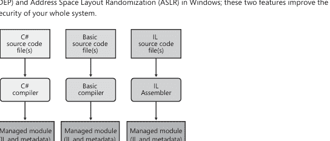

**图 1-1** 将源代码编译为托管模块。

表 1-1 描述了托管模块的各个部分。

**表 1-1** 托管模块的各个部分

| 部分 | 描述 |
|---|---|
| PE32 或 PE32+ 标头 | 标准 Windows PE 文件标头，类似于通用对象文件格式（COFF）标头。如果标头使用 PE32 格式，则该文件可在 32 位或 64 位版本的 Windows 上运行。如果标头使用 PE32+ 格式，则该文件需要 64 位版本的 Windows 才能运行。此标头还指示文件类型：GUI、CUI 或 DLL，并包含指示文件生成时间的时间戳。对于仅包含 IL 代码的模块，PE32(+) 标头中的大部分信息会被忽略。对于包含本机 CPU 代码的模块，此标头包含有关本机 CPU 代码的信息。 |
| CLR 标头 | 包含（由 CLR 和实用工具解释的）信息，使此文件成为托管模块。该标头包括所需的 CLR 版本、一些标志、托管模块入口点方法（Main 方法）的 MethodDef 元数据标记，以及模块的元数据、资源、强名称的位置/大小、一些标志和其他不太重要的内容。 |
| 元数据 | 每个托管模块都包含元数据表。表主要有两种类型：描述源代码中定义的类型和成员的表，以及描述源代码引用的类型和成员的表。 |
| IL 代码 | 编译器在编译源代码时生成的代码。在运行时，CLR 将 IL 编译为本机 CPU 指令。 |

本机代码编译器生成面向特定 CPU 架构（如 x86、x64 或 ARM）的代码。所有兼容 IL 的编译器则生成 IL 代码。（我将在本章后面更详细地介绍 IL 代码。）IL 代码有时被称为托管代码，因为 CLR 会管理其执行。

除了生成 IL 之外，每个以 CLR 为目标的编译器都必须将完整的元数据生成到每个托管模块中。简而言之，元数据是一组数据表，用于描述模块中定义的内容，例如类型及其成员。此外，元数据还包含一些表，用于指示托管模块引用的内容，例如导入的类型及其成员。元数据是 COM 的类型库和接口定义语言（IDL）文件等较旧技术的超集。需要注意的重要一点是，CLR 元数据要完整得多。而且，与类型库和 IDL 不同，元数据始终与包含 IL 代码的文件相关联。事实上，元数据始终嵌入在同一个 EXE/DLL 中，与代码在一起，因此无法将两者分开。由于编译器同时生成元数据和代码，并将它们绑定到生成的托管模块中，因此元数据及其描述的 IL 代码永远不会彼此不同步。

元数据有许多用途。以下是其中一些：

- 元数据消除了编译时对原生 C/C++ 标头文件和库文件的需要，因为有关所引用类型/成员的所有信息都包含在实现该类型/成员的 IL 文件中。编译器可以直接从托管模块读取元数据。
- Microsoft Visual Studio 使用元数据来帮助您编写代码。它的 IntelliSense 功能会解析元数据，告诉您某个类型提供哪些方法、属性、事件和字段；对于方法，还会告诉您该方法需要哪些参数。


### 加载公共语言运行时

你构建的每个程序集可以是一个可执行应用程序，也可以是一个包含一组供可执行应用程序使用的类型的 DLL。当然，CLR 负责管理这些程序集中包含的代码的执行。这意味着主机上必须安装 .NET Framework。Microsoft 创建了一个可再发行包，你可以自由分发它以在客户的计算机上安装 .NET Framework。某些版本的 Windows 在发售时已安装 .NET Framework。

你可以通过查找 %SystemRoot%\System32 目录中的 MSCorEE.dll 文件来判断是否已安装 .NET Framework。此文件的存在表明已安装 .NET Framework。但是，一台计算机上可以同时安装多个版本的 .NET Framework。如果你想确定具体安装了哪些版本的 .NET Framework，请检查以下目录下的子目录：

```
%SystemRoot%\Microsoft.NET\Framework
%SystemRoot%\Microsoft.NET\Framework64
```

.NET Framework SDK 包含一个名为 CLRVer.exe 的命令行实用工具，可显示计算机上安装的所有 CLR 版本。通过使用 -all 开关或传递你感兴趣的进程 ID，此实用工具还可以显示计算机上当前运行的进程正在使用哪个版本的 CLR。

在开始研究 CLR 如何加载之前，我们需要花一点时间讨论 32 位和 64 位版本的 Windows。如果你的程序集文件仅包含类型安全的托管代码，那么你编写的代码应能在 32 位和 64 位版本的 Windows 上运行。你的代码无需更改源代码即可在任一版本的 Windows 上运行。事实上，编译器生成的 EXE/DLL 文件在 x86 和 x64 版本的 Windows 上运行时应该能正常工作。此外，Windows 商店应用或类库将在 Windows RT 机器（使用 ARM CPU）上运行。换句话说，同一个文件将在任何安装了相应版本 .NET Framework 的机器上运行。

在极其罕见的情况下，开发者希望编写仅在特定版本 Windows 上工作的代码。开发者可能在使用不安全代码，或与面向特定 CPU 体系结构的非托管代码互操作时这样做。为了帮助这些开发者，C# 编译器提供了 /platform 命令行开关。此开关允许你指定生成的程序集是只能在运行 32 位 Windows 版本的 x86 机器上运行、只能在运行 64 位 Windows 的 x64 机器上运行，还是只能在运行 32 位 Windows RT 的 ARM 机器上运行。如果不指定平台，默认值为 anycpu，表示生成的程序集可以在任何版本的 Windows 上运行。Visual Studio 用户可以通过显示项目的属性页、单击“生成”选项卡，然后在“平台目标”列表中选择一个选项来设置项目的目标平台（见图 1-3）。

在图 1-3 中，你会注意到“首选 32 位”复选框。仅当“平台目标”设置为 Any CPU 且项目类型生成可执行文件时，此复选框才启用。如果选中“首选 32 位”复选框，则 Visual Studio 会启动 C# 编译器并指定 /platform:anycpu32bitpreferred 编译器开关。此选项指示可执行文件应作为 32 位

**表 1-2** /platform 对生成的模块及运行时的影响

| /platform 开关 | 生成的托管模块 | x86 Windows | x64 Windows | ARM Windows RT |
|---|---|---|---|---|
| anycpu（默认） | PE32/agnostic | 作为 32 位应用程序运行 | 作为 64 位应用程序运行 | 作为 32 位应用程序运行 |
| anycpu32bitpreferred | PE32/agnostic | 作为 32 位应用程序运行 | 作为 32 位应用程序运行 | 作为 32 位应用程序运行 |
| x86 | PE32/x86 | 作为 32 位应用程序运行 | 作为 WoW64 应用程序运行 | 无法运行 |
| x64 | PE32+/x64 | 无法运行 | 作为 64 位应用程序运行 | 无法运行 |
| ARM | PE32/ARM | 无法运行 | 无法运行 | 作为 32 位应用程序运行 |

Windows 检查 EXE 文件头以确定是创建 32 位还是 64 位进程之后，会将 x86、x64 或 ARM 版本的 MSCorEE.dll 加载到进程的地址空间中。在 x86 或 ARM 版本的 Windows 上，32 位版本的 MSCorEE.dll 可在 %SystemRoot%\System32 目录中找到。在 x64 版本的 Windows 上，x86 版本的 MSCorEE.dll 可在 %SystemRoot%\SysWOW64 目录中找到，而 64 位版本可在 %SystemRoot%\System32 目录中找到（出于向后兼容原因）。然后，进程的主线程调用 MSCorEE.dll 中定义的方法。此方法初始化 CLR，加载 EXE 程序集，然后调用其入口点方法（Main）。此时，托管应用程序已启动并运行。[1]

> **注意** 使用 1.0 或 1.1 版 Microsoft C# 编译器生成的程序集包含 PE32 头，并且与 CPU 体系结构无关。但是，在加载时，CLR 会将这些程序集视为仅适用于 x86。对于可执行文件，这会提高应用程序在 64 位系统上实际工作的可能性，因为可执行文件将在 WoW64 中加载，从而为进程提供与在 32 位 x86 版 Windows 上非常相似的环境。

如果非托管应用程序调用 Win32 LoadLibrary 函数来加载托管程序集，Windows 知道要加载并初始化 CLR（如果尚未加载），以便处理程序集中包含的代码。当然，在这种情况下，进程已经启动并运行，这可能限制程序集的可用性。例如，使用 /platform:x86 开关编译的托管程序集根本无法加载到 64 位进程中，而使用同一开关编译的可执行文件会在运行 64 位版本 Windows 的计算机上加载到 WoW64 中。

> [1] 你的代码可以查询 Environment 的 Is64BitOperatingSystem 属性，以确定它是否在 64 位版本的 Windows 上运行。你的代码还可以查询 Environment 的 Is64BitProcess 属性，以确定它是否在 64 位地址空间中运行。

### 执行程序集的代码

如前所述，托管程序集同时包含元数据和 IL。IL 是 Microsoft 在与若干外部商业和学术语言/编译器编写者磋商后创建的一种与 CPU 无关的机器语言。与大多数 CPU 机器语言相比，IL 是一种高级得多的语言。IL 可以访问和操作对象类型，并具有创建和初始化对象、调用对象上的虚方法以及直接操作数组元素的指令。它甚至有用于错误处理的引发和捕获异常的指令。你可以将 IL 视为一种面向对象的机器语言。

通常，开发者会使用高级语言（如 C#、Visual Basic 或 F#）编程。这些高级语言的编译器会生成 IL。然而，与其他任何机器语言一样，IL 可以用汇编语言编写，并且 Microsoft 确实提供了 IL 汇编器 ILAsm.exe。Microsoft 还提供了 IL 反汇编器 ILDasm.exe。

请记住，任何高级语言很可能只公开 CLR 所提供设施的一个子集。然而，IL 汇编语言允许开发者访问 CLR 的所有设施。因此，如果你选择的编程语言隐藏了 CLR 提供而你确实想要利用的某项设施，你可以选择用 IL 汇编或另一种公开你所寻求的 CLR 功能的编程语言来编写那部分代码。

了解 CLR 提供哪些设施的唯一方法是阅读专门针对 CLR 本身的文档。在本书中，我尽量集中讨论 CLR 功能以及 C# 语言如何公开或不公开这些功能。我猜想大多数其他书籍和文章会从语言视角介绍 CLR，并且大多数开发者会逐渐相信 CLR 只提供开发者所选语言所公开的内容。只要你的语言能让你完成你想完成的事情，这种模糊的视角并不是坏事。


> **重要** 我认为能够轻松切换编程语言并在语言之间实现丰富集成，是 CLR 的一个极佳特性。不幸的是，我也认为开发者常常会忽视这一特性。C# 和 Visual Basic 等编程语言非常适合执行 I/O 操作。APL 是执行高级工程或财务计算的绝佳语言。通过 CLR，你可以用 C# 编写应用程序的 I/O 部分，然后用 APL 编写工程计算部分。CLR 在这些语言之间提供的集成程度是前所未有的，确实使混合语言编程值得许多开发项目考虑。

要执行某个方法，其 IL 必须先转换为本机 CPU 指令。这是 CLR 的 JIT（即时）编译器的工作。

图 1-4 展示了第一次调用方法时发生的情况。

就在 Main 方法执行之前，CLR 会检测 Main 的代码所引用的所有类型。这会使 CLR 分配一个内部数据结构，用于管理访问


到引用的类型。在图1-4中，Main方法引用了一个类型Console，导致CLR分配一个内部结构。这个内部数据结构包含Console类型定义的每个方法的条目。每个条目保存了方法实现所在地址。在初始化该结构时，CLR将每个条目设置为CLR自身内部的一个未公开的函数。我将此函数称为JITCompiler。

当Main第一次调用WriteLine时，JITCompiler函数被调用。JITCompiler函数负责将方法的IL代码编译为原生CPU指令。由于IL是“实时”编译的，CLR的这个组件通常被称为JITter或JIT编译器。

> **注意** 如果应用程序运行在x86版本的Windows或WoW64中，JIT编译器会生成x86指令。如果应用程序作为64位应用程序运行在x64版本的Windows上，JIT编译器会生成x64指令。如果应用程序运行在ARM版本的Windows上，JIT编译器会生成ARM指令。

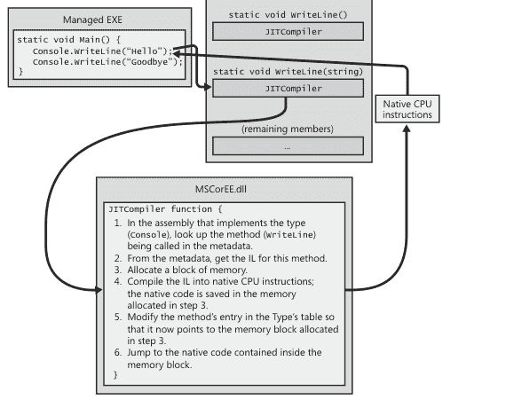

**图1-4** 首次调用方法。

调用时，JITCompiler函数知道正在调用哪个方法以及哪个类型定义了此方法。然后JITCompiler函数在定义程序集的元数据中搜索被调用方法的IL。JITCompiler接下来验证并将IL代码编译为原生CPU指令。这些原生CPU指令被保存在动态分配的内存块中。然后，JITCompiler返回到CLR创建的类型内部数据结构中该被调用方法的条目，并将最初调用它的引用替换为刚刚编译好的包含原生CPU指令的内存块地址。最后，JITCompiler函数跳转到内存块中的代码。这段代码就是WriteLine方法的实现（接收String参数的那个版本）。当这段代码返回时，它返回到Main中的代码，继续正常执行。

Main现在第二次调用WriteLine。此时，WriteLine的代码已经被验证并编译过。因此调用直接进入内存块，完全跳过JITCompiler函数。WriteLine方法执行完毕后，返回Main。图1-5显示了第二次调用WriteLine时的过程。

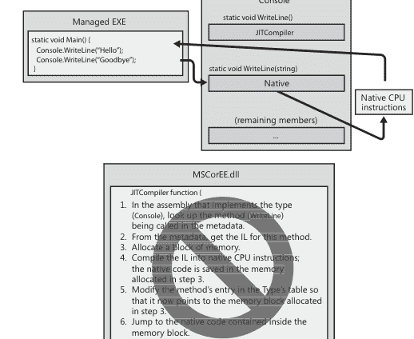

**图1-5** 第二次调用方法。

仅在第一次调用方法时会产生性能损失。之后对该方法的所有调用都以原生代码的完整速度执行，因为无需再次验证和编译为原生代码。

JIT编译器将原生CPU指令存储在动态内存中。这意味着当应用程序终止时，编译后的代码会被丢弃。因此，如果你将来再次运行该应用程序，或同时运行应用程序的两个实例（在两个不同的操作系统进程中），JIT编译器将不得不再次将IL编译为原生指令。根据应用程序的不同，与只读代码页可被运行中应用程序的所有实例共享的原生应用程序相比，这可能会显著增加内存消耗。

对于大多数应用程序，JIT编译带来的性能损失并不显著。大多数应用程序往往反复调用相同的方法。这些方法在应用程序执行期间只会承受一次性能损失。而且，在方法内部花费的时间很可能比调用方法的时间更长。

你还应该知道，CLR的JIT编译器优化原生代码的方式与非托管的C++编译器的后端相同。同样，生成优化的代码可能需要更长时间，但代码的执行性能会比未优化时好得多。

有两个C#编译器开关会影响代码优化：/optimize和/debug。下表显示了这些开关对C#编译器生成的IL代码质量和JIT编译器生成的原生代码质量的影响。

| 编译器开关设置 | C# IL代码质量 | JIT原生代码质量 |
| --- | --- | --- |
| /optimize- /debug-（默认） | 未优化 | 已优化 |
| /optimize- /debug(+/full/pdbonly) | 未优化 | 未优化 |
| /optimize+ /debug(-/+/full/pdbonly) | 已优化 | 已优化 |

使用/optimize-时，C#编译器生成的未优化IL代码包含许多空操作（NOP）指令以及跳转到下一行代码的分支。这些指令是为了在调试时支持Visual Studio的“编辑并继续”功能而发出的，额外的指令也使代码更易于调试，允许在控制流指令（如for、while、do、if、else、try、catch和finally语句块）上设置断点。当生成优化的IL代码时，C#编译器会移除这些多余的NOP和分支指令，使代码在调试器中更难逐步执行，因为控制流已被优化。此外，某些函数评估可能在调试器内部执行时无法工作。然而，IL代码更小，使得生成的EXE/DLL文件更小，而且IL往往更容易阅读，适合那些（像我一样）喜欢检查IL以理解编译器输出的人。

此外，只有指定/debug(+/full/pdbonly)开关时，编译器才会生成程序数据库（PDB）文件。PDB文件帮助调试器找到局部变量并将IL指令映射到源代码。/debug:full开关告诉JIT编译器你打算调试该程序集，JIT编译器将跟踪每个IL指令来自哪个原生代码。这使你可以使用Visual Studio的实时调试功能，将调试器附加到已经运行的进程并轻松调试代码。如果没有/debug:full开关，JIT编译器默认不会跟踪IL到原生代码的信息，这使JIT编译器运行稍快一些，同时占用更少内存。如果你用Visual Studio调试器启动进程，它会强制JIT编译器跟踪IL到原生代码的信息（无论/debug开关如何），除非你在Visual Studio中关闭“在模块加载时抑制JIT优化（仅托管）”选项。

在Visual Studio中创建新的C#项目时，项目的Debug配置指定了/optimize-和/debug:full开关，而Release配置指定了/optimize+和/debug:pdbonly开关。

对于那些来自非托管C或C++背景的开发者，你可能正在考虑这一切的性能影响。毕竟，非托管代码是为特定CPU平台编译的，调用时，代码可以直接执行。在托管环境中，编译代码要分两个阶段完成。首先，编译器扫描源代码，尽可能多地生成IL。但要执行代码，IL本身必须在运行时编译为原生CPU指令，这需要分配更多不可共享的内存，并需要额外的CPU时间来完成工作。

相信我，因为我自己也是从C/C++背景接触CLR的，我最初对这些额外开销也非常怀疑和担忧。事实是，运行时发生的这第二编译阶段确实会影响性能，并且确实会分配动态内存。然而，微软在性能方面做了大量工作，以将这种额外开销保持在最低限度。

如果你也持怀疑态度，你当然应该构建一些应用程序并亲自测试性能。此外，你应该运行一些Microsoft或其他公司生产的非平凡托管应用程序，并测量它们的性能。我想你会惊讶于实际性能有多么出色。

你可能会觉得难以置信，但许多人（包括我）认为托管应用程序实际上可能超越非托管应用程序。有许多理由相信这一点。例如，当JIT编译器在运行时将IL代码编译为原生代码时，编译器比非托管编译器更了解执行环境。以下是托管代码可以超越非托管代码的一些方式：

- JIT编译器可以确定应用程序是否运行在Intel Pentium 4 CPU上，并生成利用Pentium 4提供的任何特殊指令的原生代码。通常，非托管应用程序是为最低通用CPU编译的，避免使用会给应用程序带来性能提升的特殊指令。


- JIT 编译器可以判断某个测试在其运行的机器上是否始终为假。例如，考虑一个包含以下代码的方法。

```csharp
if (numberOfCpus > 1) {
    ...
}
```

如果主机只有一个 CPU，这段代码可能导致 JIT 编译器不生成任何 CPU 指令。在这种情况下，本机代码将针对主机进行微调；生成的代码更小且执行更快。

- CLR 可以分析代码的执行情况，并在应用程序运行时将 IL 重新编译为本机代码。重新编译的代码可以根据观察到的执行模式进行重组，以减少错误的分支预测。当前版本的 CLR 不执行此操作，但未来版本可能会。

这些只是你应该预期未来托管代码比当今非托管代码执行得更好的部分原因。正如我所说，目前大多数应用程序的性能已经相当不错，并且随着时间推移有望继续提高。

如果你的实验表明 CLR 的 JIT 编译器无法为你的应用程序提供所需性能，你可能希望利用 .NET Framework SDK 附带的 NGen.exe 工具。该工具将程序集中的所有 IL 代码编译为本机代码，并将生成的本机代码保存到磁盘上的文件中。在运行时，当加载程序集时，CLR 会自动检查是否存在该程序集的预编译版本；如果存在，CLR 会加载预编译代码，从而无需在运行时编译。请注意，NGen.exe 在针对实际执行环境做出假设时必须保守，因此，NGen.exe 生成的代码不会像 JIT 编译器生成的代码那样高度优化。我将在本章后面更详细地讨论 NGen.exe。

此外，你可能希望考虑使用 System.Runtime.ProfileOptimization 类。该类使 CLR 在应用程序运行时记录（到文件）哪些方法被 JIT 编译。然后，在应用程序未来启动时，如果你的应用程序运行在多 CPU 机器上，JIT 编译器将使用其他线程并发编译这些方法。最终结果是应用程序运行更快，因为多个方法被并发编译，并且在应用程序初始化期间编译，而不是在用户与应用程序交互时即时编译这些方法。

### IL 与验证

IL 是基于堆栈的，这意味着其所有指令都将操作数压入执行堆栈，并从堆栈弹出结果。由于 IL 不提供用于操作寄存器的指令，因此人们很容易创建面向 CLR 的新语言和编译器。

IL 指令也是无类型的。例如，IL 提供 add 指令，该指令将压入堆栈的最后两个操作数相加。add 指令没有单独的 32 位和 64 位版本。当 add 指令执行时，它确定堆栈上操作数的类型并执行相应操作。

在我看来，IL 的最大好处不是它抽象了底层 CPU。IL 提供的最大好处是应用程序的健壮性和安全性。在将 IL 编译为本机 CPU 指令时，CLR 会执行一个称为验证的过程。验证会检查高级 IL 代码，并确保代码所做的一切都是安全的。例如，验证会检查每个方法是否以正确的参数数量被调用，传递给每个方法的每个参数类型是否正确，每个方法的返回值是否被正确使用，每个方法是否有 return 语句，等等。托管模块的元数据包含验证过程使用的所有方法和类型信息。

在 Windows 中，每个进程都有自己的虚拟地址空间。单独的地址空间是必要的，因为不能信任应用程序的代码。应用程序完全可能（不幸的是，也过于常见）读取或写入无效的内存地址。通过将每个 Windows 进程置于单独的地址空间中，你可以获得健壮性和稳定性；一个进程不会对另一个进程产生不利影响。

然而，通过验证托管代码，你可以知道代码不会不当访问内存，也不会对另一个应用程序的代码产生不利影响。这意味着你可以在单个 Windows 虚拟地址空间中运行多个托管应用程序。

由于 Windows 进程需要大量操作系统资源，拥有许多进程可能会损害性能并限制可用资源。通过在单个操作系统进程中运行多个应用程序来减少进程数量，可以提高性能、需要更少资源，并且与每个应用程序拥有自己的进程一样健壮。这是托管代码相对于非托管代码的另一个好处。

事实上，CLR 确实提供了在单个操作系统进程中执行多个托管应用程序的能力。每个托管应用程序在 AppDomain 中执行。默认情况下，每个托管 EXE 文件将在其自己的单独地址空间中运行，该地址空间只有一个 AppDomain。然而，承载 CLR 的进程（例如 Internet Information Services (IIS) 或 Microsoft SQL Server）可以决定在单个操作系统进程中运行 AppDomain。我将用第 22 章“CLR 承载与 AppDomain”的一部分篇幅讨论 AppDomain。

### 不安全代码

默认情况下，Microsoft 的 C# 编译器生成安全代码。安全代码是可验证安全的代码。但是，Microsoft 的 C# 编译器允许开发者编写不安全代码。不安全代码允许直接使用内存地址，并可以操作这些地址处的字节。这是一个非常强大的功能，通常在与非托管代码互操作或希望提高时间关键算法的性能时很有用。

但是，使用不安全代码会带来重大风险：不安全代码可能破坏数据结构，并利用甚至打开安全漏洞。因此，C# 编译器要求所有包含不安全代码的方法都必须用 unsafe 关键字标记。此外，C# 编译器要求你使用 /unsafe 编译器开关编译源代码。

当 JIT 编译器尝试编译不安全方法时，它会检查包含该方法的程序集是否已被授予 System.Security.Permissions.SecurityPermission，并且是否设置了 System.Security.Permissions.SecurityPermissionFlag.SkipVerification 标志。如果设置了此标志，JIT 编译器将编译不安全代码并允许其执行。CLR 信任此代码，并希望直接地址和字节操作不会造成任何伤害。如果未设置该标志，JIT 编译器将抛出 System.InvalidProgramException 或 System.Security.VerificationException，阻止该方法执行。事实上，整个应用程序此时可能会终止，但至少不会造成伤害。

> **注意** 默认情况下，从本地计算机或通过网络共享加载的程序集被授予完全信任，这意味着它们可以做任何事，包括执行不安全代码。但是，默认情况下，通过 Internet 执行的程序集不会被授予执行不安全代码的权限。如果它们包含不安全代码，则会抛出前述异常之一。管理员/最终用户可以更改这些默认值；但是，管理员要对代码的行为承担全部责任。

Microsoft 提供了一个名为 PEVerify.exe 的实用工具，它会检查程序集的所有方法，并通知你任何包含不安全代码的方法。你可能希望考虑对引用的程序集运行 PEVerify.exe；这将让你知道通过 Intranet 或 Internet 运行应用程序是否可能存在问题。

你应该知道，验证需要访问任何依赖程序集中包含的元数据。因此，当你使用 PEVerify 检查程序集时，它必须能够定位并加载所有被引用的程序集。由于 PEVerify 使用 CLR 定位依赖程序集，因此程序集的定位使用与执行程序集时通常使用的相同绑定和探测规则。我将在第 2 章和第 3 章“共享程序集与强命名程序集”中讨论这些绑定和探测规则。


### IL 与知识产权保护

有些人担心 IL 无法为他们的算法提供足够的知识产权保护。换句话说，他们认为你可以构建一个托管模块，而其他人可以使用 IL 反汇编器之类的工具，轻松逆向工程出应用程序代码的确切行为。

是的，IL 代码确实比大多数其他汇编语言更高级，而且一般来说，逆向工程 IL 代码相对简单。但是，在实现服务器端代码（如 Web 服务、Web 窗体或存储过程）时，程序集驻留在你的服务器上。由于公司外部人员无法访问该程序集，公司外部人员也就无法使用任何工具查看 IL——你的知识产权完全安全。

如果你担心自己确实要分发的任何程序集，可以从第三方供应商处获取混淆器实用工具。这些实用工具会打乱程序集元数据中所有私有符号的名称。别人将很难还原这些名称并理解每个方法的用途。请注意，这些混淆器只能提供很少的保护，因为 IL 必须在某个时刻可供 CLR 进行 JIT 编译。

如果你认为混淆器无法提供你希望的那种知识产权保护，可以考虑将更敏感的算法实现在某个非托管模块中，该模块将包含本机 CPU 指令而不是 IL 和元数据。然后，你可以使用 CLR 的互操作性功能（假设你有足够的权限）在应用程序的托管部分和非托管部分之间进行通信。当然，这假定你不担心别人对你非托管代码中的本机 CPU 指令进行逆向工程。

### 本机代码生成器工具：NGen.exe

.NET Framework 附带的 NGen.exe 工具可用于在应用程序安装到用户计算机上时，将 IL 代码编译为本机代码。由于代码是在安装时编译的，CLR 的 JIT 编译器不必在运行时编译 IL 代码，这可以提高应用程序的性能。NGen.exe 工具在两种场景下很有意义：

- **改善应用程序的启动时间** 运行 NGen.exe 可以改善启动时间，因为代码已经编译成本机代码，因此不必在运行时进行编译。
- **减少应用程序的工作集** 如果你认为某个程序集会被同时加载到多个进程中，对该程序集运行 NGen.exe 可以减少应用程序的工作集。原因是 NGen.exe 工具将 IL 编译为本机代码，并将输出保存在单独的文件中。此文件可以同时映射到多个进程地址空间，从而允许共享代码；并非每个进程都需要自己的代码副本。

System 命名空间（最熟悉的那个命名空间）包含 Object 基类型，所有其他类型最终都派生自该类型。此外，System 命名空间还包含用于整数、字符、字符串、异常处理和控制台 I/O 的类型，以及一组实用类型，这些实用类型可在数据类型之间安全转换、格式化数据类型、生成随机数和执行各种数学函数。所有应用程序都会使用 System 命名空间中的类型。

要访问框架的任何功能，你需要知道哪个命名空间包含公开你所需功能的类型。许多类型允许你自定义其行为；你只需从所需的 FCL 类型派生自己的类型即可。平台的面向对象特性正是 .NET Framework 向软件开发人员呈现一致编程范式的方式。此外，开发人员可以轻松创建包含自己类型的命名空间。这些命名空间和类型无缝融入编程范式。与 Win32 编程范式相比，这种新方法大大简化了软件开发。

FCL 中的大多数命名空间都提供可用于任何类型应用程序的类型。表 1-3 列出了一些更通用的命名空间，并简要描述了该命名空间中的类型用于什么。这只是可用命名空间的一小部分示例。请参阅各种 Microsoft SDK 随附的文档，以熟悉 Microsoft 正在生成的不断增长的命名空间集合。

#### **表 1-3** 一些通用 FCL 命名空间

| 命名空间 | 内容说明 |
|---|---|
| System | 每个应用程序使用的所有基本类型 |
| System.Data | 用于与数据库通信和处理数据的类型 |
| System.IO | 用于执行流 I/O 以及遍历目录和文件的类型 |
| System.Net | 允许底层网络通信以及使用一些常见 Internet 协议的类型 |
| System.Runtime.InteropServices | 允许托管代码访问非托管操作系统平台设施（例如 COM 组件以及 Win32 或自定义 DLL 中的函数）的类型 |
| System.Security | 用于保护数据和资源的类型 |
| System.Text | 用于处理不同编码（如 ASCII 和 Unicode）文本的类型 |
| System.Threading | 用于异步操作和同步对资源访问的类型 |
| System.Xml | 用于处理可扩展标记语言 (XML) 架构和数据的类型 |

本书讲述 CLR 以及与 CLR 密切交互的通用类型。因此，本书内容适用于所有编写面向 CLR 的应用程序或组件的程序员。还有许多其他好书涵盖特定的应用程序类型，如 Web 服务、Web 窗体/MVC、Windows Presentation Foundation 等。这些书将为你构建应用程序提供极好的起点。我倾向于认为这些特定于应用程序的书帮助你自顶向下学习，因为它们关注的是应用程序类型，而不是开发平台。在本书中，我将提供帮助你自底向上学习的信息。在阅读本书和一本特定于应用程序的书之后，你应该能够轻松而熟练地构建你想要的任何类型的应用程序。

### 公共类型系统

到现在，你应该已经很明显地看出，CLR 的一切都围绕类型。类型向你的应用程序和其他类型公开功能。类型是一种机制，通过它，用一种编程语言编写的代码可以与用另一种编程语言编写的代码通信。由于类型是 CLR 的根基，Microsoft 创建了一个正式规范——公共类型系统 (CTS)——来描述类型如何定义以及如何行为。

> **注意** 事实上，Microsoft 一直在将 CTS 以及 .NET Framework 的其他部分（包括文件格式、元数据、IL 以及对底层平台的访问 (P/Invoke)）提交给 ECMA，以便进行标准化。该标准称为公共语言基础结构 (CLI)，即 ECMA-335 规范。此外，Microsoft 还提交了 FCL 的一部分、C# 编程语言 (ECMA-334) 和 C++/CLI 编程语言。有关这些行业标准的信息，请访问与第 39 技术委员会相关的 ECMA 网站：http://www.ecma-international.org。你也可以参考 Microsoft 自己的网站：http://msdn.microsoft.com/en-us/netframework/aa569283.aspx。此外，Microsoft 已将其 Community Promise 应用于 ECMA-334 和 ECMA-335 规范。有关此内容的更多信息，请参阅 http://www.microsoft.com/openspecifications/en/us/programs/community-promise/default.aspx。

CTS 规范规定，一个类型可以包含零个或多个成员。在第二部分“设计类型”中，我将非常详细地介绍所有这些成员。现在，我只想简要介绍它们：

- **字段** 对象状态中的数据变量。字段由名称和类型标识。
- **方法** 对对象执行操作的函数，通常会更改对象的状态。方法具有名称、签名和修饰符。签名指定参数的数量（及其顺序）、参数的类型、方法是否返回值，以及如果返回值，方法返回值的类型。
- **属性** 对调用方来说，此成员看起来像字段。但对类型实现者来说，它看起来像一个（或两个）方法。属性允许实现者在访问值和/或仅在必要时计算值之前，验证输入参数和对象状态。它们还允许类型的使用者拥有简化的语法。最后，属性允许你创建只读或只写的“字段”。
- **事件** 事件允许在对象和其他感兴趣的对象之间提供通知机制。例如，按钮可以提供一个事件，在按钮被单击时通知其他对象。


CTS 还规定了类型可见性以及访问类型成员的规则。例如，将某个类型标记为 public（在 C# 中称为 public）会导出该类型，使其对任何程序集可见且可访问。另一方面，将某个类型标记为 assembly（在 C# 中称为 internal）会使该类型仅对同一程序集内的代码可见且可访问。因此，CTS 建立了程序集构成类型可见性边界的规则，而 CLR 会强制执行这些可见性规则。

对调用方可见的类型可以进一步限制调用方访问该类型成员的能力。以下列表显示了控制成员访问权限的有效选项：

- **私有（Private）** 该成员只能由同一类类型中的其他成员访问。
- **家族（Family）** 该成员可由派生类型访问，无论它们是否位于同一程序集中。请注意，许多语言（如 C++ 和 C#）将家族称为 protected。
- **家族和程序集（Family and assembly）** 该成员可由派生类型访问，但前提是该派生类型定义在同一程序集中。许多语言（如 C# 和 Visual Basic）不提供这种访问控制。当然，IL 汇编语言使其可用。
- **程序集（Assembly）** 该成员可由同一程序集中的任何代码访问。许多语言将程序集称为 internal。
- **家族或程序集（Family or assembly）** 该成员可由任何程序集中的派生类型访问。该成员也可由同一程序集中的任何类型访问。C# 将家族或程序集称为 protected internal。
- **公共（Public）** 该成员可由任何程序集中的任何代码访问。

此外，CTS 还定义了管理类型继承、虚方法、对象生存期等的规则。这些规则旨在容纳现代编程语言中可表达的语义。事实上，你甚至不需要专门学习 CTS 规则，因为你选择的语言会以你今天熟悉的方式公开它自己的语言语法和类型规则。并且，在编译期间生成程序集时，它会将特定于语言的语法映射到 IL——CLR 的“语言”。

当我第一次开始使用 CLR 时，我很快意识到，最好将语言和代码的行为视为两个独立且不同的东西。使用 C++/CLI，你可以定义自己的类型及其成员。当然，你也可以使用 C# 或 Visual Basic 来定义具有相同成员的同一类型。诚然，你用于定义类型的语法会因所选语言而异，但无论使用哪种语言，类型的行为都将相同，因为 CLR 的 CTS 定义了该类型的行为。

为了帮助阐明这一想法，让我举一个例子。CTS 允许一个类型仅从一个基类派生。因此，尽管 C++ 语言支持可从多个基类型继承的类型，但 CTS 不能接受也不可操作任何此类类型。为了帮助开发人员，Microsoft 的 C++/CLI 编译器如果检测到你试图创建包含从多个基类型派生的类型的托管代码，就会报告错误。

以下是另一条 CTS 规则。所有类型都必须（最终）继承自一个预定义类型：System.Object。如你所见，Object 是 System 命名空间中定义的一个类型的名称。这个 Object 是所有其他类型的根，因此保证每个类型实例都有一组最低限度的行为。具体来说，System.Object 类型允许你执行以下操作：

- 比较两个实例是否相等。
- 获取实例的哈希代码。
- 查询实例的真实类型。
- 执行实例的浅（按位）复制。
- 获取实例对象当前状态的字符串表示形式。

### 公共语言规范

COM 允许用不同语言创建的对象相互通信。另一方面，CLR 现在集成了所有语言，并允许用一种语言创建的对象被用完全不同语言编写的代码视为同等公民。这种集成之所以可能，是因为 CLR 的标准类型集、元数据（自描述类型信息）和公共执行环境。

尽管这种语言集成是一个极好的目标，但事实是编程语言彼此之间差异很大。例如，有些语言不区分符号的大小写，有些语言不提供无符号整数、运算符重载或支持可变数量参数的方法。

如果你打算创建易于从其他编程语言访问的类型，你需要只使用你的编程语言中保证在所有其他语言中都可用 的功能。为了帮助你做到这一点，Microsoft 定义了公共语言规范（CLS），它向编译器供应商详细说明了：如果这些编译器要生成与在 CLR 之上由其他符合 CLS 的语言编写的其他组件兼容的类型，它们必须支持的最小功能集。

CLR/CTS 支持的功能远多于 CLS 定义的子集，因此，如果你不关心语言之间的互操作性，就可以开发非常丰富的类型，仅受该语言功能集的限制。具体来说，CLS 定义了外部可见的类型和方法必须遵守的规则，才能从任何符合 CLS 的编程语言访问。请注意，CLS 规则不适用于仅在定义程序集内部可访问的代码。图 1-6 总结了本段所表达的思想。

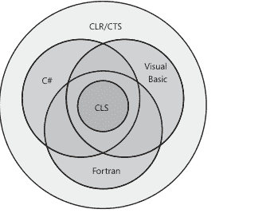

**图 1-6** 语言提供 CLR/CTS 的子集和 CLS 的超集（但不一定是相同的超集）。

如果你用一种语言设计类型，并期望该类型被另一种语言使用，那么你不应在其公共成员和受保护成员中利用 CLS 之外的任何功能。这样做意味着使用其他编程语言编写代码的程序员可能无法访问你的类型成员。

在以下代码中，在 C# 中定义了一个符合 CLS 的类型。然而，该类型有一些不符合 CLS 的构造，导致 C# 编译器对该代码发出警告。

```csharp
using System;

// Tell compiler to check for CLS compliance
[assembly: CLSCompliant(true)]

namespace SomeLibrary {
    // Warnings appear because the class is public
    public sealed class SomeLibraryType {

        // Warning: Return type of 'SomeLibrary.SomeLibraryType.Abc()'
        // is not CLS-compliant
        public UInt32 Abc() { return 0; }

        // Warning: Identifier 'SomeLibrary.SomeLibraryType.abc()'
        // differing only in case is not CLS-compliant
        public void abc() { }

        // No warning: this method is private
        private UInt32 ABC() { return 0; }
    }
}
```

在这段代码中，[assembly:CLSCompliant(true)] 特性应用于程序集。该特性告诉编译器确保任何公开公开的类型都不包含会阻止该类型被任何其他编程语言访问的构造。编译此代码时，C# 编译器会发出两个警告。第一个警告是因为方法 Abc 返回无符号整数；某些其他编程语言无法操作无符号整数值。第二个警告是因为此类型公开了两个仅大小写和返回类型不同的公共方法：Abc 和 abc。Visual Basic 和某些其他语言无法同时调用这两个方法。

有趣的是，如果你删除 'sealed class SomeLibraryType' 前面的 public 并重新编译，两个警告都会消失。原因是 SomeLibraryType 类型将默认为 internal，因此将不再在程序集外部公开。有关 CLS 规则的完整列表，请参阅 .NET Framework SDK 文档中的“跨语言互操作性”部分（http://msdn.microsoft.com/en-us/library/730f1wy3.aspx）。

让我把 CLS 规则提炼成非常简单的东西。在 CLR 中，类型的每个成员要么是字段（数据），要么是方法（行为）。这意味着每种编程语言都必须能够访问字段并调用方法。某些字段和某些方法以特殊且常见的方式使用。为了简化编程，语言通常提供额外的抽象，使编写这些常见编程模式更容易。例如，语言公开枚举、数组、属性、索引器、委托、事件、构造函数、终结器、运算符重载、转换运算符等概念。当编译器在源代码中遇到这些内容时，必须将这些构造转换为字段和方法，以便 CLR 和任何其他编程语言可以访问该构造。

考虑以下类型定义，它包含一个构造函数、一个终结器、一些重载运算符、一个属性、一个索引器和一个事件。请注意，所示代码只是为了使其能够编译；它并未展示实现类型的正确方式。

```csharp
using System;

internal sealed class Test {
   // Constructor
   public Test() {}

   // Finalizer
   ~Test() {}

   // Operator overload
   public static Boolean operator == (Test t1, Test t2) {
      return true;
   }
   public static Boolean operator != (Test t1, Test t2) {
      return false;
   }

   // An operator overload
   public static Test operator + (Test t1, Test t2) { return null; }
}
```


```csharp
// A property
public String AProperty {
    get { return null; }
    set { }
}

// An indexer
public String this[Int32 x] {
    get { return null; }
    set { }
}

// An event
public event EventHandler AnEvent;
}
```

当编译器编译这段代码时，结果是一个类型，其中定义了许多字段和方法。通过使用 .NET Framework SDK 提供的 IL 反汇编器工具 (ILDasm.exe) 检查生成的托管模块，你可以轻松看到这一点，如图 1-7 所示。

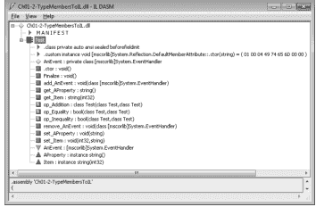

**图 1-7** ILDasm 显示 Test 类型的字段和方法（从元数据获得）。

表 1-4 显示了编程语言构造如何映射到等效的 CLR 字段和方法。

**表 1-4** Test 类型的字段和方法（从元数据获得）

| 类型成员 | 成员类型 | 等效的编程语言构造 |
|---|---|---|
| AnEvent | 字段 | 事件；字段名为 AnEvent，其类型为 System.EventHandler。 |
| .ctor | 方法 | 构造函数。 |
| Finalize | 方法 | 终结器。 |
| add_AnEvent | 方法 | 事件添加访问器方法。 |

- **非托管代码可以使用托管类型（服务器）** 许多现有的非托管代码要求你提供 COM 组件，代码才能正常工作。使用托管代码实现这些组件要容易得多，这样你就可以避免所有与引用计数和接口相关的代码。例如，你可以用 C# 创建 ActiveX 控件或外壳扩展。有关更多信息，请参阅 .NET Framework SDK 随附的 TlbExp.exe 和 RegAsm.exe 工具。

> **注意** Microsoft 现在提供类型库导入器工具和 P/Invoke 互操作助手工具的源代码，以帮助需要与本机代码交互的开发人员。这些工具及其源代码可从 *http://CLRInterop.CodePlex.com/* 下载。

在 Windows 8 中，Microsoft 引入了一个名为 Windows 运行时 (WinRT) 的新 Windows API。此 API 在内部通过 COM 组件实现。但是，COM 组件不使用类型库文件，而是通过由 .NET Framework 团队创建的元数据 ECMA 标准来描述其 API。这样做的好处是，通过 .NET 语言编写的代码可以（在很大程度上）与 WinRT API 无缝通信。在底层，CLR 为你执行所有 COM 互操作，而你完全不需要使用任何额外工具——它直接就能工作！第 25 章“与 WinRT 组件互操作”将详细介绍所有细节。

## 第 2 章：生成、打包、部署和管理应用程序及类型

本章内容：

- .NET Framework 部署目标 .......... 34
- 将类型生成到模块中 ............. 35
- 元数据简介 ................. 38
- 将模块合并为程序集 .... 45
- 程序集版本资源信息 .... 54
- 区域性 .................................. 59
- 简单应用程序部署（私有部署的程序集） ... 60
- 简单管理控制（配置） ... 62

在进入讲解如何为 Microsoft .NET Framework 开发程序的章节之前，我们先讨论生成、打包和部署应用程序及其类型所需的步骤。在本章中，我将重点介绍如何生成仅供你的应用程序使用的程序集的基础知识。在第 3 章“共享程序集和强命名程序集”中，我将介绍你需要理解的更高级概念，包括如何生成和使用包含将由多个应用程序共享的类型的程序集。在这两章中，我还会讨论管理员影响应用程序及其类型执行的方式。

如今，应用程序由多个类型组成，这些类型通常由你和 Microsoft 创建。此外，还有许多组件供应商创建并销售类型，其他公司可以使用这些类型来缩短软件项目的开发时间。如果这些类型是使用任何面向公共语言运行时 (CLR) 的语言开发的，它们就可以无缝地协同工作；用一种语言编写的类型可以使用另一种类型作为其基类，而不必担心基类型是用哪种语言开发的。

在本章中，我还会解释这些类型如何生成并打包到文件中以供部署。在此过程中，我将带你简要回顾一些 .NET Framework 正在解决的问题的历史。

### .NET Framework 部署目标

多年来，Windows 已经获得了不稳定且复杂的声誉。无论这种声誉是否名副其实，它都是许多不同因素造成的结果。首先，所有应用程序都使用来自 Microsoft 或其他供应商的动态链接库 (DLL)。由于应用程序执行来自不同供应商的代码，任何一段代码的开发者都无法 100% 确定其他人将如何使用它。尽管这种交互可能会潜在地导致各种麻烦，但在实践中，这些问题通常不会出现，因为应用程序在部署之前都经过了测试和调试。

然而，当某家公司决定更新其代码并向用户分发新文件时，用户经常会遇到问题。这些新文件本应与之前的文件向后兼容，但谁能确定呢？事实上，当某个供应商更新其代码时，通常会发现自己不可能重新测试和调试所有已经发布的应用程序，以确保这些更改不会产生不良影响。

我确信，阅读本书的每个人都经历过这个问题的某种变体：在安装新应用程序时，你发现它以某种方式破坏了已经安装的应用程序。这种困境被称为“DLL 地狱”。这种不稳定性让普通计算机用户心生恐惧。最终结果是，用户必须仔细考虑是否要在自己的机器上安装新软件。就我个人而言，我已经决定不尝试某些应用程序，因为担心它可能会对我真正依赖的某个应用程序产生不利影响。

造成上述 Windows 声誉的第二个原因是安装的复杂性。如今，大多数应用程序安装时会影响系统的所有部分。例如，安装应用程序会将文件复制到各个目录、更新注册表设置，并在桌面和“开始”菜单/屏幕上安装快捷方式。这样做的问题在于，应用程序没有作为单个实体被隔离。你无法轻松备份应用程序，因为必须复制应用程序的文件以及注册表的相关部分。此外，你无法轻松地将应用程序从一台机器移动到另一台机器；必须再次运行安装程序，以便正确设置所有文件和注册表设置。最后，你无法轻松卸载或删除应用程序，而不产生那种讨厌的感觉：应用程序的某些部分仍潜伏在你的机器上。

第三个原因与安全性有关。安装应用程序时，它们会附带各种文件，其中许多文件由不同公司编写。此外，Web 应用程序经常带有代码（如 ActiveX 控件），这些代码的下载方式让用户甚至没有意识到代码正在安装到自己的机器上。如今，这些代码可以执行任何操作，包括删除文件或发送电子邮件。用户有理由害怕安装新应用程序，因为它们可能造成潜在损害。为了让用户放心，必须将安全性内置到系统中，以便用户可以明确允许或禁止不同公司开发的代码访问系统资源。

.NET Framework 在很大程度上解决了 DLL 地狱问题，你在阅读本章和第 3 章时会看到。它还在很大程度上解决了应用程序状态分散在用户硬盘各处的这一问题。例如，与 COM 不同，类型不再需要注册表中的设置。不幸的是，应用程序仍然需要快捷方式链接。至于安全性，.NET Framework

包括一种称为代码访问安全的安全模型。Windows 安全基于用户身份，而代码访问安全允许主机设置权限，从而控制所加载组件能执行的操作。像 Microsoft SQL Server 这样的宿主应用程序可以只授予代码少量权限，而本地安装（自托管）的应用程序则可以在完全信任（所有权限）下运行。正如你将看到的，.NET Framework 让用户能够控制安装和运行的内容，并且总体上比 Windows 以往任何时候都更能控制他们的机器。

### 将类型构建到模块中

在本节中，我将展示如何将包含各种类型的源文件转化为可部署的文件。让我们从检查下面的简单应用程序开始。

```csharp
public sealed class Program {
    public static void Main() {
        System.Console.WriteLine("Hi");
    }
}
```

这个应用程序定义了一个名为 Program 的类型。该类型有一个公共静态方法 Main。在 Main 内部，引用了另一个类型 System.Console。System.Console 是由 Microsoft 实现的类型，实现该类型方法的中间语言（IL）代码位于 MSCorLib.dll 文件中。因此，我们的应用程序既定义了一个类型，也使用了其他公司的类型。

要构建此示例应用程序，请将前面的代码放入一个源代码文件中，比如 Program.cs，然后执行以下命令行。

```shell
csc.exe /out:Program.exe /t:exe /r:MSCorLib.dll Program.cs
```

此命令行告诉 C# 编译器生成一个名为 Program.exe（/out:Program.exe）的可执行文件。生成的文件类型是 Win32 控制台应用程序（/t[arget]:exe）。

当 C# 编译器处理源文件时，它发现代码引用了 System.Console 类型的 WriteLine 方法。此时，编译器想要确保该类型存在于某处，它有 WriteLine 方法，并且传递给该方法的参数与方法期望的参数匹配。由于此类型未在 C# 源代码中定义，为了让 C# 编译器满意，你必须为它提供一组程序集，以便它能够解析对外部类型的引用。在前面的命令行中，我包含了 /r[eference]:MSCorLib.dll 开关，它告诉编译器在 MSCorLib.dll 文件标识的程序集中查找外部类型。

MSCorLib.dll 是一个特殊文件，因为它包含了所有核心类型：Byte、Char、String、Int32 等等。事实上，这些类型使用得非常频繁，以至于 C# 编译器会自动引用 MSCorLib.dll 程序集。换句话说，下面的命令行（省略了 /r 开关）与前面显示的命令行产生相同的结果。

```shell
csc.exe /out:Program.exe /t:exe Program.cs
```

此外，由于 `/out:Program.exe` 和 `/t:exe` 命令行开关也匹配 C# 编译器默认选择的选项，因此下面的命令行也会产生相同的结果。

```shell
csc.exe Program.cs
```

如果出于某种原因，你确实不希望 C# 编译器引用 MSCorLib.dll 程序集，可以使用 `/nostdlib` 开关。Microsoft 在构建 MSCorLib.dll 程序集本身时使用此开关。例如，当 CSC.exe 尝试编译 Program.cs 文件时，下面的命令行将生成错误，因为 `System.Console` 类型是在 MSCorLib.dll 中定义的。

```shell
csc.exe /out:Program.exe /t:exe /nostdlib Program.cs
```

现在，让我们仔细看看 C# 编译器生成的 Program.exe 文件。这个文件到底是什么？首先，它是一个标准的可移植可执行文件（PE）。这意味着运行 32 位或 64 位 Windows 的机器应该能够加载此文件并对其执行一些操作。Windows 支持三种类型的应用程序。要构建控制台用户界面（CUI）应用程序，请指定 `/t:exe` 开关；要构建图形用户界面（GUI）应用程序，请指定 `/t:winexe` 开关；要构建 Windows 应用商店应用，请指定 `/t:appcontainerexe` 开关。

#### 响应文件

在结束编译器开关的讨论之前，我想花一点时间谈谈响应文件。响应文件是一个文本文件，包含一组编译器命令行开关。当你执行 CSC.exe 时，编译器会打开响应文件，并像在命令行中将开关传递给 CSC.exe 一样使用其中指定的任何开关。你通过在命令行上指定响应文件的名称，并在前面加上 @ 符号来指示编译器使用该响应文件。例如，你可以有一个名为 MyProject.rsp 的响应文件，其中包含以下文本。

```text
/out:MyProject.exe
/target:winexe
```

要使 CSC.exe 使用这些设置，你可以按如下方式调用它。

```shell
csc.exe @MyProject.rsp CodeFile1.cs CodeFile2.cs
```

这告诉 C# 编译器输出文件的名称以及要创建的目标类型。如你所见，响应文件非常方便，因为每次编译项目时你不必手动输入所需的命令行参数。

C# 编译器支持多个响应文件。除了你在命令行上显式指定的文件外，编译器还会自动查找名为 `CSC.rsp` 的文件。当你运行 CSC.exe 时，它会在包含 CSC.exe 文件的目录中查找一个全局 CSC.rsp 文件。你希望应用于所有项目的设置应放在此文件中。编译器会汇总并使用所有这些响应文件中的设置。如果本地响应文件和全局响应文件中的设置冲突，则本地文件中的设置会覆盖全局文件中的设置。同样，在命令行上显式传递的任何设置都会覆盖从本地响应文件获取的设置。

当你安装 .NET Framework 时，它会在 %SystemRoot%\Microsoft.NET\Framework\(64)\vX.X.X 目录中安装一个默认的全局 CSC.rsp 文件（其中 X.X.X 是你安装的 .NET Framework 的版本）。该文件的最新版本包含以下开关。

```text
# 
# 
# 
# 

# 
/r:Accessibility.dll
/r:Microsoft.CSharp.dll
/r:System.Configuration.dll
/r:System.Configuration.Install.dll
/r:System.Core.dll
/r:System.Data.dll
/r:System.Data.DataSetExtensions.dll
/r:System.Data.Linq.dll
/r:System.Data.OracleClient.dll
/r:System.Deployment.dll
/r:System.Design.dll
/r:System.DirectoryServices.dll
/r:System.dll
/r:System.Drawing.Design.dll
/r:System.Drawing.dll
/r:System.EnterpriseServices.dll
/r:System.Management.dll
/r:System.Messaging.dll
/r:System.Runtime.Remoting.dll
/r:System.Runtime.Serialization.dll
/r:System.Runtime.Serialization.Formatters.Soap.dll
/r:System.Security.dll
/r:System.ServiceModel.dll
/r:System.ServiceModel.Web.dll
/r:System.ServiceProcess.dll
/r:System.Transactions.dll
/r:System.Web.dll
/r:System.Web.Extensions.Design.dll
/r:System.Web.Extensions.dll
/r:System.Web.Mobile.dll
/r:System.Web.RegularExpressions.dll
/r:System.Web.Services.dll
/r:System.Windows.Forms.dll
/r:System.Workflow.Activities.dll
/r:System.Workflow.ComponentModel.dll
/r:System.Workflow.Runtime.dll
/r:System.Xml.dll
# 
```

由于全局 CSC.rsp 文件引用了列出的所有程序集，因此你无需使用 C# 编译器的 /reference 开关显式引用这些程序集。此响应文件为开发人员提供了极大的便利，因为它允许他们使用各种 Microsoft 发布的程序集中定义的类型和命名空间，而无需在编译时为每个程序集指定 /reference 编译器开关。

#### 表 2-1 常用的定义元数据表

| 元数据定义表名称 | 描述 |
| --- | --- |
| ModuleDef | 总是包含一项用于标识模块的条目。该条目包括模块的文件名和扩展名（不含路径），以及模块版本 ID（编译器创建的 GUID 形式）。这允许在重命名文件时保留其原始名称的记录。但是，强烈不建议重命名文件，这可能会阻止 CLR 在运行时定位程序集，因此请不要这样做。 |
| TypeDef | 包含模块中定义的每个类型的一项条目。每个条目包括类型的名称、基类型和标志（public、private 等），并包含指向它在 MethodDef 表中拥有的方法、在 FieldDef 表中拥有的字段、在 PropertyDef 表中拥有的属性以及在 EventDef 表中拥有的事件的索引。 |
| MethodDef | 包含模块中定义的每个方法的一项条目。每个条目包括方法的名称、标志（private、public、virtual、abstract、static、final 等）、签名，以及可在模块中找到其 IL 代码的偏移量。每个条目还可以引用 ParamDef 表中的条目，在该条目中可以找到有关方法参数的更多信息。 |
| FieldDef | 包含模块中定义的每个字段的一项条目。每个条目包括标志（private、public 等）、类型和名称。 |
| ParamDef | 包含模块中定义的每个参数的一项条目。每个条目包括标志（in、out、retval 等）、类型和名称。 |
| PropertyDef | 包含模块中定义的每个属性的一项条目。每个条目包括标志、类型和名称。 |
| EventDef | 包含模块中定义的每个事件的一项条目。每个条目包括标志和名称。 |

当编译器编译源代码时，代码定义的一切都会在表 2-1 所述的某个表中创建一个条目。当编译器检测到源代码引用的类型、字段、方法、属性和事件时，也会创建元数据表条目。创建的元数据包括一组引用表，这些表记录被引用的项。表 2-2 显示了一些较常见的引用元数据表。

#### 表 2-2 常用的引用元数据表

| 元数据引用表名称 | 描述 |
| --- | --- |
| AssemblyRef | 包含模块引用的每个程序集的一项条目。每个条目包括绑定到程序集所需的信息：程序集的名称（不含路径和扩展名）、版本号、区域性和公钥令牌（通常是从发布者公钥生成的、用于标识被引用程序集发布者的小型哈希值）。每个条目还包含一些标志和哈希值。此哈希值原本是打算用作被引用程序集位的校验和。CLR 完全忽略此哈希值，并且将来可能继续忽略。 |
| ModuleRef | 包含实现此模块所引用类型的每个 PE 模块的一项条目。每个条目包括模块的文件名和扩展名（不含路径）。此表用于绑定到在调用程序集的不同模块中实现的类型。 |


| 元数据引用表名称 | 描述 |
| --- | --- |
| TypeRef | 包含模块引用的每个类型的一个条目。每个条目包括类型名称以及可找到该类型的引用。如果该类型定义在另一个类型内，引用将指示一个 TypeRef 条目。如果该类型定义在同一模块中，引用将指示一个 ModuleDef 条目。如果该类型定义在调用程序集内的另一个模块中，引用将指示一个 ModuleRef 条目。如果该类型定义在不同程序集中，引用将指示一个 AssemblyRef 条目。 |
| MemberRef | 包含模块引用的每个成员（字段和方法，以及属性和事件方法）的一个条目。每个条目包括成员名称和签名，并指向定义该成员的类型的 TypeRef 条目。 |

表 2-1 和 2-2 中列出的表远不止这些，但我只是想让你了解编译器为生成元数据信息而发出的那类信息。前面我提到，还有一组清单元数据表；本章稍后我会讨论这些内容。

各种工具允许你检查托管 PE 文件中的元数据。我仍经常使用的一个工具是 ILDasm.exe，即 IL 反汇编器。要查看元数据表，请执行以下命令行。

```text
ILDasm Program.exe
```

这会运行 ILDasm.exe，并加载 Program.exe 程序集。要以美观、人类可读的形式查看元数据，请选择 View/MetaInfo/Show! 菜单项（或按 Ctrl+M）。随后会显示以下信息。

```text
=======================================================
ScopeName : Program.exe
MVID      : {CA73FF8E-0D42-4610-A8D3-9276195C35AA}
=======================================================
Global functions
-------------------------------------------------------

Global fields
-------------------------------------------------------

Global MemberRefs
-------------------------------------------------------

TypeDef #1 (02000002)
-------------------------------------------------------
    TypeDefName: Program    (02000002)
    Flags      : [Public] [AutoLayout] [Class] [Sealed] [AnsiClass]
                 [BeforeFieldInit] (00100101)
    Extends    : 01000001 [TypeRef] System.Object
    Method #1 (06000001) [ENTRYPOINT]
-------------------------------------------------------
MethodName: Main (06000001)
Flags     : [Public] [Static] [HideBySig] [ReuseSlot]  (00000096)
RVA       : 0x00002050
ImplFlags : [IL] [Managed]  (00000000)
CallConvtn: [DEFAULT]
ReturnType: Void
No arguments.

Method #2 (06000002)
-------------------------------------------------------
MethodName: .ctor (06000002)
Flags     : [Public] [HideBySig] [ReuseSlot] [SpecialName]
            [RTSpecialName] [.ctor]  (00001886)
RVA       : 0x0000205C
ImplFlags : [IL] [Managed]  (00000000)
CallConvtn: [DEFAULT]
HasThis
ReturnType: Void
No arguments.

TypeRef #1 (01000001)
-------------------------------------------------------
Token:              0x01000001
ResolutionScope:    0x23000001
TypeRefName:        System.Object
    MemberRef #1 (0a000004)
    ----------------------------------------------------------------
    Member: (0a000004) .ctor:
    CallConvtn: [DEFAULT]
    HasThis
    ReturnType: Void
    No arguments.

TypeRef #2 (01000002)
-------------------------------------------------------
Token:              0x01000002
ResolutionScope:    0x23000001
TypeRefName:        System.Runtime.CompilerServices.CompilationRelaxationsAttribute
    MemberRef #1 (0a000001)
    ----------------------------------------------------------------
    Member: (0a000001) .ctor:
    CallConvtn: [DEFAULT]
    HasThis
    ReturnType: Void
    1 Arguments
        Argument #1: I4

TypeRef #3 (01000003)
------------------------------------------------------
Token:             0x01000003
ResolutionScope:   0x23000001
TypeRefName:       System.Runtime.CompilerServices.RuntimeCompatibilityAttribute

    MemberRef #1 (0a000002)
    ------------------------------------------------------
    Member: (0a000002) .ctor:
    CallConvtn: [DEFAULT]
    HasThis
    ReturnType: Void
    No arguments.

TypeRef #4 (01000004)
------------------------------------------------------
Token:             0x01000004
ResolutionScope:   0x23000001
TypeRefName:       System.Console

    MemberRef #1 (0a000003)
    ------------------------------------------------------
    Member: (0a000003) WriteLine:
    CallConvtn: [DEFAULT]
    ReturnType: Void
    1 Arguments
        Argument #1:  String

Assembly
------------------------------------------------------
Token: 0x20000001
Name : Program
Public Key :
Hash Algorithm : 0x00008004
Version: 0.0.0.0
Major Version: 0x00000000
Minor Version: 0x00000000
Build Number: 0x00000000
Revision Number: 0x00000000
Locale: <null>
Flags : [none] (00000000)

CustomAttribute #1 (0c000001)
------------------------------------------------------
CustomAttribute Type: 0a000001
CustomAttributeName:
    System.Runtime.CompilerServices.CompilationRelaxationsAttribute ::
    Instance void .ctor(int32)
Length: 8
Value : 01 00 08 00 00 00 00 00                          >        <
ctor args: (8)

CustomAttribute #2 (0c000002)
------------------------------------------------------
CustomAttribute Type: 0a000002
CustomAttributeName: System.Runtime.CompilerServices.RuntimeCompatibilityAttribute ::
    Instance void .ctor()
Length: 30
Value : 01 00 01 00 54 02 16 57  72 61 6c 4e 6f 6e 45 78  >   T WrapNonEx<
      : 63 65 70 74 69 6f 6e 54 68 72 6f 77 73 01           >ceptionThrows   <
ctor args: ()

AssemblyRef #1 (23000001)
--------------------------------------------------
Token: 0x23000001
Public Key or Token: b7 7a 5c 56 19 34 e0 89
Name: mscorlib
Version: 4.0.0.0
Major Version: 0x00000004
Minor Version: 0x00000000
Build Number: 0x00000000
Revision Number: 0x00000000
Locale: <null>
HashValue Blob:
Flags: [none] (0x00000000)

User Strings
--------------------------------------------------
70000001 : ( 2) L"Hi"

Coff symbol name overhead:  0
========================================================
========================================================
========================================================
```

幸运的是，ILDasm 会处理元数据表并在适当的地方合并信息，因此你不必解析原始表信息。例如，在前面的转储中，你可以看到，当 ILDasm 显示一个 TypeDef 条目时，相应的成员定义信息会随它一起显示，然后才显示第一个 TypeRef 条目。

你不需要完全理解这里看到的所有内容。需要记住的重要一点是，Program.exe 包含一个名为 Program 的 TypeDef。此类型标识一个公共密封类，它派生自 System.Object（一个从另一个程序集引用的类型）。Program 类型还定义了两个方法：Main 和 .ctor（构造函数）。

Main 是一个公共静态方法，其代码为 IL（相对于本机 CPU 代码，例如 x86）。Main 具有 void 返回类型，并且不接受参数。构造函数方法（始终显示为名称 .ctor）是公共的，其代码也是 IL。构造函数具有 void 返回类型，不接受参数，并有一个 this 指针，该指针指向调用该方法时要构造的对象内存。

我强烈建议你尝试使用 ILDasm。它可以向你展示大量信息，而且你对所看到的内容理解得越多，就越能理解 CLR 及其能力。如你将看到的，我在本书中还会多次使用 ILDasm。

仅作消遣，我们来看一些关于 Program.exe 程序集的统计信息。当你选择 ILDasm 的 View\Statistics 菜单项时，会显示以下信息。

```text
    File size        : 3584
    PE header size   : 512 (496 used)  (14.29%)
    PE additional info : 1411 (39.37%)
    Num.of PE sections : 3
    CLR header size  : 72 ( 2.01%)
    CLR meta-data size : 612 (17.08%)
    CLR additional info : 0 ( 0.00%)
    CLR method headers : 2 ( 0.06%)
    Managed code     : 20 ( 0.56%)
    Data             : 2048 (57.14%)
    Unaccounted      : -1093 (-30.50%)

    Num.of PE sections : 3
      .text  - 1024
      .rsrc  - 1536
      .reloc - 512

    CLR meta-data size : 612
      Module            - 1 (10 bytes)
      TypeDef           - 2 (28 bytes)       0 interfaces, 0 explicit layout
      TypeRef           - 4 (24 bytes)
      MethodDef         - 2 (28 bytes)       0 abstract, 0 native, 2 bodies
      MemberRef         - 4 (24 bytes)
      CustomAttribute  - 2 (12 bytes)
      Assembly          - 1 (22 bytes)
      AssemblyRef       - 1 (20 bytes)
      Strings           - 184 bytes
      Blobs             - 68 bytes
      UserStrings       - 8 bytes
      Guids             - 16 bytes
      Uncategorized     - 168 bytes

    CLR method headers : 2
      Num.of method bodies - 2
      Num.of fat headers   - 0
      Num.of tiny headers  - 2

    Managed code : 20
      Ave method size - 10
```

在这里，你可以看到文件的大小（以字节为单位），以及构成该文件的各种部分的大小（以字节和百分比为单位）。对于这个非常小的 Program.cs 应用程序，PE 头和元数据占据了文件大小的大部分。事实上，IL 代码仅占 20 字节。当然，随着应用程序增长，它会重用其大多数类型以及对其他类型和程序集的引用，这使得元数据和头信息相对于文件总大小会显著缩小。

> **注意** 顺便说一句，ILDasm.exe 确实有一个缺陷，会影响所显示的文件大小信息。特别是，你不能信任 Unaccounted 信息。


### 组合模块以形成程序集

上一节讨论的 Program.exe 文件不仅仅是一个带元数据的 PE 文件；它还是一个*程序集*。程序集是一个或多个文件的集合，这些文件包含类型定义和资源文件。程序集中的一个文件被选定用来存放*清单*。清单是另一组元数据表，主要包含属于该程序集的文件名。这些表还描述程序集的版本、区域性、发布者、公开导出的类型，以及构成程序集的所有文件。

CLR 以程序集为操作对象；也就是说，CLR 总是先加载包含清单元数据表的文件，然后使用清单获取程序集中其他文件的名称。以下是应记住的程序集的一些特征：

-   程序集定义可重用类型。
-   程序集标有版本号。
-   程序集可以关联安全信息。

程序集的各个文件没有这些属性——但包含清单元数据表的文件除外。

要打包、设置版本、保护和使用类型，必须将这些类型放入属于程序集的模块中。大多数情况下，程序集由单个文件组成，如前面的 Program.exe 示例所示。不过，程序集也可以由多个文件组成：一些带元数据的 PE 文件，以及一些资源文件，如 .gif 或 .jpg 文件。把程序集视为逻辑上的 EXE 或 DLL 可能有助于理解。

我相信，许多读到这里的读者都在想，Microsoft 为什么要引入程序集这一概念。原因是程序集允许你将可重用类型的逻辑概念与物理概念解耦。例如，一个程序集可以包含若干类型。你可以将频繁使用的类型放在一个文件中，将不常使用的类型放在另一个文件中。如果程序集通过 Internet 下载进行部署，那么只要客户端从不访问那些不常使用的类型，包含这些类型的文件就可能永远不需要下载到客户端。例如，一家专门从事 UI 控件的独立软件供应商（ISV）可能会选择在单独的模块中实现 Active Accessibility 类型（以满足 Microsoft 的 Logo 要求）。只有需要附加辅助功能的用户才需要下载此模块。

你可以通过在应用程序的配置文件中指定 codeBase 元素（在第 3 章讨论）来配置应用程序下载程序集文件。codeBase 元素标识一个 URL，该 URL 指向可找到程序集所有文件的位置。当尝试加载程序集的文件时，CLR 获取 codeBase 元素的 URL，并检查计算机的下载缓存中是否存在该文件。如果存在，则加载该文件。如果文件不在缓存中，CLR 会从 URL 指向的位置将文件下载到缓存中。如果找不到该文件，CLR 会在运行时抛出 FileNotFoundException 异常。

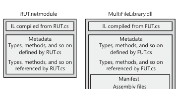

**图 2-1** 一个由两个托管模块组成的多文件程序集，其中一个模块带有清单。

RUT.netmodule 文件包含通过编译 RUT.cs 生成的 IL 代码。此文件还包含元数据表，用于描述由 RUT.cs 定义的类型、方法、字段、属性、事件等。这些元数据表还描述 RUT.cs 引用的类型、方法等。MultiFileLibrary.dll 是一个单独的文件。与 RUT.netmodule 一样，此文件包含通过编译 FUT.cs 生成的 IL 代码，还包含类似的定义和引用元数据表。但是，MultiFileLibrary.dll 包含额外的清单元数据表，这使得 MultiFileLibrary.dll 成为一个程序集。额外的清单元数据表描述构成程序集的所有文件（MultiFileLibrary.dll 文件本身和 RUT.netmodule）。清单元数据表还包含从 MultiFileLibrary.dll 和 RUT.netmodule 导出的所有公共类型。

> **注意** 实际上，清单元数据表并不真正包含从包含清单的 PE 文件中导出的类型。此优化的目的是减少 PE 文件中清单信息所需的字节数。因此，像“清单元数据表还包含从 MultiFileLibrary.dll 和 RUT.netmodule 导出的所有公共类型”这样的说法并非百分之百准确。不过，这种说法确实准确反映了清单在逻辑上所公开的内容。

生成 MultiFileLibrary.dll 程序集后，你可以使用 ILDasm.exe 检查元数据的清单表，以验证该程序集文件确实引用了 RUT.netmodule 文件的类型。FileDef 和 ExportedTypesDef 元数据表如下所示。

```
File #1 (26000001)
-----------------------------------------
    Token: 0x26000001
    Name : RUT.netmodule
    HashValue Blob : e6 e6 df 62 2c a1 2c 59  97 65 0f 21 44 10 15 96  f2 7e db c2
    Flags : [ContainsMetaData]  (00000000)

ExportedType #1 (27000001)
----------------------------------------
Token: 0x27000001
Name: ARarelyUsedType
Implementation token: 0x26000001
TypeDef token: 0x02000002
Flags      : [Public] [AutoLayout] [Class] [Sealed] [AnsiClass]
             [BeforeFieldInit] (00100101)
```

由此可以看出，RUT.netmodule 是一个被视为该程序集一部分的文件，其标记为 0x26000001。从 ExportedTypesDef 表中可以看到，有一个公开导出的类型 ARarelyUsedType。此类型的实现标记为 0x26000001，这表明该类型的 IL 代码包含在 RUT.netmodule 文件中。

> **注意** 供好奇者参考：元数据标记是 4 字节的值。高字节表示标记的类型（0x01=TypeRef，0x02=TypeDef，0x23=AssemblyRef，0x26=File（文件定义），0x27=ExportedType）。完整列表请参见 .NET Framework SDK 随附的 CorHdr.h 文件中的 CorTokenType 枚举类型。标记的三个低字节仅用于标识对应元数据表中的行。例如，实现标记 0x26000001 引用 File 表的第一行。对于大多数表，行从 1 开始编号，而不是从 0 开始。对于 TypeDef 表，行实际上从 2 开始。

任何使用 MultiFileLibrary.dll 程序集类型的客户端代码都必须使用 /reference: MultiFileLibrary.dll 编译器开关来生成。此开关告诉编译器，在搜索外部类型时加载 MultiFileLibrary.dll 程序集及其 FileDef 表中列出的所有文件。编译器要求程序集的所有文件都已安装且可访问。如果你删除了 RUT.netmodule 文件，C# 编译器将产生以下错误：fatal error CS0009：无法打开元数据文件“C:\MultiFileLibrary.dll”——“导入程序集‘C:\MultiFileLibrary.dll’的模块‘RUT.netmodule’时出错——系统找不到指定的文件”。这意味着，要生成新的程序集，被引用程序集的所有文件都必须存在。

当客户端代码执行时，它会调用方法。当某个方法第一次被调用时，CLR 会检测该方法作为参数、返回类型或局部变量引用的类型。然后，CLR 尝试加载被引用程序集中包含清单的文件。如果要访问的类型位于此文件中，CLR 会执行其内部簿记工作，从而允许使用该类型。如果清单指示被引用的类型位于另一个文件中，CLR 会尝试加载所需文件，执行其内部簿记，并允许访问该类型。只有当调用引用了未加载程序集中某个类型的方法时，CLR 才会加载程序集文件。这意味着，要运行应用程序，并不需要被引用程序集的所有文件都存在。


### 使用 Visual Studio IDE 将程序集添加到项目

如果你使用 Visual Studio IDE 构建项目，就必须将想要引用的所有程序集添加到项目中。为此，请打开“解决方案资源管理器”，右键单击要添加引用的项目，然后选择“添加引用”菜单项。此时会出现“引用管理器”对话框，如图 2-2 所示。

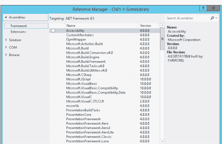

图 2-2 Visual Studio 中的“引用管理器”对话框。

若要让项目引用某个程序集，请从列表中选择所需的程序集。如果所需程序集不在列表中，请单击“浏览”按钮，定位到所需程序集（包含清单的文件）以添加程序集引用。“解决方案”选项允许当前项目引用同一解决方案中另一个项目创建的程序集。“引用管理器”对话框中的“COM”选项允许通过 Visual Studio 自动生成的托管代理类，在托管源代码中访问非托管 COM 服务器。“浏览”选项允许你选择最近添加到另一个项目中的程序集。

若要使自己的程序集出现在“引用管理器”对话框中，请按照 http://msdn.microsoft.com/en-us/library/wkze6zky(v=vs.110).aspx 上的说明操作。

#### 使用程序集链接器

除了使用 C# 编译器，你也可以使用程序集链接器工具 AL.exe 来创建程序集。如果你希望创建一个由不同编译器生成的模块组成的程序集（当你的编译器不支持与 C# 的 /addmodule 开关等效的功能时），或者只是还不确定程序集在生成时的打包需求，那么程序集链接器会很有用。你也可以使用 AL.exe 来构建仅含资源的程序集，这类程序集称为附属程序集，通常用于本地化。本章稍后会讨论附属程序集。

AL.exe 工具可以生成一个 EXE 或 DLL PE 文件，该文件只包含描述其他模块中类型的清单。为了理解 AL.exe 的工作方式，我们来改变 MultiFileLibrary.dll 程序集的构建方式。

```
csc /t:module RUT.cs
csc /t:module FUT.cs
al /out: MultiFileLibrary.dll /t:library FUT.netmodule RUT.netmodule
```

图 2-3 显示了执行这些语句后生成的文件。

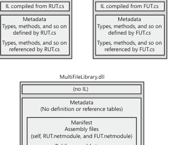

图 2-3 由三个托管模块组成的多文件程序集，其中一个模块带有清单。

在此示例中，创建了两个独立的模块：RUT.netmodule 和 FUT.netmodule。这两个模块都不是程序集，因为它们不包含清单元数据表。然后生成第三个文件：MultiFileLibrary.dll，它是一个小的 DLL PE 文件（因为使用了 /t[arget]:library 开关），不包含 IL 代码，但包含清单元数据表，表明 RUT.netmodule 和 FUT.netmodule 属于该程序集。生成的程序集由三个文件组成：MultiFileLibrary.dll，

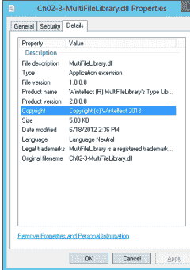

图 2-4 Ch02-3-MultiFileLibrary.dll 属性对话框的“详细信息”选项卡。

在构建程序集时，应使用在源代码中程序集级别应用的自定义特性来设置版本资源字段。下面就是生成图 2-4 中版本信息的代码。

```csharp
using System.Reflection;

// FileDescription version information:
[assembly: AssemblyTitle("MultiFileLibrary.dll")]

// Comments version information:
[assembly: AssemblyDescription("This assembly contains MultiFileLibrary's types")]

// CompanyName version information:
[assembly: AssemblyCompany("Wintellect")]

// ProductName version information:
[assembly: AssemblyProduct("Wintellect (R) MultiFileLibrary's Type Library")]

// LegalCopyright version information:
[assembly: AssemblyCopyright("Copyright (c) Wintellect 2013")]

// LegalTrademarks version information:
[assembly: AssemblyTrademark("MultiFileLibrary is a registered trademark of Wintellect")]

// AssemblyVersion version information:
[assembly: AssemblyVersion("3.0.0.0")]
```

| 版本资源 | AL.exe 开关 | 自定义特性/注释 |
| --- | --- | --- |
| InternalName | /out | 设置为指定的输出文件名（不含扩展名）。 |
| LegalCopyright | /copyright | System.Reflection.AssemblyCopyrightAttribute。 |
| LegalTrademarks | /trademark | System.Reflection.AssemblyTrademarkAttribute。 |
| OriginalFilename | /out | 设置为输出文件名（不含路径）。 |
| PrivateBuild | （无） | 始终为空。 |
| ProductName | /product | System.Reflection.AssemblyProductAttribute。 |
| ProductVersion | /productversion | System.Reflection.AssemblyInformationalVersionAttribute。 |
| SpecialBuild | （无） | 始终为空。 |

> **重要说明** 在 Visual Studio 中创建新的 C# 项目时，系统会自动在 Properties 文件夹中为你生成一个 AssemblyInfo.cs 文件。这个文件包含本节描述的所有程序集版本特性，以及我将在第 3 章介绍的一些附加特性。你只需打开 AssemblyInfo.cs 文件，修改程序集特定的信息即可。Visual Studio 还提供了一个对话框，可用于编辑此文件中的程序集版本信息。要查看此对话框，请在“解决方案资源管理器”中双击项目的 Properties 项，然后在“应用程序”选项卡上单击“程序集信息”；你将看到如图 2-5 所示的对话框。

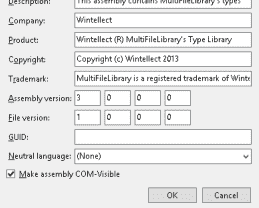

图 2-5 Visual Studio 的“程序集信息”对话框。

- **AssemblyVersion** 此版本号存储在 AssemblyDef 清单元数据表中。CLR 在绑定到强命名程序集（第 3 章讨论）时会使用此版本号。这个编号极为重要，用于唯一标识程序集。开始开发程序集时，应设置主版本号、次版本号、内部版本号和修订号，并且在准备好开始处理下一个可部署版本之前不应更改这些编号。当程序集 A 引用强命名程序集 B 时，程序集 B 的版本会嵌入到程序集 A 的 AssemblyRef 表项中。这样，当 CLR 需要加载程序集 B 时，它确切地知道程序集 A 是针对哪个版本生成和测试的。也可以通过绑定重定向（第 3 章讨论）让 CLR 加载不同版本。

#### 区域性

与版本号一样，区域性也是程序集标识的一部分。例如，可以有一个专门用于德语的程序集，一个用于瑞士德语的程序集，一个用于美国英语的程序集，等等。区域性通过包含主标记和次标记的字符串来标识（如 RFC 1766 所述）。表 2-6 显示了一些示例。

**表 2-6** 程序集区域性标记示例

| 主标记 | 次标记 | 区域性 |
| --- | --- | --- |
| de | （无） | 德语 |
| de | AT | 奥地利德语 |
| de | CH | 瑞士德语 |
| en | （无） | 英语 |
| en | GB | 英式英语 |
| en | US | 美式英语 |

一般来说，如果要创建包含代码的程序集，不应为它指定区域性。这是因为代码通常不会内建任何区域性特定的假设。未指定区域性的程序集称为*区域性中立*。

如果你在设计一个包含区域性特定资源的应用程序，Microsoft 强烈建议你创建一个程序集，其中包含你的代码和应用程序的默认（或回退）资源。构建此程序集时，请不要指定区域性。其他程序集在创建和操作它公开暴露的类型时会引用这个程序集。

然后，你可以创建一个或多个独立的程序集，这些程序集只包含区域性特定的资源——完全不含代码。标有区域性的程序集称为*附属程序集*。对于这些附属程序集，请指定一个能准确反映程序集中所放置资源区域性的区域性。你应该为打算支持的每种区域性创建一个附属程序集。


通常使用 AL.exe 工具生成附属程序集。不会使用编译器，因为附属程序集不应包含任何代码。使用 AL.exe 时，通过 /c[ulture]:text 开关指定所需区域性，其中 text 是诸如 "en-US" 的字符串，表示美国英语。部署附属程序集时，应将其放在名称与区域性文本匹配的子目录中。例如，如果应用程序的基目录是 C:\MyApp，则美国英语附属程序集应放在 C:\MyApp\en-US 子目录中。运行时，使用 System.Resources.ResourceManager 类访问附属程序集的资源。

> **注意** 可以创建包含代码的附属程序集，但不建议这样做。如果愿意，可以使用 System.Reflection.AssemblyCultureAttribute 自定义特性（而不是 AL.exe 的 /culture 开关）来指定区域性，例如如下所示。

```
    // Set assembly's culture to Swiss German
    [assembly:AssemblyCulture("de-CH")]
```

通常，不应生成引用附属程序集的程序集。换句话说，程序集的 AssemblyRef 项应全部引用区域性中性程序集。如果要访问附属程序集中包含的类型或成员，应使用第 23 章“程序集加载和反射”中讨论的反射技术。

### 简单应用程序部署（私有部署的程序集）

在本章中，我解释了如何生成模块以及如何将这些模块合并到程序集中。现在，我准备解释如何打包和部署所有程序集，以便用户能够运行应用程序。

Windows 商店应用对程序集打包有非常严格的规则，Visual Studio 会将应用程序所需的所有程序集一起打包到单个 .appx 文件中，该文件要么上传到 Windows 商店，要么可以旁加载到计算机上。当用户安装 .appx 文件时，其中包含的所有程序集都会放在 CLR 将加载它们的目录中，并且 Windows 会向用户的“开始”屏幕添加应用程序磁贴。如果其他用户安装相同的 .appx 文件，则使用之前安装的程序集，新用户只是在其“开始”屏幕中添加一个磁贴。当用户卸载 Windows 商店应用时，系统会从用户的“开始”屏幕中移除该磁贴。如果没有其他用户安装该应用，则 Windows 会销毁该目录及其所有程序集。请注意，不同用户可以安装同一 Windows 商店应用的不同版本。为此，Windows 将程序集安装到不同目录中，以便单个应用的多个版本可以同时驻留在一台计算机上。

对于桌面（非 Windows 商店）应用程序，程序集不强制要求任何特殊的打包方式。打包一组程序集的最简单方法是直接复制所有文件。例如，可以将所有程序集文件放到 CD-ROM 上，并附带一个批处理文件安装程序发送给用户，该程序只需将文件从 CD 复制到用户硬盘上的目录。由于程序集包含所有依赖的程序集引用和类型，用户只需运行应用程序，运行时会在应用程序目录中查找引用的程序集。应用程序运行不需要修改注册表。要卸载应用程序，只需删除所有文件——就是这样！

当然，可以使用其他机制打包和安装程序集文件，例如 .cab 文件（通常用于 Internet 下载场景，以压缩文件并减少下载时间）。还可以将程序集文件打包到 MSI 文件中，供 Windows Installer 服务（MSIExec.exe）使用。使用 MSI 文件允许在 CLR 首次尝试加载程序集时按需安装程序集。此功能对 MSI 来说并不新鲜；它也可以为非托管 EXE 和 DLL 文件执行相同的按需加载功能。


> **注意** 使用批处理文件或其他简单的“安装软件”可以将应用程序安装到用户计算机上；但是，需要更复杂的安装软件才能在用户的桌面和“开始”菜单/屏幕中创建快捷方式链接。此外，可以轻松备份和还原应用程序，或将其从一台计算机移动到另一台计算机，但各种快捷方式链接需要特殊处理。

当然，Visual Studio 有一个内置机制，可以通过显示项目的“属性”页并单击“发布”选项卡来发布应用程序。可以使用“发布”选项卡上可用的选项，使 Visual Studio 生成 MSI 文件并将生成的 MSI 文件复制到网站、FTP 服务器或文件路径。MSI 文件还可以安装任何必备组件，例如 .NET Framework 或 Microsoft SQL Server Express Edition。最后，应用程序可以利用 ClickOnce 技术自动检查更新并将其安装在用户计算机上。

部署到与应用程序相同目录中的程序集称为*私有部署的程序集*，因为程序集文件不与任何其他应用程序共享（除非其他应用程序也部署到同一目录）。私有部署的程序集对开发人员、最终用户和管理员来说是一大优势，因为它们可以直接复制到应用程序的基目录中，CLR 会加载它们并执行其中的代码。此外，只需删除应用程序目录中的程序集即可卸载应用程序。这也允许简单的备份和还原。

这种简单的安装/移动/卸载场景之所以可行，是因为每个程序集都有元数据，指示应加载哪个被引用的程序集；不需要注册表设置。此外，引用程序集限定了每个类型的范围。这意味着应用程序始终绑定到其生成和测试时所用的相同类型；CLR 无法加载恰好提供同名类型的其他程序集。这与 COM 不同，COM 中的类型记录在注册表中，使它们可用于计算机上运行的任何应用程序。

在第 3 章中，我将讨论如何部署可供多个应用程序访问的共享程序集。

### 简单的管理控制（配置）

用户或管理员最能决定应用程序执行的某些方面。例如，管理员可能决定在用户硬盘上移动程序集文件，或重写程序集清单中包含的信息。还存在与版本控制相关的其他场景；我将在第 3 章中讨论其中一些。

为了允许对应用程序进行管理控制，可以将配置文件放在应用程序的目录中。应用程序的发布者可以创建并打包此文件。然后安装程序会将该配置文件安装到应用程序的基目录中。此外，计算机管理员或最终用户可以创建或修改此文件。CLR 解释此文件的内容，以更改其定位和加载程序集文件的策略。

这些配置文件包含可扩展标记语言 (XML)，并且可以与应用程序或计算机关联。使用单独的文件（相对于注册表设置）可以轻松备份该文件，还允许管理员将应用程序复制到另一台计算机——只需复制必要的文件，管理策略也会一并复制。

在第 3 章中，我们将更详细地探讨此配置文件。但现在我想让您先体验一下。假设应用程序的发布者希望将其应用程序与 MultiFileLibrary 程序集文件部署在与应用程序程序集文件不同的目录中。所需的目录结构如下所示。

```
AppDir directory (contains the application's assembly files)
    Program.exe
    Program.exe.config (discussed below)

    AuxFiles subdirectory (contains MultiFileLibrary's assembly files)
        MultiFileLibrary.dll
        FUT.netmodule
        RUT.netmodule
```

因为 MultiFileLibrary 文件不再位于应用程序的基目录中，所以 CLR 将无法定位和加载这些文件；运行应用程序将导致引发 System.IO.FileNotFoundException 异常。为解决此问题，发布者创建一个 XML 配置文件并将其部署到应用程序的基目录。此文件的名称必须是应用程序主程序集文件的名称加上 .config 扩展名：对于此示例，为 Program.exe.config。配置文件应如下所示。

```
<configuration>
    <runtime>
        <assemblyBinding xmlns="urn:schemas-microsoft-com:asm.v1">
            <probing privatePath="AuxFiles" />
        </assemblyBinding>
    </runtime>
</configuration>
```


### 探测程序集文件

每当 CLR 尝试定位程序集文件时，它总是先查找应用程序目录；如果在那里找不到文件，则查找 AuxFiles 子目录。可以为探测元素的 `privatePath` 属性指定多个以分号分隔的路径。每个路径都视为相对于应用程序的基目录。不能指定标识应用程序基目录之外目录的绝对路径或相对路径。其思路是，应用程序可以控制自己的目录及其子目录，但无法控制其他目录。

当 CLR 需要定位程序集时，它会扫描若干子目录。以下是针对非特定区域性程序集（其中 `firstPrivatePath` 和 `secondPrivatePath` 通过配置文件的 `privatePath` 属性指定）探测目录的顺序。

```
AppDir\AsmName.dll
AppDir\AsmName\AsmName.dll
AppDir\firstPrivatePath\AsmName.dll
AppDir\firstPrivatePath\AsmName\AsmName.dll
AppDir\secondPrivatePath\AsmName.dll
AppDir\secondPrivatePath\AsmName\AsmName.dll
...
```

在此示例中，如果将 MultiFileLibrary 程序集文件部署到名为 MultiFileLibrary 的子目录，则不需要配置文件，因为 CLR 会自动扫描名称与所搜索程序集名称匹配的子目录。

如果在上述任何子目录中都找不到该程序集，CLR 会重新开始，使用 .exe 扩展名而不是 .dll 扩展名。如果仍然找不到该程序集，则抛出 `FileNotFoundException`。

对于附属程序集，遵循类似规则，不同之处在于程序集应位于应用程序基目录下名称与区域性匹配的子目录中。例如，如果 AsmName.dll 应用了区域性“en-US”，则会探测以下目录。

```
C:\AppDir\en-US\AsmName.dll
C:\AppDir\en-US\AsmName\AsmName.dll
C:\AppDir\firstPrivatePath\en-US\AsmName.dll
C:\AppDir\firstPrivatePath\en-US\AsmName\AsmName.dll
C:\AppDir\secondPrivatePath\en-US\AsmName.dll
C:\AppDir\secondPrivatePath\en-US\AsmName\AsmName.dll

C:\AppDir\en-US\AsmName.exe
C:\AppDir\en-US\AsmName\AsmName.exe
C:\AppDir\firstPrivatePath\en-US\AsmName.exe
C:\AppDir\firstPrivatePath\en-US\AsmName\AsmName.exe
C:\AppDir\secondPrivatePath\en-US\AsmName.exe
C:\AppDir\secondPrivatePath\en-US\AsmName\AsmName.exe
```

如你所见，CLR 会探测扩展名为 .exe 或 .dll 的文件。由于探测可能非常耗时（尤其是当 CLR 通过网络查找文件时），在 XML 配置文件中，可以指定一个或多个 culture 元素，以限制 CLR 在查找附属程序集时执行的探测。Microsoft 提供了一个 FusLogVw.exe 工具，可用于查看 CLR 在运行时如何绑定到程序集。有关更多信息，请参见 http://msdn.microsoft.com/en-us/library/e74a18c4(v=vs.110).aspx。

此 XML 配置文件的名称和位置因应用程序类型而异：

- 对于可执行应用程序（EXE），配置文件必须位于应用程序的基目录中，并且其名称必须是在 EXE 文件名后追加“.config”。

- 对于 Microsoft ASP.NET Web Form 应用程序，该文件必须位于 Web 应用程序的虚拟根目录中，并且始终命名为 Web.config。此外，子目录也可以包含自己的 Web.config 文件，并且配置设置会被继承。例如，位于 http://Wintellect.com/Training 的 Web 应用程序将使用虚拟根目录及其 Training 子目录中包含的 Web.config 文件中的设置。

如本节开头所述，配置设置适用于特定应用程序和计算机。安装 .NET Framework 时，它会创建一个 Machine.config 文件。计算机上安装的每个 CLR 版本都有一个 Machine.config 文件。

Machine.config 文件位于以下目录：

```
%SystemRoot%\Microsoft.NET\Framework\version\CONFIG
```

当然，%SystemRoot% 标识 Windows 目录（通常为 C:\WINDOWS），而 version 是标识 .NET Framework 特定版本的版本号（类似于 v4.0.#####）。

Machine.config 文件中的设置表示影响计算机上运行的所有应用程序的默认设置。管理员可以通过修改单个 Machine.config 文件来创建计算机范围的策略。但是，管理员和用户应避免修改此文件，因为它包含许多与各种内容相关的设置，使导航变得更加困难。此外，你希望应用程序的设置能够被备份和还原，而将应用程序的设置保存在应用程序特定的配置文件中可以实现这一点。

文件版本控制是一个非常难以解决的问题。事实上，我断言，如果你取一个被其他代码文件使用的文件，并且只更改文件中的一位——将 0 改为 1 或将 1 改为 0——就绝对无法保证在更改之前使用该文件的代码在使用新版本文件时仍能同样正常工作。该说法成立的原因之一是，许多应用程序会有意或无意地利用 bug。如果文件的后续版本修复了某个 bug，应用程序就不再按预期运行。

那么问题来了：如何修复文件中的 bug 并向文件添加功能，同时保证不会破坏某些应用程序？我对这个问题进行了大量思考，并得出一个结论：这根本不可能。但是，显然这个答案还不够好。文件发布时会带有 bug，而公司总是希望提供新功能。必须有一种方法来分发新文件，并希望应用程序能够正常工作。而且，如果应用程序无法正常工作，必须有一种简单的方法将应用程序恢复到其最后一个已知良好状态。

在本章中，我将解释 .NET Framework 为处理版本控制问题而建立的基础结构。让我提醒你：我将要描述的内容很复杂。我将讨论公共语言运行时（CLR）内置的许多算法、规则和策略。我还会提到应用程序开发人员必须使用的许多工具和实用程序。这些东西很复杂，因为正如我提到的，版本控制问题难以处理和解决。

### 两种程序集，两种部署

CLR 支持两种程序集：弱命名程序集和强命名程序集。


> **重要** 顺便说一句，在任何 .NET Framework 文档中都找不到“弱命名程序集”这一术语。为什么？因为这是我编造的。事实上，文档中并没有用于标识弱命名程序集的术语。我决定创造这个术语，以便在谈论程序集时，对于我所指的是哪种程序集没有任何歧义。

弱命名程序集和强命名程序集在结构上完全相同——也就是说，它们使用相同的可移植可执行（PE）文件格式、PE32(+) 头、CLR 头、元数据、清单表以及我们在第 1 章“CLR 的执行模型”和第 2 章中检查过的中间语言（IL）。并且，你使用相同的工具（例如 C# 编译器和 AL.exe）来生成这两种程序集。弱命名程序集和强命名程序集之间的真正区别在于，强命名程序集使用发布者的公钥/私钥对进行签名，该密钥对唯一标识程序集的发布者。此密钥对允许对程序集进行唯一标识、保护和版本控制，并允许将程序集部署到用户计算机上的任何位置，甚至 Internet 上。这种唯一标识程序集的能力允许 CLR 在应用程序尝试绑定到强命名程序集时强制执行某些已知安全的策略。本章专门解释什么是强命名程序集，以及 CLR 对它们应用哪些策略。


程序集可以通过两种方式部署：私有部署或全局部署。私有部署的程序集是部署在应用程序基目录或其某个子目录中的程序集。弱命名程序集只能私有部署。我在第 2 章中讨论过私有部署的程序集。全局部署的程序集是部署到某个已知位置的程序集，CLR 在搜索该程序集时会查看该位置。强命名程序集可以私有部署，也可以全局部署。本章将说明如何创建和部署强命名程序集。表 3-1 总结了程序集的类型及其部署方式。

**表 3-1** 弱命名和强命名程序集可以如何部署

| 程序集类型 | 可否私有部署 | 可否全局部署 |
|---|---|---|
| 弱命名 | 是 | 否 |
| 强命名 | 是 | 是 |

### 为程序集指定强名称

如果多个应用程序要访问某个程序集，则必须将该程序集放在已知目录中，并且当检测到对该程序集的引用时，CLR 必须知道自动查看此目录。但是，我们有一个问题：两家（或更多）公司可能生成具有相同文件名的程序集。然后，如果这两个程序集都被复制到同一个已知目录中，则最后安装的那个会胜出，而所有使用旧程序集的应用程序都无法再按预期运行。（这正是当今 Windows 中存在 DLL 地狱的原因：共享 DLL 都只是被复制到 System32 目录中。）

显然，仅通过文件名来区分程序集还不够。CLR 需要支持某种能够唯一标识程序集的机制。这就是“强命名程序集”这一术语所指的内容。强命名程序集由四个可唯一标识该程序集的属性组成：文件名（不含扩展名）、版本号、区域性标识和公钥。由于公钥是非常大的数字，我们经常使用由公钥派生出的一个小哈希值。这个哈希值称为公钥标记。以下程序集标识字符串（有时称为程序集显示名称）标识四个完全不同的程序集文件。

```
"MyTypes, Version=1.0.8123.0, Culture=neutral, PublicKeyToken=b77a5c561934e089"
"MyTypes, Version=1.0.8123.0, Culture="en-US", PublicKeyToken=b77a5c561934e089"
"MyTypes, Version=2.0.1234.0, Culture=neutral, PublicKeyToken=b77a5c561934e089"
"MyTypes, Version=1.0.8123.0, Culture=neutral, PublicKeyToken=b03f5f7f11d50a3a"
```

第一个字符串标识名为 MyTypes.exe 或 MyTypes.dll 的程序集文件（实际上无法从程序集标识字符串确定文件扩展名）。生成该程序集的公司正在创建此程序集的 1.0.8123.0 版本，并且程序集中没有任何内容对某个区域性敏感，因为 Culture 设置为 neutral。当然，任何公司都可以生成一个 MyTypes.dll（或 MyTypes.exe）程序集文件，并将其标记为版本号 1.0.8123.0 和中性区域性。必须有一种方法将这家公司的程序集与另一家恰好具有相同属性的公司的程序集区分开。出于若干原因，Microsoft 选择使用标准公钥/私钥加密技术，而不是 GUID、URL 或 URN 等任何其他唯一标识技术。具体而言，加密技术提供了一种方法，可在程序集的各个位安装到计算机上时检查其完整性，并且还允许按发布者授予权限。本章稍后将讨论这些技术。因此，想要唯一标记其程序集的公司必须创建公钥/私钥对。然后，可以将公钥与该程序集关联。任何两家公司都不应拥有相同的公钥/私钥对，正是这种区别使得两家公司可以创建具有相同名称、版本和区域性的程序集而不会引起任何冲突。

> **注意** `System.Reflection.AssemblyName` 类是一个帮助类，可让你轻松生成程序集名称并获取程序集名称的各个部分。该类提供若干公共实例属性，例如 `CultureInfo`、`FullName`、`KeyPair`、`Name` 和 `Version`。该类还提供若干公共实例方法，例如 `GetPublicKey`、`GetPublicKeyToken`、`SetPublicKey` 和 `SetPublicKeyToken`。

第 2 章中，我向你展示了如何命名程序集文件，以及如何应用程序集版本号和区域性。弱命名程序集可以在清单元数据中嵌入程序集版本和区域性属性；但是，当 CLR 探测子目录以查找附属程序集时，它总是忽略版本号，只使用区域性信息。由于弱命名程序集始终是私有部署的，因此当 CLR 在应用程序基目录中，或在可扩展标记语言（XML）配置文件的 probing 元素的 privatePath XML 属性所指定的任何应用程序子目录中搜索程序集文件时，只需使用程序集名称（附加 .dll 或 .exe 扩展名）。

强命名程序集具有文件名、程序集版本和区域性。此外，强命名程序集使用发布者的私钥进行签名。

创建强命名程序集的第一步是使用随 .NET Framework SDK 和 Microsoft Visual Studio 提供的强名称实用工具 SN.exe 获取密钥。此实用工具根据你指定的命令行开关提供大量功能。请注意，SN.exe 的所有命令行开关都区分大小写。要生成公钥/私钥对，请按如下方式运行 SN.exe。

```
SN -k MyCompany.snk
```

这一行告诉 SN.exe 创建一个名为 MyCompany.snk 的文件。此文件将包含以二进制格式保存的公钥和私钥数字。

公钥数字非常大。如果需要，在创建包含公钥和私钥的文件后，你可以再次使用 SN.exe 实用工具查看实际公钥。为此，必须执行 SN.exe 实用工具两次。首先，使用 -p 开关调用 SN.exe，创建一个仅包含公钥的文件（MyCompany.PublicKey）。<sup>1</sup>

```
SN -p MyCompany.snk MyCompany.PublicKey sha256
```

然后，调用 SN.exe，向它传递 -tp 开关和仅包含公钥的文件。

```
SN -tp MyCompany.PublicKey
```

当我执行此行时，得到以下输出。

```
Microsoft (R) .NET Framework Strong Name Utility  Version 4.0.30319.17929
Copyright (c) Microsoft Corporation.  All rights reserved.

Public key (hash algorithm: sha256):
00240000048000009400000006020000002400005253413100040000010001003f9d621b702111
85b0453b92bdcba8c02e0b7b4f05d67ab02047fc786ffa3797b669215afd0b4f8a4f6f294010
b233bac0b8c809b8a09855da256d964c0d07f1f64d91d98b51a4846a62317328cac89362a550
69f2a1a25bc03193b261176dd629eace6c90d36858de3fcb781bfc8b17936a567cad608ae672b6
1fb80e0b0

Public key token is 3db32f38c8b42c9a
```

SN.exe 实用工具不提供任何可用于显示私钥的方式。

公钥的大小使其难以使用。为了方便开发人员（也方便最终用户），人们创建了*公钥标记*。公钥标记是公钥的 64 位哈希值。SN.exe 的 -tp 开关会在其输出末尾显示与完整公钥对应的公钥标记。

既然你知道如何创建公钥/私钥对，创建强命名程序集就很简单了。编译程序集时，使用 `/keyfile:<file>` 编译器开关。

```
csc /keyfile:MyCompany.snk Program.cs
```

当 C# 编译器看到此开关时，编译器会打开指定的文件（MyCompany.snk），用私钥对程序集签名，并将公钥嵌入清单中。请注意，只能对包含清单的程序集文件进行签名；程序集的其他文件不能显式签名。

如果使用 Visual Studio，可以通过显示项目属性、单击“签名”选项卡、选中“对程序集签名”复选框，然后从“选择强名称密钥文件”组合框中选择 `<New...>` 选项来创建新的公钥/私钥文件。

<sup>1</sup> 在此示例中，我使用的是 .NET Framework 4.5 中引入的增强强命名。如果需要生成与 .NET Framework 早期版本兼容的程序集，则还必须使用 AssemblySignatureKeyAttribute 创建副签名。有关详细信息，请参阅 http://msdn.microsoft.com/en-us/library/hh415055(v=vs.110).aspx。


对文件进行签名的含义如下：生成强命名程序集时，程序集的 FileDef 清单元数据表会包含组成该程序集的所有文件的列表。当每个文件的名称被添加到清单中时，会计算文件内容的哈希，并将该哈希值连同文件名一起存储在 FileDef 表中。可以使用 AL.exe 的 `/algid` 开关覆盖默认哈希算法，也可以在程序集的某个源代码文件中应用程序集级 `System.Reflection.AssemblyAlgorithmIdAttribute` 自定义特性。默认情况下，使用 SHA-1 算法。

生成包含清单的 PE 文件后，对 PE 文件的全部内容（除任何 Authenticode 签名、程序集的强名称数据和 PE 头校验和之外）进行哈希，如图 3-1 所示。该哈希值使用发布者的私钥签名，生成的 RSA 数字签名存储在 PE 文件内的保留节中（不包含在哈希中）。PE 文件的 CLR 头会更新，以反映数字签名嵌入文件中的位置。

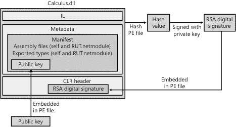

**图 3-1** 对程序集进行签名。

发布者的公钥也会嵌入此 PE 文件的 AssemblyDef 清单元数据表中。文件名、程序集版本、区域性和公钥的组合赋予该程序集强名称，保证其唯一。除非两家公司彼此共享该密钥对，否则它们不可能各自生成一个名为 *OurLibrary* 且使用相同公钥/私钥的程序集。

此时，程序集及其所有文件已准备好打包和分发。

如第 2 章所述，编译源代码时，编译器会检测代码引用的类型和成员。必须向编译器指定所引用的程序集。对于 C# 编译器，使用 `/reference` 编译器开关。编译器的一项工作是在生成的托管模块中生成 AssemblyRef 元数据表。AssemblyRef 元数据表中的每个条目指示所引用程序集的名称（不含路径和扩展名）、版本号、区域性和公钥信息。

这等效于以下内容。

> "SomeClassLibrary, Version=3.0.0.0, Culture=neutral, PublicKeyToken=null"

在这一行中，未指定公钥标记，因为该 DLL 程序集未使用公钥/私钥对签名，因此它是弱命名程序集。如果我使用 SN.exe 创建密钥文件，并使用 /keyfile 编译器开关编译，则生成的程序集就会已签名。如果我随后使用 ILDasm.exe 查看新程序集的元数据，AssemblyDef 条目会在 Public Key 字段后出现字节，并且该程序集将是强命名的。顺便说一句，AssemblyDef 条目始终存储完整公钥，而不是公钥标记。完整公钥对于确保文件未被篡改是必要的。本章后面我将解释强命名程序集的防篡改能力。

### 全局程序集缓存

既然知道了如何创建强命名程序集，现在该学习如何部署该程序集，以及 CLR 如何使用这些信息定位并加载程序集。

如果多个应用程序要访问某个程序集，就必须将该程序集放到一个众所周知的目录中，并且当检测到对该程序集的引用时，CLR 必须知道自动查看此目录。这个众所周知的位置称为全局程序集缓存 (GAC)。GAC 的确切位置是实现细节，可能随 .NET Framework 的不同版本而变化。不过，通常可以在以下目录中找到它：

```text
%SystemRoot%\Microsoft.NET\Assembly
```

GAC 目录是有结构的。它包含许多子目录，并使用一种算法生成这些子目录的名称。绝不要手动将程序集文件复制到 GAC 中；而应使用工具完成此任务。这些工具了解 GAC 的内部结构以及如何生成正确的子目录名。

在开发和测试期间，可以使用最常见的工具将强命名程序集安装到 GAC 中，即 GACUtil.exe。不带任何命令行参数运行此工具会显示以下用法。

```text
Microsoft (R) .NET Global Assembly Cache Utility.  Version 4.0.30319.17929
Copyright (c) Microsoft Corporation.  All rights reserved.

Usage: Gacutil <command> [ <options> ]
Commands:
  /i <assembly_path> [ /r <...> ] [ /f ]
      Installs an assembly to the global assembly cache.

  /il <assembly_path_list_file> [ /r <...> ] [ /f ]
      Installs one or more assemblies to the global assembly cache.

  /u <assembly_display_name> [/r <...>]
      Uninstalls an assembly from the global assembly cache.

  /ul <assembly_display_name_list_file> [/r <...>]
      Uninstalls one or more assemblies from the global assembly cache.

  /l [<assembly_name>]
      List the global assembly cache filtered by <assembly_name>

  /r [<assembly_name>]
      List the global assembly cache with all traced references.

  /cdl
      Deletes the contents of the download cache

  /dl
      Lists the contents of the download cache

  /?
      Displays a detailed help screen

Options:
  /r <reference_scheme> <reference_id> <description>
      Specifies a traced reference to install (/i, /il) or uninstall (/u, /ul).

  /f
      Forces reinstall of an assembly.

  /nologo
      Suppresses display of the logo banner

  /silent
      Suppresses display of all output
```

如你所见，可以调用 GACUtil.exe，指定 /i 开关将程序集安装到 GAC，还可以使用 GACUtil.exe 的 /u 开关从 GAC 卸载程序集。注意，绝不能将弱命名程序集放入 GAC。如果将弱命名程序集的文件名传递给 GACUtil.exe，它会显示以下错误消息：向缓存添加程序集失败：尝试安装没有强名称的程序集。

> **注意** 默认情况下，只有属于 Windows Administrators 组的用户才能操作 GAC。如果调用该实用程序执行操作的用户不是此组的成员，GACUtil.exe 将无法安装或卸载程序集。

使用 GACUtil.exe 的 /i 开关对开发人员测试非常方便。但是，如果在生产环境中使用 GACUtil.exe 部署程序集，建议除了指定 /i 或 /u 开关来安装或卸载程序集外，还使用 GACUtil.exe 的 /r 开关。/r 开关将程序集与 Windows 安装和卸载引擎集成。基本上，它告诉系统哪个应用程序需要该程序集，然后将应用程序和程序集关联在一起。

> 注意 如果强命名程序集打包在 cabinet (.cab) 文件中或以某种方式压缩，则必须先将其文件解压缩到临时文件，然后才能使用 GACUtil.exe 将程序集的文件安装到 GAC 中。程序集文件安装完成后，可以删除临时文件。

GACUtil.exe 工具不随最终用户 .NET Framework 可再发行组件包一起提供。如果应用程序包含要部署到 GAC 中的某些程序集，则应使用 Windows Installer (MSI)，因为 MSI 是唯一保证存在于最终用户计算机上且能够将程序集安装到 GAC 中的工具。

> 重要 将程序集文件全局部署到 GAC 是注册程序集的一种形式，尽管实际 Windows 注册表不会受到任何影响。将程序集安装到 GAC 会破坏简单应用程序安装、备份、还原、移动和卸载的目标。因此建议尽可能避免全局部署并使用私有部署。

在 GAC 中“注册”程序集的目的是什么？假设两家公司各自生成一个由一个文件组成的 OurLibrary 程序集：OurLibrary.dll。显然，这两个文件不能放在同一目录中，因为后安装的文件会覆盖先安装的文件，必然破坏某些应用程序。将程序集安装到 GAC 时，会在 %SystemRoot%\Microsoft.NET\Assembly 目录下创建专用子目录，并将程序集文件复制到其中一个子目录中。

通常没人会检查 GAC 的子目录，因此 GAC 的结构对你来说并不重要。只要工具和 CLR 知道该结构，就一切正常。

### 构建引用强命名程序集的程序集

无论何时构建程序集，该程序集都会引用其他强命名程序集。这是因为 System.Object 定义在 MSCorLib.dll 中，而该文件是强命名的。然而，程序集很可能引用由 Microsoft、第三方或你自己的组织发布的其他强命名程序集中的类型。在第 2 章中，我展示了如何使用 CSC.exe 的 `/reference` 编译器开关指定要引用的程序集文件名。如果文件名是完整路径，CSC.exe 会加载指定的文件并使用其元数据信息构建程序集。如第 2 章所述，如果指定的文件名不带路径，CSC.exe 会尝试按以下目录（按此处列出的顺序）查找程序集：

- 1. 工作目录。
- 2. 包含 CSC.exe 文件本身的目录。此目录还包含 CLR DLL。


- 3. 使用 `/lib` 编译器开关指定的任何目录。
- 4. 使用 LIB 环境变量指定的任何目录。

因此，如果你要生成一个引用 Microsoft 的 System.Drawing.dll 的程序集，可以在调用 `CSC.exe` 时指定 `/reference:System.Drawing.dll` 开关。编译器会检查前面列出的目录，并在包含 CSC.exe 文件本身的目录中找到 System.Drawing.dll 文件，而这个目录也正是包含编译器所绑定 CLR 版本对应 DLL 的目录。尽管这是编译时找到该程序集的目录，但它并不是运行时加载该程序集的目录。

你看，安装 .NET Framework 时，实际上会安装两份 Microsoft 程序集文件。一份安装到 `compiler/CLR` 目录中，另一份安装到 `GAC` 子目录中。`compiler/CLR` 目录中的文件存在，是为了让你可以轻松生成程序集；而 `GAC` 中的副本存在，是为了在运行时可以加载它们。

CSC.exe 不在 GAC 中查找被引用程序集的原因是，你必须知道程序集文件的路径，而且 GAC 的结构并没有公开文档。另一种做法是，CSC.exe 可以允许你指定强名称，但使用稍微好看一点的字符串，例如 “System.Drawing, Version=4.0.0.0, Culture=neutral, PublicKeyToken=b03f5f7f11d50a3a”。这两种解决方案都被认为不如在用户的硬盘上安装两份程序集文件。

此外，compiler/CLR 目录中的程序集与机器无关。也就是说，这些程序集只包含元数据。由于生成时不需要 IL 代码，因此该目录不必包含程序集的 x86、x64 和 ARM 版本。GAC 中的程序集包含元数据和 IL 代码，因为代码只在运行时才需要。而且，由于代码可以针对特定 CPU 架构进行微调，GAC 允许其中驻留同一个程序集的多个副本，每个副本都位于对应 CPU 架构的不同子目录下。

### 强命名程序集是防篡改的

用私钥对程序集进行签名，并将签名和公钥嵌入程序集，可以让 CLR 验证该程序集未被修改或损坏。当程序集安装到 GAC 中时，系统会对包含清单的文件内容进行哈希，并将哈希值与 PE 文件中嵌入的 RSA 数字签名值进行比较（先用公钥解除签名）。如果值相同，说明文件内容未被篡改。此外，系统还会对程序集其他文件的内容进行哈希，并将哈希值与清单文件 FileDef 表中存储的哈希值进行比较。如果任一哈希值不匹配，说明程序集中至少有一个文件已被篡改，该程序集将无法安装到 GAC 中。

当应用程序需要绑定到某个程序集时，CLR 会使用被引用程序集的属性（名称、版本、区域性和公钥）在 GAC 中定位该程序集。如果能够找到被引用的程序集，就会返回其所在的子目录，并加载包含清单的文件。以这种方式找到程序集，可以确保调用方在运行时加载的程序集，与编译代码时所依据的程序集来自同一个发布者。之所以能保证这一点，是因为引用程序集的 AssemblyRef 表中的公钥标记，与被引用程序集的 AssemblyDef 表中的公钥相对应。如果被引用的程序集不在 GAC 中，CLR 会先查看应用程序的基目录，再查看应用程序配置文件中标识的任何私有路径；然后，如果应用程序是使用 MSI 安装的，CLR 会要求 MSI 定位该程序集。如果在这些位置中都找不到该程序集，绑定就会失败，并抛出 `System.IO.FileNotFoundException`。

当强命名程序集文件从 GAC 以外的位置加载时（通过应用程序的基目录或配置文件中的 `codeBase` 元素），CLR 会在加载程序集时比较哈希值。换句话说，每次应用程序执行并加载该程序集时，都会对该文件执行哈希计算。这种性能损失是为了确保程序集文件的内容未被篡改而付出的代价。当 CLR 在运行时检测到哈希值不匹配时，会抛出 `System.IO.FileLoadException`。


> **注意** 当强命名程序集安装到 GAC 中时，系统会确保包含清单的文件未被篡改。此检查只在安装时进行一次。此外，为了提高性能，如果强命名程序集完全受信任并且正在加载到完全受信任的 AppDomain 中，CLR 不会检查它是否已被篡改。另一方面，当强命名程序集从 GAC 以外的目录加载时，CLR 会验证程序集的清单文件，以确保文件内容未被篡改，因此每次加载该文件时都会带来额外的性能损失。

### 延迟签名

在本章前面，我讨论了 SN.exe 工具如何生成公钥/私钥对。该工具通过调用 Windows 提供的 Crypto API 来生成密钥。这些密钥可以存储在文件或其他存储设备中。例如，大型组织（如 Microsoft）会将返回的私钥保存在始终锁在保险库中的硬件设备里；公司中只有少数人可以访问该私钥。这种预防措施可以防止私钥泄露，并确保密钥的完整性。公钥则是公开的，可以自由分发。

当你准备好打包强命名程序集时，必须使用安全的私钥对其进行签名。然而，在开发和测试程序集时，获取对安全私钥的访问权限可能会很麻烦。因此，.NET Framework 支持*延迟签名*，有时也称为*部分签名*。延迟签名允许你仅使用公司的公钥来生成程序集；不需要私钥。使用公钥可以让引用你的程序集的程序集在其 AssemblyRef 元数据条目中嵌入正确的公钥值。它还可以让程序集适当地放入 GAC。如果你不使用公司的私钥对文件进行签名，就会失去所有针对篡改的保护，因为程序集文件不会被哈希，数字签名也不会嵌入文件中。这种保护缺失不应是

以下列表总结了本节讨论的、使用延迟签名技术开发程序集的步骤：

- 1. 在开发程序集时，获取一个仅包含公司公钥的文件，并使用 `/keyfile` 和 `/delaysign` 编译器开关编译程序集。

  ```
  csc /keyfile:MyCompany.PublicKey /delaysign MyAssembly.cs
  ```

- 2. 生成程序集后，执行以下命令行，以便 CLR 在不执行哈希和比较的情况下信任程序集的字节。这样你就可以按需将程序集安装到 GAC 中。现在，你可以生成引用该程序集的其他程序集，也可以测试该程序集。请注意，以下命令行每台机器只需执行一次；不必每次生成程序集时都执行此步骤。

  ```
  SN.exe -Vr MyAssembly.dll
  ```

- 3. 当准备好打包和部署程序集时，获取公司的私钥，然后执行以下命令行。你可以按需将这个新版本安装到 GAC 中，但在执行步骤 4 之前不要尝试将其安装到 GAC 中。

  ```
  SN.exe -Ra MyAssembly.dll MyCompany.PrivateKey
  ```

- 4. 为了在真实条件下进行测试，通过执行以下命令行重新开启验证。

  ```
  SN.exe -Vu MyAssembly.dll
  ```

在本节开头，我提到组织如何将密钥对保存在硬件设备（如智能卡）中。为了确保这些密钥的安全，你必须确保密钥值永远不会持久化到磁盘文件中。加密服务提供程序（CSP）提供了容器，用于抽象这些密钥的位置。例如，Microsoft 使用一种 CSP，它带有一个容器，在访问该容器时会从硬件设备获取私钥。

如果你的公钥/私钥对位于 CSP 容器中，则必须为 CSC.exe、AL.exe 和 SN.exe 程序指定不同的开关：编译时（CSC.exe），指定 `/keycontainer` 开关而不是 `/keyfile` 开关；链接时（AL.exe），指定其 `/keyname` 开关而不是其 `/keyfile` 开关；使用强名称程序（SN.exe）向延迟签名的程序集添加私钥时，指定 `-Rc` 开关而不是 `-R` 开关。SN.exe 还提供了其他开关，允许你使用 CSP 执行操作。

> **重要** 当你希望在打包程序集之前对它执行某些其他操作时，延迟签名也很有用。例如，你可能想对程序集运行混淆器。程序集在完全签名后就不能再混淆，因为哈希值会不正确。因此，如果你想要混淆程序集文件或执行任何其他类型的生成后操作，应使用延迟签名，执行生成后操作，然后使用 `-R` 或 `-Rc` 开关运行 SN.exe，以完成程序集及其所有哈希的签名过程。


### 私有部署强命名程序集

将程序集安装到 GAC 中具有多个好处。GAC 使多个应用程序能够共享程序集，从而减少了整体的物理内存使用量。此外，可以很容易地将程序集的新版本部署到 GAC 中，并通过发布者策略（本章后面介绍）使所有应用程序使用新版本。GAC 还为程序集的不同版本提供了并行管理。然而，GAC 通常受到安全保护，只有管理员才能将程序集安装到其中。而且，安装到 GAC 会破坏简单的复制部署模式。

虽然强命名程序集可以安装到 GAC 中，但它们并不是必须安装到那里。事实上，建议仅在程序集旨在供多个应用程序共享时才将其部署到 GAC 中。如果程序集不打算共享，则应进行私有部署。私有部署保持了简单的复制安装部署模式，并且更好地隔离了应用程序及其程序集。另外，GAC 并不打算成为新的 C:\Windows\System32 公共文件倾倒场所。原因是程序集的新版本不会覆盖彼此，而是并行安装，从而占用磁盘空间。

除了将强命名程序集部署到 GAC 或私有部署之外，强命名程序集还可以部署到一小部分应用程序知晓的任意目录。例如，你可能正在生成三个应用程序，它们都希望共享一个强命名程序集。在安装时，你可以创建四个目录：每个应用程序一个目录，外加一个用于要共享的程序集的额外目录。当你将每个应用程序安装到其目录时，同时安装一个 XML 配置文件，并让共享程序集的 codeBase 元素指示该共享程序集的路径。这样，在运行时，CLR 就会知道应在强命名程序集的目录中查找共享程序集。需要说明的是，这种技术很少使用，并且在一定程度上不被鼓励，因为没有单个应用程序控制程序集文件何时应被卸载。

> **注意** 配置文件中的 codeBase 元素实际上标识的是一个 URL。此 URL 可以引用用户机器上的任何目录，也可以引用一个 Web 地址。如果是 Web 地址，CLR 将自动下载该文件并将其存储在用户的下载缓存中（即 C:\Documents and Settings\UserName\Local Settings\Application Data\Assembly 下的一个子目录，其中 UserName 是当前登录的 Windows 用户帐户名）。将来引用时，CLR 会将已下载文件的时间戳与指定 URL 上的文件时间戳进行比较。如果 URL 上的文件时间戳较新，CLR 将下载该文件的新版本并加载它。如果之前下载的文件较新，CLR 将加载此文件而不会再次下载该文件（从而提高性能）。本章后面将展示一个包含 codeBase 元素的配置文件示例。

### 运行时如何解析类型引用

在第 2 章开头，我们看到了以下源代码。

```csharp
public sealed class Program {
    public static void Main() {
        System.Console.WriteLine("Hi");
    }
}
```

此代码被编译并构建成一个程序集，比如 Program.exe。当你运行此应用程序时，CLR 会加载并初始化。然后，CLR 读取程序集的 CLR 头，查找标识应用程序入口点方法（Main）的 MethodDefToken。从 MethodDef 元数据表中，定位该方法的 IL 代码在文件中的偏移量，并将其 JIT 编译为本地代码，其中包括对代码进行类型安全验证。然后执行本地代码。以下是 Main 方法的 IL 代码。为了获得此输出，我运行了 ILDasm.exe，选择“视图”菜单的“显示字节”菜单项，然后在树视图中双击 Main 方法。

```il
.method public hidebysig static void Main() cil managed
// SIG: 00 00 01
{
  .entrypoint
  // Method begins at RVA 0x2050
  // Code size       11 (0xb)
  .maxstack  8
  IL_0000:  /* 72   | (70)000001       */
             ldstr      "Hi"
  IL_0005:  /* 28   | (0A)000003       */
             call       void [mscorlib]System.Console::WriteLine(string)
  IL_000a:  /* 2A   |                     */
             ret
} // end of method Program::Main
```

当 JIT 编译此代码时，CLR 会检测到对类型和成员的所有引用，并加载定义它们的程序集（如果尚未加载）。如你所见，上述 IL 代码引用了 System.Console.WriteLine。具体来说，IL 的 call 指令引用了元数据标记 0A000003。此标记标识 MemberRef 元数据表（表 0A）中的条目 3。CLR 查找此 MemberRef 条目，发现其一个字段引用了 TypeRef 表（System.Console 类型）中的条目。从 TypeRef 条目，CLR 被引导到 AssemblyRef 条目："mscorlib, Version=4.0.0.0, Culture=neutral, PublicKeyToken=b77a5c561934e089"。此时，CLR 知道它需要哪个程序集。现在，CLR 必须定位该程序集以便加载它。

在解析引用类型时，CLR 可以在这三个位置之一找到该类型：

- **同一文件** 对同一文件中类型的访问是在编译时确定的（有时称为*早期绑定*）。类型直接从文件加载，然后继续执行。

- **不同文件，同一程序集** 运行时确保被引用的文件确实位于当前程序集清单的 ModuleRef 表中。然后，运行时在程序集清单文件被加载的目录中查找。加载文件后，会检查其哈希值以确保文件的完整性，找到类型的成员，然后继续执行。

- **不同文件，不同程序集** 当引用的类型位于不同程序集的文件中时，运行时加载包含被引用程序集清单的文件。如果该文件不包含此类型，则加载适当的文件。找到类型的成员，然后继续执行。

> **注意** ModuleDef、ModuleRef 和 FileDef 元数据表使用文件名及其扩展名来引用文件。然而，AssemblyRef 元数据表按不带扩展名的文件名引用程序集。在绑定到程序集时，系统会按照第 2 章的“简单管理控制（配置）”一节中提到的探测目录来尝试定位文件，并自动附加 .dll 和 .exe 文件扩展名。

如果在解析类型引用时出现任何错误——文件找不到、文件无法加载、哈希不匹配等——都会抛出相应的异常。

> **注意** 如果你愿意，你的代码可以向 System.AppDomain 的 AssemblyResolve、ReflectionOnlyAssemblyResolve 和 TypeResolve 事件注册回调方法。在回调方法中，你可以执行解决绑定问题的代码，使应用程序能够继续运行而不抛出异常。

在之前的示例中，CLR 确定 System.Console 在与调用者不同的程序集中实现。CLR 必须搜索该程序集并加载包含该程序集清单的 PE 文件。然后扫描清单以确定实现该类型的 PE 文件。如果清单文件包含所引用的类型，那么一切正常。如果类型位于程序集的另一个文件中，CLR 会加载该文件并扫描其元数据以定位类型。然后，CLR 创建其内部数据结构来表示该类型，JIT 编译器完成 Main 方法的编译。最后，Main 方法可以开始执行。这个故事还有一个转折：对于 CLR 来说，所有程序集都通过名称、版本、区域性和公钥来标识。但是，GAC 通过名称、版本、区域性、公钥和 CPU 架构来标识程序集。在搜索 GAC 中的程序集时，CLR 会确定应用程序当前运行的进程类型：32 位 x86（可能使用 WoW64 技术）、64 位 x64 或 32 位 ARM。然后，在搜索 GAC 中的程序集时，CLR 会首先搜索程序集的特定 CPU 架构版本。如果没有找到匹配的程序集，则搜索程序集的与 CPU 无关的版本。

在本节中，你看到了 CLR 在使用默认策略时如何定位程序集。但是，管理员或程序集的发布者可以覆盖默认策略。在接下来的两节中，我将描述如何改变 CLR 的默认绑定策略。

> **注意** CLR 支持将类型（类、结构、枚举、接口或委托）从一个程序集移动到另一个程序集。例如，在 .NET Framework 3.5 中，System.TimeZoneInfo 类定义在 System.Core.dll 程序集中。但是在 .NET Framework 4 中，微软将这个类移到了 mscorlib.dll 程序集中。通常，将类型从一个程序集移动到另一个程序集会破坏应用程序。然而，CLR 提供了 System.Runtime.CompilerServices.TypeForwardedToAttribute 特性，可以应用于原始程序集（如 System.Core.dll）。传递给此特性构造函数的参数类型是 System.Type，它指示应用程序现在应该使用的新类型（现在定义在 MSCorLib.dll 中）。CLR 的绑定器会使用此信息。由于 TypeForwardedToAttribute 的构造函数接受一个 Type，因此包含此特性的程序集将依赖于定义该类型的新程序集。
>
> 如果你利用此功能，那么还应该将 System.Runtime.CompilerServices.TypeForwardedFromAttribute 特性应用于新程序集中的类型，并向此特性的构造函数传递一个字符串，该字符串包含原来定义该类型的程序集的完整名称。此特性通常用于工具、实用程序和序列化。由于 TypeForwardedFromAttribute 的构造函数接受一个 String，因此包含此特性的程序集不依赖于原来定义该类型的程序集。

### 高级管理控制（配置）

在第 2 章的“简单管理控制（配置）”一节中，我简要介绍了管理员如何影响 CLR 搜索和绑定程序集的方式。在该节中，我演示了如何将被引用程序集的文件移动到应用程序基目录的子目录，以及 CLR 如何使用应用程序的 XML 配置文件来定位这些移动后的文件。


在第二章中仅讨论了 probing 元素的 privatePath 属性，本节我将讨论其他 XML 配置文件元素。下面是一个 XML 配置文件。

```xml
<?xml version="1.0"?>
<configuration>
  <runtime>
    <assemblyBinding xmlns="urn:schemas-microsoft-com:asm.v1">
      <probing privatePath="AuxFiles;bin\subdir" />

      <dependentAssembly>

        <assemblyIdentity name="SomeClassLibrary"
          publicKeyToken="32ab4ba45e0a69a1" culture="neutral"/>

        <bindingRedirect
          oldVersion="1.0.0.0" newVersion="2.0.0.0" />

        <codeBase version="2.0.0.0"
          href="http://www.Wintellect.com/SomeClassLibrary.dll" />

      </dependentAssembly>

      <dependentAssembly>

        <assemblyIdentity name="TypeLib"
          publicKeyToken="1f2e74e897abbcfe" culture="neutral"/>

        <bindingRedirect
          oldVersion="3.0.0.0-3.5.0.0" newVersion="4.0.0.0" />

        <publisherPolicy apply="no" />

      </dependentAssembly>

    </assemblyBinding>
  </runtime>
</configuration>
```

这个 XML 文件为 CLR 提供了大量信息。其含义如下：

- **probing 元素** 当试图查找弱命名程序集时，在应用程序基目录的 AuxFiles 和 bin\subdir 目录中查找。对于强命名程序集，CLR 会在 GAC 或 codeBase 元素指定的 URL 中查找。仅当未指定 codeBase 元素时，CLR 才会在应用程序的私有路径中查找强命名程序集。

- **第一个 dependentAssembly、assemblyIdentity 和 bindingRedirect 元素** 当试图定位由控制 32ab4ba45e0a69a1 公钥标记的组织发布的、区域性中立的 SomeClassLibrary 程序集的 1.0.0.0 版本时，改为定位同一程序集的 2.0.0.0 版本。

- **codeBase 元素** 当试图定位由控制 32ab4ba45e0a69a1 公钥标记的组织发布的、区域性中立的 SomeClassLibrary 程序集的 2.0.0.0 版本时。

### 发布者策略控制

在上一节描述的情形中，程序集的发布者只是将新版本的程序集发送给管理员，管理员安装该程序集并手动编辑应用程序或机器的 XML 配置文件。一般而言，当发布者修复程序集中的 bug 时，发布者希望有一种简单的方法来打包新程序集并将其分发给所有用户。但发布者还需要一种方法告诉每个用户的 CLR 使用新版本的程序集而不是旧版本的程序集。当然，每个用户都可以修改自己应用程序或机器的 XML 配置文件，但这极为不便且容易出错。发布者需要的是创建策略信息，并在新程序集安装时将该策略信息安装到用户的计算机上。在本节中，我将展示程序集的发布者如何创建这种策略信息。

假设你是程序集的发布者，并且刚刚创建了一个修复了一些 bug 的新版本程序集。当你打包新程序集准备分发给所有用户时，还应该创建一个 XML 配置文件。该配置文件与我们一直在讨论的配置文件非常相似。下面是针对 SomeClassLibrary.dll 程序集的一个示例文件（名为 SomeClassLibrary.config）。

```xml
<configuration>
  <runtime>
    <assemblyBinding xmlns="urn:schemas-microsoft-com:asm.v1">
      <dependentAssembly>

        <assemblyIdentity name="SomeClassLibrary"
          publicKeyToken="32ab4ba45e0a69a1" culture="neutral"/>

        <bindingRedirect
          oldVersion="1.0.0.0" newVersion="2.0.0.0" />

        <codeBase version="2.0.0.0"
          href="http://www.Wintellect.com/SomeClassLibrary.dll"/>

      </dependentAssembly>
    </assemblyBinding>
  </runtime>
</configuration>
```

当然，发布者只能为自己创建的程序集设置策略。此外，这里显示的元素是发布者策略配置文件中唯一可以指定的元素；例如，不能指定 probing 或 publisherPolicy 元素。

该配置文件告诉 CLR，只要引用程序集的 1.0.0.0 版本，就加载 SomeClassLibrary 程序集的 2.0.0.0 版本。现在，作为发布者的你可以创建一个包含此发布者策略配置文件的程序集。通过运行 AL.exe 来创建发布者策略程序集，如下所示。

```
AL.exe /out:Policy.1.0.SomeClassLibrary.dll
       /version:1.0.0.0
       /keyfile:MyCompany.snk
       /linkresource:SomeClassLibrary.config
```

让我解释一下 AL.exe 命令行开关的含义：

- **/out** 该开关告诉 AL.exe 创建一个新的 PE 文件，名为 Policy.1.0.SomeClassLibrary.dll，该文件仅包含一个清单。此程序集的名称非常重要。名称的第一部分 Policy 告诉 CLR 该程序集包含发布者策略信息。名称的第二和第三部分 1.0 告诉 CLR，此发布者策略程序集适用于 SomeClassLibrary 程序集中主版本和次版本为 1.0 的任何版本。发布者策略仅适用于程序集的主版本号和次版本号；不能创建针对程序集特定生成或修订版本的发布者策略。名称的第四部分 SomeClassLibrary 指示该发布者策略所对应的程序集的名称。名称的第五部分也是最后一部分 dll 只是生成程序集文件的扩展名。

- **/version** 该开关标识发布者策略程序集的版本；此版本号与 SomeClassLibrary 程序集本身无关。你知道，发布者策略程序集也可以有版本。今天，发布者可能创建一条发布者策略，将 SomeClassLibrary 的 1.0.0.0 版本重定向到 2.0.0.0 版本。将来，发布者可能希望将 SomeClassLibrary 的 1.0.0.0 版本指向 2.5.0.0 版本。CLR 使用此版本号，以便它知道要选择最新版本的发布者策略程序集。

- **/keyfile** 该开关使 AL.exe 使用发布者的公钥/私钥对为发布者策略程序集签名。此密钥对还必须与用于 SomeClassLibrary 程序集所有版本的密钥对匹配。毕竟，CLR 正是通过这种方式知道同一发布者同时创建了 SomeClassLibrary 程序集和此发布者策略文件。

- **/linkresource** 该开关告诉 AL.exe，XML 配置文件应被视为程序集的一个单独文件。生成的程序集由两个文件组成，这两个文件都必须与新版 SomeClassLibrary 程序集一起打包并部署给用户。顺便说一下，不能使用 AL.exe 的 /embedresource 开关将 XML 配置文件嵌入程序集文件以构成单文件程序集，因为 CLR 要求 XML 文件包含在它自己单独的文件中。

构建完此发布者策略程序集后，可以将其与新的 SomeClassLibrary.dll 程序集文件打包在一起并部署给用户。发布者策略程序集必须安装到 GAC 中。尽管 SomeClassLibrary 程序集也可以安装到 GAC，但不一定非要这样。它可以部署到应用程序的基目录或由 codeBase URL 标识的其他目录中。

> **重要** 发布者只应在部署程序集的更新或服务包版本时创建发布者策略程序集。在全新安装应用程序时，不应安装任何发布者策略程序集。

关于发布者策略，我还想说明最后一点。假设发布者分发了发布者策略程序集，但由于某种原因，新程序集引入的 bug 比修复的 bug 还多。如果发生这种情况，管理员希望告诉 CLR 忽略发布者策略程序集。要让运行时这样做，管理员可以编辑应用程序的配置文件并添加以下 publisherPolicy 元素。

```xml
    <publisherPolicy apply="no"/>
```

此元素可以作为 `<assemblyBinding>` 元素的子元素放在应用程序的配置文件中，以便应用于所有程序集；或者作为 `<dependentAssembly>` 元素的子元素放在应用程序的配置文件中，以便应用于特定程序集。当 CLR 处理应用程序的配置文件时，它将看到不应在 GAC 中查找发布者策略程序集。因此，CLR 将继续使用程序集的旧版本来运行。但请注意，CLR 仍会检查并应用 Machine.config 文件中指定的任何策略。

> **重要** 发布者策略程序集是发布者就程序集不同版本之间的兼容性做出声明的一种方式。如果程序集的新版本不打算与早期版本兼容，则发布者不应创建发布者策略程序集。通常，当你构建修复 bug 的新版本程序集时，应使用发布者策略程序集。你应当测试新版本程序集的向后兼容性。另一方面，如果你正在为程序集添加新功能，则应认为该程序集与先前版本没有关系，并且不应随附发布者策略程序集。此外，对这种程序集无需进行任何向后兼容性测试。


## 第二部分：设计类型

- 第4章 类型基础 ........ 91
- 第5章 基元类型、引用类型和值类型 ........ 111
- 第6章 类型与成员基础 ........ 151
- 第7章 常量和字段 ........ 175
- 第8章 方法 ........ 181
- 第9章 参数 ........ 209
- 第10章 属性 ........ 227
- 第11章 事件 ........ 249
- 第12章 泛型 ........ 265
- 第13章 接口 ........ 295

## 第4章：类型基础

本章内容：

- 所有类型都派生自 System.Object ............... 91
- 类型之间的转换 .................................... 93
- 命名空间和程序集 ................................ 97
- 运行时各事物如何关联 ........................... 101

在本章中，我将介绍使用类型和公共语言运行时（CLR）的基础知识。特别是，我将讨论你可以期望每个类型都具有的最小行为集。我还将描述类型安全、命名空间、程序集，以及将对象从一种类型转换为另一种类型的各种方式。最后，我将通过解释类型、对象、线程栈和托管堆在运行时如何相互关联来结束本章。

### 所有类型都派生自 System.Object

运行时要求每个类型最终都派生自 System.Object 类型。这意味着以下两个类型定义是相同的。

```csharp
// Implicitly derived from Object             // Explicitly derived from Object
class Employee {                              class Employee : System.Object {
    ...                                           ...
}                                             }
```

由于所有类型最终都派生自 System.Object，因此可以保证每个类型的每个对象都拥有一组最小的方法。具体而言，System.Object 类提供了表 4-1 中列出的公共实例方法。

此外，派生自 System.Object 的类型可以访问表 4-2 中列出的受保护方法。

- 2. 它通过从托管堆中为指定类型分配所需字节数来为对象分配内存；随后所有这些字节都被设置为零（0）。
- 3. 它初始化对象的类型对象指针和同步块索引成员。
- 4. 调用该类型的实例构造函数，并将调用 new 时指定的任何参数（前面示例中的字符串 "ConstructorParam1"）传递给它。大多数编译器会自动在构造函数中生成调用基类构造函数的代码。每个构造函数负责初始化由正在调用其构造函数的类型所定义的实例字段。最终，会调用 System.Object 的构造函数，而此构造函数方法除了返回之外不做任何事。

new 执行完所有这些操作后，会返回对新创建对象的引用（或指针）。在前面的代码示例中，此引用保存在变量 e 中，而 e 的类型为 Employee。

顺便说一下，new 运算符没有与之互补的 delete 运算符；也就是说，无法显式释放为对象分配的内存。CLR 使用垃圾回收环境（在第 21 章中描述），该环境会自动检测对象何时不再被使用或访问，并自动释放对象的内存。

### 类型之间的转换

CLR 最重要的特性之一是类型安全。在运行时，CLR 始终知道对象是什么类型。你始终可以通过调用 GetType 方法发现对象的准确类型。由于此方法是非虚方法，类型不可能伪装成另一个类型。例如，Employee 类型不能重写 GetType 方法并使其返回 SuperHero 类型。

开发人员经常发现有必要将对象转换为各种类型。CLR 允许将对象转换为其自身类型或其任何基类型。你选择的编程语言决定了如何向开发人员公开转换操作。例如，C# 不需要任何特殊语法就能将对象转换为其任何基类型，因为到基类型的转换被视为安全的隐式转换。但是，C# 确实要求开发人员将对象显式转换为其任何派生类型，因为此类转换在运行时可能失败。以下代码演示了到基类型和派生类型的转换。

```csharp
// This type is implicitly derived from System.Object.
internal class Employee {
    ...
}

public sealed class Program {
    public static void Main() {
        // No cast needed since new returns an Employee object
        // and Object is a base type of Employee.
        Object o = new Employee();

        // Cast required since Employee is derived from Object.
        // Other languages (such as Visual Basic) might not require
        // this cast to compile.
        Employee e = (Employee) o;
    }
}
```

此示例展示了编译器编译代码所需的内容。现在我将解释运行时会发生什么。在运行时，CLR 会检查转换操作，以确保转换始终指向对象的实际类型或其任何基类型。例如，以下代码将编译，但在运行时会引发 InvalidCastException。

```csharp
internal class Employee {
    ...
}
internal class Manager : Employee {
    ...
}
```

```csharp
public sealed class Program {
    public static void Main() {
        // Construct a Manager object and pass it to PromoteEmployee.
        // A Manager IS-A Object: PromoteEmployee runs OK.
        Manager m = new Manager();
        PromoteEmployee(m);

        // Construct a DateTime object and pass it to PromoteEmployee.
        // A DateTime is NOT derived from Employee. PromoteEmployee
        // throws a System.InvalidCastException exception.
        DateTime newYears = new DateTime(2013, 1, 1);
        PromoteEmployee(newYears);
    }
}
```

```csharp
public static void PromoteEmployee(Object o) {
    // At this point, the compiler doesn't know exactly what
    // type of object o refers to. So the compiler allows the
    // code to compile. However, at run time, the CLR does know
    // what type o refers to (each time the cast is performed) and
    // it checks whether the object's type is Employee or any type
    // that is derived from Employee.
    Employee e = (Employee) o;
    ...
}
```

在 Main 方法中，构造一个 Manager 对象并将其传递给 PromoteEmployee。此代码可以编译并执行，因为 Manager 最终派生自 Object，而这是 PromoteEmployee 所期望的。进入 PromoteEmployee 后，CLR 确认 o 引用的对象是 Employee 或派生自 Employee 的类型。由于 Manager 派生自 Employee，CLR 执行转换并允许 PromoteEmployee 继续执行。

PromoteEmployee 返回后，Main 构造一个 DateTime 对象并将其传递给 PromoteEmployee。同样，DateTime 派生自 Object，编译器编译调用 PromoteEmployee 的代码没有问题。但是，在 PromoteEmployee 内部，CLR 检查转换并检测到 o 引用的是 DateTime 对象，因此它不是 Employee 或派生自 Employee 的任何类型。此时，CLR 不能允许该转换，并引发 System.InvalidCastException。

如果 CLR 允许该转换，就不会有类型安全，结果将不可预测，包括应用程序崩溃以及因类型能够轻易伪装成其他类型而导致的安全漏洞。类型伪装是许多安全漏洞的根源，并会损害应用程序的稳定性和健壮性。因此，类型安全是 CLR 极其重要的组成部分。

顺便说一下，声明 PromoteEmployee 方法的正确方式应是指定 Employee 类型而不是 Object 类型作为其参数，这样编译器会产生编译时错误，使开发人员不必等到发生运行时异常才发现问题。我使用 Object 是为了演示 C# 编译器和 CLR 如何处理转换和类型安全。

### 使用 C# 的 is 和 as 运算符进行转换

在 C# 语言中，另一种转换方式是使用 is 运算符。is 运算符检查对象是否与给定类型兼容，计算结果是布尔值：true 或 false。is 运算符永远不会引发异常。以下代码演示了这一点。

```csharp
Object o = new Object();
Boolean b1 = (o is Object);   // b1 is true.
Boolean b2 = (o is Employee); // b2 is false.
```

如果对象引用为 null，is 运算符始终返回 false，因为没有可用于检查其类型的对象。

is 运算符通常按如下方式使用。

```csharp
if (o is Employee) {
    Employee e = (Employee) o;
    // Use e within the remainder of the 'if' statement.
}
```


在这段代码中，CLR 实际上会对对象的类型检查两次。`is` 运算符首先检查 `o` 是否与 `Employee` 类型兼容。如果兼容，那么在 `if` 语句内部，CLR 在执行强制转换时会再次验证 `o` 是否引用一个 `Employee`。CLR 的类型检查提高了安全性，但这当然会带来性能开销，因为 CLR 必须确定变量（`o`）所引用的对象的实际类型，然后 CLR 必须遍历继承层次结构，将每个基类型与指定类型（`Employee`）进行核对。由于这种编程范式非常常见，C# 提供了一种简化此代码并提高其性能的方法，即提供 `as` 运算符。

```csharp
Employee e = o as Employee;
if (e != null) {
    // Use e within the ‘if’ statement.
}
```

在这段代码中，CLR 检查 `o` 是否与 `Employee` 类型兼容；如果兼容，`as` 会返回指向同一对象的非 null 引用。如果 `o` 与 `Employee` 类型不兼容，`as` 运算符会返回 `null`。请注意，`as` 运算符使 CLR 只验证一次对象的类型。`if` 语句只是检查 `e` 是否为 `null`；这一检查的执行速度比验证对象类型更快。

`as` 运算符的工作方式与强制转换相同，区别在于 `as` 运算符永远不会抛出异常。相反，如果对象无法转换，结果就是 `null`。你需要检查结果引用是否为 `null`，否则尝试使用结果引用将导致抛出 `System.NullReferenceException`。以下代码演示了这一点。

```csharp
Object o = new Object();       // Creates a new Object object
Employee e = o as Employee;    // Casts o to an Employee
// The cast above fails: no exception is thrown, but e is set to null.

e.ToString();  // Accessing e throws a NullReferenceException.
```

为确保你理解了刚才介绍的所有内容，请做下面的测验。假设存在以下两个类定义。

```csharp
internal class B {    // Base class
}

internal class D : B { // Derived class
}
```

现在检查表 4-3 中的 C# 代码行。对于每一行，判断该行是能够成功编译并执行（在表 4-3 中标记为 OK）、导致编译时错误（CTE），还是导致运行时错误（RTE）。

**表 4-3** 类型安全测验

| 语句 | OK | CTE | RTE |
|---|---|---|---|
| `Object o1 = new Object();` | ✓ |  |  |
| `Object o2 = new B();` | ✓ |  |  |
| `Object o3 = new D();` | ✓ |  |  |
| `Object o4 = o3;` | ✓ |  |  |
| `B b1 = new B();` | ✓ |  |  |
| `B b2 = new D();` | ✓ |  |  |
| `D d1 = new D();` | ✓ |  |  |
| `B b3 = new Object();` |  | ✓ |  |
| `D d2 = new Object();` |  | ✓ |  |
| `B b4 = d1;` | ✓ |  |  |
| `D d3 = b2;` |  | ✓ |  |
| `D d4 = (D) d1;` | ✓ |  |  |
| `D d5 = (D) b2;` | ✓ |  |  |
| `D d6 = (D) b1;` |  |  | ✓ |
| `B b5 = (B) o1;` |  |  | ✓ |
| `B b6 = (D) b2;` | ✓ |  |  |

> **注意** C# 允许类型定义转换运算符方法，如第 8 章“方法”中的“转换运算符方法”一节所述。这些方法仅在使用强制转换表达式时调用；在使用 C# 的 `as` 或 `is` 运算符时，它们永远不会被调用。

### 命名空间与程序集

命名空间允许对相关类型进行逻辑分组，开发人员通常使用它们来更容易地定位特定类型。例如，System.Text 命名空间定义了一组用于执行字符串操作的类型，而 System.IO 命名空间定义了一组用于执行 I/O 操作的类型。下面是一些构造 System.IO.FileStream 对象和 System.Text.StringBuilder 对象的代码。

```csharp
public sealed class Program {
    public static void Main() {
        System.IO.FileStream fs = new System.IO.FileStream(...);
        System.Text.StringBuilder sb = new System.Text.StringBuilder();
    }
}
```

如你所见，这段代码相当冗长；如果有一些简写方式来引用 `FileStream` 和 `StringBuilder` 类型以减少输入，那就好了。幸运的是，许多编译器确实提供了减少程序员输入量的机制。C# 编译器通过 `using` 指令提供这种机制。以下代码与前面的示例相同。

```csharp
using System.IO;      // Try prepending "System.IO."
using System.Text;    // Try prepending "System.Text."

public sealed class Program {
    public static void Main() {
        FileStream fs = new FileStream(...);
        StringBuilder sb = new StringBuilder();
    }
}
```

对编译器而言，命名空间只是一种简单方式：通过在类型名称前加上由点分隔的一些符号，使类型名称更长、更可能唯一。因此，编译器将本示例中对 `FileStream` 的引用解释为 `System.IO.FileStream`。同样，编译器将对 `StringBuilder` 的引用解释为 `System.Text.StringBuilder`。

使用 C# `using` 指令完全是可选的；如果你愿意，随时可以键入类型的完全限定名。C# `using` 指令指示编译器尝试在类型名称前添加不同的前缀，直到找到匹配项。

> **重要** CLR 对命名空间一无所知。当你访问一个类型时，CLR 需要知道该类型的完整名称（这可能是一个包含句点的很长名称）以及哪个程序集包含该类型的定义，以便运行时能够加载正确的程序集、找到该类型并操作它。

在前面的代码示例中，编译器需要确保引用的每个类型都存在，并确保我的代码以正确方式使用该类型：调用存在的方法、向这些方法传递正确数量的参数、确保参数类型正确、正确使用方法返回值，等等。如果编译器在源文件或任何引用的程序集中找不到具有指定名称的类型，它会在类型名称前加上 `System.IO.`，并检查生成的名称是否与现有类型匹配。如果编译器仍然找不到匹配项，它会在类型名称前加上 `System.Text.`。前面展示的两个 `using` 指令让我可以在代码中只键入 `FileStream` 和 `StringBuilder`——编译器会自动将引用扩展为 `System.IO.FileStream` 和 `System.Text.StringBuilder`。我相信你能很容易想象这节省了多少输入，以及代码读起来整洁了多少。

在检查类型定义时，必须通过使用 `/reference` 编译器开关告诉编译器要检查哪些程序集，如第 2 章“生成、打包、部署和管理应用程序及类型”和第 3 章“共享程序集和强命名程序集”所述。编译器将扫描所有引用的程序集，以查找该类型的定义。

编译器找到正确的程序集后，会将程序集信息和类型信息发出到生成的可托管模块的元数据中。要获取程序集信息，必须将定义任何被引用类型的程序集传递给编译器。默认情况下，即使你没有明确告知，C# 编译器也会自动在 MSCorLib.dll 程序集中查找。MSCorLib.dll 程序集包含所有核心框架类库（FCL）类型的定义，例如 Object、Int32、String 等。

可以想象，编译器处理命名空间的方式存在一些潜在问题：不同命名空间中可能存在两个（或更多）同名类型。Microsoft 强烈建议为类型定义唯一名称。然而，在某些情况下，这根本不可能。运行时会鼓励组件重用。你的应用程序可能利用 Microsoft 创建的某个组件，以及 Wintellect 创建的另一个组件。这两家公司可能都提供一个名为 Widget 的类型——Microsoft 的 Widget 做一件事，而 Wintellect 的 Widget 做完全不同的事。在这种情况下，你无法控制类型的命名，因此可以在引用它们时使用完全限定名来区分这两个 widget。要引用 Microsoft 的 Widget，你会使用 Microsoft.Widget；要引用 Wintellect 的 Widget，你会使用 Wintellect.Widget。在以下代码中，对 Widget 的引用存在歧义，因此 C# 编译器生成以下消息：error CS0104: 'Widget' is an ambiguous reference between 'Microsoft.Widget' and 'Wintellect.Widget'。

```csharp
    using Microsoft;  // Try prepending "Microsoft."
    using Wintellect; // Try prepending "Wintellect."

    public sealed class Program {
        public static void Main() {
            Widget w = new Widget(); // An ambiguous reference
        }
    }
```

要消除歧义，必须明确告诉编译器你要创建哪个 Widget。

```csharp
    using Microsoft;  // Try prepending "Microsoft."
    using Wintellect; // Try prepending "Wintellect."

    public sealed class Program {
        public static void Main() {
            Wintellect.Widget w = new Wintellect.Widget(); // Not ambiguous
        }
    }
```

C# using 指令还有另一种形式，允许为单个类型或命名空间创建别名。如果你只使用某个命名空间中的少数几个类型，并且不想让该命名空间的所有类型污染全局命名空间，这会很方便。以下代码演示了解决前面代码所示歧义问题的另一种方法。

```csharp
    using Microsoft;  // Try prepending "Microsoft."
    using Wintellect; // Try prepending "Wintellect."
```


```csharp
// Define WintellectWidget symbol as an alias to Wintellect.Widget
using WintellectWidget = Wintellect.Widget;

public sealed class Program {
    public static void Main() {
        WintellectWidget w = new WintellectWidget(); // No error now
    }
}
```

这些消除类型歧义的方法很有用，但在某些场景下，你需要更进一步。假设澳大利亚回旋镖公司（Australian Boomerang Company，ABC）和阿拉斯加船只公司（Alaskan Boat Corporation，ABC）各自创建了一个名为 BuyProduct 的类型，并打算将其分别放在各自程序集中。很可能两家公司都会创建一个名为 ABC 的命名空间，其中包含一个名为 BuyProduct 的类型。任何想要开发一个既需要购买回旋镖又需要购买船只的应用程序的人都会遇到麻烦，除非编程语言提供一种以编程方式区分程序集（而不仅仅是命名空间）的方法。幸运的是，C# 编译器提供了一个名为 extern alias（外部别名）的功能，帮助你绕开这个很少发生的问题。外部别名还允许你从同一程序集的两个（或更多）不同版本中访问同一个类型。有关外部别名的更多信息，请参阅 C# 语言规范。

在库中，当你设计希望第三方使用的类型时，应该将这些类型定义在命名空间中，以便编译器能够轻松地消除它们的歧义。实际上，为了减少冲突的可能性，你应该使用公司全名（而不是首字母缩写或简称）作为顶层命名空间名称。查阅 Microsoft .NET Framework SDK 文档，你会发现 Microsoft 为 Microsoft 特有的类型使用了“Microsoft”命名空间。（例如 Microsoft.CSharp、Microsoft.VisualBasic 和 Microsoft.Win32 命名空间。）

创建命名空间只需在代码中编写 namespace 声明，如下所示（C#）。

```csharp
namespace CompanyName {
    public sealed class A {        // TypeDef: CompanyName.A
    }

    namespace X {
        public sealed class B { ... }    // TypeDef: CompanyName.X.B
    }
}
```

上述类定义右侧的注释表示编译器将写入类型定义元数据表中的类型真实名称；这是从 CLR 视角看到的类型真实名称。

有些编译器根本不支持命名空间，而其他编译器则可以自由定义“命名空间”在特定语言中的含义。在 C# 中，namespace 指令只是告诉编译器将源代码中出现的每个类型名称前缀上命名空间名称，从而让程序员少打些字。

现在，让我们将讨论转向 CLR。假设我们有以下两个类定义。

```csharp
internal class Employee {
    public      Int32   GetYearsEmployed()  { ... }
    public virtual String GetProgressReport() { ... }
    public static Employee Lookup(String name) { ... }
}

internal sealed class Manager : Employee {
    public override String GetProgressReport() { ... }
}
```

我们的 Windows 进程已启动，CLR 被加载到其中，托管堆已初始化，并且一个线程已创建（连同其 1 MB 的栈空间）。该线程已经执行了一些代码，这些代码决定调用 M3 方法。所有这些都如图 4-6 所示。M3 方法包含的代码演示了 CLR 的工作方式；这不是你通常会编写的代码，因为它实际上不会做任何有用的事情。

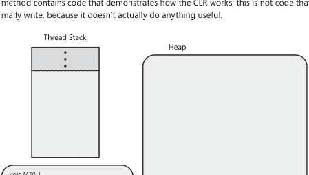

**图 4-6** CLR 加载到进程中、其堆已初始化，以及线程栈上即将调用 M3 方法。

当即时（JIT）编译器将 M3 的中间语言（IL）代码转换为本机 CPU 指令时，它会注意到 M3 中引用的所有类型：Employee、Int32、Manager 和 String（因为“Joe”）。此时，CLR 会确保定义这些类型的程序集被加载。然后，CLR 使用程序集的元数据提取这些类型的信息，并创建一些数据结构来表示这些类型本身。Employee 和 Manager 类型对象的数据结构如图 4-7 所示。由于该线程在调用 M3 之前已经执行了一些代码，我们假设 Int32 和 String 类型对象已经创建（这很可能，因为它们是常用类型），因此图中不再显示它们。

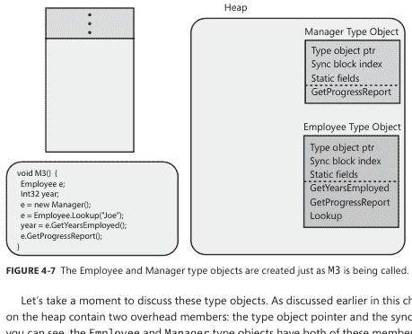

**图 4-7** 就在调用 M3 时创建 Employee 和 Manager 类型对象。

让我们花点时间讨论这些类型对象。正如本章前面所讨论的，堆上的所有对象都包含两个开销成员：类型对象指针和同步块索引。如你所见，Employee 和 Manager 类型对象都包含这两个成员。当你定义一个类型时，可以在其中定义静态数据字段。支持这些静态数据字段的字节就分配在类型对象本身中。最后，每个类型对象内部都有一个方法表，类型中定义的每个方法都占有一个条目。这就是第 1 章“CLR 的执行模型”中讨论过的方法表。由于 Employee 类型定义了三个方法（GetYearsEmployed、GetProgressReport 和 Lookup），Employee 的方法表中有三个条目。由于 Manager 类型只定义了一个方法（对 GetProgressReport 的重写），Manager 的方法表中只有一个条目。

现在，在 CLR 确保该方法所需的所有类型对象都已创建、且 M3 的代码已编译之后，CLR 允许线程执行 M3 的本机代码。当 M3 的序言代码执行时，必须从线程的栈中为局部变量分配内存，如图 4-8 所示。顺便说一句，CLR 会自动将所有局部变量初始化为 null 或 0（零），这是方法序言代码的一部分。然而，如果你在源代码中编写代码试图读取一个尚未显式初始化的局部变量，C# 编译器会发出“使用了未赋值的局部变量”错误消息。

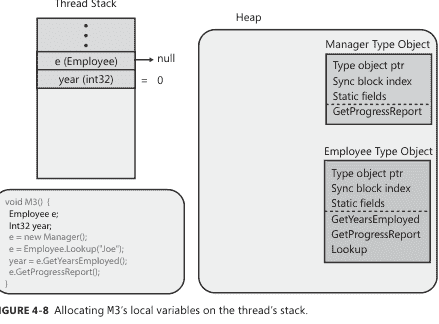

**图 4-8** 在线程栈上分配 M3 的局部变量。

然后，M3 执行其代码来构造一个 Manager 对象。这会导致在托管堆中创建 Manager 类型的一个实例，即 Manager 对象，如图 4-9 所示。如你所见，Manager 对象（与所有对象一样）具有类型对象指针和同步块索引。该对象还包含保存 Manager 类型定义的所有实例数据字段所需的字节，以及 Manager 类型的任何基类（此处为 Employee 和 Object）定义的任何实例字段。每当在堆上创建新对象时，CLR 都会自动初始化内部的类型对象指针成员，使其引用对象对应的类型对象（此处为 Manager 类型对象）。此外，CLR 会初始化同步块索引，并在调用类型的构造函数（一个可能会修改某些实例数据字段的方法）之前将所有对象的实例字段设置为 null 或 0（零）。new 运算符返回 Manager 对象的内存地址，该地址保存在变量 e 中（位于线程栈上）。

M3 中的下一行代码调用 Employee 的静态 Lookup 方法。调用静态方法时，JIT 编译器会定位与定义该静态方法的类型对应的类型对象。然后，JIT 编译器在类型对象的方法表中定位引用被调用方法的条目，对方法进行 JIT 编译（如有必要），并调用编译后的代码。就我们的讨论而言，假设 Employee 的 Lookup 方法查询数据库以查找 Joe。再假设数据库表明 Joe 是公司的经理，因此，在内部，Lookup 方法在堆上构造一个新的 Manager 对象，为 Joe 初始化该对象，并返回此对象的地址。该地址保存在局部变量 e 中。此操作的结果如图 4-10 所示。


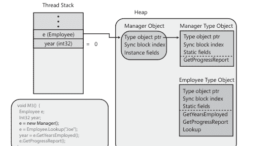

线程栈  
堆  
…  
e（Employee）  
year（int32）  

= 0  

Manager 对象  
类型对象指针  
同步块索引  
实例字段  

Manager 类型对象  
类型对象指针  
同步块索引  
静态字段  
GetProgressReport  

Employee 类型对象  
类型对象指针  
同步块索引  
静态字段  
GetYearsEmployed  
GetProgressReport  
Lookup  

```csharp
void M3() {
    Employee e;
    Int32 year;
    e = new Manager();
    e = Employee.Lookup("Joe");
    year = e.GetYearsEmployed();
    e.GetProgressReport();
}
```

**图 4-9** 分配并初始化一个 Manager 对象。

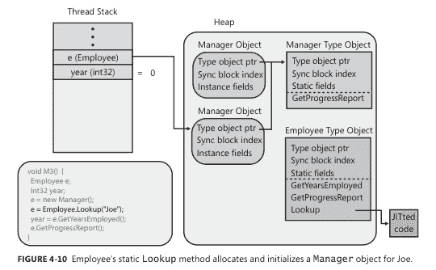

线程栈  
堆  
…  
e（Employee）  
year（int32）  

= 0  

Manager 对象  
类型对象指针  
同步块索引  
实例字段  

Manager 类型对象  
类型对象指针  
同步块索引  
静态字段  
GetProgressReport  

Manager 对象  
类型对象指针  
同步块索引  
实例字段  

Employee 类型对象  
类型对象指针  
同步块索引  
静态字段  
GetYearsEmployed  
GetProgressReport  
Lookup  

JIT 编译后的代码  

```csharp
void M3() {
    Employee e;
    Int32 year;
    e = new Manager();
    e = Employee.Lookup("Joe");
    year = e.GetYearsEmployed();
    e.GetProgressReport();
}
```

**图 4-10** Employee 的静态 Lookup 方法为 Joe 分配并初始化一个 Manager 对象。

请注意，e 不再指向之前创建的第一个 Manager 对象。事实上，由于没有变量引用该对象，它将成为未来垃圾回收的主要候选对象，垃圾回收将回收（释放）该对象所占用的内存。

M3 中的下一行代码调用 Employee 的非虚实例方法 GetYearsEmployed。调用非虚实例方法时，JIT 编译器会定位与用于调用方法的变量类型相对应的类型对象。在本例中，变量 e 被定义为 Employee。（如果 Employee 类型没有定义所调用的方法，JIT 编译器会沿着类层次结构向下搜索，直到 Object 以查找该方法。它之所以能做到这一点，是因为每个类型对象都有一个字段指向其基类型；这些信息未在图中显示。）然后，JIT 编译器在类型对象的方法表中定位指向所调用方法的条目，对方法进行 JIT 编译（如有必要），然后调用编译后的代码。就本例而言，假设 Employee 的 GetYearsEmployed 方法返回 5，因为 Joe 已在这家公司工作五年。该整数保存在局部变量 year 中。此操作的结果如图 4-11 所示。

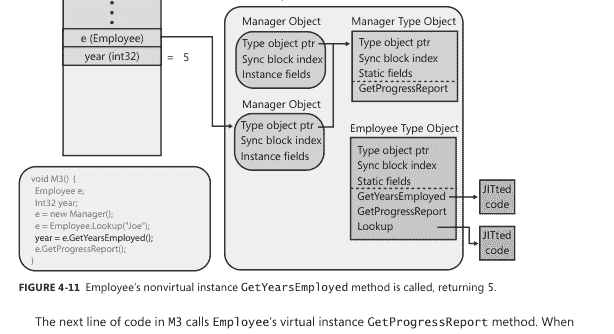

**图 4-11** 调用 Employee 的非虚实例方法 GetYearsEmployed，返回 5。

M3 中的下一行代码调用 Employee 的虚实例方法 GetProgressReport。调用虚实例方法时，JIT 编译器会在方法中生成一些附加代码，这些代码将在每次调用方法时执行。这段代码首先查看用于调用方法的变量，然后顺着地址找到正在调用的对象。在本例中，变量 e 指向表示“Joe”的 Manager 对象。然后，代码检查对象的内部类型对象指针成员；该成员指向对象的实际类型。接着，代码在类型对象的方法表中定位指向所调用方法的条目，对方法进行 JIT 编译（如有必要），并调用编译后的代码。就本例而言，由于 e 指向一个 Manager 对象，因此调用的是 Manager 的 GetProgressReport 实现。此操作的结果如图 4-12 所示。

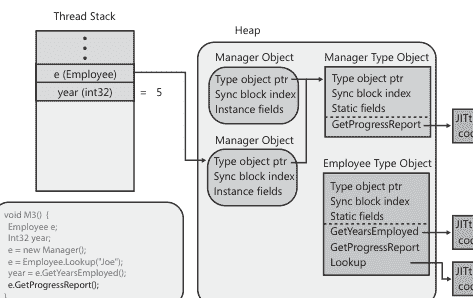

**图 4-12** 调用 Employee 的虚实例方法 GetProgressReport，导致 Manager 对该方法的重写得以执行。

请注意，如果 Employee 的 Lookup 方法发现 Joe 只是一个 Employee 而不是 Manager，那么 Lookup 会在内部构造一个 Employee 对象，其类型对象指针成员将指向 Employee 类型对象，从而导致执行 Employee 的 GetProgressReport 实现，而不是 Manager 的实现。

至此，我们已经讨论了源代码、IL 和 JIT 编译后代码之间的关系。我们还讨论了线程栈、实参、局部变量，以及这些实参和变量如何引用托管堆上的对象。你也看到了对象如何包含一个指向其类型对象的指针（该类型对象包含静态字段和方法表）。我们还讨论了 JIT 编译器如何决定调用静态方法、非虚实例方法和虚实例方法。所有这些都应让你深刻了解 CLR 的工作方式，并且这种理解在你设计和实现类型、组件和应用程序时会有所帮助。在结束本章之前，我想再给你一些关于 CLR 内部运行的深入见解。

你会注意到，Employee 和 Manager 类型对象都包含类型对象指针成员。这是因为类型对象实际上也是对象。当 CLR 创建类型对象时，CLR 必须初始化这些成员。你可能会问：“指向什么？” 好吧，当 CLR 在进程中开始运行时，它会立即为 System.Type 类型（在 MSCorLib.dll 中定义）创建一个特殊的类型对象。Employee 和 Manager 类型对象都是该类型的“实例”，因此它们的类型对象指针成员被初始化为指向 System.Type 类型对象，如图 4-13 所示。

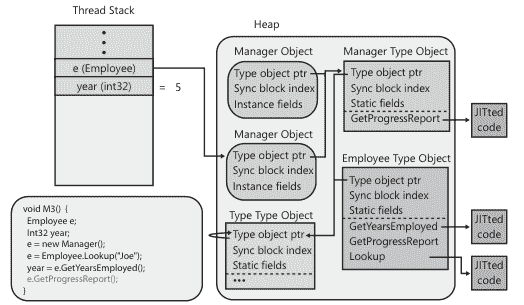

**图 4-13** Employee 和 Manager 类型对象是 System.Type 类型的实例。

当然，System.Type 类型对象本身也是一个对象，因此它内部也有一个类型对象指针成员，很自然会问这个成员指向什么。它指向它自己，因为 System.Type 类型对象本身也是一个类型对象的“实例”。现在你应该理解 CLR 的完整类型系统及其工作原理了。顺便提一下，System.Object 的 GetType 方法只是返回指定对象的类型对象指针成员中存储的地址。换句话说，GetType 方法返回指向对象类型对象的指针，这就是如何确定系统中任何对象（包括类型对象）真实类型的方法。

## 基元类型、引用类型和值类型

在本章中：

- 编程语言基元类型 ......... 111
- 引用类型和值类型 ......... 118
- 值类型的装箱和拆箱 ......... 124
- 对象哈希码 ......... 142
- dynamic 基元类型 ......... 144

在本章中，我将讨论作为 Microsoft .NET Framework 开发人员会遇到的各种类型。所有开发人员都必须熟悉这些类型所表现出的不同行为。当初我学习 .NET Framework 时，并没有完全理解基元类型、引用类型和值类型之间的区别。这种理解上的欠缺让我无意中在代码中引入了细微的 bug 和性能问题。在这里解释这些类型之间的区别，希望能让你避免我在逐步学习过程中经历的一些麻烦。

### 编程语言基元类型

某些数据类型非常常用，以至于许多编译器允许代码使用简化的语法来操作它们。例如，你可以使用以下语法分配一个整数。

```csharp
System.Int32 a = new System.Int32();
```

但我相信你会同意，使用这种语法声明和初始化整数相当麻烦。幸运的是，许多编译器（包括 C#）允许你改用类似下面的语法。

```csharp
int a = 0;
```

这种语法肯定使代码更具可读性，并且生成的中间语言（IL）与使用 System.Int32 时生成的完全相同。编译器直接支持的任何数据类型都称为基元类型。基元类型直接映射到存在于……中的类型。

框架类库（FCL）。例如，在C#中，`int`直接映射到`System.Int32`类型。因此，下面四行代码都能正确编译并生成完全相同的IL。

```csharp
int       a = 0;                    // Most convenient syntax
System.Int32 a = 0;                 // Convenient syntax
int       a = new int();            // Inconvenient syntax
System.Int32 a = new System.Int32(); // Most inconvenient syntax
```

表5-1列出了在C#中具有对应原始类型的FCL类型。对于符合公共语言规范（CLS）的类型，其他语言也会提供类似的原始类型。但是，语言并不需要为非CLS兼容类型提供任何支持。

#### 表5-1 C#原始类型与对应的FCL类型

| 原始类型 | FCL类型 | CLS兼容 | 描述 |
|---|---|---|---|
| `sbyte` | `System.SByte` | 否 | 有符号8位值 |
| `byte` | `System.Byte` | 是 | 无符号8位值 |
| `short` | `System.Int16` | 是 | 有符号16位值 |
| `ushort` | `System.UInt16` | 否 | 无符号16位值 |
| `int` | `System.Int32` | 是 | 有符号32位值 |
| `uint` | `System.UInt32` | 否 | 无符号32位值 |
| `long` | `System.Int64` | 是 | 有符号64位值 |
| `ulong` | `System.UInt64` | 否 | 无符号64位值 |
| `char` | `System.Char` | 是 | 16位Unicode字符（`char` 永远不像非托管C++中那样表示8位值） |
| `float` | `System.Single` | 是 | IEEE 32位浮点数值 |
| `double` | `System.Double` | 是 | IEEE 64位浮点数值 |
| `bool` | `System.Boolean` | 是 | 真/假值 |
| `decimal` | `System.Decimal` | 是 | 一个128位高精度浮点值，常用于不能容忍舍入误差的金融计算。在这128位中，1位表示值的符号；96位表示值本身；8位表示将96位值除以10的幂次（该幂次可以是0到28之间的任意值）。其余位未使用。 |
| `string` | `System.String` | 是 | 一个字符数组 |
| `object` | `System.Object` | 是 | 所有类型的基类型 |
| `dynamic` | `System.Object` | 是 | 对于公共语言运行时（CLR），`dynamic` 与 `object` 相同。但是，C#编译器允许`dynamic`变量通过一种简化的语法参与动态调度。更多信息，请参阅本章末尾的“dynamic原始类型”一节。 |

另一种理解方式是，C#编译器会自动假定你的所有源代码文件中都包含以下 using 指令（如第4章“类型基础”中讨论的那样）。

```csharp
using byte   = System.Byte;
using sbyte  = System.SByte;
using short  = System.Int16;
using ushort = System.UInt16;
using int    = System.Int32;
using uint   = System.UInt32;
...
```

C#语言规范指出：“作为一种风格问题，使用关键字比使用完整的系统类型名称更受青睐。”我不同意语言规范；我更喜欢使用FCL类型名称，并完全避免使用原始类型名称。事实上，我希望编译器甚至不提供原始类型名称，而是强制开发者使用FCL类型名称。以下是我的理由：

- 我见过许多开发者感到困惑，不知道在代码中应该使用 string 还是 String。因为在C#中，string（关键字）精确映射到 System.String（FCL类型），二者没有任何区别，使用哪个都可以。同样，我听过一些开发者说，当应用程序在32位操作系统上运行时，int 表示32位整数，而在64位操作系统上运行时，它表示64位整数。这种说法绝对是错误的：在C#中，int 总是映射到 System.Int32，因此无论代码运行在什么操作系统上，它都表示32位整数。如果程序员在代码中使用 Int32，那么这个潜在的混淆也就消除了。
- 在C#中，long 映射到 System.Int64，但在另一种编程语言中，long 可能映射到 Int16 或 Int32。事实上，C++/CLI确实将 long 视为 Int32。如果一个人习惯于使用不同的编程语言，那么在阅读某种语言的源代码时，很容易误解代码的意图。实际上，大多数语言甚至不把 long 当作关键字，也不会编译使用它的代码。
- FCL有许多方法，其方法名称中包含类型名称。例如，BinaryReader 类型提供了诸如 ReadBoolean、ReadInt32、ReadSingle 等方法，而 System.Convert 类型提供了诸如 ToBoolean、ToInt32、ToSingle 等方法。虽然编写以下代码是合法的，但含有 float 的那一行对我来说非常不自然，而且这行代码是否正确并不明显。

  ```csharp
  BinaryReader br = new BinaryReader(...);
  float val = br.ReadSingle();   // OK, but feels unnatural
  Single val = br.ReadSingle();  // OK and feels good
  ```

- 许多只使用C#的程序员往往会忘记其他编程语言也可以用于CLR，因此，C#特有的风格会渗透到类库代码中。例如，微软的FCL几乎完全是用C#编写的，FCL团队的开发人员现在已经在库中引入了一些方法，比如 Array 的 GetLongLength，它返回一个 Int64 值，在C#中是 long，但在其他语言（如C++/CLI）中不是。另一个例子是 System.Linq.Enumerable 的 LongCount 方法。

基于以上所有原因，我将在本书中始终使用FCL类型名称。

在许多编程语言中，你会期望以下代码能够正确编译和执行。

```csharp
Int32 i = 5;      // A 32-bit value
Int64 l = i;      // Implicit cast to a 64-bit value
```

然而，基于第4章中关于强制转换的讨论，你不会期望这段代码能编译。毕竟，System.Int32 和 System.Int64 是不同的类型，而且两者之间不存在派生关系。不过，你会很高兴地知道，C#编译器确实能正确编译这段代码，并且按预期运行。为什么？原因是C#编译器对原始类型有深入的了解，并在编译代码时应用自己特殊的规则。换句话说，编译器能够识别常见的编程模式，并生成必要的IL，使所编写的代码按预期工作。具体来说，C#编译器支持与强制转换、字面量和运算符相关的模式，如下面的示例所示。

首先，编译器能够在原始类型之间执行隐式或显式强制转换，例如以下代码。

```csharp
Int32  i = 5;       // Implicit cast from Int32 to Int32
Int64  l = i;       // Implicit cast from Int32 to Int64
Single s = i;       // Implicit cast from Int32 to Single
Byte   b = (Byte) i; // Explicit cast from Int32 to Byte
Int16  v = (Int16) s; // Explicit cast from Single to Int16
```

如果转换是“安全的”，即不可能丢失数据，例如将 Int32 转换为 Int64，C#允许隐式强制转换。但如果转换可能不安全，C#则要求显式强制转换。对于数值类型，“不安全”意味着转换可能导致精度或数量级的损失。例如，从 Int32 转换为 Byte 需要显式强制转换，因为大的 Int32 数字可能会丢失精度；从 Single 转换为 Int16 则需要强制转换，因为 Single 可以表示比 Int16 更大数量级的数字。

请注意，不同的编译器可能生成不同的代码来处理这些强制转换操作。例如，当将值为6.8的 Single 强制转换为 Int32 时，一些编译器可能生成代码将6放入 Int32，而另一些编译器可能通过将结果四舍五入到7来执行转换。顺便说一下，C#总是截断结果。关于C#在强制转换原始类型时遵循的确切规则，请参阅C#语言规范中的“转换”一节。

除了强制转换，原始类型还可以写成字面量。字面量被认为就是类型本身的实例，因此，你可以像下面这样通过使用该实例来调用实例方法。

```csharp
Console.WriteLine(123.ToString() + 456.ToString());   // "123456"
```

另外，如果有一个由字面量组成的表达式，编译器能够在编译时计算该表达式，从而提高应用程序的性能。

```csharp
Boolean found = false;      // Generated code sets found to 0
Int32 x = 100 + 20 + 3;     // Generated code sets x to 123
String s = "a " + "bc";     // Generated code sets s to "a bc"
```


最后，编译器自动知道在代码中使用运算符（如+、-、*、/、%、&、|、^、!=、==、>、>=、<、<=、<<、>>、~、!、++、--等）时如何以及按什么顺序解释它们。

```csharp
Int32 x = 100;                 // Assignment operator
Int32 y = x + 23;              // Addition and assignment operators
Boolean lessThanFifty = (y < 50);  // Less-than and assignment operators
```

### 基元类型的Checked和Unchecked操作

程序员们很清楚，对基元类型执行的许多算术运算可能会导致溢出。

```csharp
Byte b = 100;
b = (Byte) (b + 200);        // b now contains 44 (or 2C in Hex).
```


> **重要** 执行上述算术运算时，第一步要求将所有操作数值扩展为32位值（如果任何操作数需要超过32位，则扩展为64位值）。因此b和200（需要少于32位的值）首先被转换为32位值，然后相加。结果是一个32位值（十进制300，或十六进制12C），必须先转换为Byte，然后才能将结果存储回变量b中。C#不会隐式地为你执行这个转换，这就是为什么上述代码第二行需要显式进行Byte转换的原因。

在大多数编程场景中，这种静默溢出是不可取的，如果未被检测到，会导致应用程序以奇怪和异常的方式运行。然而，在少数编程场景中（例如计算哈希值或校验和），这种溢出不仅可接受，而且是期望的。

不同语言以不同方式处理溢出。C和C++不将溢出视为错误，并允许值回绕；应用程序继续运行。另一方面，Microsoft Visual Basic 始终将溢出视为错误，并在检测到溢出时抛出异常。

CLR提供了IL指令，允许编译器选择所需的行为。CLR有一个名为add的指令，用于将两个值相加。add指令不执行溢出检查。CLR还有一个名为add.ovf的指令，它也将两个值相加。但是，如果发生溢出，add.ovf会抛出System.OverflowException。除了用于加法操作的这两个IL指令外，CLR还提供了类似的IL指令，用于减法（sub/sub.ovf）、乘法（mul/mul.ovf）和数据转换（conv/conv.ovf）。

C#允许程序员决定应如何处理溢出。默认情况下，溢出检查是关闭的。这意味着编译器生成IL代码时，使用的是不包含溢出检查的add、subtract、multiply和conversion指令版本。因此，代码运行速度更快——但开发者必须确保溢出不会发生，或者他们的代码设计为预期这些溢出的发生。

让C#编译器控制溢出的一种方法是使用/checked+编译器开关。这个开关告诉编译器生成包含溢出检查版本的add、subtract、multiply和conversion IL指令的代码。代码执行速度会慢一点，因为CLR正在检查这些操作以确定是否发生溢出。如果发生溢出，CLR会抛出OverflowException。

除了全局打开或关闭溢出检查外，程序员还可以控制代码特定区域中的溢出检查。C#通过提供checked和unchecked运算符来实现这种灵活性。下面是一个使用unchecked运算符的示例。

```csharp
UInt32 invalid = unchecked((UInt32) (-1));   // OK
```

下面是一个使用checked运算符的示例。

```csharp
Byte b = 100;
b = checked((Byte) (b + 200));      // OverflowException is thrown
```

在这个示例中，b和200首先被转换为32位值，然后相加；结果是300。然后由于显式转换，300被转换为Byte；这会产生OverflowException。如果Byte转换发生在checked运算符之外，则不会发生异常。

```csharp
b = (Byte) checked(b + 200);        // b contains 44; no OverflowException
```

除了checked和unchecked运算符外，C#还提供了checked和unchecked语句。这些语句使一个块内的所有表达式都被检查或不检查。

```csharp
checked {                           // Start of checked block
    Byte b = 100;
    b = (Byte) (b + 200);           // This expression is checked for overflow.
}                                   // End of checked block
```

事实上，如果你使用checked语句块，你现在可以对Byte使用+=运算符，这会使代码简化一些。

```csharp
checked {                           // Start of checked block
    Byte b = 100;
    b += 200;                       // This expression is checked for overflow.
}                                   // End of checked block
```

> **重要** 由于checked运算符和语句的唯一作用是确定生成哪些版本的add、subtract、multiply和data conversion IL指令，因此在checked运算符或语句内调用方法对该方法没有影响，如下面的代码所示。

```csharp
checked {
    // Assume SomeMethod tries to load 400 into a Byte.
    SomeMethod(400);
    // SomeMethod might or might not throw an OverflowException.
    // It would if SomeMethod were compiled with checked instructions.
}
```

根据我的经验，我见过很多计算产生令人惊讶的结果。通常，这是由于无效的用户输入，但也可能是由于系统某部分返回的值超出了程序员的预期。因此，我现在建议程序员做到以下几点：

- 尽可能使用有符号数据类型（如Int32和Int64），而不是无符号数值类型（如UInt32和UInt64）。这允许编译器检测到更多溢出/下溢错误。此外，类库的各个部分（如Array和String的Length属性）被硬编码为返回有符号值，当你在代码中移动这些值时，需要更少的转换。更少的转换使源代码更简洁、更易于维护。此外，无符号数值类型不符合CLS。

- 在编写代码时，在可能因无效输入数据而发生不必要溢出的块周围显式使用checked，例如处理最终用户或客户端机器提供数据的请求。你可能还想捕获OverflowException，以便应用程序能够优雅地从这些失败中恢复。

- 在编写代码时，在允许溢出的块周围显式使用unchecked，例如计算校验和。

- 对于任何不使用checked或unchecked的代码，假定你确实希望发生溢出异常，例如计算已知输入的内容（如素数），此时溢出就是bug。

现在，在开发应用程序时，请为调试构建打开编译器的/checked+开关。你的应用程序将运行得更慢，因为系统将对任何你未显式标记为checked或unchecked的代码进行溢出检查。如果发生异常，你很容易检测到它并修复代码中的bug。对于应用程序的发布构建，请使用编译器的/checked-开关，以便代码运行得更快，并且不会生成溢出异常。若要更改Microsoft Visual Studio中的Checked设置，请显示项目的属性，选择“生成”选项卡，单击“高级”，然后选择“检查算术溢出/下溢”选项，如图5-1所示。

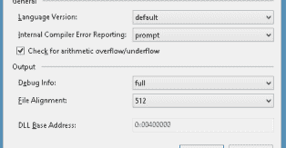

**图 5-1** 通过Visual Studio的“高级生成设置”对话框更改编译器执行checked算术的默认设置。


如果你的应用程序能够容忍始终执行已检查操作带来的轻微性能损失，那么我建议你即使在发布版本中也使用 /checked 命令行选项进行编译，因为这可以防止你的应用程序在数据损坏和可能出现安全漏洞的情况下继续运行。例如，你可能执行乘法来计算数组索引；与因数学运算回绕而访问错误的数组元素相比，获得 OverflowException 要好得多。

> **重要** System.Decimal 类型是一种非常特殊的类型。尽管许多编程语言（包括 C# 和 Visual Basic）都将 Decimal 视为基元类型，但 CLR 并不这样认为。这意味着 CLR 没有知道如何操作 Decimal 值的 IL 指令。如果在 .NET Framework SDK 文档中查找 Decimal 类型，你会看到它具有名为 Add、Subtract、Multiply、Divide 等的公共静态方法。此外，Decimal 类型还为 +、-、*、/ 等提供运算符重载方法。
>
> 当你编译使用 Decimal 值的代码时，编译器会生成代码来调用 Decimal 的成员以执行实际操作。这意味着操作 Decimal 值比操作 CLR 基元值更慢。另外，由于没有用于操作 Decimal 值的 IL 指令，checked 和 unchecked 运算符、语句以及编译器开关都不会起作用。如果无法安全执行操作，对 Decimal 值的操作将始终抛出 OverflowException。
>
> 类似地，System.Numerics.BigInteger 类型也很特殊，它在内部使用 UInt32 数组来表示任意大的整数，其值没有上限或下限。因此，对 BigInteger 的操作永远不会导致 OverflowException。但是，如果值变得过大且没有足够的可用内存来调整数组大小，BigInteger 操作可能会抛出 OutOfMemoryException。

### 引用类型和值类型

CLR 支持两种类型：引用类型和值类型。尽管 FCL 中的大多数类型都是引用类型，但程序员最常使用的类型是值类型。引用类型总是从托管堆中分配，并且 C# *new* 运算符返回对象的内存地址——该内存地址指向对象的各个位。使用引用类型时，你需要牢记一些性能方面的考虑。首先，考虑以下事实：

- 内存必须从托管堆中分配。
- 在堆上分配的每个对象都关联有一些额外的开销内存，这些内存必须初始化。
- 对象中的其他字节（用于字段）总是设置为零。
- 从托管堆分配对象可能会强制发生垃圾回收。

以下代码和图 5-2 演示了引用类型和值类型有何不同。

```csharp
// Reference type (because of 'class')
class SomeRef { public Int32 x; }

// Value type (because of 'struct')
struct SomeVal { public Int32 x; }

static void ValueTypeDemo() {
    SomeRef r1 = new SomeRef();   // Allocated in heap
    SomeVal v1 = new SomeVal();   // Allocated on stack
    r1.x = 5;                     // Pointer dereference
    v1.x = 5;                     // Changed on stack
    Console.WriteLine(r1.x);      // Displays "5"
    Console.WriteLine(v1.x);      // Also displays "5"
    // The left side of Figure 5-2 reflects the situation
    // after the lines above have executed.

    SomeRef r2 = r1;              // Copies reference (pointer) only
    SomeVal v2 = v1;              // Allocate on stack & copies members
    r1.x = 8;                     // Changes r1.x and r2.x
    v1.x = 9;                     // Changes v1.x, not v2.x
    Console.WriteLine(r1.x);      // Displays "8"
    Console.WriteLine(r2.x);      // Displays "8"
    Console.WriteLine(v1.x);      // Displays "9"
    Console.WriteLine(v2.x);      // Displays "5"
    // The right side of Figure 5-2 reflects the situation
    // after ALL of the lines above have executed.
}
```

在这段代码中，SomeVal 类型使用 struct 而不是更常见的 class 声明。在 C# 中，使用 struct 声明的类型是值类型，使用 class 声明的类型是引用类型。如你所见，引用类型和值类型的行为差异很大。在代码中使用类型时，你必须注意该类型是引用类型还是值类型，因为它会极大地影响你在代码中表达意图的方式。

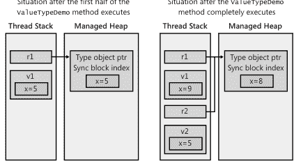

**图 5-2** 在代码执行时可视化内存。

在前面的代码中，你看到了这一行。

```
    SomeVal v1 = new SomeVal();   // Allocated on stack
```

这一行的写法看起来好像会在托管堆上分配一个 SomeVal 实例。然而，C# 编译器知道 SomeVal 是值类型，并生成在线程栈上分配 SomeVal 实例的代码。C# 还确保值类型实例中的所有字段都置零。

前面那一行也可以改为这样写。

```
    SomeVal v1;   // Allocated on stack
```

这一行也会生成 IL，将实例分配到线程栈上并将字段置零。唯一的区别是，如果你使用 new 运算符，C#“认为”该实例已初始化。以下代码将清楚说明这一点。

```
    // These two lines compile because C# thinks that
    // v1's fields have been initialized to 0.
    SomeVal v1 = new SomeVal();
    Int32 a = v1.x;

    // These two lines don't compile because C# doesn't think that
    // v1's fields have been initialized to 0.
    SomeVal v1;
    Int32 a = v1.x;  // error CS0170: Use of possibly unassigned field 'x'
```

设计自己的类型时，请仔细考虑是否应将类型定义为值类型而不是引用类型。在某些情况下，值类型可以提供更好的性能。特别是，如果以下所有陈述都为真，则应将类型声明为值类型：

- 该类型充当基元类型。具体来说，这意味着它是一个相当简单的类型，没有任何成员会修改其任何实例字段。当一个类型不提供任何可更改其字段的成员时，我们说该类型是不可变的。事实上，建议许多值类型将其所有字段标记为 readonly（在第 7 章“常量和字段”中讨论）。
- 该类型不需要从任何其他类型继承。
- 该类型不会有任何其他类型从它派生。

类型实例的大小也是需要考虑的条件，因为默认情况下参数按值传递，这会导致值类型实例中的字段被复制，从而损害性能。同样，返回值类型的方法会在方法返回时将实例中的字段复制到调用方分配的内存中，从而损害性能。因此，除了前面的条件之外，如果以下陈述之一为真，则应将类型声明为值类型：

- 该类型的实例较小（大约 16 字节或更小）。
- 该类型的实例较大（大于 16 字节），并且不作为方法参数传递，也不从方法返回。

值类型的主要优点是它们不会作为对象在托管堆中分配。当然，与引用类型相比，值类型自身也有若干限制。以下是值类型和引用类型不同的一些方面：

- 值类型对象有两种表示形式：未装箱形式和装箱形式（在下一节中讨论）。引用类型始终处于装箱形式。

- 值类型派生自 System.ValueType。此类型提供与 System.Object 定义的方法相同的方法。但是，如果两个对象字段的值匹配，System.ValueType 会重写 Equals 方法使其返回 true。此外，System.ValueType 会重写 GetHashCode 方法，使用一种考虑对象实例字段中值的算法来生成哈希代码值。由于此默认实现存在性能问题，在定义自己的值类型时，应重写并为 Equals 和 GetHashCode 方法提供显式实现。我将在本章末尾介绍 Equals 和 GetHashCode 方法。

- 由于不能使用值类型作为基类来定义新的值类型或新的引用类型，因此不应将任何新的虚方法引入值类型。任何方法都不能是抽象的，并且所有方法都隐式密封（不能重写）。

- 引用类型变量包含堆中对象的内存地址。默认情况下，创建引用类型变量时，它被初始化为 null，表示该引用类型变量当前不指向有效对象。尝试使用 null 引用类型变量会导致抛出 NullReferenceException。相比之下，值类型变量始终包含基础类型的值，并且值类型的所有成员都初始化为 0。由于值类型变量不是指针，因此访问值类型时不可能生成 NullReferenceException。CLR 确实提供了一种特殊功能，可为值类型添加可空性概念。此功能称为可空类型，将在第 19 章“可空值类型”中讨论。

- 将一个值类型变量赋给另一个值类型变量时，会进行逐字段复制。将一个引用类型变量赋给另一个引用类型变量时，仅复制内存地址。

- 由于上一点，两个或更多引用类型变量可以引用堆中的单个对象，从而允许对一个变量的操作影响另一个变量所引用的对象。另一方面，值类型变量是不同的对象，对一个值类型变量的操作不可能影响另一个值类型变量。

- 由于未装箱的值类型不在堆上分配，因此为它们分配的存储空间会在定义该类型实例的方法不再活动时立即释放，而不是等待垃圾回收。


### CLR 如何控制类型字段的布局

为了提高性能，CLR 能够以它选择的任何方式安排类型的字段。例如，CLR 可能会重新排列内存中的字段，以便对象引用分组在一起，数据字段正确对齐和打包。但是，当你定义类型时，你可以告诉 CLR 是必须保持类型字段的顺序与开发人员指定的顺序相同，还是可以按它认为合适的方式重新排列。

你通过在正在定义的类或结构上应用 `System.Runtime.InteropServices.StructLayoutAttribute` 特性来告诉 CLR 该怎么做。向该特性的构造函数，你可以传递 `LayoutKind.Auto` 让 CLR 排列字段，`LayoutKind.Sequential` 让 CLR 保留你的字段布局，或者 `LayoutKind.Explicit` 通过偏移量显式排列内存中的字段。如果你没有在正在定义的类型上显式指定 `StructLayoutAttribute`，你的编译器会选择它确定的最佳布局。

你应该知道，微软的 C# 编译器为引用类型（类）选择 `LayoutKind.Auto`，为值类型（结构）选择 `LayoutKind.Sequential`。很明显，C# 编译器团队认为结构通常在与非托管代码互操作时使用，而为了使其工作，字段必须保持程序员定义的顺序。但是，如果你创建的值类型与非托管代码互操作无关，你可以覆盖 C# 编译器的默认设置。下面是一个示例。

```csharp
using System;
using System.Runtime.InteropServices;

// Let the CLR arrange the fields to improve
// performance for this value type.
[StructLayout(LayoutKind.Auto)]
internal struct SomeValType {
    private readonly Byte m_b;
    private readonly Int16 m_x;
    ...
}
```

`StructLayoutAttribute` 还允许你通过向其构造函数传递 `LayoutKind.Explicit` 来显式指示每个字段的偏移量。然后你向每个字段应用一个 `System.Runtime.InteropServices.FieldOffsetAttribute` 特性的实例，向该特性的构造函数传递一个 `Int32`，指示字段的第一个字节相对于实例开头的偏移量（以字节为单位）。显式布局通常用于模拟非托管 C/C++ 中的联合，因为你可以让多个字段从内存中的同一偏移量开始。

下面是一个示例。

```csharp
using System;
using System.Runtime.InteropServices;

// The developer explicitly arranges the fields of this value type.
[StructLayout(LayoutKind.Explicit)]
internal struct SomeValType {
    [FieldOffset(0)]
    private readonly Byte m_b; // The m_b and m_x fields overlap each

    [FieldOffset(0)]
    private readonly Int16 m_x; // other in instances of this type
}
```

应该注意的是，定义引用类型和值类型重叠的类型是非法的。可以定义多个引用类型在同一起始偏移量处重叠的类型；但是，这是不可验证的。定义多个值类型重叠的类型是合法的；但是，所有重叠的字节都必须可以通过公共字段访问，该类型才可验证。

### 值类型的装箱和拆箱

值类型比引用类型更轻量，因为它们不会作为对象分配在托管堆上，不会被垃圾回收，也不会被指针引用。然而，在许多情况下，你必须获得对值类型实例的引用。例如，假设你想创建一个 ArrayList 对象（System.Collections 命名空间中定义的类型）来保存一组 Point 结构。代码可能如下所示。

```csharp
// Declare a value type.
struct Point {
    public Int32 x, y;
}

public sealed class Program {
    public static void Main() {
        ArrayList a = new ArrayList();
        Point p;                        // Allocate a Point (not in the heap).
        for (Int32 i = 0; i < 10; i++) {
            p.x = p.y = i;              // Initialize the members in the value type.
            a.Add(p);                   // Box the value type and add the
                                        // reference to the ArrayList.
        }
        ...
    }
}
```

循环的每次迭代，Point 的值类型字段都会被初始化。然后将 Point 存储到 ArrayList 中。但让我们稍作思考。ArrayList 中实际存储的是什么？是 Point 结构、Point 结构的地址，还是完全其他的东西？要得到答案，你必须查一下 ArrayList 的 Add 方法，看看它的参数定义为什么类型。在这种情况下，Add 方法的原型如下。

```csharp
public virtual Int32 Add(Object value);
```

由此你可以清楚地看到，Add 接受一个 Object 作为参数，这表明 Add 需要托管堆上对象的一个引用（或指针）作为参数。但在前面的代码中，我传递的是 p，一个 Point，它是一个值类型。为了使这段代码工作，Point 值类型必须转换为真正的托管堆对象，并且必须获得对该对象的引用。

可以使用称为装箱的机制将值类型转换为引用类型。在内部，值类型实例被装箱时会发生以下情况：

- 1. 从托管堆中分配内存。分配的内存量是值类型字段所需的大小，加上托管堆上所有对象所需的两个额外开销成员（类型对象指针和同步块索引）。
- 2. 值类型的字段被复制到新分配的堆内存中。
- 3. 返回对象的地址。这个地址现在是对对象的引用；值类型现在变成了引用类型。

C# 编译器会自动生成对值类型实例进行装箱所需的 IL 代码，但你仍然需要理解内部发生了什么，以便你意识到代码大小和性能问题。

在前面的代码中，C# 编译器检测到我正在向一个需要引用类型的方法传递值类型，于是自动发出了装箱对象的代码。所以在运行时，当前驻留在 Point 值类型实例 p 中的字段被复制到新分配的 Point 对象中。装箱后的 Point 对象（现在是一个引用类型）的地址被返回，然后传递给 Add 方法。Point 对象将保留在堆中，直到被垃圾回收。Point 值类型变量 (p) 可以被重用，因为 ArrayList 对它一无所知。请注意，装箱后的值类型的生命周期超过了未装箱的值类型的生命周期。

> **注意** 应该注意的是，FCL 现在包含一组新的泛型集合类，它们使非泛型集合类过时了。例如，你应该使用 System.Collections.Generic.List<T> 类而不是 System.Collections.ArrayList 类。泛型集合类相比非泛型等价类提供了许多改进。例如，API 已经被清理和改进，集合类的性能也得到了极大的提高。但最大的改进之一是泛型集合类允许你处理值类型的集合，而不要求集合中的项被装箱/拆箱。这本身就极大地提高了性能，因为在托管堆上创建的对象将大大减少，从而减少了应用程序所需的垃圾回收次数。此外，你将获得编译时类型安全，并且由于更少的强制转换，你的源代码将更干净。这些将在第 12 章“泛型”中进一步详细解释。

我之前提到过，拆箱操作通常会紧接着进行字段复制。让我们看一些演示拆箱和复制操作如何协同工作的 C# 代码。

```csharp
    public static void Main() {
        Point p;
        p.x = p.y = 1;
        Object o = p;   // Boxes p; o refers to the boxed instance

        p = (Point) o;  // Unboxes o AND copies fields from boxed
                        // instance to stack variable
    }
```

在最后一行，C# 编译器发出一个 IL 指令来拆箱 o（获取装箱实例中字段的地址）和另一个 IL 指令将字段从堆复制到基于堆栈的变量 p。

现在看看这段代码。

```csharp
    public static void Main() {
        Point p;
        p.x = p.y = 1;
        Object o = p;   // Boxes p; o refers to the boxed instance

        // Change Point's x field to 2
        p = (Point) o;  // Unboxes o AND copies fields from boxed
                        // instance to stack variable
        p.x = 2;        // Changes the state of the stack variable
        o = p;          // Boxes p; o refers to a new boxed instance
    }
```

这段代码底部的内容只是为了将 Point 的 x 字段从 1 改为 2。为此，必须执行拆箱操作，然后进行字段复制，然后更改字段（在堆栈上），然后进行装箱操作（这会在托管堆中创建一个全新的装箱实例）。希望你能看到装箱和拆箱/复制操作对应用程序性能的影响。

某些语言，如 C++/CLI，允许你在不复制字段的情况下拆箱已装箱的值类型。拆箱返回已装箱对象中未装箱部分的地址（忽略对象的类型对象指针和同步块索引开销）。现在你可以使用这个指针来操作未装箱实例的字段（这些字段恰好位于堆上的一个装箱对象中）。例如，如果用 C++/CLI 编写，前面的代码会高效得多，因为你可以直接在已经装箱的 Point 实例中更改 Point 的 x 字段的值。这将避免在堆上分配新对象以及两次复制所有字段！

> **重要** 如果你哪怕有一点点关心应用程序的性能，你必须知道编译器何时生成执行这些操作的代码。不幸的是，许多编译器隐式地发出装箱对象的代码，所以当你编写代码时并不明显看出正在发生装箱。如果我关心某个特定算法的性能，我总是使用诸如 ILDasm.exe 之类的工具来查看我的方法的 IL 代码，看看 box IL 指令在哪里。


让我们再看几个演示装箱和拆箱的示例。

```csharp
public static void Main() {
   Int32 v = 5;             // Create an unboxed value type variable.
   Object o = v;            // o refers to a boxed Int32 containing 5.
   v = 123;                 // Changes the unboxed value to 123

   Console.WriteLine(v + ", " + (Int32) o); // Displays "123, 5"
}
```

在这段代码中，你能猜到发生了多少次装箱操作吗？你可能会惊讶地发现答案是三次！让我们仔细分析一下代码，真正理解到底发生了什么。为了帮助你理解，我提供了上述代码中 `Main` 方法生成的 IL 代码。我为代码添加了注释，以便你能够轻松看清每个操作。

```il
.method public hidebysig static void Main() cil managed
{
  .entrypoint
  // Code size       45 (0x2d)
  .maxstack 3
  .locals init ([0] int32 v,
                [1] object o)
  // Load 5 into v.
  IL_0000:  ldc.i4.5
  IL_0001:  stloc.0

  // Box v and store the reference pointer in o.
  IL_0002:  ldloc.0
  IL_0003:  box        [mscorlib]System.Int32
  IL_0008:  stloc.1

  // Load 123 into v.
  IL_0009:  ldc.i4.s   123
  IL_000b:  stloc.0

  // Box v and leave the pointer on the stack for Concat.
  IL_000c:  ldloc.0
  IL_000d:  box        [mscorlib]System.Int32

  // Load the string on the stack for Concat.
  IL_0012:  ldstr      ", "
  // Unbox o: Get the pointer to the Int32's field on the stack.
  IL_0017:  ldloc.1
  IL_0018:  unbox.any  [mscorlib]System.Int32

  // Box the Int32 and leave the pointer on the stack for Concat.
  IL_001d:  box        [mscorlib]System.Int32

  // Call Concat.
  IL_0022:  call       string [mscorlib]System.String::Concat(object,
                                                              object,
                                                              object)
}
```

```cil
.method public hidebysig static void Main() cil managed
{
  .entrypoint
  // Code size       35 (0x23)
  .maxstack  3
  .locals init ([0] int32 v,
           [1] object o)

  // Load 5 into v.
  IL_0000:  ldc.i4.5
  IL_0001:  stloc.0

  // Box v and store the reference pointer in o.
  IL_0002:  ldloc.0
  IL_0003:  box        [mscorlib]System.Int32
  IL_0008:  stloc.1

  // Load 123 into v.
  IL_0009:  ldc.i4.s   123
  IL_000b:  stloc.0

  // Box v and leave the pointer on the stack for Concat.
  IL_000c:  ldloc.0
  IL_000d:  box        [mscorlib]System.Int32

  // Load the string on the stack for Concat.
  IL_0012:  ldstr      ", "

  // Load the address of the boxed Int32 on the stack for Concat.
  IL_0017:  ldloc.1

  // Call Concat.
  IL_0018:  call       string [mscorlib]System.String::Concat(object,
                                                              object,
                                                              object)

  // The string returned from Concat is passed to WriteLine.
  IL_001d:  call       void [mscorlib]System.Console::WriteLine(string)

  // Return from Main terminating this application.
  IL_0022:  ret
} // end of method App::Main
```

快速对比这两个版本的 `Main` 方法生成的 IL 代码可以看出，没有 `(Int32)` 强制转换的版本比有强制转换的版本小 10 个字节。第一个版本中额外的拆箱/装箱步骤显然生成了更多的代码。然而，更值得关注的是，额外的装箱步骤会从托管堆中分配一个额外的对象，而这些对象将来必须进行垃圾回收。当然，两个版本的结果完全相同，速度上的差异也不明显，但如果循环中出现额外且不必要的装箱操作，将会导致应用程序的性能和内存使用严重下降。

你可以通过像这样调用 `WriteLine` 来进一步改进之前的代码：

```csharp
Console.WriteLine(v.ToString() + ", " + o);   // Displays "123, 5"
```

现在，`ToString` 在未装箱的值类型实例 `v` 上被调用，并返回一个 `String`。`String` 对象已经是引用类型，可以直接传递给 `Concat` 方法，无需任何装箱。

让我们再看一个演示装箱和拆箱的示例。

```
public static void Main() {
    Int32 v = 5;              // Create an unboxed value type variable.
    Object o = v;             // o refers to the boxed version of v.

    v = 123;                  // Changes the unboxed value type to 123
    Console.WriteLine(v);     // Displays "123"

    v = (Int32) o;            // Unboxes and copies o into v
    Console.WriteLine(v);     // Displays "5"
}
```

你数出这段代码中有多少次装箱操作？答案是一次。之所以只有一次装箱操作，是因为 `System.Console` 类定义了一个接受 `Int32` 作为参数的 `WriteLine` 方法。

```
public static void WriteLine(Int32 value);
```

在前面两次对 `WriteLine` 的调用中，变量 `v`（一个 `Int32` 未装箱的值类型实例）是按值传递的。`WriteLine` 可能会在内部对这个 `Int32` 进行装箱，但这是你无法控制的。重要的是，你已经尽了最大努力，从自己的代码中消除了装箱。

如果你仔细查看 FCL，会注意到许多重载方法根据其值类型参数而不同。例如，`System.Console` 类型提供了多个 `WriteLine` 方法的重载版本。

```
public static void WriteLine(Boolean);
public static void WriteLine(Char);
public static void WriteLine(Char[]);
public static void WriteLine(Int32);
public static void WriteLine(UInt32);
public static void WriteLine(Int64);
public static void WriteLine(UInt64);
public static void WriteLine(Single);
public static void WriteLine(Double);
public static void WriteLine(Decimal);
public static void WriteLine(Object);
public static void WriteLine(String);
```

你还会发现一组类似的重载方法，适用于 `System.Console` 的 `Write` 方法、`System.IO.BinaryWriter` 的 `Write` 方法、`System.IO.TextWriter` 的 `Write` 和 `WriteLine` 方法、`System.Runtime.Serialization.SerializationInfo` 的 `AddValue` 方法、`System.Text.StringBuilder` 的 `Append` 和 `Insert` 方法，等等。这些方法中的大多数提供重载版本的唯一目的，就是减少常见值类型的装箱操作次数。

如果你定义了自己的值类型，这些 FCL 类不会提供接受你的值类型的重载方法。此外，FCL 中已经定义了许多值类型，而这些方法没有针对它们的重载。如果你调用的方法没有针对你传入的特定值类型的重载，那么你最终调用的总是接受 `Object` 的重载。将值类型实例作为 `Object` 传递会导致装箱发生，进而对性能产生不利影响。如果你定义自己的类，可以将类中的方法定义为泛型（可能将类型参数约束为值类型）。泛型为你提供了一种定义可接受任意值类型而无需装箱的方法。泛型将在第 12 章讨论。

关于装箱，最后一点：如果你知道自己编写的代码会导致编译器重复地对同一个值类型进行装箱，那么手动对该值类型进行装箱会使你的代码更小、更快。下面是一个示例。

```csharp
using System;

public sealed class Program {
    public static void Main() {
        Int32 v = 5;    // Create an unboxed value type variable.

#if INEFFICIENT
        // When compiling the following line, v is boxed
        // three times, wasting time and memory.
        Console.WriteLine("{0}, {1}, {2}", v, v, v);
#else
        // The lines below have the same result, execute
        // much faster, and use less memory.
        Object o = v;   // Manually box v (just once).

        // No boxing occurs to compile the following line.
        Console.WriteLine("{0}, {1}, {2}", o, o, o);
#endif
    }
}
```

如果这段代码在定义了 `INEFFICIENT` 符号的情况下编译，编译器将生成代码对 `v` 进行三次装箱，从而从堆中分配三个对象！这极其浪费，因为每个对象的内容完全相同：都是 5。如果代码在未定义 `INEFFICIENT` 符号的情况下编译，`v` 只会被装箱一次，因此只从堆中分配一个对象。然后在调用 `Console.WriteLine` 时，同一个装箱对象的引用被传递三次。第二个版本执行速度更快，从堆中分配的内存也更少。

在这些示例中，我们很容易识别出何时需要对值类型的实例进行装箱。基本上，如果你想要一个指向值类型实例的引用，该实例就必须被装箱。通常出现这种情况是因为你有一个值类型实例，并且想将它传递给一个需要引用类型的方法。然而，这并不是唯一需要对值类型实例进行装箱的情况。


回想一下，未装箱的值类型比引用类型更轻量，原因有两个：

-   它们不在托管堆上分配。
-   它们不具有堆上每个对象都有的额外开销成员：类型对象指针和同步块索引。

由于未装箱的值类型没有同步块索引，因此无法通过使用 System.Threading.Monitor 类型的方法（或使用 C# 的 lock 语句）让多个线程同步对该实例的访问。

即使未装箱的值类型没有类型对象指针，你仍然可以调用该类型继承或重写的虚方法（如 Equals、GetHashCode 或 ToString）。如果值类型重写了这些虚方法之一，那么 CLR 可以以非虚方式调用该方法，因为值类型是隐式密封的，不能有任何类型从它们派生。此外，用于调用该虚方法的值类型实例不会被装箱。然而，如果你对虚方法的重写调用了该方法的基类型实现，那么在调用基类型实现时，该值类型实例确实会被装箱，以便将对堆对象的引用传递给基方法中的 this 指针。

然而，调用非虚的继承方法（如 GetType 或 MemberwiseClone）总是要求值类型装箱，因为这些方法由 System.Object 定义，所以这些方法期望 this 参数是指向堆上对象的指针。

此外，将值类型的未装箱实例转换为该类型的某个接口时，要求对该实例进行装箱，因为接口变量必须始终包含对堆上对象的引用。（我将在第 13 章“接口”中讨论接口。）下面的代码演示了这一点。

```csharp
using System;

internal struct Point : IComparable {
    private readonly Int32 m_x, m_y;

    // Constructor to easily initialize the fields
    public Point(Int32 x, Int32 y) {
        m_x = x;
        m_y = y;
    }

    // Override ToString method inherited from System.ValueType
    public override String ToString() {
        // Return the point as a string. Note: calling ToString prevents boxing
        return String.Format("({0}, {1})", m_x.ToString(), m_y.ToString());
    }

    // Implementation of type-safe CompareTo method
    public Int32 CompareTo(Point other) {
        // Use the Pythagorean Theorem to calculate
        // which point is farther from the origin (0, 0)
        return Math.Sign(Math.Sqrt(m_x * m_x + m_y * m_y)
            - Math.Sqrt(other.m_x * other.m_x + other.m_y * other.m_y));
    }

    // Implementation of IComparable's CompareTo method
    public Int32 CompareTo(Object o) {
        if (GetType() != o.GetType()) {
            throw new ArgumentException("o is not a Point");
        }
        // Call type-safe CompareTo method.
        return CompareTo((Point) o);
    }
}

public static class Program {
    public static void Main() {
        // Create two Point instances on the stack.
        Point p1 = new Point(10, 10);
        Point p2 = new Point(20, 20);

        // p1 does NOT get boxed to call ToString (a virtual method).
        Console.WriteLine(p1.ToString()); // "(10, 10)"

        // p1 DOES get boxed to call GetType (a non-virtual method).
        Console.WriteLine(p1.GetType()); // "Point"

        // p1 does NOT get boxed to call CompareTo.
        // p2 does NOT get boxed because CompareTo(Point) is called.
        Console.WriteLine(p1.CompareTo(p2)); // "-1"

        // p1 DOES get boxed, and the reference is placed in c.
        IComparable c = p1;
        Console.WriteLine(c.GetType()); // "Point"

        // p1 does NOT get boxed to call CompareTo.
        // Because CompareTo is not being passed a Point variable,
        // CompareTo(Object) is called, which requires a reference to
        // a boxed Point.
        // c does NOT get boxed because it already refers to a boxed Point.
        Console.WriteLine(p1.CompareTo(c)); // "0"

        // c does NOT get boxed because it already refers to a boxed Point.
        // p2 gets boxed because CompareTo(Object) is called.
        Console.WriteLine(c.CompareTo(p2)); // "-1"

        // c is unboxed, and fields are copied into p2.
        p2 = (Point) c;

        // Proves that the fields got copied into p2.
        Console.WriteLine(p2.ToString()); // "(10, 10)"
    }
}
```

这段代码演示了与装箱和拆箱相关的几个场景：

-   **调用 ToString** 在调用 ToString 时，p1 不必装箱。起初，你会认为 p1 必须装箱，因为 ToString 是从基类型 System.ValueType 继承的虚方法。通常，为了调用虚方法，CLR 需要确定对象的类型，以便定位该类型的方法表。由于 p1 是未装箱的值类型，因此没有类型对象指针。然而，即时 (JIT) 编译器看到 Point 重写了 ToString 方法，于是它生成直接（以非虚方式）调用 ToString 的代码，而无需进行任何装箱。编译器知道这里不会发生多态，因为 Point 是值类型，并且没有任何类型可以从它派生来提供该虚方法的另一种实现。请注意，如果 Point 的 ToString 方法内部调用 base.ToString()，那么在调用 System.ValueType 的 ToString 方法时，该值类型实例就会被装箱。

-   **调用 GetType** 在调用非虚的 GetType 方法时，p1 确实必须装箱。原因是 Point 类型从 System.Object 继承了 GetType。因此，为了调用 GetType，CLR 必须使用指向类型对象的指针，而该指针只能通过对 p1 装箱来获得。

-   **调用 CompareTo（第一次）** 在第一次调用 CompareTo 时，p1 不必装箱，因为 Point 实现了 CompareTo 方法，编译器可以直接调用它。请注意，传递给 CompareTo 的是 Point 变量 (p2)，因此编译器调用接受 Point 参数的 CompareTo 重载。这意味着 p2 将按值传递给 CompareTo，不需要装箱。

-   **转换为 IComparable** 当将 p1 转换为接口类型的变量 (c) 时，p1 必须装箱，因为根据定义接口是引用类型。因此 p1 被装箱，指向这个装箱对象的指针存储在变量 c 中。下面调用 GetType 证明 c 确实引用堆上的一个已装箱 Point。

-   **调用 CompareTo（第二次）** 在第二次调用 CompareTo 时，p1 不必装箱，因为 Point 实现了 CompareTo 方法，编译器可以直接调用它。请注意，传递给 CompareTo 的是 IComparable 变量 (c)，因此编译器调用接受 Object 参数的 CompareTo 重载。这意味着传递的参数必须是指向堆上对象的指针。幸运的是，c 确实引用一个已装箱的 Point，因此 c 中的那个内存地址可以传递给 CompareTo，不需要额外的装箱。

-   **调用 CompareTo（第三次）** 在第三次调用 CompareTo 时，c 已经引用堆上的一个已装箱 Point 对象。由于 c 是 IComparable 接口类型，你只能调用该接口中要求 Object 参数的 CompareTo 方法。这意味着传递的参数必须是指向堆上对象的指针。因此 p2 被装箱，指向这个装箱对象的指针被传递给 CompareTo。

-   **转换为 Point** 当将 c 转换为 Point 时，c 所引用的堆上对象被拆箱，其字段从堆复制到 p2（一个驻留在栈上的 Point 类型实例）。

我意识到，所有这些关于引用类型、值类型和装箱的信息起初可能让人不知所措。然而，扎实理解这些概念对于任何 .NET Framework 开发人员的长期成功都至关重要。相信我：扎实掌握这些概念将使你能够更快、更容易地构建高效的应用程序。


将装箱 Point 中的字段复制到线程栈上的一个临时 Point！这个临时 point 的 m_x 和 m_y 字段被改为 3 和 3，但装箱的 Point 不受这次对 Change 的调用影响。第四次调用 WriteLine 时，会再次显示 (2, 2)。许多开发人员预料不到这一点。

某些语言（如 C++/CLI）允许你修改装箱值类型中的字段，但 C# 不允许。不过，你可以通过使用接口来“骗过” C#，让它允许这样做。下面的代码是前面代码的修改版本。

```csharp
using System;

// Interface defining a Change method
internal interface IChangeBoxedPoint {
    void Change(Int32 x, Int32 y);
}


// Point is a value type.
internal struct Point : IChangeBoxedPoint {
    private Int32 m_x, m_y;

    public Point(Int32 x, Int32 y) {
        m_x = x;
        m_y = y;
    }

    public void Change(Int32 x, Int32 y) {
        m_x = x; m_y = y;
    }

    public override String ToString() {
        return String.Format("({0}, {1})", m_x.ToString(), m_y.ToString());
    }
}

public sealed class Program {
    public static void Main() {
        Point p = new Point(1, 1);

        Console.WriteLine(p);

        p.Change(2, 2);
        Console.WriteLine(p);

        Object o = p;
        Console.WriteLine(o);

        ((Point) o).Change(3, 3);
        Console.WriteLine(o);

        // Boxes p, changes the boxed object and discards it
        ((IChangeBoxedPoint) p).Change(4, 4);
        Console.WriteLine(p);

        // Changes the boxed object and shows it
        ((IChangeBoxedPoint) o).Change(5, 5);
        Console.WriteLine(o);
    }
}
```

这段代码与上一版本几乎完全相同。主要区别在于，Change 方法由 IChangeBoxedPoint 接口定义，而 Point 类型现在实现了该接口。在 Main 内部，前四次对 WriteLine 的调用与之前相同，并产生与之前相同的结果（正如预期）。不过，我在 Main 末尾又添加了两个示例。

在第一个示例中，未装箱的 Point p 被强制转换为 IChangeBoxedPoint。这个强制转换会导致 p 中的值被装箱。然后对装箱后的值调用 Change，这确实会将其 m_x 和 m_y 字段改为 4 和 4，但在 Change 返回后，这个装箱对象立即就可以被垃圾回收了。因此，第五次调用 WriteLine 显示的是 (2, 2)。许多开发人员不会预料到这个结果。

在最后一个示例中，由 o 引用的装箱 Point 被强制转换为 IChangeBoxedPoint。这里不需要装箱，因为 o 已经是一个装箱的 Point。然后调用 Change，这确实会修改装箱 Point 的 m_x 和 m_y 字段。接口方法 Change 使我能够修改装箱 Point 对象中的字段！现在，调用 WriteLine 时，它会如预期显示 (5, 5)。整个示例的目的是演示接口方法如何能够修改装箱值类型的字段。在 C# 中，如果不使用接口方法，这是不可能的。


> **重要** 在本章前面，我提到值类型应该是不可变的：也就是说，它们不应定义任何会修改该类型实例字段的成员。事实上，我建议将值类型的字段标记为 readonly，这样如果你不小心编写了试图修改字段的方法，编译器就会报错。前面的示例应该让你非常清楚为什么值类型应该是不可变的。前面的示例中展示的意外行为，都发生在试图调用修改值类型实例字段的方法时。如果在构造值类型之后，不调用任何修改其状态的方法，那么当所有装箱、拆箱/字段复制发生时，你就不会感到困惑。如果值类型是不可变的，你最终只是在周围复制相同的状态，也就不会对你看到的任何行为感到惊讶。
>
> 许多开发人员审阅了本书的章节。在阅读了我的一些代码示例（例如前面的示例）后，这些审阅者告诉我，他们已经发誓不再使用值类型。我必须说，这些值类型的细微差别让我花费了数天的调试时间，这也是我在本书中花时间指出它们的原因。我希望你能记住其中一些细微差别，并且在它们影响你和你的代码时有所准备。当然，你不应该害怕值类型。它们很有用，也有自己的位置。毕竟，程序时不时需要一点 Int32 的关爱。只需记住，值类型和引用类型会根据使用方式表现出非常不同的行为。事实上，你应该拿前面的代码并声明

- 3. 如果 `this` 和 `obj` 参数引用不同类型的对象，则返回 `false`。显然，检查一个 `String` 对象是否等于一个 `FileStream` 对象，结果应为 `false`。
- 4. 对于该类型定义的每个实例字段，比较 `this` 对象中的值与 `obj` 对象中的值。如果有任何字段不相等，则返回 `false`。
- 5. 调用基类的 `Equals` 方法，以便它可以比较由其定义的任何字段。如果基类的 `Equals` 方法返回 `false`，则返回 `false`；否则，返回 `true`。

因此，Microsoft 本应像下面这样实现 `Object` 的 `Equals`。

```csharp
public class Object {
   public virtual Boolean Equals(Object obj) {
      // The given object to compare to can't be null
      if (obj == null) return false;

      // If objects are different types, they can't be equal.
      if (this.GetType() != obj.GetType()) return false;

      // If objects are same type, return true if all of their fields match
      // Because System.Object defines no fields, the fields match
      return true;
   }
}
```

但是，由于 Microsoft 没有以这种方式实现 `Equals`，实现 `Equals` 的规则要比你想象的复杂得多。当某个类型重写 `Equals` 时，该重写方法应调用其基类的 `Equals` 实现，除非它将要调用的是 `Object` 的实现。这也意味着，由于类型可以重写 `Object` 的 `Equals` 方法，因此不能再调用这个 `Equals` 方法来测试同一性。为了解决这个问题，`Object` 提供了一个静态的 `ReferenceEquals` 方法，其实现如下。

```csharp
public class Object {
   public static Boolean ReferenceEquals(Object objA, Object objB) {
      return (objA == objB);
   }
}
```

如果你想检查同一性（即两个引用是否指向同一个对象），应始终调用 `ReferenceEquals`。你不应使用 C# 的 `==` 运算符（除非先将两个操作数都强制转换为 `Object`），因为其中一个操作数的类型可能重载了 `==` 运算符，从而赋予它不同于同一性的语义。

如你所见，.NET Framework 在对象相等性和同一性方面的情况非常令人困惑。顺便说一句，`System.ValueType`（所有值类型的基类）确实重写了 `Object` 的 `Equals` 方法，并且其实现是正确的，用于执行值相等性检查（而不是同一性检查）。在内部，`ValueType` 的 `Equals` 是这样实现的：

- 1. 如果 `obj` 参数为 `null`，则返回 `false`。
- 2. 如果 `this` 和 `obj` 参数引用不同类型的对象，则返回 `false`。
- 3. 对于该类型定义的每个实例字段，通过调用字段的 `Equals` 方法，比较 `this` 对象中的值与 `obj` 对象中的值。如果有任何字段不相等，则返回 `false`。
- 4. 返回 `true`。`ValueType` 的 `Equals` 方法不会调用 `Object` 的 `Equals` 方法。

在内部，`ValueType` 的 `Equals` 方法使用反射（第 23 章“程序集加载与反射”中介绍）来完成第 3 步。由于 CLR 的反射机制很慢，因此在定义自己的值类型时，应重写 `Equals` 并提供自己的实现，以提高使用该类型实例进行值相等性比较的性能。当然，在你自己的实现中，不要调用 `base.Equals`。

在定义自己的类型时，如果你决定重写 `Equals`，必须确保它遵循相等性的四个属性：

- **`Equals` 必须是自反的**；也就是说，`x.Equals(x)` 必须返回 `true`。
- **`Equals` 必须是对称的**；也就是说，`x.Equals(y)` 必须返回与 `y.Equals(x)` 相同的值。
- **`Equals` 必须是可传递的**；也就是说，如果 `x.Equals(y)` 返回 `true` 且 `y.Equals(z)` 返回 `true`，那么 `x.Equals(z)` 也必须返回 `true`。
- **`Equals` 必须是一致的**。只要被比较的两个值没有发生变化，`Equals` 就应一致地返回 `true` 或 `false`。

如果你的 `Equals` 实现未能遵循所有这些规则，你的应用程序将以奇怪且不可预测的方式运行。

重写 `Equals` 方法时，你可能还想做另外几件事：

- **让该类型实现 `System.IEquatable<T>` 接口的 `Equals` 方法** 这个泛型接口允许你定义一个类型安全的 `Equals` 方法。通常，你会实现接受 `Object` 参数的 `Equals` 方法，以便在内部调用类型安全的 `Equals` 方法。
- **重载 `==` 和 `!=` 运算符方法** 通常，你会实现这些运算符方法，以便在内部调用类型安全的 `Equals` 方法。

此外，如果你认为你的类型的实例将被比较以用于排序，那么你还会希望你的类型实现 `System.IComparable` 的 `CompareTo` 方法和 `System.IComparable<T>` 的类型安全 `CompareTo` 方法。如果实现了这些方法，你还会希望重载各种比较运算符方法（`<`、`<=`、`>`、`>=`），并在内部实现这些方法以调用类型安全的 `CompareTo` 方法。


#### 对象哈希码

FCL 的设计者认为，如果任意对象的任意实例都能放入哈希表集合中，那将极其有用。为此，System.Object 提供了一个虚拟的 GetHashCode 方法，以便可以为任何对象获取一个 Int32 哈希码。

如果你定义了一个类型并重写 Equals 方法，那么你也应重写 GetHashCode 方法。事实上，如果你定义的类型重写了 Equals 但没有同时重写 GetHashCode，Microsoft 的 C# 编译器会发出警告。例如，编译以下类型会产生此警告：warning CS0659: 'Program' overrides Object.Equals(object o) but does not override Object.GetHashCode()

```csharp
public sealed class Program {
  public override Boolean Equals(Object obj) { ... }
}
```

定义 Equals 的类型也必须定义 GetHashCode，原因是 System.Collections.Hashtable 类型、System.Collections.Generic.Dictionary 类型以及其他一些集合的实现要求：任何两个相等的对象必须具有相同的哈希码值。因此，如果你重写 Equals，就应重写 GetHashCode，以确保你用于计算相等性的算法与你用于计算对象哈希码的算法相对应。

基本上，当你向集合添加键/值对时，首先会获取键对象的哈希码。此哈希码指示该键/值对应存储在哪个“桶”中。当集合需要查找某个键时，它会获取指定键对象的哈希码。此哈希码标识出随后要按顺序搜索的“桶”，以查找与指定键对象相等的已存储键对象。使用这种存储和查找键的算法意味着，如果你更改了集合中的某个键对象，集合将无法再找到该对象。如果你打算更改哈希表中的某个键对象，应移除原始键/值对，修改该键对象，然后将新的键/值对重新添加到哈希表中。

定义 GetHashCode 方法可以简单直接。但根据数据类型和数据分布，要设计出能返回分布良好的一系列值的哈希算法可能并不容易。下面是一个简单示例，对于 Point 对象来说，它可能完全适用。

```csharp
internal sealed class Point {
  private readonly Int32 m_x, m_y;
  public override Int32 GetHashCode() {
    return m_x ^ m_y; // m_x XOR'd with m_y
  }
  ...
}
```

在为你的类型实例选择计算哈希码的算法时，请尽量遵循以下准则：

-   使用能提供良好随机分布的算法，以获得哈希表的最佳性能。
-   你的算法也可以调用基类型的 GetHashCode 方法，包括使用其返回值。不过，通常不应调用 Object 或 ValueType 的 GetHashCode 方法，因为这两个方法中的实现都不适合高性能哈希算法。
-   你的算法应至少使用一个实例字段。
-   理想情况下，算法中使用的字段应是不可变的；也就是说，这些字段应在构造对象时初始化，并且在对象的生存期内绝不再更改。
-   你的算法应尽可能快地执行。
-   具有相同值的对象应返回相同的代码。例如，两个文本相同的 String 对象应返回相同的哈希码值。

System.Object 的 GetHashCode 方法实现对其派生类型以及该类型中的任何字段一无所知。因此，Object 的 GetHashCode 方法返回一个保证在对象生存期内不会更改的数字。


> **重要** 如果你由于某种原因要实现自己的哈希表集合，或者你正在实现任何会调用 GetHashCode 的代码，那么你绝不应持久化保存哈希码值。原因是哈希码值可能会变化。例如，某个类型的未来版本可能使用不同的算法来计算对象的哈希码。
>
> 有一家公司没有注意这一重要警告。在其网站上，用户可以通过选择用户名和密码来创建新账户。网站随后获取密码 String，调用 GetHashCode，并将哈希码值持久化保存到数据库中。当用户重新登录网站时，他们会输入密码。网站会再次调用 GetHashCode，并将哈希码值与数据库中存储的值进行比较。如果哈希码匹配，用户将被授予访问权限。不幸的是，当该公司升级到新版本的 CLR 时，String 的 GetHashCode 方法已经改变，现在返回不同的哈希码值。最终结果是，任何用户都无法再登录该网站！

### dynamic 基元类型

C# 是一种类型安全的编程语言。这意味着所有表达式都会解析为某个类型的实例，并且编译器只会生成尝试执行对该类型有效的操作的代码。与非类型安全的编程语言相比，类型安全的编程语言的好处是，许多程序员错误会在编译时被检测出来，从而有助于确保代码在你尝试执行之前是正确的。此外，编译时语言通常可以生成更小、更快的代码，因为它们在编译时做出更多假设，并将这些假设固化到生成的 IL 和元数据中。

然而，也有很多场合，程序必须根据直到运行时才知道的信息进行操作。尽管你可以使用类型安全的编程语言（如 C#）来与这些信息交互，但语法往往很笨拙，尤其是因为你经常需要大量处理字符串，而且性能也会受到影响。如果你编写的是纯 C# 应用程序，那么需要处理运行时确定的信息的唯一场合就是使用反射时（第 23 章讨论）。然而，许多开发人员也使用 C# 与并非用 C# 实现的组件通信。其中一些组件可能是 .NET 动态语言（如 Python 或 Ruby），也可能是支持 IDispatch 接口的 COM 对象（可能用原生 C 或 C++ 实现），还可能是 HTML 文档对象模型（DOM）对象（使用各种语言和技术实现）。在构建 Microsoft Silverlight 应用程序时，与 HTML DOM 对象通信尤其有用。

为了让使用反射或与其他组件通信的开发人员更轻松，C# 编译器提供了一种将表达式类型标记为 dynamic 的方法。你还可以将表达式的结果放入变量，并将变量类型标记为 dynamic。然后，这个动态表达式/变量可用于调用成员，例如字段、属性/索引器、方法、委托以及一元/二元/转换运算符。当你的代码通过动态表达式/变量调用成员时，编译器会生成描述所需操作的特殊 IL 代码。这种特殊代码称为有效负载。在运行时，有效负载代码会根据动态表达式/变量当前引用的对象的实际类型，确定要执行的确切操作。

以下代码演示我所讲的内容。

```csharp
internal static class DynamicDemo {
   public static void Main() {
      dynamic value;
      for (Int32 demo = 0; demo < 2; demo++) {
         value = (demo == 0) ? (dynamic) 5 : (dynamic) "A";
         value = value + value;
         M(value);
      }
   }

   private static void M(Int32 n) { Console.WriteLine("M(Int32): " + n); }
   private static void M(String s) { Console.WriteLine("M(String): " + s); }
}
```


执行 Main 时，我得到以下输出。

```
M(Int32): 10
M(String): AA
```

要理解发生了什么，我们先来看看 + 运算符。该运算符的操作数是 dynamic 类型。由于 value 是 dynamic，C# 编译器会生成 payload 代码，该代码会在运行时检查 value 的实际类型，并确定 + 运算符实际应执行什么操作。

+ 运算符第一次求值时，value 包含 5（一个 Int32），结果为 10（也是 Int32）。这会将结果放入 value 变量。然后调用 M 方法，并将 value 传递给它。对于 M 的调用，编译器将生成 payload 代码，该代码会在运行时检查传递给 M 的参数的实际类型，并确定应调用 M 方法的哪个重载。当 value 包含 Int32 时，会调用接受 Int32 参数的 M 重载。

+ 运算符第二次求值时，value 包含 "A"（一个 String），结果为 "AA"（将 "A" 与自身连接的结果）。然后再次调用 M 方法，并将 value 传递给它。这一次，payload 代码确定传递给 M 的实际类型是 String，并调用接受 String 参数的 M 重载。

当字段、方法参数或方法返回值的类型被指定为 dynamic 时，编译器会将该类型转换为 System.Object 类型，并在元数据中把 System.Runtime.CompilerServices.DynamicAttribute 的实例应用于该字段、参数或返回类型。如果局部变量被指定为 dynamic，那么该变量的类型也会是 Object 类型，但不会将 DynamicAttribute 应用于该局部变量，因为它的使用仅限于该方法内部。由于 dynamic 实际上与 Object 相同，因此不能编写仅通过 dynamic 和 Object 来区分签名的方法。

在向泛型类（引用类型）、结构（值类型）、接口、委托或方法指定泛型类型实参时，也可以使用 dynamic。这样做时，编译器会将 dynamic 转换为 Object，并将 DynamicAttribute 应用于有意义的各个元数据部分。请注意，你正在使用的泛型代码已经编译过，并会将该类型视为 Object；不会执行动态分派，因为编译器没有在泛型代码中生成任何 payload 代码。

任何表达式都可以隐式转换为 dynamic，因为所有表达式得到的类型都派生自 Object。² 通常，编译器不允许编写将表达式从 Object 隐式转换为另一种类型的代码；必须使用显式转换语法。不过，编译器确实允许使用隐式转换语法将表达式从 dynamic 转换为另一种类型。

```csharp
Object o1 = 123;          // OK: Implicit cast from Int32 to Object (boxing)
Int32 n1 = o1;            // Error: No implicit cast from Object to Int32
Int32 n2 = (Int32) o1;    // OK: Explicit cast from Object to Int32 (unboxing)

dynamic d1 = 123;         // OK: Implicit cast from Int32 to dynamic (boxing)
Int32 n3 = d1;            // OK: Implicit cast from dynamic to Int32 (unboxing)
```

² 并且，一如既往，值类型将被装箱。

尽管编译器允许在从 dynamic 转换为其他类型时省略显式转换，但 CLR 会在运行时验证该转换，以确保维持类型安全。如果对象的类型与该转换不兼容，CLR 将抛出 InvalidCastException 异常。

请注意，对 dynamic 表达式求值的结果是一个 dynamic 表达式。看看以下代码。

```csharp
dynamic d = 123;
var result = M(d);   // Note: 'var result' is the same as 'dynamic result'
```

这里，编译器允许该代码编译，因为它在编译时不知道将调用哪个 M 方法。因此，它也不知道 M 将返回什么类型的结果。所以，编译器假定 result 变量本身是 dynamic 类型。你可以将鼠标悬停在 Visual Studio 编辑器中的 var 上验证这一点；IntelliSense 窗口将显示 'dynamic：表示一个将在运行时解析其操作的对象。' 如果运行时调用的 M 方法返回类型为 void，则会抛出 Microsoft.CSharp.RuntimeBinder.RuntimeBinderException 异常。

> **重要** 不要混淆 dynamic 和 var。使用 var 声明局部变量只是一种语法快捷方式，它让编译器从表达式推断具体数据类型。var 关键字只能用于声明方法内部的局部变量，而 dynamic 关键字可用于局部变量、字段和参数。不能将表达式转换为 var，但可以将表达式转换为 dynamic。必须显式初始化使用 var 声明的变量，而使用 dynamic 声明的变量则不必初始化。有关 C# 的 var 的更多信息，请参见第 9 章“参数”中的“隐式类型的局部变量”一节。

不过，当从 dynamic 转换为另一种静态类型时，结果的类型当然是该静态类型。类似地，当通过向构造函数传递一个或多个 dynamic 参数来构造类型时，结果就是你正在构造的对象的类型。

```csharp
dynamic d = 123;
var x = (Int32) d;          // Conversion: 'var x' is the same as 'Int32 x'
var dt = new DateTime(d);   // Construction: 'var dt' is the same as 'DateTime dt'
```

如果将 dynamic 表达式指定为 foreach 语句中的集合，或指定为 using 语句中的资源，编译器将生成代码，尝试将该表达式分别转换为非泛型 System.Collections.IEnumerable 接口或 System.IDisposable 接口。如果转换成功，则使用该表达式，代码运行正常。如果转换失败，则抛出 Microsoft.CSharp.RuntimeBinder.RuntimeBinderException 异常。

以下代码演示如何使用反射在 String 目标（"Jeffrey Richter"）上调用方法（"Contains"），向它传递 String 参数（"ff"），并将 Boolean 结果存储在局部变量（result）中。

```csharp
Object target = "Jeffrey Richter";
Object arg = "ff";

// Find a method on the target that matches the desired argument types
Type[] argTypes = new Type[] { arg.GetType() };
MethodInfo method = target.GetType().GetMethod("Contains", argTypes);

// Invoke the method on the target passing the desired arguments
Object[] arguments = new Object[] { arg };
Boolean result = Convert.ToBoolean(method.Invoke(target, arguments));
```

使用 C# 的 dynamic 类型，可以用大大改进的语法重写这段代码。

```csharp
dynamic target = "Jeffrey Richter";
dynamic arg = "ff";
Boolean result = target.Contains(arg);
```

前面我提到过，C# 编译器会生成 payload 代码，该代码会在运行时根据对象的实际类型确定要执行什么操作。此 payload 代码使用一个称为运行时绑定器（runtime binder）的类。不同的编程语言定义各自的运行时绑定器，以封装该语言的规则。C# 运行时绑定器的代码位于 Microsoft.CSharp.dll 程序集中，在生成使用 dynamic 关键字的项目时必须引用此程序集。该程序集在编译器的默认响应文件 CSC.rsp 中被引用。正是此程序集中的代码知道如何生成代码（在运行时），以便在 + 运算符应用于两个 Int32 对象时执行加法，并在应用于两个 String 对象时执行连接。

在运行时，Microsoft.CSharp.dll 程序集必须加载到 AppDomain 中，这会损害应用程序的性能并增加内存消耗。Microsoft.CSharp.dll 还会加载 System.dll 和 System.Core.dll。如果使用 dynamic 来帮助与 COM 组件进行互操作，那么还会加载 System.Dynamic.dll。并且，当 payload 代码执行时，它会在运行时生成动态代码；此代码将位于一个名为“Anonymously Hosted DynamicMethods Assembly”的内存中程序集里。此代码的目的是提高动态分派的性能，特别是在某个特定调用点使用具有相同运行时类型的 dynamic 参数进行大量调用的场景中。

由于 C# 内置的 dynamic 求值功能会带来所有这些开销，你应当有意识地判断：dynamic 功能带来的语法简化是否足够充分，从而值得为加载所有这些程序集及其消耗的额外内存付出额外的性能代价。如果程序中只有少数几处需要动态行为，那么采用传统方式可能更高效：对于托管对象，调用反射方法；对于 COM 对象，进行手动转换。

在运行时，C# 运行时绑定器根据对象的运行时类型解析 dynamic 操作。绑定器首先检查该类型是否实现 IDynamicMetaObjectProvider 接口。如果对象确实实现了此接口，那么该接口的 GetMetaObject 方法就是

被调用，并返回一个派生自 DynamicMetaObject 的类型。该类型可以处理对象的所有成员、方法和运算符绑定。IDynamicMetaObjectProvider 接口和 DynamicMetaObject 基类都定义在 System.Dynamic 命名空间中，并且都位于 System.Core.dll 程序集中。

动态语言（如 Python 和 Ruby）为其类型赋予派生自 DynamicMetaObject 的类型，以便当从其他编程语言（如 C#）操作这些类型时，能够以适合它们的方式访问。类似地，当访问 COM 组件时，C# 运行时绑定器将使用一个知道如何与 COM 组件通信的、派生自 DynamicMetaObject 的类型。用于 COM 的、派生自 DynamicMetaObject 的类型定义在 System.Dynamic.dll 程序集中。

如果 dynamic 表达式中使用的对象类型没有实现 IDynamicMetaObjectProvider 接口，那么 C# 编译器会将该对象视为普通 C# 定义类型的实例，并使用反射对该对象执行操作。

dynamic 的局限性之一是，你只能使用它来访问对象的实例成员，因为 dynamic 变量必须引用对象。但是，有时动态调用某个类型的静态成员会很有用，而该类型是在运行时确定的。为实现这一点，我创建了一个 StaticMemberDynamicWrapper 类，它派生自 System.Dynamic.DynamicObject，而后者实现了 IDynamicMetaObjectProvider 接口。该类在内部使用了相当多的反射（第23章“程序集加载和反射”中已介绍）。以下是我的 StaticMemberDynamicWrapper 类的代码。

```csharp
internal sealed class StaticMemberDynamicWrapper : DynamicObject {
    private readonly TypeInfo m_type;
    public StaticMemberDynamicWrapper(Type type) { m_type = type.GetTypeInfo(); }

    public override IEnumerable<String> GetDynamicMemberNames() {
        return m_type.DeclaredMembers.Select(mi => mi.Name);
    }

    public override Boolean TryGetMember(GetMemberBinder binder, out object result) {
        result = null;
        var field = FindField(binder.Name);
        if (field != null) { result = field.GetValue(null); return true; }

        var prop = FindProperty(binder.Name, true);
        if (prop != null) { result = prop.GetValue(null, null); return true; }
        return false;
    }

    public override Boolean TrySetMember(SetMemberBinder binder, object value) {
        var field = FindField(binder.Name);
        if (field != null) { field.SetValue(null, value); return true; }

        var prop = FindProperty(binder.Name, false);
        if (prop != null) { prop.SetValue(null, value, null); return true; }
        return false;
    }

    public override Boolean TryInvokeMember(InvokeMemberBinder binder, Object[] args,
        out Object result) {
        MethodInfo method = FindMethod(binder.Name);
        if (method == null) { result = null; return false; }
        result = method.Invoke(null, args);
        return true;
    }

    private MethodInfo FindMethod(String name, Type[] paramTypes) {
        return m_type.DeclaredMethods.FirstOrDefault(mi => mi.IsPublic && mi.IsStatic
            && mi.Name == name
            && ParametersMatch(mi.GetParameters(), paramTypes));
    }

    private Boolean ParametersMatch(ParameterInfo[] parameters, Type[] paramTypes) {
        if (parameters.Length != paramTypes.Length) return false;
        for (Int32 i = 0; i < parameters.Length; i++) {
            if (parameters[i].ParameterType != paramTypes[i]) return false;
        }
        return true;
    }

    private FieldInfo FindField(String name) {
        return m_type.DeclaredFields.FirstOrDefault(fi => fi.IsPublic && fi.IsStatic
            && fi.Name == name);
    }

    private PropertyInfo FindProperty(String name, Boolean get) {
        if (get) {
            return m_type.DeclaredProperties.FirstOrDefault(
                pi => pi.Name == name && pi.GetMethod != null &&
                pi.GetMethod.IsPublic && pi.GetMethod.IsStatic);
        }
        return m_type.DeclaredProperties.FirstOrDefault(
            pi => pi.Name == name && pi.SetMethod != null &&
            pi.SetMethod.IsPublic && pi.SetMethod.IsStatic);
    }
}
```

要动态调用静态成员，请通过传入希望其操作的 Type 来构造此类的实例，并将该引用放入 dynamic 变量中。然后，使用实例成员语法调用所需的静态成员。以下示例演示如何调用 String 的静态 Concat(String, String) 方法。

```csharp
dynamic stringType = new StaticMemberDynamicWrapper(typeof(String));
var r = stringType.Concat("A", "B");    // dynamically invoke String's static Concat method
Console.WriteLine(r);                   // Displays "AB"
```

## 类型与成员基础

本章内容：

- 不同类型的类型成员 ...... 151
- 类型可见性 ...... 154
- 成员可访问性 ...... 156
- 静态类 ...... 158
- 分部类、结构和接口 ...... 159
- 组件、多态和版本控制 ...... 160

在第4章和第5章中，我重点介绍了类型，以及对于任何类型的实例都保证存在哪些操作。我还解释了所有类型如何归入两类之一：引用类型和值类型。在本部分本章及后续章节中，我将展示如何通过使用可在类型内定义的不同种类的成员来设计类型。在第7章至第11章中，我将详细讨论各种成员。

### 不同类型的类型成员

一个类型可以定义以下种类成员中的零个或多个：

- **常量** 常量是标识永不改变的数据值的符号。这些符号通常用于使代码更易读、更易维护。常量始终与类型关联，而不是与类型的实例关联。从逻辑上说，常量始终是静态成员。详见第7章“常量和字段”。
- **字段** 字段表示只读或可读写的数据值。字段可以是静态的，此时该字段被视为类型状态的一部分。字段也可以是实例（非静态）的，此时它被视为对象状态的一部分。我强烈建议将字段设为私有，这样类型或对象的状态就不会被定义类型之外的代码破坏。详见第7章。
- **实例构造函数** 实例构造函数是一种特殊方法，用于将新对象的实例字段初始化为合适的初始状态。详见第8章。
- **类型构造函数** 类型构造函数是一种特殊方法，用于将类型的静态字段初始化为合适的初始状态。详见第8章。
- **方法** 方法是执行操作的函数，这些操作会更改或查询类型（静态方法）或对象（实例方法）的状态。方法通常读取和写入类型或对象的字段。详见第8章。
- **运算符重载** 运算符重载是一种方法，它定义当某些运算符应用于对象时，应如何操作该对象。由于并非所有编程语言都支持运算符重载，因此运算符重载方法不属于公共语言规范（CLS）的一部分。详见第8章。
- **转换运算符** 转换运算符是一种方法，它定义如何隐式或显式地将对象从一种类型强制转换或转换为另一种类型。与运算符重载方法一样，并非所有编程语言都支持转换运算符，因此它们不属于 CLS 的一部分。详见第8章。
- **属性** 属性是一种机制，它允许使用简单的、类似字段的语法来设置或查询类型（静态属性）或对象（实例属性）的逻辑状态的一部分，同时确保该状态不会被破坏。属性可以无参数（非常常见），也可以带参数（相当少见，但经常与集合类一起使用）。详见第10章“属性”。
- **事件** 静态事件是一种机制，它允许类型向一个或多个静态或实例方法发送通知。实例（非静态）事件是一种机制，它允许对象向一个或多个静态或实例方法发送通知。事件通常是在提供事件类型或对象中发生状态变化时引发的。事件由两个方法组成，这两个方法允许静态或实例方法注册和注销对该事件的关注。除了这两个方法之外，事件通常还使用一个委托字段来维护已注册方法的集合。详见第11章“事件”。
- **类型** 类型可以在其内部定义其他类型（嵌套类型）。这种方法通常用于将大型、复杂的类型分解为更小的构建块，以简化实现。

同样，本章的目的不是详细描述这些各种成员，而是铺陈背景并解释这些各种成员的共同点。

无论你使用哪种编程语言，相应的编译器都必须处理你的源代码，并为前面列表中的每种成员生成元数据和中间语言（IL）代码。无论你使用哪种源编程语言，元数据的格式都是相同的，而这一特性正是使 CLR 成为 *公共语言运行时* 的原因。元数据是所有语言都会生成和使用的一种公共信息，它使一种编程语言中的代码能够无缝访问用另一种完全不同的编程语言编写的代码。

CLR 也使用这种通用元数据格式，它决定常量、字段、构造函数、方法、属性和事件在运行时的行为方式。简而言之，元数据是整个 Microsoft .NET Framework 开发平台的关键；它实现了语言、类型和对象的无缝集成。


下面的 C# 代码展示了一个类型定义，其中包含所有可能成员类型的示例。这里显示的代码可以编译（会有警告），但它并不代表你通常会创建的类型；大多数方法都没有任何实际价值。现在，我只想向你展示编译器如何将该类型及其成员转换为元数据。再次说明，我会在接下来几章中讨论各个成员。

```csharp
using System;

public sealed class SomeType {                                       // 1

    // Nested class
    private class SomeNestedType { }                                  // 2

    // Constant, read-only, and static read/write field
    private const Int32 c_SomeConstant = 1;                          // 3
    private readonly String m_SomeReadOnlyField = "2";                // 4
    private static Int32 s_SomeReadWriteField = 3;                    // 5

    // Type constructor
    static SomeType() { }                                             // 6

    // Instance constructors
    public SomeType(Int32 x) { }                                      // 7
    public SomeType() { }                                             // 8

    // Instance and static methods
    private String InstanceMethod() { return null; }                  // 9
    public static void Main() { }                                     // 10

    // Instance property
    public Int32 SomeProp {                                           // 11
        get { return 0; }                                             // 12
        set { }                                                       // 13
    }

    // Instance parameterful property (indexer)
    public Int32 this[String s] {                                     // 14
        get { return 0; }                                             // 15
        set { }                                                       // 16
    }

    // Instance event
    public event EventHandler SomeEvent;                              // 17
}
```

如果你编译刚刚定义的类型，并在 ILDasm.exe 中检查元数据，就会看到图 6-1 所示的输出。

请注意，源代码中定义的所有成员都会导致编译器生成一些元数据。事实上，其中一些成员还会导致编译器生成额外的成员以及额外的元数据。例如，事件成员（17）会导致编译器生成一个字段、两个方法以及一些额外的元数据。我不期望你现在完全理解所看到的内容。但是，在阅读接下来几章时，我鼓励你回头看看这个示例，了解该成员是如何定义的，以及它对编译器生成的元数据有什么影响。

为了让 TeamA 的程序集使用 TeamB 的类型，TeamA 必须将其所有实用类型定义为 public。然而，这意味着这些类型对所有程序集都公开可见；另一家公司的开发者可以编写使用这些公共实用类型的代码，这并不可取。也许这些实用类型做了某些假设，而 TeamB 在编写使用 TeamA 类型的代码时会确保这些假设成立。我们想要的是这样一种方式：TeamA 可以将其类型定义为 internal，同时仍允许 TeamB 访问这些类型。CLR 和 C# 通过友元程序集支持这一点。当你希望一个程序集包含针对另一个程序集中的内部类型执行单元测试的代码时，这种友元程序集功能也很有用。

构建程序集时，它可以通过使用 System.Runtime.CompilerServices 命名空间中定义的 InternalsVisibleTo 特性，来指明它认为哪些其他程序集是“友元”。该特性有一个字符串参数，用于标识友元程序集的名称和公钥（传递给该特性的字符串不得包含版本、区域性或以处理器架构）。请注意，友元程序集可以访问某个程序集的所有内部类型以及这些类型的内部成员。下面是一个示例，展示一个程序集如何将另外两个名为“Wintellect”和“Microsoft”的强命名程序集指定为其友元程序集。

```csharp
using System;
using System.Runtime.CompilerServices; // For InternalsVisibleTo attribute

// This assembly's internal types can be accessed by any code written
// in the following two assemblies (regardless of version or culture):
[assembly:InternalsVisibleTo("Wintellect, PublicKey=12345678...90abcdef")]
[assembly:InternalsVisibleTo("Microsoft, PublicKey=b77a5c56...1934e089")]

internal sealed class SomeInternalType { ... }
internal sealed class AnotherInternalType { ... }
```

从友元程序集访问上述程序集的内部类型很简单。例如，下面展示了一个名为“Wintellect”、公钥为“12345678...90abcdef”的友元程序集如何访问前一个程序集中的内部类型 SomeInternalType。

```csharp
using System;

internal sealed class Foo {
    private static Object SomeMethod() {
        // This "Wintellect" assembly accesses the other assembly's
        // internal type as if it were a public type
        SomeInternalType sit = new SomeInternalType();
        return sit;
    }
}
```

由于程序集中类型的内部成员会变得可供友元程序集访问，因此你应仔细考虑为类型的成员指定什么可访问性，以及将哪些程序集声明为友元。请注意，C# 编译器要求你在编译友元程序集（不包含 InternalsVisibleTo 特性的程序集）时使用 /out:<file> 编译器开关。该开关是必需的，因为编译器需要知道正在编译的程序集的名称，以确定生成的程序集是否应

编译代码时，语言编译器负责检查代码是否正确引用类型和成员。如果代码错误地引用了某个类型或成员，编译器有责任发出相应的错误消息。此外，即时（JIT）编译器在运行时将 IL 代码编译为本机 CPU 指令时，也会确保对字段和方法的引用是合法的。例如，如果 JIT 编译器检测到代码不正当地试图访问私有字段或方法，JIT 编译器会分别抛出 `FieldAccessException` 或 `MethodAccessException`。

验证 IL 代码可确保被引用成员的可访问性在运行时得到正确遵守，即使语言编译器忽略了检查可访问性。另一种更可能的情况是：语言编译器编译了访问另一个类型（在另一个程序集中）的公共成员的代码，但在运行时加载了该程序集的不同版本，而在这个新版本中，该公共成员已更改，现在是受保护或私有的。

在 C# 中，如果你没有显式声明成员的可访问性，编译器通常（但并非总是）默认选择 private（所有可访问性中限制最严的）。CLR 要求接口类型的所有成员都必须是 public。C# 编译器知道这一点，并禁止程序员显式指定接口成员的可访问性；编译器会直接替你将所有成员设为 public。

> **更多信息** 请参阅《C# 语言规范》中的“声明可访问性”一节，了解关于可应用于类型和成员的可访问性以及 C# 根据声明所在上下文选择的默认可访问性的完整 C# 规则。

此外，你会注意到 CLR 提供了一种称为 Family and Assembly 的可访问性。然而，C# 并没有在语言中公开它。C# 团队认为这种可访问性大体上无用，因此决定不将其纳入 C# 语言。

当派生类型重写其基类型中定义的成员时，C# 编译器要求原始成员和重写成员具有相同的可访问性。也就是说，如果基类中的成员是 protected，那么派生类中的重写成员也必须为 protected。然而，这是 C# 的限制，而不是 CLR 的限制。从基类派生时，CLR 允许成员的可访问性变得更宽松，但不能更严格。例如，类可以重写其基类中定义的 protected 方法，并将重写后的方法设为 public（更可访问）。但是，类不能重写其基类中定义的 protected 方法，并将重写后的方法设为 private（更不可访问）。类不能将基类方法限制得更严格，原因是派生类的用户始终可以强制转换为基类型，并获取对基类方法的访问权限。如果 CLR 允许派生类型的方法具有更低的 可访问性，那它就是在作出无法强制执行的声明。


### 静态类

有些类从不打算被实例化，例如 Console、Math、Environment 和 ThreadPool。这些类只有静态成员，事实上，这些类存在只是作为一种将一组相关成员组织在一起的方式。例如，Math 类定义了一堆执行数学相关操作的方法。C# 允许你使用 C# 的 static 关键字定义不可实例化的类。该关键字只能应用于类，不能应用于结构（值类型），因为 CLR 始终允许值类型被实例化，无法阻止或防止这一点。

编译器对静态类实施许多限制：

- 该类必须直接派生自 System.Object，因为从任何其他基类派生都没有意义，因为继承只适用于对象，而且你不能创建静态类的实例。
- 该类不能实现任何接口，因为接口方法只有在使用类的实例时才能调用。
- 该类只能定义静态成员（字段、方法、属性和事件）。任何实例成员都会导致编译器生成错误。
- 该类不能用作字段、方法参数或局部变量，因为所有这些都表示一个引用实例的变量，而这是不允许的。如果编译器检测到任何这些用法，编译器会发出错误。

下面是一个定义了一些静态成员的静态类示例；这段代码可以编译（会有一个警告），但这个类并没有做任何有趣的事情。

```csharp
using System;

public static class AStaticClass {
    public static void AStaticMethod() { }

    public static String AStaticProperty {
        get { return s_AStaticField; }
        set { s_AStaticField = value; }
    }

    private static String s_AStaticField;

    public static event EventHandler AStaticEvent;
}
```

如果将上面的代码编译到库（DLL）程序集中，并使用 ILDasm.exe 查看结果，你将看到图 6-2 所示的内容。正如你在图 6-2 中所见，使用 static 关键字定义类会使 C# 编译器将该类同时设为 abstract 和 sealed。此外，编译器不会将实例构造函数方法生成到该类型中。注意，图 6-2 中没有显示实例构造函数（.ctor）方法。

你正在处理的代码。这样做的问题在于，你可能会意外编辑生成的代码，并导致设计器停止正常工作。从 Visual Studio 2005 开始，当你创建新窗体、用户控件等时，Visual Studio 会创建两个源代码文件：一个用于你的代码，另一个用于设计器生成的代码。由于设计器代码位于单独的文件中，你意外编辑它的可能性会小得多。

**partial** 关键字应用于所有文件中的类型。当这些文件一起编译时，编译器会合并代码，生成一个位于最终 .exe 或 .dll 程序集文件（或 .netmodule 模块文件）中的类型。正如我在本节开头所说，分部类型功能完全由 C# 编译器实现；CLR 对分部类型一无所知。这就是为什么该类型的所有源代码文件必须使用相同的编程语言，并且它们必须一起编译为单个编译单元。

### 组件、多态与版本管理

面向对象编程（OOP）已经存在很多很多年了。当它在 20 世纪 70 年代末/80 年代初首次被使用时，应用程序的规模要小得多，而且让应用程序运行的所有代码都由一家公司编写。当然，当时已经有操作系统，应用程序也确实会利用这些操作系统所能提供的东西，但与今天的操作系统相比，当时的操作系统提供的功能非常少。

如今，软件要复杂得多，用户要求应用程序提供丰富的功能，例如 GUI、菜单项、鼠标输入、平板输入、打印机输出、网络连接等。因此，近年来我们的操作系统和开发平台已经大幅发展。此外，对于应用程序开发者来说，编写应用程序按用户期望方式工作所需的全部代码，已经不再可行，甚至不再具有成本效益。如今，应用程序由许多不同公司生成的代码组成。这些代码使用面向对象的范式拼接在一起。

组件软件编程（CSP）就是将 OOP 提升到这个层次。以下是组件的一些属性：

- 组件（.NET Framework 中的程序集）有一种“已发布”的感觉。
- 组件具有标识（名称、版本、区域性和公钥）。
- 组件永久保持其标识（程序集中的代码永远不会静态链接到另一个程序集中；.NET 始终使用动态链接）。
- 组件清楚地表明它所依赖的组件（引用元数据表）。
- 组件应记录其类和成员。C# 通过允许源内可扩展标记语言（XML）文档以及编译器的 **/doc** 命令行开关来提供这一点。
- 组件必须指定其所需的安全权限。CLR 的代码访问安全（CAS）设施使这一点成为可能。
- 组件发布一个接口（对象模型），该接口不会因任何维护版本而改变。*维护版本*是组件的新版本，其意图是与组件的原始版本向后兼容。通常，维护版本包括缺陷修复、安全补丁，以及可能的一些小型功能增强。但维护版本不能要求任何新依赖项或任何额外的安全权限。

正如最后一条所表明的，CSP 的很大一部分与版本管理有关。组件会随时间而变化，组件会按不同的时间表发布。版本管理为 CSP 引入了一个全新的复杂性层次，这在 OOP 中并不存在，因为在 OOP 中，所有代码都由一家公司作为一个单元编写、测试和发布。在本节中，我将重点讨论组件版本管理。

在 .NET Framework 中，版本号由四个部分组成：*主版本号*、*次版本号*、*生成号*和*修订号*。例如，版本号为 1.2.3.4 的程序集，其主版本号为 1，次版本号为 2，生成号为 3，修订号为 4。主版本号/次版本号通常用于表示程序集一致且稳定的功能集，而生成号/修订号通常用于表示对该程序集功能集的维护。

假设一家公司发布了一个版本为 2.7.0.0 的程序集。如果该公司后来想修复此组件中的一个缺陷，他们会生成一个新的程序集，其中只更改版本的生成号/修订号部分，类似于版本 2.7.1.34。这表明该程序集是一个维护版本，其意图是与原始组件（版本 2.7.0.0）向后兼容。

另一方面，如果公司想制作该程序集的新版本，其中包含重大更改，因此不打算与原始程序集向后兼容，那么该公司实际上是在创建一个新组件，并且应该为新程序集指定一个主版本号/次版本号与现有组件不同的版本号（例如版本 3.0.0.0）。

> **注意** 我刚刚描述了你应该如何看待版本号。不幸的是，CLR 并不以这种方式处理版本号。如今，CLR 将版本号视为一个不透明值，如果一个程序集依赖于另一个程序集的版本 1.2.3.4，CLR 只会尝试加载版本 1.2.3.4（除非存在绑定重定向）。

既然我们已经了解了如何使用版本号更新组件标识以反映新版本，现在让我们看看 CLR 和编程语言（例如 C#）提供的一些功能，这些功能允许开发者编写能够适应其使用的组件中可能发生的变化的代码。

当一个组件（程序集）中定义的类型被用作另一个组件（程序集）中某个类型的基类时，版本管理问题就会出现。显然，如果基类在派生类之下发生版本变化（更改），派生类的行为也会改变，而且很可能以导致该类行为不当的方式改变。在多态场景中尤其如此，其中派生类型重写基类型定义的虚方法。


C# 提供了五个关键字，可应用于类型和/或类型成员，它们影响组件的版本控制。这些关键字直接映射到 CLR 支持的功能，用于支持组件的版本控制。表6-2 包含与组件版本控制相关的 C# 关键字，并说明每个关键字如何影响类型或类型成员的定义。

**表6-2** C# 关键字及其对组件版本控制的影响

| C# 关键字 | 类型 | 方法/属性/事件 | 常量/字段 |
|---|---|---|---|
| abstract | 指示不能构造该类型的任何实例 | 指示派生类型在构造其实例之前必须重写并实现此成员 | （不允许） |
| virtual | （不允许） | 指示该成员可由派生类型重写 | （不允许） |
| override | （不允许） | 指示派生类型正在重写基类型的成员 | （不允许） |
| sealed | 指示该类型不能用作基类型 | 指示该成员不能被派生类型重写。此关键字只能应用于重写虚方法的方法 | （不允许） |
| new | 当应用于嵌套类型、方法、属性、事件、常量或字段时，指示该成员与基类中可能存在的类似成员没有关系 |  |  |

在下一节“在版本控制类型时处理虚方法”中，我将演示所有这些关键字的价值和用法。但在讨论版本控制场景之前，让我们先关注 CLR 实际上是如何调用虚方法的。

### CLR 如何调用虚方法、属性和事件

在本节中，我将专注于方法，但这一讨论同样适用于虚属性和虚事件。属性和事件实际上是以方法的形式实现的；这将在它们对应的章节中展示。

方法表示在类型（静态方法）或类型的实例（非静态方法）上执行某些操作的代码。所有方法都有名称、签名和返回类型（可能是 void）。CLR 允许一个类型定义多个同名方法，只要每个方法具有不同的参数集或不同的返回类型。因此，只要方法具有不同的返回类型，就可以定义两个名称和参数都相同的方法。然而，除了 IL 汇编语言之外，我不知道还有哪种语言利用了这种“特性”；大多数语言（包括 C#）要求方法通过参数来区分，在确定唯一性时忽略方法的返回类型。（实际上，C# 在定义转换运算符方法时放宽了这一限制；详见第8章。）

现在，让我们把这些内容结合起来，看看 C# 如何使用这些不同的 IL 指令。

```csharp
using System;

public sealed class Program {
    public static void Main() {
        Console.WriteLine(); // Call a static method

        Object o = new Object();
        o.GetHashCode(); // Call a virtual instance method
        o.GetType();     // Call a nonvirtual instance method
    }
}
```

如果你编译上述代码并查看生成的 IL，你会看到以下内容。

```
.method public hidebysig static void Main() cil managed {
.entrypoint
// Code size 26 (0x1a)
.maxstack 1
.locals init (object o)
IL_0000: call void System.Console::WriteLine()
IL_0005: newobj instance void System.Object::.ctor()
IL_000a: stloc.0
IL_000b: ldloc.0
IL_000c: callvirt instance int32 System.Object::GetHashCode()
IL_0011: pop
IL_0012: ldloc.0
IL_0013: callvirt instance class System.Type System.Object::GetType()
IL_0018: pop
IL_0019: ret
} // end of method Program::Main
```

请注意，C# 编译器使用 `call` IL 指令来调用 Console 的 WriteLine 方法。这符合预期，因为 WriteLine 是一个静态方法。接下来，请注意 `callvirt` IL 指令用于调用 GetHashCode。这也符合预期，因为 GetHashCode 是一个虚方法。最后，请注意 C# 编译器也使用 `callvirt` IL 指令来调用 GetType 方法。这令人惊讶，因为 GetType 不是虚方法。然而，这是可行的，因为在 JIT 编译此代码时，CLR 会知道 GetType 不是虚方法，因此 JIT 编译后的代码将直接以非虚方式调用 GetType。

当然，问题是，C# 编译器为什么不直接发出 `call` 指令呢？答案是，C# 团队决定让 JIT 编译器生成代码来验证用于调用的对象不为 null。这意味着对非虚实例方法的调用会稍微慢一些。这也意味着下面的 C# 代码会抛出 NullReferenceException。在某些其他编程语言中，下面代码的意图可以正常运行。

```csharp
using System;

public sealed class Program {
    public Int32 GetFive() { return 5; }
    public static void Main() {
        Program p = null;
        Int32 x = p.GetFive(); // In C#, NullReferenceException is thrown
    }
}
```

理论上，前面的代码没有问题。当然，变量 p 是 null，但在调用非虚方法（GetFive）时，CLR 只需要知道 p 的数据类型，即 Program。如果 GetFive 真的被调用，这个参数的值将是 null。因为该参数在 GetFive 方法内部未被使用，所以不会抛出 NullReferenceException。然而，由于 C# 编译器发出的是 `callvirt` 指令而不是 `call` 指令，前面的代码最终会抛出 NullReferenceException。

> **重要提示** 如果你将方法定义为非虚方法，以后绝不应将其更改为虚方法。原因是某些编译器会使用 `call` 指令而不是 `callvirt` 指令来调用非虚方法。如果方法从非虚方法变为虚方法，而引用代码未重新编译，那么虚方法将被以非虚方式调用，导致应用程序产生不可预测的行为。如果引用代码是用 C# 编写的，这不是问题，因为 C# 使用 `callvirt` 调用所有实例方法。但如果引用代码是使用其他编程语言编写的，这可能就是一个问题。

有时，编译器会使用 `call` 指令而不是 `callvirt` 指令来调用虚方法。乍一看，这可能令人惊讶，但下面的代码演示了为什么有时需要这样做。

```csharp
internal class SomeClass {
    // ToString is a virtual method defined in the base class: Object.
    public override String ToString() {

        // Compiler uses the 'call' IL instruction to call
        // Object's ToString method nonvirtually.

        // If the compiler were to use 'callvirt' instead of 'call', this
        // method would call itself recursively until the stack overflowed.
        return base.ToString();
    }
}
```

当调用 base.ToString（一个虚方法）时，C# 编译器会发出 `call` 指令，以确保基类型中的 ToString 方法被非虚调用。这是必需的，因为如果 ToString 被虚调用，该调用将递归执行，直到线程的堆栈溢出，这显然不是我们想要的。

编译器在调用值类型定义的方法时倾向于使用 `call` 指令，因为值类型是密封的。这意味着即使对于它们的虚方法也不存在多态性，从而使调用性能更快。此外，值类型实例的本质保证它永远不会为 null，因此永远不会抛出 NullReferenceException。最后，如果要虚调用值类型的虚方法，CLR 需要拥有对值类型类型对象的引用，以便引用其内部的方法表。这需要对值类型进行装箱。装箱会给堆带来更多压力，导致更频繁的垃圾回收，并损害性能。

无论使用 `call` 还是 `callvirt` 来调用实例方法或虚方法，这些方法总是接收一个隐藏的 `this` 参数作为方法的第一个参数。该 `this` 参数引用正在操作的对象。

在设计类型时，你应尽量最小化定义的虚方法的数量。首先，调用虚方法比调用非虚方法慢。其次，虚方法无法被 JIT 编译器内联，这进一步损害了性能。第三，虚方法使组件的版本控制更加脆弱，如下一节所述。第四，在定义基类型时，通常会提供一组便捷的重载方法。如果你希望这些方法具有多态性，最好的做法是将最复杂的方法设为虚方法，而让所有便捷重载方法保持非虚。顺便说一句，遵循这一指导方针还能提高组件的版本控制能力，而不会对派生类型产生不利影响。下面是一个示例。

```csharp
public class Set {
   private Int32 m_length = 0;

   // This convenience overload is not virtual
   public Int32 Find(Object value) {
      return Find(value, 0, m_length);
   }

   // This convenience overload is not virtual
   public Int32 Find(Object value, Int32 startIndex) {
      return Find(value, startIndex, m_length - startIndex);
   }

   // The most feature-rich method is virtual and can be overridden
   public virtual Int32 Find(Object value, Int32 startIndex, Int32 endIndex) {
      // Actual implementation that can be overridden goes here...
   }

   // Other methods go here
}
```

### 明智地使用类型可见性和成员可访问性

使用 .NET Framework，应用程序由多个程序集中的类型组成，这些程序集由不同公司生产。这意味着开发者对所使用的组件以及这些组件中定义的类型几乎没有控制权。开发者通常无法访问源代码（甚至可能不知道用于创建组件的是哪种编程语言），而且组件往往按照不同的时间表进行版本控制。此外，由于多态性和受保护成员，基类开发者必须信任派生类开发者编写的代码。而且，当然，派生类的开发者必须信任他所编写的代码

就是从基类继承。这些只是你在设计组件和类型时真正需要思考的一部分问题。

在本节中，我想简要谈谈如何在考虑这些问题的情况下设计类型。具体来说，我将重点介绍设置类型可见性和成员可访问性的正确方式，以便你尽可能成功。

首先，在定义新类型时，编译器应默认将类设为密封类，使该类不能用作基类。然而，包括 C# 在内的许多编译器默认使用非密封类，并允许程序员通过 sealed 关键字显式将类标记为密封类。显然，现在改变已经太晚，但我认为当今的编译器选择了错误的默认值，如果未来的编译器能改变这一点，那会很好。密封类优于非密封类有三个原因：

-   **版本控制** 当一个类最初是密封的时，它将来可以改为非密封，而不会破坏兼容性。然而，一个类一旦变为非密封，将来就永远不能改为密封，因为这会破坏所有派生类。此外，如果非密封类定义了任何非密封的虚方法，则在新版本中必须保持虚方法调用的顺序，否则将来可能会破坏派生类型。
-   **性能** 如上一节所述，调用虚方法的性能不如调用非虚方法，因为 CLR 必须在运行时查找对象的类型，以确定哪个类型定义了要调用的方法。然而，如果 JIT 编译器看到通过密封类型调用虚方法，JIT 编译器就可以通过非虚方式调用该方法来生成更高效的代码。它之所以能这样做，是因为它知道如果类是密封的，就不可能有派生类。例如，在下面的代码中，JIT 编译器可以以非虚方式调用虚 ToString 方法。

    ```csharp
    using System;
    public sealed class Point {
        private Int32 m_x, m_y;

        public Point(Int32 x, Int32 y) { m_x = x; m_y = y; }

        public override String ToString() {
            return String.Format("({0}, {1})", m_x, m_y);
        }

        public static void Main() {
            Point p = new Point(3, 4);

            // The C# compiler emits the callvirt instruction here but the
            // JIT compiler will optimize this call and produce code that
            // calls ToString nonvirtually because p's type is Point,
            // which is a sealed class
            Console.WriteLine(p.ToString());
        }
    }
    ```

-   **安全性和可预测性** 类必须保护自己的状态，不允许自身被破坏。当类是非密封的时，如果任何数据字段或内部操作字段的方法可访问且不是私有的，派生类就可以访问和操纵基类的状态。此外，虚方法可以被派生类重写，派生类可以决定是否调用基类的实现。通过将方法、属性或事件设为虚成员，基类就放弃了对自身行为和状态的部分控制。除非经过仔细考虑，否则这可能导致对象行为不可预测，并带来潜在的安全漏洞。

密封类的问题在于，它可能给该类型的使用者带来很大不便。有时，开发人员希望从现有类型派生一个类，以便附加一些额外的字段或状态信息供自己的应用程序使用。事实上，他们甚至可能希望在派生类型上定义一些辅助方法或便利方法，以操纵这些额外字段。尽管 CLR 没有提供用辅助方法或字段扩展现有已构建类型的机制，但你可以使用 C# 的扩展方法（第 8 章讨论）模拟辅助方法，并且可以使用 `ConditionalWeakTable` 类（第 21 章“托管堆和垃圾回收”讨论）模拟将状态附加到对象上。

以下是我在定义自己的类时遵循的指导原则：

-   定义类时，除非我确实打算让该类成为允许派生类进行特化的基类，否则我总是显式将其设为密封类。如前所述，这与 C# 和许多其他编译器当今的默认做法相反。除非我希望类在我的程序集外部公开暴露，否则我也默认将类设为 internal。幸运的是，如果你没有显式指示类型的可见性，C# 编译器会默认使用 internal。如果我真的认为定义一个可供他人派生的类很重要，但又不想允许特化，我就会使用上述密封我的类所继承的虚方法的技术，来模拟创建一个封闭类。
-   在类内部，我总是将数据字段定义为 private，并且从不动摇。幸运的是，C# 确实默认将字段设为 private。实际上，我更希望 C# 强制所有字段都为 private，并且不允许将字段设为 protected、internal、public 等。暴露状态是陷入问题、让对象行为不可预测以及带来潜在安全漏洞的最简单方式。即使你只是将某些字段声明为 internal，这一点也成立。即使在单个程序集内，要跟踪所有引用某个字段的代码也太困难了，尤其是当多个开发人员编写的代码会编译到同一个程序集中时。
-   在类内部，我总是将方法、属性和事件定义为 private 且非虚。幸运的是，C# 也默认如此。当然，我会将某个方法、属性或事件设为 public，以从类型中公开某些功能。我尽量避免将这些成员中的任何一个设为 protected 或 internal，因为这会使我的类型面临某些潜在漏洞。然而，我宁愿将成员设为 protected 或 internal，也不愿将成员设为虚成员，因为虚成员会放弃大量控制权，并且真的依赖于派生类的正确行为。
-   有一句古老的面向对象编程（OOP）格言是这样说的：当事情变得过于复杂时，就创建更多的类型。当某个算法的实现开始变得复杂时，我会定义封装离散功能片段的辅助类型。如果我要定义这些辅助类型供单个超级类型使用，我会将这些辅助类型嵌套定义在该超级类型内部。这样可以限定作用域，也允许嵌套辅助类型中的代码引用超级类型中定义的私有成员。然而，Visual Studio 中的代码分析工具（FxCopCmd.exe）强制执行一条设计指南规则，该规则指出，公开暴露的嵌套类型应在文件或程序集作用域中定义，而不应在另一个类型内部定义。这条规则之所以存在，是因为一些开发人员觉得引用嵌套类型的语法很繁琐。我认可这条规则，并且我从不定义公共嵌套类型。

#### 在类型版本控制时处理虚方法

如前所述，在组件软件编程环境中，版本控制是一个非常重要的问题。我在第 3 章“共享程序集和强命名程序集”中讨论过其中一些版本控制问题，当时我解释了强命名程序集，并讨论了管理员如何确保应用程序绑定到其构建和测试时所使用的程序集。然而，其他版本控制问题会导致源代码兼容性问题。例如，如果某个类型被用作基类型，那么在添加或修改该类型的成员时必须非常小心。让我们看一些示例。

CompanyA 设计了以下类型 Phone。

```csharp
namespace CompanyA {
    public class Phone {
        public void Dial() {
            Console.WriteLine("Phone.Dial");
            // Do work to dial the phone here.
        }
    }
}
```

现在假设 CompanyB 定义了另一个类型 BetterPhone，它使用 CompanyA 的 Phone 类型作为其基类。

```csharp
namespace CompanyB {
    public class BetterPhone : CompanyA.Phone {
        public void Dial() {
            Console.WriteLine("BetterPhone.Dial");
            EstablishConnection();
            base.Dial();
        }

        protected virtual void EstablishConnection() {
            Console.WriteLine("BetterPhone.EstablishConnection");
            // Do work to establish the connection.
        }
    }
}
```


```csharp
namespace CompanyA {
    public class Phone {
        public void Dial() {
            Console.WriteLine("Phone.Dial");
            EstablishConnection();
            // Do work to dial the phone here.
        }

        protected virtual void EstablishConnection() {
            Console.WriteLine("Phone.EstablishConnection");
            // Do work to establish the connection.
        }
    }
}
```

现在，当 CompanyB 编译其 BetterPhone 类型（派生自 CompanyA 的 Phone 的这个新版本）时，编译器会发出以下消息。

```text
warning CS0114: 'CompanyB.BetterPhone.EstablishConnection()' hides inherited member 'CompanyA.Phone.EstablishConnection()'. To make the current member override that implementation, add the override keyword. Otherwise, add the new keyword.
```

编译器是在提醒你：Phone 和 BetterPhone 都提供了 EstablishConnection 方法，而且两者的语义可能并不完全相同；仅重新编译 BetterPhone 已无法再获得使用第一版 Phone 类型时所具有的相同行为。

如果 CompanyB 判定两个类型中的 EstablishConnection 方法在语义上并不相同，CompanyB 可以告诉编译器：BetterPhone 中定义的 Dial 和 EstablishConnection 方法才是要使用的正确方法，并且它与 Phone 基类型中定义的 EstablishConnection 方法没有关系。CompanyB 通过给 EstablishConnection 方法添加 new 关键字来告知编译器这一点。

```csharp
namespace CompanyB {
    public class BetterPhone : CompanyA.Phone {

        // Keep 'new' to mark this method as having no
        // relationship to the base type's Dial method.
        public new void Dial() {
            Console.WriteLine("BetterPhone.Dial");
            EstablishConnection();
            base.Dial();
        }

        // Add 'new' to mark this method as having no
        // relationship to the base type's EstablishConnection method.
        protected new virtual void EstablishConnection() {
            Console.WriteLine("BetterPhone.EstablishConnection");
            // Do work to establish the connection.
        }
    }
}
```

在这段代码中，new 关键字告诉编译器发出元数据，向 CLR 明确表示 BetterPhone 的 EstablishConnection 方法应被视为由 BetterPhone 类型引入的新函数。CLR 将知道 Phone 和 BetterPhone 的方法之间没有关系。

当相同的应用程序代码（在 Main 方法中）执行时，输出如下。

```text
BetterPhone.Dial
BetterPhone.EstablishConnection
Phone.Dial
Phone.EstablishConnection
```

此输出表明，Main 对 Dial 的调用调用了 BetterPhone.Dial 定义的新 Dial 方法，而后者又调用了同样由 BetterPhone 定义的虚拟 EstablishConnection 方法。当 BetterPhone 的 EstablishConnection 方法返回后，会调用 Phone 的 Dial 方法。Phone 的 Dial 方法会调用 EstablishConnection，但由于 BetterPhone 的 EstablishConnection 用 new 标记，BetterPhone 的 EstablishConnection 方法不会被视为对 Phone 的虚拟 EstablishConnection 方法的重写。因此，Phone 的 Dial 方法调用的是 Phone 的 EstablishConnection 方法——这是预期行为。

> **注意** 如果编译器默认将方法视为重写（就像原生 C++ 编译器那样），那么 BetterPhone 的开发人员就不能使用 Dial 和 EstablishConnection 这两个方法名。这很可能会在整个源代码库中引发连锁更改，破坏源代码和二进制兼容性。这种大范围更改是不可取的，尤其是在任何中型到大型项目中。不过，如果更改方法名只会导致源代码中出现适度更新，那么你应该更改方法名，以免 Dial 和 EstablishConnection 的两种不同含义使其他开发人员困惑。

另一种做法是，CompanyB 本可以获取 CompanyA 的 Phone 类型的新版本，并认定 Phone 对 Dial 和 EstablishConnection 的语义正是它一直在寻找的。在这种情况下，CompanyB 会修改其 BetterPhone 类型，完全移除其 Dial 方法。此外，由于 CompanyB 现在想告诉编译器 BetterPhone 的 EstablishConnection 方法与 Phone 的 EstablishConnection 方法相关，因此必须移除 new 关键字。不过，仅仅移除 new 关键字还不够，因为此时编译器无法准确判断 BetterPhone 的 EstablishConnection 方法的意图。为了准确表达其意图，CompanyB 的开发人员还必须将 BetterPhone 的 EstablishConnection 方法从 virtual 改为 override。以下代码展示了新版本的 BetterPhone。

```csharp
namespace CompanyB {
    public class BetterPhone : CompanyA.Phone {

        // Delete the Dial method (inherit Dial from base).

        // Remove 'new' and change 'virtual' to 'override' to
        // mark this method as having a relationship to the base
        // type's EstablishConnection method.
        protected override void EstablishConnection() {
            Console.WriteLine("BetterPhone.EstablishConnection");
            // Do work to establish the connection.
        }
    }
}
```

现在，当相同的应用程序代码（在 Main 方法中）执行时，输出如下。

```text
Phone.Dial
BetterPhone.EstablishConnection
```

此输出表明，Main 对 Dial 的调用调用了由 Phone 定义并由 BetterPhone 继承的 Dial 方法。然后，当 Phone 的 Dial 方法调用虚拟 EstablishConnection 方法时，会调用 BetterPhone 的 EstablishConnection 方法，因为它重写了 Phone 定义的虚拟 EstablishConnection 方法。

符号的值永远不会改变。（将 MaxInt16 定义为 32767 就是一个很好的例子。）让我准确演示我的意思。首先，用以下代码将其编译为 DLL 程序集。

```csharp
using System;

public sealed class SomeLibraryType {
    // NOTE: C# doesn't allow you to specify static for constants
    // because constants are always implicitly static.
    public const Int32 MaxEntriesInList = 50;
}
```

然后使用以下代码生成应用程序集。

```csharp
using System;

public sealed class Program {
    public static void Main() {
        Console.WriteLine("Max entries supported in list: "
            + SomeLibraryType.MaxEntriesInList);
    }
}
```

你会注意到，此应用程序代码引用了 SomeLibraryType 类中定义的 MaxEntriesInList 常量。当编译器生成应用程序代码时，它看到 MaxEntriesInList 是值为 50 的常量字面量，并将 Int32 值 50 直接嵌入应用程序的 IL 代码中，如下面的 IL 代码所示。事实上，在生成应用程序集之后，DLL 程序集在运行时甚至不会被加载，并且可以从磁盘中删除，因为编译器甚至没有在应用程序的元数据中添加对 DLL 程序集的引用。

```cil
.method public hidebysig static void Main() cil managed
{
    .entrypoint
    // Code size       25 (0x19)

    .maxstack 8
    IL_0000:  nop
    IL_0001:  ldstr      "Max entries supported in list: "
    IL_0006:  ldc.i4.s   50
    IL_0008:  box        [mscorlib]System.Int32
    IL_000d:  call       string [mscorlib]System.String::Concat(object, object)
    IL_0012:  call       void [mscorlib]System.Console::WriteLine(string)
    IL_0017:  nop
    IL_0018:  ret
} // end of method Program::Main
```

这个示例应该能让你清楚地看到版本控制问题。如果开发人员将 MaxEntriesInList 常量改为 1000，并且只重新生成 DLL 程序集，那么应用程序集不会受到影响。要让应用程序获取新值，也必须重新编译它。如果你需要在运行时（而不是编译时）让另一个程序集获取某个程序集中的值，就不能使用常量。相反，你可以使用 readonly 字段，我将在接下来讨论它。


## 字段

字段是保存值类型实例或引用类型引用的数据成员。表 7-1 显示了可应用于字段的修饰符。

#### 表 7-1 字段修饰符

| CLR 术语 | C# 术语 | 描述 |
| --- | --- | --- |
| Static | static | 该字段属于类型的状态，而不是对象状态的一部分。 |
| Instance | （默认） | 该字段与类型的实例关联，而不是与类型本身关联。 |
| InitOnly | readonly | 只能由构造函数方法中包含的代码写入该字段。 |
| Volatile | volatile | 访问该字段的代码不会受到编译器、CLR 或硬件可能执行的一些线程不安全优化的影响。只有以下类型可以标记为 volatile：所有引用类型、Single、Boolean、Byte、SByte、Int16、UInt16、Int32、UInt32、Char，以及底层类型为 Byte、SByte、Int16、UInt16、Int32 或 UInt32 的所有枚举类型。volatile 字段将在第 29 章“基元线程同步构造”中讨论。 |

如表 7-1 所示，公共语言运行时（CLR）同时支持类型（静态）字段和实例（非静态）字段。对于类型字段，保存字段数据所需的动态内存分配在类型对象内部，该类型对象在类型加载到 AppDomain 时创建（参见第 22 章“CLR 宿主与 AppDomain”），这通常发生在任何引用该类型的方法第一次进行即时（JIT）编译时。对于实例字段，保存字段的动态内存是在构造该类型的实例时分配的。

由于字段存储在动态内存中，因此只能在运行时获取其值。字段还解决了常量中存在的版本控制问题。此外，字段可以是任何数据类型，因此你不必像使用常量时那样局限于编译器内置的基元类型。

CLR 支持 readonly 字段和读/写字段。大多数字段是读/写字段，这意味着字段的值可能会随代码执行而多次更改。然而，readonly 字段只能在一个构造函数方法内写入（该方法仅在对象首次创建时调用一次）。编译器和验证机制确保除构造函数外，任何方法都不会写入 readonly 字段。请注意，可以使用反射来修改 readonly 字段。

让我们采用“常量”一节中的示例，并通过使用 static readonly 字段来修复版本控制问题。以下是 DLL 程序集代码的新版本。

```csharp
using System;

public sealed class SomeLibraryType {
    // The static is required to associate the field with the type.
    public static readonly Int32 MaxEntriesInList = 50;
}
```

## 第 8 章 方法

本章内容：

- 实例构造函数与类（引用类型） ..... 181
- 实例构造函数与结构（值类型） ..... 184
- 类型构造函数 ..... 187
- 运算符重载方法 ..... 191
- 转换运算符方法 ..... 195
- 扩展方法 ..... 198
- 分部方法 ..... 204

本章重点介绍你会遇到的各种方法，包括实例构造函数和类型构造函数，以及如何定义方法来重载运算符和类型转换（用于隐式和显式强制转换）。我们还会讨论扩展方法，它允许你以逻辑方式将自己的实例方法添加到现有类型中；以及分部方法，它允许你将类型的实现分散到多个部分中。

### 实例构造函数与类（引用类型）

构造函数是特殊方法，允许将类型的实例初始化为良好状态。在方法定义元数据表中，构造函数方法始终称为 `.ctor`（表示构造函数）。创建引用类型的实例时，会为该实例的数据字段分配内存，初始化对象的开销字段（类型对象指针和同步块索引），然后调用该类型的实例构造函数来设置对象的初始状态。

构造引用类型对象时，在调用该类型的实例构造函数之前，为对象分配的内存始终会被清零。构造函数未显式覆盖的任何字段都保证具有 0 或 null 值。

与其他方法不同，实例构造函数永远不会被继承。也就是说，一个类只拥有该类自身定义的实例构造函数。由于实例构造函数永远不会被继承，因此不能将以下修饰符应用于实例构造函数：`virtual`、`new`、`override`、`sealed` 或 `abstract`。如果定义一个未显式定义任何构造函数的类，C# 编译器会为你定义一个默认（无参数）构造函数，其实现只是调用基类的无参数构造函数。

例如，如果定义以下类。

```csharp
public class SomeType {
}
```

则相当于编写了如下代码。

```csharp
public class SomeType {
    public SomeType() : base() { }
}
```

如果类是抽象类，编译器生成的默认构造函数具有 protected 可访问性；否则，该构造函数具有 public 可访问性。如果基类不提供无参数构造函数，则派生类必须显式调用某个基类构造函数，否则编译器将发出错误。如果类是静态类（sealed 和 abstract），编译器根本不会在类定义中生成默认构造函数。

一个类型可以定义多个实例构造函数。每个构造函数必须具有不同的签名，并且每个构造函数可以具有不同的可访问性。对于可验证代码，类的实例构造函数在访问基类的任何继承字段之前，必须调用其基类的构造函数。如果派生类的构造函数未显式调用某个基类构造函数，C# 编译器将自动生成对默认基类构造函数的调用。最终，会调用 System.Object 的公共无参数构造函数。该构造函数不执行任何操作——它只是返回。这是因为 System.Object 不定义任何实例数据字段，因此其构造函数无事可做。

在少数情况下，可以在不调用实例构造函数的情况下创建类型的实例。特别是，调用 Object 的 MemberwiseClone 方法会分配内存、初始化对象的开销字段，然后将源对象的字节复制到新对象。此外，使用运行时序列化器反序列化对象时，通常不会调用构造函数。反序列化代码通过使用 System.Runtime.Serialization.FormatterServices 类型的 GetUninitializedObject 或 GetSafeUninitializedObject 方法，在不调用构造函数的情况下为对象分配内存（如第 24 章“运行时序列化”所讨论）。

> **重要** 不应在构造函数中调用任何可能影响正在构造的对象的虚方法。原因是，如果该虚方法在正在实例化的类型中被重写，则将执行派生类型对该重写方法的实现，但层次结构中的所有字段尚未完全初始化。因此，调用虚方法会导致不可预测的行为。

C# 提供了一种简单语法，允许在构造类型的实例时初始化引用类型中定义的字段。

```csharp
internal sealed class SomeType {
    private Int32 m_x = 5;
}
```

当构造 SomeType 对象时，其 m_x 字段将初始化为 5。这是如何发生的？如果查看 SomeType 的构造函数方法（也称为 .ctor）的中间语言（IL），你将看到此处所示的代码。

```il
.method public hidebysig specialname rtspecialname
        instance void  .ctor() cil managed
{
  // Code size       14 (0xe)
  .maxstack  8
  IL_0000:  ldarg.0
  IL_0001:  ldc.i4.5
  IL_0002:  stfld      int32 SomeType::m_x
  IL_0007:  ldarg.0
  IL_0008:  call       instance void [mscorlib]System.Object::.ctor()
  IL_000d:  ret
} // end of method SomeType::.ctor
```

在此代码中，可以看到 SomeType 的构造函数包含将 5 存储到 m_x 中的代码，然后调用基类的构造函数。换句话说，C# 编译器允许这种便捷语法，让你内联初始化实例字段，并将其转换为构造函数方法中的代码来执行初始化。这意味着你应注意代码膨胀，如下面的类定义所示。

```csharp
internal sealed class SomeType {
   private Int32 m_x = 5;
   private String m_s = "Hi there";
   private Double m_d = 3.14159;
   private Byte m_b;

   // Here are some constructors.
   public SomeType()      { ... }
   public SomeType(Int32 x)  { ... }
   public SomeType(String s) { ...; m_d = 10; }
}
```

当编译器为这三个构造函数方法生成代码时，每个方法的开头都包含初始化 m_x、m_s 和 m_d 的代码。在此初始化代码之后，编译器插入对基类构造函数的调用，然后编译器将构造函数方法中出现的代码追加到该方法。例如，为接受 String 参数的构造函数生成的代码包括初始化 m_x、m_s 和 m_d、调用基类（Object）的构造函数，然后用值 10 覆盖 m_d 的代码。请注意，即使不存在显式初始化 m_b 的代码，也保证 m_b 初始化为 0。

> **注意** 编译器会在调用基类构造函数之前，使用便捷语法初始化任何字段，以维持“这些字段始终具有源代码外观所指示的值”这一印象。当基类构造函数调用虚方法，而该虚方法又回调派生类定义的方法时，就会出现潜在问题。如果发生这种情况，使用便捷语法初始化的字段会在调用虚方法之前已经初始化。


因为前面的类中有三个构造函数，所以编译器会生成代码来初始化 m_x、m_s 和 m_d 三次——每个构造函数一次。如果你有多个已初始化的实例字段和大量重载构造函数方法，应考虑在定义字段时不进行初始化，创建一个执行公共初始化的单一构造函数，并让每个构造函数显式调用该公共初始化构造函数。这种方法将减小所生成代码的大小。下面是一个示例，它利用 C# 通过 this 关键字让一个构造函数显式调用另一个构造函数的能力。

```csharp
internal sealed class SomeType {
   // Do not explicitly initialize the fields here.
   private Int32 m_x;
   private String m_s;
   private Double m_d;
   private Byte m_b;

   // This constructor sets all fields to their default.
   // All of the other constructors explicitly invoke this constructor.
   public SomeType() {
      m_x = 5;
      m_s = "Hi there";
      m_d = 3.14159;
      m_b = 0xff;
   }

   // This constructor sets all fields to their default, then changes m_x.
   public SomeType(Int32 x) : this() {
      m_x = x;
   }

   // This constructor sets all fields to their default, then changes m_s.
   public SomeType(String s) : this() {
      m_s = s;
   }

   // This constructor sets all fields to their default, then changes m_x & m_s.
   public SomeType(Int32 x, String s) : this() {
      m_x = x;
      m_s = s;
   }
}
```

### 实例构造函数与结构（值类型）

值类型（结构）构造函数的工作方式与引用类型（类）构造函数大不相同。公共语言运行时（CLR）始终允许创建值类型实例，并且无法阻止值类型被实例化。因此，值类型实际上甚至不需要在其内部定义构造函数，而且 C# 编译器不会为值类型生成默认的无参数构造函数。请查看以下代码。

```csharp
internal struct Point {
   public Int32 m_x, m_y;
}
internal sealed class Rectangle {
   public Point m_topLeft, m_bottomRight;
}
```

要构造一个 Rectangle，必须使用 new 运算符，并且必须指定一个构造函数。在这种情况下，将调用由 C# 编译器自动生成的默认构造函数。当为 Rectangle 分配内存时，该内存包含两个 Point 值类型的实例。出于性能原因，CLR 不会尝试为引用类型中包含的每个值类型字段调用构造函数。但正如我之前提到的，值类型的字段会被初始化为 0/null。

CLR 确实允许你在值类型上定义构造函数。这些构造函数执行的唯一方式是，你编写代码显式调用其中一个，如下面所示的 Rectangle 构造函数。

```csharp
internal struct Point {
   public Int32 m_x, m_y;

   public Point(Int32 x, Int32 y) {
      m_x = x;
      m_y = y;
   }
}

internal sealed class Rectangle {
   public Point m_topLeft, m_bottomRight;

   public Rectangle() {
      // In C#, new on a value type calls the constructor to
      // initialize the value type's fields.
      m_topLeft     = new Point(1, 2);
      m_bottomRight = new Point(100, 200);
   }
}
```

值类型的实例构造函数仅在显式调用时才会执行。因此，如果 Rectangle 的构造函数没有通过使用 new 运算符调用 Point 的构造函数来初始化其 m_topLeft 和 m_bottomRight 字段，那么两个 Point 字段中的 m_x 和 m_y 字段都将是 0。

在前面定义的 Point 值类型中，没有定义默认的无参数构造函数。不过，让我们按如下方式重写该代码。

```csharp
internal struct Point {
   public Int32 m_x, m_y;

   public Point() {
      m_x = m_y = 5;
   }
}

internal sealed class Rectangle {
    public Point m_topLeft, m_bottomRight;

    public Rectangle() {
    }
}
```

现在，当构造一个新的 Rectangle 时，你认为两个 Point 字段 m_topLeft 和 m_bottomRight 中的 m_x 和 m_y 字段会被初始化为什么：0 还是 5？（提示：这是一个陷阱题。）

许多开发者（尤其是具有 C++ 背景的开发者）会期望 C# 编译器在 Rectangle 的构造函数中生成代码，为 Rectangle 的两个字段自动调用 Point 的默认无参数构造函数。然而，为了提高应用程序的运行时性能，C# 编译器不会自动生成此代码。事实上，许多编译器永远不会自动生成调用值类型默认构造函数的代码，即使该值类型提供了无参数构造函数。要让值类型的无参数构造函数执行，开发者必须添加显式代码来调用值类型的构造函数。

根据上一段中的信息，你应当预期，在前面所示的代码中，Rectangle 的两个 Point 字段中的 m_x 和 m_y 字段会被初始化为 0，因为代码中没有任何地方显式调用 Point 的构造函数。

不过，我确实说过我最初的问题是一个陷阱题。陷阱之处在于，C# 不允许值类型定义无参数构造函数。因此，前面的代码实际上无法编译。尝试编译该代码时，C# 编译器会生成以下消息：error CS0568: Structs cannot contain explicit parameterless constructors.

C# 有意禁止值类型定义无参数构造函数，以消除开发者可能对何时调用该构造函数产生的任何困惑。如果无法定义该构造函数，编译器就永远无法生成自动调用它的代码。没有无参数构造函数时，值类型的字段始终会被初始化为 0/null。

> **注意** 严格来说，当值类型是嵌套在引用类型中的字段时，可以保证值类型字段为 0/null。然而，基于堆栈的值类型字段并不保证为 0/null。为了可验证性，任何基于堆栈的值类型字段都必须在读取之前写入。如果代码可能在写入值类型字段之前读取该字段，则可能发生安全漏洞。C# 和其他生成可验证代码的编译器会确保所有基于堆栈的值类型的字段被清零，或至少在被读取之前已写入，从而不会在运行时抛出验证异常。在大多数情况下，这意味着你可以假定值类型的字段已初始化为 0，并且可以完全忽略本注意中的所有内容。

请记住，尽管 C# 不允许值类型具有无参数构造函数，但 CLR 允许。因此，如果前面描述的不明显行为不会困扰你，你可以使用另一种编程语言（如 IL 汇编语言）来定义具有无参数构造函数的值类型。

构造函数，它最多只能有一个。此外，类型构造函数永远没有参数。在 C# 中，下面是如何定义具有类型构造函数的引用类型和值类型。

```csharp
internal sealed class SomeRefType {
    static SomeRefType() {
        // This executes the first time a SomeRefType is accessed.
    }
}

internal struct SomeValType {
    // C# does allow value types to define parameterless type constructors.
    static SomeValType() {
        // This executes the first time a SomeValType is accessed.
    }
}
```

你会注意到，定义类型构造函数的方式与定义无参数实例构造函数相同，只是必须将它们标记为 static。此外，类型构造函数应始终为私有；C# 会自动为你将它们设为私有。事实上，如果你在源代码中显式将类型构造函数标记为 private（或其他任何访问修饰符），C# 编译器会发出以下错误：error CS0515: 'SomeValType.SomeValType()': access modifiers are not allowed on static constructors. 类型构造函数应为私有，以防止任何开发者编写的代码调用它们；CLR 始终能够调用类型构造函数。

> **重要** 尽管你可以在值类型中定义类型构造函数，但绝不应实际这样做，因为有时 CLR 不会调用值类型的静态类型构造函数。下面是一个示例。
>
> ```csharp
> internal struct SomeValType {
>     static SomeValType() {
>         Console.WriteLine("This never gets displayed");
>     }
>     public Int32 m_x;
> }
>
> public sealed class Program {
>     public static void Main() {
>         SomeValType[] a = new SomeValType[10];
>         a[0].m_x = 123;
>         Console.WriteLine(a[0].m_x);   // Displays 123
>     }
> }
> ```

调用类型构造函数是一件棘手的事情。当实时（JIT）编译器编译方法时，它会查看代码中引用了哪些类型。如果任何类型定义了类型构造函数，JIT 编译器会检查该类型的类型构造函数是否已在此 AppDomain 中执行过。如果该构造函数从未执行过，JIT 编译器会将对该类型构造函数的调用生成到其正在生成的本机代码中。如果该类型的类型构造函数已经执行过，JIT 编译器不会生成该调用，因为它知道该类型已经初始化。


现在，该方法经过 JIT 编译后，线程开始执行它，并最终会执行到调用类型构造器的代码。事实上，多个线程可能会并发执行同一个方法。CLR 希望确保一个类型的构造器在每个 AppDomain 中只执行一次。为保证这一点，当调用类型构造器时，调用线程会获取一个互斥的线程同步锁。因此，如果多个线程尝试同时调用某个类型的静态构造器，只有一个线程会获得该锁，其他线程将被阻塞。第一个线程将执行静态构造器中的代码。第一个线程离开构造器后，等待的线程会被唤醒，并会看到构造器的代码已经执行过。这些线程不会再次执行该代码；它们只会从构造器方法返回。此外，如果这些方法中的任何一个再次被调用，CLR 知道该类型构造器已经执行过，并会确保不再调用该构造器。

> **注意** 因为 CLR 保证类型构造器在每个 AppDomain 中只执行一次并且是线程安全的，所以类型构造器是初始化该类型所需任何单例对象的绝佳位置。

在单个线程内，如果两个类型构造器包含相互引用的代码，就可能出现问题。例如，ClassA 有一个类型构造器，其中包含引用 ClassB 的代码，而 ClassB 有一个类型构造器，其中包含引用 ClassA 的代码。在这种情况下，CLR 仍保证每个类型构造器的代码只执行一次；但是，它不能保证 ClassA 的类型构造器代码在执行 ClassB 的类型构造器之前已经运行完成。你当然应尽量避免编写会造成这种场景的代码。事实上，由于 CLR 负责调用类型构造器，你应始终避免编写任何要求类型构造器按特定顺序调用的代码。

最后，如果类型构造器抛出未处理异常，CLR 会认为该类型不可用。尝试访问该类型的任何字段或方法将导致抛出 System.TypeInitializationException。

类型构造器中的代码只能访问类型的静态字段，其通常用途是初始化这些字段。与处理实例字段一样，C# 提供了一种简单语法，允许你初始化类型的静态字段。

```csharp
internal sealed class SomeType {
    private static Int32 s_x = 5;
}
```

> **注意** 尽管 C# 不允许值类型对实例字段使用内联字段初始化语法，但它允许你对静态字段使用该语法。换句话说，如果你将上面的 SomeType 类型从类改为结构体，代码将编译并按预期工作。

编译此代码时，编译器会自动为 SomeType 生成一个类型构造器。就好像源代码最初编写如下。

```
internal sealed class SomeType {
   private static Int32 s_x;
   static SomeType() { s_x = 5; }
}
```

使用 ILDasm.exe，通过检查类型构造器的 IL，很容易验证编译器实际生成了什么。在方法定义元数据表中，类型构造器方法始终称为 .cctor（表示类构造器）。

在下面的代码中，你会看到 .cctor 方法是私有且静态的。此外，请注意该方法中的代码确实将 5 加载到静态字段 s_x 中。

```
.method private hidebysig specialname rtspecialname static
    void .cctor() cil managed
{
   // Code size       7 (0x7)
   .maxstack  8
   IL_0000:  ldc.i4.5
   IL_0001:  stsfld     int32 SomeType::s_x
   IL_0006:  ret
} // end of method SomeType::.cctor
```

类型构造器不应调用基类型的类型构造器。这种调用没有必要，因为类型的静态字段都不会从基类型共享或继承。

> **注意** 一些语言（如 Java）期望访问某个类型时，会调用该类型的类型构造器及其所有基类型的类型构造器。此外，这些类型实现的接口也必须调用其类型构造器。CLR 不提供这种行为。不过，CLR 通过 System.Runtime.CompilerServices.RuntimeHelpers 类型提供的 RunClassConstructor 方法，使编译器和开发者能够提供这种行为。任何需要这种行为的语言，其编译器都会在类型的类型构造器中生成代码，为所有基类型调用此方法。使用 RunClassConstructor 方法调用类型构造器时，CLR 知道该类型构造器以前是否执行过；如果执行过，CLR 不会再次调用它。

最后，假设你有以下代码。

```
internal sealed class SomeType {
   private static Int32 s_x = 5;

   static SomeType() {
      s_x = 10;
   }
}
```

在这种情况下，C# 编译器生成单个类型构造器方法。该构造器首先将 s_x 初始化为 5，然后将 s_x 初始化为 10。换句话说，当 C# 编译器为类型构造器生成 IL 代码时，它首先生成初始化静态字段所需的代码，然后生成类型构造器方法中包含的显式代码。

> **重要** 开发者偶尔问我，是否有办法在卸载类型时执行某些代码。你首先应知道，只有在卸载 AppDomain 时才会卸载类型。当 AppDomain 卸载时，标识该类型的对象变得不可达，垃圾回收器会回收该类型对象的内存。这种行为使许多开发者相信，他们可以向类型添加一个静态 Finalize 方法，该方法会在卸载类型时自动被调用。不幸的是，CLR 不支持静态 Finalize 方法。然而，并非全无办法。如果你希望在卸载 AppDomain 时执行某些代码，可以向 System.AppDomain 类型的 DomainUnload 事件注册一个回调方法。

### 运算符重载方法

一些编程语言允许类型定义运算符应如何操作该类型的实例。例如，许多类型（如 System.String、System.Decimal 和 System.DateTime）重载了相等（==）和不相等（!=）运算符。CLR 对运算符重载一无所知，因为它甚至不知道什么是运算符。你的编程语言定义每个运算符符号的含义，以及这些特殊符号出现时应生成什么代码。

例如，在 C# 中，将 + 符号应用于基元数字会使编译器生成将两个数字相加的代码。当 + 符号应用于 String 对象时，C# 编译器生成将两个字符串连接在一起的代码。对于不相等运算，C# 使用 != 符号，而 Microsoft Visual Basic 使用 <> 符号。最后，^ 符号在 C# 中表示异或（XOR），但在 Visual Basic 中表示幂运算。

尽管 CLR 对运算符一无所知，但它确实规定了语言应如何公开运算符重载，以便用不同编程语言编写的代码可以方便地使用它们。每种编程语言自行决定是否支持运算符重载，如果支持，还要决定表达和使用它们的语法。就 CLR 而言，运算符重载只是方法。

你选择的编程语言决定了你是否获得运算符重载支持以及语法是什么样。编译源代码时，编译器会生成一个标识运算符行为的方法。CLR 规范规定运算符重载方法必须是公共和静态方法。此外，C#（以及许多其他语言）要求运算符方法的至少一个参数必须与定义该运算符的类型相同。

运算符方法定义于其中。此限制的原因是，它使 C# 编译器能够在合理的时间内搜索到可绑定的运算符方法。

下面是一个在 C# 类定义中定义的运算符重载方法示例。

```csharp
public sealed class Complex {
    public static Complex operator+(Complex c1, Complex c2) { ... }
}
```

编译器会为名为 op_Addition 的方法生成元数据方法定义项；该方法定义项还设置了 specialname 标志，表明这是一个“特殊”方法。当语言编译器（包括 C# 编译器）在源代码中看到指定的 + 运算符时，它们会检查操作数类型之一是否定义了名为 op_Addition 的 specialname 方法，且其参数与操作数类型兼容。如果该方法存在，编译器会生成调用该方法的代码。如果不存在这样的方法，则会发生编译错误。

表 8-1 和表 8-2 展示了 C# 支持重载的一元运算符和二元运算符集合、它们的符号，以及编译器生成的对应公共语言规范（CLS）方法名。我将在下一节解释这些表格的第三列。

**表 8-1 C# 一元运算符及其符合 CLS 的方法名**

| C# 运算符符号 | 特殊方法名 | 建议的 CLS 兼容方法名 |
| --- | --- | --- |
| + | op_UnaryPlus | Plus |
| - | op_UnaryNegation | Negate |
| ! | op_LogicalNot | Not |
| ~ | op_OnesComplement | OnesComplement |
| ++ | op_Increment | Increment |
| -- | op_Decrement | Decrement |
| （无） | op_True | IsTrue { get; } |
| （无） | op_False | IsFalse { get; } |

**表 8-2 C# 二元运算符及其符合 CLS 的方法名**

| C# 运算符符号 | 特殊方法名 | 建议的 CLS 兼容方法名 |
| --- | --- | --- |
| + | op_Addition | Add |
| - | op_Subtraction | Subtract |
| * | op_Multiply | Multiply |
| / | op_Division | Divide |
| % | op_Modulus | Mod |
| & | op_BitwiseAnd | BitwiseAnd |
| &#124; | op_BitwiseOr | BitwiseOr |
| ^ | op_ExclusiveOr | Xor |
| `<<` | `op_LeftShift` | `LeftShift` |
| `>>` | `op_RightShift` | `RightShift` |
| `==` | `op_Equality` | `Equals` |
| `!=` | `op_Inequality` | `Equals` |
| `<` | `op_LessThan` | `Compare` |
| `>` | `op_GreaterThan` | `Compare` |
| `<=` | `op_LessThanOrEqual` | `Compare` |
| `>=` | `op_GreaterThanOrEqual` | `Compare` |

CLR 规范定义了许多可重载的额外运算符，但 C# 不支持这些额外运算符。因此，它们并未被主流使用，所以我不会在此列出。如果你对完整列表感兴趣，请参阅通用语言基础设施（CLI）的 ECMA 规范（www.ecma-international.org/publications/standards/Ecma-335.htm），第 I 部分“概念与体系结构”，第 10.3.1 节（一元运算符）和第 10.3.2 节（二元运算符）。

> **注意** 如果你检查框架类库（FCL）中的核心数值类型（Int32、Int64、UInt32 等），你会发现它们没有定义任何运算符重载方法。它们不定义的原因是，编译器会专门查找对这些基元类型的操作，并生成直接操作这些类型实例的 IL 指令。如果这些类型提供方法，并且编译器生成代码来调用这些方法，那么方法调用会带来运行时性能开销。此外，方法最终无论如何都必须执行一些 IL 指令来执行预期操作。这就是核心 FCL 类型不定义任何运算符重载方法的原因。这对你意味着：如果你使用的编程语言不支持某个核心 FCL 类型，你就无法对该类型的实例执行任何操作。

### 运算符与编程语言互操作性

运算符重载可以是非常有用的工具，让开发人员用简洁的代码表达自己的想法。然而，并非所有编程语言都支持运算符重载。当使用不支持运算符重载的语言时，该语言将不知道如何解释 + 运算符（除非该类型是该语言中的基元类型），编译器将生成错误。当使用不支持运算符重载的语言时，该语言应允许你直接调用所需的 `op_*` 方法（例如 op_Addition）。

如果你使用的语言不支持在类型中定义 + 运算符重载，那么显然，该类型仍可以提供 op_Addition 方法。从 C# 中，你可能会期望可以通过 + 运算符调用这个 op_Addition 方法，但你不能。当 C# 编译器检测到 + 运算符时，它会查找关联了 specialname 元数据标志的 op_Addition 方法，以便编译器确定该 op_Addition 方法旨在作为运算符重载方法。由于 op_Addition 方法是由不支持运算符重载的语言生成的，因此该方法不会关联 specialname 标志，C# 编译器将生成编译错误。当然，任何语言中的代码都可以显式调用一个恰好名为 op_Addition 的方法，但编译器不会将 + 符号的使用转换为对该方法的调用。

#### 杰夫对微软运算符方法命名规则的看法

我相信，所有这些关于何时可以、何时不能调用运算符重载方法的规则看起来都非常令人困惑且过于复杂。如果支持运算符重载的编译器干脆不生成 specialname 元数据标志，规则就会简单得多，程序员使用提供运算符重载方法的类型时也会更轻松。支持运算符重载的语言将支持运算符符号语法，而所有语言都将支持显式调用各种 op_ 方法。我想不出微软为什么要把这件事弄得如此困难，我希望他们能在未来版本的编译器中放宽这些规则。

对于定义运算符重载方法的类型，微软建议该类型还定义更友好的公共静态方法，并在内部调用这些运算符重载方法。例如，重载 op_Addition 方法的类型应定义一个名为 Add 的公共友好命名方法。表 8-1 和表 8-2 的第三列列出了每个运算符建议的友好名称。因此，前面展示的 Complex 类型应按以下方式定义。

```csharp
public sealed class Complex {
    public static Complex operator+(Complex c1, Complex c2) { ... }
    public static Complex Add(Complex c1, Complex c2) { return(c1 + c2); }
}
```

当然，用任何编程语言编写的代码都可以调用任何友好运算符方法，例如 Add。微软关于类型应提供这些友好方法名的指导方针让情况更加复杂。我认为这种额外的复杂性是不必要的，并且调用这些友好命名的方法会导致额外的性能损失，除非 JIT 编译器能够内联友好命名方法中的代码。内联代码会使 JIT 编译器优化代码，移除额外的方法调用并提升运行时性能。

**注意** 关于重载运算符并按照微软设计指南使用友好方法名的类型示例，请参见 FCL 中的 `System.Decimal` 类。

### 转换运算符方法

有时，你需要将某个类型的对象转换为另一种类型的对象。例如，我确信你在某个时候一定需要将 Byte 转换为 Int32。当源类型和目标类型都是编译器的基元类型时，编译器知道如何生成必要的代码来转换对象。

如果源类型或目标类型不是基元类型，编译器会生成让 CLR 执行转换（强制转换）的代码。在这种情况下，CLR 只检查源对象的类型是否与目标类型相同（或派生自目标类型）。然而，有时希望将一个类型的对象转换为一种完全不同的类型是很自然的。例如，`System.Xml.Linq.XElement` 类允许你将可扩展标记语言（XML）元素转换为 Boolean、(U)Int32、(U)Int64、Single、Double、Decimal、String、DateTime、DateTimeOffset、TimeSpan、Guid，或这些类型中任意类型的可空等效类型（String 除外）。你还可以想象 FCL 包含一个 Rational 数据类型，并且将 Int32 对象或 Single 对象转换为 Rational 对象可能很方便。此外，将 Rational 对象转换为 Int32 或 Single 对象可能也不错。

要进行这些转换，Rational 类型应定义接受单个参数的公共构造函数：即你要从中转换的类型的实例。你还应定义不接受任何参数的公共实例 ToXxx 方法（就像非常流行的 ToString 方法一样）。每个方法都会将定义类型的实例转换为 Xxx 类型。以下是正确定义 Rational 类型的转换构造函数和方法的方式。

```csharp
public sealed class Rational {
    // Constructs a Rational from an Int32
    public Rational(Int32 num) { ... }

    // Constructs a Rational from a Single
    public Rational(Single num) { ... }

    // Converts a Rational to an Int32
    public Int32 ToInt32() { ... }

    // Converts a Rational to a Single
    public Single ToSingle() { ... }
}
```

通过调用这些构造函数和方法，使用任何编程语言的开发人员都可以将 Int32 或 Single 对象转换为 Rational 对象，并将 Rational 对象转换为 Int32 或 Single 对象。执行这些转换的能力可能非常方便，在设计类型时，你应认真考虑哪些转换构造函数和方法对你的类型有意义。

在上一节中，我讨论了某些编程语言如何提供运算符重载。那么，某些编程语言（如 C#）还提供转换运算符重载。转换运算符是将对象从一种类型转换为另一种类型的方法。你使用特殊语法定义转换运算符方法。CLR 规范要求转换

转换运算符方法必须是公共的静态方法。此外，C#（以及许多其他语言）要求参数或返回类型中必须有一个与定义该转换方法的类型相同。此限制的原因在于，它使 C# 编译器能够在合理的时间内搜索可能绑定到的运算符方法。以下代码向 Rational 类型添加四个转换运算符方法。

```csharp
public sealed class Rational {
    // Constructs a Rational from an Int32
    public Rational(Int32 num) { ... }

    // Constructs a Rational from a Single
    public Rational(Single num) { ... }

    // Converts a Rational to an Int32
    public Int32 ToInt32() { ... }

    // Converts a Rational to a Single
    public Single ToSingle() { ... }

    // Implicitly constructs and returns a Rational from an Int32
    public static implicit operator Rational(Int32 num) {
        return new Rational(num);
    }

    // Implicitly constructs and returns a Rational from a Single
    public static implicit operator Rational(Single num) {
        return new Rational(num);
    }

    // Explicitly returns an Int32 from a Rational
    public static explicit operator Int32(Rational r) {
        return r.ToInt32();
    }

    // Explicitly returns a Single from a Rational
    public static explicit operator Single(Rational r) {
        return r.ToSingle();
    }
}
```

对于转换运算符方法，你必须指明编译器能否生成隐式调用转换运算符方法的代码，还是源代码必须显式指明编译器应何时生成调用转换运算符方法的代码。在 C# 中，你使用 implicit 关键字向编译器指明：为了生成调用该方法的代码，源代码中不必出现显式强制转换。explicit 关键字则允许编译器仅在源代码中存在显式强制转换时才调用该方法。

在 implicit 或 explicit 关键字之后，你通过指定 operator 关键字来告诉编译器该方法是一个转换运算符。在 operator 关键字之后，你指定对象要转换到的类型；在括号中，你指定对象要从哪个类型转换。

在前面的 `Rational` 类型中定义转换运算符后，你就可以编写如下代码（在 C# 中）。

```csharp
public sealed class Program {
    public static void Main() {
        Rational r1 = 5;         // Implicit cast from Int32 to Rational
        Rational r2 = 2.5F;      // Implicit cast from Single to Rational

        Int32 x = (Int32) r1;    // Explicit cast from Rational to Int32
        Single s = (Single) r2;  // Explicit cast from Rational to Single
    }
}
```

在幕后，C# 编译器会检测代码中的强制转换（类型转换），并在内部生成 IL 代码，以调用由 `Rational` 类型定义的转换运算符方法。但这些方法叫什么名字呢？编译 `Rational` 类型并检查其元数据可以看出，编译器会为每个已定义的转换运算符生成一个方法。对于 `Rational` 类型，四个转换运算符方法的元数据如下所示。

```
public static Rational op_Implicit(Int32 num)
public static Rational op_Implicit(Single num)
public static Int32    op_Explicit(Rational r)
public static Single   op_Explicit(Rational r)
```

如你所见，将对象从一种类型转换为另一种类型的方法始终命名为 `op_Implicit` 或 `op_Explicit`。只有在转换过程中不会丢失精度或数量级时（例如将 `Int32` 转换为 `Rational`），才应定义隐式转换运算符。然而，如果转换过程中会丢失精度或数量级（例如将 `Rational` 对象转换为 `Int32`），则应定义显式转换运算符。如果显式转换失败，应通过让显式转换运算符方法抛出 `OverflowException` 或 `InvalidOperationException` 来指明这一点。


> **注意** 这两个 `op_Explicit` 方法接受相同的参数，即一个 `Rational`。然而，这两个方法的不同之处在于它们的返回类型：一个返回 `Int32`，另一个返回 `Single`。这是一个两个方法仅返回类型不同的示例。CLR 完全支持一个类型定义多个仅返回类型不同的方法。然而，很少有语言公开这种能力。你可能已经知道，C++、C#、Visual Basic 和 Java 都是不支持定义多个仅返回类型不同方法的语言示例。少数语言（例如 IL 汇编语言）允许开发者显式选择调用这些方法中的哪一个。当然，IL 汇编语言程序员不应利用这种能力，因为他们定义的方法无法从其他编程语言调用。尽管 C# 没有向 C# 程序员公开这种能力，但当类型定义转换运算符方法时，编译器确实会在内部利用这种能力。

即 StringBuilderExtensions 类甚至存在。第二个问题是，代码没有反映在 StringBuilder 对象上执行的操作顺序，这使得代码难以编写、阅读和维护。程序员希望先调用 Replace，再调用 IndexOf；但是当你从左到右阅读最后一行代码时，IndexOf 先出现在该行，Replace 则后出现。当然，你可以通过像下面这样重写代码来缓解这个问题，并使代码的行为更易于理解。

```csharp
// First, change period to exclamation mark
sb.Replace('.', '!');
```

```csharp
// Now, get # characters in 1st sentence (5)
Int32 index = StringBuilderExtensions.IndexOf(sb, '!');
```

然而，这段代码的两个版本都存在第三个问题，它会影响对代码行为的理解。StringBuilderExtensions 的使用过于突出，会使程序员分心，无法专注于正在执行的操作：IndexOf。如果 StringBuilder 类定义了自己的 IndexOf 方法，那么我们就可以像下面这样重写上面的代码。

```csharp
// Change period to exclamation and get # characters in 1st sentence (5).
Int32 index = sb.Replace('.', '!').IndexOf('!');
```

哇，看看这在代码可维护性方面有多棒！在 StringBuilder 对象中，我们要把句号替换为感叹号，然后查找该感叹号的索引。

现在，我可以解释 C# 的扩展方法功能是做什么的了。它允许你定义一个静态方法，并可以使用实例方法语法来调用它。或者换句话说，我们现在可以定义自己的 IndexOf 方法，上面提到的三个问题也就消失了。要把 IndexOf 方法变成扩展方法，只需在第一个参数前添加 this 关键字。

```csharp
public static class StringBuilderExtensions {
    public static Int32 IndexOf(this StringBuilder sb, Char value) {
        for (Int32 index = 0; index < sb.Length; index++)
            if (sb[index] == value) return index;
        return -1;
    }
}
```

现在，当编译器看到如下代码时，编译器首先检查 StringBuilder 类或其任何基类是否提供了一个名为 IndexOf、接受单个 Char 参数的实例方法。

```csharp
Int32 index = sb.IndexOf('X');
```

如果存在现有的实例方法，则编译器会生成调用它的 IL 代码。如果不存在匹配的实例方法，则编译器会查看所有定义了名为 IndexOf 的静态方法的静态类，这些静态方法的第一个参数类型与用于调用该方法的表达式的类型匹配。该类型还必须用 this 关键字标记。在此示例中，表达式是 sb，其类型为 StringBuilder。在这种情况下，编译器会专门查找一个接受两个参数的 IndexOf 方法：一个 StringBuilder（用 this 关键字标记）和一个 Char。编译器将找到我们的 IndexOf 方法，并生成调用我们静态方法的 IL 代码。


## 

本章主要介绍课题的研究背景与意义、国内外研究现状、论文的主要研究内容及组织结构。

### 

随着人工智能技术的快速发展，深度学习在计算机视觉、自然语言处理等领域取得了突破性进展。目标检测作为计算机视觉的核心任务之一，在自动驾驶、智能监控、工业检测等场景中具有广泛的应用价值。

传统的目标检测方法主要基于手工设计特征，如 HOG（方向梯度直方图）和 SIFT（尺度不变特征变换）等。这些方法在特定场景下虽然取得了一定的效果，但由于特征表达能力的局限性，在面对复杂场景、多尺度目标以及遮挡等情况时，检测精度和鲁棒性难以满足实际需求。

近年来，基于深度卷积神经网络的目标检测方法逐渐成为主流。根据检测策略的不同，可以将其分为两类：两阶段检测器和单阶段检测器。两阶段检测器以 Faster R-CNN 为代表，先生成候选区域，再对候选区域进行分类和回归，具有较高的检测精度；单阶段检测器以 YOLO 和 SSD 为代表，直接在特征图上预测目标的类别和位置，具有更快的推理速度。

| 方法类型 | 代表算法 | 特点 |
| --- | --- | --- |
| 两阶段 | Faster R-CNN | 精度高，速度较慢 |
| 单阶段 | YOLO, SSD | 速度快，精度略低 |

因此，如何在保证检测速度的同时提升检测精度，尤其是针对小目标检测和密集场景，已成为当前研究的热点问题。本课题正是在这一背景下展开研究，具有重要的理论意义和实际应用价值。

### 

近年来，国内外学者围绕目标检测算法进行了大量研究，并取得了丰富的成果。

- 在特征提取方面，ResNet、DenseNet 等深度网络结构被广泛应用于目标检测任务中，显著提升了特征的表达能力。
- 在特征融合方面，FPN 通过构建特征金字塔实现了多尺度特征的融合，有效改善了多尺度目标的检测效果。
- 在训练策略方面，如 Focal Loss 等方法用于解决正负样本不均衡问题，进一步提升了单阶段检测器的性能。

- C# 编译器只会查找在文件作用域内定义的静态类中定义的扩展方法。换句话说，如果你将静态类嵌套在另一个类中，C# 编译器将发出以下消息：错误 CS1109：扩展方法必须定义在顶级静态类中；StringBuilderExtensions 是一个嵌套类。

- 由于静态类可以使用你想要的任何名称，C# 编译器在查找扩展方法时需要花费时间，因为它必须查看所有文件作用域内的静态类，并扫描其静态方法以查找匹配项。为了提高性能，同时避免考虑你可能不需要的扩展方法，C# 编译器要求你“导入”扩展方法。例如，如果有人在 WinTellect 命名空间中定义了 StringBuilderExtensions 类，那么希望访问该类的扩展方法的程序员必须在其源代码文件的顶部添加一条 `using WinTellect;` 指令。

- 可能有多个静态类定义相同的扩展方法。如果编译器检测到存在两个或更多扩展方法，则会发出以下消息：错误 CS0121：以下方法或属性之间的调用有歧义：'StringBuilderExtensions.IndexOf(string, char)' 和 'AnotherStringBuilderExtensions.IndexOf(string, char)'。要修复此错误，你必须修改源代码。具体来说，你不能继续使用实例方法语法来调用此静态方法，而必须使用静态方法语法，在其中显式指定静态类的名称，以便明确告诉编译器你要调用哪个方法。

- 你应该谨慎使用此功能，因为并非所有程序员都熟悉它。例如，当你使用扩展方法扩展一个类型时，实际上也同时用此方法扩展了派生类型。因此，你不应定义第一个参数为 System.Object 的扩展方法，因为该方法对所有表达式类型都是可调用的，这确实会污染 Visual Studio 的 IntelliSense 窗口。

- 扩展方法存在一个潜在的版本控制问题。如果将来 Microsoft 向其 StringBuilder 类添加一个 IndexOf 实例方法，且其原型与我的代码尝试调用的原型相同，那么当我重新编译代码时，编译器将绑定到 Microsoft 的 IndexOf 实例方法，而不是我的静态 IndexOf 方法。因此，我的程序将表现出不同的行为。这个版本控制问题是应谨慎使用此功能的另一个原因。

### 使用扩展方法扩展各种类型

在本章中，我演示了如何为类 StringBuilder 定义扩展方法。我想指出，由于扩展方法实际上是静态方法的调用，所以 CLR 不会发出代码来确保用于调用方法的表达式的值不为 null。

```csharp
// sb is null
StringBuilder sb = null;

// Calling extension method: NullReferenceException will NOT be thrown when calling IndexOf
// NullReferenceException will be thrown inside IndexOf's for loop
sb.IndexOf('X');

// Calling instance method: NullReferenceException WILL be thrown when calling Replace
sb.Replace('.', '!');
```

我还想指出，你可以为接口类型定义扩展方法，如下面的代码所示。

```csharp
public static void ShowItems<T>(this IEnumerable<T> collection) {
    foreach (var item in collection)
        Console.WriteLine(item);
}
```

现在，可以使用任何计算结果为实现了 `IEnumerable<T>` 接口的类型的表达式来调用上述扩展方法。

```csharp
public static void Main() {
    // Shows each Char on a separate line in the console
    "Grant".ShowItems();

    // Shows each String on a separate line in the console
    new[] { "Jeff", "Kristin" }.ShowItems();

    // Shows each Int32 value on a separate line in the console
    new List<Int32>() { 1, 2, 3 }.ShowItems();
}
```

> **重要** 扩展方法是 Microsoft 的语言集成查询 (LINQ) 技术的基石。有关提供许多扩展方法的类的绝佳示例，请参阅 Microsoft .NET Framework SDK 文档中的静态 System.Linq.Enumerable 类及其所有静态扩展方法。此类中的每个扩展方法都扩展了 IEnumerable 或 `IEnumerable<T>` 接口。

你也可以为委托类型定义扩展方法。下面是一个示例。

```csharp
public static void InvokeAndCatch<TException>(this Action<Object> d, Object o)
    where TException : Exception {
    try { d(o); }
    catch (TException) { }
}
```

下面是一个如何调用它的示例。

```csharp
Action<Object> action = o => Console.WriteLine(o.GetType()); // Throws NullReferenceException
action.InvokeAndCatch<NullReferenceException>(null);          // Swallows NullReferenceException
```

你还可以向枚举类型添加扩展方法。在第十五章“枚举类型和位标志”中的“向枚举类型添加方法”一节中，我展示了一个这样的示例。

最后但同样重要的是，我想指出 C# 编译器允许你创建一个委托（更多信息请参阅第十七章“委托”），该委托引用对象上的扩展方法。

```csharp
public static void Main () {
   // Create an Action delegate that refers to the static ShowItems extension method
   // and has the first argument initialized to reference the "Jeff" string.
   Action a = "Jeff".ShowItems;
   .
   .
   .
   .
   // Invoke the delegate that calls ShowItems passing it a reference to the "Jeff" string.
   a();
}
```

在前面的代码中，C# 编译器生成 IL 代码来构造一个 Action 委托。创建委托时，构造函数接收要调用的方法，还接收一个对象引用，该对象引用将被传递给方法的隐藏 this 参数。通常，当你创建引用静态方法的委托时，对象引用为 null，因为静态方法没有 this 参数。然而，在此示例中，C# 编译器生成了一些特殊代码，创建一个引用静态方法（ShowItems）的委托，并且该静态方法的目标对象是对 "Jeff" 字符串的引用。之后，当委托被调用时，CLR 将调用该静态方法，并向其传递对 "Jeff" 字符串的引用。这有点取巧，但效果很好，而且只要你不去思考内部发生的事情，它就会显得很自然。

### 扩展特性

如果扩展方法这一概念不是 C# 所特有的，那将是最好的。具体来说，我们希望程序员用某种编程语言定义一组扩展方法，然后让使用其他编程语言的人们也能利用这些方法。要做到这一点，所选编译器必须支持在静态类型和方法中搜索可能匹配的扩展方法。而且编译器需要快速完成此操作，以将编译时间保持在最低限度。

在 C# 中，当你使用 this 关键字标记静态方法的第一个参数时，编译器会在内部向该方法应用一个自定义特性，并且该特性会持久化到生成文件的元数据中。该特性定义在 System.Core.dll 程序集中，如下所示：

```csharp
// Defined in the System.Runtime.CompilerServices namespace
[AttributeUsage(AttributeTargets.Method | AttributeTargets.Class | AttributeTargets.Assembly)]
public sealed class ExtensionAttribute : Attribute {
}
```

此外，该特性还会应用于任何包含至少一个扩展方法的静态类的元数据。并且该特性还会应用于任何包含至少一个包含扩展方法的静态类的程序集的元数据。因此，现在当编译调用不存在实例方法的代码时，编译器可以快速扫描所有引用的程序集，以了解哪些程序集包含扩展方法。然后，它只需扫描这些程序集中的静态类（这些静态类包含扩展方法），并且只需扫描扩展方法以寻找可能的匹配项，从而尽可能快地编译代码。


> **注意** `ExtensionAttribute` 类定义在 `System.Core.dll` 程序集中。这意味着，即使我不使用 `System.Core.dll` 中的任何类型，甚至编译代码时根本不引用 `System.Core.dll`，编译器生成的程序集中仍会嵌入对 `System.Core.dll` 的引用。不过，这不算太糟糕，因为 `ExtensionAttribute` 只在编译时使用；在运行时，除非应用程序使用此程序集中的其他内容，否则不必加载 `System.Core.dll`。

### 部分方法

想象你使用一个工具生成包含类型定义的 C# 源代码文件。该工具知道在其生成的代码中有一些潜在位置，你可能想在这些位置自定义类型的行为。通常，自定义会通过让工具生成的代码调用虚方法来完成。工具生成的代码还必须包含这些虚方法的定义，而这些方法的实现方式是什么也不做并直接返回。现在，如果你想自定义类的行为，你会定义自己的类，从基类派生，然后重写实现该行为的任何虚方法，使其具有你想要的行为。下面是一个示例。

```csharp
// Tool-produced code in some source code file:
internal class Base {
    private String m_name;

    // Called before changing the m_name field
    protected virtual void OnNameChanging(String value) {
    }

    public String Name {
        get { return m_name; }
        set {
            OnNameChanging(value.ToUpper());  // Inform class of potential change
            m_name = value;                   // Change the field
        }
    }
}

// Developer-produced code in some other source code file:
internal class Derived : Base {
    protected override void OnNameChanging(String value) {
        if (String.IsNullOrEmpty(value))
            throw new ArgumentNullException("value");
    }
}
```

不幸的是，前面的代码有两个问题：

- 类型必须是非密封类。不能对密封类或值类型使用此技术（因为值类型隐式密封）。此外，不能对静态方法使用此技术，因为静态方法不能被重写。
- 这里存在效率问题。定义类型只是为了重写一个方法；这会浪费少量系统资源。而且，即使你不想重写 `OnNameChanging` 的行为，基类代码仍然会调用一个只做返回、什么也不做的虚方法。另外，无论 `OnNameChanging` 是否访问传给它的参数，都会调用 `ToUpper`。

C# 的部分方法特性允许你选择重写类型行为，同时解决上述问题。下面的代码使用部分方法实现与前面代码相同的语义。

```csharp
// Tool-produced code in some source code file:
internal sealed partial class Base {
    private String m_name;

    // This defining-partial-method-declaration is called before changing the m_name field
    partial void OnNameChanging(String value);

    public String Name {
        get { return m_name; }
        set {
            OnNameChanging(value.ToUpper()); // Inform class of potential change
            m_name = value;                  // Change the field
        }
    }
}

// Developer-produced code in some other source code file:
internal sealed partial class Base {
    // This implementing-partial-method-declaration is called before m_name is changed
    partial void OnNameChanging(String value) {
        if (String.IsNullOrEmpty(value))
            throw new ArgumentNullException("value");
    }
}
```

关于这个新版本代码，有几点需要注意：

- 该类现在是密封的（尽管它不必是）。事实上，该类可以是静态类，甚至是值类型。
- 工具生成的代码和开发者编写的代码实际上是两个部分定义，最终组成一个类型定义。有关部分类型的更多信息，请参阅第 6 章“类型和成员基础”中的“部分类、结构和接口”一节。
- 工具生成的代码定义了一个部分方法声明。此方法用 `partial` 标记，并且没有方法体。
- 开发者编写的代码实现了该部分方法声明。此方法也用 `partial` 标记，并且有方法体。

> **注意** 在 Visual Studio 编辑器中，如果你输入 `partial` 并按空格键，IntelliSense 窗口会显示当前封闭类型中已定义但还没有匹配实现部分方法声明的所有部分方法声明。然后，你可以轻松地从 IntelliSense 窗口中选择一个部分方法，Visual Studio 会自动为你生成方法原型。这是一个非常好的功能，可以提高工作效率。

但是，部分方法还带来了另一个重大改进。假设你不需要修改工具生成的类型的行为。在这种情况下，你根本不提供源代码文件。如果你只单独编译工具生成的代码，编译器生成的 IL 代码和元数据就如同工具生成的代码如下所示。

```csharp
// Logical equivalent of tool-produced code if there is no
// implementing partial method declaration:
internal sealed class Base {
    private String m_name;

    public String Name {
        get { return m_name; }
        set {
            m_name = value;              // Change the field
        }
    }
}
```

也就是说，如果没有实现部分方法声明，编译器不会发出任何表示该部分方法的元数据。此外，编译器不会发出任何 IL 指令来调用该部分方法。并且，编译器不会发出代码来计算原本会传递给该部分方法的任何参数。在此示例中，编译器不会发出调用 `ToUpper` 方法的代码。结果是更少的元数据/IL，并且运行时性能非常棒！

> **注意** 部分方法的工作方式类似于 `System.Diagnostics.ConditionalAttribute` 特性。但是，部分方法仅在一个类型内起作用，而 `ConditionalAttribute` 可用于选择性地调用另一个类型中定义的方法。

#### 规则与准则

关于部分方法，还有一些额外的规则和准则你应该知道：

- 它们只能在部分类或部分结构中声明。
- 部分方法必须始终具有 `void` 返回类型，并且不能有任何用 `out` 修饰符标记的参数。这些限制存在的原因是，在运行时该方法可能不存在，因此你不能将变量初始化为该方法可能返回的值，因为该方法可能不存在。同样，也不能有 `out` 参数，因为该方法必须初始化它，而该方法可能不存在。部分方法可以有 `ref` 参数，可以是泛型的，可以是实例方法或静态方法，并且可以标记为 `unsafe`。
- 当然，定义部分方法声明和实现部分方法声明必须具有完全相同的签名。如果两者都应用了自定义特性，则编译器会将两个方法的特性合并在一起。应用于参数的任何特性也会合并。
- 如果没有实现部分方法声明，那么你不能有任何代码试图创建引用该部分方法的委托。原因同样是该方法在运行时不存在。编译器会生成以下消息：`error CS0762: Cannot create delegate from method 'Base.OnNameChanging(String)' because it is a partial method without an implementing declaration.`
- 部分方法始终被视为私有方法。但是，C# 编译器禁止你在部分方法声明前放置 `private` 关键字。


## 参数

本章内容：

- 可选参数和命名参数 ......... 209
- 隐式类型局部变量 ......... 212
- 按引用向方法传递参数 ......... 214
- 向方法传递可变数量的参数 ......... 220
- 参数和返回类型指南 ......... 223
- 常量性 ......... 224

本章重点介绍向方法传递参数的各种方式，包括如何可选地指定参数、按名称指定参数、按引用传递参数，以及如何定义接受可变数量参数的方法。

### 可选参数和命名参数

设计方法的参数时，可以为部分或全部参数分配默认值。这样，调用这些方法的代码就可以选择不指定某些实参，从而接受默认值。此外，调用方法时，还可以通过参数名来指定实参。下面的代码演示了可选参数和命名参数的使用。

```csharp
public static class Program {
    private static Int32 s_n = 0;

    private static void M(Int32 x = 9, String s = "A",
        DateTime dt = default(DateTime), Guid guid = new Guid()) {

        Console.WriteLine("x={0}, s={1}, dt={2}, guid={3}", x, s, dt, guid);
    }

    public static void Main() {
        // 1. Same as: M(9, "A", default(DateTime), new Guid());
        M();

        // 2. Same as: M(8, "X", default(DateTime), new Guid());
        M(8, "X");

        // 3. Same as: M(5, "A", DateTime.Now, Guid.NewGuid());
        M(5, guid: Guid.NewGuid(), dt: DateTime.Now);
    }
}
```

- 默认值必须是编译时已知的常量值。这意味着可以为 C# 视为基元类型的参数设置默认值，如第 5 章“基元类型、引用类型和值类型”中的表 5-1 所示。这也包括枚举类型，并且任何引用类型都可以设置为 `null`。对于任意值类型的参数，可以将默认值设置为该值类型的实例，其中所有字段都包含零。可以使用 `default` 关键字或 `new` 关键字来表达这一点；两种语法生成相同的中间语言 (IL) 代码。我的 M 方法分别使用这两种语法为 `dt` 参数和 `guid` 参数设置默认值。

- 注意不要重命名参数变量，因为任何按参数名传递实参的调用方都必须修改其代码。例如，在我的 M 方法声明中，如果将 `dt` 变量重命名为 `dateTime`，那么前面代码中对 M 的第三次调用将导致编译器产生以下消息：`error CS1739: The best overload for 'M' does not have a parameter named 'dt'.`

- 请注意，如果方法从模块外部调用，更改参数的默认值可能有潜在危险。调用点会将默认值嵌入其调用中。如果以后更改参数的默认值，并且不重新编译包含调用点的代码，那么它将使用旧的默认值调用你的方法。你可能需要考虑使用 `0/null` 默认值作为哨兵，以指示默认行为；这样你就可以更改默认值，而无需重新编译所有包含调用点的代码。下面是一个示例。

```csharp
// Don't do this:
private static String MakePath(String filename = "Untitled") {
    return String.Format(@"{0}\{1}.txt", filename);
}

// Do this instead:
private static String MakePath(String filename = null) {
    // I am using the null-coalescing operator (??) here; see Chapter 19
    return String.Format(@"{0}\{1}.txt", filename ?? "Untitled");
}
```

- 不能为标记有 `ref` 或 `out` 关键字的参数设置默认值，因为无法为这些参数传递有意义的默认值。

使用可选参数或命名参数调用方法时，还有一些额外的规则和指南需要了解：

- 实参可以按任意顺序传递；但是，命名实参必须始终出现在实参列表的末尾。

- 可以按名称将实参传递给没有默认值的参数，但必须传递所有必需实参（按位置或按名称），编译器才能编译代码。

- C# 不允许省略逗号之间的实参，例如 M(1, , DateTime.Now)，因为这可能导致难以阅读的数逗号代码。如果要为带默认值的参数省略某些实参，请通过参数名传递实参。

- 若要按参数名传递需要 ref/out 的实参，请使用如下语法：

```csharp
// Method declaration:
private static void M(ref Int32 x) { ... }

// Method invocation:
Int32 a = 5;
M(x: ref a);
```

> 注意 在编写与 Microsoft Office 中的 COM 对象模型互操作的 C# 代码时，C# 的可选参数和命名参数功能确实非常方便。并且，在调用 COM 组件时，C# 还允许在按引用传递实参时省略 ref/out，以进一步简化编码。在不调用 COM 组件时，C# 要求对实参应用 out/ref 关键字。

#### DefaultParameterValue 和 Optional 特性

如果默认参数和可选参数这一概念不是 C# 特有的，那将是最好的。具体来说，我们希望程序员在某种编程语言中定义方法，指明哪些参数是可选的以及它们的默认值应该是什么，然后让使用其他编程语言的程序员能够调用它们。为此，所选的编译器必须允许调用方省略某些实参，并且必须有一种方法来确定这些实参的默认值应该是什么。

在 C# 中，当你为参数指定默认值时，编译器会在内部将 `System.Runtime.InteropServices.OptionalAttribute` 自定义特性应用于该参数，并且此特性会持久保存在生成文件的元数据中。此外，编译器还会将 `System.Runtime.InteropServices.DefaultParameterValueAttribute` 应用于该参数，并将此特性持久保存在生成文件的元数据中。然后，将你在源代码中指定的常量值传递给 `DefaultParameterValueAttribute` 的构造函数。

现在，当编译器看到你的代码调用的方法缺少某些实参时，编译器可以确保你省略的是可选参数，从元数据中获取它们的默认值，并自动将这些值嵌入到调用中。

### 隐式类型局部变量

C# 支持根据用于初始化方法局部变量的表达式类型来推断该局部变量的类型。下面展示了一些演示此功能用法的示例代码。

```csharp
private static void ImplicitlyTypedLocalVariables() {
    var name = "Jeff";      // Displays: System.String
    ShowVariableType(name);

    // var n = null;        // Error: Cannot assign <null> to an implicitly-typed local variable
    var x = (String)null;   // OK, but not much value
    ShowVariableType(x);    // Displays: System.String

    var numbers = new Int32[] { 1, 2, 3, 4 };
    ShowVariableType(numbers); // Displays: System.Int32[]

    // Less typing for complex types
    var collection = new Dictionary<String, Single>() { { "Grant", 4.0f } };

    // Displays: System.Collections.Generic.Dictionary`2[System.String,System.Single]
    ShowVariableType(collection);

    foreach (var item in collection) {
        // Displays: System.Collections.Generic.KeyValuePair`2[System.String,System.Single]
        ShowVariableType(item);
    }
}

private static void ShowVariableType<T>(T t) {
    Console.WriteLine(typeof(T));
}
```

ImplicitlyTypedLocalVariables 方法中的第一行代码使用 C# 的 var 标记引入一个新的局部变量。为了确定 name 变量的类型，编译器会查看赋值运算符 (=) 右侧表达式的类型。由于 "Jeff" 是字符串，编译器推断 name 的类型必须是 String。为了证明编译器正确推断了类型，我编写了 ShowVariableType 方法。这个泛型方法会推断其参数的类型，然后在控制台上显示它推断出的类型。为了方便阅读，我在 ImplicitlyTypedLocalVariables 方法中以注释形式添加了 ShowVariableType 显示的内容。

ImplicitlyTypedLocalVariables 方法中的第二个赋值（已注释掉）会产生编译器错误 (error CS0815: Cannot assign <null> to an implicitly-typed local variable)，因为 null 可以隐式转换为任何引用类型或可为 null 的值类型；因此，编译器无法为它推断出明确的类型。然而，在第三个赋值中，我展示了如果显式指定类型（在我的示例中是 String），就可以用 null 初始化隐式类型的局部变量。尽管这可行，但并没有太大用处，因为你也可以编写 String x = null; 来得到相同的结果。

在第四个赋值中，你会看到使用 C# 隐式类型局部变量特性的一些真正价值。如果没有此特性，就必须在赋值运算符两侧都指定 Dictionary<String, Single>。这不仅需要大量输入，而且如果你以后决定更改集合类型或任何泛型参数类型，那么还必须同时修改赋值运算符两侧的代码。


在 foreach 循环中，我也使用 var 让编译器自动推断集合中元素的类型。这表明，在 foreach、using 和 for 语句中使用 var 是可行的，而且相当有用。在试验代码时，它也可能很有用。例如，你根据某个方法的返回类型初始化一个隐式类型的局部变量，而在开发该方法的过程中，你可能会决定更改其返回类型。如果这样做，编译器会自动发现返回类型已更改，并自动更改变量的类型！这很棒，但当然，如果方法中其他使用该变量的代码在访问成员时仍假定它是旧类型，那么这些代码可能无法再编译。

在 Microsoft Visual Studio 中，你可以将鼠标光标悬停在源代码中的 var 上，编辑器会显示一个工具提示，展示编译器从该表达式推断出的类型。在方法中使用匿名类型时，必须使用 C# 的隐式类型局部变量功能；有关更多详细信息，请参见第 10 章“属性”。

不能使用 var 声明方法的参数类型。其原因对你来说应该很明显，因为编译器必须从调用点传入的实参推断参数类型，而调用点可能不存在，也可能有很多个。此外，不能使用 var 声明类型的字段。C# 有此限制的原因有很多。一个原因是字段可以被多个方法访问，而 C# 团队认为这种约定（变量的类型）应当显式声明。另一个原因是，允许这样做会使匿名类型（在第 10 章讨论）泄漏到单个方法之外。

**重要** 不要混淆 dynamic 和 var。使用 var 声明局部变量只是一种语法快捷方式，它让编译器从表达式推断具体的数据类型。var 关键字只能用于声明方法内部的局部变量，而 dynamic 关键字可用于局部变量、字段和参数。不能将表达式强制转换为 var，但可以将表达式强制转换为 dynamic。必须显式初始化使用 var 声明的变量，而使用 dynamic 声明的变量不必初始化。有关 C# 的 dynamic 类型的更多信息，请参见第 5 章中的“dynamic 基元类型”一节。

### 按引用向方法传递参数

默认情况下，公共语言运行时（CLR）假定所有方法参数都按值传递。传递引用类型对象时，指向该对象的引用（或指针）会（按值）传递给方法。这意味着方法可以修改该对象，而调用方会看到这一更改。对于值类型实例，会将该实例的副本传递给方法。这意味着方法获得该值类型的私有副本，而调用方中的实例不受影响。

**重要** 在方法中，必须知道传入的每个参数是引用类型还是值类型，因为为操作该参数而编写的代码可能显著不同。

CLR 允许你按引用而不是按值传递参数。在 C# 中，可以通过使用 out 和 ref 关键字来实现。这两个关键字都会告诉 C# 编译器生成元数据，表明指定的这个参数按引用传递，编译器据此生成代码来传递参数的地址，而不是参数本身。

从 CLR 的角度来看，out 和 ref 是相同的——也就是说，无论使用哪个关键字，都会生成相同的 IL，并且元数据也相同，只有 1 位不同，该位用于记录声明方法时指定的是 out 还是 ref。然而，C# 编译器对这两个关键字的处理方式不同，区别在于由哪个方法负责初始化被引用的对象。如果方法的参数标记为 out，则不要求调用方在调用方法之前初始化该对象。被调用方法不能读取该值，并且必须在返回之前向该值写入。如果方法的参数标记为 ref，则调用方必须在调用方法之前初始化参数的值。被调用方法可以读取该值和/或向该值写入。

引用类型和值类型在使用 out 和 ref 时行为非常不同。我们先来看对值类型使用 out 和 ref 的情况。

```csharp
public sealed class Program {
    public static void Main() {
        Int32 x;                // x is uninitialized.
        GetVal(out x);          // x doesn't have to be initialized.
        Console.WriteLine(x);   // Displays "10"
    }

    private static void GetVal(out Int32 v) {
        v = 10;  // This method must initialize v.
    }
}
```

在这段代码中，x 在 Main 的栈帧中声明。然后，x 的地址被传递给 GetVal。GetVal 的 v 是指向 Main 栈帧中 Int32 值的指针。在 GetVal 内部，v 所指向的 Int32 被更改为 10。当 GetVal 返回时，Main 的 x 的值为 10，控制台上会显示 10。对大型值类型使用 out 很高效，因为它可以避免在调用方法时复制该值类型实例的字段。

现在来看一个使用 ref 而不是 out 的示例。

```csharp
public sealed class Program {
    public static void Main() {
        Int32 x = 5;            // x is initialized.
        AddVal(ref x);          // x must be initialized.
        Console.WriteLine(x);   // Displays "15"
    }

    private static void AddVal(ref Int32 v) {
        v += 10; // This method can use the initialized value in v.
    }
}
```

在这段代码中，x 同样在 Main 的栈帧中声明，并初始化为 5。然后，x 的地址被传递给 AddVal。AddVal 的 v 是指向 Main 栈帧中 Int32 值的指针。在 AddVal 内部，v 所指向的 Int32 必须已经具有值。因此，AddVal 可以在它希望的任何表达式中使用该初始值。AddVal 也可以更改该值，新值将“返回”给调用方。在此示例中，AddVal 将 10 加到初始值上。当 AddVal 返回时，Main 的 x 将包含 15，控制台中显示的就是这个值。

总结一下，从 IL 或 CLR 的角度来看，out 和 ref 做的事情完全相同：它们都会导致传递指向实例的指针。区别在于，编译器会确保你的代码正确。以下代码试图将未初始化的值传递给期望 ref 参数的方法，会产生以下消息：错误 CS0165：使用了未赋值的局部变量“x”。

```csharp
public sealed class Program {
    public static void Main() {
        Int32 x;               // x is not initialized.

        // The following line fails to compile, producing
        // error CS0165: Use of unassigned local variable 'x'.
        AddVal(ref x);

        Console.WriteLine(x);
    }

    private static void AddVal(ref Int32 v) {
        v += 10;  // This method can use the initialized value in v.
    }
}
```

> **重要** 我经常被问到，为什么 C# 要求调用方法时必须指定 out 或 ref。毕竟，编译器知道被调用的方法是否需要 out 或 ref，并且应该能够正确编译代码。事实证明，编译器确实可以自动做出正确的处理。然而，C# 语言的设计者认为，调用方应当明确表达其意图。这样一来，在调用点就能明显看出，被调用的方法预计会更改所传递变量的值。
>
> 此外，CLR 允许根据方法对 out 和 ref 参数的使用来重载方法。例如，在 C# 中，以下代码是合法的，并且可以正常编译。
>
> ```csharp
> public sealed class Point {
>     static void Add(Point p) { ... }
>     static void Add(ref Point p) { ... }
> }
> ```


> 仅通过 out 和 ref 来区分的重载方法是不合法的，因为这些方法签名的元数据表示将完全相同。因此，我也无法在前面的 Point 类型中定义以下方法。
>
> ```csharp
> static void Add(out Point p) { ... }
> ```
>
> 如果尝试将最后一个 Add 方法包含在 Point 类型中，C# 编译器会发出以下消息：error CS0663: 'Add' cannot define overloaded methods that differ only on ref and out.

对值类型使用 out 和 ref 时，所得到的行为与按值传递引用类型时已经得到的行为相同。对于值类型，out 和 ref 允许方法操作单个值类型实例。调用方必须为该实例分配内存，而被调用方操作该内存。对于引用类型，调用方为指向引用对象的指针分配内存，而被调用方操作这个指针。由于这种行为，仅当方法要“返回”对它所知对象的引用时，对引用类型使用 out 和 ref 才有用。以下代码演示了这一点。

```csharp
using System;
using System.IO;

public sealed class Program {
    public static void Main() {
        FileStream fs;   // fs is uninitialized

        // Open the first file to be processed.
        StartProcessingFiles(out fs);

        // Continue while there are more files to process.
        for (; fs != null; ContinueProcessingFiles(ref fs)) {

            // Process a file.
            fs.Read(...);
        }
    }

    private static void StartProcessingFiles(out FileStream fs) {
        fs = new FileStream(...);   // fs must be initialized in this method
    }

    private static void ContinueProcessingFiles(ref FileStream fs) {
        fs.Close();   // Close the last file worked on.

        // Open the next file, or if no more files, "return" null.
        if (noMoreFilesToProcess) fs = null;
        else fs = new FileStream(...);
    }
}
```

如你所见，这段代码的一大区别在于，带有 out 或 ref 引用类型参数的方法会构造一个对象，并将指向新对象的指针返回给调用方。你还会注意到，ContinueProcessingFiles 方法可以在返回新对象之前操作传入它的对象。这是可行的，因为该参数用 ref 关键字标记。你可以将前面的代码稍微简化，如下所示。

```csharp
using System;
using System.IO;

public sealed class Program {
    public static void Main() {
        FileStream fs = null;    // Initialized to null (required)

        // Open the first file to be processed.
        ProcessFiles(ref fs);

        // Continue while there are more files to process.
        for (; fs != null; ProcessFiles(ref fs)) {

            // Process a file.
            fs.Read(...);
        }
    }

    private static void ProcessFiles(ref FileStream fs) {
        // Close the previous file if one was open.
        if (fs != null) fs.Close();  // Close the last file worked on.

        // Open the next file, or if no more files, "return" null.
        if (noMoreFilesToProcess) fs = null;
        else fs = new FileStream(...);
    }
}
```

下面是另一个示例，演示如何使用 ref 关键字实现交换两个引用类型的方法。

```csharp
public static void Swap(ref Object a, ref Object b) {
    Object t = b;
    b = a;
    a = t;
}
```

要交换对两个 String 对象的引用，你可能会认为可以编写如下代码。

```csharp
public static void SomeMethod() {
    String s1 = "Jeffrey";
    String s2 = "Richter";

    Swap(ref s1, ref s2);
    Console.WriteLine(s1);  // Displays "Richter"
    Console.WriteLine(s2);  // Displays "Jeffrey"
}
```

然而，这段代码无法编译。问题在于，通过引用传递给方法的变量必须与方法签名中声明的类型相同。换句话说，Swap 期望两个 Object 引用，而不是两个 String 引用。要交换这两个 String 引用，必须按如下方式操作。

```csharp
public static void SomeMethod() {
    String s1 = "Jeffrey";
    String s2 = "Richter";

    // Variables that are passed by reference
    // must match what the method expects.
    Object o1 = s1, o2 = s2;
    Swap(ref o1, ref o2);

    // Now cast the objects back to strings.
    s1 = (String) o1;
    s2 = (String) o2;

    Console.WriteLine(s1);   // Displays "Richter"
    Console.WriteLine(s2);   // Displays "Jeffrey"
}
```

这个版本的 SomeMethod 确实可以按预期编译并执行。传入的参数必须与方法期望的参数匹配，原因是为了确保保留类型安全。下面的代码（幸好无法编译）展示了类型安全可能如何被破坏。

```csharp
internal sealed class SomeType {
    public Int32 m_val;
}

public sealed class Program {
    public static void Main() {
        SomeType st;

        // The following line generates error CS1503: Argument '1':
        // cannot convert from 'ref SomeType' to 'ref object'.
        GetAnObject(out st);

        Console.WriteLine(st.m_val);
    }

    private static void GetAnObject(out Object o) {
        o = new String('X', 100);
    }
}
```

在这段代码中，Main 显然期望 GetAnObject 返回一个 SomeType 对象。然而，由于 GetAnObject 的签名指示的是对 Object 的引用，GetAnObject 可以随意将 o 初始化为任意类型的对象。在这个示例中，当 GetAnObject 返回到 Main 时，st 将引用一个 String，这显然不是 SomeType 对象，而调用 Console.WriteLine 肯定会失败。幸运的是，C# 编译器不会编译前面的代码，因为 st 是对 SomeType 的引用，而 GetAnObject 要求的是对 Object 的引用。

你可以使用泛型修复这些方法，使其按你期望的方式工作。下面是修复前面所示 Swap 方法的方式。

```csharp
public static void Swap<T>(ref T a, ref T b) {
    T t = b;
    b = a;
    a = t;
}
```

现在，将 Swap 重写为上述形式后，以下代码（与前面所示的代码相同）将完美地编译并运行。

```csharp
public static void SomeMethod() {
    String s1 = "Jeffrey";
    String s2 = "Richter";

    Swap(ref s1, ref s2);
    Console.WriteLine(s1);  // Displays "Richter"
    Console.WriteLine(s2);  // Displays "Jeffrey"
}
```

有关使用泛型解决此问题的其他一些示例，请参见 System.Threading 的 Interlocked 类及其 CompareExchange 和 Exchange 方法。

### 向方法传递可变数量的参数

有时，开发者定义可接受可变数量参数的方法会很方便。例如，System.String 类型提供了允许将任意数量的字符串连接在一起的方法，以及允许调用方指定一组要一起格式化的字符串的方法。

要声明接受可变数量参数的方法，可按如下方式声明该方法。

```csharp
static Int32 Add(params Int32[] values) {
    // NOTE: it is possible to pass the 'values'
    // array to other methods if you want to.

    Int32 sum = 0;
    if (values != null) {
        for (Int32 x = 0; x < values.Length; x++)
            sum += values[x];
    }
    return sum;
}
```

除了应用于方法签名最后一个参数的 params 关键字之外，这个方法中的所有内容对你来说应该都非常熟悉。暂时忽略 params 关键字，显然该方法接受一个 Int32 值数组，并遍历该数组，将所有值相加。得到的和返回给调用方。

到目前为止，所有示例都展示了如何编写接受任意数量 Int32 参数的方法。那么如何编写接受任意数量参数、且这些参数可以是任意类型的方法呢？答案非常简单：只需修改方法的原型，使其接受 Object[] 而不是 Int32[]。下面这个方法会显示传入它的每个对象的 Type。

```csharp
public sealed class Program {
    public static void Main() {
        DisplayTypes(new Object(), new Random(), "Jeff", 5);
    }

    private static void DisplayTypes(params Object[] objects) {
        if (objects != null) {
            foreach (Object o in objects)
                Console.WriteLine(o.GetType());
        }
    }
}
```

运行这段代码会生成以下输出。

```
System.Object
System.Random
System.String
System.Int32
```

> **重要** 请注意，调用接受可变数量参数的方法会带来额外的性能开销，除非显式传递 null。毕竟，必须在堆上分配数组对象，必须初始化数组的元素，并且数组的内存最终必须被垃圾回收。为帮助减少与此相关的性能开销，你可能要考虑定义几个不使用 params 关键字的重载方法。有关一些示例，请查看 System.String 类的 Concat 方法，它具有以下重载。
>
> ```csharp
> public sealed class String : Object, ... {
>     public static string Concat(object arg0);
>     public static string Concat(object arg0, object arg1);
>     public static string Concat(object arg0, object arg1, object arg2);
>     public static string Concat(params object[] args);
>
>     public static string Concat(string str0, string str1);
>     public static string Concat(string str0, string str1, string str2);
>     public static string Concat(string str0, string str1, string str2, string str3);
>     public static string Concat(params string[] values);
> }
> ```

如你所见，Concat 方法定义了多个不使用 params 关键字的重载。这些版本的 Concat 方法是调用最频繁的重载，这些重载的存在是为了提高最常见场景的性能。使用 params 关键字的重载则用于不太常见的场景；这些场景会承受性能开销，但幸运的是，它们很少见。


### 参数和返回类型指南

在声明方法的参数类型时，应尽可能使用最弱的类型，优先选择接口而非基类。例如，如果你正在编写一个操作集合项的方法，最好使用诸如 `IEnumerable<T>` 这样的接口来声明参数，而不是使用诸如 `List<T>` 这样的强数据类型，或甚至 `ICollection<T>` 或 `IList<T>` 这样的更强接口类型。

```csharp
// Desired: This method uses a weak parameter type
public void ManipulateItems<T>(IEnumerable<T> collection) { ... }

// Undesired: This method uses a strong parameter type
public void ManipulateItems<T>(List<T> collection) { ... }
```

原因当然在于，调用者可以传入数组对象、`List<T>` 对象、String 对象等任何其类型实现了 `IEnumerable<T>` 的对象来调用第一个方法。而第二个方法只允许传入 `List<T>` 对象，不接受数组或 String 对象。显然，第一个方法更好，因为它更加灵活，可以用于更广泛的场景。

自然，如果你编写的方法需要的是一个列表（不仅仅是任意可枚举对象），那么你应该将参数类型声明为 `IList<T>`。仍然应避免将参数类型声明为 `List<T>`。使用 `IList<T>` 允许调用者传入数组及任何其类型实现了 `IList<T>` 的其他对象。

请注意，我的示例讨论的是集合，这些集合是使用接口架构设计的。如果我们讨论的是使用基类架构设计的类，这个概念同样适用。因此，例如，如果我实现一个从流中处理字节的方法，我们会看到以下代码。

```csharp
// Desired: This method uses a weak parameter type
public void ProcessBytes(Stream someStream) { ... }

// Undesired: This method uses a strong parameter type
public void ProcessFiles(FileStream fileStream) { ... }
```

第一个方法可以处理来自任何类型的流的字节：`FileStream`、`NetworkStream`、`MemoryStream` 等等。第二个方法只能操作 `FileStream`，因此其功能受限得多。

另一方面，通常最好使用尽可能强的类型来声明方法的返回类型（尽量不要过早地限定为某个具体类型）。例如，最好声明一个返回 `FileStream` 对象的方法，而不是返回 `Stream` 对象。

```csharp
// Desired: This method uses a strong return type
public FileStream OpenFile() { ... }

// Undesired: This method uses a weak return type
public Stream OpenFile() { ... }
```

在这里，首选第一个方法，因为它允许调用者将返回的对象视为 `FileStream` 对象或 `Stream` 对象。而第二个方法要求调用者将返回的对象视为 `Stream` 对象。基本上，最好让调用者在调用方法时拥有尽可能多的灵活性，从而使方法能在最广泛的场景中使用。

有时，你希望保留更改方法内部实现的能力，而不影响调用者。在刚刚展示的示例中，`OpenFile` 方法不太可能更改其内部实现，改为返回除了 `FileStream` 对象（或类型派生自 `FileStream` 的对象）之外的其他内容。然而，如果你有一个返回 `List<String>` 对象的方法，你很可能希望将来更改此方法的内部实现，使其改为返回 `String[]`。在希望给自己留一些灵活性来更改方法返回内容的场景中，应选择较弱的返回类型。下面是一个示例。

```csharp
    // Flexible: This method uses a weaker return type
    public IList<String> GetStringCollection() { ... }

    // Inflexible: This method uses a stronger return type
    public List<String> GetStringCollection() { ... }
```

在这个示例中，尽管 `GetStringCollection` 方法内部使用 `List<String>` 对象并返回它，但最好将该方法的原型声明为返回 `IList<String>`。将来，`GetStringCollection` 方法可以将内部集合改为使用 `String[]`，而调用者无需更改任何源代码。事实上，他们甚至不需要重新编译代码。请注意，在这个示例中，我使用的是最弱类型中最强的类型。例如，我没有使用 `IEnumerable<String>` 甚至 `ICollection<String>`。

#### 常量性（Const-ness）

在某些语言（如非托管 C++）中，可以将方法或参数声明为常量，从而禁止实例方法中的代码更改对象的任何字段，或防止代码修改传入方法的任何对象。CLR 不提供此功能，许多程序员一直对缺少此功能感到遗憾。由于 CLR 不提供此功能，因此没有任何语言（包括 C#）可以提供此功能。

首先，你应该注意，在非托管 C++ 中，将实例方法或参数标记为 const 只能确保程序员无法编写修改对象或参数的正常代码。在方法内部，始终可以编写通过转换掉 const 性质或获取对象/参数地址并写入该地址来改变对象/参数的代码。从某种意义上说，非托管 C++ 对程序员撒了谎，让他们相信常量对象/参数不能被写入，尽管它们实际上可以被写入。

在设计类型的实现时，开发人员可以直接避免编写操作对象/参数的代码。例如，字符串是不可变的，因为 `String` 类不提供任何可以更改字符串对象的方法。

另外，微软很难让 CLR 具备验证常量对象/参数是否未被修改的能力。CLR 必须在每次写入时验证写入是否发生在常量对象上，这会严重影响性能。当然，检测到违规将导致 CLR 抛出异常。此外，常量支持给开发人员增加了许多复杂性。例如，如果类型是不可变的，则所有派生类型都必须遵守这一点。此外，不可变类型可能必须由同样属于不可变类型的字段组成。

这些只是 CLR 不支持常量对象/参数的部分原因。

## 属性

本章内容：

- 无参属性 ........ 227
- 有参属性 ........ 242
- 调用属性访问器方法的性能 .... 247
- 属性访问器的可访问性 .... 248
- 泛型属性访问器方法 .... 248

在本章中，我将讨论属性。属性允许源代码使用简化的语法来调用方法。公共语言运行时（CLR）提供两种属性：无参属性，通常简称为*属性*；以及有参属性，不同的编程语言对其有不同的称呼。例如，C# 将可传参的属性称为*索引器*，而 Microsoft Visual Basic 将其称为*默认属性*。我还会讨论如何使用对象和集合初始化器来初始化属性，以及如何使用 C# 的匿名类型和 System.Tuple 类型将一堆属性打包在一起。

### 无参属性

许多类型定义了可以检索或更改的状态信息。通常，这些状态信息是通过类型的字段成员实现的。例如，下面是一个包含两个字段的类型定义。

```csharp
public sealed class Employee {
    public String Name;  // The employee's name
    public Int32 Age;    // The employee's age
}
```

如果你创建此类型的一个实例，就可以使用类似于下面的代码轻松获取或设置这些状态信息。

```csharp
Employee e = new Employee();
e.Name = "Jeffrey Richter";  // Set the employee's Name.
e.Age = 48;                  // Set the employee's Age.

Console.WriteLine(e.Name);   // Displays "Jeffrey Richter"
```


像前面那样封装数据有两个缺点。第一，你必须编写更多代码，因为现在必须实现额外的方法。第二，该类型的使用者现在必须调用方法，而不能简单地引用单个字段名。

```csharp
e.SetName("Jeffrey Richter");       // Updates the employee's name
String EmployeeName = e.GetName(); // Retrieves the employee's name
e.SetAge(48);                       // Updates the employee's age
e.SetAge(-5);                       // Throws ArgumentOutOfRangeException
Int32 EmployeeAge = e.GetAge();     // Retrieves the employee's age
```

个人认为，这些缺点相当轻微。尽管如此，编程语言和 CLR 提供了一种称为属性的机制，它稍微缓解了第一个缺点，并完全消除了第二个缺点。

这里展示的类使用属性，并且在功能上与前面展示的类完全相同。

```csharp
public sealed class Employee {
   private String m_Name;
   private Int32   m_Age;

   public String Name {
      get { return(m_Name); }
      set { m_Name = value; }  // The 'value' keyword always identifies the new value.
   }

   public Int32 Age {
      get { return(m_Age); }
      set {
         if (value < 0)    // The 'value' keyword always identifies the new value.
            throw new ArgumentOutOfRangeException("value", value.ToString(),
               "The value must be greater than or equal to 0");
         m_Age = value;
      }
   }
}
```

如你所见，属性会稍微复杂化类型的定义，但它们允许你像下面这样编写代码，这足以补偿额外的工作。

```csharp
e.Name = "Jeffrey Richter";   // "Sets" the employee name
String EmployeeName = e.Name; // "Gets" the employee's name
e.Age = 48;                   // "Sets" the employee's age
e.Age = -5;                   // Throws ArgumentOutOfRangeException
Int32 EmployeeAge = e.Age;    // "Gets" the employee's age
```

你可以把属性看作智能字段：其背后带有额外逻辑的字段。CLR 支持静态、实例、抽象和虚拟属性。此外，属性可以用任何可访问性修饰符标记（第 6 章“类型和成员基础”中讨论），并可以在接口中定义（第 13 章“接口”中讨论）。

实现之后，任何访问该属性的代码都不必重新编译。然而，如果你将 Name 声明为字段，之后又将其改为属性，那么所有访问该字段的代码都必须重新编译，以便现在访问属性方法。

- 个人而言，我不喜欢编译器的 AIP 功能，因此通常出于以下原因避免使用它：字段声明的语法可以包含初始化，因此你可以在同一行代码中声明并初始化字段。然而，没有方便的语法将 AIP 设置为初始值。因此，你必须在每个构造函数方法中显式初始化每个 AIP。

- 运行时序列化引擎会将字段名持久化到序列化流中。AIP 的支撑字段名称由编译器决定，而且每次重新编译代码时，编译器实际上可能会更改此支撑字段的名称，从而使包含 AIP 的任何类型的实例无法反序列化。不要对任何打算序列化或反序列化的类型使用 AIP 功能。

- 调试时，你无法在 AIP 的 get 或 set 方法上设置断点，因此无法轻松检测应用程序何时获取或设置此属性。你可以对手动实现的属性设置断点，这在跟踪 bug 时非常方便。

你还应该知道，使用 AIP 时，属性必须是可读写的；也就是说，编译器必须生成 get 和 set 方法。这是合理的，因为只写字段如果无法读取其值就没有用；同样，只读字段将始终具有其默认值。此外，由于你不知道编译器生成的支撑字段的名称，你的代码必须始终使用属性名来访问属性。而且，如果你决定显式实现其中一个访问器方法，那么你必须显式实现两个访问器方法，并且你不再使用 AIP 功能。对于单个属性，AIP 功能是全有或全无的。

### 明智地定义属性

个人而言，我不喜欢属性，我希望 Microsoft .NET Framework 及其编程语言不支持属性。原因是属性看起来像字段，但它们是方法。众所周知，这会造成极大的混乱。当程序员看到看起来在访问字段的代码时，程序员会做出许多假设，而这些假设对属性而言可能并不成立。例如：

- 属性可以是只读或只写的；字段访问始终可读可写。如果定义属性，最好同时提供 get 和 set 访问器方法。

- 属性方法可能抛出异常；字段访问从不抛出异常。

- 属性不能作为 out 或 ref 参数传递给方法；字段可以。例如，以下代码将无法编译。

```csharp
using System;

public sealed class SomeType {
    private static String Name {
```

### 属性与 Visual Studio 调试器

Microsoft Visual Studio 允许你在调试器的监视窗口中输入对象的属性。这样做时，每次命中断点，调试器都会调用属性的 get 访问器方法并显示返回的值。这在跟踪 bug 时非常有用，但也可能导致 bug 发生并损害调试性能。例如，假设你为网络共享上的文件创建了一个 FileStream，然后将 FileStream 的 Length 属性添加到调试器的监视窗口。现在，每次命中断点，调试器都会调用 Length 的 get 访问器方法，而该方法会在内部向服务器发出网络请求，以获取文件的当前长度！

同样，如果你的属性的 get 访问器方法有副作用，那么这个副作用会在每次命中断点时执行。例如，假设你的属性的 get 访问器方法在每次被调用时递增一个计数器；现在，每次命中断点时，这个计数器也会递增。由于这些潜在问题，Visual Studio 允许你关闭监视窗口中显示的属性的属性求值。要在 Visual Studio 中关闭属性求值，请选择“工具”、“选项”、“调试”和“常规”，然后在图 10-1 的列表框中，清除“启用属性求值和其他隐式函数调用”复选框。请注意，即使清除了此项，你仍可以将属性添加到监视窗口，并通过单击监视窗口“值”列中的强制求值圆圈来手动强制 Visual Studio 对其求值。

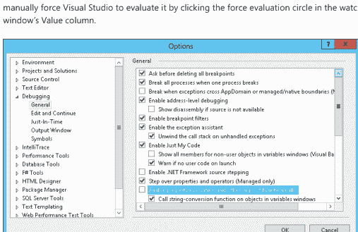

图 10-1 Visual Studio 常规调试器设置。

现在，我可以让代码构造一个 `Classroom` 对象并按如下方式初始化 `Students` 集合。

```csharp
public static void M() {
    Classroom classroom = new Classroom {
        Students = { "Jeff", "Kristin", "Aidan", "Grant" }
    };

    // Show the 4 students in the classroom
    foreach (var student in classroom.Students)
        Console.WriteLine(student);
}
```

编译此代码时，编译器看到 `Students` 属性的类型是 `List<String>`，并且该类型实现了 `IEnumerable<String>` 接口。现在，编译器假定 `List<String>` 类型提供了一个名为 `Add` 的方法（因为大多数集合类实际上都提供了一个将项添加到集合中的 `Add` 方法）。然后，编译器生成调用集合的 `Add` 方法的代码。因此，前面的代码会被编译器转换为以下代码。

```csharp
public static void M() {
    Classroom classroom = new Classroom();
    classroom.Students.Add("Jeff");
    classroom.Students.Add("Kristin");
    classroom.Students.Add("Aidan");
    classroom.Students.Add("Grant");

    // Show the 4 students in the classroom
    foreach (var student in classroom.Students)
        Console.WriteLine(student);
}
```

如果属性的类型实现 `IEnumerable` 或 `IEnumerable<T>`，但该类型不提供 `Add` 方法，那么编译器不会允许你使用集合初始化器语法向集合添加项；相反，编译器会发出类似以下的消息：error CS0117: 'System.Collections.Generic.IEnumerable<string>' does not contain a definition for 'Add'。

某些集合的 `Add` 方法接受多个参数——例如，`Dictionary` 的 `Add` 方法。

```csharp
public void Add(TKey key, TValue value);
```

你可以通过在集合初始化器中使用嵌套大括号，向 `Add` 方法传递多个参数，如下所示。

```csharp
var table = new Dictionary<String, Int32> {
    { "Jeffrey", 1 }, { "Kristin", 2 }, { "Aidan", 3 }, { "Grant", 4 }
};
```


上一行与下面这行相同。

```
    var table = new Dictionary<String, Int32>();
    table.Add("Jeffrey", 1);
    table.Add("Kristin", 2);
    table.Add("Aidan", 3);
    table.Add("Grant", 4);
```

### 匿名类型

C# 的匿名类型功能允许你使用非常简单简洁的语法自动声明不可变元组类型。元组类型是一种包含一组属性的类型，这些属性通常以某种方式相互关联。^1 在下面代码的第一行中，我定义了一个具有两个属性（String 类型的 Name 和 Int32 类型的 Year）的类，构造了该类型的实例，并将其 Name 属性设置为 "Jeff"，Year 属性设置为 1964。

```
    // Define a type, construct an instance of it, & initialize its properties
    var o1 = new { Name = "Jeff", Year = 1964 };

    // Display the properties on the console:
    Console.WriteLine("Name={0}, Year={1}", o1.Name, o1.Year);// Displays: Name=Jeff, Year=1964
```

这行顶层代码创建了一个匿名类型，因为我没有在 new 关键字后指定类型名，所以编译器会自动为我创建一个类型名，并且不告诉我它是什么（这就是它被称为匿名类型的原因）。该行代码使用上一节讨论的对象初始值设定项语法来声明这些属性，并初始化这些属性。另外，由于我（开发者）在编译时不知道类型的名称，因此我不知道应将变量 o1 声明为什么类型。然而，这不是问题，因为我可以使用 C# 的隐式类型化局部变量功能（var），如第 9 章“参数”所述，让编译器从赋值运算符（=）右侧的表达式推断类型。

现在，让我们关注编译器实际在做什么。当你编写如下一行代码时：

```
    var o = new { property1 = expression1, ..., propertyN = expressionN };
```

编译器会推断每个表达式的类型，创建这些推断类型的私有字段，为每个字段创建公共只读属性，并创建一个接受所有这些表达式的构造函数。构造函数的代码会用传入其中的表达式结果初始化这些私有只读字段。此外，编译器还会重写 Object 的 Equals、GetHashCode 和 ToString 方法，并在所有这些方法内部生成代码。实际上，编译器生成的类看起来如下所示。

```
    [CompilerGenerated]
    internal sealed class <>f__AnonymousType0<...>: Object {
        private readonly T1 f1;
        public T1 p1 { get { return f1; } }
        ...
    }
```

1 该术语最初源于对序列的抽象：single、double、triple、quadruple、quintuple、n-tuple。

匿名类型的实例不应泄漏到方法之外。方法不能将参数原型声明为接受匿名类型的参数，因为无法指定该匿名类型。类似地，方法也不能表明它返回对匿名类型的引用。尽管可以将匿名类型的实例当作 Object 处理（因为所有匿名类型都派生自 Object），但无法将 Object 类型的变量强制转换回匿名类型，因为你在编译时不知道匿名类型的名称。如果希望传递元组，则应考虑使用下一节讨论的 System.Tuple 类型。

### System.Tuple 类型

在 System 命名空间中，Microsoft 定义了几个泛型 Tuple 类型（都派生自 Object），它们按元数（泛型参数的个数）不同而不同。以下是最简单和最复杂的类型的基本样子。

```csharp
// This is the simplest:
[Serializable]
public class Tuple<T1> {
    private T1 m_Item1;
    public Tuple(T1 item1) { m_Item1 = item1; }
    public T1 Item1 { get { return m_Item1; } }
}
```

```csharp
// This is the most complex:
[Serializable]
public class Tuple<T1, T2, T3, T4, T5, T6, T7, TRest> {
    private T1 m_Item1; private T2 m_Item2; private T3 m_Item3; private T4 m_Item4;
    private T5 m_Item5; private T6 m_Item6; private T7 m_Item7; private TRest m_Rest;

    public Tuple(T1 item1, T2 item2, T3 item3, T4 item4, T5 item5, T6 item6, T7 item7,
        TRest rest) {
        m_Item1 = item1; m_Item2 = item2; m_Item3 = item3; m_Item4 = item4;
        m_Item5 = item5; m_Item6 = item6; m_Item7 = item7; m_Rest = rest;
    }

    public T1 Item1 { get { return m_Item1; } }
    public T2 Item2 { get { return m_Item2; } }
    public T3 Item3 { get { return m_Item3; } }
    public T4 Item4 { get { return m_Item4; } }
    public T5 Item5 { get { return m_Item5; } }
    public T6 Item6 { get { return m_Item6; } }
    public T7 Item7 { get { return m_Item7; } }
    public TRest Rest { get { return m_Rest; } }
}
```

**注意** 除了匿名类型和 Tuple 类型之外，你可能还想看看 System.Dynamic.ExpandoObject 类（定义在 System.Core.dll 程序集中）。当你将此 C# 的动态类型（在第 5 章“基元类型、引用类型和值类型”中讨论）一起使用时，你还有另一种将一组属性（键/值对）组合在一起的方法。结果不是编译时类型安全的，但语法看起来不错（尽管没有 IntelliSense 支持），并且可以在 C# 和诸如 Python 之类的动态语言之间传递 ExpandoObject 对象。下面是一些使用 ExpandoObject 的示例代码。

```
dynamic e = new System.Dynamic.ExpandoObject();
e.x = 6;   // Add an Int32 "x" property whose value is 6
e.y = "Jeff";  // Add a String "y" property whose value is "Jeff"
e.z = null;   // Add an Object "z" property whose value is null

// See all the properties and their values:
foreach (var v in (IDictionary<String, Object>)e)
    Console.WriteLine("Key={0}, V={1}", v.Key, v.Value);

// Remove the "x" property and its value
var d = (IDictionary<String, Object>)e;
d.Remove("x");
```

### 有参属性

在上一节中，属性的 get 访问器方法不接受任何参数。因此，我将这些属性称为*无参属性*。这些属性易于理解，因为它们感觉就像访问字段。除了这些类似字段的属性之外，编程语言还支持我所说的*有参属性*，其 get 访问器方法接受一个或多个参数，其 set 访问器方法接受两个或更多参数。不同的编程语言以不同方式公开有参属性。此外，语言使用不同术语来指代有参属性：C# 称它们为索引器，Visual Basic 称它们为*默认属性*。在本节中，我将重点介绍 C# 如何使用有参属性公开其索引器。

在 C# 中，有参属性（索引器）使用类似数组的语法公开。换句话说，可以将索引器视为 C# 开发者重载 [] 运算符的一种方式。下面是一个 BitArray 类的示例，它允许使用类似数组的语法来索引该类实例维护的位集合。

```csharp
using System;

public sealed class BitArray {
    // Private array of bytes that hold the bits
    private Byte[] m_byteArray;
    private Int32 m_numBits;

    // Constructor that allocates the byte array and sets all bits to 0
    public BitArray(Int32 numBits) {
        // Validate arguments first.
        if (numBits <= 0)
            throw new ArgumentOutOfRangeException("numBits must be > 0");

        // Save the number of bits.
        m_numBits = numBits;

        // Allocate the bytes for the bit array.
        m_byteArray = new Byte[(numBits + 7) / 8];
    }

    // This is the indexer (parameterful property).
    public Boolean this[Int32 bitPos] {

        // This is the indexer's get accessor method.
        get {
            // Validate arguments first
            if ((bitPos < 0) || (bitPos >= m_numBits))
                throw new ArgumentOutOfRangeException("bitPos");

            // Return the state of the indexed bit.
            return (m_byteArray[bitPos / 8] & (1 << (bitPos % 8))) != 0;
        }

        // This is the indexer's set accessor method.
        set {
            if ((bitPos < 0) || (bitPos >= m_numBits))
                throw new ArgumentOutOfRangeException("bitPos", bitPos.ToString());

            if (value) {
                // Turn the indexed bit on.
                m_byteArray[bitPos / 8] = (Byte)
                    (m_byteArray[bitPos / 8] | (1 << (bitPos % 8)));
            } else {
                // Turn the indexed bit off.
                m_byteArray[bitPos / 8] = (Byte)
                    (m_byteArray[bitPos / 8] & ~(1 << (bitPos % 8)));
            }
        }
    }
}
```

使用 BitArray 类的索引器非常简单。

```csharp
// Allocate a BitArray that can hold 14 bits.
BitArray ba = new BitArray(14);

// Turn all the even-numbered bits on by calling the set accessor.
for (Int32 x = 0; x < 14; x++) {
    ba[x] = (x % 2 == 0);
}

// Show the state of all the bits by calling the get accessor.
for (Int32 x = 0; x < 14; x++) {
    Console.WriteLine("Bit " + x + " is " + (ba[x] ? "On" : "Off"));
}
```


在 BitArray 示例中，索引器接受一个 Int32 参数 bitPos。所有索引器都必须至少有一个参数，但也可以有更多参数。这些参数（以及返回类型）可以是任何数据类型（void 除外）。可以在 System.Drawing.Imaging.ColorMatrix 类中找到具有多个参数的索引器示例，该类随 System.Drawing.dll 程序集提供。

创建索引器来查找关联数组中的值是很常见的。事实上，System.Collections.Generic.Dictionary 类型就提供了一个索引器，它接受一个键并返回与该键关联的值。与无参属性不同，一个类型可以提供多个重载索引器，只要它们的签名不同即可。

与无参属性的 set 访问器方法类似，索引器的 set 访问器方法也包含一个隐藏参数，在 C# 中称为 value。该参数表示“被索引元素”所需的新值。

CLR 不区分无参属性和有参属性；对 CLR 来说，每个属性都只是一对方法和一段在类型中定义的元数据。如前所述，不同的编程语言需要不同的语法来创建和使用有参属性。C# 要求使用 `this[...]` 作为表达索引器的语法，这完全是 C# 团队的选择。这个选择意味着 C# 只允许在对象实例上定义索引器。C# 没有提供允许开发者定义静态索引器属性的语法，尽管 CLR 确实支持静态有参属性。

由于 CLR 对待有参属性的方式与对待无参属性完全相同，编译器会将以下项中的两项或三项生成到最终托管程序集中：

- 一个表示有参属性 get 访问器方法的方法。仅当你为该属性定义了 get 访问器方法时才会生成此方法。
- 一个表示有参属性 set 访问器方法的方法。仅当你为该属性定义了 set 访问器方法时才会生成此方法。
- 托管程序集元数据中的一个属性定义，这一项始终会生成。没有专门的有参属性元数据定义表，因为对 CLR 来说，有参属性就是属性。

对于前面展示的 BitArray 类，编译器编译索引器的方式就好像原始源代码是如下这样编写的。

```csharp
public sealed class BitArray {

    // This is the indexer's get accessor method.
    public Boolean get_Item(Int32 bitPos) { /* ... */ }

    // This is the indexer's set accessor method.
    public void   set_Item(Int32 bitPos, Boolean value) { /* ... */ }
}
```

编译器通过将 get_ 和 set_ 添加到索引器名称前面，自动为这些方法生成名称。由于 C# 的索引器语法不允许开发者指定索引器名称，C# 编译器团队必须为访问器方法选择一个默认名称；他们选择了 Item。因此，编译器生成的方法名是 get_Item 和 set_Item。

在查看 .NET Framework 参考文档时，可以通过查找名为 Item 的属性来判断某个类型是否提供索引器。例如，System.Collections.Generic.List 类型提供了一个名为 Item 的公共实例属性；该属性就是 List 的索引器。

在 C# 中编程时，你永远不会看到 Item 这个名称，因此通常不会在意编译器为你选择了这个名称。但是，如果你正在为某个类型设计索引器，而其他编程语言编写的代码将访问该索引器，那么你可能想更改赋予索引器 get 和 set 访问器方法的默认名称 Item。C# 允许通过将 System.Runtime.CompilerServices.IndexerNameAttribute 自定义特性应用于索引器来重命名这些方法。以下代码演示了如何做到这一点。

```csharp
using System;
using System.Runtime.CompilerServices;

public sealed class BitArray {

    [IndexerName("Bit")]
    public Boolean this[Int32 bitPos] {
        // At least one accessor method is defined here
    }
}
```

现在编译器将生成名为 get_Bit 和 set_Bit 的方法，而不是 get_Item 和 set_Item。编译时，C# 编译器会看到 IndexerName 特性，这告诉编译器如何命名方法和属性元数据；该特性本身不会生成到程序集的元数据中。[^2]

下面是一些 Visual Basic 代码，演示如何访问这个 C# 索引器。

```vb
' Construct an instance of the BitArray type.
Dim ba as New BitArray(10)

' Visual Basic uses () instead of [] to specify array elements.
Console.WriteLine(ba(2))        ' Displays True or False

' Visual Basic also allows you to access the indexer by its name.
Console.WriteLine(ba.Bit(2))    ' Displays same as previous line
```

在 C# 中，只要所有索引器接受不同的参数集，单个类型就可以定义多个索引器。在其他编程语言中，IndexerName 特性允许你定义多个具有相同签名的索引器，因为每个索引器可以有不同的名称。C# 不允许这样做的原因是，其语法不通过名称引用索引器；编译器将不知道你指的是哪个索引器。尝试编译以下 C# 源代码会导致编译器生成以下消息：error CS0111: Type 'SomeType' already defines a member called 'this' with the same parameter types.

```csharp
using System;
using System.Runtime.CompilerServices;

public sealed class SomeType {

    // Define a get_Item accessor method.
    public Int32 this[Boolean b] {
        get { return 0; }
    }

    // Define a get_Jeff accessor method.
    [IndexerName("Jeff")]
    public String this[Boolean b] {
        get { return null; }
    }
}
```

你可以清楚地看到，C# 将索引器视为重载 `[]` 运算符的一种方式，而该运算符不能用于区分具有不同方法名但参数集相同的有参属性。

顺便说一下，System.String 类型就是一个更改了其索引器名称的类型示例。String 的索引器名称是 Chars，而不是 Item。这个只读属性允许你获取字符串中的单个字符。对于不使用 `[]` 运算符语法访问该属性的编程语言来说，Chars 被确定为更有意义的名称。

### 选择主有参属性

C# 在索引器方面的限制引出了以下两个问题：

- 如果某个类型是在允许开发者定义多个有参属性的编程语言中定义的，会怎样？
- 如何从 C# 中使用这种类型？

这两个问题的答案是：类型必须通过将 System.Reflection.DefaultMemberAttribute 的实例应用于类本身，来选择其中一个有参属性名称作为默认属性。需要说明的是，DefaultMemberAttribute 可以应用于类、结构或接口。在 C# 中，当你编译一个定义有参属性的类型时，编译器会自动将 DefaultMemberAttribute 的实例应用于定义类型，并在你使用 IndexerName 特性时将其考虑在内。该特性的构造函数指定要用于该类型默认有参属性的名称。

因此，在 C# 中，如果你定义了一个具有有参属性的类型，并且没有指定 IndexerName 特性，那么定义类型将具有一个指示 Item 的 DefaultMember 特性。如果你将 IndexerName 特性应用于某个有参属性，那么定义类型将具有一个指示 IndexerName 特性中指定的字符串名称的 DefaultMember 特性。请记住，如果代码包含名称不同的有参属性，C# 将无法编译该代码。

对于支持多个有参属性的语言，必须选择其中一个属性方法名称，并由该类型的 DefaultMember 特性标识。这是 C# 能够访问的唯一有参属性。

当 C# 编译器看到尝试获取或设置索引器的代码时，编译器实际上会生成对这些方法之一的调用。有些编程语言可能不支持有参属性。要从这些语言之一访问有参属性，必须显式调用所需的访问器方法。对 CLR 来说，无参属性和有参属性没有区别，因此可以使用相同的 System.Reflection.PropertyInfo 类来查找有参属性与其访问器方法之间的关联。

### 调用属性访问器方法的性能

对于简单的 get 和 set 访问器方法，实时 (JIT) 编译器会内联代码，因此使用属性而不是字段不会带来运行时性能损失。内联是指将方法（此处指访问器方法）的代码直接编译到发起调用的方法中。这样就去除了在运行时进行调用所带来的开销，但代价是使编译后方法的代码变大。由于属性访问器方法通常包含很少的代码，内联它们可以使本机代码更小，并使其执行得更快。

**注意** 调试代码时，JIT 编译器不会内联属性方法，因为内联后的代码更难调试。这意味着访问属性的性能在发布版本中可能很快，而在调试版本中可能很慢。字段访问在调试版本和发布版本中都很快。

[^2]: 出于这个原因，IndexerNameAttribute 类不属于 CLI 和 C# 语言的 ECMA 标准化内容。


## 第 11 章：事件

### 本章内容

- 设计公开事件的类型
- 编译器如何实现事件
- 设计侦听事件的类型
- 显式实现事件

在本章中，我将讨论类型可以定义的最后一类成员：事件。定义了事件成员的类型允许该类型（或该类型的实例）通知其他对象发生了某些特殊事情。例如，Button 类提供了一个名为 Click 的事件。当单击 Button 对象时，应用程序中的一个或多个对象可能希望接收有关此事件的通知，以便执行某些操作。事件就是允许这种交互的类型成员。具体而言，定义事件成员意味着类型提供以下能力：

- 方法可以注册其对该事件的关注。
- 方法可以注销其对该事件的关注。
- 当事件发生时，已注册的方法将收到通知。

类型在定义事件时可以提供此功能，因为它们维护已注册方法的列表。当事件发生时，类型会通知集合中的所有已注册方法。

公共语言运行时（CLR）的事件模型基于委托。委托是一种类型安全的方式来调用回调方法。回调方法是对象接收其订阅的通知的手段。在本章中，我将使用委托，但直到第 17 章“委托”才会完整解释其所有细节。

为了帮助你全面理解事件在 CLR 中的工作方式，我将从一个事件很有用的场景开始。假设你想设计一个电子邮件应用程序。当电子邮件消息到达时，用户可能希望将该消息转发到传真机或寻呼机。在架构此应用程序时，假设你首先设计一个名为 MailManager 的类型来接收传入的电子邮件消息。MailManager 将公开一个名为 NewMail 的事件。其他类型（如 Fax 和 Pager）可以注册对该事件的关注。当 MailManager 收到新的电子邮件消息时，它将引发该事件，从而使消息分发给每个已注册的对象。每个对象都可以按自己希望的任何方式处理该消息。

当应用程序初始化时，假设我们只实例化一个 MailManager 实例——然后应用程序可以实例化任意数量的 Fax 和 Pager 类型。图 11-1 展示了应用程序如何初始化，以及新电子邮件消息到达时会发生什么。

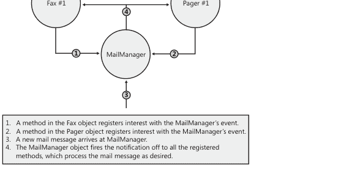

1. Fax 对象中的一个方法向 MailManager 的事件注册关注。
2. Pager 对象中的一个方法向 MailManager 的事件注册关注。
3. 新的邮件消息到达 MailManager。
4. MailManager 对象向所有已注册的方法发出通知，这些方法按需处理邮件消息。

**图 11-1** 架构一个使用事件的应用程序。

图 11-1 所示应用程序的工作方式如下：应用程序通过构造 MailManager 的实例进行初始化。MailManager 提供 NewMail 事件。当构造 Fax 和 Pager 对象时，它们向 MailManager 的 NewMail 事件注册一个实例方法，以便 MailManager 知道在新电子邮件消息到达时通知 Fax 和 Pager 对象。现在，当 MailManager 收到新的电子邮件消息时（在将来的某个时候），它将引发 NewMail 事件，使所有已注册的方法都有机会按自己希望的任何方式处理新消息。

### 设计公开事件的类型

为了定义公开一个或多个事件成员的类型，开发人员必须采取许多步骤。在本节中，我将逐一介绍每个必要步骤。MailManager 示例应用程序（可从 http://wintellect.com/Books 的 Resources 中的 Books 部分下载）展示了 MailManager 类型、Fax 类型和 Pager 类型的全部源代码。你会注意到，Pager 类型实际上与 Fax 类型相同。

#### 步骤 #1：定义一个类型，用于保存应发送给事件通知接收者的任何附加信息

当引发事件时，引发事件的对象可能希望将一些附加信息传递给接收事件通知的对象。这些附加信息需要封装到它自己的类中，该类通常包含一组私有字段以及一些用于公开这些字段的只读公共属性。按照约定，保存要传递给事件处理程序的事件信息的类应从 System.EventArgs 派生，并且类名应以 EventArgs 为后缀。在此示例中，NewMailEventArgs 类包含标识谁发送了消息（m_from）、谁正在接收消息（m_to）以及消息主题（m_subject）的字段。

```csharp
// Step #1: Define a type that will hold any additional information that
// should be sent to receivers of the event notification
internal class NewMailEventArgs : EventArgs {

    private readonly String m_from, m_to, m_subject;

    public NewMailEventArgs(String from, String to, String subject) {
        m_from = from; m_to = to; m_subject = subject;
    }

    public String From    { get { return m_from; } }
    public String To      { get { return m_to;   } }
    public String Subject { get { return m_subject; } }
}
```


> **注意** EventArgs 类定义在 Microsoft .NET Framework 类库（FCL）中，其实现如下。
>
> ```csharp
> [ComVisible(true), Serializable]
> public class EventArgs {
>     public static readonly EventArgs Empty = new EventArgs();
>     public EventArgs() { }
> }
> ```
>
> 如你所见，这个类型没什么值得大书特书的。它只是充当其他类型可以派生的基类型。许多事件没有任何附加信息要传递。例如，当 Button 通知其已注册的接收者它已被单击时，仅调用回调方法就足够了。当你定义的事件没有任何附加数据要传递时，只需使用 EventArgs.Empty，而不是构造新的 EventArgs 对象。

#### 步骤 #2：定义事件成员

事件成员使用 C# 关键字 `event` 定义。每个事件成员都指定可访问性（几乎总是 `public`，以便其他代码可以访问该事件成员）、一个委托类型（指示将被调用的方法原型）以及一个名称（可以是任何有效标识符）。我们的 MailManager 类中的事件成员如下所示。

```csharp
internal class MailManager {
    // Step #2: Define the event member
    public event EventHandler<NewMailEventArgs> NewMail;
    ...
}
```

`NewMail` 是此事件的名称。该事件成员的类型是 `EventHandler<NewMailEventArgs>`，这意味着事件通知的所有接收者都必须提供一个回调方法，其原型与 `EventHandler<NewMailEventArgs>` 委托类型的原型匹配。泛型 `System.EventHandler` 委托的定义如下：

```csharp
public delegate void EventHandler<TEventArgs>(Object sender, TEventArgs e);
```

方法原型必须如下所示：

```csharp
void MethodName(Object sender, NewMailEventArgs e);
```

> **注意** 很多人想知道为什么事件模式要求 sender 参数始终为 `Object` 类型。毕竟，由于 MailManager 将是唯一引发带有 `NewMailEventArgs` 对象的事件的类型，因此回调方法的原型如下所示会更合理。
>
> ```csharp
> void MethodName(MailManager sender, NewMailEventArgs e);
> ```
>
> 该模式要求 sender 参数为 `Object` 类型，主要是出于继承方面的考虑。如果 MailManager 被用作 SmtpMailManager 的基类，会怎么样？在这种情况下，回调方法的 sender 参数应原型化为 SmtpMailManager，而不是 MailManager，但这不可能发生，因为 SmtpMailManager 只是继承了 NewMail 事件。因此，原本期望 SmtpMailManager 引发事件的代码仍然必须将 sender 参数强制转换为 SmtpMailManager。换句话说，仍然需要强制转换，所以 sender 参数不妨直接类型化为 `Object`。
>
> 将 sender 参数类型化为 `Object` 的另一个原因只是为了灵活性。它允许委托被多个提供传递 `NewMailEventArgs` 对象的事件的类型使用。例如，PopMailManager 类即使不是从 MailManager 派生，也可以使用该委托。


### 以线程安全的方式引发事件

.NET Framework 首次发布时，开发人员引发事件的推荐方式是使用与以下代码类似的代码。

```csharp
// Version 1
protected virtual void OnNewMail(NewMailEventArgs e) {
    if (NewMail != null) NewMail(this, e);
}
```

OnNewMail 方法的问题在于，线程可能看到 NewMail 不为 null，然后，就在调用 NewMail 之前，另一个线程可能从委托链中移除一个委托，使 NewMail 变为 null，从而导致引发 NullReferenceException。为了修复这个竞态条件，许多开发人员按如下方式编写 OnNewMail 方法。

```csharp
// Version 2
protected virtual void OnNewMail(NewMailEventArgs e) {
    EventHandler<NewMailEventArgs> temp = NewMail;
    if (temp != null) temp(this, e);
}
```

这里的思路是，将 NewMail 的引用复制到临时变量 temp 中，该变量在赋值执行的那一刻引用委托链。现在，此方法将 temp 与 null 进行比较并调用 temp，因此，在赋值给 temp 之后，即使另一个线程更改 NewMail 也没有关系。请记住，委托是不可变的，这就是该技术在理论上有效的原因。然而，许多开发人员没有意识到，编译器可能会优化这段代码，从而完全移除局部 temp 变量。如果发生这种情况，此版本的代码与第一版完全相同，因此仍可能发生 NullReferenceException。

要真正修复这段代码，应按如下方式重写 OnNewMail。

```csharp
// Version 3
protected virtual void OnNewMail(NewMailEventArgs e) {
    EventHandler<NewMailEventArgs> temp = Volatile.Read(ref NewMail);
    if (temp != null) temp(this, e);
}
```

对 Volatile.Read 的调用会强制在调用点读取 NewMail，并且此时引用确实必须复制到 temp 变量中。然后，仅当 temp 不为 null 时才调用 temp。有关 Volatile.Read 方法的更多信息，请参见第 29 章“基元线程同步构造”。

#### 步骤 #4：定义将输入转换为所需事件的方法

你的类必须有一个方法，该方法接受某些输入并将其转换为引发事件。在我的 MailManager 示例中，调用 SimulateNewMail 方法以指示有新电子邮件到达 MailManager。

```csharp
internal class MailManager {

    // Step #4: Define a method that translates the
    // input into the desired event
    public void SimulateNewMail(String from, String to, String subject) {

        // Construct an object to hold the information we want
        // to pass to the receivers of our notification
        NewMailEventArgs e = new NewMailEventArgs(from, to, subject);

        // Call our virtual method notifying our object that the event
        // occurred. If no type overrides this method, our object will
        // notify all the objects that registered interest in the event
        OnNewMail(e);
    }
}
```

SimulateNewMail 接受有关消息的信息，并构造一个 NewMailEventArgs 对象，将消息信息传递给其构造函数。然后调用 MailManager 自己的虚拟 OnNewMail 方法，以正式通知 MailManager 对象有新电子邮件。通常，这会引发事件，通知所有已注册的方法。（如前所述，以 MailManager 作为基类的类可以重写此行为。）

### 编译器如何实现事件

既然你知道如何定义提供事件成员的类，让我们进一步了解事件究竟是什么以及它如何工作。在 MailManager 类中，有一行代码定义事件成员本身。

```csharp
public event EventHandler<NewMailEventArgs> NewMail;
```

当 C# 编译器编译上面这行代码时，会将这一行源代码转换为以下三个构造。

```csharp
// 1. A PRIVATE delegate field that is initialized to null
private EventHandler<NewMailEventArgs> NewMail = null;

// 2. A PUBLIC add_Xxx method (where Xxx is the Event name)
// Allows methods to register interest in the event.
public void add_NewMail(EventHandler<NewMailEventArgs> value) {
    // The loop and the call to CompareExchange is all just a fancy way
    // of adding a delegate to the event in a thread-safe way
    EventHandler<NewMailEventArgs> prevHandler;
    EventHandler<NewMailEventArgs> newMail = this.NewMail;
    do {
        prevHandler = newMail;
        EventHandler<NewMailEventArgs> newHandler =
            (EventHandler<NewMailEventArgs>) Delegate.Combine(prevHandler, value);
        newMail = Interlocked.CompareExchange<EventHandler<NewMailEventArgs>>(
            ref this.NewMail, newHandler, prevHandler);
    } while (newMail != prevHandler);
}

// 3. A PUBLIC remove_Xxx method (where Xxx is the Event name)
// Allows methods to unregister interest in the event.
public void remove_NewMail(EventHandler<NewMailEventArgs> value) {
    // The loop and the call to CompareExchange is all just a fancy way
    // of removing a delegate from the event in a thread-safe way
    EventHandler<NewMailEventArgs> prevHandler;
    EventHandler<NewMailEventArgs> newMail = this.NewMail;
    do {
        prevHandler = newMail;
        EventHandler<NewMailEventArgs> newHandler =
            (EventHandler<NewMailEventArgs>) Delegate.Remove(prevHandler, value);
        newMail = Interlocked.CompareExchange<EventHandler<NewMailEventArgs>>(
            ref this.NewMail, newHandler, prevHandler);
    } while (newMail != prevHandler);
}
```

第一个构造只是一个合适委托类型的字段。此字段是对委托列表头部的引用，当此事件发生时将通知这些委托。此字段初始化为 null，表示没有侦听器注册对该事件感兴趣。当某个方法注册对该事件感兴趣时，此字段引用 EventHandler<NewMailEventArgs> 委托的一个实例，该实例可能引用其他 EventHandler<NewMailEventArgs> 委托。当侦听器注册对某个事件感兴趣时，侦听器只是将委托类型的一个实例添加到列表中。显然，取消注册意味着从列表中移除该委托。

你会注意到，尽管原始源代码行将事件定义为 public，但委托字段（此示例中的 NewMail）始终是 private。将委托字段设为 private 的原因是为了防止定义类外部的代码不当操作它。如果该字段是 public，任何代码都可以更改该字段中的值，并可能清除所有已注册对该事件感兴趣的委托。

C# 编译器生成的第二个构造是一个方法，允许其他对象注册它们对该事件的关注。C# 编译器通过将 add_ 添加到事件名称（NewMail）之前来自动命名此函数。C# 编译器会自动生成此方法内部的代码。该代码始终调用 System.Delegate 的静态 Combine 方法，该方法将委托实例添加到委托列表中，并返回列表的新头部，该新头部会被保存回字段中。

C# 编译器生成的第三个构造是一个方法，允许对象取消注册其对该事件的关注。同样，C# 编译器通过将 remove_ 添加到事件名称（NewMail）之前来自动命名此函数。此方法内部的代码始终调用 Delegate 的静态 Remove 方法，该方法从委托列表中移除委托实例，并返回列表的新头部，该新头部会被保存回字段中。

> **警告** 如果你尝试移除一个从未添加的方法，那么 Delegate 的 Remove 方法在内部不会执行任何操作。也就是说，你不会收到任何类型的异常或警告；事件的方法集合保持不变。

> **注意** add 和 remove 方法使用一种众所周知的模式以线程安全的方式更新值。第 29 章的“Interlocked Anything 模式”一节讨论了此模式。

在此示例中，add 和 remove 方法是 public。它们为 public 的原因是原始源代码行将事件声明为 public。如果事件被声明为 protected，那么编译器生成的 add 和 remove 方法也会被声明为 protected。因此，当你在类型中定义事件时，事件的可访问性决定了哪些代码可以注册和取消注册对该事件的关注，但只有类型本身才能直接访问委托字段。事件成员也可以声明为 static 或 virtual，在这种情况下，编译器生成的 add 和 remove 方法将分别是 static 或 virtual。

除了生成上述三个构造之外，编译器还会向托管程序集的元数据中生成一个事件定义条目。此条目包含一些标志和基础委托类型，并引用 add 和 remove 访问器方法。此信息的存在只是为了在“事件”这一抽象概念与其访问器方法之间建立关联。编译器和其它工具可以使用此元数据，并且也可以通过 System.Reflection.EventInfo 类获取此信息。然而，CLR 本身不使用此元数据信息，在运行时只需要访问器方法。

### 设计侦听事件的类型

至此，最困难的工作肯定已经过去了。在本节中，我将展示如何定义一个使用另一个类型所提供事件的类型。让我们先检查 Fax 类型的代码。

```csharp
internal sealed class Fax {
    // Pass the MailManager object to the constructor
    public Fax(MailManager mm) {

        // Construct an instance of the EventHandler<NewMailEventArgs>
        // delegate that refers to our FaxMsg callback method.
        // Register our callback with MailManager's NewMail event
        mm.NewMail += FaxMsg;
    }

    // This is the method the MailManager will call
    // when a new email message arrives
    private void FaxMsg(Object sender, NewMailEventArgs e) {
```


```csharp
      // 'sender' identifies the MailManager object in case
      // we want to communicate back to it.

      // 'e' identifies the additional event information
      // the MailManager wants to give us.

      // Normally, the code here would fax the email message.
      // This test implementation displays the info in the console
      Console.WriteLine("Faxing mail message:");
      Console.WriteLine("  From={0}, To={1}, Subject={2}",
         e.From, e.To, e.Subject);
   }

   // This method could be executed to have the Fax object unregister
   // itself with the NewMail event so that it no longer receives
   // notifications
   public void Unregister(MailManager mm) {

      // Unregister with MailManager's NewMail event
      mm.NewMail -= FaxMsg;
   }
}
```

当电子邮件应用程序初始化时，它会首先构造一个 MailManager 对象，并将对该对象的引用保存到一个变量中。然后，应用程序会构造一个 Fax 对象，并将对 MailManager 对象的引用作为参数传入。在 Fax 构造函数中，Fax 对象使用 C# 的 += 运算符注册其对 MailManager 的 NewMail 事件的关注。

```csharp
mm.NewMail += FaxMsg;
```

由于 C# 编译器内置了对事件的支持，编译器会把对 += 运算符的使用转换为下面这行代码，以便添加对象对该事件的关注。

```csharp
mm.add_NewMail(new EventHandler<NewMailEventArgs>(this.FaxMsg));
```

如你所见，C# 编译器正在生成代码，该代码会构造一个 EventHandler<NewMailEventArgs> 委托对象，该委托对象包装了 Fax 类的 FaxMsg 方法。然后，C# 编译器调用 MailManager 的 add_NewMail 方法，并将新委托传给它。当然，你可以通过编译代码并使用 ILDasm.exe 之类的工具查看 IL 来验证所有这些内容。

即使你使用的编程语言不直接支持事件，你仍然可以通过显式调用 add 访问器方法，向事件注册委托。效果完全相同；只是源代码看起来不那么美观。正是 add 方法通过将委托添加到事件的委托列表，从而向事件注册该委托。

当 MailManager 对象引发事件时，Fax 对象的 FaxMsg 方法会被调用。该方法会收到对 MailManager 对象的引用作为第一个参数 sender。大多数情况下，这个参数会被忽略，但如果 Fax 对象想要在响应事件通知时访问 MailManager 对象的成员，就可以使用它。第二个参数是对 NewMailEventArgs 对象的引用。该对象包含 MailManager 和 NewMailEventArgs 的设计者认为对事件接收方有用的任何附加信息。通过 NewMailEventArgs 对象，FaxMsg 方法可以轻松访问邮件的发送方、邮件接收方和邮件主题。在真实的 Fax 对象中，这些信息会被传真到某个地方。在本示例中，这些信息只是显示在控制台窗口中。

当一个对象不再关注接收事件通知时，它应当注销自己的关注。例如，如果用户不再希望自己的电子邮件被转发到传真，Fax 对象就会注销其对 NewMail 事件的关注。只要一个对象已将其某个方法注册到事件，该对象就不能被垃圾回收。如果你的类型实现了 IDisposable 的 Dispose 方法，该实现应使其注销对所有事件的关注。（有关 IDisposable 的更多信息，请参见第 21 章“托管堆与垃圾回收”。）

Fax 的 Unregister 方法中展示了演示如何注销事件的代码。该方法与 Fax 构造函数中展示的代码几乎完全相同。唯一的区别是，这段代码使用 -= 而不是 +=。当 C# 编译器看到使用 -= 运算符从事件注销委托的代码时，编译器会发出对事件的 remove 方法的调用。

```csharp
mm.remove_NewMail(new EventHandler<NewMailEventArgs>(FaxMsg));
```

与 += 运算符一样，即使你使用的编程语言不直接支持事件，你仍然可以通过显式调用 remove 访问器方法，从事件注销委托。remove 方法会扫描列表，查找包装了与传入方法相同的方法的委托，从而从事件中注销该委托。如果找到匹配项，则从事件的委托列表中移除现有委托。如果未找到匹配项，则不会发生错误，列表保持不变。

顺便说一句，C# 要求你的代码使用 += 和 -= 运算符来向列表添加和移除委托。如果你尝试显式调用 add 或 remove 方法，C# 编译器会生成 CS0571“cannot explicitly call operator or accessor”错误消息。

#### 显式实现事件

System.Windows.Forms.Control 类型定义了大约 70 个事件。如果 Control 类型通过允许编译器隐式生成 add 和 remove 访问器方法及委托字段来实现这些事件，那么每个 Control 对象中就会有 70 个用于这些事件的委托字段！由于大多数程序员只关心少数几个事件，因此从 Control 派生的类型创建的每个对象都会浪费大量内存。顺便说一句，ASP.NET 的 System.Web.UI.Control 和 Windows Presentation Foundation (WPF) 的 System.Windows.UIElement 类型也提供了许多大多数程序员不会使用的事件。

在本节中，我将讨论 C# 编译器如何允许类开发者显式实现事件，从而使开发者能够控制 add 和 remove 方法如何操作回调委托。我将演示如何使用显式实现事件来高效地实现一个提供许多事件的类。不过，当然还存在其他可能希望显式实现类型事件的情形。

为了高效存储事件委托，每个公开事件的对象都会维护一个集合（通常是字典），以某种事件标识符为键，以委托列表为值。构造新对象时，这个集合为空。当注册对某个事件的关注时，会在集合中查找该事件的标识符。如果事件标识符存在，则将新委托与该事件的委托列表合并。如果事件标识符不在集合中，则添加该事件标识符及其委托。

当对象需要引发事件时，会在集合中查找该事件标识符。如果集合中没有该事件标识符的条目，则说明没有任何对象注册对该事件的关注，因此不需要回调任何委托。如果事件标识符在集合中，则调用与该事件标识符关联的委托列表。实现这种设计模式是定义事件的类型设计者的责任；使用该类型的开发者并不知道事件在内部是如何实现的。

下面是一个如何实现这种模式的示例。首先，我实现了一个 EventSet 类，它表示事件的集合以及每个事件的委托列表，如下所示。

```csharp
using System;
using System.Collections.Generic;

// This class exists to provide a bit more type safety and
// code maintainability when using EventSet
public sealed class EventKey { }

public sealed class EventSet {
   // The private dictionary used to maintain EventKey -> Delegate mappings
   private readonly Dictionary<EventKey, Delegate> m_events =
      new Dictionary<EventKey, Delegate>();

   // Adds an EventKey -> Delegate mapping if it doesn't exist or
   // combines a delegate to an existing EventKey
   public void Add(EventKey eventKey, Delegate handler) {
      Monitor.Enter(m_events);
      Delegate d;
      m_events.TryGetValue(eventKey, out d);
      m_events[eventKey] = Delegate.Combine(d, handler);
      Monitor.Exit(m_events);
   }

   // Removes a delegate from an EventKey (if it exists) and
   // removes the EventKey -> Delegate mapping if the last delegate is removed
   public void Remove(EventKey eventKey, Delegate handler) {
      Monitor.Enter(m_events);
      // Call TryGetValue to ensure that an exception is not thrown if
      // attempting to remove a delegate from an EventKey not in the set
      Delegate d;
      if (m_events.TryGetValue(eventKey, out d)) {
         d = Delegate.Remove(d, handler);
      }
   }
```


## 第 12 章 泛型

**本章内容：**

- 框架类库中的泛型 .......... 270
- 泛型基础设施 .......... 271
- 泛型接口 .......... 277
- 泛型委托 .......... 278
- 委托和接口的逆变与协变泛型类型实参 .......... 279
- 泛型方法 .......... 281
- 泛型和其他成员 .......... 284
- 可验证性与约束 .......... 284

熟悉面向对象编程的开发者都知道它带来的好处。使开发者极具生产力的一个重大好处是代码重用，即能够派生一个继承基类所有能力的类。派生类只需重写虚方法或添加一些新方法，即可自定义基类的行为以满足开发者的需求。泛型是公共语言运行时（CLR）和编程语言提供的另一种机制，它提供了又一种代码重用形式：算法重用。

基本上，一名开发者定义一个算法，例如排序、搜索、交换、比较或转换。但是，定义该算法的开发者并未指定算法操作的数据类型；该算法可以泛型方式应用于不同类型的对象。另一名开发者随后可以使用这个现有算法，只要他或她指明该算法应操作的具体数据类型，例如操作 Int32、String 等的排序算法，或操作 DateTime、Version 等的比较算法。

大多数算法封装在类型中，CLR 允许创建泛型引用类型以及泛型值类型，但不允许创建泛型枚举类型。此外，CLR 允许创建泛型接口和泛型委托。有时，单个方法可以封装有用的算法，因此 CLR 允许创建定义在引用类型、值类型或接口中的泛型方法。

让我们看一个简单示例。框架类库（FCL）定义了一个泛型列表算法，它知道如何管理一组对象；这些对象的数据类型不由泛型算法指定。想要使用该泛型列表算法的人可以稍后指定要与其一起使用的确切数据类型。

封装泛型列表算法的 FCL 类称为 `List<T>`（读作 List of Tee），该类定义在 System.Collections.Generic 命名空间中。此类的定义如下所示（代码已大幅简化）。

```csharp
[Serializable]
public class List<T> : IList<T>, ICollection<T>, IEnumerable<T>,
    IList, ICollection, IEnumerable {

    public List();
    public void Add(T item);
    public Int32 BinarySearch(T item);
    public void Clear();
    public Boolean Contains(T item);
    public Int32 IndexOf(T item);
    public Boolean Remove(T item);
    public void Sort();
    public void Sort(IComparer<T> comparer);
    public void Sort(Comparison<T> comparison);
    public T[] ToArray();

    public Int32 Count { get; }
    public T this[Int32 index] { get; set; }
}
```

定义泛型 List 类的程序员通过将 `<T>` 紧跟在类名之后，表明它使用未指定的数据类型。定义泛型类型或方法时，它为类型指定的任何变量（如 T）称为类型参数。T 是一个变量名，可在源代码中任何可使用数据类型的地方使用。例如，在 List 类定义中，你会看到 T 用于方法参数（Add 方法接受类型为 T 的参数）和返回类型（ToArray 方法返回类型为 T 的一维数组）。另一个示例是索引器方法（在 C# 中称为 this）。索引器有一个 get 访问器方法，返回类型为 T 的值；还有一个 set 访问器方法，接受类型为 T 的参数。因为 T 变量可在任何可指定数据类型的地方使用，所以在方法内定义局部变量或在类型内定义字段时也可以使用 T。

> **注意** Microsoft 的设计准则规定，泛型参数变量应命名为 T，或至少以大写 T 开头（如 TKey 和 TValue）。大写 T 代表类型，正如大写 I 代表接口（如 IComparable）。

既然泛型 `List<T>` 类型已定义，其他开发者就可以通过指定希望该算法操作的确切数据类型来使用此泛型算法。使用泛型类型或方法时，指定的数据类型称为类型实参。例如，开发者可能想通过指定 DateTime 类型实参来使用 List 算法。

以下代码展示了这一点。

```csharp
private static void SomeMethod() {
    // Construct a List that operates on DateTime objects
    List<DateTime> dtList = new List<DateTime>();

    // Add a DateTime object to the list
    dtList.Add(DateTime.Now);       // No boxing

    // Add another DateTime object to the list
    dtList.Add(DateTime.MinValue);  // No boxing

    // Attempt to add a String object to the list
    dtList.Add("1/1/2004");         // Compile-time error

    // Extract a DateTime object out of the list
    DateTime dt = dtList[0];        // No cast required
}
```

正如刚才的代码所示，泛型为开发者提供了以下重大好处：

- **源代码保护** 使用泛型算法的开发者无需访问该算法的源代码。然而，对于 C++ 模板，使用该算法的开发者必须能够获得该算法的源代码。
- **类型安全** 当泛型算法与特定类型一起使用时，编译器和 CLR 理解这一点，并确保只有与指定数据类型兼容的对象才能与该算法一起使用。尝试使用不兼容类型的对象将导致编译器错误或引发运行时异常。在示例中，尝试将 String 对象传递给 Add 方法会导致编译器发出错误。
- **更简洁的代码** 因为编译器强制类型安全，源代码中需要的强制转换更少，这意味着代码更易编写和维护。在 SomeMethod 的最后一行，开发者不需要使用 (DateTime) 强制转换来将索引器的结果（查询索引 0 处的元素）放入 dt 变量。
- **更好的性能** 在泛型之前，定义通用算法的方式是将其所有成员定义为使用 Object 数据类型。如果要将该算法用于值类型实例，CLR 必须在调用算法成员之前对值类型实例进行装箱。如第 5 章“基元类型、引用类型和值类型”所述，装箱会导致托管堆上的内存分配，这会导致更频繁的垃圾回收，进而损害应用程序的性能。因为现在可以创建用于特定值类型的泛型算法，值类型的实例可以按值传递，CLR 不再需要进行任何装箱。此外，由于不需要强制转换（见上一项），CLR 不必检查所尝试的强制转换的类型安全，这也使代码更快。


为了充分说明泛型的性能优势，我编写了一个程序，用于测试泛型 List 算法相对于 FCL 的非泛型 ArrayList 算法的性能。实际上，我通过同时使用值类型对象和引用类型对象测试了这两种算法的性能。程序如下。

```csharp
using System;
using System.Collections;
using System.Collections.Generic;
using System.Diagnostics;

public static class Program {
    public static void Main() {
        ValueTypePerfTest();
        ReferenceTypePerfTest();
    }

    private static void ValueTypePerfTest() {
        const Int32 count = 100000000;

        using (new OperationTimer("List<Int32>")) {
            List<Int32> l = new List<Int32>();
            for (Int32 n = 0; n < count; n++) {
                l.Add(n);                   // No boxing
                Int32 x = l[n];             // No unboxing
            }
            l = null;  // Make sure this gets garbage collected
        }

        using (new OperationTimer("ArrayList of Int32")) {
            ArrayList a = new ArrayList();
            for (Int32 n = 0; n < count; n++) {
                a.Add(n);                   // Boxing
                Int32 x = (Int32) a[n];     // Unboxing
            }
            a = null;  // Make sure this gets garbage collected
        }
    }

    private static void ReferenceTypePerfTest() {
        const Int32 count = 100000000;

        using (new OperationTimer("List<String>")) {
            List<String> l = new List<String>();
            for (Int32 n = 0; n < count; n++) {
                l.Add("X");                 // Reference copy
                String x = l[n];            // Reference copy
            }
            l = null;  // Make sure this gets garbage collected
        }

        using (new OperationTimer("ArrayList of String")) {
            ArrayList a = new ArrayList();
            for (Int32 n = 0; n < count; n++) {
                a.Add("X");                 // Reference copy
                String x = (String) a[n];   // Cast check & reference copy
            }
            a = null; // Make sure this gets garbage collected
        }
    }
}

// This class is useful for doing operation performance timing
internal sealed class OperationTimer : IDisposable {
    private Stopwatch m_stopwatch;
    private String m_text;
    private Int32 m_collectionCount;

    public OperationTimer(String text) {
        PrepareForOperation();

        m_text = text;
        m_collectionCount = GC.CollectionCount(0);

        // This should be the last statement in this
        // method to keep timing as accurate as possible
        m_stopwatch = Stopwatch.StartNew();
    }

    public void Dispose() {
        Console.WriteLine("{0} (GCs={1,3}) {2}", (m_stopwatch.Elapsed),
            GC.CollectionCount(0) - m_collectionCount, m_text);
    }

    private static void PrepareForOperation() {
        GC.Collect();
        GC.WaitForPendingFinalizers();
        GC.Collect();
    }
}
```

当我在自己的计算机上编译并运行该程序的发布版本（已开启优化）时，得到以下输出。

```
00:00:01.6246959 (GCs=  6) List<Int32>
00:00:10.8555008 (GCs=390) ArrayList of Int32
00:00:02.5427847 (GCs=  4) List<String>
00:00:02.7944831 (GCs=  7) ArrayList of String
```

这里的输出表明，对 Int32 类型使用泛型 List 算法要比对 Int32 使用非泛型 ArrayList 算法快得多。事实上，差异非常惊人：1.6 秒对将近 11 秒。这大约快了 7 倍！此外，对 ArrayList 使用值类型（Int32）会导致大量装箱操作发生，从而产生 390 次垃圾回收。而 List 算法只需要 6 次垃圾回收。

使用引用类型的测试结果就没有那么重大。在这里我们看到，耗时和垃圾回收次数大致相同。因此，泛型 List 算法在这里似乎没有任何优势。不过，请记住，使用泛型算法时，你还能获得更简洁的代码和编译时类型安全。所以，尽管性能提升并不巨大，但使用泛型算法时获得的其他好处通常也是一种改进。

> **注意** 你确实需要认识到，CLR 会为每个方法在第一次针对特定数据类型被调用时生成本机代码。这会增加应用程序的工作集大小，从而损害性能。我将在本章的“泛型基础结构”一节中进一步讨论这一点。

### 框架类库中的泛型

当然，泛型最明显的用途是集合类，FCL 定义了多个可供你使用的泛型集合类。这些类大多可以在 System.Collections.Generic 命名空间和 System.Collections.ObjectModel 命名空间中找到。System.Collections.Concurrent 命名空间中还提供了线程安全的泛型集合类。Microsoft 建议程序员使用泛型集合类，并且现在不鼓励使用非泛型集合类，原因有几个。首先，非泛型集合类不是泛型的，因此你无法获得使用泛型集合类时所能获得的类型安全、更简洁的代码和更好的性能。其次，泛型类比非泛型类具有更好的对象模型。例如，虚方法更少，从而带来更好的性能；并且已向泛型集合添加了新成员以提供新功能。

集合类实现了许多接口，而放入集合中的对象可以实现集合类用于排序和搜索等操作的接口。FCL 附带了许多泛型接口定义，因此在使用接口时也能获得泛型的好处。常用的接口包含在 System.Collections.Generic 命名空间中。

新的泛型接口并不是旧的非泛型接口的替代品；在许多场景中，你必须同时使用两者。原因是向后兼容。例如，如果 List<T> 类只实现 IList<T> 接口，那么没有任何代码可以将 List<DateTime> 对象视为 IList。

我还应该指出，System.Array 类（所有数组类型的基类）提供了许多静态泛型方法，例如 AsReadOnly、BinarySearch、ConvertAll、Exists、Find、FindAll、FindIndex、FindLast、FindLastIndex、ForEach、IndexOf、LastIndexOf、Resize、Sort 和 TrueForAll。下面是一些示例，展示了其中部分方法的样子。

```csharp
public abstract class Array : ICloneable, IList, ICollection, IEnumerable,
   IStructuralComparable, IStructuralEquatable {

   public static void Sort<T>(T[] array);
   public static void Sort<T>(T[] array, IComparer<T> comparer);

   public static Int32 BinarySearch<T>(T[] array, T value);
   public static Int32 BinarySearch<T>(T[] array, T value,
      IComparer<T> comparer);
   ...
}
```

### 开放类型和封闭类型

在本书的各章中，我讨论了 CLR 如何为应用程序使用的每一种类型创建内部数据结构。这些数据结构称为*类型对象*。那么，带有泛型类型参数的类型仍然被视为一种类型，CLR 会为其中每一种类型创建内部类型对象。这适用于引用类型（类）、值类型（结构）、接口类型和委托类型。然而，带有泛型类型参数的类型称为*开放类型*，并且 CLR 不允许构造*开放类型*的任何实例（类似于 CLR 阻止构造接口类型的实例）。

当代码引用泛型类型时，它可以指定一组泛型类型实参。如果为所有类型实参传入了实际数据类型，则该类型称为*封闭类型*，并且 CLR 确实允许构造封闭类型的实例。然而，引用泛型类型的代码可能会让某些泛型类型实参未指定。这会在 CLR 中创建一个新的开放类型对象，并且无法创建该类型的实例。下面的代码应该能说明这一点。

```csharp
using System;
using System.Collections.Generic;

// A partially specified open type
internal sealed class DictionaryStringKey<TValue> :
    Dictionary<String, TValue> {
}

public static class Program {
    public static void Main() {
        Object o = null;

        // Dictionary<,> is an open type having 2 type parameters
        Type t = typeof(Dictionary<,>);

        // Try to create an instance of this type (fails)
        o = CreateInstance(t);
        Console.WriteLine();

        // DictionaryStringKey<> is an open type having 1 type parameter
        t = typeof(DictionaryStringKey<>);

        // Try to create an instance of this type (fails)
        o = CreateInstance(t);
        Console.WriteLine();

        // DictionaryStringKey<Guid> is a closed type
        t = typeof(DictionaryStringKey<Guid>);

        // Try to create an instance of this type (succeeds)
        o = CreateInstance(t);

        // Prove it actually worked
        Console.WriteLine("Object type=" + o.GetType());
    }

    private static Object CreateInstance(Type t) {
```


```csharp
Object o = null;
try {
    o = Activator.CreateInstance(t);
    Console.WriteLine("Created instance of {0}", t.ToString());
}
catch (ArgumentException e) {
    Console.WriteLine(e.Message);
}
return o;
}
```

当我编译并运行前面的代码时，会得到以下输出。

```text
Cannot create an instance of System.Collections.Generic.
Dictionary`2[TKey,TValue] because Type.ContainsGenericParameters is true.

Cannot create an instance of DictionaryStringKey`1[TValue] because
Type.ContainsGenericParameters is true.

Created instance of DictionaryStringKey`1[System.Guid]
Object type=DictionaryStringKey`1[System.Guid]
```

如你所见，当你要求 Activator 的 CreateInstance 方法构造一个开放类型的实例时，它会抛出 ArgumentException。实际上，该异常的字符串消息表明该类型仍包含一些泛型参数。

在输出中，你会注意到类型名以反引号（\`）后跟一个数字结尾。这个数字表示该类型的元数（arity），它表示该类型所需的类型参数数量。例如，Dictionary 类的元数为 2，因为它要求为 TKey 和 TValue 指定类型。DictionaryStringKey 类的元数为 1，因为它只要求为 TValue 指定一个类型。

我还应该指出，CLR 会在类型对象内部为该类型的静态字段分配空间（如第4章“类型基础”所述）。因此，每个封闭类型都有自己的静态字段。换句话说，如果 List<T> 定义了任何静态字段，这些字段不会在 List<DateTime> 和 List<String> 之间共享；每个封闭类型对象都有自己的静态字段。另外，如果泛型类型定义了静态构造函数（第8章“方法”中讨论过），则该构造函数会针对每个封闭类型执行一次。有时人们会在泛型类型上定义静态构造函数，以确保类型实参满足某些条件。例如，如果你想要定义一个只能与枚举类型一起使用的泛型类型，可以这样做。

```csharp
internal sealed class GenericTypeThatRequiresAnEnum<T> {
    static GenericTypeThatRequiresAnEnum() {
        if (!typeof(T).IsEnum) {
            throw new ArgumentException("T must be an enumerated type");
        }
    }
}
```

CLR 有一个称为约束（constraints）的功能，它为你提供了一种更好的方式来定义泛型类型，并指明哪些类型实参对该类型有效。我将在本章后面讨论约束。遗憾的是，约束不支持将类型实参限制为只能是枚举类型，这就是前面的示例需要静态构造函数来确保该类型是枚举类型的原因。

#### 泛型类型与继承

泛型类型是一种类型，因此它可以派生自任何其他类型。当你使用泛型类型并指定类型实参时，你是在 CLR 中定义一个新的类型对象，而这个新类型对象派生自该泛型类型原本派生自的类型。换句话说，因为 List<T> 派生自 Object，所以 List<String> 和 List<Guid> 也派生自 Object。类似地，因为 DictionaryStringKey<TValue> 派生自 Dictionary<String, TValue>，所以 DictionaryStringKey<Guid> 也派生自 Dictionary<String, Guid>。理解指定类型实参与继承层次结构无关，将帮助你认识到可以进行哪些强制转换、不能进行哪些强制转换。

例如，如果链表节点类定义如下：

```csharp
internal sealed class Node<T> {
   public T m_data;
   public Node<T> m_next;

   public Node(T data) : this(data, null) {
   }

   public Node(T data, Node<T> next) {
      m_data = data; m_next = next;
   }

   public override String ToString() {
      return m_data.ToString() +
         ((m_next != null) ? m_next.ToString() : String.Empty);
   }
}
```

那么我可以编写一些代码来构建一个链表，代码大致如下。

```csharp
private static void SameDataLinkedList() {
   Node<Char> head = new Node<Char>('C');
   head = new Node<Char>('B', head);
   head = new Node<Char>('A', head);
   Console.WriteLine(head.ToString());  // Displays "ABC"
}
```

在刚刚展示的 Node 类中，m_next 字段必须引用另一个节点，且该节点的 m_data 字段具有相同的数据类型。这意味着该链表包含的节点中，所有数据项都必须是相同类型（或派生类型）。例如，我不能使用 Node 类创建一个链表，其中一个元素包含 Char，另一个元素包含 DateTime，还有一个元素包含 String。嗯，如果我到处都使用 Node<Object>，那也可以，但这样会失去编译时类型安全，并且值类型会被装箱。

因此，更好的做法是定义一个非泛型的 Node 基类，然后定义一个泛型的 TypedNode 类（使用 Node 类作为基类）。现在，我可以拥有一个链表，其中每个节点都可以是特定的数据类型（而不是 Object），获得编译时类型安全，并避免值类型的装箱。下面是新的类定义。

```csharp
internal class Node {
    protected Node m_next;

    public Node(Node next) {
        m_next = next;
    }
}

internal sealed class TypedNode<T> : Node {
    public T m_data;

    public TypedNode(T data) : this(data, null) {
    }

    public TypedNode(T data, Node next) : base(next) {
        m_data = data;
    }

    public override String ToString() {
        return m_data.ToString() +
            ((m_next != null) ? m_next.ToString() : String.Empty);
    }
}
```

现在我可以编写代码来创建一个链表，其中每个节点都是不同的数据类型。代码大致如下。

```csharp
private static void DifferentDataLinkedList() {
    Node head = new TypedNode<Char>('.');
    head = new TypedNode<DateTime>(DateTime.Now, head);
    head = new TypedNode<String>("Today is ", head);
    Console.WriteLine(head.ToString());
}
```

#### 泛型类型标识

有时泛型语法会让开发人员感到困惑。毕竟，源代码中可能散布着大量小于号（<）和大于号（>），这会损害可读性。为了改进语法，一些开发人员会定义一个非泛型类类型，它派生自某个泛型类型，并指定所有类型实参。例如，为了简化下面这样的代码：

```csharp
List<DateTime> dtl = new List<DateTime>();
```

一些开发人员可能会先定义如下所示的类。

```csharp
internal sealed class DateTimeList : List<DateTime> {
    // No need to put any code in here!
}
```

现在，创建列表的代码可以更简单地重写（不包含小于号和大于号），如下所示。

```csharp
DateTimeList dtl = new DateTimeList();
```

尽管这看起来很方便，尤其是当你把新类型用于参数、局部变量和字段时，但你绝不应该仅仅为了让源代码更易读而显式定义一个新类。原因在于你会失去类型标识和等价性，正如你在以下代码中所看到的那样。

```csharp
Boolean sameType = (typeof(List<DateTime>) == typeof(DateTimeList));
```

当前面的代码运行时，sameType 会被初始化为 false，因为你比较的是两个不同的类型对象。这也意味着，一个原型声明为接受 DateTimeList 的方法将无法接受传入的 List<DateTime>。然而，一个原型声明为接受 List<DateTime> 的方法可以接受传入的 DateTimeList，因为 DateTimeList 派生自 List<DateTime>。程序员可能会很容易被这一切搞糊涂。

幸运的是，C# 确实提供了一种使用简化语法来引用泛型封闭类型的方法，同时完全不影响类型等价性；你可以在源代码文件顶部使用久经考验的 using 指令。下面是一个示例。

```csharp
using DateTimeList = System.Collections.Generic.List<System.DateTime>;
```

在这里，using 指令实际上只是定义了一个名为 DateTimeList 的符号。当代码编译时，编译器会把所有出现的 DateTimeList 替换为 System.Collections.Generic.List<System.DateTime>。这只是允许开发人员使用简化语法，而不影响代码的实际含义，因此类型标识和等价性得以保持。所以现在，当下面这行代码执行时，sameType 会被初始化为 true。

```csharp
Boolean sameType = (typeof(List<DateTime>) == typeof(DateTimeList));
```

作为另一种便利，你可以使用 C# 的隐式类型局部变量功能，编译器会根据你赋值给局部变量的表达式类型来推断该局部变量的类型。

```csharp
using System;
using System.Collections.Generic;
...
internal sealed class SomeType {
    private static void SomeMethod() {
```


```csharp
// Compiler infers that dt1 is of type
// System.Collections.Generic.List<System.DateTime>
var dt1 = new List<DateTime>();
...
}
}
```

#### 代码膨胀

当使用泛型类型参数的方法被 JIT 编译时，CLR 会获取该方法的 IL，替换指定的类型实参，然后生成本机代码，这些代码特定于该方法操作指定的数据类型。这正是你想要的，也是泛型的主要特性之一。然而，这有一个缺点：CLR 会为每个方法/类型组合不断生成本机代码。这被称为*代码膨胀*。这最终可能大幅增加应用程序的工作集，从而损害性能。

幸运的是，CLR 内置了一些优化来减少代码膨胀。首先，如果针对某个特定类型实参调用了一个方法，之后又使用相同的类型实参再次调用该方法，CLR 只会为这个方法/类型组合编译一次代码。因此，如果一个程序集使用 List<DateTime>，而另一个完全不同的程序集（加载在同一 AppDomain 中）也使用 List<DateTime>，CLR 只会为 List<DateTime> 的方法编译一次。这大幅减少了代码膨胀。

CLR 还有另一个优化：CLR 将所有引用类型实参视为相同，因此代码同样可以共享。例如，CLR 为 List<String> 的方法编译的代码可以用于 List<Stream> 的方法，因为 String 和 Stream 都是引用类型。事实上，对于任何引用类型，都会使用相同的代码。CLR 能执行此优化，是因为所有引用类型实参或变量实际上只是指向堆上对象的指针（在 32 位 Windows 系统上均为 32 位，在 64 位 Windows 系统上为 64 位），并且所有对象指针都以相同方式操作。

但如果任何类型实参是值类型，CLR 必须专门为该值类型生成本机代码。原因是值类型的大小可能不同。而且即使两个值类型大小相同（例如 Int32 和 UInt32，二者都是 32 位），CLR 仍然无法共享代码，因为可能使用不同的本机 CPU 指令来操作这些值。

#### 泛型接口

显然，能够定义泛型引用类型和值类型是泛型的主要特性。然而，CLR 还必须支持泛型接口，这一点至关重要。如果没有泛型接口，任何时候你试图通过非泛型接口（例如 IComparable）操作值类型，装箱和编译时类型安全的丧失都会再次发生。这会严重限制泛型类型的实用性。因此，CLR 确实支持泛型接口。引用类型或值类型

例如，如果定义如下泛型委托：

```csharp
public delegate TReturn CallMe<TReturn, TKey, TValue>(TKey key, TValue value);
```

编译器会将其转换为一个逻辑上如下所示的类。

```csharp
public sealed class CallMe<TReturn, TKey, TValue> : MulticastDelegate {
    public CallMe(Object object, IntPtr method);
    public virtual TReturn Invoke(TKey key, TValue value);
    public virtual IAsyncResult BeginInvoke(TKey key, TValue value,
        AsyncCallback callback, Object object);
    public virtual TReturn EndInvoke(IAsyncResult result);
}
```

> **注意** 建议尽可能使用 Framework Class Library (FCL) 中预定义的泛型 Action 和 Func 委托。我在第 17 章“委托定义已经够多了（泛型委托）”一节中描述了这些委托类型。

#### 委托和接口的逆变与协变泛型类型实参

委托的每个泛型类型参数都可以标记为协变或逆变。此特性允许你将一个泛型委托类型的变量强制转换为*同一个*委托类型，只是泛型参数类型不同。泛型类型参数可以是以下任意一种：

- **不变** 表示泛型类型参数不能更改。到目前为止，本章中我只展示了不变的泛型类型参数。
- **逆变** 表示泛型类型参数可以从一个类更改为派生自它的类。在 C# 中，使用 in 关键字表示逆变泛型类型参数。逆变泛型类型参数只能出现在输入位置，例如方法的参数。
- **协变** 表示泛型类型实参可以从一个类更改为它的某个基类。在 C# 中，使用 out 关键字表示协变泛型类型参数。协变泛型类型参数只能出现在输出位置，例如方法的返回类型。

例如，假设存在以下委托类型定义（顺便说一句，它确实存在）。

```csharp
public delegate TResult Func<in T, out TResult>(T arg);
```

这里，泛型类型参数 T 用 in 关键字标记，使其成为逆变；泛型类型参数 TResult 用 out 关键字标记，使其成为协变。

那么现在，如果我有一个如下声明的变量。

```csharp
Func<Object, ArgumentException> fn1 = null;
```

我可以将它强制转换为另一个 Func 类型，其中泛型类型参数不同。

```csharp
Func<String, Exception> fn2 = fn1; // No explicit cast is required here
Exception e = fn2("");
```

这表示 fn1 引用一个接受 Object 并返回 ArgumentException 的函数。fn2 变量希望引用一个接受 String 并返回 Exception 的方法。因为可以将 String 传递给需要 Object 的方法（因为 String 派生自 Object），并且因为可以取得返回 ArgumentException 的方法的结果并将其视为 Exception（因为 Exception 是 ArgumentException 的基类），所以上面的代码可以编译，并且在编译时已知它保持类型安全。

> **注意** 变体仅当编译器能验证类型之间存在引用转换时才适用。换句话说，值类型不可能使用变体，因为需要装箱。在我看来，正是这一限制使得这些变体特性不那么有用。例如，如果我有以下方法。
> 
> ```csharp
> void ProcessCollection(IEnumerable<Object> collection) { ... }
> ```
> 
> 我不能在传入对 List<DateTime> 对象的引用的情况下调用它，因为 DateTime 值类型和 Object 之间不存在引用转换，即使 DateTime 派生自 Object。可以通过如下声明 ProcessCollection 来解决此问题。
> 
> ```csharp
> void ProcessCollection<T>(IEnumerable<T> collection) { ... }
> ```
> 
> 另外，ProcessCollection(IEnumerable<Object> collection) 的一大好处是只有一份 JIT 编译后的代码版本。然而，对于 ProcessCollection<T>(IEnumerable<T> collection)，也只有一份由所有作为引用类型的 T 共享的 JIT 编译后的代码版本。对于作为值类型的 T，你确实会得到其他版本的 JIT 编译后的代码，但现在至少可以在传入值类型集合的情况下调用该方法。
> 
> 此外，如果使用 out 或 ref 关键字将该类型的参数传递给方法，则不允许在泛型类型参数上使用变体。例如，下面的代码行会导致编译器生成以下错误消息：Invalid variance: The type parameter 'T' must be invariantly valid on 'SomeDelegate<T>'. 'T' is contravariant.
> 
> ```csharp
> delegate void SomeDelegate<in T>(ref T t);
> ```

当使用接受泛型实参并返回类型的委托时，建议尽可能始终为逆变和协变指定 in 和 out 关键字，因为这样做没有不良影响，并且能使委托用于更多场景。


与委托类似，带有泛型类型参数的接口可以将其类型参数设为逆变或协变。下面是一个具有协变泛型类型参数的接口示例。

```csharp
public interface IEnumerable<out T> : IEnumerator {
    Boolean MoveNext();
    T Current { get; }
}
```

因为 T 是协变的，以下代码可以成功编译并运行。

```csharp
// This method accepts an IEnumerable of any reference type
Int32 Count(IEnumerable<Object> collection) { ... }
```

```csharp
// The call below passes an IEnumerable<String> to Count
Int32 c = Count(new[] { "Grant" });
```

> **重要** 有时开发者会问，为什么必须显式地在泛型类型参数上加上 in 或 out。他们认为编译器应该能够检查委托或接口声明，并自动检测哪些泛型类型参数可以是逆变和协变的。虽然编译器确实能够自动检测到这一点，但 C# 团队认为，你是在声明一个契约，你应该明确自己想要允许的行为。例如，如果编译器确定某个泛型类型参数可以是逆变的，而将来你在接口中添加了一个在输出位置使用该类型参数的成员，那就不妙了。下次编译时，编译器会认为该类型参数应该是不变的，但是如果代码位置利用了该类型参数曾经是逆变的这一事实，那么所有引用其他成员的代码位置现在都可能产生错误。
>
> 因此，编译器团队强制你在声明泛型类型参数时显式指定。然后，如果你尝试在与你声明的方式不匹配的上下文中使用该类型参数，编译器会发出错误，让你知道你正在尝试破坏该契约。如果你随后决定通过为泛型类型参数添加 in 或 out 来破坏契约，那么你应该预料到需要修改一些使用旧契约的代码位置。

#### 泛型方法

当定义泛型类、结构体或接口时，这些类型中定义的任何方法都可以引用该类型指定的类型参数。类型参数可以用作方法的参数、方法的返回类型，或方法内部定义的局部变量。然而，CLR 还支持方法指定自己的类型参数的能力。这些类型参数同样可以用于参数、返回类型或局部变量。

这里有一个有点刻意构造的例子，展示了一个定义了类型参数的类型，以及一个拥有自己的类型参数的方法。

```csharp
internal sealed class GenericType<T> {
    private T m_value;

    public GenericType(T value) { m_value = value; }

    public TOutput Converter<TOutput>() {
        TOutput result = (TOutput) Convert.ChangeType(m_value, typeof(TOutput));
        return result;
    }
}
```

在这个示例中，你可以看到 `GenericType` 类定义了自己的类型参数（T），而 `Converter` 方法定义了自己的类型参数（TOutput）。这使得 `GenericType` 可以构造为适用于任何类型。`Converter` 方法可以根据调用时传入的类型参数，将 `m_value` 字段引用的对象转换为各种类型。类型参数和方法参数的这种能力带来了极大的灵活性。

泛型方法的一个相当好的例子是 Swap 方法。

```csharp
private static void Swap<T>(ref T o1, ref T o2) {
    T temp = o1;
    o1 = o2;
    o2 = temp;
}
```

现在可以如下调用 Swap：

```csharp
private static void CallingSwap() {
    Int32 n1 = 1, n2 = 2;
    Console.WriteLine("n1={0}, n2={1}", n1, n2);
    Swap<Int32>(ref n1, ref n2);
    Console.WriteLine("n1={0}, n2={1}", n1, n2);

    String s1 = "Aidan", s2 = "Grant";
    Console.WriteLine("s1={0}, s2={1}", s1, s2);
    Swap<String>(ref s1, ref s2);
    Console.WriteLine("s1={0}, s2={1}", s1, s2);
}
```

将泛型类型与采用 out 和 ref 参数的方法一起使用会特别有趣，因为作为 out/ref 参数传递的变量必须与方法参数的类型相同，以避免潜在的类型安全漏洞。有关 out/ref 参数的问题将在第 9 章“参数”中“向方法按引用传递参数”一节的末尾讨论。事实上，`Interlocked` 类的 `Exchange` 和 `CompareExchange` 方法正是为此原因提供了泛型重载。¹

¹ 关于 where 子句将在本章后面的“可验证性与约束”一节中进行说明。

```csharp
public static class Interlocked {
    public static T Exchange<T>(ref T location1, T value) where T : class;
    public static T CompareExchange<T>(
        ref T location1, T value, T comparand) where T : class;
}
```

#### 泛型方法与类型推断

对于许多开发者来说，C# 泛型语法中充斥着的小于号和大于号可能会让人感到困惑。为了帮助提高代码编写、可读性和可维护性，C# 编译器在调用泛型方法时提供了类型推断。类型推断意味着编译器在调用泛型方法时尝试自动确定（或推断）要使用的类型。下面是一些演示类型推断的代码。

```csharp
private static void CallingSwapUsingInference() {
    Int32 n1 = 1, n2 = 2;
    Swap(ref n1, ref n2); // Calls Swap<Int32>

    String s1 = "Aidan";
    Object s2 = "Grant";
    Swap(ref s1, ref s2); // Error, type can't be inferred
}
```

在此代码中，请注意对 Swap 的调用没有在尖括号中指定类型参数。在第一次调用 Swap 时，C# 编译器能够推断出 n1 和 n2 是 Int32，因此它应该使用 Int32 类型参数来调用 Swap。

在执行类型推断时，C# 使用变量的数据类型，而不是变量所引用的对象的实际类型。因此，在第二次调用 Swap 时，C# 看到 s1 是 String，s2 是 Object（尽管它恰好引用的是 String）。由于 s1 和 s2 是不同数据类型的变量，编译器无法准确推断出用于 Swap 类型参数的类型，于是发出了以下消息：error CS0411: The type arguments for method 'Program.Swap<T>(ref T, ref T)' cannot be inferred from the usage. Try specifying the type arguments explicitly.

一个类型可以定义多个方法，其中一个方法接受特定的数据类型，另一个接受泛型类型参数，如下例所示。

```csharp
private static void Display(String s) {
    Console.WriteLine(s);
}

private static void Display<T>(T o) {
    Display(o.ToString()); // Calls Display(String)
}
```

以下是一些调用 Display 方法的方式。

```csharp
Display("Jeff");           // Calls Display(String)
Display(123);              // Calls Display<T>(T)
Display<String>("Aidan");  // Calls Display<T>(T)
```

每种类型都支持赋值以及调用由 Object 定义的方法（如 ToString 和 Equals）。

现在看一下下面的方法。

```csharp
private static T Min<T>(T o1, T o2) {
    if (o1.CompareTo(o2) < 0) return o1;
    return o2;
}
```

Min 方法尝试使用 o1 变量调用 CompareTo 方法。但是有很多类型并不提供 CompareTo 方法，因此，C# 编译器无法编译此代码并保证此方法适用于所有类型。如果你尝试编译上述代码，编译器会发出以下消息：error CS1061: 'T' does not contain a definition for 'CompareTo' and no accessible extension method 'CompareTo' accepting a first argument of type 'T' could be found (are you missing a using directive or an assembly reference?)

因此，看起来在使用泛型时，你可以声明泛型类型的变量，执行一些变量赋值，调用 Object 定义的方法，仅此而已！这使得泛型几乎毫无用处。幸运的是，编译器和 CLR 支持一种称为约束的机制，你可以利用它使泛型再次变得有用。

约束是一种限制可为泛型参数指定的类型数量的方式。限制类型数量使你可以对这些类型做更多的事情。下面是 Min 方法的一个新版本，它指定了一个约束（以粗体显示）。

```csharp
public static T Min<T>(T o1, T o2) where T : IComparable<T> {
    if (o1.CompareTo(o2) < 0) return o1;
    return o2;
}
```

C# 的 `where` 标记告诉编译器，为 T 指定的任何类型都必须实现相同类型 (T) 的泛型 IComparable 接口。由于这个约束，编译器现在允许该方法调用 CompareTo 方法，因为该方法是由 `IComparable<T>` 接口定义的。

现在，当代码引用泛型类型或方法时，编译器负责确保指定了满足约束的类型参数。例如，以下代码会导致编译器发出以下消息：error CS0311: The type 'object' cannot be used as type parameter 'T' in the generic type or method 'SomeType.Min<T>(T, T)'. There is no implicit reference conversion from 'object' to 'System.IComparable<object>'.

```csharp
private static void CallMin() {
    Object o1 = "Jeff", o2 = "Richter";
    Object oMin = Min<Object>(o1, o2);   // Error CS0311
}
```

编译器发出该错误是因为 System.Object 不实现 `IComparable<Object>` 接口。事实上，System.Object 根本不实现任何接口。


### 约束

参考号：WZ2015031700025

兹证明 陈晓东（身份证号：320106198204040518）自2006年12月参加社会保险，现参保缴费情况如下：

截至当前，该人员参保缴费情况如下：

- 养老累计实际缴费月数：101个月
- 医疗累计实际缴费月数：101个月
- 失业累计实际缴费月数：101个月
- 工伤累计实际缴费月数：101个月
- 生育累计实际缴费月数：101个月

以上证明，仅供参考。

尝试编译前面的代码会导致编译器发出以下消息：错误 CS0460：重写方法和显式接口实现方法的约束从基方法继承，因此不能直接指定。如果我们从 Derived 类的 M<T3, T4> 方法中删除两个 where 行，代码就能正常编译。请注意，你可以更改类型参数的名称（如示例中从 T1 改为 T3，从 T2 改为 T4）；但是，你不能更改（甚至不能指定）约束。

现在我们来讨论编译器/CLR 允许你应用于类型参数的不同种类的约束。可以使用主要约束、次要约束和/或构造函数约束来约束类型参数。我将在接下来的三节中讨论这三种约束。

#### 主要约束

类型参数可以指定零个主要约束或一个主要约束。主要约束可以是一个引用类型，该引用类型标识一个非密封类。不能指定以下特殊引用类型之一：System.Object、System.Array、System.Delegate、System.MulticastDelegate、System.ValueType、System.Enum 或 System.Void。

指定引用类型约束时，你是在向编译器承诺：指定的类型实参将是约束类型本身，或者是从约束类型派生的类型。例如，请参见下面的泛型类。

```csharp
internal sealed class PrimaryConstraintOfStream<T> where T : Stream {
    public void M(T stream) {
        stream.Close();// OK
    }
}
```

在这个类定义中，类型参数 T 具有一个主要约束 Stream（在 System.IO 命名空间中定义）。这告诉编译器：使用 PrimaryConstraintOfStream 的代码必须指定 Stream 或从 Stream 派生的类型（例如 FileStream）作为类型实参。如果类型参数未指定主要约束，则假定为 System.Object。但是，如果你在源代码中显式指定 System.Object，C# 编译器会发出错误消息（错误 CS0702：约束不能是特殊类 'object'）。

有两种特殊的主要约束：class 和 struct。class 约束向编译器承诺：指定的类型实参将是引用类型。任何类类型、接口类型、委托类型或数组类型都满足此约束。例如，请参见下面的泛型类。

```csharp
internal sealed class PrimaryConstraintOfClass<T> where T : class {
    public void M() {
        T temp = null;// Allowed because T must be a reference type
    }
}
```

在此示例中，将 temp 设置为 null 是合法的，因为已知 T 是引用类型，并且所有引用类型变量都可以设置为 null。如果 T 没有约束，前面的代码将无法编译，因为 T 可能是值类型，而值类型变量不能设置为 null。

struct 约束向编译器承诺：指定的类型实参将是值类型。任何值类型（包括枚举）都满足此约束。但是，编译器和 CLR 会将任何 System.Nullable<T> 值类型视为特殊类型，并且可空类型不满足此约束。原因在于 Nullable<T> 类型将其类型参数约束为 struct，而 CLR 希望禁止像 Nullable<Nullable<T>> 这样的递归类型。可空类型将在第 19 章“可空值类型”中讨论。

下面是一个使用 struct 约束来约束其类型参数的示例类。

```csharp
internal sealed class PrimaryConstraintOfStruct<T> where T : struct {
    public static T Factory() {
        // Allowed because all value types implicitly
        // have a public, parameterless constructor
        return new T();
    }
}
```

在此示例中，使用 new 创建 T 的实例是合法的，因为已知 T 是值类型，并且所有值类型都隐式具有公共无参数构造函数。如果 T 没有约束、被约束为引用类型或被约束为 class，则上面的代码将无法编译，因为某些引用类型没有公共无参数构造函数。

#### 次要约束

类型参数可以指定零个或多个次要约束，其中次要约束表示接口类型。指定接口类型约束时，你是在向编译器承诺：指定的类型实参将是实现该接口的类型。并且，由于可以指定多个接口约束，类型实参必须是实现所有接口约束（以及所有已指定的主要约束，如果有）的类型。第 13 章详细讨论接口约束。

还有另一种次要约束，称为类型参数约束（有时称为 *裸* 类型约束）。这种约束的使用频率远低于接口约束。它允许泛型类型或方法表明，指定的类型实参之间必须存在关系。可以对一个类型参数应用零个或多个类型约束。下面是一个演示类型参数约束用法的泛型方法。

```csharp
private static List<TBase> ConvertIList<T, TBase>(IList<T> list)
    where T : TBase {
    List<TBase> baseList = new List<TBase>(list.Count);
    for (Int32 index = 0; index < list.Count; index++) {
        baseList.Add(list[index]);
    }
    return baseList;
}
```

ConvertIList 方法指定了两个类型参数，其中 T 参数受 TBase 类型参数约束。这意味着，为 T 指定的任何类型实参都必须与为 TBase 指定的任何类型实参兼容。下面是一个展示对 ConvertIList 的一些合法和非法调用的方法。

```csharp
private static void CallingConvertIList() {
    // Construct and initialize a List<String> (which implements IList<String>)
    IList<String> ls = new List<String>();
    ls.Add("A String");

    // Convert the IList<String> to an IList<Object>
    IList<Object> lo = ConvertIList<String, Object>(ls);

    // Convert the IList<String> to an IList<IComparable>
    IList<IComparable> lc = ConvertIList<String, IComparable>(ls);

    // Convert the IList<String> to an IList<IComparable<String>>
    IList<IComparable<String>> lcs =
        ConvertIList<String, IComparable<String>>(ls);

    // Convert the IList<String> to an IList<String>
    IList<String> ls2 = ConvertIList<String, String>(ls);

    // Convert the IList<String> to an IList<Exception>
    IList<Exception> le = ConvertIList<String, Exception>(ls); // Error
}
```

在对 ConvertIList 的第一次调用中，编译器确保 String 与 Object 兼容。因为 String 派生自 Object，所以第一次调用符合类型参数约束。在对 ConvertIList 的第二次调用中，编译器确保 String 与 IComparable 兼容。因为 String 实现了 IComparable 接口，所以第二次调用符合类型参数约束。在对 ConvertIList 的第三次调用中，编译器确保 String 与 IComparable<String> 兼容。因为 String 实现了 IComparable<String> 接口，所以第三次调用符合类型参数约束。在对 ConvertIList 的第四次调用中，编译器知道 String 与自身兼容。在对 ConvertIList 的第五次调用中，编译器确保 String 与 Exception 兼容。因为 String 与 Exception 不兼容，所以第五次调用不符合类型参数约束，并且编译器会发出以下消息：错误 CS0311：类型 'string' 不能用作泛型类型或方法 'Program.ConvertIList<T,TBase>(System.Collections.Generic.IList<T>)' 中的类型参数 'T'。不存在从 'string' 到 'System.Exception' 的隐式引用转换。

#### 构造函数约束

类型参数可以指定零个构造函数约束或一个构造函数约束。指定构造函数约束时，你是在向编译器承诺：指定的类型实参将是一个具有公共无参数构造函数的非抽象类型。请注意，C# 编译器认为将构造函数约束与 struct 约束一起指定是一种错误，因为它是

冗余；所有值类型都隐式提供公共的无参数构造函数。下面是一个示例类，它使用构造函数约束来约束其类型参数。

```csharp
internal sealed class ConstructorConstraint<T> where T : new() {
    public static T Factory() {
        // Allowed because all value types implicitly
        // have a public, parameterless constructor and because
        // the constraint requires that any specified reference
        // type also have a public, parameterless constructor
        return new T();
    }
}
```

在这个示例中，使用 new 创建 T 的实例是合法的，因为已知 T 是一个具有公共无参数构造函数的类型。所有值类型当然都满足这一点，而构造函数约束要求作为类型实参指定的任何引用类型也必须满足这一点。

有时开发者希望使用构造函数约束来声明类型参数，而该构造函数本身接受各种参数。截至目前，CLR（因此也包括 C# 编译器）仅支持无参数构造函数。Microsoft 认为这几乎对所有场景都足够好，我也同意。

#### 其他可验证性问题

在本节的剩余部分，我想指出另外几种代码构造，它们在配合泛型使用时，会由于可验证性问题而表现出意外行为，以及如何使用约束使代码重新变得可验证。

**转换泛型类型变量**

将泛型类型变量转换为另一种类型是非法的，除非转换的目标类型与某个约束兼容。

```csharp
private static void CastingAGenericTypeVariable1<T>(T obj) {
    Int32 x = (Int32) obj;   // Error
    String s = (String) obj; // Error
}
```

编译器会对上面两行都报错，因为 T 可能是任意类型，无法保证转换会成功。你可以先转换为 Object 来修改这段代码，使其能够编译。

```csharp
private static void CastingAGenericTypeVariable2<T>(T obj) {
    Int32 x = (Int32) (Object) obj;  // No error
    String s = (String) (Object) obj; // No error
}
```

尽管这段代码现在可以编译，但 CLR 仍可能在运行时抛出 InvalidCastException。

我已尽一切可能尝试让这个方法编译通过。我已将 T 约束为 struct，并使用 default(T) 将 sum 和 n 初始化为 0。但编译这段代码时，我得到以下三个错误。

- 错误 CS0019：运算符 '<' 不能应用于类型 'T' 和 'T' 的操作数
- 错误 CS0023：运算符 '++' 不能应用于类型 'T' 的操作数
- 错误 CS0019：运算符 '+=' 不能应用于类型 'T' 和 'T' 的操作数

这是 CLR 泛型支持的一个严重限制，许多开发者（尤其是科学、金融和数学领域的开发者）对此限制非常失望。许多人尝试通过使用反射（参见第 23 章“程序集加载和反射”）、动态基元类型（参见第 5 章）、运算符重载等来提出绕过此限制的技术。但所有这些技术都会造成严重的性能损失，或大幅降低代码的可读性。希望这是 Microsoft 将在未来版本的 CLR 和编译器中解决的一个领域。

## 接口

本章内容：

- 类和接口继承 ... 296
- 定义接口 ... 296
- 继承接口 ... 298
- 更多关于调用接口方法 ... 300
- 隐式和显式接口方法实现（幕后发生了什么） ... 301
- 泛型接口 ... 303
- 泛型和接口约束 ... 305
- 实现多个具有相同方法名和签名的接口 ... 307
- 使用显式接口方法实现提高编译时类型安全性 ... 308
- 小心使用显式接口方法实现 ... 310
- 设计：基类还是接口？ ... 312

许多程序员熟悉多重继承的概念：能够定义一个派生自两个或更多基类的类。例如，想象一个名为 `TransmitData` 的类，其功能是传输数据，以及另一个名为 `ReceiveData` 的类，其功能是接收数据。现在想象你想创建一个名为 `SocketPort` 的类，其功能是发送和接收数据。为了实现这一点，你会希望 `SocketPort` 同时派生自 `TransmitData` 和 `ReceiveData`。

有些编程语言允许多重继承，使得 `SocketPort` 类可以派生自 `TransmitData` 和 `ReceiveData` 这两个基类。然而，公共语言运行时（CLR）——因此也包括所有托管编程语言——不支持多重继承。CLR 并非完全不提供任何形式的多重继承，而是通过*接口*提供一种缩减版的多重继承。本章将讨论如何定义和使用接口，并提供一些指导原则，帮助你确定何时应使用接口而不是基类。

### 类和接口继承

在 Microsoft .NET Framework 中，有一个名为 System.Object 的类，它定义了四个公共实例方法：ToString、Equals、GetHashCode 和 GetType。这个类是所有其他类的根类或最终基类——所有类都会继承 Object 的四个实例方法。这也意味着，为操作 Object 类实例而编写的代码，实际上可以对任何类的实例执行操作。

因为 Microsoft 的某个人已经实现了 Object 的方法，所以任何派生自 Object 的类实际上都继承了以下内容：

- **方法签名** 这使代码可以认为自己正在操作 Object 类的实例，而实际上它可能正在操作某个其他类的实例。
- **这些方法的实现** 这使定义派生自 Object 的类的开发者无需手动实现 Object 的方法。

在 CLR 中，一个类总是派生自一个且仅一个类（该类最终必须派生自 Object）。这个基类提供了一组方法签名以及这些方法的实现。定义新类的一个很酷之处在于，它可以成为未来由其他开发者定义的另一个类的基类——所有方法签名及其实现都将由新的派生类继承。

CLR 还允许开发者定义接口，接口实际上只是一种为一组方法签名命名的方​​式。这些方法完全不附带任何实现。类通过指定接口的名称来继承接口，并且类必须显式提供该接口方法的实现，CLR 才会认为该类型定义有效。当然，实现接口方法可能很繁琐，这就是为什么我将接口继承称为实现多重继承的一种缩减机制。C# 编译器和 CLR 实际上允许一个类继承多个接口，当然，该类必须为所有继承的接口方法提供实现。

类继承的一大特性是，它允许派生类型的实例在所有期望基类型实例的上下文中被替换。类似地，接口继承允许实现了该接口的类型的实例在所有期望该命名接口类型实例的上下文中被替换。现在我们将看看如何定义接口，以使我们的讨论更加具体。

### 定义接口

如上一节所述，接口是一组有名称的方法签名。请注意，接口还可以定义事件、无参数属性和带参数属性（C# 中的索引器），因为正如前面章节所示，所有这些都只是映射到方法的语法简写。然而，接口不能定义任何构造函数方法。此外，接口不允许定义任何实例字段。


尽管 CLR 确实允许接口定义静态方法、静态字段、常量和静态构造函数，但符合公共语言规范（CLS）的接口不得包含任何这些静态成员，因为有些编程语言无法定义或访问它们。事实上，C# 会阻止接口定义任何这些静态成员。

在 C# 中，你使用 interface 关键字来定义接口，为其指定名称和一组实例方法签名。下面是框架类库（FCL）中定义的几个接口的定义。

```csharp
public interface IDisposable {
    void Dispose();
}

public interface IEnumerable {
    IEnumerator GetEnumerator();
}

public interface IEnumerable<out T> : IEnumerable {
    new IEnumerator<T> GetEnumerator();
}

public interface ICollection<T> : IEnumerable<T>, IEnumerable {
    void Add(T item);
    void Clear();
    Boolean Contains(T item);
    void CopyTo(T[] array, Int32 arrayIndex);
    Boolean Remove(T item);
    Int32 Count { get; } // Read-only property
    Boolean IsReadOnly { get; } // Read-only property
}
```

对 CLR 而言，接口定义就像类型定义一样。也就是说，CLR 会为接口类型对象定义一个内部数据结构，并且可以使用反射来查询接口类型的特性。与类型一样，接口可以定义在文件作用域中，也可以嵌套定义在另一个类型中。定义接口类型时，你可以指定任意想要的可见性/可访问性（public、protected、internal 等）。

按照惯例，接口类型名称以大写字母 I 为前缀，这使得在源代码中很容易识别接口类型。CLR 确实支持泛型接口（从前面的一些示例中可以看到），也支持接口中的泛型方法。本章后面以及第 12 章“泛型”中，我将讨论泛型接口提供的许多特性中的一部分，那一章会更广泛地介绍泛型。

接口定义可以“继承”其他接口。不过，我在这里使用“继承”一词比较宽松，因为接口继承的工作方式并不完全像类继承。我更愿意把接口继承理解为包含其他接口的契约。例如，ICollection<T> 接口定义包含 IEnumerable<T> 和 IEnumerable 接口的契约。这意味着：

- 任何继承 `ICollection<T>` 接口的类都必须实现 `ICollection<T>`、`IEnumerable<T>` 和 `IEnumerable` 接口定义的所有方法。
- 任何期望某个对象的类型实现 `ICollection<T>` 接口的代码，都可以假定该对象的类型也实现了 `IEnumerable<T>` 和 `IEnumerable` 接口的方法。

### 继承接口

在本节中，我将演示如何定义实现某个接口的类型，然后演示如何创建该类型的实例，并使用该对象调用接口的方法。C# 实际上让这件事变得相当简单，但幕后发生的事情要稍微复杂一些。本章后面我会解释幕后发生了什么。

`System.IComparable<T>` 接口（在 MSCorLib.dll 中）定义如下。

```csharp
public interface IComparable<in T> {
    Int32 CompareTo(T other);
}
```

下面的代码演示如何定义实现该接口的类型，还演示了比较两个 Point 对象的代码。

```csharp
using System;

// Point is derived from System.Object and implements IComparable<T> for Point.
public sealed class Point : IComparable<Point> {
    private Int32 m_x, m_y;

    public Point(Int32 x, Int32 y) {
        m_x = x;
        m_y = y;
    }

    // This method implements IComparable<T>.CompareTo() for Point.
    public Int32 CompareTo(Point other) {
        return Math.Sign(Math.Sqrt(m_x * m_x + m_y * m_y)
            - Math.Sqrt(other.m_x * other.m_x + other.m_y * other.m_y));
    }

    public override String ToString() {
        return String.Format("({0}, {1})", m_x, m_y);
    }
}
```

```csharp
public static class Program {
    public static void Main() {
        Point[] points = new Point[] {
            new Point(3, 3),
            new Point(1, 2),
        };

        // Here is a call to Point's IComparable<T> CompareTo method
        if (points[0].CompareTo(points[1]) > 0) {
            Point tempPoint = points[0];
            points[0] = points[1];
            points[1] = tempPoint;
        }
        Console.WriteLine("Points closest to (0, 0) to farthest:");
        foreach (Point p in points)
            Console.WriteLine(p);
    }
}
```

C# 编译器要求实现接口的方法必须标记为 public。CLR 要求接口方法必须标记为 virtual。如果你在源代码中没有显式将方法标记为 virtual，编译器会将该方法标记为 virtual 和 sealed；这会阻止派生类重写该接口方法。如果你显式将方法标记为 virtual，编译器会将该方法标记为 virtual（并保持未 sealed）；这允许派生类重写该接口方法。

如果接口方法是 sealed，派生类就不能重写该方法。不过，派生类可以重新继承同一个接口，并可以为该接口的方法提供自己的实现。在对象上调用接口方法时，会调用与该对象类型关联的实现。下面是一个演示这一点的示例。

```csharp
using System;

public static class Program {
    public static void Main() {
        /********************** First Example ***********************/
        Base b = new Base();

        // Calls Dispose by using b's type: "Base's Dispose"
        b.Dispose();

        // Calls Dispose by using b's object's type: "Base's Dispose"
        ((IDisposable)b).Dispose();


        /********************** Second Example ***********************/
        Derived d = new Derived();

        // Calls Dispose by using d's type: "Derived's Dispose"
        d.Dispose();

        // Calls Dispose by using d's object's type: "Derived's Dispose"
        ((IDisposable)d).Dispose();

        /*************************** Third Example ***************************/
        b = new Derived();

        // Calls Dispose by using b's type: "Base's Dispose"
        b.Dispose();

        // Calls Dispose by using b's object's type: "Derived's Dispose"
        ((IDisposable)b).Dispose();
    }

    // This class is derived from Object and it implements IDisposable
    internal class Base : IDisposable {
        // This method is implicitly sealed and cannot be overridden
        public void Dispose() {
            Console.WriteLine("Base's Dispose");
        }
    }

    // This class is derived from Base and it re-implements IDisposable
    internal class Derived : Base, IDisposable {
        // This method cannot override Base's Dispose. 'new' is used to indicate
        // that this method re-implements IDisposable's Dispose method
        new public void Dispose() {
            Console.WriteLine("Derived's Dispose");

            // NOTE: The next line shows how to call a base class's implementation (if desired)
            // base.Dispose();
        }
    }
}
```

### 更多关于调用接口方法的内容

FCL 的 System.String 类型继承 System.Object 的方法签名及其实现。此外，String 类型还实现了几个接口：IComparable、ICloneable、IConvertible、IEnumerable、IComparable<String>、IEnumerable<Char> 和 IEquatable<String>。这意味着 String 类型不需要实现（或重写）其 Object 基类型提供的方法。不过，String 类型必须实现所有接口中声明的方法。

CLR 允许你定义接口类型的字段、参数或局部变量。使用接口类型的变量可以调用该接口定义的方法。此外，CLR 还允许你调用 Object 定义的方法，因为所有类都继承 Object 的方法。下面的代码演示了这一点。

```csharp
    // The s variable refers to a String object.
    String s = "Jeffrey";
    // Using s, I can call any method defined in
    // String, Object, IComparable, ICloneable, IConvertible, IEnumerable, etc.
    
    // The cloneable variable refers to the same String object
    ICloneable cloneable = s;
```


```csharp
// Using ICloneable, I can call any method declared by the
// ICloneable interface (or any method defined by Object) only.

// The comparable variable refers to the same String object
IComparable comparable = s;
// Using comparable, I can call any method declared by the
// IComparable interface (or any method defined by Object) only.

// The enumerable variable refers to the same String object
// At run time, you can cast a variable from one interface to another as
// long as the object's type implements both interfaces.
IEnumerable enumerable = (IEnumerable) comparable;
// Using enumerable, I can call any method declared by the
// IEnumerable interface (or any method defined by Object) only.
```

在这段代码中，所有变量都引用托管堆中的同一个“Jeffrey”String对象，因此，使用这些变量中的任何一个调用任何方法，都是应用于这一个“Jeffrey”String对象。然而，变量的类型指示了能对该对象执行的操作。`s`变量的类型是`String`，因此，我可以使用`s`调用`String`类型定义的任何成员（如`Length`属性）。我还可以使用变量`s`调用从`Object`继承的任何方法（如`GetType`）。

`cloneable`变量是`ICloneable`接口类型，因此，使用`cloneable`变量，我可以调用该接口定义的`Clone`方法。此外，我可以调用`Object`定义的任何方法（如`GetType`），因为CLR知道所有类型都派生自`Object`。然而，使用`cloneable`变量，我不能调用`String`本身定义的公共方法，也不能调用`String`实现的任何其他接口定义的任何方法。类似地，使用`comparable`变量，我可以调用`CompareTo`或`Object`定义的任何方法，但使用该变量不能调用任何其他方法。

> **重要说明** 与引用类型一样，值类型可以实现零个或多个接口。然而，当将值类型的实例强制转换为接口类型时，值类型的实例必须装箱。这是因为接口变量是一个引用，必须指向堆上的对象，这样CLR才能检查对象的类型对象指针，以确定对象的确切类型。然后，当使用已装箱的值类型调用接口方法时，CLR将遵循对象的类型对象指针，找到类型对象的方法表，以调用正确的方法。

### 隐式与显式接口方法实现（幕后发生了什么）

当一个类型被加载到CLR中时，会为该类型创建并初始化一个方法表（如第1章“CLR的执行模型”所讨论的）。此方法表包含该类型引入的每个新方法的一个条目，以及该类型继承的任何虚方法的条目。继承的虚方法包括继承层次结构中基类型定义的方法，以及接口类型定义的任何方法。因此，如果你定义了一个简单的类型，如下所示：

```csharp
internal sealed class SimpleType : IDisposable {
    public void Dispose() { Console.WriteLine("Dispose"); }
}
```

该类型的方法表包含以下内容的条目：

- `Object`（隐式继承的基类）定义的所有虚实例方法。
- `IDisposable`（继承的接口）定义的所有接口方法。在此例中，只有一个方法`Dispose`，因为`IDisposable`接口只定义了一个方法。
- `SimpleType`引入的新方法`Dispose`。

为了简化程序员的操作，C#编译器假定`SimpleType`引入的`Dispose`方法就是`IDisposable`的`Dispose`方法的实现。C#编译器之所以做出此假定，是因为该方法是公共的，并且接口方法和新引入的方法的签名相同。也就是说，这些方法具有相同的参数和返回类型。顺便说一句，如果新的`Dispose`方法被标记为`virtual`，C#编译器仍然会认为此方法与接口方法匹配。

当C#编译器将新方法与接口方法匹配时，它会发出元数据，指示`SimpleType`方法表中的两个条目应引用同一实现。为了帮助说明更清楚，这里有一些代码演示了如何调用类的公共`Dispose`方法以及如何调用类对`IDisposable`的`Dispose`方法的实现。

```csharp
public sealed class Program {
    public static void Main() {
        SimpleType st = new SimpleType();

        // This calls the public Dispose method implementation
        st.Dispose();

        // This calls IDisposable's Dispose method implementation
        IDisposable d = st;
        d.Dispose();
    }
}
```

在第一次调用`Dispose`时，调用的是`SimpleType`定义的`Dispose`方法。然后我定义一个变量`d`，其类型是`IDisposable`接口类型。我将`d`变量初始化为引用`SimpleType`对象。现在当我调用`d.Dispose()`时，我调用的是`IDisposable`接口的`Dispose`方法。因为C#要求公共`Dispose`方法同时也是`IDisposable`的`Dispose`方法的实现，所以相同的代码会执行，并且在此示例中，你看不到任何可观察到的差异。输出如下。

```
Dispose
Dispose
```

现在，让我重写前面的`SimpleType`，以便你能看到可观察的差异。

```csharp
internal sealed class SimpleType : IDisposable {
    public void Dispose() { Console.WriteLine("public Dispose"); }
    void IDisposable.Dispose() { Console.WriteLine("IDisposable Dispose"); }
}
```

如果不更改前面展示的`Main`方法，只是重新编译并重新运行程序，输出将是以下内容。

```
public Dispose
IDisposable Dispose
```

在C#中，当你使用定义该方法的接口名称作为方法名的前缀（如此例中的`IDisposable.Dispose`）时，你就是在创建显式接口方法实现（EIMI）。注意，在C#中定义显式接口方法时，不允许指定任何可访问性（如`public`或`private`）。然而，当编译器为该方法生成元数据时，其可访问性被设置为`private`，从而防止使用类实例的任何代码直接调用该接口方法。调用该接口方法的唯一方式是通过接口类型的变量。

还要注意，EIMI方法不能被标记为`virtual`，因此不能被重写。这是因为EIMI方法实际上不是类型对象模型的一部分；它是一种将接口（一组行为或方法）附加到类型上而不会让这些行为/方法变得明显的方式。如果这一切对你来说似乎有点笨拙，那么你理解得没错——这确实有点笨拙。在本章后面，我将展示使用EIMI的一些合理理由。

### 泛型接口

C#和CLR对泛型接口的支持为开发者提供了许多出色的功能。在本节中，我想讨论使用泛型接口时带来的好处。

首先，泛型接口提供了出色的编译时类型安全性。一些接口（如非泛型的`IComparable`接口）定义的方法具有`Object`参数或返回类型。当代码调用这些接口方法时，可以传递任何类型实例的引用。但这通常不是我们所期望的。下面的代码演示了这一点。

```csharp
private void SomeMethod1() {
    Int32 x = 1, y = 2;
    IComparable c = x;

    // CompareTo expects an Object; passing y (an Int32) is OK
    c.CompareTo(y);     // y is boxed here

    // CompareTo expects an Object; passing "2" (a String) compiles
    // but an ArgumentException is thrown at runtime
    c.CompareTo("2");
}
```

显然，接口方法强类型化更为可取，这就是为什么FCL中包含一个泛型`IComparable<in T>`接口的原因。

以下是使用泛型接口修改后的新版本代码。

```csharp
private void SomeMethod2() {
    Int32 x = 1, y = 2;
    IComparable<Int32> c = x;

    // CompareTo expects an Int32; passing y (an Int32) is OK
    c.CompareTo(y);    // y is not boxed here

    // CompareTo expects an Int32; passing "2" (a String) results
    // in a compiler error indicating that String cannot be cast to an Int32
    c.CompareTo("2");  // Error
}
```

泛型接口的第二个好处是，在处理值类型时，装箱会少得多。注意在`SomeMethod1`中，非泛型`IComparable`接口的`CompareTo`方法期望一个`Object`；传递`y`（`Int32`值类型）会导致`y`中的值被装箱。然而，在`SomeMethod2`中，泛型`IComparable<in T>`接口的`CompareTo`方法期望一个`Int32`；传递`y`会按值传递，不需要装箱。

> **注意** FCL定义了`IComparable`、`ICollection`、`IList`和`IDictionary`接口以及一些其他接口的非泛型和泛型版本。如果你正在定义类型，并且想要实现这些接口中的任何一个，通常应该实现这些接口的泛型版本。非泛型版本在FCL中是为了向后兼容，以便与.NET Framework支持泛型之前编写的代码一起工作。非泛型版本还为用户提供了一种以更通用、更少类型安全的方式操作数据的途径。
>
> 一些泛型接口继承了相应的非泛型版本，因此你的类必须同时实现接口的泛型和非泛型版本。例如，泛型`IEnumerable<out T>`接口继承了非泛型`IEnumerable`接口。因此，如果你的类实现了`IEnumerable<out T>`，你的类还必须实现`IEnumerable`。
>
> 有时在与其它代码集成时，你可能不得不实现非泛型接口，因为接口的泛型版本根本不存在。在这种情况下，如果接口的任何方法采用或返回`Object`，你将失去编译时类型安全性，并且值类型会发生装箱。你可以通过使用我在本章末尾“使用显式接口方法实现提高编译时类型安全性”一节中描述的技术，在一定程度上缓解这种情况。


泛型接口的第三个好处是，只要使用不同的类型参数，一个类就可以多次实现同一个接口。

下面的代码展示了一个例子，说明这有多大用处。

```csharp
using System;

// This class implements the generic IComparable<T> interface twice
public sealed class Number : IComparable<Int32>, IComparable<String> {
    private Int32 m_val = 5;

    // This method implements IComparable<Int32>'s CompareTo
    public Int32 CompareTo(Int32 n) {
        return m_val.CompareTo(n);
    }

    // This method implements IComparable<String>'s CompareTo
    public Int32 CompareTo(String s) {
        return m_val.CompareTo(Int32.Parse(s));
    }
}

public static class Program {
    public static void Main() {
        Number n = new Number();

        // Here, I compare the value in n with an Int32 (5)
        IComparable<Int32> cInt32 = n;
        Int32 result = cInt32.CompareTo(5);

        // Here, I compare the value in n with a String ("5")
        IComparable<String> cString = n;
        result = cString.CompareTo("5");
    }
}
```

接口的泛型类型参数也可以标记为逆变和协变，这为使用泛型接口提供了更大的灵活性。有关逆变和协变的更多信息，请参阅第12章中的“委托和接口的逆变与协变泛型类型实参”一节。

### 泛型与接口约束

在上一节中，我讨论了使用泛型接口的好处。在本节中，我将讨论将泛型类型参数约束为接口的好处。

第一个好处是，你可以将单个泛型类型参数约束为多个接口。这样做时，你传入的参数类型必须实现所有接口约束。

### 实现具有相同方法名和签名的多个接口

有时，你可能会发现自己定义了一个类型，该类型实现了多个接口，这些接口定义了具有相同名称和签名的方法。例如，假设有两个接口定义如下。

```csharp
public interface IWindow {
    Object GetMenu();
}

public interface IRestaurant {
    Object GetMenu();
}
```

假设你想定义一个同时实现这两个接口的类型。你必须使用显式接口方法实现来提供该类型两个方法的实现，如下所示。

```csharp
// This type is derived from System.Object and
// implements the IWindow and IRestaurant interfaces.
public sealed class MarioPizzeria : IWindow, IRestaurant {

    // This is the implementation for IWindow's GetMenu method.
    Object IWindow.GetMenu() { ... }

    // This is the implementation for IRestaurant's GetMenu method.
    Object IRestaurant.GetMenu() { ... }

    // This (optional method) is a GetMenu method that has nothing
    // to do with an interface.
    public Object GetMenu() { ... }
}
```

由于该类型必须实现多个独立的 GetMenu 方法，你需要告诉 C# 编译器哪个 GetMenu 方法包含特定接口的实现。

使用 MarioPizzeria 对象的代码必须强制转换为特定接口，才能调用所需的方法。下面的代码演示了这一点。

```csharp
MarioPizzeria mp = new MarioPizzeria();

// This line calls MarioPizzeria's public GetMenu method
mp.GetMenu();

// These lines call MarioPizzeria's IWindow.GetMenu method
IWindow window = mp;
window.GetMenu();

// These lines call MarioPizzeria's IRestaurant.GetMenu method
IRestaurant restaurant = mp;
restaurant.GetMenu();
```

### 使用显式接口方法实现提高编译时类型安全

接口之所以出色，是因为它们为类型之间的相互通信定义了一种标准方式。前面，我讨论了泛型接口以及它们如何提高编译时类型安全并减少装箱。不幸的是，有时你可能需要实现非泛型接口，因为泛型版本不存在。如果接口的任何方法接受 System.Object 类型的参数，或返回类型为 System.Object 的值，你就会失去编译时类型安全，并且会出现装箱。在本节中，我将展示如何使用 EIMI 来稍微改善这种情况。

看看非常常见的 IComparable 接口。

```csharp
public interface IComparable {
    Int32 CompareTo(Object other);
}
```

该接口定义了一个方法，它接受一个 System.Object 类型的参数。如果我定义自己的类型来实现这个接口，类型定义可能如下所示。

```csharp
internal struct SomeValueType : IComparable {
    private Int32 m_x;
    public SomeValueType(Int32 x) { m_x = x; }
    public Int32 CompareTo(Object other) {
        return(m_x - ((SomeValueType) other).m_x);
    }
}
```

使用 SomeValueType，我现在可以编写以下代码。

```csharp
public static void Main() {
    SomeValueType v = new SomeValueType(0);
    Object o = new Object();
    Int32 n = v.CompareTo(v);  // Undesired boxing
    n = v.CompareTo(o);        // InvalidCastException
}
```

这段代码有两个不理想的特性。

- **不必要的装箱**：当 v 作为参数传递给 CompareTo 方法时，它必须被装箱，因为 CompareTo 期望一个 Object。
- **缺乏类型安全**：这段代码能够编译，但 CompareTo 方法在尝试将 o 强制转换为 SomeValueType 时会抛出 InvalidCastException。

这两个问题都可以通过使用 EIMI 来解决。下面是添加了 EIMI 的 SomeValueType 修改版本。

```csharp
internal struct SomeValueType : IComparable {
    private Int32 m_x;
    public SomeValueType(Int32 x) { m_x = x; }
    public Int32 CompareTo(SomeValueType other) {
        return(m_x - other.m_x);
    }

    // NOTE: No public/private used on the next line
    Int32 IComparable.CompareTo(Object other) {
        return CompareTo((SomeValueType) other);
    }
}
```

请注意这个新版本的几处变化。首先，它现在有两个 CompareTo 方法。第一个 CompareTo 方法不再将 Object 作为参数，而是改为接收 SomeValueType。由于该参数已改变，将 other 强制转换为 SomeValueType 的代码不再必要，因此已被删除。其次，将第一个 CompareTo 方法改为类型安全方法，意味着 SomeValueType 不再遵守通过实现 IComparable 接口所承担的契约。因此，SomeValueType 必须实现一个满足 IComparable 契约的 CompareTo 方法。这就是第二个 IComparable.CompareTo 方法的工作，它就是一个 EIMI。

完成这两处更改后，意味着我们现在获得了编译时类型安全，并且没有装箱。

```csharp
public static void Main() {
    SomeValueType v = new SomeValueType(0);
    Object o = new Object();
    Int32 n = v.CompareTo(v);  // No boxing
    n = v.CompareTo(o);        // compile-time error
}
```

然而，如果我们定义一个接口类型的变量，我们将再次失去编译时类型安全，并遇到不必要的装箱。

```csharp
public static void Main() {
    SomeValueType v = new SomeValueType(0);
    IComparable c = v;              // Boxing!

    Object o = new Object();
    Int32 n = c.CompareTo(v);       // Undesired boxing
    n = c.CompareTo(o);             // InvalidCastException
}
```

实际上，正如本章前面提到的，当将值类型实例强制转换为接口类型时，CLR 必须对该值类型实例进行装箱。因此，在前面的 Main 方法中会发生两次装箱。

在实现 IConvertible、ICollection、IList 和 IDictionary 等接口时，经常使用 EIMI。它们让你能够创建这些接口方法的类型安全版本，并让你能够减少值类型的装箱操作。


EIMI 的第三个、也许也是最大的问题在于，派生类无法调用它们。下面是一个示例。

```csharp
internal class Base : IComparable {

  // Explicit Interface Method Implementation
  Int32 IComparable.CompareTo(Object o) {
    Console.WriteLine("Base's CompareTo");
    return 0;
  }
}
```

```csharp
internal sealed class Derived : Base, IComparable {

  // A public method that is also the interface implementation
  public Int32 CompareTo(Object o) {
    Console.WriteLine("Derived's CompareTo");

    // This attempt to call the base class's EIMI causes a compiler error:
    // error CS0176: 'Base' does not contain a definition for 'CompareTo'
    base.CompareTo(o);
    return 0;
  }
}
```

在 Derived 的 CompareTo 方法中，我尝试调用 base.CompareTo，但这会导致 C# 编译器报错。问题在于，Base 类没有提供一个可调用的公共或受保护的 CompareTo 方法；它提供的 CompareTo 方法只能通过 IComparable 类型的变量来调用。我可以修改 Derived 的 CompareTo 方法，使其如下所示。

```csharp
// A public method that is also the interface implementation
public Int32 CompareTo(Object o) {
  Console.WriteLine("Derived's CompareTo");

  // This attempt to call the base class's EIMI causes infinite recursion
  IComparable c = this;
  c.CompareTo(o);

  return 0;
}
```

在这个版本中，我将 this 强制转换为 IComparable 变量 c。然后，我使用 c 调用 CompareTo。然而，Derived 的公共 CompareTo 方法充当 Derived 的 IComparable.CompareTo 方法的实现，因此会发生无限递归。可以通过声明 Derived 类时不实现 IComparable 接口来修复，如下所示。

```csharp
internal sealed class Derived : Base /*, IComparable */ { ... }
```

现在，前面那个 CompareTo 方法将调用 Base 中的 CompareTo 方法。但有时你不能简单地从类型中移除接口，因为你希望派生类型实现某个接口方法。解决这个问题的最佳方式是，基类除了提供它选择显式实现的接口方法之外，再提供一个虚方法。然后 Derived 类可以重写该虚方法。下面是定义 Base 和 Derived 类的正确方式。

```csharp
internal class Base : IComparable {

   // Explicit Interface Method Implementation
   Int32 IComparable.CompareTo(Object o) {
      Console.WriteLine("Base's IComparable CompareTo");
      return CompareTo(o);   // This now calls the virtual method
   }

   // Virtual method for derived classes (this method could have any name)
   public virtual Int32 CompareTo(Object o) {
      Console.WriteLine("Base's virtual CompareTo");
      return 0;
   }
}

internal sealed class Derived : Base, IComparable {

   // A public method that is also the interface implementation
   public override Int32 CompareTo(Object o) {
      Console.WriteLine("Derived's CompareTo");

      // Now, we can call Base's virtual method
      return base.CompareTo(o);
   }
}
```

请注意，我在上面将虚方法定义为公共方法，但在某些情况下，你会更愿意将该方法改为受保护方法。将该方法设为受保护而不是公共是可以的，但这会要求进行其他一些小的修改。这一讨论清楚地表明，应非常谨慎地使用 EIMI。许多开发者最初了解 EIMI 时，会觉得它们很酷，并开始尽可能使用它们。不要这样做！EIMI 在某些情况下很有用，但应尽可能避免使用它们，因为它们会使类型的使用变得困难得多。

#### 设计：基类还是接口？

我经常听到这样的问题：“我应该设计基类型还是接口？”答案并不总是明确的。以下一些指导原则可能会有所帮助：

- **IS-A 关系与 CAN-DO 关系** 一个类型只能继承一个实现。如果派生类型无法声称与基类型之间存在 IS-A 关系，就不要使用基类型；而应使用接口。接口意味着 CAN-DO 关系。如果 CAN-DO 功能似乎属于各种对象类型，就使用接口。例如，一个类型可以将其自身实例转换为另一种类型（IConvertible），一个类型可以序列化其自身实例（ISerializable），等等。请注意，值类型必须派生自 System.ValueType，因此它们不能派生自任意基类。在这种情况下，必须使用 CAN-DO 关系并定义接口。
- **易用性** 作为开发者，定义从基类型派生的新类型通常比实现接口的所有方法更容易。基类型可以提供大量功能，因此派生类型可能只需要对其行为进行相对较小的修改。如果提供接口，则新类型必须实现所有成员。
- **实现一致性** 无论接口契约的文档记录得多么好，都不太可能每个人都 100% 正确地实现该契约。事实上，COM 就深受这一问题困扰，这也是为什么某些 COM 对象只能与 Microsoft Word 或 Windows Internet Explorer 正常配合使用。通过提供一个具有良好默认实现的基类型，你一开始使用的就是经过良好测试且可正常工作的类型；然后你可以修改需要修改的部分。
- **版本管理** 如果向基类型添加一个方法，派生类型会继承该新方法，你一开始使用的就是可正常工作的类型，而且用户的源代码甚至不必重新编译。向接口添加新成员会迫使接口的继承者更改其源代码并重新编译。

在 FCL 中，与流式数据相关的类采用实现继承设计。System.IO.Stream 类是抽象基类。它提供了一组方法，例如 Read 和 Write。其他类——System.IO.FileStream、System.IO.MemoryStream 和 System.Net.Sockets.NetworkStream——派生自 Stream。Microsoft 选择让这三个类分别与 Stream 类之间保持 IS-A 关系，因为这使具体类的实现更容易。例如，派生类只需实现同步 I/O 操作；它们从 Stream 基类继承执行异步 I/O 操作的能力。

诚然，为流类选择使用继承并非完全明确；Stream 基类实际上提供的实现非常少。然而，如果考虑 Windows Forms 控件类，其中 Button、CheckBox、ListBox 以及所有其他控件都派生自 System.Windows.Forms.Control，就很容易想象 Control 实现了多少代码，而各种控件类只需继承这些代码即可正常工作。

相比之下，Microsoft 将 FCL 集合设计为基于接口。System.Collections.Generic 命名空间定义了若干与集合相关的接口：IEnumerable<T>、ICollection<T>、IList<T> 和 IDictionary<TKey, TValue>。然后，Microsoft 提供了许多类，例如 List<T>、Dictionary<TKey, TValue>、Queue<T>、Stack<T> 等，它们实现这些接口的组合。在这里，设计者选择在类与接口之间采用 CAN-DO 关系，因为这些不同集合类的实现彼此截然不同。换句话说，List<T>、Dictionary<TKey, TValue> 和 Queue<T> 之间没有太多可共享的代码。

尽管如此，这些集合类提供的操作相当一致。例如，它们都维护一组可枚举的元素，并且都允许添加和移除元素。如果你有一个引用，其对象的类型实现了 IList<T> 接口，那么你可以编写代码来插入元素、移除元素和搜索元素，而不必确切知道正在处理的是哪种集合类型。这是一种非常强大的机制。

最后，应该指出，你实际上可以两者都做：定义一个接口*并且*提供一个实现该接口的基类。例如，FCL 定义了 IComparer<in T> 接口，任何类型都可以选择实现该接口。此外，FCL 还提供了一个抽象基类 Comparer<T>，它实现该接口，并为非泛型 IComparer 的 Compare 方法提供默认实现。同时提供接口定义和基类带来了极大的灵活性，因为开发者现在可以选择自己更偏好的方式。


## 第三部分

## 基本类型

- 第 14 章 字符、字符串与文本处理 ...... 317
- 第 15 章 枚举类型和位标志 .......... 361
- 第 16 章 数组 ................................. 373
- 第 17 章 委托 .............................. 391
- 第 18 章 自定义特性 ...................... 421
- 第 19 章 可空值类型 ................... 441

为了简化开发，Char 类型还提供了几个静态方法，例如 IsDigit、IsLetter、IsWhiteSpace、IsUpper、IsLower、IsPunctuation、IsLetterOrDigit、IsControl、IsNumber、IsSeparator、IsSurrogate、IsLowSurrogate、IsHighSurrogate 和 IsSymbol。这些方法大多在内部调用 GetUnicodeCategory，并相应地直接返回 true 或 false。注意，所有这些方法要么接受单个字符作为参数，要么接受一个 String 以及该 String 中某个字符的索引作为参数。

此外，你可以通过调用静态 ToLowerInvariant 或 ToUpperInvariant 方法，以与区域性无关的方式将单个字符转换为其小写或大写等效形式。或者，ToLower 和 ToUpper 方法使用与调用线程关联的区域性信息来转换字符（这些方法在内部通过查询 System.Globalization.CultureInfo 类的静态 CurrentCulture 属性来获取该信息）。你也可以通过向这些方法传递 CultureInfo 类的实例来指定特定的区域性。ToLower 和 ToUpper 需要区域性信息，因为字母大小写转换是一种依赖于区域性的操作。例如，土耳其语认为 U+0069（LATIN SMALL LETTER I）的大写形式是 U+0130（LATIN CAPITAL LETTER I WITH DOT ABOVE），而其他区域性则认为结果是 U+0049（LATIN CAPITAL LETTER I）。

除了这些静态方法之外，Char 类型还提供了几个自己的实例方法。如果两个 Char 实例表示相同的 16 位 Unicode 码位，则 Equals 方法返回 true。CompareTo 方法（由 IComparable/IComparable<Char> 接口定义）返回两个 Char 实例的比较结果；这种比较不区分区域性。ConvertFromUtf32 方法从单个 UTF-32 字符生成一个由一个或两个 UTF-16 字符组成的字符串。ConvertToUtf32 方法从低/高代理项对或从字符串生成一个 UTF-32 字符。ToString 方法返回一个由单个字符组成的 String。与 ToString 相反的是 Parse/TryParse，它接受一个单字符 String 并返回其 UTF-16 码位。

最后一个方法是 GetNumericValue，它返回字符的数值等效项。下面的代码演示了该方法。

```csharp
using System;

public static class Program {
    public static void Main() {
        Double d;
        d = Char.GetNumericValue('\u0033');   // '\u0033' is the "digit 3"
        Console.WriteLine(d.ToString());      // Displays "3"

        // '\u00bc' is the "vulgar fraction one quarter ('¼')"
        d = Char.GetNumericValue('\u00bc');
        Console.WriteLine(d.ToString());      // Displays "0.25"

        // 'A' is the "latin capital letter A"
        d = Char.GetNumericValue('A');
        Console.WriteLine(d.ToString());      // Displays "-1"
    }
}
```

最后，有三种技术允许你在各种数值类型与 Char 实例之间进行转换，反之亦然。下面按优先顺序列出这些技术：

- **强制转换** 将 Char 转换为 Int32 等数值类型的最简单方法就是直接强制转换。在这三种技术中，这是最高效的，因为编译器会生成中间语言（IL）指令来执行转换，而不必调用任何方法。此外，某些语言（如 C#）允许你指示转换应使用 checked 还是 unchecked 代码执行（在第 5 章“基元类型、引用类型和值类型”中讨论）。
- **使用 Convert 类型** System.Convert 类型提供了几个静态方法，能够将 Char 转换为数值类型，反之亦然。所有这些方法都按 checked 操作执行转换，如果转换导致数据丢失，就会引发 OverflowException。
- **使用 IConvertible 接口** Char 类型以及 .NET Framework 类库（FCL）中的所有数值类型都实现 IConvertible 接口。该接口定义了 ToUInt16 和 ToChar 等方法。这种技术是三种技术中效率最低的，因为在值类型上调用接口方法要求对该实例进行装箱——Char 和所有数值类型都是值类型。如果类型无法转换（例如将 Char 转换为 Boolean），或者转换导致数据丢失，IConvertible 的方法将引发 System.InvalidCastException。注意，许多类型（包括 FCL 的 Char 和数值类型）都将 IConvertible 的方法实现为显式接口成员实现（在第 13 章“接口”中描述）。这意味着，在调用该接口的任何方法之前，必须先将实例显式转换为 IConvertible。除 GetTypeCode 外，IConvertible 的所有方法都接受一个对实现 IFormatProvider 接口的对象的引用。如果由于某种原因转换需要考虑区域性信息，则此参数很有用。对于大多数转换，你可以为此参数传递 null，因为无论如何它都会被忽略。

下面的代码演示了如何使用这三种技术。

```csharp
using System;

public static class Program {
    public static void Main() {
        Char c;
        Int32 n;

        // Convert number <-> character using C# casting
        c = (Char) 65;
        Console.WriteLine(c);              // Displays "A"

        n = (Int32) c;
        Console.WriteLine(n);              // Displays "65"

        c = unchecked((Char) (65536 + 65));
        Console.WriteLine(c);              // Displays "A"

        // Convert number <-> character using Convert
        c = Convert.ToChar(65);              // Displays "A"
        Console.WriteLine(c);

        n = Convert.ToInt32(c);              // Displays "65"
        Console.WriteLine(n);


        // This demonstrates Convert's range checking
        try {
            c = Convert.ToChar(70000);       // Too big for 16 bits
            Console.WriteLine(c);            // Doesn't execute
        }
        catch (OverflowException) {
            Console.WriteLine("Can't convert 70000 to a Char.");
        }


        // Convert number <-> character using IConvertible
        c = ((IConvertible) 65).ToChar(null);
        Console.WriteLine(c);                // Displays "A"

        n = ((IConvertible) c).ToInt32(null);
        Console.WriteLine(n);                // Displays "65"
    }
}
```

### System.String 类型

在任何应用程序中，最常用的类型之一就是 System.String。String 表示不可变的字符序列。String 类型直接派生自 Object，因此它是引用类型，所以 String 对象（其字符数组）始终位于堆上，而绝不会位于线程的栈上。String 类型还实现了几个接口（IComparable/IComparable<String>、ICloneable、IConvertible、IEnumerable/IEnumerable<Char> 和 IEquatable<String>）。

#### 构造字符串

许多编程语言（包括 C#）将 String 视为基元类型——也就是说，编译器允许你直接在源代码中表示字面量字符串。编译器将这些字面量字符串放入模块的元数据中，然后在运行时加载并引用它们。

在 C# 中，不能使用 new 运算符从字面量字符串构造 String 对象。

```csharp
using System;

public static class Program {
    public static void Main() {
        String s = new String("Hi there.");  // <-- Error
        Console.WriteLine(s);
    }
}
```


> **重要** 尽管前面的示例将回车符和换行符硬编码到字符串中，但我不推荐这种做法。相反，System.Environment 类型定义了一个只读的 NewLine 属性，当你的应用程序在 Windows 上运行时，该属性返回由这些字符组成的字符串。然而，NewLine 属性对平台敏感，它返回底层平台获得换行所需的相应字符串。因此，例如，如果公共语言基础设施 (CLI) 被移植到 UNIX 系统，NewLine 属性将返回仅由单个字符 `\n` 组成的字符串。以下是在任何平台上都能正确工作的前述字符串的恰当定义方式。

```csharp
String s = "Hi" + Environment.NewLine + "there.";
```

你可以使用 C# 的 + 运算符将多个字符串连接成一个字符串，如下所示。

```csharp
// Three literal strings concatenated to form a single literal string
String s = "Hi" + " " + "there.";
```

在这段代码中，因为所有字符串都是字面字符串，所以 C# 编译器会在编译时连接它们，最终只在模块的元数据中放置一个字符串——“Hi there.”。对非字面字符串使用 + 运算符会导致在运行时执行连接。若要在运行时将多个字符串连接在一起，应避免使用 + 运算符，因为它会在垃圾回收堆上创建多个字符串对象。相反，应使用 System.Text.StringBuilder 类型（我将在本章后面解释）。

最后，C# 还提供了一种特殊的字符串声明方式，其中引号之间的所有字符都被视为字符串的一部分。这些特殊声明称为逐字字符串，通常用于指定文件或目录的路径，或在使用正则表达式时使用。下面是一些代码，展示如何分别使用和不使用逐字字符串字符 (@) 来声明同一个字符串。

```csharp
// Specifying the pathname of an application
String file = "C:\\Windows\\System32\\Notepad.exe";

// Specifying the pathname of an application by using a verbatim string
String file = @"C:\Windows\System32\Notepad.exe";
```

你可以在程序中使用前面任意一行代码，因为它们在程序集的元数据中生成相同的字符串。不过，第二行字符串前面的 @ 符号告诉编译器该字符串是逐字字符串。实际上，这告诉编译器将反斜杠字符视为反斜杠字符而不是转义字符，从而使路径在源代码中更易读。

现在你已经了解了如何构造字符串，接下来让我们讨论一些可以对 String 对象执行的操作。

```csharp
static Int32 Compare(String strA, Int32 indexA, String strB, Int32 indexB, Int32 length,
    StringComparison comparisonType)
static Int32 Compare(String strA, Int32 indexA, String strB, Int32 indexB, Int32 length,
    CultureInfo culture, CompareOptions options)
static Int32 Compare(String strA, Int32 indexA, String strB, Int32 indexB, Int32 length,
    Boolean ignoreCase, CultureInfo culture)

Boolean StartsWith(String value, StringComparison comparisonType)
Boolean StartsWith(String value,
    Boolean ignoreCase, CultureInfo culture)

Boolean EndsWith(String value, StringComparison comparisonType)
Boolean EndsWith(String value, Boolean ignoreCase, CultureInfo culture)
```

排序时，应始终执行区分大小写的比较。原因是，如果仅大小写不同的两个字符串被视为相等，那么每次排序时它们的顺序可能不同；这会让用户感到困惑。

comparisonType 参数（在前面的多数方法中）是 StringComparison 枚举类型定义的值之一，该枚举定义如下。

```csharp
public enum StringComparison {
    CurrentCulture = 0,
    CurrentCultureIgnoreCase = 1,
    InvariantCulture = 2,
    InvariantCultureIgnoreCase = 3,
    Ordinal = 4,
    OrdinalIgnoreCase = 5
}
```

options 参数（在前面的两个方法中）是 CompareOptions 枚举类型定义的值之一。

```csharp
[Flags]
public enum CompareOptions {
    None = 0,
    IgnoreCase = 1,
    IgnoreNonSpace = 2,
    IgnoreSymbols = 4,
    IgnoreKanaType = 8,
    IgnoreWidth = 0x00000010,
    Ordinal = 0x40000000,
    OrdinalIgnoreCase = 0x10000000,
    StringSort = 0x20000000
}
```

接受 CompareOptions 参数的方法还会强制你显式传入区域性。当传入 Ordinal 或 OrdinalIgnoreCase 标志时，这些 Compare 方法会忽略指定的区域性。

许多程序将字符串用于内部编程目的，例如路径名、文件名、URL、注册表项和值、环境变量、反射、可扩展标记语言 (XML) 标记、XML 属性等。通常，这些字符串不会显示给用户，仅在程序内部使用。在比较程序化字符串时，应始终使用

现在，让我们讨论如何执行语言学上正确的比较。.NET Framework 使用 `System.Globalization.CultureInfo` 类型来表示语言/国家对（如 RFC 1766 标准所述）。例如，“en-US” 标识在美国书写的英语，“en-AU” 标识在澳大利亚书写的英语，“de-DE” 标识在德国书写的德语。在 CLR 中，每个线程都有两个与之关联的属性。这两个属性都引用一个 CultureInfo 对象。这两个属性是：

- **CurrentUICulture** 此属性用于获取显示给最终用户的资源。它对 GUI 或 Web Forms 应用程序最有用，因为它指示显示 UI 元素（如标签和按钮）时应使用的语言。默认情况下，创建线程时，此线程属性被设置为一个 CultureInfo 对象，该对象使用 Win32 GetUserDefaultUILanguage 函数标识应用程序所运行 Windows 版本的语言。如果你运行的是 Windows 的多语言用户界面 (MUI) 版本，可以通过“区域和语言选项”控制面板设置对话框进行设置。在非 MUI 版本的 Windows 上，语言由所安装操作系统的本地化版本（或已安装的语言包）决定，并且语言不可更改。

- **CurrentCulture** 此属性用于 CurrentUICulture 未用于的所有情况，包括数字和日期格式设置、字符串大小写转换和字符串比较。格式设置时，会使用 CultureInfo 对象的语言和国家/地区两部分。默认情况下，创建线程时，此线程属性被设置为一个 CultureInfo 对象，其值通过调用 Win32 GetUserDefaultLCID 方法确定，而该方法的值在“区域和语言”控制面板小程序中设置。

对于上述两个线程属性，当新线程使用 AppDomain 默认值创建时，可以通过设置 CultureInfo 的静态 DefaultThreadCurrentCulture 和 DefaultThreadCurrentUICulture 属性来覆盖系统使用的默认值。

在许多计算机上，线程的 CurrentUICulture 和 CurrentCulture 属性会被设置为同一个 CultureInfo 对象，这意味着它们使用相同的语言/国家/地区信息。不过，它们可以设置为不同的值。例如：在美国运行的应用程序可以对其所有菜单项和其他 GUI 元素使用西班牙语，同时正确显示美国的货币和日期格式。为此，线程的 CurrentUICulture 属性应设置为使用语言“es”（西班牙语）初始化的 CultureInfo 对象，而线程的 CurrentCulture 属性应设置为使用语言/国家对“en-US”初始化的 CultureInfo 对象。

在内部，CultureInfo 对象有一个字段引用 System.Globalization.CompareInfo 对象，该对象封装了由 Unicode 标准定义的该区域性的字符排序表信息。下面的代码演示了执行序数比较与区分区域性的字符串比较之间的差异。

```csharp
using System;
using System.Globalization;

public static class Program {
    public static void Main() {
```


```csharp
String s1 = "Strasse";
String s2 = "Straße";
Boolean eq;

// CompareOrdinal returns nonzero.
eq = String.Compare(s1, s2, StringComparison.Ordinal) == 0;
Console.WriteLine("Ordinal comparison: '{0}' {2} '{1}'", s1, s2,
    eq ? "==" : "!=");

// Compare Strings appropriately for people
// who speak German (de) in Germany (DE)
CultureInfo ci = new CultureInfo("de-DE");

// Compare returns zero.
eq = String.Compare(s1, s2, true, ci) == 0;
Console.WriteLine("Cultural comparison: '{0}' {2} '{1}'", s1, s2,
    eq ? "==" : "!=");
}
```

生成并运行此代码将产生以下输出。

```text
Ordinal comparison: 'Strasse' != 'Straße'
Cultural comparison: 'Strasse' == 'Straße'
```

> **注意** 当 `Compare` 方法不执行序号比较时，它会执行*字符扩展*。字符扩展是指将一个字符扩展为多个字符，且与区域性无关。在上述情况中，德语 Eszet 字符 'ß' *始终扩展*为 'ss'。类似地，*Æ* 连字字符始终扩展为 'AE'。因此，在代码示例中，无论我实际向 `Compare` 传入哪种区域性，第二次调用 `Compare` 总是返回 0。

在一些罕见的情况下，你可能需要在比较字符串的相等性或排序时拥有更多控制。在比较由日文字符组成的字符串时，这可能非常必要。这种额外的控制可以通过 `CultureInfo` 对象的 `CompareInfo` 属性来获得。如前所述，`CompareInfo` 对象封装了某个区域性的字符比较表，并且每个区域性只有一个 `CompareInfo` 对象。

当你调用 String 的 Compare 方法时，如果调用者指定了区域性，则会使用指定的区域性；如果未指定区域性，则使用调用线程的 CurrentCulture 属性中的值。在内部，Compare 方法会获取相应区域性的 CompareInfo 对象的引用，并调用 CompareInfo 对象的 Compare 方法，同时传递适当的选项（如忽略大小写）。当然，如果你需要额外的控制，你也可以自己调用特定 CompareInfo 对象的 Compare 方法。

CompareInfo 类型的 Compare 方法接受一个来自 CompareOptions 枚举类型的值作为参数（如前所示）。你可以将这些位标志进行 OR 运算，从而在执行字符串比较时获得显著更多的控制。关于这些符号的完整说明，请参阅 .NET Framework 文档。

以下代码演示了区域性对字符串排序的重要性，并展示了执行字符串比较的各种方式。

```csharp
using System;
using System.Text;
using System.Windows.Forms;
using System.Globalization;
using System.Threading;

public sealed class Program {
    public static void Main() {
        String output = String.Empty;
        String[] symbol = new String[] { "<", "=", ">" };
        Int32 x;
        CultureInfo ci;

        // The code below demonstrates how strings compare
        // differently for different cultures.
        String s1 = "côte";
        String s2 = "cote";

        // Sorting strings for French in France.
        ci = new CultureInfo("fr-FR");
        x = Math.Sign(ci.CompareInfo.Compare(s1, s2));
        output += String.Format("{0} Compare: {1} {3} {2}",
            ci.Name, s1, s2, symbol[x + 1]);
        output += Environment.NewLine;

        // Sorting strings for Japanese in Japan.
        ci = new CultureInfo("ja-JP");
        x = Math.Sign(ci.CompareInfo.Compare(s1, s2));
        output += String.Format("{0} Compare: {1} {3} {2}",
            ci.Name, s1, s2, symbol[x + 1]);
        output += Environment.NewLine;

        // Sorting strings for the thread's culture
        ci = Thread.CurrentThread.CurrentCulture;
        x = Math.Sign(ci.CompareInfo.Compare(s1, s2));
        output += String.Format("{0} Compare: {1} {3} {2}",
            ci.Name, s1, s2, symbol[x + 1]);
        output += Environment.NewLine;

        // The code below demonstrates how to use CompareInfo.Compare's
        // advanced options with 2 Japanese strings. One string represents
        // the word "shinkansen" (the name for the Japanese high-speed
        // train) in hiragana (one subtype of Japanese writing), and the
        // other represents the same word in katakana (another subtype of
        // Japanese writing).
        s1 = "\u3057\u3093\u304b\u3093\u305b\u3093"; // ("shinkansen" in hiragana)
        s2 = "\u30b7\u30f3\u30ab\u30f3\u30bb\u30f3"; // ("shinkansen" in katakana)

        // Here is the result of a default comparison
        ci = new CultureInfo("ja-JP");
        x = Math.Sign(String.Compare(s1, s2, true, ci));
        output += String.Format("Simple {0} Compare: {1} {3} {2}",
            ci.Name, s1, s2, symbol[x + 1]);
        output += Environment.NewLine;

        // Here is the result of a comparison that ignores
        // kana type (a type of Japanese writing)
        x = Math.Sign(ci.CompareInfo.Compare(s1, s2, CompareOptions.IgnoreKanaType));
        output += String.Format("Advanced {0} Compare: {1} {3} {2}",
            ci.Name, s1, s2, symbol[x + 1]);

        MessageBox.Show(output, "Comparing Strings For Sorting");
    }
}
```

> **注意** 此源代码文件不能以 ANSI 编码保存，否则日文字符将丢失。若要在 Microsoft Visual Studio 中保存此文件，请进入“文件另存为”对话框，单击“保存”按钮上的下箭头，然后选择“使用编码保存”。我选择了 Unicode (UTF-8 带签名) – 代码页 65001。Microsoft 的 C# 编译器可以使用此代码页成功解析源代码文件。

生成并运行此代码将产生如图 14-1 所示的输出。

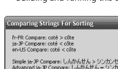

图 14-1 字符串排序结果。

除了 Compare 之外，CompareInfo 类还提供了 IndexOf、LastIndexOf、IsPrefix 和 IsSuffix 方法。由于所有这些方法都提供了接受 CompareOptions 枚举值作为参数的重载，因此它们比 String 类定义的 Compare、IndexOf、LastIndexOf、StartsWith 和 EndsWith 方法提供更多控制。此外，你应该注意到，FCL 中包含一个 System.StringComparer 类，你也可以使用它来执行字符串比较。当你希望对许多不同的字符串重复执行同一种比较时，这个类非常有用。

### 字符串驻留

正如我在前一节中所说，检查字符串是否相等是许多应用程序中的常见操作——此任务可能会显著损害性能。当执行序号相等性检查时，CLR 会快速测试两个字符串是否具有相同数量的字符。如果不同，则字符串肯定不相等；如果相同，则字符串可能相等，CLR 必须逐个比较每个字符来确定。当执行区域性感知的比较时，CLR 必须始终比较所有单个字符，因为不同长度的字符串也可能被视为相等。

此外，如果同一个字符串在内存中有多个重复的实例，那么你就在浪费内存，因为字符串是不可变的。如果内存中只有一个字符串实例，并且所有需要引用该字符串的变量都可以直接指向这一个字符串对象，那么内存的使用效率将大大提高。

如果你的应用程序经常使用区分大小写的序号比较来检查字符串是否相等，或者你预期会有许多具有相同值的字符串对象，那么利用 CLR 中的字符串驻留机制可以显著提高性能。当 CLR 初始化时，它会创建一个内部哈希表，其中的键是字符串，值是托管堆中 String 对象的引用。最初，该表是空的（当然）。String 类提供了两个方法，允许你访问这个内部哈希表。

```csharp
public static String Intern(String str);
public static String IsInterned(String str);
```

第一个方法 Intern 接受一个 String，获取其哈希码，并在内部哈希表中查找匹配项。如果已存在相同的字符串，则返回对已存在的 String 对象的引用。如果不存在相同的字符串，则会创建该字符串的副本，将这个副本添加到内部哈希表中，并返回对这个副本的引用。如果应用程序不再持有对原始 String 对象的引用，垃圾回收器就可以释放该字符串的内存。请注意，垃圾回收器无法释放内部哈希表所引用的字符串，因为哈希表持有对这些 String 对象的引用。在 AppDomain 被卸载或进程终止之前，内部哈希表所引用的 String 对象无法被释放。

与 Intern 方法一样，IsInterned 方法接受一个 String，并在内部哈希表中查找。如果哈希表中有匹配的字符串，IsInterned 返回驻留字符串对象的引用。然而，如果哈希表中没有匹配的字符串，IsInterned 返回 null；它不会将字符串添加到哈希表中。

默认情况下，加载程序集时，CLR 会驻留该程序集元数据中描述的所有字符串字面量。Microsoft 发现，由于额外的哈希表查找，这会显著损害性能，因此现在可以关闭此“功能”。如果程序集标记了 System.Runtime.CompilerServices.CompilationRelaxationsAttribute，并指定 System.Runtime.CompilerServices.CompilationRelaxations.NoStringInterning 标志值，那么根据 ECMA 规范，CLR 可以选择不驻留该程序集元数据中定义的所有字符串。请注意，为了提高应用程序的性能，C# 编译器在编译程序集时总是会指定此特性/标志。

即使程序集指定了此特性/标志，CLR 仍可能选择驻留这些字符串，但你不应依赖这一点。事实上，除非你自己编写代码显式调用 String 的 Intern 方法，否则你绝不应该编写依赖字符串被驻留的代码。


以下代码演示了字符串驻留。

```csharp
String s1 = "Hello";
String s2 = "Hello";
Console.WriteLine(Object.ReferenceEquals(s1, s2));   // Should be 'False'

s1 = String.Intern(s1);
s2 = String.Intern(s2);
Console.WriteLine(Object.ReferenceEquals(s1, s2));   // 'True'
```

在第一次调用 ReferenceEquals 方法时，s1 引用堆中的一个 "Hello" 字符串对象，而 s2 引用堆中另一个不同的 "Hello" 字符串对象。由于引用不同，应显示 False。然而，如果在 CLR 4.5 版上运行这段代码，你会看到显示的是 True。原因在于，此版本的 CLR 选择忽略 C# 编译器发出的属性/标志，并且当程序集加载到 AppDomain 时，CLR 会对字面字符串 "Hello" 进行驻留。这意味着 s1 和 s2 引用堆中同一个 "Hello" 字符串。但是，如前所述，绝不应编写依赖此行为的代码，因为未来版本的 CLR 可能遵循该属性/标志，而不驻留 "Hello" 字符串。实际上，当此程序集的代码使用 NGen.exe 实用工具编译时，CLR 4.5 版确实会遵循该属性/标志。

在第二次调用 ReferenceEquals 方法之前，"Hello" 字符串已被显式驻留，s1 现在引用一个已驻留的 "Hello"。然后再次调用 Intern，s2 被设置为引用与 s1 相同的 "Hello" 字符串。现在，第二次调用 ReferenceEquals 时，无论程序集是否使用该属性/标志编译，我们都能保证得到 True 的结果。

那么现在，我们来看一个示例，了解如何使用字符串驻留来提高性能并减少内存占用。下面的 NumTimesWordAppearsEquals 方法接受两个参数：一个单词和一个字符串数组，其中每个数组元素都引用一个单词。然后，该方法确定指定单词在 wordlist 中出现的次数，并返回此计数。

```csharp
private static Int32 NumTimesWordAppearsEquals(String word, String[] wordlist) {
    Int32 count = 0;
    for (Int32 wordnum = 0; wordnum < wordlist.Length; wordnum++) {
        if (word.Equals(wordlist[wordnum], StringComparison.Ordinal))
            count++;
    }
    return count;
}
```

如你所见，此方法调用 String 的 Equals 方法，该方法在内部比较字符串的各个字符，并检查以确保所有字符都匹配。这种比较可能很慢。此外，wordlist 数组可能有多个项引用多个包含相同字符集的 String 对象。这意味着堆中可能存在多个相同的字符串，并且它们在持续进行的垃圾回收中存活下来。

现在，我们来看此方法的一个为利用字符串驻留而编写的版本。

```csharp
private static Int32 NumTimesWordAppearsIntern(String word, String[] wordlist) {
    // This method assumes that all entries in wordlist refer to interned strings.
    word = String.Intern(word);
    Int32 count = 0;
    for (Int32 wordnum = 0; wordnum < wordlist.Length; wordnum++) {
        if (Object.ReferenceEquals(word, wordlist[wordnum]))
            count++;
    }
    return count;
}
```

此方法驻留该单词，并假定 wordlist 包含对已驻留字符串的引用。首先，如果某个单词在 wordlist 中出现多次，此版本可能会节省内存，因为在此版本中，wordlist 现在会包含对堆中同一个 String 对象的多个引用。其次，此版本会更快，因为确定指定单词是否在数组中只需比较指针。

尽管 NumTimesWordAppearsIntern 方法比 NumTimesWordAppearsEquals 方法更快，但使用 NumTimesWordAppearsIntern 方法时，应用程序的整体性能可能更慢，因为在将所有字符串添加到 wordlist 数组时需要对它们进行驻留，这会耗费时间（代码未显示）。如果应用程序需要使用同一个 wordlist 多次调用该方法，NumTimesWordAppearsIntern 方法才会真正展现出其在性能和内存方面的改进。本讨论的重点是明确：字符串驻留很有用，但应谨慎使用。事实上，这就是 C# 编译器表明不希望启用字符串驻留的原因。

#### 字符串池化

编译源代码时，编译器必须处理每个字面字符串，并将该字符串发出到托管模块的元数据中。如果同一个字面字符串在源代码中出现多次，将所有这类字符串都发出到元数据中会使生成的文件大小膨胀。

为消除这种膨胀，许多编译器（包括 C# 编译器）只将字面字符串写入模块元数据一次。所有引用该字符串的代码都将被修改为引用元数据中的那一个字符串。编译器将单个字符串的多次出现合并为一个实例的能力可以显著减小模块的大小。这个过程并不新鲜——C/C++ 编译器多年来一直在这样做。（Microsoft 的 C/C++ 编译器称之为字符串池化。）即便如此，字符串池化仍是提高字符串性能的另一种方式，也只是你应当掌握的知识储备中的又一项知识。

#### 检查字符串的字符和文本元素

尽管比较字符串对于排序或检测相等性很有用，但有时你只需要检查字符串中的字符。String 类型提供了多个属性和方法来帮助你完成此操作，包括 Length、Chars（C# 中的索引器）、GetEnumerator、ToCharArray、Contains、IndexOf、LastIndexOf、IndexOfAny 和 LastIndexOfAny。

实际上，System.Char 表示单个 16 位 Unicode 码值，它不一定等同于一个抽象 Unicode 字符。例如，某些抽象 Unicode 字符是两个码值的组合。组合在一起时，U+0625（下方带 Hamza 的阿拉伯字母 Alef）和 U+0650（阿拉伯字母 Kasra）字符会形成一个单一的抽象字符或文本元素。

此外，一些 Unicode 文本元素需要超过 16 位的值来表示。这些文本元素使用两个 16 位码值表示。第一个码值称为高代理项，第二个码值称为低代理项。高代理项的值介于 U+D800 和 U+DBFF 之间，低代理项的值介于 U+DC00 和 U+DFFF 之间。使用代理项使 Unicode 能够表达超过一百万个不同字符。

代理项在美国和欧洲很少使用，但在东亚更常用。要正确处理文本元素，应使用 System.Globalization.StringInfo 类型。使用此类型的最简单方法是构造它的实例，并向其构造函数传递一个字符串。然后，可以通过查询 StringInfo 的 LengthInTextElements 属性来查看字符串中有多少个文本元素。接着，可以调用 StringInfo 的 SubstringByTextElements 方法，以提取所需的文本元素或所需数量的连续文本元素。

此外，StringInfo 类提供了一个静态 GetTextElementEnumerator 方法，该方法获取一个 System.Globalization.TextElementEnumerator 对象，使你能够枚举字符串中包含的所有抽象 Unicode 字符。最后，可以调用 StringInfo 的静态 ParseCombiningCharacters 方法，以获取一个 Int32 值数组。数组的长度表示字符串中包含多少个文本元素。数组的每个元素标识字符串中的一个索引，在该索引处可以找到新文本元素的第一个码值。

以下代码演示了使用 StringInfo 类操作字符串文本元素的各种方式。

```csharp
    using System;
    using System.Text;
    using System.Globalization;
    using System.Windows.Forms;

    public sealed class Program {
        public static void Main() {
            // The string below contains combining characters
            String s = "a\u0304\u0308bc\u0327";
            SubstringByTextElements(s);
            EnumTextElements(s);
            EnumTextElementIndexes(s);
        }
    }
```

```csharp
private static void SubstringByTextElements(String s) {
    String output = String.Empty;

    StringInfo si = new StringInfo(s);
    for (Int32 element = 0; element < si.LengthInTextElements; element++) {
        output += String.Format(
            "Text element {0} is '{1}'{2}",
            element, si.SubstringByTextElements(element, 1),
            Environment.NewLine);
    }
    MessageBox.Show(output, "Result of SubstringByTextElements");
}

private static void EnumTextElements(String s) {
    String output = String.Empty;

    TextElementEnumerator charEnum =
        StringInfo.GetTextElementEnumerator(s);
    while (charEnum.MoveNext()) {
        output += String.Format(
            "Character at index {0} is '{1}'{2}",
            charEnum.ElementIndex, charEnum.GetTextElement(),
            Environment.NewLine);
    }
    MessageBox.Show(output, "Result of GetTextElementEnumerator");
}

private static void EnumTextElementIndexes(String s) {
    String output = String.Empty;

    Int32[] textElemIndex = StringInfo.ParseCombiningCharacters(s);
    for (Int32 i = 0; i < textElemIndex.Length; i++) {
        output += String.Format(
            "Character {0} starts at index {1}{2}",
            i, textElemIndex[i], Environment.NewLine);
    }
    MessageBox.Show(output, "Result of ParseCombiningCharacters");
}
```

生成并运行此代码会产生如图 14-2、图 14-3 和图 14-4 所示的消息框。

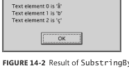

**图 14-2** SubstringByTextElements 的结果。

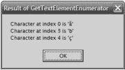

**图 14-3** GetTextElementEnumerator 的结果。

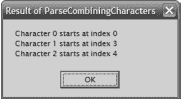

**图 14-4** ParseCombiningCharacters 的结果。

### 其他字符串操作

String 类型还提供了一些方法，允许你复制字符串或其一部分。表 14-1 总结了这些方法。

**表 14-1** 复制字符串的方法

| 成员 | 方法类型 | 描述 |
|---|---|---|
| Clone | 实例 | 返回对同一对象（`this`）的引用。这没有问题，因为 `String` 对象是不可变的。此方法实现 `String` 的 `ICloneable` 接口。 |
| Copy | 静态 | 返回指定字符串的新副本字符串。此方法很少使用，它的存在是为了帮助将字符串视为标记的应用程序。通常，具有相同字符集的字符串应被视为单个字符串。此方法创建一个新的字符串对象，以便即使字符串包含相同字符，其引用（指针）也不同。 |
| CopyTo | 实例 | 将字符串的一部分字符复制到字符数组。 |
| Substring | 实例 | 返回一个新字符串，表示原始字符串的一部分。 |
| ToString | 实例 | 返回对同一对象（`this`）的引用。 |

除这些方法外，String 还提供许多用于操作字符串的静态和实例方法，例如 Insert、Remove、PadLeft、Replace、Split、Join、ToLower、ToUpper、Trim、Concat、Format 等。同样，关于所有这些方法，需要记住的重要一点是：它们返回新的 String 对象，因为字符串是不可变的；创建后无法修改（使用安全代码）。

### 高效构造字符串

由于 String 类型表示不可变字符串，FCL 提供了另一种类型 System.Text.StringBuilder，它允许你高效地对字符串和字符执行动态操作，以创建 String。可以将 StringBuilder 看作一个精巧的构造函数，用于创建可供框架其余部分使用的 String。通常，应设计接受 String 参数而不是 StringBuilder 参数的方法。

从逻辑上讲，StringBuilder 对象包含一个字段，该字段引用一个 Char 结构数组。StringBuilder 的成员允许你操作此字符数组，从而有效地缩短字符串或更改字符串中的字符。如果使字符串增长超过已分配的字符数组，StringBuilder 会自动分配一个更大的新数组，复制字符，并开始使用新数组。先前的数组会被垃圾回收。

使用 StringBuilder 对象构造完字符串后，只需调用 StringBuilder 的 ToString 方法，即可将 StringBuilder 的字符数组“转换”为 String。这会在堆中创建一个新的 String 对象，其中包含调用 ToString 时 StringBuilder 中的字符串。此时，你可以继续操作 StringBuilder 内部的字符串，之后可以再次调用 ToString 将其转换为另一个 String 对象。

#### 构造 StringBuilder 对象

与 String 类不同，CLR 没有关于 StringBuilder 类的特殊信息。此外，大多数语言（包括 C#）不将 StringBuilder 类视为基元类型。构造 StringBuilder 对象的方式与构造任何其他非基元类型相同。

```csharp
StringBuilder sb = new StringBuilder();
```

StringBuilder 类型提供了许多构造函数。每个构造函数的作用是分配并初始化每个 StringBuilder 对象所维护的状态：

- **最大容量** 一个 Int32 值，指定可放入字符串中的最大字符数。默认值为 Int32.MaxValue（约 20 亿）。通常不会更改此值。但是，你可能会指定较小的最大容量，以确保永远不会创建超过特定长度的字符串。构造完成后，StringBuilder 的最大容量值无法更改。
- **容量** 一个 Int32 值，指示 StringBuilder 所维护的字符数组的大小。默认值为 16。如果你大致知道将向 StringBuilder 中放置多少个字符，则应在构造 StringBuilder 对象时使用该数字设置容量。将字符追加到字符数组时，StringBuilder 会检测该数组是否试图增长到超出数组的容量。如果是，StringBuilder 会自动将容量字段翻倍，分配一个新数组（大小为新的容量），并将原数组中的字符复制到新数组中。原数组将来会被垃圾回收。动态增长数组会损害性能；通过设置合适的初始容量来避免这种情况。
- **字符数组** 一个 Char 结构数组，用于维护“String”中的字符集。字符数始终小于或等于容量和最大容量值。可以使用 `StringBuilder` 的 `Length` 属性获取数组中已使用的字符数。`Length` 始终小于或等于 `StringBuilder` 的容量值。构造 `StringBuilder` 时，可以传入一个 `String` 来初始化字符数组。如果未指定字符串，则该数组最初不包含任何字符——也就是说，`Length` 属性返回 0。

#### StringBuilder 成员

与 `String` 不同，`StringBuilder` 表示可变字符串。这意味着 `StringBuilder` 的大多数成员会更改字符数组中的内容，而不会导致在托管堆上分配新对象。`StringBuilder` 仅在两种情况下分配新对象：

- 动态构建的字符串长度超过你设置的容量。
- 调用 `StringBuilder` 的 `ToString` 方法。

表 14-2 总结了 `StringBuilder` 的成员。

**表 14-2** StringBuilder 成员

| 成员 | 成员类型 | 描述 |
|---|---|---|
| MaxCapacity | 只读属性 | 返回可放入字符串中的最大字符数。 |
| Capacity | 读写属性 | 获取或设置字符数组的大小。尝试将容量设置为小于字符串长度或大于 `MaxCapacity` 会抛出 `ArgumentOutOfRangeException`。 |
| EnsureCapacity | 方法 | 保证字符数组至少为指定的大小。如果传入的值大于 `StringBuilder` 的当前容量，则当前容量会增加。如果当前容量已经大于传递给此方法的值，则不会发生任何更改。 |
| Length | 读写属性 | 获取或设置“字符串”中的字符数。这很可能小于字符数组的当前容量。将此属性设置为 0 会将 `StringBuilder` 的内容重置为空字符串。 |
| ToString | 方法 | 此方法的无参数版本返回一个 `String`，表示 `StringBuilder` 的字符数组。 |
| Chars | 读写索引器属性 | 获取或设置字符数组中指定索引处的字符。在 C# 中，这是一个索引器（带参数的属性），使用数组语法（[]）访问。 |
| Clear | 方法 | 清除 `StringBuilder` 对象的内容，等同于将其 `Length` 属性设置为 0。 |


| 成员 | 成员类型 | 描述 |
|---|---|---|
| Append | 方法 | 将单个对象追加到字符数组末尾；如有必要，会增大数组。该对象会使用常规格式以及与调用线程关联的区域性转换为字符串。 |
| Insert | 方法 | 将单个对象插入字符数组；如有必要，会增大数组。该对象会使用常规格式以及与调用线程关联的区域性转换为字符串。 |
| AppendFormat | 方法 | 将指定对象追加到字符数组末尾；如有必要，会增大数组。这些对象会使用调用方提供的格式和区域性信息转换为字符串。AppendFormat 是与 StringBuilder 对象一起使用的最常见方法之一。 |
| AppendLine | 方法 | 将空行或带空行的字符串追加到字符数组末尾；如有必要，会增大数组的容量。 |
| Replace | 方法 | 在字符数组内将一个字符替换为另一个字符，或将一个字符串替换为另一个字符串。 |
| Remove | 方法 | 从字符数组中移除一定范围的字符。 |
| Equals | 方法 | 仅当两个 StringBuilder 对象具有相同的最大容量、容量以及数组中的字符时，才返回 true。 |
| CopyTo | 方法 | 将 StringBuilder 字符的子集复制到 Char 数组。 |

关于 StringBuilder 的方法，需要注意的一点是：其中大多数方法都返回对同一个 StringBuilder 对象的引用。这允许使用便捷的语法将多个操作链接在一起。

```csharp
StringBuilder sb = new StringBuilder();
String s = sb.AppendFormat("{0} {1}", "Jeffrey", "Richter").
    Replace(' ', '-').Remove(4, 3).ToString();
Console.WriteLine(s);  // "Jeff-Richter"
```

你会注意到，String 和 StringBuilder 类并不具备完全的方法对等性；也就是说，String 具有 ToLower、ToUpper、EndsWith、PadLeft、PadRight、Trim 等方法。StringBuilder 类不提供其中任何方法。另一方面，StringBuilder 类提供更丰富的 Replace 方法，允许你替换字符串一部分（而非整个字符串）中的字符或字符串。遗憾的是，这两个类之间没有完全对等，因为现在你必须在这 String 和 StringBuilder 之间进行转换才能完成某些任务。例如，要构造一个字符串、将所有字符转换为大写，然后插入一个字符串，需要类似以下代码。

```csharp
// Construct a StringBuilder to perform string manipulations.
StringBuilder sb = new StringBuilder();

// Perform some string manipulations by using the StringBuilder.
sb.AppendFormat("{0} {1}", "Jeffrey", "Richter").Replace(" ", "-");

// Convert the StringBuilder to a String in
// order to uppercase all the characters.
String s = sb.ToString().ToUpper();

// Clear the StringBuilder (allocates a new Char array).
sb.Length = 0;

// Load the uppercase String into the StringBuilder,
// and perform some manipulations.
sb.Append(s).Insert(8, "Marc-");

// Convert the StringBuilder back to a String.
s = sb.ToString();

// Display the String to the user.
Console.WriteLine(s); // "JEFFREY-Marc-RICHTER"
```

仅仅因为 StringBuilder 不提供 String 所具有的所有操作，就必须编写这种代码，既不方便也不高效。我希望将来 Microsoft 会向 StringBuilder 添加更多字符串操作方法，使其成为更完整的类。

### 获取对象的字符串表示形式：ToString

你经常需要获取对象的字符串表示形式。通常，当你想要向用户显示数值类型（如 Byte、Int32 和 Single）或 DateTime 对象时，就需要这样做。由于 .NET Framework 是面向对象的平台，每种类型都负责提供将其实例的值转换为等效字符串的代码。在设计类型应如何完成此任务时，FCL 的设计者设计了一种将在整个框架中一致使用的模式。在本节中，我将描述这种模式。

你可以通过调用 ToString 方法获取任何对象的字符串表示形式。System.Object 定义了一个公共的、虚拟的、无参数的 ToString 方法，因此可以使用任何类型的实例调用它。从语义上讲，ToString 返回表示对象当前值的字符串，并且该字符串应针对调用线程的当前区域性进行格式化；也就是说，数字的字符串表示形式应使用正确的小数分隔符、数字分组符号以及与分配给调用线程的区域性关联的其他元素。

System.Object 对 ToString 的实现只是返回对象类型的全名。这个值并不是特别有用，但对于许多无法提供合理字符串的类型来说，它是一个合理的默认值。例如，FileStream 或 Hashtable 对象的字符串表示形式应该是什么样子？

所有希望提供合理方式来获取表示对象当前值的字符串的类型，都应重写 ToString 方法。FCL 中内置的许多核心类型（Byte、Int32、UInt64、Double 等）都重写了它们的 ToString 方法，并返回区域性感知字符串。在 Visual Studio 调试器中，当鼠标放在某个变量上时会显示数据类型。数据提示中显示的文本是通过调用对象的 ToString 方法获得的。因此，在定义类时，你应始终重写 ToString 方法，以便获得良好的调试支持。

#### 特定格式和区域性

无参数的 ToString 方法有两个问题。第一，调用方无法控制字符串的格式。例如，应用程序可能希望将数字格式化为货币字符串、十进制字符串、百分比字符串或十六进制字符串。第二，调用方无法轻松选择使用特定区域性来格式化字符串。对于服务器端应用程序代码来说，第二个问题比客户端代码更麻烦。在少数情况下，应用程序需要使用与调用线程关联的区域性以外的区域性来格式化字符串。为了更好地控制字符串格式，你需要一个允许指定精确格式和区域性信息的 ToString 方法版本。

为调用方提供格式和区域性选择的类型实现 System.IFormattable 接口。

```csharp
public interface IFormattable {
    String ToString(String format, IFormatProvider formatProvider);
}
```

在 FCL 中，所有基类型（Byte、SByte、Int16/UInt16、Int32/UInt32、Int64/UInt64、Single、Double、Decimal 和 DateTime）都实现此接口。此外，一些其他类型（如 Guid）也实现它。最后，每个枚举类型定义都会自动实现 IFormattable 接口，以便可以从枚举类型的实例中获取有意义的字符串符号。

IFormattable 的 ToString 方法接受两个参数。第一个参数 format 是一个字符串，用于告诉方法应如何格式化对象。ToString 的第二个参数 formatProvider 是实现 System.IFormatProvider 接口的类型的实例。此类型向 ToString 方法提供特定的区域性信息。稍后我将讨论如何实现。

实现 IFormattable 接口的 ToString 方法的类型决定它将识别哪些格式字符串。如果传入该类型不认识的格式字符串，该类型应引发 System.FormatException。

Microsoft 在 FCL 中定义的许多类型都识别多种格式。例如，DateTime 类型支持 "d" 表示短日期、"D" 表示长日期、"g" 表示常规、"M" 表示月/日、"s" 表示可排序、"t" 表示长时间、"u" 表示 ISO 8601 格式的通用时间、"U" 表示完整日期格式的通用时间、"Y" 表示年/月，以及其他格式。所有枚举类型都支持 "G" 表示常规、"F" 表示标志、"D" 表示十进制、"X" 表示十六进制。我将在第 15 章“枚举类型和位标志”中更详细地介绍枚举类型的格式化。

此外，所有内置数值类型都支持 "C" 表示货币、"D" 表示十进制、"E" 表示指数（科学）记数法、"F" 表示定点、"G" 表示常规、"N" 表示数字、"P" 表示百分比、"R" 表示往返、"X" 表示十六进制。事实上，数值类型还支持图片格式字符串，以防简单格式字符串无法完全满足你的需求。图片格式字符串包含特殊字符，这些字符确切告诉类型的 ToString 方法应使用多少位数字

说明小数点分隔符应精确放在哪里、小数点后应精确保留多少位，等等。有关格式字符串的完整信息，请参见 .NET Framework SDK 中的“格式设置类型”。

对于大多数类型，调用 ToString 并为格式字符串传递 null，与调用 ToString 并为格式字符串传递 "G" 完全相同。换句话说，对象默认使用“通用格式”格式化自身。实现某个类型时，请选择你认为最常用的格式；这种格式就是“通用格式”。顺便说一下，不接受参数的 ToString 方法假定调用方需要“通用格式”。

既然已经讲完格式字符串，现在我们来讨论区域性信息。默认情况下，字符串使用与调用线程关联的区域性信息进行格式化。无参数的 ToString 方法当然会这样做；如果你为 formatProvider 参数传递 null，IFormattable 的 ToString 方法也会这样做。

格式化数字（包括货币、整数、浮点数、百分比、日期和时间）时，会应用区分区域性的信息。Guid 类型有一个 ToString 方法，它只返回表示其值的字符串。生成 Guid 的字符串时无需考虑区域性，因为 GUID 仅用于编程目的。

格式化数字时，ToString 方法会查看你为 formatProvider 参数传递的内容。如果传递的是 null，ToString 会通过读取 System.Globalization.CultureInfo.CurrentCulture 属性来确定与调用线程关联的区域性。该属性返回 System.Globalization.CultureInfo 类型的实例。

使用该对象，ToString 会根据正在格式化的是数字还是日期/时间，读取其 NumberFormat 或 DateTimeFormat 属性。这两个属性分别返回 System.Globalization.NumberFormatInfo 或 System.Globalization.DateTimeFormatInfo 的实例。NumberFormatInfo 类型定义了一组属性，例如 CurrencyDecimalSeparator、CurrencySymbol、NegativeSign、NumberGroupSeparator 和 PercentSymbol。同样，DateTimeFormatInfo 类型定义了各种属性，例如 Calendar、DateSeparator、DayNames、LongDatePattern、ShortTimePattern 和 TimeSeparator。ToString 在构造和格式化字符串时会读取这些属性。

调用 IFormattable 的 ToString 方法时，可以不传递 null，而是传递一个引用，该引用指向类型实现了 IFormatProvider 接口的对象。

```csharp
public interface IFormatProvider {
    Object GetFormat(Type formatType);
}
```

IFormatProvider 接口背后的基本思想是：当某个类型实现此接口时，就表示该类型的实例能够提供特定于区域性的格式信息，并且应忽略与调用线程关联的区域性信息。

System.Globalization.CultureInfo 类型是 FCL 中定义的极少数实现 IFormatProvider 接口的类型之一。如果希望为某个区域（例如越南）格式化字符串，可以构造一个 CultureInfo 对象，并将该对象作为 ToString 的 formatProvider 参数传入。以下代码获取一个 Decimal 数值的字符串表示形式，该数值已格式化为适合越南的货币格式。

```csharp
Decimal price = 123.54M;
String s = price.ToString("C", new CultureInfo("vi-VN"));
MessageBox.Show(s);
```

如果生成并运行此代码，将出现图 14-5 所示的消息框。

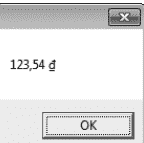

**图 14-5** 正确格式化为表示越南货币的数值。

在内部，Decimal 的 ToString 方法发现 formatProvider 参数不为 null，并如下调用该对象的 GetFormat 方法。

```csharp
NumberFormatInfo nfi = (NumberFormatInfo)
   formatProvider.GetFormat(typeof(NumberFormatInfo));
```

这就是 ToString 从 (CultureInfo) 对象请求相应数字格式信息的方式。数字类型（如 Decimal）只请求数字格式信息。但其他类型（如 DateTime）可能像下面这样调用 GetFormat。

```csharp
DateTimeFormatInfo dtfi = (DateTimeFormatInfo)
   formatProvider.GetFormat(typeof(DateTimeFormatInfo));
```

实际上，由于 GetFormat 的参数可以标识任何类型，该方法足够灵活，允许请求任何类型的格式信息。.NET Framework 中的类型调用 GetFormat 时只请求数字或日期/时间信息；将来可能会请求其他类型的格式信息。

顺便说一下，如果要获取未针对任何特定区域性格式化的对象的字符串，应调用 System.Globalization.CultureInfo 的静态 InvariantCulture 属性，并将返回的对象作为 ToString 的 formatProvider 参数传入。

```csharp
Decimal price = 123.54M;
String s = price.ToString("C", CultureInfo.InvariantCulture);
MessageBox.Show(s);
```

### 将多个对象格式化为单个字符串

到目前为止，我解释了单个类型如何格式化其自身的对象。然而，有时你希望构造由许多已格式化对象组成的字符串。例如，下面的字符串包含一个日期、一个人的姓名和一个年龄。

```csharp
String s = String.Format("On {0}, {1} is {2} years old.",
    new DateTime(2012, 4, 22, 14, 35, 5), "Aidan", 9);
Console.WriteLine(s);
```

如果在 "en-US" 为线程当前区域性的环境中生成并运行此代码，将看到以下输出行。

```text
On 4/22/2012 2:35:05 PM, Aidan is 9 years old.
```

String 的静态 `Format` 方法接受一个格式字符串，该字符串使用花括号中的数字标识可替换参数。此示例中使用的格式字符串告诉 `Format` 方法：将 `{0}` 替换为格式字符串之后的第一个参数（日期/时间），将 `{1}` 替换为格式字符串之后的第二个参数（"Aidan"），并将 `{2}` 替换为格式字符串之后的第三个参数（9）。

在内部，`Format` 方法调用每个对象的 `ToString` 方法以获取该对象的字符串表示形式。然后，所有返回的字符串都会被追加，最终返回完整的字符串。这固然很好，但这意味着所有对象都使用其通用格式和调用线程的区域性信息进行格式化。

如果在花括号内指定格式信息，格式化对象时就可以拥有更多控制权。例如，以下代码与上一个示例相同，只是我为可替换参数 0 和 2 添加了格式信息。

```csharp
String s = String.Format("On {0:D}, {1} is {2:E} years old.",
    new DateTime(2012, 4, 22, 14, 35, 5), "Aidan", 9);
Console.WriteLine(s);
```

如果在 "en-US" 为线程当前区域性的环境中生成并运行此代码，将看到以下输出行。

```text
On Sunday, April 22, 2012, Aidan is 9.000000E+000 years old.
```

当 `Format` 方法分析格式字符串时，它会发现可替换参数 0 应调用其 `IFormattable` 接口的 `ToString` 方法，并为其两个参数传递 "D" 和 `null`。同样，`Format` 调用可替换参数 2 的 `IFormattable.ToString` 方法，并传递 "E" 和 `null`。如果该类型未实现 `IFormattable` 接口，`Format` 会调用其从 `Object` 继承（并可能被重写）的无参数 `ToString` 方法，并将默认格式追加到结果字符串中。

`String` 类提供了静态 `Format` 方法的多个重载。其中一个版本接受一个实现 `IFormatProvider` 接口的对象，以便你可以使用调用方指定的区域性信息格式化所有可替换参数。显然，`Format` 会调用每个对象的 `IFormattable.ToString` 方法，并将传递给 `Format` 的 `IFormatProvider` 对象传给它。


如果你使用 StringBuilder 而不是 String 来构造字符串，可以调用 StringBuilder 的 AppendFormat 方法。此方法的工作方式与 String 的 Format 方法完全相同，只不过它会格式化字符串并追加到 StringBuilder 的字符数组中。与 String 的 Format 一样，AppendFormat 接受一个格式字符串，并且还有一个接受 IFormatProvider 的版本。

System.Console 提供了 Write 和 WriteLine 方法，它们也接受格式字符串和可替换参数。但是，Console 的 Write 和 WriteLine 方法没有允许传入 IFormatProvider 的重载。如果希望为特定区域性格式化字符串，必须调用 String 的 Format 方法，先传入所需的 IFormatProvider 对象，再将结果字符串传给 Console 的 Write 或 WriteLine 方法。这应该不是什么大问题，因为正如我之前所说，客户端代码很少使用与调用线程关联的区域性之外的其他区域性来格式化字符串。

### 提供自己的自定义格式化器

到目前为止，应该已经清楚，.NET Framework 中的格式化能力旨在为你提供极大的灵活性和控制力。不过，我们还没有完全讲完。你可以定义一个方法，每当任何对象被格式化为字符串时，StringBuilder 的 AppendFormat 方法都会调用它。换句话说，AppendFormat 可以针对每个对象不调用 ToString，而是调用你定义的函数，从而允许你以任意方式格式化任何或所有对象。我接下来描述的内容也适用于 String 的 Format 方法。

让我通过一个示例来解释这个机制。假设你正在格式化用户将在 Internet 浏览器中查看的 HTML 文本。你希望所有 Int32 值都以粗体显示。为此，每当 Int32 值被格式化为 String 时，你希望用 HTML 粗体标记 <B> 和 </B> 包围该字符串。以下代码演示了这样做有多么简单。

```csharp
using System;
using System.Text;
using System.Threading;

public static class Program {
    public static void Main() {
        StringBuilder sb = new StringBuilder();
        sb.AppendFormat(new BoldInt32s(), "{0} {1} {2:M}", "Jeff", 123, DateTime.Now);
        Console.WriteLine(sb);
    }
}

internal sealed class BoldInt32s : IFormatProvider, ICustomFormatter {
    public Object GetFormat(Type formatType) {
        if (formatType == typeof(ICustomFormatter)) return this;
        return Thread.CurrentThread.CurrentCulture.GetFormat(formatType);
    }

    public String Format(String format, Object arg, IFormatProvider formatProvider) {
        String s;

        IFormattable formattable = arg as IFormattable;
        if (formattable == null) s = arg.ToString();
        else s = formattable.ToString(format, formatProvider);

        if (arg.GetType() == typeof(Int32))
            return "<B>" + s + "</B>";
        return s;
    }
}
```

当你在“en-US”为线程当前区域性的环境中编译并运行这段代码时，它会显示以下输出（当然，你的日期可能不同）。

Jeff <B>123</B> September 1

在 Main 中，我构造一个空的 StringBuilder，然后向其中追加一个格式化字符串。当我调用 AppendFormat 时，第一个参数是 BoldInt32 类的实例。这个类实现了前面讨论过的 IFormatProvider 接口。此外，这个类还实现了 ICustomFormatter 接口。

```csharp
public interface ICustomFormatter {
    String Format(String format, Object arg,
        IFormatProvider formatProvider);
}
```

每当 StringBuilder 的 AppendFormat 需要获取某个对象的字符串时，就会调用该接口的 Format 方法。你可以在这个方法内做一些相当巧妙的事情，从而对字符串格式化获得极大的控制力。让我们深入 AppendFormat 方法内部，看看它到底如何工作。以下伪代码展示了 AppendFormat 的工作方式。

```csharp
public StringBuilder AppendFormat(IFormatProvider formatProvider,
    String format, params Object[] args) {

    // If an IFormatProvider was passed, find out
    // whether it offers an ICustomFormatter object.
    ICustomFormatter cf = null;

    if (formatProvider != null)
        cf = (ICustomFormatter)
            formatProvider.GetFormat(typeof(ICustomFormatter));

    // Keep appending literal characters (not shown in this pseudocode)
    // and replace parameters to the StringBuilder's character array.
    Boolean MoreReplaceableArgumentsToAppend = true;
    while (MoreReplaceableArgumentsToAppend) {
        // argFormat refers to the replaceable format string obtained
        // from the format parameter.
        String argFormat = /* ... */;

        // argObj refers to the corresponding element
        // from the args array parameter
        Object argObj = /* ... */;

        // argStr will refer to the formatted string to be appended
        // to the final, resulting string.
        String argStr = null;

        // If a custom formatter is available, let it format the argument.
        if (cf != null)
            argStr = cf.Format(argFormat, argObj, formatProvider);

        // If there is no custom formatter or if it didn't format
        // the argument, try something else.
        if (argStr == null) {
            // Does the argument's type support rich formatting?
            IFormattable formattable = argObj as IFormattable;
            if (formattable != null) {
                // Yes; pass the format string and provider to
                // the type's IFormattable ToString method.
                argStr = formattable.ToString(argFormat, formatProvider);
            } else {
                // No; get the default format by using
                // the thread's culture information.
                if (argObj != null) argStr = argObj.ToString();
                else argStr = String.Empty;
            }
        }

        // Append argStr's characters to the character array field member.
        /* ... */

        // Check if any remaining parameters to format
        MoreReplaceableArgumentsToAppend = /* ... */;

    return this;
}
```

当 `Main` 调用 `AppendFormat` 时，`AppendFormat` 会调用我的格式提供程序的 `GetFormat` 方法，并向它传递 `ICustomFormatter` 类型。我的 `BoldInt32s` 类型中定义的 `GetFormat` 方法看到请求的是 `ICustomFormatter`，就返回对自身的引用，因为它实现了该接口。如果我的 `GetFormat` 方法被调用并传入了任何其他类型，我会调用与调用线程关联的 `CultureInfo` 对象的 `GetFormat` 方法。

每当 `AppendFormat` 需要格式化可替换参数时，它都会调用 `ICustomFormatter` 的 `Format` 方法。在我的示例中，`AppendFormat` 调用的是我的 `BoldInt32s` 类型定义的 `Format` 方法。在我的 `Format` 方法中，我会检查正在格式化的对象是否通过 `IFormattable` 接口支持丰富格式化。如果对象不支持，我就调用简单的、无参数的 `ToString` 方法（继承自 `Object`）来格式化该对象。如果对象确实支持 `IFormattable`，我就调用丰富的 `ToString` 方法，并向它传递格式字符串和格式提供程序。

现在我已经有了格式化后的字符串，我会检查对应的对象是否为 `Int32` 类型；如果是，我就用 `<B>` 和 `</B>` HTML 标记包装该格式化字符串，并返回新字符串。如果对象不是 `Int32`，我就直接返回格式化后的字符串，不再做任何进一步处理。

### 将字符串解析为对象：Parse

上一节中，我解释了如何获取一个对象并得到该对象的字符串表示形式。本节将讨论相反的过程：如何获取一个字符串并得到它的对象表示形式。从字符串获取对象并不是很常见的操作，但偶尔会很有用。Microsoft 认为有必要将一种机制正式化，通过该机制可以把字符串解析为对象。

任何能够解析字符串的类型都提供一个名为 Parse 的公共静态方法。该方法接受一个 String 并返回该类型的实例；从某种意义上说，Parse 充当工厂。在 FCL 中，所有数值类型以及 DateTime、TimeSpan 和少数其他类型（例如 SQL 数据类型）都提供 Parse 方法。

让我们看看如何将字符串解析为数值类型。几乎所有数值类型（Byte、SByte、Int16/UInt16、Int32/UInt32、Int64/UInt64、Single、Double、Decimal 和 BigInteger）都至少提供一个 Parse 方法。这里我只展示 Int32 类型定义的 Parse 方法。（其他数值类型的 Parse 方法与 Int32 的 Parse 方法类似。）

```
public static Int32 Parse(String s, NumberStyles style,
    IFormatProvider provider);
```

仅看这个原型，你应该就能猜到该方法具体如何工作。String 参数 s 标识你想解析为 Int32 对象的数字的字符串表示形式。System.Globalization.NumberStyles 参数 style 是一组位标志，用于标识 Parse 应期望在字符串中找到的字符。而 IFormatProvider 参数 provider 标识一个对象，Parse 方法可以使用该对象获取区域性特定的信息，正如本章前面所讨论的那样。

例如，以下代码会使 Parse 抛出 System.FormatException，因为被解析的字符串包含前导空格。

```
Int32 x = Int32.Parse(" 123", NumberStyles.None, null);
```

若要允许 Parse 跳过前导空格，请按如下方式更改 style 参数。

```
Int32 x = Int32.Parse(" 123", NumberStyles.AllowLeadingWhite, null);
```

有关 NumberStyles 枚举类型定义的位符号和常见组合的完整说明，请参阅 .NET Framework SDK 文档。

以下代码片段展示了如何解析十六进制数。

```
Int32 x = Int32.Parse("1A", NumberStyles.HexNumber, null);
Console.WriteLine(x);  // Displays "26"
```


这个 Parse 方法接受三个参数。为了方便，许多类型都提供了 Parse 的其他重载，这样就不必传入那么多参数。例如，Int32 提供了四个 Parse 方法的重载。

```csharp
// Passes NumberStyles.Integer for style
// and thread's culture's provider information.
public static Int32 Parse(String s);

// Passes thread's culture's provider information.
public static Int32 Parse(String s, NumberStyles style);

// Passes NumberStyles.Integer for the style parameter.
public static Int32 Parse(String s, IFormatProvider provider);

// This is the method I've been talking about in this section.
public static Int32 Parse(String s, NumberStyles style,
    IFormatProvider provider);
```

DateTime 类型也提供了一个 Parse 方法。

```csharp
public static DateTime Parse(String s,
    IFormatProvider provider, DateTimeStyles styles);
```

这个方法的工作方式与数字类型上定义的 Parse 方法相同，区别在于 DateTime 的 Parse 方法接受由 System.Globalization.DateTimeStyles 枚举类型定义的一组位标志，而不是 NumberStyles 枚举类型。有关这些位标志以及 DateTimeStyles 类型定义的常用组合的完整说明，请参阅 .NET Framework SDK 文档。

为了方便，DateTime 类型提供了三个 Parse 方法的重载。

```csharp
// Passes thread's culture's provider information
// and DateTimeStyles.None for the style
public static DateTime Parse(String s);

// Passes DateTimeStyles.None for the style
public static DateTime Parse(String s, IFormatProvider provider);

// This is the method I've been talking about in this section.
public static DateTime Parse(String s,
    IFormatProvider provider, DateTimeStyles styles);
```

解析日期和时间很复杂。许多开发者发现 DateTime 类型的 Parse 方法过于宽松，因为它有时会解析不包含日期或时间的字符串。因此，DateTime 类型还提供了一个 ParseExact 方法，该方法接受一个图片格式字符串，用于准确指示日期/时间字符串应采用的格式以及应如何解析它。有关图片格式字符串的更多信息，请参阅 .NET Framework SDK 中的 DateTimeFormatInfo 类。

> **注意** 一些开发者向 Microsoft 报告了以下情况：当他们的应用程序频繁调用 Parse，并且 Parse 反复抛出异常（由于无效的用户输入）时，应用程序的性能会受到影响。针对这些对性能敏感的 Parse 用法，Microsoft 为所有数值数据类型、DateTime、DateTimeOffset、TimeSpan 甚至 IPAddress 添加了 TryParse 方法。下面是 Int32 的两个 TryParse 方法重载之一的样子。
>
> ```csharp
> public static Boolean TryParse(String s, NumberStyles style,
>     IFormatProvider provider, out Int32 result);
> ```
>
> 如你所见，此方法返回 true 或 false，指示指定的字符串能否被解析为 Int32。如果该方法返回 true，则通过引用传递给 result 参数的变量将包含解析后的数值。TryXxx 模式将在第 20 章“异常与状态管理”中讨论。

### 编码：在字符和字节之间转换

在 Win32 中，程序员常常不得不编写代码，将 Unicode 字符和字符串转换为多字节字符集（MBCS）字符和字符串。我确实编写过不少这类代码，编写起来非常繁琐，使用起来也容易出错。在 CLR 中，所有字符都表示为 16 位 Unicode 代码值，所有字符串都由 16 位 Unicode 代码值组成。这使得在运行时处理字符和字符串变得容易。

然而，有时你可能希望将字符串保存到文件或通过网络传输。如果字符串主要由英语使用者可读的字符组成，那么保存或传输一组 16 位值的效率并不高，因为写入的字节中有一半会包含零。相反，更高效的做法是将这些 16 位值编码为压缩的字节数组，然后再将字节数组解码回 16 位值数组。

编码还允许托管应用程序与非 Unicode 系统创建的字符串进行交互。例如，如果你希望生成一个可由运行日文版 Windows 95 的应用程序读取的文件，就必须使用 Shift-JIS（代码页 932）编码来保存 Unicode 文本。同样，你会使用 Shift-JIS 编码将日文 Windows 95 系统上生成的文本文件读入 CLR。

当你希望使用 System.IO.BinaryWriter 或 System.IO.StreamWriter 类型将字符串发送到文件或网络流时，通常需要进行编码。当你希望使用 System.IO.BinaryReader 或 System.IO.StreamReader 类型从文件或网络流读取字符串时，通常需要进行解码。如果你没有显式选择编码，所有这些类型都默认使用 UTF-8。（UTF 代表 Unicode Transformation Format。）然而，有时你可能希望显式编码或解码字符串。即使你不想显式这样做，本节也会让你更深入地了解如何从流中读取字符串以及向流中写入字符串。

幸运的是，FCL 提供了一些类型，使字符编码和解码变得容易。最常用的两种编码是 UTF-16 和 UTF-8：

- UTF-16 将每个 16 位字符编码为 2 个字节。它完全不影响字符，也不会发生压缩——其性能极佳。UTF-16 编码也称为 Unicode 编码。另请注意，UTF-16 可用于从小端序转换为大端序，反之亦然。

- UTF-8 将某些字符编码为 1 个字节，某些字符编码为 2 个字节，某些字符编码为 3 个字节，还有一些字符编码为 4 个字节。值低于 0x0080 的字符被压缩为 1 个字节，这对于美国使用的字符非常有效。介于 0x0080 和 0x07FF 之间的字符被转换为 2 个字节，这对于欧洲和中东语言非常有效。值为 0x0800 及以上的字符被转换为 3 个字节，这对于东亚语言非常有效。最后，代理项对会写出为 4 个字节。UTF-8 是一种极其流行的编码，但如果你要编码大量值为 0x0800 或以上的字符，它的效率不如 UTF-16。

尽管 UTF-16 和 UTF-8 编码是迄今为止最常见的，但 FCL 还支持一些使用频率较低的编码：

- UTF-32 将所有字符编码为 4 个字节。当你想要编写一个简单的算法来遍历字符，并且不希望处理字符占用可变字节数时，这种编码很有用。例如，使用 UTF-32 时，你无需考虑代理项，因为每个字符都是 4 个字节。显然，就内存使用而言，UTF-32 不是一种高效的编码，因此很少用于将字符串保存到文件或网络或进行传输。这种编码通常在程序内部使用。另请注意，UTF-32 可用于从小端序转换为大端序，反之亦然。

- UTF-7 编码通常用于处理可用 7 位值表示的字符的较旧系统。你应避免使用这种编码，因为它通常最终会扩展数据而不是压缩数据。Unicode Consortium 已弃用此编码。

- ASCII 将 16 位字符编码为 ASCII 字符；也就是说，任何值小于 0x0080 的 16 位字符都被转换为单个字节。任何值大于 0x007F 的字符都无法转换，因此该字符的值会丢失。对于由 ASCII 范围内的字符（0x00 到 0x7F）组成的字符串，这种编码会将数据压缩一半，并且速度非常快（因为高字节被直接截断）。如果你有超出 ASCII 范围的字符，这种编码就不合适，因为这些字符的值会丢失。

最后，FCL 还允许你将 16 位字符编码到任意代码页。与 ASCII 编码一样，编码到代码页是有风险的，因为任何无法在指定代码页中表示的字符都会丢失。除非你必须处理已经使用其他编码之一的某些旧文件或应用程序，否则应始终使用 UTF-16 或 UTF-8 编码。


当需要编码或解码一组字符时，应获取一个派生自 System.Text.Encoding 的类的实例。Encoding 是一个抽象基类，提供若干静态只读属性，每个属性都返回一个 Encoding 派生类的实例。

下面是一个使用 UTF-8 编码和解码字符的示例。

```csharp
using System;
using System.Text;

public static class Program {
    public static void Main() {
        // This is the string we're going to encode.
        String s = "Hi there.";

        // Obtain an Encoding-derived object that knows how
        // to encode/decode using UTF8.
        Encoding encodingUTF8 = Encoding.UTF8;

        // Encode a string into an array of bytes.
        Byte[] encodedBytes = encodingUTF8.GetBytes(s);

        // Show the encoded byte values.
        Console.WriteLine("Encoded bytes: " +
            BitConverter.ToString(encodedBytes));

        // Decode the byte array back to a string.
        String decodedString = encodingUTF8.GetString(encodedBytes);

        // Show the decoded string.
        Console.WriteLine("Decoded string: " + decodedString);
    }
}
```

此代码产生以下输出。

```text
Encoded bytes: 48-69-20-74-68-65-72-65-2E
Decoded string: Hi there.
```

除了 UTF8 静态属性外，Encoding 类还提供以下静态属性：Unicode、BigEndianUnicode、UTF32、UTF7、ASCII 和 Default。Default 属性返回一个对象，该对象能够使用用户代码页进行编码/解码，该代码页由控制面板中“区域/管理”对话框的“非 Unicode 程序的语言”选项指定。（有关更多信息，请参见 GetACP Win32 函数。）但是，不建议使用 Default 属性，因为应用程序的行为将取决于计算机设置，所以如果你更改系统的默认代码页，或者应用程序在另一台计算机上运行，应用程序的行为会有所不同。

除了这些属性外，Encoding 还提供一个静态 GetEncoding 方法，允许你指定代码页（通过整数或字符串），并返回一个可使用指定代码页进行编码/解码的对象。例如，你可以调用 GetEncoding，并传入 "Shift-JIS" 或 932。

```text
Unicode (Big-Endian)
    CodePage=1201, WindowsCodePage=1200
    WebName=unicodeFFFE, HeaderName=unicodeFFFE, BodyName=unicodeFFFE
    IsBrowserDisplay=False, IsBrowserSave=False
    IsMailNewsDisplay=False, IsMailNewsSave=False

Western European (DOS)
    CodePage=850, WindowsCodePage=1252
    WebName=ibm850, HeaderName=ibm850, BodyName=ibm850
    IsBrowserDisplay=False, IsBrowserSave=False
    IsMailNewsDisplay=False, IsMailNewsSave=False

Unicode (UTF-8)
    CodePage=65001, WindowsCodePage=1200
    WebName=utf-8, HeaderName=utf-8, BodyName=utf-8
    IsBrowserDisplay=True, IsBrowserSave=True
    IsMailNewsDisplay=True, IsMailNewsSave=True
```

表 14-3 介绍了所有 Encoding 派生类提供的最常用方法。

**表 14-3 Encoding 派生类的方法**

| 方法 | 说明 |
|---|---|
| GetPreamble | 返回一个字节数组，指示在写入任何已编码字节之前应写入流的内容。通常，这些字节称为 BOM 字节。当你开始从流中读取时，BOM 字节会自动帮助检测写入该流时使用的编码，以便可以使用正确的解码器。例如，在 .NET Framework 中，如果调用一个不是 UnicodeEncoding 对象的对象的 GetPreamble 方法，则不会返回任何前导码字节。可以显式构造 UTF8Encoding 对象，使该方法返回由 0xEF、0xBB、0xBF 组成的 3 字节数组。可以显式构造 UnicodeEncoding 对象，使该方法在大端编码时返回由 0xFE、0xFF 组成的 2 字节数组，或者在小端编码时返回由 0xFF、0xFE 组成的 2 字节数组。默认是小端。 |
| Convert | 将由源编码指定的字节数组转换为由目标编码指定的字节数组。在内部，此静态方法调用源编码对象的 GetChars 方法，并将结果传递给目标编码对象的 GetBytes 方法。结果字节数组返回给调用方。 |
| Equals | 如果两个 Encoding 派生对象表示相同的代码页和前导码设置，则返回 true。 |
| GetHashCode | 返回编码对象的代码页。 |

### 编码和解码字符流与字节流

设想你正在通过一个 System.Net.Sockets.NetworkStream 对象读取 UTF-16 编码的字符串。这些字节很可能会以数据块的形式流入。换句话说，你可能先从流中读取 5 个字节，然后读取 7 个字节。在 UTF-16 中，每个字符由 2 个字节组成。因此，调用 Encoding 的 GetString 方法并传入前 5 个字节的数组，将返回一个仅由两个字符组成的字符串。如果你之后调用 GetString，并传入从流中到达的下 7 个字节，GetString 将返回一个由三个字符组成的字符串，而且所有码点的值都会出错！出现这种数据损坏问题，是因为 Encoding 派生类都不会在其方法调用之间维护任何状态。如果你要以块为单位编码或解码字符/字节，就必须做一些额外工作来在调用之间维护状态，防止任何数据丢失。

要解码字节块，应获取一个 Encoding 派生对象的引用（如上一节所述），并调用其 GetDecoder 方法。此方法返回一个对新构造对象的引用，该对象的类型派生自 System.Text.Decoder 类。与 Encoding 类一样，Decoder 类也是一个抽象基类。如果你查看 .NET Framework SDK 文档，不会找到任何表示 Decoder 类具体实现的类。不过，FCL 确实定义了一些 Decoder 派生类。这些类都是 FCL 内部的，但 GetDecoder 方法可以构造这些类的实例并将它们返回给应用程序代码。

所有 Decoder 派生类都提供两个重要方法：GetChars 和 GetCharCount。显然，这些方法用于解码字节数组，其工作方式与前面讨论的 Encoding 的 GetChars 和 GetCharCount 方法类似。当你调用其中一个方法时，它会尽可能多地解码字节数组。如果字节数组没有包含足够多的字节来构成一个完整字符，剩余字节会保存在解码器对象内部。下次调用其中一个方法时，解码器对象会使用剩余字节加上传入它的新字节数组——这可确保数据块被正确解码。从流中读取字节时，Decoder 对象非常有用。

Encoding 派生类型可用于无状态编码和解码。但是，Decoder 派生类型只能用于解码。如果要按块编码字符串，请调用 GetEncoder，而不是调用 Encoding 对象的 GetDecoder 方法。GetEncoder 返回一个新构造的对象，其类型派生自抽象基类 System.Text.Encoder。同样，.NET Framework SDK 文档不包含任何表示 Encoder 类具体实现的类。不过，FCL 确实定义了一些 Encoder 派生类。与 Decoder 派生类一样，这些类都是 FCL 内部的，但 GetEncoder 方法可以构造这些类的实例并将它们返回给应用程序代码。

所有 Encoder 派生类都提供两个重要方法：GetBytes 和 GetByteCount。每次调用时，Encoder 派生对象都会维护任何剩余状态信息，以便你可以按块编码数据。

### Base-64 字符串编码和解码

截至撰写本文时，UTF-16 和 UTF-8 编码非常流行。将字节序列编码为 base-64 字符串也很流行。FCL 确实提供了进行 base-64 编码和解码的方法，你可能期望这会通过 Encoding 派生类型来完成。然而，出于某种原因，base-64 编码和解码是使用 System.Convert 类型提供的一些静态方法来完成的。

要将 base-64 字符串编码为字节数组，请调用 Convert 的静态 FromBase64String 或 FromBase64CharArray 方法。同样，要将字节数组解码为 base-64 字符串，请调用

Convert 的静态 ToBase64String 或 ToBase64CharArray 方法。以下代码演示了如何使用其中一些方法。

```csharp
using System;

public static class Program
{
    public static void Main()
    {
        // Get a set of 10 randomly generated bytes
        Byte[] bytes = new Byte[10];
        new Random().NextBytes(bytes);

        // Display the bytes
        Console.WriteLine(BitConverter.ToString(bytes));

        // Decode the bytes into a base-64 string and show the string
        String s = Convert.ToBase64String(bytes);
        Console.WriteLine(s);

        // Encode the base-64 string back to bytes and show the bytes
        bytes = Convert.FromBase64String(s);
        Console.WriteLine(BitConverter.ToString(bytes));
    }
}
```

编译此代码并运行可执行文件将生成以下输出（由于字节是随机生成的，你的输出可能与我的不同）。

```
3B-B9-27-40-59-35-86-54-5F-F1
O7knQFk1hlRf8Q==
3B-B9-27-40-59-35-86-54-5F-F1
```

### 安全字符串

通常，String 对象用于包含敏感数据，例如用户密码或信用卡信息。遗憾的是，String 对象在内存中包含一个字符数组，如果允许某些不安全或非托管代码执行，则不安全/非托管代码可能会窥探进程的地址空间，定位包含敏感信息的字符串，并以未经授权的方式使用这些数据。即使 String 对象仅使用很短时间然后被垃圾回收，CLR 也可能不会立即重用该 String 对象的内存（尤其是当该 String 对象位于较老的一代时），从而将 String 的字符留在进程内存中，信息可能因此泄露。此外，由于字符串是不可变的，当你操作它们时，旧副本会滞留在内存中，最终内存中到处散落着字符串的不同版本。

一些政府部门有严格的安全要求，需要非常具体的安全保证。为满足这些要求，Microsoft 向 FCL 添加了一个更安全的字符串类：System.Security.SecureString。构造 SecureString 对象时，它会在内部分配一块包含字符数组的非托管内存。使用非托管内存是为了让垃圾回收器不会察觉它。字符串的字符会被加密，从而保护敏感信息免受任何恶意的非安全/非托管代码侵害。可以使用以下任一方法在安全字符串中追加、插入、删除或设置字符：AppendChar、InsertAt、RemoveAt 和 SetAt。每当你调用这些方法中的任何一个时，该方法都会在内部解密字符，就地执行操作，然后重新加密字符。这意味着字符在非常短的时间内处于未加密状态。这也意味着每个操作的性能并不出色，因此应尽可能少执行这些操作。

SecureString 类实现 IDisposable 接口，提供一种简单方式来确定性地销毁字符串中受保护的内容。当应用程序不再需要敏感的字符串信息时，只需调用 SecureString 的 Dispose 方法，或在 using 构造中使用 SecureString 实例。在内部，Dispose 会将内存缓冲区的内容清零，以确保恶意代码无法访问敏感信息，然后释放缓冲区。在内部，SecureString 对象有一个字段指向派生自 SafeBuffer 的对象，该对象维护实际字符串。由于 SafeBuffer 类最终派生自 CriticalFinalizerObject（在第 21 章“托管堆与垃圾回收”中讨论），因此可以保证字符串的字符在终结时被清零，并且其缓冲区被释放。与 String 对象不同，当 SecureString 对象被终结时，加密字符串的字符将不再存在于内存中。

既然你已经知道如何创建和修改 SecureString 对象，接下来讨论如何使用它。遗憾的是，最新的 FCL 对 SecureString 类的支持有限。换句话说，只有少数方法接受 SecureString 参数。在 .NET Framework 4 中，可以在以下情况下将 SecureString 作为密码传递：

-   使用加密服务提供程序 (CSP) 时。请参见 System.Security.Cryptography.CspParameters 类。
-   创建、导入或导出 X.509 证书时。请参见 System.Security.Cryptography.X509Certificates.X509Certificate 和 System.Security.Cryptography.X509Certificates.X509Certificate2 类。
-   在特定用户帐户下启动新进程时。请参见 System.Diagnostics.Process 和 System.Diagnostics.ProcessStartInfo 类。
-   构造事件日志会话时。请参见 System.Diagnostics.Eventing.Reader.EventLogSession 类。
-   使用 System.Windows.Controls.PasswordBox 控件时。请参见此类的 SecurePassword 属性。

最后，你可以创建自己的方法，使其接受 SecureString 对象参数。在方法内部，必须先让 SecureString 对象创建一个包含解密字符的非托管内存缓冲区，然后方法才能使用该缓冲区。为了尽可能缩小恶意代码访问敏感数据的机会窗口，代码应尽可能缩短访问解密字符串的时间。使用完字符串后，代码应尽快将缓冲区清零并释放它。另外，绝不要将 SecureString 的内容放入 String：如果这样做，该 String 会以未加密形式存在于堆中，并且直到垃圾回收后内存被重用之前，其字符都不会被清零。SecureString 类特意不重写 ToString 方法，以避免暴露敏感数据（将其转换为 String 就会暴露）。

以下示例代码演示如何初始化并使用 SecureString（编译此代码时，需要为 C# 编译器指定 /unsafe 开关）。

```csharp
using System;
using System.Security;
using System.Runtime.InteropServices;

public static class Program {
    public static void Main() {
        using (SecureString ss = new SecureString()) {
            Console.Write("Please enter password: ");
            while (true) {
                ConsoleKeyInfo cki = Console.ReadKey(true);
                if (cki.Key == ConsoleKey.Enter) break;

                // Append password characters into the SecureString
                ss.AppendChar(cki.KeyChar);
                Console.Write("*");
            }
            Console.WriteLine();

            // Password entered, display it for demonstration purposes
            DisplaySecureString(ss);
        }
        // After 'using', the SecureString is Disposed; no sensitive data in memory
    }

    // This method is unsafe because it accesses unmanaged memory
    private unsafe static void DisplaySecureString(SecureString ss) {
        Char* pc = null;
        try {
            // Decrypt the SecureString into an unmanaged memory buffer
            pc = (Char*) Marshal.SecureStringToCoTaskMemUnicode(ss);

            // Access the unmanaged memory buffer that
            // contains the decrypted SecureString
            for (Int32 index = 0; pc[index] != 0; index++)
                Console.Write(pc[index]);
        }
        finally {
            // Make sure we zero and free the unmanaged memory buffer that contains
            // the decrypted SecureString characters
            if (pc != null)
                Marshal.ZeroFreeCoTaskMemUnicode((IntPtr) pc);
        }
    }
}
```

System.Runtime.InteropServices.Marshal 类提供了五个方法，你可以调用它们将 SecureString 的字符解密到非托管内存缓冲区中。所有这些方法都是静态的，都接受一个 SecureString 参数，并且都返回 IntPtr。每个方法都有一个对应的方法，你必须调用该对应方法才能将内部缓冲区清零并释放它。表 14-4 展示了 System.Runtime.InteropServices.Marshal 类将 SecureString 解密到内存缓冲区的方法，以及用于清零并释放缓冲区的对应方法。

#### 表 14-4 用于处理安全字符串的 Marshal 类方法

| 将 SecureString 解密到缓冲区的方法 | 清零并释放缓冲区的方法 |
| --- | --- |
| SecureStringToBSTR | ZeroFreeBSTR |
| SecureStringToCoTaskMemAnsi | ZeroFreeCoTaskMemAnsi |
| SecureStringToCoTaskMemUnicode | ZeroFreeCoTaskMemUnicode |
| SecureStringToGlobalAllocAnsi | ZeroFreeGlobalAllocAnsi |
| SecureStringToGlobalAllocUnicode | ZeroFreeGlobalAllocUnicode |


- 枚举类型是强类型的。例如，如果我试图将 Color.Orange 作为值传递给一个要求 Fruit 枚举类型作为参数的方法，编译器将报错。

在 Microsoft .NET Framework 中，枚举类型不仅仅是编译器关心的符号。枚举类型在类型系统中被视为一等公民，这允许执行一些非常强大的操作，而这些操作在其他环境（例如非托管 C++）中根本无法用枚举类型完成。

每个枚举类型都直接派生自 System.Enum，而 System.Enum 派生自 System.ValueType，System.ValueType 又派生自 System.Object。因此，枚举类型是值类型（在第 5 章“基元类型、引用类型和值类型”中描述），并且可以用未装箱和装箱形式表示。然而，与其他值类型不同，枚举类型不能定义任何方法、属性或事件。但是，可以使用 C# 的扩展方法功能来模拟向枚举类型添加方法。有关示例，请参见本章末尾的“向枚举类型添加方法”一节。

当枚举类型被编译时，C# 编译器会将每个符号转换为该类型的常量字段。例如，编译器会将前面所示的 Color 枚举视为你编写了类似以下内容的代码。

```csharp
internal struct Color : System.Enum {
    // Following are public constants defining Color's symbols and values
    public const Color White  = (Color) 0;
    public const Color Red    = (Color) 1;
    public const Color Green  = (Color) 2;
    public const Color Blue   = (Color) 3;
    public const Color Orange = (Color) 4;

    // Following is a public instance field containing a Color variable's value
    // You cannot write code that references this instance field directly
    public Int32 value__;
}
```

C# 编译器实际上不会编译这段代码，因为它禁止你定义派生自特殊 System.Enum 类型的类型。不过，这个伪类型定义展示了内部发生的情况。基本上，枚举类型只是一个结构，其中定义了一组常量字段和一个实例字段。常量字段会被发出到程序集的元数据中，并可通过反射访问。这意味着你可以在运行时获取与某个枚举类型关联的所有符号及其值。这也意味着你可以将字符串符号转换为其等效的数值。System.Enum 基类型为你提供了这些操作，它提供了若干静态和实例方法，可对枚举类型的实例执行这些方法，从而省去使用反射的麻烦。接下来我将讨论其中一些操作。

#### 重要

枚举类型定义的符号是常量值。因此，当编译器看到引用枚举类型符号的代码时，编译器会在编译时用该符号的数值替换它，这段代码就不再引用定义该符号的枚举类型。这意味着定义该枚举类型的程序集在运行时可能不需要；它仅在编译时需要。如果你的代码引用的是枚举类型本身——而不仅仅是引用该类型定义的符号——那么包含该枚举类型定义的程序集在运行时将是必需的。由于枚举类型符号是常量而不是只读值，因此会出现一些版本控制问题。我在第 7 章“常量和字段”的“常量”一节中解释了这些问题。

例如，System.Enum 类型有一个名为 GetUnderlyingType 的静态方法，System.Type 类型有一个名为 GetEnumUnderlyingType 的实例方法。

```csharp
public static Type GetUnderlyingType(Type enumType);      // Defined in System.Enum
public          Type GetEnumUnderlyingType();            // Defined in System.Type
```

这些方法返回用于保存枚举类型值的核心类型。每个枚举类型都有一个基础类型，它可以是 byte、sbyte、short、ushort、int（最常见的类型，也是 C# 默认选择的类型）、uint、long 或 ulong。当然，这些 C# 基元类型对应于 FCL 类型。然而，为了让编译器自身的实现更简单，C# 编译器要求你在这里指定基元类型名称；使用 FCL 类型名称（例如 Int32）会生成以下消息：error CS1008: Type byte, sbyte, short, ushort, int, uint, long, or ulong expected. 以下代码展示了如何声明一个基础类型为 byte（System.Byte）的枚举类型。

```csharp
internal enum Color : byte {
    White,
    Red,
    Green,
    Blue,
    Orange
}
```

以这种方式定义 Color 枚举类型后，以下代码展示了 GetUnderlyingType 将返回什么。

```csharp
// The following line displays "System.Byte".
Console.WriteLine(Enum.GetUnderlyingType(typeof(Color)));
```

C# 编译器将枚举类型视为基元类型。因此，你可以使用许多熟悉的运算符（==、!=、<、>、<=、>=、+、-、^、&、|、~、++ 和 --）来操作枚举类型实例。所有这些运算符实际上都作用于每个枚举内部的 value__ 实例字段

将此方法与 ToString 方法一起使用，可以显示枚举类型的所有符号值和数值，如下所示。

```csharp
Color[] colors = (Color[]) Enum.GetValues(typeof(Color));
Console.WriteLine("Number of symbols defined: " + colors.Length);
Console.WriteLine("Value\tSymbol\n-----\t------");
foreach (Color c in colors) {
   // Display each symbol in Decimal and General format.
   Console.WriteLine("{0,5:D}\t{0:G}", c);
}
```

前面的代码产生以下输出。

```text
Number of symbols defined: 5
Value  Symbol
-----  ------
    0  White
    1  Red
    2  Green
    3  Blue
    4  Orange
```

就个人而言，我不喜欢 GetValues 和 GetEnumValues 方法，因为它们都返回 Array，而我随后必须将其强制转换为适当的数组类型。因此，我总是定义自己的方法。

```csharp
public static TEnum[] GetEnumValues<TEnum>() where TEnum : struct {
   return (TEnum[])Enum.GetValues(typeof(TEnum));
}
```

使用我的泛型 GetEnumValues 方法，我可以获得更好的编译时类型安全性，并将上一个示例中的第一行代码简化为以下内容。

```csharp
Color[] colors = GetEnumValues<Color>();
```

本讨论展示了可对枚举类型执行的一些很酷的操作。我猜想，只要字符串不需要本地化（因为枚举类型不提供本地化支持），带常规格式的 ToString 方法就会被相当频繁地用于在程序的用户界面元素（列表框、组合框等）中显示符号名称。除了 GetValues 方法之外，System.Enum 类型和 System.Type 类型还提供以下返回枚举类型符号的方法。

```csharp
// Returns a String representation for the numeric value
public static String GetName(Type enumType, Object value); // Defined in System.Enum
public        String GetEnumName(Object value);            // Defined in System.Type

// Returns an array of Strings: one per symbol defined in the enum
public static String[] GetNames(Type enumType);             // Defined in System.Enum
public        String[] GetEnumNames();                      // Defined in System.Type
```

我已经讨论了许多可用于查找枚举类型符号的方法。但你还需要一种能够查找符号等效值的方法，例如，这种操作可用于转换用户在文本框中输入的符号。将符号转换为枚举类型的实例，可以通过使用 Enum 的静态 Parse 和 TryParse 方法之一轻松完成。

```csharp
public static Object Parse(Type enumType, String value);
public static Object Parse(Type enumType, String value, Boolean ignoreCase);
public static Boolean TryParse<TEnum>(String value, out TEnum result) where TEnum : struct;
public static Boolean TryParse<TEnum>(String value, Boolean ignoreCase, out TEnum result)
    where TEnum : struct;
```

以下代码演示了如何使用此方法。

```csharp
// Because Orange is defined as 4, 'c' is initialized to 4.
Color c = (Color) Enum.Parse(typeof(Color), "orange", true);

// Because Brown isn't defined, an ArgumentException is thrown.
c = (Color) Enum.Parse(typeof(Color), "Brown", false);

// Creates an instance of the Color enum with a value of 1
Enum.TryParse<Color>("1", false, out c);

// Creates an instance of the Color enum with a value of 23
Enum.TryParse<Color>("23", false, out c);
```

最后，使用以下 Enum 的静态 IsDefined 方法和 Type 的 IsEnumDefined 方法：

```csharp
public static Boolean IsDefined(Type enumType, Object value);       // Defined in System.Enum
public        Boolean IsEnumDefined(Object value);                  // Defined in System.Type
```

你可以确定某个数值对于枚举类型是否合法。

```csharp
// Displays "True" because Color defines Red as 1
Console.WriteLine(Enum.IsDefined(typeof(Color), (Byte)1));

// Displays "True" because Color defines White as 0
Console.WriteLine(Enum.IsDefined(typeof(Color), "White"));

// Displays "False" because a case-sensitive check is performed
Console.WriteLine(Enum.IsDefined(typeof(Color), "white"));

// Displays "False" because Color doesn't have a symbol of value 10
Console.WriteLine(Enum.IsDefined(typeof(Color), (Byte)10));
```

IsDefined 方法经常用于参数验证。以下是一个示例。

```csharp
public void SetColor(Color c) {
    if (!Enum.IsDefined(typeof(Color), c)) {
        throw(new ArgumentOutOfRangeException("c", c, "Invalid Color value."));
    }
    // Set color to White, Red, Green, Blue, or Orange
    ...
}
```


```csharp
Device        = 0x00040,
Normal        = 0x00080,
Temporary     = 0x00100,
SparseFile    = 0x00200,
ReparsePoint  = 0x00400,
Compressed    = 0x00800,
Offline       = 0x01000,
NotContentIndexed = 0x02000,
Encrypted     = 0x04000,
IntegrityStream = 0x08000,
NoScrubData   = 0x20000
}
```

要判断文件是否隐藏，可执行如下代码。

```csharp
String file = Assembly.GetEntryAssembly().Location;
FileAttributes attributes = File.GetAttributes(file);
Console.WriteLine("Is {0} hidden? {1}", file, (attributes & FileAttributes.Hidden) != 0);
```

> **注意** Enum 类定义了一个 HasFlag 方法，如下所示。
>
> `public Boolean HasFlag(Enum flag);`
>
> 使用此方法，你可以像下面这样重写对 Console.WriteLine 的调用。
>
> `Console.WriteLine("Is {0} hidden? {1}", file, attributes.HasFlag(FileAttributes.Hidden));`
>
> 然而，由于以下原因，我建议你避免使用 HasFlag 方法：因为它接受一个 Enum 类型的参数，所以你传递给它的任何值都必须装箱，从而需要内存分配。

下面的代码演示如何将文件属性更改为只读和隐藏。

```csharp
File.SetAttributes(file, FileAttributes.ReadOnly | FileAttributes.Hidden);
```

正如 FileAttributes 类型所示，使用枚举类型来表示可组合的位标志集合很常见。然而，尽管枚举类型和位标志相似，但它们并不具有完全相同的语义。例如，枚举类型表示单个数值，而位标志表示一组位，其中一些位为开，一些位为关。

当定义用于标识位标志的枚举类型时，当然应为每个符号显式分配一个数值。通常，每个符号都会有一个单独的位被打开。也常见到名为 None 的符号被定义为值 0，你还可以定义表示常用组合的符号（参见下面的 ReadWrite 符号）。还强烈建议将 System.FlagsAttribute 自定义特性类型应用于该枚举类型，如下所示：

```csharp
[Flags]      // The C# compiler allows either "Flags" or "FlagsAttribute".
internal enum Actions {
    None      = 0,
    Read      = 0x0001,
    Write     = 0x0002,
    ReadWrite = Actions.Read | Actions.Write,
    Delete    = 0x0004,
    Query     = 0x0008,
    Sync      = 0x0010
}
```

因为 Actions 是枚举类型，所以在处理位标志枚举类型时，你可以使用上一节中描述的所有方法。然而，如果其中一些函数的行为稍有不同，那会更好。例如，假设你有以下代码。

```csharp
Actions actions = Actions.Read | Actions.Delete;   // 0x0005
Console.WriteLine(actions.ToString());              // "Read, Delete"
```

调用 ToString 时，它会尝试将数值转换为其对应的符号表示。该数值为 0x0005，没有对应的符号表示。然而，ToString 方法检测到 Actions 类型上存在 [Flags] 特性，现在 ToString 不再将该数值视为单个值，而是视为一组位标志。由于 0x0001 和 0x0004 位已设置，ToString 生成以下字符串：“Read, Delete”。如果从 Actions 类型中移除 [Flags] 特性，ToString 将返回“5”。

我在上一节讨论了 ToString 方法，并展示了它提供三种格式化输出的方式：“G”（常规）、“D”（十进制）和“X”（十六进制）。当你使用常规格式格式化枚举类型的实例时，首先会检查该类型是否应用了 [Flags] 特性。如果未应用此特性，则会查找并返回与数值匹配的符号。如果应用了 [Flags] 特性，ToString 的工作方式如下：

- 1. 获取枚举类型定义的一组数值，并按降序对这些数字排序。
- 2. 将每个数值与枚举实例中的值进行按位与运算；如果结果等于该数值，则将与该数值关联的字符串追加到输出字符串，并认为这些位已处理并将其关闭。重复此步骤，直到所有数值都已检查，或直到枚举实例的所有位都已关闭。
- 3. 如果检查完所有数值后，枚举实例仍不为 0，则说明该枚举实例有一些已打开的位不对应任何已定义符号。在这种情况下，ToString 会将枚举实例中的原始数字作为字符串返回。
- 4. 如果枚举实例的原始值不为 0，则返回包含逗号分隔符号集合的字符串。
- 5. 如果枚举实例的原始值为 0，且该枚举类型定义了对应值为 0 的符号，则返回该符号。
- 6. 如果执行到这一步，则返回“0”。

如果你愿意，也可以在不使用 [Flags] 特性的情况下定义 Actions 类型，并通过使用“F”格式仍然获得正确的字符串。

```csharp
// [Flags]    // Commented out now
internal enum Actions {
    None        = 0,
    Read        = 0x0001,
    Write       = 0x0002,
    ReadWrite = Actions.Read | Actions.Write,
    Delete      = 0x0004,
    Query       = 0x0008,
    Sync        = 0x0010
}

Actions actions = Actions.Read | Actions.Delete; // 0x0005
Console.WriteLine(actions.ToString("F"));       // "Read, Delete"
```

如果数值中有某一位无法映射到符号，则返回的字符串将仅包含一个表示原始数值的十进制数字；字符串中不会出现任何符号。

请注意，你在枚举类型中定义的符号不必是纯 2 的幂。例如，Actions 类型可以定义一个名为 All 的符号，其值为 0x001F。如果 Actions 类型的某个实例的值为 0x001F，格式化该实例将生成包含“All”的字符串。其他符号字符串不会出现。

到目前为止，我已经讨论了如何将数值转换为标志字符串。还可以通过调用 Enum 的静态 Parse 和 TryParse 方法，将逗号分隔的符号字符串转换为数值。下面是一些演示如何使用该方法的代码。

```csharp
// Because Query is defined as 8, 'a' is initialized to 8.
Actions a = (Actions) Enum.Parse(typeof(Actions), "Query", true);
Console.WriteLine(a.ToString());   // "Query"

// Because Query and Read are defined, 'a' is initialized to 9.
Enum.TryParse<Actions>("Query, Read", false, out a);
Console.WriteLine(a.ToString());   // "Read, Query"

// Creates an instance of the Actions enum with a value of 28
a = (Actions) Enum.Parse(typeof(Actions), "28", false);
Console.WriteLine(a.ToString());   // "Delete, Query, Sync"
```

调用 Parse 和 TryParse 时，内部会执行以下操作：

- 1. 移除字符串开头和末尾的所有空白字符。
- 2. 如果字符串的第一个字符是数字、加号（+）或减号（-），则假定该字符串是数字，并返回一个枚举实例，其数值等于将该字符串转换后的数值。
- 3. 将传入的字符串拆分为一组标记（以逗号分隔），并去除每个标记中的所有空白。

Nat. Commun. 14, 1234 (2023)

## 

Yuyu Guo, Lianli Gao, Xuanhan Wang, Yuxuan Zhai, Xing Xu, Heng Tao Shen

电子科技大学计算机科学与工程学院

**摘要。** 场景图生成（SGG）旨在识别图像中的对象及其关系。尽管近期的 SGG 模型已取得显著进展，但其性能仍受谓词类别长尾问题的限制。为缓解该问题，我们提出了一种新颖的数据增强知识蒸馏框架。具体而言，我们首先通过从训练数据中提取高置信度关系三元组来构建知识库。然后，我们设计了一种知识引导的数据增强策略，为稀有谓词类别生成额外的训练样本。最后，我们采用教师-学生框架，将知识从复杂的教师模型迁移到轻量级学生模型。在 Visual Genome 数据集上的大量实验证明了我们方法的有效性，并达到了最先进的性能。

**关键词：** 场景图生成、知识蒸馏、数据增强、长尾问题

### 

近年来，场景图生成因其在图像描述、视觉问答和图像检索中的广泛应用而受到越来越多的关注。场景图提供了图像的结构化表示，其中节点对应对象边界框，边表示对象之间的成对关系。尽管取得了显著进展，现有 SGG 方法仍常常受到关系类别长尾分布的困扰：少数常见谓词主导训练数据，而许多其他谓词仅很少出现。

为应对这一挑战，一些工作尝试通过重采样或重加权策略重新平衡数据分布。然而，这些方法可能引入偏差或丢失重要信息。另一类研究侧重于利用外部知识源或引入语言先验，以提供额外的语义信息。尽管如此，这些方法通常需要额外标注或外部数据，限制了其适用性。

本文提出了一种新颖框架，结合数据增强与知识蒸馏来解决 SGG 中的长尾问题。我们的主要贡献可总结如下：

- 我们从训练集构建高置信度知识库，并设计知识引导的数据增强策略，为稀有谓词生成有效的训练样本。
- 我们提出教师-学生知识蒸馏框架，将增强后的知识迁移到紧凑的学生模型，在性能与效率之间取得良好平衡。
- 我们在 Visual Genome 数据集上进行大量实验，证明我们的方法显著优于现有 SGG 方法，尤其是在稀有谓词类别上。

### 

**场景图生成。** 早期 SGG 方法通常采用两阶段流程：先进行目标检测，再进行关系分类。近期工作引入了更复杂的架构，如图神经网络和基于 Transformer 的模型，以捕获上下文信息。然而，由于长尾分布，这些模型往往偏向于频繁谓词。

**知识蒸馏。** 知识蒸馏（KD）是一种有效的模型压缩技术，可将知识从大型教师模型迁移到小型学生模型。KD 已成功应用于多种任务，包括图像分类、目标检测和场景图生成。与现有基于 KD 的 SGG 方法不同，我们侧重于利用蒸馏知识增强训练数据本身，而不仅仅是对齐输出。

**数据增强。** 数据增强是一种广泛用于缓解数据稀缺的技术。在 SGG 背景下，少数工作探索了生成合成关系样本。然而，这些方法往往忽略对象与谓词之间的语义关联。我们的数据增强策略明确结合知识库，以生成更合理、更多样的样本。

### 

- [1] J. Johnson, R. Krishna, M. Stark 等. 使用场景图的图像检索. 载于 CVPR, 2015.
- [2] R. Krishna, Y. Zhu, O. Groth 等. Visual Genome：使用众包密集图像标注连接语言与视觉. 载于 IJCV, 2017.
- [3] D. Xu, Y. Zhu, C. B. Choy 等. 通过迭代消息传递进行场景图生成. 载于 CVPR, 2017.
- [4] G. Hinton, O. Vinyals, and J. Dean. 在神经网络中蒸馏知识. 载于 NeurIPS Workshop, 2014.


```csharp
public static FileAttributes Clear(this FileAttributes flags,
    FileAttributes clearFlags) {
    return flags & ~clearFlags;
}

public static void ForEach(this FileAttributes flags,
    Action<FileAttributes> processFlag) {
    if (processFlag == null) throw new ArgumentNullException("processFlag");
    for (UInt32 bit = 1; bit != 0; bit <<= 1) {
        UInt32 temp = ((UInt32)flags) & bit;
        if (temp != 0) processFlag((FileAttributes)temp);
    }
}
```

下面的代码演示了如何调用其中一些方法。如你所见，代码看起来像是在枚举类型上调用方法。

```csharp
FileAttributes fa = FileAttributes.System;
fa = fa.Set(FileAttributes.ReadOnly);
fa = fa.Clear(FileAttributes.System);
fa.ForEach(f => Console.WriteLine(f));
```

## 数组

本章内容：

- 初始化数组元素 ........................... 376
- 强制转换数组 ........................................ 378
- 所有数组都隐式派生自 System.Array ...... 380
- 所有数组都隐式实现 IEnumerable、ICollection 和 IList ........................ 381
- 传递和返回数组 .......................... 382
- 创建非零下界数组 ................... 383
- 数组内部 ....................................... 384
- 不安全数组访问和固定大小数组 ............... 388

数组是一种机制，允许你将多个项当作单个集合来处理。Microsoft .NET 公共语言运行时（CLR）支持一维数组、多维数组和交错数组（即数组的数组）。所有数组类型都隐式派生自 System.Array 抽象类，而 System.Array 本身又派生自 System.Object。这意味着数组始终是分配在托管堆上的引用类型，并且应用程序的变量或字段包含的是对数组的引用，而不是数组本身的元素。下面的代码更清楚地说明了这一点。

```csharp
Int32[] myIntegers;                 // Declares a reference to an array
myIntegers = new Int32[100];        // Creates an array of 100 Int32s
```

在第一行中，myIntegers 是一个能够指向 Int32 一维数组的变量。最初，myIntegers 会被设置为 null，因为我还没有分配数组。第二行代码分配了一个包含 100 个 Int32 值的数组；所有 Int32 都被初始化为 0。因为数组是引用类型，所以容纳这 100 个未装箱 Int32 所需的内存块分配在托管堆上。实际上，除了数组的元素之外，数组对象占用的内存块还包含类型对象指针、同步块索引以及一些额外的开销成员。这个数组内存块的地址会被返回并保存在变量 myIntegers 中。

你也可以创建引用类型的数组。

```csharp
Control[] myControls;               // Declares a reference to an array
myControls = new Control[50];       // Creates an array of 50 Control references
```

在第一行中，myControls 是一个能够指向 Control 引用一维数组的变量。最初，myControls 会被设置为 null，因为我还没有分配数组。第二行分配了一个包含 50 个 Control 引用的数组；所有这些引用都被初始化为 null。因为 Control 是引用类型，所以创建该数组只会创建一组引用；实际对象此时并不会被创建。这个内存块的地址会被返回并保存在变量 myControls 中。

图 16-1 展示了值类型数组和引用类型数组在托管堆中的样子。

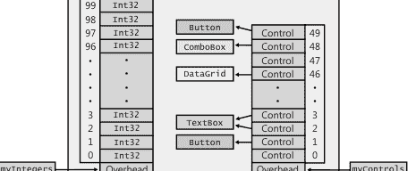

**图 16-1** 托管堆中的值类型数组和引用类型数组。

在图中，Control[] 数组展示了执行以下代码行后的结果。

```
myControls[1]  = new Button();
myControls[2]  = new TextBox();
myControls[3]  = myControls[2];   // Two elements refer to the same object.
myControls[46] = new DataGrid();
myControls[48] = new ComboBox();
myControls[49] = new Button();
```

公共语言规范（CLS）合规性要求所有数组都从零开始。这使得用 C# 编写的方法可以创建数组，并将该数组的引用传递给用其他语言（例如 Microsoft Visual Basic .NET）编写的代码。此外，由于从零开始的数组是迄今为止最常见的数组，Microsoft 已经花费了大量时间来优化它们的性能。然而，CLR 确实支持非零下界数组，尽管不鼓励使用它们。对于那些不在意轻微性能损失或跨语言可移植性的人，我将在本章后面演示如何创建和使用非零下界数组。

请注意，在图 16-1 中，每个数组都关联了一些额外的开销信息。这些信息包含数组的秩（维数）、数组每个维度的下界（几乎总是 0）以及每个维度的长度。这些开销还包含数组的元素类型。我将在本章后面提到允许你查询这些开销信息的方法。

到目前为止，我已经展示了演示如何创建一维数组的示例。在可能的情况下，你应当坚持使用一维、从零开始的数组，有时也称为 SZ 数组或向量。向量能提供最佳性能，因为你可以使用特定的中间语言（IL）指令——例如 newarr、ldelem、ldelema、ldlen 和 stelem——来操作它们。然而，如果你更喜欢使用多维数组，也可以。下面是一些多维数组的示例。

```csharp
// Create a two-dimensional array of Doubles.
Double[,] myDoubles = new Double[10, 20];

// Create a three-dimensional array of String references.
String[,,] myStrings = new String[5, 3, 10];
```

CLR 还支持交错数组，即数组的数组。从零开始的一维交错数组具有与普通向量相同的性能。然而，访问交错数组的元素意味着必须发生两次或更多次数组访问。下面是一些示例，说明如何创建一个多边形数组，其中每个多边形由一个 Point 实例数组组成。

```csharp
// Create a single-dimensional array of Point arrays.
Point[][] myPolygons = new Point[3][];

// myPolygons[0] refers to an array of 10 Point instances.
myPolygons[0] = new Point[10];

// myPolygons[1] refers to an array of 20 Point instances.
myPolygons[1] = new Point[20];

// myPolygons[2] refers to an array of 30 Point instances.
myPolygons[2] = new Point[30];

// Display the Points in the first polygon.
for (Int32 x = 0; x < myPolygons[0].Length; x++)
   Console.WriteLine(myPolygons[0][x]);
```

> **注意** CLR 会验证数组索引是否有效。换句话说，你不能创建一个包含 100 个元素的数组（编号为 0 到 99），然后尝试访问索引 –5 或 100 处的元素。这样做会导致抛出 System.IndexOutOfRangeException。允许访问数组范围之外的内存会破坏类型安全，并可能形成安全漏洞，CLR 不允许可验证代码这样做。通常，与索引检查相关的性能下降并不显著，因为实时（JIT）编译器通常会在循环执行前检查一次数组边界，而不是在每次循环迭代时检查。然而，如果你仍然担心 CLR 索引检查带来的性能损失，可以在 C# 中使用不安全代码来访问数组。本章后面的“数组内部”一节将演示如何这样做。

### 初始化数组元素

在上一节中，我展示了如何创建数组对象，然后展示了如何初始化数组的元素。C# 提供了允许你在一条语句中完成这两个操作的语法。下面展示了一个示例。

```csharp
String[] names = new String[] { "Aidan", "Grant" };
```

花括号内以逗号分隔的一组标记称为*数组初始化器*。每个标记可以是任意复杂的表达式，或者对于多维数组来说，可以是嵌套的数组初始化器。在前面的示例中，我只使用了两个简单的 String 表达式。

如果你在方法中声明一个局部变量来引用已初始化的数组，那么可以使用 C# 的隐式类型局部变量（var）功能稍微简化代码。

```csharp
// Using C#'s implicitly typed local variable feature:
var names = new String[] { "Aidan", "Grant" };
```

在这里，编译器推断 names 局部变量应为 String[] 类型，因为这是赋值运算符（=）右侧表达式的类型。

你可以使用 C# 的隐式类型数组功能，让编译器推断数组元素的类型。注意下面这一行在 new 和 [] 之间没有指定类型。

```csharp
// Using C#'s implicitly typed local variable and implicitly typed array features:
var names = new[] { "Aidan", "Grant", null };
```

在前一行中，编译器检查数组中用于初始化数组元素的各个表达式的类型，并选择所有元素共有的最接近的基类来确定数组的类型。在这个示例中，编译器看到两个 String 和 null。因为 null 可以隐式转换为任何引用类型（包括 String），所以编译器推断它应创建并初始化一个 String 引用数组。

如果你有下面这段代码：

```csharp
// Using C#'s implicitly typed local variable & implicitly typed array features: (error)
var names = new[] { "Aidan", "Grant", 123 };
```

编译器会发出消息 error CS0826: No best type found for implicitly-typed array。这是因为两个 String 和 Int32 的共同基类型是 Object，这意味着编译器必须创建一个 Object 引用数组，然后对 123 进行装箱，并让最后一个数组元素引用值为 123 的已装箱 Int32。C# 编译器团队认为，对数组元素进行装箱对于编译器来说过于繁重，无法隐式替你完成，这就是编译器发出该错误的原因。

作为初始化数组时额外的语法便利，你可以编写以下代码。

```csharp
String[] names = { "Aidan", "Grant" };
```


### 数组的强制转换

对于元素为引用类型的数组，CLR 允许你将源数组的元素类型隐式强制转换为目标类型。若要使转换成功，两个数组类型必须具有相同的维数，并且必须存在从源元素类型到目标元素类型的隐式或显式转换。CLR 不允许将元素为值类型的数组强制转换为任何其他类型。（但是，通过使用 Array.Copy 方法，可以创建一个新数组并填充其元素，以获得所需的效果。）下面的代码演示了数组强制转换的工作方式。

```csharp
// Create a two-dimensional FileStream array.
FileStream[,] fs2dim = new FileStream[5, 10];

// Implicit cast to a two-dimensional Object array
Object[,] o2dim = fs2dim;

// Can't cast from two-dimensional array to one-dimensional array
// Compiler error CS0030: Cannot convert type 'object[*,*]' to
// 'System.IO.Stream[]'
Stream[] s1dim = (Stream[]) o2dim;

// Explicit cast to two-dimensional Stream array
Stream[,] s2dim = (Stream[,]) o2dim;

// Explicit cast to two-dimensional String array
// Compiles but throws InvalidCastException at runtime
String[,] st2dim = (String[,]) o2dim;

// Create a one-dimensional Int32 array (value types).
Int32[] i1dim = new Int32[5];

// Can't cast from array of value types to anything else
// Compiler error CS0030: Cannot convert type 'int[]' to 'object[]'
Object[] o1dim = (Object[]) i1dim;

// Create a new array, then use Array.Copy to coerce each element in the
// source array to the desired type in the destination array.
// The following code creates an array of references to boxed Int32s.
Object[] ob1dim = new Object[i1dim.Length];
Array.Copy(i1dim, ob1dim, i1dim.Length);
```

Array.Copy 方法不仅仅是将元素从一个数组复制到另一个数组的方法。Copy 方法能够正确处理内存中的重叠区域，这与 C 语言的 memmove 函数一样。而 C 语言的 memcpy 函数则不能正确处理重叠区域。如果需要转换，Copy 方法还可以在复制每个数组元素时进行转换。Copy 方法能够执行以下转换：

-   将值类型元素装箱为引用类型元素，例如将 Int32[] 复制到 Object[]。
-   将引用类型元素拆箱为值类型元素，例如将 Object[] 复制到 Int32[]。
-   加宽 CLR 基元值类型，例如将 Int32[] 的元素复制到 Double[]。
-   在无法基于数组类型证明兼容的数组类型之间进行复制时向下转换元素，例如从 Object[] 强制转换为 IFormattable[]。如果 Object[] 中的每个对象都实现 IFormattable，Copy 就会成功。

下面是另一个示例，展示了 Copy 方法的用途。

```csharp
// Define a value type that implements an interface.
internal struct MyValueType : IComparable {
    public Int32 CompareTo(Object obj) {
        ...
    }
}


public static class Program {
    public static void Main() {
        // Create an array of 100 value types.
        MyValueType[] src = new MyValueType[100];

        // Create an array of IComparable references.
        IComparable[] dest = new IComparable[src.Length];

        // Initialize an array of IComparable elements to refer to boxed
        // versions of elements in the source array.
        Array.Copy(src, dest, src.Length);
    }
}
```

可以想象，框架类库（FCL）经常利用 Array 的 Copy 方法。

在某些情况下，将数组从一种类型强制转换为另一种类型是很有用的。这种功能称为数组协变。当你利用数组协变时，应该意识到相关的性能开销。假设你有以下代码。

```csharp
String[] sa = new String[100];
Object[] oa = sa;    // oa refers to an array of String elements
oa[5] = "Jeff";      // Perf hit: CLR checks oa's element type for String; OK
oa[3] = 5;           // Perf hit: CLR checks oa's element type for Int32; throws
                     // ArrayTypeMismatchException
```

在前面的代码中，oa 变量被类型化为 Object[]，但它实际上引用的是 String[]。编译器允许你编写试图将 5 放入数组元素的代码，因为 5 是 Int32，而 Int32 派生自 Object。当然，CLR 必须确保类型安全，并且在给数组元素赋值时，CLR 必须确保赋值是合法的。所以 CLR 必须在运行时检查数组是否包含 Int32 元素。在本例中，数组并不包含 Int32 元素，因此不能允许该赋值；CLR 将抛出 ArrayTypeMismatchException。

### 所有数组都隐式实现 IEnumerable、ICollection 和 IList

有许多方法对各种集合对象进行操作，因为这些方法声明时使用了 IEnumerable、ICollection 和 IList 等参数。可以将数组传递给这些方法，因为 System.Array 也实现了这三个接口。System.Array 实现这些非泛型接口是因为它们将所有元素都视为 System.Object。不过，如果 System.Array 能实现这些接口的泛型版本，那将会很好，既可以提供更好的编译时类型安全性，也可以获得更好的性能。

不过，CLR 团队并不希望 System.Array 实现 IEnumerable\<T\>、ICollection\<T\> 和 IList\<T\>，因为这会涉及到多维数组和非零基数组的问题。在 System.Array 上定义这些接口会使得所有数组类型都启用这些接口。相反，CLR 使用了一个小技巧：当创建一维、下界为零的数组类型时，CLR 会自动让该数组类型实现 IEnumerable\<T\>、ICollection\<T\> 和 IList\<T\>（其中 T 是数组的元素类型），并且只要数组类型的基类型是引用类型，还会为所有这些基类型实现这三个接口。下面这个层次结构图有助于弄清这一点。

```
Object
    Array (non-generic IEnumerable, ICollection, IList)
        Object[]           (IEnumerable, ICollection, IList of Object)
            String[]       (IEnumerable, ICollection, IList of String)
                Stream[]   (IEnumerable, ICollection, IList of Stream)
                    FileStream[] (IEnumerable, ICollection, IList of FileStream)
        .
        .   (other arrays of reference types)
        .
```

因此，例如，如果你有以下代码行：

```csharp
FileStream[] fsArray;
```

那么当 CLR 创建 FileStream[] 类型时，它会让该类型自动实现 IEnumerable\<FileStream\>、ICollection\<FileStream\> 和 IList\<FileStream\> 接口。此外，FileStream[] 类型还会为其基类型实现这些接口：IEnumerable\<Stream\>、IEnumerable\<Object\>、ICollection\<Stream\>、ICollection\<Object\>、IList\<Stream\> 和 IList\<Object\>。由于所有这些接口都是由 CLR 自动实现的，因此 fsArray 变量可以用于需要这些接口中任何一个的地方。例如，可以将 fsArray 变量传递给具有以下任意原型的任何方法。

```csharp
void M1(IList<FileStream> fsList) { ... }
void M2(ICollection<Stream> sCollection) { ... }
void M3(IEnumerable<Object> oEnumerable) { ... }
```

请注意，如果数组包含值类型元素，数组类型将不会为元素的基类型实现这些接口。例如，如果你有以下代码行：

```csharp
DateTime[] dtArray; // An array of value types
```

那么 `DateTime[]` 类型只会实现 `IEnumerable<DateTime>`、`ICollection<DateTime>` 和 `IList<DateTime>`；它不会实现这些接口的以 `System.ValueType` 或 `System.Object` 为泛型参数的版本。这意味着 `dtArray` 变量不能作为参数传递给前面展示的 `M3` 方法。原因在于，值类型数组在内存中的布局方式与引用类型数组不同。本章前面已经讨论过数组的内存布局。

#### 传递和返回数组

将数组作为参数传递给方法时，实际上传递的是对该数组的引用。因此，被调用的方法能够修改数组中的元素。如果你不希望允许这样，就必须复制一份数组并将副本传给方法。注意，`Array.Copy` 方法执行的是浅复制，因此，如果数组的元素是引用类型，新数组引用的是已经存在的对象。

类似地，有些方法会返回一个数组的引用。如果方法构造并初始化了数组，返回数组的引用是可以的。但如果方法想要返回由字段维护的内部数组的引用，你必须决定是否希望方法的调用者直接访问这个数组及其元素。如果是这样，直接返回数组的引用即可。但在大多数情况下，你不会希望方法调用者拥有这种访问权限，所以方法应该构造一个新数组并调用 `Array.Copy`，然后返回新数组的引用。同样，请注意 `Array.Copy` 对原始数组进行的是浅复制。

如果定义的方法返回一个数组的引用，并且该数组没有任何元素，你的方法可以返回 `null`，也可以返回包含零个元素的数组的引用。在实现这类方法时，Microsoft 强烈建议让方法返回零长度数组，因为这样做可以简化调用该方法的开发人员必须编写的代码。例如，下面这段易于理解的代码即使没有可供迭代的约会也能正确运行。

```csharp
// This code is easier to write and understand.
Appointment[] appointments = GetAppointmentsForToday();
for (Int32 a = 0; a < appointments.Length; a++) {
...
}
```

下面这段代码在没有可供迭代的约会时也能正确运行。不过，这段代码编写和理解起来稍难一些。

```csharp
// This code is harder to write and understand.
Appointment[] appointments = GetAppointmentsForToday();
if (appointments != null) {
```


```csharp
                for (Int32 year = firstYear; year <= lastYear; year++) {
                    Console.WriteLine(year + " ");
                    for (Int32 quarter = firstQuarter; quarter <= lastQuarter; quarter++) {
                        Console.Write("{0,9:C} ", quarterlyRevenue[year, quarter]);
                    }
                    Console.WriteLine();
                }
            }
        }
```

如果编译并运行这段代码，将得到以下输出。

| 年份 | 第1季度 | 第2季度 | 第3季度 | 第4季度 |
|---|---|---|---|---|
| 2005 | $0.00 | $0.00 | $0.00 | $0.00 |
| 2006 | $0.00 | $0.00 | $0.00 | $0.00 |
| 2007 | $0.00 | $0.00 | $0.00 | $0.00 |
| 2008 | $0.00 | $0.00 | $0.00 | $0.00 |
| 2009 | $0.00 | $0.00 | $0.00 | $0.00 |

### 数组内部机制

在内部，CLR 实际上支持两种不同类型的数组：

-   下界为 0 的单维数组。这些数组有时称为 SZ（表示单维、从零开始）数组或向量。
-   下界未知的单维数组和多维数组。

实际上，执行以下代码即可看到不同类型的数组（输出显示在代码的注释中）。

```csharp
using System;

public sealed class Program {
    public static void Main() {
        Array a;

        // Create a 1-dim, 0-based array, with no elements in it
        a = new String[0];
        Console.WriteLine(a.GetType());   // "System.String[]"

        // Create a 1-dim, 0-based array, with no elements in it
        a = Array.CreateInstance(typeof(String),
            new Int32[] { 0 }, new Int32[] { 0 });
        Console.WriteLine(a.GetType());   // "System.String[]"

        // Create a 1-dim, 1-based array, with no elements in it
        a = Array.CreateInstance(typeof(String),
            new Int32[] { 0 }, new Int32[] { 1 });
        Console.WriteLine(a.GetType());   // "System.String[*]"  <-- INTERESTING!

        Console.WriteLine();
```

这段代码首先值得注意的是，在 for 循环的测试表达式中调用了数组的 Length 属性。由于 Length 是一个属性，查询长度实际上代表一次方法调用。然而，JIT 编译器知道 Length 是 Array 类上的属性，因此 JIT 编译器实际上会生成代码，只调用该属性一次，并将结果存储在临时变量中，在循环的每次迭代中检查该变量。结果是，经 JIT 编译的代码运行很快。事实上，一些开发者低估了 JIT 编译器的能力，试图编写“聪明代码”来帮助 JIT 编译器。然而，你想到的任何取巧尝试几乎肯定会对性能产生负面影响，并使代码更难阅读，从而降低其可维护性。最好在前面的代码中保留对数组 Length 属性的调用，而不是自己尝试将其缓存到局部变量中。

前面代码中第二点值得注意的是，JIT 编译器知道 for 循环访问的是从 0 到 Length - 1 的数组元素。因此，JIT 编译器生成的代码会在运行时测试所有数组访问是否都位于数组的有效范围内。具体来说，JIT 编译器会生成代码来检查 `(0 >= a.GetLowerBound(0)) && ((Length - 1) <= a.GetUpperBound(0))`。该检查恰好在循环之前进行。如果检查通过，JIT 编译器就不会在循环内生成代码来验证每次数组访问是否都在有效范围内。这使得循环内的数组访问非常快。

遗憾的是，正如我在本章前面提到的，访问非从零开始的单维数组或多维数组的元素，比访问单维、从零开始的数组要慢得多。对于这些数组类型，JIT 编译器不会将索引检查提升到循环外，因此每次数组访问都会验证指定的索引。此外，JIT 编译器还会添加代码，从指定索引中减去数组的下界，这也会降低代码速度，即使你使用的是恰好从零开始的多维数组。因此，如果你关注性能，可以考虑使用数组的数组（交错数组）而不是矩形数组。

C# 和 CLR 还允许你使用不安全（不可验证）代码来访问数组，这实际上是一种在访问数组时关闭索引边界检查的技术。请注意，这种不安全数组操作技术适用于元素类型为 SByte、Byte、Int16、UInt16、Int32、UInt32、Int64、UInt64、Char、Single、Double、Decimal、Boolean、枚举类型，或字段为上述任一类型的值类型结构的数组。

这是一个非常强大的功能，应极其谨慎地使用，因为它允许你执行直接内存访问。如果这些内存访问超出数组边界，不会引发异常；相反，你将损坏内存、违反类型安全，并可能打开安全漏洞！因此，包含不安全代码的程序集必须被授予完全信任，或者至少拥有已启用“跳过验证”的 SecurityPermission。

以下 C# 代码演示了访问二维数组的三种技术（安全、交错和不安全）。

```csharp
using System;
using System.Diagnostics;

public static class Program {
    private const Int32 c_numElements = 10000;

    public static void Main() {
        // Declare a two-dimensional array
        Int32[,] a2Dim = new Int32[c_numElements, c_numElements];

        // Declare a two-dimensional array as a jagged array (a vector of vectors)
        Int32[][] aJagged = new Int32[c_numElements][];
        for (Int32 x = 0; x < c_numElements; x++)
            aJagged[x] = new Int32[c_numElements];

        // 1: Access all elements of the array using the usual, safe technique
        Safe2DimArrayAccess(a2Dim);

        // 2: Access all elements of the array using the jagged array technique
        SafeJaggedArrayAccess(aJagged);

        // 3: Access all elements of the array using the unsafe technique
        Unsafe2DimArrayAccess(a2Dim);
    }

    private static Int32 Safe2DimArrayAccess(Int32[,] a) {
        Int32 sum = 0;
        for (Int32 x = 0; x < c_numElements; x++) {
            for (Int32 y = 0; y < c_numElements; y++) {
                sum += a[x, y];
            }
        }
        return sum;
    }

    private static Int32 SafeJaggedArrayAccess(Int32[][] a) {
        Int32 sum = 0;
        for (Int32 x = 0; x < c_numElements; x++) {
            for (Int32 y = 0; y < c_numElements; y++) {
                sum += a[x][y];
            }
        }
        return sum;
    }

    private static unsafe Int32 Unsafe2DimArrayAccess(Int32[,] a) {
        Int32 sum = 0;
        fixed (Int32* pi = a) {
            for (Int32 x = 0; x < c_numElements; x++) {
                Int32 baseOfDim = x * c_numElements;
                for (Int32 y = 0; y < c_numElements; y++) {
                    sum += pi[baseOfDim + y];
                }
            }
        }
        return sum;
    }
}
```

Unsafe2DimArrayAccess 方法标记有 unsafe 修饰符，这是使用 C# 的 fixed 语句所必需的。要编译这段代码，你必须在调用 C# 编译器时指定 /unsafe 开关，或者在 Microsoft Visual Studio 的“项目属性”窗格的“生成”选项卡中选中“允许不安全代码”复选框。

显然，不安全技术在你自己的代码中有其最佳适用场景，但请注意，使用这种技术有三个严重缺点：

-   由于使用了 C# 的 fixed 语句并执行内存地址计算，操作数组元素的代码比使用其他技术操作元素的代码更难读写。
-   如果计算有误，你访问的内存就不属于该数组。这可能导致计算错误、内存损坏、类型安全违规以及潜在的安全漏洞。
-   由于这些潜在问题，CLR 禁止不安全代码在降低安全级别的环境中运行（例如 Microsoft Silverlight）。

#### 不安全数组访问与固定大小数组

不安全数组访问非常强大，因为它允许你访问：

-   位于堆上的托管数组对象中的元素（如上一节所示）。
-   位于非托管堆上的数组中的元素。第14章“字符、字符串与文本处理”中的 SecureString 示例演示了如何对调用 System.Runtime.InteropServices.Marshal 类的 SecureStringToCoTaskMemUnicode 方法返回的数组使用不安全数组访问。
-   位于线程栈上的数组中的元素。

在性能极其关键的情况下，你可以避免在堆上分配托管数组对象，而是使用 C# 的 stackalloc 语句（其工作方式很像 C 的 alloca 函数）在线程栈上分配数组。stackalloc 语句只能用于创建元素为值类型的单维、从零开始的数组，并且该值类型不能包含任何引用类型字段。实际上，你应该把它看作分配一块内存，你可以使用不安全指针来操作它，因此，你不能将这个内存缓冲区的地址传递给绝大多数 FCL 方法。当然，当方法返回时，栈分配的内存（数组）将自动释放；这正是我们获得性能提升的地方。使用此功能还要求你向 C# 编译器指定 /unsafe 开关。


以下代码中的 StackallocDemo 方法给出了一个示例，说明如何使用 C# 的 stackalloc 语句。

```csharp
using System;

public static class Program {
    public static void Main() {
        StackallocDemo();
        InlineArrayDemo();
    }

    private static void StackallocDemo() {
        unsafe {
            const Int32 width = 20;
            Char* pc = stackalloc Char[width]; // Allocates array on stack

            String s = "Jeffrey Richter";    // 15 characters

            for (Int32 index = 0; index < width; index++) {
                pc[width - index - 1] =
                    (index < s.Length) ? s[index] : '.';
            }

            // The following line displays ".....retciR yerffej"
            Console.WriteLine(new String(pc, 0, width));
        }
    }

    private static void InlineArrayDemo() {
        unsafe {
            CharArray ca;                    // Allocates array on stack
            Int32 widthInBytes = sizeof(CharArray);
            Int32 width = widthInBytes / 2;

            String s = "Jeffrey Richter";    // 15 characters

            for (Int32 index = 0; index < width; index++) {
                ca.Characters[width - index - 1] =
                    (index < s.Length) ? s[index] : '.';
            }

            // The following line displays ".....retciR yerffej"
            Console.WriteLine(new String(ca.Characters, 0, width));
        }
    }
}

internal unsafe struct CharArray {
    // This array is embedded inline inside the structure
    public fixed Char Characters[20];
}
```

通常，由于数组是引用类型，在结构中定义的数组字段实际上只是一个指向数组的指针或引用；数组本身位于结构的内存之外。然而，可以像前面代码中的 CharArray 结构那样，将数组直接嵌入到结构中。要将数组直接嵌入到结构中，需要满足以下几项要求：

- 类型必须是结构（值类型）；不能将数组嵌入到类（引用类型）中。
- 字段或其定义结构必须用 unsafe 关键字标记。
- 数组字段必须用 fixed 关键字标记。
- 数组必须是一维的，并且从零开始。
- 数组的元素类型必须是以下类型之一：Boolean、Char、SByte、Byte、Int16、UInt16、Int32、UInt32、Int64、UInt64、Single 或 Double。

内联数组通常用于涉及与非托管代码互操作的场景，在这些场景中，非托管数据结构也有一个内联数组。不过，内联数组也可以用于其他场景。前面所示的代码中的 InlineArrayDemo 方法提供了一个如何使用内联数组的示例。InlineArrayDemo 方法执行与 StackallocDemo 方法相同的功能；只是实现方式不同。

## 委托

本章内容：

- 委托初探 . . . . . . . . . . . . . . . . . . . . . 391
- 使用委托回调静态方法 . . . . . . . . . . . . . . . 394
- 使用委托回调实例方法 . . . . . . . . . . . . . . . 395
- 委托揭秘 . . . . . . . . . . . . . . . . . . . . . . . . . 396
- 使用委托回调多个方法（链式） . . . . . . . . . . . . 400
- 委托定义已经够多了（泛型委托） . . . . . . . . . . . . . . . . . . . . . . . . . . . . . . . . . . . . . . . . . . . . . 407
- C# 为委托提供的语法糖 . . . . . . . . . . . . . . . . . . . . . 408
- 委托与反射 . . . . . . . . . . . . . . . . . . . . . . . . 416

在本章中，我将讨论回调函数。回调函数是一种极其有用的编程机制，已经存在多年。Microsoft .NET Framework 通过使用委托来提供回调函数机制。与其他平台（例如非托管 C++）中使用的回调机制不同，委托提供了多得多的功能。例如，委托确保回调方法是类型安全的，这符合公共语言运行时 (CLR) 最重要的目标之一。委托还集成了按顺序调用多个方法的能力，并支持调用静态方法以及实例方法。

### 委托初探

C 运行时的 qsort 函数接受一个指向回调函数的指针，用于对数组中的元素进行排序。在 Windows 中，窗口过程、挂钩过程、异步过程调用等都需要回调函数。在 .NET Framework 中，回调方法被用于大量任务。例如，你可以注册回调方法以获取各种通知，例如未处理异常、窗口状态更改、菜单项选择、文件系统更改、窗体控件事件以及已完成的异步操作。

在非托管 C/C++ 中，非成员函数的地址只是一个内存地址。该地址不携带任何附加信息，例如函数期望的参数数量、这些参数的类型、函数的返回值类型以及函数的调用约定。简而言之，非托管 C/C++ 回调函数不是类型安全的（尽管它们是一种非常轻量的机制）。

在 .NET Framework 中，回调函数与在非托管 Windows 编程中一样有用且普遍。然而，.NET Framework 提供了一种称为委托的类型安全机制。我将通过展示如何使用委托来开始讨论委托。以下代码演示如何声明、创建和使用委托。

```csharp
using System;
using System.Windows.Forms;
using System.IO;


// Declare a delegate type; instances refer to a method that
// takes an Int32 parameter and returns void.
internal delegate void Feedback(Int32 value);


public sealed class Program {
    public static void Main() {
        StaticDelegateDemo();
        InstanceDelegateDemo();
        ChainDelegateDemo1(new Program());
        ChainDelegateDemo2(new Program());
    }

    private static void StaticDelegateDemo() {
        Console.WriteLine("----- Static Delegate Demo -----");
        Counter(1, 3, null);
        Counter(1, 3, new Feedback(Program.FeedbackToConsole));
        Counter(1, 3, new Feedback(FeedbackToMsgBox)); // "Program." is optional
        Console.WriteLine();
    }

    private static void InstanceDelegateDemo() {
        Console.WriteLine("----- Instance Delegate Demo -----");
        Program p = new Program();
        Counter(1, 3, new Feedback(p.FeedbackToFile));

        Console.WriteLine();
    }

    private static void ChainDelegateDemo1(Program p) {
        Console.WriteLine("----- Chain Delegate Demo 1 -----");
        Feedback fb1 = new Feedback(FeedbackToConsole);
        Feedback fb2 = new Feedback(FeedbackToMsgBox);
        Feedback fb3 = new Feedback(p.FeedbackToFile);

        Feedback fbChain = null;
        fbChain = (Feedback) Delegate.Combine(fbChain, fb1);
        fbChain = (Feedback) Delegate.Combine(fbChain, fb2);
        fbChain = (Feedback) Delegate.Combine(fbChain, fb3);
        Counter(1, 2, fbChain);

        Console.WriteLine();
        fbChain = (Feedback)
            Delegate.Remove(fbChain, new Feedback(FeedbackToMsgBox));
        Counter(1, 2, fbChain);
    }

    private static void ChainDelegateDemo2(Program p) {
        Console.WriteLine("---- Chain Delegate Demo 2 ----");
        Feedback fb1 = new Feedback(FeedbackToConsole);
        Feedback fb2 = new Feedback(FeedbackToMsgBox);
        Feedback fb3 = new Feedback(p.FeedbackToFile);

        Feedback fbChain = null;
        fbChain += fb1;
        fbChain += fb2;
        fbChain += fb3;
        Counter(1, 2, fbChain);

        Console.WriteLine();
        fbChain -= new Feedback(FeedbackToMsgBox);
        Counter(1, 2, fbChain);
    }

    private static void Counter(Int32 from, Int32 to, Feedback fb) {
        for (Int32 val = from; val <= to; val++) {
            // If any callbacks are specified, call them
            if (fb != null)
                fb(val);
        }
    }

    private static void FeedbackToConsole(Int32 value) {
        Console.WriteLine("Item=" + value);
    }

    private static void FeedbackToMsgBox(Int32 value) {
        MessageBox.Show("Item=" + value);
    }

    private void FeedbackToFile(Int32 value) {
        using (StreamWriter sw = new StreamWriter("Status", true)) {
            sw.WriteLine("Item=" + value);
        }
    }
}
```

现在我将描述这段代码在做什么。在顶部，请注意 internal 委托 Feedback 的声明。委托指示回调方法的签名。在此示例中，Feedback 委托标识一个接受一个参数（Int32）并返回 void 的方法。在某种程度上，委托非常像非托管 C/C++ 中表示函数地址的 typedef。

Program 类定义了一个名为 Counter 的私有静态方法。此方法从 from 参数计数到 to 参数。Counter 方法还接受一个 fb，它是对 Feedback 委托对象的引用。Counter 遍历所有整数，并且对于每个整数，如果 fb 变量不为 null，则调用回调方法（由 fb 变量指定）。会向此回调方法传递正在处理的项的值，即项号。可以将回调方法设计和实现为以任何认为合适的方式处理每个项。


#### 使用委托回调静态方法

现在你已经理解了 Counter 方法的设计方式及其工作原理，接下来让我们看看如何使用委托来回调静态方法。上一段代码示例中出现的 StaticDelegateDemo 方法是本节的焦点。

StaticDelegateDemo 方法调用 Counter 方法时，在第三个参数中传递了 null，该参数对应于 Counter 的 fb 参数。由于 Counter 的 fb 参数接收到 null，因此每一项都会被处理而不会调用任何回调方法。

接下来，StaticDelegateDemo 方法第二次调用 Counter 方法，在方法调用的第三个参数中传递了一个新构造的 Feedback 委托对象。该委托对象是对某个方法的包装，允许通过该包装间接调用此方法。在此示例中，静态方法 Program.FeedbackToConsole 的名称被传递给 Feedback 类型的构造函数，表示该方法是需要被包装的方法。new 运算符返回的引用作为第三个参数传给了 Counter。现在，当 Counter 执行时，它将针对序列中的每一项调用 Program 类型的静态 FeedbackToConsole 方法。FeedbackToConsole 只是向控制台写入一个字符串，指明当前正在处理的项。

**注意** FeedbackToConsole 方法在 Program 类型中被定义为 private，但 Counter 方法仍能够调用 Program 的私有方法。在本例中，你可能认为这不会有什么问题，因为 Counter 和 FeedbackToConsole 都定义在同一类型中。然而，即使 Counter 方法定义在另一个类型中，这段代码同样能够正常运行。简而言之，只要委托对象是由具有足够安全/访问权限的代码创建的，一个类型通过委托调用另一个类型的私有成员并不构成安全或可访问性违规。

StaticDelegateDemo 方法中对 Counter 的第三次调用与第二次调用几乎完全相同，唯一区别在于这次的 Feedback 委托对象包装的是静态方法 Program.FeedbackToMsgBox。FeedbackToMsgBox 会构造一个指明正在处理的项的字符串，然后将该字符串显示在一个消息框中。

此示例中的一切都是类型安全的。例如，在构造 Feedback 委托对象时，编译器会确保 Program.FeedbackToConsole 和 Program.FeedbackToMsgBox 方法的签名与 Feedback 委托定义的签名兼容。具体而言，这两个方法都必须接受一个参数（Int32），并且都必须具有相同的返回类型（void）。如果 FeedbackToConsole 被定义成下面这样：

```csharp
private static Boolean FeedbackToConsole(String value) {
    ...
}
```

C# 编译器将不会编译该代码，并且会发出以下错误：error CS0123: No overload for 'FeedbackToConsole' matches delegate 'Feedback'.

FeedbackToFile 方法的工作方式与 FeedbackToConsole 和 FeedbackToMsgBox 方法相同，区别在于它会打开一个文件并将字符串追加到文件末尾。（该方法创建的 Status 文件可以在应用程序的 AppBase 目录中找到。）

同样，本示例的目的是演示委托既可以包装对实例方法的调用，也可以包装对静态方法的调用。对于实例方法，委托需要知道该方法将操作的对象的实例。包装实例方法非常有用，因为对象内部的代码可以访问该对象的实例成员。这意味着对象可以拥有一些状态，在回调方法执行其处理时可以使用这些状态。

### 揭秘委托

从表面上看，委托似乎很容易使用：你可以使用 C# 的 delegate 关键字来定义委托，使用熟悉的 new 运算符来构造委托实例，并使用熟悉的方法调用语法来调用回调（只不过不是使用方法名，而是使用引用委托对象的变量）。

然而，实际情况比之前的示例所展示的要复杂得多。编译器和 CLR 在幕后做了大量处理来隐藏这种复杂性。在本节中，我将重点说明编译器和 CLR 如何协同工作来实现委托。掌握这些知识将加深你对委托的理解，并教你如何有效且高效地使用它们。我还会简要介绍一些委托提供的额外功能。

让我们从重新审视这一行代码开始。

```csharp
internal delegate void Feedback(Int32 value);
```

当编译器看到这一行时，它实际上会定义一个完整的类，大致如下所示。

```csharp
internal class Feedback : System.MulticastDelegate {
    // 构造函数
    public Feedback(Object @object, IntPtr method);

    // 具有与源代码指定原型相同的方法
    public virtual void Invoke(Int32 value);

    // 允许异步调用回调的方法
    public virtual IAsyncResult BeginInvoke(Int32 value,
        AsyncCallback callback, Object @object);
    public virtual void EndInvoke(IAsyncResult result);
}
```

编译器定义的类有四个方法：一个构造函数、Invoke、BeginInvoke 和 EndInvoke。在本章中，我将重点介绍构造函数和 Invoke 方法。BeginInvoke 和 EndInvoke 方法与 .NET Framework 的异步编程模型有关，该模型现在已被视为过时，并已被我在第 27 章“计算密集型异步操作”中讨论的任务所取代。

实际上，你可以通过使用 ILDasm.exe 检查生成的程序集来验证编译器确实自动生成了这个类，如图 17-1 所示。

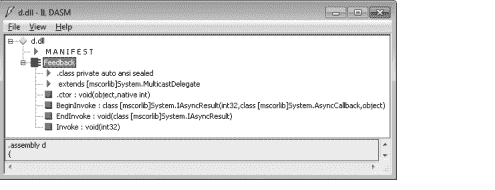

图 17-1 ILDasm.exe 显示的编译器为委托生成的元数据。

在此示例中，编译器定义了一个名为 Feedback 的类，该类派生自 Framework 类库（FCL）中定义的 System.MulticastDelegate 类型。（所有委托类型都派生自 MulticastDelegate。）

> **重要说明** System.MulticastDelegate 类派生自 System.Delegate，而 System.Delegate 本身又派生自 System.Object。之所以会有两个委托类，是历史原因造成的，令人遗憾；FCL 中本应只存在一个委托类。遗憾的是，你需要同时了解这两个类，因为尽管你创建的所有委托类型都以 MulticastDelegate 作为基类，但偶尔你还会使用 Delegate 类而不是 MulticastDelegate 类中定义的方法来操作委托类型。例如，Delegate 类有名为 Combine 和 Remove 的静态方法（我稍后会解释这些方法的作用）。这两个方法的签名都表明它们接受 Delegate 参数。由于你的委托类型派生自 MulticastDelegate，而 MulticastDelegate 又派生自 Delegate，因此你的委托类型的实例可以传递给这些方法。

该类具有私有可见性，因为源代码中的委托被声明为 internal。如果源代码声明为 public 可见性，那么编译器生成的 Feedback 类也将是 public。你应该知道，委托类型可以定义在类型内部（嵌套在另一个类型中），也可以定义在全局范围内。基本上，因为委托是类，所以委托可以定义在类可以定义的任何位置。

由于所有委托类型都派生自 MulticastDelegate，它们会继承 MulticastDelegate 的字段、属性和方法。在所有这些成员中，三个非公共字段可能是最重要的。表 17-1 描述了这些重要字段。

现在你已经了解了委托对象是如何构造的，以及它们的内部结构是什么样的，接下来让我们讨论回调方法是如何被调用的。为方便起见，我在这里重复了 Counter 方法的代码。

```csharp
private static void Counter(Int32 from, Int32 to, Feedback fb) {
    for (Int32 val = from; val <= to; val++) {
        // 如果指定了任何回调，则调用它们
        if (fb != null)
            fb(val);
    }
}
```

请看注释下面的那行代码。if 语句首先检查 fb 是否为 null。如果 fb 不为 null，则在下一行，你会看到调用回调方法的代码。这里必须进行 null 检查，因为 fb 实际上只是一个可以引用 Feedback 委托对象的变量；它也可能是 null。乍看起来，我似乎是在调用一个名为 fb 的函数并向它传递一个参数（val）。然而，并不存在名为 fb 的函数。编译器知道 fb 是一个引用委托对象的变量，因此它会生成代码来调用该委托对象的 Invoke 方法。换句话说，编译器看到的是以下内容：

```csharp
fb(val);
```

但编译器生成的代码就好像源代码写成了这样：

```csharp
fb.Invoke(val);
```

你可以使用 ILDasm.exe 检查为 Counter 方法创建的中间语言（IL）代码，从而验证编译器确实生成了调用委托类型 Invoke 方法的代码。以下是 Counter 方法的 IL 代码。图中的 IL_0009 指令表示对 Feedback 的 Invoke 方法的调用。

```il
.method private hidebysig static void Counter(int32 from,
                                              int32 'to',
                                              class Feedback fb) cil managed
{
    // Code size       23 (0x17)
    .maxstack  2
    .locals init (int32 val)
    IL_0000:  ldarg.0
    IL_0001:  stloc.0
    IL_0002:  br.s       IL_0012
    IL_0004:  ldarg.2
    IL_0005:  brfalse.s  IL_000e
    IL_0007:  ldarg.2
    IL_0008:  ldloc.0
    IL_0009:  callvirt   instance void Feedback::Invoke(int32)
    IL_000e:  ldloc.0
    IL_000f:  ldc.i4.1
    IL_0010:  add
    IL_0011:  stloc.0
    IL_0012:  ldloc.0
    IL_0013:  ldarg.1
    IL_0014:  ble.s      IL_0004
    IL_0016:  ret
} // end of method Program::Counter
```


事实上，你可以修改 Counter 方法以显式调用 Invoke，如下所示。

```csharp
private static void Counter(Int32 from, Int32 to, Feedback fb) {
    for (Int32 val = from; val <= to; val++) {
        // If any callbacks are specified, call them
        if (fb != null)
            fb.Invoke(val);
    }
}
```

你会回想起，编译器在定义 Feedback 类时定义了 Invoke 方法。当调用 Invoke 时，它使用私有 _target 和 _methodPtr 字段在指定对象上调用所需的方法。注意，Invoke 方法的签名与委托的签名匹配。因为 Feedback 委托接受一个 Int32 参数并返回 void，所以 Invoke 方法（由编译器生成）接受一个 Int32 参数并返回 void。

#### 使用委托回调多个方法（链式调用）

委托本身非常有用。但加上对链式调用的支持后，委托会变得更加有用。链式调用是一组或一个委托对象集合，它提供了调用该集合中所有委托所表示的方法的能力。要理解这一点，请参见本章开头所示代码中的 ChainDelegateDemo1 方法。在该方法中，在 Console.WriteLine 语句之后，我构造了三个委托对象，并让变量——fb1、fb2 和 fb3——分别引用每个对象，如图 17-3 所示。

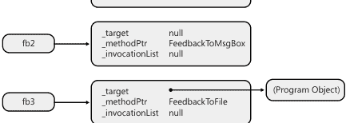

**图 17-3** fb1、fb2 和 fb3 变量所引用的委托对象的初始状态。

指向 Feedback 委托对象的引用变量 fbChain 旨在引用一个委托对象链或委托对象集合，这些委托对象包装了可被回调的方法。将 fbChain 初始化为 null 表示当前没有要回调的方法。Delegate 类的公共静态 Combine 方法用于将委托添加到链中。

```csharp
fbChain = (Feedback) Delegate.Combine(fbChain, fb1);
```

当这行代码执行时，Combine 方法发现我们试图组合 null 和 fb1。在内部，Combine 将直接返回 fb1 中的值，并且 fbChain 变量将被设置为引用与 fb1 变量所引用的相同的委托对象，如图 17-4 所示。

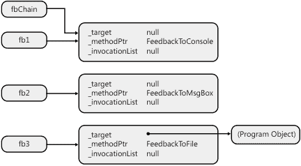

**图 17-4** 在链中插入第一个委托之后委托对象的状态。

要向链中添加另一个委托，需再次调用 Combine 方法。

```csharp
fbChain = (Feedback) Delegate.Combine(fbChain, fb2);
```

在内部，Combine 方法发现 fbChain 已经引用了一个委托对象，因此 Combine 将构造一个新的委托对象。这个新委托对象将其私有 _target 和 _methodPtr 字段初始化为对本次讨论并不重要的值。然而，重要的是，_invocationList 字段被初始化为引用一个委托对象数组。该数组的第一个元素（索引 0）将被初始化为引用包装 FeedbackToConsole 方法的委托（这是 fbChain 当前引用的委托）。该数组的第二个元素（索引 1）将被初始化为引用包装 FeedbackToMsgBox 方法的委托（这是 fb2 引用的委托）。最后，fbChain 将被设置为引用新创建的委托对象，如图 17-5 所示。

要将第三个委托添加到链中，需再次调用 Combine 方法。

```csharp
fbChain = (Feedback) Delegate.Combine(fbChain, fb3);
```

同样，Combine 发现 fbChain 已经引用了一个委托对象，这会导致构造一个新的委托对象，如图 17-6 所示。和之前一样，这个新委托对象将私有 _target 和 _methodPtr 字段初始化为对本次讨论不重要的值，并且 _invocationList 字段被初始化为引用一个委托对象数组。该数组的第一个和第二个元素（索引 0 和 1）将被初始化为引用前一个委托对象在其数组中所引用的相同委托。该数组的第三个元素（索引 2）将被初始化为引用包装 FeedbackToFile 方法的委托（这是 fb3 引用的委托）。最后，fbChain 将被设置为引用这个新创建的委托对象。注意，先前创建的委托及其 _invocationList 字段所引用的数组现在已成为垃圾回收的候选对象。

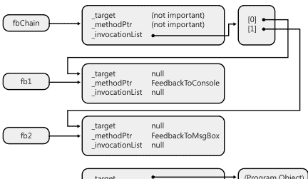

**图 17-5** 在链中插入第二个委托之后委托对象的状态。

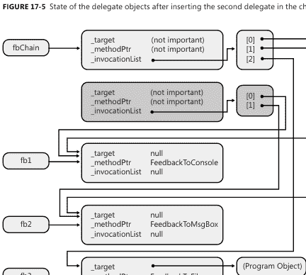

**图 17-6** 链完成时委托对象的最终状态。

在设置链的所有代码执行完毕之后，fbChain 变量随后被传递给 Counter 方法。

```csharp
Counter(1, 2, fbChain);
```

Counter 方法内部包含的代码会像我前面详细说明的那样，隐式调用 Feedback 委托对象上的 Invoke 方法。当对 fbChain 所引用的委托调用 Invoke 时，该委托发现私有 _invocationList 字段不为 null，从而执行一个循环，遍历数组中的所有元素，并调用每个委托所包装的方法。在这个示例中，将首先调用 FeedbackToConsole，然后调用 FeedbackToMsgBox，接着调用 FeedbackToFile。

Feedback 的 Invoke 方法本质上实现大致如下（伪代码）：

```csharp
public void Invoke(Int32 value) {
    Delegate[] delegateSet = _invocationList as Delegate[];
    if (delegateSet != null) {
        // This delegate's array indicates the delegates that should be called
        foreach (Feedback d in delegateSet)
            d(value);   // Call each delegate
    } else {
        // This delegate identifies a single method to be called back
        // Call the callback method on the specified target object.
        _methodPtr.Invoke(_target, value);
        // The preceding line is an approximation of the actual code.
        // What really happens cannot be expressed in C#.
    }
}
```

注意，也可以通过调用 Delegate 的公共静态 Remove 方法从链中移除一个委托。这在 ChainDelegateDemo1 方法的末尾进行了演示。

```csharp
fbChain = (Feedback) Delegate.Remove(fbChain, new Feedback(FeedbackToMsgBox));
```

调用 Remove 时，它会扫描第一个参数（在我的示例中是 fbChain）所引用的委托对象内部维护的委托数组（从末尾向索引 0 方向）。Remove 会查找一个委托项，其 _target 和 _methodPtr 字段与第二个参数（在我的示例中是新的 Feedback 委托）中的对应字段匹配。如果找到匹配项，并且数组中只剩一个项，则返回该数组项。如果找到匹配项，并且数组中剩余多个项，则会构造一个新的委托对象——当然，创建并初始化的 _invocationList 数组将引用原数组中的所有项，但要移除的项除外——并返回对该新委托对象的引用。如果要移除链中唯一的元素，Remove 返回 null。注意，每次调用 Remove 只从链中移除一个委托；它不会移除所有具有匹配 _target 和 _methodPtr 字段的委托。

到目前为止，我展示的示例中，我的委托类型 Feedback 被定义为具有 void 返回值。不过，我也可以按如下方式定义 Feedback 委托。

```csharp
public delegate Int32 Feedback(Int32 value);
```

如果那样定义，它的 Invoke 方法在内部将类似如下（同样是伪代码）。

```csharp
public Int32 Invoke(Int32 value) {
   Int32 result;
   Delegate[] delegateSet = _invocationList as Delegate[];
   if (delegateSet != null) {
      // This delegate's array indicates the delegates that should be called
      foreach (Delegate d in delegateSet)
         result = d(value);   // Call each delegate
   } else {
      // This delegate identifies a single method to be called back
      // Call the callback method on the specified target object.
      result = _methodPtr.Invoke(_target, value);
      // The preceding line is an approximation of the actual code.
      // What really happens cannot be expressed in C#.
   }
   return result;
}
```

当数组中的每个委托被调用时，其返回值会保存到 result 变量中。循环完成后，result 变量将只包含最后调用的委托的结果（先前的返回值会被丢弃）；该值将返回给调用 Invoke 的代码。

#### C# 对委托链的支持

为了让 C# 开发人员更轻松，C# 编译器会自动为委托类型的实例提供 += 和 -= 运算符的重载。这些运算符分别调用 Delegate.Combine 和 Delegate.Remove。使用这些运算符可以简化委托链的构建。本章开头所示源代码中的 ChainDelegateDemo1 和 ChainDelegateDemo2 方法生成完全相同的 IL 代码。这两个方法的唯一区别在于，ChainDelegateDemo2 方法利用 C# 的 += 和 -= 运算符简化了源代码。

如果你需要证明这两个方法生成的 IL 代码相同，可以构建代码并使用 ILDasm.exe 查看这两个方法的 IL。这将确认 C# 编译器确实将所有 += 和 -= 运算符分别替换为对 Delegate 类型的公共静态 Combine 和 Remove 方法的调用。

#### 更好地控制委托链调用

此时，你已经了解如何构建委托对象链，以及如何调用该链中的所有对象。链中的所有项都会被调用，因为委托类型的 Invoke 方法包含遍历数组中所有项并调用每一项的代码。这显然是一个非常简单的算法。尽管这个简单算法对许多场景来说已经足够，但它有许多限制。例如，除了最后一个回调方法的返回值外，所有回调方法的返回值都会被丢弃。使用这个简单算法，无法获取所有被调用回调方法的返回值。但这并不是唯一的限制。如果被调用的某个委托抛出异常或阻塞很长时间，会发生什么？因为该算法会在……中调用每个委托

依次调用链中的委托时，某个委托对象的“问题”会阻止链中所有后续委托被调用。显然，这个算法不够健壮。

对于该算法不足的场景，MulticastDelegate 类提供了一个实例方法 GetInvocationList，你可以使用它显式调用链中的每个委托，并采用满足需要的任何算法。

```csharp
public abstract class MulticastDelegate : Delegate {
    // Creates a delegate array where each element refers
    // to a delegate in the chain.
    public sealed override Delegate[] GetInvocationList();
}
```

GetInvocationList 方法作用于派生自 MulticastDelegate 的对象，并返回一个 Delegate 引用数组，其中每个引用指向链中的一个委托对象。在内部，GetInvocationList 构造一个数组，并将每个元素初始化为引用链中的一个委托；然后返回该数组的引用。如果 _invocationList 字段为 null，则返回的数组包含一个元素，该元素引用链中唯一的委托：委托实例本身。

你可以轻松编写一个算法，显式调用数组中的每个对象。下面的代码演示了这一点。

```csharp
using System;
using System.Reflection;
using System.Text;

// Define a Light component.
internal sealed class Light {
    // This method returns the light's status.
    public String SwitchPosition() {
        return "The light is off";
    }
}

// Define a Fan component.
internal sealed class Fan {
    // This method returns the fan's status.
    public String Speed() {
        throw new InvalidOperationException("The fan broke due to overheating");
    }
}

// Define a Speaker component.
internal sealed class Speaker {
    // This method returns the speaker's status.
    public String Volume() {
        return "The volume is loud";
    }
}

public sealed class Program {
    // Definition of delegate that allows querying a component's status.
    private delegate String GetStatus();

    public static void Main() {
        // Declare an empty delegate chain.
        GetStatus getStatus = null;

        // Construct the three components, and add their status methods
        // to the delegate chain.
        getStatus += new GetStatus(new Light().SwitchPosition);
        getStatus += new GetStatus(new Fan().Speed);
        getStatus += new GetStatus(new Speaker().Volume);

        // Show consolidated status report reflecting
        // the condition of the three components.
        Console.WriteLine(GetComponentStatusReport(getStatus));
    }

    // Method that queries several components and returns a status report
    private static String GetComponentStatusReport(GetStatus status) {

        // If the chain is empty, there is nothing to do.
        if (status == null) return null;

        // Use this to build the status report.
        StringBuilder report = new StringBuilder();

        // Get an array where each element is a delegate from the chain.
        Delegate[] arrayOfDelegates = status.GetInvocationList();

        // Iterate over each delegate in the array.
        foreach (GetStatus getStatus in arrayOfDelegates) {

            try {
                // Get a component's status string, and append it to the report.
                report.AppendFormat("{0}{1}{1}", getStatus(), Environment.NewLine);
            }
            catch (InvalidOperationException e) {
                // Generate an error entry in the report for this component.
                Object component = getStatus.Target;
                report.AppendFormat(
                    "Failed to get status from {1}{2}{0}   Error: {3}{0}{0}",
                    Environment.NewLine,
                    ((component == null) ? "" : component.GetType() + "."),
                    getStatus.GetMethodInfo().Name,
                    e.Message);
            }
        }

        // Return the consolidated report to the caller.
        return report.ToString();
    }
}
```

当你生成并运行这段代码时，会出现以下输出。

```
The light is off

Failed to get status from Fan.Speed
    Error: The fan broke due to overheating

The volume is loud
```

#### 委托定义已经够多了（泛型委托）

许多年前，当 .NET Framework 刚开始开发时，Microsoft 引入了委托的概念。当程序员向 FCL 添加类时，他们会在引入回调方法的任何地方定义新的委托类型。随着时间的推移，定义了许多许多委托。事实上，仅在 MSCorLib.dll 中，现在定义的委托类型就接近 50 个。让我们看看其中的几个。

```csharp
public delegate void TryCode(Object userData);
public delegate void WaitCallback(Object state);
public delegate void TimerCallback(Object state);
public delegate void ContextCallback(Object state);
public delegate void SendOrPostCallback(Object state);
public delegate void ParameterizedThreadStart(Object obj);
```

你注意到我挑选的几个委托定义有什么相似之处吗？它们实际上完全相同：这些委托类型中的任何变量都必须引用一个接受 Object 并返回 void 的方法。实在没有理由定义所有这些委托类型；实际上只需要一个。

事实上，既然 .NET Framework 支持泛型，我们实际上只需要几个（在 System 命名空间中定义的）泛型委托，它们表示最多接受 16 个参数的方法。

```csharp
public delegate void Action();       // OK, this one is not generic
public delegate void Action<T>(T obj);
public delegate void Action<T1, T2>(T1 arg1, T2 arg2);
public delegate void Action<T1, T2, T3>(T1 arg1, T2 arg2, T3 arg3);
...
public delegate void Action<T1, ..., T16>(T1 arg1, ..., T16 arg16);
```

因此，.NET Framework 现在附带 17 个 Action 委托，从没有参数到有 16 个参数不等。如果你曾经需要调用具有超过 16 个参数的方法，你将被迫定义自己的委托类型，但这极不可能。

button1_Click 方法的地址。然而，CLR 要求构造 EventHandler 委托对象，因为该对象提供了一个包装器，确保只能以类型安全的方式调用该方法。该包装器还允许调用实例方法并进行链接。不幸的是，大多数程序员不想考虑这些细节。程序员更愿意编写如下前面的代码。

```csharp
button1.Click += button1_Click;
```

幸运的是，Microsoft 的 C# 编译器在处理委托时为程序员提供了一些语法捷径。我将在本节中解释所有这些捷径。开始之前最后一点：我即将描述的内容实际上归结为 C# 语法糖；这些新语法捷径实际上只是为程序员提供一种更简单的方式来生成必须生成的 IL，以便 CLR 和其他编程语言能够处理委托。这也意味着我即将描述的内容特定于 C#；其他编译器可能不提供额外的委托语法捷径。

#### 语法捷径 #1：无需构造委托对象

正如已经演示的那样，C# 允许你指定回调方法的名称，而无需构造委托对象包装器。下面是另一个示例。

```csharp
internal sealed class AClass {
    public static void CallbackWithoutNewingADelegateObject() {
        ThreadPool.QueueUserWorkItem(SomeAsyncTask, 5);
    }

    private static void SomeAsyncTask(Object o) {
        Console.WriteLine(o);
    }
}
```

这里，ThreadPool 类的静态 QueueUserWorkItem 方法期望一个 WaitCallback 委托对象的引用，该对象包含对 SomeAsyncTask 方法的引用。由于 C# 编译器能够自行推断这一点，它允许我省略构造 WaitCallback 委托对象的代码，使代码更可读、更易理解。当然，当代码编译时，C# 编译器确实会生成 IL，而该 IL 实际上会新建 WaitCallback 委托对象——我们只是得到了一个语法捷径。


### 语法快捷方式 #2：无需定义回调方法（Lambda 表达式）

在前面的代码中，回调方法的名称 *SomeAsyncTask* 被传递给了 ThreadPool 的 QueueUserWorkItem 方法。C# 允许你以内联方式编写回调方法的代码，这样就不必将它写在专属方法内部。例如，前面的代码可以重写如下。

```csharp
internal sealed class AClass {
    public static void CallbackWithoutNewingADelegateObject() {
        ThreadPool.QueueUserWorkItem( obj => Console.WriteLine(obj), 5);
    }
}
```

请注意，QueueUserWorkItem 方法的第一个“参数”是代码（我用斜体标出）！更正式地说，这段斜体代码被称为 *C# lambda 表达式*，由于使用了 C# 的 lambda 表达式运算符 `=>`，因此很容易识别。你可以在代码中使用 lambda 表达式，而编译器通常期望看到委托。当编译器看到这个 lambda 表达式的使用时，它会自动在类（本例中的 AClass）中定义一个新的私有方法。这个方法被称为 *匿名函数*，因为编译器会自动为你创建方法的名称，通常你不会知道它的名称。不过，你可以使用 ILDasm.exe 之类的工具来检查编译器生成的代码。在我编写上述代码并编译之后，通过使用 ILDasm.exe，我能够看到 C# 编译器决定将此方法命名为 `<CallbackWithoutNewingADelegateObject>b__0`，并确保该方法接受一个 Object 参数且返回 void。

编译器选择以 `<` 符号开头作为方法名，因为在 C# 中，标识符不能包含 `<` 符号；这确保你不会意外定义一个与编译器为你选择的名称相同的方法。顺便提一下，虽然 C# 禁止标识符包含 `<` 符号，但 CLR 允许这样做，这也是这之所以能工作的原因。另外，请注意，虽然你可以通过反射将方法名作为字符串传入来访问该方法，但 C# 语言规范说明不保证编译器如何生成名称。例如，每次编译代码时，编译器都可能为该方法生成不同的名称。

使用 ILDasm.exe，你可能还会注意到 C# 编译器将 `System.Runtime.CompilerServices.CompilerGeneratedAttribute` 特性应用于此方法，以向各种工具和实用程序指示该方法是由编译器生成的，而不是由程序员编写的。`=>` 运算符右侧的代码随后会被放入这个编译器生成的方法中。

> **注意** 在编写 lambda 表达式时，无法将自己的自定义特性应用于编译器生成的方法。此外，你无法向该方法应用任何方法修饰符（如 unsafe）。但这通常不是问题，因为编译器生成的匿名方法始终是私有的，而且该方法要么是静态的，要么是非静态的，具体取决于该方法是否访问任何实例成员。因此，无需向该方法应用 public、protected、internal、virtual、sealed、override 或 abstract 等修饰符。

最后，如果你编写上述代码并编译，就好像 C# 编译器将你的代码重写为如下所示（注释由我添加）。

```csharp
internal sealed class AClass {
    // This private field is created to cache the delegate object.
    // Pro: CallbackWithoutNewingADelegateObject will not create
    //      a new object each time it is called.
    // Con: The cached object never gets garbage collected
    [CompilerGenerated]
    private static WaitCallback <>9__CachedAnonymousMethodDelegate1;

    public static void CallbackWithoutNewingADelegateObject() {
        if (<>9__CachedAnonymousMethodDelegate1 == null) {
            // First time called, create the delegate object and cache it.
            <>9__CachedAnonymousMethodDelegate1 =
                new WaitCallback(<CallbackWithoutNewingADelegateObject>b__0);
        }
        ThreadPool.QueueUserWorkItem(<>9__CachedAnonymousMethodDelegate1, 5);
    }

    [CompilerGenerated]
    private static void <CallbackWithoutNewingADelegateObject>b__0(Object obj) {
        Console.WriteLine(obj);
    }
}
```

lambda 表达式必须与 WaitCallback 委托的签名匹配：它返回 void 并接受一个 Object 参数。然而，我通过在 `=>` 运算符左侧放置 obj 来指定参数名称。在 `=>` 运算符的右侧，Console.WriteLine 恰好返回 void。但是，如果我放置了一个不返回 void 的表达式，编译器生成的代码就会忽略返回值，因为编译器生成的方法必须具有 void 返回类型才能满足 WaitCallback 委托。

还值得注意的是，匿名函数被标记为 private；这禁止类型外部定义的任何代码访问该方法（尽管反射会揭示该方法确实存在）。另外，请注意匿名方法被标记为 static；这是因为代码不访问任何实例成员（它不能访问，因为 CallbackWithoutNewingADelegateObject 本身是一个静态方法）。不过，代码可以引用类中定义的任何静态字段或静态方法。下面是一个示例。

```csharp
internal sealed class AClass {
    private static String sm_name;  // A static field

    public static void CallbackWithoutNewingADelegateObject() {
        ThreadPool.QueueUserWorkItem(
            // The callback code can reference static members.
            obj => Console.WriteLine(sm_name + ": " + obj),
            5);
    }
}
```

如果 CallbackWithoutNewingADelegateObject 方法不是 static 的，那么匿名方法的代码就可以包含对实例成员的引用。如果它不包含对实例成员的引用，编译器仍然会生成一个 static 匿名方法，因为这比实例方法更高效，因为不需要额外的 this 参数。但是，如果匿名方法的代码确实引用了实例成员，编译器将生成一个非静态匿名方法。

```csharp
internal sealed class AClass {
    private String m_name;   // An instance field

    // An instance method
    public void CallbackWithoutNewingADelegateObject() {
        ThreadPool.QueueUserWorkItem(
            // The callback code can reference instance members.
            obj => Console.WriteLine(m_name + ": " + obj),
            5);
    }
}
```

`=>` 运算符的左侧是你要指定传递给 lambda 表达式的任何参数名称的位置。这里有一些必须遵循的规则。请看以下示例。

```csharp
// If the delegate takes no arguments, use ()
Func<String> f = () => "Jeff";

// If the delegate takes 1+ arguments, you can explicitly specify the types
Func<Int32, String> f2 = (Int32 n) => n.ToString();
Func<Int32, Int32, String> f3 = (Int32 n1, Int32 n2) => (n1 + n2).ToString();

// If the delegate takes 1+ arguments, the compiler can infer the types
Func<Int32, String> f4 = (n) => n.ToString();
Func<Int32, Int32, String> f5 = (n1, n2) => (n1 + n2).ToString();

// If the delegate takes 1 argument, you can omit the ()s
Func<Int32, String> f6 = n => n.ToString();

// If the delegate has ref/out arguments, you must explicitly specify ref/out and the type
Bar b = (out Int32 n) => n = 5;
```

对于最后一个示例，假设 Bar 定义如下。

```csharp
delegate void Bar(out Int32 z);
```

`=>` 运算符的右侧是你要指定匿名函数主体的位置。主体通常由一个简单或复杂的表达式组成，最终返回一个非 void 值。在前面的代码中，我将返回 String 的 lambda 表达式赋值给了所有 Func 委托变量。主体由单个语句组成的情况也很常见。一个例子是当我调用 ThreadPool.QueueUserWorkItem 时，向它传递了一个调用 Console.WriteLine（返回 void）的 lambda 表达式。


如果你希望主体由两条或更多语句组成，那么必须用花括号将其括起来。如果委托期望有返回值，那么主体内必须有 return 语句。下面是一个示例。

```csharp
Func<Int32, Int32, String> f7 = (n1, n2) => { Int32 sum = n1 + n2; return sum.ToString(); };
```

> **重要** 以防这一点不够明显，让我明确指出：lambda 表达式的主要好处是，它们消除了源代码中的一层间接性。通常，你必须编写一个单独的方法，给该方法命名，然后在需要委托的地方传递该方法的名称。名称让你能够引用一段代码；如果你需要从源代码中的多个位置引用同一段代码，那么编写一个方法并给它命名是一种很好的做法。但是，如果你需要一段在源代码中只被引用一次的代码，那么 lambda 表达式允许你将该代码直接内联，而不必给它分配名称，从而提高程序员的生产率。

> **注意** 当 C# 2.0 发布时，它引入了一项称为*匿名方法*的特性。与 lambda 表达式（在 C# 3.0 中引入）一样，匿名方法描述了一种创建匿名函数的语法。现在建议（在《C# 语言规范》第 7.14 节中）开发者使用较新的 lambda 表达式语法，而不是较旧的匿名方法语法，因为 lambda 表达式语法更简洁，使代码更易于编写、阅读和维护。当然，Microsoft 的 C# 编译器继续支持解析这两种创建匿名函数的语法，因此开发者不必修改任何最初为 C# 2.0 编写的代码。在本书中，我将只解释和使用 lambda 表达式语法。

#### 语法捷径 #3：无需手动将局部变量包装到类中再传给回调方法

我已经展示了回调代码如何引用类中定义的其他成员。不过，有时你可能希望回调代码引用定义方法中存在的局部参数或变量。下面是一个有趣的示例。

```csharp
internal sealed class AClass {
    public static void UsingLocalVariablesInTheCallbackCode(Int32 numToDo) {
        // Some local variables
        Int32[] squares = new Int32[numToDo];
        AutoResetEvent done = new AutoResetEvent(false);

        // Do a bunch of tasks on other threads
        for (Int32 n = 0; n < squares.Length; n++) {
            ThreadPool.QueueUserWorkItem(
                obj => {
                    Int32 num = (Int32) obj;
                    // This task would normally be more time consuming
                    squares[num] = num * num;

                    // If last task, let main thread continue running
                    if (Interlocked.Decrement(ref numToDo) == 0)
                        done.Set();
                },
                n);
        }

        // Wait for all the other threads to finish
        done.WaitOne();

        // Show the results
        for (Int32 n = 0; n < squares.Length; n++)
            Console.WriteLine("Index {0}, Square={1}", n, squares[n]);
    }
}
```

这个示例真正展示了 C# 如何让实现过去相当复杂的任务变得如此容易。前面的方法定义了一个参数 numToDo 和两个局部变量 squares 和 done。而 lambda 表达式的主体引用了这些变量。

现在设想 lambda 表达式主体中的代码被放在一个单独的方法中（这是 CLR 所要求的）。这些变量的值将如何传递给这个单独的方法？唯一的方法是定义一个新的辅助类，并为每个希望传递给回调代码的值定义一个字段。此外，回调代码必须定义为该辅助类中的实例方法。然后，UsingLocalVariablesInTheCallbackCode 方法必须构造该辅助类的实例，用其局部变量中的值初始化字段，然后构造绑定到该辅助对象/实例方法的委托对象。

> **注意** 当 lambda 表达式导致编译器生成一个类，并将参数/局部变量转换为字段时，这些变量所引用对象的生存期会被延长。通常，参数/局部变量会在方法中最后一次使用该变量时离开作用域。然而，将变量转换为字段会导致该字段在其所属对象的整个生存期内保持其引用的对象存活。在大多数应用程序中这没什么大不了的，但你应该意识到这一点。

这是一项非常繁琐且容易出错的工作，当然，C# 编译器会自动为你完成所有这些工作。当你编写前面的代码时，就好像 C# 编译器重写了你的代码，使其看起来类似下面这样（注释由我插入）。

```csharp
internal sealed class AClass {
    public static void UsingLocalVariablesInTheCallbackCode(Int32 numToDo) {

        // Some local variables
        WaitCallback callback1 = null;

        // Construct an instance of the helper class
        <>c__DisplayClass2 class1 = new <>c__DisplayClass2();

        // Initialize the helper class's fields
        class1.numToDo = numToDo;
        class1.squares = new Int32[class1.numToDo];
        class1.done = new AutoResetEvent(false);

        // Do a bunch of tasks on other threads
        for (Int32 n = 0; n < class1.squares.Length; n++) {
            if (callback1 == null) {
                // Now create a delegate object bound to the helper object and
                // its anonymous instance method
                callback1 = new WaitCallback(
                    class1.<UsingLocalVariablesInTheCallbackCode>b__0);
            }

            ThreadPool.QueueUserWorkItem(callback1, n);
        }

        // Wait for all the other threads to finish
        class1.done.WaitOne();

        // Show the results
        for (Int32 n = 0; n < class1.squares.Length; n++)
            Console.WriteLine("Index {0}, Square={1}", n, class1.squares[n]);

    }

    // The helper class is given a strange name to avoid potential
    // conflicts and is private to forbid access from outside AClass
    [CompilerGenerated]
    private sealed class <>c__DisplayClass2 : Object {

        // One public field per local variable used in the callback code
        public Int32[] squares;
        public Int32 numToDo;
        public AutoResetEvent done;

        // public parameterless constructor
        public <>c__DisplayClass2() { }

        // public instance method containing the callback code
        public void <UsingLocalVariablesInTheCallbackCode>b__0(Object obj) {
            Int32 num = (Int32) obj;
            squares[num] = num * num;
            if (Interlocked.Decrement(ref numToDo) == 0)
                done.Set();
        }
    }
}
```

**重要** 毫无疑问，程序员很容易开始滥用 C# 的 lambda 表达式特性。当我刚开始使用 lambda 表达式时，确实花了一些时间才适应它们。毕竟，你在方法中编写的代码实际上并不在该方法内部，这也可能使调试和单步执行代码变得更具挑战性。事实上，我很惊讶 Microsoft Visual Studio 调试器竟能如此出色地处理单步执行我源代码中的 lambda 表达式。我给自己定了一条规则：如果我需要回调方法包含超过三行代码，我就不会使用 lambda 表达式；相反，我会手动编写该方法，并给它起一个我自己创建的名称。但是，如果使用得当，lambda 表达式可以极大地提高程序员的生产率以及代码的可维护性。

下面是一些使用 lambda 表达式感觉非常自然的代码。没有它们，这段代码将难以编写、难以阅读且难以维护。

```csharp
// Create and initialize a String array
String[] names = { "Jeff", "Kristin", "Aidan", "Grant" };

// Get just the names that have a lowercase 'a' in them.
Char charToFind = 'a';
names = Array.FindAll(names, name => name.IndexOf(charToFind) >= 0);

// Convert each string's characters to uppercase
names = Array.ConvertAll(names, name => name.ToUpper());

// Display the results
Array.ForEach(names, Console.WriteLine);
```

### 委托与反射

到目前为止，在本章中，使用委托一直要求开发者预先知道要回调的方法的原型。例如，如果 fb 是一个引用 Feedback 委托的变量（参见本章第一个程序清单），那么要调用该委托，代码将如下所示。

```csharp
fb(item);   // item is defined as Int32
```

如你所见，开发者在编写代码时必须知道回调方法需要多少个参数以及这些参数的类型。幸运的是，开发者几乎总是拥有这些信息，因此编写像前面那样的代码并不是问题。

然而，在某些罕见情况下，开发者在编译时并没有这些信息。我在第 11 章“事件”中讨论 EventSet 类型时展示了一个这样的例子。在这个示例中，一个字典维护了一组不同的委托类型。在运行时，为了引发事件，会从字典中查找其中一个委托并调用它。在编译时，不可能确切知道将调用哪个委托，以及需要将哪些参数传递给该委托的回调方法。


```csharp
                "(0)  if delType is TwoInt32s, methodName must be Add or Subtract" +
                "(0)  if delType is OneString, methodName must be NumChars or Reverse" +
                "(0)  Examples:" +
                "(0)  TwoInt32s Add 123 321" +
                "(0)  TwoInt32s Subtract 123 321" +
                "(0)  OneString NumChars \"Hello there\"" +
                "(0)  OneString Reverse  \"Hello there\"";
            Console.WriteLine(usage, Environment.NewLine);
            return;
        }

        // Convert the delType argument to a delegate type
        Type delType = Type.GetType(args[0]);
        if (delType == null) {
            Console.WriteLine("Invalid delType argument: " + args[0]);
            return;
        }

        Delegate d;
        try {
            // Convert the Arg1 argument to a method
            MethodInfo mi = typeof(DelegateReflection).GetTypeInfo().GetDeclaredMethod(args[1]);

            // Create a delegate object that wraps the static method
            d = mi.CreateDelegate(delType);
        }
        catch (ArgumentException) {
            Console.WriteLine("Invalid methodName argument: " + args[1]);
            return;
        }

        // Create an array that will contain just the arguments
        // to pass to the method via the delegate object
        Object[] callbackArgs = new Object[args.Length - 2];

        if (d.GetType() == typeof(TwoInt32s)) {
            try {
                // Convert the String arguments to Int32 arguments
                for (Int32 a = 2; a < args.Length; a++)
                    callbackArgs[a - 2] = Int32.Parse(args[a]);
            }
            catch (FormatException) {
                Console.WriteLine("Parameters must be integers.");
                return;
            }
        }

        if (d.GetType() == typeof(OneString)) {
            // Just copy the String argument
            Array.Copy(args, 2, callbackArgs, 0, callbackArgs.Length);
        }
try {
    // Invoke the delegate and show the result
    Object result = d.DynamicInvoke(callbackArgs);
    Console.WriteLine("Result = " + result);
}
catch (TargetParameterCountException)
{
    Console.WriteLine("Incorrect number of parameters specified.");
}
}

// This callback method takes 2 Int32 arguments
private static Object Add(Int32 n1, Int32 n2) {
    return n1 + n2;
}

// This callback method takes 2 Int32 arguments
private static Object Subtract(Int32 n1, Int32 n2) {
    return n1 - n2;
}

// This callback method takes 1 String argument
private static Object NumChars(String s1) {
    return s1.Length;
}

// This callback method takes 1 String argument
private static Object Reverse(String s1) {
    return new String(s1.Reverse().ToArray());
}
}
```

## 自定义特性

**本章内容：**

- 使用自定义特性 — 421
- 定义自己的特性类 — 425
- 特性构造函数和字段/属性数据类型 — 428
- 检测自定义特性的使用 — 430
- 将两个特性实例相互匹配 — 434
- 在不创建派生自特性的对象的情况下检测自定义特性的使用 — 437
- 条件特性类 — 440

在本章中，我将讨论 Microsoft .NET Framework 提供的最具创新性的功能之一：自定义特性。自定义特性允许你以声明方式标注代码构造，从而启用特殊功能。自定义特性允许定义信息并将其应用于几乎任何元数据表项。这种可扩展的元数据信息可以在运行时查询，以动态改变代码的执行方式。当你使用各种 .NET Framework 技术（Windows Forms、WPF/WCF 等）时，你会看到它们都利用了自定义特性，使开发人员能够非常轻松地在代码中表达其意图。对于任何 .NET Framework 开发人员来说，扎实理解自定义特性都是必要的。

### 使用自定义特性

诸如 `public`、`private`、`static` 等特性可以应用于类型和成员。我想我们都认同应用特性的实用性，但如果我们能定义自己的特性，岂不是更有用？例如，如果我能定义一个类型并以某种方式指示该类型可以通过序列化进行远程处理，会怎样？或者，我也许可以对方法应用一个特性，以指示在执行该方法之前必须授予某些安全权限。

当然，为类型和方法创建并应用用户定义的特性会很好且方便，但这需要编译器能够识别这些特性，以便将特性信息生成到最终元数据中。由于编译器供应商通常不愿公开其编译器的源代码，Microsoft 提出了另一种允许用户定义特性的方法。这种机制称为自定义特性，是一种极其强大的机制，在应用程序设计时和运行时都很有用。任何人都可以定义和使用自定义特性，所有面向公共语言运行时（CLR）的编译器都必须设计为能够识别自定义特性并将它们生成到最终元数据中。

关于自定义特性，你首先应该认识到，它们只是一种将附加信息与目标关联起来的方式。编译器会将这种附加信息生成到托管模块的元数据中。大多数特性对编译器没有意义；编译器只是在源代码中检测这些特性，并生成相应的元数据。

.NET Framework 类库（FCL）定义了数百个自定义特性，可以应用于你自己源代码中的项。以下是一些示例：

- 将 `DllImport` 特性应用于方法会告知 CLR，该方法的实现实际上位于指定 DLL 中包含的非托管代码中。
- 将 `Serializable` 特性应用于类型会告知序列化格式化程序，实例的字段可以被序列化和反序列化。
- 将 `AssemblyVersion` 特性应用于程序集会设置该程序集的版本号。
- 将 `Flags` 特性应用于枚举类型会使该枚举类型充当一组位标志。

下面是一些应用了许多特性的 C# 代码。在 C# 中，要将自定义特性应用于目标，只需将该特性放在紧挨目标之前的方括号中。理解这段代码的作用并不重要。我只是想让你看看特性是什么样子。

```csharp
using System;
using System.Runtime.InteropServices;

[StructLayout(LayoutKind.Sequential, CharSet = CharSet.Auto)]
internal sealed class OSVERSIONINFO {
    public OSVERSIONINFO() {
        OSVersionInfoSize = (UInt32) Marshal.SizeOf(this);
    }

    public UInt32 OSVersionInfoSize = 0;
    public UInt32 MajorVersion      = 0;
    public UInt32 MinorVersion      = 0;
    public UInt32 BuildNumber       = 0;
    public UInt32 PlatformId        = 0;

    [MarshalAs(UnmanagedType.ByValTStr, SizeConst = 128)]
    public String CSDVersion        = null;
}

internal sealed class MyClass {
    [DllImport("Kernel32", CharSet = CharSet.Auto, SetLastError = true)]
    public static extern Boolean GetVersionEx([In, Out] OSVERSIONINFO ver);
}
```

在此例中，`StructLayout` 特性应用于 OSVERSIONINFO 类，`MarshalAs` 特性应用于 CSDVersion 字段，`DllImport` 特性应用于 GetVersionEx 方法，而 In 和 Out 特性应用于 GetVersionEx 的 ver 参数。每种编程语言都定义了开发人员将自定义特性应用于目标时必须使用的语法。例如，Microsoft Visual Basic .NET 要求使用尖括号（<, >）而不是方括号。

CLR 允许将特性应用于几乎任何可在文件元数据中表示的内容。最常见的是，特性应用于以下定义表中的项：TypeDef（类、结构、枚举、接口和委托）、MethodDef（包括构造函数）、ParamDef、FieldDef、PropertyDef、EventDef、AssemblyDef 和 ModuleDef。具体而言，C# 只允许将特性应用于定义以下任何目标的源代码：程序集、模块、类型（类、结构、枚举、接口、委托）、字段、方法（包括构造函数）、方法参数、方法返回值、属性、事件和泛型类型参数。

应用特性时，C# 允许你指定一个前缀，专门指示该特性所应用的目标。下面的代码显示了所有可能的前缀。在许多情况下，如果省略前缀，编译器仍然可以确定特性所应用的目标，如上一个示例所示。在某些情况下，必须指定前缀，以便向编译器明确表达你的意图。下面代码中以斜体显示的前缀是必需的。

```csharp
using System;

[assembly: SomeAttr]              // Applied to assembly
[module:  SomeAttr]              // Applied to module

[type:   SomeAttr]               // Applied to type
internal sealed class SomeType<[typeparam: SomeAttr] T> {  // Applied to generic type variable

    [field: SomeAttr]             // Applied to field
    public Int32 SomeField = 0;

    [return: SomeAttr]            // Applied to return value
    [method: SomeAttr]            // Applied to method
    public Int32 SomeMethod(
        [param: SomeAttr]         // Applied to parameter
        Int32 SomeParam) { return SomeParam; }

    [property: SomeAttr]          // Applied to property
    public String SomeProp {
        [method: SomeAttr]        // Applied to get accessor method
        get { return null; }
    }

    [event:  SomeAttr]            // Applied to event
    [field:  SomeAttr]            // Applied to compiler-generated field
    [method: SomeAttr]            // Applied to compiler-generated add & remove methods
    public event EventHandler SomeEvent;
}
```


既然你已经知道如何应用自定义特性，那我们就来看看特性到底是什么。自定义特性就是某个类型的实例。为了符合公共语言规范 (CLS)，自定义特性类必须直接或间接派生自公共抽象类 `System.Attribute`。C# 只允许符合 CLS 的特性。通过查看 .NET Framework SDK 文档，你会看到（前面示例中的）以下类已定义：`StructLayoutAttribute`、`MarshalAsAttribute`、`DllImportAttribute`、`InAttribute` 和 `OutAttribute`。所有这些类恰好都定义在 `System.Runtime.InteropServices` 命名空间中，但特性类可以定义在任何命名空间中。进一步查看后，你会注意到所有这些类都派生自 `System.Attribute`，所有符合 CLS 的特性类都必须如此。

> **注意** 在源代码中把特性应用到目标时，C# 编译器允许你省略 `Attribute` 后缀，以减少输入并提高源代码可读性。本章中的代码示例利用了 C# 的这一便利。例如，我的源代码包含 `[DllImport(...)]`，而不是 `[DllImportAttribute(...)]`。

正如我前面提到的，特性是类的实例。该类必须有一个公共构造函数，以便可以创建它的实例。因此，当你将特性应用到目标时，语法类似于调用该类的某个实例构造函数。此外，语言可能允许某种特殊语法，让你设置与该特性类关联的任何公共字段或属性。让我们看一个示例。回想一下前面将 `DllImport` 特性应用到 `GetVersionEx` 方法的情形。

```csharp
[DllImport("Kernel32", CharSet = CharSet.Auto, SetLastError = true)]
```

这行代码的语法在你看来应该很奇怪，因为调用构造函数时你绝不可能使用这样的语法。如果你在文档中查看 `DllImportAttribute` 类，会看到它的构造函数需要一个 `String` 参数。在此示例中，为该参数传入的是 `"Kernel32"`。构造函数的参数称为*位置参数*，并且是必需的；应用特性时必须指定该参数。

另外两个“参数”是什么？这种特殊语法允许你在 `DllImportAttribute` 对象构造完成后，设置该对象的任何公共字段或属性。在此示例中，当构造 `DllImportAttribute` 对象并将 `"Kernel32"` 传给构造函数时，该对象的公共实例字段 `CharSet` 和 `SetLastError` 分别被设置为 `CharSet.Auto` 和 `true`。用于设置字段或属性的“参数”称为*命名参数*，它们是可选的，因为应用特性实例时不必指定这些参数。稍后我会解释是什么导致 `DllImportAttribute` 类的实例真正被构造。

另请注意，可以将多个特性应用到一个目标。例如，在本章的第一个程序清单中，`GetVersionEx` 方法的 `ver` 参数同时应用了 `In` 和 `Out` 特性。将多个特性应用到一个目标时，请注意特性的顺序无关紧要。另外，在 C# 中，每个特性可以分别括在方括号中，或者多个特性可以在同一组方括号内用逗号分隔。如果特性类的构造函数不接收参数，则圆括号是可选的。最后，如前所述，Attribute 后缀也是可选的。以下各行的行为完全相同，并演示了应用多个特性的所有可能方式。

```csharp
[Serializable][Flags]
[Serializable, Flags]
[FlagsAttribute, SerializableAttribute]
[FlagsAttribute()][Serializable()]
```

### 定义自己的特性类

你知道特性是派生自 System.Attribute 的类的实例，也知道如何应用特性。现在来看看如何定义自己的自定义特性类。假设你是 Microsoft 员工，负责为枚举类型添加位标志支持。为此，你要做的第一件事是定义一个 FlagsAttribute 类。

```csharp
namespace System {
    public class FlagsAttribute : System.Attribute {
        public FlagsAttribute() {
        }
    }
}
```

注意，FlagsAttribute 类继承自 Attribute；这正是 FlagsAttribute 类成为符合 CLS 的自定义特性的原因。此外，该类名带有 Attribute 后缀；这遵循标准约定，但并非强制要求。最后，所有非抽象特性都必须包含至少一个公共构造函数。这个简单的 FlagsAttribute 构造函数不接收参数，也不做任何事情。

> **重要** 你应该把特性看作逻辑状态容器。也就是说，虽然特性类型是一个类，但这个类应该简单。该类应只提供一个公共构造函数，用于接受特性的必需（或位置）状态信息；该类可以提供公共字段/属性，用于接受特性的可选（或命名）状态信息。该类不应提供任何公共方法、事件或其他成员。
>
> 一般来说，我一直不鼓励使用公共字段，对特性也仍然不鼓励。使用属性要好得多，因为如果你以后决定更改特性类的实现方式，这会提供更大的灵活性。

到目前为止，FlagsAttribute 类的实例可以应用到任何目标，但这个特性实际上应仅应用于枚举类型。将该特性应用于属性或方法没有意义。为了告诉编译器这个特性可以合法应用到哪里，你要将 System.AttributeUsageAttribute 类的实例应用到该特性类上。下面是新代码。

```csharp
namespace System {
    [AttributeUsage(AttributeTargets.Enum, Inherited = false)]
    public class FlagsAttribute : System.Attribute {
        public FlagsAttribute() {
        }
    }
}
```

在这个新版本中，我将 AttributeUsageAttribute 的实例应用到了该特性上。毕竟，特性类型只是一个类，而类可以应用特性。AttributeUsage 特性是一个简单的类，它让你可以向编译器指定自定义特性可以合法应用到哪里。所有编译器都内置支持这个特性，并且当用户定义的自定义特性被应用到无效目标时会生成错误。在此示例中，AttributeUsage 特性指定 Flags 特性的实例只能应用于枚举类型目标。

因为所有特性都只是类型，所以你可以轻松理解 AttributeUsageAttribute 类。下面是该类的 FCL 源代码。

```csharp
[Serializable]
[AttributeUsage(AttributeTargets.Class, Inherited=true)]
public sealed class AttributeUsageAttribute : Attribute {
    internal static AttributeUsageAttribute Default =
        new AttributeUsageAttribute(AttributeTargets.All);

    internal Boolean m_allowMultiple = false;
    internal AttributeTargets m_attributeTarget = AttributeTargets.All;
    internal Boolean m_inherited = true;

    // This is the one public constructor
    public AttributeUsageAttribute(AttributeTargets validOn) {
        m_attributeTarget = validOn;
    }

    internal AttributeUsageAttribute(AttributeTargets validOn,
        Boolean allowMultiple, Boolean inherited) {
        m_attributeTarget = validOn;
        m_allowMultiple = allowMultiple;
        m_inherited = inherited;
    }

    public Boolean AllowMultiple {
        get { return m_allowMultiple; }
        set { m_allowMultiple = value; }
    }

    public Boolean Inherited {
        get { return m_inherited; }
        set { m_inherited = value; }
    }
}
```


这些类型中任意一种构成的从零开始的数组。不过，应避免使用数组，因为构造函数接受数组的自定义特性类不符合 CLS 规范。

应用特性时，必须传递与特性类所定义类型匹配的编译时常量表达式。只要特性类定义了 Type 参数、Type 字段或 Type 属性，就必须使用 C# 的 typeof 运算符，如下面的代码所示。只要特性类定义了 Object 参数、Object 字段或 Object 属性，就可以传递 Int32、String 或任何其他常量表达式（包括 null）。如果该常量表达式表示值类型，则在构造特性实例时，该值类型将在运行时被装箱。

以下是一个特性及其用法的示例。

```csharp
using System;

internal enum Color { Red }

[AttributeUsage(AttributeTargets.All)]
internal sealed class SomeAttribute : Attribute {
    public SomeAttribute(String name, Object o, Type[] types) {
        // 'name' refers to a String
        // 'o' refers to one of the legal types (boxing if necessary)
        // 'types' refers to a one-dimensional, zero-based array of Types
    }
}

[Some("Jeff", Color.Red, new Type[] { typeof(Math), typeof(Console) })]
internal sealed class SomeType {
}
```

从逻辑上说，当编译器检测到应用于某个目标的自定义特性时，编译器会通过调用特性类的构造函数来构造该类的实例，并向其传递任何指定的参数。然后，编译器使用通过增强构造函数语法指定的值来初始化任何公共字段和属性。既然自定义特性对象已初始化，编译器便会将该特性对象的状态序列化到目标的元数据表项中。

> **重要** 我发现，这是让开发者理解自定义特性的最佳方式：特性是类的实例，这些实例已被序列化为驻留在元数据中的字节流。之后，在运行时，可以通过反序列化元数据中包含的字节来构造该类的实例。实际上，真正发生的是编译器将创建特性类实例所需的信息生成到元数据中。每个构造函数参数都会写出一个 1 字节的类型 ID，后跟该值。在“序列化”构造函数的参数之后，编译器会写出每个指定的字段和属性值：先写出字段/属性名，再写出 1 字节类型 ID，然后写出值。对于数组，先保存元素数量，然后保存每个单独元素。

### 检测自定义特性的使用

仅定义特性类本身毫无用处。当然，你可以随意定义特性类并随意应用它们的实例，但这只会导致向程序集写出额外的元数据——应用程序代码的行为并不会改变。

在第 15 章“枚举类型和位标志”中，你看到将 Flags 特性应用于枚举类型会改变 System.Enum 的 ToString 和 Format 方法的行为。这些方法行为不同的原因是，它们在运行时检查其操作的枚举类型是否关联了 Flags 特性元数据。代码可以使用一种称为反射的技术来查找特性的存在。这里我会简要演示反射，但会在第 23 章“程序集加载和反射”中完整讨论。

如果你是负责实现 Enum 的 Format 方法的 Microsoft 员工，你会像下面这样实现它。

```csharp
public override String ToString() {

    // Does the enumerated type have an instance of
    // the FlagsAttribute type applied to it?
    if (this.GetType().IsDefined(typeof(FlagsAttribute), false)) {
        // Yes; execute code treating value as a bit flag enumerated type.
        ...
    } else {
        // No; execute code treating value as a normal enumerated type.
        ...
    }
    ...
}
```

这段代码调用 Type 的 IsDefined 方法，实际上是让系统查找该枚举类型的元数据，并查看是否有关联的 FlagsAttribute 类实例。如果 IsDefined 返回 true，则表示 FlagsAttribute 的实例与该枚举类型关联，Format 方法便知道将该值视为包含一组位标志。如果 IsDefined 返回 false，则 Format 将该值视为普通枚举类型。

因此，如果定义自己的特性类，还必须实现一些代码，用于检查（某个目标上）是否存在你的特性类的实例，然后执行某个备用代码路径。这正是自定义特性如此有用的原因！

FCL 提供了许多检查特性是否存在的方法。如果通过 System.Type 对象检查特性是否存在，可以使用前面所示的 IsDefined 方法。不过，有时你想检查类型之外的目标上的特性，例如程序集、模块或方法。本次讨论中，我们将重点放在 System.Reflection.CustomAttributeExtensions 类定义的扩展方法上。该类定义了三个静态方法，用于检索与目标关联的特性：IsDefined、GetCustomAttributes 和 GetCustomAttribute。这些函数各有多个重载版本。例如，每个方法都有一个版本可用于类型成员（类、结构、枚举、接口、委托、构造函数、方法、属性、字段、事件和返回类型）、参数和程序集。还有一些版本允许你告诉系统沿派生层次结构向上查找，以便在结果中包含继承的特性。表 18-1 简要描述了每个方法的作用。

**表 18-1** System.Reflection.CustomAttributeExtensions 中通过反射元数据查找符合 CLS 规范的自定义特性实例的方法

| 方法 | 描述 |
| --- | --- |
| `IsDefined` | 如果至少有一个与目标关联的指定 `Attribute` 派生类的实例，则返回 `true`。此方法效率较高，因为它不会构造（反序列化）任何特性类的实例。 |
| `GetCustomAttributes` | 返回已应用于目标的指定特性对象的集合。每个实例都使用编译期间指定的参数、字段和属性来构造（反序列化）。如果目标没有指定特性类的实例，则返回空集合。此方法通常用于 `AllowMultiple` 设置为 `true` 的特性，或用于列出所有已应用的特性。 |
| `GetCustomAttribute` | 返回已应用于目标的指定特性类的实例。该实例使用编译期间指定的参数、字段和属性来构造（反序列化）。如果目标没有指定特性类的实例，则返回 `null`。如果目标应用了指定特性的多个实例，则会抛出 `System.Reflection.AmbiguousMatchException` 异常。此方法通常用于 `AllowMultiple` 设置为 `false` 的特性。 |

如果你只想查看某个特性是否已应用于目标，应调用 `IsDefined`，因为它比其他两个方法更高效。不过，你要知道，当特性应用于目标时，可以为该特性的构造函数指定参数，并可选地设置字段和属性。使用 `IsDefined` 不会构造特性对象、调用其构造函数或设置其字段和属性。

如果要构造特性对象，必须调用 `GetCustomAttributes` 或 `GetCustomAttribute`。每次调用这些方法之一时，它都会构造指定特性类型的新实例，并根据源代码中指定的值设置该实例的每个字段和属性。这些方法返回对已应用特性类的完全构造实例的引用。

调用这些方法中的任何一个时，它们在内部必须扫描托管模块的元数据，执行字符串比较以定位指定的自定义特性类。显然，这些操作需要时间。如果你关注性能，应考虑缓存调用这些方法的结果，而不是反复调用它们来请求相同的信息。

`System.Reflection` 命名空间定义了若干类，允许你检查模块元数据的内容：`Assembly`、`Module`、`ParameterInfo`、`MemberInfo`、`Type`、`MethodInfo`、`ConstructorInfo`、`FieldInfo`、`EventInfo`、`PropertyInfo` 以及它们各自的 `*Builder` 类。所有这些类还提供 `IsDefined` 和 `GetCustomAttributes` 方法。

反射类定义的 `GetCustomAttributes` 版本返回 `Object` 实例的数组（`Object[]`），而不是 `Attribute` 实例的数组（`Attribute[]`）。这是因为反射类能够返回不符合 CLS 规范的特性类的对象。你

不必担心这种不一致，因为不符合 CLS 的特性极其罕见。事实上，在我使用 .NET Framework 的所有时间里，我甚至从未见过一个。

> **注意** 请注意，只有 Attribute、Type 和 MethodInfo 类实现了遵循 Boolean inherit 参数的反射方法。所有其他查找特性的反射方法都会忽略 inherit 参数，并且不会检查继承层次结构。如果你需要检查事件、属性、字段、构造函数或参数上是否存在继承的特性，必须调用 Attribute 的某个方法。

还有一件事你应当注意：当你将某个类传递给 IsDefined、GetCustomAttribute 或 GetCustomAttributes 时，这些方法会搜索你指定的特性类或从指定类派生的任何特性类的应用。如果你的代码在查找特定的特性类，则应当对返回值执行额外检查，以确保这些方法返回的正是你要找的类。你可能还需要考虑将特性类定义为密封类，以减少潜在混淆并消除这项额外检查。

下面是一些示例代码，它列出某个类型中定义的所有方法，并显示应用于每个方法的特性。此代码仅用于演示目的；通常情况下，你不会像我这里所做的那样，将这些特定的自定义特性应用于这些目标。

```csharp
using System;
using System.Diagnostics;
using System.Reflection;


[assembly: CLSCompliant(true)]


[Serializable]
[DefaultMemberAttribute("Main")]
[DebuggerDisplayAttribute("Richter", Name = "Jeff", Target = typeof(Program))]
public sealed class Program {
    [Conditional("Debug")]
    [Conditional("Release")]
    public void DoSomething() { }

    public Program() {
    }

    [CLSCompliant(true)]
    [STAThread]
    public static void Main() {
        // Show the set of attributes applied to this type
        ShowAttributes(typeof(Program));

        // Get the set of methods associated with the type
        var members =
            from m in typeof(Program).GetTypeInfo().DeclaredMembers.OfType<MethodBase>()
            where m.IsPublic
            select m;

        foreach (MemberInfo member in members) {
            // Show the set of attributes applied to this member
            ShowAttributes(member);
        }
    }

    private static void ShowAttributes(MemberInfo attributeTarget) {
        var attributes = attributeTarget.GetCustomAttributes<Attribute>();

        Console.WriteLine("Attributes applied to {0}: {1}",
            attributeTarget.Name, (attributes.Count == 0 ? "None" : String.Empty));

        foreach (Attribute attribute in attributes) {
            // Display the type of each applied attribute
            Console.WriteLine("  {0}", attribute.GetType().ToString());

            if (attribute is DefaultMemberAttribute)
                Console.WriteLine("    MemberName={0}",
                    ((DefaultMemberAttribute) attribute).MemberName);

            if (attribute is ConditionalAttribute)
                Console.WriteLine("    ConditionString={0}",
                    ((ConditionalAttribute) attribute).ConditionString);

            if (attribute is CLSCompliantAttribute)
                Console.WriteLine("    IsCompliant={0}",
                    ((CLSCompliantAttribute) attribute).IsCompliant);

            DebuggerDisplayAttribute dda = attribute as DebuggerDisplayAttribute;
            if (dda != null) {
                Console.WriteLine("    Value={0}, Name={1}, Target={2}",
                    dda.Value, dda.Name, dda.Target);
            }
        }
        Console.WriteLine();
    }
}
```

生成并运行此应用程序会得到以下输出。

```text
Attributes applied to Program:
    System.SerializableAttribute
    System.Diagnostics.DebuggerDisplayAttribute
        Value=Richter, Name=Jeff, Target=Program
    System.Reflection.DefaultMemberAttribute
        MemberName=Main

Attributes applied to DoSomething:
   System.Diagnostics.ConditionalAttribute
      ConditionString=Release
   System.Diagnostics.ConditionalAttribute
      ConditionString=Debug

Attributes applied to Main:
   System.CLSCompliantAttribute
      IsCompliant=True
   System.STAThreadAttribute

Attributes applied to .ctor: None
```

### 将两个特性实例相互匹配

既然你的代码已经知道如何检查某个特性实例是否应用于目标，它可能还想检查该特性的字段以查看它们具有什么值。一种做法是编写代码，显式检查特性类的字段值。不过，System.Attribute 重写了 Object 的 Equals 方法，并且在内部，该方法会比较两个对象的类型。如果它们不相同，Equals 返回 false。如果类型相同，那么 Equals 使用反射比较两个特性对象的字段值（对每个字段调用 Equals）。如果所有字段都匹配，则返回 true；否则返回 false。你可以重写自己特性类中的 Equals 以消除反射的使用，从而提高性能。

System.Attribute 还公开了一个虚拟的 Match 方法，你可以重写它以提供更丰富的语义。Match 的默认实现只是调用 Equals 并返回其结果。以下代码演示如何重写 Equals 和 Match（如果一个特性表示另一个特性的子集，则 Match 返回 true），然后展示如何使用 Match。

```csharp
using System;

[Flags]
internal enum Accounts {
    Savings   = 0x0001,
    Checking  = 0x0002,
    Brokerage = 0x0004
}

[AttributeUsage(AttributeTargets.Class)]
internal sealed class AccountsAttribute : Attribute {
    private Accounts m_accounts;

    public AccountsAttribute(Accounts accounts) {
        m_accounts = accounts;
    }

    public override Boolean Match(Object obj) {
                return true;   // Objects are equal
            }

            // Override GetHashCode since we override Equals
            public override Int32 GetHashCode() {
                return (Int32) m_accounts;
            }
}

[Accounts(Accounts.Savings)]
internal sealed class ChildAccount { }

[Accounts(Accounts.Savings | Accounts.Checking | Accounts.Brokerage)]
internal sealed class AdultAccount { }

public sealed class Program {
    public static void Main() {
        CanWriteCheck(new ChildAccount());
        CanWriteCheck(new AdultAccount());

        // This just demonstrates that the method works correctly on a
        // type that doesn't have the AccountsAttribute applied to it.
        CanWriteCheck(new Program());
    }

    private static void CanWriteCheck(Object obj) {
        // Construct an instance of the attribute type and initialize it
        // to what we are explicitly looking for.
        Attribute checking = new AccountsAttribute(Accounts.Checking);

        // Construct the attribute instance that was applied to the type
        Attribute validAccounts =
            obj.GetType().GetCustomAttribute<AccountsAttribute>(false);

        // If the attribute was applied to the type AND the
        // attribute specifies the "Checking" account, then the
        // type can write a check
        if ((validAccounts != null) && checking.Match(validAccounts)) {
            Console.WriteLine("{0} types can write checks.", obj.GetType());
        } else {
            Console.WriteLine("{0} types can NOT write checks.", obj.GetType());
        }
    }
}
```

生成并运行此应用程序会得到以下输出。

```text
ChildAccount types can NOT write checks.
AdultAccount types can write checks.
Program types can NOT write checks.
```

### 检测自定义特性的使用而不创建 Attribute 派生对象

在本节中，我将讨论一种用于检测应用于元数据项的自定义特性的替代技术。在某些注重安全性的场景中，这种替代技术可确保 Attribute 派生类中的任何代码都不会执行。毕竟，当你调用 Attribute 的 GetCustomAttribute(s) 方法时，这些方法在内部会调用特性类的构造函数，还可能调用属性 set 访问器方法。此外，首次访问某个类型会导致 CLR 调用该类型的构造函数（如果存在）。构造函数、set 访问器和类型构造函数方法可能包含这样的代码：只要代码在查找特性，这些代码就会执行。这允许未知代码在 AppDomain 中运行，因此这是一个潜在的安全漏洞。

为了在不允许特性类代码执行的情况下发现特性，你可以使用 System.Reflection.CustomAttributeData 类。该类定义了一个静态方法，用于检索与目标关联的特性：GetCustomAttributes。该方法有四个重载：一个接受 Assembly，一个接受 Module，一个接受 ParameterInfo，还有一个接受 MemberInfo。该类定义在 System.Reflection 命名空间中，第 23 章将讨论该命名空间。通常，你会使用 CustomAttributeData 类来分析通过 Assembly 的静态 ReflectionOnlyLoad 方法（也在第 23 章讨论）加载的程序集的元数据中的特性。简而言之，ReflectionOnlyLoad 加载程序集的方式会阻止 CLR 执行其中的任何代码；这包括类型构造函数。

CustomAttributeData 的 GetCustomAttributes 方法充当工厂。也就是说，当你调用它时，它会在一个 IList<CustomAttributeData> 类型的对象中返回 CustomAttributeData 对象的集合。该集合为应用于指定目标的每个自定义特性包含一个元素。对于每个 CustomAttributeData 对象，你可以查询一些只读属性，以确定特性对象将如何构造和初始化。具体来说，Constructor 属性指示将调用哪个构造函数方法，ConstructorArguments 属性返回将作为 IList<CustomAttributeTypedArgument> 实例传递给此构造函数的参数，而 NamedArguments 属性返回将作为 IList<CustomAttributeNamedArgument> 实例设置的字段/属性。请注意，我在前面的句子中说“将会被”，是因为构造函数和 set 访问器方法实际上不会被调用——我们通过阻止任何特性类方法执行来获得额外的安全性。

下面是之前一个代码示例的修改版本，它使用 CustomAttributeData 类安全地获取应用于各种目标的特性。

```csharp
using System;
using System.Diagnostics;
using System.Reflection;
using System.Collections.Generic;

[assembly: CLSCompliant(true)]

[Serializable]
```


```csharp
[DefaultMemberAttribute("Main")]
[DebuggerDisplayAttribute("Richter", Name="Jeff", Target=typeof(Program))]
public sealed class Program {
    [Conditional("Debug")]
    [Conditional("Release")]
    public void DoSomething() { }

    public Program() {
    }

    [CLSCompliant(true)]
    [STAThread]
    public static void Main() {
        // Show the set of attributes applied to this type
        ShowAttributes(typeof(Program));

        // Get the set of methods associated with the type
        MemberInfo[] members = typeof(Program).FindMembers(
            MemberTypes.Constructor | MemberTypes.Method,
            BindingFlags.DeclaredOnly | BindingFlags.Instance |
            BindingFlags.Public | BindingFlags.Static,
            Type.FilterName, "*");

        foreach (MemberInfo member in members) {
            // Show the set of attributes applied to this member
            ShowAttributes(member);
        }
    }

    private static void ShowAttributes(MemberInfo attributeTarget) {
        IList<CustomAttributeData> attributes =
            CustomAttributeData.GetCustomAttributes(attributeTarget);

        Console.WriteLine("Attributes applied to {0}: {1}",
            attributeTarget.Name, (attributes.Count == 0) ? "None" : String.Empty);

        foreach (CustomAttributeData attribute in attributes) {
            // Display the type of each applied attribute
            Type t = attribute.Constructor.DeclaringType;
            Console.WriteLine("{0}", t.ToString());
            Console.WriteLine("    Constructor called={0}", attribute.Constructor);

            IList<CustomAttributeTypedArgument> posArgs = attribute.ConstructorArguments;
            Console.WriteLine(
                "    Positional arguments passed to constructor:" +
                ((posArgs.Count == 0) ? " None" : String.Empty));
            foreach (CustomAttributeTypedArgument pa in posArgs) {
                Console.WriteLine("        Type={0}, Value={1}", pa.ArgumentType, pa.Value);
            }

            IList<CustomAttributeNamedArgument> namedArgs = attribute.NamedArguments;
            Console.WriteLine(
                "    Named arguments set after construction:" +
                ((namedArgs.Count == 0) ? " None" : String.Empty));
            foreach (CustomAttributeNamedArgument na in namedArgs) {
                Console.WriteLine("        Name={0}, Type={1}, Value={2}",
                    na.MemberInfo.Name, na.TypedValue.ArgumentType, na.TypedValue.Value);
            }
            Console.WriteLine();
        }
        Console.WriteLine();
    }
}
```

生成并运行此应用程序将产生以下输出。

```text
Attributes applied to Program:
  System.SerializableAttribute
    Constructor called=Void .ctor()
    Positional arguments passed to constructor: None
    Named arguments set after construction: None

  System.Diagnostics.DebuggerDisplayAttribute
    Constructor called=Void .ctor(System.String)
    Positional arguments passed to constructor:
      Type=System.String, Value=Richter
    Named arguments set after construction:
      Name=Name, Type=System.String, Value=Jeff
      Name=Target, Type=System.Type, Value=Program

  System.Reflection.DefaultMemberAttribute
    Constructor called=Void .ctor(System.String)
    Positional arguments passed to constructor:
      Type=System.String, Value=Main
    Named arguments set after construction: None

Attributes applied to DoSomething:
  System.Diagnostics.ConditionalAttribute
    Constructor called=Void .ctor(System.String)
    Positional arguments passed to constructor:
      Type=System.String, Value=Release
    Named arguments set after construction: None

  System.Diagnostics.ConditionalAttribute
    Constructor called=Void .ctor(System.String)
    Positional arguments passed to constructor:
      Type=System.String, Value=Debug
    Named arguments set after construction: None

Attributes applied to Main:
  System.CLSCompliantAttribute
    Constructor called=Void .ctor(Boolean)
    Positional arguments passed to constructor:
      Type=System.Boolean, Value=True
    Named arguments set after construction: None

  System.STAThreadAttribute
    Constructor called=Void .ctor()
    Positional arguments passed to constructor: None
    Named arguments set after construction: None

Attributes applied to .ctor: None
```

## 可空值类型

**本章内容：**

- C# 对可空值类型的支持 …… 443
- C# 的 null 合并运算符 …… 446
- CLR 对可空值类型的特殊支持 …… 447

如你所知，值类型的变量永远不能为 `null`；它始终包含值类型本身的值。事实上，这正是这些类型被称为*值类型*的原因。不幸的是，在某些场景下这会成为问题。例如，设计数据库时，可以将列的数据类型定义为 32 位整数，该类型会映射到框架类库（FCL）的 `Int32` 数据类型。但数据库中的列可以指示该值可为 null。也就是说，该行的列中没有值是可以的。使用 Microsoft .NET Framework 处理数据库数据可能相当困难，因为在公共语言运行时（CLR）中，无法将 `Int32` 值表示为 `null`。


> **注意** Microsoft ADO.NET 的表适配器确实支持可空类型。但不幸的是，`System.Data.SqlTypes` 命名空间中的类型并未被可空类型取代，部分原因是这些类型之间不存在一一对应关系。例如，`SqlDecimal` 类型最多有 38 位数字，而常规 `Decimal` 类型只能达到 29 位。此外，`SqlString` 类型支持其自己的区域设置和比较选项，而普通 `String` 类型不支持这些。

再举一个例子。在 Java 中，`java.util.Date` 类是引用类型，因此这种类型的变量可以设置为 `null`。然而，在 CLR 中，`System.DateTime` 是值类型，`DateTime` 变量永远不能为 `null`。如果用 Java 编写的应用程序想要将日期/时间传递给运行 CLR 的 Web 服务，那么当 Java 应用程序发送 `null` 时就会有问题，因为 CLR 无法表示它并对其进行操作。

为了改善这种情况，Microsoft 向 CLR 添加了可空值类型的概念。要理解它们的工作原理，我们首先需要查看 FCL 中定义的 `System.Nullable<T>` 结构。

以下是 `System.Nullable<T>` 类型定义方式的逻辑表示。

```csharp
[Serializable, StructLayout(LayoutKind.Sequential)]
public struct Nullable<T> where T : struct {

   // These 2 fields represent the state
   private Boolean hasValue = false; // Assume null
   internal T value = default(T);    // Assume all bits zero

   public Nullable(T value) {
      this.value = value;
      this.hasValue = true;
   }

   public Boolean HasValue { get { return hasValue; } }

   public T Value {
      get {
         if (!hasValue) {
            throw new InvalidOperationException(
               "Nullable object must have a value.");
         }
         return value;
      }
   }

   public T GetValueOrDefault() { return value; }

   public T GetValueOrDefault(T defaultValue) {
      if (!HasValue) return defaultValue;
      return value;
   }

   public override Boolean Equals(Object other) {
      if (!HasValue) return (other == null);
      if (other == null) return false;
      return value.Equals(other);
   }

   public override int GetHashCode() {
      if (!HasValue) return 0;
      return value.GetHashCode();
   }

   public override string ToString() {
      if (!HasValue) return "";
      return value.ToString();
   }

   public static implicit operator Nullable<T>(T value) {
      return new Nullable<T>(value);
   }

   public static explicit operator T(Nullable<T> value) {
      return value.Value;
   }
}
```

C# 还允许对可空实例应用运算符。以下代码展示了相关示例。

```csharp
private static void Operators() {
    Int32? a = 5;
    Int32? b = null;

    // Unary operators (+  ++  -  --  !  ~)
    a++;
    b = -b; // b = null

    // Binary operators (+  -  *  /  %  &  |  ^  <<  >>)
    a = a + 3; // a = 9
    b = b * 3; // b = null;

    // Equality operators (==  !=)
    if (a == null) { /* no */ } else { /* yes */ }
    if (b == null) { /* yes */ } else { /* no */ }
    if (a != b)    { /* yes */ } else { /* no */ }

    // Comparison operators (<  <=  >  >=)
    if (a < b)     { /* no */ } else { /* yes */ }
}
```

以下是 C# 解释这些运算符的方式：

- **一元运算符（+, ++, −, --, !, ~）** 如果操作数为 null，则结果为 null。
- **二元运算符（+, −, *, /, %, &, |, ^, <<, >>）** 如果任一操作数为 null，则结果为 null。但是，当 `&` 和 `|` 运算符对布尔操作数进行运算时会有例外，因此这两个运算符的行为与 SQL 的三值逻辑所展示的行为相同。对于这两个运算符，如果两个操作数都不为 null，则运算符按预期执行；如果两个操作数都为 null，则结果为 null。特殊行为仅在其中一个操作数为 null 时出现。下表列出了这两个运算符对 `true`、`false` 和 `null` 的所有组合产生的结果。
- **相等运算符（==, !=）** 如果两个操作数都为 null，则它们相等。如果其中一个操作数为 null，则它们不相等。如果两个操作数都不为 null，则比较值以确定它们是否相等。
- **关系运算符（<, >, <=, >=）** 如果任一操作数为 null，则结果为 false。如果两个操作数都不为 null，则比较值。

| 操作数1 → 操作数2 ↓ | 真 | 假 | 空 |
|---|---|---|---|
| 真 | `& = true`<br>`| = true` | `& = false`<br>`| = true` | `& = null`<br>`| = true` |
| 假 | `& = false`<br>`| = true` | `& = false`<br>`| = false` | `& = false`<br>`| = null` |
| 空 | `& = null`<br>`| = true` | `& = false`<br>`| = null` | `& = null`<br>`| = null` |

你应该意识到，操作可空实例确实会生成大量代码。例如，请看以下方法。

```csharp
private static Int32? NullableCodeSize(Int32? a, Int32? b) {
    return a + b;
}
```

当我编译此方法时，会生成相当多的中间语言 (IL) 代码，这也使得对可空类型执行操作比对非可空类型执行相同操作更慢。以下是编译器生成的 IL 代码的 C# 等效代码。

```csharp
private static Nullable<Int32> NullableCodeSize(Nullable<Int32> a, Nullable<Int32> b) {

    Nullable<Int32> nullable1 = a;
    Nullable<Int32> nullable2 = b;
    if (!(nullable1.HasValue & nullable2.HasValue)) {
        return new Nullable<Int32>();
    }
    return new Nullable<Int32>(nullable1.GetValueOrDefault() + nullable2.GetValueOrDefault());
}
```

最后，我要指出，你可以定义自己的值类型来重载前面提到的各种运算符。我在第 8 章“方法”的“运算符重载方法”一节中讨论了如何做到这一点。如果你随后使用自己值类型的可空实例，编译器会正确行事并调用你重载的运算符。例如，假设你有一个 Point 值类型，它按如下方式定义了 == 和 != 运算符的重载。

```csharp
using System;

internal struct Point {
    private Int32 m_x, m_y;
    public Point(Int32 x, Int32 y) { m_x = x; m_y = y; }

    public static Boolean operator==(Point p1, Point p2) {
        return (p1.m_x == p2.m_x) && (p1.m_y == p2.m_y);
    }

    public static Boolean operator!=(Point p1, Point p2) {
        return !(p1 == p2);
    }
}
```

此时，你可以使用 Point 类型的可空实例，编译器将调用你重载的运算符。

```csharp
internal static class Program {
    public static void Main() {
        Point? p1 = new Point(1, 1);
        Point? p2 = new Point(2, 2);

        Console.WriteLine("Are points equal? " + (p1 == p2).ToString());
        Console.WriteLine("Are points not equal? " + (p1 != p2).ToString());
    }
}
```

当我生成并运行前面的代码时，得到以下输出。

```text
Are points equal? False
Are points not equal? True
```

### C# 的 null 合并运算符

C# 有一个称为 null 合并运算符（??）的运算符，它接受两个操作数。如果左边的操作数不为 null，则返回该操作数的值。如果左边的操作数为 null，则返回右边操作数的值。null 合并运算符提供了一种非常方便的方式来设置变量的默认值。

null 合并运算符的一个很酷的特性是，它既可以用于引用类型，也可以用于可空值类型。以下代码演示了 null 合并运算符的使用。

```csharp
private static void NullCoalescingOperator() {
    Int32? b = null;

    // The following line is equivalent to:
    // x = (b.HasValue) ? b.Value : 123
    Int32 x = b ?? 123;
    Console.WriteLine(x);  // "123"

    // The following line is equivalent to:
    // String temp = GetFilename();
    // filename = (temp != null) ? temp : "Untitled";
    String filename = GetFilename() ?? "Untitled";
}
```

有些人认为 null 合并运算符只是 ?: 运算符的语法糖，C# 编译器团队不应该将此运算符添加到语言中。然而，null 合并运算符提供了两个显著的语法改进。第一个是 ?? 运算符与表达式配合得更好。

```csharp
Func<String> f = () => SomeMethod() ?? "Untitled";
```

这段代码比下面这行需要变量赋值和多个语句的代码更易读易懂。

```csharp
Func<String> f = () => { var temp = SomeMethod();
    return temp != null ? temp : "Untitled"; };
```

第二个改进是 ?? 在组合场景中表现更好。例如，以下单行代码：

```csharp
String s = SomeMethod1() ?? SomeMethod2() ?? "Untitled";
```

比这段代码更易读易懂。

```csharp
String s;
var sm1 = SomeMethod1();
if (sm1 != null) s = sm1;
else {
    var sm2 = SomeMethod2();
    if (sm2 != null) s = sm2;
    else s = "Untitled";
}
```

### CLR 对可空值类型提供特殊支持

CLR 对可空值类型提供内置支持。这种特殊支持针对装箱、拆箱、调用 GetType、调用接口方法而提供，并且提供给可空类型以使其更无缝地融入 CLR。这也使它们的行为更自然，符合大多数开发人员的预期。让我们更仔细地了解 CLR 对可空类型的特殊支持。

#### 对可空值类型装箱

设想一个逻辑上设置为 null 的 Nullable<Int32> 变量。如果将此变量传递给原型期望 Object 的方法，则必须装箱该变量，并将对装箱后的 Nullable<Int32> 的引用传递给方法。这并不理想，因为尽管 Nullable<Int32> 变量逻辑上包含 null 值，但方法现在收到的却是非 null 值。为了解决这个问题，CLR 在装箱可空变量时执行一些特殊代码，以维持可空类型是环境中一等公民的假象。

具体来说，当 CLR 装箱 Nullable<T> 实例时，它会检查该实例是否为 null，如果是，则 CLR 实际上不装箱任何内容，并返回 null。如果可空实例不为 null，则 CLR 从可空实例中取出值并装箱。换句话说，值为 5 的 Nullable<Int32> 被装箱为值为 5 的已装箱 Int32。以下代码演示了此行为。

```csharp
// Boxing Nullable<T> is null or boxed T
Int32? n = null;
Object o = n; // o is null
Console.WriteLine("o is null={0}", o == null); // "True"

n = 5;
o = n; // o refers to a boxed Int32
Console.WriteLine("o's type={0}", o.GetType()); // "System.Int32"
```


#### 拆箱可空值类型

CLR 允许将装箱值类型 T 拆箱为 T 或 `Nullable<T>`。如果对装箱值类型的引用为 `null`，并且你将其拆箱为 `Nullable<T>`，则 CLR 会将 `Nullable<T>` 的值设置为 `null`。下面一些代码演示此行为。

```csharp
// Create a boxed Int32
Object o = 5;

// Unbox it into a Nullable<Int32> and into an Int32
Int32? a = (Int32?) o;   // a = 5
Int32  b = (Int32)  o;   // b = 5

// Create a reference initialized to null
o = null;

// "Unbox" it into a Nullable<Int32> and into an Int32
a = (Int32?) o;   // a = null
b = (Int32)  o;   // NullReferenceException
```

#### 通过可空值类型调用 GetType

当对 `Nullable<T>` 对象调用 GetType 时，CLR 实际上会撒谎，返回类型 T 而不是类型 `Nullable<T>`。下面一些代码演示此行为。

```csharp
Int32? x = 5;

// The following line displays "System.Int32"; not "System.Nullable<Int32>"
Console.WriteLine(x.GetType());
```

#### 通过可空值类型调用接口方法

在以下代码中，我将 `n`（一个 `Nullable<Int32>`）强制转换为接口类型 `IComparable<Int32>`。然而，`Nullable<T>` 类型不像 `Int32` 那样实现 `IComparable<Int32>` 接口。C# 编译器仍允许此代码编译，且 CLR 的验证器认为此代码可验证，以便为你提供更方便的语法。

```csharp
Int32? n = 5;
Int32 result = ((IComparable) n).CompareTo(5);  // Compiles & runs OK
Console.WriteLine(result);                       // 0
```

如果 CLR 不提供这种特殊支持，那么编写代码在可空值类型上调用接口方法会更加繁琐。你必须先将拆箱后的值类型强制转换，然后再强制转换为接口类型，才能进行调用。

```csharp
Int32 result = ((IComparable) (Int32) n).CompareTo(5);  // Cumbersome
```

## 异常与状态管理

本章内容：

- 定义“异常” .......... 452
- 异常处理机制 .......... 453
- System.Exception 类 .......... 460
- FCL 定义的异常类 .......... 463
- 抛出异常 .......... 466
- 定义自己的异常类 .......... 467
- 以可靠性换取生产力 .......... 469
- 指南和最佳实践 .......... 478
- 未处理异常 .......... 485
- 调试异常 .......... 490
- 异常处理的性能考虑 .......... 492
- 受约束执行区域 (CERs) .......... 494
- 代码契约 .......... 498

本章完全关于错误处理。但不仅如此。错误处理包含几个部分。首先，我们将定义错误实际上是什么。然后，我们将讨论如何发现代码何时遇到错误，以及如何从此错误中恢复。此时，状态成为一个问题，因为错误往往在不合适的时机出现。你的代码很可能在修改某些状态的过程中遇到错误，并且代码可能需要将某些状态恢复为尝试修改它之前的状态。当然，我们还会讨论代码如何通知其调用者它已检测到错误。

在我看来，异常处理是公共语言运行时 (CLR) 中最薄弱的领域，因此给编写托管代码的开发者带来了许多问题。多年来，Microsoft 已经做出了一些重大改进来帮助开发者处理错误，但我相信，在我们真正拥有一个良好、可靠的系统之前，还必须做更多的工作。我将大量讨论在处理未处理异常、受约束执行区域、代码契约、运行时包装异常、不可捕获异常等方面已经做出的各种增强。

### 定义“异常”

设计类型时，你首先设想该类型将被使用的各种情况。类型名称通常是名词，例如 FileStream 或 StringBuilder。然后你为该类型定义属性、方法、事件等。你定义这些成员的方式（属性数据类型、方法参数、返回值等）成为该类型的编程接口。这些成员表示可以由类型自身或类型实例执行的操作。这些操作成员通常是动词，例如 Read、Write、Flush、Append、Insert、Remove 等。当操作成员无法完成其任务时，该成员应抛出异常。

> **重要** 异常是指成员未能完成其名称所指示应执行的任务。

请看以下类定义。

```csharp
internal sealed class Account {
    public static void Transfer(Account from, Account to, Decimal amount) {
        from -= amount;
        to += amount;
    }
}
```

Transfer 方法接受两个 Account 对象和一个 Decimal 值，该值标识要在账户之间转移的金额。显然，Transfer 方法的目标是从一个账户减去金额，并向另一个账户增加金额。Transfer 方法可能因许多原因失败：from 或 to 参数可能为 null；from 或 to 参数可能未引用已打开的账户；from 账户可能资金不足；to 账户中可能金额过多，以至于增加更多会导致溢出；或者 amount 参数可能为 0、负数，或小数点后超过两位数字。

调用 Transfer 方法时，其代码必须检查所有这些可能性，如果检测到其中任何一种，它就不能转移资金，并应通过抛出异常来通知调用者操作失败。事实上，请注意 Transfer 方法的返回类型是 void。这是因为 Transfer 方法没有有意义的值可返回；只要它返回，就表示成功了。如果失败，它会抛出一个有意义的异常。

面向对象编程使开发者能够非常高效，因为你可以编写像这样的代码。

```csharp
Boolean f = "Jeff".Substring(1, 1).ToUpper().EndsWith("E"); // true
```

这里我通过将多个操作链接在一起来表达我的意图。¹ 这段代码对我来说很容易编写，对其他人来说也很容易阅读和维护，因为意图很明显：取一个字符串，抓取其中一部分，将该部分转换为大写，然后检查它是否以“E”结尾。这很好，但这里有一个很大的假设：没有任何操作失败。但是，当然，错误总是可能发生，因此我们需要一种方法来处理这些错误。事实上，许多面向对象的构造——构造函数、获取/设置属性、添加/移除事件、调用运算符重载、调用转换运算符——无法返回错误代码，但这些构造仍然必须能够报告错误。Microsoft .NET Framework 及所有支持它的编程语言所提供的机制称为异常处理。

¹ 事实上，C# 语言中之所以存在扩展方法特性，就是为了让你能够将更多原本无法链接的方法链接在一起。

> **重要** 许多开发者错误地认为，异常与某事发生的*频率*有关。例如，设计文件 Read 方法的开发者很可能会这样说：“从文件读取时，你最终会到达其数据的末尾。因为到达末尾*总是*会发生，所以我会设计我的 Read 方法，通过返回一个特殊值来报告结束；我不会让它抛出异常。”这句话的问题在于，它是由设计 Read 方法的开发者说的，而不是由调用 Read 方法的开发者说的。
> 
> 在设计 Read 方法时，开发者不可能知道该方法被调用的所有可能情况。因此，开发者不可能知道 Read 方法的调用者*多久*会尝试读取超过文件末尾的位置。事实上，由于大多数文件包含结构化数据，尝试读取超过文件末尾是*很少*发生的事情。

### 异常处理机制

在本节中，我将介绍使用异常处理所需的机制和 C# 构造，但我并不打算非常详细地解释它们。本章的目的是提供关于何时以及如何在代码中使用异常处理的有用指南。如果你需要关于使用异常处理的机制和语言构造的更多信息，请参阅 .NET Framework 文档和 C# 语言规范。此外，.NET Framework 异常处理机制是使用 Windows 提供的结构化异常处理 (SEH) 机制构建的。SEH 已在许多资源中讨论过，包括由我和 Christophe Nasarre 合著的《*Windows via C/C++*》第五版（Microsoft Press，2007），该书包含三章专门讨论 SEH。

以下 C# 代码展示了异常处理机制的标准用法。这段代码让你了解异常处理块是什么样子以及它们的用途。在代码之后的各小节中，我将正式描述 **try**、**catch** 和 **finally** 块及其用途，并提供一些关于其使用的说明。

```csharp
private void SomeMethod() {

    try {
        // Put code requiring graceful recovery and/or cleanup operations here...
    }
```


```csharp
catch (InvalidOperationException) {
    // Put code that recovers from an InvalidOperationException here...
}
catch (IOException) {
    // Put code that recovers from an IOException here...
}
catch {
    // Put code that recovers from any kind of exception other than those preceding this...

    // When catching any exception, you usually re-throw the exception.
    // I explain re-throwing later in this chapter.
    throw;
}
finally {
    // Put code that cleans up any operations started within the try block here...
    // The code in here ALWAYS executes, regardless of whether an exception is thrown.
}
// Code below the finally block executes if no exception is thrown within the try block
// or if a catch block catches the exception and doesn't throw or re-throw an exception.
}
```

这段代码演示了使用异常处理块的一种可能方式。不要被这段代码吓到——大多数方法只是将一个 try 块与单个 finally 块配对，或将一个 try 块与单个 catch 块配对。像这个示例中这样包含许多 catch 块并不常见。我把它们放在这里是为了说明问题。

### try 块

一个 *try 块* 包含需要执行常规清理操作、异常恢复操作或两者兼有的代码。清理代码应放在单个 finally 块中。try 块也可以包含可能抛出异常的代码。异常恢复代码应放在一个或多个 catch 块中。对于应用程序能够安全恢复的每一种异常，你都要创建一个 catch 块。一个 try 块必须至少与一个 catch 块或 finally 块关联；让一个 try 块单独存在毫无意义，而且 C# 会阻止你这样做。


> **重要** 有时开发人员会问，他们应该在一个 try 块中放多少代码。这个问题的答案取决于状态管理。如果在 try 块中执行多个可能都抛出相同异常类型的操作，并且你恢复该异常类型的方式因操作而异，那么你应该把每个操作放在各自的 try 块中，以便正确恢复状态。

### catch 块

一个 `catch` *块* 包含为响应异常而执行的代码。一个 `try` 块可以关联零个或多个 `catch` 块。如果 `try` 块中的代码没有导致抛出异常，CLR 就绝不会执行其任何 `catch` 块中包含的代码。线程将直接跳过所有 `catch` 块，并执行 `finally` 块中的代码（如果存在）。在 `finally` 块中的代码执行完毕后，执行将继续进行 `finally` 块之后的语句。

出现在 `catch` 关键字之后的括号表达式称为 *catch 类型*。在 C# 中，必须指定 `System.Exception` 或派生自 `System.Exception` 的 catch 类型。例如，前面的代码包含用于处理 `InvalidOperationException`（或任何派生自它的异常）和 `IOException`（或任何派生自它的异常）的 catch 块。最后一个 catch 块（未指定 catch 类型）处理除前面 catch 块指定的异常类型之外的任何异常；这等同于有一个指定 catch 类型为 `System.Exception` 的 catch 块，只是你无法通过 catch 块大括号内的代码访问异常信息。

> **注意** 使用 Microsoft Visual Studio 调试 `catch` 块时，可以将特殊变量名 `$exception` 添加到监视窗口，以查看当前抛出的异常对象。

CLR 会从上到下搜索匹配的 catch 类型，因此你应该把更具体的异常类型放在顶部。最派生的异常类型应首先出现，随后是它们的基类型（如果有），一直向下到 `System.Exception`（或不指定 catch 类型的 catch 块）。事实上，如果更具体的 catch 块出现在更靠近底部的位置，C# 编译器会生成错误，因为该 catch 块将不可达。

如果 `try` 块中执行的代码（或从 `try` 块中调用的任何方法）抛出异常，CLR 会开始搜索其 catch 类型与被抛出异常的类型相同或为其基类型的 `catch` 块。如果没有任何 catch 类型与该异常匹配，CLR 会继续沿调用栈向上搜索，寻找与该异常匹配的 catch 类型。如果在到达调用栈顶部后仍未找到具有匹配 catch 类型的 catch 块，就会发生未处理异常。本章后面会更详细地讨论未处理异常。

在 CLR 找到具有匹配 catch 类型的 catch 块后，它会执行所有内部 `finally` 块中的代码，从代码抛出异常的那个 `try` 块内部开始，直到与异常匹配的 catch 块为止。请注意，与匹配异常的 catch 块关联的任何 `finally` 块此时尚未执行。这个 `finally` 块中的代码要等到处理异常的 catch 块中的代码执行完毕后才会执行。

```csharp
        // Process the data in the file...
    }
    catch (IOException) {
        // Put code that recovers from an IOException here...
    }
    finally {
        // Make sure that the file gets closed.
        if (fs != null) fs.Close();
    }
```

如果 try 块中的代码执行时没有抛出异常，文件保证会被关闭。如果 try 块中的代码确实抛出了异常，finally 块中的代码仍会执行，并且无论异常是否被捕获，文件都保证会被关闭。把关闭文件的语句放在 finally 块之后是不恰当的；如果异常被抛出且未被捕获，该语句将不会执行，这会导致文件保持打开状态（直到下一次垃圾回收）。

try 块并不要求关联 finally 块；有时 try 块中的代码根本不需要任何清理代码。但是，如果你确实有 finally 块，它必须出现在所有 catch 块之后。一个 try 块最多只能关联一个 finally 块。

当线程到达 finally 块中所含代码的末尾时，线程会直接开始执行紧跟在 finally 块之后的语句。请记住，finally 块中的代码是清理代码。这段代码只应执行清理 try 块中启动的操作所必需的内容。catch 块和 finally 块内的代码应该非常短，并且应很可能成功执行而自身不抛出异常。通常，这些块中的代码只有一两行。

异常恢复代码或清理代码总是有可能失败并抛出异常。虽然有可能，但这种情况不太可能；如果真的发生，通常意味着某处出了非常严重的问题。最可能的情况是某个状态在某个地方已损坏。如果 catch 块或 finally 块内意外抛出了异常，世界并不会末日——CLR 的异常机制会像该异常是在 finally 块之后抛出一样执行。但是，CLR 不会跟踪相应 try 块中抛出的第一个异常（如果有），你将丢失关于第一个异常的所有可用信息（如堆栈跟踪）。很可能（也希望如此），这个新异常不会被你的代码处理，并且该异常会变成未处理异常。随后 CLR 将终止你的进程，这是好事，因为所有损坏的状态现在都将被销毁。这远比让你的应用程序继续运行、产生不可预测的结果和可能的安全漏洞要好得多。

就个人而言，我认为 C# 团队本应为异常处理机制选择不同的语言关键字。程序员想做的事情是尝试执行某段代码。然后，如果某件事失败了，要么从失败中恢复并继续，要么进行补偿以撤销某些状态更改，并继续将失败报告给调用方。程序员还希望无论发生什么都能保证执行清理。


左侧的代码是你为了让 C# 编译器满意而不得不编写的代码，而右侧的代码则是我更愿意采用的思考方式。

```csharp
void Method() {                          void Method() {
    try {                                    try {
        ...                                      ...
    }                                        }
    catch (XxxException) {                   handle (XxxException) {
        ...                                      ...
    }                                        }
    catch (YyyException) {                   handle (YyyException) {
        ...                                      ...
    }                                        }
    catch {                                  compensate {
        ...; throw;                              ...
    }                                        }
    finally {                                cleanup {
        ...                                      ...
    }                                        }
}                                        }
```

#### CLS 和非 CLS 异常

CLR 的所有编程语言都必须支持抛出派生自 Exception 的对象，因为公共语言规范（CLS）强制要求这一点。然而，CLR 实际上允许抛出任何类型的实例，而且一些编程语言会允许代码抛出不符合 CLS 的异常对象，例如 String、Int32 或 DateTime。C# 编译器只允许代码抛出派生自 Exception 的对象，而用其他语言编写的代码除了允许抛出派生自 Exception 的对象外，还允许抛出并非派生自 Exception 的对象。

许多程序员并不知道 CLR 允许抛出任何对象来报告异常。大多数开发者认为只能抛出派生自 Exception 的对象。在 CLR 2.0 之前，当程序员编写 catch 块来捕获异常时，他们只捕获符合 CLS 的异常。如果一个 C# 方法调用了用另一种语言编写的方法，而该方法抛出了不符合 CLS 的异常，那么 C# 代码根本不会捕获这个异常，从而导致一些安全漏洞。

在 CLR 2.0 中，Microsoft 引入了一个新的 RuntimeWrappedException 类（定义在 System.Runtime.CompilerServices 命名空间中）。这个类派生自 Exception，因此它是一种符合 CLS 的异常类型。RuntimeWrappedException 类包含一个 Object 类型的私有字段（可以通过 RuntimeWrappedException 的 WrappedException 只读属性访问）。在 CLR 2.0 中，当抛出不符合 CLS 的异常时，CLR 会自动构造 RuntimeWrappedException 类的实例，并初始化其私有字段，使其引用实际抛出的对象。实际上，CLR 现在会将所有不符合 CLS 的异常转换为符合 CLS 的异常。现在任何捕获 Exception 类型的代码都会捕获不符合 CLS 的异常，这修复了潜在的安全漏洞问题。

尽管 C# 编译器只允许开发者抛出派生自 Exception 的对象，但在 C# 2.0 之前，C# 编译器确实允许开发者通过如下代码捕获不符合 CLS 的异常。

```csharp
private void SomeMethod() {
    try {
        // Put code requiring graceful recovery and/or cleanup operations here...
    }
    catch (Exception e) {
        // Before C# 2.0, this block catches CLS-compliant exceptions only
        // Now, this block catches CLS-compliant & non-CLS-compliant exceptions
        throw; // Re-throws whatever got caught
    }
    catch {
        // In all versions of C#, this block catches CLS-compliant
        // & non-CLS-compliant exceptions
        throw; // Re-throws whatever got caught
    }
}
```

现在，一些开发者知道 CLR 同时支持符合 CLS 和不符合 CLS 的异常，这些开发者可能编写了前面的两个 catch 块，以便捕获这两种异常。如果前面的代码针对 CLR 2.0 或更高版本重新编译，第二个 catch 块将永远不会执行，C# 编译器会通过发出以下警告来表明这一点：CS1058: 前面的 catch 子句已捕获所有异常。所有抛出的非异常对象都将包装在 System.Runtime.CompilerServices.RuntimeWrappedException 中。

开发者可以通过两种方式从 .NET Framework 2.0 之前的版本迁移代码。第一种方法是将两个 catch 块中的代码合并到一个 catch 块中，并删除其中一个 catch 块。这是推荐的方法。另一种方法是告诉 CLR，你的程序集中的代码希望遵循旧规则。也就是说，告诉 CLR，你的 `catch (Exception)` 块不应捕获新的 RuntimeWrappedException 类的实例。相反，CLR 应解开不符合 CLS 的对象，并且仅当你有一个完全不指定任何类型的 catch 块时，才调用你的代码。你可以像下面这样将 RuntimeCompatibilityAttribute 的实例应用于程序集，从而告诉 CLR 你想要旧行为。

```csharp
using System.Runtime.CompilerServices;
[assembly:RuntimeCompatibility(WrapNonExceptionThrows = false)]
```


> **注意** 此特性具有程序集范围内的影响。无法在同一程序集中混合使用包装和未包装的异常样式。将新代码（期望 CLR 包装异常）添加到包含旧代码（其中 CLR 未包装异常）的程序集时，请务必小心。

#### System.Exception 类

CLR 允许抛出任何类型的实例作为异常——从 Int32 到 String 乃至其他类型。然而，Microsoft 决定不强制所有编程语言抛出和捕获任意类型的异常，因此他们定义了 System.Exception 类型，并规定所有符合 CLS 的编程语言都必须能够抛出和捕获类型派生自该类型的异常。派生自 System.Exception 的异常类型被称为符合 CLS 的异常类型。C# 和许多其他语言编译器只允许你的代码抛出符合 CLS 的异常。

System.Exception 类型是一个非常简单的类型，包含表 20-1 中描述的属性。通常，你不会编写任何代码以任何方式查询或访问这些属性。相反，当你的应用程序由于未处理的异常而终止时，你会在调试器中，或在生成并写入 Windows 应用程序事件日志或崩溃转储的报告中，查看这些属性。

**表 20-1** System.Exception 类型的公共属性

| 属性 | 访问 | 类型 | 描述 |
|---|---|---|---|
| Message | 只读 | String | 包含说明异常抛出原因的有用文本。当抛出的异常未处理时，通常会将消息写入日志。由于最终用户不会看到此消息，因此消息应尽可能技术化，以便查看日志的开发者可以在生成新版本时利用消息中的信息修复代码。 |
| Data | 只读 | IDictionary | 对键值对集合的引用。通常，抛出异常的代码会在抛出之前向此集合添加条目；捕获异常的代码可以查询这些条目，并在其异常恢复处理中使用这些信息。 |
| Source | 读/写 | String | 包含生成该异常的程序集的名称。 |
| StackTrace | 只读 | String | 包含导致异常被抛出的方法调用的名称和签名。此属性对调试非常宝贵。 |
| TargetSite | 只读 | MethodBase | 包含抛出异常的方法。 |
| HelpLink | 只读 | String | 包含一个 URL（例如 file:///C:\MyApp\Help.htm #MyExceptionHelp），指向可帮助用户理解该异常的文档。请记住，良好的编程和安全实践会阻止用户看到原始未处理异常，因此除非你试图向其他程序员传达信息，否则很少使用此属性。 |


| 属性 | 访问权限 | 类型 | 描述 |
| :--- | :--- | :--- | :--- |
| InnerException | 只读 | Exception | 如果当前异常是在处理异常时引发的，则指示前一个异常。此只读属性通常为 null。Exception 类型还提供了一个公共的 GetBaseException 方法，该方法遍历内部异常的链接列表并返回最初引发的异常。 |
| HResult | 读/写 | Int32 | 一个 32 位值，在跨越托管代码和本机代码边界时使用。例如，当 COM API 返回失败的 HRESULT 值时，CLR 会引发一个派生自 Exception 的对象，并在此属性中保留该 HRESULT 值。 |

我想就 System.Exception 的只读 StackTrace 属性说几句。catch 块可以读取此属性，以获取堆栈跟踪，指示调用了哪些方法才导致该异常。当你试图检测异常的原因以便修正代码时，这些信息可能极有价值。访问此属性时，实际上会调用 CLR 中的代码；该属性并不是简单地返回一个字符串。构造派生自 Exception 类型的新对象时，StackTrace 属性初始化为 null。如果读取该属性，你不会得到堆栈跟踪，而会得到 null。

当异常被引发时，CLR 会在内部记录引发指令所在的位置。当 catch 块接受该异常时，CLR 会记录捕获该异常的位置。如果现在在 catch 块内访问所引发异常对象的 StackTrace 属性，实现该属性的代码会调用 CLR，后者会生成一个字符串，标识从异常引发位置到捕获该异常的筛选器之间的所有方法。


> **重要** 当你引发异常时，CLR 会重置异常的起始点；也就是说，CLR 只记住最近一次引发异常对象的位置。

以下代码引发它捕获的同一个异常对象，并导致 CLR 重置该异常的起始点。

```csharp
private void SomeMethod() {
    try { ... }
    catch (Exception e) {
        ...
        throw e;   // CLR thinks this is where exception originated.
                   // FxCop reports this as an error
    }
}
```

相比之下，如果仅使用 throw 关键字本身重新引发异常对象，CLR 不会重置堆栈的起始点。以下代码重新引发它捕获的同一个异常对象，导致 CLR 不重置该异常的起始点。

```csharp
    private void SomeMethod() {
        try {
            ...
        }
        catch (Exception e) {
            ...
            throw;   // This has no effect on where the CLR thinks the exception
                     // originated. FxCop does NOT report this as an error
        }
    }
```

事实上，这两段代码的唯一区别在于 CLR 认为异常最初引发的位置。不幸的是，当你引发或重新引发异常时，Windows 确实会重置堆栈的起始点。因此，如果异常变为未处理，报告给 Windows 错误报告的堆栈位置就是最后一次引发或重新引发的位置，即使 CLR 知道最初引发异常的堆栈位置。这很不幸，因为它使调试在现场失败的应用程序变得更加困难。一些开发者觉得这难以忍受，于是选择另一种方式实现其代码，以确保堆栈跟踪真正反映异常最初引发的位置。

```csharp
    private void SomeMethod() {
        Boolean trySucceeds = false;
        try {
            ...
            trySucceeds = true;
        }
        finally {
            if (!trySucceeds) { /* catch code goes in here */ }
        }
    }
```

StackTrace 属性返回的字符串不包含调用堆栈中位于 catch 块接受异常对象所在点之上的任何方法。如果你想要从线程开始到异常处理程序的完整堆栈跟踪，可以使用 System.Diagnostics.StackTrace 类型。此类型定义了一些属性和方法，使开发者能够以编程方式操作堆栈跟踪以及构成堆栈跟踪的帧。

可以使用多个不同的构造函数构造 StackTrace 对象。一些构造函数从线程开始到构造 StackTrace 对象的位置构建帧。另一些构造函数通过使用作为参数传递的派生自 Exception 的对象来初始化 StackTrace 对象的帧。

如果 CLR 能为你的程序集找到调试符号（位于 .pdb 文件中），则 System.Exception 的 StackTrace 属性或 System.Diagnostics.StackTrace 的 ToString 方法返回的字符串将包含源代码文件路径和行号。此信息对调试极为有用。

- System.Diagnostics.Tracing.EventSourceException
- System.InvalidTimeZoneException
- System.IO.IsolatedStorage.IsolatedStorageException
- System.Threading.LockRecursionException
- System.Runtime.CompilerServices.RuntimeWrappedException
- System.SystemException
  - System.Threading.AbandonedMutexException
  - System.AccessViolationException
  - System.Reflection.AmbiguousMatchException
  - System.AppDomainUnloadedException
  - System.ArgumentException
    - System.ArgumentNullException
    - System.ArgumentOutOfRangeException
    - System.Globalization.CultureNotFoundException
    - System.Text.DecoderFallbackException
    - System.DuplicateWaitObjectException
    - System.Text.EncoderFallbackException
    - System.ArithmeticException
      - System.DivideByZeroException
      - System.NotFiniteNumberException
      - System.OverflowException
    - System.ArrayTypeMismatchException
    - System.BadImageFormatException
    - System.CannotUnloadAppDomainException
    - System.ContextMarshalException
    - System.Security.Cryptography.CryptographicException
      - System.Security.Cryptography.CryptographicUnexpectedOperationException
    - System.DataMisalignedException
  - System.ExecutionEngineException
  - System.Runtime.InteropServices.ExternalException
    - System.Runtime.InteropServices.COMException
    - System.Runtime.InteropServices.SEHException
  - System.FormatException
    - System.Reflection.CustomAttributeFormatException
  - System.Security.HostProtectionException
  - System.Security.Principal.IdentityNotMappedException
  - System.IndexOutOfRangeException
  - System.InsufficientExecutionStackException
  - System.InvalidCastException
  - System.Runtime.InteropServices.InvalidComObjectException
  - System.Runtime.InteropServices.InvalidOleVariantTypeException
  - System.InvalidOperationException
    - System.ObjectDisposedException
  - System.InvalidProgramException
  - System.IO.IOException
    - System.IO.DirectoryNotFoundException
    - System.IO.DriveNotFoundException
    - System.IO.EndOfStreamException
    - System.IO.FileLoadException
    - System.IO.FileNotFoundException
    - System.IO.PathTooLongException
  - System.Collections.Generic.KeyNotFoundException
  - System.Runtime.InteropServices.MarshalDirectiveException
  - System.MemberAccessException
    - System.FieldAccessException
    - System.MethodAccessException
    - System.MissingMemberException


```
System.MissingFieldException
System.MissingMethodException
System.Resources.MissingManifestResourceException
System.Resources.MissingSatelliteAssemblyException
System.MulticastNotSupportedException
System.NotImplementedException
System.NotSupportedException
System.PlatformNotSupportedException
System.NullReferenceException
System.OperationCanceledException
System.Threading.Tasks.TaskCanceledException
System.OutOfMemoryException
System.InsufficientMemoryException
System.Security.Policy.PolicyException
System.RankException
System.Reflection.ReflectionTypeLoadException
System.Runtime.Remoting.RemotingException
System.Runtime.Remoting.RemotingTimeoutException
System.Runtime.InteropServices.SafeArrayRankMismatchException
System.Runtime.InteropServices.SafeArrayTypeMismatchException
System.Security.SecurityException
System.Threading.SemaphoreFullException
System.Runtime.Serialization.SerializationException
System.Runtime.Remoting.ServerException
System.StackOverflowException
System.Threading.SynchronizationLockException
System.Threading.ThreadAbortException
System.Threading.ThreadInterruptedException
System.Threading.ThreadStartException
System.Threading.ThreadStateException
System.TimeoutException
System.TypeInitializationException
System.TypeLoadException
System.DllNotFoundException
System.EntryPointNotFoundException
System.TypeAccessException
System.TypeUnloadedException
System.UnauthorizedAccessException
System.Security.AccessControl.PrivilegeNotHeldException
System.Security.VerificationException
System.Security.XmlSyntaxException
System.Threading.Tasks.TaskSchedulerException
System.TimeZoneNotFoundException
```

最初的想法是，System.Exception 将成为所有异常的基类型，而另外两个类型 System.SystemException 和 System.ApplicationException 将成为仅有的两个直接派生自 Exception 的类型。此外，CLR 抛出的异常将派生自 SystemException，所有应用程序抛出的异常将派生自 ApplicationException。这样，开发者就可以编写一个 catch 块，捕获所有 CLR 抛出的异常或所有应用程序抛出的异常。

然而，如你所见，这条规则并没有被很好地遵循；有些异常类型直接派生自 Exception（IsolatedStorageException），有些 CLR 抛出的异常派生自 ApplicationException（TargetInvocationException），还有一些应用程序抛出的异常派生自 SystemException（FormatException）。所以这完全是一团乱麻，结果是 SystemException 和 ApplicationException 类型根本没有任何特殊含义。此时，Microsoft 希望将它们从异常类层次结构中移除，但他们不能这样做，因为这会破坏任何已经引用这两个类型的代码。

### 抛出异常

在实现自己的方法时，如果方法无法完成其名称所指示的任务，就应该抛出异常。当你想要抛出异常时，有两个问题确实需要思考和考虑。

第一个问题是你打算抛出哪个派生自 Exception 的类型。你确实需要在这里选择一个有意义的类型。考虑调用栈上更高层的代码，以及该代码可能如何判断某个方法失败了，以便执行一些优雅的恢复代码。你可以使用 FCL 中已经定义的类型，但 FCL 中可能没有与你的确切语义相匹配的类型。因此，你可能需要定义自己的类型，并最终派生自 System.Exception。

如果你想定义异常类型层次结构，强烈建议该层次结构应浅而宽，以便创建尽可能少的基类。原因是基类会充当一种将许多错误当作一个错误来处理的方式，而这通常是危险的。按照这一思路，你永远不应抛出 System.Exception 对象，并且如果抛出任何其他基类异常类型，也应极其谨慎。³

> **重要** 这里还存在版本控制方面的影响。如果你定义了一个派生自现有异常类型的新异常类型，那么所有捕获现有基类型的代码现在也会捕获你的新类型。在某些场景中，这可能是想要的；在某些场景中，这可能不是想要的。问题在于，这实际上取决于捕获基类的代码如何响应异常类型及其派生类型。从未预料到新异常的代码现在可能表现出不可预测的行为，并打开安全漏洞。定义新异常类型的人无法知道基异常在哪些地方被捕获以及如何处理。因此，在实践中，这里不可能做出良好而明智的决定。

³ 事实上，System.Exception 类本应标记为 abstract，这将禁止试图抛出它的代码通过编译。

第二个问题是决定要传递给异常类型构造函数的字符串消息是什么。当你抛出异常时，应该包含一条字符串消息，详细说明该方法为什么无法完成其任务。如果异常被捕获并处理，这条字符串消息不会被看到。然而，如果异常成为未处理异常，这条消息通常会被记录到日志中。未处理异常表明应用程序中存在真正的 bug，必须由开发者参与修复该 bug。最终用户不会拥有源代码，也没有能力修复代码并重新编译它。事实上，这条字符串消息不应向最终用户显示。因此，这些字符串消息可以非常具有技术细节，并且可以极客到必要的程度，以帮助开发者修复代码。

此外，由于所有开发者都必须会说英语（至少在一定程度上如此，因为编程语言以及 FCL 的类和方法都是英文的），通常没有必要本地化异常字符串消息。但是，如果你正在构建一个将由讲不同语言的开发者使用的类库，则可能希望本地化这些字符串。Microsoft 会本地化 FCL 抛出的异常消息，因为世界各地的开发者都会使用这个类库。

#### 定义自己的异常类

不幸的是，设计自己的异常既繁琐又容易出错。主要原因在于，所有派生自 Exception 的类型都应是可序列化的，以便它们能够跨越 AppDomain 边界，或被写入日志或数据库。与序列化相关的许多问题在第 24 章“运行时序列化”中讨论。因此，为了简化工作，我创建了自己的泛型 Exception<TExceptionArgs> 类，其定义如下。

```csharp
[Serializable]
public sealed class Exception<TExceptionArgs> : Exception, ISerializable
   where TExceptionArgs : ExceptionArgs {

   private const String c_args = "Args";   // For (de)serialization
   private readonly TExceptionArgs m_args;

   public TExceptionArgs Args { get { return m_args; } }

   public Exception(String message = null, Exception innerException = null)
      : this(null, message, innerException) { }

   public Exception(TExceptionArgs args, String message = null,
      Exception innerException = null) : base(message, innerException) { m_args = args; }

   // This constructor is for deserialization; since the class is sealed, the constructor is
   // private. If this class were not sealed, this constructor should be protected
   [SecurityPermission(SecurityAction.LinkDemand,
      Flags=SecurityPermissionFlag.SerializationFormatter)]
   private Exception(SerializationInfo info, StreamingContext context)
      : base(info, context) {
      m_args = (TExceptionArgs)info.GetValue(c_args, typeof(TExceptionArgs));
   }

   // This method is for serialization; it's public because of the ISerializable interface
   [SecurityPermission(SecurityAction.LinkDemand,
      Flags=SecurityPermissionFlag.SerializationFormatter)]
   public override void GetObjectData(SerializationInfo info, StreamingContext context) {
      info.AddValue(c_args, m_args);
      base.GetObjectData(info, context);
   }
}
```


```csharp
public override String Message {
    get {
        String baseMsg = base.Message;
        return (m_args == null) ? baseMsg : baseMsg + " (" + m_args.Message + ")";
    }
}

public override Boolean Equals(Object obj) {
    Exception<TExceptionArgs> other = obj as Exception<TExceptionArgs>;
    if (other == null) return false;
    return Object.Equals(m_args, other.m_args) && base.Equals(obj);
}
public override int GetHashCode() { return base.GetHashCode(); }
}
```

而 TExceptionArgs 所约束的 ExceptionArgs 基类非常简单，如下所示。

```csharp
[Serializable]
public abstract class ExceptionArgs {
    public virtual String Message { get { return String.Empty; } }
}
```

现在，定义好这两个类之后，我可以在需要时轻松定义更多异常类。要定义一个表示磁盘已满的异常类型，我只需按如下方式做。

```csharp
[Serializable]
public sealed class DiskFullExceptionArgs : ExceptionArgs {
    private readonly String m_diskpath; // private field set at construction time

    public DiskFullExceptionArgs(String diskpath) { m_diskpath = diskpath; }

    // Public read-only property that returns the field
    public String DiskPath { get { return m_diskpath; } }

    // Override the Message property to include our field (if set)
    public override String Message {
        get {
            return (m_diskpath == null) ? base.Message : "DiskPath=" + m_diskpath;
        }
    }
}
```

而且，如果我不想在类中放入任何附加数据，它就会简单到如下所示。

```csharp
[Serializable]
public sealed class DiskFullExceptionArgs : ExceptionArgs { }
```

现在我可以编写如下代码，抛出并捕获其中一种异常。

```csharp
public static void TestException() {
    try {
        throw new Exception<DiskFullExceptionArgs>(
            new DiskFullExceptionArgs(@"C:\"), "The disk is full");
    }
    catch (Exception<DiskFullExceptionArgs> e) {
        Console.WriteLine(e.Message);
    }
}
```

> **注意** 关于我的 `Exception<TExceptionArgs>` 类，有两点需要注意。第一个问题是，用它定义的任何异常类型始终派生自 `System.Exception`。在大多数场景中，这完全不是问题；事实上，浅而宽的异常类型层次结构反而更受青睐。第二个问题是，Visual Studio 的未处理异常对话框不会显示 `Exception<T>` 类型的泛型类型参数，如下图所示。

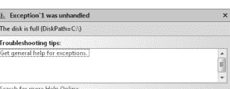

### 以可靠性换取生产力

我从 1975 年开始编写软件。我做过相当多的 BASIC 编程，随着我对硬件越来越感兴趣，我转向了汇编语言。后来，我转向了 C 编程语言，因为它让我能以高得多的抽象层次访问硬件，从而使编程更容易。我的背景是编写操作系统代码和平台/库代码，所以我总是努力使代码尽可能小、尽可能快，因为应用程序的质量不可能超过其所依赖的操作系统和库。

除了编写小而快的代码，我还始终关注错误恢复。在分配内存时（通过使用 C++ 的 new 运算符或调用 malloc、HeapAlloc、VirtualAlloc 等），我总会检查返回值，以确保我请求的内存确实分配给了我。而且，如果内存请求失败，我总会有备用代码路径，确保程序其余状态不受影响，并让我的任何调用方知道我失败了，以便调用代码也能采取纠正措施。

出于某种我无法完全解释的原因，在为 .NET Framework 编写代码时，人们并没有保持这种对细节的关注。内存不足的情况总是可能发生，然而我几乎从未见过任何代码包含 catch 块来从 OutOfMemoryException 中恢复。事实上，甚至有些开发者告诉我，CLR 不允许程序捕获 OutOfMemoryException。需要明确的是，这绝对不正确；你确实可以捕获这个异常。事实上，执行托管代码时可能出现许多错误，而我几乎从未见过开发者编写代码来尝试从这些潜在故障中恢复。在本节中，我想指出一些潜在故障，以及为什么忽略它们已在开发文化中变得可接受。我还想指出忽略这些故障时可能发生的一些重大问题，并提出一些有助于缓解这些问题的办法。

面向对象编程使开发者能够非常高效地工作。这在很大程度上归功于可组合性，它使代码易于编写、阅读和维护。以下面这行代码为例。

```csharp
Boolean f = "Jeff".Substring(1, 1).ToUpper().EndsWith("E");
```

前面的代码做了一个很大的假设：不会发生错误。但是，错误当然总是可能发生，因此我们需要一种处理这些错误的方法。这正是异常处理构造和机制的意义所在，也是为什么我们需要它们，而不是像 Win32 和 COM 函数那样，让方法返回 true/false 或 HRESULT 来表示成功/失败。

除了代码可组合性之外，我们之所以高效，还归功于编译器提供的各种出色特性。例如，编译器会隐式地：

- 在调用方法时插入可选参数。
- 对值类型实例进行装箱。
- 构造/初始化参数数组。
- 绑定到动态变量和表达式的成员。
- 绑定到扩展方法。
- 绑定/调用重载运算符。
- 构造委托对象。
- 在调用泛型方法、声明局部变量和使用 lambda 表达式时推断类型。
- 为 lambda 表达式和迭代器定义/构造闭包类。
- 定义/构造/初始化匿名类型及其实例。
- 重写代码以支持语言集成查询（LINQ；查询表达式和表达式树）。

而且，CLR 本身为开发者做了各种出色的工作，让我们的生活更加轻松。例如，CLR 会隐式地：

- 调用虚方法和接口方法。
- 加载程序集并对方法进行 JIT 编译，这可能抛出 `FileLoadException`、`BadImageFormatException`、`InvalidProgramException`、`FieldAccessException`、`MethodAccessException`、`MissingFieldException`、`MissingMethodException` 和 `VerificationException`。
- 在访问派生自 `MarshalByRefObject` 的类型的对象时跨 AppDomain 边界转换，这可能抛出 `AppDomainUnloadedException`。
- 在跨 AppDomain 边界时序列化和反序列化对象。
- 当调用 `Thread.Abort` 或 `AppDomain.Unload` 时，导致 `thread(s)` 抛出 `ThreadAbortException`。
- 在垃圾回收之后、对象内存被回收之前调用 `Finalize` 方法。
- 使用泛型类型时在加载器堆中创建类型对象。
- 调用类型的静态构造函数，可能抛出 `TypeInitializationException`。
- 抛出各种异常，包括 `OutOfMemoryException`、`DivideByZeroException`、`NullReferenceException`、`RuntimeWrappedException`、`TargetInvocationException`、`OverflowException`、`NotFiniteNumberException`、`ArrayTypeMismatchException`、`DataMisalignedException`、`IndexOutOfRangeException`、`InvalidCastException`、`RankException`、`SecurityException` 等。

当然，.NET Framework 还附带一个庞大的类库，其中包含数万个类型，每个类型都封装了常见、可复用的功能。其中有用于构建 Web 窗体应用程序、Web 服务、丰富的 GUI 应用程序、处理安全性、图像处理、语音识别的类型，这样的例子不胜枚举。这些代码中的任何一部分都可能抛出异常，表示失败。而且未来版本可能引入派生自现有异常类型的新异常类型，于是你的 `catch` 块会捕获以前从未存在过的异常类型。

所有这些东西——面向对象编程、编译器特性、CLR 特性以及庞大的类库——正是它们使 .NET Framework 成为如此引人注目的软件开发平台。^4 我的观点是，所有这些东西都会在你的代码中引入故障点，而你几乎无法控制它们。只要一切运行良好，那就没问题：我们写代码很容易，代码也易于阅读和维护。但是，一旦出问题，几乎不可能完全理解出了什么问题以及为什么出错。

4 我还应该补充一点，Microsoft Visual Studio 的编辑器、IntelliSense 支持、代码片段支持、模板、扩展性系统、调试系统以及各种其他工具，也有助于使该平台对开发者具有吸引力。不过，我将其排除在主要讨论之外，因为它在运行时不会影响代码的行为。


这里有一个例子，应该能真正帮助我把观点讲清楚。

```csharp
private static Object OneStatement(Stream stream, char charToFind) {
    return (charToFind + ": " + stream.GetType() + String.Empty + (stream.Position + 512M))
        .Where(c=>c == charToFind).ToArray();
}
```

这个略显刻意的方法中只包含一条 C# 语句，但这条语句做了大量工作。实际上，下面是 C# 编译器为此方法生成的中间语言（IL）。（我把其中一些由于正在发生的隐式操作而可能成为故障点的行标成了粗斜体。）

```il
.method private hidebysig static object OneStatement(
        class [mscorlib]System.IO.Stream stream, char charToFind) cil managed {
    .maxstack 4
    .locals init (
        [0] class Program/<>c__DisplayClass1 V_0,
        [1] object[] V_1)
    IL_0000:  newobj    instance void Program/<>c__DisplayClass1::.ctor()
    IL_0005:  stloc.0
    IL_0006:  ldloc.0
    IL_0007:  ldarg.1
    IL_0008:  stfld     char Program/<>c__DisplayClass1::charToFind
    IL_000d:  ldc.i4.5
    IL_000e:  newarr    [mscorlib]System.Object
    IL_0013:  stloc.1
    IL_0014:  ldloc.1
    IL_0015:  ldc.i4.0
    IL_0016:  ldloc.0
    IL_0017:  ldfld     char Program/<>c__DisplayClass1::charToFind
    IL_001c:  box       [mscorlib]System.Char
    IL_0021:  stelem.ref
    IL_0022:  ldloc.1
    IL_0023:  ldc.i4.1
    IL_0024:  ldstr     ": "
    IL_0029:  stelem.ref
    IL_002a:  ldloc.1
    IL_002b:  ldc.i4.2
    IL_002c:  ldarg.0
    IL_002d:  callvirt  instance class [mscorlib]System.Type [mscorlib]System.Object::GetType()
    IL_0032:  stelem.ref
    IL_0033:  ldloc.1
    IL_0034:  ldc.i4.3
    IL_0035:  ldsfld    string [mscorlib]System.String::Empty
    IL_003a:  stelem.ref
    IL_003b:  ldloc.1
    IL_003c:  ldc.i4.4
    IL_003d:  ldarg.0
    IL_003e:  callvirt  instance int64 [mscorlib]System.IO.Stream::get_Position()
    IL_0043:  call      valuetype [mscorlib]System.Decimal
                                 [mscorlib]System.Decimal::op_Implicit(int64)
    IL_0048:  ldc.i4     0x200
    IL_004d:  newobj    instance void [mscorlib]System.Decimal::.ctor(int32)
    IL_0052: call valuetype [mscorlib]System.Decimal [mscorlib]System.Decimal::op_Addition
               (valuetype [mscorlib]System.Decimal, valuetype [mscorlib]System.Decimal)
    IL_0057: box [mscorlib]System.Decimal
    IL_005c: stelem.ref
    IL_005d: ldloc.1
    IL_005e: call string [mscorlib]System.String::Concat(object[])
    IL_0063: ldloc.0
    IL_0064: ldftn instance bool Program/<>c__DisplayClass1::<OneStatement>b__0(char)
    IL_006a: newobj instance
               void [mscorlib]System.Func`2<char, bool>::.ctor(object, native int)
    IL_006f: call class [mscorlib]System.Collections.Generic.IEnumerable`1<!!0>
               [System.Core]System.Linq.Enumerable::Where<char>(
               class [mscorlib]System.Collections.Generic.IEnumerable`1<!!0>,
               class [mscorlib]System.Func`2<!!0, bool>)
    IL_0074: call !!0[] [System.Core]System.Linq.Enumerable::ToArray<char>(
               class [mscorlib]System.Collections.Generic.IEnumerable`1<!!0>)
    IL_0079: ret
}
```

如你所见，在构造 <>c__DisplayClass1 类（一个编译器生成类型）、Object[] 数组、Func 委托，以及对 char 和 Decimal 进行装箱时，都可能发生 OutOfMemoryException。调用 Concat、Where 和 ToArray 时，内部也会分配内存。构造 Decimal 实例可能导致其类型构造器被调用，从而引发 TypeInitializationException。此外，还有对 Decimal 的 op_Implicit 运算符及其 op_Addition 运算符方法的隐式调用，这些调用可能做任何事，包括抛出 OverflowException。

查询 Stream 的 Position 属性很有意思。首先，它是一个虚属性，因此我的 OneStatement 方法根本不知道实际会执行什么代码，而那段代码可能抛出任何异常。其次，Stream 派生自 MarshalByRefObject，所以 stream 参数实际上可能引用一个代理对象，而该代理对象又引用另一个 AppDomain 中的对象。另一个 AppDomain 可能已被卸载，因此这里也可能抛出 AppDomainUnloadedException。

当然，所有被调用的方法都是我个人无法控制的方法，因为它们由 Microsoft 生成。而且 Microsoft 完全可能在未来改变这些方法的实现方式，因此它们可能抛出我在编写 OneStatement 方法那天根本不可能知道的新异常类型。我怎么可能把 OneStatement 方法写得对所有可能的失败都完全健壮呢？顺便说一句，反过来也是问题：一个 catch 块可能捕获到派生自指定异常类型的异常，而此时我却在为另一种失败执行恢复代码。

所以，既然你已经了解了所有可能的失败，你大概就能明白为什么不编写真正健壮可靠的代码会在业界成为一种可接受的做法：这根本不切实际。此外，人们也可以说这实际上是不可能的。错误并不频繁发生，这也是它成为一种可接受做法的另一个原因。由于错误（如 OutOfMemoryException）很少发生，社区决定用真正可靠的代码来换取程序员的生产力。

^5 顺便说一句，System.Char、System.String、System.Type 和 System.IO.Stream 都定义了类构造器，它们都可能在此应用程序的某个时刻导致 TypeInitializationException 被抛出。

异常的好处之一是，未处理的异常会导致应用程序终止。这很好，因为在测试期间你会很快发现问题，而且未处理异常提供的信息（错误消息和堆栈跟踪）通常足以让你修复代码。当然，许多公司不希望自己的应用程序在测试和部署后就直接终止，因此很多开发者会插入代码来捕获 System.Exception，即所有异常类型的基类。然而，捕获 System.Exception 并让应用程序继续运行的问题在于，状态可能已经损坏。

本章前面，我展示了一个 Account 类，它定义了一个 Transfer 方法，其职责是从一个账户向另一个账户转账。如果调用这个 Transfer 方法时，它成功地从 From 账户扣除了钱，然后在向 To 账户加钱之前抛出了异常，会怎样？如果调用代码捕获 System.Exception 并继续运行，那么应用程序的状态就损坏了：From 和 To 两个账户中的钱都比应有的少。因为我们这里谈的是钱，这种状态损坏不会只被视为简单的 bug，它肯定会被视为安全漏洞。如果应用程序继续运行，它会尝试在各个账户之间执行更多转账，于是状态损坏就会在应用程序内肆意蔓延。

有人可能会说，Transfer 方法本身应该捕获 System.Exception，并把钱恢复到 From 账户。如果 Transfer 方法足够简单，这也许确实可行。但如果 Transfer 方法要生成取出款项的审计记录，或者有其他线程同时操作同一个账户，那么尝试撤销操作也可能失败，从而抛出另一个异常。这样一来，状态损坏只会变得更糟，而不是更好。

> **注意** 有人可能会说，知道事情*哪里*出了问题，比知道*什么*错误发生了更有用。例如，知道从某个账户转出钱失败了，可能比知道 Transfer 因 SecurityException 或 OutOfMemoryException 等而失败更有用。事实上，Win32 错误模型就是这样工作的：方法返回 true/false 来表示成功/失败，这样你就知道哪个方法失败了。然后，如果你的程序关心失败原因，它会调用 Win32 的 GetLastError 方法。System.Exception 确实有一个 Source 属性，可以告诉你失败的方法。但这个属性是一个 String，你必须解析它；而且如果两个方法内部调用同一个方法，你仅凭 Source 属性无法判断你的代码调用的是哪个方法失败了。相反，你必须解析 Exception 的 StackTrace 属性返回的 String 才能获得这一信息。由于这太难了，我从未见过有人真正写代码这样做。


你可以采取以下几项措施来*帮助*缓解状态损坏：

-   CLR 不允许在线程执行 catch 或 finally 块内的代码时中止该线程。因此，我们可以通过执行以下操作来让 Transfer 方法更加稳健。

    ```
    public static void Transfer(Account from, Account to, Decimal amount) {
       try { /* do nothing in here */ }
       finally {
          from -= amount;
          // Now, a thread abort (due to Thread.Abort/AppDomain.Unload) can't happen here
          to += amount;
       }
    }
    ```

    但是，绝对不建议你把所有代码都写在 finally 块中！你只应将此技术用于修改极其敏感的状态。

-   你可以使用 System.Diagnostics.Contracts.Contract 类将代码契约应用于方法。代码契约提供了一种方式，让你在尝试通过这些参数/变量修改状态之前，先验证参数和其他变量。如果参数/变量满足契约，那么状态损坏的*可能性*就会降到最低（但并未完全消除）。如果契约失败，则会在修改任何状态之前抛出异常。我将在本章后面讨论代码契约。

-   你可以使用受约束执行区域（CER），它提供了一种从场景中消除某些 CLR 不确定性的方法。例如，在进入 try 块之前，你可以让 CLR 加载任何关联的 catch 和 finally 块中的代码所需的所有程序集。此外，CLR 将编译 catch 和 finally 块中的所有代码，包括从这些块内部调用的所有方法。这将消除在尝试执行错误恢复代码（在 catch 块中）或清理代码（在 finally 块中）时可能发生的一批潜在异常（包括 FileLoadException、BadImageFormatException、InvalidProgramException、FieldAccessException、MethodAccessException、MissingFieldException 和 MissingMethodException）。它还会降低 OutOfMemoryException 以及一些其他异常发生的可能性。我将在本章后面讨论 CER。

-   根据状态所在的位置，你可以使用事务来确保要么修改所有状态，要么不修改任何状态。例如，如果数据位于数据库中，事务就能很好地工作。Windows 现在也支持事务性注册表和文件操作（仅在 NTFS 卷上），因此你或许可以使用这一功能；但是，.NET Framework 目前并不直接公开此功能。你必须通过 P/Invoke 调用本机代码才能利用它。有关更多详细信息，请参见 System.Transactions.TransactionScope 类。

### 准则与最佳实践

理解异常机制固然重要。同样重要的是，理解如何明智地使用异常。我常常看到库开发者捕获各种异常，导致应用程序开发者无法知道已经发生问题。在本节中，我将提供一些开发人员在使用异常时应注意的准则。

> **重要** 如果你是一名*类库开发者*，正在开发将被其他开发者使用的类型，请非常认真地对待这些准则。你肩负着重大的责任：你要在类库中设计类型，使其对各种各样的应用程序都有意义。请记住，你并不深入了解自己将要回调的代码（通过委托、虚方法或接口方法）。你也不知道是哪些代码在调用你。预判你的类型会被用于何种场景并不可行，所以不要做出任何策略性决定。你的代码绝不能决定什么条件构成错误；让调用方做出该决定。
> 
> 此外，要密切关注状态，尽量不要损坏它。使用代码契约（本章后面会讨论）验证传递给方法的参数。尽量不要修改状态。如果你确实修改了状态，就要为失败做好准备，并尝试恢复状态。如果你遵循本章中的准则，应用程序开发者在使用你的类库中的类型时就不会感到困难。
> 
> 如果你是一名*应用程序开发者*，请定义你认为合适的任何策略。遵循本章中的设计准则将帮助你在代码发布之前发现问题，从而修复问题并使应用程序更加稳健。不过，在仔细考虑之后，你也可以自由地偏离这些准则。策略由你设定。例如，应用程序代码在捕获异常方面可以比类库代码更激进。

#### 大方地使用 finally 块

我认为 finally 块非常棒！它们允许你指定一个代码块，无论线程抛出何种异常，该代码块都保证会执行。你应该使用 finally 块来清理任何已成功启动的操作，然后再返回到调用方，或允许 finally 块之后的代码执行。你也经常使用 finally 块来显式释放对象，以避免资源泄漏。下面是一个示例，它将所有清理代码（关闭文件）都放在 finally 块中。

```csharp
using System;
using System.IO;

public sealed class SomeType {
    private void SomeMethod() {
        FileStream fs = new FileStream(@"C:\Data.bin ", FileMode.Open);
        try {
            // Display 100 divided by the first byte in the file.
            Console.WriteLine(100 / fs.ReadByte());
        }
        finally {
            // Put cleanup code in a finally block to ensure that the file gets closed regardless
            // of whether or not an exception occurs (for example, the first byte was 0).
            if (fs != null) fs.Dispose();
        }
    }
}
```

确保清理代码始终执行非常重要，因此许多编程语言提供了让编写清理代码更容易的构造。例如，每当你使用 lock、using 和 foreach 语句时，C# 语言都会自动生成 try/finally 块。每当你重写类的析构函数（Finalize 方法）时，C# 编译器也会生成 try/finally 块。使用这些构造时，编译器会将你编写的代码放入 try 块，并自动将清理代码放入 finally 块。具体来说：

-   当你使用 lock 语句时，锁会在 finally 块内释放。
-   当你使用 using 语句时，对象的 Dispose 方法会在 finally 块内被调用。
-   当你使用 foreach 语句时，IEnumerator 对象的 Dispose 方法会在 finally 块内被调用。
-   当你定义析构函数方法时，基类的 Finalize 方法会在 finally 块内被调用。

例如，下面的 C# 代码利用了 using 语句。这段代码比上一个示例中显示的代码更短，但编译器生成的代码与上一个示例中生成的代码完全相同。

```csharp
using System;
using System.IO;

internal sealed class SomeType {
    private void SomeMethod() {
        using (FileStream fs = new FileStream(@"C:\Data.bin", FileMode.Open)) {
            // Display 100 divided by the first byte in the file.
            Console.WriteLine(100 / fs.ReadByte());
        }
    }
}
```

有关 using 语句的更多信息，请参见第 21 章；有关 lock 语句的更多信息，请参见第 30 章。

#### 不要捕获所有异常

那些未接受过正确使用异常培训的开发者普遍会犯的一个错误，就是过于频繁且不恰当地使用 catch 块。当你捕获异常时，你是在声明你预料到了这个异常，你理解它为何发生，并且你知道如何处理它。换句话说，你是在为应用程序定义策略。这一切都要回到本章前面的“用可靠性换取生产力”一节。

我常常看到像这样的代码。

```csharp
try {
    // try to execute code that the programmer knows might fail...
}
catch (Exception) {
    ...
}
```

这段代码表明它预期任何及所有异常，并且知道如何从任何及所有情况中恢复。这怎么可能呢？作为类库一部分的类型，在任何情况下都绝对不应该捕获并吞掉所有异常，因为该类型无法确切知道应用程序打算如何响应异常。此外，该类型会经常通过委托、虚方法或接口方法调用应用程序代码。如果应用程序代码抛出异常，应用程序的另一部分很可能期望捕获这个异常。应该允许异常沿着调用栈向上传递，并让应用程序代码自行决定如何处理该异常。

如果异常未被处理，CLR 将终止进程。我将在本章后面讨论未处理异常。大多数未处理异常都会在代码测试期间被发现。要修复这些未处理异常，你要么修改代码以查找特定异常，要么重写代码以消除导致异常被抛出的条件。最终将在生产环境中运行的代码版本应该很少遇到未处理异常，并且会极其稳健。

> **注意** 在某些情况下，无法完成其任务的方法会检测到某个对象的状态已损坏且无法恢复。允许应用程序继续运行可能会导致不可预测的行为或安全漏洞。检测到这种情况时，该方法不应抛出异常；相反，它应通过调用 System.Environment 的 FailFast 方法强制进程立即终止。

顺便说一下，捕获 System.Exception 并在 catch 块的大括号内执行一些代码是可以的，只要你在该代码的末尾重新抛出异常。绝不应该捕获 System.Exception 并吞掉异常（不重新抛出它），因为这会隐藏失败，使应用程序在不可预测的结果和潜在安全漏洞下继续运行。Visual Studio 的代码分析工具（FxCopCmd.exe）会标记任何包含 catch (Exception) 块的代码，除非该块的代码中包含 throw 语句。关于“从部分完成的状态中退出”

本章稍后将出现的“发生不可恢复异常时完成操作——保持状态”一节将讨论此模式。

最后，捕获在一个线程中发生的异常并在另一个线程中重新抛出该异常是可以的。异步编程模型（在第28章“I/O 绑定的异步操作”中讨论）支持这种做法。例如，如果某个线程池线程执行会抛出异常的代码，CLR 会捕获并吞掉该异常，并允许该线程返回到线程池。之后，某个线程应调用 EndXxx 方法来确定异步操作的结果。EndXxx 方法将抛出由实际执行工作的线程池线程所抛出的同一个异常对象。在此场景中，异常被第一个线程吞掉；不过，调用 EndXxx 方法的线程会重新抛出该异常，因此它不会对应用程序隐藏。

#### 优雅地从异常中恢复

有时你调用一个方法时，事先就知道该方法可能抛出某些异常。由于你预期到这些异常，可能希望有一些代码能让应用程序从该情况中优雅地恢复并继续运行。下面是一个伪代码示例。

```csharp
public String CalculateSpreadsheetCell(Int32 row, Int32 column) {
    String result;
    try {
        result = /* Code to calculate value of a spreadsheet's cell */
    }
    catch (DivideByZeroException) {
        result = "Can't show value: Divide by zero";
    }
    catch (OverflowException) {
        result = "Can't show value: Too big";
    }
    return result;
}
```

这段伪代码计算电子表格中某个单元格的内容，并返回表示该值的字符串给调用方，以便调用方能在应用程序窗口中显示该字符串。然而，单元格的内容可能是用一个单元格除以另一个单元格的结果。如果包含除数的单元格包含 0，CLR 将抛出 DivideByZeroException 对象。在这种情况下，该方法会捕获这个特定异常并返回一个将显示给用户的特殊字符串。类似地，单元格的内容可能是用一个单元格乘以另一个单元格的结果。如果相乘后的值不适合所允许的位数，CLR 将抛出 OverflowException 对象，同样会向用户显示一个特殊字符串。

当你捕获特定异常时，要完全理解导致该异常被抛出的情形，并知道哪些异常类型派生自你正在捕获的异常类型。不要捕获并处理 System.Exception（而不重新抛出），因为你不可能知道 try 块内可能抛出的所有异常（尤其是考虑到 OutOfMemoryException 或 StackOverflowException 等，仅举两个例子）。

#### 发生不可恢复异常时退出部分完成的操作——保持状态

通常，方法会调用其他若干方法来执行单个抽象操作。其中一些单独的方法可能成功完成，而另一些可能没有。例如，假设你正在将一组对象序列化到磁盘文件。在序列化了 10 个对象之后，抛出了异常。（也许磁盘已满，或者下一个要序列化的对象没有用 `Serializable` 自定义特性标记。）此时，异常应向上传递给调用方，但磁盘文件的状态怎么办？该文件现在已损坏，因为它包含一个部分序列化的对象图。如果应用程序能够退出部分完成的操作，使文件恢复到尚未将任何对象序列化到其中时的状态，那就太好了。下面的代码演示了实现这一点的正确方式。

```csharp
public void SerializeObjectGraph(FileStream fs, IFormatter formatter, Object rootObj) {

    // Save the current position of the file.
    Int64 beforeSerialization = fs.Position;

    try {
        // Attempt to serialize the object graph to the file.
        formatter.Serialize(fs, rootObj);
    }
    catch {  // Catch any and all exceptions.
        // If ANYTHING goes wrong, reset the file back to a good state.
        fs.Position = beforeSerialization;

        // Truncate the file.
        fs.SetLength(fs.Position);

        // NOTE: The preceding code isn't in a finally block because
        // the stream should be reset only when serialization fails.

        // Let the caller(s) know what happened by re-throwing the SAME exception.
        throw;
    }
}
```

要正确地退出部分完成的操作，应编写捕获所有异常的代码。是的，在这里要*捕获所有*异常，因为你不关心发生了什么类型的错误；你需要将数据结构恢复到一致状态。在捕获并处理异常之后，不要吞掉它——让调用方知道发生了异常。你可以通过重新抛出同一个异常来做到这一点。事实上，C# 和许多其他语言让这变得很容易。只需使用 C# 的 `throw` 关键字，并且不要在 `throw` 后指定任何内容，如前面的代码所示。

注意，前面示例中的 catch 块没有指定任何异常类型，因为我想捕获任何及所有异常。此外，catch 块中的代码不需要确切知道抛出了哪种异常，只需知道出了错。幸运的是，C# 让我可以很容易地做到这一点：不指定任何异常类型，并让 throw 语句重新抛出所捕获的任何对象。

#### 隐藏实现细节以维持“契约”

在某些情况下，你可能会发现捕获一个异常并重新抛出一个不同异常很有用。这样做的唯一原因是维持方法契约的含义。此外，你抛出的新异常类型应当是特定异常（即不用作任何其他异常类型基类的异常）。设想一个 PhoneBook 类型，它定义了一个根据姓名查找电话号码的方法，如下面的伪代码所示。

```csharp
internal sealed class PhoneBook {
    private String m_pathname;  // path name of file containing the address book

    // Other methods go here.

    public String GetPhoneNumber(String name) {
        String phone;
        FileStream fs = null;
        try {
            fs = new FileStream(m_pathname, FileMode.Open);
            // Code to read from fs until name is found goes here
            phone = /* the phone # found */;
        }
        catch (FileNotFoundException e) {
            // Throw a different exception containing the name, and
            // set the originating exception as the inner exception.
            throw new NameNotFoundException(name, e);
        }
        catch (IOException e) {
            // Throw a different exception containing the name, and
            // set the originating exception as the inner exception.
            throw new NameNotFoundException(name, e);
        }
        finally {
            if (fs != null) fs.Close();
        }
        return phone;
    }
}
```

电话簿数据是从文件（而不是网络连接或数据库）获取的。然而，PhoneBook 类型的使用者并不知道这一点，因为这是一个将来可能改变的实现细节。因此，如果文件未找到或因任何原因无法读取，调用方将看到 FileNotFoundException 或 IOException，而这是未曾预料到的。换句话说，文件的存在及其可读性并不是该方法隐含契约的一部分：调用方不可能猜到这一点。因此，GetPhoneNumber 方法捕获这两种异常类型，并抛出一个新的 NameNotFoundException。

使用此技术时，你应捕获那些你完全理解其引发情形的特定异常。而且，你还应知道哪些异常类型派生自你正在捕获的异常类型。

你的代码可能试图捕获它并从中恢复，但你甚至不知道自己正在调用类型构造函数。因此，CLR 将 DivideByZeroException 转换为 TypeInitializationException，以便你清楚地知道异常是由于类型构造函数失败而发生的；问题并不出在你的代码中。

另一方面，这里有一个使用该技术的糟糕示例：当你通过反射调用方法时，CLR 会包装该方法抛出的每个异常，并将其转换为 TargetInvocationException。这非常烦人，因为你现在必须捕获 TargetInvocationException 对象，并查看其 InnerException 属性，才能辨别失败的真正原因。事实上，在使用反射时，经常会看到类似下面这样的代码。

```csharp
private static void Reflection(Object o) {
    try {
        // Invoke a DoSomething method on this object
        var mi = o.GetType().GetMethod("DoSomething");
        mi.Invoke(o, null); // The DoSomething method might throw an exception
    }
    catch (System.Reflection.TargetInvocationException e) {
        // The CLR converts reflection-produced exceptions to TargetInvocationException
        throw e.InnerException; // Re-throw what was originally thrown
    }
}
```

不过我有个好消息：如果你使用 C# 的 dynamic 基元类型（在第 5 章“基元类型、引用类型和值类型”中讨论）来调用成员，编译器生成的代码不会捕获任何异常并抛出 TargetInvocationException 对象；原始抛出的异常对象只会沿调用栈向上传播。对许多开发者来说，这是更倾向于使用 C# 的 dynamic 基元类型而不是反射的一个很好的理由。

### 未处理异常

当抛出异常时，CLR 会沿调用栈向上查找与所抛异常对象类型匹配的 catch 块。如果没有 catch 块与抛出的异常类型匹配，就会发生未处理异常。当 CLR 检测到进程中的任何线程发生了未处理异常时，CLR 会终止该进程。未处理异常表示应用程序未预料到的情况，被视为应用程序中的真正 bug。此时，应将该 bug 报告给发布该应用程序的公司。希望发布者会修复该 bug 并分发应用程序的新版本。

类库开发者甚至不应该考虑未处理异常。只有应用程序开发者需要关注未处理异常，并且应用程序应该制定处理未处理异常的策略。Microsoft 实际上建议应用程序开发者直接接受 CLR 的默认策略。也就是说，当应用程序发生未处理异常时，Windows 会向系统事件日志写入一个条目。你可以打开事件查看器应用程序，然后在树中的“Windows 日志 ➞ 应用程序”节点下查看该条目，如图 20-1 所示。

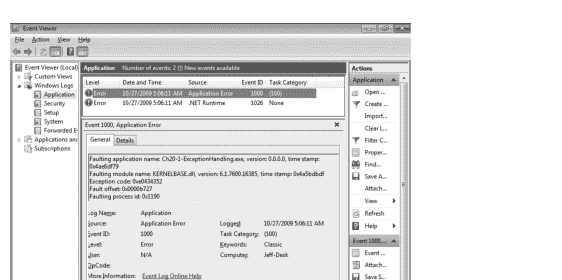

**图 20-1** Windows 事件日志显示一个因未处理异常而终止的应用程序。

不过，你可以使用 Windows 可靠性监视器小程序获取有关该问题的更有趣的详细信息。要启动可靠性监视器，请打开 Windows 控制面板并搜索“可靠性历史记录”。在这里，你可以在底部窗格中看到因未处理异常而终止的应用程序，如图 20-2 所示。

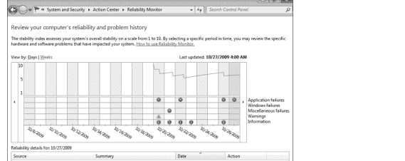

**图 20-2** 可靠性监视器显示一个因未处理异常而终止的应用程序。

要查看有关已终止应用程序的更多详细信息，请在可靠性监视器中双击已终止的应用程序。详细信息将类似于图 20-3，问题签名的含义在表 20-2 中描述。托管应用程序产生的所有未处理异常都放在 CLR20r3 存储桶中。

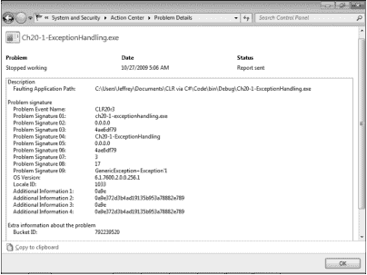

**图 20-3** 可靠性监视器显示有关失败应用程序的更多详细信息。

#### 表 20-2 问题签名

| 问题签名 | 描述* |
|---|---|
| 01 | EXE 文件的名称（32 个字符限制） |
| 02 | EXE 文件的程序集版本号 |
| 03 | EXE 文件的时间戳 |
| 04 | EXE 文件的完整程序集名称（64 个字符限制） |
| 05 | 出错程序集的版本 |
| 06 | 出错程序集的时间戳 |
| 07 | 出错程序集的类型和方法。该值是一个 MethodDef 元数据标记（去掉 0x06 高字节后），用于标识抛出异常的方法。通过该值，你可以使用 ILDasm.exe 确定有问题的类型和方法。 |
| 08 | 出错方法的 IL 指令。该值是抛出异常的 IL 指令在出错方法内的偏移量。通过该值，你可以使用 ILDasm.exe 确定有问题的指令。 |
| 09 | 抛出的异常类型（32 个字符限制） |

* 如果字符串超出允许限制，则会执行一些智能截断，例如从异常类型中删除“Exception”或从文件名中删除“.dll”。如果结果字符串仍然过长，则 CLR 会通过哈希或 base-64 编码该字符串来创建一个值。

记录有关失败应用程序的信息后，Windows 会显示一个消息框，允许最终用户将有关失败应用程序的信息发送到 Microsoft 服务器。⁷ 这称为 *Windows 错误报告*，有关它的更多信息可在 Windows Quality 网站（http://WinQual.Microsoft.com）上找到。

公司可以选择与 Microsoft 签约，以查看有关其自身应用程序和组件的此信息。注册是免费的，但它确实要求你的程序集使用 VeriSign ID（也称为用于 Authenticode 的软件发布者数字 ID）进行签名。

当然，你也可以开发自己的系统，将未处理异常信息反馈给你，以便你修复代码中的 bug。当应用程序初始化时，你可以通知 CLR：你有一个方法，希望在应用程序中的任何线程发生未处理异常时调用它。

不幸的是，Microsoft 产生的每种应用程序模型都有自己接入未处理异常的方式。你需要在 FCL 文档中查找的成员包括：

- 对于许多应用程序，请查看 `System.AppDomain` 的 `UnhandledException` 事件。Windows 应用商店应用程序和 Microsoft Silverlight 应用程序无法访问此事件。
- 对于 Windows 应用商店应用，请查看 `Windows.UI.Xaml.Application` 的 `UnhandledException` 事件。
- 对于 Windows Forms 应用程序，请查看 `System.Windows.Forms.NativeWindow` 的 `OnThreadException` 虚方法、`System.Windows.Forms.Application` 的 `OnThreadException` 虚方法，以及 `System.Windows.Forms.Application` 的 `ThreadException` 事件。
- 对于 Windows Presentation Foundation (WPF) 应用程序，请查看 `System.Windows.Application` 的 `DispatcherUnhandledException` 事件，以及 `System.Windows.Threading.Dispatcher` 的 `UnhandledException` 和 `UnhandledExceptionFilter` 事件。
- 对于 Silverlight，请查看 `System.Windows.Application` 的 `UnhandledException` 事件。
- 对于 ASP.NET Web Form 应用程序，请查看 `System.Web.UI.TemplateControl` 的 `Error` 事件。`TemplateControl` 是 `System.Web.UI.Page` 和 `System.Web.UI.UserControl` 类的基类。此外，还应查看 `System.Web.HttpApplication` 的 `Error` 事件。
- 对于 Windows Communication Foundation 应用程序，请查看 `System.ServiceModel.Dispatcher.ChannelDispatcher` 的 `ErrorHandlers` 属性。

在结束本节之前，我想谈一谈分布式应用程序（如网站或 Web 服务）中可能发生的未处理异常。在理想情况下，遇到未处理异常的服务器应用程序应记录该异常，并向……

⁷ 实际上，你可以通过使用 P/Invoke 调用 Win32 的 `SetErrorMode` 函数，并传入 `SEM_NOGPFAULTERRORBOX` 来禁用此消息框。


向客户端表明请求的操作无法完成，然后服务器应终止。不幸的是，我们并非生活在理想世界，因此可能无法向客户端发送失败通知。对于某些有状态服务器（如 Microsoft SQL Server），终止服务器并启动一个全新实例可能并不实际。

对于服务器应用程序，不应将有关未处理异常的信息返回给客户端，因为客户端对此几乎无能为力，尤其当客户端由其他公司实现时。此外，服务器应尽可能少地向其客户端泄露关于自身的信息，以降低服务器被黑客攻击的可能性。


> **注意**  CLR 会将本机代码抛出的一些异常视为*损坏状态异常（CSEs）*，因为它们通常是 CLR 本身或托管开发人员无法控制的某些本机代码中的 bug 导致的结果。默认情况下，CLR 不会让托管代码捕获这些异常，并且 `finally` 块将不会执行。以下是被视为 CSE 的本机 Win32 异常列表。
>
> |  |  |
> |---|---|
> | `EXCEPTION_ACCESS_VIOLATION` | `EXCEPTION_STACK_OVERFLOW` |
> | `EXCEPTION_ILLEGAL_INSTRUCTION` | `EXCEPTION_IN_PAGE_ERROR` |
> | `EXCEPTION_INVALID_DISPOSITION` | `EXCEPTION_NONCONTINUABLE_EXCEPTION` |
> | `EXCEPTION_PRIV_INSTRUCTION` | `STATUS_UNWIND_CONSOLIDATE` |
>
> 单个托管方法可以通过将 `System.Runtime.ExceptionServices.HandleProcessCorruptedStateExceptionsAttribute` 应用到该方法，来重写默认行为并捕获这些异常。此外，该方法还必须应用 `System.Security.SecurityCriticalAttribute`。你也可以通过将应用程序的可扩展标记语言 (XML) 配置文件中的 `legacyCorruptedStateExceptionPolicy` 元素设置为 true，来重写整个进程的默认行为。CLR 会将其中大多数转换为 `System.Runtime.InteropServices.SEHException` 对象，但 `EXCEPTION_ACCESS_VIOLATION` 除外，它会被转换为 `System.AccessViolationException` 对象；而 `EXCEPTION_STACK_OVERFLOW` 会被转换为 `System.StackOverflowException` 对象。


> **注意**  在调用某个方法之前，可以通过调用 `RuntimeHelper` 类的 `EnsureSufficientExecutionStack` 方法来检查是否有充足的堆栈空间。此方法检查调用线程是否有足够的可用堆栈空间来执行普通方法（其定义并不明确）。如果堆栈空间不足，该方法会抛出 `InsufficientExecutionStackException`，你可以捕获它。`EnsureSufficientExecutionStack` 方法不接受任何参数并返回 `void`。此方法通常由递归方法使用。

### 调试异常

Visual Studio 调试器对异常提供特殊支持。打开解决方案后，从“调试”菜单中选择“异常”，你将看到如图 20-4 所示的对话框。

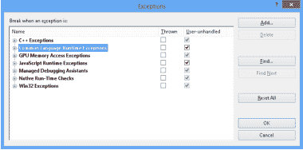

**图 20-4** “异常”对话框，显示不同类型的异常。

此对话框显示了 Visual Studio 所知道的不同类型的异常。对于公共语言运行时异常，展开对话框中的相应分支（如图 20-5 所示），将显示 Visual Studio 调试器所知道的命名空间集合。

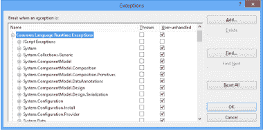

**图 20-5** “异常”对话框，按命名空间显示 CLR 异常。

如果展开某个命名空间，你将看到该命名空间内定义的所有派生自 System.Exception 的类型。例如，图 20-6 显示了打开 System 命名空间后你将看到的内容。

对于任何异常类型，如果选中了其 Thrown 复选框，则一旦抛出该异常，调试器就会中断。此时，CLR 尚未尝试查找任何匹配的 catch 块。如果你想调试捕获并处理异常的代码，这会很有用。当你怀疑某个组件或库可能吞掉或重新抛出异常，并且不确定究竟应在何处设置断点来当场捕获它时，这也会很有用。

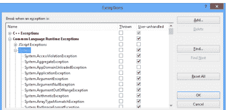

图 20-6 “异常”对话框，显示在 System 命名空间中定义的 CLR 异常。

如果未选中某个异常类型的 Thrown 复选框，调试器也会在抛出该异常的位置中断，但仅当该异常类型未被处理时才会如此。开发人员通常会让 Thrown 复选框保持清除状态，因为已处理的异常表明应用程序预见到了该情况并进行了处理；应用程序会继续正常运行。

如果你定义了自己的异常类型，可以通过单击“添加”将其添加到此对话框中。随后将出现图 20-7 所示的对话框。

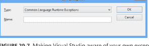

图 20-7 让 Visual Studio 识别你自己的异常类型。“新建异常”对话框。

在此对话框中，首先将异常类型选择为公共语言运行时异常，然后可以输入自己的异常类型的完全限定名。请注意，你输入的类型不必是派生自 System.Exception 的类型；完全支持不符合 CLS 的类型。如果你有两个或更多名称相同但位于不同程序集中的类型，则无法区分这些类型。幸运的是，这种情况很少发生。

如果你的程序集定义了多个异常类型，则必须逐个添加它们。将来，我希望看到此对话框允许我浏览某个程序集，并自动将所有派生自 Exception 的类型导入 Visual Studio 调试器。这样，每个类型也就可以按程序集来标识，从而解决不同程序集中存在两个同名类型的问题。

### 异常处理的性能注意事项

开发人员社区一直在积极讨论异常处理的性能。有些人声称异常处理的性能太差，以至于他们甚至拒绝使用异常处理。然而，我认为在面向对象的平台中，异常处理不是可选项，而是必需的。此外，如果你不使用它，又能用什么来代替呢？你会让方法返回 true/false 来表示成功/失败，或者返回某种错误代码枚举类型吗？好吧，如果你这样做，你就会陷入最糟糕的境地：CLR 和类库代码会抛出异常，而你的代码却返回错误代码。现在你必须在代码中同时处理这两种情况。

很难比较异常处理与更传统的异常报告方式（如 HRESULT、特殊返回码等）之间的性能。如果你编写代码来检查每个方法调用的返回值，并将返回值逐层过滤后传递给自己的调用方，那么应用程序的性能将受到严重影响。但撇开性能不谈，当你编写代码来检查每个方法的返回值时，需要完成的额外编码量以及出错的可能性都极高。异常处理是一种好得多的替代方案。

然而，异常处理是有代价的：非托管 C++ 编译器必须生成代码来跟踪哪些对象已成功构造。编译器还必须生成这样的代码：当捕获到异常时，调用每个已成功构造对象的析构函数。编译器承担这一负担固然很好，但它会在你的应用程序中生成大量簿记代码，对代码大小和执行时间产生不利影响。

另一方面，托管编译器要轻松得多，因为托管对象分配在托管堆中，而托管堆由垃圾回收器监视。如果对象已成功构造，随后抛出了异常，垃圾回收器最终会释放该对象的内存。编译器无需生成任何簿记代码来跟踪哪些对象已成功构造，也无需确保已调用析构函数。与非托管 C++ 相比，这意味着编译器生成的代码更少，运行时需要执行的代码也更少，从而为你的应用程序带来更好的性能。

多年来，我在不同的编程语言、不同的操作系统和不同的 CPU 架构中使用过异常处理。在每种情况下，异常处理的实现方式都不同，每种实现在性能方面各有优缺点。有些实现将异常处理构造直接编译到方法中，而另一些实现则将与异常处理相关的信息存储在与该方法关联的数据表中——仅当抛出异常时才会访问此表。有些编译器无法内联包含异常处理程序的方法，有些编译器则会在方法包含异常处理程序时不将变量放入寄存器。

关键在于，你无法确定使用异常处理会给应用程序增加多少额外开销。在托管世界中，这甚至更难判断，因为程序集的代码可以在任何支持 .NET Framework 的平台上运行。因此，当程序集在 x86 机器上运行时，JIT 编译器为管理异常处理而生成的代码，将与代码在 x64 上运行时 JIT 编译器生成的代码非常不同

或 ARM 处理器。另外，与其他 CLR 实现（例如 Microsoft 的 .NET Compact Framework 或开源 Mono 项目）关联的 JIT 编译器很可能生成不同的代码。

实际上，我已经能够用 Microsoft 内部的一些不同 JIT 编译器测试我自己的一些代码，而我观察到的性能差异相当显著且令人惊讶。关键在于，你必须在用户预期会运行的各种平台上测试代码，并据此进行修改。同样，我不会担心使用异常处理的性能；其好处通常远远超过任何负面的性能影响。

如果你有兴趣了解异常处理如何影响代码性能，可以使用 Windows 自带的性能监视器工具。图 20-8 中的屏幕显示了随 .NET Framework 一起安装的与异常相关的计数器。

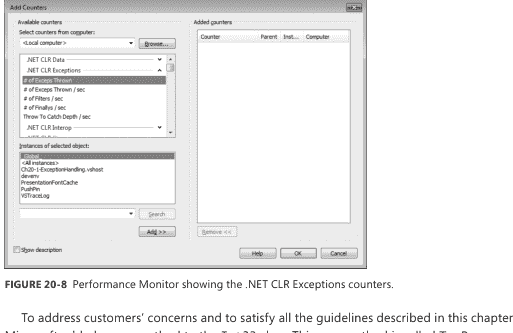

图 20-8 显示 .NET CLR Exceptions 计数器的性能监视器。

有时你会遇到一个频繁调用且失败率很高的方法。在这种情况下，抛出异常带来的性能损失可能无法忍受。例如，Microsoft 收到多家客户的反馈，他们频繁调用 Int32 的 Parse 方法，并经常传入无法解析的最终用户输入数据。由于 Parse 被频繁调用，抛出和捕获异常带来的性能损失对应用程序的整体性能造成了很大损害。

为了解决客户的顾虑并满足本章所述的所有准则，Microsoft 向 Int32 类添加了一个新方法。这个新方法称为 TryParse，它有两个重载，如下所示。

```csharp
public static Boolean TryParse(String s, out Int32 result);
public static Boolean TryParse(String s, NumberStyles styles,
    IFormatProvider provider, out Int32 result);
```

你会注意到，这些方法返回一个 Boolean，指示传入的 String 是否包含可解析为 Int32 的字符。这些方法还返回一个名为 result 的输出参数。如果方法返回 true，result 将包含将该字符串解析为 32 位整数的结果。如果方法返回 false，result 将包含 0，但无论如何你都不应执行任何查看它的代码。

有一点我想绝对明确：TryXxx 方法的 Boolean 返回值返回 false，仅表示唯一一种失败类型。对于任何其他类型的失败，该方法仍应抛出异常。例如，如果 style 参数无效，Int32 的 TryParse 会抛出 ArgumentException；而且调用 TryParse 时当然仍可能抛出 OutOfMemoryException。

我还想明确说明，面向对象编程让程序员能够高效工作。其实现方式之一是不在类型的成员中暴露错误代码。换句话说，构造函数、方法、属性等全都基于调用它们不会失败这一理念来定义。而且，如果定义正确，对于成员的大多数使用情况，它不会失败，也不会产生性能损失，因为不会抛出异常。

在定义类型及其成员时，你应当这样定义成员：在你预期使用这些类型的常见场景中，它们不太可能失败。如果之后你听到用户因为抛出异常而导致的性能不满意，那么只有到那时，你才应考虑添加 TryXxx 方法。换句话说，你应当先产出最佳的对象模型，然后，如果用户提出异议，再向你的类型添加一些 TryXxx 方法，以便遇到性能问题的用户能够受益。没有遇到性能问题的用户应继续使用方法的非 TryXxx 版本，因为这是更好的对象模型。

#### 受约束的执行区域 (CER)

许多应用程序不需要具备健壮性并从任何及所有类型的失败中恢复。许多客户端应用程序都是如此，例如 Notepad.exe 和 Calc.exe。当然，我们中的许多人都见过 Microsoft Office 应用程序（如 WinWord.exe、Excel.exe 和 Outlook.exe）因未处理异常而终止。此外，许多服务器端应用程序（如 Web 服务器）是无状态的，如果因未处理异常而失败，会自动重新启动。当然，有些服务器（如 SQL Server）完全围绕状态管理，因未处理异常而丢失数据可能更具灾难性。

在 CLR 中，我们有 AppDomain（第 22 章讨论），其中包含状态。卸载 AppDomain 时，其所有状态都会被卸载。因此，如果 AppDomain 中的某个线程遇到未处理异常，可以卸载该 AppDomain（这会销毁其所有状态），而无需终止整个进程。8

8 如果线程整个生命周期都位于单个 AppDomain 内（例如在 ASP.NET 和托管 SQL Server 存储过程场景中），这绝对是正确的。但是，如果线程在其生命周期内跨越 AppDomain 边界，你可能必须终止整个进程。

根据定义，CER 是一块必须能够从失败中恢复的代码。由于 AppDomain 可以被卸载并销毁其状态，CER 通常用于操作由多个 AppDomain 或进程共享的任何状态。CER 在面临意外抛出的异常时尝试维护状态很有用。有时我们将这类异常称为*异步异常*。例如，在调用方法时，CLR 必须加载程序集、在 AppDomain 的加载器堆中创建类型对象、调用类型的静态构造函数、将 IL JIT 编译为本机代码，等等。这些操作中的任何一个都可能失败，而 CLR 通过抛出异常来报告失败。

如果这些操作中的任何一个在 `catch` 或 `finally` 块内失败，那么你的错误恢复或清理代码将无法完整执行。下面是一个展示潜在问题的代码示例。

```csharp
private static void Demo1() {
    try {
        Console.WriteLine("In try");
    }
    finally {
        // Type1's static constructor is implicitly called in here
        Type1.M();
    }
}

private sealed class Type1 {
    static Type1() {
        // if this throws an exception, M won't get called
        Console.WriteLine("Type1's static ctor called");
    }

    public static void M() { }
}
```

运行上述代码时，我得到以下输出。

```text
In try
Type1's static ctor called
```

我们想要的是，除非我们知道关联的 `catch` 和 `finally` 块中的代码保证（或尽可能接近保证）会执行，否则甚至不要开始执行前面 `try` 块中的代码。我们可以通过如下修改代码来实现这一点。

```csharp
private static void Demo2() {
    // Force the code in the finally to be eagerly prepared
    RuntimeHelpers.PrepareConstrainedRegions(); // System.Runtime.CompilerServices namespace
    try {
        Console.WriteLine("In try");
    }
    finally {
        // Type2's static constructor is implicitly called in here
        Type2.M();
    }
}

public class Type2 {
    static Type2() {
        Console.WriteLine("Type2's static ctor called");
    }

    // Use this attribute defined in the System.Runtime.ConstrainedExecution namespace
    [ReliabilityContract(Consistency.WillNotCorruptState, Cer.Success)]
    public static void M() { }
}
```

现在，当我运行这个版本的代码时，我得到以下输出。

```text
Type2's static ctor called
In try
```

`PrepareConstrainedRegions` 方法是一个非常特殊的方法。当 JIT 编译器看到该方法在 `try` 块之前被立即调用时，它会立即编译 `try` 的 `catch` 和 `finally` 块中的代码。JIT 编译器将加载任何程序集、创建任何类型对象、调用任何静态构造函数，并对任何方法进行 JIT 编译。如果这些操作中的任何一个导致异常，那么异常会在*线程进入 `try` 块之前*发生。

当 JIT 编译器立即准备方法时，它还会遍历整个调用图，立即准备被调用的方法。然而，JIT 编译器只准备那些应用了 `ReliabilityContractAttribute` 且指定了 `Consistency.WillNotCorruptState` 或 `Consistency.MayCorruptInstance` 的方法，因为 CLR 无法对可能损坏 `AppDomain` 或进程状态的方法做出任何保证。在通过调用 `PrepareConstrainedRegions` 加以保护的 `catch` 或 `finally` 块内，你要确保只调用按我刚才所述设置了 `ReliabilityContractAttribute` 的方法。

`ReliabilityContractAttribute` 如下所示。

```csharp
public sealed class ReliabilityContractAttribute : Attribute {
    public ReliabilityContractAttribute(Consistency consistencyGuarantee, Cer cer);
    public Cer Cer { get; }
    public Consistency ConsistencyGuarantee { get; }
}
```

这个特性让开发者能够向该方法的潜在调用方记录特定方法的可靠性契约。`Cer` 和 `Consistency` 类型都是枚举类型，定义如下。⁹

```csharp
enum Consistency {
    MayCorruptProcess, MayCorruptAppDomain, MayCorruptInstance, WillNotCorruptState
}

enum Cer { None, MayFail, Success }
```

如果你正在编写的方法承诺不损坏任何状态，请使用 `Consistency.WillNotCorruptState`。否则，请使用其他三个可能值之一来记录你的方法的行为，这些值应与你方法可能损坏的状态相匹配。如果你正在编写的方法

⁹ 你还可以将此特性应用于接口、构造函数、结构、类或程序集，以影响其中的成员。


如果承诺不会失败，就使用 `Cer.Success`。否则，使用 `Cer.MayFail`。任何没有应用 `ReliabilityContractAttribute` 的方法都等同于标记为下面这样。

```csharp
[ReliabilityContract(Consistency.MayCorruptProcess, Cer.None)]
```

`Cer.None` 值表示该方法不做任何 CER 保证。换句话说，它编写时并未考虑 CER；因此，它可能会失败，并且可能会也可能不会报告失败。请记住，这些设置大多是为方法提供一种方式，向潜在的调用者记录它能提供什么，以便他们知道会出现什么情况。CLR 和 JIT 编译器不会使用此信息。

当你想要编写可靠的方法时，应使其保持短小并限制其行为。确保它不分配任何对象（例如，不装箱），不调用任何虚方法或接口方法，不使用任何委托，也不使用反射，因为 JIT 编译器无法判断实际会调用哪个方法。但是，你可以通过调用 `RuntimeHelpers` 类定义的以下方法之一来手动准备这些方法。

```csharp
public static void PrepareMethod(RuntimeMethodHandle method)
public static void PrepareMethod(RuntimeMethodHandle method,
    RuntimeTypeHandle[] instantiation)
public static void PrepareDelegate(Delegate d);
public static void PrepareContractedDelegate(Delegate d);
```

请注意，编译器和 CLR 不会做任何验证，来确认你编写的方法确实满足你通过 `ReliabilityContractAttribute` 所声明的保证。如果你做错了什么，就可能导致状态损坏。

> **注意** 即使所有方法都已预先准备，方法调用仍可能导致 `StackOverflowException`。当 CLR 未被承载时，`StackOverflowException` 会导致 CLR 内部调用 `Environment.FailFast` 来立即终止进程。当被承载时，`PrepareConstrainedRegions` 方法会检查堆栈，看是否还有大约 48 KB 的堆栈空间剩余。如果堆栈空间有限，则会在进入 try 块之前发生 `StackOverflowException`。

你还应该了解一下 `RuntimeHelpers` 的 `ExecuteCodeWithGuaranteedCleanup` 方法，这是另一种保证清理代码执行的方式。

```csharp
public static void ExecuteCodeWithGuaranteedCleanup(TryCode code, CleanupCode backoutCode,
    Object userData);
```

调用此方法时，你将 try 和 finally 块的主体作为回调方法传递，这些回调方法的原型分别与以下两个委托匹配。

```csharp
public delegate void TryCode(Object userData);
public delegate void CleanupCode(Object userData, Boolean exceptionThrown);
```

最后，另一种获得保证代码执行的方法是使用 `CriticalFinalizerObject` 类，第 21 章将对此进行详细说明。

### 代码契约

代码契约为你提供了一种方式，可以在代码本身中以声明方式记录你对代码所做的设计决策。契约采用以下形式：

- **前置条件** 通常用于验证参数
- **后置条件** 用于在方法因正常返回或因抛出异常而终止时验证状态
- **对象不变式** 用于确保对象的字段在整个对象生命周期内保持良好的状态

代码契约有助于代码的使用、理解、演进、测试、文档编写和早期错误检测。10 你可以将前置条件、后置条件和对象不变式视为方法签名的一部分。因此，你可以在新版本的代码中放宽契约，但不能在新版本中使契约更严格，否则会破坏向后兼容性。

代码契约的核心是静态的 `System.Diagnostics.Contracts.Contract` 类。

```csharp
public static class Contract {
    // Precondition methods: [Conditional("CONTRACTS_FULL")]
    public static void Requires(Boolean condition);
    public static void EndContractBlock();

    // Preconditions: Always
    public static void Requires<TException>(Boolean condition) where TException : Exception;

    // Postcondition methods: [Conditional("CONTRACTS_FULL")]
    public static void Ensures(Boolean condition);
    public static void EnsuresOnThrow<TException>(Boolean condition)
        where TException : Exception;

    // Special Postcondition methods: Always
    public static T Result<T>();
    public static T OldValue<T>(T value);
    public static T ValueAtReturn<T>(out T value);

    // Object Invariant methods: [Conditional("CONTRACTS_FULL")]
    public static void Invariant(Boolean condition);

    // Quantifier methods: Always
    public static Boolean Exists<T>(IEnumerable<T> collection, Predicate<T> predicate);
    public static Boolean Exists(Int32 fromInclusive, Int32 toExclusive,
        Predicate<Int32> predicate);
    public static Boolean ForAll<T>(IEnumerable<T> collection, Predicate<T> predicate);
    public static Boolean ForAll(Int32 fromInclusive, Int32 toExclusive,
        Predicate<Int32> predicate);

    // Helper methods: [Conditional("CONTRACTS_FULL")] or [Conditional("DEBUG")]
    public static void Assert(Boolean condition);
    public static void Assume(Boolean condition);

    // Infrastructure event: usually your code will not use this event
    public static event EventHandler<ContractFailedEventArgs> ContractFailed;
}
```

如前所述，这些静态方法中有许多都应用了 `[Conditional("CONTRACTS_FULL")]` 特性。一些辅助方法也应用了 `[Conditional("DEBUG")]` 特性。这意味着，除非在编译代码时定义了适当的符号，否则编译器将忽略你编写的调用这些方法的任何代码。任何标记为“Always”的方法都意味着编译器总是会发出调用该方法的代码。此外，`Requires`、`Requires<TException>`、`Ensures`、`EnsuresOnThrow`、`Invariant`、`Assert` 和 `Assume` 方法还有另一个重载（未显示），它接受一个 `String` 消息参数，这样你就可以显式指定在违反契约时应显示的 `String` 消息。

默认情况下，契约仅仅作为文档使用，因为在构建项目时你不会定义 `CONTRACTS_FULL` 符号。为了从使用契约中获得更多价值，你必须从 *http://msdn.microsoft.com/en-us/devlabs/dd491992.aspx* 下载额外的工具和 Visual Studio 属性窗格。没有将所有代码契约工具都包含在 Visual Studio 中的原因是，这项技术正在快速发展。Microsoft DevLabs 网站能够比 Visual Studio 本身更快地提供新版本和改进。下载并安装额外工具后，你会看到你的项目获得了一个新的属性窗格，如图 20-9 所示。

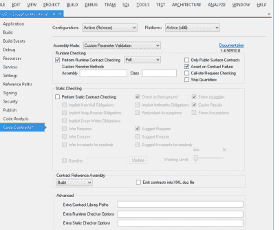

**图 20-9** Visual Studio 项目的代码契约窗格。

要启用代码契约功能，请选中“执行运行时契约检查”复选框，并从其旁边的组合框中选择“Full”。这会在构建项目时定义 `CONTRACTS_FULL` 符号，并在构建项目后调用适当的工具（稍后介绍）。现在，在运行时，当契约被违反时，会引发 `Contract` 的 `ContractFailed` 事件。通常，开发人员不会在此事件上注册任何方法，但如果你注册了，那么你注册的任何方法都会收到一个如下所示的 `ContractFailedEventArgs` 对象。

```csharp
public sealed class ContractFailedEventArgs : EventArgs {
    public ContractFailedEventArgs(ContractFailureKind failureKind,
        String message, String condition, Exception originalException);

    public ContractFailureKind FailureKind      { get; }
    public String                Message        { get; }
    public String                Condition      { get; }
    public Exception             OriginalException { get; }

    public Boolean Handled { get; }   // true if any handler called SetHandled
    public void SetHandled();         // Call to ignore the violation; sets Handled to true

    public Boolean Unwind { get; }    // true if any handler called SetUnwind or threw
    public void SetUnwind();          // Call to force ContractException; set Unwind to true
}
```

可以在此事件上注册多个事件处理方法。每个方法都可以选择任何方式来处理契约违规。例如，处理程序可以记录违规、忽略违规（通过调用 `SetHandled`）或终止进程。如果有任何方法调用 `SetHandled`，那么该违规将被视为已处理，并且在所有处理程序方法返回后，允许应用程序代码继续运行，除非有任何处理程序调用 `SetUnwind`。如果处理程序调用了 `SetUnwind`，那么在所有处理程序方法运行完毕后，将抛出 `System.Diagnostics.Contracts.ContractException`。请注意，此类型是 `MSCorLib.dll` 内部的，因此你无法编写 catch 块来显式捕获它。另请注意，如果任何处理程序方法抛出了未处理的异常，那么其余的处理程序方法将被调用，然后抛出 `ContractException`。

如果没有事件处理程序，或者没有处理程序调用 `SetHandled`、`SetUnwind` 或抛出未处理的异常，那么接下来将执行契约违规的默认处理。如果 CLR 被承载，则宿主会收到契约失败的通知。如果 CLR 在非交互式窗口站上运行应用程序（对于 Windows 服务应用程序来说就是这种情况），则会调用 `Environment.FailFast` 来立即终止进程。如果你在编译时选中了“契约失败时断言”复选框，则会出现一个断言对话框，允许你将调试器连接到你的应用程序。如果未选择此选项，则会抛出 `ContractException`。

让我们看一个使用代码契约的示例类。

```csharp
public sealed class Item { /* ... */ }

public sealed class ShoppingCart {
    private List<Item> m_cart     = new List<Item>();
    private Decimal    m_totalCost = 0;
}
```


```csharp
public ShoppingCart() {
}

public void AddItem(Item item) {
    AddItemHelper(m_cart, item, ref m_totalCost);
}

private static void AddItemHelper(List<Item> m_cart, Item newItem,
    ref Decimal totalCost) {

    // Preconditions:
    Contract.Requires(newItem != null);
    Contract.Requires(Contract.ForAll(m_cart, s => s != newItem));

    // Postconditions:
    Contract.Ensures(Contract.Exists(m_cart, s => s == newItem));
    Contract.Ensures(totalCost >= Contract.OldValue(totalCost));
    Contract.EnsuresOnThrow<IOException>(totalCost == Contract.OldValue(totalCost));

    // Do some stuff (which could throw an IOException)...
    m_cart.Add(newItem);
    totalCost += 1.00M;
}

// Object invariant
[ContractInvariantMethod]
private void ObjectInvariant() {
    Contract.Invariant(m_totalCost >= 0);
}
```

AddItemHelper 方法定义了一组代码契约。前置条件表明 newItem 不得为 null，且要添加到购物车的项目不在购物车中。后置条件表明新项目必须出现在购物车中，并且总成本至少不低于将项目添加到购物车之前的总成本。后置条件还表明，如果 AddItemHelper 由于某种原因抛出 IOException，那么 totalCost 与方法开始执行时相比保持不变。ObjectInvariant 方法只是一个私有方法，调用时会确保对象的 m_totalCost 字段永远不会包含负值。

> **重要** 前置条件、后置条件或不变量测试中引用的所有成员必须无副作用。这是必需的，因为测试条件不应改变对象本身的状态。此外，前置条件测试中引用的所有成员的可访问性至少必须与方法定义前置条件时的可访问性相同。这是必需的，因为方法的调用者应该能够在调用方法之前验证他们是否满足所有前置条件。另一方面，只要代码能够编译，后置条件或不变量测试中引用的成员可以具有任何可访问性。可访问性在这里不重要的原因是后置条件和不变量测试不会影响调用者正确调用方法的能力。

**重要** 对于继承而言，派生类型不能重写并更改基类型中定义的虚成员的前置条件。同样，实现接口成员的类型不能更改该接口成员定义的前置条件。如果某个成员没有为其定义的显式契约，则该成员具有一个隐式契约，逻辑上如下所示。

```csharp
Contract.Requires(true);
```

而且，因为契约不能通过新版本变得更严格（而不会破坏兼容性），所以在引入新的虚成员、抽象成员或接口成员时，应仔细考虑前置条件。对于后置条件和对象不变量，契约可以随意添加和删除，因为虚/抽象/接口成员中表达的条件与重写成员中表达的条件只是逻辑上“与”在一起。

现在你明白了如何声明契约。接下来让我们讨论它们在运行时是如何工作的。你可以将所有前置条件和后置条件契约声明在方法的顶部，这样很容易找到。当然，前置条件契约会在方法被调用时验证其测试。但是，我们希望后置条件契约在方法返回时才验证其测试。为了获得所需的行为，由 C# 编译器生成的程序集必须由代码契约重写工具（CCRewrite.exe，位于 C:\Program Files (x86)\Microsoft\Contracts\Bin）处理，该工具会生成该程序集的修改版本。在为项目选中“执行运行时契约检查”复选框后，Visual Studio 会在你每次生成项目时自动调用此工具。该工具分析所有方法中的 IL，并重写 IL，以便在每个方法结束时执行任何后置条件契约。如果你的方法内部有多个返回点，那么 CCRewrite.exe 工具会修改方法的 IL 代码，以便所有返回点在方法返回之前执行后置条件代码。

CCRewrite.exe 工具会在类型中查找标有 [ContractInvariantMethod] 特性的任何方法。该方法可以有任何名称，但按照惯例，人们通常将方法命名为 ObjectInvariant，并将其标记为 private（正如我刚才所做的那样）。该方法必须不接受任何参数，并且具有 void 返回类型。当 CCRewrite.exe 工具看到标有此特性的方法时，它会在每个公共实例方法的末尾插入 IL 代码来调用 ObjectInvariant 方法。这样，在每个方法返回时都会检查对象的状态，以确保没有方法违反契约。请注意，CCRewrite.exe 工具不会修改 Finalize 方法或 IDisposable 的 Dispose 方法来调用 ObjectInvariant 方法，因为如果对象被视为已销毁或已释放，其状态被改变是可以接受的。另请注意，单个类型可以定义多个带有 [ContractInvariantMethod] 特性的方法；这在处理分部类型时很有用。CCRewrite.exe 工具将修改 IL，以便在每个公共方法的末尾（以未定义的顺序）调用所有这些方法。

Assert 和 Assume 方法与其他方法不同。首先，你不应将它们视为方法签名的一部分，也不必将它们放在方法开头。在运行时，这两个方法的执行方式相同：它们只是验证条件

## 第21章 托管堆和垃圾回收

在本章中：

- 托管堆基础 ........................ 505
- 代：提高性能 ........................ 513
- 使用需要特殊清理的类型 ........................ 525
- 手动监视和控制对象的生存期 ........................ 545

在本章中，我将讨论托管应用程序如何构造新对象，托管堆如何控制这些对象的生存期，以及这些对象的内存如何被回收。简而言之，我将解释公共语言运行时（CLR）中的垃圾回收器是如何工作的，并说明与之相关的各种性能问题。我还将讨论如何设计应用程序以最有效地使用内存。

### 托管堆基础

每个程序都使用一种或另一种资源，无论是文件、内存缓冲区、屏幕空间、网络连接、数据库资源等等。实际上，在面向对象的环境中，每个类型都标识了程序可用的某种资源。要使用这些资源，需要分配内存来表示该类型。访问资源需要以下步骤：

- 1. 为表示该资源的类型分配内存（通常通过使用 *C# 的 new 运算符* 来完成）。
- 2. 初始化内存以设置资源的初始状态并使资源可用。类型的实例构造函数负责设置此初始状态。
- 3. 通过访问类型的成员来使用资源（根据需要重复）。
- 4. 拆除资源的状态以进行清理。
- 5. 释放内存。垃圾回收器专门负责此步骤。

这个看似简单的范例一直是必须手动管理内存的程序员（例如，原生 C++ 开发人员）遇到问题的主要来源之一。负责管理自己内存的程序员经常忘记释放内存，从而导致内存泄漏。此外，这些程序员经常在释放内存后使用内存，导致程序出现内存损坏，进而引发 bug 和安全漏洞。而且，这两种 bug 比其他大多数 bug 更糟糕，因为你无法预测它们的后果或发生时机。对于其他 bug，当你看到应用程序行为异常时，只需修复出问题的代码行即可。

只要你编写的是可验证的类型安全代码（避免使用 C# 的 *unsafe* 关键字），你的应用程序就不可能经历内存损坏。你的应用程序仍然可能泄漏内存，但这并不是默认行为。内存泄漏通常是因为应用程序将对象存储在集合中，并且在不再需要这些对象时从不移除它们。

为了进一步简化，大多数开发人员经常使用的类型都不需要第 4 步（拆除资源状态以进行清理）。因此，*托管堆* 除了消除我提到的 bug 之外，还为开发人员提供了一种简单的编程模型：分配并初始化资源，然后随意使用。对于大多数类型，无需清理资源，垃圾回收器将释放内存。

当使用需要特殊清理的类型的实例时，编程模型仍然像我刚才描述的那样简单。但是，有时你希望尽快清理资源，而不是等待 GC 介入。在这些类中，你可以调用一个额外的方法（称为 *Dispose*）来按你的计划清理资源。另一方面，实现需要特殊清理的类型则相当复杂。我将在本章后面的“使用需要特殊清理的类型”一节中详细描述这一切。通常，需要特殊清理的类型是那些包装本机资源（如文件、套接字或数据库连接）的类型。

### 从托管堆分配资源

CLR 要求所有对象都从 *托管堆* 分配。当进程初始化时，CLR 会为 *托管堆* 分配一个地址空间区域。CLR 还维护一个指针，我称之为 *NextObjPtr*。该指针指示堆中下一个对象将被分配的位置。最初，*NextObjPtr* 设置为地址空间区域的基址。

随着区域被非垃圾对象填满，CLR 会分配更多区域，并持续这样做，直到整个进程的地址空间用完。因此，应用程序的内存受进程虚拟地址空间的限制。在 32 位进程中，你可以分配接近 1.5 千兆字节（GB）的内存；在 64 位进程中，你可以分配接近 8 太字节的内存。

C# 的 new 运算符会导致 CLR 执行以下步骤：

- 1. 计算类型字段（以及它从基类型继承的所有字段）所需的字节数。
- 2. 添加对象开销所需的字节数。每个对象有两个开销字段：类型对象指针和同步块索引。对于 32 位应用程序，这些字段中的每一个都需要


一旦完成，堆中会包含一些已标记对象和一些未标记对象。已标记对象必须在回收后存活，因为至少有一个根引用这些对象；我们说该对象是可达的，因为应用程序代码可以通过仍引用该对象的变量来达到（或访问）该对象。未标记对象是不可达的，因为应用程序中不存在任何根能够使该对象再次被访问。

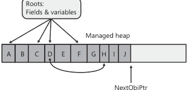

**图 21-2** 回收前的托管堆。

现在 CLR 已经知道哪些对象必须存活、哪些对象可以被删除，于是它开始 GC 的压缩阶段。在压缩阶段，CLR 将已标记对象占用的内存向堆的下方移动，把所有存活对象压缩到一起，使它们在内存中连续。这带来了许多好处。首先，所有存活对象在内存中将彼此相邻；这恢复了引用局部性，减小了应用程序的工作集大小，从而提高将来访问这些对象的性能。其次，空闲空间也都是连续的，因此可以释放该地址空间区域，让其他内容使用它。最后，压缩意味着托管堆不存在地址空间碎片化问题，而本机堆已知会发生这种问题。¹

压缩内存时，CLR 会在内存中移动对象。这会带来一个问题，因为任何引用某个存活对象的根现在仍指向该对象在内存中的原位置，而不是对象被重新定位到的位置。当应用程序的线程最终恢复运行时，它们会访问旧的内存位置并损坏内存。显然，这是不允许的，因此作为压缩阶段的一部分，CLR 会从每个根中减去它所引用对象在内存中下移的字节数。这确保每个根仍引用它之前引用的同一对象；只是该对象现在位于内存中的不同位置。

堆内存压缩完成后，托管堆的 NextObjPtr 指针被设置为指向最后一个存活对象之后的位置。下一次分配的对象将被放置在内存中的这个位置。图 21-3 显示了压缩阶段之后的托管堆。压缩阶段完成后，CLR 恢复应用程序的所有线程，它们继续访问这些对象，就好像 GC 从未发生过一样。

¹ 大对象堆（本章后面会讨论）中的对象不会被压缩，因此大对象堆可能出现地址空间碎片化。

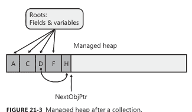

如果 CLR 在一次 GC 之后无法回收任何内存，并且进程中已没有剩余地址空间可用于分配新的 GC 段，那么这个进程就没有更多可用内存了。在这种情况下，试图分配更多内存的 new 运算符最终会抛出 OutOfMemoryException。你的应用程序可以捕获它并从中恢复，但大多数应用程序不会尝试这样做；相反，该异常会成为未处理异常，Windows 会终止进程，然后 Windows 回收该进程正在使用的所有内存。

作为程序员，请注意本章开头描述的两个 bug 是如何不再存在的。首先，不可能泄漏对象，因为任何无法从应用程序的根访问到的对象都会在某个时候被回收。其次，不可能通过访问已释放的对象来损坏内存，因为引用只能引用存活对象，而这正是使对象保持存活的原因。

> **重要** 静态字段会使其引用的任何对象永远存活，或者直到加载这些类型的 AppDomain 被卸载为止。一种常见的内存泄漏方式是让静态字段引用一个集合对象，然后不断向该集合对象添加项。静态字段使集合对象保持存活，而集合对象使其所有项保持存活。因此，最好尽可能避免使用静态字段。

### 垃圾回收与调试

一旦某个根离开作用域，它所引用的对象就变为不可达，并可能被 GC 回收其内存；对象并不保证在整个方法生命周期内一直存活。这可能会对你的应用程序产生有趣的影响。例如，请查看以下代码。

```csharp
using System;
using System.Threading;

public static class Program {
    public static void Main() {
        // Create a Timer object that knows to call our TimerCallback
        // method once every 2000 milliseconds.
        Timer t = new Timer(TimerCallback, null, 0, 2000);

        // Wait for the user to hit <Enter>.
        Console.ReadLine();
    }

    private static void TimerCallback(Object o) {
        // Display the date/time when this method got called.
        Console.WriteLine("In TimerCallback: " + DateTime.Now);

        // Force a garbage collection to occur for this demo.
        GC.Collect();
    }
}
```

在命令提示符下编译这段代码，不要使用任何特殊的编译器开关。运行生成的可执行文件时，你会看到 TimerCallback 方法只被调用一次！

查看前面的代码，你会认为 TimerCallback 方法会每 2,000 毫秒被调用一次。毕竟，创建了一个 Timer 对象，并且变量 t 引用这个对象。只要计时器对象存在，计时器就应该持续触发。但你会注意到，在 TimerCallback 方法中，我通过调用 GC.Collect() 强制发生一次垃圾回收。

回收开始时，它首先假定堆中的所有对象都是不可达的（垃圾）；这包括 Timer 对象。然后，回收器检查应用程序的根，发现 Main 在最初给 t 变量赋值之后就不再使用它。因此，应用程序没有变量引用 Timer 对象，垃圾回收便回收了它的内存；这使计时器停止，并解释了为什么 TimerCallback 方法只被调用一次。

假设你正在使用调试器单步执行 Main，而垃圾回收恰好在 t 被赋予新 Timer 对象的地址之后发生。然后，假设你尝试使用调试器的“快速监视”窗口查看 t 引用的对象。你认为会发生什么？调试器无法向你显示该对象，因为它刚刚被垃圾回收了。大多数开发者会认为这种行为非常意外且不受欢迎，因此微软提出了一个解决方案。

当你使用 C# 编译器的 /debug 开关编译程序集时，编译器会将一个 System.Diagnostics.DebuggableAttribute（其中设置了 DebuggingModes.DisableOptimizations 标志）应用到生成的程序集。运行时，在编译方法时，JIT 编译器看到此标志已设置，便会人为地将所有根的生命周期延长到方法结束。例如，JIT 编译器欺骗自己相信 Main 中的 t 变量必须存活到方法结束。因此，如果发生垃圾回收，垃圾回收器现在会认为 t 仍是一个根，并且 t 引用的 Timer 对象将继续可达。Timer 对象将在回收中存活，TimerCallback 方法将被反复调用，直到 Console.ReadLine 返回且 Main 退出。

要看到这一点，只需从命令提示符重新编译该程序，但这次指定 C# 编译器的 /debug 开关。运行生成的可执行文件时，你现在会看到 TimerCallback 方法被反复调用！注意，C# 编译器的 /optimize+ 编译器开关会重新启用优化，因此进行此实验时不应指定该编译器开关。


JIT编译器这样做是为了帮你进行JIT调试。你现在可以正常（不附加调试器）启动应用程序，如果该方法被调用，JIT编译器会人为地将这些变量的生存期延长到方法末尾。之后，如果你决定将调试器附加到进程上，就可以在先前已编译的方法中设置断点，并检查根变量。

所以现在你知道了如何构建一个在调试版中正常、但在发布版中无法正确运行的程序！因为没有开发者希望程序只在调试时才正常工作，所以我们应该对程序做点什么，让它无论何种构建类型都能始终正常工作。

你可以尝试将 `Main` 方法修改为以下代码。

```csharp
public static void Main() {
   // Create a Timer object that knows to call our TimerCallback
   // method once every 2000 milliseconds.
   Timer t = new Timer(TimerCallback, null, 0, 2000);

   // Wait for the user to hit <Enter>.
   Console.ReadLine();

   // Refer to t after ReadLine (this gets optimized away)
   t = null;
}
```

然而，如果你编译这段代码（不带 `/debug+` 开关）并运行生成的可执行文件，你会发现 `TimerCallback` 方法仍然只被调用一次。问题在于JIT编译器是一个优化编译器，将局部变量或参数变量设置为 `null` 等同于完全不引用该变量。换句话说，JIT编译器将 `t = null;` 这行完全优化掉了，因此程序仍然无法按我们希望的方式工作。正确的修改 `Main` 方法的方式如下：

```csharp
public static void Main() {
   // Create a Timer object that knows to call our TimerCallback
   // method once every 2000 milliseconds.
   Timer t = new Timer(TimerCallback, null, 0, 2000);

   // Wait for the user to hit <Enter>.
   Console.ReadLine();

   // Refer to t after ReadLine (t will survive GCs until Dispose returns)
   t.Dispose();
}
```

现在，如果你编译这段代码（不带 `/debug+` 开关）并运行生成的可执行文件，你会看到 `TimerCallback` 方法被调用了多次，程序被修复了。这里发生的事情是，对象 `t` 必须保持存活，以便可以对其调用 `Dispose` 实例方法。（`t` 中的值需要作为 `this` 参数传递给 `Dispose`。）讽刺的是：通过显式地指出你希望在哪里释放计时器，它必须存活到那个时刻。

垃圾回收器会判断对象 C 和 E 是垃圾，并对对象 D 进行压缩，使其与对象 B 相邻。存活过这次垃圾回收的对象（对象 A、B 和 D）被称为第 1 代对象。第 1 代中的对象已经被垃圾回收器检查过一次。堆现在看起来如图 21-5 所示。


**图 21-5** 一次回收之后，第 0 代的幸存者被提升到第 1 代；第 0 代变为空。

一次垃圾回收之后，第 0 代不包含任何对象。和往常一样，新对象将被分配到第 0 代。图 21-6 显示了应用程序运行并分配对象 F 到 K 的情况。此外，在应用程序运行期间，对象 B、H 和 J 变得不可达，它们的内存应在某个时刻被回收。


**图 21-6** 新对象被分配到第 0 代；第 1 代中有一些垃圾。

现在，假设尝试分配对象 L 会使第 0 代超出其预算。由于第 0 代已达到其预算，必须开始一次垃圾回收。开始垃圾回收时，垃圾回收器必须决定检查哪些代。之前我说过，当 CLR 初始化时，它会为第 0 代选择一个预算。同样，它也会为第 1 代选择一个预算。

开始垃圾回收时，垃圾回收器还会查看第 1 代占用了多少内存。在这种情况下，第 1 代占用的内存远小于其预算，因此垃圾回收器只检查第 0 代中的对象。再次看看分代垃圾回收器所做的假设。第一个假设是，新创建的对象生命周期很短。因此第 0 代很可能包含大量垃圾，回收第 0 代将回收大量内存。垃圾回收器将忽略第 1 代中的对象，这将加快垃圾回收过程。

显然，忽略第 1 代中的对象提高了垃圾回收器的性能。然而，垃圾回收器的性能提升更多是因为它不会遍历托管堆中的每一个对象。如果根或对象引用了一个旧代数中的对象，垃圾回收器可以忽略这些旧对象的所有内部引用，从而减少构建可达对象图所需的时间。当然，旧对象的字段有可能引用新对象。为了确保这些旧对象更新后的字段被检查，垃圾回收器使用一种 JIT 编译器内部的机制，当对象的引用字段发生变化时设置一位。这种支持让垃圾回收器知道哪些旧对象（如果有的话）自上次回收以来被写入过。只有那些字段发生变化的旧对象才需要被检查，以确定它们是否引用了第 0 代中的任何新对象。²

> **注意** 微软的性能测试表明，对第 0 代执行一次垃圾回收所需时间不到 1 毫秒。微软的目标是让垃圾回收所花的时间不超过一次普通缺页错误。

分代垃圾回收器还假设存活了很长时间的对象将继续存活。因此第 1 代中的对象很可能继续被应用程序可达。所以，如果垃圾回收器检查第 1 代中的对象，它很可能找不到很多垃圾。因此，它无法回收多少内存。结果是，回收第 1 代很可能是在浪费时间。如果第 1 代中恰好有垃圾，它只会留在那里。堆现在看起来如图 21-7 所示。

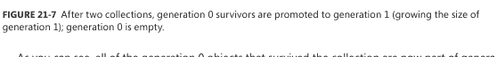

如你所见，所有在回收中幸存下来的第 0 代对象现在都成为第 1 代的一部分。由于垃圾回收器没有检查第 1 代，对象 B 的内存没有被回收，即使它在最后一次垃圾回收时已经不可达。同样，在回收之后，第 0 代不包含任何对象，并且是新对象将被放置的地方。实际上，假设应用程序继续运行并分配对象 L 到 O。在运行期间，应用程序停止使用对象 G、L 和 M，使它们都变得不可达。堆现在看起来如图 21-8 所示。


假设分配对象 P 导致第 0 代超出其预算，从而触发一次垃圾回收。由于第 1 代中所有对象占用的内存小于其

² 好奇的读者可以了解以下更多细节。当 JIT 编译器生成修改对象内部引用字段的本机代码时，本机代码包含对写屏障方法的调用。这个写屏障方法会检查正在被修改字段的对象是否位于第 1 代或第 2 代，如果是，则写屏障代码会在所谓的卡片表中设置一位。卡片表中堆中每 128 字节范围的数据对应 1 位。当下一次 GC 开始时，它会扫描卡片表，以了解第 1 代和第 2 代中哪些对象的字段自上次 GC 以来被修改过。如果这些被修改的对象中的任何一个引用了第 0 代中的对象，那么这些第 0 代对象将在回收中幸存。GC 之后，卡片表被重置为全零。写屏障代码在写入对象中的引用字段（相对于局部变量或静态字段）时会造成轻微的性能损失，而如果该对象位于第 1 代或第 2 代，性能损失会稍大一些。


预算已满后，垃圾回收器再次决定只回收第0代，忽略第1代中的不可达对象（对象 B 和 G）。回收之后，堆如图 21-9 所示。


**图 21-9** 经过三次回收后，第0代的幸存者被提升到第1代（第1代的大小再次增长）；第0代为空。

在图 21-9 中，可以看到第1代在缓慢持续增长。事实上，假设第1代现在已经增长到其中所有对象占满其全部预算的程度。此时，应用程序继续运行（因为一次垃圾回收刚刚结束），并开始分配对象 P 到 S，这些对象将第0代填充到其预算上限。现在堆如图 21-10 所示。


**图 21-10** 新对象在第0代中分配；第1代有更多垃圾。

当应用程序尝试分配对象 T 时，第0代已满，必须开始一次垃圾回收。然而这一次，垃圾回收器看到第1代中的对象占用内存太多，已经达到第1代的预算。经过若干次第0代回收后，第1代中很可能已有许多对象变得不可达（如我们的示例所示）。所以这一次，垃圾回收器决定检查第1代和第0代中的所有对象。两代都经过垃圾回收后，现在堆如图 21-11 所示。


**图 21-11** 经过四次回收后：第1代的幸存者被提升到第2代，第0代的幸存者被提升到第1代，并且第0代为空。

与之前一样，第0代中经过垃圾回收后幸存的对象现在位于第1代；第1代中经过回收后幸存的对象现在位于第2代。一如既往，垃圾回收刚结束后第0代为空，并且是分配新对象的地方。第2代中的对象是垃圾回收器已检查过两次或多次的对象。可能已经发生过多次回收，但只有当第1代达到其预算时才会检查第1代中的对象，而这通常需要经过多次第0代垃圾回收。

托管堆只支持三代：第0代、第1代和第2代；不存在第3代。³ 当 CLR 初始化时，它会为所有三代选择预算。然而，CLR 的垃圾回收器是一种自调整回收器。这意味着垃圾回收器每次执行垃圾回收时都会了解应用程序的行为。例如，如果你的应用程序构造大量对象并在非常短的时间内使用它们，那么回收第0代就有可能回收大量内存。事实上，第0代中所有对象的内存都有可能被回收。

³ System.GC 类的静态 MaxGeneration 方法返回 2。

如果垃圾回收器在回收第0代后看到幸存对象非常少，它可能会决定减小第0代的预算。分配空间的这种减少意味着垃圾回收会更频繁地发生，但垃圾回收器需要做的工作会更少，因此进程的工作集会很小。事实上，如果第0代中的所有对象都是垃圾，垃圾回收不必压缩任何内存；它可以简单地将 NextObjPtr 设置回第0代的起始位置，然后垃圾回收就完成了。哇，这是一种快速回收内存的方法！


> **注意** 对于大多数时间线程都空闲地停留在其堆栈顶部的应用程序，垃圾回收器工作得非常好。然后，当线程有事情要做时，它会醒来，创建一堆短生命周期对象，返回，然后重新进入休眠。许多应用程序都遵循这种架构。例如，GUI 应用程序往往让其 GUI 线程在大部分生命周期中停留在消息循环里。偶尔，用户产生一些输入（如触摸、鼠标或键盘事件），线程醒来，处理输入并返回消息泵。为处理输入而创建的大多数对象现在可能都是垃圾。
>
> 类似地，服务器应用程序往往让线程池线程停留在池中，等待客户端请求进来。当客户端请求进来时，会创建新对象来代表该客户端请求执行工作。当结果被发送回客户端后，线程返回线程池，它创建的所有对象现在都是垃圾。

另一方面，如果垃圾回收器回收第0代并看到有大量幸存对象，那么这次垃圾回收并没有回收很多内存。在这种情况下，垃圾回收器将增大第0代的预算。现在，回收发生的次数会减少，但当回收发生时，应该会回收更多内存。顺便说一下，如果一次回收后回收的内存不足，垃圾回收器会在抛出 OutOfMemoryException 之前执行一次完整回收。

在整个讨论中，我一直在讲垃圾回收器如何在每次回收后动态修改第0代的预算。但垃圾回收器也会使用类似的启发式方法修改第1代和第2代的预算。当这些代被垃圾回收时，垃圾回收器会再次查看回收了多少内存以及有多少对象幸存。根据垃圾回收器的发现，它也可能增大或缩小这些代的阈值，以提高应用程序的整体性能。最终结果是，垃圾回收器会根据应用程序所需的内存负载自动进行微调——这非常酷！

以下 GCNotification 类会在发生第0代或第2代回收时引发事件。借助这些事件，你可以让计算机在每次回收发生时发出蜂鸣声，或者计算两次回收之间经过了多少时间、两次回收之间分配了多少内存，等等。使用这个类，你可以轻松地对应用程序进行监测，从而更好地了解应用程序如何使用内存。

```csharp
public static class GCNotification {
    private static Action<Int32> s_gcDone = null; // The event's field

    public static event Action<Int32> GCDone {
        add {
            // If there were no registered delegates before, start reporting notifications now
            if (s_gcDone == null) { new Gen0Object(0); new Gen0Object(2); }
            s_gcDone += value;
        }
        remove { s_gcDone -= value; }
    }

    private sealed class Gen0Object {
        private Int32 m_generation;
        public Gen0Object(Int32 generation) { m_generation = generation; }
        ~Gen0Object() { // This is the Finalize method
            // If this object is in the generation we want (or higher),
            // notify the delegates that a GC just completed
            if (GC.GetGeneration(this) >= m_generation) {
                Action<Int32> temp = Volatile.Read(ref s_gcDone);
                if (temp != null) temp(m_generation);
            }

            // Keep reporting notifications if there is at least one delegate registered,
            // the AppDomain isn't unloading, and the process isn't shutting down
            if ((s_gcDone != null)
                && !AppDomain.CurrentDomain.IsFinalizingForUnload()
                && !Environment.HasShutdownStarted)
            {
                // For Gen 0, create a new object; for Gen 2, resurrect the object
                // & let the GC call Finalize again the next time Gen 2 is GC'd
                if (m_generation == 0) new Gen0Object(0);
                else GC.ReRegisterForFinalize(this);
            } else { /* Let the objects go away */ }
        }
    }
}
```


### 垃圾回收触发条件

如你所知，当 CLR 检测到第 0 代已用完其预算时，就会触发一次 GC。这是 GC 最常见的触发条件；不过，还有一些其他 GC 触发条件，如下所示：

- **代码显式调用 System.GC 的静态 Collect 方法** 代码可以显式请求 CLR 执行一次回收。尽管 Microsoft 强烈不建议这样做，但有时应用程序强制进行一次回收可能是有意义的。我会在本章后面的“强制垃圾回收”一节中进一步讨论这一点。
- **Windows 报告内存不足情况** CLR 在内部使用 Win32 的 CreateMemoryResourceNotification 和 QueryMemoryResourceNotification 函数来监视系统总体内存。如果 Windows 报告内存不足，CLR 将强制进行垃圾回收，以释放死对象，从而减小进程工作集的大小。
- **CLR 正在卸载 AppDomain** 当 AppDomain 卸载时，CLR 认为该 AppDomain 中没有任何内容可作为根，并会执行一次包含所有代的垃圾回收。我将在第 22 章“CLR 宿主与 AppDomain”中讨论 AppDomain。
- **CLR 正在关闭** 当进程正常终止时（而不是例如通过任务管理器进行外部关闭），CLR 会关闭。在此关闭期间，CLR 认为进程中没有任何内容可作为根；它会让对象有机会进行清理，但 CLR 不会尝试压缩或释放内存，因为整个进程正在终止，Windows 将回收该进程的所有内存。

### 大对象

还有一项性能改进你可能需要了解。CLR 认为每个单独的对象要么是小对象，要么是大对象。到目前为止，本章一直关注的是小对象。目前，大对象的大小为 85,000 字节或更大。⁴ CLR 对大对象的处理方式与小对象略有不同：

- 大对象不会与小对象分配在同一地址空间中；它们会分配在进程地址空间中的其他位置。
- 目前，GC 不会压缩大对象，因为在内存中移动它们需要时间。因此，进程内的大对象之间可能会发生地址空间碎片化，从而导致抛出 OutOfMemoryException。在 CLR 的未来版本中，大对象可能会参与压缩。

4 将来，CLR 可能会改变将对象视为大对象所需的字节数。不要把 85,000 当作常量。

应用程序运行时，可以通过查询 GCSettings 类的 IsServerGC 只读 Boolean 属性来询问 CLR 是否正在服务器 GC 模式下运行。

```csharp
using System;
using System.Runtime; // GCSettings is in this namespace

public static class Program {
    public static void Main() {
        Console.WriteLine("Application is running with server GC=" + GCSettings.IsServerGC);
    }
}
```

除了这两种模式外，GC 还可以在两种子模式下运行：并发（默认）或非并发。在并发模式下，GC 有一个额外的后台线程，在应用程序运行时并发标记对象。当某个线程分配对象并使第 0 代超出其预算时，GC 首先挂起所有线程，然后确定要回收哪些代。如果垃圾回收器需要回收第 0 代或第 1 代，它会照常进行。然而，如果需要回收第 2 代，第 0 代的大小将超出其预算进行增长，以便分配新对象，然后应用程序的线程会恢复运行。

当应用程序的线程运行时，垃圾回收器有一个普通优先级的后台线程，用于查找不可达对象。一旦找到，垃圾回收器会再次挂起所有线程，并决定是否压缩内存。如果垃圾回收器决定压缩内存，内存会被压缩，根引用会被修正，然后应用程序的线程会恢复运行。这种垃圾回收比通常情况耗时更少，因为不可达对象集合已经建立。然而，垃圾回收器可能决定不压缩内存；事实上，垃圾回收器更倾向于这种做法。如果你有大量可用内存，垃圾回收器不会压缩堆；这会提高性能，但会增大应用程序的工作集。使用并发垃圾回收器时，你通常会发现应用程序占用的内存比使用非并发垃圾回收器时更多。

你可以通过为应用程序创建包含 gcConcurrent 元素的配置文件，告诉 CLR 不要使用并发回收器。下面是一个配置文件的示例。

```
<configuration>
    <runtime>
        <gcConcurrent enabled="false"/>
    </runtime>
</configuration>
```

GC 模式是针对进程配置的，并且在进程运行期间不能更改。不过，应用程序可以通过使用 GCSettings 类的 GCLatencyMode 属性，对垃圾回收进行一定程度的控制。这个可读写属性可以设置为 GCLatencyMode 枚举类型中的任何值，如表 21-1 所示。

LowLatency 模式需要一些额外解释。通常，你会设置此模式，执行一项短期的、对时间敏感的操作，然后将模式设置回 Batch 或 Interactive。当模式设置为 LowLatency 时，GC 会真正避免执行任何第 2 代回收，因为这些回收可能耗时很长。当然，如果你调用 GC.Collect()，那么第 2 代仍然会被回收。此外，如果 Windows 告诉 CLR 系统内存不足，GC 也会执行一次第 2 代回收（参见本章前面的“垃圾回收触发条件”一节）。

**表 21-1** GCLatencyMode 枚举类型定义的符号

| 符号名称 | 描述 |
| --- | --- |
| Batch（Server GC 模式的默认值） | 关闭并发 GC。 |
| Interactive（Workstation GC 模式的默认值） | 开启并发 GC。 |
| LowLatency | 在短期、对时间敏感的操作（如绘制动画）期间使用此延迟模式，因为第 2 代回收可能会造成干扰。 |
| SustainedLowLatency | 在应用程序执行的大部分时间内使用此延迟模式，以避免长时间的 GC 暂停。只要内存可用，此设置就会阻止所有阻塞性的第 2 代回收发生。事实上，这类应用的用户更愿意在机器中安装更多 RAM，以避免 GC 暂停。必须立即响应价格变化的股票市场应用就是这类应用的一个例子。 |

在 LowLatency 模式下，应用程序更有可能抛出 OutOfMemoryException。因此，请尽可能短时间地保持在此模式，避免分配大量对象，避免分配大对象，并通过使用受约束执行区域 (CER) 将模式设置回 Batch 或 Interactive，如第 20 章“异常与状态管理”所述。另外，请记住延迟模式是进程范围的设置，并且线程可能正在并发运行。这些其他线程甚至可能在一个线程正在使用此设置时更改它，因此当有多个线程操作此设置时，你可能需要更新某种计数器（通过 Interlocked 方法操作）。下面是一些展示如何使用 LowLatency 模式的代码。

```csharp
private static void LowLatencyDemo() {
    GCLatencyMode oldMode = GCSettings.LatencyMode;
    System.Runtime.CompilerServices.RuntimeHelpers.PrepareConstrainedRegions();
    try {
        GCSettings.LatencyMode = GCLatencyMode.LowLatency;
        // Run your code here...
    }
    finally {
        GCSettings.LatencyMode = oldMode;
    }
}
```

### 强制垃圾回收

System.GC 类型允许应用程序对垃圾回收器进行一些直接控制。首先，你可以通过读取 GC.MaxGeneration 属性来查询托管堆支持的最大代；该属性始终返回 2。

你还可以通过调用 GC 类的 Collect 方法强制垃圾回收器执行一次回收，可选地传入要收集到的代、一个 GCCollectionMode 以及一个 Boolean


指示你希望执行阻塞式（非并发）还是后台式（并发）回收。下面是 `Collect` 方法最复杂重载的签名。

```csharp
void Collect(Int32 generation, GCCollectionMode mode, Boolean blocking);
```

`GCCollectionMode` 类型是一个枚举，其值在表 21-2 中描述。

**表 21-2** 由 `GCCollectionMode` 枚举类型定义的符号

| 符号名称 | 描述 |
| --- | --- |
| `Default` | 与调用不带标志的 `GC.Collect` 相同。目前，这与传递 `Forced` 相同，但在 CLR 的未来版本中可能会改变。 |
| `Forced` | 强制立即对直到并包括指定代在内的所有代执行回收。 |
| `Optimized` | 仅当回收能够产生效果（即释放大量内存或减少碎片）时，垃圾回收器才会执行回收。如果垃圾回收不会产生效果，则该调用不起作用。 |

**在大多数情况下，应避免调用任何 `Collect` 方法；最好让垃圾回收器自行运行，并根据实际应用程序行为微调其各代预算。** 但是，如果你正在编写控制台用户界面 (CUI) 或 GUI 应用程序，则你的应用程序代码拥有该进程以及该进程中的 CLR。对于这些应用程序类型，你*可能*希望在某些时刻使用 `Optimized` 的 `GCCollectionMode` 来建议执行垃圾回收。通常，`Default` 和 `Forced` 模式用于调试、测试和查找内存泄漏。

例如，如果刚刚发生了某个非周期性事件，而该事件很可能导致大量旧对象死亡，那么你可能会考虑调用 `Collect` 方法。在这种情况下调用 `Collect` 可能并没有那么糟糕，原因是 GC 基于过去对未来所做的预测对于非周期性事件来说不太可能准确。例如，你的应用程序在初始化之后或用户保存数据文件之后强制对所有代执行一次完整 GC 可能是合理的。由于调用 `Collect` 会导致各代预算调整，因此不要为了试图改善应用程序的响应时间而调用 `Collect`；调用它是为了减少进程的工作集。

对于某些应用程序（尤其是往往在内存中保留大量对象的服务器应用程序），GC 执行包含第 2 代的完整回收所需的时间可能过长。事实上，如果回收需要很长时间才能完成，那么客户端请求可能会超时。为帮助这类应用程序，GC 类提供了 `RegisterForFullGCNotification` 方法。使用此方法以及一些额外的辅助方法（`WaitForFullGCApproach`、`WaitForFullGCComplete` 和 `CancelFullGCNotification`），应用程序现在可以在垃圾回收器即将执行完整回收时收到通知。然后，应用程序可以调用 `GC.Collect` 在更合适的时机强制回收，或者应用程序可以与其他服务器通信，以更好地对客户端请求进行负载均衡。有关更多信息，请查看这些方法以及 Microsoft .NET Framework SDK 文档中的“垃圾回收通知”主题。注意，应始终成对调用 `WaitForFullGCApproach` 和 `WaitForFullGCComplete` 方法，因为 CLR 在内部将它们作为成对方法处理。

选定的实时统计信息。要了解特定计数器的说明，请选择所需计数器，然后选中“显示描述”复选框。

另一个用于分析应用程序内存和性能的优秀工具是 PerfView。此工具可以收集 Windows 事件跟踪 (ETW) 日志并处理它们。获取此工具的最佳方式是在 Web 上搜索 PerfView。最后，你应当研究使用 SOS 调试扩展 (SOS.dll)，它在调试内存问题和其他 CLR 问题时通常能提供很大帮助。对于与内存相关的操作，SOS 调试扩展允许你查看进程中分配给托管堆的内存量，显示终结队列中所有已注册进行终结的对象，显示每个 AppDomain 或整个进程的 GCHandle 表中的条目，显示使对象在堆中保持存活的根，以及更多内容。

#### 处理需要特殊清理的类型

至此，你应当对垃圾回收和托管堆有了基本了解，包括垃圾回收器如何回收对象的内存。幸运的是，对我们来说，大多数类型只需要内存即可运行。但是，有些类型不仅需要内存才能发挥作用；有些类型除内存外还需要使用本机资源。

例如，System.IO.FileStream 类型需要打开一个文件（一种本机资源）并存储该文件的句柄。然后，该类型的 Read 和 Write 方法使用此句柄来操作文件。类似地，System.Threading.Mutex 类型打开一个 Windows 互斥体内核对象（一种本机资源）并存储其句柄，在调用 Mutex 的方法时使用该句柄。

如果一个包装本机资源的类型被垃圾回收，GC 将回收该对象在托管堆中使用的内存，但 GC 对其一无所知的本机资源将会泄漏。这显然不是我们想要的，因此 CLR 提供了一种称为终结的机制。终结允许对象在被确定为垃圾之后、但在从托管堆回收该对象的内存之前执行一些代码。所有包装本机资源（例如文件、网络连接、套接字或互斥体）的类型都支持终结。当 CLR 确定这些对象之一不再可达时，该对象会终结自身，释放其包装的本机资源，然后稍后 GC 将从托管堆中回收该对象。

System.Object 是所有类型的基类，它定义了一个名为 Finalize 的受保护虚方法。当垃圾回收器确定某个对象是垃圾时，它会调用该对象的 Finalize 方法（如果已重写）。Microsoft 的 C# 团队认为，Finalize 方法是一种特殊的方法，需要在编程语言中使用特殊语法（类似于 C# 需要特殊语法来定义构造函数）。因此，在 C# 中，必须通过在类名前面放置波浪号 (~) 来定义 Finalize 方法，如下面的代码示例所示。

```csharp
internal sealed class SomeType {
    // This is the Finalize method
    ~SomeType() {
        // The code here is inside the Finalize method
    }
}
```

如果编译此代码并使用 ILDasm.exe 检查生成的程序集，你会看到 C# 编译器确实向模块的元数据中发出了一个名为 Finalize 的受保护重写方法。如果检查 Finalize 方法的 IL 代码，你还会看到，方法体内的代码被发出到 try 块中，而对 base.Finalize 的调用被发出到 finally 块中。

> **重要** 如果你熟悉 C++，你会注意到，C# 定义 Finalize 方法所需的特殊语法看起来就像用于定义 C++ 析构函数的语法。事实上，C# 编程语言规范将此方法称为*析构函数*。但是，Finalize 方法的工作方式完全不像 C++ 析构函数，这给从一种语言迁移到另一种语言的开发人员造成了大量困惑。
>
> 问题在于，开发人员错误地认为，使用 C# 析构函数语法意味着当类型对象离开词法作用域时，它们将被确定性地析构，就像在 C++ 中一样。然而，CLR 不支持确定性析构，这使得 C# 无法提供此机制。

在垃圾回收完成时，会针对 GC 已确定为垃圾的对象调用 Finalize 方法。这意味着这些对象的内存不能立即回收，因为 Finalize 方法可能执行访问字段的代码。由于可终结对象必须在回收后存活，因此它会被提升到另一代，迫使该对象的存活时间比它本应存活的时间长得多。从内存消耗的角度来看，这并不理想，这也是应尽可能避免终结的原因。更糟的是，当可终结对象被提升时，其字段所引用的任何对象也会被提升，因为它们也必须继续存活。因此，尽量避免定义包含引用类型字段的可终结对象。

此外，要注意你无法控制 Finalize 方法的执行时机。Finalize 方法在发生垃圾回收时运行，而垃圾回收可能在应用程序请求更多内存时发生。另外，CLR 不保证 Finalize 方法的调用顺序。因此，应避免编写这样的 Finalize 方法：它访问其他对象，而这些对象的类型定义了 Finalize 方法；那些其他对象可能已经完成终结。不过，访问未定义 Finalize 方法的值类型实例或引用类型对象是完全可以的。在调用静态方法时也需要小心，因为这些方法可能在内部访问已经终结的对象，从而导致静态方法的行为变得不可预测。

CLR 使用一个特殊的高优先级专用线程来调用 Finalize 方法，以避免否则可能发生的一些死锁场景。⁵ 如果某个 Finalize 方法阻塞（例如进入无限循环或等待一个永远不会收到信号的对象），这个特殊线程就无法再调用任何 Finalize 方法。这是一种非常糟糕的情况，因为应用程序将永远无法回收可终结对象占用的内存——只要应用程序运行，它就会泄漏内存。

⁵ CLR 的未来版本可能会使用多个终结器线程来提高性能。


如果Finalize方法抛出未处理的异常，进程就会终止；无法捕获此异常。

因此，如你所见，Finalize方法有很多注意事项，必须谨慎使用。具体来说，它们是为释放本机资源而设计的。为了简化使用，强烈建议开发者避免重写Object的Finalize方法；而应使用Microsoft在框架类库（FCL）中提供的辅助类。这些辅助类重写了Finalize，并添加了一些特殊的CLR魔法，我将在后续讨论。然后你可以从这些辅助类派生自己的类，继承这些CLR魔法。

如果你正在创建包装本机资源的托管类型，应首先从名为System.Runtime.InteropServices.SafeHandle的特殊基类派生一个类，该类如下所示（我在方法中添加了注释以说明它们的作用）。

```csharp
public abstract class SafeHandle : CriticalFinalizerObject, IDisposable {
    // This is the handle to the native resource
    protected IntPtr handle;

    protected SafeHandle(IntPtr invalidHandleValue, Boolean ownsHandle) {
        this.handle = invalidHandleValue;
        // If ownsHandle is true, then the native resource is closed when
        // this SafeHandle-derived object is collected
    }

    protected void SetHandle(IntPtr handle) {
        this.handle = handle;
    }

    // You can explicitly release the resource by calling Dispose
    // This is the IDisposable interface's Dispose method
    public void Dispose() { Dispose(true); }

    // The default Dispose implementation (shown here) is exactly what you want.
    // Overriding this method is strongly discouraged.
    protected virtual void Dispose(Boolean disposing) {
        // The default implementation ignores the disposing argument.
        // If resource already released, return
        // If ownsHandle is false, return
        // Set flag indicating that this resource has been released
        // Call virtual ReleaseHandle method
        // Call GC.SuppressFinalize(this) to prevent Finalize from being called
        // If ReleaseHandle returned true, return
        // If we get here, fire ReleaseHandleFailed Managed Debugging Assistant (MDA)
    }

    // The default Finalize implementation (shown here) is exactly what you want.
    // Overriding this method is very strongly discouraged.
    ~SafeHandle() { Dispose(false); }

    // A derived class overrides this method to implement the code that releases the resource
    protected abstract Boolean ReleaseHandle();

    public void SetHandleAsInvalid() {
        // Set flag indicating that this resource has been released
        // Call GC.SuppressFinalize(this) to prevent Finalize from being called
    }

    public Boolean IsClosed {
        get {
            // Returns flag indicating whether resource was released
        }
    }

    public abstract Boolean IsInvalid {
        // A derived class overrides this property.
        // The implementation should return true if the handle's value doesn't
        // represent a resource (this usually means that the handle is 0 or -1)
        get;
    }

    // These three methods have to do with security and reference counting;
    // I'll talk about them at the end of this section
    public void DangerousAddRef(ref Boolean success) {...}
    public IntPtr DangerousGetHandle() {...}
    public void DangerousRelease() {...}
}
```

关于SafeHandle类，首先要注意到它派生自CriticalFinalizerObject，后者定义在System.Runtime.ConstrainedExecution命名空间中。CLR以非常特殊的方式对待这个类及其派生类。具体来说，CLR赋予这个类三个很酷的特性：

- 首次构造任何CriticalFinalizerObject派生类型的对象时，CLR会立即对继承层次结构中的所有Finalize方法进行JIT编译。在对象构造时编译这些方法，可以确保当对象被判定为垃圾时，本机资源将被释放。如果没有这种对Finalize方法的主动编译，就可能分配本机资源并使用它，但无法释放它。在内存不足的情况下，CLR可能无法找到足够的内存来编译Finalize方法，这将阻止其执行，导致本机资源泄漏。或者，如果Finalize方法包含引用其他程序集中类型的代码，而CLR未能找到该程序集，资源也可能无法释放。
- CLR会在调用非CriticalFinalizerObject派生类型的Finalize方法之后，再调用CriticalFinalizerObject派生类型的Finalize方法。这确保具有Finalize方法的托管资源类可以在其Finalize方法中成功访问CriticalFinalizerObject派生对象。例如，FileStream类的Finalize方法可以将数据从内存缓冲区刷新到底层磁盘，并确信磁盘文件尚未关闭。
- 如果应用程序域被宿主应用程序（如SQL Server或ASP.NET）强行中止，CLR也会调用CriticalFinalizerObject派生类型的Finalize方法。这也是确保本机资源被释放的一部分，即使宿主应用程序不再信任其中运行的托管代码。

关于SafeHandle要注意的第二点是，该类是抽象的；预期会有另一个类从SafeHandle派生，该类将提供一个构造函数，该构造函数调用受保护的构造函数、抽象方法ReleaseHandle和抽象的IsInvalid属性的get访问器方法。

大多数本机资源通过句柄（在32位系统上是32位值，在64位系统上是64位值）进行操作。因此，SafeHandle类定义了一个名为handle的受保护IntPtr字段。在Windows中，大多数句柄的值为0或-1时是无效的。Microsoft.Win32.SafeHandles命名空间包含另一个名为SafeHandleZeroOrMinusOneIsInvalid的辅助类，如下所示。

```csharp
public abstract class SafeHandleZeroOrMinusOneIsInvalid : SafeHandle {
    protected SafeHandleZeroOrMinusOneIsInvalid(Boolean ownsHandle)
        : base(IntPtr.Zero, ownsHandle) {
    }

    public override Boolean IsInvalid {
        get {
            if (base.handle == IntPtr.Zero) return true;
            if (base.handle == (IntPtr) (-1)) return true;
            return false;
        }
    }
}
```

同样，你会注意到SafeHandleZeroOrMinusOneIsInvalid类是抽象的，因此必须从该类再派生一个类，以重写受保护的构造函数和抽象方法ReleaseHandle。.NET Framework只提供了几个从SafeHandleZeroOrMinusOneIsInvalid派生的公共类，包括SafeFileHandle、SafeRegistryHandle、SafeWaitHandle和SafeMemoryMappedViewHandle。下面是SafeFileHandle类的样子。

```csharp
public sealed class SafeFileHandle : SafeHandleZeroOrMinusOneIsInvalid {
    public SafeFileHandle(IntPtr preexistingHandle, Boolean ownsHandle)
        : base(ownsHandle) {
        base.SetHandle(preexistingHandle);
    }

    protected override Boolean ReleaseHandle() {
        // Tell Windows that we want the native resource closed.
        return Win32Native.CloseHandle(base.handle);
    }
}
```

SafeWaitHandle类的实现方式与刚才展示的SafeFileHandle类类似。之所以有实现相似的不同类，唯一原因是为了实现类型安全；编译器不会让你将文件句柄用作期望等待句柄的方法的参数，反之亦然。SafeRegistryHandle类的ReleaseHandle方法调用Win32 RegCloseKey函数。


如果 .NET Framework 包含一些包装了各种本机资源的额外类，那就太好了。例如，可以想象这样的类：SafeProcessHandle、SafeThreadHandle、SafeTokenHandle、SafeLibraryHandle（其 ReleaseHandle 方法会调用 Win32 FreeLibrary 函数）、SafeLocalAllocHandle（其 ReleaseHandle 方法会调用 Win32 LocalFree 函数）等等。

刚才列出的所有这些类（以及更多）实际上确实随框架类库（FCL）一起提供。然而，这些类并没有公开暴露；它们在定义它们的程序集内部都是私有的。微软没有公开这些类，是因为不想对它们进行文档编写和全面测试。不过，如果你在自己的工作中需要这些类中的任何一个，我建议你使用 ILDasm.exe 或某个 IL 反编译器工具来提取这些类的代码，并将这些代码集成到你自己项目的源代码中。所有这些类实现起来都很简单，从头开始编写也非常容易。

从 SafeHandle 派生的类非常有用，因为它们确保在发生 GC 时释放本机资源。除了我们已经讨论过的，SafeHandle 还提供了两个额外的能力。首先，在原生代码互操作场景中，CLR 会给予 SafeHandle 派生类型特殊待遇。例如，让我们查看以下代码。

```csharp
using System;
using System.Runtime.InteropServices;
using Microsoft.Win32.SafeHandles;

internal static class SomeType {
    [DllImport("Kernel32", CharSet=CharSet.Unicode, EntryPoint="CreateEvent")]
    // This prototype is not robust
    private static extern IntPtr CreateEventBad(
        IntPtr pSecurityAttributes, Boolean manualReset, Boolean initialState, String name);

    // This prototype is robust
    [DllImport("Kernel32", CharSet=CharSet.Unicode, EntryPoint="CreateEvent")]
    private static extern SafeWaitHandle CreateEventGood(
        IntPtr pSecurityAttributes, Boolean manualReset, Boolean initialState, String name);

    public static void SomeMethod() {
        IntPtr        handle = CreateEventBad(IntPtr.Zero, false, false, null);
        SafeWaitHandle swh    = CreateEventGood(IntPtr.Zero, false, false, null);
    }
}
```

你会注意到，CreateEventBad 方法被定义为返回 IntPtr，它会将句柄返回给托管代码；但是，以这种方式与原生代码互操作并不健壮。你看，在调用 CreateEventBad（创建原生事件资源）之后，有可能在句柄被赋值给 handle 变量之前抛出 ThreadAbortException。在这种极少发生的情况下，托管代码会泄漏本机资源。让事件关闭的唯一方法是终止整个进程。

请记住，调用 Dispose 并不是保证本机资源清理所必需的。本机资源清理最终总会发生；调用 Dispose 可以让你控制清理何时发生。此外，调用 Dispose 并不会从托管堆中删除托管对象。回收托管堆内存的唯一方法是让垃圾回收启动。这意味着即使在释放了托管对象可能正在使用的任何本机资源之后，你仍然可以调用该托管对象的方法。

下面的代码在文件关闭后调用 Write 方法，试图向文件写入更多字节。显然，这些字节无法被写入，当代码执行时，第二次调用 Write 方法会抛出一个 System.ObjectDisposedException 异常，其字符串消息为：Cannot access a closed file。

```csharp
using System;
using System.IO;

public static class Program {
    public static void Main() {
        // Create the bytes to write to the temporary file.
        Byte[] bytesToWrite = new Byte[] { 1, 2, 3, 4, 5 };

        // Create the temporary file.
        FileStream fs = new FileStream("Temp.dat", FileMode.Create);

        // Write the bytes to the temporary file.
        fs.Write(bytesToWrite, 0, bytesToWrite.Length);

        // Explicitly close the file when finished writing to it.
        fs.Dispose();

        // Try to write to the file after closing it.
        fs.Write(bytesToWrite, 0, bytesToWrite.Length);   // Throws ObjectDisposedException

        // Delete the temporary file.
        File.Delete("Temp.dat");
    }
}
```

请注意，这里不会发生内存损坏，因为 FileStream 对象的内存仍然存在于托管堆中；只是该对象在显式释放之后无法成功执行其方法。

> **重要说明** 在定义实现 IDisposable 接口的自己的类型时，请务必在所有方法和属性中编写代码，在对象已被显式清理时抛出 System.ObjectDisposedException。Dispose 方法绝不应抛出异常；如果被多次调用，它应该直接返回。

```csharp
        if (fs != null) fs.Dispose();
    }

    // Delete the temporary file.
    File.Delete("Temp.dat");
}
```

添加异常处理代码是正确做法，而且你必须勤奋地编写它。幸运的是，C# 语言提供了 using 语句，它提供了一种简化语法，所产生的代码与刚刚展示的代码完全相同。以下是将前面的代码用 C# 的 using 语句重写的结果。

```csharp
using System;
using System.IO;

public static class Program {
    public static void Main() {
        // Create the bytes to write to the temporary file.
        byte[] bytesToWrite = new Byte[] { 1, 2, 3, 4, 5 };

        // Create the temporary file.
        using (FileStream fs = new FileStream("Temp.dat", FileMode.Create)) {
            // Write the bytes to the temporary file.
            fs.Write(bytesToWrite, 0, bytesToWrite.Length);
        }

        // Delete the temporary file.
        File.Delete("Temp.dat");
    }
}
```

在 using 语句中，你初始化一个对象并将其引用保存到一个变量中。然后通过 using 花括号内的代码访问该变量。编译这段代码时，编译器会自动生成 try 和 finally 块。在 finally 块内部，编译器生成代码，将对象强制转换为 IDisposable 并调用 Dispose 方法。显然，编译器只允许对实现了 IDisposable 接口的类型使用 using 语句。

> **注意** C# 的 using 语句支持初始化多个变量的能力，只要这些变量都是相同的类型。它还支持直接使用已经初始化的变量。关于此主题的更多信息，请参阅 C# 程序员参考中的“using 语句”主题。

### 一个有趣的依赖性问题

System.IO.FileStream 类型允许用户打开文件进行读取和写入。为了提高性能，该类型的实现使用了内存缓冲区。只有当缓冲区填满时，该类型才会将缓冲区的内容刷新到文件中。FileStream 只支持写入字节。如果你想写入字符和字符串，可以使用 System.IO.StreamWriter，如下面的代码所示。

```csharp
FileStream fs = new FileStream("DataFile.dat", FileMode.Create);
StreamWriter sw = new StreamWriter(fs);
sw.Write("Hi there");

// The following call to Dispose is what you should do.
sw.Dispose();
// NOTE: StreamWriter.Dispose closes the FileStream;
// the FileStream doesn't have to be explicitly closed.
```

请注意，StreamWriter 的构造函数接受一个 Stream 对象的引用作为参数，因此可以将 FileStream 对象的引用作为参数传递。在内部，StreamWriter 对象保存 Stream 的引用。当你向 StreamWriter 对象写入时，它会在自己的内存缓冲区中缓冲数据。当缓冲区满时，StreamWriter 对象会将数据写入 Stream。

当你通过 StreamWriter 对象完成数据写入后，应调用 Dispose。（因为 StreamWriter 类型实现了 IDisposable 接口，你也可以将其与 C# 的 using 语句一起使用。）这将导致 StreamWriter 对象将其数据刷新到 Stream 对象，并关闭该 Stream 对象。⁷

> **注意** 你不需要显式调用 FileStream 对象上的 Dispose，因为 StreamWriter 会替你调用它。但是，如果你确实显式调用了 Dispose，FileStream 会发现该对象已被清理——该方法不进行任何操作，只是返回。

你认为如果没有代码显式调用 Dispose 会发生什么？好吧，在某个时刻，垃圾回收器会正确地检测到这些对象是垃圾并终结它们。但是垃圾回收器并不保证对象终结的顺序。因此，如果 FileStream 对象先被终结，它会关闭文件。然后当 StreamWriter 对象被终结时，它会尝试将数据写入已关闭的文件，从而抛出异常。反过来，如果 StreamWriter 对象先被终结，数据就会被安全地写入文件。


如果编译并运行前面的代码，输出将与以下输出类似。

```
MemoryPressureDemo, size=0
BigNativeResource create.
BigNativeResource create.
BigNativeResource create.
BigNativeResource create.
BigNativeResource create.
BigNativeResource create.
BigNativeResource create.
BigNativeResource create.
BigNativeResource create.
BigNativeResource create.
BigNativeResource create.
BigNativeResource create.
BigNativeResource create.
BigNativeResource create.
BigNativeResource create.
BigNativeResource create.
BigNativeResource destroy.
BigNativeResource destroy.
BigNativeResource destroy.
BigNativeResource destroy.
BigNativeResource destroy.
BigNativeResource destroy.
BigNativeResource destroy.
BigNativeResource destroy.
BigNativeResource destroy.
BigNativeResource destroy.
BigNativeResource destroy.
BigNativeResource destroy.
BigNativeResource destroy.
BigNativeResource destroy.
BigNativeResource destroy.
BigNativeResource destroy.

MemoryPressureDemo, size=10485760
BigNativeResource create.
BigNativeResource create.
BigNativeResource create.
BigNativeResource create.
BigNativeResource create.
BigNativeResource create.
BigNativeResource create.
BigNativeResource create.
BigNativeResource create.
BigNativeResource create.
BigNativeResource create.
BigNativeResource create.
BigNativeResource create.
BigNativeResource destroy.
BigNativeResource destroy.
BigNativeResource destroy.
BigNativeResource destroy.
BigNativeResource destroy.
BigNativeResource destroy.
BigNativeResource destroy.
BigNativeResource create.
BigNativeResource create.
BigNativeResource create.
BigNativeResource destroy.
BigNativeResource destroy.
BigNativeResource destroy.
BigNativeResource destroy.
BigNativeResource destroy.
BigNativeResource destroy.
BigNativeResource destroy.

HandleCollectorDemo
LimitedResource create.  Count=1
LimitedResource create.  Count=2
LimitedResource create.  Count=3
LimitedResource destroy. Count=3
LimitedResource destroy. Count=2
LimitedResource destroy. Count=1
LimitedResource create.  Count=1
LimitedResource create.  Count=2
LimitedResource create.  Count=3
LimitedResource destroy. Count=3
LimitedResource create.  Count=1
LimitedResource destroy. Count=3
LimitedResource destroy. Count=2
LimitedResource destroy. Count=1
LimitedResource create.  Count=1
LimitedResource create.  Count=2
LimitedResource create.  Count=3
LimitedResource destroy. Count=3
LimitedResource destroy. Count=2
LimitedResource destroy. Count=1
LimitedResource destroy. Count=0
```

### 终结内部机制

从表面上看，终结似乎相当简单：你创建一个对象，当它被回收时，其 `Finalize` 方法会被调用。但深入探究后，终结比这要复杂得多。

当应用程序创建一个新对象时，new 运算符从堆中分配内存。如果对象的类型定义了 `Finalize` 方法，那么在调用该类型的实例构造函数之前，指向该对象的指针会被放入*终结列表*。终结列表是由垃圾回收器控制的内部数据结构。列表中的每个条目都指向一个对象，在回收该对象的内存之前，应调用其 `Finalize` 方法。

图 21-13 显示了一个包含若干对象的堆。其中一些对象可从应用程序根到达，一些则不可达。当对象 C、E、F、I 和 J 被创建时，系统检测到这些对象的类型定义了 Finalize 方法，因此将这些对象的引用添加到了终结列表中。

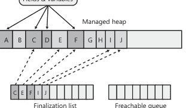

> **注意** 尽管 System.Object 定义了 Finalize 方法，但 CLR 知道要忽略它；也就是说，在构造某个类型的实例时，如果该类型的 Finalize 方法是从 System.Object 继承来的那个，则该对象不会被视为可终结的。派生类型之一必须重写 Object 的 Finalize 方法。

当发生垃圾回收时，对象 B、E、G、H、I 和 J 被判定为垃圾。垃圾回收器扫描终结列表，查找对这些对象的引用。找到引用后，该引用会从终结列表中移除，并追加到 *freachable 队列*。freachable 队列（读作“F-reachable”）是垃圾回收器的另一个内部数据结构。freachable 队列中的每个引用都标识一个已准备好调用其 Finalize 方法的对象。回收之后，托管堆看起来如图 21-14 所示。


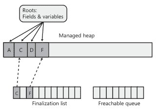

**图 21-15** 第二次垃圾回收后托管堆的状态。

### 手动监视和控制对象的生存期

CLR 为每个 AppDomain 提供一个 GC 句柄表。此表允许应用程序监视对象的生存期或手动控制对象的生存期。创建 AppDomain 时，该表为空。表中的每个条目由一个指向托管堆上对象的引用和一个标志组成，该标志指示你希望如何监视或控制该对象。应用程序通过 System.Runtime.InteropServices.GCHandle 类型在表中添加和移除条目，如下所示。

```csharp
// This type is defined in the System.Runtime.InteropServices namespace
public struct GCHandle {
    // Static methods that create an entry in the table
    public static GCHandle Alloc(object value);
    public static GCHandle Alloc(object value, GCHandleType type);

    // Static methods that convert a GCHandle to an IntPtr
    public static explicit operator IntPtr(GCHandle value);
    public static IntPtr ToIntPtr(GCHandle value);

    // Static methods that convert an IntPtr to a GCHandle
    public static explicit operator GCHandle(IntPtr value);
    public static GCHandle FromIntPtr(IntPtr value);

    // Static methods that compare two GCHandles
    public static Boolean operator ==(GCHandle a, GCHandle b);
    public static Boolean operator !=(GCHandle a, GCHandle b);

    // Instance method to free the entry in the table (index is set to 0)
    public void Free();

    // Instance property to get/set the entry's object reference
    public object Target { get; set; }

    // Instance property that returns true if index is not 0
    public Boolean IsAllocated { get; }

    // For a pinned entry, this returns the address of the object
    public IntPtr AddrOfPinnedObject();

    public override Int32 GetHashCode();
    public override Boolean Equals(Object o);
}
```

基本上，要控制或监视对象的生存期，你可以调用 GCHandle 的静态 Alloc 方法，传入你要监视/控制的对象的引用，以及一个 GCHandleType，它是一个标志，指示你希望如何监视/控制该对象。GCHandleType 类型是一个枚举类型，定义如下。

```csharp
public enum GCHandleType {
   Weak = 0,                 // Used for monitoring an object's existence
   WeakTrackResurrection = 1, // Used for monitoring an object's existence
   Normal = 2,                // Used for controlling an object's lifetime
   Pinned = 3                 // Used for controlling an object's lifetime
}
```

现在，每个标志的含义如下：

- **Weak** 此标志允许你*监视*对象的生存期。具体来说，你可以检测垃圾回收器何时判定该对象从应用程序代码不可达。请注意，对象的 Finalize 方法可能已执行，也可能尚未执行，因此对象可能仍在内存中。

- **WeakTrackResurrection** 此标志允许你*监视*对象的生存期。具体来说，你可以检测垃圾回收器何时判定该对象从应用程序代码不可达。请注意，对象的 Finalize 方法（如果存在）肯定已执行，并且对象的内存已被回收。

- **Normal** 此标志允许你*控制*对象的生存期。具体来说，你是在告诉垃圾回收器，即使应用程序中可能没有任何根引用此对象，该对象也必须保留在内存中。当垃圾回收运行时，此对象的内存可以被压缩（移动）。不接收 GCHandleType 标志的 Alloc 方法假定指定了 GCHandleType.Normal。

- **Pinned** 此标志允许你*控制*对象的生存期。具体来说，你是在告诉垃圾回收器，即使应用程序中可能没有任何根引用此对象，该对象也必须保留在内存中。当垃圾回收运行时，此对象的内存不能被压缩。当你希望将内存地址传递给本机代码时，这通常很有用。本机代码可以写入托管堆中的此内存，因为它知道 GC 不会移动该对象。

当你调用 GCHandle 的静态 Alloc 方法时，它会扫描 AppDomain 的 GC 句柄表，寻找一个可用条目，将你传递给 Alloc 的对象的引用存储在该条目中，并将标志设置为你为 GCHandleType 参数传递的值。然后，Alloc 返回一个 GCHandle


实例返回给了你。GCHandle 是一种轻量级值类型，包含一个实例字段 IntPtr，它指向表中条目的索引。当你想释放 GC 句柄表中的这个条目时，你需要获取 GCHandle 实例并调用 Free 方法（该方法还会将 GCHandle 实例的 IntPtr 字段设置为零，从而使其失效）。

下面是垃圾回收器如何使用 GC 句柄表。当发生一次垃圾回收时：

- 1. 垃圾回收器标记所有可达对象（如本章开头所述）。然后，垃圾回收器扫描 GC 句柄表；所有 Normal 或 Pinned 对象都被视为根，这些对象也会被标记（包括这些对象通过其字段引用的任何对象）。
- 2. 垃圾回收器扫描 GC 句柄表，查找所有 Weak 条目。如果某个 Weak 条目引用了一个未被标记的对象，则该引用标识的是一个不可达对象（垃圾），该条目的引用值会被改为 null。
- 3. 垃圾回收器扫描终结列表（finalization list）。如果列表中的某个引用指向未标记的对象，则该引用标识的是不可达对象，该引用会从终结列表移动到 freachable 队列。此时，该对象会被标记，因为该对象现在被视为可达。
- 4. 垃圾回收器扫描 GC 句柄表，查找所有 WeakTrackResurrection 条目。如果某个 WeakTrackResurrection 条目引用了一个未被标记的对象（现在这个对象是被 freachable 队列中的条目所引用的对象），则该引用标识的是一个不可达对象（垃圾），该条目的引用值会被改为 null。
- 5. 垃圾回收器压缩内存，挤掉不可达对象留下的空洞。Pinned 对象不会被压缩（移动）；垃圾回收器会移动它们周围的其他对象。

现在你已了解该机制，让我们看看何时使用它们。最容易理解的标志是 Normal 和 Pinned，所以我们从这两个开始。这两个标志通常在与本机代码互操作时使用。

当你需要将一个指向托管对象的指针交给本机代码时，可使用 Normal 标志，因为在未来某个时刻，本机代码会回调托管代码并传递该指针。你实际上不能将指向托管对象的指针直接传给本机代码，因为如果发生垃圾回收，对象可能在内存中移动，从而使指针失效。为了解决这个问题，你可以调用 GCHandle 的 Alloc 方法，传入对象的引用和 Normal 标志。接着你将返回的 GCHandle 实例转换为 IntPtr，并将 IntPtr 传给本机代码。当本机代码回调托管代码时，托管代码会将传入的 IntPtr 转换回 GCHandle，然后查询 Target 属性以获取托管对象的引用（或当前地址）。当本机代码不再需要该引用时，你可以调用 GCHandle 的 Free 方法，这样将来的垃圾回收就可以释放该对象（假设不存在指向该对象的其他根）。

注意，在此场景中，本机代码实际上并不使用托管对象本身；本机代码只是需要一种引用该对象的方式。在某些场景中，本机代码需要真正使用托管对象。在这些场景中，托管对象必须被固定（pinned）。固定可以防止垃圾回收器移动/压缩该对象。一个常见的例子是当你想要将托管 String 对象传递给 Win32 函数时。在这种情况下，String 对象必须被固定，因为你不能将托管对象的引用传给本机代码后，又让垃圾回收器在内存中移动该对象。如果 String 对象被移动，本机代码将读取或写入到不再包含该 String 对象字符的内存——这必然会导致应用程序运行不可预测。

当你使用 CLR 的 P/Invoke 机制调用方法时，CLR 会自动为你固定参数，并在本机方法返回时取消固定。因此，在大多数情况下，你根本不需要使用 GCHandle 类型来显式固定任何托管对象。但是，当你需要将指向托管对象的指针传给本机代码，而本机函数返回后，本机代码稍后仍可能需要使用该对象时，你就必须显式使用 GCHandle 类型。最常见的例子是执行异步 I/O 操作时。

假设你分配了一个字节数组，该数组将随着数据从套接字传入而被填充。然后，你需要调用 GCHandle 的 Alloc 方法，传入该数组对象的引用和 Pinned 标志。接着，使用返回的 GCHandle 实例调用 AddrOfPinnedObject 方法。这将返回一个 IntPtr，它是托管堆中固定对象的实际地址；然后你把这个地址传给本机函数，该函数会立即返回托管代码。在数据从套接字传入期间，这个字节数组缓冲区不应在内存中移动；使用 Pinned 标志即可防止缓冲区移动。当异步 I/O 操作完成后，你可以调用 GCHandle 的 Free 方法，这将允许将来的垃圾回收移动该缓冲区。你的托管代码仍应持有对该缓冲区的引用，以便访问数据，并且这个引用会防止垃圾回收将缓冲区从内存中完全释放。

另外值得一提的是，C# 提供了一个 fixed 语句，可以在一个代码块范围内有效地固定对象。下面是一些演示其用法的代码。

```csharp
unsafe public static void Go() {
   // Allocate a bunch of objects that immediately become garbage
   for (Int32 x = 0; x < 10000; x++) new Object();

   IntPtr originalMemoryAddress;
   Byte[] bytes = new Byte[1000];   // Allocate this array after the garbage objects

   // Get the address in memory of the Byte[]
   fixed (Byte* pbytes = bytes) { originalMemoryAddress = (IntPtr) pbytes; }

   // Force a collection; the garbage objects will go away & the Byte[] might be compacted
   GC.Collect();

   // Get the address in memory of the Byte[] now & compare it to the first address
   fixed (Byte* pbytes = bytes) {
      Console.WriteLine("The Byte[] did" + 
         ((originalMemoryAddress == (IntPtr) pbytes) ? " not" : "") + " move during the GC");
   }
}
```

使用 C# 的 fixed 语句比分配固定（pinned）的 GC 句柄更高效。实际情况是，C# 编译器会在 pbytes 局部变量上发出一个特殊的 “pinned” 标志。在垃圾回收期间，GC 会检查这个根的内容，如果根不为 null，则在压缩阶段不会移动该变量所引用的对象。C# 编译器会发出 IL 指令，在 fixed 块开始时将 pbytes 局部变量初始化为对象的地址，并在 fixed 块结束时将 pbytes 局部变量设置回 null，这样该变量就不引用任何对象，从而允许对象在下次垃圾回收时被移动。

现在，我们讨论接下来的两个标志：Weak 和 WeakTrackResurrection。这两个标志可以用于与本机代码互操作的场景，也可以用于仅使用托管代码的场景。Weak 标志让你知道对象何时已被判定为垃圾，但尚不能保证其内存已被回收。WeakTrackResurrection 标志让你知道对象的内存何时已被回收。在这两个标志中，Weak 标志比 WeakTrackResurrection 标志常用得多。事实上，我从未见过任何人在真实应用程序中使用 WeakTrackResurrection 标志。

假设对象 A 定期调用对象 B 上的某个方法。然而，对象 A 持有对对象 B 的引用这一事实使得对象 B 不能被垃圾回收，在少数罕见场景中，这可能不是我们想要的；相反，我们可能希望对象 A 在对象 B 仍然存活于托管堆中时才调用对象 B 的方法。为了实现这一场景，对象 A 可以调用 GCHandle 的 Alloc 方法，传入对对象 B 的引用和 Weak 标志。此时对象 A 只需保存返回的 GCHandle 实例，而不是对对象 B 的引用。

此时，如果没有其他根在保持对象 B 存活，对象 B 就可能被垃圾回收。当对象 A 想要调用对象 B 的方法时，它会查询 GCHandle 的只读 Target 属性。如果该属性返回非 null 值，则说明对象 B 仍存活。对象 A 的代码随后会将返回的引用转换为对象 B 的类型并调用该方法。如果 Target 属性返回 null，则说明对象 B 已被回收（但不一定已终结），对象 A 将不会尝试调用该方法。此时，对象 A 的代码可能也会调用 GCHandle 的 Free 方法来释放 GCHandle 实例。

由于使用 GCHandle 类型可能有些繁琐，并且要在内存中保持或固定对象需要提升的安全权限，因此 System 命名空间包含了一个 WeakReference<T> 类来帮助你。

```csharp
public sealed class WeakReference<T> : ISerializable where T : class {
    public WeakReference(T target);
    public WeakReference(T target, Boolean trackResurrection);
    public void SetTarget(T target);
    public Boolean TryGetTarget(out T target);
}
```

这个类实际上只是 GCHandle 实例的一个面向对象包装器：从逻辑上讲，它的构造函数调用 GCHandle 的 Alloc，它的 TryGetTarget 方法查询 GCHandle 的 Target 属性，它的 SetTarget 方法设置 GCHandle 的 Target 属性，而它的 Finalize 方法（未在上面的代码中显示，因为它是受保护的）调用 GCHandle 的 Free 方法。此外，使用 WeakReference<T> 类的代码不需要特殊权限，因为该类仅支持弱

引用；它不支持由 GCHandleType 为 Normal 或 Pinned 分配的 GCHandle 实例所提供的行为。WeakReference<T> 类的缺点在于，它的实例必须分配在堆上。因此，WeakReference<T> 类是比 GCHandle 实例更重量级的对象。

> **重要** 当开发者开始学习弱引用时，他们立即会认为弱引用在缓存场景中很有用。例如，他们认为构造一堆包含大量数据的对象，然后为这些对象创建弱引用会很酷。当程序需要这些数据时，程序会检查弱引用，看看包含数据的对象是否仍然存在；如果存在，程序就直接使用它；程序会获得高性能。然而，如果发生了垃圾回收，包含数据的对象就会被销毁，而当程序不得不重新创建数据时，程序就会经历较低的性能。
>
> 这种技术的问题如下：垃圾回收并不只在内存已满或接近已满时才发生。相反，只要第 0 代已满，垃圾回收就会发生。因此，对象被抛出内存的频率远高于期望，应用程序的性能会受到很大影响。
>
> 弱引用可以在缓存场景中相当有效地使用，但构建一个能在内存消耗和速度之间找到恰当平衡的良好缓存算法非常复杂。基本上，你希望缓存对所有对象保持强引用，然后当你发现内存变得紧张时，开始把强引用转换为弱引用。目前，CLR 不提供任何机制来通知应用程序内存变得紧张。但有些人通过定期调用 Win32 GlobalMemoryStatusEx 函数并检查返回的 MEMORYSTATUSEX 结构的 dwMemoryLoad 成员，已经取得了很大成功。如果该成员报告的值高于 80，就说明内存变得紧张，你可以根据自己想要的是最近最少使用算法、最常使用算法、基于时间的算法还是其他算法，开始将强引用转换为弱引用。

开发者经常希望将一段数据与另一个实体关联起来。例如，你可以将数据与线程或 AppDomain 关联。还可以使用 System.Runtime.CompilerServices.ConditionalWeakTable<TKey,TValue> 类将数据与单个对象关联，该类如下所示。

```csharp
public sealed class ConditionalWeakTable<TKey, TValue>
   where TKey : class
   where TValue : class {
   public ConditionalWeakTable();
   public void Add(TKey key, TValue value);
   public TValue GetValue(TKey key, CreateValueCallback<TKey, TValue> createValueCallback);
   public Boolean TryGetValue(TKey key, out TValue value);
   public TValue GetOrCreateValue(TKey key);
   public Boolean Remove(TKey key);

   public delegate TValue CreateValueCallback(TKey key);   // Nested delegate definition
}
```

如果要将一些任意数据与一个或多个对象关联，首先应创建该类的实例。然后调用 Add 方法，为 key 参数传入对某个对象的引用，并在 value 参数中传入要与该对象关联的数据。如果试图多次添加对同一对象的引用，Add 方法会抛出 ArgumentException；要更改与某个对象关联的值，必须先移除该键，然后用新值重新添加。注意，该类是线程安全的，因此多个线程可以并发使用它，不过这也意味着该类的性能并不出众；应测试该类的性能，看看它对你的场景效果如何。

当然，表对象内部会存储一个指向作为键传入的对象的 WeakReference；这确保表不会强制使该对象保持存活。但 ConditionalWeakTable 类的特别之处在于，它保证只要键所标识的对象还在内存中，值就保持在内存中。因此，这比普通的 WeakReference 更强大，因为如果是普通 WeakReference，即使键对象继续存活，值也可能被垃圾回收。ConditionalWeakTable 类可用于实现 XAML 使用的依赖属性机制。动态语言也可以在内部使用它来动态地将数据与对象关联。

下面的代码演示了 ConditionalWeakTable 类的使用。它允许你在任何对象上调用 GCWatch 扩展方法，并传入某个 String 标记。然后，只要那个特定对象被垃圾回收，它就会通过控制台窗口通知你。

```csharp
internal static class ConditionalWeakTableDemo {
   public static void Main() {
      Object o = new Object().GCWatch("My Object created at " + DateTime.Now);
      GC.Collect();      // We will not see the GC notification here
      GC.KeepAlive(o);   // Make sure the object o refers to lives up to here
      o = null;          // The object that o refers to can die now

      GC.Collect();      // We'll see the GC notification sometime after this line
      Console.ReadLine();
   }
}

internal static class GCWatcher {
   // NOTE: Be careful with Strings due to interning and MarshalByRefObject proxy objects
   private readonly static ConditionalWeakTable<Object, NotifyWhenGCd<String>> s_cwt =
      new ConditionalWeakTable<Object, NotifyWhenGCd<String>>();

   private sealed class NotifyWhenGCd<T> {
      private readonly T m_value;

      internal NotifyWhenGCd(T value) { m_value = value; }
      public override string ToString() { return m_value.ToString(); }
      ~NotifyWhenGCd() { Console.WriteLine("GC'd: " + m_value); }
   }

   public static T GCWatch<T>(this T @object, String tag) where T : class {
      s_cwt.Add(@object, new NotifyWhenGCd<String>(tag));
      return @object;
   }
}
```

## CLR 宿主与 AppDomain

**本章内容：**

- CLR 宿主 ........................................ 554
- AppDomain ........................................ 556
- AppDomain 卸载 ............................... 570
- AppDomain 监视 .............................. 571
- AppDomain 首次机会异常通知 .... 573
- 宿主如何使用 AppDomain .......................... 574
- 高级宿主控制 ............................. 576

在本章中，我将讨论两个主要主题，它们真正展示了 Microsoft .NET Framework 所提供的巨大价值：*宿主* 和 *AppDomain*。宿主允许任何应用程序使用公共语言运行时（CLR）的功能。特别是，这允许现有应用程序至少部分用托管代码编写。此外，宿主还使应用程序能够通过编程提供自定义和扩展性。

允许扩展性意味着第三方代码将在你的进程内运行。在 Windows 中，将第三方 DLL 加载到进程一直充满风险。DLL 中很容易包含可能破坏应用程序数据结构和代码的代码。DLL 还可能尝试使用应用程序的安全上下文来访问它本不应访问的资源。CLR 的 AppDomain 功能解决了所有这些问题。AppDomain 允许第三方不受信任的代码在现有进程中运行，而 CLR 保证数据结构、代码和安全上下文不会被利用或破坏。

程序员通常会将宿主和 AppDomain 与程序集加载和反射一起使用。将这四项技术结合使用，使 CLR 成为一个极其丰富且强大的平台。在本章中，我将重点讨论宿主和 AppDomain。在下一章中，我将重点讨论程序集加载和反射。当你学习并理解所有这些技术后，你就会看到如今对 .NET Framework 的投资将来必定会带来回报。


### CLR 承载

.NET Framework 运行在 Windows 之上。这意味着 .NET Framework 必须使用 Windows 能够与之交互的技术来构建。首先，所有托管模块和程序集文件都必须采用 Windows 可移植可执行 (PE) 文件格式，并且要么是 Windows 可执行 (EXE) 文件，要么是 DLL。

在开发 CLR 时，Microsoft 将其实现为包含在 DLL 内的 COM 服务器；也就是说，Microsoft 为 CLR 定义了一个标准 COM 接口，并为此接口和 COM 服务器分配了 GUID。安装 .NET Framework 时，代表 CLR 的 COM 服务器会像任何其他 COM 服务器一样注册到 Windows 注册表中。如果想了解有关此主题的更多信息，请参阅随 .NET Framework SDK 一起提供的 MetaHost.h C++ 头文件。该头文件定义了 GUID 以及非托管 ICLRMetaHost 接口定义。

任何 Windows 应用程序都可以承载 CLR。但是，不应通过调用 CoCreateInstance 来创建 CLR COM 服务器的实例；相反，非托管宿主应调用 MetaHost.h 中声明的 CLRCreateInstance 函数。CLRCreateInstance 函数在 MSCorEE.dll 文件中实现，该文件通常位于 C:\Windows\System32 目录中。这个 DLL 被亲切地称为 shim（垫片），其职责是确定要创建哪个版本的 CLR；shim DLL 本身不包含 CLR COM 服务器。

一台机器上可能安装了多个版本的 CLR，但只会有一个版本的 MSCorEE.dll 文件（shim）。¹ 机器上安装的 MSCorEE.dll 版本，就是随机器上安装的最新 CLR 版本一起提供的版本。因此，这个版本的 MSCorEE.dll 知道如何查找可能已安装的任何早期 CLR 版本。

实际的 CLR 代码包含在一个文件中，该文件的名称随 CLR 版本不同而变化。对于版本 1.0、1.1 和 2.0，CLR 代码位于名为 MSCorWks.dll 的文件中；对于版本 4，CLR 代码位于名为 CLR.dll 的文件中。由于一台机器上可以安装多个版本的 CLR，这些文件会安装到如下不同的目录中。²

- 版本 1.0 位于 C:\Windows\Microsoft.NET\Framework\v1.0.3705
- 版本 1.1 位于 C:\Windows\Microsoft.NET\Framework\v1.1.4322
- 版本 2.0 位于 C:\Windows\Microsoft.NET\Framework\v2.0.50727
- 版本 4 位于 C:\Windows\Microsoft.NET\Framework\v4.0.21006

CLRCreateInstance 函数可以返回一个 ICLRMetaHost 接口。宿主应用程序可以调用该接口的 GetRuntime 函数，并指定宿主想要创建的 CLR 版本。随后，shim 会将所需版本的 CLR 加载到宿主进程中。

¹ 如果使用的是 64 位版本的 Windows，则实际上会安装两个版本的 MSCorEE.dll 文件。一个版本是 32 位 x86 版本，位于 C:\Windows\System32 目录中。另一个版本是 64 位 x64 或 IA64 版本（取决于计算机的 CPU 架构），位于 C:\Windows\SysWOW64 目录中。

² 请注意，.NET Framework 3.0 和 3.5 版本随 CLR 2.0 版本一起提供；我没有列出 .NET Framework 3.0 和 3.5 版本的目录，因为 CLR DLL 从 v2.0.50727 目录加载。

默认情况下，当托管可执行文件启动时，shim 会检查该可执行文件，并提取指示该应用程序构建和测试时所使用 CLR 版本的信息。但是，应用程序可以通过在其 XML 配置文件中放置 requiredRuntime 和 supportedRuntime 条目来覆盖此默认行为（第 2 章“生成、打包、部署和管理应用程序及类型”和第 3 章“共享程序集和强命名程序集”对此进行了描述）。

`GetRuntime` 函数返回一个指向非托管 `ICLRRuntimeInfo` 接口的指针，通过 `GetInterface` 方法可从该接口获得 `ICLRRuntimeHost` 接口。承载应用程序可以调用此接口定义的方法来：

- 设置宿主管理器。告诉 CLR，宿主希望参与与内存分配、线程调度/同步、程序集加载等相关的决策。宿主还可以声明，它希望获得垃圾回收启动和停止的通知，以及某些操作超时的通知。
- 获取 CLR 管理器。告诉 CLR 阻止使用某些类/成员。此外，宿主可以指定哪些代码可以调试、哪些代码不能调试，以及当发生特殊事件（例如 AppDomain 卸载、CLR 停止或堆栈溢出异常）时应调用宿主中的哪些方法。
- 初始化并启动 CLR。
- 加载程序集并在其中执行代码。
- 停止 CLR，从而阻止任何更多托管代码在 Windows 进程中运行。

承载 CLR 有很多用途。承载允许任何应用程序提供 CLR 功能以及可编程性支持，并至少部分用托管代码编写。任何承载运行时的应用程序，都能为试图扩展该应用程序的开发人员带来许多好处。以下是一些好处：

- 可以使用任何编程语言进行编程。
- 代码经过即时 (JIT) 编译以提高速度（相对于解释执行）。
- 代码使用垃圾回收来避免内存泄漏和损坏。
- 代码在安全沙箱中运行。
- 宿主无需担心提供丰富的开发环境。宿主会利用现有技术：语言、编译器、编辑器、调试器、性能分析器等。

如果你有兴趣将 CLR 用于承载方案，我强烈推荐 Steven Pratschner 的出色著作 *自定义 Microsoft .NET Framework 公共语言运行时*（Microsoft Press 2005），尽管该书重点介绍 CLR 4 之前的版本。

- **可以卸载 AppDomain** CLR 不支持从 AppDomain 中卸载单个程序集。但是，可以告诉 CLR 卸载某个 AppDomain，这将导致该 AppDomain 中当前包含的所有程序集也一并卸载。
- **可以单独保护 AppDomain** 创建 AppDomain 时，可以对其应用一个权限集，该权限集决定授予在该 AppDomain 中运行的程序集的最大权限。这允许宿主加载某些代码，并确保这些代码无法破坏或读取宿主自身使用的重要数据结构。
- **可以单独配置 AppDomain** 创建 AppDomain 时，可以为其关联大量配置设置。这些设置主要影响 CLR 如何将程序集加载到 AppDomain 中。存在与搜索路径、版本绑定重定向、卷影复制和加载器优化相关的配置设置。

> **重要**  Windows 的一个重大特性是，它在自己的进程地址空间中运行每个应用程序。这确保一个应用程序中的代码无法访问另一个应用程序正在使用的代码或数据。进程隔离可防止安全漏洞、数据损坏和其他不可预测行为的发生，从而使 Windows 及其上运行的应用程序保持稳健。遗憾的是，在 Windows 中创建进程的代价非常高。Win32 CreateProcess 函数非常慢，而且 Windows 需要大量内存来虚拟化进程的地址空间。
>
> 但是，如果一个应用程序完全由可验证安全且不调用非托管代码的托管代码组成，那么在单个 Windows 进程中运行多个托管应用程序就没有问题。而 AppDomain 提供了保护、配置和终止这些应用程序所需的隔离。

图 22-1 展示了一个单独的 Windows 进程，其中运行着一个 CLR COM 服务器。这个 CLR 当前管理着两个 AppDomain（尽管在单个 Windows 进程中可运行的 AppDomain 数量没有硬编码限制）。每个 AppDomain 都有自己的加载器堆，每个加载器堆都维护着自该 AppDomain 创建以来访问过哪些类型的记录。这些类型对象已在第 4 章“类型基础”中讨论过；加载器堆中的每个类型对象都有一个方法表，如果某个方法至少执行过一次，则方法表中的每个条目都指向 JIT 编译的本机代码。

此外，每个 AppDomain 中都加载了一些程序集。AppDomain #1（默认 AppDomain）加载了三个程序集：MyApp.exe、TypeLib.dll 和 System.dll。AppDomain #2 加载了两个程序集：Wintellect.dll 和 System.dll。

你会注意到，System.dll 程序集已加载到两个 AppDomain 中。如果两个 AppDomain 都使用 System.dll 中的同一个类型，那么两个 AppDomain 都会在每个加载器堆中为同一类型分配一个类型对象；该类型对象的内存并非由所有 AppDomain 共享。此外，当某个 AppDomain 中的代码调用某个类型定义的方法时，该方法的中间语言 (IL) 代码会被 JIT 编译，生成的本机代码会与每个 AppDomain 关联；该方法代码并非由所有调用它的 AppDomain 共享。


不共享类型对象或本机代码的内存会造成浪费。然而，AppDomain 的全部目的就是提供隔离；CLR 需要能够卸载 AppDomain 并释放其所有资源，而不会对任何其他 AppDomain 造成不利影响。复制 CLR 数据结构可确保这一点成为可能。它还确保由多个 AppDomain 使用的类型为每个 AppDomain 都有一组静态字段。

### Windows 进程

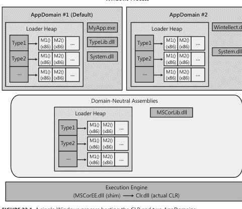

**图 22-1** 承载 CLR 和两个 AppDomain 的单个 Windows 进程。

有些程序集预期会被多个 AppDomain 使用。MSCorLib.dll 是最好的例子。此程序集包含 System.Object、System.Int32 以及 .NET Framework 中不可或缺的所有其他类型。此程序集在 CLR 初始化时自动加载，所有 AppDomain 共享此程序集中的类型。为减少资源使用，MSCorLib.dll 以 AppDomain 中立方式加载；也就是说，CLR 为以域中立方式加载的程序集维护一个特殊的加载器堆。此加载器堆中的所有类型对象以及这些类型方法的所有本机代码都由进程中的所有 AppDomain 共享。不幸的是，共享这些资源带来的好处确实有代价：以域中立方式加载的程序集永远无法卸载。回收它们所用资源的唯一方法是终止 Windows 进程，让 Windows 回收这些资源。

### 跨 AppDomain 边界访问对象

一个 AppDomain 中的代码可以与另一个 AppDomain 中包含的类型和对象通信。但是，只能通过定义良好的机制访问这些类型和对象。以下 Ch22-1-AppDomains 示例应用程序演示如何创建新的 AppDomain、将程序集加载到其中，并构造该程序集中定义的类型的实例。代码展示了在构造按引用封送的类型、按值封送的类型以及完全无法封送的类型时的不同行为。代码还展示了这些以不同方式封送的对象在创建它们的 AppDomain 被卸载时的行为。Ch22-1-AppDomains 示例应用程序中的代码很少，但我添加了许多注释。代码清单之后，我将逐步讲解代码，解释 CLR 正在做什么。

```csharp
private static void Marshalling() {
    // Get a reference to the AppDomain that the calling thread is executing in
    AppDomain adCallingThreadDomain = Thread.GetDomain();

    // Every AppDomain is assigned a friendly string name (helpful for debugging)
    // Get this AppDomain's friendly string name and display it
    String callingDomainName = adCallingThreadDomain.FriendlyName;
    Console.WriteLine("Default AppDomain's friendly name={0}", callingDomainName);

    // Get and display the assembly in our AppDomain that contains the 'Main' method
    String exeAssembly = Assembly.GetEntryAssembly().FullName;
    Console.WriteLine("Main assembly={0}", exeAssembly);

    // Define a local variable that can refer to an AppDomain
    AppDomain ad2 = null;

    // *** DEMO 1: Cross-AppDomain Communication Using Marshal-by-Reference ***
    Console.WriteLine("{0}Demo #1", Environment.NewLine);

    // Create new AppDomain (security and configuration match current AppDomain)
    ad2 = AppDomain.CreateDomain("AD #2", null, null);
    MarshalByRefType mbrt = null;

    // Load our assembly into the new AppDomain, construct an object, marshal
    // it back to our AD (we really get a reference to a proxy)
    mbrt = (MarshalByRefType)
        ad2.CreateInstanceAndUnwrap(exeAssembly, "MarshalByRefType");

    Console.WriteLine("Type={0}", mbrt.GetType());  // The CLR lies about the type

    // Prove that we got a reference to a proxy object
    Console.WriteLine("Is proxy={0}", RemotingServices.IsTransparentProxy(mbrt));

    // This looks like we're calling a method on MarshalByRefType but we're not.
    // We're calling a method on the proxy type. The proxy transitions the thread
    // to the AppDomain owning the object and calls this method on the real object.
    mbrt.SomeMethod();

    // Unload the new AppDomain
    AppDomain.Unload(ad2);
    // mbrt refers to a valid proxy object; the proxy object refers to an invalid AppDomain

    try {
        // We're calling a method on the proxy type. The AD is invalid, exception is thrown
        mbrt.SomeMethod();
        Console.WriteLine("Successful call.");
    }
    catch (AppDomainUnloadedException) {
        Console.WriteLine("Failed call.");
    }


    // *** DEMO 2: Cross-AppDomain Communication Using Marshal-by-Value ***
    Console.WriteLine("{0}Demo #2", Environment.NewLine);

    // Create new AppDomain (security and configuration match current AppDomain)
    ad2 = AppDomain.CreateDomain("AD #2", null, null);

    // Load our assembly into the new AppDomain, construct an object, marshal
    // it back to our AD (we really get a reference to a proxy)
    mbrt = (MarshalByRefType)
        ad2.CreateInstanceAndUnwrap(exeAssembly, "MarshalByRefType");

    // The object's method returns a COPY of the returned object;
    // the object is marshaled by value (not by reference).
    MarshalByValType mbvt = mbrt.MethodWithReturn();

    // Prove that we did NOT get a reference to a proxy object
    Console.WriteLine("Is proxy={0}", RemotingServices.IsTransparentProxy(mbvt));

    // This looks like we're calling a method on MarshalByValType and we are.
    Console.WriteLine("Returned object created " + mbvt.ToString());

    // Unload the new AppDomain
    AppDomain.Unload(ad2);
    // mbvt refers to valid object; unloading the AppDomain has no impact.

    try {
        // We're calling a method on an object; no exception is thrown
        Console.WriteLine("Returned object created " + mbvt.ToString());
        Console.WriteLine("Successful call.");
    }
    catch (AppDomainUnloadedException) {
        Console.WriteLine("Failed call.");
    }


    // DEMO 3: Cross-AppDomain Communication Using non-marshalable type ***
    Console.WriteLine("{0}Demo #3", Environment.NewLine);

    // Create new AppDomain (security and configuration match current AppDomain)
    ad2 = AppDomain.CreateDomain("AD #2", null, null);

    // Load our assembly into the new AppDomain, construct an object, marshal
    // it back to our AD (we really get a reference to a proxy)
    mbrt = (MarshalByRefType)
        ad2.CreateInstanceAndUnwrap(exeAssembly, "MarshalByRefType");

    // The object's method returns a non-marshalable object: exception
    NonMarshalableType nmt = mbrt.MethodArgAndReturn(callingDomainName);
    // We won't get here...
}

// Instances can be marshaled-by-reference across AppDomain boundaries
public sealed class MarshalByRefType : MarshalByRefObject {
    public MarshalByRefType() {
        Console.WriteLine("{0} ctor running in {1}",
            this.GetType().ToString(), Thread.GetDomain().FriendlyName);
    }

    public void SomeMethod() {
        Console.WriteLine("Executing in " + Thread.GetDomain().FriendlyName);
    }

    public MarshalByValType MethodWithReturn() {
        Console.WriteLine("Executing in " + Thread.GetDomain().FriendlyName);
        MarshalByValType t = new MarshalByValType();
        return t;
    }

    public NonMarshalableType MethodArgAndReturn(String callingDomainName) {
        // NOTE: callingDomainName is [Serializable]
        Console.WriteLine("Calling from '{0}' to '{1}'",
            callingDomainName, Thread.GetDomain().FriendlyName);
        NonMarshalableType t = new NonMarshalableType();
        return t;
    }
}


// Instances can be marshaled-by-value across AppDomain boundaries
[Serializable]
public sealed class MarshalByValType : Object {
    private DateTime m_creationTime = DateTime.Now; // NOTE: DateTime is [Serializable]

    public MarshalByValType() {
        Console.WriteLine("{0} ctor running in {1}, Created on {2:D}",
            this.GetType().ToString(),
            Thread.GetDomain().FriendlyName,
            m_creationTime);
    }

    public override String ToString() {
        return m_creationTime.ToLongDateString();
    }
}
```


```csharp
// Instances cannot be marshaled across AppDomain boundaries
// [Serializable]
public sealed class NonMarshalableType : Object {
    public NonMarshalableType() {
        Console.WriteLine("Executing in " + Thread.GetDomain().FriendlyName);
    }
}
```

如果生成并运行 Ch22-1-AppDomains 应用程序，你将得到以下输出。

```text
Default AppDomain's friendly name= Ch22-1-AppDomains.exe
Main assembly=Ch22-1-AppDomains, Version=0.0.0.0, Culture=neutral, PublicKeyToken=null

Demo #1
MarshalByRefType ctor running in AD #2
Type=MarshalByRefType
Is proxy=True
Executing in AD #2
Failed call.

Demo #2
MarshalByRefType ctor running in AD #2
Executing in AD #2
MarshalByValType ctor running in AD #2, Created on Friday, August 07, 2009
Is proxy=False
Returned object created Saturday, June 23, 2012
Returned object created Saturday, June 23, 2012
Successful call.

Demo #3
MarshalByRefType ctor running in AD #2
Calling from 'Ch22-1-AppDomains.exe' to 'AD #2'.
Executing in AD #2

Unhandled Exception: System.Runtime.Serialization.SerializationException:
Type 'NonMarshalableType' in assembly 'Ch22-1-AppDomains, Version=0.0.0.0,
Culture=neutral, PublicKeyToken=null' is not marked as serializable.
   at MarshalByRefType.MethodArgAndReturn(String callingDomainName)
   at Program.Marshalling()
   at Program.Main()
```

现在，我将讨论这段代码以及 CLR 正在做什么。

在 *Marshalling* 方法内部，我首先获取一个 AppDomain 对象的引用，该对象标识了调用线程当前正在其中执行的 AppDomain。在 Windows 中，线程总是在一个进程的上下文中创建的，并且线程的整个生命周期都在该进程中。然而，线程与 AppDomain 之间并不存在一一对应的关系。AppDomain 是 CLR 的一项功能；Windows 对 AppDomain 一无所知。因为一个 Windows 进程中可以存在多个 AppDomain，所以线程可以在一个 AppDomain 中执行代码，然后在另一个 AppDomain 中执行代码。从 CLR 的角度来看，一个线程一次只能在一个 AppDomain 中执行代码。线程可以通过调用 System.Threading.Thread 的静态 *GetDomain* 方法来询问 CLR 它当前正在哪个 AppDomain 中执行。线程也可以查询 System.AppDomain 的静态只读 *CurrentDomain* 属性来获取相同的信息。

创建 AppDomain 时，可以为它分配一个友好名称。友好名称只是一个 String，你可以用它来标识一个 AppDomain。这在调试场景中通常很有用。由于 CLR 在我们的任何代码运行之前就会创建默认 AppDomain，因此 CLR 使用可执行文件的文件名作为默认 AppDomain 的友好名称。我的 Marshalling 方法通过使用 System.AppDomain 的只读 FriendlyName 属性来查询默认 AppDomain 的友好名称。

接下来，我的 Marshalling 方法查询定义了入口点方法 Main（即调用 Marshalling 的方法）的程序集（已加载到默认 AppDomain 中）的强名称标识。该程序集定义了若干类型：Program、MarshalByRefType、MarshalByValType 和 NonMarshalableType。至此，我们已经准备好查看三个彼此非常相似的演示了。

#### 演示 #1：使用按引用封送进行跨 AppDomain 通信

在演示 #1 中，调用了 System.AppDomain 的静态 CreateDomain 方法，指示 CLR 在同一 Windows 进程中创建一个新的 AppDomain。AppDomain 类型实际上提供了 CreateDomain 方法的多个重载；我建议你研究这些重载，并在编写代码创建新的 AppDomain 时选择最合适的版本。我调用的 CreateDomain 版本接受三个参数：

-   **一个 String，标识我希望分配给新 AppDomain 的友好名称** 我这里传入的是 'AD #2'。
-   **一个 System.Security.Policy.Evidence，标识 CLR 在计算 AppDomain 的权限集时应使用的证据** 我这里传入 null，这样新 AppDomain 将继承创建它的 AppDomain 的相同权限集。通常，如果你想在 AppDomain 中的代码周围创建安全边界，可以构造一个 System.Security.PermissionSet 对象，向其中添加所需的权限对象（实现了 IPermission 接口的类型的实例），然后将生成的 PermissionSet 对象引用传递给接受 PermissionSet 的 CreateDomain 方法重载。
-   **一个 System.AppDomainSetup，标识 CLR 应该用于新 AppDomain 的配置设置** 同样，我这里传入 null，这样新 AppDomain 将继承创建它的 AppDomain 的相同配置设置。如果你希望 AppDomain 具有特殊配置，请构造一个 AppDomainSetup 对象，将其各种属性设置为你想要的任何值，例如配置文件的名称，然后将生成的 AppDomainSetup 对象引用传递给 CreateDomain 方法。

在内部，CreateDomain 方法会在进程中创建一个新的 AppDomain。这个 AppDomain 将被分配指定的友好名称、安全设置和配置设置。新的 AppDomain 将拥有自己的加载器堆，该堆将是空的，因为当前没有任何程序集加载到新的 AppDomain 中。当你创建 AppDomain 时，CLR 不会在这个 AppDomain 中创建任何线程；除非你明确让某个线程调用 AppDomain 中的代码，否则 AppDomain 中不会有任何代码运行。

现在，要在新的 AppDomain 中创建对象的实例，我们必须先将程序集加载到新的 AppDomain 中，然后构造此程序集中定义的某个类型的实例。这正是调用 AppDomain 的公共实例方法 CreateInstanceAndUnwrap 所做的事情。在调用 CreateInstanceAndUnwrap 时，我传递两个参数：一个 String，标识我希望加载到新 AppDomain 中的程序集（由 ad2 变量引用）；另一个 String，标识我希望构造其实例的类型的名称。在内部，CreateInstanceAndUnwrap 会使调用线程从当前 AppDomain 转换到新的 AppDomain。现在，该线程（位于对 CreateInstanceAndUnwrap 的调用内部）将指定的程序集加载到新的 AppDomain 中，然后扫描程序集的类型定义元数据表，查找指定的类型（"MarshalByRefType"）。找到该类型后，线程调用 MarshalByRefType 的无参构造函数。现在，线程转换回默认 AppDomain，以便 CreateInstanceAndUnwrap 可以返回对新 MarshalByRefType 对象的引用。

**注意** 有一些 CreateInstanceAndUnwrap 的重载版本允许你在调用类型的构造函数时传入参数。

虽然这听起来一切正常，但有一个问题：CLR 不允许存在于一个 AppDomain 中的变量（根）引用在另一个 AppDomain 中创建的对象。如果 CreateInstanceAndUnwrap 只是简单地返回对象的引用，隔离就会被破坏，而隔离正是 AppDomain 的全部意义所在！因此，就在 CreateInstanceAndUnwrap 返回对象引用之前，它还会执行一些额外的逻辑。

你会注意到，MarshalByRefType 类型派生自一个非常特殊的基类：System.MarshalByRefObject。当 CreateInstanceAndUnwrap 发现它正在封送一个类型派生自 MarshalByRefObject 的对象时，CLR 将按引用跨 AppDomain 边界封送该对象。下面说明将对象按引用从一个 AppDomain（真正创建该对象的源 AppDomain）封送到另一个 AppDomain（调用 CreateInstanceAndUnwrap 的目标 AppDomain）意味着什么。

当源 AppDomain 想要向目标 AppDomain 发送或返回对象的引用时，CLR 会在目标 AppDomain 的加载器堆中定义一个代理类型。这个代理类型是使用原始类型的元数据定义的，因此它看起来与原始类型完全相同；它拥有所有相同的实例成员（属性、事件和方法）。实例字段不是类型的一部分，但我稍后会详细讨论这一点。这个新类型内部确实定义了一些实例字段，但这些字段与原始数据类型的字段并不相同。相反，这些字段指明了哪个 AppDomain "拥有"真正的对象，以及如何在拥有该对象的 AppDomain 中找到真正的对象。（在内部，代理对象使用一个引用真实对象的 GCHandle 实例。GCHandle 类型在第 21 章"托管堆和垃圾回收"中讨论。）

在目标 AppDomain 中定义了此类型之后，CreateInstanceAndUnwrap 会创建此代理类型的一个实例，将其字段初始化为标识源 AppDomain 和真实对象，并将此代理对象的引用返回给目标 AppDomain。在我的 Ch22-1-AppDomains 应用程序中，mbrt 变量将被设置为引用这个代理。请注意，从

CreateInstanceAndUnwrap 实际上并不是 MarshalByRefType 类型的实例。CLR 通常不允许将一种类型的对象强制转换为不兼容的类型。然而，在这种情况下，CLR 确实允许这种强制转换，因为这个新类型具有与原始类型所定义的相同的实例成员。事实上，如果你使用代理对象调用 GetType，它实际上会对你撒谎，说它是一个 MarshalByRefType 对象。

不过，可以证明 CreateInstanceAndUnwrap 返回的对象实际上是对代理对象的引用。为此，我的 Ch22-1-AppDomains 应用程序调用 System.Runtime.Remoting.RemotingServices 的公共静态 IsTransparentProxy 方法，并传入 CreateInstanceAndUnwrap 返回的引用。从输出中可以看到，IsTransparentProxy 返回 true，表明该对象是一个代理。

现在，我的 Ch22-1-AppDomains 应用程序使用代理来调用 SomeMethod 方法。由于 mbrt 变量引用的是代理对象，因此会调用该方法的代理实现。代理实现使用代理对象内部的信息字段，将调用线程从默认 AppDomain 转换到新的 AppDomain。此线程现在执行的任何操作都在新 AppDomain 的安全和配置设置下运行。接下来，线程使用代理对象的 GCHandle 字段在新 AppDomain 中查找真实对象，然后使用该真实对象调用真正的 SomeMethod 方法。

有两种方法可以证明调用线程已从默认 AppDomain 转换到新的 AppDomain。首先，在 SomeMethod 方法内部，我调用 Thread.GetDomain().FriendlyName。这将返回 "AD #2"（输出可以证明这一点），因为该线程现在运行在使用 AppDomain.CreateDomain 并以 "AD #2" 作为友好名称参数创建的新 AppDomain 中。其次，如果你在调试器中单步执行代码并显示“调用堆栈”窗口，[AppDomain Transition] 行会标记线程跨越 AppDomain 边界进行转换的位置。请参见图 22-2 底部附近的“调用堆栈”窗口。


**FIGURE 22-2** 调试器的“调用堆栈”窗口显示了 AppDomain 转换。

当真正的 `SomeMethod` 方法返回时，它会返回到代理的 `SomeMethod` 方法，后者将线程转换回默认 `AppDomain`，然后线程继续在默认 `AppDomain` 中执行代码。

> **注意** 当一个 `AppDomain` 中的线程调用另一个 `AppDomain` 中的方法时，该线程会在两个 `AppDomain` 之间转换。这意味着跨 `AppDomain` 边界的方法调用是同步执行的。然而，在任何给定时刻，一个线程只被认为处于一个 `AppDomain` 中，并且它使用该 `AppDomain` 的安全和配置设置来执行代码。如果你希望同时在多个 `AppDomains` 中执行代码，则应创建额外的线程，让它们在所需的任意 `AppDomains` 中执行所需的任意代码。

我的 `Ch22-1-AppDomains` 应用程序接下来要做的是调用 `AppDomain` 的公共静态 `Unload` 方法，强制 CLR 卸载指定的 `AppDomain`，包括加载到其中的所有程序集。系统会强制执行一次垃圾回收，以释放由正在卸载的 `AppDomain` 中的代码创建的所有对象。此时，默认 `AppDomain` 的 `mbrt` 变量仍然引用一个有效的代理对象；但是，该代理对象不再引用有效的 `AppDomain`（因为它已被卸载）。

当默认 `AppDomain` 尝试使用代理对象调用 `SomeMethod` 方法时，会调用该方法的代理实现。代理实现确定包含真实对象的 `AppDomain` 已被卸载，于是代理的 `SomeMethod` 方法会抛出 `AppDomainUnloadedException`，让调用方知道该操作无法完成。

哇！Microsoft 的 CLR 团队为确保 `AppDomain` 隔离做了大量工作，但这是重要的工作，因为这些功能被大量使用，而且开发者每天都在越来越多地使用它们。显然，通过按引用封送语义跨 `AppDomain` 边界访问对象会带来一些相关的性能开销，因此通常应尽量少用此功能。

我答应过你，会再多讲一点实例字段。派生自 `MarshalByRefObject` 的类型可以定义实例字段。但是，这些实例字段并未定义为代理类型的一部分，也不包含在代理对象内部。当你编写代码读取或写入派生自 `MarshalByRefObject` 的类型的实例字段时，JIT 编译器会生成代码，分别通过调用 `System.Object` 的 `FieldGetter` 或 `FieldSetter` 方法来使用代理对象（以查找真实的 `AppDomain`/对象）。这些方法是私有的且未记录在文档中；它们基本上就是使用反射来获取和设置字段值的方法。因此，尽管你可以访问派生自 `MarshalByRefObject` 的类型的字段，但性能特别差，因为 CLR 最终实际上会调用方法来执行字段访问。事实上，即使你访问的对象位于你自己的 `AppDomain` 中，性能也很差。^3

^3 如果 CLR 要求所有字段都是私有的（这是实现良好数据封装所推荐的），那么就不必存在 `FieldGetter` 和 `FieldSetter` 方法，并且从方法访问字段始终可以是直接访问，从而避免任何性能损失。

### 访问实例字段的性能

为了演示这种性能损失的严重性，我编写了以下代码。

```csharp
private sealed class NonMBRO : Object        { public Int32 x; }
private sealed class MBRO    : MarshalByRefObject { public Int32 x; }

private static void FieldAccessTiming() {
    const Int32 count = 100000000;
    NonMBRO nonMbro = new NonMBRO();
    MBRO mbro = new MBRO();

    Stopwatch sw = Stopwatch.StartNew();
    for (Int32 c = 0; c < count; c++) nonMbro.x++;
    Console.WriteLine("{0}", sw.Elapsed);   // 00:00:00.4073560

    sw = Stopwatch.StartNew();
    for (Int32 c = 0; c < count; c++) mbro.x++;
    Console.WriteLine("{0}", sw.Elapsed);   // 00:00:02.5388665
}
```

运行这段代码时，访问派生自 Object 的 NonMBRO 类的实例字段大约耗时 0.4 秒，而访问派生自 MarshalByRefObject 的 MBRO 类的实例字段耗时 2.54 秒。因此，访问派生自 MarshalByRefObject 的类的实例字段所需时间要长 6 倍多！

从可用性角度来看，派生自 MarshalByRefObject 的类型确实应避免定义任何静态成员。原因在于，静态成员始终在调用方 AppDomain 的上下文中访问。不会发生 AppDomain 转换，因为代理对象包含标识要转换到哪个 AppDomain 的信息，但在调用静态成员时没有代理对象。让一个类型的静态成员在一个 AppDomain 中执行，而实例成员在另一个 AppDomain 中执行，会造成非常别扭的编程模型。

由于第二个 AppDomain 中没有根，代理所引用的原始对象可能会被垃圾回收。当然，这并不理想。另一方面，如果原始对象被无限期地保留在内存中，那么代理可能已消失，而原始对象仍然存活；这同样不理想。CLR 通过使用租约管理器来解决此问题。当为对象创建代理时，CLR 会让该对象保持存活五分钟。如果五分钟后没有通过代理进行任何调用，则该对象会被停用，并在下一次垃圾回收时释放其内存。每次调用该对象后，租约管理器都会续订该对象的租约，以确保它在被停用之前再保留在内存中两分钟。如果应用程序在对象的租约过期后尝试通过代理调用该对象，CLR 会抛出 System.Runtime.Remoting.RemotingException。

可以通过重写 MarshalByRefObject 的虚方法 InitializeLifetimeService 来覆盖默认的五分钟和两分钟租约时间。有关更多信息，请参阅 .NET Framework SDK 文档中标题为“生命周期租约”的章节。


#### Demo #2：使用按值封送的跨 AppDomain 通信

Demo #2 与 Demo #1 非常相似。同样，像 Demo #1 那样创建了另一个 AppDomain。然后，调用 CreateInstanceAndUnwrap 将同一个程序集加载到新的 AppDomain 中，并在该新 AppDomain 中创建 MarshalByRefType 对象的实例。接下来，CLR 为该对象创建代理，并将 mbrt 变量（位于默认 AppDomain 中）初始化为引用该代理。现在，我使用该代理调用 MethodWithReturn。这个方法不接受任何参数，它将在新的 AppDomain 中执行，创建 MarshalByValType 类型的实例，然后将该对象的引用返回给默认 AppDomain。

MarshalByValType 不是从 System.MarshalByRefObject 派生的，因此 CLR 无法定义代理类型来从中创建实例；该对象无法跨 AppDomain 边界按引用封送。

但是，由于 MarshalByValType 标记了 [Serializable] 自定义特性，因此允许 MethodWithReturn 按值封送该对象。下一段将描述从一个 AppDomain（源 AppDomain）按值将对象封送到另一个 AppDomain（目标 AppDomain）意味着什么。有关 CLR 的序列化和反序列化机制的更多信息，请参见第 24 章“运行时序列化”。

当源 AppDomain 想要向目标 AppDomain 发送或返回对象的引用时，CLR 会将该对象的实例字段序列化为字节数组。这个字节数组会从源 AppDomain 复制到目标 AppDomain。然后，CLR 在目标 AppDomain 中反序列化该字节数组。如果目标 AppDomain 尚未加载定义被反序列化类型的程序集，这会强制 CLR 将该程序集加载到目标 AppDomain 中。然后，CLR 创建该类型的实例，并使用字节数组中的值初始化对象的字段，使这些字段的值与原始对象中的值完全相同。换句话说，CLR 在目标 AppDomain 中创建源对象的精确副本。随后，MethodWithReturn 返回对这个副本的引用；该对象已经按值跨 AppDomain 边界封送。

> **重要** 加载程序集时，CLR 使用目标 AppDomain 的策略和配置设置（例如，该 AppDomain 可以具有不同的 AppBase 目录或不同的版本绑定重定向）。这些策略差异可能会阻止 CLR 定位程序集。如果无法加载程序集，则会抛出异常，目标 AppDomain 将不会收到该对象的引用。

此时，源 AppDomain 中的对象和目标 AppDomain 中的对象具有各自独立的生存期，它们的状态可以彼此独立地变化。如果源 AppDomain 中没有根使原始对象保持存活（就像我的 Ch22-1-AppDomains 应用程序中那样），那么它的内存将在下一次垃圾回收时被回收。

为了证明从 `MethodWithReturn` 返回的对象不是代理对象的引用，我的 `Ch22-1-AppDomains` 应用程序调用 `System.Runtime.Remoting.RemotingServices'` 的公共静态 `IsTransparentProxy` 方法，并传入从 `MethodWithReturn` 返回的引用。从输出中可以看到，`IsTransparentProxy` 返回 `false`，表明该对象是真实对象，而不是代理。

现在，我的程序使用这个真实对象调用 `ToString` 方法。因为 `mbvt` 变量引用的是真实对象，所以会调用该方法的真实实现，并且不会发生 `AppDomain` 转换。这一点可以通过查看调试器的“调用堆栈”窗口来验证，该窗口不会显示 `[AppDomain Transition]` 行。

为了进一步证明没有涉及代理，我的 `Ch22-1-AppDomains` 应用程序卸载新的 `AppDomain`，然后再次尝试调用 `ToString` 方法。与 Demo #1 不同，这次调用成功，因为卸载新的 `AppDomain` 对默认 `AppDomain` “拥有”的对象没有影响，其中包括按值封送的那个对象。

#### Demo #3：使用不可封送类型的跨 AppDomain 通信

Demo #3 的开头与 Demo #1 和 Demo #2 非常相似。正如 Demo #1 和 Demo #2 中那样，创建了一个 `AppDomain`。然后，调用 `CreateInstanceAndUnwrap` 将同一个程序集加载到新的 `AppDomain` 中，在该新 `AppDomain` 中创建 `MarshalByRefType` 对象，并让 `mbrt` 变量引用该对象的代理。

然后，我使用这个代理调用 `MethodArgAndReturn`，该方法接受一个参数。同样，CLR 必须保持 `AppDomain` 隔离，因此它不能简单地将参数的引用传入新的 `AppDomain`。如果对象的类型派生自 `MarshalByRefObject`，CLR 会为其创建代理并按引用封送。如果对象的类型标记为 `[Serializable]`，CLR 会将该对象（及其子对象）序列化为字节数组，将字节数组封送到新的 `AppDomain`，然后将该字节数组反序列化为对象图，并将对象图的根传入 `MethodArgAndReturn` 方法。

在这个特定演示中，我要跨 `AppDomain` 边界传递一个 `System.String` 对象。`System.String` 类型不是派生自 `MarshalByRefObject`，因此 CLR 无法创建代理。幸运的是，`System.String` 标记为 `[Serializable]`，因此 CLR 可以按值封送它，这使得代码可以正常工作。请注意，对于 `String` 对象，CLR 会执行一项特殊优化。当跨 `AppDomain` 边界封送 `String` 对象时，CLR 只是将该 `String` 对象的引用传递过边界；它不会复制该 `String` 对象。CLR 能提供这项优化，是因为 `String` 对象是不可变的；因此，一个 `AppDomain` 中的代码不可能破坏 `String` 对象的字符。⁴ 有关 `String` 不可变性的更多信息，请参见第 14 章“字符、字符串与文本处理”。

⁴ 顺便说一句，这就是 `System.String` 类被密封的原因。如果该类没有被密封，那么你可以定义自己的类，从 `String` 派生并添加自己的字段。如果这样做，CLR 就无法确保你的“String”类是不可变的。

在 MethodArgAndReturn 内部，我显示传入其中的字符串，以表明该字符串跨越了 AppDomain 边界，然后创建 NonMarshalableType 类型的实例，并将该对象的引用返回给默认 AppDomain。由于 NonMarshalableType 不是从 System.MarshalByRefObject 派生的，也没有标记 [Serializable] 自定义特性，因此不允许 MethodArgAndReturn 按引用或按值封送该对象——该对象根本无法跨 AppDomain 边界封送！为了报告这一点，MethodArgAndReturn 会在默认 AppDomain 中抛出 SerializationException。由于我的程序没有捕获这个异常，程序就直接终止了。

### AppDomain 卸载

AppDomain 的一大特性是可以卸载它们。卸载 AppDomain 会使 CLR 卸载该 AppDomain 中的所有程序集，并且 CLR 还会释放该 AppDomain 的加载器堆。要卸载 AppDomain，可以调用 AppDomain 的 Unload 静态方法（就像 Ch22-1-AppDomains 应用程序所做的那样）。这个调用会使 CLR 执行许多操作，以正常卸载指定的 AppDomain：

- 1. CLR 挂起进程中所有曾经执行过托管代码的线程。
- 2. CLR 检查所有线程的堆栈，以确定哪些线程当前正在正在卸载的 AppDomain 中执行代码，或者哪些线程可能稍后返回到正在卸载的 AppDomain 中的代码。CLR 强制任何堆栈上含有正在卸载的 AppDomain 的线程抛出 ThreadAbortException（恢复该线程的执行）。这会使这些线程展开，在退出过程中执行所有 finally 块，以便执行清理代码。如果没有代码捕获 ThreadAbortException，它最终会变成 CLR 吞掉的未处理异常；线程死亡，但允许进程继续运行。这很不寻常，因为对于所有其他未处理异常，CLR 都会终止进程。

> **重要** 如果线程当前正在执行 finally 块、catch 块、类构造函数、关键执行区域或非托管代码中的代码，CLR 不会立即中止该线程。如果 CLR 允许这样做，清理代码、错误恢复代码、类型初始化代码、关键代码或 CLR 一无所知的任意代码将无法完成，从而导致应用程序行为不可预测并可能带来安全漏洞。正在中止的线程可以完成执行这些代码块，然后在该代码块结束时，CLR 强制该线程抛出 ThreadAbortException。


- 3. 在第 2 步中发现的所有线程都离开 AppDomain 后，CLR 会遍历堆，并在每个代理对象中设置一个标志，这些代理对象曾引用由已卸载的 AppDomain 创建的对象。这些代理对象现在知道它们所引用的真实对象已经不存在了。如果现在有任何代码调用无效代理对象上的方法，该方法将抛出 `AppDomainUnloadedException`。
- 4. CLR 强制进行垃圾回收，回收由现已卸载的 AppDomain 创建的任何对象所占用的内存。会调用这些对象的 `Finalize` 方法，使这些对象有机会正确清理自身。
- 5. CLR 恢复所有剩余线程。调用 `AppDomain.Unload` 的线程现在将继续运行；对 `AppDomain.Unload` 的调用是同步发生的。

我的 Ch22-1-AppDomains 应用程序只使用一个线程完成所有工作。每当我的代码调用 `AppDomain.Unload` 时，正在卸载的 AppDomain 中都没有线程，因此 CLR 不必抛出任何 `ThreadAbortException` 异常。我将在本章后面进一步讨论 `ThreadAbortException`。

顺便说一下，当线程调用 `AppDomain.Unload` 时，CLR 会等待正在卸载的 AppDomain 中的线程离开它，最多等待 10 秒。如果 10 秒后调用 `AppDomain.Unload` 的线程仍未返回，它将抛出一个 `CannotUnloadAppDomainException`，并且该 AppDomain 将来可能会也可能不会被卸载。

> **注意** 如果调用 `AppDomain.Unload` 的线程位于正在卸载的 AppDomain 中，CLR 会创建另一个线程来尝试卸载该 AppDomain。第一个线程将强制抛出 `ThreadAbortException` 并展开。新线程将等待该 AppDomain 卸载，然后新线程终止。如果 AppDomain 卸载失败，新线程将处理一个 `CannotUnloadAppDomainException`，但由于你没有编写这个新线程所执行的代码，因此你无法捕获此异常。

### AppDomain 监控

宿主应用程序可以监控 AppDomain 消耗的资源。一些宿主会利用此信息来决定：当某个 AppDomain 的内存或 CPU 消耗超过宿主认为合理的范围时，何时强制卸载该 AppDomain。监控还可用于比较不同算法的资源消耗，以确定哪种算法使用的资源更少。由于 AppDomain 监控会带来额外开销，宿主必须通过将 `AppDomain` 的静态 `MonitoringIsEnabled` 属性设置为 `true` 来显式开启监控。这会为所有 AppDomain 开启监控。监控开启后便无法关闭；尝试将 `MonitoringIsEnabled` 属性设置为 `false` 会导致抛出 `ArgumentException`。

监控开启后，你的代码可以查询 AppDomain 类提供的以下四个只读属性：

- **MonitoringSurvivedProcessMemorySize** 这个静态 Int64 属性返回当前 CLR 实例控制的所有 AppDomain 当前正在使用的字节数。该数字在最近一次垃圾回收时是准确的。
- **MonitoringTotalAllocatedMemorySize** 这个实例 Int64 属性返回特定 AppDomain 已分配的字节数。该数字在最近一次垃圾回收时是准确的。
- **MonitoringSurvivedMemorySize** 这个实例 Int64 属性返回特定 AppDomain 当前正在使用的字节数。该数字在最近一次垃圾回收时是准确的。
- **MonitoringTotalProcessorTime** 这个实例 TimeSpan 属性返回特定 AppDomain 产生的 CPU 使用量。

下面的类展示了如何使用其中三个属性来查看 AppDomain 在两个时间点之间发生了哪些变化。

```csharp
private sealed class AppDomainMonitorDelta : IDisposable {
    private AppDomain m_appDomain;
    private TimeSpan m_thisADCpu;
    private Int64 m_thisADMemoryInUse;
    private Int64 m_thisADMemoryAllocated;

    static AppDomainMonitorDelta() {
        // Make sure that AppDomain monitoring is turned on
        AppDomain.MonitoringIsEnabled = true;
    }

    public AppDomainMonitorDelta(AppDomain ad) {
        m_appDomain = ad ?? AppDomain.CurrentDomain;
        m_thisADCpu = m_appDomain.MonitoringTotalProcessorTime;
        m_thisADMemoryInUse = m_appDomain.MonitoringSurvivedMemorySize;
        m_thisADMemoryAllocated = m_appDomain.MonitoringTotalAllocatedMemorySize;
    }

    public void Dispose() {
        GC.Collect();
        Console.WriteLine("FriendlyName={0}, CPU={1}ms", m_appDomain.FriendlyName,
            (m_appDomain.MonitoringTotalProcessorTime - m_thisADCpu).TotalMilliseconds);
        Console.WriteLine("   Allocated {0:N0} bytes of which {1:N0} survived GCs",
            m_appDomain.MonitoringTotalAllocatedMemorySize - m_thisADMemoryAllocated,
            m_appDomain.MonitoringSurvivedMemorySize - m_thisADMemoryInUse);
    }
}
```

以下代码展示了如何使用 AppDomainMonitorDelta 类。

```csharp
private static void AppDomainResourceMonitoring() {
   using (new AppDomainMonitorDelta(null)) {
      // Allocate about 10 million bytes that will survive collections
      var list = new List<Object>();
      for (Int32 x = 0; x < 1000; x++) list.Add(new Byte[10000]);

      // Allocate about 20 million bytes that will NOT survive collections
      for (Int32 x = 0; x < 2000; x++) new Byte[10000].GetType();

      // Spin the CPU for about 5 seconds
      Int64 stop = Environment.TickCount + 5000;
      while (Environment.TickCount < stop) ;
   }
}
```

执行此代码时，我得到以下输出。

```
FriendlyName=03-Ch22-1-AppDomains.exe, CPU=5031.25ms
   Allocated 30,159,496 bytes of which 10,085,080 survived GCs
```

### AppDomain 首次机会异常通知

每个 AppDomain 都可以关联一系列回调方法，当 CLR 开始在一个 AppDomain 内查找 catch 块时，这些回调方法会被调用。这些方法可以执行日志记录，宿主也可以利用此机制来监控 AppDomain 内抛出的异常。回调不能处理异常，也不能以任何方式吞掉异常；它们只是收到异常已发生的通知。要注册回调方法，只需向 AppDomain 的实例 FirstChanceException 事件添加一个委托。

以下是 CLR 处理异常的方式：当异常首次抛出时，CLR 会调用与抛出该异常的 AppDomain 关联的任何 FirstChanceException 回调方法。然后，CLR 在堆栈上查找位于同一 AppDomain 内的任何 catch 块。如果某个 catch 块处理了该异常，则异常处理完成，执行照常继续。如果该 AppDomain 没有 catch 块来处理该异常，则 CLR 沿堆栈向上到调用方 AppDomain，并再次抛出同一个异常对象（在序列化和反序列化之后）。此时，就好像抛出了一个全新的异常，CLR 会调用与新当前 AppDomain 关联的任何 FirstChanceException 回调方法。此过程持续到到达线程堆栈的顶部。此时，如果没有任何代码处理该异常，CLR 将终止整个进程。

### Microsoft ASP.NET 和 XML Web Services 应用程序

ASP.NET 是作为 ISAPI DLL（在 ASPNET_ISAPI.dll 中实现）实现的。客户端首次请求由 ASP.NET ISAPI DLL 处理的 URL 时，ASP.NET 会加载 CLR。当客户端向 Web 应用程序发出请求时，ASP.NET 会判断这是否是首次请求。如果是，ASP.NET 会告诉 CLR 为此 Web 应用程序创建一个新的 AppDomain；每个 Web 应用程序由其虚拟根目录标识。然后，ASP.NET 告诉 CLR 将包含该 Web 应用程序所公开类型的程序集加载到这个新的 AppDomain 中，创建该类型的实例，并开始调用其中的方法来满足客户端的 Web 请求。如果代码引用了更多类型，CLR 会将所需的程序集加载到该 Web 应用程序的 AppDomain 中。

当未来的客户端向已在运行的 Web 应用程序发出请求时，ASP.NET 不会创建新的 AppDomain；相反，它使用现有的 AppDomain，创建该 Web 应用程序类型的新实例，并开始调用方法。这些方法已经 JIT 编译为原生代码，因此处理所有后续客户端请求的性能极佳。

如果客户端向另一个 Web 应用程序发出请求，ASP.NET 会告诉 CLR 创建一个新的 AppDomain。这个新 AppDomain 通常与其它 AppDomain 创建在同一个工作进程中。这意味着许多 Web 应用程序在单个 Windows 进程中运行，从而提高了系统的整体效率。同样，每个 Web 应用程序所需的程序集都会被加载到专为隔离该 Web 应用程序的代码和对象（与其他 Web 应用程序隔离）而创建的 AppDomain 中。

ASP.NET 的一个极佳特性是，可以在不关闭 Web 服务器的情况下动态更改网站代码。当硬盘上的网站文件发生更改时，ASP.NET 会检测到这一点，卸载包含旧版本文件的 AppDomain（在最后一个当前正在运行的请求完成后），然后创建一个新的 AppDomain，并将新版本文件加载到其中。为了实现这一点，ASP.NET 使用了名为 *影像复制* 的 AppDomain 特性。

#### Microsoft SQL Server

Microsoft SQL Server 是一个非托管应用程序，因为其大部分代码仍用非托管 C++ 编写。SQL Server 允许开发人员使用托管代码创建存储过程。当数据库首次收到运行用托管代码编写的存储过程的请求时，SQL Server 会加载 CLR。存储过程在各自受保护的 AppDomain 中运行，从而禁止存储过程对数据库服务器造成不利影响。

这项功能简直不可思议！这意味着开发人员将能够用自己选择的编程语言编写存储过程。存储过程可以在其代码中使用强类型数据对象。代码在执行时还会被 JIT 编译为原生代码，而不是被解释执行。并且开发人员可以利用 Framework 类库（FCL）或任何其他程序集中定义的任何类型。结果是我们的工作变得容易得多，应用程序的性能也好得多。开发人员还能要求什么呢？！


### 你自己的想象力

字处理软件和电子表格等生产力应用程序也允许用户用他们选择的任何编程语言编写宏。这些宏将能够访问所有可与 CLR 一起工作的程序集和类型。它们会被编译，因此执行速度很快；最重要的是，这些宏将在一个安全的 AppDomain 中运行，这样用户就不会遭遇任何不希望出现的意外。你自己的应用程序也可以以任何你想要的方式利用这一能力。

### 高级宿主控制

在本节中，我将提到一些与承载 CLR 相关的更高级主题。我的目的是让你初步了解有哪些可能性，这将帮助你进一步理解 CLR 的能力。如果你觉得这些信息特别有趣，我鼓励你去查找其他资料。

#### 使用托管代码管理 CLR

`System.AppDomainManager` 类允许宿主使用托管代码而不是非托管代码来重写 CLR 的默认行为。当然，使用托管代码可以让实现宿主更容易。你只需要定义自己的类，并让它派生自 `System.AppDomainManager` 类，在你想要接管控制权的地方重写任何虚方法。然后，你的类应构建到其自己的程序集中，并安装到全局程序集缓存（GAC）中，因为该程序集需要被授予完全信任，而 GAC 中的所有程序集始终被授予完全信任。

然后，你需要告诉 CLR 使用你的 `AppDomainManager` 派生类。在代码中，最好的做法是创建一个 `AppDomainSetup` 对象，初始化其 `AppDomainManagerAssembly` 和 `AppDomainManagerType` 属性，这两个属性都是 `String` 类型。将 `AppDomainManagerAssembly` 属性设置为一个字符串，该字符串标识定义你的 `AppDomainManager` 派生类的程序集的强名称标识；然后将 `AppDomainManagerType` 属性设置为你的 `AppDomainManager` 派生类的完整名称。或者，可以在应用程序的 XML 配置文件中使用 `appDomainManagerAssembly` 和 `appDomainManagerType` 元素来设置 `AppDomainManager`。此外，本机宿主可以查询 `ICLRControl` 接口，并调用该接口的 `SetAppDomainManagerType` 函数，传入安装在 GAC 中的程序集的标识以及 `AppDomainManager` 派生类的名称。^5

5 也可以使用环境变量和注册表设置来配置 `AppDomainManager`，但这些机制比正文中提到的方法更繁琐，除某些测试场景外应避免使用。

现在，我们来谈谈 `AppDomainManager` 派生类可以做什么。`AppDomainManager` 派生类的目的是让宿主即使在加载项试图创建自己的 AppDomain 时也能保持控制。当进程中的代码尝试创建新的 `AppDomain` 时，该 `AppDomain` 中的 `AppDomainManager` 派生对象可以修改安全性和配置设置。它还可以决定让 AppDomain 创建失败，或者决定改为返回对现有 AppDomain 的引用。创建新的 AppDomain 时，CLR 会在该 AppDomain 中创建一个新的 AppDomainManager 派生对象。该对象还可以修改配置设置、执行上下文在线程之间的流动方式，以及授予程序集的权限。

### 编写健壮的宿主应用程序

宿主可以告诉 CLR，当托管代码中发生失败时应采取哪些操作。以下是一些示例（按严重程度从低到高列出）：

- CLR 可以中止某个线程，前提是该线程执行并返回响应的时间过长。（我将在下一节进一步讨论这一点。）
- CLR 可以卸载 AppDomain。这会中止该 AppDomain 中的所有线程，并导致有问题的代码被卸载。
- CLR 可以被禁用。这会阻止进程中的任何更多托管代码执行，但仍允许非托管代码运行。
- CLR 可以退出 Windows 进程。这会先中止所有线程并卸载所有 AppDomain，以便执行清理操作，然后进程终止。

CLR 可以优雅地或粗暴地中止线程或 AppDomain。优雅中止意味着清理代码会执行。换句话说，finally 块中的代码会运行，对象的 Finalize 方法会执行。粗暴中止意味着清理代码不会执行。换句话说，finally 块中的代码可能不会运行，对象的 Finalize 方法可能不会执行。优雅中止无法中止处于 catch 或 finally 块中的线程。然而，粗暴中止会中止处于 catch 或 finally 块中的线程。不幸的是，处于非托管代码中或受约束执行区域（CER）中的线程根本无法被中止。

宿主可以设置所谓的升级策略，它告诉 CLR 如何处理托管代码失败。例如，SQL Server 会告诉 CLR，如果在 CLR 执行托管代码时抛出未处理异常，应该怎么做。当某个线程遇到未处理异常时，CLR 首先尝试将该异常升级为优雅线程中止。如果该线程未在指定时间段内中止，CLR 会尝试将优雅线程中止升级为粗暴线程中止。

我刚才描述的是通常发生的情况。但是，如果遇到未处理异常的线程处于临界区中，策略会有所不同。处于临界区中的线程是指已进入必须由同一线程释放的线程同步锁的线程，例如，调用了 Monitor.Enter、Mutex 的 WaitOne，或 ReaderWriterLock 的 AcquireReaderLock 或 AcquireWriterLock 方法之一的线程。^6 成功等待 AutoResetEvent、ManualResetEvent 或 Semaphore 并不会使线程进入临界区，因为另一个线程可以发出信号通知这些同步对象。

6 所有这些锁都会在内部调用 Thread 的 BeginCriticalRegion 和 EndCriticalRegion 方法，以指示它们何时进入和离开临界区。如果需要，你的代码也可以调用这些方法。通常，只有当你与非托管代码进行互操作时，才有必要这样做。

当线程处于临界区中时，CLR 认为该线程正在访问同一 AppDomain 中多个线程共享的数据。毕竟，这很可能就是该线程获取锁的原因。如果该线程正在访问共享数据，仅仅终止线程还不够，因为其他线程随后可能会尝试访问现已损坏的共享数据，导致 AppDomain 的运行不可预测，或可能出现安全漏洞。

因此，当临界区中的线程遇到未处理异常时，CLR 首先尝试将该异常升级为优雅 AppDomain 卸载，以清除当前正在使用的所有线程和数据对象。如果 AppDomain 未在指定时间内卸载，CLR 会将优雅 AppDomain 卸载升级为粗暴 AppDomain 卸载。

### 宿主如何收回其线程

通常，宿主应用程序希望保持对其线程的控制。我们以数据库服务器为例。当请求到达数据库服务器时，一个线程会接收该请求，然后将请求分派给另一个要执行实际工作的线程。这个另一个线程可能需要执行并非由生产数据库服务器的团队创建和测试的代码。例如，假设有一个请求到达数据库服务器，要求执行由运行该服务器的公司用托管代码编写的存储过程。数据库服务器能够在自己的、受安全锁定的 AppDomain 中运行存储过程代码，这很好。这可以防止存储过程访问其自身 AppDomain 之外的任何对象，也可以防止该代码访问它不被允许访问的资源，例如磁盘文件或剪贴板。

但是，如果存储过程中的代码进入无限循环，该怎么办？在这种情况下，数据库服务器已将其一个线程分派到存储过程代码中，而这个线程永远不会返回。这使服务器处于危险的境地；服务器未来的行为未知。例如，由于一个线程处于无限循环中，现在性能可能非常糟糕。服务器应该创建更多线程吗？这样做会使用更多资源（例如栈空间），而且这些线程本身也可能进入无限循环。

为了解决这些问题，宿主可以利用线程中止。图 22-3 展示了一个试图解决失控线程问题的宿主应用程序的典型体系结构。其工作方式如下（编号对应图中的带圈数字）：

- 1. 客户端向服务器发送请求。
- 2. 服务器线程接收此请求，并将其分派给线程池线程以执行实际工作。
- 3. 线程池线程接收客户端请求，并执行由构建和测试宿主应用程序的公司编写的受信任代码。


- 4. 随后，这段受信任的代码进入一个 `try` 块，并从该 `try` 块内跨 `AppDomain` 边界进行调用（通过一个派生自 `MarshalByRefObject` 的类型）。这个 `AppDomain` 包含不受信任的代码（可能是一个存储过程），该代码并非由生成宿主应用程序的公司构建和测试。此时，服务器已将其线程的控制权交给某些不受信任的代码；服务器此刻正感到紧张不安。
- 5. 当宿主最初收到客户端请求时，它记录了时间。如果不受信任的代码未在管理员设定的时间内响应客户端，宿主会调用 `Thread` 的 `Abort` 方法，请求 CLR 停止该线程池线程，并强制其抛出 `ThreadAbortException`。
- 6. 此时，线程池线程开始展开，调用 `finally` 块以便执行清理代码。最终，线程池线程重新跨过 `AppDomain` 边界返回。由于宿主的存根代码是从 `try` 块内部调用不受信任的代码的，因此宿主的存根代码有一个 `catch` 块来捕获 `ThreadAbortException`。
- 7. 在捕获 `ThreadAbortException` 后，宿主会调用 `Thread` 的 `ResetAbort` 方法。我稍后将解释此调用的目的。
- 8. 既然宿主的代码已经捕获了 `ThreadAbortException`，宿主就可以向客户端返回某种失败信息，并允许该线程池线程返回池中，以便用于将来的客户端请求。


**图 22-3** 宿主应用程序如何收回其线程。

不过应当注意，大多数不受信任的代码实际上并非有意恶意；它只是以某种方式编写，以至于按宿主的标准来看耗时过长。通常，`catch` 和 `finally` 块包含的代码非常少，而且这些代码通常会快速执行，不会出现任何无限循环或长时间运行的任务。因此，升级策略几乎不太可能需要生效才能让宿主重新获得其线程的控制权。

顺便说一下，`Thread` 类实际上提供了两个 `Abort` 方法：一个不接受参数，另一个接受一个 `Object` 参数，允许你传递任何内容。当代码捕获 `ThreadAbortException` 时，它可以查询其只读的 `ExceptionState` 属性。该属性返回传递给 `Abort` 的对象。这允许调用 `Abort` 的线程指定一些附加信息，供捕获 `ThreadAbortException` 的代码检查。宿主可以利用这一点，让自己处理代码知道它为什么要中止线程。

## 第 23 章

## 程序集加载与反射

本章内容：

- 程序集加载 ........ 584
- 使用反射构建动态可扩展应用程序 ........ 588
- 反射性能 ........ 589
- 设计支持加载项的应用程序 ........ 596
- 使用反射发现类型的成员 ........ 599

本章内容全部涉及在编译时对类型一无所知的情况下，发现类型的信息、创建类型的实例以及访问其成员。本章的信息通常用于创建动态可扩展应用程序。这类应用程序由一家公司构建宿主应用程序，而其他公司创建加载项来扩展该宿主应用程序。宿主无法针对加载项进行构建或测试，因为加载项由不同公司创建，并且很可能在宿主应用程序已经发布之后才创建。这就是宿主需要在运行时发现加载项的原因。

动态可扩展应用程序可以利用第 22 章“CLR 宿主与 AppDomain”中讨论的公共语言运行时 (CLR) 宿主和 AppDomain。宿主可以在具有自身安全性和配置设置的 AppDomain 中运行加载项代码。宿主还可以通过卸载该 AppDomain 来卸载加载项代码。在本章末尾，我将简要讨论如何将所有这些内容整合在一起——CLR 宿主、AppDomain、程序集加载、类型发现、类型实例构造和反射——以构建一个健壮、安全且动态可扩展的应用程序。

> **重要** 对于 .NET Framework 4.5 版，Microsoft 引入了新的反射 API。旧 API 有许多缺点。例如，它不能很好地支持 LINQ；它内置了一些对某些语言来说并不正确的策略；有时它会不必要地强制加载程序集；而且它是一个过于复杂的 API，为很少遇到的问题提供解决方案。新 API 修复了所有这些问题。但是，截至 .NET 4.5，新的反射 API 尚不如旧 API 完整。借助新 API 和一些扩展方法（位于 System.Reflection.RuntimeReflectionExtensions 类中），你可以完成所需的一切。预计 .NET Framework 的未来版本会向新 API 添加更多方法。

当然，对于桌面应用程序，旧 API 仍然存在，以便在重新编译现有代码时不会破坏这些代码。但是，新 API 是今后推荐的 API，这就是我在本章中只介绍新 API 的原因。对于 Windows 应用商店应用（在这些应用中向后兼容不是问题），必须使用新 API。

### 程序集加载

如你所知，当实时 (JIT) 编译器编译某个方法的中间语言 (IL) 时，它会看到 IL 代码中引用了哪些类型。然后在运行时，JIT 编译器使用程序集的 TypeRef 和 AssemblyRef 元数据表来确定哪个程序集定义了被引用的类型。AssemblyRef 元数据表项包含构成程序集强名称的所有部分。JIT 编译器会获取所有这些部分——名称（不带扩展名或路径）、版本、区域性和公钥标记——将它们串联成一个字符串，然后尝试将与此标识匹配的程序集加载到 AppDomain 中（假设它尚未加载）。如果要加载的程序集是弱命名的，则标识就是程序集的名称（不包含版本、区域性或公钥标记信息）。

在内部，CLR 通过使用 System.Reflection.Assembly 类的静态 Load 方法来尝试加载此程序集。此方法已公开记录，你可以调用它来将程序集显式加载到你的 AppDomain 中。此方法相当于 CLR 中的 Win32 LoadLibrary 函数。实际上，Assembly 的 Load 方法有多个重载版本。以下是较常用重载的原型。

```csharp
public class Assembly {
   public static Assembly Load(AssemblyName assemblyRef);
   public static Assembly Load(String assemblyString);
   // Less commonly used overloads of Load are not shown
}
```

在内部，Load 会使 CLR 对该程序集应用版本绑定重定向策略，并依次在全局程序集缓存 (GAC)、应用程序的基目录、私有路径子目录和代码库位置中查找该程序集。如果你通过传入弱命名程序集来调用 Load，则 Load 不会对该程序集应用版本绑定重定向策略，并且 CLR 不会在 GAC 中查找该程序集。如果 Load 找到指定的程序集，它会返回一个对表示已加载程序集的 Assembly 对象的引用。如果 Load 未能找到指定的程序集，它会抛出 System.IO.FileNotFoundException。

> **注意** 在某些极其罕见的情况下，你可能想加载为特定 CPU 架构构建的程序集。在这种情况下，在指定程序集的标识时，还可以包含进程架构部分。例如，如果我的 GAC 恰好同时有一个 IL 中性版本和一个 x86 专用版本的程序集，CLR 会优先选择特定于 CPU 的版本（如第 3 章“共享程序集与强命名程序集”所述）。但是，我可以通过向 Assembly 的 Load 方法传递以下字符串来强制 CLR 加载 IL 中性版本。

```
SomeAssembly, Version=2.0.0.0, Culture=neutral,
PublicKeyToken=01234567890abcde, ProcessorArchitecture=MSIL
```

如今，CLR 支持 ProcessorArchitecture 的五个可能值：MSIL（Microsoft IL）、x86、IA64、AMD64 和 Arm。

> **重要** 一些开发者注意到 System.AppDomain 提供了一个 Load 方法。与 Assembly 的静态 Load 方法不同，AppDomain 的 Load 方法是一个实例方法，允许你将程序集加载到指定的 AppDomain 中。此方法旨在由非托管代码调用，它允许宿主将程序集注入特定的 AppDomain。托管代码开发者通常不应调用此方法，因为调用 AppDomain 的 Load 方法时，你传递给它的字符串用于标识一个程序集。然后，该方法会应用策略并在常规位置搜索该程序集。回想一下，AppDomain 具有与之关联的设置，这些设置告诉 CLR 如何查找程序集。为了加载此程序集，CLR 将使用与指定 AppDomain 关联的设置，而不是调用方 AppDomain 的设置。
>
> 但是，AppDomain 的 Load 方法返回一个对程序集的引用。由于 System.Reflection.Assembly 类不是从 System.MarshalByRefObject 派生的，因此该程序集对象必须按值封送回调用方 AppDomain。但现在 CLR 将使用调用方 AppDomain 的设置来定位并加载该程序集。如果使用调用方 AppDomain 的策略和搜索位置找不到该程序集，则会抛出 FileNotFoundException。这种行为通常不可取，这也是你应避免使用 AppDomain 的 Load 方法的原因。

在大多数动态可扩展应用程序中，Assembly 的 Load 方法是将程序集加载到 AppDomain 的首选方式。但是，它确实要求你拥有构成程序集标识的所有部分。开发者经常编写工具或实用程序（例如 ILDasm.exe、PEVerify.exe、CorFlags.exe、GACUtil.exe、SGen.exe、SN.exe、XSD.exe），对程序集执行某种处理。所有这些工具都接受一个命令行参数，该参数引用程序集文件的路径名（包括文件扩展名）。


执行时，加载程序集的最佳方式是使用 Assembly 的 ReflectionOnlyLoadFrom 方法，或在更少见的情况下，使用 Assembly 的 ReflectionOnlyLoad 方法。以下是这两个方法的原型。

```csharp
public class Assembly {
    public static Assembly ReflectionOnlyLoadFrom(String assemblyFile);
    public static Assembly ReflectionOnlyLoad(String assemblyString);
    // Less commonly used overload of ReflectionOnlyLoad is not shown
}
```

ReflectionOnlyLoadFrom 方法将加载由路径指定的文件；不会获取该文件的强名称标识，也不会在 GAC 或其他位置搜索该文件。ReflectionOnlyLoad 方法将搜索指定程序集，查找位置包括 GAC、应用程序基目录、私有路径和代码库。然而，与 Load 方法不同，ReflectionOnlyLoad 方法不应用版本控制策略，因此你将获得你指定的确切版本。如果你想自己将版本控制策略应用于某个程序集标识，可以将字符串传入 AppDomain 的 ApplyPolicy 方法。

当使用 ReflectionOnlyLoadFrom 或 ReflectionOnlyLoad 加载程序集时，CLR 禁止该程序集中的任何代码执行；任何尝试执行使用这两种方法之一加载的程序集中的代码的操作都会导致 CLR 引发 InvalidOperationException。这些方法允许工具加载延迟签名的程序集、通常需要安全权限（而这些权限会阻止其加载）的程序集，或为不同 CPU 架构创建的程序集。

通常，在使用反射分析通过这两种方法之一加载的程序集时，代码必须向 AppDomain 的 ReflectionOnlyAssemblyResolve 事件注册一个回调方法，以便手动加载任何被引用的程序集（如果需要，可调用 AppDomain 的 ApplyPolicy 方法）；CLR 不会自动为你完成此操作。当调用该回调方法时，它必须调用 Assembly 的 ReflectionOnlyLoadFrom 或 ReflectionOnlyLoad 方法，以显式加载被引用的程序集，并返回对该程序集的引用。

> **注意** 人们经常问及程序集卸载。遗憾的是，CLR 不支持卸载单个程序集的能力。如果 CLR 允许这样做，那么当线程从某个方法返回到已卸载程序集中的代码时，你的应用程序就会崩溃。CLR 的一切都关乎可靠性、安全性，而允许应用程序以这种方式崩溃将与其目标背道而驰。如果你想卸载某个程序集，必须卸载包含它的整个 AppDomain。第 22 章对此进行了详细讨论。
>
> 看起来，使用 ReflectionOnlyLoadFrom 或 ReflectionOnlyLoad 方法加载的程序集似乎可以卸载。毕竟，这些程序集中的代码不允许执行。然而，CLR 也不允许卸载通过这两种方法之一加载的程序集。原因是，以这种方式加载程序集后，你仍然可以使用反射创建对象，这些对象会引用这些程序集内部定义的元数据。卸载程序集将需要以某种方式使这些对象失效。跟踪这一点在实现和执行速度方面成本太高。

许多应用程序由一个 EXE 文件组成，该文件依赖许多 DLL 文件。部署此应用程序时，必须部署所有文件。然而，有一种技术可以让你只部署一个 EXE 文件。首先，确定你的 EXE 文件依赖的所有 DLL 文件中，哪些不是作为 Microsoft .NET Framework 本身的一部分提供的。然后，将这些 DLL 添加到你的 Visual Studio 项目中。对于你添加的每个 DLL 文件，显示其属性，并将其“生成操作”更改为“嵌入的资源”。这会使 C# 编译器将 DLL 文件嵌入到你的 EXE 文件中，然后你可以只部署这一个 EXE 文件。

在运行时，CLR 将无法找到依赖的 DLL 程序集，这是一个问题。要解决此问题，当应用程序初始化时，向 AppDomain 的 AssemblyResolve 事件注册一个回调方法。该回调方法的代码应类似于以下内容：

```csharp
private static Assembly ResolveEventHandler(Object sender, ResolveEventArgs args) {
    String dllName = new AssemblyName(args.Name).Name + ".dll";

    var asm = Assembly.GetExecutingAssembly();
    String resourceName = asm.GetManifestResourceNames().FirstOrDefault(rn =>
rn.EndsWith(dllName));
    if (resourceName == null) return null; // Not found, maybe another handler will find it
    using (var stream = asm.GetManifestResourceStream(resourceName)) {
        Byte[] assemblyData = new Byte[stream.Length];
        stream.Read(assemblyData, 0, assemblyData.Length);
        return Assembly.Load(assemblyData);
    }
}
```

现在，当线程第一次调用引用某个依赖 DLL 文件中的类型的方法时，将引发 AssemblyResolve 事件，前面的回调代码将找到所需的嵌入 DLL 资源，并通过调用 Assembly 的 Load 方法的一个接受 Byte[] 作为参数的重载来加载它。尽管我喜欢将依赖 DLL 嵌入另一个程序集的技术，但你应该意识到，这确实会增加应用程序在运行时使用的内存。

### 使用反射构建可动态扩展的应用程序

如你所知，元数据存储在大量表中。当你构建程序集或模块时，所使用的编译器会创建类型定义表、字段定义表、方法定义表等。System.Reflection 命名空间包含若干类型，允许你编写代码来反射（或解析）这些元数据表。实际上，此命名空间中的类型在程序集或模块所包含的元数据之上提供了一种对象模型。

使用这些对象模型类型，你可以轻松枚举类型定义元数据表中的所有类型。然后，对于每个类型，你可以获取其基类型、它实现的接口以及与该类型关联的标志。System.Reflection 命名空间中的其他类型允许你通过解析相应的元数据表来查询该类型的字段、方法、属性和事件。你还可以发现已应用于任何元数据实体的任何自定义特性（第 18 章“自定义特性”中介绍）。甚至还有一些类可以让你确定被引用的程序集以及返回某方法 IL 字节流的方法。借助所有这些信息，你可以轻松构建一个与 Microsoft 的 ILDasm.exe 非常相似的工具。

```csharp
// Execute this loop once for each Type
// publicly-exported from the loaded assembly
foreach (Type t in a.ExportedTypes) {
    // Display the full name of the type
    Console.WriteLine(t.FullName);
}
}
```

#### 类型对象究竟是什么？

请注意，前面的代码遍历了一系列 System.Type 对象。System.Type 类型是你进行类型和对象操作的起点。System.Type 对象表示类型引用（而不是类型定义）。

回想一下，System.Object 定义了一个名为 GetType 的公共非虚实例方法。当你调用此方法时，CLR 会确定指定对象的类型，并返回对其 Type 对象的引用。由于一个 AppDomain 中每种类型只有一个 Type 对象，因此你可以使用相等和不相等运算符来判断两个对象是否属于同一类型。

```csharp
private static Boolean AreObjectsTheSameType(Object o1, Object o2) {
    return o1.GetType() == o2.GetType();
}
```

除了调用 Object 的 GetType 方法之外，FCL 还提供了其他几种获取 Type 对象的方式：

- System.Type 类型提供了静态 GetType 方法的多个重载版本。此方法的所有版本都接受一个 String。该字符串必须指定类型的完整名称（包括其命名空间）。请注意，编译器支持的基本类型名称（如 C# 的 int、string、bool 等）是不允许的，因为这些名称对 CLR 没有意义。如果字符串仅仅是类型名称，则该方法会检查调用程序集，看它是否定义了具有指定名称的类型。如果定义了，则返回对相应 Type 对象的引用。

  如果调用程序集未定义指定类型，则检查 MSCorLib.dll 定义的类型。如果仍然找不到名称匹配的类型，则根据你调用的 GetType 方法重载以及传递给它的参数，返回 null 或引发 System.TypeLoadException。FCL 文档完整解释了此方法。

  可以将程序集限定类型字符串（如 "System.Int32, mscorlib, Version=4.0.0.0, Culture=neutral, PublicKeyToken=b77a5c561934e089"）传递给 GetType。在这种情况下，GetType 将在指定程序集中查找该类型（如有必要，加载该程序集）。
- System.Type 类型提供静态 ReflectionOnlyGetType 方法。此方法的行为与上一项目符号中提到的 GetType 方法类似，不同之处在于加载类型后可以对其进行反射，但不能执行。


- System.TypeInfo 类型提供以下实例成员：DeclaredNestedTypes 和 GetDeclaredNestedType。
- System.Reflection.Assembly 类型提供以下实例成员：GetType、DefinedTypes 和 ExportedTypes。

> **注意** Microsoft 已为类型名和程序集限定类型名定义了 Backus-Naur Form 文法，该文法用于构造将传递给反射方法的字符串。在使用反射时，了解该文法会非常有用，尤其是在处理嵌套类型、泛型类型、泛型方法、引用参数或数组时。完整文法请参阅 FCL 文档，或在网上搜索“Backus-Naur Form Grammar for Type Names”。你还可以查看 Type 和 TypeInfo 的 MakeArrayType、MakeByRefType、MakeGenericType 和 MakePointerType 方法。

许多编程语言还提供了一个运算符，使你能够从编译时已知的类型名获取 Type 对象。在可能的情况下，你应使用该运算符来获取对 Type 的引用，而不是使用前面列表中的任何方法，因为该运算符通常生成更快的代码。在 C# 中，该运算符称为 typeof，你通常使用该运算符将后期绑定的类型信息与早期绑定（编译时已知）的类型信息进行比较。以下代码演示了它的用法示例。

```
    private static void SomeMethod(Object o) {
        // GetType returns the type of the object at runtime (late-bound)
        // typeof returns the type of the specified class (early-bound)
        if (o.GetType() == typeof(FileInfo)) { ... }
        if (o.GetType() == typeof(DirectoryInfo)) { ... }
    }
```

> **注意** 代码中的第一个 if 语句检查变量 o 是否引用 FileInfo 类型的对象；它并不检查 o 是否引用派生自 FileInfo 类型的对象。换言之，前面的代码测试的是精确匹配，而不是兼容匹配；如果使用强制转换或 C# 的 is 或 as 运算符，则会得到兼容匹配。

如前所述，Type 对象表示一个类型引用，它是一个轻量级对象。如果你想进一步了解该类型本身，则必须获取 TypeInfo 对象，它表示类型定义。你可以通过调用 System.Reflection.IntrospectionExtensions 的 GetTypeInfo 扩展方法，将 Type 对象转换为 TypeInfo 对象。

```
    Type typeReference = ...;  // For example: o.GetType() or typeof(Object)
    TypeInfo typeDefinition = typeReference.GetTypeInfo();
```

类型。其次，如果已正确配置远程处理选项，这些方法允许你构造远程对象。第三，这些版本不会返回对新对象的引用。相反，它们返回 `System.Runtime.Remoting.ObjectHandle`（派生自 `System.MarshalByRefObject`）。

`ObjectHandle` 是一种类型，它允许在一个 AppDomain 中创建的对象传递到其他 AppDomain，而不必强制该对象具体化。当你准备好具体化该对象时，调用 `ObjectHandle` 的 `Unwrap` 方法。此方法会在调用 `Unwrap` 的 AppDomain 中加载定义正在具体化的类型的程序集。如果对象按引用封送，则会创建代理类型和代理对象。如果对象按值封送，则会反序列化副本。

- **`System.Activator` 的 `CreateInstanceFrom` 方法** `Activator` 类还提供了一组静态 `CreateInstanceFrom` 方法。这些方法的行为与 `CreateInstance` 方法完全相同，不同之处在于你必须始终通过字符串参数指定类型及其程序集。程序集通过使用 `Assembly` 的 `LoadFrom` 方法（而不是 `Load`）加载到调用 AppDomain 中。由于这些方法都不接受 `Type` 参数，因此所有 `CreateInstanceFrom` 方法都返回对 `ObjectHandle` 的引用，而该引用必须被解包。

- **`System.AppDomain` 的方法** `AppDomain` 类型提供四个实例方法（每个方法都有若干重载），用于构造某个类型的实例：`CreateInstance`、`CreateInstanceAndUnwrap`、`CreateInstanceFrom` 和 `CreateInstanceFromAndUnwrap`。这些方法的工作方式与 `Activator` 的方法相同，不同之处在于这些方法是实例方法，允许你指定应在哪个 `AppDomain` 中构造对象。以 `Unwrap` 结尾的方法是为了方便而存在，这样你就不必再进行额外的方法调用。

- **`System.Reflection.ConstructorInfo` 的 `Invoke` 实例方法** 使用对 `TypeInfo` 对象的引用，可以绑定到特定构造函数，并获取对该构造函数的 `ConstructorInfo` 对象的引用。然后，你可以使用该 `ConstructorInfo` 对象的引用来调用其 `Invoke` 方法。类型始终在调用 AppDomain 中创建，并返回对新对象的引用。我还会在本章后面更详细地讨论此方法。

> **注意** CLR 不要求值类型定义任何构造函数。然而，这会带来一个问题，因为前面列表中的所有机制都通过调用对象的构造函数来构造对象。不过，`Activator` 的 `CreateInstance` 方法允许你在不调用构造函数的情况下创建值类型的实例。如果要在不调用构造函数的情况下创建值类型的实例，你必须调用接受单个 `Type` 参数的 `CreateInstance` 方法版本，或调用接受 `Type` 和 `Boolean` 参数的版本。

前面列出的机制允许你为除数组（派生自 System.Array 的类型）和委托（派生自 System.MulticastDelegate 的类型）之外的所有类型创建对象。要创建数组，应调用 Array 的静态 CreateInstance 方法（存在多个重载版本）。所有版本的 CreateInstance 的第一个参数都是对你希望在数组中包含的元素类型的引用。CreateInstance 的其他参数允许你指定维度和边界的各种组合。要创建委托，应调用 MethodInfo 的 CreateDelegate 方法。所有版本的 CreateDelegate 的第一个参数都是对你希望创建的委托类型的引用。CreateDelegate 的其他参数允许你指定在调用实例方法时应将哪个对象作为 this 参数传递。

要构造泛型类型的实例，首先获取对开放类型的引用，然后调用 Type 的 MakeGenericType 方法，并传入一个你希望用作类型实参的类型数组。接着，取得返回的 Type 对象，并将其传入前面列出的某个方法。下面是一个示例。

```csharp
using System;
using System.Reflection;

internal sealed class Dictionary<TKey, TValue> { }

public static class Program {
    public static void Main() {
        // Get a reference to the generic type's type object
        Type openType = typeof(Dictionary<,>);

        // Close the generic type by using TKey=String, TValue=Int32
        Type closedType = openType.MakeGenericType(typeof(String), typeof(Int32));

        // Construct an instance of the closed type
        Object o = Activator.CreateInstance(closedType);

        // Prove it worked
        Console.WriteLine(o.GetType());
    }
}
```

如果编译并运行前面的代码，将得到以下输出。

```
Dictionary`2[System.String,System.Int32]
```

### 设计支持加载项的应用程序

在构建可扩展应用程序时，接口应当成为核心。你可以使用基类而不是接口，但通常更倾向于使用接口，因为它允许加载项开发者选择自己的基类。例如，假设你正在编写一个应用程序，并希望其他人能够创建你的应用程序可以无缝加载和使用的类型。


以下是设计此应用程序的方法：

- 创建一个 Host SDK 程序集，其中定义一个接口，该接口的方法用作宿主应用程序与加载项组件之间的通信机制。在定义接口方法的参数和返回类型时，尽量使用 MSCorLib.dll 中定义的其他接口或类型。如果要传递和返回自己的数据类型，也请在此 Host SDK 程序集中定义它们。确定接口定义后，为此程序集指定强名称（在第 3 章讨论），然后将其打包并部署给合作伙伴和用户。一旦发布，就应真正避免对此程序集中的类型做出任何类型的破坏性更改。例如，不要以任何方式更改接口。但是，如果定义了任何数据类型，则可以添加新成员。如果对程序集做了任何修改，可能希望使用发布者策略文件（也在第 3 章讨论）来部署它。

  > **注意** 可以使用 MSCorLib.dll 中定义的类型，因为 CLR 始终加载与 CLR 自身版本匹配的 MSCorLib.dll 版本。此外，一个 CLR 实例中只会加载一个版本的 MSCorLib.dll。换句话说，不同版本的 MSCorLib.dll 永远不会并排加载（如第 3 章所述）。因此，不会出现任何类型版本不匹配，并且应用程序需要的内存更少。

- 加载项开发者当然会在自己的 Add-In 程序集中定义自己的类型。他们的 Add-In 程序集将引用你的 Host SDK 程序集中的类型。加载项开发者可以按自己喜欢的频率发布其程序集的新版本，而宿主应用程序能够毫无问题地使用这些加载项类型。

- 创建一个单独的 Host Application 程序集，其中包含应用程序的类型。此程序集显然将引用 Host SDK 程序集，并使用其中定义的类型。可以随心所欲地修改 Host Application 程序集中的代码。由于加载项开发者不引用 Host Application 程序集，因此如果愿意，可以每小时发布一个新版本，而不会影响任何加载项开发者。

本节包含一些非常重要的信息。跨程序集使用类型时，需要关注程序集版本控制问题。请花时间进行清晰的架构设计，将用于跨程序集边界通信的类型隔离到它们自己的程序集中。避免改变或更改这些类型定义。但是，如果确实需要修改类型定义，请确保更改程序集的版本号，并为新版本创建发布者策略文件。

现在我将演示一个非常简单的场景，把所有内容整合起来。首先，以下是 HostSDK.dll 程序集的代码。

```csharp
using System;

namespace Wintellect.HostSDK {
    public interface IAddIn {
        String DoSomething(Int32 x);
    }
}
```

其次，以下是一个 AddInTypes.dll 程序集的代码，它定义了两个实现 HostSDK 接口的公共类型。要生成此程序集，必须引用 HostSDK.dll 程序集。

```csharp
using System;
using Wintellect.HostSDK;

public sealed class AddIn_A : IAddIn {
    public AddIn_A() {
    }
    public String DoSomething(Int32 x) {
        return "AddIn_A: " + x.ToString();
    }
}

public sealed class AddIn_B : IAddIn {
    public AddIn_B() {
    }
    public String DoSomething(Int32 x) {
        return "AddIn_B: " + (x * 2).ToString();
    }
}
```

第三，以下是一个简单 Host.exe 程序集（控制台应用程序）的代码。要生成此程序集，必须引用 HostSDK.dll 程序集。为了发现可用的加载项类型，此宿主代码假定这些类型定义在以 .dll 文件扩展名结尾的程序集中，并且这些程序集部署在宿主 EXE 文件所在的目录中。Microsoft 的托管扩展框架（Managed Extensibility Framework，MEF）建立在我此处展示的各种机制之上，并且还提供加载项注册和发现机制。如果你正在构建动态可扩展应用程序，我强烈建议你查看 MEF，因为它可以简化本章中的一些内容。

```csharp
using System;
using System.IO;
using System.Reflection;
using System.Collections.Generic;
using Wintellect.HostSDK;

public static class Program {
    public static void Main() {
        // Find the directory that contains the Host exe
        String AddInDir = Path.GetDirectoryName(Assembly.GetEntryAssembly().Location);

        // Assume AddIn assemblies are in same directory as host's EXE file
        var AddInAssemblies = Directory.EnumerateFiles(AddInDir, "*.dll");

        // Create a collection of Add-In Types usable by the host
        var AddInTypes =
            from file in AddInAssemblies
            let assembly = Assembly.Load(file)
            from t in assembly.ExportedTypes // Publicly-exported types
            // Type is usable if it is a class that implements IAddIn
            where t.IsClass && typeof(IAddIn).GetTypeInfo().IsAssignableFrom(t.GetTypeInfo())
            select t;
        // Initialization complete: the host has discovered the usable Add-Ins

        // Here's how the host can construct Add-In objects and use them
        foreach (Type t in AddInTypes) {
            IAddIn ai = (IAddIn) Activator.CreateInstance(t);
            Console.WriteLine(ai.DoSomething(5));
        }
    }
}
```

刚才展示的简单宿主/加载项场景不使用 AppDomain。但是，在真实场景中，你可能会在各自的 AppDomain 中创建每个加载项，并为其设置各自的安全和配置设置。当然，如果希望从内存中移除某个加载项，可以卸载每个 AppDomain。要跨 AppDomain 边界通信，你可以告诉加载项开发者让其加载项类型派生自 MarshalByRefObject，或者更可能的是，让宿主应用程序定义自己的内部类型，该类型派生自 MarshalByRefObject。每创建一个 AppDomain，宿主就会在新 AppDomain 中创建自己的 MarshalByRefObject 派生类型的实例。宿主的代码（位于默认 AppDomain 中）将与其自己的类型（位于其他 AppDomain 中）通信，让它加载加载项程序集并创建和使用加载项类型的实例。

### 使用反射发现类型的成员

到目前为止，本章重点介绍了构建动态可扩展应用程序所需的反射部分——程序集加载、类型发现和对象构造。为了获得良好的性能和编译时类型安全，应尽可能避免使用反射。在动态可扩展应用程序场景中，对象构造完成后，宿主代码通常会将对象转换为编译时已知的接口类型或基类；这样就可以以高性能且编译时类型安全的方式访问对象的成员。

在本章剩余部分，我将重点介绍反射的其他一些方面，你可以用它们来发现并调用类型的成员。发现和调用类型成员的能力通常用于创建开发者工具和实用程序，这些工具通过查找某些编程模式或某些成员的用法来分析程序集。执行此操作的工具/实用程序示例包括 ILDasm.exe、FxCopCmd.exe，以及 Visual Studio 的 Windows Forms、Windows Presentation Foundation 和 Web Forms 设计器。此外，一些类库利用发现和调用类型成员的能力来提供丰富的功能，为开发者带来便利。这样做的类库示例包括序列化/反序列化和简单数据绑定。

#### 发现类型的成员

字段、构造函数、方法、属性、事件和嵌套类型都可以定义为类型中的成员。FCL 包含一个名为 System.Reflection.MemberInfo 的类型。此类是一个抽象基类，封装了所有类型成员共有的一组属性。从 MemberInfo 派生出许多类；每个类封装与特定类型成员相关的更多属性。图 23-1 显示了这些类型的层次结构。


```csharp
        if (mi is PropertyInfo) typeName = "PropertyInfo";
        if (mi is EventInfo) typeName = "EventInfo";
        Show(2, "{0}: {1}", typeName, mi);
      }
    }
  }
  private static void Show(Int32 indent, String format, params Object[] args) {
    Console.WriteLine(new String(' ', 3 * indent) + format, args);
  }
}
```

当你编译并运行这段代码时，会产生大量输出。下面是其输出的一小部分示例。

```
Assembly: mscorlib, Version=4.0.0.0, Culture=neutral, PublicKeyToken=b77a5c561934e089
  Type: System.Object
    MethodInfo: System.String ToString()
    MethodInfo: Boolean Equals(System.Object)
    MethodInfo: Boolean Equals(System.Object, System.Object)
    MethodInfo: Boolean ReferenceEquals(System.Object, System.Object)
    MethodInfo: Int32 GetHashCode()
    MethodInfo: System.Type GetType()
    MethodInfo: Void Finalize()
    MethodInfo: System.Object MemberwiseClone()
    MethodInfo: Void FieldSetter(System.String, System.String, System.Object)
    MethodInfo: Void FieldGetter(System.String, System.String, System.Object ByRef)
    MethodInfo: System.Reflection.FieldInfo GetFieldInfo(System.String, System.String)
    ConstructorInfo: Void .ctor()
  Type: System.Collections.Generic.IComparer`1[T]
    MethodInfo: Int32 Compare(T, T)
  Type: System.Collections.IEnumerator
    MethodInfo: Boolean MoveNext()
    MethodInfo: System.Object get_Current()
    MethodInfo: Void Reset()
    PropertyInfo: System.Object Current
  Type: System.IDisposable
    MethodInfo: Void Dispose()
  Type: System.Collections.Generic.IEnumerator`1[T]
    MethodInfo: T get_Current()
    PropertyInfo: T Current
  Type: System.ArraySegment`1[T]
    MethodInfo: T[] get_Array()
    MethodInfo: Int32 get_Offset()
    MethodInfo: Int32 get_Count()
    MethodInfo: Int32 GetHashCode()
    MethodInfo: Boolean Equals(System.Object)
    MethodInfo: Boolean Equals(System.ArraySegment`1[T])
    MethodInfo: Boolean op_Equality(System.ArraySegment`1[T], System.ArraySegment`1[T])
    MethodInfo: Boolean op_Inequality(System.ArraySegment`1[T], System.ArraySegment`1[T])
    ConstructorInfo: Void .ctor(T[])
    ConstructorInfo: Void .ctor(T[], Int32, Int32)
    PropertyInfo: T[] Array
    PropertyInfo: Int32 Offset
    PropertyInfo: Int32 Count
    FieldInfo: T[] _array
    FieldInfo: Int32 _offset
```

因为 MemberInfo 是成员层次结构的根，所以多讨论它一下是合理的。表 23-1 展示了 MemberInfo 类提供的几个只读属性和方法。这些属性和方法对于某个类型的所有成员都是通用的。别忘了 System.TypeInfo 派生自 MemberInfo，因此 TypeInfo 也提供表 23-1 中所示的所有属性。

**表 23-1 所有 MemberInfo 派生类型共有的属性和方法**

| 成员名称 | 成员类型 | 描述 |
| --- | --- | --- |
| Name | String 属性 | 返回成员名称。 |
| DeclaringType | Type 属性 | 返回声明该成员的 Type。 |
| Module | Module 属性 | 返回声明该成员的 Module。 |
| CustomAttributes | 返回 `IEnumerable<CustomAttributeData>` 的属性 | 返回一个集合，其中每个元素标识应用于该成员的自定义特性的一个实例。自定义特性可应用于任何成员。尽管 Assembly 不派生自 MemberInfo，但它提供相同的属性，可用于程序集。 |

通过查询 DeclaredMembers 返回的集合的每个元素都是对层次结构中某个具体类型的引用。虽然 TypeInfo 的 DeclaredMembers 属性返回该类型的所有成员，但 TypeInfo 也提供一些方法，用于返回指定字符串名称的特定成员类型。例如，TypeInfo 提供 GetDeclaredNestedType、GetDeclaredField、GetDeclaredMethod、GetDeclaredProperty 和 GetDeclaredEvent。这些方法分别返回对 TypeInfo 对象、FieldInfo 对象、MethodInfo 对象、PropertyInfo 对象或 EventInfo 对象的引用。还有一个 GetDeclaredMethods 方法，它返回一组 MethodInfo 对象，描述与指定字符串名称匹配的方法。

图 23-2 总结了应用程序用于遍历反射对象模型的类型。从 AppDomain 中，可以发现在其中加载的程序集。从程序集，可以发现组成它的模块。从程序集或模块，可以发现它定义的类型。从类型，可以发现它的嵌套类型、字段、构造函数、方法、属性和事件。命名空间不属于此层次结构，因为它们只是类型的语法集合。如果要列出程序集中定义的所有命名空间，需要枚举该程序集中的所有类型，并查看它们的 Namespace 属性。

从类型还可以发现它实现的接口。从构造函数、方法、属性访问器方法或事件添加/移除方法，可以调用 GetParameters 方法获取 ParameterInfo 对象数组，它告诉你成员的参数类型。还可以查询只读的 ReturnParameter 属性，获取一个 ParameterInfo 对象，以详细了解成员的返回类型。对于泛型类型或方法，可以调用 GetGenericArguments 方法获取类型参数集合。最后，对于上述任何项，都可以查询 CustomAttributes 属性，获取应用于它们的自定义特性集合。


**图 23-2** 应用程序用于遍历反射对象模型的类型。

### 调用类型的成员

现在你知道如何发现类型定义的成员，可能想调用其中一个成员。调用的含义取决于所调用成员的种类。表 23-2 展示了对于每种成员应调用哪个方法来调用该成员。

**表 23-2** 如何调用成员

| 成员类型 | 调用成员的方法 |
|---|---|
| FieldInfo | 调用 `GetValue` 获取字段的值。<br>调用 `SetValue` 设置字段的值。 |
| ConstructorInfo | 调用 `Invoke` 构造该类型的实例并调用构造函数。 |
| MethodInfo | 调用 `Invoke` 调用该类型的方法。 |
| PropertyInfo | 调用 `GetValue` 调用属性的 get 访问器方法。<br>调用 `SetValue` 调用属性的 set 访问器方法。 |
| EventInfo | 调用 `AddEventHandler` 调用事件的 add 访问器方法。<br>调用 `RemoveEventHandler` 调用事件的 remove 访问器方法。 |

PropertyInfo 类型表示有关属性的元数据信息（如第 10 章“属性”所述）；也就是说，PropertyInfo 提供 CanRead、CanWrite 和 PropertyType 只读属性。这些属性指示属性是否可读或可写，以及属性的数据类型。PropertyInfo 还有只读的 GetMethod 和 SetMethod 属性，它们返回表示获取和设置属性值的方法的 MethodInfo 对象。PropertyInfo 的 GetValue 和 SetValue 方法是为了方便而存在的；在内部，它们会调用相应的 MethodInfo 对象。为了支持带参数的属性（C# 索引器），GetValue 和 SetValue 方法提供了 Object[] 类型的索引参数。

EventInfo 类型表示有关事件的元数据信息（如第 11 章“事件”所述）。EventInfo 类型提供只读的 EventHandlerType 属性，返回事件底层委托的 Type。EventInfo 类型还有只读的 AddMethod 和 RemoveMethod 属性，它们返回与向事件添加委托或从事件移除委托的方法相对应的 MethodInfo 对象。要添加或移除委托，可以调用这些 MethodInfo 对象，也可以调用 EventInfo 更方便的 AddEventHandler 和 RemoveEventHandler 方法。

下面的示例应用程序演示了使用反射访问类型成员的各种方式。SomeType 类表示一个具有各种成员的类型：一个私有字段（m_someField）、一个公共构造函数（SomeType），它接受一个按引用传递的 Int32 参数、一个公共方法（ToString）、一个公共属性（SomeProp）和一个公共事件（SomeEvent）。定义 SomeType 类型后，我提供了三个不同的方法，它们使用反射访问 SomeType 的成员。每个方法都以不同方式使用反射来完成同一件事。

- BindToMemberThenInvokeTheMember 方法演示如何绑定到成员并在以后调用它。
- BindToMemberCreateDelegateToMemberThenInvokeTheMember 方法演示如何绑定到对象或成员，然后创建一个引用该对象或成员的委托。通过委托调用非常快，如果你打算多次对同一对象调用同一成员，这种技术会带来更快的性能。
- UseDynamicToBindAndInvokeTheMember 方法演示如何使用 C# dynamic 基元类型（在第 5 章“基元类型、引用类型和值类型”末尾讨论）来简化访问成员的语法。此外，如果你打算对不同对象（它们都属于同一类型）调用同一成员，这种技术也能提供相当好的性能，因为绑定对每种类型只发生一次，并被缓存，以便可以快速多次调用。你也可以使用这种技术对不同类型的对象调用成员。

```csharp
using System;
using System.Reflection;
using Microsoft.CSharp.RuntimeBinder;
using System.Linq;


// This class is used to demonstrate reflection
// It has a field, constructor, method, property, and an event
internal sealed class SomeType {
    private Int32 m_someField;
    public SomeType(ref Int32 x) { x *= 2; }
    public override String ToString() { return m_someField.ToString(); }
    public Int32 SomeProp {
```


```csharp
get { return m_someField; }
set {
    if (value < 1)
        throw new ArgumentOutOfRangeException("value");
    m_someField = value;
}
public event EventHandler SomeEvent;
private void NoCompilerWarnings() { SomeEvent.ToString(); }

public static class Program {
    public static void Main() {
        Type t = typeof(SomeType);
        BindToMemberThenInvokeTheMember(t);
        Console.WriteLine();

        BindToMemberCreateDelegateToMemberThenInvokeTheMember(t);
        Console.WriteLine();

        UseDynamicToBindAndInvokeTheMember(t);
        Console.WriteLine();
    }

    private static void BindToMemberThenInvokeTheMember(Type t) {
        Console.WriteLine("BindToMemberThenInvokeTheMember");

        // Construct an instance
        Type ctorArgument = Type.GetType("System.Int32&"); // or typeof(Int32).MakeByRefType();
        ConstructorInfo ctor = t.GetTypeInfo().DeclaredConstructors.First(
            c => c.GetParameters()[0].ParameterType == ctorArgument);
        Object[] args = new Object[] { 12 }; // Constructor arguments
        Console.WriteLine("Before constructor called: " + args[0]);
        Object obj = ctor.Invoke(args);
        Console.WriteLine("Type: " + obj.GetType());
        Console.WriteLine("After constructor returns: " + args[0]);

        // Read and write to a field
        FieldInfo fi = obj.GetType().GetTypeInfo().GetDeclaredField("m_someField");
        fi.SetValue(obj, 33);
        Console.WriteLine("SomeField: " + fi.GetValue(obj));

        // Call a method
        MethodInfo mi = obj.GetType().GetTypeInfo().GetDeclaredMethod("ToString");
        String s = (String)mi.Invoke(obj, null);
        Console.WriteLine("ToString: " + s);

        // Read and write a property
        PropertyInfo pi = obj.GetType().GetTypeInfo().GetDeclaredProperty("SomeProp");
        try {
            pi.SetValue(obj, 0, null);
        }
        catch (TargetInvocationException e) {
            if (e.InnerException.GetType() != typeof(ArgumentOutOfRangeException)) throw;
```

```csharp
private static void UseDynamicToBindAndInvokeTheMember(Type t) {
   Console.WriteLine("UseDynamicToBindAndInvokeTheMember");

   // Construct an instance (You can't use dynamic to call a constructor)
   Object[] args = new Object[] { 12 };   // Constructor arguments
   Console.WriteLine("x before constructor called: " + args[0]);
   dynamic obj = Activator.CreateInstance(t, args);
   Console.WriteLine("Type: " + obj.GetType().ToString());
   Console.WriteLine("x after constructor returns: " + args[0]);

   // Read and write to a field
   try {
      obj.m_someField = 5;
      Int32 v = (Int32)obj.m_someField;
      Console.WriteLine("SomeField: " + v);
   }
   catch (RuntimeBinderException e) {
      // We get here because the field is private
      Console.WriteLine("Failed to access field: " + e.Message);
   }

   // Call a method
   String s = (String)obj.ToString();
   Console.WriteLine("ToString: " + s);

   // Read and write a property
   try {
      obj.SomeProp = 0;
   }
   catch (ArgumentOutOfRangeException) {
      Console.WriteLine("Property set catch.");
   }
   obj.SomeProp = 2;
   Int32 val = (Int32)obj.SomeProp;
   Console.WriteLine("SomeProp: " + val);

   // Add and remove a delegate from the event
   obj.SomeEvent += new EventHandler(EventCallback);
   obj.SomeEvent -= new EventHandler(EventCallback);
}


internal static class ReflectionExtensions {
   // Helper extension method to simplify syntax to create a delegate
   public static TDelegate CreateDelegate<TDelegate>(this MethodInfo mi, Object target = null) {
      return (TDelegate)(object)mi.CreateDelegate(typeof(TDelegate), target);
   }
}
```

如果你编译并运行这段代码，将会看到以下输出。

```
BindToMemberThenInvokeTheMember
Before constructor called: 12
Type: SomeType
After constructor returns: 24
SomeField: 33
ToString: 33
Property set catch.
SomeProp: 2

BindToMemberCreateDelegateToMemberThenInvokeTheMember
x before constructor called: 12
Type: SomeType
x after constructor returns: 24
ToString: 0
Property set catch.
SomeProp: 2

UseDynamicToBindAndInvokeTheMember
x before constructor called: 12
Type: SomeType
x after constructor returns: 24
Failed to access field: "SomeType.m_someField" is inaccessible due to its protection level
ToString: 0
Property set catch.
SomeProp: 2
```

注意，SomeType 的构造函数唯一的参数是按引用传递的 Int32。前面的代码展示了如何调用此构造函数，以及如何在构造函数返回后检查修改后的 Int32 值。在 BindToMemberThenInvokeTheMember 方法的开头附近，我展示了如何通过调用 Type 的 GetType 方法并传入字符串 "System.Int32&" 来完成这一操作。字符串中的与号（&）让我能够识别按引用传递的参数。这个与号是类型名称的巴科斯-瑙尔范式（Backus-Naur Form）语法的一部分，你可以在 FCL 文档中查阅。该代码还展示了如何使用 Type 的 MakeByRefType 方法达到同样效果。

### 使用绑定句柄减少进程的内存消耗

许多应用程序会绑定大量的类型（Type 对象）或类型成员（从 MemberInfo 派生的对象），并将这些对象保存在某种集合中。之后，应用程序会在集合中查找特定对象并调用它。这种方法很好，除了一点小问题：Type 和 MemberInfo 派生对象需要占用大量内存。因此，如果应用程序持有过多这样的对象并偶尔调用它们，应用程序的内存消耗会急剧增加，从而对应用程序的性能产生不利影响。

在内部，CLR 有一种更紧凑的方式来表示这些信息。CLR 为应用程序创建这些对象，只是为了方便开发人员。CLR 本身并不需要这些大对象来运行。保存/缓存大量 Type 和 MemberInfo 派生对象的开发人员可以通过使用运行时句柄而不是对象来减少工作集。FCL 定义了三种运行时句柄类型（均在 System 命名空间中定义）：RuntimeTypeHandle、RuntimeFieldHandle 和 RuntimeMethodHandle。所有这些类型都是值类型，只包含一个字段（IntPtr）；这使得这些类型的实例在内存方面开销很低。IntPtr 字段是一个句柄，引用 AppDomain 的加载器堆中的类型、字段或方法。因此，你现在需要一种简单有效的方法来将重量级的 Type/MemberInfo 对象转换为轻量级的运行时句柄实例，反之亦然。幸运的是，使用以下转换方法和属性可以轻松实现：

- 要将 Type 对象转换为 RuntimeTypeHandle，请调用 Type 的静态 GetTypeHandle 方法，并传入指向 Type 对象的引用。
- 要将 RuntimeTypeHandle 转换为 Type 对象，请调用 Type 的静态 GetTypeFromHandle 方法，并传入 RuntimeTypeHandle。
- 要将 FieldInfo 对象转换为 RuntimeFieldHandle，请查询 FieldInfo 的实例只读属性 FieldHandle。
- 要将 RuntimeFieldHandle 转换为 FieldInfo 对象，请调用 FieldInfo 的静态 GetFieldFromHandle 方法。
- 要将 MethodInfo 对象转换为 RuntimeMethodHandle，请查询 MethodInfo 的实例只读属性 MethodHandle。
- 要将 RuntimeMethodHandle 转换为 MethodInfo 对象，请调用 MethodInfo 的静态 GetMethodFromHandle 方法。

下面的程序示例获取大量 MethodInfo 对象，将它们转换为 RuntimeMethodHandle 实例，并展示工作集差异。

```csharp
using System;
using System.Reflection;
using System.Collections.Generic;

public sealed class Program {
    private const BindingFlags c_bf = BindingFlags.FlattenHierarchy | BindingFlags.Instance |
        BindingFlags.Static | BindingFlags.Public | BindingFlags.NonPublic;

    public static void Main() {
        // Show size of heap before doing any reflection stuff
        Show("Before doing anything");

        // Build cache of MethodInfo objects for all methods in MSCorlib.dll
        List<MethodBase> methodInfos = new List<MethodBase>();
        foreach (Type t in typeof(Object).Assembly.GetExportedTypes()) {
            // Skip over any generic types
            if (t.IsGenericTypeDefinition) continue;

            MethodBase[] mb = t.GetMethods(c_bf);
            methodInfos.AddRange(mb);
        }

        // Show number of methods and size of heap after binding to all methods
        Console.WriteLine("# of methods={0:N0}", methodInfos.Count);
        Show("After building cache of MethodInfo objects");
```


```csharp
        // Build cache of RuntimeMethodHandles for all MethodInfo objects
        List<RuntimeMethodHandle> methodHandles =
            methodInfos.ConvertAll<RuntimeMethodHandle>(mb => mb.MethodHandle);

        Show("Holding MethodInfo and RuntimeMethodHandle cache");
        GC.KeepAlive(methodInfos);  // Prevent cache from being GC'd early

        methodInfos = null;         // Allow cache to be GC'd now
        Show("After freeing MethodInfo objects");

        methodInfos = methodHandles.ConvertAll<MethodBase>(
            ram => MethodBase.GetMethodFromHandle(ram));
        Show("Size of heap after re-creating MethodInfo objects");
        GC.KeepAlive(methodHandles); // Prevent cache from being GC'd early
        GC.KeepAlive(methodInfos);   // Prevent cache from being GC'd early

        methodHandles = null;       // Allow cache to be GC'd now
        methodInfos = null;         // Allow cache to be GC'd now
        Show("After freeing MethodInfos and RuntimeMethodHandles");
    }
```

当我编译并执行这个程序时，得到以下输出。

```text
Heap size=      85,000 - Before doing anything
# 
Heap size=   7,065,632 - After building cache of MethodInfo objects
Heap size=   7,453,496 - Holding MethodInfo and RuntimeMethodHandle cache
Heap size=   6,732,704 - After freeing MethodInfo objects
Heap size=   7,372,704 - Size of heap after re-creating MethodInfo objects
Heap size=     192,232 - After freeing MethodInfos and RuntimeMethodHandles
```

## 运行时序列化

本章内容：

- 序列化/反序列化快速入门 . . . . . . . . . . . . . . . . . . . . 613
- 使类型可序列化 . . . . . . . . . . . . . . . . . . . . . . . . . . . . . . . . . 617
- 控制序列化和反序列化 . . . . . . . . . . . . . . . . . . . . . 619
- 格式化器如何序列化类型实例 . . . . . . . . . . . . . . . . . . . . . . . 623
- 控制序列化/反序列化后的数据 . . . . . . . . . . . . . . . . . . . . 624
- 流上下文 . . . . . . . . . . . . . . . . . . . . . . . . . . . . . . . . . . . . . . 631
- 将一种类型序列化为另一种类型，并将一个对象反序列化为另一种对象 . . . . . . . . . . . . . . 633
- 序列化代理项 . . . . . . . . . . . . . . . . . . . . . . . . . . . . . . . . . . . 636
- 反序列化对象时重写程序集和/或类型 . . . . . . . . . . . . . . . . . . . . . . . . . . . . . . . . . . . . . . . . 640

*序列化*是将对象或相互连接的对象图转换为字节流的过程。*反序列化*是将字节流转换回其相互连接的对象图的过程。将对象与字节流相互转换的能力是一种极其有用的机制。以下是一些示例：

- 应用程序的状态（对象图）可以轻松保存到磁盘文件或数据库中，并在下次运行应用程序时恢复。ASP.NET 通过序列化和反序列化来保存和恢复会话状态。
- 一组对象可以轻松复制到系统剪贴板，然后粘贴到同一应用程序或其他应用程序中。事实上，Windows Forms 和 Windows Presentation Foundation (WPF) 就使用了这一机制。
- 一组对象可以被克隆并作为“备份”放在一边，同时用户操作“主”对象集。
- 一组对象可以轻松通过网络发送到另一台机器上运行的进程。Microsoft .NET Framework 的远程处理架构会序列化和反序列化按值封送的对象。它还用于跨 AppDomain 边界发送对象，如第 22 章“CLR 宿主与 AppDomain”中所述。

除了上述示例之外，在内存中将对象序列化为字节流后，可以很容易地以更有用的方式处理数据，例如加密和压缩数据。

由于序列化如此有用，难怪许多程序员花费无数小时开发代码来执行这类操作。从历史上看，这种代码难以编写，而且极其繁琐且容易出错。开发人员需要应对的一些棘手问题包括通信协议、客户端/服务器数据类型不匹配（例如小端/大端问题）、错误处理、引用其他对象的对象、输入和输出参数、结构数组，等等。

好了，你会很高兴地知道，.NET Framework 内置了对序列化和反序列化的极佳支持。这意味着刚才提到的所有棘手问题现在都由 .NET Framework 完全透明地处理。作为开发人员，你可以在序列化之前和反序列化之后操作自己的对象，而中间的事情交给 .NET Framework 处理。

在本章中，我将解释 .NET Framework 如何公开其序列化和反序列化服务。对于几乎所有数据类型，这些服务的默认行为都足够用，这意味着让你自己的类型可序列化几乎不需要做什么工作。但是，少数类型的序列化服务默认行为不够用。幸运的是，序列化服务非常可扩展，我还会解释如何利用这些扩展机制，让你在序列化或反序列化对象时能够做一些相当强大的事情。例如，我将演示如何将对象的版本 1 序列化到磁盘文件，然后在一年后将其反序列化为版本 2 的对象。

> **注意** 本章重点介绍公共语言运行时 (CLR) 中的运行时序列化技术，该技术深入理解 CLR 数据类型，并且可以将对象的全部公共、受保护、内部甚至私有字段序列化为压缩二进制流，以获得高性能。如果要将 CLR 数据类型序列化为 XML 流，请参见 `System.Runtime.Serialization.NetDataContractSerializer` 类。.NET Framework 还提供了其他序列化技术，这些技术更侧重于在 CLR 数据类型和非 CLR 数据类型之间进行互操作。这些其他序列化技术使用 `System.Xml.Serialization.XmlSerializer` 类和 `System.Runtime.Serialization.DataContractSerializer` 类。

### 序列化/反序列化快速入门

我们先来看一些代码。

```csharp
using System;
using System.Collections.Generic;
using System.IO;
using System.Runtime.Serialization.Formatters.Binary;

internal static class QuickStart {
    public static void Main() {
        // Create a graph of objects to serialize them to the stream
        var objectGraph = new List<String> { "Jeff", "Kristin", "Aidan", "Grant" };
        Stream stream = SerializeToMemory(objectGraph);

        // Reset everything for this demo
        stream.Position = 0;
        objectGraph = null;

        // Deserialize the objects and prove it worked
        objectGraph = (List<String>) DeserializeFromMemory(stream);
        foreach (var s in objectGraph) Console.WriteLine(s);
    }

    private static MemoryStream SerializeToMemory(Object objectGraph) {
        // Construct a stream that is to hold the serialized objects
        MemoryStream stream = new MemoryStream();

        // Construct a serialization formatter that does all the hard work
        BinaryFormatter formatter = new BinaryFormatter();

        // Tell the formatter to serialize the objects into the stream
        formatter.Serialize(stream, objectGraph);

        // Return the stream of serialized objects back to the caller
        return stream;
    }

    private static Object DeserializeFromMemory(Stream stream) {
        // Construct a serialization formatter that does all the hard work
        BinaryFormatter formatter = new BinaryFormatter();

        // Tell the formatter to deserialize the objects from the stream
        return formatter.Deserialize(stream);
    }
}
```


哇，看看这有多简单！`SerializeToMemory` 方法构造了一个 `System.IO.MemoryStream` 对象。该对象标识序列化后的字节块应放置的位置。然后该方法构造一个 `BinaryFormatter` 对象（可在 `System.Runtime.Serialization.Formatters.Binary` 命名空间中找到）。格式化器是一种实现 `System.Runtime.Serialization.IFormatter` 接口的类型，它知道如何序列化和反序列化对象图。框架类库（FCL）附带两个格式化器：`BinaryFormatter`（本代码示例中使用）和 `SoapFormatter`（可在 `System.Runtime.Serialization.Formatters.Soap` 命名空间中找到，并在 `System.Runtime.Serialization.Formatters.Soap.dll` 程序集中实现）。


> **注意** 自 .NET Framework 3.5 版起，SoapFormatter 类已过时，不应在生产代码中使用。不过，它对于调试序列化代码仍然有用，因为它会生成可读的 XML。若要在生产代码中使用 XML 序列化和反序列化，请参阅 XmlSerializer 和 DataContractSerializer 类。

要序列化对象图，只需调用格式化器的 `Serialize` 方法，并向它传递两项内容：一个流对象的引用，以及一个你想要序列化的对象图的引用。流对象标识序列化后的字节应放置的位置，并且可以是任何派生自 `System.IO.Stream` 抽象基类的类型的对象。这意味着你可以将对象图序列化到 `MemoryStream`、`FileStream`、`NetworkStream` 等中。

`Serialize` 的第二个参数是一个对象的引用。该对象可以是任何内容：`Int32`、`String`、`DateTime`、`Exception`、`List<String>`、`Dictionary<Int32, DateTime>` 等。被称为 objectGraph 参数的对象可能引用其他对象。例如，objectGraph 可能引用一个集合，而该集合又引用一组对象。这些对象还可能引用其他对象。当调用格式化器的 `Serialize` 方法时，图中的所有对象都会被序列化到流中。

格式化器通过引用描述每个对象类型的元数据，知道如何序列化完整的对象图。`Serialize` 方法在序列化时使用反射来查看每个对象类型中有哪些实例字段。如果这些字段中的任何字段引用其他对象，那么格式化器的 `Serialize` 方法知道也要序列化这些对象。

格式化器具有非常智能的算法。它们知道将图中的每个对象最多序列化一次到流中。也就是说，如果图中的两个对象相互引用，那么格式化器会检测到这一点，只序列化每个对象一次，并避免进入无限循环。

在我的 `SerializeToMemory` 方法中，当格式化器的 `Serialize` 方法返回时，`MemoryStream` 会被直接返回给调用方。应用程序可以按任何方式使用这个扁平字节数组的内容。例如，它可以将其保存到文件中、复制到剪贴板、通过网络发送，或者做其他任何事情。

**重要** 一些可扩展应用程序使用 Assembly.LoadFrom 加载程序集，然后从已加载程序集中定义的类型构造对象。这些对象可以毫无问题地序列化到流中。然而，在反序列化此流时，格式化器会尝试通过调用 Assembly.Load 方法而不是调用 LoadFrom 方法来加载程序集。在大多数情况下，CLR 将无法定位程序集文件，从而导致抛出 SerializationException 异常。这让许多开发人员感到意外——因为对象已正确序列化，开发人员期望这些对象也能正确反序列化。

如果你的应用程序序列化的对象，其类型定义在应用程序使用 Assembly.LoadFrom 加载的程序集中，那么我建议你实现一个签名与 System.ResolveEventHandler 委托匹配的方法，并在调用格式化器的 Deserialize 方法之前，将此方法注册到 System.AppDomain 的 AssemblyResolve 事件。（在 Deserialize 返回后，将此方法从事件中注销。）这样，每当格式化器加载程序集失败时，CLR 就会调用你的 ResolveEventHandler 方法。该方法会收到加载失败的程序集的标识。该方法可以从程序集标识中提取程序集文件名，并使用此名称构造应用程序知道可找到该程序集文件的路径。然后，该方法可以调用 Assembly.LoadFrom 加载程序集，并从 ResolveEventHandler 方法返回得到的 Assembly 引用。

本节介绍了如何序列化和反序列化对象图的基础知识。在其余各节中，我们将了解为了定义你自己的可序列化类型必须做些什么，并且还会了解各种机制，这些机制让你能够更好地控制序列化和反序列化。

### 使类型可序列化

设计类型时，开发人员必须有意识地决定是否允许该类型的实例可序列化。默认情况下，类型不可序列化。例如，以下代码不会按预期执行。

```csharp
internal struct Point { public Int32 x, y; }

private static void OptInSerialization() {
    Point pt = new Point { x = 1, y = 2 };
    using (var stream = new MemoryStream()) {
        new BinaryFormatter().Serialize(stream, pt); // throws SerializationException
    }
}
```

如果你在程序中生成并运行这段代码，就会看到格式化器的 Serialize 方法抛出 System.Runtime.Serialization.SerializationException 异常。问题在于 Point 类型的开发人员没有明确指示 Point 对象可序列化。为了解决此问题，开发人员必须按如下方式将 System.SerializableAttribute 自定义特性应用到此类型。（注意，此特性定义在 System 命名空间中，而不是 System.Runtime.Serialization 命名空间。）

```csharp
[Serializable]
internal struct Point { public Int32 x, y; }
```

现在，如果我们重新生成应用程序并运行它，它确实会按预期执行，并且 Point 对象将被序列化到流中。序列化对象图时，格式化器会检查每个对象的类型是否可序列化。如果图中的任何对象不可序列化，格式化器的 Serialize 方法就会抛出 SerializationException 异常。

> **注意** 序列化对象图时，有些对象的类型可能可序列化，而有些对象可能不可序列化。出于性能原因，格式化器在序列化图之前不会验证图中的所有对象是否都可序列化。因此，序列化对象图时，完全有可能在抛出 SerializationException 之前，已将某些对象序列化到流中。如果发生这种情况，流中会包含损坏的数据。如果你认为自己可能正在序列化某个对象图，而其中某些对象可能不可序列化，那么应用程序代码应该能够从这种情况中妥善恢复。一种选择是先将对象序列化到 MemoryStream 中。然后，如果所有对象都成功序列化，你可以将 MemoryStream 中的字节复制到你真正希望写入字节的任何流（例如，文件、网络）。

SerializableAttribute 自定义特性只能应用于引用类型（class）、值类型（struct）、枚举类型（enum）和委托类型（delegate）。（注意，枚举类型和委托类型始终可序列化，因此无需向这些类型显式应用 SerializableAttribute 特性。）此外，SerializableAttribute 特性不会由派生类型继承。因此，给定以下两个类型定义，Person 对象可序列化，但 Employee 对象不可序列化。

```csharp
[Serializable]
internal class Person { ... }

internal class Employee : Person { ... }
```


- 该字段包含易于计算的信息。在这种情况下，你可以选择哪些字段不需要序列化，从而通过减少传输的数据量来提高应用程序的性能。

以下代码使用 System.NonSerializedAttribute 自定义特性来指示该类型的哪些字段不应被序列化。（请注意，此特性也定义在 System 命名空间中，而不是 System.Runtime.Serialization 命名空间。）

```csharp
[Serializable]
internal class Circle {
    private Double m_radius;

    [NonSerialized]
    private Double m_area;

    public Circle(Double radius) {
        m_radius = radius;
        m_area = Math.PI * m_radius * m_radius;
    }

    ...
}
```

在前面的代码中，Circle 的对象可以被序列化。但是，格式化器只会序列化对象 m_radius 字段中的值。m_area 字段中的值不会被序列化，因为它应用了 NonSerializedAttribute 特性。此特性只能应用于类型的字段，并且当该字段由另一类型继承时，它仍会继续应用于该字段。当然，你可以将 NonSerializedAttribute 特性应用于一个类型中的多个字段。

那么，假设我们的代码按如下方式构造一个 Circle 对象。

```csharp
Circle c = new Circle(10);
```

在内部，m_area 字段被设置为大约 314.159 的值。当此对象被序列化时，只有 m_radius 字段的值（10）会被写入流。这正是我们想要的，但现在当流被反序列化回 Circle 对象时，我们遇到了一个问题。反序列化时，Circle 对象的 m_radius 字段会被设置为 10，但它的 m_area 字段会被初始化为 0——而不是 314.159！

以下代码演示如何修改 Circle 类型来修复此问题。

```csharp
[Serializable]
internal class Circle {
    private Double m_radius;

    [NonSerialized]
    private Double m_area;

    public Circle(Double radius) {
        m_radius = radius;
        m_area = Math.PI * m_radius * m_radius;
    }

    [OnDeserialized]
    private void OnDeserialized(StreamingContext context) {
        m_area = Math.PI * m_radius * m_radius;
    }
}
```

我修改了 Circle，使其现在包含一个标记有 System.Runtime.Serialization.OnDeserializedAttribute 自定义特性的方法。² 每当某个类型的实例被反序列化时，格式化器都会检查该类型是否定义了带有此特性的方法，然后格式化器会调用此方法。当调用此方法时，所有可序列化字段都会被正确设置，并且可以访问这些字段来执行完全反序列化对象所需的任何额外工作。

在前面对 Circle 的修改版本中，我让 OnDeserialized 方法仅使用 m_radius 字段计算圆面积，并将结果放入 m_area 字段。现在，m_area 将具有期望值 314.159。

除了 OnDeserializedAttribute 自定义特性之外，System.Runtime.Serialization 命名空间还定义了 OnSerializingAttribute、OnSerializedAttribute 和 OnDeserializingAttribute 自定义特性，你可以将它们应用于类型的方法，以便对序列化和反序列化进行更多控制。下面是一个示例类，它将上述每个特性应用于一个方法。

```csharp
[Serializable]
public class MyType {
    Int32 x, y; [NonSerialized] Int32 sum;

    public MyType(Int32 x, Int32 y) {
        this.x = x; this.y = y; sum = x + y;
    }

    [OnDeserializing]
    private void OnDeserializing(StreamingContext context) {
        // Example: Set default values for fields in a new version of this type
    }

    [OnDeserialized]
    private void OnDeserialized(StreamingContext context) {
        // Example: Initialize transient state from fields
        sum = x + y;
    }

    [OnSerializing]
    private void OnSerializing(StreamingContext context) {
```

² 当对象被反序列化时，使用 System.Runtime.Serialization.OnDeserialized 自定义特性是调用方法的首选方式，而不是让类型实现 System.Runtime.Serialization.IDeserializationCallback 接口的 OnDeserialization 方法。

## 

清晰简洁地描述该缺陷是什么。

## 

重现该行为的步骤：

1. 转到 '...'
2. 点击 '....'
3. 向下滚动到 '....'
4. 看到错误

## 

清晰简洁地描述你期望发生什么。

## 

如适用，添加截图以帮助解释你的问题。

## 

- 操作系统：[例如 iOS]
- 浏览器：[例如 chrome、safari]
- 版本：[例如 22]

## 

- 设备：[例如 iPhone6]
- 操作系统：[例如 iOS8.1]
- 浏览器：[例如自带浏览器、safari]
- 版本：[例如 22]

## 

在此处添加有关该问题的任何其他上下文。

如果你序列化某个类型的实例，向该类型添加一个新字段，然后尝试反序列化不包含该新字段的对象，格式化器会抛出 SerializationException，并带有消息指出正在反序列化的流中的数据成员数量不正确。在版本控制场景中，这非常成问题，因为在新版本中向类型添加新字段很常见。幸运的是，你可以使用 System.Runtime.Serialization.OptionalFieldAttribute 特性来帮助你。

你对添加到类型中的每个新字段应用 OptionalFieldAttribute 特性。现在，当格式化器看到某个字段应用了此特性时，如果流中的数据不包含该字段，格式化器将不会抛出 SerializationException 异常。

#### 格式化器如何序列化类型实例

在本节中，我将更深入地介绍格式化器如何序列化对象的字段。这些知识可以帮助你理解本章其余部分介绍的更高级的序列化和反序列化技术。

为了让格式化器的工作更轻松，FCL 在 System.Runtime.Serialization 命名空间中提供了一个 FormatterServices 类型。该类型只包含静态方法，不能实例化该类型的任何实例。以下步骤描述格式化器如何自动序列化一个其类型应用了 SerializableAttribute 特性的对象。

1. 格式化器调用 `FormatterServices` 的 `GetSerializableMembers` 方法。

    ```csharp
    public static MemberInfo[] GetSerializableMembers(Type type, StreamingContext context);
    ```

    此方法使用反射获取该类型的公共和私有实例字段（排除任何标记有 `NonSerializedAttribute` 特性的字段）。该方法返回一个 `MemberInfo` 对象数组，每个可序列化实例字段对应一个对象。

2. 然后，被序列化的对象和 `System.Reflection.MemberInfo` 对象数组会传递给 `FormatterServices` 的静态 `GetObjectData` 方法。

    ```csharp
    public static Object[] GetObjectData(Object obj, MemberInfo[] members);
    ```

    此方法返回一个 `Object` 数组，其中每个元素标识被序列化对象中某个字段的值。这个 `Object` 数组与 `MemberInfo` 数组一一对应。也就是说，`Object` 数组中的元素 0 是由 `MemberInfo` 数组中的元素 0 所标识成员的值。

3. 格式化器将程序集标识和类型全名写入流。

4. 然后，格式化器枚举这两个数组中的元素，将每个成员的名称和值写入流。

#### 控制序列化/反序列化的数据

正如本章前面所讨论的，控制序列化和反序列化过程的最佳方式是使用 OnSerializing、OnSerialized、OnDeserializing、OnDeserialized、NonSerialized 和 OptionalField 特性。然而，在极少数场景中，这些特性并不能提供你所需的全部控制。此外，格式化器内部使用反射，而反射速度较慢，这会增加序列化和反序列化对象所需的时间。要完全控制哪些数据被序列化/反序列化，或消除反射的使用，

以下步骤描述格式化器如何自动反序列化一个其类型应用了 SerializableAttribute 特性的对象：

1. 格式化器从流中读取程序集标识和完整类型名。如果该程序集当前未加载到 AppDomain 中，则会加载它（如前所述）。如果无法加载该程序集，则会抛出 SerializationException 异常，并且该对象无法反序列化。如果程序集已加载，格式化器会将程序集标识信息和类型全名传递给 FormatterServices 的静态 GetTypeFromAssembly 方法。

    ```csharp
    public static Type GetTypeFromAssembly(Assembly assem, String name);
    ```

    此方法返回一个 System.Type 对象，指示正在被反序列化的对象的类型。

2. 格式化器调用 FormatterServices 的静态 GetUninitializedObject 方法。

    ```csharp
    public static Object GetUninitializedObject(Type type);
    ```

    此方法为新对象分配内存，但不调用该对象的构造函数。不过，对象的所有字节都会初始化为 null 或 0。

3. 格式化器现在像之前一样，通过调用 FormatterServices 的 GetSerializableMembers 方法构造并初始化一个 MemberInfo 数组。此方法返回已序列化且需要反序列化的字段集合。

4. 格式化器根据流中包含的数据创建并初始化一个 Object 数组。

5. 对新分配对象的引用、MemberInfo 数组以及并行的字段值 Object 数组会传递给 FormatterServices 的静态 PopulateObjectMembers 方法。

    ```csharp
    public static Object PopulateObjectMembers(
        Object obj, MemberInfo[] members, Object[] data);
    ```

    此方法枚举这些数组，将每个字段初始化为其对应的值。此时，对象已完全反序列化。


你的类型可以实现 System.Runtime.Serialization.ISerializable 接口，该接口定义如下。

```csharp
public interface ISerializable {
    void GetObjectData(SerializationInfo info, StreamingContext context);
}
```

这个接口中只有一个方法，即 GetObjectData。但大多数实现此接口的类型还会实现一个特殊构造函数，我稍后将介绍。

> **重要** ISerializable 接口的一大问题是：某个类型实现它之后，所有派生类型也必须实现它，并且派生类型必须确保调用基类的 GetObjectData 方法和特殊构造函数。此外，某个类型实现此接口后，就永远不能移除该接口，因为这会失去与派生类型的兼容性。密封类型实现 ISerializable 接口始终是可以的。使用本章前面描述的自定义特性可避免与 ISerializable 接口相关的所有潜在问题。

> **重要** ISerializable 接口和特殊构造函数旨在供格式化器使用。但是，其他代码可能会调用 GetObjectData，从而可能返回潜在的敏感信息；或者，其他代码可能会构造一个传入损坏数据的对象。因此，建议对 GetObjectData 方法和特殊构造函数应用以下特性。
> 
> `[SecurityPermissionAttribute(SecurityAction.Demand, SerializationFormatter = true)]`

当格式化器序列化对象图时，它会查看每个对象。如果其类型实现了 ISerializable 接口，则格式化器会忽略所有自定义特性，转而构造一个新的 System.Runtime.Serialization.SerializationInfo 对象。此对象包含应为该对象序列化的实际值集合。

构造 SerializationInfo 时，格式化器传入两个参数：Type 和 System.Runtime.Serialization.IFormatterConverter。Type 参数标识正在被序列化的对象。唯一标识一个类型需要两条信息：类型的字符串名称及其程序集标识（包括程序集名称、版本、区域性和公钥）。构造 SerializationInfo 对象时，它会获取类型的全名（通过在内部查询 Type 的 FullName 属性），并将此字符串存储在私有字段中。你可以通过查询 SerializationInfo 的 FullTypeName 属性来获取类型的全名。同样，构造函数会获取类型的定义程序集（通过在内部查询 Type 的 Module 属性，然后查询 Module 的 Assembly 属性，再查询 Assembly 的 FullName 属性），并将此字符串存储在私有字段中。你可以通过查询 SerializationInfo 的 AssemblyName 属性来获取程序集标识。

> **注意** 尽管可以设置 SerializationInfo 的 FullTypeName 和 AssemblyName 属性，但不建议这样做。如果要更改正在序列化的类型，建议调用 SerializationInfo 的 SetType 方法，并传入所需 Type 对象的引用。调用 SetType 可确保类型的全名和定义程序集被正确设置。本章后面的“将一种类型序列化为另一种类型，并将一个对象反序列化为另一个对象”一节展示了调用 SetType 的示例。

在 SerializationInfo 对象构造并初始化之后，格式化器会调用该类型的 GetObjectData 方法，并向其传入对 SerializationInfo 对象的引用。GetObjectData 方法负责确定序列化该对象所需的信息，并将这些信息添加到 SerializationInfo 对象中。GetObjectData 通过调用 SerializationInfo 类型提供的众多重载 AddValue 方法之一来指明要序列化的信息。对于要添加的每一项数据，都要调用一次 AddValue。

以下代码大致展示了 Dictionary<TKey, TValue> 类型如何实现 ISerializable 和 IDeserializationCallback 接口，以控制其对象的序列化和反序列化。

```csharp
[Serializable]
public class Dictionary<TKey, TValue>: ISerializable, IDeserializationCallback {
    // Private fields go here (not shown)

    private SerializationInfo m_siInfo; // Only used for deserialization

    // Special constructor (required by ISerializable) to control deserialization
    [SecurityPermissionAttribute(SecurityAction.Demand, SerializationFormatter = true)]
    protected Dictionary(SerializationInfo info, StreamingContext context) {
        // During deserialization, save the SerializationInfo for OnDeserialization
        m_siInfo = info;
    }

    // Method to control serialization
    [SecurityCritical]
    public virtual void GetObjectData(SerializationInfo info, StreamingContext context) {

        info.AddValue("Version", m_version);
        info.AddValue("Comparer", m_comparer, typeof(IEqualityComparer<TKey>));
        info.AddValue("HashSize", (m_buckets == null) ? 0 : m_buckets.Length);
        if (m_buckets != null) {
            KeyValuePair<TKey, TValue>[] array = new KeyValuePair<TKey, TValue>[Count];
            CopyTo(array, 0);
            info.AddValue("KeyValuePairs", array, typeof(KeyValuePair<TKey, TValue>[]));
        }
    }
}
```

现在，格式化器会取出添加到 SerializationInfo 对象中的所有值，并将它们逐个序列化到流中。你会注意到，GetObjectData 方法还传入了另一个参数：对 System.Runtime.Serialization.StreamingContext 对象的引用。大多数类型的 GetObjectData 方法会完全忽略此参数，因此我现在不讨论它。相反，我会在本章后面的“流上下文”一节中讨论它。

至此，你已了解如何设置用于序列化的所有信息。现在，让我们将注意力转向反序列化。当格式化器从流中提取对象时，它会为新对象分配内存（通过调用 System.Runtime.Serialization.FormatterServices 类型的静态 GetUninitializedObject 方法）。最初，该对象的所有字段都设置为 0 或 null。然后，格式化器检查该类型是否实现 ISerializable 接口。如果存在此接口，格式化器会尝试调用一个特殊构造函数，其参数与 GetObjectData 方法的参数相同。

如果你的类是密封类，则强烈建议将此特殊构造函数声明为 private。这将防止任何代码意外调用它，从而提高安全性。否则，应将此特殊构造函数声明为 protected，以便只有派生类可以调用它。请注意，无论此特殊构造函数如何声明，格式化器都能够调用它。

此构造函数接收对 SerializationInfo 对象的引用，该对象包含序列化该对象时添加的所有值。特殊构造函数可以调用 GetBoolean、GetChar、GetByte、GetSByte、GetInt16、GetUInt16、GetInt32、GetUInt32、GetInt64、GetUInt64、GetSingle、GetDouble、GetDecimal、GetDateTime、GetString 和 GetValue 中的任一方法，并传入与序列化某个值时所用名称对应的字符串。然后，使用这些方法各自返回的值来初始化新对象的字段。

反序列化对象字段时，应调用与序列化该对象时传递给 AddValue 方法的值类型相匹配的 Get 方法。换言之，如果 GetObjectData 方法调用了 AddValue 并向其传入一个 Int32 值，那么在反序列化该对象时，应对同一个值调用 GetInt32 方法。如果流中值的类型与你要获取的类型不匹配，则格式化器将尝试使用 IFormatterConverter 对象将流中的值“强制转换”为所需类型。

如前面所述，构造 SerializationInfo 对象时，会向它传入一个其类型实现 IFormatterConverter 接口的对象。由于格式化器负责构造 SerializationInfo 对象，因此它可以选择自己想要的任何 IFormatterConverter 类型。Microsoft 的 BinaryFormatter 和 SoapFormatter 类型始终构造 System.Runtime.Serialization.FormatterConverter 类型的实例。Microsoft 的格式化器不提供任何让你选择其他 IFormatterConverter 类型的方式。

FormatterConverter 类型调用 System.Convert 类的静态方法在核心类型之间转换值，例如将 Int32 转换为 Int64。但是，要在其他任意类型之间转换值，FormatterConverter 会调用 Convert 的 ChangeType 方法，以

将序列化（或原始）类型强制转换为 IConvertible 接口，然后调用相应的接口方法。因此，若要允许可序列化类型的对象被反序列化为另一种类型，你可能需要考虑让类型实现 IConvertible 接口。请注意，仅当反序列化对象以及调用某个 Get 方法且该方法类型与流中值的类型不匹配时，才会使用 FormatterConverter 对象。

特殊构造函数可以不调用前面列出的各种 Get 方法，而是调用 GetEnumerator，该方法返回一个 System.Runtime.Serialization.SerializationInfoEnumerator 对象，可用于遍历 SerializationInfo 对象中包含的所有值。所枚举的每个值都是一个 System.Runtime.Serialization.SerializationEntry 对象。

当然，欢迎你定义自己的类型，该类型派生自实现了 ISerializable 的 GetObjectData 和特殊构造函数的类型。如果你的类型也实现 ISerializable，那么你对 GetObjectData 的实现和对特殊构造函数的实现必须调用基类中的相同函数，以便对象能够正确序列化和反序列化。不要忘记这样做，否则对象将无法正确序列化或反序列化。下一节将说明如何正确定义一个基类型未实现此接口的 ISerializable 类型。

如果你的派生类型不包含任何附加字段，因而没有特殊的序列化/反序列化需求，那么你根本不必实现 ISerializable。与所有接口成员一样，GetObjectData 是虚方法，将被调用来正确序列化对象。此外，格式化器将特殊构造函数视为“虚拟化”的。也就是说，在反序列化期间，格式化器将检查它尝试实例化的类型。如果该类型未提供特殊构造函数，则格式化器将扫描基类，直到找到实现了特殊构造函数的基类。

> **重要** 特殊构造函数中的代码通常从传递给它的 SerializationInfo 对象中提取字段。在提取字段时，不能保证对象已完全反序列化，因此特殊构造函数中的代码不应尝试操作它提取的对象。
>
> 如果你的类型必须访问所提取对象上的成员（例如调用方法），则建议你的类型还提供一个应用了 OnDeserialized 特性的方法，或者让你的类型实现 IDeserializationCallback 接口的 OnDeserialization 方法（如 Dictionary 示例所示）。调用此方法时，所有对象的字段都已设置。但是，无法保证多个对象的 OnDeserialized 或 OnDeserialization 方法的调用顺序。因此，尽管字段可能已初始化，但如果被引用的对象也提供 OnDeserialized 方法或实现 IDeserializationCallback 接口，你仍然不知道该被引用对象是否已完全反序列化。

### 当基类型未实现此接口时，如何定义实现 ISerializable 的类型

如前所述，ISerializable 接口非常强大，因为它允许类型完全控制该类型的实例如何序列化和反序列化。然而，这种强大能力是有代价的：该类型现在还要负责序列化其基类型的所有字段。如果基类型也实现 ISerializable 接口，那么序列化基类型的字段很容易；只需调用基类型的 GetObjectData 方法即可。

然而，有一天你可能会发现自己要定义一个需要控制其序列化的类型，但该类型的基类型未实现 ISerializable 接口。在这种情况下，你的派生类必须手动序列化基类型的字段：获取这些字段的值并将它们添加到 SerializationInfo 集合中。然后，在你的特殊构造函数中，还必须从该集合中取出这些值，并以某种方式设置基类的字段。如果基类的字段是公共或受保护的，那么完成所有这些工作很容易（尽管繁琐）；但如果基类的字段是私有的，则可能非常困难或根本不可能完成。

以下代码演示如何正确实现 ISerializable 的 GetObjectData 方法及其隐式构造函数，以便序列化基类型的字段。

```csharp
[Serializable]
internal class Base {
    protected String m_name = "Jeff";
    public Base() { /* Make the type instantiable */ }
}

[Serializable]
internal sealed class Derived : Base, ISerializable {
    private DateTime m_date = DateTime.Now;
    public Derived() { /* Make the type instantiable */ }

    // If this constructor didn't exist, we'd get a SerializationException
    // This constructor should be protected if this class were not sealed
    [SecurityPermissionAttribute(SecurityAction.Demand, SerializationFormatter = true)]
    private Derived(SerializationInfo info, StreamingContext context) {
        // Get the set of serializable members for our class and base classes
        Type baseType = this.GetType().BaseType;
        MemberInfo[] mi = FormatterServices.GetSerializableMembers(baseType, context);

        // Deserialize the base class's fields from the info object
        for (Int32 i = 0; i < mi.Length; i++) {
            // Get the field and set it to the deserialized value
            FieldInfo fi = (FieldInfo)mi[i];
            fi.SetValue(this, info.GetValue(baseType.FullName + "+" + fi.Name, fi.FieldType));
        }

        // Deserialize the values that were serialized for this class
        m_date = info.GetDateTime("Date");
    }

    [SecurityPermissionAttribute(SecurityAction.Demand, SerializationFormatter = true)]
    public virtual void GetObjectData(SerializationInfo info, StreamingContext context) {
        // Serialize the desired values for this class
        info.AddValue("Date", m_date);

        // Get the set of serializable members for our class and base classes
        Type baseType = this.GetType().BaseType;
        MemberInfo[] mi = FormatterServices.GetSerializableMembers(baseType, context);

        // Serialize the base class's fields to the info object
        for (Int32 i = 0; i < mi.Length; i++) {
            // Prefix the field name with the fullname of the base type
            info.AddValue(baseType.FullName + "+" + mi[i].Name,
                ((FieldInfo)mi[i]).GetValue(this));
        }
    }

    public override String ToString() {
        return String.Format("Name={0}, Date={1}", m_name, m_date);
    }
}
```

在这段代码中，有一个基类 Base，它仅用 SerializableAttribute 自定义特性标记。从 Base 派生的是 Derived，它也用 SerializableAttribute 特性标记，并且还实现 ISerializable 接口。为了让情况更有意思，你会注意到这两个类都定义了一个名为 m_name 的 String 字段。调用 SerializationInfo 的 AddValue 方法时，不能添加多个同名值。前面的代码通过将类名前置到字段名来标识每个字段，从而处理这种情况。例如，当 GetObjectData 方法调用 AddValue 来序列化 Base 的 m_name 字段时，值的名称会写成 "Base+m_name"。

#### 流式上下文

如前所述，一组已序列化对象有许多目的地：同一进程、同一台机器上的不同进程、不同机器上的不同进程，等等。在一些罕见情况下，对象可能想知道自己将在哪里被反序列化，以便以不同方式输出其状态。例如，包装 Windows 信号量对象的对象如果知道自己将被反序列化到同一进程中，就可能决定序列化其内核句柄，因为内核句柄在进程内有效。然而，如果该对象知道自己将在同一台机器上但被反序列化到不同进程中，它可能决定序列化信号量的字符串名称。最后，如果该对象知道自己将在另一台机器上运行的进程中被反序列化，它可能决定引发异常，因为信号量仅在单台机器内有效。

本章前面提到的许多方法都接受 StreamingContext。StreamingContext 结构是一个非常简单的值类型，只提供两个公共只读属性，如表 24-1 所示。


#### 表 24-1 StreamingContext 的公共只读属性

| 成员名称 | 成员类型 | 描述 |
|---|---|---|
| State | StreamingContextStates | 一组位标志，指示正在序列化/反序列化的对象的源或目标 |
| Context | Object | 对某个对象的引用，该对象包含用户所需的任何上下文信息 |

接收 StreamingContext 结构的方法可以检查 State 属性的位标志，以确定正在序列化/反序列化的对象的源或目标。表 24-2 显示了可能的位标志值。

#### 表 24-2 StreamingContextStates 的标志

| 标志名称 | 标志值 | 描述 |
|---|---|---|
| CrossProcess | 0x0001 | 源或目标位于同一台计算机上的不同进程。 |
| CrossMachines | 0x0002 | 源或目标位于不同的计算机上。 |
| File | 0x0004 | 源或目标是文件。不要假定同一进程会反序列化数据。 |
| Persistence | 0x0008 | 源或目标是存储区，例如数据库或文件。不要假定同一进程会反序列化数据。 |
| Remoting | 0x0010 | 源或目标远程连接到未知位置。该位置可能位于同一台计算机上，也可能位于另一台计算机上。 |
| Other | 0x0020 | 源或目标未知。 |
| Clone | 0x0040 | 正在克隆对象图。序列化代码可以假定同一进程会反序列化数据，因此访问句柄或其他非托管资源是安全的。 |
| CrossAppDomain | 0x0080 | 源或目标位于不同的 AppDomain。 |
| All | 0x00FF | 源或目标可以是上述任何上下文。这是默认上下文。 |

既然知道了如何获取这些信息，接下来讨论如何设置这些信息。IFormatter 接口（由 BinaryFormatter 和 SoapFormatter 类型实现）定义了一个名为 Context 的读/写 StreamingContext 属性。构造格式化器时，格式化器会初始化其 Context 属性，使 StreamingContextStates 设置为 All，并将对附加状态对象的引用设置为 null。

构造格式化器后，你可以使用任意 StreamingContextStates 位标志构造 StreamingContext 结构，并且可以选择传入一个对象的引用，该对象包含你需要的任何附加上下文信息。现在，你只需在调用格式化器的 Serialize 或 Deserialize 方法之前，用这个新的 StreamingContext 对象设置格式化器的 Context 属性。本章前面介绍的 DeepClone 方法展示了相关代码，演示如何告知格式化器：你序列化/反序列化对象图的唯一目的是克隆图中的所有对象。

```csharp
// Method called when serializing a Singleton
// I recommend using an Explicit Interface Method Impl. Here
[SecurityPermissionAttribute(SecurityAction.Demand, SerializationFormatter = true)]
void ISerializable.GetObjectData(SerializationInfo info, StreamingContext context) {
    info.SetType(typeof(SingletonSerializationHelper));
    // No other values need to be added
}

[Serializable]
private sealed class SingletonSerializationHelper : IObjectReference {
    // Method called after this object (which has no fields) is deserialized
    public Object GetRealObject(StreamingContext context) {
        return Singleton.GetSingleton();
    }
}

// NOTE: The special constructor is NOT necessary because it's never called
}
```

Singleton 类表示一种类型，它允许每个 AppDomain 中只存在一个自身实例。以下代码测试 Singleton 的序列化和反序列化代码，以确保 AppDomain 中始终只存在一个 Singleton 类型的实例。

```csharp
private static void SingletonSerializationTest() {
    // Create an array with multiple elements referring to the one Singleton object
    Singleton[] a1 = { Singleton.GetSingleton(), Singleton.GetSingleton() };
    Console.WriteLine("Do both elements refer to the same object? "
        + (a1[0] == a1[1])); // "True"

    using (var stream = new MemoryStream()) {
        BinaryFormatter formatter = new BinaryFormatter();

        // Serialize and then deserialize the array elements
        formatter.Serialize(stream, a1);
        stream.Position = 0;
        Singleton[] a2 = (Singleton[])formatter.Deserialize(stream);

        // Prove that it worked as expected:
        Console.WriteLine("Do both elements refer to the same object? "
            + (a2[0] == a2[1])); // "True"
        Console.WriteLine("Do all elements refer to the same object? "
            + (a1[0] == a2[0])); // "True"
    }
}
```

现在，我们来逐步分析这段代码，以理解发生了什么。当 Singleton 类型加载到 AppDomain 中时，CLR 会调用其静态构造函数，该构造函数创建一个 Singleton 对象，并将其引用保存在静态字段 s_theOneObject 中。Singleton 类不提供任何公共构造函数，从而防止任何其他代码构造该类的其他实例。

### 序列化代理

到目前为止，我一直在讨论如何修改类型的实现，以控制该类型如何序列化和反序列化自身的实例。不过，格式化器也允许不属于该类型实现的代码重写该类型序列化和反序列化其对象的方式。应用程序代码可能想要重写某个类型的行为，主要有两个原因。

- 它使开发者能够序列化原本并非为序列化而设计的类型。
- 它使开发者能够提供一种方式，将一个版本的类型映射到另一个版本的类型。

基本上，要让这种机制工作，首先需要定义一个“代理类型”，由它接管序列化和反序列化现有类型所需执行的操作。然后，向格式化器注册代理类型的实例，告诉格式化器你的代理类型负责作用于哪个现有类型。当格式化器检测到它正试图序列化或反序列化现有类型的实例时，就会调用代理对象定义的方法。我们来构建一个示例，演示这一切如何工作。

序列化代理类型必须实现 System.Runtime.Serialization.ISerializationSurrogate 接口，该接口在 FCL 中的定义如下。

```csharp
public interface ISerializationSurrogate {
    void GetObjectData(Object obj, SerializationInfo info, StreamingContext context);

    Object SetObjectData(Object obj, SerializationInfo info, StreamingContext context,
        ISurrogateSelector selector);
}
```

现在，我们来分析一个使用该接口的示例。假设你的程序包含一些 DateTime 对象，其值对于用户计算机而言是本地时间。如果你希望将 DateTime 对象序列化到流中，但希望这些值按协调世界时（UTC）序列化，该怎么办？这样你就可以通过网络流将数据发送到世界另一端的另一台计算机，并让 DateTime 值保持正确。虽然无法修改 FCL 附带的 DateTime 类型，但可以定义自己的序列化代理类，控制 DateTime 对象如何序列化和反序列化。下面说明如何定义该代理类。

```csharp
internal sealed class UniversalToLocalTimeSerializationSurrogate : ISerializationSurrogate {
    public void GetObjectData(Object obj, SerializationInfo info, StreamingContext context) {
        // Convert the DateTime from local to UTC
        info.AddValue("Date", ((DateTime)obj).ToUniversalTime().ToString("u"));
    }

    public Object SetObjectData(Object obj, SerializationInfo info, StreamingContext context,
        ISurrogateSelector selector) {
        // Convert the DateTime from UTC to local
        return DateTime.ParseExact(info.GetString("Date"), "u", null).ToLocalTime();
    }
}
```


这里的 GetObjectData 方法的工作方式与 ISerializable 接口的 GetObjectData 方法完全一样。唯一的区别是，ISerializationSurrogate 的 GetObjectData 方法多接收一个参数：一个对要序列化的“真实”对象的引用。在上面的 GetObjectData 方法中，这个对象被强制转换为 DateTime，其值从本地时间转换为通用时间，并向 SerializationInfo 集合中添加一个字符串（使用通用完整日期/时间模式格式化）。

调用 SetObjectData 方法是为了反序列化一个 DateTime 对象。调用此方法时，会向它传递一个对 SerializationInfo 对象的引用。SetObjectData 从该集合中取出日期字符串，将其解析为通用完整日期/时间格式的字符串，然后将得到的 DateTime 对象从通用时间转换为计算机的本地时间。

传递给 SetObjectData 第一个参数的 Object 有点奇怪。就在调用 SetObjectData 之前，格式化器会（通过 FormatterServices 的静态 GetUninitializedObject 方法）分配一个代理所针对类型的实例。该实例的字段均为 0/null，并且没有对该对象调用任何构造函数。SetObjectData 内部的代码可以直接使用传入的 SerializationInfo 对象中的值来初始化此实例的字段，然后让 SetObjectData 返回 null。或者，SetObjectData 可以创建一个完全不同的对象，甚至是不同类型的对象，并返回对这个新对象的引用；在这种情况下，格式化器将忽略它传入 SetObjectData 的对象所发生的任何变化（无论是否发生）。

在我的示例中，我的 UniversalToLocalTimeSerializationSurrogate 类充当 DateTime 类型（这是一个值类型）的代理。因此，obj 参数引用的是 DateTime 的装箱实例。在大多数值类型中无法更改字段（因为它们本应是不可变的），所以我的 SetObjectData 方法忽略 obj 参数，并返回一个包含所需值的新 DateTime 对象。

至此，我确信你们都在想：当格式化器尝试序列化/反序列化一个 DateTime 对象时，它如何知道要使用这个 ISerializationSurrogate 类型。下面的代码演示了如何测试 UniversalToLocalTimeSerializationSurrogate 类。

```csharp
private static void SerializationSurrogateDemo() {
    using (var stream = new MemoryStream()) {
        // 1. Construct the desired formatter
        IFormatter formatter = new SoapFormatter();

        // 2. Construct a SurrogateSelector object
        SurrogateSelector ss = new SurrogateSelector();

        // 3. Tell the surrogate selector to use our surrogate for DateTime objects
        ss.AddSurrogate(typeof(DateTime), formatter.Context,
            new UniversalToLocalTimeSerializationSurrogate());

        // NOTE: AddSurrogate can be called multiple times to register multiple surrogates

        // 4. Tell the formatter to use our surrogate selector
        formatter.SurrogateSelector = ss;

        // Create a DateTime that represents the local time on the machine & serialize it
        DateTime localTimeBeforeSerialize = DateTime.Now;
        formatter.Serialize(stream, localTimeBeforeSerialize);

        // The stream displays the Universal time as a string to prove it worked
        stream.Position = 0;
        Console.WriteLine(new StreamReader(stream).ReadToEnd());

        // Deserialize the universal time string & convert it to a local DateTime
        stream.Position = 0;
        DateTime localTimeAfterDeserialize = (DateTime)formatter.Deserialize(stream);

        // Prove it worked correctly:
        Console.WriteLine("LocalTimeBeforeSerialize={0}", localTimeBeforeSerialize);
        Console.WriteLine("LocalTimeAfterDeserialize={0}", localTimeAfterDeserialize);
    }
}
```

执行完步骤 1 到 4 后，格式化器就准备好使用已注册的代理类型。当调用格式化器的 Serialize 方法时，会在 SurrogateSelector 维护的集合中查找每个对象的类型。如果找到匹配项，则调用 ISerializationSurrogate 对象的 GetObjectData 方法，以获取应写入流的信息。

当调用格式化器的 Deserialize 方法时，会在格式化器的 SurrogateSelector 中查找即将反序列化的对象的类型；如果找到匹配项，则调用 ISerializationSurrogate 对象的 SetObjectData 方法，以设置正在反序列化的对象中的字段。

在内部，SurrogateSelector 对象维护一个私有哈希表。调用 AddSurrogate 时，Type 和 StreamingContext 组成键，ISerializationSurrogate 对象是该键的值。如果已存在具有相同 Type/StreamingContext 的键，则 AddSurrogate 会抛出 ArgumentException。通过在键中包含 StreamingContext，你可以注册一个代理类型对象，它知道如何将 DateTime 对象序列化/反序列化到文件，并注册另一个代理对象，它知道如何将 DateTime 对象序列化/反序列化到不同进程。

> **注意** BinaryFormatter 类有一个 bug，会阻止代理序列化相互引用的对象。要解决此问题，需要将你的 ISerializationSurrogate 对象的引用传递给 FormatterServices 的静态 GetSurrogateForCyclicalReference 方法。此方法返回一个 ISerializationSurrogate 对象，然后你可以将其传递给 SurrogateSelector 的 AddSurrogate 方法。但是，当你使用 GetSurrogateForCyclicalReference 方法时，你的代理的 SetObjectData 方法必须修改 SetObjectData 的 obj 参数所引用对象内部的值，并最终向调用方法返回 null 或 obj。本书附带的下载代码展示了如何修改 UniversalTimeLocalTimeSerializationSurrogate 类和 SerializationSurrogateDemo 方法以支持循环引用。

### 代理选择器链

多个 SurrogateSelector 对象可以链接在一起。例如，你可以有一个 SurrogateSelector，它维护一组序列化代理，用于将类型序列化为通过网络或跨 AppDomain 远程传输的代理。你也可以有一个单独的 SurrogateSelector 对象，其中包含一组序列化代理，用于将版本 1 类型转换为版本 2 类型。

如果你有多个希望格式化器使用的 SurrogateSelector 对象，必须将它们链接成一个链表。SurrogateSelector 类型实现 ISurrogateSelector 接口，该接口定义了三个方法。这三个方法都与链接有关。ISurrogateSelector 接口的定义如下。

```csharp
public interface ISurrogateSelector {
    void ChainSelector(ISurrogateSelector selector);
    ISurrogateSelector GetNextSelector();
    ISerializationSurrogate GetSurrogate(Type type, StreamingContext context,
        out ISurrogateSelector selector);
}
```

ChainSelector 方法将一个 ISurrogateSelector 对象插入到正在操作的 ISurrogateSelector 对象（即“this”对象）之后。GetNextSelector 方法返回对链中下一个 ISurrogateSelector 对象的引用；如果正在操作的对象是链的末尾，则返回 null。

GetSurrogate 方法在此标识的 ISurrogateSelector 对象中查找 Type/StreamingContext 对。如果找不到该对，则访问链中的下一个 ISurrogateSelector 对象，依此类推。如果找到匹配项，则 GetSurrogate 返回处理所查找类型的序列化/反序列化的 ISerializationSurrogate 对象。此外，GetSurrogate 还返回包含匹配项的 ISurrogateSelector 对象；这通常不需要，并且会被忽略。如果链中没有任何 ISurrogateSelector 对象匹配该 Type/StreamingContext 对，则 GetSurrogate 返回 null。

> **注意** FCL 定义了一个 ISurrogateSelector 接口，还定义了一个实现此接口的 SurrogateSelector 类型。然而，任何人需要定义自己的、实现 ISurrogateSelector 接口的类型的情况都极为罕见。定义自己的实现此接口的类型的唯一理由是，你需要对将一个类型映射到另一个类型有更大的灵活性。例如，你可能想以特殊方式序列化所有继承自特定基类的类型。System.Runtime.Remoting.Messaging.RemotingSurrogateSelector 类就是一个完美的例子。为远程处理目的序列化对象时，CLR 使用 RemotingSurrogateSelector 格式化这些对象。这个代理选择器以特殊方式序列化所有派生自 System.MarshalByRefObject 的对象，以便反序列化时在客户端创建代理对象。


## 与 WinRT 组件互操作

-   本章内容：
    -   CLR 投影与 WinRT 组件类型系统规则 .. 645
    -   框架投影 .. 649
    -   在 C# 中定义 WinRT 组件 .. 658

Windows 8 附带一个新的类库，使应用程序能够访问操作系统功能。这个类库的正式名称是 *Windows 运行时 (WinRT)*，其组件可通过 WinRT 类型系统访问。WinRT 的许多目标与公共语言运行时 (CLR) 首次引入时的目标相同，例如简化应用程序开发，并允许用不同编程语言实现的代码轻松地相互操作。具体而言，Microsoft 支持从原生 *C/C++*、JavaScript（使用 Microsoft 的“Chakra”JavaScript 虚拟机时）以及通过 CLR 的 *C#* 和 *Visual Basic* 中使用 WinRT 组件。

图 25-1 展示了 Windows 的 WinRT 组件所公开的功能种类，以及 Microsoft 支持用来访问这些功能的各种语言。对于用原生 *C/C++* 实现的应用程序，开发人员必须针对每种 CPU 架构（x86、x64 和 ARM）编译其代码。但 Microsoft .NET Framework 开发人员只需将其代码编译一次为中间语言 (IL)，然后 CLR 会将其编译为特定于主机 CPU 的本机代码。JavaScript 开发人员实际上是将源代码交付到其应用程序，而“Chakra”虚拟机会解析源代码并将其编译为特定于主机 CPU 的本机代码。其他公司也可以生成支持与 WinRT 组件互操作的语言和环境。

Windows 商店应用和桌面应用可以通过使用这些 WinRT 组件来利用操作系统功能。如今，与 .NET Framework 类库的规模相比，作为 Windows 一部分提供的 WinRT 组件数量相对较少。然而，这是有意设计的，因为这些组件专注于公开操作系统最擅长的事情：为应用程序开发人员抽象硬件和跨应用设施。因此，大多数 WinRT 组件公开存储、网络、图形、媒体、安全、线程处理等功能。其他核心语言服务（如字符串操作）和更复杂的框架（如语言集成查询）不由操作系统提供，而是由用于访问操作系统 WinRT 组件的语言提供。


**图 25-1** Windows 的 WinRT 组件所公开的功能种类，以及 Microsoft 支持用来访问这些功能的各种语言。

WinRT 组件在内部实现为组件对象模型 (COM) 组件，这是 Microsoft 于 1993 年引入的技术。当时，COM 被认为是一个复杂的模型，具有许多晦涩的规则和非常繁琐的编程模型。然而，COM 中有很多好的思想，多年来 Microsoft 对其进行了调整，以大幅简化它。对于 WinRT 组件，Microsoft 进行了一项非常重要的调整：不再使用类型库来描述 COM 组件的 API，而是使用元数据。没错，WinRT 组件使用与 ECMA 委员会标准化的相同 .NET 元数据格式 (ECMA-335) 来描述其 API。这也是我在整本书中一直讨论的同一种元数据格式。

元数据比类型库丰富得多，而 CLR 已经完全理解元数据。此外，CLR 自诞生以来就通过运行时可调用包装器 (RCW) 和 COM 可调用包装器 (CCW) 支持与 COM 组件互操作。在大多数情况下，这允许在 CLR 之上运行的语言（如 C#）与 WinRT 类型和组件无缝互操作。

在 C# 中，当你拥有对 WinRT 对象的引用时，实际上你拥有的是对 RCW 的引用，而该 RCW 在内部引用 WinRT 对象。类似地，如果你将 CLR 对象传递给 WinRT API，实际上你传递给 WinRT API 的是对 CCW 的引用，而该 CCW 持有对你的 CLR 对象的引用。

WinRT 组件将其元数据嵌入扩展名为 `.winmd` 的文件中。随 Windows 提供的 WinRT 组件将其元数据放在各种 `Windows.*.winmd` 文件中，这些文件可在 `%WinDir%\System32\WinMetadata` 目录中找到。生成应用时，你将引用 Windows SDK 在此处安装的单个 `Windows.winmd` 文件。

```
%ProgramFiles(x86)%\Windows Kits\8.0\References\CommonConfiguration\Neutral\Windows.winmd
```

Windows 运行时类型系统的一个主要设计目标是使开发人员能够通过使用他们已经熟悉且广为人知的技术、工具、实践和约定，成功编写应用。为实现此目标，某些 WinRT 功能被投影到相应的开发技术中。对于 .NET Framework 开发人员，有两种投影：

-   **CLR 投影** CLR 投影是由 CLR 隐式执行的映射，通常与重新解释元数据有关。下一节重点介绍 WinRT 组件类型系统规则，以及 CLR 如何将这些规则投影给 .NET Framework 开发人员。

-   **框架投影** 框架投影是通过利用框架类库中引入的新 API，在代码中显式执行的映射。当 WinRT 类型系统与 CLR 类型系统之间的阻抗失配过大，以致 CLR 无法隐式完成时，就需要框架投影。本章稍后将讨论框架投影。

### CLR 投影与 WinRT 组件类型系统规则

WinRT 组件遵循的类型系统类似于 CLR 强制执行类型系统的方式。当 CLR 看到 WinRT 类型时，通常允许通过 CLR 的常规 COM 互操作技术使用该类型。但在某些情况下，CLR 会隐藏 WinRT 类型（通过动态将其设置为私有），然后 CLR 通过不同的类型公开该类型。在内部，CLR 会查找某些类型（通过元数据），然后将这些类型映射到框架类库中的类型。有关 CLR 隐式投影到框架类库类型的 WinRT 类型的完整列表，请参见 http://msdn.microsoft.com/en-us/library/windows/apps/hh995050.aspx。

### WinRT 类型系统核心概念

WinRT 类型系统不如 CLR 类型系统功能丰富。下面的项目符号列表描述了 WinRT 类型系统的核心概念以及 CLR 如何投影它们：

-   **文件名和命名空间** `.winmd` 文件本身的名称必须与包含 WinRT 组件的命名空间名称匹配。例如，名为 Wintellect.WindowsStore.winmd 的文件必须在 Wintellect.WindowsStore 命名空间或 Wintellect.WindowsStore 的子命名空间中定义 WinRT 组件。由于 Windows 文件系统不区分大小写，因此仅大小写不同的命名空间是不允许的。此外，WinRT 组件不能与命名空间同名。

-   **公共基类型** WinRT 组件不共享公共基类。当 CLR 投影 WinRT 类型时，看起来就好像该 WinRT 类型派生自 System.Object，因此所有 WinRT 类型都继承 ToString、GetHashCode、Equals 和 GetType 等公共方法。因此，通过 C# 使用 WinRT 对象时，该对象看起来像派生自 System.Object，并且可以在整个代码中传递 WinRT 对象。你还可以调用“继承的”方法，例如 ToString。

-   **核心数据类型** WinRT 类型系统支持核心数据类型，例如 Boolean、无符号字节、16 位、32 位和 64 位有符号及无符号整数、单精度和双精度浮点数、16 位字符、字符串以及 void.1。与 CLR 中一样，所有其他数据类型都由这些核心数据类型组合而成。

-   **类** WinRT 是面向对象的类型系统，这意味着 WinRT 组件支持数据抽象、继承和多态。2 然而，某些语言（如 JavaScript）不支持类型继承，为了迎合这些语言，几乎没有 WinRT 组件利用继承。这意味着它们也不利用多态。事实上，只有可从非 JavaScript 语言使用的 WinRT 组件才利用继承和多态。对于随 Windows 提供的 WinRT 组件，只有 XAML 组件（用于构建用户界面）利用继承和多态。用 JavaScript 编写的应用程序则使用 HTML 和 CSS 生成其用户界面。

-   **结构** WinRT 支持结构（值类型），并且这些结构的实例在跨 COM 互操作边界时按值封送。与 CLR 值类型不同，WinRT 结构只能具有核心数据类型或另一个 WinRT 结构的公共字段。3 此外，WinRT 结构不能有任何构造函数或辅助方法。为方便起见，CLR 将某些操作系统 WinRT 结构投影为某些原生 CLR 类型，这些类型确实提供构造函数和辅助方法。这些投影类型对 CLR 开发人员来说更自然。示例包括均在 Windows.Foundation 命名空间中定义的 Point、Rect、Size 和 TimeSpan 结构。

-   **可为 null 的结构** WinRT API 可以公开可为 null 的结构（值类型）。CLR 将 WinRT 的 `Windows.Foundation.IReference<T>` 接口投影为 CLR 的 `System.Nullable<T>` 类型。

-   **枚举** 枚举值只是作为有符号或无符号 32 位整数传递。如果在 C# 中定义枚举类型，则基础类型必须是 int 或 uint。此外，有符号 32 位整数枚举被视为离散值，而无符号 32 位枚举被视为可进行按位 OR 运算的标志。

-   **接口** WinRT 接口的成员只能为参数和返回类型指定与 WinRT 兼容的类型。

-   **方法** WinRT 对方法重载的支持有限。具体来说，因为 JavaScript 具有动态类型，所以它无法区分仅参数类型不同的方法。例如，JavaScript 会很乐意将数字传递给期望字符串的方法。然而，JavaScript 可以区分接受一个参数的方法和接受两个参数的方法。此外，WinRT 不支持运算符重载方法和默认参数值。再者，参数只能按输入或

1. WinRT 不支持有符号字节。
2. 数据抽象实际上是强制实施的，因为 WinRT 类不允许有公共字段。
3. 枚举也没问题，因为它们实际上只是 32 位整数。


out；绝不是既传入又传出。这意味着不能将 ref 应用于方法参数，但 out 可以。有关此内容的更多信息，请参阅下一个列表中的“数组”项目符号。

- **属性** WinRT 属性必须仅为其数据类型指定与 WinRT 兼容的类型。WinRT 不支持带参数的属性或只写属性。
- **委托** WinRT 委托类型必须仅指定 WinRT 组件作为参数类型和返回类型。将委托传递给 WinRT 组件时，委托对象会用 CCW 包装，并且在消费它的 WinRT 组件释放该 CCW 之前不会被垃圾回收。WinRT 委托没有 BeginInvoke 和 EndInvoke 方法。
- **事件** WinRT 组件可以通过使用 WinRT 委托类型来公开事件。由于大多数 WinRT 组件是密封的（无继承），WinRT 定义了一个 TypedEventHandler 委托，其中 sender 参数是泛型类型（与 System.Object 相对）。

  ```csharp
  public delegate void TypedEventHandler<TSender, TResult>(TSender sender, TResult args);
  ```

  还有 `Windows.Foundation.EventHandler<T>` WinRT 委托类型，CLR 将其投影为 .NET Framework 熟悉的 `System.EventHandler<T>` 委托类型。
- **异常** 在底层，WinRT 组件与 COM 组件一样，通过 HRESULT 值（具有特殊语义的 32 位整数）指示其状态。CLR 将 `Windows.Foundation.HResult` 类型的 WinRT 值投影为异常对象。当 WinRT API 返回已知的失败 HRESULT 值时，CLR 会抛出相应 Exception 派生类的实例。例如，HRESULT 0x8007000E (E_OUTOFMEMORY) 映射到 `System.OutOfMemoryException`。其他 HRESULT 值会导致 CLR 抛出 `System.Exception` 对象，其 HResult 属性包含该 HRESULT 值。用 C# 实现的 WinRT 组件可以直接抛出所需类型的异常，CLR 会将其转换为适当的 HRESULT 值。若要完全控制 HRESULT 值，请构造一个异常对象，在该对象的 HResult 属性中分配特定的 HRESULT 值，然后抛出该对象。
- **字符串** 当然，你可以在 WinRT 和 CLR 类型系统之间传递不可变字符串。但是，WinRT 类型系统不允许字符串的值为 null。如果将 null 传递给 WinRT API 的字符串参数，CLR 会检测到这一点并改为抛出 ArgumentNullException；请使用 `String.Empty` 将空字符串传入 WinRT API。字符串通过引用传递给 WinRT API；它们在传入时固定，在返回时取消固定。从 WinRT API 返回给 CLR 时，字符串始终会被复制。在将 CLR 字符串数组（`String[]`）传入或传出 WinRT API 时，会创建包含其所有字符串元素的数组副本，并将该副本传递或返回给另一方。
- **日期和时间** WinRT `Windows.Foundation.DateTime` 结构表示 UTC 日期/时间。CLR 将 WinRT DateTime 结构投影为 .NET Framework 的 `System.DateTimeOffset` 结构，因为 DateTimeOffset 优先于 .NET Framework 的 `System.DateTime` 结构。CLR 将从 WinRT 返回的 UTC 日期/时间转换为所得 DateTimeOffset 实例中的本地时间。CLR 将 DateTimeOffset 作为 UTC 时间传递给 WinRT API。
- **URI** CLR 将 WinRT `Windows.Foundation.Uri` 类型投影为 .NET Framework 的 `System.Uri` 类型。将 .NET Framework Uri 传递给 WinRT API 时，如果该 Uri 是相对 URI，CLR 会抛出 ArgumentException；WinRT 仅支持绝对 URI。URI 在互操作边界上始终会被复制。
- **IClosable/IDisposable** CLR 将 WinRT `Windows.Foundation.IClosable` 接口（仅有一个 Close 方法）投影为 .NET Framework 的 `System.IDisposable` 接口（及其 Dispose 方法）。这里真正需要注意的一点是，所有执行 I/O 操作的 WinRT API 都是以异步方式实现的。由于 IClosable 接口的方法名为 Close 而不是 CloseAsync，因此 Close 方法不得执行任何 I/O 操作。这在语义上与 .NET Framework 中 Dispose 的通常工作方式不同。对于 .NET Framework 实现的类型，调用 Dispose 可以执行 I/O，而且事实上，它经常会在实际关闭设备之前导致缓冲数据被写入。然而，当 C# 代码对 WinRT 类型调用 Dispose 时，I/O（如写入缓冲数据）不会执行，可能会丢失数据。你必须意识到这一点，并且对于包装输出流的 WinRT 组件，你必须显式调用方法以防止数据丢失。例如，使用 DataWriter 时，应始终调用其 StoreAsync 方法。
- **数组** WinRT API 支持单维、从零开始的数组。WinRT 可以将数组元素封送到方法中或从方法中封送出来；绝不能既传入又传出。因此，你不能将数组传入 WinRT API，让该 API 修改数组元素，然后在 API 返回后访问已修改的元素。[^4] 我刚才描述了应遵守的约定。但是，此约定并未被主动强制执行，因此某些投影可能会同时封送数组内容传入和传出。这通常由于性能改进而自然发生。例如，如果数组包含结构，CLR 只会固定该数组，将其传递给 WinRT API，然后在返回时取消固定。实际上，数组的内容被传入，WinRT API 可以修改内容，并且实际上修改后的内容会被返回。然而，在此示例中，WinRT API 违反了约定，并且不能保证此行为有效。事实上，如果对在进程外运行的 WinRT 组件调用该 API，则此行为将无效。
- **集合** 将集合传递给 WinRT API 时，CLR 会用 CCW 包装集合对象，并将对该 CCW 的引用传递给 WinRT API。当 WinRT 代码调用该 CCW 上的成员时，调用线程会跨越互操作边界，从而造成性能损失。与数组不同，这意味着将集合传递给 WinRT API 允许该 API 就地操作集合，并且不会创建集合元素的副本。表 25-1 显示了 WinRT 集合接口以及 CLR 如何将它们投影到 .NET 应用程序代码。

**表 25-1 WinRT 集合接口与投影的 CLR 集合类型**

| WinRT 集合类型<br>（Windows.Foundation.Collections 命名空间） | 投影的 CLR 集合类型<br>（System.Collections.Generic 命名空间） |
| --- | --- |
| `IIterable<T>` | `IEnumerable<T>` |
| `IVector<T>` | `IList<T>` |
| `IVectorView<T>` | `IReadOnlyList<T>` |
| `IMap<K, V>` | `IDictionary<TKey, TValue>` |
| `IMapView<K, V>` | `IReadOnlyDictionary<TKey, TValue>` |
| `IKeyValuePair<K, V>` | `KeyValuePair<TKey, TValue>` |

从上一个列表可以看出，CLR 团队做了大量工作，使 WinRT 类型系统与 CLR 类型系统之间的互操作尽可能无缝，以便托管代码开发者可以轻松地在其代码中利用 WinRT 组件。[^5]

### 框架投影

当 CLR 无法向 .NET Framework 开发者隐式投影 WinRT 类型时，开发者必须求助于显式使用框架投影。有三种主要技术需要框架投影：异步编程、WinRT 流与 .NET Framework 流之间的互操作，以及在 CLR 和 WinRT API 之间传递数据块。本章接下来的三节将讨论这三种框架投影。由于许多应用程序需要使用这些技术，因此充分理解并有效使用它们非常重要。

#### 从 .NET 代码调用异步 WinRT API

当线程同步执行 I/O 操作时，该线程可能会无限期阻塞。当 GUI 线程等待同步 I/O 操作完成时，应用程序的用户界面会停止响应用户输入，例如触摸、鼠标和触控笔事件，导致用户对应用程序感到沮丧。为了防止应用程序无响应，执行 I/O 操作的 WinRT 组件通过异步 API 公开该功能。事实上，如果 CPU 操作可能耗时超过 50 毫秒，执行计算操作的 WinRT 组件也会通过异步 API 公开此功能。有关构建响应式应用程序的更多信息，请参阅本书第五部分“线程处理”。

[^4]: 这意味着不能有像 System.Array 的 Sort 方法那样的 API。有趣的是，所有语言（C、C++、C#、Visual Basic 和 JavaScript）都支持传入和传出数组元素，但 WinRT 类型系统不允许这样做。

[^5]: 要了解更多信息，请访问 http://msdn.microsoft.com/en-us/library/windows/apps/hh995050.aspx，然后下载 CLRandtheWindowsRuntime.docx 文档。


由于许多 WinRT API 都是异步的，要想高效使用它们，就需要理解如何从 C# 与它们互操作。为了理解这一点，请查看以下代码。

```csharp
public void WinRTAsyncIntro() {
    IAsyncOperation<StorageFile> asyncOp = KnownFolders.MusicLibrary.GetFileAsync("Song.mp3");
    asyncOp.Completed = OpCompleted;
    // Optional: call asyncOp.Cancel() sometime later
}

// NOTE: Callback method executes via GUI or thread pool thread:
private void OpCompleted(IAsyncOperation<StorageFile> asyncOp, AsyncStatus status) {
    switch (status) {
        case AsyncStatus.Completed:    // Process result
            StorageFile file = asyncOp.GetResults(); /* Completed... */ break;

        case AsyncStatus.Canceled:     // Process cancellation
            /* Canceled... */ break;

        case AsyncStatus.Error:        // Process exception
            Exception exception = asyncOp.ErrorCode; /* Error... */ break;
    }
    asyncOp.Close();
}
```

`WinRTAsyncIntro` 方法调用 WinRT 的 `GetFileAsync` 方法，以在用户的音乐库中查找文件。所有执行异步操作的 WinRT API 都以 Async 后缀命名，并且它们都返回一个对象，该对象的类型实现 WinRT 的 `IAsyncXxx` 接口；在本例中，返回的是 `IAsyncOperation<TResult>` 接口，其中 `TResult` 是 WinRT 的 `StorageFile` 类型。这个对象（我将其引用放在 `asyncOp` 变量中）表示挂起的异步操作。当挂起的操作完成时，你的代码必须以某种方式收到通知。为此，你必须实现一个回调方法（在我的示例中是 `OpCompleted`），为它创建一个委托，并将该委托赋给 `asyncOp` 的 `Completed` 属性。现在，当操作完成时，回调方法会通过某个线程（不一定是 GUI 线程）被调用。如果操作在将委托赋给 `Completed` 属性之前就已经完成，那么系统会尽快调用回调。换句话说，这里存在竞态条件，但实现 `IAsyncXxx` 接口的对象会为你解决该竞态，确保你的代码正确工作。

正如 `WinRTAsyncIntro` 方法末尾所注明的，如果你想取消挂起的操作，可以选择调用所有 `IAsyncXxx` 接口都提供的 `Cancel` 方法。所有异步操作都会因三种可能原因之一而完成：操作成功运行至完成、操作被显式取消，或者操作导致失败。当操作因上述任一原因完成时，系统会调用回调方法，向它传递原始 `XxxAsync` 方法返回的同一对象的引用，以及一个 `AsyncStatus`。在我的 `OpCompleted` 方法中，我检查 status 参数，并根据成功完成处理结果、处理显式取消，或处理失败。⁶ 另外请注意，在处理完操作完成之后，应通过调用 `IAsyncXxx` 接口对象的 `Close` 方法来清理该对象。

⁶ `IAsyncInfo` 接口提供一个 `Status` 属性，其中包含传递给回调方法 status 参数的相同值。由于该参数按值传递，因此访问该参数比查询 `IAsyncInfo` 的 `Status` 属性性能更好，因为查询该属性会通过 RCW 调用 WinRT API。

图 25-2 展示了各种 WinRT `IAsyncXxx` 接口。四个主要接口都派生自 `IAsyncInfo` 接口。两个 `IAsyncAction` 接口让你能够知道操作何时完成，但它们的操作完成时没有返回值（它们的 `GetResults` 方法返回类型为 `void`）。两个 `IAsyncOperation` 接口也让你能够知道操作何时完成，并允许你获取其返回值（它们的 `GetResults` 方法具有泛型 `TResult` 返回类型）。

两个 `IAsyncXxxWithProgress` 接口允许你的代码在异步操作执行工作期间接收定期进度更新。大多数异步操作不提供进度更新，但有些操作（如后台下载和上传）会提供。要接收定期进度更新，你需要在代码中定义另一个回调方法，创建一个引用它的委托，并将该委托赋给 `IAsyncXxxWithProgress` 对象的 `Progress` 属性。当你的回调方法被调用时，会向它传递一个类型与泛型 `TProgress` 类型匹配的参数。


图 25-2 WinRT 中与执行异步 I/O 和计算操作相关的接口。

在 .NET Framework 中，我们使用 `System.Threading.Tasks` 命名空间中的类型来简化异步操作的执行。我会在第 27 章“计算密集型异步操作”中解释这些类型以及如何使用它们执行计算操作，并在第 28 章“I/O 密集型异步操作”中解释如何使用它们执行 I/O 操作。此外，C# 提供 `async` 和 `await` 关键字，它们允许你使用顺序编程模型执行异步操作，从而大幅简化代码。

以下代码是前面提到的 `WinRTAsyncIntro` 方法的重写版本。不过，这个版本利用了 .NET Framework 提供的一些扩展方法，这些方法将 WinRT 异步编程模型转换为更方便的 C# 编程模型。

```csharp
using System;        // Required for extension methods in WindowsRuntimeSystemExtensions
.
.
.
public async void WinRTAsyncIntro() {
    try {
        StorageFile file = await KnownFolders.MusicLibrary.GetFileAsync("Song.mp3");
        /* Completed... */
    }
    catch (OperationCanceledException) { /* Canceled... */ }
    catch (SomeOtherException ex) { /* Error... */ }
}
```

这里发生的情况是，使用 C# 的 `await` 运算符会让编译器在 `GetFileAsync` 方法返回的 `IAsyncOperation<StorageFile>` 接口上查找 `GetAwaiter` 方法。该接口不提供 `GetAwaiter` 方法，因此编译器会查找扩展方法。幸运的是，.NET Framework 团队在 `System.Runtime.WindowsRuntime.dll` 中提供了一组扩展方法，当你拥有 WinRT 的 `IAsyncXxx` 接口之一时即可调用它们。

```csharp
namespace System {
    public static class WindowsRuntimeSystemExtensions {
        public static TaskAwaiter GetAwaiter(this IAsyncAction source);
        public static TaskAwaiter GetAwaiter<TProgress>(this IAsyncActionWithProgress<TProgress> source);
        public static TaskAwaiter<TResult> GetAwaiter<TResult>(this IAsyncOperation<TResult> source);
        public static TaskAwaiter<TResult> GetAwaiter<TResult, TProgress>(
            this IAsyncOperationWithProgress<TResult, TProgress> source);
    }
}
```

在内部，所有这些方法都会构造一个 `TaskCompletionSource`，并告诉 `IAsyncXxx` 对象在异步操作完成时调用一个回调，以设置 `TaskCompletionSource` 的最终状态。这些扩展方法返回的 `TaskAwaiter` 对象最终就是 C# 所等待的对象。当异步操作完成时，`TaskAwaiter` 对象会确保代码通过与原始线程关联的 `SynchronizationContext`（在第 28 章讨论）继续执行。然后，该线程执行 C# 编译器生成的代码，该代码查询 `TaskCompletionSource` 的 `Task` 的 `Result` 属性：该属性返回结果（在我的示例中是 `StorageFile`），在取消时抛出 `OperationCanceledException`，或者在发生失败时抛出其他异常。关于这些方法内部如何工作的示例，请参见本节末尾的代码。

我刚刚展示的是调用异步 WinRT API 并发现其结果的常见场景。但是，在前面的代码中，我展示了如何判断是否发生了取消，却没有展示如何实际取消操作。此外，我也没有展示如何处理进度更新。要正确处理取消和进度更新，你不应让编译器自动调用前面展示的某个 `GetAwaiter` 扩展方法，而应显式调用 `WindowsRuntimeSystemExtensions` 类同样定义的某个 `AsTask` 扩展方法。

```csharp
namespace System {
    public static class WindowsRuntimeSystemExtensions {
        public static TaskAwaiter<TProgress> AsTask<TProgress>(this IAsyncActionWithProgress<TProgress> source,
            CancellationToken cancellationToken, IProgress<TProgress> progress);

        public static Task<TResult> AsTask<TResult, TProgress>(
            this IAsyncOperationWithProgress<TResult, TProgress> source,
            CancellationToken cancellationToken, IProgress<TProgress> progress);

        // Simpler overloads not shown here
    }
}
```

那么现在，让我向你展示完整的情况。以下是如何调用异步 WinRT API，并在需要这些增强功能时充分利用取消和进度。

```csharp
using System;              // For WindowsRuntimeSystemExtensions's AsTask
using System.Threading;    // For CancellationTokenSource

internal sealed class MyClass {
    private CancellationTokenSource m_cts = new CancellationTokenSource();

    // NOTE: If invoked by GUI thread, all code executes via GUI thread:
    private async void MappingWinRTAsyncToDotNet(WinRTType someWinRTObj) {
        try {
            // Assume XxxAsync returns IAsyncOperationWithProgress<IBuffer, UInt32>
            IBuffer result = await someWinRTObj.XxxAsync(...)
                .AsTask(m_cts.Token, new Progress<UInt32>(ProgressReport));
            /* Completed... */
        }
        catch (OperationCanceledException) { /* Canceled... */ }
        catch (SomeOtherException)       { /* Error...    */ }
    }

    private void ProgressReport(UInt32 progress) { /* Update progress... */ }

    public void Cancel() { m_cts.Cancel(); } // Called sometime later
}
```


我知道，有些读者想了解这些 AsTask 方法在内部如何将 WinRT IAsyncXxx 转换为最终可供等待的 .NET Framework Task。下面的代码展示了最复杂的 AsTask 方法在内部实际上是如何实现的。当然，较简单的重载实现起来也更简单。

```csharp
public static Task<TResult> AsTask<TResult, TProgress>(
    this IAsyncOperationWithProgress<TResult, TProgress> asyncOp,
    CancellationToken ct = default(CancellationToken),
    IProgress<TProgress> progress = null) {

    // 取消 CancellationTokenSource 时，取消异步操作
    ct.Register(() => asyncOp.Cancel());

    // 异步操作报告进度时，将进度报告给进度回调
    asyncOp.Progress = (asyncInfo, p) => progress.Report(p);

    // 此 TaskCompletionSource 用于监视异步操作的完成情况
    var tcs = new TaskCompletionSource<TResult>();

    // 异步操作完成时，通知 TaskCompletionSource
    // 发生这种情况时，等待 TaskCompletionSource 的代码会恢复执行
    asyncOp.Completed = (asyncOp2, asyncStatus) => {
        switch (asyncStatus) {
            case AsyncStatus.Completed: tcs.SetResult(asyncOp2.GetResults()); break;
            case AsyncStatus.Canceled: tcs.SetCanceled(); break;
            case AsyncStatus.Error: tcs.SetException(asyncOp2.ErrorCode); break;
        }
    };

    // 调用代码等待此处返回的 Task 时，会调用 GetAwaiter；它会在 Task 外层包装一个
    // SynchronizationContext，从而确保操作完成时，代码运行在 SynchronizationContext 对象的上下文中
    return tcs.Task;
}
```

#### 在 WinRT 流与 .NET 流之间进行互操作

许多 .NET Framework 类都针对派生自 System.IO.Stream 的类型运行，例如序列化和 LINQ to XML。若要将实现 WinRT 的 IStorageFile 或 IStorageFolder 接口的 WinRT 对象与要求使用 Stream 派生类型的 .NET Framework 类配合使用，我们可以利用 System.IO.WindowsRuntimeStorageExtensions 类中定义的扩展方法。

```csharp
namespace System.IO {   // 定义于 System.Runtime.WindowsRuntime.dll 中
    public static class WindowsRuntimeStorageExtensions {
        public static Task<Stream> OpenStreamForReadAsync(this IStorageFile file);
        public static Task<Stream> OpenStreamForWriteAsync(this IStorageFile file);

        public static Task<Stream> OpenStreamForReadAsync(this IStorageFolder rootDirectory,
            String relativePath);
        public static Task<Stream> OpenStreamForWriteAsync(this IStorageFolder rootDirectory,
            String relativePath, CreationCollisionOption creationCollisionOption);
    }
}
```

下面的示例使用其中一个扩展方法打开 WinRT StorageFile，并将其内容读入 .NET Framework XElement 对象。

```csharp
async Task<XElement> FromStorageFileToXElement(StorageFile file) {
    using (Stream stream = await file.OpenStreamForReadAsync()) {
        return XElement.Load(stream);
    }
}
```

最后，System.IO.WindowsRuntimeStreamExtensions 类提供了扩展方法，可在 WinRT 流接口（例如 IRandomAccessStream、IInputStream 或 IOutputStream）与 .NET Framework 的 Stream 类型之间进行“转换”，反之亦然。

```csharp
namespace System.IO {   // 定义于 System.Runtime.WindowsRuntime.dll 中
    public static class WindowsRuntimeStreamExtensions {
        public static Stream AsStream(this IRandomAccessStream winRTStream);
        public static Stream AsStream(this IRandomAccessStream winRTStream, Int32 bufferSize);

        public static Stream AsStreamForRead(this IInputStream winRTStream);
        public static Stream AsStreamForRead(this IInputStream winRTStream, Int32 bufferSize);

        public static Stream AsStreamForWrite(this IOutputStream winRTStream);
        public static Stream AsStreamForWrite(this IOutputStream winRTStream, Int32 bufferSize);

        public static IInputStream AsInputStream(this Stream clrStream);
        public static IOutputStream AsOutputStream(this Stream clrStream);
    }
}
```

下面的示例使用其中一个扩展方法，将 WinRT IInputStream“转换”为 .NET Framework Stream 对象。

```csharp
XElement FromWinRTStreamToXElement(IInputStream winRTStream) {
    Stream netStream = winRTStream.AsStreamForRead();
    return XElement.Load(netStream);
}
```

请注意，.NET Framework 提供的这些“转换”扩展方法在幕后所做的不仅仅是转换。具体来说，将 WinRT 流适配为 .NET Framework 流的方法会在托管堆中隐式地为 WinRT 流创建缓冲区。因此，大多数操作都会写入此缓冲区，无需跨越互操作边界，从而提升性能。在涉及大量小型 I/O 操作的场景中（例如解析 XML 文档），这一点尤其重要。

使用 .NET Framework 的流投影的一个好处是：如果你对同一个 WinRT 流实例多次使用 AsStreamXxx 方法，就不必担心创建彼此分离、互不相连的缓冲区，也不必担心写入一个缓冲区的数据无法在另一个缓冲区中看到。.NET Framework API 会确保每个流对象都具有唯一的适配器实例，并且所有使用者共享同一个缓冲区。

尽管在大多数情况下，默认缓冲机制在性能与内存使用之间实现了良好的平衡，但有时你可能希望调整缓冲区大小，使其不同于默认的 16 KB。AsStreamXxx 方法为此提供了相应的重载。例如，如果你知道自己将在较长时间内处理一个非常大的文件，而且同时使用的其他缓冲流不多，那么可以为流指定一个非常大的缓冲区，以获得额外的性能提升。反过来，在一些对延迟要求较低的网络场景中，你可能希望确保从网络读取的字节数不会超过应用程序明确请求的数量。在这种情况下，可以完全禁用缓冲。如果为 AsStreamXxx 方法指定的缓冲区大小为零字节，就不会创建缓冲区对象。

#### 在 CLR 与 WinRT 之间传递数据块

在可能的情况下，应使用上一节讨论的流框架投影，因为它们的性能特性相当不错。不过，有时你可能需要在 CLR 与 WinRT 组件之间传递原始数据块。例如，WinRT 的文件和套接字流组件要求你读写原始数据块。此外，WinRT 的加密组件会对数据块进行加密和解密，位图像素也以原始数据块的形式存储。

在 .NET Framework 中，获取数据块的常见方式是使用字节数组（Byte[]）或流（例如使用 MemoryStream 类）。当然，字节数组和 MemoryStream 对象不能直接传递给 WinRT 组件。因此，WinRT 定义了 IBuffer 接口，实现此接口的对象表示可传递给 WinRT API 的原始数据块。WinRT 的 IBuffer 接口定义如下：

```csharp
namespace Windows.Storage.Streams {
    public interface IBuffer {
        UInt32 Capacity { get; }        // 缓冲区的最大大小（以字节为单位）
        UInt32 Length   { get; set; }   // 缓冲区当前使用的字节数
    }
}
```

如你所见，IBuffer 对象具有最大大小和长度；奇怪的是，该接口没有提供任何方法来实际读取或写入缓冲区中的数据。主要原因是 WinRT 类型无法在其元数据中表示指针，因为指针与某些语言（如 JavaScript 或安全 C# 代码）并不兼容。因此，IBuffer 对象实际上只是一种在 CLR 与 WinRT API 之间传递内存地址的方式。若要访问该内存地址处的字节，会使用一个名为 IBufferByteAccess 的内部 COM 接口。请注意，这是一个 COM 接口（因为它返回指针），而不是 WinRT 接口。.NET Framework 团队为此 COM 接口定义了一个内部 RCW，其定义如下：

```csharp
namespace System.Runtime.InteropServices.WindowsRuntime {
    [Guid("905a0fef-bc53-11df-8c49-001e4fc686da")]
    [InterfaceType(ComInterfaceType.InterfaceIsIUnknown)]
    [ComImport]
    internal interface IBufferByteAccess {
        unsafe Byte* Buffer { get; }
    }
}
```


在内部，CLR 可以接收一个 IBuffer 对象，查询其 IBufferByteAccess 接口，然后查询 Buffer 属性，以获得指向缓冲区中所包含字节的非安全指针。借助该指针，可以直接访问这些字节。

为了避免开发者编写操作指针的非安全代码，Framework 类库包含一个 WindowsRuntimeBufferExtensions 类，该类定义了一组扩展方法，.NET Framework 开发者会显式调用这些方法，以帮助在 CLR 字节数组和流与 WinRT IBuffer 对象之间传递数据块。若要调用这些扩展方法，请确保向源代码中添加 `using System.Runtime.InteropServices.WindowsRuntime;` 指令。

```csharp
namespace System.Runtime.InteropServices.WindowsRuntime {
    public static class WindowsRuntimeBufferExtensions {
        public static IBuffer AsBuffer(this Byte[] source);
        public static IBuffer AsBuffer(this Byte[] source, Int32 offset, Int32 length);
        public static IBuffer AsBuffer(this Byte[] source, Int32 offset, Int32 length, Int32 capacity);

        public static IBuffer GetWindowsRuntimeBuffer(this MemoryStream stream);
        public static IBuffer GetWindowsRuntimeBuffer(this MemoryStream stream, Int32 position,
        Int32 length);
    }
}
```

因此，如果你有一个 Byte[]，并希望将其传递给需要 IBuffer 的 WinRT API，只需对该 Byte[] 数组调用 AsBuffer。这实际上会将指向 Byte[] 的引用包装在一个实现 IBuffer 接口的对象中；不会复制 Byte[] 数组的内容，因此非常高效。同样，如果你有一个 MemoryStream 对象，其中包装着一个公开可见的 Byte[] 数组缓冲区，只需对它调用 GetWindowsRuntimeBuffer，将指向 MemoryStream 缓冲区的引用包装在一个实现 IBuffer 接口的对象中。同样，不会复制缓冲区的内容，因此非常高效。下面的方法演示了这两种情况。

```csharp
private async Task ByteArrayAndStreamToIBuffer(IRandomAccessStream winRTStream, Int32 count) {
    Byte[] bytes = new Byte[count];
    await winRTStream.ReadAsync(bytes.AsBuffer(), (UInt32)bytes.Length, InputStreamOptions.None);
    Int32 sum = bytes.Sum(b => b); // Access the bytes read via the Byte[]

    using (var ms = new MemoryStream()) {
        using (var sw = new StreamWriter(ms)) {
            sw.Write("This string represents data in a stream");
            sw.Flush();
            UInt32 bytesWritten = await winRTStream.WriteAsync(ms.GetWindowsRuntimeBuffer());
        }
    }
}
```

WinRT 的 IRandomAccessStream 接口实现了 WinRT 的 IOutputStream 接口，其定义如下。

```csharp
namespace Windows.Storage.Streams {
    public interface IOutputStream : IDisposable {
        IAsyncOperationWithProgress<UInt32, UInt32> WriteAsync(IBuffer buffer);
    }
}
```

当你在代码中调用 AsBuffer 或 GetWindowsRuntimeBuffer 扩展方法时，这些方法会将源对象包装在一个类实现 IBuffer 接口的对象中。然后，CLR 会为此对象创建一个 CCW，并将其传递给 WinRT API。当 WinRT API 查询 IBufferByteAccess 接口的 Buffer 属性以获取指向基础字节数组的指针时，该字节数组会被固定，地址会返回给 WinRT API，以便其访问数据。当 WinRT API 在内部对 IBufferByteAccess 接口调用 COM 的 Release 方法时，基础字节数组会被取消固定。

如果你调用的 WinRT API 向你返回一个 IBuffer，那么数据本身很可能位于本机内存中，你需要一种从托管代码访问此数据的方法。为此，我们将转向 WindowsRuntimeBufferExtensions 类定义的一些其他扩展方法。

```csharp
namespace System.Runtime.InteropServices.WindowsRuntime {
    public static class WindowsRuntimeBufferExtensions {
        public static Stream AsStream(this IBuffer source);
        public static Byte[] ToArray(this IBuffer source);
        public static Byte[] ToArray(this IBuffer source, UInt32 sourceIndex, Int32 count);

        // Not shown: CopyTo method to transfer bytes between an IBuffer and a Byte[]
        // Not shown: GetByte, IsSameData methods
    }
}
```

AsStream 方法创建一个派生自 Stream 的对象，该对象包装源 IBuffer。借助此 Stream 对象，可以通过调用 Stream 的 Read、Write 及类似方法来访问 IBuffer 中的数据。ToArray 方法在内部分配一个 Byte[]，然后将源 IBuffer 中的所有字节复制到该 Byte[] 中；请注意，此扩展方法在内存消耗和 CPU 时间方面可能开销很大。

WindowsRuntimeBufferExtensions 类还包含 CopyTo 方法的几个重载，可以在 IBuffer 和 Byte[] 之间复制字节。它还包含 GetByte 方法（每次从 IBuffer 中检索一个字节）和 IsSameData 方法（比较两个 IBuffer 对象的内容，以查看它们的内容是否相同）。对于大多数应用程序，你不太可能需要调用这些方法中的任何一个。

我还想指出，.NET Framework 定义了一个 `System.Runtime.InteropServices.WindowsRuntimeBuffer` 类，它允许你创建一个字节位于托管堆中的 IBuffer 对象。同样，有一个名为 `Windows.Storage.Streams.Buffer` 的 WinRT 组件，它允许你创建一个字节位于本机堆中的 IBuffer 对象。对于大多数 .NET Framework 开发者而言，应该不需要在代码中显式使用这两个类中的任何一个。

### 在 C# 中定义 WinRT 组件

到目前为止，在本章中，我一直关注如何从 C# 使用 WinRT 组件。但是，你也可以用 C# 定义 WinRT 组件，然后这些组件可供原生 C/C++、C#/Visual Basic、JavaScript 以及可能其他语言使用。尽管可以这样做，但我们需要考虑这样做真正有意义的场景。例如，如果组件的唯一使用者是运行在 CLR 之上的其他托管语言，那么用 C# 定义 WinRT 组件毫无意义。这是因为 WinRT 类型系统的功能少得多，使其比 CLR 的类型系统限制更严格。

我也不认为用 C# 实现一个可供原生 C/C++ 代码使用的 WinRT 组件有多大意义。使用原生 C/C++ 实现应用程序的开发者之所以这样做，很可能是因为他们非常关注性能和/或内存消耗。他们不太可能愿意利用用托管代码实现的 WinRT 组件，因为这会强制将 CLR 加载到他们的进程中，从而增加内存需求，并且由于垃圾回收和代码的实时编译而损害性能。因此，大多数 WinRT 组件（例如 Windows 本身随附的组件）都是用原生代码实现的。当然，原生 C++ 应用的某些部分可能对性能不那么敏感，在这些情况下，利用 .NET Framework 功能来提高生产力可能是有意义的。例如，Bing Maps 使用原生 C++ 通过 DirectX 绘制其 UI，但它也使用 C# 实现其业务逻辑。

因此，在我看来，用 C# 实现的 WinRT 组件最适合 Windows 商店应用开发者：他们希望用 HTML 和 CSS 构建用户界面，然后使用 JavaScript 作为粘合代码，将 UI 与用 C# WinRT 组件实现的业务逻辑代码连接起来。另一种场景是从 HTML/JavaScript 应用利用现有的 Framework 类库功能（如 Windows Communication Foundation）。使用 HTML 和 JavaScript 的开发者已经愿意接受浏览器引擎带来的那种性能和内存消耗，并且可能愿意进一步接受同时使用 CLR 所带来的额外性能和内存消耗。

要用 C# 构建 WinRT 组件，首先必须创建一个 Microsoft Visual Studio“Windows 运行时组件”项目。这实际上会创建一个普通的类库项目；但是，将使用 /t:winmdobj 命令行开关启动 C# 编译器，以生成扩展名为 .winmdobj 的文件。指定此开关后，编译器生成的某些 IL 代码会与通常不同。例如，WinRT 组件向事件添加和移除委托的方式与 CLR 不同，因此当指定此编译器开关时，编译器会为事件的 add 和 remove 方法生成不同的代码。我将在本节后面展示如何显式实现事件的 add 和 remove 方法。

编译器生成 .winmdobj 文件后，将启动 WinMD 导出实用工具 (WinMDExp.exe)，并将编译器生成的 .winmdobj、.pdb 和 .xml（文档）文件传递给它。WinMDExp.exe 实用工具会检查文件的元数据，确保你的类型遵守本章开头讨论的各种 WinRT 类型系统规则。该实用工具还会修改 .winmdobj 文件中包含的元数据；它完全不会更改 IL 代码。具体来说，该实用工具会将任何 CLR 类型映射到等效的 WinRT 类型。例如，对 .NET Framework 的 `IList<String>` 类型的引用会改为 WinRT 的 `IVector<String>` 类型。WinMDExp.exe 实用工具的输出是一个 .winmd 文件，其他编程语言可以使用它。

你可以使用 .NET Framework 的中间语言反汇编程序实用工具 (ILDasm.exe) 检查 .winmd 文件的内容。默认情况下，ILDasm.exe 会显示文件的原始内容。但是，

ILDasm.exe 支持 /project 命令行开关，该开关可显示在 CLR 将 WinRT 类型投影为其 .NET Framework 等效类型后元数据会是什么样子。

以下代码演示如何在 C# 中实现各种 WinRT 组件。这些组件利用了本章中讨论的许多功能，并且代码中有大量注释解释正在发生的事情。如果你需要在 C# 中实现 WinRT 组件，我建议将此处展示的代码用作模型。

> **重要**  当托管代码使用同样用托管代码编写的 WinRT 组件时，CLR 会将该 WinRT 组件视为常规托管组件。也就是说，CLR 不会创建 CCW 和 RCW，因此不会通过这些包装器调用 WinRT API。这大大提高了性能。然而，在测试该组件时，API 的调用方式不会像从另一种语言（如原生 C/C++ 或 JavaScript）调用时那样。因此，除了性能和内存开销并非真实情况之外，托管代码可以将 null 传递给要求 String 的 WinRT API，而不会引发 ArgumentNullException。并且，用托管代码实现的 WinRT API 可以操作传入的数组，当 API 返回时，调用方会看到更改后的数组内容；通常，WinRT 类型系统禁止修改传入 API 的数组。这些只是你能够观察到的一些差异，所以请小心。

```csharp
/***************************************************************
Module: WinRTComponents.cs
Notices: Copyright (c) 2012 by Jeffrey Richter
***************************************************************/

using System;
using System.Collections.Generic;
using System.Linq;
using System.Runtime.InteropServices.WindowsRuntime;
using System.Threading;
using System.Threading.Tasks;
using Windows.Foundation;
using Windows.Foundation.Metadata;

// The namespace MUST match the assembly name and cannot be "Windows"
namespace Wintellect.WinRTComponents {

    // [Flags] // Must not be present if enum is int; required if enum is uint
    public enum WinRTEnum : int {    // Enums must be backed by int or uint
        None,
        NotNone
    }

    // Structures can only contain core data types, String, & other structures
    // No constructors or methods are allowed
    public struct WinRTStruct {
        public Int32 ANumber;
        public String AString;
        public WinRTEnum AEnum;    // Really just a 32-bit integer
    }

    // Delegates must have WinRT-compatible types in the signature (no BeginInvoke/EndInvoke)
    public delegate String WinRTDelegate(Int32 x);

    // Interfaces can have methods, properties, & events but cannot be generic.
    public interface IWinRTInterface {
        // Nullable<T> marshals as IReference<T>
        Int32? InterfaceProperty { get; set; }
    }

    // Members without a [Version(#)] attribute default to the class's
    // version (1) and are part of the same underlying COM interface
    // produced by WinMDExp.exe.
    [Version(1)]
    // Class must be derived from Object, sealed, not generic,
    // implement only WinRT interfaces, & public members must be WinRT types
    public sealed class WinRTClass : IWinRTInterface {
        // Public fields are not allowed

        #region Class can expose static methods, properties, and events
        public static String StaticMethod(String s) { return "Returning " + s; }
        public static WinRTStruct StaticProperty { get; set; }

        // In JavaScript 'out' parameters are returned as objects with each
        // parameter becoming a property along with the return value
        public static String OutParameters(out WinRTStruct x, out Int32 year) {
            x = new WinRTStruct { AEnum = WinRTEnum.None, ANumber = 333, AString = "Jeff" };
            year = DateTimeOffset.Now.Year;
            return "Grant";
        }
        #endregion

        // Constructor can take arguments but not out/ref arguments
        public WinRTClass(Int32? number) { InterfaceProperty = number; }

        public Int32? InterfaceProperty { get; set; }

        // Only ToString is allowed to be overridden
        public override String ToString() {
            return String.Format("InterfaceProperty={0}",
                InterfaceProperty.HasValue ? InterfaceProperty.Value.ToString() : "(not set)");
        }

        public void ThrowingMethod() {
            throw new InvalidOperationException("My exception message");

            // To throw a specific HRESULT, use COMException instead
            //const Int32 COR_E_INVALIDOPERATION = unchecked((Int32)0x80131509);
            //throw new COMException("Invalid Operation", COR_E_INVALIDOPERATION);
        }

        #region Arrays are passed, returned OR filled; never a combination
        public Int32 PassArray([ReadOnlyArray] /* [In] implied */ Int32[] data) {
            // NOTE: Modified array contents MAY not be marshaled out; do not modify the array
            return data.Sum();
        }

        public Int32 FillArray([WriteOnlyArray] /* [Out] implied */ Int32[] data) {
            // NOTE: Original array contents MAY not be marshaled in;
            // write to the array before reading from it
            for (Int32 n = 0; n < data.Length; n++) data[n] = n;
            return data.Length;
        }

        public Int32[] ReturnArray() {
            // Array is marshaled out upon return
            return new Int32[] { 1, 2, 3 };
        }
        #endregion

        // Collections are passed by reference
        public void PassAndModifyCollection(Dictionary<String, Object> collection) {
            collection["Key2"] = "Value2";  // Modifies collection in place via interop
        }

        #region Method overloading
        // Overloads with same # of parameters are considered identical to JavaScript
        public void SomeMethod(Int32 x) { }

        [Windows.Foundation.Metadata.DefaultOverload]  // Makes this method the default overload
        public void SomeMethod(String s) { }
        #endregion

        #region Automatically implemented event
        public event WinRTDelegate AutoEvent;

        public String RaiseAutoEvent(Int32 number) {
            WinRTDelegate d = AutoEvent;
            return (d == null) ? "No callbacks registered" : d(number);
        }
        #endregion

        #region Manually implemented event
        // Private field that keeps track of the event's registered delegates
        private EventRegistrationTokenTable<WinRTDelegate> m_manualEvent = null;

        // Manual implementation of the event's add and remove methods
        public event WinRTDelegate ManualEvent {
            add {
                // Gets the existing table, or creates a new one if the table is not yet initialized
                EventRegistrationTokenTable<WinRTDelegate>
                    .GetOrCreateEventRegistrationTokenTable(ref m_manualEvent)
                    .AddEventHandler(value);
            }
            remove {
                EventRegistrationTokenTable<WinRTDelegate>
                    .GetOrCreateEventRegistrationTokenTable(ref m_manualEvent)
                    .RemoveEventHandler(value);
            }
        }

        public String RaiseManualEvent(Int32 number) {
            WinRTDelegate d = EventRegistrationTokenTable<WinRTDelegate>
                .GetOrCreateEventRegistrationTokenTable(ref m_manualEvent).InvocationList;
            return (d == null) ? "No callbacks registered" : d(number);
        }
        #endregion

        #region Asynchronous methods
        // Async methods MUST return IAsync[Action|Operation](WithProgress)
        // NOTE: Other languages see the DateTimeOffset as Windows.Foundation.DateTime
        public IAsyncOperationWithProgress<DateTimeOffset, Int32> DoSomethingAsync() {
            // Use the System.Runtime.InteropServices.WindowsRuntime.AsyncInfo's Run methods to
            // invoke a private method written entirely in managed code
            return AsyncInfo.Run<DateTimeOffset, Int32>(DoSomethingAsyncInternal);
        }

        // Implement the async operation via a private method using normal .NET technologies
        private async Task<DateTimeOffset> DoSomethingAsyncInternal(
            CancellationToken ct, IProgress<Int32> progress) {

            for (Int32 x = 0; x < 10; x++) {
                // This code supports cancellation and progress reporting
                ct.ThrowIfCancellationRequested();
                if (progress != null) progress.Report(x * 10);
                await Task.Delay(1000); // Simulate doing something asynchronously
            }
            return DateTimeOffset.Now; // Ultimate return value
        }

        public IAsyncOperation<DateTimeOffset> DoSomethingAsync2() {
            // If you don't need cancellation & progress, use
            // System.WindowsRuntimeSystemExtensions' AsAsync[Action|Operation]Task
            // extension methods (these call AsyncInfo.Run internally)
            return DoSomethingAsyncInternal(default(CancellationToken), null).AsAsyncOperation();
        }
        #endregion

        // After you ship a version, mark new members with a [Version(#)] attribute
        // so that WinMDExp.exe puts the new members in a different underlying COM
        // interface. This is required since COM interfaces are supposed to be immutable.
        [Version(2)]
        public void NewMethodAddedInV2() {
        }
    }
}
```


## 线程基础

本章内容：

- Windows 为什么支持线程？ ...... 669
- 线程开销 ...... 670
- 停止这种混乱 ...... 674
- CPU 趋势 ...... 677
- CLR 线程与 Windows 线程 ...... 678
- 使用专用线程执行异步计算密集型操作 ...... 678
- 使用线程的理由 ...... 681
- 线程调度与优先级 ...... 683
- 前台线程与后台线程 ...... 688
- 接下来做什么？ ...... 689

本章介绍有关线程的基本概念，并为开发者提供一种理解这些概念及其用法的方式。我会解释 Windows 为什么引入线程概念、CPU 趋势、公共语言运行时（CLR）线程与 Windows 线程之间的关系、使用线程相关的开销、Windows 如何调度线程、公开线程属性的 Microsoft .NET Framework 类，以及更多内容。

本书第五部分“线程”中的各章将解释 Windows 和 CLR 如何协同工作以提供线程体系结构。我希望读完这些章节后，您能掌握基础知识，从而能够有效地使用线程来设计和构建响应迅速、可靠且可伸缩的应用程序和组件。

### Windows 为什么支持线程？

在计算机的早期，操作系统并不提供线程的概念。实际上，整个系统只有一个执行线程，其中既包括操作系统代码，也包括应用程序代码。只有一个执行线程的问题在于，长时间运行的任务会阻止其他任务执行。例如，在 16 位 Windows 时代，正在打印文档的应用程序经常会使整台机器停滞，导致操作系统和所有其他应用程序停止响应。而且，有时应用程序会有 bug，导致无限循环，这也会使整台机器停止运行。此时，最终用户别无选择，只能按重置按钮或电源开关来重启计算机。当然，最终用户讨厌这样做（事实上，他们现在仍然讨厌），因为所有正在运行的应用程序都会终止；更重要的是，这些应用程序正在处理的所有数据都会被抛出内存并丢失。Microsoft 知道，随着计算机行业的发展，16 位 Windows 无法成为足以让 Microsoft 保持相关性的操作系统，因此他们着手构建一个新的操作系统来满足企业和个人的需求。这个新的操作系统必须健壮、可靠、可伸缩且安全，并且必须改善 16 位 Windows 的许多缺陷。这个操作系统内核最初随 Windows NT 发布。多年来，这个内核经过了许多调整，并添加了许多功能。这个内核的最新版本随最新版本的 Microsoft 客户端和服务器 Windows 操作系统发布。

当 Microsoft 设计这个操作系统内核时，他们决定将每个应用程序实例运行在所谓的进程中。进程只是由应用程序的单个实例使用的一组资源。每个进程都会被赋予一个虚拟地址空间，确保一个进程使用的代码和数据不能被另一个进程访问。这使应用程序实例变得健壮，因为一个进程不能破坏另一个进程正在使用的代码或数据。此外，操作系统的内核代码和数据不能被进程访问；因此，应用程序代码不可能破坏操作系统代码或数据。所以现在，应用程序代码不能破坏其他应用程序或操作系统本身，整个计算体验对最终用户来说要好得多。此外，系统也更加安全，因为应用程序代码不能访问用户名、密码、信用卡信息，或其他应用程序或操作系统本身正在使用的其他敏感信息。

这一切都很好，但 CPU 本身呢？如果应用程序进入无限循环怎么办？如果机器中只有一个 CPU，那么它会执行这个无限循环，不能执行其他任何东西，所以尽管数据不能被破坏并且更加安全，系统仍然可能停止响应最终用户。Microsoft 也需要解决这个问题，而线程就是答案。线程是 Windows 的一个概念，其工作是虚拟化 CPU。Windows 给每个进程自己的线程（其功能类似于 CPU），如果应用程序代码进入无限循环，与该代码关联的进程会冻结，但其他进程（它们有自己的线程）不会冻结；它们会继续运行！

### 线程开销

线程很棒，因为它们使 Windows 即使在应用程序执行长时间运行的任务时也能保持响应。此外，线程还允许用户使用一个应用程序（如任务管理器）强制终止看起来已冻结的应用程序，因为它正在执行长时间运行的任务。但如同每一种虚拟化机制一样，线程也有与之相关的空间（内存消耗）和时间（运行时执行性能）开销。

现在让我们更详细地探讨这种开销。每个线程都拥有以下各项（每项各一个）：

- **线程内核对象** 操作系统为系统中创建的每个线程分配并初始化一个这样的数据结构。该数据结构包含许多描述线程的属性（本章后面会讨论）。该数据结构还包含所谓的线程上下文。上下文是一块内存，包含一组 CPU 寄存器。对于 x86、x64 和 ARM CPU 架构，线程上下文分别使用约 700、1,240 或 350 字节的内存。
- **线程环境块（TEB）** TEB 是在用户模式（应用程序代码可以快速访问的地址空间）中分配并初始化的一块内存。TEB 消耗 1 页内存（在 x86、x64 CPU 和 ARM CPU 上为 4 KB）。TEB 包含线程异常处理链的头部。线程进入的每个 try 块都会在此链的头部插入一个节点；线程退出 try 块时，该节点会从链中移除。此外，TEB 包含线程的线程局部存储数据，以及供图形设备接口（GDI）和 OpenGL 图形使用的一些数据结构。
- **用户模式栈** 用户模式栈用于局部变量和传递给方法的参数。它还包含地址，指示当前方法返回时线程下一步应执行什么。默认情况下，Windows 为每个线程的用户模式栈分配 1 MB 内存。更具体地说，Windows 保留 1 MB 地址空间，并在栈增长时根据线程的实际需要稀疏地为其提交物理存储。
- **内核模式栈** 当应用程序代码向操作系统中的内核模式函数传递参数时，也会使用内核模式栈。出于安全原因，Windows 会将从用户模式代码传递到内核的任何参数从线程的用户模式栈复制到线程的内核模式栈。复制后，内核可以验证参数的值；并且由于应用程序代码无法访问内核模式栈，应用程序无法在参数经过验证且操作系统内核代码开始操作它们之后修改参数值。此外，内核会调用自身内部的方法，并使用内核模式栈传递自己的参数、存储函数的局部变量以及存储返回地址。在 32 位 Windows 系统上，内核模式栈为 12 KB；在 64 位 Windows 系统上，内核模式栈为 24 KB。
- **DLL 线程附加和线程分离通知** Windows 有一项策略：每当进程中创建线程时，该进程中加载的所有非托管 DLL 都会调用其 DllMain 方法，并传递 DLL_THREAD_ATTACH 标志。类似地，每当线程终止时，进程中的所有 DLL 都会调用其 DllMain 方法，并传递 DLL_THREAD_DETACH 标志。某些 DLL 需要这些通知，以便为进程中创建/销毁的每个线程执行一些特殊的初始化或清理。例如，C 运行时库 DLL 会分配一些线程局部存储状态，如果线程使用 C 运行时库中包含的函数，则需要这些状态。

以下 JavaScript 代码演示如何访问前面提到的所有 WinRT 组件和功能。

```javascript
function () {
   // Make accessing the namespace more convenient in the code
   var WinRTComps = WinRTlet.WinRTComponents;

   // NOTE: The JavaScript VM projects WinRT APIs via camel casing

   // Access WinRT type's static method & property
   var s = WinRTComps.WinRTClass.staticMethod(null);   // NOTE: JavaScript passes "null" here!
   var struct = { anumber: 123, astring: "Jeff", aenum: WinRTComps.WinRTEnum.notNone };
   WinRTComps.WinRTClass.staticProperty = struct;
   s = WinRTComps.WinRTClass.staticProperty;  // Read it back

   // If the method has out parameters, they and the return value
   // are returned as an object's properties
   var s = WinRTComps.WinRTClass.outParameters();
   var name = s.value;  // Return value
   var struct = s.x;    // an 'out' parameter
   var year = s.year;   // another 'out' parameter

   // Construct an instance of the WinRT component
   var winRTClass = new WinRTComps.WinRTClass(null);
   s = winRTClass.toString();  // Call ToString()

   // Demonstrate throw and catch
   try { winRTClass.throwingMethod(); }
   catch (err) { }

   // Array passing
   var a = [ 1, 2, 3, 4, 5 ];
   var sum = winRTClass.passArray(a);

   // Array filling
   var arrayOut = [ 7, 7, 7 ];   // NOTE: fillArray sees all zeros!
   var length = winRTClass.fillArray(arrayOut); // On return, arrayOut = [ 0, 1, 2 ]

   // Array returning
   a = winRTClass.returnArray();  // a = [ 1, 2, 3 ]

   // Pass a collection and have its elements modified
   var localSettings = Windows.Storage.ApplicationData.current.localSettings;
   localSettings.values["key1"] = "value1";
   winRTClass.passAndModifyCollection(localSettings.values);
   // On return, localSettings.values has 2 key/value pairs in it

   // Call overloaded method
   winRTClass.someMethod(5);       // Actually calls SomeMethod(String) passing "5"

   // Consume the automatically implemented event
   var f = function () { return v.target; };
   winRTClass.addEventListener("autoEvent", f, false);
   s = winRTClass.raiseAutoEvent(7);
}
```


在Windows早期，许多进程可能只加载了5到6个DLL，但如今，有些进程加载了数百个DLL。此时此刻，在我机器上，Microsoft Visual Studio的进程地址空间中加载了大约470个DLL！这意味着，每当在Visual Studio中创建新线程时，必须先调用470个DLL函数，然后线程才能执行它被创建出来要做的事情。而且，当Visual Studio中的线程消亡时，这470个函数还必须再次被调用。哇——这会严重影响进程中创建和销毁线程的性能。¹

¹ 由C#和大多数其他托管编程语言生成的DLL根本没有DllMain，因此托管DLL不会收到DLL_THREAD_ATTACH和DLL_THREAD_DETACH通知，从而提高了性能。此外，非托管DLL可以通过调用Win32 `DisableThreadLibraryCalls`函数来选择不接收这些通知。不幸的是，许多非托管开发人员并不知道这个函数，所以他们不会调用它。

所以现在，你看到了与创建线程、让线程在系统中驻留以及销毁线程相关的所有空间和时间开销。但情况还会更糟——现在我们开始讨论*上下文切换*。一台只有一个CPU的计算机一次只能做一件事。因此，Windows必须在系统中驻留的所有线程（逻辑CPU）之间共享实际的CPU硬件。

在任何给定的时刻，Windows都会将一个线程分配给一个CPU。该线程被允许运行一个时间片（有时称为quantum）。当时间片到期时，Windows会上下文切换到另一个线程。每次上下文切换都要求Windows执行以下操作：

- **1.** 将CPU寄存器中的值保存到当前运行线程的内核对象内部的线程上下文字结构中。
- **2.** 从现有线程集合中选择一个线程作为下一个调度对象。如果该线程属于另一个进程，则Windows还必须在开始执行任何代码或访问任何数据之前，切换CPU所看到的虚拟地址空间。
- **3.** 将所选线程的上下文结构中的值加载到CPU寄存器中。

上下文切换完成后，CPU执行所选线程，直到其时间片到期，然后再次发生另一次上下文切换。Windows大约每30毫秒执行一次上下文切换。上下文切换纯粹是开销；也就是说，上下文切换不会带来任何内存或性能上的好处。Windows执行上下文切换是为了向最终用户提供一个健壮且响应迅速的操作系统。

现在，如果应用程序的一个线程进入无限循环，Windows将定期抢占该线程，将另一个线程分配给实际的CPU，并让这个其他线程运行一段时间。这个其他线程可能是任务管理器的线程，现在最终用户可以使用任务管理器杀掉包含该无限循环线程的进程。这样做时，该进程会死亡，它正在处理的所有数据也会被销毁，但系统中的所有其他进程仍能继续正常运行，不会丢失数据。当然，用户不必重置机器并重新启动，因此上下文切换是必要的，以牺牲性能为代价为最终用户提供更好的整体体验。

事实上，性能损失比你可能想象的严重得多。是的，当Windows上下文切换到另一个线程时会发生性能损失。但是，CPU之前正在执行另一个线程，并且先前运行的线程的代码和数据驻留在CPU的缓存中，这样CPU就不必频繁访问具有显著延迟的RAM内存。当Windows上下文切换到新线程时，这个新线程很可能执行不同的代码并访问不在CPU缓存中的不同数据。CPU必须访问RAM内存来填充其缓存，以便恢复到良好的执行速度。但大约30毫秒后，又会发生另一次上下文切换。

执行上下文切换所需的时间因CPU架构和速度而异。而建立CPU缓存所需的时间取决于系统中运行的应用程序、CPU缓存的大小以及其他各种因素。因此，我无法给出每次上下文切换所产生时间开销的绝对数字，甚至无法给出估计值。只要说如果你想构建高性能的应用程序和组件，就应该尽可能避免使用上下文切换，这就足够了。

> **重要提示** 在时间片结束时，如果Windows决定再次调度同一个线程（而不是切换到另一个线程），那么Windows不会执行上下文切换。相反，该线程会被允许继续运行。这显著提高了性能，在设计代码时，尽可能避免上下文切换是你想要实现的目标。

> **重要提示** 线程可以自愿提前结束其时间片，这种情况非常频繁。线程通常会等待I/O操作（键盘、鼠标、文件、网络等）完成。例如，记事本的线程通常闲置无事可做；这是在等待输入。如果用户在键盘上按下J键，Windows会唤醒记事本的线程来处理J键击。记事本的线程可能只需5毫秒来处理该键，然后它调用一个Win32函数，告诉Windows它已准备好处理下一个输入事件。如果没有更多输入事件，Windows将记事本的线程置于等待状态（放弃其剩余的时间片），这样在下一次输入刺激到来之前，该线程不会被调度到任何CPU上。这提高了整体系统性能，因为等待I/O操作完成的线程不会被调度到CPU上，也不会浪费CPU时间；其他线程可以被调度到CPU上。

此外，执行垃圾回收时，CLR必须挂起所有线程，遍历它们的栈以找到根来标记堆中的对象，再次遍历它们的栈（更新根以指向在压缩过程中移动的对象），然后恢复所有线程。因此，避免线程也会极大地提高垃圾回收器的性能。而且，每当你使用调试器时，每次命中断点，Windows都会挂起正在调试的应用程序中的所有线程，当你单步执行或运行应用程序时，又会恢复所有线程。因此，线程越多，调试体验就越慢。

从这一讨论中，你应该得出结论：你必须尽可能避免使用线程，因为它们会消耗大量内存，并且需要时间来创建、销毁和管理。当Windows在线程之间进行上下文切换以及发生垃圾回收时，时间也被浪费了。然而，这一讨论也应该帮助你认识到，有时必须使用线程，因为它们使Windows变得健壮且响应迅速。

我还应该指出，一台具有多个CPU的计算机实际上可以同时运行多个线程，从而提高可伸缩性（在更短的时间内完成更多工作的能力）。Windows会将一个线程分配给每个CPU核心，每个核心会自行执行到其他线程的上下文切换。Windows确保单个线程不会同时被调度到多个核心上，因为这会带来严重破坏。如今，包含多个CPU、超线程CPU或多核CPU的计算机已经很普遍。但在Windows最初设计时，单CPU计算机很普遍，Windows添加线程是为了提高系统的响应性和可靠性。如今，线程也用于提高可伸缩性，而这只能发生在具有多个核心的计算机上。

本书剩余章节将讨论现有的各种Windows和CLR机制，以便你能有效地应对这种张力：尽可能少地创建线程，同时保持代码的响应性，并允许代码在具有多个核心的机器上运行时进行扩展。

### 停止疯狂

如果我们只关心原始性能，那么任何机器上的最佳线程数就等于该机器上的CPU数量。因此，一台有一个CPU的机器只会有一个线程，一台有两个CPU的机器会有两个线程，依此类推。原因很明显：如果线程数多于CPU数，就会引入上下文切换，性能会下降。如果每个CPU只有一个线程，那么就不存在上下文切换，线程会全速运行。

然而，微软设计Windows时偏好可靠性和响应性，而不是偏向原始速度和性能。我赞同这个决定：如果应用程序仍然可以停止操作系统和其他应用程序，我认为我们今天没有人会使用Windows或.NET Framework。因此，Windows为每个进程提供自己的线程，以提高系统的可靠性和响应性。例如，在我的机器上，当我运行任务管理器并选择“性能”选项卡时，我看到如图26-1所示的图像。

它显示我的机器当前运行着55个进程，因此我们预期我的机器上至少有55个线程，因为每个进程至少获得1个线程。但任务管理器还显示我的机器当前有864个线程！所有这些线程最终在我的机器上分配了许多兆字节的内存，而我的机器只有4 GB RAM。这也意味着每个进程平均约有15.7个线程，而在我这台双核机器上，理想情况下每个进程应该只有2个线程！


**图 26-2** 任务管理器显示详细信息。

毫无疑问，我们可以肯定地说，我们刚才讨论的所有应用程序都低效地使用了线程。这些线程根本没有必要全部存在于系统中。在应用程序内部分配资源是一回事；分配了资源却不使用又是另一回事。这纯粹是浪费，而且为线程栈分配所有内存意味着用于更重要的数据（如用户文档）的内存就更少了。³

更糟糕的是，如果这些进程是在单个用户的远程桌面服务会话中运行，而实际上这台机器上有 100 个用户，那会怎样？那么就会有 100 个 Outlook 实例，每个都创建了 24 个线程却不用它们做任何事。那就是 2400 个线程，每个线程都有自己的内核对象、TEB、用户模式栈、内核模式栈等等。这会浪费大量资源。这种疯狂必须停止，尤其是当微软希望让用户在上网本（其中许多只有 1 GB 内存）上运行 Windows 时获得良好体验。同样，本书这一部分的章节将描述如何正确地设计应用程序，以高效的方式使用极少的线程。

³ 我实在忍不住要和大家分享另一个例子，来说明这种情况有多糟糕。试试看：打开 Notepad.exe，用任务管理器查看它有多少个线程（你应该会看到 1 个）。然后选择记事本的“文件打开”菜单项，显示常见的“文件打开”对话框。对话框打开后，查看任务管理器，看看刚刚创建了多少新线程。在我的机器上，仅仅显示这个对话框就创建了 31 个额外的线程！事实上，每个使用常见的“文件打开”或“文件保存”对话框的应用程序，都会在内部创建许多额外的线程，这些线程大部分时间都处于空闲状态。而且许多这类线程在对话框关闭后甚至都不会被销毁！

### CPU 发展趋势

过去，CPU 速度通常随时间不断提高，因此在一台机器上运行缓慢的应用程序，通常会在较新的机器上运行得更快。然而，CPU 制造商已无法继续让 CPU 变得更快这一趋势。当 CPU 以高速运行时，会产生大量需要散发的热量。几年前，我买了一台来自知名制造商的新发布笔记本电脑。这台计算机的固件有一个 bug，导致风扇转速不足；结果，运行一段时间后，CPU 和主板都熔化了。硬件制造商更换了机器，然后“改进”了固件，让风扇运行得更频繁。不幸的是，这导致电池电量消耗更快，因为风扇会消耗大量电力。

这些就是如今硬件供应商面临的各种问题。由于 CPU 制造商无法持续生产更高速度的 CPU，他们转而致力于让晶体管变得更小，以便单个芯片上能容纳更多晶体管。如今，我们可以拥有一块包含两个或更多 CPU 核心的硅芯片。结果是，只有我们将软件编写成能够使用多核，软件才会变得更快。我们该怎么做？我们要以智能的方式使用线程。

如今的计算机使用三种多 CPU 技术：

- **多 CPU** 有些计算机只是拥有多个 CPU。也就是说，主板上带有多个插槽，每个插槽装有一个 CPU。由于主板必须更大，机箱也更大，而且有时由于额外功耗，这些机器还会配备多个电源。这类计算机已经存在了几十年，但由于体积和成本增加，如今已不那么流行。
- **超线程芯片** 这项技术（由英特尔拥有）能让单块芯片看起来像两块芯片。该芯片包含两套架构状态（如 CPU 寄存器），但只有一套执行资源。对 Windows 而言，这看起来就像机器中有两个 CPU，因此 Windows 会并发调度两个线程。不过，芯片一次只执行其中一个线程。当一个线程因缓存未命中、分支预测错误或数据依赖而暂停时，芯片会切换到另一个线程。这一切都在硬件中发生，Windows 并不知道；Windows 认为两个线程在并发运行。Windows 确实知道超线程 CPU 的存在，如果一台机器上有多个超线程 CPU，Windows 会首先在每个 CPU 上调度一个线程，让这些线程真正并发运行，然后再在其他已繁忙的 CPU 上调度其他线程。英特尔声称，超线程 CPU 可以将性能提升 10% 到 30%。
- **多核芯片** 几年前，包含多个 CPU 核心的单芯片问世了。在我写这段文字时，双核、三核和四核芯片已经很常见了。就连我的笔记本电脑都有两个核心；我们现在的手机也都有多个核心。英特尔甚至还在研发具有 80 个核心的单芯片！哇，这是多么强大的计算能力！而且英特尔甚至还有超线程多核芯片。

### CLR 线程和 Windows 线程

如今，CLR 使用 Windows 的线程能力，因此本书第五部分实际关注的是 Windows 的线程能力如何暴露给使用 CLR 编写代码的开发人员。我将解释 Windows 中的线程如何工作，以及 CLR 如何改变其行为（如果确实有改变的话）。不过，如果你想了解更多关于线程的信息，我推荐阅读我早期写的一些相关著作，例如我和 Christophe Nasarre 合著的 *Windows 核心编程（第五版）*（Microsoft Press，2007 年）。

**注意** 在 .NET Framework 的早期，CLR 团队曾认为有一天 CLR 会提供逻辑线程，这些线程不一定映射到 Windows 线程。然而，大约在 2005 年，这种尝试没有成功，导致 CLR 团队放弃了这个想法。因此如今，CLR 线程与 Windows 线程是相同的。但是，在 .NET Framework 中，你仍能看到这次尝试的痕迹。例如，System.Environment 类公开了一个 CurrentManagedThreadId 属性，它返回线程的 CLR ID；而 System.Diagnostics.ProcessThread 类公开了一个 Id 属性，它返回同一线程的 Windows ID。System.Threading.Thread 类的 BeginThreadAffinity 和 EndThreadAffinity 方法也是为了处理 CLR 线程可能不映射到 Windows 线程这一概念而引入的。

**注意** 对于 Windows 应用商店应用，微软删除了一些与线程相关的 API，因为这些 API 鼓励不良编程实践（如本章“停止疯狂”一节所讨论的），或者因为这些 API 无助于实现微软为 Windows 应用商店应用设定的目标。例如，整个 System.Threading.Thread 类对 Windows 应用商店应用都不可用，因为它有很多糟糕的 API（如 Start、IsBackground、Sleep、Suspend、Resume、Join、Interrupt、Abort、BeginThreadAffinity 和 EndThreadAffinity）。我个人认为这很好，并且我希望很久以前就这样做了。因此，在第 26 章到第 30 章中，我确实会讨论一些仅适用于桌面应用而不适用于 Windows 应用商店应用的 API 和功能。阅读这些章节时，你应该能轻松辨别为什么某些 API 对 Windows 应用商店应用不可用。

#### 使用专用线程执行异步计算密集型操作

在本节中，我将向你展示如何创建一个线程，并让它执行异步计算密集型操作。尽管我会带你逐步了解这一过程，但我强烈建议你避免使用我在这里介绍的技术。事实上，如果你正在构建 Windows 应用商店应用，这种技术甚至不可能实现，因为 Thread 类不可用。相反，你应该使用线程池

尽可能执行异步的计算密集型操作。我在第 27 章“计算密集型异步操作”中详细介绍了如何做到这一点。

然而，在少数非常不寻常的场合，你可能希望显式创建一个专用于执行某个特定计算密集型操作的线程。通常，如果你要执行的代码要求线程处于某种对线程池线程来说不正常的特定状态，你就会希望创建专用线程。例如，如果以下任一情况成立，就显式创建你自己的线程：

- 你需要让线程以非正常线程优先级运行。所有线程池线程都以正常优先级运行。虽然你可以更改此设置，但不建议这样做，而且优先级更改不会在线程池操作之间保持。
- 你需要让线程表现为前台线程，从而在线程完成任务之前阻止应用程序终止。有关更多信息，请参阅本章后面的“前台线程与后台线程”一节。线程池线程始终是后台线程，如果 CLR 想要终止进程，它们可能无法完成任务。
- 计算密集型任务运行时间极长；这样，我就不会在线程池试图判断是否要创建额外线程时给它的逻辑增加负担。
- 你希望启动一个线程，并可能通过调用 Thread 的 Abort 方法（在第 22 章“CLR 宿主和 AppDomain”中讨论）提前中止它。

要创建专用线程，你需要构造 System.Threading.Thread 类的实例，并将一个方法的名称传入其构造函数。下面是 Thread 构造函数的原型。

```
public sealed class Thread : CriticalFinalizerObject, ... {
    public Thread(ParameterizedThreadStart start);
    // Less commonly used constructors are not shown here
}
```

*start* 参数标识专用线程将执行的方法，并且该方法必须与 ParameterizedThreadStart 委托的签名匹配。⁴

```
delegate void ParameterizedThreadStart(Object obj);
```

构造 Thread 对象是相对轻量的操作，因为它实际上不会创建物理操作系统线程。要实际创建操作系统线程并让它开始执行回调方法，你必须调用 Thread 的 Start 方法，并向其传入你希望作为回调方法参数传递的对象（状态）。

⁴ 需要说明的是，Thread 还提供了一个构造函数，它接受一个不接受参数且返回 void 的 ThreadStart 委托。就个人而言，我建议你避免使用这个构造函数和委托，因为它们的限制更多。如果你的线程方法接受一个 Object 并返回 void，那么你可以使用专用线程调用该方法，也可以使用线程池调用它（如第 27 章所示）。

#### 使用线程的原因

使用线程实际上有两个原因：

- **响应性（通常针对客户端 GUI 应用程序）** Windows 为每个进程提供自己的线程，这样即使一个应用程序进入无限循环，也不会阻止用户使用其他应用程序。同样，在你的客户端 GUI 应用程序中，你可以把一些工作派生到线程上，以便 GUI 线程保持对用户输入事件的响应。在这个例子中，你创建的线程可能多于机器上可用的核心数，因此你会浪费系统资源并损害性能。然而，用户获得了响应迅速的用户界面，因而对你的应用程序有更好的整体体验。
- **性能（针对客户端和服务器端应用程序）** 因为 Windows 可以每个 CPU 调度一个线程，并且这些 CPU 可以并发执行这些线程，所以你的应用程序可以通过让多个操作同时并行执行来提高性能。当然，只有当你的应用程序运行在多 CPU 机器上时，你才能获得性能提升。如今，多 CPU 机器已经相当常见，因此设计应用程序以利用多核是合理的，这也是第 27 章和第 28 章“I/O 密集型异步操作”的重点。

现在，我想和你分享我的一个理论。每台计算机内部都有一个极其强大的资源：CPU 本身。如果某人花钱买了一台计算机，那么这台计算机就应该一直工作。换句话说，我认为计算机中的所有 CPU 都应该始终以 100% 的利用率运行。我要用两个附加说明来限定这一说法。第一，如果计算机使用电池供电，你可能不希望 CPU 以 100% 的利用率运行，因为那可能会过快耗尽电池。第二，一些数据中心宁愿让 10 台机器以 50% 的 CPU 利用率运行，也不愿让 5 台机器以 100% 的 CPU 利用率运行，因为让 CPU 满功率运行容易产生热量，而热量需要冷却系统，并且为 HVAC（暖通空调）冷却系统供电可能比为更多以降低容量运行的计算机供电更昂贵。尽管数据中心发现维护多台机器越来越昂贵，因为每台机器都必须定期进行硬件和软件升级与监控，但这必须与运行冷却系统的费用进行权衡。

现在，如果你同意我的理论，那么下一步就是弄清楚 CPU 应该做什么。在给出我对此的想法之前，让我先说点别的。过去，开发人员和最终用户总是觉得计算机不够强大。因此，除非最终用户允许我们这样做，并通过菜单项、按钮和复选框等 UI 元素表明应用程序可以消耗 CPU 资源，否则我们开发人员绝不会随意执行代码。

但现在，时代变了。计算机出厂时就具备惊人的计算能力。在本章前面，我向你展示了任务管理器如何报告我的 CPU 只有 5% 的时间处于忙碌状态。如果我的计算机配备的是四核 CPU，而不是现在的双核 CPU，那么任务管理器更常报告的数字将是 2%。当 80 核处理器问世时，机器看起来几乎一直什么都没做。对计算机购买者来说，这看起来像是他们花了更多钱买更多 CPU，而计算机做的工作却更少！

这就是硬件制造商难以向用户销售多核计算机的原因：软件没有利用硬件优势，用户购买配备更多 CPU 的机器也得不到任何好处。我想说的是，我们现在拥有充足的计算能力，而且还有更多计算能力即将到来，因此开发人员可以积极消耗它。没错——过去，除非我们知道最终用户想要某项计算的结果，否则我们绝不会梦想让应用程序执行某些计算。但既然我们现在有了额外的计算能力，我们就可以做这样的梦了。

这里有一个例子：当你在 Visual Studio 编辑器中停止输入时，Visual Studio 会自动启动编译器并编译你的代码。这会让开发人员的生产率大大提高，因为他们可以在输入时看到源代码中的警告和错误，并立即修复。事实上，开发人员今天所认为的“编辑-生成-调试”循环将变成“编辑-调试”循环，因为生成（编译）代码将一直发生。作为最终用户，你不会注意到这一点，因为有大量可用的 CPU 能力，而且你正在做的其他事情几乎不会受到编译器频繁运行的影响。事实上，我预计在 Visual Studio 的某个未来版本中，“生成”菜单项将完全消失，因为生成将变为自动进行。应用程序的 UI 不仅变得更简单，而且应用程序还会向最终用户提供“答案”，使他们更有效率。

当我们移除菜单项之类的 UI 组件时，计算机会对最终用户变得更简单。他们的选项更少，需要阅读和理解的概念也更少。正是多核革命让我们能够移除这些 UI 元素，从而使软件对最终用户来说简单得多，以至于我的祖母有朝一日也可能觉得使用计算机很自在。对开发人员来说，移除 UI 元素通常意味着更少的测试，而向最终用户提供更少的选项会简化代码库。如果你目前像 Microsoft 那样对 UI 元素和文档中的文本进行本地化，那么移除 UI 元素意味着你编写的文档更少，而且不必再对这些文档进行本地化。所有这些都能为你的组织节省大量时间和金钱。

以下是一些更积极消耗 CPU 的例子：对文档进行拼写检查和语法检查、重新计算电子表格、为快速搜索而对磁盘上的文件建立索引，以及对硬盘进行碎片整理以提高 I/O 性能。


我希望生活在一个 UI 被精简和简化的世界里：我拥有更多屏幕空间来可视化我实际正在处理的数据，应用程序主动向我提供有助于我快速高效完成工作的信息，而不是由我告诉应用程序去为我获取信息。我认为过去几年硬件已经具备供软件开发人员使用的能力。现在是软件开始创造性地利用硬件的时候了。

### 线程调度与优先级

抢占式操作系统必须使用某种算法来确定哪些线程应在何时被调度以及调度多长时间。在本节中，我们将了解 Windows 使用的算法。在本章前面，我提到每个线程的内核对象都包含一个上下文结构。该上下文结构反映了线程上次执行时其 CPU 寄存器的状态。在一个时间片之后，Windows 会查看当前存在的所有线程内核对象。在这些对象中，只有那些没有在等待某事的线程才被视为可调度。Windows 选择一个可调度的线程内核对象，并切换到它的上下文。Windows 实际上会记录每个线程被上下文切换的次数。使用 Microsoft Spy++ 之类的工具时，你可以看到这一点。图 26-3 显示了一个线程的属性。请注意，该线程已被调度 31,768 次。[^5]


**图 26-3** Spy++ 显示线程属性。

[^5]: 顺便说一句，你还可以看到，该线程已在系统中存在超过 25 小时，但实际使用的 CPU 时间不到一秒，这浪费了大量资源。

Windows 被称为抢占式多线程操作系统，因为线程可以在任何时候被停止，并调度另一个线程。正如你将看到的，你对此有一定控制权，但并不多。只需记住，你无法保证自己的线程始终运行，也无法保证其他线程不被允许运行。

> **注意** 开发人员经常问我，他们如何保证自己的线程在某个事件发生后的某段时间内开始运行——例如，如何确保某个特定线程在从网络收到数据后的 1 毫秒内开始运行？我有一个简单的答案：你做不到。
>
> 实时操作系统可以做出这些承诺，但 Windows 不是实时操作系统。实时操作系统需要深入了解其所运行的硬件，以便知道硬盘控制器、键盘和其他组件相关的延迟。微软对 Windows 的目标是让它能在各种硬件上运行：不同的 CPU、不同的驱动器、不同的网络等等。简而言之，Windows 并非设计为实时操作系统。我还要补充一点：CLR 使托管代码的实时性更差。原因有很多，包括 DLL 的即时（JIT）加载、代码的 JIT 编译，以及垃圾回收器在不可预测的时间介入。

每个线程都被分配一个优先级级别，范围从 0（最低）到 31（最高）。当系统决定将哪个线程分配给 CPU 时，它首先检查优先级为 31 的线程，并以轮转方式调度它们。如果某个优先级为 31 的线程可调度，就把它分配给一个 CPU。在该线程的时间片结束时，系统检查是否还有另一个可运行的优先级 31 线程；如果有，就允许该线程被分配给一个 CPU。

只要优先级 31 的线程可调度，系统就绝不会把优先级为 0 到 30 的任何线程分配给 CPU。这种情况称为饥饿，发生在高优先级线程占用太多 CPU 时间，以致阻止低优先级线程执行时。在多处理器机器上发生饥饿的可能性要小得多，因为在这类机器上，优先级 31 的线程和优先级 30 的线程可以同时运行。系统总是设法让 CPU 保持忙碌，只有当没有可调度的线程时，CPU 才会空闲。

较高优先级的线程总是抢占较低优先级的线程，无论较低优先级的线程正在执行什么。例如，如果一个优先级 5 的线程正在运行，而系统确定某个更高优先级的线程已准备好运行，系统会立即挂起较低优先级的线程（即使它正处于时间片中间），并把 CPU 分配给更高优先级的线程，后者获得完整的时间片。

顺便说一下，系统启动时会创建一个称为零页线程的特殊线程。该线程被赋予优先级 0，并且是整个系统中唯一以优先级 0 运行的线程。零页线程负责在没有其他线程需要执行工作时，将系统中任何空闲的 RAM 页清零。

微软意识到，为线程分配优先级级别会让开发人员难以合理判断。这个线程应该是优先级 10 吗？另一个线程应该是优先级 23 吗？为解决这个问题，Windows 在优先级级别系统之上公开了一个抽象层。

设计应用程序时，你应决定你的应用程序需要比机器上可能运行的其他应用程序响应更灵敏还是更不灵敏。然后选择一个进程优先级类来体现你的决定。Windows 支持六个进程优先级类：Idle（空闲）、Below Normal（低于正常）、Normal（正常）、Above Normal（高于正常）、High（高）和 Realtime（实时）。当然，Normal（正常）是默认值，因此是迄今为止最常见的优先级类。

Idle（空闲）优先级类非常适合那些在系统几乎无事可做时运行的应用程序（如屏幕保护程序）。一台未被交互使用的计算机可能仍然很忙（例如充当文件服务器），不应被迫与屏幕保护程序争夺 CPU 时间。定期更新系统某些状态的统计跟踪应用程序通常不应干扰更关键的任务。

只有在绝对必要时才应使用 High（高）优先级类。如果可能，应避免使用 Realtime（实时）优先级类。实时优先级极高，可能干扰操作系统任务，例如阻止所需的磁盘 I/O 和网络流量发生。此外，实时进程的线程可能阻止键盘和鼠标输入被及时处理，使用户以为系统完全冻结。基本上，使用实时优先级应有充分理由，例如需要以较短延迟响应硬件事件，或执行某些短期任务。

> **注意** 为保持整个系统平稳运行，除非用户拥有 Increase Scheduling Priority（提高调度优先级）权限，否则进程不能以 Realtime 优先级类运行。被指定为管理员或高级用户的任何用户默认拥有此权限。

选择优先级类后，你就不应再考虑应用程序与其他应用程序的关系，而应只关注应用程序内的线程。Windows 支持七个相对线程优先级：Idle（空闲）、Lowest（最低）、Below Normal（低于正常）、Normal（正常）、Above Normal（高于正常）、Highest（最高）和 Time-Critical（时间关键）。这些优先级相对于进程的优先级类。同样，Normal（正常）相对线程优先级是默认值，因此最常见。

总之，你的进程属于某个优先级类，而在该进程内，你分配的线程优先级彼此相对。你会注意到，我还没有谈到优先级级别 0 到 31。应用程序开发人员从不直接使用优先级级别。相反，系统会将进程的优先级类和线程的相对优先级映射为某个优先级级别。表 26-1 显示了进程的优先级类和线程的相对优先级如何映射到优先级级别。


#### **表26-1** 进程优先级类和相对线程优先级如何映射到优先级级别

| 相对线程优先级 / 进程优先级类 | 空闲 | 低于正常 | 正常 | 高于正常 | 高 | 实时 |
|---|---|---|---|---|---|---|
| 时间关键 | 15 | 15 | 15 | 15 | 15 | 31 |
| 最高 | 6 | 8 | 10 | 12 | 15 | 26 |
| 高于正常 | 5 | 7 | 9 | 11 | 14 | 25 |
| 正常 | 4 | 6 | 8 | 10 | 13 | 24 |
| 低于正常 | 3 | 5 | 7 | 9 | 12 | 23 |
| 最低 | 2 | 4 | 6 | 8 | 11 | 22 |
| 空闲 | 1 | 1 | 1 | 1 | 1 | 16 |

例如，正常进程中的正常线程被分配优先级级别 8。因为大多数进程属于正常优先级类，大多数线程属于正常线程优先级，所以系统中大多数线程的优先级级别是 8。

如果你在高优先级进程中有一个正常线程，该线程的优先级级别将为 13。如果将进程的优先级类改为“空闲”，线程的优先级级别将变为 4。请记住，线程优先级是相对于进程优先级类的。如果更改进程的优先级类，线程的相对优先级不会改变，但其优先级数字会改变。

请注意，表中没有显示任何线程如何获得优先级级别 0。这是因为优先级 0 是为零页线程保留的，系统不允许任何其他线程具有优先级 0。此外，以下优先级级别不可获得：17、18、19、20、21、27、28、29 或 30。如果你正在编写在内核模式下运行的设备驱动程序，你可以获得这些级别；用户模式应用程序不能。另请注意，实时优先级类中的线程不能低于优先级级别 16。同样，非实时优先级类中的线程不能高于 15。

> **注意** 进程优先级类的概念使一些人感到困惑。他们认为这某种程度上意味着 Windows 会调度进程。然而，Windows 从不调度进程；Windows 只调度线程。进程优先级类是微软创建的一个抽象概念，用于帮助你理解你的应用程序与其他正在运行的应用程序之间的比较关系；它没有其他作用。

> **重要** 最好降低线程的优先级，而不是提高另一个线程的优先级。如果线程将要执行长时间运行的计算密集型任务，如编译代码、拼写检查、电子表格重新计算等，你通常会降低该线程的优先级。如果线程需要非常快速地响应某事，然后运行很短的时间并回到等待状态，你就应该提高线程的优先级。高优先级线程应该大部分时间都在等待某事，这样它们才不会影响整个系统的响应性。响应键盘上 Windows 键被按下的资源管理器线程就是高优先级线程的一个例子。当用户按下此键时，资源管理器会立即抢占其他低优先级线程并显示其菜单。当用户浏览菜单时，资源管理器的线程快速响应每次按键，更新菜单，然后停止运行，直到用户继续浏览菜单。

通常，进程的优先级类是根据启动它的进程来分配的。大多数进程都是由资源管理器启动的，它将其所有子进程都置于正常优先级类中。托管应用程序不应表现得好像它们拥有自己的进程；它们应该表现得好像它们运行在 AppDomain 中，因此托管应用程序不应更改其进程的优先级类，因为这将影响进程中运行的所有代码。例如，许多 ASP.NET 应用程序在单个进程中运行，每个应用程序位于自己的 AppDomain 中。Microsoft Silverlight 应用程序也是如此，它们运行在 Internet 浏览器进程中，而托管存储过程则运行在 Microsoft SQL Server 进程内部。

此外，Windows 应用商店应用无法创建其他 AppDomain，无法更改其进程的优先级类，也无法更改其任何线程的优先级。此外，当 Windows 应用商店应用不在前台时，Windows 会自动挂起其所有线程。这有两个目的。首先，它防止后台应用“窃取”用户正在积极交互的应用的 CPU 时间。这确保了诸如滑动之类的触摸事件快速流畅。其次，通过降低 CPU 使用率，可以节省电池电量，使 PC 在单次充电后运行更长时间。

另一方面，应用程序可以通过设置 System.Threading.Thread 的 Priority 属性来更改其线程的相对线程优先级，向它传递 ThreadPriority 枚举类型中定义的五个值之一（最低、低于正常、正常、高于正常或最高）。然而，正如 Windows 为自己保留了优先级级别 0 和实时范围一样，CLR 为自己保留了空闲和时间关键优先级级别。目前，CLR 没有线程在空闲优先级级别运行，但这种情况将来可能会改变。然而，CLR 的终结器线程（在第 21 章“托管堆和垃圾回收”中讨论）在时间关键优先级级别运行。因此，作为托管开发人员，你实际上只能使用表 26-1 中列出的五个高亮的相对线程优先级。

> **重要** 如今，大多数应用程序并没有利用线程优先级。然而，在我设想的世界里，CPU 100% 的时间都在做某种有用的工作，使用线程优先级变得至关重要，这样系统响应性才不会受影响。不幸的是，最终用户已经被训练得把高 CPU 使用率数字理解为应用程序失控了。在我的新世界里，需要重新训练最终用户，让他们明白高 CPU 使用率是一件好事——它实际上意味着计算机正在积极地处理对用户有用的信息。真正的问题会在所有 CPU 都忙于运行优先级级别 8 及以上的线程时出现，因为这将意味着应用程序在响应最终用户输入方面遇到了麻烦。也许未来版本的任务管理器在报告 CPU 使用率时会考虑线程优先级级别；这在诊断有问题的系统时会有用得多。

对于桌面应用程序（非 Windows 应用商店应用），我应该指出，System.Diagnostics 命名空间包含一个 Process 类和一个 ProcessThread 类。这些类分别提供进程和线程的 Windows 视图。这些类是提供给想要用托管代码编写实用程序，或者试图检测其代码以帮助调试的开发者。事实上，这就是这些类位于 System.Diagnostics 命名空间中的原因。应用程序需要以特殊安全权限运行才能使用这两个类。例如，你无法从 Silverlight 应用程序或 ASP.NET 应用程序使用这些类。

另一方面，应用程序可以使用 AppDomain 和 Thread 类，它们公开了 CLR 对 AppDomain 和线程的视图。在大多数情况下，使用这些类不需要特殊的安全权限，尽管某些操作仍被视为特权操作。

### 前台线程与后台线程

CLR 将每个线程视为前台线程或后台线程。当进程中所有前台线程停止运行后，CLR 会强制结束仍然在运行的任何后台线程。这些后台线程会立即结束；不会抛出任何异常。

因此，你应该使用前台线程来执行你真正想要完成的任务，比如将数据从内存缓冲区刷新到磁盘。你应该使用后台线程来执行非关键任务，比如重新计算电子表格单元格或索引记录，因为当应用程序重新启动时，这项工作可以继续进行，而且如果用户想要终止应用程序，也没有必要强制它保持活动状态。

CLR 需要提供前台线程和后台线程的概念，以更好地支持 AppDomain。也就是说，每个 AppDomain 可能运行一个单独的应用程序，每个应用程序都有自己的前台线程。如果一个应用程序退出，导致其前台线程终止，那么 CLR 仍然需要保持运行，以便其他应用程序继续运行。在所有应用程序都退出、所有前台线程都终止后，整个进程才能被销毁。


以下代码演示了前台线程和后台线程之间的区别。

```csharp
using System;
using System.Threading;

public static class Program {
    public static void Main() {
        // Create a new thread (defaults to foreground)
        Thread t = new Thread(Worker);

        // Make the thread a background thread
        t.IsBackground = true;

        t.Start(); // Start the thread
        // If t is a foreground thread, the application won't die for about 10 seconds
        // If t is a background thread, the application dies immediately
        Console.WriteLine("Returning from Main");
    }

    private static void Worker() {
        Thread.Sleep(10000); // Simulate doing 10 seconds of work

        // The following line only gets displayed if this code is executed by a foreground thread
        Console.WriteLine("Returning from Worker");
    }
}
```

可以在线程的生存期内随时将线程从前台改为后台，反之亦然。应用程序的主线程以及通过构造 `Thread` 对象显式创建的任何线程默认都是前台线程。另一方面，线程池线程默认是后台线程。此外，由本机代码创建并进入托管执行环境的任何线程都会被标记为后台线程。

> **重要** 尽可能避免使用前台线程。我曾被带入一个咨询项目，当时有一个应用程序就是无法终止。我花了好几个小时研究这个问题后，发现是一个 UI 组件显式创建了一个前台线程（默认设置），这就是进程无法终止的原因。我们将该组件改为使用线程池来修复问题，效率也随之提高了。

#### 现在怎么办？

在本章中，我解释了有关线程的基础知识，我希望已经让你清楚地认识到：线程是非常昂贵的资源，应当尽量少用。做到这一点的最佳方式是使用线程池。线程池会为你自动管理线程的创建和销毁。线程池会创建一组线程，这些线程可被复用于各种任务，因此你的应用程序只需少量线程就能完成所有工作。

在第 27 章中，我将重点介绍如何使用线程池执行计算密集型操作。然后，在第 28 章中，我将讨论如何使用线程池执行 I/O 密集型操作。在许多场景中，你可以以完全不需要线程同步的方式执行异步计算密集型和 I/O 密集型操作。然而，有些场景确实需要线程同步，线程同步构造的工作方式以及这些不同构造之间的区别将在第 29 章“原始线程同步构造”和第 30 章“混合线程同步构造”中讨论。

在结束这次讨论之前，我想指出，我一直广泛地使用线程，因为 Windows NT 3.1 的第一个 beta 版本大约在 1992 年就已可用。而在 .NET 处于 beta 阶段时，我开始构建一个类库，用于简化异步编程和线程同步。这个库称为 *Wintellect Power Threading 库*，可免费下载和使用。该库有面向桌面 CLR、Silverlight CLR 和 Compact Framework 的版本。该库、文档和示例代码可从 *http://Wintellect.com/PowerThreading.aspx* 下载。该网站还包含一个支持论坛的链接，以及展示如何使用该库各个部分的视频。

## 计算密集型异步操作

本章内容：

-   介绍 CLR 的线程池 ... 692
-   执行简单的计算密集型操作 ... 693
-   执行上下文 ... 694
-   协作式取消与超时 ... 696
-   任务 ... 700
-   Parallel 的静态 For、ForEach 和 Invoke 方法 ... 713
-   并行语言集成查询 ... 717
-   执行周期性的计算密集型操作 ... 720
-   线程池如何管理其线程 ... 723

在本章中，我将讨论以各种方式异步执行操作。执行异步计算密集型操作时，你会使用其他线程来执行它。以下是计算密集型操作的一些示例：编译代码、拼写检查、语法检查、电子表格重新计算、音频或视频数据转码，以及生成图像缩略图。当然，计算密集型操作在金融和工程应用中很常见。

我想说，大多数应用并不会把大部分时间花在处理内存中的数据或执行计算上。你可以通过打开任务管理器并选择“性能”选项卡来验证这一点。如果你的 CPU 使用率低于 100%（大多数时候往往如此），那么你正在运行的进程并没有用完机器 CPU 核心所提供的全部处理能力。当 CPU 使用率低于 100% 时，这些进程中的一些（如果不是全部）线程根本没有运行。相反，这些线程正在等待某种输入或输出操作发生。例如，这些线程在等待计时器到期，等待从数据库、Web 服务、文件、网络或其他硬件设备读取数据或向其写入数据，或者等待击键、鼠标移动或鼠标按钮点击。执行 I/O 密集型操作时，Windows 设备驱动程序会让硬件设备替你完成工作，而 CPU 本身不会执行系统中恰好存在的任何线程。由于线程没有在 CPU 上运行，任务管理器会显示 CPU 使用率较低。

然而，即使是在高度 I/O 密集型应用中，这些应用也会对已接收的数据执行一些计算，而并行化这种计算可以大幅提高应用的吞吐量。本章介绍公共语言运行时（CLR）的线程池，以及关于其工作方式和使用方法的一些基本概念。这些信息至关重要，因为线程池是使你能够设计和实现响应迅速且可伸缩的应用与组件的核心技术。然后，本章展示可用于通过线程池执行计算密集型操作的各种机制。

### 介绍 CLR 的线程池

如上一章所述，创建和销毁线程在时间上是一项昂贵的操作。此外，拥有大量线程会浪费内存资源，并且由于操作系统必须在可运行线程之间进行调度和上下文切换，还会损害性能。为改善这种情况，CLR 包含用于管理其自身线程池的代码。你可以把线程池看作一组可供你的应用自行使用的线程。每个 CLR 有一个线程池；该线程池由该 CLR 控制的所有 AppDomain 共享。如果单个进程中加载了多个 CLR，那么每个 CLR 都有自己的线程池。

CLR 初始化时，线程池中没有任何线程。在内部，线程池维护一个操作请求队列。当你的应用想要执行异步操作时，你会调用某个方法，将一项条目追加到线程池的队列中。线程池的代码会从该队列中取出条目，并将该条目分派给一个线程池线程。如果线程池中没有线程，则会创建一个新线程。创建线程会带来相关的性能损失（如前所述）。然而，当线程池线程完成其任务后，该线程不会被销毁；相反，该线程会返回线程池，在那里空闲等待响应另一个请求。由于线程不会销毁自身，因此不会带来额外的性能损失。

如果你的应用向线程池发出许多请求，线程池会尝试仅使用这一个线程来服务所有请求。但是，如果你的应用排队请求的速度快于线程池线程处理它们的速度，则会创建额外的线程。你的应用最终会达到这样一个状态：其所有请求都可以由少量线程处理，因此线程池应该无需创建大量线程。

如果你的应用停止向线程池发出请求，线程池中可能会有大量线程无所事事。这会浪费内存资源。因此，当线程池线程空闲无事可做一段时间后（具体时间可能因 CLR 版本而异），该线程会自行唤醒并终止自身以释放资源。在线程终止自身时，会产生性能损失。不过，这大概无关紧要，因为线程终止自身是因为它一直空闲，这意味着你的应用并没有执行大量工作。

线程池的妙处在于，它管理着这样一种矛盾：一方面要保持少量线程以避免浪费资源，另一方面要拥有更多线程以利用多处理器、超线程处理器和多核处理器。而且线程池是启发式的。如果

如果您的应用程序需要执行许多任务并且有可用的 CPU，线程池会创建更多线程。如果应用程序的工作负载减少，线程池中的线程会自行终止。

### 执行简单的计算密集型操作

要将异步计算密集型操作排队到线程池，通常调用 ThreadPool 类定义的以下方法之一。

```csharp
static Boolean QueueUserWorkItem(WaitCallback callBack);
static Boolean QueueUserWorkItem(WaitCallback callBack, Object state);
```

这些方法将“工作项”和可选的状态数据排队到线程池的队列中，然后所有这些方法都会立即返回。工作项就是由 callBack 参数标识的方法，将由线程池线程调用。可以向该方法传递通过 state（状态数据）参数指定的单个参数。不带 state 参数的 QueueUserWorkItem 版本会将 null 传递给回调方法。最终，池中的某个线程将处理该工作项，从而调用您的方法。您编写的回调方法必须与 System.Threading.WaitCallback 委托类型匹配，该类型定义如下。

```csharp
delegate void WaitCallback(Object state);
```

> **注意** WaitCallback 委托、TimerCallback 委托（在本章“执行周期性的计算密集型操作”一节中讨论）以及 ParameterizedThreadStart 委托（在第 26 章“线程基础”中讨论）的签名完全相同。如果定义的方法与此签名匹配，则可以通过使用 ThreadPool.QueueUserWorkItem、使用 System.Threading.Timer 对象或使用 System.Threading.Thread 对象来调用该方法。

以下代码演示如何让线程池线程异步调用方法。

```csharp
using System;
using System.Threading;

public static class Program {
    public static void Main() {
        Console.WriteLine("Main thread: queuing an asynchronous operation");
        ThreadPool.QueueUserWorkItem(ComputeBoundOp, 5);
        Console.WriteLine("Main thread: Doing other work here...");
        Thread.Sleep(10000);   // Simulating other work (10 seconds)
        Console.WriteLine("Hit <Enter> to end this program...");
        Console.ReadLine();
    }

    // This method's signature must match the WaitCallback delegate
    private static void ComputeBoundOp(Object state) {
        // This method is executed by a thread pool thread
        Console.WriteLine("In ComputeBoundOp: state={0}", state);
        Thread.Sleep(1000);  // Simulates other work (1 second)

        // When this method returns, the thread goes back
        // to the pool and waits for another task
    }
}
```

编译并运行此代码时，我得到以下输出。

```text
Main thread: queuing an asynchronous operation
Main thread: Doing other work here...
In ComputeBoundOp: state=5
```

而且，有时运行此代码时，我会得到以下输出。

```text
Main thread: queuing an asynchronous operation
In ComputeBoundOp: state=5
Main thread: Doing other work here...
```

输出中各行的顺序差异归因于这两个方法彼此异步运行。Windows 调度器决定先调度哪个线程，或者如果应用程序在多 CPU 机器上运行，则可能同时调度它们。

> **注意** 如果回调方法抛出未处理的异常，CLR 将终止进程（除非宿主施加自己的策略）。未处理的异常将在第 20 章“异常与状态管理”中讨论。

> **注意** 对于 Windows 商店应用，System.Threading.ThreadPool 类不公开暴露。但是，当您使用 System.Threading.Tasks 命名空间中的类型时，会间接使用它（请参阅本章后面的“任务”一节）。

### 执行上下文

每个线程都有一个与之关联的执行上下文数据结构。执行上下文包括安全设置（压缩堆栈、Thread 的 Principal 属性和 Windows 标识）、宿主设置（请参阅 System.Threading.HostExecutionContextManager）以及逻辑调用上下文数据（请参阅 System.Runtime.Remoting.Messaging.CallContext 的 LogicalSetData 和 LogicalGetData 方法）等内容。当线程执行代码时，某些操作会受到线程执行上下文设置值的影响。对于安全设置来说确实如此。理想情况下，每当一个线程使用另一个（辅助）线程执行任务时，发起线程的执行上下文应流向（复制到）辅助线程。这可确保辅助线程执行的任何操作都使用相同的安全设置和宿主设置执行。它还确保存储在发起线程的逻辑调用上下文中的任何数据对辅助线程可用。

默认情况下，CLR 会自动使发起线程的执行上下文流向任何辅助线程。这会将上下文信息传输到辅助线程，但会带来性能成本，因为执行上下文中包含大量信息，累积所有这些信息然后为辅助线程复制它需要相当长的时间。如果辅助线程随后使用其他辅助线程，则还必须创建和初始化更多的执行上下文数据结构。

在 System.Threading 命名空间中，有一个 ExecutionContext 类，允许您控制线程的执行上下文如何从一个线程流向另一个线程。该类如下所示。

```csharp
public sealed class ExecutionContext : IDisposable, ISerializable {
   [SecurityCritical] public static AsyncFlowControl SuppressFlow();
   public static void RestoreFlow();
   public static Boolean IsFlowSuppressed();

   // Less commonly used methods are not shown
}
```

您可以使用此类来抑制执行上下文的流动，从而提高应用程序的性能。对于服务器应用程序，性能提升可能相当可观。对于客户端应用程序，性能提升不大，并且 SuppressFlow 方法标记有 [SecurityCritical] 特性，导致在某些客户端应用程序（如 Microsoft Silverlight）中无法调用。当然，只有在辅助线程不需要访问上下文信息时，才应抑制执行上下文的流动。如果发起线程的执行上下文未流向辅助线程，则辅助线程将使用其上次关联的执行上下文。因此，辅助线程确实不应执行任何依赖执行上下文状态的代码（例如用户的 Windows 标识）。

以下示例演示了在将工作项排队到 CLR 的线程池时，抑制执行上下文的流动如何影响线程逻辑调用上下文中的数据。^1

```csharp
public static void Main() {
   // Put some data into the Main thread's logical call context
   CallContext.LogicalSetData("Name", "Jeffrey");

   // Initiate some work to be done by a thread pool thread
   // The thread pool thread can access the logical call context data
   ThreadPool.QueueUserWorkItem(
      state => Console.WriteLine("Name={0}", CallContext.LogicalGetData("Name")));

   // Now, suppress the flowing of the Main thread's execution context
   ExecutionContext.SuppressFlow();
```

1 添加到逻辑调用上下文中的项必须可序列化，如第 24 章“运行时序列化”所述。流动包含逻辑调用上下文数据项的执行上下文会严重损害性能，因为捕获执行上下文需要序列化和反序列化所有数据项。

允许自身被取消。以下是 CancellationToken 值类型最有用的成员。

```csharp
public struct CancellationToken {  // A value type
    public static CancellationToken None { get; }  // Very convenient

    public Boolean    IsCancellationRequested { get; } // Called by non-Task invoked operations
    public void       ThrowIfCancellationRequested();  // Called by Task-invoked operations

    // WaitHandle is signaled when the CancellationTokenSource is canceled
    public WaitHandle WaitHandle { get; }
    // GetHashCode, Equals, operator== and operator!= members are not shown

    public Boolean CanBeCanceled { get; }   // Rarely used

    public CancellationTokenRegistration Register(Action<Object> callback, Object state,
                                                 Boolean useSynchronizationContext);  // Simpler overloads not shown
}
```

CancellationToken 实例是一种轻量值类型，因为它只包含一个私有字段：对其 CancellationTokenSource 对象的引用。计算密集型操作的循环可以定期调用 CancellationToken 的 IsCancellationRequested 属性，以了解循环是否应提前终止，从而结束计算密集型操作。当然，这样做的好处是，不再将 CPU 时间浪费在您知道对其结果不感兴趣的操作上。现在，让我用一些示例代码将所有这些整合起来。

```csharp
internal static class CancellationDemo {
    public static void Main() {
        CancellationTokenSource cts = new CancellationTokenSource();

        // Pass the CancellationToken and the number-to-count-to into the operation
        ThreadPool.QueueUserWorkItem(o => Count(cts.Token, 1000));

        Console.WriteLine("Press <Enter> to cancel the operation.");
        Console.ReadLine();
        cts.Cancel(); // If Count returned already, Cancel has no effect on it
        // Cancel returns immediately, and the method continues running here...

        Console.ReadLine();
    }

    private static void Count(CancellationToken token, Int32 countTo) {
        for (Int32 count = 0; count < countTo; count++) {
            if (token.IsCancellationRequested) {
                Console.WriteLine("Count is canceled");
                break; // Exit the loop to stop the operation
            }

            Console.WriteLine(count);
            Thread.Sleep(200);  // For demo, waste some time
        }
        Console.WriteLine("Count is done");
    }
}
```


**注意** 如果你想执行某个操作并防止它被取消，可以将调用 `CancellationToken` 的静态 `None` 属性所返回的 `CancellationToken` 传递给该操作。这个非常方便的属性返回一个特殊的 `CancellationToken` 实例，它不与任何 `CancellationTokenSource` 对象关联（其私有字段为 `null`）。因为没有 `CancellationTokenSource`，所以没有代码可以调用 `Cancel`，并且查询该特殊 `CancellationToken` 的 `IsCancellationRequested` 属性的操作将始终返回 `false`。如果使用这些特殊的 `CancellationToken` 实例之一来查询 `CancellationToken` 的 `CanBeCanceled` 属性，该属性将返回 `false`。对于通过查询 `CancellationTokenSource` 对象的 `Token` 属性获得的所有其他 `CancellationToken` 实例，该属性返回 `true`。


**注意** 如果你在 `CancellationTokenSource` 已经被取消之后，向它注册回调方法，那么调用 `Register` 的线程会调用该回调（如果为 `useSynchronizationContext` 参数传递了 `true`，则可能通过调用线程的 `SynchronizationContext` 来调用）。

如果多次调用 `Register`，则会调用多个回调方法。这些回调方法可能会引发未处理的异常。如果你调用 `CancellationTokenSource` 的 `Cancel` 并传递 `true`，那么第一个引发未处理异常的回调方法会阻止其他回调方法执行，并且所引发的异常也会从 `Cancel` 中抛出。如果你调用 `Cancel` 并传递 `false`，则会调用所有已注册的回调方法。发生的任何未处理异常都会添加到集合中。在所有回调方法执行完毕后，如果其中任何一个引发了未处理异常，那么 `Cancel` 会抛出一个 `AggregateException`，其 `InnerExceptions` 属性被设置为所抛出的异常对象的集合。如果没有已注册的回调方法引发未处理异常，那么 `Cancel` 只是返回，完全不抛出任何异常。

> **重要** 无法将 AggregateException 的 InnerExceptions 集合中的异常对象与特定操作关联起来；基本上，你只是被告知某个操作失败了，而异常类型告诉你失败是什么。要追踪失败的具体位置，需要检查异常对象的 StackTrace 属性并手动扫描源代码。

CancellationToken 的 Register 方法返回一个 CancellationTokenRegistration，其形式如下。

```csharp
public struct CancellationTokenRegistration :
    IEquatable<CancellationTokenRegistration>, IDisposable {
  public void Dispose();
  // GetHashCode, Equals, operator== and operator!= members are not shown
}
```

你可以调用 Dispose 从与其关联的 CancellationTokenSource 中移除已注册的回调，以便在调用 Cancel 时不会调用它。以下代码演示了向单个 CancellationTokenSource 注册两个回调。

```csharp
var cts = new CancellationTokenSource();
cts.Token.Register(() => Console.WriteLine("Canceled 1"));
cts.Token.Register(() => Console.WriteLine("Canceled 2"));

// To test, let's just cancel it now and have the 2 callbacks execute
cts.Cancel();
```

当我运行此代码时，一旦调用 Cancel 方法，就会得到以下输出。

```text
Canceled 2
Canceled 1
```

最后，你可以通过链接一组其他 CancellationTokenSource 对象来创建一个新的 CancellationTokenSource 对象。当任何一个被链接的 CancellationTokenSource 对象被取消时，这个新的 CancellationTokenSource 对象就会被取消。以下代码演示了这一点。

```csharp
// Create a CancellationTokenSource
var cts1 = new CancellationTokenSource();
cts1.Token.Register(() => Console.WriteLine("cts1 canceled"));

// Create another CancellationTokenSource
var cts2 = new CancellationTokenSource();
cts2.Token.Register(() => Console.WriteLine("cts2 canceled"));

// Create a new CancellationTokenSource that is canceled when cts1 or cts2 is canceled
var linkedCts = CancellationTokenSource.CreateLinkedTokenSource(cts1.Token, cts2.Token);
linkedCts.Token.Register(() => Console.WriteLine("linkedCts canceled"));

// Cancel one of the CancellationTokenSource objects (I chose cts2)
cts2.Cancel();

// Display which CancellationTokenSource objects are canceled
Console.WriteLine("cts1 canceled={0}, cts2 canceled={1}, linkedCts canceled={2}",
    cts1.IsCancellationRequested, cts2.IsCancellationRequested,
    linkedCts.IsCancellationRequested);
```

当我运行前面的代码时，得到以下输出。

```text
linkedCts canceled
cts2 canceled
cts1 canceled=False, cts2 canceled=True, linkedCts canceled=True
```

在经过一段时间后取消操作通常很有价值。例如，想象一个服务器应用程序根据客户端请求开始计算一些工作。但是，无论怎样，服务器应用程序都需要在两秒内响应客户端。在某些场景下，在短时间内用错误或部分计算结果进行响应，比长时间等待完整结果更好。幸运的是，CancellationTokenSource 提供了一种让它在经过一段时间后自行取消的方法。要利用这一点，你可以使用接受延迟的某个构造函数来构造 CancellationTokenSource 对象，也可以调用 CancellationTokenSource 的 CancelAfter 方法。

```csharp
public sealed class CancellationTokenSource : IDisposable { // A reference type
    public CancellationTokenSource(Int32 millisecondsDelay);
    public CancellationTokenSource(TimeSpan delay);

    public void CancelAfter(Int32 millisecondsDelay);
    public void CancelAfter(TimeSpan delay);
    ...
}
```

### 任务

调用 ThreadPool 的 QueueUserWorkItem 方法来启动异步的计算密集型操作非常简单。然而，这种技术有许多限制。最大的问题是，没有内置方式让你知道操作何时完成，也无法在操作完成时获取返回值。为了解决这些限制及其他问题，Microsoft 引入了任务的概念，你可以通过 System.Threading.Tasks 命名空间中的类型来使用它们。

因此，你可以通过任务来完成同样的工作，而不是调用 ThreadPool 的 QueueUserWorkItem 方法：

```csharp
ThreadPool.QueueUserWorkItem(ComputeBoundOp, 5);       // Calling QueueUserWorkItem
new Task(ComputeBoundOp, 5).Start();                   // Equivalent of preceding using Task
Task.Run(() => ComputeBoundOp(5));                    // Another equivalent
```

在前述代码的第二行中，我创建 Task 对象，然后立即调用 Start 来安排任务运行。当然，你可以创建 Task 对象，然后稍后对它调用 Start。你可以想象这样的代码：创建一个 Task 对象，然后把它传递给另一个方法，由该方法决定何时调用 Start 来安排任务。由于创建 Task 对象后立即调用 Start 很常见，因此你可以调用 Task 的便捷静态 Run 方法，如前述代码最后一行所示。

创建 Task 时，你调用构造函数，并向它传递一个 Action 或 Action<Object> 委托，以指示你希望执行的操作。如果你传递的方法需要 Object 参数，那么你还必须向 Task 的构造函数传递你最终想要传给该操作的实参。调用 Run 时，你可以向它传递一个 Action 或 Func<TResult> 委托，以指示你希望执行的操作。调用构造函数或调用 Run 时，你可以选择传递一个 CancellationToken，这允许 Task 在被安排之前取消（参见本章后面的“取消任务”一节）。

你还可以选择向构造函数传递一些 TaskCreationOptions 标志，以控制 Task 的执行方式。TaskCreationOptions 是一个枚举类型，定义了一组可以通过按位 OR 组合的标志。其定义如下。

```csharp
[Flags, Serializable]
public enum TaskCreationOptions {
    None            = 0x0000,// The default

    // Hints to the TaskScheduler that you want this task to run sooner than later.
    PreferFairness  = 0x0001,

    // Hints to the TaskScheduler that it should more aggressively create thread pool threads.
    LongRunning     = 0x0002,

    // Always honored: Associates a Task with its parent Task (discussed shortly)
    AttachedToParent = 0x0004,

    // If a task attempts to attach to this parent task, it is a normal task, not a child task.
    DenyChildAttach = 0x0008,

    // Forces child tasks to use the default scheduler as opposed to the parent's scheduler.
    HideScheduler   = 0x0010
}
```

其中一些标志是提示，用于安排 Task 的 TaskScheduler 可能遵循也可能不遵循；AttachedToParent、DenyChildAttach 和 HideScheduler 标志始终会被遵循，因为它们与 TaskScheduler 本身无关。Task-Scheduler 对象将在后面的“任务计划程序”一节中讨论。


### 等待任务完成并获取其结果

使用任务时，也可以等待任务完成，然后获取其结果。假设我们有一个 Sum 方法，当 *n* 的值很大时，该方法是计算密集型的。

```csharp
private static Int32 Sum(Int32 n) {
    Int32 sum = 0;
    for (; n > 0; n--)
        checked { sum += n; }   // if n is large, this will throw System.OverflowException
    return sum;
}
```

现在，我们可以构造一个 `Task<TResult>` 对象（它派生自 `Task`），并为泛型 `TResult` 参数传入计算密集型操作的返回类型。现在，在启动任务之后，我们可以等待它完成，然后使用以下代码获取其结果。

```csharp
// Create a Task (it does not start running now)
Task<Int32> t = new Task<Int32>(n => Sum((Int32)n), 1000000000);

// You can start the task sometime later
t.Start();

// Optionally, you can explicitly wait for the task to complete
t.Wait(); // FYI: Overloads exist accepting timeout/CancellationToken

// You can get the result (the Result property internally calls Wait)
Console.WriteLine("The Sum is: " + t.Result); // An Int32 value
```

> **重要** 当线程调用 `Wait` 方法时，系统会检查该线程正在等待的任务是否已开始执行。如果已开始执行，则调用 `Wait` 的线程将阻塞，直到该任务运行完成。但是，如果该任务尚未开始执行，则系统*可能*（取决于 `TaskScheduler`）使用调用 `Wait` 的线程来执行该任务。如果发生这种情况，则调用 `Wait` 的线程*不会*阻塞；它会执行该任务并立即返回。这样做的好处是没有线程被阻塞，从而减少资源使用（因为不需要创建线程来替换被阻塞的线程），同时提高性能（不需要花费时间创建线程，也没有上下文切换）。但是，这也有坏处，例如，如果线程在调用 `Wait` 之前获取了线程同步锁，然后该任务尝试获取同一个锁，就会导致线程死锁！

如果计算密集型任务抛出未处理的异常，该异常会被吞掉、存储在一个集合中，并允许线程池线程返回线程池。当调用 `Wait` 方法或 `Result` 属性时，这些成员将抛出 `System.AggregateException` 对象。

`AggregateException` 类型用于封装异常对象的集合（当父任务生成多个抛出异常的子任务时，就可能发生这种情况）。它包含一个 `InnerExceptions` 属性，该属性返回一个 `ReadOnlyCollection<Exception>` 对象。不要将 `InnerExceptions` 属性与 `InnerException` 属性混淆，后者是 `AggregateException` 类从 `System.Exception` 基类继承的。对于前面的示例，`AggregateException` 的 `InnerExceptions` 属性的元素 0 将引用计算密集型方法（`Sum`）抛出的实际 `System.OverflowException` 对象。

为方便起见，`AggregateException` 重写了 `Exception` 的 `GetBaseException` 方法。`AggregateException` 的实现返回最内层的 `AggregateException`，即问题的根本原因（假设集合中只有一个最内层异常）。`AggregateException` 还提供了一个 `Flatten` 方法，该方法创建一个新的 `AggregateException`，其 `InnerExceptions` 属性包含通过遍历原始 `AggregateException` 的内部异常层次结构而生成的异常列表。最后，`AggregateException` 还提供了一个 `Handle` 方法，该方法为 `AggregateException` 中包含的每个异常调用一个回调方法。然后，回调可以决定如何处理每个异常；回调返回 `true` 表示认为该异常已处理，返回 `false` 表示未处理。如果在调用 `Handle` 之后至少有一个异常未被处理，则会创建一个仅包含未处理异常的新 `AggregateException` 对象，并抛出该新 `AggregateException` 对象。本章后面，我将展示 `Flatten` 和 `Handle` 方法的示例用法。

> **重要** 如果你从不调用 `Wait` 或 `Result`，也不查询 `Task` 的 `Exception` 属性，那么你的代码就永远不会观察到该异常已经发生。这并不理想，因为你的程序已经遇到了一个你并不知道的意外问题。为了帮助你检测未观察到的异常，你可以向 `TaskScheduler` 的静态 `UnobservedTaskException` 事件注册一个回调方法。每当一个带有未观察到异常的 `Task` 被垃圾回收时，CLR 的终结器线程就会引发此事件。引发时，你的事件处理程序方法将收到一个 `UnobservedTaskExceptionEventArgs` 对象，其中包含未观察到的 `AggregateException`。

除了等待单个任务之外，`Task` 类还提供两个静态方法，允许线程等待 `Task` 对象数组。`Task` 的静态 `WaitAny` 方法会阻塞调用线程，直到数组中的任意一个 `Task` 对象完成。该方法返回一个 `Int32` 索引，指向数组中已完成的 `Task` 对象，从而使线程唤醒并继续运行。如果发生超时，该方法返回 `-1`；如果通过 `CancellationToken` 取消了 `WaitAny`，则抛出 `OperationCanceledException`。

类似地，`Task` 类有一个静态 `WaitAll` 方法，该方法会阻塞调用线程，直到数组中的所有 `Task` 对象都完成。如果所有 `Task` 对象都完成，`WaitAll` 方法返回 `true`；如果发生超时，则返回 `false`；如果通过 `CancellationToken` 取消了 `WaitAll`，则抛出 `OperationCanceledException`。

#### 取消任务

当然，你可以使用 `CancellationTokenSource` 来取消任务。首先，我们必须修改 Sum 方法，使其接受一个 `CancellationToken`。

```csharp
private static Int32 Sum(CancellationToken ct, Int32 n) {
    Int32 sum = 0;
    for (; n > 0; n--) {

        // The following line throws OperationCanceledException when Cancel
        // is called on the CancellationTokenSource referred to by the token
        ct.ThrowIfCancellationRequested();

        checked { sum += n; }   // if n is large, this will throw System.OverflowException
    }
    return sum;
}
```

在这段代码中，计算密集型操作的循环会定期通过调用 `CancellationToken` 的 `ThrowIfCancellationRequested` 方法来检查该操作是否已被取消。此方法类似于前面“协作取消与超时”一节中展示的 `CancellationToken` 的 `IsCancellationRequested` 属性。但是，如果 `CancellationTokenSource` 已被取消，`ThrowIfCancellationRequested` 会抛出 `OperationCanceledException`。抛出异常的原因是：与通过 `ThreadPool` 的 `QueueUserWorkItem` 方法启动的工作项不同，任务具有“已完成”的概念，而且任务甚至可以返回值。因此，需要一种方法来区分已完成的任务和已取消的任务，而让任务抛出异常可以让你知道该任务没有一直运行到完成。

现在，我们将按如下方式创建 `CancellationTokenSource` 和 `Task` 对象。

```csharp
CancellationTokenSource cts = new CancellationTokenSource();
Task<Int32> t = Task.Run(() => Sum(cts.Token, 1000000000), cts.Token);

// Sometime later, cancel the CancellationTokenSource to cancel the Task
cts.Cancel(); // This is an asynchronous request, the Task may have completed already

try {
    // If the task got canceled, Result will throw an AggregateException
    Console.WriteLine("The sum is: " + t.Result);   // An Int32 value
}
catch (AggregateException x) {
    // Consider any OperationCanceledException objects as handled.
    // Any other exceptions cause a new AggregateException containing
    // only the unhandled exceptions to be thrown
    x.Handle(e => e is OperationCanceledException);

    // If all the exceptions were handled, the following executes
    Console.WriteLine("Sum was canceled");
}
```


HideScheduler——与前面展示的 TaskCreationOptions 枚举类型所提供的标志完全相同。下面是 TaskContinuationOptions 类型的样子。

```csharp
[Flags, Serializable]
public enum TaskContinuationOptions {
    None                    = 0x0000, // The default

    // Hints to the TaskScheduler that you want this task to run sooner than later.
    PreferFairness          = 0x0001,

    // Hints to the TaskScheduler that it should more aggressively create thread pool threads.
    LongRunning             = 0x0002,

    // Always honored: Associates a Task with its parent Task (discussed shortly)
    AttachedToParent        = 0x0004,

    // If a task attempts to attach to this parent task, an InvalidOperationException is thrown.
    DenyChildAttach         = 0x0008,

    // Forces child tasks to use the default scheduler as opposed to the parent's scheduler.
    HideScheduler           = 0x0010,

    // Prevents completion of the continuation until the antecedent has completed.
    LazyCancellation        = 0x0020,

    // This flag indicates that you want the thread that executed the first task to also
    // execute the ContinueWith task. If the first task has already completed, then the
    // thread calling ContinueWith will execute the ContinueWith task.
    ExecuteSynchronously    = 0x80000,

    // These flags indicate under what circumstances to run the ContinueWith task
    NotOnRanToCompletion    = 0x10000,
    NotOnFaulted            = 0x20000,
    NotOnCanceled           = 0x40000,

    // These flags are convenient combinations of the above three flags
    OnlyOnCanceled          = NotOnRanToCompletion | NotOnFaulted,
    OnlyOnFaulted           = NotOnRanToCompletion | NotOnCanceled,
    OnlyOnRanToCompletion   = NotOnFaulted       | NotOnCanceled,
}
```

调用 ContinueWith 时，可以通过指定 TaskContinuationOptions.OnlyOnCanceled 标志来表明：仅当第一个任务被取消时，才希望新任务执行。类似地，使用 TaskContinuationOptions.OnlyOnFaulted 标志可以让新任务仅在第一个任务抛出未处理异常时执行。当然，也可以使用 TaskContinuationOptions.OnlyOnRanToCompletion 标志，使新任务仅在第一个任务一路运行到完成、既未被取消也未抛出未处理异常时执行。默认情况下，如果不指定这些标志中的任何一个，那么无论第一个任务如何完成，新任务都会运行。当某个 Task 完成时，它那些不会运行的 continue-with 任务会自动取消。下面是一个将所有这些内容结合在一起的示例。

```csharp
// Create and start a Task, continue with multiple other tasks
Task<Int32> t = Task.Run(() => Sum(10000));
// Each ContinueWith returns a Task but you usually don't care

t.ContinueWith(task => Console.WriteLine("The sum is: " + task.Result),
    TaskContinuationOptions.OnlyOnRanToCompletion);

t.ContinueWith(task => Console.WriteLine("Sum threw: " + task.Exception.InnerException),
    TaskContinuationOptions.OnlyOnFaulted);

t.ContinueWith(task => Console.WriteLine("Sum was canceled"),
    TaskContinuationOptions.OnlyOnCanceled);
```

#### 任务可以启动子任务

最后，任务支持父/子关系，如下代码所示。

```csharp
Task<Int32[]> parent = new Task<Int32[]>(() => {
    var results = new Int32[3];   // Create an array for the results

    // This task creates and starts 3 child tasks
    new Task(() => results[0] = Sum(10000), TaskCreationOptions.AttachedToParent).Start();
    new Task(() => results[1] = Sum(20000), TaskCreationOptions.AttachedToParent).Start();
    new Task(() => results[2] = Sum(30000), TaskCreationOptions.AttachedToParent).Start();

    // Returns a reference to the array (even though the elements may not be initialized yet)
    return results;
});

// When the parent and its children have run to completion, display the results
var cwt = parent.ContinueWith(
    parentTask => Array.ForEach(parentTask.Result, Console.WriteLine));

// Start the parent Task so it can start its children
parent.Start();
```

这里，父任务创建并启动三个 Task 对象。默认情况下，由另一个任务创建的 Task 对象是顶级任务，与创建它们的任务没有关系。然而，TaskCreationOptions.AttachedToParent 标志会将一个 Task 与创建它的 Task 关联起来，这样，直到其所有子任务（以及孙任务）都运行完毕，创建任务才被视为完成。通过调用 ContinueWith 方法创建 Task 时，可以指定 TaskContinuationOptions.AttachedToParent 标志，使 continue-with 任务成为子任务。

#### 任务内部

每个 Task 对象都有一组字段，这些字段构成任务的状态。其中包括一个 Int32 ID（参见 Task 的只读 Id 属性）、一个表示 Task 执行状态的 Int32、一个指向父任务的引用、一个指向创建 Task 时指定的 TaskScheduler 的引用、一个指向回调方法的引用、一个指向要传递给回调方法的对象的引用（可通过 Task 的只读 AsyncState 属性查询）、一个指向 ExecutionContext 的引用，以及一个指向 ManualResetEventSlim 对象的引用。此外，每个 Task 对象还引用一些按需创建的补充状态。补充状态包括 CancellationToken、ContinueWithTask 对象的集合、已抛出未处理异常的子任务的 Task 对象集合等。我的意思是，尽管任务提供了许多功能，但任务也有一定成本，因为必须为所有这些状态分配内存。如果你不需要任务提供的额外功能，那么使用 ThreadPool.QueueUserWorkItem 会让程序更高效地使用资源。

Task 和 Task<TResult> 类实现了 IDisposable 接口，允许你在用完 Task 对象后调用 Dispose。如今，Dispose 方法所做的全部事情就是关闭 ManualResetEventSlim 对象。不过，可以定义从 Task 和 Task<TResult> 派生的类，这些类可以分配自己的资源，并在它们重写的 Dispose 方法中释放这些资源。我建议开发人员不要在代码中显式调用 Task 对象的 Dispose；相反，只需让垃圾回收器在确定这些资源不再使用时清理它们即可。

你会注意到，每个 Task 对象都包含一个 Int32 字段，表示 Task 的唯一 ID。创建 Task 对象时，该字段初始化为零。然后，第一次查询 Task 的只读 Id 属性时，该属性会为此字段分配一个唯一的 Int32 值，并从属性中返回该值。Task ID 从 1 开始，每分配一个 ID 就递增 1。仅仅在 Microsoft Visual Studio 调试器中查看一个 Task 对象，就会使调试器显示该 Task 的 ID，从而强制为该 Task 分配一个 ID。

ID 背后的想法是，每个 Task 都可以通过一个唯一值来标识。事实上，Visual Studio 会在其“并行任务”和“并行堆栈”窗口中显示这些任务 ID。但是，由于你不在代码中自行分配 ID，实际上几乎不可能将 ID 编号与代码正在做的事情关联起来。在运行任务的代码时，可以查询 Task 的静态 CurrentId 属性，它返回一个可为 null 的 Int32（Int32?）。调试时，你也可以从 Visual Studio 的“监视”窗口或“即时”窗口调用它，以获取当前正在单步执行的代码的 ID。然后，你可以在“并行任务/堆栈”窗口中找到你的任务。如果在任务未执行时查询 CurrentId 属性，它会返回 null。

在 Task 对象存在期间，可以通过查询 Task 的只读 Status 属性来了解它处于生命周期的哪个阶段。该属性返回一个 TaskStatus 值，其定义如下。

```csharp
public enum TaskStatus {
    // These flags indicate the state of a Task during its lifetime:
    Created,            // Task created explicitly; you can manually Start() this task
    WaitingForActivation, // Task created implicitly; it starts automatically

    WaitingToRun,   // The task was scheduled but isn't running yet
    Running,        // The task is actually running

    // The task is waiting for children to complete before it considers itself complete
    WaitingForChildrenToComplete,

    // A task's final state is one of these:
    RanToCompletion,
    Canceled,
    Faulted
}
```

首次构造 Task 对象时，其状态为 Created。之后，当任务启动时，其状态变为 WaitingToRun。当 Task 实际在线程上运行时，其状态会发生变化

任务会转换为 Running 状态。当任务停止运行并等待任何子任务时，状态会变为 WaitingForChildrenToComplete。当任务完全结束时，它会进入三种最终状态之一：RanToCompletion、Canceled 或 Faulted。当 `Task<TResult>` 运行至完成时，可以通过 `Task<TResult>` 的 Result 属性查询任务的结果。当 Task 或 `Task<TResult>` 出错时，可以通过查询 Task 的 Exception 属性获取任务抛出的未处理异常；该属性始终返回一个 AggregateException 对象，其集合包含未处理异常的集合。

为方便起见，Task 提供了几个只读布尔属性：IsCanceled、IsFaulted 和 IsCompleted。请注意，当 Task 处于 RanToCompletion、Canceled 或 Faulted 状态时，IsCompleted 返回 true。判断 Task 是否成功完成的最简单方法是使用如下代码。

```csharp
if (task.Status == TaskStatus.RanToCompletion) ...
```

如果 Task 对象是通过调用以下函数之一创建的，则该 Task 对象处于 WaitingForActivation 状态：ContinueWith、ContinueWhenAll、ContinueWhenAny 或 FromAsync。通过构造 `TaskCompletionSource<TResult>` 对象创建的 Task 也会以 WaitingForActivation 状态创建。此状态意味着该 Task 的调度由任务基础结构控制。例如，不能显式启动通过调用 ContinueWith 创建的 Task 对象。当它的先行任务执行完毕后，此 Task 将自动启动。

### 任务工厂

有时，你可能想创建一组共享相同配置的 Task 对象。为了避免不得不一遍又一遍地向每个 Task 的构造函数传递相同参数，可以创建一个封装公共配置的任务工厂。`System.Threading.Tasks` 命名空间定义了 `TaskFactory` 类型以及 `TaskFactory<TResult>` 类型。这两个类型都派生自 `System.Object`；也就是说，它们是彼此的对等类型。

如果要创建一组返回 void 的任务，则应构造一个 TaskFactory。如果要创建一组具有特定返回类型的任务，则应构造 `TaskFactory<TResult>`，并为泛型 TResult 参数传入任务所需的返回类型。创建这些任务工厂类之一时，需要向它的构造函数传递你希望该工厂创建的任务所拥有的默认值。具体来说，需要向任务工厂传递你希望工厂创建的任务所拥有的 CancellationToken、TaskScheduler、TaskCreationOptions 和 TaskContinuationOptions 设置。

以下示例代码演示了 TaskFactory 的用法。

```csharp
Task parent = new Task(() => {
    var cts = new CancellationTokenSource();
    var tf = new TaskFactory<int>(cts.Token, TaskCreationOptions.AttachedToParent,
        TaskContinuationOptions.ExecuteSynchronously, TaskScheduler.Default);

    // This task creates and starts 3 child tasks
    var childTasks = new[] {
        tf.StartNew(() => Sum(cts.Token, 10000)),
```

```csharp
    m_cts = null;
} else { // An operation is not in flight, start it
    Text = "Operation running";
    m_cts = new CancellationTokenSource();

    // This task uses the default task scheduler and executes on a thread pool thread
    Task<int> t = Task.Run(() => Sum(m_cts.Token, 20000), m_cts.Token);

    // These tasks use the sync context task scheduler and execute on the GUI thread
    t.ContinueWith(task => Text = "Result: " + task.Result,
        CancellationToken.None, TaskContinuationOptions.OnlyOnRanToCompletion,
        m_syncContextTaskScheduler);

    t.ContinueWith(task => Text = "Operation canceled",
        CancellationToken.None, TaskContinuationOptions.OnlyOnCanceled,
        m_syncContextTaskScheduler);

    t.ContinueWith(task => Text = "Operation faulted",
        CancellationToken.None, TaskContinuationOptions.OnlyOnFaulted,
        m_syncContextTaskScheduler);
    }
base.OnMouseClick(e);
}
}
```

当在此窗体的客户端区域中单击时，一个计算密集型任务将开始在线程池线程上执行。这很好，因为在此期间 GUI 线程不会被阻塞，因此可以响应其他 UI 操作。但是，由线程池线程执行的代码不应尝试更新 UI 组件，否则将引发 InvalidOperationException。

当计算密集型任务完成后，三个延续任务之一将执行。这些任务都是针对与 GUI 线程对应的同步上下文任务计划程序发出的，而此任务计划程序会将这些任务排队到 GUI 线程，从而使这些任务执行的代码能够成功更新 UI 组件。所有这些任务都通过继承的 Text 属性更新窗体的标题。

由于计算密集型工作（Sum）在线程池线程上运行，用户可以与 UI 交互以取消操作。在我的简单代码示例中，我允许用户在操作运行期间单击窗体的客户端区域来取消操作。

当然，如果有特殊的任务调度需求，可以定义自己的派生自 TaskScheduler 的类。Microsoft 提供了大量任务示例代码，并在 Parallel Extensions Extras 包中包含了大量任务计划程序的源代码，可从以下地址下载：[http://code.msdn.microsoft.com/ParExtSamples](http://code.msdn.microsoft.com/ParExtSamples)。以下是此包中包含的一些任务计划程序：

-   **IOTaskScheduler** 此任务计划程序将任务排队到线程池的 I/O 线程，而不是其工作线程。
-   **LimitedConcurrencyLevelTaskScheduler** 此任务计划程序允许同时执行的任务不超过 *n* 个（*n* 是一个构造函数参数）。
-   **OrderedTaskScheduler** 此任务计划程序一次只允许执行一个任务。此类派生自 LimitedConcurrencyLevelTaskScheduler，并且仅为 n 传递 1。
-   **PrioritizingTaskScheduler** 此任务计划程序将任务排队到 CLR 的线程池。完成此操作后，可以调用 Prioritize 来指示某个 Task 应在所有普通任务之前处理（如果它尚未被处理）。可以调用 Deprioritize 使某个 Task 在所有普通任务之后处理。
-   **ThreadPerTaskScheduler** 此任务计划程序为每个任务创建并启动一个单独的线程；它完全不使用线程池。

### Parallel 的静态 For、ForEach 和 Invoke 方法

有一些常见编程场景可能受益于任务带来的性能提升。为简化编程，静态 System.Threading.Tasks.Parallel 类在内部使用 Task 对象的同时封装了这些常见场景。例如，与其像下面这样处理集合中的所有项：

```csharp
// One thread performs all this work sequentially
for (Int32 i = 0; i < 1000; i++) DoWork(i);
```

不如使用 Parallel 类的 For 方法让多个线程池线程协助执行此工作。

```csharp
// The thread pool's threads process the work in parallel
Parallel.For(0, 1000, i => DoWork(i));
```

类似地，如果有一个集合，与其这样做：

```csharp
// One thread performs all this work sequentially
foreach (var item in collection) DoWork(item);
```

可以这样做。

```csharp
// The thread pool’s threads process the work in parallel
Parallel.ForEach(collection, item => DoWork(item));
```

如果代码中可以使用 For 或 ForEach，建议使用 For，因为它执行得更快。

最后，如果有多个方法需要执行，可以像下面这样按顺序全部执行：

```csharp
// One thread executes all the methods sequentially
Method1();
Method2();
Method3();
```


或者，你可以像下面这样并行执行它们。

```
// The thread pool's threads execute the methods in parallel
Parallel.Invoke(
    () => Method1(),
    () => Method2(),
    () => Method3());
```

Parallel 的所有方法都会让调用线程参与工作的处理，这在资源使用方面是好事，因为我们不希望调用线程在等待线程池线程完成所有工作时只是挂起自身。不过，如果调用线程在线程池线程完成其那部分工作之前就完成了自己的工作，那么调用线程会挂起自身，直到所有工作完成，这也是好事，因为这为你提供了与使用 for 或 foreach 循环时相同的语义：在所有工作完成之前，线程不会继续运行。另外请注意，如果任何操作抛出未处理的异常，你调用的 Parallel 方法最终将抛出 AggregateException。

当然，你不应该遍历所有源代码，把 for 循环替换为对 Parallel.For 的调用，把 foreach 循环替换为对 Parallel.ForEach 的调用。调用 Parallel 方法时，有一个假设：工作项可以并发执行是没问题的。因此，如果工作必须按顺序处理，就不要使用 Parallel 方法。另外，要避免修改任何类型共享数据的工作项，因为这些数据如果被多个线程同时操作，可能会损坏。通常，你会通过围绕数据访问添加线程同步锁来解决这个问题，但如果这样做，那么一次只能有一个线程访问数据，你就会失去并行处理多个项的好处。

此外，Parallel 方法还涉及开销；必须分配委托对象，并且这些委托会为每个工作项调用一次。如果你有许多可以由多个线程处理的工作项，那么你可能会获得性能提升。另外，如果每个项都有大量工作要做，那么通过委托调用的性能损失可以忽略不计。如果你只对少量工作项使用 Parallel 方法，或者对处理得非常快的工作项使用这些方法，实际上反而会损害性能。

我应该提到，Parallel 的 For、ForEach 和 Invoke 方法都有接受 ParallelOptions 对象的重载，如下所示。

```
public class ParallelOptions{
    public ParallelOptions();

    // Allows cancellation of the operation
    public CancellationToken CancellationToken { get; set; }   // Default=CancellationToken.None

    // Allows you to specify the maximum number of work items
    // that can be operated on concurrently
    public Int32 MaxDegreeOfParallelism { get; set; }          // Default=-1 (# of available CPUs)

    // Allows you to specify which TaskScheduler to use
    public TaskScheduler TaskScheduler { get; set; }           // Default=TaskScheduler.Default
}
```

此外，For 和 ForEach 方法还有重载，允许你传入三个委托：

- 任务局部初始化委托（localInit）会对参与工作的每个任务调用一次。此委托在要求任务处理工作项之前调用。
- 主体委托（body）会为参与工作的各个线程正在处理的每个项调用一次。
- 任务局部 finally 委托（localFinally）会对参与工作的每个任务调用一次。此委托在任务处理完将分派给它的所有工作项之后调用。即使 body 委托代码遇到未处理的异常，也会调用它。

下面是一些示例代码，通过累加某个目录中包含的所有文件的字节数，演示了这三个委托的用法。

```csharp
private static Int64 DirectoryBytes(String path, String searchPattern,
    SearchOption searchOption) {
    var files = Directory.EnumerateFiles(path, searchPattern, searchOption);
    Int64 masterTotal = 0;

    ParallelLoopResult result = Parallel.ForEach<String, Int64>(
        files,

        () => { // localInit: Invoked once per task at start
            // Initialize that this task has seen 0 bytes
            return 0;   // Set taskLocalTotal initial value to 0
        },

        (file, loopState, index, taskLocalTotal) => { // body: Invoked once per work item
            // Get this file's size and add it to this task's running total
            Int64 fileLength = 0;
            FileStream fs = null;
            try {
                fs = File.OpenRead(file);
                fileLength = fs.Length;
            }
            catch (IOException) { /* Ignore any files we can't access */ }
            finally { if (fs != null) fs.Dispose(); }
            return taskLocalTotal + fileLength;
        },

        taskLocalTotal => { // localFinally: Invoked once per task at end
            // Atomically add this task's total to the "master" total
            Interlocked.Add(ref masterTotal, taskLocalTotal);
        });
    return masterTotal;
}
```

你可以检查这些属性来确定循环的结果。如果 IsCompleted 返回 true，那么循环运行至完成，并且所有项都已处理。如果 IsCompleted 为 false 且 LowestBreakIteration 为 null，那么参与工作的某个线程调用了 Stop 方法。如果 IsCompleted 为 false 且 LowestBreakIteration 不为 null，那么参与工作的某个线程调用了 Break 方法，并且从 LowestBreakIteration 返回的 Int64 值表示保证已处理的最低项的索引。如果抛出异常，那么你应该捕获 AggregateException，以便优雅地恢复。

### 并行语言集成查询

微软的语言集成查询（LINQ）功能提供了一种便捷的语法，用于对数据集合执行查询。使用 LINQ，你可以轻松筛选项、排序项、返回投影项集等。当你使用 LINQ to Objects 时，只有一个线程会按顺序处理数据集合中的所有项；我们称之为顺序查询。你可以通过使用并行 LINQ 来潜在地提高此处理的性能，它可以将你的顺序查询转换为并行查询，并行查询在内部使用任务（排队到默认 TaskScheduler）将集合项的处理分散到多个 CPU 上，从而并发处理多个项。与 Parallel 的方法一样，如果你有许多项要处理，或者每个项的处理都是耗时的计算密集型操作，那么你将能从并行 LINQ 中获得最大收益。

静态的 System.Linq.ParallelEnumerable 类（定义在 System.Core.dll 中）实现了所有并行 LINQ 功能，因此你必须通过 C# 的 using 指令将 System.Linq 命名空间导入源代码。具体来说，此类公开了所有标准 LINQ 运算符的并行版本，例如 Where、Select、SelectMany、GroupBy、Join、OrderBy、Skip、Take 等。所有这些方法都是扩展方法，用于扩展 System.Linq.ParallelQuery<T> 类型。要使你的 LINQ to Objects 查询调用这些方法的并行版本，你必须使用 ParallelEnumerable 的 AsParallel 扩展方法，将顺序查询（基于 IEnumerable 或 IEnumerable<T>）转换为并行查询（基于 ParallelQuery 或 ParallelQuery<T>），如下所示。<sup>3</sup>

```csharp
public static ParallelQuery<TSource> AsParallel<TSource>(this IEnumerable<TSource> source)
public static ParallelQuery       AsParallel(this IEnumerable source)
```

下面是一个已转换为并行查询的顺序查询示例。此查询返回程序集中定义的所有过时方法。

```csharp
private static void ObsoleteMethods(Assembly assembly) {
    var query =
        from type in assembly.GetExportedTypes().AsParallel()

        from method in type.GetMethods(BindingFlags.Public |
            BindingFlags.Instance | BindingFlags.Static)

        let obsoleteAttrType = typeof(ObsoleteAttribute)
```


```csharp
where Attribute.IsDefined(method, obsoleteAttrType)

orderby type.FullName

let obsoleteAttrObj = (ObsoleteAttribute)
    Attribute.GetCustomAttribute(method, obsoleteAttrType)

select String.Format("Type={0}\nMethod={1}\nMessage={2}\n",
    type.FullName, method.ToString(), obsoleteAttrObj.Message);

// Display the results
foreach (var result in query) Console.WriteLine(result);
}
```

虽然不常见，但在查询中，你可以通过调用 ParallelEnumerable 的 AsSequential 方法，从执行并行操作切换回执行顺序操作。

```csharp
public static IEnumerable<TSource> AsSequential<TSource>(this ParallelQuery<TSource> source)
```

此方法基本上将 ParallelQuery<T> 转回 IEnumerable<T>，这样在调用 AsSequential 之后执行的操作就只由一个线程执行。

通常，LINQ 查询生成的结果数据是通过让某个线程执行 foreach 语句来计算的（如前面所示）。这意味着只有一个线程遍历查询的所有结果。如果你希望并行处理查询结果，那么应使用 ParallelEnumerable 的 ForAll 方法来处理结果查询。

```csharp
static void ForAll<TSource>(this ParallelQuery<TSource> source, Action<TSource> action)
```

此方法允许多个线程同时处理结果。我可以修改前面的代码，以如下方式使用此方法。

```csharp
// Display the results
query.ForAll(Console.WriteLine);
```

然而，让多个线程同时调用 Console.WriteLine 实际上会损害性能，因为 Console 类在内部同步线程，确保同一时间只有一个线程能访问控制台窗口。这可以防止来自多个线程的文本交错，避免输出难以理解。当你打算对每个结果执行计算时，再使用 ForAll 方法。

因为并行 LINQ 使用多个线程处理项，所以这些项会被并发处理，并且结果以无序方式返回。如果你需要并行 LINQ 在处理项时保留项的顺序，那么可以调用 ParallelEnumerable 的 AsOrdered 方法。调用此方法时，线程将按组处理项，然后将各组合并回去，从而保留顺序；这会损害性能。以下操作符产生无序操作：Distinct、Except、Intersect、Union、Join、GroupBy、GroupJoin 和 ToLookup。如果你想在其中一个操作符之后再次强制排序，只需调用 AsOrdered 方法。

以下操作符产生有序操作：OrderBy、OrderByDescending、ThenBy 和 ThenByDescending。如果你希望在其中一个操作符之后再次回到无序处理以提高性能，只需调用 AsUnordered 方法。

并行 LINQ 还提供了一些额外的 ParallelEnumerable 方法，你可以调用它们来控制查询的处理方式。

```csharp
public static ParallelQuery<TSource> WithCancellation<TSource>(
    this ParallelQuery<TSource> source, CancellationToken cancellationToken)

public static ParallelQuery<TSource> WithDegreeOfParallelism<TSource>(
    this ParallelQuery<TSource> source, Int32 degreeOfParallelism)

public static ParallelQuery<TSource> WithExecutionMode<TSource>(
    this ParallelQuery<TSource> source, ParallelExecutionMode executionMode)

public static ParallelQuery<TSource> WithMergeOptions<TSource>(
    this ParallelQuery<TSource> source, ParallelMergeOptions mergeOptions)
```

显然，WithCancellation 方法允许你传入一个 CancellationToken，以便可以提前停止查询处理。WithDegreeOfParallelism 方法指定允许处理查询的最大线程数；如果并非所有线程都是必需的，它不会强制创建这些线程。通常你不会调用此方法，默认情况下，查询将使用每个核心一个线程来执行。但是，如果你希望保留一些核心用于其他工作，可以调用 WithDegreeOfParallelism，并传入一个小于可用核心数的数字。如果查询执行同步 I/O 操作，因为线程在这些操作期间会阻塞，你也可以传入一个大于核心数的数字。这会浪费更多线程，但可以在更短时间内产生最终结果。你可能考虑在客户端应用程序中这样做，但我强烈建议不要在服务器应用程序中执行同步 I/O 操作。

并行 LINQ 会分析查询，然后决定如何最佳地处理它。有时顺序处理查询会带来更好的性能。在使用以下任一操作时通常如此：Concat、ElementAt(OrDefault)、First(OrDefault)、Last(OrDefault)、Skip(While)、Take(While) 或 Zip。在使用 Select(Many) 或 Where 的重载（这些重载会将位置索引传入选择器或谓词委托）时也是如此。但是，你可以通过调用 WithExecutionMode 并传入 ParallelExecutionMode 标志之一，强制查询以并行方式处理。

```csharp
public enum ParallelExecutionMode {
    Default = 0,        // Let Parallel LINQ decide to best process the query
    ForceParallelism = 1 // Force the query to be processed in parallel
}
```

如前所述，并行 LINQ 使用多个线程处理项，然后必须将结果合并回去。你可以通过调用 WithMergeOptions 并传入 ParallelMergeOptions 标志之一，来控制项的缓冲和合并方式。

```csharp
public enum ParallelMergeOptions {
    Default          = 0,     // Same as AutoBuffered today (could change in the future)
    NotBuffered      = 1,     // Results are processed as ready
    AutoBuffered     = 2,     // Each thread buffers some results before processed
    FullyBuffered    = 3      // Each thread buffers all results before processed
}
```

这些选项基本上让你在速度与内存消耗之间进行一些控制。NotBuffered 节省内存，但处理项较慢。FullyBuffered 消耗更多内存，但运行速度最快。AutoBuffered 是介于 NotBuffered 和 FullyBuffered 之间的折中方案。实际上，对于任何给定查询，要知道该选择哪一个，最好的方法就是全部尝试并比较它们的性能结果，或者直接接受默认值；对于许多查询来说，默认值往往效果很好。有关并行 LINQ 如何跨 CPU 核心进行分区的更多信息，请参阅以下博客文章：

- http://blogs.msdn.com/pfxteam/archive/2009/05/28/9648672.aspx
- http://blogs.msdn.com/pfxteam/archive/2009/06/13/9741072.aspx

### 执行定期的计算密集型操作

System.Threading 命名空间定义了一个 Timer 类，你可以使用它让线程池线程定期调用某个方法。当你构造 Timer 类的实例时，就是在告诉线程池：你希望自己的某个方法在你指定的未来时间被回调。Timer 类提供了几个构造函数，彼此都非常相似。

```csharp
public sealed class Timer : MarshalByRefObject, IDisposable {
    public Timer(TimerCallback callback, Object state, Int32 dueTime, Int32 period);
    public Timer(TimerCallback callback, Object state, UInt32 dueTime, UInt32 period);
    public Timer(TimerCallback callback, Object state, Int64 dueTime, Int64 period);
    public Timer(TimerCallback callback, Object state, TimeSpan dueTime, TimeSpan period);
}
```

所有四个构造函数构造 Timer 对象的方式完全相同。callback 参数标识你希望由线程池线程回调的方法。当然，你编写的回调方法必须匹配 System.Threading.TimerCallback 委托类型，该类型定义如下。

```csharp
delegate void TimerCallback(Object state);
```

构造函数的 state 参数允许你在每次调用回调方法时向它传递状态数据；如果没有状态数据要传递，可以传入 null。使用 dueTime 参数告诉 CLR 在第一次调用回调方法之前要等待多少毫秒。可以使用有符号或无符号的 32 位值、有符号的 64 位值或 TimeSpan 值来指定毫秒数。如果你希望立即调用回调方法，请为 dueTime 参数指定 0。最后一个参数 period 允许你指定在每次连续调用回调方法之前要等待多长时间（以毫秒为单位）。如果为此参数传入 Timeout.Infinite（-1），线程池线程将只调用回调方法一次。

在内部，线程池只有一个线程用于所有 Timer 对象。这个线程知道下一个 Timer 对象何时到期。当下一个 Timer 对象到期时，该线程会唤醒，并在内部调用 ThreadPool 的 QueueUserWorkItem，将一个条目放入线程池队列，从而导致你的回调方法被调用。如果你的回调方法执行时间较长，计时器可能会再次触发。这可能导致多个线程池线程同时执行你的回调方法。要解决此问题，我建议如下：构造 Timer 时，为 period 参数指定 Timeout.Infinite。这样，计时器将只触发一次。然后，在回调方法中调用 Change 方法，指定新的到期时间，并再次为 period 参数指定 Timeout.Infinite。Change 方法重载如下所示。

```csharp
public sealed class Timer : MarshalByRefObject, IDisposable {
    public Boolean Change(Int32 dueTime, Int32 period);
    public Boolean Change(UInt32 dueTime, UInt32 period);
    public Boolean Change(Int64 dueTime, Int64 period);
    public Boolean Change(TimeSpan dueTime, TimeSpan period);
}
```

Timer 类还提供了一个 Dispose 方法，允许你完全取消计时器，并可选地在计时器的所有挂起回调完成后，向 notifyObject 参数所标识的内核对象发出信号。Dispose 方法重载如下所示。

```csharp
public sealed class Timer : MarshalByRefObject, IDisposable {
    public Boolean Dispose();
    public Boolean Dispose(WaitHandle notifyObject);
}
```

> **重要** 当 Timer 对象被垃圾回收时，其终结代码会告诉线程池取消计时器，使其不再触发。因此，在使用 Timer 对象时，请确保有变量使该 Timer 对象保持存活，否则你的回调方法将停止被调用。这一点在第 21 章“托管堆与垃圾回收”的“垃圾回收与调试”一节中进行了讨论和演示。


下面的代码演示了如何让线程池中的线程调用一个方法：立即开始，此后每两秒调用一次。

```csharp
internal static class TimerDemo {
    private static Timer s_timer;

    public static void Main() {
        Console.WriteLine("Checking status every 2 seconds");

        // Create the Timer ensuring that it never fires. This ensures that
        // s_timer refers to it BEFORE Status is invoked by a thread pool thread
        s_timer = new Timer(Status, null, Timeout.Infinite, Timeout.Infinite);

        // Now that s_timer is assigned to, we can let the timer fire knowing
        // that calling Change in Status will not throw a NullReferenceException
        s_timer.Change(0, Timeout.Infinite);

        Console.ReadLine();   // Prevent the process from terminating
    }

    // This method's signature must match the TimerCallback delegate
    private static void Status(Object state) {
        // This method is executed by a thread pool thread
        Console.WriteLine("In Status at {0}", DateTime.Now);
        Thread.Sleep(1000);   // Simulates other work (1 second)

        // Just before returning, have the Timer fire again in 2 seconds
        s_timer.Change(2000, Timeout.Infinite);

        // When this method returns, the thread goes back
        // to the pool and waits for another work item
    }
}
```

如果你有一个希望定期执行的操作，还有另一种组织代码的方式：利用 Task 的静态 Delay 方法以及 C# 的 async 和 await 关键字（第 28 章有广泛讨论）。下面是对前面代码的重写，演示了这种做法。

```csharp
internal static class DelayDemo {
    public static void Main() {
        Console.WriteLine("Checking status every 2 seconds");
        Status();
        Console.ReadLine();   // Prevent the process from terminating
    }

    // This method can take whatever parameters you desire
    private static async void Status() {
        while (true) {
            Console.WriteLine("Checking status at {0}", DateTime.Now);
            // Put code to check status here...

            // At end of loop, delay 2 seconds without blocking a thread
            await Task.Delay(2000); // await allows thread to return
            // After 2 seconds, some thread will continue after await to loop around
        }
    }
}
```

### 定时器如此之多，时间却如此之少

不幸的是，FCL 实际上附带了多个定时器，而大多数程序员并不清楚每个定时器的独特之处。让我尝试解释一下：

- **System.Threading 的 Timer 类** 这是上一节讨论的定时器，当你希望在线程池线程上执行周期性后台任务时，它是最佳选择。

- **System.Windows.Forms 的 Timer 类** 构造此类的实例会告诉 Windows 将一个定时器与调用线程关联（参见 Win32 SetTimer 函数）。当此定时器触发时，Windows 会将一条定时器消息（WM_TIMER）注入该线程的消息队列。该线程必须执行一个消息泵，由消息泵提取这些消息并将它们分派给所需的回调方法。请注意，所有工作都只由一个线程完成——设置定时器的线程保证就是执行回调方法的线程。这也意味着你的定时器方法不会被多个线程并发执行。

- **System.Windows.Threading 的 DispatcherTimer 类** 对于 Silverlight 和 WPF 应用程序，此类等同于 System.Windows.Forms 的 Timer 类。

- **Windows.UI.Xaml 的 DispatcherTimer 类** 对于 Windows 应用商店应用，此类等同于 System.Windows.Forms 的 Timer 类。

- **System.Timers 的 Timer 类** 这个定时器基本上是对 System.Threading 的 Timer 类的包装，它使 CLR 在定时器到期时将事件排队到线程池中。System.Timers.Timer 类派生自 System.ComponentModel 的 Component 类，这允许将这些定时器对象放置在 Visual Studio 的设计图面上。此外，它公开了属性和事件，使其更容易从 Visual Studio 的设计器中使用。这个类多年前被添加到 FCL 中，当时 Microsoft 仍在理清线程和定时器相关事项。这个类可能应该被移除，以便每个人都改用 System.Threading.Timer 类。事实上，我从不使用 System.Timers.Timer 类，我也建议你不要使用它，除非你真的想要在设计图面上放置一个定时器。

### 线程池如何管理其线程

现在我想谈谈线程池代码如何管理工作线程和 I/O 线程。不过，我不想深入太多细节，因为多年来随着 CLR 的每个版本，内部实现已经发生了巨大变化，并且它还会随着未来版本继续变化。最好把线程池看作一个黑盒。这个黑盒对任何单个应用程序都不是完美的，因为它是一种通用的线程调度技术，旨在与大量应用程序配合使用；它对某些应用程序的效果会比其他应用程序更好。它目前工作得很好，我强烈建议你信任它，因为你要做出一个比 CLR 中附带的线程池更好的线程池会非常困难。而且，随着时间的推移，随着线程池代码在内部改变其管理线程的方式，大多数应用程序应该会有所改善。

#### 设置线程池限制

CLR 允许开发者设置线程池将创建的最大线程数。然而，事实证明，线程池永远不应为池中的线程数设置上限，因为可能会发生饥饿或死锁。设想一下，将 1,000 个工作项排队，它们全都阻塞在一个事件上，而该事件由第 1,001 个工作项发出信号。如果你设置了最多 1,000 个线程，那么第 1,001 个工作项将不会被执行，所有 1,000 个线程将永远被阻塞，迫使最终用户终止应用程序并丢失所有工作。此外，开发者人为限制其应用程序可用的资源是非常不寻常的。例如，你是否会启动应用程序并告诉系统你想限制该应用程序可以使用的内存量，或限制该应用程序可以使用的网络带宽量？然而，出于某种原因，开发者总觉得必须限制线程池可以拥有的线程数。

由于客户遇到过饥饿和死锁问题，CLR 团队一直在稳步提高线程池可以拥有的默认最大线程数。现在的默认最大值约为 1,000 个线程，这实际上是无限的，因为 32 位进程内最多只有 2 GB 的可用地址空间。在加载一堆 Win32 DLL、加载 CLR DLL、分配本机堆和托管堆之后，大约还剩下 1.5 GB 的地址空间。由于每个线程的用户模式栈和线程环境块（TEB）需要超过 1 MB 的内存，因此在 32 位进程中最多可以获得的线程数约为 1,360。尝试创建超过此数量的线程将导致抛出 `OutOfMemoryException`。当然，64 位进程提供 8 TB 的地址空间，因此理论上你可以创建数十万个线程。但分配接近这个数量的线程实际上只是浪费资源，尤其是当理想的线程数等于机器中的 CPU 数量时。CLR 团队应该做的是完全移除限制，但他们现在不能这样做，因为这样做可能会破坏一些期望线程池限制存在的应用程序。

`System.Threading.ThreadPool` 类提供了几个静态方法，你可以调用它们来操纵线程池中的线程数：`GetMaxThreads`、`SetMaxThreads`、`GetMinThreads`、`SetMinThreads` 和 `GetAvailableThreads`。我强烈建议你不要调用这些方法中的任何一个。摆弄线程池限制通常会导致应用程序性能变差，而不是变好。如果你认为你的应用程序需要数百或数千个线程，那么你的应用程序架构及其使用线程的方式存在严重问题。本章和第 28 章演示了使用线程的正确方式。

#### 工作线程如何被管理

图 27-1 展示了构成线程池中工作线程部分的各种数据结构。`ThreadPool.QueueUserWorkItem` 方法和 `Timer` 类总是将工作项排队到全局队列。工作线程使用先进先出（FIFO）算法从该队列中取出项并处理它们。由于多个工作线程可以同时从全局队列中移除项，所有工作线程都会争用同一个线程同步锁，以确保两个或更多线程不会取走同一个工作项。这个线程同步锁在某些应用程序中可能成为瓶颈，从而在一定程度上限制可伸缩性和性能。


**图 27-1** CLR 的线程池。

现在我们来谈谈使用默认 `TaskScheduler`（通过查询 `TaskScheduler` 的静态 `Default` 属性获得）调度的 Task 对象。⁴ 当非工作线程调度一个 Task 时，该 Task 会被添加到全局队列。但是，每个工作线程都有自己的本地队列，当工作线程调度一个 Task 时，该 Task 会被添加到调用线程的本地队列。

当工作线程准备好处理某个项时，它总是先检查自己的本地队列中是否有 Task。如果存在 Task，工作线程会从本地队列中移除该 Task 并处理该项。请注意，工作线程使用后进先出（LIFO）算法从其本地队列中取出任务。由于工作线程是唯一允许访问其自身本地队列头部的线程，因此不需要线程同步锁，并且从队列中添加和移除 Task 非常快。这种行为的一个副作用是，Task 会按与入队相反的顺序执行。

> **重要** 线程池从未保证队列中各项的处理顺序，尤其因为多个线程可能同时处理各项。然而，这种副作用会加剧该问题。你必须确保你的应用程序不期望排队的工作项或任务按特定顺序执行。

如果工作线程发现其本地队列为空，那么该工作线程会尝试从另一个工作线程的本地队列中窃取一个 Task。Task 是从本地队列的尾部窃取的，并且需要获取线程同步锁，这会稍微影响性能。当然，我们希望窃取很少发生，因此很少获取该锁。如果所有本地队列都为空，那么工作线程将使用 FIFO 算法从全局队列中提取一个项（并获取其锁）。如果全局队列为空，那么工作线程会让自身休眠，等待有内容出现。如果它休眠了很长时间，那么它会唤醒自身并销毁自身，从而让系统回收该线程曾使用的资源（内核对象、栈、TEB）。

⁴ 其他派生自 TaskScheduler 的对象可能表现出与我在此描述不同的行为。

## I/O 密集型异步操作

**本章内容：**

- Windows 如何执行 I/O 操作 — 727
- C# 的异步函数 — 732
- 编译器如何将异步函数转换为状态机 — 734
- 异步函数的可扩展性 — 738
- 异步函数与事件处理程序 — 741
- 框架类库中的异步函数 — 742
- 异步函数与异常处理 — 744
- 其他异步函数特性 — 745
- 应用程序及其线程模型 — 748
- 以异步方式实现服务器 — 751
- 取消 I/O 操作 — 751
- 某些 I/O 操作必须同步完成 — 752
- I/O 请求优先级 — 754

上一章重点介绍了以异步方式执行计算密集型操作的方法，使线程池能够将任务调度到多个核心上，从而让多个线程并发工作，这提高了吞吐量，同时高效利用系统资源。本章将重点介绍以异步方式执行 I/O 密集型操作，让硬件设备处理这些任务，从而完全不使用线程和 CPU。不过，线程池仍然扮演重要角色，因为正如你将看到的，线程池线程将处理各种 I/O 操作的结果。

### Windows 如何执行 I/O 操作

我们首先讨论 Windows 如何执行同步 I/O 操作。图 28-1 展示了一个连接着若干硬件设备的计算机系统。每个硬件设备都有自己的电路板，每块电路板上都包含一台小型专用计算机，它知道如何控制对应的硬件设备。例如，硬盘驱动器有一块电路板，它知道如何启动驱动器、将磁头寻道到正确的磁道、从磁盘读取数据或向磁盘写入数据，以及将数据传入或传出计算机内存。


**图 28-1** Windows 如何执行同步 I/O 操作。

在程序中，你通过构造一个 `FileStream` 对象来打开磁盘文件。然后调用 `Read` 方法从文件读取数据。当你调用 `FileStream` 的 `Read` 方法时，你的线程会从托管代码转换到本机/用户模式代码，而 `Read` 会在内部调用 Win32 `ReadFile` 函数（#1）。然后，`ReadFile` 会分配一个称为 I/O 请求数据包（IRP）的小型数据结构。IRP 结构初始化后包含文件句柄、文件中开始读取字节的偏移量、应填充所读取字节的 `Byte[]` 的地址、要传输的字节数，以及其他不太重要的内容。

接着，`ReadFile` 通过让你的线程从本机/用户模式代码转换到本机/内核模式代码，并将 IRP 数据结构传递给内核，从而调用进入 Windows 内核（#3）。根据 IRP 中的设备句柄，Windows 内核知道该 I/O 操作的目标是哪个硬件设备，然后 Windows 将 IRP 投递到相应设备驱动程序的 IRP 队列（#4）。每个设备驱动程序都维护自己的 IRP 队列，其中包含来自机器上运行的所有进程的 I/O 请求。当 IRP 数据包出现时，设备驱动程序会将 IRP 信息传递给与实际硬件设备关联的电路板。硬件设备现在执行所请求的 I/O 操作（#5）。

但重要的是：当硬件设备正在执行 I/O 操作时，发出 I/O 请求的线程无事可做，因此 Windows 会让你的线程休眠，以免浪费 CPU 时间（#6）。这很好，但尽管你的线程没有浪费时间，它却在浪费空间（内存），因为它的用户模式栈、内核模式栈、线程环境块（TEB）和其他数据结构都留在内存中，却完全未被访问。此外，对于 GUI 应用程序，线程阻塞时 UI 无法响应用户输入。所有这些都很糟糕。


**图 28-2** Windows 如何执行异步 I/O 操作。

当硬件设备完成对 IRP 的处理后（a），它会将已完成的 IRP 排入 CLR 的线程池（b）。在未来的某个时刻，线程池线程将提取已完成的 IRP，并执行代码，通过设置异常（如果发生错误）或结果（在此情况下是一个 Int32，表示成功读取的字节数）来完成该任务（c）。¹ 因此，现在 Task 对象知道操作何时完成，而这反过来又让你的代码得以运行，从而可以安全地访问 Byte[] 内部的数据。

既然你已经理解了基础知识，我们来综合梳理一下。假设有一个客户端请求进来，我们的服务器发起一个异步数据库请求。结果，我们的线程不会阻塞，并且可以返回线程池，以便处理更多传入的客户端请求。所以现在我们只有一个线程处理所有传入的客户端请求。当数据库服务器响应时，其响应也会被排入线程池，因此我们的线程池线程会在某个时刻处理它，并最终将必要的数据发送回客户端。此时，我们只有一个线程处理所有客户端请求和所有数据库响应。我们的服务器只使用很少的系统资源，并且仍然尽可能快地运行，尤其是因为没有上下文切换！

如果线程池中出现工作项的速度快于我们这一个线程处理它们的速度，那么线程池可能会创建额外的线程。线程池会迅速为每个 CPU 创建一个线程

¹ 已完成的 IRP 使用先进先出（FIFO）算法从线程池中提取。


此外，还有另一个好处：假设你的应用程序想要从多个网站下载 10 张图片，并且每张图片需要 5 秒下载。如果你同步执行这项工作（一张接一张地下载图片），那么获取这 10 张图片需要 50 秒。但是，如果你只用一个线程发起 10 个异步下载操作，那么这 10 个操作会并发执行，所有 10 张图片将在短短 5 秒内返回！也就是说，执行多个同步 I/O 操作时，获取所有结果所需的时间是获取每个单独结果所需时间的总和。然而，执行多个异步 I/O 操作时，获取所有结果所需的时间是获取单个最慢操作所需的时间。

对于 GUI 应用程序，异步操作还提供了另一个优势：应用程序的用户界面不会挂起，并且能够对最终用户保持响应。事实上，如果你要构建 Microsoft Silverlight 或 Windows Store 应用程序，你必须以异步方式执行所有 I/O 操作，因为可用于执行 I/O 操作的类库只以异步方式公开这些操作；库中根本不存在等效的同步方法。这是有意为之，以确保这些应用程序永远不会发起同步 I/O 操作，从而阻塞 GUI 线程，使应用程序无法对最终用户作出响应。这迫使开发人员构建响应及时的应用程序，为最终用户提供更好的体验。

### C# 的异步函数

执行异步操作是构建可伸缩且响应及时的应用程序的关键，这类应用程序允许你使用很少的线程执行大量操作。并且，当与线程池结合使用时，异步操作允许你利用计算机中的所有 CPU。意识到这里的巨大潜力，Microsoft 设计了一种编程模型，使开发人员能够轻松利用这一能力。³ 此模式利用 Task（如第 27 章“计算密集型异步操作”所述）以及一种称为异步函数（简称 async 函数）的 C# 语言特性。下面是一个示例代码，它使用异步函数发起两个异步 I/O 操作。

```csharp
private static async Task<String> IssueClientRequestAsync(String serverName, String message) {
    using (var pipe = new NamedPipeClientStream(serverName, "PipeName", PipeDirection.InOut,
        PipeOptions.Asynchronous | PipeOptions.WriteThrough)) {

        pipe.Connect(); // Must Connect before setting ReadMode
        pipe.ReadMode = PipeTransmissionMode.Message;

        // Asynchronously send data to the server
        Byte[] request = Encoding.UTF8.GetBytes(message);
        await pipe.WriteAsync(request, 0, request.Length);

        // Asynchronously read the server's response
        Byte[] response = new Byte[1000];
        Int32 bytesRead = await pipe.ReadAsync(response, 0, response.Length);
        return Encoding.UTF8.GetString(response, 0, bytesRead);
    }   // Close the pipe
}
```

³ 对于使用早于 4.5 版本的 Microsoft .NET Framework 的开发人员，我的 AsyncEnumerator 类（它是我在 http://Wintellect.com/ 上提供的 Power Threading 库的一部分）允许你使用一种与现在作为 .NET Framework 4.5 一部分发布的编程模型非常相似的编程模型。事实上，我的 AsyncEnumerator 类的成功使我能够协助 Microsoft 设计我在本章中解释的编程模型。由于这些相似性，将使用我的 AsyncEnumerator 类的代码迁移到新的编程模型是轻而易举的。

在前面的代码中，你可以看出 IssueClientRequestAsync 是一个异步函数，因为我在第一行的 static 后面指定了 async。当你将一个方法标记为 async 时，编译器基本上会将你的方法代码转换为一个实现状态机的类型（其细节将在下一节讨论）。这允许一个线程执行状态机中的一些代码，然后返回，而不必让该方法一直执行到完成。因此，当一个线程调用 IssueClientRequestAsync 时，该线程会构造一个 NamedPipeClientStream，调用 Connect，设置其 ReadMode 属性，将传入的消息转换为 Byte[]，然后调用 WriteAsync。WriteAsync 在内部会分配一个 Task 对象并将其返回给 IssueClientRequestAsync。此时，C# await 运算符实际上会在该 Task 对象上调用 ContinueWith，并传入用于恢复状态机的方法，然后该线程从 IssueClientRequestAsync 返回。

在未来的某个时刻，网络设备驱动程序将完成向管道写入数据，然后一个线程池线程会通知该 Task 对象，该对象随后将激活 ContinueWith 回调方法，从而使某个线程恢复状态机。更具体地说，一个线程将重新进入 IssueClientRequestAsync 方法，但会从 await 运算符所在的位置继续。我们的方法现在执行编译器生成的代码，查询 Task 对象的状态。如果操作失败，则会抛出表示失败的异常。如果操作成功完成，await 运算符会返回结果。在此例中，WriteAsync 返回的是 Task 而不是 `Task<TResult>`，因此没有返回值。

现在，我们的方法继续执行，分配一个 Byte[]，然后调用 NamedPipeClientStream 的异步 ReadAsync 方法。在内部，ReadAsync 会创建一个 `Task<Int32>` 对象并返回它。同样，await 运算符实际上会在该 `Task<Int32>` 对象上调用 ContinueWith，并传入用于恢复状态机的方法。然后，线程再次从 IssueClientRequestAsync 返回。

在未来的某个时刻，服务器会将响应发送回客户端计算机，网络设备驱动程序获取该响应，然后一个线程池线程会通知该 `Task<Int32>` 对象，该对象随后将恢复状态机。await 运算符会使编译器生成代码，查询 Task 对象的 Result 属性（一个 Int32），并将结果赋给 bytesRead 局部变量；如果操作失败，则抛出异常。然后，IssueClientRequestAsync 中其余的代码继续执行，返回结果字符串并关闭管道。此时，状态机已运行到完成，垃圾回收器将回收它所需的任何内存。

由于异步函数在其状态机完全执行完毕之前就返回，因此调用 IssueClientRequestAsync 的方法将在 IssueClientRequestAsync 执行其第一个 await 运算符后立即继续执行。但是，调用方如何知道 IssueClientRequestAsync 何时已完整执行完其状态机呢？嗯，当你将一个方法标记为 async 时，编译器会自动生成代码，在状态机开始执行时创建一个 Task 对象；当状态机运行到完成时，该 Task 对象会自动完成。你会注意到，IssueClientRequestAsync 方法的返回类型是 `Task<String>`。它实际上会将编译器生成的代码所创建的 `Task<String>` 对象返回给调用方，而在此例中该 Task 的 Result 属性类型为 String。在 IssueClientRequestAsync 的底部附近，我返回了一个字符串。这会使编译器生成的代码完成它所创建的 `Task<String>` 对象，并将其 Result 属性设置为返回的字符串。

你应该注意与异步函数相关的以下限制：

- 你不能将应用程序的 Main 方法转换为异步函数。此外，构造函数、属性访问器方法和事件访问器方法也不能转换为异步函数。
- 异步函数不能有 out 或 ref 参数。
- 不能在 catch、finally 或 unsafe 块内使用 await 运算符。
- 不能在 await 运算符之前获取支持线程所有权或递归的锁，并在 await 运算符之后释放它。原因是一个线程可能执行 await 之前的代码，而另一个线程可能执行 await 之后的代码。如果在 C# lock 语句内使用 await，编译器会报错。如果改为显式调用 Monitor 的 Enter 和 Exit 方法，则代码可以编译，但 Monitor.Exit 会在运行时抛出 SynchronizationLockException。⁴
- 在查询表达式中，await 运算符只能用于初始 from 子句的第一个集合表达式内，或用于 join 子句的集合表达式内。

这些限制相当小。如果你违反了其中一条，编译器会告诉你，而且通常可以通过一些小的代码修改来解决该问题。

#### 编译器如何将异步函数转换为状态机

在处理异步函数时，如果你理解并领会编译器为你进行的代码转换，你将能更高效地使用它们。而且，我认为学习和掌握它的最简单、最好的方式是通过一个示例。因此，让我们先定义一些简单的类型定义和一些简单的方法。

```csharp
internal sealed class Type1 { }
internal sealed class Type2 { }
private static async Task<Type1> Method1Async() {
    /* Does some async thing that returns a Type1 object */
}
private static async Task<Type2> Method2Async() {
    /* Does some async thing that returns a Type2 object */
}
```

⁴ 与其让线程等待某个线程同步构造而被阻塞，你可以 await 调用 SemaphoreSlim 的 WaitAsync 方法或我自己的 OneManyLock 的 AcquireAsync 方法所返回的任务。我会在第 30 章“混合线程同步构造”中讨论这两种方法。


```csharp
// Fields for state machine's builder (Task) & its location
public AsyncTaskMethodBuilder<String> m_builder;
public Int32 m_state;

// Argument and local variables are fields now:
public Int32 m_argument, m_local, m_x;
public Type1 m_resultType1;
public Type2 m_resultType2;

// There is 1 field per awaiter type.
// Only 1 of these fields is important at any time. That field refers
// to the most recently executed await that is completing asynchronously:
private TaskAwaiter<Type1> m_awaiterType1;
private TaskAwaiter<Type2> m_awaiterType2;

// This is the state machine method itself
void IAsyncStateMachine.MoveNext()
{
    String result = null;   // Task's result value

    // Compiler-inserted try block ensures the state machine's task completes
    try {
        Boolean executeFinally = true;  // Assume we're logically leaving the 'try' block
        if (m_state == -1) {             // If 1st time in state machine method,
            m_local = m_argument;       // Execute start of original method
        }

        // Try block that we had in our original code
        try {
            TaskAwaiter<Type1> awaiterType1;
            TaskAwaiter<Type2> awaiterType2;

            switch (m_state) {
                case -1: // Start execution of code in 'try'
                    // Call Method1Async and get its awaiter
                    awaiterType1 = Method1Async().GetAwaiter();
                    if (!awaiterType1.IsCompleted) {
                        m_state = 0;                 // 'Method1Async' is completing
                                                       // asynchronously
                        m_awaiterType1 = awaiterType1; // Save the awaiter for when we come back

                        // Tell awaiter to call MoveNext when operation completes
                        m_builder.AwaitUnsafeOnCompleted(ref awaiterType1, ref this);
                        // The line above invokes awaiterType1's OnCompleted which approximately
                        // calls Continuation(this => MoveNext()) on the Task being awaited.
                        // When the Task completes, the Continuation with task calls MoveNext

                        executeFinally = false;       // We're not logically leaving the 'try'
                                                       // block
                        return;                         // Thread returns to caller
                    }
                } // 'Method1Async' completed synchronously
                break;

                case 0: // 'Method1Async' completed asynchronously
                    awaiterType1 = m_awaiterType1; // Restore most-recent awaiter
                    break;
```

如果你花时间仔细阅读前面的代码和所有注释，我认为你就能完全理解编译器为你做了什么。然而，有一块“胶水”将被等待的对象连接到状态机，我认为解释这块胶水如何工作会很有帮助。每当你在代码中使用 await 运算符时，编译器会获取指定的操作数并尝试调用它的 GetAwaiter 方法。这个方法可以是实例方法或扩展方法。调用 GetAwaiter 方法返回的对象称为 awaiter。awaiter 就是我所说的胶水。

状态机获得 awaiter 后，会查询它的 IsCompleted 属性。如果操作同步完成，则返回 true，作为一种优化，状态机直接继续执行。此时，它调用 awaiter 的 GetResult 方法：如果操作失败，该方法抛出异常；如果操作成功，则返回结果。状态机从这里继续运行以处理结果。

如果操作异步完成，IsCompleted 返回 false。在这种情况下，状态机调用 awaiter 的 OnCompleted 方法，并向它传递一个指向状态机 MoveNext 方法的委托。现在，状态机允许其线程返回到原来的位置，以便执行其他代码。将来，包装底层 Task 的 awaiter 知道何时完成，并调用该委托使 MoveNext 执行。状态机中的字段用于确定如何到达代码中的正确位置，从而造成方法从上次离开的地方继续执行的假象。此时，代码调用 awaiter 的 GetResult 方法，执行从这里继续运行以处理结果。

这就是 async 函数的工作方式，其全部目的就是简化通常编写非阻塞代码时所涉及的编码工作。

### 异步函数的可扩展性

至于可扩展性，如果你能将一个 Task 对象包装在将来完成的操作上，就可以使用 await 运算符等待该操作。用单一类型（Task）表示所有类型的异步操作非常有用，因为它允许你实现组合器（如 Task 的 WhenAll 和 WhenAny 方法）以及其他有用的操作。在本章后面，我将演示通过用 Task 包装 CancellationToken 来做到这一点，这样我就可以等待异步操作，同时暴露超时和取消。

我还想与你分享另一个示例。下面是我的 TaskLogger 类，你可以用它来显示尚未完成的异步操作。这在调试场景中非常有用，尤其是当你的应用程序由于错误请求或无响应的服务器而看起来挂起时。

```csharp
public static class TaskLogger {
    public enum TaskLogLevel { None, Pending }
    public static TaskLogLevel LogLevel { get; set; }

    public sealed class TaskLogEntry {
        public Task Task { get; internal set; }
        public String Tag { get; internal set; }
        public DateTime LogTime { get; internal set; }
        public String CallerMemberName { get; internal set; }
        public String CallerFilePath { get; internal set; }
        public Int32 CallerLineNumber { get; internal set; }
        public override String ToString() {
            return String.Format("LogTime={0}, Tag={1}, Member={2}, File={3}({4})",
                LogTime, Tag ?? "(none)", CallerMemberName, CallerFilePath, CallerLineNumber);
        }
    }

    private static readonly ConcurrentDictionary<Task, TaskLogEntry> s_log =
        new ConcurrentDictionary<Task, TaskLogEntry>();
    public static IEnumerable<TaskLogEntry> GetLogEntries() { return s_log.Values; }

    public static Task<TResult> Log<TResult>(this Task<TResult> task, String tag = null,
        [CallerMemberName] String callerMemberName = null,
        [CallerFilePath] String callerFilePath = null,
        [CallerLineNumber] Int32 callerLineNumber = -1) {
        return (Task<TResult>)
            Log(task, tag, callerMemberName, callerFilePath, callerLineNumber);
    }

    public static Task Log(this Task task, String tag = null,
        [CallerMemberName] String callerMemberName = null,
        [CallerFilePath] String callerFilePath = null,
        [CallerLineNumber] Int32 callerLineNumber = -1) {
        if (LogLevel == TaskLogLevel.None) return task;
        var logEntry = new TaskLogEntry {
            Task = task,
            LogTime = DateTime.Now,
            Tag = tag,
            CallerMemberName = callerMemberName,
            CallerFilePath = callerFilePath,
            CallerLineNumber = callerLineNumber
        };
        s_log[task] = logEntry;
        task.ContinueWith(t => { TaskLogEntry entry; s_log.TryRemove(t, out entry); },
            TaskContinuationOptions.ExecuteSynchronously);
        return task;
    }
}
```

下面是一些演示该类用法的代码。

```csharp
public static async Task Go() {
#if DEBUG
    // Using TaskLogger incurs a memory and performance hit, so turn it on in debug builds
    TaskLogger.LogLevel = TaskLogger.TaskLogLevel.Pending;
#endif

    // Initiate 3 tasks; for testing the TaskLogger, we control their duration explicitly
    var tasks = new List<Task> {
        Task.Delay(2000).Log("2s op"),
        Task.Delay(5000).Log("5s op"),
        Task.Delay(10000).Log("10s op")
```


### 异步函数与事件处理程序

```csharp
public void EventRaised(Object sender, TEventArgs eventArgs) {
    m_events.Enqueue(eventArgs); // Save EventArgs to return it from GetResult/await

    // If there is a pending continuation, this thread takes it
    Action continuation = Interlocked.Exchange(ref m_continuation, null);
    if (continuation != null) continuation(); // Resume the state machine
}
```

下面是一个方法，它使用我的 EventAwaiter 类，在每次引发事件时从 await 运算符返回。在这个例子中，只要 AppDomain 中的任何线程引发异常，状态机就会继续。

```csharp
private static async void ShowExceptions() {
    var eventAwaiter = new EventAwaiter<FirstChanceExceptionEventArgs>();
    AppDomain.CurrentDomain.FirstChanceException += eventAwaiter.EventRaised;

    while (true) {
        Console.WriteLine("AppDomain exception: {0}",
            (await eventAwaiter).Exception.GetType());
    }
}
```

最后，下面是一些演示这一切正常工作的代码。

```csharp
public static void Go() {
    ShowExceptions();

    for (Int32 x = 0; x < 3; x++) {
        try {
            switch (x) {
                case 0: throw new InvalidOperationException();
                case 1: throw new ObjectDisposedException("");
                case 2: throw new ArgumentOutOfRangeException();
            }
        }
        catch { }
    }
}
```

异步函数通常具有 `Task` 或 `Task<TResult>` 的返回类型，以表示函数状态机的完成。然而，也可以定义返回类型为 `void` 的异步函数。这是一种特殊情况，C# 编译器允许它来简化一个非常常见的场景：你想实现异步事件处理程序。

几乎所有事件处理程序方法都遵循类似下面的方法签名。

```csharp
void EventHandlerCallback(Object sender, EventArgs e);
```

但是，通常希望在事件处理程序内执行 I/O 操作，例如，当用户单击 UI 元素以打开文件并从中读取时。为了保持 UI 响应，此 I/O 应异步执行。允许你在返回类型为 `void` 的事件处理程序方法中编写此代码，要求 C# 编译器允许异步函数具有 `void` 返回类型，以便你可以使用 `await` 运算符执行非阻塞 I/O 操作。当异步函数具有 `void` 返回类型时，编译器仍会生成代码来创建状态机，但不会创建 `Task` 对象，因为无法使用它。因此，无法知道返回 void 的异步函数的状态机何时运行完成。<sup>5</sup>

<sup>5</sup> 出于这个原因，如果你尝试将程序的入口点方法（Main）标记为 async，C# 编译器会发出以下错误：入口点不能用“async”修饰符标记。如果你在 Main 方法中放置任何 await 运算符，那么一旦第一个 await 运算符执行，进程的主线程就会从 Main 返回。但是，由于调用 Main 的代码无法获得 Task 来监视它并等待其完成，进程只会终止（因为你从 Main 返回），而 Main 中的其余代码根本不会执行。幸运的是，C# 编译器将此视为错误以防止这种情况发生。

#### 框架类库中的异步函数

就个人而言，我喜欢异步函数，因为它们相对容易学习、使用简单，并且 FCL 中的许多类型都支持它们。异步函数很容易识别，因为按照约定，方法名会加上 Async 后缀。在框架类库（FCL）中，许多提供 I/O 操作的类型都提供 XxxAsync 方法。<sup>6</sup> 下面是一些示例。

- 所有派生自 `System.IO.Stream` 的类都提供 `ReadAsync`、`WriteAsync`、`FlushAsync` 和 `CopyToAsync` 方法。
- 所有派生自 `System.IO.TextReader` 的类都提供 `ReadAsync`、`ReadLineAsync`、`ReadToEndAsync` 和 `ReadBlockAsync` 方法。而派生自 `System.IO.TextWriter` 的类提供 `WriteAsync`、`WriteLineAsync` 和 `FlushAsync` 方法。
- `System.Net.Http.HttpClient` 类提供 `GetAsync`、`GetStreamAsync`、`GetByteArrayAsync`、`PostAsync`、`PutAsync`、`DeleteAsync` 以及更多方法。
- 所有派生自 `System.Net.WebRequest` 的类（包括 `FileWebRequest`、`FtpWebRequest` 和 `HttpWebRequest`）都提供 `GetRequestStreamAsync` 和 `GetResponseAsync` 方法。
- `System.Data.SqlClient.SqlCommand` 类提供 `ExecuteDbDataReaderAsync`、`ExecuteNonQueryAsync`、`ExecuteReaderAsync`、`ExecuteScalarAsync` 和 `ExecuteXmlReaderAsync` 方法。
- 生成 Web 服务代理类型的工具（例如 `SvcUtil.exe`）也会生成 `XxxAsync` 方法。

<sup>6</sup> WinRT 方法遵循相同的命名约定，并返回 `IAsyncInfo` 接口。幸运的是，.NET Framework 提供扩展方法，可以有效地将 `IAsyncInfo` 转换为 `Task`。有关将异步 WinRT API 与异步函数一起使用的更多信息，请参见第 25 章“与 WinRT 组件互操作”。

对于使用过早期版本 .NET Framework 的任何人，你可能熟悉它提供的其他一些异步编程模型。有一种使用 `BeginXxx` 和 `EndXxx` 方法以及 `IAsyncResult` 接口的编程模型。还有基于事件的编程模型，它也有 `XxxAsync` 方法（不返回 `Task` 对象），并在异步操作完成时调用事件处理程序方法。这两种异步编程模型现在被认为已过时，而使用 `Task` 对象的新模型是首选模型。

在浏览 FCL 时，你可能会注意到一些类缺少 `XxxAsync` 方法，而只提供 `BeginXxx` 和 `EndXxx` 方法。这主要是因为 Microsoft 没有时间用新方法更新这些类。将来，Microsoft 应该会增强这些类，使它们完全支持新模型。然而，在它们这样做之前，有一个辅助方法可以用来将旧的 `BeginXxx` 和 `EndXxx` 模型适配到新的基于 Task 的模型。

前面我展示了一个客户端应用程序的代码，它通过命名管道发出请求。现在让我展示此代码的服务器端。

```csharp
private static async void StartServer() {
    while (true) {
        var pipe = new NamedPipeServerStream(c_pipeName, PipeDirection.InOut, -1,
            PipeTransmissionMode.Message, PipeOptions.Asynchronous | PipeOptions.WriteThrough);

        // Asynchronously accept a client connection
        // NOTE: NamedPipeServerStream uses the old Asynchronous Programming Model (APM)
        // I convert the old APM to the new Task model via TaskFactory's FromAsync method
        await Task.Factory.FromAsync(pipe.BeginWaitForConnection, pipe.EndWaitForConnection,
            null);

        // Start servicing the client, which returns immediately because it is asynchronous
        ServiceClientRequestAsync(pipe);
    }
}
```

`NamedPipeServerStream` 类定义了 `BeginWaitForConnection` 和 `EndWaitForConnection` 方法，但尚未定义 `WaitForConnectionAsync` 方法。希望此方法会在 FCL 的未来版本中添加。然而，并非全无希望，因为正如你在前面的代码中看到的，我调用 `TaskFactory` 的 `FromAsync` 方法，将 `BeginXxx` 和 `EndXxx` 方法的名称传入其中，然后 `FromAsync` 在内部创建一个包装这些方法的 `Task` 对象。现在我可以将 `Task` 对象与 `await` 运算符一起使用。

对于旧的基于事件的编程模型，FCL 不包含任何辅助方法将此模型适配到新的基于 Task 的模型。因此你必须手动编写。下面的代码演示如何用 `TaskCompletionSource` 包装 `WebClient`（它使用基于事件的编程模型），以便可以在异步函数中等待它。

```csharp
private static async Task<String> AwaitWebClient(Uri uri) {
    // The System.Net.WebClient class supports the Event-based Asynchronous Pattern
    var wc = new System.Net.WebClient();

    // Create the TaskCompletionSource and its underlying Task object
    var tcs = new TaskCompletionSource<String>();

    // When a string completes downloading, the WebClient object raises the
    // DownloadStringCompleted event, which completes the TaskCompletionSource
    wc.DownloadStringCompleted += (s, e) => {
        if (e.Cancelled) tcs.SetCanceled();
        else if (e.Error != null) tcs.SetException(e.Error);
        else tcs.SetResult(e.Result);
    };

    // Start the asynchronous operation
    wc.DownloadStringAsync(uri);

    // Now, we can use the TaskCompletionSource's Task and process the result as usual
    String result = await tcs.Task;
    // Process the resulting string (if desired)...

    return result;
}
```

#### 异步函数与异常处理

当 Windows 设备驱动程序处理异步 I/O 请求时，可能会出现问题，Windows 需要将这一问题通知你的应用程序。例如，在通过网络发送字节或等待字节到达时，超时可能会到期。如果数据没有及时到达，设备驱动程序会想告诉你异步操作因错误而完成。为此，设备驱动程序将完成的 IRP 投递到 CLR 的线程池，线程池线程会用异常完成 `Task` 对象。当你的状态机方法恢复时，`await` 运算符看到操作失败并引发此异常。

在第 27 章中，我讨论了 `Task` 对象通常如何引发 `AggregateException`，然后你会查询此异常的 `InnerExceptions` 属性以查看实际发生的异常。然而，当对 `Task` 使用 `await` 时，会改为引发第一个内部异常，而不是 `AggregateException`。<sup>8</sup> 这样做是为了给你所期望的编程体验。另外，如果没有这一点，你将不得不在整个代码中捕获 `AggregateException`，检查内部异常，然后处理该异常或重新引发它。这会非常麻烦。

<sup>8</sup> 出于好奇，是 `TaskAwaiter` 的 `GetResult` 方法引发第一个内部异常，而不是引发 `AggregateException`。


如果你的状态机方法遇到未处理异常，那么代表异步函数的 Task 对象会因该未处理异常而完成。任何等待此 Task 对象完成的代码都会看到该异常。不过，异步函数也可能具有 void 返回类型。在这种情况下，调用方无法发现未处理异常。因此，当返回 void 的异步函数引发未处理异常时，编译器生成的代码会捕获它，并使用调用方的同步上下文（稍后讨论）重新引发它。如果调用方通过 GUI 线程执行，GUI 线程最终会重新引发该异常。如果调用方通过非 GUI 线程执行，某个线程池线程最终会重新引发该异常。通常，重新引发这些异常会导致整个进程终止。

#### 异步函数的其他功能

在本节中，我想与你分享一些与异步函数相关的其他功能。Microsoft Visual Studio 对调试异步函数有很好的支持。当调试器在 await 运算符处停止时，单步跳过 (F10) 实际上会在操作完成后到达下一条语句时进入调试器。这段代码甚至可能在不同于发起该操作的线程上执行！这非常有用，并大大简化了调试。

另外，如果你不小心单步进入 (F11) 一个异步函数，你可以单步跳出 (Shift+F11) 该函数以返回调用方；你必须在异步函数的左大括号上执行此操作。越过左大括号后，单步跳出 (Shift+F11) 不会中断，直到异步函数一直运行到完成。如果你需要在状态机运行到完成之前调试调用方法，请在调用方法中放置断点，然后直接运行 (F5) 到该断点。

有些异步操作执行很快，因此几乎瞬间完成。发生这种情况时，挂起状态机然后让另一个线程立即恢复状态机是低效的；让状态机直接继续执行要高效得多。幸运的是，await 运算符的编译器生成代码确实会检查这种情况。如果异步操作在线程即将返回之前完成，该线程不会返回，而是直接执行下一行代码。

这一切都很好，但有时你可能有一个异步函数，在发起异步操作之前执行大量处理。如果通过应用的 GUI 线程调用该函数，你的用户界面将对用户无响应。而且，如果异步操作同步完成，那么你的用户界面无响应的时间甚至会更长。因此，如果要从调用异步函数的线程之外的线程发起异步函数，可以使用 Task 的静态 Run 方法，如下所示。

```csharp
// Task.Run is called on the GUI thread
Task.Run(async () => {
    // This code runs on a thread pool thread
    // TODO: Do intensive compute-bound processing here...

    await XxxAsync();   // Initiate asynchronous operation
    // Do more processing here...
});
```

这段代码演示了 C# 的另一个功能：异步 lambda 表达式。你看，不能只是把 await 运算符放在常规 lambda 表达式的主体中，因为编译器不知道如何将该方法转换为状态机。但是，将 async 放在 lambda 表达式之前，会促使编译器将 lambda 表达式转换为返回 Task 或 Task<TResult> 的状态机方法，然后可以将其分配给任何返回类型为 Task 或 Task<TResult> 的 Func 委托变量。

编写代码时，很容易调用异步函数而忘记使用 await 运算符；下面的代码演示了这一点。

```csharp
static async Task OuterAsyncFunction() {
    InnerAsyncFunction();      // Oops, forgot to put the await operator on this line!

    // Code here continues to execute while InnerAsyncFunction also continues to execute…
}
```

```csharp
static async Task InnerAsyncFunction() { /* Code in here not important */ }
```

幸运的是，当你这样做时，C# 编译器会发出以下警告：由于此调用未被等待，当前方法的执行将在调用完成之前继续。请考虑对调用的结果应用 'await' 运算符。这很好，但在极少数情况下，你实际上并不关心 InnerAsyncFunction 何时完成，并且你确实想编写前面的代码而不让编译器发出警告。

要消除编译器警告，只需将 InnerAsyncFunction 返回的 Task 赋给一个变量，然后忽略该变量。⁹

```csharp
static async Task OuterAsyncFunction() {
    var noWarning = InnerAsyncFunction(); // I intend not to put the await operator on this line.

    // Code here continues to execute while InnerAsyncFunction also continues to execute…
}
```

或者，我更愿意定义一个如下所示的扩展方法。

```csharp
[MethodImpl(MethodImplOptions.AggressiveInlining)]  // Causes compiler to optimize the call away
public static void NoWarning(this Task task) { /* No code goes in here */ }
```

然后我可以像这样使用它。

```csharp
static async Task OuterAsyncFunction() {
    InnerAsyncFunction().NoWarning(); // I intend not to put the await operator on this line.

    // Code here continues to execute while InnerAsyncFunction also continues to execute…
}
```

执行异步 I/O 操作真正出色的功能之一是，你可以同时发起许多此类操作，以便它们全部并行执行。这可以让你的应用程序

⁹ 幸运的是，编译器不会对从未使用的局部变量发出警告。

```csharp
for (Int32 n = 0; n < requests.Capacity; n++)
    requests.Add(IssueClientRequestAsync("localhost", "Request #" + n));

// Continue AS EACH task completes
while (requests.Count > 0) {
    // Process each completed response sequentially
    Task<String> response = await Task.WhenAny(requests);
    requests.Remove(response);   // Remove the completed task from the collection

    // Process a single client's response
    Console.WriteLine(response.Result);
}
```

在这里，我创建一个 while 循环，每个客户端请求迭代一次。在循环内部，我等待 Task.WhenAny 方法，它一次返回一个 Task<String> 对象，指示服务器已响应某个客户端请求。获得这个 Task<String> 对象后，我将其从集合中移除，然后查询它的结果以便处理它（将其传递给 Console.WriteLine）。

#### 应用程序及其线程模型

.NET Framework 支持几种不同种类的应用程序模型，并且每种应用程序模型都可以强加自己的线程模型。控制台应用程序和 Windows 服务（它们实际上是控制台应用程序；你只是看不到控制台）不强制任何类型的线程模型；也就是说，任何线程都可以在它想的时候做它想做的事。

然而，GUI 应用程序（包括 Windows Forms、Windows Presentation Foundation (WPF)、Silverlight 和 Windows 应用商店应用）强制一种线程模型：创建 UI 元素的线程是唯一允许更新该 UI 元素的线程。GUI 线程通常会派生一个异步操作，以便 GUI 线程不会阻塞并停止响应鼠标、击键、笔和触摸事件等用户输入。然而，当异步操作完成时，一个线程池线程会完成 Task 对象，恢复状态机。

对于某些应用程序模型，这没问题，甚至因高效而正是期望的。但对于其他一些应用程序模型，如 GUI 应用程序，这就是问题，因为如果你的代码试图通过线程池线程更新 UI 元素，它将引发异常。线程池线程必须以某种方式让 GUI 线程更新 UI 元素。

ASP.NET 应用程序允许任何线程做它想做的事。当线程池线程开始处理客户端请求时，它可以采用客户端的区域文化 (System.Globalization.CultureInfo)，从而允许 Web 服务器返回特定区域文化格式的数字、日期和时间。¹¹ 此外，Web 服务器可以采用客户端的身份 (System.Security.Principal.IPrincipal)，以便服务器只能访问客户端被允许访问的资源。当线程池线程派生一个异步操作时，该操作可能由另一个线程池线程完成，而该线程将处理异步操作的结果。虽然这

¹¹ 有关详细信息，请参阅 http://msdn.microsoft.com/en-us/library/bz9tc508.aspx。


当代表原始客户端请求执行工作时，区域性和标识需要“流动”到新的线程池线程，以便代表客户端执行的任何额外工作都使用客户端的区域性和标识信息。

幸运的是，FCL 定义了一个名为 `System.Threading.SynchronizationContext` 的基类，它解决了所有这些问题。简单来说，派生自 `SynchronizationContext` 的对象将应用程序模型与其线程模型连接起来。FCL 定义了若干派生自 `SynchronizationContext` 的类，但通常你不会直接与这些类打交道；事实上，其中许多类并未公开暴露或记录在文档中。

大多数情况下，应用程序开发者无需了解 `SynchronizationContext` 类的任何内容。当你等待（await）一个 `Task` 时，会获取调用线程的 `SynchronizationContext` 对象。当线程池线程完成该 `Task` 时，会使用 `SynchronizationContext` 对象，从而确保为你的应用程序模型采用正确的线程模型。因此，当 GUI 线程等待一个 `Task` 时，await 运算符后面的代码保证也会在 GUI 线程上执行，从而允许该代码更新 UI 元素。<sup>12</sup> 对于 ASP.NET 应用程序，await 运算符后面的代码保证会在一个关联了客户端区域性和主体信息的线程池线程上执行。

12 在内部，各种派生自 `SynchronizationContext` 的类使用 `System.Windows.Forms.Control.BeginInvoke`、`System.Windows.Threading.Dispatcher.BeginInvoke` 和 `Windows.UI.Core.CoreDispatcher.RunAsync` 等方法让 GUI 线程恢复状态机。

大多数时候，让状态机使用应用程序模型的线程模型恢复执行非常有用且方便。但在某些情况下，这可能会让你陷入麻烦。下面是一个导致 WPF 应用程序死锁的示例。

```csharp
private sealed class MyWpfWindow : Window {
    public MyWpfWindow() { Title = "WPF Window"; }

    protected override void OnActivated(EventArgs e) {
        // Querying the Result property prevents the GUI thread from returning;
        // the thread blocks waiting for the result
        String http = GetHttp().Result; // Get the string synchronously!

        base.OnActivated(e);
    }

    private async Task<String> GetHttp() {
        // Issue the HTTP request and let the thread return from GetHttp
        HttpResponseMessage msg = await new HttpClient().GetAsync("http://Wintellect.com/");
        // We never get here: The GUI thread is waiting for this method to finish but this method
        // can't finish because the GUI thread is waiting for it to finish --> DEADLOCK!

        return await msg.Content.ReadAsStringAsync();
    }
}
```

创建类库的开发者绝对需要了解 `SynchronizationContext` 类，以便编写能与所有应用程序模型配合工作的高性能代码。由于大量类库代码与应用程序模型无关，我们希望避免使用 `SynchronizationContext` 对象所带来的额外开销。此外，类库开发者应尽一切努力帮助应用程序开发者避免死锁情况。为了解决这两个问题，`Task` 和 `Task<TResult>` 类都提供了一个名为 `ConfigureAwait` 的方法，其签名如下所示。

```csharp
// Task defines this method:
public ConfiguredTaskAwaitable ConfigureAwait(Boolean continueOnCapturedContext);

// Task<TResult> defines this method:
public ConfiguredTaskAwaitable<TResult> ConfigureAwait(Boolean continueOnCapturedContext);
```

向此方法传递 true 所得到的行为与完全不调用该方法相同。但是，如果传递 false，await 运算符不会查询调用线程的 `SynchronizationContext` 对象，并且当线程池线程完成该 `Task` 时，它只是完成该任务，await 运算符之后的代码将通过线程池线程执行。

尽管我的 `GetHttp` 方法不是类库代码，但如果添加对 `ConfigureAwait` 的调用，死锁问题就会消失。以下是我的 `GetHttp` 方法的修改版本。

```csharp
private async Task<String> GetHttp() {
    // Issue the HTTP request and let the thread return from GetHttp
    HttpResponseMessage msg = await new HttpClient().GetAsync("http://Wintellect.com/")
        .ConfigureAwait(false);
    // We DO get here now because a thread pool can execute this code
    // as opposed to forcing the GUI thread to execute it.

    return await msg.Content.ReadAsStringAsync().ConfigureAwait(false);
}
```

如前面的代码所示，必须对每个等待的 `Task` 对象应用 `ConfigureAwait(false)`。这是因为异步操作可能会同步完成，而当这种情况发生时，调用线程只是继续执行而不返回其调用方；你永远不知道哪个操作需要忽略 `SynchronizationContext` 对象，因此必须告诉所有操作忽略它。这也意味着你的类库代码应当与应用程序模型无关。

或者，我可以按如下方式重写我的 `GetHttp` 方法，使整个过程通过线程池线程执行。

```csharp
private Task<String> GetHttp() {
    return Task.Run(async () => {
        // We run on a thread pool thread now that has no SynchronizationContext on it
        HttpResponseMessage msg = await new HttpClient().GetAsync("http://Wintellect.com/");
        // We DO get here because some thread pool can execute this code

        return await msg.Content.ReadAsStringAsync();
    });
}
```

在这个版本的代码中，请注意我的 `GetHttp` 方法不是异步函数；我从方法签名中移除了 `async` 关键字，因为该方法不再包含 await 运算符。另一方面，我传递给 `Task.Run` 的 lambda 表达式是一个异步函数。

### 以异步方式实现服务器

多年来与许多开发者交流后，我发现很少有人意识到 .NET Framework 具有内置支持，可让你构建伸缩性非常好的异步服务器。在本书中，我无法解释如何为每一种服务器实现这一点，但我可以列出你应在 MSDN 文档中查找的内容。

- 构建异步 ASP.NET Web Forms：在 .aspx 文件中，向页面指令添加 `Async="true"`，并查阅 `System.Web.UI.Page` 的 `RegisterAsyncTask` 方法。
- 构建异步 ASP.NET MVC 控制器：让控制器类派生自 `System.Web.Mvc.AsyncController`，并只需让操作方法返回 `Task<ActionResult>`。
- 构建异步 ASP.NET 处理程序：让类派生自 `System.Web.HttpTaskAsyncHandler`，然后重写其抽象 `ProcessRequestAsync` 方法。
- 构建异步 WCF 服务：将服务实现为异步函数，并让其返回 `Task` 或 `Task<TResult>`。

#### 取消 I/O 操作

一般来说，Windows 并未提供取消未完成 I/O 操作的方法。这是许多开发者希望拥有的功能，但实际上很难实现。毕竟，如果你向服务器发出请求，然后决定不再需要该响应，就无法告诉服务器放弃你原来的请求。处理方式就是让字节返回客户端计算机，然后将其丢弃。此外，这里存在竞态条件——你发出的取消请求可能恰好在服务器发送响应时到达。那么你的应用程序应该怎么做？你需要处理自己代码中可能发生的这种竞态条件，并决定是丢弃数据还是对其执行操作。

为帮助处理此问题，我建议实现一个扩展 `Task<TResult>` 的 `WithCancellation` 扩展方法（你还需要一个扩展 `Task` 的类似重载），如下所示。

```csharp
private struct Void { } // Because there isn't a non-generic TaskCompletionSource class.

private static async Task<TResult> WithCancellation<TResult>(this Task<TResult> originalTask,
    CancellationToken ct) {

    // Create a Task that completes when the CancellationToken is canceled
    var cancelTask = new TaskCompletionSource<Void>();

    // When the CancellationToken is canceled, complete the Task
    using (ct.Register(
        t => ((TaskCompletionSource<Void>)t).TrySetResult(new Void()), cancelTask)) {

        // Create a Task that completes when either the original or
        // CancellationToken Task completes
```


```csharp
Task any = await Task.WhenAny(originalTask, cancelTask.Task);

// If any Task completes due to CancellationToken, throw OperationCanceledException
if (any == cancelTask.Task) ct.ThrowIfCancellationRequested();

// await original task (synchronously); if it failed, awaiting it
// throws 1st inner exception instead of AggregateException
return await originalTask;
```

现在，你可以按如下方式调用这个扩展方法。

```csharp
public static async Task Go() {
   // Create a CancellationTokenSource that cancels itself after 5000 milliseconds
   var cts = new CancellationTokenSource(5000); // To cancel sooner, call cts.Cancel()
   var ct = cts.Token;

   try {
      // I used Task.Delay for testing; replace this with another method that returns a Task
      await Task.Delay(10000).WithCancellation(ct);
      Console.WriteLine("Task completed");
   }
   catch (OperationCanceledException) {
      Console.WriteLine("Task cancelled");
   }
}
```

#### 某些 I/O 操作必须同步执行

Win32 API 提供了许多执行 I/O 操作的函数。遗憾的是，其中一些方法不允许你异步执行 I/O。例如，Win32 的 `CreateFile` 方法（由 `FileStream` 的构造函数调用）总是同步执行。如果你尝试在网络服务器上创建或打开文件，`CreateFile` 可能需要几秒钟才返回——而调用线程在此期间一直空闲。一个为获得最佳响应性和可伸缩性而设计的应用程序，理想情况下应调用允许你异步创建或打开文件的 Win32 函数，这样你的线程就不会坐着等待服务器回复。遗憾的是，Win32 没有类似 `CreateFile` 的函数让你做到这一点，因此 FCL 无法提供异步打开文件的高效方式。Windows 也没有提供异步访问注册表、访问事件日志、获取目录的文件/子目录，或更改文件/目录属性的函数，仅举几例。

下面是一个确实存在此问题的示例。设想编写一个简单的 UI 控件，它允许用户输入文件路径并提供自动补全（类似于常见的“文件打开”对话框）。该控件必须使用单独的线程来枚举目录以查找文件，因为 Windows 没有提供任何异步枚举文件的函数。随着用户继续在 UI 控件中输入，你必须使用更多线程，并忽略任何之前生成的线程的结果。在 Windows Vista 中，Microsoft 引入了一个名为 `CancelSynchronousIo` 的新 Win32 函数。此函数允许一个线程取消另一个线程正在执行的同步 I/O 操作。FCL 未公开此函数，但你也可以 P/Invoke 到

#### I/O 请求优先级

在第 26 章“线程基础”中，我展示了设置线程优先级如何影响线程的调度。然而，线程还会执行 I/O 请求，以从各种硬件设备读取和写入数据。如果一个低优先级线程获得了 CPU 时间，它很容易在极短时间内排队数百或数千个 I/O 请求。由于 I/O 请求通常需要时间处理，低优先级线程有可能通过挂起高优先级线程来显著影响系统的响应性，使这些高优先级线程无法完成自己的工作。因此，当执行长时间运行的低优先级服务（如磁盘碎片整理程序、病毒扫描程序、内容索引器等）时，你可能会看到机器响应变慢。13

Windows 允许线程在发出 I/O 请求时指定优先级。有关 I/O 优先级的更多详细信息，请参阅 http://www.microsoft.com/whdc/driver/priorityio.mspx 上的白皮书。遗憾的是，FCL 尚未包含此功能；希望它会在未来版本中添加。不过，你仍然可以通过 P/Invoke 调用本机 Win32 函数来利用此功能。以下是 P/Invoke 代码。

```csharp
internal static class ThreadIO {
    public static BackgroundProcessingDisposer BeginBackgroundProcessing(
        Boolean process = false) {
        ChangeBackgroundProcessing(process, true);
        return new BackgroundProcessingDisposer(process);
    }

    public static void EndBackgroundProcessing(Boolean process = false) {
        ChangeBackgroundProcessing(process, false);
    }

    private static void ChangeBackgroundProcessing(Boolean process, Boolean start) {
        Boolean ok = process
            ? SetPriorityClass(GetCurrentWin32ProcessHandle(),
                start ? ProcessBackgroundMode.Start : ProcessBackgroundMode.End)
            : SetThreadPriority(GetCurrentWin32ThreadHandle(),
                start ? ThreadBackgroundMode.Start : ThreadBackgroundMode.End);
        if (!ok) throw new Win32Exception();
    }

    // This struct lets C#'s using statement end the background processing mode
    public struct BackgroundProcessingDisposer : IDisposable {
        private readonly Boolean m_process;
        public BackgroundProcessingDisposer(Boolean process) { m_process = process; }
        public void Dispose() { EndBackgroundProcessing(m_process); }
    }
}
```

13 Windows SuperFetch 功能利用了低优先级 I/O 请求。

> **重要** 作为开发者，你有责任使用这些新的后台优先级，让前台应用程序具有更好的响应性，同时注意避免*优先级反转*。在存在大量正常优先级 I/O 的情况下，以背景优先级运行的线程可能会被延迟*数秒*才能获得其 I/O 请求的结果。如果一个低优先级线程已获取某个线程同步锁，而正常优先级线程正在等待该锁，那么正常优先级线程最终可能一直等待该后台优先级线程，直到低优先级 I/O 请求完成。你的后台优先级线程甚至不必提交 I/O，问题也可能发生。因此，应尽量减少（或在可能时消除）正常优先级线程与后台优先级线程之间对共享同步对象的使用，以避免这些正常优先级线程被后台优先级线程所拥有的锁阻塞的优先级反转。

## 基元线程同步构造

本章内容：

- 类库与线程安全 ........................ 759
- 基元用户模式和内核模式构造 ......... 760
- 用户模式构造 ................................... 762
- 内核模式构造 ................................. 778

当线程池线程阻塞时，线程池会创建额外的线程，而创建、销毁和调度线程所需的时间和内存资源非常昂贵。当许多开发者看到程序中的线程没有做任何有用的事情时，他们倾向于创建更多线程，希望新线程能做有用的事情。构建可伸缩且响应迅速的应用程序的关键，是不要阻塞你拥有的线程，以便它们可以被使用和复用来执行其他任务。第 27 章“计算密集型异步操作”重点介绍了如何使用现有线程执行计算密集型操作，第 28 章“I/O 密集型异步操作”重点介绍了在执行 I/O 密集型操作时如何使用线程。

在本章中，我重点讨论线程同步。线程同步用于在多个线程*同时*访问共享数据时防止数据损坏。我强调*同时*，因为线程同步完全关乎时机。如果你有一些数据会被两个线程访问，而这两个线程不可能同时接触该数据，那么根本不需要线程同步。在第 28 章中，我讨论了异步函数的不同部分如何由不同线程执行。这里我们可能会有两个不同的线程访问相同的变量和数据。但异步函数的实现方式使得两个线程不可能同时访问相同的数据。因此，当代码访问异步函数中包含的数据时，不需要线程同步。

这是理想情况，因为线程同步会带来许多问题。首先，它很繁琐且极易出错。在代码中，你必须识别出所有可能被多个线程同时接触的数据。然后，你必须用获取和释放线程同步锁的额外代码包围这些代码。该锁确保一次只有一个线程可以访问资源。如果你忘记只用锁包围一个代码块，数据就会损坏。此外，没有办法证明你已正确添加所有锁定代码。你只能运行应用程序，对其进行大量压力测试，并希望不出问题。


事实上，你应该在 CPU 数量尽可能多的机器上测试应用程序，因为 CPU 越多，两个或多个线程同时尝试访问该资源的可能性就越大，从而你更有可能检测到问题。

锁的第二个问题是它们会损害性能。获取和释放锁需要时间，因为会有额外的方法调用，而且 CPU 必须相互协调以确定哪个线程先获取锁。让机器中的 CPU 以这种方式相互通信会损害性能。例如，假设你有向链表头部添加节点的代码。

```csharp
// This class is used by the LinkedList class
public class Node {
    internal Node m_next;
    // Other members not shown
}

public sealed class LinkedList {
    private Node m_head;

    public void Add(Node newNode) {
        // The following two lines perform very fast reference assignments
        newNode.m_next = m_head;
        m_head = newNode;
    }
}
```

这个 Add 方法只是执行两次引用赋值，执行速度极快。现在，如果我们想让 Add 线程安全，以便多个线程可以同时调用它而不会破坏链表，那么我们需要让 Add 方法获取并释放锁。

```csharp
public sealed class LinkedList {
    private SomeKindOfLock m_lock = new SomeKindOfLock();
    private Node m_head;

    public void Add(Node newNode) {
        m_lock.Enter();
        // The following two lines perform very fast reference assignments
        newNode.m_next = m_head;
        m_head = newNode;
        m_lock.Leave();
    }
}
```

尽管 Add 现在是线程安全的，但它也明显变慢了。慢多少取决于所选的锁类型；我将在本章以及第 30 章“混合线程同步构造”中比较各种锁的性能。但即使是最快的锁，也可能使 Add 方法比完全没有锁代码的版本慢数倍。当然，如果代码在循环中调用 Add 向链表插入多个节点，性能会显著变差。

线程同步锁的第三个问题是它们只允许一个线程同时访问资源。这是锁存在的全部理由，但这也是一个问题，因为阻塞线程会导致创建更多线程。因此，例如，如果某个线程池线程尝试获取它无法获得的锁，线程池很可能会创建一个新线程，以让 CPU 保持饱和工作。正如第 26 章“线程基础”所讨论的，创建线程在内存和性能方面都非常昂贵。更糟的是，当被阻塞的线程再次运行时，它将与这个新的线程池线程一起运行；Windows 现在调度的线程数多于 CPU 数，这增加了上下文切换，也会损害性能。

综上所述，线程同步是不好的，因此你应该尝试设计应用程序来尽可能避免它。为此，你应该避免共享数据，例如静态字段。当线程使用 new 运算符构造对象时，new 运算符返回对新对象的引用。此时，只有构造该对象的线程拥有对它的引用；没有其他线程可以访问该对象。如果你避免将此引用传递给另一个可能在与创建线程相同时间使用该对象的线程，那么就不需要同步对该对象的访问。

尽量使用值类型，因为它们总是被复制，所以每个线程操作自己的副本。最后，如果多个线程同时访问共享数据，而该访问是只读的，那是可以的。例如，许多应用程序在初始化期间创建一些数据结构。一旦初始化完成，应用程序可以创建任意数量的线程；如果所有这些线程只是查询数据，那么所有线程都可以同时这样做，而无需获取或释放任何锁。String 类型就是一个例子：String 对象创建后就是不可变的；因此许多线程可以同时访问单个 String 对象，而 String 对象不会损坏。

#### 类库与线程安全

现在，我想简要谈谈类库和线程同步。Microsoft 的框架类库（FCL）保证所有静态方法都是线程安全的。这意味着如果两个线程同时调用静态方法，数据不会损坏。FCL 必须在内部这样做，因为多家公司生产不同的程序集，不可能协调使用单个锁来仲裁对资源的访问。Console 类包含一个静态字段，它的许多方法会获取并释放该字段，以确保一次只有一个线程访问控制台。

需要说明的是，使方法线程安全并不意味着它在内部获取线程同步锁。线程安全的方法意味着如果两个线程同时尝试访问数据，数据不会损坏。System.Math 类有一个静态 Max 方法，实现如下。

```csharp
public static Int32 Max(Int32 val1, Int32 val2) {
    return (val1 < val2) ? val2 : val1;
}
```

这个方法即使不获取任何锁也是线程安全的。因为 `Int32` 是值类型，传递给 `Max` 的两个 `Int32` 值会被复制到方法中，所以多个线程可以同时调用 `Max`，但每个线程都操作自己的数据，与其他任何线程隔离。

另一方面，FCL 不保证实例方法是线程安全的，因为添加所有锁定代码会严重损害性能。而且实际上，如果每个实例方法都获取并释放锁，那么最终你的应用程序在任何给定时间都只有一个线程在运行，这会更严重地损害性能。如前所述，当线程构造对象时，只有该线程拥有对该对象的引用，没有其他线程可以访问该对象，因此调用实例方法时不需要线程同步。然而，如果线程随后将引用暴露给对象——通过将其放入 `static` 字段、作为状态参数传递给 `ThreadPool.QueueUserWorkItem` 或 `Task` 等等——那么如果线程可能尝试同时进行非只读访问，就需要线程同步。

建议你自己的类库遵循此模式；也就是说，使所有静态方法线程安全，使所有实例方法非线程安全。此模式有一个注意事项：如果实例方法的目的是协调线程，那么该实例方法应该是线程安全的。例如，一个线程可以通过调用 `CancellationTokenSource` 的 `Cancel` 方法来取消操作，另一个线程通过查询相应的 `CancellationToken` 的 `IsCancellationRequested` 属性来检测它应该停止正在做的事情。这两个实例成员内部有一些特殊的线程同步代码，以确保两个线程的协调按预期进行。¹

### 基元用户模式和内核模式构造

在本章中，我将解释基元线程同步构造。所谓基元，我指的是可在代码中使用的最简单的构造。基元构造有两种：用户模式和内核模式。只要有可能，你就应该使用基元用户模式构造，因为它们比内核模式构造快得多：它们使用特殊的 CPU 指令来协调线程。这意味着协调发生在硬件中（这正是它快的原因）。但这也意味着 Windows 操作系统永远不会检测到线程因基元用户模式构造而被阻塞。由于因用户模式基元构造而阻塞的线程池线程永远不会被视为已阻塞，线程池不会创建新线程来替换暂时阻塞的线程。此外，这些 CPU 指令阻塞线程的时间极短。

哇！所有这些听起来很棒，不是吗？确实很棒，这就是为什么我建议尽可能使用这些构造。然而，有一个缺点——只有 Windows 操作系统内核才能停止线程运行，以免浪费 CPU 时间。在用户模式下运行的线程可以被系统抢占，但该线程会尽快再次被调度。因此，一个想要获取某些资源但无法获得的线程会在用户模式下自旋。这可能会

¹ 具体来说，这两个成员访问的字段被标记为 `volatile`，这一概念将在本章后面讨论。


浪费了大量 CPU 时间，这些时间原本可以更好地用于执行其他工作，甚至只是让 CPU 空闲以节省电力。

这让我们想到了原始的内核模式构造。内核模式构造由 Windows 操作系统本身提供。因此，它们要求应用程序的线程调用操作系统内核中实现的函数。让线程从用户模式切换到内核模式再切换回来，会带来巨大的性能损失，这就是为什么应该避免使用内核模式构造。² 然而，它们确实有一个优点——当线程使用内核模式构造获取另一个线程拥有的资源时，Windows 会阻塞该线程，使其不再浪费 CPU 时间。然后，当资源变得可用时，Windows 会恢复该线程，允许它访问资源。

如果一个线程正在等待某个构造，而当前持有该构造的线程始终不释放它，那么这个等待线程可能会永远阻塞。如果该构造是用户模式构造，线程就会永远在 CPU 上运行，我们称之为*活锁*。如果该构造是内核模式构造，线程就会永远被阻塞，我们称之为*死锁*。这两种情况都很糟糕，但相比之下，*死锁*总比*活锁*好，因为*活锁*既浪费 CPU 时间又浪费内存（线程的栈等），而*死锁*只浪费内存。³

在理想情况下，我们希望拥有兼具两者优点的构造。也就是说，我们希望有一种构造，在没有争用时快速且非阻塞（像用户模式构造一样）。但当该构造发生争用时，我们希望它能被操作系统内核阻塞。像这样的构造确实存在；我称它们为*混合构造*，并将在第 30 章中讨论。应用程序使用*混合构造*是非常常见的，因为在大多数应用程序中，两个或更多线程同时尝试访问同一数据的情况很少见。*混合构造*大多数时候能让应用程序保持快速运行，偶尔会运行得慢一些以阻塞线程。这种缓慢通常无关紧要，因为你的线程反正也要被阻塞。

CLR 的许多*线程同步构造*实际上只是 Win32 线程同步构造的面向对象类包装器。毕竟，CLR 线程就是 Windows 线程，这意味着线程的调度和同步控制由 Windows 负责。Windows 线程同步构造自 1992 年以来就存在，关于它们已有大量资料。⁴ 因此，我在本章中只对它们做粗略的介绍。

² 在本章稍后的“事件构造”一节末尾，我将展示一个测量性能的程序。

³ 我之所以说为线程分配的内存被浪费，是因为如果线程没有向前推进，这些内存就没有被卓有成效地利用。

⁴ 事实上，Christophe Nasarre 和我合著的《Windows via C/C++（第 5 版）》（Microsoft Press, 2007）中有几章专门讨论这个主题。

### 用户模式构造

CLR 保证对以下数据类型的变量的读取和写入是原子的：Boolean、Char、(S)Byte、(U)Int16、(U)Int32、(U)IntPtr、Single 和引用类型。这意味着该变量中的所有字节会一次性被读取或写入。因此，例如，如果你有以下类：

```csharp
internal static class SomeType {
    public static Int32 x = 0;
}
```

如果某个线程执行下面这行代码：

```csharp
SomeType.x = 0x01234567;
```

那么 x 变量会一次性（原子地）从 0x00000000 变为 0x01234567。另一个线程不可能看到中间状态的值。例如，其他某个线程不可能查询 SomeType.x 而得到 0x01230000。假设前面 SomeType 类中的 x 字段是 Int64。如果某个线程执行下面这行代码：

```csharp
SomeType.x = 0x0123456789abcdef;
```

那么另一个线程有可能查询 x 并得到 0x0123456700000000 或 0x0000000089abcdef 这样的值，因为读和写操作不是原子的。这被称为撕裂读取。

尽管对变量的原子访问保证了读取或写入一次性完成，但由于编译器和 CPU 的优化，它并不保证读取或写入何时发生。本节讨论的原始用户模式构造用于强制这些原子读写操作的时序。此外，这些构造还可以强制对额外数据类型的变量进行原子且有时序的访问：(U)Int64 和 Double。

有两种原始用户模式线程同步构造：

- 易失构造，在特定时间对包含简单数据类型的变量执行原子读或原子写操作
- 互锁构造，在特定时间对包含简单数据类型的变量执行原子读和原子写操作

所有易失和互锁构造都要求你传递一个引用（内存地址），指向包含简单数据类型的变量。

#### 易失构造

回到计算技术早期，软件是用汇编语言编写的。汇编语言非常繁琐，因为程序员必须显式地说明一切——这个 CPU 寄存器用于这个，分支到那里，通过那个间接调用，等等。为了简化编程，

```csharp
private static void Worker(Object o) {
    Int32 x = 0;
    while (!s_stopWorker) x++;
    Console.WriteLine("Worker: stopped when x={0}", x);
}
```

在这段代码中，Main 方法创建了一个新线程来执行 Worker 方法。这个 Worker 方法在被要求停止之前尽可能高地计数。Main 方法让 Worker 线程运行五秒钟，然后通过将静态 Boolean 字段设置为 true 来告诉它停止。此时，Worker 线程应该显示它计数到了多少，然后线程将终止。Main 线程通过调用 Join 等待 Worker 线程终止，然后 Main 线程返回，导致整个进程终止。

看起来很简单，对吧？嗯，由于可能对它进行的所有优化，这个程序有一个潜在问题。你看，当 Worker 方法被编译时，编译器发现 s_stopWorker 要么是 true 要么是 false，而且它还发现这个值在 Worker 方法本身内部永远不会改变。因此，编译器可能会生成先检查 s_stopWorker 的代码。如果 s_stopWorker 为 true，就会显示“Worker: stopped when x=0”。如果 s_stopWorker 为 false，编译器就会生成一个无限循环的代码，永远递增 x。你看，优化使循环运行得非常快，因为对 s_stopWorker 的检查只在循环之前发生一次；它不会在每次循环迭代时都被检查。

如果你真的想看看这种效果，请将这段代码放入一个 .cs 文件，并使用 C# 的 /platform:x86 和 /optimize+ 开关编译代码。然后运行生成的 EXE 文件，你会看到程序永远运行下去。请注意，你必须针对 x86 编译，以确保在运行时使用 x86 JIT 编译器。x86 JIT 编译器比 x64 JIT 编译器更成熟，因此它会执行更激进的优化。x64 JIT 编译器不会执行这种特定优化，因此程序会运行到结束。这凸显了这一切的另一个有趣之处。你的程序是否按预期运行取决于很多因素，例如使用哪个编译器版本和编译器开关、使用哪个 JIT 编译器，以及你的代码运行在哪个 CPU 上。此外，要想看到前面的程序永远运行，你不能在调试器下运行该程序，因为调试器会使 JIT 编译器生成未优化的代码，以便于单步调试。

让我们看另一个例子，它有两个线程同时访问两个字段。

```csharp
internal sealed class ThreadsSharingData {
    private Int32 m_flag = 0;
    private Int32 m_value = 0;

    // This method is executed by one thread
    public void Thread1() {
        // Note: These could execute in reverse order
        m_value = 5;
        m_flag = 1;
    }

    // This method is executed by another thread
    public void Thread2() {
    }
}
```


```csharp
// Note: m_value could be read before m_flag
if (m_flag == 1)
    Console.WriteLine(m_value);
}
```

这段代码的问题在于，编译器/CPU 可能会以某种方式转换代码，从而颠倒 Thread1 方法中两行代码的顺序。毕竟，颠倒这两行代码并不会改变该方法的意图。该方法需要让 m_value 为 5，m_flag 为 1。从单线程应用程序的角度看，执行这段代码的顺序并不重要。如果这两行确实以相反顺序执行，那么另一个执行 Thread2 方法的线程可能会看到 m_flag 为 1，然后显示 0。

让我们换一种方式来看这段代码。假设 Thread1 方法中的代码按*程序顺序*（即编写时的顺序）执行。编译 Thread2 方法中的代码时，编译器必须生成代码，将 m_flag 和 m_value 从 RAM 读入 CPU 寄存器。RAM 可能先返回 m_value 的值，而该值会包含 0。然后 Thread1 方法可能执行，将 m_value 改为 5，将 m_flag 改为 1。但 Thread2 的 CPU 寄存器看不到 m_value 已被另一个线程改为 5，随后 m_flag 的值可能从 RAM 读入 CPU 寄存器，此时 m_flag 的值变为 1，导致 Thread2 再次显示 0。

这一切非常可怕，而且相比程序的调试版本，这些问题更可能出现在程序的发布版本中，因此检测这些问题并修正代码会特别棘手。现在，我们来谈谈如何修正代码。

静态类 System.Threading.Volatile 提供了两个静态方法，如下所示。⁵

```csharp
public static class Volatile {
    public static void Write(ref Int32 location, Int32 value);
    public static Int32 Read(ref Int32 location);
}
```

这些方法很特殊。实际上，这些方法会禁用通常由 C# 编译器、JIT 编译器和 CPU 本身执行的一些优化。这些方法的工作方式如下：

- **Volatile.Write** 方法强制在调用点写入 location 中的值。此外，任何*更早的*程序顺序加载和存储都必须发生在调用 **Volatile.Write** *之前*。
- **Volatile.Read** 方法强制在调用点从 location 中读取值。此外，任何*更晚的*程序顺序加载和存储都必须发生在调用 **Volatile.Read** *之后*。

⁵ Read 和 Write 还有适用于以下类型的重载：Boolean、(S)Byte、(U)Int16、UInt32、(U)Int64、(U)IntPtr、Single、Double，以及 T，其中 T 是约束为 'class'（引用类型）的泛型类型。

> **重要** 我知道这可能非常令人困惑，所以让我将其总结为一条简单规则。当线程通过共享内存相互通信时，通过调用 Volatile.Write 写入最后一个值，并通过调用 Volatile.Read 读取第一个值。

因此，现在我们可以使用这些方法来修正 ThreadsSharingData 类。

```csharp
internal sealed class ThreadsSharingData {
    private Int32 m_flag = 0;
    private Int32 m_value = 0;

    // This method is executed by one thread
    public void Thread1() {
        // Note: 5 must be written to m_value before 1 is written to m_flag
        m_value = 5;
        Volatile.Write(ref m_flag, 1);
    }

    // This method is executed by another thread
    public void Thread2() {
        // Note: m_value must be read after m_flag is read
        if (Volatile.Read(ref m_flag) == 1)
            Console.WriteLine(m_value);
    }
}
```

首先，请注意我们遵循了该规则。Thread1 方法向多个线程共享的字段写入两个值。我们希望最后写入的值（将 m_flag 设为 1）通过调用 Volatile.Write 来完成。Thread2 方法从多个线程共享的字段读取两个值，而第一个读取的值（m_flag）通过调用 Volatile.Read 来完成。

但这里到底发生了什么？对于 Thread1 方法，Volatile.Write 调用确保在将 1 写入 m_flag 之前，它上面的所有写入都已完成。由于 m_value = 5 位于调用 Volatile.Write 之前，因此它必须先完成。事实上，如果在调用 Volatile.Write 之前修改了许多变量，它们都必须在将 1 写入 m_flag 之前完成。请注意，调用 Volatile.Write 之前的写入可以优化为以任意顺序执行；只是所有写入都必须在调用 Volatile.Write 之前完成。

对于 Thread2 方法，Volatile.Read 调用确保其后的所有变量读取都在已读取 m_flag 中的值之后开始。由于读取 m_value 位于调用 Volatile.Read 之后，因此必须在读取 m_flag 中的值之后读取该值。如果在调用 Volatile.Read 之后有许多读取，它们都必须在已读取 m_flag 中的值之后开始。请注意，调用 Volatile.Read 之后的读取可以优化为以任意顺序执行；只是这些读取必须等到调用 Volatile.Read 之后才能开始发生。

#### C# 对易失字段的支持

要求程序员正确调用 Volatile.Read 和 Volatile.Write 方法是一项很高的要求。程序员很难把这一切都记在脑子里，并开始想象其他线程可能在后台对共享数据做些什么。为了简化这一点，C# 编译器提供了 volatile 关键字，它可以应用于以下任意类型的静态字段或实例字段：Boolean、(S)Byte、(U)Int16、(U)Int32、(U)IntPtr、Single 或 Char。只要枚举类型的基类型为 (S)Byte、(U)Int16 或 (U)Int32，你也可以将 volatile 关键字应用于引用类型和任何枚举字段。JIT 编译器确保对 volatile 字段的所有访问都作为易失读取和易失写入执行，因此不必显式调用 Volatile 的静态 Read 或 Write 方法。此外，volatile 关键字告诉 C# 编译器和 JIT 编译器不要将该字段缓存在 CPU 寄存器中，从而确保对该字段的所有读取和写入实际上都会从内存中读取值。

使用 volatile 关键字，我们可以按如下方式重写 ThreadsSharingData 类。

```csharp
internal sealed class ThreadsSharingData {
    private volatile Int32 m_flag = 0;
    private          Int32 m_value = 0;

    // This method is executed by one thread
    public void Thread1() {
        // Note: 5 must be written to m_value before 1 is written to m_flag
        m_value = 5;
        m_flag = 1;
    }

    // This method is executed by another thread
    public void Thread2() {
        // Note: m_value must be read after m_flag is read
        if (m_flag == 1)
            Console.WriteLine(m_value);
    }
}
```

有些开发者（我也是其中之一）不喜欢 C# 的 volatile 关键字，他们认为该语言不应提供它。⁶ 我们的想法是，大多数算法对字段的易失读取或易失写入访问需求很少，而对该字段的大多数其他访问可以正常进行，从而提高性能；很少需要让对字段的所有访问都成为易失访问。例如，很难解释如何将易失读取操作应用于这样的算法。

```csharp
m_amount = m_amount + m_amount; // Assume m_amount is a volatile field defined in a class
```

通常，只需将所有位左移 1 位就可以将一个整数翻倍，许多编译器可以检查前面的代码并执行此优化。然而，如果 m_amount 是 volatile 字段，则不允许进行此优化。编译器必须生成代码，将 m_amount 读入一个寄存器，然后再次将其读入另一个寄存器，将两个寄存器相加，再将结果写回 m_amount 字段。未优化的代码当然更大、更慢；如果它包含在循环中，那就很不幸了。

⁶ 顺便说一句，很高兴看到 Microsoft Visual Basic 没有在其语言中内置易失语义。

此外，C# 不支持通过引用将 volatile 字段传递给方法。例如，如果 m_amount 定义为 volatile Int32，尝试调用 Int32 的 TryParse 方法会导致编译器生成如下警告。

```csharp
Boolean success = Int32.TryParse("123", out m_amount);
// The preceding line causes the C# compiler to generate a warning:
// CS0420: a reference to a volatile field will not be treated as volatile
```

最后，volatile 字段不符合公共语言规范（CLS），因为许多语言（包括 Visual Basic）不支持它们。

#### Interlocked 构造

Volatile 的 Read 方法执行原子读取操作，其 Write 方法执行原子写入操作。也就是说，每个方法执行的是原子读取操作或原子写入操作。本节中，我们来看静态类 System.Threading.Interlocked 的方法。Interlocked 类中的每个方法都执行原子读取和写入操作。此外，所有 Interlocked 方法都是完整的内存栅栏。也就是说，在调用 Interlocked 方法之前的任何变量写入都在该 Interlocked 方法之前执行，而调用之后的任何变量读取都在该调用之后执行。

操作 Int32 变量的静态方法目前是最常用的方法。我在这里展示它们。

```csharp
public static class Interlocked {
    // return (++location)
    public static Int32 Increment(ref Int32 location);

    // return (--location)
    public static Int32 Decrement(ref Int32 location);

    // return (location += value)
    // Note: value can be a negative number allowing subtraction
    public static Int32 Add(ref Int32 location, Int32 value);

    // Int32 old = location; location = value; return old;
    public static Int32 Exchange(ref Int32 location, Int32 value);

    // Int32 old = location;
    // if (location == comparand) location = value;
    // return old;
    public static Int32 CompareExchange(ref Int32 location, Int32 value, Int32 comparand);
    ...
}
```


前面的方法还有一些对 Int64 值进行操作的重载。此外，Interlocked 类还提供了 Exchange 和 CompareExchange 方法，它们接受 Object、IntPtr、Single 和 Double；该类还有一个泛型版本，其中泛型类型被约束为 class（任何引用类型）。

就我个人而言，我很喜欢 Interlocked 方法，因为它们相对较快，而且你可以用它们做很多事情。让我向你展示一些使用 Interlocked 方法异步查询多个 Web 服务器并并发处理返回数据的代码。这段代码非常简短，从不阻塞任何线程，并且使用线程池线程自动扩展，如果工作负载需要，最多可消耗可用 CPU 数量的线程。此外，这段代码原样支持访问多达 2,147,483,647（Int32.MaxValue）个 Web 服务器。换句话说，对于你自己的场景，这段代码是一个很好的参考模型。

```csharp
internal sealed class MultiWebRequests {
    // This helper class coordinates all the asynchronous operations
    private AsyncCoordinator m_ac = new AsyncCoordinator();

    // Set of web servers we want to query & their responses (Exception or Int32)
    // NOTE: Even though multiple could access this dictionary simultaneously,
    //       there is no need to synchronize access to it because the keys are
    //       read-only after construction
    private Dictionary<String, Object> m_servers = new Dictionary<String, Object> {
        { "http://Wintellect.com/", null },
        { "http://Microsoft.com/", null },
        { "http://1.1.1.1/",      null }
    };

    public MultiWebRequests(Int32 timeout = Timeout.Infinite) {
        // Asynchronously initiate all the requests all at once
        var httpClient = new HttpClient();
        foreach (var server in m_servers.Keys) {
            m_ac.AboutToBegin(1);
            httpClient.GetByteArrayAsync(server)
                .ContinueWith(task => ComputeResult(server, task));
        }

        // Tell AsyncCoordinator that all operations have been initiated and to call
        // AllDone when all operations complete, Cancel is called, or the timeout occurs
        m_ac.AllBegun(AllDone, timeout);
    }

    private void ComputeResult(String server, Task<Byte[]> task) {
        Object result;
        if (task.Exception != null) {
            result = task.Exception.InnerException;
        } else {
            // Process I/O completion here on thread pool thread(s)
            // Put your own compute-intensive algorithm here...
            result = task.Result.Length;   // This example just returns the length
        }

        // Save result (exception/sum) and indicate that 1 operation completed
        m_servers[server] = result;
        m_ac.JustEnded();
    }

    // Calling this method indicates that the results don't matter anymore
    public void Cancel() { m_ac.Cancel(); }

    // This method is called after all web servers respond,
    // Cancel is called, or the timeout occurs
    private void AllDone(CoordinationStatus status) {
        switch (status) {
            case CoordinationStatus.Cancel:
                Console.WriteLine("Operation canceled.");
                break;

            case CoordinationStatus.Timeout:
                Console.WriteLine("Operation timed-out.");
                break;

            case CoordinationStatus.AllDone:
                Console.WriteLine("Operation completed; results below:");
                foreach (var server in m_servers) {
                    Console.Write("{0} ", server.Key);
                    Object result = server.Value;
                    if (result is Exception) {
                        Console.WriteLine("failed due to {0}.", result.GetType().Name);
                    } else {
                        Console.WriteLine("returned {0:N0} bytes.", result);
                    }
                }
                break;
        }
    }
}
```

好了，前面的代码实际上并没有直接使用任何 Interlocked 方法，因为我将所有协调代码封装到了一个名为 AsyncCoordinator 的可重用类中，稍后我将解释这个类。让我先解释一下这个类在做些什么。当构造 MultiWebRequests 类时，它会初始化一个 AsyncCoordinator 和一个包含一组服务器 URI（以及它们未来的结果）的字典。然后，它一个接一个地异步发出所有 Web 请求。它首先调用 AsyncCoordinator 的 AboutToBegin 方法，并向其传递即将发出的请求数量。⁷ 然后，它通过调用 HttpClient 的 GetByteArrayAsync 发起请求。这会返回一个 Task，然后我在这个 Task 上调用 ContinueWith，这样当服务器返回字节时，这些字节就可以通过许多线程池线程由我的 ComputeResult 方法并发处理。在所有 Web 服务器的请求都发出之后，会调用 AsyncCoordinator 的 AllBegun 方法，并向其传递在所有操作完成时应执行的方法（AllDone）的名称以及一个超时值。当每个 Web 服务器响应时，各个线程池线程都会调用 MultiWebRequests 的 ComputeResult 方法。该方法处理从服务器返回的字节（或可能发生的任何错误），并将结果保存到字典集合中。存储每个结果之后，会调用 AsyncCoordinator 的 JustEnded 方法，让 AsyncCoordinator 对象知道一个操作已完成。

如果所有操作都已完成，那么 AsyncCoordinator 将调用 AllDone 方法来处理来自所有 Web 服务器的结果。执行 AllDone 方法的代码将是恰好获得最后一个 Web 服务器响应的线程池线程。如果发生超时或取消，那么 AllDone 将由负责通知 AsyncCoordinator 超时的线程池线程调用，或者由恰好调用 Cancel 方法的线程调用。还存在一种可能：如果最后一个请求在调用 AllBegun 之前完成，那么发出 Web 服务器请求的线程本身也可以调用 AllDone。

请注意，这里存在一个竞态条件，因为有可能所有 Web 服务器请求同时完成、AllBegun 被调用、超时发生以及 Cancel 被调用都恰好发生在同一时刻。如果发生这种情况，AsyncCoordinator 将选出一个赢家和三个输家，确保 AllDone 方法绝不会被多次调用。赢家由传递给 AllDone 的 status 参数标识，该参数可以是 CoordinationStatus 类型定义的符号之一。

```csharp
internal enum CoordinationStatus { AllDone, Timeout, Cancel };
```

现在你已经大致了解了会发生什么，让我们来看一看它是如何工作的。AsyncCoordinator 类封装了所有线程协调逻辑。它的一切都使用 Interlocked 方法，以确保代码运行极快且不会阻塞任何线程。以下是这个类的代码。

```csharp
internal sealed class AsyncCoordinator {
    private Int32 m_opCount = 1;        // Decremented when AllBegun calls JustEnded
    private Int32 m_statusReported = 0; // 0=false, 1=true
    private Action<CoordinationStatus> m_callback;
    private Timer m_timer;

    // This method MUST be called BEFORE initiating an operation
    public void AboutToBegin(Int32 opsToAdd = 1) {
        Interlocked.Add(ref m_opCount, opsToAdd);
    }

    // This method MUST be called AFTER an operation's result has been processed
    public void JustEnded() {
        if (Interlocked.Decrement(ref m_opCount) == 0)
            ReportStatus(CoordinationStatus.AllDone);
    }

    // This method MUST be called AFTER initiating ALL operations
    public void AllBegun(Action<CoordinationStatus> callback,
        Int32 timeout = Timeout.Infinite) {
        m_callback = callback;
        if (timeout != Timeout.Infinite)
            m_timer = new Timer(TimeExpired, null, timeout, Timeout.Infinite);
        JustEnded();
    }

    private void TimeExpired(Object o) { ReportStatus(CoordinationStatus.Timeout); }
    public void Cancel() { ReportStatus(CoordinationStatus.Cancel); }

    private void ReportStatus(CoordinationStatus status) {
        // If status has never been reported, report it; else ignore it
        if (Interlocked.Exchange(ref m_statusReported, 1) == 0)
            m_callback(status);
    }
}
```

这个类中最重要的字段是 m_opCount 字段。该字段跟踪仍然未完成的异步操作的数量。就在每次异步操作开始之前，会调用 AboutToBegin。该方法调用 Interlocked.Add，以原子方式将传入的数字加到 m_opCount 字段上。之所以必须以原子方式执行对 m_opCount 的加法，是因为当更多操作正在启动时，Web 服务器可能正在线程池线程上处理响应。当 Web 服务器响应被处理时，会调用 JustEnded。该方法调用 Interlocked.Decrement 以原子方式从 m_opCount 中减去 1。恰好使 m_opCount 变为 0 的线程将调用 ReportStatus。

> **注意** m_opCount 字段被初始化为 1（而不是 0）；这非常关键，因为它确保了当执行构造函数方法的线程仍在发出 Web 服务器请求时，AllDone 不会被调用。在构造函数调用 AllBegun 之前，m_opCount 不可能达到 0。当构造函数调用 AllBegun 时，AllBegun 在内部调用 JustEnded，这会使 m_opCount 递减，实际上抵消了将其初始化为 1 的效果。现在，m_opCount 可以到达 0，但只有在我们知道所有 Web 服务器请求都已发起之后。

ReportStatus 方法对可能发生在所有操作完成、超时发生和 Cancel 被调用之间的竞态进行仲裁。ReportStatus 必须确保这些条件中只有一个被视为赢家，这样才能保证 m_callback 方法只被调用一次。通过调用 Interlocked.Exchange 并将 m_statusReported 字段的引用传递给它来完成赢家的仲裁。这个字段实际上被视为一个布尔变量；然而，它不能真正是一个布尔变量，因为没有接受布尔变量的 Interlocked 方法。因此，我改用 Int32 变量，其中 0 表示 false，1 表示 true。

在 ReportStatus 内部，Interlocked.Exchange 调用会将 m_statusReported 改为 1。但只有第一个这样做的线程会看到 Interlocked.Exchange 返回 0，也只有这个线程会调用回调方法。任何其他调用 Interlocked.Exchange 的线程都会得到返回值 1，这实际上是在通知这些线程回调方法已经被调用过，因此不应该再次调用。


### 实现一个简单的自旋锁

Interlocked 方法很棒，但它们大多操作 Int32 值。如果你需要以原子方式操作类对象中的一组字段，该怎么办？在这种情况下，我们需要一种方法，阻止除一个线程之外的所有线程进入操作这些字段的代码区域。使用 Interlocked 方法，我们可以构建一个线程同步锁。

```csharp
internal struct SimpleSpinLock {
    private Int32 m_ResourceInUse;  // 0=false (default), 1=true

    public void Enter() {
        while (true) {
            // Always set resource to in-use
            // When this thread changes it from not in-use, return
            if (Interlocked.Exchange(ref m_ResourceInUse, 1) == 0) return;
            // Black magic goes here...
        }
    }

    public void Leave() {
        // Set resource to not in-use
        Volatile.Write(ref m_ResourceInUse, 0);
    }
}
```

下面是一个演示如何使用 SimpleSpinLock 的类。

```csharp
public sealed class SomeResource {
    private SimpleSpinLock m_sl = new SimpleSpinLock();

    public void AccessResource() {
        m_sl.Enter();
        // Only one thread at a time can get in here to access the resource...
        m_sl.Leave();
    }
}
```

SimpleSpinLock 的实现非常简单。如果两个线程同时调用 Enter，Interlocked.Exchange 会确保一个线程将 m_resourceInUse 从 0 改为 1，并看到 m_resourceInUse 原来是 0。这个线程随后从 Enter 返回，以便继续执行 AccessResource 方法中的代码。另一个线程会将 m_resourceInUse 从 1 改为 1。这个线程会看到自己并没有把 m_resourceInUse 从 0 改变，于是它现在开始不断自旋，反复调用 Exchange，直到第一个线程调用 Leave。

当第一个线程完成对 SomeResource 对象字段的操作后，它会调用 Leave；Leave 在内部调用 Volatile.Write，将 m_resourceInUse 改回 0。这会使正在自旋的线程随后将 m_resourceInUse 从 0 改为 1，于是这个线程现在可以从 Enter 返回，从而访问 SomeResource 对象的字段。

就是这样。这是一个线程同步锁的简单实现。这个锁的一个重大潜在问题是，当锁存在争用时，它会导致线程自旋。

线程可以通过调用 Thread 的 Yield 方法，请求 Windows 在当前 CPU 上调度另一个线程。

```csharp
public static Boolean Yield();
```

如果 Windows 有另一个线程已准备好当前处理器上运行，那么 Yield 返回 true，调用 Yield 的线程提前结束其时间片，被选中的线程运行一个时间片，然后调用 Yield 的线程再次被调度，并以全新的时间片开始运行。如果 Windows 没有另一个线程要在当前处理器上运行，那么 Yield 返回 false，该线程继续使用其时间片。

Yield 方法的存在是为了给同等或较低优先级、且急需 CPU 时间的线程一个运行机会。如果线程想要一个当前由另一个线程拥有的资源，它就会调用此方法。希望在于 Windows 会调度当前拥有该资源的线程，而该线程会放弃该资源。然后，当调用 Yield 的线程再次运行时，这个线程就可以获得该资源。

Yield 介于调用 Thread.Sleep(0) 和 Thread.Sleep(1) 之间。Thread.Sleep(0) 不会让较低优先级的线程运行，而 Thread.Sleep(1) 总是会强制进行上下文切换，并且由于内部系统计时器的分辨率，Windows 会强制该线程睡眠超过一毫秒。

超线程 CPU 实际上一次只让一个线程运行。因此，在这类 CPU 上执行自旋循环时，你需要强制当前线程暂停，以便 CPU 切换到另一个线程并让它运行。线程可以通过调用 Thread 的 SpinWait 方法强制自己暂停，从而让超线程 CPU 切换到它的另一个线程。

```csharp
public static void SpinWait(Int32 iterations);
```

调用此方法实际上会执行一条特殊的 CPU 指令；它不会告诉 Windows 做任何事，因为 Windows 已经认为它在 CPU 上调度了两个线程。在非超线程 CPU 上，这条特殊 CPU 指令会被直接忽略。

> **注意** 有关这些方法的更多信息，请参阅它们的 Win32 对应项：Sleep、SwitchToThread 和 YieldProcessor。你还可以通过查找 Win32 的 timeBeginPeriod 和 timeEndPeriod 函数，了解更多关于调整系统计时器分辨率的信息。

FCL 还包括一个 System.Threading.SpinLock 结构，它与我前面展示的 SimpleSpinLock 类相似，不同之处在于它使用 SpinWait 结构来提高性能。SpinLock 结构还提供超时支持。顺便提一下，有趣的是，我的 SimpleSpinLock 和 FCL 的 SpinLock 都是值类型。这意味着它们是轻量、内存友好的对象。例如，如果你需要将锁与集合中的每一项关联，SpinLock 是一个不错的选择。然而，你必须确保不要传递 SpinLock 实例

现在让我解释这里到底发生了什么。进入方法时，currentVal 会被初始化为方法开始执行那一刻 target 中的值。然后，在循环内部，startVal 被初始化为同一个值。使用 startVal，你可以执行任何你想要的操作。这个操作可能极其复杂，包含数千行代码。但最终，你必须得到一个结果并放入 desiredVal。在我的示例中，我只是判断 startVal 和 value 中哪个包含较大的值。

现在，在这个操作运行期间，另一个线程可能会更改 target 中的值。这不太可能发生，但有可能。如果确实发生了，那么 desiredVal 中的值是基于 startVal 中的旧值，而不是 target 中的当前值，因此我们不应该更改 target 中的值。为了确保在没有线程在我们线程背后更改 target 的情况下将 target 中的值改为 desiredVal，我们使用 Interlocked.CompareExchange。此方法检查 target 中的值是否与 startVal 中的值匹配（startVal 标识了我们在开始执行操作之前认为 target 中具有的值）。如果 target 中的值没有改变，那么 CompareExchange 会将其改为 desiredVal 中的新值。如果 target 中的值确实改变了，那么 CompareExchange 根本不会更改 target 中的值。

CompareExchange 返回调用 CompareExchange 时 target 中的值，然后我将其放入 currentVal。接着，比较 startVal 与 currentVal 中的新值。如果这些值相同，则说明没有线程在我们线程背后更改 target，target 现在包含 desiredVal 中的值，while 循环不会再次循环，方法返回。如果 startVal 不等于 currentVal，则说明有线程在我们线程背后更改了 target 中的值，target 没有被改为 desiredVal 中的我们的值，while 循环将再次循环并重试该操作，这次使用 currentVal 中反映另一个线程更改的新值。

就我个人而言，我在自己的很多代码中使用过这个模式，事实上，我编写了一个泛型方法 Morph 来封装这个模式。⁸

```csharp
delegate Int32 Morpher<TResult, TArgument>(Int32 startValue, TArgument argument,
   out TResult morphResult);

static TResult Morph<TResult, TArgument>(ref Int32 target, TArgument argument,
   Morpher<TResult, TArgument> morpher) {

   TResult morphResult;
   Int32 currentVal = target, startVal, desiredVal;
   do {
      startVal = currentVal;
      desiredVal = morpher(startVal, argument, out morphResult);
      currentVal = Interlocked.CompareExchange(ref target, desiredVal, startVal);
   } while (startVal != currentVal);
   return morphResult;
}
```

⁸ 显然，由于要调用 morpher 回调方法，Morph 方法会产生性能损失。为了获得最佳性能，请像 Max 函数示例那样内联执行操作。


在内部，`WaitHandle` 基类有一个 `SafeWaitHandle` 字段，它保存一个 Win32 内核对象句柄。该字段在构造具体的 `WaitHandle` 派生类时被初始化。此外，`WaitHandle` 类公开暴露了所有派生类继承的方法。在内核模式构造上调用的每个方法都代表一个完整的内存屏障。`WaitHandle` 的有趣公共方法如下代码所示（某些方法的某些重载未显示）。

```csharp
public abstract class WaitHandle : MarshalByRefObject, IDisposable {
   // WaitOne internally calls the Win32 WaitForSingleObjectEx function.
   public virtual Boolean WaitOne();
   public virtual Boolean WaitOne(Int32 millisecondsTimeout);
   public virtual Boolean WaitOne(TimeSpan timeout);

   // WaitAll internally calls the Win32 WaitForMultipleObjectsEx function
   public static Boolean WaitAll(WaitHandle[] waitHandles);
   public static Boolean WaitAll(WaitHandle[] waitHandles, Int32 millisecondsTimeout);
   public static Boolean WaitAll(WaitHandle[] waitHandles, TimeSpan timeout);

   // WaitAny internally calls the Win32 WaitForMultipleObjectsEx function
   public static Int32 WaitAny(WaitHandle[] waitHandles);
   public static Int32 WaitAny(WaitHandle[] waitHandles, Int32 millisecondsTimeout);
   public static Int32 WaitAny(WaitHandle[] waitHandles, TimeSpan timeout);
   public const Int32 WaitTimeout = 258; // Returned from WaitAny if a timeout occurs

   // Dispose internally calls the Win32 CloseHandle function - DON'T CALL THIS.
   public void Dispose();
}
```

关于这些方法，有几点需要注意：

- 你可以调用 `WaitHandle` 的 `WaitOne` 方法，让调用线程等待底层内核对象变为有信号状态。在内部，此方法调用 Win32 `WaitForSingleObjectEx` 函数。如果对象变为有信号状态，返回的 `Boolean` 为 `true`；如果发生超时，则为 `false`。
- 你可以调用 `WaitHandle` 的静态 `WaitAll` 方法，让调用线程等待 `WaitHandle[]` 中指定的所有内核对象都变为有信号状态。如果所有对象都变为有信号状态，返回的 `Boolean` 为 `true`；如果发生超时，则为 `false`。在内部，此方法调用 Win32 `WaitForMultipleObjectsEx` 函数，并向 `bWaitAll` 参数传递 `TRUE`。
- 你可以调用 `WaitHandle` 的静态 `WaitAny` 方法，让调用线程等待 `WaitHandle[]` 中指定的任意一个内核对象变为有信号状态。返回的 `Int32` 是对应于变为有信号状态的内核对象的数组元素索引；如果在等待期间没有对象变为有信号状态，则返回 `WaitHandle.WaitTimeout`。在内部，此方法调用 Win32 `WaitForMultipleObjectsEx` 函数，并向 `bWaitAll` 参数传递 `FALSE`。
- 传给 WaitAny 和 WaitAll 方法的数组最多只能包含 64 个元素，否则这些方法会抛出 System.NotSupportedException。
- 你可以调用 WaitHandle 的 Dispose 方法来关闭底层内核对象句柄。在内部，这些方法调用 Win32 CloseHandle 函数。只有在确定没有其他线程正在使用该内核对象时，才能在代码中显式调用 Dispose。这会在你编写和测试代码时带来很大负担。因此，我强烈建议你不要调用 Dispose；相反，让垃圾回收器（GC）来清理即可。GC 知道何时没有线程再使用该对象，然后会将其销毁。在某种意义上，GC 自动为你做了线程同步！

> **注意** 在某些情况下，当 COM 单线程单元线程阻塞时，线程可以在内部唤醒以泵送消息。例如，被阻塞的线程会唤醒以处理从另一个线程发送的 Windows 消息。这是为了支持 COM 互操作性。对于大多数应用程序，这不是问题——事实上，这是好事。然而，如果在处理消息期间你的代码又获取了另一个线程同步锁，则可能发生死锁。正如你将在*第30章*中看到的，所有混合锁在内部都调用这些方法，因此使用混合锁时也存在同样的潜在好处或问题。

不接受超时参数的 WaitOne 和 WaitAll 版本的原型应该是 void 返回类型，而不是 Boolean。原因在于，这些方法只会返回 true，因为隐含的超时是无限的（System.Threading.Timeout.Infinite）。当你调用这些方法时，无需检查它们的返回值。

如前所述，AutoResetEvent、ManualResetEvent、Semaphore 和 Mutex 类都派生自 WaitHandle，因此它们继承 WaitHandle 的方法及其行为。不过，这些类还引入了自己的额外方法，现在我来介绍这些方法。

首先，所有这些类的构造函数在内部调用 Win32 CreateEvent（对 bManualReset 参数传递 FALSE）或 CreateEvent（对 bManualReset 参数传递 TRUE）、CreateSemaphore 或 CreateMutex 函数。所有这些调用返回的句柄值保存在 WaitHandle 基类内部定义的私有 SafeWaitHandle 字段中。

其次，EventWaitHandle、Semaphore 和 Mutex 类都提供了静态的 OpenExisting 方法，这些方法在内部调用 Win32 OpenEvent、OpenSemaphore 或 OpenMutex 函数，并传递一个 String 参数来标识现有的已命名内核对象。所有这些函数返回的句柄值保存在一个新构造的对象中，该对象由 OpenExisting 方法返回。如果不存在具有指定名称的内核对象，则会抛出 WaitHandleCannotBeOpenedException。

内核模式构造的一个常见用途是创建同一时间只允许自身一个实例执行的应用程序。单实例应用程序的示例包括 Microsoft Outlook、Windows Live Messenger、Windows Media Player 和 Windows Media Center。下面介绍如何实现单实例应用程序。

```csharp
using System;
using System.Threading;

public static class Program {
    public static void Main() {
        Boolean createdNew;

        // Try to create a kernel object with the specified name
        using (new Semaphore(0, 1, "SomeUniqueStringIdentifyingMyApp", out createdNew)) {
            if (createdNew) {
                // This thread created the kernel object so no other instance of this
                // application must be running. Run the rest of the application here...
            } else {
                // This thread opened an existing kernel object with the same string name;
                // another instance of this application must be running now.
                // There is nothing to do in here, let's just return from Main to terminate
                // this second instance of the application.
            }
        }
    }
}
```

在这段代码中，我使用的是 Semaphore，但如果我使用 EventWaitHandle 或 Mutex，效果也是一样的，因为我实际上并没有使用该对象提供的线程同步行为。然而，我利用了内核在创建任何类型的内核对象时提供的一些线程同步行为。让我解释前面的代码是如何工作的。假设此进程的两个实例正好同时启动。每个进程都有自己的线程，并且两个线程都试图创建具有相同字符串名称的 Semaphore（在我的示例中为“SomeUniqueStringIdentifyingMyApp”）。Windows 内核确保只有一个线程实际创建具有指定名称的内核对象；创建该对象的线程其 createdNew 变量将被设置为 true。

对于第二个线程，Windows 会看到具有指定名称的内核对象已经存在；第二个线程不能创建另一个同名的内核对象，不过如果该线程继续运行，它可以访问与第一个进程线程相同的内核对象。这就是不同进程中的线程如何通过单个内核对象相互通信的方式。然而，在本示例中，第二个进程的线程会看到其 createdNew 变量被设置为 false。该线程现在知道此进程的另一个实例正在运行，于是进程的第二个实例立即退出。


周期——这很好。另请注意，构造 `AutoResetEvent` 对象并对其调用 `Dispose` 也会导致托管代码到内核代码的转换，从而对性能产生负面影响。这些调用通常很少发生，因此不必过于担心。

```csharp
public static void Main() {
    Int32 x = 0;
    const Int32 iterations = 10000000;   // 10 million

    // How long does it take to increment x 10 million times?
    Stopwatch sw = Stopwatch.StartNew();
    for (Int32 i = 0; i < iterations; i++) {
        x++;
    }
    Console.WriteLine("Incrementing x: {0:N0}", sw.ElapsedMilliseconds);

    // How long does it take to increment x 10 million times
    // adding the overhead of calling a method that does nothing?
    sw.Restart();
    for (Int32 i = 0; i < iterations; i++) {
        M(); x++; M();
    }
    Console.WriteLine("Incrementing x in M: {0:N0}", sw.ElapsedMilliseconds);

    // How long does it take to increment x 10 million times
    // adding the overhead of calling an uncontended SimpleSpinLock?
    SpinLock sl = new SpinLock(false);
    sw.Restart();
    for (Int32 i = 0; i < iterations; i++) {
        Boolean taken = false; sl.Enter(ref taken); x++; sl.Exit();
    }
    Console.WriteLine("Incrementing x in SpinLock: {0:N0}", sw.ElapsedMilliseconds);

    // How long does it take to increment x 10 million times
    // adding the overhead of calling an uncontended SimpleWaitLock?
    using (SimpleWaitLock swl = new SimpleWaitLock()) {
        sw.Restart();
        for (Int32 i = 0; i < iterations; i++) {
            swl.Enter(); x++; swl.Leave();
        }
        Console.WriteLine("Incrementing x in SimpleWaitLock: {0:N0}", sw.ElapsedMilliseconds);
    }
}

[MethodImpl(MethodImplOptions.NoInlining)]
private static void M() { /* This method does nothing but return */ }
```

|  |  |
|---|---|
| 递增 x：8 | 最快 |
| 在 M 中递增 x：69 | 约慢 9 倍 |
| 在 SpinLock 中递增 x：164 | 约慢 21 倍 |
| 在 SimpleWaitLock 中递增 x：8,854 | 约慢 1,107 倍 |

```csharp
public sealed class SimpleWaitLock : IDisposable {
    private readonly Semaphore m_available;

    public SimpleWaitLock(Int32 maxConcurrent) {
        m_available = new Semaphore(maxConcurrent, maxConcurrent);
    }

    public void Enter() {
        // Block in kernel until resource available
        m_available.WaitOne();
    }

    public void Leave() {
        // Let another thread access the resource
        m_available.Release(1);
    }

    public void Dispose() { m_available.Close(); }
}
```

#### 互斥体构造

Mutex 表示一种互斥锁。它的工作方式类似于 AutoResetEvent 或计数为 1 的 Semaphore，因为这三种构造一次都只释放一个等待线程。下面展示了 Mutex 类的样子。

```csharp
public sealed class Mutex : WaitHandle {
    public Mutex();
    public void ReleaseMutex();
}
```

Mutex 中包含一些额外的逻辑，这使其比其他构造更复杂。首先，Mutex 对象通过查询调用线程的 Int32 ID 来记录哪个线程获得了它。当线程调用 ReleaseMutex 时，Mutex 会确保调用线程与获得该 Mutex 的线程是同一个线程。如果调用线程不是获得该 Mutex 的线程，那么 Mutex 对象的状态保持不变，并且 ReleaseMutex 会抛出 System.ApplicationException。此外，如果拥有 Mutex 的线程因任何原因终止，那么某个等待该 Mutex 的线程将被唤醒，并抛出 System.Threading.AbandonedMutexException。通常，这个异常将得不到处理，从而终止整个进程。这是好事，因为线程获取了 Mutex，而它很可能在完成更新 Mutex 所保护的数据之前就终止了。如果线程捕获了 AbandonedMutexException，那么它可能会尝试访问已损坏的数据，导致不可预测的结果和安全问题。

其次，Mutex 对象维护一个递归计数，指示拥有线程拥有该 Mutex 的次数。如果某个线程当前拥有一个 Mutex，然后该线程再次等待该 Mutex，则递归计数递增，并允许该线程继续运行。当该线程调用 ReleaseMutex 时，递归计数递减。只有当递归计数变为 0 时，另一个线程才能成为该 Mutex 的所有者。

```csharp
// The calling thread doesn't own the lock, wait for it
m_lock.WaitOne();

// The calling thread now owns the lock, initialize the owning thread ID & recursion count
m_owningThreadId = currentThreadId;
m_recursionCount = 1;
}

public void Leave() {
    // If the calling thread doesn't own the lock, we have an error
    if (m_owningThreadId != Thread.CurrentThread.ManagedThreadId)
        throw new InvalidOperationException();

    // Subtract 1 from the recursion count
    if (--m_recursionCount == 0) {
        // If the recursion count is 0, then no thread owns the lock
        m_owningThreadId = 0;
        m_lock.Set();   // Wake up 1 waiting thread (if any)
    }
}

public void Dispose() { m_lock.Dispose(); }
}
```

尽管 RecursiveAutoResetEvent 类的行为与 Mutex 类相同，但当线程尝试递归获取锁时，RecursiveAutoResetEvent 对象的性能将远优于 Mutex，因为跟踪线程所有权和递归所需的所有代码现在都在托管代码中。线程只有在首次获取 AutoResetEvent 或最终将其让给另一个线程时，才必须转换进入 Windows 内核。

## 混合线程同步构造

本章内容：

- 简单的混合锁 .......... 790
- 自旋、线程所有权与递归 .......... 791
- 框架类库中的混合构造 .......... 793
- 著名的双重检查锁定技术 .......... 807
- 条件变量模式 .......... 811
- 异步同步 .......... 814
- 并发集合类 .......... 818

在第 29 章“基元线程同步构造”中，我讨论了基元的用户模式和内核模式线程同步构造。基于这些基元构造，可以构建所有其他线程同步构造。通常，其他线程同步构造通过组合用户模式和内核模式构造来构建，我将这些称为混合线程同步构造。在没有线程争用时，混合构造提供基元用户模式构造的性能优势。混合构造还使用基元内核模式构造，以便在多个线程同时争用该构造时提供不自旋（不浪费 CPU 时间）的好处。因为在大多数应用程序中，线程很少同时争用某个构造，所以这些性能改进可以极大地帮助你的应用程序。

在本章中，我将首先展示如何从各种基元构造构建混合构造。然后，我将向你介绍框架类库（FCL）附带的许多混合构造，描述它们的行为，并就如何正确使用这些构造提供一些见解。我还会提到一些我创建的构造，这些构造在 Wintellect 的 Power Threading 库中免费提供，可从 http://Wintellect.com/PowerThreading.aspx 下载。

在本章末尾，我将展示如何通过使用 FCL 的并发集合类而不是某些混合构造来最小化资源使用并提高性能。最后，我将讨论异步同步构造，它允许你在不阻塞任何线程的情况下同步对资源的访问，从而在提高可伸缩性的同时降低资源消耗。


### 一个简单的混合锁

那么，闲话少说，让我先向您展示一个混合线程同步锁的示例。

```csharp
internal sealed class SimpleHybridLock : IDisposable {
    // The Int32 is used by the primitive user-mode constructs (Interlocked methods)
    private Int32 m_waiters = 0;

    // The AutoResetEvent is the primitive kernel-mode construct
    private readonly AutoResetEvent m_waiterLock = new AutoResetEvent(false);

    public void Enter() {
        // Indicate that this thread wants the lock
        if (Interlocked.Increment(ref m_waiters) == 1)
            return; // Lock was free, no contention, just return

        // Another thread has the lock (contention), make this thread wait
        m_waiterLock.WaitOne(); // Bad performance hit here
        // When WaitOne returns, this thread now has the lock
    }

    public void Leave() {
        // This thread is releasing the lock
        if (Interlocked.Decrement(ref m_waiters) == 0)
            return; // No other threads are waiting, just return

        // Other threads are waiting, wake 1 of them
        m_waiterLock.Set(); // Bad performance hit here
    }

    public void Dispose() { m_waiterLock.Dispose(); }
}
```

SimpleHybridLock 包含两个字段：一个 Int32，将通过原始用户模式构造来操作；以及一个 AutoResetEvent，这是一个原始内核模式构造。为了获得出色的性能，该锁尽量使用 Int32，并尽可能避免使用 AutoResetEvent。仅仅构造一个 SimpleHybridLock 对象就会导致创建 AutoResetEvent，与 Int32 字段相关的开销相比，这是一个巨大的性能损失。在本章后面，我们将看到另一个混合构造（AutoResetEventSlim），它避免了创建 AutoResetEvent 的性能损失，直到第一次检测到多个线程同时访问该锁而发生争用为止。Dispose 方法会关闭 AutoResetEvent，这也是一个很大的性能损失。

虽然改进 SimpleHybridLock 对象的构造和销毁性能会很好，但最好还是关注其 Enter 和 Leave 方法的性能，因为这些方法在对象的生命周期中往往会被调用很多很多次。现在让我们重点关注这些方法。

第一个调用 Enter 的线程会导致 Interlocked.Increment 将 m_waiters 字段加 1，使其值变为 1。该线程看到有零个线程在等待这个锁，因此该线程可以从 Enter 调用中返回。这里需要理解的是，该线程非常快速地获得了锁。现在，如果另一个线程过来调用 Enter，这第二个线程会将 m_waiters 递增到 2，并看到另一个线程持有该锁，因此该线程通过使用 AutoResetEvent 调用 WaitOne 来阻塞。调用 WaitOne 会导致线程转换到 Windows 内核，这是一个巨大的性能损失。然而，线程无论如何都必须停止运行，所以让线程花费一些时间完全停止也不算太糟糕。好消息是，该线程现在被阻塞了，因此它不会像第 29 章中介绍的 SimpleSpinLock 的 Enter 方法那样，在 CPU 上自旋而浪费 CPU 时间。

现在让我们看看 Leave 方法。当一个线程调用 Leave 时，会调用 Interlocked.Decrement 从 m_waiters 字段中减去 1。如果 m_waiters 现在为 0，那么没有其他线程在 Enter 调用中被阻塞，调用 Leave 的线程可以直接返回。再次想想这有多快：离开锁意味着线程从 Int32 中减去 1，执行一次快速的 if 测试，然后返回！另一方面，如果调用 Leave 的线程看到 m_waiters 不是 1，那么该线程就知道存在争用，并且至少有一个其他线程在内核中被阻塞。该线程必须唤醒被阻塞线程中的一个（且仅一个）。它通过调用 AutoResetEvent 上的 Set 来实现这一点。这是一个性能损失，因为线程必须进入内核并返回，但只有在存在争用时才会发生这种转换。当然，AutoResetEvent 确保只有一个被阻塞的线程被唤醒；任何其他阻塞在 AutoResetEvent 上的线程将继续阻塞，直到新解除阻塞的线程最终调用 Leave。


> **注意** 实际上，任何线程都可以在任何时候调用 Leave，因为 Enter 方法不会记录哪个线程成功获取了锁。添加字段和代码来维护此信息很容易，但它会增加锁对象本身所需的内存，并损害 Enter 和 Leave 方法的性能，因为它们必须操作此字段。我宁愿拥有一个性能快速的锁，并确保我的代码以正确的方式使用它。你会注意到，事件和信号量不维护这类信息；只有互斥体（mutex）才维护。

#### 自旋、线程所有权和递归

由于进入内核会带来如此大的性能损失，并且线程往往只会持有锁很短的时间，因此可以通过让线程在用户模式下自旋一小段时间，然后再让线程转换到内核模式，来提高应用程序的整体性能。如果线程正在等待的锁在自旋期间变得可用，那么就避免了到内核模式的转换。

此外，有些锁会施加一个限制：获取锁的线程必须是释放锁的线程。有些锁还允许当前拥有锁的线程递归地拥有该锁。Mutex 锁就是具有这些特性的锁的一个例子。¹ 使用一些巧妙的逻辑，可以构建一个提供自旋、线程所有权和递归的混合锁。代码如下所示。

```csharp
internal sealed class AnotherHybridLock : IDisposable {
   // The Int32 is used by the primitive user-mode constructs (Interlocked methods)
   private Int32 m_waiters = 0;

   // The AutoResetEvent is the primitive kernel-mode construct
   private AutoResetEvent m_waiterLock = new AutoResetEvent(false);

   // This field controls spinning in an effort to improve performance
   private Int32 m_spinCount = 4000;   // Arbitrarily chosen count

   // These fields indicate which thread owns the lock and how many times it owns it
   private Int32 m_owningThreadId = 0, m_recursion = 0;

   public void Enter() {
      // If calling thread already owns the lock, increment recursion count and return
      Int32 threadId = Thread.CurrentThread.ManagedThreadId;
      if (threadId == m_owningThreadId) { m_recursion++; return; }

      // The calling thread doesn't own the lock, try to get it
      SpinWait spinWait = new SpinWait();
      for (Int32 spinCount = 0; spinCount < m_spinCount; spinCount++) {
         // If the lock was free, this thread got it; set some state and return
         if (Interlocked.CompareExchange(ref m_waiters, 1, 0) == 0) goto GotLock;

         // Black magic: give other threads a chance to run
         // in hopes that the lock will be released
         spinWait.SpinOnce();
      }

      // Spinning is over and the lock was still not obtained, try one more time
      if (Interlocked.Increment(ref m_waiters) > 1) {
         // Still contention, this thread must wait
         m_waiterLock.WaitOne(); // Wait for the lock; performance hit
         // When this thread wakes, it owns the lock; set some state and return
      }

   GotLock:
      // When a thread gets the lock, we record its ID and
      // indicate that the thread owns the lock once
      m_owningThreadId = threadId; m_recursion = 1;
   }

   public void Leave() {
      // If the calling thread doesn't own the lock, there is a bug
      Int32 threadId = Thread.CurrentThread.ManagedThreadId;
      if (threadId != m_owningThreadId)
         throw new SynchronizationLockException("Lock not owned by calling thread");
```

¹ 线程在等待 Mutex 对象时不会自旋，因为 Mutex 的代码在内核中。这意味着线程必须已经转换到内核模式才能检查 Mutex 的状态。


```csharp
// Decrement the recursion count. If this thread still owns the lock, just return
if (--m_recursion > 0) return;

m_owningThreadId = 0;   // No thread owns the lock now

// If no other threads are waiting, just return
if (Interlocked.Decrement(ref m_waiters) == 0)
    return;

// Other threads are waiting, wake 1 of them
m_waiterLock.Set();     // Bad performance hit here
}

public void Dispose() { m_waiterLock.Dispose(); }
}
```

如你所见，向锁添加额外行为会增加其字段数量，从而增加其内存消耗。代码也更加复杂，而且这些代码必须执行，这会降低锁的性能。在第29章的“事件构造”一节中，我比较了无任何锁定、使用原始用户模式构造和使用内核模式构造来递增 Int32 的性能。这里我再次列出了这些性能测试的结果，并加入了使用 SimpleHybridLock 和 AnotherHybridLock 的结果。结果按从最快到最慢的顺序排列。

| 操作 | 相对性能 |
| --- | --- |
| 递增 x：8 | 最快 |
| 在 M 中递增 x：69 | 慢 9 倍 |
| 在 SpinLock 中递增 x：164 | 慢 21 倍 |
| 在 SimpleHybridLock 中递增 x：164 | 慢 21 倍（与 SpinLock 类似） |
| 在 AnotherHybridLock 中递增 x：230 | 慢 29 倍（由于所有权/递归） |
| 在 SimpleWaitLock 中递增 x：8,854 | 慢 1,107 倍 |

值得注意的是，与使用 SimpleHybridLock 相比，AnotherHybridLock 会损害性能。这是因为管理线程所有权和递归行为需要额外的逻辑和错误检查。如你所见，为锁添加的每一个行为都会影响其性能。

### 框架类库中的混合构造

FCL 提供了许多混合构造，它们使用精巧的逻辑让线程保持在用户模式，从而提高应用程序的性能。其中一些混合构造还会避免一直等到线程第一次在构造上发生争用时才创建内核模式构造。如果线程从未在构造上发生争用，那么应用程序就避免了创建对象的性能损失，也避免了为对象分配内存。许多构造还支持使用 CancellationToken（在第27章“计算密集型异步操作”中讨论），以便线程可以强制解除可能正在等待该构造的其他线程的阻塞。在本节中，我将向你介绍这些混合构造。

#### ManualResetEventSlim 和 SemaphoreSlim 类

前两个混合构造是 System.Threading.ManualResetEventSlim 和 System.Threading.SemaphoreSlim.² 这两个构造的工作方式与其内核模式对应构造完全相同，区别在于两者都在用户模式采用自旋，并且都延迟到第一次发生争用时才创建内核模式构造。它们的 Wait 方法允许你传入超时时间和 CancellationToken。下面是这些类的样子（未显示某些方法重载）。

```csharp
public class ManualResetEventSlim : IDisposable {
   public ManualResetEventSlim(Boolean initialState, Int32 spinCount);
   public void Dispose();
   public void Reset();
   public void Set();
   public Boolean Wait(Int32 millisecondsTimeout, CancellationToken cancellationToken);

   public Boolean IsSet { get; }
   public Int32 SpinCount { get; }
   public WaitHandle WaitHandle { get; }
}
public class SemaphoreSlim : IDisposable {
   public SemaphoreSlim(Int32 initialCount, Int32 maxCount);
   public void Dispose();
   public Int32 Release(Int32 releaseCount);
   public Boolean Wait(Int32 millisecondsTimeout, CancellationToken cancellationToken);

   // Special method for use with async and await (see Chapter 28)
   public Task<Boolean> WaitAsync(Int32 millisecondsTimeout, CancellationToken
      cancellationToken);

   public Int32 CurrentCount { get; }
   public WaitHandle AvailableWaitHandle { get; }
}
```

#### Monitor 类和同步块

可能最常用的混合线程同步构造是 Monitor 类，它提供了一种支持自旋、线程所有权和递归的互斥锁。这是最常用的构造，因为它存在时间最长，C# 有一个内置关键字来支持它，即时（JIT）编译器对它有内建了解，而且公共语言运行时（CLR）本身也代表你的应用程序使用它。然而，你将会看到，这个构造存在许多问题，容易产生有缺陷的代码。我将首先解释这个构造，然后指出问题以及解决这些问题的一些方法。

堆上的每个对象都可以有一个与之关联的数据结构，称为同步块。同步块包含的字段类似于本章前文出现的 AnotherHybridLock 类的字段。具体来说，它包含一个内核对象、拥有线程的 ID、递归计数和等待线程计数的字段。Monitor 类是一个静态类，其方法接受一个引用

² 尽管没有 AutoResetEventSlim 类，但在许多情况下，你可以构造一个 maxCount 为 1 的 SemaphoreSlim 对象。

如果 Transaction 的成员是静态的，那么只需将 m_lock 字段也设为静态，这样静态成员就是线程安全的了。

从这一讨论中应该可以清楚地看出，Monitor 不应该被实现为静态类；它应该像所有其他锁一样被实现：一个你可以实例化并调用其实例方法的类。事实上，Monitor 还有许多其他问题，而这些问题都是因为它是一个静态类。下面是一些额外问题的列表：

- 如果变量所引用的对象类型派生自 System.MarshalByRefObject 类（在第22章“CLR 宿主和 AppDomain”中讨论），那么变量可以引用代理对象。当你调用 Monitor 的方法并传入对代理对象的引用时，你锁定的是代理对象，而不是代理所引用的实际对象。

- 如果线程调用 Monitor.Enter，并传入一个已按域中性加载的类型对象的引用（在第22章中讨论），那么该线程将在进程内的所有 AppDomain 上对该类型加锁。这是 CLR 中一个已知的 bug，它违反了 AppDomain 本应提供的隔离性。这个 bug 难以以高性能的方式修复，所以一直没有被修复。建议是永远不要将类型对象的引用传给 Monitor 的方法。

- 因为字符串可以被暂留（在第14章“字符、字符串和文本处理”中讨论），两个完全独立的代码片段可能在不知情的情况下获得对内存中同一个 String 对象的引用。如果它们将该 String 对象的引用传给 Monitor 的方法，那么这两个独立的代码片段就会在不知不觉中彼此同步执行。

- 当跨 AppDomain 边界传递字符串时，CLR 不会复制字符串，而只是将对字符串的引用传入另一个 AppDomain。这提高了性能，而且理论上应该没问题，因为 String 对象是不可变的。然而，与所有对象一样，String 对象也有一个与之关联的同步块索引，该索引是可变的，这就允许不同 AppDomain 中的线程在不知不觉中彼此同步。这是 CLR 的 AppDomain 隔离故事中的另一个 bug。建议是永远不要将 String 引用传给 Monitor 的方法。

- 因为 Monitor 的方法接受 Object 参数，传递值类型会导致值类型被装箱，结果是线程对装箱后的对象加锁。每次调用 Monitor.Enter 时，都是对一个完全不同的对象加锁，你根本得不到任何线程同步。

- 对方法应用 [MethodImpl(MethodImplOptions.Synchronized)] 特性会导致 JIT 编译器用对 Monitor.Enter 和 Monitor.Exit 的调用包围该方法的本机代码。如果该方法是实例方法，则会将 this 传给这些方法，从而锁定隐式的公共锁。如果该方法是静态的，则会将类型的类型对象的引用传给这些方法，可能会锁住域中性的类型。建议永远不要使用这个特性。


- 当调用某个类型的类型构造器时（第 8 章“方法”中讨论过），CLR 会对该类型的类型对象加锁，以确保只有一个线程初始化类型对象及其静态字段。同样，该类型可能以域中性方式加载，从而引发问题。例如，如果类型构造器的代码进入无限循环，那么该类型在该进程中的所有 AppDomain 中都无法使用。这里的建议是尽可能避免使用类型构造器，或者至少让它们保持简短。

不幸的是，情况还会更糟。由于开发者在单个方法中获取锁、执行一些工作然后释放锁非常常见，C# 语言通过其 lock 关键字提供了简化语法。假设你编写了如下方法。

```csharp
private void SomeMethod() {
    lock (this) {
        // This code has exclusive access to the data...
    }
}
```

它等价于按如下方式编写该方法。

```csharp
private void SomeMethod() {
    Boolean lockTaken = false;
    try {
        // An exception (such as ThreadAbortException) could occur here...
        Monitor.Enter(this, ref lockTaken);
        // This code has exclusive access to the data...
    }
    finally {
        if (lockTaken) Monitor.Exit(this);
    }
}
```

这里的第一个问题是，C# 团队认为在 finally 块中调用 Monitor.Exit 是在帮你忙。他们的想法是，这能确保无论 try 块内发生什么，锁都始终会被释放。然而，这并不是一件好事。如果在 try 块内更改状态时发生异常，那么此时状态已被破坏。当在 finally 块中退出锁时，另一个线程现在会开始操作已损坏的状态。让你的应用程序挂起，也比让它在状态已损坏且存在潜在安全漏洞的情况下继续运行要好。第二个问题是，进入和离开 try 块会降低方法的性能。而且一些 JIT 编译器不会内联包含 try 块的方法，这会进一步降低性能。所以现在我们的代码更慢，却还允许线程访问已损坏的状态。³ 建议不要使用 C# 的 lock 语句。

³ 顺便说一句，虽然仍会有性能损失，但如果 try 块中的代码只读取状态而不尝试修改它，那么在 finally 块中释放锁是安全的。

现在我们来看 Boolean lockTaken 变量。这个变量试图解决的问题如下。假设一个线程进入 try 块，并且在调用 Monitor.Enter 之前，该线程被中止（如第 22 章所述）。现在 finally 块被调用，但它的代码不应退出锁。lockTaken 变量解决了这个问题。它被初始化为 false，这假定尚未进入锁。然后，如果调用 Monitor.Enter 并成功获取了

```csharp
    public LockRecursionPolicy RecursionPolicy { get; }
    // Members related to upgrading from a reader to a writer not shown
}
```

下面是一些演示此构造用法的代码。

```csharp
internal sealed class Transaction : IDisposable {
    private readonly ReaderWriterLockSlim m_lock =
        new ReaderWriterLockSlim(LockRecursionPolicy.NoRecursion);
    private DateTime m_timeOfLastTrans;

    public void PerformTransaction() {
        m_lock.EnterWriteLock();
        // This code has exclusive access to the data...
        m_timeOfLastTrans = DateTime.Now;
        m_lock.ExitWriteLock();
    }

    public DateTime LastTransaction {
        get {
            m_lock.EnterReadLock();
            // This code has shared access to the data...
            DateTime temp = m_timeOfLastTrans;
            m_lock.ExitReadLock();
            return temp;
        }
    }

    public void Dispose() { m_lock.Dispose(); }
}
```

有几个与此构造相关的概念值得特别提及。首先，ReaderWriterLockSlim 的构造函数允许传入一个 LockRecursionPolicy 标志，其定义如下。

```csharp
public enum LockRecursionPolicy { NoRecursion, SupportsRecursion }
```

如果传入 SupportsRecursion 标志，那么该锁会为自身添加线程所有权和递归行为。正如本章前面所讨论的，这些行为会对锁的性能产生负面影响，因此我建议你始终向构造函数传入 LockRecursionPolicy.NoRecursion（就像我所做的那样）。对于读写锁而言，支持线程所有权和递归的代价极其高昂，因为锁必须跟踪它已允许进入锁的所有读取线程，并为每个读取线程维护单独的递归计数。事实上，为了以线程安全的方式维护所有这些信息，ReaderWriterLockSlim 在内部使用了互斥自旋锁！不，我没开玩笑。

ReaderWriterLockSlim 类提供了额外的方法（前面未展示），允许读取线程将自己升级为写入线程。之后，该线程可以将自己降级为读取线程。这里的想法是，线程可以先开始读取数据，然后根据数据内容，该线程可能想要修改数据。为此，该线程会将自己从读取线程升级为写入线程。让锁支持这种行为会降低锁的性能，而且我认为这根本不是一个有用的特性。原因如下：线程不能仅仅把自己从读取线程变成写入线程。其他线程可能也在读取，而这些线程必须完全退出锁之后，尝试升级的线程才被允许成为写入线程。这与让读取线程退出锁，然后立即以写入方式获取锁是一样的。

> **注意** FCL 还附带了一个 ReaderWriterLock 构造，它是在 Microsoft .NET Framework 1.0 中引入的。这个构造存在太多问题，以至于 Microsoft 在 .NET Framework 3.5 中引入了 ReaderWriterLockSlim 构造。团队没有改进 ReaderWriterLock 构造，是担心会失去与正在使用它的应用程序的兼容性。以下是 ReaderWriterLock 的问题。即使没有线程争用，它也非常慢。没有办法选择退出线程所有权和递归行为，这使锁变得更慢。它偏向读取线程而非写入线程，因此写入线程可能被排队且很少得到服务，从而导致拒绝服务问题。

### OneManyLock 类

我创建了自己的读写构造，它比 FCL 的 ReaderWriterLockSlim 类更快。⁴ 我的类名为 OneManyLock，因为它允许访问一个写入线程或多个读取线程。该类基本上如下所示。

```csharp
    public sealed class OneManyLock : IDisposable {
        public OneManyLock();
        public void Dispose();

        public void Enter(Boolean exclusive);
        public void Leave();
    }
```

现在我想让你了解它的工作原理。在内部，该类有一个用于表示锁状态的 Int64 字段、一个供读取线程阻塞的 Semaphore 对象，以及一个供写入线程阻塞的 AutoResetEvent 对象。Int64 状态字段被划分为五个子字段，如下所示：

- 四个位表示锁本身的状态。可能值为 0=Free、1=OwnedByWriter、2=OwnedByReaders、3=OwnedByReadersAndWriterPending 和 4=ReservedForWriter。其他值未使用。
- 二十个位（一个从 0 到 1,048,575 的数字）表示锁当前已允许进入的正在读取的读取线程数（RR）。
- 二十个位表示等待（RW）进入锁的读取线程数。这些线程在自动重置事件对象上阻塞。

⁴ 该代码位于 Ch30-1-HybridThreadSync.cs 文件中，该文件是本书配套代码的一部分。你可以从 http://Wintellect.com/Books 下载此代码。


- 二十位表示等待（WW）进入锁的写入线程数。这些线程阻塞在另一个信号量对象上。

现在，由于锁的所有信息都放在一个 Int32 字段中，我可以通过使用 Interlocked 类的方法来操作该字段，因此这个锁非常快，并且只有在存在争用时才会导致线程阻塞。

当线程以共享访问方式进入锁时，会发生以下情况。

- 如果锁为 Free：将状态设置为 OwnedByReaders，RR=1，返回。
- 如果锁为 OwnedByReaders：RR++，返回。
- 否则：RW++，阻塞读者线程。当该线程被唤醒时，循环回来并重试。

当持有共享访问权的线程离开锁时，会发生以下情况。

- RR--
- 如果 RR > 0：返回
- 如果 WW > 0：将状态设置为 ReservedForWriter，WW--，释放 1 个被阻塞的写入线程，返回
- 如果 RW == 0 && WW == 0：将状态设置为 Free，返回

当线程以独占访问方式进入锁时，会发生以下情况：

- 如果锁为 Free：将状态设置为 OwnedByWriter，返回。
- 如果锁为 ReservedForWriter：将状态设置为 OwnedByWriter，返回。
- 如果锁为 OwnedByWriter：WW++，阻塞写入线程。当线程被唤醒时，循环回来并重试。
- 否则：将状态设置为 OwnedByReadersAndWriterPending，WW++，阻塞写入线程。当线程被唤醒时，循环回来并重试。

当持有独占访问权的线程离开锁时，会发生以下情况：

- 如果 WW == 0 && RW == 0：将状态设置为 Free，返回
- 如果 WW > 0：将状态设置为 ReservedForWriter，WW--，释放 1 个被阻塞的写入线程，返回
- 如果 WW == 0 && RW > 0：将状态设置为 Free，RW=0，唤醒所有被阻塞的读者线程，返回

假设当前有一个线程正在从锁中读取，而另一个线程想以写入方式进入锁。写入线程会首先检查锁是否为 Free，由于不是，该线程会继续执行下一次检查。然而，此时读者线程可能离开锁，并且看到 RR 和 WW 都为 0，于是该线程可能将锁的状态设置为 Free。这是一个问题，因为写入线程已经执行了这项测试并继续前进了。基本上，发生的情况是读者线程在写入线程不知情的情况下更改了后者正在访问的状态。我需要解决这个问题，以便锁能够正确工作。为了解决这个问题，所有这些位操作都使用我在第 29 章“The Interlocked Anything Pattern”一节中展示的技术来执行。如果你还记得，这个模式可以让你把任何操作变成线程安全的原子操作。正是这一点使这个锁如此快，并且比其他读写锁包含更少的状态。当我运行性能测试，将我的 OneManyLock 与 FCL 的 ReaderWriterLockSlim 和 ReaderWriterLock 类进行比较时，得到以下结果。

| 操作 | 耗时 | 相对性能 |
|---|---|---|
| 在 OneManyLock 中递增 x | 330 | 最快 |
| 在 ReaderWriterLockSlim 中递增 x | 554 | 约慢 1.7 倍 |
| 在 ReaderWriterLock 中递增 x | 984 | 约慢 3 倍 |

当然，因为所有读写锁都比互斥锁执行更多逻辑，所以它们的性能可能略差。但是，你必须权衡这一点与读写锁允许同时有多个读者进入锁这一事实。

在结束本节之前，我还要提到，我的 Power Threading 库（可从 http://Wintellect.com/PowerThreading.aspx 免费下载）提供了这个锁的一个略有不同的版本，称为 OneManyResourceLock。这个锁以及库中的其他锁提供了许多额外功能，例如死锁检测、启用锁所有权和递归的能力（尽管会带来性能损失）、所有锁的统一编程模型，以及观察锁运行时行为的能力。对于观察行为，你可以看到一个线程等待获取锁的最长时间，以及锁被持有的最短和最长时间。

#### CountdownEvent 类

下一个构造是 System.Threading.CountdownEvent。在内部，这个构造使用一个 ManualResetEventSlim 对象。这个构造会阻塞线程，直到其内部计数器达到 0。在某种程度上，这个构造的行为与 Semaphore 的行为相反（Semaphore 在其计数为 0 时阻塞线程）。这个类如下所示（未显示某些方法重载）。

```csharp
public class CountdownEvent : IDisposable {
    public CountdownEvent(Int32 initialCount);
    public void Dispose();
    public void Reset(Int32 count);              // Set CurrentCount to count
    public void AddCount(Int32 signalCount);     // Increments CurrentCount by signalCount
    public Boolean TryAddCount(Int32 signalCount); // Increments CurrentCount by signalCount
    public Boolean Signal(Int32 signalCount);    // Decrements CurrentCount by signalCount
    public Boolean Wait(Int32 millisecondsTimeout, CancellationToken cancellationToken);

    public Int32       CurrentCount { get; }
    public Boolean     IsSet        { get; }      // true if CurrentCount is 0
    public WaitHandle  WaitHandle   { get; }
}
```

CountdownEvent 的 CurrentCount 达到 0 后就不能再更改。当 CurrentCount 为 0 时，AddCount 方法会抛出 InvalidOperationException，而 TryAddCount 方法在 CurrentCount 为 0 时只返回 false。

#### Barrier 类

System.Threading.Barrier 构造旨在解决一个非常罕见的问题，因此你不太可能会用到它。Barrier 用于控制一组并行协作的线程，使它们能够一起逐步完成算法的各个阶段。也许举个例子比较合适：当 CLR 使用其垃圾回收器（GC）的服务器版本时，GC 算法会为每个核心创建一个线程。这些线程遍历不同应用程序线程的栈，并发地标记堆中的对象。当每个线程完成自己那部分工作后，它必须停下来等待其他线程完成各自那部分工作。在所有线程都标记完对象之后，线程可以并发地压缩堆的不同部分。当每个线程完成压缩自己那部分堆后，该线程必须阻塞等待其他线程。在所有线程都完成压缩自己那部分堆之后，所有线程会遍历应用程序线程的栈，修正根引用，使其指向被压缩对象的新位置。只有在所有线程都完成这项工作之后，垃圾回收器才算完成，应用程序的线程才能恢复运行。

使用 Barrier 类可以轻松解决此场景，该类如下所示（未显示某些方法重载）。

```csharp
public class Barrier : IDisposable {
    public Barrier(Int32 participantCount, Action<Barrier> postPhaseAction);
    public void Dispose();
    public Int64 AddParticipants(Int32 participantCount); // Adds participants
    public void RemoveParticipants(Int32 participantCount); // Subtracts participants
    public Boolean SignalAndWait(Int32 millisecondsTimeout, CancellationToken cancellationToken);

    public Int64 CurrentPhaseNumber    { get; } // Indicates phase in process (starts at 0)
    public Int32 ParticipantCount      { get; } // Number of participants
    public Int32 ParticipantsRemaining { get; } // # of threads needing to call SignalAndWait
}
```

构造 Barrier 时，你要告诉它有多少个线程参与工作，还可以传入一个 Action<Barrier> 委托，指向每当所有参与者完成工作某一阶段时就会调用的代码。你可以通过调用 AddParticipants 和 RemoveParticipants 方法动态地向 Barrier 添加和移除参与线程，但在实践中很少这样做。当每个线程完成其工作阶段后，它应调用 SignalAndWait，这会告诉 Barrier 该线程已完成，并且 Barrier 会阻塞该线程（使用 ManualResetEventSlim）。在所有参与者都调用 SignalAndWait 之后，Barrier 会调用该委托（由最后一个调用 SignalAndWait 的线程执行），然后解除所有等待线程的阻塞，使它们可以开始下一阶段。

#### 线程同步构造总结

我的建议始终是避免编写会阻塞任何线程的代码。在执行异步计算或 I/O 操作时，以这样的方式在线程之间传递数据：避免多个线程同时访问数据的可能性。如果你无法完全

当然，如果你确实编写了持有锁的代码，那么代码不应长时间持有锁，因为这会增加线程阻塞的可能性。在本章后面的“异步同步”一节中，我将展示一种使用集合类来避免长时间持有锁的技术。

最后，对于计算密集型工作，你可以使用任务（在第27章讨论）来避免大量线程同步构造。我尤其喜欢的是，每个任务都可以关联一个或多个延续任务，当某个操作完成时，这些延续任务会通过某个线程池线程执行。这比让一个线程阻塞等待某个操作完成要好得多。对于 I/O 密集型工作，调用各种 XxxAsync 方法，使你的代码在 I/O 操作完成后继续运行；这类似于任务的 continue-with 任务。

#### 著名的双重检查锁定技术

有一种著名的技术叫双重检查锁定，希望将单例对象的构造推迟到应用程序请求它时（有时称为延迟初始化）的开发者会使用这种技术。如果应用程序从未请求该对象，它就永远不会被构造，从而节省时间和内存。当多个线程同时请求该单例对象时，就会出现一个潜在问题。在这种情况下，必须使用某种形式的线程同步来确保该单例对象只被构造一次。

这种技术之所以著名，并不是因为它特别有趣或有用。它之所以著名，是因为关于它的文章很多。这种技术曾在 Java 中被大量使用，后来人们发现 Java 无法保证它在所有地方都能正常工作。描述该问题的著名文档可以在以下网页找到：www.cs.umd.edu/~pugh/java/memoryModel/DoubleCheckedLocking.html。

无论如何，你会很高兴知道，由于 CLR 的内存模型和 volatile 字段访问（在第29章描述），CLR 完全支持双重检查锁定技术。下面是用 C# 实现双重检查锁定技术的演示代码。

```csharp
internal sealed class Singleton {
   // s_lock is required for thread safety and having this object assumes that creating
   // the singleton object is more expensive than creating a System.Object object and that
   // creating the singleton object may not be necessary at all. Otherwise, it is more
   // efficient and easier to just create the singleton object in a class constructor
   private static readonly Object s_lock = new Object();

   // This field will refer to the one Singleton object
   private static Singleton s_value = null;

   // Private constructor prevents any code outside this class from creating an instance
   private Singleton() {
      // Code to initialize the one Singleton object goes here...
   }

   // Public, static method that returns the Singleton object (creating it if necessary)
   public static Singleton GetSingleton() {
        // If the Singleton was already created, just return it (this is fast)
        if (s_value != null) return s_value;

        Monitor.Enter(s_lock);   // Not created, let 1 thread create it
        if (s_value == null) {
            // Still not created, create it
            Singleton temp = new Singleton();

            // Save the reference in s_value (see discussion for details)
            Volatile.Write(ref s_value, temp);
        }
        Monitor.Exit(s_lock);

        // Return a reference to the one Singleton object
        return s_value;
    }
}
```

双重检查锁定技术背后的思想是，对 GetSingleton 方法的调用会快速检查 s_value 字段，以查看对象是否已经创建；如果已经创建，该方法就返回对它的引用。这里美妙之处在于，对象构造完成后不再需要线程同步；应用程序将运行得非常快。另一方面，如果第一个调用 GetSingleton 方法的线程发现对象尚未创建，它就会获取线程同步锁，以确保只有一个线程构造该单例对象。这意味着，性能损失只会在某个线程首次查询该单例对象时发生。

现在，让我解释一下为什么这种模式在 Java 中不起作用。Java 虚拟机在 GetSingleton 方法开始时将 s_value 的值读入一个 CPU 寄存器，然后在计算第二个 if 语句时只查询该寄存器，导致第二个 if 语句始终计算为 true，最终多个线程创建了 Singleton 对象。当然，这种情况只在多个线程恰好同时调用 GetSingleton 时才会发生，而在大多数应用程序中这非常不可能。这就是为什么它在 Java 中如此长时间未被发现。

在 CLR 中，调用任何锁方法都是一个完整的内存栅栏，并且你在栅栏之前进行的任何变量写入都必须在栅栏之前完成，而栅栏之后的任何变量读取都必须在其之后开始。对于 GetSingleton 方法，这意味着在调用 Monitor.Enter 之后必须重新读取 s_value 字段；它不能在此方法调用期间缓存在寄存器中。

在 GetSingleton 内部，你会看到对 Volatile.Write 的调用。下面是它正在解决的问题。假设你在第二个 if 语句内部有以下代码行。

```csharp
        s_value = new Singleton();   // This is what you'd ideally like to write
```

你会期望编译器生成这样的代码：为 Singleton 分配内存，调用构造函数来初始化字段，然后将引用赋给 s_value 字段。让一个值对其他线程可见称为发布。但编译器也可以这样做：为 Singleton 分配内存，将引用发布（赋值）到 s_value，然后调用构造函数。从单个线程的角度来看，像这样改变顺序没有影响。但是，如果在将引用发布到 s_value 之后、调用构造函数之前，另一个线程调用了 GetSingleton 方法，会怎样呢？该线程会看到 s_value 不为 null，并开始使用 Singleton 对象，但它的构造函数尚未执行完成！这可能是一个非常难以追踪的 bug，特别是因为它完全取决于时序。

对 Volatile.Write 的调用修复了这个问题。它确保 temp 中的引用只有在构造函数执行完成后才能发布到 s_value 中。解决这个问题的另一种方法是用 C# 的 volatile 关键字标记 s_value 字段。这会使对 s_value 的写入成为 volatile 写入，同样，构造函数必须先运行完成，写入才能发生。不幸的是，这也会使所有读取都成为 volatile 读取，而由于这并不需要，你只会损害性能而没有任何好处。

在本节开头，我提到双重检查锁定技术并没有那么有趣。在我看来，开发者认为它很酷，并且使用它的频率远远超过应有的程度。在大多数场景中，这种技术实际上会损害效率。下面是一个简单得多的 Singleton 类版本，其行为与前一版本相同。这个版本不使用双重检查锁定技术。

```csharp
internal sealed class Singleton {
    private static Singleton s_value = new Singleton();

    // Private constructor prevents any code outside this class from creating an instance
    private Singleton() {
        // Code to initialize the one Singleton object goes here...
    }

    // Public, static method that returns the Singleton object (creating it if necessary)
    public static Singleton GetSingleton() { return s_value; }
}
```

因为 CLR 会在代码首次尝试访问某个类型的成员时自动调用该类型的类构造函数，所以当某个线程首次查询 Singleton 的 GetSingleton 方法时，CLR 将自动调用类构造函数，从而创建该对象的一个实例。此外，CLR 已经确保对类构造函数的调用是线程安全的。我在第8章解释了所有这些内容。这种方法的一个缺点是，当类的任何成员首次被访问时，类型构造函数就会被调用。如果 Singleton 类型定义了一些其他静态成员，那么访问其中任何一个成员时都会创建 Singleton 对象。有些人通过定义嵌套类来规避这个问题。

让我向你展示第三种生成单个 Singleton 对象的方法。

```csharp
internal sealed class Singleton {
    private static Singleton s_value = null;

    // Private constructor prevents any code outside this class from creating an instance
    private Singleton() {
        // Code to initialize the one Singleton object goes here...
    }

    // Public, static method that returns the Singleton object (creating it if necessary)
    public static Singleton GetSingleton() {
        if (s_value != null) return s_value;
```


前面的代码构造了 Lazy 类的一个实例，并向其中传入了一个 LazyThreadSafetyMode 标志。下面展示了这些标志的样子及其含义。

```csharp
public enum LazyThreadSafetyMode {
    None,                       // No thread-safety support at all (good for GUI apps)
    ExecutionAndPublication,    // Uses the double-check locking technique
    PublicationOnly,            // Uses the Interlocked.CompareExchange technique
}
```

在某些内存受限的场景中，你可能甚至不想创建 Lazy 类的实例。相反，你可以调用 System.Threading.LazyInitializer 类的静态方法。该类如下所示。

```csharp
public static class LazyInitializer {
    // These two methods use Interlocked.CompareExchange internally:
    public static T EnsureInitialized<T>(ref T target) where T : class;
    public static T EnsureInitialized<T>(ref T target, Func<T> valueFactory) where T : class;

    // These two methods pass the syncLock to Monitor's Enter and Exit methods internally
    public static T EnsureInitialized<T>(ref T target, ref Boolean initialized,
        ref Object syncLock);
    public static T EnsureInitialized<T>(ref T target, ref Boolean initialized,
        ref Object syncLock, Func<T> valueFactory);
}
```

此外，能够向 EnsureInitialized 方法的 syncLock 参数显式指定一个同步对象，就允许用同一个锁保护多个初始化函数和字段。

下面是一个使用该类中某个方法的示例。

```csharp
public static void Main() {
    String name = null;
    // Because name is null, the delegate runs and initializes name
    LazyInitializer.EnsureInitialized(ref name, () => "Jeffrey");
    Console.WriteLine(name);   // Displays "Jeffrey"

    // Because name is not null, the delegate does not run; name doesn't change
    LazyInitializer.EnsureInitialized(ref name, () => "Richter");
    Console.WriteLine(name);   // Also displays "Jeffrey"
}
```

### 条件变量模式

假设一个线程希望在某个复杂条件为真时执行一些代码。一种选择是让该线程持续自旋，反复测试该条件。但这会浪费 CPU 时间，而且也无法原子地测试构成该复杂条件的多个变量。幸运的是，有一种模式可以让线程基于复杂条件高效地同步它们的操作。

Thread2 方法展示了第二个线程执行的代码。它调用 Enter 取得锁的所有权，处理一些数据，这会导致条件状态发生变化，然后调用 Pulse 或 PulseAll，从而将某个线程从其 Wait 调用中解除阻塞。Pulse 解除等待时间最长的线程（如果有）的阻塞，而 PulseAll 解除所有等待线程（如果有）的阻塞。然而，任何被解除阻塞的线程此时还不会醒来。执行 Thread2 的线程必须调用 Monitor.Exit，让锁可以被另一个线程拥有。此外，如果调用了 PulseAll，其他线程并不会同时解除阻塞。当一个调用了 Wait 的线程被解除阻塞时，它成为锁的所有者；由于这是互斥锁，一次只能有一个线程拥有它。其他线程可以在拥有锁的线程调用 Wait 或 Exit 之后获得它。

当执行 Thread1 的线程醒来时，它会循环回去并再次测试条件。如果条件仍为假，那么它会再次调用 Wait。如果条件为真，那么它会按自己的需要处理数据，并最终调用 Exit，离开锁，以便其他线程可以获得它。这种模式的好处在于，可以使用简单的同步逻辑（仅一个锁）来测试构成复杂条件的多个变量，并且多个等待线程都可以解除阻塞而不会导致任何逻辑失败，尽管被解除阻塞的线程可能会浪费一些 CPU 时间。

下面是一个线程安全队列的示例，允许多个线程向其中入队和出队项。注意，尝试出队项的线程会阻塞，直到有可供它们处理的项为止。

```csharp
internal sealed class SynchronizedQueue<T> {
    private readonly Object m_lock = new Object();
    private readonly Queue<T> m_queue = new Queue<T>();

    public void Enqueue(T item) {
        Monitor.Enter(m_lock);

        // After enqueuing an item, wake up any/all waiters
        m_queue.Enqueue(item);
        Monitor.PulseAll(m_lock);

        Monitor.Exit(m_lock);
    }

    public T Dequeue() {
        Monitor.Enter(m_lock);

        // Loop while the queue is empty (the condition)
        while (m_queue.Count == 0)
            Monitor.Wait(m_lock);

        // Dequeue an item from the queue and return it for processing
        T item = m_queue.Dequeue();
        Monitor.Exit(m_lock);
        return item;
    }
}
```

#### 异步同步

我不太喜欢任何使用内核模式原语的线程同步构造，因为所有这些原语的存在都是为了阻塞线程运行，而创建线程却不让它运行实在太昂贵了。下面这个例子希望能说明这个问题。

想象一个网站，客户端向它发出请求。当一个客户端请求到达时，线程池中的一个线程开始处理该客户端请求。假设这个客户端想以线程安全的方式修改服务器中的一些数据，因此它获取一个读写锁用于写入。假设这个锁被持有很长时间。在锁被持有期间，另一个客户端请求到来，于是线程池为该客户端请求创建一个新线程，然后该线程在尝试获取读写锁以进行读取时阻塞。事实上，随着越来越多的客户端请求到来，线程池会创建越来越多的线程。因此，所有这些线程都只是在锁上阻塞自己。服务器把所有时间都花在创建线程上，好让这些线程停止运行！这个服务器的可伸缩性极差。

更糟的是，当写线程释放锁时，所有读线程会同时解除阻塞并开始运行，但现在可能有大量线程试图在相对较少的 CPU 上运行，因此 Windows 会不断在线程之间进行上下文切换。结果是，由于上下文切换带来的所有开销，工作负载无法以本可达到的速度得到处理。

如果你回顾本章展示的所有构造，这些构造试图解决的许多问题都可以使用第 27 章讨论的 Task 类更好地完成。以 Barrier 类为例：你可以生成多个 Task 对象来处理一个阶段，然后当所有这些任务完成后，你可以继续使用一个或多个其他 Task 对象。与本章展示的许多构造相比，任务具有许多优势：

- 任务比线程使用的内存少得多，而且创建和销毁它们所需的时间也少得多。
- 线程池会自动在可用的 CPU 上扩展任务。
- 当每个任务完成一个阶段时，运行该任务的线程会回到线程池，在那里它可以做其他工作（如果有可做的工作）。
- 线程池对任务具有进程全局视图，因此它可以更好地调度这些任务，减少进程中的线程数量，并减少上下文切换。

锁很流行，但当长时间持有时，它们会带来严重的可伸缩性问题。真正有用的是，如果我们有异步同步构造，你的代码可以表示它想要一个锁。如果线程无法获得该锁，它可以只是返回并执行其他一些工作，而不是无限期阻塞。然后，当锁变得可用时，你的代码会以某种方式恢复执行，从而可以访问锁所保护的资源。我是在尝试为客户解决一个巨大的可伸缩性问题之后想到这个想法的，然后我把专利权卖给了 Microsoft。2009 年，专利局颁发了该专利（专利号 #7,603,502）。


```csharp
private readonly Queue<TaskCompletionSource<Object>> m_qWaitingWriters =
    new Queue<TaskCompletionSource<Object>>();

// All waiting readers wake up by signaling a single TaskCompletionSource
private TaskCompletionSource<Object> m_waitingReadersSignal =
    new TaskCompletionSource<Object>();
private Int32 m_numWaitingReaders = 0;

public AsyncOneManyLock() {
    m_noContentionAccessGranter = Task.FromResult<Object>(null);
}

public Task WaitAsync(OneManyMode mode) {
    Task accessGranter = m_noContentionAccessGranter; // Assume no contention

    Lock();
    switch (mode) {
        case OneManyMode.Exclusive:
            if (IsFree) {
                MakeWriter(); // No contention
            } else {
                // Contention: Queue new writer task & return it so writer waits
                var tcs = new TaskCompletionSource<Object>();
                m_qWaitingWriters.Enqueue(tcs);
                accessGranter = tcs.Task;
            }
            break;

        case OneManyMode.Shared:
            if (IsFree || (IsOwnedByReaders && m_qWaitingWriters.Count == 0)) {
                AddReaders(1); // No contention
            } else { // Contention
                // Contention: Increment waiting readers & return reader task so reader waits
                m_numWaitingReaders++;
                accessGranter = m_waitingReadersSignal.Task.ContinueWith(t => t.Result);
            }
            break;
    }
    Unlock();

    return accessGranter;
}

public void Release() {
    TaskCompletionSource<Object> accessGranter = null; // Assume no code is released

    Lock();
    if (IsOwnedByWriter) MakeFree(); // The writer left
    else SubtractReader(); // A reader left

    if (IsFree) {
        // If free, wake 1 waiting writer or all waiting readers
```
```

```csharp
// Process items in a last-in, first-out order (LIFO)
public class ConcurrentStack<T> : IProducerConsumerCollection<T>,
    IEnumerable<T>, ICollection, IEnumerable {

    public ConcurrentStack();
    public void Push(T item);
    public Boolean TryPop(out T result);
    public Int32 Count { get; }
    public IEnumerator<T> GetEnumerator();
}

// An unordered set of items where duplicates are allowed
public class ConcurrentBag<T> : IProducerConsumerCollection<T>,
    IEnumerable<T>, ICollection, IEnumerable {

    public ConcurrentBag();
    public void Add(T item);
    public Boolean TryTake(out T result);
    public Int32 Count { get; }
    public IEnumerator<T> GetEnumerator();
}

// An unordered set of key/value pairs
public class ConcurrentDictionary<TKey, TValue> : IDictionary<TKey, TValue>,
    ICollection<KeyValuePair<TKey, TValue>>, IEnumerable<KeyValuePair<TKey, TValue>>,
    IDictionary, ICollection, IEnumerable {

    public ConcurrentDictionary();
    public Boolean TryAdd(TKey key, TValue value);
    public Boolean TryGetValue(TKey key, out TValue value);
    public TValue this[TKey key] { get; set; }
    public Boolean TryUpdate(TKey key, TValue newValue, TValue comparisonValue);
    public Boolean TryRemove(TKey key, out TValue value);
    public TValue AddOrUpdate(TKey key, TValue addValue,
        Func<TKey, TValue> updateValueFactory);
    public TValue GetOrAdd(TKey key, TValue value);
    public Int32 Count { get; }
    public IEnumerator<KeyValuePair<TKey, TValue>> GetEnumerator();
}
```

所有这些集合类都是非阻塞的。也就是说，如果某个线程试图提取一个元素，但不存在这样的元素，该线程会立即返回；该线程不会阻塞等待元素出现。这就是为什么 TryDequeue、TryPop、TryTake 和 TryGetValue 等方法在成功获取项时返回 true，在未获取时返回 false。

这些非阻塞集合不一定是无锁的。ConcurrentDictionary 类在内部使用 Monitor，但在操作集合中的项时，锁只被持有很短的时间。ConcurrentQueue 和 ConcurrentStack 是无锁的；它们都在内部使用 Interlocked 方法来操作集合。单个 ConcurrentBag 对象在内部由每个线程一个迷你集合对象组成。当线程向包中添加项时，会使用 Interlocked 方法将该项添加到调用线程的迷你集合中。当线程试图从包中提取元素时，包会检查调用线程的迷你集合中是否有该项。如果该项存在，则使用 Interlocked 方法提取该项。如果线程的迷你集合中没有该项，则在内部获取 Monitor，从另一个线程的迷你集合中提取一项。我们说该线程正在从另一个线程窃取该项。

你会注意到，所有并发类都提供一个 GetEnumerator 方法，该方法通常与 C# 的 foreach 语句一起使用，但也可以与语言集成查询（LINQ）一起使用。对于 ConcurrentStack、ConcurrentQueue 和 ConcurrentBag，GetEnumerator 方法会获取集合内容的快照，并从该快照返回元素；在枚举快照期间，实际集合的内容可能会发生变化。ConcurrentDictionary 的 GetEnumerator 方法不会获取其内容的快照，因此在对字典进行枚举期间，字典的内容可能会发生变化；请注意这一点。另请注意，Count 属性返回查询那一刻集合中的元素数量。如果其他线程同时向集合添加元素或从集合移除元素，该计数可能会立即变得不准确。

并发集合类中有三个——ConcurrentStack、ConcurrentQueue 和 ConcurrentBag——实现了 IProducerConsumerCollection 接口，其定义如下。

```csharp
    public interface IProducerConsumerCollection<T> : IEnumerable<T>, ICollection, IEnumerable {
       Boolean TryAdd(T item);
       Boolean TryTake(out T item);
       T[] ToArray();
       void CopyTo(T[] array, Int32 index);
    }
```

任何实现此接口的类都可以转换为阻塞集合，其中生产（添加）项的线程在集合已满时会阻塞，消费（移除）项的线程在集合为空时会阻塞。当然，我会尽量避免使用阻塞集合，因为它们存在的目的就是阻塞线程。要将非阻塞集合转换为阻塞集合，可以通过向其构造函数传入非阻塞集合的引用来构造 System.Collections.Concurrent.BlockingCollection 类。BlockingCollection 类如下所示（未显示某些方法）。

```csharp
    public class BlockingCollection<T> : IEnumerable<T>, ICollection, IEnumerable, IDisposable {
       public BlockingCollection(IProducerConsumerCollection<T> collection,
          Int32 boundedCapacity);

       public void Add(T item);
       public Boolean TryAdd(T item, Int32 msTimeout, CancellationToken cancellationToken);
       public void CompleteAdding();

       public T Take();
       public Boolean TryTake(out T item, Int32 msTimeout, CancellationToken cancellationToken);

       public Int32  BoundedCapacity  { get; }
       public Int32  Count            { get; }
       public Boolean IsAddingCompleted { get; }  // true if CompleteAdding is called
       public Boolean IsCompleted       { get; }  // true if IsAddingComplete is true and Count==0

       public IEnumerable<T> GetConsumingEnumerable(CancellationToken cancellationToken);

       public void CopyTo(T[] array, int index);
       public T[] ToArray();
       public void Dispose();
    }
```

构造 BlockingCollection 时，boundedCapacity 参数表示你希望在集合中容纳的最大项数。如果底层集合已达到容量，而线程调用 Add，则生产线程将阻塞。如果愿意，生产线程可以调用 TryAdd，并传入超时（以毫秒为单位）和/或 CancellationToken，以便线程阻塞直到项被添加、超时到期或 CancellationToken 被取消（有关 CancellationToken 类的更多信息，请参见第 27 章）。

BlockingCollection 类实现 IDisposable 接口。调用 Dispose 时，它会对底层集合调用 Dispose。它还会释放该类在内部用于阻塞生产者和消费者的两个 SemaphoreSlim 对象。

当生产者不再向集合中添加任何项时，生产者应调用 CompleteAdding 方法。这将向消费者发出信号：不会再生产更多项。具体来说，这会导致使用 GetConsumingEnumerable 的 foreach 循环终止。下面的示例代码演示如何设置生产者/消费者场景并发出完成信号。

```csharp
public static void Main() {
    var bl = new BlockingCollection<Int32>(new ConcurrentQueue<Int32>());

    // A thread pool thread will do the consuming
    ThreadPool.QueueUserWorkItem(ConsumeItems, bl);

    // Add 5 items to the collection
    for (Int32 item = 0; item < 5; item++) {
        Console.WriteLine("Producing: " + item);
        bl.Add(item);
    }

    // Tell the consuming thread(s) that no more items will be added to the collection
    bl.CompleteAdding();

    Console.ReadLine();   // For testing purposes
}

private static void ConsumeItems(Object o) {
    var bl = (BlockingCollection<Int32>) o;

    // Block until an item shows up, then process it
    foreach (var item in bl.GetConsumingEnumerable()) {
        Console.WriteLine("Consuming: " + item);
    }

    // The collection is empty and no more items are going into it
    Console.WriteLine("All items have been consumed");
}
```


当我执行前面的代码时，得到以下输出。

```text
Producing: 0
Producing: 1
Producing: 2
Producing: 3
Producing: 4
Consuming: 0
Consuming: 1
Consuming: 2
Consuming: 3
Consuming: 4
All items have been consumed
```

如果你自己运行这段代码，Producing 和 Consuming 行可能会交错出现，但 All items have been consumed 行将始终位于最后。

BlockingCollection 类还具有静态 AddToAny、TryAddToAny、TakeFromAny 和 TryTakeFromAny 方法。所有这些方法都接受一个 BlockingCollection<T>[]，以及一个项、一个超时和一个 CancellationToken。(Try)AddToAny 方法会遍历数组中的所有集合，直到找到一个可以接受该项的集合，因为其容量未满。(Try)TakeFromAny 方法会遍历数组中的所有集合，直到找到一个可从中移除项的集合。

- .NET Framework 的 API，583
- WinRT API，调用，650
- AppDomain 类型，实例方法，595
- AppDomainManager 类，576
- AppDomainMonitorDelta 类，573
- AppDomains，17
  - 中止线程，578
  - 跨边界访问对象，559
  - 应用程序输出，562
  - ASP.NET 应用程序及，575
  - 其中的程序集，557
  - 其中的程序集，发现，602
  - 使用多个 AppDomain 的程序集，558
  - 回调方法，573
  - 确认它们之间的线程转换，565
  - CreateDomain 方法重载，563
  - 创建，563
  - 默认，556
  - 定义，556
  - 演示，563
  - 可执行应用程序及，574
  - 功能，556
  - 首次异常通知，573
  - 前台/后台线程及，688
  - 友好名称，563
  - 垃圾回收，571
  - 垃圾回收句柄表，545
  - 正常中止，577
  - 实例字段及，566，567
  - 所提供的隔离，557，558，564，566
  - 为特定 AppDomain 加载程序集，585
  - 将程序集加载到其中，564
  - 多次将程序集加载到其中，586
  - 托管代码及，576
  - 按值封送对象，568
  - 按引用封送对象，564
  - 内存使用，监视，524
  - 跨边界的方法调用，566
  - Microsoft Silverlight 应用程序及，574
  - 监视，571
  - 跨边界传递对象，569
  - 权限集继承，563
  - 代理类型，定义，564
  - 用途，553
  - 其中的只读属性，572
  - 可靠宿主应用程序，577
  - 单例类型及，634
  - SQL Server 及，575
  - 静态成员及，567
  - 线程池。参见线程池
  - 线程及，562
  - 卸载，477，494，566，570
  - 卸载，作为垃圾回收触发条件，519
  - XML Web 服务应用程序及，575
- AppDomainSetup 对象，563
- Append 方法，338
- AppendChar 方法，358
- AppendFormat 方法，338，345，346，347
- AppendLine 方法，338
- 应用程序开发者，异常处理指南，478，485
- 应用程序模型，用于它的线程模型，748
- 应用程序状态，其序列化/反序列化，616
- 应用程序类型，36
- ApplicationException 类型，466
- 应用程序
  - 外接程序支持，596
  - 管理控制，62
  - AppDomain 及，574
  - 针对事件进行架构设计，250
  - 编译，35
  - 配置文件，62
  - 配置程序集下载，45
  - 动态可扩展，583，588
  - 安装复杂性，34
  - 优化，19
  - 单实例，781
- ApplyPolicy 方法，587
- .appx 文件，60
- 为事件架构应用程序，250
- ArgumentNullException 异常，647
- 参数
  - 其中的逗号，212
  - 求值顺序，210，211
  - 传递可变数量的参数，220
- 元数，273
  - 基于元数的重载，286
- Array 类，373
- 数组协变，379
- 数组初始值设定项，376
- Array 类型，380
- 程序集（续）
  - 注册，74
  - 资源文件，添加，53
  - 附属程序集，59
  - 自描述特性，7
  - 序列化及，616
  - 对文件签名，70
  - 统计信息，查看，44
  - 强命名，66，67，68，72
  - 从 GAC 卸载，73
  - 卸载，587
  - 由多个 AppDomain 使用，558
  - 验证，76
  - 验证，跳过，77
  - 版本号，58
  - 版本资源属性，56
  - 其中的版本资源，54
  - 版本控制问题，597
  - 版本控制策略，587
  - Visual Studio IDE 及，51
  - 弱命名，66，68
  - Win32 资源，嵌入，54
  - Windows 安装程序及，73
- Assembly Linker，52，53
  - 程序集加载，584
  - 回调方法，587，588
  - 嵌入依赖 DLL，588
  - Load 方法，585
  - 用于元数据分析，586
  - 多次加载到 AppDomain，586
  - 用于特定 AppDomain，585
  - 用于特定体系结构，585
  - 使用特定路径名，586
- AssemblyDef 表，47
- AssemblyRef 表，39
- AssemblyResolve 事件，588
- 程序集类型，25，592
- AsSequential 方法，718
- Assert 方法，502，503
- 关联数据，550
- AsStream 方法，658
  - 缓冲，656
- Assume 方法，502，503
- AsTask 方法，653，654
- async，651
- AsyncCoordinator 类，770，771
- 异步计算密集型操作，693。参见计算密集型异步操作
  - 调用，693
  - 启动，700
    - Windows 计划程序及，694
- 异步异常，495
- 异步标志，729
- 异步函数，732
  - await 运算符及，746
  - 等待器及，738
  - 编译器警告，关闭，746
  - 调试，745
  - 事件处理程序及，741
  - 示例，735
  - 异常处理及，744
  - 可扩展性，738
  - 在 Framework 类库中，742
  - 标识，733
  - 从非调用方线程启动，745
  - 限制，734
  - 作为状态机，734
  - 单步进入和退出，745
  - Task 对象及，733
  - 线程同步及，757
  - 未处理异常及，745
  - WebClient 及，744
- 异步 I/O 操作，729
  - 异步函数及，732
  - 取消，751
  - 并发功能，746
  - 调试器及，731
  - 事件处理程序及，742
  - FileStream 对象及，753
  - 垃圾回收及，731
  - GUI 响应性及，732
  - 忽略 SynchronizationContext 对象，750
  - 未完成，显示，738
  - 性能优势，731
    - 用于它的 Task 类型，738
    - 线程优先级，754
- 异步 lambda 表达式，746
- 异步操作，650，691
- 异步服务器实现，751
- 异步线程同步，814
- 异步 WinRT API，649
- C++ 编译器，托管/非托管代码和缓存，6
  - 线程，673
  - 弱引用及，550
- 回调函数，391。另请参见委托
  - 非托管，391
  - 用途，391
- 回调方法，249。另请参见 lambda 方法
  - 用于 AppDomain，573
  - 程序集加载及，587，588
  - 调用，393
  - 释放，699
  - 由其引发的异常，698
  - 调用，399
  - lambda 表达式，410
  - 引用局部参数，413
  - 取消后注册，698
  - 使用其返回值，408
  - 语法，409
- 回调静态方法，394
- 调用方法，163
  - 跨 AppDomain 边界，566
- 调用类型构造函数，188
- callvirt 指令，163
- CAN-DO 关系，312
- Cancel 方法，760
- 取消操作，696
  - 设定时间后，700
  - 协作式，696
  - 在取消后调用方法，698
  - 阻止，698
- 取消任务，704
- 取消 WinRT API，653
- CancellationToken 对象
  - 与任务关联，705
  - 作为闭包变量传递，705
- CancellationTokenSource 对象，696
  - 创建，699
- CancellationTokenSource 类型，704
- CancellationToken 值类型，697
- CannotUnloadAppDomainException 异常，571
- 回车符，322
- 强制转换数组，378
- 强制转换，Char 类型到数值，319
- 强制转换类型
  - 对象之间，93
  - 动态，145
  - 隐式与显式，114
  - 使用 is/as 运算符，95
  - 基元，114
- catch 块，455，457，482。另请参见 finally 块；try 块
  - 受约束执行区域及，475
  - 由其引发的异常，457
  - 过度使用，480
  - 冗余，警告，459
  - 堆栈跟踪，获取，461
- catch 类型，455
  - 其后的变量名，456
- CCCheck.exe（代码协定检查器），503
- CCDocGen.exe（代码协定文档生成器），504
- CCRefGen.exe（代码协定引用程序集生成器），504
- CCW（COM 可调用包装器），644
- CER。参见受约束执行区域 (CER)
- 链接委托，400，404
  - C# 支持，404
- ChainSelector 方法，639
- char 类型，112，317
  - 强制转换为数值，319
  - 将数值类型转换为它，319
  - 实例方法，318
  - 静态方法，318
- 字符数组，337
  - 用于字符数组的方法，338
- 字符，317。另请参见文本元素
  - 转换为字节，353
  - 在字符串中检查，333
  - 扩展，327
  - 小写/大写，更改，318
  - 数值等效项，返回，318
- checked 运算符，116
- 子任务，707
- 电路板，727
- 类构造，287
- 类构造函数。参见类型构造函数
- 类继承。参见继承
- 类库，线程同步及，759


- 类库开发者，异常处理
  - 指南，478，485
- 类
  - 定义，168，276
  - 泛型集合，125
  - 继承，296
  - 分部，159
    - 作为引用类型，119
  - 密封，168
  - 安全性，168
  - 静态，158
  - WinRT，646
- 清理代码，478。另请参见 catch 块；finally 块；try 块；垃圾回收
  - 构造，479
  - Dispose 方法，535，537
  - 由其引发的异常，457
  - 保证，497
    - 对于本机资源，533
- Clear 方法，337
- CLI（公共语言基础结构），24
- Clone 方法，335
- 可克隆变量，301
- 克隆字符串，335
- 克隆，通过序列化，615
- Close 方法，648
- 封闭类型，272
- CloseHandle 方法，780
- CLR（公共语言运行时）
  - 代码语言与行为，25
  - 代码位置，554
  - 公共语言方面，152
  - 编译器，4
  - 定义，3
  - 演示，104
  - 字段布局，123
  - 执行的功能，471
  - 标头，5
  - 宿主，554
  - 与非托管代码的互操作性，30
  - 加载，8，556
  - 与命名空间，98
  - 可空类型支持，447
  - 将数据块传递给 WinRT，656
  - 设置宿主管理器，555
  - 关闭，作为垃圾回收
    - 触发器，519
  - 类型引用，解析，80
  - 类型安全，95
  - 版本，检查，8
  - 中的版本控制，161
  - WinRT，将类型映射到，659
- CLR 投影，645
  - 与 WinRT 组件类型系统规则，645
- CLRCreateInstance 函数，554
- CLRVer.exe，8
- CLS（公共语言规范），26
  - 使用示例代码，27
  - 异常，458
  - 规则概述，28
- 代码契约检查器（CCCheck.exe），503
- 代码契约文档生成器工具（CCDocGen.exe），504
- 代码契约引用程序集生成器（CCRefGen.exe），504
- 代码契约，475，498
  - 检查，503，504
  - Contract 类，498
  - 定义，501
  - 异常，500
  - 运行时函数，502
  - 用于最大化利用的工具，499
  - 启用相关功能，500
  - 违反，500
- 代码爆炸，183，277
- 代码优化，14，763
  - 与 Volatile 类，765
- 代码页，指定，352
- 代码，程序顺序，765
- 代码重用。参见泛型
- codeBase 元素，45，84
- Collect 方法，519，522，523
- 集合类
  - 泛型，125，270
  - 线程安全，818
- 集合初始值设定项，235
- 集合对象，序列化/反序列化，622
- 集合类型，WinRT，648
- CollectionCount 方法，524
- 构造函数，43，181，184，187，396
  - 调用默认构造函数，186
  - 创建不带构造函数的类型，182
  - 默认构造函数，181
  - 定义多个构造函数，182
  - 在值类型上定义构造函数，185
  - 用于委托的构造函数，398
  - 继承，181
  - 无参数构造函数，186
  - 与虚方法，182
- ConstructorInfo 对象，595
- 构造函数
  - 定义，595
  - 用于自定义特性类，428
  - 命名参数，424
  - 无参数构造函数，235
  - 位置参数，424
  - 用于序列化/反序列化，628
  - 与 Task 对象，701
  - 线程，679
- 上下文结构，683
- 上下文切换，672，683
  - 在异步同步中，814
  - 避免，673
  - 与 I/O 操作，731
  - 性能问题，672，673
- 上下文，线程，671
- ContinueWhenAll 方法，710
- ContinueWith 方法，705，707，729，733
- Contract 类，475
- 契约引用程序集，504
- ContractFailed 事件，500
- ContractInvariantMethod 特性，502
- ContractReferenceAssembly 特性，504
- 逆变引用类型，395
- 逆变类型参数，279
  - in 和 out 关键字，280
- 便捷语法，183
- 转换构造函数，195
- 转换运算符方法，195
  - 构造，197
  - 隐式与显式，196，197
  - 元数据，197
  - 参数，197
  - 支持，198
- 转换运算符，定义，152
- Convert 类，628
- Convert 方法，355
- Convert 类型，319，356
- ConvertToList 方法，289
- 协作式取消，696
  - 与未处理异常，698
- Copy 方法，335
  - Array 类，378，382
  - 与 BlockCopy 方法对比，380
- 复制操作，与拆箱类型，127
- 复制
  - 数组，378，382
  - 字符串，335
- CopyTo 方法，335，338，658
- CoreCLR.dll，574
- 核心，多个。参见多个核心
- CorFlags.exe，9
- 损坏的
  - 内存，506
  - 对象状态，避免，228
  - 状态异常（CSEs），489
- 损坏。参见状态损坏
- CountdownEvent 类，804
- Counter 方法，393，394
  - 与委托链接，403
- 国家/地区标识符，326
- 协变
  - in 和 out 关键字，280
  - 引用类型，395
  - 类型参数，279
- CPU 虚拟化，670。另请参见线程
- CPU。另请参见多个核心
  - 积极利用，682
  - 分析使用情况，682
  - 与散热，677，681
  - 高使用率，作为好事，688
  - 超线程，677
  - 低使用率，691
  - 多核，677
  - 功耗利用，最优，681
  - 趋势，677
- CreateDelegate 方法，417
- CreateDomain 方法，其 AppDomain 重载，563
- CreateEvent 方法，780
- CreateFile 方法，其同步执行，752
- CreateInstanceAndUnwrap 方法，564
- CreateInstanceFrom 方法，595
- CreateInstance 方法，383
  - Activator 类，594
  - AppDomain 类，595
  - Array 类，596
- CreateMemoryResourceNotification，519
- CreateMutex 方法，780
- CreateProcess 函数，557
- CreateSemaphore 方法，780
- 临界区，577
- CriticalFinalizer 对象，528
- CriticalHandle 类，531
- CSC.exe，36
- CSC.rsp，36
- 用于公钥/私钥的 CSP 容器，78
- CTS（公共类型系统），24
- CUI（控制台用户界面）应用程序，36
- 程序集中的区域性设置，59
- CultureInfo 类，318
- CultureInfo 类型，326，342
- CurrentCulture 属性，318，326
- CurrentUICulture 属性，326
- 自定义特性，421。*另请参见* 特性
  - 多次应用，427
  - 特性对象，构造，431
  - AttributeUsage 特性，428
  - 类继承，425，428
  - 条件特性类，440
  - 构造函数，428
  - 创建，425
  - C# 语法，422
  - 数据类型，428
  - 定义特性类，425
  - 为其定义类，428
  - 定义，424
  - 派生，424
  - 在代码中检测，430
  - 在代码中检测而不执行，437
  - 检测特定特性，432
  - 发现，602
  - 枚举类型，427
  - 示例，422
  - 作为逻辑状态容器，425
  - 相互匹配，434
  - 应用多个，424
  - 命名参数，424
  - 位置参数，424
  - 前缀，423
  - 公共构造函数，427
  - 安全问题，437
  - 与序列化，429
  - 后缀，省略，424，425
  - 语法，424
  - 目标，423
    - Visual Basic .NET 语法，423
- CustomAttributeData 类，437
- CustomAttributeExtensions 类，430

## D

- 数据集合，LINQ 查询，717
- 数据封装，228
- 数据类型，用于自定义特性类，428。*参见类型*
- DataContractSerializer 类，612
- 数据提示，339
- 日期格式设置，341
- 日期和时间，在 WinRT 中，647
- DateTime
  - 结构，647
  - 类型，349
- DateTimeFormatInfo 类型，343
- DateTimeOffset 结构，647
- 死锁，750，761
- 可调试特性，511
- 调试器
  - 与泛型，271
  - 与异步 I/O 操作，731
  - 与线程，673
- 调试
  - 与垃圾回收，510
  - 异步函数，745
  - 异常，490
- decimal 类型，112，118
- 声明委托，392
- 声明方法，用于可变数量的参数，220
- 声明属性，231
  - 在匿名类型中，238


- Decoder 类，356
- 解码
  - 字节，356
  - 字符串，356
- Decrement 方法，791
- 解密 SecureStrings，360
- 专用线程，679
- 默认 AppDomain，556
- 默认属性。*参见带参数的属性*
- DefaultMember 特性，246
- DefaultParameterValue 特性，212
- 定义
  - 类，168
  - 字段，不初始化，184
  - 属性，230
  - 类型，251
- 元数据中的定义表，39
- Delay 方法，722
- 延迟签名，76
- Delegate 类，397
- 委托字段，257
- 委托类型
  - 用于委托类型的扩展方法，202
  - 序列化，618
  - WinRT，647
- 委托，249。*另请参阅*回调函数
  - 添加/移除，604
  - 数组，返回其中的每个引用，405
  - 回调方法，调用，399
  - 回调实例方法，395
  - 使用委托回调静态方法，394
  - 使用委托调用私有成员，394
  - 链接，400, 404
  - 链接，C# 支持，404
  - 链接，结果变量与，404
  - 由委托定义的类，396, 397
  - 构造函数，398
  - 逆变类型参数，279
  - 协变类型参数，279
  - 创建，392
  - 定义，408
  - 定义，407
  - 扩展方法与委托，203
  - 垃圾回收，401
  - 泛型，278, 407
  - 初始化，398
  - 不变类型参数，279
  - 动态调用，417
  - MulticastDelegate 类，397
  - 反射与委托，416
  - 从链中移除，403
  - 语法，408
  - 语法快捷方式，409, 410, 413
  - 用于任务，传递委托，715
  - 注销，260
- Delete 方法，由其引发的异常，532
- delete 运算符，93
- DeleteAsync 方法，742
- 部署程序集，60
  - 私有部署，79
- 派生类，311, 312
- 派生类型，前置条件与，502
- 反序列化
  - 应用程序状态的反序列化，616
  - 集合对象的反序列化，622
  - 控制反序列化，619
  - 控制数据，624
  - 定义，611
  - 格式化器一致性，615
  - ISerializable 接口，625
  - 匹配序列化方法，628
  - 反序列化到对象图，615
  - 对象，反序列化为不同对象，633
  - 重写程序集/类型，640
  - 快速入门，613
  - 设置，628
  - 单例类型的反序列化，633
  - 流上下文，631
  - 代理，636
  - 类型绑定，641
  - 类型实例的反序列化，624
- Deserialize 方法，635
- DeserializeFromStream 方法，615
- 反序列化对象，182
- 诊断命名空间，688
- 字典类型，序列化，626
- 直接内存访问，386
- DisableOptimizations 标志，511
- 消除类型歧义，99
- DispatcherTimer 类，723
- DispatcherUnhandledException 事件，488
- Display 方法，283
- Dispose 方法，260, 358, 512, 533, 648, 699
  - 避免，535
  - 显式调用，537
  - 在 finally 块中，535
  - 本机资源清理与，534
  - 对 Task 对象，708
  - WaitHandle 类，780
- 分布式应用程序，未处理异常，488
- DllMain 方法，671
- DLL
  - 互操作性，34
  - 性能问题与，672
  - 线程附加和线程分离通知，671
- 双重检查锁定，807
- double 类型，112
- 从 Web 下载程序集，586
- DumpBin.exe，9
- 动态表达式，作为对象类型，147
- dynamic 关键字，214
- dynamic 类型，112, 144
  - 示例，145
  - 与 var 关键字比较，146
- 动态可扩展应用程序，583
  - 构建，588
  - 托管扩展性框架 (MEF)，598
- DynamicAttribute 方法，145
- DynamicInvoke 方法，417
- 动态化，147

## E

- 早期绑定，589
- 编码
  - 显式构造类型，353
  - 方法，355
  - 无状态，356
- Encoding 类，352
  - 属性，352
- 编码，350
  - 属性值，354
- EndBackgroundProcessing，755
- EndsWith 方法，比较字符串，325
- EndWaitForConnection 方法，743
- EndXxx 方法，481
- EnsureCapacity 方法，337
- EnsureInitialized 方法，811
- EnsureSufficientExecutionStack 方法，489
- Enter 方法，790
  - 重载，不推荐，476
  - Monitor 类，795, 797
- Enum 类，362
- Enum 类型，364
  - 枚举类型，361
  - 位标志，使用 Enum 定义，368
  - 从 Enum 派生的类，362
  - 将符号转换为 Enum，366
  - 将值转换为标志，370
  - 声明，363
  - 其中定义的符号，370
  - 定义，367
  - 显示其所有值，365
  - 用于 Enum 的扩展方法，202
  - 格式化，364
  - IsDefined 方法与，371
  - 映射到字符串，364
  - 方法，添加，371
  - 具有多个符号，364
  - 参数验证，366
  - 作为基元类型，363
  - 序列化，618
  - 结构，362
  - 符号作为常量字段，362, 363
  - 基础类型，363
  - 用户界面显示，365
- 枚举类型，588
- 枚举类型，在 WinRT 中，646
- 临时垃圾回收器。参见垃圾回收
- 收尾代码，102
- 相等运算符，可空类型与，444
- Equals 方法，139, 238, 332, 338, 355
  - 重写，140, 141
  - 属性，141
  - System.Object，92
- 错误消息，157
- 错误。参见异常；异常处理
- 升级策略，577
- 事件处理程序
  - 异步函数与，741
  - 类命名约定，251
  - 代码协定违反与，500
  - 方法签名，741
  - void 返回类型，253
- 事件日志，查看未处理异常，485
- EventArgs 类，251
- EventAwaiter 类，741
- EventDef 表，39
- EventHandler 委托类型 (WinRT)，647
- EventHandlerStore 类型，262
- EventInfo 类型，604
- 事件，249, 782
  - _add 前缀，257
  - 为事件设计应用程序，250
  - 自动重置，784
  - 编译器实现，256
  - 定义，24, 152
  - 委托，249
  - 委托，添加/移除，604
  - 设计要公开事件的类型，250
  - 显式实现，260
  - 成员，定义，252
  - 元数据，604
  - 通知，253
  - 通知，注销，260
  - Object 类型，252
  - 作为基元内核模式线程同步构造，778
  - 以线程安全方式引发，254
  - 用于侦听的类型，258
  - 指定返回参数的类型，253
  - 指定 sender 参数的类型，252
  - 注销，260
  - 从对象注销关注，257
  - WinRT，647
- EventSet 类，262
- EventWaitHandle 类，780
- Exception 类，460
- 异常派生类型，层次结构，593
- 异常处理
  - 假定异常将发生，470
  - 异步函数与，744
  - 退出部分操作，482
  - 最佳实践，478
  - catch 块，455, 480
  - 对于类库开发人员与应用程序开发人员，478, 485
  - CLS 对象，458
  - 定义，453
    - 不同实现，492
    - 示例代码，453
    - 引发的异常，457
    - finally 块，456, 478
    - 指南，478, 485
    - 对于高错误率方法，493
    - 语言，457
    - 本地化字符串消息，467
    - 托管编译器与，492
    - 机制，453
    - 迁移代码，459
    - 非 CLS 对象，458
    - 通知，456
    - 性能问题，492
    - 问题，477
    - 编程文化与，473
    - 反射与，485
  - 可靠性监视器问题签名，487
  - 可靠性与生产率，469
  - 重置异常起始点，462
  - 堆栈跟踪，461, 462, 463
  - 状态损坏与，474
  - 状态损坏，缓解，475
  - System.Exception 类型，460
  - 使用性能监视器测试，493
  - 线程同步锁与，476
  - try 块，454
  - TryParse 方法与，494
  - 查看异常对象，455
  - Windows 错误报告，488
- Exception 对象，避免引发，466
- 异常
  - 将类型添加到 Visual Studio 调试器，491
  - 异步异常，495
  - 捕获所有异常，何时，482
  - 捕获特定异常，何时，483
  - 类的派生，469
  - 代码协定违反，500
  - 在关键区域中，577
  - 调试，490
  - 定义，452
  - 为其定义自定义类，467


- 异常（续）
  - 为异常而设计，453
  - FCL 定义的类，463
  - 定位异常来源，484
  - 在异常之后维护方法契约，483
  - 异常的潜在来源，471
  - 处理异常，573
  - 从异常中优雅恢复，481
  - 重新抛出异常，480、482
  - 重新抛出不同的异常，483
  - 可序列化的异常，467
  - System.Exception 类型的属性，460
  - 抛出异常，466
  - 异常类型，463、466
  - 未处理的异常，474、480、485、488
  - 版本控制问题，466
  - WinRT 与异常，647
- “异常”对话框（Visual Studio），490
- Exchange 方法，769
- 可执行应用程序与 AppDomain，574
- 可执行文件。另请参见 PE（可移植可执行）文件
  - 32 位与 64 位，9
  - 编译，35
- ExecuteCodeWithGuaranteedCleanup 方法，497
- ExecuteDbDataReaderAsync 方法，742
- ExecuteNonQueryAsync 方法，742
- ExecuteReaderAsync 方法，742
- ExecuteScalarAsync 方法，742
- ExecuteXmlReaderAsync 方法，742
- 执行程序集代码，11
- 执行上下文，694
  - 控制执行上下文，695
  - ExecutionContext 类，695
  - 辅助线程与执行上下文，695
  - 性能问题与执行上下文，695
  - 抑制执行上下文，695
- Exit 方法，574
  - Monitor 类，795、813
- 扩展字符，327
- ExpandoObject 类，242
- 显式接口方法实现（EIMI），303、308、310
- 显式方法与状态损坏，476
- 显式类型转换，114
- 显式实现事件，260
- ExportedTypesDef 表，47
- 公开事件，为其设计类型，250
- 公开状态，168
- 表达式，转换为 dynamic，145
- 可扩展存储引擎，477
- 扩展特性，203
- 扩展方法，198、201、362
  - 扩展方法的优点，199
  - 声明扩展方法，200
  - 定义扩展方法，255
  - 用于委托类型的扩展方法，202
  - 显示扩展方法列表，200
  - 用于枚举类型的扩展方法，202
  - 用于接口类型的扩展方法，202
  - LINQ 技术，202
  - 多个扩展方法，避免，201
  - 用于在 CLR 和 WinRT 之间传递数据的扩展方法，657
  - 性能问题，201
  - 扩展方法的规则和指南，200
  - 版本控制与扩展方法，201
- ExtensionAttribute 类，203

## F

- 任务工厂，709
- FailFast 方法，477、480
- Family and Assembly 可访问性，157
- FaxMsg 方法，259
- FCL（框架类库），22
  - 由 FCL 定义的异常，463
  - FCL 中的泛型，270
  - FCL 中的混合构造，793
  - 线程安全性，759
  - 未处理异常文档，488
  - WinRT 支持的类型，645
- FCL 类型
  - 与基元类型，113
  - 具有对应基元类型的 FCL 类型，112
- FeedbackToConsole 方法，394
- FeedbackToFile 方法，396
- FeedbackToMsgBox 方法，394
- 类型的字段布局，123
- FieldDef 表，39
- FieldGetter 方法，566
- FieldInfo 对象，转换为
  - RuntimeFieldHandle，609
- 字段
  - 支持字段，230
  - 在装箱值类型中更改字段，136
  - 字段定义，24、151、177
  - 定义字段，178
  - 定义字段而不初始化，184
  - 封装字段，228
  - 初始化字段，182、187
  - 使用便捷语法初始化字段，183
  - 内联初始化，179
  - 字段修饰符，177
  - 私有字段，168、228、231
- FieldSetter 方法，566
- 文件扩展名
  - 用于 WinRT 组件的文件扩展名，644
  - .winmdobj，659
- WinRT 文件名，645
- 文件版本控制，困难，66
- FileAttributes 类型，367
- FileDef 表，47、81
- FileNotFoundException 异常，584
- FileStream
  - 类，532
  - I/O 操作与 FileStream，728
  - 对象，异步和同步
    - 使用 FileStream 的操作，753
  - 类型，525、537
- 终止化，525、542
  - 垃圾回收与终止化，544
  - 终止化列表，542
  - freachable 队列与终止化，544
- Finalize 方法，525、526、542
  - 专用于 Finalize 方法的 CLR 线程，544
  - 继承的 Finalize 方法，543
  - 内存泄漏与 Finalize 方法，526
  - 重写 Finalize 方法，479
  - 与析构函数的相似性，526
  - System.Object，92
- finally 块，455、456。另请参见 catch 块；try 块
  - 作为回调方法，497
  - 受约束执行区域与 finally 块，475
  - finally 块中的 Dispose 方法，535
  - 由 finally 块抛出的异常，457
  - 大量使用 finally 块，478
  - try 块与 finally 块，457
- FirstChanceException 事件，573
- fixed 语句，548
- Flags 特性，368
- FlagsAttribute 类，430
- Flatten 方法，703
- float 类型，112
- FlushAsync 方法，742
- For 方法（Parallel 类），713、714
- ForAll 方法，718
- 强制垃圾回收，522、539
- ForEach 方法（Parallel 类），713、714
- 前台线程
  - 强制前台线程，679
  - 与后台线程，688
- Format 方法，344、364
  - 重载 Format 方法，344
  - 与 ToString 方法，364
- FormatterConverter 类型，628
- FormatterServices 类型，623、628
- 格式化字符串，346
- Forms 命名空间。Timer 类，723
- 框架类库。请参见 FCL（框架类库）
  - 框架类库中的异步函数，742
  - 类型。请参见 FCL 类型
- 框架投影，645、649
- freachable 队列，543
  - 终止化列表与 freachable 队列，544
  - freachable 队列的命名，544
- Free 方法，548
- 友元程序集，154
  - 友元程序集中的模块，156
- 友好名称，563
- FromAsync 方法，743
- FromBase64String 方法，356
- FromCurrentSynchronizationContext 方法，711
- Func 委托，279、408
- 函数，回调。请参见回调函数
- FxCopCmd.exe，480

## G

- GAC（全局程序集缓存），72
  - 安装到 GAC，72
  - GAC 所需权限，73
  - 从 GAC 卸载程序集，73
- GACUtil.exe，72
  - Windows 安装开关，73
- 垃圾回收，507
  - 算法，507
  - 异步 I/O 操作与垃圾回收，731
  - 位图的垃圾回收，538
  - 字节数组方法与垃圾回收，548
  - Collect 方法，523
  - 压缩阶段，509
  - 并发模式与非并发模式，521
  - 调试与垃圾回收，510
  - 依赖项问题，537
  - Dispose 方法，512
  - 与 Dispose 方法，535
  - 已终止化对象与垃圾回收，544
  - Finalize 方法与垃圾回收，526
  - 强制垃圾回收，522、539
  - 分代垃圾回收，513
  - 分代垃圾回收所作的假设，514
  - 代与垃圾回收，513
  - 句柄表，545、547
  - 空闲线程与垃圾回收，517
  - 大对象与垃圾回收，519
  - 延迟模式，522
  - 租约管理器，567
  - 标记阶段，508
  - 内存预算与垃圾回收，517
  - 内存压缩，521
  - 内存使用情况，监视，524
  - 监视垃圾回收，524
  - 本机资源与垃圾回收，538
  - 垃圾回收通知，518、523
  - 对象生存期与垃圾回收，510
  - 对象生存期，手动控制，545
  - OutOfMemory 异常，510
  - 性能目标，515
  - 固定对象，548
  - 引用计数算法，508
  - 复活对象，544
  - 根与垃圾回收，509
  - 服务器模式，520
  - 垃圾回收符号，522
  - 线程与垃圾回收，673
  - Timer 对象与垃圾回收，721
  - 垃圾回收的触发条件，519
  - 用于包装本机资源的类型的垃圾回收，525
  - 卸载的 AppDomain 上的垃圾回收，571
  - 弱引用与垃圾回收，550
  - 工作站模式，520
- GCCollectionMode 枚举类型，523
- GCHandle 类型，545
  - 显式 GCHandle，548
- GCHandleType 类型，546
- GCLatencyMode 属性，521
- GCNotification 类，518
- GCSettings 类，521
- GCWatch 方法，551
- 第 1 代、第 2 代，513、514、516
  - 代的增长，516
  - 提升到更高代，515
- 泛型
  - 参数，限制类型，285
  - 泛型集合类，125、270
  - 逆变和协变类型参数，281
  - 泛型委托，278、407
  - 泛型接口，277、278、297、303
  - 泛型列表算法，266
  - 泛型命名空间，313
  - 与非泛型版本，304
  - 泛型类型标识，275
  - 泛型类型参数，305
- 泛型方法，265、281
  - 泛型方法示例，282
  - 重写泛型方法，286
  - 静态泛型方法，270
  - 类型推断与泛型方法，283
- 泛型类型变量
  - 作为操作数，292
  - 强制转换，290


## H

- 全局程序集缓存 (GAC)。参见 GAC（全局程序集缓存）
- 全局部署的程序集，67, 72
- GlobalMemoryStatusEx 函数，550
- 正常中止，577
- GUI（图形用户界面）应用程序，36

## I

- 句柄回收漏洞利用，531
- 句柄表，545, 547
- HandleCollector 类，539
- 句柄，529, 531
- HasFlag 方法，368
- 哈希代码，142
  - 哈希代码的算法，143
  - 避免持久化值，143
  - 哈希代码的只读属性，238
- 哈希值，70
- 辅助类型，169
- 隐藏文件
  - 确定，368
  - 设置属性，368
- 高优先级类，685
- 高代理项代码值，333
- 宿主应用程序，检索线程，578
- 宿主 SDK 程序集，597
- 承载，553
  - CLR（公共语言运行时），554
- 混合构造，761, 789, 805
  - Barrier 类，805
  - CountdownEvent 类，804
  - 在框架类库 (FCL) 中，793
  - 混合锁，790
  - ManualResetEventSlim 类，794
  - Monitor 类，794
  - OneManyLock 类，802
  - ReaderWriterLockSlim 类，800
  - SemaphoreSlim 类，794
  - 同步块，794
- 混合锁，790
  - 性能问题，790
  - 混合锁的性能，793
  - 带旋转、所有权和递归，791
- 超线程 CPU，677
- IAsyncAction 接口，651
- IAsyncOperation 接口，651, 652
- IAsyncXxx 方法，转换为 Task 方法，654
- IAsyncXxxWithProgress 接口，651
- IBuffer 接口，656
- IBufferByteAccess 接口，656, 658
- ICloneable 接口，648
- ICLRMetaHost 接口，554
- ICollection 接口，与数组，381
- IComparable 接口，298, 308
- IConvertible 接口，319
- IConvertible 方法，310
- IDisposable 接口，358, 533, 534, 648, 708
  - 与 BlockingCollection 类，821
- 空闲优先级类，685
- 空闲线程优先级级别，687
- IEnumerable 接口，与数组，381
- IFormatProvider
  - 接口，340, 341, 343, 344
  - 参数，348
- IFormattable 接口，340, 344
- IFormatter 接口，614, 632
- 忽略响应文件，38
- IInputStream 接口，655, 657
- IL
  - 代码定义，5
  - 转换为 CPU 指令，104
  - 与知识产权，19
  - 与验证，16
- ILDasm.exe，40, 259, 659
- IList 接口，与数组，381
- 隐式类型转换，114
- 隐式类型化数组，239, 376
  - 使用匿名类型，377
- 隐式类型化局部变量，237
  - 与数组，377
- 显示未完成的异步操作，738
- Increment 方法，791
- IndexerName 特性，245
- 索引器。参见带参数的属性
  - 访问，245
  - 访问器方法，244
  - 编译，244
  - 命名，245
  - 索引器的参数，244
- IndexOf 方法，199, 329
- INEFFICIENT 符号，132
- inherit 参数，432
- 继承，295
  - 用于接口，297
  - 接口的继承，298
  - 多重继承，295
  - 与 Object 类，296
  - 前置条件的继承，502
- 继承成员冲突，170
- InitializeLifetimeServices 方法，567
- 初始化器，235
- 初始化
  - 集合，235
  - 对象，106, 235
- 初始化字段，182, 187
  - 内联，179
  - 使用便捷语法，183
- 内联数组，390
- 内联字段初始化，179
- 内联代码，247
- InnerExceptions 集合，699
- Insert 方法，338
- InsertAt 方法，358
- 实例构造函数，181, 184
  - 显式调用，185
  - 创建没有实例构造函数的类型，182
  - 默认，181
  - 定义，151
  - 定义多个实例构造函数，182
  - 继承，181
  - 与虚方法，182
- 实例字段
  - 与 AppDomain，566
  - 与性能，567
  - 序列化，619
- 实例方法，163, 595
  - 调用，199
  - 使用委托回调，395
  - 用于 Char 类型，318
  - 线程安全性，760
  - volatile 关键字，767
- int 类型，112
- Task 对象中的 Int32 字段，708
- 用于 Int32 变量的静态方法，768
- 知识产权
  - 与 IL 代码，19
  - 与 NGen.exe，20
- IntelliSense，200
- interface 关键字，297
- 接口方法
  - 调用，302
  - 使用可空类型调用，448
  - 强类型，304
  - 用于值类型，319
- 接口类型的约束，288
- 接口
  - 与基类型，312
  - 与装箱，306, 308
  - 与集合相关，313
  - 将泛型类型参数约束为接口，305
  - 定义，296
  - 接口的示例，297
  - 泛型接口，297, 303
  - 泛型版本与非泛型版本，304
  - 继承，297, 298
  - 组成接口的项，296
  - 方法，调用，300
  - 接口的多个实现，305
  - 命名约定，297
  - 非泛型接口，308
  - 作为参数类型，306
  - 公共方法，299
  - 具有相同方法的接口，307
  - 与静态成员，297
  - 与 String 类型，300
  - 类型参数，305
  - 与类型安全，309
  - 与值类型，301
  - 接口变量，300
  - 版本控制，313
  - 与虚方法，299
  - 可见性/可访问性，297
  - WinRT，646
- Interlocked 类，768, 769, 773, 776, 803, 805, 810
  - 互锁构造，762, 768
- 中间反汇编程序实用工具。
  - *参见 ILDasm.exe*
- InternalsVisibleTo 特性，155
- InteropServices 命名空间，424, 531
- InvalidOperationException 异常，587
- InvariantCulture 属性，342
- 不变类型参数，279
- Invoke 方法，396, 403, 595, 603
  - Parallel 类，714
- 调用类型成员，603
- I/O 完成端口，731
- I/O 操作，727
  - 异步，729, 731, 746
  - 取消，751
  - 与上下文切换，731
  - 与事件处理程序，742
  - 忽略 SynchronizationContext 对象，750
  - I/O 操作中的 IRP，728
  - 同步，752
  - 与线程阻塞，731
  - 线程优先级，754
  - 与资源浪费，728
- I/O 请求包 (IRP)，728
- IOException 异常，532
- IOTaskScheduler，712
- IOutputStream 接口，655
- IProducerConsumerCollection 接口，820
- IRandomAccessStream 接口，655, 657
- is 运算符，95
- IS-A 关系，312
- IsCancellationRequested 属性，698
- IsDefined 方法，366, 367, 430, 431
  - 用于位标志枚举类型，371
- IsEnumDefined 方法，366
- ISerializable 接口，625, 629, 630
  - 为其定义类型，630
  - 特殊构造函数，629
- ISerializationSurrogate
  - 接口，640
  - 类型，637
- IsInterned 方法，330
- IsPrefix 方法，329
- IsServerGC 属性，521
- IssueClientRequestAsync 方法，733, 734, 747
- IsSuffix 方法，329
- IsTransparentProxy 方法，565, 569
- ISurrogateSelector 接口，639

## J

- 交错数组，375
- JIT 编译器，12
  - 调用方法，106
  - 优化，15
  - 由此带来的性能损失，14, 16
  - 与不安全代码，18
- JITCompiler 函数，12
- Join 方法，680
- JustEnded 方法，771

## K

- 内核构造，何时使用，806
- 内核模式构造，760, 761, 778, 784
  - 与用户模式构造，778, 784
- 内核模式堆栈，671
- 内核对象，671
- 键/值对，哈希代码，142
- 关键字，与类型名，113

## L

- lambda 表达式，410, 411
  - 与匿名方法，413
  - 适当使用，416
  - 异步，746
  - 优点，413
  - 在单独的方法中，414
- 语言标识符，326
- 程序集的语言设置，59
- 大对象，519
- LastIndexOf 方法，329
- 后期绑定，589
- Lazy 类，810
- 延迟初始化，807
- LazyInitializer 类，811
- LazyThreadSafetyMode 标志，811
- ldstr 指令，321
- 租约管理器，567
- Leave 方法，790
- 字母大小写，318
- LimitedConcurrencyLevelTaskScheduler，712


- 链表
  - 中的数据类型，274
  - 继承与，274
- LINQ 查询
  - 缓冲与合并，720
  - 并行处理，719
  - 保持操作顺序，718
  - 处理，719
  - 处理来自其的数据，718
  - 顺序与并行，717
  - 停止属性，719
- LINQ 技术，202
  - 命名空间，717
  - 匿名类型与，239
  - 并行语言集成查询，717
  - 使用其查询数据集合，717
  - 标准运算符，717
- LINQ to Objects 查询，717
- List 类（泛型），266
- 侦听器，向列表添加委托，257
- 字面量
  - 字符串。参见“字符串”
  - 类型，114
- 活锁，761
- Load 方法（AppDomain 类），585
- Load 方法（Assembly 类），585、616
  - 的重载，584
  - 序列化与，617
- LoadFile 方法，586
- LoadFrom 方法，586
  - 序列化与，617
- 加载程序集，从 URL，586。参见程序集加载
- LoadLibrary 函数，10
- 局部参数，回调方法对它的引用，413
- 局部变量，隐式类型，212
- 定位程序集，623
- 锁，799
  - 可伸缩性问题，814
- 锁定线程，双重检查锁定，807
- lockTaken 变量，799
- long 类型，112、113
- 低代理项代码值，333
- 小写/大写，二者间转换，318
- 低延迟垃圾回收模式，521

## M

- Machine.config 文件，64
- Main 方法，43、764
- 维护状态，482
- MakeByRefType 方法，608
- MakeGenericType 方法，596
- 托管应用程序，优先级，687
- 托管代码。参见 IL 代码
  - AppDomain 与，576
  - C++ 编译器与，6
  - 升级策略，577
  - 性能问题，15
  - 性能，与未托管代码相比，15
  - 使用其减少进程，17
  - 状态损坏与，477
  - 作为 WinRT 组件，660
- 托管调试助手（MDAs），538
- 托管扩展性框架（MEF），598
- 托管堆
  - 从中分配资源，506
  - 中的数组，374
  - 示例，507
  - 垃圾回收与，507
- 托管模块，4
  - 合并到程序集，7
  - 的组件，5
  - 中的元数据，5
- 清单表，47、49
- ManifestResourceDef 表，47
- 手动重置事件，782
- ManualResetEventSlim 类，794、804
- 垃圾回收中标记对象，508
- Marshal 类，360
- MarshalByRefObject 类，564、567、599、798
- MarshalByValType 类型，568
- 按值封送对象，568
- Match 方法，434
- Math 类，759
- Maximum 方法，776
- Max 方法，759
- MaxValue 字段，317
- MBCS（多字节字符集），将 Unicode 转换为，350
- MDAs（托管调试助手），538
- MEF（托管扩展性框架），598
- 公共方法，299
- 引用，35
- 可靠性契约文档，496
- 可靠，497
- 返回类型，395
  - 拆分特定与泛型，283
- 静态，106
- 表，301
- 线程安全，759
- 将输入转换为事件，256
- 元组类型与，241
- 类型构造函数，187
- 类型参数，定义，282
- 虚方法，133、163、169
  - 虚方法，更改为 override，172
  - 虚实例，108
  - WinRT，646、650
- MethodWithReturn 方法，568
- Microsoft Silverlight 应用程序，AppDomain 与，574
- Microsoft Spy++，683
- Microsoft SQL Server，AppDomain 与，575
- Microsoft Visual Studio，Checked 设置，117
- Microsoft Windows NT 内核，670
- 从 .NET Framework 版本迁移代码，459
- MinValue 字段，317
- ModuleDef 表，39、81
- ModuleRef 表，39、81
- 模块
  - 将类型构建到，35
  - 合并到程序集，45
  - 在友元程序集中，156
- Monitor 类，476、794
  - 常用方法，795
  - 示例代码，796
  - 将类型对象的引用传入，798
  - 的问题，798
  - 作为静态类，避免，798
- 监视
  - AppDomain，571
  - 内存使用，524
  - 对象生存期，546
- MPGO.exe，21
- MSCorEE.dll 文件，554
- MSCorLib.dll，35、558
- MSCorWks.dll，554
- MSIExec.exe，61
- MulticastDelegate 类，397
  - 非公共字段，398
- 多维数组，385、386
- 多文件程序集，46、48
- 多核，677。另请参阅 CPU
  - 处理能力，682
  - 利用，682
  - 线程饥饿，684
- UI 元素移除与，682
- 用户生产力与，682
- 多重继承，295。另请参阅接口
- 多线程操作系统，684
- MultiWebRequest 类，770
- Mutex
  - 类，780、785
  - 锁，792
  - 类型，525
- 互斥体，785

## N

- 裸约束，288
- 命名参数，209、424
  - 实参的求值顺序，210
  - 规则与准则，211
- NamedPipeServerStream 类，743
- 命名空间，97
  - 别名，创建，99
  - 程序集与，101
  - 创建，100
  - WinRT，645
- 本机 C++，659
- 本机资源
  - 的清理代码，534
  - 数量固定，538
  - 垃圾回收与，525、538
  - 包装，530、532
- NetworkStream 对象，355
- new 运算符，92、506
  - delete 运算符与，93
- 换行符，322
- NewLine 属性，322
- NewMailEventArgs 对象，253
- newobj 指令，321
- NGen.exe，16、19
  - 知识产权与，20
  - 非静态事件，152
- Normal 标志，546、547
- 通知
  - 用于异常，456
  - 用于垃圾回收，518、523
  - 用于线程附加/分离，671
  - 取消对通知的关注，260
- null
  - 与泛型类型变量比较，291
  - 用其初始化局部类型变量，213
  - 在 WinRT 中，647
- 可空类型，288、441
  - 装箱，447
  - C# 支持，443
    - 通过其调用 GetType，448
    - 使用其调用接口方法，448
  - CLR 支持，447
  - null 合并运算符与，446
  - 运算符与，444
    - 重载运算符与，445
  - 性能与，445
  - 拆箱，448
- 可空值类型，646
- 数字类型，将字符串解析为，348
- NumberFormatInfo 类型，343
- 数字，与枚举类型相比，361
- NumberStyles 参数，348
- 数值类型，117。另请参阅类型
  - 可识别的格式，340
- NumTimesWordAppearsEquals 方法，331
- NumTimesWordAppearsIntern 方法，332

## O

- 混淆器实用工具，19
- Object 类，296、362
  - 继承，296
- 对象相等性，139
  - 检查，140
  - 属性，141
- 对象图，序列化，614
  - 序列化多个，615
- 对象句柄，包装，778
- 对象标识，检查，140
- 对象生存期，手动控制，545
- 面向对象编程（OOP），160
- ObjectDisposedException 异常，534
- ObjectHandle 类型，595
- ObjectInvariant 方法，502
- 对象
  - 分配与初始化，106
  - 在类型之间强制转换，93
  - 在类型之间转换，195
  - 损坏状态，避免，228
  - 创建，92、106、596
  - Equals 方法，139
  - 格式化，344
  - GetHashCode 方法，142
  - 哈希代码，142
  - 初始化器，235
  - 不变量，498、501
  - 按引用封送，564
  - 类型，23、112
- OnDeserialization 方法，629
- OneManyLock 类，802
  - 性能结果，804
- OneManyResourceLock 类，804
- OnNewMail 方法，254
- OnThreadException 虚方法，488
- op_Addition 方法，193
- 开放类型，272
- OpenAsync 方法，753
- OpenExisting 方法，780
- 操作数，作为泛型类型变量，292
- 操作系统不稳定，原因，34
- OperationCanceledException 异常，652
- 操作
  - 取消，696
  - 设定时间后取消，700
  - 取消后调用方法，698
  - 协作式取消，696
  - 防止取消，698
  - 运算符重载方法，191
    - 在内部调用，194
    - CLR 的处理，191
  - 用于核心数值类型，193
    - 示例，192
  - 命名规则，194


- 运算符，列表，193
  - 定义的重载，152
  - 参数，191
  - 支持，191
  - 不支持，193
- 运算符
  - 二元，192
  - checked 和 unchecked，116
  - 空合并，446
  - 与可空类型，444
  - 一元，192
- op_Explicit 方法，197
- op_Implicit 方法，197
- OptimizedAway 方法，763
- 优化代码，14, 277, 763
  - Volatile 类与，765
- 可选特性，212
- 可选参数，209
  - 参数，求值顺序，210
  - 规则和指南，211
- OrderedTaskScheduler 类，713
- 序号相等性检查，329
- out 关键字
  - 基于它重载方法，216
  - 与 ref 关键字对比，215
- out 参数，282
- OutOfMemory 异常，510
- 溢出，checked 和 unchecked，115
- 开销字段，795
- 重载
  - 基于元数，286
  - 可空类型与，445
- 重载运算符。另请参阅运算符重载方法
- override 方法，172
- 重写方法，299
  - 泛型，286
- 线程锁的所有权，791

## P

- 打包程序集，60
- Parallel 类，713, 714
  - 性能问题，714
  - 使用时机，714
- Parallel LINQ，717
  - 缓冲和合并，720
  - 并行处理查询，719
  - 跨 CPU 内核的分区，720
  - 保留操作顺序，718
  - 顺序和并行查询，717
  - 提前停止查询，719
- 并行查询，717
- ParallelEnumerable 类，717, 719
- ParallelLoopResult 实例，716
- ParallelLoopState 对象，716
- ParallelOptions 对象，714
- ParamArray 特性，221
- ParamDef 表，39
- 带参数属性，227, 242
  - 从不支持的语言访问，247
  - 选择，246
- ParameterInfo 对象，602
- 无参数构造函数，186, 235
- 无参数属性，227
- 参数
  - 声明为常量，224
  - 声明类型，214, 223
  - 默认值，210, 212
  - 更改默认值，211
  - 索引器的参数，244
  - 命名参数，209
  - 可选参数，209
  - out 关键字与 ref 关键字，215
  - params 关键字，221
  - 按引用传递，215
  - 通过方法传递，214
  - 类型，方法中的，214
  - 类型，接口作为，306
  - 验证，366
  - 变量，211
  - 弱与强，223
- params 关键字，221
- Parse 方法，348, 366, 370
  - 异常处理，493
  - 重载，349
  - 参数，349
  - 性能与，350
  - 跳过前导空格，348
- ParseCombiningCharacters 方法，333
- ParseExact 方法，349
- 解析
  - 日期和时间，349
  - 字符串，348
- partial 关键字，159
- 分部方法，204
  - 效率，205
  - 使用分部方法重写类型，205
  - private 关键字与，207
  - 返回类型，207
  - 规则和指南，207
  - 运行时性能与，206
  - 密封类与，205
  - 在 Visual Studio 中，206
- 传递数组，382
- 传递参数，通过引用，215
- 路径名，使用路径名加载程序集，586
- pbytes 局部变量，549
- PDB（程序数据库）文件，15
- PE（可移植可执行）文件
  - 清单，47
  - 编译的命令行开关，47
  - 组件，38
  - 将资源文件嵌入，53
- PE32
  - PE32+ 文件，6
  - PE32+ 头，38
- PE32 头，5
  - 平台版本与，9
- PerfMon.exe，524
- 性能关注点，15
- 性能计数器，524
- 性能问题
  - 绑定句柄与，608
  - 上下文切换与，672, 673
  - DLL 与，672
  - 双重检查锁定与，808
  - 异常处理与，492
  - 执行上下文与，695
  - 超线程与，677
  - 实例字段与，567
  - I/O 操作与，731
  - 参数数量可变的方法，222
  - 使用任务管理器监视，675
  - Parallel 类与，714
  - 反射与，589
  - 任务与，708
  - 线程池与，692
  - 线程与，670, 674, 681
  - 线程同步与，758
  - 线程同步锁与，790
- 性能监视器，使用它测试异常处理，493
- PerfView，525
- 周期性计算密集型操作，720
- PEVerify.exe，18
- Pinned 标志，546
- 固定对象，548
- 故障点，来源，471。另请参阅异常；异常处理
- 策略控件，86
- 多边形，数组，375
- 多态性，WinRT 组件与，646
- 字符串池化，332
- 位置参数，424
- PostAsync 方法，742
- 后置条件，498, 501
  - 执行，502
  - 无副作用成员，501
- Power Threading 库，804
- 前同步码，353
- 前置条件，498, 501
  - 继承，502
  - 无副作用成员，501
- 抢占式多线程操作系统，684
- PrepareConstrainedRegions 方法，496
- 主要约束，287
- 基元线程同步构造，760
  - 内核模式，761, 778, 784
  - 互锁，768
  - 用户模式，762
  - volatile，766
- 基元类型，111
  - checked 和 unchecked，115
  - 相互比较，292
  - 使用它们定义常量，175
  - 动态，144
  - 作为枚举类型，363
  - 与 FCL 类型对比，113
  - 与 FCL 类型一起，112
  - 参数默认值，211
- 基元，溢出与，115
- 线程优先级调整，684, 754
  - 按应用程序，687
  - 类，685
  - 高优先级，685
  - 空闲优先级类，685
  - 空闲优先级级别，687
  - 重要性，688
  - 映射优先级级别，686
  - 优先级提升，774
  - 进程优先级类，686
  - 提高和降低优先级，687
  - 实时类，685
  - 相对优先级类，685
  - 时间关键优先级级别，687
  - 对于 Windows 应用商店应用，687
  - 零页线程，684, 686
- PrioritizingTaskScheduler，713
- 优先级
  - 反转，756
  - 线程，679
- 私有程序集，67
  - 强命名，79
- 私有字段，168, 228, 231
- 私钥。另请参阅公钥和私钥
- 私有部署的程序集，61
- 私有方法
  - 分部方法作为，207
  - 序列化与，622
  - 类型构造函数，188
- 私有线程锁，797
- 问题签名，487
- Process 类，688
- 进程
  - 创建，成本高昂的特性，675
  - 创建，与创建线程对比，675
  - 定义，670
  - 示例，558
  - 隔离，557
- 进程优先级类，686
  - 降低，使用托管代码，17
  - 终止，477, 574
  - 每进程线程数，674
  - 浪费性进程，识别，675
- 处理器架构，为其加载程序集，585
- ProcessThread 类，688
- 错误处理中的生产效率与可靠性，469
- 程序顺序，765
- Program 类型，43
- 序言代码，102
- 属性
  - 访问器可访问性，248
  - 访问器方法，231
  - 自动实现，231
  - 后备字段，230
  - 行为与，248
  - 编译器结果，244
  - 引起的混淆，232
  - C# 支持，231
  - 声明，231
  - 在匿名类型中声明，238
  - 定义，24, 152
  - 定义，230
  - 智能定义，232
  - 示例，229
  - 泛型访问器方法，248
  - 在元数据中，231
  - 元数据，603
  - 带参数，227, 242, 246
  - 无参数，227
  - 与公共字段对比，425
  - 返回不同值，233
  - 线程同步与，233
  - 在 Tuple 类型中，241
  - Visual Studio 调试器与，234
  - 使用时机，233
- PropertyDef 表，39
- PropertyInfo 类型，603
- 公钥和私钥
  - 用于程序集，67。另请参阅强命名程序集
  - 创建，69
  - 在 CSP 容器中，78
  - 延迟签名，76
  - 在硬件设备中保护，78
  - 哈希以减少空间，71
  - 发布者策略程序集，87


- public
  - 构造函数，定义，195
  - 字段，与属性，425
  - 方法，接口与，299
  - 类型，25, 154
- 发布者策略控制，86
- publisherPolicy 元素，85
- 发布值，808
- Pulse 方法，813
- PulseAll 方法，813
- 本书目的，xxiii
- PutAsync 方法，742

## Q

- qsort 函数，391
- 时间片，672
  - 提前结束，673
- 查询，LINQ。参见 LINQ 查询
- QueryMemoryResource 通知，519
- 问号，在 C# 代码中，443
- 队列，线程安全，813
- QueueUserWorkItem 方法，409, 693, 700, 724

## R

- 引发事件，以线程安全方式，254
- Rational 类型，195
- RCW（运行时可调用包装器），644
- Read 方法，753
  - 在 I/O 操作中，728
- Read 方法（Volatile 类），765, 767, 768
- 只读文件，设置属性，368
- ReadAsync 方法，729, 733, 742, 753
- ReadBlockAsync 方法，742
- ReaderWriterLock 类，802
- 读写锁，801, 804
- ReaderWriterLockSlim 类，800
- ReadLineAsync 方法，742
- readonly 字段，177
  - 定义，178
- ReadToEndAsync 方法，742
- 实时操作系统，684
- Realtime 优先级类，685
- 矩形，构造，185
- 递归锁，避免，806
- 递归线程锁，786
- ref 关键字
  - 基于其重载方法，216
  - 与 out 关键字，215
- ref 参数，282
- 引用计数，508
- ReferenceEquals 方法，140, 331
- 引用，检查，157
- 元数据中的引用表，39
- 引用跟踪，508
- 引用类型变量，设置为 null，288
- 引用类型，118, 320
  - 数组，373
  - 类作为，119
  - 将值类型转换为，125
  - 示例代码，121
  - 示例，119
  - 字段布局，123
  - 泛型，269
  - null 合并运算符与，446
  - 与值类型重叠，124
  - 性能问题，119
  - 作为主要约束，287
  - ref 关键字与 out 关键字，215
  - 序列化，618
  - 共享代码，277
  - 交换，218, 219
  - 与类型构造函数，188
  - 与值类型，122
- 引用
  - 程序集，70, 98
  - 强命名程序集，74
  - 类型，80
- 反射，141, 148, 430
  - 发现类型成员，599
  - 异常处理与，485
  - 对象模型，发现，602
  - 性能问题，589
  - 序列化与，614
  - 使用其发现类型，590, 604
  - 类型安全与，589
- .NET Framework 的反射 API，583
- 反射成员，泛型与，271
- 反射方法，432
- Reflection 命名空间，431, 588
- 反射类型，588, 589
  - 层次结构，600
- ReflectionOnlyGetType 方法，591
- ReflectionOnlyLoadFrom 方法，587
- ReflectionOnlyLoad 方法，587
- 区域设置，326
- Register 方法
  - CancellationToken 类，699
  - CancellationTokenSource 类，698
- RegisterForFullGCNotification 方法，523
- 注册程序集，74
- 关系运算符，可空类型与，444
- 相对线程优先级类，685
- ReleaseMutex 方法，785
- ReliabilityContract 特性，496
- 可靠性监视器
  - 问题签名，487
  - 已终止应用程序，在其中查看，487
- 错误处理中可靠性与生产力，469
- Remove 方法，260, 338, 403
- RemoveAt 方法，358
- RemoveEventHandler 方法，603
- RemoveMemoryPressure 方法，538
- RemoveParticipant 方法，805
- Replace 方法，338
- ReportStatus 方法，772
- ResetAbort 方法，579, 580
- 解析类型，593
- 资源文件，添加到程序集，53
- 资源泄漏，531
- 资源，访问，505
- 响应文件，36
  - 忽略，38
- 复活对象，544
- 返回类型，发现相关信息，602
- 返回数组，382
- 逆向工程，防护，19
- 根，508
  - 在垃圾回收中，509
- Run 方法，745
- 运行时
  - 绑定器，148
  - 句柄，608
- 运行时可调用包装器（RCW），644
- RuntimeWrappedException 类，458

## S

- 安全位置，580
- SafeHandle 类，527
  - 派生，528
- SafeHandle 命名空间，529, 530, 531
- SafeWaitHandle 类，529
- 附属程序集，59
- sbyte 类型，112
- 可伸缩性，线程与，674
- 调度任务，711
  - 读/写语义，815
- 调度线程，683, 684
- 密封类，168
  - 分部方法与，205
- 次要约束，288
- SecureString 类，357, 358
  - 解密对象，360
  - FCL 支持，358
  - 将对象作为密码传递，358
- 安全字符串，357
- 安全性，类，168
- SecurityCritical 特性，489, 695
- 安全设置，线程池与，694
- Semaphore 类，780, 784
- 信号量，784
  - 与自动重置事件，784
  - 作为原始内核模式线程同步构造，778
- SemaphoreSlim 类，794, 815
- 顺序查询，717
- 序列化，589
  - AddValue 方法与，627
  - 应用程序状态，616
    - 程序集与，616
    - 使用其克隆，615
    - 集合对象，622

### SerializationBinder 类

- 序列化（续）
  - 控制，619
  - 控制数据，624
  - 转换类型，628
  - 定义类型，630
  - 定义，611
  - 格式化程序一致性，615
  - 实例类型，619
  - ISerializable 接口，625, 630
  - 匹配反序列化方法，628
  - 多个对象图，615
  - 命名空间，623
  - .NET Framework 支持，612
  - 对象图，614
  - 对象集，622
  - 重写程序集/类型，641
  - 快速入门，613
  - 反射与，614
  - 安全性与，619
  - 单例类型，633
  - 特殊构造函数类型，628
  - 流式处理上下文，631
  - 代理选择器链，639
  - 代理，636
  - 类型实例，623
  - 类型，617, 618
  - 类型，作为不同类型，633
  - 到 XML 流，612, 614
  - 何时避免，619
- SerializationBinder 类，640
- SerializationException 异常，615, 616, 618, 622
- SerializationInfo 对象，625, 628
- Serialize 方法，614
- SerializeToMemory 方法，614
- 服务器垃圾回收模式，520
- 服务器，异步实现，751
- 服务，161
- SetAt 方法，358
- SetMaxThreads 方法，724
- SetMinThreads 方法，724, 726
- SetType 方法，626, 635
- SetValue 方法，603
- 共享数据，Parallel 类与，714
- shim DLL，554
- short 类型，112
- SignalAndWait 方法，805
- 有符号数据类型，117
- 对文件签名，70
- Silverlight 应用程序
  - AppDomain 与，574
  - 其运行的进程，687
- Silverlight，线程模型，748
- SimpleHybridLock 方法，793
- SimpleSpinLock 方法，773
- SimpleWaitLock 方法，782, 784
- 简化应用程序，682
- SimulateNewMail 方法，256
- 一维数组，375
- 单实例应用程序，781
- Singleton 类，809
- 单例类型，序列化，633
- Sleep 方法，774
- SN.exe，68
  - 延迟签名，77
- Soap 命名空间，614
- SoapFormatter
  - 类，614
  - 对象，614
- Authenticode 的软件发行者数字 ID，488
- SomeMethod 方法，565, 566
- SOS 调试扩展，525
- 源代码
  - 编译，3
  - 在...之间拆分类型，159
  - 保护，267
- 源代码管理，159
- 自旋锁，773。另请参见线程同步
- 自旋锁，线程让出与，775
- SpinLock 方法，775
- 自旋锁，818
- 自旋线程，使用混合锁，791
- SpinWait 方法，774
- Spy++，683
- SQL Server，AppDomain 与，575
- stackalloc 语句，388
- StackOverflowExceptions，497


- 堆栈空间，102
  - 检查，489
- 堆栈跟踪，461、462
  - 完整，462
  - 构造，462
  - 解释，463
- StackTrace 属性，461
- Start 方法（Thread 类），679
- StartNew 方法，710
- StartsWith 方法，比较字符串，325
- 启动时间，改进，19、21
- 线程饥饿，684
- 状态损坏
  - 销毁，476
  - 异常处理与，474
  - FailFast 方法，480
  - 托管代码与，477
  - 缓解，475
  - 为此终止进程，477
- 状态机，返回线程模型，749
- 无状态编码和解码，356
- 语句，checked 和 unchecked，116
- 静态类，158
- 静态构造函数。参见类型构造函数
  - 在泛型类型上定义，273
- 静态事件，152
- 静态字段，177
  - 定义，178
  - 初始化，189
  - 内存泄漏与，510
- 静态成员
  - 接口与，297
  - MarshalByRefObject 类与，567
- 静态方法
  - 用于数组，380
  - 调用，106
  - 使用委托回调，394
  - 使用其调用运算符重载方法，194
  - 用于 Char 类型，318
  - 扩展特性，203
  - Finalize 方法与，526
  - 用于 Int32 变量，768
  - 线程安全性，759、760
  - volatile 关键字，767
- StaticDelegateDemo 方法，394
- Stop 方法（Parallel 类），716
- 用于序列化的流式上下文，631
- StreamReader 类型，350
- 流，656
- StreamWriter 类型，350、537
  - 终结与，538
- String 类
  - 哈希表，访问，330
  - 方法，338
  - 密封，323
  - 字符串驻留，329
- String 对象。参见字符串
  - 不可变性，569
- String 类型，112、320
  - 构造，320
  - 接口与，300
  - 由该类型定义的方法重载，325
  - 作为基元类型，320
- StringBuilder 类，198、345
  - 创建对象，336
  - 成员，337
  - 方法，338
- StringBuilder 类型，336
- StringComparer 类，329
- StringComparison 类型，324
- StringInfo，333
- 字符串
  - Base-64 编码/解码，356
  - 更改其中字符的大小写，325
  - 字符数组，337
  - 字符，检查，333
  - 克隆，335
  - 比较，323
  - 串联，322
  - 构造，320
  - 高效构造，336
  - 转换为字节，353
  - 将 Unicode 转换为 MBCS，350
  - 复制，335
  - 自定义格式化程序，345
  - 日期格式化，341
  - 安全删除，358
  - 编码，350

- 创建标志，701
- CurrentId 属性，708
  - 释放，708
  - 工厂，709
  - 中的 Int32 字段，708
  - 状态，708
- Status 属性，查询，708
- 补充状态，707
- WaitingForActivation 状态，709
- TaskFactory 类型，709、710
- TaskLogger 类，738
- 任务，700
  - 任务数组，710
  - 取消，704
    - CancellationToken 对象，关联，705
  - 子任务，707
    - 组合，707
    - 构造函数与，701
    - 创建选项，701
    - 死锁情况，702
    - 延迟，722
    - 委托，传递，715
    - 异常，检测，703
    - 引发的异常，704
    - 性能问题与，708
    - 读取器/写入器语义，815
    - 使用其返回 void，709
    - 调度运行，701
    - 在其他任务完成时自动启动，705
    - 状态，707
    - 补充状态，707
  - 同步上下文任务调度器，711
  - 任务工厂，709
  - 任务调度器，711、712
  - 与线程同步，807
  - 引发的未处理异常，702
  - 唯一 ID，708
  - 等待完成，702
- Tasks 命名空间，651、700、709
- TaskScheduler 对象，711
- TaskScheduler 类型，定义派生类，712
- TEB（线程环境块），671
- 临时变量，284

- 已终止的应用程序，在可靠性监视器中查看，487
- 终止进程，477、574
- 文本元素。另请参见字符
  - 在字符串中检查，333
- TextElementEnumerator 方法，333
- 线程阻塞，I/O 操作与，731
- Thread 类，678
- 线程环境块（TEB），671
- 线程内核对象，671
- 线程锁，异步函数与，734
- 线程池，692
  - 异步调用方法，693
  - 子任务，707
  - 在线程池中继续任务，705、707
  - 死锁情况，724
  - 延迟任务，722
  - 执行上下文，695
  - 功能，692
  - 启发式性质，692
  - 限制其中的线程数，724
  - 循环状态管理，716
  - 并行性能，713
  - 并行处理，引发异常时，716
  - 性能与，692
  - 处理顺序，725
  - 排队，693
  - 调度方法调用，720
  - 在线程池中调度任务，712
  - 安全设置与，694
  - 顺序方法执行，713
  - 线程管理，723
  - 线程同步锁与，725
  - 工作线程管理，724
  - 工作项，693
- 线程优先级设置，754
- 线程安全
  - 集合类，818
  - 队列，813
- 线程安全性，759
- 线程同步
  - 异步函数与，757
  - 异步，814
  - 自动重置事件与，782
  - 避免，759
  - 阻塞，避免，805
  - 阻塞倒计数，804
  - 类库与，759
  - 条件变量模式，811
  - 构造，805
  - 双重检查锁定，807
  - 缺点，757
  - 异常处理与，476
  - 混合，790
  - 混合构造。参见混合构造
  - 活锁和死锁，761
  - lock，189、799
  - 锁，476、725
  - 锁的可伸缩性问题，814
  - m_opCount 字段，772
  - Mutex 对象，786
  - 并行执行，805
  - 性能问题，758
  - 基元构造，760
  - 优先级提升，禁用，774
  - 私有锁，797
  - 属性与，233
  - 读取器-写入器锁，801、804
  - 递归锁，786
  - 递归锁，避免，806
  - 指定同步对象，811
  - 自旋锁添加逻辑，774
  - 自旋锁，773
  - 与任务，807
  - 让出线程时，775
- ThreadAbortException 异常，580
- ThreadException 事件，488
- 线程模型，748
- Threading 命名空间，695、720、778
  - DispatcherTimer 类，723
  - Timer 类，723
- ThreadPerTaskScheduler，713
- ThreadPool 类，693
  - 用于 Windows 应用商店应用，694
- 线程，102
  - 在 16 位 Windows 中，669
  - 中止，578、679
  - 分配局部变量，105
  - 异步计算密集型操作
    - 使用线程，678
  - 避免，674
  - 阻塞，避免，705
  - 缓存，673
  - CLR 与 Windows 互操作，678
  - 构造函数，679
  - 上下文，671
  - 上下文结构，683
  - 上下文切换，672、673、683
  - 创建线程与创建进程，675
  - 调试器与，673
  - 专用，679
  - 定义，670
  - DLL 线程附加/线程分离通知，671
  - 早期实现，669
  - 提前结束，673
  - 执行上下文，694、695
  - 强制终止，670
  - 前台，679
  - 前台与后台，688
  - 垃圾回收与，673
  - 正常中止，577
  - High 优先级类，685
  - Idle 优先级类，685
  - Idle 优先级级别，687
  - 低效内存分配与，676
  - 内核模式堆栈，671
  - 标记，避免，806
  - 降低优先级，687
  - 最小化线程数，676
  - 每个进程的线程数，674
  - 开销，670
  - 性能问题，674、681
  - 设置优先级，684、685、688
  - 优先级级别，映射，686
  - 非正常优先级，679
  - 属性，查看，683
  - Realtime 优先级类，685
  - 使用线程的原因，681
  - 相对优先级，685
  - 响应性，681
  - 安全位置，580


- 可伸缩性，674
- 调度，683、684
- 启动，679
- 饥饿，684
- 挂起，774
- Time-Critical 优先级，687
    - 时间片，672
- 用户模式堆栈，671
- Windows 应用商店应用，已移除的 API，678
- 让出，775
- 零页，684、686
- ThreadsSharingData 类，766、767
- ThrowIfCancellationRequested 方法，704
- 抛出异常，466。*另请参见*异常；异常类型
- Time-Critical 线程优先级，687
    - 时间片，672
        - 提前结束，673
- Timer 类，720、723
- Timer 对象的垃圾回收，721
- Timers 命名空间，Timer 类，723
- ToArray 方法，658
- ToLowerInvariant 方法，318
- ToObject 方法，367
- 撕裂读取，762
- ToSingle 方法，310
- ToString 方法，134、238、318、335、337、339、364、365、569
    - 数字格式，341
    - 输出格式，369
    - 的输出，364
    - 重写，339
    - 无参数，340
    - 参数，340
    - 与 Format 方法，364
    - System.Object，92
- ToString，格式字符串为 null，341
- ToUpperInvariant 方法，318
- Transaction 类，797
- TransactionScope 类，475
- 触发垃圾回收，519
- try 块，454。*另请参见*catch 块；finally 块
    - 作为回调方法，497
    - 受约束执行区域和，475
    - finally 块和，457
    - 线程和，671
- TryParse 方法，366、370、493
    - 异常处理和，494
- Tuple
    - 类，241
    - 类型，237、240
    - 属性和，241
    - 类型实参，266
    - 类型构造器，187
        - 调用，188
        - 按顺序调用，避免，189
    - 默认，187
    - 定义，151
    - 定义，188
    - 在值类型内定义，避免，188
    - 用其初始化单例对象，189
    - 中的相互引用，189
    - 命名约定，190
    - 私有，188
    - 线程同步锁，189
    - 未处理异常，189
    - 类型定义，示例，153
- 类型推断
    - 泛型方法和，283
    - 概述，283
- 类型对象指针，105
- Type 对象，591
    - 转换为 RuntimeTypeHandle，609
    - 转换为 TypeInfo 对象，592
    - 对于泛型类型，272
    - 获取，591
    - 在编译时从类型名称获取，592
    - 开放，创建，272
    - 同步块和，795
- 类型参数，266
    - 约束到接口，305
    - 约束，287、288
    - 构造器约束，289
    - 逆变和协变，279
    - 泛型，281
    - 命名约定，266
    - 重写方法和，286
    - 变体和，280
- 值类型（续）
    - 初始化字段，187
    - 的接口方法，319
    - 接口和，301
    - 的本机代码，277
    - 可空，441、443、646
    - out 关键字与 ref 关键字，215
    - 与引用类型重叠，124
    - 与引用类型，122
    - 序列化，618
    - 具有类型构造器，188
    - 拆箱，和字段复制，127
    - 可验证性，186
    - 虚方法，调用，165
    - 何时使用，121
    - WinRT，646
- ValueType 类，362
- var 关键字，237
    - 与 dynamic，146
    - 与 dynamic 关键字，214
- 变量
    - 可克隆，301
    - 隐式类型化，212、237
    - 用 null 初始化，213
    - 接口类型的，300
    - 临时，284
- 变体，限制，280
- 向量，375。另请参见数组
- 逐字字符串，322
- 验证
    - 泛型的，284
    - 泛型和，290
    - IL 和，16
    - 跳过，18
- 验证程序集，76
    - 跳过，77
- VeriSign ID，488
- 版本
    - 版本号，58
    - 资源，54
        - 特性，56
- 版本控制，161、167
    - 程序集和，587、597
    - 扩展方法和，201
    - 接口和，313
    - 虚方法和，169
- 虚拟实例方法，108
- 虚方法，163、165
    - 调用，133
    - 的 call 指令，165
    - 构造器方法和，182
    - 接口和，299
    - 最小化，166
    - 的性能，167
    - 的安全性，168
    - 版本控制和，169
- 可见性，类型，154、166
- Visual Studio
    - 调试器，和属性，234
    - 异常调试，490
    - 异常，添加到调试器，491
    - “异常”对话框，490
    - IDE，使用其添加程序集，51
    - IntelliSense，200
    - 中的分部方法，206
    - 使用其发布应用程序，61
    - 速度，由于多核，682
    - 目标平台，设置，8
    - 工具提示，查看，214
    - Windows 运行时组件项目，659
- volatile
    - 类，765、767、768、773、805、808
    - 字段，177
    - 关键字，767
    - volatile 构造，762、766
        - C# 支持，767
        - 的缺点，767
- Volatile.Read 方法，254

## W

- Wait 方法，702
- WaitAll 方法，703、779
- WaitAny 方法，703、779
- WaitAsync 方法，815
- WaitCallback 委托类型，693
- WaitForConnectionAsync 方法，743
- WaitHandle 类，778
- WaitOne 方法，779
- Weak 标志，546、549
- 弱引用，550、551
- WithCancellation 方法，719、751
- WithMergeOptions 方法，720
- 线程池中的工作项，693
- Worker 方法，764
- 工作站垃圾回收模式，520
- WoW64 技术，9
- 包装本机资源，530、532
- Write 方法，131、345
    - 由其引发的异常，534
- Write 方法（Volatile 类），765、767、773、808
- WriteAsync 方法，742
- WriteLineAsync 方法，742
- WriteLine 方法，130、131、138、164、345、385

## X

- Xaml 命名空间，DispatcherTimer 类，723
- XML 配置文件。参见配置文件
- XML 元素，转换，195
- XML Web 服务应用程序，AppDomain 和，575
- XmlSerializer 类，612

## Y

- Yield 方法，775

## Z

- 从零开始的数组，374
- 零长度数组，382
- 零页线程，684、686

## 关于作者


JEFFREY RICHTER 是 Wintellect（http://www.Wintellect.com/）的联合创始人，这是一家培训和咨询公司，致力于帮助公司更快地生产更好的软件。杰弗里撰写或合著了许多关于 Microsoft .NET Framework 和 Win32 编程的书籍，包括 *CLR via C#*，第四版（Microsoft Press，2012）、*Windows via C/C++*，第五版（Microsoft Press，2007）和 *Microsoft Windows 2000 服务器端应用程序编程*（Microsoft Press，2000）。杰弗里曾是 *MSDN Magazine* 的特约编辑，为该杂志撰写了大量专题文章，并担任 Win32 问答专栏、.NET 问答专栏和 Concurrent Affairs 专栏的专栏作家。杰弗里还在全球各种行业会议上发表演讲，包括 Wintellect 的 Devscovery、VSLive，以及 Microsoft 的 TechEd 和 Professional Developers Conference。

杰弗里曾为许多公司提供咨询，包括 AT&T、DreamWorks、General Electric、Hewlett-Packard、IBM 和 Intel。他的代码已随许多 Microsoft 产品发布，其中包括 Microsoft Visual Studio、Microsoft Office 和各个版本的 Windows。杰弗里与 .NET Framework 团队合作了八年，并与该团队以及 Windows 团队保持着持续密切的关系。事实上，杰弗里与 Microsoft 合作设计了一个随 .NET Framework 4.5 发布的新异步编程模型。该模型类似于杰弗里自 2005 年以来通过其 Power Threading Library 提供的模型。

在个人方面，杰弗里拥有飞机和直升机飞行员执照，尽管他从未能像希望的那样经常飞行。他还是国际魔术师兄弟会的成员，并喜欢不时向朋友展示手法纸牌魔术。杰弗里的其他爱好包括音乐（尤其是爵士乐和 20 世纪 70 年代的前卫摇滚）、打鼓、模型铁路和空手道。他还喜欢旅行和戏剧。他与妻子克里斯汀和两个儿子艾丹、格兰特住在华盛顿州柯克兰。


## 专家咨询与培训


John Robbins    Jeffrey Richter    Jeff Prosise


欢迎来到 Wintellect，满足您的咨询和培训需求。Wintellect 的专家咨询与培训由 John Robbins、Jeffrey Richter 和 Jeff Prosise 以及一支行业领袖团队领衔。让 Wintellect 最受尊敬、最炙手可热的专家为您的公司和项目提供咨询、培训并交付卓越成果。

访问 wintellect.com 以了解更多服务信息。

### 如果您喜欢这本书，您一定会喜欢这个培训

*知识尽在掌握，随时随地。*

十多年来，Wintellect 一直为一些全球最大的公司提供高质量的面对面培训。

如今，Wintellect 自豪地推出另一种高质量的选择，以满足您不断变化的培训需求。

隆重推出……

#### WintellectNow

##### 您的全新按需培训解决方案


**WintellectNow.com**

